# R 语言：编程与统计学入门指南


No Starch Press 及 No Starch Press 标志是 No Starch Press, Inc. 的注册商标。此处提到的其他产品和公司名称均为各自所有者的商标。我们没有在每次出现商标名称时使用商标符号，而是以编辑的方式使用这些名称，并为了商标所有者的利益，无侵犯商标的意图。

本书中的信息按“现状”提供，不作任何保证。在准备本书时已采取一切预防措施，作者或 No Starch Press, Inc. 对书中包含的信息直接或间接引起或据称的任何损失或损害对任何个人或实体不承担任何责任。

Prof. Dr. Dr. Jochen Weniger, 1925–2015

一位科学家。我的爷爷。

序言 ... xiii

致谢 ... xxv

引言 ... xxvii

- R 的简史 ................................................................................................................................. xxvii

关于本书 ................................................................................................................................. xxviii

学生读者 ................................................................................................................................. xxx

教师读者 ................................................................................................................................. xxxi

## 1 语言

### 1.1 从 CRAN 获取并安装 R

### 1.2 首次打开 R

#### 1.2.1 控制台与编辑器面板

#### 1.2.2 注释

#### 1.2.3 工作目录

#### 1.2.4 安装和加载 R 包

#### 1.2.5 帮助文件与函数文档

#### 1.2.6 第三方编辑器

### 1.3 保存工作并退出 R

#### 1.3.1 工作空间

#### 1.3.2 脚本

### 1.4 规范

#### 1.4.1 编码

#### 1.4.2 数学与公式引用

#### 1.4.3 练习

练习 1.1

## 2 数值、算术、赋值与向量

### 2.1 使用 R 进行基础数学计算

#### 2.1.1 算术

#### 2.1.2 对数与指数

#### 2.1.3 科学计数法

#### 2.1 练习 2.1

### 2.2 对象的赋值

#### 2.2 练习 2.2

### 2.3 向量

#### 2.3.1 创建向量

#### 2.3.2 序列、重复、排序与长度

#### 2.3 练习 2.3

#### 2.3.3 子集提取与元素提取

#### 2.4 练习 2.4

#### 2.3.4 向量化行为

#### 2.5 练习 2.5

## 3 矩阵与数组

### 3.1 定义矩阵

#### 3.1.1 填充方向

#### 3.1.2 行与列绑定

#### 3.1.3 矩阵维度

### 3.2 子集提取

#### 3.2.1 行、列与对角线提取

#### 3.2.2 忽略与覆盖

#### 3.1 练习 3.1

### 3.3 矩阵运算与代数

#### 3.3.1 矩阵转置

#### 3.3.2 单位矩阵

#### 3.3.3 矩阵的标量乘数

#### 3.3.4 矩阵加法与减法

#### 3.3.5 矩阵乘法

#### 3.3.6 矩阵求逆

#### 3.2 练习 3.2

### 3.4 多维数组

#### 3.4.1 定义

#### 3.4.2 子集、提取与替换

#### 3.3 练习 3.3

## 4 非数值类型

### 4.1 逻辑值

#### 4.1.1 TRUE 还是 FALSE?

#### 4.1.2 逻辑结果：关系运算符

#### 4.1 练习 4.1

#### 4.1.3 多重比较：逻辑运算符

#### 4.2 练习 逻辑值也是数字!

#### 4.1.4 逻辑子集提取与提取

#### 4.3 练习 4.3

### 4.2 字符

#### 4.2.1 字符串

#### 4.2.2 拼接

#### 4.2.3 序列

#### 4.2.4 匹配

#### 4.4 练习 4.4

### 4.3 因子

#### 4.3.1 识别

#### 4.3.2 排序

#### 4.3.3 合并

#### 4.5 练习 4.5

## 5 列表与数据框

### 5.1 列表对象

#### 5.1.1 定义

#### 5.1.2 命名

#### 5.1.3 嵌套

#### 5.1 练习 5.1

### 5.2 数据框

#### 5.2.1 构建

#### 5.2.2 添加列

#### 5.2.3 子集

#### 5.2 练习 5.2

## 6 特殊值与类

### 6.1 特殊值

#### 6.1.1 Infinity

#### 6.1.2 NaN

#### 6.1.3 NULL

#### 6.1.4 NA

#### 6.1 练习 6.1

### 6.2 类

#### 6.2.1 属性

#### 6.2.2 对象

#### 6.2.3 方法

#### 6.2 练习 6.2

## 7 绘图

### 7.1 plot

### 7.2 参数

#### 7.2.1 坐标系

#### 7.2.2 标签

#### 7.2.3 轴

#### 7.2.4 颜色

#### 7.2.5 范围

### 7.3 在现有图上添加点、线和文本

#### 7.1 练习 7.1

### 7.4 ggplot2

#### 7.4.1 使用 Geoms 快速绘图

#### 7.4.2 使用 Geoms 设置常量

#### 7.4.3 使用 Geoms 进行美学映射

#### 7.2 练习 7.2

## 8 读取与写入文件

### 8.1 数据集

#### 8.1.1 内置数据集

#### 8.1.2 贡献数据集

### 8.2 读取外部文件

#### 8.2.1 表格格式

#### 8.2.2 电子表格工作簿

#### 8.2.3 网络文件

#### 8.2.4 其他格式

### 8.3 输出数据文件和图表

#### 8.3.1 数据集

#### 8.3.2 图形与图形文件

### 8.4 临时对象读写操作

#### 8.1 练习 8.1

## 第二部分 编程

### 9.1 作用域

#### 9.1.1 环境

#### 9.1.2 搜索路径

#### 9.1.3 保留与保护名称

#### 9.1 练习 9.1

### 9.2 参数匹配

#### 9.2.1 精确匹配

#### 9.2.2 部分匹配

#### 9.2.3 位置匹配

#### 9.2.4 混合匹配

#### 9.2.5 省略号：省略号的使用


# 练习 9.2

## 10.1 if 语句

### 10.1.1 独立语句

### 10.1.2 else 语句

### 10.1.3 使用 ifelse 进行逐元素检查

## 练习 10.1

### 10.1.4 语句的嵌套与堆叠

### 10.1.5 switch 函数

## 练习 10.2

## 10.2 编写循环

### 10.2.1 for 循环

## 练习 10.3

### 10.2.2 while 循环

### 10.2.4

### 10.2.3 使用 apply 进行隐式循环

## 练习 10.5

## 10.3 其他控制流机制

### 10.3.1 声明 break 或 next

### 10.3.2 repeat 语句

## 练习 10.6

## 11.1 function 命令

### 11.1.1 创建创建

### 11.1.2 使用 return

## 练习 11.1

## 11.2 参数

### 11.2.1 惰性求

### 11.2.2 设置默认值

### 11.2.3 检查缺失参数

### 11.2.4 处理省略号

## 练习 11.2

## 11.3 特殊化函数

### 11.3.1 辅助函数

### 11.3.2 临时函数

### 11.3.3 递归函数

## 练习 11.3

## 12.1 异常处理

### 12.1.1 正式通知：错误与警告

### 12.1.2 使用 try 语句捕获错误

## 练习 12.1

## 12.2 进度与计时

### 12.2.1 文本进度条：我们到了吗？

### 12.2.2 测量完成时间：花了多久？

## 练习 12.2

## 12.3 掩码

### 12.3.1 函数与对象的区别

### 12.3.2 数据框变量的区别

## 13.1 描述原始数据

### 13.1.1 数值变量

### 13.1.2 分类变量

### 13.1.3 单变量与多变量数据

### 13.1.4 参数还是统计量？

## 练习 13.1

## 13.2 汇总统计量

### 13.2.1 集中趋势：均值、中位数、众数

### 13.2.2 计数、百分比与比例

## 练习 13.2

### 13.2.3 分位数、百分位数与五数之概

### 13.2.4 离散程度：方差、标准差与四位间距

## 练习 13.3

### 13.2.5 协方差与相关性

### 13.2.6 离群值

## 练习 13.4

## 14.1 条形图与饼图

### 14.1.1 构建条形图

### 14.1.2 快速绘制饼图

## 14.2 直方图

## 14.3 箱须线图

### 14.3.1 独立箱线图

### 14.3.2 并列箱线图

## 14.4 散点图

### 14.4.1 单图绘制

### 14.4.2 绘图矩阵

## 练习 14.1

## 15.1 什么是概率？

### 15.1.1 事件与概率

### 15.1.2 条件概率

### 15.1.3 交集

### 15.1.4 并集

### 15.1.5 补集

## 练习 15.1

## 15.2 随机变量与概率分布

### 15.2.1 观测值

### 15.2.2 离散随机变量

### 15.2.3 连续随机变量

### 15.2.4 形状、偏度与众态

## 练习 15.2

## 16.1 常见概率质量函数

### 16.1.1 伯努利分布

### 16.1.2 二项分布

## 练习 16.1

### 16.1.3 泊松分布

## 练习 16.2

### 16.1.4 其他质量函数

## 16.2 常见概率密度函数

### 16.2.1 均匀分布

## 练习 16.3

### 16.2.2 正态分布

## 练习 16.4

### 16.2.3 学生 t 分布

### 16.2.4 指数分布

## 练习 16.5

### 16.2.5 其他密度函数

# 统计检验与建模

## 17.1 采样分布

### 17.1.1 样本均值的分布

### 17.1.2 样本比例的分布

## 练习 17.1

### 17.1.3 其他统计量的采样分布

## 17.2 置信区间

### 17.2.1 均值的区间

### 17.2.2 比例的区间

### 17.2.3 其他区间

### 17.2.4 对置信区间的评价

## 练习 17.2

## 18.1 假设检验的组成

### 18.1.1 假设

### 18.1.2 统计量

### 18.1.3 p 值

### 18.1.4 显著性水平

### 18.1.5 假设检验的批判

## 18.2 均值检验

### 18.2.1 单均值

## 练习 18.1

### 18.2.2 双均值

## 练习 18.2

## 18.3 比例检验

### 18.3.1 单比例

### 18.3.2 双比例

## 练习 18.3

## 18.4 分类变量检验

### 18.4.1 单分类变量

### 18.4.2 双分类变量

## 练习 18.4

## 18.5 错误与效能

### 18.5.1 假设检验

### 18.5.2 第一类错误

### 18.5.3 第二类错误

## 练习 18.5

### 18.5.4 统计效能

## 19.1 单因素方差分析

### 19.1.1 假设与诊断检查

### 19.1.2 单因素方差表

### 19.1.3 使用 `aov` 函数构建方差表

## 练习 19.1

## 19.2 多因素方差分析

### 19.2.1 一组假设

### 19.2.2 主效应与交互作用

## 练习 19.2

## 20.1 线性关系的示例


# 20.2 线性模型基础

## 20.2.1 模型定义

## 20.2.2 截距和斜率参数的估计

## 20.2.3 使用 `lm` 拟合线性模型

## 20.2.4 残差说明

# 20.3 模型推断

## 20.3.1 拟合模型总结

## 20.3.2 回归系数模型的显著性检验

## 20.3.3 判定系数

## 20.3.4 其他摘要输出

# 20.4 预测

## 20.4.1 置信区间还是预测区间？

## 20.4.2 解释区间

## 20.4.3 绘制区间

## 20.4.4 内插与外推

- 练习 20.1

# 20.5 分类预测变量

## 20.5.1 二分类变量：k = 2

## 20.5.2 多级变量：k > 2

## 20.5.3 改变参考水平

## 20.5.4 将分类变量视为数值

## 20.5.5 与单因素方差分析的等效性

- 练习 20.2

# 21.1 术语

# 21.2 理论

## 21.2.1 将简单模型扩展到多元模型

## 21.2.2 矩阵形式的估计

## 21.2.3 基础示例

# 21.3 在 R 中实现与解读

## 21.3.1 额外的预测变量

## 21.3.2 边际效应的解读

## 21.3.3 多元线性模型的可视化

## 21.3.4 置信区间

## 21.3.5 联合 F 检验

## 21.3.6 基于多元线性模型的预测

- 练习 21.1

# 21.4 数值变量的转换

## 21.4.1 多项式

## 21.4.2 对数

## 21.4.3 其他转换

- 练习 21.2

# 21.5 交互项

## 21.5.1 概念与动机

## 21.5.2 一个分类变量，一个连续变量

## 21.5.3 两个分类变量

## 21.5.4 两个连续变量

## 21.5.5 高阶交互

- 练习 21.3

# 22.1 拟合优度与复杂性

## 22.1.1 简约原则

## 22.1.2 通用准则

# 22.2 模型选择算法

## 22.2.1 嵌套比较：部分 F 检验

## 22.2.2 前向选择

## 22.2.3 后向选择

## 22.2.4 逐步 AIC 选择

- 练习 22.1

## 22.2.5 其他选择算法

# 22.3 残差诊断

## 22.3.1 残差的检查与解读

## 22.3.2 正态性评估

## 22.3.3 离群值、杠点与影响的说明

## 22.3.4 杠点计算

## 22.3.5 Cook 距离

## 22.3.6 图形化结合残差、杠点与 Cook 距离

- 练习 22.2

# 22.4 共线性

## 22.4.1 潜在的警告信号

## 22.4.2 相关的预测变量：简要示例

# 23.1 图形设备处理

## 23.1.1 手动打开新设备

## 23.1.2 在设备间切换

## 23.1.3 关闭设备

## 23.1.4 在一个设备中绘制多个图表

# 23.2 绘图区域与边距

## 23.2.1 默认间距

## 23.2.2 自定义间距

## 23.2.3 裁剪

# 23.3 点选坐标交互

## 23.3.1 静默检索坐标

## 23.3.2 可视化所选坐标

## 23.3.3 临时注释

- 练习 23.1

# 23.4 定制传统 R 图

## 23.4.1 样式与抑制的图形参数

## 23.4.2 自定义边框

## 23.4.3 自定义轴

# 23.5 特殊文本与标签符号

## 23.5.1 字体

## 23.5.2 希腊符号

## 23.5.3 数学表达式

# 23.6 全注释散点图

- 练习 23.2

# 24 深入图形语法

## 24.1 ggplot 还是 aplot?

## 24.2 平滑与阴影

### 24.2.1 添加 LOESS 趋势

### 24.2.2 构建平滑密度估计

## 24.3 多图布局与变量映射图表

### 24.3.1 独立图表

### 24.3.2 映射到分类变量的分面

- 练习 24.1

## 24.4 ggvis 中的交互式工具

- 练习 24.2

# 25.1 颜色的表示与使用

## 25.1.1 红绿蓝十六进制颜色代码

## 25.1.2 内置调色板

## 25.1.3 自定义调色板

## 25.1.4 使用调色板索引连续值

## 25.1.5 包含颜色图例

## 25.1.6 透明度

## 25.1.7 RGB 替代方案与进一步功能

- 练习 25.1

# 25.2 3D 散点图

## 25.2.1 基础语法


- 25.2.2 视觉增强 ................................ 650
- 练习 25.2 ................................................. 652
- 25.3 准备绘图表面 ................... 653
- 25.3.1 构建评估网格 ................... 654
- 25.3.2 构建 z-矩阵 ........................ 655
- 25.3.3 z-矩阵的概念化 ...................... 656
- 25.4 等高线 ................................... 657
- 25.4.1 绘制等高线 ...................... 657
- 25.4.2 颜色填充等高线 ...................... 663
- 练习 25.3 ................................................. 666
- 25.5 像素图像 ................................... 668
- 25.5.1 一个网格点 = 一个像素 ................ 668
- 25.5.2 表面截断与空像素 .... 671
- 练习 25.4 ................................................. 676
- 25.6.1 基础绘图与角度调整 ........... 679
- 25.6.2 分面着色 ............................ 682
- 25.6.3 使用循环进行旋转 ...................... 686
- 练习 25.5 ................................................. 687
- 26.1 点云 ...................................... 691
- 26.1.1 基础 3D 云 ......................... 692
- 26.1.2 视觉增强与图例 ........... 693
- 26.1.3 添加更多 3D 组件 ........... 694
- 练习 26.1 ................................................. 697
- 26.2 二元表面 ...................... 699
- 26.2.1 基础透视表面 ............ 700
- 26.2.2 额外组件 ................ 701
- 26.2.3 按值着色 ................ 703
- 26.2.4 处理宽高比 ........... 704
- 练习 26.2 ................................................. 706
- 26.3 三元表面 ........................................................................................ 709
- 26.3.1 3D 中的评估坐标 ................................................................... 709
- 26.3.2 等值面 ....................................................................................... 710
- 26.3.3 示例：非参数三元密度 ...................... 715
- 26.4 处理三元参数方程 ................................... 720
- 26.4.1 简单轨迹 ................................................................................ 720
- 26.4.2 数学抽象 ................................................................ 725
- 练习 26.3 ....................................................................... 732
- A.1 下载与安装 R. ................................................... 739
- A.2 使用包 .......................................................................... 739
- A.2.1 基础包 ....................................................................... 739
- A.2.2 推荐包 ................................................................ 740
- A.2.3 贡献包 ................................................................ 740
- A.3 更新 R 和已安装包 ................................................. 746
- A.4 使用其他镜像和仓库 ................................................ 747
- A.4.1 切换 CRAN 镜像 ....................................... 747
- A.4.2 其他包仓库 ................................................ 748
- A.5 引用与编写包 ....................................................... 748
- A.5.1 引用 R 和贡献包 ................................................. 748
- B.1 布局与外观 ................. 752
- B.1.1 定制 ................................. 752
- B.1.2 选项 ................................. 753
- B.2 使用 ................................. 754
- B.2.1 项目 ................................. 754
- B.2.2 安装程序 ................................. 755
- B.2.3 支持 ................................. 756
- B.2.4 调试 ................................. 756

# 致谢

首先，我必须感谢 R 过去和现在的创造者和维护者。无论是否有任何杰出的贡献者会拿起这本书（也许是作为某件不稳家具的简便稳定器），他们都应该被记住：许多人（包括我在内）都对 R 作为全球数据分析工具所发挥的巨大作用，以及它作为免费软件所能成就的辉煌范例深表感谢。R 改变了学术界、工业界的统计学家以及许多其他人对研究和数据分析做出贡献的方式。这不仅指的是他们各自的追求，还涉及到让功能变得易于获取，以便他人能够进行相同的分析。我只是表达这一点的众多声音之一，而《R 之书》（The Book of R）基本上代表了我对 R 语言一切专业的热爱。表达这种情感最好的方式就是鼓励和教育学生及专业人士理解 R 提供的分析自由，从而延续许多人已经对该软件拥有的热情。

No Star Press 的团队无疑是一段非常愉快的合作经历。如果“非正式的专业主义”真的存在，那它恰恰是我喜欢工作的方式，也是他们引导这个最终成为庞大且耗时项目进展的方式。感谢 Bill Pollock 和 Tyler Ortman 承担了这个项目。特别感谢那些在我草稿一线工作的人们，特别是 Liz Chadwick 和 Seth Kramer，他们并简化了大量 Tex 文件中的语言和叙述；感谢那些在 Riley Hoffman 的带领下，将这些文件的汇集变成一本连贯、精美书籍的人们。Debbie Leiter 是马斯锡大学（新西兰帕尔默斯顿北）的统计学高级大学导师，我无法表达我的感激之情，感谢她对 R 代码和统计内容所进行的严谨审查，这提升了书中核心内容的清晰度和解读。其他审稿人员和早期读者的意见对最终成品的形成也起了重要作用。

必须特别提到马斯锡大学的 Martin Hazelton 教授。他曾是我在西澳大学大一时的本科讲师；随后是我在新西兰跟随他学习的硕士博士导师；现在他是我持续的合作者、导师和朋友。Martin 几乎完全对我统计学的兴趣和职业生涯负责。尽管我的随手涂鸦可能不包含他所使用的那些华丽辞藻，但正是这种教育让我现在有能力写下这本书。通过它，我希望能够像当年他激励我一样，激励我的学生以及任何想要学习更多统计编程知识的人。

最后，但同样重要的是，我必须感谢我在珀斯的直系家庭和德国的远亲属多年来持续且坚定的爱与支持。我必须感谢我在新西兰的家人，特别是 Andrea，当我下班后继续埋头写稿时，她经常忍受沙发另一端只是一个发光的 Apple 标志而不是我的脸，只停下来去拿瓶啤酒（或者如果 Shortland Street 发生了什么精彩的事——去搜搜吧）。猫咪 Sigma 在这些时刻也一直在附近，确保了它在书中几个练习题中占有一席之地。

我想，这一切可以用一个词来概括：

干杯。

# 引言


R 在各种研究和数据分析项目中起着关键作用，因为它让许多现代统计方法（无论简单的还是复杂的）变得触手可用。然而，R 的初学者通常对编程本身也是个新手。作为初学者，你不仅必须学习如何使用 R 实现你特定的数据分析目标，还要学习像程序员一样思考。这就是为什么 R 有一点“难”的声誉——但请放心，事实并非如此。

# R 语言简史

R 基于 S 语言，最早于 20 世纪 60 年代和 70 年代由新泽西州贝尔实验室的研究人员开发（概览请参见，例如 Becker 等人，1988）。

第三部分和第四部分涵盖了你预期在大学一、二级统计学课程中看到的大部分内容。我的目标是尽可能减少数学细节，并将重点放在实现和解释上。如果你有更深入地了解底层理论，我会在必要时提供其他资源的参考文献。

最后一部分介绍了某些高级绘图技巧。第 23 章将向你展示如何自定义传统的 R 图形，从处理图形设备本身到控制图表外观的细微方面。在第 24 章中，你将学习流行的 `ggplot2` 软件包，研究更高级的功能，如添加散点图趋势以及通过分面（faceting）生成多个图表。最后两章侧重于 R 中的高维绘图。第 25 章在讨论等高线图、透视图和像素图像之前，将通过多个示例涵盖颜色处理和 3D 表面准备工作。第 26 章侧重于交互式图表，并包含了一些绘制参数方程的简单说明。

虽然不是严格必要的，但在处理第五部分之前，如果熟悉第四部分中讨论的线性回归方法会有帮助，因为最后部分的一些示例使用了拟合的线性模型。

## 给学生

和许多人一样，我是在开始研究生学习（在新西兰帕尔默斯顿北的马西大学）时，开始精通 R 编程以及各种统计方法的具体实现的。在澳大利亚读本科期间只遇到过一两行代码的基础上，这种“被推入深水区”既有益处也有回报。虽然这种沉浸式学习加速了我的进步，但当程序运行不正常且不知道该怎么办时无疑是令人沮丧的。

《R 语言教程》代表了我在开始探索 R 时希望拥有的语言介绍，结合了统计学作为一门学科的一级基础知识，并在 R 中实现了它们。通过这本书，你将能够为使用 R 建立良好的基础，既作为一种编程语言，也作为统计分析的工具。

这本书的设计是通通通读的，就像读故事一样（尽管没有转折！）。思想在书的每一部分中逐步构建，因此你可以选择从开头开始，也可以从你认为目前知识水平所在的地方。考虑到这一点，我提供以下建议：

- 尽量不要害怕 R。它会完全按照你告诉它去做——不多，也不少。当某些功能运行不符合预期或发生错误时，字面行为对你有利。请仔细逐行查看命令，并尝试缩小导致故障的指令范围。
- 尝试书中的练习题，并使用建议的答案检查你的回答——这些答案都以 R 脚本文件的形式出现在书籍网站上，`https://www.nostarch.com/bookof/`。下载 `.zip` 文件并提取书中每个部分的 R 文件。在你的 R 会话中打开这些文件，你就可以运行任何 R 代码查看输出。练习题的意图恰恰就是练习——而不是成为难以完成的或不可逾越的挑战。完成这些练习题所需的所有知识将包含在章节的前几节中。
- 特别是在学习的早期，当你离开这本书时，尝试用 R 处理一切事情，即使是那些通常在其他地方完成的简单任务或计算。这将迫使你频繁地切换到“R 模式”，并熟悉该环境。

如果你计划更进一步，围绕这本书构建一门更长的课程，练习题可以作为特别针对讲座的作业，让学生在开发 R 和统计技能的同时跟上进度。构成每个章节的章节要点相对容易转换为幻灯片，最初可以通过“详细目录”的帮助构建结构。

### 语言

## 给讲师

这本书是根据我目前所在地举办的一个为期三天的工作讨会——《R 简介》而设计的，该课程由新西兰奥塔哥大学数学与统计系举办，作为我们研究生及员工统计研讨会（SWOPs）的一部分。后续是 SWOPs 课程，正如标题所示，介绍 R 的目的是为了使用 R，这取决于受众。

- **编程 (Programming)**：第一部分和第二部分。
- **统计学介绍 (Statistics Introduction)**：第三部分和第四部分。
- **中级编程与统计学 (Intermediate Programming and Statistics)**：第二部分和第四部分。
- **R 图形 (R Graphics)**：第一部分和第五部分。


R 提供了一个非常灵活的编程环境，深受许多各种形式数据分析的研究人员喜爱。在本章中，我将为学习 R 奠基础，并介绍开始之前需要了解的事情。

### 1.1 从 CRAN 获取并安装 R

R 支持 Windows、OS X 和 Linux/Unix 平台。你可以在全面的 R 存档网络（CRAN）找到主要的资源。如果你访问 R 项目网站 `http://www.r-project.org/`，可以导航到本地 CRAN 镜像并下载适用于你操作系统的安装程序。A.1 提供了安装基础 R 的步骤说明。

### 1.2 首次打开 R

R 是一种解释型语言，对大小写和字符敏感，这意味着你在控制台或命令行界面输入遵循语言特定语法规则的指令。软件解释并执行你的代码并返回结果。

> **注意**：R 是已知的高级编程语言。“级别”是指距离计算机执行细节的抽象程度。也就是说，低级语言将要求你手动管理机器内存分配，但对于像 R 这样的高级语言，你很幸免于这些技术细节。

当你打开 R 应用程序时，你会看到 R 控制台；图 1-2 显示了 Windows 实例，图 1-2 的左图显示了 OS X 的示例。这代表了 R 原生的图形用户界面（GUI），这也是 R 的典型用法。

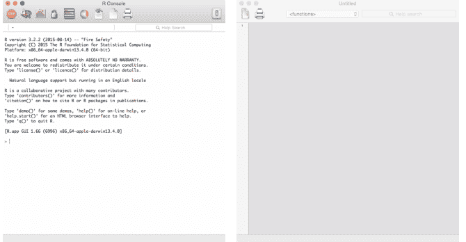

正如我刚刚做的那样，在书的某些我会特别提到 Windows 和 OS X 的 R GUI 功能，因为这两个是初学者最常用的平台。除了 Linux/Unix 实现外，你还可以从终端或壳（shell）运行 R，或者在另一种批模式下运行。书中的大部分代码在所有环境中都是通用的。

## 1.2.1 控制台与编辑器面板

用于 R 编程和查看输出的窗口主要有两种类型。你刚刚看到的控制台（console）或命令行解释器是执行代码以及提供文本和数值输出的地方。你可以直接使用 R 控制台进行计算或绘图。你通常只会在控制台使用简短的单行命令。

默认情况下，表示 R 已准备就绪并等待命令的提示符是 `>` 符号，之后会出现一个文本光标。为了避免与数学符号“大于”混淆，一些作者（包括我在内）倾向于将此符号修改为 `R>`，你可以按照如下方式操作：

```R
> options(prompt="R> ")
```

当光标位于提示符处时，你可以使用键盘向上箭头（↑）和向下箭头（↓）滚动查看任何之前执行过的命令；这在对之前的命令进行微调时非常有用。

对于较长的代码块和函数编写，先在编辑器中编写命令，并在完成后再在控制台中执行会更方便。R 为此提供了一个内置 R 代码编辑器。你在代码编辑器中编写的 R 脚本本质上只是带有 `.R` 扩展名的纯文本文件。

你可以通过 R GUI 菜单打开编辑器的新实例（例如，在 Windows 中使用 `File -> New script`，或在 OS X 中使用 `File -> New Document`）。

内置编辑器具有实用的键盘快捷键（例如 Windows 中的 `CTRL-R` 或 OS 中的 `RETURN`/回车），它们会自动将行发送到控制台。你可以发送光标所在的行、高亮行、行中的高亮部分或一段高亮的代码块。在处理多个 R 脚本时，打开多个编辑器面板是很常见的；大多数代码提交操作仅针对当前选中的编辑器。

控制台和编辑器的颜色、字符间距等美学设置可以根据操作系统在一定程度上进行定制；你只需访问相关的 GUI 偏好。图 1-3 显示了 Windows（`Edit -> GUI preferences...`）和 OS X（`R -> Preferences...`）中的 R 偏好。R 的一个特色是编辑器的颜色编码和括号匹配功能，这可以提高大段代码的简写性和可读性。

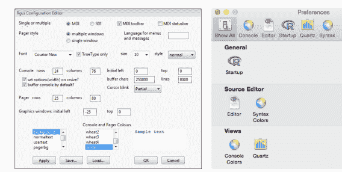


# 图 1-3：Windows [左] 和 OS X [右] 中的 R 偏好

在 R 中，你可以为代码添加注释。只需在行开头加上井号（`#`），随后的任何内容都会被解释器忽略。例如，在控制台中执行以下内容不会返回提示符：

```R
R> # 这是 R 中的一条注释...
```

注释也可以出现在有效命令的后面。

```R
R> 1+1 # 这计算出了一加一的结果！
[1] 2
```

如果你在编辑器中编写大型或复杂的代码块，这种注释对于想要理解你代码作用的其他人（实际上也对你自己！）是有帮助的。

每个 R 会话始终关联有一个工作目录（working directory）。除非在保存或导入数据文件时显式指定文件路径，否则 R 将默认使用此工作目录。要检查工作目录的位置，请使用 `getwd` 函数。

```R
R> getwd()
[1] "/Users/davies"
```

文件路径始终包含在双引号中，且 R 在指定文件夹位置时使用正斜杠，而不是反斜杠。

你可以使用 `setwd` 函数更改默认工作目录，如下：

```R
R> setwd("/folder1/folder2/folder3")
```

你可以提供相对于当前工作目录的文件路径，也可以提供完整路径（换句话说，从系统根目录）。无论哪种方式，记住 R 的大小敏感性都是重要的；你必须精确匹配任何文件夹名称的命名和标点，否则将抛出错误。

话虽如此，如果你在每次读取或写入文件时都能指定完整且正确的文件路径（在第 8 章中有更多细节），那么感兴趣的文件可以位于计算机的任何地方。

R 的基础安装附带了大量用于数值计算、常用统计分析的内置命令。

# 要访问特定命令或其他对象的帮助文件，请在控制台提示符处使用帮助函数或使用方便的快捷方式 `?`。例如，考虑一个现用的算术平均值函数 `mean`。

```R
R> ?mean
```

这会在图 1–4 的顶部图像显示。

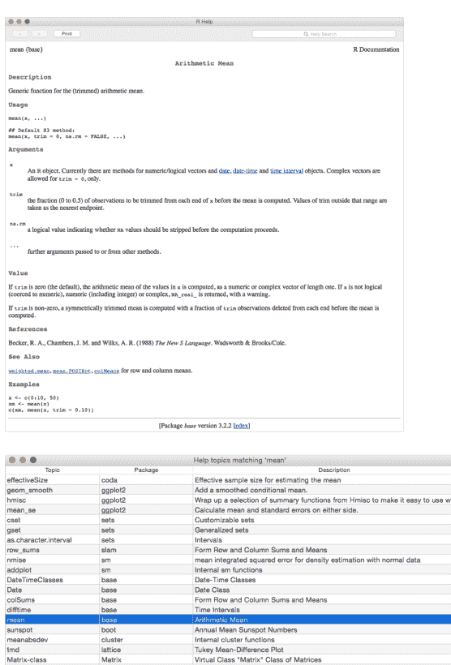

图 1-4：OS X 中函数 `mean` 的 R 文件 [顶部] 以及对字符串 "mean" 的帮助搜索结果 [底部]

如果你不确定所需函数的精确名称，可以使用字符字符串（双引号内的语句）传递给 `help.search` 来搜索所有已安装包的文档，或者使用 `??` 作为快捷方式：

```R
R> ??"mean"
```

此搜索将列出函数列表，包含它们所属包的描述，这些函数的帮助文件中包含感兴趣的字符串，如图 1-4 底部所示（高亮显示的条目是算术平均值的）。

所有帮助文件都遵循图 1-4 顶部所示的一般格式，文件的长度和详细程度通常反映了函数所执行操作的复杂性。大多数帮助文件包含此处列的前三个项目；其他是常见的可选项目：

- **Description**（描述）部分提供了执行操作的简短说明。
- **Usage**（用法）部分规定了函数传递给 R 控制台的形式，包括参数的自然顺序以及任何默认值（这些是显示为 `set=` 设置的参数）。
- **Arguments**（参数）部分更详细介绍了每个参数的作用以及它们允许采取的可能值。
- 函数返回的对象的性质（如果有的话）在 **Value**（值）下进行指定。
- **References**（引用）部分为该命令或函数背后的方法提供了相关引用。
- **See Also**（相关）下链接了相关函数的帮助文件。
- **Examples**（示例）提供了供你复制并粘贴到控制台的可执行代码，演示函数的运行情况。

帮助文件中还有其他几个字段——具有较长解释的函数通常在 `Arguments` 部分之后包含一个 `Details`（详情）部分。调用函数时常见的陷阱或错误通常放置在 `Warnings`（警告）部分，额外信息可以放置在 `Notes`（备注）中。

尽管刚开始时这些内容看起来非常专业，但我鼓励你继续查看帮助文件——即使你已经知道某个函数是如何工作的，熟悉函数文档的布局和解读也是成为熟练 R 用户的重要组成部分。

## 1.2.6 第三方编辑器

R 的流行导致了多种第三方代码编辑器或现有代码编辑软件兼容插件的发展，这些可以增强在 R 中编码的体验。

一个值得关注的是 RStudio（RStudio Team, 2015）。这是一个集成开发环境（IDE），适用于 Windows、OS X 和 Linux/Unix 平台，地址 <http://www.rstudio.com/>。

RStudio 包含直接提交的代码编辑器；用于文件、对象和项目管理的独立点击面板；以及使用 R 创建 markdown 文档。附录 B 详细讨论了 RStudio 及其功能。

使用任何第三方编辑器（包括 RStudio）很大程度上是个人选择。在本书中，我简单假设使用基础 R GUI 程序。

## 1.3 保存工作并退出 R

那么，你已经在 R 中编写了几个小时代码，现在该回家了？在 R 中保存工作时，你需要注意两点：活动会话中创建（并存储）的任何 R 对象，以及编辑器中编写的任何 R 脚本。

### 1.3.1 工作空间

你可以使用 GUI 菜单项（例如 Windows 下的 File 和 OS X 下的 Workspace）来保存和加载工作空间文件。R 工作空间映像包含退出时 R 会话中的所有信息，并被保存为 `.RData` 文件。这将包括你在会话中创建并存储（换句话说，分配）的所有对象（你将在第 2 章学习如何操作），包括可能从之前的工作空间文件加载的对象。

基本上，加载存储的 `.RData` 文件允许你“从离开的地方继续”。在 R 会话的任何时候，你都提示符处执行 `ls()`，列出活动工作空间存在的所有对象、变量和用户定义函数。

或者，你可以从控制台使用 R `save.image` 和 `load` 来处理工作空间 `.RData` 文件——这两个函数都包含一个 `file` 参数，你通过它传递目标 .RData 文件的文件夹位置和名称（有关这些使用的更多信息请参考相应的 `.image` 和 `load`）。

请注意，以这种方式保存工作空间映像不会保留之前活动 R 会话中加载的任何贡献包的功能。如 1.2.4 节所述，在每次启动 R 时，你需要使用 `library` 来加载工作所需的任何包。

退出软件最快的方法是在提示符处输入 `q()`：

```R
q()
```

只需退出控制台就会弹出一个框，询问你是否想保存工作空间映像。在这种情况下，选择对话保存不会打开浏览器来命名你的文件（或覆盖工作目录中具有 `.RData` 扩展名的“无名”文件）。

## 1.4.2 数学与公式引用

书中出现的数学内容和公式（主要在第三、第四部分）将保持在最少，但在某些章节中，有时需要进入一些数学细节。

重要的公式将如下所示单独成行显示：

```
y = 4x (1.1)
```

公式将在括号中编号，文中对公式的引用将使用这些括号内的数字，前面可能带有或不带有 Equation 单词样。例如，你将看到以下两种方式的公式引用：

- 如 Equation (1.1)，当 x = 2 时，y = 8。
- (1.1) 的逆运算得到 x = y/4。

当数值结果舍入到特定水平时，将根据小数位数进行注明，缩写为 d.p.。以下是一些示例：

- 著名的几何值 pi 是 π = 3.1416（保留 4 位 d.p.）。
- 在 (1.1) 中设置 x = 1.467 导致 y = 5.87 (2 d.p.)。

## 1.4.3 练习

章节中的练习题出现在圆角框中：

| 练习 1.1 |
|---|
| a. 大声读出 cat 这个词。 |
| b. 仅凭你的大脑，找到 1 + 1 的解。 |

这些练习是可选的。如果你选择尝试它们，旨在在它们出现在文本中时完成，以帮助你练习并理解紧接其后的章节中的特定内容和代码。

你在书中用于编码和绘图示例的所有数据都可以作为内置 R 对象提供，或者作为你将安装的某个贡献包的一部分。这些包将在文中予以注明（简短列表请参见 A.2.3 节）。

为了方便起见，书中所有的代码示例，以及对所有练习题的建议性解答，均以可运行的 .R 脚本形式免费提供，可以在书的网页 <https://www.nostarch.com/bookof/> 处获取。

你应该将这些解答（以及任何相关的注释）视为“建议性的”，因为在 R 中执行某项任务通常有多种方法，这些方法并不一定比提供的更好或更差。

## 本章重要代码

| 函数/运算符 | 简要描述 | 首次出现 |
|---|---|---|
| `options` | 设置各种 R 选项 | Section 1.2.1, p. 5 |
| `#` | 注释（解释器忽略） | Section 1.2.2, p. 6 |
| `getwd` | 打印当前工作目录 | Section 1.2.3, p. 7 |
| `setwd` | 设置当前工作目录 | Section 1.2.3, p. 7 |
| `library` | 加载已安装的包 | Section 1.2.4, p. 7 |
| `install.packages` | 下载并安装包 | Section 1.2.4, p. 8 |
| `update.packages` | 更新已安装的包 | Section 1.2.4, p. 8 |
| `help` 或 `?` | 函数/对象帮助文件 | Section 1.2.5, p. 9 |
| `help.search` 或 `??` | 搜索帮助文件 | Section 1.2.5, p. 10 |
| `q` | 退出 R | Section 1.3.1, p. 12 |

# 数值、算术、赋值与向量


在最简单的角色下，R 可以作为一个简单的桌面计算器。在本章中，我将讨论如何使用软件进行算术运算。我还将展示如何存储结果，以便以后在其他计算中使用它们。然后，你将学习向量，它可以让你一次处理多个值。向量是 R 中的基本工具，R 的许多功能都是针对向量操作设计的。你将检查操作向量的常用实用方法，并利用向量化的行为。

## 2.1 用于基础数学的 R

常用的算术操作和数学功能在控制台提示符处都是备用的。你可以分别使用符号 `+`、`-`、`*` 和 `/` 执行加法、减法、乘法除法。你可以使用 `^` 创建指数（也称为幂或指标），并可以使用括号 `()` 控制单条命令的计算顺序。

### 2.1.1 算术

在 R 中，标准的数学规则处处适用并遵循通常从左到右的操作顺序：括号、指数、乘法、除法、加法、减法 (PEMDAS)。以下是控制台中的示例：

```R
R> 2+3
[1] 5
R> 14/6
[1] 2.333333
R> 14/6+5
[1] 7.333333
R> 14/(6+5)
[1] 1.272727
R> 3*2
[1] 9
R> 2^3
[1] 8
```

你可以使用 `sqrt` 函数找到任何非负数的平方根。你只需要如所示向 `x` 提供所需的数字：

```R
R> sqrt(x=9)
[1] 3
R> sqrt(x=5.311)
[1] 2.304561
```

在使用 R 时，你经常会发现需要将复杂的算术公式翻译成代码进行评估（例如，当复制教科书或研究论文中的计算时）。以下示例提供了数学表达式的计算及其在 R 中的执行情况：

$10^{2} + \frac{3 \times 60}{8} - 3$

```R
R> 10^2+3*60/8-3
[1] 119.5
```

$5^{3} \times \frac{(6 - 2)}{61 - 3 + 4}$

```R
R> 5^3-(6-2)/(61-3+4)
[1] 8.064516
```

$2^{2+1} - 4 + 64^{2.25-\frac{1}{4}}$

```R
R> 2^(2+1)-4+64^(2.25-1/4)
[1] 4100
```

## 练习 2.1

a. 使用 R 验证：

$$\frac{6a + 42}{34.2 - 3.62} = 29.50556$$

当 $a = 2.3$ 时。


- b. 下列哪个表达式将负 4 平方并在结果上加 2？
  i. `(-4)^2+2`
  ii. `-4^2+2`
  iii. `(-4)^2(2+2)`
  iv. `-4^2(2+2)`

- c. 使用 R，如何计算数字 25.2, 15, 16.44, 15.3 和 18.6 的平均数的一半平方根？

- d. 求 log, 0.3。

- e. 计算 (d) 中答案的指数变换。

- f. 识别在控制台打印 -0.00000000423546322 时 R 的表示形式。

## 2.2 对象赋值

到目前为止，R 仅通过将结果打印到控制台来显示示例计算的结果。如果你想保存结果并执行后续操作，你需要能够将结果赋值给当前工作空间中的一个对象。简单来说，这等于将某些项目或结果存储在一个给定名称下，以便以后访问，而无需重新编写该计算。在书中，我将交替使用 `assign`（赋值）和 `store`（存储）这两个术语。注意，某些编程书籍将存储的对象称为变量，因为可以很容易地覆盖对象并更改为不同的内容，这意味着它所代表的内容在整个会话中可能会变化。然而，我在本书中统一使用“对象”（object）一词，因为我们将在第三部分将变量作为特定的统计常数进行讨论。

你可以通过两种方式在 R 中指定赋值：使用箭头符号 (`<-`) 和使用单等号 (`=`)。这两种方法在此所示：

```
R x <- -5
R x = -5
R x
[1] -5
```

```
R x = x + 1 # 这覆盖了 x 的原有值
R x
[1] -4
```

```
R mynumber = 45.2
R y <- mynumber + x
R y
[1] 41.2
```

```
R ls()
[1] "mynumber" "x" "y"
```

如你从这些示例所示，当你向控制台输入对象的名称时，R 将显示赋值给该对象的值。当后续操作中使用该对象时，R 将替换赋值给它的值。最后，如果你使用 `ls()` 命令（你在第 1.3.1 节中看到）来检查当前工作空间的内容，它将按字母顺序显示对象的名称（以及任何其他创建的项目）。

虽然 `=` 和 `<-` 的作用相同，但保持一致是明智的（至少为了代码的整洁）。由于使用 `=` 时可能产生混淆（例如，`x = x + 1` 显然不是指 $x$ 在数学上等于 $x + 1$）。在书中，我将同样这样做，并将 `=` 保留给设置函数参数，这些参数从第 2.3.2 节开始。到目前为止你只使用了数值，但请注意赋值过程对于所有类型和类的对象都是通用的，你将在接下来的章节中检查它们。

只要名称以字母开头（换句话说，不是数字）、避免符号（虽然下划线和点是可以的），并避免少数几个“保留”词（例如用于定义特殊值的词，见第 6.1 节）或控制代码流的词（见第 10 章），对象就可以任意命名。你可以在第 9.1.2 节找到这些命名规则的有用总结。

## 练习 2.2

- a. 创建一个存储值 3² × 4¹/⁸ 的对象。
- b. 将 (a) 中的对象自身除以 2.33 并覆盖该对象。将结果打印到控制台。
- c. 创建一个值为 -8.2 × 10⁻¹¹ 的新对象。
- d. 直接在控制台打印 (b) 乘以 (c) 的结果。

## 2.3 向量

你通常希望对多个实体执行相同的计算或比较，例如，如果你正在对数据集中的测量值进行缩放。你可以一次执行此类操作，尽管这显然不是理想的，特别是当你有大量项目时。R 提供了向量（vectors）为这个问题提供了更高效的解决方案。

目前，为了保持简单，你将继续仅处理数值条目，尽管这里讨论的许多实用函数也可能适用于包含非数值的结构。你将在第 4 章开始查看其他类型的数据。

### 2.3.1 创建向量

向量是 R 中处理多个项目的本质构建块。从数值的意义上说，你可以将向量视为关于单个变量的观测或测量的集合，例如，50 个人的身高或你喝的咖啡数量。创建向量的函数是单个字母 `c`，括号内是所需的条目并用逗号隔开。

```
R myvec <- c(1,3,1,42)
R myvec
[1] 1 3 1 42
```

> 向量条目可以是计算或之前存储的项目（包括向量本身）。

```
R foo <- 32.1
R myvec <- c(3,-3,2.35,1e+03,64^0.5,2+(3-1.1)/9.44,foo)
R myvec
[1] 3.000000 -3.000000 2.350000 1000.000000 8.000000 2.212711 32.100000
```

这段代码通过算术表达式创建了一个新向量，存储在向量中的是该表达式的结果。最后一个条目 `foo` 是一个定义为 32.1 的现有数值对象。

让我们来看另一个例子。

```
R myvec2 <- c(1,3,1,42)
R myvec3 <- c(myvec, myvec2)
R myvec3
[1] 1.000000 3.000000 2.350000 1000.000000 8.000000 2.212711 32.100000 1.000000 3.000000 1.000000 42.000000
```

此代码创建并存储了另一个向量 `myvec3`，它将 `myvec` 和 `myvec2` 拼接在一起。

### 2.3.2 序列、重复和长度

我将讨论与向量相关的常用函数：`seq()`、`rep()` 和 `length()`。等间距的递增或递减序列是你经常需要的东西，例如在编程时（见第 10 章）或绘图时（第 7 章）。创建间距为 1 的序列最简单的方法是使用冒号运算符。

```
R 3:27
[1] 3 4 5 6 7 8 9 10 11 12 13 14 15 16 17 18 19 20 21 22 23 24 25 26 27
```

示例 `3:27` 应该读作“从 3 到 27”。你始终可以使用冒号运算符提供之前存储的值。

```
R foo <- 5.3
R bar <- foo:-47.5
R bar
[1] 5.3 4.3 3.3 2.3 1.3 0.3 -0.7 -1.7 -2.7 -3.7 -4.7 -5.7 -6.7 -7.7 -8.7 -9.7 -10.7 -11.7 -12.7 -13.7 -14.7 -15.7 -16.7 -17.7 -18.7 -19.7 -20.7 -21.7 -22.7 -23.7 -24.7 -25.7 -26.7 -27.7
```

#### 使用 seq 的序列

你可以使用 `seq()` 命令，它允许更灵活的序列创建。这个函数接收 `from` 值、`to` 值和 `by` 值，并返回相应的序列。

```
R seq(from=3, to=27, by=3)
[1] 3 6 9 12 15 18 21 24 27
```

这是一个间距为 3 的序列。注意，这类序列总是从 `from` 开始，但不总是包含 `to`。例如，如果你是递增的且序列以奇数结束，则最后一个数字将被包含。与其提供 `by` 值，你可以指定 `length.out` 来产生一个具有该数量、均匀分布在 `from` 和 `to` 值之间的向量。

```
R seq(from=3, to=27, length.out=40)
[1] 3.000000 3.615385 4.230769 4.846154 5.461538 6.076923 6.692308 7.307692 7.923077 8.538462 9.153846 9.769231 10.384615 11.000000 11.615385 12.230769 12.846154 13.461538 14.076923 14.692308 15.307692 15.923077 16.538462 17.153846 17.769231 18.384615 19.000000 19.615385 20.230769 20.846154 21.461538 22.076923 22.692308 23.307692 23.923077 24.538462 25.153846 25.769231 26.384615 27.000000
```

通过 `length.out=40`，你让程序精确打印从 3 到 27 的均匀分布的数字。对于递减序列，`by` 的使用可能是负的。这是一个示例：

```
R foo <- 5.3
R mysq <- seq(from=foo, to=(-47+1.5), by=-2.4)
R mysq
[1] 5.3 2.9 0.5 -1.9 -4.3 -6.7 -9.1 -11.5 -13.9 -16.3 -18.7 -21.1 -23.5 -25.9 -28.3 -30.7 -33.1 -35.5 -37.9 -40.3 -42.7 -45.1
```

这段代码使用之前存储的对象作为值，并在 `to` 中使用计算 `(-47+1.5)` 作为值。给定这些值（即 `foo` 大于 `(-47+1.5)`），序列只能以负步长进行；我们直接设置 `by` 为 `-2.4`。然而，创建递减序列的 `length.out` 长度保持不变（指定负长度是没有意义的）。通过 `from` 和 `to` 值，你可以很容易地创建一个长度为 5 的递减序列，如下：

```
R mysq <- seq(from=foo, to=(-47+1.5), length.out=5)
R mysq
[1] 5.3 2.9 0.5 -1.9 -4.3
```

#### 使用 rep 重复

序列非常有用，但有时你可能希望重复某个值。你通过 `rep()` 来实现：

```
R rep(x=1, times=4)
[1] 1 1 1 1
R rep(x=c(3,62,8), times=3)
[1] 3 62 8 3 62 8 3 62 8
R rep(x=c(3,62,8), times=3, each=2)
[1] 3 3 62 62 8 8 3 3 62 62 8 8 3 3 62 62 8 8
```

`rep()` 函数接收单个值或值向量作为其参数 `x`，以及参数 `times` 和 `each` 的值。`each` 控制 `x` 中每个元素重复的次数。在第一行中，你将一个单独值重复了四次。其他示例首先将 `rep()` 用于向量来重复整个向量，然后使用 `each` 重复向量的每个成员，最后同时使用 `times` 和 `each` 一次性完成这两项操作。

如果未指定 `times`，R 的默认值是将 `times` 和 `each` 的值视为 1，因此调用 `rep(x=c(3,62,8,3))` 将返回原始提供的 `x` 且不发生任何变化。

与 `seq()` 一样，你可以将 `rep()` 的结果包含在相同数据类型的向量中，如下例所示：

```
R foo <- 4
R foo <- c(3, 8, rep(x=foo, times=foo), seq(from=-2, to=1, length.out=foo+1))
R foo
[1] 3.00 8.00 4.00 4.00 4.00 4.00 -2.00 -1.25 -0.50 0.25 1.00
```

在这里，我构建了一个向量，其中第三到第六个（包含）由 `rep()` 命令的评估控制——单个值 4 重复了 `foo` 次（`foo` 存储为 4）。最后五个项目是 `seq()` 评估的结果，即从 -2 到 1 长度为 `foo+1` (5) 的序列。

### 使用 sort 排序

按元素的升序或降序对向量进行排序是日常任务中经常出现的另一种简单操作。命名方便的 `sort()` 函数就能实现这一点。

```
R sort(x=c(2.5,-1,-10,3.44), decreasing=FALSE)
[1] -10.00 -1.00 2.50 3.44
```

```
R sort(x=c(2.5,-1,-10,3.44), decreasing=TRUE)
[1] 3.44 2.50 -1.00 -10.00
```

```
R foo <- seq(from=4, to=5, length.out=8)
R foo
[1] 4.00000 4.14286 4.28571 4.42857 4.57143 4.71429 4.85714 5.00000
R bar <- sort(x=foo, decreasing=TRUE)
R bar
[1] 5.00000 4.85714 4.71429 4.57143 4.42857 4.28571 4.14286 4.00000
```

```
R sort(x=c(foo, foo), decreasing=FALSE)
[1] 4.00000 4.00000 4.14286 4.14286 4.28571 4.28571 4.42857 4.42857 4.57143 4.57143 4.71429 4.71429 4.85714 4.85714 5.00000 5.00000
```

`sort()` 函数非常直观。你将一个向量作为参数 `x` 给函数，第二个参数 `decreasing` 指明你想要的排序顺序。此参数接受一种你尚未遇到过的类型的值：至关重要的逻辑值之一。逻辑值只能是特定的、区分大小写的值之一：`TRUE` 或 `FALSE`。通常情况下，逻辑值用于指示特定条件是否满足或失败，它们是所有编程语言中不可或缺的一部分。你将在第 4.1 节中更详细地研究逻辑值。现在，关于 `sort()`，你设置 `decreasing=FALSE` 从最小到最大排序，设置 `decreasing=TRUE` 从最大到最小排序。

### 获取带长度的向量

我将用 `length()` 函数来结束本节，它确定给定作为参数 `x` 的向量中存在多少个条目。

```
R length(x=c(3,2,8,1))
[1] 4
```

```
R length(x=5:13)
[1] 9
```

```
R foo <- 4
R bar <- c(3, 8, rep(x=foo, times=foo), seq(from=-2, to=1, length.out=foo+1))
R length(x=bar)
[1] 11
```

> 注意，如果你包含了依赖于其他函数评估的条目（在这种情况下，对 `rep()` 和 `seq()` 的调用），`length()` 会告诉你在这些内部函数执行后的条目数量。

### 练习 2.3

- a. 创建并存储一个从 5 到 –11 的值序列，步长为 0.3。
- b. 使用相同但顺序反转的序列重覆盖对象 (a)。
- c. 重复向量 `c(-1,3,-5,7,-9)` 两次，每个元素重复 10 次，并存储结果。显示从最大到最小排序后的结果。
- d. 创建并存储一个包含以下内容的向量（任何配置均可）：
  - i. 一个从 6 到 12（包含）的整数序列
  - ii. 值 5.3 的三次重复
  - iii. 数字 –3
  - iv. 一个从 1 开始到以 (c) 中创建的向量总长度为终的九值序列
- e. 确认 (d) 中创建的向量长度为 20。

### 2.3.3 子集与提取

在目前打印到控制台的所有结果中，你可能注意到一个有趣的特征。在输出紧邻左侧有一个方括号的 `[1]`。当输出是一个跨越控制台宽度并换到下一行的长向量时，左侧会出现另一个方括号数字。这些数字代表条目的索引。简单来说，索引对应于值在向量中的位置，这解释了为什么第一个值旁边会有 `[1]`（即使它是唯一的值且不是较长向量的一部分）。

这些索引允许你从向量中检索特定元素，这被称为子集化（subsetting）。假设你的工作区有一个名为 `myvec` 的向量。`myvec` 中恰好有 `length(myvec)` 个条目，每个条目都有特定的位置：1 或 2 或 3，一直到 `length(myvec)`。你可以通过要求 R 返回 `myvec` 在特定位置的值来访问单个元素，这通过输入向量名称后跟方括号中的位置来实现。

```
R myvec <- c(5, -2.3, 4, 4, 6, 8, 10, 42.1, -8)
R length(myvec)
[1] 9
R myvec[1]
[1] 5
```

```
R foo <- myvec[2]
R foo
[1] -2.3
```

```
R myvec[length(myvec)]
[1] -8
```

由于 `length(myvec)` 产生向量的最后一个索引（在本例中为 9），在方括号中输入此值可以提取最后一个元素 `-8`。同样，你可以通过从长度中减 1 来提取倒数第二个元素；让我们尝试，并将结果赋值给新对象：

```
R myvec.len <- length(myvec)
R bar <- myvec[myvec.len - 1]
R bar
[1] 42.1
```

正如这些示例所示，索引可以是其他数字或之前存储值的算术函数。你可以按照通常方式使用 `<-` 符号将结果赋值给工作区中的新对象。

这提供了 `myvec` 的前四个元素（回冒号运算符返回的是一个数值向量，因此没有显式地将其封装在 `c()` 中）。返回元素的顺序完全取决于在方括号中提供的索引向量。例如，再次使用 `foo`，考虑索引的顺序和结果的提取，如下所示：

```
R foo <- c(5, -2.3, 4, 4)
R foo[length(foo):2]
[1] 4.0 -2.3
```

你在这里是从向量的末尾开始向后提取的元素。你也可以使用 `rep()` 来重复某个索引，如下所示：

```
R indexes <- c(4, rep(x=2, times=3), 1, 1, 2, 3:1)
R indexes
[1] 4 2 2 2 1 1 2 3 2 1
R foo[indexes]
[1] 4.0 -2.3 -2.3 -2.3 5.0 5.0 -2.3 4.0 -2.3 5.0
```

这现在比严格的“子集提取”更通用一点——通过使用索引向量，你可以创建一个任何长度的全新向量，由原始向量中的部分或全部元素组成。如前所示，该索引向量可以以任何顺序包含所需的元素位置，并可以重复元素。

你还可以在删除多个元素后返回向量的元素。例如，要想在删除 `foo` 的第一个和第三个元素后创建一个向量，你可以执行以下操作：

```
R foo[-c(1,3)]
[1] -2.3 4.0
```


注意，在单个索引向量中是不可能混合正索引和负索引的。

有时你可能需要用新值覆盖现有向量中的某些元素。在这种情况下，你首先使用方括号指定你想要覆盖的元素，然后使用赋值运算符来分配新值。这里有一个示例：

```R
bar <- c(3,2,4,4,1,2,4,1,0,5)
bar
# [1] 3 2 4 4 1 2 4 1 0 5
bar[1] <- 6
bar
# [1] 6 2 4 1 2 4 1 0 5
```

这覆盖了 `bar` 的第一个元素（原本为 3），将其替换为新值 6。在选择多个元素时，你可以指定一个值来替换它们，或者输入一个长度与所选元素数量相等的数值向量来逐一替换。让我们用之前的同一个 `bar` 试一下。

```R
bar[c(2,4,6)] <- c(-2,-0.5,-1)
bar
# [1] 6.0 -2.0 4.0 -0.5 1.0 -1.0 4.0 1.0 0.0 0.0 5.0
```

在这里，你分别将第二、第四和第六个元素覆盖为 -2、-0.5 和 -1；其余保持不变。相比之下，以下代码选取了第 7 到 10 个（包含）元素，并将它们全部替换为 100：

```R
bar[7:10] <- 100
bar
# [1] 6.0 -2.0 4.0 -0.5 1.0 -100.0 100.0 100.0 100.0 5.0
```

最后，需要说明的是本节仅关注了 R 中向量元素提取的两种主要方法（或“风格”）之一。你将在 4.1.5 节中查看另一种使用逻辑标记的方法。

# 练习 2.4

- a. 创建并存储一个包含以下内容的向量，顺序如下：
  - 一个从 3 到 6（包含）长度为 5 的序列
  - 向量 `c(2,-5.1,-33)` 的两倍
  - 数值 `T/2 + 2`
- b. 从 (a) 向量中提取第一个和最后一个元素，并将它们存储为一个新对象。
- c. 将省略 (a) 向量的第一个和最后一个值后返回的数值存储为第三个对象。
- d. 使用 (b) 和 (c) 重构 (a)。
- e. 用按从小到大排序的相同值覆盖 (a)。
- f. 使用冒号运算符作为索引向量来反转 (e) 的顺序，并确认这与对 (e) 使用 `decreasing=TRUE` 进行排序的结果相同。
- g. 从 (c) 创建一个向量，将 (c) 的第三个元素重复三次，第六个元素重复四次，最后一个元素重复一次。
- h. 通过将 (e) 原样赋值给新对象，创建一个 (e) 的副本新向量。使用这个新的 `e` 副本，将第一个、第五到第七个（包含）以及最后一个元素分别用 99 到 95（包含）的值覆盖。

# 2.3.4 向量化行为

向量之所以如此有用，是因为它们允许 R 以快速且高效的方式同时对多个元素执行操作。这种面向向量的、向量化的或逐元素的行为是该语言的一项关键特性，你将在这里通过一些缩放测量值的示例来简要研究这一特性。

让我们从这个简单的示例开始：

```R
foo <- 5.5:0.5
foo
# [1] 5.5 4.5 3.5 2.5 1.5 0.5
```

假设 `foo` 是 `5.5 4.5 3.5 2.5 1.5 0.5`。现在我们要从 `foo` 中减去 `2`：

```R
foo - 2
# [1] 3.5 2.5 1.5 0.5 -0.5 -1.5
```

可以看到，R 并不是只从第一个元素中减了 2，而是对 `foo` 中的每个元素都减了 2。这就是向量化操作。

如果我们减去一个向量呢？

```R
foo - c(2, 1)
# [1] 3.5 3.5 2.5 1.5 0.5 -0.5
```

在这里，R 通过循环向量 `c(2, 1)` 来匹配 `foo` 的每一个元素。第一个元素减去 2，第二个减去 1，第三个减去 2，以此类推。这种循环机制比手动写循环要高效得多。

如果我们要减去另一个向量呢？

```R
foo - c(2, 1, 0)
# [1] 3.5 3.5 3.5 1.5 0.5 -0.5
```

同样，R 循环使用 `c(2, 1, 0)` 直到 `foo` 结束。

如果被减的向量比 `foo` 还长呢？

```R
foo - c(2, 1, 0, 5, 6, 7)
# [1] 3.5 3.5 3.5 -2.5 -4.5 -6.5
```

在这种情况下，R 只使用较短向量的部分。

这种逐元素的行为是 R 的核心优势之一。它允许我们编写简洁的代码来处理大型数据集，而无需显式地编写 `for` 循环。

回想之前显示的 `foo`：

```R
foo
# [1] 5.5 4.5 3.5 2.5 1.5 0.5
```

你可以使用以下代码找到这六个元素的之和：

```R
sum(foo)
# [1] 18
```

并使用以下代码找到它们的积：

```R
prod(foo)
# [1] 162.4219
```

向量化函数不仅方便，而且比显式编码的迭代方法（如循环）更快、更高效。这些示例中得出的主要结论是：R 的许多功能是专门为某些数据结构设计的，这确保了代码的整洁以及对性能的优化。

最后，如前面提到的，这种面向向量的特性也适用于重写多个元素。再次使用 `foo`，检查以下内容：

```R
foo
# [1] 5.5 4.5 3.5 2.5 1.5 0.5
foo[c(1,3,5,6)] <- c(-99,99)
foo
# [1] -99.0 4.5 99.0 2.5 -99.0 99.0
```

你看到一个长度为 2 的向量重写了四个特定的元素，该向量以你所熟悉的方式进行循环。再次强调，当被重写的向量长度不能整除被重写的元素个数，或者 R 无法完成完整长度的循环时，会发出与之前显示的类似的警告。

## 练习 2.5

a. 使用长度为 3 的向量将向量 `c(2,0.5,1,2,0.5,1,2,0.5,1)` 转换为全为 1 的向量。
b. 从华氏度 F 到摄氏度 C 的温度转换使用以下方程：
$$C = \frac{5}{9}(F-32)$$

利用 R 中面向向量的特性，将华氏度 45, 77, 20, 19, 101, 120 和 212 转换为摄氏度。

- c. 使用向量 `c(2,4,6)` 和向量 `c(1,2)` 结合 `rep` 产生向量 `c(2,4,6,4,8,12)`。
- d. 将 (c) 结果向量的中间四个元素用两个循环的元素 -0.1 和 -100 重写，顺序一致。

## 本章重要代码

| 函数/运算符 | 简要描述 | 首次出现 |
|---|---|---|
| `+`, `*`, `-`, `/`, `^` | 算术运算 | 第 2.1 节，页 17 |
| `sqrt` | 平方根 | 第 2.1.1 节，页 18 |
| `log` | 对数 | 第 2.1.2 节，页 19 |
| `exp` | 指数 | 第 2.1.2 节，页 19 |
| `<-` | 对象赋值 | 第 2.2 节，页 21 |
| `c()` | 向量创建 | 第 2.2.1 节，页 23 |
| `:`; `seq` | 序列创建 | 第 2.3.2 节，页 24 |
| `rep` | 数值/向量重复 | 第 2.3.2 节，页 25 |
| `sort` | 向量排序 | 第 2.3.2 节，页 26 |
| `length` | 确定向量长度 | 第 2.3.2 节，页 27 |
| `[` | 向量子集/提取 | 第 2.3.3 节，页 28 |
| `sum` | 求向量所有元素之和 | 第 2.3.4 节，页 36 |
| `prod` | 求向量所有元素之积 | 第 2.3.4 节，页 36 |

# 3 矩阵与数组


现在，你已经熟练掌握了在 R 中使用向量。**矩阵**是存储在一起的几个向量。向量的大小由长度描述，而矩阵的大小由行数和列数指定。你还可以创建被称为**数组**的高维结构。在本章中，我们将开始学习如何处理矩阵，然后增加维度以形成数组。

## 3.1 定义矩阵

矩阵是一个重要的数学结构，对于许多统计方法都至关重要。你通常将矩阵 $A$ 描述为 $m \times n$ 矩阵；即 $A$ 将恰好有 $m$ 行 $n$ 列。这意味着 $A$ 总共有 $mn$ 个元素，每个元素 $a_{i,j}$ 都有由其特定的行（$i=1, 2, \dots, m$）和列（$j=1, 2, \dots, n$）给唯一位置。

因此，你可以这样表示矩阵：

| A = | $a_{1,1}$ | $a_{1,2}$ | ... | $a_{1,n}$ |
| | $a_{2,1}$ | $a_{2,2}$ | ... | $a_{2,n}$ |
| | . | . | . | . |
| | . | . | . | . |
| $a_{m,1}$ | $a_{m,2}$ | ... | $a_{m,n}$ |

在 R 中创建矩阵，使用 `matrix` 函数，并将矩阵的元素作为向量提供给 `data` 参数：

```R
A <- matrix(c(-3,2,8,17), nrow=2, ncol=2)
A
#      [,1] [,2]
# [1,]   -3    2
# [2,]    8   17
```

你必须确保该向量的长度与行数（`nrow`）和列数（`ncol`）完全匹配。在调用 `matrix` 时可以选择不指定 `nrow` 和 `ncol`，在这种情况下，R 的默认返回返回元素的单列矩阵（`data=c(-3,2,8,17)`）。

### 3.1.1 填充方向

意识到 R 如何使用 `data` 中的元素填充矩阵是非常重要的。查看上一个例子，你可以看到 2x3 矩阵在从左到右读取数据时是按列填充的。你可以使用 `byrow` 参数来控制 R 填充数据的方式，如下：

```R
matrix(data=c(1,2,3,4,5,6), nrow=2, ncol=3, byrow=FALSE)
#      [,1] [,2] [,3]
# [1,]    1    3    5
# [2,]    2    4    6
```

在这里，我指示 R 提供一个包含 1 到 6 的 2x3 矩阵。通过使用可选的 `byrow` 参数并设置为 `FALSE`，你显式告诉 R 按列填充此 2x3 结构，填充完每一列后再移动到下一列。这是 R 的默认处理方式，如果不提供 `byrow` 参数，软件将假设 `byrow=FALSE`。

```R
c(1,2,3,4,5,6)
# 1 3 5
# 2 4 6
```

现在，重复设置 `byrow=TRUE` 的代码：

```R
matrix(data=c(1,2,3,4,5,6), nrow=2, ncol=3, byrow=TRUE)
#      [,1] [,2] [,3]
# [1,]    1    2    3
# [2,]    4    5    6
```

生成的 2x3 结构现在按行填充，如图 3-2 所示。

```R
c(1,2,3,4,5,6)
# 1 2 3
# 4 5 6
```

### 3.1.2 行绑定与列绑定

如果你有多个长度相同的向量，可以使用内置 R 函数 `rbind` 和 `cbind` 快速构建矩阵。你可以将每个向量视为一行（使用 `rbind`）或将每个向量视为一列（使用 `cbind`）。假设你有向量 `1:3` 和 `4:6`。使用 `rbind` 可以如下重构图 3-2 中的 2x3 矩阵：

```R
rbind(1:3, 4:6)
#      [,1] [,2] [,3]
# [1,]    1    2    3
# [2,]    4    5    6
```

在这里，`rbind` 将向量绑定为矩阵的两行，行顺序与提供的向量顺序一致。使用 `cbind` 则可以如下构建相同的矩阵：

```R
cbind(c(1,4), c(2,5), c(3,6))
#      [,1] [,2] [,3]
# [1,]    1    2    3
# [2,]    4    5    6
```

在这里，你有三个长度为 2 的向量。使用 `cbind` 按照提供的顺序合并这三个向量，每个向量变为矩阵的一列。

### 3.1.3 维度

另一个有用函数 `dim` 提供工作区中矩阵的维度。

```R
mymat <- rbind(c(1,3,4), 5:7, c(100,20,90), 11:13)
mymat
#      [,1] [,2] [,3] [,4]
# [1,]    1    5  100   11
# [2,]    3    6   20   12
# [3,]    4    7   90   13
dim(mymat)
# [1] 3 4
nrow(mymat)
# [1] 3
ncol(mymat)
# [1] 4
```

定义 `mymat` 后可以使用 `dim` 确认其维度，它返回一个长度为 2 的向量；`dim` 总是先提供行数。你也可以使用相关的函数：`nrow`（提供行数）和 `ncol`（提供列数）。

## 3.2 子集

从矩阵中提取元素与从向量中提取相似。唯一的复杂在于你现在多了一个维度。元素提取仍然使用方括号，但现在必须同时指定行和列。让我们从创建一个 3x3 矩阵开始，我将将其用于示例。

```R
A <- matrix(c(0.3,4.5,55.3,91.0,105.5,-4.2,8.2,27.9), nrow=3, ncol=3)
A
#      [,1]  [,2]  [,3]
# [1,]  0.3  91.0   8.2
# [2,]  4.5 105.5  27.9
# [3,] 55.3  -4.2   0.0
```

要告诉 R “查看 A 的第三行并给我第二列的元素”，执行以下操作：

```R
A[3,2]
# [1] -4.2
```

如所预期的，你得到了位置 `[3,2]` 上的元素。

### 3.2.1 行、列和对角提取

要从矩阵中提取整行或整列，只需指定的行号或列号，并将另一个值留空。注意你必须包含分离行列号的逗号——这是 R 区分行请求和列请求的关键。以下代码返回 A 的第二列：

```R
A[,2]
# [1] 91.0 105.5 -4.2
```

以下检查第一行：

```R
A[1,]
# [1] 0.3 91.0 8.2
```

注意，每当提取（或稍后介绍的删除）结果为单个值、单行或单列时，R 将始终返回由所请求的值组成的孤立向量。你还可以执行更复杂的提取，例如请求行或列，或者多个行或列，结果必须以相应维度的新矩阵形式返回。考虑以下子集：

```R
A[2:3,]
#      [,1]  [,2]  [,3]
# [1,]  4.5 105.5  27.9
# [2,] 55.3  -4.2   0.0
```

```R
A[,c(3,1)]
#      [,1]  [,2]
# [1,]  8.2  0.3
# [2,] 27.9 55.3
# [3,]  0.0 55.3
```

```R
A[c(3,1),2:3]
#      [,1]  [,2]
# [1,] -4.2  0.0
# [2,] 91.0  8.2
```

第一个命令返回 A 的第二行和第三行，第二个命令返回 A 的第三列和第一列。最后一个命令按顺序访问 A 的第三行和第一行，并从中返回第二列和第三列的元素。

你还可以使用 `diag` 命令识别正方矩阵（即行数和列数相同的矩阵）对角线上的值。

```R
diag(A)
# [1] 0.3 105.5 0.0
```

这返回一个包含 A 的对角线元素的向量，第一个元素位于 `A[1,1]`。

### 3.2.2 省略和覆盖

要从矩阵中删除或省略元素，你再次使用方括号，但这次使用负索引。以下是去除了第二列的 A：

```R
A[,-2]
#      [,1]  [,2]
# [1,]  0.3   8.2
# [2,]  4.5  27.9
# [3,] 55.3   0.0
```

以下删除了 A 的第一行，并从剩余行中按顺序提取第三列和第二列的值：

```R
A[-1,3:2]
#      [,1]  [,2]
# [1,]  8.2 105.5
# [2,]  0.0  -4.2
```

以下产生了去除了第一行和第二列的 A：

```R
A[-1,-2]
#      [,1]  [,2]
# [1,]  4.5  27.9
# [2,] 55.3   0.0
```

最后，这删除了第一行，然后从结果中删除第二列和第三列：

```R
A[-1,-c(2,3)]
# [1] 4.5 55.3
```

注意，这个最终操作只留下了 A 的第一列最后两个元素，因此返回的是一个向量而不是矩阵。

要覆盖特定元素、整行或整列，你需要标识要替换的元素并分配新值，就像你在 2.3 节做的那样。新元素可以是单个值、与替换元素数量相同的向量，或者长度能被替换元素数量整除的向量。让我们创建一个 A 的拷贝并命名为 B。

```R
B <- A
B
#      [,1]  [,2]  [,3]
# [1,]  0.3  91.0   8.2
# [2,]  4.5 105.5  27.9
# [3,] 55.3  -4.2   0.0
```

以下使用序列 1, 2, 3 覆盖了 B 的第二行：

```R
B[2,] <- 1:3
B
#      [,1] [,2] [,3]
# [1,]  0.3 91.0  8.2
# [2,]  1.0  2.0  3.0
# [3,] 55.3 -4.2  0.0
```

以下覆盖了 B 的第一行和第三行的第二列元素，值为 900：

```R
B[c(1,3),2] <- 900
B
#      [,1]  [,2]  [,3]
# [1,]  0.3 900.0  8.2
# [2,]  1.0   2.0  3.0
# [3,] 55.3 900.0  0.0
```

接下来，你用 B 的第三行替换 B 的第三列：

```R
B[,3] <- B[3,]
B
#      [,1]  [,2]  [,3]
# [1,]  0.3 900.0 55.3
# [2,]  1.0   2.0 -4.2
# [3,] 55.3 900.0  0.0
```

如果你想想替换正方矩阵的对角线，可以避免显式索引并直接使用 `diag` 进行覆盖。

```R
diag(B) <- rep(0, times=3)
B
#      [,1]  [,2]  [,3]
# [1,]  0.0 900.0 55.3
# [2,]  1.0   0.0 -4.2
# [3,] 55.3 900.0  0.0
```


## 练习 3.1

a. 构建并存储一个 $4 \times 2$ 矩阵，按行填充 4.3, 3.1, 8.2, 3.2, 0.9, 1.6 和 6.5。
b. 移除一行后，确认 (a) 中矩阵的维度是否为 $3 \times 2$。
c. 用从小到大的排序值覆盖 (a) 中矩阵的第二列。
d. 如果从 (c) 中删除第四行和第一列，R 返回什么？使用 `matrix` 确保结果是单列矩阵而不是向量。
e. 将 (c) 的底部四个元素存储为一个新的 $2 \times 2$ 矩阵。
f. 按此顺序，用 (e) 对角线上的值覆盖 (c) 中位置 (4,2)、(1,2)、(4,1) 和 (1,1) 的元素。

## 3.3 矩阵运算与代数

你可以从两个角度考虑 R 中的矩阵。首先，正如你目前所看到的，可以将这些结构纯粹作为计算工具来存储和处理结果。或者，你可以在相关计算中利用矩阵的数学属性，例如用于表示方程的矩阵乘法。这种区别很重要，因为矩阵的数学行为与通用数据处理行为不同。我将简要描述一些特殊矩阵，以及涉及矩阵的一些常用数学运算以及 R 中对应的功能。如果你对矩阵的数学行为感兴趣，可以先跳过本节，以后需要再参考。

### 3.3.1 矩阵转置

对于任何 $m \times n$ 矩阵 $A$，其转置 $A^T$ 是通过交换行和列得到的 $n \times m$ 矩阵。例如，如果 $A = \begin{bmatrix} 2 & 6 \\ 5 & 1 \end{bmatrix}$，那么 $A^T = \begin{bmatrix} 2 & 5 \\ 6 & 1 \end{bmatrix}$。在 R 中，矩阵的转置是通过 `t` 函数找到的。让我们创建一个矩阵并将其转置。

```R
A <- rbind(c(2,6),c(5,1))
t(A)
```

```
[,1] [,2]
[1,]    2    5
[2,]    6    1
```

### 3.3.2 单位矩阵

单位矩阵记作 $I_m$，是一种特殊的方矩阵，其对角线元素为 1，其他地方为 0。例如如下：

```R
A <- diag(3)
A
```

```
[,1] [,2] [,3]
[1,]    1    0    0
[2,]    0    1    0
[3,]    0    0    1
```

你可以使用 `diag` 函数创建任何维度的单位矩阵，但 `diag` 的行为取决于你提供的参数 `x`。如果 `x` 是矩阵，`diag` 将提取其对角线元素；如果 `x` 是单个整数（如本例所示），`diag` 将产生对应维度的单位矩阵。你可以在书中找到 `diag` 的更多用法。

### 3.3.3 矩阵的标量系数

标量只是一个单一的值。任何矩阵 $A$ 乘以标量值的结果是一个矩阵，其中每个单独元素都乘以该标量。例如如下：

矩阵的标量乘法使用标准算术运算符执行。

```R
A <- rbind(c(2,5,2),c(6,1))
a <- -2
a * A
```

```
[,1] [,2] [,3]
[1,]   -4  -10   -4
[2,]   12   -2   -8
```

### 3.3.4 矩阵加法与减法

等大小矩阵的加法或减法也是以逐元素的方式执行的。根据操作的不同，对应的元素之间进行加法或减法。例如如下：

```R
A <- rbind(c(2,5,2),c(6,1,4))
B <- rbind(c(-2,3,6),c(8.1,8.2,-9.8))
A - B
```

```
[,1] [,2] [,3]
[1,]  4.0 -2.0 -4.0
[2,] -2.1 -7.2 13.8
```

你可以使用标准的 `+` `-` 符号来加减两个等大小的矩阵。

### 3.3.5 矩阵乘法

为了乘以大小为 $m \times n$ 和 $p \times q$ 的矩阵 $A$ 和 $B$，必须满足 $n = p$。生成的矩阵 $A \cdot B$ 大为 $m \times q$，其中积的元素按行列方式计算，位置 $(AB)_{i,j}$ 处的值通过 $A$ 的第 $i$ 行元素与 $B$ 的第 $j$ 列元素进行逐元素相乘并求和得到。这是一个示例：

$$
\begin{bmatrix} 5 & 2 \\ 6 & 1 \end{bmatrix} \begin{bmatrix} 3 & -3 \\ -1 & 5 \end{bmatrix} = \begin{bmatrix} 5(3)+2(-1) & 5(-3)+2(5) \\ 6(3)+1(-1) & 6(-3)+1(5) \end{bmatrix}
$$

注意，通常情况下，尺寸适当的矩阵（例如用 $C$ 和 $D$ 表示）的乘法是不交换的；即 $CD \neq DC$。

与加法、减法和标量法不同，矩阵乘法不是简单的逐元素计算，不能使用标准的 `*` 运算符。相反，你必须使用 R 的矩阵乘法运算符，用百分号写为 `%*%`。在使用此运算符之前，让我们先存储这两个矩阵，并使用 `dim` 检查第一个矩阵的列数是否匹配第二个矩阵的行数。

```R
A <- cbind(c(2,5,2),c(6,1,4))
dim(A)
```

```
[1] 2 3
```

```R
B <- cbind(c(3,-1,1),c(-3,1,5))
dim(B)
```

```
[1] 3 2
```

这证实了两个矩阵兼容乘法，因此你可以继续。

```R
A %*% B
```

```
[,1] [,2]
[1,]    3    9
[2,]   21    3
```

你可以使用相同的两个矩阵证明矩阵乘法是非交换的。交换乘法顺序将得到完全不同的结果。

```R
B %*% A
```

```
[,1] [,2] [,3]
[1,]  -12   12   -6
[2,]    4   -4    2
[3,]   32   10   22
```

### 3.3.6 矩阵求逆

某些方阵是可以求逆的。矩阵 $A$ 的逆矩阵记为 $A^{-1}$。可逆矩阵满足以下方程：

$$
AA^{-1} = I_m
$$

这是一个矩阵及其逆矩阵的示例：

| | 3 | 1 | | 1 | -0.5 |
|---|---|---|---|---|---|
| | 4 | 2 | | -2 | 1.5 |

不可逆的矩阵被称为奇异矩阵。在求解含有矩阵的方程时，求逆通常是必要的，这具有重要的实际影响。矩阵求逆有几种不同的方法，随着矩阵尺寸的增加，这些计算可能会变得极其昂贵。我们在这里不会过过多细节，但如果你感兴趣，请参考 Golub 和 Van Loan (1989) 的正式讨论。

目前，我将向你展示 R 函数 `solve` 作为矩阵求逆的一种方案。

```R
A <- matrix(data=c(3,4,1,2), nrow=2, ncol=2)
A
```

```
[,1] [,2]
[1,]    3    1
[2,]    4    2
```

```R
solve(A)
```

```
[,1] [,2]
[1,]  1.0 -0.5
[2,] -2.0  1.5
```

你也可以验证这两个矩阵的积（使用矩阵乘法规则）结果是 2×2 单位矩阵。

```R
A %*% solve(A)
```

```
[,1] [,2]
[1,]    1    0
[2,]    0    1
```

## 练习 3.2

a. 计算以下内容：

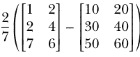

b. 存储这两个矩阵：

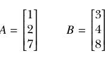

以下哪些乘法是可能的？对于可能的，请计算其结果：

- i. $A \cdot B$
- ii. $A^T \cdot B$
- iii. $B^T \cdot (A \cdot A^T)$
- iv. $(A \cdot A^T) \cdot B^T$
- v. $[(B \cdot B^T) + (A \cdot A^T) - 100I_3]^{-1}$

c. 对于

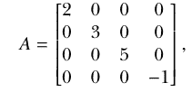

确认 $A^{-1} \cdot I_4$ 产生一个 $4 \times 4$ 的零矩阵。

## 3.4 多维数组

正如矩阵（元素的“矩形”）是向量（“线”）维度增加的结果一样，矩阵的维度也可以增加以获得更复杂的结构。在 R 语言中，向量和矩阵可以被看作更通用的 `array`（数组）的特例，数组指代这类结构。从矩阵进一步进阶的是什么？嗯，由于矩阵被认为是等长度向量的集合，因此三维数组可以被视为矩阵的集合，为你提供一个长方体。你仍然有固定的行数和列数，以及一个称为“层”（layer）的第三维度。图 3-3 展示了一个三行四列两层（$3 \times 4 \times 2$）数组。

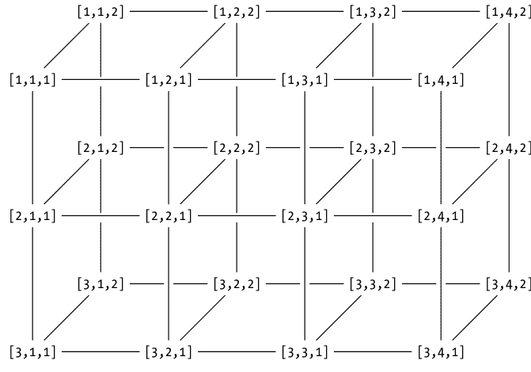

图 3-3：$3 \times 4 \times 2$ 数组的示意图。每个元素的索引位于相应的位置。这些索引按 [行, 列, 层] 的顺序提供。

### 3.4.1 定义

要在 R 中创建这些结构，使用 `array` 函数并指定维度。注意 `array` 是按列填充每一层数据的。考虑以下示例：

```R
AR <- array(1:24, dim=c(3,4,2))
AR
```

```
, , 1

     [,1] [,2] [,3] [,4]
[1,]    1    4    7   10
[2,]    2    5    8   11
[3,]    3    6    9   12

, , 2

     [,1] [,2] [,3] [,4]
[1,]   13   16   19   22
[2,]   14   17   20   23
[3,]   15   18   21   24
```

这给出了与图 3-3 相同的数组。注意 `dim` 参数所示的维度顺序是 [行, 列, 层]。

### 3.4.2 子集、提取和替换

即使是高维对象也难以想象，R 会以一致的方式对其进行索引。由于你已经知道如何对矩阵进行划分，从这些结构中提取元素变得简单——你只需要在方括号中使用逗号来分隔要访问的维度。这在接下来的示例中得到了体现。

假设你想要之前创建的数组 `AR` 的第二层的第二行。你只需要在方括号中输入 `AR` 的精确维度位置。

```R
AR[2,,2]
```

```
[1] 14 17 20 23
```

所需的元素已提取为长度为 4 的向量。如果你想要该向量中的特定元素，例如第三个和第一个，按该顺序，你可以调用：

```R
AR[2,c(3,1),2]
```

```
[1] 20 14
```

再次，这种字面上的划分方法使得处理 R 中的高维对象变得可行。

产生多个向量的提取将以列的形式出现在返回的矩阵中。例如，要提取 `AR` 的第一行，你输入：

```R
AR[1,,]
```

```
     [,1] [,2]
[1,]    1   13
[2,]    4   16
[3,]    7   19
[4,]   10   22
```

返回的对象包含两个矩阵层每一层的第一行。然而，它将这些向量中的每一个都作为单个返回矩阵的一列返回。如示例所示，当从数组中提取多个向量时，它们默认会以列的形式返回。这意味着提取的行并不一定以行的形式返回。

回到对象 `BR`，以下内容给出了位于第三个块的三维数组中，第一层矩阵的第二行第一列的单个元素。

```R
BR[2,1,1,3]
```

```
[1] 2
```

同样，你只需要查看方括号中索引的位置，就能知道你要求 R 从数组中返回哪些值。以下示例强调了这一点：

```R
BR[1,,1]
```

```
     [,1] [,2]
[1,]    1   13
[2,]    4   16
[3,]    7   19
[4,]   10   22
```

这返回了第一个块中第一行的所有值。由于我在该子集 `[1,,1]` 中留空列索引和层索引，该命令返回了 `BR` 该块中所有列和两个层的值。

接下来，下一行返回了由三个矩阵组成的数组 `BR` 的第二层的所有值：

```R
BR[,,2]
```

```
, , 1

     [,1] [,2] [,3] [,4]
[1,]   13   16   19   22
[2,]   14   17   20   23
[3,]   15   18   21   24

, , 2

     [,1] [,2] [,3] [,4]
[1,]   13   16   19   22
[2,]   14   17   20   23
[3,]   15   18   21   24

, , 3

     [,1] [,2] [,3] [,4]
[1,]   13   16   19   22
[2,]   14   17   20   23
[3,]   15   18   21   24
```

最后这一个示例强调了之前提到的一个特征，即从 `AR` 提取的多个向量以矩阵形式返回。广义来说，如果你有一个提取操作导致了 $d$ 维数组，则结果将是高一维 $d + 1$ 的数组。在最后一个示例中，你提取了多个（二维）矩阵，它们以三维数组的形式返回了。这在下一个示例中再次得到了证明：

```R
BR[3:2,4,]
```

```
, , 1

     [,1] [,2]
[1,]   12   24
[2,]   11   23

, , 2

     [,1] [,2]
[1,]   12   24
[2,]   11   23

, , 3

     [,1] [,2]
[1,]   12   24
[2,]   11   23
```

这提取了所有层和所有数组块中第 3 行和第 2 行（按此顺序）、第 4 列的元素。考虑以下最后的示例：

```R
BR[2,1,]
```

```
     [,1] [,2] [,3]
[1,]    2    2    2
[2,]    5    5    5
[3,]    8    8    8
[4,]   11   11   11
```

你要求 R 返回存储在 `BR` 中所有数组的第一层的整个第二行。

在高维数组中删除和覆盖元素遵循与独立向量和矩阵相同的规则。你以相同的方式指定维度位置，即使用负索引进行（删除）或使用赋值运算符进行覆盖。

如果你需要的话，可以使用 `array` 函数来创建一维数组（向量）和二维数组（矩阵）（通过将 `d` 参数分别设置为长度为 1 或 2）。但请注意，如果使用 `array` 而不是 `matrix` 创建，某些函数对向量的处理方式可能会不同（参见帮助文件）。出于这个原因，为了让大量代码更具可读性，R 语言习惯使用特定的向量创建函数。

## 练习 3.3

- a. 创建并存储一个具有六层 $4 \times 2$ 矩阵的三维数组，填充 4 到 8 之间的序列。
- b. 提取并存储所有层 `(a)` 第二列的第四行元素，作为一个新对象。
- c. 使用 `(b)` 中形成的行的四倍重复填充一个维度为 $2 \times 2 \times 3$ 的新数组。
- d. 创建一个由 `(a)` 第六层组成的新数组。
- e. 覆盖 `(d)` 第 1、3、5 层第二列的第四行元素。

## 本章重要代码

| 函数/运算符 | 简要描述 | 首次出现 |
| :--- | :--- | :--- |
| `matrix` | 创建矩阵 | 3.1, p40 |
| `rbind` | 创建矩阵（按合并） | 3.1, p41 |
| `cbind` | 创建矩阵（按合并） | 3.1, p42 |
| `dim` | 获取矩阵维度 | 3.1, p42 |
| `nrow` | 获取行数 | 3.1, p42 |
| `ncol` | 获取列数 | 3.1, p42 |
| `[ ]` | 矩阵/数组子集 | 3.2, p44 |
| `diag` | 对角线元素/单位矩阵 | 3.2, p44 |
| `t` | 矩阵转置 | 3.3, p47 |
| `*` | 标量乘法 | 3.3, p49 |
| `-` | 矩阵加/减 | 3.4, p49 |
| `%%` | 矩阵取模 | 3.5, p50 |
| `solve` | 矩阵求逆 | 3.6, p51 |
| `array` | 创建数组 | 3.4.1, p53 |

# 4 非数值值


到为止，你几乎只处理数值值。但统计编程也需要非数值值。在本章中，我们将考虑三种重要的非数值数据类型：逻辑型、字符型和因子型。这些数据类型在 R 的有效使用中起着重要作用，特别是当我们进入第二部分更复杂的编程时。

## 4.1 逻辑值

逻辑值（也简单称为逻辑s）基于一个简单的前提：逻辑值对象只能是 `TRUE` 或 `FALSE`。这些可以被解释为是/否、1/0、满足/未满足等。这是一个出现在所有编程语言中的概念，逻辑值有许多重要用途。它们通常指示条件是否满足，或者参数应该是开启还是关闭。你在 2.3.2节使用 `sort` 函数和 3.1节使用 `matrix` 函数时曾遇到过逻辑值。在使用 `sort` 时，`decreasing=TRUE` 返回从大到小的向量，而 `decreasing=FALSE` 反过来排序向量。同样，在构建矩阵时，`byrow=TRUE` 按行填充；否则按列填充。现在，你将更详细地查看使用逻辑的方法。

### 4.1.1 TRUE 还是 FALSE?

R 中的逻辑值完整写为 `TRUE` 和 `FALSE`，但它们经常缩写为 `T` 或 `F`。缩写版本对代码执行没有影响，因此，在 `sort` 函数中使用 `decreasing=T` 等于 `decreasing=TRUE`。（但如果你想利用这种便利，请不要创建名为 `T` 或 `F` 的对象——见 9.1.3节）。给对象赋值逻辑值与赋值数值值相同。

```R
foo <- TRUE
foo
```

```
[1] TRUE
```

```R
bar <- F
bar
```

```
[1] FALSE
```

这给了你一个值为 `TRUE` 的对象和一个值为 `FALSE` 的对象。同样，向量也可以填充逻辑值。

```R
baz <- c(T,F,F,F,T,T,T,T,T,F)
baz
```

```
[1]  TRUE FALSE FALSE FALSE  TRUE  TRUE  TRUE  TRUE  TRUE FALSE
```

```R
length(x=baz)
```

```
[1] 10
```

可以使用这些值创建矩阵（以及其他高维数组）。使用之前的 `foo` 和 `baz`，你可以构建类似这样的内容：

```R
qux <- matrix(data=baz, nrow=3, ncol=4, byrow=foo)
qux
```

```
     [,1]  [,2]  [,3]  [,4]
[1,] TRUE FALSE FALSE FALSE
[2,] TRUE FALSE  TRUE  TRUE
[3,] TRUE FALSE  TRUE FALSE
```


### 4.1.2 逻辑结果：关系运算符

逻辑通常用于检查值之间的关系。例如，你可能想知道某个数字 $a$ 是否大于预定义的阈值 $b$。为此，请使用表 4-1 所示的标准关系运算符，它们产生逻辑值作为结果。

#### 表 4-1：关系运算符

| 运算符 | 解释 |
| :--- | --- |
| `==` | 等于 |
| `!=` | 不等于 |
| `>` | 大于 |
| `<` | 小于 |
| `>=` | 大于等于 |
| `<=` | 小于等于 |

通常，这些运算符用于数值（尽管你将在 4.2.1 节查看其他可能性）。这是一个示例：

```
R> 1==2
[1] FALSE

R> 1>2
[1] FALSE

R> (2-1)<=2
[1] TRUE

R> 1!=(2+3)
[1] TRUE
```

结果可能会令人惊讶：1 等于 2-1 是 `FALSE`，大于 2 也是 `FALSE`，而小于或等于 2 的结果是 `TRUE`，且 1 不等于 5 (2+3) 也是 `TRUE`。这类操作在用具有某种方式变化的数字时要有用得多，你很快就会看到。

你已经熟悉 R 在处理向量时的元素级行为。在使用关系运算符时遵循相同的规则。为了说明这一点，我们首先创建两个向量并检查它们的长度是否相等。

```
R> foo <- c(3,2,1,4,1,2,1,-1,0,3)
R> bar <- c(4,1,2,1,1,0,0,3,0,4)
R> length(x=foo)==length(x=bar)
[1] TRUE
```

现在考虑以下四个评估值：

```
R> foo==bar
[1] FALSE FALSE FALSE FALSE TRUE FALSE FALSE TRUE FALSE

R> foo>bar
[1] TRUE TRUE FALSE FALSE FALSE TRUE FALSE TRUE

R> foo<=bar
[1] TRUE TRUE TRUE FALSE TRUE TRUE TRUE TRUE

R> foo<=(bar+10)
[1] TRUE TRUE TRUE TRUE TRUE TRUE TRUE TRUE TRUE TRUE
```

向量重用也适用于逻辑值。让我们使用之前的 `foo`，配合一个较短的向量 `baz`。

```
R> baz <- foo[c(10,3)]
R> baz
[1] 3 1
```

在这里，你创建的 `baz` 是长度为 2 的向量，由 `foo` 的第 10 和第 3 个元素组成。现在考虑以下情况：

```
R> foo>baz
[1] FALSE TRUE FALSE TRUE TRUE TRUE FALSE TRUE
```

在这里，`baz` 的元素被重用并与 `foo` 的 10 个元素进行比较。`foo` 的第 1 和 2 个元素与 `baz` 的第 1 和 2 个元素比较，`foo` 的第 3 和 4 个元素与 `baz` 的第 1 和 2 个元素比较，依此类推。你也可以将单个值与向量的所有值进行比较。这里有一个例子：

```
R> foo<3
[1] FALSE TRUE FALSE TRUE TRUE TRUE TRUE FALSE
```

这是 R 中处理数据集时的典型操作。
让我们将 `foo` 和 `bar` 的内容重写为 5 × 2 的列填充矩阵。

```
R> foo.mat <- matrix(foo,nrow=5,ncol=2)
R> foo.mat
     [,1] [,2]
[1,]    3    2
[2,]    2    1
[3,]    1   -1
[4,]    4    0
[5,]    1    3

R> bar.mat <- matrix(bar,nrow=5,ncol=2)
R> bar.mat
     [,1] [,2]
[1,]    4    0
[2,]    1    0
[3,]    2    3
[4,]    1    0
[5,]    1    4
```

同样的元素级行为也适用于这里；如果你比较矩阵，将得到一个相同大小且填充了逻辑值的矩阵。

```
R> foo.mat<bar.mat
     [,1]  [,2]
[1,] TRUE FALSE
[2,] FALSE FALSE
[3,] TRUE  TRUE
[4,] FALSE TRUE
[5,] TRUE  TRUE

R> foo.mat<3
     [,1]  [,2]
[1,] FALSE TRUE
[2,] TRUE  TRUE
[3,] TRUE  TRUE
[4,] FALSE TRUE
[5,] FALSE TRUE
```

这种类型的评估也适用于超过两个维的数组。有两个非常有用的函数可以快速检查逻辑值集合：`any()` 和 `all()`。在检查向量时，如果向量中的任何一个逻辑值为 `TRUE`，`any()` 返回 `TRUE`，否则返回 `FALSE`。`all()` 函数只有在所有逻辑值均为 `TRUE` 时才返回 `TRUE`，否则返回 `FALSE`。作为一个快速的例子，让我们处理本节开头通过 `foo` 和 `bar` 比较形成的两个逻辑向量。

```
R> quux <- foo==bar
R> quux
[1] FALSE FALSE FALSE TRUE TRUE FALSE FALSE TRUE
R> any(quux)
[1] TRUE
R> all(quux)
[1] FALSE
```

在这里，`quux` 包含两个 `TRUE`，其余都是 `FALSE`——所以 `any()` 的结果显然是 `TRUE`，但 `all()` 的结果是 `FALSE`。遵循相同的规则，你会得到：

```
R> quux <- foo<=(bar+10)
R> quux
[1] TRUE TRUE TRUE TRUE TRUE TRUE TRUE TRUE
R> any(quux)
[1] TRUE
R> all(quux)
[1] TRUE
```

`any()` 和 `all()` 函数对逻辑值矩阵和数组也具有相同的作用。

#### 练习 4.1

-   a. 将以下包含 15 个值的向量作为对象存储在你的工作空间中：`c(6,9,3,6,7,9,6,3,6,7,1,9,1)`。识别以下元素：
    i. 等于 6 的元素
    ii. 大于或等于 6 的元素
    iii. 小于 6+2 的元素
    iv. 不等于 6 的元素
-   b. 通过删除 (a) 中使用的向量的前三个元素，创建一个新向量。使用这个新向量填充一个 2x2x3 数组。检查数组中的以下条目：
    i. 小于或等于 6 除以 2 再加 4 的元素
    ii. 在数组中每个元素增加 2 后，小于或等于 6 除以 2 再加 4 的元素
-   c. 确认 10x10 单位矩阵 $I_{10}$ 中等于 0 的元素的特定位置（见第 3.3 节）。
-   d. 检查 (b) 中创建的逻辑数组中是否有任何值为 `TRUE`。如果是，检查是否所有均为 `TRUE`。
-   e. 通过提取 (c) 中创建的逻辑矩阵的对角线元素，使用 `any()` 确认没有 `TRUE`。

### 4.1.3 多重比较：逻辑运算符

当你想要检查条件是否满足时，逻辑值特别有用。通常，你只想在满足多个不同条件时才执行某些操作。上一节查看了关系运算符，它们用于比较值（即数值或其他类型的值）。现在你将查看逻辑运算符，它们用于比较两个 `TRUE` 或 `FALSE` 对象。表 4-2 总结了 R 中逻辑运算符的语法和行为，每个运算符都有“单个”和“元素级”版本——稍后你就会看到它们之间的区别。

#### 表 4-2：比较两个值的逻辑运算符

| 运算符 | 解释 | 结果 |
| :--- | :--- | :--- |
| `&` | 逻辑与（元素级） | 只有两者为 `TRUE` 时结果为 `TRUE` |
| `&&` | 逻辑与（单个） | 仅当第一个为 `TRUE` 时才检查第二个 |
| `\|` | 逻辑或（元素级） | 只要有一个为 `TRUE` 结果为 `TRUE` |
| `\|\|` | 逻辑或（单个） | 只要第一个为 `TRUE` 就不检查第二个 |
| `!` | 逻辑非（元素级） | 反转逻辑值 |

能够将逻辑值解释为 0 和 1 意味着你可以使用多种函数来对逻辑向量进行概括，你将在第三部分中进一步探讨这一点。

### 4.1.5 逻辑子集与提取

逻辑值也可以像你之前使用索引向量那样，用于从向量和其他对象中提取元素和子集。你不需要在方括号中输入显式索引，而是可以提供逻辑标志向量，如果标志向量中的对应元素为 `TRUE`，则该元素会被提取。因此，逻辑标志向量的长度应与被访问的向量相同（尽管对于较短的标志向量会发生循环机制，如随后的示例所示）。

在第 2.3.3 节开头，你按如下定义了一个长度为 10 的向量：

```
R> myvec <- c(5,-2,3,4,4,4,6,8,10,40221,-8)
```

如果你想提取两个负数元素，可以输入 `myvec[c(2,10)]`，也可以使用以下逻辑标志：

```
R> myvec[c(F,T,F,F,F,F,F,F,T)]
[1] -2.3 -8.0
```

这个示例在实际使用中似乎过于麻烦；但当你想要根据元素是否满足某个条件（或多个条件）来提取元素时，这就有了。例如，你可以轻松地使用条件 `myvec<0` 来找到 `myvec` 中的负元素。

```
R> myvec<0
[1] FALSE TRUE FALSE FALSE FALSE FALSE FALSE FALSE FALSE TRUE
```

这是一个完全有效的标志，你可以用它对 `myvec` 进行子集划分以获得之前的的结果。

```
R> myvec[myvec<0]
[1] -2.3 -8.0
```

如前提到的，如果标志向量太短，R 会对其进行循环。要从 `myvec` 中从第一个元素开始提取每个第二个元素，你可以输入以下内容：

```
R> myvec[c(T,F)]
[1] 5 4 8 40221
```

你可以使用关系运算符和逻辑运算符进行更复杂的提取，例如：

```
R> myvec[(myvec>0)&(myvec<1000)]
[1] 5 4 4 4 6 8 10
```

这返回小于 1,000 的正元素。你也可以使用逻辑向量覆盖特定元素，就像处理向量一样。

```
R> myvec[myvec<0] <- 200
R> myvec
[1] 5 -200 4 4 4 6 8 10 40221 -200
```

这将所有现有条目替换为 -200。注意，你不能直接使用负逻辑向量来删除特定元素；这只能通过数值索引完成。

如你所见，逻辑值对于元素提取非常有用。你不需要预先知道返回哪些特定的索引位置，除非条件检查可以为你找到它们。当你处理大型数据集并想要检查符合某些标准的记录或记录条目时，这非常有价值。

在某些情况下，你可能想将逻辑向量转换为数值索引。当你需要被标记为 `TRUE` 的元素的显式索引时，这很有帮助。`which()` 函数接收逻辑向量作为参数 `x`，并返回对应任何和所有 `TRUE` 条目位置的索引。

```
R> which(x=c(T,F,F,T,T))
[1] 1 4
```

你可以用此来识别满足某些条件的 `myvec` 索引位置；例如包含负数的那些：

```
R> which(x=myvec<0)
[1] 2 10
```

对你实验过的其他 `myvec` 选择也可以进行相同的操作。注意，像 `myvec[which(x=myvec<0)]` 这样的代码行是冗余的，因为可以使用条件本身进行提取，即 `myvec[myvec<0]`。另一方面，使用 `which()` 允许你根据逻辑因素删除元素。你可以简单地使用 `which()` 来识别想要删除的数值索引并将其移除。要省略 `myvec` 中的负条目，你可以执行以下操作：

```
R> myvec[-which(x=myvec<0)]
[1] 5 4 4 6 8 10 40221
```

矩阵和其他数组也可以进行相同的操作。在第 3.2 节中，你按如下方式存储了一个 3 × 3 矩阵：

```
R> A <- matrix(c(0,3.4,5,55.3,59.1,0.1,105.5,-4.2,8.2,27.9),nrow=3,ncol=3)
R> A
     [,1] [,2] [,3]
[1,]  0.3 91.0 -4.2
[2,]  4.5  0.1  8.2
[3,] 55.3 105.5 27.9
```

使用数值索引提取 `A` 的第一行的第二和第三元素，你可以执行 `A[1,2:3]`。使用逻辑标志为此，你可以输入：

```
R> A[1,c(T,F,F),c(F,T,T)]
[1] 91.0 -4.2
```

再次，你通常不会显式指定逻辑向量。假设你想将 `A` 中所有小于 0 的元素替换为 -7。使用数值索引进行此操作很麻烦。使用逻辑矩阵要简单得多：

```
R> A[A<0] <- -7
R> A
     [,1] [,2] [,3]
[1,] -7.0 91.0 -4.2
[2,]  4.5  0.1  8.2
[3,] 55.3 105.5 27.9
```

这是你第一次在不列出行或列位置的情况下对矩阵进行子集划分（见第 3.2 节）。因为逻辑矩阵具有相同的行列数，提供了所有相关信息。如果你使用 `which()` 根据逻辑结构识别数值索引，在处理二维对象时必须小心。假设你想获取大于 25 的元素的索引位置。适当的逻辑矩阵如下：

```
R> A>25
     [,1]  [,2]  [,3]
[1,] FALSE  TRUE  TRUE
```

现在，假设你问：

```
R> which(A>25)
[1] 3 4 6
```

这返回满足关系检查的元素的索引，它们是以标量值提供的。这些值如何对应矩阵的行/列位置？答案在于 `which()` 函数的默认行为，它本质上将多维对象视为单个向量（按列堆叠），并返回相应的索引。矩阵 `A` 是按列排列的，使用 `c(A[1],A[2],A[3])` 然后返回的索引才有意义。

```
R> which(c(A[1],A[2],A[3])>25)
[1] 3 4 6
```

当列排列时，返回 `TRUE` 的元素是第三、第六和第九个。这在处理高维数组时可能很难解释。在这种情况下，可以使用可选参数 `arr.ind`（数组索引）产生特定索引。默认情况下，该参数设置为 `FALSE`，导致向量索引。另一方面，设置 `arr.ind=TRUE` 将对象视为矩阵或数组而不是向量，提供请求元素的行和列位置。

```
R> which(A>25,arr.ind=T)
     row col
[1,]   3   1
[2,]   1   2
[3,]   3   2
[4,]   3   3
```

返回的对象现在是一个矩阵，每一行代表一个满足逻辑比较的元素，每一列提供元素的位置。通过与 `A` 比较，你可以看到这些位置确实对应 `A>25`。两种输出版本（使用 `arr.ind=T` 或 `arr.ind=F`）都可以用——正确的选择取决于应用。

#### 练习 4.3

- a. 存储这个包含 10 个值的向量：`foo <- c(7,5,6,1,2,10,8,3,2)`。然后执行以下操作：
   i. 提取大于等于 5 的元素，存储为 `bar`。
   ii. 显示 `foo` 中在省略大于 5 的元素后剩余的向量。
- b. 使用 (a) (i) 中的 `bar` 按行方式构造一个名为 `baz` 的 2×3 矩阵。然后执行以下操作：
   i. 将任何等于 8 的元素替换为 `baz` 本第 1 行第 2 列元素的**平方**值。
   ii. 确认 `baz` 中的**所有**值都小于 25 且大于 4。
- c. 使用 18 个值的向量 $c(10,5,1,4,7,4,3,3,1,4,3,1,7,8,3,7,3)$ 创建名为 `qu` 的 3×2×3 数组。然后执行以下操作：
   i. 识别元素 3 或 4 的维度特定索引。
   ii. 替换 `qu` 中所有小于 3 或大于等于 10 的元素。
- d. 回到 (a) 中的 `foo`。使用向量 `c(F,T)` 从 `foo` 中提取每个第二个值。在第 4.1.4 节中，你看到在某些情况下可以用 0 和 1 替换 `TRUE` 和 `FALSE`。可以使用 `c(0,1)` 从 `foo` 执行相同的提取吗？为什么或为什么不？在这种情况下 R 返回什么？

### 4.2 字符

字符串是另一种常见的数据类型，用于表示文本。在 R 中，字符串经常用于指定文件夹位置或软件选项（如 1.2 节简要所示）；为函数提供参数；以及对对象进行注释、提供文本输出或澄清图表和图形。简单来说，它们也可以用于定义不同的组以创建一个分类变量，你将在第 4.3 节中看到，**因子**更适合那个。

R 环境中有三种不同的字符串格式。默认字符串格式称为扩展正则表达式；其他变体命名为 Perl 和字面量正则表达式。这些变体的复杂性超出了本书的范围，因此从这里开始提到的任何字符字符串均指扩展正则表达式。有关其他字符串格式的更多技术细节，请在提示符处输入 `regex`。

#### 4.2.1 创建字符串

字符字符串用双引号 `"` 表示。要创建一个字符串，只需在一对引号之间输入文本即可。

```
R> foo <- "This is a character string!"
R> foo
[1] "This is a character string!"
R> length(x=foo)
[1] 1
```

R 将字符串视为一个单一实体。换句话说，`foo` 是一个长度为 1 的向量，因为 R 只统计不同字符串的总数，而不是单个单词或字符的数量。要统计单个字符的个数，你可以使用 `nchar()` 函数。这里是一个使用 `foo` 的示例：

```
R> nchar(x=foo)
[1] 27
```

几乎任何字符组合（包括数字）都是有效的字符字符串。

```
R> bar <- "23.3"
R> bar
[1] "23.3"
```

注意，在这种形式下，该字符串没有数值意义，它不会被视为数字 23.3。例如，尝试将它乘以 2 将导致错误。

```
R> bar*2
Error in bar * 2 : non-numeric argument to binary operator
```


### 4.2.1 创建字符串

字符字符串用双引号 `""` 表示。要创建一个字符串，只需在一对引号之间输入文本即可。

```
R foo <- "This is a character string!"
R foo
[1] "This is a character string!"
R length(x=foo)
[1] 1
```

R 将字符串视为一个单一实体。换句话说，`foo` 是一个长度为 1 的向量，因为 R 只统计不同字符串的总数，而不是单个单词或字符的数量。要统计单个字符的个数，你可以使用 `nchar` 函数。这里是一个使用 `foo` 的示例：

```
R nchar(x=foo)
[1] 27
```

几乎任何字符组合（包括数字）都是有效的字符字符串。

```
R bar <- "23.3"
R bar
[1] "23.3"
```

注意，在这种形式下，该字符串没有数值意义，它不会被视为数字 23.3。例如，尝试将它乘以 2 将导致错误。

```
R bar*2
Error in bar * 2 : non-numeric argument to binary operator
```

发生此错误是因为 `*` 期望在两个数值上进行操作（而不是一个数字和一个字符串，这没有意义）。字符串可以通过多种方式进行比较，最常见的比较是**等价比较**。

```
R "alpha"="alpha"
[1] TRUE
R "alpha"!="beta"
[1] TRUE
R c("alpha", "beta","gamma")=="beta"
[1] FALSE TRUE FALSE
```

其他关系运算符的作用正如你预期的那样工作。例如，R 认为字母表中靠后的字母大于靠前的字母，这意味着它可以根据字母顺序判断一个字母字符串是否大于另一个。

```
R> "alpha"="beta"
[1] FALSE
R> "gamma>="Alpha"
[1] TRUE
```

此外，大写字母被认为大于小写字母。

```
R> "Alpha>="alpha"
[1] TRUE
R> "beta>="bEtA"
[1] FALSE
```

大多数符号也可以用在字符串中。例如，以下字符串是有效的：

```
R> baz <- "&4_3 **$?. $symbolic nonen$se ,;"
R> baz
[1] "&4_3 **$?. $symbolic nonen$se ,;"
```

一个重要的例外是反斜杠 `\`，它也被称为**转义字符**。当反斜杠位于字符串的引号内部时，它将启动对字符串本身打印或显示的简单控制。你稍后将在第 4.2.3 节中看到它是如何工作的。首先，让我们来看两个组合字符串的有用函数。

## 4.2.2 合并

有两个主要的函数用于合并（或连接）一个或多个字符串：`cat` 和 `paste`。两者的区别在于返回内容的方式。第一个函数 `cat` 将输出发送到控制台屏幕并且不返回任何内容。`paste` 函数合并其内容，然后将最终的字符字符串作为可用的 R 对象返回。当合并的字符串需要传递给另一个函数或以辅助方式使用时（而不是仅仅显示），这非常有用。考虑以下字符字符串向量：

对于数字和逻辑值，如果你愿意，还可以将任意数量的字符串存储在矩阵或数组结构中。

调用 `cat` 或 `paste` 时，你按照想要的组合顺序向函数传递参数。以下几行显示了两个函数的相同用法，但输出类型不同：

```
R cat(qux[2],qux[3],"totally",qux[1],"!")
R is totally awesome!
R paste(qux[2],qux[3],"totally",qux[1],"!")
[1] "R is totally awesome!"
```

在这里，你使用了 `qux` 的三个元素以及两个额外的字符串 `"totally"` 和 `"!"` 来生成最终的合并字符串。在输出中，请注意 `cat` 已经将文本合并并打印到屏幕上。这意味着你不能直接将结果赋值给新变量并将其视为字符字符串。然而，对于 `paste`，输出左侧的 `[1]` 以及引号的存在表示返回的项目是一个包含字符字符串的向量，它可以被赋值给对象并在其他函数中使用。

这两个函数都有一个可选参数 `sep`，用作字符串合并时之间的分隔符。如果未包含 `sep` 参数，R 将默认在字符串之间插入空格。注意，如果你不想要任何间隔，可以使用空字符串，如第二个示例所示。例如，通过在需要的地方手动插入空格，你可以写下如下：

```
R cat("Do you think ",qux[2]," ",qux[3],"?",sep="")
Do you think R is awesome
```

在 Windows 中调用 `cat` 后，新提示符会出现在打印字符串的同一行，在这种情况下你只需按回车键即可移动到下一行。在其他操作系统中，新提示符会如常一样出现在下一行。当你想要汇总计算结果时，合并非常有用。许多类型的 R 对象可以直接传递给 `paste` 或 `cat`；软件将尝试将输入转换为字符串。这对于数值对象效果特别好，如下例所示：

```
R a <- 3
R b <- 4
R cat("The value stored as 'a' is ",a,sep="")
The value stored as 'a' is 3
```

## 4.2.3 转义序列

在字符串中，独立的反斜杠 `\` 并不像普通字符。转义序列允许你控制字符串的格式化。表 4-3 描述了一些常用的转义序列，你可以通过提示符找到完整列表。

**表 4-3: 字符串中常用的转义序列**

| 转义序列 | 结果 |
|---|---|
| `\n` | 换行 |
| `\t` | 水平制表符 |
| `\b` | 退格格 |
| `\\` | 使用单个反斜杠 |
| `\"` | 包含双引号 |

转义序列为字符串的显示增加了灵活性，这对于结果汇总和图表注释非常有用。你可以在希望生效的地方输入该序列。

## 4.2.4 子字符串与匹配

模式匹配允许你检查给定字符串以识别其内部较小的字符串。`substr` 函数接收字符串 `x` 并提取字符串中两个字符位置之间（包含边界）的部分，通过数字传递参数 `start` 和 `stop`。让我们对 4.2.1 节中的对象 `foo` 进行尝试：

```
R> foo <- "This is a character string"
R> substr(foo,start=21,stop=27)
[1] "string!"
```

在这里，你提取了位置 21 到 27 之间的字符，得到 "string!"。`substr` 函数也可以配合赋值运算符替换一组新字符。在这种情况下，替换字符串的字符数应与所选区域相同。

```
R> substr(x=foo,start=1,stop=4) <- "Here"
R foo
[1] "Here is a character string!"
```

如果替换字符串的长度大于 `start` 和 `stop` 指定的字符数，替换仍然会发生，从 `start` 开始到 `stop` 结束。它会截断任何超出你替换字符数量的字符。如果字符串短于你正在替换的字符数，替换将在字符串完全插入时结束，直到 `stop` 之前的原始字符保持不变。

使用 `sub` 和 `gsub` 函数可以让替换变得更加灵活。`sub` 函数在给定的字符串中搜索包含的较小字符串模式。它会将第一个匹配项替换为作为参数的新字符串。`gsub` 函数执行相同的操作，但它会替换所有的匹配项。这里有一个示例：

```R
R bar <- "How much wood could a woodchuck chuck"
sub(pattern="chuck",replacement="hurl",x=bar)
[1] "How much wood could a woodl chuck"
gsub(pattern="chuck",replacement="hurl",x=bar)
[1] "How much wood could a woodl hurl"
```


使用 `sub` 时，替换值不需要与被替换模式的字符数相同。这些函数还有如大小写敏感等搜索选项。帮助文件 `?substr` 和 `?sub` 提供了更多细节，并列了一些其他模式匹配函数和技术。你可能还想查看 `grep` 命令及其变体；参见相关文件 `?grep`。

## 练习 4.4

| |
| :--- |
| a. 准确重建以下输出：<br> "The quick brown fox jumped over the lazy dogs" |
| b. 假设你存储了值 `num1 <- 4` 和 `num2 <- 0.75`。写一行 R 代码，返回以下字符串：[1] "The result of multiplying 4 by 0.75 is 3" 确保你的代码对于任何存储在 `num1` 和 `num2` 中的数字都能生成具有正确乘法结果的字符串。 |
| c. 在我的本地机器上，我这本书的工作目录在 R 中指定为 `"/Users/tdavis/Documents/RBook/"`。假设这是你的机器——写一行代码将此字符串中的 `tdavis` 替换为你的名字首字母和姓氏。 |
| d. 在第 4.2.4 节中，你存储了以下字符串：`R> bar <- "How much wood could a woodchuck chuck"` <br> i. 通过在 `bar` 上拼接单词 "if a woodchuck could chuck wood" 来存储一个新的字符串。 <br> ii. 在 (i) 的结果中，将所有的 `wood` 替换为 `metal`。 |
| e. 存储字符串 "Two 6-packs for $12.99"。执行以下操作：<br> i. 使用等性检查确认从第 5 个字符开始到第 10 个字符结束的子字符串 "6-pack" <br> ii. 将价格更改为 $10.99，使其变得更划算。 |

## 4.3 因子 (Factors)

在本节中，你将查看与创建、处理和检查因子相关的函数。因子（Factors）是 R 表示数据点最自然的方式，这些数据点属于有限不同类别之一，而不是属于连续体。这类分类数据在数据科学中可以起着重要作用，你将在第 13 章从统计学角度更详细地查看因子。

### 4.3.1 识别类别

为了了解因子是如何工作的，让我们从一个简单的数据集开始。假设你找到了八个人，并在表 4-4 中记录了他们的姓名、性别出生月份。

表 4-4：八个个人的示例数据集

| 人物 | 性别 | 出生月份 |
| :--- | :--- | :--- |
| Liz | 女 | 四月 |
| Jolene | 女 | 一月 |
| Susan | 女 | 十二月 |
| Boris | 男 | 九月 |
| Rochelle | 女 | 十一月 |
| Tim | 男 | 七月 |
| Simon | 男 | 七月 |
| Amy | 女 | 六月 |

在 R 中，表示每个人的名字实际上只有一种合理的方法——作为字符字符串向量。

```R
R firstname <- c("Liz","Jolene","Susan","Boris","Rochelle","Tim","Simon", "Amy")
```

然而，在记录性别方面你有更大的灵活性。将女性编码为 0，男性编码为 1，数值选项如下：

```R
R sex.num <- c(0,0,0,1,0,1,1,0)
```

当然，字符字符串也是可能的，许多人倾向于这种方法，因为你不需要记住每个组的数值代码。

```R
R sex.char <- c("female","female","female","male","female","male","male", "female")
```

然而，当存储数据时，个人的姓名和性别之间存在本质区别。一个人的名字是唯一标识符，可以取无限可能性中的任何一种，而记录人的性别通常只有两个选项。这类所有可能值都属于有限数量类别的数据，在 R 中用因子来表示是最好的。

因子通常由数值向量或字符向量创建（注意，你不能用因子值填充矩阵或多维数组；因子只能以向量的形式存在）。要创建一个因子向量，请使用 `factor` 函数，如处理 `sex.num` 和 `sex.char` 的示例所示：

```R
R sex.num.fac <- factor(x=sex.num)

R sex.num.fac

[1] 0 0 0 1 0 1 1 0

Levels: 0 1

R sex.char.fac <- factor(x=sex.char)

R sex.char.fac

[1] female female female male female male male female

Levels: female male
```

这里，`sex.num.fac` 向量包含了与之前的 `sex.num` 因子在相同索引位置上的相同单个条目。但注意，这里有 2 个水平，尽管你没有对 0 和 1 这些水平进行任何观察。（注意：如果你的控制台窗口太窄，无法将所有水平打印到屏幕上，你可能会看到 `...`，表示有更多输出被隐藏了。只需加宽窗口并重新打印对象即可看到隐藏的水平。）此外，这些因子的严格顺序是由对象输出中的 `<` 符号显示。使用这个新的因子对象，你可以执行之前的关系比较，并得到可能预期的结果。

```R
R mob.fac[2]

[1] Jan

Levels: Jan < Feb < Mar < Apr < May < Jun < Jul < Aug < Sep < Oct < Nov < Dec

R mob.fac[3]

[1] Dec

Levels: Jan < Feb < Mar < Apr < May < Jun < Jul < Aug < Sep < Oct < Nov < Dec

R mob.fac[2]<mob.fac[3]

[1] TRUE
```

这些改进不仅仅是表面上的。例如，一个在某些类别中观测值为零的数据集与从一开始就定义较少类别的相同的数据集之间存在巨大差异。是否指示 R 正式对因子向量进行排序，可能会各种统计方法（如回归和其他类型的建模）的实现中产生重要影响。

## 4.3.3 合并与切割

正如你所看到的，通常使用 `c` 函数合并多个相同类型的向量（无论是数值、逻辑还是字符型）是非常简单的。这里有一个示例：

```R
R foo <- c(5.1,3.3,3.1,4)

R bar <- c(4.5,1.2)

R c <- c(foo,bar)

[1] 5.1 3.3 3.1 4.0 4.5 1.2
```

这将两个数值向量合并为了一个。然而，`c` 函数不适用于因子值向量。让我们看看当你对表 4-4 中的数据以及第 4.3.2 节中的 MOB 因子向量 `mob.fac` 使用会发生什么。假设你现在观察到三个 MOB 值为 "Oct"、"Feb" 和 "Feb" 的个人，它们以因子对象的形式存储，如下：

```R
R new.values <- c(x=c("Oct","Feb","Feb"),levels=levels(mob.fac), ordered=TRUE)
```

```R
R new.values

[1] Oct Feb Feb

Levels: Jan < Feb < Mar < Apr < May < Jun < Jul < Aug < Sep < Oct < Nov < Dec
```

现在你有一个带有原始八个观测值的 `mob.fac` 和带有额外三个观测值的 `new.values`。两者都是因子对象，具有相同且排序过的水平（levels）。你可能认为你可以直接使用 `c` 如下所示合并两者。

```R
R c(mob.fac,new.values)

[1] 4 1 12 9 11 7 7 6 10 2 2
```

显然，这并没有实现你想要的结果。合并两个因子对象导致了一个数值向量。这是因为 `c` 函数将因子解释为整数。将其与定义的水平进行比较，你可以看到这些数字指的是每个月份在排序后的水平中的索引。

```R
R levels(mob.fac)

[1] "Jan" "Feb" "Mar" "Apr" "May" "Jun" "Jul" "Aug" "Sep" "Oct" "Nov" "Dec"
```

这意味着你可以使用这些整数结合水平，来检索完整观测数据的字符向量——即原始的八个加上额外的三个。

```R
R levels(mob.fac)[c(mob.fac,new.values)]

[1] "Apr" "Dec" "Sep" "Nov" "Jul" "Jun" "Jul" "Oct" "Feb" "Feb"
```

现在你将所有观测值存储在一个向量中，但它们目前存储为字符串，而不是因子值。最后一步是将此向量转换为一个对象。

```R
R mob.new <- levels(mob.fac)[c(mob.fac,new.values)]

R mob.new.fac <- factor(x=mob.new,levels=levels(mob.fac),ordered=TRUE)
```

# 本章重要代码

| 函数/运算符 | 简要描述 | 首次出现 |
|--- |--- |--- |
| `TRUE`, `FALSE` | 预留逻辑值 | 第 4.1.1 节，第 60 页 |
| `T`, `F` | 上述值的非保留版本 | 第 4.1.1 节，第 60 页 |
| `!=`, `!`, `>`, `<`, `>=`, `<=` | 关系运算符 | 第 4.1.2 节，第 61 页 |
| `any` | 检查是否存在元素为 TRUE | 第 4.1.2 节，第 63 页 |
| `all` | 检查是否所有元素为 TRUE | 第 4.1.2 节，第 63 页 |
| `&`, `|`, `!` | 逻辑运算符 | 第 4.1.3 节，第 65 页 |
| `which` | 获取 TRUE 的索引 | 第 4.1.5 节，第 69 页 |
| `paste` | 创建字符串 | 第 4.2.1 节，第 73 页 |
| `nchar` | 获取字符串中的字符数 | 第 4.2.1 节，第 73 页 |
| `cat` | 拼接字符串（无返回值） | 第 4.2.2 节，第 74 页 |
| `paste` | 粘贴字符串（返回字符串） | 第 4.2.2 节，第 74 页 |
| `\` | 字符串转义 | 第 4.2.3 节，第 76 页 |
| `substr` | 提取子字符串 | 第 4.2.4 节，第 77 页 |
| `sub`, `gsub` | 字符串匹配与替换 | 第 4.2.4 节，第 78 页 |
| `factor` | 创建因子向量 | 第 4.3.1 节，第 80 页 |
| `levels` | 获取因子的水平 | 第 4.3.1 节，第 81 页 |
| `cut` | 从连续值创建因子 | 第 4.3.3 节，第 85 页 |

# 5 列表与数据框


向量、矩阵和数组是 R 中高效且方便的数据存储结构，但它们有一个明显的局限性：在本章中，你将探索另外两种数据结构——列表（lists）和数据框（data frames），它们可以同时存储多种类型的值。

## 5.1 对象列表

列表（list）是一种极其有用的数据结构。它可以将任何混合的 R 结构和对象组合在一起。单个列表可以包含一个数值矩阵、逻辑数组、一个字符字符串和一个因子对象。你甚至可以将列表作为另一个列表的 Components。在本节中，你将看到如何创建、修改和访问这些灵活结构的组件。

### 5.1.1 定义与组件访问

创建一个列表就像创建一个向量一样。你通过逗号分隔提供想要包含在 `list` 函数中的元素。

```R
R> foo <- list(matrix(data=1:4,ncol=2),c(T,F,T,T),"hello")

R> foo

[[1]]

[,1] [,2]

[1,] 1 3

[2,] 2 4

[[2]]

[1] TRUE TRUE TRUE TRUE

[[3]]

[1] "hello"
```

在列表 `foo` 中，你存储了一个 2x2 的数值矩阵、一个逻辑向量和一个字符字符串。它们按照你提供给 `list` 的顺序打印。就像处理向量一样，你可以使用 `length` 函数来检查列表中组件的数量。

```R
R> length(x=foo)

[1] 3
```

你可以使用双方括号 `[[]]` 输入的索引从列表中检索组件。

```R
R> foo[[1]]

[,1] [,2]

[1,] 1 3

[2,] 2 4

R> foo[[3]]

[1] "hello"
```

这种操作被称为成员引用（member reference）。当你通过这种方式检索组件时，可以像对待工作区中的独立对象一样对待它；不需要任何特殊操作。

```R
R> foo[[1]] + 5.5

[,1] [,2]

[1,] 6.5 8.5

[2,] 7.5 9.5

R> foo[[1]][1,2]

[1] 3

R> foo[[1]][2,]

[1] 2 4

R> cat(foo[[3]],"you!")

hello you!
```

要覆盖 `foo` 的某个成员，你使用赋值运算符。

```R
R> foo[[3]]

[1] "hello"

R> foo[[3]] <- paste(foo[[3]],"you")

R> foo

[[1]]

     [,1] [,2]

[1,]    1    3

[2,]    2    4

[[2]]

[1] TRUE FALSE TRUE TRUE

[[3]]

[1] "hello you!"
```

现在假设你想访问 `foo` 的第二个和第三个组件并将它们存储为一个对象。你的第一直觉可能是尝试这样的操作：

```R
R> foo[[c(2,3)]]

[1] TRUE
```

但 R 并没有按照你想要的方式执行。相反，它返回了第二个组件的第三个元素。这是因为在列表上使用双方括号总是针对单个成员进行解释。幸运的是，使用双方括号引用成员并不是访问列表组件的唯一方法。你也可以使用单方括号 `[]` 符号。这被称为*列表切片*（list slicing），它可以让你一次性选择多个列表项。

```R
R> bar <- foo[c(2,3)]

R> bar

[[1]]

[1] TRUE FALSE TRUE TRUE

[[2]]

[1] "hello you!"
```

注意，结果 `bar` 本身是一个列表，按照请求的顺序存储了两个组件。

### 5.1.2 命名

你可以为列表组件*命名*（name），以使元素更易于识别和处理。就像存储关于因子水平的信息（如你在第 4.3.1 节中看到的那样），名称是一个 R *属性*（attribute）。

让我们从为之前的列表 `foo` 添加名称开始。

```R
R> names(foo) <- c("matrix","mylogicals","mystring")

R> foo

$matrix

     [,1] [,2]

[1,]    1    3

[2,]    2    4

$mylogicals

[1] TRUE FALSE TRUE TRUE

$mystring

[1] "hello you!"
```

### 5.1.3 嵌套

如前所述，列表的成员本身可以是一个列表。像这样嵌套列表时，跟踪任何成员的深度是非常重要的。这里有一个使用 `foo` 的示例。

```R
R> baz <- list()
R> baz$bobby <- foo

R> baz

$bobby

$bobby$matrix

     [,1] [,2]

[1,]    1    3

[2,]    2    4

$bobby$mylogicals

[1] TRUE FALSE TRUE TRUE

$bobby$mystring

[1] "hello you!"
```


列表通常用于返回各种 R 函数的输出。但在系统资源中可能会迅速变成很大的对象。通常建议当你只有一种类型的数据时，应该使用基础向量、矩阵或数组结构来记录和存储观测值。

# 练习 5.1

- a. 创建一个列表，按顺序包含：一个从 -4 到 4 的 20 个等间距数字序列；一个按列填充的 3x3 逻辑向量 `c(F,T,T,F,T,T,T,F,F)` 矩阵；一个字符向量，使用两个字符串 "don" 和 "quixote"，以及包含观测值 `c("LOW", "MED", "LOW", "MED", "MED", "HIGH")` 的因子向量。然后执行以下操作：
- i. 按照顺序提取逻辑矩阵第 2 和 3 列的第 2 和 1 行。
- ii. 使用 `sub` 将列表中的 'quixote' 覆盖为 'Quixote$，将 'don' 覆盖为 'Don'。然后使用新覆盖的列表成员，在控制台精确地打印以下语句：
"Windmills! ATTACK!"
-Don Quixote--
- iii. 从 -4 到 4 的序列中获取大于 1 的所有值。
- iv. 使用 `which` 因子向量中哪些索引被分配了 "MED" 级别。

- B. 创建一个新列表，包含因子名 "facs"；数值型向量 `c(3,2,1,1,3,4,1,5,4,9)` 作为命名组件 "nums"；以及一个由 (a) 部分列表的前三个成员组成的嵌套列表（使用切片获取），命名为 "oldlist"。然后执行以下操作：
- i. 提取 "facs" 中对应于 "nums" 中大于或等于 3 的元素。
- ii. 为列表添加名为 "flags" 的新成员。该成员应该是一个长度为 6 的逻辑向量，通过 "oldlist" 组件中逻辑矩阵第三列的双倍重复得到。
- iii. 使用 "flags" 和逻辑非运算符 `!` 提取 "num" 中对应于 FALSE 的项。
- iv. 将 "oldlist" 的字符向量组件覆盖为单个字符字符串 "Don Quixote"。

## 5.2 数据框 (Data Frames)

数据框是 R 展示包含一个或多个变量记录观测值集合的数据的最自然方式。与列表类似，数据框对变量的数据类型没有限制；你可以存储数值数据、因子数据等。R 数据框可以被看作带有某些额外规则的列表。最重要的区别在于，在数据框中（与列表不同），所有成员的长度必须相等。数据框是 R 中统计数据分析中最重要且最常用的工具之一。在本节中，你将查看如何创建数据框并学习其通用特征。

### 5.2.1 构造

要从头创建一个数据框，请使用 `data.frame` 函数。你提供按变量分组的数据，以相同长度向量的形式——就像你构建命名列表一样。考虑以下示例数据集：

```R
mydata <- data.frame(person=c("Peter","Lois","Meg","Chris","Stewie"),
                     age=c(42,40,17,14,1),
                     sex=factor(c("M","F","F","M","M")))
```

```R
mydata
```

```
person age sex
1 Peter 42 M
2 Lois 40 F
3 Meg 17 F
4 Chris 14 M
5 Stewie 1 M
```

在这里，你构建了一个包含五个人姓名、年龄和性别的数据框。返回的对象应该清楚地说明传递给 `data.frame` 的向量必须具有相同的长度：在这种背景下，不同长度的向量是有意义的。如果你将长度不等的向量传递给 `data.frame`，R 将循环较短向量以匹配最长向量，从而扰乱你的数据并可能将观测值分配给错误的变量。注意，数据框以行和列的形式打印到控制台——它们看起来更像矩阵而不是命名列表。这种自然的表格样式使得数据集易于读取和操作。数据框中的每一行被称为一个*记录* (record)，每一列被称为一个*变量* (variable)。

你可以通过指定行和列索引位置来提取数据部分（类似于矩阵）。这里有一个示例：

```R
mydata[2,2]
```

```
[1] 40
```

这给了你第 2 行第 2 列的元素——即 Lois 的年龄。我们提取第三列的第三、第四和第五个元素：

```R
mydata[3:5,3]
```

```
[1] F M
Levels: F M
```

这返回了 Meg、Chris 和 Stewie 性别的因子向量。以下操作提取了整个第三列和第一列（按顺序）：

```R
mydata[,c(3,1)]
```

```
sex person
1 M Peter
2 F Lois
3 F Meg
```

```R
mydata <- data.frame(person=c("Peter", "Lois", "Meg", "Chris", "Stewie"),
                     age=c(42,40,17,14,1),
                     sex=factor(c("M", "F", "F", "M", "M")), stringsAsFactors=FALSE)
```

```R
mydata
```

```
person age sex
1 Peter 42 M
2 Lois 40 F
3 Meg 17 F
4 Chris 14 M
5 Stewie 1 M
```

```R
mydata$person
```

```
[1] "Peter" "Lois" "Meg" "Chris" "Stewie"
```

你数据中有非因子形式的 person。

### 5.2.2 添加数据列

假设你想向现有数据框添加数据。可以是新变量的一组观测值（添加列），也可以是更多记录（添加行）。你可以使用已经应用于矩阵的一些函数。回想 3.1 节的 `rbind` 和 `cbind` 函数，它们分别允许附加行和列。这些函数可以扩展数据框。例如，假设你有另一个记录要包含在 `mydata` 中：个人的年龄和性别。第一步是创建一个包含 Brian 信息的新数据框：

```R
newrecord <- data.frame(person="Brian", age=7,
                        sex=factor("M", levels=mydata$sex))
```

```R
newrecord
```

```
person age sex
1 Brian 7 M
```

为了避免任何混淆，确保变量名和要添加的数据框相匹配。注意，对于因子，你可以提取水平（levels）。现在你可以简单地调用：

```R
mydata <- rbind(mydata, newrecord)
mydata
```

```
person age sex
1 Peter 42 M
2 Lois 40 F
3 Meg 17 F
4 Chris 14 M
5 Stewie 1 M
6 Brian 7 M
```

使用 `rbind`，你将 `mydata` 与新记录合并并覆盖 `mydata`。

向数据框添加变量也是简单的。假设你现在得到了这些人的分类，定义为“幽默程度”（degree of funny）。幽默程度可以取三个值：Low、Med 和 High。假设 Peter、Lois 和 Stevie 是高幽默程度，Chris 和 Brian 是中等幽默程度，Meg 是低幽默程度。在 R 中，你这样定义因子：

```R
funny <- c("High", "High", "Low", "Med", "Med")
funny <- factor(x=funny, levels=c("Low", "Med", "High"))
funny
```

```
[1] High High Low Med Med
Levels: Low Med High
```

第一行创建了基础字符向量 `funny`，第二行通过将其转换为因子来覆盖 `funny`。这些元素的顺序必须与数据框中的记录对应。现在，你可以使用 `cbind` 将此因子向量作为列添加到现有的 `mydata` 中。

```R
mydata <- cbind(mydata, funny)
mydata
```

```
person age sex funny
1 Peter 42 M High
2 Lois 40 F High
3 Meg 17 F Low
4 Chris 14 M Med
5 Stewie 1 M High
6 Brian 7 M Med
```

`rbind` 和 `cbind` 函数不是扩展数据框的唯一方法。添加变量的另一种替代方法是使用 `$` 运算符，类似于 5.1.3 节中向命名列表添加新成员的方法。假设你想通过包含一个个人月龄（而不是年龄）的列为 `mydata` 添加任何变量，并将此新变量命名为 `age.mon`。

```R
mydata$age.mon <- mydata$age * 12
mydata
```

| person | age | sex | funny | age.mon |
|---|---|---|---|---|
| Peter | 42 | M | High | 504 |
| Lois | 40 | F | High | 480 |
| Meg | 17 | F | Low | 204 |
| Chris | 14 | M | Med | 168 |
| Stewie | 1 | M | High | 12 |
| Brian | 7 | M | Med | 84 |

这使用 `$` 运算符创建了一个新的 `age.mon` 列，同时分配了乘以 12 的岁龄年龄向量。

### 5.2.3 逻辑记录子集

在 4.1.5 中，你看到了如何使用逻辑标记对数据进行子集。这对于数据框来说是一种特别有用的技巧，你通常想要检查符合某些标准的条目子集。例如，在处理临床试验数据时，研究人员可能只想检查男性参与者的结果，并与女性的结果进行比较。或者研究人员可能想查看对药物反应良好的个体特征。

让我们继续处理数据。假设你想检查所有对应男性的记录。从 4.3.1 节，你知道接下来的行将识别性别向量中的相关位置：

```R
mydata$sex == "M"
```

```
[1] TRUE FALSE TRUE TRUE TRUE TRUE
```

这标记了男性记录。你可能想结合 5.2.1 中看到的矩阵类语法来获取仅男性的子集。

```R
mydata[mydata$sex == "M", ]
```

```
person age sex funny age.mon
1 Peter 42 M High 504
4 Chris 14 M Med 168
5 Stewie 1 M High 12
6 Brian 7 M Med 84
```

这返回了男性参与者的所有变量数据。你可以使用相同的行为来选择要返回的哪些变量。例如，由于你知道只选择男性，可以在列维度使用负索引从结果中剔除性别。

```R
mydata[mydata$sex == "M", -3]
```

```
person age funny age.mon
1 Peter 42 High 504
4 Chris 14 Med 168
5 Stewie 1 High 12
6 Brian 7 Med 84
```

如果你没有列号，或者你想对返回的列有更多控制，可以使用变量名的字符向量。

```R
mydata[mydata$sex == "M", c("person", "age", "funny", "age.mon")]
```

```
person age funny age.mon
1 Peter 42 High 504
4 Chris 14 Med 168
5 Stewie 1 High 12
6 Brian 7 Med 84
```

你用于划分数据框的逻辑条件可以根据你的需要变得非常简单，也可以非常复杂。方括号中的逻辑标志向量只需要与数据框中的记录数相匹配即可。让我们从 `mydata` 中提取出年龄大于 10 岁或具有高程度幽默能力的个人完整记录。

```R
mydata[mydata$age > 10 | mydata$funny == "High", ]
```

```
person age sex funny age.mon
1 Peter 42 M High 504
2 Lois 40 F High 480
3 Meg 17 F Low 204
4 Chris 14 M Med 168
5 Stewie 1 M High 12
```

有时，请求子集可能不产生任何记录。在这种情况下，R 会返回一个行数为零的数据框，看起来如下：

```R
mydata[mydata$age > 45, ]
```

```
[1] person age sex funny age.mon
<0 rows (or 0-length row.names)
```

在这个示例中，`mydata` 没有返回任何记录，因为没有年龄大于 45 岁的个人。要检查一个子集是否包含任何记录，你可以对结果使用 `nrow`——如果该值等于零，则说明没有记录符合指定的条件。

## 练习 5.2

a. 在你的 R 工作空间中创建并存储此数据框为 `df`：

| person | sex | funny |
|---|---|---|
| Stan | M | High |
| Francine | F | Med |
| Steve | M | Low |
| Roger | M | High |
| Hayley | F | Med |
| Klaus | M | Med |

变量 `person`、`sex` 和 `funny` 的性质应该与整个 5.2 节中学习的 `mydata` 对象中的变量相同。也就是说，`person` 应该是一个字符向量（character vector），`sex` 应该是一个因子（factor），其水平为 `F` 和 `M`，`funny` 的水平为 `Low`、`Med` 和 `High`。

- b. Stan 和 Francine 年 41 岁，Steve 15 岁，Hayley 21 岁，Klaus 60 岁。Roger 非常老——1600 岁。将这些数据作为数值列变量添加到 `df` 中。

- c. 利用你根据列索引位置重新排列变量的知识来覆盖数据框，使其与 `mydata` 一致。也就是说，第一列应该是 `person`，第二列是 `age`，第三列是 `funny` 列。

- d. 注意你在 5.2.2 节中包含 `age.mon` 变量后的 `mydata`。通过删除 `age.mon` 列创建一个新版本的 `mydata`。

- e. 现在，将 `mydata` 与 `df` 合并，并将结果对象命名为 `mydataframe`。

- f. 写单行代码，从 `mydataframe` 中提取出女性且幽默水平为 `Med` 或 `High` 的记录的姓名和年龄。

- g. 利用你处理 R 中字符的知识，从 `mydataframe` 中提取所有姓名以 S 开头的个人记录。提示：回顾 4.2.4 节中的 `substr`（注意 `substr` 可以应用于包含多个字符字符串的向量）。

## 本章重要代码

| 函数/运算符 | 简要描述 | 首次出现 |
|---|---|---|
| `list` | 创建列表 | 第 5.1.1 节，第 89 页 |
| `[[ ]]` | 未命名成员引用 | 第 5.1.1 节，第 90 页 |
| `[` | 列表切片（多个成员） | 第 5.1.1 节，第 91 页 |
| `$` | 获取命名成员/变量 | 第 5.1.2 节，第 92 页 |
| `data.frame` | 创建数据框 | 第 5.2.1 节，第 96 页 |
| `[, ]` | 提取数据框行/列 | 第 5.2.1 节，第 96 页 |

# 6 特殊值、类与强制转换


你现在已经学习了数值、逻辑值、字符字符串和因子，以及它们独特的属性和应用。现在你将查看 R 中一些未定义的特殊值。你将看到它们是如何产生的，以及如何处理和测试它们。然后，你将查看 R 中不同的数据类型和一些一般的对象类概念。

## 6.1 一些特殊值

R 中的许多情况需要特殊值。例如，当数据集具有缺失的观测值或计算出一个实际上无限的数值时，软件为这些情况预留了一些独特的术语。这些特殊值可以用来标记向量、数组或其他数据结构中的异常或缺失值。

### 6.1.1 无穷

在第 2.1 节中，我提到 R 对数字在软件可靠表示之前可以极端施加了限制。当一个数字大到 R 无法表示时，该值被认为是无穷大的。当然，无穷的数学概念（∞）并不对应于一个特定的数字——R 只需要定义一个截断点。精确的截断点因系统而异，并受 R 所拥有的内存量支配。


在这个示例中，`mydata` 没有返回任何记录，因为没有年龄大于 45 岁的个人。要检查一个子集是否包含任何记录，你可以对结果使用 `nrow`——如果该值等于零，则没有记录符合指定的条件。

## 练习 5.2

a. 在你的 R 工作空间中创建并存储此数据框为 `df`：

| person | sex | funny |
|---|---|---|
| Stan | M | High |
| Francine | F | Med |
| Steve | M | Low |
| Roger | M | High |
| Hayley | F | Med |
| Klaus | M | Med |

变量 `person`、`sex` 和 `funny` 的性质应该与整个 5.2 节中学习的 `mydata` 对象中的变量相同。也就是说，`person` 应该是一个字符向量，`sex` 应该是一个因子，其水平为 `f` 和 `M`，`funny` 的水平为 `Low`、`Med` 和 `High`。

- b. Stan 和 Francine 年 41 岁，Steve 15 岁，Hayley 21 岁，Klaus 60 岁。Roger 非常老——1600 岁。将这些数据作为数值列变量添加到 `df` 中。

- c. 利用你根据列索引位置重新排列变量的知识来覆盖数据框，使其与 `mydata` 一致。也就是说，第一列应该是 `person`，第二列是 `age`，第三列是 `funny` 列。

- d. 注意你在 5.2.2 节中包含 `age.mon` 变量后的 `mydata`。通过删除 `age.mon` 列创建一个新版本的 `mydata`。

- e. 现在，将 `mydata` 与 `dataframe` 合并，并将结果对象命名为 `mydataframe`。

- f. 写单行代码，从 `mydataframe` 中提取出女性且公平性水平为 `Med` 或 `High` 的记录的姓名和年龄。

- g. 利用你处理 R 中字符的知识，从 `mydataframe` 中提取所有姓名以 S 开头的个人记录。提示：回 4.2.4 节中的 `substr`（注意 `substr` 可以应用于包含多个字符字符串的向量）。

## 本章重要代码

| 函数/运算符 | 简要描述 | 首次出现 |
|---|---|---|
| `list` | 创建列表 | 第 5.1.1 节，第 89 页 |
| `[[ ]]` | 未命名成员引用 | 第 5.1.1 节，第 90 页 |
| `[` | 列表切片（多个成员） | 第 5.1.1 节，第 91 页 |
| `$` | 获取命名成员/变量 | 第 5.1.2 节，第 92 页 |
| `data.frame` | 创建数据框 | 第 5.2.1 节，第 96 页 |
| `[, ]` | 提取数据框行/列 | 第 5.2.1 节，第 96 页 |

# 6
# 特殊值、类与强制转换


你现在已经学习了数值、逻辑值、字符字符串和因子，以及它们独特的属性和应用。现在你将查看 R 中一些未定义的特殊值。你将看到它们是如何产生的，以及如何处理和测试它们。然后，你将查看 R 中不同的数据类型和一些一般的对象类概念。

## 6.1 一些特殊值

R 中的许多情况需要特殊值。例如，当数据集具有缺失的观测值或计算出一个实际上无限的数值时，软件为这些情况预留了一些独特的术语。这些特殊值可以用来标记向量、数组或其他数据结构中的异常或缺失值。

### 6.1.1 无穷

在第 2.1 节中，我提到 R 对数字在软件可靠表示之前可以极极端施加了限制。当一个数字大到 R 无法表示时，该值被认为是非。当然，无穷的数学概念（∞）并不对应于一个特定的数字——R 只需要定义一个截断点。精确的截断点因系统而异，并受 R 所拥有的内存量支配。

```R
R> mydata[myData$age>10 | mydata$funny="High"]

person age funny age.mon

1 Peter 42 M 504

2 Lois 40 F 480

3 Meg 17 F 204

4 Chris 14 M 168

5 Stewie 1 M 12
```

有时，请求子集可能产生任何记录。在这种情况下，R 会返回一个行数为零的数据框，看起来如下：

```R
R> mydata[myData$age>45]

[1] person age sex funny age.mon

<0 rows (or 0-length row.names)
```

在这个示例中，`mydata` 没有返回任何记录，因为没有年龄大于 45 岁的个人。要检查一个子集是否包含任何记录，你可以对结果使用 `nrow`——如果该值等于零，则说明没有记录符合指定的条件。

```R
R> NaN+1

[1] NaN

R> 2+6*(4-4)/0

[1] NaN

R> 3.5^(-Inf/Inf)

[1] NaN
```

在第一行中，给“不是数字”（not a number）加 1 还是 NaN。在第二行中，你通过 (4-4)/0 得到了 NaN，这显然是 0/0，因此结果也是 NaN。在第三行中，NaN 源于 -Inf/Inf，计算结果再次是 NaN。这让你开始了解 NaN 或无限大值是如何在无意中出现的。如果你有一个函数，将各种值传递给一个固定的计算，而你没有注意防止例如 0/0 的发生，那么代码将返回 NaN。

对于 `Inf`，使用了一个特殊函数 `is.nan` 来检测 NaN 值的存在。然而，与无限值不同，NaN 不能与关系运算符一起。这里有一个使用之前定义的 `bar` 的示例：

```R
R> bar

[1] NaN 54.30 -2.00 NaN 90094.12 -Inf 55.00

R> is.nan(x=bar)

[1] TRUE FALSE TRUE TRUE FALSE FALSE

R> is.nan(x=bar)

[1] TRUE TRUE TRUE TRUE TRUE TRUE

R> is.nan(x=bar)|is.infinite(x=bar)

[1] TRUE FALSE TRUE FALSE FALSE TRUE

R> bar[(which(is.nan(x=bar)|is.infinite(x=bar))]

[1] 54.30 -2.00 90094.12 55.00
```

在 `bar` 上使用 `is.nan` 函数会将 NaN 位置标记为 `TRUE`。在第二个示例中，使用否定运算符 `!` 来标记元素**非** NaN 的位置。通过使用元素级的逻辑或运算符 `|`（参见第 4.1.3 节），你识别出既是 NaN 又是无限大的元素。最后，该行使用 `which` 将这些逻辑值转换为数值索引位置，这样你就可以用方括号中的负索引来删除它们（复习使用方法参见第 4.1.5 节）。

你可以通过输入 `?Inf` 在 R 帮助文件中找到更多关于 NaN 和 Inf 功能及行为的详细信息。

## 练习 6.1

- a. 存储以下向量：

```R
foo <- c(13563,-14156,-14319,16981,12921,11979,9568,8833,-12968,8133)
```


然后，执行以下操作：
i. 输出 `foo` 中所有在取 75 次幂后**非**无限大的元素。
ii. 返回 `foo` 的元素，排除那些在取 75 次幂后结果为负无穷的元素。

将以下 $3 \times 4$ 矩阵存储为对象：

| 77875.40 | 27551.45 | 23764.30 | -36478.88 |
| -35466.25 | -73333.85 | 36599.69 | -70585.69 |
| -39803.81 | 55976.34 | 76694.82 | 47032.00 |

现在，执行以下操作：
i. 当你将 `bar` 取 65 次幂并除以无穷大时，识别 `bar` 中为 NaN 的特定坐标索引。
ii. 当 `bar` 取 67 次幂并在结果上加上无穷大时，返回 `bar` 中**非** NaN 的值。确认它与 `bar` 中那些取 67 次幂后等于负无穷的值相同。
iii. 当你将 `bar` 取 67 次幂时，识别 `bar` 中等于负无穷的值。

## 6.1.3 NA

在统计分析中，数据集经常包含缺失值。例如，某些填写问卷的人可能对某项没有回答，或者研究人员可能会错误记录某些观测值。识别和处理缺失值非常重要，以便可以使用剩余数据。R 提供了一个标准术语 `NA` 来表示缺失（Not Available）。`NA` 条目与 `NaN` 条目不同。虽然 `NaN` 仅用于数值操作，但缺失值可以发生于任何类型。这里有一个示例：

```R
foo <- c("character", "a", NA, "with", "string")
foo
# [1] "character" "a" NA "with" "string"

bar <- factor(c("blue", NA, "green", NA, "red", NA))
bar
# [1] blue <NA> green <NA> red <NA>
# Levels: blue red

baz <- matrix(c(1:3, NA, 5, 6, 8, NA), nrow = 3, ncol = 3)
baz
#      [,1] [,2] [,3]
# [1,]    1    2    3
# [2,]   NA    5    6
# [3,]    8   NA   NA
```

对象 `foo` 是一个包含 2, 3 和 6 缺失值的字符向量；`bar` 是一个长度为 11 的因子向量，包含 2, 3, 7 和 10 缺失值；`baz` 是一个第 1 行、第 2 列和第 3 列数值矩阵，第 3 行缺失。在因子向量中，注意 `NA` 被表示为 `<NA>`。这是为了区分因子的值并防止 `NA` 被误读为层级（levels）。与其他特殊值一样，你可以使用 `is.na` 函数来识别元素。这通常用于移除或替换 `NA`。考虑以下数值向量：

```R
qux <- c(NA, 5.89, Inf, NA, 9.43, -2.35, NaN, 2.10, -5.38, NA, 0.01, NaN)
qux
# [1] NA 5.89 Inf NA 9.43 -2.35 NaN 2.10 -5.38 NA 0.01 NaN
```

该向量总共有 14 个条目，包括 `NA`、`NaN` 和 `Inf`。（让我重新数一下）。你可以看到，`is.na` 将 `qux` 中对应的 `NA` 条目标记为 `TRUE`。但这不是全部——注意它还标记了 7 和 14，它们是 `NaN` 而不是 `NA`。严格来说，`NaN` 和 `NA` 是不同的实体，但实际上它们是相似的，因为对于这两个值你几乎什么也做不了，允许用户同时移除或重新编码它们。

如果你想单独识别 `NA` 和 `NaN` 条目，可以结合逻辑使用 `is.nan`。这里有一个示例：

```R
which(is.nan(qux))
# [1] 7 14
```

这识别了元素为 `NaN` 的索引。如果你只想识别 `NA` 条目，请尝试：

```R
which(is.na(qux) & !is.nan(qux))
# [1] 1 4
```

这只识别 `NA` 条目（通过检查 `is.na` 为 `TRUE` 且 `is.nan` 非 `TRUE` 的条目）。

找到问题元素后，可以使用方括号中的负索引删除它们，尽管 R 提供了更直接的选项。`na.omit` 函数将一个结构并删除其中的 `NA`；如果元素是数值型的，`na.omit` 也会应用于 `NA`。

```R
quux <- na.omit(object = qux)
quux
# [1] 5.89 Inf 9.43 -2.25 2.10 -8.53 -7.58 -4.58 2.01
# attr("na.action")
# [1] 1 4 7 11 14
# attr("class")
# [1] "omit"
```

注意传递给 `na.omit` 的结构作为参数 `object` 给出，并在打印返回的对象时显示一些额外的输出。提供这些额外是为了是为了用户原始向量中有元素被移除（在这种情况下是属性 `na.action` 中的元素位置）。属性将在第 6.2.1 节进一步讨论。

与 `NaN` 类似，对 `NA` 进行算术运算的结果也是 `NA`。使用 `NA` 或 `NaN` 进行关系运算符也会导致 `NA`。

```R
3 * 2.1 * NA - 4
# [1] NA
3 * c(1, 2, NA, NA, NaN, 6)
# [1]  3  6 NA NA NaN 18
NA > 76
# [1] NA
76 > NaN
# [1] NA
```

通过输入它们，你可以找到更多关于 `NA` 用法细微差的详细信息。

## 6.1.4 NULL

最后，你将查看写为 `NULL` 的空值。该值通常用于显式定义一个“空”实体，这与用 `NA` 指定“缺失”实体不同。`NA` 的实例清楚地定义了一个存在的位置，必要时可以访问和/或覆盖。相比之下，`NULL` 表明没有位置可以访问。当你比较 `NA` 的赋值与 `NULL` 的赋值时，可以看到这种指示：

```R
foo <- NULL
foo
# NULL

bar <- NA
bar
# [1] NA
```

这种对 `NULL` 的解释也适用于具有定义项目的向量。考虑以下代码行：

```R
c(2, 4, NA, 8)
# [1] 2 4 NA 8
c(2, 4, NULL, 8)
# [1] 2 4 8
```

第一行创建了一个长度为 4 的向量，第三个位置标记为 `NA`。第二行使用 `NULL` 代替 `NA`。结果是一个长度为 3 的向量。`NULL` 不能占据向量的位置。因此，在向量（或任何其他结构）中多次分配 `NULL` 是没有意义的。再次有一个示例：

```R
c(NA, NA, NA)
# [1] NA NA NA
c(NULL, NULL, NULL)
# NULL
```

第一行可以解释为三个可能的未记录槽。第二行仅提供了三次空，被解释为一个单一的、不可设置的空对象。

此时，你可能会奇怪为什么需要 `NULL`。如果某个是空的，为什么要定义它？答案在于能够显式说明或检查某个对象已经被定义。这发生在调用函数时。例如，当函数包含可选参数时，函数内部必须检查哪些参数已提供，哪些是缺失。`NULL` 值是函数作者可以用来方便此类检查的有价值且灵活的工具。你将在第 11 章看到相关示例。

现在，如果你检查是否通过 `NA` 提供了参数，可能会调用此代码：

```R
is.na(x = opt.arg)
# [1] FALSE FALSE FALSE
```

NA 的位置特定性意味着它会为 `opt.arg` 中的每个值返回一个答案。这很有问题，因为你只需要一个单一的答案——opt 是空的，还是被提供了了？这时候 `NULL` 就派上用场了。

```R
is.null(x = opt.arg)
# [1] FALSE
```

显然 `opt.arg` 不是空的，函数可以继续执行。如果参数为空，对于这些目的，检查时用 `NULL` 替代 `NA` 更好。

```R
opt.arg <- c(NA, NA, NA)
is.na(x = opt.arg)
# [1] TRUE TRUE TRUE

opt.arg <- c(NULL, NULL, NULL)
is.null(x = opt.arg)
# [1] TRUE
```

如前所述，用 `NULL` 填充向量并不是通常的做法；在这里这样做是为了说明。但 `NULL` 的用法远非仅限于这个特定示例。它在 R 的所有即用功能和用户贡献功能中经常使用。

如果空 `NULL` 被包含在算术运算或关系比较中，会产生有趣的副作用。

```R
NULL + 53
# numeric(0)
53 <= NULL
# logical(0)
```

结果并不是你预期的 `NULL`，而是一个由操作性质决定的类型的“空”向量。`NULL` 通常主导任何算术，即使包含特殊值。

```R
NaN + Inf
# numeric(0)
```

在检查列表（lists）和数据框（data frames）时，也会自然出现 `NULL`。例如，定义一个新的列表：

```R
foo <- list(member1 = c(33, 1, 5, 2), member2 = "NA or?")
foo
# $member1
# [1] 33.0 1.0 5.2 7.0
#
# $member2
# [1] "NA or?"
```

这个列表显然没有名为 member3 的成员。看看当你尝试通过该名称访问 foo 中的成员时会发生什么：

```R
foo$member3
# NULL
```

`NULL` 的结果信号 foo 中不存在名为 member3 的成员，或者用 R 的术语来说，它是空的。因此，它可以填充你想要的任何内容：

```R
foo$member3 <- NA
foo
# $member1
# [1] 33.0 1.0 5.2 7.0
#
# $member2
# [1] "NA or?"
#
# $member3
# [1] NA
```

等等，让我们重新检查 OCR 文本流。当使用美元运算符（如第 5.2 节所示）查询数据框中不存在的列或变量时，原理同样适用。关于 R 如何处理 `NULL` 和 `is.null` 的更多技术细节，请参帮助文件 `?NULL`。

# 练习 6.2

a. 考虑以下代码行：

`foo <- c(4.3, 2.2, NULL, 2.4, NaN, 3.3, NULL, 3.4)`

判断以下陈述哪些是正确的，哪些是错误的，并使用 R 进行确认：

i. `foo` 的长度为 8。

ii. 调用 `is.na(x = foo)` 不会产生 4 和 8。

iii. `which(is.null(foo))` 将为你提供存在的 `NULL` 值的位置。

iv. 执行 `is.na(foo[8])` 不会产生 `NA`。

b. 创建并存储一个包含单个成员的列表：`c(7, 7, 3, 1, 5)`。然后执行以下操作：

i. 将该成员命名为 "alpha"。

ii. 使用适当的函数确认列表没有名为 "beta" 的成员。

iii. 添加名为 beta 的新成员，其值为 alpha 的向量。

# 6.2 理解类型、类和强制转换

此时，你已经学习了 R 语言中用于表示、存储和处理数据的许多基本特性。在本节中，你将研究如何正式地区分各种值和结构，并查看从一种类型转换为另一种类型的简单示例。

## 6.2.1 属性 (Attributes)

你创建的每个 R 对象都包含关于对象本身性质的额外信息。这些额外信息被称为对象的属性。你已经看到了一些属性。在第 6.1.3 节中，你使用 `dim` 识别了矩阵的维度属性。在 4.3.1 节中，你使用 `levels` 获取了因子（factor）的级别属性。在 6.1.2 节中也提到 `names` 会获得列表的名称，在 6.1.3 节中，一个属性会标注应用 `na.omit` 的结果。通常情况下，你可以将属性视为显式的（explicit）或隐式的（implicit）。显式属性对用户可见，而隐式属性由内部决定。你可以使用 `attributes` 函数打印给定对象的显式属性，该函数接受任何对象并返回一个命名列表。例如，考虑以下 3x3 矩阵：

```R
foo <- matrix(data = 1:9, nrow = 3, ncol = 3)
foo
#      [,1] [,2] [,3]
# [1,]    1    4    7
# [2,]    2    5    8
# [3,]    3    6    9

attributes(foo)
# $dim
# [1] 3 3
```

在这里，调用 `attributes` 返回一个包含成员 dim 的列表。当然，你可以通过 `attributes(foo)$dim` 获取 `dim` 的内容，但如果你知道属性名称，也可以使用 `attr`：

```R
attr(x = foo, which = "dim")
# [1] 3 3
```

该函数接收对象 `x` 和属性名称 `which`。记得在 R 中许多是以字符串形式指定的。为了方便，最常用的属性都有自己的函数（通常与属性同名）来访问对应的值。对于矩阵的维度，你已经见过 `dim` 函数。

```R
dim(foo)
# [1] 3 3
```

这些特定的属性非常有用，因为它们允许访问隐式属性，虽然这些属性仍然由用户控制，但软件会根据需要自动设置。之前提到的 `names` 和 `levels` 函数都是特定的属性函数。显式属性通常是可选的；如果没有指定，它们就是 `NULL`。例如，在使用 `matrix` 函数构建矩阵时，可以使用 `dimnames` 参数为行和列标注名称。你传递的是一个由两个成员组成的列表，两个成员都是字符向量——第一个给出行名，第二个给出列名。让我们定义矩阵 `bar`：

```R
bar <- matrix(data = 1:9, nrow = 3, ncol = 3, dimnames = list(c("A", "B", "C"), c("D", "E", "F")))
bar
#   D E F
# A 1 4 7
# B 2 5 8
# C 3 6 9
```

frame（数据框）是可修改的属性，在访问每个对象的观测值时起着主要作用。另一方面，基础 R 对象（如向量、矩阵和数组）是隐式分类的，这意味着其类不会通过 `attributes` 函数来识别。无论是隐式的还是显式的，始终可以使用特定属性的函数来检索给定对象的类。

## 独立向量

让我们来创建一些简单的向量作为示例。

```R
num.vec1 <- 1:4
num.vec1
# [1] 1 2 3 4

num.vec2 <- seq(from = 1, to = 4, length = 6)
num.vec2
# [1] 0.0 1.6 2.2 3.8 4.0

char.vec <- c("a", "few", "strings", "here")
char.vec
# [1] "a" "few" "strings" "here"

logic.vec <- c(T, F, F, T)
logic.vec
# [1] TRUE FALSE FALSE TRUE

fac.vec <- factor(c("Blue", "Green", "Red", "Green", "Yellow"))
fac.vec
# [1] Blue Green Red Yellow
```

你可以将任何对象传递给 `class`，它会返回一个向量作为输出。这里是使用刚刚创建的向量的示例：对字符向量、逻辑向量和因子向量执行 `class` 输出与存储的数据类型匹配。`class` 的输出稍微复杂一些；然而，如果向量中的所有数字都是整数，R 将该向量识别为 "integer"。带有小数的数字（称为浮点数）被识别为 "numeric"。这种区分是必要的，因为某些任务严格要求整数而非浮点数。在口语中，我继续将这两种类型统称为 "numeric"，事实上也是如此，`is.numeric` 函数对整数和浮点数结构都会返回 TRUE，正如你将在 6.2 节看到的那样。

## 其他数据结构

如前所述，R 类的本质设计是为了便于面向对象编程。因此，当用于独立向量时，`class` 通常报告的是数据结构的性质，而不是存储的数据类型。让我们在一些矩阵上尝试一下。

```R
num.mat1 <- matrix(data = num.vec1, nrow = 2, ncol = 2)
num.mat1
#      [,1] [,2]
# [1,]    1    3
# [2,]    2    4

num.mat2 <- matrix(data = num.vec2, nrow = 2, ncol = 3)
num.mat2
#      [,1] [,2] [,3]
# [1,]  0.0  2.2  4.0
# [2,]  1.6  3.8  0.0

char.mat <- matrix(data = char.vec, nrow = 2, ncol = 2)
char.mat
#      [,1]     [,2]
# [1,] "a"      "strings"
# [2,] "few"    "here"

logic.mat <- matrix(data = logic.vec, nrow = 4, ncol = 2)
logic.mat
#      [,1]  [,2]
# [1,] TRUE  FALSE
# [2,] FALSE TRUE
# [3,] FALSE TRUE
# [4,] TRUE  TRUE
```

> 注意第 4.3.1 节，因子仅以向量形式使用，因此此处未包含 fac.vec。现在用 `class` 检查这些矩阵。

```R
class(num.mat1)
# [1] "matrix"
class(num.mat2)
# [1] "matrix"
class(char.mat)
# [1] "matrix"
class(logic.mat)
# [1] "matrix"
```

你可以看到，无论数据类型如何，`class` 报告的都是对象本身的结构——所有的矩阵都是如此。其他对象结构（如数组、列表和数据框）也是如此。

## 多类

某些对象具有多个类。标准对象的变体（例如有序向量）将继承通常的类并包含额外的有序类。如果你使用 `class` 函数，两者都会被返回。

```R
ordfac.vec <- factor(x = c("Small", "Large", "Regular", "Small"),
                     levels = c("Small", "Regular", "Large"),
                     ordered = TRUE)
```


```R
R ordfac.vec
[1] Small Large Small
Levels: Small < Regular < Large
R class(ordfac.vec)
[1] "ordered" "factor"
```

早些，`fac.vec` 仅被识别为 "factor"，但 `ordfac.vec` 的类有两个组件。它仍然被识别为 "factor"，但它包含了 "ordered"，这识别了对象中存在的 "factor" 类的变体。在这里，你可以将 "ordered" 视为 "factor" 的子类。换句话之，它是一个继承自 "factor" 并因此表现得像 "factor" 的特殊类。关于 R 子类的更多细节，我推荐阅读 Matthe (2011) 编写的《The Art of R Programming》第 9 章。

在大多数“合逻辑”的情况下，强制类型转换（Coercions）都是可能的。例如，很容易理解为什么 R 能够读取这样的内容：

```R
as.numeric("32.4")
[1] 32.4
```

然而，下面的转换是不合逻辑的：

```R
as.numeric("g'day mate")
[1] NA
Warning message:
As introduced by coercion
```

由于没有方法将“g’day mate”转换为数字，因此该条目返回为 NA（在这种情况下，R 还发出了警告信息）。这意味着在某些情况下，需要进行多次强制转换才能获得最终结果。假设，你有一个字符向量 `c("1","0","1","0","0")`，并且你想将其转换为逻辑值型（logical-valued）向量。直接转换为逻辑型是不可能的，即使所有字符字符串都包含数字，通常也无法保证它们一定是 0 或 1。

```R
as.logical("1","0","1","0","0")
[1] NA NA NA NA NA
```

你知道字符型数字可以转换为数值数据类型，也知道 0 和 1 可以转换为逻辑型。因此，你可以分两步执行强制转换，如下：

```R
as.logical(as.numeric(c("1","0","1","0","0")))
[1] TRUE FALSE TRUE FALSE FALSE
```

并不是所有的数据类型转换都是完全直观的。例如，对于因子（Factors），R 将水平（levels）视为整数。换句话说，无论给定因子的水平实际上有多少个标签，软件内部都会将它们引用为 level 1、level 2 等。如果你尝试将因子转换为数值数据类型，这一点就显而易见。

```R
baz <- factor(c("male","male","female","male"))
baz
[1] male female male
Levels: female male
as.numeric(baz)
[1] 2 2 1 2
```

在这里我们看到 R 按照因子标签的存储顺序（默认按字母顺序）为因子分配了数值表示。Level 1 指的是 female，level 2 指的是 male。这个例子足够简单，但意识到从具有数值水平的因子进行强制转换可能会引起混乱是非常重要的。

```R
qux <- factor(x=c(2,2,3,5))
qux
[1] 2 2 3 5
Levels: 2 3 5
as.numeric(qux)
[1] 1 1 2 3
```

因子 `qux` 的数值表示为 `c(1,1,2,3)`。这强调了 `qux` 的水平被简单地视为 level 1（尽管它的标签是 2）、level 2（标签为 3）以及 level 3（标签为 5）。

对象类和结构之间的强制转换也是很有用的。例如，你可能需要将矩阵的内容存储为单一向量。

```R
foo <- matrix(data=1:4,nrow=2,ncol=2)
foo
[,1] [,2]
[1] 1 3
[2] 2 4
as.vector(foo)
[1] 1 2 3 4
```

注意 `as.vector` 通过“将列堆叠成单个向量”来对矩阵进行了强制转换。类似的列解构也发生在高维数组（arrays）上，按层或块的顺序进行。

```R
bar <- array(data=c(8,1,9,5,5,1,3,4,3,9,8,8),dim=c(2,3,2))
bar
, ,1

[,1] [,2] [,3]
[1] 8 9 5
[2] 1 5 1

 ,2

[,1] [,2] [,3]
[1] 3 3 8
[2] 4 9 8
as.matrix(bar)
[,1]
[1] 8
[2] 1
[3] 9
[4] 5
[5] 5
[6] 1
[7] 3
[8] 4
[9] 3
[10] 9
[11] 8
[12] 8

as.vector(bar)
[1] 8 1 9 5 5 1 3 4 3 9 8 8
```

你可以看到 `as.matrix` 将数组存储为 12 × 1 的矩阵，而 `as.vector` 将其存储为单一向量。在处理对象结构时也适用类似的规则。例如，将以下列表转换为数据框会产生错误：

```R
baz <- list(var1=1:4,var2=c(T,F,T),var3=factor(x=c(2,3,4,2)))
baz
$var1
[1] 1 2 3 4
$var2
[1] TRUE FALSE TRUE
$var3
[1] 2 3 4 2
Levels: 2 3 4
as.data.frame(baz)
Error in data.frame(var1 = 1:4, var2 = c(TRUE, FALSE, TRUE), var3 = c(1L))
arguments differing number of rows: 2, 3, 5
```

错误是因为变量长度不相同。但转换此处显示的列表 `qux` 没有问题，它的成员长度相等：

```R
qux <- list(var1=c(3,4,5,1),var2=c(T,F,T),var3=factor(x=c(4,4,2,1)))
qux
$var1
[1] 3 4 5 1
$var2
[1] TRUE FALSE TRUE
$var3
[1] 4 4 2 1
Levels: 2 4
as.data.frame(qux)
  var1 var2 var3
1     3 TRUE    4
2     4 FALSE  4
3     5 TRUE    2
4     1      1
```

以列的形式存储变量。关于对象类、数据类型和强制转换的讨论并不是详尽的，但它作为 R 如何处理识别、描述和对象问题的有用介绍。一旦你更熟悉 R，通过 `?` 访问帮助文件将提供更多关于对象处理的细节。

# 练习 6.3

a. 识别以下对象的类。对于每个对象，说明类是显式定义的还是隐式定义的。

   i. `foo <- array(data=1:36,dim=c(3,3,4))`

   ii. `bar <- as.vector(foo)`

   iii. `baz <- as.character(bar)`

   iv. `qux <- as.factor(baz)`

   v. `ux <- bar*(-0.1,0.1)`

b. 对于 (a) 中的每个对象，计算 `is.numeric(foo)+is.integer(foo)` 结果的和（对于 i）。将这五个结果转换为水平为 0、1 和 2 的因子（由结果本身识别）。将此因子与转换为数值向量的结果进行比较。

c. 将以下转换为以下：

d. 存储以下矩阵：

| | 1 | 2 |
|---|---|---|
| 34 | 0 | 1 |
| 23 | 1 | 2 |
| 33 | 1 | 1 |
| 42 | 0 | 1 |
| 41 | 0 | 2 |

然后执行以下操作：

   i. 将矩阵转换为数据框。

   ii. 作为数据框，将第二列转换为逻辑型。

   iii. 作为数据框，将第三列转换为因子型。

# 本章重要代码

| 函数/运算符 | 简要描述 | 首次出现 |
|---|---|---|
| `Inf`, `-Inf` | 无穷值 | 第 6.1.1 节，第 104 页 |
| `is.infinite` | Inf 的元素级检查 | 第 6.1.1 节，第 105 页 |
| `is.finite` | 有限性的元素级检查 | 第 6.1.1 节，第 105 页 |
| `NaN` | 无效数值 | 第 6.1.2 节，第 106 页 |
| `is.nan` | NaN 的元素级检查 | 第 6.1.2 节，第 107 页 |
| `NA` | 缺失值 | 第 6.1.3 节，第 108 页 |
| `is.na` | NA 或 NAN 的元素级检查 | 第 6.1.3 节，第 109 页 |
| `na.omit` | 删除所有 NA 和 NaN | 第 6.1.3 节，第 110 页 |
| `NULL` | "NULL" 的值 | 第 6.1.4 节，第 110 页 |
| `is.null` | 检查 NULL | 第 6.1.4 节，第 111 页 |
| `attributes` | 显式属性 | 第 6.2.1 节，第 114 页 |
| `attr` | 获取特定属性 | 第 6.2.1 节，第 115 页 |
| `dimnames` | 获取数组维度名称 | 第 6.2.1 节，第 116 页 |
| `class` | 获取对象类 [S3] | 第 6.2.2 节，第 117 页 |
| `is_` | 对象检查函数 | 第 6.2.3 节，第 120 页 |
| `as_` | 对象强制转换函数 | 第 6.2.4 节，第 121 页 |

# 7

## 基础绘图


## 7.1 使用坐标向量 plot

在 R 中生成图形最简单的方法是将你的屏幕视为一个空白的二维画布。你可以使用 x 和 y 坐标绘制点和线。在纸上，这些坐标通常以成对的点的形式表示：(x 值, y 值)。相反，R 的 `plot` 函数接收两个向量——一个 x 位置向量和一个 y 位置向量——并打开一个图形设备在其中显示结果。如果一个图形设备已经打开时，R 的默认行为是刷新设备，用新图表覆盖当前内容。

例如，假设你想绘制点 (1.1,2), (2.2,2), (3.5,-1.3), (3.9,0) 和 (4.2,0.2)。在 `plot` 函数中，你必须先提供 x 轴位置向量，然后提供 y 轴位置向量。让我们将它们定义为 `foo` 和 `bar`：

```R
foo <- c(1.1,2,3.5,3.9,4.2)
bar <- c(2.2,2.2,-1.3,0,0.2)
plot(foo,bar)
```

图 7-1 显示了带有绘图结果图形设备（在本节中，我将使用这个简单数据集作为工作示例）。

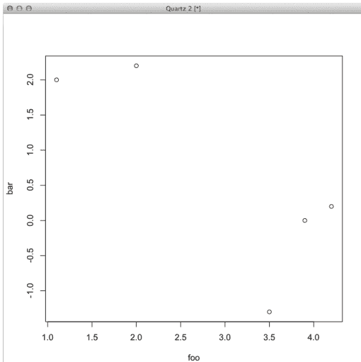

图 7-1：使用 R 的默认行为绘制的五个点

x 和 y 位置并不一定需要指定为单独的向量。你也可以以矩阵的形式的形式，第一列为 x 值，第二列为 y 值，或者以列表的形式提供。例如，设置一个五个点的矩阵，完全按照代码操作可以重现图 7-1（注意，窗格外观会根据你的操作系统略有不同）：

```R
baz <- cbind(foo,bar)
baz
foo bar
[1,] 1.1 2.0
[2,] 2.0 2.2
[3,] 3.5 -1.3
[4,] 3.9 0.0
[5,] 4.2 0.2
```

`plot` 函数是 R 的多功能通用函数之一。它对不同的对象工作方式不同，并允许用户定义处理对象的方法（包括用户定义的类）。从技术上说，你刚刚使用的 plot 命令版本在内部识别为 `plot.default`。帮助文件 `?plot` 提供了关于这种散点图风格数据可视化的更多细节。

## 图形参数

有很多图形参数可以作为参数传递给 `plot` 函数（或其他如 7.3 节中的绘图函数）。这些参数调用了简单的视觉增强，例如为点着色和添加轴标签，还可以控制图形设备的某些技术方面（第 23 章将更详细地介绍后者）。这里列出了最常用的图形参数；我将在接下来的章节中逐一讨论这些参数：

- **type**: 告诉 R 绘制提供的坐标（例如，独立点或通过线条连接的点，或者点和线两者兼有）。
- **main, xlab, ylab**: 分别包含图表标题、水平轴标签和垂直轴标签的选项。
- **col**: 用于绘制点和线的颜色（或多重颜色）。
- **pch**: 代表点字符（point character）。它选择用于绘制单个点点的字符。
- **cex**: 代表字符扩展比例（character expansion）。它控制绘图字符的大小。
- **lty**: 代表线型（line type）。它指定了连接点的线条类型（例如实线、虚线或划线）。
- **lwd**: 代表线宽（line width）。它控制绘制线条的厚度。
- **xmin, ylim**: 为绘图区域的水平范围和垂直范围（分别）提供限制。

### 7.2.1 自动图形类型

默认情况下，`plot` 函数将绘制单个点，如图 7.1 所示。这是默认的绘图类型，但其他绘图类型会有不同的外观。要控制绘图类型，你可以为 `type` 参数指定一个单字符值选项。

例如，在许多情况下，显示连接每个坐标的线条是有意义的，例如绘制时间序列数据时。对于这种情况，你需要指定绘图类型为 "l"。使用 7.1 节中的 `foo` 和 `bar`，以下代码生成了图 7-2 左侧面板中的图表：

```R
plot(foo,bar,type="l")
```

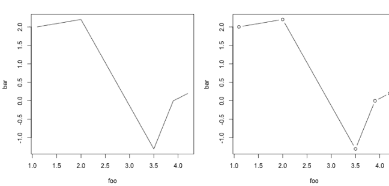

**图 7-2：** 使用五个相邻坐标产生的折线，设置 type="l" [左侧] 或 type="b" [右侧]

`type` 的默认值为 "p"，可以解释为“仅限点”。由于你没有指定任何不同内容，这就是图 7-1 中图表使用的内容。在另一个示例中，你设置了 type="l"（意味着仅限线条）。其他选项 "b" 用于同时显示点和线（在图 7-2 右侧面板所示），以及 "o" 用于用线条对点进行重叠绘制（这消除了 type="b" 时可见的点与线之间的间隙）。选项 `type="n"` 导致不绘制任何点或线，创建一个空图表，这对于必须分步构建的复杂图表非常有用。

### 7.2.2 标题和轴标签

默认情况下，基础图表没有标题，其轴将用所绘制向量的名称进行标记。但主标题和更具描述性的轴通常会让图表数据更容易解释。你可以通过为 `main`（主标题）、`xlab`（x 轴）和 `ylab`（y 轴）提供字符字符串文本来添加这些内容。注意，这些字符串可能包含转义序列（将在下文中讨论）。以下代码提供了带有标题和标签的示例：

```R
plot(cars, main="Scatter Plot", xlab="X Axis", ylab="Y Axis")
```

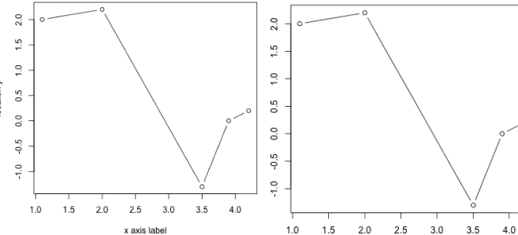

图 7-3：带有标题和轴标签的示例

考虑图 7-4 底部的图表，它们是使用以下命令创建的：

```R
plot(foo,bar,type="b",main="My lovely plot",xlab="",ylim="",col=4,pch=8,lty=2,cex=2.3,lwd=3.3,xlim=(-10,5),ylim=c(-3,3))
plot(foo,bar,type="b",main="My lovely plot",xlab="",ylim="",col=6,pch=15,lty=3,cex=0.7,lwd=2,xlim=(3,5),ylim=c(-0.5,0.2))
```

这些与中间行的图完全相同，但有一个重要的区别。在图 7-4 左下角的图中，x 轴和 y 轴设置得比观测数据宽得多，且图形限制了绘图窗口，导致只显示部分数据。

## 7.3 在现有图表中添加点、线和文本

通常情况下，每次调用 `plot` 都会刷新活动图形设备以创建一个新的绘图区域。但这并不总是我们需要的——构建更复杂的图表时，最好的方法是从一个空的绘图区域开始，然后在这个画布上添加任何所需的点、线、文本和图例。以下是 R 中一些实用且可以直接调用的函数，它们可以在不刷新或清除窗口的情况下向图表添加内容：

- `points`: 添加点
- `lines`, `abline`, `segments`: 添加线
- `text`: 写入文本
- `arrows`: 添加箭头
- `legend`: 添加图例

调用这些函数并设置参数的语法与 `plot` 相同。查看这些函数如何工作的最佳方法是通过一个扩展示例，我将基于 20 个 (x, y) 假设数据来演示。

```R
x <- 1:20
y <- c(-1.49,3.37,2.59,-2.78,-3.94,-0.92,6.43,8.51,3.41,-8.23,-12.01,-6.58,2.87,14.12,9.63,-14.78,-11.67,1.17,15.62)
```

使用这些数据，你将构建出图 7-6 所示的图（注意，你可能需要手动放大图形设备并重新绘图，以确保图例不会与其他图像特征重叠）。值得记住绘图中的一个通用的规则：“保持清晰简单”。图 7-6 是为了演示所使用的 R 命令而的一个例外。

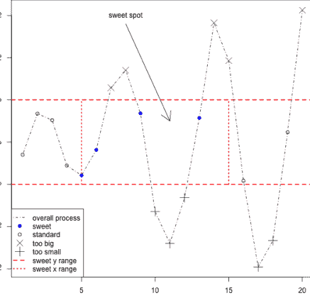

图 7-6: 某些假设数据的详尽最终图

在图 7-6 中，数据点将根据其 x 和 y 位置以不同的方式绘制，这取决于它们与图中指出的“甜点”的关系。y 值大于 5 的点标记为紫色的 x；y 值小于 -5 的点标记为绿色的 +。位于这两个 y 值之间但仍在甜点区域之外的点标记为 o。最后，甜点区域内的点（x 在 5 到 15 之间，y 在 -5 到 5 之间）被标记为蓝色的 •。红色的水平和垂直线界定了甜点区域，该区域用箭头标记，并且还有一个图例。

构建整个图表总共使用了十行代码（外额外使用了一行来添加图例）。图表在每一步的显示情况如图 7-7 所示。下面是详细的代码行说明。


# 绘图步骤详解

## 1. 创建绘图区域
第一步是创建一个绘图区域，你可以在其中添加点和线。第一行代码告诉 R 在 `x` 和 `y` 中绘制数据，尽管 `type` 选项被设置为 `"n"`。如第 7.2 节所述，这会打开或刷新图形设备并将坐标轴设为适当长度（带有标签和坐标轴），但它不会绘制任何点或线。

## 2. 添加水平线
`abline` 函数是绘制跨越图表的直线的简单方法。线（或多条线）可以通过斜率和截距值指定（参见第 20 章关于回归的后续讨论）。你也可以简单地添加水平或垂直线。这行代码使用 `h=c(-5,5)` 添加了两个独立的水平线，分别位于 `y=5` 和 `y=-5`。这三个参数（在 7.2 节中已介绍）使得这些线条是红色的、虚线且双倍粗。

```R
R> plot(x,y,type="n",main="")
R> abline(h=c(-5,5),col="red",lty=2,lwd=2)
```

## 3. 添加垂直线段
第三行代码在第 2 步绘制的水平线之间添加较短的垂直线以形成框。你在这里使用 `segments` 而不是 `abline`，因为你不希望这些线跨越整个绘图区域。`segments` 命令接收 "from" 坐标（给出 `x0` 和 `y0`）并绘制相应的线。R 的向量化行为匹配 "from" 和 "to" 坐标。两条线都是红色的、点状且双倍粗。你也可以为这些参数提供长度为 2 的向量，在这种情况下，第一段使用第一个值，第二段使用第二个值。

```R
R> segments(x0=c(5,15),y0=c(-5,-5),x1=c(5,15),y1=c(5,5),col="red",lty=3,lwd=2)
```

## 4. 添加特定坐标点（y >= 5）
在第四步中使用 `points` 开始向图中添加特定坐标。就像 `plot` 一样，`points` 取两个等长的 `x` 和 `y` 向量。在这种情况下，你想根据位置不同绘制点，使用逻辑子集来识别并提取 `y` 大于等于 5 的 `x` 和 `y` 元素。（只有这些点）作为紫色符号添加并放大了 2 倍。

```R
R> points(x[y>=5],y[y>=5],pch=4,col="darkmagenta",cex=2)
```

## 5. 添加特定坐标点（y <= -5）
第五行代码类似于第四行；这次提取 `y` 值小于等于 -5 的坐标。使用了 `+` 字符，并将颜色设置为深绿色。

```R
R> points(x[y<=-5],y[y<=-5],pch=3,col="darkgreen",cex=2)
```

## 6. 添加“甜点”点
第六步添加“甜点”点，通过 `(x>=5 & x<15) & (y>-5 & y<5)` 进行识别。组合稍微复杂的条件提取 `x` 位置在 5 到 15（包含）之间且 `y` 位置在 -5 到 5（不包含）的点。注意此行全程使用了逻辑运算符的短形式，在这里使用了逐元素比较（参见 4.1.3 节）。

```R
R> points(x[x>=5 & x<15 & y>-5 & y<5],y[x>=5 & x<15 & y>-5 & y<5],pch=19,col="blue")
```

## 7. 添加剩余点
下一个命令识别数据集中的剩余点（`x` 值小于 5 或大于等于 15，且 `y` 值在 -5 到 5 之间）。没有指定图形参数，因此这些点用默认黑色绘制。

```R
R> points(x[x<5 | x>=15 & y>-5 & y<5],y[x<5 | x>=15 & y>-5 & y<5])
```

## 8. 连接坐标点
为了连接 `x` 和 `y` 中的坐标，你使用 `lines`。在这里你还设置了 `lty` 为 4，它绘制出点划线风格的线。

```R
R> lines(x,y,lty=4)
```

## 9. 添加指向甜点的箭头
第九行代码添加指向甜点的箭头。`arrows` 函数的使用方法类似于 `segments`，你提供一个 "from" 坐标 (`x0`, `y0`) 和一个 "to" 坐标 (`x1`, `y1`)。默认情况下，箭头头部位于 "to" 坐标（其他选项如箭头的角度和长度）可以使用帮助文件 `?arrows` 中描述的可选参数更改。

```R
R> arrows(x0=8,y0=14,x1=11,y1=2.5)
```

## 10. 添加标签
第十行在箭头顶部上方打印一个标签。根据 `text` 的默认行为，作为标签提供的字符串将位于提供的 `x` 和 `y` 坐标的中心。

```R
R> text(x=8,y=15,"sweet spot")
```

## 最终完善：添加图例
作为最后的完善，你可以使用 `legend` 函数添加图例，这将得到图 7-6 所示的最终产品。

```R
R> legend("bottomleft",c("overall process","sweet","standard","too big","too small","sweet y range","sweet x range"),
  pch=c(NA,19,1,4,3,NA),lty=c(4,NA,NA,NA,NA,2,3),
  col=c("black","blue","black","magenta","darkgreen","red","red"),
  lwd=c(1,NA,NA,NA,NA,2,2),pt.cex=c(NA,1,1,1,2,2,NA))
```

---

# 练习 7.1

a. 请尽可能精确地重现以下图表：

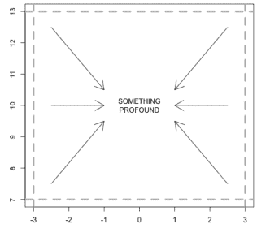

b. 使用以下数据，创建一个以体重为 x 轴、身高为 y 轴的图表。使用不同的点形状或颜色区分男性和女性，并提供相应的图例。

| 重量 (kg) | 身高 (cm) | 性别 |
| :--- | :--- | :--- |
| 55 | 161 | female |
| 85 | 185 | male |
| 75 | 174 | male |
| 42 | 154 | female |
| 93 | 188 | male |
| 63 | 178 | male |
| 58 | 170 | female |
| 75 | 167 | male |
| 89 | 181 | male |
| 67 | 178 | female |

---

# 7.4 ggplot2 包

本章目前为止展示了 R 内置的图形工具（通常称为 R 图形或传统的 R 图形）。现在，让我们来看另一套图形工具：`ggplot2`，这是由 Hadley Wickham (2009) 开发的一个著名包。与其他贡献型包一样，`ggplot2` 可以在 CRAN 上获取，为 R 中的标准绘图程序提供了强大的替代方案。`gg` 代表“图形语法”（grammar of graphics）——这是一个由 Wilkinson (2005) 描述的范式。遵循这种方法，`ggplot2` 标准化了不同类型图表和图形生成，简化了向图表中添加某些繁琐操作（例如添加图例），并允许你通过定义和操作层来构建图表。目前，让我们使用第 7.1–7.3 节中相同的简单示例来看 `ggplot2` 的基本行为。你将熟悉基础绘图函数 `qplot` 以及它与之前使用的通用 `plot` 的区别。我将在第 14 章介绍统计图表时回到 `ggplot2` 的话题，你将在第 24 章中探索更高级的功能。

## 7.4.1 使用 ggplot2 快速绘图

首先，你必须通过手动下载或直接在提示符输入 `install.packages("ggplot2")` 来安装 `ggplot2` 包（见 A.2.3 节）。然后使用以下代码加载包：

```R
library("ggplot2")
```

现在，让我们回到最初存储在第 7.1 节 `foo` 和 `bar` 中的五个数据点。

```R
foo <- c(1,1,2,3,-5,3,9,4,2)
bar <- c(2,2,2,-1,3,0,0,2)
```

你可以使用它的“快速绘图”函数 `qplot` 来生成 `ggplot2` 版本的图 7-1。

```R
qplot(foo,bar)
```

结果显示在图 7-8 的左图中。此图像与使用 `plot` 生成的图像之间有明显的区别，但 `qplot` 的基本语法与之前相同。传递给 `qplot` 的两个参数是等长的向量，首先提供 `foo` 中的 x 坐标，然后是 `bar` 中的 y 坐标。

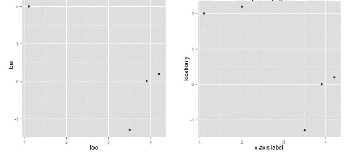

**图 7-8**：使用 `ggplot2` 的 `qplot` 函数默认行为绘制的五个点（左）以及添加标题和轴标签后的图表（右）

添加标题和轴标签也使用了你在第 7.2 节中使用 `plot` 时见过的相同参数。

```R
qplot(foo,bar,main="My lovely qplot",xlab="x axis label",ylab="location y")
```

这产生了图 7-8 的右面板。

尽管在语法上基本相似，但 `ggplot` 与基础图形创建方式之间存在根本性区别。使用内置图形工具构建图表本质上是一个实时的、逐步演进的过程。这在第 7.3 节中尤为明显，在该节中你将图形设备视为活跃的画布，逐个添加点、线和其他特征。相比之下，`ggplot2` 图表被存储为对象，这意味着在你更改对象之前，它们有一个底层的状态表示——你本质上通过 `qplot` 可视化的是任何时刻打印的对象。为了强调这一点，输入以下代码：

```R
baz <- plot(foo,bar)
baz
# NULL
qx <- qplot(foo,bar)
qx
```

第一次赋值使用了内置的 `plot` 函数。当你运行该行代码时，图 7-1 中的图表会弹出。由于工作区中实际上没有存储任何内容，建议的对象 `baz` 返回 `NULL` 值。另一方面，存储 `qplot` 内容（在这里存储为对象 `qx`）是有意义的。这次当你执行赋值时，不会显示图表。与图 7-8 匹配的图形只有你在提示符输入 `qx` 时显示，这调用了该对象的打印方法。这似乎是一个微不足道的点，但可以在显示之前保存图表，为在显示之前修改或增强图表开启了新途径（你稍后将看到），这可能是相对于基础 R 图形的一个显著优势。

## 7.4.2 使用 Geoms 设置外观

要自定义 `ggplot2` 中的点和线，应修改对象而不是使用参数。你可以通过使用几何修饰符来改变图表的外观。例如，假设你想更改点的颜色：

```R
qplot(foo,bar,col="red") + geom_point()
```

结果图表显示在图 7-9 的左侧。这通过一个示例说明得最好。让我们回到手动逐步绘制的 20 个观测值，以生成图 7-6 中复杂的图表。

在第 7.3 节，你定义了几个类别，根据 `x` 和 `y` 值将每个观测值分类为“标准”、“甜美”、“太大”或“太小”。使用这些相同的分类规则，让我们显式地定义一个因子来比较 `x` 和 `y`。

```R
ptype <- rep(NA,length(x))
ptype[y>=5] <- "too_big"
ptype[y<=-5] <- "too_small"
ptype[(x>=5 & x<15) & (y>-5 & y<5)] <- "sweet"
ptype[(x<5 | x>=15) & (y>-5 & y<5)] <- "standard"
ptype <- factor(ptype)
ptype
```

```
[1] standard standard standard sweet sweet too_big
[7] too_big sweet too_small too_small sweet too_big
[13] too_big standard too_small too_small standard too_big
Levels: standard sweet too_big too_small
```

现在你有了一个包含 20 个值并分为四个层级的因子。你将使用这个因子来通过 `ggplot` 如何映射你的审美属性。这里有一个简单的方法：

```R
qplot(x,y,color=ptype,shape=ptype)
```

这单行代码生成图 7-11 左侧的图，它通过颜色和点形状区分了四个类别，并提供了图例。这些都是通过 `qplot` 调用中的审美映射完成的，在其中你将 `color` 和 `shape` 设置为映射到 `ptype` 变量。

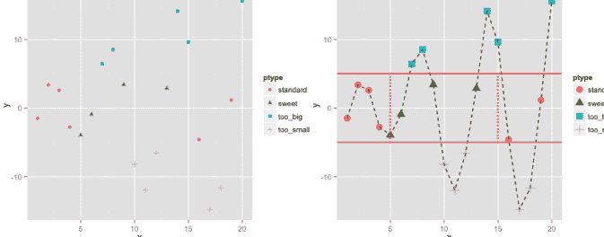

**图 7-11**：使用 `ggplot2` 中的 `qplot` 和 geoms 进行审美映射的演示。左侧：`qplot` 的初始调用，使用 `ptype` 映射点形状和颜色。右侧：使用各种 geoms 增强左图以覆盖默认映射。

现在，让我们使用相同的 `qplot` 对象配合一系列 geom 修改来重新绘制这些数据，以便获得一个更类似于图 7-6 的效果。执行以下代码将生成图 7-11 右侧的图：

```R
qplot(x,y,color=ptype) + 
  geom_point(size=4) + 
  geom_line(mapping=aes(group=1),color="black",lty=2) + 
  geom_hline(mapping=aes(yintercept=c(-5,5)),color="red",lty=2) +
  geom_segment(mapping=aes(x=5,y=-5,xend=5,yend=5),color="red",lty=3) + 
  geom_segment(mapping=aes(x=15,y=-5,xend=15,yend=5),color="red",lty=3)
```

在第一行中，你添加了 `geom_point(size=4)` 来增加所有点的大小。在随后的行中，你添加了连接所有点的线，以及用于标记甜美区域的水平线和垂直线。对于最后四行，你必须使用 `aes` 为点类别设置审美映射。让我们再仔细观察一下发生了什么。

由于你在 `qplot` 的初始调用中对 `ptype` 进行审美映射，默认情况下，所有 geom 将以相同的方式映射到每个类别，除非你用 `aes` 覆盖该映射。例如，当你调用 `geom_line` 来连接所有点时，如果你坚持使用到 `ptype` 的默认映射而不是 `mapping=aes(group=1)`，这个 geom 将绘制分开的连接线——一条连接“标准”点，另一条连接“甜美”点，以此类推。但这并不是你想要的；你想要一条从左到右连接所有点的线。因此，你将通过输入 `aes(group=1)` 让 `geom_line` 将所有观测视为一组。

之后，你使用 `geom_hline` 函数通过其 `yintercept` 参数绘制 `y = -5` 和 `y = 5` 的水平线，该参数传递给 `aes` 以重新定义该 geom 的映射。在这种情况下，你需要重新定义映射以作用于向量 `c(-5,5)`，而不是使用 `x` 和 `y` 中的观测数据。同样，你使用 `geom_segment` 绘制两条垂直虚线段，`geom_segment` 的操作方式类似于 `segments`——你根据“起始”坐标（参数 `x` 和 `y`）和“结束”坐标（`xend` 和 `yend`）重新定义映射。由于第一个 `geom_point(size=4)` 对于每个绘图点都是恒定的大小，因此 geom 如何映射并不重要，它只是简单对每个点进行了统一的更改。

在 R 中绘图，从基础图形到 `ggplot2` 等贡献包，始终保持了语言的本质。元素级匹配允许你使用几个简单且直观的函数创建图表。一旦你显示了图表，就可以通过导出图形设备并选择 File → Save 将保存到硬盘。然而，你也可以直接将图写入文件，正如你稍后在第 8.3 节中看到的。

本节中探索的图形能力仅仅是冰山一角，从现在开始你将继续使用数据可视化。

---

# 练习 7.2

在练习 7.1 (b) 中，你使用基础图形绘制了某些重量和高度数据，使用不同的点或颜色区分男性和女性。使用 `ggplot2` 重复此任务。

---

# 本章中的重要代码

| 函数/运算符 | 简要描述 | 首次出现 |
| :--- | :--- | :--- |
| `plot` | 创建/显示 | 128 |
| `type` | 设置绘图类型 | 130 |
| `xlab`, `ylab` | 设置轴标签 | 130 |
| `col` | 设置点颜色 | 131 |
| `pch`, `cex` | 设置点类型/大小 | 132 |
| `lty`, `lwd` | 设置线宽 | 133 |
| `xlim`, `ylim` | 设置区域 | 134 |
| `abline` | 添加水平线 | 137 |
| `segments` | 添加线段 | 137 |
| `points` | 添加点 | 137 |
| `lines` | 添加线 | 138 |
| `text` | 添加文本 | 138 |
| `legend` | 控制图例 | 138 |
| `ggplot` | 创建 ggplot 图 | 140 |
| `geom_point` | 添加点 | 141 |
| `geom_line` | 添加线 | 141 |
| `size`, `shape`, `color` | 设置常量 | 142 |
| `linetype` | 设置线型 | 142 |
| `mapping`, `aes` | 设置映射 | 142 |
| `geom_hline` | 添加水平线 | 145 |
| `geom_segment` | 添加线段 | 145 |

---

# 读取和写入文件


# 现在我将涵盖处理数据的另一个基本方面：加载和保存数据

通常，在处理数据时，你需要从外部文件读取数据，无论它是存储为纯文本、电子表格还是在线。在本章中，我将介绍一些导入和导出数据的读写操作。

## 8.1 R 就绪数据集

首先，让我们简要查看一些内置或用户贡献包中的数据集。这些数据集是练习和实验的有用样本。在提示符处输入 `data()` 可以列出这些可用数据集的列表以及单行描述。这些数据集按名称字母顺序排列并按包分组。

### 8.1.1 内置数据集

内置的自动加载的包包含了一些数据集。要查看该包包含的数据集摘要，可以使用 `library` 函数：

```R
R> library(help="datasets")
```

R 就绪数据集都有相应的帮助文件，可以在其中找到关于数据及其组织方式的重要信息。例如，内置数据集之一名为 `ChickWeight`。如果你在提示符输入 `?ChickWeight`，将看到图 8-1 中的窗口。

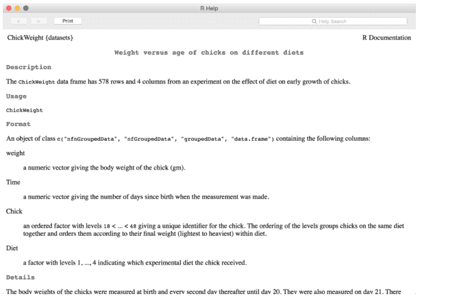

图 8-1：数据集的帮助文件

你可以看到，这解释了变量及其值；它指出数据存储在一个具有 578 行 4 列的数据框中。由于 `datasets` 对象是内置的，你只需要在提示符输入其名称即可访问 `ChickWeight`。让我们看看前 15 条记录。

```R
R> ChickWeight[1:15]
```

### 8.1.2 贡献的数据集

许多可供 R 使用的数据集是作为贡献包的一部分提供的。要访问这些数据集，首先需要安装并加载相关的包。考虑 `ice.river` 数据集，它位于 Trapletti 和 Hornik (2013) 提供的贡献包 `tseries` 中。首先，你必须安装该包，可以在提示符处运行行 `install.packages("tseries")` 来完成。然后，为了访问包中的组件，请使用 `library` 加载它：

```R
R> library("tseries")

'tseries' version: 0.10-32
```

`tseries` 是一个用于时间序列分析和计算金融的包。

详情请参见 `library(help="tseries")`。

现在你可以输入 `library(help="tseries")` 查看此包中的数据集列表，并输入 `ice.river` 来查找关于你想处理的数据集的更多细节。帮助文件将 `ice.river` 描述为一个“时间序列对象”，由流量、降水量和温度测量值组成——这些数据最初由 Tong (1990) 报告。要访问此对象，你必须使用 `data` 函数显式地加载它。然后你就可以像往常在工作空间中使用 `ice.river` 了。以下是前几记录：

```R
R> data(ice.river)
R> ice.river[1:5]

flow.wat jok prec temp
[1] 16.10 30.2 8.1 0.9
[2] 19.20 29.0 4.4 1.6
[3] 14.50 28.4 7.0 0.1
[4] 11.00 27.8 0.0 0.6
[5] 13.60 27.8 0.0 2.0
```

这些 R 可用数据集的可用性和便利使得测试代码变得简单，我将在后续章节中使用它们进行演示。然而，为了分析你自己的数据，你通常需要从某些外部文件导入它们。让我们看看如何做到。

## 8.2 读取外部数据文件

R 有多种函数可以从存储文件中读取字符并对其进行处理。你将看到如何读取表格格式文件，这类文件是 R 读取和导入最简单的文件之一。

### 8.2.1 表格格式

表格格式文件被认为是纯文本文件，具有三个完全定义 R 如何读取数据的关键特征。

**表头** 如果存在表头，它总是文件的第一行。此可选功能用于为每个数据列提供名称。在将文件导入 R 时，你需要告诉软件是否存在表头，以便它知道是将第一行视为变量名，还是相反，视为观测数据值。

**分隔符** 至关重要的分隔符是用于分隔文件中每个条目的字符。分隔符字符不能用于文件的任何其他地方。这告诉 R 特定条目何时开始和结束（换句话说，它在表格中的精确位置）。

**缺失值** 这是另一个表示缺失值的唯一字符字符串。在读取文件时，R 将这些条目转换为它识别的格式：`NA`。

通常，这些文件具有 `.txt` 扩展名（强调纯文本风格）或 `.csv`（用于用逗号分隔的值）。

让我们尝试一个示例，使用第 5.2 节的变体。图 8-2 显示了一个名为 `mydata.txt` 的适当表格格式文件，它包含一个带有几个标记为缺失值的数据框。该数据文件可以在书籍网站 `https://www.nostartch.com/bookfr/` 上找到，或者你可以使用文本编辑器从图 8-2 创建它。

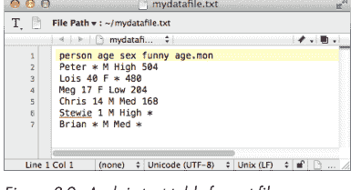

注意第一行是表头，值用单空格分隔，缺失值用星号（`*`）表示。此外，请注意每条新记录都要求在新的一行开始。假设你拿到了这个纯文本文件以便在 R 中进行数据分析。即插可用的命令 `read.table` 导入表格格式文件，生成一个数据框对象，如下：

```R
mydatafile <- read.table(file="/Users/tdavies/mydatafile.txt", header=TRUE, sep=" ", na.strings="*", stringsAsFactors=FALSE)
mydatafile
 age sex age.mon
1 Peter NA M High 504
2 Lois 40 F <NA> 480
3 Meg 17 F Low 204
4 Chris 14 M Med 168
5 Stevie 1 M High NA
6 Brian M Med NA
```

在调用 `read.table` 时，`file` 参数是一个带有文件名和文件夹位置（使用正斜杠）的字符字符串，`header` 是一个逻辑值，用于指示文件是否有表头（在此情况下为 `TRUE`），`sep` 接收代表分隔符的字符字符串（在本情况下为单空格 `" "`），`na.strings` 请求用于表示缺失值的字符（在本情况下为 `"*"`）。

如果你正在读取多个文件且不想每次都输入整个文件夹位置，可以先通过 `setwd`（第 1.2.3 节）设置工作目录，然后只需使用文件名和扩展名作为提供给函数的字符字符串。

| ID | 身高 | 重量 | 性别 |
| :--- | :--- | :--- | :--- |
| 2 | 85 | 185 | 男性 |
| 3 | 75 | 174 | 男性 |
| 4 | 42 | 154 | 女性 |
| 5 | 93 | 188 | 男性 |
| 6 | 63 | 178 | 男性 |
| 7 | 58 | 170 | 女性 |
| 8 | 75 | 167 | 男性 |
| 9 | 89 | 181 | 男性 |
| 10 | 67 | 178 | 女性 |

在这里，`file` 参数再次指定了所需的文件，该文件没有表头（`header=FALSE`）。你设置 `stringsAsFactors=TRUE` 是因为你想将该变量（唯一的非数值变量）视为因子。由于没有缺失值，所以你不需要指定 `na.strings`（如果有缺失值，该参数的使用方法与之前相同），而且根据定义，`.csv` 文件是逗号分隔的，`read.csv` 正确地实现了结果数据框，然后可以在你的 R 控制台中打印。

如你所见，将表格数据读入 R 是非常简单的——你只需要注意数据文件的表头、分隔符设置以及如何识别缺失条目。简单的表格格式是数据集存储的一种非常自然且常见的格式，但如果你需要读取结构更复杂的文件，R 及其包提供了更高级函数。例如，查看 `scan` 和 `readlines` 函数的文档，它们提供了对解析文件的高级控制。你也可以通过在提示符输入 `read.table` 来查找 `read.table` 和 `read.csv` 的文档。

### 8.2.3 基于网络的文件

有了互联网连接后，R 可以从网站读取文件，其关于表头、分隔符和缺失值的规则保持不变；你只需要指定文件的 URL 地址而不是本地文件夹即可。

例如，你将使用由美国统计协会（American Statistical Association）通过《统计教育杂志》（JSE）提供的在线数据集库，地址为：`http://www.amstat.org/publications/jse/v9n2/jse_data_archive.htm`。

链接到页面顶部的文件之一是表格格式的数据 `4cd.txt` (`http://www.amstat.org/publications/jse/v9n2/4cd.txt`)，它包含了 Chu (2001) 根据新加坡一份报纸的一则广告分析出的 308 颗钻石的特征数据。图 8 显示了这些数据。

你可以查看文档（`4cd.txt`）以及从 JSE 网站链接的配套文章，详细了解该表中记录的细节。请注意，在五列中，第一列和第五列是数值型的，其他列则非常适合用因子表示。分隔符是空白字符，没有表头，且没有缺失值（因此你不需要指定用于表示它们的值）。


考虑到这些，你可以仅通过以下几行代码直接从 R 提示符创建数据框：

```R
R> dia.url <- "http://www.amstat.org/publications/jse/v9n2/4data.txt"
R> diamonds <- read.table(dia.url)
```

注意，你没有为此 `read.table` 调用提供任何额外值，因为默认值都运行良好。由于表格中没有表头：

```R
R> names(diamonds) <- c("Carat","Color","Clarity","Cert","Price")
R> diamonds <- c(1:5)
```

| 克拉 | 净度 | 证书 | 价格 |
| :--- | :--- | :--- | :--- |
| 1 | .30 | D | VS2 GIA 1302 |
| 2 | .30 | E | VS1 GIA 1510 |
| 3 | .30 | G | VVS1 GIA 1510 |
| 4 | .30 | G | VS1 GIA 1260 |
| 5 | .31 | D | VS1 GIA 1641 |

查看前五条记录显示数据框的显示方式符合你的预期。

### 8.2.4 其他文件格式

除了 `.txt` 或 `.csv` 文件外，还有其他可以读入 R 的格式，例如 `.dat` 数据文件格式。这些文件也可以使用 `read.table` 导入，尽管它们可能在顶部包含额外信息，必须使用可选的 `skip` 参数跳过。`skip` 参数指定 R 开始导入之前应忽略的文件顶部的行数。

如第 8.2.2 节所述，还有一些贡献包可以处理其他统计软件文件；然而，如果一个文件中包含多个工作表，情况可能会变得复杂。可提供的 R 包 `foreign`（R Core Team, 2015）提供了对读取 Stata、SAS、Minitab 和 SPSS 等统计程序使用的数据的支持。

CRAN 上的其他包可以帮助你处理各种数据库管理系统（DBMS）。例如，`RJDBC` 包（Ripley and Laps, 2023）允许你查询 Microsoft Access 数据库并将结果作为数据框对象返回。其他接口包括包 `MySQL`（James and DeRoy, 2012）和 `RSQLite`（Urbanek, 2023）。

## 8.3 写入数据文件和图表

使用 R 从数据框对象写入新文件与读取一样简单。

### 8.3.1 数据集

`write.table` 函数用于写入数据集。你提供数据框对象 `x` 和文件名。例如，以下行使用了它：

```R
write.table(x, file="somenewfile.txt", sep="\t", quote=FALSE, rownames=FALSE)
```

文件设备通过调用 `write.table` 打开，默认情况下，你在此提供预期的文件名和它的文件夹位置。`quote` 参数决定是否将每个条目封装在双引号中——这里你将其设置为 `FALSE`，因为你不需要在文件中这些引号。另一个可选参数 `rownames` 询问是否包含行名——你可以通过将其设置为 `FALSE` 来省略它们。

### 8.3.2 图表和图形

图表可以直接写入文件。在第 7 章中，你在活动图形设备中创建图表。现在不需要立即在屏幕上显示，而是遵循以下步骤：打开“文件”图形设备，运行任何绘图命令创建图表，然后关闭设备。R 支持使用同名函数直接写入 `.jpeg`、`.bmp`、`.png` 和 `.tiff` 文件。例如，以下代码使用这些步骤创建一个 `.jpeg`：

```R
R jpeg(filename="Users/tdav/myplot.jpeg", width=600, height=600)
R plot(1:5, 6:10, ylab="a nice ylab", xlab="here's an xlab", main="-a saved .jpeg plot")
R plot(points(1:5, 10:6, cex=2, pch=4, col=2))
R dev.off()
```

文件设备通过调用 `jpeg` 打开，默认情况下在此提供文件名和文件夹位置。设备的尺寸设置为 480 x 480 像素，但这里将其更改为 600 x 600。你也可以通过在 `width` 和 `height` 中指定指定其他单位（英寸、厘米或毫米）来设置这些尺寸。一旦文件打开，你就可以执行任何所需的 R 绘图命令来创建图像——此示例绘制了一些点，然后通过第二个命令包含额外的点。当你完成绘图后，必须通过调用 `dev.off()` 显式关闭设备，它会打印剩余活动设备的信息（这里是“空设备”，可以宽泛地解释为“没有打开的设备”）。如果没有调用 `dev.off()`，R 将继续将后续绘图命令输出到文件中，并可能覆盖已有的内容。图 8-7 中的左图显示了此示例中创建的结果文件。

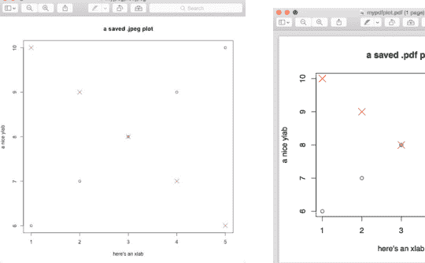

图 8-7：直接写入磁盘的 R 图形：相同绘图命令的 .jpeg 版本（左侧）和 .pdf 版本（右侧）

你也可以将 R 图形存储为其他文件类型，例如 PDF（使用 `pdf` 函数）和 EPS 文件（使用 `postscript` 函数）。尽管这些函数的某些参数名称和默认值有所不同，但它们遵循相同的基本原理。你需要指定文件夹位置、文件名以及宽度和高度维度；输入你的绘图命令；然后使用 `dev.off()` 关闭设备。图 8-7 的右面板显示了使用以下代码创建的 .pdf 文件：

```R
R pdf(file="/users/davies/mypdfplot.pdf", width=5, height=5)
R plot(1:5, 6:10, ylab="a nice ylab", xlab="here is an xlab", nmain="a saved .pdf plot")
R points(1:5, 6:10, cex=2, pch=4, col=2)
R dev.off()
```

null device 1

在这里，你像以前一样使用绘图命令，只是代码中有些细微不同。文件的参数是 `file`（而不是 `filename`），且宽度和高度的单位在 pdf 中默认为英寸。图 8-7 中两幅图像外观的差异主要由于这些宽度和高度的不同所致。

这同样适用于 ggplot2 图形。不过，按照其风格，ggplot 提供了方便的替代方案。`ggsave` 函数可以将最近绘制的 ggplot2 图形写入文件，并在一行代码中完成设备/关闭操作。

例如，以下代码从简单的数据集中创建并显示 ggplot2 对象。

```R
R foo <- c(1,1,2,3,5,3,9,4,2)
R bar <- c(2,2,2,-1.3,0,0,2)
R > qplot(foo,bar,geom="blank"
  + geom_point(size=3,shape=8,color="darkgreen")
  + geom_line(color="orange",linetype=4)
```

现在，要将此图保存到文件，你只需要：

```R
R > ggsave(filename="/Users/tdadies/mypngqplot.png")
Saving 7 x 7 in image
```

这会将图像写入指定文件名目录下的 .png 文件中。（注意，如果你没有显式地使用 `width` 和 `height` 设置尺寸，则会报告这些尺寸；这些尺寸取决于你图形设备的大小。）结果如图 8-8 所示。

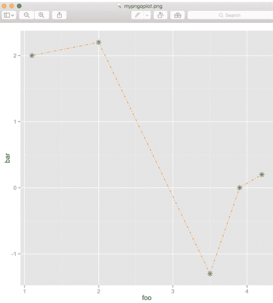

图 8-8：使用 ggplot2 的 ggsave 命令创建的 .png 文件

除了简洁之外，`ggsave` 在其他几个方面也非常方便。例如，你可以使用同一个命令创建各种图像文件类型——类型仅由你在 `filename` 参数中使用的扩展名决定。此外，`ggsave` 还有系列可选参数，如果你想控制图像的大小以及图形的质量或缩放。

关于从基础 R 图形中保存图像的更多详细信息，请参阅 `?jpeg`、`?pdf` 和 `?postscript` 帮助文件。你可以咨询 `?ggsave` 以获取更多关于 ggplot2 保存图像的信息。

## 8.4 临时对象读写操作

对于典型的 R 用户来说，最常见的输入/输出操作可能围绕数据集和图像展开。但如果你需要读取或写入其他类型的 R 对象（例如列表或数组），你需要 `dump` 和 `dget` 命令，这些命令可以以更临时（ad hoc）的方式处理对象。

假设，你在当前会话中创建了这个列表：


```R
somelist <- list(c(5,2,45),
bar=matrix(data=c(T,T,F,F,F,T,T),nrow=3,ncol=3),
baz=factor(c(1,2,2,3,1,1,3),levels=1:3,ordered=T))

somelist
$foo
[1] 5 2 45
$bar
[1] [2] [3]
[1] TRUE FALSE TRUE
[2] TRUE FALSE FALSE
[3] FALSE FALSE TRUE
$baz
[1] 1 2 3 1 1 3
Levels: 1 < 2 < 3
```

此对象可以写入文件，如果你想将其传递给同事或在别处的 R 会话中打开它，这将非常有用。使用 `dput`，下行代码将对象存储为 R 可解释的纯文本文件：

```R
dput(x=somelist,file="/Users/tdavis/myObject.txt")
```

从技术角度来说，此命令创建了对象的美国信息交换标准代码（ASCII）表示。作为 `dput`，对象按照指定的 `x` 被写入，并将新纯文本文件的文件夹位置和名称传递给 `file`。图 8-9 显示了结果的内容

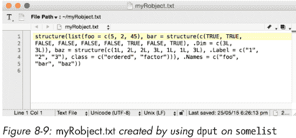

null device 1

# 第二部分

# 编程


# 调用函数

在学习 R 中的函数之前，了解函数在 R 会话中是如何被调用和解释的非常有帮助。首先，你将查看 R 如何对变量名进行分区划分。你将看到 R 命名参数和对象的规则，以及在调用函数时 R 是如何搜索参数和其他变量的。然后，你将查看在调用函数时指定参数的其他替代方法。

## 9.1 作用域

首先，理解 R 的作用域规则（scoping rules）非常重要，它决定了语言如何在给定的会话中对对象划分并检索它们。这一框架还定义了对象名称可能存在的情况。例如，你使用过数据矩阵（第 3.1 节），但 `data` 也是一个现用函数的名称，用于从扩展包中加载数据集（第 8.1.2 节）。在本节中，你将初步了解 R 在这些情况下的内部行为，这将有助于你以后编写和执行自己的函数以及其他包的函数。

### 9.1.1 环境

R 通过虚拟环境强制执行作用域规则。你可以将环境看作存储数据结构和函数的独立隔间。它们允许 R 区分关联到不同作用域且由于存储在不同环境而导致存储在不同环境中的相同名称。环境是动态实体——可以创建新环境，也可以对现有环境进行操作或删除。

从技术上说，环境实际上并不包含条目。相反，它们拥有指向这些项目在计算机内存中位置的指针。但在初开始了解环境工作原理时，使用*隔间*这一比喻并认为对象*属于*这些隔间是非常实用的。

环境有三种重要类型：全局环境、包环境与命名空间，以及本地环境或词法环境。

#### 全局环境

全局环境是为用户定义的对象留出的隔间。到目前为止，你创建或覆盖的每个对象都存在于你 R 会话的全局环境中。在第 1.3.1 节中，我提到调用 `ls()` 会列出活动工作空间中的所有对象、变量和用户定义的函数——更准确地说，`ls()` 会打印当前全局环境中所有内容的名称。

从一个新的工作空间开始，以下代码创建了两个对象并确认了它们在全局环境中存在：

```R
foo <- 4+5
bar <- "stringastic"
ls()
[1] "foo"
```

但所有现用的对象和函数呢？它们难道不是和 `foo` 和 `bar` 一起作为该环境的成员打印出来吗？事实上，这些对象和函数属于特定包的环境，下文将描述。

#### 包环境与命名空间

为了简单起见，我将泛泛使用“包环境”这一术语来指代 R 中每个包提供的条目。事实上，R 包在作用域方面的结构要复杂得多。每个包实际上代表了几个环境，控制着对给定对象搜索的不同侧面。包的命名空间（package namespace）本质上定义了其函数的可见性。（一个包可以有用户可以使用的可见函数，以及为可见函数提供内部支持的不可见函数。）包环境的另一部分处理导入指定，处理包为了其自己的函数需要从其他库导入的任何函数或对象。

为了澄清这一点，你可以将你在书中使用的所有现用函数和对象都认为属于特定的包环境。对于你通过调用 `library` 明确加载的任何扩展包的函数和对象也是如此。你可以使用 `ls` 来列出包环境中的条目，如下所示：

```R
ls(package="graphics")
[1] "abline" "arrows" "assocplot" "axis"
[5] "axis" "axis.Date" "axis.POSIXct" "axticks"
[9] "barplot" "barplot.default" "box" "boxplot"
[13] "boxplot.default" "boxplot.matrix" "cdplot"
[17] "clip" "close.screen" "co.intervals" "contour"
[21] "contour.default" "contourplot" "curve" "dotchart"
[25] "erase.screen" "filled.contour" "fourfoldplot" "frame"
[29] "grconvert" "grconvert" "grid" "legend"
[33] "hist.default" "identify" "image" "image.default"
[37] "layout" "layout.show" "locator"
[41] "lines" "lines.default" "matlines"
[45] "matplot" "matpoints" "mosaicplot" "mtext"
[49] "pairs" "pairs.default" "panel.smooth" "par"
[53] "persp" "pie" "plot" "plot.default"
[57] "plot.design" "plot.function" "plot.new" "plot.window"
[61] "plot.xy" "points" "points.default" "polygon"
[65] "polypath" "rasterimage" "rect" "rug"
[69] "screen" "segments" "smoothScatter" "spineplot"
[73] "split.screen" "stars" "stem" "streight"
[77] "striptchart" "stwidth" "sunflower"
[81] "text" "text.default" "title"
[85] "spline" "xine"
```

（注：原文代码块中存在拼写错误如 `R foo` 应为 `foo`，`streight` 应为 `strip` 等，翻译时保持代码逻辑）

#### 本地环境

每当调用函数时，R 都会创建一个新的环境，被称为词法环境（lexical environment）。这个本地环境包含了在执行期间提供的全局环境对象。正是这一特性允许 R 区分其他环境中的相同名称。

例如，你调用 `matrix` 并传入数据如下：

```R
youspeak <- matrix(c("OMG","LOL","WTF","YOLO"),nrow=2,ncol=2)
youspeak
[1] "OMG" "WTF"
[2] "LOL" "YOLO"
```

目标包：base。这个环境之所以特殊，是因为它标记了搜索路径的终点。
例如，如果你调用以下代码，内部会发生一些事情：

```R
baz<- seq(from=0,to=3,length.out=5)
baz
[1] 0.00 0.75 1.50 2.25 3.00
```

R 在全局环境中搜索一个名为 `seq` 的函数，当没有找到时，它会继续在闭包环境中搜索，该环境是搜索路径中的上一层级（根据前面提到的从左到右的箭头）。它在那里也没有找到，因此 R 继续沿着路径移动到下一个环境，搜索所有已加载（无论是自动或其他方式）的包，直到找到它正在寻找的内容。在 R 中，它会在内置的 `base` 包环境中搜索。然后，它执行 `seq` 函数（创建一个临时的局部环境）并将结果赋值给新对象 `baz`，该对象位于全局环境中。在随后的打印 `baz` 的调用中，R 开始搜索全局环境并立即找到了请求的对象。

你可以像如下所示查看任何函数环境的闭包环境：

```R
environment(seq)
<environment: namespace:base>
environment(arrows)
<environment: namespace:graphics>
```

在这里，我将 `base` 的包命名空间识别为 `seq` 函数的所有者，将 `graphics` 包识别为 `arrows` 函数的所有者。
每个环境都有父环境，用于指导搜索路径的顺序。
检查之前调用 `search()` 的输出，你可以看到例如 `package:stats` 的父环境是 `package:graphics`。特定的父子结构体现在：当加载额外的库或附加数据框时，搜索路径会发生变化。当你通过 `library()` 调用加载一个贡献包时，这本质上是将所需的包插入到搜索路径中。例如，在第 161 页的练习题 8.1 中，你安装了贡献包 `car`。在加载此包后，你的搜索路径将包含它的内容。

```R
library("car")
search()
[1] ".GlobalEnv " "package:car" "tools:RGUI"
[4] "package:stats" "package:graphics" "package:GrDevices"
[7] "package:utils" "package:datasets" "package:methods"
[10] "Autoloads" "package:base"
```

注意 `car` 包环境在路径中的位置——直接插入在全局环境之后。这是后续加载的每个包将被放置的位置（随后是其自身功能所依赖的任何额外包）。

正如前面提到的，一旦 R 用尽了整个搜索路径并到达空环境，就会停止搜索。如果你请求一个你没有定义、不存在、或者可能位于你忘记加载的贡献包中的对象（这是一个非常常见的错误），就会抛出错误。“cannot find” 错误对于函数和其他对象来说都是可识别的。

```R
neither.here()
Error: could not find function "neither.here"
nor.there
Error: object 'nor.there' not found
```

环境有助于将 R 中海量的功能进行隔离开。当搜索路径中的不同包中存在同名函数时，这一点变得尤为重要。在这种情况下，第 12.3 节讨论的掩蔽（masking）就会发挥作用。

当你对 R 越来越熟悉并希望精确控制它的运行方式时，投入研究 R 如何处理环境是值得的。关于这方面的更多技术细节，Gupta (2012) 提供了一篇写得很好的文章。

### 9.1.3 保留和受保护名称

在 R 中，一些关键术语严格禁止用对象名称。这些保留名称对于保护语言中频繁使用的基础操作和数据类型是必要的。

以下标识符是被保留的：

- `if` 和 `else`
- `for`, `while`, 和 `in`
- `repeat`, `break`, 和 `next`
- `TRUE` 和 `FALSE`
- `Inf` 和 `-Inf`
- `NA`, `NaN`, 和 `NULL`

我还没有涵盖此列表中的某些术语。这些项目代表了 R 语言编程的核心代码，你将在接下来的章节中开始探索它们。最后三个项目符号包含了熟悉的逻辑值（第 4.1 节）以及用于表示无穷和缺失项等内容的特殊术语（第 6.1 节）。

如果你尝试给这些保留术语中的任何一个赋值，就会发生错误。

```R
NaN <- 5
Error: invalid object type (logical)
```

由于 R 是区分大小写的，可以使用这些术语的小写版本，但这不是建议的做法。

```R
nan <- 5
[1] 5
```

如果你尝试给这些保留术语中的任何一个赋值，就会发生错误。

```R
TRUE <- 5
Error: invalid object type (logical)
```

如果你尝试给这些保留术语中的任何一个赋值，就会发生错误。

```R
FALSE <- 5
Error: invalid object type (logical)
```

如果你尝试给这些保留术语中的任何一个赋值，就会发生错误。

```R
Inf <- 5
Error: invalid object type (logical)
```

如果你尝试给这些保留术语中的任何一个赋值，就会发生错误。

```R
-Inf <- 5
Error: invalid object type (logical)
```

如果你尝试给这些保留术语中的任何一个赋值，就会发生错误。

```R
NA <- 5
Error: invalid object type (logical)
```

如果你尝试给这些保留术语中的任何一个赋值，就会发生错误。

```R
if <- 5
Error: invalid object type (logical)
```

如果你尝试给这些保留术语中的任何一个赋值，就会发生错误。

```R
else <- 5
Error: invalid object type (logical)
```

如果你尝试给这些保留术语中的任何一个赋值，就会发生错误。

```R
for <- 5
Error: invalid object type (logical)
```

如果你尝试给这些保留术语中的任何一个赋值，就会发生错误。

```R
while <- 5
Error: invalid object type (logical)
```

如果你尝试给这些保留术语中的任何一个赋值，就会发生错误。

```R
in <- 5
Error: invalid object type (logical)
```

如果你尝试给这些保留术语中的任何一个赋值，就会发生错误。

```R
repeat <- 5
Error: invalid object type (logical)
```

如果你尝试给这些保留术语中的任何一个赋值，就会发生错误。

```R
break <- 5
Error: invalid object type (logical)
```

如果你尝试给这些保留术语中的任何一个赋值，就会发生错误。

```R
next <- 5
Error: invalid object type (logical)
```

注意我将 `now`、`dimnames` 和 `ncol` 参数标签缩写为前两个字母，并将 `data` 参数缩写为前三个字母。对于部分匹配（partial matching），你不需要提供特定数量的字母，只要每个参数对于所调用的函数仍然是唯一标识的。部分匹配具有以下优点：

- 它比精确匹配需要的代码更少。
- 参数标签仍然可见（这限制了拼写错误的可能性）。
- 提供的参数顺序仍然不影响结果。

但部分匹配也有一些局限性。首先，如果有多个以相同相同字母开头的参数，情况就会变得复杂。这里有一个例子：

```R
bar <- matrix(nr=3,di=list(c("A", "B", "C"),c("D", "E", "F")),ncol=3,i=1:9)
Error in matrix(nr=3, di=list(c("A", "B", "C"), c("D", "E", "F"))) :
argument 4 matches multiple formal arguments
```

发生了错误。第四个参数被指定为 `d`，代表 `data`。这是非法的，因为另一个参数 `dimnames` 也以 `d` 开头。即使在同一行中将 `dimnames` 单独指定为 `di`，该调用也是无效的。
部分匹配的缺点包括：

- 用户必须意识到可能被缩写标签匹配到的潜在参数（即使它们没有在调用中指定，或被分配了默认值）。
- 每个标签必须具有唯一标识，这可能很难记忆。

## 2.2.3 位置匹配 (Positional)

R 中函数调用的紧凑模式是位置匹配。这是指你在不提供标签的情况下提供参数，R 会根据这些参数的顺序来解释它们。

位置匹配通常用于参数较少的简单函数，或者用户非常熟悉的函数。对于这类匹配，你必须清楚每个参数的精确位置。你可以在函数帮助文件的“Usage”（用法）部分找到这些信息，或者可以使用 `args` 函数将其打印到控制台。这里有一个例子：

```R
args(matrix)
function (data = NA, nrow = 1, ncol = 1, byrow = FALSE, dimnames = NULL)
NULL
```

这显示了 `matrix` 函数参数的定义顺序，以及每个参数的默认值。要使用位置匹配构建矩阵，请执行以下：

```R
bar <- matrix(1:9,3,3,F,list(c("A","B"),c("D","E","F")))
bar
D E F
A 1 4 7
B 2 5 8
C 3 6 9
```


位置匹配的优点如下：

- 代码更短、更简洁，特别是对于常规任务
- 不需要记住特定的参数标签

注意，当使用精确匹配和部分匹配时，你不需要为 `byrow` 参数提供值，它的默认设置为 `FALSE`。而在位置匹配中，你必须为 `byrow` 参数提供一个值（这里给出的是 `F`），因为 R 仅依赖位置来解释函数调用。如果你漏掉了该参数，将得到如下错误：

```R
R bar <- matrix(1:9,3,3,list(c("A","B"),c("D","E","F")))

Error in matrix(1:9, 3, 3, list(c("A","B"),c("D","E","F"))) : 

invalid 'byrow' argument
```

R 尝试将第四个参数（你打算用于 `dimnames` 的列表）赋值给逻辑型参数 `byrow`。这引出了位置匹配的缺点：

- 你必须查阅并精确匹配定义的参数顺序。
- 阅读别人编写的代码可能更具困难，特别是当代码中包含不熟悉的函数时。

## 9.2.4 混合匹配 (Mixed)

由于每种匹配风格都有优缺点，在单次函数调用中混合这些风格是非常常见且完全合法的。
例如，你可以避免上一个示例所示的错误，如下：

```R
R bar <- matrix(1:9,3,3,dim=list(c("A","B"),c("D","E","F")))

R bar

D E F

A 1 4 7

B 2 5 8

C 3 6 9
```

在这里，我对前三个参数使用了位置匹配，这些参数现在对你来说是熟悉的。同时，我使用了部分匹配来告诉 R 该列表是作为 `dimnames` 值使用的，而不是 `byrow`。

## 9.2.5 点点点：省略号 (Ellipses) 的使用

函数表现出变变行为（variadic behavior）。它们可以接受任意数量的参数，由用户决定提供多少参数。`c`、`data.frame` 和 `list` 函数都是如此。当你调用 `data.frame` 函数时，可以指定任意数量的成员作为参数。

这种灵活性在 R 中通过特殊的点点点标记 `...` 实现，也称为省略号（ellipsis）。这种结构允许用户提供任意数量的数据向量（这些向量将成为最终数据框的列）。你可以通过函数的帮助页或使用 `args` 查看是否使用了省略号。查看 `data.frame`，注意第一个参数是

```R
> R args(data.frame)

function(..., row.names = NULL, check.names = TRUE, stringsAsFactors = FALSE)
```

当你调用函数并提供一个未定义的参数时，通常会产生错误。但如果函数定义了省略号，参数就会被传递。使用省略号的函数通常分为两类。第一类是 `c`、`data.frame` 和 `list`，其中省略号代表“主要成分”。第二类是那些将额外的参数传递给其他方法的方法。这里是省略号在泛型函数 `plot` 中的示例：

```R
>function(x, y, ...)
```

通过检查参数可以发现，诸如点大小（cex）或线型（lty）等可选参数都属于省略号的范围。省略号是编写接受未知数量参数函数的方便工具。当你编写此类函数时，正确记录 `...` 的预期用途对潜在用户非常重要。

# 练习 9.2

- a. 使用位置匹配通过 `seq` 创建从 -4 到 4 步长为 0.2 的序列。
- b. 在以下代码行中，识别使用的是哪种参数匹配风格：精确匹配、部分匹配、位置匹配还是混合匹配。如果是混合匹配，请识别哪些参数是指定的。
  - i. `array(8:1,dim=c(2,2,2))`
  - ii. `rep(1:2)`
  - iii. `seq(from=10,to=8,length=5)`
  - iv. `sort(decreasing=T,x=c(2,1,2,0,3,3,1,3))`
  - v. `which(matrix(c(T,F,T,T),2,2))`
  - vi. `which(matrix(c(T,F,T,T),2,2))=T`
- c. 假设你显式运行了绘图函数 `plot.default` 并为标记为 `type`、`pch`、`xlab`、`ylab`、`lwd`、`lty` 和 `col` 的参数提供了值。使用函数文档确定这些参数中哪些属于省略号范围。

# 10
## 条件与循环


要用 R 编写复杂的程序，你需要控制代码的执行流和顺序。实现这一点的基本方法之一是让某些代码段的执行取决于条件。另一种基本的控制机制是*循环*，它会重复执行某块代码次数。在本章中，我们将使用 if-else 语句、`for` 和 `while` 循环以及其他结构来探索这些核心编程技术。

## 10.1 if 语句

if 语句是精确控制在给定代码块中执行哪些操作的关键。只有当特定条件为真时，if 语句才会运行一段代码。这些构造结构允许程序根据条件是 TRUE（真）还是 FALSE（假）做出不同的响应。

### 10.1.1 独立语句

让我们从独立的 if 语句开始，它看起来像这样：

```R
if(condition){

  do any code here

}
```

条件放在关键字后的括号中。该条件必须是一个产生单个逻辑值（TRUE 或 FALSE）的表达式。如果为 TRUE，大括号 {} 中的代码将被执行。如果未满足条件，大括号中的代码将被跳过，R 将什么都不做（或继续执行闭大括号之后的任何代码）。
这里有一个简单的示例。在控制台中，存储以下内容：

```R
R a<- 3

R mynumber <- 4
```

现在，在编辑器中编写以下代码块：

```R
if(a<=mynumber){

  a <- a^2

}
```

当执行此代码块时，a 的值将会是多少？这取决于定义 if 语句的条件，以及在花括号区域内实际指定的内容。在这种情况下，当评估条件 `a<=mynumber` 时，结果为 TRUE，因为 3 确实小于或等于 4。这意味着大括号内部的代码被执行，将 `a` 设置为 `a^2`，即 9。
现在在编辑器中高亮整个代码块并将其发送到控制台进行评估。记住，你可以通过几种方式实现这一点：

- 直接从编辑器中复制并粘贴选中的文本到控制台。
- 从菜单中，在 Windows 中选择 Edit -> Run line or selection，或在 OS X 中选择 Edit -> Execute。
- 使用快捷键，Windows 下使用 CTRL-R，Mac 下使用 Cmd-RETURN。

一旦你在控制台中执行了代码，你将看到类似的内容：

```R
R if(a<=mynumber{

+ a <- a^2

+ }
```

然后，查看这里显示的对象 a：

```R
R> a

[1] 9
```

接下来，假设你立即再次执行相同的 if 语句。a 会再次平方一次得到 81 吗？不会！因为现在 a 是 9，而 mynumber 仍然是 4，条件 `a<=mynumber` 将为 FALSE，大括号中的代码将不会执行；a 将保持为 9。

请注意，在你将 if 语句发送到控制台后，每一行的开头都有一个 `>` 符号。这些符号并不代表任何形式的算术加法；而是代表 R 在开始之前等待更多输入。例如，当打开左大括号时，在该部分用右大括号关闭之前，R 不会开始任何执行。为了避免冗余，在未来的示例中，我不会显示这些从编辑器发送到控制台的代码重复。

你可以通过为 R 的 options 命令组件分配不同的字符字符串来更改 `+`，方法就像你在 10.2.1 节中重置提示符的方式一样。

if 语句提供了巨大的灵活性——你可以在大括号区域放置任何类型的代码，包括更多的 if 语句（后续 10.1.4 节将讨论嵌套），使你的程序能够做出一系列决策。

为了说明更复杂的语句，考虑以下两个对象：

```R
R> myvector <- c(2.73,5.40,2.15,5.29,1.36,2.16,1.41,6.97,7.99,9.52)

R> myvector

[1] 2.73 5.40 2.15 5.29 1.36 2.16 1.41 6.97 7.99 9.52

R> mymat <- matrix(2,0,1,2,3,0,1,1,5,2)

R> mymat

[1] 2 0

[2] 0 3

[3] 1 0

[4] 2 1

[5] 3 1
```

在给定的代码块中使用这些对象：

```R
if(any(myvector-1)>9) || matrix(myvector,2,5)[2,1]<=6){

  cat("Condition satisfied --")

  myvector[seq(1,9)] <- NA

  mylist <- list(aa=myvector,bb=mymat+0.5)

  cat("-- list with",length(mylist),"members now.")

}
```

将此发送到控制台，它产生了如下输出：

确实创建了一个你可以检查的对象 mylist。

```R
R> mylist

$aa

[1] NA 5.40 NA 2.29 NA 1.16 NA 6.97 NA 9.52

$bb

[,1] 2.5 0.5

[,2] 0.5 0.3

[,3] 1.5 0.5

[,4] 2.5 1.5

[,5] 3.5 1.5
```

在这个示例中，条件由 `||` 分隔成两个部分，产生一个结果。让我们过一遍它：

- 条件的第一部分查看 `myvector`，从其减去 1，并检查结果是否大于 9。如果你单独运行这部分，会产生 FALSE。

```R
R> myvector-1

[1] 1.73 4.40 1.15 4.29 0.36 1.16 0.41 5.97 6.99 8.52

R> (myvector-1)>9

[1] FALSE FALSE FALSE FALSE FALSE FALSE FALSE FALSE FALSE FALSE

R> any(myvector-1)>9

[1] FALSE
```

- 条件的第二部分使用原始原始 `myvector` 条目构造一个两行五列的矩阵，然后检查第一列是否小于 6，它确实如此。

```R
R> matrix(myvec,2,5)

[,1] 2.73 2.15 1.36 1.41 7.99

[,2] 5.40 5.29 1.16 6.97 9.52

R> matrix(myvec,2,5)[2,1]

[1] 5.4

R> matrix(myvec,2,5)<=6

[1] TRUE
```

这意味着 if 语句检查的整体条件为 `FALSE || TRUE`，这被评估为 TRUE。

```R
R any((myvector-1)>9) || matrix(myvec,2,5)[2,1]<6
```

结果是大括号内的代码被访问并执行。首先，它打印 "Condition satisfied" 字符串并将 `myvector` 复制到 `mylist`。使用 `seq`，将 `mylist` 的奇数索引赋值为 NA。接下来，它创建一个列表，存储在名为 `aa` 的成员中，然后将 `mymat` 的所有元素增加 0.5，并存储在 `bb` 中。最后，它打印结果的长度。

注意 if 语句并不符合我这里使用的精确风格。例如，某些程序员更喜欢在条件后另起一行打开左括号，或者某些人喜欢不同的缩进。

### 10.1.2 else 语句

if 语句仅当定义的条件为 TRUE 时执行代码块。如果你希望在条件为 FALSE 时发生不同的情况，可以添加 `else` 声明。这是一个伪代码示例：

```R
if(condition)

  do any code here if condition is TRUE

else {

  do any code here if condition is FALSE

}
```

你在第一组括号中设置条件并放置 TRUE 时的代码。之后，你声明 `else`，后面跟着一组括号，你可以在其中放置 FALSE 时的代码。
回到 10.1.1 节的第一个示例，再次在控制台提示符处存储这些值：

```R
R a <- 3

R myvec <- 4
```

在编辑器中创建一个之前的 if 语句的新版本。

```R
if(a<=mynumber){

  cat("Condition was",mynumber)

  a <- a^2

} else {

  cat("Condition was",mynumber)

  a <- a-3.5

}

```

```R
a
```

在这里，如果 `a<=mynumber` 为 TRUE，则平方 a，但如果是 FALSE，a 将被自身减去 3.5 的结果覆盖。你还向控制台打印是否满足了条件。将 `a` 和 `mynumber` 重置为原始值后，第一次运行 if 计算 a 为 9，就像之前一样，输出如下：

Condition was TRUE
R> a
[1] 9

现在，立即高亮并执行整个语句。这一次，`a<=mynumber` 将评估为 FALSE 并执行 `else` 之后的代码。

Condition was FALSE
R> a
[1] 5.5

### 10.1.3 使用 ifelse 进行逐元素检查

if 语句只能检查单个逻辑值的条件。如果你传入一个逻辑值向量作为条件，if 语句将只检查（并基于）第一个元素操作。它会发出如下警告，如下示例所示：

```R
R> if(c(FALSE,TRUE,FALSE,FALSE,TRUE,TRUE)){

Warning message:

In (c(FALSE,TRUE,FALSE,FALSE,TRUE,TRUE)) : 

condition has length > 1 and the first element will be used

}
```

然而，有一个可用的快捷函数 `ifelse`，它可以在相对简单的情况下执行这种面向向量的检查。为了演示它的工作原理，考虑如下定义的对象 `x` 和 `y`：

```R
R> x <- 5

R> y <- -5:5

R> y

[1] -5 -4 -3 -2 -1 0 1 2 3 4 5
```

现在，假设你想产生 `x/y` 的结果，并将任何 `Inf`（即 y 除以零的所有实例）替换为 NA。换句话说，对于 `y` 中的每个元素，你想检查 `y` 是否为零。如果是，你希望代码输出 NA；如果不是，它应该输出 `x/y` 的结果。

正如你所见，简单的 `if` 语句在这里是不起作用的。因为它只接受单个逻辑值，因此无法遍历由 `y=0` 产生的整个逻辑向量。

```R
R y=0

[1] FALSE FALSE FALSE FALSE TRUE FALSE FALSE FALSE FALSE FALSE
```

相反，对于这种场景，你可以使用元素级函数（element-wise function）。

```R
R result <- ifelse(test=y==0,yes=NA,no=x/y)

R result

[1] -1.000000 -1.250000 -1.666667 -2.500000 -5.000000 NA 5.000000 2.500000

[9] 1.666667 1.250000 1.000000
```

通过匹配，该命令可以用一行代码创建所需的所需的向量。必须指定三个参数：一个逻辑值数据结构（提供在条件满足时返回的元素）、`yes`（当条件为 TRUE 时返回的元素）和 `no`（当条件为 FALSE 时返回的元素）。如函数文档（可以通过 `?ifelse` 访问）所示，返回的结构与 `test` 的“长度和属性相同”。

## 练习 10.1

- a. 创建以下两个向量：
vec1 <- c(2,1,1,3,2,1,0)
vec2 <- c(3,8,2,2,0,0,0)
在不执行它们的情况下，判断以下哪些 `if` 语句会导致字符串打印到控制台。在 R 中确认你的答案。
i. `if(ifelse(vec1[1]==vec2[2]==10){cat("Print me!")}`
ii. `if(ifelse(vec1[1]==2&vec2[1]==2)){cat("Print me!")}`
iii. `if(all((vec2-vec1)c(2,6)<7)){cat("Print me!")}`
iv. `if(!is.na(vec2[3])){cat("Print me!")}`

- b. 使用 (a) 中的 `vec1` 和 `vec2`，编写并执行一行代码：如果两个向量对应元素的和大于 3，则将它们的对应元素相乘；否则，代码应简单对元素求和。

- c. 在编辑器中编写 R 代码，获取一个字符矩阵，并检查对角线（从左上到右下）上的字符字符串是否包含字母 g 或大写。如果满足，这些特定条目应被覆盖为字符串 "HERE"。否则，整个矩阵应替换为相同维度的单位矩阵。然后对以下矩阵上尝试你的代码，每次检查结果：

i. `mymatrix <- matrix(as.character(c("DANDELION", "Hyacinthus", "Gerbera")),`
ii. `mymatrix <- matrix(c("MARIGOLD", "geranium", "ligularia", "Pachysandra", "SNAPDRAGON", "GLADIOLUS"),3,3)`
iii. `mymatrix <- matrix(c("GREAT", "exercises", "right", "here"),2,2, byrow=T)`

提示：这需要一些思考——你会发现第 3.2.1 节的函数和第 4.2.4 节的 `substr` 很有用。

## 10.1.4 嵌套与堆叠语句

一个 `if` 语句本身可以放置另一个语句的结果中。通过嵌套或堆叠语句，你可以在执行过程中的不同阶段检查多个条件，从而编织出复杂的决策路径。

在编辑器中，再次按照如下方式修改 `mynumber` 示例：

```R
if(a<mynnumber){
```


```R
cat("First condition was TRUE\n")

a <- a^2

if (mynnumber > 3) {

  cat("Second condition was TRUE\n")

  b <- seq(1, a, length = mynnumber)

} else {

  cat("Second condition was FALSE\n")

  b <- a + mynnumber

}

} else {

  cat("First condition was FALSE\n")

  a <- a - 3.5

  if (mynnumber > 4) {

    cat("Second condition was TRUE\n")

    b <- a^(3 - mynnumber)

  } else {

    cat("Second condition was FALSE\n")

    b <- rep(a + mynnumber, times = 3)

  }

}
```

在这里你看到了之前做的相同初始决策。如果 `a` 小于或等于 `mynumber`，则 `a` 平方；否则，减去 3.5。但现在每个大括号区域内另一个 `if` 语句。如果第一个条件满足且 `a` 平方，你接着检查 `mynumber` 是否大于 3。如果 TRUE，`b` 被赋值为 `seq(1, a, length = mynumber)`。如果 FALSE，`b` 被赋值为 `a + mynumber`。

如果第一个条件失败且你从 `a` 中减去 3.5，那么你检查第二个条件查看 `mynumber` 是否大于等于 4。如果是，`b` 变为 `a * (3 - mynumber)`。如果不是，`b` 变为 `rep(a + mynumber, times = 3)`。注意，我故意让后续大括号区域内的代码更容易看出哪些行与每个可能的决策相关。

直接在控制台或从编辑器重置 `a <- 3` 和 `mynumber <- 4`。当你运行 `mynumber` 示例时，将得到以下输出：

```
First condition was TRUE

Second condition was TRUE

R> a

[1] 9

R> b

[1] 1.000000 6.666667 6.333333 9
```

结果表明第一个和第二个条件均为 TRUE。在设置以下内容后再次运行相同的代码：

```
R> a <- 6

R> mynumber <- 4
```

你会看到这个输出：

```
First condition was FALSE

Second condition was TRUE

R> a

[1] 2.5

R> b

[1] 0.4
```

这次第一个条件失败了，但语句内的第二个条件是 TRUE。或者，你也可以通过逻辑表达式顺序堆叠语句来实现相同的功能。在下面的示例中，你检查了四种情况，但这次通过在 `else` 之后紧跟一个声明来堆叠语句：

```R
if (a <= mynnumber && mynumber > 3) {

  cat("Same as 'first condition and TRUE")

  a <- a^2

  b <- seq(1, a, length = mynumber)

} else if (a <= mynnumber && mynumber <= 3) {

  cat("Same as 'first condition TRUE and FALSE")

  a <- a^2

  b <- mynumber

} else if (mynumber >= 4) {

  cat("Same as 'first condition FALSE and TRUE")

  a <- a - 3.5

  b <- rep(a + mynumber, times = 3)

} else {

  cat("Same as 'first condition FALSE and FALSE")

  a <- a

}
```

之前，只有一个大括号区域将被执行。与最初第一个条件 `(a <= mynumber)` 满足相比，这次你使用 `&&` 同时检查两个表达式。这两个情况都不满足，因此在第三个语句中只需要检查 `mynumber >= 4`。对于最后的 `else` 语句，不需要检查任何条件，因为如果之前的条件都满足，该语句将执行。

如果分别将 `a` 和 `mynumber` 重置为 3 和 4，并执行之前显示的堆叠语句，你得到如下结果：

```
Same as 'first condition TRUE and second TRUE'

R> a

[1] 9

R> b

[1] 1.000000 6.666667 6.333333 9
```

这产生了与之前相同的 `a` 和 `b` 值。如果你使用第二组初始值（`a` 为 6，`mynumber` 为 4）再次执行代码，你得到：

```
Same as 'first condition FALSE and second TRUE'

R> a

[1] 2.5

R> b

[1] 0.4
```

这再次与嵌套版本的代码结果匹配。

## 10.1.5 switch 函数

假设你需要根据单个对象 `a` 的值选择运行哪些代码（常见场景）。一种方法是使用一系列语句，将对象与各种可能的值进行比较，为每个条件产生一个逻辑值。这是一个示例：

```R
if (mystring == "Homer") {

  foo <- 12

} else if (mystring == "Marge") {

  foo <- 34

} else if (mystring == "Bart") {

  foo <- 56

} else if (mystring == "Lisa") {

  foo <- 78

} else if (mystring == "Maggie") {

  foo <- 90

} else {

  foo <- NA

}
```

这段代码的目标仅是为对象 `foo` 分配数值，其中精确数字取决于 `mystring` 的值。`mystring` 对象可以取所示五个可能性之一，或者如果 `mystring` 不匹配其中任何一个，`foo` 被赋值为 `NA`。这段代码可以直接运行。例如，设置：

```
R> mystring <- "Lisa"
```

并执行代码块，你会看到：

```
R> foo

[1] 78
```

设置后续：

```
R> mystring <- "Peter"
```

再次执行代码块，你会看到：

```
R> foo

[1] NA
```

这种使用 `if-else` 语句的设置对于这种基础操作非常繁琐，尽管 R 可以通过 `switch` 函数以紧凑的形式处理这种多选决策。例如，你可以将堆叠的 `if` 语句重写为短得多的 `switch` 语句：

```R
R> mystring <- "Lisa"

R> foo <- switch(EXPR = mystring, Homer = 12, Marge = 34, Bart = 56, Lisa = 78, Maggie = 90, NA)

R> foo

[1] 78
```

以及

```R
R> mystring <- "Peter"

R> foo <- switch(EXPR = mystring, Homer = 12, Marge = 34, Bart = 56, Lisa = 78, Maggie = 90, NA)

R> foo

[1] NA
```

第一个参数 `EXPR` 是感兴趣的对象，可以是数值或字符字符串。其余参数提供了根据 `EXPR` 的值要执行的值或操作。如果 `EXPR` 是字符串，这些参数的标签将精确匹配 `EXPR` 的可能结果。在这里，如果 `mystring` 是 "Homer"，则 `switch` 语句求值为 12；如果 `mystring` 是 "Marge"，则求值为 34，依此类推。最后的、未标记的值 `NA` 表示如果 `mystring` 不匹配之前的任何项时的结果。

`switch` 的整数版本工作方式略有不同。它不使用标签，而是通过位置匹配确定结果。考虑以下示例：

```R
R> mynum <- 3

R> foo <- switch(mynum, 12, 34, 56, 78, NA)

R> foo

[1] 56
```

在这里，你提供一个整数 `mynum` 作为第一个参数，它可能匹配到 `EXPR`。示例代码显示了未标记的参数 12。`switch` 函数简单返回 `mynum` 请求特定位置的值。由于 `mynum` 是 3，语句将 56 分配给 `foo`。如果 `mynum` 是 1、2、4 或 5，则 `foo` 将被赋值为 12、34、78 或 NA。任何其他 `mynum` 的值（小于 1 或大于 5）将返回 `NULL`。

```R
R> mynum <- 0

R> foo <- switch(mynum, 12, 34, 56, 78, NA)

R> foo

NULL
```

在这些情况下，`switch` 函数的行为与一组堆叠的语句相同，因此它可以充当一种方便的快捷方式。然而，如果你需要同时检查多个条件，或者需要根据此决策执行一组更复杂的操作，则需要使用显式的 `if` 和 `else` 控制结构。

## 练习 10.2

- a. 编写一个显式的堆叠语句组，其功能与之前所示的整数版本 `switch` 函数相同。按照书中的方法，使用 `mynum <- 3` 和 `mynum <- 0` 对其进行测试。
- b. 假设你被赋予任务在一组假设实验中计算某种药物的精确剂量。这些剂量取决于一组确定的“剂量阈值”（`lowdose`、`meddose` 和 `highdose`）以及一个命名为 `doselevel` 的预设剂量水平因子。查看以下项目（i–v）了解这些对象的预期形式。然后编写一组嵌套语句，根据以下规则生成一个名为 `dosage` 的新数值向量：
    * 如果 `doselevel` 中存在任何“High”实例，则执行以下操作：
        * 检查 `dose` 是否大于或等于 10。如果是，将 `lowdose` 覆盖为 10；否则，将 `lowdose` 除以自身的 2。
        * 检查 `meddose` 是否大于或等于 26。如果是，将 `meddose` 覆盖为 26。
        * 检查 `highdose` 是否小于 60。如果是，否则，将 `highdose` 乘以 1.5。
        * 创建一个名为 `dosage` 的向量，其值为 `lowdose` 重复（`rep`）以匹配 `doselevel` 的长度。
        * 将 `dosage` 中对应于 `doselevel` 中“Med”实例索引位置的元素覆盖为 `meddose`。
        * 将 `dosage` 中对应于 `doselevel` 中“High”实例索引位置的元素覆盖为 `highdose`。
    * 否则（也就是说，如果 `doselevel` 中不存在“High”实例），则执行以下操作：
        * 创建一个新版本的 `doselevel`，这是一个仅包含“Low”和“Med”水平的因子向量，并分别标记为“Small”和“Large”（详情参考第 4.3 节或查看 `?factor`）。
        * 检查 `lowdose` 是否小于 15 且 `meddose` 是否小于 35。如果是，将 `lowdose` 乘以自身的 2，并将 `meddose` 加上 `highdose` 后覆盖。
        * 创建一个名为 `dosage` 的向量，其值为 `lowdose` 重复（`rep`）以匹配 `doselevel` 的长度。
        * 将 `dosage` 中对应于 `doselevel` 中“Large”实例索引位置的元素覆盖为 `meddose`。

现在，确认以下内容：

- i. 给定：
  `lowdose <- 12.5`
  `meddose <- 25.3`
  `highdose <- 58.1`
  `doselevel <- factor(c("Low"`

运行嵌套 `if` 语句后 `dosage` 的结果为：

```
R> dosage

[1] 10.0 60.0 60.0 10.0 25.3 25.3
```

- ii. 使用与 (i) 相同的 `lowdose`、`meddose` 和 `highdose` 阈值，给定：
  `doselevel <- factor(c("Low","Low","Low","Low","Med","Med","Med"), levels = c("Low","Med","High"))`

运行嵌套 `if` 语句后 `dosage` 的结果为：

```
R> dosage

[1] 25.0 25.0 25.0 83.4 25.0 83.4
```

此外，`doselevel` 已按如下覆盖：

```
R> doselevel

[1] Small Small Small Large Large Large

Levels: Small Large
```

- iii. 给定：
  `lowdose <- 9`
  `meddose <- 49`
  `highdose <- 61`
  `doselevel <- factor(c("Low","Med"), levels = c("Low","Med","High"))`

运行嵌套 `if` 语句后 `dosage` 的结果如下：

```
R> dosage

[1] 9 49 49
```

此外，`doselevel` 已按如下覆盖：

```
R> doselevel

[1] Small Large

Levels: Small Large
```

- iv. 使用 (iii) 中相同的 `lowdose`、`meddose` 和 `highdose` 阈值，以及 (i) 中相同的 `doselevel`，运行嵌套 `if` 语句后 `dosage` 的结果如下：

```
R> dosage

[1] 4.5 9.5 9.5 4.5
```

- c. 假设对象 `mynum` 是 0 到 9 之间的单个整数。使用 `if` 和 `switch` 产生一个命令，为 0 到 9 的所有值返回相应的字符串。传入 3，应返回 "three"；传入 0，应返回 "zero"。

## 循环

另一种编程机制是循环，它会重复一段代码，通常会增加索引或计数器。有两种类型的循环：`for` 循环遍历向量时重复；`while` 循环在条件为 `FALSE` 时重复。循环行为也可以通过 R 的 `apply` 系列函数实现，这些在第 10.2 节中讨论。

### 10.2 for 循环

```R
for (loopindex in loopvector) {

  do code here
}
```

在这里，`loopindex` 是 `loopvector` 中元素的占位符——它从第一个元素开始，每次循环移动到下一个元素。当 `for` 循环开始时，它运行括号区域的代码，用第一个元素替换 `loopindex`。当循环到达右括号时，`loopindex` 增加，取 `loopvector` 的第二个元素，并重复括号区域。直到循环到达 `loopvector` 的最后一个元素，执行最后一次代码代码，循环退出。这里是在编辑器中编写的简单示例：

```R
for (myitem in 5:7) {

  cat("--AREA--\n")

  cat("the current item is", myitem, "\n")

  cat("--AREA--\n")

}
```

此循环打印 `loopindex`（此处我命名为 `myitem`）的值，递增到 7。发送到控制台的输出如下：

```
--AREA--

current item is 5

--AREA--

--AREA--

current item is 6

--AREA--

--AREA--

current item is 7

--AREA--
```

你可以使用循环来操作循环外部的对象。考虑以下示例：

```R
R> counter <- 0

for (myitem in 5:7) {

  counter <- counter + 1

  cat("the item in run", myitem, "\n")

}
```

run 1 的 item 是 5
run 2 的 item 是 6
run 3 的 item 是 7

在这里，我最初定义了一个对象 `counter` 并在工作区将其设置为 0。在循环内部，`counter` 被自身加 1。每次循环重复，`counter` 增加，当前值打印到控制台。

## 通过索引或值循环

注意使用 `loopindex` 直接表示 `loopvector` 中的元素与使用它表示向量索引之间的区别。以下两个循环使用了不同的方法使 `myvec` 中的每个数字翻倍：

```R
R> myvec <- c(0.4, 1, 1, 0.34, 0.55)

R> for (i in myvec) {

  print(2 * i)

}

[1] 0.8

[1] 2.2

[1] 0.68

[1] 1.1

R> for (i in 1:length(myvec)) {

  print(2 * myvec[i])

}

[1] 0.8

[1] 2.2

[1] 0.68

[1] 1.1
```

第一个循环使用 `loopindex i` 直接表示 `myvec` 中的元素，打印每个元素值乘以 2。在第二个循环中，你使用 `i` 表示序列 `1:length(myvec)` 中的整数。这些索引组成了 `myvec` 所有可能的索引位置，你使用这些索引来提取 `myvec` 的元素（再次将元素乘以 2 并打印结果）。虽然形式稍长，但使用向量索引位置在 ways `loopindex` 方面提供了更大的灵活性。当你需要更复杂的 `for` 循环时（如下一个示例），这一点将变得清晰。

假设你想编写代码来检查任何列表对象并收集存储为列表成员的矩阵对象的信息。考虑以下内容：

```R
R> foo <- list(aa = c(3, 4), bb = matrix(1:4, 2, 2), cc = matrix(c(T, F, T, F, F), 3, 2),
```


dd="string here",ee=matrix(c("red","green","blue","yellow")))

R <- foo

$aa

[1] 3.4 1.0

$bb

[,1] [,2]

[1] 1 3

[2] 2 4

$cc

[,1] [,2]

[1] TRUE FALSE

[2] TRUE FALSE

[3] FALSE FALSE

$dd

[1] "string here"

$ee

[,1]

[1,] "red"

[2,] "green"

[3,] "blue"

[4,] "yellow"

在这里你创建了 `foo`，它包含了具有不同维度和类型的矩阵。我们将编写一个循环遍历列表的成员并检查其是否为矩阵。如果是，循环将检索行数、列数和类型。

在编写 `for` 循环之前，你应该创建一些向量来存储信息：`name` 用于存储成员名称，`is.mat` 用于指示每个成员是否为矩阵（使用“Yes”或“No”），`nc` 和 `nr` 用于存储每个矩阵的行数和列数，`data.type` 用于存储每个矩阵类型。

```
R <- names(foo)

R <- name

[1] "aa" "bb" "cc" "dd" "ee"

R <- is.mat <- rep(NA,length(foo))

R <- is.mat

[1] NA NA NA NA NA

nr <- is.mat

nc <- is.mat

data.type <- is.mat
```

在这里，你将 `foo` 的成员名称存储为 `name`。你还设置了 `is.mat`、`nr`、`nc` 和 `data.type`，它们都是赋值为长度为 `length(foo)` 的填充 NA 的向量。这些值将根据你的循环进行更新，你现在准备好编写循环了。在编辑器中输入以下代码：

```
for(i in 1:length(foo)){

  member <- foo[[i]]

  if(is.matrix(member)){

    is.mat[i] <- "Yes"

    nr[i] <- nrow(member)

    nc[i] <- ncol(member)

    data.type[i] <- class(as.vector(member))

  } else {

    is.mat[i] <- "No"

  }

}
```

bar <- data.frame(name,is.mat,nr,data.type,stringsAsFactors=FALSE)

最初，将 `loopindex` 设置为 `i`，以便它遍历 `foo` 的索引位置（序列 `1:length(foo)`）。在括号代码中，第一条命令是将 `foo` 的成员写入对象成员中。接下来，你可以使用 `is.matrix` 检查 `member` 是否为矩阵（参见第 6.2.3 节）。如果是 TRUE，则执行以下操作：`is.mat` 向量的第 i 个位置设置为 "yes"；`nr` 和 `nc` 的第 i 个分别设置为 `member` 的行数和列数；`data.type` 的元素设置为 `class(as.vector(member))` 的结果。最后这条命令强制矩阵转换为向量，然后使用 `class` 函数（在第 6.2.2 节中介绍）找到元素的数据类型。

如果 `member` 不是矩阵且条件失败，则 `is.mat` 中对应的条目被设置为 "No"，其他向量中的条目保持不变（因此它们将保留）。

循环运行结束后，将根据这些向量创建一个数据框（注意 `stringsAsFactors=FALSE` 的顺序是为了防止 `bar` 中的字符串向量被自动转换为因子；参见第 5.2.1 节）。执行代码后，`bar` 看起来如下：

| name | is.mat | nr | nc | data.type |
|---|---|---|---|---|
| aa | No | NA | NA | <NA> |
| bb | Yes | 2 | 2 | integer |
| cc | Yes | 3 | 2 | logical |
| dd | No | NA | NA | <NA> |
| ee | Yes | 4 | 1 | character |

如你所示，这与列表 `foo` 中存在矩阵的性质相符。

# 嵌套循环

你也可以嵌套 for 循环，就像 `if` 语句一样。当一个 for 循环嵌套在另一个循环中时，在外部 `loopindex` 增加之前，内层循环会完整执行，此时内层循环将再次执行。在你的 R 控制台中创建以下对象：

```R
loopvec1 <- 5:7

> loopvec1

[1] 5 6 7

loopvec2 <- 9:6

> loopvec2

[1] 9 8 7 6

foo <- matrix(NA, length(loopvec1), length(loopvec2))
```

```R
> foo

  [1] [2] [3] [4]

[1] NA NA NA NA

[2] NA NA NA NA

[3] NA NA NA NA
```

以下嵌套循环用 `loopvec1` 乘以 `loopvec2` 的结果填充了 `foo`：

```R
for(i in 1:length(loopvec1)){

  for(j in 1:length(loopvec2)){

    foo[i,j] <- loopvec1[i] * loopvec2[j]

  }

}

> foo
```

```R
[1] [2] [3] [4]

[1] 45 40 35 30

[2] 54 48 42 36

[3] 63 56 49 42
```

注意，嵌套循环的每次使用都需要唯一的 `loopindex`。在这种情况下，`loopindex` 用于外部循环，`j` 用于内层循环。当代码执行时，`i` 首先被赋值为 1，内层循环开始，`j` 也赋值为 1。内层循环中唯一的命令是将 `loopvec2` 的第 i 个元素与 `foo` 的第 i 个元素的乘积，并将其赋值给 `foo` 的第 i 行第 j 列。内层循环重复直到 `j` 达到 `length(loopvec2)` 并填充 `foo` 的第一行；然后 `i` 增加并重新启动内层循环。当 `i` 达到 `length(loopvec1)` 矩阵填充完成后，整个过程完成。

内循环向量可以定义为匹配外部循环 `loopindex` 的当前值。使用之前的 `loopvec` 和 `loopvec2`，这里有一个示例：

```R
foo <- matrix(NA, length(loopvec1), length(loopvec2))

> foo

  [1] [2] [3] [4]

[1] NA NA NA NA

[2] NA NA NA NA

[3] NA NA NA NA

for(i in 1:length(loopvec1)){

  for(j in 1:i){

    foo[i,j] <- loopvec1[i] + loopvec2[j]

  }

}

> foo
```

```R
[1] [2] [3] [4]

[1] 14 NA NA NA

[2] 15 14 NA NA

[3] 16 15 14 NA
```

在这里，`foo` 的第 i 列元素用 `loopvec1[i]` 和 `loopvec2[j]` 的和填充。然而，`j` 的值现在根据 `i` 的值决定的。例如，当 `i` 为 1 时，内循环向量为 1；因此内层循环只在返回外部循环之前执行一次。当 `i` 为 2 时，内循环向量为 1:2，依此类推。这使得 `foo` 的每行只被部分填充。用这样编程时必须格外小心。例如，这里 `j` 的值取决于 `i` 的长度，因此如果 `length(loopvec1)` 大于 `length(loopvec2)`，就会发生错误。

任意数量的循环都可以嵌套，如果使用不不当，计算开销可能会变成问题。循环通常会增加计算成本，因此为了产生更高效的代码，你应该始终问：“我可以用向量化的方式来实现吗？”只有当个体操作无法或难以实现时，才探索迭代的循环方法。相关参考 Ligges 和 Fox (2008) 的“R Help”文章。

# 练习 10.3

a. 出于高效编码的考虑，本节的嵌套循环示例使用单循环将 `loopvec1` 和 `loopvec2` 的元素填充 `foo`。

b. 在 10.1.5 节中，你使用了命令 `switch(mylist, Homer=12, Merge=34, Bart=56, Maggie=90, NA)` 根据提供的单个字符串返回一个数字。如果输入是字符向量，该行将无法工作。编写一些代码接收字符向量并返回相应的数值向量。对以下向量进行测试：`c("Peter","Homer","Lois","Stewie","Maggie","Bart")`

c. 假设你有一个列表 `mylist`，它可以包含其他列表作为成员，但假设这些“成员列表”本身不包含列表。编写嵌套循环搜索任何此类定义的 `mylist` 并统计有多少个矩阵。提示：在开始循环之前设置计数器，每发现一个矩阵就加1，无论它是 `mylist` 的直接成员还是其成员列表的成员。

然后确认以下内容：

i. 如果你有以下内容，答案为 4：`mylist <- list(aa, bb, cc, dd)`，其中 `aa` 是向量，`bb`, `cc`, `dd` 是矩阵：
```R
aa <- c(1, 2, 3)

bb <- matrix(1:4, 2, 2)

cc <- matrix(1:6, 3, 2)

dd <- matrix(1:9, 3, 3)

mylist <- list(aa, bb, cc, dd)
```
ii. 如果你有以下内容，答案为 2：
```R
loopvec1 <- 1:2

loopvec2 <- 1:2
```
iii. 如果你有以下内容，答案为 3：
```R
loopvec1 <- 1:3

loopvec2 <- 1:3
```

```R
mylist[[counter]] <- diag(mynumbers[counter])

counter <- counter+1

if(counter<=length(mynumbers)){

  mycondition <- mynumbers[counter]<5

} else {

  mycondition <- FALSE

}
```

第一个对象 `mylist` 将存储循环创建的所有矩阵。
你将使用向量 `mynumbers` 来提供矩阵的大小，并使用 `counter` 和 `mycondition` 来控制循环。

循环条件 `mycondition` 初始被设置为 `TRUE`，因为 `mynumbers` 的第一个元素小于或等于 5。在 `while` 循环内部，第一行使用双方括号和 `counter` 的值在 `mylist` 的 `position` 处动态地创建一个新条目（你之前在第 5.1.5 节中通过列表名称进行过这种操作）。该条目被赋值为一个单位矩阵，其大小与 `mynumbers` 中的对应元素匹配。接下来，计数器加 1，你现在必须更新 `mycondition`。你想检查 `mynumbers[counter]<5` 是否成立，但你还需要检查是否已到达整数向量的末尾（否则，可能会因为尝试检索 `mynumbers` 范围外的索引位置而导致错误）。因此，你可以使用 `if` 语句首先检查条件 `counter<=length(mynumbers)`。如果为 `TRUE`，则将 `mycondition` 设置为 `mynumbers[counter]<5` 的结果。如果不是，意味着你已经到达了 `mynumbers` 的末尾，因此通过设置 `mycondition <- FALSE` 来确保循环退出。

使用这些预定义的对象执行循环，它将产生所示的 `mylist` 对象：

```R
R> mylist

[[1]]

[,1] [2] [3] [4]

[1] 1 0 0 0

[2] 0 1 0 0

[3] 0 0 1 0

[4] 0 0 0 1
```

```R
[[2]]

[,1] [2] [3] [4] [5]

[1] 1 0 0 0 0

[2] 0 1 0 0 0

[3] 0 0 1 0 0

[4] 0 0 0 1 0

[5] 0 0 0 0 1
```

```R
[[3]]

[[1]]

[1,] 1
```

```R
[[4]]

[,1] [,2]

[1,] 1 0

[2,] 0 1
```

如所预期，你拥有一个包含四个成员的列表——分别是大小为 4x4、5x5、1x1 和 2x2 的单位矩阵——它们与 `mynumbers` 的前四个元素匹配。
循环在达到 `mynumbers` 的第五个元素 (6) 时停止执行，因为该值大于 5。

## 练习 10.4

- a. 根据在列表中存储单位矩阵的最新示例，在在不执行任何代码的情况下，对于以下每个可能的 `mynumbers` 情况下，生成的 `mylist` 将是什么什么样：

  - i. `mynumbers <- (2,2,2,2,5,2)`
  - ii. `mynumbers <- 2:20`
  - iii. `mynumbers <- (10,1,10,1,2)`

然后，在 R 中确认你的答案（注意，你每次都需要重置 `mylist`、`counter` 和 `mycondition` 的初始值，就像文中写的那样）。

- b. 对于这个问题，我将引入阶乘运算符。非负整数 $x$ 的阶乘表示为 $x!，是指 $x$ 乘以小于 $x$ 直到 1 的所有整数的乘积。从形式上看，它的写法如下：

> "x 阶乘" = x! = x × (x - 1) × (x - 2) × ... × 1

注意零的阶乘有一个特殊情况，其结果为 1。即：

0! = 1

例如，计算 3 的阶乘，你需要计算以下内容：

3 × 2 × 1 = 6

计算 7 的阶乘，你需要计算以下内容：

7 × 6 × 5 × 4 × 3 × 2 × 1 = 5040

编写一个 `while` 循环，通过每次重复大括号内的代码时将 `mynumber` 减 1，计算并存储任何非负 `mynumber` 的阶乘作为一个新对象。使用你的循环，确认以下结果：

i. 使用 `mynumber <- 5` 的结果为 120
ii. 使用 `mynumber <- 6` 产生 720
iii. `mynumber <- 0` 正确返回 1

考虑以下代码，其中大括号区域内的操作已被省略：

```R
myst <- "R fever"

index <- 1

ecount <- 0

result <- ""

while(index <= nchar(myst)) {

    # 若干被省略的操作

}
```
你的任务是完成大括号区域内的代码，使其检查 `myst` 直到遇到字母 `e` 或字符串末尾。`result` 应该是 "R fever"。通过以下操作实现：

1. 使用 `substr(myst, index, 1)` 提取 `index` 位置的字符。
2. 检查是否等于 "e"。如果是，增加 `ecount`。
3. 接下来，检查 `ecount` 是否等于 2。如果是，将 `result` 设置为 `myst`。
4. 增加 `index`。

测试 `myst <- "R fever"`，确认结果：

- 使用 `myst <- "beautiful"` 产生 "beau"
- 使用 `myst <- "ELECTRIC"` 产生 "EL"
- 使用 `myst <- "elephant"` 产生 "ele"
- 使用 `eee!` 产生 "e"

### 10.2.3 使用 apply 进行隐式循环

在某些情况下（特别是对列表的每个成员执行函数），通过使用 `apply` 函数可以避免与显式循环相关的细节。`apply` 是最基础的循环形式。对于一个简单的示例，假设我们有如下矩阵：

```R
R foo <- matrix(12,4,3)

R foo

, 1

[,1] [2] [3]

[1] 1 4 7

[2] 2 5 8

[3] 3 6 9

, 2

[,1] [2] [3]

[1] 10 13 16

[2] 11 14 17

[3] 12 15 18
```

假设你想对每一行求和。调用以下函数将得到所有元素的总和，这并不是你想要的：

```R
R sum(foo)

[1] 78
```

相反，你可以使用循环：

```R
R totals <- rep(NA,nrow(foo))

for(i in 1:nrow(foo)){

  totals[i] <- sum(foo[i])

}

R totals

[1] 15 18 21 24
```

但你可以使用 `apply` 以更紧凑的形式得到相同的结果。`apply` 需要至少指定三个参数。第一个参数 `X` 是你想遍历的对象。下一个参数 `MARGIN` 接收要操作的边界索引（行、列等）。最后，`FUN` 提供你想在该边界上执行的函数。通过以下调用，你可以得到与之前的循环相同的结果：

```R
R totals2 <- apply(foo,1,sum)

R totals2

[1] 15 18 21 24
```

MARGIN索引是矩阵和数组的维度顺序，正如第 3 节所述——1 指行，2 指列，3 指层，依此类推。要指令 R 对每一列求和，只需将 `MARGIN` 参数改为 2。

```R
R apply(foo,2,sum)

[1] 10 26 42
```

传递给 `FUN` 的操作应与所选的 `MARGIN` 匹配。所以

```R
R bar <- array(1:18,dim=c(3,3,2))

 bar

, 1

[,1] [2] [3]

[1] 1 4 7

[2] 2 5 8

[3] 3 6 9

, 2

[,1] [2] [3]

[1] 10 13 16
```


[2] 11 14 17

[3] 12 15 18

```
R apply(bar, 3, FUN=diag)
```

[1] 10

[2] 5 14

[3] 9 18

这提取了 `bar` 的每个矩阵层的对角线元素。对矩阵的每次 `diag` 调用都会返回一个向量，这些向量将作为新矩阵的列返回。`FUN` 参数也可以是任何适当的自定义函数，你将在第 11 节查看一些使用自定义函数的示例。

# 其他 apply 函数

基础 `apply` 有不同的变体。例如，`tapply` 函数在感兴趣对象的子集上执行操作，这些子集是根据一个或多个因子变量定义的。作为一个示例，让我们读取第 8.2.3 节的代码，该代码读取了一个关于定价的网络数据文件，设置了数据框的变量名称并显示了前五条记录。

```R
R dia.url <- "http://www.amstat.org/publications/jse/vgn92/4cdata.txt"
R diamonds <- read.table(dia.url)
R names(diamonds) <- c("Carat","Color","Clarity","Cert","Price")
R diamonds[1:5,]
```

## 克拉重量 颜色 净度 价格

| | Carat | Color | Clarity | Cert | Price |
|---|---|---|---|---|---|
| 1 | 0.30 | D | VS2 | GIA | 1302 |
| 2 | 0.30 | E | VS1 | GIA | 1510 |
| 3 | 0.30 | G | VVS | GIA | 1510 |
| 4 | 0.30 | G | VS1 | GIA | 1260 |
| 5 | 0.31 | D | VS1 | GIA | 1641 |

要计算完整数据集中所有钻石的总值，但按颜色分类，你可以像这样使用 `tapply`：

```R
R tapply(diamonds$Price, INDEX=diamonds$Color, FUN=sum)
```

```
  D     E     F     G     H     I 
113598 242349 392485 287702 328666 207001
```

这意味着目标向量 `diamonds$Price` 的相关元素。相应的因子向量 `diamonds$Color` 被传递给 `INDEX`，感兴趣的函数通过 `FUN=sum` 指定，与之前相同。

另一个特别有用的替代方案是 `lapply`，它可以对列表中的每个成员进行操作。在第 10.2.1 节中，回想你写了一个循环来检查以下列表中的矩阵：

```R
R baz <- list(aa=matrix(3,4), bb=matrix(1:4,2), cc=matrix(c(T,F,T,F),3,2), dd=matrix(c("red","green","yellow")), ee=matrix(1:6,3))
```

使用 `lapply`，你可以用一行代码检查列表中的矩阵：

```R
R lapply(baz, is.matrix)
```

```
$aa
[1] FALSE

$bb
[1] TRUE

$cc
[1] TRUE

$dd
[1] FALSE

$ee
[1] TRUE
```

注意，`lapply` 不需要边距或索引信息；R 知道要应用于成员。返回的值本身是一个列表。另一个变体 `sapply` 返回相同的结果，但是数组形式：

```R
R sapply(baz, is.matrix)
```

```
   aa    bb    cc    dd    ee 
FALSE  TRUE  TRUE FALSE  TRUE 
```

在这里，结果是以向量形式提供的。在这个示例中，`baz` 具有被复制到返回对象的相应条目的名称属性。`apply` 的变体包括 `vapply`（它类似于 `sapply`，但有一些细微差别）和 `mapply`（它可以同时对多个向量或列表进行操作）。要了解更多关于 `mapply` 的信息，请查看 `?mapply` 帮助文件；`vapply` 和 `sapply` 都可以在 `?vapply` 文件中找到。

R 的所有 `apply` 函数允许通过省略号（ellipsis）将额外参数传递给 `FUN`。例如，再次看看这个矩阵：

```R
R apply(foo, 1, sort, decreasing=TRUE)
```

```
     [,1] [,2] [,3] [,4]
[1,]    9   10   11   12
[2,]    5    6    7    8
[3,]    1    2    3    4
```

在这里，你对矩阵的每一行应用了 `sort`，并提供了额外的参数 `decreasing=TRUE` 以从大到小的顺序对行排序。某些程序员倾向于在任何地方使用 `apply` 函数族，以提高代码的紧凑整洁。然而，请注意，这些函数在计算速度或效率方面通常没有提供比显式循环任何改进（这在最近的 R 版本中尤其如此）。此外，当你学习 R 语言时，显式循环更容易阅读和遵循，因为操作是按行清晰布局的。

## 练习 10.5

- a. 延续文本中最近的示例，编写一个隐式循环，计算调用 `apply(foo, 1, sort, decreasing=TRUE)` 返回的矩阵中所有列元素的乘积。
- b. 将以下循环转换为执行相同功能的隐式循环：

```R
matlist <- list(matrix(c(T,F,T,T),2,2), matrix(c("a","c","b","z","p","q"),3,2))
matlist
for(i in 1:length(matlist)){
  matlist[[i]] <- t(matlist[[i]])
}
```

- c. 在 R 中，将以下 $4 \times 4 \times 2 \times 3$ 数组存储为对象 `quux`：

```R
R quux <- array(96:1, dim=c(4,4,2,3))
```

也就是说，由三个块组成的四维数组，每个块是由两层 $4 \times 4$ 矩阵组成的数组。然后执行以下操作：
- i. 编写一个隐式循环，获取所有第二层矩阵的对角线元素，产生以下矩阵：

| | [1] | [2] | [3] |
|---|---|---|---|
| [1] | 80 | 48 | 16 |
| [2] | 75 | 43 | 11 |
| [3] | 70 | 38 | 6 |
| [4] | 65 | 33 | 1 |

- ii. 编写一个隐式循环，通过访问 `quux` 中每个矩阵的第四列来返回这三个矩阵的维度（无论分层还是块），并由另一个寻找返回结构行和的隐式循环包裹，最终得到以下向量：

```
[1] 12 6
```

## 10.3 其他控制流机制

为了结束本章，你将查看三个控制流机制：`break`、`next` 和 `repeat`。这些机制通常与你已经看到的循环和 if 语句结合使用。

### 10.3.1 声明 break 和 next

通常情况下，`for` 循环只有在循环索引耗尽循环向量时才会退出，而 `while` 循环只有在循环条件求为 `FALSE` 时才会退出。但你可以通过声明 `break` 来提前终止循环。

例如，假设你有一个数字 `foo`，你想将其除以数值型向量中的元素：

```R
R foo <- 5
R bar <- c(2,3,1,1,4,0,4,1,3)
```

此外，假设你想逐元素除以 `foo`，但如果其中一个结果结果为 `Inf`（除以 0 会导致结果），则停止执行。

### 10.3.2 repeat 语句

重复一组操作的另一种方案是 `repeat` 语句。其通用定义非常简单。

```R
repeat {
  # 在此处执行任意代码
}
```

注意，`repeat` 语句不包含任何类型的循环索引或条件。要停止重复大括号内的代码，你必须在大括号区域内使用 `break` 声明（通常在 `if` 语句中）；如果不使用它，大括号内的代码将无休止地重复，导致无限循环。为了避免这种情况，你必须确保操作会在某一点结束，以便循环到达 `break` 语句。

为了查看 `repeat` 的实际用法，你将使用它来计算著名的数学数列斐波那契数列。斐波那契数列是一个无限整数序列，其为 1, 1, 2, 3, 5, 8, 13……序列中的每一项都由前两个项之和决定。形式上，如果 $F_n$ 代表第 $n$ 个斐波那契数，那么：

$$F_{n+1} = F_n + F_{n-1};\quad n = 2, 3, 4, 5, ...$$

其中

$$F_1 = F_2 = 1.$$

以下 `repeat` 语句计算并打印斐波那契数列，并在达到一个大于 150 的项时结束：

```R
R fib.a <- 1
R fib.b <- 1
R repeat {
+   temp <- fib.a + fib.b
+   fib.a <- fib.b
+   fib.b <- temp
+   cat(fib.b, ",", sep="")
+   if(fib.b > 150) {
+     cat("BREAK NOW...\n")
+     break
+   }
}
```

```
2, 3, 5, 8, 13, 21, 34, 55, 89, 144, 233, BREAK NOW...
```

首先，数列通过前两个项（均为 1）初始化，分别为 `fib.a` 和 `fib.b`。然后进入 `repeat` 语句，它使用 `fib.a` 和 `fib.b` 计算数列中的下一项，并存储在 `temp` 中。接下来，`fib.a` 被 `fib.b` 覆盖，而 `fib.b` 也被覆盖，使得两个变量在数列中移动。这样，`fib.b` 变成了新计算的斐波那契数，而 `fib.a` 变成了目前数列中倒数第二个数。使用 `cat` 将 `fib.b` 的新值打印到控制台。最后，检查最新的一项是否大于 150，如果是，则声明 `break`。

当你运行代码时，大括号区域的内容会不断重复，直到 `fib.b` 达到第一个大于 150 的数字，即 89 + 144 = 233。一旦发生这种情况，`if` 语句的条件求值为 `TRUE`，R 运行到 `break`，终止循环。

`repeat` 语句不像标准的 `while` 或 `for` 循环那样常用，但如果你不想被形式化地指定循环的循环索引、循环向量或 `while` 循环的循环条件所限制，它非常有用。

然而，使用 `repeat` 时，你必须更加小心以防止无限循环。

## 练习 10.6

- a. 重写第 10.3.1 节的循环示例。即，产生与文中 `loop2.result` 相同的向量。
- b. 获取与 `loop3.result`（关于 `next` 的示例）相同的结果，使用 `ifelse` 函数代替循环。
- c. 编写一个循环，逐步填充 `mylist`，其维度与 `mynumbers` 中的值匹配的单位矩阵。循环被指令在到达数值向量末尾或大于 5 的数字时停止。
  - i. 编写一个使用 `break` 声明实现相同功能的 `for` 循环。
  - ii. 编写一个实现相同功能的 `repeat` 语句。
- d. 假设你有两个列表 `matlist1` 和 `matlist2`，其成员都填充了数值矩阵。假设所有成员都有有限的非零值。假设你有一个循环，通过遍历 `matlist1` 并在 `matlist2` 中执行操作来处理矩阵。循环在处理 `matlist1` 的成员时停止，除非满足对 `matlist2` 的特定条件。
  - i. 编写一个使用 `break` 声明实现相同功能的 `for` 循环。
  - ii. 编写一个实现相同功能的 `repeat` 语句。

# 写函数

定义函数允许你重用代码块。在本章中，你将学习编写自己的函数。

## 11.1 function 命令

### 11.1.1 创建函数

函数定义始终遵循以下格式：

```R
functionname <- function(arg1, arg2, ...) {
    # 在此处执行任意代码
    return(returnobject)
}
```


`functionname` 占符可以是任何有效名称，你最终将使用它来调用函数。为此 `functionname` 赋值，后面跟着你想让函数拥有的参数。当然，参数的数量以及是否包含省略号取决于你定义的特定函数。如果函数不需要任何参数，只需使用空括号 `()`。如果你确实包含了参数，请注意 `arg1`、`arg2` 和 `arg3` 不在工作区中——R 可以在函数环境中使用它们。

根据这些声明的参数在主体代码中使用方式，每个参数可能需要特定的数据类型和对象结构。如果你正在编写供他人使用的函数，准备文档来说明是非常重要的。

通常，函数会包含一次或多次对 `return` 命令的调用。当 R 在执行期间遇到 `return` 语句时，函数退出并将控制权交给用户。这种机制允许你将操作的结果传递给用户。这种输出由 `returnobject` 表示，它通常被赋值为函数体内早些创建或计算的对象。如果没有返回语句，函数将简单返回最后一个执行表达式的对象（我将在 11.1.2 节中详细讨论这一特性）。

| 函数/运算符 | 简要描述 | 首次出现 |
|---|---|---|
| `if()` | 条件检查 | 180 |
| `if()` } | 元素级检查 | 183 |
| `if-else` | 元素级 | 185 |
| `switch` | 多重选择 | 190 |
| `for(){ }` | 迭代循环 | 194 |
| `while(){ }` | 条件循环 | 200 |
| `apply` | 隐式循环 | 205 |
| `lapply` | 隐式循环 | 207 |
| `sapply` | 隐式循环 | 207 |
| `break` | 退出循环 | 210 |
| `next` | 跳到下一次 | 212 |
| `repeat(){ }` | 重复代码 | 214 |

```R
fib.a <- fib.b
fib.b <- temp
cat(fib.b,","sep=")
if(fib.b>150){
  cat("BREAK NOW...")
  break
}
```

我将该函数命名为 `myfib`，它使用了。主体代码与第 10.3.2 节中的示例相同，我添加了第三行 `cat(fib.a,",fib.b,","sep="`，以确保 1 和 1 这项也能打印到屏幕上。

在控制台调用 `myfib` 之前，你必须先将函数定义发送那里。在编辑器中高亮代码并按下 CTRL-R 或 RETURN。

```R
R myfib <- function(){
+ fib.a <- 1
+ fib.b <- 1
+ cat(fib.a,",fib.b,","sep=")
+ repeat{
  + temp <- fib.a+fib.b
  + fib.a <- fib.b
  + fib.b <- temp
  + cat(fib.b,","sep=")
  + if(fib.b>150){
    + cat("BREAK NOW...")
    + break
  }
}
}
```

这会将函数导入到工作区（如果你在命令提示符处输入 `ls()`），"myfib" 现在会出现在对象列表中。每当你创建或修改函数并想从命令提示符使用它时，都需要此步骤。
现在你可以从控制台调用该函数了。

```R
R myfib()
1, 2, 3, 5, 8, 13, 21, 34, 55, 89, 144, 233, BREAK NOW...
```

它按照指示计算并打印了直达 250 的斐波那契数列。

# 添加参数

```R
myfib2 <- function(thresh){
  fib.a <- 1
  fib.b <- 1
  cat(fib.a,", "fib.b,", ",sep=")
  repeat{
    temp <- fib.a+fib.b
    fib.a <- fib.b
    fib.b <- temp
    cat(fib.b,", "fib.b,", ",sep=")
    if(fib.b>thresh){
      cat("BREAK NOW...")
      break
    }
}
}
```

这个版本现在接受一个参数 `thresh`。在主体代码中，`thresh` 充当阈值，决定何时结束 `repeat` 过程、停止打印并完成函数——一旦计算出大于 `thresh` 的 `fib.b` 值，`repeat` 语句将退出调用。因此，打印到控制台的输出将是包含第一个大于 `thresh` 的 `fib.b` 值的斐波那契数列。这意味着 `thresh` 必须作为一个单个数值提供——例如，提供一个字符字符串将是没有意义的。

在控制台导入 `myfib2` 的定义后，注意当设置 `thresh=150` 时，结果与原始 `myfib` 的结果相同。

```R
R myfib2(thresh=150)
1, 2, 3, 5, 8, 13, 21, 34, 55, 59, 89, 144, 233, BREAK NOW...
```

但现在你可以将序列打印到你想要的任何限制（这次使用位置方法来指定参数）：

```R
R myfib2(1000000)
1, 2, 3, 5, 8, 13, 21, 34, 55, 89, 144, 233, 377, 610, 987, 1597, 2584, 4181, 6765, 10946, 17711, 28657, 46368, 75025, 121393, 196418, 317811, 514229, 832040, 1346269, BREAK NOW...
```

# 返回结果

如果你想在未来的操作中使用函数的结果（而不是仅仅向控制台打印输出），你需要向用户返回内容。

继续当前的示例，这里有一个斐波那契函数，它将序列存储在向量中并返回它：

```R
myfib3 <- function(thresh){
  fibseq <- c(1,1)
  counter <- 2
  repeat{
    fibseq <- c(fibseq,fibseq[counter-1]+fibseq[counter])
    counter <- counter+1
    if(fibseq[counter]>thresh){
      break
    }
  }
  return(fibseq)
}
```

首先，你创建向量 `fibseq` 并将其赋值为序列的前两项。该向量最终成为返回对象。你还创建了一个初始化为 2 的计数器，以跟踪 `fibseq` 中的当前位置。然后函数进入 `repeat` 语句，该语句用 `c(fibseq,fibseq[counter-1]+fibseq[counter])` 覆盖 `fibseq`。该表达式通过将最近两个项之和添加到 `fibseq` 已存储的内容中来构建一个新的 `fibseq`。例如，当 `counter` 从 2 开始时，该行的第一次运行将把 `fib[1]` 和 `fibseq[2]` 相加，并将结果作为第三项添加到 `fibseq` 中。
接下来，检查条件。如果 `fibseq[counter]` 不大于 `thresh`，则重复循环。如果是，循环中断并到达 `myfib3` 的最后一行。调用 `return` 结束函数并传递指定的对象（在这种情况下为 `fibseq` 的最终内容）。导入 `myfib3` 后，考虑以下代码：

```R
myfib3(150)
1, 2, 3, 5, 8, 13, 21, 34, 55, 89, 144, 233
foo <- myfib3(10000)
[1, 2, 3, 5, 8, 13, 21, 34, 55, 89, 144, 233, 377, 610, 987, 1597, 2584, 4181, 6765, 10946, 17711, 28657, 46368, 75025, 121393, 196418, 317811, 514229, 832040, 1346269]
bar <- foo
[1, 2, 3, 5, 8, 13, 21, 34, 55, 89, 144, 233]
```

在这里，第一行调用了 `thresh=150` 的 `myfib3`。输出被打印到屏幕，但这不是 命令的结果；你可以将返回对象赋值给变量（如 `foo`），`foo` 是全局环境中另一个可以操作的对象。例如，使用它来创建简单的向量 `bar`。这在 `myfib` 或 `myfib2` 中是不可能的。

## 11.1.2 使用 return

如果函数内部没有 `return` 语句，函数将在最后一行运行时结束，此时它将返回最近赋值或创建的对象。如果没有创建（如 `myfib1` 和 `myfib2` 所示），函数返回 `NULL`。为了演示这一点，输入以下 `dummy` 函数：

```R
dummy1 <- function(){
  aaa <- 2.5
  bb <- "string along"
  cc <- "string up"
  dd <- 4:8
}

dummy2 <- function(){
  aaa <- 2.5
  bb <- "string along"
  cc <- "string up"
  dd <- 4:8
  return(dd)
}
```

第一个函数 `dummy1` 仅仅在它的作用域内分配四个对象，并没有显式返回任何内容。另一方面，`dummy2` 创建了相同的对象并显式返回最后一个 `dd`。如果你导入并运行这两个函数，它们都提供了返回对象。

```R
R foo <- dummy1()
[1] NULL
R bar <- dummy2()
[1] 4 5 6 7 8
```

等待，`dummy` 函数一旦评估 `return` 命令就会结束而不执行函数体中的剩余代码。为了强调这一点，考虑另一个版本的 `dummy` 函数：

```R
dummy3 <- function(){
  aaa <- 2.5
  bb <- "string along"
  return(aaa)
  cc <- "string up"
  dd <- 4:8
  return(bb)
}
```

在这里，`dummy` 有两次对 `return` 调用：中间一个，结尾一个。但当你导入并执行该函数时，它只返回一个值。

```R
R baz <- dummy(3)
[1] 2.5
```

执行 `dummy3` 只返回对象 `aaa`，因为第一个 `return` 实例被执行，函数在该处立即退出。在 `dummy3` 当前定义中，最后三行（赋值 `cc` 和 `dd` 以及返回 `bb`）永远不会执行。

使用 `return` 为你的代码增加了另一个函数调用，从技术上讲，它引入了额外的计算开销。正如此，有人认为除非绝对必要，否则应避免使用 `return` 语句。但调用 `return` 的额外计算成本对于大多数用途小到可以忽略不计。此外，`return` 语句可以提高代码的可读性，更容易看出作者想要何时结束以及想要输出什么。在剩余内容中我将使用 `return`。

# 练习 11.1

- 编写另一个斐波那契数列函数，命名为 `myfib4`。该函数应该提供一个选项来执行 `myfib2` 中可用的操作（将序列简单打印到控制台），或 `myfib3` 中的操作（正式返回序列向量）。你的函数应该接受两个参数：第一个参数 `thresh` 定义序列的限制（就像在 `myfib2` 或 `myfib3` 中一样）；第二个逻辑值。如果是 `TRUE`，`myfib4` 应该打印；如果是 `FALSE`，`myfib4` 应该返回向量。确认以下调用产生正确的结果：
```R
myfib4(thresh=150,print=TRUE)
myfib4(100000,T)
myfib4(150,FALSE)
myfib4(100000,printme=F)
```

- 在第 203 页的练习 10.4 中，你被要求编写一个 `while` 循环来执行阶乘计算。使用你的阶乘循环（如果你之前没有写，请写一个），编写你的 R 函数 `myfac` 来计算整数参数 `int` 的阶乘（你可以假设
  - ii. 编写另一个版本的阶乘函数，并命名为 `myfac2`。这次，你仍然可以假设 `int` 以整数形式提供，但不假设它是非负数。如果是负数，函数应该返回 `NaN`。使用之前相同的值测试 `myfac2`，同时也使用 `int=-6`。

## 11.2 参数 (Arguments)

参数是 R 函数不可或缺的一部分。在本节中，你将考虑 R 如何评估参数。你将看到如何编写具有默认参数值的函数，如何编写处理参数值的函数，以及如何使用省略号（ellipsis）将额外参数传递到内部函数调用。

### 11.2.1 惰性求值 (Lazy Evaluation)

许多高级编程语言中与处理参数的一个重要概念是惰性求值。通常，这指的是表达式仅在需要时才被求值。这适用于参数，意味着它们仅在出现在函数体的位置时才被访问和使用。

让我们具体看看 R 函数在执行期间是如何识别和使用参数的。作为一个贯穿本节的练习示例，你将编写一个函数，在指定的列表中搜索矩阵对象，并尝试将每个矩阵与第二个参数指定的另一个矩阵进行后乘（矩阵乘法的细节请参考第 3.3.5 节）。该函数将结果存储在一个新的列表中并返回。如果指定列表中没有矩阵，或者没有合适的矩阵（给定乘法矩阵的维度），函数应该返回一个字符字符串告知用户这些情况。你可以假设指定列表中存在矩阵，且它们是数值型的。考虑以下函数：

```r
multiples1 <- function(x,mat,str1,str2){
  matrix.flags <- sapply(x,FUN=is.matrix)
  if(!any(matrix.flags)){
    return(str1)
  }
}
```

```r
indexes <- which(matrix.flags)
counter <- 0
```

```r
result <- list()
for(i in indexes){
  temp <- x[[i]]
  if(ncol(temp)==nrow(mat)){
    counter <- counter+1
    result[[counter]] <- temp*%mat
  }
}
```

```r
if(counter==0){
  return(str2)
} else {
  return(result)
}
```

该函数接受四个参数，且没有分配默认值。
要搜索的目标列表旨在提供给 `x`；后乘矩阵提供给 `mat`；另外两个参数 `str1` 和 `str2` 接收字符字符串，并在 `x` 没有合适成员时返回。

在体体内部，通过 `sapply` 函数创建了一个名为 `matrix.flags` 的向量。该函数将 `is.matrix` 应用于列表参数 `x`。结果是一个与 `x` 长度相等的逻辑向量，当 `x` 的对应元素是矩阵时，其对应元素为 `TRUE`。如果 `x` 中没有矩阵，函数将遇到 `return` 语句，退出函数并输出参数 `str1`。

如果函数没有在该处退出，说明 `x` 中确实有矩阵。下一步是通过应用于 `matrix.flags` 获取矩阵索引。初始化计数器 `counter` 为 0 以跟踪执行了多少次矩阵矩阵乘，并创建一个空列表 (`result`) 来存储任何结果。

接下来，你进入一个循环。对于 `indexes` 中的每个成员，循环会存储该位置的矩阵，并检查是否可以对 `temp` 执行参数 `mat` 的后乘（要执行此操作，`ncol(temp)` 必须等于 `nrow(mat)`）。如果矩阵兼容，`counter` 增，并在该位置填充相关内容。如果是 `FALSE`，则什么都不做。然后它取 `indexes` 的下一个值并重复直到完成。

最后的过程检查循环是否实际上找到了任何兼容的矩阵乘积。如果不存在兼容性，循环内部的大括号语句代码将永远不会执行，`counter` 将保持为 0。因此，如果循环结束后 `counter` 仍然等于 0，函数简单地返回参数 `str2`。否则，如果找到了兼容的矩阵，将计算出适当的结果，`multiples` 返回结果列表，该列表至少有一个成员。

现在是导入并测试该函数了。你将使用以下三个列表对象：

```r
foo <- list(1:4,2,2),"not a matrix",n="definitely not a matrix",matrix(1:8,2,4),matrix(1:8,4,2)
bar <- list(1:4,"not a matrix",c(F,T,T,T),"??")

baz <- list(1:4,"not a matrix",c(F,T,T,T),"?",matrix(1:8,2,4))
```

你将参数 `mat` 设置为 2 × 2 单位矩阵（将任何适当的矩阵乘以此矩阵将只需返回原始矩阵），你为 `str1` 和 `str2` 传入适当的字符串消息。以下是函数的运行情况：

```r
multiples1(x=foo,mat=diag(2),str1="no matrices in 'x'", str2="matrices in 'x' but none of appropriate dimensions given 'mat'")
```

```r
[[1]]
[1] "matrices in 'x' but none of appropriate dimensions given 'mat'"
```

```r
[[1]]
[1] "no matrices in 'x'"
```

```r
[[1]]
[1] "matrices in 'x' but none of appropriate dimensions given 'mat'"
```

```r
[[1]]
[1] "no matrices in 'x'"
```

```r
[[1]]
```


[1] "matrices in 'x' but none of appropriate dimensions given 'mat'"

```r
[[1]]
[1] "no matrices in 'x'"
```

```r
[[1]]
[1] "matrices in 'x' but none of appropriate dimensions given 'mat'"
```

```r
[[1]]
[1] "no matrices in 'x'"
```

在特定调用的默认参数中，你仍然可以在调用函数时为这些参数指定不同的值，这些值将覆盖默认值。

## 11.2.3 检查缺失参数

`missing()` 函数检查函数的参数，以查看是否已提供了所有必需参数。它接收一个参数标签，如果未找到指定的参数，则返回一个逻辑值 `TRUE`。你可以使用 `missing()` 来避免之前在调用 `multiples()` 时遇到的错误，即在需要 `stri` 但未提供时的情况。

在某些情况下，`missing()` 函数在代码体内部可能特别有用。考虑对示例函数的另一种修改：

```r
multiples3 <- function(x, mat, stri, str2) {
  matrix.flags <- sapply(x, FUN = is.matrix)

  if (!any(matrix.flags)) {
    if (missing(stri)) {
      return("'stri' was missing, so this is the message")
    } else {
      return(stri)
    }
  }

  indexes <- which(matrix.flags)
  counter <- 0
  result <- list()

  for (i in indexes) {
    temp <- x[[i]]
    if (ncol(temp) == nrow(mat)) {
      counter <- counter + 1
      result[[counter]] <- temp %*% mat
    }
  }

  if (counter == 0) {
    if (missing(str2)) {
      return("'str2' was missing, so this is the message")
    } else {
      return(str2)
    }
  } else {
    return(result)
  }
}
```

此版本与 `multiples1()` 的唯一区别在于第一条和最后一条语句。第一条语句检查 `x` 中没有矩阵，如果是，它返回一个字符串消息。在 `multiples1()` 中，该消息始终是 `stri`，但现在你使用另一个带有 `missing(stri)` 的语句来检查 `stri` 参数是否有值。如果没有，函数将返回另一个字符字符串，说明 `stri` 缺失。对于 `str2` 也定义了类似的替代方案。这里是再次导入函数并使用 `foo`、`bar` 和 `baz`：

```r
multiples3(foo, diag(2))
```

```
[[1]]
     [,1] [,2]
[1,]    1    3
[2,]    2    4

[[2]]
     [,1] [,2]
[1,]    1    5
[2,]    2    6
[3,]    3    7
[4,]    4    8
```

```r
multiples3(bar, diag(2))
```

```
[1] "'stri' was missing, so this is the message"
```

```r
multiples3(baz, diag(2))
```

```
[1] "'str2' was missing, so this is the message"
```

这种方法允许在给定的函数调用中留留不提供的参数。它主要用于难以为某个参数选择默认值的情况，但函数又需要处理该参数未提供的情况。在当前示例中，为 `stri` 和 `str2` 定义默认值更有意义，就像你为 `multiples2()` 做的那样，并且可以避免实现 `missing()` 所需的额外代码。

### 11.2.4 处理省略号

在第 9.2.5 节中，我引入了省略号，也称为点表示法。省略号允许你无需先在参数列表中定义它们即可传递参数，而这些参数随后可以传递代码体内的另一个函数调用。当包含在函数定义中，省略号通常（但并非总是）放在最后一个位置，因为它代表一个参数变量。

基于第 11.1.1 节中的 `fib3()` 函数，让我们使用省略号来绘制指定的斐波那契数。

```r
fibplot <- function(thresh, plot = TRUE, ...) {
  fibseq <- c(1, 2)
  counter <- 2

  repeat {
    fibseq <- c(fibseq, fibseq[counter - 1] + fibseq[counter])
    counter <- counter + 1
    if (fibseq[counter] > thresh) {
      break
    }
  }

  if (plot) {
    plot(1:length(fibseq), fibseq, ...)
  } else {
    return(fibseq)
  }
}
```

在这个函数中，一个 `if` 语句检查 `plot` 参数是否为 `TRUE`（默认值）。如果是，你就会调用 `plot()`，将 `1:length(fibseq)` 传递给 x 轴，将斐波那契数传递给 y 轴。在这些坐标之后，你直接将省略号传递给 `plot()`。在这种情况下，省略号代表用户可能传递的用于控制 `plot()` 执行的任何额外参数。导入 `multiples()` 并执行以下行，图 11-1 中的图表将出现在图形设备中。

```r
fibplot(150)
```

你使用了位置匹配将 150 赋值给 `thresh`，为 `plot` 参数留下了默认值。调用中的省略号是空的。


由于你没有指定其他，R 仅仅遵循了 `plot()` 的默认行为。你可以通过指定更多选项来装饰它。以下行产生了图 11-2 中的图：

```r
fibplot(150, type = "b", pch = 4, lty = 2, main = "Terms of Fibonacci sequence",
        ylab = "Fibonacci number", xlab = "Term (n)")
```


由于你没有指定其他，R 仅仅遵循了 `plot()` 的默认行为。你可以通过指定更多选项来装饰它。

在这里，$k_1, k_2,$ 和 $k_3$ 是常数。给定这些常数的值，你可以尝试找到最多两个满足方程的 $x$ 的*实根*。编写一个以 $k_1, k_2$ 和 $k_3$ 为参数的函数，并在这种情况找到并返回任何解（以数值向量的形式）。实现方式如下：

计算 $k_2^2 - 4k_1k_3$。如果结果为负，则无解，并应向控制台打印一条适当的消息。

如果 $k_2^2 - 4k_1k_3$ 为零，则有一个解，计算方法为 $-k_2/2k_1$。

如果 $k_2^2 - 4k_1k_3$ 为正数，则有两个解，计算公式为 $(-k_2 - (k_2^2-4k_1k_3)^{0.5})/2k_1$ 和 $(-k_2 + (k_2^2-4k_1k_3)^{0.5})/2k_1$。这三个参数需要默认值，但函数应该检查是否任何参数缺失。如果是的话，应向用户返回一条适当的字符串消息，告知无法进行计算。

- i. 确认以下内容：
  - $2x^2 - x - 5$ 有根 1.850781 和 -1.350781。
  - $x^2 + x + 1$ 没有实根。

- ii. 尝试寻找以下二次方程的解：
  - $1.3x^2 - 8x - 3.13$
  - $2.25x^2 - 3x + 1$
  - $1.4x^2 - 2.2x - 5.1$
  - $-5x^2 + 10.11x - 9.9$

- iii. 测试当其中一个参数缺失时，函数中编写的响应。

## 11.3 特殊函数

在本节中，你将学习三种特殊的用户定义 R 函数。首先，你将学习辅助函数，它们设计用于被另一个多次调用（并且可以定义在父函数的体内部）。接下来，你将学习一次性函数，它们可以直接被定义为另一个函数调用的参数。最后，你将学习递归函数，它们会调用自己。

### 11.3.1 辅助函数

R 函数在其函数体代码中调用其他函数是常见操作。*辅助函数*是一个通用术语，用于描述专门为了辅助另一个函数执行计算而使用的函数。辅助函数既可以在内部定义（在另一个函数定义内部），也可以在外部定义（在全局环境中）。在本例中，你将看到每种情况的示例。

#### 外部定义

基于 11.2.2 节中的 `multiples2()` 函数，这里有一个新版本，它将功能分为两个独立的函数，其中一个是外部定义的辅助函数：

```r
multiples_helper_ext <- function(x, matrix.flags, mat) {
  indexes <- which(matrix.flags)
  counter <- 0
  result <- list()

  for (i in indexes) {
    temp <- x[[i]]
    if (ncol(temp) == nrow(mat)) {
      counter <- counter + 1
      result[[counter]] <- temp %*% mat
    }
  }

  return(list(result, counter))
}
```

```r
multiples4 <- function(x, mat, str1 = "no valid matrices", str2 = str1) {
  matrix.flags <- sapply(x, FUN = is.matrix)

  if (!any(matrix.flags)) {
    return(str1)
  }

  helper.call <- multiples_helper_ext(x, matrix.flags, mat)
  result <- helper.call[[1]]
  counter <- helper.call[[2]]

  if (counter == 0) {
    return(str2)
  } else {
    return(result)
  }
}
```

如果你在之前的示例列表上导入并执行此代码，它的行为与之前的版本相同。你所做的仅仅是将矩阵检查循环移动到了外部函数。`multiples4()` 函数现在调用一个名为 `multiples_helper_ext()` 的辅助函数。一旦 `multiples4()` 中的代码确保列表 `x` 中确实有待检查的矩阵，它就会调用 `multiples_helper_ext()` 来执行所需的循环。这个辅助函数是在外部定义的，这意味着它存在于全局环境中，供任何其他函数调用，从而使其更容易复用。

#### 内部定义

如果辅助函数仅打算用于一个特定的函数，那么将辅助函数定义在内部（即在它所调用的函数的词法环境中）更有意义。矩阵乘法函数的第五版本正是这样做的，将定义移动到了体代码中。

```r
multiples5 <- function(x, mat, str1 = "no valid matrices", str2 = str1) {
  matrix.flags <- sapply(x, FUN = is.matrix)

  if (!any(matrix.flags)) {
    return(str1)
  }

  multiples_helper_int <- function(x, matrix.flags, mat) {
    indexes <- which(matrix.flags)
    counter <- 0
    result <- list()

    for (i in indexes) {
      temp <- x[[i]]
      if (ncol(temp) == nrow(mat)) {
        counter <- counter + 1
        result[[counter]] <- temp %*% mat
      }
    }

    return(list(result, counter))
  }

  helper.call <- multiples_helper_int(x, matrix.flags, mat)
  result <- helper.call[[1]]
  counter <- helper.call[[2]]

  if (counter == 0) {
    return(str2)
  } else {
    return(result)
  }
}
```

现在 `multiples_helper_int()` 定义在 `multiples5()` 内部，这意味着它只在 `multiples5()` 执行期间可以被访问。当该辅助函数在代码其他任何地方都不需要时，这非常有用。


## 练习 11.3

- a. 给定一个成员为字符字符串长度的列表，使用 `lapply()` 配合一个临时性函数，在每个成员末尾加上一个感叹号，并使用空字符串作为分隔符（注意，当 `paste()` 应用于字符向量时，默认行为是对每个元素执行拼接）。请在给定的列表上执行你的代码行：

```r
foc <- list("a", "b", "c", "d", "e", "f", "g", "h", "i")
```

- b. 编写一个实现非负整数阶乘运算符的递归版本（关于阶乘运算符的细节请参阅第 203 页的练习 10.4）。停止规则应定义为：如果提供的整数为 0，则返回值 1。确认你的函数产生的结果与之前相同。
  - i. 5 的阶乘是 120。
  - ii. 120 的阶乘是 479,001,600。
  - iii. 0 的阶乘是 1。

- c. 对于这个问题，我将引入*几何*平均值。几何平均值是一种特殊的中心度量，与常见的算术平均值不同。给定 $n$ 个观测值 $x_1, x_2, \dots, x_n$，它们的几何平均值 $\hat{g}$ 计算方式如下：

$$\hat{g} = (x_1 \times x_2 \times \dots \times x_n)^{1/n} = \left(\prod_{i=1}^{n} x_i\right)^{1/n}$$

例如，要找到数据 4.3, 2.1, 2.2, 3.1 的几何平均值，计算如下：$\bar{g} = (4.3 \times 2.1 \times 2.2 \times 3.1)^{1/4} = 6.1584^{0.25} = 2.8$（此处保留到 1 位小数）。

编写一个名为 `geolist()` 的函数，它可以遍历指定的列表并根据以下指南计算每个成员的几何平均值：
- 你的函数必须定义并使用一个内部辅助函数，该函数返回向量的几何平均值。
- 假设列表成员只能是数值向量或矩阵。你的函数应包含一个适当的循环来依次检查每个成员。
- 如果成员是向量，计算该向量的几何平均值，并用结果覆盖该成员。
- 如果成员是矩阵，使用隐式循环计算矩阵每一行的几何平均值，并用结果覆盖该成员。
- 最后将最终列表返回给用户。

现在，作为一个快速测试，检查你的函数是否匹配以下两次调用：

```r
foo <- list(1:3, matrix(c(3.3, 3.2, 2.8, 2.1, 4.6, 4, 5, 3.1, 9.4), 4, 2), matrix(c(3.3, 3.2, 2.8, 2.1, 4.6, 4, 5, 3.1, 9.4), 4))
geolist(foo)
```

```
[[1]]
[1] 1.81721

[[2]]
[1] 3.896152 3.794733 2.946184 4.42972

[[3]]
[1] 3.388035 4.10608
```

```r
bar <- list(1:9, matrix(1:9, 1), matrix(1:9, 1), matrix(1:9, 3))
geolist(bar)
```

```
[[1]]
[1] 4.17166

[[2]]
[1] 4.17166

[[3]]
[1] 1 2 3 4 5 6 7 8 9

[[4]]
[1] 3.036589 4.308869 5.45132
```


## 本章重要代码

| 函数/运算符 | 简述 | 首次出现 |
| --- | --- | --- |
| `function` | 函数创建 | Section 11.1.1, p. 216 |
| `missing` | 函数对象 | Section 11.1.1, p. 219 |
| `...` | 参数检查 | Section 11.2.3, p227 |
| `...` | 省略号（作为参数） | Section 11.2.4, p228 |

## 异常、耗时与可见性


现在你已经学习了如何在 R 中编写自己的函数，让我们来检查一些函数的增强和行为。在本章中，你将学习如何让函数在接收到意外输入时抛出错误或警告。你还将看到一些测量完成时间以及为计算密集型函数检查进度的简单方法。最后，你将看到当两个函数名称相同但位于不同包时，R 是如何掩盖这些函数的。

## 12.1 异常处理

当函数在执行过程中出现意外问题时，R 将通过警告或错误通知你。在本节中，我将演示如何在适当的情况下将这些结构构建到自己的函数中。我还会展示如何尝试计算以检查是否在无错误的情况下可行（即查看它是否有效）。

### 12.1.1 正式通知：错误与警告

在第 11 章中，当函数无法执行某些操作时，你让它们打印一个字符串（例如，“no valid matrices”）。警告和错误是更正式的机制，旨在传递此类信息并处理后续操作。错误会强制函数在发生点立即终止。警告的严重程度较轻；表示函数正在以非典型的方式运行，但尝试解决问题并继续执行。在 R 中，你可以使用 `warning` 命令发出警告或使用 `stop` 命令抛出错误。以下两个函数展示了每种情况的示例：

```r
warn_test <- function(x) {
  if (x < 0) {
    warning("'x' is less than or equal to 0 but setting it to 1 and continuing")
  }
  return(5)
}

error_test <- function(x) {
  if (x <= 0) {
    stop("'x' is less than or equal to 0")
  }
  return(5)
}
```

可以看到 `warn_test` 和 `error_test` 产生不同的结果。在 `warn_test` 中，如果输入为负数，它会发出警告；而在 `error_test` 中，如果输入为负数，它会停止执行。调用这些函数：

```r
> warn_test(-1)
[1] 5
Warning message : 'x' is less than or equal to 0 but setting it to 1 and continuing

> error_test(-1)
Error in error_test(-1) : 'x' is less than or equal to 0
```

### 12.1.2 捕获错误：try

`try` 命令允许你尝试执行一个表达式，如果发生错误则捕获它，而不是让程序终止。如果表达式成功，`try` 返回表达式的值；如果失败，它返回一个类为 `"try-error"` 的对象（默认情况下也会打印错误消息，除非设置 `silent=TRUE`）。

```r
R> attempt1 <- try(myfibrec2(0), silent=TRUE)
R> attempt1
[1] "Error in myfibrec2(0) : 'n' is uninterpretable at 0\n"
attr(,"class")
[1] "try-error"
```

在这里，你使用一个无效参数 `n=0` 执行了 `myfibrec2`。由于该调用导致错误，`try` 捕获了它并将错误对象赋值给 `attempt1`。`attempt1` 的类是 `"try-error"`。

同时，如果你将一个函数传递给 `try` 且它没有抛出错误，那么 `try` 将不起作用，你只会得到正常的返回值。

```r
R> attempt2 <- try(myfibrec2(6), silent=TRUE)
R> attempt2
[1] 8
```

在这里，你使用一个有效参数 `n=6` 执行了 `myfibrec2`。由于该调用没有导致错误，传递给 `attempt2` 的结果是 `myfibrec2` 的正常值，在这种情况下是 8。

#### 在函数体中使用 try

让我们来看一个如何在大型函数中使用 `try` 的更完整示例。以下 `myfibvector` 函数接收一个索引向量 `nvec`，并提供来自斐波那契序列中对应的项：

```r
myfibvector <- function(nvec) {
  nterms <- length(nvec)
  result <- rep(0, nterms)
  for (i in 1:nterms)
    result[i] <- myfibrec2(nvec[i])
  return(result)
}
```

该函数使用 `for` 循环逐个元素处理 `nvec`，并通过之前的函数 `myfibrec2` 计算对应的斐波那契数。只要 `nvec` 中的所有值都不为零，`myfibvector` 就能正常工作。例如，以下调用获取了第一、第二、第十和第八斐波那契数：

```r
R> foo <- myfibvector(nvec=c(1,2,10,8))
R> foo
[1] 1 1 55 21
```

假设出现了一个错误，`nvec` 中的其中一个条目为零。

```r
R> bar <- myfibvector(nvec=c(3,2,7,0,9,13))
Error in myfibrec2(nvec[i]) : 'n' is uninterpretable at 0
```

当对 `n=0` 调用内部的 `myfibrec2` 时，抛出了错误，这终止了 `myfibvector` 的执行。没有返回任何内容。

你可以通过在循环中使用 `try` 直接防止这种情况，以检查对 `myfibrec2` 的每次调用并捕获任何错误。以下函数 `myfibvectorTRY` 正是这样做的。

```r
myfibvectorTRY <- function(nvec) {
  nterms <- length(nvec)
  result <- rep(0, nterms)
  for (i in 1:nterms) {
    attempt <- try(myfibrec2(nvec[i]), silent=TRUE)
    if (class(attempt) == "try-error") {
      result[i] <- NA
    } else {
      result[i] <- attempt
    }
  }
  return(result)
}
```

在这里，在 `for` 循环内部，使用 `attempt` 来存储尝试调用 `myfibrec2` 的结果。然后，检查 `attempt`。如果该对象的类是 `"try-error"`，意味着 `myfibrec2` 产生了错误，你在结果向量的对应位置上填充 `NA`。否则，`attempt` 代表来自 `myfibrec2` 的有效值，因此将其放入结果向量中。现在如果你在相同的 `nvec` 上导入并调用 `myfibvectorTRY`，你会看到一组完整的结果。

```r
R> baz <- myfibvectorTRY(nvec=c(3,2,7,0,9,13))
R> baz
[1] 2 1 13 NA 34 233
```

会导致终止一切的错误被静默捕获，在这种情况下，替代响应 `NA` 被插入到结果向量中。

> **注意**：`try` 命令是 R 中更复杂的 `tryCatch` 函数的简化，这超出了本书的范围，但它对如何测试和执行代码块提供了更精确的控制。如果你想了解更多，请在控制台中输入 `?tryCatch`。

#### 抑制警告消息

在我目前展示的所有调用中，我都将 `silent` 参数设置为 `TRUE`，以停止打印任何错误消息。如果你将 `silent` 设置为 `FALSE`（默认值），错误消息将被打印，且错误会被捕获而不会终止执行。注意，设置 `silent=TRUE` 只抑制错误消息，而不是警告。观察以下内容：

```r
R> attempt3 <- try(myfibrec2(-3), silent=TRUE)
Warning message:
In myfibrec2(-3) : assuming your 'n' is positive -- and doing so
R> attempt3
[1] 2
```

尽管设置了 `silent=TRUE`，警告（在此例中针对负值 n）仍然被发出并打印。在这种情况下，警告与错误分开处理，它们本应如此——警告可能会指出代码执行过程中未预见的问题。如果你绝对不想看到任何警告，可以使用 `suppressWarnings`。

```r
R> attempt4 <- suppressWarnings(myfibrec2(-3))
R> attempt4
[1] 2
```

`suppressWarnings` 函数只有在你确定给定调用中的警告都可以安全忽略并且你想保持输出整洁时才应该使用。

## 练习 12.1

- a. 在第 238 页的练习 11.3 (b) 中，你的任务是根据非负整数 x 编写一个递归 R 函数来计算阶乘。现在，修改你的函数，当 x 为负数时抛出错误（带有相应的消息）。使用以下输入测试你的新函数结果：
    i. x 为 5
    ii. x 为 8
    iii. x 为 0
- b. （原文重复，此处省略）

## 12.2 耗时与进度条

### 12.2.1 进度条：完成了多少？

对于长时间运行的计算，显示进度条很有用。R 通过 `txtProgressBar` 函数提供文本进度条。

```r
prog_test <- function(n) {
  result <- 0
  progbar <- txtProgressBar(min=0, max=n, style=1, char="=")
  for (i in 1:n) {
    result <- result + 1
    Sys.sleep(0.5)
    setTxtProgressBar(progbar, value=i)
  }
  close(progbar)
  return(result)
}
```

循环之前，创建进度条对象 `progbar`。一旦创建了进度条，你就必须通过调用 `setTxtProgressBar` 来指示进度条在执行期间推进。将进度条对象（`progbar`）和它应该更新的值（在此例中为 `i`）传递进去。完成后（退出循环），必须调用 `close` 来终止进度条并传入目标进度条。导入并执行 `prog_test`，你将看到随着循环的完成，逐步绘制出行的 "=" 行。

```r
R> prog_test(8)
[1] 8
```

进度条的宽度默认由执行 `txtProgressBar` 命令时控制台面板的宽度决定。你可以通过更改 `style` 和 `char` 参数来对进度条进行一些自定义。例如，选择 `style=3` 会显示进度条以及一个“完成百分比”计数器。某些包提供了更复杂的选项，例如弹出小部件，但文本版本是最简单且在不同系统间通用性最强的。

### 12.2.2 测量完成时间：花了多久？

如果你想知道一个计算完成需要多长时间，可以使用 `Sys.time` 命令。该命令输出一个根据你的系统详细说明当前日期和时间信息的对象。

```r
R> Sys.time()
[1] "2016-03-06 16:39:27 NZDT"
```

你可以在某些代码前后存储这样的对象，并比较它们以查看过去了多少时间。在编辑器中输入以下：

```r
t1 <- Sys.time()
Sys.sleep(3)
t2 <- Sys.time()
t2 - t1
```

现在高亮所有四行并在控制台中执行。

```r
R> t1 <- Sys.time()
R> Sys.sleep(3)
R> t2 <- Sys.time()
R> t2 - t1
Time difference of 3.012889 secs
```

通过一起执行整个代码块，你可以轻松地获得以格式化良好的字符串打印在控制台上的总完成时间测量。请注意，除了你让 R 睡眠的秒数外，解释和调用任何命令都有少小的开销。这个时间在不同的计算机之间会有差异。

如果你需要更详细的计时报告，还有更高级的工具。例如，你可以使用 `proc.time()` 不仅获取经过的“时钟”时间，还可以获取计算机-CPU 计时（见帮助文件 `proc.time` 中的定义）。要对单个表达式进行计时，还可以使用 `system.time` 函数（它使用的输出细节与 `proc.time` 相同）。还有基准测试工具（对不同方法进行正式或统计比较）用于为你的代码进行计时；例如，`benchmark` 包 (Kusnierczyk, 2012)。然而，对于日常使用，这里使用的时间差法易于解释，并提供了关于计算开销的良好指示。

## 练习 12.2

- a. 修改 12.2.1 节中的 `prog_test`，在其参数列表中包含一个省略号（`...`），用于接收 `txtProgressBar` 中额外参数的值；将新函数命名为 `prog_test_fancy`。为调用 `prog_test_fancy` 执行所需的时间。将 `n` 设置为 50，通过（通过省略号）指示进度条使用 `style=3`，并将进度条字符设为 "r"。
- b. 在 12.1.2 节中，你定义了一个名为 `myfibvectorTRY` 的函数（它本身调用了 12.1.1 节中的 `myfibrec2`），根据提供的“项向量” `nvec` 返回斐波那契序列的多个项。编写一个新版本的 `myfibvectorTRY`，其中包含一个 `style=3` 的进度条，并在内部 `for` 循环的每次迭代中使用你递增的字符。然后执行以下操作：
  - ii. 计时使用你的新函数返回斐波那契序列的前 35 项需要多长时间。你观察到了什么，这对于你的递归函数说明了什么？
- c. 继续使用斐波那契序列。编写一个独立的 `for` 循环，可以计算并存储在向量中与 (b)(ii) 相同的前 35 项。计时。你更倾向于哪种方法？

## 12.3 掩蔽

由于 R 有大量的内置和贡献数据及功能，你几乎不可避免会在某些时刻遇到在不同包中具有相同名称的对象、函数。

那么在这些情况下会发生什么？假设你定义了一个与你已加载的 R 包中的函数同名的函数。R 通过掩蔽其中一个对象来响应——即一个对象或函数将优先另一个并假设该对象或函数名称，而被掩蔽的函数必须通过额外的命令来调用。在本节中，你将查看 R 中两种常见的掩蔽情况。

### 12.3.1 函数与对象的区别

当不同环境中的两个函数或对象具有相同名称时，在搜索路径中靠前的一个将掩蔽后面的。也就是说，当查找对象时，R 将使用它首先找到的对象或函数，你需要额外的代码来访问另一个被掩蔽的版本。通过执行 `search()` 查看搜索路径。

```r
search()
[1] "GlobalEnv" "RGUI" "package:stats"
[4] "package:graphics" "package:grDevices" "package:utils"
[7] "package:datasets" "package:methods" "package:Autoloads" "package:base"
```


## 循环之前

一旦创建了进度条，你就必须通过调用 `setTxtProgressBar` 来指示进度条在执行期间推进。将进度条对象（`progbar`）和它应该更新的值（在此例中为 `i`）传递进去。完成后（退出循环），必须调用 `close` 来终止进度条并传入目标进度条。导入并执行 `prog_test`，你将看到随着循环的完成，逐步绘制出行的 "=" 行。

```r
R> prog_test(8)
[1] 8
```

进度条的宽度默认由执行 `txtProgressBar` 命令时控制台面板的宽度决定。你可以通过更改 `style` 和 `char` 参数来对进度条进行一些自定义。例如，选择 `style=3` 会显示进度条以及一个“完成百分比”计数器。某些包提供了更复杂的选项，例如弹出小部件，但文本版本是最简单且在不同系统间通用性最强的。

## 12.2.2 测量完成时间：花了多久？

如果你想知道一个计算完成需要多长时间，可以使用 `Sys.time` 命令。该命令输出一个根据你的系统详细说明当前日期和时间信息的对象。

```r
R> Sys.time()
[1] "2016-03-06 16:39:27 NZDT"
```

你可以在某些代码前后存储这样的对象，并比较它们以查看过去了多少时间。在编辑器中输入以下：

```r
t1 <- Sys.time()
Sys.sleep(3)
t2 <- Sys.time()
t2 - t1
```

现在高亮所有四行并在控制台中执行。

```r
R> t1 <- Sys.time()
R> Sys.sleep(3)
R> t2 <- Sys.time()
R> t2 - t1
Time difference of 3.012889 secs
```

通过一起执行整个代码块，你可以轻松地获得以格式化良好的字符串打印在控制台上的总完成时间测量。请注意，除了你让 R 睡眠的秒数外，解释和调用任何命令都有少小的开销。这个时间在不同的计算机之间会有差异。

如果你需要更详细的计时报告，还有更高级的工具。例如，你可以使用 `proc.time()` 不仅获取经过的“时钟”时间，还可以获取计算机-CPU 计时（见帮助文件 `proc.time` 中的定义）。要对单个表达式进行计时，还可以使用 `system.time` 函数（它使用的输出细节与 `proc.time` 相同）。还有基准测试工具（对不同方法进行正式或统计比较）用于为你的代码进行计时；例如，`benchmark` 包 (Kusnierczyk, 2012)。然而，对于日常使用，这里使用的时间差法易于解释，并提供了关于计算开销的良好指示。

## 练习 12.2

- a. 修改 12.2.1 节中的 `prog_test`，在其参数列表中包含一个省略号（ellipsis），用于接收 `txtProgressBar` 中额外参数的值；将新函数命名为 `prog_test_fancy`。为调用 `prog_test_fancy` 执行所需的时间。将 `n` 设置为 50，通过（通过省略号）指示进度条使用 `style=3`，并将进度条字符设为 "r"。
- b. 在 12.1.2 节中，你定义了一个名为 `myfibvectorTRY` 的函数（它本身调用了 12.1.1 节中的 `myfibrec2`），根据提供的“项向量” `nvec` 返回斐波那契序列的多个项。编写一个新版本的 `myfibvectorTRY`，其中包含一个 `style=3` 的进度条，并在内部 `for` 循环的每次迭代中使用你递增的字符。然后执行以下操作：
  - ii. 计时使用你的新函数返回斐波那契序列的前 35 项需要多长时间。你观察到了什么，这对于你的递归函数说明了什么？
- c. 继续使用斐波那契序列。编写一个独立的 `for` 循环，可以计算并存储在向量中与 (b) (ii) 相同的前 35 项。计时。你更倾向于哪种方法？

## 12.3 掩蔽

由于 R 有大量的内置和贡献数据及功能，你几乎避免会在某些时刻遇到在不同包中具有相同名称的对象、函数。

那么在这些情况下会发生什么？假设你定义了一个与你已加载的 R 包中的函数同名的函数。R 通过掩蔽其中一个对象来响应——即一个对象或函数将优先另一个并假设该对象或函数名称，而被掩蔽的函数必须通过额外的命令来调用。在本节中，你将查看 R 中两种常见的掩蔽情况。

### 12.3.1 函数与对象的区别

当不同环境中的两个函数或对象具有相同名称时，在搜索路径中靠前的一个将掩蔽后面的。也就是说，当查找对象时，R 将使用它首先找到的对象或函数，你需要额外的代码来访问另一个被掩蔽的版本。通过执行 `search()` 查看搜索路径。

```r
search()
[1] "GlobalEnv" "RGUI" "package:stats"
[2] "package:graphics" "package:grDevices" "package:utils"
[3] "package:datasets" "package:methods" "package:Autoloads" "package:base"
```

以下对象被 'package:spstat' 遮蔽：area

在加载该包时，你会收到提示，你刚刚在 MASS 中创建了一个同名的对象。（正如你看到的 `MASS::cats` 所示，该对象是一个包含家庭成员体重测量的数据框。）此外，MASS 似乎也与 spatstat 共享一个对象名称——area。对于该特定项目，也会显示与之前所示类似的“包遮蔽”消息。

### 卸载包

你可以从搜索路径中卸载包。当前会话中加载的包、我当前的搜索路径如下：

```r
R> search()
[1] "GlobalEnv" "package:MASS" "package:car"
[4] "package:spstat" "tools:RGUI" "package:stats"
[7] "package:graphics" "package:grDevices" "package:utils"
[10] "package:datasets" "package:methods" "Autoloads"
[13] "package:base"
```

现在，假设你不再需要它了。你可以如下所示使用 `detach` 函数将其移除：

```r
R> detach("package:car", unload=TRUE)
R> search()
[1] "GlobalEnv" "package:MASS" "package:spstat"
[4] "tools:RGUI" "package:stats"
[7] "package:graphics" "package:grDevices" "package:utils"
[10] "package:datasets" "package:methods" "Autoloads"
[13] "package:base"
```

这从路径中删除了选定的包并卸载其命名空间。`car` 的功能不再立即可用，且 `spatstat` 的省略号（ellipsis）也不再被遮蔽。

> **注意**：贡献的包由其维护者更新，它们可能包含引发新遮蔽的新对象，或者重命名之前导致遮蔽的对象（与其他贡献的包相比）。在 car、spatstat 和 MASS 之间演示的特定遮蔽是在编写时出现的情况，当前可用的版本在未来可能会发生变化。

### 12.3.2 数据框变量区分

还有另一种常见情况，你会将数据框添加到搜索路径中。让我们看看它是如何工作的。继续在当前工作区中，定义以下数据框：

```r
R> foo <- data.frame(surname=c("a","b","c","d"),
                     sex=c(0,1,1,0), height=c(170,168,181,180),
                     stringsAsFactors=F)
```

```r
R> foo
  surname sex height
1       a   0    170
2       b   1    168
3       c   1    181
4       d   0    180
```

该数据框有三个列变量：person、sex 和 height。要访问这些列中的任何一个，通常需要使用 `$` 运算符并输入类似 `foo$surname` 的内容。然而，你可以直接将数据框 `attach` 到搜索路径中，这使得访问变量变得更容易。

```r
R> attach(foo)
R> search()
[1] "GlobalEnv" "foo" "package:MASS"
[4] "package:spstat" "tools:RGUI" "package:stats"
[7] "package:graphics" "package:grDevices" "package:utils"
[10] "package:datasets" "package:methods" "Autoloads"
[13] "package:base"
```

现在 `surname` 变量可以直接访问了。

```r
R> surname
[1] "a" "b" "c" "d"
```

这可以避免你每次想访问变量时都输入 `foo$`，如果你的分析专门处理静态的、不变的数据框，这是一个非常方便的快捷方法。但是，如果你忘记了已挂载的对象，它们稍后可能会引起问题，特别是如果你在同一个会话中继续在搜索路径上挂载更多对象。例如，假设你输入了另一个数据框。

```r
R> bar <- data.frame(surname=c("e","f","g","h"),
                     sex=c(1,0,1,0), weight=c(55,70,87,79),
                     stringsAsFactors=F)
```

```r
R> bar
  surname sex weight
1       e   1     55
2       f   0     70
3       g   1     87
4       h   0     79
```

然后将其也添加到搜索路径中。

```r
R> attach(bar)
以下对象被 foo 遮蔽：
sex, surname
```

通知告诉你 `bar` 对象现在在搜索路径中位于 `foo` 之前。

```r
R> search()
[1] "GlobalEnv" "bar" "foo"
[4] "package:MASS" "package:spatstat" "tools:RGUI"
[7] "package:stats" "package:graphics"
```

结果是，任何直接使用 `sex` 或 `surname` 将访问 `bar` 的内容，而不是 `foo` 的。同时，未被遮蔽的变量 `height` 仍然可以直接访问。

```r
R> height
[1] 170 168 181 180
```

这是一个简单的示例，但它突出了数据框、列表或其他对象添加到搜索路径时的潜在问题。这种挂载方式可能会变得难以追踪，特别是对于具有许多变量的大数据集。因此，作为一般指南，最好避免这样挂载对象——如前所述，你只处理一个数据框。

注意 `detach` 可以用于从搜索路径中移除对象，就像你之前看到包一样。在这种情况下，你可以输入对象本身。

```r
R> detach(foo)
R> search()
[1] "GlobalEnv" "bar" "package:MASS"
[4] "package:spstat" "tools:RGUI" "package:stats"
[7] "package:graphics" "package:grDevices" "package:utils"
[10] "package:datasets" "package:methods" "Autoloads"
[13] "package:base"
```

## 本章重要代码

| 函数/运算符 | 简述 | 首次出现 |
| :--- | :--- | :--- |
| `warning` | 警告 | 12.1, 242 |
| `stop` | 停止 | 12.1, 242 |
| `try` | 捕获 | 12.1, 244 |
| `Sys.sleep` | 暂停 | 12.2, 249 |
| `txtProgressBar` | 初始化 | 12.2, 249 |
| `setProgressBar` | 增量 | 12.2, 249 |
| `close` | 关闭 | 12.2, 249 |
| `Sys.time` | 获取时间 | 12.2, 249 |
| `detach` | 移除 | 12.3, 255 |
| `attach` | 挂载 | 12.3, 256 |

## 13.1.3 单变量与多变量数据

在讨论或分析仅与一个维度相关的数据时，你处理的是单变量数据。例如，之前示例中的 `weight` 变量是单变量的，因为每个测量可以用一个数字表示。

当需要考虑存在于一个维度以上的数据（即每个观测关联了多个组件或测量值）时，你的数据被认为是多变量的。当单个组件在任何统计分析中没有用（即单变量数量）时，多变量测量可能更有意义。一个理想的例子是空间坐标，它必须从至少两个组件——水平坐标和垂直坐标来考虑。单变量数据——例如仅有 x 轴值——本质上没有用。考虑 `quakes` 数据（通过 `datasets` 包自动可用），它包含了在斐济海岸记录的 1000 次地震事件。如果你查看前五记录并阅读帮助文件 `quakes`，就能快速了解所呈现的内容。

```r
R> quakes[1:5]
  lat long depth mag
1 -20.62 181.62 56 4.8
2 -20.62 181.03 50 4.2
3 -26.00 184.10 42 5.4
4 -17.97 181.66 26 4.1
5 -20.42 181.96 49 4.0
```

`lat` 和 `long` 列提供了事件的纬度和经度，`depth` 提供了深度（公里），`mag` 提供了震级，`stations` 提供了检测事件的站点数量。如果你对这些地震的空间分布感兴趣，只检查纬度或经度是没有信息的。每个事件由两个组件描述：纬度和经度。你可以轻松地绘制这 1000 个事件的图；图 13-1 显示了结果：

```r
R> plot(quakes$long, quakes$lat, xlab="Longitude", ylab="Latitude")
```


因此，统计量与参数的关键区别在于该特征是指你抽取的样本还是更广泛的总体。图 13-2 说明了这一点，将总体均值 `$\mu$` 作为参数，将从总体提取的样本均值 `$\bar{x}$` 作为统计量。


图 13-2：以均值为示例说明统计实践的概念化

## 练习 13.1

a. 对于以下每一项，识别变量类型：数值连续、数值离散、分类名或分类序：
i. 下产线上的汽车引擎盖上的斑点数量。
ii. 一项调查问题，要求参与者从“非常同意”、“同意”、“中立”、“不同意”和“非常不同意”中选择。
iii. 音乐会的噪声水平（分贝）。
iv. 三种选择（高、中、低）中的噪声水平。
v. 主颜色的选择。
vi. 猫和老鼠之间的距离。

b. 对于以下每一项，识别讨论的数量是总体参数还是样本统计量。如果是后者，请识别对应的总体参数：
i. 50 个新西兰人拥有游戏机的百分比。
ii. 院子里三辆汽车引擎盖上的斑点平均数量。
iii. 美国戴项圈的猫的比例。
iv. 每年每天使用自动贩机的次数。
v. 根据该年三个不同年份的数据，每年每天使用自动贩机的次数。

## 13.2 汇总统计

现在你已经学习了基础术语，准备好用 R 计算一些统计数据了。在本节中，你将查看我讨论的不同类型变量的最常用统计类型。

### 13.2.1 中心性：均值、中位数、众数

中心性量通常通过描述数值观测值的集中程度来解释大数据。最常见的中心性量之一是算术平均值。它被认为是观测集合的“平衡点”。

对于标记为 `$x = [x_1, x_2, \dots, x_n]$` 的 `$n$` 个测量值，如下找到样本均值 `$\bar{x}$`：

```
$$\bar{X} = \frac{x_1 + x_2 + \dots + x_n}{n} = \frac{1}{n} \sum_{i=1}^{n} x_i \quad (13.1)$$
```

例如，如果你观察到数据 2, 4, 4, 3, 3, 2, 2, 2, 4，均值的计算方式如下：

```
$$\frac{2 + 4 + 4 + 3 + 3 + 2 + 2 + 2 + 4}{8} = 2.825$$
```

中位数是你观测值的“中间幅度”，如果你将观测值从小到大排列，可以通过取中间值（如果观测值为奇数）或找到两个中间值的平均平均值（如果观测值为偶数）来找到中位数。使用标记为 `$x = [x_1, x_2, \dots, x_n]$` 的 `$n$` 个测量值的符号，如下找到样本中位数 `$m_x$`：

- 将观测值从小到大排序，得到“顺序统计量” `$x_{(1)}, x_{(2)}, \dots, x_{(n)}$`，其中 `$x_{(j)}$` 表示第 `$j$` 小的观测值，考虑 `$i, j, k, \dots$`
- 然后执行以下操作：

```
$$\hat{m}_x = \begin{cases} x_{(\frac{n+1}{2})} & \text{如果 } n \text{ 为奇数} \\ \frac{(x_{(\frac{n}{2})} + x_{(\frac{n}{2}+1)})}{2} & \text{如果 } n \text{ 为偶数} \end{cases} \quad (13.2)$$
```

对于相同的数据，从小到排序得到 2, 2, 2, 3, 3, 4, 4, 4。对于 `$n=8$` 个观测值，你有 `$n/2=4$`。因此中位数为：

```
$$\frac{(x^{(4)} + x^{(5)})}{2} = (2 + 3)/2 = 2.6$$
```

众数简单就是“最常见的”观测值。这种统计量更多用于数值离散数据，而不是数值连续数据，尽管它是相对于数据区间（通常）使用的（讨论概率密度函数——参见第 15 和第 16 章）。一组包含 `$n$` 个数值测量值的 `$x_1, x_2, \dots, x_n$` 可能没有众数（当每个观测值都是唯一的），或者有多个众数（当有多个特定值出现次数最多）。要找到众数 `$d_x$`，只需列出每个测量值的频率即可。

再次使用示例中的 8 个观测值，你可以在这里看到频率：

| 观测值 | 2 | 2 | 3 | 4 | 4.4 |
|---|---|---|---|---|--|
| 频率 | 3 | 1 | 2 | 1 | 1 |

数值 2 出现了三次，比任何其他值都频繁，因此这些数据的简单众数是值 2。

在 R 中，可以使用同名的内置函数轻松地计算算术平均值和位数。首先，将 8 个观测值存储为数值向量 `xdata`。

```R
R xdata <- c(2,4,4,3,3,2,2,2,4)
```

计算统计量。

```R
R x.bar <- mean(xdata)

R x.bar

[1] 2.825

R m.bar <- median(xdata)

R m.bar

[1] 2.6
```

寻找众数最简单的方法可能是使用 R 的 `table` 函数，它可以为你提供所需的频率。

```R
R xtab <- table(xdata)

R xtab

xdata

2 2 3 4 4.4

3 1 2 1 1
```

虽然这清楚地显示了小数据集的众数，但编写能够自动识别任何表中中最频繁观测值的代码是一个良好的习惯。`min` 和 `max` 函数将报告最小值和最大值，`range` 返回一个长度为 2 的向量。

```R
R min(xdata)

[1] 2

R max(xdata)

[1] 4.4

R range(xdata)

[1] 2.0 4.4
```

当应用于表时，这些命令将在报告的频率上操作。

```R
R> max(xtab)

[1] 3
```

最后，你可以构造一个逻辑标记向量从表中获取众数。

```R
R> d.bar <- xtab[xtab=max(xtab)]

R> d.bar

2

3
```

在这里，2 是值，3 是该值的频率。让我们回到第 13.1.2 节中探索过的 `chickwts` 数据集。小鸡体重的平均位数如下：

```R
R> mean(chickwts$weight)

[1] 261.3099

R> median(chickwts$weight)

[1] 258
```

你也可以查看第 13.1.3 节中探索过的 `quakes` 数据集。数据集中常见的震级通过以下方式识别，这表明有 107 次 4.5 级地震：

```R
R> Qtab <- table(quakes$mag)

R> Qtab[Qtab=max(Qtab)]

4.5

107
```

> 注意：有多种方法可以计算位数，尽管对于大多数实际目的，对结果的影响通常可以忽略不计。在这里我简单地使用了 R 默认的“sample”版本。

R 用于从数值结构中计算统计量的许多函数，如果数据包含缺失或未定义值（NAs 或 NaNs），将无法运行。这是一个示例：

```R
R> mean(c(1,4,NA))

[1] NA

R> mean(c(1,4,NaN))

[1] NaN
```

对于在用户不知情的情况下忽略的意外 NaNs 或遗忘的 NaNs，R 在运行 `mean` 等函数时默认不会忽略这些特殊值——因此不会返回预期的数值结果。然而，你可以设置可选参数 `na.rm=TRUE`，它将强制函数仅对存在的数值进行操作。

```R
R> mean(c(1,4, NA),na.rm=TRUE)

[1] 2.5

R> mean(c(1,4, NaN),na.rm=TRUE)

[1] 2.5
```

只有在你意识到可能存在缺失值且结果将仅根据观测到的值计算时，才应该使用此参数。我讨论过的函数如 `sum`、`prod`、`mean`、`median`、`min` 和 `range`——本质上任何基于数值向量计算数值统计量的函数——都有 `na.rm` 参数。

最后，在计算简单统计量时，记住 `apply` 函数（参见第 10.2.5 节）有助于按特定的分类变量分组计算统计量。例如，你想根据饲料类型查找小鸡的平均体重。一种解决方案是对每个特定子集使用 `mean` 函数。

```R
R> mean(chickweights[chickweights$feed="casein"])

[1] 323.583

R> mean(chickweights[chickweights$feed="horsebean"])

[1] 160.2

R> mean(chickweights[chickweights$feed="linseed"])

[1] 218.75

R> mean(chickweights[chickweights$feed="meatmeal"])

[1] 276.9091

R> mean(chickweights[chickweights$feed="soybean"])

[1] 246.4286

R> mean(chickweights[chickweights$feed="sunflower"])

[1] 328.9167
```

这非常繁琐且冗长。然而，使用 `tapply` 你只需要一行代码就可以按类别计算相同的值。

```R
R> tapply(chickweights,INDEX=chickweights$feed,FUN=mean)

casein linseed meatmeal soybean

323.583 160.2000 218.7500 276.9091 246.4286 328.9167
```

在这里，第一个参数是用于操作的数值向量，`INDEX` 参数指定分组变量，`FUN` 参数指定函数。

由于比例始终处于 `[0,1]` 区间，百分比则位于 `[0,100]` 之间。
大多数统计学家使用比例而非百分比，是因为比例在概率的直接表示中起着作用（在第 15 章中讨论）。然而，在某些情况下百分比更受青，例如基础数据摘要或分位的定义，这将在 13.2.3 节中详细介绍。

## 练习 13.2

- a. 获取 `quakes` 数据框中深度在 300 米或更深的六个事件的比例，并保留两位小数。
- b. 仍使用 `quakes` 数据集，计算深度在 300 米或更深的事件的平均幅和中位数。
- c. 使用 `chicks` 数据集，编写一个 `for` 循环来计算每种饲料类型的小鸡平均数——这与第 13.2.1 节中 `apply` 函数给的结果相同。显示结果保留一位小数，并在打印时确保每个平均值都有相应的饲料类型标签。

另一个可即用的数据集（在自动加载的 `datasets` 包中）是 `InsectSprays`。它包含了在各种农业单元上发现的昆虫数量，以及每个单元上使用的杀虫喷剂类型。确保你可以在提示符下访问该数据框；然后学习帮助文件 `?InsectSprays` 以了解 R 对这两个变量的表示。

- d. 识别 `InsectSprays` 中的两种变量类型（根据第 13.1.1 节和第 13.1.2 节的定义）。
- e. 不无论喷剂类型，计算昆虫数量分布的众数。
- f. 使用 `apply` 报告每个喷剂类型的昆虫总数。
- g. 使用与 (c) 相同的 `for` 循环，计算每个喷剂组中至少 5 只昆虫的农业单元百分比。在打印到屏幕时，将百分比四舍五入到最整数。
- h. 获取与 (g) 相同的数值结果并进行舍入，但使用 `tapply` 和一个临时函数。

## 13.2.3 分位数、百分位数和五数摘要

让我们再次思考原始数值观测值。理解观测值是如何*分布*的是一个重要的统计概念，这将成为从第 15 章开始讨论的关键特征。

通过检查分位数，你可以更深入地了解一组观测值的分布。*分位数*（quantile）是从一组数值测量值中计算出的一个值，它表示某个观测值相对于所有其他观测值的排名。例如，中位数（第 13.2.1 节）本身就是一个分位数——它给出的值使得一半的测量值位于其下方。或者，分位数也可以表示为*百分位数*（percentiles）——这在 0 到 100 的“百分比尺度”上是相同的。换句话说，第 `$p$` 分位数等同于第 `$100 \times p$` 百位数。然而，中位数是第 50 百位数。

有许多不同的算法来计算分位数百分位数。它们都通过将观测值从小到大排序并使用某种形式的加权平均来找到对应 `$p$` 的数值，但在其他统计软件中的结果略有不同。

在 R 中获取分位数和百分位数是使用 `quantile` 函数。使用存储在向量 `xdata` 中的 8 个观测值，0.8 分位数（或第 80 百位数）被确认为 3.6：

```R
xdata <- c(2,4,4,3,3,2,2,2,4)

R> quantile(xdata,prob=0.8)

80%

3.6
```

你可以看到，`quantile` 将感兴趣的数据向量作为第一个参数，随后是提供给 `prob` 的数值值，从而给出感兴趣的分位数。事实上，`prob` 可以接受一组分位数计算的数值向量。这在需要多个分位数时非常方便。

```R
R> quantile(xdata,prob=c(0,0.25,0.5,0.75,1))

0% 25% 50% 75% 100%

2.00 2.00 3.25 4
```

在这里，你使用 `quantile` 获取了 `xdata` 所谓的*五数摘要*（five-number summary），它由第 0 百位数（最小值）、第 25 百位数、第 50 百位数、第 75 百位数和第 100 百位数（最大值）组成。0.25 分位数称为*第一四位数*或*下四位数*，0.75 分位数称为*第三四位数*或*上四位数*。还要注意，`xdata` 的 0.5 分位数等于中位数（在第 13.2.1 节中使用 `median` 计算得出）。中位数是第二四位数，最大值是第四四位数。

除了使用 `quantile` 之外，还有获取五数摘要的方法；当应用于数值向量时，`summary` 函数也会自动提供这些统计量，以及平均值。

```R
R> summary(xdata)
```

| Min. | 1st Qu. | Median | Mean | 3rd Qu. | Max. |
|---|---|---|---|---|---|
| 2.00 | 2.00 | 2.60 | 2.875 | 4 | 4 |

*注（OCR 表格值是根据提供的 `xdata` 逻辑推断/修正的）。*

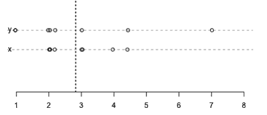

**图 13-3:** 比较两个具有相同算术平均值（由垂直虚线表示）但波动程度不同的假设数据向量。相同的观测值经过了微抖动处理。

*方差*（variance）衡量数值观测值围绕其算术平均值的离散程度。方差是每个观测值与均值之间平均平方距离的特定表示方法。对于一组标记为 `$x = \{x_1, x_2, \dots, x_n\}$` 的 `$n$` 个数值测量，样本方差 `$s_x^2$` 给出，其中 `$\bar{x}$` 是公式 (13.1) 中描述的样本均值：

```
$s_x^2 = \frac{(x_1 - \bar{x})^2 + (x_2 - \bar{x})^2 + \dots + (x_n - \bar{x})^2}{n-1} = \frac{1}{n} \sum_{i=1}^n (x_i - \bar{x})^2 \quad (13.3)$
```

例如，如果你取示例观测值 2, 4, 3, 3, 2, 2.2, 2, 4，它们的样本方差保留三位小数后如下（部分项为了可读性被隐藏……）：

```
$$\frac{(2 - 2.825)^2 + (4.4 - 2.825)^2 + \dots + (7 - 2.825)^2}{7} = \frac{(-0.825)^2 + (1.575)^2 + \dots + (1.175)^2}{7} = \frac{6.355}{7}$$
```

*标准差*（standard deviation）是方差的平方根。由于方差是平均平方距离的表示，因此标准差提供了一个相对于原始观测值尺度的可解释数值。对于包含 `$n$` 个观测值的样本使用相同的符号，样本标准差 `$s$` 通过对公式 (13.3) 取平方根得到。

```
$s_x = \sqrt{s^2} = \sqrt{\frac{1}{n-1} \sum_{i=1}^n (x_i - \bar{x})^2} \quad (13.4)$
```

例如，基于之前计算的样本方差，这八个假设观测值的标准差如下（保留三位小数）：
$$\sqrt{0.9098} = 0.953$$

因此，一种粗略方法是：0.953 代表每个观测值到均值的平均距离。

与方差和标准差不同，*四分位距*（interquartile range，IQR）不是相对于样本均值计算的。IQR 衡量数据“中间 50%”的宽度，即位于中位数两侧第 25 分位数的数值范围。因此，IQR 是数据的上四分位数下四分位数之差计算的。形式上，其中 `$Q_x(\cdot)$` 表示分位数函数（如第 12.3 节定义），IQR 为：

```
$IQR_x = Q_x(0.75) - Q_x(0.25) \quad (13.5)$
```

用于计算这些离散指标的 R 命令是 `var`（方差）、`sd`（标准差）和 `IQR`（四分位距）。

```R
R var(xdata)

[1] 0.9078571

R sd(xdata)

[1] 0.9528154

R IQR(xdata)

[1] 1.25
```

你可以使用平方根函数 `sqrt` 对 `var` 进行操作来确认样本方差与标准差之间的关系，并通过计算第三四分位数和第一四分位数之差来重现 IQR。

```R
R sqrt(var(xdata))

[1] 0.9528154

R as.numeric(quantile(xdata,0.75)-quantile(xdata,0.25))

[1] 1.25
```

注意 `as.numeric`（见第 6.2.4 节）会去除 `quantile` 返回对象中的百分比注释（默认标记结果的标签）。

现在，对与 `xdata` 具有相同算术平均值的 `ydata` 观测值进行相同操作。计算结果如下：

```R
R sd(ydata)

[1] 0.2126393

R IQR(ydata)

[1] 1.6
```


ydata 与 xdata 处于相同的尺度上，因此结果证实了图 13-3 中所示的内容——前者的观测值在后者更为分散。

最后两个例子，让我们再次回到小鸡（chicks）和地震（quakes）数据集。在第 13.2.1 节中，你看到所有小鸡的平均重量为 261.3099 克。你现在可以发现重量的标准差如下：

```
R
sd(chickts$weight)
[1] 78.0737
```

从非正式地说，这意味着每只小鸡的重量距离平均重量约为 78.1 克（从技术上讲，它仅仅是平方距离之函数的平方根——见下注）：

在第 13.2.3 节中，你使用 `summary` 获取了 quakes 数据集中某些地震幅的五数摘要。查看这些早期结果中的第一四分位数和第三四分位数（分别为 4.4 和 4.9），你可以快速确定该事件子集的 IQR 为 0.5。这可以使用 `IQR` 进行确认。

```
R
IQR(quakes[quakes$depth>=400])
[1] 0.5
```

这给出了以里氏级为单位的中间 50% 观测值的权重。

注意：方差的定义（以及标准差的定义）特指“样本估计量”，这是 R 中的默认设置，它在公式中使用 $n - 1$ 作为除数。当现有观测值代表假设更大总体的样本时，使用此公式。在这种情况下，除数为 $n - 1$。

## 练习 13.3

a. 使用 chicks frame，计算重量的第 10、30 和 90 百分位数。

b. 使用 quakes 数据集，完成以下操作：
   i. 找到深度的 IQR。
   ii. 找到所有深度的五数摘要。
   iii. 根据你的知识，创建一个名为 `depth` 的新因子（factor）。
   iv. 找到所有事件的标准差。
   v. 使用 `apply` 寻找关联性。

```
R
cov(xdata,ydata)
[1] 1.479286

cov(xdata,ydata)/(sd(xdata)+sd(ydata))
[1] 0.7713962

cor(xdata,ydata)
[1] 0.7713962
```

你可以将这些双变量观测值绘制为坐标图（散点图——更多示例见第 14.4 节）。执行以下代码得到图 13-4：

```
R
plot(xdata,ydata,pch=13,cex=1.5)
```

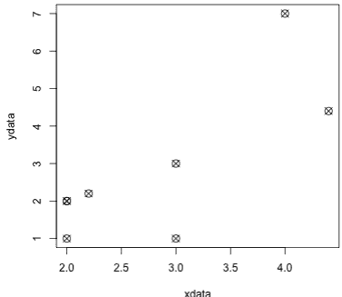

图 13-4：将 xdata 和 ydata 观测值绘制为双变量数据点以说明相关系数的解释

如前所述，相关系数估计了两组观测值之间线性关系的性质。因此，如果你观察图 13-4 中点所形成的模式，并想象画一条最能代表所有点的直线，你就可以通过这些点与你的直线的接近程度来确定线性关联的强度。越接近直线的点，其 $\rho_{xy}$ 值就越接近 -1 或 1。方向由线的斜率决定——趋势向右上方倾斜的线表示正相关趋势；向右下方倾斜的线则表示负相关趋势。考虑到这一点，你可以看到图 13-4 中绘制数据的估计相关系数是合理的。从 xdata 和 ydata 的角度来看，这些点似乎以直线的形式共同增加，但这种线性关联是完美的。关于如何计算“理想”或“最佳”直线来拟合此类数据，将在第 20 章中讨论。

为了帮助你理解相关性的概念，图 13-5 显示了不同的散点图，每个图显示 100 个点。这些观测值是随机生成的，以符合每个图表上方标记的 $\rho_{xy}$ “真实”值。

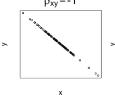
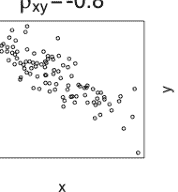
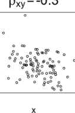
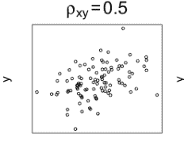
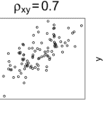
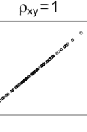
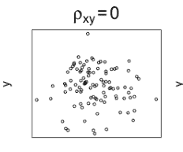
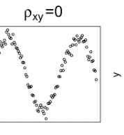
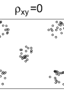

图 13-5：人工生成的 x 和 y 观测值，用于说明相关系数的值

第一行散点图显示负相关数据；第二行显示正相关数据。这与你的预期一致——线的斜率显示了负趋势或正趋势，而系数的极端程度对应于与“完美直线”的接近程度。第三行也是最后一行显示了相关性设置为零生成的数据，这意味着 x 和 y 之间没有线性关系。中间和最右侧的图尤为重要，因为它们强调了一个事实：皮尔逊相关系数仅识别“直线”关系；这两幅图明显显示了某种趋势，但这种特定的统计量无法用于检测这种趋势。

总结本节时，再次查看地震数据（quakes）。两个变量是 `mag`（每个事件的震级）和 `stations`（报告该事件的站点数量）。可以使用以下代码生成以 y 轴为 `stations`、x 轴为 `mag` 的图：

```
R
plot(quakes$mag,quakes$stations,xlab="Magnitude",ylab="No. of stations")
```

图 13-6 显示了这张图。

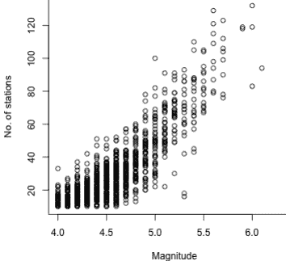

图 13-6：绘制地震数据中报告事件的站点数量 (y) 和每个事件的震级 (x)

通过垂直模式可以发现，震级似乎被记录到了特定的精度水平（这是由于精确测量震级存在困难）。尽管如此，在散点图中清晰可见正相关（更多的站点倾向于检测到震级更高的事件），这一特征得到了正协方差的确认。

```
R
cov(quakes$mag,quakes$stations)
[1] 7.50811
```

正如你从观察模式中预期的那样，皮尔逊相关系数证实了线性关联相当强。

```
R
cor(quakes$mag,quakes$stations)
[1] 0.8511824
```

注意：记住相关性并不意味着因果关系。当你发现两个变量之间存在高相关效应时，这并不意味着一个导致了另一个。即使在大多数受控情况下，因果关系也是难以证明的。相关性仅允许我们衡量关联。

前面提到，还有其他的相关表示；秩系数（例如斯皮尔曼相关系数肯塔尔相关系数）与皮尔逊估计的区别在于它们不要求关系是线性的。这些也可以通过访问 `cor` 函数的可选参数来实现（见 `?cor`）。然而，皮尔逊相关系数是最常用的，并且与线性回归方法有关，你将在第 20 章开始研究。

### 13.2.6 离群值

离群值是指与其他数据不“合”的观测。与大部分数据相比，它是一个明显的极端值，换句话说，是一个异常。在某些情况下，你可能会怀疑这样的极端值实际上来自生成其他观测值的相同机制，但并没有硬性的数值规则来规定什么是离群值。例如，考虑 `foo` 中的 10 个假设数据点。

```
R
foo <- c(0.6,-0.6,0.1,-0.2,-1.0,0.4,0.3,-1.8,1.1,6.0)
```

使用第 7 章中的技能（以及创建图 13-3 的技能），你可以如下方式在直线上绘制 `foo`：

```
R
plot(foo,rep(10),xlab="n",ylab="",lty="n",cex=2,cex.axis=1.5,cex.lab=1.5)
abline(h=0,col="gray",lty=2)
arrows(5,0.5,5.9,0.1,lwd=2)
text(5,0.7,labels="outlier")
```

```
R
cor(bar,baz)
[1] 0.4566361

cor(bar[-10],baz[-10])
[1] 0.8898639
```

你可以看到，在去掉那个离群值后，相关性变得增强得多。
在实践中，要准确判断是否删除离群值可能是困难的。在这个阶段，重要的是意识到离群值对分析可能产生的影响，并在开始更严谨的统计调查之前，对原始数据进行粗略检查。

极端观测值对分析的影响程度不仅取决于它们的极端程度，还取决于你打算计算的统计量。例如，样本均值对离群值非常敏感，包含它们与结果会有巨大差异，因此任何依赖于均值、方差或协方差的统计量都会受到影响。分位数及统计量（如中位数或 IQR）受离群值的影响较小。在统计学中，这种性质被称为稳健性（robustness）。

# 练习 13.4

a. 在第 139 页的练习 7.1 (b) 中，你绘制了身高与重量的测量图。请根据这两个变量的观测数据计算相关系数。

b. R 的另一个内置且即取即用的数据集是 `mtcars`，它包含了性能方面的许多描述细节。
   i. 确保你可以在提示符中输入 `mtcars` 来访问这些数据。然后查看其帮助文件以了解存在的数据类型。
   ii. 在描述车辆马力和行驶四分之一英里所需最短时间这两个变量中，使用 R 的图形化功能绘制这两个向量并计算相关性。
   iii. 识别 `mtcars` 中对应传输类型的变量。利用你对因子（factors）的知识，从该变量创建一个名为 `tranfac` 的新因子，其中手动挡汽车标记为 "manual"，自动挡标记为 "auto"。
   iv. 现在，使用 `ggplot` 结合 `tranfac` 产生与 (ii) 相同的散点图，并能够从视觉上区分手动汽车和自动汽车。最后，分别计算马力的相关性，并将这些估计值与 (ii) 中的总体值进行比较。

c. 回到完成以下任务：
   i. 仅根据向日葵的重量绘制一张类似于图 13-7 左面板的图。注意，向日葵饲（sunflower-fed）的重量远低于其他。
   ii. 计算重量的标准差和四分位距（IQR）。
   iii. 现在，假设你被告知向日葵饲最低重量是由与你研究无关的离群值造成的。删除该观测值并重新计算剩余重量的标准差和 IQR。简要说明计算值之间的差异。

# 本章重要代码

| 函数/运算符 | 简要描述 | 首次出现 |
| :--- | :--- | :--- |
| `mean` | 算术均值 | 第 13.2.1节，第268 页 |
| `median` | 中位数 | 第 13.2.1节，第268 页 |
| `table` | 频率制表 | 第 13.2.1节，第268 页 |
| `min`, `max` | 最小值和最大值 | 第 13.2.1节，第268 页 |
| `round` | 数值四舍五入 | 第 13.2.2节，第272 页 |
| `quantile` | 分位数/百分位点 | 第 13.2.3节，第274 页 |
| `summary` | 五数摘要 | 第 13.2.3节，第275 页 |
| `jitter` | 绘图中的抖动 | 第 13.2.4节，第276 页 |
| `var`, `sd` | 方差，标准差 | 第 13.2.4节，第278 页 |
| `IQR` | 四分位距 | 第 13.2.4节，第278 页 |
| `cov`, `cor` | 协方差，相关性 | 第 13.2.5节，第281 页 |

# 14
## 基础可视化


数据可视化是统计分析的重要部分。适用于给定数据集的可视化工具取决于你所观测的变量类型（根据第 13.1.1 节和 13.1.2 节中的定义）。在本章中，你将查看统计分析中最常用的数据图，并查看使用基础图形（base graphics）和 `ggplot2` 功能的示例。

### 14.1 柱状图和饼图

柱状图和饼图通常用于按类别频率可视化定性数据。在本节中，你将学习如何使用 R 生成这两种图。

#### 14.1.1 构建柱状图

柱状图绘制垂直或水平条形（通常用白色间隔分隔），以根据相关类别可视化频率。虽然原始频率本身通常会被显示，但柱状图也可以用于可视化其他数量，例如均值或比例，这些数量直接依赖于这些频率。

例如，让我们使用第 287 页练习 13.4 (b) 中的 `mtcars` 数据集。它详细描述了 20 世纪 70 年代中期32 款经典性能汽车的各种特征，可以从提示符直接查看前五条记录。

```
mtcars[1:5,
mpg cyl disp hp drat wt am gear carb
Mazda RX4 21.0 6 160 110 3.9 2.620 16.46 0 1 4
Mazda RX4 Wag 21.0 6 160 110 3.9 2.875 17.02 0 1 4
Datsun 710 22.8 4 108 93 3.8 2.320 18.61 1 1 4
Hornet 4 Drive 21.4 6 258 110 3.8 3.215 19.44 1 0 3
Hornet Sportabout 18.7 8 360 175 3.145 17.02 0 0 2
```

`mtcars` 中的文档解释了所记录的变量。其中，`cyl` 提供每个发动机的汽缸数——四、五、六或八。要找出每个气缸数量下观测到多少个气缸，你可以使用 `table`，如下：

```
R
cyl.freq <- table(mtcars$cyl)
cyl.freq
4 6 8
1 7 14
```

结果可以很容易地显示为柱状图，如下：

```
R
barplot(cyl.freq)
```

你可以在图 14-1 的左侧找到结果柱状图。


图 14-1：使用基础图形的柱状图示例。左侧：最简单的版本。右侧：展示各种选项的错位（dodged）柱状图。

选择了 `barplot`。参数 `las=1` 强制使垂直轴上的标签水平显示，而不是与轴线平行。前两个参数 `legend.text` 和 `args.legend` 用于图例——你可以像第 7.3 节那样通过 `legend` 单独绘制图例，但这种方法自动化了颜色分配，以确保引用键与条形本身的精确颜色匹配。

使用 `ggplot2` 可以生成类似的图表。如果你通过 `library("ggplot")` 安装了包并输入以下内容，它将生成图 14-2 左侧最基本的条形图：

```
R
qplot(factor(mtcars$cyl), geom="bar")
```

注意，这里相关的元素是 `"bar"`（如果单独使用则是 `geom_bar`，稍后你会看到），并且 `qplot` 中的映射变量必须作为 factor 提供（在 mtcars 中，向量 `mtcars$cyl` 是数值型，这对于 `barplot` 没问题，但 `ggplot2` 的功能要求严格得多）。


**图 14-2:** 使用 `ggplot2` 功能绘制 mtcars 数据的两个条形图示例。左侧：最简单的 `qplot` 版本，使用一个分类变量。右侧：“并排（dodged）”条形图，基于提供的额外 geom 和缩放选项，与图 14-1 相同。

再次，你可以根据想要显示的内容创建复杂复杂的图像。要生成 14-1 中并排图的 `ggplot2` 版本，请调用以下代码：

```
R
qplot(factor(mtcars$cyl), geom="blank", fill=factor(mtcars$am), xlab="",
  ylab="Performance car counts\nby transmission and cylinders")
  + geom_bar(position="dodge")
  + scale_x_discrete(labels=c("V4","V6","V8"))
  + scale_y_continuous(breaks=seq(0,12,2))
  + theme_bw() + coord_flip()
  + scale_fill_grey(name="Trans.", labels=c("auto","manual"))
```

你可以在图 14-2 右侧找到结果。

注意基础 `ggplot` 设置中的许多新新增。默认映射 `by, cyl` 与之前相同。你进一步指定条形应该根据变速变量 `am` 创建的 factor 进行填充；因此，每个 `cyl` 条形都被指示按该变量拆分。对 `ggplot` 的初始调用是“空的”，因为 `geom="blank"`，因此在向 `ggplot` 对象添加 `geom_bar` 绘制之前。通过 `position="dodge"`，它变成了并排条形图；在基础 R 图图中，默认行为是生成堆叠图。`scale_x_discrete` 修饰标记了默认 `cyl` 映射的每个类别；`scale_y_continuous` 修饰用于控制频率的轴标签。

此外，向对象添加 `theme_()` 会更改图像的视觉主题；在当前，我选择了移除灰色背景，因为它与手动挡汽车的条形太相似了。向对象添加 `color_flip` 会翻转坐标轴并提供水平条形而不是默认的垂直样式（注意 `scale_*` 函数的调用是针对未翻转的图像的）。`fill` 的默认行为是使用颜色，因此使用 `scale_fill_gray` 修饰器将其固定为灰度，并自动缩放标签以匹配。在这种情况下，`ggplot2` 最显著的优势在于你不需要手动统计计数或为这些频率设计特定的矩阵——映射会自动完成这一点。为了练习，我鼓励你尝试这段代码，省略 `ggplot` 对象的某些添加项，以评估其对生成图像的影响。

### 14.1 快速饼图

古老的饼图是可视化跨层级基于频率的数量的替代方案，通过大小适当的切片代表每个变量的相对计数。

```
R
pie(table(mtcars$cyl), labels=c("V4","V6","V8"), col=c("white","gray"), main="Performance cars by cylinders")
```


你可以在图 14-3 中找到结果。尽管通过努力可以实现，但 `ggplot2` 中没有直接的 `"pie"` `geom`。这在某种可能是由于统计学家普遍偏于使用条形图而非饼图。这一事实本身在帮助文件中得到了总结：饼图是显示信息的糟糕方式。眼睛擅长判断线性测量，但不擅长判断面积。此外，如果按第二个变量拆分或 factor 的级别是有序的，条形图比饼图更有价值。


**图 14-3:** mtcars 数据中气缸数量频率的饼图

## 14.2 直方图

条形图在与分类变量相关的观测计数方面直观且合理，但如果你感兴趣的变量是数值型的，则几乎没有用。为了可视化连续测量的分布，你可以使用直方图——这种工具有时因外表相似而与条形图混淆。直方图也测量频率，针对连续变量，首先需要对观测数据进行“分箱（binning）”，即定义区间然后计算落在每个区间内的连续观测值数量。区间的大小被称为 `binwidth`。

作为一个直方图的简单示例，考虑 mtcars 中的马力数据，它在第四列，命名为 `hp`。

```R
R> mtcars$hp
[1] 110 93 110 175 105 245 62 95 123 180 180 215 230 66
[2] 52 65 97 150 245 175 66 91 113 264 175 335 109
```

在本节中，定义所有性能汽车的马力，假设这些观测代表了该总体的样本。使用基础 R 图，直方图接收连续观测向量并产生直方图，如图 14-4 左侧所示。你可以立即看到左侧的直方图使用了 50 个单位的分箱跨越数据范围，为你提供了关于马力测量分布的快速且有效的印象。它似乎大致集中在 75 到 150 的范围内，在右侧变细（这被称为右偏或正偏；更多术语将在第 15.2.4 节中介绍）。

直方图作为分布形状表示的准确性完全取决于用于构建数据的区间宽度。`binwidths` 在 `hist` 中通过 `breaks` 参数控制。你可以通过提供一个向量给 `breaks` 来手动设置这些断点。这在以下代码中实现，通过将每个箱的宽度从 50 减半到 25，并使用等距序列扩大整体范围。

```R
R> hist(mtcars$hp, breaks=seq(0,400,25), col="gray", main="Horsepower", xlab="HP")
R> abline(v=c(mean(mtcars$hp),median(mtcars$hp)), lty=c(2,3), lwd=2)
R> legend("topright", legend=c("mean HP","median HP"), lty=c(2,3), lwd=2)
```

图 14-4 右侧的图显示了更窄的分箱结果，同时将条形变为灰色并添加了更易读的标题。它还包含了使用 `abline` 表示平均和中值的垂直线，以及图例（参考第 7.3 节）。

使用较小的 `binwidth`，可以看到分布的更多细节。然而，使用更窄的分箱可能会突出“不重要的特征”（换句话说，直方图中由于有限样本产生的自然变异的特征）。这些特征通常出现在尺度上数据稀少的地方。


**图 14-4:** 展示了 hist 对 mtcars 马力数据的默认行为（左侧），自定义分箱、颜色和标题选项，并添加了中心性标记（右侧）

如果你没有显式指定分箱（bins），将使用正好 30 个区间来跨越数据的范围。通过调用 `geom_histogram` 查看相关的 geom 文档，你可以得到以下信息：

> 默认情况下，`stat_bin` 使用 30 个分箱。这不是一个好的默认设置，但其意图是让你尝试不同的箱宽（binwidths）。你可能需要查看几个，以揭示你数据背后的完整故事。

因此，ggplot2 并不默认使用数据驱动的直方图算法（hist），而是鼓励你意识到这个问题并主动设置你自己的箱宽。你可以看到，对于这个例子，30 个分箱产生的区间窄得不合理——有许多没有观测值落入间隙。在 ggplot 中选择直方图有很多方法，其中一种是尽早使用断点（breaks），为其提供一个合适的区间端点数值向量。要使用 ggplot2 功能重新创建图 14-4 右侧的图，请使用以下代码，它将生成图 14-5 中的右侧图：

```R
ggplot(mtcars, geom="blank", main="horsepower", xlab="HP")
+ geom_histogram(color="black", fill="white", breaks=seq(0,400,25))
  + closed="right")
+ geom_vline(mapping=aes(x=mean(mtcars$hp), median=median(mtcars$hp)),
+ linetype=factor(c("mean","median")), show.legend=TRUE)
+ scale_linetype_manual(values=c(2,3)) + labs(linetype="")
```

从“blank” geom 开始，`geom_histogram` 完成了大部分工作，其中 `color` 控制条形的轮廓颜色，`fill` 控制条形的内部颜色。`closed="right"` 参数决定了每个区间在右侧是“闭合”的（换句话说，是包含的），在左侧是“开放”的（如 `?hist` 中默认）。`geom_vline` 函数用于添加垂直的平均值和中位数线；在这里，必须指示使用 `aes` 更改映射，并映射这些线的位置。为了确保为平均值和中位数创建正确标记的图例，你还必须指示 `linetype` 映射到期望的值。在这种情况下，它是一个由两个期望“水平”组成的因子（factor）。

由于你正在手动将这些线和相关映射添加到 ggplot2 中，图例本身必须通过 `show.legend=TRUE` 指示显示。默认情况下，两条线被绘制为 l1=1（实线）和 l2=2（虚线），但为了匹配之前的图，你希望 l1=2 且 l=3（点线）。你可以添加 `scale_linetype_manual` 修饰符来此此更改；期望的类型数字作为向量传递给 `values`。最后，为了抑制为你手动添加的图例自动包含标题，`labs(linetype="")` 指示与 `aes` 中映射到 `linetype` 的变量相关的比例（scale）在不显示此标题的情况下显示。

使用 ggplot2 和基础 R 图形之间的选择通常取决于你的预期目标。对于图形的自动化处理，特别是当使用分类变量来分离数据子集时，ggplot2 特别强大。另一方面，如果你需要对给定图像的创建进行手动控制，传统的 R 图形可能更容易处理，而且你不需要跟踪多个美学变量映射。

## 14.3 箱线图 (Box-and-Whisker Plots)

直方图的一个特别流行的替代方案是箱线图，简称为 boxplot。这仅仅是第 13.2.3 节讨论的五数总结的可视化表示。

### 14.3.1 独立箱线图

让我们运行斐济附近 1000 次地震事件的内置 `quakes` 数据框。为了比较，你可以使用基础 R 的默认行为查看这些事件震级的直方图和箱线图。以下代码生成图 14-6 所示图像：

```R
R> hist(quakes$mag)
R> boxplot(quakes$mag)
```

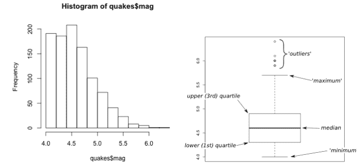

**图 14-6:** 来自 quakes 数据的默认直方图（左）和箱线图（右）。在箱线图上，注释[外部叠加]指出了显示的关键信息。

与直方图一样，箱线图显示了分布的重要特征，例如全局（即整体）中心性、离散性和偏度。然而，实际上无法看到局部特征，例如分布中的多个显著峰值。正如标记箭头所示，箱子中间的线代表中位数，箱子的上下边缘显示相应的四分位数，从箱子延伸出的垂直线（*须* whiskers）表示最小值和最大值，任何在须之外绘制的点都被视为极值或离群值。默认情况下，IQR 将离群值定义为比低四分位数小 1.5 倍 IQR 或高于高四分位数加 1.5 倍 IQR 的观测值。这样做是为了防止须延伸过远并过度强调任何尺寸。因此，由须标记的“最大值”和“最小值”并不是数据集中原始的整体最大值或最小值，因为被认为是“离群值”的值可能代表最高或最低值。你可以通过子图中的 `range` 参数来控制这种分类的性质，尽管对于基础数据探索，`range=1.5` 的默认值完全合理。

### 14.3.2 并列箱线图

```R
R> stations.fac <- cut(quakes$stations, breaks=c(0,50,100,150))
R> stations.fac[1:5]
[1] [0,50] [0,50] [0,50] [0,50]
Levels: [0,50] [50,100] [100,150]
```

记得 `stations` 变量记录了有多少监测站检测到了每个事件。这段代码产生了一个因子，将这些观测值分为三组——被 50 个或更少站检测到的事件、51 到 100 个之间、以及 101 到 150 个站之间。因此，你可以比较这三组事件震级的分布。下一行代码生成图 14-7 的最后一张图像：

```R
R> boxplot(quakes$mag ~ stations.fac, # stations detected, ylab="Magnitude", col="gray")
```

通过这行代码，你应该注意到 `quakes$mag ~ stations.fac` 中波浪号 `~` 形式的新语法。你可以将其读为“在...上”、“或”或“对于”（你将在第 20 到 22 节中频繁使用波浪号）。在这里，你正在使用 boxplot 绘制 `quakes$mag` 对 `stations.fac`，以便为每个组产生一个独立的箱线图，还使用了可选参数来控制轴标签和箱子颜色。

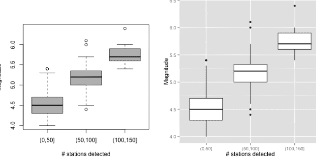

**图 14-7:** 按检测站数量分组的地震震级箱线图

转向 ggplot2 功能：

```R
R> qplot(stations.fac, quakes$mag, geom='boxplot',
     xlab="# stations detected", ylab="Magnitude")
```

默认的箱线图看起来有点不同，但你可以进行相同的解释。在使用 `qplot` 时，你将分组因子作为 x 轴变量（第一个参数），并将所需的箱线的连续变量作为 y 轴变量（第二个参数）。在这里我显式设置了 `geom='boxplot'` 以确保显示箱线图，并添加了轴标签。

## 14.4 散点图

散点图最用于识别两个不同的数值连续变量观测值之间的关系，显示为 x-y 坐标图。基础 R 图形的坐标特性有利于创建散点图，因此你在书中已经看到了一些例子。然而，并不是每个 x-y 坐标图都称为散点图；散点图通常假设存在某种“感兴趣的关系”。例如，像图 13-1 那样的空间坐标图可能不认为是散点图，但地震震级与检测事件的站点数之间的图（如图 13-6）就是散点图。

我将通过扩展如何使用散点图探索两个以上的连续变量来结束本章。为了实现，让我们访问另一个可直接使用的 R 数据，即著名的鸢尾花数据集（iris）。该数据集收集于 20 世纪 30 年代中期，是一个 150 行 5 列的数据框，包含三种多年生花——长状鸢尾（Iris setosa）、毛状鸢尾（Iris virginica）和彩鸢尾（Iris versicolor）的花瓣和花萼测量值（Anderson, 1935, Fisher, 1936）。你可以在这里查看前几记录：

```R
R> iris[1:5,]
  Sepal.Length Sepal.Width Petal.Length Petal.Width Species
1          5.1         3.5          1.4         0.2  setosa
2          4.9         3.0          1.4         0.2  setosa
3          4.7         3.2          1.3         0.2  setosa
4          4.6         3.1          1.5         0.2  setosa
5          5.0         3.6          1.4         0.2  setosa
```

通过 iris 数据，你可以看到每个变量都有 50 个观测值，单位为厘米（cm），涵盖了每种物种。

### 14.4.1 单图

你可以修改简单的散点图，根据分类变量对绘制的点进行拆分，从而揭示连续变量之间任何可见关系的潜在差异。例如，使用基础 R 图形功能，你可以检查三种物种花瓣的测量值。使用第 7 章首次解释的“阶石式”方法，你可以通过使用 `type="n"` 生成一个尺寸正确的空绘图区域，随后添加与每个物种对应的点，并根据需要更改点的形状和颜色。

```R
R> plot(iris[,4], iris[,3], type="n", xlab="Petal Width (cm)", ylab="Petal Length (cm)")
R> points(iris[iris$Species=="setosa",4], iris[iris$Species=="setosa",3], pch=19, col="black")
R> points(iris[iris$Species=="virginica",4], iris[iris$Species=="virginica",3], pch=19, col="gray")
R> points(iris[iris$Species=="versicolor",4], iris[iris$Species=="versicolor",3], pch=19, col="black")
R> legend("topleft", legend=c("setosa","virginica","versicolor"), col=c("black","gray","black"), pch=c(19,19,19))
```

你可以在图 14-8 中找到该图。注意，毛状鸢尾（Iris virginica）的花最大，其次是彩鸢尾（Iris versicolor），长状鸢尾（Iris setosa）最小。然而，这段代码虽然可行，但很繁琐。你可以通过设置指定每个观测值所需点形状和颜色的向量更简单地生成相同的图像。考虑这里创建的两个对象：

```R
R> iris_pch <- rep(19, nrow(iris))
R> iris_pch[iris$Species=="versicolor"] <- 1
R> iris_col <- rep("black", nrow(iris))
R> iris_col[iris$Species=="virginica"] <- "gray"
```

第一行创建了一个长度与 iris 中观测值数量相同的向量 `iris_pch`，每个条目均为 19。然后通过向量子集覆盖了对应 versicolor 的条目并设置了点……遵循相同的步骤创建 `iris_col`；首先向等大小的向量填充为 "black"，然后将对应 virginica 的条目覆盖为 "gray"。这样，注意下面显示的单行代码，随后跟着相同的 `legend` 调用，将产生相同的结果：

```R
R> plot(iris[,4], iris[,3], col=iris_col, pch=iris_pch, xlab="Petal Width (cm)", ylab="Petal Length (cm)")
```


**图 14-8:** 三种鸢尾花物种的花瓣宽度与长度散点图

### 14.4.2 散点图矩阵

这种“单”类型的平面散点图在比较两个连续变量时非常有用。当有更多感兴趣的连续变量时，无法在单图上满意地显示这些信息。一种简单常用的解决方案是为每对变量生成双变量散点图，并以结构化的方式一起显示；这被称为*散点图矩阵*（scatterplot matrix）。利用之前创建的 `iris_pch` 和 `iris_col` 向量，你可以为 iris 中的所有连续变量生成散点图矩阵，同时保留物种之间的区别。使用基础 R 图形，请使用 `pairs` 函数。

```R
R> pairs(iris[,1:4], pch=iris_pch, col=iris_col, cex=0.75)
```

你可以在图 14-9 中找到该行的结果。


**图 14-9:** 数据框中所有连续测量值的散点图矩阵

使用 `pairs` 最简单的方法是提供原始观测值的矩阵或数据框作为第一个参数，通过选择除 Species 列以外的 iris 列（`iris[,1:4]`）。对图的解释取决于对角线面板的标签，从左上角到右侧。它们出现的顺序与作为第一个参数提供的列顺序相同。“标记面板”允许你确定矩阵中的每个单独图表对应哪对变量。例如，图 14-9 中散点图矩阵的第一列对应 x 轴变量花萼长度（Sepal Length）；矩阵的第三行对应 y 轴变量花瓣长度（Petal Length），且每一行和每一列显示的比例尺在向左右或向上/向下移动时都是恒定的。这意味着对角线以上的图在下方是镜像的——位置在第 4 行 2 列的花瓣宽度 (y) 对花萼宽度 (x) 的图与位置在第 2 行 4 列的散点图数据相同，但在轴上翻转了。因此，`pairs` 包含仅显示对角线上方或下方的选项，通过设置 `lower.panel=NULL` 或 `upper.panel=NULL` 来抑制其中一个。

散点图矩阵允许更容易地比较对多个连续变量进行观测形成的成对关系集合。在这个矩阵中，注意花瓣测量值之间存在强正线性相关性，但花萼测量值之间的关系较弱。此外，尽管从花瓣来看长状鸢尾可能被合理认为是最小的花，但从花萼来看则并非如此。

对于那些使用 ggplot2 的人，你们知道像本例一样围绕分类变量拆分点是自然而然的。

```R
R> qplot(iris[c(4,3)], xlab="Petal width", ylab="Petal length", shape=Species)
  + scale_shape_manual(values=4:6) + labs(shape="Species")
```


你可以在图 14-10 中找到结果 。

图 14-10：使用 ggplot2 功能绘制三个物种的花瓣维度直方图，这里通过将 `Species` 映射到形状使用了基础 R 术语拆分了点，并使用 `scale_shape_manual` 修改了点类型。散点图矩阵仅使用 ggplot2 很难实现。为了以 ggplot2 风格生成矩阵，建议下载 GGally 包（Schlo et al., 2014）以访问 `ggpairs` 函数。该包通过运行 `install.packages("GGally")` 并通过 `library("GGally")` 加载。所示，以下代码产生了图 14-11：

```R
R> ggpairs(iris, aes(col = Species))
```

尽管可能会看到熟悉的警告，但 ggally 为散点图的下半部分提供了印象深刻的视觉效果，底部带有直方图 。

图 14-11：使用 GGally 生成散点图矩阵，使用颜色区分物种。注意添加了估计的相关系数和分布图。

## 练习 14.1

回溯内置的 `Insects` 数据框，其中包含了用六种喷剂之一处理的农业单元的昆虫计数。

- 使用基础 R 图形制作计数直方图。
- 获取每种喷剂的昆虫总数（这在 273 页的练习 13.2 中也问过）。然后使用基础 R 图形制作这些总数的垂直柱状图和饼图，并进行适当标记。
- 使用 ggplot2 功能生成按喷剂类型分类的昆虫计数箱线图，并包含相应的轴和标题。

另一组 R 的可直接使用数据集是 `USArrests`，包含 1973 年美国 50 个州每万人因谋杀、强奸和袭击被逮捕的数据（参见例如 McNeil, 1977）。它还包含一个给出每个州城市人口百分比的变量。简要插入框架对象和相关文档 `?USArrests`。然后完成以下任务：

- 使用 ggplot2 功能生成城市人口比例的直方图。设置间距为 10 个单位，范围从 0 到 100。让直方图显示第一分位数、中位数、第三分位数；提供匹配的图例。根据喜好使用颜色并包含适当的轴注释。
- 代码 `t(as.matrix(USArrests[, -3]))` 创建了一个没有城市人口列的 `USArrests` 数据矩阵，内置 R 对象 `state.abb` 按照字母顺序提供了州的字母缩写，作为一个字符向量。使用这两种结构和基础 R 图形制作一个水平堆叠柱状图，水平条用州缩写标记，并且每个条按犯罪类型（谋杀、强奸和袭击）划分。包含图例。

f. 定义一个新因子向量 `urbancat`，如果对应州的人口百分比大于中位数，则将其设为 1，否则设为 0。

g. 在你的工作区中创建 `USArrests` 的副本，删除 `UrbanPop` 列后，只保留三个犯罪率变量。在此对象中插入一个新的第四列 `urbancat`。

h. 使用 (g) 中的数据框，通过 `ggally` 功能生成这三个犯罪率之间相互对比的散点矩阵以及其他相关图表。使用颜色根据 `urbancat` 的两个水平对犯罪率进行拆分。

回到内置的 `quakes` 数据集。

i. 创建一个与震级（magnitude）对应的因子向量。每个条目应根据最小震级、1/3 分位数、2/3 分位数和最大震级标记的分断点，假设分为三个类别之一。

j. 重新创建所示的图表，根据你在 (i) 中的因子向量，将低、中、高震级事件绘制出来，其中 `pch` 分别分配为 1、2 和 3。

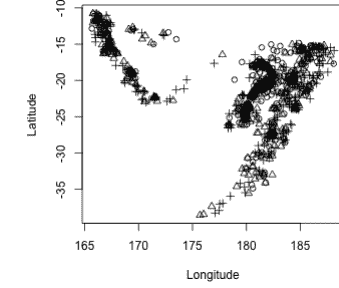

k. 为 (j) 中的图表添加图例，以引用三个 `pch` 值。

# 本章重要代码

| 函数/运算符 | 简要描述 | 首次出现 |
| :--- | :--- | :--- |
| `barplot` | 创建柱状图 | 第 14.1.1 节，页 290 |
| `geom_bar` | 柱状图几何对象 | 第 14.1.1 节，页 292 |
| `scale_x_discrete` | 修改离散 x 轴 `[ggplot2]` | 第 14.1.1 节，页 292 |
| `scale_y_continuous` | 修改连续 y 轴 | 第 14.1.1 节，页 292 |
| `theme_bw` | 黑白颜色主题 | 第 14.1.1 节，页 292 |
| `coord_flip` | 交换 x 和 y 轴 | 第 14.1.1 节，页 292 |
| `scale_fill_grey` | 填充颜色为灰度模式 | 第 14.1.2 节，页 292 |
| `pie` | 创建饼图 | 第 14.2.1 节，页 293 |
| `hist` | 创建直方图程序 | 第 14.2.1 节，页 294 |
| `geom_histogram` | 直方图几何对象 | 第 14.2.2 节，页 297 |
| `geom_vline` | 添加垂直线几何对象 | 第 14.2.2 节，页 297 |
| `scale_linetype_manual` | 修改 ggplot2 线型 | 第 14.2.2 节，页 297 |
| `labs` | ggplot2 图例标签 | 第 14.3.1 节，页 298 |
| `boxplot` | 创建箱线图 | 第 14.3.2 节，页 298 |
| `-` | “根据”绘图 | 第 14.3.2 节，页 299 |
| `pairs` | 散点矩阵 | 第 14.4.2 节，页 303 |
| `scale_shape_manual` | 修改 ggplot2 点形状 | 第 14.4.2 节，页 304 |
| `ggpairs` | 散点矩阵 (`Gally`) | 第 14.4.2 节，页 304 |

# 15

## 概率

**概率**的概念是统计推理的核心。即使是最复杂的统计技术和模型，其最终目标通常也是对某种现象做出概率性陈述。在本章中，将通过日常示例来说明这一核心思想，并为后续章节做准备。如果你已经熟悉概率和随机变量，你可能想直接跳到第 16 章。

## 15.1 什么是概率？

概率是一个 0 到 1 之间的数值，描述了某个事件发生的可能性。概率为 0 表示该事件不可能发生，而概率为 1 表示该事件必然发生。在统计学中，事件是实验结果的集合。

考虑一个公平的骰子实验。掷骰子出现数字 6 的概率是多少？由于有 6 个可能的结果，且每个结果出现的概率相等，因此概率是 1/6。

### 15.1.1 事件

在统计学中，事件是实验结果的集合。考虑一个公平的骰子实验。掷骰子出现偶数的概率是多少？偶数的结果包括 {2, 4, 6}，由于有 3 个符合条件的结果，而总共有 6 个可能的结果，因此“偶数”事件的概率是 3/6 = 1/2。

我们可以通过重复多次实验来估计概率。例如，如果我们掷骰子 1000 次，发现偶数出现了大约 500 次，那么我们可以估计偶数的概率大约为 0.5。

### 15.1.2 条件概率

条件概率是指在另一个事件发生的条件下，某个事件发生的概率。用 $P(A|B)$ 表示“在事件 B 发生的情况下 A 发生的概率”，反之则用 $P(B|A)$。

如果 $P(A|B) = P(A)$，则这两个事件是**独立**的；如果 $P(A|B) \neq P(A)$，则这两个事件是**相关**的。

考虑一个公平的骰子实验。如果我们已知掷出的结果是偶数（事件 B），那么结果是 4 或更大的概率是多少？偶数的结果有 {2, 4, 6}，其中 {4, 6} 符合“4 或更大”的条件。因此，在已知是偶数的情况下，结果是 4 或更大的概率是 2/3。

### 15.1.3 交集

两个事件的交集记作 $P(A \cap B)$，读作“A 和 B 同时发生的概率”。这通常用韦恩图来表示，如下：

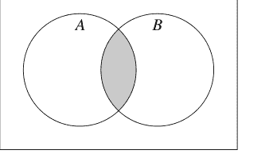

在这里，标记 A 的圆代表满足 A 的结果，圆 B 代表 B 的结果。阴影区域代表同时满足 A 和 B 的特定结果，两个圆之外的区域代表既不满足 A 也不满足 B。理论上，你有如下公式：

```math
Pr(A ∩ B) = P(A|B) × P(B)  or  P(B|A) × P(A)    (15.1)
```

如果 $P(A \cap B) = 0$，则称这两个事件是**互斥**的。换句话说，它们不能同时发生。此外注意，如果两个事件是独立的，那么公式 (15.1) 简化为 $P(A \cap B) = P(A) \times P(B)$。

回到骰子的例子，单次掷骰子掷偶数*且*大于等于 4 的概率是多少？利用 $Pr(A|B) = \frac{1}{2}$ 且 $Pr(B) = \frac{1}{3}$ 的事实，可以很容易计算出 $Pr(A \cap B) = \frac{1}{3} \times \frac{1}{2} = \frac{1}{6}$，如果你真的想的话，可以在 R 中确认这一点。

```R
R> (2/3)*(1/2)
[1] 0.3333333
```

你可以看到，这些事件不是互斥的，因为 $Pr(A \cap B) \neq 0$。这是合理的——在掷骰子时，观察到的数字既是偶数至少为 4 是完全可能的。

### 15.1.4 并集

事件的*并集*记作 $Pr(A \cup B)$，读作“$A$ 或 $B$ 发生的概率”。以下是并集的维恩图表示：

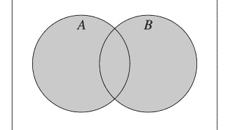

从理论上讲，你有公式：

> $Pr(A \cup B) = Pr(A) + Pr(B) - Pr(A \cap B) \quad (15.2)$

在该图中需要减去交集的原因是，在求和 $Pr(A)$ 和 $Pr(B)$ 时你会错误地计算两次 $Pr(A \cap B)$。但注意，如果两个事件是互斥的，那么 $(15.2)$ 简化为 $Pr(A \cup B) = Pr(A) + Pr(B)$。

所以，在掷骰子时，观察到偶数*或*至少为 4 的概率是多少？使用 (15.2)，很容易找到 $Pr(A \cup B) = \frac{1}{2} + \frac{1}{3} - \frac{1}{6}$。以下代码在 R 中确认了这一点：

```R
R> (1/2)+(1/3)-(1/6)
[1] 0.6666667
```

### 15.1.5 补集

最后，事件的*补集*的概率记作 $Pr(\tilde{A})$，读作“$A$ *不*发生的概率”。

这里是它的维恩图表示：

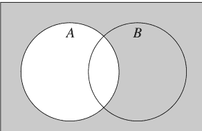

从这张图中，你可以看到以下内容：

$Pr(\bar{A}) = 1 - Pr(A)$

总结这个运行示例，找到没有掷出 4 或更大数字的概率是简单的：$Pr(\bar{A}) = 1 - \frac{1}{2}$。自然地，如果没有得到 4、5 或 6，那么你一定掷出了 1、2 或 3，所以在这六种可能的结果中有三种是可能的。

掷骰子的例子可能并不代表当今统计研究人员面临的最紧迫问题，但它为这些与非常真实的概率规则相关的行为和术语提供了一些直观的插图。这些规则适用于所有领域，并在解释统计建模中可以说更紧迫的任务时起着重要作用。

## 练习 15.1

你有一副标准的 52 张扑克牌。有两种颜色（黑色和红色）和四个花色（黑桃是黑色、梅花是黑色、红心是红色、方片是红色）。每个花色有 13 张牌，其中包含 A、2 到 10 的数字牌以及三张花牌（J、Q、K）。

a. 随机抽取一张牌并放回。它是 A 的概率是多少？它是黑桃 4 的概率是多少？
b. 随机抽取一张牌，放回后再抽取另一张。设 $A$ 为梅花，$B$ 为红色。在红色的情况下，第二张牌是梅花的概率是多少？这两个事件是否独立？
c. 重复 (b)，这次假设抽取的（梅花）牌没有放回。这会改变你对 (b) 的答案吗？
d. 令 $C$ 为花牌，$D$ 为黑色。你抽取一张牌。计算 $Pr(C \cap D)$。这两个事件是否互斥？

## 15.2 随机变量与概率分布

*随机变量*是一个其特定结果由偶然或随机机制产生的变量。

你已经遇到过*变量*——即根据你观测到的数据描述个体的特征（第 13 章）。然而，当你考虑随机变量时，你还没有进行观测。观察特定值或特定区间内的概率是该随机变量的概率。

将随机变量视为对应定义这些概率的函数是合理的，这被称为*概率分布*。在本节中，你将查看随机变量如何汇总，以及如何处理相应的概率分布。

### 15.2.1 实现值

因此，随机变量的概念围绕对变量可能结果的考虑展开。当你实际上对随机变量进行了观测时，这些被称为*实现值*。

考虑以下情况——假设你掷骰子。令随机变量 $Y$ 为结果。可能的实现值为 $Y=1, Y=2, Y=3, Y=4, Y=5$ 和 $Y=6$。

现在，假设你去野餐并监测所在地点的每日温度。令随机变量 $W$ 为观察到的华氏度。从技术上讲，$W$ 的可能实现值是在区间内的。这些示例说明了两种随机变量：$Y$ 是*离散随机变量*；$W$ 是*连续随机变量*。任何给定的随机变量是离散还是连续，取决于你如何思考和利用实现值的概率。

### 15.2.2 离散随机变量

离散随机变量遵循与第 13 章变量相同的定义。它的实现值只能取某些精确值，无法进行精度的测量或解释。掷骰子只能产生 $Y$ 之前描述的那些不同可能性，且观测“5.91”是没有意义的。

从 15.1 节可知，概率直接与结果事件相关。因此，在讨论离散变量时，事件是根据变量可以取的离散可能值定义的，当你考虑所有可能实现值的概率范围时，形成了相应的概率分布。

与离散变量相关的概率分布被称为概率质量函数。由于这些定义了所有可能结果的概率，因此任何完整概率函数的概率之和必须等于 1。

例如，假设你进入赌场玩一个简单的赌博游戏。每一轮中，你有 0.32 的概率赚得 4 美元，0.48 的概率保本，0.15 的概率赢得 1 美元，或者有 0.05 的概率赢得 8 美元。这些是所有可能的结果，如表 15-1 所示。离散随机变量 $X$ 定义为“收益金额”。

表 15-1：赢得金额 $X$ 的概率与累积概率

| | -4 | 0 | 1 | 8 |
| :--- | :--- | :--- | :--- | :--- |
| $Pr(X = x)$ | 0.32 | 0.48 | 0.15 | 0.05 |
| $Pr(X \le x)$ | 0.32 | 0.80 | 0.95 | 1.00 |

#### 离散随机变量的累积分布

累积概率也是概率分布总体思想的重要部分。随机变量的累积概率是“小于等于 $x$ 的概率”，记作 $Pr(X \le x)$。在离散情况下，你通过相加包含任何给定值的概率来获得累积概率。这在表 15-1 的最后一行显示。例如，尽管 $Pr(X = 0)$ 是 0.48，但 $Pr(X \le 0) = 0.32 + 0.48 = 0.80$。

概率分布可视化总是很有用的，由于 $X$ 的离散性，使用 `barplot` 函数非常简单。使用 14.1 节的技能，以下代码首先存储可能结果和相应概率的向量（分别为 `X.outcomes` 和 `X.prob`），然后生成图 15-1 中的左侧图像：

```R
R> X.outcomes <- c(-4, 0, 1, 8)
R> X.prob <- c(0.32, 0.48, 0.15, 0.05)
R> barplot(X.prob, ylim = c(0, 0.5), names.arg = X.outcomes, space = 0,
           xlab = "x", ylab = "Pr(X = x)")
```

可选参数 `space = 0` 消除了条形之间的间隙。接下来，你可以使用内置的 `cumsum` 函数对 `X.prob` 项进行逐步累加，如下所示，得到累积概率：

```R
R> X.cumul <- cumsum(X.prob)
R> X.cumul
[1] 0.32 0.80 0.95 1.00
```

最后，使用 `X.cumul`，可以像之前一样绘制累积概率分布；以下代码生成图 15-1 的右侧面板：

```R
R> barplot(X.cumul, names.arg = X.outcomes, space = 0, xlab = "x", ylab = "Pr(X <= x)")
```

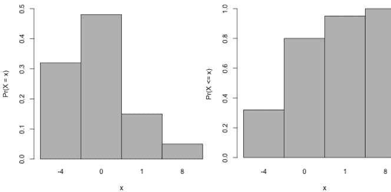

图 15-1：可视化与假设赌博游戏特定事件相关的概率分布（左侧）以及相应的累积分布（右侧）

通常，对于任何基于离散随机变量 $X$ 的概率质量函数，记住以下几点是重要的：

- 有 $k$ 个不同的结果 $x_1, \dots, x_k$。
- 对于每个 $x_i$，其中 $i=\{1, \dots, k\}$，$0 \le \text{Pr}(X = x_i) \le 1$。
- $\sum_{i=1}^k \text{Pr}(X = x_i) = 1$。

#### 离散随机变量的均值和方差

像描述原始数据那样描述或总结感兴趣的随机变量的属性是有用的。最有用的两个属性是均值和方差，它们都依赖于与该随机变量相关的概率分布。

对于某些离散随机变量 $X$，均值 $\mu_X$（也称为期望或期望值 $\mathbb{E}[X]$）是你在许多实现中可以预期的“平均结果”。假设 $X$ 有 $k$ 个可能的结果，标记为 $x_1, x_2, \dots, x_k$。那么你有如下公式：

```math
$$\mu_X = \mathbb{E}[X] = x_1 \times \text{Pr}(X = x_1) + \dots + x_k \times \text{Pr}(X = x_k) \quad (15.3)$$
```

要找到它，只需将每个结果的数值与其对应的概率相乘，并将结果相加。

对于离散随机变量 $X$，方差 $\sigma_X^2$ 量化了 $X$ 可能取值的变异性。从理论上从期望来看，可以证明 $\sigma_X^2 = \text{Var}[X] = \mathbb{E}[X^2] - \mathbb{E}[X]^2$。如你所示，离散随机变量的计算取决于它的均值 $\mu_X$。


$$\sigma_X^2 = \text{Var}[X] = (x_1 - \mu_X)^2 \times \text{Pr}(X = x_1) + \dots + (x_k - \mu_X)^2 \times \text{Pr}(X = x_k) = \sum_{i=1}^k (x_i - \mu_X) \times \text{Pr}(X = x_i) \quad (15.4)$$

再次，步骤是直接的——方差是通过计算每个实现与均值之间差的平方，然后乘以相应的发生概率，最后将这些乘积相加得到的。

在实践中，与每个结果相关的概率是未知的，是从观测数据中估计的。完成该步骤后，你应用公式 (15.3) 和 (15.4) 中的公式来获得相应属性的估计值。此外，请注意均值和方差的通用描述与第 13.2 节相同——只是现在是在针对随机现象量化中心性和离散程度。

让我们考虑一个赌博游戏，收益金额 $X$ 的可能实现以及表 15-1 中指定的相关概率。使用面向向量的行为（参考第 2.3.4 节），使用 R 来计算 $X$ 的均值和方差是简单的。利用之前的 `X.outcomes` 和 `X.prob` 对象，你可以通过下方的逐元素乘法获得 $X$ 的均值：

```R
R> mu.X <- sum(X.outcomes*X.prob)
R> mu.X
[1] -0.73
```

所以，$\mu = -0.73$。同样地，以下提供了 $X$ 的方差：

```R
R> var.X <- sum((X.outcomes-mu.X)^2*X.prob)
R> var.X
[1] 7.9371
```

你也可以通过取方差的平方根来计算标准差（回想 13.2.4 节中的定义）。这通过内置的 `sqrt` 命令完成。

```R
R> sd.X <- sqrt(var.X)
R> sd.X
[1] 2.817286
```

基于这些结果，你可以对这个赌博游戏及其结果发表几点评论。-0.73 的预期结果表明，平均你每回合会损失 $0.73，标准差约为 $2.82。这些量不是、也不会是某个特定定义的结果之一。它们描述了随机机制在长期运行中的行为。

## 15.2.3 连续随机变量

同样遵循第 13 章变量的定义，连续随机变量的可能实现数量没有限制。对于离散随机变量，自然会将一个特定结果视为一个事件并为其分配一个相应的概率。然而，当你处理连续随机变量时，情况稍不同；如果你取第 15.2.1 节中的野餐例子，你可以看到如果你将假设 $W$ 的温度测量可能值范围限制在 40 到 90 华度之间（或更正式地表示为 $40 \le W \le 90$），连续体上仍然有无限不同的值。测量 59.1 度与观察类似 59.16742 度的值具有同样的意义。

因此，不可能为特定值分配概率；相反，你为区间分配概率。例如，询问 $Pr(W = 55.2)$ 是可能的。询问 $Pr(W \le 55.2)$ 或 $Pr(W \ge 55.2)$ 是可能的。这就是离散变量和连续变量之间的区别。

通常，任何定义随机变量 $W$ 概率密度的函数 $f(w)$ 必须具备以下属性：

- 对于所有 $-\infty < w < \infty$， $f(w) \geq 0$；
- $\int_{-\infty}^{\infty} f(w) dw = 1$（函数下方的总面积必须为 1）。

在温度示例中，从 (15.5) 可以看出对于 $w$ 的任何值，$f(w) \geq 0$。要计算函数下方的总面积，你只需要关注函数在 $40 \leq w \leq 90$ 处的值，因为它在其他地方均为 0。

你可以通过几何方法，通过计算函数与零水平线所形成的三角形的面积来实现。对于这个三角形，你可以使用标准的“底乘以高”规则。三角形的底为 $90-40 = 50$，顶点值为 0.04。因此，在 R 中，可以通过以下方式给出底、宽和高：

```R
R> 0.5*50*0.04
[1] 1
```

这证实了它确实等于 1；你现在可以理解我在 (15.5) 中给出特定定义的原因了。

让我们回到获取温度小于等于 55.2 华氏度的概率的问题。为此，你必须找到 $f(w)$（即概率密度函数）在零水平线和 55.2 处的虚垂直线界限的面积。该区域形成另一个三角形，同样适用于使用“底乘以高”规则。在笛卡尔坐标系中，这个三角形由顶点 (40,0)、(55.2,0) 和 (55.2,$f$(55.2)) 组成，如图 15-2 的右面板所示——稍后你会看到它是如何绘制的。

因此，你应该先算出 $f(55.2)$。根据方程 (15.5)，这通过创建以下内容提供：

```R
R> fw.specific <- (55.2-40)/625
R> fw.specific
[1] 0.02432
```

注意，这不是一个概率；它不能被分配给特定的实现值。它只是连续密度函数上三角形的高度值，为了计算基于区间的概率 $Pr(W \leq 55.2)$你需要这个值。

你可以很容易地确定在此特定设置下感兴趣三角形的底为 $55.2-40 = 15.2$。然后，结合 `fw.specific`，“底乘以高”得出如下：

```R
R> fw.specific.area <- 0.5*15.2*fw.specific
R> fw.specific.area
[1] 0.18432
```

答案得出了。你已经通过 $f(w)$ 几何地证明了 $Pr(W \le 55.2) = 0.185$（保留三位小数）。换句话说，你可以说野餐地点最高温度小于或等于 55.2 华氏度的概率大约为 18.5%。

再次，一切直视化都变得更容易了。以下 R 代码重新绘制了密度函数 $f(w)$ 并显示了感兴趣的区域：

```R
R fw.spec.vertices <- rbind(c(40,0),c(55.2,0),c(55.2,fw.specific))
R fw.spec.vertices
     [,1] [,2]
[1,] 40.0 0.00000
[2,] 55.2 0.00000
[3,] 55.2 0.02432
R plot(w,fw,type="l",lab="f(w)")
R line(h=0,col="gray",lty=2)
R polygon(fw.spec.vertices,col="gray",border=NA)
R line(v=55.2,lty=3)
R text(50,0.0,labels=fw.spec.area)
```

结果就是图 15-2 的结果。除了 `polygon` 之外，绘图命令在第七章应该是熟悉的。内置的 `polygon` 函数允许你提供自定义顶点，以便在现有图表上绘制或填充多边形。在这里，使用 `rbind` 定义了一个双列矩阵，提供了要填充阴影的三角形三个顶点的 x 和 y 位置（分别为第一列和第二列）。注意 `fw.spec.vertices` 的创建利用了 $w = 55.2$ 处的 $f(w)$；这是阴影三角形最顶部的顶点。`polygon` 的其他参数控制填充（`col="gray"`）以及是否在定义的多边形周围绘制边界（`border=NA` 请求不画边界）。

并不是所有的密度函数都可以用这种简单的几何方式来赞誉。形式上，积分是用于寻找连续函数下的数学运算，用积分符号表示。也就是说，具有数学倾向的人会进一步展示“从 $w=40$ 到 $w=55.2$，$f(w)$ 下的面积，提供了 $Pr(W \le 55.2)$”通过以下等式得出：

$$\int_{40}^{55.2} f(w) dw = \int_{40}^{55.2} \frac{w-40}{625} dw = \left[\frac{w^2-80w+1600}{1250}\right]_{40}^{55.2} = \frac{55.2^2-80(55.2)+1600}{1250} = 0.18432$$

在 R 中，此计算看起来如下：

```R
R (55.2^2-80*55.2+1600)/1250
[1] 0.18432
```

“结果”你可以预期有许多种实现。这在数学上的表达式如下：

$\mu_W = E[W] = \int_{-\infty}^{\infty} wf(w) dw \ (15.7)$

该方程是方程 (15.3) 的连续类比，可以读作“密度函数 $f(w)$ 与值 $w$ 本身相乘后，函数下总面积”。
对于 $W$，方差 $Var_W^2$（也写作 $Var[W]$）量化了 $W$ 实现中固有的变异性。连续随机变量的计算取决于其均值 $\mu_W$，公式如下：

$\mu_W = Var[W] = \int_{-\infty}^{\infty} (w - \mu_W)^2 f(w) dw \ (15.8)$

同样，该步骤是寻找密度函数乘以 $w$ 下的面积——在这种情况下，是 $w$ 与期望值 $\mu_W$ 之差的平方。野餐温度变量均值和方差的评估必须分别遵循 (15.7) 和 (15.8)。这些计算变得相当复杂，因此我在此不介绍它们。然而，图 15-2 显示 $w$ 的均值必须是 $\mu_W=65$；它是对称密度函数 $f(w)$ 的完美中心。

关于所需的积分，因此你使用之前之前存储的 $w$ 和 $fw$ 对象来查看两个函数 $wf(w)$ 和 $(w-\mu_W)^2 f(w)$，执行以下操作，这将产生图 15-4 中的两幅图像：

```R
plot(w,fw,type="l",lab="wf(w)")
plot(w,(w-65)^2*fw,type="l",ylab="(w-65)^2 f(w)")
```

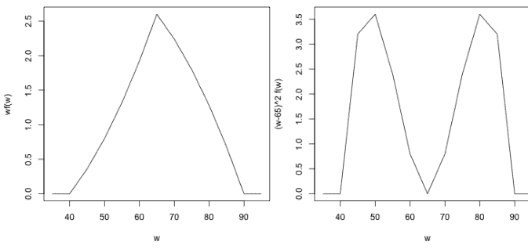

图 15-4：温度示例概率密度函数的期望值（左）和方差（右）的被积函数

请放心，可以使用方程 (15.7) 和 (15.8) 在数学上证明以下内容。

$\mu W = 65 \quad and \quad Var[W] = 104.16627$

通过目眼估算图 15-4 下方的面积，你会发现这些结果是一致的。与之前一样，W 的标准差由方差的平方根给出，以下可以很容易提供该值：

```R
R sqrt(104.1667)
[1] 10.20621
```


## 15.2 形状、偏态和众性

此时，你已经熟悉了连续和离散随机变量以及它们与概率分布的自然配对，并且查看了概率质量函数和密度函数的可视化图形。在本节中，我将定义一些用于描述这些分布外观的术语——能够描述你的视觉印象与能够计算它们一样重要。

你经常会听到或读到以下描述符：

- **对称性**：如果你可以在中心画一条垂直线，并且落在该中心线两侧的概率相等（各占 0.5），则该分布是对称的（见图 15-2）。对称概率分布意味着分布的均值和中位数是相同的。
- **偏态**：如果分布是非对称的，你可以通过讨论*偏态*来进一步限定你的描述。当分布的“尾部”远离其中心度量并在一个方向上比另一个方向收得更快时，则该分布在该方向上是偏的。*正*或*右偏*表示尾部向右侧延伸更长；*负*或*左偏*是指尾部向左侧延伸更长。你还可以描述偏态的强度或显著性。
- **众性**：概率分布并不一定有一个单一峰。*众性*描述了感兴趣的分布中易于识别的峰的数量。例如，*单峰*、*双峰* 和*三峰* 是用于描述具有一个、两个和三个峰的分布的术语。

图 15-5 提供了对称性、不对称、偏态和众性的视觉解释。（注意，尽管它们是用连续线绘制的，但你可以假设它们代表了离散概率质量函数或连续密度函数的总体形状。）

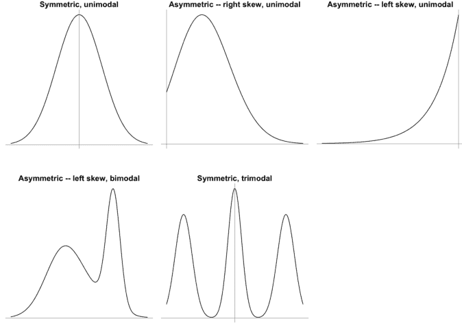

图 15-5：描述概率分布术语的通用示例。顶部三幅图像是单峰的，并突出了对称与不对称偏态的概念；底部两幅图像强调了对众性的引用。

讨论赌博游戏和野餐温度示例的概率分布时，可以使用这些描述符。图 15-1 左侧的 $X$ 质量是单峰且不对称的——它似乎有明显的右偏。图 15-2 给出的 $W$ 密度函数也是单峰，尽管之前提到它是完美对称的。

### 练习 15.2

a. 对于以下每个定义，识别它最好描述为随机变量还是随机变量的*实现*。此外，识别每个语句描述的是连续量还是离散量。

i. 2016年6月3日咖啡店制作的咖啡数量 $x$
ii. 每天每天制作的咖啡数量 $X$
iii. 明天是否下雨
iv. 明天的雨量 $Z$
v. 现在桌子上的饼屑数量 $k$
vi. 任何指定时间桌子上饼屑的总重量 $W$

假设你构建了下表，提供了与影评家给某类型电影评分的随机变量 $S$ 相关的概率：

| S | 0 | 1 | 2 | 3 | 4 | 5 |
|---|---|---|---|---|---|---|
| Pr(S = s) | 0.10 | 0.13 | 0.21 | ??? | ??? | 0.15 |

- i. 此表描述了完整的结果，计算缺失的概率 $Pr(S = 4)$。
- ii. 计算累积概率。
- iii. 该类型电影的期望星级 $S$ 的均值是多少？
- iv. $S$ 的标准差是多少？
- v. 该类型中某部电影至少获得三颗星的概率是多少？
- vi. 可视化并简要评论概率质量函数的外观。

- d. 假设以下每个图 (i)–(iv) 显示了概率分布的总体形状。使用 15.2.4 中的术语描述每个图的形状。

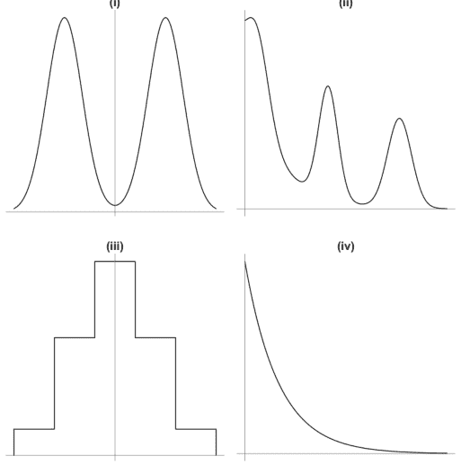

# 16.1 常见概率质量函数

你将从查看离散随机变量的一些常见概率质量函数的定义和示例开始。连续分布将在第 16.2 节中探讨。

## 16.1.1 伯努利分布

伯努利分布是只有两种可能结果（例如成功或失败）的离散随机变量的概率分布。这类变量可以被称为*二元*或二分的。

假设你为一个事件的成功或失败定义了一个二元随机变量 $X$，其中 $X=0$ 表示失败，$X=1$ 表示成功，$p$ 是已成功的概率。表 16-1 显示了 $X$ 的概率质量函数。

**表 16-1:** 伯努利概率质量函数

| x | 0 | 1 |
|---|---|---|
| Pr[X=x] | 1-p | p |

从 15.2.2 节可知，所有可能结果的概率之和必须为 1。因此，如果二元随机变量成功的概率为 $p$，那么唯一的备选结果——失败，发生的概率必须为 $1-p$。

在数学术语中，对于离散随机变量 $X=x$，伯努利质量函数 $f$ 为：

$$f(x) = p^x(1-p)^{1-x}; \quad x = \{0, 1\}$$

其中 $p$ 是分布的一个参数。符号

$$X \sim \text{BERN}(p)$$

用于表示“$X$ 遵循从参数为 $p$ 的伯努利分布”。

以下是需要记忆的关键点：

- $X$ 是二分的，且只能取值 1（“成功”）或 0（“失败”）。
- $p$ 应解释为“成功概率”，因此 $0 \le p \le 1$。

均值和方差定义如下：
$$\mu_X = p \quad \sigma_X^2 = p(1-p)$$

假设你使用常见的掷骰子例子，将成功定义为掷出4，并且掷了一次。你有一个二元随机变量 $X$，可以使用伯努利分布进行建模，其中成功概率 $p = 1/6$。对于这个例子，$X \sim \text{BERN}(p)$。你可以利用 (16.1) 很容易地确定 $Pr(\text{rolling a 4}) = Pr(X = 1) = f(1) = (1/6)(5/6)^0 = 1/6$，同样，$f(0) = 5/6$。此外，你将得到 $\mu_X = 1/6$ 和 $\sigma_X^2 = 1/6 \times 5/6 = 5/36$。

## 16.1.2 二项分布

二项分布是涉及二元随机变量的 $n$ 次试验中成功次数的分布。伯努利分布通常是更复杂分布的“构建块”，例如提供更有趣结果的二项分布。例如，假设你定义了一个随机变量 $X = \sum_{i=1}^n Y_i$，其中 $Y_1, Y_2, \dots, Y_n$ 分别对应相同事件的伯努利随机变量，即掷骰子，成功定义为掷出4。新的随机变量 $X$ 是伯努利随机变量之和，现在描述了 $n$ 次试验中的成功次数。在满足合理假设的情况下，该概率分布被称为二项分布。

在数学术语中，对于离散随机变量和实现值 $X = x$，二项质量函数 $f$ 为：

$$f(x) = \binom{n}{x}p^x(1-p)^{n-x}; \quad x = (0, 1, \dots, n) \quad (16.2)$$

其中

$$\binom{n}{x} = \frac{n!}{x!(n-x)!} \quad (16.3)$$

被称为二项式系数。（回想整数阶乘 `!` 的用法，正如第 203 页的练习 10.4 中首次讨论的那样。）该系数也被称为组合，考虑了在 $n$ 次试验中观察到 $x$ 次成功的所有顺序。

二项分布的参数是 $n$ 和 $p$，符号

$$X \sim \text{BIN}(n,p)$$

经常用于表示 $X$ 遵循从参数为 $p$ 的 $n$ 次试验的二项分布。

以下是需要记忆的关键点：

- $X$ 只能取值 $0, 1, \dots, n$，并代表成功的总数。
- $p$ 应解释为“每次试验的成功概率”。因此，$0 \leq p \leq 1$，且 $n > 0$ 是被解释为“试验次数”的整数。
- $n$ 次试验中的每一次都是伯努利成功或失败事件，试验之间是独立的（也就是说，一次试验的结果不影响任何其他试验的结果），且 $p$ 是常数。

均值和方差定义如下：
$$\mu_X = np \quad \sigma_X^2 = np(1-p)$$

对二值测试重复试验成功次数计数是本节开头提到的常见随机现象之一。考虑只有一次“试验”的具体情况，即 $n=1$。通过检查方程 (16.2) 和 (16.3)，可以很清楚看到 (16.2) 简化为 (16.1)。换句话，伯努利分布只是二项分布的一个特例。显然，这与二项随机变量作为 $n$ 个伯努利随机变量之和的定义是一致的。反之，`R` 为二项分布提供了功能，尽管没有明确针对伯努利分布。

为了说明这一点，我回到掷骰子掷出4的例子。如果你掷八次骰子，总共恰好观察到五个成功（五个4）的概率是多少？嗯，你会有 $X \sim \text{BIN}(8,\frac{1}{6})$，这个概率可以通过数学 (16.2) 计算。

$$Pr(\text{exactly five 4s}) = Pr(X=5) = f(5) = \frac{8!}{5! \times 3!} \left(\frac{1}{6}\right)^5 \left(\frac{5}{6}\right)^3 = 0.004 \quad \text{(保留3位小数)}$$

结果告诉你，在八次掷骰中恰好观察到五个4的概率大约为0.4%。这个概率很小且符合逻辑——在八次掷骰中观察到0到4个4的可能性大得多。

`R` 中的内置函数可以处理这些：

- `dbinom` 提供任何 $x$ 的质量函数。
- `pbinom` 提供累积分布。
- `qbinom` 提供反向累积分布。
- `rbinom` 用于生成随机数。

### `dbinom` 函数

利用这些知识，你可以使用 `R` 来验证掷骰子例子中 $x=5$ 的结果。

```r
dbinom(x=5, size=8, prob=1/6)
# [1] 0.004167
```

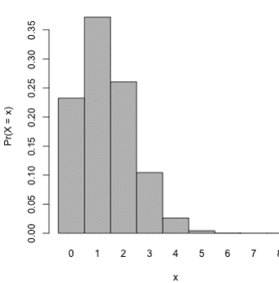

图 16-1：*与骰子掷示例二项分布相关的概率质量函数*

### `pbinom` 函数

其他用于二项分布的 `R` 函数工作方式非常相似。第一个参数始终是你感兴趣的值（或多个值）；$n$ 由 `size` 提供，$p$ 由 `prob` 提供。例如，要找到观测到少于 4 个“4”的概率 $Pr(X \le 3)$，你可以求和之前 `dbinom` 中相关的单个条目，或者使用 `pbinom`。

```r
sum(dbinom(x=0, size=8, prob=1/6))
# [1] 0.9693436
pbinom(q=3, size=8, prob=1/6)
# [1] 0.9693436
```

注意 `pbinom` 的关键参数标记为 $q$ 而不是 $x$；这是因为从累积的角度来看，我们正在根据一个分位数搜索概率。`pbinom` 的累积分布结果可以以相同的方式搜索“上尾”概率（给定值右侧的概率），因为你知道总概率质量始终为 1。要找到*在八次掷骰子中观测到至少三个“4”*的概率 $Pr(X \ge 3)$（等同于 $Pr(X > 2)$），以下代码可以找到正确的结果，因为你寻找的是 $Pr(X \le 2)$ 的补集：

```r
1 - pbinom(q=2, size=8, prob=1/6)
# [1] 0.1348469
```

### `qbinom` 函数

较少用的是 `qbinom` 函数，它是 `pbinom` 的反函数。当 `pbinom` 在给定分位数值 $q$ 时提供累积概率时，`qbinom` 函数在给定累积概率 $p$ 时提供分位数值。$x$ 作为二项变量的离散性质意味着 `qbinom` 将返回 $p$ 所在的最接近的下方 $x$ 值。例如，注意

```r
qbinom(p=0.95, size=8, prob=1/6)
# [1] 3
```

这提供了 3 作为分位数值，尽管你从之前知道精确概率位于或低于 3，即 $Pr(X \le 3)$，值为 0.9693436。在处理连续概率分布时，你会看到 p 函数和 q 函数；请参见第 16.2 节。

### `rbinom` 函数

最后，使用 `rbinom` 函数检索二项分布变量实现的随机生成值。同样，采用 $BIN(8, 1/6)$：

```r
rbinom(n=1, size=8, prob=1/6)
# [1] 0
rbinom(n=1, size=8, prob=1/6)
# [1] 2
rbinom(n=1, size=8, prob=1/6)
# [1] 2
rbinom(n=3, size=8, prob=1/6)
# [1] 2 1 1
```

初始参数 $n$ 并不代表试验次数。试验次数仍通过 `size` 提供，$p$ 由 `prob` 提供。在这里，$n$ 请求你想要为随机变量 $X \sim BIN(8, 1/6)$ 生成的实现数量。前三行每行请求一个实现——在前八次掷骰子中，你观测到了成功（“4”），在第二组和第三组掷骰子中，你分别观测到了两个和四个。第四行强调了通过增加 $n$，可以很容易地获得 $X$ 的多个实现并将其存储为向量。由于这些是随机生成的实现，如果你现在运行这些行代码，你可能会观察到一些不同的值。

虽然在标准统计检验方法中并不常用，但概率分布（无论是离散还是连续）的 `r` 函数在计算统计学的仿真和各种高级数值算法中起着重要作用。

### 练习题 16.1

一个森林自然保护区在很大土地上分布着 13 个观鸟平台。自然学家声称，在任何时间点，在每个平台看到鸟的概率都是 75%。假设你穿过整个保护区并访问了每个平台。如果你假设所有相关条件均已满足，设 $X$ 为代表你看到鸟的平台总数的二项变量。

- a. 可视化感兴趣的二项分布的概率质量函数。
- b. 你在所有站点看到鸟的概率是多少？
- c. 你在超过 9 个平台看到鸟的概率是多少？
- d. 在 8 到 11 个平台（包含在内）之间看到鸟的概率是多少？仅使用 p 函数确认你的答案。
- e. 假设在你的访问之前，你决定如果你在少于 9 个站点看到鸟，你就会大吵大闹并要求退票。你以这种方式让自己难脸的概率是多少？
- f. 模拟代表 10 次访问保护区的 $X$ 实现；将你的访问向量恢复为一个一个对象。
- g. 计算感兴趣分布的均值和标准差。

## 16.1.3 泊松分布

在本节中，你将使用泊松分布对一个稍微通用但同样重要的离散随机变量进行建模——计数。例如，感兴趣的变量可能是某个站在在特定一年内检测到的地震次数，或者是工厂生产线上出来的每平方英尺金属板上的缺陷数量。

重要的是，被计数的事件或项目被假设为相互独立发生。从数学术语来说，对于离散随机变量和实现 $X=x$，泊松质量函数 $f$ 如下，其中 $\lambda_p$ 是分布的参数（稍后将进一步解释）：

$$f(x) = \frac{\lambda_p^x \exp(-\lambda_p)}{x!}; \quad x = (0,1,\dots)$$

符号 

$$X \sim \text{POIS}(\lambda_p)$$

通常用于表示“$X$ 服从参数为 $\lambda_p$ 的泊松分布”。

以下是需要记住的关键点：

- 实体、特征或事件在定义良好的区间内以恒定速率独立计数。
- $X$ 只能取非负整数：$0, 1, 2, \dots$
- $\lambda_p$ 是分布的均值和方差：$\mu = \sigma^2 = \lambda_p$。
- 所有可能值的概率和为 1。
- 泊松分布用于固定间隔内事件的计数。

泊松分布的概率质量函数由参数 $\lambda$ 唯一定义，该参数代表间隔内平均发生次数。观测到恰好 $k$ 次事件的概率给出：

$$P(X=k) = \frac{\lambda^k e^{-\lambda}}{k!}$$

当试验次数很大且成功概率很小时，通常使用泊松分布。在这种情况下，它是二项分布的一个良好近似。

要计算累积结果，你使用 `ppois`。

| R | `ppois(q=2, lambda=3.22)` |
|---|---|
| | `[1] 0.375744` |
| `1-ppois(q=5, lambda=3.22)` | `[1] 0.1077005` |

这些行代码发现，你观察到最多两个缺陷的概率 $Pr(X \le 2)$ 约为 0.38，而观察到严格大于五个瑕点的概率 $Pr(X \ge 6)$ 大约为 0.11。

图 16-3 的右侧提供了累积质量函数的可视化图，通过以下代码创建：

```r
plot(ppois(q=0:10, lambda=3.22), ylim=0:1, space=0, names.arg=0:10, ylab="Pr(X<=x)", xlab="x")
```

### `qpois` 函数

泊松分布的 q 函数 `qpois` 提供了 `ppois` 的逆函数，这与 16.1.2 节中 `qbinom` 提供 `pbinom` 的逆函数一样。

### `rpois` 函数

要产生随机变量，你使用 `rpois`；你将所需的变量数量作为 `n` 提供，并提供关键的参数 `lambda`。你可以想象

```r
rpois(n=15, lambda=3.22)
# [1] 0 2 9 1 3 1 9 3 4 3 2 2 6 3 5
```

这相当于从生产线上随机选择 1 平英尺的金属板，并计算每块板上的瑕点数量。再次注意，这是随机生成；你的特定结果可能会有所不同。

### 练习 16.2

每周六的同一时间，某个人站在路边，计算 120 分钟窗口内通过的车辆数量。根据先前的知识，他认为这段时间内通过的车辆平均数恰好为 107。令 $X$ 代表每个周六期间通过他位置的车辆数量的相应泊松随机变量。

- a. 在任何给定的周六，通过超过 100 辆车辆的概率是多少？
- b. 确定没有车辆通过的概率。
- c. 在 $60 \le x \le 150$ 的值范围内绘制相关的泊松质量函数。
- d. 从该分布中模拟 260 个结果（大约五年的每周周六监控课程）。使用 `hist` 绘制模拟结果；使用 `ylim` 设置水平范围为从 60 到 150。将你的直方图与你的质量函数 (c) 的形状进行比较。

## 16.1.4 其他质量函数

`R` 内置的统计计算套集中还有许多其他定义良好的概率质量函数。所有模型都在特定条件下以某种方式模拟离散随机变量，并至少由一个参数定义，大多数由它们自己的一组 `d`、`p` 和 `r` 函数表示。这里我总结了几个：

- 几何分布统计记录一次成功之前的失败次数，依赖于“成功概率参数” `prob`。它的函数是 `dgeom`、`pgeom`、`qgeom` 和 `rgeom`。


- 负二项分布是几何分布的泛化，依赖于参数 `size`（约试验次数）和 `prob`。它的函数是 `dnbinom`、`pnbinom`、`qbinom` 和 `rnbinom`。

- 超几何分布用于建模不放回抽样（换句话说，“成功”会改变后续成功相关的概率），依赖于描述采样项目性质的参数 $m, n$ 和 $k$。它的函数是 `dhyper`、`phyper`、`qhyper` 和 `rhyper`。

- 多项分布是二项分布的泛化，在每次试验中，成功可以发生在多个类别中的一个，参数为 `size` 和 `prob`（此时，`prob` 必须是一个响应多个类别的概率向量）。它的内置函数是 `dmultinomial` 和 `rmultinomial`。

正如前面提到的，某些熟悉的概率分布只是描述更广泛类分布的函数的简化或特殊情况。

## 16.2 常见概率密度函数

在考虑连续随机变量时，你需要处理概率分布。有许多在许多类型问题中经常使用的常见概率分布。在本节中，你将熟悉其中一些以及 R 随附的 $d-, p-$ 和 $r-$ 函数。

### 16.2.1 均匀分布

均匀分布是一种简单的密度函数，描述一个连续随机变量，其可能取值的区间在概率上没有波动。当你绘制图 16-64 时，这一点将变得清晰。


图 16-64：在相同尺度上绘制的两个分布以便比较。左侧：$X \sim UNIF(-0.4,1.1]$；右侧：$X \sim UNIF(0.223,0.410)$。每个密度函数下方的总面积总是1。对于连续变量 $a \le x \le b$，均匀密度函数 $f(x) = \frac{1}{b-a}$，其中符号 $X \sim UNIF(a,b)$ 通常用于表示 $X$ 服从边界为 $a$ 和 $b$ 的均匀分布。以下是需要记住的关键点：

- $X$ 可以在 $a$ 和 $b$ 边界的区间内取任何值。

- $a$ 和 $b$ 可以是任意值，只要 $a < b$，它们分别代表可能取值区间的下限和上限。均值和方差为：

$$\mu_X = \frac{a+b}{2} \quad \sigma_X^2 = \frac{(b-a)^2}{12}$$

## dunif 函数

你可以使用均匀分布的内置 d 函数 `dunif` 来返回区间内任何值的高度。对于区间外的值，`dunif` 返回零。分布的参数 $a$ 和 $b$ 分别作为参数 `min` 和 `max` 提供。例如，以下代码：

```R
dunif(x=c(-0.2,-0.3,0.0,1.5,1.2),min=-0.4,max=1.1)
[1] 0.00000006666666666666666667 0.000000
```

计算了 $X \sim UNIF(-0.4,1.1)$ 的均匀密度函数。你会注意到第一个和最后一个值落在 `min` 和 `max` 定义的边界之外，因此它们为零。其他所有值都等于 $2/3$ 的高度值。

例如，以下代码：

```R
dunif(x=c(0.3,0.4,1),min=0.223,max=0.41)
[1] 5.37594 0.000000 5.37594
```

验证了 $X \sim UNIF(0.223,0.410)$ 分布的正确密度值，第二个值（零）落在区间之外。

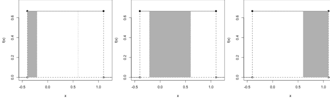

图 16-5：钻床示例中 $X \sim UNIV(-0.4,1.1)$ 密度函数下的三个区域。左侧：$Pr(X \le -0.21)$；中间：$Pr(-0.21 \le X \le 0.6)$；右侧：$Pr(X \ge 0.6)$。

这些图是使用第七章涵盖的基于坐标的绘图技能创建的。密度通过以下方式展示：

```R
R a1 <- -4/10
R b1 <- 11/10
R unif1 <- 1/(b1-a1)
Rplot(c(a1,b1),rep(unif1,2),type="o",pch=19,xlim=c(a1-1/10,b1+1/10),
ylim=c(0,0.75),ylab="f(x)",xlab="x")
Rabline(h=0,lty=2)
Rsegments(c(a1-2,a1,b1),rep(0,4),rep(c(a1,b1),2),rep(0,unif1),each=2),
lty=rep(1:2,each=2))
Rpoints(c(a1,b1),c(0,0))
```

你可以通过修改 `xlim` 和 `ylim` 参数来调整轴的比例，从而使用相同的方法来生成图 16-4 中的图。你通过其他 `segments` 调用在图 16-5 中添加了表示 $f(-0.21)$ 和 $f(0.6)$ 的垂直线。

```R
R segments(c(-0.21,0.6),c(0,0),c(-0.21,0.6),rep(unif1,2),lty=3)
```

最后，你可以使用 `polygon` 函数对区域进行填充，该函数最初在 15.2.3 节中探索过。例如，在图 16-6 最左侧的图中，将之前的绘图代码改为：

```R
R polygon(c(a1,0),c(a1,unif1),c(-0.21,unif1),c(-0.21,0)),col="gray"
border=NA)
```

如前所述，图 16-5 中的三个阴影区域从左到右分别代表 $Pr(X < -0.21)$、$Pr(-0.21 < X < 0.6)$ 和 $Pr(X > 0.6)$。在钻头示例中，它们可以分别解释为钻头命中左侧 0.21 cm 或更处的概率，钻头命中左侧 0.21 cm 到右侧 0.6 cm 之间目标的概率，以及钻头命中右侧 0.6 cm 或更处目标的概率。（记住 15.2.3 节提到的，对于与连续随机变量相关的概率，使用 $\le$ 或 $<$（或 $\ge$）是没有区别的。）尽管对于这种如此简单的密度函数，你可以通过几何方法评估这些概率，但使用 R 仍然更快。

## punif 函数

记住，与连续随机变量相关的概率定义为*函数下方的面积*，因此你的重点是 $X$ 的适当区间，而不是任何特定值。用于密度的 $p$ 函数与离散随机变量的 $p$ 函数一样，提供了累积概率分布 $Pr(X \le x)$。在密度的背景下，这意味着对于一个特定的 $x$ 值（通过“数量”参数 $q$ 提供），`punif` 将提供从该特定值开始向左方向的函数下方面积。

访问 `punif`，这一行：

```R
R punif(-0.21,min=a1,max=b1)
[1] 0.126667
```

告诉你图 16-5 中最左侧的区域代表大约 0.127 的概率。这一行：

```R
R punif(q=0.6,min=a1,max=b1)
[1] 0.333333
```

告诉你 $Pr(X > 0.6) = 1/3$。$Pr(-0.21 < X < 0.6)$ 的最终结果为 54%，通过以下方式找到：

```R
R punif(q=0.6,min=a1,max=b1) - punif(q=-0.21,min=a1,max=b1)
[1] 0.54
```

因为第一次调用提供了从 0.6 一直向左的密度下方面积，而第二次调用提供了从 -0.21 一直向左的面积。这里这就是定义的中间区域。

在 R 中处理概率分布时，能够像这样操作概率结果是非常关键的，初学者可能会发现，在使用 $p$ 函数之前勾画出所需的区域是有帮助的，特别是对于密度函数。

## qunif 函数

用于密度的 $q$ 函数比用于质量函数的用得更频繁，因为变量的连续性意味着对于任何有效概率 $p$ 都能找到分位数。

`qunif` 函数是 `punif` 的逆函数：

```R
R qunif(p=0.1266667,min=a1,max=b1)
[1] -0.21
```

```R
R qunif(p=1/3,min=a1,max=b1)
[1] 0.6
```

### 16.2.2 正态分布

正态分布是最已知且应用最广泛的分布之一，以钟形曲线为特征，也被称为高斯分布。对于连续变量 $-\infty < X < \infty$，其密度为

$$f(x) = \frac{1}{\sigma\sqrt{2\pi}} e^{-\frac{(x-\mu)^2}{2\sigma^2}}$$

其中 $\mu$ 和 $\sigma$ 是分布的参数。符号

$$X \sim N(\mu, \sigma)$$

用于表示 $X$ 服从均值为 $\mu$、标准差为 $\sigma$ 的正态分布。以下是需要记住的关键点：

- 理论上，$X$ 可以取从 $-\infty$ 到 $\infty$ 的任何值。

- 如前提示，$\mu$ 和 $\sigma$ 直接描述均值和标准差，后者的平方 $\sigma^2$ 是方差。

- 在实践中，均值参数是有限的 $-\infty < \mu < \infty$，而标准差参数是严格正数且有限的 $0 < \sigma < \infty$。

- 如果你有一个随机变量 $X \sim N(\mu, \sigma)$，那么你可以创建一个随机变量 $Z = (X-\mu)/\sigma$，使得 $Z \sim N(0,1)$。

在正态分布中，均值上方或下方的概率恰好为0.5。此外，请注意，数值落在均值一个标准差范围内的概率约为 0.683，$-2\sigma$ 到 $+2\sigma$ 曲线下的概率约为 0.954，$-3\sigma$ 到 $+3\sigma$ 之间的概率约为 0.997。

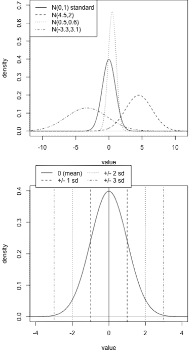

图 16-6：正态分布图。上方：通过改变均值 $\mu$ 和标准差 $\sigma$ 实现的四种不同的密度。下方：“标准正态”分布 $N(0,1)$，标记了均值 $\pm1\sigma$、$\pm2\sigma$ 和 $\pm3\sigma$。

> **注意**
>
> 正态密度的数学定义意味着，你距离均值越远，密度函数本身的值就越接近于零。事实上，任何正态密度函数都不会真正触及零所在的水平线；随着你向正无穷或负无穷移动，它会越来越接近。这种行为在形式上被称为*渐近性*；在这种情况下，你会说正态分布 $f(x)$ 在 $f(x)=0$ 处有一个水平渐近线。在讨论曲线下方面积的概率时，你会提到“从负无穷到正无穷的曲线下的总面积”为 $\int_{-\infty}^{\infty} f(x)dx = 1$，换句话说，

## dnorm 函数


作为一个概率密度函数，该函数本身并不产生概率——它仅仅产生正态密度曲线 $f(x)$ 在任意 $x$ 处的密度值。若要绘制正态密度图，你可以使用 `seq`（参见第 2.3 节）为 $x$ 创建一个值序列，使用 `dnorm` 在这些值处求出密度，然后将结果绘制成线图。例如，为了生成一张与图 16-6 下方图像相似的标准正态分布曲线图像，以下代码将创建所示的密度 $x$ 值：

```R
R> xvals <- seq(-4,4,length=50)
R> fx <- dnorm(xvals,mean=0,sd=1)
R> fx
```

| 0.000133802 | 0.000253738 | 0.000468284 | 0.000840216 | 0.001400216 | 0.014737603 |
| 0.002556192 | 0.004617828 | 0.0060374095 | 0.010594434 | 0.01594432 | 0.026229881 |
| 0.024207211 | 0.035172982 | 0.049172078 | 0.068458227 | 0.097183140 |
| 0.119819272 | 0.152304907 | 0.188505864 | 0.227147404 | 0.267538719 |
| 0.320456802 | 0.386075354 | 0.460735564 | 0.538165961 | 0.597615238 |
| 0.697615238 | 0.787156916 | 0.860735564 | 0.938879318 | 0.919821702 |
| 0.966383719 | 1.022717404 | 1.088505864 | 1.152039407 | 1.204207221 |
| 1.261692891 | 1.310594324 | 1.406734095 | 1.504177820 | 1.552516210 |
| 1.640147363 | 1.700084216 | 1.800468284 | 1.902537828 | 2.001338302 |

`dnorm`（通过指定 $\mu$ 为均值 $\sigma$ 为标准差）会产生这些值处 $f(x)$ 的精确值。最后，像 `plot(xvals,fx,type="l")` 这样的调用实现了密度图的基本框架，你可以通过添加标题以及使用 `abline` 和 `segments` 等命令来标记位置从而轻松增强它（稍后将使用另一个图，因此此处不显示这些基础操作）。

注意，如果你不向 `mean` 和 `sd` 传递任何值，R 的默认行为是实现标准正态分布；之前提到的函数可以使用更短的调用直接用 `dnorm(xvals)` 创建。

# pnorm 函数

`pnorm` 函数计算指定正态密度下方的左侧概率。如果未提供参数值，R 会自动设置 `mean=0` 和 `sd=1`。与你在第 16.2.1 节中使用 `pify` 的方式相同，你可以通过计算 `pnorm` 结果的差来寻找你在参数 `q` 中提供所需值的任何面积。

例如，之前提到均值一个标准差范围内的概率约为 0.683。你可以通过对标准正态分布使用 `pnorm` 来验证这一点。

```R
R> pnorm(q=1)-pnorm(q=-1)
R> [1] 0.6826895
```

第一个 `pnorm` 调用计算从正1 左侧（换句话说，一直到 $-\infty$）的曲线下方面积，然后减去 -1 左侧的面积。结果计算了图 16-6 下方两条虚线之间的比例。

内置的 `qnorm` 函数接收你的原始数据并生成相应的图表。回到准备就绪的 `chickw` 数据集。假设你想找出假设重量服从正态分布是否合理。为此，你使用：

```R
R> hist(chickw$weight,main="",xlab="weight")
R> qnorm(chickw$weight,main="Normal QQ plot of weights")
R> qqline(chickw$weight,col="gray")
```

来生成这 71 个权重的直方图以及图 16-8 所示的正态 QQ 图。额外的 `qqline` 命令添加了直线如果数据完全符合正态分布，坐标将落在其上的“最优”线。

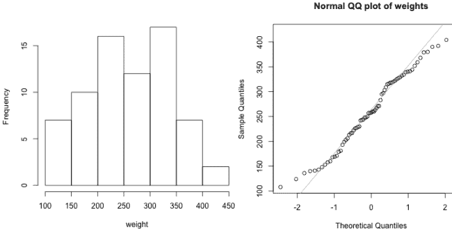

图 16-8：`chickw` 数据集中小鸡重量的直方图 [左] 和正态 QQ 图 [右]。数据分布合理吗？

如果你检查重量的直方图，你会看到数据符合正态分布的一般外观，呈现大致对称的单峰状态。尽管如此，它并没有完全达到产生熟悉的钟形所需的平滑度和自然衰减的高度。这反映在右侧的 QQ 图中；中间分位数值似乎较好地落在了直线上，除了一些细微的“小凸起”。在任何 QQ 图中，这些极端分位数的离群值存在一些明显的差异，因为那里出现的数据点自然较少。考虑到所有这些，对于这个例子来说，正态性假设并不是完全不合理。

在评估这类假设的有效性时，考虑样本量至关重要；样本量越大，直方图和 QQ 图中的随机变异就越少，你越能放心地得出关于数据是否为正态的结论。例如，本例中的正态性假设可能会因为样本量仅为 71 较小而变得复杂。

# rnorm 函数

使用 `rnorm` 生成任何给定正态分布的随机变量；例如，该行代码：

```R
R> rnorm(n=7,mu=-3.42, sigma=0.2)
[1] -3.764532 -3.231154 -3.124965 -3.490482 -3.884633 -3.192205 -3.475835
```

产生了来自 $N(-3.42,0.2)$ 的正态分布值。与图 16-8 中为小鸡重量生成的 QQ 图相比，你可以使用 `qqnorm`、`qqline` 和 `qqline` 在 QQ 图的语境下检查假设观测数据集在多大程度上是真正的正态。

以下代码生成了 71 个标准正态值并生成了相应的正态 QQ 图，然后对另一个 $n = 710$ 的独立数据集执行相同的操作；这些显示在图 16-9 中。

```R
R> fakedata1 <- rnorm(n=71)
R> fakedata2 <- rnorm(n=710)
R> qqnorm(fakedata1,main="Normal QQ plot of generated N(0,1) data; n=71")
R> qqline(fakedata1,col="gray")
R> qqnorm(fakedata2,main="Normal QQ plot of generated N(0,1) data; n=710")
R> qqline(fakedata2,col="gray")
```

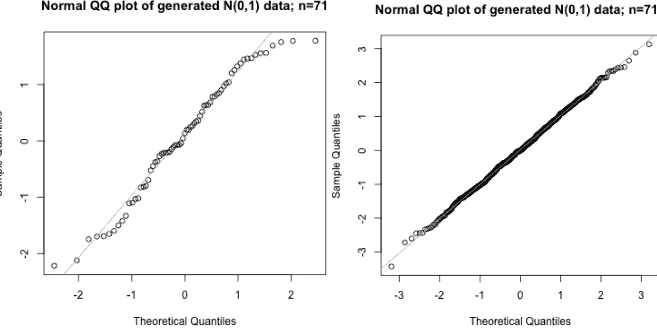

图 16-9：从标准正态分布随机生成的 71 [左] 和 710 [右] 观测值的正态 QQ 图

你可以看到，大小为 $n = 71$ 的模拟数据集的 QQ 图显示出偏离最优线，小鸡重量数据也是如此；将样本量增加 10 倍显示，$n = 710$ 个正态观测值的 QQ 图提供的变异少得多，尽管尾部仍存在可见的差异。评估这些影响的一种良好方法是多次运行这些代码（也就是说，每次都生成新的数据集）并检查每个 QQ 图是如何变化的。

# 正态函数的实际应用：一个快速示例

让我们用最后一个实际性问题来结束本节。假设某种零食的制造商知道一个 80 克广告包装中零食的总净重 $X$ 服从正态分布，均值为 80.2 克，标准差为 1.1 克。制造商知道随机选择的单个包装的内容。随机选择的包装重量小于 78 克的概率（即 $Pr(X < 78)$）如下：

```R
R> pnorm(78,80.2,1.1)
[1] 0.02275013
```

发现包装重量在 80.5 克到 81.5 克之间的概率如下：

```R
R> pnorm(81.5,80.2,1.1)-pnorm(80.5,80.2,1.1)
[1] 0.2738925
```

最轻的 20% 包装所在的重量以下如下：

```R
R> qnorm(0.2,80.2,1.1)
[1] 79.27422
```

随机选择五个包装的模拟结果如下：

```R
R> round(rnorm(5,80.2,1.1))
[1] 78.6 77.9 78.6 80.8
```

| 练习 16.4 |
| :--- |
| a. 导师知道大一学生完成某个特定统计问题的时间 $X$ 服从正态分布，均值为 17 分钟，标准差为 4.5 分钟。 |
| i. 随机选择的学生花费时间超过 20 分钟的概率是多少？ |
| ii. 学生花费 5 分钟到 10 分钟的概率是多少？ |
| iii. 找到最慢的 10% 学生花费的时间。 |
| iv. 画出 $\pm 4$ 之间的正态分布以及 (iii) 最慢 10% 学生的概率区域。 |
| v. 基于 10 个学生完成问题的实现情况。 |
| v. 一位细心的园艺师对草的长度感兴趣。他认为草长 $X$ 服从均值为 10 mm 的正态分布，方差为 2 mm。 |
| i. 找到草在 9.5 mm 到 11 mm 之间的概率。 |
| ii. 在此分布语境下，9.5 mm 和 11 mm 的标准化值是多少？使用标准化值确认与 (i) 相同的概率（标准正态密度）。 |
| iii. 最短的 2.5% 所在的值是多少？ |
| iv. 标准化你的答案 (iii)。 |

# 16.2.3 t 分布

*t 分布* 是处理样本数据进行统计时通用的连续概率分布。它在接下来的章节中将变得相关，我将简要说明。（注：此处原文存在大量重复文本，翻译已按逻辑保留核心内容）。

```R
R> qt(1-0.05,df=20)
[1] 1.724718
```

与标准正态分布相比，t 密度函数尾部更重的权重使得在给定特定概率时自然产生更极端的分位数值。然而，请注意这种极端性会随着自由度（df）的增加而减小——这与上述事实一致，随着 df 的增大，t 分布在对标准正态分布的近似上会不断改进。

## 16.2.4 指数分布

当然，概率密度函数并不像你迄为止遇到的那些那样必须对称，也不需要允许随机变量取自从负无穷到正无穷的值（如正态分布或 t 分布）。一个很好的例子是指数分布，其实现值仅在 $0 \le X < \infty$ 域内有效。

对于连续随机变量 $0 \le X < \infty$，指数密度函数 $f$：

$f(x) = \lambda_e \exp(-\lambda_e x); \quad 0 \le x < \infty \quad (16.7)$

其中 $\lambda_e$ 是分布的参数，$\exp{\{\cdot\}$ 是指数函数。符号

$X \sim EXP(\lambda_e)$

用于表示“$X$ 服从速率为 $\lambda_e$ 的指数分布”。

以下是关键点：

- 理论上，$X$ 可以取 $0$ 到 $\infty$ 范围内的任何值，且 $f(x)$ 随着 $x$ 的增加而减小。
- “速率”参数必须严格大于零；换句话说，$\lambda_e > 0$。它定义了 $f(0)$ 以及函数向水平渐近线的衰减速率。

均值和方差分别为：

$\mu_X = \frac{1}{\lambda_e} \quad \text{and} \quad \sigma_X^2 = \frac{1}{\lambda_e^2}$

### dexp 函数

指数分布的密度函数是一条从 $f(0) = \lambda$ 开始的稳定递减直线；这种衰减速率确保了曲线下方总面积为 1。你可以通过以下代码中的相关 `d` 函数创建图 16-11。

```R
R> xvals <- seq(0,10,length=200)
R> plot(xvals,dexp(x=xvals,rate=1.65),xlim=c(0,8),ylim=c(0,1.65),type="l",xlab="x",ylab="f(x)")
```

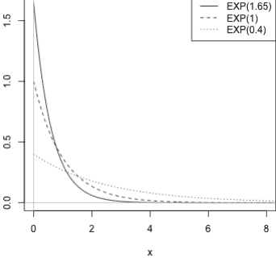

图 16-11：三个不同的指数密度函数。降低 $\lambda_e$ 会降低众数并延伸尾部。

参数 $\lambda_e$ 被提供给 `dexp` 中的 `rate` 参数，该参数在 $x$ 处求值，通过第一个参数 $x$ 提供（在本例中通过 `xvals` 对象提供）。你可以看到，指数密度函数的一个显著特征是上述向零的衰减，$\lambda_e$ 的值越大意味着更高（但更陡峭且更快速）的下降。

这种自然递减的行为有助于识别指数分布在应用中经常扮演的角色——通常具有“直到事件发生的时间”性质。事实上，指数分布与第 16.1.3 节介绍的泊松分布之间存在特殊关系。当使用泊松分布对随时间的事件计数建模时，你使用指数分布对这些事件之间的时间进行建模。在这种设定，指数参数 $\lambda_e$ 定义了事件随时间发生的平均速率。

## pexp 函数

让我们回顾练习题 16.2 中某个人的案例，该案例提到 120 分钟窗口内通过的汽车平均数量为 107 辆。定义随机变量 $X$ 为两辆连续通过汽车之间的等待时间，并以分钟为单位对 $X$ 使用指数分布，设置 $\lambda_e = 107/120 \approx 0.89$（保留两位小数）。如果在两小时窗口内有 107 辆车通过，那么你看到汽车的平均速率为每分钟 0.89 辆。

因此，将 $\lambda_e$ 解释为泊松函数参数 $\lambda_p$ 的“单位单位”。将均值解释为速率的倒数 $\mu_e=1/\lambda_e$ 也是直观的。例如，当以每分钟约 0.89 辆的速度观察汽车时，请注意汽车之间的平均等待时间约为 $1/0.89 \approx 1.12$ 分钟。

所以，在当前示例中，你想检查密度 $X \sim EXP(107/120)$。

```R
R> lambda.e <- 107/120
R> lambda.e
[1] 0.8916667
```

假设有一辆车刚刚通过该人的位置，你想找到在看到另一辆车之前必须等待超过两半分钟的概率，换句话说就是 $Pr(X > 2.5)$。你可以使用 `pexp` 完成。

```R
R> 1-pexp(q=2.5,rate=lambda.e)
[1] 0.107181
```

这表明你只有略高于 10% 的机会在下一辆车出现之前观察到至少 2 分钟 30 秒的间隔。记住，`p` 函数的默认行为是查找从给定值的左侧累积概率，因此你需要从 1 中减去结果来找到上尾概率。你通过以下代码找到等待少于 25 秒的概率，结果约为 0.31：

```R
R> pexp(25/60,lambda.e)
[1] 0.310302
```

需要先将感兴趣的值从秒转换为分钟，因为你是在 $\lambda_e \approx 0.89$ 的刻度上定义 $f(x)$ 的。

## qexp 函数

使用适当的分位数函数 `qexp` 来寻找（例如）最短 15% 等待时间的截断值。

```R
R> qexp(p=0.15,rate=lambda.e)
[1] 0.182264
```

这表明所感兴趣的值大约是 0.182 分钟。

一如既常，你可以使用 `rexp` 生成任何特定分布的随机变体。

区分“指数分布”、“指数族”和“指数函数”是非常重要的。第一个指的是刚刚学习的密度函数，而第二个指的是一类一般的分布。第三个是指数族成员所依赖的标准数学函数。

## 练习题 16.5

- a. 位于新西兰北岛中部的 Pohutu 间泉被认为是南半球最大的活动间泉。假设它每年平均喷发 3,500 次。
    i. 意图是将随机变量 $X$ 建模为喷发之间的时间，请以天为时间尺度评估参数 $\lambda_e$（考虑到闰年，每年平均 365.25 天）。
    ii. 绘制感兴趣的密度函数。喷发次数均值是多少？
    iii. 等待少于 30 分钟的概率是多少？
    iv. 什么等待时间定义了最长的 10% 等待？将你的答案转换为小时。
- b. 你也可以使用指数分布对某些产品服务或“故障时间”之类的变量进行建模。假设某空调制造商知道该产品在需要任何类型的维修之前的平均寿命为 11 年。设随机变量 $X$ 代表这些设备需要维修的时间，$X$ 服从参数 $\lambda_e=1/11$ 的指数分布。
    i. 该公司对其设备提供五年的维修保修。随机选择的一台空调使用保修的概率是多少？
    ii. 竞争公司对其竞争性空调提供六年的保修，已知其设备在需要某种维修之前的平均寿命为九 年。使用该保修的概率是多少？
    iii. 确定 (i) 和 (ii) 中的设备寿命超过 15 年的概率。

- F 分布用于对两个卡方随机变量的比率进行建模，在回归问题中非常有用（参见第 20 章）。它的函数为 `df`、`pf`、`qf` 和 `rf`，由于它涉及两个卡方值，因此依赖于作为参数 `df1` 和 `df2` 提供的自由度对指定。
- 伽马分布是指数分布和卡方分布的推广。它的函数为 `gamma`、`pgamma` 和 `rgamma`，它依赖于分别作为参数 `shape` 和 `scale` 提供的“形状”和“尺度”参数。
- Beta 分布通常用于贝叶斯建模，它已经实现了函数 `dbeta`、`beta`、`qbeta` 和 `rbeta`。它由两个“形状”参数 $a$ 和 $\beta$ 定义，分别作为 `shape` 和 `shape2` 提供。

特别，在接下来的几个章节中，你将遇到卡方分布和 F 分布。

在过去几节中你检查的所有常见概率分布中，我强调了需要执行“1减1”操作以找到相对于上尾或右尾区域的概率或数量。这是因为 `p` 和 `q` 函数的累积性质——根据定义，处理的是下尾。然而，R 中的大多数 `p` 和 `q` 函数都包含一个可选的逻辑参数 `Lower.tail`，其默认值为 `FALSE`。因此，另一种方法是在任何相关的函数调用中设置 `Lower.tail = TRUE`，在这种情况下，R 将专门预期或返回上尾区域。

# 本章重要代码

| 函数/运算符 | 描述 | 首次出现 |
| --- | --- | --- |
| `dbinom` | 二项分布质量函数 | 第 16.1.2 节，p. 335 |


| 函数 | 描述 | 参考位置 |
| :--- | :--- | :--- |
| `pbinom` | 二项分布累积问题 | 第 16.1.2 节，p. 336 |
| `qbinom` | 二项分布位数函数 | 第 16.1.2 节，p. 337 |
| `rbinom` | 二项分布随机实现 | 第 16.1.2 节，p. 337 |
| `dpois` | 泊松分布函数 | 第 16.1.3 节，p. 340 |
| `ppois` | 泊松分布累积问题 | 第 16.1.3 节，p. 341 |
| `rpois` | 泊松分布随机实现 | 第 16.1.3 节，p. 341 |
| `dunif` | 均匀分布密度函数 | 第 16.2.1 节，p. 346 |
| `punif` | 均匀分布累积问题 | 第 16.2.1 节，p. 346 |
| `qunif` | 均匀分布位数 | 第 16.2.1 节，p. 346 |
| `runif` | 均匀分布随机实现 | 第 16.2.1 节，p. 347 |
| `dnorm` | 正态分布密度函数 | 第 16.2.2 节，p. 350 |
| `pnorm` | 正态分布累积问题 | 第 16.2.2 节，p. 353 |
| `qnorm` | 正态分布位数 | 第 16.2.2 节，p. 353 |
| `rnorm` | 正态分布随机实现 | 第 16.2.2 节，p. 355 |
| `qt` | 学生 t 分位数 | 第 16.2.3 节，p. 358 |
| `dexp` | 指数分布密度函数 | 第 16.2.4 节，p. 359 |
| `pexp` | 指数分布累积问题 | 第 16.2.4 节，p. 361 |
| `qexp` | 指数分布位数 | 第 16.2.4 节，p. 361 |

# 第四部分：统计检验与建模


# 第 17 章：采样分布与置信区间


在第 15 和 16 章中，你将概率分布的概念应用到了随机变量被定义为感兴趣的测量值或观测值的示例。在本章中，你将把样本统计量本身视为随机变量，以引入采样分布的概念——这是一种用于解释在使用样本统计量估计总体参数时自然存在的变异性的概率分布。随后，我将介绍置信区间的概念，它是采样分布中变异性的直接反映，其使用方式会产生对总体参数的区间估计。这将为第 18 章的正式假设检验奠定基础。

## 17.1 采样分布

采样分布与任何其他概率分布一样，但它专门与作为样本统计量的随机变量相关联。在第 15 和 16 章中，我们假设我们知道相关示例分布的参数（例如，正态分布的均值和标准差，或者二项分布的成功概率），但在实践中，这些参数通常是未知的。在这种情况下，你通常会从样本中估计这些数量（参见第 266 页图 13-2 的视觉说明）。从样本中估计的任何统计量都可以被视为随机变量，估计值本身就是该变量的实现。因此，来自同一种总体的不同样本可能会为同一个统计量提供不同的值——随机变量的实现自然受到变异性的影响。

在过去几节中你检查的所有常见概率分布中，我强调了需要执行“1减1”操作以找到相对于上尾或右尾区域的概率或数量。这是因为 `p` 和 `q` 函数的累积性质——根据定义，处理的是下尾。然而，R 中的大多数 `p` 和 `q` 函数都包含一个可选的逻辑参数 `lower.tail`，其默认值为 `TRUE`。因此，另一种方法是在任何相关的函数调用中设置 `lower.tail = FALSE`，在这种情况下，R 将专门预期或返回上尾区域。

### 示例：样本均值的采样分布

```R
R> xvals <- seq(16, 28, by=0.1)
R> fx.samp <- dnorm(xvals, 22, 1.5/sqrt(5))
R> plot(xvals, fx.samp, type="l", lty=2, col="gray", xlab="", ylab="")
R> abline(h=0, col="gray")
R> fx <- dnorm(xvals, 22, 1.5)
R> lines(xvals, fx, lwd=2)
R> legend("topright", legend=c("raw obs. dist.", "sampling dist. (mean)"),
lty=1, lwd=2, col=c(1,2), bty="n")
```

在本示例中，你现在可以询问各种概率问题；请注意，区分测量分布和采样分布是非常重要的。例如，以下代码提供了 $Pr(X < 21.5)$，即 1 月份中随机选择的一天最高温度低于 21.5 度的概率：

```R
R> pnorm(21.5, mean=22, sd=1.5)
[1] 0.3694413
```

下一段代码提供了样本均值小于 21.5 度的概率 $Pr(\bar{X} < 21.5)$，这是基于 1 月份五天随机日的样本：

```R
R> pnorm(21.5, mean=22, sd=1.5/sqrt(5))
[1] 0.2280283
```

```R
R> abline(v=21.5, col="gray")
R> xvals.sub <- xvals[xvals <= 21.5]
R> fx.sub <- fx[xvals <= 21.5]
R> fx.samp.sub <- fx.samp[xvals <= 21.5]
R> polygon(c(21.5, xvals.sub), c(0, fx.sub), density=10)
R> polygon(c(21.5, xvals.sub), c(0, fx.samp.sub), density=10, angle=120, lty=2)
```

注意，在之前使用 `polygon` 时，你仅指定了 `col`；在本文示例中，我改用了阴影线，使用了 `density`（每英寸的线条数）和 `angle`（线的斜率角度；默认为 45）参数。


**图 17-1**：基于 $N(22,1.5)$ 的 $n=5$ 样本均值的采样分布图。上方：基于正态分布的采样分布版本（假设 $\sigma$ 已知）与观测分布对比。下方：基于 t 分布的采样分布版本，使用了 4 个自由度（换句话说，假设使用 $s$ 计算标准误）。阴影区域表示 $Pr(X < 21.5)$（实线和最上方的图）以及 $Pr(T < (21.5 - \mu)/\sqrt{n})$（虚线，底部图）。

为了评估这些概率，请注意你需要了解控制 $X$ 的参数。在实践中，你很少拥有这些量值。相反，你会获得一组数据并计算汇总统计量。

运行以下代码生成从 $N(22,1.5)$ 分布中随机生成的五个温度值：

```R
R> obs <- rnorm(5, mean=22, sd=1.5)
R> obs
[1] 22.92233 23.09505 20.98653 ...
```

然后，你可以使用以下代码绘制相应的抽样分布：

```R
R> pvals <- seq(p.hat - 5*p.se, p.hat + 5*p.se, length=100)
R> p.samp <- dnorm(pvals, mean=p.hat, sd=p.se)
R> plot(pvals, p.samp, type="l", xlab="", ylab="",
xlim=p.hat + c(-4,4)*p.se, ylim=c(0, max(p.samp)))
R> abline(h=0, col="gray")
```

图 17-2 给出了结果。

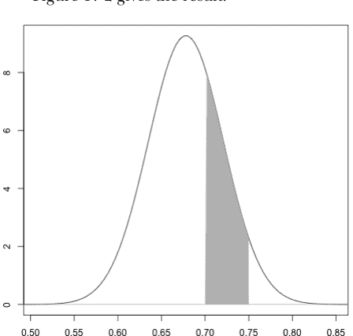

**图 17-2**：根据方程 [17.1] 可视化投票的抽样分布。阴影区域代表 $Pr(0.7 < P < 0.75)$，即样本量 $n = 118$ 的样本真实样本比例落在 0.7 和 0.75 之间的概率。

现在，你可以使用该分布来描述对于其他相同大小的样本，已经知道如何投票的选民样本比例的变异性。

例如，图 17-2 中的阴影区域强调了在另一个相同大小的样本中，该城市已经知道如何投票的选民样本比例落在 0.7 到 0.75 之间的概率。可以使用以下代码添加该阴影区域：

```R
R> pvals.sub <- pvals[pvals >= 0.7 & pvals <= 0.75]
R> p.samp.sub <- p.samp[pvals >= 0.7 & pvals <= 0.75]
R> polygon(cbind(c(0.7, pvals.sub, 0.75), c(0, p.samp.sub)),
border=NA, col="gray")
```

在使用第 16.2.2 节介绍的 `pnorm` 知识后，你可以使用以下代码计算感兴趣的概率：

```R
R> pnorm(0.75, mean=p.hat, sd=p.se) - pnorm(0.7, mean=p.hat, sd=p.se)
[1] 0.257238
```

该抽样分布表明，基于相同的样本量，另一个样本比例落在这两个值之间的概率大约为 25.7%。

## 练习 17.1

某老师想测试他学校里所有的 10 年级学生以评估他们的基础数学理解能力，但打印机在只打印了六份试卷后就坏了。别无选择，他随机挑选了六名学生参加测试。他们的结果记录为满分 65 分的分数，样本平均值为 41.1。已知该测试分数的标准差为 11.3。

- a. 找到与平均测试分数相关的标准误。
- b. 假设分数本身服从正态分布，如果老师再取一个相同大小的样本，计算平均分落在 45 到 55 之间的概率。
- c. 答题少于一半的学生将获得不及格（F）。根据另一个相同大小的样本，计算平均分得 F 的概率。

一家营销公司想找出人们更偏好哪种饮料——A 还是 B。调查了 140 名青少年，结果显示只有 35% 的人偏好 A。

- d. 使用快速检查来判断使用正态分布来表示该比例的抽样分布是否有效。
- e. 在另一个相同大小的样本中，偏好 A 的青少年超过 0.4 的概率是多少？
- f. 找到该抽样分布的两个值，以确定中间 80% 的值。

在第 16.2.4 节中，车辆通过个人位置的时间间隔使用指数分布进行建模。假设在对面，她的朋友对类似的问题感兴趣。她站在自己房子外，记录了 63 次车辆通过的间隔时间，这些时间的平均值为 $\bar{x}=37.8$，标准差为 $s=4.5$。

- g. 朋友检查了测量结果的直方图，注意到她的原始数据严重右偏。请简要识别并描述相对于样本平均值的抽样分布的性质，并计算适当的标准误。
- h. 使用 (g) 中的标准误和适当的概率分布，计算在另一个相同大小的样本中，车辆通过的样本平均时间如下概率：
  - i. 大于 40 秒
  - ii. 少于一半
  - iii. 处于给定平均值和 40 秒之间

## 17.3 其他统计量的抽样分布

到目前为止，你已经查看了处理单个平均值或比例情况的抽样分布，但重要的是，许多问题需要复杂的衡量标准。尽管如此，你仍然可以将本节探索的观点应用于任何从有限样本中估计的统计量。关键在于理解与点估计相关的变异性。

在某些情况下（如目前为止的情况），抽样分布是参数化的，这意味着概率分布本身的函数（数学）形式是已知的，并且仅取决于特定的参数值。这有时取决于某些条件的满足，正如你在本章中涵盖的正态分布的应用中所看到的那样。对于其他统计量，你不知道适当抽样分布的形式——在这些情况下，你可以使用计算机模拟来获得所需的概率。

估计量的变异性实际上是硬币的一面。同样重要的是统计偏倚的问题。“自然变异性”与随机误差有关，而偏倚与系统误差有关，这意味着一个有偏的统计量不会随着样本量的增加而趋于相应的真实值。偏倚可能由研究设计或数据收集的缺陷引起，也可能是对感兴趣对象的估计不佳的结果。偏倚是任何给定估计量的一个不良特征，除非它可以被量化并消除，而这在实践中通常是困难甚至是不可能的。到目前为止，我只处理了无偏估计量，其中许多你可能已经知道（例如，算术平均值），我以后将继续假设无偏性。

## 17.2 置信区间

置信区间（CI）是一个由下限 $l$ 和上限 $u$ 定义的区间，用于根据观测样本数据描述真实总体参数的可能值。对置信区间的解释允许你陈述感兴趣的参数落在这两个边界之间的“置信水平”，通常以百分比表示。正如你在本章中涵盖的正态分布的应用中所看到的，这是直接从统计量的抽样分布构建的。以下是重要的要点：

- 置信水平通常以百分比表示，以便构建 $100 \times (1 - \alpha)$ 百分置信区间，其中 $0 < \alpha < 1$。
- 三种常见的区间定义为 $\alpha = 0.1$（90% 置信区间）、$\alpha = 0.05$（95% 置信区间）或 $\alpha = 0.01$（99% 置信区间）。
- 通俗地说，你会将置信区间 $(l,u)$ 的解释为：“有 $100 \times (1 - \alpha)$ 百分比的把握，真实值落在 $l$ 和 $u$ 之间。”

置信区间的构建方法取决于统计量的类型以及相应的抽样分布形状。对于对称分布的样本统计量（如本章将使用的平均值和比例），通用公式为：


$$\text{statistic} \pm \text{critical value} \times \text{standard error}, \quad (17.2)$$

其中，`statistic` 是受关注的样本统计量，`critical value` 是抽标准化分布中对应于 $\alpha$ 的值，`standard error` 是抽样分布的标准差。界值与标准误的积被称为间的*误差部分*；从值中减去误差部分得到 $l$，加上误差部分得到 $u$。

参考适当的抽样分布，置信区间提供了两个标记中间 $100 \times (1 - \alpha)$ 百分比面积密度的值。这就是在练习 17.1 (f.) 中简要提到的过程。你使用置信区间对由统计量估计的真实（通常未知）参数值进行进一步解释。

# 17.2.1 平均值的区间

从第 17.1.1 节知道，单个样本平均值的抽样分布取决于你是否知道原始测量值的真实标准差 $\sigma_X$。那么，只要平均值的样本量大致 $n \geq 30$，中心极限理就能保证一个对称分布——如果你知道 $\sigma_X$ 的真实值，则为正态分布；如果你必须使用样本标准差 $s$，则为 $t = n - 1$ df 的分布。

估计 $\sigma_X$（在实践中更为常见）。你已经看到标准误定义为标准差除以 $n$ 的平方根。对于较小的 $n$，你必须假设原始观测符合正态分布，否则中心极限定理（CLT）将失效。

要构建一个合适的区间，你必须首先找到对应 $\alpha$ 的临界值。根据定义，CLT 是对称的，这意味着在均值周围有 $(1-\alpha)$ 的中心概率，下尾恰好为 $\alpha/2$，上尾也相同。

回到第 17.1.1 节的示例，涉及新西兰达尼丁（Dunedin）1 月日平均最高温度（摄氏度）。假设你知道观测值符合正态分布，但你不知道真实的均值 $\mu_X$（为 22）或真实的标准差 $\sigma_X$（为 1.5）。按照之前相同的方式进行设置，你进行了以下五个独立观测：

```
R> temp.sample <- rnorm(n=5,mean=22,sd=1.5)
R> temp.sample
[1] 20.46097 21.45568 21.06410 20.49367 24.92843
```

由于你对样本均值及其采样分布感兴趣，你必须计算样本均值 $\bar{X}$、样本标准差 $s$ 以及样本均值的适当标准误 $s/\sqrt{n}$。

```
R> temp.mean <- mean(temp.sample)
R> temp.mean
[1] 21.68075
R> temp.sd <- sd(temp.sample)
R> temp.sd
[1] 1.862456
R> temp.se <- temp.sd/sqrt(5)
R> temp.se
[1] 0.8329155
```

现在，假设目标是为真实的未知均值 $\mu_X$ 构建一个 95% 的置信区间。这意味着对于相关的采样分布，$\alpha=0.05$（总尾部概率）。鉴于你知道原始观测值为正态分布且你正在使用 $s$（而非 $\sigma_X$），适当的分布是自由度 $n-1=4$ 的 $t$ 分布。在该曲线上，$0.95$ 的中心区域意味着两尾均满足 $\alpha/2=0.025$ 的条件。注意 R 的 $q$ 函数是基于下尾面积运行的，因此通过向适当函数提供概率 $1-\alpha/2=0.975$ 来实现。

```
R> 1-0.05/2
[1] 0.975
R> critval <- qt(0.975,df=4)
R> critval
[1] 2.776445
```

图 17-3 解释了为什么这样使用 `qt` 函数（由于我在第 16 章中使用了相似的代码，因此在此未重现图 17-3 的代码）。

曲线下的面积 (p)

0.975 ←

0.025 ←

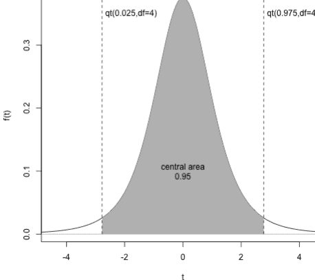

图 17-3：利用达尼丁温度示例，说明了临界值在样本均值置信区间中的作用。采样分布为自由度为 4 的 $t$ 分布，相对于 $\alpha/2=0.025$ 的对称尾部概率使用 `qt` 导致了 $0.95$ 的中心区域。

注意，当相对于均值周围的同一临界值的负版本（“镜像”）查看，并通过使用 `qt(0.025,4)` 获取时，曲线下的中心对称区域必须是 0.95。你可以使用 `pt` 来确认这一点。

```
R> pt(critval,4)-pt(-critval,4)
[1] 0.95
```

因此，所有要素都就绪了。你通过公式 (17.2) 和以下代码找到均值 $\mu_X$ 的 95% 置信区间，这些代码分别给出 $l$ 和 $u$：

```
R> temp.mean-critval*temp.se
[1] 19.36821
R> temp.mean+critval*temp.se
[1] 23.99329
```

因此，(19.37, 23.99) 给出的 CI 解析如下：你有 95% 的把握，达尼丁 1 月真实的平均最高温度位于 19.37 到 23.99 摄氏度之间。

通过这个结果，你将均值估计本身的知识与样本固有的变异性相结合，定义了一个你确定真实均值所在的数值区间。如你所知，在这种情况下真实均值为 22，它确实包含在计算出的 CI 中。

从这里，很容易改变置信水平。一如既往，必须在每个尾部定义 $\alpha/2$。例如，对于同一个样本值，可以通过以下代码分别找到 80% CI ($\alpha = 0.2$) 和 99% CI ($\alpha = 0.01$)：

```
R> temp.mean(-1,1)*qt(p=0.9,df=4)*temp.se
[1] 20.40372 22.95788
R> temp.mean(-1,1)*qt(p=0.995,df=4)*temp.se
[1] 17.84593 25.51557
```

注意此处使用了与向量 `c(-1,1)` 相乘，这样可以同时获得下限和上限，并返回长度为 2 的向量结果。按照常例，`qt` 函数相对于完整的下尾面积使用，因此 $p$ 设置为 $-alpha/2$。

这些区间凸显了对于给定 CI 移动到更高置信水平的自然结果。中心区域更高的概率意味着更极端的临界值，从而导致更宽的区间。这是合理的——为了对真实均值“更有信心”。

### 17.2.2 比例的区间

为比例建立 CI 遵循与均值相同的规则。

正确的解释应该考虑并澄清该构建的概率性质。从技术上讲，给定 $100(1-a)$ 百比的置信水平，更准确的解释如下：对于许多具有相同大小且来自同一总体的样本，如果对每个样本都根据相同的统计量构建出的一个具有相同置信水平的置信区间（CI），你会预期真实的对应参数值落入 $100(1-a)$ 百比的区间范围内。

这源于抽样分布理论描述的是多个样本的变异性，而不仅仅是已提取的某一个样本。初一看，可能很难完全理解这与口语中使用的“置信陈述”之间的区别，但保持技术上正确的定义是非常重要的，特别是考虑到 CI 通常是基于单个样本估计得的。

## 练习 17.2

- 一位跑步者记录了他冲刺 100 米所需的平均时间。在相同条件下，他完成了 34 次冲刺，并发现这些冲刺的平均值为 14.22 秒。假设他知道跑步的标准差为 $\sigma_X=2.9$ 秒。

- a. 为真实均值构建并解释一个 90% 的置信区间。

- b. 重复 (a)，这次假设标准差未知，且 $s=2.9$ 是从样本中估计的。如果变化，这是否改变了区间？

在某个特定国家，左手子或双用手公民的真实比例是未知的。对 400 人进行了随机抽样，并要求每人识别三个选项之一：仅右手、仅左手、或是双用手者。结果显示，有 37 人仅右手，11 人被选为双用手者。

- c. 计算并解释仅左手子公民真实比例的 99% 置信区间。

- d. 计算并解释均为左手子或双用手的公民真实比例的 99% 置信区间。

在第 17.2.4 节中，其置信水平的技术解释被描述为：许多相似区间（即当对同一总体的样本进行计算时）包含感兴趣参数真实值的比例。

- e. 你的任务是写一个示例，使用模拟来演示这种置信区间行为。要这样做，请遵循以下指令：

  - 设置一个矩阵（见第 3 章），填充为 NAs（第 6 章），具有 5,000 行 3 列。

  - 使用第 10 节的技能编写一个 for 循环，在 5,000 次迭代中，从率参数为 $\lambda_e = 0.1$ 的指数分布（第 16.2.4 节）中生成大小为 300 的随机样本。

  - 评估每个样本的均值和标准差，并使用这些量结合临界值计算该分布真实均值的 95% 置信区间。

  - 在循环内部，矩阵应该按行填充。第一列包含下限，第二列包含上限，第三列包含一个逻辑值，如果 $1/\lambda_e$ 是真实均值则为 TRUE，否则为 FALSE。

  - 循环完成后，计算第三列中 TRUE 的比例。你会发现这个比例接近 0.95；这在每次运行循环时都会随机变化。

- f. 创建一个图，将你估计的 100 个置信区间绘制为从 i 到 n 的独立水平线，一个叠一个。做到此的一种方法是创建一个带有预设 x 轴和 y 轴限制（后者为 c(1,100)）的空图，然后使用适当坐标逐步添加每条线（可以使用另一个循环完成）。作为最后的点缀，在图中添加一条红色的垂直线来表示真实均值。不包含真实均值的置信区间将不会与该垂直线相交。以下显示了该图的一个示例：

## 假设检验


在本章中，你将基于对置信区间和抽样分布的经验，对一个未知的感兴趣参数做出正式陈述。为了实现，你将学习频率派检验，其中使用相关抽样分布的概率作为反对某些主张的证据。当以这种方式使用概率时，它被称为 p 值（p-value）。在本章中，我们将讨论相对基础的统计结果的解释，但你可以将相同的概念应用于更复杂的方法（例如第 19 章中的回归建模）。

### 1.1 假设检验的组成部分

为了给你举一个假设检验的例子，假设我告诉你某人群中有 7% 的人过敏。然后你从该人群中随机选择 20 个人，发现其中有 18 人过敏。假设你的样本是无偏的且真实反映了该人群，你对过敏人士真实比例为 7% 的这一主张会有什么想法？

自然地，你会怀疑该主张的正确性。换句话说，在成功率为 0.07 的情况下，在 20 次中观察到 18 次或更多成功的概率如此小，以至于你可以说该主张是错误的。事实上，通过假设 $X \sim \text{Binomial}(20, 0.07)$ 将 $X$ 定义为20 人中过敏的人数，评估 $Pr(X \ge 18)$ 将给你精确的 p 值：

```
dbinom(18:20, size=20, prob=0.07)
```

该 p 值代表了在样本中观察到结果的概率。在查看具体的假设检验及其在 R 中的实现之前，本节将介绍你在报告此类时会遇到的术语。

### 1.1.1 假设

正如名称所暗示，在假设检验中，正式陈述一个主张并进行随后的假设检验。零假设被解释为基准假设，备择假设是你检验的假设。通常，零假设和备择假设分别记为 $H_0$ 和 $H_1$，如下：

$H_0: \dots$

$H_a: \dots$

涉及样本均值的假设检验的有效性取决于第 17.1.1 节中提到的相同假设和条件。特别，在本节中，你应该假设极限定理成立，并且样本量较小（换句话说，大致小于 30），则原始数据服从正态分布。你还将关注使用样本标准差 $s$ 来估计真实标准差 $\sigma_X$ 的示例，因为这是你在实践中遇到的最常见情况。同样，类比第 17.1.1 节，这意味着在计算临界值和 $p$ 值时，你需要使用 $t$ 分布而不是正态分布。

### 18.2.1 单均值

既然你已经熟悉了标准误公式 $s/\sqrt{n}$ 以及从 $t$ 分布获取分位数和概率的 R 函数（`qt` 和 `pt`），那么这里要引入的新概念仅与假设的定义和结果的解释有关。

### 计算：单样本 t 检验

让我们直接进入一个示例——单样本 t 检验。回想第 16.2.2 节中的问题，某零食制造商对广告的 80 克包装内内容的平均重量感兴趣。假设一名消费者打来投诉——随着时间的推移，他们从商店随机抽取了 44 包 80 克包装并精确称量了内容物重量，记录如下：


```R
snacks <- c(87.80,81.01,77.28,78.76,81.52,74.2,80.71,79.5,77.87,81.94,80.7,
82.32,75.78,80.19,79.4,77.47,77.52,81.4,74.49,82.95,
73.59,77.92,77.18,79.83,81.23,79.28,78.44,79.01,80.47,76.23,
78.89,77.14,69.94,78.54,79.7,82.45,79.25,75.52,77.21,75.99,
81.94,80.41,77.7)
```

客户声称分量减少了，这不可能从均值为 $\mu = 80$ 的分布中出现。为了调查这个问题，制造商使用显著性水平 $\alpha = 0.05$ 进行了假设检验。

首先，必须定义假设，零假设值为 80 克。记住，备择假设是“你正在测试的内容”，在这种情况下，$H_A$ 是 $\mu$ 小于 80。零假设解释为“无变化”，将定义为 $\mu = 80$：即真实平均值确实为 80 克。这些假设的形式化如下：

> $H_0 : \mu = 80$

> $H_A : \mu < 80 \quad (18.1)$

其次，必须从样本中估计均值和标准差。

```R
n <- length(snacks)
snack.mean <- mean(snacks)
snack.mean
[1] 78.91068
snack.sd <- sd(snacks)
snack.sd
[1] 3.056023
```

你的假设寻求回答的问题是：给定估计的标准差，如果真实均值为 80 克，那么观测到样本均值（当 $n = 44$ 时）为 78.91 克或更低的概率是多少？为了回答这个问题，你需要计算相关的统计量。

形式上，对于相对于零值 $\mu_0$ 的单均值假设检验，检验统计量 $T$ 给出为

```R
$T = \frac{\tilde{x} - \mu_0}{s/\sqrt{n}} \quad (18.2)
```

基于大小为 $n$ 的样本、样本均值 $\tilde{x}$ 和标准差 $s$（分母是均值的估计标准误）。假设相关条件已满足，$T$ 服从自由度为 $v = n-1$ 的 $t$ 分布。

在 `R` 中，以下代码提供了零食样本均值的标准误：

```R
> snack.se <- snack.sd/sqrt(n)
> snack.se
[1] 0.4607128
```

然后，$T$ 的计算如下：

```R
> snack.T <- (snack.mean-80)/snack.se
> snack.T
[1] -2.364419
```

最后，使用检验统计量来获取 $p$ 值。记住，$p$ 值是你观测到 $T$ 或更极端情况的概率。“更极端”的性质由备择假设 $H_A$ 决定，由于它是“小于”号，它引导你将左侧尾部概率作为 $p$ 值。换句话说，$p$ 值提供的是采样分布（自由度 $df=43$ 的 $t$ 分布）中 $T$ 左侧的面积。根据第 16.2.3 节，这可以很容易完成：

```R
> pt(snack.T,df=n-1)
[1] 0.0132175
```

你的结果表明，如果 $H_0$ 为真，观测到客户样本均值 $\tilde{x}=78.91$ 的概率仅略高于 1%。由于此 $p$ 值小于预定义的显著性水平 $\alpha=0.05$，制造商得出有足够的证据拒绝零假设而支持备择假设，表明 $\mu$ 的真实值实际上小于 80。注意如果按照第 17.2.1 节描述找到单均值对应的 95% 置信区间（CI）：

```R
> snack.mean+c(-1)*qt(0.975,n-1)*snack.se
[1] 77.98157 79.8390
```

它不包含 80 这一零值。

### R 函数：`t.test`

单样本 t 检验的结果也可以通过内置的 `t.test` 函数找到。

```R
> t.test(x=snacks,mu=80,alternative="less")

One Sample t-test

data: snacks
t = -2.3644 df = 43 p-value = 0.01132
alternative hypothesis: true mean is less than 80
95 percent confidence interval:
-Inf 79.6817

sample estimates:
mean of x
78.9107
```

该函数接收原始数据作为 `x`，均值的零值作为 `mu`，检验的方向（换句话说，如何找到 $p$ 值）作为 `alternative`。备择参数有三个选项：用于 $H_A$ 的 `"less"`，用于 $H_A$ 的 `"greater"`，以及用于 $H_A$ 的 `"two-sided"`。$\alpha$ 的默认值为 0.05。如果你想要不同于 0.05 的显著性水平，必须将 $1-\alpha$ 给 `t.test` 并传递给 `conf.level`。

注意 `t.test` 输出报告了 $T$ 值、自由度和 $p$ 值。你还得到了一个95% 的“区间”，但其值 -Inf 79.6817 与刚才计算的区间不匹配。手动计算的区间实际上是一个由两侧误差相等组成的双侧区间。相反，`t.test` 输出中的 CI 接收 `alternative` 参数的指示。它提供了一个单侧置信边界。对于左尾检验，它提供了统计量的上限，使得采样分布的整个左尾为 0.95，而不是传统的双侧区间那中心区域。单侧边界小于完全边界的双侧区间，后者可以通过设置 `alternative="two-sided"` 调用 `t.test` 获取（即 `conf.int` 部分）。

```R
> t.test(x=snacks,mu=80,alternative="two-sided")$conf.int
[1] 77.98157 79.3839
attr(,"conf.level")
[1] 0.95
```

此结果与你之前的手动计算匹配。注意相应的置信水平 $1-\alpha$ 作为属性存储在此旁边（参考第 6.2.1 节）。

在检查零食示例的 $p$ 值结果时，记住在解释假设检验要小心。对于这项检验，当 $\alpha$ 为 0.05 时，$H_0$ 被拒绝。如果使用 $\alpha=0.01$ 进行检验会怎样？$p$ 值大于 0.01，因此在这种情况下，$H_0$ 将被保留，原因仅仅是 $\alpha$ 水平的任意移动。在这些情况下，对反对零假设的感知强度进行评论是有帮助的。你可以合理地说明存在支持 $H_A$ 的证据，但这种证据并不特别强。

## 练习题 18.1

a. 据说某品种的家猫平均重量为 3.5 公斤。一位猫爱好者不同意，并收集了该品种的 73 个重量样本。从她的样本中，她计算出均值为 3.97 公斤，标准差为 2.21 公斤。对其关于真实均值 $\mu$ 不是 3.5 公斤的主张进行假设检验，建立合适的假设、进行分析并解释 $p$ 值（假设显著性水平为 $\alpha=0.05$）。

b. 假设此前认为斐济沿岸地震事件的平均强度为里氏级4.3级。使用现用 `quakes` 数据中 `mag` 变量的数据（提供了该地区 1000 次采样地震事件），来测试真实平均强度实际上大于 4.3 的主张。建立合适的假设，使用 `t.test`（在显著性水平 $\alpha=0.01$ 下进行检验），并得出结论。

c. 手动计算 (b) 中真实均值的双侧置信区间。

然而，**均值的性质**通常是相同的——零假设通常定义为 $\mu_1$ 和 $\mu_2$ 相等。换言之，两个均值差的零值通常为零。

## 非配对/独立样本：合并方差

最通用的情况是两组测量数据基于两个独立、分离的组别（也称为*非配对*样本）。你计算两个数据集的样本均值和标准差，定义感兴趣的假设，然后计算检验统计量。

当你无法假设两个总体的方差相等时，你需要执行双样本 $t$ 检验的*非合并*（unpooled）版本；然而，如果你可以安全地假设方差相等，则执行*合并*（pooled）双样本 $t$ 检验，这将提高结果的精确度。你将查看该检验的合并版本。

例如，回到第 18.2.1 节中的 80 克零食包装。在从原始制造商处收集了 44 包样本后（将此样本量标记为 $n_1$），一位眼尖的消费者出门从竞争对手制造商处随机收集了 $n_2 = 31$ 包 80 克包装。第二组测量数据存储为 `snacks2`。

```R
snacks2 <- c(80,22,79,73,81,1,78,76,82,03,81,66,90,78,81,32,12,78,98,
79,21,88,47,79,86,01,66,07,96,80,73,80,34,80,01,81,82,79,33,
79,08,47,78,98,80,82,24,77,22,80,03,79,2,80,95,79,17,81)
```

从第 18.2.1 节中，你已经知道大小为 $n_1 = 44$ 的第一个样本的均值和标准差——这些存储在 `snack.mean`（约为 78.91）和 `snack.sd`（约为 3.06）中——将这些视为 $x_1$ 和 $s_1$。分别为新数据计算统计量 $\bar{x}_2$ 和 $s_2$。

```R
snacks2.mean <- mean(snacks2)
snacks2.mean
[1] 80.1571
snacks2.sd <- sd(snacks2)
snacks2.sd
[1] 2.12365
```

原始样本的真实均值表示为 $\mu_1$，来自竞争对手的新样本的真实均值表示为 $\mu_2$。感兴趣的是测试是否有统计证据支持 $\mu_2$ 大于 $\mu_1$ 的主张。这建议了假设 $H_0: \mu_2 - \mu_1 = 0$ 和 $H_A: \mu_2 - \mu_1 > 0$，可以写如下：

$H_0: \mu_2 - \mu_1 = 0$

$H_A: \mu_2 - \mu_1 > 0$

也就是说，竞争公司包装与原始制造商包装之间的均值差大于零。“无变化”场景（即零假设）是两个均值相同，因此它们的差确实为零。

现在你已经构建了假设，让我们看看如何测试它们。两个均值之差是感兴趣的量。对于源自均值为 $\mu_1$ 和 $\mu_2$ 的总体的独立样本，样本均值分别为 $\bar{x}_1$ 和 $\bar{x}_2$，标准差分别为 $s_1$ 和 $s_2$（且满足 $t$ 分布有效性的相关条件），用于测试 $\mu_2$ 与 $\mu_1$ 差异的标准化检验统计量 $T$ 给出：

$T = \frac{\bar{x}_2 - \bar{x}_1}{\sqrt{s_1^2/n_1 + s_2^2/n_2}}$

其分布由具有 $\nu$ 自由度的 $t$ 分布近似，

$\nu = \frac{(s_1^2/n_1 + s_2^2/n_2)^2}{(s_1^2/n_1)^2/(\nu-1) + (s_2^2/n_2)^2/(\nu-1)}$

在 (18.3) 中，$\mu_0$ 是感兴趣的值——在涉及“差异”的检验中通常为零。$T$ 的分母是该设置下两个均值差的标准误。

虽然这种说法有些非正式，但如果无法合理地做出该假设，最好坚持使用未合并（unpooled）的测试版本。

为了说明这一点，让我们考虑一个新例子。智商（IQ）是一个通常被认为是衡量一个人聪明程度的量。分数被合理地假设为正态分布，人群的平均 IQ 被认为是100。假设你感兴趣评估男性和女性之间的平均分是否存在差异，提出以下假设，其中 $n_{men} = 12$且$n_{women} = 20$：

```
$H_0 : \mu_{men} - \mu_{women} = 0$
$H_A : \mu_{men} - \mu_{women} \neq 0$
```

你随机抽取了以下数据：

```
R_men <- c(102,87,101,107,91,85,108,67,85,82)
R_women <- c(73,81,111,109,143,95,92,120,93,119,79,90,126,62,92,77,106,105,111)
```

像往常一样，让我们计算基础统计量：

- `mean(men)`
```
[1] 92.66667
```
- `sd(men)`
```
[1] 12.0705
```
- `mean(women)`
```
[1] 98.65
```
- `sd(women)`
```
[1] 19.94802
```

这些提供了样本平均值 $\bar{x}_{men}$ 和 $\bar{x}_{women}$，以及它们各自的偏差 $s_{men}$ 和 $s_{women}$。输入以下内容快速检查标准差的比率：

```
sd(women)/sd(men)
[1] 1.65226
```

你可以看到，较大标准差的比率小于2，因此你可以在进行假设检验时假设方差相等。`t.test` 命令也支持合并样本t检验（pooled-sample t-test）。要执行它，你需要提供可选参数 `var.equal=TRUE`（与默认的 `var.equal=FALSE` 相反，后者会触发非合并版本）：

```
t.test(x=men,y=women,alternative="two.sided",conf.level=0.95,var.equal=TRUE)
```

## 双样本t检验

data: men and women

t = -0.9376, df = 30, p-value = 0.3559

备择假设: 均值的真实差异不等于0

95% 置信区间:

-19.01633 7.04927

sample estimates:

mean of x 92.66667

y 98.65

注意，此例的 $H_0$ 意味着双尾检验，因此该测试得到的 p 值（0.3559）显然大于传统的 0.05 阈值水平。因此，你的结论是没有证据拒绝 $H_0$——没有足够的证据支持男性平均分与女性相比存在真实差异。

## 配对/依赖样本

最后，我们将比较配对数据中的均值。这种设置与未配对的t检验不同，因为它涉及到数据收集的方式。问题涉及跨组的观测值对——如果形成两组观测值的测量是记录在同一个个体上的，或者它们以其他某种明显的方式相关，则出现配对数据。一个经典的例子是“治疗前”和“治疗后”观测，例如对每个人在某种治疗前后进行的两次测量。例如，考虑一家公司对旨在降低静息心率（单位为每分钟次数 bpm）的药物的效力感兴趣。测量了16个人的静息心率。然后给这些人接受了一个疗程，并再次测量它们的静息心率。数据以如下前后两个向量的形式提供：

```
rate.before <- c(52,66,89,87,89,72,66,65,69,42,70,52,75,63,65,61)
rate.after <- c(51,66,71,73,70,68,50,51,40,57,65,53,64,56,50,59)
```

很快就会明白为什么任何考虑心率的测试都会受到个体年龄、体型和体能水平的影响。一个超过60岁的不健康个体的其基线心率可能比一个健康的20岁年轻人高，而且如果给他们服用同样的降低心率药物，他们最终的心率仍然可能反映出这种基线水平。因此，如果你使用未配对的t检验进行分析，药物的任何真实效果都有可能被掩盖。

为了解决这个问题，配对双样本考虑了每对值之间的差异。通过将一组 $n$ 次测量值标记为 $x_1, \dots, x_n$，另一组 $n$ 个观测值标记为 $y_1, \dots, y_n$，差异定义为 $d_i = y_i - x_i; 1, \dots, n$。在R中，可以很容易地计算出差异：

```
R> rate.d <- rate.after-rate.before
R> rate.d
[1] -1 0 -18 -14 -19 -4 -14 -9 -5 1 -11 -7 -5 -2
```

以下代码计算这些差异的均值 $d$ 和标准差 $sd_d$：

```
R> rate.dbar <- mean(rate.d)
R> rate.dbar
[1] -7.4375
R> rate.sd <- sd(rate.d)
R> rate.sd
[1] 6.1947
```

你想查看心率降低了多少，因此测试将涉及以下假设：

$H_0 : \mu_d = 0$

$H_A : \mu_d < 0$

给定获得差异的顺序，心率的成功降低将通过“后”均值小于“前”均值来表示。从数学上讲，感兴趣的值是依赖样本均值之间的真实差异 $\mu_d$。两组 $n$ 次测量值 $x_1, \dots, x_n$ 和 $y_1, \dots, y_n$，带有配对差异 $d_1, \dots, d_n$。必须满足 $t$ 分布的有效条件；在这种情况下，如果数量 $n$ 小于30，必须能够假设原始数据呈正态分布。统计量 $T$ 给出：

$T = \frac{\bar{d} - \mu_0}{s_d / \sqrt{n}}$

$\bar{d}$ 是配对差异的均值，$s_d$ 是配对差异的标准差，$\mu_0$ 是零值（通常为零）。统计量 $T$ 服从自由度 $n-1$ 的 $t$ 分布。一旦计算出差异的样本统计量，方程 (18.7) 的形式实际上与 (18.2) 中的统计量形式相同。此外，重要的是 $n$ 代表对的总数，而不是个体观测值的数。对于当前的示例，你可以通过 `rate.dbar` 和 `rate.sd` 找到统计量和 p 值：

```
R> rate.T <- rate.dbar/(rate.sd/sqrt(16))
R> rate.T
[1] -4.80114
R> pt(rate.T,df=15)
[1] 0.0001681
```

这些结果提供了拒绝 $H_0$ 的证据。在 `t.test` 中，可选参数 `paired` 必须设为 `TRUE`。

```
R> t.test(x=rate_after,y=rate_before,alternative="less",conf.level=0.95,paired=TRUE)
```

配对t检验

data: rate_after and rate_before

t = -4.8011, df = 15, p-value = 0.000117

备择假设: 均值的真实差异小于0

95% 置信区间:

-Inf -4.721833

sample estimates:


# mean of differences

-7.4375

注意，给定期望的 `alternative`，向 `x` 和 `y` 参数提供数据的顺序与未配对检验的规则相同。通过使用 `t.test` 手动计算相同的 p 值，由于假设性水平为 $\alpha = 0.05$，一个有效的结论是：有统计证据表明药物降低了平均心率。你可以继续说，你有95%的信心服药后心率的真实均值差异落在某处：

```
R> rate.dbar-qt(0.975,df=15)*(rate.sd/sqrt(16))
-[1] -10.73935
```

以及

```
R> rate.dbar+qt(0.975,df=15)*(rate.sd/sqrt(16))
-[1] 4.135652
```

在某些情况下，例如当你的数据强烈指示非正态性时，你可能不习惯假设中心限定理（CLT）的有效性（参考第17.1节）。此处讨论检验的替代方法是使用放宽这些分布要求的非参数技术。在双样本情况下，你使用 Mann-Whitney U 检验（也称为 Wilcoxon 秩和检验）。这是一个比较两个中位数而非两个均值的假设检验。你可以使用 R 函数 `wilcox` 来访问这种方法论；其帮助页面提供了关于该技术细节的有用注释和参考文献。

## 练习 18.2

在 `MASS` 软件包中，你会找到 `anorexia` 数据集，它包含了72名患有该疾病的年轻女性在治疗前和治疗后的体重（磅）数据，来自 Hand 等人 (1994)。一组是控制组（换句话说，没有干预），另外两组是认知行为计划和支持干预组。加载库并确保你可以访问数据框并理解其内容。$\mu_d$ 表示平均体重差异，计算方法为（治疗后体重 – 治疗前体重）。

无论参与者属于哪个治疗组，针对整个权重，使用 $\alpha = 0.05$ 进行适当的假设检验并得出结论，对于以下假设：

$H_0 : \mu_d = 0$

$H_{\Delta} : \mu_d > 0$

- 接下来，根据参与者所属的治疗组，使用定义的假设进行三个独立的假设检验。你注意到了什么？

R 中的另一个即用数据集是 `Plantgrowth` (Dobson, 1983)，它记录了某种植物产量的连续测量值，观察在生长期间施用的两种添加剂对增加产量的潜在影响，对比控制组。

- 建立假设以测试控制组的平均产量是否小于接受任何治疗的植物的平均产量。确定该检验应该使用合并方差估计进行，还是使用 Welch 检验更为合适。

- 进行检验并做出结论（假设原始观测值呈正态分布）。

正如讨论过的，在非配对 t 检验中，决定是否使用合并方差估计（pooled estimate of the variance）有一个经验规则。

- 你的任务是编写一个包装函数，该函数根据经验规则决定是否在 `var.equal=FALSE` 的情况下执行，调用 `t.test`。请遵循以下指南：

你的函数应接受四个定义的参数：`x` 和 `y` 且没有默认值，其处理方式与 `t.test` 中的参数相同；`var.equal` 和 `paired`，其默认值与 `t.test` 的默认值相同。

应包含一个省略号（第 9.2.5 节），表示传递给 `t.test` 的任何额外参数。

执行时，函数应确定 `paired` 是否为 `FALSE`。

如果 `paired` 为 `TRUE`，则无需继续检查合并方差。

如果 `paired` 为 `FALSE`，则函数应根据经验规则自动确定 `var.equal` 的值。

如果 `var.equal` 的值是自动设置的，你可以覆盖用户最初提供的该参数的任何值。

然后，适当地调用 `t.test`。

- 尝试对第 18.2.2 节文本中的三个示例运行你的新函数，确保结果一致。

## 18.3 比例检验

在统计建模和假设检验中，对均值的关注特别常见，因此你还必须考虑样本比例。样本比例被解释为一系列 $n$ 次二项试验的均值，其中结果为成功（1）或失败（0）。本节侧重于比例的参数检验，这些检验假设目标采样分布符合正态分布（也称为 Z 检验）。

关于样本比例假设检验设置和解释的通用规则与样本均值相同。除了 Z 检验外，你还可以将这些视为对单个比例真实值或两个比例之间差异的检验。

### 18.3.1 单比例

第 17.1.2 节介绍了单比例的采样分布从正态分布，其均值中心在真实比例 $\pi$ 上，标准误差为 $\sqrt{(1-\pi)/n}$。只要试验是独立的，且 $n$ 不“太小”，且 $\pi$ 不“太接近” 0 或 1，这些公式在此处适用。

### 注意

检查 $n$ 和 $\pi$ 的后一个条件的经验规则简单来说就是检查 $n\hat p$ 和 $n(1-\hat p)$ 是否大于 5，其中 $\hat p$ 是 $\pi$ 的样本估计值。

值得注意的是，在涉及比例的假设检验中，标准误差本身依赖于 $\pi$。这一点非常重要——记住任何假设检验都假设在相关计算中满足 $H_0$。在处理比例时，这意味着在计算检验统计量时，标准误差必须使用零假设值 $\pi_0$ 而不是估计的样本比例 $\hat p$。

我将在一个示例中澄清这一点。假设某个特定快餐店的个人注意到，他在吃完常午饭后的一段时间内恰好感到胃不适。他看到一个博主的网站，该博主认为在吃完那种特定食物后不久感到胃不适的概率为 20%。这个人好奇地想确定他真实的胃不适率 $\pi$ 与博主引用的数值是否有不同，并随着时间的推移，他在 $n=29$ 次独立的情况下访问这些快餐店吃午餐，记录了胃不适（TRUE）或失败（FALSE）的情况。这引出了以下两对假设：

> $H_0: \pi = 0.2$
>
> $H_A: \pi \neq 0.2$

这些可以根据后面讨论的通用规则进行检验。

### 计算：单样本 Z 检验

在对某比例成功比例 $\pi$ 的真实值进行检验时，令 $\hat p$ 为 $n$ 次试验的样本比例，零值用 $\pi_0$ 表示。你通过以下公式找到检验统计量：

> $Z = \frac{\hat p - \pi_0}{\sqrt{\pi_0(1-\pi_0)/n}}$ (18.8)

在满足上述条件下，可以假设 $n$ 的大小和 $\pi$ 的值，$Z \sim N(0,1)$。方程 (18.8) 的分母比例的标准误差是相对于零值 $\pi_0$ 计算的，而不是相对于 $\hat p$。正如几分钟所提到的，这是为了在执行检验时满足 $H_0$ 的“真实性”假设，因此允许像往常一样解释得到的 $p$ 值；使用标准正态分布来找到相对于 $Z$ 的 $p$ 值；该曲线下方的方向仍然由 $H_A$ 的性质决定。

回到快餐示例，假设这些是观测数据，其中胃不适记录为 1，否则为 0。

```
sick <- c(0,0,1,1,0,0,0,0,0,0,1,1,0,0,0,0,0,0,0,1,1,1,1,0,0,0,1)
```

该样本中成功的次数和成功的概率如下：

```
R sum(sick)
[1] 8
R> p.hat <- mean(sick)
R> p.hat
[1] 0.2758621
```

快速检查表明，根据经验规则，执行该检验是合理的：

```
R> 29*0.2
[1] 5.8
R> 29*0.8
[1] 23.2
```

遵循方程 (18.8)，该示例的检验统计量 Z 如下：

```
R> Z < (p.hat-0.2)/sqrt(0.2*0.8/29)
R> Z
[1] 1.021324
```

备择假设是双侧的，因此你计算对应的 $p$ 值为标准正态曲线下的双尾面积。对于正的检验统计量，可以通过 Z 的上尾面积翻倍来评估。

```
R> 2*(1-norm(Z))
[1] 0.3071008
```

假设常规的 $\alpha$ 水平为 0.05。给出的高 $p$ 值 0.307 表明，在零假设成立的情况下，大小为 29 的样本结果并不异常，因此拒绝 $H_0$。没有足够的证据表明零假设是真的。

### R 函数：prop.test

再次，R 将你从繁琐的逐步计算中拯救出来。常用的 `prop.test` 函数允许你执行（以及其他）单样本检验。对于单样本的 `prop.test` 函数，你提供成功的次数 $x$、总试验次数 $n$ 以及零值 $p$。两个参数 `alternative`（定义 $H_A$）和 `conf.level`（定义 $1-\alpha$）与 `t.test` 中的相同参数相同，默认分别为 "two-sided" 和 0.95。最后，如果满足 $np$ 和 $n(1-p)$ 规则，建议显式设置可选参数 `correct=FALSE`。对于当前示例，你使用以下代码执行检验：

```
R prop.test(x=sum(sick),n=length(sick),p=0.2,correct=FALSE)
```

单样本比例检验，无连续性修正

```
data: sum(sick) out of length(sick), null probability 0.2
X-squared = 1.0431, df = 1, p-value = 0.3071
alternative hypothesis: true p is not equal to 0.2
95 percent confidence interval:
```

0.1469876 0.4571713

```

$p$ 值与你之前得到的相同。注意，报告的 CI 不完全相同（基于正态的区间）。`prop.test` 产生的 CI 被称为 Wilson 分区间，它考虑了“成功概率”与二项分布之间的直接关联。为了简单起见，在执行涉及比例的假设检验时，我们继续使用基于正态的区间。

同样，正如 `t.test` 一样， `prop.test` 执行的任何单侧检验都只提供单一置信边界；你将在下面的示例中看到这一点。

### 18.3.2 双比例

通过对之前过程的基本扩展（通过修改标准误差），你可以比较来自独立总体的两个估计比例。与两个均值之间的比较一样，你通常是在检验两个比例是否相等，即差异为零。因此，典型值为零。

例如，考虑一组正在参加统计学考试的学生。这组有 $n_1 = 233$ 名心理学专业的学生，其中 $x_1 = 180$ 人通过了考试；$n_2 = 197$ 名地理专业的学生，其中 175 人通过了考试。假设有人声称，地理专业学生在统计学上的通过率高于心理学专业的学生。

设心理学专业学生的真实通过率为 $\pi_1$，地理专业学生的真实通过率为 $\pi_2$，该主张可以通过下文定义的一对假设进行统计学检验：

```

$H_0 : \pi_2 - \pi_1 = 0$

$H_A : \pi_2 - \pi_1 > 0$

```

与比较两个均值一样，在整个测试计算中保持差异顺序的一致至关重要。这个例子展示了一个上尾检验。

## 计算：双样本 Z 检验

在数学上对两个比例之间的差异进行检验时，令 $\pi_1$ 和 $\hat{p}_1 = x_1/n_1$ 分别为 $n_1$ 次试验中 $x_1$ 次成功的样本比例，$\hat{p}_2 = x_2/n_2$ 为 $\pi_2$ 的对应量。令差异的零值为 $\pi_0$，则检验统计量由下式给出：

```

$Z = \frac{\hat{p}_2 - \hat{p}_1 - \pi_0}{\sqrt{p^*(1-p^*)(\frac{1}{n_1} + \frac{1}{n_2})}}$ (18.9)

```

只要你可以假设对于 $n_1, n_2$ 以及 $x_1, x_2$ 满足上述关于比例的适用条件，你就可以认为 $Z \sim N(0,1)$。

在公式 (18.9) 的分母中存在一个新量 $p^*$。存在一个*合并*值，给定如下：

```

$p^* = \frac{x_1 + x_2}{n_1 + n_2}$ (18.10)

```

如所述，在此类检验中，零值（即比例的真实差异）通常被设为零（也就是说，$\pi_0 = 0$）。

方程 (18.9) 的分母本身是假设检验中两个比例差异的标准误差。使用 $p^*$ 的原因在于，假设 $H_0$ 为真。如果在公式 (18.9) 的分母中单独使用 $\hat{p}_1$ 和 $\hat{p}_2$，形式为 $\sqrt{\hat{p}_1(1-\hat{p}_1)/n_1 + \hat{p}_2(1-\hat{p}_2)/n_2}$（假设检验之外的两个比例差异的标准误差），将违反 $H_0$ 的假设“真实性”。

现在，回到心理学和地理专业学生参加的统计学考试，你可以如下评估所需的数值：

- $x_1 = 180$
- $x_2 = 175$

```

R > p.hat1 <- x1/n1

R > p.hat1

[1] 0.7725322

R > x2 <- 175

R > n2 <- 197

R > p.hat2 <- x2/n2

R > p.hat2

[1] 0.8883249

```

结果显示，心理学学生的样本通过率约为 77.2%，地理专业学生约为 88.8%；这差异大约是 11.6%。通过检查 $\hat{p}_1$、$n_1$ 和 $p_2$、$n_2$ 的值，我们可以确认该检验满足经验法则；同样，假设标准显著性水平为 $\alpha = 0.05$。

根据 (18.10)，得到的合并比例 $p^*$ 如下：

```

R > p.star <- (x1+x2)/(n1+n2)

R > p.star

[1] 0.8255814

```

据此，你按照方程 (18.9) 计算检验统计量 $Z$：

```

R > Z <- (p.hat2-p.hat1)/sqrt(p.star*(1-p.star)*(1/n1+1/n2))

R > Z

[1] 3.152693

```

结合假设，你发现 $p$ 值为标准正态曲线下 $Z$ 对应的右侧上尾面积：

```

R > 1-pnorm(Z)

[1] 0.000806

```

由于 $p$ 值显著小于 $\alpha$，你得到的结论是拒绝零假设，支持地理专业学生的通过率高于心理学专业的学生。

## R 函数：proptest

再次，R 允许你使用一行代码 `proptest` 进行检验。对于两个比例的比较，`proptest` 的输出如下：

```

R > prop.test(c(180,175), c(233,197), alternative="greater")

	two-sample test of proportions

sample estimates: 0.7725322 0.8883249

standard error: 0.0365555 0.0295555

Z = 3.152693, p-value = 0.000806

alternative greater

95% confidence interval for

-0.185322 0.114372

```

注意 `prop.test` 中比例的顺序很重要；如果你交换组组，$p$ 值会发生变化。

## 练习18.3

一种护肤品的广告声称十位女性中有九位使用它。一位怀疑的销售人员认为真实比例 $\pi$ 远小于0.9。她找到了89位客户。

- a. 为此检验建立适当假设。
- b. 计算统计量和 $p$ 值，并在显著性水平 $\alpha = 0.1$ 下得出结论。
- c. 构建 90% 置信区间。

某国家的领导者对其两国支持大麻化的比例感到好奇。官方进行的一项小型调查显示，州1 的 445 名选民公民中有 97 人支持，州2 的 419 名选民公民中有 90 人支持。

- d. 令 $\pi_1$ 表示州1 的比例，$\pi_2$ 表示州2 的相同指标，在显著性水平 $\alpha = 0.05$ 下进行假设检验并得出结论，参考以下：

```

$H_0 : \pi_2 - \pi_1 = 0$

$H_A : \pi_2 - \pi_1 = 0$
```


- e. 计算并解释相应的 CI。

尽管 R 有标准的、现成的 t 检验功能，但在编写时，除了贡献包外，没有类似的（即此处描述的基于正态分布的比例检验）的函数。

- f. 你的任务是编写一个相对简单的 R 函数 `Z.test`，它可以执行单样本或双样本 Z 检验，遵循以下指南：

- 函数应接受以下参数：`p1` 和 `n1`（无默认值）作为估计比例和样本量；`p2` 和 `n2`（均认为 `NULL`）在双样本检验的情况下包含第二个样本比例和样本量；`p0`（无默认值）作为零值；以及 `alternative`（默认 `"two.sided"`）和 `conf.level`（默认 `0.95`），用法与 `t.test` 相同。
- 在进行双样本检验时，当 `alternative="less"` 或 `alternative="greater"` 时，应是 `p1` 小于或大于 `p2`，这与 `t.test` 中 `x` 和 `y` 的用法相同。
- 如果 `p2` 或 `n2`（或两者）为 `NULL`，则函数应使用 `p1`、`n1` 和 `p0` 执行单样本 Z 检验。

- 该函数应包含对经验法则的检查，以确保单样本和双样本设置下正态分布的有效性。如果违反了该规则，函数仍应完成，但应发出适当的警告消息（见 12.1.1 节）。
- 需要返回的是包含成员的列表，即 `Z`（检验统计量）、`P`（相应的 p 值——可以通过备假设确定；对于双侧检验，确定 Z 是否为正会有帮助）和 `CI`（具有置信水平 `conf.level` 的双侧 CI）。
- g. 使用 `Z.test` 重现第 18.3.1 节和 18.3.2 节中的两个示例；确保得到相同的结果。
- h. 调用 `Z.test(p=0.11, n1=10, p0=0.1)` 在单样本设置下尝试您的警告消息。

## 18.4 分类变量检验

基于正态的 Z 检验适用于二值性质的数据。要从统计上检验关于具有两个以上不同水平的更一般的分类变量的断言，您可以使用无处不在的*卡方检验*。`Chi` 指希腊符号 $\chi$，有时简写为 $\chi^2$。

卡方检验有两种常见的变体。第一种——分布卡方检验，也称为*拟合优度*检验，用于评估单个分类变量各水平的频率。第二种——*独立性*卡方检验用于当您正在调查两个变量水平频率之间的关系时。

### 18.4.1 单一分类变量

与 Z 检验一样，一维卡方检验也关注在存在两个以上比例的设置中比较比例。当一个分类变量具有 *k* 个水平（或类别），并且想对它们的相对频率进行假设，以找出 *n* 个观测值落在每个类别的比例时，就会使用卡方检验。在接下来的示例中，必须假设这些类别是*互斥的*（也就是说，一个观测值不能属于多个可能的类别）且是*穷的*（也就是说，*k* 个类别涵盖了所有可能的结果）。

我将通过以下示例说明如何构建假设，并引入相关的概念和方法。假设一位社会学研究人员对当地城市面部毛率的分布以及它们在男性人口中是否均匀分布感兴趣。他定义了一个具有三个水平的分类变量：刮净 (1)、仅有胡须或仅有翘胡 (2) 以及胡须和翘胡 (3)。他收集了 53 名随机挑选男性的数据，并发现以下结果：

```r
hairy <- c(2,3,2,3,2,1,3,2,3,3,2,2,2,3,3,3,2,2,1,3,2,2,2,1,2,3,
2,2,2,1,2,1,1,1,2,2,3,1,2,1,2,1,1,3)
```

现在，研究问题是每个类别中的比例是否相等。设 $\pi_1$、$\pi_2$ 和 $\pi_3$ 分别代表城市中属于第 1、2、3 组男性的真实比例。因此，我们寻求检验这些假设：

$H_0 : \pi_1 = \pi_2 = \pi_3 = \frac{1}{3}$
$H_1 : H_0$ 是错误的

对于此检验，使用标准的显著性水平 0.05。
备假设的出现形式与你目前看到的略有不同，但它准确地反映了卡方拟合优度的解释。在这类问题中，$H_0$ 始终是每组比例等于这些值，而 $H_A$ 是指数据整体不符合零假设中定义的比例。检验假设零假设是正确的，反对“无变化基准设置”的证据将表现为较小的 p 值。

## 计算：分布卡方检验

感兴趣的量是单个互斥且穷的分类变量在 $k$ 个类别中每个类别的 $n$ 个观测值的比例 $\pi_1, ..., \pi_k$。零假设定义了这些比例的假设零值；分别标记为 $\pi_{0(i)}, \pi_{0(k)}$。检验统计量 $\chi^2$ 给出：

$$\chi^2 = \sum_{i=1}^{k} \frac{(O_i - E_i)^2}{E_i} \tag{18.11}$$

其中 $O_i$ 是第 $i$ 个类别的*观测*计数，$E_i$ 是第 $i$ 个类别的*期望*计数；$O_i$ 来自于原始数据，而期望计数 $E_i = n\pi_{0(i)}$ 仅仅是总体样本量 $n$ 中对应类别零比例的比例。$\chi^2$ 的结果遵循卡方分布（稍后将进一步解释），具有 $\nu = k-1$ 自由度。你通常根据经验法则认为检验是有效的，即期望计数 $E_i$ 至少应达到期望计数的 80%。

在这种卡方检验中，注意以下几点很重要：

- *拟合优度*术语指的是观测数据与零假设的接近程度。
- 备假设的出现形式与你目前看到的略有不同，但它准确地反映了卡方拟合优度的解释。在这类问题中，$H_0$ 总是每组比例等于这些值，$H_A$ 是指数据整体不符合零假设定义的比例。检验假设零假设是正确的，反对“无变化基准设置”的证据将表现为较小的 p 值。

根据 (18.11)，检验统计量由 `hairy.matrix` 第四列中 $(O_i-E_i)^2/E_i$ 的贡献之和给出。

```r
X2 <- sum(hairy.matrix[,4])
X2
# [1] 0.0932075
```

相应的 $p$ 值是自由度为 $u = 3-1=2$ 的卡方分布的适当右尾面积。

```r
1 - pchisq(X2, df=2)
# [1] 0.009426891
```

这个较小的 $p$ 值提供了证据，表明在定义的男性毛发分类中，真实频率并非按照 $1/3, 1/3, 1/3$ 的方式均匀分布。请记住，测试结果并没有给你真实的属性，而只是暗示它们不符合 $H_0$ 中的假设。

# R 函数：chisq.test

类似于 `t` 和 `prop.test`，R 提供了一个快速使用的函数来执行卡方拟合优度检验。`chisq.test` 函数接受观测频率向量作为其第一个参数 `x`。对于面部毛发的示例，这行简单的代码因此提供了与之前相同的结果：

```r
chisq.test(x=hairy.tab)
```

```
针对给定概率的卡方检验

data: hairy.tab
X-squared = 9.3208, df = 2, p-value = 0.009463
```

默认情况下，该函数执行均匀性检验，将分类的数量视为提供给 `x` 的向量长度。然而，假设收集面部毛发数据的研究人员意识到他在 11 月收集数据，期间许多男性为了支持“动胡须月”而留胡须，以提高男性健康意识。这改变了对光脸 (1)、仅留胡须或络胡 (2) 以及胡须和络胡 (3) 分类中真实率的看法。他想测试以下假设：

> $H_0 : \pi_{(1)} = 0.25; \pi_{(2)} = 0.5; \pi_{(3)} = 0.25$
> $H_A : H_0$ 是错误的。

如果不需要进行均匀性 GOF 检验（当跨分类的“真实”率并不相同时），`chisq.test` 函数要求你提供一个与 `x` 长度相同的向量作为 `p` 参数来提供零假设比例。自然地，`p` 中的每个条目必须与 `x` 中标记的分类对应。

```r
chisq.test(x=hairy.tab, p=c(0.25, 0.5, 0.25))
```

```
针对给定概率的卡方检验

data: hairy.tab
X-squared = 0.5094, df = 2, p-value = 0.7751
```

在这种情况下，由于 $p$ 值非常高，没有证据拒绝 $H_0$。换句话说，没有证据表明 $H_0$ 中假设的比例是错误的。

### 18.4.2 两个分类变量

卡方检验也适用于手头有两个互斥且完全穷尽分类变量的情况——我们称之为变量 A 和 B。它被用于通过观察频率分布随分类的变化方式，检测 A 和 B 之间是否存在影响性关系（换句话说，依赖关系）。如果没有关系，变量 A 的频率分布将与变量 B 的频率分布无关。因此，这种卡方检验的特殊变体被称为独立性检验，并且始终按照以下假设进行：

> $H_0$：变量 A 和 B 是独立的。
> （或者，A 和 B 之间没有关系。）
> $H_1$：变量 A 和 B 不独立。
> （或者，A 和 B 之间存在关系。）

要进行此检验，你将观测到的数据与如果分布完全不相关（满足 $H_0$ 为真的假设）时你预期看到的计数进行比较。与预期频率的整体偏离将导致较小的 $p$ 值，并提供反对零假设的证据。

那么，数据如何呈现最好呢？对于两个分类变量，二维矩阵是合适的；在 R 中，这是一个标准矩阵。例如，假设某临床诊所的一些皮肤科医生对治疗某种常见皮肤病的成功情况感兴趣。他们的记录显示有 $N=355$ 名患者在他们的诊所接受了四种治疗之一——药物疗程、一系列注射、激光治疗和基于草药的疗法。记录了治疗该疾病的成功程度——部分成功和完全成功。数据给出构建的矩阵：

```r
skin <- matrix(c(20,32,8,52,9,72,64,30,12), nrow=4, ncol=3,
dimnames=list(c("Injection","Tablet","Laser","Herbal"), c("None","Partial","Full")))
```

| | None | Partial | Full |
|---|---|---|---|
| Injection | 20 | 9 | 16 |
| Tablet | 32 | 72 | 64 |
| Laser | 8 | 30 | 12 |
| Herbal | 52 | 32 | 12 |

# 计算：卡方独立性检验

为了计算检验统计量，假设数据以 $k_r \times k_c$ 列联表的形式呈现，也就是说，基于两个分类变量的计数矩阵。检验的关注点是 $k_r$ 个“行”水平变量与 $k_c$ 个“列”水平变量的联合分布。检验统计量 $\chi^2$ 给出：

$$\chi^2 = \sum_{i=1}^{k_r}\sum_{j=1}^{k_c} \frac{(O_{i,j}-E_{i,j})^2}{E_{i,j}}$$

其中 $O_{i,j}$ 是观测计数，$E_{i,j}$ 是第 $i$ 行总和乘以第 $j$ 列总和除以 $N$：

$$E_{i,j} = \frac{(\sum_{i=1}^{k_r} O_{i,j}) \times (\sum_{j=1}^{k_c} O_{i,j})}{N}$$

结果 $\chi^2$ 服从自由度为 $u = (k_r-1)(k_c-1)$ 的卡方分布。$p$ 值始终是一个右尾面积，计算时，请注意：
- $E_{i,j}$ 至少为 5。
- 观测频率与预期值的差异平方和除以预期值的总和 (18.12)。
- 拒绝 $H_0$ 告诉了关于频率之间相互依赖的性质，存在某种关系。

继续该示例，医生们想确定他们的记录是否表明治疗类型与成功水平之间存在某种关系。为了方便，分别存储 $k_r$ 和 $k_c$ 的总数：

```r
kr <- nrow(skin)
kc <- ncol(skin)
```

你拥有 $O_{i,j}$，因此现在需要根据 (18.13) 计算 $E_{i,j}$；可以使用内置的 `rowSums` 和 `colSums` 函数来评估这些：

```r
rep(colSums(skin), each=kr)
rep(rowSums(skin), each=kc)
rep(rowSums(skin) * colSums(skin) / sum(skin))
skin.expected <- matrix(rep(colSums(skin), each=kr),
                        nrow=kr, ncol=kc, dimnames=dimnames(skin))
```

| skin.expected | None | Partial | Full |
| :--- | :--- | :--- | :--- |
| Injection | 14.19718 | 15.33803 | 15.46479 |
| Tablet | 53.00282 | 57.26197 | 57.73521 |
| Laser | 14.51268 | 15.67887 | 15.80845 |
| Herbal | 30.28732 | 32.72113 | 32.99155 |

注意，所有的期望值都大于 5，这是优的。
最好的方法是构建单个对象来存储通向测试统计量的不同阶段计算结果，就像你在一维示例中所做的那样。由于每个阶段都是矩阵，你可以使用 `cbind` 将相关矩阵绑定，并产生适当维的数组（请参考第 3.4 节进行复习）。

```r
skin.array <- array(data=cbind(skin, skin.expected,
                               (skin - skin.expected)^2 / skin.expected),
                    dim=c(kr, kc, 3),
                    dimnames=list(dimnames(skin)[[1]], dimnames(skin)[[2]],
                                  c("O[i,j]", "E[i,j]", "(O[i,j]-E[i,j])^2/E[i,j]")))
```

```
skin.array

, , O[i,j]

     None Partial Full
Injection    20       9   16
Tablet       32      72   64
Laser         8      30   12
Herbal       52      32   12

, , E[i,j]

           None   Partial     Full
Injection 14.20     15.34    15.46
Tablet    53.00     57.26    57.74
Laser     14.51     15.68    15.81
Herbal    30.29     32.72    32.99

, , (O[i,j]-E[i,j])^2/E[i,j]

           None  Partial     Full
Injection 2.372    2.619  0.01852
Tablet    8.323    3.793  0.67979
Laser     2.923    3.761 12.74003
Herbal   15.566    0.0159 13.35630
```

最后步骤很简单——由 (18.12) 给出的测试统计量只是 `skin.array` 第三层矩阵中所有元素的总和。

```r
X2 <- sum(skin.array[, , 3])
X2
# [1] 66.16615
```

该独立性检验对应的 $p$ 值如下：

```r
1 - pchisq(X2, df=(kr-1)*(kc-1))
# [1] 2.492451e-12
```


回想相关的自由度定义为 $u = (k_r - 1) \times (k_c - 1)$。

极小的 $p$ 值提供了强有力的证据反驳零假设。适当结论是拒绝 $H_0$，并说明皮肤疾病的治疗类型与治愈的成功水平之间确实存在关系。

## R 函数：`chisq.test`

再次强调，如果没有展示 R 为这些基础程序具备的内置功能，本章将是不完整的。当提供矩阵作为 `x` 时，`chisq.test` 的默认行为是相对于行频率和列频率进行卡方检验——就像我们在这里为皮肤疾病示例手动执行的一样。以下结果很容易证实了你之前的计算：

```R
R> chisq.test(x=skin)

Pearson's Chi-squared test

data: skin

X-squared = 66.1662, df = 6, p-value = 2.492e-12
```

## 练习 18.4

`HairEyeColor` 是 R 中一个现成的数据集，你可能还没有见过。这个 $4\times4\times2$ 数组提供了 592 名统计学学生的头发和眼睛颜色频率，按性别划分（Snee, 1974）。

a. 在 $\alpha = 0.01$ 的显著性水平下，对所有学生的头发颜色与眼睛颜色的独立性进行检验并解释。在第 161 页的练习 8.1 中，你访问了 `Duncan` 数据集，该数据集包含了 1950 年收集的职业标记。如果尚未安装请安装该包并加载数据框。

b. `Duncan` 的第一列是类型变量，记录职业类型：`prof`（专业人员）、`bc`（蓝领）和 `wc`（白领）。构建适当的假设并进行卡方检验，以确定数据是否存在这三种工作类型。
    i. 以 $\alpha = 0.05$ 的显著性水平解释得到的 $p$ 值。
    ii. 如果使用 $\alpha = 0.01$ 的显著性水平，你会得出什么结论？

## 8.5 误差

在讨论所有形式的假设检验时，有一个共同点：$p$ 值的解释以及它关于假设的什么。频率派假设检验在许多研究领域无处不在，因此简要探索相关概念很重要。

### 8.5.1 假设检验

假设检验的目的是获得 $p$ 值以量化反对零假设 $H_0$ 的证据。如果 $p$ 值小于预定义的显著性水平 $\alpha$（通常为 0.05 或 0.01），则拒绝零假设，转而接受备择假设 $H_A$。由于 $\alpha$ 的选择是任意的，拒绝或保留 $H_0$ 的决定是合理的。

考虑一下特定检验的正确结果是什么。如果 $H_0$ 是真的，你想保留它；如果 $H_A$ 是真的，你想拒绝它。在实践中，这两种情况都是可能的。为了测试拒绝或保留零假设的有效性，必须识别两种误差：

- 第一类误差在你错误拒绝 $H_0$ 时发生。在任何给定的假设检验中，第一类错误的概率等于显著性水平 $\alpha$。
- 第二类误差在你错误保留 $H_0$ 时发生（换句话说，未能接受 $H_A$）。由于这取决于真实的 $H_A$，标记为 $\beta$ 的此类误差概率在实践中是未知的。

### 8.5.2 第一类误差

如果你的 $p$ 值小于 $\alpha$，你就拒绝零假设。然而，如果零假设是真的，$\alpha$ 直接定义了你错误拒绝它的概率。这被称为第一类误差。

图 18-2 为样本均值假设检验的第一类误差概率提供了概念性插图，其中假设设定为 $H_0 = \mu_0$ 和 $H_A: \mu > \mu_0$。


零假设分布位于值 $\mu_0$；备择假设分布位于图 18-2 中右侧某个均值 $H_A$。你可以看到，如果零假设是真的，那么该检验被错误拒绝的概率将等于位于零分布上部的显著性水平 $\alpha$。

#### 模拟第一类误差

为了通过数值模拟演示第一类误差（这里指的是随机生成假设数据），你可以编写在已知条件下重复假设检验的代码。为了让你能够多次使用此代码，在 R 脚本中定义以下函数：

```R
typeI.tester <- function(mu0, sigma, n, alpha, ITERATIONS=10000) {

  pvals <- rep(NA, ITERATIONS)

  for(i in 1:ITERATIONS) {

    temporary.sample <- rnorm(n=n, mean=mu0, sd=sigma)

    temporary.mean <- mean(temporary.sample)

    temporary.sd <- sd(temporary.sample)

    pvals[i] <- 1 - pt((temporary.mean - mu0) / (temporary.sd / sqrt(n)), df=n-1)

  }

  return(mean(pvals < alpha))

}
```

`typeI.tester` 函数设计用于从特定的正态分布生成 `ITERATIONS` 次样本。对于每个样本，你将按照图 18-2 的精神对均值进行上尾检验，假设 $H_0 : \mu = \mu_0$ 和 $H_A : \mu > \mu_0$。

你可以减少 `ITERATIONS` 以生成更少的样本，这将加快计算时间，但会导致模拟速率更变异。每个大小为 $n$ 的假设测量样本都是使用 `rnorm` 生成的，均值等于 `mu0` 参数（标准差等于 `sigma` 参数）。期望的显著性水平由 `alpha` 设置。在 `for` 循环中，为每个生成的样本计算样本均值和样本标准差。

如果每个样本都接受“真实的”假设检验，$p$ 值将从自由度 $n-1$ 的 $t$ 分布（使用 `pt`）的右侧区域获得，相对于之前（公式 18.2）中的标准化检验统计量。

在每次迭代中计算出的 $p$ 值存储在预定义的向量中。因此，`pvals < alpha` 包含了相应的 TRUE/FALSE 值；前者逻辑值标记为拒绝零假设，后者为保留。第一类误差率通过调用该逻辑向量来确定，即该向量中 TRUE 的比例，换句话说，来自模拟样本的“拒绝零假设”的总体比例。记住，样本是随机生成的，所以每次运行该函数时结果都会变化。

要尝试这一点，导入函数并执行它生成默认的 `ITERATIONS=10000` 次样本。使用标准正态分布作为零（在这种情况下是真的！）分布；每个样本的大小为 40，并将显著性水平设置在传统的 $\alpha = 0.05$。这是一个示例：

```R
R> typeI.tester(mu0=0, sigma=1, n=40, alpha=0.05)

[1] 0.0489
```

这表明在 10,000 × 0.0489 = 489 个样本中，产生了相应的检验统计量，并提供了一个 $p$ 值，这将导致错误地拒绝 $H_0$。这种模拟的 I 类错误率接近预设的 $\alpha=0.05$。

这里另一个例子，这次是针对 $\alpha=0.01$ 的非标准正态数据样本：

```R
R> typeI.tester(mu0=-4, sigma=0.3, n=60, alpha=0.01)

[1] 0.0108
```

注意，数值模拟的 I 类错误率反映了显著性水平。

这些结果在理论上并不难理解——如果分布均值确实等于原值，那么在实践中，你自然会以等于 $\alpha$ 的速率观察到那些“极端”检验统计量值。当然，问题在于在实践中分布是未知的，这再次强调了拒绝任何 $H_0$ 都不能被解释为 $H_A$ 为真的证明。可能是你观察到的样本拒绝了原假设，但由于偶然产生了一个极端的检验值，无论这种概率有多小。

## 邦弗罗尼校正 (Bonferroni Correction)

I 类错误由于随机变异自然发生的这一事实特别重要，并引导我们考虑多重检验问题。如果你正在进行许多假设检验，在简单报告“统计学显著结果的数量”时应该谨慎——因为随着假设检验次数的增加，获得错误结果的概率随之增加。例如，在 $\alpha = .05$ 下进行的 20 次检验中，平均将有一个所谓的假阳性；如果你进行 40 次或 60 次检验，你不可避免地可能会发现更多假阳性。

当进行多个假设检验时，你可以使用邦弗罗尼校正来抑制犯 I 类错误相关的多重检验问题。邦弗罗尼校正建议，在执行总共 $N$ 次独立的假设检验时，每个检验的显著性水平为 $\alpha$，那么对统计学显著性的任何解释都应使用 $\alpha_B = \alpha/N$。然而，请注意，这种对显著性水平的修正是解决多重检验问题的简单方案，可能会因其保守性而受到批评，当 $N$ 很大时，这种特性可能会有问题。

邦弗罗尼和其他校正措施的目的是为了形式化在多次检验中犯 I 类错误的补救措施。通常情况下，即使 $p$ 值被认为很小，意识到 $H_0$ 可能为真就足够了。

## 8.5.3 第二类误差 (Type II Errors)

I 类错误的问题可能意味着，使用较小的 $\alpha$ 值进行假设检验是理想的。遗憾的是，这并不简单；降低任何给定检验的显著性水平会直接导致 II 类错误概率增加。

II 类错误指的是错误地保留原假设——换句话说，当备择假设实际上真实时，获得的大于显著性水平的 $p$ 值。对于你目前为止观察的相同场景（单样本均值的右尾检验），图 18-3 显示了 II 类错误的概率，阴影部分并标记为 $\beta$。

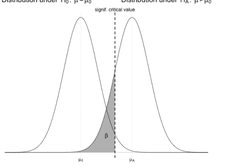

图 18-3：II 类错误概率 $\beta$ 的概念图

找到 $\beta$ 并不像找到 I 类错误概率那样容易，因为 $\beta$ 在其他方面取决于 $\mu_A$ 的真实值（通常你并不知道它）。如果 $\mu_A$ 更接近假设的原值 $\mu_0$，你可以想象图 18-3 中的备择分布向左移动，导致 $\beta$ 增加。同样，对于图 18-3，想象减少显著性水平 $\alpha$。这意味着垂直虚线（表示临界值）向右移动，也增加了 $\beta$ 的阴影区域。直觉上来说，这是合理的——真实的备择假设越接近原假设，和/或显著性水平越小，越难通过拒绝 $H_0$ 检测出 $H_A$。

正如所述，$\beta$ 在实践中通常无法计算，因为需要知道真实分布到底是什么。然而，这个量可以让你了解在特定条件下，检验错误保留原假设的倾向有多大。例如，假设你正在对 $H_0: \mu=0$ 和 $H_A: \mu > 0$ 进行单样本 t 检验，其中 $\mu=0$，但原始测量均值的（真实）备择分布 $\mu_A = 0.5$，标准差 $\sigma = 1$。给定大小为 $n = 30$ 的随机样本并使用 $\alpha = 0.05$，在任何给定的假设检验中（原分布使用相同的标准差）犯 II 类错误的概率是多少？为了回答这个问题，再次查看图 18-3；你需要根据显著性水平标记的临界值（垂直虚线）。如果你假设 $\sigma$ 是已知的，那么感兴趣的采样分布将从正态分布，均值为 $\mu_0 = 0$，标准误为 $1/\sqrt{30}$（见第 17.1 节）。因此，对于右上面积为 0.05，你可以通过以下找到临界值：

```R
R> critical <- qnorm(1-0.05, mean=0, sd=1/sqrt(30))

R> critical

[1] 0.1370308
```

这代表了此特定设置下的垂直虚线（关于如何使用 `qnorm` 请参考第 16.2.2 节）。此示例中的 II 类错误是在备择、“真实”分布下从该临界值开始左侧面积：

```R
R> pnorm(critical, mean=0.5, sd=1/sqrt(30))

[1] 0.1370308
```

从这可以看出，在这些条件下，假设检验大约有 13.7% 的概率错误保留原假设。

### 模拟 II 类错误

模拟在这里特别有用。在编辑器中，考虑如下定义的函数 `typeII.tester`：

```R
typeII.tester <- function(mu0, muA, sigma, n, alpha, ITERATIONS=10000) {

  pvals <- rep(NA, ITERATIONS)

  for(i in 1:ITERATIONS) {

    temporary.sample <- rnorm(n=n, mean=muA, sd=sigma)

    temporary.mean <- mean(temporary.sample)

    pvals[i] <- pt((temporary.mean - mu0) / (sigma / sqrt(n)), df=n-1, lower.tail=FALSE)

  }

  return(mean(pvals > alpha))

}
```

将样本量减少到 20（从 30 开始）会导致与最近结果 0.5501 相比的模拟 II 类错误率增加；将样本量增加到 40 则可以降低该率。

```R
R> typeII.tester(mu0=0, muA=0.5, sigma=1.2, n=20, alpha=0.001)

[1] 0.7319

R> typeII.tester(mu0=0, muA=0.5, sigma=1.2, n=40, alpha=0.001)

[1] 0.4219
```

最后，正如讨论开头提到的，$\mu_A$ 本身的数值正如你预期的那样。同样，保持所有其他组件的最新值（在我的案例中 $\beta=0.4219$），将“真实”均值从 $\mu_A=0.5$ 变为 $\mu_A=0.4$ 以使其更接近 $\mu_0$，意味着犯 II 类错误的概率会增加；如果差异增大到 $\mu_A=0.6$，则情况相反。

```R
R> typeII.tester(mu0=0, muA=0.4, sigma=1.2, n=40, alpha=0.001)

[1] 0.6147

R> typeII.tester(mu0=0, muA=0.6, sigma=1.2, n=40, alpha=0.001)

[1] 0.2287
```


总结一下，尽管这些模拟率被应用于假设检验是单均值上尾的特定情况，但讨论的通用概念和思想适用于任何假设检验。很容易建立第 I 类错误与预定义的显著性水平匹配，并且可以通过减少 $\alpha$ 来降低。相比之下，控制 II 类错误率是一个复杂的平衡过程，涉及样本量、显著性水平、观测变异性以及真值与假设之间差异的幅度。这种“真值”在实践中通常是未知的。然而，II 类错误率与统计效能之间的直接关系在准备数据收集时往往起着关键作用，特别是在使用后续样本量要求时，正如你在下一节中看到的。

# 练习 18.5

- a. 编写新版本的 `typeI.tester`。新函数应该能够模拟单均值任何方向（换句话说，即双侧）检验的第 I 类错误率。新函数还需要根据所需的检验类型接受字符字符串参数 "less"、"greater" 或 "two.sided"。你可以通过以下方式修改 `typeI.tester` 来实现这一点：
    - 不要在循环中直接计算和存储 $p$ 值，只需存储统计量。
    - 循环完成后，设置嵌套的 `if-else` 语句以适应三种检验类型的每一种，并相应地计算 $p$ 值。
    - 对于双侧检验，记住 $p$ 值定义为比假设更“极端”的面积的两倍。在计算上，这意味着如果统计量为正数，则必须使用上尾面积，否则使用下尾面积。如果该面积小于 $\alpha$ 的半数（因为在“真实”假设检验中它随后会被乘以 2），则应标记为拒绝假设。
    - 如果 `test` 的值不是这三种可能性之一，函数应使用 `stop` 抛出适当的错误。
    - i. 使用文本中的第一个示例测试测试你的函数，其中 $\mu_0 = 0, \sigma = 1, n = 40$ 且 $\alpha = 0.05$。使用三种测试选项中的每一种调用 `typeI.mean` 三次。你应该发现所有模拟结果都接近 0.05。
    - ii. 重复（使用）文本中的第二个示例，$\mu_0 = -4, \sigma = 0.3, n = 60$ 且 $\alpha = 0.01$。同样，你应该发现所有模拟结果都接近 $\alpha$ 的值。

- b. 以你修改新函数 `typeI.mean` 的相同方式修改 `typeI.tester`。模拟以下假设检验的 II 类错误率。根据文本，$\mu_A,\sigma$ 和 $n$ 分别表示真均值、原始数据标准差、显著性水平和样本量。
    - i. $H_0 : \mu = -3.2, H_A : \mu \neq -3.2$，其中 $\mu = -3.3, \sigma = 0.1, \alpha = 0.05, n = 25$。
    - ii. $H_0 : \mu = 8994, H_A : \mu > 8994$，其中 $\mu = 5600, \sigma = 3888, \alpha = 0.01, n = 9$。
    - iii. $H_0 : \mu = 0.44, H_A : \mu > 0.44$，其中 $\mu = 0.4, \sigma = 2.4, \alpha = 0.05, n = 68$。

### 18.5.4 统计效能

对于任何假设检验，考虑其潜在的统计效能都是有用的。效能是正确拒绝不真假设的概率。对于一个 II 类错误率为 $\beta$ 的检验，统计效能通过简单的公式 $1 - \beta$ 得到。检验的效能越高越理想。所有影响 $\beta$ 值的因素都会直接影响效能。

对于上一节描述的同向 $H_0 : \mu = \mu_0$ 和 $H_A : \mu > \mu_0$，图 18-4 显示了检验的效能——按照习惯，效能大于 0.8 的假设检验被认为具有统计效力。

# $H_0: \mu = \mu_0$ 下的分布  $H_A: \mu > \mu_0$ 下的分布


你可以使用模拟来数值评估特定条件下的效能。对于之前关于 II 类错误的讨论，你能够从 1 中减去所有 $\beta$ 的模拟结果来评估该特定检验的效能。例如，在 $\mu_0 = 0$ 时检测 $\mu_A = 0.6$ 的效能（样本量 $n = 40, \sigma = 1.2, \alpha = 0.01$）为 $1 - 0.22$。研究人员通常关注效能与样本量之间的关系，以回答“为了进行具有统计效力的检验，样本量需要多大？”这类问题。

# 模拟效能

对于具有统计效力的检验，在样本量 $n = 40$ 的情况下，效能约为 0.7。

```R
power.tester <- function(n){

  result <- rep(NA, n)

  pb <- pbProgressBar(n)

  for(i in 1:n) {

    # ... 模拟逻辑 ...

    setTxtProgressBar(pb, i/n)

  }

  return(result)

}
```
(注：由于原文提供的代码块不完整，此处翻译仅根据上下文保留结构)

0.7950 和 0.8050。如果你不想通过视觉识别，可以使用 `which` 找到至少为 0.8 的 `pow` 索引，并使用 `min` 返回该类别中的最小值，从而找到 `sample.sizes` 中对应于 80% 截断值的项。指定的索引 `sample.sizes` 将为你提供与该模拟功效对应的 $n$ 值（在本例中为 0.8050）。这些命令可以如下嵌套：

```R
R> minimum.n <- sample.sizes[min(which(pow=0.8))]

R> minimum.n

[1] 43
```

结果表明，如果你的样本量至少为 43，在这些特定条件下，假设检验将具有统计功效（基于本例中随机模拟的 `pow`）。

如果此测试的显著性水平放宽呢？假设你想使用 $\alpha = 0.05$ 而不是 0.01 来进行测试（仍采用右尾检验条件 $\mu = 0$、$\mu_A = 0.6$ 和 $\sigma = 1$）。如果你查看图 18-4，这意味着垂直线（临界值）向左移动，从而减小 $\beta$ 并增加功效。因此这表明当 $\alpha$ 增加时，你需要比之前更小的样本量，换句话说，$n < 43$，以便执行具有统计功效的检验。

为了对相同的样本量范围模拟这种情况，并将结果功效存储在 `pow2` 中，请查看以下内容：

```R
R> pow2 <- power.test(nvec=sample.sizes,mu=0,muA=0.6,sigma=1.2,alpha=0.05,ITERATIONS=5000)

============================================================| 100%

R> minimum.n2 <- sample.sizes[min(which(pow2=0.8))]

R> minimum.n2

[1] 27
```

此结果表明至少需要 27 个样本量，这与 $\alpha = 0.01$ 时的 43 相比减少。然而，放宽 $\alpha$ 意味着犯第一类错误的风险增加！

## 功效曲线

为了进行比较，你可以使用 `pow` 和 `pow2` 通过以下代码将你的功效绘制成曲线：

```R
R> plot(sample.sizes,xlab="sample size n",ylab="simulated power")

R> points(sample.sizes,pow2,col="gray")

R> abline(v=c(0.8,minimum.n,minimum.n2),lty=3,col=c("black", "gray"))

R> legend("bottomright",left=c("alpha=0.01","alpha=0.05"),col=c("black", "gray"),pch=1)
```


我的特定图像见图 18-5。水平线标记了 0.8 的功效，垂直线标记了识别并存储在 `minimum.n` 和 `minimum.n2` 中的最小样本量值。作为最后，为每条曲线的 $\alpha$ 值添加了图例。


图 18-5：简单样本均值右尾假设检验的模拟功效曲线

曲线本身准确地指示了你的预期结果——随着样本量的增加，检测功效也会增加。你还可以注意到，当功效越来越接近“完美”率 1 时，会出现趋缓现象，这是功效曲线的典型特征。对于 $\alpha = 0.05$，该曲线几乎始终位于 $\alpha = 0.01$ 曲线之上，尽管当 $n$ 增加到 75 左右时差异看起来微不足道。

前面对错误和功效的讨论强调了在解释即使是最基础的统计检验结果时也需要谨慎。P 值仅仅是一个概率，因此，无论在任何情况下它有多小，它都永远无法证明或反驳一个主假设。应该考虑围绕假设检验（参数或其他）的质量问题，尽管这在实践中可能是困难的。尽管如此，对第一类错误和第二类错误以及统计功效概念的认识，对于任何正式统计检验程序的实施和评估都非常有帮助。

## 练习 18.6

a. 对于此练习，你需要已经从练习 18.5 (b) 编写了 `typeII.mean`。使用此函数修改 `power.tester`，使得新函数 `power.mean` 调用 `typeII.mean` 而不是调用 `typeII.tester`。

- i. 确认 $H_0 : \mu = 10$；$H_A : \mu \neq 10$ 的检验功效（其中 $\mu_A = 10.5, \sigma = 0.9, \alpha = 0.01, n = 50$）约为百分之八十。
- ii. 回想第 18.2 节中 80 克零食包平均重量的假设检验，基于 $n = 44$ 次观测值。假设如下：

$H_0 : \mu = 80$

$H_A : \mu < 80$

如果真实均值 $\mu_A = 78.5$ 且标准差为 $\sigma = 3.1$ g，使用 `power.mean` 在 $\alpha = 0.05$ 时确定该检验是否具有统计功效。如果 $\alpha = 0.01$，你的答案会变吗？

- b. 继续使用零食检验，使用 `sample.sizes` 在 $\alpha = 0.05$ 和 $\alpha = 0.01$ 时确定具有统计功效检验的最小样本量。生成一张曲线图。

## 本章重要代码

| 函数/运算符 | 简要描述 | 首次出现 |
| :--- | :--- | :--- |
| `t.test` | 两样本检验 | 第 18.2, p391 |
| `prop.test` | 两样本检验 | 第 18.3, p405 |
| `pchis` | $\chi^2$ 累积问题 | 第 18.4, p414 |
| `chisq.test` | $\chi^2$ 分布/独立性检验 | 第 18.4, p414 |
| `rowSums` | 行和 | 第 18.4, p417 |
| `colSums` | 列和 | 第 18.4, p417 |

# 19
## 方差分析


方差分析 (ANOVA) 的简单形式用于比较多个均值。从这个意义上说，它是均值检验的直接扩展。有一个感兴趣均值的连续变量，并且至少有一个分类变量来定义这些均值的组。在本章中你将探索围绕 ANOVA 的思想，首先通过单分类（单因素 ANOVA），然后通过多分类（多因素 ANOVA）。

### 19.1 单因素 ANOVA

ANOVA 最简单的版本被称为单因素或单因子分析。简单来说，单因素 ANOVA 用于检验两个或多个均值的相等性。这些均值按分类变量划分。ANOVA 通常用于分析实验数据以评估干预的影响。例如，你可能对比较内置数据中不同食物类型的小鸡平均重量感兴趣。

### 19.1.1 假设与诊断检查

假设你有一个分类变量，分为 $k$ 个不同组的 $N$ 个数值观测值，其中 $k \ge 2$。你正试图在统计上比较 $k$ 组的均值 $\mu_1, \dots, \mu_k$，以查看它们是否可以相等。标准假设如下：

$H_0 : \mu_1 = \mu_2 = \dots = \mu_k$

$H_A : \mu_1, \mu_2, \dots, \mu_k$ 不相等（或者至少有一个不同）。

事实上，当 $k = 2$ 时，双样本 $t$ 检验与 ANOVA相同；因此，ANOVA 在 $k > 2$ 时最常用。为了使基础 ANOVA 检验可靠，需要满足以下假设：

- **独立性**：组成 $k$ 组的样本必须相互独立，每组的观测值必须独立同分布 (iid)。
- **正态性**：每组的观测值应符合正态分布，或至少如此。
- **方差齐**：每组观测值的方差应相等，或至少如此。

如果违反了方差齐或正态性假设，并不意味着你的结果完全无效，但它会影响检测均值真实差异的整体有效性（参见第 18.5.4 节关于统计功效的讨论）。在使用 ANOVA 之前评估这些假设价值是一个好主意；我将在后续示例中这样做。

还需要注意的是，你不需要每组都有相同数量的观测值来进行检验（这被称为*不平衡*）。然而，如果你的方差齐和正态性假设不成立，不平衡组会使检验对潜在不利影响更敏感。

让我们运行 chickts 数据作为示例——基于 $k = 6$ 个不同组的重量。你对根据食物类型比较平均重量，以查看它们是否都相等。使用 `table` 总结样本量，并使用 `apply`（例如第 13.2.1 节）获取每个组的均值，如下：

```R
table(chickwts$feed)

casein horse linseed meatmeat soybean sunflower

10 12 11 14 12

chickts.means <- tapply(chickwts$weight,INDEX=chickwts$feed,FUN=mean)

chickts.means

casein horse linseed meatmeat soybean sunflower

323.5833 160.2000 218.7500 276.9091 246.4286 328.9167
```

你在第 14.3.2 节中的技能允许你生成重量分布的并列箱线图。接下来的两行代码提供了图 19-1 左侧的图形：

```R
R boxplot(chickts$weight~chickts$feed)

R points(1:6,chick.means,pch=4,cex=1.5)
```


图 19-1：探索 chickts 数据。左：按饲料类型划分的重量并列箱线图，用 x 标记平均值。右：每个饲料组均值化数据的正态 QQ 图。

由于箱线图显示的是中位数而非平均值，该行代码使用 `points` 将特定饲料的平均值（存储在 `chick.means` 对象中）添加到每个箱图中。
检查图 19-1 的左侧图，平均重量看起来确实存在差异。然而，这种明显的差异具有统计学意义吗？为了找到答案，此示例的方差分析（ANOVA）检验涉及以下假设：

> H₀ : µ_casein = µ_corn = µ_seed = µ_meal = µ_soy = µ_sunflower
> H₁ : 平均值并不全相等。

假设数据相互独立，在实施检验之前，你必须检查所有假设是否有效。要检查方差齐性，你可以使用与样本 t 检验相同的准则。也就是说，如果最大标准差与最小标准差之比小于 2，则可以假设方差齐。对于小鸡数据，代码如下：

```R
R chick.sds <- tapply(chickts$weight,INDEX=chickts$feed,FUN=sd)

R chick.sds

casein linseed linseed soybean sunflower

64.43384 38.62584 52.23570 64.90062 54.12907 48.83638

R max(chick.sds)/min(chick.sds)

[1] 1.680238
```

这一非正式结果表明，做出该假设是合理的。

接下来，考虑原始观测值的正态性假设。在许多真实数据示例中，这很难确定。但至少，检查直方图和 QQ 图以寻找非正态迹象是值得的。你已经在第 16.2.2 节中检查了所有 71 个重量的直方图和 QQ 图，但对于方差分析，你需要根据观测值的分组进行此操作（即不是无视分组对整组重量进行“总体”检查）。

为了对小鸡数据实现这一点，你首先需要通过相应的样本平均值对每个重量进行均值化处理。你可以通过取原始重量向量并减去 `chick.means` 向量来实现，但在此之前你必须重建并复制后者的元素，使其与第一个向量的元素对应。这是通过对代表类型的因子使用 `as.numeric` 完成的，给出原始数据框中每条记录的 `chicksfeed` 水平的数值。当数值向量通过方括号 `[]` 传递给 `chick.means` 时，你将获得与每个观测匹配的正确组均值。作为一个练习，你可以检查创建以下 `chick.mean` 对象的所有成分，以确认其是如何构造的：

```R
R chick.mean <- chicks$weight-chickmeans[as.numeric(chicks$feed)]
```

在当前分析的背景下，这些组均值中心值也被称为残差（residuals），这是你在接下来几章节学习回归方法时会遇到的术语。

你现在可以使用残差来评估观测值的整体正态性。使用你在第 16.2.2 节见过的 `qqnorm` 和 `qqline` 来检查正态 QQ 图。这两行代码产生了图 19-1 右侧的图像。

```R
R qqnorm(chick.mean,main="Normal QQ plot of residuals")

R qqline(chick.mean)
```


根据此图（绘制的点与完美直线的接近程度），假设数据符合正态分布似乎并不合理，特别是与相同样本量的生成数据的 QQ 图相比（第355页图 16-9 左侧有一个示例）。

调查所需假设的有效性被称为诊断检查（diagnostic checking）。如果你想对方差分析进行更严谨的诊断检查，其他视觉诊断可以包括按组划分的 QQ 图（你将在第 19.3 节的示例中执行）或绘制每组样本标准差与相应样本均值的对比图。事实上，还有通用的正态性假设检验（如 `Shapiro-Wilk` 检验或 `Anderson-Darling` 检验——你将在第 22.3.2 节看到它们的用法），以及方差齐性检验，但本例中使用基础准则和视觉检查。

## 19.1.2 单因素 ANOVA 表的构建

回到图 19-1 的左侧，记住目标是在统计学上评估由 x 标记的平均值的相等性。因此，这项任务要求你不仅考虑 k 个样本之间的变异。

检验通过首先计算组间变异，然后计算组内变异进行。ANOVA 表构建如下：

| 来源 | df | SS | MS | F |
| :--- | :--- | :--- | :--- | :--- |
| 组 (Group) | $k-1$ | $SS_{group}$ | $MS_{group}$ | $MS_{group}/MS_{error}$ | |
| 误差 (Error) | $N-k$ | $SS_{error}$ | $MS_{error}$ | | |
| 总计 (TOTAL) | $N-1$ | $SS_{total}$ | | | |

使用的公式为：
- $SS_{total} = SS_{group} + SS_{error}$
- $MS_{group} = SS_{group} / (k-1)$
- $MS_{error} = SS_{error} / (N-k)$
- $F = MS_{group} / MS_{error}$

## 19.1.3 使用 aov 函数构建 ANOVA 表

正如预期，R 允许你使用内置的 `aov()` 函数为小鸡重量构建 ANOVA 表：

```R
chick.anova <- aov(weight ~ feed, data = chickwts)
```

然后，使用 `summary()` 将表打印到控制台。

```R
summary(chick.anova)
```

| | Df | Sum Sq | Mean Sq | F value | Pr(>F) |
| :--- | :--- | :--- | :--- | :--- | :--- |
| feed | 5 | 231129 | 4626 | 15.37 | 5.94e-10 *** |
| Residuals | 65 | 195556 | 3009 | | |

显著性代码：0 *** 0.001 ** 0.01 * 0.05 ' 0.1 . 1

有几点说明：注意，你使用公式表示法 `weight ~ feed` 来指定感兴趣的测量变量，并由感兴趣的分类变量——饲料类型进行建模。在这种情况下，变量名 `weight` 和 `feed` 不需要以 `chicks$` 为前缀，因为可选的 `data` 参数已经传递了感兴趣的数据框。记住第 14.3.2 节，对于表达式 `weight ~ feed` 中的符号，“感兴趣的结果”必须始终出现在 `~` 的左侧（这种表示法在第 20 到 22 章节将变得尤为重要）。

要实际查看表格，你必须对调用 `aov()` 后生成的对象应用 `summary()` 命令。R 会忽略第一行和最后一行（Overall 总体和 TOTAL 总计），因为它们没有直接参与 p 值的计算。除此之外，很容易识别出 feed row（饲料行）对应 Group（组行），而 Residual row（残差行）对应 Error（误差行）。

默认情况下，R 会用显著性星号对基于模型的输出进行此类标注。这些星号显示了显著性区间，随着 p 值以 0.1 为阈值减小，星号的数量随之增加。当你在检查汇总了多个 p 值的复杂分析时，这非常有用，尽管并不是所有人都喜欢这个功能。如果你愿意，可以在提示符处输入 `options(show.sign.stars = FALSE)` 来在特定的 R 会话中关闭此功能。或者，你可以在调用 `summary()` 时通过设置额外参数 `sign.stars = FALSE` 直接关闭默认设置。在书中，我将保留它们。

从此例的 ANOVA 内容，你可以快速确认计算结果。注意 MSE，3009 被定义为 Error SS（误差平方和）除以 Error df（误差自由度）。事实上，在 R 中，结果是手动实现的（表格输出已舍入到最近的整数）。

```R
195556 / 63
[1] 3008.554
```

你可以使用早之前的相关公式确认表格输出中的所有结果。

基于 ANOVA 的假设检验解释遵循与任何其他检验相同的规则。将 p 值理解为“如果 H₀ 为真，你观察到当前样本统计量更极端情况的概率”，较小的 p 值表示有反对原假设的证据。在当前示例中，极小的 p 值提供了强有力的证据反对“平均检查重量对于不同饮食是相同的”这一原假设。换句话说，我们拒绝 H₀ 而接受 Hᴬ，后者表示存在差异。

与卡方检验类似，单因素 ANOVA 中拒绝原假设并不能准确告诉你是差异具体在哪里，仅说明存在证据。有必要对各个组中的数据进行进一步审查以识别均值。在最简单的水平上，你可以回到两对双样本 t 检验，在这种情况下，你可以使用 ANOVA 表格中的 MSE 作为合并方差的估计。如果等方差假设成立，则这种替换是有效的，且这种步骤是有益的，因为相应的 t 抽样分布将利用 Error df（这自然比如果 df 基于两个特定组的样本量所得到的 df 要高）。

# 练习 19.1

考虑以下数据：

这些数字提供了在新墨西哥州四处遗址发现重要考古发现的深度（厘米）（请见 Woosley and Mcintyre, 1996）。将这些数据存储在你的工作区中，一个向量包含深度，另一个向量包含每次观测的地点。

- a. 制作按分组划分的深度并列箱线图，并使用额外的点标记样本均值的位置。
- b. 在假设独立的前提下，对正态性和方差齐性执行诊断检查。
- c. 执行并结论单因素 ANOVA 检验，以寻找均值之间存在差异的证据。

在第 14.4 节

- d. 根据正态性和方差齐性的诊断检查，判断四个结果测量值（花萼长度/宽度和花瓣长度/宽度）哪个适用于 ANOVA（使用物种作为分组变量）。
- e. 对任何合适的测量变量执行单因素 ANOVA。

# 19.2 双因素 ANOVA

在许多研究中，你感兴趣的数值结果变量将被多个分组变量分类。在这种情况下，你需要使用多因素 ANOVA 而非单因素 ANOVA。增加分组变量会使问题复杂化——对每个变量单独进行单因素 ANOVA 是不够的。当存在交互作用时，一个因素的影响取决于另一个因素。这被称为双因素 ANOVA。

在双因素 ANOVA 中，我们测试以下假设：

- H₀：A 水平之间没有差异。
- H₀：B 水平之间没有差异。
- H₀：A 和 B 之间没有交互作用。

这些假设的检验统计量与单因素 ANOVA 类似，但平方和被分为四个部分：A 的、B 的、A 和 B 的交互作用以及误差。

如果交互作用是显著的，意味着一个因素的影响在另一个因素的所有水平上都是相同的。事实上，它可能存在显著差异。在这种情况下，解释交互作用比解释主效应更有意义。如果交互作用不显著，我们可以转向主效应。

要执行双因素 ANOVA，我们使用 `aov()` 函数，并指定两个因素及其交互作用：

```R
model2 <- aov(breaks ~ tension, data = warpbreaks)
summary(model2)
```

输出将显示 wool、tension 以及 wool:tension 的结果。如果交互作用是显著的，我们应该关注解释它。如果交互作用不显著，我们可以查看主效应。

对于某些分析，你可能需要不同格式的信息。`aggregate()` 函数类似于 `tapply()`，但它返回的是数据框而不是数组。它的调用方式相同。第一个参数应该是感兴趣的数据向量。第二个参数应该是所需的分组变量列表，并在 FUN 中指定作用于每个子集的函数。

## 19.2.2 主效应与交互作用

我之前提到可以每个分组变量单独进行单因素 ANOVA，但通常这不是个好主意。我用 warpbreaks 数据演示这一点（快速检查诊断显示没有明显问题）：

```R
summary(aov(breaks ~ wool, data = warpbreaks))
      Df Sum Sq Mean Sq F value Pr(>F)
wool   1  451   450.7   2.668 0.108
Residuals 52 8782

summary(aov(breaks ~ tension, data = warpbreaks))
      Df Sum Sq Mean Sq F value Pr(>F)
tension 2 2034  1017.1   7.206 0.00175 **
Residuals 51 7199
```

Signif. codes: 0 *** 0.001 **

这个输出告诉我们，如果你忽略张力，没有证据表明缺陷的数量存在任何差异。然而，如果你考虑张力，水平之间存在显著差异。如果交互作用不显著，我们可以继续解释主效应。

基于羊毛类型（p-value 0.108）。然而，如果你忽略羊毛，则有证据表明经断次数（warp breaks）的差异仅取决于张力。

问题在于，通过忽略其中一个变量（或更广泛地说，忽略了可能在更细粒水平上发生的统计关系）。例如，羊毛类型对经断次数的平均值似乎没有显著影响，但如果你只在特定的张力水平观察羊毛类型，无法判断情况是否如此。

相反，你使用双因素方差分析来研究这类问题。以下代码根据分组变量的主效应对经断次数执行双因素方差分析：

```R
summary(aov(breaks ~ wool + tension, data = warpbreaks))
      Df Sum Sq Mean Sq F value Pr(>F)
wool      1  451   450.7   3.339 0.07361
tension   2 2034  1017.1   7.537 0.0018 **
Residuals 50 6748   135.0
```

Signif. codes: 0 '***' 0.001 '**' 0.01 '*' 0.05 '.*' ' 1

看看这个公式。在结果变量右侧指定 `wool + tension` 并使用 `*`，允许你同时考虑两个分组变量。结果显示，`wool` 的 p 值略有下降，为 0.073，接近 $a = 0.05$ 的常规显著性阈值。为了解释这些结果，你固定一个分组变量——如果你关注某一种羊毛，仍有显著证据表明，不同张力水平之间的经断次数平均值存在差异。如果你只关注一个张力水平，考虑到两种羊毛类型时差异的证据略有增加，但在统计学上仍然是显著（假设上述的 $a = 0.05$）。

考虑主效应具有局限性。虽然之前的分析显示了两个分类变量之间结果的差异，但它没有解决这样一种可能性：即在保持另一个变量不变时，经断次数平均值的差异可能会发生变化。这种相对微妙但重要的考虑被称为**交互作用**（interaction）。具体来说，如果张力和羊毛之间存在关于经断次数的交互作用，则意味着在两个分组因子的不同水平下，经断次数平均值差异的幅度和/或方向是不相同的。

为了解释交互作用，你对双因素 ANOVA 模型代码进行了微调。

```R
summary(aov(breaks ~ wool + tension + wool:tension, data = warpbreaks))
   Df Sum Sq Mean Sq F value Pr(>F)
wool          1  451   450.7   3.765 0.058213 .
tension       2 2034  1017.1   8.498 0.000693 ***
wool:tension  2 1003   501.4   4.189 0.021044 *
Residuals    48 5745   119.7
```

Signif. codes: 0 '***' 0.001 '**' 0.01 '*' 0.05 '.' 0.1 ' ' 1

你可以显式地指定交互作用，即在主效应公式加上 `wool:tension` 符号，其中两个分组变量用 `:` 分隔（注意，在此设置中，`:` 运算符与第 2.3.2 节中讨论的整数序列快捷方式无关）。

你可以看到 ANOVA 表输出，从统计学上来说，有证据表明存在交互作用；即平均值的性质本身依赖于因子水平，尽管这种证据相对较弱。当然，0.021 的 p 值仅告诉你总体而言可能存在交互作用，但并未说明交互作用的精确特征。

在这些帮助下，你可以使用 R 中的 `interaction.plot()` 函数来详细解释这种具有交互作用的双因素效应。

```R
interaction.plot(x.factor = wb.means[2], trace.factor = wb.means[1],
                 response = wb.means$x, trace.label = "wool",
                 xlab = "tension", ylab = "mean warp breaks")
```

当调用 `interaction.plot()` 时，应将结果平均值传递给 `response` 参数，并将提供两个因子对应水平的向量传递给 `x.factor`（用于横轴上从左到右对应水平的变量）和 `trace.factor`（每个水平将产生自动生成的图例中的不同线条；图例的标题传递给 `trace.label`）。哪个是分组变量并不重要；图表的显示会随之改变，但你的解释（将会！）不同。结果如图 19-2 所示。

双因素交互图在垂直轴上显示结果变量，并根据两个分组变量的水平划分记录平均值。这允许你检查分组变量水平的变化对结果产生的潜在影响。通常，当线（或其片段）不平行时，表明可能存在交互作用。绘图位置之间的垂直间距表示分组变量各自的主效应。

事实证明调用 `aggregate()` 返回的列实际上非常适合 `interaction.plot()`。

### 19.3 Kruskal-Wallis 检验

在比较多个平均值时，可能会出现你不愿意假设正态性的情况。Kruskal-Wallis 检验是一种非参数方法，因为它不依赖于标准化参数分布（换句话说就是正态分布）的任何函数。正如 ANOVA 是双样本 t 检验的推广一样，Kruskal-Wallis ANOVA 是中位数 Mann-Whitney 检验的推广。也被称为 Kruskal-Wallis 秩和检验，你使用卡方分布来计算 p 值。

将注意力转向包中的 `survey` 数据框。这些数据记录了来自澳大利亚阿德莱德大学某课程 237 名大一学生的特定特征。先用 `library("MASS")` 加载所需包，然后在提示符处输入 `survey`。你可以读取文件以帮助理解数据框包含哪些变量。

假设你感兴趣学生的年龄 `Age` 是否根据 `Smoke` 中报告的四种吸烟分类有所不同。观察相关的并箱线图以及残差（相对于每个组的均值中心化）的 QQ 图表明，直接使用 ANOVA 并不是一个好主意。以下代码（模拟了你在 19.1.1 节中看到的步骤）生成图 19-3 中的两幅图像，显示正态性存疑：

```R
boxplot(Age ~ Smoke, data = survey)
age.means <- tapply(survey$Age, survey$Smoke, mean)
age.meancen <- survey$Age - age.means[as.numeric(survey$Smoke)]
qqnorm(age.meancen, main = "残差的正态 QQ 图")
qqline(age.meancen)
```

由于这种可能的违反正态性的情况，因此你可以应用 Kruskal-Wallis 检验而不是参数 ANOVA。一个简单的方差齐性检查支持了这一点，最大组与最小组标准差之比明显小于 2。


图 19-3：按吸烟状况划分的学生年龄观测值的并列箱线图（左侧）和残差的正态 QQ 图（右侧）

在 R 中，使用 `kruskal.test()` 执行 Kruskal-Wallis 检验。

```R
kruskal.test(Age ~ Smoke, data = survey)
```


# Kruskal-Wallis 秩和检验

数据：Age（年龄）按 Smoke（吸烟状况）
kruskal-Wallis chi-squared = 3.9262, df = 3, p-value = 0.2695

该检验的语法与 `aov` 相同。你可能从图 19-3 中推断，较大的 p 值表明没有证据反对“中位数全部相等”的零假设。换句话之，四个吸烟类别的学生之间年龄似乎没有整体差异。

# 练习 19.2

再次调出 `quakes` 数据框，该数据描述了在斐屿离岸检测到的 102 次地震事件的位置、震级、深度和观测站数量。

- a. 使用 `cut`（第 4.3.3 节）创建一个新的因子向量，根据以下三个类别定义事件的深度：(0,200]、(200,400] 和 (400,680)。
- b. 对于根据 (a) 中的三个类别划分的检测数量分布，使用单因素方差分析还是 Kruskal-Wallis 检验更为合适。
- c. 执行你在 (b) 中选择的检验（假设显著性水平 $\alpha = 0.01$）并得出结论。

如果你在当前 R 会话中尚未加载 `MASS` 包，请调用 `library("MASS")` 进行加载。该包包含了内置即用的 `Cars93` 数据框，其中包含 1993 年美国出售的 93 辆汽车的详细数据（Lock, 1993; Venables and Ripley, 2002）。

- d. 使用 `aggregate` 计算 93 辆汽车的平均长度，按两个分类变量划分：AirBags（可用气囊的类型——水平为驾驶员和乘客、仅限驾驶员和无）以及 Man.trans.avail（汽车是否为手动挡箱——水平为是和否）。
- e. 使用 (d) 中的结果生成交互作用图。如果只考虑这些变量，AirBags 与 Man.trans.avail 对这些汽车的平均长度是否似乎存在交互作用？
- f. 根据两个分组变量为平均长度拟合一个完全双因素方差分析模型（假设满足所有相关假设）。交互作用在统计学上显著的吗？是否存在任何主效应的证据？

# 本章重要代码

| 函数/运算符 | 简要描述 | 首次出现 |
| --- | --- | --- |
| `aov` | 生成方差分析表 | 第 19.1.3 节，第 440 页 |
| `aggregate` | 按因子进行堆叠统计 | 第 19.2.1 节，第 444 页 |
| `interaction.plot` | 双因子交互作用图 | 第 19.2.2 节，第 446 页 |
| `kruskal.test` | Kruskal-Wallis 检验 | 第 19.3 节，第 449 页 |

# 20

# 简单线性回归


虽然对单个统计量进行直接的比较检验本身很有用，但你通常会想从数据中学习更多信息。在本章中，你将学习线性回归模型：一组用于精确评估变量之间如何相互关系的方法。

简单线性回归模型描述了特定变量（称为**解释变量**）对连续结果变量（称为**响应变量**）值可能产生。解释变量可以是连续的、离散的或分类的，但为了引入核心概念，我将在章的前几节中重点关注连续解释变量。然后，我会介绍如果解释变量是分类变量，模型的表示形式如何发生变化。

## 20.1 线性关系的示例

作为一个开始，让我们继续使用第 19.3 节中的数据，并更仔细地观察学生调查数据（MASS 包中的 `survey` 数据框）。如果你还没有这样做，在加载所需包后（调用 `library("MASS")`），可以阅读帮助文件 `?survey` 以获取现有变量的详情。

将学生身高绘制在 y 轴上，并将手宽（写字手）绘制在 x 轴上。

```R
R> plot(survey$Height, survey$Hnd, xlab="Writing handspan (cm)", ylab="Height (cm)")
```

图 20-1 显示了结果。


图 20-1：一年级统计学学生身高与其写字手宽的散点图

注意使用公式表示法（也称为符号表示法）来指定“手宽对应的身高”。你可以通过 (x, y) 的坐标形式产生相同的散点图。这里使用符号表示法是因为它反映了你对线性模型的拟合程度。正如你所预期的那样，学生的手宽与身高之间存在正相关。这种关系似乎是线性的。为了评估线性关系的强度（参考第 3.2 节），你可以找到估计的相关性。

```R
R> cor(survey$Hnd, survey$Height, use="complete.obs")
[1] 0.60099
```

虽然数据框中有 237 条记录，但图中实际上没有显示 237 个点。这是因为存在缺失观测值（NA）；R 在生成此类图形时默认会删除它们。要找出删除了多少观测值，可以使用逻辑运算符：

```R
R> complete.obs <- which(is.na(survey$Height) | is.na(survey$Hnd))
R> length(complete.obs)
[1] 29
```

注意，因为提供的相关向量中有 NA，必须指定可选参数 `use="complete.obs"`。这与单变量汇总函数中的 `na.rm=TRUE` 作用相同。

## 20.2 通用概念

线性回归模型的目的是建立一个函数，在给定另一个变量特定值的情况下估计它的平均值。这些变量被称为响应变量（“结果”）——你正在尝试寻找的；解释变量（“预测变量”）——你已经拥有的。在学生调查的示例中，你可能会问：“如果手宽是 14.5 cm，学生的预期身高是多少？”在这里，响应变量是身高，解释变量是手宽。

### 20.2.1 模型定义

假设你想根据解释变量 $X$ 的值确定响应 $Y$ 的值。简单线性模型将响应值表示如下方程：

$Y|X = \beta_0 + \beta_1 X + \epsilon$ (20.1)

在方程 (20.1) 的左侧，符号 $Y|X$ 读作“给定 $X$ 的 $Y$”。基于模型 (20.1) 得出的结论的有效性关键取决于对 $\epsilon$ 的假设，定义如下：

- 假设 $\epsilon$ 的值呈正态分布，使得 $\epsilon \sim N(0, \sigma)$。
- $\epsilon$ 为中心（即均值为0）。
- $\epsilon$ 的方差 $\sigma^2$ 是常数。

$\epsilon$ 项代表随机误差。也就是说，你假设响应的任何原始值归于给定 $X$ 值的线性变化，加上一些残差变异或正态噪声。

#### 参数

由 $\beta_0$ 表示的值称为**截距**，由 $\beta_1$ 表示的值称为**斜率**。它们统称为**回归系数**，解释如下：

- 截距 $\beta_0$ 解释为预测变量为零时的响应变量期望值。
- 通常，斜率 $\beta_1$ 是关注点。它解释为预测变量每增加一个单位时平均响应的变化。当斜率为正时，回归线从左到右增加（当斜率为负时，线从左到右减少，预测变量越高，平均响应越低）。当斜率为零时，意味着预测变量对响应值没有影响。$\beta_1$ 的值越极端（即越远离零），直线就越陡。

### 20.2.2 估计截距和斜率参数

目标是使用你的数据估计回归参数，产生 $\hat{\beta}_0$ 和 $\hat{\beta}_1$；这被称为**拟合**线性模型。在这种情况下，数据包含每个个体 $n$ 对观测值。感兴趣的拟合模型涉及预测变量特定值 $x$ 的平均响应，记为 $\hat{y}$，并如下所示：

$$\hat{y} = \hat{\beta}_0 + \hat{\beta}_1x$$

有时在 (20.2) 的左侧使用 $E[Y]$ 或 $E[Y|X=x]$ 等替代符号，以强调该事实意味着响应的平均（即**期望值**）。为了简洁，许多人使用如上面所示的 $\hat{y}$。

令你的 $n$ 个观测数据对分别表示预测变量和响应变量 $x_i$ 和 $y_i$；$i=1,\dots,n$。那么，简单回归函数的参数估计为：

$$\hat{\beta}_1 = \rho_{XY}\frac{s_Y}{s_X} \quad \quad \hat{\beta}_0 = \hat{y} - \hat{\beta}_1\hat{x}$$

其中

- $\hat{x}$ 和 $\hat{y}$ 是 $x_i$ 和 $y_i$ 的样本平均值。
- $s_x$ 和 $s_y$ 是 $x_i$ 和 $y_i$ 的样本标准差。
- $\rho_{XY}$ 是基于数据的 $X$ 和 $Y$ 之间的相关性估计。

以这种方式估计模型参数被称为**最小二乘回归**；原因稍后就会变得很清楚。

### 20.2.3 使用 lm 拟合线性模型

在 R 中，`lm` 命令会为你执行估计。例如，以下几行手动创建了一个关于学生身高与手掌宽之间平均值的拟合线性模型对象，并将其存储在全局环境中命名为 `survfit`：

```R
survfit <- lm(Height ~ Wr.Hnd, data=survey)
```

第一个参数是现在熟悉的 `响应变量 ~ 预测变量` 公式，它指定了所需的模型。除非你明确指示 `lm` 在参数指定的对象中查找，否则你不需要使用 `survey` 前缀来从数据框中提取向量。

拟合的线性模型对象 `survfit` 本身在 R 中有一个特殊的类——类型为 "lm"。一个 "lm" 对象可以看作是一个包含若干描述模型组件的列表。我们稍后会查看这些内容。

如果你在提示符处输入 "lm" 对象的名称，它将提供最基础的输出：你调用的重复以及截距 ($\hat{\beta}_0$) 和斜率 ($\hat{\beta}_1$) 的估计值。

```R
survfit
```

```
Call:
lm(formula = Height ~ Wr.Hnd, data = survey)

Coefficients:
(Intercept)       Wr.Hnd
    113.954        3.117
```

这揭示了该线性模型的估计如下：

$\hat{y} = 113.954 + 3.117x$

如果你对 $x$ 求该数学函数的值，当给定 $x$ 的不同取值范围时，可以用直线绘图并绘制结果。考虑到截距的定义是响应变量的期望值为零，在当前示例中，这意味着手掌宽为 0 的学生的平均身高为 113.954 cm（这可能是一个意义不大的陈述，因为值 0 是有意义的）。斜率（预测变量每增加一个单位时平均响应的变化）为 3.117。这意味着平均而言，手掌宽每增加 1 cm，学生的身高估计增加 3.117 cm。

记住这些后，再次运行第 20.1 节所示和图 20-1 所示的行来绘制原始数据，但现在使用 `abline` 添加拟合回归线。到目前为止，你只使用过 `abline` 命令向现有图形添加水平和垂直线，但当传递一个代表简单线性模型的 "lm" 类对象（如 `survfit`）时，将添加拟合回归线。

```R
R> abline(survfit, lwd=2)
```

这增加了图 20-2 所示的略加粗的上升线


**图 20-2:** 拟合到观测数据的[实线、加粗] 简单线性回归线。两条虚线垂直段提供了正值[最左侧]和负值[最右侧]残差的示例。

### 20.2.4 结果说明

当如 (20.3) 所示估计参数时，拟合线被称为最小二乘回归的实现，因为它是最小化观测数据与其自身之间平均平方差的线。通过在图 20-2 中绘制观测值与拟合线之间的距离（正式称为残差），可以很容易理解这个概念。

首先，让我们从 `Wr.Hnd` 和 `Height` 数据中提取两个特定记录，并将生成的向量命名为 `obsA` 和 `obsB`。

```R
R> obsA <- c(survfit$Wr.Hnd[197], survfit$Height[197])
R> obsA
[1] 15.00 170.18
```

```R
R> obsB <- c(survey$Wr.Hnd[154], survey$Height[154])
R> obsB
[1] 21.50 172.72
```

接下来，简要检查 `survfit` 对象成员的名称。

```R
R> names(survfit)
[1] "residuals"    "effects"      "rank"         "fitted.values" "assign"       "qr"           "df.residual"  "na.action"    "xlevels"      "call"         "terms"        "model"        "coefficients"
```

这些成员是自动构成 "lm" 类拟合模型的组件（前文简要提到）。注意，有一个名为 "coefficients" 的组件。它包含一个截距和斜率估计值的数值向量。

你可以像对命名列表执行成员引用一样，提取此组件（实际上也可以提取这里列出的任何其他组件）：在提示符处输入 `survfit$coefficients`。尽管如此，从编程角度来看，使用“直接访问”函数提取此类组件在技术上是更优的。对于 "lm" 对象的 `coefficients` 组件，你使用的函数是 `coef`。

```R
R> mycoeffs <- coef(survfit)
R> mycoeffs
(Intercept)      Wr.Hnd
113.953623    3.116617

beta0_hat <- mycoeffs[1]
beta1_hat <- mycoeffs[2]
```

在这里，回归系数从对象中提取并分别赋值 `beta0_hat` 和 `beta1_hat`。其他常用的直接访问函数包括 `resid` 和 `fitted`；它们分别对应 "residuals" 和 "fitted.values" 组件。

最后，我使用 `segments` 来绘制图 20-2 中存在的虚线。

```R
R> segments(x0=c(obsA[1],obsB[1]), y0=beta0_hat+beta1_hat*c(obsA[1],obsB[1]), x1=c(obsA[1],obsB[1]), y1=c(obsA[2],obsB[2]), lty=2)
```

虚线在垂直轴位置 $y0$ 与拟合线相交，使用回归系数 `beta0_hat` 和 `beta1_hat` 反映了 (20.4)。现在想象一组通过改变截距和斜率值绘制的回归线。然后对于根据 (20.3) 估计的每条回归线，计算观测值与拟合值之间的残差（垂直距离）。这意味着拟合回归模型是由通过 $(\bar{x}, \bar{y})$ 的估计线表示的，该线产生了所有观测值的平方距离之和最小。因此，这种最小二乘回归的另一个名称是最佳拟合线。

## 20.3 统计推断

回归方程的估计相对直接，但这只是开始。你现在应该考虑从结果中可以推导出什么。在简单线性回归中，有一个自然产生的问题：是否有统计证据支持预测变量与响应之间存在关系？换句话，解释变量是否影响结果？遵循第 17 章和第 18 章介绍的思想进行调查。

当产生 `lm` 对象时，会自动进行这种基于模型的推断。对对象使用 `summary` 函数比简单打印对象到控制台提供更详细输出。目前，我将关注 `summary` 中呈现两个方面：回归系数的显著性检验以及判定系数（标记为 R-squared）的解释，稍后我会解释。

### 20.3.1 总结拟合模型

对当前模型 `survfit` 使用 `summary`，你会看到

```R
R> summary(survfit)
Call:
lm(formula = Height ~ Wr.Hnd, data = survey)

Residuals:
    Min      1Q  Median      3Q     Max 
-19.7276  -4.5765  -0.8269   4.1543  25.8704 

Coefficients:
            Estimate Std. Error t value Pr(>|t|)    
(Intercept) 113.9536     5.4416  20.940  < 2e-16 ***
Wr.Hnd        3.1166     0.2888  10.792  < 2e-16 ***
---
Signif. codes:  0 ‘***’ 0.001 ‘**’ 0.01 ‘*’ 0.05 ‘.’ 0.1 ‘ ’ 1

Residual standard error: 7.909 on 206 degrees of freedom
(29 observations deleted due to missingness)
Multiple R-squared:  0.3612,	Adjusted R-squared:  0.3581 
F-statistic: 116.5 on 1 and 206 DF,  p-value: < 2.2e-16
```

### 20.3.2 回归系数显著性检验

让我们首先关注估计回归系数系数。系数表的第一列包含截距和斜率的点估计值（截距标记为如此，斜率标记在数据框预测变量名称之后）；表格还包含了这些统计量标准误差的估计。可以证明，当使用最小二乘时，简单线性回归系数遵循 $n-2$ 自由的 t 分布（当模型拟合中使用观测值数量 $n$ 时）。每个参数都报告了标准化的 $t$ 值和 $p$ 值。我们把双侧假设检验的结果表示为：

$H_0 : \beta_j = 0$

$H_A : \beta_j \neq 0$

其中 $j=0$ 代表截距，$j=1$ 代表斜率，使用方程 (20.1) 中的符号。

关注预测变量的结果行。对于零假设值零，$H_0$ 为真意味着预测变量对响应没有影响。这里的主张关注协变量是否有*任何影响*，而不是这种影响的方向，因此 $H_A$ 是双边的。在任何假设检验中，$p$ 值越小，反对 $H_0$ 的证据就越强。对于连接到此特定统计量的极 $p$ 值（$< 2 \times 10^{-16}$，我们可以使用第 18 章的公式确认：$T=(3.116-0)/0.2888=10.79$），你得出结论认为，有强有力证据反对预测变量对响应平均水平没有影响的主张。

```R
R> confint(survfit, level=0.95)
        2.5 %   97.5 %
(Intercept) 103.257 124.650
Wr.Hnd        2.548   3.685
```


| (Intercept) | 103.225178 | 124.682069 |
| Wr.Hnd | 2.547273 | 3.685961 |

要确认该函数，您将模型对象作为第一个参数传递，并将所需的置信水平传递给 `level`。这表明你应该有 95% 的把握确定 $\beta$ 的真实值位于 2.55 到 3.69 之间（保留两位小数）。与往常一样，排除零这一假设值指的是之前得到的统计学显著性结果。

## 20.3.3 决定系数

`summary` 的输出还为你提供了多 R 方（Multiple R-squared）和调整后 R 方（Adjusted R-squared）的值，这些非常有意义。这两者都被称为*决定系数*；它们描述了响应变量中可以归因于预测变量的变异比例。

对于简单线性回归，第一个（未调整的）测量值就是估计相关系数的平方（参见第 13.2.5 节）。对于学生身高的示例，首先将 `Wr.Hnd` 与 `Height` 之间的估计相关系数存储为 `rhxy`，然后对其平方：

```R
R> xy <- cor(survey$Wr.Hnd,survey$height,use="complete.obs")
R> xy^2
[1] 0.3611901
```

你得到的结果就是多 R 方的值（数学上通常表示 $R^2$）。这告诉你学生身高约 36.1% 的变异可以归因于手宽。

调整后的测量量是一种替代估计，它考虑了需要估计的参数数量。只有当你使用决定系数来从拟合优度与复杂性平衡的角度来评估拟合模型的整体“质量”时，调整后的测量量通常才重要。我将在第 22 章介绍这一点，现在暂不进行详细讨论。

## 20.3.4 其他 summary 输出

模型的 `summary` 为你提供了更多有用的信息。“残差标准误差”是 $\epsilon$ 项的估计误差（换句话说，是 $\epsilon$ 估计方差的平方根，即 $\sigma^2$）；下方还报告了缺失值。（此处*由于缺失而删除*的 29 个观测值对与第 20.1 节中确定的不完整观测值数量一致。）

输出还提供了残差距离的五数摘要（第 13.2.3 节）——我将在第 22.3 节进一步讨论。作为最终结果，你将获得一个使用 F 分布进行的假设检验。这是对你的预测变量对响应变量影响的全局检验；这将在第 21.3.5 节中与多元线性回归一起探讨。

你可以直接作为单个 R 对象访问 `summary` 提供的所有输出，而不需要从打印的摘要中在屏幕上读取。正如 `names(surfit)` 为你提供了独立 `surfit` 对象内容的指示，以下代码给出了在使用 `summary` 输出后可以访问的所有组件的名称：

```R
R> names(summary(surfit))
[1] "call" "terms" "residuals" "coefficients"
[5] "aliased" "sigma" "df" "r.squared"
[9] "adj.r.squared" "f" "cov.unscaled" "na.action"
```

大多数组件与打印的摘要输出是可以匹配的，并且可以像往常一样使用 `$` 运算符进行提取。例如，残差标准误差可以直接通过此方法检索：

```R
R> summary(surfit)$sigma
[1] 7.90878
```

关于此点的更多细节请参考 `?summary.lm` 帮助文件。

## 20.4 预测

为了结束线性回归的这些细节，现在我们将使用你的拟合模型进行预测。拟合统计模型的能力意味着你不仅可以理解并量化数据关系的性质（例如学生示例中，手宽每增加 1 cm，平均身高估计增加 3.1166 cm），还可以预测感兴趣的结果值，即使你没有在原始数据集中实际观测到任何解释变量的值。然而，与任何统计量一样，任何点估计或预测总是需要伴随一个离散度量。

### 20.4.1 置信区间还是预测区间？

对于拟合的简单线性模型，你可以计算在解释变量值条件下的平均响应值的点估计。要做到这一点，你只需将感兴趣的 $x$ 值代入（拟合的模型方程）中。这样的统计量受到变化的影响，因此就像早些章节中探讨的样本统计量一样，你使用平均响应的置信区间（CI）来衡量这种不确定性。

假设对 $n$ 个观测值拟合了一条线性回归直线，使得 $\hat{y} = \beta_0 + \beta_1x$。在给定 $x$ 值的情况下，平均响应的 $100(1-\alpha)$ 百比置信区间计算公式为：

$$\hat{y} \pm t_{(1-\alpha/2,n-2)}s_e \sqrt{\frac{1}{n} + \frac{(x-\bar{x})^2}{SS_x}}$$

在这里，$\hat{y}$ 是预测值；$t_{(1-\alpha/2,n-2)}$ 是自由度为 $n-2$ 的 $t$ 分布的临界值；$s_e$ 是估计的标准误差；$SS_x$ 是 $x$ 的平方和。

给定 $x$ 值的情况下，个体响应的预测区间（PI）计算公式为：

$$\hat{y} \pm t_{(1-\alpha/2,n-2)}s_e \sqrt{1 + \frac{1}{n} + \frac{(x-\bar{x})^2}{SS_x}}$$

CI 和 PI 之间的区别在于，PI 同时考虑了平均响应的不确定性和个体观测固有的变异性。

## 20.4.2 解释区间

为了找到这些估计值的置信区间，你可以手动计算，但当然 R 有内置的 `predict` 命令来完成。要使用它，你首先需要将 $x$ 值存储在数据框中。例如：

```R
R> xvals <- data.frame(Wr.Hnd=c(14.5,24))
```

现在，调用 `predict` 时，第一个参数必须是拟合对象，在本例中为 `survfit`。接下来，在 `newdata` 参数中，你传递特殊构造的数据框。在 `interval` 必须指定 `"confidence"` 作为字符串值。置信水平（这里设置为 95%）以概率的尺度传递给 `level`。

```R
R> mypred.ci <- predict(survfit,newdata=xvals,interval="confidence",level=0.95)
R> mypred.ci
     fit      lwr      upr
1 159.1446 156.4956 161.7936
2 188.7524 185.5726 191.9323
```

这将返回一个具有三列的矩阵，其行对应于你提供的预测值。第一列标题为 `fit` 是回归线上的点估计；其他列分别作为 `lwr` 和 `upr` 列提供置信区间的限。在这种情况下，你可以将其解释为：有 95% 的把握确定，手宽为 14.5 cm 的学生的平均身高位于 156.5 cm 到 161.8 cm 之间，手宽为 24 cm 的学生则位于 185.6 cm 到 191.9 cm 之间（保留一位小数）。

预测函数也将提供你的预测区间。要找到具有特定概率的个体观测值的预测区间，你只需将 `interval` 参数更改为 `"prediction"` 即可。

| 拟合 | 下限 | 上限 |
| :--- | :--- | :--- |
| 1 | 159.1446 | 143.3286 | 174.9605 |
| 2 | 188.7524 | 172.8390 | 204.6659 |

注意，拟合值保持不变，如方程 (20.5) 和 (20.6) 所示。然而，预测区间（PI）明显大于对应的置信区间（CI）——这是因为在特定的 x 值处，原始观测值本身的变异性自然比其均值大。

解释也随之改变。对于手宽为 14.5 cm 的情况，预测身高落在“95% 的时间内”的区间是：模型预测单个观测值落在 143.3 cm 到 175.0 cm 之间的概率为 0.95；对于 24 cm 的手宽，平均 PI 估计为 172.8 cm 和 204.7 cm（保留一位小数）。

## 20.4.3 绘制区间

对于简单的线性回归模型，CI 和 PI 都非常适合可视化。通过以下代码，你可以像图 20-2 那样通过绘制数据和估计回归线来开始图 20-3，但此时通过 `plot` 中的 `xlim` 和 `ylim` 稍微扩大 x 和 y 轴范围，以容纳 CI 和 PI 的完整长度。

```R
R> plot(survey$Height~survey$Wr.Hnd,xlim=c(13,24),ylim=c(140,205),
xlab="handspan (cm)",ylab="Height (cm)")
R> abline(surfit,lwd=2)
```

添加 x = 14.5 和 x = 24 时拟合值的位置，以及显示 CI 和 PI 的组垂直线。

```R
R> points(xvals[,1],mypred.ci[,1],pch=8)
R> segments(x0=c(14.5,24),y0=c(mypred.pi[1,2],mypred.pi[2,2]),
x1=c(14.5,24),y1=c(mypred.pi[1,3],mypred.pi[2,3]),col="gray",lwd=3)
R> segments(x0=c(14.5,24),y0=c(mypred.ci[1,2],mypred.ci[2,2]),
x1=c(14.5,24),y1=c(mypred.ci[1,3],mypred.ci[2,3]),lwd=2)
```

`points` 调用标记了这两个特定 x 值的拟合值。第一次调用 `segments` 用加粗的灰色线画出 PI，第二次调用则用较短的黑线画出 CI。这些绘制线段的坐标分别直接从 `mypred.pi` 和 `mypred.ci` 对象中获取。

你还可以在拟合线周围产生“带状”，这些带状在整个预测变量范围内标记了其中一个或两个区间。从编程的角度来看，对于连续变量这在技术上是不可能的，但你可以通过在 x 轴上定义一个精细的数值序列（使用具有高长度的 `seq`）并评估该序列中每个点的 CI 和 PI 来实际实现它。然后在绘图时将生成的点绘制成线。


图 20-3：学生身高回归示例，带有拟合回归线，以及 x = 14.5 和 x = 24 处的点估计值，以及相应的 95% CI [黑色垂直线] 和 PI [灰色垂直线]。黑色和灰色虚线为响应变量在可见的 x 值范围内提供了 95% 置信带和预测带。

在 R 中，这需要你重新运行以下命令：

```R
R> xseq <- data.frame(Wr.Hnd=seq(12,25,length=100))
R> ci.band <- predict(surfit,newdata=xseq,interval="confidence",level=0.95)
R> pi.band <- predict(surfit,newdata=xseq,interval="prediction",level=0.95)
```

此代码的第一行创建了精细的预测值序列，并将其以 `newdata` 参数所需的格式存储。CI 带和 PI 带的 y 轴坐标存储在矩阵 `ci.band` 和 `pi.band` 的第二、三列中。最后，使用 `lines` 为对应上下限的四条虚线线条，并使用 `legend` 进行最后的完善。

```R
R> lines(xseq[,1],ci.band[,2],lty=2)
R> lines(xseq[,1],ci.band[,3],lty=2)
R> lines(xseq[,1],pi.band[,2],col="gray")
R> lines(xseq[,1],pi.band[,3],lty=2,col="gray")
R> legend("topleft",legend=c("fit","95% CI","95% PI"),lty=c(1,2,2),col=c("black","black","gray"))
```

注意，虚线 CI 带与垂直线相交。图 20-3 显示了在 x 值可见范围内，响应变量的 95% 置信带和预测带。

## 20.4.4 插值与外推

在完成此介绍之前，有必要明确两个关键术语的定义：*插值*（interpolation）和*外推*（extrapolation）。当 x 值落在观测范围内时，预测被称为插值；当 x 值落在该范围之外，则被称为外推。通常情况下，插值比外推更可靠，因为在观测数据范围内的预测是有根据的。对于 x = 24 的情况，外推是不合理的。

接下来，查看 `mtcars` 数据集的帮助文件，你之前在第287页的练习 13.4中见过它。对于这个练习，目标是根据车辆的总重量（单位：千磅）对燃油效率（每加仑英里 MPG）进行建模。

- d. 绘制数据——y 轴为 `mpg`，x 轴为 `wt`。
- e. 拟合简单线性回归模型。将拟合线添加到 (d) 小的图中。
- f. 写下回归方程并解释斜率的点估计值。`wt` 对平均 `mpg` 的影响在统计学上是显著的？
- g. 为重量为 6,000 磅的汽车产生点估计和相关的 95% 置信区间 (PI)。你是否信任该模型在该解释变量的此值上准确预测观测值？为什么或为什么不？

## 20.5 理解分类预测变量

为止，你已经看了依赖于连续解释变量的简单线性回归模型，但也可以使用由 $k$ 个不同组组成的离散或分类解释变量来对平均响应进行建模。你必须能够做出第 20.2 节中提到的假设：观测值之间相互独立，且残差呈正态分布且方差相等。首先，你来看 $k=2$ 的最简单情况（二值预测变量），这是稍显复杂的情况的基础，即分类预测变量具有两个以上的水平（多级预测变量）：

### 20.5.1 二分类变量：$k = 2$

将注意力回到 (20.1)，其中回归模型指定为 $Y|X = \beta_0 + \beta_1X$，其中 $Y$ 是响应，$X$ 是变量，且 $\epsilon \sim N(0,\sigma^2)$。现在假设你的预测变量是分类的，只有两个水平（二分类；$k=2$），且观测值为 0 或 1。对于这种情况，(20.1) 仍然成立，但对模型参数 $\beta_0$ 和 $\beta_1$ 的解释不再不再是“截距”和“斜率”了。相反，将它们认为类似于两个截距更好，其中 $\beta_0$ 提供了当 $X=0$ 时响应的基准或参考值，而 $\beta_1$ 代表当 $X=1$ 时对平均响应的叠加效应。换句话说，如果 $X=0$，则 $Y = \beta_0 + \epsilon$；如果 $X=1$，则 $Y = \beta_0 + \beta_1 + \epsilon$。按照习惯，估计是根据方程 (20.2) 寻找平均响应 $y \equiv E[Y|X=x]$，因此方程变为 $y = \beta_0 + \beta_1x$。

回到调查数据框（data frame），注意你有一个 `Sex` 变量，学生记录了他们的性别。查看帮助页 `?survey` 或类似内容的文档：

```R
R> class(survey$Sex)
[1] "factor"
R> table(survey$Sex)
```

| Female | Male |
| :--- | :--- |
| 118 | 118 |

你会看到数据列是一个具有两个水平（Female 和 Male）的因子向量（factor vector），而且这两个数量恰好相等（237 条记录中有一条该变量为缺失值）。

你将确定是否有统计证据表明学生的身高受性别影响。这意味着你对将身高建模为响应变量感兴趣，但这次是用分类变量作为预测变量。

为了可视化数据，如果你像所示调用 `plot`，你将得到一对箱线图（boxplots）。

```R
R> plot(survey$Height~survey$Sex)
```

这是因为在 `~` 数字左侧指定的响应变量和右侧的解释变量是一个因子，而 R 在那种情况下的默认行为是生成并排的箱线图。

为了强调解释变量的分类性质，你可以将原始身高观测值叠加在箱线图上。要做到这一点，只需调用 `as.numeric` 将因子向量转换为数值；这可以在调用 `points` 时直接完成。

```R
R> points(survey$Height~as.numeric(survey$Sex),cex=0.5)
```

记住箱线图是相对于中位数粗线偏离的，但由于最小二法线性回归是根据平均结果定义的，因此根据性别显示平均身高也是很有用的。

```R
R> means.sex <- tapply(survey$Height,INDEX=survey$Sex,FUN=mean,na.rm=TRUE)
R> means.sex
Female Male
165.6867 178.8260
R> points(1:2,means.sex,pch=4,cex=3)
```


你曾在 10.2.3 节中接触过 `tapply`；在此调用中，参数 `na.rm=TRUE` 匹配 `tapply` 定义中的省略号，并传递给 `mean`（如果你需要确保数据中存在的缺失值不会产生 NA 结果，则为 TRUE）。再次调用 `points` 将这些坐标（以 $\times$ 符号）添加到图像中；图 20-4 给出了最终结果。


图 20-4：按性别划分的学生身高箱线图，带有原始观测值样本平均值（分别为小 ○ 和大 ×）

该图总体表明，男性往往比女性高——但是否有统计证据支持这一点？

## 二分类变量的线性回归模型

要用线性回归模型回答这个问题，你可以使用 `lm` 来像你拟合的所有其他模型一样产生最小二乘估计。

```
R> surfit2 <- lm(Height~Sex,data=survey)

R> summary(surfit2)
```

```
Call:
lm(formula = Height ~ Sex, data = survey)

Residuals:
Min Median Max
-23.886 -5.667 1.174 21.174

Coefficients:
Estimate Std. Error t value Pr(|t|)
(Intercept) 165.687 0.730 226.98 <2e-16 ***
Sex 13.139 1.022 12.85 <2e-16 ***

Residual error: 7.372 on 206 degrees of freedom (29 observations deleted due to missingness)
Multiple R-squared: 0.444 Adjusted R-squared: 0.442
F-statistic: 165.1 on 1 206, p-value: <2e-16
```

对于回归，模型参数 $\beta_0$ 和 $\beta_1$ 的解释不再是“截距”和“斜率”了。相反，将它们认为类似于两个截距更好，其中 $\beta_0$ 提供了当 $X=0$ 时响应的基准或参考值，而 $\beta_1$ 代表当 $X=1$ 时对平均响应的叠加效应。换句话说，如果 $X=0$，则 $Y = \beta_0 + \epsilon$；如果 $X=1$，则 $Y = \beta_0 + \beta_1 + \epsilon$。按照习惯，估计是根据方程 (20.2) 寻找平均响应 $y \equiv E[Y|X=x]$，因此方程变为 $y = \beta_0 + \beta_1x$。

回到调查数据框，注意你有一个 `Sex` 变量，学生记录了他们的性别。查看帮助页 `?survey` 或类似内容的文档：

```
R> class(survey$Sex)

[1] "factor"

R table(survey$Sex)
```

| Female | Male |
| :--- | :--- |
| 118 | 118 |

你会看到数据列是一个具有两个水平（Female 和 Male）的因子向量，而且这两个数量恰好相等（237 条记录中有一条该变量为缺失值）。

你将确定是否有统计证据表明学生的身高受性别影响。这意味着你对将身高建模为响应变量感兴趣，但这次是用分类变量作为预测变量。

为了可视化数据，如果你像所示调用 `plot`，你将得到一对箱线图。

```
R> plot(survey$Height~survey$Sex)
```

这是因为在 `~` 数字左侧指定的响应变量和右侧的解释变量是一个因子，而 R 在那种情况下的默认行为是生成并排的箱线图。

为了强调解释变量的分类性质，你可以将原始身高观测值叠加在箱线图上。要做到这一点，只需调用 `as.numeric` 将因子向量转换为数值；这可以在调用 `points` 时直接完成。

```
R> points(survey$Height~as.numeric(survey$Sex),cex=0.5)
```

记住箱线图是相对于中位数粗线偏离的，但由于最小二乘线性回归是根据平均结果定义的，因此根据性别显示平均身高也是很有用的。

```
R> means.sex <- tapply(survey$Height,INDEX=survey$Sex,FUN=mean,na.rm=TRUE)

R> means.sex

Female Male

165.6867 178.8260

R> points(1:2,means.sex,pch=4,cex=3)
```

你曾在 10.2.3 节中接触过 `tapply`；在此调用中，参数 `na.rm=TRUE` 匹配 `tapply` 定义中的省略号，并传递给 `mean`（如果你需要确保数据中存在的缺失值不会产生 NA 结果，则为 TRUE）。再次调用 `points` 将这些坐标（以 $\times$ 符号）添加到图像中；图 20-4 给出了最终结果。


图 20-4：按性别划分的学生身高箱线图，带有原始观测值样本平均值（分别为小 ○ 和大 ×）

该图总体表明，男性往往比女性高——但是否有统计证据支持这一点？

## 二分类变量的线性回归模型

要用线性回归模型回答这个问题，你可以使用 `lm` 来像你拟合的所有其他模型一样产生最小二乘估计。

```
R> surfit2 <- lm(Height~Sex,data=survey)

R> summary(surfit2)
```

```
Call:
lm(formula = Height ~ Sex, data = survey)

Residuals:
Min Median Max
-23.886 -5.667 1.174 21.174

Coefficients:
Estimate Std. Error t value Pr(|t|)
(Intercept) 165.687 0.730 226.98 <2e-16 ***
Sex 13.139 1.022 12.85 <2e-16 ***

Residual error: 7.372 on 206 degrees of freedom (29 observations deleted due to missingness)
Multiple R-squared: 0.444 Adjusted R-squared: 0.442
F-statistic: 165.1 on 1 206, p-value: <2e-16
```

对于回归，模型参数 $\beta_0$ 和 $\beta_1$ 的解释不再是“截距”和“斜率”了。相反，将它们认为类似于两个截距更好，其中 $\beta_0$ 提供了当 $X=0$ 时响应的基准或参考值，而 $\beta_1$ 代表当 $X=1$ 时对平均响应的叠加效应。换句话说，如果 $X=0$，则 $Y = \beta_0 + \epsilon$；如果 $X=1$，则 $Y = \beta_0 + \beta_1 + \epsilon$。按照习惯，估计是根据方程 (20.2) 寻找平均响应 $y \equiv E[Y|X=x]$，因此方程变为 $y = \beta_0 + \beta_1x$。

## 20.5.2 多级变量：$k > 2$

通常我们处理分类预测变量具有两个以上的水平（即 $k > 2$）。这也可以被称为多级分类变量。为了处理这种更复杂的情况并保持参数的可解释性，你必须首先将预测变量进行编码为 $k-1$ 个二分类变量。

## 多级变量的编码

为了了解如何这样做，假设你想在给定分类变量 $X$ 的值时找到响应 $Y$ 的值，其中 $X$ 有 $k > 2$ 个水平（同时也假设线性回归模型的有效性条件——第 20.2 节——已满足）。

在回归建模中，虚拟编码（dummy coding）是用于从像 $X$ 这样的分类变量创建多个二分类变量的程序。与其使用单一取值为 $X=1,2,3,\dots,k$ 的变量，不如将其重编码为多个变量（每个水平一个），其取值为：$X_{(1)}=0,1; X_{(2)}=0,1; X_{(3)}=0,1;\dots; X_{(k)}=0,1$

如你所示，$X_{(i)}$ 代表原始 $X$ 第 $i$ 个水平的二分类变量。例如，如果个体在原始分类变量中 $X=2$，那么 $X_{(2)}=1$（是），而所有其他变量 $(X_{(1)}, X_{(3)},\dots,X_{(k)})$ 都为 0（否）。

假设 $X$ 是一个可以取 $k = 4$ 个值（1, 2, 3 或 4）中任意一个值的变量，你对该变量进行了六次观测：1, 2, 2, 1, 4, 3。
表 20-1 显示了这些观测值及其对应的虚拟编码值 $X_{(1)}$，$X_{(2)}$，$X_{(3)}$ 和 $X_{(4)}$。

### 表 20-1：具有 $k = 4$ 个组的分类变量六次观测示例编码

| X | $X_{(1)}$ | $X_{(2)}$ | $X_{(3)}$ | $X_{(4)}$ |
|---|---|---|---|---|
| 1 | 1 | 0 | 0 | 0 |
| 2 | 0 | 1 | 0 | 0 |
| 2 | 0 | 1 | 0 | 0 |
| 1 | 1 | 0 | 0 | 0 |
| 4 | 0 | 0 | 0 | 1 |
| 3 | 0 | 0 | 1 | 0 |

在拟合后续模型时，你通常使用 $k - 1$ 个虚拟二变量——其中一个变量作为*参考*或*基准*水平，并被包含在模型的整体截距中。在实践中，你将得到如下估计模型：

```
$\hat{y} = \beta_0 + \beta_1X_{(2)} + \beta_2X_{(3)} + \dots + \beta_{k-1}X_{(k)} \quad (20.8)$
```

假设 $\beta_0$ 是基准水平。如你看到的，除了整体截距项 $\hat{\beta}_0$ 外，你还有 $k-1$ 个估计截距项，它们会修改基准系数 $\hat{\beta}_0$，取决于观测值取原始类别中的哪一个。例如，根据 (20.8) 中实施的编码，如果某个观测值的 $X_{(3)} = 1$ 且所有其他二值为零（因此该观测值原始分类变量的值为 $X = 3$），则响应的预测均值为 $\hat{y} = \hat{\beta}_0 + \hat{\beta}_2$。另一方面，由于基准水平定义为观测值的所有二变量均为零，这意味着该观测值原始值为 $X=1$，预测值将简单为 $\hat{y} = \hat{\beta}_0$。

对这类变量进行虚拟编码的必要性在于，通常情况下类别之间不能像连续变量那样以相同的数值意义相互关联。例如，认为类别 4 的观测值是类别 2 的“两倍”通常是不恰当的，而这正是估计方法会假设的。二/缺失变量是有效的，并且可以很容易纳入建模框架。选择基准水平通常是次要的——估计系数的具体值会随之改变，但无论如何，基于拟合模型做的任何解释都是相同的。

> **注意**：实施虚拟编码方法在技术上是多元回归的一种形式，因为你现在模型中包含了多个二变量。然而，重要的是意识到虚拟编码具有某种的人工性——你仍然应该将这些多个系数看作代表一个分类变量，因为二变量 $X_{(1)}, \dots, X_{(K)}$ 之间并不是相互独立的。这就是为什么我选择在本章中定义这些模型；多元回归将在第 21 章中正式讨论。

## 多级变量的回归模型

R 使得这种方式处理分类预测变量变得非常简单，因为当你调用 `lm` 时，它会自动对任何此类解释变量进行虚拟编码。不过，在拟合模型之前，你应该检查两点。

你还必须对熟悉的正态性和 $\epsilon$ 独立性的有效假设感到满意。

为了演示所有的定义和思想，让我们回到 MASS 包中的学生数据，并将“学生身高”作为感兴趣的响应变量。在数据中，该变量描述了每个学生报告的吸烟类型，由频率定义并分为四类：“重度（heavy）”、“从不（never）”、“偶尔（occasional）”和“经常（regular）”。

```
R> factor(survey$Smoke)

[1] TRUE

R> table(survey$Smoke)

     Heavy Never Occas Regul

       11  189   19    17

R> levels(survey$Smoke)

[1] "Heavy" "Never" "Occas" "Regular"
```

在这里，`factor(survey$Smoke)` 表示你确实有一个因子（factor），调用 `table` 产生四个类别中每个类别的学生，根据第 5 章，你可以显式请求任何因子的属性。让我们询问是否有统计证据支持均高的差异。你可以使用以下几行代码创建这些数据的箱线图：图 20-5 显示了结果。

```
R> boxplot(Height~Smoke,data=survey)

R> points(1:4,apply(survey$Height,survey$Smoke,mean,na.rm=TRUE),pch=4)
```

> **注意**：默认情况下按字母顺序——除非在创建时显式定义——当因子用作预测变量时，R 将选择第一个（如调用输出所示）作为基准水平。使用 `lm` 拟合线性模型，你可以从随后的摘要中看到，Smoke 的第一个级别“heavy”已被用作参考：

```
R> survfit3 <- lm(Height~Smoke,data=survey)

R> summary(survfit3)
```

```
Call:

lm(formula = Height ~ Smoke, data = survey)

Residuals:

     Min  2Q Median  3Q Max

-25.02 -6.82 -1.64  8.18

Coefficients:

             Estimate Std. Error t value Pr(|t|)

(Intercept) 173.7720     3.1028  56.005 <2e-16 ***

SmokeNever    -1.9520     3.1933   -0.611 0.542

SmokeOccas   -0.7433     3.9553   -0.188 0.851

SmokeRegular   3.6451     4.0625    0.897 0.371

Signif. codes: *** 0.001 ** 0.01 * 0.05  0.1

Residual standard error: 9.812 over 205 degrees of freedom (28 observations deleted due to missingness)

Multiple R-squared: 0.02153, Adjusted R-squared: 0.007214

F-statistic: 1.504 on 3 and 205, p-value: 0.214
```

正如公式 (20.8) 所示，你得到了对应于三个虚拟变量的系数估计——即三个非参考类别。参考类别仅由 $\beta_0$ 表示，它被首先标记为整体（Intercept），但其他系数提供了与另一个类别相关的效应。

## 多级分类变量的预测

你像往常一样通过预测获取估计。

```
R> one_of.each <- factor(levels(survey$Smoke))

R one_of.each

[1] Heavy Never Occas Regular

Levels: Heavy Never Occas Regular

R> predict(surfit3,newdata=data.frame(Smoke=one_of.each),

interval="confidence",level=0.95)

      fit  lwr      up

1 173.772 170.645 179.889

2 172.820 170.339 173.301

3 173.028 168.192 177.1651

4 173.471 172.247 182.587
```


在这里，我创建 `one_of.each` 对象是为了说明目的；它代表四个类别中的每个类别一个观测值，存储为与原始 Smoke 数据类（水平）匹配的对象。例如，Occas 类别的学生预测均值为 173.772 – 0.7433 = 173.0287。

然而，之前的模型摘要输出显示，没有任何一个二变量在统计学上是显著（因为所有 p 值都很大）。结果表明，正如你可能怀疑的，没有证据表明吸烟频率（更具体地说，与基准水平不同的吸烟频率）影响均身高。

如前所述，重要的是你在解释这些结果（实际上是指对回归中 $k$ 级分类变量的任何 p 值）时，要采用整体的方式。你可以声称吸烟对身高没有明显的影响，因为所有二元哑系数（binary dummy coefficients）的 p 值均不显著。如果其中一个水平实际上是非常显著的（通过很小的 p 值），则意味着此处定义的吸烟因素作为一个整体，对响应变量具有统计学可检测的效应（即使这两个水平对应的 p 值仍然非常高）。这将在第 21 章的后续几个示例中进一步讨论。

## 20.5.3 更改参考水平

有时，你可能会决定更改自动选择的参考水平，并以该水平为基准来估计选取其他任何水平的效应。改变基准会导致估计出不同的系数，使得个别 p 值发生变化（注：原文为 "making individual p-values are subject to change"），但整体结果（因素的全局显著性）不会受到影响。因此，更改参考水平仅用于解释目的——有时预测变量会有一个直观的基准（例如，在某些临床试验的分析中，将“安慰剂”相对于“药物 A”和“药物 B”作为治疗组），你希望从该基准估计相对于其他可能类别的平均响应偏差。

可以使用 R 中的内置函数快速地重新定义参考水平。该函数允许你选择在给定因子向量对象的定义中哪个水平在第一个，因此在随后的模型拟合中被指定为参考水平。在当前示例中，假设你将“Never”（从不）作为参考水平。

```
SmokerReordered <- relevel(survey$smoke, ref="Never")
levels(SmokerReordered)
[1] "Never" "Heavy" "Occasional" "Regular"
```

`relevel` 函数将类别“Never”移动到了新因子向量的第一位置。如果你使用 `SmokerReordered` 而不是 `survey` 中的 `Smoke` 列来拟合模型，它将提供与三种不同吸烟水平相关的系数估计。

值得注意的是回归应用中对无序与有序因子向量的处理方式存在差异。在创建新因子向量时，通过增加吸烟频率等方式对吸烟变量进行正式排序似乎是合理的。然而，当在 `lm` 调用中提供有序因子向量时，R 会以不同的方式处理它——它不会执行此处使用的相对简单的哑编码（即每个选项水平都与基准相关联效应，技术上称为正交对比，orthogonal contrasts）。相反，默认行为是根据调用的多项式对比（polynomial contrasts）来拟合模型，其中有序分类变量对响应变量的效应被定义为更复杂的函数形式。该讨论超出了本文的范畴，只需说明，当你感兴趣的是在有序类别集合中“向上移动”的特定函数性质时，这种方法是有益的。有关更多技术细节，请参阅 Kuhn and Johnson (2013)。对于书中所有相关的回归示例，我们将专门与无序因子向量进行工作。

### 20.5.4 将分类变量视为数值

`lm` 定义拟合模型参数的方式取决于你传递给函数的数据类型。如所述，只有当解释变量是无序因子向量时，`lm` 才会实施哑编码。

有时你想分析的分类数据没有以因子形式存储在数据对象。如果变量是字符型（character），`lm` 将隐式将其转换为因子。然而，如果目标变量是数值型（numeric），则 `lm` 将其视为连续数值预测变量进行线性回归；它估计单个回归系数，该系数被解释为平均响应“每变化一个单位的变化”。

如果原始解释变量本应该是不同的组别，这种处理可能是不恰当的。但在某些情况下，特别是当变量可以自然地视为离散数值时，这种处理不仅在统计学上是有效的，而且有助于解释。

让我们暂时离开调查数据，回到现即用的 `mtcars` 数据集。假设你对里程数 `mpg`（连续）和气缸 `cyl`（离散）感兴趣；该数据集包含 4、6 或 8 气缸的汽车。现在，自动将 `cyl` 视为分类变量是完全合理的。以 `mpg` 为响应变量，图表非常适合反映 `cyl` 作为预测变量的分组性质；下行的执行结果如图 20-6 左侧所示：

```
R boxplot(mtcars$cyl, xlab="Cylinders", ylab="MPG")
```

在拟合相关的回归模型时，你必须意识到你在指示 R 执行什么。由于 `mtcars` 的列是数值型的，其本身不是因子，如果你直接访问数据框，`lm` 将其视为连续值。

```
R class(mtcars$cyl)
[1] "numeric"
R carfit <- lm("mpg~cyl", data=mtcars)
R summary(carfit)
```

```
Call:
lm(formula = mpg ~ cyl, data = mtcars)

Residuals:
    Min      1Q  Median      3Q     Max 
-4.9814 -2.1185  0.2217  1.0717  7.5186 

Coefficients:
            Estimate Std. Error t value Pr(>|t|)    
(Intercept)  37.8846     2.0738  18.27   <2e-16 ***
cyl          -2.8758     0.3224  -8.905  6.1e-10 ***
---
Signif. codes:  0 '***' 0.001 '**' 0.01 '*' 0.05 '.' 0.1 ' ' 1

Residual standard error: 3.206 on 30 degrees of freedom
Multiple R-squared:  0.726, Adjusted R-squared:  0.717
F-statistic: 79.56 on 1 and 29 DF, p-value: 6.1e-10
```

## 20.5.5 与单因素方差分析的等效性

关于带有单个分类预测变量的回归模型，最后一个观察结果。考虑一下这些模型描述了 $k$ 个不同组别的平均响应值。这让你想起了什么吗？在这个特定的设置下，你执行的操作与单因素方差分析（第 19.1 节）相同：比较两个以上的均值，并确定是否有统计学证据至少有一个均值与其它不同。你需要对这两种技术都满足独立性和正态性的相同关键假设。

事实上，使用最小二法估计实现的、带有单个分类预测变量的简单线性回归，只是执行单因素方差分析的另一种方法。或者，更简洁地说，ANOVA 是最小二法回归的一个特例。单因素方差分析检验的结果是一个 p 值，它量化了反对“各组均值相等”这一零假设的统计证据水平。当你在回归中有一个分类预测变量时，摘要最后报告的正是这个 p 值——我将其称为“整体”或“全局”显著性检验（例如，在第 20.3.3 节中）。

回顾根据吸烟状况建模的学生身高的全局显著性检验的最终结果——你得到的 p 值为 0.2147。这是来自 df1=1, df2=205 的 F 检验，值为 1.504。现在，假设你直接交出数据并要求对身高对吸烟进行单因素方差分析。使用第 19.1 节引入的 `aov` 函数，你可以这样调用它：

```
R> summary(aov(Height ~ Smoke, data=survey))
            Df Sum Sq Mean Sq F value Pr(>F)
Smoke        3    434   144.78  1.504  0.215
Residuals  205  19736    96.27
28 observations deleted due to missingness
```

这里返回了相同的值；你也可以找到 MSE 的平方根。

```
R> sqrt(96.27)
[1] 9.811728
```

这实际上是 `lm` 摘要中给出的“残差标准误差”。关于吸烟状况对身高影响的得出的两个结论（一个来自 `lm` 输出，另一个来自 ANOVA 检验）也是相同的。

全局检验不仅仅是为了确认 ANOVA 结果。作为 ANOVA 的推广，最小二法回归提供的模型不仅仅是针对特定系数的检验。全局检验被正式称为全能 F 检验（omnibus F-test），虽然它在“单个分类预测变量”设置下确实与单因素方差分析等效，但它也是对多个预测变量对结果值的统计贡献的有用整体、独立检验。在你开始使用多个解释变量对响应变量建模后，将在第 21.3.5 节中进一步探索这一点。

# 练习 20.2

接下来的几个练习继续使用来自 `MASS` 包的 `survey` 数据框。

a. `survey` 数据集有一个名为 `Exer` 的变量，这是一个具有 $k = 3$ 个水平的因子，描述了每个学生的运动量：无、有时或经常。获取每个类别学生人数的计数，并按运动绘制学生身高的并列箱图。
b. 假设观测值独立且符合常的正态分布，建立一个以身高为响应变量、运动为解释变量（虚拟变量编码）的线性回归模型。预测变量的默认参考水平是什么？生成模型摘要。
c. 根据 (b) 中的拟合模型得出结论——运动频率似乎对平均身高有任何影响吗？估计效应的性质是什么？
d. 预测三个运动类别中每个类别一个个体的平均身高，并附带 95% 的预测区间。
e. 如果使用 `aov` 构建 ANOVA 表，你对身高-运动模型是否会得到相同的结果和解释？
f. 如果你修改模型使运动变量的参考水平为“none（无）”，那么 (e) 的结果会有变化吗？你预期会有变化吗？

现在，回到现来即用的数据集。此数据框中的变量是 `qsec`，描述为赛四分之一英里所需的秒数；另一个是 `gear`，前进挡位数（此数据集中的汽车有 3、4 或 5 个挡位）。

- g. 直接使用数据框中的向量，拟合一个以 `qsec` 为响应变量、`gear` 为解释变量的简单线性回归模型，并解释模型摘要。
- h. 显式将 `gear` 转换为因子向量并重新拟合模型。将模型摘要与 (g) 中的进行比较。你发现了什么？
- i. 结合与图 20-6 右侧图像相同风格的相关图表，解释为什么你认为两个模型 (g) 和 (h) 之间存在差异。

# 本章重要代码

| 函数/运算符 | 简要描述 | 首次出现 |
|---|---|---|
| `lm` | 拟合线性模型 | 第 20.2.3 节，p. 455 |
| `coef` | 获取估计系数 | 第 20.2.4 节，p. 457 |
| `summary` | 线性模型摘要 | 第 20.3.1 节，p. 458 |
| `confint` | 获取估计系数的置信区间 | 第 20.3.2 节，p. 460 |
| `predict` | 从线性模型预测 | 第 20.4.2 节，p. 463 |
| `relevel` | 修改因子参考水平 | 第 20.5.3 节，p. 477 |

# 21 多重线性回归

多重线性回归是上一章讨论的单预测变量模型的直接推广。它允许你根据多个预测变量对连续响应变量进行建模，从而衡量多个解释变量对响应变量的共同效应。在本章中，你将看到如何这样对响应变量进行建模，并将使用 R 使用最小二法来拟合模型。你还将探索 R 环境中线性建模的关键统计方面，例如变量转换和包含交互效应。

## 21.2.1 将简单模型扩展到多变量模型

与其只使用一个预测变量，你希望在给定 $p > 1$ 个独立解释变量 $X_1, X_2, \dots, X_p$ 的值的情况下，确定连续响应变量 $Y$ 的值。总体模型定义为：

> $Y = \beta_0 + \beta_1X_1 + \beta_2X_2 + \dots + \beta_pX_p + \epsilon, \quad (21.1)$

其中 $\beta_0, \dots, \beta_p$ 是回归系数，且你假设围绕均值附近的差服从正态分布 $\epsilon \sim N(0, \sigma)$。

在实践中，你有 $n$ 条数据记录；每条记录都提供了每个预测变量 $X_j; j = \{1, \dots, p\}$ 的值。要拟合的模型是关于平均响应的，条件是解释变量集合的特定实现值：

> $\hat{y} = \hat{Y}(X_1=x_1, X_2=x_2, \dots, X_p=x_p) = \hat{\beta}_0 + \hat{\beta}_1x_1 + \hat{\beta}_2x_2 + \dots + \hat{\beta}_px_p,$

其中 $\hat{\beta}_j$ 代表回归系数的估计值。在简单线性回归中，你只有一个预测变量，回想目标是寻找“最佳拟合线”。对于具有多个独立预测变量的线性模型，最小二法估计的思想遵循相同的动机。现在，从抽象的角度来说，你可以将响应与预测变量之间的关系理解为一个多维平面或表面。你希望找到一个表面，通过最小化自身与原始响应数据之间的整体平方距离来拟合你的多变量数据。

更正式地说，对于你的 $n$ 条数据记录，$\hat{\beta}_j$ 是通过最小化以下公式得到的：

> $$\sum_{i=1}^n [y_i - (\beta_0 + \beta_1x_{1,i} + \beta_2x_{2,i} + \dots + \beta_px_{p,i})]^2, \quad (21.2)$$

其中 $x_{ij}$ 是个体 $i$ 解释变量 $X_j$ 的观测值，$y_i$ 是其响应值。

## 21.2.2 矩阵形式估计

通过数据的矩阵表示，最小化该平方距离 (21.2) 所涉及计算变得简单得多。在处理 $n$ 个多变量观测时，你可以将方程 (21.1) 写如下：

> $Y = X\beta + \epsilon,$

其中 $Y$ 和 $\epsilon$ 表示 $n \times 1$ 列向量，使得：

> $Y = \begin{bmatrix} y_1 \\ y_2 \\ \vdots \\ y_n \end{bmatrix} \quad \text{and} \quad \epsilon = \begin{bmatrix} \epsilon_1 \\ \epsilon_2 \\ \vdots \\ \epsilon_n \end{bmatrix}$

这里，$y_i$ 和 $\epsilon_i$ 指第 $i$ 个个体的响应观测和随机误差项。系数 $\beta$ 是 $(p+1) \times 1$ 的回归系数列向量，所有个体和解释变量的观测预测值存储在 $n \times (p+1)$ 的矩阵 $X$ 中，称为设计矩阵：

```
$\beta = \begin{bmatrix} \beta_0 \\ \beta_1 \\ \vdots \\ \beta_p \end{bmatrix} \text{ and } X = \begin{bmatrix} 1 & x_{1,1} & \dots & x_{p,1} \\ 1 & x_{1,2} & \dots & x_{p,2} \\ \vdots & \vdots & \ddots & \vdots \\ 1 & x_{1,n} & \dots & x_{p,n} \end{bmatrix}$
```

最小化 (21.2) 以提供估计回归系数通过以下计算完成：

```
$\hat{\beta} = \begin{bmatrix} \hat{\beta}_0 \\ \hat{\beta}_1 \\ \vdots \\ \hat{\beta}_p \end{bmatrix} = (X^\top \cdot X)^{-1} \cdot X^\top \cdot Y \quad (21.3)$
```

注意以下几点：

- 符号 $\cdot$ 代表矩阵乘法，上标 $^\top$ 代表转置，当应用于矩阵时 $^{-1}$ 表示逆（见第 3.3 节）。
- 扩展 $\beta$ 和 $X$ 的尺寸（注意 $X$ 开头的全 1 列）以创建尺寸为 $p+1$ 的结构（相对于预测变量的数量 $p$），用于估计总截距 $\beta_0$。
- 除了 (21.3) 外，设计矩阵在其他数值（如系数的标准误）的估计也起着至关重要的作用。

## 21.2.3 示例

你可以在 R 中使用第 3 章涵盖的函数手动估计 $\hat{\beta}_j$ ($j = 0, 1, \dots, p$)：`%*%`（矩阵乘法）、`t`（矩阵转置）和 `solve`（矩阵逆）。作为快速演示，假设有两个预测变量：$X_1$ 为连续型，$X_2$ 为二分类。你的目标回归方程为 $\hat{y} = \beta_0 + \beta_1x_1 + \beta_2x_2$。假设你收集了数据，对于 $n=8$ 个个体，响应 $y$、$X_1$ 的数据和 $X_2$ 的数据分别在列 `y`、`x1` 和 `x2` 中。

```R
demo.data <- data.frame(
  y = c(1.55, 0.42, 1.29, 0.73, 0.76, 1.09, 1.41, 0.32),
  x1 = c(1.13, 0.73, 0.12, 0.52, 0.54, 1.15, 0.20, 1.09),
  x2 = c(1, 0, 1, 1, 0, 1, 0, 1)
)

demo.data
   y   x1 x2
1 1.55 1.13  1
2 0.42 0.73  0
3 1.29 0.12  1
4 0.73 0.52  1
5 0.76 0.54  0
6 1.09 1.15  1
7 1.41 0.20  0
8 0.32 1.09  1
```

为了获得线性模型中 $\beta = [\beta_0, \beta_1, \beta_2]^\top$ 的点估计，你首先需要按照 (21.3) 的要求构建 $X$ 和 $Y$。

```R
Y <- matrix(demo.data$y)
Y
     [,1]
[1,] 1.55
[2,] 0.42
[3,] 1.29
[4,] 0.73
[5,] 0.76
[6,] 1.09
[7,] 1.41
[8,] 0.32

n <- nrow(demo.data)
```


X <- matrix(c(rep(1,n),demo.data$x1,demo.data$x2),ncol=3)

X

```
      [1,]    1 1.13 1
     [2,]    1 0.73 0
     [3,]    1 0.12 1
     [4,]    1 0.52 1
     [5,]    1 0.54 0
     [6,]    1 1.15 1
     [7,]    1 0.20 0
     [8,]    1 1.09 1
```

为了获得线性模型中 $\beta = [\beta_0, \beta_1, \beta_2]^\top$ 的点估计，你只需执行以下计算：

```R
BETA_HAT <- solve(t(X) %*% X) %*% t(X) %*% Y
BETA_HAT
     [1,]  1.225457
     [2,]  1.015300
     [3,] -0.698018
```

你会发现你得到了早先存储在 `BETA.HAT` 中的估计值：$\hat{\beta}_0 = 1.225, \hat{\beta}_1 = 1.015$ 以及 $\hat{\beta}_2 = -0.698$。

## 21.3 R 实现与解释

使用 R 函数非常方便，当你指示它拟合回归模型时，它会自动构建矩阵并执行所有必要的计算。在简单回归模型中，你使用 `lm` 并在第一个参数中包含任何预测变量。因此，你可以关注 R 的语法和解释，我将暂时只关注主效应，稍后在本章的晚些部分探索更复杂的关系。

### 21.3.1 额外预测变量

让我们首先确认刚才的手动计算。使用 `demo.data` 对象，拟合多线性模型并从该对象提取系数：

```R
R> demo.fit <- lm(y~x1+x2,data=demo.data)
R> coef(demo.fit)
(Intercept)     x1        x2
1.2254572  1.015300 -0.698018
```

你会看到你获得了早先存储在 `BETA.HAT` 中的点估计。

为了研究多线性回归模型参数估计的解释，简单的模型无法告诉你性别和手宽对预测身高的共同影响。如果你将这两个预测变量都包含在模型中，可以在某种程度上减少在单个预测变量孤立效应中可能发生的任何混杂。

如果你需要，可以以同样的方式继续添加解释变量。在第 20.5.2 节中，你将吸烟频率作为独立的分类预测变量对身高进行检验，发现没有统计证据表明其对平均响应有影响。但是，如果你控制了寿命和性别，吸烟变量会以具有统计学意义的方式贡献吗？

```R
R> survmult2 <- lm(Height~Wr.Hnd+Sex+Smoke,data=survey)
R> summary(survmult2)
```

Call:
lm(formula = Height ~ Wr.Hnd + Sex + Smoke, data = survey)

Residuals:
| Min | 1Q | 3Q | Max |
|---|---|---|---|
|-17.4869 | -4.7617 | 0.7604 | 4.3691 |

Coefficients:
| Estimate | Error | t | Pr(|t|) |
|---|---|---|---|
|(Intercept) | 137.4056 | 6.5444 | 20.996 | < 2e-16 *** |
|Wr.Hnd | 1.6042 | 0.3301 | 4.860 | 2.36e-06 *** |
|SexMale | -9.3979 | 1.2452 | -7.547 | 1.5e-12 *** |
|SmokeNever | -0.4 | 2.3135 | -0.019 | 0.985 |
|SmokeOccas | 1.5267 | 2.8694 | 0.532 | 0.595 |
|SmokeRegul | 0.9211 | 2.9290 | 0.314 | 0.753 |

Signif. codes: 0 *** 0.001 ** 0.01 '* 0.05 ' 0.1 ' . 1

Residual error: 7.023 on 201 degrees of freedom
(30 observations deleted due to missing)
Multiple R-squared: 0.5085, Adjusted R-squared: 0.4962
-statistic: 41.59 on 5 and 201 DF, p-value: 2.2e-16

由于它是一个具有 $k > 2$ 个水平的分类变量，`Smoke` 被虚拟编码（以经常吸烟者作为默认参考水平），这为该变量的三个非参考水平提供了三个额外的截距；第四个被合并到了总截距中。

在这一最新结果中，你可以看到手长和性别继续产生较小的 p 值，吸烟频率表明没有证据反驳系数为零的假设。与 `survmult` 中的之前的模型相比，吸烟变量对其他系数值的影响很小，且多元决定系数（$R^2$）几乎没有下降。

你可能会问的问题是，如果吸烟频率在任何实质上对你预测平均身高的能力没有帮助，是否应该完全从模型中删除该变量？这是模型选择的首要目标：找到预测结果的“最佳”模型，而不是拟合一个不必要的复杂模型（包含比需要的更多的解释变量）。你将在第 22.2 节中查看研究人员尝试实现这一点的常用方法。

### 21.3.2 解释边际效应

在多元回归中，每个预测变量的估计考虑了模型中所有其他预测变量的影响。因此，特定预测变量 Z 的系数应解释为：在保持其他预测变量不变的情况下，Z 每增加一个单位，平均响应的变化。

由于你已经确定在考虑性别和手长时，吸烟频率似乎对平均身高没有明显影响，该模型仅包含性别和手长的解释变量。请注意以下几点：

- 对于同性别的学生（即仅关注男性或女性），手长增加 1 cm 会导致平均身高估计增加 1.594 cm。
- 对于手长相似的学生，男性平均会比女性高 9.4889 cm。
- 与它们各自的简单线性模型相比，两个估计预测系数值上的差异，加上两者在多元拟合中继续显示出反驳“为零”零假设的证据，表明单预测变量模型中存在混杂因素（从手长和性别对响应变量的影响而言）。

最后一点强调了多元回归的普遍用性。它表明，在这个例子中，如果你只使用单预测模型，那么确定每个解释变量在预测平均响应时的“真实”影响是误导性的，因为身高的变化中部分是由性别决定的，但部分也归于手长。值得注意的是，`survmodel` 的决定系数（参见第 20.3.3 节）明显高于任何单变量模型中的数值，因此通过使用多元回归，你解释了响应中更多的变异。

"Mean height" = 137.687 + 1.594 × "handspan" + 9.49 × "sex" (21.4)

其中 "handspan" 是以厘米为单位提供的写手长，“sex" 以 1（男性）或 0（女性）提供。

注意：约为 137.687 的基线（总）截距代表手长为 0 cm 的女性的平均身高——再次，这在应用背景下是无法直接解释的。对于这种情况，一些研究人员通过在拟合模型之前从每个观测值中减去该预测变量的所有观测值的样本平均值，提供连续预测变量（或预测变量）为零，然后使用中心化的预测变量数据代替原始（未翻译）数据。生成的拟合模型允许你使用未翻译预测变量（本例中为手长）的平均值而非零值，以便直接解释截距 $\beta_0$。

## 21.3.3 可视化多元线性模型

所示，“男性”仅仅将总截距改变了 9.49 cm。

```R
R survcoeffs <- coef(survmult)
R survcoeffs
(Intercept)    Wr.Hnd      SexMale
137.686951    1.594446    9.498814
R as.numeric(survcoeffs[1]+survcoeffs[3])
[1] 147.168
```

由于这个，你可以写 (21.4) 作为女性的方程：“Mean height” = 137.687 + 1.594 × “handspan”

这里是男性的方程：“Mean height” = 147.168 + 1.594 × “handspan”

这非常有用，因为它允许你以相同的方式可视化多元模型：

```R
R plot(survmult~Wr.Hnd)
```

首先，按性别分割的散点图21-1：https://images.example.com/figure21-1

针对调查中学生的身高、手宽、性别和吸烟状况进行分析。你可以从摘要报告中提取决定系数（使用第 20.3.4 节中注的技术）。

```R
R R2 <- summary(survmult2)$r.squared
R R2
[1] 0.508469
```

这与第 21.3.1 节中的多元 R 方值相同。然后，你得到的 $n$ 是调查中原始数据集的大小，减去任何缺失值（在早期的摘要输出中报告为 30）。

```R
R n <- nrow(survey)-30
R n
[1] 207
```

你得到的 $p$ 是估计回归参数的数量（减去截距项的1）。

```R
R p <- length(coef(survmult2))-1
R p
[1] 5
```

然后你可以确认 $n-p-1$ 的值，它与摘要输出（201 自由度）相符：

```R
R n-p-1
[1] 201
```

最后，根据公式 (21.6) 找到检验统计量 $F$，你可以如下所示使用 `pf` 函数来获取相应的检验 p 值：

```R
R Fstat <- (R2*(n-p-1))/((1-R2)*p)
R Fstat
[1] 41.58259
R 1-pf(Fstat,df1=p,df2=n-p-1)
[1] 0
```

你可以看到，该示例的整体 F 检验给出的 p 值很小，实际上为零。这些计算与 `summary(survmult2)` 输出中的相关结果完全一致。

回想第 21.3.1 节中基于手宽、性别和吸烟的 `survmult2` 学生身高多元回归，并不意外，由于两个预测变量产生了很小的 p 值，整体 F 检验提供了强有力的证据来拒绝上述的 $H_0$。这突显了整体检验的本质：尽管吸烟变量本身似乎没有贡献任何重要内容，但该模型的 F 检验仍然表明 `survmult2` 优于“无预测变量”模型，因为手宽和性别都是重要的。

### 21.3.6 从多元线性模型进行预测

多元回归的预测（或预报）遵循与简单回归相同的规则。重要的是，记住针对特定协变量特征（给定个体的预测变量值集合）找到的点预测与响应的均值（或期望值）相关；置信区间提供了均值响应的衡量标准；而预测区间提供了原始观测值的衡量标准。你还必须考虑插值（基于落在原始观测协变量数据范围内的 $x$ 值进行预测）与外推（基于落在上述数据范围外的 $x$ 值进行预测）。除外，R 的 `predict` 语法与第 20.4 节中使用的相同。

例如，使用在 `survmult` 中拟合的学生手宽和性别的函数模型，你可以估计写字手宽为 16.5 厘米的男学生的身高，并带有置信区间。

```R
R predict(surmult,newdata=frame(Wr.Hnd=16.5,Sex="Male"),interval="confidence",level=0.95)
  fit  lwr  upr
1 173.4851 170.9419 176.0283
```

结果显示，你的期望值约为 173.48 厘米，你可以有 95% 的信心认为真实值位于 170.94 到 176.03 之间（保留两位小数）。同样，手宽为 13 厘米的女性的平均身高估计为 158.42 厘米，999% 的预测区间为 139.76 到 177.07。

```R
R predict(surmult,newdata=frame(Wr.Hnd=13,Sex="Female"),interval="prediction",level=0.99)
  fit  lwr  upr
1 158.4147 139.7611 177.0684
```

数据集中两位写字手宽为 13 厘米的女性学生，如图 21-1 所示。利用你对数据框子集的知识，你可以检查这两个记录并选择感兴趣的三个。

```R
R survey[survey$Sex="Female" & survey$Wr.Hnd=13,c("Sex","Wr.Hnd","Height")]
Wr.Hnd Height
45 Female 13 180.34
152 Female 13 165.00
```


现在，第二位女性的身高完全落在预测区间内，但第一位女性的身高显著高于上限。要意识到，从技术上讲，模型拟合和解释方面没有出现问题——观测值落在预测区间之外（即使是 99% 的区间）仍然可能的，尽管这可能很低概率。这种情况发生可能有许多原因。首先，模型可能是不恰当的。例如，你可能在拟合模型中排除了重要的预测变量，导致预测能力较弱。其次，虽然预测在观测数据的范围内，但数据本身可能受到某种影响——也许日期记录是错误的，在这种情况下在拟合前应将其删除。

## 练习

在 `MASS` 包中，你会发现一个名为 `cats` 的数据框，它包含了性别、体重（公斤）和心脏重（克），参见 Venables and Ripley, 2002 获取更多细节；你可以通过 `?cats` 读取文档。通过 `library("MASS")` 加载 MASS 包。

- a. 以身高为纵轴，体重为横轴绘图，使用不同的颜色区分男性和女性。为你的图添加图例和轴标签。
- b. 以体重作为响应，另外两个作为预测变量拟合最小二乘回归模型，并查看摘要。
    - i. 写下拟合模型的方程并解释体重和性别的回归系数。它们具有统计显著性吗？
    - ii. 报告决定系数和整体 F 检验的结果。
- c. Sigma 是一只 3.4 公斤的猫。使用你的模型估计她的体重并提供 95% 的区间。
- d. 使用 `predict` 在你的图上叠加基于拟合模型的连续线，一条男性，一条女性。你发现了什么？

`boot` 包（Davison and Hinkley, 1997; Canty and Ripley, 2015）是另一个 R 库，随标准安装但未自动加载。通过 `library(boot)` 加载它。你会发现一个名为 `nuclear` 的数据框，它包含了 60 年代后期核电站的数据（Cox and Snell, 1981）。

- e. 在控制台输入 `nuclear` 访问数据并检查变量的细节。（注意：日期变量处有错误，它应该是“自 1900 年以来的年数”。）使用 `pairs` 一个快速的散点矩阵。
- f. 目标之一是预测这些电站的成本。创建一个拟合模型和摘要，旨在通过 `t1` 和 `t2`（描述申请和发放许可证的时间的两个变量）对成本建模。注意估计的回归系数及其显著性。
- g. 重新拟合模型，但这次包含许可证发放日期的效应。将此新模型的输出与之前的进行对比。你发现了什么？这些信息说明了数据中这些预测变量之间的什么关系？
- h. 为成本拟合第三个模型，使用“许可证发放日期”、“电站容量”和描述站点是否位于美国东北部的二分类变量作为预测变量。写下拟合模型的方程，并为每个估计系数提供 95% 的置信区间。

| 谋杀案 | 警察 | 失业率 | 枪支 |
|---|---|---|---|
| 8.60 | 260.35 | 11.0 | 178.15 |
| 8.90 | 269.80 | 7.0 | 156.41 |
| 8.52 | 272.04 | 5.2 | 198.02 |
| 8.89 | 272.96 | 4.3 | 222.10 |
| 13.07 | 272.51 | 3.5 | 301.92 |
| 14.57 | 261.34 | 3.2 | 391.22 |
| 21.36 | 268.89 | 4.1 | 665.56 |
| 28.03 | 295.99 | 3.9 | 1131.21 |
| 31.49 | 319.87 | 3.6 | 837.60 |
| 37.39 | 341.43 | 7.1 | 794.90 |
| 46.26 | 356.59 | 8.4 | 817.74 |
| 47.24 | 376.69 | 7.7 | 583.17 |
| 52.33 | 390.19 | 6.3 | 709.59 |

- i. 在你的 R 工作区中创建自己的数据框（data frame）并生成散点矩阵。哪个变量似乎与谋杀率最相关？
- j. 以谋杀案数量为响应变量，所有其他变量为预测变量拟合一个多元线性回归模型。写下模型方程并解释系数。认为响应变量与预测变量之间的所有关系都是因果关系是合理的吗？
- k. 识别由三个解释变量解释的响应变量变异量。然后排除与最大的 p 值（换句话说，“最不显著的”）相关的预测变量，重新拟合模型。将新的决定系数与之前模型的系数进行比较。
- l. 使用你在 (k) 中的模型预测每 10 万居民的平均谋杀案数量，假设有 300 名警察和 500 张已发放的枪支许可证。将其与没有发放枪支许可证时的平均响应值进行比较，并为这两个预测提供 99% 的置信区间。

## 21.4 数值变量转换

有时，由标准回归方程 (21.1) 严格定义的线性函数在捕捉响应变量与选定协变量之间的关系时可能是不足的。例如，你可能会在两个数值变量之间的散点图中观察到曲率，此时完美的直线并不一定是最合适的。在某种程度上，要求你的数据表现出这种线性行为以使线性回归模型适当的，可以通过在任何估计或模型拟合之前简单地对变量进行转换（通常是非线性方式）来放宽。

数值转换是指对你的数值观测值应用数学函数以对其进行缩放。求一个数的根以及将温度从华氏度转换为摄氏度都是数值转换的示例。在回归背景下，转换通常只应用于连续变量，并可以用任何方式进行。在本节中，你将注意力限制在两种常用的方法上：多项式转换和对数转换。然而，请注意，用于转换变量的方法合理性以及可能出现的任何建模收益，只能根据具体情况考虑。

总的来说，转换并不代表解决数据趋势中非线性问题的通用方案，但它至少可以提高线性模型能够忠实表征这些趋势的程度。

### 21.4.1 多项式

接上之前的评论，假设你在数据中观察到一种曲线关系，使得直线对于建模来说不是明智的选择。为了更紧密地拟合你的数据，可以对回归模型中的特定预测变量应用多项式转换或幂转换。这是一种直接的技术，通过允许关系中存在多项式曲率，允许该预测变量的变化以比其他情况下更复杂的方式影响响应变量。你通过在模型定义中添加额外的项来实现这一点，这些项代表感兴趣的变量逐渐增加的幂对响应变量的影响。

为了澄清多项式曲率的概念，考虑以下 -4 到 4 之间的序列，以及从以下内容计算出的简单向量：

```R
x <- seq(-4,4,length=50)
y <- x
y2 <- x + x^2
y3 <- x + x^2 + x^3
```

在这里，你取了 x 的原始值并计算它的特定函数。向量 y 作为 x 的副本，显然是线性的（在技术术语中，这是“1 阶多项式”）。你将 y2 分为 x 的额外的平方值，提供了二次行为—— 2 阶多项式。最后，向量 y3 代表 x 值的三次函数结果，包含了 x 的 3 次方幂—— 3 阶多项式。

以下三行代码分别生成了图 21-2 中从左到右的图：

```R
plot(x,y,type="l")
plot(x,y2,type="l")
plot(x,y3,type="l")
```


图 21-2：说明了线性（左）、二次（中）和三次（右）

也许更通用一点，假设你有一个连续预测变量 X 的数据，你想用它来为你的响应变量建模。按照通常的线性方式进行估计后，简单模型为 $\hat{y} = \beta_0 + \beta_1x$；二次项可以通过多元回归建模为 $\hat{y} = \beta_0 + \beta_1x+\beta_2x^2$；三次关系可以通过 $\hat{y} = \beta_0+\beta_1x+\beta_2x^2+\beta_3x^3$ ；以此类推。图 21-2 中的图是根据曲线复杂性解释包含这些项的效果的好方法。在 1 阶处，线性关系不允许曲率。在 2 阶处，二次函数允许有一个“弯曲”。在 3 阶处，模型可以有两个弯曲，如果继续添加与协变量增加幂对应的项，这种情况将持续下去。

### 拟合多项式转换

将注意力回到内置的 `mtcars` 数据集。考虑 `disp`，它描述了立方英寸的位移，对应每加仑英里的油耗。如果你检查图 21-3 中的数据图，你可以看到位移和油耗之间的关系似乎有一个明显的的曲率。

```R
plot(mtcars$disp,mtcars$mpg,xlab="Disp (cu. in.)",ylab="MPG")
```


简单线性回归模型提供的直线是表示这种关系最佳方式吗？为了调查这一点，从拟合该基础线性设置开始

```R
car.order1 <- lm(formula="mpg~disp",data=mtcars)
summary(car.order1)
```

```
Call:
lm(formula = mpg ~ disp, data = mtcars)

Residuals:
Min 1Q Median 3Q Max
-4.8922 -2.2022 -0.9631 1.6272 7.2305

Coefficients:
Estimate Std. Error t value Pr(>|t|)
(Intercept) 29.59985 1.229720 24.0700 <2e-16 ***
disp -0.041215 0.004712 -8.747 9.38e-10 ***

Signif. codes: 0 *** 0.001 ** 0.01 * 0.05 . . 1

Residual standard error: 3.251 on 30 degrees of freedom
Multiple R-squared: 0.7183, Adjusted R-squared: 0.709
F-statistic: 76.51 on 1 and 30 DF, p-value: 9.38e-10
```

这清楚地表明位移对油耗有负影响——每增加一个立方英寸的位移，响应减少约 0.041 每加仑油。

现在，尝试通过添加二次项来捕捉数据中明显的曲率。你可以通过两种方式来实现。首先，通过在工作区中创建一个新向量来平移 `disp`。其次，你可以直接在公式中指定 `disp²`。如果你这样做，必须将该表达式封装在 `I` 中，如下：

```R
car.order2 <- lm(formula="mpg~disp+I(disp^2)",data=mtcars)
summary(car.order2)
```

```
Call:
lm(formula = mpg ~ disp + I(disp^2), data = mtcars)

Residuals:
Min 1Q Median 3Q Max
-3.9112 -1.5229 -0.3124 1.3489 5.3946

Coefficients:
Estimate Std. Error t value Pr(>|t|)
(Intercept) 3.583e+01 2.209e+00 16.221 4.39e-06 ***
disp -1.0531e-01 2.0282e-02 -5.192 1.49e-05 ***
I(disp^2) 1.255e-04 3.891e-05 3.226 0.0031 *

Signif. codes: 0 *** 0.001 ** 0.01 * 0.05 . . 1

Residual standard error: 2.837 on 29 degrees of freedom
Multiple R-squared: 0.7927, Adjusted R-squared: 0.7784
F-statistic: 55.46 on 2 and 29 DF, p-value: 1.22e-10
```

在模型本身被拟合之前，对公式中的给定项应用函数是必要的——在这种情况下是 `disp²`。

转向拟合的回归模型本身，你可以看到平方组件的贡献在统计上是显著的——对应 `I(disp^2)` 的输出 p 值为 0.0031。这意味着，即使考虑了线性趋势，包含二次组件的模型也是更好的拟合模型。这一结论得到了与之前的模型相比、更高的决定系数的支持（0.7927 对比 0.7183）。你可以在图 21-4 中看到该二次曲线的拟合情况，该图即将出现。

在这里你可能会合理地好奇，是否可以通过在感兴趣的协变量中添加另一个高阶项来进一步提高模型捕捉关系的能力。为此：

```R
car.order3 <- lm(mpg~disp+I(disp^2)+I(disp^3),data=mtcars)
summary(car.order3)
```

```
Call:
lm(formula = mpg ~ disp + I(disp^2) + I(disp^3), data = mtcars)

Residuals:
Min 1Q Median 3Q Max
-3.0896 -1.5653 -0.3169 1.4368 4.7617

Coefficients:
Estimate Std. Error t value Pr(>|t|)
(Intercept) 5.070e+02 3.809e+02 13.310 1.25e-13 ***
disp -3.372e-01 5.526e-02 -6.102 1.39e-06 ***
I(disp^2) 1.109e-02 2.265e-04 4.897 3.68e-05 ***
I(disp^3) -2.127e-06 2.776e-07 -4.382 0.00015 ***

Signif. codes: 0 '***' .001 '**' .01 '*' .05 ' .11 ' ' 1

Residual standard error: 2.22 on 28 degrees of freedom
Multiple R-squared: 0.8771, Adjusted R-squared: 0.8639
F-statistic: 66.58 on 3 and 28 DF, p-value: 7.347e-13
```

输出显示，三次项也提供了具有统计学意义的贡献。然而，如果你继续添加高阶项，你会发现对这些数据添加 4 次多项式完全不能提高拟合效果，导致几个系数变得不显著（未显示 4 次拟合结果）。

因此，令 $\hat{y}$ 为每加仑英里，$x$ 为立方英寸的排量，并扩展之前输出中的科学计数法，拟合的回归模型为：

$$\hat{y} = 50.07 - 0.3372x + 0.0011x^2 - 0.000001x^3$$

这正是图 21-4 左侧面板 `order3` 行所反映的内容。

### 绘制多项式拟合图
对于图表本身，你以通常的方式可视化 `car.order1` 中的数据和第一个（简单线性）模型。要开始图 21-4，请执行以下代码：

```R
plot(mtcars$disp,mtcars$mpg,xlab="Displacement (cu. in).",ylab="MPG")
abline(car.order1)
```


对于仅配备处理直线趋势的单一多项式分级模型，添加相应的直线会稍微困难一些。实现此点的方法是对代表解释变量所需值的序列中的每个值使用 `predict`。（我更倾向于这种方法，因为如果你愿意，它可以让你同时计算置信区间和预测区间）。要添加阶 2 模型的线，首先在 `disp` 的观测值范围内创建所需的序列。

```R
disp.seq <- seq(min(mtcars$disp)-50,max(mtcars$disp)+50,length=30)
```

在这里，序列通过减去和加上 50 进行了扩展，以预测原始协变量范围两侧的少量数值，使得曲线能够到达图表的边缘。然后你进行预测本身并叠加拟合线。

```R
car.order2.pred <- predict(car.order2,newdata=data.frame(disp=disp.seq))
lines(disp.seq,car.order2.pred,lty=2)
```

对于阶 3 模型，你使用相同的技术，并在最后添加图例。

```R
car.order3.pred <- predict(car.order3,newdata=data.frame(disp=disp.seq))
lines(disp.seq,car.order3.pred,lty=3)
legend("topright",c("order 1 (linear)","order 2 (quadratic)","order 3 (cubic)"))
```


所有结果都在图 21-4 的左面板。尽管你只使用了来自一个协变量的数据，但此处说明的示例被认为是多元回归，因为除了一个（在通用截距 $\beta_0$ 之外），阶 2 和 3 模型中项都需要估计。

拟合到里程和排量的不同类型趋势线清楚地显示了对关系的不同解释。你可以合理地认为，简单线性拟合在模拟响应与预测变量之间的关系是不够的，但在阶 2 和阶 3 版本之间做出选择时，很难得出明确结论。阶 2 拟合了随 `disp` 增加而变缓的曲线；阶 3 则额外增加了一个凸（技术术语称为鞍点或拐点），随后在同一范围内呈现出更陡的下降趋势。

那么，哪个模型是“最佳”的？在这种情况下，参数的统计显著性表明应该优先选择阶 3 模型。尽管如此，在选择模型之间还有其他事情需要考虑，请思考得更仔细一些。

### 多项式的陷阱

线性回归中多项式项的一个特定缺点是在尝试进行任何外推时，拟合趋势的不稳定性。图 21-4 的右侧图显示了一些拟合模型（随排量的 MPG），但这次使用了宽得多的排量尺度。如你所见，这些模型的有效性存疑。虽然阶 2 和 3 模型在观测数据范围内拟合尚可，但如果你稍微超出观测值的最大值，预测结果就会剧烈波动。特别是阶 2 模型变得毫无意义，暗示一旦发动机排量超过 500 立方英寸，MPG 将迅速提高。为了创建此图，创建左图的代码可以直接使用 `xlim` 来加宽 x 轴，并用相应的宽序列定义 `disp.seq`（匹配限制）。

> **注意**：模型仍被称为线性回归，这看起来可能有点困惑，因为高阶拟合是……（此处原文不完整，按语境翻译）。

### 对数变换

正如所述，回归中对数变换的一种用法是在完美的直线不适用时允许这种曲率。为了进行说明，回到 `mtcars` 示例，并考虑里程视为排量和传输类型变量的函数。创建一个 MPG 对排量的散点图，用不同的颜色区分自动和手动挡汽车。

```R
R> plot(mtcars$hp, mtcars$mpg, pch=19, col=c("black", "gray")[factor(mtcars$am)],
     xlab="Horsepower", ylab="MPG")

R> legend("topright", legend=c("auto", "man"), col=c("black", "gray"), pch=19)
```

图 21-6 中显示的点表明，曲率趋势可能比直线关系更合适。注意在这里你必须显式地将二进制 `mtcars$am` 向量转换为因子，以便将其作为颜色的选择。你将在拟合模型后添加线条。


**图 21-6：** MPG 对排量的散点图，按传输类型划分，并叠加了使用对数缩放效应的多元线性回归线。

残差：

| | 最小值 | 中位数 | 三分之一 | 最大值 |
|---|---|---|---|---|
| -3.9084 | -1.7692 | -0.1432 | 1.4032 | 6.3865 |

系数：

显著性代码：0 `***` 0.001 `**` 0.01 `*` 0.05 `'` 0.1 `'` 1

残差标准误差：2.592，自由度为 29
多重 R 方差：0.827，调整后 R 方差：0.8151
F 统计量：69.31，自由度为 2 和 2，p 值：8.949e-12

输出结果表明，马力和变速箱类型对英里数（mile）具有共同的统计学显著影响。在保持变速箱不变的情况下，马力每增加一个，平均 MPG 会下降约 9.24。使用手动变速箱会使平均 MPG 增加 4.2（由于 `am` 的编码——自动为 0，手动为 1；见 `mtcars`，此估计按此顺序进行）。该回归解释了响应变量中 82.7% 的变异，表明拟合效果良好。

## 绘制对数变换拟合图

为了视觉化拟合模型，你首先需要计算所有预测变量值的拟合值。以下代码创建了一系列马力值（减/加 20 马力），并对其中每个值执行了所需的预测。

```R
R> hp.seq <- seq(min(mtcars$hp)-20, max(mtcars$hp)+20, length=30)

R> n <- length(hp.seq)

R> car.log.pred <- predict(car.log, newdata=data.frame(hp=hp.seq, am=rep(c(0,1), each=n)))
```

在上述代码中，由于你想绘制 `am` 值的预测图，使用 `newdata` 时需要复制 `hp.seq`。当你为 `newdata` 提供 `am` 值时，一组 `hp.seq` 将与适当复制的 `am` 值 0 配对，另一组则与 1 配对。结果是一个长度等于 `hp.seq` 的预测向量 `car.log.pred`，其中前 `n` 个元素对应自动汽车，后 `n` 个对应手动挡。
现在你可以通过以下代码将这些行添加到图 21 中：

```R
R> lines(hp.seq, car.log.pred[1:n])
R> lines(hp.seq, car.log.pred[(n+1):(2*n)], col="gray")
```

通过观察散点图可以看出，拟合模型在估计马力/变速箱与 MPG 之间的共同关系方面表现良好。该模型中变速箱的统计显著性直接影响了添加的两条线之间的差异。如果不显著，这两条线会更接近；在这种情况下，模型将表明一条曲线就足以捕捉这种关系。像往常一样，外推到观测预测数据范围之外的区域并不是好主意，尽管对于多项式函数的对数变换趋势，这样做是不稳定的。

### 21.4.3 其他变换

变换可以涉及数据中的多个变量，而不仅限于预测变量。在对 `mtcars` 的原始研究中，Henderson 和 Velleman (1981) 也注意到了响应变量与马力和排量等变量之间你所发现的相同曲线关系。他们认为，使用每英里加仑（GPM）来估计 MPG 作为响应变量以提高线性是优的。这将涉及对 MPG 进行变换建模，即 `GPM = 1/MPG`。

作者还评论了，如果在拟合模型中包含车重，马力和排量对 GPM 都有影响，因为这些预测变量之间存在相对较高的相关性（称为多重共线性）。为了解决这个问题，作者创建了一个新的预测变量，计算方法为马力除以重量。在他们看来，这衡量了汽车有多大“动力过剩”——他们继续使用这个新预测变量而不是单独使用马力或排量。这仅仅是寻找对这些数据建模合适方法过程中所进行的一些实验。

然而，无论你选择如何对自己的数据建模，变换数值变量的目标始终应该是拟合一个能够更真实、更准确表示数据及其关系的有效模型。为了实现这一点，在回归方法的应用中，如何变换数值观测值有很大的自由。关于线性回归中变换的进一步讨论，Faraway (2005) 的第 7 章提供了详尽的介绍。

## 练习 21.2

下表展示了伽利略“小球”实验中收集的数据，在实验中，他从不同高度的斜道上滚下一个球，并测量它离开斜道后的距离。关于此或其他有趣的示例，请参考 Dickey 和 Arnold (1995) 写的《Teaching Statistics with Data of Historic Significance》。

| 初始高度 | 距离 |
|---|---|
| 1000 | 573 |
| 800 | 534 |
| 600 | 495 |
| 450 | 451 |
| 300 | 395 |
| 200 | 337 |
| 100 | 253 |

- a. 根据此表在 R 中创建一个数据框，并以距离作为 y 轴绘制数据点。
- b. 伽利略认为存在二次关系：
    - i. 以高度为响应变量拟合一个二次模型。
    - ii. 拟合一个三次（3阶）和一个四次（4阶）模型。
- c. 根据你的模型 (b)，选择你认为最代表数据的模型，并绘制高度与距离的关系。包含 90% 置信区间。
- d. 访问 `faraway` 包并绘制体积与周径的关系。
- e. 以体积为响应拟合两个模型：一个关于周径的二次模型，另一个是体积和周径的对数变换。使用 `predict` 将线添加到图中。注意，对于涉及对数变换的模型，返回的任何值本身是对数尺度上的；你必须将这些值转换回原始尺度。
- 回到 `mtcars`：拟合并总结一个多元回归模型，根据马力、重量和排量来确定 MPG。遵循 Henderson 和 Velleman (1981) 的精神，使用 `GPM = 1/MPG` 的形式进行建模。

左图显示了本章到目前为止考虑的模型的局限性——即 $x_1$ 和 $x_2$ 对 $\hat{y}$ 的影响是相互独立的。右图则很清楚地显示了，$x_1$ 对 $\hat{y}$ 的影响完全取决于 $x_2$ 的值。在左图中，只需要 $x_1$ 和 $x_2$ 的主效应来确定 $\hat{y}$；右图中，存在 $x_1$ 和 $x_2$ 之间的主效应和交互效应。

在估计回归模型时，出于可解释性的考虑，你总是需要将交互作用与相关预测变量的主效应结合起来。由于交互作用本身最好被理解为主效应的增强，因此移除主效应而保留交互作用是没有意义的。

关于交互作用的一个很好的例子，可以考虑药理学。药物之间的交互作用相对常见，这就是为什么健康专业人员经常询问你可能正在服用的其他药物。考虑他汀类药物——一种常用于降低胆固醇的药物。他汀类药物的使用者被告知避免饮用葡萄柚汁，因为它含有天然化学化合物，会抑制负责药物正确代谢的酶的功效。如果某个人正在服药但没有食用葡萄柚，你会预计胆固醇水平与他汀使用之间存在某种关系（将“使用他汀”视为一个连续或分类剂量变量）——随着他汀使用量的增加或确认，胆固醇水平会下降。另一方面，对于既服用他汀又食用葡萄柚的个体来说，胆固醇水平与他汀使用之间的关系性质可能完全不同——减弱的负相关、中性甚至正相关。如果是如此，由于他汀类药物对胆固醇的影响随着另一个变量的值（是否食用葡萄柚）而改变，这就会被视为这两个预测变量之间的交互作用。

交互作用可以发生在分类变量、数值变量或两者之间。最常见的是二阶交互作用——即两个预测变量之间的交互作用——这也是你将在 21.5.2 到 21.5.4 节中关注的内容。三阶及更高阶交互效应在技术上是可能的，但并不常见，部分原因是因为它们在现实背景中很难解释。你可以在第 21.5 节考虑这方面的例子。

## 21.5.2 一个分类变量，一个连续变量

通常，分类预测变量与连续预测变量之间的二阶交互作用被理解为：影响了连续预测变量相对于分类预测变量非参考水平的斜率变化。在存在连续变量项的情况下，具有 $k$ 个水平的分类变量将有 $k-1$ 个主效应项，因此在分类变量的所有替代水平与连续变量之间会有额外的 $k-1$ 个交互项。

在图 21-7 的右侧可以清楚地看到 $x_2$ 不同类别下 $\hat{y}$ 的不同斜率。在这种情况下，除了第一个模型中对应于 $x_1$ 和 $x_2 = 1$ 的主效应外，还需要定义一个将 $x_1$ 的斜率从 0 改变为 $x_2 = 1$ 时 $x_1$ 的新斜率的项。

例如，让我们访问一个新数据集。在练习 21.2 中，你查看了 `faraway` 包（Faraway, 2005）以访问 `trees` 数据。在这一包中，你还会找到 `diabetes` 对象——这是一个心血管疾病数据集，详细说明了 405 名非洲裔美国人的特征（最初由 Scholling 等人于 1997 年调查并报告；Willems 等人，1997 年）。如果你还没有安装，请使用 `library(faraway)` 加载它。将注意力集中在总胆固醇水平（`chol`——连续变量）、年龄（`age`——连续变量）和体型（`frame`——分类变量，具有 $k = 3$ 个水平：“small”作为参考水平，“medium”和“large”）。你可以在稍后创建的图 21-8 中看到这些数据。

你将观察胆固醇与年龄和体型相关的建模，同时考虑年龄对胆固醇的影响在不同体型的个体中可能不同的可能性也是合理的。为了进行研究，让我们拟合多元线性回归，并包含这两个变量之间的二阶交互作用。在调用 `lm` 时，你首先像通常一样用 `+` 指定主效应，并使用冒号（`:`）在两个预测变量之间指定交互效应。

```R
R> lm(chol ~ age + frame + age:frame, data=diabetes)
R> summary(dia.fit)
```

Call:
`lm(formula = chol ~ age + frame + age:frame, data = diabetes)`

Residuals:
Min Median 3Q Max
-131.90 -26.24 -5.33 22.17 226.61

Coefficients:
Estimate Std. Error t Pr(|t|)
(Intercept) 155.9636 12.0697 12.922 2e-16 `***`
age 0.9852 0.2687 3.667 0.00028 `***`
framedium 28.6051 15.5503 1.840 0.06661
framelarge 44.9474 18.9842 2.368 0.01840 `*`
age:framedium -0.3514 0.3370 -1.043 0.29768
age:framelarge -0.8511 0.3777 -2.252 0.02490 `*`

Signif codes: 0 `***` 0.001 `**` 0.01 `*` 0.05 `'` 0.1 `'` 1
Residual standard error: 42.34 on 384 degrees of freedom (due to missingness)
Multiple R-squared: 0.07891, Adjusted R-squared: 0.06692 F-statistic: 6.58 on 384 DF, p-value: 6.849e-06

检查输出中的估计模型参数，你可以看到年龄的主系数、`frame` 的两个水平（非参考水平）的主效应，以及年龄与这些非参考值之间交互效应的另外两个项。在 R 中执行此操作有一个快捷方法——之前显示的模型可以使用 `chol ~ age * frame` 来拟合；两个变量之间的符号应解释为“包含截距、所有主效应和交互作用”。我从现在起将使用这个快捷方法。输出显示了年龄的主系数、`frame` 的两个水平（非参考水平）的主效应，以及年龄与这些非参考值之间交互效应的另外两个项。


## 回归模型输出分析

```R
Call:
lm(formula = chol ~ age + frame + age:frame, data = diabetes)

Residuals:
   Min     1Q Median     3Q    Max 
-131.90 -26.24  -5.33  22.17 226.61 

Coefficients:
                  Estimate Std. Error t value Pr(>|t|)    
(Intercept)       155.9636    12.0697  12.922  < 2e-16 ***
age                 0.9852     0.2687   3.667 0.00028 ***
framemedium        28.6051    15.5503   1.840 0.06661 .  
framelarge         44.9474    18.9842   2.368 0.01840 *  
age:framemedium    -0.3514     0.3370  -1.043 0.29768    
age:framelarge     -0.8511     0.3777  -2.252 0.02490 *  
---
Signif. codes:  0 ‘***’ 0.001 ‘**’ 0.01 ‘*’ 0.05 ‘.’ 0.1 ‘ ’ 1

Residual standard error: 42.34 on 384 degrees of freedom
Multiple R-squared:  0.07891,	Adjusted R-squared:  0.06692 
F-statistic: 6.58 on 5 and 384 DF,  p-value: 6.849e-06
```

检查输出中的估计模型参数，你可以看到年龄的主系数、`frame` 的两个水平（非参考水平）的主效应，以及年龄与这些非参考值之间交互效应的另外两个项。在 R 中执行此操作有一个快捷方法——之前显示的模型可以使用 `chol ~ age * frame` 来拟合；两个变量之间的符号 `*` 应解释为“包含截距、所有主效应和交互作用”。我从现在起将使用这个快捷方法。

由于他汀类药物对胆固醇的影响随着另一个变量的值（是否食用葡萄柚）而改变，这就会被视为这两个预测变量之间的交互作用。

## 21.5.2 一个分类变量，一个连续变量

你将观察胆固醇与年龄和体型相关的建模，同时考虑年龄对胆固醇的影响在不同体型的个体中可能不同的也是合理的。为了进行研究，让我们拟合多元线性回归，并包含这两个变量之间的二阶交互作用。在调用 `lm` 时，你首先像通常一样用 `+` 指定主效应，并使用冒号（`:`）在两个预测变量之间指定交互效应。


如果你检查图 21-8 中的拟合模型，很明显，引入年龄与体型之间的交互作用使得平均总胆固醇与两个预测变量之间的关系具有更大的灵活性。图中绘制的三条线非平行的特性反映了图 21-7 所示的概念。

我演示了这一过程是为了说明该概念是如何工作的，但你不需要通过所有步骤来找到点估计（以及任何相关的置信区间）。你可以通过使用 `predict` 函数对包含交互作用的拟合线性模型进行预测，这与仅包含主效应模型的方法是一样的。

### 21.5.3 两个分类变量

在第 19.2 节的双向方差分析介绍中，你已经接触了两个分类解释变量之间交互作用的概念。在当时，你发现了羊毛类型和张力对纱线长度经断点平均数量具有交互效应的证据（基于现有的 `warpbreaks` 数据框）。然后，你通过交互作用图（第 447 页的图 19-2）对交互作用进行了可视化处理，这与图 21-7 中的图表相似。

让我们在第 19.2.2 节的最后一个 `warpbreaks` 示例，以显式的线性回归格式实现相同的模型。

```R
R> warp.fit <- lm(breaks ~ wool * tension, data = warpbreaks)
R> summary(warp.fit)
```

```
Call:
lm(formula = breaks ~ wool * tension, data = warpbreaks)

Residuals:
    Min      1Q  Median      3Q     Max 
-19.556  -6.889  -0.667   7.194  25.444 

Coefficients:
              Estimate Std. Error t value Pr(>|t|)    
(Intercept)     44.556      3.647  12.218 2.43e-16 ***
woolB          -16.333      5.157  -3.167 0.002677 ** 
tensionM       -20.556      5.157  -3.986 0.000228 ***
tensionH       -20.000      5.157  -3.878 0.000320 ***
woolB:tensionM  21.111      7.294   2.895 0.005699 ** 
woolB:tensionH  10.556      7.294   1.447 0.154327    
---
Signif. codes:  0 ‘***’ 0.001 ‘**’ 0.01 ‘*’ 0.05 ‘.’ 0.1 ‘ ’ 1

Residual standard error: 10.94 on 48 degrees of freedom
Multiple R-squared:  0.3778,	Adjusted R-squared:  0.3129 
F-statistic: 5.828 on 5 and 48 DF,  p-value: 0.0002772
```

这里使用了交叉因子符号 `*`，而不是 `wool + tension + wool:tension`：当双向交互作用中的两个预测变量都是分类变量时，将为第一个预测变量的每个非参考水平生成一个项，其中所有预测都取决于第二个预测变量。在这个例子中，`wool` 是二元的，只有 k = 2 个水平，而 `tension` 有 k = 3 个水平；因此，存在的交互作用项只有“中等”（M）和“高”（H）张力水平（“低”，L，是参考水平）结合羊毛类型 B（A 是参考水平）。因此，在拟合模型中，总共有 `woolB`、`tensionM`、`tensionH`、`woolB:tensionM` 和 `woolB:tensionH` 等项。

这些结果与方差分析得出了相同的结论——除了这些预测变量的贡献性主效应外，羊毛类型和张力对平均断点之间确实存在交互效应的统计证据。

通用的拟合模型可以理解为：

> 平均经断点 = 44.556 – 16.333 × “羊毛类型 B” – 20.556 × “中等张力” – 20.000 × “高张力” + 21.111 × “羊毛类型 B：中等张力” + 10.556 × “羊毛类型 B：高张力”

额外的交互作用项与模型效应的作用相同——当仅对分类变量进行建模时，模型可以被视为全局截距的一系列相加项。在任何预测中使用哪一个项取决于给定个体的协变量。

让我们快速看几个例子：对于低张力下的羊毛 A，平均经数量的预测简单为全局截距；对于高张力下的羊毛 A，你拥有全局截距和高张力的主效应；对于低张力下的羊毛 B，你拥有全局截距和类型 B 的主效应；对于中等张力下的羊毛 B，你拥有全局截距、羊毛类型 B 的主效应以及羊毛类型 B 与中等张力的交互项。

你可以使用 `predict` 来估计平均经数量，对于这四个场景：

```R
nd <- data.frame(wool = c("A", "A", "B", "B"), tension = c("L", "H", "L", "M"))
predict(warp.fit, newdata = nd, interval = "confidence", level = 0.9)
```

```
     fit      lwr      upr
1 44.556  33.556  55.556
2 24.000  16.883  31.117
3 28.222  22.105  34.339
4 49.333  43.171  55.496
```
这里使用了 90% 置信区间。

### 21.5.4 两个连续变量

最后，我们将观察两个预测变量都是连续变量的情况。在这种情况下，类似于连续变量与分类变量之间的交互作用，两个连续变量之间的交互允许一个变量的斜率受到另一个变量的影响，但这种修改是以连续的方式进行的。

回到 `mtcars` 数据框，将 MPG 视为马力和重量的函数。接下来所示的拟合模型在两个连续变量的主效应之外还包含了交互作用。你可以看到，有一个交互项被认为显著于零。

```R
car.fit <- lm(mpg ~ hp * wt, data = mtcars)
summary(car.fit)
```

```
Call:
lm(formula = mpg ~ hp * wt, data = mtcars)

Residuals:
    Min      1Q  Median      3Q     Max 
-3.0632 -1.6491 -0.7362  1.4211  4.5531 

Coefficients:
            Estimate Std. Error t value Pr(>|t|)    
(Intercept) 49.80842    3.60574  13.816 2.43e-16 ***
hp          -0.12010    0.04845  -2.479  0.01800 *  
wt          -8.21662    1.26939  -6.471 5.20e-07 ***
hp:wt        0.02785    0.01589   1.753  0.08550 .  
---
Signif. codes:  0 ‘***’ 0.001 ‘**’ 0.01 ‘*’ 0.05 ‘.’ 0.1 ‘ ’ 1

Residual standard error: 2.153 on 28 degrees of freedom
Multiple R-squared:  0.8848,	Adjusted R-squared:  0.8725 
F-statistic: 71.66 on 3 and 28 DF,  p-value: 2.981e-13
```


图 21-9：按马力和重量变化的 MPG 响应面，对于仅包含主效应的模型（左侧）和包含双向交互作用的模型（右侧）。

### 21.5.5 高阶交互作用

如所述，双向交互是你在回归方法应用中遇到的最常见的交互作用类型。这是因为对于三阶或更高阶的项，你需要更多的数据来可靠地估计交互效应，并且有许多解释上的复杂性需要克服。三阶交互比双向交互稀见得多，而四阶交互则更为罕见。

在练习 21.1 中，我使用了（标准 R 安装提供的）`nuclear` 数据集，其中包含了美国核电站的建设数据。在练习中，你主要关注日期和与建设许可相关的变量，以对核电的平均成本进行建模。

为了这个例子，假设你没有关于这些预测变量的数据。仅使用描述电厂本身特征的变量是否可以对建设成本进行建模？

加载 `boot` 包并访问 `?nuclear` 帮助以查找变量的详细信息：`cap`（描述电厂容量的连续变量）；`cum.n`（视为连续变量，描述工程师之前参与过的类似建设的数量）；`ne`（二分类变量，描述电厂是否位于美国东北部）；以及 `ct`（二分类变量，描述电厂是否有冷却塔）。

以下模型以电厂最终建设成本作为响应进行拟合：容量的主效应；`cum.n`、`ne` 和 `ct` 的主效应以及所有二阶交互作用：

```R
R> nuc.fit <- lm(cost ~ cap + cum.n * ne * ct, data = nuclear)
R> summary(nuc.fit)
```

```
Residuals:
    Min      1Q  Median      3Q     Max 
-162.48  -50.37   -8.83   43.37  213.13 

Coefficients:
              Estimate Std. Error t value Pr(>|t|)    
(Intercept)    138.032     99.560   1.386  0.17958    
cap              0.509      0.113   4.513 0.000157 ***
cum.n          -24.243      6.787  -3.572  0.00162 ** 
ne            -260.104    164.765  -1.579  0.12808    
ct            -187.490     76.632  -2.447  0.02248 *  
cum.n:ne        35.169      8.066   4.360 0.000229 ***
cum.n:ct       524.119    200.957   2.608  0.01572 *  
ne:ct          142.519    102.345   1.393  0.17734    
cum.n:ne:ct    -64.444     18.021  -3.576  0.00160 ** 
---
Signif. codes:  0 ‘***’ 0.001 ‘**’ 0.01 ‘*’ 0.05 ‘.’ 0.1 ‘ ’ 1

Residual standard error: 107.3 on 23 degrees of freedom
Multiple R-squared:  0.705,	Adjusted R-squared:  0.6024 
F-statistic: 6.872 on 8 and 23 DF,  p-value: 0.0001264
```

在这段代码中，你的高阶交互作用通过 `*` 进行了扩展：因为你想要包含这三个预测变量的所有低阶效应。

在估计结果中，容量的主效应为正，表明容量效应的增加与建设成本的增加相关。所有其他主效应均为负，从表面上看，这意味着建设成本的降低与经验丰富的工程师、在东北部建造的电厂以及带有冷却塔的电厂有关。然而，这并不是准确的陈述，因为你还没有考虑预测变量中的交互项。所有估计的二阶交互作用都是正的——这意味着无论是否有冷却塔，在东北部拥有经验丰富的工程师都意味着更高的建设成本；而且无论地区如何，对于冷却塔，拥有经验丰富的工程师也意味着更高的成本。

无论工程师如何，位于东北部带有冷却塔的电厂，其成本也大幅增加。综上所述，三阶交互作用表明，在东北部且带有冷却塔的电厂，由于经验丰富的工程师而导致的成本增加在计算了主效应和二阶交互作用后有所减少。

至少，这凸显了解释高阶交互作用模型系数的复杂性。统计上显著的高阶交互作用可能是由于未考虑的潜伏变量引起的，也就是说，显著的交互作用是数据中模式的虚假表现，而涉及这些缺失预测变量的简单项可以很好地（甚至更好）解释这些模式。在方面，这说明了适当模型选择的重要性，这是接下来讨论的重点。

# 练习 21.3

回到 MASS 包中的 `cats` 数据框。在练习 21.1 的前几个问题中，你拟合了一个仅包含主效应的模型，通过总体重和性别来预测家猫的心重量。

- a. 再次拟合该模型，这次包含两个预测变量之间的交互作用。检查模型摘要。与之前的仅主效应版本相比，在参数估计及其显著性方面你注意到了什么？
- b. 绘制心重量随体重的变化的散点图，使用不同的字符或颜色根据性别区分观测值。使用 `abline` 添加两条代表拟合模型的线。
- c. 多项式函数——只有通过显式地将线性、二次和三次（以及其他）效应分离为不同的项，你才能避免它们之间的相互混淆。

## 22.2 模型选择算法

模型选择算法的作用是以某种系统的方法筛选你可用的解释变量，以确定哪些变量最能共同描述响应，而不是像你目前所做的那样，通过孤立地检查预测变量的组合来拟合模型。

模型选择算法可能存在争议。有几种不同的方法，没有哪种方法通用于所有的回归模型。正如你将看到的，不同的选择算法会导致不同的模型。在许多情况下，研究人员会有关于该问题的额外信息或知识，这会影响决策——例如，某些预测变量必须包含，或者包含它们没有意义。这些必须与其它复杂性同时考虑，例如交互作用的可能、未观测变量对显著性关系的影响，以及确保任何拟合模型在统计学上都是有效的需要（你将在 22.3 节中查看）。

记住著名统计学家乔治·博克斯（George Box，1919–2013）的这句名言是很有用的：“所有模型都是错误的。”你产生的任何拟合模型永远不能被假设为真理，但经过仔细、彻底检查的模型可以揭示数据的有趣特征，并通过提供它们的定量估计具有揭示关联关系的潜力。

### 22.2.1 嵌套比较：部分 F 检验

部分 F 检验可能是比较几个不同模型最直接的方法。它查看两个或多个嵌套模型，其中较小、较简单的模型是较大、更复杂的模型的简化版本。假设我们拟合了两个线性回归模型：

$$
\hat{y}_{red} = \hat{\beta}_0 + \hat{\beta}_1x_1 + \hat{\beta}_2x_2 + \dots + \hat{\beta}_p x_p
$$

$$
\hat{y}_{full} = \hat{\beta}_0 + \hat{\beta}_1x_1 + \hat{\beta}_2x_2 + \dots + \hat{\beta}_p x_p + \dots + \hat{\beta}_q x_q
$$

在这里，预测 $\hat{y}_{red}$ 的缩减模型有 $p$ 个预测变量加上一个截距项。预测 $\hat{y}_{full}$ 的全模型有 $q$ 个预测变量项。该符号意味着 $q > p$，且除了包含标准的截距项 $\hat{\beta}_0$ 之外，全模型包含了由 $\hat{y}_{red}$ 定义的所有 $p$ 个预测变量，以及额外的 $q - p$ 个项。这强调了 $\hat{y}_{red}$ 模型嵌套在 $\hat{y}_{full}$ 内部的事实。

需要注意的是，增加回归模型中预测变量的数量总是提高 $R^2$ 和任何其他拟合优度量。然而，真正的问题是，拟合优度的提高是否足够大，使得包含任何额外预测变量所涉及的复杂度“值得”。这正是部分 F 检验在嵌套回归模型背景下尝试回答的问题。它的目标是检验产生全模型而非缩减模型的额外 $q-p$ 项是否在拟合优度上提供了统计学意义的显著改进。部分 F 检验处理这些假设：

$$
H_0 : \beta_{p+1} = \beta_{p+2} = \dots = \beta_q = 0
$$

$$
H_A : \text{至少一个 } \beta_j \neq 0 \text{ (对于 } j = p+1, \dots, q\text{)}
$$


处理这些假设的检验统计量计算遵循与 R 在汇总拟合线性模型时自动生成的全局 F 检验相同的原理（详见第 21.3.5 节）。将缩减模型和全模型的判定系数标记为 $R^2_{reduced}$ 和 $R^2_{full}$。如果 $n$ 指用于拟合两个模型的数据样本量，则给定检验统计量

```
$\mathcal{F} = \frac{(R^2_{full} - R^2_{reduced}) / (n - q - 1)}{(1 - R^2_{full}) / (q - p)}$ (22.2)
```

在假设 (22.1) $H_0$ 的情况下，该量遵循自由度为 $df = q-p$，$df = n-q$ 的 F 分布。$p$ 值按常例通过 $F$ 的上尾面积获得；值越小，反对原假设的证据越充分，原假设说明一个或多个额外参数对响应变量没有影响。

以第 21.3.1 节中的对象 `survmult` 和 `survmult2` 为例。`survmult` 旨在根据 MASS 包中的调查数据从写手性别预测学生的平均身高；`survmult2` 在这些预测变量加入了吸烟状况。如果需要，回到第 21.3.1 节完善这些模型。将对象打印到控制台屏幕显示两次拟合结果，并便于确认在解释变量方面，大模型中需要一个小模型：

```
R> survmult
```

```
Call:
lm(formula = Height ~ Wr.Hnd + Sex, data = survey)
```

```
Coefficients:
(Intercept) Wr.Hnd Sex
137.688 1.594 9.490
```

如果你已经拟合了嵌套模型，可以使用方差分析套件运行部分 F 检验。

```
R> survmult2
```

```
Call:
lm(formula = Height ~ Wr.Hnd + Sex + Smoke, data = survey)
```

```
Coefficients:
(Intercept) Wr.Hnd Sex Smoke
137.4056 1.6042 9.3979 -0.0442
```

要确定添加 `Smoke` 作为预测变量是否对拟合提供了任何显著改进，只需从缩减模型开始并将模型对象作为参数提供。

```
# R anova(survmult, survmult2)
Analysis of Variance Table

Model 1: Height ~ Wr.Hnd + Sex
Model 2: Height ~ Wr.Hnd + Sex + Smoke
```

| Res.Df | RSS | DF of Sq | F | Pr(F) |
|---|---|---|---|---|
| 1 | 204 | 9959.2 | | |
| 2 | 201 | 11.3 | 44.876 | 0.3033 | 0.823 |

提供了与 $R^2_{adj}$、$R^2_{null}$ 以及来自 (22.2) 的检验统计量 $\mathcal{F}$ 计算相关的数量，这非常有用。使用来自 `survmult` 和 `survmult2` 的 $p$ 和 $q$ 值，你应该能够确认，例如表格第二行 `Df` 和 `Res.Df` 列中的 $df1$ 和 $df2$ 值。从特定的检验统计量 $\mathcal{F} = 0.3033$ ($df_1=3, df_2=201$) 获得是高 $p$ 值 $0.823$，表明没有反对 $H_0$ 的证据。这意味着对于建模身高，在只包含解释变量 `Wr.Hnd` 和 `Sex` 的缩减模型中添加 `Smoke` 没有实质性的改进。这一结论并不意外，考虑到在第 21.3 节中见过的 `Smoke` 所有水平的 $p$ 值。这就是部分 F 检验用于模型选择的方法——在当前示例中，缩减模型是更简洁的拟合且优于全模型。你可以在指定的 `anova` 调用中进行多个嵌套模型之间的比较，这可以用于研究如包含交互项或预测变量的多项式变换。这种层次要求你保留任何低阶项。在使用部分 F 检验进行比较之前，你需要确保为每个模型使用相同的记录，并且任何预测变量的缺失值将无法用于“更全”的模型（因此每次比较的样本量相同）。要做到这一点，你首先需要定义一个移除你使用的预测变量中缺失值的 `diabetes` 版本。加载 `datasets` 包并使用逻辑筛选删除任何 `age` 或 `frame` 缺失值的个体。定义这个新的 `diabetes` 对象：

```
diag <- diabetes[-which(is.na(diabetes$age) | is.na(diabetes$frame)),]
```

现在使用你的新对象拟合四个模型：

```
R: dia.model1 <- lm(chol~1,data=dia)
R: dia.model2 <- lm(chol~age,data=dia)
R: dia.model3 <- lm(chol+frame,data=dia)
R: dia.model4 <- lm(chol+age+frame,data=dia)
```

第一个模型只是一个截距，第二个增加了 `age` 作为预测变量，第三个有 `age` 和 `frame`，第四个包含了交互作用。嵌套是显而易见的，我们现在可以随着每一步模型复杂性的增加，比较拟合优度改进的显著性。

```
R> anova(dia.model1,dia.model2,dia,dia.model4)
Analysis of Variance Table
```

Model 1: chol ~ 1

Model 2: chol ~ age

Model 3: chol ~ age + frame

Model 4: chol ~ age * frame

| Res.Df | RSS | Sum of Sq | F | Pr(>F) |
|---|---|---|---|---|
| 1 | 3897265 | | 19.6306 | 1.227e-05 *** |
| 2 | 3882078 | | 35187 | | |
| 3 | 3869527 | | 14551 | 4.0589 | 0.01801 * |
| 4 | 3846285 | | 9233 | 2.5755 | 0.07473 |

```
Signif. codes: 0 *** .001 ** .01 * .05 ' .1 ' 1
```

如果你没有删除包含预测变量中缺失值的记录，你将收到一个错误，告诉四个模型的数据集不相等。结果表明，包含 `age` 对建模 `chol` 提供了显著改进；包含 `frame` 的主效应提供了进一步的微小改进；并且没有极弱的证据表明包含交互作用对拟合优度有益。从这里来看，你可能倾向于使用 `dia.model3`（仅主效应模型）作为这四个模型中对平均胆醇最简洁的表示。

### 22.2.2 前向选择 (Forward Selection)

部分 F 检验是研究嵌套模型的方法，但如果你有许多模型需要拟合（例如，当你有许多预测变量时），管理可能会变得困难。

这就是前向选择（也称为前向消除）大显身手的地方。其思想是从一个仅包含截距的模型开始，执行一系列独立测试以确定哪些预测变量显著提升了拟合优度。然后，你通过添加项来更新模型，并对所有剩余项执行一系列测试，以确定哪些项可以进一步改善拟合。该过程不断重复，直到没有能够在统计学上显著改善拟合的项为止。你将使用练习 21 中的核数据作为示例。目标是选择一个对预测成本最信息丰富的模型。加载帮助文件以回顾定义。第一个包含总截距的成本模型为：

```R
R> lm(cost~,data=nuclear)
R> summary(num0)
```

Call:

lm(formula = cost ~, data = nuclear)

Residuals:

Min 1Q Median 3Q Max

-254.05 -151.24 -13.46 50.40 419.68

Coefficients:

Estimate Std. Error t value Pr(|t|)

(Intercept) 461.56 30.07 15.35 4.95e-16

Signif. codes: 0 *** .001 ** .01 * .05

Residual standard error: 170.1 on 31 degrees of freedom

你从之前知道，这个特定模型对于可靠的成本预测是不够的。因此，考虑以下代码行来开始前向选择（我抑制了输出，稍后我会单独显示并讨论）：

```R
R> add(num0,scope=".date+t1+t2+cap+pr+ne+ct+bw+cum.n+pt")
```

`add` 的第一个参数是 `update`。第二个参数 `scope` 是关键的——你必须提供一个公式来定义你考虑拟合的“最完整”、最复杂的模型。对于这种表示法，点号 `.` 指代第一个参数中的模型定义。具体来说，点号代表已经存在的内容。换句话说，虽然你告诉 `add` 你认为响应的最完整模型是一个截距以及数据框中所有其他预测变量的主效应，但你不需要将数据框作为参数提供，因为数据已经包含在第一个参数的模型对象中了。最后，告诉 `add` 执行 `perform`。有几种变体可用（参见 `add1`），但在这里你将坚持 "F" 用于部分 F 检验。现在，关注执行单项添加后直接提供的输出：

| | D of Sq | RSS | AIC | F value | Pr(F) |
| :--- | :--- | :--- | :--- | :--- | :--- |
| date | 1 | 333435 | 562837 | 316.80 | 17.8205 | 0.002007 *** |
| t1 | 1 | 168984 | 710189 | 324.24 | 7.9896 | 0.006296 *** |
| t2 | 1 | 279145 | 331722 | 331.72 | 0.0019 | 0.976059 |
| cap | 1 | 199673 | 694799 | 332.66 | 8.5881 | 0.006417 *** |
| pr | 1 | 903888 | 831331 | 316.40 | 0.3052 | 0.0584705 |
| ne | 1 | 120614 | 768531 | 326.77 | 5.0216 | 0.032585 *** |
| ct | 1 | 430452 | 634130 | 331.50 | 1.5118 | 0.228422 |
| bw | 1 | 162050 | 809967 | 331.14 | 0.5519 | 0.4633402 |
| cum.n | 1 | 67938 | 829234 | 329.20 | 2.4579 | 0.127426 |
| pt | 1 | 305334 | 591839 | 318.41 | 15.4772 | 0.0004575 *** |

Signif. codes: 0 *** .001 ** .01 * .05

输出产生了一系列行，其中 `<none>` 表示对当前模型不做任何操作。你收到与计算统计量直接相关的 `Sum Sq` 和 `RSS` 值。也报告了自由度的差异。还提供了另一种简洁性度量 AIC（你将在第 22.2.4 节中详细查看它）。最相关的结果是 "F"，每一行都对应于第一个参数模型与添加该行模型之间的独立部分 F 检验。通常，你会通过添加具有最大（且最显著）改进的项来更新模型。在这里，你应该看到添加 `date` 作为预测变量对建模提供了最大的改进。代码如下：

```R
R num0.1 <- update(num0, formula=".+date")
R summary(num0.1)
```

Call:

lm(formula = cost ~ date, data = nuclear)

Residuals:

Min 1Q Median 3Q Max

-176.00 -105.27 -25.24 58.63 359.46

Coefficients:

Estimate Std. Error t value Pr(|t|)

(Intercept) 461.56 1661.96 -3.943 .000446 ***

date 102.29 24.23 4.221 .000207 ***

Signif. codes: 0 *** .001 ** .01 * .05

Residual standard error: 170.1 on 30 degrees of freedom

Multiple R-squared: 0.3727, Adjusted R-squared: 0.3517

F-statistic: 17.82 on 1 and 30, p-value: 0.00201

在模型中，你想作为第一个参数进行更新，第二个参数 `formula` 告诉我们如何更新模型。使用这种表示法，指令是通过添加 `date` 来更新 `num0`。因此，再次将 `num0.1` 作为你的第一个参数传递。

```R
R> add(num0.1,scope=".date+t1+t2+cap+pr+ne+ct+bw+cum.n+pt")
```

Model:

cost ~ date

| | DF | Sum Sq | RSS | AIC | F value | Pr(F) |
| :--- | :--- | :--- | :--- | :--- | :--- | :--- |
| <none> | | 562837 | 316.80 | 17.8205 | 0.002007 *** |
| t1 | 1 | 152222 | 710189 | 324.24 | 7.9896 | 0.006296 *** |
| t2 | 1 | 68816 | 494760 | 331.72 | 3.9959 | 0.055006 |
| cap | 1 | 189732 | 371305 | 305.64 | 14.7471 | 0.000663 *** |
| pr | 1 | 40278 | 558180 | 318.57 | 0.2000 | 0.0584705 |
| ne | 1 | 92256 | 470583 | 313.07 | 5.6854 | 0.023861 * |
| ct | 1 | 54794 | 508043 | 318.52 | 3.1277 | 0.087490 |
| bw | 1 | 12440 | 561597 | 318.73 | 0.6440 | 0.820147 |
| cum.n | 1 | 4658 | 558179 | 328.53 | 0.2420 | 0.626457 |
| pt | 1 | 90587 | 472250 | 313.18 | 5.5628 | 0.025997 * |

Signif. codes: 0 *** .001 ** .01 * .05

注意，现在有了添加 `date` 的行；它已经在 `num0.1` 中了。似乎下一个信息丰富的添加是 `cap`。将 `num0.1` 更新该效果：

```R
R num0.2 <- update(num0.1,formula=".+cap")
```

现在继续进行、测试和更新。通过调用 `num0.2`（未显示输出），你会发现下一个显著的添加是 `pt`（优势很小）。更新一个名为 `num0.3` 的新对象，它包含了以下项：

```R
R num0.3 <- update(num0.2,formula=".+pt")
```

然后再次使用 `add` 对 `num0.3` 进行测试。你会发现额外的证据可以包含 `ne` 的主效应，因此通过该包含来创建 `num0.4`。

```R
R num0.4 <- update(num0.3,formula=".+ne")
```

此时，你可能相当确定不会有任何有用的添加了，最后一次调用以完善：

```R
R add(num0.4,scope=".date+t1+t2+cap+pr+ne+bw+cum.n+pt")
```

Model:

cost ~ date + cap + pt + ne

| | DF | Sum Sq | RSS | AIC | F | Pr(F) |
| :--- | :--- | :--- | :--- | :--- | :--- | :--- |
| <none> | | 562817 | 316.80 | 17.82 |5 | 0.00000 |
|1 | |  | 112222 | 711189 | 322.24 | 7.9896 | 0.000006 *** |
| t2 | 1 | 68816 | 494760 | 331.72 | 3.9959 | 0.055006 |
| cap | 1 | 189732 | 371305 | 305.64 | 14.7471 | 0.000663 *** |
| pr | 1 | 40278 | 558180 | 318.57 | 0.2000 | 0.0584705 |
| ne | 1 | 92256 | 470583 | 313.07 | 5.6854 | 0.023861 * |
| ct | 1 | 54794 | 508043 | 318.52 | 3.1277 | 0.087490 |
| bw | 1 | 12440 | 561597 | 318.73 | 0.6440 | 0.820147 |
| cum.n | 1 | 4658 | 558179 | 328.53 | 0.2420 | 0.626457 |
| pt | 1 | 90587 | 472250 | 313.18 | 5.5628 | 0.025997 * |

（注：由于原文文本在表格处存在部分断裂和重复错误，译文已根据逻辑进行了平齐处理）

### 22.2.3 后向选择 (Backward Selection)

在学习前向选择之后，理解后向选择（或后向消除）并不困难。正如你可能猜的那样，后向选择从一个简化模型开始，向上直到最终模型，并系统地删除项。用于此过程的 R 函数是 `drop`（检查部分 F 检验）和 `update`。


后向模型选择的选择取决于具体情况。如果完整模型未知或难以定义和拟合，则通常倾向于前向选择。相反，如果你有一个自然且易于拟合的模型，那么后向选择可能更方便实现。有时，研究人员会执行两种方法，以查看得到的最终模型是否不同（这完全可能发生）。

```
cum.n + pt, data = nuclear)
```

# 残差

| 最小值 | 1Q | 中位数 | 3Q | 最大值 |
| :--- | :--- | :--- | :--- | :--- |
| -128.608 | -46.736 | -2.668 | 39.782 | 180.365 |

# 系数

| | 估计值 | 标准误差 | t 值 | Pr(>|t|) |
| :--- | :--- | :--- | :--- | :--- |
| (截距) | -8.135e+03 | 2.788e+03 | -2.918 | 0.008222 ** |
| date | 1.155e+02 | 4.226e+01 | 2.733 | 0.012470 * |
| t1 | 5.928e+00 | 1.089e+01 | 0.545 | 0.059183 |
| t2 | 4.327e+01 | 2.243e+02 | 2.038 | 0.054390 |
| cap | 4.217e-01 | 8.844e-02 | 4.768 | 0.000104 *** |
| pr | -8.112e+01 | 4.077e+01 | -1.990 | 0.0559794 |
| ne | 1.375e+02 | 3.869e+01 | 3.553 | 0.001883 ** |
| ct | 4.327e+01 | 3.431e+01 | 1.261 | 0.221008 |
| bw | -8.238e+00 | 5.188e+01 | -0.159 | 0.875354 |
| cum.n | -6.989e+00 | 3.822e+00 | -1.829 | 0.081698 |
| pt | -1.925e+01 | 6.367e+01 | -0.302 | 0.765401 |

显著性代码：0 `***` 0.001 `**` 0.01 `*` 0.05 `.` 1

残差标准误差：21 自由度下为 82.83

多重 R 方：0.8394，调整后 R 方：0.763

F 统计量：10.98，自由度为 10 和 21，p 值：2.844e-06

显然有几个预测变量似乎对响应变量没有贡献，当你第一次使用 `drop` 来估计删除每个变量对拟合优度的影响时，这些相同的结果也是显而易见的。

## 通俗术语

```
R> drop(nuc.0, test="F")
Model:
cost ~ date + t1 + t2 + cap + pr + ne + ct + bw + cum.n + pt
       Df Sum of Sq     RSS    AIC F value    Pr(F)
                144065 291.19
<none>                       144065 291.19
date      1     51230 195295 298.93  7.4667 0.012470 *
t1        1     20349 164099 289.64  0.2965 0.0591808
t2        1     24881 172548 294.97  4.1517 0.0543902
cap       1    155943 300088 331.62 22.7314 0.0001039 ***
pr        1     27161 171226 294.72  3.9592 0.0597943
ne        1     86581 230646 304.25 12.6207 0.001883 **
ct        1     10915 154980 291.53  1.5911 0.2210075
bw        1       173 144238 291.19  0.0252 0.875354
cum.n     1     22805 166870 293.39  3.3398 0.081698 .
pt        1      6345 150410 291.76  0.9124 0.765401
```

信息准则 (AIC)。你会在 `add1` 和 `drop1` 的输出中看到这个值。

对于给定的线性模型，AIC 的计算公式如下：

$$ \text{AIC} = -2 \times \mathcal{L} + 2 \times (p + 2) \quad (22.3) $$

这里，$\mathcal{L}$ 是称为对数似然的拟合优度量，$p$ 是模型中回归参数的数量（排除总截距）。$\mathcal{L}$ 的值是用于拟合模型所用估计程序的直接结果，尽管其精确计算方法超出了本文的范围。需要知道的是，模型拟合得越好，该值越大。

公式 (22.3) 产生的值通过 $-2 \times \mathcal{L}$ 奖励拟合优度，同时通过 $(p+2)$ 惩罚复杂度。AIC 的负号结合 $p+2$ 的正号，意味着 AIC 值越小，模型越精简。

要找到拟合线性模型的 AIC，你可以在由 `lm` 生成的对象上使用 `AIC` 函数；查看这些函数的帮助文件以了解它们之间的技术差异。$\mathcal{L}$ 的值（以及 AIC 本身）没有直接的解释意义，只有在将其与另一个模型的 AIC 进行比较时才有用。你可以通过识别具有最低 AIC 值的模型对 AIC 进行模型选择。这就是为什么在 `add1` 和 `drop1` 的输出中——你可以根据导致 AIC 移至最小值的变化来决定添加或删除哪个项，而不是完全关注 F 检验的显著性。

让我们更进一步，将正向选择和反向选择结合起来。逐步模型选择允许删除现有项或添加缺失项的选项，并且通常使用 AIC 实现。也就是说，选择添加或删除某个项是基于所有可能的项中使 AIC 下降幅度最大的那一个。这允许在通往最终模型拟合的过程中，探索候选模型时具有更大的灵活性——最终模型由不再能添加或删除任何项的模型确定。

可以在每个阶段使用 `add1` 或 `drop1` 实现 AIC 选择，但幸运的是 R 提供了内置函数来为你完成。`MASS` 包中的 `mtcars` 数据提供了几个簇。让我们尝试获取一个关于平均里程数的模型，该模型提供了包含所有可用预测变量的机会。

首先，查看 `mtcars` 数据矩阵的文档，提醒自己 R 数据框中的变量及其格式。然后将起始模型（通常称为空模型）定义为仅包含截距的模型。

```R
R> car.null <- lm(mpg ~ 1, data = mtcars)
```

你的起始模型可以是你喜欢的任何模型，只要它属于提供给 `step` 函数的范围即可。在这个示例中，定义要考虑的最全模型——将其设置为一个具有 `wt`、`hp`、`cyl` 和 `disp` 之间四因素交互的复杂模型（以及通过交叉因子运算符所有相关的低阶交互和主效应），以及 `am`、`gear`、`drat`、`vs`、`carb` 的主效应。多级分类变量 `cyl` 和 `gear` 被显式转换为因子，以避免它们被视为数值（参见第 20.5.4 节）。

最终模型中交互的潜力将突出 `add1`、`drop1` 和 `step` 函数相对于交互和主效应所施加层次结构的一个特别重要（且方便）的特征。也就是说，对于 `add1`（以及 `step`），除非相关的低阶效应已存在于当前拟合模型中，否则不会提供交互项作为添加的选项；同样，对于 `drop1`（以及 `step`），除非相关的高阶效应已从当前拟合模型中移除，否则不会提供交互项或主效应作为删除的选项。

`step` 函数本身返回一个拟合模型，并默认提供每个选择阶段的详细报告。让我们现在调用它；由于某些原因，部分输出被裁剪了，因此鼓励你在自己的机器上尝试运行。

```R
R> car.step <- step(car.null, scope = ~ . + wt + hp + factor(cyl) + disp + am + factor(gear) + drat + vs + qsec + carb)
```

```
Start: AIC=115.94
mpg ~ 1

       Df Sum of Sq    RSS    AIC
+ wt           1    847.73 278.32  73.22
+ disp         1    808.89 317.16  77.40
+ factor(cyl)  2    824.78 301.26  77.75
+ hp           1    678.37 447.68  88.43
+ drat         1    522.48 603.57  97.99
+ vs           1    496.53 629.52  99.34
+ factor(gear) 2    483.24 642.80 102.00
+ am           1    405.15 720.90 103.67
+ carb         1    341.78 784.27 106.37
+ qsec         1    197.39 928.66 111.78
<none>                    1126.05 115.94

Step: AIC=73.22
mpg ~ wt

       Df Sum of Sq    RSS    AIC
+ factor(cyl)  2     95.26 183.06  63.81
+ hp           1     83.27 195.05  63.84
+ qsec         1     82.86 195.46  63.91
+ vs           1     54.23 224.09  68.28
+ carb         1     44.60 233.72  69.63
+ disp         1     31.64 246.68  71.36
+ factor(gear) 2     40.37 237.95  72.20
<none>                   278.32  73.22
+ drat         1      9.08 269.24  74.16
+ am           1      0.00 278.32  75.22
- wt           1    847.73 1126.05 115.94

Step: AIC=63.81
mpg ~ wt + factor(cyl)

       Df Sum of Sq    RSS    AIC
+ hp           1     62.28 120.78  61.13
+ qsec         1     62.86 120.20  61.18
+ vs           1     54.23 128.83  62.56
+ carb         1     44.60 138.46  63.88
+ disp         1     31.64 151.42  65.56
<none>                   183.06  63.81
- factor(cyl)  2     95.26 278.32  73.22
- wt           1    847.73 1126.05 115.94
...
```

```
Call:
lm(formula = mpg ~ wt + factor(cyl) + hp + wt:hp, data = mtcars)

Residuals:
    Min      1Q  Median      3Q     Max
-3.0591 -1.3845 -0.2158  1.0123  4.6270

Coefficients:
            Estimate Std. Error t value Pr(>|t|)
(Intercept) 49.80842    3.60516  13.816 1.04e-13 ***
wt          -8.68152    1.29253  -6.717 3.28e-07 ***
factor(cyl)6 -4.15649    1.71499  -2.424  0.02237 *
factor(cyl)8 -6.07489    1.71499  -3.542  0.00143 **
hp          -0.10618    0.02262  -4.693 5.77e-05 ***
wt:hp        0.02779    0.00730   3.808 0.00073 ***
---
Signif. codes:  0 '***' 0.001 '**' 0.01 '*' 0.05 '.' 0.1 ' ' 1

Residual standard error: 2.117 on 26 degrees of freedom
Multiple R-squared:  0.8925,	Adjusted R-squared:  0.8766
F-statistic: 56.05 on 4 and 26 DF,  p-value: 1.094e-12
```

从此来看，值得进一步研究这一预测变量以建立拟合模型的有效性（见第 22.3 节），并可能尝试数据转换（例如对 GPM 而非 MPG；见第 21.4.3 节），看看这种效应在后续逐步 AIC 算法的运行中是否存在。事实表明，模型的选择并非完全基于预测变量贡献的显著性，而是基于基于标准的衡量，其目的是实现其自身的简洁性定义。


AIC 有时被批评为倾向于向更复杂和更高 p 值的一侧产生误差。为了平衡这一点，你可以通过增加方程 (22.3) 右侧 (p + 2) 的乘积贡献来增加额外预测变量的惩罚影响；尽管在大多数情况下使用的是 2 的标准乘产因子（你可以使用可选参数 `k` 来更改此值）。尽管如此，当你拥有非嵌套模型（排除了部分 F 检验）并希望通过比较它们来快速识别出可能提供数据最简洁表示的模型时，基于指标的衡量方法是非常有用的。

## 练习 22.1

在第 22.2.2 节和第 22.3 节中，你使用了前向和后向选择方法来寻找预测核电站建设成本的模型（基于 `boot` 包中的 `nuclear` 数据框）。

- a. 使用相同的完全模型（换句话，仅包含所有存在预测变量的主效应），使用逐步 AIC 选择为数据找到一个合适的模型。

- b. (a) 中找到的最终模型是否与之前使用前向和后向选择得到的模型之一匹配？它有何不同？

第 512 页的练习 21.2 详细介绍了伽利略的小球数据。如果你尚未输入，请将其作为数据框输入你当前的 R 工作区。

- c. 以距离为响应变量，对这些数据拟合五个线性模型——仅包含截距的模型以及四个高度从 1 到 4 增加的独立多项式模型。

- d. 构建部分 F 检验表格，以识别你对距离的最优模型。你的选择与练习 21.2 (b) 和 (c) 一吗？

你在第 21.5.2 节中遇到了 `faraway` 包中的 `diabetes` 数据框，在其中你对总胆固醇进行了建模。加载该包并检查 `?diabetes` 文档以刷新你对数据的记忆。

`diabetes` 中某些缺失值可能会干扰模型选择。定义一个新版本的 `diabetes` 框，删除包含以下任何变量的行：chol, age, gender, height, weight, waist, location。使用 `na.omit` 或你删除行的知识。你可以使用 `is.na` 创建所需的提取或删除的行号向量，也可以尝试使用 `complete.cases`。

使用来自 (e) 的数据框拟合两个以 `chol` 为响应变量的线性模型。名为 `dia.null` 的空模型对象应该是一个仅包含截距的模型。名为 `dia.full` 的全模型对象应该是具有 age、gender、weight 和 frame 之间四路交互（以及所有低阶项）的过度复杂的模型；腰、height 和 frame 之间三路交互（以及所有低阶项）；以及 location 的主效应。

从 `dia.null` 开始，并使用 `dia.full` 中相同的项作为范围，通过 AIC 逐步选择一个用于平均胆固醇的模型，然后进行汇总（`summary`）。

基于传统显著性水平 $\alpha = 0.05$ 的部分 F 检验使用前向选择来选择模型，再次从 `dia.null` 开始。这里的结果与 (g) 中得到的模型相同吗？

逐步选择不必从最简单的模型开始。重复 (g)，但这次将 `dia.full` 设置为起始模型（如果你从最复杂的模型开始，则不需要提供任何内容）。它与 (g) 不同吗？为什么是或不是这样？

重新查看 `MASS` 包中的 `mtcars` 数据框。

- 在第 22.2.4 节中，你使用了逐步选择来对 MPG 建模。所选模型包含了 `qsec` 的主效应。这改变了最终模型的复杂度吗？

### 22.2.5 其他算法

任何模型选择算法始终目标是定义简洁性，并根据可用数据建议一个优化模型。AIC 有替代方案，例如修正的 AIC (AICc) 或贝叶斯信息准则 (BIC)，它们对复杂性施加了比默认 AIC (22.3) 更沉重的惩罚。

有时人们很想监控一系列模型的 $R^2$（决定系数）。然而，正如第 22.1 节所述，这本身是不够的，因为它惩罚复杂性，并且会随着你继续添加预测变量而增加，无论这些变量是否具有统计学显著影响。调整后的 $R^2$ 统计量（在摘要中报告为 `Adjusted R-squared`）是原始 $R^2$ 的简单转换，它包含了相对于样本量 $n$ 的复杂性惩罚；计算公式如下：

$R^2_{adj} = 1 - \frac{(1-R^2)(n-1)}{n-p-1}$

其中 $p$ 是预测项的数量（不包括截距）。基于指标的算法始终是更优的（因为 $R^2$ 的解释可能困难），但监控 $R^2$ 作为嵌套模型之间快速检查的是有用的——较高的值指向优选模型。

欲需阅读者，Faraway (2005) 的第 8 章对基于指标的选择程序提供了极好的注释。无论你采用哪种方法，始终记住，通过这些算法得到的任何最终模型都应该经过审查。

## 22.3 残差诊断

在之前的章节中，你检查了多元回归的实际方面，例如拟合和解释、哑变量等，但你尚未查看用于确定模型有效性的方法。本章的最后一部分将向你介绍诊断，其主要目标是确保你的模型是有效的并准确表示数据。对于这一点，我们将回到第 21.2.1 节线性回归模型的基础。

作为回顾，通常在拟合这些模型时，请记住这四点：

**误差** 定义观测值偏离拟合值的误差项 $\epsilon$ 被假设为正态分布，均值为零且方差为 $\sigma^2$。给定观测值的误差假设与其他任何观测值的误差独立。如果拟合模型建议违反了任何假设，你需要进一步调查（通常涉及重新拟合模型）。

**线性** 假设均值相对于回归参数 $\beta_0, \beta_1, \dots, \beta_p$ 是线性的。通过变量的转换和交互的存在可以缓解估计趋势的特定性质；任何诊断建议关系是非线性的（因此未被手头模型捕捉）必须调查。

**极端或异常观测值** 始终检查对拟合模型影响巨大的数据点——例如记录错误的点应从分析中删除。

**共线性** 相互相关的预测变量会影响整个模型，这意味着很难解释任何包含变量的效应。在任何回归中都应避免这种情况。

你在拟合模型后使用诊断工具调查前三项。任何假设的违反都会削弱模型的可靠性，有时如此。共线性和/或异常值可以通过基本的统计探索发现（例如在拟合前查看原始数据的散点图，但任何后续影响都在拟合后进行评估）。

你可以执行某些统计检验来诊断统计模型，但通常诊断检查归于针对特定假设设计的图形工具结果的解释。解释这些图可能非常困难，并且随着经验的增加会变得容易。在这里，我将提供 R 中这些工具的概述，并描述一些常见情况。欲需更详细的讨论，请参考回归方法的专著，如 Chatterjee et al. (2000)、Faraway (2005) 或 Montgomery et al. (2012)。

### 22.3.1 检查与解释残差

当然，在实践中，你并没有误差值，因为你不知道数据的真实模型。对于第 $i$ 个响应观测值 $y_i$ 及其从模型得到的拟合值 $\hat{y}_i$，你通常会使用估计的残差 $e_i = y_i - \hat{y}_i$ 来评估诊断图。调用 `summary` 函数通过在估计系数表格上方提供 $e_i$ 的五数概括，从而促使你对残差进行拟合后分析。这允许你观察它们的取值，并对其分布的对称性进行初步评估（这是正态性假设的要求——请参见第 22.3.2 节）。

除了对原始残差 $e_i$ 进行诊断检查外，还可以使用*标准化*值进行某些诊断检查。标准化残差对原始残差 $e_i$ 进行重新缩放，以确保它们具有相同的方差，如果你需要直接对它们相互进行比较，这是非常重要的。形式上，这是通过计算 $e_i / (\hat{\sigma}\sqrt{1-h_{ii}})$ 实现的，其中 $\hat{\sigma}$ 是残差标准误的估计值，$h_{ii}$ 是第 $i$ 个观测值的*杠杆*（你将在第 22.3.4 节中学习到它）。

用于残差拟合后分析最常用的图表认为是将纵轴上的“观测值减去拟合值”的残差与横轴上对应的回归拟合值绘制的简单散点图。如果关于 $e_i$ 的假设有效，那么 $e_i$ 应该随机散布在零周围（因为不假设误差与响应值之间有任何关系）。图中的任何系统模式都表明残差不符合误差假设——这可能是因为你的数据中存在非线性关系，或者存在依赖观测值（换句话说，你的数据点是相关的，因此彼此不独立）。该图还可以用于检测*异方差性*——即残差的方差不恒——通常表现为随着拟合值的增加，残差在 0 周围呈“扇形散开”。

请记住，这些理论假设会影响回归系数的有效性及其标准误的可靠性（以及统计显著性）——换句话说，影响你对响应值的影响解释的正确性。

为了让你更好地理解这些内容，请考虑图 22-1 中的三幅图像。它们提供了三种场景下的残差与拟合值的对比图。

左侧的图大程度上就是你寻找的——残差随机散布在零周围，并且在零周围恒定扩散（同方差性）。然而，在中间的图中，你可以看到残差的系统性行为。变异在整个拟合值范围内保持不变，明显的趋势表明当前模型没有解释响应值与预测变量（变量）之间的某些关系。在右侧，残差似乎再次随机散布在零周围。然而，它们表现出的变异性并不是恒定的。除其他外，这种异方差性会影响你的置信区间和预测区间的可靠性。


**图 22-1：** *线性回归残差与拟合值诊断图的三种印象：随机的（左）、系统性的（中）和异方差的（右）*

重要的是，即使图形诊断没有产生像图 22-1 左侧假设示例那样的良好图，这并不是立即放弃分析的理由。你通常可以通过添加预测变量或交互作用、改变分类变量的处理方式，或对某些预测变量进行非线性变换来减少非线性。异方差性，尤其是那种拟合值越大方差越大的类型，出现在某些研究领域。解决此问题的第一步涉及对响应值进行简单的对数变换，然后进行后续处理。

左上角的图显示了数据并提供了简单线性模型的直线。虽然这清楚地捕捉到了增长趋势，但该图也表明存在某些曲率。诊断残差与拟合值的对比图（右上角）显示，仅包含线性趋势的模型是不够的——这种系统性模式对围绕线性模型误差的假设提了警报。底部的图像显示了基于 `gal.mod2` 中二次模型模型的残差与拟合值的对比图。在“height”中包含二次项可以消除残差中这种明显的曲线。然而，这些最新的 $e_i$ 值仍然表现出波浪状的系统性行为，可能表明你需要一个三次模型，但对于如此小的样本量来说这样做很难。

### 22.3.2 评估正态性

为了评估误差从正态分布的假设，你可以使用正态 QQ 图，如第 16.2.2 节首次讨论的那样。在对 lm 对象调用 `plot` 时，选择 `which=2` 以生成（标准化）残差的正态分位数分位数图。回到 `car.step` 模型对象并输入以下行来生成图 22-4。

```R
plot(car.step, which=2)
```


你像第 16.2.2 节中的方式一样解释残差的 QQ 图。灰色对角线代表真实的正态分位数，而绘制的点是估计回归误差的相应数值分位数。从正态分布的数据应该靠近直线。

对于 `car.step` 回归模型，这些点似乎普遍遵循了理论正态分位数所描勒的路径。虽然存在一些偏差（这是预料之中的），但没有明显的偏离正态性。

还有其他方法可以检验正态性，例如著名的 Shapiro-Wilk 检验。Shapiro-Wilk 检验的零假设是数据呈正态分布，较小的 p 值表明你的数据是非正态的（技术细节请参见 R, 1982）。要执行该程序，请使用 R 中的 `shapiro.test` 函数。通过通过 `rstandard` 提取你拟合模型的标准化残差，你会发现该检验提供了一个很大的 p 值。

```R
shapiro.test(rstandard(car.step))
```

```
Shapiro-Wilk normality test

data: rstandard(car.step)
W = 0.97105, p-value = 0.5288
```

换句话之，根据这项检验，没有证据表明 `car.step` 的残差不是正态的。

能够假设误差项的正态性支持了产生回归系数可靠估计的方法论。然而，只要你的数据近似正态分布，就不应该过度担心轻微的非正态迹象。对数据进行某些变换并增加样本量可以减少对更严重的非正态残差迹象的担忧。

### 22.3.3 离群值、杠率和影响

调查任何与数据大部分体值相比显得异常或极端的单个观测值始终是重要的。通常情况下，对数据进行探索性分析（可能涉及汇总统计量或散点图矩阵）是一个好主意，因为可以帮助你识别任何此类值——它们有可能对你的模型拟合产生不利影响。在进一步操作之前，弄清楚一些使用的术语很重要。

**离群值** ：在数据背景下，正如你在第 13.2.6 节所示。在回归中，离群值通常具有很大的残差，只有当它不符合拟合模型的趋势时才会被识别为离群值。离群值可以但并不总是显著改变拟合模型描述的趋势。

**杠率** ：该术指的是当前预测变量值的极端程度。高杠率点是指预测值极端到可能显著影响拟合模型斜率或趋势的观测值。离群值可以具有高或低的杠率。

**影响** ：具有高杠率且确实影响估计趋势的观测值被视为具有影响。换句话说，只有在考虑到响应值以及相应的预测值时，才会判断影响。

这些定义有一定的重叠，因此可以使用这些术组合组合观测值。让我们来看一些假设示例。创建包含十个建议响应 (y) 和解释变量 (x) 的两个向量：

```R
x <- c(1.1, 1.3, 2.3, 2.6, 1.5, 2.0, 0.1, 1.8, 1.9, 0.2, 0.75)
y <- c(6.7, 7.9, 9.8, 9.3, 8.2, 2.9, 6.6, 11.1, 4.7, 3)
```

这些将形成数据的主体。现在，考虑六对象 p1x 到 p3y，它们将用于存储三个额外观测点的预测值和响应值：

```
p1x <- 1.2
p1y <- 14
p2x <- 5
p2y <- 19
p3x <- 5
p3y <- 5
```

也就是说，点 1 是 (1.2, 14)；点 2 是 (5, 19)；点 3 是 (5, 5)。

接下来，以下四次 lm 使用提供了四个简单线性模型拟合。

第一个是 y 对 x 的回归。接下来的将 1、2 和 3 分别作为第 11 个观测值纳入内。

```R
mod.0 <- lm(y ~ x)
mod.1 <- lm(c(y, p1y) ~ c(x, p1x))
mod.2 <- lm(c(y, p2y) ~ c(x, p2x))
mod.3 <- lm(c(y, p3y) ~ c(x, p3x))
```

现在，你可以使用这些对象在视觉上澄清离群值、杠率和影响的定义，如图 22-5 所示。输入以下代码以 x 和 y 轴限制初始化绘图：

```R
plot(x, y, xlim=c(0, 5), ylim=c(0, 20))
```

然后使用 `points`、`abline` 和 `text` 构建图 22-5 的左上角的图，如下：

```R
points(p1x, p1y, pch=15, cex=1)
abline(mod.0)
abline(mod.1, lty=2)
text(p1x, p1y, "Outlier", cex=1)
```


图 22-6：在 $x$ 中 10 个说明性预测观测值的杠率图

观察图 22-6，将杠率与相应的预测变量值本身绘制在一起，这种现象是符合逻辑的——当你从预测数据的均值向任一方向移动时，杠率会逐渐变高。这本质上是你在任何原始杠率图中都会看到的模式。

### 22.3.5 库距离 (Cook's Distance)

显然，仅靠杠率不足以确定每个观测值对拟合模型的整体影响。为了这一点，还必须考虑响应值。

公认为最著名的影响衡量标准是库距离（Cook’s distance），它估计了从拟合模型中删除第 $i$ 个值产生的影响幅度。观测值 $i$ 的库距离（记作 $D_i$）由以下方程给出：

$D_i = \frac{\sum_{j=1}^n (\hat{y}_j - \hat{y}_j^{(-i)})^2}{(p+1)\hat{\sigma}^2}, \quad i = 1, \dots, n \quad (22.5)$

事实证明，这是点的杠率和残差的特定函数。其中，值 $\hat{y}_j$ 是使用所有 $n$ 个观测值拟合的模型对观测值 $j$ 的预测均值，而 $\hat{y}_j^{(-i)}$ 代表在*没有*第 $i$ 个观测值拟合的模型对观测值 $j$ 的预测均值。按照惯例，项 $p$ 是预测回归参数的数量（不包括截距），值 $\hat{\sigma}$ 是残差标准误的估计。

简单来说，$D_i$ 的值越大，第 $i$ 个观测值对拟合模型的影响越大，这意味着高杠率位置的离群观测值将对应更高的 $D_i$ 值。重要的问题是，为了使点 $i$ 具有影响力，$D_i$ 必须达到多大？在实践中，这很难有一个通用的答案，也没有正式的假设检验，但有几个经验法则阈值。其中一条规则规定，如果 $D_i > 1$，则该点应被认为具有影响力；另一个敏感规则建议 $D_i > 4/n$（例如，参见 Bollen and Jackman, 1990；Chatterjee, et al., 2000）。建议比较拟合模型的多个库距离，而不是分析单个值，并且任何对应于 $D_i$ 的点可能需要进一步检查。

继续使用 22.2.3 节中创建的对象，包含 $x$ 和 $y$ 中的 10 个观测值，以及在 `p1x`、`p1y`、`p2x`、`p2y`、`p3x`、`p3y` 中定义的额外点。拟合该数据的线性回归模型存储在对象 `mod.1` 中。编写一些代码按照 (22.5) 计算库距离衡量标准是一个很好的练习。

为此，请在 R 编辑器中输入以下代码：

```R
x1 <- c(x, p1x)
y1 <- c(y, p1y)
n <- length(x1)
param <- length(coef(mod.1))
hat.full <- fitted(mod.1)
sigma <- summary(mod.1)$sigma
cooks <- rep(NA, n)
for(i in 1:n){
  temp.y <- y1[-i]
  temp.x <- x1[-i]
  temp.model <- lm(temp.y ~ temp.x)
  temp.fitted <- predict(temp.model, newdata=data.frame(temp.x=x1))
  cooks[i] <- sum((hat.full - temp.fitted)^2) / ((param + 1) * sigma^2)
}
```


首先，创建新的对象 `x1` 和 `y1` 以包含所有 11 个观测值。`cooks` 向量初始化为 `NA`。循环从 1 到 $n$。在循环内部，`temp.y` 是删除了第 $i$ 个值的 $y$，`temp.x` 是删除了第 $i$ 个值的 $x$。`temp.model` 是使用 `temp.x` 预测的。`temp.fitted` 是 `temp.model` 的拟合值。`cooks[i]` 是 `hat.full` 与 `temp.fitted` 差的平方和，除以 `(param+1)*sigma^2`。

执行上述代码后，得到的库距离如下：

```R
R> cooks
+   [1] 2.425993e-02 4.060891e-07 1.027322e-01 1.844150e-03 2.923667e-03
[6] 7.213229e-02 7.213229e-02 1.387284e-01 3.021075e-02 7.099904e-03
[11] 1.251882e-01 3.136855e-01
```

出乎意料，这些值中最大的是最后一个，大约为 0.314。这对应于 `x1` 和 `y1` 中的第 11 个观测值，即在 $p_2$ 和 $p_3$ 中定义的额外点。值 0.314 小于 1，且小于 $4/11 = 0.364$，这是经验法则定义的阈值。这联系到图 22 左上角的评估——与最右侧图像类似 $p_3$ 点的影响相比，点 $p_2$ 和 $p_3$ 的影响是最小的。

就像 `hatvalues` 函数为你计算杠率一样，内置的 `cooks.distance` 函数对 $D_i$ 执行相同的操作。你可以验证基于 `mod.1` 的先述值。

```R
R> cooks.distance(mod.1)
1 2 3 4 5 6 7 8 9 10 11
2.425993e-02 4.060891e-07 1.027322e-01 1.844150e-03 2.923667e-03 7.213229e-02 7.213229e-02 1.387284e-01 3.021075e-02 7.099904e-03 1.251882e-01 3.136855e-01
```


图 22-9：三个示例模型 mod.1（顶部）、mod.2（中间）和 mod.3（底部）的标准化残差对杠杆点（左列）以及库克距离对杠杆点（右列）的组合诊断图。

这些图显示了每个观测值的横轴为杠杆点，纵轴为标准化残差。作为杠杆点的函数，库克距离可以以等高线的形式绘制在这些每一个散点图上。这些等高线划定了图中对应于高影响的区域（位于右上角）。

点越接近水平零线，其残差越小。位于右线左侧的点具有较小的杠杆点。如果一个点距离水平线足够远，它将突破标记特定 $D_i$ 值（默认为 0.5 和 1）的等高线，表明具有高影响。事实上，我们可以通过从左到右移动时等高线的收窄看出，如果一个观测值处于高杠杆位置，将其分类为高影响点会更容易，这完全符合逻辑。在之前调用 `which=5` 绘图时，可选的 `which.level` 参数用于为这三个示例包含 4/11 这一经验法则阈值的等高线。

mod.1 的图显示添加的点 (p1x, p1y) 具有残差，但它没有突破 4/11 的等高线，因为它处于低杠杆位置。mod.2 的图显示添加的点 (p2x, p2y) 处于高杠杆位置，但由于其残差很小，并没有产生影响。最后，mod.3 的图清楚地识别出添加的点 p3 为高影响点——它明显突破了高级等高线。回看这三个示例数据集的所有之前的图表，很容易注意到这些图清楚地反映了每个单独添加的额外观测值的性质。

使用 `which=6` 的最终诊断图显示了与 `which=5` 组合诊断相同的信息，但这次纵轴显示的是库克距离，横轴显示的是杠点的变换，即 $hi/(1-hi)$。这种变换在水平位置上放大了较大的杠杆点，这种效果特别在 x 轴上表现为“拉伸”的刻度——如果你特别感兴趣观测值相对于预测变量集合的极端性。

因此，等高线现在定义为缩放杠杆点和库克距离的函数。以下三行代码生成图 22-9 最右列的三条线：

```R
R> plot(mod.1,which=6,add.smooth=FALSE)
R> plot(mod.2,which=6,add.smooth=FALSE)
R> plot(mod.3,which=6,add.smooth=FALSE)
```

位置更靠右的点是高杠杆点；位置更高的点是高影响点。观察图 22-9 右列的图表，你可以看到根据它们在 mod.1、mod.2 和 mod.3 中的特征，三个额外的点都出现在你预期它们出现的地方。

线性模型选择与诊断 565

对于真实数据示例，返回存储在 `car.step` 中的模型。输入以下代码以生成 22-10 中的两个组合诊断图：

```R
R plot(car.step,which=5,cook.levels=c(4/nrow(mtcars),0.5,1))
R plot(car.step,which=6,cook.levels=c(4/nrow(mtcars),0.5,1))
```


图 22-10：car.step 模型的标准化残差对杠杆点（左）和库克距离对杠杆点（右）

图 22-10 中的两幅图像显示 Corolla 和 Imperial 为高影响观测值，其 $D_i$ 值大于 $4/nrow(mtcars)$ 的经验法则阈值。有趣的是，这张图揭示了 Imperial（在图 22-8 中显示其 $D_i$ 远大于其他）的残差实际上比 Corolla 和 Fiat 128 都小。这种高影响是清楚的，因为其相对于 `car.step` 中存在变量的预测值具有高杠杆位置。任何线性回归模型都会有影响结果的观测值，但识别出哪些观测值是重要的。到为止讨论的诊断图在这方面很有帮助。然而，仅根据一张图表就删除观测值是不明智的。它们可能表明模型存在缺陷，例如需要对预测变量进行变换或引入交互项，或者它们可能是不属于感兴趣总体的离群值。在后一种情况下，删除可能是。（等等，让我重新检查一下流程）。

## 22.4 共线性

拟合回归模型的这一最后方面在技术上并不被归类为一种诊断检查，但它仍然极有可能不利影响你从拟合模型中得出的任何结论的有效性，而且其发生频率足以在这里进行讨论。*共线性*（*Collinearity*，也称为*多共线性*）是指两个或多个解释变量之间存在高度相关。

### 22.4.1 潜在警示信号

两个预测变量之间的高相关性意味着，在涉及响应变量时，它们所包含的信息存在某种程度的冗余。这是一个问题，因为它会破坏可靠拟合模型的能力，并且正如前面所提到的，这会对任何后续基于模型的推断产生负面影响。

当你在检查模型摘要时，以下项目可以作为共线性的潜在警示信号：

- 总体 F 检验（第 21.3.5 节）的结果在统计上是显著的，但回归参数的任何单个 t 检验结果均不显著。
- 给定系数估计值的符号与你理论上预期的相反，例如，多喝葡萄酒导致酒精水平降低。
- 参数估计值具有异常高的标准误差，或者当模型拟合到数据的不同随机记录子集时，估计值剧烈波动。

正如最后一点所述，共线性对系数标准误差（以及相关的置信区间、显著性检验和预测区间）的负面影响往往大于对预测本身的影响。在大多数情况下，你可以通过谨慎来避免共线性。请注意存在的变量以及数据收集的方式。例如，确保你打算包含在模型中的任何预测变量不仅仅是预测变量的缩放值。还建议对你的数据进行探索性分析，生成汇总统计和基础统计图表。例如，你可以对分类变量进行计数，或查看连续变量之间的估计相关系数。在后一种情况下，作为粗略指南，一些统计学家建议相关系数达到 0.8 或更高可能会导致潜在问题。

### 22.4.2 相关预测变量：快速示例

再次考虑位于 MASS 包中的统计学生调查数据。在你为这些数据查看的大多数模型中，你都尝试根据解释变量预测学生身高，其中包括写字手跨宽（Wr.Hnd）。帮助页面显示还收集了非写字手跨宽（Nw.Hnd）的数据。可以预期这两个变量之间将高度相关，这正是为什么我之前避免了任何对 Nw.Hnd 的使用。事实上，执行

```R
R> cor(survey$Wr.Hnd,survey$Nw.Hnd,use="complete.obs")
[1] 0.9483103
```

显示出很高的相关系数，表明学生的写字手和非写字手之间存在很强的线性关联。换句话说，这两个变量在任何给定的模型中都代表非常相同的信息。

现在，你从之前拟合的模型已知，写字手跨宽对预测学生平均身高有显著且正向的影响。以下代码通过简单的线性回归快速确认了这一点。

```R
R> summary(lm(Height ~Wr.Hnd,data=survey))
```

```
Call:
lm(formula = Height ~ Wr.Hnd, data = survey)

Residuals:
Min 1Q Median 3Q Max
-19.7276 -5.0706 -0.8269 4.9473 25.8704

Coefficients:
Estimate Std. Error t value Pr(|>t|)
(Intercept) 113.9356 5.4416 20.94 <2e-16 ***
Wr.Hnd 3.1166 0.2888 10.79 <2e-16 ***
```


正如最后一点所述，共线性对系数标准误差（以及相关的置信区间、显著性检验和预测区间）的负面影响往往大于对预测本身的影响。在大多数情况下，你可以通过谨慎来避免共线性。请注意存在的变量以及数据收集的方式。例如，确保你打算包含在模型中的任何预测变量不仅仅是预测变量的缩放值。还建议对你的数据进行探索性分析，生成汇总统计和基础统计图表。例如，你可以对分类变量进行计数，或查看连续变量之间的估计相关系数。在后一种情况下，作为粗略指南，一些统计学家建议相关系数达到 `0.8` 或更高可能会导致潜在问题。

现在，你从之前拟合的模型已知，写字手跨宽对预测学生平均身高有显著且正向的影响。以下代码通过简单的线性回归快速确认了这一点。

```R
R> summary(lm(Height ~ Wr.Hnd, data = survey))
```

```
Call:
lm(formula = Height ~ Wr.Hnd, data = survey)

Residuals:
   Min     1Q Median     3Q    Max
-19.7276 -5.0706 -0.8269  4.9473 25.8704

Coefficients:
            Estimate Std. Error t value Pr(>|t|)
(Intercept) 113.9356     5.4416   20.94  <2e-16 ***
Wr.Hnd        3.1166     0.2888   10.79  <2e-16 ***
```

### 22.4.2 相关预测变量：快速示例

再次考虑位于 `MASS` 包中的统计学生调查数据。在你为这些数据查看的大多数模型中，你都尝试根据解释变量预测学生身高，其中包括写字手跨宽（`Wr.Hnd`）。帮助页面显示还收集了非写字手跨宽（`Nw.Hnd`）的数据。可以预期这两个变量之间将高度相关，这正是为什么我之前避免了任何对 `Nw.Hnd` 的使用。事实上，执行

```R
R> cor(survey$Wr.Hnd, survey$Nw.Hnd, use = "complete.obs")
[1] 0.9483103
```

显示出很高的相关系数，表明学生的写字手和非写字手之间存在很强的线性关联。换句话说，这两个变量在任何给定的模型中都代表非常相同的信息。

正如最后一点所述，共线性对系数标准误差（以及相关的置信区间、显著性检验和预测区间）的负面影响往往大于对预测本身的影响。

## 23 高级绘图自定义


许多用户被 R 吸引是因为其强大的图形灵活性以及控制和定制视觉效果的便利性。在本章中，你将更仔细地查看基础 R 图形设备，以及如何调整你已经熟悉的图表，以获得最大的用途。在随后的章节中，你将扩展在 `ggplot2` 和传统 R 绘图方面的知识储备。

本章的大部分内容假设你熟悉第 7 章和第 14 章的内容。通常，我还会假设你正在使用标准的 R 应用程序（例如 Mac 上的 `R.app` 或 Windows 上的 `Rgui.exe`——见附录 A），因为如果你在不同的上下文中使用 R，某些命令的行为和可用性可能会有所不同。

根据你的操作系统，用于在计算机屏幕上渲染图形显示的默认软件驱动程序也是不同的。在 Mac 的标准 `R.app` 应用程序中，你会注意到生成实时图表将打开一个带有标题栏的窗口，标题类似于 `Quartz: 2[*]`，OS X 的图形设备驱动是 Quartz 窗口系统。在 Windows 上，你将看到 `R Graphics: Device 2 (ACTIVE)`。任何图形设备的编号始终从 2 开始；设备 1 被称为空设备（null device），意味着没有活跃的设备。

若要查看会话可用的设备列表，请在提示符处输入 `?Devices`。你会注意到列表包含了 `png` 和 `pdf` 等命令，这些是所谓的“静默图形设备”，它们允许直接向文件绘图，详细内容请见第 8 章。如果你愿意，可以为任何特定的图表使用某个设备，尽管如果你是直接绘图到屏幕，默认设置几乎总是合适的。

## 23.1 处理图形设备

到为止，你的绘图一直是一次只显示一张图像的。你可以打开多个图形设备，但在任何给定时间只有一个设备是激活状态（标题栏通过 `[*]` 或 `(ACTIVE)` 高亮显示当前激活的设备）。当你同时处理多个图表，或者在不关闭其他图表的情况下修改其中一张图表时，这非常有用。

### 23.1.1 手动打开新设备

你已经遇到过的典型 R 命令（如 `plot`、`hist`、`boxplot` 等）如果当前没有打开任何设备，将会自动打开一个设备用于绘图和绘制所需的图表。你也可以使用 `dev.new()` 打开新窗口；这个新窗口将立即变为激活状态，任何随后的绘图命令将影响该特定设备。

例如，首先关闭所有已打开的图形窗口，然后在 R 提示符处输入以下内容：

```R
R> plot(quakes$long, quakes$lat)
```

这将生成一个图表，显示现成可用的 `quakes` 数据帧中 1000 次地震事件的发生空间位置。如果当前唯一可用的设备是设备 1（空设备），任何刷新绘图窗口并产生新图像的绘图命令（如 `plot` 或更专门的命令如 `hist` 或 `boxplot`）都将在激活数据之前自动打开一个默认图形设备的新实例。在我的机器上，我看到 `Quartz 2` 打开了并显示了空间坐标的图表。

现在，假设你还想查看每个事件检测到的统计数量的直方图。执行以下操作打开一个新的绘图窗口：

```R
R> dev.new()
```

这个新窗口将被标记为 3（它通常会叠在之前打开的窗口之上，因此你可能想用鼠标将其移动到一侧）。重要的是，你会发现它变为了激活设备：在 Mac 上，`[*]` 现在位于 Device 3 标题栏上；在 Windows 上，Device 3 将显示 `(ACTIVE)`，而 Device 2 现在将显示 `(inactive)`。

此时，你可以输入通常命令在设备 3 中调出所需的直方图：

```R
R> hist(quakes$stations)
```

如果你没有使用 `dev.new()`，直方图将覆盖设备 2 中的空间位置图表。

### 23.1.2 在设备之间切换

若要在不关闭设备 3 的情况下更改设备 2 中的内容，请使用 `dev.set()` 后紧跟你想要激活的设备编号。以下代码激活了设备 2 并重新绘制了地震事件的位置，使得每个图表的大小与检测到事件的站点数量成正比。它还整理了轴标签。

```R
R> dev.set(2)
quartz

R> plot(quakes$long, quakes$lat, cex = .02 + quakes$stations, xlab = "Longitude", ylab = "Latitude")
```

使用 `dev.set()` 总是通过向控制台打印内容来确认新激活的设备；具体的文本将根据你的操作系统和设备类型而变化。

切换回设备 3，作为最后的微调，添加一条垂直线来标记检测到站点的平均数量。

```R
R> dev.set(3)
quartz

R> abline(v = mean(quakes$stations), lty = 2)
```

图 23-1 显示了做出这些更改后的两个图形设备。


### 23.1.3 关闭设备

要关闭图形设备，可以像鼠标点击 "X" 就像关闭任何窗口一样，或者使用 `dev.off()` 函数（最初在第 8 章关闭直接向文件的设备时见过这个命令）。

不带参数调用 `dev.off()` 仅会关闭当前激活的设备。否则，你可以像使用 `dev.set()` 一样指定设备编号。要关闭空间位置图表并保留直方图为激活设备，请带参数 2 运行 `dev.off()`。

```R
dev.off(2)
quartz
3
```

然后重复不带参数的调用以关闭剩余的设备：

```R
dev.off()
null device
1
```

与 `dev.set()` 类似，打印输出会告诉你你在关闭一个设备后新激活的设备是什么。当你关闭最后一个可操作的设备时，你会返回到空设备。

### 23.1.4 在一个设备中绘制多个图表

你也可以控制任何一个设备中单个图表的数量。有几种方法可以实现这一点；我在这里描述最简单的两种。

#### 设置 mfrow 参数

回想 `par()` 函数用于控制传统 R 图表的各种图形参数。`mfrow` 参数指示新设备（或当前激活的设备）将其自身“不可见地”划分为指定维的网格，每个单元格包含一个图表。`mfrow` 选项是一个长度为 2 的数值向量，顺序为 `c(rows, columns)`；正如你可能知道的，它的默认值是 `c(1, 1)`。

在你的 R 会话中，确保没有打开绘图窗口。现在假设你想在同一个设备中将地震图表并排显示。你会将 `mfrow` 设置为 1 × 2 网格——一行图表和两列。

```R
R> dev.new(width = 8, height = 4)
R> par(mfrow = c(1, 2))
R> plot(quakes$long, quakes$lat, cex = 0.02 + quakes$stations, xlab = "Longitude", ylab = "Latitude")
R> hist(quakes$stations)
R> abline(v = mean(quakes$stations), lty = 2)
```

第一行使用可选参数 `width` 和 `height` 预设了新设备的尺寸（单位为英寸），使其宽度是高度的两倍。图 23-2 正展示了图像是如何创建的。


图 23-2：使用 `mfrow` 在单个设备中生成图表

如果你关闭任何图形设备并在不运行 `dev.new()` 的情况下重新运行此代码，`par(mfrow = c(1, 2))` 将自动打开一个大小为默认的设备。两个图表将并排出现但会被挤压。

注意，这种方式使用 `par()` 只会影响激活设备。随后的 `dev.new()` 调用将打开默认的“单个图表” `c(1, 1)`。换句话说，如果你想定制任何新设备（包括直接面向文件的设备），你需要在执行绘图命令之前设置 `par()` 的所需值。

#### 定义特定布局

可以使用 `layout()` 函数来细化单个设备中的图表安排，该函数提供了更多方法来细化绘制图表的面板。

当你使用 `layout()` 时，将维度作为第一个参数 `mat`；这些维度控制一个不可见的矩形网格，类似于控制 `mfrow` 选项。区别在于，现在可以使用 `mat` 中的数值条目告诉 `layout()` 哪个图表放在哪里。查看以下对象：

```R
R> lay.mat <- matrix(c(1, 3, 2, 3), 2, 2)
R> lay.mat
     [,1] [,2]
[1,]    1    2
[2,]    3    3
```

该矩阵的维度创建一个 2x2 的绘图单元格网，`lay.mat` 内部的值告诉 R 你希望图表 1 占据左上单元格，图表 2 占据右上单元格，图表 3 跨越两个底部单元格。

按如下调用 `layout()` 将根据 `lay.mat` 初始化激活设备，或者打开一个新的设备（如果新设备是当前唯一的可用设备）并对其初始化。

```R
R> layout(mat = lay.mat)
```

如果你不确定规格设置的结果，可以使用 `layout.show()` 函数来查看图表将如何放置。下行代码会生成图 23-3 左侧的图像。

```R
layout.show(n = max(lay.mat))
```

然后，一旦你通过调用 `library("MASS")` 加载了 `MASS` 包，你就可以访问 `survey` 数据。运行以下代码按照绘图命令执行的顺序放置图表，并与 `lay.mat` 中的整数匹配。

```R
plot(survey$Wr.Hnd, survey$Height, xlab = "Writing handspan", ylab = "Height")
boxplot(survey$Height ~ survey$Smoke, xlab = "Smoking frequency", ylab = "Height")
barplot(table(survey$Exer), horiz = TRUE, main = "Exercise")
```

请注意，如果你已经使用 `layout.show()` 关闭了绘图窗口，那么你需要使用相同的 `layout()` 调用重新初始化一个新的设备，以便让这三个图表按预期显示。结果看起来应该像图 23-3 的右侧。


图 23-3：左：使用 `layout.show()` 可视化规划的绘图布局和顺序。右：演示根据 `lay.mat` 布局排列的调查数据的三个图。

与 `mfrow` 选项相比，`layout()` 最大的优点在于它能够打破绘图单元格的刚性，正如你所看到的。`layout()` 的其他额外参数（即 `widths` 和 `heights`）甚至允许你按照 `mat` 参数中结构化的方式，预设各个单元格的相对宽度和高度。详细信息请参见 `?layout` 文档；你会在文件底部找到一些关于其灵活性的其他示例。

这里讨论的两种方法的一个遗憾后果是，一旦你完成了某个图表并移动到下一个，就无法编辑之前的图表。有一个分屏功能，允许你在单个设备中设置多个“屏幕”并在它们之间切换。然而，这种方法需要大量的代码工作，而且通常在 R 的绘图区域和边距（下一节）方面表现不佳。许多用户（包括我在内）倾向于继续使用 `layout()`，即使这意味着需要经过一些尝试错误。

## 23.2 绘图区域与边距

虽然绘图时的主要关注点是正在可视化的数据集或模型，但额外确保图表注释清晰准确以便于正确解释也同样重要。为了做到这一点，你需要知道如何在给定设备的所有可见区域内进行操作和绘图，而不仅仅是数据所在的区域。

对于使用 R 图形创建的任何单图，由三个区域组成图像。

- **绘图区域（plot region）**是你到为止所处理的所有区域。这是你实际图表出现的地方，你通常在这里绘制点、线、文本等。绘图区域使用用户坐标系，该坐标系反映了水平轴和垂直轴的值和比例。

- **图形区域（figure region）**是包含坐标轴、标签和任何标题空间的区域。这些空间也被称为图形边距（figure margins）。

- **外部区域（outer region）**也称为外边距（outer margins），是图形周围的额外空间，默认不包含但根据需要可以指定。

你可以通过几种方式显式地测量和设置边距空间。一种方法是以行为单位——具体来说是每个边缘可以容纳的行数。你将这些指定为四侧的向量：`c(bottom, left, top, right)`。图形参数 `oma`（外边距）和 `mar`（图形边距）用于控制这些量；与 `mfrow` 一样，它们在你绘制任何新图之前，通过调用 `par()` 进行初始化。

### 23.2.1 默认间距

你可以通过调用 `par()` 来找到默认的图形边距设置。

```R
par("oma")
# [1] 0 0 0 0
par("mar")
# [1] 5.1 4.1 4.1 2.1
```

你可以看到默认的外边距设置是 `c(0, 0, 0, 0)`。默认的图形边距是 `c(5.1, 4.1, 4.1, 2.1)`。这意味着文本显示在底部约 5 行，左侧约 4 行，顶部约 4 行，右侧约 2 行。为了说明这些区域，请查看图 23-4 左侧的图像：

```R
plot(1:10)
box("figure")
```


图 23-4：左：默认设置。右：通过 `par()` 设置的区域。

`mtext()` 函数专门用于在图形或外边距中生成文本。默认情况下，`outer` 为 `FALSE`，这意味着文本将写在图形区域。设置 `outer = TRUE` 将文本放置在外部区域。如果你保留了最近的图表，以下行提供了图 23-4 右侧的额外边距注释：

```R
mtext("Figure margins; mar[]", line = 2)
mtext("Outer region margins; oma[].", line = 0.5, outer = TRUE)
```

### 23.2.2 自定义间距

让我们通过定制的外边距生成相同的图表，使底部、左侧、顶部和右侧外边距分别为 1、4、3、2 行，而图形边距为 4、5、7、2 行（示例值）。以下代码的结果见图 23-4 右侧。

```R
par(oma = c(1, 4, 3, 2), mar = c(4, 5, 7, 2))
plot(1:10)
box("figure")
box("outer")
```

请注意，不规则的边距压缩了默认设备中的绘图区域以适应周围的边缘。如果你设置了压缩绘图区域的图形参数，R 将抛出“图形边距过大”的错误。

由于你通常需要维护边距空间以适应特定的图表注释，让我们查看 `mtext()` 函数，它专门用于在图形或外边距中生成文本。默认情况下，`outer` 为 `FALSE`，这意味着文本将写在图形区域。设置 `outer = TRUE` 将文本放置在外部区域。如果你输出了最新的图表，以下行提供了图 23-4 右侧的边距注释：

```R
mtext("Figure margins; mar[]", line = 2)
mtext("Outer region margins; oma[].", line = 0.5, outer = TRUE)
```


将你想写入的文本作为字符串作为第一个参数，`line` 参数指示文本距离内部边界的行数。`mtext` 还有一个可选参数，规定了文本出现的位置。它默认为 3，即将文本设置在顶部，但你可以设置 `side=1` 将文本放置在左侧，并使用 `side=2` 将其设置在右侧。查看 `?mtext` 以获取有关边距文本的更多可用参数详情。

你可能还想研究现成的函数 `title`，它是 `mtext` 的特殊实现，当图表四个轴的图形边距注释（超出指定 `main`、`xlab` 或 `ylab` 等基本功能）是主要关注点时，经常使用它。

将 `xpd` 设置为 `MA` 将允许在三个区域内绘制——绘图区域、边距和外边界。

例如，查看图 23-5 中的图像，它们展示了通过以下代码创建的按气缸数量划分的列箱线图：

```R
R dev(new)
R par(oma=c(1,1,5,1),mar=c(2,4,5,4))
R boxplot(mtcars$mpg~mtcars$cyl,xa="n",ylab="MPG")
R box("outer",lty=2)
R arrows(x=c(2,2,5,3),y=c(44,37,27),x1=c(1.5,25.2,25.3),y1=c(31,22,20),xpd=FALSE)
R text(x=c(2,2,5,3),y=c(45,38,28),c("V4 cars","V8 cars"),xpd=FALSE)
```

这段代码的特定结果是图 23-5 中的左上图。为了说明目的，我定义了特定的图形区域和外边距。在 `boxplot` 调用中，通过 `xa="n"` 抑制了横轴的绘制；`box` 调用添加了图形区域和外边距的边界（分别为虚线和点线）。最后，`arrows` 和 `text` 调用用于标注每个箱线图；V4 汽车的标签扩展到外边距，V6 汽车的标签扩展到图形区域，而 V8 汽车的标签则保留在绘图区域内。

注意，图形参数 `xpd` 仅在两个“添加到当前绘图”的箭头和文本中指定，并被显式设置为默认值 `FALSE`。这意味着所有的绘图都被限制在绘图区域内。

如果你再次运行代码块，但在调用和箭头中设置 `xpd=TRUE`，你将得到图 23-5 右上角的图像。这允许 V6 汽车的标签打印在边距中，而不是被截断。最后，使用 `xpd=MA` 重新运行代码会产生图 23-5 下方的图表，此时允许在绘图区域外进行绘制。

当你需要对图形进行某种标注时通常需要这种效果，特别是当绘图区域没有足够的空间挤下任何额外内容时。我在前面的章节中创建的图表，例如第 349 页图 16-6 的底部图像（图例位于主图表之外）以及第 380 页的图 17-3（我标注了临值），都是在相关函数（`legend`、`text`、`segments` 和 `arrows`）中使用使用了 `xpd=TRUE` 创建的。

如所示，你通常会在特定的命令中使用 `xpd`（换句话说，是按行使用的），因此只有该特定命令的结果会根据给定的裁剪规则产生。这对于绘图区域外可见和不可见的内容提供了更多的控制。然而，你也可以初始调用 `par` 时与 `oma` 和 `mar` 一起设置 `xpd`，使得 `xpd` 的值对该设备是“通用的”。

## 高级绘图自定义 885


**图 23-5:** 说明了在相关绘图命令中设置 `xpd=FALSE`（左上，默认）、`xpd=TRUE`（右上）和 `xpd=NA`（下方）的行为，以便相对于绘图区域的用户坐标在图形区域和外边距中绘制。

## 23.3 点与点击坐标交互

你与图形设备的交互不需要完全基于命令。在通常情况下，R 可以读取你在设备内部进行的鼠标点击。

### 23.3.1 静默检索坐标

`locator` 允许你查找并返回用户坐标。了解它是如何工作的，首先执行 `plot(1,1)` 调用弹出一个中间有一个点的简单图表。使用 `locator`，你只需执行该函数（不带参数使用默认值），它会“挂起”控制台而不返回提示符。然后，在图形设备上，你的鼠标光标将变为 `+`（你可能需要点击一次设备使其处于前景）。光标变为 `+` 后，可以在设备内部进行一系列左点击，R 将静默记录精确坐标。要停止操作，只需右键点击终止命令（其他选项取决于系统并在帮助文件中提到），一旦完成，你在设备中识别的坐标将作为一个包含组件 `$x` 和 `$y` 的列表返回。除非你专门将其赋值给对象，否则它们将打印到控制台。在我的机器上，我静默地识别了绘制点 (1,1) 周围任意位置四个点，从左上到左下。以下是打印在控制台的输出：

```R
R plot(1,1)
R locator()
$
[1] 0.8275456 1.1737525 1.1440526 0.820190
```

```
[1] 0.1518195 1.153442 0.9003221 0.863054
```

这种 `locator` 的静默使用非常有用，例如你需要识别绘图区域中的用户坐标以便放置标注。

### 23.3.2 可视化所选坐标

你也可以使用 `locator` 将选择的点作为点或线绘制。运行以下代码产生图 23-6：

```R
R plot(1,1)
R ist <- locator(type="o",pch=4,lty=2,col="red",xpd=TRUE)
R ist
```

```
[1] 0.5013189 0.6267149 0.7384407 0.7122250 1.038640 1.276569
[2] 1.4711542 2.1352573 2.2220592 0.8583484 1.009149
```

```
[1] 0.6966016 0.9941945 0.9637652 1.2819852 1.2766579 1.4891270
[2] 1.2439071 0.9630832 0.7265887 0.7541716 0.6935519 0.961846
```

使用 `locator` 绘制需要指定 `type`，这在第 7 章中涵盖。选择 `type="o"`（相对于默认的 `type="n"`）产生了图 23-6 中的点和线。对于点使用 `type="p"`；对于线使用 `type="l"`。控制其他相关特性的图形参数（如点类型和颜色）都可以你在第 7 章中看到的常规图中那样可以使用。我之前使用了 `xpd=TRUE`，允许 `locator` 的点或线延伸到图形边距。`locator` 调用直接赋值给新对象 `ist`，说明了如果需要如何使用点击的坐标。


**图 23-6:** 使用 `locator` 绘制任意序列的点和线

### 23.3.3 即时标注

`locator` 函数还允许你在图表上放置即时标注，例如图例——记住，由于 `locator` 返回的是有效的用户坐标，可以直接形成大多数标准标注函数的位置对齐。

回到 `MASS` 包中的学生调查数据，首先通过调用 `library("MASS")` 加载该包。以下调用产生散点图，说明 21.3.3 中以手宽和跨为学生身高的多元线性模型。

```R
R plot(survey$Height~survey$Wr.Hnd,pch=16,
col=c("gray", "black")[as.numeric(survey$Sex)],
xlab="Writing handspan",ylab="Height")
```

对于 21.3.3 中的图（第 495 页的图 21-1），我简单使用了字符串 `"topleft"` 来为 `locator` 定位。这次调用：

```R
R legend(locator(n=1),legend=levels(survey$Sex),pch=16,
col=c("gray","black"))
```

`locator` 的可选参数 `n` 接受一个正整数，作为要选择的点数量的上限；默认值为 512。如果你指定 `n=1`，`locator` 将你在设备中左点击一次后自动终止，因此你不需要通过右键退出函数。

当代码执行时，`+` 光标将出现在图形设备上，你只需为图所需的位置点击一次。我选择点击点云上方的空白，产生了图 23-7 中的图像。


**图 23-7:** 调查数据散点图上的即时图例放置

# 练习 23.1

- a. 在 20.5.4 节（第 478 页）中，我给了你一段代码，展示了将分类预测变量视为连续变量拟合的简单线性模型（以 `mpg` 为响应变量、`cyl` 为解释变量的数据）。重现图 20-6 中的列箱线图和散点图（带拟合线），但这次使用 `frow` 在一个设备中将两个图表作为垂直列呈现。

- b. 创建相应的布局矩阵以重现以下三个图表（如它们在正方形设备中所示）：

   i. ii.

- c. 通过打开一个尺寸为 9 × 4.5 英寸的新设备，设置以下布局：

| | | | 2 |
|---|---|---|---|
| | 1 | | 4 |
| | | 4 5 | 5 |
| 3 | | | iii |
| | 2 | 4 |
|---|---|---|---|
| 1 | | | |
| | |3 | |

然后，准确地生成以下组合图表：


为了实现这一目标，请注意以下点：

- 在打开设备并设置布局后，图表边距应重置为底部、左侧、顶部和右侧的四行、两行和一行空间。
- 在每个图表之后，添加一个与图形区域对应的灰色方框，以实现可见的分割。
- 图 1 和图 4 与图 23-1 和 24 所示的两个图表相同。
- 图 2 和图 3 是散点图，其中 y 轴显示检测站的数量，x 轴分别显示量级和深度。
- 不要在任何图表上放置主标题，并确保坐标轴标题整洁（即与默认设置相比）。
- 编写一个名为 `interactive.arrow` 的小型 R 函数。该函数的作用是通过鼠标两次点击，在任何基础 R 图表上监督绘制一个箭头。细节如下：
  - 函数的核心将使用 `locator` 来精确读取两次鼠标点击。你可以假设每当调用该函数时，激活的图形设备已经打开。第一次点击意味着箭头的起点，第二次点击意味着箭头的末端（即指向的地方）。
  - 在函数中，`locator` 返回的坐标应传递给 `arrows` 进行实际绘图。
  - 函数的第一个参数应接受省略号（`...`），用于包含直接传递给 `arrows` 的额外参数。
  - 函数应该接受一个可选的逻辑参数 `label`，其默认值为 `NA`，但设计用于接收一个可选的字符字符串。如果 `label` 不是 `NA`，则应再次调用一次 `locator`（在绘制箭头之后单独调用）来选择恰好一个坐标。该点将传递给 `text`，以便用户可以额外放置传递给 `label` 的字符字符串（用于标记交互式放置的箭头）。对 `text` 的调用应一如地允许完全松散的裁剪（`clipp = "off"` 等，换句话说，以这种方式添加的任何文本在图形区域和外边距中（如果有的话）仍然是可见的）。

再次查看第 298 页右侧的量级 14-6 图表，那是来自 `quakes` 数据帧量级数据的独立箱线图。箭头和标签外部叠加，指向箱线图总结的各种统计数据。创建一个相同的箱线图，并使用 `interactive.arrow` 根据你的喜好对相同特征进行注释（你可能会喜欢使用椭圆来放松与每个箭头相关的裁剪限制）。我的结果所示：


## 23.4 自定义传统 R 图表

现在你已经熟悉了 R 在图形设备中放置和处理图表的方式，现在是时候关注图表的常用特征了。到目前为止，你很大程度上都保留了默认设置。

### 23.4.1 用于样式和抑制的图形参数

如果你想对 R 图表进行更精细的控制，通常会希望从一个“空白画布”开始。要做到这一点，你需要了解调用绘图函数时某些图形参数的默认设置，以及如何抑制边框（boxes）和坐标轴（axes）等内容。这是你开始的地方。

例如，让我们绘制 `mpg` 相对于 `horsepower` 的图（来自备用的 `mtcars` 数据集），并设置每个绘制点的大小与每辆汽车的重量成比例。为了方便起见，创建以下内容：

```R
R hp <- mtcars$hp
R mpg <- mtcars$mpg
R cex <- mtcars$wt/mean(mtcars$wt)
```

最后一个对象是按其样本平均值缩放后的汽车重量。这创建了一个向量，小于平均重量的汽车值小于 1，大于平均重量的汽车值大于 1，这非常适合用 `cex` 参数来缩放绘制点的大小（参阅第 7 章）。

让我们先关注在首次调用 `plot` 时使用的一些更多图形参数，为使用 `box` 和 `axis` 命令铺平道路。执行以下行将得到图表及其边框、坐标轴和标记的默认外观：这显示为图 23-8 中左侧的图像。

```R
R plot(hp,mpg,cex=cex)
```

有两种坐标轴的“样式”，由图形参数 `xaxes` 和 `yaxes` 控制。它们的唯一目的是决定是否在每个轴的末端添加少量的额外水平和垂直缓冲区空间，以防止点在绘图区域末端被截断。默认设置（将一个或两者设置为 `"r"`）是包含该空间。另一种方法是将两者都设置为 `"i"`，指示图表严格由数据的上限和下限（或提供给 `xlim` 和 `ylim` 的限制值）定义，即没有额外的填充空间。

例如，接下来的一行产生图 23-8 中的中间图表。

```R
R plot(hp, mpg, cex=cex, xaxs="i", yaxs="i")
```

此图与默认设置几乎相同，但现在坐标轴末端没有填充空间；最极端的数据点直接位于坐标轴上。通常情况下，默认样式 `"r"` 是可以的，但在你需要对坐标轴刻度和相应的缓冲区空间进行更精细控制的情况下，可能会出现问题。在这些情况下，你会看到 `xlim/ylim` 被使用。


### 23.4.2 自定义边框

当你开始绘制图表时，使用 `box` 来指定其类型。例如，接下来的一行提供了图 23-9 左侧的图像。

```R
R box(bty="u")
```

`bty` 参数是一个单字符：`"o"`（默认值）、`"l"`、`"c"`、`"u"`、`"7"` 或 `"n"`。`?par` 中的 `bty` 帮助条告诉你根据这些值之一，生成的边框将遵循相应的字母，`"n"` 除外（正如刚才看到的，它会抑制边框）。


### 23.4.3 自定义坐标轴

一旦想要的边框，就可以关注坐标轴了。`axis` 函数允许你详细控制绘图区域四侧任一轴的添加和外观。第一个参数接受单个整数：1（底部）、2（左侧）、3（顶部）或 4（右侧）。这些数字与你设置的图形参数向量（如 `mar`）中相关的边距值位置一致。

你可能想要更改坐标轴的第一件事是刻度绘制的位置。默认情况下，R 使用内置函数为每个轴的刻度找到一个“整洁”的值序列，但你可以通过向 `axis` 传递 `at` 参数来设置自己的值。以下行创建了图 23-10 左侧的图。

```R
R hpseq <- seq(min(hp), max(hp), length=10)
R plot(hp, mpg, cex=cex, xaxt="n", bty="n", ann=FALSE)
R axis(side=1, at=hpseq)
R axis(side=3, at=round(hpseq))
```

首先，将一个跨越 `hp` 范围的 10 个等间距序列存储在 `hpseq` 中。`plot` 的初始调用会抑制 x 轴、方框以及任何默认轴标签；然而，y 轴允许按照默认显示。然后，指令 `axis` 绘制 x 轴（`side=1`），并在 `hpseq` 处绘制刻度。为了与其进行比较，在顶部（`side=3`）也绘制了一条轴，但这次刻度是在将 `hpseq` 舍入到最近的整数后绘制的。


**图 23-10:** 自定义 mtcars 散点图的轴

如你在图中左侧所示，我在底部创建的自定义 x 轴在提供给 R 的数值序列处显示了 10 个刻度。R 抑制了部分标签以防止它们相互重叠，这里就是发生了这种情况。由于这些“小数”值可能在美学上并不理想，因此在顶部绘制的轴刻度绘制在 `hpseq` 的最近整数处，这是通过在早前的 `axis` 最终调用中使用 `round` 实现的。尽管严格来说，这意味着刻度并不是完全均匀分布的，但舍入后的值意味着更短的默认轴标签，它们可以在当前设备中全部显示。

你可以从这些困难中看出，刻度的位置通常最好交给 R 处理，除非你有明确知道想要标记的特定轴值——你将将在第 23.6 节中看到这些内容。现在，让我们看看对轴可以进行的一些其他微调整。特别是，`tcl`（刻度长度）、`las`（标签方向）和 `mgp`（轴间距）参数被认为是最常用的参数。以下代码创建了图 23-10 右侧的图表。

```R
R hpseq2 <- seq(50, 325, by=25)
R plot(hp, mpg, cex=cex, axes=FALSE)
R box(bty="l")
R axis(side=2, tcl=-2, las=1, mgp=c(3,2.5,0))
R axis(side=1, at=hpseq2, tcl=1.5, mgp=c(3.1,5,1))
```

在定义新序列——`hpseq2` 为所有在记录范围内且等间距为 25 个单位的整数后，图表被初始化。方框和轴被抑制，但默认变量（`mpg` 和 `hp`）沿整个轴保留下来。


现在，添加了一个 L 形方框和 y 轴（`side=2`）。在后者，`tcl` 参数控制每个刻度在“文本并行行”中的长度（请记住这是 R 图中边距间距的标准单位测量值）；它的默认值为 -0.5。当值为负数时，刻度向外远离绘图区域绘制；当值为正数时，则向内绘制。对于 `side=2`，`tcl=2` 意味着刻度将从绘图区域向外，但长度是通常的四倍（两行文本，而不是半行）。

`las` 参数控制每个轴方向的标签；将其设置为 1 指令 R 产生所有水平标签，无论轴的大小如何。默认值 `las=0` 将所有标签与对应轴平行；备选方案 `las=2` 意味着标签与对应轴垂直；使用 `las=3` 则使所有标签垂直读取，无论轴方向如何。

接下来，`mpg` 参数控制轴间距的进一步方面，因此，它根据以下定义抑制了一个长度为 3 的向量：（`cex` 轴标题, 轴标签, 轴线）。一旦这些参数以“文本行”的形式定义，`mpg` 的默认值为 `c(3,1,0)`——意味着在你目前为止看到的每个轴中，标题距离绘图区域三行文本，刻度距离一行文本，而轴线距离绘图区域零行文本（因此它与任何绘制的绘图区域框对齐）。当使用时，只有 `mpg` 的第二个和第三个元素是相关的。在垂直轴中（图 23-10 右侧的图中），与默认值的唯一更改是将第二个元素（轴标签的间距）设置为 2.5——将轴标签向左推，远离绘图区域。刻度本身无意中被 `tcl` 标记，因此需要这样做以避免轴标记标签穿过这些刻度。通过重试图像和轴且不指定 `mpg`，你将看到一个不尽人意的结果。

移动到 x 轴方向（`side=1`），通过 `at` 放置 `hpseq`。这次，为 `tcl` 提供了一个正值，指示轴具有长度为 1.5 行文本的向内刻度。在 `mpg` 中，请注意向量的第三个元素现在设置为 1，这意味着你希望轴线本身位于绘图区域一行文本之外。查看图 23-10 的右侧，你可以看到整个轴已经向下移动，远离绘图区域。为了考虑到刻度标记的间距，`mpg` 的第二个元素从其默认值略微增加，达到了 1.5。

## 23.5 特殊文本和标记符号

现在你将研究一些可以直接访问的控制方法，用于控制字体和显示特殊符号，例如希腊字母和数学表达式。

### 23.5.1 字体

显示的字体由两个图形参数控制：用于特定字体的 `family` 和 `font`。可用的字体取决于你使用的操作系统和图形设备。如此，三种族——"serif" 和 "mono" 是始终可用的。字体有四个值：1（正常）、2（加粗）、3（斜体）和 4（加粗斜体）。你可以通用地设置这些图形参数，但像使用 `xpd` 一样，在 `text` 函数中设置它们。图 23-11 显示了 `family` 和 `font` 的某些变体。要创建它，从具有预设 x 轴和 y 限制的空图开始，使用以下代码：

```R
R par(mar=c(3,3,3,3))
R plot(1,1,type="n",xlim=(-1,1),ylim=(0,7),xaxt="n",yaxt="n")
```

然后通过执行以下代码完成具有六种变体的图像：

```R
R text(0,6,label="sans text (default)",family="sans", font=1)
R text(0,5,label="serif text",family="serif", font=1)
R text(0,4,label="mono family",family="mono", font=1)
R text(0,3,label="mono text (bold, italic)",family="mono", font=4)
R text(0,2,label="sans text (italic)",family="sans", font=3)
R text(0,1,label="serif text (bold)",family="serif", font=2)
R mtext("some",line=1,at=-0.5,family="sans")
R mtext("different",line=1,at=0,family="serif")
R mtext("fonts",line=1,at=0.5,family="mono")
```

在这里，`text` 用于在预定坐标放置内容，而 `mtext` 用于添加顶部边距。


图 23-11：通过 `family` 和 `font` 参数显示字体

### 23.5.2 希腊字母

对于统计学或数学性的图表，注释有时需要希腊字母或数学标记。你可以使用 `expression` 函数显示这些内容，该函数除了其他功能外，还能调用 R 的 `plotmath` 模式 (Murrell and Ihaka, 2000; Murrell, 2011)。`expression` 返回一个具有相同名称类的特殊对象，随后可以传递给任何需要显示字符字符串的绘图函数。

暂时关注希腊字母，考虑图 23-12，它是通过以下代码生成的：

```R
R par(mar=c(3,3,3,3))
R plot(1,1,type="n",xlim=(-1,1),ylim=(0.5,4.5),xaxt="n",yaxt="n"
     ann=FALSE)
R text(0,4,label=expression(alpha),cex=1.5)
R text(0,3,label=expression(paste("sigma", "sigma", Sigma = "Sigma")),family="mono",cex=1.5)
R text(0,2,label=expression(paste("beta", "gamma", "Phi")),cex=1.5)
R text(0,1,label=expression(Gamma(\(","tau",") = 24 when "","tau," = 5)),
family="serif",cex=1.5)
R title(main=expression(paste("Gr",epsilon,epsilon,"k")),cex.main=2)
```


图 23-12：使用表达式（`expression`）显示希腊字母

如果你只需要一个单独的特殊字符，那么像 `expression(alpha)` 这样的代码就是让绘图中生成 $\alpha$ 所需的所有内容，正如代码块中第一个 `text` 的调用所示。注意，特殊字符的规范不需要在所需符号的名称周围加引号。然而，更常见的情况下，你可能希望一个字符与其他组件（如正文或在公式中）一起出现。为了实现这一点，你需要在 `expression` 调用中使用 `paste`，并用逗号分隔各个组件。这些在剩余的三个 `text` 调用中均有。

你可以使用 `cex` 来控制大小，但在最后的 `cex text` 调用中，`family` 和 `fonts` 仅对带引号的正文有效，而不适用于符号。`title` 函数允许你添加轴标题和主标题，随后通过向 `main` 提供相应的表达式来添加标题“Greek”（希腊字母）。在调用中使用 `cex.main=2` 可将其大小翻倍（需要略有不同的标签 `tag.main` 来区分主标题的大小与任何轴标题的大小，后者通过 `cex.lab` 控制）。

### 23.5.3 数学表达式

将整个数学表达式格式化并显示在 R 图图中复杂一些，这让人联想到使用 LaTeX 等标记语言。由于如此，我在这里不会对所需的语法进行完全的阐述，但我将提供一些可能实现内容的示例，如图 23-13 所示。为了创建图像，我首先定义了以下四个表达式对象：

```R
R expr1 <- expression(c^2=a[1]^2+b[1]^2)
R expr2 <- expression(paste(pi^{x[i]}, (1-pi)^(n-x[i])))
R expr3 <- expression(paste("Sample mean: ",n italic(n)^(-1),
  sum(italic(x)[italic(i]),
  italic(i)=1,
  italic(n)
  ==frac(italic(x)[1]+..italic(x)[italic(n)],
  italic(n))))
R expr4 <- expression(paste("x", "|", "alpha", ", "beta",
  ")==frac(x^(alpha-1)^(1-x)^{beta-1},
  B(alpha,beta))))
```

我在以下代码中使用了它们：

```R
R par(mar=c(3,3,3,3))
R plot(1,1,type="n",xlim=(-1,1),ylim=(0.5,4.5),xaxt="n",yaxt="n"
  ann=FALSE)
R text(0,4,1,labels=c(expr1,expr2,expr3,expr4),cex=1.5)
R title(main="Math",cex.main=2)
```


图 23-13：在 R 图中排版数学表达式的一些示例

所有的希腊字母和数学标记都包含在 `expression` 调用中。如果你需要独立的组件（用逗号分隔），且其中某些组件可能是或不是正文（换句话说，即带引号），来生成最终结果，则必须使用 `paste`。这里是一些关键点：

-   上标通过 `^` 提供，下标通过 `_` 提供；例如，`expr1` 中的 `c^2` 产生 $c^2$，而 `a[1]` 组件提供 $a_1$。

-   你可以使用括号 `( )` 对组件分组，它们是可见的（例如 `expr2` 中的 `(1-pi)^n-(x[i])` 组件），或者使用大括号 `{ }`，它们是不可见的（例如 `pi^(x[i])` 组件）。

-   斜体变量使用 `italic()` 绘制；例如，`expr3` 中的 `italic(n)` 产生 $n$。

-   常用算术运算符的结构已经存在，例如 `sum( , )` 和 `frac( , )`；例如，在 `expr3` 中，调用 `sum(italic(x)[italic(i)],italic(i)=1,italic(n))` 产生如下结果：


而 `frac(italic(x)[1]+...+italic(x)[n]),italic(n)` 产生如下的表达式：


-   还有额外的标记工具用于正确格式化表达式，例如直接组合带引号的正文以及在无需插入引号的情况下创建组件之间的空格。这些需求取决于标记内容的具体位置（即 `paste` 调用中的独立组件，还是运算符工具 `frac` 的组件）。例如 `expr4` 中的 `=frac( , alpha-1)^(1-x) )` 部分，以及两个组件 `x^(alpha-1)^(1-x)^(beta-1)` 之间通过 `~` 的空格分离（设置在分式的分子上）。

R 内置了大量用于此类图形显示中字符串格式化的功能，但我在这里还没有涵盖。如果你感兴趣查看更多内容，请在提示符处输入 `?plotmath` 查看帮助文件。还有一个非常有用的演示，你可以在 R 中输入 `demo(plotmath)` 查看，它展示了可能实现的功能以及与 `expression` 相关的语法。

## 23.6 一个完全注释的散点图

为了提供一个涵盖到为止大部分概念的最终示例，让我们创建一个第 23.4.1 到 23.4.3 节中使用的 MPG 随马力的详细图表。图 23-14 中的图像显示了底部的最终结果，上方配有较小的插图。


图 23-14：MPG 随马力的详细散点图

首先，为了提供一个涵盖到为止大部分概念的最终示例，让我们创建一个第 23.4.1 到 23.4.3 节中使用的 MPG 随马力的详细图表。图 23-14 中的图像显示了底部的最终结果，上方配有较小的插图。

（此处翻译：） 这种感觉——L/100km 的数值越小，意味着越省油。

（注：由于原文中存在大量重复的段落，翻译已根据指令“一定不要重复输出原文”的原则进行了去重处理，保留了核心逻辑和示例代码。）

# 在图表上叠加网格是非常简单的。

```R
R grid(col="darkgray")
```

你可以使用可选参数 `nx` 和 `ny` 分别指定水平轴和垂直轴上的单元格数量；如果不指定，R 将在默认的 x 轴和 y 轴刻度处绘制网格线（就像我在这里做的那样）。可以使用通常的方法更改其他属性，例如使用 `col`（颜色）和 `lty`（线型）等参数。

现在有趣的地方在于尝试如何通过汽车的重量来引用绘图点的大小。你有多种方法可以实现这一目标。在这个示例中，我费力调整了 `legend` 函数以生成该图形。以下三行代码提供了最终结果。

```R
R legend(250,30,legend=rep(",",3),pch=rep(1,3),pt.cex=c(1.5,1,0.5))
R arrows(265,27,265,29,length=0.05)
R text(locator(1),labels="Weight",cex=0.8,family="serif")
```

图例被放置在用户坐标 (250,30) 处，包含了三个默认 pch 类型 1 的点——一个大的、一个标准的、一个小的——其 `cex` 分别设置为 1.5、1 和 0.5。我没有使用 `legend` 参数为这三个点编写文本标签，而是简单地将它们赋值为由 10 个空格组成的空字符串。我在图例周围加宽空间，为将要配合三个点的内容留出空间——一个指向上方的小头箭头和“Weight”字样。寻找合适的用户坐标以便将箭头放入人为留空的图例框中花费了一些尝试，正如你在第 23.3 节看到的那样，我通过调用交互式 `locator` 函数放置了“Weight”文本。

通过 R 的功能来制作此类复杂的图形是学习如何处理该语言图形能力的极佳方法。使用试错法达到最终结果并不罕见，虽然这算是一种“作弊”，但当然，这样做是以代码的稳健性为代价的。例如，即使稍微调整图形设备的大小并尝试重现*之前显示的汽车散点图*，也导致图例中的箭头出现误导性的对齐偏差。如果你想学习更多，关于 R 图图的权威参考文献是 Murrell (2011)，当你熟悉这里讨论的基础知识后，这是一本很好的参考读物，它还是一份关于 R 中所有视觉内容的全面指南。

# 练习 23.2

对于以下任务，你将使用 Chu (2001) 分析的钻石定价数据。你需要连接互联网。按照你之前的方法读取数据并重命名列：

```R
R dia.url <- "http://www.amstat.org/publications/jse/v9n2/4data.txt"
R diamonds <- read.table(dia.url)
R names(diamonds) <- c("Carat","Color","Clarity","Cert","Price")
```

- 打开一个新的 6 x 6 英寸的图形设备。将绘图区域的边距初始化为底部、顶部和右侧分别为零、四和零，然后完成以下操作：

    - i. 按校正（correction）分组产生以新加坡元（SGD$）为单位的箱线图。抑制所有轴和周围的框——注意，框需要设置 `frame=FALSE` 来抑制框（与 `plot` 中的 `by="n"` 相）。使用相同的命令提供适当的标题。

    - ii. 接下来，插入一个垂直轴。轴应具有从 SGD$0 到 SGD$18000 的刻度，步长为 SGD$2000。然而，轴应该指向绘图区域内部。轴刻度应向内指且长度为一条线宽。轴标签应仅距离轴半行距离处，并且是水平可读的。

    - iii. 最后，结合使用 `locator` 和 `text` 在 y 轴顶部添加一个适当的标题；注意需要放宽裁剪（clipping）。使用相同的方法在每个箱线图内部添加文本，表示相应的认证类型（GIA、HRD 或 IGI）。

我版本的图表看起来像：


- b. 现在，打开一个新的 8x7 英寸的图形设备。将图形页边距设置为底部、左侧、顶部和右侧分别为二、五、三和五行。此外，除底部外的每侧都允许有一行外边距，而底部应获得两行外边距。

    - i. 产生钻石价格在垂直轴、克拉重量（carat weight）在水平轴上的散点图。使用红色、绿色和蓝色根据认证类型来区分点。在初始绘图中抑制所有轴、框、标签和标题，然后添加一个 U 型的框。

    - ii. 添加水平轴。使用标记点（place marks）产生从 0.2 到 1.1 的等间隔的克拉值序列，步长为 0.1。使用粗体、斜体、无衬线（sans-style）字体作为标签，并使标签仅距离轴半行距离。然后在现有刻度之间添加较小的、向外的刻度。要做到这一点，再次调用 `axis` 函数，并将刻度放置在从 0.15 到 1.05、步长为 0.1 的序列上。将这些辅助刻度的长度设置为线的一分之一并抑制轴。


- iii. 添加垂直轴。左侧的刻度应出现在 `SGD1000` 到 `SGD17000`。标签应该是水平可读的，且字体与水平轴相同。右侧的轴刻度应相当于美元（`USD$`），序列为 `SGD1000` 到 `SGD11000`，步长为 `SGD1000`。要做到这一点，使用转换率 `USD$=1.37× SGD$`。标签方向和字体应与其他轴匹配。

- iv. 对克拉重量的二次项式数据拟合线性模型。提供一个覆盖观测值范围内克拉值序列的模型预测；包含 95% 置信区间估计。使用这些信息在散点图中叠加拟合值的灰色实线和预测值的灰色虚线。

- v. 对克拉重量的二次项式数据拟合线性模型。提供一个覆盖观测值范围内价格值序列的模型预测；包含 95% 置信区间估计。使用这些信息在散点图中叠加拟合值的灰色实线和预测值的灰色虚线。

- vi. 对克拉重量的二次项式数据拟合线性模型。提供一个覆盖观测值范围内克拉值序列的模型预测；包含 95% 置信区间估计。使用这些信息在散点图中叠加拟合值的灰色实线和预测值的灰色虚线。

- vii. 对克拉重量的二次项式数据拟合线性模型。提供一个覆盖观测值范围内克拉值序列的模型预测；包含 95% 置信区间估计。使用这些信息在散点图中叠加拟合值的灰色实线和预测值的灰色虚线。

- viii. 对克拉重量的二次项式数据拟合线性模型。提供一个覆盖观测值范围内克拉值序列的模型预测；包含 95% 置信区间估计。

（注：此处由于原文中存在大量重复的 OCR 错误，已根据逻辑流进行了清理翻译。）

# 24 深入学习图形语法（GRAMMAR OF GRAPHICS）


## 24.1 ggplot 还是 qplot?

到为止，在创建相对简单的 ggplot2 图形时，你一直在使用 `qplot` 函数来初始化视觉对象。事实上，更通用的 `ggplot` 命令是 ggplot2 的核心函数。这两个初始化函数之间有几个关键区别：

- `qplot` 是 `ggplot` 的快捷版本；如果你只想快速查看数据，或者直接在 R 控制台中工作，则可以使用它。
- `qplot` 的设计旨在类似于基础 R 的 `plot` 函数——向它传递 x 和 y 坐标向量，然后告诉它做什么。相比之下，`ggplot` 倾向于将数据作为一个 data frame 对象，并且你通过显式添加几何层（geom layers）来告诉它做什么。
- 仅调用 `ggplot` 就可以生成图形。在使用 `ggplot` 时，必须在任何内容可见之前添加图层。
- 为了充分利用 ggplot2 图形的强大和灵活性，`ggplot` 是推荐的函数；但代价是提供比 `qplot` 更多的更显式的指令。

总而言之，你可以使用 `qplot` 或 `ggplot` 创建图表。许多用户会根据数据的呈现形式（换句话说，是 data frame 还是全局环境中的单独向量）以及他们是想要视觉化效果（例如为了出版目的）还是仅仅在直接在控制台操作时快速查看数据来做出决定。

作为一个语法的快速示例，请翻回第 297 页用于创建图 14-5 右侧直方图的代码。你可以认为，对该特定图表所做的许多修改使得 `qplot` 提供的模块化方法变得更有价值。加载 ggplot2 并调用 `library(ggplot2)` 然后创建以下内容：

```R
gg.static <- ggplot(mtcars, mapping=aes(x=hp)) + 
    ggtitle("Horsepower") + labs(x="HP")
mtcars.mm <- data.frame(mm=mean(mtcars$hp), median=mtcars$hp), 
    stats=factor(c("mean","median")))
gg.lines <- geom_vline(mapping=aes(xintercept=mm, linetype=stats), 
    show.legend=TRUE, data=mtcars.mm)
```

第一个对象 `gg.static` 代表图表在整个过程中保持不变的部分，如果你以后想尝试添加其他特征。注意，`ggplot` 的调用与 `qplot` 的不同之处在于，第一个参数是感兴趣的整个 data frame，允许后续的任何几何层或注释访问框架内的所有数据列。然后你添加 `ggtitle` 和 `labels` 来设置主标题和横轴。第二个对象 `mtcars.mm` 将马力的平均值和中位数存储在一个“虚拟” data frame 中。然后通过第三个对象将平均值和中位数线叠加在直方图上，第三个对象是对 `geom_vline` 函数的单次调用，使用了与早期代码相同的内容，尽管在形式上略微修改以以忠于 `ggplot` 的最初用法。

在调用打印 ggplot 对象的命令之前不会显示任何内容（如第 7.4 节所示）。以下调用重现了图 14-5 右侧的图像：

```R
gg.static + geom_histogram(color="black", fill="white", 
    breaks=seq(0,400,25), closed="right") + gg.lines + 
    scale_linetype_manual(values=c(2,3)) + labs(linetype="")
```

这些组件的组合方式与创建图 14-5 的方式非常相似：向 `gg_static` 添加 `geom_histogram` 层会触发绘图，而添加 `gg_lines` 并通过 `scale_linetype_manual` 修改默认线型，则使其在平均值和中位数处区分开。如果你想生成不带这些线的直方图，只需打印 `gg_static` 对象 `gg_histogram` 即可。

随着你对 ggplot2 越来越熟悉，你会发现自己根据应用倾向于使用 `ggplot` 或 `dplyr`。`?ggplot` 中的帮助文件提供了关于 `ggplot` 使用典型类型以及它与 `qplot` 对比的良好描述。更多信息，请参考 Wickham (2009) 写的《ggplot2: Elegant Graphics for Data Analysis》。在本章剩余的图表中，我将使用 `ggplot` 来提供一些 `ggplot` 语法的示例，以便与早前的 `qplot` 用法进行比较。

## 24.2 平滑与阴影

使用 ggplot2 包进行数据可视化，当你想要通过一个或多个分类变量拆分图表特征时特别强大。当你尝试使用 R 命令更难实现的特征来增强图表时，这一点尤为明显。

### 24.2.1 添加 LOESS 趋势线

当你观察原始数据时，有时如果不拟合参数模型（例如通过线性回归），很难获得趋势的整体印象，这意味着要对这些趋势的性质做出假设。这就是非参数平滑的用场——你可以使用某些方法来确定数据的行为方式，而无需拟合特定模型。这些方法是解释所有趋势（无论其形式如何）的灵活辅助，代价是你无法获得响应变量与预测变量之间关系的特定数值细节（因为你没有估计斜率或截距等系数），并且你失去了任何外推的可靠性。

局部加权散点平滑（LOESS 或 LOWESS）是一种非参数平滑技术，它通过对数据的局部子集进行回归方法，在解释变量的整个范围内逐步产生趋势。

> 关于理论细节，《Applied Nonparametric Regression》（Härle, 1990）的第 6 章，以及《Introduction to Nonparametric Regression》（Takeazawa, 2006）的第 2 章和第 3 章，提供了 LOESS 平滑的清晰插图。

为了说明，请加载 MASS 包并将注意力转回调查数据 data frame。首先，创建一个新的 data frame 对象，并删除任何缺失值且不返回默认警告消息：

```R
surv <- na.omit(survey[c("Sex","Wr.Hnd", "Height")])
```

然后在加载 `ggplot` 后，执行以下操作生成图 24-1 左侧的图像。

```R
ggplot(surv, aes(x=Wr.Hnd, y=Height)) +
  geom_point(aes(col=Sex, shape=Sex)) + geom_smooth(method="loess")
```

对 `ggplot` 的调用初始化了对象并设置了 x 轴和 y 轴的默认映射。添加 `geom_point` 添加了点，使用颜色和点类型来区分男女。添加 `geom_smooth` 叠加了 LOESS 平滑器。默认情况下，估计趋势的 95% 置信区间由一个透明的灰色阴影区域标记。


图 24-1：使用 ggplot2（左）和基础 R 图形（右）显示通过 LOESS 估计的非参数趋势

现在我将演示如何使用基础 R 图形产生类似的结果。虽然有一些基础 R 函数（如 `scatter.smooth`）可以相对快速地生成带有平滑趋势的散点图，但要在置信区间区域进行此类操作，能够逐部分构建图表是有帮助的。`ggplot` 方法的相对易用性与基础 R 代码形成对比，后者生成了图 24-1 右侧的图像：

```R
plot(surv$Wr.Hnd, surv$Height, col=surv$Sex, pch=c(16,17)[surv$Sex])
smoother <- loess(Height ~ Wr.Hnd, data=surv)
handseq <- seq(min(surv$Wr.Hnd), max(surv$Wr.Hnd), length=100)
smfit <- predict(smoother, newdata=data.frame(Wr.Hnd=handseq), se=TRUE)
lines(handseq, smfit$fit)
polygon(x=c(handseq, rev(handseq)), y=c(smfit$fit + 2*smfit$se.fit, rev(smfit$fit - 2*smfit$se.fit)), col=adjustcolor("gray", alpha=0.5), border=NA)
```

### 24.2.2 构建平滑密度估计

平滑的思想不仅限于散点图。KDE 是一种基于观测数据产生概率密度函数平滑估计的方法。简而言之，KDE 涉及将一个缩放后的概率函数（核）应用于数据集中的每个观测值，并将它们全部相加，以给出整个数据集分布的直观感受。它基本上是一个复杂的直方图高级版本。关于理论细节，可以查阅 Wand 和 Jones (1995) 作为良好的参考文献。

为了说明这种方法，考虑内置的数据框；在提示符处输入 `airquality` 以打开文档，它告诉您这包含了对纽约几个月来空气状况的多次测量值。通过以下代码提供了温度密度核估计的基本图表，并显示在图 24-3 中：

```R
ggplot(data=airquality, aes(x=Temp)) + geom_density()
```

使用 R 图形也可以相对容易地创建此类图形，使用内置命令为给定的数据向量实现 KDE。然而，ggplot2 允许你使用美学映射（aesthetic mappings）轻松地绘制图表——这是 ggplot2 爱好者的巨大吸引力。例如，假设你想根据观测月份单独可视化温度的密度估计。首先，执行以下代码：

```R
air <- airquality
air$Month <- factor(c("May", "June", "July", "August", "September"),
                    labels=c("May", "June", "July", "August", "September"))
```


图 24-3：通过 ggplot2 功能通过 KDE 可视化 airquality 数据框中的温度分布

这在你的工作区中创建了 `airquality` 数据框的副本，并将原始的数值型 `Month` 向量重新编码为因子向量（ggplot2 映射所需的），并相应地标记了条目。然后，使用 `air`，以下代码生成了图 24-3 中的右图：

```R
ggplot(data=air, aes(x=Temp, fill=Month)) + geom_density(alpha=0.4) + ggtitle("Monthly temperature probability densities") + labs(x="Temp (F)", y="Kernel estimate")
```

不同的颜色清晰地识别了不同的密度，这是在 `ggplot` 初始化时的 `aes` 中使用了 `fill=Month`。你还为 `geom_density` 提供了 `alpha=0.4` 以设置 40% 的透明度，这样你可以看到所有五条曲线。其余的 `ggtitle` 和 `labs` 调用只是清理主标题和轴标题。这些测量值分布的特征正如你所预期——七月（最热的月份）的温度集中比五月高得多的范围内。

> **注意** 就像 LOESS 技术一样，核估计概率密度函数的精确外观取决于所采用的平滑程度。就像直方图构造中的箱宽（`binwidth`）一样，KDE 中感兴趣的数量被称为带宽（`bandwidth`）或平滑参数——较大的带宽会在数据范围内实施更平滑的平滑处理。在这些示例中，默认带宽使用数据驱动技术自动选择。这种默认的平滑水平对于对数据的简单探索通常是可以接受的。

## 24.3 多幅图与变量映射分面（Facets）

在 23.1.4 中，你看到了将几种传统的 R 图在单个图形设备中查看或布局的不同方法。相同的方法（如在 `par` 调用中设置 `mfrow` 或使用 `layout` 划分设备）不能用于 ggplot2 图形。然而，还有其他函数允许独立的 ggplot2 图形填充单个设备。一如既往，ggplot2 提供了一种便捷的方法来考虑多图图形，即使用分面（facets），其中所有图像都绘制在一个处。

### 24.3.1 独立图表

首先，假设你创建了若干相互独立的 ggplot2 图形，并希望将它们排列在一起。实现此目的快速方法是使用 `gridExtra` 包提供的 `grid.arrange` 函数（Augie, 2012）。在提示符处运行 `install.packages("gridExtra")` 安装该包。

为了说明 `grid.arrange` 的用法，继续使用你在 24.2 节中创建的带有 Factor `Month` 列的副本。现在，考虑以下三个 ggplot2 对象，我稍后会解释：

```R
gg1 <- ggplot(air, aes(x=1:nrow(air), y=Temp)) +
  geom_line(aes(col=Month)) +
  geom_point(aes(col=Month, size=Wind)) +
  geom_smooth(method="loess", col="black") +
  labs(x="Time (days)", y="Temperature (F)")

gg2 <- ggplot(air, aes(x=Solar.R, fill=Month)) +
  geom_density(alpha=0.4) +
  labs(x=expression(paste("Solar radiation ", A)), y="Kernel estimate")

gg3 <- ggplot(air, aes(x=Wind, y=Temp, col=Month)) +
  geom_point(aes(size=Ozone)) +
  geom_smooth(method="lm", level=0.9, fullrange=FALSE, alpha=0.2) +
  labs(x="Wind speed (MPH)", y="Temperature (F)")
```

执行 `library("gridExtra")` 加载所需的包。要在窗口中查看 `gg1`、`gg2` 和 `gg3`，只需调用以下命令，这将产生图 24-4：

```R
grid.arrange(gg1, gg2, gg3)
```

注意，你可能会看到一些消息，告诉你 `air` 数据框中存在缺失值，并建议调整图表的窗口大小。


图 24-4：一组 airquality 数据的 ggplot2 图形，通过 gridExtra 包中的 `grid.arrange` 绘制在同一设备中。顶部：按天划分的温度时间序列，区分了月份和风速，带有整体 LOESS 趋势。中间：按月份划分的太阳辐射分布核密度估计。底部：温度随风速散点图，使用颜色区分月份并使用点大小参考臭氧水平。按月份划分的温度随风速分别拟合线性模型，带有 90% 置信区间。

如你所见，`grid.arrange` 很容易使用——你只需先创建 ggplot2 图像并存储为对象，然后将它们直接提供给函数。`grid.arrange` 根据你提供的对象数量决定如何生成最终布局（在这种情况下是三幅图的一列）。你可以通过更改对象的顺序来控制图表的顺序。还有更多可选参数，你可以在 `grid.arrange` 文档文件中阅读。

图表 `gg1`、`gg2` 和 `gg3` 提供了讨论更多 ggplot2 功能的机会。由于有很多操作（特别是 `gg1` 和 `gg3` 中），我将讨论每个对象的代码。

`gg1` 第一幅图是每日温度。创建一个与 `aes` 中的行数匹配的整数序列，与相关的 `Temp` 元素配对。`geom_line` 和 `geom_point` 将连接线和原始观测值本身添加到默认映射中。连接线设置为更改颜色为 `Month`。原始观测值也更改颜色为 `Month`，点的大小与风速成比例。我包含了一个整体 LOESS，并将其默认颜色更改为“black”。我保持默认映射——我不想要每个月份的单独趋势。最后添加 `labs` 只是清除了轴标题，因为你已经看到它了。


`gg2` 第二幅图是 24-3 右侧图的变体。这次，它显示了太阳辐射（角度）的估计密度。透明度正如你之前看到的，是通过 `alpha geom_density` 设置的。值得注意的是，我在 `labs` 中使用了 `expression` 来通过 `ring(A)` 似昂斯特单位符号 $Å$。

`gg3` 最后是温度随风速的散点图，在其中你可以看到负相关关系。颜色（再次分配给每个月份）也被设置为 ggplot 中的默认美学映射。在 `geom_point` 调用中，指示美学增强为点大小与氧气读数成比例（这是为了根据接下来的添加，确保相应图例的格式正确）。你可以看到 `geom_smooth` 的另一种用法。在设置 `method="lm"` 时，我叠加的线（或线）对应于根据 $x$ 和 $y$ 美学映射作为预测变量和响应变量简单线性模型拟合。此外，在默认映射中包含因子 `Month` 确保了每个月份分别拟合了温度随风速的线性模型。

## 24.3.2 映射到分类变量的分面

如果你独立创建了多个显示在同一个窗口中的 ggplot2 图形，那么 `grid.arrange` 无疑是处理它们的最佳方式。然而，ggplot 包提供了一个灵活的替代方案，可以快速查看多个图表。在探索数据集时，你希望根据一个或多个分类变量的水平，创建相同变量的多个图表。这种行为被称为“分面”（faceting），对于使用 `facet_wrap` 或 `facet_grid` 命令的 ggplot2 来说是非常熟悉的。

让我们关注最简单的情况：只有一个分类变量。继续使用 `air` 数据框对象，接下来的代码在图 24-3 右侧创建了一个关于纽约温度密度图的 ggplot 对象：

```R
R> ggp <- ggplot(data=air,aes(x=Temp,fill=Month)) + geom_density(alpha=0.4) + \
    ggtitle("Monthly temperature probability densities") \
    labs(x="Temp (F)",y="Kernel estimate")
```

与其一起查看所有密度，不如通过以下 `facet_wrap` 的用法分别创建每个密度的图并将它们显示在同一个设备中；结果是图 24-5 的左上、右侧和底部。

```R
R> ggp + facet_wrap("Month")
R> ggp + facet_wrap("Month,scales="free")
R> ggp + facet_wrap("Month,nrows=1")
```


图 24-5：使用 `facet_wrap` 显示温度数据核密度估计的三个示例，按月份划分

`facet_wrap` 函数自动处理多个图表的布局；它需要一个指定分面变量的公式。在之前所有的图中，它被设置为 `Month`，读取为“按月份划分”。左上角的第一个可视化代码没有提供任何额外参数，在没有参数的情况下，每个分面的 x 轴和 y 轴是固定的，因此你可以在相同的尺度上比较图表。如果你不想这样做，可以指令轴设为自由的（free），这意味着每个点都是根据其内容的特定刻度生成的。你可以在图 24-4 右侧的第三张图中看到这一点，其代码指定了 `scales="free"`。你也可以通过 `scales="free x"` 或 `scales="free y"` 分别选择自由水平轴或垂直轴。最后，注意分面位置可以通过 `nrow` 和 `ncol` 进行调整。在第三张图中，`nrow=1` 指令 R 将点放在一行中，显示了图 24-5 底部的水平排列。

`facet_wrap` 的替代方案 `facet_grid` 的作用类似，但如果你只按一个变量进行分面，它无法折叠图形。公式 `var1~var2` 被解释为“按 var1 分行，按 var2 分列”。如果你确实只想在列或行上按一个变量进行分面，只需替换 `var1` 或 `var2` 即可。例如，图 24-5 中的第三张图像可以通过如下 `facet_grid` 轻松地实现：

```R
R> gg + facet_grid("Month")
```

然而，下一个示例展示了带有分组变量的 `facet_grid`。再次关注 `diabetes` 数据框。加载包后，以下代码创建了感兴趣的数据框对象并删除了缺失值，生成了图 24-6：

```R
R> diab <- na.omit(diabetes[c("chol","weight","frame","age","height")])
R> ggplot(diab,aes(x=age,y=chol)) +
geom_point(aes(shape=location,size=weight)) +
facet_grid("frame") + geom_smooth(method="lm") +
labs(y="cholesterol")
```

初始调用告诉 R 使用 `diab` 并绘制年龄对应的胆固醇。添加 `geom_point` 可设置每个绘图点的形状、大小和颜色根据个人的位置、体重和身高分别变化（如果已进行相应映射）。


**图 24-6：** 在 ggplot2 中演示双向分面，使用来自 `faraway` 包的 `diabetes` 数据框。针对年龄的胆固醇水平图（带有简单的线性拟合）根据性别（行）和体型类型（列）进行分面。点根据参与者的体重和身高进行着色和调整。到为止，这些命令仍然只定义了一个散点图。随着 `facet_grid` 的调用，公式 `gender~frame` 将图表准备为男性/女性（作为行）以及三种体型（小/中/大，作为列）的不同散点图。你根据默认的美学映射（年龄对应胆固醇）通过 `geom_smooth` 调用为每个图设置了简单的线性拟合，最后通过 `labs` 调用澄清了垂直轴标题。

这些图表揭示了你早些对这些数据进行分析时（第 21.5.2 节）发现的一些趋势。年龄的增加往往与胆固醇的增加有关，尽管这种关系至少在视觉上对男性来说不那么明显。左侧小体型点整体尺寸较小是合理的——体型较小的人体重会比体型大的人轻。底部行（女性）图往往比顶部行的图颜色更深——表明平均女性通常比男性矮。然而，两个县参与者之间的任何差异都难以辨别——符号 (●) 的模式与符号 (▲) 的模式似乎存在系统性偏差。但记住，如果你试图理解多变量数据中复杂的、潜在的交互关系，拟合适当的统计模型比单独的图表更佳。

这些优雅的图表进一步凸显了 ggplot 包能够轻松地生成复杂的图形——通常通过一个或多个因子划分观测值——无论是在单张图像还是图像排列中。虽然使用基础 R 方法仍然可以绘制类似的图，但这种方法对数据子集的细节以及不同的美学特征进行精细或低层次的处理。这并不意味着 R 图形是多余的或应该被忽略——你将在第 25 章看到用传统命令实现的一些新图——只是通过利用 Wick 公认的图形语法实现，你可以用更少的代码努力（通常有更漂亮的结果）创建某些图形显示。

# 练习 24.1

加载 MASS 包并检查 cereal 数据的帮助文件。该数据框提供了有关20 世纪 90 年代初在美国销售的早餐麦片的营养和其他信息。

- a. 创建数据框的副本；命名为 `cereal`。为了方便绘图，将 `cereal` 的 `mf` 列（制造商）折叠为具有三个水平的因子，并赋予相应的标签 "General Mills"、"Kelliggs" 和 "Other"。此外，将 `variable` 变量（从地板起的货架号）转换为因子。

- b. 使用 `cereal` 构建并存储两个 ggplot 对象。

   - i. 蛋白质对应胆固醇的散点图。点根据货架位置着色并根据制造商设置形状。根据货架位置对蛋白质胆固醇添加简单的线性回归线。确保轴和图例标题清晰。

   - ii. 胆固醇的核估计集合，用填充颜色区分货架位置。使用 50% 透明度的填充，并再次确保轴和图例标题清晰。

- c. 将两个图排列在同一个设备上。

- d. 生成一个蛋白质对应胆固醇的分面图，每个面板对应于 `cereal` 对象中定义的某个制造商。在每个散点图上叠加跨度为 90% 的 LOESS 平滑曲线。

加载 car 包（如果尚未安装，请先安装）并考虑 `Salaries` 对象——该数据框详细列出了工作在 397 名学术人员的薪资（美元）。

2008–2009 学年美国的数据（Fox and Weinberg, 2011）。查看帮助文件 `?salaries` 可以了解当前的变量，除了薪资数字外，还包括每位学术人员的职级、性别、研究学科（因子）以及工作年限。

- 创建一个 ggplot 对象 `gg1`，绘制纵轴为薪资、横轴为工作年限的散点图。使用颜色来区分男女，并结合特定性别的 LOESS 趋势，同时确保坐标轴和图例标题清晰易懂。查看你的图表。

- 创建以下三个额外的图形对象，同样确保坐标轴和图例标题整洁。将它们分别命名为 `gg2`、`gg3` 和 `gg4`：

- 按职级划分薪资并列箱线图。每个箱线图应进一步根据性别拆分（这可以在默认的美学映射中完成——尝试将性别变量分配给 `col` 或 `fill`）。

- 按学科划分薪资并列箱线图，每个学科再通过颜色或填充按性别进行进一步拆分。

- 薪资的核密度估计，使用 30% 透明度的填充来区分职级。

- 在同一个设备中显示你的四个图形对象（`gg1`、`gg2`、`gg3` 和 `gg4`）。

- 遵循以下步骤：

- 一系列薪资的核密度估计，使用 70% 透明度的填充区分男女，按学术职级进行分面（faceted）。

- 薪资随工作年限的散点图，使用颜色区分男女，按行和学术职级按列分面。每个散点图都应叠加一条带有置信带的特定性别简单线性回归线，并设置自由水平刻度。

## 24.4 ggvis 中的交互工具

在结束本章之前，我将介绍“gg”家族的一个较新成员——由 Chang 和 Wickham (2015) 开发 ggvis。该包允许你设计终端用户可以交互的灵活统计图表。结果以网页图形的形式提供。你会看到图像在默认网络浏览器中作为新标签页弹出（如果你使用的是 RStudio IDE——见附录 B——ggvis 图形将嵌入在面板中）。

需要提醒的是，在本书写作时，ggvis 仍在作者的开发中。新功能正在不断添加，错误也在修复。如果你对这些功能感兴趣，请访问 ggvis 站点 http://ggvis.studio.com/。该网站包含一个面向初者的教程和目前可以实现的功能的食谱。在这里，我将为你概述 ggvis。

安装 `ggvis` 包及其依赖项，并通过 `library("ggvis")` 加载它。同时，确保通过加载 `MASS` 包来获取学生调查数据的访问权限。创建以下对象供后续示例使用：

```R
R> surv<-na.omit(survey,c("Sex","Wr.Hnd","Height","Smoke","Exer"))
```

开始 ggvis 图形的常用方法是声明感兴趣的数据框，然后调用 `ggvis` 来定义要使用的变量，最后通过管道符（pipe）传递给层（layers）。当你使用数据框中的变量时，必须加上 `$` 前缀，这显式地告诉 R 你指的是该数据框的某一列，而不是其他地方的同名对象。在对象定义中添加函数时，不使用 `+` 而是使用 `%>%`（称为管道）。ggplot2 中 `geom_` 函数在 ggvis 中的对应物是以 `layer` 开头的。

让我们从一个简单的静态图开始。图 24-7 最顶部的图像——身高测量直方图可以通过以下执行获得：

```R
R> surv %>% ggvis(x="Height") %>% layer_histograms()
Guiding width = 2
```

（注：提供的 OCR 文本在后半部分存在重复和混乱，我已根据代码片段的逻辑流提供了一个清理后的版本。）

图 24-8 的顶部显示了结果的截图，其中我选择点颜色根据运动频率变量发生变化，减小了点的大小，并选择了中等高水平的透明度。


图 24-8：学生数据中身高与手跨宽的两个 ggvis 散点图示例。使用单选按钮根据性别、吸烟状态或运动频率更改颜色（填充色），并使用滑块按钮控制点的大小和透明度。下方：使用颜色对点进行拆分，并叠加了特定性别的 LOESS 模型及相应的置信区间CI；其平滑跨度（span）可以通过滑块按钮控制。


最后，让我们生成相同的散点图，但决定使用性别来给点上色。你可以为男性和女性添加独立的 LOESS 平滑器，并使用滑块按钮动态控制平滑程度。这最后一个示例（其截图位于图 24-8 的底部）是执行以下代码的结果：

```
R> surv %%% ggvis(x="*",y=Height,fill=Sex) %%% group_by(Sex) %%
layer_smooths(span=input_slider(0.1,1,value=0.75,
label="Smoothing span:"),
se=TRUE) %%% layer_points() %%%
add_axis("x",title="Handspan")
正在显示动态可视化。按 Escape/Ctrl + C 停止。
```

LOESS 动态效果通过 `layer_smooth` 命令添加，其 `span` 参数（即我们感兴趣的目标参数）被赋值了一个 `input_slider`。它的可能取值范围按照常例设置，可选的 `value` 参数（也适用于其他 `input_functions` 函数）设置了图表首次初始化时的初始值。此外，`layer_smooths` 中的 `se=TRUE` 参数确保了平滑趋势附带了 95% 的置信区间（CI）。注意，流向 `layer_smooths` 的管道被通过 `group_by(Sex)` 的管道截断了。如果没有它，平滑器将简单应用于整个 x 和 y 数据（同样请注意，在编写时，你不需要在 `group_by` 中在变量名前前加 `~`）。

因此，ggvis 在提供更动态视觉数据探索体验方面显示了巨大潜力。这些工具在演示文稿或网站设计等应用中特别有用，你可以以图形语法风格让观众对数据进行交互式欣赏。如果你对使用这些工具感兴趣，我强烈建议你关注 ggvis 网站的最新进展。

# 练习 24.2

确保已加载 `car` 和 `ggvis` 包。重新查看你在练习 24.1 中查看过的 `Salaries` 数据框；检查帮助文件 `?Salaries` 以提醒自己当前的变量。

- 生成一个以薪资（salary）为纵轴、工作年限（years of service）为横轴的交互式散点图。使用单选按钮根据学术职称、学科或性别为点上色。使用管道 `add_legend` 和 `add_axis` 分别省略图例标题并整理轴标题。

- 使用管道到 `layer_densities`（你还没有遇到过它）来生成核密度估计，类似于图 24-5 中出现的图形。

- 使用 `ggvis` 创建一个薪资分布核密度估计的静态图，并按学术职称拆分。要做到这一点，将 `salary` 变量赋值给 `x`，将另一个变量赋值给 `fill`，然后管道到 `group_by` 以显式指示按职称变量（rank variable）进行分组。最后，管道到 `layer_densities`（在此例中直接使用所有参数值）将生成练习 24.1 中的图形。

- 就像 `layer_hist` 中控制直方图外观的 `width` 参数一样，`layer_densities` 中的 `adjust` 参数用于控制核估计的平滑程度。重现上一个图中针对特定职称的核估计，但这次图形应该是交互式的——实现一个范围范围从 0.2 到 2 且标签为“Smoothness”（平滑度）的滑块按钮，用以控制平滑调整。根据你的决定，抑制或明确结果的轴标题和图例标题。


确保你已加载 `MASS` 包，并获取 `UScereal` 数据框。如果你还没有这样做，检查帮助文件 `?uscereal` 并完全按照练习 24.1 (a) 中的指定重新创建 `cereal` 对象。然后执行以下操作：

- c. 设置一个单选按钮对象，在制造商（manufacturer）、货架（shelf）和维生素（vitamins）变量之间选择。确保每个单选按钮的标签清晰，并设置一个合适的标题标签，形成点颜色的选项集合。将该对象命名为 `filler`。

- d. 借用 24.4 节创建的 `sizer` 和 `opacity` 对象，并使用你在 (c) 中创建的对象来控制 `fill`，创建一个关于卡路里（calories）对比蛋白质（protein）的交互式散点图。调整轴标题并忽略颜色填充的图例标题。结果在功能上应与图 24-8 顶部截图中的图形基本相同。

- e. 为 (c) 中指定的相同单选按钮创建一个新对象，用于控制点的形状（换句话说，用于绘制点的字符）。相应修改标题标签。将对象命名为 `shaper`。


最后，让我们生成相同的散点图，但决定使用性别来给点上色。你可以为男性和女性添加独立的 LOESS 平滑器，并使用滑块按钮动态控制平滑程度。这最后一个示例（其截图位于图 24-8 的底部）是执行以下代码的结果：

```
R> surv %>% ggvis(x="*",y=Height,fill=Sex) %>% group_by(Sex) %>%
layer_smooths(span=input_slider(0.1,1,value=0.75,
label="Smoothing span:"),
se=TRUE) %>% layer_points() %>%
add_axis("x",title="Handspan")
正在显示动态可视化。按 Escape/Ctrl + C 停止。
```

LOESS 动态效果通过 `layer_smooths` 命令添加，其 `span` 参数（即我们感兴趣的目标参数）被赋值了一个 `input_slider`。它的可能取值范围按照常例设置，可选的 `value` 参数（也适用于其他 `input_functions` 函数）设置了图表首次初始化时的初始值。此外，`layer_smooths` 中的 `se=TRUE` 参数确保了平滑趋势附带了 95% 的置信区间（CI）。注意，流向 `layer_smooths` 的管道被通过 `group_by(Sex)` 的管道截断了。如果没有它，平滑器将简单应用于整个 x 和 y 数据（同样请注意，在编写时，你不需要在 `group_by` 中在变量名前前加 `~`）。

因此，ggvis 在提供更动态视觉数据探索体验方面显示了巨大潜力。这些工具在演示文稿或网站设计等应用中特别有用，你可以以图形语法风格让观众对数据进行交互式欣赏。如果你对使用这些工具感兴趣，我强烈建议你关注 ggvis 网站的最新进展。

# 练习 24.2

确保已加载 `car` 和 `ggvis` 包。重新查看你在练习 24.1 中查看过的 `Salaries` 数据框；检查帮助文件 `?Salaries` 以提醒自己当前的变量。

- 生成一个以薪资（salary）为纵轴、工作年限（years of service）为横轴的交互式散点图。使用单选按钮根据学术职称、学科或性别为点上色。使用管道 `add_legend` 和 `add_axis` 分别省略图例标题并整理轴标题。

- 使用管道到 `layer_densities`（你还没有遇到过它）来生成核密度估计，类似于图 24-5 中出现的图形。

- 使用 `ggvis` 创建一个薪资分布核密度估计的静态图，并按学术职称拆分。要做到这一点，将 `salary` 变量赋值给 `x`，将另一个变量赋值给 `fill`，然后管道到 `group_by` 以显式指示按职称变量（rank variable）进行分组。最后，管道到 `layer_densities`（在此例中直接使用所有参数值）将生成练习 24.1 中的图形。

- 就像 `layer_hist` 中控制直方图外观的 `width` 参数一样，`layer_densities` 中的 `adjust` 参数用于控制核估计的平滑程度。重现上一个图中针对特定职称的核估计，但这次图形应该是交互式的——实现一个范围范围从 0.2 到 2 且标签为“Smoothness”（平滑度）的滑块按钮，用以控制平滑调整。根据你的决定，抑制或明确结果的轴标题和图例标题。


确保你已加载 `MASS` 包，并获取 `UScereal` 数据框。如果你还没有这样做，检查帮助文件 `?UScereal` 并完全按照练习 24.1 (a) 中的指定重新创建 `cereal` 对象。然后执行以下操作：

- c. 设置一个单选按钮对象，在制造商（manufacturer）、货架（shelf）和维生素（vitamins）变量之间选择。确保每个单选按钮的标签清晰，并设置一个合适的标题标签，形成点颜色的选项集合。将该对象命名为 `filler`。

- d. 借用 24.4 节创建的 `sizer` 和 `opacity` 对象，并使用你在 (c) 中创建的对象来控制 `fill`，创建一个关于卡路里（calories）对比蛋白质（protein）的交互式散点图。调整轴标题并忽略颜色填充的图例标题。结果在功能上应与图 24-8 顶部截图中的图形基本相同。

- e. 为 (c) 中指定的相同单选按钮创建一个新对象，用于控制点的形状（换句话说，用于绘制点的字符）。相应修改标题标签。将对象命名为 `shaper`。

# 25.1 处理颜色

在本节中，你将检查创建和表示特定颜色的常用方法，以及如何定义和使用协调的颜色集合；后者被称为*调色板*（palette）。

## 25.1.1 红-绿-蓝十六进制颜色代码

在绘图中指定颜色时，你为止向 R 给出的指令要么是 1 到 8 的整数值形式，要么是字符串形式（参见第 7.2.3 节中的相关注释）。出于编程目的，你需要这些颜色有一种更客观的表示方法。

颜色规格的最常用方法之一是指定三种原色——红、绿、蓝（RGB）的不同*饱和度*或*强度*，然后将它们混合形成目标颜色。标准 RGB 系统中的每个原色分量都被分配一个 0 到 255（包含）之间的整数。因此，这些混合可以形成总共 $256^3 = 16,777,216$ 种颜色。

你始终按照 (R, G, B) 的顺序表示这些值；结果通常被称为*三元组*（triplet）。例如，(0,0,0) 代表黑色，(255,255,255) 代表白色，(0,255,0) 是纯绿色。

当你提供 1 到 8 的整数时，`col` 参数允许你选择八种颜色中的一种。你可以通过以下调用来指示这些颜色：

```
R palette(
[1] "black" "red" "green3" "blue" "cyan" "magenta"
[7] "yellow" "gray"
```

这些都是在 R 提示符输入 `colors()` 时列出的 650 多种命名颜色的子集。所有这些命名颜色也可以用标准的 RGB 格式表示。要找到某种颜色的 RGB 值，可以将所需的颜色名称作为字符串向量传递给内置的 `col2rgb` 函数。这是一个示例：

```
R col2rgb("black","green3","pink")
[1],[2],[3]
red   0   0 255
green 0 205 192
blue  0   0 203
```

结果是一个 RGB 值的矩阵，每列代表你指定的颜色之一。当你要求 R 使用字符串绘制这些颜色时，这就是 R 的真实含义。

这些三元组经常表示为*十六进制*（hexadecimals），这是一种计算中常用的数值编码系统。在 R 中，十六进制或*十六进制代码*（hex code）是一个带有 # 号后跟六个字母数字的字符串：有效字符是字母 A 到 F 和数字 0 到 9。前两个字符代表红色分量，第二、第三对分别代表绿色和蓝色。如果你必须创建一个或多个 RGB 三元组，可以通过 `rgb` 函数将它们转换为十六进制，以便在任何序列中使用。该命令接收一个 RGB 值的矩阵，请注意，它期望每个 (R, G, B) 都是矩阵的一行（与例如 `col2rgb` 调用的列相反）；

你还需要告诉 `rgb` 你的最大值根据标准 RGB 格式是 255（因为默认情况下它会缩放并使用 1）。以下代码对之前 `col2rgb` 用的结果执行矩阵转置（参见第 3.3 节），将我的三列以所需的格式作为 RGB 三元组放入，并相应设置了最大颜色（maxColor）：

```
R> rgb(t(col2rgb(c("black","green3","pink"))), maxColorValue=255)
[1] "#000000" "#00CD00" "#FFC0CB"
```

输出告诉你 R 指向名称 "black"、"green3" 和 "pink" 时对应的 RGB 值的十六进制代码。

我不会详细介绍将 RGB 三元组转换为十六进制的细节，因为这超出了本书的范围，但重要的是，R 将你使用 RGB 三元组创建的所有颜色都表示为十六进制代码，因此在绘图处理颜色和颜色调色板时，你至少应该识别出十六进制。

为了进行更具色彩的探索，让我们写一个小的函数，在图中绘制点，并用 RGB 三元组和相应的十六进制代码对其进行适当标记。在编辑器中考虑以下内容：

```
pcol <- function(cols){
  n <- length(cols)
  dev.new()
  par(mar=c(4,4,2,2))
  plot(1,1,xlim=c(0,1),ylim=c(0,1),type="n",main="Example")
  for(i in 1:n){
    pts <- col2rgb(cols[i])
    hex <- rgb(pts, maxColorValue=255)
    points(runif(1), runif(1), col=hex, pch=19)
    text(runif(1), runif(1), hex, pos=3)
  }
}
```

## 25.1.2 内置调色板

能够实现自己的自定义颜色在需要许多颜色时非常有用，这些颜色集合被称为调色板。当颜色用于描述连续体上的事物时，你通常需要调色板，例如图 24 中的各种蓝色。

R 安装内置了许多调色板。这些由函数 `rainbow`、`heat.colors`、`terrain.colors`、`topo.colors`、`cm.colors`、`gray.colors` 和 `gray` 定义。除了 `gray` 之外，你直接指定所需的颜色数量，它们将以十六进制代码字符向量的形式返回，代表该调色板整个范围内的等距序列。通过可视化最直观地看到这一点。以下代码从每个函数生成了精确 600 种颜色：

```
N <- 600
Rbow <- rainbow(N)
heat <- heat.colors(N)
terr <- terrain.colors(N)
topo <- topo.colors(N)
cm <- cm.colors(N)
gry1 <- gray.colors(N)
gry2 <- gray(level=seq(0,1,length=N))
```

注意，单个 `gray` 期望 0（完全黑）到 1（完全白）之间的数值向量以提供灰度级。与之对应的 `gray.colors` 与其他内置调色板工作相同，但默认在黑白极端之间提供一个略窄的视觉范围。这些可以使用可选参数 `start` 和 `end` 进行重置，你稍后会看到。

图 25-2 显示了结果。


图 25-2：展示了内置调色板的颜色范围，在 gray.colors 中使用了默认限制。

欲了解更多信息，请访问帮助文件 `?gray.colors` 和 `?gray` 获取相应的灰度调色板，其他的出现在 `?rainbow` 下。

### 25.1.3 自定义调色板

你并不限于现成的颜色设计。`colorRampPalette` 函数允许你创建自己的调色板；你向任何命名的参数提供两个或多个所需的颜色键，它就会创建一个在这些颜色之间过渡的调色板。调用 `colorRampPalette` 的返回结果本身就是一个函数——它的行为与之前提到的内置调色板函数完全相同。

假设你希望在一个紫色和黄色之间的比例尺上生成颜色。你按照所需的顺序，将要插值的颜色键指定为 R 识别的集合中的名称字符向量。下行代码创建了此调色板函数：

```
R> Rurple.colors <- colorRampPalette(colors=c("purple", "yellow"))
```

让我们再创建一个，这次选择的颜色在最终你以灰度模式打印的颜色图中，其中一个会显示得稍微清晰一点（在这种情况下，将其设置为单色调色板是一个好主意）。

```
R> blues <- colorRampPalette(colors=c("navyblue", "lightblue"))
```

这里是另外两个，这一个使用了两种以上的颜色：

```
R> fours <- colorRampPalette(colors=c("black", "hotpink", "seagreen4", "tomato"))
R> patriot.colors <- colorRampPalette(colors=c("red", "white", "blue"))
```

在创建了一些自定义调色板函数后，你现在可以像以前一样使用之前存储的 N 值 600，从每个范围生成任意数量的颜色（此处已完成）。之后，你可以调整之前的绘图代码以获得图 25-3 中的图像。

```
R> py <- Rurple.colors(N)
R> bls <- blues(N)
R> frs <- fours(N)
R> pat <- patriot.colors(N)
R> dev.new(width=8,height=2)
R> par(mar=c(1,8,1,1))
R> plot(1,1,xlim=c(1,N),ylim=c(0.5,4.5),type="n",xaxt="n",yaxt="n",ann=FALSE)
R> points(rep(1:N,4), rep(4:1, each=N), pch=19, cex=3, col=c(py, bls, frs, pat))
R> axis(2, at=4:1, labels=c("Rurple.colors","blues","fours","patriot.colors"), family="mono", las=1)
```


图 25-3：使用 `colorRampPalette` 创建的自定义调色板的一些示例。

## 25.1.4 使用调色板对连续值进行索引

你现在已经见过几次利用颜色来基于分类变量识别分组（对应于特定水平的数据仅是与其不同的不同颜色），这相当容易做到。然而，为连续值上的值适当分配颜色需要更多工作。实现这一点有两种方法：对你的连续值进行分类或归一化。让我们先看第一种方法。

### 通过分类

根据连续变量对数值上色的一种方法是将其转换为熟悉的分类变量点上色问题。你可以通过将连续值分箱（binning）为固定数量的 $k$ 类，从你的调色板中生成 $k$ 种颜色，并根据观测值所属的分箱将每个观测匹配到相应的颜色。

在第 20.1 节中，你针对 `MASS` 包的调查数据绘制了身高与写字手宽的关系图。让我们用颜色来额外提供写字手宽变量的信息。加载包并执行以下行：

```
R> surv <- na.omit(survey[,c("Wr.Hnd","NW.Hnd","Height")])
```

这创建了数据框 `surv`，它由所需的三个列组成。任何包含缺失值的行通过调用 `na.omit` 被移除（参见第 6.1.3 节）。现在，第一要务是决定你的调色板。

```
R> Nw.pal <- colorRampPalette(colors=c("red","yellow"))
```

这将生成从比例尺末端的深色、暗淡到高端略微褪色的颜色（类似于内置的 `heat.colors` 调色板；见图 25-2）。接下来，你需要决定为连续值构建多少个分箱 $k$。这决定了从 `Nw.pal` 生成多少种不同的颜色。对于这些数据，设置 $k = 5$。

```
R> k <- 5
R> ryc <- Nw.pal(k)
R> ryc
[1] "#8B0000" "#A3B300" "#BC7700" "#D5B200" "#EEEE00"
```

你的五种 `Nw.pal` 颜色已可用。接下来，你需要实际对连续值进行分箱，你可以使用 `cut` 实现。首先，你需要为分箱设置 $k+1$ 个断点（参见第 4.3.3 节进行复习）。

```
R> Nw.breaks <- seq(min(surv$Wr.Hnd), max(surv$Wr.Hnd), length=k+1)
R> Nw.breaks
[1] 12.5 14.7 16.9 19.1 21.3
```

六个等值跨越了手宽的范围，划定了你的五个分箱。然后 `cut` 根据这些分箱对手宽进行因子化。你可以使用 `as.numeric` 从编码中提取每个观测值的索引（此处抑制了完整输出）。


## 通过归一化

使用分类对连续值进行索引有点简陋。你有许多方法可以为观测值上色，因此你的图可能与其他人设计的非常不同。从计算的角度来说，保持连续数据原样更准确（更不用优雅）。

记得第 25.1.2 节提到的内置 `gray` 调色板。该函数的行为与其他不同。它不是简单地询问调色板的颜色数量，而是要求提供一个数值，告诉 R 在 0 到 1 的连续比例上沿调色板走“多远”。这种行为非常适合当前任务，因为你的原始数据也是连续比例的。要实现它，你需要两点：一种将 $n$ 个原始值 $\{x_1, ..., x_n\}$ 转换为 $\{z_1, ..., z_n\}$（其中 $0 \le z_i \le 1$，$i = 1, \dots, n$）的方法，可以使用以下方程：

```latex
$z_i = \frac{x_i - \min x_i}{\max x_i - \min x_i} \quad (25.1)$
```

通过在 R 编辑器中编写以下内容使其变为 R 函数：

```R
normalize <- function(datavec) {
  lo <- min(datavec, na.rm=TRUE)
  up <- max(datavec, na.rm=TRUE)
  datanorm <- (datavec-lo)/(up-lo)
  return(datanorm)
}
```

以向量 `datavec` 作为唯一参数，`normalize` 实现了方程 (25.1)，使用可选的 `na.rm` 参数确保 `datavec` 中的任何缺失值不会污染最小值和最大值的计算（参见第 13.2.1 节）。

导入 `normalize` 并输入以下内容，显示了原始手写值（来自你之前创建的对象）和相应的归一化值（为了简洁截取了输出）：

```R
surv$Nw.Hnd
[1] 18.0 20.5 18.9 20.0 17.7 17.7 17.3 19.5 18.5 17.2 16.0 20.2 17.0 18.0 19.2 20.5 20.9
normalize(surv$Nw.Hnd)
[1] 0.5000000 0.7272727 0.5818182 0.6818182 0.4727273
[6] 0.4727273 0.4363636 0.6363636
```

现在，你需要用 `colorRamp` 创建调色板的新版本。

```R
Nw.pal2 <- colorRamp(c("red4","yellow2"))
```

根据归一化数据为每个观测值生成相应的颜色。

```R
ryc2 <- Nw.pal2(normalize(surv$Nw.Hnd))
```

如果你实际查看返回的对象 `ryc2`，你会注意到它是提供给 `colorRamp` 函数 `Nw.pal2` 的每个数值对应的 RGB 三元组矩阵（非整数值最终强制转换为整数）。在用于绘图之前，需要将这些转换为十六进制代码。像你在第 25.1.1 节看到的那样使用 `rgb`，是你需要的向量（打印截取）。

```R
Nw.cols2 <- rgb(ryc2, maxColorValue=255)
Nw.cols2
[1] "#BC7000" "#D3AD00" "#C4A800" "#CEA200" "#B97000" "#B97000"
[7] "#B66700" "#CA9700" "#C18100" "#B56500"
```

注意你在 `Nw.cols2` 和 `Nw.cols` 中获得的十六进制代码之间的差异。在这里，你为每个唯一值获得一个十六进制代码，但对于分类后的 `Nw.cols`，每个分箱（bin）你只有一个十六进制代码（仅 k = 5 种颜色）。

此行代码生成了图 25-4 右侧的图像。

```R
plot(surv$Wr.Hnd, surv$Height, col=Nw.cols2, pch=19)
```

在这个非常简单的示例中，这两种方法之间的视觉差异微乎其微，尽管仔细观察，你确实可以发现归一化版本中更平滑的过渡。随着你使用分类技术增加 k 的值，视觉结果将越来越接近归一化方法。尽管如此，通常应该优先选择归一化方法，因为它更符合你试图可视化的数值的连续性，而且在处理偏态分布或使用复杂调色板时，它的效果更有效。

## 25.15 包含颜色图例

既然你已经在图表中使用颜色来产生显著效果，你需要一个图例来引用色标。虽然仅用基础 R 语言工具就可以创建图例，但使用 R 提供的扩展功能更为简单。

用于此的一个很有用函数是 `colorlegend` 命令。它在 `shape` 包中（Soatert, 2014），因此首先需要从 CRAN 下载并安装。以下代码加载该包，重现了之前的图表（基于之前创建的 `surv` 对象并如图 25-4 右侧所示），带有更好的标题，并绘制了颜色条图例：

```R
library("shape")
plot(surv$Wr.Hnd, surv$Height, col=Nw.cols2, pch=19)
xlab="Writing lifespan (cm)", ylab="Height (cm)"
colorlegend(Nw.pal(200), range=range(surv$Hnd), zval=seq(13,23,by=2),
pos=c(0,0.3,0.33), col=c(0,0.5,0.9), main="Nonwriting handspan")
```

该结果位于图 25-5 的左侧。

`colorlegend` 假设你已经在活跃的图形设备中有一个图，因此你需要先创建一个。提供给 `colorlegend` 的第一个参数是你想要引用的数值范围。使用调色板函数（如帮助文件 `?rainbow` 中列出的）或使用 `colorPalette`——换使用一个接收整数值并指示生成多少种颜色的函数——是最容易的。使用大量颜色可以得到平滑的颜色条，因此我使用了 `Nw.pal(200)`。接下来，使用 `zlim` 为 `colorlegend` 提供图例引用的数值范围，在本例中，是非写手跨宽的范围 `range(surv$Hnd)`。`zval` 参数接受你想在图例上标记的数值。标记了从 13 到 23 之间步长为 2 的序列值。


**图 25-5：使用扩展 shape 包中的 colorlegend 实现颜色条图例的两个示例**

颜色图例的定位和大小是通过 `posx` 和 `posy` 参数完成的。这两个参数不接受用户坐标，而是必须是长度为 2 的向量，用于描述相对设备坐标中颜色条的水平（posx）和垂直（posy）长度。在这个示例中，`posx=c(0.3,0.33)` 告诉函数从设备长度的 30% 处到 53% 处绘制图例宽度，使其占据整个设备宽度的 3%，并位于中心左侧。`posy=c(0.5,0.9)` 表示颜色条的长度跨越设备的 40%，从底部向上 50% 处到 90% 处。最后，你可以通过向 `main` 提供字符字符串来为图例添加标题。

你可能需要通过反复尝试来获得你想要的定位和大小（使用 `zwar` 获得适当的刻度）。`posx` 和 `posy` 的设备特定性意味着，如果你调整了设备大小，可能需要重新评估这些参数的值。

如果你想让图例出现在默认的绘图区域之外，可以轻松地在初始调用时使用 `ylim` 参数来加宽图表的水平尺寸，从而为绘制全长度的边缘留出额外空间。或者，你更改了图形或外边距间距（参阅第 23.2 节），以便在图表区域之外绘制图例留出空间。接这段代码通过加宽右边距、重新绘制散点图并在额外空间插入颜色图例来实现。

```R
par(mar=c(5,4,4,6))
plot(surv$Hnd, surv$Height, col=NW.cols2, pch=19,
x="Writing handspan (cm)", ylab="Height (cm)")
colorlegend(NW.pal(200), zlim=range(surv$Hnd), zval=13.5:22.5, digit=1,
posx=c(0.89,0.91), main="Nonwriting\ handspan")
```

结果位于图 25-5 的右侧。图例更窄，在 `posx=c(0.89,0.91)` 处仅占设备宽度的 2%。图例跨越设备的 40%，从底部向上 50% 处到 90% 处。最后，你可以通过向 `main` 提供字符字符串来为图例添加标题。

你可能需要通过反复尝试来获得你想要的定位和大小（使用 `zwar` 获得适当的刻度）。`posx` 和 `posy` 的设备特定性意味着，如果你调整了设备大小，可能需要重新评估这些参数的值。

如果你想让图例出现在默认的绘图区域之外，可以轻松地在初始调用时使用 `ylim` 参数来加宽图表的水平尺寸，从而为绘制全长度的边缘留出额外空间。或者，你更改了图形或外边距间距（参阅第 23.2 节），以便在图表区域之外绘制图例留出空间。接这段代码通过加宽右边距、重新绘制散点图并在额外空间插入颜色图例来实现。

结果位于图 25-5 的右侧。图例比原始的窄，在 `posx=c(0.89,0.91)` 处仅占设备宽度的 2%。图例跨越设备的 40%，从底部向上 50% 处到 90% 处。最后，你可以通过向 `main` 提供字符字符串来为图例添加标题。

结果位于图 25-5 的右侧。图例比原始的窄，在 `posx=c(0.89,0.91)` 处仅占设备宽度的 2%。图例跨越设备的 40%，从底部向上 50% 处到 90% 处。最后，你可以通过向 `main` 提供字符字符串来为图例添加标题。

*(注：由于原文文本中存在部分段落重复和逻辑混乱，译文已根据上下文语义进行了对齐处理，确保翻译的连贯性)*

在这里你可以看到 `adjustcolor` 的另一个用法示例，其中通过 `depth.pal(20)` 生成的颜色序列被降低到 60% 的透明度，以匹配绘制的点。再次，使用 `posx` 和 `posy` 来定位图例，并将可选参数 `left` 设置为 `TRUE`，以便刻度线和颜色图例出现在条带的左侧。25-6 显示了最终结果。


25-6：修改自定义调色板中的颜色透明度，用于在地震数据的“观测站数量”对“震级”散点图中索引连续的“事件深度”观测值，并使用 `shape` 包中的 `colorlegend` 创建相应的颜色图例。

## 25.1.7 RGB 替代方案与进一步功能

RGB 并不是 R 中唯一可以颜色的方式。其他规格还包括色调-饱和度-亮度（HSV）和色调-色度-亮度（HCL），可以通过内置的 `hsv` 和 `hcl` 函数使用。它们的工作方式与 `rgb` 相同，你只需指定三个成分的影响强度，就会输出相应的字符串十六进制代码，这些代码构成了任何相关绘图命令的有效 R 颜色。事实上，HSV 参数化是第 25.1.2 节详细介绍调色板内部使用的（使用了 `rainbow` 和 `heat`）。

贡献的功能提供了更大的灵活性。`colorspace` 包（Ihaka et al., 2015）值得注意，它可以在不同的颜色格式之间进行转换；而 RColorBrewer（Neuwirth, 2014）则直接基于广受欢迎的配色方案（参见 http://colorbrewer2.org/）。`RColorBrewer` 为创建调色板提供的选项比内置功能 `colorRampPalette` 和 `colorRamp` 更多。尽管如此，从入门的角度来看，你可能会发现这里讨论的 RGB 和 R 基础功能对于你的数据和模型的视觉化探索已经足够了。

## 练习 25.1

确保已加载 `car` 包。重新查看你在练习 24.1（第 622 页）和 24.2（第 628 页）中过的 `Salaries` 数据框，并查看帮助文件 `?Salaries` 以复习变量。你的任务是通过完成以下步骤，使用颜色、点大小、透明度和点字符，在“薪水”对“工作年限”的散点图中反映“博士毕业年份”、“性别”和“职称”：

- a. 设置一个从“黑色”到“红色”再到“黄色”的调色板。创建此调色板的两个版本——一个接受颜色数量，另一个接受 0 到 1 之间的归一值向量。

- b. 创建两个控制点字符和字符扩展的向量，遵循 (i) 和 (ii) 中的指南。这两个每个向量都可以通过对数据框中相应因子向量的向量子集/重复在单行内实现。

   - i. 使用字符 19、17 和 15 按照顺序引用三个不断递增的学术职称。

   - ii. 对女性使用 1 的字符扩展，对男性使用 1.5 的字符扩展。

- c. 使用第 25.1.4 节中定义的 `normalize` 函数为“博士毕业年份”变量的数值范围创建一个 [0,1] 归一化版本。使用 (a) 中的适当调色板结合 `rgb` 将这些转换为所需的十六进制代码。

- d. 修改刚刚在 (c) 中创建的颜色向量，调整透明度。向量中对应女性的颜色透明度应降低到 90%；对应男性的颜色透明度应降低到 30%。

- e. 现在，开始绘图；将默认图形边距更改为下、左、上、右分别为 5、4、4 和 6 行。在 y 轴上绘制薪水，在 x 轴上绘制工作年限。根据 (d) 中的向量设置相应的点颜色，并根据 (b) 中的向量设置点字符和字符扩展。清理 x 轴和 y 轴标题。

- f. 遵循 (i) 和 (ii) 中的指南包含两个独立的图例。两个图例都应该是水平的，并且你应该放松裁剪（clipping）以便将其放置在图形边距中（参见第 23.2.3 节）。

   - i. 将第一个图例置于用户坐标 `x=-5` 和 `y=265000` 处。它应该使用“职称”因子向量的层级作为引用文本，并将这些与分配 `pch` 符号配对。为图例添加适当的标题。

   - ii. 第二个图例应放在第一个图例旁边，使用 x 坐标 40 和相同的 y 坐标值。此图例应显示两个点，都是红色且类型为 19，但通过更改这些引用点的字符扩展和透明度来引用性别的两个水平。

- g. 最后，确保已加载 `shape` 包，并使用从适当调色板 (a) 中生成的 50 种颜色来引用“博士毕业年份”。你可以让图例的水平和垂直位置保持默认值。21m 范围应简单地设置为匹配观测数据的范围，通过 `zonal` 设置的刻度值应该是 10 到 50 之间的序列，步长为 10。为图例添加适当的标题。

## 25.2 3D 散点图

本节将介绍如何创建 3D 散点图，它允许你一次根据三个变量绘制原始观测值，而不是传统的 2D 散点图中仅绘制两个。你将学习如何增强 3D 散点图以表示更多变量，并使其更容易解释。

### 25.2.1 基础语法

`scatter3d` 函数的语法与默认的 `plot` 函数相似。在后者，你提供 x 轴和 y 轴坐标的向量；在前者，你只需要提供额外的第三数值向量作为 z 轴坐标。有了这个额外的维度，你可以移动这三个轴：x 轴从左到右增加，y 轴从前景到背景增加，z 轴从底部到顶部增加。

```R
pwid <- iris$Sepal.Width
plen <- iris$Sepal.Length
swid <- iris$Sepal.Width
slen <- iris$Sepal.Length
```

例如，花瓣长度、花瓣宽度和 swid 最基础的 3D 散点图可以通过代码实现：

```R
library("scatter3d")
scatter3d(x=pwid, y=plen, z=swid)
```

就这么简单——代码的结果如图 25-7 左侧所示。在这里你可以观察到所有绘制的变量之间存在一般的正相关关系。前景中还有一个明显的孤立观测簇，其花瓣宽度较大，而花瓣测量值较小。


图 25-7：著名的鸢尾花（iris）数据的 3D 散点图，将花瓣宽度、花瓣长度和花萼宽度分别位于 x、y 和 z 轴上。左侧：基础默认外观。通过整理标题并添加颜色和垂直线标记等视觉增强，来强调 3D 深度和可读性。

### 25.2.2 视觉增强

即使有默认绘制的 x 和 y 平网格线，也很难以清晰地察觉绘制点云中的深度。因此，你可以进行一些可选的增强来制作 3D 散点图——对点进行着色以使从前景到背景的过渡更加清晰，并设置 `type="h"` 参数以绘制垂直于 x-y 平面的线。

图 25-7 右侧的图显示了应用这些增强后的图形，其结果是以下代码：

```R
scatter3d(x=pwid, y=plen, z=swid, highlight.3d=TRUE, type="h", nlty.plot=2, lty.hide=3, xlab="Petal width",
ylab="Petal length", zlab="Sepal width",
main="Iris Flower Measurements")
```

`xlab`, `ylab`, `zlab` 和 `main` 分别对应三个轴以及图形本身的标题。


垂直线使得读取点的值变得容易得多。默认情况下，“h” 图中的这些线是实线，但你也可以通过 `lty.plot` 参数更改它（其行为与标准图形参数 `lty` 相同）；设置 `lty.plot=2` 会请求虚线。同样，你也可以更改边框“不可见”侧边的线类型；设置 `lty.hide=3` 会指示图形将这些线绘制为点线。

设置 `highlight.3d=TRUE` 通过根据点的 y 轴位置应用从红色到黑色的颜色过渡，来强调 3D 深度。这很有用，但也有一个重要的后果——这意味着你不能再通过这种图形使用颜色来表示第四个变量。

顺着这个思路，请记住鸢尾花数据的第四个连续变量是花萼长度（在第 25.2.1 节存储为 `slen`），你在这图 25-7 的两个图中都没有显示它。你也没有显示类别变量花种，让我们修复这个问题。首先，为度量变量设置一个色带，使用你在第 25.1.4 节中调色板引用的连续变量。

```R
R keycols <- c("purple", "yellow", "blue")
slen.pal <- colorRampPalette(keycols)
slen.pal2 <- colorRamp(keycols)
slen.cols <- rgb(slen.pal2(normalize(slen)), maxValue=255)
```

注意，为了运行最后一行代码，你需要在当前会话中有第 25.1.4 节中定义的 `normalize` 函数。

该代码生成 3D 散点图，它还使用了 `pch` 来区分三个不同的物种：

```R
R scatter3d(x=pwid, y=plen, z=swid, color=slen.cols,
pch=(c(19,17,15), as.numeric(iris$Species)), type="h", nlty.pch=2, lty.hide=3, xlab="Petal width", nylab="Petal length", zlab="Sepal width", nmain="Iris Flower Measurements")
```

我使用了向量 `(19,17,15)`，并将 `iris$Species` 变量的数值转换传递给方括号，以将 `pch` 字符数字配对如下：19 对应 毛鸢尾（第一级），17 对应变色鸢尾（第二级），15 对应维京鸢尾（第三级）（有关不同字符类型，请参阅第 133 页的图 7-5）。

然后你可以插入一个带有族家族的引用物种的图例：

```R
R legend("bottomright", legend=levels(iris$Species), pch=c(19,17,15))
```

通过一点实验，你还可以包含一个颜色条图例（确保你已经加载了该包，以便根据第 25.1.4 节访问 `colorlegend` 函数）。

```R
R colorlegend(slen.pal(200), zlim=range(slen), zval=5:7, digit=1,
posx=(c(0.1,0.13), posy=c(0.7,0.9), left=TRUE,
main="Sepal length")
```

这一切的最终结果在图 25-8。

# 鸢尾花测量数据


图 25-8：著名的鸢尾花数据的 3D 散点图，显示了所有五个变量，并额外使用了颜色（用于花萼长度）和点形状（用于物种）。

通过对颜色和点类型的创造性使用，你能够在单个 3D 散点图中显示五维数据。这揭示了关于数据的重要信息。例如，你可以识别出毛鸢尾（Iris setosa）是前景中明显分开的点群，而变色鸢尾（Iris versicolor）和维京鸢尾（Iris virginica）在花萼长度上明显较短。

## 2.3 准备绘图

在绘制的点云中，很难清晰地感知到深度，即使绘制了默认的 x 和 y 平网格线。因此，你可以进行一些可选的增强来制作 3D 散点图——对点进行着色以使前景到背景的过渡更加清晰，并设置 `type="h"` 参数以绘制垂直于 x-y 平面的线。

图 25-7 右侧的图显示了应用这些增强后的图形，其结果是以下代码：

```R
R plot3d(x=pwid, y=plen, z=swid, highlight.3d=TRUE, type="h", nlty.plot=2, lty.hide=3, xlab="Petal width",
ylab="Petal length", zlab="Sepal width",
main="Iris Flower Measurements")
```

`xlab`, `ylab`, `zlab` 和 `main` 分别对应三个轴以及图形本身的标题。

垂直线使得读取点的值变得容易得多。默认情况下，“h” 图中的这些线是实线，但你也可以通过 `lty.plot` 参数更改它（其行为与标准图形参数 `lty` 相同）；设置 `lty.plot=2` 会请求虚线。同样，你也可以更改边框“不可见”侧边的线类型；设置 `lty.hide=3` 会指示图形将这些线绘制为点线。

设置 `highlight.3d=TRUE` 通过根据点的 y 轴位置应用从红色到黑色的颜色过渡，来强调 3D 深度。这很有用，但也有一个重要的后果——这意味着你不能再通过这种图形使用颜色来表示第四个变量。

顺着这个思路，请记住鸢尾花数据的第四个连续变量是花萼长度（在第 25.2.1 节存储为 `slen`），你在这图 25-7 的两个图中都没有显示它。你也没有显示类别变量花种，让我们修复这个问题。首先，为度量变量设置一个色带，使用你在第 25.1.4 节中调色板引用的连续变量。

```R
R keycols <- c("purple", "yellow", "blue")
slen.pal <- colorRampPalette(keycols)
slen.pal2 <- colorRamp(keycols)
slen.cols <- rgb(slen.pal2(normalize(slen)), maxValue=255)
```

注意，为了运行最后一行代码，你需要在当前会话中有第 25.1.4 节中定义的 `normalize` 函数。

该代码生成 3D 散点图，它还使用了 `pch` 来区分三个不同的物种：

```R
R scatter3d(x=pwid, y=plen, z=swid, color=slen.cols,
pch=(c(19,17,15), as.numeric(iris$Species)), type="h", nlty.pch=2, lty.hide=3, xlab="Petal width", nylab="Petal length", zlab="Sepal width", nmain="Iris Flower Measurements")
```

我使用了向量 `(19,17,15)`，并将 `iris$Species` 变量的数值转换传递给方括号，以将 `pch` 字符数字配对如下：19 对应 毛鸢尾（第一级），17 对应变色鸢尾（第二级），15 对应维京鸢尾（第三级）（有关不同字符类型，请参阅第 133 页的图 7-5）。

然后你可以插入一个带有族家族的引用物种的图例：

```R
R legend("bottomright", legend=levels(iris$Species), pch=c(19,17,15))
```

通过一点实验，你还可以包含一个颜色条图例（确保你已经加载了该包，以便根据第 25.1.4 节访问 `colorlegend` 函数）。

```R
R colorlegend(slen.pal(200), zlim=range(slen), zval=5:7, digit=1,
posx=(c(0.1,0.13), posy=c(0.7,0.9), left=TRUE,
main="Sepal length")
```

这一切的最终结果在图 25-8。

# 鸢尾花测量数据


图 25-8：著名的鸢尾花数据的 3D 散点图，显示了所有五个变量，并额外使用了颜色（用于花萼长度）和点形状（用于物种）。

通过对颜色和点类型的创造性使用，你能够在单个 3D 散点图中显示五维数据。这揭示了关于数据的重要信息。例如，你可以识别出毛鸢尾（Iris setosa）是前景中明显分开的点群，而变色鸢尾（Iris versicolor）和维京鸢尾（Iris virginica）在花萼长度上明显较短。

## 2.3 准备绘图

在绘制的点云中，很难清晰地感知到深度，即使绘制了默认的 x 和 y 平网格线。因此，你可以进行一些可选的增强来制作 3D 散点图——对点进行着色以使前景到背景的过渡更加清晰，并设置 `type="h"` 参数以绘制垂直于 x-y 平面的线。

### 2.3.1 构建评估网格

假设你有一个二维函数，其定义在 x 轴从 1 到 6，y 轴从 1 到 4 之间。你可以使用 `seq` 在这些坐标范围上定义等间距序列；让我们直接使用整数：

```R
R xcoords <- 1:6
R xcoords
[1] 1 2 3 4 5 6
R ycoords <- 1:4
R ycoords
[1] 1 2 3 4
```

这意味着你计划基于对 x-y 值的评估来绘制你的表面，这种评估是基于 24 个唯一位置的。当通过两个向量时，内置的 `expand.grid` 函数通过简单地将第二个向量的每个值相对于第一个向量的整个长度进行重复，显式地生成所有唯一组合。

```R
R xycoords <- expand.grid(xcoords, ycoords)
```

结果存储为 24 行的双列数据框。如果你在 R 控制台中查看 `xycoords`，你会看到 x 值从 1 到 6 配对一个重复的值 1，然后 x 从 1 到 6 配对 2，以此类推。

在实际操作中，你现在将使用 `xycoords` 评估网格来计算你的二元函数的结果。对于这个假设的示例，让我们假设你的二元函数产生了 24 个字母 a 到 x，对应 `xycoords` 中唯一坐标的顺序。为了使这更加清晰，请查看以下与每个评估结果绑定的假设列合并：

坐标（注意：R 中现成的 `letters` 对象允许你快速生成字母表字母）：

```R
R z <- letters[1:24]
R cbind(xycoords, z)
```

```
x y z
1 1 1 a
2 2 1 b
3 3 1 c
4 4 1 d
--snip--
21 3 4 u
22 4 4 v
23 5 4 w
24 6 4 x
```

这强调了每个通过 `expand.grid` 表达的唯一 x-y 评估坐标都将关联一个关联的 z 值。所有这些 z 值共同定义了最终的表面。

## 25.3.2 构建 z 矩阵

用于可视化双变量函数的 3D 图形需要以适当构建矩阵形式的 z x-y 评估网格。z 矩阵的大小直接由评估网格的分辨率决定；行数对应于唯一 x 网格值的数量，列数对应于 y 网格值的数量。

因此，在将计算出的 z 值转换为矩阵时需要稍微留心。当你的 z 值向量对应于标准 `expand.grid` 函数排列的评估网格时（换句话说，坐标按增加的 x 值堆叠并重复 y 值），请确保生成的 z 矩阵按默认的按列填充函数（第 3.1.1 节）填充，且行数和列数分别精确对应 x 和 y 值序列中的数量（即前文的 `xcoords` 和 `ycoords`）。在当前示例中，你知道生成的 z 矩阵需要大小为 6 × 4，因为有六个位置和四个个位置。

以下是假设函数向量 z 的正确矩阵表示：

```R
R nx <- length(xcoords)
R ny <- length(ycoords)
R zmat <- matrix(z, nrow=nx, ncol=ny)
```

```R
R zmat
[,1] [,2] [,3] [,4]
[1,] "a" "g" "m" "s"
[2,] "b" "h" "n" "t"
[3,] "c" "i" "o" "u"
[4,] "d" "j" "p" "v"
[5,] "e" "k" "q" "w"
[6,] "f" "l" "z" "x"
```

## 25.3.3 z 矩阵的概念化

从本节获得的重要信息是理解 z 矩阵目前的排列如何转换为基于 x-y 坐标的绘图。通过将 `zmat` 与之前的输出比较，你可以看到沿 `zmat` 的一列向下移动对应于给定 y 值的 x 坐标的增加。换句话说，当绘制这个假设的字母表面时，在给定特定 y 位置，沿矩阵的一列向下移动对应于在相应图上从左到右的水平移动。

图 25-9 提供了该说明性表面的概念图，以 `zmat` 为索引，通过 `xcoords` 和 `ycoords` 定义了 24 个唯一坐标（生成此图的代码包含在的 R 脚本文件中，可以在 https://www.nostarch.com/bookofr/ 找到）。


图 25-9：基于 6 × 4 坐标网格的绘制双变量函数的 z 矩阵概念图

当你继续绘制某些感兴趣的实际表面时，应该记住图 25-9 所示的 $z$-矩阵概念。这个假设示例中使用的 $6 \times 4$ 网格是粗糙的。在实践中，你通常会使用分辨率更高的 $x$ 和 $y$ 序列网格，以提高表面的视觉效果。

## 25.4 等高线图

用于基于双变量坐标网格上的函数评估来显示表面的常用图之一是*等高线图*。等高线图可能更容易解释为绘制在 2D 评估网格上的系列线条——等高线，每条等高线标记感兴趣表面的特定水平。

### 25.4.1 绘制等高线

根据给定的数值矩阵，R 函数 `contour` 用于生成连接具有相同 $z$ 值的 $x$-$y$ 坐标的等高线。

### 示例 1：地形图

将使用另一个可用数据集——`volcano` 对象。此数据只是一个矩阵，包含了新西兰奥克兰地区矩形区域内休睡火山的海平面海拔（米）的测量值；详情请参见 `volcano` 的文档。要查看地形，你需要 `volcano` 对象（这是一个数组）以及相关的 $x$ 和 $y$ 序列。在这种情况下，使用与火山矩阵大小相对应的整数（行号和列号可以通过简单调用 `dim` 获取，请参见第 3.1.3 节）。

```R
R dim(volcano)
[1] 87 61
R contour(x=1:row(volcano), y=1:ncol(volcano), z=volcano, asp=1)
```

$x$ 和 $y$ 序列分别提供给 $x$ 和 $y$。可选参数 `asp=1` 指的是图的纵横比，指的是坐标轴的 1 比1 单位处理（当单位具有物理尺寸时适用，例如地理区域图——本例即如此）。图 25-10 显示了此示例的结果。默认情况下，R 会自动选择 $z$ 的水平来绘制等高线，以获得美观的结果。观察地形，你可以看到最高峰是左侧的一个边缘，由 190 米的等高线标记，右侧立即有一个凹陷（约 160 米）。


图 25-10：使用 contour 产生火山数据的地形图。等高线不仅能向你展示表面的山峰和低谷，还能显示任何此类表面的坡度。等高线越密集，双变量函数整体水平的变化越迅速。

### 示例 2：参数化响应表面

作为另一种示例，考虑之前提到的对 `mtcars` 拟合的多元线性模型——即通过马力、重量以及两个预测变量之间的相互作用建模的 MPG。正如第 25.4 节所示，可以通过以下操作获取拟合对象：

```R
R car.fit <- lm(mpg ~ hp * wt, data=mtcars)
R car.fit
```

```
Call:
lm(formula = mpg ~ hp * wt, data = mtcars)

Coefficients:
(Intercept)           hp           wt        hp:wt
   49.80842     -0.12010     -8.21662      0.2785
```

目标是将响应值（平均里程）作为函数绘图。为了做到这一点，你需要根据模型对马力和重量的网格进行平均值评估。以下代码正执行了此操作：

```R
R len <- 20
R hp.seq <- seq(min(mtcars$hp), max(mtcars$hp), length=len)
R wt.seq <- seq(min(mtcars$wt), max(mtcars$wt), length=len)
R hp.wt <- expand.grid(hp=hp.seq, wt=wt.seq)
R nrow(hp.wt)
[1] 400
R hp.wt[1:5, ]
```

| hp | wt |
|---|---|
| 52.0000 | 1.513 |
| 66.89474 | 1.513 |
| 81.78947 | 1.513 |
| 96.68421 | 1.513 |
| 111.57895 | 1.513 |

首先，这段代码在 `hp` 和 `wt` 中设置了等间距的序列（每个 20 个，跨观测数据的范围）——这些就是你的 x 和 y 序列。这意味着将有 $20 \times 20 = 400$ 个唯一坐标，你将在这些坐标评估拟合模型；这些坐标是使用第 25.3 节中的 `expand.grid` 获取的。

接下来，你可以使用 `predict` 获取 400 个对应的平均 MPG (z) 值；它已经是所需格式的数据框，`hp.wt` 可以直接传递给 `newdata` 参数。

```R
R car.pred <- predict(car.fit, newdata=hp.wt)
```

然后，你只需要将生成的向量排列为相应的 $20 \times 20$ z 矩阵。

```R
R car.pred.mat <- matrix(car.pred, nrow=len, ncol=len)
```

最后，以等高线的形式绘制结果，如图 25-11 所示。


```
R contour(x=hp.seq,y=wt.seq,z=car.pred.mat,levels=32:88,lty=2,lwd=1.5,
axs="i",ya="i",xlab="Horsepower",ylab="Weight",main="Mean MPG model")
```

在这种情况下，你可以看到可选参数的使用。与其让 R 自动决定在哪些 z 值处绘制等高线，你可以向此参数提供一个数值向量来绘制特定的线条。该数值向量必须与感兴趣的双变量函数的比例相同；在这里，我要求绘制从 32 到 88 的所有整数。我使用了 `lty` 和 `lwd` 参数来控制等高线的外观，将其设置为虚线且比通常略粗。

此外，特别对于等高线图，你可能希望偏离默认轴限制样式，默认绘图区域包含的额外填充空间（参见第 23.4.1 节）可以再次查看图 25-10 中的火山等高线图。如之前所示，将 `axs` 和 `yaxt` 设置为 "i" 将绘图限制在 x 和 y 的精确限制范围内。

## 平均 MPG 模型


图 25-11：基于 mtcars 数据中马力和重量对 MPG 的多元线性模型绘制的响应面等高线图

## 示例 3：非参数二变量密度估计（地震数据）

等高线图以及本章其他图表的另一个有用作用是可视化二变量密度函数。

在第 24.2 节中，你学习了核密度估计（KDE）的概念，这是一种构建数据概率密度函数平滑估计的方法——本质上是复杂的直方图。KDE 可以很自然地扩展到更高维，因此你也可以估计 x-y 平面上二变量观测值的密度。这又一次涉及到在固定坐标网格上对矩阵进行极化。关于多变量 KDE 的理论细节，请参见 Wang 和 Jones (1995)。

暂时忘记内置的 `quakes` 数据框，回想一下 1,000 次地震事件的空间坐标绘图（例如第 265 页的图 13-1 和第 578 页的图 23-1）。为了估计这些点的概率密度函数，你可以使用 M5 包中的 `kde2` 函数。加载 M5 并执行以下行，以生成二维数据的核估计：

```
R> kde2(x=quakes$long,y=quakes$lat,n=100)
```

你将二变量数据作为水平轴和垂直轴的 `x` 和 `y` 参数提供。可选参数 `n` 用于指定返回估计密度面的评估坐标数量（两个轴各相同）。这定义了调用 `kde2d` 返回的矩阵大小。在这里，你要求在观测数据范围内通过 100 x 100 的均匀间距网格上执行 KDE。

生成的对象仅仅是一个包含三个成员的列表。通过 `$sx` 和 `$sy` 访问的组件包含相应轴方向上的均匀间距评估坐标，而 `$sz` 则为你提供了相应的 $z$ 矩阵。你可以通过在提示符处输入 `quad.densx` 或 `quad.densy` 来确认它们确实是跨越观测数据范围的序列。输入以下内容可以确认矩阵的大小：

```
R> dim(quak.denssz)
[1] 100 100
```

至此，你拥有了显示 KDE 面等高线的所有要素。下一行生成默认的等高线图，位于图 25-12 的左上。

```
R> contour(quak.densx,quak.densy,quak.denssz)
```

还有许多其他可选参数用于绘制连续面的等高线。同时查看其他数据或原始观测值（如果它们以某种方式用于创建表面，如二变量 KDE 所示）也会很有帮助。以下代码重新绘制了地震估计，使用了未填充的轴、不同层级的等高线以及原始观测值；你可以在图 25-12 的右上角看到结果：

```
R> contour(quak.densx,quak.densy,quak.denssz,levels=50,drawlabels=FALSE,
axs="1",yaxes="1",xlab="Longitude",ylab="Latitude")
R> points(quakeslong,quakeslat,cex=0.7)
```

与其使用 `levels` 来确定绘制等高线的精确层级（如你在示例 2 中所做），可以使用 `levels` 参数来指定要显示的层级数量，函数将选择特定值。最后这次 `contour` 调用请求绘制 50 个层级。你可以通过设置 `drawlabels=FALSE` 来抑制显示等高线的自动标记（此处也这样做了），并通过调用 `points` 将原始观测值添加到图像中。自然地，描绘非参数密度估计的平滑等高线揭示了数据的异质空间模式。

改变绘图等高线的外观并不总是全局性的；你也可以更改每个单独等高线的样式。这非常有用，例如，你想在少数特定层级上显示等高线且不带默认标记（以关注表面本身的形状），但仍然希望能够在已经描绘了其他数据或感兴趣的模型结果的现有图表上叠加等高线。图 25-12 底部的地震 KDE 面的第三幅图展示了你如何同时实现这几点。


| 核估计（等高线） |

| :--- |

| 0.001 |

| 0.005 |

| 0.01 |

| 0.015 |

**图 25-12：quakes 数据集中给出的地震空间位置概率密度函数二变量核估计的等高线图的三个示例**

要开始绘图，地震数据的空间位置以半大小的灰色点绘制，使用 `xaxes` 和 `yaxes` 设置轴的样式以去除周围的人工填充。

```
R> points(quakes$long,quakes$lat,cex=0.5,col="gray",axs="i",yaxes="i",xlab="Longitude",ylab="Latitude")
```

然后，在调用 `contour` 之前，将所需的层级存储在名为 `lels` 的向量中：

```
R> lels <- c(0.001,0.005,0.01,0.015)
```

现在记住，默认情况下 `contour` 会刷新设备，但如果你想添加到现有图表上，则需要显式指定 `add=TRUE`。事实上的 $z$ 矩阵。

```
R> contour(quak.densx,quak.densy,quak.denssz,levels=lels,add=TRUE)
```

注意，这里没有使用内置调色板。相反，你向相关参数提供了一个自定义调色板（通过适当调用 `colorRampPalette` 直接产生），颜色从低端的白色变为高端的深红色。提供事实上的 $z$ 矩阵，剩下的工作由 R 完成。

```
R> filled.contour(x=quakes$long,y=quakes$lat,col=0.5,color.palette=colorRampPalette(c("white","red")),
add=TRUE)
```

作为最后的装饰，由于抑制了标记，你可以在左下角使用图例：

```
R> legend("bottomleft", levels=lels, fill="red", title="Kernel estimate")
```

## 5.4.2 填充填充等高线

作为等高线的直接变体，你可以使用颜色填充层级之间的间隙。注意，虽然横轴和纵轴标题通常通过 `xlab` 和 `ylab` 生成，但你必须以特殊方式为颜色图例提供标题——在 `key.title` 参数的内部。这是因为 `filled.contour` 实际上产生了两个图：一个图像本身，一个颜色图例，并使用 `layout` 命令将它们并排。

这种 `layout` 的内部使用并没有直接问题，但正如你在第 23.1.4 节所示，如果你想在之后注释填充等高线图（例如向现有图形添加点），将变得有些复杂，因为原始的用户坐标系丢失了。

让我们使用演示中的 mtcars 响应。如果你工作区还没有它们，请使用第 25.4.1 节的代码获取相关的多元线性模型、评估网格及其预测。

```
R> filled.contour(x=hp.sq,y=wt.seq,z=car.pred,
color.palette=colorRampPalette(c("white","red4")),
xlab="Horsepower",ylab="Mean MPG",
key.title=title(main="Mean MPG",cex=0.8))
```


图 25-13：mtcars 数据拟合多元线性模型响应面的填充等高线图

将注意力重新回到地震数据的二维核估计上（如果你尚未在工作区获取 `quake.dens` 对象，请使用第 25.4.1 节中的代码重新创建）。以下代码使用内置的 `topo.colors` 调色板创建密度表面的过滤等高线图，并将绘制层数从默认的 20 修改为 30。在同一次调用中，你可以通过特殊使用可选的 `plot.axes` 参数将原始观测点叠加在图像上。图 25-14 显示了结果。

```R
R> filled.contour(x=quak.dens,y=quak.dens,z=quak.dens,
  color.palette=topo.colors,levels=30,xlab="Longitude",
  ylab="Latitude",key.title=title(main="KDE",cex.main=0.8),
  plot.axes={axis(1);axis(2)},
  points(quakes$long,quakes$lat,cex=0.5,
  col=adjustcolor("black",alpha=0.3)))
```


图 25-14：空间地震数据概率密度核估计的填充等高线图，叠加了原始观测值。

观察 `plot.axes` 的用法；它有效地接受一段代码。当调用 `plot.axes` 时，如果你希望保留标记的刻度，必须显式地告诉它标记 x 轴和 y 轴。这对两次 `axis` 调用（参考第 23.4.3 节——`axis(1)` 给 x，`axis(2)` 用于 y）。通过调用 `points` 添加数据点；在示例中，这些点被指示以半大小绘制，并由 `adjustcolor` 赋予 30% 的透明度。由于你一次性向 `plot.axes` 参数提供了多个独立的命令，每个命令都需要在大括号 (`{}`) 内部用分号 (`;`) 隔开。

以此方式标注填充等高线图需要更多的远见；你需要通过调用 `axis` 手动添加轴，并在 `filled.contour` 调用中执行所有后续所需的绘图操作。例如，先生成一个像 `takes surface` 那样的填充等高线图，然后作为单独的代码行调用 `points` 是不行的。如果你尝试这样做，你会发现观测点无法与轴所示的原始用户坐标正确对齐。

## 练习 25.3

记得你在第 21 节和 22 节中检查了核电站建设成本的各种多元线性回归模型。现在的目标是使用等高线视觉化评估包含/排除两个连续预测变量之间的交互项的影响。重新查看加载 `boot` 包时可用的核能数据集，并打开帮助文件以刷新对变量的记忆。

- a. 根据以下指南拟合并总结两个以建设成本为响应变量的线性模型：

   i. 第一个模型应考虑两个预测变量关于建设许可发放日期和电站容量的主效应。

   ii. 第二个模型除了两个主效应外，还应包含许可发放日期与容量之间的交互作用。

- b. 为这些响应面的绘图设置合适的 z 矩阵。每个矩阵应基于一个 50x50 的评估网格，该网格使用容量和日期变量中的等间距序列构建。

- c. 在 `par` 中指定 `#row`，以便能够相邻显示 (a) 和 (ii) 中两个响应面的等高线图。它们看起来相似吗？这是否与 (a) 和 (ii) 中交互项的统计显著性（或缺乏显著性）一致？

- d. 为了直接比较两个表面，使用你任意内置调色板生成仅主效应模型的填充等高线图，并在其上监控交互模型的等高线。执行以下操作：

   - 此图通过单次 `filled.contour` 调用实现。回想你使用 `plot.axes` 在现有的颜色填充等高线图上绘制额外特征的特殊方法。

   - 交互模型的等高线可以通过适当的 `contour` 调用添加。记得可选参数 `add` 的用法。

   - 叠加的等高线应为双倍厚度的虚线。

   - 应包含 x 轴和 y 轴并给出整洁的标题。添加一些简短文本，描述填充等高线与两个版本的等高线的对比，并参考建设成本模型以及额外的 `text` 调用，该调用使用了 `locator` 的单次鼠标点击位置（见第 23.3 节）。注意，此调用需要完全释放，以便文本在任何边距中可见。

我的结果显示在这里。


- e. R 中的另一个内置数据框 `faithful` 包含了怀俄明国家公园老忠实（Old Faithful）间歇喷发的等待时间和持续时间的观测值。详情请参考 `?faithful` 文档。以持续时间作为 y 轴、等待时间作为 x 轴绘制数据。

- f. 使用 100×100 的评估网格通过 KDE 估计这些数据的二元密度，并生成其默认等高线图。

- g. 使用从“darkblue”到“hotpink”的自定义调色板创建密度的填充等高线图；包含半大小的原始数据。标记轴和标题。

- h. 使用 `image` 函数绘制密度。该图像由 87 × 61 = 5307 个像素组成；每个像素代表矩阵中的一个特定条目。视觉上，该图像在相同数据的等高线图中的反射清晰可见。结果显示在这里。


轴，并绘制了预测的 $20 \times 20$ 响应面，使用了蓝色调；结果显示在图 25-16 的左侧。

```R
R blues <- colorRampPalette(c("cyan","navyblue"))
R par(mar=c(5,4,5))
R image(hp.seq,wt.seq,car.pred.mat,col=blues(10),
xlab="Horsepower",ylab="Weight")
R colorlegend(col=blues(10),zlim=range(car.pred.mat),zseq=eq(10,30,5),
main="Mean\n\nMPG")
```


由于评估网格相对粗糙，构成表面的像素非常明显。你可以通过使用更精细的 `hp.seq` 和 `wt.seq` 评估序列来轻松增加参数化响应面的分辨率。以下代码通过将 `len` 增加到 50 实现了这一点，并覆盖了之前使用的对象：

```R
R car.fit <- lm(hp+wt,data=mtcars)
R len <- 50
R hp.seq <- seq(min(mtcars$hp),max(mtcars$hp),length=len)
R wt.seq <- seq(min(mtcars$wt),max(mtcars$wt),length=len)
R hp.wt <- expand.grid(hp=hp.seq,wt=wt.seq)
R car.pred.mat <- matrix(predict(car.fit,newata=hp.wt),ncol=len)
```

然后，使用以下代码生成图 25-16 的右侧图像：

```R
R par(mar=c(5,4,5))
R image(hp.seq,wt.seq,car.pred.mat,col=blues(100),
xlab="Horsepower",ylab="Weight")
R contour(hp.seq,wt.seq,car.pred.mat,add=TRUE,lty=2)
```

670 第 25 章

```R
R> colorlegend(col=100,zlim=range(car.pred.mat),zval=seq(10,30,5),main="Mean\nMPG")
```

新绘制的表面由 $50^2 = 2500$ 个像素组成，而之前的图像仅有 $20^2 = 400$ 个像素。新图像的改进之处在于颜色数量（从自定义蓝色调色板）增加到 100 色，以提供更平滑的颜色过渡。还要注意在等高线中使用 `add` 参数，以便在图像上叠加绘制等高线，从而进一步增强评估网格上波动表面的视觉强调。最后，通过适当的 `color` 调用添加了图例作为点睛之笔。

## 25.5.2 表面截断与空像素

由于像素图像是对 z 矩阵的一一对应的字面面表示，当你绘制拟合形状不规则或小于跨越 x 和 y 轴的标准矩形评估网格的表面时，像素图像效果很好。为了仔细演示这种操作，让我们转向 Baddeley 和 Turner (2005) 提供的 `spatstat` 包中的新数据集。调用 `install("spstat")` 安装 `spstat`。注意 `spatstat` 有许多依赖项；如果在下载和安装 `spatstat` 时遇到困难，请参见附录 A.2.3。

观测坐标可以通过组件 x 和 y 获取。要查看观测值的空间分布，该行代码提供了图 25-17 的左上图：

```R
R> plot(chorley$x,chorley$y,xlab="Eastings (km)",ylab="Northings (km)")
```

你的目标是显示癌症分布二维概率密度函数的密度，类似于你在示例 3 中对地震数据所做。你将使用 `kde2` 函数——执行 `library("MASS")` 以访问它。然后，与你之前用于地震位置一样，使用以下代码提供观测 Chorley-Ribble 数据的默认 KDE 表面：

```R
R> chor.dens <- kde2(x=chorley$x,y=chorley$y,n=256)
```

注意指定了精细的 256 × 256 东西-北向评估网格。


要显示密度估计，使用内置的彩虹色板，并使用可选的 `start` 和 `end` 参数将调色板的总范围限制为从底部红色开始到上限洋红色/粉色结束（这些参数在第 25.1.2 节中简要提到过；关于 `start` 和 `end` 的用法请参考帮助文件 `?rainbow`）。使用以下行预存 200 种颜色用于色板：

```R
rbow <- rainbow(200, start=0, end=5/6)
```

然后，通过调用此代码生成图像：

```R
image(x=chor.dens$x, y=chor.dens$y, z=chor.dens$z, col=rbow)
```

Chorley 的另一个组件 `$window` 包含不规则多边形的顶点。该多边形定义了进行观测的地理区域。`$window` 组件也是 `spatstat` 的另一个特殊类，“观测窗口”。尽管提取多边形的特定顶点并使用内置功能手动绘制，但 `spatstat` 的作者提供了一个用于此目的的标准绘图方法。

在图像命令后，调用以下代码将研究区域的边界叠加到像素图像上：

```R
plot(chorley$window, add=TRUE)
```

结果在图 25-17 的右上角。

你注意到收集数据的地理区域比观测数据的 x 和 y 范围更宽，当前图像无法显示整个区域。以下代码从数值上显示了这一点：

```R
chor.WIN <- chorley$window
range(chorley$x)
# [1] 346.6 364.1
WIN.xr <- chor.WIN$xrange
# [1] 343.45 366.45
range(chorley$y)
# [1] 412.6 430.6
WIN.yr <- chor.WIN$yrange
# [1] 343.4 366.4
range(chorley$y)
# [1] 412.6 430.6
```

现在，你需要在 `chor.dens.WINz` 所在的评估网格中的每个坐标上使用 `inside.owin` 函数。首先，使用 `expand.grid` 创建完整的网格坐标集，方法与第 25.3.1 节所示。

```R
chor.xy <- expand.grid(chor.dens.WINx, chor.dens.WINy)
nrow(chor.xy)
```

对生成的坐标数据框调用 `nrow`，你将恰好得到 `chor.dens.WIN` KDE 对象中定义的 $256^2 = 65536$ 个网格点。接下来的调用提取 `chor.xy` 的两列并利用逻辑取非 (`!`) 产生一个逻辑向量，标记位于定义的地理区域之外的网格坐标。

```R
chor.outside <- !inside.owin(x=chor.xy[,1], y=chor.xy[,2], w=chor.WIN)
```

最后一步是：

```R
chor.out.mat <- matrix(chor.outside, nrow=256, ncol=256)
chor.dens.WINz[chor.out.mat] <- NA
```

首先，为了清晰起见，将长的 `chor.outside` 向量转换为 $256 \times 256$ 矩阵，以强调它与我们感兴趣的 z 矩阵完全对应。这个逻辑标记矩阵将直接把 z 矩阵中的“外部”条目覆盖为 `NA`。

现在剩下的就是使用新处理的 z 矩阵绘制图像。确保你已经加载了 `shape` 包以完成最后的色彩修饰。以下代码创建了 KDE 表面图像，其像素点被限制在由 Window 定义的地理区域内。

```R
dev.new(width=7.5, height=7)
par(mar=c(5,4,4,2))
image(chor.dens.WINz, col=rbow, xlab="Eastings", ylab="Northings", bty="l", asp=1)
plot(chor.WIN, lwd=2, add=TRUE)
colorlegend(col=rbow, zlim=range(chor.dens.WINz, na.rm=TRUE), zval=seq(0.0, 0.02, 0.0025), main="KDE")
```

首先，你打开一个新的图形设备并留出右边距以包含颜色例。接下来，你调用 `image` 进行绘图，具体使用了 L 型边框和 1:1 的纵横比，然后添加带有较粗线的区域多边形。最后你执行 `colorlegend` 以获得一个位置恰当的引用颜色值的图例（具体的定位和刻度是经过一些尝试错误后发现的）。你可以在图 25-18 中看到最终结果。


在截断最初定义在整个矩形评估网格上的二变量密度估计的核估计时，从技术上说，你得到的结果已经不再拥有一个有效的概率密度函数（因为在不规则区域上的积分将不再等于总概率 1）。一种更具数学严谨性的方法对多元变量 KDE 有更深入的了解，这超出了本文的范围。尽管如此，能够这样截断像素图对于任何你想在整体矩形评估网格的（可能是不规则的）子集上定义表面的情况都是很有用的。

## 练习 25.4

重新加载内置的 `people` 数据集并查看帮助文件以刷新对现有变量的记忆。创建一个数据框的副本：选择与每日温度、风速和臭氧水平相关的列，并使用 `na.omit` 移除任何缺失值的记录。

- a. 根据你在第 24 章对这些数据的探索，每日温度、风速和臭氧水平之间似乎存在关联。基于风速和臭氧水平拟合一个多元线性回归模型，包含交互效应。对生成的对象进行摘要。

- b. 使用 (a) 中的模型，基于风速和臭氧的 50 × 50 评估网格，构建一个预测平均每日温度的 z 矩阵。

- c. 创建响应面的像素图像，按照如下方式叠加原始观测值：

    - 图形设备的下、左、上、右边距应分别初始化为 5、4、4 和 6。

    - 应该使用内置的 `topo.colors` 调色板中的 20 种颜色生成图像；包含整洁的轴标题。

    - 重新回顾第 25.1.4 节定义的 `normalize` 函数，并使用内置的 `gray` 函数（参考第 25.1.2 节）基于归一化的原始温度观测值生成灰色向量。根据风速和臭氧将原始观测值叠加到像素图像上，使用灰色向量指示相应的温度观测值。

    - 然后应两次调用 `shape` 包中的 `colorlegend` 函数。第一个应该出现在右边距空间内，引用表面本身。第二个应该使用内置的 `gray` 颜色函数，设置可选参数 `start=0` 和 `end=1`，生成 10 种灰色，用于引用叠加点原始温度观测值的图例。此图例应位于像素图像本身的上方，即没有原始观测值的右上象限内。两个图例都应该带有 `posx` 和 `posy` 参数进行微调，你可能需要对它们进行实验。你可以在图 25-18 中看到最终结果。


在截断最初定义在整个矩形评估网格上的二变量密度估计的核估计时，从技术上说，你得到的结果已经不再拥有一个有效的概率密度函数（因为在不规则区域上的积分将不再等于总概率 1）。一种更具数学严谨性的方法对多元变量 KDE 有更深入的了解，这超出了本文的范围。尽管如此，能够这样截断像素图对于任何你想在整体矩形评估网格的（可能是不规则的）子集上定义表面的情况都是很有用的。

- d. 使用 (a) 中的模型、$x$ 和 $y$ 范围，使用 `MASS` 中的 `kde2d` 计算二变量密度。表面在 $256 \times 256$ 网格上计算。

- e. 使用 `expand.grid` 识别网格中落在地理区域之外的点。将相应的 z 矩阵设置为 `NA`。

- 如下构造截断密度的像素图像：

    - 图形设备在下、左、上、右应有线条。

    - 使用内置 `heat.colors` 调色板中的 50 种颜色。应保持 1:1 的纵横比，并抑制轴。

    - 使用 `shape` 中的 `colorlegend`，将带有适当标题的图例放置在图像右侧。你需要对 `posx` 参数进行实验定位。


确保这些标签显示到六位小数。透视图在你想强调 z 矩阵中值的波动性质时特别有用。例如，在某些应用中，你可能想对绘图表面中存在的任何峰和谷的相对极端性有一个良好的印象，这在像素图像或等高线图中较难实现。回顾第 25.4.1 节和 25.5.1 节中以等高线和像素图像绘制的 `mtcars` 响应。

内置的 R 函数 `persp` 用于创建透视图。其基本用法与 `contour`、`filled.contour` 和 `image` 相同。将 x 和 y 轴方向上的递增序列（定义评估网格）传递给 `x` 和 `y`，并将相应的 z 矩阵传递给 `z`。通过以下代码可以开启 20 x 20 mtcars 表面的默认增强：

```R
persp(x=hp.seq, y=wt.seq, z=car.pred.mat)
```

这出现在图 25-19 的左上角。解释默认视角：x 轴位于前景，从左到右增加；y 轴位于左侧，从前景向背景深处增加。图中，评估网格平铺地位于 3D 图形的底部，用于绘制曲面的 z 轴从底部到顶部垂直方向增加。

视角角度是此类图表最重要的方面之一。在 `persp` 中，你可以通过两个选项来控制视角：`theta` 用于水平旋转图表，`phi` 用于调整垂直位置。两者都以角度为单位；`theta` 默认值为 0，`phi` 默认值为 15，提供一个略微升高的视角，以便看到 y 轴从前景延伸到背景。通常，你可以将 `theta` 的可能值视为 0 到 360 度之间的任意值，代表绕图表的完全旋转；将 `phi` 的可能值视为 0 到 90 度之间的任意值，其范围从直接从顶部俯瞰的鸟视图到直接从侧面观察的视图。

这个示例演示了这种行为：

```R
persp(x=hp.seq, y=wt.seq, z=car.pred.mat, theta=30, phi=23,
      xlab="Horsepower", ylab="Weight", zlab="MPG")
```

事实上，正是这行代码最初生成了 525 页图 25-19 右侧的图像（当你接触线性回归模型中两个连续预测变量之间的交互项概念时）。该图表在此处还原于图 25-19 的右上角。使用 `xlab` 和 `ylab` 设置轴标题，并使用 `zlab` 控制第三个垂直轴的标题。在此例中，使用 `theta` 和 `phi` 将视角比默认值略高一些，并旋转了图表，使得原点（换句话说，表示 x-y 平面下限的顶点）在前景中非常显著。值得注意的是，将 `theta` 从 0 开始增加按顺时针水平方式旋转图表，你也可以向该参数传递一个负值以相反方向旋转图表。在此处设置 `theta=-30` 与设置 `theta=330` 的效果相同。


图 25-19：使用 `persp` 创建的 20 x 20 响应面透视图。左上：默认外观。右上：使用 `theta` 和 `phi` 调整视角。左下：设置 `ticktype="detailed"` 提供详细的轴标签。右下：使用 `shade` 添加深度阴影并使用 `border=NA` 去除分格边界线。

默认情况下，不包含标记或标签，只有方向箭头。你可以通过设置选项 `ticktype="detailed"` 来弥补。你可以在图 25-19 的左下角找到以下代码的结果，提供了另一个视角：

```R
persp(x=hp.seq, y=wt.seq, z=car.pred.mat, theta=40, ticktype="detailed",
      xlab="Horsepower", ylab="Weight", zlab="mean MPG")
```

帮助文件 `?persp` 详细说明了许多其他特定用于控制任何透视图显示的参数。例如，你可以对表面进行灰度阴影处理以强调图像的 3D 深度，你可以更改颜色或抑制构成表面本身的网格线的绘制，或者你可以更改 z 轴的相对长度。mtcars 响应面的最终图表说明了这些操作。以下调用的结果可见 25-19 的右下角。

```R
persp(x=hp.seq, y=wt.seq, z=car.pred.mat, theta=40, phi=30, ticktype="detailed",
      shade=0.6, border=NA, expand=0.8,
      xlab="Horsepower", ylab="Weight", zlab="mean MPG")
```

与上一个图的视角相同，此图使用 `shade` 参数对表面分格进行阴影处理以产生照明效果，显著增强了感知深度。阴影的计算依赖于非负数值；设置 `shade=0.6` 提供中等强度的效果。你可能喜欢尝试更大或更小的值。如果你这样对表面进行阴影处理，最好默认抑制表面上的网格线（你可以设置 `border=NA` 通过提供任何有效的 R 颜色来获得网格颜色）。`expand` 参数用于调整 z 轴。指定 `expand=0.8` 请求垂直轴的大小为评估网格轴大小的 80%，产生一个绘制曲面的略微“压扁”的棱镜。你也可以使用大于 1 的值，在这种情况下曲面会被拉伸。

## 25.6 分格着色

然而，在大多数 R 图中，通常你可能希望根据 z 值对分格着色。为了成功实现这一点，请看图 25-9，我在其中标记了 z 矩阵。如果你对用固定颜色为表面感兴趣，只需提供...

接下来，你需要计算所有的 `zf` 值；可以使用以下代码批量完成：

```R
zm <- chor.dens$WIN$z
nr <- nrow(zm)
nc <- ncol(zm)
zf <- (zm[-1,-1] + zm[-1,-nc] + zm[-nr,-1] + zm[-nr,-nc]) / 4
dim(zf)
```

这三行代码简单地将 z 矩阵存储为对象 `zm`，并将其总行数和列数（在本例中均为 256）分别存储为 `nr` 和 `nc`，以保持代码的简洁。

第四行是此处相关的计算，给出一个 `zf` 值的矩阵。它通过系统化的方法，对原始矩阵的四个版本进行逐元素求和：`zm[-1,-1]`（省略第一行，第一列）、`zm[-1,-nc]`（省略第一行，最后一列）、`zm[-nr,-1]`（省略最后一行，第一列）以及 `zm[-nr,-nc]`（省略最后一行，最后一列）。当这四个变体相加并除以 4 时，结果是一个矩阵 `zf`，其每个元素都是原始 z 矩阵中每个相邻条目“矩形”的四点平均值，正如讨论和图 25-20 所示。最后调用 `dim(zf)` 确认了结果的大小。由于定义的 z 矩阵中总共有 256 × 256 条评估网格线，这些封装了总共 255 × 255 个面。

工作已经完成，你现在只需要将你的调色板中的颜色分配给计算出的面值 `zf` 值。如第 25.4 节所述，你可以使用分类方法或归一化方法来实现；为了简单起见，我们坚持分类法。考虑以下代码：

```R
rbow <- rainbow(200, start=0, end=5/6)
zf.breaks <- seq(min(zf, na.rm=TRUE), max(zf, na.rm=TRUE), length=201)
zf.colors <- cut(zf, breaks=zf.breaks, include.lowest=TRUE)
```

第一行重复了第 25.5 节的内容，从内置调色板中生成与像素图像相同的 200 种颜色。第二行设置了一个跨越计算出的 `zf` 值范围的等距序列，形成分类方法所需的分类断点。注意在 `min` 和 `max` 的必要调用中使用 `na.rm=TRUE`，以避免 `zf` 中存在的所有 NA 条目（记住，表面已被截断为代表地理研究区域的不规则多边形）。序列的长度比生成的颜色数量多一——再次请参考第 25.1.4 节关于这一分类法的必要功能。最后，为每个 `zf` 面条目根据相对于 200 个有序箱分配一个适当的排名。正如你所学到的，`zf.colors` 排名随后用于在绘图时索引存储在 `rbow` 中的 200 种颜色向量。

至此，你就可以享受劳动结果了！以下代码使用面着色，将 Chorley-Ribble 观测值的双变量核密度估计绘制为透视图，以通过颜色来反映表面沿 z 轴的相对高度。抑制了边界线以清晰显示颜色，z 轴略微缩小，并在通过 `mar` 调用处理默认边距以为其留出额外空间后，在右侧插入了颜色例（确保已加载 `shape` 包）。你可以在图 25-21 中找到该结果。

```R
par(mar=c(0,1,0,7))
persp(chor.dens.WIN$x, chor.dens.WIN$y, chor.dens.WIN$z, border=NA,
      col=rbow[zf.colors], theta=30, scale=FALSE, expand=750,
      xlab="Eastings (km)", ylab="Northings (km)", zlab="Kernel estimate")
colorlegend(col=rbow, zlim=range(chor.dens.WIN$z, na.rm=TRUE),
            zval=seq(0, 0.02, 0.0025), main="KDE", digit=4,
            posx=c(0.85, 0.87), posy=c(0.2, 0.8))
```


图 25-21：Chorley-Ribble 密度估计的透视图，展示了根据表面 z 值变化的面着色。

我在执行 `persp` 时包含了可选参数 `scale=FALSE`。这保持了 x 方向和 y 坐标方向的 1:1 比例；这对于你正在查看地理数据非常有用。遗憾的是，这也迫使 z 轴上的密度估计值以相同的方式进行缩放，这在当前图的背景下没有意义。为了避免小比例导致表面本身呈现出极其平坦的外观，你需要使用 `expand` 来沿第三轴人为放大表面。

在这种情况下，将其乘以大约 250 的因子可以提供视觉上令人愉悦的结果。注意，如果你将 `scale` 参数保持为默认值 `TRUE`，则没有必要（因为在这种情况下，R 内部会缩放三个轴以实现 1:1:1 的比例）。

### 25.6.3 使用循环旋转


对于透视图，你还有可以玩的最后一点乐趣。如果你想获得表面的整体印象，可以使用简单的循环，在 `persp` 调用中旋转 `theta` 或 `phi`，从而得到一系列不同角度（见 25.2 节）的透视图。通过 `skip` 迭代 `persp`，可以得到一个旋转效果（如 B 所示）。考虑以下函数：

```r
persct <- function(skip){
  for(i in seq(90,20,by=skip)){
    persp(x,y,z)
  }
  for(i in seq(0,360,by=skip)){
    persp(x,y,z,theta=i)
  }
}
```

在 `persp` 的执行中包含了可选参数 `scale=FALSE`。这保持了 x 和 y 坐标方向的 1:1 比例；这对于你正在查看地理数据非常有用。遗憾的是，这也迫使 z 轴上的密度估计值以相同的方式进行缩放，这在当前图的背景下没有意义。为了避免小比例导致表面本身呈现出极其平坦的外观，你需要使用 `expand` 来沿第三轴人为放大表面。

在这种情况下，将其乘以大约 250 的因子可以提供视觉上令人愉悦的结果。注意，如果你将 `scale` 参数保持为默认值 `TRUE`，则没有必要（因为在这种情况下，R 内部会缩放三个轴以实现 1:1:1 的比例）。

## 练习 25.5

在练习 25.3 (a) 中，你重新回顾了来自 `boot` 包的数据集和拟合线性回归模型，一个仅包含主效应，另一个包含连续预测变量之间的交互项。

- a. 重新拟合这两个模型，并基于 50x50 的网格生成响应的透视图，考虑以下因素：

    - 在 `par` 的调用中使用 `mfrow` 将两个透视图并排显示。在同一个 `par` 调用中，覆盖默认边距，使每侧仅留一行空间。

    - 使用 `xlim` 确保两个图在相同的比例上显示，每个水平旋转 25 度，并确保轴标记详细且标题整洁。

    是否有任何视觉上表明交互项的存在对建模产生了任何实质性影响？

- b. 开始一个新图。为了更好地理解两个表面之间的差异，绘制由 (a) 中两个拟合模型的 z 矩阵逐元素差值得到的透视图。通常情况下，包含交互项的影响总体如何？

将注意力回到奥克兰火山的地形信息，R 内置对象 `volcano`：一个 87 x 61 的海拔矩阵。你之前在第 25.4.1 节中作为等高线图查看它。

- c. 绘制火山的最简单默认透视图，x 和 y 坐标使用简单的序列。

- d. (c) 中的图由于许多原因非常不可观。根据以下内容制作更真实的火山描述：

    - 使用新的图形设备，将边距重置为底部、左侧、顶部和右侧分别为一行。

    - `volcano` 帮助文件显示 z 矩阵对应的 x 和 y 坐标单位为 10 米。使用 `scale` 并修改 `expand`，在三个轴上都按正确的比例重新绘制表面。

    - 使用 `axes` 抑制所有的轴刻度和标记。

    - 面应该根据从内置 `terrain.colors` 调色板生成的 50 种颜色进行着色，并抑制面边界线。

- 找到一个你认为视觉上美观视角。

  使用 `shape` 包中的 `colorlegend` 在图表右侧空间放置一个以米为单位的高度参考颜色图例。尝试不同的参数以找到合适的位置和刻度标签。

这是我改进后的图表版本：


在练习 25.4 中，你查看了西班牙某地区蓄意火灾的空间分布。请确保已加载 `spatstat` 包，然后重新运行以下行以获取相关数据对象：

```
R fire <- split(clmfires)$intentional
R> firewin <- clmfires$window
```

- 借用练习 25.4 (d) 和 (e) 中的代码来重现该观测分布的核密度估计，该估计基于 256 × 256 的评估网格并裁剪至研究区域。然后，根据内置将其显示为透视图：

  - 就像像素图像一样，使用内置 `heat.colors` 调色板中的 50 种颜色根据 z 值对分面着色。注意裁剪后的 z 矩阵包含 NA 值。

  - 应该抑制表面的边界线，并找到你偏好的视角。

  - 使用 `scale` 确保正确的空间比例。在此过程中，由于指定评估网格上密度估计的自然缩放，你还需要将 z 轴扩展因子调整为 5,000,000 倍，以便密度表面沿垂直方向可见。

  - 使用详细的轴标签，并根据情况将轴简单命名为 "X"、"y" 和 "z"。


- f. 使用第 25.6.3 节定义的 `persprot` 函数查看 (e) 中的表面，设置 `skip=10`。

## 本章重要代码

| 函数/运算符 | 简要描述 | 首次出现 |
|---|---|---|
| `palette` | 列出整数颜色 | 第 25.1.1 节，第 632 页 |
| `col2rgb` | 命名颜色转为 RGB | 第 25.1.1 节，第 632 页 |
| `rgb` | RGB 转十六进制代码 | 第 25.1.1 节，第 633 页 |
| `rainbow`, `heat.colors`, `gray`, `terrain.colors`, `cm.colors` | 内置调色板 | 第 25.1.2 节，第 635 页 |
| `colorRampPalette` | 自定义调色板（整数） | 第 25.1.3 节，第 636 页 |
| `colorRamp` | 自定义调色板 ([0,1]) 间隔 | 第 25.1.4 节，第 640 页 |
| `legend` | 图例 [shape] | 第 25.1.5 节，第 641 页 |
| `scatterplot3d` | 3D 散点图 [scatterplot3d] | 第 25.2.1 节，第 649 页 |
| `grid` | 所有唯一的评估坐标。 | 第 25.3.1 节，第 654 页 |
| `letters` | 字母字符 | 第 25.3.1 节，第 655 页 |
| `contour` | 等高线图 | 第 25.4.1 节，第 657 页 |
| `kde2d` | 二变量 KDE (MASS) | 第 25.4.1 节，第 660 页 |
| `filled.contour` | 填充填充等高线图 | 第 25.4.2 节，第 664 页 |
| `image` | 像素图像 | 第 25.5.1 节，第 668 页 |
| `inside.owin` | 测试是否在区域内 (spatstat) | 第 25.5.2 节，第 674 页 |
| `persp` | 透视图 | 第 25.6.1 节，第 680 页 |

## 26 交互式 3D 图


涉及到 3D 图表时，能够从不同的角度查看它们以解释已显示的函数或表面至关重要。Adler 等人（2015）提供的 `rgl` 包提供了一些极佳且易用的 R 函数，允许你用鼠标旋转和缩放三维图表。在本章中，你将看到几个展示 `rgl` 的示例。

在底层，`rgl` 利用 OpenGL（一种标准应用程序接口）在你的计算机屏幕上渲染图形。安装 `rgl`（例如在提示符处调用 `install.packages("rgl")`），然后调用 `library("rgl")` 加载。

## 26.1 点云

让我们从最基本的 3D 图——点云开始。在统计学中，这个工具通常用于提供三个连续变量的散点图，正如你创建静态 3D 散点图时看到的那样。

### 26.1.1 基础 3D 云

回到 iris 数据，它由四部分组成：

```
R pwid <- iris$Petal.Width
R plen <- iris$Sepal.Length
R swid <- iris$Sepal.Width
R species <- iris$Species
```

你还可以向当前的 3D 图中添加新的观测值。`rgl` 包包含了 `points3d`、`lines3d` 和 `segments3d` 函数，让人想起基础 R 图形中的点、线和线段。例如，在第 25.2.2 节中，你使用可选参数为 `scatter3d` 中的每个绘制点在 x-y 平面的底部添加了垂直线。在 `plot3d` 散点图中，你会使用 `segments3d` 实现相同的效果。此外，你还可以使用用于 `rgl` 图形的 `grid3d` 函数，在 `scatter3d` 图的同一平面上添加默认绘制的网格。


图 26-1：交互式 3D 散点图

### 26.1.2 增强与图例

为了说明这些修改，首先调用以下代码：

```
R plot3d(iris$Sepal.Length, iris$Sepal.Width, iris$Petal.Width, col=iris$Species, type="s")
```

你还可以向当前的 3D 图中添加新的观测值。`rgl` 包包含了 `points3d`、`lines3d` 和 `segments3d` 函数，让人想起基础 R 图形中的点、线和线段。例如，在第 25.2.2 节中，你使用可选参数为 `scatter3d` 中的每个绘制点在 x-y 平面的底部添加了垂直线。在 `plot3d` 散点图中，你会使用 `segments3d` 实现相同的效果。此外，你还可以使用用于 `rgl` 图形的 `grid3d` 函数，在 `scatter3d` 图的同一平面上添加默认绘制的网格。

如果你想将背景重置为白色，调用以下代码：

```
R bg3d(color="white")
```

如果你在最近的图形仍然激活时尝试这样做，你会发现花卉图例消失了。或者，你可以在完成后直接关闭 R 设备。

```
R dev.off()
```


图 26-2：重新绘制 iris 数据

然后，你可以选择任何当前运行的 RGL 设备，或者清除当前聚焦设备的背景。调用 `plot3d` 将使用带有适当颜色的球体开始绘图。

```r
plot3d(x=pwid,y=len,z=swid,type="s",size=1.5,col=cols[len.cols],
aspect=(1.1,7.5),xlab="Petal width",ylab="Petal length",
zlab="Sepal width")
```

你向 `aspect` 参数提供一个长度为 3 的向量，按顺序描述 x、y 和 z 轴的相对长度。通过将顺序更改为 1，你将相对于其他轴拉长了 y 轴。这创建了沿 y 轴的拉伸效果。颜色通过使用 `len.cols` 因子向量进行向量索引赋值，而 `xlab`、`ylab` 和 `zlab` 则用于整理坐标轴。

现在，为了从 x 平面到每个观测值添加垂直线，与 R 语言对应的函数不同，`segments3d` 不会将“起始”和“终点”坐标分开到不同的参数中（回想 `segments` 和 `arrows` 中使用的 `x0`, `y0`, `x1` 和 `y1`）。它将提供给 x、y 和 z 参数的每对观测值视为条线的起点和终点，顺序如此。

因此，要在现有的 RGL 设备上绘制垂直线，你首先需要设置这些包含 3D 空间中“起始”位置和“终点”位置的向量。考虑以下代码：

```r
xfromto <- rep(pwid,each=2)
yfromto <- rep(len,each=2)
zfromto <- rep(min(swid),times=2*nrow(iris))
zfromto[seq(2,length(zfromto),2)] <- swid
```

前两行通过复制每个观测值，分别设置了 x 和 y 分量的向量 `xfromto` 和 `yfromto`。这很容易，因为在这些坐标方向上，“起始-终点”值不会发生变化。然而，z 分量会改变。你首先通过将最小的花瓣宽度值 `min(swid)` 复制数据集大小的两倍来创建 `zfromto` 向量，这样你就有一个与 `xfromto` 和 `yfromto` 长度相同的向量。`zfromto` 的每第二个位置都使用花瓣宽度的元素覆盖。这为你为所有观测值提供了“起始”值 `min(swid)`，并按 `segments3d` 要求的配对方式与 `swid` 自身的“终点”值匹配。结合 `xfromto` 和 `yfromto` 一起，你将得到从绘图底部 x-y 平面（其垂直位置自动对齐为 `min(swid)`）延伸到实际 `swid` 值（当然是每个球体对应的值）的线。

为了帮助理解设置方式，可以将坐标向量打印到控制台屏幕上，查看它们包含的内容。然后，调用 `segments3d` 将线放在绘图上。

```r
segments3d(x=xfromto,y=yfromto,z=zfromto,col=rep(cols[slen.cols],each=2))
```

为了确保每条线的颜色与其对应的球体匹配，还需要将 `cols[slen.cols]` 提供的向量索引颜色集合中的每个项目重复两次，这意味着一个恒定的“起始-终点”颜色。

然后，执行以下行将在较低的 y 平面上放置一个参考网格：

```r
grid3d(side="z-")
```

指定的 `side` 参数指定你想要保持不变的轴（在此情况下为 z）以及在哪个端放置网格（在此情况下，因为你想将网格放在 z 轴的底部，所以使用负号）。要将网格放在垂直轴的顶端（即矩棱体的顶侧），你需要指定 `side="z+"`。

最后，你可以为绘图添加一个自定义颜色图例来引用跨度。`bgplot3d` 函数是 `legend3d` 的更通用版本；它允许你指定任何喜欢的绘图命令来定义 RGL 设备的背景。让我们使用在第 25.1.5 节过的 shape 包中的 `colorlegend` 函数来这样做。确保你已经加载了 `shape` 包，并且你的散点图 RGL 设备已调整到合适。在我的机器上，我执行了以下操作：

```r
bgplot3d({plot.new();colorlegend(slen.pal(50),clim=range(slen),
zval=seq(4.5,7.5,0.5),digit=1,
posx=(0.91,0.93),posy=(0.1,0.9),
main="Sepal length")})
```

`bgplot3d` 函数可以接受多个绘图命令，你需要将它们作为括号 `{}` 内的代码块提供，每个命令之间用分号 `;` 分隔。在这个示例中，`plot.new()` 的初始调用初始化了 RGL 设备的背景，这样你可以添加连续颜色图例。如果没有该调用，`colorlegend` 仍然可以工作，但会发出警告。图 26-3 显示了最终结果，散点图仍然可以使用鼠标旋转和缩放。

创建 3D 散点图的能力以及你在接下来几节中看到的通过简单的鼠标命令即可完成的所有图表，当你探索高维数据的可视化时特别有帮助。你不局限于单一视角，不需要在生成图表之前手动决定视角。`rgl` 的功能还允许轻松向坐标图中添加额外的元素——这在 `scatterplot3d` 或 `persp` 图中要困难得多。尽管如此，你在更传统的绘图中可能理所当然的某些特性在交互式图中可能很难镜像。例如，`rgl` 中没有现成的等效 `pch` 图形参数。要绘制不同的符号，你需要设计、渲染并放置新的 3d 形状。


# 练习 26.1

回到 MASS 包中的 `survey` 数据框，检查帮助文件中当前变量的描述吗？你应当这样做。创建一个 `survey` 的副本，只包含 `handwriting`、`nonwritinghand`、`left-` 或 `right-handed`、`sex` 和 `height` 列。使用 `na.omit` 移除该子数据框中任何包含缺失值的行。

- a. 生成一个基础的交互式 3D 点云，z 轴为高度（height），x 轴为非写手（nonwritinghand），y 轴为写手（writinghand）。

- b. 创建 (a) 中散图的信息丰富版本，使用颜色区分性别，并使用点大小区分左手和右手者，遵循以下指南：

    - 使用 `topo.colors` 调色板设置 50 种颜色。根据分类方法为性别设置合适的颜色索引向量。

    - 将观测值绘制为大小 4，颜色如前所示，并调整比例，使 y 轴长度为其他两个轴的 1.5 倍。提供整洁的轴标题。

    - 添加对应颜色的线，每个观测值一条，从 x-y 平面垂直向上延伸到绘制的球体。同时，在较低的 x-y 平面上放置网格。

    - 修改 RGL 设备的背景，包含一个引用臭氧水平的颜色图例；使用 60 到 95 之间步长为 5 的序列进行标记。

- c. 使用 `rgl` 功能创建一个与早期练习相似的图表版本，分别在 x、y 和 z 轴上显示风速、太阳辐射和温度，遵循以下要求：

    - 使用内置的 `topo.colors` 调色板设置 50 种颜色。根据分类方法为臭氧值设置合适的颜色索引向量。

    - 将观测值绘制为大小 1 的球体，颜色如前所示，并调整比例，使 y 轴长度为其他两个轴的 1.5 倍。提供整洁的轴标题。

    - 添加对应颜色的线，每个观测值一条，从 x-y 平面垂直向上延伸到绘制的球体。同时，在较低的 x-y 平面上放置网格。

    - 修改 RGL 设备的背景，包含一个引用臭氧水平的颜色图例；使用 60 到 95 之间步长为 5 的序列进行标记。

## 26.2.1 基础透视面

以 mtcars 的平均 MPG 作为马力和重量的函数响应响应面（在第 25.4.1 节首次使用）作为一个简单的初始示例。在第 25.6.1 节中，你绘制了该表面的基础 R 透视图。接下来的几行精炼了多线性回归模型，并重建了 20 x 20 的网格 x-y 序列：


```R
R car.fit <- lm(mpg=hp+wt,data=mtcars)
R len <- 20
R hp.seq <- seq(min(mtcars$hp),max(mtcars$hp),length=len)
R wt.seq <- seq(min(mtcars$wt),max(mtcars$wt),length=len)
R hp.wt <- expand.grid(hp=hp.seq,wt=wt.seq)
```

要创建该表面，像之前一样使用 `hp.wt` 中的评估网格进行预测，但这次要包含对原始观测值预测区间的计算。

```R
R car.pred <- predict(car.fit,newdata=hp.wt,interval="prediction",level=0.99)
```

（你将在稍后的示例中使用该区间。）然后，构建 z 矩阵并使用以下代码绘制一个绿色的 `persp3d` ：

```R
R car.pred.mat <- matrix(car.pred[,1],nrow=len,ncol=len)
R persp3d(x=hp.seq,y=wt.seq,z=car.pred.mat,col="green")
```

结果显示图 26-4 的左侧。如果你将其与图 25-19 进行比较，可以看到它显示了相同的表面。`persp3d` 默认的光照和投影效果有助于深度感知，类似于 `persp` 中的 `shade` 参数。这种视觉效果的主要优势是基于鼠标的旋转和缩放交互性。


图 26-4：mtcars 响应面的两个交互式 `persp3d` 版本。左侧：默认绿色外观。右侧：70% 透明度的表面，在 3D 空间中叠加了原始数据。两个图都可以用鼠标旋转和缩放。

### 26.2.2 添加组件

`persp3d` 绘制表面的另一个有用属性是能够轻松添加组件——这在基础 R 功能中完全无法比拟。你将继续使用刚刚为 mtcars 响应面创建的对象。

#### 添加点

由于响应面是基于马力、重量和 MPG 三个变量的数据拟合模型，因此与拟合模型一起查看响应面会很有帮助。为此，你可以使用 `points3d`，它的用法类似于 R 绘图中的 `points`。执行以下操作：

```R
persp3d(x=hp.seq,y=wt.seq,z=car.pred.mat,col="red",alpha=0.7,
xlab="Horsepower",ylab="Weight",zlab="MPG")
points3d(mtcars$hp,mtcars$wt,mtcars$mpg,col="green",size=10)
```

根据你的喜好调整 RGL 图的大小并保持设备打开。这次使用可选的 `alpha` 参数设置为红色 70% 透明度，并将行以绿色添加到同一图像中，且尺寸比默认值略大。你可以在图 26-4 的右侧看到此图；你现在可以比较响应面与原始数据的拟合情况，并从任何角度查看。

#### 添加表面

你还可以添加更多透视面！让我们继续使用为图 26-4 创建的 `car.pred` 对象向当前图中添加。响应面存储在 `car.pred` 的第一列中；相应的上下预测界限是第二列和第三列——请返回第 20.4.2 节查看预测线性回归模型的讨论。要将这些预测边界添加到图 26-4 右侧显示的响应面上，你需要将每个边界表面存储为对应于 x-y 评估网格的 z 矩阵。

```R
car.pred.lo <- matrix(car.pred[,2],nrow=len,ncol=len)
car.pred.up <- matrix(car.pred[,3],nrow=len,ncol=len)
```

然后，简单地为这些 z 矩阵中的每一个调用 `persp3d`，并使用可选参数 `add` 设置为 `TRUE`——这指示 `persp3d` 函数在不刷新图形的情况下添加到现有图形。

```R
persp3d(x=hp.seq,y=wt.seq,z=car.pred.up,col="cyan",alpha=0.5,add=TRUE)
persp3d(x=hp.seq,y=wt.seq,z=car.pred.lo,col="cyan",alpha=0.5,add=TRUE)
```

在这里，我们为每个额外的表面设置了颜色，并将透明度设置为 50%。你可以在图 26-5 的左侧看到结果。

用鼠标旋转后，你会发现观测值落在该特定模型的 3D 99% 预测区间边界之间。


或者，你可以使用 mtcars 数据的行名为观测值标记标签。要向现有图形添加文本，以下代码添加了预测区间：

```R
persp3d(x=hp.seq,y=wt.seq,z=car.pred.mat,col="red",alpha=0.7,
xlab="Horsepower",ylab="Weight",zlab="MPG")
points3d(mtcars$hp,mtcars$wt,mtcars$mpg,col="green",size=10)
```

### 26.2.3 按 z 着色

`persp3d` 的优势之一是可以根据 z 值对表面着色，而无需进行任何操作。如果你使用基础 R 函数，则需要计算 z 值本身。

### 26.2.4 处理宽高比例

暂时离开 mtcars 模型，回到第 25.5.2 节和 25.6.2 节使用的 Chorley-Ribble 数据双变量密度估计。加载 `spatstat` 包以访问 chorley 数据，使用 `MASS` 包访问 `kded` 函数。为了方便起见，以下代码使用 `kded` 计算 KDE 表面，并存储为 `chor.dens.WIN` 对象的 z 组件：

图 26-6 显示了结果。


```R
R> zm.breaks <- seq(min(zm,na.rm=TRUE),max(zm,na.rm=TRUE),length=201)
R> zm.colors <- cut(zm,breaks=zm.breaks,include.lowest=TRUE)
```

这里的区别在于，你不需要像第 25.6.2 节中那样计算分面平均值——`cut` 直接作用于 `zm` 上。

在调用 `persp3d` 之前，值得记住，当你处理地理区域时，应该考虑 x 和 y 坐标的宽高比例。正如你在第 26.1 节所示，`rgl` 函数中的 `aspect` 参数的操作方式与 `image` 中的 `asp` 参数或 `persp` 中的 `scale/aspect` 参数略有不同。在 `rgl` 作图中（包括 `persp3d`），需要一个长度为 3 的数值向量，按顺序定义 x轴、y轴和z轴的相对比例。

为了给 Chorley-Ribble 数据确定合适的相对比例，你需要计算研究区域定义的 x 轴和 y 轴总宽度，并找到它们的比例值。

```R
R> xd <- chor.WIN$x[2]-chor.WIN$x[1]
R> xd
[ 23]
R> yd <- chor.WIN$y[2]-chor.WIN$y[1]
R> yd
[ 21.38]
R> xd/yd
[ 1] 1.075722
```

这是通过 `spatstat` 多边形的 `$x` 和 `$y` 分量完成的，在每个情况下都用上限减去下限。`xd/yd` 的最终比例显示，你的比例几乎是 1:1，尽管该区域在 x 轴上的物理宽度更宽，大约是 1.076 倍。

考虑到这一点，你可以调用 `persp3d` 来绘制几乎完美的 KDE 面。

```R
R> persp3d(chor.dens.WIN$x,chor.dens.WIN$y,chor.dens.WIN$z,
#          col=zm.colors,aspect=c(xd/yd,1,0.75),
#          xlab="Eastings (km)",ylab="Northings (km)",zlab="Kernel estimate")
```

你指定的比例是：x 轴根据 `xd/yd` 相对于 y 轴缩放（以 y 轴为 1 的基准比例），而 z 轴相对于 y 轴压缩 0.75 倍。这种设置是任意的，旨在使图形与第 685 页图 25-21 中的原始图相似。

让我们通过添加颜色图例来完成绘图。确保你已经加载了 `shape` 包，调整包含最近一次 `persp3d` 调用的 RGL 设备，并执行以下命令：

```R
bgplot3d(plot.new());
colorlegend(col=zm.colors,lim=range(chor.dens.WIN$z,na.rm=TRUE),
zval=seq(0,0.02,0.0025),main="KDE",digit=4,
posx=c(0.87,0.9),posy=c(0.2,0.8))
```

记住必须使用 `bgplot3d` 来更改当前 RGL 设备的背景——请参考第 26.1 节的末尾。你可能想尝试一下 `posx` 和 `posy` 以找到你偏好的颜色图例位置。图 26-7 显示了我在我机器上的结果。


图 26-7：Chorley-Ribble 核密度估计的交互式 `persp3d` 表示，根据 z 轴值着色，并带有静态颜色图例。

# 练习题 26.2

回到内置 `airflow` 数据框中的测量值。创建一个包含温度、风速、臭氧水平和月份变量的数据框副本；删除所有包含缺失值的行。现在你将对一个较早的平均温度回归模型进行 `rgl` 可视化实验。

- a. 重新拟合第 676 页练习题 25.4 中的多元线性模型，该模型将温度对主效应以及风速与臭氧的交互效应进行回归。使用 `expand.grid` 和 `predict` 构建响应面的 z 矩阵；包含拟合均值的 95% 置信区间估计。然后，使用 `rgl` 功能生成响应面的交互式 3D 图并将其涂为黄色。

- b. 使用内置的 `topo.colors` 调色板重绘响应面，根据 z 值分配颜色并将透明度设置为 80%。整理轴标题，调整 RGL 设备大小，并保持图表打开状态。

- c. 按照以下方式增强 (b) 中的图：

  - i. 从一个从 "red4" 到 "pink" 的自定义调色板中生成正好五种颜色，并将风、臭氧和温度观测值作为点添加到响应面图中。这些点应根据月份（5 月至9 月）依次使用这五种颜色进行着色。将添加的点的大小设置为 10。

  - ii. 在图中添加表示拟合模型残差的垂直线；换句话说，每个观测值都有一条垂直线连接到响应面的对应值。这些添加的线条应使用之前的自定义调色板以与每个数据点的颜色匹配。

  - iii. 添加 (a) 中作为模型预测部分的上限和下限 95% 置信限。这两个添加的表面都应为灰色且透明度为 50%。

  - iv. 在交互图的右上角添加图例，根据月份引用点/线的颜色。使用 `pch` 值为 19，`cex` 值为 2。

结果如下：


接下来，加载 `spatstat` 包并重新访问 `clmfires` 数据。执行以下行将注意力限制在人为点火上，并获取地理研究区域：

```R
R> fire <- split(clmfires)$intentional
R> firewin <- clmfires$window
```

- d. 根据以下要求将第 689 页练习题 25.5 中的静态透视图为交互图：

  - 计算火的 KDE，使用 `firewin` 截取至研究区域。使用内置的 `palette.colors` 着色。

  - 适当使用 x 轴和 y 轴的宽高比。

  - 隐藏 z 轴但添加 "X" 和 "Y" 标题。

- e. 进行以下增强：

  - i. 将风、臭氧和温度观测值作为点添加到响应面图中。这些点应根据月份（5 月至9 月）依次使用这五种颜色进行着色。将添加的点的大小设置为 10。

  - ii. 在图中添加表示拟合模型残差的垂直线；换句话说，每个观测值都有一条垂直线连接到响应面的对应值。这些添加的线条应使用之前的自定义调色板以与每个数据点的颜色匹配。

图 26-8 显示了两个不同角度的结果，你可以看到 RGB 三元组中红、绿、蓝分量的强度是如何控制每个点的颜色的。


图 26-8：rgb “颜色立方体”，以球体形式创建，作为四维结果的结果（颜色本身），其等值面是评估三变量 RGB 函数的结果。

## 26.3.2 等值面

在每个 3D 评估处绘制单个点球体存在的问题之一通过图 26-8 揭示出来——很难看到 3D 棱镜“内部”的球体。同样的问题使得连续三变量函数的可视化变得复杂。

为了解决这个问题，你可以生成一个等值面，它可以被视为等高线图的三变量等价物。

通过等值面，你选择一个特定的数值 $w = f(x, y, z)$ 水平，并将 3D 空间内该水平上的所有 $w$ 项连接起来，形成一个形状或“块”。这些块显示了三变量函数取所选值的地方。如果你随后在不同水平上绘制这些块，就会得到你在第 25.4.1 节中创建的等高线图的 3D 版本，显示哪些水平具有最高的观测密度。

## 高维概率密度

回想第 16.2.2 节详细介绍的单变量正态概率密度函数。首先，我将通过二变量正态分布引入高维密度函数的概念，然后我将进一步，使用三变量版本来演示等值面绘图。

要处理多元正态分布，你可以使用 `mvtnorm` 包，该包可以通过调用 `install.packages("mvtnorm")` 安装。与用于单变量的 `rnorm` 函数一样，`rmvtnorm` 函数用于从指定的多元正态分布生成随机变量。一旦安装了 `mvtnorm`，请执行以下代码：

```R
> library("mvtnorm")
> rand2d.norm <- rmvtnorm(n=500,mean=c(0,0))
> plot(rand2d.norm,xlab="x",ylab="y")
```

这产生了图 26-9 左侧的图。`rmvtnorm` 函数用于从标准二变量正态分布生成 500 个独立变量。你可以通过向 `mean` 传递数值向量来将变量围绕坐标 (0,0) 中心。默认情况下，x-y 坐标均使用标准差为 1 的独立标准差分量。


**图 26-9：** 使用 `mvtnorm` 功能查看随机生成的数据及其来源的标准二变量正态密度。

要实际评估二变量密度函数，你需要决定 x-y 评估网格，并像往常一样使用 `expand.grid` 构建 z 矩阵。以下代码设置了一个在两个坐标方向上都使用的等间距序列，并为你提供了 `dmvtnorm` 函数（这是 `dnorm` 的多元版本，并可以为你提供指定坐标处的密度值）来填充 z 矩阵：

```R
> vals <- seq(-3,3,length=50)
> xy <- expand.grid(vals,vals)
> z <- matrix(dmvtnorm(xy),50,50)
```

然后，你可以使用 `contour`（或 `persp` 或 `persp3d`）查看从 `rand2d.norm` 生成的数据的密度以便对比（两轴限制在 -3 到 3 之间）。以下行产生 26-9 右侧的图：

```R
> contour(vals,vals,z,xlab="x",ylab="y")
```

## 基础单等值面

现在让我们再次增加维度——三变量密度函数看起来是什么样？

首先，让我们看看从该密度生成的一些数据。以下代码再次生成 500 个随机变量：

```R
R> rand3.norm <- rmvtnorm(n=500,mean=c(0,0,0))
R> plot3d(rand3.norm, xlab="x",ylab="y",zlab="z")
```

然而，由于你使用了长度为 3 的向量作为 `rmvtnorm` 的均值参数，函数知道你有三个维度要处理。你告诉它你希望数据来自三变量正态分布，每个坐标方向的均值均为 0、0 和 0。你可以看到图 26-10 左侧通过 `plot3d` 生成的数据 rgl 点云。

要计算并显示由这些数据生成的实际三变量密度函数，你需要一个 3D 评估晶格，如第 26.3 节开头所述。


图 26-10：左：查看从标准三变量正态分布随机生成的数据。右：用于绘制三变量函数的 3D 评估晶格概念。

看看图 26-10 右侧的图。它显示了一个 3D 评估 $11 \times 11 \times 11$ 网格。正如第 26.3 节开头提到的，在 $x, y, z$ 上的基于 $[-3, 3]$ 的密度等值面，三变量函数将绘制在其上。

为了绘制等值面：

```R
> xyz <- expand.grid(vals,vals,vals)
> nrow(xyz)
[1] 1331
```

```R
color=c("pink", "green", "blue", "red"), alpha=c(0.1,0.2,0.4,0.9),add=TRUE)
```


图 26-12 显示了结果。在这里，你重新绘制了随机生成的正态观测值，再次调用 `contour3d` 现在在三变量密度的四个特定 α 水平均绘制等密度线：0.05、0.2、0.6 和 0.95。你使用可选的 `color` 参数将它们渲染为粉色、绿色、蓝色，并使用 `alpha` 参数逐渐增加每个层级的透明度。


图 26-12：在随机生成的观测值上绘制四个水平的三变量正态密度等值面。颜色和透明度用于区分绘图的不同数值水平。

你应该能够看到，类似于使用 2D 等密度线评估二变量观测分布的方式，可以在 3D 空间中测量点密度的增加。

### 26.3.3 示例：非参数三变量密度

使用真实数据 `quakes` 数据框的扩展示例，它包含了 1000 次地震事件的位置、深度和深度。

在 25.1 节中，你使用 `MASS` 函数中的 `kde2d` 构建了经纬坐标的二变量密度估计。如此处所述，KDE 自然地扩展到更高维度，目标是计算并可视化基于经、纬、深度的三变量数据密度估计。

## 原始数据

首先，让我们看看原始观测值。以下代码创建了 `quakes` 的副本，提取了三个变量并将深度设为负。这样做是为了在绘图时，深度对应于海平面以下。

```R
quakes <- quakes[, c("long", "lat", "depth")]
quakes$depth <- -quakes$depth
```

按照通常的 rgl 方式，你通过以下代码创建原始数据的点云：

```R
plot3d(x=quakes$long,y=quakes$lat,z=quakes$depth,
       xlab="Longitude",ylab="Latitude",zlab="Depth")
```

图 26-13 显示了结果。如果你旋转图形以便从俯视图直接观察，你将识别出已经绘制的 2D 空间模式；例如图 13（第 265 页）、图 23（第 578 页）或图 25-12（第 662 页）。


图 26-13：查看地震发生的经纬、深度 3D 空间离散

## 计算 3D 估计

经纬深度评估网格正如 26.3.2 节所示。为了实际计算 `quakes` 数据的 3D KDE 面，你将使用 `ks` 包强大的功能（Duong，2007）。安装该包并用 `library('ks')` 加载。`ks` 包中的 `kde` 函数允许你使用核平滑来估计 1D 到 6D 数据的概率密度。

提供 `kde` 的第一个参数是你的数据，格式为矩阵或数据框，注意在使用 `kde` 时，数据对象中列的顺序非常重要。当如下所示调用并考虑到前面的代码中创建 `quakes` 时提取的三个变量时，生成的 3D 核估计中的 x、y 和 z 坐标分别对应经度、纬度和深度。

```R
> quakes.dens3d <- kde(x=quakes,gridsize=c(64,64,64),compute=TRUE)
```

这与图 26-13 中数据显示的方式一致。`gridsize` 参数指定了每个轴的网格分辨率。例如，我选定了 64 x 64 x 64 网格；默认情况下，`kde` 选择的评估坐标范围比观测数据略宽。最后，为了绘制结果，指定参数 `compute=TRUE` 也是很有用的；稍后我会详细介绍。

返回的对象具有多个组件。3D 估计以适当大小的数组形式通过 `$estimate` 提供；如果你想检查，执行以下行可以确认它符合所需的网格分辨率：

```R
> dim(quakes.dens3d$estimate)
[1] 64 64 64
```

`$eval.points` 包含一个列表，其成员是特定的评估坐标，即三个轴上等间距的序列。成员的数量反映了问题的维度，它们的顺序对应于特定的轴。你可以从以下行提取它们：

```R
> x.latt <- quakes.dens3d$eval.points[[1]]
> y.latt <- quakes.dens3d$eval.points[[2]]
> z.latt <- quakes.dens3d$eval.points[[3]]
```

如果你将这些向量打印到控制台查看，你会发现每个都是长度为 64 的向量，且 `x.latt`、`y.latt` 和 `z.latt` 变量与 `quakes` 数据框中列的顺序匹配。

## 等值面水平选择

要显示的水平选择取决于三变量函数本身结果的值范围。当你在调用 `kde` 时选择 `compute=TRUE`，系统会自动为你提供一组合适的水平。这些水平在 `$count` 组件中返回为一个长度恰好为 99 的数值向量，代表 1% 到 99% 之间的每个整数。

在内部，这些水平是通过三变量函数在每个原始观测数据点位置的结果计算出来的，然后使用分位数获取这些密度值的 99% 到 1% 之间的每个整数百分比（关于分位数的复习，请参考分位数）。

这获得了四个级别——即识别出密度最集的 80%、60%、40% 和 20% 观测值上方的分位数。设置两个向量来相应地控制每个长度的颜色和透明度。

```R
R qcols <- c("yellow","orange", "red", "red4")
R qalpha <- c(0.2,0.3,0.4,0.5)
```

颜色和 alpha 水平的范围意味着随着密度的增加，颜色将变深且透明度将增加。

最后一次，像之前一样使用 `plot3d` 重新绘制原始数据。然后只需将你长度为 4 的向量提供给 `contour3d` 中相应的参数。

```R
R contour3d(x=x.latt,y=y.latt,z=z.latt,f=quakes.dens3d$estimate,color=qcols,level=levels,add=TRUE,alpha=qalpha)
```

图 26-15 显示了结果。你可以看到，地震最密的聚集发生在 3D 空间棱体的深处东边缘（这种“三室结构”密度块是这些特定数据的一个已知特征）。

## 26.4 处理参数方程

在这一章为止的大多数示例中，表面直接由规则评估网格或晶格的坐标定义，但在某些情况下，你想要可视化的最终轴*不是*某些评估网格的函数。这在你只想绘制几何形状时自然发生，但也延伸到数学中更复杂的情况。

在本节中，你将从一组参数方程中绘图，这些方程共同定义了感兴趣的形状或表面。本节将假设你已经熟悉三角函数*正弦*（sine）、*余弦*（cosine），以及角度从*度*（degrees）到*弧度*（radians）的转换，默认 R 仅处理后者。尽管如此，我会根据需要引导你完成相关的计算和 R 代码。

### 26.4.1 简单轨迹

使用数学术语来说，*轨迹*（locus，复数形式为 loci）是一组满足并由特定参数方程定义的点集。在 R 中，这些方程控制了结果对象的各个元素的计算方式，然后你可以轻松地绘制熟悉的函数。

在讨论轨迹时，任何对 2D 或 3D 空间的引用都是指欧几里得空间，这是你目前为止处理 x、y 和 z 轴坐标的标准空间。


图 26-15：地震观测值三变量密度估计的三张截图，从不同的角度拍摄并具有不同的缩放级别。密度的增加通过颜色由黄变红的等值面和透明度的增加来反映。

## 2D 圆

让我们从一个简单的示例开始。以这种方式定义的最容易被识别的形状之一是 2D 圆。要找到圆上的任何点，你需要知道圆的中心和半径，并且需要提供一个特定的观察角度（通常被认为相对于完美的水平线）。如果你需要将中心位于坐标 (a,b)，固定半径为 $r>0$ 且观察角度为 $\theta$，位于圆上的任何平面 2D 点 (x,y) 都可以用方程表示：

```
$x = a + r\cos(\theta) \quad \text{and} \quad y = b + r\sin(\theta)$ [26.1]
```

如果你以度为单位，那么技术上 0 ≤ θ ≤ 360；要转换为弧度，必须乘以 π/180，使得 0 ≤ θ < 2π。

要根据 (26.1) 中的方程画圆，首先决定一个半径，决定一个中心点，并生成相应的 x 和 y 值。考虑以下代码：

```R
R radius <- 3
R a <- 1
R b <- -4.4
R angle <- 0:360*(pi/180)
R x <- a+radius*cos(angle)
R y <- b+radius*sin(angle)
R plot(x,y,ann=FALSE)
R abline(v=a)
R abline(h=b)
```

该圆的半径为 3，中心位于 (1,-4.4)。给定由 angle 定义的序列，请注意绘图将在从 0 到 360 度的每个整数角度处放置一个点——我允许上限正好等于 360 以完全完成旋转——之后你将其转换为弧度（乘以 π/180），以便使用内置的 R 函数 `cos` 和 `sin`。pi 的几何值（π = 3.1415...）存储在随取随用的 R 对象 `pi` 中（参见帮助文件 `?Constants`）。最后三行执行绘图，如图 26-16 所示。


图 26-16：在 R 中绘制中心为 (1,-4.4) 半径为 3 的 2D 圆，遵循轨迹相关的参数方程。

这里的关键点是，y 的计算并不是 x 的直接结果，就像你在绘制例如线性回归模型时可能获得的 x 和 y 的细密等间距递增序列那样。相反，(26.1) 中的方程共同定义了 2D 空间中轨迹的规则。

## 3D 圆柱

绘制三维表面的方法非常相似，只是你的方程设定了 x、y 和 z 轴上所有满足条件的点的规则。

例如，位于空心圆柱上的点可以用以下方程定义：

```
x = r cos(theta),   y = r sin(theta),   and z = z                               (26.2)
```

要实际绘制满足这些规则的图形，你需要决定一个固定半径 r，识别 0 ≤ θ < 360（度），并定义一个固定最大高度 h 以确保 0 ≤ z ≤ h。根据这些信息，为了生成 x、y 和 z 的向量，你需要设置跨越这些的数值序列。


图 26-7：使用 `persp3d` 绘制圆柱体和圆锥，在所有三个坐标方向上都使用了矩阵参数。轨迹由相应的参数方程定义。圆柱上可见的黑色环代表存储在所需矩阵 `xm`、`ym` 和 `zm` 中的实际评估点。

## 3D 圆锥

本示例将展示，一旦你理解了设置 `x`、`y`、`z` 坐标矩阵的步骤，就可以轻松地显示几乎任何 3D 形状或表面。将 `r`、`h` 和 `theta` 分别取为半径、高度和角度，圆锥遵循以下方程：

```
x = \frac{h-z}{h}r\cos(\theta), \quad y = \frac{h-z}{h}r\sin(\theta), \quad \text{and} \quad z = z \quad (26.3)
```

使用之前相同的对象 `r`、`h`、`zseq`，下面的代码修改了相应函数以反映 (26.3)。图 26-7 的右侧显示了结果。

```R
xm <- outer(zseq, theta, function(z,t) (h-z)/h*r*cos(t))
ym <- outer(zseq, theta, function(z,t) (h-z)/h*r*sin(t))
zm <- outer(zseq, theta, function(z,t) z)
persp3d(x=xm,y=ym,z=zm,col="green")
```

### 26.4.2 数学抽象

数学的许多领域、应用数学建模和统计学都利用高维形状。为了结束本节乃至整本书，让我们使用 rgl 结合 26.4.1 节的技能来看几个著名的抽象概念。

## 莫比乌斯带

经典例子是莫比乌斯带——一种只有一个面和一个边的连续表面。它可以使用参数方程表示：

```
$x = F(v,\theta) \cos\theta, \quad y = F(v,\theta) \sin\theta, \quad \text{and} \quad z = \frac{v}{2} \sin(\frac{\theta}{2}) \quad \quad (26.4)$
```

其中

```
$F(v,\theta) = 1 + \frac{v}{2} \cos(\frac{\theta}{2})$
```

$-1 \le v \le 1$ 且 $0 \le \theta < 2\pi$（假设角度以弧度测量）。参数 $v$ 控制点沿带宽的位置，而 $\theta$ 控制旋转角度。

你可以像之前绘制圆柱和圆锥一样绘制这个带子。首先，针对 $v$ 和 $\theta$ 的可能值设置序列，这里的分辨率均为 200：

```R
R> res <- 200
R> vseq <- seq(-1,1,length=res)
R> thetaseq <- seq(0,2*pi,length=res)
```

接下来，使用 `outer` 根据 (26.4) 获取 `x` 和 `y` 坐标中的每个 $200 \times 200$ 矩阵。

```R
R> xm <- outer(vseq, thetaseq, function(v,t) (1+v/2*cos(t/2))*cos(t))
R> ym <- outer(vseq, thetaseq, function(v,t) (1+v/2*cos(t/2))*sin(t))
R> zm <- outer(vseq, thetaseq, function(v,t) v/2*sin(t/2))
```

然后，快速调用 rgl 包中的 `plot3d` 将向你展示基于定义的 `vseq` 和 `thetaseq` 序列位于莫比乌斯带上的 40,000 个位置。下行的结果显示图 26-18 的左侧：

让我们使用 `persp3d` 将带显示为连续表面，以充分欣赏“单面/单边”现象。图 26-18 右侧的显示了以下代码的结果：

```R
R> persp3d(x=xm,y=ym,z=zm,col="orange",axes=FALSE,xlab="",ylab="",zlab="")
```

注意使用 `axes` 来抑制默认的框，并使用空字符串轴来移除 `xm`、`ym` 和 `zm` 的默认轴标题。


你还可以用更有趣的方式使用颜色来强调莫比乌斯带的环绕特性。从 25.1.3 节定义的类似颜色集中获取灵感，创建以下自定义调色板：

```R
R> patriot.colors <- colorRampPalette(c("red4", "red", "white", "blue", "white", "red", "red4"))
```

此调色板专门生成用于从深红色到白色，并从蓝色环绕回白色深红色。这是 `patriot.colors` 中的颜色以逐点方式分配给绘制的带时所需的。

绘制表面的颜色向量长度为 $200^2 = 40,000$，取决于预设的 `res` 值（控制 `vseq` 和 `thetaseq` 的长度）。为了填充该向量，执行以下操作：

```R
R> stripcols <- patriot.colors(2*res-1)
R> stripcols <- rep(NA,res^2)
R> for(i in 0:(res-1)){
+   stripcols[1:res+i] <- patriot.colors(2*res-1)[1:res+i]
+ }
```

## 圆环面

另一个经典的数学抽象是圆环面——本质上是一个甜甜圈形状。它可以用以下参数方程定义：

```
$x = (R + r\cos(v))\cos(\theta), \quad y = (R + r\cos(v))\sin(\theta), \quad z = r\sin(v) \quad (26.5)
```

其中 $R$ 是从中心到管中心的距离（大半径），$r$ 是管的半径（小半径），$0 \le v < 2\pi$，$0 \le \theta < 2\pi$。

设置参数和序列：

```R
R> R <- 2
R> r <- 1
R> res <- 200
R> vseq <- seq(0,2*pi,length=res)
R> thetaseq <- seq(0,2*pi,length=res)
```

计算坐标矩阵：

```R
R> xm <- outer(vseq, thetaseq, function(v,t) (R + r*cos(v))*cos(t))
R> ym <- outer(vseq, thetaseq, function(v,t) (R + r*cos(v))*sin(t))
R> zm <- outer(vseq, thetaseq, function(v,t) r*sin(v))
```

图 26-20 显示了结果。


图 26-20：在 R 中绘制圆环面。左侧：使用 `plot3d` 可视化的表面上特定计算点。右侧：使用 `persp3d` 连接左侧点形成的形状。

之前，你使用了一个专门构建的颜色向量来为莫比乌斯带上色，但通过识别定义矩阵中你想要控制的特定点，你可以为任何此类表面分配颜色。由于这是书中的最后一个示例，让我们在这个当前的数学“甜甜圈”上玩点花样吧，以说明这种点索引。

首先，面团看起来得真实一些。接下一行代码设置了一个长度为 200² = 40,000 的向量，用于存储你将要使用的颜色。初始时，每个元素都被设置为面团色的褐色（tan）。

```R
donuts <- rep("tan",res^2)
```

接下来，添加一些装饰。如果你观察图 26-20 左侧图表中的点分布，你会发现该圆环表面上绘制位置的“上半部分”其 z 坐标大于零。借此，你可以用以下代码覆盖 `donuts` 的相关元素：

```R
donuts[as.vector(zm)>0] <- "pink"
```

最后，任何高级的甜甜圈都应该有糖霜（sprinkles）。你需要一种机制来识别表面上半部分的随机位置并进行适当上色。为了这一点，你可以使用内置的 `sample` 函数从现有向量中随机选择一个元素集。例如，如果你有整数 1 到 10，并想随机选择四个，可以执行以下操作：

```R
sample(x=1:10,size=4)
[1] 8 9 2 6
```

参数 `x` 接收从中采样的向量，`size` 接收你想从该向量中抽取的元素数量。注意，当你执行此行代码时，你可能会得到一组不同的四个随机数。

有了这些知识，你可以使用这段代码制作糖霜：

```R
sprinkles <- c("blue","green","red","violet","yellow")
donuts[sample(x=which(as.vector(zm)>0),size=300)] <- sprinkles
```

这设置了五种不同的糖霜颜色；然后严格从有霜面的表面区域随机选择 300 个位置；最后分配这五种颜色。向量循环的特性意味着将会有 60 个每种颜色的糖霜随机放置在圆环的上半部分。你可以通过增加 `size` 来添加更多糖霜，因此考虑到颜色的数量，你应该确保 `size` 能够被 5 整除。


接下来的调用完成了视觉盛宴，如图 26-21 所示：

```r
persp3d(xm)
```


图 26-21：一个美味的数学甜甜圈。圆环表面的着色通过识别颜色向量中的对应位置以及后续元素替换来实现。

你可以在 Davies 和 Bryant (2013) 中找到更严肃（更具技术性）的圆环面可视化，它作为一种用于生成特殊定义高维随机变量的便利计算结构。

# 练习 26.3

确保你的当前 R 会话可用 `mvtnorm`、`rgl`、`misc3d` 和 `ks` 包的功能。通过指定不同的协方差矩阵，你可以控制多元正态变量不同组件之间的相互关系，这会影响分布本身的外观。例如，在标准三元正态密度中，三个元素 (x,y,z) 是相互独立的。执行以下代码将从一个非标准三元正态分布生成 1000 个观测值，在该分布中三个元素以特定方式相互关联：

```r
covmat <- matrix(c(1,0,8,0,4,0,8,1,0,6,0,4,0,6,1),3,3)
rnd3d.norm <- rmvnorm(1000,mean=c(0,0,0),sigma=covmat)
```

注意，协方差 `covmat` 被提供了可选的 `sigma`，且这些点的均值保持在 (0,0,0)。

- a. 将生成的数据作为交互式 3D 点云绘制出来，带有简单的轴 "x"、"y" 和 "z"。你应该看到点是如何形成椭圆形状，这与图 26-11 和 26-12 中标准三元正态分布的球形形成对比。保持图形开启。

- b. 在三个轴的 -3 到 3 之间使用 50×50×50 的评估网格，使用 `dmnorm` 计算这个特定的三元密度函数并将其存储在大小合适的数组中。注意，在任何使用 `dmnorm` 的地方都需要设置 `sigma=cov`。计算密度的最大值，并用此叠加特定的水平 -0.1、0.5 和 0.9。将三个等值面着为“黄色”、“海绿色”和“海军蓝”，并分别将它们设置为 20%、40% 和 60% 的透明度。

- c. 现在，使用 `ks` 基于 $64 \times 64 \times 64$ 的评估网格估计观测值的密度；使用绿色、黄色和蓝色勾勒出 75%、50% 和 10% 的等值面轮廓。透明度分别设置为 10%、40% 和 50%。

    - i. 第一个应该是 $\alpha$ 处的密度面。

    - ii. 第二个应该是 50% 处的密度面。

    - iii. 最后，在下 z 轴、上 x 轴和上 y 轴添加参考网格。

- d. 关注变量：

    - i. 使用 `rgl` 分别在 x、y 和 z 轴上绘制房间（rooms）、状态（status）和价值（value）；数据点应该是大小为 0.5 的灰色球体。

    - ii. 使用 `ks` 估计这些变量的多元密度；使用绿色、黄色和蓝色叠加 60%、40% 和 10%。

- e. 解释最终图形。哪些值描述了常见的房屋类型？

- f. 为 $\theta$ 和 $\phi$ 使用长度为 1000 的序列，以及从内置彩调色板生成的 1000 种颜色直接分配给 `col` 参数，生成脐圆环的交互式 3D 图。抑制外框、轴和轴标题。


# 本章重要代码

| 函数/运算符 | 简述 | 首次出现位置 |
|---|---|---|
| `plot3d` | 交互式 3D 点云 | 第 26.1.1 节，页 692 |
| `legend3d` | 添加 RGL 设备图例 | 第 26.1.2 节，页 693 |
| `bg3d` | 重置 RGL 设备背景 | 第 26.1.3 节，页 693 |
| `segments3d` | 添加 3D 线段 | 第 26.1.3 节，页 695 |
| `grid3d` | 添加平面 | 第 26.1.3 节，页 696 |
| `bgplot3d` | 修改/重置 RGL 设备背景 | 第 26.1.3 节，页 696 |
| `persp3d` | 交互式 3D 透视面 | 第 26.2.1 节，页 700 |
| `points3d` | 添加 3D 点 | 第 26.2.2 节，页 701 |
| `text3d` | 添加 3D 文本 | 第 26.2.2 节，页 702 |
| `rmnorm` | 随机多变量正态分布 | 第 26.3.2 节，页 711 |
| `denorm` | 多变量正态密度 | 第 26.3.2 节，页 712 |
| `contour3d` | 绘制等值面 | 第 26.3.2 节，页 713 |
| `kde` | 多变量核密度估计 | 第 26.3.2 节，页 717 |
| `pi` | 几何数值 $\pi$ | 第 26.4.1 节，页 722 |
| `sin`, `cos` | 正弦和余弦 | 第 26.4.1 节，页 722 |
| `outer` | 向量外乘积 | 第 26.4.1 节，页 724 |
| `sample` | 从向量中随机采样 | 第 26.4.2 节，页 731 |

# 安装 R 和贡献包


本附录提供了关于在何处找到 R 以及如何安装它及其贡献包的更多详细信息。R 可以通过 CRAN——综合 R 归档网络获取，网络通过 R 网站 https://www.r-project.org/ 访问。我在这里只涵盖基础知识，但你可以在 Hornik (2015) 编写的 R 常见问题集中找到大量信息，地址为 http://CRAN.R-project.org/doc/FAQ/R-FAQ.html。如果你在安装 R 及其包方面需要帮助，这应该是你的首选咨询地。R 及其贡献包的安装分别在 FAQ 的第 2 节和第 5 节中介绍。

## A.1 下载并安装 R

进入 R 网站后，点击欢迎文字中的 CRAN 镜像链接，或左侧“下载”标题下的 CRAN 链接（如图 A-1 所示），将加载一个页面要求你选择一个 CRAN 镜像。

# 统计计算 R 项目

## 入门

R 是一个用于统计计算和图形的免费环境。它经过编译，并可在多种 UNIX、Windows 和 MacOS 上运行。下载时，请选择你偏好的 CRAN 镜像。

如果你对如何下载和安装该软件，或对它的用途有疑问，请在开始使用之前阅读我们的常见问题。

## 新闻


## 综合 R 网络

### 下载与安装

基础系统和贡献包的预编译二进制文件，Windows 和 Mac 用户可能使用这些版本之一。

- 下载 Linux 版
- 下载 Mac (OS) 版
- 下载 Windows 版

如果你想从源码安装，除了链接外，还应该检查你的 Linux 软件包管理系统。

### 所有平台的源码

如果你不想下载另一个框中列出的预编译二进制文件，请下载源码。源码在使用前必须经过编译。如果你不知道这意味着什么，那么你就不想这样做。

- R 的最新稳定版本是 R 3.2.2（正式发布），点击此处查看最新版本包含的内容。
- R Alpha 版本和 Beta 版本的源码（在最终发布之前的期间创建的每日快照）。
- 此处提供当前和最新包版本的每日构建。在提交功能请求或 bug 报告之前，请阅读有关新功能和 bug 的说明。
- 此处提供旧版本 R 的源码。
- 贡献包

## 关于 R 的问题

如果你对如何下载和安装软件，或对相关术语有疑问，请在发送邮件之前先阅读我们的常见问题：


# CRAN 任务视图 (Task Views)

- 贝叶斯推理 (Bayesian Inference)
- 化学信息学 (Chemoinformatics)
- 类模型 (Class Models)
- 聚类分析与混合模型 (Cluster Analysis & Mixture Models)
- 分布 (Distributions)
- 环境数据 (Environmental Data)
- 微分方程 (Differential Equations)
- 实验设计 (DOE) 与实验分析 (Experimental Design (DOE) & Analysis of Experimental)
- 预测 (Forecasting)
- 遗传学 (Genetics)
- 高性能计算 (High Performance Computing)
- 机器学习 (Machine Learning)
- 元分析 (Meta Analysis)
- 方法 (Methods)
- 网络 (Networks)
- 自然语言处理 (Natural Language Processing)
- 优化 (Optimization)
- 运筹 (Operations Research)
- 药代计量学 (Pharmacometrics)
- 药代动力学 (Pharmacokinetics)
- 心理测量学 (Psychometrics)
- 心理测量方法与方法 (Psychometric Methods and Methods)
- 可靠性 (Reliability)
- 稳健统计方法 (Robust Statistical Methods)
- 统计计算 (Statistical Computing)
- 社会科学 (Social Sciences)
- 空间/调查 (Spatial/Survey)
- 时间序列 (Time Series)
- Web 技术与服务 (Web Technologies and Services)
- 杂类 (Miscellaneous)

CRAN 索引

更新内容 (What's New)

任务 (Tasks)

关于 R (About R)

免费 R (Free R)

R 列表 (List R)

搜索 R (Search R)

包 (Packages)

文档 (Documentation)

已安装 (Installed)

已贡献 (Contributed)

- 贝叶斯推理 (Bayesian Inference)
- 化学信息学 (Chemoinformatics)
- 类模型 (Class Models)
- 聚类分析、挖掘与监控 (Cluster Analysis, Mining, and Monitoring)
- 聚类分析与混合模型 (Cluster Analysis & Mixture Models)
- 分布 (Distributions)
- 环境数据 (Environmental Data)
- 微分方程 (Differential Equations)
- 实验设计 (DOE) 与实验分析 (Experimental Design (DOE) & Analysis of Experimental)
- 预测 (Forecasting)
- 遗传学 (Genetics)
- 高性能计算 (High Performance Computing)
- 机器学习 (Machine Learning)
- 元分析 (Meta Analysis)
- 方法 (Methods)
- 网络 (Networks)
- 自然语言处理 (Natural Language Processing)
- 优化 (Optimization)
- 运筹 (Operations Research)
- 药代计量学 (Pharmacometrics)
- 药代动力学 (Pharmacokinetics)
- 心理测量学 (Psychometrics)
- 心理测量方法与方法 (Psychometric Methods and Methods)
- 可靠性 (Reliability)
- 稳健统计方法 (Robust Statistical Methods)
- 统计计算 (Statistical Computing)
- 社会科学 (Social Sciences)
- 空间/调查 (Spatial/Survey)
- 时间序列 (Time Series)
- Web 技术与服务 (Web Technologies and Services)
- 杂类 (Miscellaneous)

如果你想访问这些视图，需要安装 CRAN 包，可以通过 `install.packages("view")`、`update.packages("view")`（这会安装许多已安装且是最新版本的包），例如，`update.view("Economics")`。

图 A-3：CRAN 任务视图网页。

在本书中，你将使用一些贡献的包。某些包用于访问特定的数据集或对象，另一些则用于其独特的功能或说明统计方法。列举如下：

| `car` `faraway` `GGally` `ggplot2` `ggvis` |
| :--- |
| `gridExtra` `ks` `misc3d` `mvtnorm` `rgl` |
| `scatterplot3d` `shape` `spatstat` `tseries` |

当你想要访问任何贡献的包时，需要连接互联网来下载并安装它。包的大小通常小于几兆字节。一旦安装了包，你就可以通过通常的 `library` 调用加载它以访问相关功能。对于上述列出的包，书中的相关部分会在必要时提示你执行此操作。

现在你已经了解了几种为 R 下载和安装包的方法，这里以 `ks` 包（Duong, 2007）为例。

贡献的 R 包在正确性、速度、效率和用户友好性方面往往具有良好的质量。尽管在提交的包发布到 CRAN 之前，必须通过一些基础的兼容性检查，但通过这些检查并不代表该包的整体质量和可用性。你只能通过使用该包、研究其文档以及寻找任何相关出版物来衡量这一点。

安装 R：以及贡献包 741

# 从 CRAN 查找包

CRAN 上的每个 R 包都有其自己的标准网页，提供了下载文件的直接链接和关于该包的重要信息。在 CRAN 的某个列表中找到包名并点击它，或者进行快速 Google 搜索，在我们的案例中，搜索 *ks r cran*。图 A-4 显示了 ks 网页的顶部。

| ks: 核平滑 |
| :--- |
| 用于单变量和多变量数据的核平滑器。 |
| 版本: 1.9.5 |
| 依赖: R (>= 1.4), `KernSmooth` (>= 2.22), `misc3d` (>= 0.4), `mvtnorm`, `rgl` (>= 0.66) |
| 导入: `grDevices`, `graphics`, `methods`, `stats`, `utils` |
| 建议: `MASS` |
| 发布: 2015-10-07 |
| 维护者: Tam Duong <duam.duong@gmail.com> |
| 许可证: GPL-2 \| GPL-3 |
| URL: http://www.rstat.net/iduong |
| 需要编译: yes |
| 材料: 多变量 |
| CRAN 检查: ks 结果 |

图 A-4：CRAN 网页上 ks 的描述性信息

除了版本号、维护者姓名和联系方式等基本信息外，你还会看到 `Depends`（依赖）字段。这对安装至关重要；如果你感兴趣的 R 包依赖于其他贡献包（并非所有包都是如此），你还需要安装那些包才能让你的包成功安装。

查看图 A-4，你可以看到你的 R 版本需要高于 1.4，`ks` 需要 `KernSmooth`（已安装——它是附录 A.2.2 节提到的推荐包之一），并且它还需要 `misc3d`、`mvtnorm` 和 `rgl`。幸运的是，如果你直接从 R 安装 R 包，依赖项也会被一起安装。

# 在提示符安装包

下载和安装贡献的 R 包最快的方法是直接从 R 提示符使用 `install.packages` 命令。从一个全新的 R 安装版本开始，我在 iMac 上看到以下内容：

```r
R> install.packages("ks")
n--- Please select a CRAN mirror for use in this session ---
also installing the dependencies 'misc3d', 'mvtnorm', 'rgl'

--snip--
```

你可能首先被要求选择一个 CRAN 镜像。列表弹出并默认仅显示安全的 HTTPS 服务器；你可能被要求选择一个 CRAN 镜像。选择 HTTP 会切换到不安全的服务器。我选择了 HTTPS，找到了新西兰镜像，然后点击了 OK，如图 A-5 所示。


图 A-5：为下载包选择 CRAN 镜像的弹出窗口。左侧：HTTPS 选项。右侧：我的 HTTP 选择。

在点击 OK 后，R 会列出任何需要安装的依赖（`library` 的输出）：

- 在书中相关部分会在必要时提示你执行此操作（加载包）。
- 完成后，通过 `library` 加载。
- 可能会提示你将在硬盘上创建一个本地目录以存储这些包。
- 在提示符使用 `library` 时，这里有额外的参数：
- 如果你想在 `install.packages` 中指定 CRAN 镜像，请提供字符串 `repos`；如果你想防止安装依赖项，使用 `dependencies` 参数。

# 使用 GUI 安装包

本书使用的基础 R 图形界面 (GUI) 允许你通过菜单项从控制台下载和安装包。在这里，我们将简要查看 Windows 和 OS X 版本。在 Windows 上，点击 `Packages → Install package(s)...` 菜单项，如图 A-6 左侧所示。选择一个 CRAN 镜像，窗口将打开并按字母顺序列出可用包。滚动到你感兴趣的包。你可以在图 A-6 右侧看到我对 `ks` 的选择。点击 OK 下载并安装包及其依赖项。


对于 OS X，点击 OS X 菜单栏中的 `Packages & Data → Package Installer` 项目，如图 A-7 底部所示。当包安装程序打开时，点击 `Get List` 按钮显示可用包表格。选择你想要的包，在点击 `Install Selected` 之前，确保勾选安装程序底部的 `Dependencies` 框。R 将下载并安装所有内容，包括任何依赖项，如图 A-7 底部所示。你可以选择多个包。注意安装程序底部的选项允许你精确选择安装的包存储在何位置；如前所述，如果你是非管理员用户，你可能需要创建一个用户特定的库。

# R 控制台

R 版本 3.2.2 (2015-08-14) - "string Safety"

版权所有 (C) 2012 统计计算R基金会 R Foundation for Statistical Computing

平台: x86_64-apple-darwin14. (64位)

R 是免费软件，不提供任何保证。

欢迎在满足以下条件的情况下重新分发：

分发详情请参阅 'LICENSE' 或 'COPYING'。

# R 包安装器

包的仓库

| 包名 | 已安装版本 | 仓库版本 |
|---|---|---|
| kofnGA | | 1.0 |
| KoDGMWU | | 2.0.19 |
| kohonart | | 1.0 |
| koltrin | | 0.76.9 |
| KoHLP | | 0.06.4 |
| KoByRus | | 1.1 |
| Kpart | | 1.0 |
| kpododsy | | 1.1 |
| kriging | | 1.3 |
| Kriglnv | | 0.3.7 |
| kRLS | | 2015.3-4 |
| krm | | 1.0.4 |
| kSamples | | 1.0 |
| kselection | | 0.2.0 |
| kst | | 0.2-1 |
| ktsoive | | 1.1 |
| ktspair | | 1.0 |

安装位置

> 图 A-7：在 OS X 中使用基于 GUI 的包安装器下载并安装贡献 R 包（以及任何缺失的依赖项）

# 使用本地文件安装包

最后，你可以像下载其他东西一样，通过互联网从 CRAN 下载所需的包，存储在本地驱动器上，然后将其安装到本地文件。

在 ks 的 CRAN 网页上，你会看到如图 A-8 所示的下载部分。对于 Linux 或 OS X，选择标记为 r-release 的相应 .zip 或 .pkg 文件。只有当你遇到兼容性问题时，才应该使用 r-old 和 r-devel 版本。Old 链接包含旧版本的存档源文件。

在 Windows 上，选择 `Packages -> Install package(s) from local zip...`（如图 A-6 左侧所示）。这将打开文件浏览器，以便你能够导航到下载的包 .zip 文件；R 不会执行此操作。

安装 R：以及贡献包 745

| 参考手册: | ks.pdf |
|---|---|
| 摘要 (Vignettes): | hde |
| 包源码: | ks 1.9.5.tar.gz, release: ks 1.9.5.zip, r-old: ks 1.9.5.zip |
| Windows 二进制文件: | |
| OS X 雪豹版二进制文件: | r-release: ks 1.9.6.tgz, r-old: ks 1.9.2.tgz |
| OS X Mavericks 二进制文件: | r-old: ks 1.9.4.tgz |
| 旧源码: | ks archive |

图 A-8：ks CRAN 上的下载部分

在 OS X 上，一旦下载了 .pkg 文件，选择 `Packages & Data → Package Installer`。使用安装器顶部的下拉菜单选择 `Local Binary Package`，如图 A-9 所示。要打开浏览器查找本地文件，你需要点击安装器底部的 `Install...` 按钮。随后 R 将接管操作。


图 A-9：在 OS X 上使用包安装器从本地文件安装 R 包

重要的是，这种方法*并不会*自动安装任何依赖项。你还需要安装你的包依赖的任何包、这些包的任何依赖项，依此类推——如前所述，要检查 CRAN 网页上的 Depends 字段。

直接从 R 提示符使用 `install()` 或使用 GUI 来自动化此过程要容易得多。只有当自动方法由于某种原因失败、你正在安装的包不在 CRAN 上（或任何其他 easily 访问的仓库——见 A.4.2 节），或者该包没有直接适用于你的操作系统时，才需要进行本地安装。

# A.3 更新 R 和已安装的包

该年度大约有四个新的 R 版本用于解决功能、兼容性问题和错误修复。保持这些新版本的更新是一个好主意。R 项目首页和任何 CRAN 镜像站点都会告诉你最新的发布版本，你可以在 R 提示符处执行 `news()` 获取新内容的详细信息。

贡献的 R 包也会定期更新，并将新的包文件上传到 CRAN。你拥有的包不会自动更新，因此需要由你来更新它们。很难预测此类更新发布的频率，因为这完全取决于维护者，但值得每隔几个月检查一次已安装包的更新版本，或者至少在你升级 R 版本时检查。

检查包的更新非常简单。简单地调用不带参数的 `update.packages()`，将系统地检查你已安装的包，并标记任何可用更高版本的包。

例如，在我当前的安装中，执行以下命令告诉我 MASS 有更高版本可用（以及此片段中未显示的几个包）。

```
R> update.packages()
MASS:
Version 7.3 installed in /Library/Frameworks/R.framework/3.2/library
Version 7.3 available at http://cran.stat.ac.org
y/N)?
```

输入 y 以从 CRAN 下载更新后的包。如果有多个包有更新，R 将询问你想要何时更新，并要求你每个输入 y 或 N。你也可以使用 R GUI 进行包更新。在 Windows 上，选择 `Packages -> Update package(s)`。在 OS X 上，选择 `Packages & Data → Update Package(s)...`。

# A.4 使用镜像和仓库

有时你可能需要更改镜像，因为某些原因 CRAN 无法使用。

## A.4.1 更改镜像

要更改镜像，可以在 R 提示符处运行 `getOption("repos")` 来查看当前的设置。要更改为墨尔本大学的镜像，只需执行以下命令：

```
R> options(repos="http://cran.stat.melb.edu/")
```

## A.4.2 其他仓库

CRAN 并不是唯一的仓库。其他仓库包括 Bioconductor（见 https://www.bioconductor.org/）、Archive（见 http://www.archive.org/）R-Forge（见 https://r-project.org/），它们处理不同的主题。Bioconductor，例如，处理 DNA 矩阵分析；Archive 关注基因组应用。

# A.5 引用和编写包

我们在 R 及其包上投入了大量精力，因此在例如作为数据分析项目中使用它时，请以适当的方式引用它。

## A.5.1 引用 R 和包

对于 R 及其包，`citation()` 命令产生相应的输出。

```
R> citation()
```

在出版物中使用 R 时：

- R Core Team (2016). A language and environment.
- R Foundation for Statistical Computing, Vienna, Austria. URL https://www.project.org/.

LaTeX 用户的 BibTeX 条目如下：

```
@Manual{
  title = {R: A language and environment},
  author = {{R Core Team}},
  organization = {R Foundation for Statistical Computing},
  address = {Vienna, Austria},
  year = {2016},
  url = {https://www.project.org/}
}
```

## A.5.2 编写你自己的包

一旦你成为 R 专家，可能会发现自己有一些函数、数据集和对象对其他人可能有用，或者你使用的频率高到值得将它们封装成标准的、易于加载的格式。你没有义务将你的包提交给 CRAN 或任何其他仓库，但如果你确实打算这样做，请注意这里

这些是相当严格的要求，以确保用户你的包的稳定性和兼容性。如果你对构建自己的可安装 R 包感兴趣，请参阅官方的《编写 R 扩展》（Writing R Extensions）手册，你可以在任何 CRAN 镜像站点点击主页左侧“文档”（Documentation）下的“手册”（Manuals）链接来访问它；你可以在图 A-2 中看到此链接。如果你感兴趣，可能还想寻找 Wickham (2015b) 写的书，它为 R 包编写过程以及相关的注意事项和禁忌提供了有用的指导。


# 使用 RSTUDIO 工作

虽然基础 R 应用程序和图形界面（GUI）已经足够释放所有可用功能，但控制台和代码编辑器的简陋外观可能会让某些人感到反感，尤其是初学者。RStudio 是专为增强 R 语言日常使用而设计的最佳集成开发环境 (IDE) 之一。

与 R 一样，RStudio 的桌面版本（RStudio Team, 2015）是免费的，并可以在 Windows、OS X 和 Linux 系统上使用。在安装 RStudio 之前，你必须先安装 R，如附录 A 所示（OS X 用户可能还需要 XQuartz，见第 A.1 节）。然后，你可以从官方网站 https://www.rstudio.com/products/rstudio/download/ 下载 RStudio。

RStudio 网站还托管了各种支持文章和链接，以及针对各种特殊增强的说明，这些在第 B.2 节中提到。如果你需要关于 RStudio 的帮助，请访问 https://support.rstudio.com/hc/en-us/。特别是，你应该花时间点击“文档”（Documentation）链接；你也可以通过在 RStudio 中选择 `帮助 → RStudio Docs` 来查看。

*

在本附录中，你将概述 RStudio 及其最常用的工具。

## B.1 基础布局 IDE

RStudio 分为四个窗格，你可以根据自己的偏好自定义内容和布局。图 B-1 显示了我的设置。我正在尝试第 24.4 节中的 ggvis 代码。


图 B-1：运行中的 RStudio。四个窗格可以根据你的喜意进行排列和隐藏；在这里，你可以看到代码编辑器（左上）、控制台（左下）、帮助页面（右上）和图形查看器（右下）。右侧的窗格也有供选择的标签页。

你在内置编辑器中编写 R 代码并在控制台中执行它：“将代码发送到控制台”的快捷键组合在 Windows 上是 CTRL-ENTER 或 CTRL-R，在 Mac 上是 RETURN。文本输出会像往常一样出现在控制台中。

### B.1.1 编辑器功能和外观选项

RStudio 编辑器最实用的功能之一是颜色主题高亮和括号匹配。这提供了比基础 R 编辑器更易畅的编码体验，特别是在编写长段代码时。当你向编辑器或控制台中输入内容时，还会弹出自动补全选项。你可以在图 B-2 中看到此示例。

| input: | description |
| :--- | :--- |
| input_checkbox (rgvis) | input_radiobutton(choices, selected = NULL, label = "", id = rand_id("radio"), map = identity) |
| input_checkboxgroup (rgvis) | * input_radiobutton 只能选择一个值 |
| input_numeric (rgvis) | * input_checkboxgroup 始终可以选择多个值 |
| input_radiobutton (rgvis) | * input_select 只能选择一个 multiple=FALSE；否则用户可以通过修饰键选择多个 |
| input_select (rgvis) | 按 F1 获取帮助 |
| input_slider (rgvis) | |
| input_text (rgvis) | | |

图 B-2：RStudio 的自动补全功能包含了关于每个选项的提示。

这些功能也可以通过 RStudio 选项启用、禁用和自定义（在 Windows 和 OS X 上选择 `Tools -> Global Options...`；对于 OS X，你也可以选择 `RStudio -> Preferences...`）。我们在图 B-3 中看到了代码和选项。

| Options | Editing | Completion | Diagnostics | Editor font |
| :--- | :--- | :--- | :--- | :--- |
| General | General | | | R:plotting of objects |
| | Insert tab for tab | | | plot function(x, y, ... { |
| | Auto-indent code after | | | |   x <- data.frame()( |
| | Matching brackets/quotes | | | |   multi(matrix, class="class"); |
| | Appearance | | | |   if (is.null(x)) { |
| | Auto-indent code after | | | |     return(NULL) |
| | Soft-wrap lines to indent | | | |   }} |
| | Show trailing whitespace when | | | | |
| | Strip horizontal whitespace when inserting line | | | | | Editor Theme: |
| | Continue comment when inserting line | | | | function(x, y, ...) { |
| | Enable markdown editing | | | |   x <- as.numeric(\( |
| | Execution | Always run R scripts before creating | | | |     aes( |
| | Fix errors when executing from source | | | |       color= |
| | Snippets | Enable snippets in | | | |   )) |
| | Swatch | | | | } |
| | Publishing | | | | View Files |
| | Layout | | | | View Projects |
| | | | | | Search |
| | | | | | Local Files |
| | | | | | Document Viewer |
| | | | | | Package Installer |
| | | | | | Standard Layout |
| | | | | | Theme: |
| | | | | | Night |
| | | | | | Solarized |
| | | | | | Tomorrow |
| | | | | | Twilight |
| | | | | | Custom |

图 B-3：代码（左侧）和选项（右侧）


# 使用 RSTUDIO 工作

虽然基础 R 应用程序和图形界面（GUI）已经足够释放所有可用功能，但控制台和代码编辑器的简陋外观可能会让某些人感到反感，尤其是初学者。RStudio 是专为增强 R 语言日常使用而设计的最佳集成开发环境 (IDE) 之一。

与 R 一样，RStudio 的桌面版本（RStudio Team, 2015）是免费的，并可以在 Windows、OS X 和 Linux 系统上使用。在安装 RStudio 之前，你必须先安装 R，如附录 A 所示（OS X 用户可能还需要 XQuartz，见第 A.1 节）。然后，你可以从官方网站 `https://www.rstudio.com/products/rstudio/download/` 下载 RStudio。

RStudio 网站还托管了各种支持文章和链接，以及针对各种特殊增强的说明，这些在第 B.2 节中提到。如果你需要关于 RStudio 的帮助，请访问 `https://support.rstudio.com/hc/en-us/`。特别是，你应该花时间点击“文档”（Documentation）链接；你也可以通过在 RStudio 中选择 `帮助` → `RStudio Docs` 来查看。

在本附录中，你将概述 RStudio 及其最常用的工具。

## B.1 基础布局 IDE

RStudio 分为四个窗格，你可以根据自己的偏好自定义内容和布局。图 B-1 显示了我的设置。我正在尝试第 24.4 节中的 ggvis 代码。


图 B-1：运行中的 RStudio。四个窗格可以根据你的喜好进行排列和隐藏；在这里，你可以看到代码编辑器（左上）、控制台（左下）、帮助页面（右上）和图形查看器（右下）。右侧的窗格也有供选择的标签页。

你在内置编辑器中编写 R 代码并在控制台中执行它：“将代码发送到控制台”的快捷键组合在 Windows 上是 `CTRL-ENTER` 或 `CTRL-R`，在 Mac 上是 `RETURN`。文本输出会像往常一样出现在控制台中。

### B.1.1 编辑器功能和外观选项

RStudio 编辑器最实用的功能之一是颜色主题高亮和括号匹配。这提供了比基础 R 编辑器更易畅的编码体验，特别是在编写长段代码时。当你向编辑器或控制台中输入内容时，还会弹出自动补全选项。你可以在图 B-2 中看到此示例。

| input | description |
| :--- | :--- |
| `input_checkbox` (rgvis) | `input_radiobutton(choices, selected = NULL, label = "", id = rand_id("radio"), map = identity)` |
| `input_checkboxgroup` (rgvis) | * `input_radiobutton` 只能选择一个值 |
| `input_numeric` (rgvis) | * `input_checkboxgroup` 始终可以选择多个值 |
| `input_radiobutton` (rgvis) | * `input_select` 只能选择一个 `multiple=FALSE`；否则用户可以通过修饰键选择多个 |
| `input_select` (rgvis) | 按 `F1` 获取帮助 |
| `input_slider` (rgvis) |  |
| `input_text` (rgvis) |  |

图-2：RStudio 的自动补全功能包含了关于每个选项的提示。

这些功能也可以通过 RStudio 选项启用、禁用和自定义（在 Windows 和 OS X 上选择 `Tools` -> `Global Options...`；对于 OS X，你也可以选择 `RStudio` -> `Preferences...`）。我们在图 B-3 中看到了代码和选项。

| Options | Editing | Completion | Diagnostics | Editor font |
| :--- | :--- | :--- | :--- | :--- |
| General | General |  |  | R: plotting of objects |
|  | Insert tab for tab |  |  | `plot function(x, y, ... {` |
|  | Auto-indent code after |  |  | `  x <- data.frame()( ` |
|  | Matching brackets/quotes |  |  | `  multi(matrix, class="class");` |
| Appearance |  |  |  | `  if (is.null(x)) {` |
|  | Auto-indent code after |  |  | `    return(NULL)` |
|  | Soft-wrap lines to indent |  |  | `  }}` |
|  | Show trailing whitespace when |  |  |  |
|  |  |  |  | Editor Theme: |
|  | Strip horizontal whitespace when inserting line |  |  | `function(x, y, ...) {` |
|  | Continue comment when inserting line |  |  | `  x <- as.numeric\(` |
|  | Enable markdown editing |  |  | `    aes(` |
| Execution | Always run R scripts before creating |  |  | `      color=` |
|  | Fix errors when executing from source |  |  | `  ))` |
| Snippets | Enable snippets in |  |  | `}` |
|  | Swatch |  |  |  |
|  | Publishing |  |  | View Files |
|  | Layout |  |  | View Projects |
|  |  |  |  | Search |
|  |  |  |  | Local Files |
|  |  |  |  | Document Viewer |
|  |  |  |  | Package Installer |
|  |  |  |  | Standard Layout |
|  |  |  |  | Theme: |
|  |  |  |  | Night |
|  |  |  |  | Solarized |
|  |  |  |  | Tomorrow |
|  |  |  |  | Twilight |
|  |  |  |  | Custom |

图 B-3：代码（左侧）和选项（右侧）

### B.1.2 自定义窗格

RStudio 分为四个窗格，你可以根据自己的偏好自定义内容和布局。图 B-1 显示了我的设置。我正在尝试第 24.4 节中的 ggvis 代码。


图 B-1：运行中的 RStudio。四个窗格可以根据你的喜好进行排列和隐藏；在这里，你可以看到代码编辑器（左上）、控制台（左下）、帮助页面（右上）和图形查看器（右下）。右侧的窗格也有供选择的标签页。

你在内置编辑器中编写 R 代码并在控制台中执行它：“将代码发送到控制台”的快捷键组合在 Windows 上是 `CTRL-ENTER` 或 `CTRL-R`，在 Mac 上是 `RETURN`。文本输出会像往常一样出现在控制台中。

RStudio 提供了一个包管理器来管理贡献包的下载和安装。你会在所选窗格的“Packages”标签页找到包管理器。它列出了你已安装的所有包，以及它们的版本号，你可以通过每个包旁边的复选框加载它（而不是在控制台中使用 `library`）。

我的出现在图 B-6 中：我勾选了 car 包，这会自动在控制台中执行相应的 `library` 调用。

| Files | Packages | Viewer |
| :--- | :--- | :--- |
| *None |  |  |
|  | Update |  |
| System Library |  |  |
|  | Combine Multidimensional Analysis | 1.4-3 |
| aex | aex(and axis) for selecting regression transformations | 1.5-3 |
| alphape3d | Implementation of the 3d-shape for the construction of 30 sets from a point cloud | 1.1 |
| al4 | Data to account Applied Linear Regression 4th edition | 10.5 |
| asserthat | Easy pre and post assertions. | 0.1 |
| B | Boost C for R | 1.58.0-1 |
| bitops | Biostats Operations | 1.0-6 |
| bootstrap | bootstrap (Originals) by Angelica Canti for Si | 1.3-17 |
| brainR | Helper functions to mix3d and rig packages for brain imaging | 1.2 |
| car | Comparison to Applied Regression | 2.1-0 |
| Chrisharo | Chi and Hall Clustering in 3d | 0.3 |

图 B-6：RStudio 包安装器，显示通过勾选复选框加载 car 包。

这些是相当严格的要求，以确保用户你的包的稳定性和兼容性。如果你对构建自己的可安装 R 包感兴趣，请参阅官方的《编写 R 扩展》（Writing R Extensions）手册，你可以在任何 CRAN 镜像站点点击主页左侧“文档”（Documentation）下的“手册”（Manuals）链接来访问它；你可以在图 A-2 中看到此链接。如果你感兴趣，可能还想寻找 Wickham (2015b) 写的书，它为 R 包编写过程以及相关的注意事项和禁忌提供了有用的指导。


### B.1.2 自定义窗格

RStudio 分为四个窗格，你可以根据自己的偏好自定义内容和布局。图 B-1 显示了我的设置。我正在尝试第 24.4 节中的 ggvis 代码。


图 B-1：运行中的 RStudio。四个窗格可以根据你的喜好进行排列和隐藏；在这里，你可以看到代码编辑器（左上）、控制台（左下）、帮助页面（右上）和图形查看器（右下）。右侧的窗格也有供选择的标签页。

你在内置编辑器中编写 R 代码并在控制台中执行它：“将代码发送到控制台”的快捷键组合在 Windows 上是 `CTRL-ENTER` 或 `CTRL-R`，在 Mac 上是 `RETURN`。文本输出会像往常一样出现在控制台中。

RStudio 提供了一个包管理器来管理贡献包的下载和安装。你会在所选窗格的“Packages”标签页找到包管理器。它列出了你已安装的所有包，以及它们的版本号，你可以通过每个包旁边的复选框加载它（而不是在控制台中使用 `library`）。

我的出现在图 B-6 中：我勾选了 car 包，这会自动在控制台中执行相应的 `library` 调用。

| Files | Packages | Viewer | |
|---|---|---|---|
| *None | | | |
| | Update | | |
| System Library | | | |
| | | Combine Multidimensional Analysis | 1.4-3 |
| aex | aex(and axis) for selecting regression transformations | 1.5-3 |
| alphape3d | Implementation of the 3d-shape for the construction of 30 sets from a point cloud | 1.1 |
| al4 | Data to account Applied Linear Regression 4th edition | 10.5 |
| asserthat | Easy pre and post assertions. | 0.1 |
| B | Boost C for R | 1.58.0-1 |
| bitops | Biostats Operations | 1.0-6 |
| bootstrap | bootstrap (Originals) by Angelica Canti for Si | 1.3-17 |
| brainR | Helper functions to mix3d and rig packages for brain imaging | 1.2 |
| car | Comparison to Applied Regression | 2.1-0 |
| Chrisharo | Chi and Hall Clustering in 3d | 0.3 |

图 B-6：RStudio 包安装器，显示通过勾选复选框加载 car 包。

该图还显示了包的安装（Install）和更新（Update）按钮。要安装包，点击 **Install（安装）** 按钮并在字段中输入您想要的包。RStudio 会会在你输入时为你提供选项，如图 B-7 左侧的 `ks` 包所示。确保勾选“Install dependencies（安装依赖项）”，以便安装任何额外需要的包。

要更新包，点击 **Update（更新）** 按钮弹出图 B-7 右侧的框；在这里，你可以通过点击 **Select All（全选）** 选择更新单个包或所有包。


图 B-7：RStudio 中的安装和更新功能

自然地，如果你愿意，仍然可以直接从 RStudio 内部控制台提示符使用 `install.packages`、`update.packages` 和 `library` 命令。

## B.2.3 调试支持

RStudio 的另一个优秀功能是其内置的代码调试工具。调试策略通常涉及能够在特定点“暂停”代码，以便在“活动”状态下检查对象和函数值。这些技术最好留给更高级的教材，如 *The Art of Debugging* (Matloff and Salman, 2008) 和 *The Art of R Programming* (Matloff, 2011)；另参 Advanced R (Wickham, 2015) 的第 9 章。但我在这里提到，RStudio 提供的工具比基础 R 命令提供了更方便、更高层次的调试支持。

当你处于开始编写程序的阶段时，你可能想学习更多。特别是关于 R 和 RStudio，Jonathan McPherson 在支持网站上写了一篇很好的介绍文章，网址为 https://support.rstudio.com/en-us/articles/205612627-Debugging-with-RStudio/。

## B.2.4 标记、文档和图形工具

当你为项目撰写报告或为特定分析编写教程时，研究人员经常使用一种*标记（markup）*语言。最著名的语言之一（特别是在科学领域）是 LaTeX——它促进了技术文档排版、格式化和布局的统一方法。

有专门的包可以将 R 代码整合到这些文档的编译中。这些包反过来整合到 RStudio 中，允许你创建利用 R 和图形的动态文档，无需在不同的应用程序之间切换。

你需要在计算机上安装 LaTeX 来使用这些工具，你可以在 https://www.latex-project.org/ 找到它。在本节中，我将简要讨论最广泛使用的扩展。

### Sweave

Sweave (Leisch, 2002) 可能是第一个在 R 中流行的标记语言；它的功能已包含在任何标准的 R 安装中。Sweave 遵循典型的 LaTeX 标记规则；在你的文档中，声明名为 chunks（代码块）的特殊字段，在其中编写 R 代码以及任何要显示的输出；输出可以包括文本和图形。当你编译 Sweave 文件（扩展名为 `.Rnw`）时，R 代码会被发送到 R 进行实时评估，结果将出现在成品的指定位置。要开始新文档，选择 **New File（新文件）** -> **R Swe（R Sweave）**，如图 B-8 所示。有关某些示例和资源，请访问 Sweave 主页 https://www.statistik.lmu.de/~leisch/sweave/


图 B-8：在 RStudio 中开始一个新的 Sweave。编辑器用于标记和实时代码字段，你使用 PDF 按钮进行渲染。

### knitr

knitr (Xie, 2015) 是一个设计为 Sweave 扩展的 R 包，具有一些额外的功能，使文档创建更加简单灵活。你可以通过选择 **Tools（工具）** -> **Global Options...（全局选项）**（见图 B-9），在 RStudio 选项卡中选择 knitr 作为“weaver（织机）”。要了解更多关于 R 的 Sweave 和 knitr，请参考 Josh Paulson 的文章：https://support.rstudio.com/hc/en-us/articles/200552056-Using-Sweave-and-knitr/。


图 B-9：在 RStudio 选项的 Sweave 选项卡中选择 knitr 作为你标记的织机

### R Markdown

R Markdown (Allaire et al., 2015) 是另一种动态文档创建工具，可以从 CRAN 作为 markdown 包下载。与 Sweave 和 knitr 一样，它的目标是产生可以自动包含 R 代码和输出的精美文档。然而，与 Sweave 和 knitr 不同，R Markdown 的目标之一是减少学习 LaTeX 等复杂标记语言的需求，因为它的语法要简单得多。通过 `.Rmd` 源文件工作，你可以创建各种输出类型，例如 PDF、HTML 和 Word。

要开始一个新的 R Markdown 文档，点击 **File（文件）** -> **New File（新文件）** 菜单项中的 **R Markdown...** 选项，如图 B-8 左侧所示；这会打开在图 B-10 顶部所示的 New R Markdown 对话框。在这里，你可以为项目选择合适的文档类型，然后 RStudio 编辑器会为你提供一个基础模板；图 B-10 底部显示了一个模板。该模板将引导你访问 R Markdown 主页 http://markdown.rstudio.com/，你可以从中了解更多。

### Shiny

Shiny 是一个用于 R 的 Web 框架，由 RStudio 开发。与 Sweave 和 knitr 一样，它的目标是产生可以自动包含 R 代码和输出的精美文档。与 Sweave 和 knitr 不同，它的目标之一是减少学习 LaTeX 等复杂标记语言的需求，因为它的语法要简单得多。

## 参考文献

Davies, T.M. and Bryant, D.J. (2013). “关于 R 中高斯随机场的循环嵌入法研究。” Journal of Statistical Software, 55(9), 1–21.

Davison, A.C. and Hinkley, D.V. (1997). 《自助法方法及其应用》。Cambridge University Press, UK.

Dickey, D.A. and Arnold, J.T. (1995). “用具有历史意义的数据教学统计学：伽利利的引力和运动实验。” Journal of Statistics Education, 3(1). http://www.amstat.org/jse/v3n1/datasets.html.

Diggle, P.J. (1990). “一种针对预设点附近稀有现象发生率上升的过程建模方法。” Journal of the Royal Society Series A, 153, 349–362.

Dobson, A.J. (1983). 《统计建模导论》。Chapman & Hall, UK.

Duong, T. (2007). “ks: R 中用于多变量数据的核密度估计和核判别分析。” Journal of Statistical Software, 27(7), 1–16.

Faraway, J.J. (2005). 《R 线性模型》。Chapman & Hall, USA.

Feng, D. and Tierney, L. (2008). “在 R 中计算并显示等值面。” Journal of Statistical Software, 28(1), 1–24.

Fisher, J.C. (1976). “底特律的谋杀案：火器的角色。” Criminology, 14, 387–400.

Fisher, R.A. (1936). “多次测量在分类问题中的应用。” Annals of Ecology, 7(2), 179–188.

Fox, J. and Weisberg, S. (2011). 《应用回归的 R Companion》。Sage, USA, 第2版.

Golub, G.H. and Van Loan, C.F. (1989). 《矩阵计算》。Hopkins University Press, UK.

Gupta, S. (2012). “R 如何搜索和查找内容。”http://blog.beautifulcode.com/R-Searches-And-Finds-Stuff/

Hand, D.J., Daly, F., McConway, K., Dunn, D., and Ostrowski, E. (eds.) (1994). 《小数据集手册》。Chapman & Hall, USA.

Härdle, W. (1990). 《应用非参数回归》。Cambridge University Press, USA.

Haraway, J.A. (1995). 《应用回归方法》。University of Otago Press, New Zealand.

Harrison, D. and Rubinfeld, D.L. (1978). “享乐价格与对清洁空气的需求。” Journal of Environmental Economics and Management, 5, 81–102.

Henderson, H.V. and Velleman, P.E. (1981). “交互式地构建回归模型。” Biometrics, 37, 391–411.

Hornik, K. (2015). “R 常见问题解答。”来自 CRAN.R-project.org/FAQ/R-FAQ.html.

Ihaka, R., Murrell, P., Hornik, K., Fisher, J.C., and Zeileis, A. (2015). colorspace: 色空间操作。http://CRAN.R-project.org/package=colorspace R version 1.2-6.

James, D.A. and DebRoy, S. (2012). RMSQL: R 的 MySQL 数据库接口。http://CRAN.R-project.org/package=RMSQL R version 0.9-3.

Kruschke, J.K. (2010). 《进行贝叶斯数据分析：使用 R 和 BUGS 的教程》。Academic Press/Elsevier, USA.

Kuhn, M. and Johnson, K. (2013). 《应用预测建模》。Springer, USA.

Knieperczyk, W. (2012). benchmark: R 的基准测试程序。http://CRAN.R-project.org/package=benchmark R version 1.0.0.

Leisch, F. (2002). “使用数据分析动态生成统计报告。”收 W. Härdle 和 B. Rönz 编，《计算统计学 2002 – 计算统计学论文集》，Physica Verlag, Germany.

Lemon, J. (2006). “Plotrix: R 新闻红灯区的一个包，” R News, 6(4), 8–12.

Ugges, L. and Fox, J. J. (2008). “R 帮助：我如何避免这个循环或让它更快？” R News, 8(1), 46–50.

Ugges, L., and Marshall, M. (2003). “Scatterplot3d–一个用于多变量数据可视化 R 包。” Journal of Statistical Software, 8(11), 1–20.


# 参考文献

Lock, R.H. (1993). “1993 新车数据。” *Journal of Statistics Education*, 1(1). http://www.amstat.org/publications/jse/v11/datasets.html.

Matloff, N. (2011). 《R 编程艺术：统计软件之旅》。Springer Press.

Matloff, N. and Salman, P.J. (2008). 《调试艺术：使用 R, SAS 和 Eclipse》。

McNeil, D.R. (1977). 《交互式数据分析》。Mirai Statistics (2014). `XLConnect`: R 的连接器。http://CRAN.R-project.org/package=XLConnect.

Montgomery, D.C., Peck, E.A., and Vining, G. (2012). 《线性回归导论》。Wiley, 第5版.

Murrell, P. (2011). 《R 统计》。Murrell, P. and Ihaka, R. (2000). “一种使绘图有意义的统计学方法。” *Journal of Computational Statistics*, 9, 582–599.

Neuwirth, E. (2014). `RColorBrewer`: 颜色调色板。http://CRAN.R-project.org/。

R Core Team (2015). `foreign`: 用于读取 Minitab 数据。

Reinhart, A. (2013). 《错误的统计学：完整指南》。

Ripley, R. and Lansley, M. (2013). `RJDBC`: 数据库访问。http://CRAN.R-project.org/.

Royston, P. (1982). “应用统计学中的正态性检验。” 176–180.

RStudio Team (2015). R 集成开发环境。http://www.rstudio.com/.

Schloke, V., Crowley, J., Hofmann, H., Wickham, H., and Marbach, M. (2014). `GGally`: 用于 `ggplot2` 的扩展。http://CRAN.R-project.org/.

Shorling, J., Roach, D., Siegel, M., and Hunt, D. (1997). “基于社区的心冠病发病率研究。” *预防 Medicine*, 92–101.

Scott, D. (1992). 《密度估计》。Weiley.

Snee, J. (2001). “统计学中的……” *美国统计师*, 28, 31–35.

Soeta, A. (2006). 统计学导论。Springer.

Takazawa, K. (2010). 《时间分析》。Oxford Press.

Tong, P. (1950). 《非参数回归》。Wiley.

Tippett, E. (2013). “关于 R 的计算统计方法。” *Journal of Computational Statistics*, 54–59.

Urban, L. (2015). R series: 数据库。http://CRAN.R-project.org/.

# A

- `α` (显著性水平), 387
- `abline()` 函数, 134, 137, 456, 525
- `dadd()` 函数, 533, 571
- `add_axis()` 函数, 626, 628, 629, 630
- 加法, 17
  - 矩阵加法, 49–50
- 叠加效应, 468
- `add_legend()` 函数, 626, 628, 629, 630
- `add.smooth` 参数, 552
- `adjust` 参数, 628
- `addcolor` 命令, 612–613, 643–645, 665
- 调整后的量, 460
- 调整 R 方 (决定系数), 460, 548
- ANOVA 图形自定义。参见绘图自定义：plotting
- 审美映射，结合几何对象 (geoms), 143–146
- 聚合函数, 444, 446–447, 450
- AIC (赤池信息准则), 541–548
- `AIC()` 函数, 542
- `airquality` 数据框, 614, 615, 617, 653, 676, 698
- 赤池信息准则 (AIC), 541–548
- 算法，模型选择, 529–548
  - 后向选择, 537–541
  - 前向选择, 533–537
  - 嵌套比较, 529–532
  - 逐步 AIC 选择, 541–548
- `all()` 函数, 63, 64
- `alpha` (显著性水平), 426
- `alpha` 参数, 643, 704, 711
- `alpha.f` 参数, 613, 643
- `alternative` 参数, 391, 405
- 备择假设, 386
- 美国信息交换标准代码 (ASCII), 160
- 方差分析。参见 ANOVA
- Anderson-Darling 检验, 438
- `angle` 参数, 370
- `any()` 函数, 236
- `anoxia` 数据集, 401
- ANOVA (方差分析), 435–450
  - Kruskal-Wallis 检验, 447–450
  - 单因素, 335–442
  - 表格构建, 439–440
  - 使用...构建表格, 440–442
  - 与...的等性, 481–483
  - 诊断检查, 436–439
  - 双因素, 443–447
  - 假设族, 443–444
- `any value`, 63, 64
- `any()` 函数, 440–442, 381
- 外观常量，结合几何对象 (geoms), 141–143
- `apply()` 函数, 204–209, 226, 723
- `args.legend` 参数, 292
- 参数, 8, 222–232
- 默认值，选择, 225–227
- 效应与 176–177, 228–233
- 惰性求值, 222–225
- 匹配, 172–177
  - 精确匹配, 173
  - 部分匹配, 173–174
  - 混合匹配, 175–176
  - 位置匹配, 174–175
  - 缺失检查, 227–228
- 帮助文件的 Arguments 部分, 10
- 算术, 18–19。另见算术运算符，在图中显示, 601
- 数组，多维, 52–58
- `arith.ind` 参数, 71
- `arrows()` 函数, 134, 138, 353, 585
- ASCII (美国信息交换标准), 196
- `as.dot()` 函数, 121, 248
- `as.matrix()` 函数, 124, 278, 438, 462, 469, 638
- `asp` 参数, 705
- `aspect` 参数, 695, 705
- 比例，双变量表面, 704–708
- 分配对象, 21–22
- `as.vector()` 函数, 123–124
- 非对称分布, 326
- `attach()` 函数, 256–257
- 属性, 114–116
- `attributes()` 函数, 114–115, 117
- 自动图形类型, 129–130
- 平均平方距离, 277
- `axfs`, 577
- `axis()` 函数, 594–595
- 偏差, 377

# B

- BIC (贝叶斯信息准则), 548
- 双峰分布, 326
- 二进制变量, 332, 468–472
- 线性回归模型, 470–471
- 预测自, 471–472
- 绑定, 41–42
- 二项分布, 333–337
- `dbinom()` 函数, 335–336
- `pbinom()` 函数, 326
- `qbinom()` 函数, 337
- `rbinom()` 函数, 337–338
- 二项随机变量, 339
- 双变量表面, 699–708
- 添加点, 701
- 叠加表面, 701–703
- 基础表面, 700
- 按 z 值, 703–704
- 处理比例, 704–708
- 函数的主体, 216
- 费龙校正, 423
- `boot` 包, 500, 523, 687
- `order`, 682
- `Boston` 数据框, 733
- `box()` 函数, 583
- 箱线图。参见 boxplots
- `boxplot()` 函数, 298–299, 606
- 箱线图, 298–300, 470
  - 并排, 299–300, 437, 448–449
  - 独立, 298–299
- 括号区域, 216
- 用于命令, 666
- `breaks`, 85, 295
- `bty` 参数, 593
- 内置数据集, 148–149
- 内置调色板, 635–336
- `byrow` 参数, 40

# B (续)

- 退格键序列, 76
- `β` (类型 II) 错误, 424, 426
- `β₀` (截距), 454
- `β₁` (斜率), 454
- 反斜线符号, 74, 76
- 后向选择, 537–541
- `barplot()` 函数, 290–291, 316
- 条形图, 289–293
- 基础分布, 739
- 基础包, 253, 739
  - 图形, 139
- 基线假设, 386, 421
- 贝叶斯信息准则 (BIC), 548
- 贝叶斯概率, 310
- 伯努利分布, 332–334
- 组间变异, 440
- `bgplot()` 函数, 696, 476
- `c()`, 58, 83
- 调用函数, 165–177
- 计算顺序, 19
- 拼接, 74–76
- 条件概率, 311
- 条件, 225
- 置信区间 (CIs), 378–384, 461, 462
- `conf.level` 参数, 405
- 混杂, 486
- 控制面板, 5–6
- 连续预测变量, 493–519, 521–523
- 连续随机变量, 318–322
- 累积概率分布, 323–324
- 均值和方差, 326–329
- 颜色, 631–648。参见调色板
- 分面着色, 682–686
- `color` 参数, 715
- 内置调色板, 635–636
- 自定义调色板, 636–637
- `color.palette` 参数, 663
- 渐变色函数, 639, 640, 646, 690, 714
- 颜色, 131, 132
- 颜色填充轮廓, 663–668
- 颜色图例, 641–643, 644, 645, 647, 648, 669, 715
- 透明度, 643–645
- 图中, 131–132
- RGB 备选, 645–648
- RGB 十六进制代码, 632–635
- 综合存档。参见 CRAN
- `compute.cont` 参数, 717
- 拼接, 74–76
- 字符串的, 73–74
- 子字符串和匹配, 77–79
- `χ` (chi) 符号, 410
- `chiweight` 数据集, 148
- `chiots` 数据框, 263, 269, 279
- `chisq.test()` 函数, 414–415, 419
- 分布卡方检验, 411–414
- 独立性检验, 416–419
- `cholery` 数据集, 678
- 圆形, 2D, 721–723
- 引用命令, 748
- 引用 R 包, 748–749
- `class()` 函数, 117, 118, 119
- 类。参见对象类
- 经典概率, 310
- `clmifres` 数据集, 707
- `close()` 函数, 249–250
- CLT (中心极限定理), 369, 401
- `cm.colors()` 函数, 635
- `coef` 参数, 518
- `coef()` 函数, 457
- 决定系数, 458, 460
- 系数组件, 457
- 强制转换, 120–126
- `col.` (颜色) 参数, 129, 605, 682, 693
- `col2rgb()` 函数, 632–634

# Cook's distance

- 与残差和杠量的图化结合, 563–568
- 概述, 559–563
- `cooks.distance()` 函数, 561
- `cor.flip()` 函数, 292–293
- `cor()` 函数, 281–285
- `correct` 参数, 405
- 相关, 280–285
- `cos()` 函数, 722
- `cosine()` 函数, 720
- 计数, 271–273
- `cov()` 函数, 281–284
- 协方差, 280–285
- 协方差矩阵, 732
- CRAN (综合归档网络)
  - 查找包, 742
  - 镜像链接, 737
  - 获取和安装 R
  - 切换 CRAN 镜像, 747–748
- 交叉因子概念 (`*`), 517, 520, 524
- `.csv` (逗号分隔值), 510
- `cumsum()` 函数, 316
- 自定义调色板, 636–637
- 自定义图表, 575–608
  - 轴, 594–594
  - 框, 593–594
  - 默认样式，抑制, 592–593
  - 字体, 597–598
  - 图形设备，处理, 572–582
    - 关闭, 577–568
    - 手动打开新的, 576–568
    - 在单张图中绘制多个图, 578–582
    - 在之间切换, 577–578
  - 希腊符号, 598–599
  - 数学表达式，显示, 599–601
  - 点点式坐标交互, 586–591
    - 即时注释, 588–591
    - 静默检索坐标, 586–587
    - 可视化坐标, 587–588
  - 区域和边距, 582–586
    - 裁剪, 584–586
    - 自定义间距, 583–584
    - 默认间距, 582–583
  - 散点图，完全注释, 601–608
- `cut()` 函数, 638, 705
- 圆柱, 3D, 723–725

# D

- `.dat` 文件, 155
- 数据框, 95–102
  - 添加列, 98–100
  - 合并, 96–98
  - 逻辑记录子集, 100–102
- 数据集, 147–150, 156–157
  - 内置, 148–149
  - 贡献, 149–150
- 数据可视化, 289–308
  - 柱状图, 289–293
  - 箱线图, 298–300
  - 并列箱线图, 299–300
  - 独立箱线图，直方图, 294–298
  - 饼图, 293–294
  - 散点图, 300–308
    - 图矩阵, 303–308
    - 单图图, 301–302
- `data.frame` 类, 120
- `data.frame()` 函数, 96, 97
- `datasets` 包, 148, 263, 739
- `debeta()` 函数, 363
- `dbinom()` 函数, 334, 335–336
- `dchisq()` 函数, 362, 412
- 调试, 244
- 772 索引
- 小数 (d.p.), 13
- `decreasing` 参数, 26, 27, 59, 60
- 自由度
  - 卡方分布的, 362
  - t 分布的, 357–358
- 从矩阵中删除元素, 44–46
- 从向量删除元素, 29
- 分隔符，在表格格式文件中, 150
- `demo(plotmath)` 演示, 601
- 密度命令, 614
- 密度函数, 342–363
  - 指数, 359–362
    - `dexp()` 函数, 350–361
    - `pexp()` 函数, 360–361
    - `qexp()` 函数, 361–362
  - 正态分布的, 348–350
    - `dnorm()` 函数, 350
    - 示例, 356
    - `pnorm()` 函数, 350–353
    - `qnorm()` 函数, 353–354
    - `rnorm()` 函数, 355–356
  - 学生 t 分布的, 357–359
  - 均匀, 343–347
    - `dunif()` 函数, 344–344
    - `punif()` 函数, 346
    - `qunif()` 函数, 346–347
    - `runif()` 函数, 347
- 依赖参数, 743
- 帮助文件的 Description 部分, 10
- `detach()` 函数, 255, 257, 740
- 帮助文件的 Details 部分, 10
- `dev.function`, 376, 579–580
- `dev.off()` 函数, 157, 578
- `dev.set()` 函数, 577, 578
- `dexp()` 函数, 359–360
- `df` 参数, 362, 412
- `df()` 函数, 363
- `df1` 参数, 363
- `df2` 参数, 363
- `d-function`, 342, 344
- `dgeom()` 函数, 342
- `dget` 命令, 160, 161
- `dhyper()` 函数, 342
- `diabetes` 数据框, 516, 531, 620–621, 652
- `diag` 命令, 46, 48
- 诊断检查, 438, 550
- 对角线元素, 558
- 二分变量, 332
- `digit` 参数, 643
- `digits` 参数, 272
- `dim()` 函数, 42, 97, 114, 115, 657
- `dimnames`, 115–116, 413
- 矩阵的 `dim`, 42
- 直接访问函数, 457
- 离散变量, 315–318
  - 累积概率分布, 315–317
  - 均值和方差, 317–318
- 离散数值变量, 262
- `duplicated()` 函数, 236
- 卡方分布, 411–414
- 除法, 17, 18
- `dnbinom()` 函数, 342
- `dmvnorm()` 函数, 711, 713
- `dnorm()` 函数, 350, 648, 711
- 美元运算符 (`$`), 92, 256, 461
- 双冒号 (`::`), 指定, 253
- 双引号 (`"`), 7, 73
- 从源下载, 744
- 下载 R, 737–739
- `d.p.` (小数), 13
- `dpois()` 函数, 340–341
- `dput` 命令, 160, 161
- `drop()` 函数, 537, 571
- 哑变量函数, 220
- `Duncan` 数据集, 420


# 索引

## E

- 温度, 369–373
- `dunif` 函数, 344–346
- e (自然常数), 19
- 每个参数, 25–26, 417
- 地震数据示例, 660–664
- RStudio 中的编辑器, 752–753
- 编辑面板, 5–6
- 逐元素检查, 184–186
- `ellipse` 参数, 176–177, 228–233
- `else` 语句, 183–184
- 空括号, 216
- 空像素, 671–679
- `end` 参数, 635, 672
- e 计数法, 20–21
- 环境, 166–168
  - 全局, 166
  - 局部, 167
  - 空间和, 166–167
- 等号 ($), 21–22
- 错误。见异常处理
- 概述, 420–421
- I 类错误, 421–423
- Bonferroni 校正, 424
- II 类错误, 424–428
- 对错误率的其他影响, 426–428
- 模拟, 425–426
- 转义序列, 76–77
- 欧几里得空间, 720
- 自然数 (e), 19
- 构建网格, 654–655
- 事件，概率, 310
- 事件的补集, 312–313
- 两个事件的交集, 311–312
- 两个事件的并集, 312–173
- 精确参数匹配, 172–173
- 帮助文件的 Examples 部分, 10
- Excel 文件格式, 153
- 异常处理, 241–248
  - 错误和警告, 242–248
  - `if` 语句, 244–248
  - 抑制警告消息, 246–248
  - 在函数体中使用, 245–246
- `exp` 函数, 19
- `expand` 参数, 682, 688, 705
- `expand.grid` 函数, 654–655, 659, 675, 678, 709, 724
- 解释变量, 451, 453, 485, 520, 589
- 显式属性, 114, 115
- 指数分布, 359–362
  - `dexp` 函数, 350–360
  - vs. 指数函数, 361
  - `pex` 函数, 360–361
  - `qexp` 函数, 361–362
- 指数函数, 19–20
- 指数, 17
- 表达式函数, 598–599
- 外部定义函数, 234–235
- 提取函数, 542
- 向量中的提取, 68
- 矩阵中的提取, 433, 44
- 外推变量, 466

## F

- F (自然常数) + , 60
- F 分布累积, 323
- facet 网格, 619–620
- facet 分面, 682–686
  - 多个图的, 616–623
  - 映射到分类变量的 facet, 619–623
  - 依赖图, 616–618
- `facet_wrap` 命令, 619–620
- `factor` 函数, 80
- factor 变量, 615
- 合并和切割, 79–83
- 可靠的数据框, 667
- F 值, 27, 60
- `family` 参数, 597
- 忠实的, 516, 531, 620–621, 652, 741
- F 分布, 362
- 斐波那契序列, 216
- 图的边距, 582
- 过大的图, 580
- 图区域, 584
- 文件格式, 157
- 填充的, 663, 666, 690
- 拟合函数, 457
- 拟合模型, 518, 529
- 拟合值, 458, 462, 551
- 拟合线性模型, 454
- 五数总结, 274–275

## H

- 全局环境, 166
- `.GlobalEnv`, 253
- 拟合优度与复杂度, 527–528
- HairEye 数据集, 419
- 哈希标记 (#)
  - 通用指南, 528–529
  - 简约原则, 528
- 图形语法法, 139
- 图形参数, 129–134
- 图形用户界面。见 GUI
  - 用于注释, 6
  - 用于十六进制颜色代码, 632
- `hatvalues` 函数, 558, 571
- HCL
  - HCL（色相-明度）, 645
  - `hcl` 函数, 645
- GUI（图形用户界面）
  - 图形设备, 576–582
    - 关闭, 578
    - 手动打开新的, 576–608
    - 在一个图内绘制多个图表, 578–582
    - 定义特定布局, 580–582
    - 设置 `mfrow`, 579–580
- 表头，在表格式中, 150
- `heat.colors` 调色板, 635, 638, 678, 689, 708
- `height` 参数, 579, 603
- 帮助文件, 8–10
- 辅助函数, 233–236
  - 外部定义, 234–235
  - 内部定义, 235–236
- 异方差性, 550, 577
- 十六进制颜色代码, 632
- 高维概率密度, 710–711
- 之间的切换, 577–578
- 图形文件, 157–159
- 图形包, 739
- 图表。见绘制 (plotting)
- 灰色调板, 635, 639, 677
- `gray.colors` 调色板, 635, 636, 677, 690
- 高阶交互作用, 523–526
- 高级编程语言, Ra, 3
- `grDevices` 包, 739
- 大于运算符 (), 61, 386
- 大于或等于运算符 >
- 大于语句, 386
- 希腊符号, 598–599
- `grep` 命令, 778
- `grid` 函数, 605
- `grid` 包, 739
- `grid3d` 函数, 694–696
- `grid.arrange` 函数, 616–618
- `gridextra` 包, 616, 617, 741
- `gridsize` 参数, 717
- `group_by` 函数, 628
- `ggsub` 函数, 78
- `hist` 函数, 294–297
- 直方图, 294–297, 577
- 同方差性, 550
- HSV（色相-饱和度-亮度）, 645
- `hsv` 函数, 645
- 色相-明度 (HCL), 645
- 色相-饱和度-亮度 (HSV), 645
- 超几何分布, 342
- 假设检验, 385–433
  - 分类变量, 410–420
    - 单分类变量, 410–415
    - 双分类变量, 415–420
  - GUI（图形用户界面）
    - 使用其安装包, 744–745
  - 概述, 4–6
  - 组件, 385–388
    - 假设, 386
    - p-值, 387
    - 显著性水平, 387–388
    - 统计量, 387
    - 对的批判, 388
  - 错误, 420–421
    - 第一类错误, 421–423
    - 第二类错误, 424–428
  - 均值, 388–402
    - 单均值, 389–392
    - 双均值, 392–402
  - 比例, 402–410
    - 单比例, 402–405
    - 双比例, 405–410
  - 统计效能, 428–433
    - 功效曲线, 431–433
    - 模拟效能, 429–511
- `input_slider` 函数, 624–627
- Insectsprays 数据集, 273, 306
- `inside.own` 函数, 674, 675, 678, 690
- 安装 R, 737–750
  - 来自 CRAN, 3
  - 下载, 737–739
  - 包, 739–746
    - 基础包, 739
    - 贡献包, 740–746
    - 在 CRAN 上查找, 742
    - 在提示符安装, 742–744
    - 从 GUI 安装, 744–745
    - 使用本地文件安装, 745–755
    - 推荐包, 740
    - 更新, 746–747
    - 使用其他镜像和仓库, 747–748
    - 其他仓库, 747–748

## I

- `I` 函数, 505
- ice.river 数据集, 148
- 单位矩阵, 48
- IDEs（集成开发环境）, 751
- `id.argument`, 552
- `if` 语句, 179–193
  - `else` 语句, 183–184
  - 嵌套和堆叠, 186–189
  - 独立的, 180–183
  - `switch` 函数, 189–193
- `ifelse` 函数，逐元素检查, 184–186
- `image` 函数, 668, 672, 673, 682–683
- 隐式属性, 114
- 通过 `apply` 函数, 204–209
- `include.lowest` 参数, 85
- 独立性，卡方检验, 416–419
- index, 270, 444
- 列表索引, 90–91
- 循环, 194–197
- 向量元素, 28–32
- 向量, 30
- `Inf` 函数, 104, 107
- 无穷 (∞), 104–106
- 影响, 555–557
- 继承, 116
- `input_functions`, 624, 627
- `input_checkbox` 函数, 626
- `input_numeric` 函数, 626
- `input_select` 函数, 626
- `install.packages` 命令, 8, 742, 756
- 整数, 117–118
- 集成开发环境 (IDEs), 751
- 实体（RGB颜色）, 632
- `interaction.plot` 函数, 446
- 与坐标-点击的交互, 586–591
  - 即时注释, 588
  - 静默检索坐标, 586–587
  - 可视化选取坐标, 587–588
- 交互式 3D 图, 691–735
  - 添加点, 701
  - 添加表面, 701–703
  - 双变量表面, 699–708
  - 按 z 着色, 704–708
  - 处理宽高比, 704–708
- 交互式 3D 图，继续, 691–735
  - 参数方程, 720–735
  - 数学抽象, 725–735
  - 简单位置, 702
  - 点云, 691–699
    - 添加更多 3D 组件, 694–699
    - 视觉增强和图例, 693–694
  - 3D 评估, 709–710
  - 非参数三变量密度示例, 715–720
- 交互效应, 443, 514–515
  - 分类预测变量和连续预测变量之间, 515–519
  - 两个分类变量之间, 519–521
  - 高阶, 523–526
- `interactive.arrow` 函数, 590, 608
- 截距参数，估计, 454–455
- 仅截距模型, 542
- 内部定义的辅助函数, 235–236
- 插值, 480, 498
- 四分位距 (IQR), 277, 287
- 两个事件的交集, 311–312
- 区间参数, 463
- 反转，矩阵, 51–52
- 倒数函数, 603
- 向内朝的标记, 596
- `IQR` 函数, 278–279
- iris, 148
- iris 数据框, 649–650
- `is.factor(survey$money)` 函数, 474
- `is.finite` 函数, 105
- `is.infinite` 函数, 105
- `is.integer` 函数, 125
- `is.matrix` 函数, 223
- `is.na` 函数, 109
- `is.nan` 函数, 107
- `is.null` 函数, 111
- `is.numeric` 函数, 125
- 等值面, 710–715
  - 基础单层等值面, 712–714
  - 用颜色和透明度控制多个层, 714–715
  - 高维概率密度, 710–711
- `italic` 函数, 600–601
- 斜体字母变量, 601
- 迭代循环, 237

## J

- jitter, 276
- jittering, 276
- jpeg 文件, 155–158

## K

- k 类别, 410, 637
- KDE（内核密度估计）, 614, 660
- `kde` 函数, 717, 719
- `kde2` 函数, 660, 671, 674, 678, 690
- 内核密度估计 (KDE), 614, 660
- `Kernsmooth` 包, 740
- 按键快捷, 63
- `key.title` 参数, 664
- `knitr` 包, 757–758
- `kruskal.test` 函数, 448
- Kruskal-Wallis 检验, 447–450
- `ks` 包, 741

## L

- 标签符号，特殊的, 597–601
  - 字体, 597–598
  - 希腊符号, 598–599
  - 数学表达式, 599–601
- `labels` 参数, 85, 557
- `labs` 函数, 297
- `lambda` 函数, 341
- `apply` 函数, 238
- `las` 参数, 595–596
- `lattice` 包, 740
- `layer_densities` 函数, 628
- `layer_histograms` 函数, 624, 628, 630
- `layer_points` 函数, 626
- layers, 53, 139
- `layer_smooths` 函数, 627, 628, 630
- `layout` 函数, 580, 664
- `layout.show` 函数, 581
- 懒性求, 222–225
- 最小二乘回归, 455, 456
- 定位函数, 586–587, 608
- Mann-Whitney U 检验, 401, 633–634
- `mar` 参数, 582, 594
- 轨迹, 720–725
- 边距, 582–586
  - 2D 圆形, 721–723
  - 裁剪, 584–586
  - 3D, 725
  - 3D 锥, 725
  - 3D 柱体, 723–725
- LOESS (局部加权散点图) 标记工具, 601
- `loess` 平滑, 611–614
- 数据框变量区别, 255–258
- `loess` 函数, 612
- `log` 函数, 20
- 对数尺度, 509, 252–252
- 对数, 19–20, 508–512
  - 拟合对数变换, 509–512
  - 二项分布, 333–336
  - 绘图对数变换, 511–512
    - `dbin` 函数, 335–336
    - `qbin` 函数, 337
    - `rbin` 函数, 337–338
  - 泊松分布, 338–342
    - `dpois` 函数, 340–341
    - `dpp` 函数, 340–341
    - `dpois` 函数, 341
    - `rpois` 函数, 341–342
- `MASS` 包, 244–255, 474, 611, 629, 637, 660, 686, 790
- 逻辑向量, 547
- 逻辑运算符, 64–67, 59–72
- 逻辑值, 26–27
- 逻辑子集与提取, 68–72
- 数字作为, 67–64
- 关系运算符, 60–64
- TRUE 或 FALSE, 60
- 对数似然然, 542
- 循环, 193–200
  - `for` 循环, 193–200
  - 通过索引和值循环, 194–197
  - 嵌套, 197–200
  - 使用 `apply` 的隐式函数, 19–20
  - 与...旋转, 686–690
  - `while` 循环, 200–204
- 下四分之一, 274
- 下尾概率, 351
- 下尾检验, 386, 394
- `ls` 命令, 22
- 矩阵, 303–308
  - 加法, 49–50
  - 代数运算与, 47–52
  - 结合在一起, 41–42
  - 定义, 39–42
  - 从中删除元素, 44–47
  - 维度, 42–
  - 从中提取元素, 43–44
  - 填充方向, 40–41
  - 单位矩阵, 48
  - 逆矩阵, 51–52
  - 乘法以及从元素覆盖, 50–51, 44–47
  - 操作与代数, 47–52
  - 标量倍数, 49
  - 从中子集元素, 42–47
  - 减法, 49–50
  - 转置, 47–48
- `matrix` 命令, 40, 58
- `max` 函数, 268–269
- `maxColorValue`, 633, 643
- 连续随机变量的均值, 326–329
- 离散随机变量的均值, 317–318
- `mean` 函数, 9, 268–270, 453
- 均方 (MS), 439, 440
- 均方误差 (MSE)效应, 440
- 组间均方 (MSG)效应, 440
- 均值的假设检验, 388–402
  - 单均值, 389–392
  - 双均值, 392–402
  - 配对/依赖样本, 398–402
  - 合并方差, 396–398
  - 未合并方差, 393–395
- `median` 函数, 268–269
- 成员引用, 90
- `mfrow` 参数, 579–580, 581, 616, 666, 688
- `mgp` 参数, 595–596
- Microsoft Office Excel, 文件格式, 153
- 镜像,安装, 747–748
- `misc3d` 包, 713, 718, 741
- `missing` 函数, 227
- 表格格式中的缺失值, 150
- 莫比斯环, 726–729
- 模态, 326
- 模型选择, 492, 525, 528
- 基于模型的推理, 439, 440
- MS (均方误差)效应 440
- --cars 数据框, 287, 290, 478, 503, 514, 521, 653, 664, 669, 702
- `mtext` 函数, 584


# 索引

## M

- 多重共线性. 见共线性
- 多维数组, 52–58
- 子集、提取与替换, 55–58
- 哑变量编码, 472–474
- 多项分布, 342
- 多线性回归, 485–526, 490–493, 494–495, 498–501
  - 在 R 中实现并寻找置信区间, 495
  - 解释边际效应, 493–494
  - 整体检验 (Omnibus-test), 496–498
  - 可视化多线性模型, 494
  - 多线性回归, 延续, 514
  - 多线性回归, 概念, 515
  - 高阶交互作用, 526
  - 连续型, 519
  - 类别型, 521, 523
  - 术语, 486
  - 扩展模型, 487
  - 转换数值, 488
  - 多线性回归, 变变量, 501
  - 多个绘图, 502, 516, 618
  - 多线性回归, 因素, 508
  - 多线性回归, 项, 514
  - 类别型, 619, 623
  - 连续型, 620
- 线性回归, 443, 485, 490, 493, 494, 495, 496, 498, 501, 502, 508, 514, 515, 519, 521, 523, 526
- 乘法, 50
- 多维数据, 52

## N

- `\n` (换行符), 76
- `NA` (不可用) 值, 108, 106–110
- `names()` 函数, 93
- 命名空间, 166–167
- 列表名称, 91–108
- `NaN` (不是数字) 值, 106–108
- `na.omit()` 函数, 110, 270, 469, 638
- `na.rm` 参数, 110, 774, 684
- 自然对数, 19
- 归一化, 639–641
- 归一化函数, 640
- 核数据框, 287, 290, 478, 503, 514, 521, 653, 664, 669, 702
- `NULL` 值, 110
- 注意, 10
- `ncol` 参数, 40, 168, 620
- `ncol()` 函数, 42, 97

## P

- 包环境, 166–167
- 包, 7–8
  - 引用 CRAN, 747–748
  - 安装, 53–54
  - 使用图形界面 (GUI), 744–745
  - 提示符, 742
  - 在 RStudio 中更新, 755–756
- 图形中的填充空间, 582
- `pairs()` 函数, 303
- `pal()` 函数, 632
- 色调板. 见颜色, 749–750
- RStudio 中的面板, 自定义, 753–754
- `par()` 函数, 579–580, 581, 616, 666, 688
- 参数化方程, 720–735
- 参数化响应, 659–660
- 括号 `()`, 17, 19, 601
- 简约性, 528, 548
- 部分参数匹配, 173–174
- 部分 F 检验, 529–531
- `paste()` 函数, 74–75, 601
- 模式匹配, 77–79
- `pbeta()` 函数, 363
- `pbinom()` 函数, 334, 336
- `pch` (点形状) 参数, 129, 133, 647, 651
- `pchisq()` 函数, 362, 414
- `pcol()` 函数, 633, 634
- `.pdf` 文件, 157–158
- PEMDAS (运算顺序), 18
- 百分比, 271–273
- 分位数, 274–275
- `persp()` 函数, 680, 682–683, 686
- `pers3d()` 函数, 700–706, 724–731
- 透视图, 679–690
  - 基础点和角度调整, 679–682
  - 分面着色, 682–686
  - 使用循环旋转, 680–690
- `persprot()` 函数, 680–687, 690
- `pexp()` 函数, 360–361
- `pf()` 函数, 363
- p-function, 331, 337, 342, 346, 361
- `gamma()` 函数, 363
- `geom()` 函数, 342
- `phyper()` 函数, 342
- PI (预测区间), 462
- `π` (pi) 符号, 373, 403
- `pi` 对象, 722
- 饼图, 293–294
- `pie()` 函数, 293
- 管道运算符 (`%%`), 624
- 饼图图像, 668–679
  - 一个网格点 = 一个像素, 668–671
  - 表面截断与空闲像素, 671–679
- PlantGrowth 数据集, 401
- `plot()` 函数, 128, 129, 134, 230, 469, 571, 610, 642, 662, 672
- `plot3d()` 函数, 692
- `plot.axes` 参数, 665
- `plot.new()` 函数, 696
- plotrix 包, 643
- 绘图, 127–146. *另见* 自定义图形；交互式 3D 图；散点图
  - 3D 散点图, 649–650
    - 基础语法, 649–650
    - 视觉增强, 650–653
  - 添加点、线和文本, 134–699
  - 自动绘图类型, 129–130
  - 柱状图, 289–293
  - 箱线图, 298–300, 469–470
    - 并列式, 299–300, 437, 448–449
    - 独立式, 298–299
  - 颜色, 131–132
  - 等高线图, 657–668
    - 填充等高线, 663–668
    - 绘制等高线, 657–663
  - 图形参数, 129–134
    - 线和点的外观, 133
  - 预测图, 679–690
    - 基础点和角度调整, 679–682
    - 分面着色, 682–686
    - 使用循环旋转, 686–690
  - p 控制图, 293–294
    - 饼图图像, 668–679
      - 一个网格点 = 一个像素, 668–671
      - 表面截断与空闲像素, 671–679
    - 准备表面用于, 653–657
      - 概念性 z-矩阵, 656–557
      - 构建评估网格, 654–655
      - 构建 z-矩阵, 655–656
    - 区域限制, 133–134
    - 标题和坐标轴, 130–131
  - 结合坐标向量使用 plot, 127–122
  - 将图形写入文件, 157–159
- `pnbinom()` 函数, 342
- `.png` 文件, 157, 159
- `norm()` 函数, 350–353, 376
- 点字符 (pch) 参数, 129, 133, 641, 707
- 点云, 691–699
  - 添加更多组件, 694–699
    - 基础 3D 云, 692–693
    - 视觉增强与图例, 693–694
  - 点按式坐标交互, 586–591
    - 即时注释, 588–591
    - 静默检索坐标, 586–587
    - 可视化所选坐标, 587–588
- 解释区间, 462–464
  - 均值高度的置信区间, 463
  - 单个观测结果的预测区间, 463–464
  - 添加到二元表面中, 701
  - 添加到图形中, 134–139
  - 在图形上, 133
- `points()` 函数, 134, 635, 661
- points, 694, 608, 701
- 泊松分布, 338–342, 360
  - `dpois()` 函数, 340–341
  - `poisson()` 函数, 340–341
  - `qpois()` 函数, 341–342
  - `rpois()` 函数, 341–342
- `polygon()` 函数, 322, 345, 352–353, 370
- 拟合多项式, 503–506
- 多项式拟合, 506–508
- 合并方差, 396–398
- 位置匹配, 174–175
- 实现, 314
- 两个事件的并集, 314
- 概率密度, 710–711
- 概率分布, 331–363
  - 指数分布, 359–362
  - 密度函数, 342–363
  - Student t 分布, 357–359
  - 均匀分布, 343–347
  - mass 函数, 332–342
  - 分类预测变量, 468–76
  - 连续预测变量, 454, 522
  - 正偏, 295, 326
  - `power()` 函数, 461–468
  - 分类区间或预测区间, 461–462
  - 其他质量函数, 342
  - 伯努利分布, 332–344
  - 二项式分布, 333–337
  - 泊松分布, 338–342
- `proc.time()` 函数, 251
- 插值与外推, 466–668
- 进度条, 249–250
- prompt
  - 自定义, 5
- 比例, 271–273
- 测试, 402–410
  - 单比例, 402–405
  - 双比例, 405–410
- `prop.test()` 函数, 405, 407–410
- 受保护名称, 170–172
- `pt()` 函数, 357, 380
- `punif()` 函数, 346
- p 值, 386, 387, 390, 412

## R

- R
  - `.R` 扩展, 5
  - R markdown, 758–759
  - 注释, 6
  - 控制台和编辑器面板, 5–6
  - 帮助文件和函数文档, 8–10
  - 从 CRAN 获取并安装, 3
  - 项目网站, 3
  - 保存工作并退出, 11–12
  - 第三方编辑器, 11
  - 更新, 746–747
  - 工作目录, 7
- `R>` prompt, 5, 13
- 弧, 720
- 彩虹色板, 635, 643, 684, 704
- 随机变量, 313–329
  - 连续型, 318–326
    - 累积概率分布, 323–324
    - 均值和方差, 326–329
  - 离散型, 315–318
    - 累积概率分布, 315–317
    - 均值和方差, 317–318
  - 实现, 314
- `range()` 函数, 268, 673
- 绘制数据, 261–266
  - 分类变量, 262–263
  - 数值变量, 262
- 参数, 255–266
- 单变量和多变量数据, 264–265
- rbenchmark 包, 251
- `rbeta()` 函数, 363
- `ribind()` 函数, 41–42, 98, 99, 322
- `rbinom()` 函数, 334, 337
- `risq()` 函数, 362
- RColorBrewer 包, 645
- `.Data` 文件, 11, 12
- `read.csv()` 函数, 154

## Q

- `q()` 函数, 12
- `qbeta()` 函数, 363
- `binom()` 函数, 334, 337
- `chisq()` 函数, 362
- `qexp()` 函数, 361
- `qf()` 函数, 363
- q-function, 331, 337, 341, 342, 346, 353
- `qamma()` 函数, 363
- `geom()` 函数, 342
- `qhyper()` 函数, 342
- `qnorm()` 函数, 342
- `norm()` 函数, 355–354, 425
- `qplot()` 函数, 140–141, 144, 145, 296, 609–611
- `qois()` 函数, 341
- QQ 图 (位数-分位数), 353, 438, 554
- `qline` 命令, 354, 438
- `qnorm()` 函数, 354, 438
- `qt()` 函数, 357–359
- 二次方程, 232
- quakes 数据函数, 264, 275, 392, 576, 644, 660
- `quantile()` 函数, 274, 278, 347, 718
- quantile-quantile (QQ) 图, 353, 438, 554
- quantiles, 274–275
- Quartz 系统, 576
- `qnif()` 函数, 346–347
- 读取和写入文件, 147–162
  - 外部数据文件, 150–156
  - R-ready 数据集, 147–150
- `read.table()` 函数, 151, 152, 154, 155
- 实根, 233
- 数据框中的记录, 237–240
- 递归函数, 另见 RGB (红绿蓝)
- 参考水平, 468, 473, 477–488
- 引用部分, 帮助文件, 10
- 区域, 绘图, 582–886
  - 裁剪, 582–584
  - 自定义间距, 583–584
  - 默认间距, 582–583
- 正则表达式, 72
- 关系运算符, 60–64
- 相对坐标, 642
- `rep()` 函数, 25–26
- `repeat` 语句, 211–214
- 重复值, 25–26
- 替换参数, 78
- 存储库, 安装包, 748
- 缩放变量, 348
- 保留名称, 170–172
- `resid()` 函数, 457
- 残差诊断, 548–568
  - 评估正态性, 554–555
  - 计算影响点, 555–558
  - Cook 距离, 559–563
  - 图形化组合残差，和 Cook 距离, 563–568
  - 说明离群点、影响点和影响, 555–557
  - 检查和解释残差, 549–554
- 残差标准误差, 481, 491
- 残差, 456–558
- 分辨率, 668
- 响应预测因子, 563
- `return` 语句, 216, 220–222, 223
- `rev()` 函数, 613
- `rexp()` 函数, 361
- `rf()` 函数, 363
- r-function, 342, 347
- `rgamma()` 函数, 363
- RGB (红绿蓝) 替代方案, 645–648
- 十六颜色, 632–635
- `rgb()` 函数, 633, 634, 640, 643, 744, 709
- `rgeom()` 函数, 342
- rgl 包, 691, 719, 781
- `hryper()` 函数, 342
- 右偏, 295, 326
- 环形位置, 729
- JDBC 包, 156
- rmdown 包, 758
- `rmultinom()` 函数, 342
- `rmnorm()` 函数, 710–711
- MySQL 包, 156
- `rbinom()` 函数, 332, 337
- `rnorm()` 函数, 355–356
- Rnwe 扩展, 757
- RODBC 包, 156
- 使用循环旋转, 686–690
- `round()` 函数, 272, 335
- `rownames()` 函数, 702
- 行
  - 作为矩阵合并, 41–42
  - 从矩阵中提取, 43–44
- 函数, 417
- `rpois()` 函数, 341
- Rproj 文件, 754
- R-squared 值, 476, 491
- 标准函数, 571
- RStudio, 11, 751–779
  - 辅助工具, 754–759
    - 标记、文档和图形工具, 756–759
    - 包安装器和升级, 755–756
    - 调试支持, 756–756
  - 基础布局和用法, 752–754
    - 自定义面板, 753–754
    - 编辑器功能和外观选项, 752–753
- `rt()` 函数, 357
- `runif()` 函数, 347

## S

- S3 类结构, 116
- Salaries 数据框, 622–623, 628, 646
- `sample()` 函数, 730–731
- 采样分布, 367–377
- 样本均值分布, 368–373
- 脚本
  - 概述, 5
  - 保存, 12
- 滚动命令, 5
- `sd` (标准差), 277, 278
- 搜索函数, 168–169, 252
- 搜索路径, 168–170
- `segments()` 函数, 134, 137, 345
- `segmentsd()` 函数, 694–696, 702
- 分号, 666
- Dunedin 温度
- 示例, 369–373
  - 已知标准差, 369
  - 标准差未知, 369
- 样本分布, 369–377
- `seq()` 函数, 24–26, 190, 638, 654
- 创建数值序列, 24–26
- `setText()` 函数, 7, 151
- `setwd()` 函数, 249–250
- 着色参数, 682, 700
- 平滑与着色
- shape 包, 644, 647, 648, 652, 653, 669, 705, 741
- `supply()` 函数, 223
- 饱和度, 632
- `save.image` 命令, 11
- 保存
  - 脚本, 12
  - 工作区图像文件, 11–12
- 标量倍数, 矩阵, 49
- `scale_fill_grey()` 函数, 292–293
- `scale_linetype()` 函数, 297
- `scale_shape_manual()` 函数, 304
- `scale_x_discrete()` 函数, 292–293
- `scale_y_continuous()` 函数, 292–293
- Shapiro-Wilk, 438, 554
- shiny 包, 759
- 短格式逻辑运算符, 452
- 并列箱线图, 299–300
- `sigma` 参数, 350, 422, 560
- 有效数字, 643
- 静默参数, 244, 246
- 简单线性回归, 451–483
  - 分类预测变量, 468–76
    - 二分类变量, 468–472
    - 更改参考水平, 477–478
    - 等价于单因素 ANOVA, 481–483
    - 多层变量, 472–477
    - 将分类变量视为数值, 478–480


# spatstat 包

254, 671, 674, 678, 689, 741

## 特殊值

103–113

### 无穷 (Inf)

104–106

### 非数字 (NaN)

106–108

### 不可用 (NA)

108–110

### NULL

110–114

## 专化函数

233–240

### 可丢函数

233–236

### 辅助函数

233–236

#### 外部定义

234–235

#### 内部定义

235–236

### 斜体函数

582–582

### split.screen 函数

582

## 离散 (spread)

275–280。另参见方差 (variance)

## sheetsooks, 读取

153–154

## sqrt 命令

18, 278, 318

## 方括号 ([])

### 双重括号，用于引用列表成员

90–91

### 用于区间内包含值

85

### 用于值中的索引

28–31, 42–43, 44

### 用于列表切片

91

## 平方根

18

## 平和 (SS)

439, 440

## 堆叠，if 语句

186–189

## 独立箱图 (stand-alone-boxplots)

298–299

## 独立 if 语句

180–183

## 标准差 (sd)

277, 278

## state.abb 对象

306

## 统计效力

428–433

### 效力曲线

431–433

### 模拟效力

429–431

## 统计学

261–288

### 描述原始数据

266–266

### 分类变量

262–263

### 数值变量

262–265

### 参数

265–266

### 单变量和多变量数据

264–265

### 汇总统计量

267–288

#### 中心性

267–270

#### 相关性

280–285

# T

## 统计学（续）

### 汇总统计量（续）

#### 计数

271–285

#### 协方差

280–285

#### 五位数摘要

274–275

#### 离群值

285–288

#### 平均值

271–273

#### 百分位数

274–275

#### 比例

271–273

#### 分位数

274–275

#### 离散

275–280

## 阶梯函数

542–543

## stop 函数

242–243

## 停止条件

237

## 字符串

### 字符型

73–74

### 格式

72

## stringsAsFactors 参数

97

## 学生 t 分布

355–359

## style 参数

250

## 子类

119

## 从矩阵中设置元素

42–47

### 在向量中

#### 使用索引

28–33

#### 使用逻辑值

68–72

## substr 函数

77

## 子字符串与匹配，针对字符的

77–79

## sum 函数

253

## summary 函数

275, 279, 441, 458, 461, 497

## 平和 (SS)

43–440

## 脚本

601

## suppresswarnings

247

## 表面截断

671–679

## 调查数据框

448, 451, 497, 611, 697

## survival 包

740

## sweep 标记语言

757

## switch 函数

189–193

## sys.sleep 函数

249–250

## system.time 函数

251

## sys.time 函数

250–251

## T (TRUE 的缩写)

60

## \t (制表符) 转义序列

76

## table 函数

268–269, 271, 436

## ANOVA 表

### 使用函数构建

440–442

### 构建过程

439–440

## tapply 函数

270, 272, 279, 436, 444

## tcl 参数

595–603

## t 分布

369, 372

## terrain.colors 函数

635, 647, 688

## 测试. 参见假设检验 (hypothesis testing)

## 文本，添加到图中

134–139

### 字体

597–598

### 希腊字母

598–599

### 数学表达式

599–601

## text 函数

134, 353, 585, 702

## text3d 函数

702

## 文本进度显示

249–250

## theme_bw 函数

292–293

## 第三方编辑器

11

## tick 参数

681

## times 参数

25–26

## 计时控制

250–252

## title 函数

598–599

## 标题标签，开启

130–131

## to 参数

24

## top.colors调色板

635, 653, 665, 677, 699

## 地形图

657–658

## topi

729–735

## trace.factor 参数

446

## trace.label 参数

446

## 传统 R 图形

139

## 矩阵转置

47–48

## 树数据框

516, 526

## 修剪

326

## 三元组

632

## 三变量函数

709, 712

## 三变量表面

709–719

### 3D 坐标评估

709–710

### 基础单层表面

712

### 使用颜色和透明度控制多层

714–715

### 高维概率密度

710–711

### 非参数三变量密度估计

717–720

### 表面层选择

734–735

## dunif 分布

343–347

## punif 函数

346–347

## quif 函数

346–347

## runif 函数

347

## 两个事件并

312

## units 参数

157

## 未合并方差

393–395

## update 函数

533, 571

## update.packages

8, 747, 756

## 更新 R 和已安装包

746–747

## TRUE 值

60

## try 语句

244–248

### 抑制警告消息

246–248

### 在函数体中使用

245–246

### Catch 函数

246

### try-error 类

244

## t-series 包

149, 741

## t.test 函数

391–392, 397–398

### 双样本 t 检验

393

### Welch t 检验

394

## .txt 扩展名

150

## prop 函数

249, 250, 258

## I 型错误

421–423

### Bonferroni 校正

423

### 模拟

421–428

## II 型错误

424–428

### 错误率影响

426–428

### 模拟

225–226

## 图形类型

129

## typeof 函数

119

## 帮助文件的 Usage 部分

10

## ,

306

## 真实数据框

622–629

# V

## 值。另参见逻辑值 (logical values)

### 循环

194–197

### 非数值. 参见字符;因子;逻辑值-函数

278

## .equal 参数

397, 402

## 变量映射表面，和多图

616–623

### 映射到分类变量的表面

619–623

### 独立图

616–618

## 连续随机变量

275–280

## 离散随机变量

317–318

## R 的向量化行为

33–57

## 向量

23–37

### 使用索引创建元素

28–33

### 使用逻辑值

68–72

### 长度

30

### 重复值

25–26

## 序列

24–25

## 排序

26–27

## 独立

117–118

## 使用索引子集

28–33

## 使用逻辑值

68–72

## 透视图的视角

679–682

## 数据可视化. 参见数据 (data)

## 火山数据集

657, 668

## 惰性求

222–225

## 缺失，检查

227–228

## 函数命令

215–222

## 递归函数

218–219 (递归)

## 返回语句

220–222

## 专化函数

233–240

## 可丢函数

236

## 辅助函数

233–236

## 递归函数

237–240

## 编写 R 包

749–750

# X

## xaxs 参数

592

## xaxt 参数

593

## xlab (轴标签) 参数

129

## xlim (绘图限制) 参数

129

# W

## warning 函数

242

## 警告消息

246–248

### 抑制

246–248

## 帮助文件的概览

10

## ,

306

## 真实数据框

622–629

## 值。 另参见逻辑值 (logical values)

### 循环

194–197

## 非数值. 参见字符;因子;逻辑值-函数

278

## .equal 参数

397, 402

## 变量映射表面，和多图

616–623

### 映射到分类变量的表面

619–623

### 独立图

616–618

## 连续随机变量

275–280

## 离散随机变量

317–318

## R 的向量化行为

33–57

## 向量

23–37

### 使用索引创建元素

28–33

### 使用逻辑值

68–72

### 长度

30

### 重复值

25–26

## 序列

24–25

## 排序

26–27

## 独立

117–118

## 使用索引子集

28–33

## 使用逻辑值

68–72

## 透视图的视角

679–682

## 数据可视化. 参见数据 (data)

## 火山数据集

657, 668

## 惰性求

222–225

## 缺失，检查

227–228

## 函数命令

215–222

## 递归函数

218–219 (递归)

## 返回语句

220–222

## 专化函数

233–240

## 可丢函数

236

## 辅助函数

233–236

## 递归函数

237–240

## 编写 R 包

749–750

# Y

## yaxs 参数

592

## yaxt 参数

593

## ylab (轴标签) 参数

129

## ylim (绘图限制) 参数

129

# Z

## z 值

704

## z-limit 参数

641

## z.test 函数

409

*The Book of R* 使用 New Baskerville、Futura、Dogma 和 TheSansMono Condensed 字体，采用 Boris Vetsman 编写的 $\LaTeX 2e$ 包 `nostarch`。本书由 Sheridan Books, Inc 在密歇根州切尔西打印并装订。纸张采用 60# Finch Offset 和 60# Sappi Matte，均已通过森林管理委员会（FSC）认证。

本书采用平装装订方式，使用冷胶柔性胶水将页码装订在一起，并将生成的书块的第一页和最后一页固定在封面上。封面并没有真正粘在书脊上，因此打开时书本可以平整放置，书脊不会断裂。

# 资源

访问 `https://www.nostarch.com/bookofr/` 获取资源、勘误表及更多信息。

# NO STARCH PRESS 更多实战派书籍


# 使用 JAVASCRIPT 进行数据可视化

作者：STEPHEN A. THOMAS

2015年3月，376页，$39.95

ISBN 978-1-59327-605-8

全彩

# R语言编程艺术

统计软件设计导论

作者：NORMAN TAKAHASHI

2011年10月，400页，$39.95

ISBN 978-1-59327-384-2

# 统计学：从入门到大师

极其详尽的指南

作者：ALEX REINHART

2015年3月，176页，$24.95

ISBN 978-1-59327-620-1


# 回归分析漫画指南

作者：SHIN TAKAHASHI、IROHA INOUUE 及其 TREND-PRO., LTD.

2016年5月，232页，$24.95

ISBN 978-1-59327-728-4

# 统计学漫画指南

作者：SHIN TAKAHASHI 及 TREND-PRO., LTD.

2008年11月，232页，$19.95

ISBN 978-1-59327-189-3

# 使用 Python 进行数学计算

利用编程探索代数、统计学、微积分及更多！

作者：AMIT SAHA

2015年8月，264页，$39.95

ISBN 978-1-59327-640-9

电话：800.420-7240 或 415.863.9900

邮箱：`SALES@NOSTARCH.COM`

网址：`WWW.NOSTARCH.COM`

# R语言与数据分析完全入门

The Book of R 是一本关于 R 语言（全球最流行的统计分析编程语言）的全面指南。即使你没有编程经验且缺乏数学基础，也能在书中找到有效使用 R 进行统计分析所需的一切。

你将从基础知识开始，学习如何处理数据和编写简单程序，然后进入高级主题，如生成数据的统计摘要以及进行假设检验和建模。你将学习如何使用 R 的基础图形工具和贡献包（如 `ggplot2` 和 `ggvis`）创建惊艳的数据视化，以及使用 `rgl` 包创建交互式 3D 可视化。

大量的练习（附带可下载答案）将带你从理论走向实践，你将学习：

- 统计学概念，如探索性数据分析、概率、假设检验和回归模型，以及如何在 R 中执行它们
- 如何访问 R 的数以千计的函数、库和数据集
- 如何从数据中得出有效且的结论
- 如何为你的结果创建出版级别的图表

本书将详细解释与真实世界的案例和练习相结合，将让你对统计学和 R 的功能深度有坚实的理解。让 The Book of R 成为你进入不断的数据分析世界的大门。

# 关于作者

- R 编程基础，包括如何编写数据框、创建函数以及使用变量、语句和循环

Tim M. Davies 是新西兰奥塔哥大学的讲师，在那里教授各个大学级别的统计学和 R 语言。他使用 R 语言已 10 年，并在所有的课程中中使用它。


