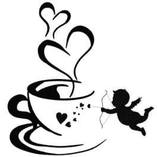
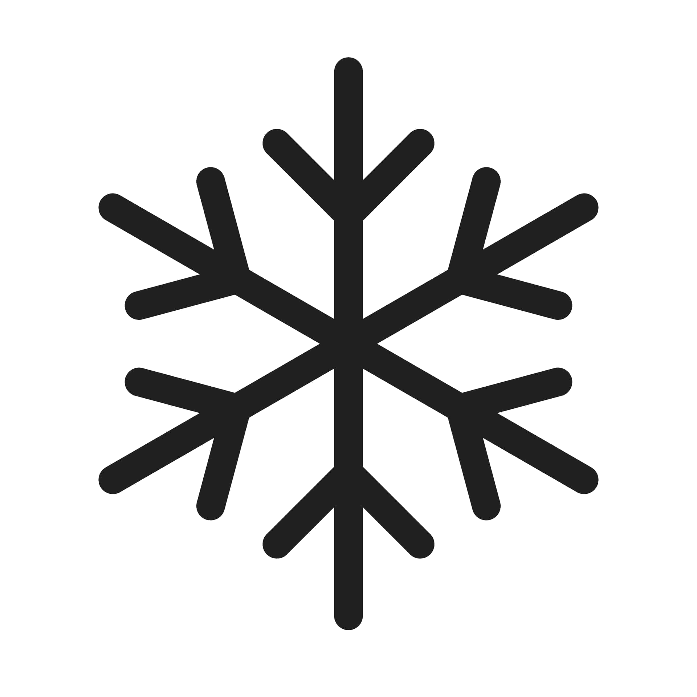

# [The Coffee Loft 04] - Java 之心与丘比特之箭 - Kimberly Krey

[使用 Vellum 创建](http://tryvellum.com/created)

- 关于作者
- 金伯莉·克雷伊的其他作品
- 致谢

# 金伯莉·克雷伊的评论

- 《InD'tale》杂志 RONE 奖获得者
- 《今日美国》畅销作家
- 三次 SWOONY 奖获得者

★★★★★ “每个人的图书馆里都应该有一本金伯莉·克雷伊的作品。甜蜜纯洁而又浪漫，充满惊喜。” (N Rapp)

★★★★★ 2021 年《InD'tale》杂志卓越心灵奖

★★★★★ “在没有描写露骨性行为的情况下表达出化学反应……这是我只在几本小说中见过的才华……这是最棒的好莱坞魔法。克雷女士知道如何描写这种魔法。” djsugarrn BookBub 评论

★★★★★ “克雷女士成功地为这个短篇故事（《牛仔夫的捕捉》）注入了足够的忧郁和幽默，让读者觉得这两个人注定是一对情侣。” (InD'tale 杂志)

“克雷……创造的人物栩栩如生，让读者感觉像是在偷看朋友关上门后的生活。可以说，就像在看好朋友的日记。” *BLB 亚马逊评论者*

“有很多……浪漫，纯洁，没有其他作者所使用的色情细节。” (Clinte de Kindle- 亚马逊评论者)

# 1

## 玛姬

三年前

我的好闺蜜要结婚了。

而我从未对一个男人说过我爱他。

尽管如此，当我坐在伴娘团的化妆台前时，一种罕见的期待悸动在我的皮肤上游走。“也许”这个词在脑海中浮现。也许今天就是我遇到那个人的日子。我最亲近的人，我的姐姐基斯汀和准新娘薇薇——他们说，由于我一直在两个极端之间摇摇不定，我很快就放弃了希望。

一天，我准备好坠入爱河走向婚礼；第二天，我就发誓再也不理男人，并给所有与男性有关的事情放个应得的假。

事实是，我花更多的时间在“我还没准备好”这一端。在“我怀疑那里没有属于我的人”这一端。但我现在正站在另一端，再次感到希望。

休息室里满了其他伴娘——她们都是我的朋友，而且现在都结婚了，除了新娘的三个小表妹，她们正在门外自拍。

谢莉坐在我右侧的梳妆台旁。

尽管如此，我依然选择保持谨慎乐观。也许查德（Chad）的表哥看一眼我就会想：“多么了不起的朋友啊。看她多投入。她以后一定会会成为一个完美的妻子。”事实上，我应该把这当作他的第一次测试。如果薇（Viv）和查德认为伴郎和我很合拍，这将是试水石的一个绝佳方法——看看那家伙的底细到底有多浅。

如果他是我的真天子，他会看透这支颈具并给我机会。

一股自信充盈了我的胸胸，因为我非常有魅力。两个大学教授都曾这么告诉我，我并不会忽视这一点。我会挺起头来（尽管我想低头可能也低不下去），并决心尽力享受今天。

“你知道的，玛姬，”林迪·古德费罗（Lindy Goodfellow）说道，“你能活着真是很幸运。”林迪坐在我的右边，边嚼着口香糖，一边修剪她尖尖的指甲。

我本能地瞪了她一眼，但在我这脸扁扁的婴儿脸上，这个表情并没有表达出来。

“你说得对，”我终于妥协了，说道。

“我真不敢相信你竟然真的来了，”枫（Maple）说道，她那如枫糖般的肤色在人类已知的任何颜色下看起来都那么完美。她把化妆刷移到右眼，又眨了眨眼。“你这样做真贴心。”

“你比我强多了，”谢莉（Shaylee）插话道。“我可能会一直躲起来，直到我能把那东西摘掉。”

“我也是，”林迪又嚼了一下口香糖表示赞同。

“我在这玩意儿里至少得待四周，”我说，语气带着防御性，“我得戴它吃饭、睡觉，还要带着它上厕所……我不能一直躲整整四周。而且，我不想让薇失望。她这辈子都在等这一天。”泪水刺痛了我的眼眶。也许我本应该呆在家里。当伴娘穿得比暴风兵还像塑料一样走出来时，谁还有心思关注在婚礼上呢？

“噢，”林迪说着，俯下身，手摸了摸我颈具上那个塑料凸起的部分。枫也随之这样做，两人围聚在我周围，在我那个阻碍行动的设备上笨拙而轻柔地拍了拍。

“对不起，”枫说，“这对你来说一定很难受。”

谢莉没有动，但她在梳妆台旁传道：“是啊，看着你最好的闺蜜要结婚……”

“在昨晚你的车被撞烂了之后，”林迪提醒道。

“而且你不是刚发现酿酒馆（Brew House）要拆迁吗——”枫补充道。

我忧伤地了点头。酿酒馆白天是咖啡馆，晚上是啤酒酒吧。我在那里当了两个年的首席咖啡师，刚被升为管理层。

“所以，你那么努力工作才得到的工作就这么没了，”林迪摇着摇头。

我的眼睛在枫和林迪之间来回跳动，她们正在统计我的一系列不幸。

“现在你被困在戴这个……大旧颈具了，”枫说道。

“这不仅仅是颈具，”林迪轻笑了一下。“还是下巴、头、胸、背和肋骨支具。”

在短暂的沉默中，所有的目光都转向了谢莉。她紧贴着镜子，在唇峰反复涂抹一层厚厚的磨砂唇红膏。她抿了抿嘴，通过镜子与我们对视。

“更不用说，”谢莉漫不经心地说道，将刷子滑回盒子里。“你现在是唯一一个没结婚的人。”

我眨了眨眼。“你好像已经说过了。”

“不，我没说。我只是说你闺蜜要结婚。我没提到我们其他人已经结婚。”

枫狠狠地看了谢莉一眼。“那是不言而明的。”

“好吧，这颈具的事也一样，”谢莉朝我方向挥了挥手。

我叹了口气，想钻回我为了林迪婚礼而爬出来的那个‘棺材’里。

“你们先走吧，”我建议道，“告诉薇我很快就到。”

女士们互相交换了眼神，然后点了点头。

“好吧。”枫绕过笨重的颈具，给了我她能做的最好的半个拥抱。

“外头见，”林迪说着，这时谢莉拉上了她巨号化妆盒的拉链。

“噢，”枫用欢快的语气插道，“我听说了送你走过廊的那个男——查德的表哥——很帅。”

“是，但是……”谢莉通过指向另一个显而易见的事来阻止自己指出显而易见的事。“但是……”她挥了手示意道，“玛姬自己看起来也不妙。快看她——她丑极了。”

林迪拉开门，为其他人留着路。“外头见？”

是啊，除非我躲在谢莉的化妆盒里。我又试图点头叹吟，但失败了。“好。”

“再见（Au revoir），”谢莉说道。

林迪挥了手。“拜拜（Ciao）。”

随着门关上，我看到一群穿着燕尾服的男人正欣赏地看着那些女士。其中一个人发出了口哨。另一个也吹起了口哨。

“噢，闭嘴吧，”我想说，“他们都结婚了。”

“老兄，”我听到门另一侧一个人惊呼道，“伴娘真辣。”

“你看到外面的她的表妹了吗？”另一个人问。

“看到了，”第三个声音传来。“对我来说太霉了，这副颈具。你看到她的表妹了吗？”

## 对峙

我一眼就发现了破绽——某种意义上的；撇开那个圆滑的红头发，`Billy Boy` 是这里最矮的一个。确实，他被一群高大长腿的巨人包围着；`Chad` 的兄弟每个都有六英尺三或以上，但视觉效果是一样的。

“我看起来可能像弗兰肯斯坦的新娘，”我指着他的方向说道，“但在这些哥们儿面前，你看起来像个小豆丁。”

他瞪大了眼睛，嘴巴张得很大。他无声地读了一遍 `pipsqueak` 这个词，眉头紧锁，好像他以前没听过这个词。

“而且你的外表也许还凑合，”我对他说道，我知道自己几乎假装成并非如此，“但我敢打赌你的内心比弗兰肯斯坦本人还要丑陋。”我试着转过头看向另一侧并抬起鼻子，但由于这两个动作上都失败了，我转过背对着那些男人，目光看向出口。

我向前迈出左脚，这让我面向门厅的右侧，那里有一张桌子，放着 `Viv` 和 `Chad` 孩时的相框照。我又挪动了一下移向左侧，那里正在播放他们的订婚照幻灯片，配着他们最喜欢的歌。真不敢相信我今天早上还尝试穿高跟鞋，最后选择了这双被遗忘的平底鞋。

拖行，抬，迈步。

拖行，抬，迈步。

“我没说你看起来像弗兰肯斯坦的新娘，”那个不知道名字的家伙在后面喊道。“我说的是你走得像她。”

噢，他是这么说的吗？当我费力地挪动向前走时，脑海中浮现出那个角色在黑白电影中的形象。

一阵羞愧涌上心，让我的脸发烫。

“天哪，她有什么问题吗？”其中一个男人问道。

我听到了嘘声。“那样太没礼了，”某人厉斥道，“你最好去道歉。”

他们说肾上腺素能给你超人的力量，就像我在学校里学到的那位先驱女性。当她儿子的腿被马车卡住时，她直接把那个沉重的东西抬离地面救出了他。这一刻的耻辱感就像三倍剂量的肾上腺素，让我走得比一只受伤的鹿还快。

拖行抬迈步，拖行抬迈步。

“不，我打算先让她冷静一下。”

“我觉得那很快就不会发生。”

泪水在眼眶里打转。我的下巴在我那笨蛋的脸壳或躯干瓶或那个那孩子该死的什么鬼地方上快要颤抖了。

但他们是对的，所有人都是。我不该来的，我也绝对不会回去忍受同样的折磨。`Viv` 誓旦旦地保证，如果我来不了她会理解的。然而，正当我靠近出口时，我看到了通往上方阳台的电梯。那里可以俯瞰婚礼；`Viv` 不需要，因为他们的圈子并不大，但对于一个心受了且行动不便的伴娘来说，那里是完美的藏身之处。

当我坐在一个相当阴暗的角落，盯着下方等待的牧师时，我的手机发出震动声。

`Viv`: 你在哪儿？

我迅速回了信息，同时将手机举到眼睛高度：`请不要生气。吃药后我觉得很不舒服，所以我上阳台看了。我在这儿，只是不能待在下面，好吗？我爱你！一切都会很棒的。`

`Viv`: `我永远不会生气的。我们庆幸你还在我们身边，谢天谢地！那本可能糟糕得多。谢谢你留在阳台观看。这对我来说意义非凡！爱你。`

我叹了口气，考虑到 `Viv` 是一个多么好的朋友，内心的受伤和被冒犯感消散了。我的手机发出了最后一次震动。

`Viv`: `不用担心留下来看花球环节。我有种感觉，无论谁接到，你都是下一个。`

我试着摇摇头。当然，`Viv` 觉得我是下一个——正如 `Shaylee` 说的那样——除了 `Viv` 的青少年表兄弟姐妹外，我是最后一个未婚的。

只要一想到寻找爱情，我的防御墙就立刻升起。每个人的墙都是由过去的事件建立的。我的墙更像是一个板箱，是一堆被海浪冲刷过的木板和木条，被多年的伤害和忽视而粗糙地钉在一起。每当我再次当伴娘而不是新娘时，我或许会装出一副自怜多怜的戏，但事实是，我害怕做出错误的选择，害怕像我父母那样搞砸了一切。这就是为什么 `Kirsten` 和 `Viv` 说得对，我在重燃希望和彻底放弃之间摇摆得如此。

谁在乎呢，我暗想。我永远不会对一个男人说我爱他，尤其是那种男人。回起来，我竟然希望他是`真命天`。我怀疑甚至不存在这种东西。如果有，有一点是可以肯定的——`Chad` 的笨表哥不是`真命天`，不是`也许先生`，甚至不是`现在不行先生`。`Viv` 可以忘记把我介绍给他了；对我来说，那个男人是`永远不会`。

# 2

## 玛姬

现在

反弹——在蹦床上进行的一种有趣的有氧运动——是我新年愿望清单的首位。所以你可以想象，当我圣诞节第二天上第一节课时有多么自豪。

为什么要等到新年呢？特别是考虑到我吃了大量的冷肉板点心。

我约会对象最有前景的是来自 `Norfork` 的海军陆战队成员。他很完美，除了他第二天就要去日本执行一项长期行动。

但今天，当我随着节奏跳动时，弗吉尼亚州海滩甚至更好，如果我可以这么说的话。你无疑听说过 `Coffee Loft`，它是美国最有魅力的咖啡连锁店。要顶得这个名字，必须符合无懈可击的标准。看看 `Long Island` 和 `Palmer City` 就知道了。

我的店坐在一座散发着魅力的旧火火站里！我喜欢待在那儿，我喜欢为每个季节让它变得舒适而新颖，我爱我的每一位员工。生活正美妙地律动着。我正在一个地实现我的目标。

好吧，所以那个领域还在进行中。而且不，我还没有告诉过任何男人我爱他，因为我还没有坠过爱。多年年来第一次，我是真的准备好了。

在过去的四打约会中，我约了近十二次。有一位电工，在我们的每一次对话中都塞进双关语。约会中途，我就被双关语听够了，想象自己把叉子插进最近的插座。我们开始玩这种梗了吗？

还有一位撒谎年龄的年长绅。当我看到他发布了一张像 `詹姆斯·迪恩` 的黑白照片时，我应该发现。这是一个经典的造型，他也很帅。可惜的是他已经七十出头了。那家伙儿出现在餐馆时，穿着卷起脚踝的紧身牛仔裤，紧身的白色 T 恤（谢天谢地，它凸显了他松垮的腰肉），还留着厚实的银发，梳理得就像那个反叛少年本人一样。对于一个年龄相近的女性来说，`Herman` 会是个极佳的选择。

不，玛姬，我对自己说。我拒绝消沉。我决定要保持希望，弄明白这场名为“爱”的游戏，并找到我正在寻找的东西。他就在某个地方，我很确信他的牙还没掉光。

既然情人节只剩下短短五十天了，我觉得现在是认真的完美时机。这与我即将迎来三十大生日无关，也与我所有的高中朋友在多年前就结婚、并正式把手提包换成尿布包的事实无关。

完全没有关系。

没有时钟在滴答作响。

也没有内心声音在尖叫，如果我不认真对待，我余生可能都会形单影只。

“好了，”教练在音乐声中大声喊道，“我们上雪道吧。双板滑雪，膝盖弯曲，在蹦床上每次旋转时手肘向后。你们可以的！”

我尽力做出我的滑雪动作，收紧核心力量，握紧拳头，并下定了要在寻找真挚持久爱情时，无论生理还是心理上都处于最佳状态的决心。

课程结束后，我向教练表示感谢，她被镇上四十多岁的单身人士戏称为“杰西卡·兔兔”。我是在咖啡馆在我们新的火车车厢扩建举办聚会时认识她——顺便说一下，这次活动非常成功。杰西卡非常漂亮、野心勃勃，而且聪明。尽管她留下了一段失败的婚姻，但她是很快乐的。

课后我们简短聊了聊。我问她销售情况如何——非常好，她问尽管圣诞节已经过了我们是否还有形花拿铁咖啡——有的。

“事实上，”我说，“我们将那款产品一直保留到一月三号。”

“很不错，”杰西卡说，“回头见。”

在回家的路上，松松的雪花盘旋着飘落在泥泞的地面上。我享受着这种景象；在这里，雪花很少积聚到可以让人抓起来揉成雪球的程度。事实上，只要太阳一出云层，那些轻如羽毛的雪花就会融化、汽化，或者对那些可怜的小东西发生什么。

我叹了口气，感觉到一种熟悉的悲伤正从胸口中涌来。小时候，我把那种空虚感称为我的“心洞”。直到今天，这仍是我能解释它的最好方式。那种感觉就像我的心脏中心有一个真空驱动的深坑，准备好在我的梦想成型之前将它们吞噬。

没过多久，我就明白了为什么那个洞正试图再次裂开。这与我举办的那场单身活动有关。我见到了许多当地四十多岁的单身人士；有些人从未结过婚，大多数人已经离婚，而且都仍在寻找爱情。遗憾的是，我的姐姐基斯汀也在他们之中，作为该小组中新入伍的离婚女性。

我们母亲总是说，她很高兴格雷格和基斯汀提供了一个爱情样子的健康榜范，因为她和我父亲“失败得惨不忍睹”。我没有对此争论。

基斯汀和格雷格拥有一切。我从未猜到格雷格会通过背叛我的姐姐来毁一切，顺便说一下，我的姐姐是世界上最优秀、最美丽的人之一。

格雷格背叛了我世界上最喜爱的两个人——我的姐姐和我的侄子。他背叛了每一个爱并信任他的人。我曾指望他们能战胜概率，成为那些留下的人。

`Kirsten` 重重地叹了口气。作为她的妹妹，导致她这样叹气的次数多到我无法计数。“好吧，我放你了。但如果 `Braxton` 接受了那份工作，而你们就这样坠入爱河，那完全是自然的，我不希望你对这个机会闭门见，好吗？再见。”在我反驳之前，她就挂断了电话。

“拜拜，”我关掉引擎说道。

每当我走出我那辆可爱的阳光黄色的 Jeep Renegade 时——顺便说一下，它的名字叫 `Sunny`——我都必须至少欣赏它六十秒。我爱着这辆车，为了得到它我付出了很多努力。

我抬起鼻子，吸入咸咸的海风，远处传来波涛的涌和呼啸声。今天早晨已经过了涨潮期，太阳已经开始显威了。很快，地面就会大部分干透。但这并不意味着温暖。我很冷。冷到让我一路走到门口都在打抖。一月的时候天气会变得越来越冷，然后温度才会开始缓慢上升。到三月，我们就能看到死忠粉丝们开始穿着潜水服来冲浪了。

我深吸了一口气，注意到空气中的变化，那股现磨咖啡的浓郁芬芳愉悦着我的感官，并希望能吸引路人。当我推开门走进店里温暖舒适的空间时，那股气味变得无限强烈起来。

如果欣赏 `Sunny` 至少需要六十秒，那么欣赏我咖啡馆的梦想则需要长得多。顾客们缩在壁炉旁舒适的沙发上。有些人挤在柜台旁，松开外套，手里攥着礼品卡，盯着巨大的黑板菜单看。另一些则散落在楼上和楼下的用餐区，仰着头喝着杯里的咖啡，或是吸入着浮在脸上的、神圣般的热气。

许多在线评论者说 `Coffee Loft` 是他们家之外的第二个家，我再赞同不过。这也许是我工作场所，但这种温馨、轻松的环境让大多数工作日都变成了一种享受。

我的目光移向阁楼旁边的拱形天花板，据我介绍，那里曾是旧火车站的一种哨戒处。在那里，沿着那面大墙壁，优美而大胆地悬挂着 `Cupid Darts` 的横幅。背景是明亮的白色，上面有褪色的黑色阴影爱神——他们正拉满弓，箭箭待发。

图像中心是一颗闪亮的深红色爱心，一支箭穿了它的中心。它融合了贺卡上的那种爱心形状和你可能在他人胸腔中看到的跳动三维人类心脏。这里运用了一种艺术技巧，让这颗心看起来像在跳动。只要我微微歪头或移动视线，下方的心室似乎在收缩，而上部则在一侧膨胀。

光亮的血液从裸露的箭尖渗出，滴落下来，恰好点在标题字母 `i` 的点上，点缀出一块精致的斑点。`Cupid Darts` 用匹配的红色手写着；字体复杂而精巧。

它给人一种印象，那些小小的媒婆会悄悄地靠近那些完全没有防备的人。

呵，我沉思着。我不清楚。我想，有些像我这么大的单身女性——也就是从未结婚过的人——可能并不在寻找爱情，但我敢说，我们大多数人都是，而那些说称自己没有的人只是在自欺欺人。

### 爱的愿景

三件事在我脑海中闪过：第一，如果我真的爱上了某人，我会如何处理这种情况。第二，我是否已经准备好进入一段关系。第三，`Cupid Darts` 对我的生活真正代表了什么。

我再次翻了个白眼。“我要挂电话了。”我没让他再说一个字。

几秒钟后，一条短信弹了出来。

`Beau`：“别生气。我和 `Kirsten` 之间有些特别，但现在还处于早期，我不想让任何事情破坏它。”

我回了一个我能想到的唯一像像样的四字母单词。

`Braxton`：“行吧。”

## 咖啡馆与过去

我走进咖啡馆，给自己买了一杯加了半奶油的干卡布奇。我原本没打算这么做，但店里的香气让人无法抗拒。我在店内走来走去，欣赏着这个挑空建筑，它的中央拱形天顶点缀着看起来像原始木梁的结构。巨大的横幅解释了我在停车场看到的贴膜车。显然，那辆豪华轿车属于某位作家。一定是在这里办签书会。

当我查看上层时，那里有壮丽的海景，我的思绪被拉回了今天早上接到 `Davis` 的那个令人不安的电话，他是我施工队的的负责人。当我决定离开并专注于私人定制项目时，我让他接手了 `Wheaton Construction` 的住宅开发业务。`Davis` 告诉我，那个新人——我最近录用的一个员工的朋友——使用了不必要的武力将两个无家可归的人从一栋未完的房子里踢出去——那是我们在 `Norfork` 附近建筑的很多房子之一。

这种情况在这一时期并不罕见。尤其是当我们处于建筑过程的这个特定阶段，框架已经搭好，地板还没完工，几个人躲避风雨除了在管道进场前使用一下厕所外，造成不了多大的破坏。

我不是那种会在人落难时推一脚的人；老爸总是说，在不同的情况下，那可能是我们中的任何一个人。在我兄弟`Blaine`咽气之前，他就是生生的证明。

为了纪念我去世的哥哥，我针对这类事情建立了一套流程。当我们发现占房者在我们的某个工地避雨时，我们会提议送他们去最近的公交站，并买他们去当地避难所的车票，让他们有热饭和避风的地方。

我后悔没有花时间向`Levi`交代这件事。他比我招用的大多数员工都需要更多培训，但因为他是`Johnson`的朋友，我希望这种努力是值得的。目前对此还无定论。

一阵深沉的疼痛在我胸口低而持续地胀着。想要克服我悲观的性格很难。我没能救`Blaine`；什么让我觉得我可以救别人呢？但我知道这不是重点。重点在于，我爱的人也曾在那些街头，我祈祷上帝让他遇到陌生人的善意。我现在唯一能做的就是给其他人提供这些。

## 寻找办公室

我把目光从拥挤的海滨步道上移开，原地旋转观察相邻的墙，那里被拱形空间隔开。那是商店的一部分，但入口在哪里？

我迅速通过宽楼梯回到主楼，穿过店里一个相当舒适的区域，客人们在那里玩国际象棋和象棋，上楼上的茶桌旁，发现了一个楼梯间。一个小牌子告诉我上面有一个办公室。

作为一名木工，我在走狭窄楼梯时欣赏着上面的木工。它并不完全是螺旋楼，而是被几个小平台隔断的，但它确实一直到顶层都在顺时针方向变换。

“听起来这本书出现在你生命中的时机非常完美，”一个带着新泽西口音的女人从墙的对面说道。

我想，吱吱作响的楼梯肯定暴露了我，但我还是停在原地，听听回应。我决定这一定是`Maggie`的办公室，一个多么完美的地方。我打赌那里有一扇可以看到景的窗户。

“我希望如此，”另一个女人说道。没有口音——可能是`Maggie`。“当然，我也曾以为我的时机是在三四年前，那时我所有的朋友都在结婚。我不知道，有时我在想，我是不是不小心错过了我的那个人，你懂吗？或者我把他吓跑了。”

“怎么说？”

我正颜无耻地偷听，但反正`Maggie`也是禁区，这又有什么关系？我谨慎地喝了一口饮料。真好喝。

“因为我慢节奏，”我推测是`Maggie`的人回答道。“我不是那种会扑向某个男人或冲进任何事情的人。但似乎那是男人们想要的。如果你处理事情很谨慎——考虑到现在的离婚率，你为什么要不谨慎呢呢——你就是一个无聊的次品，甚至不值得他们浪费时间。”

“听起来你是在凭经验说话，”新泽西口音说道，完全说出了我的想法。我突然庆幸`Beau`划了界限；我最不想的就是为女人过去某个混混造成的损失买单。

“我绝对是这样。但我对这本新书的封面有个问题。顺便说一下，它非常漂亮。关于心形的形状以及`爱神`的描绘方式在我看来暗示了爱情是悄悄降临的。但也许是我过度解读了。”

“不，”新泽西女人说，“你是对的。`爱神`的箭矢提供了指示，或者说是标记，即长期关系中常见情况的标志。”

“但如果这些情况让我们措手不及——意味着我们无法安排它们——那么知道它们是什么又有什么用呢？”

我缩了缩。这个姑娘很咄咄逼人。我凑近身体，半是预料那个新泽西女孩会发火。

## 相遇

## Maggie

高大、深色、帅气不足以形容站在我门外的身影。更像是在潜伏。他站在这儿多久了？为什么他看起来……很眼熟？

“那是你的名字，不是吗？”他催促道，将我从出神中拉回。

“读这本书吧，亲爱的，”她说道，伸手拿过我桌上的那本硬装书并翻开封面。她从胸口处抽出一支黑色记号笔，用牙咬开盖子，在扉页上笔挥有力地涂写着，疯狂地点上‘i’的点，划掉‘t’的横。接着是她那著名的签名。她合上书，盖好记号笔盖，再次将其塞回胸间。

“这是送给你的。等觉得合适的时候再读。”

“我会的。”对于自助手类书籍，我更倾向于那种慢节奏细品味的类型。我会做笔记，对每一章进行冥想，并努力将它们应用到生活中。这是目前最有前景的一本了。我能感觉到。

当我穿上高跟鞋带克拉里莎走下楼时，我这样对她说道，心中再次思考那个在车厢里等我的英俊男人。我已经告诉过凯斯汀（Kirsten）我不会和他约会；我不知道是对对自己感到恼恼还是松了一口气。

“我很期待签售会，”克拉里莎·洛夫（Clarissa Lovely）在靠近柜台时对我说道。

“我也是，”我保证道，“点你想吃的什么吧。这里请客。”

我希望我的心不在焉并不明显，但事实是，布莱克斯顿（Braxton）的脸像嘉年华人群中的静电气球一样不断在我脑海中浮现。他看起来……很眼熟。我想起了他的兄弟们；我见过他们所有人，每一个人看起来都像某种希腊神祇。橄榄色的皮肤，棕色的眼睛，健壮得惊人的肌肉。这不自然。也许正是这种强烈的相似性让他看起来很眼熟。

但我并不完全信服。出于某种原因，我对他的印象并不好。也许这只是我在试图说服自己，即使我觉得和波（Beau）的哥哥约会是个好主意，我也不想要他，我并不这么想——渴望得不到的东西毫无意义。而且，看看他——他一定有很多女人主动扑向他的钢头靴。

我强迫自己将注意力放在他来的理由上——那个新扩建部分，并走向诺布利（Nobly）完成的那节车厢。当我进去时，我发现最近的桌子上铺着一套蓝图。快速扫视周围区域，布莱克斯顿在远处的角落正以非同的兴趣检查着天花板。

我清了清嗓子。“抱歉久等了。”

“是谁做的修复工作？”他粗鲁地断断。

“杰布·诺布利（Jeb Nobly）。”我的语气里带着自豪，这并非偶然；毕竟那人在当地很有名。

“你是说诺布利还没死？”布莱克斯顿还没从完工处移开目光。他伸出手指，沿着外边缘按着。

“不，他没死，老鬼。”

“他起码现在该退休了。”

我交叉双臂，叹了口气。“他退休了。他只是……偶尔还会接一些兼职。”

“是吧，不过，他不该这么。”

现在这家伙简直是在越界。“你这话什么意思？杰布做得非常漂亮。”

“对你来说很漂亮，”他应道，将目光从天花板移开，落在地板上。他用那只看起来脏兮兮的靴尖踢了踢木板，“在专业人士眼里，这是拙劣的活儿。”

“拙劣的活儿？”我尖叫道，“说出一个他做错的地方。”

“亲爱的，”他说，现在直直盯着我，“我一进这个地方，几秒钟就能列出十几个他做错的地方。”他伸出大拇指，手指一个数着，“他没做好保温，窗户没装双层玻璃，用的是新木而不是翻新的，而且入口处有一块木板翘着，可能会撞到你那些漂亮小顾客的……”他似乎察觉到了什么，改口道，“……屁股。”

我点着脚尖。

调整呼吸。

在想是否能坐上一架飞机去一个遥远的地方。不仅仅是这家伙说的话让我如此不悦。更是他说话的样子。

“你是个非常无礼的男人。有人告诉过你吗？”

他耸耸肩，在原地转了个圈。“事实有时伤人。”

“是吗？”我的声音也带着刺。

我抬起眼帘，瞪着他。“拜拜，”我轻唱道，听起来完全就像某部青春电影里的恶毒女孩，因为我不想在他令人不安的身边多待一秒钟。他因为维护了杰布·诺布利（Jeb Nobly）得罪了我，而布莱克斯顿·惠顿（Braxton Wheaton）是个粗鲁又冒犯人的男人。

他朝门口挪近，转动门锁，扫了一眼地板上的那个位置。“你可能得考虑把那里修一下。”他苦笑着说，“会有人受伤的。”说完，他走出了门。“再见，”当门关上时他说。

我双臂抱在胸前，对着紧闭的门发出我最愤怒的目光。“再见？有你在可没再见，”我嘟囔道。

然而，门突然又推开了。我措措不及防，喉咙里又发出一声惊叫。

布莱克斯顿把头探进来。

“你想干什么？”我严厉地问道，双手叉在腰。

“只是啊……”他停顿了一下，任我在焦虑中溺水，连个救生圈都不给我。“我想让你知道，如果明天这个时候之前我没收到你的消息，我就假定你是拒绝了，然后继续看后面的名单。为了博（Beau）和凯斯汀（Kirsten）的面子，我把你放在其他工作之前，但你不能一直留在那里。”

他没多说什么就关上了门。

“你不能一直留在那里，”我又模仿了一遍，不在乎他这次是否听见。事实上，看看他能不能听见。“混蛋！”我从口袋里掏出手机，点开和凯斯汀的短信对话框。

`Maggie`: 抱歉打扰你，但我不会用布莱克斯顿来装修新了。

我正准备发送，但又下不决心来。我真的、真的、真的不想错过什么棒的东西，我预感那个虚拟导览会让我大为观止。

我退格删除，重新输入：

`Maggie`: 抱歉要告诉你，但我可能不会选布莱克斯顿来装修新了。

这样好多了。我不费吹力，脑海中浮现出他走近我的样子，闻起来那么好闻又阳刚。我再次听到了他沙哑的声音：“抱歉。”腹部深处涌起一阵热流——这在警告我，我很容易沦入那种魅力中。

为了确保自己不会陷进去，我在短信里又加了一行：

至于要和那家伙约会——那是坚决拒绝。还是谢谢你。

# 5

## 布莱克斯顿

“听我的……”我低着下巴，一个接一个针对性地看着我的每一个兄弟。“我可能惹恼了她的漂亮小脾气，但她一定会打过的。”

我们的菜刚送过来，但事实证明，博（Beau）对我和玛姬（Maggie）会议细节的兴趣远大于他点 ed 那份套餐餐。

博摇了摇头。“我不觉得有把握。而且你非要惹恼她的神经干什么？”他眯起眼睛。“如果你用什么方式和我跟凯斯汀之间的关系搞砸了，我会杀了你。你很清楚吧？”

“我会帮忙的，”卢克（Luke）补充道，将他的纳什维辣鸡翅浸入一罐牧场酱里。

博把手肘撑在桌子上，展示出他的二头肌。“我不需要帮助。”

“你们觉得我付付不了那群老家伙吗？我们不再是孩子了，”我笑着，模仿博的姿势，让我的二头肌也隆起来。“我正值巅峰，宝贝们，而你们已经快到要用助听器和假发片的年纪了。”我当然是在夸张，但事实是，博、卢克和利亚姆（Liam）都四十多岁了，而我年轻的三十三岁。

“别担心，兄弟，”我说，“我会保持完全的专业，就像你要求的那样。”我挑了挑眉毛。“不管她多想得到我。”或者说我多想得到她，但我没把那部分加进去。

博呻吟了一声。

“你对女性的了解并没有你想象中那么深，”卢克说完咬了一口鸡肉。牧场酱顺着他的手指流了下来。

卢克的双胞胎利亚姆缩了缩身。“真不敢相信你能吃这么多酱。那不自然。”

或许可能因为对再次见到玛姬的强烈渴望，我的自信心更加增强了。向她展示我能对那个地方做什么。也许那时她就能理解我对于诺布利那种过时工作方式的沮丧。

“嘿，”我对卢克说，“你看到我设计的方案了。你觉得她会放下自尊让我来做这个工作，还是不会？”

我在寻找认可，因为这是我唯一不想失去的工作。自从杰基（Jackie）之后，卢克是最好的来源，他的大女儿是那个将蓝图转化为三维在线体验的人。潜在客户甚至在我开始之前，几乎就可以对空间进行实地考察。杰基非常有才华，我很幸运在她读学位期间能得到她的帮助。

卢克摇了摇头。“不，她不会放过的。”

利亚姆插话道：“如果玛姬拿了你的设计，却找别人帮她干活呢？”

这个想法像一记腹拳一样击中了我；我没考虑过那点。“我会气死的，”我承认道。“虽说没人能比我做得好。”

我的几个哥哥都在同一栋楼里做不同的工作，他们定期聚餐吃午饭。当我们在一起时，我会加入他们。在在一起的几个月里，我是这种状态。事实是，这在脑海中是显而易见的。

等等，短信是的的的的的的的的的的的的的。

“最近还有其他人在想布莱恩吗？”我几乎是脱口而出，但内心深处极想知道。我不可能是唯一一个在反复袭来的哀伤浪潮中挣扎的人。

“是的，”博先开口。

“这个时候最糟糕，”利亚姆补充道。“让我想起那些我们到处找他的夜晚，希望能把他从街上带回来。”

“我记得他拒绝时，我们给了他那个特睡袋，”卢克补充道，又把鸡肉插进牧场酱里。

“他可能只是拿去卖药了，”我说。

“然后你还在爸妈的后院为他盖了那座像国王一样的小房子，”卢克说道。“你总是这么心软。”

卢克坚持非要叫梅格为他的前妻，而不是直接叫她的名字，这让我无法理解。毕竟，她曾是家里的一员。“杰基很棒，”我先回应了关于他女儿的评论，“以前我为潜在客户画的草图，能拿到百分之八十五的订单。但有了她的数字 3D 显示，我每一单订单都能拿下。”

“这就是为什么你这么信心能把玛姬这一单稳稳拿住？”波波问道。

我点了点头，但在内心深处，我并没有那么确定。我确定的是，我们的道路以某种方式再次交汇。而不仅仅是因为波波正和她的姐姐约会。玛姬和我之间有化学反应。如果可以这么说，那是充满张力的能量。当她走进办公室门口时，我感受到了，在翻新后的火车厢里，我又再次感受到了。那种潜力需要被测试，我敢打赌玛姬也感受到了。

“至于梅格，”我提到卢克的前妻时微笑着说道，“她总是比你更喜欢我。事实上，在一次醉酒的圣诞节，她曾向我吐露，说她选错了兄弟。”

“啧，”卢克嗤之以鼻，“你比她小快十岁。她不是老猎手。”

我笑了。“纠正一下，”我说，“梅格说她选错了双胞胎。”我的目光投向利亚姆，恰好看到他的脸变得比卢克的辣鸡翅还要红。

“这是真的吗？”卢克用震惊的语气问道。

是真的，但他可能不需要知道。“没，”，”我说，没懒得让自己听起来太有说服力。

事实是，卢克对梅格不是一个好丈夫，他自己很清楚。而利亚姆的前妻加布里埃尔也不太妙；事实上，她对待利亚姆非常糟糕。梅格很少喝酒，但那一年，她在应对卢克时感到格外艰难。她仰饮了第二杯香槟，说：“为什么我最后没有和利亚姆在一起呢？他很好，我也很好——我们彼此匹配。卢克应该得到像加布里埃尔那样的人。她像他一样狠心。”

我环顾餐桌，发现卢克和利亚姆都盯着我看，眉头微锁，陷入了沉思中。我将目光移回窗外。我一定不是唯一一个好奇梅格和利亚姆是否会试探彼此的人。毕竟他们现在都是单身，我不会说他们任何人的离婚现在还新鲜。

就在这时，我的手机震动了起来。

当我拿起手机时，波波极力探身看向屏幕。“是玛姬吗？”

我露出了一个得意的微笑。“也许吧。”

“客气点，”波波警告道，“别太热情。”

“别担心，她不是我的菜。”我现在感到格外自大，于是我打开扬声让所有人都能听到。“我是布雷克斯顿。”

“布雷克斯顿，”一个明显不是玛姬的声音，“我是咖啡馆的香特尔。我们想继续进行装修。你什么时候可以开始？”

当我停下来回答时，我的兄弟们摇了摇头，翻了个白眼，并微微向前倾身。

“等一下，”我说，点了一下屏幕静音了。我看着波波。“我要告诉她，如果玛姬想让我做这份工作，她得亲自给我打电话。”

波波眼睛睁得很大。“你敢——”

我点下取消静音的提示，有效地让他闭了嘴。“香特尔？”

“是的，我在。”

“玛姬跟我说话时似乎……很犹豫。她现在方便在附近吗？如果你不介意的话，我想在规划时间之前先得到她的直接确认。”

波波用手拍了了一下额头。

利亚姆和卢克低声笑了起来。

“呃……”香特尔的声音传了。

我笑得更开了，几乎知道玛姬正守在手机旁听着。

“我就在这里，布雷克斯顿，”她说道，几乎是在低吼着我的名字。

一股热流在腹部升起。“嗨，玛姬，”我用轻快的语调说道。

“请你继续进行这个项目。”

成就感在胸中涌起。“完全按原样？还是你想做些改动——”

“是的，完全一样，”玛姬脱口而出，听起来也不太高兴。

“所以你的意思是，我呈现给你的方案用一句话来说就是完美的？”

是一段长时间的沉默，接着是一阵轻微的摩擦声。

“她得去处理一个客户，”香特尔说，“但是的，她是这么说的。”最后这句话带着压制的笑声，仿佛香特尔也像我一样享受这件事。

“这正我想听到的，”我说。“我可以马上开始。”我挂了电话并放下。“哥们，这就是办事的办法。”我向波波瞥了一眼，迫不及待再次挑起他的神经。“告诉玛姬不要太快爱上我，”我说，舒了舒肩膀，挺起胸膛。“我兄弟告诉我，她是禁忌之花。”

# 6

## 玛姬

### 第一支箭：丘比特的碰撞

愤怒与激情，宝贝——两者不可兼一。

我像吃第一顿饭一样狼吞地读完了第一章。

此刻我脑海中想不出任何妙语的话。没有红眼先生那种“走路看着路”的对白，也没有刻薄的热讽。他只是给了我一个警惕的点头，小心翼翼地绕过我，朝着谷物区走去。

“抱歉，”在他走过后，我勉强说道。

在健身房，我发现了“帅气胡子哥”，又名“三 G 男”，他正在划船机旁踱步。我以前在这里见过他——谁没见过他呢？但我从未胆敢跟他搭话。我也没能通过在附近健身来吸引他的注意力。“单车双胞”——一对穿着霓虹色连体衣的单车课狂热粉丝——以前追求过他，提议去街街头的果汁店为他买杯奶昔。他拒绝了，但旁边一个穿着质量堪疑的紧身裤的男人提议加入他们。

然而今天，当我看着`Triple G`侧眼盯着设备，显然在等那个老头（他今天穿了件豹纹连体衣）擦完座位时，我突然产生了一个主意。是的，我产生了一个绝妙、危险且可怕的主意。

在我还没来得及反悔之前，我已经冲向了健身房。

我轻快地穿过爬楼梯机、收腹机，以及那对正在饮水机旁等着接水的、没作多想的单车双胞。豹纹男正懒洋洋地用湿巾擦着手柄。`Triple G`走近了一些，但我动作得更快，像一个灵敏的仙女，眼睛紧盯着目标。我滑入位置，就像在比赛的最后一局击中本垒一样。实际上，并没有滑得那么优雅，更像是一声“咚”的闷响，震得我喘不过气来。

那个帅得令人生畏的男人错愕地看着我。接着，他的表情变得比煎饼还平。。我感觉到他口中欲言又止。我几乎已经能听到那三个简单的词了——你是认真的吗？

我不知道，我是认真的吗？`丘比特的碰撞`正在我脑海中制造混乱。它说服我某个天使的小鬼子正浮在最近的转角，拉满弓，箭指准目标，准备好恶作剧。

别想了，”我在机器上做了几次例行的划船时警告自己。如果真的发生了，就会发生吧。我无法强求。

在去“咖啡阁”的路上，我对自己承诺，无论脑海中出现什么疯狂的想法，我都不会对那个固执的布克斯顿采取任何行动。他是这个星球上我最不想发生“邂逅”的人。

我一整天都在躲着布克斯顿，而《丘比特之箭》的签售会进展非常顺利。事实上，进展如此顺利，以`Lovely`的出版社安排了`JJ Lee`——一位以指导有志作家而闻名的畅销言情小说家——在元旦第二天来到这里参加互动故事会活动。显然，这是为了她即将出版的写作书籍做介绍。

我宣传了一整周的活动，鼓励客人们带上伴侣或另一半。一条新的横幅挂了上来，虽然看到`Lovely`那精美的横幅被打包寄往下一个地点我很难过，但新的横幅凭借古白色的背景、粉色的心形和淡粉色的吻，散发着情人日的氛围。

顶部是标题——《从前》。下面写着：`带有“他说、她说”转折的即兴言情写作`。听起来确实很有趣。事实上，听起来就像那种可能会引发最完美邂逅……不，我打断了自己的想法。保持专注。

我整周都设法与布克斯顿保持客气。我每天至少去问候他一次，看看进展得如何。当然，他几乎不理会我，又好像我并不在乎。在快速评估了他的工作成果——我必须补充一句，那令人印象深刻——之后，我问他是否需要什么，也许是免费的一杯咖啡。理所当然，他接受了，我让`Chantel`送过去。我不禁为自己在初次见面他那种卑劣行为后表现出的如此体面的回应感到自豪。是的，这就是我。我是个很有格的女孩。

`Triple G`并不这么认为。在我接下来的几次健身之行中，每当我靠近他时，他都会刻意保持距离。雪上加霜的是，当我正走向更衣室时，“豹纹先生”悠到了我面前，问我什么时候想一起出去喝杯酒。他用一种听起来完全像我曾祖父的声音告诉我，我很有胆识，他喜欢这种。我的目光瞥向`Triple G`，他打破了边界，恰好听到了约会邀请。他笑着，仿佛这是我理应得的报酬。

遗憾的是，和一个迷恋豹纹衣的九岁老人约会不在我的遗愿清单上，所以我礼貌地感谢他并拒绝了。

我在我姐`Kirsten`家度过了新年。`布克斯顿`的兄弟`Beau`自然也在那里，因为他们俩感情依然很好。那里有好吃的食物、有趣的卡拉 OK，以及几个需要分组配对的游戏。`Kirsten`和`Beau`是一对，我最爱的（尽管也是唯一的）侄子`Jack`和他的约会对象一对，`Beau`的儿子`Parker`也有自己的伴侣。这留给了我和`Beau`八岁的女儿`Paige`。我很开心地发现自己并不太介意。我喜欢那个活泼的小女孩，她会唱歌、跳舞，在需要时还能吐出一脸的俏皮。我没忍住冲动，问`Paige`对她那个刻薄的舅舅`布克斯顿`怎么看。

`Paige`大笑，咯咯笑着，然后向我保证他并没有看起来那么刻薄。

“说起布克斯顿，”`Beau`听了我们的对话，“他今晚本来有个约会，但对方放了他的鸽子。好吧，其实她是取消了，说她丈夫终还是回城了。”

“丈夫？”我脱口而出，震惊地睁大双眼盯着`Kirsten`。

“他不知道，”我姐姐一边瞪着`Beau`一边保证道，“他发现时也很震惊。”

“他确实气坏了，这是肯定的，”`Beau`说，“主要是因为他开了两个半小时去某个老掉的溜冰场见她，这意味着他将在深夜的暴风雨中开车回家，而不是在某个女孩身边迎接新年。”

我不知道为什么在这一刻甚至会感到一丝嫉妒，这让我无法理解。但我确实感到了，我很讨厌这种感觉。

`Kirsten`和`Beau`交换了眼神，我感觉到`Beau`并不认为我和布克斯顿约会是个好主意。

我不再去幻想那些刻意制造的邂逅，转而选择在白日梦中进行。这样做不仅更安全，这些思绪还能让我脸上露出微笑，让我的心中充满希望。

在“很久以前”活动当天早晨，我跳过了健身房，以避开所有的新年计划狂热分子，转而上了一节在线瑜伽课。出发后，我为活动买了一束气球，然后驶进加油站给`Sunny`加满油。

我想象活动结束后，当顾客们匆忙穿过寒冷的夜色时，一个帅气的大汉正向我走来。他脸上带着愤怒的咆哮，手里拿着一本被水损坏的书。但不是普通的书——那是《丘比特之箭》，他也在读这本。他愤怒地抱怨道，有人在他的书上洒了一杯加了双份浓缩咖啡的香料茶拿铁，并要求换一本新的。

“换杯饮料？”我问他。

“换一本书！”他大吼道。

对我来说，很难想象自己会对一个顾客发火，但为了这个白日梦，我提高了嗓门，告诉他提议让我赔他的书是多么荒谬。而且，他到底是怎么知道那是加了双份浓缩咖啡的香料茶拿铁的？

我的脸红了。

我的血液沸腾了。

但突然，他露出了一个羞涩的微笑。

我火了，不知道是想扇那哥们一耳光，还是想让他闭嘴并吻我。

我太沉浸在故事中，以至于在离开加油泵时差点撞上一个男人。当我猛踩刹车时，我几乎没看清了他的卡其色外套和格纹围巾。

轮胎发出了刺耳的抗议声。气球束飞进了车的前半部分。红的、白的、粉的球体挤在挡风玻璃上，遮住了我的视线，它们顶着我的头部晃动，由于静电产生的“啪啪”声粘在我的头发上。

一个小夹子把丝带固定在一起；我知道这一点，但当我盲目地寻找它，决心要把气球拽回原位时，却没找着。

“它到底在哪儿？”我嘟囔着，拍了拍自己的双腿、旁边的齿轮，还有副驾驶座。当我俯身去抓那个夹子，手指笨拙地顺着丝带长度摸索时，刺鼻的橡胶气球给了我一记免费的“脸部洗礼”。找到了！

我终于固定住了那件东西，把那几只调皮的气球甩回它们所属的角落。我不仅能感觉到头顶传来的静电能量，还能看到我那金棕色的发丝对着那个被我差点撞到的男人欢快地挥动着。他没动，天哪，他看起来真的非常愤怒。

等一下。这哥们儿不赖。一点也不赖。我意识到我刚才这根本不是故意的。胸中涌起了一阵兴奋的泡泡。

他透过挡风玻璃瞪着我，然后低头估量我的保险杠和他的腿之间的距离。老天，他的眼睛真是布满血丝。等等，那是`Classy Produce Guy`吗？是。他就是`Classy Produce Guy`。

这也许就是命运吧。

我忍住微笑，降下窗户，在心里挑衅地让他冲我大叫：“怎么，女士，你想杀了我吗？”

他没有。相反，他把手更深地插进兜里，低下下巴。“这里真是一群疯子，”他嘟囔道。

一阵羞愧的热流在我的胸口中升起。“不，你才是疯子，”我大喊道，随即感到很抱歉。就在他躲进加油站避避时，我摇下了副驾驶位的窗户。“抱歉。其实那是我的错。”我升起窗户。“还有推购物车那件事也是我的错，”我轻声补充道，试图平复那可能让我看起来像我此刻感觉一样疯狂的静电。

在确认了双向无车后，我再次缓慢加速，摇了摇头。“天呐，我真是疯了。”

`Coffee Loft`今天很忙碌，一如既常，眨眼间早晨就变成了午后（傍晚）。出版商建议我们搭建一个类似模拟舞台的装置，把它放在新的故事主题横幅的底部。这样一来，几乎每个在场的人都能看到活动——包括楼上的人、休息区的人，以及用餐区的人。不想参与任何活动的客人们将被引导到店里一个看不到舞台的角落。

说到模拟舞台——我问了`Jeb Nobly`能不能帮忙搭一个，但他做不到，于是我让`Chantel`问了`Braxton`，他同意了，说等我们结束后，他会收取一笔小额的搭建和拆除费用。

“很意外他没让我开口要，”我在整理出版商提供的投票卡、铅笔和哨子时低声说。正当我以为直到明年新年才见不到另一个庆祝哨子时，我收到了五打哨子寄到我的店里。

扫了一眼窗外，发现`Braxton`还在忙最后一部分。希望在他完成之前我们能保持礼貌。在那之后，我就不用再见到他了。直到`Beau`和`Kirsten`结婚。

一想到这里，一丝思绪闪过我的脑海。这种感觉并不愉快，但当我注意到有多少客人正涌入`Coffee Loft`时，这个念头很容易就被从我脑子里挤出去。那里很快就被单身和情侣挤满了。我分发投票卡。

这节旧守尾车厢里的瞭望塔是独一无二的。它是我改造模型展示中最大的卖点之一。车厢远端的上半部分被中间的一条过道隔开。短梯通向两个独立的隔间，里面有浅浅的卡座式座椅，四周都是窗户。当这台小家伙还在轨道上运行时，机车组人员会坐在上层，眼睛紧盯着前方的轨道。然后，他们只需用力拉拉绳子，就能提醒驾驶员注意潜在的危险。

现在，这个区域将成为全屋黄金位置的座位。额外的空间每边可以坐四个人，中心放着一张小圆桌。我没有保留原有的水桶椅，而是设计了一个像餐馆卡座一样的圆形休息区，只在梯子允许进出的地方开放。

这样，客人们可以滑进座位，完美地欣赏日出时海浪拍击的壮景。在另一侧，顾客可以观察拥挤的码头，那里悬挂着灯光，飞翔着羽毛朋友们。晚上，他们可以欣赏屹立高耸、坚毅的灯塔，它稳定的光芒引导着船只回到浪花的岸边。

木工对我来说是一门艺术，我很庆幸放弃了全职造房子，转而去做我最喜欢的事情。我对某些特殊工作的着迷，就像我对某些女性着迷一样——那些在让我兴奋的同时又充满挑战性的人。

当然，发现我的新年约会对象竟然结婚了——那可不是我想要的挑战。那简直是浪费时间。我本应该接受柯斯汀的邀请去她家的。但不，我想让玛姬知道我的假期有更正经的事要做。老天，这结果真是适得其反吧？

脑海中浮现出玛姬的形象。那个活泼的红头发可能会挑战我，但她绝对没有让我感到兴奋。

然而，当我想到她时，腹部处掠起一丝微弱的热度。好吧，她很有魅力。而且很迷人；这点我承认。我佩服她获得属于自己的`Coffee Loft`特许经营权。此外，她很有眼光；那座老火车是个宝贝，由于前任所有者让那里荒废，我听闻她是超低价买下的。

尽管如此，柯斯汀的妹妹是个固执又骄傲的小家伙。当我指出`Nobly`的工作缺陷和粗糙的偷工行为时，没多久就惹恼了她。她甚至没法放下自尊心来告诉我她有多喜欢我构思的那些设计。

当然，她每天来时都穿得光鲜亮丽，半休闲装。那个娇小的红头发女孩在狭窄的工作空间里穿行，在检查我的工作时，小心地避开散落的工具和几天的垃圾以免绊倒。她会对我说那几句赞美，并不算慷慨，在离开之前，她会请我喝一杯我喜欢的咖啡，我乐意接受了。

大多数时候，我回得非常少，而这并不难。

上周和兄弟们一起吃午饭时，我声称玛姬不是我的菜。但在很多方面，那个野心勃勃的红头发女孩正是我的菜。她身材好，漂亮，还有那种让我不由自主被吸引的犀利劲。而且别忘记那种化学反应。它是生生勃的。当玛姬用那双琥珀色的眼睛看着我，眼中充满了几乎无法掩饰的烦躁和对我的鄙视——我渴望点燃其他的感情。我想象一个男人必须得拼命努力才能获得她的认可。她很难追，这也是为什么还没有人搞定她。

如果她不是柯斯汀的妹妹，我可能这周已经试探过水了，看看能否打破她那层冰冷的外壳，找出她的想法。但现在，我们周围这种肥皂剧般的处境——柯斯汀催促我，而`Beau`坚持让我远离她——让我只能安分守职。干完活就走吧，`Braxton`。

当我正在钉好屋顶最后一块弯木板时，手机震动了一下。我把锤子滑回腰带，拿起手机；反正我也想看看时间。天快黑了。我点点屏幕看新短信。

`Beau`: 你快结束了吗？如果是的话，离开前顺道来趟主店。我和柯斯汀在这，我为你点了饮料。尚特说她知道你喜欢什么。

她确实知道，我朝主店看了一眼。我刚到这里就喝了咖啡，计划在出发前再来一杯。当我整天闻着那股气味时，很难不渴望。烘焙咖啡豆浓郁独特的香气，结合新鲜木材的迷人芬芳，让这份工作比大多数时候都要好。

`Braxton`: 好了，哥们，谢了。一会儿见。

我收拾好当天的东西；因为完成了出色的工作而感到自豪，口水因为那杯泡沫卡布奇诺而流口水。我对今天完成的工作感到很棒，知道回家路上有一杯不错的饮料可以暖身体，感觉更好。如果我快点，就能赶上比赛的下半场。倒不是说现在`海鹰队`落后了我就有多么投入感情。

停车场比平时还要拥挤。汽车排在路边，从`Coffee Loft`一直延伸到视线所及。我一推开入口门，就感受到了拥挤空间的人潮能量。我低着头，穿过拥挤的人群。

女人一边重新系好围裙上的绳带，一边点了点头。“没问题。我这就去把它拿过来。或者如果你愿意的话，我可以帮你倒。省得弄得很乱，”她提醒道。

我摇了摇头。“现在用杯就行了，谢谢。我先喝几口这个。”

我端起温热的马克杯放到唇边，轻轻吹了气，然后谨慎地抿了一口。啊，太好喝了。希望我能克服麦奇和我之间那种尴尬的氛围，因为我觉得自己可能戒不掉咖啡了。它轻而易举地击败几英里的竞争对手。

“好的，”主持人说，“现在是我们今晚的第五组也是最后一组情侣了。最后这对组合可能有优势，因为他们已经看到其他几个人是怎么做的，但他们的劣势在于他们必须面对的竞争对手。到目前为止，大家表现都很棒，对吧？”

人们鼓掌欢呼，鼓励着我心不在焉地加入其中，而我随之又喝了一口水。

“有一只小鸟告诉我，我应该咨询一下就在那里的那对情侣，”女人继续说道，“就是穿蓝衫的那个和穿白色毛衣的女孩。”

我花了一会儿才意识到她指向的是凯尔斯（`Kirsten`）和博（`Beau`）。我笑了，决定自己也许可以留下来。我很想看看博在上面努力取悦观众时满头大汗的样子。

“你们叫什么名字？”她问道。

“我是博，这是我的女朋友凯尔斯。”

“但是，我们并不打算自己上台，”凯尔斯插话道，“我希望你能让我姐姐麦奇（`Maggie`）——也就是这家店的老板——和这个伙子一起上台。”她伸出手揉了揉我的肩膀。“他叫布克斯顿（`Braxton`）。”

我摇了摇头，但观众已经开始欢呼了。

“这个主意不错，”女士说道，环视着人群。“麦奇？你在哪儿？”

“她走了，”我提议道，“我正准备——”

“不，她不在，”咖啡吧旁传来一个熟悉的声音。是尚特（`Chantel`）；她直接站在麦奇身后，像展示待宰羔羊一样把她推了出来。

麦奇看起来很恐慌。她眼睛睁大，满脸通红，不停地摇头。“我不认为这是个好主意。”

“你不这么认为？”拿着麦克风的女人问道，然后转向观众。“观众怎么想？你们想看到独一无二的麦奇·莫德拉（`Maggie Modella`）和这位帅气的绅士联手吗？”

观众欢呼助威。麦奇的脸颊烧得更红了，我不禁享受她正遭受尴尬之苦的事实。尽管我很讨厌再留下去，但我并不害怕站在观众面前。事实上，在高中毕业年那年，我兼顾了橄榄球和戏剧，为了能和劳里·迈耶斯（`Laurie Meyers`）一起参加学校的音乐剧。我们拿到了主角，这意味着我可以亲吻她。我在舞台上感到异奇地舒服，即使我必须在整个毕业班级面前唱那些多情肉俗的情歌；在内心深处，我知道自己也是大多数男人的嫉妒对象；因为每个人都想要得到劳里。

我站起身，目光落在被尚特鼓励性的搀扶下那个心不情愿的女人身上。

“只要麦奇愿意，我就加入，”我说，对着观众笑，他们的目光在麦奇和我之间来回游视。

群体欢呼得更响了。

“噢，”拿着麦克风的主持说，“你们听到了吗？你怎么说，麦奇？”

麦奇的眼睛大了。她脸上的红晕蔓到了整个脖子。如果我不表现得这么开心，我可能还会为鼓励这种事感到内疚。

“加油，小麦雀（`Magpie`），”我说，用了我听凯尔斯用过的名字。“你和我可以一起写一个爱情故事，你不觉得吗？”

“好，”她勉强说道。我不禁露出了得意的微笑。我本以为麦奇会有个更好的扑克脸。

“行吧，”她应付道，目光扫过人群。“麦奇？你在哪儿？”

麦奇的眼睛睁大了。脸上的红晕顺着脖子向下。如果我不表现得这么开心，我可能还会为鼓励这种事感到内疚。

“加油，小麦雀，”我说，用了我听凯尔斯用过的名字。“你和我可以一起写一个爱情故事，你不觉得吗？”

“好，”她勉强说道。我不禁露出了得意的微笑。我本以为麦奇会有个更好的扑克脸。

“行吧，”她应付道，目光扫过人群。“麦奇？你在哪儿？”

我的眼睛瞪得滚圆。下巴掉得厉害，简直得要用起重机才能从地板上抬起来。那种在血管中流淌的尴尬感滚热得足以让我的下一次呼吸点燃火焰。

叮。

“至少，自大先生是这么认为的，”我说，“那个可怜的家伙太自恋了，不由得觉得别人也在崇拜他。`Maggie`像任何负责任的人会做的那样，确实检查了`Braxton`的杰作。她也确实给了他应有的赞誉。尽管如此，当她说船底看起来很坚固很结壮时，`Braxton`听到了他心里那个版本的赞美。在他脑子里，`Maggie`是在说他的二头肌、三头肌和他那粗壮的脖子看起来坚固又结壮。”

“粗壮的脖子？”`Braxton`嘴唇着，眼神困惑地挠着下巴。

“他非常自信认为她已经开始喜欢他了，事实上，`Braxton`开始为了报答这种想象中的恩情，每天告诉`Maggie`她看起来有多迷。”

叮。

得意吧，`Braxton`。

“这并不难，”`Braxton`说，带着一种流氓式的神情上下打量着我。

热流现在新的地方升起，温暖而刺痛的火花在我的小腹下方跳动。

“她每天看起来确实很好，”他继续道，“而且，她自己也清楚。然而，有一天，当`Braxton`忙于工作而`Maggie`在附近时，他发现一只八条腿的生物正沿着她的背爬下来。她正弯着腰系鞋带，一边对着耳机里放的任何歌曲唱歌——很可能是金属摇滚乐队。但我偏题了；有一只蜘蛛正朝着`Maggie`的臀部而去，`Braxton`需要迅速行动。他很清楚自己该做什么。”

我在心里呻吟，希望 JJ 能把话还给我，但那个女人看起来实在太感兴趣了。事实上，整个群体集体地向前倾身，就像一个人类磁铁刚刚在舞台上挥了魔术棒。

他清了清嗓子继续道：“高大强壮的`Braxton`放下工具，在牛仔裤上拍了拍灰，以超级英雄的速度向那个需要他服务的女性冲去。那只蜘蛛似乎随着他的每走一步都变大，用它毛茸茸的腿和大圆眼诡异地向她的后背部移动。就在他赶到时，那个有毒的东西正绕过她的后臀，露出了它匕首般锋利的牙。毫不犹豫，`Braxton`勇敢地举起手，‘啪’的一声响亮地把那玩意儿直接从她的屁股上拍掉。”

观众欢呼叫好。

“`Maggie`迅速转过身面对他。`Braxton`本准备解释他为什么要这样做，知道她会大发雷霆，但在他话出口之前，她脸上的表情就让他停住了。”

我等他详述，眉头紧锁。我将拳头抵在腰上。

“她没有对他皱眉，也没有用怀疑的眼神看着他。相反，`Maggie`正对他露微笑，并眨着睫毛。这只意味着一件事。”`Braxton`凑近说完最后的话，眼睛死死盯着我，“她喜欢了！”

我吸了一口气。

叮。

我在人群中扫视四周，捕捉到屋子里每张脸上的喜悦和趣味。这些都是我的顾客。我不能在这里失去冷静，我绝不会让他占我的上风。“什么……”

我承认我在项目上在磨洋工。我发现自己自己在处理完某项任务后，会刻意拖慢进度。我又不是按小时计薪，所以这样做也没有什么坏。尽管如此，如果不是为了每天都能见到玛吉的借口，我才不会这么做。

我呻吟了一声。我讨厌自己对自己这么直白。我还是对别人直白要好得多。

我翻身侧卧躺下，把枕头按在头上。最糟糕的部分是，玛吉和我被选进了决赛——这是钱特尔在送来一杯免费的焦糖拿铁时告诉我的，我不得不说，那种感觉非常像贿赂：想再来几个这种小宝贝吗？别让玛吉失望。

明天，我和那个活泼的红头发女孩将再次回到舞台，参加第二次故事讲述活动。我不禁在想，这次是否还会像上次一样激烈。另一个问题又跳入脑海，自从讲述了布克斯顿和玛吉之间那个吻的故事以来，我已经想过无数次——她是否也梦过它？

# 10

## 玛吉

### 第二支飞镖：丘比特的尴尬

羞辱与激情有什么共同点？两者任何一种都能让你脸红。

如果说我对《第一支飞镖：丘比特之战》的消费是一场饕餮盛宴，那么我对《第二支飞镖》的处理方式更像是一场家庭式聚餐。你会在盘子里放上每样东西一点，以免得罪任何人，并出于同样的原因强迫自己把它们咽下去：品味美味的部分，而对像奶奶做的那种无味的蒸豌豆之类的难吃部分，则多加几倍盐来下咽。

再次，洛芙（`Lovely`）从文学和电影中提供了极佳的例子，证明了“吃下下霉丸”有多大的影响力。《绿山上的安妮》尽管她是那么骄傲又可爱，但在接受挑战后她还是滑倒摔了了，并在此过程中经历了深刻的羞辱。但这能阻挡她的仰慕者吉尔伯特·布莱特吗？不完全不。她还举了其他例子，比如那个自傲的运动员为了吸引某个拉拉队女孩的注意而炫耀，结果却落了个大丑。但这并没有让那个不情愿的拉拉队女孩反感；相反——她反而更被他吸引了。

洛芙指出，我们都是有缺陷的，所以和有缺陷的人待在一起很吸引我们。完美既不具有吸引力，又不可及。如果你在潜在追求者的注视下经历了一次极具羞辱性的事件，你可能离找到终身爱情又近了一步。

我不愿承认，我的怀疑主义正努力想要露出它的丑陋面目。在尝试设计某些丘比特碰撞式的邂逅后，我感到很苦涩，尽管洛芙确实说过飞镖是无法人为制造的。

在第二次阅读这一章后，我进入了接受状态。好吧，请给我来一份热腾腾的羞辱。只要我不完全把自己封闭起来。我决定打破那种模式。我读了接下来的两个章节，它们都阐述了这个主题，没多久焦虑就消失了。

谁知道呢？也许我强行制造丘比特碰撞的尝试——尽管这些都以不同程度的尴尬告终——不可避免地会导致更多的收获。不是和商店里的那个“精致蔬菜男”，但我我不介意和健身房的那个“帅气胡渣男”在一起。

上班路上下着大雨，雨水在挡风玻璃上发出沉闷的响声，随着靠近海滨大道，响声变得越来越密集。在这样的雨天，我那可靠的汽车“阳光”在灰色的天空下显得格外明亮快乐。我昨天把伞留存在店里了，所以我只能听命让头发变乱，这太糟糕了，因为今晚我必须再次回到那个舞台，和那个拿着工具的家伙一起玩即兴故事讲述，因为——惊喜吧——我们被选进了下一轮。

我无法解释，自从布克斯顿把我描绘成一个盯着他看的好色之徒，而且很喜欢我的“屁股”被拍打之后，事情变得多么尴尬。现在，我几乎都不敢踏进车尾厢看看进展如何了。我理智的一面知道他只是在开玩笑，创造了一个好故事，让他们想看更多。而且会不想多看这样一个戴着工具带、如此粗犷帅气且充满魅力的男士呢？

当然，我不觉得他有魅力，但在他在舞台上的表演之后，我看到了太多脸红的脸颊、羞涩的笑容和闪动的睫毛。当他离开“咖啡阁楼”时，那家伙简直有自己的粉丝俱乐部在争夺他的注意力。

挡风玻璃刮器吱吱作响，雨滴拍打着，我驶入布克斯顿工作卡车旁一个远处的车位。我喜欢他似乎知道离入口最近的位置应该留给客人。即使在那些装卸货物的日子里，他也从不让卡车停在车尾厢旁边超过需要的时间；我很欣赏这一点。杰布·诺布利（`Jeb Nobly`）那辆破旧的卡车从日出到日落一直停在第一个扩建部分前面，直到他忙完为止。当然，我不怪他。但保持店面清空没有那些与施工相关的杂物对生意更有好处。

由于雨势不停，我强迫自己冲了过去。然而，亏了我的铅笔裙和高跟鞋，这更像是一次在挪动。

双手举过头顶以遮挡风雨，我简短地瞥了一眼车尾厢。希望布克斯顿快忙完了。也许他会在今晚的活动之前完工。

当我走到门口的一半路程时，我的视野突然发生了变化。突然地面上笼罩了一层蓝调。我感觉到上方有什么东西，抬头看到头顶有一把花纹雨伞时，不禁惊呼道。

“给你，拿去吧，”传来一个熟悉的声音，“你昨天留下的。”

布克斯顿用另一只手稳住伞杆的上部，然后松开了我手中握着的部分。“你拿到了吗？”他带着戏谑的笑容问道。那个笑容仿佛他可能知道对我产生了什么影响。

我清了清嗓子。“有的。是的。谢谢。”我对他点了点头，示意我没事了，他可以回车厢了。

当我转过身面对她时，感到有些局促。在向她靠拢之前，我回头看了一眼那些顾客。“布克斯顿刚冲进雨里去给我送伞，”我说道，“显然，我昨晚把它忘在列车尾了。”

香特尔发出一声高亢的哼声。“噢，”她说，“那说明了些什么。”

我们匆忙回到顾客身边，但我忍不住在脑海中回味她的话。我也觉得这意味着某种什么。我想希望这说明他注意到了我那把被遗忘的伞，是因为他对我感兴趣。但至少起码，这说明布克斯顿比我想象的要像绅士得多。

“没错，”我听到香特尔说，“今晚七点有故事大对决。”

那位顾客是一个常光客，一个非常可爱的金发女孩，她对我微笑。“我会回来参加的。祝你好运！希望你和布克斯顿获胜。”

她知道他的名字。当然，她知道。

“谢谢，”我说，“你认识他吗？”

女孩摇了摇头。“不认识，我只是记得他的名字，因为你们在故事里用到了。然后我们用这些名字来投票，所以……”

“对，”我说，“好吧，谢谢支持。我们看看今晚会发生什么。”

今晚。我那一度消退的恐惧感再次浮出水面。我起初为什么要举办这个故事活动呢？并不是说我不能抱怨，咖啡咖啡馆自我开业以来经历了销量最好的一天之一。我预感到今晚会有更多的人流量。而且，至少这一次，我不会措手不及了。

尽管如此，困境是真实的——布克斯顿和我本该在讲述一个即兴爱情故事——爱情故事啊！如果我坚持要扑灭他点燃的每一个火花，观众不会喜欢的。我到底在害怕什么呢？我们又不是真的在讲我们自己的故事，尽管我开始时用那个造船匠的比喻是那样开头的。但我还能用什么呢？我又不是什么作家。我能想出点什么就很幸运了。

当我看到落在队伍中的下一组顾客时，这个念头从我的脑海中抽离——一个高个男人，抱着一个抱着幼儿，旁边是一个穿着森林绿毛衣的红发女孩。

“薇！”我从柜台后冲出来，冲上去给了她一个温暖的拥抱。她的肚子在我们之间隆起，告诉我了一些我之前没有察觉到的事情。

当我退后时，眼睛睁大了。“又要怀孕了？”

“我能说什么呢？”查德替她回答，把我拉进一个侧抱。“她对我总是手痒。”瘦高男人举起斯凯勒软乎乎的手，让他向我挥挥手。“你记得玛·格吗？”

斯凯勒缩了摇了摇头，透过红扑扑的脸和红鼻子怀疑地看着我。他太可爱了，我想凑过去，和他蹭蹭鼻子，把我的脸颊贴在他的脸上，感受那种软绵绵的手感。

“没关系的，”我保证道。“下次如果我在你的热巧克力上加额外的奶油，你就会记得我的，对吧？”

“我会记得的，”查德笑着说。薇带着爱意的微笑推了推丈夫的手臂。“小西正处于整个‘陌生人危险’阶段，”她解释道，好像我能懂她的意思。

“是。”我试图回忆我的侄子杰克小时候时是什么样的。尽管我们关系很亲密，我怀疑他从未把我当成陌生人。

“他会会长好的。还有这一个……”薇摸着她圆圆的肚子。“她预计四月第一周出生。”

“她？”

薇直视着我的眼睛点了点头，灿烂的笑容照亮了她漂亮的脸。薇和我以前经常谈论未来——当然，其中包含了对同龄女孩的愿景，这样她们就能像我们一样成为最好的朋友。

热浪像暴涨的潮水一样席卷我的身体，来自四方的推拉让我失去了平衡。为我亲密的朋友和日益壮大的家庭感到高兴，为见到在她体内奇迹般生长的小天使感到兴奋，还有一种这可能永远不会发生在我身上的热恐惧。

“我们要给她取莉迪亚，用我奶奶的名字。”

“啊，太美了。”我再次环抱住她，在她脸颊上亲了一下。“我为你感到非常高兴。”我退开，看着她生命中的男孩们。“为你们所有人，”我说，转向柜台。“来，给你们点些饮料暖暖。”

等这三个人坐好点完后，我忍不住观察这个小家庭。薇和查德盯着着斯凯勒的每一个动作，就像他是镇上最棒演出的舞台中心一样。那个可爱的幼儿把在鼻子上点奶油当成游戏，让父母大笑起来。在某个时刻，他甚至指了指妈妈的肚子，嘟囔着“姐姐”这个词。

潮水再次涌回。我每天都能看到许多正在成长的小家庭；这并不新鲜。但看到薇薇安——我那个曾在同一场婚礼上担任同样伴娘的好闺蜜，也在思考她的时刻何时会到来——这种感觉是苦乐参半的。既令人鼓舞又让人沮丧。当然，我为她感到高兴。此外，如果它发生在她身上，也可能发生在我身上，但什么时候呢？已经过去三年了，我离真命天子并没有比那时更近。

我依然在像以前一样，忍受着属于我的那些尴尬时刻。

他身上散发着新切木材和皮革的味道，可能源于他那条出奇地迷人的工具带。一个奇迹男人，他就是这样。他自己建筑团队的成功经营者，私人定制工作的才华专家，还是那个在雨中看起来英帅极了、充满骑士精神的伞男。

“你有什么需要的吗？”我问道，希望自己的睫毛没有被泪水打湿。

他的目光在我手中的勺子和罐子之间游移。“嗯，不。我的意思是，是的，我快做完了。我想知道在我离开之前，你是否想再过一遍。看看在我收尾时，有没有什么想要修改的地方。”

“噢，你……没问题，等一下。”我放下罐子和勺子，把高跟鞋从地板上脱开，忙着扣带子。如果之前我头顶还罩着乌云，现在感觉那片云更大、更暗了。

“你会回来参加今晚的活动吧？”我弄好了一只鞋，开始处理另一只鞋的带子，感觉到他的目光落在我身上。

“你不想让你的新粉丝俱乐部失望的，”我补充道，但事实是，我才是那个失望的人。我并不像我想象中那样讨厌布莱克斯顿。而且谁知道呢——也许如果我们有更多相处的时间，也许会发现我们之间真的有些什么。

“噢，我不会错过的，”他沙哑地说道。

我闭上眼睛，抵制住内心想要崩溃的冲动。首先，我遇到了维夫和查德，瞥到了我正在错过的东西——那些我可能永远无法拥有的。接着，我发现布莱克斯顿在我刚刚对他产生好感时，他就要离开了。

轻缓的脚步声将他带来。当我扣好第二个扣时，我的目光移向他的工作靴，另一阵雪松木味再次弥漫了我的感官。

他的手垂了下来，我意识到他是在向我伸出手。

这是今天的第二个骑士精神的举动，我不禁有些陶醉，这恰恰说明了我是么么渴望这种关注。

我握住他那只宽大的手，欣赏着他皮肤上的老茧……他是个勤奋的男人，我喜欢这一点。

等他扶我站起来后，布莱克斯顿歪着头，垂下目光。“鞋子不错。”

我的脸一阵发烫。“谢谢。”老天爷的化学反应。简直要爆炸了。偏偏是现在？为什么偏偏在我们相处结束之后，这种化学反应却要变得如此……鲜活？

我清了清嗓子。“我们走？”

当他的目光回回我的眼睛时，他挑起了一只挑情的眉毛，那股酥意直达我的脚趾。

“我们走。”

# 11

## 布莱克斯顿

麦姬·莫德拉（`Maggie Modella`）一点都不公平。

当我跟着那个女人穿过她的店时，我脑海中只有这句话。她没有脱掉围裙就套上了风大衣，记录一下，那条围裙穿在她身上好看极了。当她拉紧带子时，我转过头，看到一个熟悉的身影走向门口。没几个男人像我表哥查德那样高大又瘦。

那个男人的手放在他女人腰后，而她一侧臀上顶着一个幼儿。没错，那是他和维维安，没错。看起来很像。

老天保佑，她的目光也随之落在了我的唇上。

在我内心的声音破坏这一时刻之前，我倾身向前，低下头，在玛吉（`Maggie`）丝滑的双唇上落下了一个柔软而绵长的吻。那是我梦过无数次、数不清的唇。快感在我的小腹部温暖地升起。我压抑住一声呻吟。嗯。比我想象的还要好。

我向后退，强迫自己再次睁开眼，发现她正惊讶地抬头看着我。

我眯起眼睛。“你现在不会要打我脸吧？”

她将一缕散发的头发别到耳后。“也许吧。”她的脸颊泛红，不知为何反而增添了几分美感。

我的心因为成就感而剧烈跳动。我又变回了一个孩子。一个刚和初恋牵手的青少年。虽然听起来很幼稚，但我想我喜欢玛吉，我也认为玛吉也喜欢我。

“如果你需要帮忙把杯子放进里面，告诉我，”我说道，将目光移回展示柜。这个转折有些生硬，但我已经在想，既然我在这里的工作快结束了，该如何多争取一些和她在一起的时间。

“我很乐意，”她说。“到时候你就可以看到装满后的样子了。”

“好。”我点头，然后向后退了几步，再次扫视周围区域。“你看到什么想添加或修改的吗？”

“目前还没有，”她说。“我再多看看，然后告诉你。”

“没问题。嘿，”我走向门口时顺口转了下话题，“如果我们今晚的讲故事比赛赢了，能得到什么？”

“一场两个人的浪漫约会，”她回答道，脸颊变得更红了。

“嗯。”我看了停车场，然后把目光转回她身上。“我希望我们赢。”

# 12

## 玛吉

### 刚。发生了。什么？

我看着布克斯顿（`Braxton`）从车尾走出来，感觉就像是第一次见到他。我的心像电钻一样剧烈跳动着。我颤抖着手抚过嘴唇，回味他那美妙双唇触碰我的感觉。他俯下身，歪着头，给了我柔软而感性的吻，那带给我的冲击比我愿意承认的要得多。

我呆在原地，心完全被那个粗犷的木工融化了。他拥有艺术家的思维、灵巧双手，还有那双摩卡褐色的眼睛——事实证明，那眼睛有让我的双腿发软的力量。

我甚至完全没预料到。我原本在这里正试着和市场和健身房的那些陌生男人搞点什么；与此同时，爱丘比特已经准备好了弓，目标正对准了我，正如克拉丽莎·洛维（`Clarissa Lovely`）所说的那样。

我想起第一支箭——爱丘比特的撞击，我不睁大了眼睛。皮肤泛起阵阵寒栗，因为布克斯顿和我完全撞在了一起。这其中没有任何刻意。

“哇，”我气喘吁吁地说，向后退到足以靠在墙上。

还有爱丘比特的尴尬——我在讲故事活动中丢了脸。那一定也算在内。

这意味着我中了两箭。两支箭，一个男人，还有一个非常狡猾的爱丘比特。

洛维说过，仅仅那样的邂逅通常就足以让情侣建立持久的纽带，而我在这里已经和布克斯顿经历了两次了。

“事情正在发生，”我低声说道。

兴奋感在胃部底部翻腾，一股快速而轻盈的颤栗贯穿了我的核心。

我再次回放了那个吻，他俯身时看我的眼神，他温暖的呼吸洒在皮肤上的感觉，突然，我想起了我不想喜欢上布克斯顿的原因——他的哥哥是我妹妹的新追求者，这可能会在他们之间产生隔阂。

不会的，我向那个旧我保证道，旧我显然反应过度了，在找理由不让自己冒险去爱。现在的我在这点上认同基尔斯坦（`Kirsten`）的观点——如果我和布克斯顿之间没结果，那就到此为止。大大不了。

我很惊讶这种想法带给我如此巨大的快乐。我感到自由——长久以来第一次——可以真正、完全地投入自我。

我吱呀着打开门，准备冲向咖啡阁楼（`Coffee Loft`）的入口，这时某个东西吸引了我的目光。那里，挂在车尾门外手手上的是我的伞。我想象着布克斯顿为了我冲进店里拿伞，然后看着我脸上露出一个傻傻的笑容。

布克斯顿希望我们今晚能赢得比赛并获得那个两个人的浪漫约会，对吧？我也正希望如此。

## 玛吉

我必须尽全力关注舞台上的讲故事的人们。我坐在布克斯顿身边，他的工作靴几乎擦到了我的鞋侧面。几小时前鼓舞着我们的能量仍在热烈地涌动。

在等待今晚活动期间，我勾掉了清单上的大六件事，但整个过程中，我无法停止思考他指尖在我脖子上略显粗糙的感觉。他眼中那种自信的、坏男孩的光芒，还有当他的目光落在我的唇上时，取代那种光芒的炽热。

我几乎没有及时闭上眼睛沉浸在那份幸福中。仅仅是回忆，那份幸福感依然在我身上奔梭。自从坐在他身边后，我几乎没有看布布克斯顿，但我能感觉到他在身边的位置挑逗我看向他。

“大家，给他们鼓鼓吧，”JJ 说道，引起了我的注意，让我意识到我完全错过了那对情人的故事。

布林利（`Brinley`）和梅森（`Mason`）坐在我左侧坐下时，我努力抑制住一阵尴尬。“做得好，”我说。

布林利微笑着。“谢谢。好运！”

“现在，让我们欢迎今晚的最后一对情侣。这对组合上周真的闹了大动静。你们知道我在说谁，让我们为布克斯顿和玛吉掌声。”

噢，天哪。这次我该说什么好呢？我一直被布克斯顿吻的思绪分散了注意力，甚至没有考虑过。

当布克斯顿站起来时，他的手臂擦过我的。他向我伸出手，凑近我的耳边。“波（`Beau`）和基尔斯坦刚走进来，”他在拉着我站起来时低声说。“我们站在这儿是他们的错。我觉得我们可以用他们的故事来救场。你觉得呢？”

我瞥了一眼，看到基尔斯坦正兴奋地对我大大微笑。波帮她脱掉外套，两人在观众席找了舒适的座位。我将目光移回布克斯顿身上，对他点了点头。这主意太天才了！

“好主意，”我说，如释重负。

“很高兴再次看到你们站在这里，”JJ 说。“这次，我们让布克斯顿主导。”

全场安静了下来。“从前……”他戏剧性地说，然后把麦克风给了布克斯顿。

他把麦克风举到嘴边。“有一个叫布克斯顿的男人，他嫁了一个爱东西的女人。他们有一个叫彼得的儿子，足球得很好。有一天，彼得和他的队友开始注意到彼得妈妈和队友爸爸之间有些异常。”

观众席发出一阵惊呼。基尔斯坦惊讶地睁大了眼睛。波看起来更多是觉得有趣。他脸上露出一丝微笑，摇了摇头。“干得漂亮，”他没说却表达了意思。

这一次，当我把麦克风交给布克斯顿时，我享受这种认同的情感。他给了我一个赞许的微笑。

随着他讲述凯斯汀和波故事的下半部分——他们如何布置了一个圈套并监视那对出轨夫妇以获取出轨证据，我非常努力地集中注意力，以便能接上他的话。

然而，这需要费一番功夫，因为在脑海深处，我允许自己放下那些我以为的关于布克斯顿的认知。那些假设、判断和恐惧。如果凯斯汀认为他对我来说足够好，那么他可能真的是正经人。

当 JJ 再次按下按钮时，故事进展到了恰好的位置。我想起凯斯汀在分手后忍受的痛苦。当格雷格说他不后悔出轨，说他爱上了波的妻子，并想和她在一起时，我跳过了那部分，进入几个月后发生的事情；毕竟，这是一个爱情故事。

“麦姬和布克斯顿花了好几个月才恢复过来。但在尘埃落定后，他们努力重建了一种新的家庭感，如果是一起做的话，会容易得多。”

“他们的前任们很少理会孩子，但这没关系，因为家庭是麦姬和布克斯顿最在乎的，彼此陪伴的感觉很好。一起创造新的记忆。”

JJ 响了铃，我把麦克风还给布克斯顿。

“一段稳固的友谊由此生长了，”他说，“不久后，布克斯顿想要不仅仅是做朋友。他不确定她是否也有同样的感觉，但有一晚上，他鼓起勇气亲眼看看。”

“麦姬在看电影时睡着了，孩子们也睡得很香。当她躺在那里平静地闭着眼睛时，布克斯顿吻在了她的唇上，那是一个温柔而试探的吻。”布克斯顿朝我方向露出那种顽皮的眼神。

叮。

JJ 点点头示意我接过麦克风。“最后一个，”她低声警告道。

我把麦克风举到嘴边，眼睛盯着布克斯顿，微笑着。“他吻了她，”我说，“而且她喜欢。”我用指尖滑过嘴唇，补充了最后一句感叹。“嗯。”

观众开始欢呼起来。

“好了，各位，”JJ 大喊道，“谁准备好投票了？”

# 13

## 布克斯顿

我站在推举架前为卢克做保护。我们赢得了那个约会。麦姬和我真的赢得了那个约会。好吧，作者给了我们三个人奖励，麦姬对此很高兴，因为她不想从客人那里拿走奖励，但我们是唯一恰好赢得了一个一夜约会的人。

“还有两个，”卢克在推举时咕哝道。

“三个，”我苦恼地纠正他。

卢克更用力地闷了一声，手臂完全伸直。杠铃摇晃着，我准备好手以防万一。他在没有我的帮助的情况下完成了，然后再次将它降到胸前。

“不错，”我对他说，“现在你剩两个了。”

从眼角处，我看到利亚姆和波朝男更衣室去。

“我们要去桑拿房，”利亚姆挥了挥手宣布道。

“我们在那里见，”我说。

卢克完成了最后一次推举，成功地将杠铃放回支架。他用力地按了按胸口呻呻道。“这快要了我的命了。”

“不付出痛苦就没收获，兄弟。”在心里，我知道自己与麦姬在一起正冒着严重痛苦的风险。但那几乎不值考虑；如果错过这个机会我就是个傻瓜。尤其是过夜的事。当麦姬在出口锁门时，我们在门口私下谈了话。“我们不用做一夜的部分，”我对她说，“但如果我们做了，既然那里有独立的床，我们可以利用这段时间只是……聊天。如果你愿意，可以更好地了解彼此。”

她花了很久才回答。我能看出她看着地板、环顾四周时大脑在飞速运转。“我们为什么不以防万一带上包？”她建议道，“我们可以到了那里再决定。”

我感觉到她对这也很紧张。空气中弥漫着某种未说出口——某种保留。我们足够勇敢通过吻去探索事物，但我们敢约会吗？

我绕过长凳帮了卢克一把。他接受了，我哼哼一声帮他站了起来。

“所以，是什么让波的内裤出现在早上？”当我们朝更衣室走时他问道，“从我们来这儿起，他几乎没怎么看你一眼。”

我想起昨晚。“是关于麦姬，”我说，“她怎么了？”

我抓起一条毛巾挂在脖子上。“我们接了吻。”

“你接了吻？波会杀了你的。”

“另外，麦姬和我通过讲述凯斯汀的故事赢得了一个双人的浪漫约会。当然，我们改了名字。”

卢克开了桑拿房的门。我一走进去，潮湿的热气就紧贴着我的皮肤，充满了我的鼻腔，直冲肺部。那里很安静，只有蒸汽注入空间时的沙沙声。等声音停止后，我靠着头，感受着那股刺骨的热量。水分从天花板滴落，落在我的腿、肩膀和头上。

“也许如果我带她去，她会更喜欢，”卢克从房间对面说道。这句话的意思是激怒波，假设他听到了这个话题。你觉得麦姬不够好？你觉得卢克带她的主意怎么样？

“也许吧，”我嘟囔道，“他心里对她有意见。”

我在卧室地板上来回走着，等布克斯顿来接我。这种感觉很不真实——我们即将开始第一次约会，而且如果我们决定留下来的话，这将是一次过夜约会。并不是说我们会做什么不该做的事。我们会像布克斯顿说的那样，花时间更好地了解彼此。我本以为当布克斯顿完成他在列车厢的工作后，这段时间已经过期了。

期待感在我的胸中温暖而酥麻地涌动着。我很庆幸和他在一起的时间还没有结束；关于布克斯顿，我还有很多不知道，我迫不及待想了解更多。当他来到门口时，他简单地了一眼我的屋内，然后将目光定在我身上。我的小腹处升起一阵热流。他那棕色的眼睛像小狗一样温柔，只是闪烁着挥之不去的顽皮。

“嗨，”他沙哑着说，然后清了清嗓子。他的脸颊很暖，“你看起来真美。”

这句赞美给了我一个回礼欣赏他的理由。我喜欢布克斯顿那种日常、粗犷的木工气质，但他穿的这身西装增添了一个全新的维度。这似乎衬托出他宽阔的肩膀和胸膛。他深色的头发通常呈着松散、有些随意的波浪，现在被向后梳，露出修剪得整齐的侧推剪。我在想，他是为了这次场合去理发了吗？他看起来精干、充满力量、完美。

“你也很美，”我告诉他，我知道这句话的真实性写在我的脸上。

他送我坐一辆华丽的凯迪克的副驾驶座，接过我的过夜包并放在后备箱里。

“这是我从波那里借的，”布克斯顿坐在驾驶位上解释道，“我觉得这比那辆工作车要好。而且，这也算是一次试驾。我正在找第二辆可以稍微玩得开车的车。这小家伙力气真大，我告诉你。”

“不错，”我说，但我无法回避一个事实：我和他还没有进行过太多愉快的对话。诚然，我们现在的相处好多了，但在刚开始，我们因为诺布利在火车车上的工作发生过冲突，我们第一次讲故事的经历充满了焦虑。

但随后我遇到了维和宝宝，开始胡思乱想……结果布克斯顿，在所有人中偏偏是他，说出了我的恐惧，就好像他一直在听着一样。然后我们分享了一个简直直接出自电影的吻。出乎意、温柔而甜蜜。这个吻让我渴望——不仅仅是想要更多——更是想更深入地了解布克斯顿是谁。他比我想象的要深刻，而且他愿意在列车厢里展现出脆弱的一面，这说明他信任我。

“你知道的，”我回想起他在讲故事活动中如何救了我一命，那从就是我们获得这次约会的开始，“分享凯斯汀和波的故事简直是神来之笔。”

他歪着头，在并入高速公路时瞥了一眼后视镜。“你这么觉得吗？”

“你心里清楚，不是吗？”我调侃道，“我一直觉得那种故事总有一天应该写进书里。”

“毫无疑问，”布克斯顿赞同道，“他们可能不应该在聚会上以此作为开场。人们会觉得那是编造的。”

我笑了起来。“真的。”

布克斯顿开启了汽车巡航模式，快速向侧瞥了我一眼，导致我胸中泛起新的一波热浪。

“我们前面还有九十分钟的车程，”他说，“我们还不如玩个游戏。”

“玩什么游戏？”我问。

“本着那些难以置信的故事的精神，我想我们应该从这样一个故事开始：你说两个真话，一个谎话，另一个人猜哪是一个。”

“好，”我说，“谁先？”

布克斯顿看向我，导致我小腹处又升起了一阵热度。“你想先来？”

我耸了耸肩。“我想是我吧。让我思考一分钟。”在那么一秒钟里，我很想增加一些揭露性的内容——比如我从未告诉过任何男人我爱他。但现在说这个太深了。太私密了。而且，如果他假设那是谎话，那会很尴尬。就像觉得我从未谈过恋爱这事很疯狂一样。

我转换了思路。我父母有一段布克斯顿永远猜不到的惊人历史，所以我用那一个。还有有一次，我试图让自己的一只眼睛变盲，因为我朋友一只眼睛是瞎的——提提这多丢脸。我想了一个足够容易相信的虚构故事，决定从那个开始。

“好，我小的时候，我有一只叫斯塔布斯的没牙小狗。”

“斯塔布斯？”

“是的，这是第一个。第二个……我曾试图让自己一只眼睛变盲。第三个……在我父母离婚后，他们又各嫁了别人，又和那些人离婚，然后又复合在了一起。”

“这三个里只有一个编造的？”布克斯顿问。

“只有一个，”我保证道。

“嗯。所以，我们有一个叫斯塔布斯的没牙奇迹，一个想变盲的故事，和一个连环离婚的父母。”

“没错，”我说。

“我猜你没有尝试让自己一只眼睛变盲，”他说，“请告诉我你没试过那个。我不需要再多一个理由来担心以后当个爸爸。”

我笑了起来。“抱歉，但我确实没试过。”

“好，我没弄瞎自己一只眼睛。”

“正因为我一只眼睛是瞎的，”布克斯顿低声大笑，“我完全理解那种。”

“那是真的，”我笑着回答，“所以你更害怕以后当个爸爸了？”

“确实是如此，”我大笑着回答。

“科林·惠特是个纯汉。他靠修车维持生计，爱好是改装经典机型，而且满口得像水手一样粗鲁。他的借口是在海军服役过一段时间，但在我妈妈面前他很少骂人，这让他也显得像个绅士。他是我们所有男孩子的良好榜样。”

我感到一阵暖意。我喜欢知道布克斯顿钦佩父亲的这些特质。知道他生命中有过那样的榜样，一个他仰慕的人。

我的思绪飘到了他清单上的最后一项。“那狗粪呢？你不想让它弄得你们的社区看起来很脏吗？”我猜他耸了耸肩。

“不，不是因为那个。租这间房子的老头——他叫马丁——身体不方便带狗出去散步，所以他就让它在前院里泄便、发泄精力。院子当然是有围栏的，所以它跑不出去。总之，几个月前，我无意他的房东——那是个真正的变态——威胁说，如果他不把草地上的狗粪清理干净，就赶走他。”

“但他身体不方便做那个？”我问。

“他试过。我见过他一次在清理她留下的垃圾时摔了个狗啃。所以我问我能不能帮忙。我没法遛那小东西，因为它是一只乱叫且讨厌我的吉娃娃，所以我基本上就是带着一把园艺铲子过去，把它们全铲进土里。”

我考虑了片刻，对一个关于狗粪的故事竟然让我深受触动感到好笑。但确实如此。噢，确实是如此。“那真是一个巨大的牺牲。”

他耸了耸肩。“最多只要两分钟。但对马丁和马菲来说，意义非凡。”

“马菲？”我重复道。

“那只狗。”

我笑了。“我打赌确实很有意义。”

不知不觉，我们已经驶入了一个看起来像食物分发中心的停车场。我们按照日期卡上的指示进入了一间厨房，迎接我们的是一对穿着白色大褂、戴着帽子的专业厨师。

“我是格特鲁德，”那个长相圆润丰胖、口音浓重的女人说道。

她旁边的灰发男人接着说道。“我是吉尔。今晚，我们将亲手为你们准备一顿美味的大餐。”

但身边的女人拍了拍他的手臂。“不，亲爱的，我们今晚不是唯一的厨师。”

“不？”吉尔露出了一个夸张的惊恐表情。

“记得吗？其中两道菜将由……”格特鲁德话没说完，朝我们方向点了点头。

吉尔开始用双手交替揉搓他长长的灰色山羊胡。“我们是专业人士。你们不是说他们要……”

“我就是这个意思。”

吉尔摇头抗议。“他们不能……”

“但他们必须做。他们必须承担部分工作来换取他们的食物。”格特鲁德用下巴指着我。“那个红头发的女孩。”

我轻笑了一下。“怎么？”

“过来。”她带我来到他们身后的一张遮盖着的桌旁。随着两声清脆的响指，吉尔赶忙走过来，抓住桌布垂下的边缘，动作利落地地将其拽掉。七个棕色纸袋均匀地铺在上面。

“选一个袋，你这小家伙，”吉尔说。“不管里面是什么，准备它都是你的任务。”

布克斯顿轻声笑了起来，把手放在我的腰后，向我保证我并不孤单。

我凝视着袋子中最小的一个。

吉尔顺着我的目光。“她想要这一窝里最小的，因为她也是最小的。”

现在，随着布克斯顿再次轻笑，我也加入了进来。

“是的，”我确认道。“我要那个，请。”

吉尔的肩膀垮了下来。“我想要做那一个。行吧，行吧。大小子又要选哪一个，嗯？你这个满手伤痕、手臂粗壮的。”

“我当然要选最大的那个，”布克斯顿洪声说道。

格特鲁德咯咯笑着揉了搓手。“那是最难的一个。我想你会后悔的。”

“拿上你们的食物走吧，”吉尔挥了挥手。“你们的厨房在楼上，我们两小时后会给你们上七道菜。瞧，有四份；我们在这里自己约会。所以……我们会做好自己的份。你们可别搞砸了。”

我们迅速拿起纸袋，走上那段高窄的楼梯。主楼层的厨房更具工业风，配有各种炉灶、冰箱和烹饪区，而这间厨房则感觉更像家。

“我真不敢相信我们还要做他们的食物，”我说。“压力可真大了。”

“你说得对。”布克斯顿是第一个打开他的东西。“蓝纹奶培根卷？”他听起来很惊讶。

“噢，”我说，“那会很好吃的。”

“是啊，只要我们没把它搞砸，”他说。“你那袋里有什么？”

此时我从袋里掏出了一把东西。一罐玉米花籽、黄油、红糖和小苏打。“焦糖爆米花，”我笑着说道。

这次约会的设定——进入未知领域、结识古怪的厨师、并准备一起动手做一顿饭——已经形成了一种“我们对他们”的氛围。

## 厨房准备

布克斯顿是第一个打开他的东西。“蓝纹奶培根卷？”他听起来很惊讶。

“噢，”我说，“那会很好吃的。”

“是啊，只要我们没把它搞砸，”他说。“你那袋里有什么？”

我从袋里掏出了一把东西。一罐玉米花籽、黄油、红糖和小苏打。“焦糖爆米花，”我笑着说道。

这次约会的设定——进入未知领域、结识古怪的厨师、并准备一起动手做一顿饭——已经形成了一种“我们对他们”的氛围。

## 家庭回忆与反思

布克斯顿是第一个打开他的东西。“蓝纹奶培根卷？”他听起来很惊讶。

# 15

布克斯顿

我吸了吸鼻子，被自己声音里的自豪感触动。我一直支持布莱恩，能感觉到他在三个哥哥身后那种挣扎而出的弱势者心态。

我转过身靠在柜台上，面对玛吉，她的手松散地搭在未爆爆的玉米花罐子上。我想听听更多关于她的过去。我想知道，在经历了那样混乱的童年后，凯斯汀和玛吉是如何变得这么好的。

“那时候你爸爸在身边吗？”我问道。

玛吉摇了摇头。“几乎没有。他们两个人的性格都很极端，所以感觉就像是被两只松鼠养大的。他们不是一个留守而另一个出去觅食，而是会零星地闯入又离开我们的生活，连续出现几个月，然后消失几天甚至几周。有时候聚在一起，大多数时候是分开的。我妈妈坚称人应该是自由的，为人父母不应该是对人的囚禁。”

我缩了缩脖。“囚禁？”

“没错。我听说她在和凯斯汀在一起的前头几年确实很享受当妈妈的。但那并没有持续多久。等到我出生的时候……我只能说，如果不是因为凯斯汀，我不知道自己会在哪儿。”

她的故事触了我脑海中一个挥之不去的忧虑。那是我一直试图掩埋的。“我很遗憾你们必须经历那些。”

她抬头看向我。“我很遗憾你失去了你的弟弟，布莱恩。听起来他是个很有野心且很善良的人。”

“他确实如此，”我向她保证。“我们以前有个习惯。有一次我问他`sky's the limit`（行无不利）这个词是什么意思。他告诉我，这描述的是一种没有尽头的潜力。从那时起，当他或我觉得这句话很合适时，我们就会问：‘天空极限是什么意思？’另一个人就会说‘无限的潜力’。然后，我们会面面彼此，齐声说出来，大声而自豪：‘一切皆有可能，宝贝！’”

玛吉吸了吸鼻子。“我喜欢那个。”

“有时候，”我补充道，“如果我处于一个我知道他也会欣赏的时刻，比如爬上了一处很好的徒步路线的山顶，我会发现自己极想说出这句话，但我忍了。如果没有另一个人在那里接话，那种感觉就不对劲。”

她笑着，同时在擦去眼角的泪水。那些泪水显示出她是多么富有同情。尽管她受过伤。尽管她不得不在心中筑起层层保护，玛吉依然能感受到深层的情感。我喜欢这一点。

“我希望能见到他，”她说。

我点头。“我也是。我喜欢向别人谈起他。在某种意义上，这让他保持活着。”

玛吉凝视着我的眼睛让我的心跳加速，胃部感到暖意。在这种光线下，她的榛果色眼睛看起来那么不真实。金黄色、琥珀色和绿色的星星交织成复杂的图案，我可以凝视一整天。我意识到，我真的可能会爱上这个女人。很久以来第一次，这个念头并没有让我感到恐惧。

当我年轻的时候，我总是陷得很快很深。我喜欢恋爱的感觉，或者说我以为那是爱情的感觉。但在布莱恩去世后，这一切感觉都太……危险了。再加上我们家里的一系列离婚，我想和一个女人建立认真关系的渴望几乎消失殆尽。直到现在我才向自己承认，博的担心是有道理的。我确实心有戒备。或者说，我曾经如此。而玛吉似乎找到了开启我心中那个不可触之地的钥匙。

### 制作爆米花

很快，爆米花爆开了，黄油融化了，棕糖和玉米糖浆也融进了其中。那气味就像玛吉和我之间涌动的化学反应一样迷人。

我无无赖地搅拌着混合物，然后抬头看向她。“开始冒泡了。”

她笑了。“完美。什么时候说加小苏打的？”

“离火后，在倒进玉米粒之前。”焦糖现在真的剧烈沸腾起来，接近锅缘。

我加快了搅拌的速度。“噢，不，也许你关于用大锅的建议是对的。”

她看了一眼装着爆米花的大锅，然后将目光移回焦糖上。“希望没问题。”

我们计时记录炖煮的过程，然后关掉火，小心地将沸腾的混合物移到台面上。“还好我们只剩下小苏打和香草了，”她说，“别的什么都放不进那个锅里。”

“真的。”我量了香草，并在她搅拌时加了。“现在加一茶匙小苏打，”我说，接着把那个倒进焦糖里。

她将那部分小苏打搅拌进混合物中，突然，它变成了一种泡沫密集的生命力。它升得越高，越过了边缘，就像一杯泡沫丰富的根啤酒上面的沫，一直延伸到锅缘之外并继续膨胀。岩浆般的块状从边缘溢出，顺着锅壁滑落。

“噢，不，它疯了，”她笑着说道。

“快……”我伸手去盛满爆米花的锅。“我把这个放在它下面。”

她高举起锅，我举起爆米花容器让它刚好在下方。

“我不认为这是我们应该添加它的方式，”她说，焦糖继续堆积，并以泡沫块溢过边缘。

“嘿，”我说，“如果管用，管用就行。现在开始倒吧，我去拿那个铲子……我们把它丢在哪儿了？”

她用双手握住锅柄，向肩后看了一眼并点了点头。“在那儿。炉子旁边。”

但由于我们的两个锅都悬空着，我暂时还不能离开。

### 晚餐邀请

厨房旁边旁有一间视野极佳的餐厅。餐桌布置得精美；唯一缺的是食物。格特汀和吉负责这些，摆放了意大利烩饭、烤蔬菜和搭配鸡肉的荷兰酱。

就在门声响起时，计时器响了。

“晚餐时间到了，”格特汀大喊道。

“看看你们的食物比我们的怎么样，”吉发出一阵狂魔般的笑声补充道。

终于，她微微动了一下。看起来几乎像是在点头，但动作如此微妙，我我无法确定。一丝若有若无的笑意掠过她的一侧绯红脸颊。她抿住嘴压住那抹微笑，但我现在确定它在那里，露出了喜悦或快乐，我不确定是哪一种。

“好，”她终于说道，“我们留一晚吧。”

格特鲁德拍了拍手，叫了起来。

在心里，我也在这样做。我不希望这个夜晚结束，看起来玛姬似乎也有同感。

# 16

## 玛姬

笑声填满了我们今晚共用的房间。正如承诺的那样，这里有两张床，但到为止，我们谁都没有离开到达时坐下的那张床。

一桶焦糖爆米花放在中间的托盘上，旁边有一个空酒瓶和两个香槟高脚杯。布克斯顿侧躺着，用手肘支撑面对我。在床的另一侧，我靠着床头，双膝抱在胸前。

“所以你们每人至少都断了一根骨，”我根据布克斯顿刚讲的故事推测道。

“至少一根，是的。”

“而且你们的头上某个地方都得过缝针。”

“没错，”他肯定道。

我摇了摇头。“而你之前还因为我盯着灯具看而大惊失色。”

“嘿，我以为女孩是不一样的。况何况，你做的事并不正常，”他调侃道，“男孩子本性……从高树枝、屋顶或任何我们能爬上去的地方下来——这些都是常有的便饭。”

“你可怜的妈妈。”

“是啊，”他承认了。

安静的时刻让我想起他今晚分享的其他事情。听到布克斯顿在重温童年几个精彩时刻时大笑感觉很好，其中大多数都包括他去世的哥哥布莱恩。

“我想我应该说，在你的情况下，是可怜的老师，”布克斯顿说道。

我咯笑得感到腹部的肌肉隐隐作痛，那是因为今晚一直在笑。“完全可以这么说。”我那些精彩的童年时刻大多集中在因为调皮或顶嘴而惹了老师的麻烦上。当然，那是为了引起父母某人的注意，尽管这并没有起什么作用。

“还有可怜的凯斯汀，”我补充道，“她是唯一能找得到的人。最后，她开始说我是我妈妈。她会替我道歉。

“然后，当我回家时，她并不会对我生气，而是会密切关注我的成就并给予许多赞扬。如果这还不够，她会带我走向隔壁的诺布利家，告诉他们我的论文考得了 A+，或者我的英语考试考了 B-——比我上次得的 D 好得多。”

布克斯顿呻吟着道。“我知道我会后悔说关于杰布的那些错话的。如果我早知道的话——”

“你只是在诚实，”我说。

“而我，正如某人所说的那样，缺乏任何像样的床边态度。”

当我想起他在那句话之后对我说的话时，一阵热流涌上胸膛。那是关于我在我们甚至还没约会时就提到睡前活动的笑话。

“什么？”布克斯顿问，让我意识到我正在微笑。

我凝视他的目光片刻，然后寻找着他英俊的脸。“我只是……在想回我们最初几次对话有多好笑。现在我更了解你了，它们似乎更……”

“噢，不。更什么？”

我咯咯笑道。“更有趣。我觉得我现在懂你了。”

“好，”他说，“如果你真的懂我，那我现在在想什么？”

这听起来像个危险的问题。一个迫使我的脑海立刻跳回我们在车厢尾部分享的吻。我的目光落在他的唇上，然后重新抬起对上他的眼睛。就在那里，那抹我早已预料甚至喜爱的迷人恶作火花。

他打破了我们的视线，将托盘滑到床尾。我看着他倾倒瓶子，然后一个接一个将每个空杯侧放，最后重新恢复他的姿势，用的一只手肘支撑面对我。

但这一次，他更近。近得多。当他再次对上我的目光时，他身上男性的、辛性的香水味挑逗着我的感官。“我们谈到哪儿了？”

我笑了。“我正试着猜你想什么。”

布克斯顿向后仰头。“啊，对。”

我打量着他，观察他深夜的样子。现在已经是凌晨两点多了，随着时间一分分过去，布克斯顿调整了他的衣服。先脱掉西装外套，然后松开领带。接着，他解开了白衬衫的最三个纽扣，卷起袖子，露出了黝黑、肌肉发达的前臂。

“呢？”他催促道。

我的脸发烫。我轻笑了一下，突然感到很害羞。“我不知道。”

“我告诉过你利姆扔那个锡罐朝我时我缝针的事。我脸上那里留了一道疤。你能看到吗？”

我歪了歪头。“你在想这个？”

“我在想你可能应该吻好它。”

我再次微笑脸红。“你是这么想的对吗？”我说，很想这样做。我伸直双腿向他靠拢。“你可能应该坐起来，好让我看得清楚。”

“好主意。”他照做了，很快我们就面对面，双腿交叉，膝盖接触，心跳加速。至少我的是这样。

我把手放在他的肩膀，对这种动作的亲密感感到惊讶。我曾想象过他的胡须在手心是什么感觉，并挑战自己去发现。伴着缓慢、有些试探的动作，我的手滑过他衬衫敞开的领口。然后我温柔地托住他强有力、线条分明的下颌，享受皮肤上那种粗糙的触感。

布克斯顿发出一声短促的呼吸。

我喜欢他让我这样做——让我近距离地观察他英俊脸庞的特征。我的指尖以极轻的拂过他的太阳穴、额头和脸颊。

他闭上眼睛，呼吸变得急促。

这个动作让我意识到我的触摸对他有多影响；我也喜欢那样。我顺着眼角细小的鱼尾纹、光滑的额头和眼睑细腻的感觉。

还是没有疤的迹象。尽管如此，我凑过去亲了他的脸颊，让呼吸在他的皮肤上停留。

“对不起，”我说，“我以为在那里看到了什么。只是影子。”

他只是咽了一下，我们之间的化学反应更加激烈。他的手托住我的膝，温暖的感觉增强了房间里流动的能量。我再次观察他的脸，降低目光掠过他的鼻子、下巴，再次回到上唇上方。最后，我发现了——那是他上唇一侧的一道细小的白线。

我的胃暖暖了。我本该知道会在那里的。

我微微托起他的下巴，低下头，直接沿着疤痕落下一个温柔、持久的吻。另一阵颤栗流遍全身，让快感一直延伸到脚趾。我不记得以前主动吻过。

布克斯顿睁开眼睛对上我的目光。他脸上的表情让热流直穿我的身体。欲望、渴望、决心。在他凑近并再次缩小我们距离之前，他的手移到了我的脖子上。双唇咫尺之际，他低声唤着我的名字，然后用他那充满鼓励的唇吻住了我的唇。

我叹了口气，当他加深吻时偏过头。他用喉咙里低沉的呻吟作为回应，手插进我的头发。

寒意掠过我的手臂，我品味着他美妙吻的每一次推拉。就像潮汐的涨落，这一刻给予，下一刻夺走。布克斯顿那精妙的嘴正让我陷入天堂般的魔咒，我满脑想的只有更多。

这个单词不知为何唤醒了我，并提醒我我设定的界限。无论这种感觉有多好，我都没有打算逾越。这些界限。而这种感觉确实很好。

“布克斯顿，”我在亲吻间呢喃道。

他再次亲吻我，是一连串缓慢、挑逗的愉悦。“嗯？”

我退后一点对上他的目光，他的眼睛依然闭着。我对着他脸上幸福的微笑露出了。

“我喜欢这个，”他轻声说道，“我们为什么要停下？”

我笑了。“因为我们没法持续一整晚。”

“我可以，”他打趣道。

我又笑了起来，拍拍了拍他的手臂。“停下，”我说，“我们也许该……换上睡衣，选一张床。”

“好吧，”他说，语气变得严肃起来，终于对上了我的目光，“你选哪张床我就选哪张。”他笑了，摇了摇头。“开玩笑的，玛吉，你你知道的对吧？”

我点头，因为我确实知道。他说过他会是个完美的绅士，而我相信他会做到。

尽管如此，我喜欢他戏弄我的方式。和布克斯顿（Braxton）相处很有趣，他似乎有办法让我同时感到既安全又被渴望。当我拉开过夜包拿出睡衣时——一套配套的吊带背心和短裤——我考虑着这一点。

“我在浴室里换，”我说，“你可以在这儿换。”

“没问题，”他说。

我缓慢地走向浴室门，一个闯入性的念头跳入我的脑海。我从未恋爱过。这个事实会吓跑布克斯顿吗？我们已经不再算年轻了。当我把这个事实告诉杰克森（Jaxon）时——我唯一一个曾接近过认真交往的男人——他称之为红信号。反过来，我也认为那是红信号，并结束了关系。凯斯汀（Kirsten）说那只是我的一个借口——我像既常那样结束关系的方式。

突然，我非常想知道这个事实是否也会吓跑布克斯顿。如果是这样，我宁愿让他现在就知道，而不是等我陷得更深之后再说。

“布克斯顿，”我说，一只脚在铺了地毯的房间里，另一只在浴室的瓷砖地板上。

“嗯？”他手里抓着一条格子纹睡睡裤，没上衣。我清了清嗓子，因为在想着看到他那副结实、充满肌肉的胸膛而分了神。

“我，呃，”我说，突然感到有些挫败。我走过去坐在最近的一张床角上。“我想让你知道一件事。”

他看着我，由于能量状态的突然转变，皱起了眉头。“好。”

我的脖子发烫。我的喉咙收紧。“我从未告诉过一个男人我爱他，”我说。“也就是说……我从未谈过恋爱。”

我观察着他的脸，心跳得像愤怒的鼓点一样。他的目光扫过地毯，然后停留在床单上的某一点。

他又点点头。“好。”

“这让你觉得……我不知道……害怕和像这样的女人约会吗？”

布克斯顿摇了摇头，耸了耸肩。“不，并不真的。”

我咽了口唾水，眼睛紧盯着他，在内心试图解读他的表情、姿态和声音。他是真的这么想，还是只是这么说？

“在我哥布莱恩（Blaine）的葬礼上，”布克斯顿说道，有效地将我从沉思中拉出来，“高中的几个孩子出现了——沃克双胞胎（Walker twins）。两个可怜的欺凌者。他们的成长环境糟糕，我想如果他们能活到那么久，最后也会变得像他们那对糟糕的父母一样。”

他叹了口气，继续说话时目光涣散。“但他们进来了，穿着合体的西装，满脸同情和得意的姿态，告诉我他们对我的损失有多难过。当我看着他们，甚至还感谢了他们时，你想知道我在想什么吗？”

他的脸变得僵硬，眼睛依然盯着墙上远处的一一点。“我满脑子想的都是‘他们了？沃克双胞胎还活得好，而布莱恩在棺材里。怎么可能’”

他眨了眨眼，转过头锁定在我身上。“怎么可能？”他又问道，声音沉重而沙哑。“我很愤恨、愤怒……而且私下里希望死的是他们其中一个。该死，甚至是两个。在整整的一年里，我产生过很多想法，那种糟糕的想法。”

他向床近了一步，表情柔和了下来。“所以让我问你，既然那是我生活中几乎每天都困扰我的。这让你害怕和像我这样的男人约会吗？”

我盯着他，哑口无言，在脑海中处理他的话。一当这些话进入大脑，我立刻站起身，冲到他身边，双臂环住了他。

“完全不会，”我说，不知为何我知道这就是他需要听到的一切。“当然不会。”

他花了一会儿时间，但很快他的手就绕过了我的后背，起初很软，但随后他的触碰变得有力。

布克斯顿将额头抵在我的肩膀上，叹了口气。“我不担心你没有爱过别的男人，”他对着我的头发说道。“也许我可以成为第一个、最后一个，也是唯一的。”

随着时间流逝，我们依然在彼此怀中，不知为何知道我们进入了萌芽关系中的另一个阶段。只要知道布克斯顿也有他自己的恐惧……其中的某些点让我觉得离他更近了。这不仅仅是相互的吸引；我们有某种联结。过去曾阻碍过我们的相似障碍。

当我思考他最后说的那句话时，我不禁希望也许，如果我们双方都愿意尝试，我们可以一起克服那些障碍。也许有一天，布克斯顿会成为第一个、最后一个，也是唯一我付出内心的男人。

# 17

## 玛吉

## 飞镖号三：丘比特（Cupid）

创伤纽带（Trauma Bonding）

听说过创伤纽带吗？

[content]

[ 

[/content]

## 布克斯顿

创伤纽带（Trauma Bonding）

丘比特（Cupid）的创伤纽带

[content]

[ 

“我觉得你是对的。”我把橡皮擦揉成一个球，按在桌面上，然后将笔尖没入纸团，让它直立起来。等手空闲了，我站起来将 Maggie 拉近了一些，在她脸颊上亲了一下，然后向她那诱人的双唇吻去。“你真的把这件事提升到了新高度，”我对她说，“我一直为自己的跳跃性思维感到自豪，但你有很多新鲜的想法。”

“也许是你变得有点呆板了，”她调趣道。

“噢，我没有，”我说，戳了戳她肋骨下方一个痒点。

Maggie 尖叫一声，躲开我朝厨房跑去。“你可能真的吧，”她再次调趣道。

“而你可能很痒，”我说，追上她并再次戳了戳她的侧腰。

她笑得太厉害，话都说不利。

“看看你，”我欢快地说，“这么怕痒。”

“我打赌你也是。”她伸手同时捏了住我肋骨的两侧，导致我的肌肉痉挛紧张，但至少我避免了像个女学生一样咯咯大笑。

尽管如此，当我缩回身体时，Maggie 挣脱我的抓握，冲向沙发。

“你像个调皮的孩子，”我指责道，这让她笑得更开心了。

她落在沙发上几秒后，指着我书架的最底层。“Braxton，”她屏息道，“那是《谁猜我》（Guess Who？）吗？”

我点了点头笑了。“如果我家里没有几个游戏，我算个什么样的叔叔？为什么？你想玩吗？”

“我当然想玩，”她热切地说，“好久没玩了。”

“好，”我说，我很喜欢她俏皮有趣的样子。和 Maggie 在一起，惊喜不断，我我喜欢这一点。我想象着她成为我生活中重要的一部分。家、家庭、未来。我们的关系充满了可能，我不禁希望她就是那个人。

我们面对面坐在地板上，摆好游戏板。随着情人节的临近，我有一件事一直想问她。一件我希望她会答应的事。

“嘿，”在我们开始之前我说。“我父母很快要举办周年纪念活动了。是个大派对，四十五周年，我很希望你能陪我一起。”

她的眼睛愣了一下，然后眯了起来，仿佛在考量。

我胸口处升起一阵不安的热度。我希望她不要觉得我进展太快了，但事实是，我看到了 Maggie 成为我生活的一部分。我想那样，我不想浪费时间或玩游戏。

“我想把你介绍给所有人，”我补充道。

“真的吗？”

我点了点头。“是的。”

“四十五，哈？”

“他们结婚得很早，”我解释道。“他十九岁，她刚满十八。校恋。”

她笑了，我的忧虑消散了。“太棒了。是的，我很乐意。”

我叹了口气。“好。还有几周时间。他们是在情人节结婚的，但我们会在前一天晚上庆祝，所以不会影响到节日。”

Maggie 的笑容扩大了。“你父母是在情人节结婚的？”

我耸了耸肩。“还能说什么呢？他们是真正的浪漫主义者。”我看了一眼游戏板，拇指滑过角色卡，然后重新看向她。

“你知道吗，”她轻声说，“我以前从未在情人节约过会。”

我挑了挑眉。她以前交往过什么样的笨蛋？“你没有？”

她摇了摇头。“我猜每年到那个时候，我从没有认真交往过任何人。感觉那里是留给那种……比如，正式情侣的，你懂。”

“嗯。”我点了点头。“对你来说，完美的情人节约会是什么样的？”

“我一直觉得在情人节去参加那种浪漫的晚餐游轮会很有趣。在水上的豪华轮船上度过夜晚——美食、轻音乐，还有跳舞。而且你可以打扮一下，我觉得偶尔打扮一下挺好玩的。”

她凝视着我的目光，那双琥珀色的眼睛融化了我内心的新领域。“听起来很完美，”我说，但在游戏开始之前，我又开口了。“Maggie？”

她抬头看向我。“嗯？”

“今年做我的情人节约会对象吗？我承诺会那一个难忘的夜晚。”

她笑着咬了咬嘴，这是我注意到几次的一个非常可爱的动作。

“没问题。”她点了点头，脸颊泛起粉红。“我等不及了。”

我报以微笑，无法抵挡地越过游戏板，吻在她的唇上。我测试了自己，确保恐惧没有回来。对我来说，并没有。我只希望 Maggie 也能这么说。

我再次吻了她，然后退开，直视她的眼睛。“我也不一样。”

# 18

## Maggie

幸运箭四号——丘比特神之作

在造物的核心是爱。

可爱的 Maggie 在这一章中展现了她精神的一面，而我非常喜欢。

我轻吻了他的每一个指节，然后将他的拳头紧紧抱在胸前，叹了口气。“我没有比你更想和你度过这一天了。”希望他也有同感。

## 布莱克斯顿

我穿着一套新合体的燕尾服从试衣间出来，检查着裤脚的长度。

“天哪，你太帅了，儿子！”玛丽亚尖叫着朝我冲走来，脖子上还挂着卷尺。

“谢谢，亲爱的玛丽亚，”我说，“你工作得很完美。”

玛丽亚脸红了，拍了拍我的手臂。“你知道我最吃你讲我母语这一套。”

“我恐怕那是我唯一认识的几个词了，”我承认道。我和我的家人从小就经常来玛丽亚的西装和礼服店。她声称惠尔顿家的男们是她的宠儿，但我怀疑她让每一位顾客都产生了这种感觉。玛丽亚在这方面很特别。

她撇起嘴角审视了我一眼，然后拉了拉我的袖口，调整了领口，最后向后退了一步再次打量我。

“弯起手臂。”

我做了。

“向两侧紧绷肌肉。”

我也做了。

她拉了拉我的西装外套，笑了起来。“好了，放松。完美（Perfecto）。非常帅。”

“谢谢你，美丽的朋友，”我点头回答道。

当我结账时，玛丽亚问起我的兄弟们，说除了卢克以外，其他人都来取他们参加即将举行的纪念日派对的西装了。

“所以你和博是唯一两个要把西装留到情人节的人。这意味着你和某个特别的人也有约会了？”

“是的。她叫玛吉。她美丽、聪明、有野心……”我叹了口气，在承认自己对她有多疯狂时，感到脸发烫。“她也很有趣，坚强且坚韧。”

玛丽亚打印出收据递给我。“听起来你可能有点喜欢她。”

“是，”我笑着说，“我不知你多久去一次海边步道，但她在那里拥有一家店‘咖啡阁楼’。你知道吗，就是那个旧火车站？”

“我知道那个。增加了火车车厢的那个？”

我知道自己现在笑得像个傻瓜一样，但我控制不住。我为玛吉和她的成就感到无比自豪。“现在有两节车厢了。我翻新了第二个尾机车。我们就是那样相的。”

玛丽亚拍了拍手。“真为你感到高兴，布莱克斯顿。”

我告诉她那些故事讲述活动、在里士满德的约会奖品，还有我为情人节抢到的门票——一次让玛吉难忘的晚餐巡游体验。

“太神奇了，”玛丽亚说。

“如果你来参加纪念日派对，”我说，“我会把她介绍给你。”

“噢，我会去的，”她保证道，“我很期待。”她捏了捏我的脸颊。“玛吉是个幸运的女人。”

我露笑了。“谢谢。而我是个幸运的男人。”

# 19

## 玛吉

纪念日派对终于到了。布莱克斯顿的父母结婚了四十五年了！在这样的派对上，我无法移开对这对夫妇的视线。

“你知道我一直不明白什么，”布莱克斯顿严肃地说道，“‘天空是极限（Sky’s the limit）’。到底是什么意思？”

我摇了摇头，然后想起了布莱克斯顿告诉我的他与布莱恩之间的特殊交流。

我说这句话时，我的心微微颤动。“那就像……无限的可能。”

他笑得像我掉进了他的陷阱。“这就是我们拥有的，”他期待地看着我。

我咽了口唾水，一半是被这种感的情的情融化，一半是有些敬畏。突然，我想起他们两人以前会一起说这句话。“你是对的，”我会意地点头道。当我再次开口时，他跟着我的节奏，这让我松了一口气。

“天空是极限，宝贝，”我们齐声说道。

布莱克斯顿将我拉入怀中。我们分享了一些无法解释的东西。某种亲密而神圣的东西。他信任我，我也信任他。比我信任过的任何男人都要多。

“那么，我们打算什么时候让这段关系正式化？”布莱克斯顿用鼻尖沿着我的太阳穴滑动，让热的呼吸弄着我的皮肤。

我的手臂起了一层鸡皮疙瘩，让我笑了起来。我转过头捕捉他的目光，被他眼中那顽皮的光芒令着不已。

期待在我的胃里升起。他会问我做他的女朋友的，我知道。

“没关系的，”他贴着我的皮肤轻声说道，“我不想催促你。在你准备好之前，你不必说出来的。”他亲了吻我的脸颊，又在下方落下下一个吻。随着一系列柔软而美妙的吻，布拉克克斯顿（Braxton）向我的唇角一路吻去，既让我感到温暖，又让我心旷神怡。

我渴望得到更多的肯定，及时抬起下巴，正好让他的嘴吻上我的。

当双唇终于触碰时，布拉克克斯顿的吻变得有力而坚定，似乎在告诉我他想让我知道的一切。他真的爱着我，他也真的愿意等待。

很快，他的动作变得缓慢、温柔、轻柔。“现在，”他清了清嗓子说，“准备好去见玛利亚（Maria）。她也是个小企业主，所以你们有很多共同语言。”

当我透过人群与她对视时，凯斯汀（Kirsten）向我挥了挥手。我不知道她从我的脸上读出了什么。震惊、不可信、还是喜悦？我姐姐比任何人都更了解我，但即使她能读懂我脑子里的对话手稿，她依然不知道我的感受。连我自己都知道。

尽管如此，我还是带着微笑迎接了玛利亚，并祝贺她把布拉克克斯顿的礼服做得很好。她告诉我，在试合期间他一直在夸赞他的新女朋友，我调皮地戳了戳布拉克克斯顿。

“那太甜了。我也喜欢向别人提起他。”这是一个谎。一个没必要的谎，甚至让我挪了重心并移开了视线。事实是，我不想去吹捧一个可能随时走开、留下我独自面对“结束后到底发生了什么”这类尴尬问题的男人。

在派对剩下的时间里，我努力设法让自己平复了情绪。布拉克克斯顿告诉我他爱我，当我无法回话时，他给了我所能要求的所有爱和肯定。

每当我重新回味那份情感时，我都多相信了一点分。而且愈信愈多。

等派对结束时，我已经认识了家里大多数朋友、亲戚以及教会社区的成员。

我们说服布拉克克斯顿的父母去露台泡热水缸，而我们负责打扫。

“再次见到你真好，玛姬（Maggie），”科林·惠特顿（Collin Wheaton）在门口说着，肩上搭着一条毛巾。“你和凯斯汀让我的儿子们非常开心。”

“谢谢，”我站在水池前回答，“他们也让我们很快心，对吧？”我补充道，推了推正和我一起洗碗的凯斯汀。

“当然如此，”凯斯汀说。

站在丈夫身旁的曼迪·惠特顿（Mandy Wheaton）轮流看向布拉克克斯顿和博格（Beau）。“他们最好是这样。”。”她对上我的目光，露出一抹顽皮的笑。“可惜你们没再多几个姐姐给这两个家伙了。”她指了指利姆（Liam）和卢克（Luke）。

利姆“啪”地一下甩抖开了一个新的厨房垃圾袋。“毫无疑问。”

“我愿意立刻带走一个莫德拉（Modella）家的女孩，”卢克补充道，引起了我们大多数人的笑声。

然而，布拉克克斯顿用气球碰了一下他的头，然后把它扔进敞开的袋子里。“小心点。”

科林和曼迪慈爱地看着这一幕。

“好了，谢谢你们让今晚圆满成功，孩子们，”科林说，“没有你们我们办不到。”他的目光重新落在凯斯汀和我身上。“希望很快再次见到你们俩。”

“我们也是，”我们同时回答。

这对夫妇穿着泳衣走向露台，并在他们身后关上了门。

“老兄，我真佩服他们，”卢克说。

“我羡慕他们，”利姆承认道。

布拉克克斯顿从对面捕捉到了我的目光，他那微妙的微笑似乎在说，我们可能正走在通往他父母所拥有的道路上。

我露出安定的微笑回礼。是的，我决定，我们真的可能。我还没有说出我爱并没有关系。如果布拉克克斯顿像他父母一样耐心——这是我亲眼所证的——我确信我会达到那一步的。

“真不敢相信你们你们忍受了这一切，”布拉克克斯顿一边从一簇气球上扯下一根彩色纸一边说道。

“他们是冠军。”博格收起高挂的气球，把它们塞进垃圾袋，然后从利姆手中接过来。“利姆，能把那个满的袋子拿到门外去吗？”他问。

利姆抓起袋子走向门外。

凯斯汀递给我一个洗干净的蛋糕盘，笑着说。“我们确实是冠军，”她赞同道，“我们可能都应该按摩脚。”

我一边擦干盘子一边用力点头。“是啊，也许再来来块芝士蛋糕。那个太好吃了。”

正在扫厨房地板的卢克接着话道。“嘿，哥们儿，当你们的女人们在互相按摩脚和吃芝士蛋糕时，我们为什么不出去喝几杯呢？”

博格低声笑了起来。“很有趣。”

“看谁差点错过派对了，”利姆冲回室内说道，“布拉克克斯顿，幸好你还在这儿。你就要错过见你最爱的表弟了。”

在我还没看到是谁跟着他进来之前，凯斯汀推了推我的胳膊。

“大人物来了。准备好了吗？”她用滴着水的手端着一个大大的水晶水果果盆。

“准备好了，”我说。

“怎么样，哥们儿？”迟到者喊道。

当凯斯汀递过那个沉重的水晶碗时，我的目光停留在她身上。

“没关系的，”他贴着我的皮肤轻声说道，“我不想催促你。在你准备好之前，你不必说出来的。”他亲了吻我的脸颊，又在下方落下下一个吻。随着一系列柔软而美妙的吻，布拉克克斯顿向我的唇角一路吻去，既让我感到温暖，又让我心旷神怡。

我渴望得到更多的肯定，及时抬起下巴，正好让他的嘴吻上我的。

当双唇终于触碰时，布拉克克斯顿的吻变得有力而坚定，似乎在告诉我他想让我知道的一切。他真的爱着我，他也真的愿意等待。

很快，他的动作变得缓慢、温柔、轻柔。“现在，”他清了清嗓子说，“准备好去见玛利亚。她也是个小企业主，所以你们有很多共同语言。”

当我透过人群与她对视时，凯斯汀向我挥了挥手。我不知道她从我的脸上读出了什么。震惊、不可信、还是喜悦？我姐姐比任何人都更了解我，但即使她能读懂我脑子里的对话手稿，她依然不知道我的感受。连我自己都知道。

尽管如此，我还是带着微笑迎接了玛利亚，并祝贺她把布拉克克斯顿的礼服做得很好。她告诉我，在试合期间他一直在夸赞他的新女朋友，我调皮地戳了戳布拉克克斯顿。

“那太甜了。我也喜欢向别人提起他。”这是一个谎。一个没必要的谎，甚至让我挪了重心并移开了视线。事实是，我不想去吹捧一个可能随时走开、留下我独自面对“结束后到底发生了什么”这类尴尬问题的男人。

在派对剩下的时间里，我努力设法让自己平复了情绪。布拉克克斯顿告诉我他爱我，当我无法回话时，他给了我所能要求的所有爱和肯定。

每当我重新回味那份情感时，我都多相信了一点分。而且愈信愈多。

等派对结束时，我已经认识了家里大多数朋友、亲戚以及教会社区的成员。

我们说服布拉克克斯顿的父母去露台泡热水缸，而我们负责打扫。

“再次见到你真好，玛姬，”科林·惠特顿在门口说着，肩上搭着一条毛巾。“你和凯斯汀让我的儿子们非常开心。”

“谢谢，”我站在水池前回答，“他们也让我们很快心，对吧？”我补充道，推了推正和我一起洗碗的凯斯汀。

“当然如此，”凯斯汀说。

站在丈夫身旁的曼迪·惠特顿轮流看向布拉克克斯顿和博格。“他们最好是这样。”她对上我的目光，露出一抹顽皮的笑。“可惜你们没再多几个姐姐给这两个家伙了。”她指了指利姆和卢克。

利姆“啪”地一下甩抖开了一个新的厨房垃圾袋。“毫无疑问。”

“我愿意立刻带走一个莫德拉家的女孩，”卢克补充道，引起了我们大多数人的笑声。

然而，布拉克克斯顿用气球碰了一下他的头，然后把它扔进敞开的袋子里。“小心点。”

科林和曼迪慈爱地看着这一幕。

“好了，谢谢你们让今晚圆满成功，”科林说，“没有你们我们办不到。”他的目光重新落在凯斯汀和我身上。“希望很快再次见到你们俩。”

“我们也是，”我们同时回答。

这对夫妇穿着泳衣走向露台，并在他们身后关上了门。

“老兄，我真佩服他们，”卢克说。

“我羡慕他们，”利姆承认道。

布拉克克斯顿从对面捕捉到了我的目光，他那微妙的微笑似乎在说，我们可能正走在通往他父母所拥有的道路上。

我露出安定的微笑回礼。是的，我决定，我们真的可能。我还没有说出我爱并没有关系。如果布拉克克斯顿像他父母一样耐心——这是我亲眼所证的——我确信我会达到那一步的。

“真不敢相信你们忍受了这一切，”布拉克克斯顿一边从一簇气球上扯下一根彩色纸一边说道。

“他们是冠军。”博格收起高挂的气球，把它们塞进垃圾袋，然后从利姆手中接过来。“利姆，能把那个满的袋子拿到门外去吗？”他问。

利姆抓起袋子走向门外。

凯斯汀递给我一个洗干净的蛋糕盘，笑着说。“我们确实是冠军，”她赞同道，“我们可能都应该按摩脚。”

我一边擦干盘子一边用力点头。“是啊，也许再来来块芝士蛋糕。那个太好吃了。”

正在扫厨房地板的卢克接着话道。“嘿，哥们儿，当你们的女人们在互相按摩脚和吃芝士蛋糕时，我们为什么不出去喝几杯呢？”

博格低声笑了起来。“很有趣。”

“看谁差点错过派对了，”利姆冲回室内说道，“布拉克克斯顿，幸好你还在这儿。你就要错过见你最爱的表弟了。”

在我还没看到是谁跟着他进来之前，凯斯汀推了推我的胳膊。

“大人物来了。准备好了吗？”她用滴着水的手端着一个大大的水晶水果果盆。

“准备好了，”我说。

“怎么样，哥们儿？”迟道者喊道。

当凯斯汀递过那个沉重的水晶碗时，我的目光停留在她身上。

布拉克克斯

“没错，”我同意道，顺手向后拍了拍查德。

“你不可能当布拉克克斯顿的伴郎，”曼迪脱口而出。她把毛巾丢进水晶果盆，在我和布拉克克斯顿之间来回看去，像看到幽鬼一样。

“查德的伴郎是个彻头彻尾的混蛋。”

我皱起眉头。我知道曼迪一定搞错了，但薇在我开口之前就抢了话。

“你在说什么，曼迪？”她问道，语气中充满了忧虑。

“我本不想告诉你，”曼迪说，“但那天我没走你们婚礼队伍的真正原因，是因为查德那个混蛋般的伴郎把我比作弗兰肯斯坦的新娘。”

“不，大家听见也没关系，”玛姬说道，“我的意思是，我最近参加了一场接又一场的婚礼，看着我所有的朋友一个个结婚。薇薇一直在我面前夸你天很好。我当时在想，也许我终于要遇到我的真命了。在那之前我一直把男人拒之门外，但那时恰好敞开了心扉，希望你也许就是那个对的人。而在你对我采取了那种态度之后，我又彻底关了心门。”

我翻了个白眼。“你现在是在怪我吗？”

“我真不敢相信你居然那样翻白眼。是的，我是在怪你。你对我太差了。”

“我甚至根本不认识你。”我后退了一步，上上下打量着她，纳闷我们刚刚走进了一个什么样的疯狂的世界。但随后我突然反应过来——我完全清楚玛姬现在在做什么，而我绝不会让她得逞。

我严厉地盯着她。“你忘了可不是只有你这一个在玩这种游戏的人吗？”

“游戏？”她尖叫道。

我点了点头。“我也有恐惧，我可以把一切归咎于过去，寻找各种理由退出一段关系或拒绝寻找爱情……”我走向柜台，眼睛紧紧盯着她，“但归根结底都是我们自己——不是别人。”

“我再也不想听这些话了。”玛姬后后柜台，冲出厨房跑向前厅。

“玛姬，等等！”我想跟她出去，但博格伸出一手臂拦住了我。

“我去陪她，”凯斯汀说，她先看了看博格，又看了我，“她没事的。她只需要一点时间冷静一下。”

我点头表示回应，但不确定她是否会改变主意。

我在脑海中重演了自己表达爱意的方式，以及她无法回馈这份情感。我很受伤，但也能接受。我不希望让玛姬感到仓促。

尽管如此，如果她感到恐慌，如果她在我们感情加深之际正寻找退路，这正是她会用来分手的理由。

薇薇跟着凯斯汀走了，没有任何人提出反对。

“抱歉了，哥们，”查德在跟着妻子出去时对着肩膀说道——个叛徒。

我的兄弟们神情凝重地围着我，直摇头。他们经历过这种事，甚至经历过比这更糟糕的。他们娶了自己认为是真爱的人。他们一起有了孩子，然后面临了最恐惧的时刻——一切分崩离析。

也许时机并不那么糟。如果玛姬注定某天会离开我，也许现在离开比以后要好。也许我的恐惧比我想象的更有好处。像玛姬这样的人和我，或许独处会更好。

## 布拉克克斯顿

我举起手臂，让手中的马克杯与桌中央的杯子碰撞出清脆的声音。我不经常喝酒，这玩意儿劲很大。我感到头晕眼花，视线模糊，脸部部分感到麻木。

“为了兄弟情干，”卢克兴昂地大叫道。

“是，”我含不清地说道，“你们是我唯一真正信任会留在我身边的人。”

“那不是，”博格拍了拍我的背。

利亚姆皱了起脸。“就让他发发他的同情秀吧，行吗？”

“行，”我责备道，“你这个大……”我在脑子里搜寻着词，发现自己的词汇量已经枯竭了。“坏……脸蛋。”

“天哪，你真的不常喝酒，对吧？”卢克笑了起来，其他人也跟着笑。

“他才喝了一口啤酒，”我听到利亚姆说。

博格又拍了拍我的背。“他是我们的小兄弟。”

“别像我不在一样谈论我。”我想起服务员在我们点第一轮酒时用过一个词。“这些杯子太大了。而且别装作你们没要过猛的。我听见你说过高小费。”当听起来不对时，我又试了一次。“高。我的意思是，高点。”我像推开传染源一样推开博格的手，感觉每一分钟都变得更加焦虑和易怒。

“你和凯斯汀那段完美的感情，”我冲口道，“顺便说一句，在经历了那些事后，她本应该比玛姬更难信任男人。”

我发泄出多年来背过的指责，背诵着我所有感到恐惧的理由，并为自己这次能坚持下去而感到自豪。

我第二个杯子里的金色液体变少了，天花板上的灯光开始摇晃，但我的信息必须被传达。“就因为我三年前做的某件事？”我抱怨道，“放过去吧。”

“这不是我预想的今晚进展，”卢克对利亚姆说道。

“我也是不是，”利亚姆同意道。

我缩了一下。“噢，我对你们来说太无聊了吗？”

“是太爱抱怨了，”卢克咕囔道。

博格站起身，从钱包里掏出几张钞票扔在桌上。“你们为什么不去吧台开个新单呢？我会确保布拉克克斯顿安全回家。”

我不知道是怎么发生的，但很快，我，我安全到家了。

# 21

就因为我三年前做的某件事？”我抱怨道，“放过去吧。”

“这不是我预想的今晚进展，”卢克对利亚姆说道。

“我也是不是，”利亚姆同意道。

我缩了一下。“噢，我对你们来说太无聊了吗？”

“是太爱抱怨了，”卢克咕囔道。

博格站起身，从钱包里掏出几张钞票扔在桌上。“你们为什么不去吧台开个新单呢？我会确保布拉克克斯顿安全回家。”

我不知道是怎么发生的，但很快，我，我安全到家了。

我第二个杯子里的金色液体变少了，天花板上的灯光开始摇晃，但我的信息必须被传达。

就因为我三年前做的某件事？”我抱怨道，“放过去吧。”

我提前下班，是因为家里有一块冷冻三文鱼排，还有一个尺寸合适的屏幕在召唤我的名字。自从买下它以来，我第一次希望 `Sunny` 的亮度能再低一点。我不希望被任何人发现。我想在接下来的几天里隐形形。也许明天我根本不会去 `Coffee Loft`。

我按了一下车库门开启器，小心地驶进室内，然后熄火并再次按了一下按钮。也许我就一直留在这里吧。

直到我下车时，才注意到我忘记去送那条裙子。

看到它，一股怒火在心中点燃。满是亮片、丝绸和美感。其他女性可以去情人节约会。其他女性可以结婚，并强迫一群女士穿上她们自己挑选的礼服。但我不能。

我从车里的衣架上扯下那条礼服，坚定地走向垃圾桶，把那件儿直接扔在上面。没错，它有一个盖子，能把裙子和桶里的垃圾隔离开，但这个动作依然让我感到很畅快。

得意的，这件永远不会在任何特殊场合穿的裙子。

当那个词——“永远”——在我脑海中回荡时，我吱呀着开了门。

悲伤像海啸一样向我袭来，从每一个角度击中我，让我变得虚弱。泪水涌上眼眶时，我勉强走到躺椅旁。我瘫坐在角落里，去拿纸巾，因为泪水已经顺着脸颊流了下来。

很快，我开始大哭。抽泣。释放出当我想象让 `Braxton` 离开我的生活时，内心所有的心痛。

我脑海中浮现他告诉我爱我时的神情。他那双漂亮的棕色眼睛里的期待。那双眼睛比我认识过的任何人都更能表现他的情感。也许只是因为我太了解他了。通过最细微的皱眉或动作，我就能准确感觉到他正处于什么心情。对我来说，他很容易读，这让我很安心。

我喜欢的 `Braxton` 的其他点也涌了出来。他体贴又慷慨。仅仅看到他为父母建立的一切……那真的触动了我。他很有天赋。我喜欢走进阁楼，听着客人们发出赞叹声。那不仅是一件艺术品；在某种程度上，它是他的一部分——他的创造，只要我拥有这间阁楼，它就会在那里。这种认可让我微笑，然后又哭了一会儿。

更多令人钦佩的特质接踵而来。他幽默、傻气、聪明且成功。他为我感到自豪。在周年纪念派对上，他把我介绍给几乎每一个人时，他是是的自豪。

而且他爱我。他是直说出来的。事实上，他想让我们的关系正式化。

这种认可中的某些东西刺痛了我的脑海。这就是你这么做的原因，它在说。你在害怕。

呵，害怕又怎样？这改变不了 `Braxton` 是那个在我人生低谷羞辱我的残忍混蛋的事实，让我又缩回壳里躲了整整三年。而且，那甚至不是我最难过的事。我难过是因为他的反应和他那天的行为一样，幼稚又糟糕。他竟然有脸说那很有趣，可实际上那一点也不好笑。

即使我可以释怀这一点，我也对自己的发脾气感到非常羞耻。我羞愧自己会对关于 `Jeb Nobly` 作品的评论，以及关于我被打屁股的愚蠢故事没完没了地发火。我羞辱 `Braxton` 知道我是那个被他和所有哥们儿嘲笑的荒唐“弗兰肯斯坦新娘”，而我再也不想见到他了。

`Kirsten` 出现在家里本该让我意外的，但我确实有点意外。我希望她能收到信息，知道我今天不想被打扰。我需要时间独处、哭泣并自我怜。

但她没有说话。相反，她直接拿过我的遥控器，放了一段 `Taylor Swift` 的音乐合集，然后滑进我旁边的躺椅上。

我把头靠在她的肩膀上，她用柔软的手指穿过我的头发。`Kirsten` 对我来说一直处于姐姐和母亲形象之间。她不像其他只会对你说你想听的话的姐姐，比如你的高中闺蜜。她说话总是从更有智慧的角度出发。

两首歌过去后，她开口了。

“想聊聊吗？”

我吸了吸鼻子。“不想。”

但接着，我确实开始谈起它了。我告诉她我心里的一切。难过、愤怒、羞辱，以及失去如此珍贵的东西时感到的悲伤。

向世界上让我感到最安全的人说出这些感觉很好，但我知道这种情况不会持续下去。很快，她就会教训我，告诉我必须理性思考，并和 `Braxton` 谈清楚。

但随后我想了一件事。她可能知道我不知道的事。`Kirsten` 可能完全知道 `Braxton` 对这一切心里在想什么。也许 `Braxton` 告诉了 `Beau`，昨晚之后他不想再跟我有任何关系了。也许 `Beau` 说他不怪他，这很可能会让 `Kirsten` 生气。如果发生了这样的链式反应，她是不会直说的。

“你和 `Beau` 关系很好，对吧？”我在长时间停顿后说道。

她点了点头。“他几小时后来接我。”

我闭上眼睛。“为了你的情人节约会。”我脑海中浮那条绿裙子，并在想 `Kirsten`。

凯斯汀（Kirsten）站起身，将一缕头发理到耳后。“我听说了，是的，但我也听你说你在把布克斯顿（Braxton）归咎于一些他不该承担的责任的事情。”

“噢，他那时几乎毁毁了我的生活，”我说。“我只是想让他说对不起。”

“他确实说过抱歉了，”凯斯汀说。她现在正在穿外套。

“我没听见他说道歉。”

凯斯汀将一条鲜艳的红色围巾绕在脖子上，一边看着我，一边手指摆弄着流苏。“诚实点，如果昨晚没提这事，你觉得你会不会找别的借口大发雷霆吗？”

我笑得有些太大声了。“得主说得好，不过不，我不这么觉得。”但接着我想起今天早上也有过类似的想法。“凯斯汀，我可不是在反复无常，”我说，话话说出口时，我自己在测试这句誓言的真伪。连我自己都不完全确定。

“而且谁能保证在发生这些之后，他还会想要我呢？”我补充道，站起身来好抱她告别。

凯斯汀把手放在我的肩膀上，给了我一个温柔的微笑。“如果他是你的对的人，他不会让这成为阻碍。而如果你是他的对的人，你也不会。”她在我的额头上落了一个像大姐姐一样的吻，然后将我搂入怀里温暖地捏了一下。

“你太棒了，”她在拥抱着我时隔着我的头发说道。“你值得被爱，你有能力给予爱，也有能力接受爱。”在她放开我之前用力加紧了一下，然后从口袋里掏出钥匙。

“读读铭文，然后打开手机，好吗？”

“好，”我说。

“球在你手里，玛吉（Maggie）。你需要不要成为自己的阻碍。”说完，她走出门，并在身后关上门。我听到车库打开又关上的声音。

“随便吧，”我说。我无力地走回到座位上，拿起那本书，翻开了封面。

起初，是几句客套话——感谢她举办了签书会，并感谢她是她其他作品的粉丝。但在她的签名上方，她给我留了一些私人建议。

*记住，玛吉，没有人比一个即将彻底放弃不健康模式的人抓得更紧。当你发现自己正处于那样时，松开紧握的拳头，放手，让你自己去爱吧。*

火焰环绕着我的心。这感觉就像克拉丽莎·洛夫里（Clarissa Lovely）创造了某种圣诞歌般的奇迹，她瞥见了我情人节的未来，并在此时此刻给了我切需要的建议。

这不仅仅是建议。这也是鼓励。看我是多么紧紧地守着自己的那些习惯——愿意让像布克斯顿·惠尔顿（Braxton Wheaton）这样的男人在问题出现的第一个迹象时就离开我的生活，甚至连话都来不及谈。

但如果洛夫里是正确的，那意味着我即将完全释放它。做出必要的改变，以停止成为自己的阻碍。

我脑海中出现垃圾桶上的裙子，倒吸了一口气。希望它没有通过塑料盖和保护包装吸收任何气味。当我冲向车库时，心跳加速了，但在我用力推开门之前，我停停了，想起了克拉丽莎告诉我的话。松开拳头……

我深吸了一口气，闭上眼睛，双手都握成了拳头。我脑海中浮现当关系变得太严肃或太艰难时，我紧抓着的一切。我的不安全感、过去的伤痛、我目睹过的所有糟糕的事情。它们都是负面因素。我让许多美好的事从眼前溜走，只抓着那些迎合我内心叙事的东西。

而此时，此刻，我要让它们永远离开。我扭动手腕，让手心朝下，然后张开手指，想象所有杂质从我身上落下。

完成之后，我抖了抖手，脑海中浮出曼迪（Mandy）和科林·惠尔顿（Collin Wheaton）的形象。

我想象着他们在周年纪念派对上交换的眼神，当时布克斯顿和他的兄弟们轮流分享往年的回忆。那些回忆引发了笑声也引发了泪水。

在动人的时刻，曼迪和科林会转互相彼此交换一个眼神。那个眼神对某些人来说可能很微妙。但对我来说，作为一个对那种长久感情尚属的新手，那个眼神说明了一切。

它诉说着他们共同度过的岁月，克服过的困难，以及等待着他们的快乐与冒险。最重要的是，它诉说着让那四十五年的每一天变得丰富的那件事——事实他们是共同度过的。

我幻象出布克斯顿眼中那抹狡黠的光芒，那是我在第一天就注意到的，我让自己去梦想四十五多年后的某个时刻，到那时，我们将无言地赞叹回首流过的岁月。

我握紧拳头，将它们放在心口，发誓要抓住这些。

现在，我决定是时候去救那条裙子了。

# 22

## 布克斯顿

我随着汽车音响里传出的激昂节奏点点头。我充满了所需的兴奋和希望，这些足以让今晚过得非常完美。

我不确定晚上来临时我该做什么。是给玛吉打电话问问她是否还想出去？还是直接还掉无尾服，离开小镇过这一晚？找一个有雪的小木屋，我可以在那里生火，然后照料一切。

我不确定晚上来临时我该做什么。是给玛吉打电话问问她是否还想出去？还是直接还掉无尾服，离开小镇过这一晚？找一个有雪的小木屋，我可以在那里生火，然后照料一切。

我不确定晚上来临时我该做什么。是给玛吉打电话问问她是否还想出去？还是直接还掉无尾服，离开小镇过这一晚？找一个有雪的小木屋，我可以在那里生火，然后照料一切。

我不确定晚上来临时我该做什么。是给玛吉打电话问问她是否还想出去？还是直接还掉无尾服，离开小镇过这一晚？找一个有雪的小木屋，我可以在那里生火，然后照料一切。

我不确定晚上来临时我该做什么。是给玛吉打电话问问她是否还想出去？还是直接还掉无尾服，离开小镇过这一晚？找一个有雪的小木屋，我可以在那里生火，然后照料一切。

我不确定晚上来临时我该做什么。是给玛吉打电话问问她是否还想出去？还是直接还掉无尾服，离开小镇过这一晚？找一个有雪的小木屋，我可以在那里生火，然后照料一切。

我不确定晚上来临时我该做什么。是给玛吉打电话问问她是否还想出去？还是直接还掉无尾服，离开小镇过这一晚？找一个有雪的小木屋，我可以在那里生火，然后照料一切。

我不确定晚上来临时我该做什么。是给玛吉打电话问问她是否还想出去？还是直接还掉无尾服，离开小镇过这一晚？找一个有雪的小木屋，我可以在那里生火，然后照料一切。

我不确定晚上来临时我该做什么。是给玛吉打电话问问她是否还想出去？还是直接还掉无尾服，离开小镇过这一晚？找一个有雪的小木屋，我可以在那里生火，然后照料一切。

我不确定晚上来临时我该做什么。是给玛吉打电话问问她是否还想出去？还是直接还掉无尾服，离开小镇过这一晚？找一个有雪的小木屋，我可以在那里生火，然后照料一切。

我不确定晚上来临时我该做什么。是给玛吉打电话问问她是否还想出去？还是直接还掉无尾服，离开小镇过这一晚？找一个有雪的小木屋，我可以在那里生火，然后照料一切。

我不确定晚上来临时我该做什么。是给玛吉打电话问问她是否还想出去？还是直接还掉无尾服，离开小镇过这一晚？找一个有雪的小木屋，我可以在那里生火，然后照料一切。

我不确定晚上来临时我该做什么。是给玛吉打电话问问她是否还想出去？还是直接还掉无尾服，离开小镇过这一晚？找一个有雪的小木屋，我可以在那里生火，然后照料一切。

我不确定晚上来临时我该做什么。是给玛吉打电话问问她是否还想出去？还是直接还掉无尾服，离开小镇过这一晚？找一个有雪的小木屋，我可以在那里生火，然后照料一切。

我不确定晚上来临时我该做什么。是给玛吉打电话问问她是否还想出去？还是直接还掉无尾服，离开小镇过这一晚？找一个有雪的小木屋，我可以在那里生火，然后照料一切。

我不确定晚上来临时我该做什么。是给玛吉打电话问问她是否还想出去？还是直接还掉无尾服，离开小镇过这一晚？找一个有雪的小木屋，我可以在那里生火，然后照料一切。

我不确定晚上来临时我该做什么。是给玛吉打电话问问她是否还想出去？还是直接还掉无尾服，离开小镇过这一晚？找一个有雪的小木屋，我可以在那里生火，然后照料一切。

我不不确定晚上来临时我该做什么。是给玛吉打电话问问她是否还想出去？还是直接还掉无尾服，离开小镇过这一晚？找一个有雪的小木屋，我可以在那里生火，然后照料一切。

我不确定晚上来临时我该做什么。是给玛吉打电话问问她是否还想出去？还是直接还掉无尾服，离开小镇过这一晚？找一个有雪的小木屋，我可以在那里生火，然后照料一切。

我不确定晚上来临时我该做什么。是给玛吉打电话问问她是否还想出去？还是直接还掉无尾服，离开小镇过这一晚？找一个有雪的小木屋，我可以在那里生火，然后照料一切。

我不确定晚上来临时我该做什么。是给玛吉打电话问问她是否还想出去？还是直接还掉无尾服，离开小镇过这一晚？找一个有雪的小木屋，我可以在那里生火，然后照料一切。

我不确定晚上来临时我该做什么。是给玛吉打电话问问她是否还想出去？还是直接还掉无尾服，离开小镇过这一晚？找一个有雪的小木屋，我可以在那里生火，然后照料一切。

我不确定晚上来临时我该做什么。是给玛吉打电话问问她是否还想出去？还是直接还掉无尾服，离开小镇过这一晚？找一个有雪的小木屋，我可以在那里生火，然后照料一切。

我不不确定晚上来临时我该做什么。是给玛吉打电话问问她是否还想出去？还是直接还掉无尾服，离开小镇过这一晚？找一个有雪的小木屋，我可以在那里生火，然后照料一切。

我不确定晚上来临时我该做什么。是给玛吉打电话问问她是否还想出去？还是直接还掉无尾服，离开小镇过这一晚？找一个有雪的小木屋，我可以在那里生火，然后照料一切。

我不确定晚上来临时我该做什么。是给玛吉打电话问问她是否还想出去？还是直接还掉无尾服，离开小镇过这一晚？找一个有雪的小木屋，我可以在那里生火，然后照料一切。

我不确定晚上来临时我该做什么。是给玛吉打电话问问她是否还想出去？还是直接还掉无尾服，离开小镇过这一晚？找一个有雪的小木屋，我可以在那里生火，然后照料一切。

我不确定晚上来临时我该做什么。是给玛吉打电话问问她是否还想出去？还是直接还掉无尾服，离开小镇过这一晚？找一个有雪的小木屋，我可以在那里生火，然后照料一切。

我不确定晚上来临时我该做什么。是给玛吉打电话问问她是否还想出去？还是直接还掉无尾服，离开小镇过这一晚？找一个有雪的小木屋，我可以在那里生火，然后照料一切。

我不不确定晚上来临时我该做什么。是给玛吉打电话问问她是否还想出去？还是直接还掉无尾服，离开小镇过这一晚？找一个有雪的小木屋，我可以在那里生火，然后照料一切。

我不确定晚上来临时我该做什么。是给玛吉打电话问问她是否还想出去？还是直接还掉无尾服，离开小镇过这一晚？找一个有雪的小木屋，我可以在那里生火，然后照料一切。

我不确定晚上来临时我该做什么。是给玛吉打电话问问她是否还想出去？还是直接还掉无尾服，离开小镇过这一晚？找一个有雪的小木屋，我可以在那里生火，然后照料一切。

我不确定晚上来临时我该做什么。是给玛吉打电话问问她是否还想出去？还是直接还掉无尾服，离开小镇过这一晚？找一个有雪的小木屋，我可以在那里生火，然后照料一切。

我不确定晚上来临时我该做什么。是给玛吉打电话问问她是否还想出去？还是直接还掉无尾服，离开小镇过这一晚？找一个有雪的小木屋，我可以在那里生火，然后照料一切。

我不确定晚上来临时我该做什么。是给玛吉打电话问问她是否还想出去？还是直接还掉无尾服，离开小镇过这一晚？找一个有雪的小木屋，我可以在那里生火，然后照料一切。

我不确定晚上来临时我该做什么。是给玛吉打电话问问她是否还想出去？还是直接还掉无尾服，离开小镇过这一晚？找一个有雪的小木屋，我可以在那里生火，然后照料一切。

我不不确定晚上来临时我该做什么。是给玛吉打电话问问她是否还想出去？还是直接还掉无尾服，离开小镇过这一晚？找一个有雪的小木屋，我可以在那里生火，然后照料一切。

我不确定晚上来来我该做什么。是给玛吉打电话问问她是否还想出去？还是直接还掉无尾尾，离开小小过过晚？找一个有雪的小木木，我我那里那里生，，照料料。

我不我不确定晚上来临时我该做什么。是给玛吉打电话问问她是否还想出去？还是直接还掉无尾服，离开小镇过这一晚？找一个有雪的小木屋，我可以在那里生火，然后照料一切。

我不确定晚上来临时我该做什么。是给玛吉打电话问问她是否还想出去？还是直接还掉无尾服，离开小镇过这一晚？找一个有雪的小木屋，我可以在那里生火，然后照料一切。

我不确定晚上来临时我该做什么。是给玛吉打电话问问她是否还想出去？还是直接还掉无尾服，离开小镇过这一晚？找一个有雪的小木屋，我可以在那里生火，然后照料一切。

我不确定晚上来临时我该做什么。是给玛吉打电话问问她是否还想出去？还是直接还掉无尾服，离开小镇过这一晚？找一个有雪的小木屋，我可以在那里生火，然后照料一切。

我不确定晚上来临时我该做什么。是给玛吉打电话问问她是否还想出去？还是直接还掉无尾服，离开小镇过这一晚？找一个有雪的小木屋，我可以在那里生火，然后照料一切。

我不确定晚上来临时我该做什么。是给玛吉打电话问问她是否还想出去？还是直接还掉无尾服，离开小镇过这一晚？找一个有雪的小木屋，我可以在那里生火，然后照料一切。

我不确定晚上来来我该做什么。是给玛吉打电话问问她是否还想出去？还是直接还掉无尾服，离开小镇过这一晚？找一个有雪的小木屋，我可以在那里生火，然后照料一切。

我不不确定晚上来临时我该做什么。是给玛吉打电话问问她是否还想出去？还是直接还掉无尾服，离开小镇过这一晚？找一个有雪的小木屋，我可以在那里生火，然后照料一切。

我不确定晚上来临时我该做什么。是给玛吉打电话问问她是否还想出去？还是直接还掉无尾服，离开小镇过这一晚？找一个有雪的小木屋，我可以在那里生火，然后照料一切。

我不确定晚上来临时我该做什么。是给玛吉打电话问问她是否还想出去？还是直接还掉无尾服，离开小镇过这一晚？找一个有雪的小木屋，我可以在那里生火，然后照料一切。

我不确定晚上来临时我该做什么。是给玛吉打电话问问她是否还想出去？还是直接还掉无尾服，离开小镇过这一晚？找一个有雪的小木屋，我可以在那里生火，然后照料一切。

我不确定晚上来临时我该做什么。是给玛吉打电话问问她是否还想出去？还是直接还掉无尾服，离开小镇过这一晚？找一个有雪的小木屋，我可以在那里生火，然后照料一切。

我不确定晚上来临时我该做什么。是给玛吉打电话问问她是否还想出去？还是直接还掉无尾服，离开小镇过这一晚？找一个有雪的小木屋，我可以在那里生火，然后照料一切。

我不确定晚上来临时我该做什么。是给玛吉打电话问问她是否还想出去？还是直接还掉无尾服，离开小镇过这一晚？找一个有雪的小木屋，我可以在那里生火，然后照料一切。

我不不确定晚上来临时我该做什么。是给玛吉打电话问问她是否还想出去？还是直接还掉无尾服，离开小镇过这一晚？找一个有雪的小木屋，我可以在那里生火，然后照料一切。

我不确定晚上来临时我该做什么。是给玛吉打电话问问她是否还想出去？还是直接还掉无尾服，离开小镇过这一晚？找一个有雪的小木屋，我可以在那里生火，然后照料一切。

我不确定晚上来临时我该做什么。是给玛吉打电话问问她是否还想出去？还是直接还掉无尾服，离开小镇过这一晚？找一个有雪的小木屋，我可以在那里生火，然后照料一切。

我不确定晚上来临时我该做什么。是给玛吉打电话问问她是否还想出去？还是直接还掉无尾服，离开小镇过这一晚？找一个有雪的小木屋，我可以在那里生火，然后照料一切。

我不确定晚上来临时我该做什么。是给玛吉打电话问问她是否还想出去？还是直接还掉无尾服，离开小镇过这一晚？找一个有雪的小木屋，我可以在那里生火，然后照料一切。

我不确定晚上来临时我该做什么。是给玛吉打电话问问她是否还想出去？还是直接还掉无尾服，离开小镇过这一晚？找一个有雪的小木屋，我可以在那里生火，然后照料一切。

我不确定晚上来来我该做什么。是给玛吉打电话问问她是否还想出去？还是直接还掉无尾尾，离开小小过过晚？找一个有雪的小木木，我我那里那里生，，照料料。

我从窗边退开，匆忙穿过房间，眉头紧锁，试图猜他在后座上等我的是什么。

那口老祖父钟——杰布送的礼物——在我到达门口时，恰好响起了五点钟。

我没有一刻延误，扭动门把，推开门，直接走到了门廊上。我一看到布克斯顿，我不惊讶地睁大了眼睛。

他确实穿了一套无尾服，但这并不是他身上的全部。我不确定他收买了哪个医院的哪些医护人员才弄来这东西，但布克斯顿·惠尔顿戴着一个金刚一样大的颈托，它阻碍了他的步态，压扁了他的脸，也让我的内心作为一个陷入爱情的女人激动不已。

“嗨，”他在台阶下说道。我看得出他正试图低头看脚下的位置，但那个架子不让他这么做。

“布克斯顿，”我说，快步走下台阶迎接他，免得他受伤。“你从哪儿弄来这玩意儿的？”

“卢克和利亚姆在单身小组认识的一个护士，”他通过压扁的嘴说道。“我会强迫自己戴一整晚晚上，以此补偿我对你做的事。”

“你是认真的吗？”我问道，喉咙里溢出一声惊讶的笑声。

布克斯顿眨了眨眼睛。“我没法点头，”他抱怨道，“但是的。”

我斜着他，怀疑布克斯顿太爱虚荣了，绝不会真的做这种事。事实也是，我绝不会让他这么做。尽管如此，我决定在放过他之前先开个小玩笑。

我点了点头。“好。”

“好？”他尖叫道，眼睛睁得很大。

“没问题。我可能得我开车。”我瞥了一眼车。“但我相信比波不会介意的。”

布克斯顿哼了一声，试图揉揉他的鼻子，但他的手臂被圆环横杆挡住了。

“你知道吗，”我说，伸手去帮他揉了揉抽动的鼻子，“当我戴这个时候，我得连续戴整整四个周。”

他露出了看起来很紧张的缩脸表情，好像我也会要求他也那样做。

我笑了起来。我忍不住。他穿着无尾服戴着风暴兵颈托的样子太可爱了，脸被压扁了，还以为我真的会让他戴一整晚晚上。

“是了，是了，”他嘟囔道。“我知道。我看起来很滑稽。你有完全的权利笑。”

但我只是摇摇头，去拉他围在肋部的魔术贴带。我用力拉了一下，魔术贴清锐的声音在狭窄的门廊空间里回荡。

“你在干什么？”他问。

我移到圆环带，接着又拉了一下。魔术贴再次发出一声回响的嘶嘶声。“我在释放你，”我说。我又费了几步才让整个东西松动，但很快，我就把那个巨大的东西从他身上提了过来，布克斯顿向后退了一步。他的头发乱乱的，脸也通红了。

“好了，”我说，轻轻地把它放在台阶上。“你愿意戴这个对我来说已经足够了。非常足够了，”我补充道，双臂环住他，将他拉入一个温暖的怀抱中。

“我真的是个混蛋，”布克斯顿紧紧搂住我时在我耳边说。“我不应该对这件事笑的。但如果这让你感觉好受一点，我觉得你很可爱。”

我向后一拉，拍了一下他的手臂。“你才没有。”

他坚定地点头。“我绝对有，而且，老兄，能再次点头的感觉真好。”他用手抚过自己的脖子。“我看得出尽管戴着这个大……架子，你还是很漂亮，我很喜欢你的傲娇。”

“你在撒谎，”我说，一点也不信服。

“我知道你会这么说。”他从后口袋掏出手机，在屏幕上打开了一张图片。他展示给我看。起初，我以为是一张照片，但当布克斯顿点屏幕时，我意识到那是一个视频。

我看到一本客人签到簿，通过封面上凸出的姓氏意识到那是查德和薇的。“我记得你曾在我们的签到簿上留了一条有趣的留言，”查德的声音传来。“所以，薇和我昨晚把它找了出来并翻了翻。你瞧，我们就在你的签名旁边发现了那个有趣的留言。”

镜头放大。我看到一个手写乱画的布克斯顿的名字和姓氏。旁边有一行字写着：“等她摘掉颈托，给我介绍个对象吧。我想我喜欢她。”

我倒吸了一口气。上面、下面和周围都有几十个签名，但我的眼睛几乎无法离开那个位置。

布克斯顿开口了。“我当时在笑，觉得那太好笑了，甚至在那时我就被你吸引了。我喜欢你教训我的样子。我应该道歉的，当然，但是……”他叹了口气，把手机塞回口袋。“我还有很多要学。现在也是。”

我盯着他眨了眨眼有些困惑。“你真的觉得在我做了那种事之后，我会同意和你约会吗？”

他笑了笑。“有点吧。如果我道歉的话。我曾希望过。”

“好吧，”我说，抓住他的手臂。“我现在要和你约会了。”

“是的，我真是个幸运的男人。”布克斯顿弯下腰，从地上抱起颈托。

他为我开门，我爬上副驾驶。在他把沉重的颈托放进后备箱后，布克斯顿坐在驾驶座上，从口袋里掏出两张票。

“我告诉过你要穿正式服装，但我没说我们计划了什么。”

他把票递给我，我大声读出活动内容。“双人晚宴游轮！”我兴奋地尖叫起来，冲过去给了他一个拥抱。“你记得，”我说，手抚在胸口，沉浸在这一事实中。

“记得？我在第二天第二天就预订了，铂金套餐，这意味着保证有靠窗位。”他俯身吻了我的嘴唇。

“嗯，”我嘟囔道，“我等不及了。”

“你知道我在兴奋什么吗？”布拉克克斯顿在倒车并扶正方向盘后说道。“我们面前的整个旅程。这让我想起——那句话是什么意思，你知道的，就是整个‘天空才是极限’之类？”

我拍了拍嘴唇，露出了困惑的表情。“我觉得意思是潜力。”

“天空才是极限，”布拉克克斯顿说。

## 尾声

我指示每个人站上小蹦床，通过双脚变换重心来热身。正当我准备好播放音乐时，三个落伍者匆忙走了进来。我的侄子杰克带着博的孩子——帕克和佩奇走进了教室，他们各自分放下包，脱掉外套，也拿了自己的小蹦床。

佩奇带着灿烂的笑容走到了曼迪面前。“嗨，奶奶、爷爷。嗨，玛奇。”她轮轮着向我们每个人挥了挥手。

我报以微笑。“嗨，亲爱的！谢谢你们能来。”

杰克露出他那标志性的歪脸笑，向我比了一个胜利手。他和帕克坐在后方的蹦床上，伸出手臂互相推搡对方失去平衡。

我看着柯尔斯汀和博交换眼神，眼神中写满了他们对男孩们的到来感到高兴。培养出这么优秀的孩子感觉一定很好。我不禁也为杰克现在的表现自揽了一份功劳，因为我在他的生活中扮演了重要角色。

我有一份超级棒的歌单；我希望，它能让佩奇尽情歌唱。正当我调整耳机准备开始课程时，眼前的景象触动了我。

教室里在小蹦床上蹦蹦跳跳的是一群为了我而来的人。他们支持我偶尔兼任健身课这种傻气的副业。这给我在这个真实的、充满活力的群体提供了一个很好的练习机会。

这并不是什么大不了，但他们出现了。利亚姆之前对卢克说过什么来着？为了家人出现。布莱克斯顿和我已经交往了三个月了，虽然我们还没有正式制定婚礼计划，但惠尔顿家族已经像对待柯尔斯汀一样，把我当成了他们自己人。

一股暖流在我胸中汇聚，就像一个温暖的心之拥；多亏布莱克斯顿，这种情况经常发生。事实上，那些心之拥似乎有效地修补了内心的空洞。层层叠叠，让我安心。让我冒着风险也能变得脆弱。让我去爱他，尽管我还没有说出那些字。但我意识到，我确实爱他。

柯尔斯汀的建议在我脑海中回荡——“一旦你有了那个觉醒……就立刻告诉他，无论你在哪里。”

“我会的，”我曾承诺过。

随着情绪涌动，我的目光转向布莱克斯顿。他迎上我的目光，突然，眼中闪过一丝忧虑。

“你还好吗？”他问，“你需要什么吗？”

我摇摇头，不知道他为什么要这么问，直到我突然反应过来；他读出了我脸上的情绪。我对他笑了笑。“这些感觉很好，”我说。

他向后仰起头，对我竖起大拇指。“明白了。很好。你可以的，宝贝！”

我想起即将播放的那首歌的歌名——《Ready For It?》（准备好了吗？）。它让我想起第一次见到布莱克斯顿的那天，以及从那以后经历的一切。期待在内心深处涌动。是的，我意识到，回答了脑中的问题。我绝对准备好了。

“事实上，”我说，紧迫感开始侵扰我。“过来。”我示意布莱克斯顿来房间前面会我。

他跳下蹦床，快快地向我走来。

“嗯？”

我们现在面对面，当我在脑海中形成那些词时，我爱他的感觉倍数增长。

“布莱克斯顿？”

他点头。“怎么？”

我环抱住他，嘴唇贴近他的耳朵。“我爱你。”

他退后一步看着我的眼睛。“你说了了，”他喘息道，听起来很惊讶。

我轻笑出声。

“她说什么？”科林问道。

“玛奇说她爱我，老爸。”

“我们实际上是通过耳机麦克风听到的，”利亚姆承认道。

“我没听到，”科林咕囔道。

“她当然爱你，”曼迪说，“谁能不爱你呢？”

“我有时不，”卢克说。

“哥们儿，”博大喊道，“你回话了吗？”

布莱克斯顿转身面对我。“已经很久没说了，但我一直想再说一遍了。”

“那就说啊！”佩奇在蹦床上兴奋地蹦跳着大喊。

“是啊，”曼迪说，“你在等什么？”

布莱克斯顿轻笑着，握住我的手。“我爱你，玛奇·莫德拉，这份爱每天都会变得更加深沉。”

就这样，我又得到了另一个心之拥，如此充实而彻底，我觉得自己几乎要为这带来的喜悦而流泪。

布莱克斯顿冲过来吻我，然后在我的唇间呢喃道：“我知道你正爱上我。”他亲了亲我的鼻尖。“真的，我觉得你刚刚让我成了世界上最幸福的男人。”

他向后退了几步，松开了我的手。他的肩膀更高了，胸膛更宽了。那是孔雀般自豪的瞬间，但这一次，我是其中一份。他为被我爱感到自豪，而我这种感觉无法言表。

“现在，”他跳回蹦床。“让我们看看你的厉害。”

突然，门开了，一个女人探进头来。她留着金发，美丽且曲线曼妙。“这里还能再容下一个人吗？”

“当然可以，”卢克回答道，从另一边移动为她腾出空间。

“太好了，”她说，然后挥了手示意进房间。“进来吧。”

当我看到是谁走了进来时，我睁大了眼睛。

通常情况下，我可能会问他是怎么知道帕克父母名字的，但在这种情况下，没必要。大家都认识博（Beau）和特丽莎·惠顿（Trish Wheaton）。他们长得漂亮得非同，而且比比人都富有。

我走下车，在后方遇到杰克。他把我的提包递给我，然后抓起一把折叠椅，最后把装满足球和标志的网袋甩在单肩上。

“你对这什么都不说吗？”他催促道。

我喝了一口抹茶茶，把提包背在肩上。“他们可能只是像我们一样，每场比赛轮换一次。”

“你只是以为你们是那样，”杰克说，“但计划经常会乱掉。爸爸连续两次来了——你记得吗？而且她两次都在场。虽然按照计划下周该轮到他了，但因为你错过了上一场，你就来了。如果他们是轮流的话，顺序应该变成：你来的时候她来，而博在你爸爸来的时候他来。但事实并非如此。”

我眨了眨眼睛，感觉听完这些话仿佛又浪费了一年的生命。

“我打赌二十块钱，今天来的是博而不是特丽莎。”

我的头重重地偏向一侧。“你没二十块钱，杰克。”

“我不需要，”他保证道。

我什么都没说。没必要。我信任格雷。我必须信任；他作为注册会计师的工作让他经常奔波，如果不信任他我会疯掉。而且，像特丽莎那样的女人和我那个呆萌又极客的格雷出轨的概率几乎为零。

“等博到这儿来，”当我们靠近球场时，杰克坚持道，“坐在他旁边。摆好你的椅子，像爸爸对特丽莎那样和他他聊天。”

“父母不会玩那种小游戏的，杰克。我们没时间玩那个。况何况，如果你爸爸根本不在儿，这怎么会让他产生醋意呢？”

杰克回头了一眼。由于他是球队的副队长并负责今天的布置工作，除了可怜的伦尼·沃尔克（Lenny Walker）外，我们是第一个先到的，他看起来似乎还没找到足球之外的生活。

他继续低声音说道。“我不想让你坐在博旁边是为了让爸爸嫉妒。我让你坐在博旁边，是为了让你问问他，知不知道他妻子一有机会就去调戏爸爸。”

他的眼神中充满了足够的怒火，我知道他深信自己所说的话。一阵不适感在我身上蔓延。

杰克头脑很冷静，所以我不能完全否定他，但我必须提醒自己，他实际上是个青少年。他正处于那种荷尔蒙像粗糙的爪子一样抓住生活各个方面的阶段。他可能不是在透过玫瑰色眼镜看问题，但并非由于他的错，这孩子正通过放大镜审视一切——在这个年纪，一切事情都被放大了。

当我没回答时，杰克显然极度厌恶地啧了一声，把折好的椅子递给我，大步走球场。

“那么，怎么？”我问道，冲向他想要拉近距离。我看了眼伦尼，他似乎离得远听不见。但我还是压低了声音。“你是说爸爸也回调戏了？”

他的脸变成了我从未在他脸上见过的表情。我能从他的眼睛里看到他在权衡。挣扎着要说出想说的——也许不想说的话。最后，他点了点头。

“抱歉告诉你这个，但是的。他确实做了。”

***

示例章节结束。

想继续阅读，请[在此处获取《四十岁的趣味时光》(Sting Op ‘Fun’ at Forty-One)](https://alsoby.me/r/amazon/B0BWSH1XBT?fc=us&ds=1)。

# 免费《隐形富豪》系列

非常感谢花时间阅读《Java 之心与丘比特之箭》（Java Hearts & Cupid Darts）。

如果你喜欢这本书，我希望你能考虑在[亚马逊](https://alsoby.me/r/amazon/B0CGVTK165?fc=us&ds=1)或 Goodreads 上留下评论。

你喜欢亿万豪浪漫小说吗？订阅我的新闻通讯，即可免费获取《农场主小屋的春日之恋》(Springtime Love at The Homestead Inn)](https://dl.bookfunnel.com/8f1uz6q272)。

作为奖励，你还将获得我的《本顿兄弟系列》的第一本。

这些系列中的每一个都有五本完整小说，充满了甜蜜和令人心加速的浪漫。

订阅我的新闻通讯的人可以获知我的新书发布、免费书籍和闪购活动。我还会分享像我这样的作者的浪漫小说优惠。

# 关于作者

创作纯洁又不失火花的浪漫小说！

《美国今日报》畅销作家金伯莉·克雷（Kimberly Krey）擅长编写“既纯洁又不失火花的浪漫小说”。她是耶稣、家庭和奶酪盘的热爱爱好者，也是洗衣工作的终极讨厌者。

订阅她的新闻通讯并在下方任何网站上关注她，以获取新书发布或赠送活动的更新。

      

# [与我的名人前任共六天](https://alsoby.me/r/amazon/B09ZZNW6WD?fc=us&ds=1)

## 我脾气的圣诞伴侣

- [圣诞送给科 le](https://alsoby.me/r/amazon/B01638MSMA?fc=us&ds=1)

- [在槯植物下遇见米卡](https://alsoby.me/r/amazon/B01LXFZGLG?fc=us&ds=1)

## 海滩浪漫

- [追逐浪花：甜蜜的海滩浪漫（皇家棕榈树度假村系列 2）](https://alsoby.me/r/amazon/B07QF5ZB13?fc=us&ds=1)

- [与万富翁度过的 28 天](https://alsoby.me/r/amazon/B07Z9NPN5G?fc=us&ds=1)

## 青少年短小说

- [圣诞送给科 le](https://alsoby.me/r/amazon/B01638MSMA?fc=us&ds=1)

- [在槯植物下遇见米卡](https://alsoby.me/r/amazon/B01LXFZGLG?fc=us&ds=1)

- [亲吻的化学反应](https://alsoby.me/r/amazon/B07QYGMT9Y?fc=us&ds=1)

## 短小说

- [拍卖场场工](https://alsoby.me/r/amazon/B01F9RHLKU?fc=us&ds=1)

## 牛牛仔的捕获

## 海豹突击队浪漫

- [荣誉战士](https://alsoby.me/r/amazon/B07BV6K18N?fc=us&ds=1)

- [无畏战士](https://alsoby.me/r/amazon/B07J1RV5L4?fc=us&ds=1)

## 合集

- [宾顿兄弟万富翁浪漫系列集](https://alsoby.me/r/amazon/B08MBB8YMQ?fc=us&ds=1)

## 野马队与万富翁

- [牛仔与万富翁](https://alsoby.me/r/amazon/B0914WGBZL?fc=us&ds=1)

- [爱上她的保镖：四部长篇浪漫小说](https://alsoby.me/r/amazon/B07ZML6T1K?fc=us&ds=1)

## 鹅石溪浪漫系列合集：三个小镇浪漫故事

## 心动汉、牛仔与旧情人

- [更多的牛仔与万富翁](https://alsoby.me/r/amazon/B09SGP838D?fc=us&ds=1)

- [永远不要爱上富豪名流](https://alsoby.me/r/amazon/B0BR8MWHWV?fc=us&ds=1)

- [甜蜜的蒙大拿新娘系列：三个证人保护下的牛仔浪漫故事](https://alsoby.me/r/amazon/B07PGFNHQ2?fc=us&ds=1)

- [重圆浪漫系列：三个关于重来机会的甜蜜浪漫故事](https://alsoby.me/r/amazon/B07FMJ32H3?fc=us&ds=1)

## 一个难忘的圣诞

# 致谢

我想向我出色的故事编辑 Valerie Bybee 表以诚挚的感谢。你敏锐的洞察力指出了那些可能被忽视的问题。你让我的每一本书都变得更好，对此非常感谢。

我还想非常感谢我的文字编辑 Brievelle。我非常感谢你的辛勤和灵活性。与你合作非常愉快。

最后，我想感谢 Alice 分享了她在校对编辑方面的技能！我非常感激你！

此外，感谢我的 ARC（提前试读）团队。我在《Java 之心》中第一次与你们中的许多人“相遇”，我希望能再次与你们合作！真是一支很棒的团队！感谢你们愿意阅读、评论，并在一路上发来鼓励我的信息。你们太棒了。谢谢！
