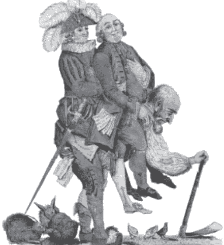
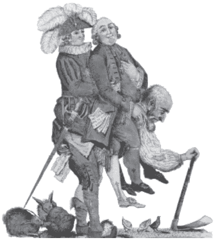
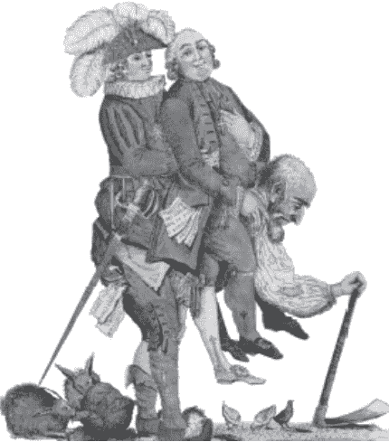

# 新封建主义的到来：对全球中产阶级的警告

> 献给 Mandy，对我的一切

## 序言

## 致谢

## 索引

# 序言

这本书既不属于左派，也不属于右派。它试图诊断导致全球范围内出现新封建主义的趋势。尽管在许多国家中产阶级正在萎缩，但我并不认为这是一个全球性现象。在美国、英国、加拿大、澳大利亚和欧洲大陆，中产阶级正在消失。但在发展中国家，工人阶级正在扩大。

我们看到的是一种新的阶层体系，即精英、资产所有者、高科技开发者、国家管理者和全球工人。区别在于，这种新封建主义由一个认知精英阶层支持，而绝大多数人则处于类似于奴隶的地位。

我们所看到的现象最明显的相似之处是财富集中在少数人手中，这发生在一个社会流动性时代之后。在20世纪后半叶，繁荣在发达国家得到了共享，拥有向上流动的工人阶级。而今天，大多数国家的经济增长收益主要流向了最富有的群体。一项引用估计显示，全球前0.1%人口拥有的全球财富比例从1978年的7%增加到2012年的22%。英国议会近期的一项研究表明，这一全球趋势将持续：到2030年，前1%的人口预计将控制全球三分之二的财富。

在法国，在他们下方是一个规模庞大的群体，对应于封建时代的“平民”或“第三阶级”：那些既未受封也没有贵族身份的人。我将今天的第三阶级称为“自耕农阶层”，它由两个截然不同的部分组成。一个是拥有财产的中产阶级，类似于旧英国的自耕农阶层，但将同样的独立精神带到了城市或郊区背景之下。从历史上看，自耕农阶层在推翻封建秩序中发挥了关键作用——但今天，他们的对应者正被寡头集团挤压。其次，是一个工人阶级，他们正变得越来越像中世纪的农奴，除非通过政府转移，否则拥有重大资产或改善命运的机会变得越来越小。

尽管构成第三阶级的两个群体正在落后，但他们仍然对寡头集团和神职人员构成挑战，因为他们面对全球化和技术过时已不再沉默。我们正目睹一位社会学家所描述的“工人阶级对政治左翼传统忠诚的背离”，以及对全球资本主义及其世界主义价值结构的同时拒斥。尽管对寡头集团的挑战往往来自民粹主义右翼，但其他力量也可以从另一个方向发起进攻，特别是年轻工人和较不富裕的神职人员，他们共同可能形成一位保守派作家所描述的“一群反资本主义者的僵尸军”。即使一种新封建主义似乎正在形成，它也正激起预示着动荡时代的反抗力量。

# 历史也会倒退

历史并不总是向着更先进或更开明的状态前进。古典文明的崩溃便是一个例子。那种文明虽然有其残酷和不公的一面，包括大量使用奴隶，但它也产生了文化、公民和经济的活力，这些活力从近东传播到西班牙、北非和英国。它发展出了一套哲学、法律和制度形式，奠定了现代自由主义的基础。但随着古典文明由于内部功能失调和外部压力的共同作用而解体——其领土陷入了政治动乱、文化衰落以及经济和人口停滞。

虽然我们可以为西罗马帝国的结束定一个日期，但文化衰落的过程持续了几个世纪。到六或七世纪，这种退行的轨迹是清晰的：学术的终结、宗教狂热的兴起、城市的衰落和贸易的崩溃，以及马尔萨斯式的停滞：1000年欧洲的人口与千年前几乎相当。曾经充满活力的城市中产阶层已经消失，作为农用地的土地主农民阶层被合并成巨大的庄园。阶级关系变得更加等级森严，拥有世袭身份的贵族和权势神职人员处于顶端。这些统治阶级经常内部相互竞争和斗争，但与大多数人口相比，他们拥有显著的特权，而大多数人只能忍受作为无地农奴的生活。当时对社会的理想愿景是静态的，目标不是寻找耕种的土地，不是创新或增长，而是在一个很大程度上固定的系统内维持平衡。

在第二个千年，市场和城镇开始重新增长，行会形成，哲学和学术发展最快。第三阶级正在兴起：包括农村的小农主和日益增长城市中富裕且受过教育的资产阶级。随着繁荣而来的是更大的话语权，天主教教会和贵族因此逐渐失去了权力。一种基于自由市场、自由价值和对进步信仰的制度在欧洲演变，并传播到北美和大洋洲。

与所有的社会结构一样，自由秩序也带来了自己的不公。最可耻的是，奴隶制被复活并延伸到新殖民领土。此外，工业革命用工厂取代了家庭手工业，并创造了一个生活在生存边缘的贫困城市无产阶级。但在20世纪，特别是在二战后，大多数工人阶级的生活有了显著的改善，中产阶级在繁荣和数量上继续增长。一些政府行动发挥了作用——例如，补贴所有权、建设新基础设施以及允许工会。将此类政策与经济增长引擎联系起来，促进了一场迈向富裕的大运动，这是自由资本主义的首要成就。

尽管自由资本主义产生了许多社会、政治和环境挑战，但它将数亿人从统治大多数历史的普遍奴性、根深蒂固的残酷和反复无常的政权中解放出来。生活的物质条件得到了极大改善，不仅在欧洲和美国，在世界大部分地区也是如此。在1700年之前的五个世纪，人均经济产出是平稳的，这意味着1700年的收入中位数者在经济上并不比1200年的平均人更好。到19世纪中叶，特别是在西方，经济产出显著增加；1940年后的增长并蔓延到世界其他地区。

# 弯曲“历史弧线”

自由资本主义首先推动了西方的主导地位，随后推动了其他国家的经济崛起。二战结束后的经济繁荣以及随着共产主义崩溃延伸到世界大部分地区的繁荣，培养了对全球未来的信心。增加繁荣的关键似乎掌握在我们手中。关于“历史弧线”不可避免地向更大的繁荣和社会正义弯曲的乐观观念被左右两派所采纳——例如，乔治·W·布什总统和巴拉克·奥巴马总统。

从20世纪70年代开始，这条弧线在产生资本主义和现代民主的地区——欧洲、澳大利亚和北美向后弯曲。中产阶级和工人阶级的向上流动开始停滞，而上层阶级的财富急剧增长。经济继续增长，但大部分利益被极富者收割——前1%尤其是前0.1%的人群——而中产阶级则失去了阵地。在1945年至1973年间，美国前1%的人口仅占总收入的4%，但在随后的二十年里，富人吞噬了美国大部分的增长。在欧洲国家，最富有的四百人的财富现在超过了1.85亿同胞的总财富。通过社会主义福利政策，最富的人找到了维持甚至增加其主导地位的方法。令人惊讶的是，在芬兰等进步国家，股票所有权在富人中的集中程度明显更高。

这种趋势并非西方特有。例如，在社会主义中国，人口的前1%拥有着该国约三分之一的财富，约1300人拥有了约20%。自1978年以来，衡量财富不平等的中国基尼系数增加了三倍。全球范围内，超富阶层是一个新兴的贵族。数百亿万富翁共同拥有了世界一半的资产，而这一比例在五年前仅由四百人拥有。

财富的集中在财产所有权上也显而易见。根据《土地报告》，在美国2007年至2017年间，最大的一百土地主拥有的土地比例增加了近50%。2007年，这群人拥有2700万英亩土地，相当于缅因州和新罕布什州的面积；十年后，最大的一百土地主持有4020万英亩，超过了新英格兰整个地区。在美国西部，亿万富翁创造了巨大的庄园，这使得许多当地人变得贫农。

欧洲的土地所有权也变得越来越集中在少数手中。在英国，过去十年土地价格飙升，不到1%的人口拥有了一半的土地。在大陆上，农田正合并成更大的农场，而城市房地产则落入少数企业所有者和超级富豪手中。

长期被视为巨大机会地的美国，自20世纪80年代初以来中产阶级收入者进入收入阶梯顶端的机会下降了约20%。在经济合作组织36个富裕国家中，最富公民占国家GDP的份额越来越大，而中产阶级变得缩小。全球大部分中产阶级负债累累，主要是由于高昂的住房成本，并且“看起来像一艘在岩石水域航行的船”。

OECD。在高收入国家（包括美国、加拿大和澳大利亚），住房拥有率正停滞不前或急剧下降。全球化服务了上层阶级的利益，而非其他人的利益。例如，仅生产向中国的转移一项，就让曾作为工业强国的英国损失了超过50万个制造业岗位，估计让美国损失了340万个岗位。经济学家可能会指出宏观增长更佳、消费者价格更低，但大多数人并非生活在“总量”之中。他们生活在自己的现实中，在很多情况下，这种现实的改善程度远低于经济的增长水平。

在一个日益两极分化的世界里，精英社区被城市贫民以及那些逐渐没落、变得贫困的小镇所包围。左翼地理学家克里斯托夫·吉拉德写道：“全球化‘复兴了中世纪法国的堡垒’。”就像日本的城堡城镇或中世纪意大利的围城一样，少数地区是特权的领地，而那些缺乏吸引力的地方则居住着新生的奴仆阶层。

## 新权力枢纽

正如封建时代神职精英与贵族共同掌握权力，神职人员与寡头集团之间的枢纽处于新封建主义的核心。这些阶层往往就读同一所学校，居住在纽约、旧金山或伦敦类似的社区。总体而言，他们拥有共同的世界观，在大多数问题上是盟友，尽管偶尔也会发生冲突，这与中世纪贵族与神职人员之间的冲突相似。无疑，他们对全球主义、世界主义、文凭价值以及专家权威持有着相似的观点。

这种权力是由某些技术实现的，这些技术曾被广泛认为对基层草根民主和决策具有巨大前景，但现在已成为监控和权力巩固的工具。尽管博客层出不穷，营造出一种信息民主的假象，但一小部分公司（大部分总部位于美国西岸）对信息流和文化形态行使着日益收紧的控制。我们新的主人不穿链甲或戴大礼帽，而是穿着牛仔裤和连帽衫引导我们的未来。这些技术官僚精英是丹尼尔·贝尔预言性地称为基于科学专业的“新权力祭司阶层”在21世纪的实现。

政治的未来（至少在高收入国家而言）将围绕统治者确保第三等级服从的能力展开。在中世纪，这需要推行一种正统思想，以使僵化的阶级结构常态化并合理化。封建秩序中贵族的权力通过宗教和习俗的机构得到辩护，并受到教会的祝福。现代神职人员通常声称科学是其教义的基础，并推崇学术文凭是地位和权威的关键。他们试图用关于全球主义、环境可持续性、定义的性别角色以及专家权威的“进步性”思想，来取代资产阶级的自决性、家庭、社区和国家价值观。这些价值观通过神职祭司阶层对高等教育机构和媒体的主导地位来灌输的，并辅以寡头集团对信息技术和文化渠道的控制。

## 对自由民主失去信心

当前趋势的后果之一是整个高收入国家悲观情绪日益加剧。根据皮尤研究中心的数据，一半的欧洲人认为后代将遭受比他们更糟糕的经济状况。在法国，悲观观点占据了七比一的多数。悲观趋势也出现在通常较为乐观的澳大利亚（64%）、加拿大（67%）和美国（57%）。总体而言，皮尤发现先进经济体内56%的居民认为他们的孩子会过得比他们更差。

悲观情绪在东亚也在增长，那里是当今时代的经济引擎。在日本，受访者中整整有四分之三的人预计下一代的情况会更糟，这种预期在台湾、新加坡和韩国等成功国家也占据主导地位。中国的许多人有悲观的理由：2017年，800万大学毕业生进入就业市场，发现他们只能拿到可能在他们高中毕业后直接去工厂上班就能拿到的工资。悲观的另一个迹象是出生率下降，特别是在高收入国家。在欧洲和日本，甚至在曾经相对多产的美国，生育率都已接近历史低点，尽管女性表示希望多生一些孩子。这种人口停滞是向中世纪的另一种倒退，有多种解释，包括女性高水平的劳动力参与以及对更多空闲时间的渴望。其他原因是经济性的，包括负担得起的住房短缺。自由资本主义鼎盛时期为向上流动的中产阶级和工人阶级建造了大量的廉价住房，但新封建主义正在创造一个越来越少的人买得起的世界。这种预期降低的趋势削弱了即使在稳固的民主国家对自由资本主义的支持，尤其是在年轻人中。比老一代多得多，他们对民主失去了信心，不是对美国，而是对瑞典、澳大利亚、英国、荷兰和新西兰。20世纪70年代和80年代出生的人，对这种民主形式的权力主张（如军事政变）的反对程度，少于出生于20世纪30年代、40年代和50年代的人。

今天，全球范围内出现了对民主自由主义的背离。威权主义领导人正在那些此前似乎处于自由化道路的国家中巩固权力——中国的习近平、俄罗斯的弗拉基米尔·普京、土耳其的雷杰普·塔伊普·埃尔多安。在民主国家，我们可以看到对“强人”的新渴望——例如夸张且粗鲁的唐纳德·特朗普，以及欧洲的同类人物，其中一些在功能上更具威权色彩。许多对自由前景失去信心的人转而寻求家长式的保护者。威权领导人往往通过唤起过去的辉煌和挑动新旧怨恨来崛起。在冷战结束时，世界似乎正沿着通往民主未来的“弧线”前进，但今天的新世界秩序反而变成了独裁者的春天。

# 农民起义

在中世纪，封建秩序并非没有受到挑战：经常会发生农民起义，有时由宗教异见人士领导。今天我们是否会看到第三等级内部的某种起义？现代自耕农仍能反抗，但日益扩大的、没有财产或体制利益的“奴隶”阶级可能证明是极其危险的。

正如1789年的革命者一样，今天第三等级许多人对上层阶级的傲慢和虚伪感到厌恶。在革命前，法国贵族和高层神职人员宣扬基督教慈善，却沉溺于贪食、性冒险和奢侈挥霍。今天，挣扎的中产阶级和工人阶级许多人看到富人通过购买碳信用或其他虚荣行为来展示他们的环保虔诚，而这些“开明”的政策却给底层施加了极高的能源和住房成本。疏离的中产阶级和工人阶级元素正以类似于现代农民起义的方式回应。这体现在对神职人员和寡头集团支持的政策（关于气候变化、全球贸易和移民）的一系列愤怒投票和抗议中。这种愤怒在特朗普当选、脱欧的支持以及欧洲民粹主义政党的兴起中得到了表达。也许没有哪里比法国的起义更明显了：大多数法国人将全球化视为威胁，而大多数在精英学校受过教育的高管将其视为一种“机会”。作为对1789年的呼应，所谓的“黄背心”在2018-2019年冬季针对更高的油税进行了抗议。这些抗议始于小镇，随后进入了巴黎郊区。

在美国，第三等级的动荡促使寡头集团和神职人员开始关于扩大福利国家范围的讨论，即为大众提供补贴和直接现金支付，以防止那些不再看到改善自身希望的人发生反叛。但什么才够呢？

# 封建未来是必然的吗？

回归封建制度并非不可避免。要改变我们目前所处的轨迹，我们首先需要理解并承认正在发生的事情。我们拥有几个世纪自由资本主义和自由思想探究带来的优势；我们了解过去的封建时代，也了解民主资本主义所取得的成就。我们不必像那句谚语中的温水青蛙一样，对自己的命运一无所知。

扭转滑向新封建秩序的趋势，需要发展一种新的政治范式。目前对“社会正义”的“进步主义”方法依赖于强大的中央政府，只会通过将更多权力赋予“专家”阶层来强化神职阶层。另一方面，市场基础主义的信奉者拒绝承认寡头权力的危险以及对中产阶级和工人阶级造成的伤害，可能会进一步推动威胁资本主义本身生存的政治轨迹。一些著名的企业高管现在已经意识到了这个问题并寻求补救办法，但在右翼的市场意识形态分子中，这种意识或担忧要少得多。

我们需要一种新的视角，但只有当新封建主义兴起的现实被广泛承认且其危险被理解时，这种视角才能出现。我们还有时间挑战这一对自由价值观的威胁。伟大的苏联小说家瓦西里·格罗斯曼曾写道：“人可能会被命运驱引，但他可以拒绝服从。”只要我们保留塑造历史的意志，历史未来的走向绝不是必然的。

# 第二章 封建制度持久的魅力

现代思想倾向于将中世纪描绘为一个黑暗和落后的时代，尽管一些历史学家认为这种普遍认知是夸大且不公平的。同样，封建制度被广泛视为一种社会和政治组织的退化形式，但它的发展是有原因的，是为了满足当时的迫切需求。随着罗马统治的瓦解，它留下了权力真空。一个新的精英阶层逐渐成长，一种新的权力关系系统在某些地方以某种形式持续了一千年或更久。它的持续性表明，某种版本的封建制度在现代可能仍然具有吸引力。

中世纪的封建制度在不同地方有所不同，但其核心都聚焦于一种独特的社会等级制度、下级对上级的服从，以及底层阶级（人口绝大多数）受限的流动。财产大多集中在大型庄园中。随着城镇衰落，城市中产阶级萎缩，独立的农民大多沦为农奴。大地主承担了公共职能——司法、税收、军事——并保护其依附的工人免受掠夺者的威胁。作为交换，农民放弃了拥有土地的权利和离开祖辈劳作过的庄园的自由。作为经济生产关键的劳动者生活在对地主的半农奴制中，生活受到限制。大多数人留在家附近；欧洲80%的人口从未离开出生地超过二十英里。

在他们之上，贵族也有他们自己的从属关系形式。最有权力的贵族接受较小贵族的效忠，后者成为他们的附庸，并被授予封地，即一块土地，随着时间的推移演变为世袭。附庸可以将封地的部分地区租给他们的依附者（包括贵族和平民）。附庸向其领主宣誓效忠，并有义务提供军事服务。对直接领主的忠诚是社会的中心组织原则。“我将爱你所爱的；我将恨你所恨的，”一句盎格鲁-撒克逊效忠誓言是这样说的。

封建制度有利于最大庄园的继承者和最伟大的贵族，他们建造城堡来增强和展示他们的权力。该制度在帝国或王室行政机构崩溃留下的混乱中提供了一程度的秩序和安全。在大多数情况下，人们被期望留在他们世袭的地位上。无论个人有多有才能，出身低微的污名是难以甚至无法摆脱的。

当时盛行的社会模型由三类人组成：“祈祷的人、战斗的人和劳作的人。”随着君主制的日益加强，约翰·索尔兹伯里在1180年的著作中描绘了这台有机体机器中的一种理想政治秩序：“国王相当于头，僧侣相当于心和灵魂，贵族相当于手臂，农民相当于脚。”

对于在田间劳作的农民，甚至对于战士贵族阶层来说，自由被认为是不必要的，而且它在很大程度上变成了神职阶层的垄断。天主教会对宗教和道德问题上所谓的正确思想具有相当的控制权，并声称拥有普遍权威——尽管它对大众家庭的影响有限，而且许多异教和民间信仰持续了几个世纪。但尽管如此，教会的教义有助于维持封建社会的等级秩序。

在中世纪基督教教义中，我们通过感官理解的世界是转瞬即逝的，而精神世界更为真实，与上帝结合是终极目标。圣奥古斯丁认为世俗世界本质上是对上帝之城的敌对；人与上帝的关系至关重要。在六世纪到十世纪之间，写了26,000本圣传，但在历史或科学著作方面几乎没有新意。一切——哲学、绘画、文学、政治——都是围绕一个精神理想建立的，那个时代的宏伟建筑代表了“石头的圣经”。对未来生活而非现世的强调削弱了塑造古典文明的对公共事务和家庭的热情。商业被视为本质上是不道德的，财富主要源自由农奴经营的遗传农业庄园。

基督教采纳了人人精神平等的教义，但这个世界的生存条件被认为远没有来世的生活重要。通过敦促底层阶级接受他们在这个世界的地位，今天具有进步倾向的亿万富翁拥抱了保障最低收入的思想，认为这是穷人在物质和精神上最可能的援助来源。

## 为封建主义辩护

# 中世纪世界观与现代反动思潮

在中世纪的世界观中，社会通过相互义务的纽带联系在一起。在顶端，有僧职阶层和贵族内部的纽带，以及两者之间的纽带；最后，是普通人对上级的义务。¹¹10 这在19世纪获得了新的话语，部分是对早期工业革命的社会动荡和物理污染的反应。浪漫主义运动中的许多人在中世纪文明看到了许多钦佩之处，正如约翰·济济、托马斯·卡莱尔、马修·阿诺尔德、安东尼·特罗洛普的作品所示，以及后来的奥斯卡·王德、D. H. 劳伦斯、斯特凡·乔治和托马斯·曼。这些作家攻击了他们认为资本主义社会固有的“资产阶级狭隘主义和社会平等主义”。他们中的许多人从中产阶级中看到了“愚蠢”，并认为艺术家和作家最能解决无产阶级的需求。12

卡尔·马克思和弗里德里克·恩格斯承认，中世纪行会和局部市场以及习俗为匠人提供了某种安全，而这种安全在资本主义市场体系的压力下已很大程度上丧失。13 恩格斯建议，12世纪的撒克森农奴处境并不比他那个时代的工人糟糕，工人已经无法依靠习俗和传统来保护自己了。14

19世纪一些开明的资本家和贵族支持采取某些措施，提供马克思所谓的“无产阶级救济袋”，以防止大众陷入贫困和反叛。15

一种相互依赖、有秩序的社会理想……另一种，“封建社会主义”的概念在极具挑衅性的术语中被称为保守党民主（Tory Democracy）。16

19世纪后期，英国保守派主张某种类似于“资本主义封建主义”，雇主和工人之间的关系将重新获得认为在工业时代存在的互惠性。17

在没有出现自由主义系统的俄罗斯，像托尔斯泰这样的浪漫主义者，以及右翼斯拉夫主义和社会革命者，拒绝了西方的自由主义，并唤起了回归“米尔”（mir，即农隶时代留下的一种集体所有制形式）。“光和救赎将来自下方，”陀思妥耶夫斯基写道。社会改革的关键将是穆吉克（muzhik），即没受过教育、贫困的农民——而不是大城市里受过良好教育的知识分子和兴起的资本家。18

20世纪初许多强大的右翼运动——民族社会主义、法西斯主义以及其他地方的模仿者——也表达了对中世纪的怀旧。意大利诗人和未来主义者加布里埃尔·丹阿努齐推崇一种“社会主义浪漫主义”，这有助于法西斯企业国家的基石。19 在法国，“法兰行动”（Action Française）的领导者试图引发一场“反文艺复兴”，并重新施加旧政（*ancien régime*）的等级公司结构。20 在英国，像奥斯瓦德·莫斯莱（Oswald Mosley）这样的法西斯同情者对“美好的老英格兰”的消逝感到遗憾，却被民族混合的现代城市的竞争现实所冲刷。直到今天，在欧洲极右翼，去世俗化的新中世纪主义者将中世纪视为传统基督教价值观的肯定，并从十字军对伊斯兰侵略的回应中寻找灵感。22

## 当代新中世纪主义

以三十年前很少有人预料的方式，对自由主义理想的反抗在许多国家正日益增强。苏联解体后，俄罗斯从其沙皇过去中找到了灵感，那是一个帝国扩张时期。或许更为显著的是，曾被苏联当局边缘化并经常遭受迫害的俄罗斯正教教会，在弗拉基米尔·普京的领导下获得了道德权威。俄罗斯政权一直回溯到蒙古统治时期，以此作为将国家与中亚和东亚联系起来的方式。23

中国的共产领导人虽然在官方上向毛泽东主义低头，但他们从民间宗教甚至儒家主义中发现了价值——这些都是被中华人民共和国的创始人所复兴的。事实证明，诚实、孝道和尊重等级等古老美德在现代社会仍有其用处。24 新加坡长期总理李光耀曾敦促中国政府采取儒家主义作为亚洲资本主义的定义特征。25

即使在西方，驱动现代世界发展的价值观——如对进步的信心以及经济增长对普遍福利的益处——也面临着挑战。20世纪60年代，环保运动对现代工业经济对自然世界的破坏表达了日益增长且可以理解的担忧。E. F. 舒马赫（E. F. Schumacher）通过其“小即美”的哲学普及了低增长甚至负增长经济和人口增长的理想，这种哲学在20世纪70年代的加州被证明具有特别的影响。26

正如19世纪对工业化的反应一样，环境担忧引发了对消逝时代的怀旧。英国的查尔斯王子像一位中世纪的千年王国主义者，声称我们拯救世界的时间已经不多了。查尔斯已成为一家社会主义出版物所说的可能是首要的“资本主义封建批评者”。他认为自由市场资本主义是地球的灾难，并提倡一种以关注自然界和社会和谐为中心的新型贵族义务。27

环保主义甚至导致了“贫困是美德”这一观念的复兴。在中世纪，贫困被视为大多数人无法避免的生活状态，而僧侣们采取自愿贫困认为有利于精神成长；今天，贫困有时被认为对环境有利。即使是发展中国家不断扩张的贫民窟，也被视为值得庆祝的对象而非担忧的原因，这很大程度上是因为贫民窟居民能量和其他资源的消耗很低。《纽约时报》城市作家迈克尔·基尔曼（Michael Kimmelman）称贫民窟“不仅是一个污点，更是有机主义的潜在模板”。28

许多知识分子、建筑师和规划师推广了让人想起中世纪过去的价值观，认为它们与人性更加和谐。29 一些保守思想家，如故的罗杰·斯克鲁森（Roger Scruton），对无序的现代城市世界，特别是自由资本主义创造的郊区文化持批评态度。斯克鲁森倾向于回到一种人口稠密的城市地理，由受保护的乡村包围，而没有郊区的中间景观——那是当今大多数拥有房产的中产阶级居住的地方。同样，包括英国理查德·罗杰斯（Richard Rogers）在内的领先建筑师，寻求回到类似中世纪的城市，拥有公共市场广场，他们认为这比现代郊区蔓延更具居住性替代方案。30

这些向后看的思想被视为治疗现代社会弱点和失败的良方。但它们也可能提供一种理由，阻碍许多人的向上流动，并将财产集中在少数人手中。

# 第三章 自由资本主义的兴起与衰落

环保主义甚至导致了“贫困是美德”这一观念的复兴。在中世纪，贫困被视为大多数人无法避免的生活状态，而僧侣们采取自愿贫困认为有利于精神成长；今天，贫困有时被认为对环境有利。即使是发展中国家不断扩张的贫民窟，也被视为值得庆祝的对象而非担忧的原因，这很大程度上是因为贫民窟居民能量和其他资源的消耗很低。《纽约时报》城市作家迈克尔·基尔曼（Michael Kimmelman）称贫民窟“不仅是一个污点，更是有机主义的潜在模板”。28

许多知识分子、建筑师和规划师推广了让人想起中世纪过去的价值观，认为它们与人性更加和谐。29 一些保守思想家，如故的罗杰·斯克鲁森（Roger Scruton），对无序的现代城市世界，特别是自由资本主义创造的郊区文化持批评态度。斯克鲁森倾向于回到一种人口稠密的城市地理，由受保护的乡村包围，而没有郊区的中间景观——那是当今大多数拥有房产的中产阶级居住的地方。同样，包括英国理查德·罗杰斯（Richard Rogers）在内的领先建筑师，寻求回到类似中世纪的城市，拥有公共市场广场，他们认为这比现代郊区蔓延更具居住性替代方案。30

这些向后看的思想被视为治疗现代社会弱点和失败的良方。但它们也可能提供一种理由，阻碍许多人的向上流动，并将财产集中在少数人手中。

## 第三章 自由资本主义的兴起与衰落

技术在剧烈改变我们沟通和获取信息方式的同时，对改善生活物质条件的贡献极小，特别是在住房和交通方面.^15

人口增长放缓，尤其是在高收入国家，是社会停滞的另一个方面。在欧洲，低出生率已成为近半个世纪的常态。欧洲的人口预计将在2100年从7.38亿下降到约4.82亿。在人口萎缩的德国，退休人员与15岁以下儿童的比例将达到四比一.^16

东亚的人口下降如果说有何不同，那将更为剧烈。在过去的几十年里，中国、韩国、香港和新加坡的生育率大幅下降，所有地区的出生率远低于更替水平.^17 可能最极端的情况是日本，那里的人口下降从20世纪60年代就开始了。根据日本国立人口问题社会保障研究所的数据，如果目前的趋势持续，这个岛屿国家的人口将在2065年从1.27亿减少到8000万.^18

中国人口预计开始下降。到2050年，中国15岁以下的人口预计将减少6000万，这一损失大约相当于意大利的总人口。同时，中国65岁及以上的人口将增加近1.9亿，约等于世界第四大国巴基斯坦的人口。届时，中国退休人员与工作人员的比例预计将增加三倍，这将是历史上最快的人口结构转型之一.^19

全球人口趋势将重塑未来的经济和社会。如今，世界上大多数人生活在生育率远低于更替水平的国家.^20 根据联合国，到2050年，这一数字将增长到75%。许多社会（包括一些发展中国家）可以预见到人口迅速老龄化和劳动力数量急剧下降.^21 沃尔夫冈·卢茨表示，全球人口增长可能在2040年完全结束，并在2060年开始下降.^22

发达国家人口萎缩将通过限制劳动力规模威胁经济增长，并削弱福利国家的财政可行性.^23 这就是西方政府对贫穷国家高水平移民持开放态度的原因之一，这些国家的生育频率比富裕国家频繁得多。从现在到2050年，预计全球人口增长的一半将发生在非洲.^24 贫穷国家与富裕国家之间日益扩大的人口偏差可能导致这两个领域出现更多动荡，并引发曾极大破坏欧亚古老帝国的大规模迁徙回潮.^25 来自贫穷国家的高水平移民导致的社会冲突已成为西方政治的一个显著特征，并且似乎在未来几十年内继续发展.^26。

## 技术鸿沟

技术进步现在推动了许多日益增长的繁荣。今天，自动化和人工智能的使用有望加速国家内部及国家之间的分裂。虽然目前还不清楚这些技术是否会导致总工作减少，但某些行业面临着特别威胁，特别是制造业、运输业和零售业——这些行业在历史上提供了稳定的蓝领就业。但这些行业的工作可能受到监管变化的更大威胁，这些变化在很大程度上是以环保为理由的，限制了实体产业的增长.^27。

在西方世界，比大规模失业更有可能发生的是中产阶级的持续衰退，许多人被迫在所谓的“零工经济”中生存。在2005年至2014年间，二十五个最先进的经济体中，收入持平或下降的家庭比例上升到60%以上.^28。

技术驱动型社会往往表现出在科学技术领域极具天赋的“优选者”与许多没有天赋的人之间存在日益扩大的差距。只需要少数程序员、金融专家和营销达人就能建立一家价值十亿美元的企业，不需要大量的蓝领工人甚至是中层经理。从长远来看，我们可能会看到H.G·威尔斯在《时间机器》中描绘的那种严酷未来。理查德·费尔南德写道：“我们正在变成两个种族：玩视频游戏的伊洛人（Eloi）和编写视频游戏的莫洛人（Morlocks）。”29。

面对这些社会挑战，高收入国家的知识阶层——大学、媒体和艺术界——几乎一致地寻求解构引导其国家崛起并为广泛繁荣提供基础的价值观。许多文人阶层甚至精英阶层不再关注解决经济停滞带来的后果（如贫困加剧、社会流动性下降、阶级冲突），而是推崇“可持续性”的理想，而非广泛的经济增长.^30。 正如中世纪的神职人员反对物质主义一样，当今学术界和媒体的领军人物，甚至某些企业精英，对动态经济、创新精神以及改善日常生活的承诺等理念嗤之以鼻。有些人甚至认为进步是一个神话.^31。 通过这种方式，文人阶层强化了这种悲观观念，即向上流动是过去的遗迹，我们现在的首要任务是纠正社会不公和保护环境，而不是寻找传播财富和机会的方法.^32。

新封建主义不会有穿甲的勇猛骑士或坚固的城堡，也不会兴起充满礼拜咏唱的宏伟大教堂。相反，它将拥有耀眼的新技术，并包裹在全球主义和环保虔诚的信条中。然而，尽管具有现代性，即将到来的时代似乎将用一种看重静态并接受社会等级为自然秩序的教条主义，取代自由的活力和知识多元主义。

# 第二部分

# 寡头精英

> 在中世纪，贵族的权力建立在对土地的控制和持有的权利之上；当情况发生变化时，仿佛整个世界都改变了。
>
> —— 伊本·卡赫尔敦（14世纪）

# 第四章

# 高科技封建主义

技术创新长期以来与资本主义的发展联系在一起。正如费尔南·布罗代尔解释的那样，现代早期的资本革命产生了深远的影响.^11 资本主义与新技术的结合曾被认为是有变革性的且普遍有益的。然而，今天我们看到社会流动性减少，经济权力日益由少数公司主导。我们的未来看起来像日本未来主义者太在几十年前预言的“高科技时代”。

技术行业的先驱曾被誉为资本主义竞争的典范，体现了熊彼特所说的“创造性破坏”打破垄断并让他人崛起。但今天的技术领袖日益像是一排精英阶层，控制着少数强大的公司，随着他们扩张日益珍贵的数字领地，他们正在建立更加阶级化的社会秩序.^4

# 新寡头的诞生

加利福尼亚州的圣克拉拉谷似乎不太可能是新封建主义的孵化器。半世纪前，这里才开始从一个农业地区变为巨大的中产阶级郊区。来自旧金山的富人在南湾购买了优雅的庄园，创造了一个精英马场，但大部分的增长形式是中产阶级和工人阶级居住的简朴地块。“越多的人亲眼看到世界上最美的地方，并发现那里并不比家乡贵，他们就越觉得我也想住在在这里，”一位湾区当地人观察.^5。

20世纪50年代和60年代，这些宜人的环境吸引了技术但明显属于中产阶级的技术人员和工程师，包括真空管发明者李·德福斯特。新兴的技术经济在巨额国防和太空合同的推动下高速发展。加州大学伯克利分校这所顶尖公立大学位于北部不远。近的是斯坦福大学，它在物理科学领域表现出色，并在1951年建立了斯坦福研究园。斯坦福的毕业生已经在1939年创立了惠普，而一位曾担任大学教务的工程教授弗雷德里克·特曼则培养了当地的科技公司.^6

基于业务的。数字领土争夺的胜利者是少数家主要位于硅谷和普吉特湾地区的公司。在夺取了战略性的数字领土后，它们正在掩盖并取代旧的工业经济.8

到2018年，四家科技巨头——苹果、亚马逊、谷歌和脸书——的净值接近标普500指数前50强总和的四分之一，相当于法国的GDP。9 世界上最有价值的公司中有七家属于这一领域。10 这些科技巨头还创造了巨额个人财富：全球最富有的20个人中，有8位是在科技行业积累财富的。11 在40岁以下最富的人中，有9位在科技行业，且都住在加利福尼亚州。12 只有中国（拥有全球九家最大的科技公司）对加州的科技贵族构成了某种挑战。13

## 从车库到庞然大物

硅谷曾是一个草根创新的中心，科技公司在郊区的车库中诞生，苹果非凡的故事便是典型的代表。14 现在，这种历史性的初创文化已被拥有巨大资源的大公司所扼杀。许多初创公司很快被成熟公司收购，而不是有机会自己做大。15

自20世纪80年代初以来，美国的反垄断行动减少了61%，让寡头集团在无论哪个党派的执政下都拥有了无限权力来收购或消灭竞争对手。16 近年来，脸书吞并了Instagram、WhatsApp和Oculus等潜在竞争对手，监管机构几乎没有阻力。17 谷歌是收购领域最贪婪的公司之一，一年内每周购买一家初创企业，截至2020年1月总共收购了240家公司。18

凭借巨额资金储备和购买顶级人才的手段，少数公司已对世界上一些最丰利的市场实现了垄断或双头垄断。谷歌控制着近90%的搜索广告，脸书控制了近80%的移动社交流量，亚马逊则控制了全球近40%的云业务，以及美国75%的电子书销售。谷歌和苹果共同提供了移动设备超过95%的操作系统。微软仍然占据着全球运行个人电脑软件的80%以上份额。19

结果，充满活力的草根科技经济现在正遭受着严重的退化。创业者在很大程度上受限于科技领主的脸色。20 一家在线出版商用《星际迷航》中的类比来描述他与谷歌的关系：“这有点像被博格人同化。你获得了酷炫的新力量。但在被同化后，如果你的植入物被移除，你肯定会死。这基本上描述了我们与谷歌的关系。”21 对人工智能的狂热可能会加强那些已经拥有巨大资金和人才储备的公司的主导地位。随着时间的推移，可能会有少数公司加入寡头集团，一些熟悉的名字可能会消失或被他人收购。但顶尖公司倾向于作为少数金融家和技术专家的财产，他们在一个规范的、自我指涉的范围内运行。22

这种技术权力的集中预示着一个远不民主的未来。23 科技寡头利用他们巨大的资金，计划统治娱乐、金融、教育和零售等其他行业，以及未来的行业：自动驾驶汽车、无人机、太空探索，以及最关键的人工智能。谷歌、亚马逊和苹果等公司已投资了数十亿美元，以在传统和新兴行业中占据地位。24

技术分析师Izabella Kaminska将这些科技巨头与运营国家计划委员会（Gosplan）的苏联规划者相比，后者是在整个苏联范围内分配国家资源的经济规划机构。25 有人可能认为，将这种权力让给私人资本而非党派官僚更为理想，但这仍然意味着少数人手中掌握着巨大的权力，且缺乏问责制。26

## 中国综合征

中国由于缺乏法律限制，可能会证明是最前沿的。

“财权政治”与那些通过资源开采、制造业和物质消费积累财富的人形成了对比。42

然而，美国的科技巨头们对市场获得的垄断性影响力，足以与约翰·洛克希菲勒、安德鲁·卡内基或康尼利斯·范德堡特等大亨相媲美。43 他们可能戴着棒球帽而非大礼帽，但他们的经济和文化权力是巨大的，而且很可能会变得更加强大。

## 新寡头的信仰体系

在许多方面，这些科技巨头与19世纪末的工业大亨和20世纪的管理精英都大相径庭。他们既不是野心勃勃的暴发户，也不是企业组织精心培养的产物。定义他们并让他们异常富有且具影响力的，并非原始的野心或管理才干，而是技术天赋。

作为一个群体，他们比推动工业革命的修补者和工匠要多样得多。大多数人源于中产阶级的高层。许多人至少有一位（有时是两位）父母具有科学背景。他们通常就读于名牌大学（尽管并非都毕业了）。有些人甚至在高中时期就是技术天才。对于他们来说，送报的枯燥或在披萨店或邮寄室兼职的工作与他们无缘。一位观察者写道，科技精英通常是“才华横溢，但缺乏苦难”。

尽管出身优越，这些寡头仍倾向于认为自己比工业时代的先驱们更开明、更进步。在20世纪70年代和80年代，他们投射出的形象是美国嬉皮士的最新化身，一种“高科技土匪”，与艺术家相比，“他们与企业权力走廊里的居民更有共同语言”。早期的科技高管——例如经营休尔斯·帕克和英特尔的人员——在管理实践上也倾向于家长式管理，并认为自己比早期的企业经理更有前瞻性。³

## 优绩主义意识

如今运营IT公司的人并不将中层经理——更不用说流水线工人或熟练工人——视为同类。他们的世界观与受过教育的劳动力真正的顶层保持一致。他们的队伍中存在大量的科学博士，其中包括首席执行官；对45位科技高管的调查发现，绝大多数人拥有工程、计算机科学或商业领域的名牌大学学位。在那些没有学位的人中，有些人是名牌机构的辍学者。⁴ “软件是一门智力事业，”哈佛大学辍学生比尔·盖茨说，“微软必须赢得智力战，否则我们没有未来。”⁵

科技寡头们正在创造某种类似于奥尔德斯·赫胥黎所说的“科学种姓制度”。⁶ 这与工业时代不同，在工业时代，企业依赖拥有广泛技能的人才：经理和营销人员、工程师和技术人员、仓库工人和销售人员。这些工作通常有工会保护，至少在制造业和能源领域如此，因此高层至少被迫考虑有关业务运营的多元化观点。相比之下，科技公司很少有工会，科技巨头雇佣的人相对于其收入来说非常少。像谷歌和脸书这样的IT公司，每位员工创造的市场价值是通用汽车、家得宝和克罗格等公司的数百倍。⁸（只有财富基于自然资源的能源部门这一比例更高。）此外，IT公司以及为他们服务的专业承包商严重依赖成千上万低薪外国劳工，其中一些人几乎成了契奴。⁹

## 今天的寡头想要什么？

科技寡头们尚未产生一份连贯的政治宣言来阐述他们对未来的愿景。但显然，IT精英——在亚马逊、谷歌、脸书、苹果和微软等公司——共享一些观点，构成了一个共同的议程。

在正在发展的技术治国世界观中，除了顶部的精英圈子，几乎没有向上流动的空间。中产阶级和工人阶级预计将边缘化。虽然寡头们可能会提到致力于构建马克·扎克伯格所说的“有意义的社区”，但他们很少提到向上流动.¹10 在采访了147位数字公司创始人后，格雷高里·费因斯坦指出，他们通常不指望员工或消费者能通过创业或拥有住房来获得更多独立。费因斯坦认为，大多数人认为，“日益增加的经济财富将由少数极具才华或原创精神的人创造。其他人都将陷入某种兼职创业的‘零工经济’与政府援助的结合体。”——11

费因斯坦说，许多科技巨头与过去的商业领袖不同，他们倾向于大幅扩张福利国家。¹12 马克·扎克伯格、埃隆·马斯克、特拉维·卡兰尼（Uber创始人）和萨姆·奥特曼（Y Combinator创始人）都支持保障年度收入，以消除所有对叛变的恐惧。与20世纪30年代的“公寓布尔什维克”不同，他们无意让自己的财富缩水。相反，中产阶级可能要为保障工资、医疗、免费大学和住房援助支付大部分费用，并为零工工人提供补贴，因为这些人没有雇主那样的福利¹³

这种模式可以被描述为寡头社会主义。资源的重新分配将满足工人阶级和衰落的中产阶级的物质需求，但它不会促进向上流动，也不会威胁寡头的统治地位。这代表了从旧工业经济的剧变。工人现在不再能获得财产并获得自给自足，而是可以期待一个租住公寓和前景封死的未来.¹14 他们无法成长，将依靠补贴来满足需求。

托马斯·皮凯蒂观察到，科技寡头像19世纪的一些工业大亨一样，预计技术天才者影响力的日益增长会“摧毁人为的不平等”，同时强调了自然的……

虽然早期的技术破坏了既定的方式，但其目的通常是让人们廉价且高效地做事，提高生产力并让生活更便利。正如社会学家马塞尔·莫斯所描述的，技术是“有效的传统的行动”。总的来说，它是进化的而非革命性的⁷ 但对于新精英的许多人来说，技术代表的远不止效率或便利。谷歌对未来的愿景以“沉浸式计算”为特征，现实世界与虚拟世界融合在一起¹8 谷歌长期工程主管雷·库兹维尔等科技领袖谈论创造“后人类”未来，由人工智能主导并由计算机及其编程人员控制。他们期待能够逆转衰老并将意识下载到计算机。这种愿景建立在对技术决定论的信仰或痴迷之上，即新技术是我们的进化继承者19 但这就是大多数人希望的未来吗？

## 文化革命

科技寡头们已经在文化上采取的行为应该引起警惕。IT革命曾似乎开启了一个更民主的通信时代，正如阿尔文·托夫勒乐观地预言的“去大众化媒体”23。但一个看起来更加多元和开放的媒体世界——任何人都可以成为记者或触达观众——正变成一个由少数公司控制信息管道的世界²⁰ 美国三分之二的成年人现在通过脸书或谷歌获取新闻²¹ 在美国和英国，千禧一代从这些平台获取信息的概率几乎是从纸质媒体、电视或广播获取信息的概率的三倍²²

科技寡头的权力日益增长，而印刷出版业以及主导该行业的公司正经历着一种长期的、可能是不可逆转的衰落。从2001年至2017年，出版业（书籍、报纸、杂志）流失了29万份工作——下降了40%。如今，任何报纸或杂志都会拥有在线业务，但由于Facebook和Google主导了在线广告的增长，新媒体或较小的出版物极难生存。尽管单是Google在2018年就从新出版商那里赚了47亿美元，但该行业仍在萎缩。23 《西雅图时报》社长阿兰·菲斯克表示：“看看现在的演变，以及流向世界各地谷歌和脸书巨头的收入，我们只是在捡他们掉在桌上的碎片。”24

尽管这些寡头在摧毁媒体的同时，他们也有能力购买一些最悠久且受推崇的幸存者。自2010年以来，科技巨头及其亲属购买了《共和国报》、《华盛顿邮报》、《大西洋月刊》以及长期陷入困境的《时代》杂志（后者以1.9亿美元收购）。25 在中国，受尊敬的《南方早报》被中国最大的在线零售商之一阿里巴巴收购。26 出版业满足了科技寡头的虚荣心，让他们进入文学和新闻界获得了更高的入场券。27 通过这种方式收购的出版物获得了额外的优势：它们可以享受生产内容的奢侈，而不过度担心资金问题。28

这些出版物的新主人通常会否认自己会影响内容，但这与经验完全相悖。当芝加哥那些贪婪巨头或威廉·兰道夫·赫尔斯特收购报纸时，他们推行了帝国扩张、反工会主义以及抵抗那些威胁其财富的人的议程。29 如今的大众媒体已经倾向于支持寡头的进步观点——例如在性别、种族和环境问题上——但对权力集中持有保留意见。30 财务上的依赖可能会鼓励更多对科技行业利益的支持。

新闻只是科技寡头掠夺的文化中的一个领域。亚马逊在图书行业取得了巨大的影响力；它是最大的图书销售商，占了所有纸质书销量的50%以上和电子书销量的90%，并且有能力允许已出版书籍的仿制品出现。31 即使是像哈切（Hachette）和麦米伦（Macmillan）这样老牌出版社，如果不遵守亚马逊的要求也会发现自己成了人质。32

娱乐业也被科技巨头吞噬。YouTube在2006年被Google收购，已在音乐行业中起到决定性作用，尽管艺术家们往往无法获得传统的报酬。音乐流媒体和音乐视频已成为Google等公司获取更多个人数据的另一种途径，他们可以将这些数据卖给广告商。33 同样的情况也发生在整个视频领域。Netflix是一家由硅谷风险投资公司资助的公司，目前估计价值超过了任何电影制片厂，并与亚马逊一起制作了更多屡获殊荣的电视节目。2018年，Netflix在节目上的花费超过了任何主要制片厂。Netflix和亚马逊的订阅用户均超过1亿，远超传统有线电视公司拥有的客户群。34

科技寡头对控制信息管道仍不满足，他们已开始塑造内容。Facebook和Twitter的控制者试图“策划”他们网站上的内容，甚至消除他们认为反感的观点，据前员工说，这些观点往往是保守观点。35 旨在筛选“仇恨团体”的算法往往撒网更广，一位观察者认为，因为程序员很难区分“仇恨团体”和那些仅仅是表达与硅谷主流文化相冲突观点的人。36 社交媒体平台管理层旨在控制内容并非仅仅是保守者的错觉。根据皮尤研究中心的一项最新研究，超过70%的美国人相信社交媒体平台“审查政治观点”。37 凭借其准垄断地位，Facebook和Google不需要担心与任何人竞争，正如科技企业家彼得·蒂尔所观察到的，他们可以比那些担心流失客户的企业更大程度地沉溺于自己的偏见。38

随着对媒体内容的控制日益收紧，科技精英现在处于可以施加现代前所未有的文化主导地位。39 这让人想起中世纪天主教会的文化影响，但使用的是更先进的技术。

# 监控之权利

中世纪教会可能对人们认为真理和恰当的事情行使巨大影响，但它完全没有今天这种监控私人行为和思想的工具。允许这种隐私被抹除的新技术已成为科技财富的核心：个人数据是数字时代的原材料。阿里巴巴的创始人马云将个人数据的开发描述为“21世纪的电力”。40

阿里巴巴以及像Facebook、Google和微信这样的“超级平台”在很大程度上作为那些希望进入数字经济的人的门人，这意味着他们控制了整个经济很大部分的访问权。41 这让他们拥有收集用户个人信息的巨大力量。当Google、Facebook和其他守门人进行这种收集时，一位观察者写道：“我们的行为被转化成了产品。”42 这些数据现在占到欧洲GDP的20%，随着它变得越来越重要，我们变得像住在法国分析师加斯帕德·科尼曼所描述的“数字封建主义”下的农奴。43 我们的日常生活不再仅仅属于我们自己，而是被无情地商品化了。这，当然是所有大型科技公司的终极目标，正如杰伦·兰尼尔所言，这有助于“渗透令人骨悚然的感觉并引发合理的偏执”。44

监控的到来对客户来说几乎没有预警。Facebook已经承认拥有一项专利技术，可以通过远程开启手机麦克风开始录音来监视其用户，尽管他们否认使用过它。45 2018年，亚马逊的家用设备Alexa被发现正在偷听人们的对话。46 一旦暴露，这些侵入通常会停止（至少是暂时停止），但有理由相信隐私在科技公司的优先级中排名靠后。47 Google前执行主席埃里克·施密特告诉CNBC：“如果你有某些不想让人知道的事情，也许你从根本就不该那样做。”48

在技术官僚寡头监控下生活的愿景是可怕的。正如《卫报》的埃莉·奥哈盖所写道：“如果埃克森美孚试图这样把自己插入到我们生活的每一个元素中，可能会出现一个一致的草根运动来限制它的影响力。”49 无论个人政治立场如何，我们必须开始意识到今天“良性富豪政治”对我们自由构成的威胁。

# 第五章 加州的封建主义，未来的预言

描绘未来科技封建主义轮廓的最佳方式，可能是观察其源头——加州的现状。许多进步人士将加利福尼亚州（特别是硅谷）视为更美好、更绿色、更平等的未来的预言。¹ 然而，现实完全不如此。加州不再是社会向上流动的模型，而是一个现在由少数极富且关系广泛的人士主导的地方，类似于中世纪的贵族或镀金时代的精英。

加州与其吸引数百万迁入那里充满机会的环境相比发生了巨大变化。加州曾承诺许多，该州最顶尖的史学家凯文·斯塔尔写道：“当加州在地图上仅仅只是一个名字时，它作为重生的象征进入了美国人的认知。它是最后的边疆：地理和预期的最后边疆。”² 从19世纪中期加入联邦以来，金州一直是一个不同背景的雄心勃勃者可以繁荣并实现梦想的地方。但根据加州公共政策研究所的一项最新调查，现在认为加州正走向错误方向的人多于认为方向正确的人，在内陆地区这一比例超过了55%。³ 人对州立法会的厌恶程度甚至超过了对特朗普总统的厌恶。⁴

2019年，消费者信心跌至三年来的低点，尽管德克萨斯和密歇根州等其他州出现了小幅回升。5 人们对日益严重的无家可归问题感到愤怒。6

## 财富之首，贫穷之极

社会分层而非阶层流动已成为加州社会秩序的特征。根据自由派经济学家詹姆斯·加尔布雷斯（James Galbraith）的研究，加州拥有全国最高的基尼系数之一——这是衡量最富和最穷居民之间财富分配不平等的指标——而且除东北部以外的几乎任何其他州，这种差距增长得更快。7 中高薪资差距与美国其他地区相同，但由于更高的税收以及能源和住房成本，他们的购买力更低。8 加州的不平等程度超过了墨西哥，并接近危地马拉和洪都拉斯等中美洲国家的水平，而远高于加拿大和挪威等发达国家的常见水平。9

根据人口普查局的数据，在调整生活成本后，加州目前的美国整体贫困率最高。10 全国三分之一的福利领取者居住在加州，而加州占总人口的12%。11 2017年的一项美国研究显示，该州近三分之一的家庭难以支付账单。12 今天，有800万加州人生活在贫困中，其中包括两百万儿童。13 公共政策研究所的研究发现，加州45.8%的儿童生活在贫困边缘，通常住在不符合标准的住房内。14

对于西班牙裔和非洲裔来说，情况尤为严峻，他们占该州人口的45%。联合会（United Way）指出，该州近三分之一的西班牙裔和五分之一的非洲裔徘徊在贫困边缘。根据人口普查局的生活成本估算工具，该州28%的非洲裔生活在贫困中，而全国范围内为22%。15 该州最大的族裔——西班牙裔中，完全三分之一处于贫困线以下，而州外这一比例为21%。16 非公民拉丁裔（包括无证人员）中超过三分之二生活在贫困线或以下。17

加州广大的内陆居住着约三分之一的居民，其贫困率全美最高。18 洛杉矶作为该州最大的大都会区，其贫困率在美主要大都市中位列前茅。19 在洛杉矶的部分地区，日益增多的无家可归者营地引发了斑疹伤寒等中世纪疾病。甚至有迹象表明，中世纪标志性的灾难鼠疫正在回归。20

在过去的十五年里，随着科技行业和湾区主导了州的经济，许多乃至大多数加州人的生活状况变得恶化。过去，该州经济的多样化——从农业、建筑到航空航天和娱乐——为多元化的人口提供了成功机会。大衰退对加州的打击比美国其他地区更为深远，随后该州的收入增长高度集中在富盛湾区。根据该州商业圆桌（Business Roundtable）的数据，2015-16年间，全州近三分之二的就业增长是最低工资或接近最低工资的工作。21 根据查普曼大学马歇尔·托帕斯基（Marshall Topansky）的计算，自2010年以来，该州创造的所有工作中有80%的薪资低于中位数收入，其中一半仅为4万美元，这在高成本州是一笔贫困工资。22 这种低工资工作的比例比大多数其他州所显示的都要高。22

## 硅谷的隐性现实

加州湾区作为科技潮流的心脏地带和人类历史上财富快速积累的场所之一，所创造的并非大众繁荣，而是一个新兴的反乌托邦。CityLab网站将湾区描述为“一个隔离的创新地区”，在这里，上层阶级兴起，中产阶级萎缩，底层阶级生活在贫困中。23 在美国许多大城市中，加州的不平等增长最快。24 布鲁金学会（Brookings Institution）报告称，在洛杉矶的部分地区，日益增多的无家可归者营地引发了斑疹伤寒等中世纪疾病。甚至有迹象表明，中世纪标志性的灾难鼠疫正在回归。25

# 加州湾区：新兴的反乌托邦

加州湾区作为科技潮流的心脏地带和人类历史上财富快速积累的场所之一，所创造的并非大众繁荣，而是一个新兴的反乌托邦。CityLab 网站将湾区描述为“一个隔离的创新地区”，在这里，上层阶级兴起，中产阶级萎缩，底层阶级生活在贫困中。在美许多大城市中，加州的不平等增长最快。布鲁金学会报告称，在洛杉矶的部分地区，日益增多的无家可归者营地引发了斑疹伤寒等中世纪疾病。甚至有迹象表明，中世纪标志性的灾难鼠疫正在回归。

将人类行为的每一个方面变现，似乎与民主自决是不兼容的。

斯坦利·宾的小说《永生》描绘了一个由科技寡头统治的近未来社会。一个混乱的政府基本上被一群退休的科技巨头所取代，他们通过“一张巨大的、互联的利益网”控制着所有市场领域（零售、娱乐、农业等）97% 的销售额。民主政府不仅受到了限制，而且变得多此一举。这些主宰者将设备植入人类大脑，并计划通过控制全人类接入的中央云来统治世界。小说的副标题将这个故事称为“很快就会成真”，这可能离事实并不遥远。

我们必须问自己的是，我们是否想要寡头们为我们设想的等级森严、社会停滞、中心化程序的未来。鉴于他们的愿景，以及我们在加利福尼亚看到的现状，抵抗他们代表了我们这个时代的紧迫任务。

# 第三部分 知识阶层

> 一个彻底科学的独裁统治永远不会被推翻。
>
> ——奥尔德斯·赫胥黎，《美丽新世界》

# 第七章 新的合法者

随着民粹运动和政党的影响不仅在美国，在欧洲和拉丁美洲也增强，许多人预测一个新的权威主义时代即将到来，正如乔治·奥威尔在《1984》中或玛格丽特·阿特伍德在《使女的故事》中描绘的那样。但未来暴政更可能的模型是奥尔德斯·赫胥黎的《美丽新世界》，在那里，主人不是老朽的大斯大林主义者或狂热的基要主义者，而是被称为“世界控制者”的温柔、理性的执行官。

控制者统治着由五个生物工程社会阶层组成的世界国家，从顶端的 Alpha（甲级）到底部的 Epsilon（欧级）。Alpha 人将自己的卓越地位和对低阶级劳动的权利视为理所当然。人类不再生育，因为人类是在培养罐中发育的。除了少数遥远的“野蛮人保留区”外，家庭已被废除。世界国家的公民生活在设施完善的宿舍里，享受着令人愉悦的药物和无承诺、无后果的性。这种没有家庭的生活类似于马克·扎克伯格描述他理想中的 Facebook 员工时说的：“我们可能不拥有汽车。我们可能没有家庭。生活的简单让我们能够专注于重要的事情。”

赫胥黎的情景诡异地与当今寡头们的偏好吻合：一个被技术制约并由一个拥有优越智力的精英阶层统治的社会。在《美丽新世界》中，控制者的权力主要存在于他们塑造文化价值的能力：就像今天知识阶层顶端的人们不是通过武力，而是通过将不可接受的观点定性为可鄙的、可笑的、荒谬的、甚至是色情的来压制它们。由于他们的宣告被接受为具有权威性，他们可以运行一种比墨索里尼、希特勒或斯大林更微妙、更高效的思想独裁。

在中世纪，天主教会对社会和文化价值的教诲通常被认为具有巨大的道德权威。中世纪教职人员传授了一种受圣奥古斯丁深刻影响的价值体系，他试图用贞洁、自我牺牲和彼岸世界来取代古典社会的价值观——物质主义、利己主义、美和野心。正如皮季里米·索罗金所写，教职阶层将古典文明的“感性文化”转变为以精神关注为中心的“观念文化”。

当教职人员的文化作用在现代被削弱时，他们的部分职能逐渐被塞缪尔·泰勒·柯勒律所谓的知识分子“阶层”所取代。宗教神职一直是这一阶层的一部分，而精英随着时间的推移变得越来越世俗化。今天的知识阶层包括大学教授、科学家、公共知识分子和慈善基金会的负责人。这些人在某种程度上取代了教职人员，成为德国伟大社会学家马克斯·韦伯所说的“新的合法者”。

## 认知精英的理想

一个其卓越认知能力使其成为合法领导者的统治阶级概念，至少可以追溯到古希腊，当时柏拉图提出了一个由最聪明、最有才华的人管理的社会——这一愿景被马克思描述为“对埃及种姓制度的雅典理想化”。随后的乌托邦文学，如 16 世纪托马斯·莫尔的《乌托邦》，描绘了启蒙的人建立一个公正繁荣的社会，但对大众的自由有严格限制。

在 20 世纪初，H. G. 威尔斯预见到了一个“新兴的能干男性阶层”，他们可以承担起“极大控制和限制”“无功能的大众”的责任。威尔斯预测，这个新精英将用一个他称为“新共和”的“更高级有机体”来取代民主。

新政对于将更多决策权交给大学教授和其他专家，甚至是一些有资历的记者给予了大量的支持。在第二次世界大战和冷战期间，在公共政策事务上依赖科学家、工程师和其他知识分子的观点得到了加强。社会学家 C·赖特·米尔斯主张建立一个统治性的认知精英阶层，并问道：“除了知识分子，还有谁能洞察显性历史性决策在历史中的作用？”

随着 20 世纪 70 年代德国、日本等国家经济竞争的增长，一些美国知识分子主张建立一个强大的规划者委员会，为他们认为的削弱美国经济的“杂乱市场”带来理性秩序。今天，像记者托马斯·弗里德曼和前奥巴马预算顾问彼得·奥扎克这样的人要求授予华盛顿、布鲁塞尔或日内瓦的权威“专家”更多权力，认为我们的社会问题太复杂，选民代表无法解决。

## 今天的“知识阶层”

半世纪前，丹尼尔·贝尔意识到了一个新兴的“知识阶层”，其地位基于受教育程度和对知识的获取。理论上它代表了精英统治，但这个阶层已变成世袭，因为受过良好教育的人（特别是来自精英学院的人）彼此通婚并试图维持他们的地位。在 1960 年至 2005 年间，拥有大学学位的男性与大学学位女性结婚的比例几乎翻倍，从 25% 增加到 48%。他们改善了孩子的前景，通过这种方式，“一代之后精英统治就变成了一个封闭阶层。”迈克尔·林德使用“专业和学位”作为衡量他所说的管理精英阶层的方法，这个阶层包括运行大型国家和全球企业的私人和公共官僚，以及非营利组织主管和大学教授。他估计“精英阶层”占美国人口的 15%。查尔斯·默里更窄地定义了一个“新上层阶级”，即管理职位、专业领域和媒体中最成功的 5%，他估计在人口 3.2 亿的国家中，这大约有 240 万人。（相比之下，法国革命前夕的第一等级仅占人口的 1% 左右。）今天的法国，克里斯托夫·吉吕识别出一个“特权阶层”，他们从全球化中获益，或受其伤害最小，并根据“道德优越感”的假设运作，以此证明其特权。欧洲的情况也类似。在法国，过去的四分之一世纪里，超过百万个低技能工作消失了，而技术性工作在公共和私营领域显著增加。在国家工业、大学和其他面向知识阶层的部门工作的人，比纯私营部门工作的人享有更好的福利，特别是养老金。在这些增长部门的许多人非常适合对公众态度乃至政策产生不成比例的影响——即充当文化的“合法者”。

## “灵魂工程师”

在中世纪，神职阶层通过其对教育和书面文字的控制力可以塑造文化态度。在现代，这一角色通常由斯大林那广为人知的“灵魂工程师”来扮演——即记者、小说家、电影制作人、演员和艺术家。

作家和其他创意人员通常被描绘成对权威具有抵抗力且对不同观点包容的，但历史表明，他们反对正统观念的意愿并不比其他人更高。俄罗斯许多最出类拔萃的天才都支持了布尔什维克重塑文化的努力，在大众为生存而挣扎时，他们获得了舒适的生活。新的统治精英层自己掠夺了旧贵族的财产和财物。

在德国，像奥斯瓦尔德·斯佩格勒、卡尔·施米特和埃德加·荣格这样的右翼知识分子在纳粹之前为意识形态斗争提供了帮助。许多知名人物欢迎元首成为同道艺术家——尽管他在维也纳曾惨遭失败——并积极协助希特勒“清除”德国文化中的外国污染。历史学家弗雷德里克·斯波茨写道，在政权建立的几个月里，“忠诚证词不请自来”。他认为，这些证词中一些是自利的，因为纳粹政策对左翼知识分子、艺术家以及同性恋和犹太人都是敌意的。

历史学家克劳斯·费舍尔指出，无论左右，极权主义“代表了二十世纪版本的传统宗教，拥有自己的教条、祭司和裁判”。极权主义祭司往往是学者、艺术家或知识分子——现代神职阶层的代表。

## 通向新正统

在二战后的几十年里，美国保守派与自由派甚至马克思主义者之间就文化和社会进行了健康的辩论——尽管是在有限范围内。与苏联和法西斯政权的公然宣传不同，美国新闻媒体拥抱中立和尊重多种观点有效性的理想，尽管在实践中并不总是如此。

如今，新闻媒体日益倾向于推崇单一的正统。其原因之一是记者职业组成的变化：许多与当地社区有联系的工人阶级记者，被一群拥有大学学位（通常是新闻学学士）的更具国际化背景的人取代。这些记者压倒性地倾向政治进步派；到 2018 年，仅有 7% 的美国记者认同共和党人，而记者所有政治捐款中约 97% 流给了民主党。西方国家也存在类似的模式。在法国，三分之二的记者倾向社会主义左翼，有时甚至花费大量精力为任何可能冒犯某些受害群体的行为道歉。新闻界的政治倾斜由于媒体地理集中在少数中心——尤其是伦敦、纽约和旧金山——而加剧。

与此同时，正如 2019 年兰德的一份报告所示，新闻业正从基于事实的模型转向以意见为主的模型。通常占据主导地位的是左倾意见，但这种向意见的转变也出现在右翼的残留媒体机构中。兰德的研究表明，社会的结果是“真理衰退”。

娱乐媒体也正在变成左翼正统的堡垒。曾经两极对立，现在向左倾斜，其他地区的模仿者也是如此。自由派专栏作家乔纳森·蔡评论了各大制片厂和电视网的内容，发现“一种普遍的、如果不是完全的自由主义”。这种倾斜反映了高管的政治观点：2018 年大型娱乐高管所有政治捐款中超过 99% 流给了民主党。

今天存在一个“神职阶层”的保守分支：一些记者和智库的学者。他们在主流媒体、大学或更广泛的文化中几乎没有影响力。真正的文化权力和影响力在于托马斯·皮凯蒂所说的“婆罗门左翼”，而非“商人右翼”。

现代僧侣倾向于认为自己比普通人更开明——例如对家庭的态度——并试图通过媒体、教育系统和各种文化生产领域强加他们自己的标准。他们对种族关系和“白人特权”等问题的判断，甚至比传统宗教对同性恋、离婚或避孕的教学更加严苛。敢于涉足“正确”世界观之外的人可能会觉得自己犯了某种“原罪”，他们可以请求原谅，但仍会被逐出教会。

## 技术官僚威权主义

根据基辅大学斯拉维萨·塔西奇对政府决策的研究，那些怀有天生优越感的人支持符合其个人价值观的强政府行动，并对自己的能力过度自信。但是，由不受问责的“专家”或自称智力优越者所实施的统治历史，对自由民主来说并不令人鼓舞。

墨索里尼的意识形态现在被认为是反动的且滑稽的，但它凸显了一个由认知优越的统治阶级根据科学原则治理社会的意识形态。作为法西斯主义宿敌，苏联共产主义遵循了类似的技术官僚路线。19 世纪 90 年代末，恩格斯认为技术是实现生产力的关键，无需资本主义就能改变社会。马克思完全相信技术官僚管理者和科学家在社会中至关重要的作用。他甚至提出将《资本论》献给查尔斯·达尔文。马克思第一批成功的追随者布尔什维克相信，一少数意识形态精英可以将一个落后的俄罗斯变成地球上最先进、最进步的政权。布尔什维克用自己的意识形态精英取代了旧贵族，他们认为这些精英可以协调一个功绩平等的社会。“如果一万个贵族可以统治俄罗斯，”列宁问道，“为什么我们不行呢？”

在苏联崩溃时，官僚精英阶层构成了一个真正的精英。这些人及其家人仅占人口的 1.5%，与 14 世纪法国的贵族比例无异。尽管斯大林希望他们来自“特殊模具”，但他们证明自己只是“会犯错的凡人”。苏联政权倒台后，部分官僚精英利用影响力控制了私有化工业，成为强大的寡头。

今天世界上最强大的神职阶层在中国。知识分子和学者长期以来在中国政治和行政中发挥着影响力的作用——类似于西方由受过教育的精英阶层扮演的角色。传统上，神职阶层遵循儒家思想，庆祝学习不是“为了自我”，而是为了培养一种有助于塑造社会的“社区品质”，正如中国学者杜维明所写。

虽然毛泽东对神职阶层持敌意，但他高度重视技术专长，这是典型的马克思主义对科学的信仰。他预言：“我们要让日月倒转，”他需要这个国家的脑力来实现这一点。然而，科学和技术专家要么尊重要么恐惧统治当局，以至于没有公开对抗大跃进的疯狂政策，那场运动导致了饥荒并夺去了 3600 万人的生命。见证记者杨继绳指出，党将农民视为“可消耗品”。干部们在一次又一次运动中变得专横残忍，对不听话的人进行殴打、拘留和酷刑。毛之后，中国政府在经济上向更多基层开放，并欢迎观点的多样化。

现代官僚阶层正借助侵入性技术来引导社会并规范公民的生活。正如我们所看到的，例如，“社会信用”系统被用于授予那些表现良好的人各种权利或特权，例如旅行权。

## 谁在监守监者？

当代神职阶层中掌握权力的成员往往希望被视为事事无私的行动者，为了社会的利益做出理性选择。但他们也是拥有自身偏见和私利的人。日本备受推崇的公职体系被描绘成无私、爱国的官僚机构典范，致力于公共利益；但实际上，许多高级官僚会进入他们曾经监管的同一行业担任高薪工作，这种制度被称为“天下り”或“下凡”。

在美国和欧洲，精英官僚倾向于否认任何意识形态偏差或阶级利益。但正如詹姆斯·伯纳姆指出的，他们普遍共享一种“管理主义”意识形态，核心在于高效地产生管理人员自己想要的结果。随着管理阶层权力的增长，它变得更加自我指涉。其成员不对公民负责，只对其他管理者以及那些被认为是合格同类群体的人负责。

我们社会面临问题的复杂性——例如气候变化、大规模迁徙或技术的影响——往往超出了民选代表的能力范围。如果高等教育能培养出品格更好、判断更明智的人，那么将控制社会的权力交给受过高教育的专家或许是可以接受的。但正如奥尔德斯·赫胥黎观察到的，科学家和其他专家并不对美德或政治智慧拥有垄断。

将大量权力让位于未经选举、不负责任，且声称拥有道德权威或受高等教育支持专业知识的精英，存在明显的危险。哈佛大学进步派学者亚沙·蒙克观察到，由受过良好教育且极度反自由的人统治是危险的。许多精英进步分子——神职阶层的核心——可能更喜欢这样的社会模式，但这会危害政治多元主义，尤其是当拥有文凭的精英对自己的正确性过度自信时。《大西洋》委托的一项调查显示，受过高教育的人现在可能是美国政治宽容度最低的群体。

在未来的几十年里，神职阶层可能会像丹尼尔·贝尔预测的那样，利用“新的知识技术”作为“秩序化”大众社会的手段。技术可能被用于重塑从环境到对种族和性少数群体无意识偏见等一切态度。谷歌等公司以及大学已经在使用技术来监控并“纠正”员工的思维。中国政府监控思想和监管意见的努力（有时得到美国科技公司的协助），可能成为欧洲、澳大利亚和北美未来发展的预兆。

在我们允许神职阶层拥有此类权力之前，我们可能想要考虑那句古老的拉丁语格言：*Quis custodiet ipsos custodes*——谁在监守监者？

# 第八章 控制塔

大学长期以来一直是上层阶级的守门人，因为它们在堪称其 20 世纪最大成就的扩大许多人机会方面表现得不尽如人意。上个世纪，高等教育的范围剧增，学术文凭对于获得好工作的重要性也随之增加。精英学位对于进入最丰厚的职位变得越来越至关重要，尽管顶尖学校的社会排他性日益增强。

这不仅仅是一个美国的故事。在中国，政权大大扩大了高等教育，特别是在技术领域，以实现经济和技术领先为目标。在过去的二十年里，中国的大学教师增加了一百万。但教育也是进入国家执政阶级的关键，精英学位备受推崇。到 2012 年，中国最高决策机构政治局常委会九位成员中，至少有五位成员的子女或孙辈就读过精英大学，这是共产党十年前启动的一项培养下一代官僚的计划。

从全球角度来看这一问题，《超级阶层：全球权力精英与他们正在创造的世界》一书的作者大卫·罗特科夫汇编了一份他称之为全球“超级阶层”的六千多名成员名单：公司、银行和投资公司、政府、军方、媒体和宗教团体的领导人。罗特科夫和他的同事从这份名单中抽取了 300 个随机选取的“全球及行业代表性样本”，发现近十分之三的人就读过二十所大学之一，特别是斯坦福大学、哈佛大学和芝加哥大学。

大学还被认为加强了纽约大学校长约翰·塞克斯顿所称的世界上“思想之都”的显赫地位，如纽约、波士顿、伦敦、巴黎和北京——所有这些城市的大学及其毕业生都是其经济增长引擎的主要组成部分。

## 塑造新精英

也许没有什么比大学的扩张更能定义或增强神职阶层（知识阶层）在美国社会中的作用了。1910 年至 1940 年间，美国学院和大学的入学人数增加了三倍。随着战后婴儿潮一代达到大学年龄，另一轮大扩张开始了。美国入读大学的人总数从 1964 年的 500 万增长到 1970 年的 760 万以上，到现在的 2000 万。劳动力中大学毕业者的比例从 1970 年的 11% 以下飙升到 2010 年的 30% 以上——这一比例之后一直保持稳定。

全球范围内大学入学的增长甚至更大。预计全球高等教育的入学人数将从 2015 年的 2.141 亿增长到 2020 年的 2.5 亿，并在 2030 年达到 3.77 亿，到 2040 年达到 5.941 亿（注：原文此处数据逻辑似乎有笔误，此处按字意翻译）。这种趋势在东亚和太平洋地区仍占了 40% 的大学学生。

然而，回到美国这一民主化趋势的是大学教育成本的飙升：从1963年至2013年，学费占工资收入的比例增长了三倍多。这使得顶尖大学的社会排他性，尽管它们在捐赠和录取学生的学术资质方面变得更加重要。哈佛、普林斯顿、斯坦福和耶鲁这四所大学录取的收入前1%家庭的学生，多于来自收入后60%家庭的学生。那些富裕家庭不仅负担得起精英大学的学费，还能负担优质中学的费用。尽管只有2.2%的国家学生毕业于非营利私立，但这些毕业生占了哈佛的26%和普林斯顿的28%。高收入父母还可以为孩子提供博物馆之游、SAT培训班和无薪实习等优势。左教授将现代精英大学描述为主要“为富人和中上层阶级的子女设计的”。

如今的领先大学正履行着查尔斯·艾略特在1869年担任哈佛大学校长时设想的角色：创造一个启明的国家统治阶层——你可以称之为“Alpha”。《国家纪报》对250名美国公共部门决策者的调查显示，其中40%是常春藤毕业生。只有四分之一的人拥有公立大学的研究学位。

顶级大学在进入私营部门最佳职位方面拥有巨大的影响力。哈佛商学院院长尼提廷·诺里亚展示了20世纪后半叶的企业领导者在招聘时如何从依赖家族网络或宗教社区，转向偏好获得商学院的MBA或类似的文凭。这种变化可能会产生一种民主化的影响，但对职位的激烈竞争实际上将人才池缩小到了最顶尖机构的毕业生。没有精英学位的人可能在企业中找到一席之地，但通常是作为承包商或处于难以通过努力和经验晋升的低级职位。

同样在英国，高等教育的扩张曾被视为打破阶级障碍的手段，但大学学位现在反而强化了这些划分。正如大卫·古德哈特指出的，随着对学术文凭强调增加，精英学校毕业生的优势也随之增加，他们大多来自上层。这些学校仅占所有大学毕业者的7%，但占了国家平面记者的50%和高级司法人员的70%。

不仅精英大学与其他学校之间存在阶级划分，甚至美国大学内部也存在着日益扩大的阶级鸿沟。行政人员、院长和终身教授生活在一种被一位作家比作现代形式管理主义的环境中，在那里奢侈和闲暇是理所应当的权利。然而，实际的学术工作却是由一个非常类似于中世纪贫穷教区神父的阶级完成的。兼职教师已占美国学术劳动力市场的70%——四十年前这一数字为55%——这一群体中每四分之一的人生活于某种形式的公共援助。其中一些人将自己对学术界的奉献视为僧侣的“清贫誓”。

## 重新定义知识

历史学家J. B. 伯里在1913年将中世纪描述为一个“巨大的领域被权威声称强加的信仰所覆盖，而理性被斥出了地面”的时代。理性与启示的关系是中世纪大学的一个具有挑战性的问题，这些大学除了通识课程外，还设有一门或多个高级专业学院：法学、医学和神学。教会权威希望培养能够防御正统教义以应对出现的异端运动的人才，并对大学的神学教学保持密切。神学是巴黎大学的主导领域，那里的学者由主教授予教学许可。巴黎大学成为正统教义的坚定守护者，在14世纪，它变成了一个确认那些所谓的入侵教派的恶魔存在的秘密会议。

与此同时，中世纪学者经常辩论相反的命题，试图调和理性与启示，或将亚里士多德的自然哲学与基督教教义相结合。教会权威试图通过谴责有时是监禁来压制被视为异端的思想，尽管从长远来看，他们并没有成功。约翰·威克里在十四世纪的牛津大学宣扬异端教义，扬·胡在十五世纪初的布拉格大学也采取了做法。在其他领域，知识体系不断扩张的理念逐渐开始取代对学习“权威”已言说过的内容的关注。

在几个世纪以来，大学逐渐成为开放提问和对不同观点宽容的灯塔。这种自由化最初在荷兰最强，该国在17世纪的大学学生比英国还多，并吸引了许多其他国家的学生。在欧洲其他地区，教授仍可能因为偏离正统教义而被解雇，但在所有大学，它都成为了竞争意见、实验和学科综合的领先中心。这是一个推动知识前沿和传递过去积累智慧的地方。

半世纪年前，皮提里姆·索罗金观察到学术界出现了一种不同的现象：“一种对‘了解关于越来越少事物的越来越多和越来越多’的狂热渴望。”今天的大学教授似乎决定缩小研究范围，专门研究对大学之外的任何人几乎不感兴趣的晦涩课题，甚至对大学内部许多人来说也是如此。绝大多数学术文章——这些对于获得终身教授至关重要——很少被引用，尤其是在社会科学和人文科学领域。学术生活已变得对大多数人来说枯燥且无关，尽管学术学位对于个人的前景已变得比以往任何时候都更重要。

## 压制宽容

大学曾被视为自由思想和探问的捍卫，现在正回归到类似于中世纪的模式，其中异端思想受到攻击。今天，这种攻击可能来自内部，而不是来自天教会之类的外部监督机构。尽管如此，这种执行意识形态正统的热情让人联想起苏联或纳粹德国等国家的模式，在那里，大学充当政权“堡垒”的角色。

奥斯汀·威廉姆斯指出，大学乃至初级学校目前的使命是“推广”一套特定的信念而非“教学”。学术界似乎没有庆祝意见的多化，而是采取了德国哲学家赫尔伯特·马库塞提出的“压迫性宽容”概念，马库塞说，对不同观点的宽容——即他反对的观点——实际上是压迫的形式。尽管马库塞本人曾是纳粹压迫的流亡者，但他坚持认为，自由社会的受压迫程度并不比纳粹或苏联系统低，也不更值得支持。他断言，“自由”的概念被用作一种“强有力的统治工具”。

马库塞可能会对今天的大学达到了人们可能在中世纪理论学派或苏联找到的一致性水平感到高兴。根据加州大学洛杉矶分校高等教育研究中心的调查数据，1990年，42%的教授认同为“自由派”或“极左”。到2014年，这一数字已达到60%。几年后，一项对51所顶尖学院的研究发现，自由派与保守派的比例通常至少为8比1，往往高达70比1。在韦斯莱、斯瓦斯莫和威廉等精英学院，这一比例达到了120比1。这种偏差在影响公共政策和舆论的领域尤为严重。在哈佛、耶鲁、斯坦福、哥伦比亚和伯克利等培养了许多国家领导人的领先学校中，低于10%的教职工描述自己为保守派。

在其他国家，学术界远偏离普通人口。大约一半的英国选民倾向于右翼，而学者中只有不到12%的人如此。类似的比例在欧洲和加拿大也很常见。

这种政治倾斜具有将学术界很大一部分转化为类似于意识形态营的效果。例如，包括哥伦比亚大学在内的著名新闻学院已不再教授基础知识，转而公开推进左翼“社会正义”议程。法律学者卡斯·孙斯坦指出，即使是进步人士也意识到，如果存在盛行的正统，学生获得良好教育的机会就会降低。然而，大学管理者似乎并没有反对同主义的意愿。相反，许多人正在推动它。例如，加拿大的一位大学校长为压制“言论自由”辩护说，这是为了鼓励更好的演讲并保护“学生和员工的人性”。美国多达20所校园要求教授签署一份关于表面“多样性”的誓言，但这并不意味着意见的多样化。这些誓言生动地重复了冷战最黑暗时期常见的“忠诚誓言”。

结果，大学似乎正在培养的一代更像读经人的活动分子。无神论哲学家詹姆斯·林西说，新的大学活动分子倾向于在“交叉性”问题上寻找“道德纯洁”，“他们特别倾向于妖魔化异分子、亵渎者或任何过度离开教条信仰体系的人。那些人通常会被放逐。”根据对认知行为最近的研究，大学的产物倾向于在各种问题上保持固定的立场，对自己的智力和洞察力充满自信，并对他人的缺乏宽容。例如，《大西洋》发现波士顿地区以及大学毕业生比例较高的非教育发达地区对不同意见的宽容度较低。

## “大失忆”时代

由于大学对劳动力市场的巨大影响力，它们可以肆意经营晦学和强制意识形态同主义。正如简·雅布克斯所指出的，大学不再主要是为了学习，而是提供高薪工作所需的证书。最近的一项研究发现，三分之一的人在大学读了四年后学习能力没有任何显著提高。雇主报告说近期毕业生缺乏批判性思维能力。同样令人担忧的是西方学生没有熟悉他们自己的文化遗产。大学不再像过去那样将过去的天才——以及那些往往令人不悦的教训——传递给下一代。雅布克斯写道，我们面临着“大失忆”的危险，与我们自己的文化历史相隔绝了。

在中世纪早期，古典时代的大部分思想和著作因疏忽而遗失，因为当时识字率骤降，神职人员的注意力首先转向了神学问题——尽管从古典过去保存下来的东西，归功于僧侣们勤勉抄写和反复抄写手稿。大多数农民甚至许多贵族由于不识字，他们不仅对古典作品，甚至对《圣经》缺乏第一手知识。如今的年轻人并不如此文盲，但往往对过去一无所知。

讽刺的是，我们虽然比以前更容易获取信息，但在真正的知识上却在落后了。我们正在用博客取代书籍，用推文取代文章。特别是在年轻人中，学校或工作之外的阅读量已显著下降。2014年的一项调查发现，略超过一半的美国儿童表示他们喜欢“为了好玩”读书，而2010年的这一比例为60%。这不仅仅是美国的一个趋势。伦敦大学学院的一项里程碑式研究追踪了2000年出生的11,000名孩子直到14岁，发现其中只有一个人在青少年时期进行过阅读。

不幸的是，大学往往没有通过提供古典文学和历史课程来弥补这一空白。大学的课程政策忽视了如荷马、孔子、莎士比亚、米尔顿、托克维尔或开国父亲等作家。一些书籍因为是由死去的白人男性撰写的而受到蔑视，作为一个群体，他们与奴隶、压迫妇女和大规模贫困等恐怖现象联系在一起。许多美国大学认为1990年以前写的书籍对学生来说是“不可触及的”。

历史和公民教育的衰落可能解释了为什么千禧一代尽管高等教育普及率更高，却比前几代更有可能对基本的宪法和民权不屑一顾。他们比长辈更有可能接受言论自由的限制，这是校园政治文化的自然结果。皮尤研究中心显示，约40%的千禧一代支持压制被认为对少数群体冒犯的言论——这远高于X世代的27%、婴儿潮一代的24%，而在年龄最长的群体中仅为12%，而这些人中有人记得过去的法西斯主义和共产政权。

同样，欧洲的千禧一代对民主的信仰更少，对独裁政府的反对也更少，而前几代人生活在独裁统治下或其余波。欧洲年轻人认为民主正在失败的可能性几乎是他们长辈的三倍。

高等教育的扩张曾一度体现了自由文明为所有人增加机会的承诺。但大学现在可能通过培养那些往往没有学习过产生这种文化的学生，正在加速自由文化的衰落。

## 第九章

## 新宗教

“宗教是文明的核心定义特征，”塞缪尔·亨廷顿观察到。我们可以从美索不达米、埃及、印度和中国早期城市的演变中看到它的重要性。宗教提供了一种世界观，帮助人们应对灾难和对死亡的恐惧，提供了永生的希望。它提供了道德准则和社会凝聚的手段。随着传统教会在现代时代失去影响力，为新的精神附属关系的增长腾出了空间，以服务类似的功能。

如今的天主教会正处于分裂并深陷丑闻。曾经的福音运动在发达国家正在流失信徒。总体而言，美国曾被认为是全球世俗化趋势的例外，现在正迅速地“去教会化”。美国的千禧一代离开宗教机构的速度是三十年前同龄人的四倍；18至29岁的人中有近40%没有宗教归属。

这一趋势在欧洲更为明显，那里40岁以下的人中超过50%不认同任何宗教。这里的大输家是基督教。在英国，参加每周祷告的穆斯林人数与参加教堂的徒一样。自2001年以来，该国关闭了约五百座教堂。

这并不意味着宗教信仰正在消失；许多人拒绝组织信仰，但保持了一些精神价值观。今天，参加教堂的人比任何时候都少，但在皮尤调查的无归属美国人中，仍有二之二相信上帝或宇宙灵。这些个人可能在寻找某种新的精神基石，以此寄托他们的希望或对意义的寻找。

## “社会正义”教会

在一些历史悠久的信仰传统内部，正出现新的宗教流派。在天主教、改革犹太教和各种主流新教教派中，正统信仰正被一种被称为“社会正义行动主义福音”的东西补充或取代。这一趋势反映了大学和神学学院性质的改变，其教职员工严重倾向左翼。在顶尖自由学院的宗教部门，自由派与保守派的比例为70比1。

今天进步派教会的“觉醒”成员正在教会内部更换宗教，而最致力于进步路线的教会正面临最严重的衰落。主流新教教派在过去十年中失去了五百万成员。天主教会在一位致力于改革且政治上进步的教皇领导下，信徒不仅在北美和欧洲流失（教皇的观点广受赞誉），在他的故乡拉丁美洲也在流失。如今，每四位尼加瓜拉人、五位巴西人和七位委内瑞拉人中有一个前天主教徒。相比之下，更保守的信仰——包括一些福音教会、正统犹太教和基本主义伊斯兰教——得益于较高的出生率（特别是在发展中国家），仍然强劲。

尽管某些教派具有活力，但西方传统的主流宗教完全可能在几十年内注定变得文化边缘化。例如，根据皮尤的数据，到2050年，基督教将成为全英国及其他欧洲国家的少数信仰。

## 绿色信仰

随着传统信仰的衰落，环保主义正变得像新时代的信仰。基督教提供了关于人们应如何生活以及以讨好上帝的方式处理个人事务的指导，但绿色运动寻求引导人们走向与自然更和谐的生活。乔尔·加瑞罗说，环保主义已成为“无神论者的首选宗教”。像中世纪的天主教一样，绿色信仰预见了人类活动导致的毁灭。芭芭·塔奇曼写道，对于中世纪的人来说，“末日在空气中”。人类罪孽引发的最终审判并非遥远而是迫在眉睫。十二世纪的圣诺伯预测这一事件将在他同代人的范围内发生。同样，环保运动——无论是宗教的、科学的还是左翼的——都习惯性将人类物质主义追溯到迫在眉睫的灾难。

在他极具影响力的1968年著作《人口爆炸》中，保罗·艾尔里克声称，如果不限制出生率，人类将“自我繁衍至灭绝”。1972年广受赞誉的“罗马俱乐部”预测，除非转向低出生率、更慢的经济增长、更少的物质消费和减少的社会流动性，否则自然资源将出现大规模短缺。这种声明通常在媒体、学术和政治界被未经批判性地接受。然而，这些末日预言像中世纪一样，被证明是夸大的甚至是完全错误的。例如，与70年代的环保主义教条相反，自然资源（包括能源和食物）并没有枯竭，而是变得触手可用。

这并不是意味着真正的环境危机不需要面对，正如基督教对人类罪孽和自私的批判不应被认为与我们的生活无关一样。但在过去，在一些劝他人知足贫困或歌颂贫穷美德的人中，存在虚伪成分。在中世纪，大多数牧师及其信徒遭受着巨大的物质贫困，而许多主教却生活奢华，正如彼特拉卡所说，“满载黄金，身披紫袍”。同样，环保主义者旨在对他人施加节缩。

……同时，他们为自己极富支持者的过度行为寻找借口。正当他们敦促其他人削减消费时，这些“绿色富豪”却通过碳信用和其他道德标榜设备购买了现代版的“赎罪券”。这让他们认为自己及时拯救了地球。最近，估计有1500架跨越产生温室气体地区的私人飞机飞往达沃斯，载着人们参加讨论环境危机的会议。少数知名的气候活动人士似乎不愿放弃他们的多栋房屋、游艇或过量的汽车。

或许最不安的是，绿色运动内部的观点已变得非常教条化，经常贬低或迫害任何形式的异见者。今天，关于环境以及如何最好保护地球的开放讨论，就像11世纪罗马教会对上帝是否存在的公开辩论一样罕见。

一些资深气候科学家——例如罗杰·皮尔克和朱迪·柯里，以及绿色和平创始人帕特里克·摩尔，或联合国气候变化专门委员会的前成员们——因偏离了柯里所描述的对气候问题过度“单一化”的方法而被魔化和边缘化。某些气候活动人士甚至准备好在法庭上反对思想者，或通过法律手段禁止他们的观点。不仅是能源公司，智库和异见科学家也成了刑事起诉的目标。

这些战术太让人想起中世纪的宗教审判了。奥斯马总统的科学副部长史蒂夫·库宁观察到，这是解决复杂科学问题的糟糕方法，因为这需要探索和辩论。

寡头集团新信仰的另一个竞争者是“超人类主义”，即通过技术追求永生。杰伦·兰尼尔写道：“网络垄断者的崛起与一种基于变得不朽的新型宗教相契合。”超人类主义可能是新兴信条中最激进、影响最深远的，它是一种实现长期渴望的宗教目标——永生的独特世俗方法。这种新的科技宗教将死亡视为通过道德行为可以超越的东西，而是视为一个需要通过技术修正的“漏洞”。

尽管听起来有点像怪异的邪教，但超人类主义长期以来对硅谷精英产生着巨大的魔力。追随者从谢尔盖格·布里尔、琳恩·佩奇和雷·库兹韦尔（来自谷歌）到彼得·蒂尔和萨姆·奥尔特（来自Y Combinator）。库兹韦尔赞赏能够严密监控脑活动的新技术。Y Combinator正在开发一种上传大脑并以数字形式保存的技术。其目标是“开发并促进基于人工智能的神性的实现”。

在某些方面，对于那些将技术置于一切其他价值之上的人来说，超人类主义似乎是自然的。它摒弃了属于教会的生理和情感现实。美因茨古登堡堡学院的托马斯·梅茨指出，超人类主义为新技术提供了一个“营销机会”。永生可以出售给超人类主义客户群。

这种信仰代表了与传统宗教的重大决裂。基督教、犹太教和伊斯兰教强调人的本质平等（至少在信徒之间），并命令对不幸的者施施慈善和其他善举。这些教义最终会融入民主和平等主义思想，特别是在西方。然而，平等并非超人类主义者关注的。尤瓦尔·诺亚·哈拉里预见了一个未来，“少数经过升级的人类特权精英”将控制社会，并利用基因工程巩固其后代的优越地位。他们的目标将不再遵循上帝的法律，而是通过一种引导和加速的进化来成为神自己：

生物工程将不会等待自然选择发挥魔力。相反，生物工程师将采取旧的智人身体，有意识地重写其基因代码，重新连接其脑回路，改变其生化学平衡，甚至长出全新的肢体。他们由此创造出新的神，这些神可能与智人不同，正如我们不同于直人一样。

显然，科技精英对永生的追求并没有解决那些仍在生活在自然限制范围内的人的问题。在灾难中需要帮助的人，更有可能向教会成员寻求帮助，而不是数据科学家。组织化的信仰在理想状态是社会进步的有力工具，特别关注贫困者。世俗的社会正义战士可能对他们的事业充满热忱，但在危机中，通常是像浸信会或耶稣基督后期圣徒教会这样的团体能更快、更有效地提供救援。

宗教机构长期以来将不同背景和经济状况的人聚集在一起，他们之间建立社会纽带，并作为传统和文化认同的统一传播者。相比之下，新宗教形式似乎根据政治和认知界限划分人群。由于在当地社区缺乏物理基础，它们并不鼓励多元化的人交流，而是倾向于让那些认为自己道德和智力上优于绝大多数的人进行自我选择。他们可能提供关于如何延长生命的指导，但在道德引导方面寥寥无几。没有传统宗教的世界可能仍有精神意识的人，但将缺乏数千年来促进社区、牺牲和信仰的机构所带来的福祉。

# 第四部分

# 围困的自耕农

> 没有中产阶级，就没有民主。
>
> —巴里林顿·摩尔（Barrington Moore）

# 第十章

# 上层流动性的兴起与衰落

荷兰远离地中海宜人的温暖，位于北欧寒冷的边缘。

中间阶层——既不是奴隶，也不是精英——长期以来一直遭受着沉重的税收和选择自由的限制。大多数农民无法留在自己的农场上，被迫投靠于强大地主的保护下。他们沦为农奴，并被束缚在特定的庄园上劳动，在法律上是“非自由”的。这种大众的现实在中世纪变得根深蒂固。9

一系列历史发展动摇了分层农耕社会秩序的基础。这些包括气候变暖、入侵威胁的减少、更高效的农业实践、人口反弹，以及商业和城市文化的复兴，特别是在中海和波罗的海地区。10 到13 世纪，农奴制在欧洲大部分地区已逐渐衰落。许多农奴将失去封建制度所提供的基本保护，但另一些人则能够为自己的农场获得土地，或在重新整合的城市中开创企业。11

军事技术的进步也提升了平民的地位。大多数人负担不起购买中世纪武士贵族所使用的盔甲或维持马匹，但小地主和手工艺者可以使用长弓、随后的长矛和火绳枪等新武器，作为国王或王子的步兵。当一支平民兵部队能够击败身着重甲的马骑士时，标志着封建贵族军事统治地位的衰落。12 有组织的军队在战争中变得更加重要——例如克罗姆威尔的新模军，它体现了英格兰内战期间一种新型军事组织的特征。13 最终，法国革命军团在封建主义的历史核心地区挑战了根深蒂固的贵族。1792 年，歌德目睹了一支爱国志愿者军队与前王室士兵在瓦尔米战击败了疲惫的普鲁士人，并评论道：“就在这里，就在今天，世界历史新纪元的开启。”14

与此同时，经济增长导致普通人对世俗生活所能成就的期望日益提高，这在封建时代是罕见的。15 在过去的几个世纪、甚至几千年里——尽管农业有所进步，商业有所增长，平均收入几乎保持不变，物质条件变化极小。直到 17 世纪，持续的经济增长才变得可能。平均收入随后开始大幅上升，首先是在英国和荷兰。16

当工业革命全速进行时，卡尔·马克思宣布工业资产阶级是“第一个展示人类活动能带来什么”，他们用宗教和骑士精神的外壳换取了“赤裸、廉耻、直接、残酷的剥削”。17 他预见到一种新形式的压迫到来。马克思的分析具有许多真理性，因为日益巨大的城市无产阶级在恶劣的工作条件和惨淡的前景下痛苦。但他关于资本主义将变得更加寡头化的预言被夸大了。

资本主义并没有产生马克思预言的反乌托邦，而是提升了大众，并创造了一个稳固的中产阶级（这一称谓最早于 1812 年在英国使用）。18 一项涵盖英国、荷兰和美国的研究显示，这三个国家从 19 世纪 20 年代到 70 年代，财富集中度都迅速下降。19 以前从未如此多的繁荣和相对经济安全曾被如此广泛地享有。20 随着更富繁荣，带来了更强大的政治话语权。

这种非凡的社会提升是自由资本主义的伟大成就，现在正面临明显的威胁，随之而来的还有民主的长期未来。在过去的四十年里，富人与中产阶级之间的财富差距已达到工业时代黎明以来未见的水平。21 在许多国家，人口前 1% 的人与其余 99% 人之间的收入差距处于历史新高。22

在美国，作为中产阶级愿景的历史宠儿，自 20 世纪 80 年代初以来中等收入者向阶梯顶端移动的机会下降了约 20%。23 但这种向上流动性的减少是一个全球性现象。它也发生在撒哈拉以南非洲和俄罗斯，以及拉丁美洲和印度。24

以强大的社会福利保障闻称的欧洲国家也呈现出同样的模式。三分之二的欧盟国家社会流动性下降，包括瑞典。25 德国的平等程度明显低于其欧盟同类国家，富裕家庭在大多数其他西欧国家控制着更大份额的资产。德国底层 40% 的成年人几乎没有任何资产；仅有 45% 的人拥有住房。26

这种趋势在英语世界更为明显。在英国，中年工作数量的减少降低了低端工资，并增加了年轻人的失业率；更广泛地说，它导致了社会流动的停止。27 “我们面临着一系列新问题，”曾经强大的工会联合会秘书弗朗西斯·奥格拉迪说，“我们有做着米米老鼠工作（毫无意义的工作）的人，还有没有职业养老金、没有房子卖来养老的年轻人。”28

在美国，不平等现象在 20 世纪上半叶显著减少，但自 70 年代以来急剧增长。到 2015 年，中等收入家庭与高收入家庭之间的财富差异已达到前所未有的水平。29 普查局的数据显示，国民收入中处于 60% 家庭的份额已降至历史低点。30 几十年的财富增长绝大多数流向了顶部 1% 的家庭，尤其是顶部的 0.5%。31

拥有房产的中产阶级从未是一整齐一的，今天一些人受益于房产价值的增加。持有精英专业或管理职位的上中产阶级表现良好。正如一位保守派经济学家在 2018 年简明扼要的总结那样：“过去十年的经济遗产是财富向顶部 1% 的大规模转移。”35 在美国，底层 10% 人群的财富份额下降了 12 个百分点，这正是顶部 1% 所获得的比例。

同样的趋势也出现在东亚，该地区在近期中产阶级的规模和繁荣上经历了剧烈的增长。自 1990 年以来，以平等著称的日本不仅生活水平有所下降，富人与其他人之间的差距也大幅扩大。37 在中国，平等主义可能是主导意识形态，但该国现在比大多数西方国家都不平等。其基尼系数（衡量不平等的指标）已从 1978 年的高度平等转变为现在高于墨西哥、巴西或肯尼亚，以及美国和几乎整个欧洲。38 新兴的中产阶级取得了一些进步，但巨大的收益发生在人口顶部的 1%，特别是其中的极小部分人群。39 超富阶 addition的收入增长率是国家平均水平的两倍以上。40 中国中产阶级现在发现买房或晋升非常困难。

# 抑制民主

雅典和罗马最早的资产阶民主建立在坚定的拥有财产的中产阶级之上。亚里士多德警告过，控制经济和国家的寡头政治是危险；事实上，财富的日益集中的对破坏希腊民主和公民主导的罗马共和国起到了作用。到共和国末期， 75% 以上的财产由约 3% 的人口拥有，而五分之四的人没有任何财产。41

定义中世纪的政治经济根源于罗马帝国，当时小农和手工艺者正被从扩张帝国尽头进口的奴隶所取代。职业和社会地位开始由遗传决定。被吉本描述为“社区中最体面的部分”的中产阶级被债务所困扰。日益增多的公民无法自给自足也找不到工作，依靠国家补贴的“面包和马戏”生存：在罗马帝国晚期，有 30 万罗马人持有面包票。42 共和国的脊梁已变成某种无产阶级暴民。

在封建时代，大多数人在他们并不拥有的土地上劳作，且大多数人不识字。大众自治的想法在当时看来似乎是荒谬的，甚至是亵渎的，几乎未被考虑过.^43 民主的复兴主要取决于拥有财产的中产阶级以及对商业经营的尊重，而这种尊重在中世纪被广泛认为是不值足道的。日益增长的商业经济（首先出现在意大利和低地国家）有助于西欧一个具有进取精神的中产阶级的增长。但这种情况并非在所有地方都发生，即使在那些变得富裕强大的国家也非如此。

中国文化长期一直由官僚阶层（Mandarin）的价值观定义，他们普遍鄙视商人阶级。在11世纪，熊衡曾将商人描绘为贪婪和好奢的化身，并抱怨农民背离诚实的农业劳动，转而去追求“靠贸易过清闲生活”。这些偏见由于对企业家施加沉重税收和监管负担而得到加强，而中央国家又对盐、酒等关键商品建立了垄断.^44 军业者的地位直到现代早期一直处于低位，这显然阻碍了中国向工业革命的进步.^45 中国的创业活动主要在帝国边缘，或帝国边界之外（通常是欧洲列强控制的地方）蓬勃发展.^46 官僚阶级和大地主家族继续主导中国社会，家族忠诚和义务的强度为个人权利感留下了极小的空间。贵族制度在亚洲仍然很普遍，至少直到美国占领日本以及其他地方发生革命.^47 贵族和神职阶层对社会生活行使强力控制。在中国，创新的商人和艺术家并不敢挑战阶级制度，而是接受了他们的官僚价值观.^48

如果说有什么的话，印度的阶级等级更加压迫，其拥有严格定义的封闭式种姓制度。婆舍利（Vaishyas，即非奴隶平民）被认为低于祭司阶级（婆罗门）和战士阶级（刹罗多亚），并受到帝国没收财产的限制，这阻碍了商业投资和扩张。20世纪印度宪法的作者之一B.R. 姆姆贝德来自最低种姓——达利特（Dalits），他说他比起任何可能来自英国殖民者的威胁，更害怕婆罗门对企业的压迫.^49

即使在欧洲部分及其殖民地，封建观念的持续也减缓了中产阶级和民主的崛起。西班牙征服了世界大部分地区，但在经济和社会上仍然陷入了停滞，17世纪的经济学家马丁·冈萨雷斯·德·塞洛里戈描述这种制度将社会分为“安逸享乐的富人或乞讨的穷人”，缺乏“中间阶层，他们既没有（土地）财富也没有被贫困阻碍去追求自然法所规定的正义事业.^50

罗伯特·D. 罗斯塞尔勒指出，在新世界，“旧卡斯蒂利亚的习俗和价值观”被嫁接到西班牙殖民地.^51。例如，在墨西哥和阿根廷，社会由天教会和一个由大量奴隶和半奴隶支撑的富裕阶层所主导.^52 这种经济和社会秩序的遗产从长远来看会抑制民主制度的增长。直到今天，拉丁美洲的土地所有权高度集中，这也是中产阶级如此软弱、威权政治如此普遍的原因之一.^53

## 西方民主的发展

在西欧的大部分地区，贵族和教会对土地所有权的统治让位于一种更具“个人主义”的产权观念.^54 一个庞大的独立小地主阶级发展起来，并开始要求宪法秩序和自治的权利.^55 工艺人和商人在行会内部实行早期形式的治理；作为兴起的中产阶级，他们愿意挑战贵族甚至神职人员，并引了民主改革。正如社会理论家巴里林顿·摩尔半世纪前所说，“没有资产阶级，就没有民主。”^56

诚然，西方向更民主治理的进步最初并没有赋予所有人平等的权利——远非如此。繁荣部分是以欧洲殖民地原住民为代价的，包括荷兰和英国人。比利时对刚果的控制尤其残忍，利用当地居民的强迫劳动来为少数的欧洲亲信资本家和政府官员服务.^57 美国的成功部分建立在对本土文化的破坏和对令人厌恶的奴隶制的恢复之上。但这些民主国家在残忍方面并非孤例；其他殖民扩张者——如俄罗斯人、清朝中国人和——通常远非温和.^58

此外，曾经被西方国家殖民的地方通常受益于自由资本主义的遗产。例如，民主、自由的精神在香港和印度依然蓬勃（尽管面临更大的压力），在那些受美国影响而成长的地区（如韩国和台湾）也是如此。民主资本主义为世界大部分地区带来了广泛共享的繁荣。

但今天，美国和许多高收入国家的新一代人，面临着拥有土地或进入舒适的中产阶级生活的希望日益渺小。我们可能进入的不是一个进步、觉醒、平等的时代，而是一个在经济和社会结构上更具封建色彩的时代。

# 第11章

# 迷失的一代？

“年轻人并不会堕落；这只发生在成年人已经腐败之后，”孟德斯鸠在18世纪写道¹。当我们的孩子发现长辈留给他们一个更贫困的未来时，可能会把这句话铭记在心。今天四分之三的美国人不相信他们的孩子会比自己更好.^2 2017年的一项调查发现，父母更有可能认为孩子的财务状况会比自己更糟，而不是更好.^3 在这个建立在志向之上的国家——美国，新一代日益暗淡的前景是痛苦而显见的。根据“机会平等项目”，1940年出生的人中，约90%长大后收入比父母高.^4 在20世纪80年代出生的人中，只有50%是这种情况，而那里的中产阶级正在挣扎.^5 根据圣路易斯联邦储备银行的一项近期研究，千禧一代面临着在财富上成为“迷失一代”的风险⁶ 这种世代转变会对我们的经济、政治和社会产生深远影响。与父母相比，今天的年轻人更有可能没有实质资产。德勤的一项研究预测，到2030年，当千禧一代成为最大的群体时，他们将仅持有财富的16%。前一代X世代将持有31%，而进入80、90年代的婴儿潮一代将控制45%.^7

现在个人的经济前景在很大程度上取决于出生年份，年轻一代的情况通常比前一代更差.^8 美国大学毕业生的焦虑程度达到国家最高水平，这并不意外，后千禧一代美国（即Z世代）最可能接受社会主义观点.^9 这种模式几乎出现在每一个发达国家。皮尤研究中心发现，法国、英国、西班牙、意大利和德国的民意调查者对后代的悲观程度比美国人更高.^0 对后代的悲观在印度、南非和尼日利亚等发展中国家也广泛存在.^1 然而，最悲观的国家之一是日本，四分之三的受访者认为未来会更糟.^2

## 住房拥有率下降

世纪中叶，美国的住房拥有率迅速增长，从1940年的44%增长到三十后的63%.^13 现在这一趋势反转了。根据人口普查局的数据，X世代25-34岁年轻成人的住房拥有率为45.4%，而千禧一代则下降到了37%.^14 类似的趋势也出现在高收入国家。澳大利亚历史上一直拥有很住房拥有率，但25-34岁的人群比例从1981年的60%以上下降到2016年的45%。自住住房的比例下降了

15

过去25年里这一比例为10%。$^{16}$ 爱尔兰也发现了长期“租房户化”的趋势。$^{17}$

在英国，只有三分之一的千禧一代拥有住房，而同龄的婴儿潮一代中有近三分之二的人拥有住房。在20世纪60年代，二战前出生的人将收入的8%用于住房，但现在的千禧一代支出几乎占了收入的四分之一。如今，英国千禧一代平均需要19年来积蓄首付款；而在20世纪80年代，这只需要三年。根据预测，三分之一的千禧一代面临着比婴儿潮一代更频繁的通勤时间、更差的居住条件以及更不安全感$^{18}$ 2018年的一份报告发现，居住在租房中的英国千禧一代人数是其前辈X世代人的两倍。至少有三分之一的英国千禧一代可能终身做租客。$^{19}$

这种趋势可能会蔓延到中国。过去三十年来，中国的住房拥有率经历了飞猛增长。现在，面对飙升的房价，许多工人阶级和中产阶级的子女可能无法实现购房梦。所有公寓中租赁房的比例日益增加，特别是在北京和上海等大城市$^{20}$ 大多数中国人可能注定要向房东阶级支付租金，而不是拥有自己的房产$^{21}$

## 新房地产封建主义

一些专家认为，住房拥有率的下降反映了年轻人偏好的变化。这种观点被教职人员的正统精英——城市规划师、社会评论家、自由派知识分子反复断言。投资者也对此产生共鸣，他们试图创造一个“租客社会”，让人们终身做租客，享受他们的视频游戏或打理室内植物，永远体验过拥有自己私人花园或后院的快乐$^{22}$ 这种计划可以确保房东阶级获得稳定的利润，但会破坏普通人的拥有之梦$^{23}$ 事实上，发达国家的大多数年轻人告诉调查者，他们像自己的长辈一样渴望拥有一单户住宅$^{24}$

问题在于政策——特别是在加州、英国、加拿大和澳大利亚——监管土地利用的方式将房地产价格推到了许多人无法企及的高度。在某些地方，有明显的行动使单户住宅几乎无法建造。世界上房价最高的地区几乎都有相关规定，旨在鼓励城市内部地区的开发，并限制或禁止在负担得起的边缘地区进行建设$^25$ 在澳大利亚，这些规则将房价推高了10万美元或甚至更多$^{26}$

限制开发的政策（特别是在城市边缘）有时会援用可开发空间不足为借口。但在相对拥挤的英国，只有6%的土地城市化了，而美国的城市化率仅不足3%。加拿大的这一数字为0.2%，澳大利亚则低于0.3%$^{27}$ 我们正看到当前房主财富增加的同时，却让年轻人拥有房产变得更加困难$^{28}$

在人口密度高的地方，情况更加糟糕。在香港，房价在过去十年中翻了三倍，约21万中产阶级和工人阶级居民现在住在极其狭小的空间里——有些被描述为几乎和棺材一样大——位于非法分割的公寓中。归咎于空间短缺很容易的，但这里也有为了当地政府和权势投机的利益而控制土地利用的政策$^{29}$

这些政策的批评者之一鲍盈（Alice Poon）在《香港的土地与统治阶级》中准确地将其称为一种“封建式”系统$^{30}$ 与父母同住的34岁学术研究员董卓（Kenneth Tong）将他这一代人的困境比作一场已经持续了五十年的大富翁游戏，所有的财产都被占光了。“如果你继续玩这个游戏，”他说，“贫富差距会变得更大……会有更多的人生活在极其恶劣的条件下$^{31}$

## 继承的回归

在新兴的新封建世界中，老一辈从房价上涨和租金收入中中获益，富裕的机构投资者也是如此$^{32}$ 但他们的幸运需要与年轻一代日益萎缩的前景进行权衡，后者在增加净值和逃离奴隶地位方面面临着巨大的挑战$^{33}$ 根据人口普查局，如今住房约占中产美国人财富的三之二，房主的中位数净值是租客的八十倍$^{34}$

托马斯·皮凯写道，“继承财富将回归”。在法国，继承占GDP的比例从1950年的约4%增长到2010年的15%。收到的遗产比许多工人一辈子挣的钱还要多的千禧。继承资产日益增长的重要性在德国、英国和美国尤为显著$^{35}$

在下一代人中，继承在社会秩序中扮演的角色可能比19世纪以来任何时候都要大。拥有房产的父母的孩子（通常有父母的帮助）最终更适合拥有房子（或进入一位作家所说的“特权漏斗”）$^{36}$ 在美国，这一个关注继承财富的国家神话中，千禧一代依靠遗产进行养老的可能性是婴儿潮一代的三倍。在最年轻的群体（18-22岁）中，超过60%的人将继承视为他们以后主要的生计来源$^{37}$

## 回到稳态

# “后经济目标”

阿尔文·托夫勒在近半个世纪前预测，财富的增长将导致利润动机被更具审美的目标、对自我实现的追求以及无节制的享乐主义所取代。他写道：“财富是人们开始追求后经济目标的基础。”⁶ 上层阶级的“觉醒（woke）”价值观就是这种“后经济”目标的一个例子。

许多商业领袖——以及哈佛商学院绝大多数的学生——都青睐哲学家约翰·格雷所谓的“超自由主义”，这被定义为“资产阶级职业主义与道德标榜式自我正义的混合”。很大一部分首席执行官认为，影响公众态度和政策是他们的责任，而不仅仅是满足股东需求或服务客户。某种“企业私刑主义”对一些商业领袖具有吸引力。⁸ 社会责任的概念出现在奥迪、吉利时、宝洁、耐克、苹果和百事可等公司的广告和首席执行官声明中。⁹ 诚然，这可能会讨好某些消费者，同时也会疏远许多其他人。

从事建筑、能源部门或农业等职业的人们倾向于支持干预较少的社会政策。另一方面，大公司受过良好教育的经理及其技术人员自然会被一个由拥有“启蒙”价值观的专业人士统治的社会所吸引——也就是说，由与他们非常相似的人统治.¹⁰ 这种企业领袖中的这种趋势将寡头阶层与神职人员、律师、学者、媒体联系了一起，这些人长期以来一直看不起中间秩序。文学历史学家弗农农·帕林顿在 20 世纪 20 年代后期建议，“消灭中产阶级的独裁，艺术家和科学家将在美国建立起一种可能恢复到早期文明水平的、受尊敬的文明。”¹¹

# 绿色阶级秩序序

“婆罗门式左翼（Brahmin left）”及其在精英阶层中的盟友在所有环境问题上与自耕者冲突。1972年，具有影响力的书籍《增长极限》在主要企业利益集团的支持下出版，由菲亚特的奥雷利奥·佩切齐领导。作者的长期愿景基于地球资源正以极快的速度枯竭。他们呼吁通过限制增长以及对人口和资本进行“仔细控制的平衡”来建立“全球平衡”。¹² 其目标是在不久将来结束经济增长，这将有效地终结我们所熟知的向上流动。

今天对气候变化的可以理解的担忧加强了神职阶层与寡头之间的联盟。非营利基金会——老钱的所在地，包括福特家族和洛克菲勒家族——成为激进气候政策的领先倡导者。许多此类政策直接损害中产阶级和工人阶级，例如通过推高能源和住房价格，或扼杀工业发展¹³

寡头和神职阶层通常更能负担环境激进主义的成本。超级富豪并不担心高价，而神职人员通常封闭在学术、媒体或政府等机构中，这些机构相对不受监管机构的伤害。进步派作家阿南·吉里达达斯写道，他们听取所有人的意见，因为他们“继续积累了绝大多数进步”，而“普通美国人的生活几乎没有改善¹⁴

富人可以要求严格环保政策来遏制气候变化，因为他们负担得起——只要这些政策没有激进到限制他们住在豪宅或乘坐私人飞机的能力。相比之下，禁止化石燃料将严重伤害采井工人、工厂员工或开着旧卡车上班的建筑工人¹⁵

一些环保狂热分子，如《卫报》的环保记者乔治·蒙比亚特，公开希望有一个减少碳排放的理由，即使这会导致人们失去工作和家园。为此，马克思主义历史学家詹姆斯·哈特菲尔说，“绿色资本主义”代表了上层阶级压迫下层的新手段。“婆罗门式左翼”本质上利用对全球生态的担忧，以“人类生存”为借口，强迫中产阶级和工人阶级吸收中央强制的稀缺性成本。¹⁶

尽管中产阶级正被他们几乎没有能力塑造的政策挤压，但他们的未来很大程度上仍掌握在自己手中。但这取决于维持或恢复产生强大中产阶级的价值观和习惯，包括识字和对学习的投入。

在15世纪中期，欧洲的识字率普遍很低——英国总体可能仅为5%，但在城市以及荷兰和意大利等城市化较高的社会要高得多。很少女性识字。这在印刷术引入后发生了剧变，特别是在北欧的城市。到1650年，英国约一半的人口能够阅读。到1750年，荷兰的识字率飙升至约85%¹⁷

文字人口更有能力要求权利并反对不公、理解宪章内容，并围绕共同计划进行组织；事实上，少数识字的农民可能曾在中世纪晚期的起义中发挥过领导作用。本杰明·富兰克林指出，殖民美国的高识字率让贸易商和机械师能够传播反对君主的革命信息，并帮助他们组织反抗¹⁸ 在20世纪的美国，文字文化在文化艺术家和中产阶级之间广泛共享。20世纪50年代的美国人购买大量古典作品以及鲁丝·本尼迪克和索尔·B·等当代作者的书。许多人喜欢在电视上看莎士比亚，其中一个节目吸引了了5000万观众¹⁹

那种共同文化现在正从两个方向瓦解。文化创造者倾向于让产品与其说是迎合大众市场的口味，不如说是迎合神职阶级的特定关注。奥斯卡奖等节目的电视观众正在减少，尤其是年轻人，因为奖项很少再次颁给像《西侧故事》、《音乐之声》甚至原版《指环王》那样具有广泛普及的质量电影。相反，获奖电影主要根据其对圈内人士的吸引力被选中。好莱坞的大部分收入来自漫画化的超级英雄电影，适合后识字时代的观众¹¹

正如我们所看到的，如今年轻人中为了消遣而进行的阅读正在衰落。尽管大学入学率很高，但认知能力似乎也在削弱。美国许多雇主报告说，很难找到能够进行严肃对话的工人。60%的申请者被发现缺乏基本的社交技能²² 现在的青少年的经历正日益局限于他们在手机和社交媒体上获取的内容。社交媒体似乎并没有开阔眼界，而是在创造的一代几乎没有面对面交流的能力²³

人们对社交媒体对青少年心理的影响日益日益担忧。Facebook和Instagram等网站与注意力跨度缩短有关：研究表明，自2000年以来，平均注意力跨度下降了50%，主要由于社交媒体的使用²⁴ 年轻人通过类似于烟草公司吸引青少年使用产品的营销策略，变成了互联网“成瘾者”。²⁵ 曾任负责增长的Facebook高管查马斯·帕里达达斯现在担心他努力让自己的孩子少接触的社交媒体的影响——正如其他一些高管一样。帕里希达警告说社交网络正在“撕裂社会运作的社会结构”。²⁶

# 核心家庭

除了识字，历史上成功的资产阶级社会的另一个特征是更强调核心家庭而非扩展亲属群体作为基本的社会单位。母性在文化想象中被提升，对孩子也表现出更多温柔的关怀。

芭拉·特曼观察到，中世纪的歌曲、民间故事和文学经常描绘儿童被猎捕、遗弃、溺水或在森林中迷失——当时只有一半孩子能活到成年。特曼说，唯一强有力的母性形象是圣母玛利亚²⁷ 四世纪的米兰主教认为未婚者被视为“如同天上的天使”。在中世纪，大量才华横溢的人进入修道院或女道院，对整个天主教神职人员要求的独身主义理想进一步抑制了文化和人口的活力。据估计，在工业化之前的欧洲，高达15%的人口曾是终身独身的。28

近现代早期更具活力的经济有助于催生对母性、孩子和家庭的新态度。在阿姆斯特丹等城市，繁荣自由文化的发展与对核心家庭日益增长的重视并行，核心家庭被视为社会的基本细胞和社会进步愿景的驱动力。29 西蒙·夏马描述了一个围绕核心家庭建立的“儿童共和国”。他写道，许多前往荷兰的旅行者“无疑对孩子受对待的温和程度感到惊讶。荷兰黄金时代的伟大画作阐明了这种密集性。中世纪对圣母的痴迷以及文艺复兴绘画中不切实际的小天使，被以具有‘不妥协的世俗性’为特征的家庭图像所取代。”30

这种关注点对民主制度的兴起起了关键作用。在美国建国时期，家庭团结被广泛认为是自治所至关重要的。家庭提供了援助和安全感，以及在摆脱专制权威的环境下生活所需的道德指引。约翰·亚当斯写道：“国家道德的基石必须建立在私人家庭中。”31

## 后家庭主义

家庭文化今天正在侵蚀，尤其是在高收入国家。正在出现的是一种“后家庭社会”，其中婚姻和家庭不再占据中心位置。在美国，单亲家庭的比例从1960年的10%增长到如今的40%以上。32 在英国，1970年8%的家庭由单亲父母经营；现在这一比例超过了25%。在过去的三十年里，婚外生孩子的比例增加了一倍，达到40%。33

如果如此，后家庭态度在欧洲大陆甚至更为普遍。到2000年，瑞典超过一半的出生人口来自未婚女性（尽管她们中的大多数人处于同居状态）。大多数西方国家的比例也呈现出同样的趋势。34

尽管婚外生育已变得更加普遍，但整体出生率有所下降：美国女性母亲母亲比例处于三十来的最低点。35 建议的原因之一是对于目前处于家庭形成期的人来说，收入和负担住房前景有限。许多人已将孩子视为奢侈品，与生育相关的成本（包括学校和住房）增长速度远快于收入。36 这不仅在美国，也适用于几乎所有富有国家，包括拥有广泛福利国家的国家。37

在当今东亚，一种强大的工作文化似乎正在破坏长期存在的家庭文化。人口学家沃尔夫冈·卢茨观察到：“在新加坡，女性平均每周工作53小时。当然，他们不会生孩子。他们没有时间。”38 这呼应了阿尔尔文·托夫勒在1970年描述的、以牺牲家庭生活为代价对工作的日益沉迷。他预见到了一场婚姻革命，将产生一种依赖于职业育儿员的“精简家庭”。他预想，长期婚姻的理想将让位于更瞬时的关系和人生不同阶段的众多伴侣之后。39

旧中产阶级对家庭重要性的强调，在许多社会正被对单身和独立生活的偏好所取代。这一趋势受到20世纪波西米亚主义兴起的推动，它强调个人赋权而非家庭义务。在美国，2015年超过四分之一的家庭是单人家庭。在纽约市等城市地区，这一数字估计接近一半。40

同样的模式也出现在东亚，那里的家庭纽带传统上非常紧密。在中国，18至36岁的成年人中近70%处于单身状态。单人家庭数量的增加为向孤立个体和农民工提供“人连接”的在线流媒体服务带来了财富。41 作为现代亚洲人口统计先驱的日本，预计到2040年，人数将达到总人口的40%。42 越来越多的人不仅独自生活，而且孤独死去。估计日本每周有四千例“孤独死亡”。43

## 无根的一代

资本主义与资产阶级文化共生发展，但资本主义的成功可能种下了这种文化毁灭的种子。44 近半个世纪前，丹尼·贝尔看到了一个与传统的自律、勤奋和个人责任价值观完全迥异的富裕“新阶级”。相反，它倾向于一种脱离了宗教和家庭的新型个人主义，这种主义可能会消解中产阶级文化的基础。45

在日本，努力、牺牲和忠诚等传统价值观被新一代，即“新人类”（shinjinrui）很大程度上拒绝。一位社会学家写道，这些年轻的日本人“正在开辟一种新型高质量、低能量、低增长的存在方式。”46 三十多岁的日本人中近三分之一从未有过性行为——这对于家庭形成并不是一个良好的指标。47

自耕农阶级需要恢复曾经建立起繁荣中产阶级的家庭价值观和抱负，以防御退回到一种更像奴隶的地位。更广泛地说，民主的未来也将取决于社会价值观，这些价值观有助于人们从低层阶级提升到中层阶级，从单身变得负责任。

# 第五部分

## 新奴隶

*英国工人阶级状况 — 弗里德里克·恩格斯*

当时是公社的学生。景怀害怕回到村子里，但如果他很快不能在深圳找到另一份工作，就不得不回去了。⁸

曾经在西方——以及最近在韩国、台湾和新加坡——看到的广泛的向上流动性，可能永远不会来到中国。陈南（Nan Chen）写道，制造业的工资还不足以将人们推入中产阶级。她观察到，“与其复制二战后美国的中产阶级增长，中国似乎完全跳过了这一阶段，直接进入了一个生产力极高但财富分配极不均衡的模式，就像当今美国一样。”⁹

今天中国农民工面临的挑战是全球工人阶级前景恶化这一更广泛趋势的一部分：机会减少和收入的下降。从20世纪80年代开始，全球工业劳动力在在国内总值中所占的份额不断萎缩。1975年，劳动份额占企业收入的64%，但到2012年已下降到59%。这种模式不仅适用于西方的富裕市场，也适用于中国、印度和墨西哥等劳动力丰富的市场¹⁰ 全球工人阶级面临的不是通向上的道路，而是日益严重的经济不安全感，甚至陷入一种新农奴制。

# 农奴之路

农奴制产生于罗马帝国的废墟，它取代了奴隶制，但将自由农民降为另一种依赖和隶属的形式。随着帝国的扩张，奴隶从帝国的远端被运入，在农村日益巨大的庄园中工作。一位四世纪的诗人写道：“今天这些是大型庄园；它们曾是小村庄。”在帝国后期，小土地主开始屈服于大地主，通过提供劳动力来换取免受税收者和蛮族入侵者的保护。332年的帝国法将这些隶农（coloni）束缚在领主的庄园上，并使劳役服务成为强制性。这种制度孕育了驱动中世纪农耕经济的农奴制¹¹

罗马帝国崩溃后，奴隶制衰落了，但大多数剩余的农民在混乱的世界中寻求安全，演变成了一个与奴隶没有多少区别的臣民阶级。一位法国道院长在谈到附属于庄园的农奴时说：“他从脚底到头顶都是我的。”¹² 农奴本身不能被买卖，但他们在法律上是“非自由的”，并被视为下等。他们和后代有权留在领主的庄园上，但不能离开。他们被要求耕种领主未开发的土地（或自领地），向领主缴纳他们在为自身所需耕种土地上生产的一部分，并向教区教堂缴纳十分一税。这是封建时代至少四分之三欧洲人口的处境¹³

各种因素开始破坏欧洲的农奴制，包括在中世纪后期日益频繁的农民起。黑死病（1347–1352）造成的灾难性人口损失导致了劳动力短缺，使劳动者拥有更大的筹码。硬币的增加使农奴能够购买自由，而城市的增长为谋生提供了新的机会。到15世纪，农业劳动更多地是由雇佣工人而非农奴完成的¹⁴

然而，对于自由农民来说，生活依然艰苦。尽管有一些技术进步和商业增长，但几个世纪以来没有持续的经济增长¹⁵ 费迪南·布劳德（Ferdinand Braudel）描绘了中世纪到近现代早期欧洲生活的严酷现实，那是一种“几乎完全匮乏”的生活。农民几乎没有任何家具，通常甚至没有桌子，他们将更好的农产品——小麦、鸡蛋、禽类和羊肉——卖给他们的社会地位较高的人，自己只依靠小米和玉米，辅以每周一次的盐猪肉¹⁶

具有高度集中的财产所有权、巨大的贫富差距和经济停滞的类似封建结构，在亚洲的持续时间比在西方更长¹⁷ 到1913年，中国的人口是1500年的四倍，但大多数人仍然生活在贫困中，甚至可以说处于饥饿边缘。毛泽观察到，“封建的束缚一直持续到20世纪40年代。”⁸

# 工人阶级的胜利

在农奴制于西欧结束几个世纪后，工业时代早期出现了一种新的类农奴的工人阶级。19世纪初，失去土地的农民和小农进入城市工厂工作，推动了英国强劲的经济增长，但他们遭受的条件可能比古代城市中最贫困的居民还要糟糕。即使是罗马奴隶都有便利的水，但一些英国工业工人必须走一英里并排队等水。“菲利普·A· M·泰勒（Philip A. M. Taylor）写道，‘科学正在改进生活的机械装置，但生活的艺术正在衰落。’⁹ 19世纪中期，超过30%的英国人口几乎一无所有。这些贫穷的劳动者将要求从他们劳动所创造的巨大财富中获得更大的份额²⁰

法国资产阶级和一些农民，同君主制一起结束了贵族和教士的特权。几十年后，亚历西·德·托克维尔（Alexis de Tocqueville）看到新兴资本主义经济中财产分配差距的扩大。他预言，“大战场将是财产。”下一次政治斗争将在“拥有者和一无所有者之间”开始²¹ 这是一场上层阶可能会失败的斗争。托克维尔写于1847年，那是《共产党宣言》出现的一年前。

但法国不会有下一次革命性的动荡，西欧任何地方也不会发生马克思主义式的革命。工人阶级不需要推翻制度来改善他们的前景² 相反，政府在相当大的推动下逐渐开始解决他们的诉求，从而逃脱了马克思主义革命和专权社会主义。19世纪50年代，劳动者的生活和工作条件已经开始改善：更短的工作时间、更高的工资、更低的食品税。1832年和1867年的改革法案扩大了选举权，为农村小土地主和城市工人提供了更大的政治声音。在整个欧洲，尽管经历了一些痛苦的时期（特别是大萧条），工人阶级的生活继续不断改善²³ 马思从未预料到这一发展，这动摇了某些信徒所持的不可错论²⁴ 在美国，亚历山大·汉密尔顿（Alexander Hamilton）的愿景与欧洲式的阶级体系一致，将权力赋予有产者²⁵ 但民粹主义者（特别是在杰逊总统任期间）推行了一个为农村自由土地者和城市工人提供扩大机会承诺的议程⁶ 尽管其存在种族敌视、对原住民采取的残暴政策以及对奴隶制的宽容，杰逊民主不仅代表了政治上的革命，也代表了普通美国预期的变革。

内战后，旧的商人和种植园主精英被一群拥有巨额且有时非常有意识的财富的新工业贵族所取代，但国家整体继续繁荣。1861年美国有三位百万富翁，到世纪末，这个数字增加到了3800人。查尔斯和玛丽·比德（Charles and Mary Beard）写道，“他们积累的速度与历史上以往任何奢侈成就相媲。”²⁷ 这些巨富引发了中产阶级和旧上层阶级的怨恨和愤怒，也引发了那些帮助创造了财富但几乎有效方法保护自己免受大公司剥削的工人的愤怒。进步时期的社会改革和新政为劳动者带来了实质性的收益，例如组织工会的权利。作为人数不断壮大的工会成员，他们取得了重大胜利，特别是1950年主要汽车公司与汽车工人签署的所谓“底特律条约”²⁸ 经济的增长加之工会合同，为那些曾被遗弃或遭受过歧视的社区带来了更好的条件，特别是非裔美国人。大量人口从南方方的田迁移到工厂工作，那里工资更高，并提供免受歧视的保护。黑人女性在服务业和其他职业中就业，而不是做佣工。在大萧条结束后的三十十年里，黑人男性与白人男性之间的收入差距缩小了约三分之一，黑人女性取得了了更大的进步。种族偏见仍然廉耻地存在，但非裔美国人的预期寿命、大学入学率和购房率都大幅上升²⁹

整个工人阶级都在同时向上流动。在1940年至1950年间，美国底层40%工人的收入激增了约40%，而前五分之一人群的增长仅为适度的8%，顶端5%人群的收入甚至略有下降.^30 正如约翰·肯尼迪·加尔布雷（John Kenneth Galbraith）所言，“新工业国家”为工人提供了逃离“贫民窟悲惨的自由”的途径.^31 到20世纪60年代，美国汽车工人会主席沃尔特·鲁瑟（Walter Reuther）可以说，美国工人运动已经自豪地“创造了一个全新的阶级”。工业工人负担得起住房，送孩子上大学，过上了以前富人才能享受的生活

## 告别鲁瑟的世界

这种对所有人美好未来的承诺正在消失，原因之一是私营部门工会的衰落。在美国，工会成员率从1954年的28%下降到2017年的11%。其他国家也出现了类似的下降，包括北欧和西欧国家。自1985年以来，高收入国家工会工人比例从30%下降到20%以下.^33

劳动力工会化程度下降在很大程度上是因为工业工作正在消失。早在20世纪50年代，自动化就开始消除一些工业劳动岗位，但这些岗位也特别容易受到全球化的影响。根据支持工会的经济政策研究所（Economic Policy Institute）的数据，仅美国与中国的贸易在1979年至2017年间就导致了340万个工作位的损失.^34 这种趋势在一些国家对工人更激烈的保护下进一步加速。英国也经历了工业工作岗位数量的快速下降。即使是医疗设备等极具前景的行业，岗位数量在1995年至2015年间也从15万缩减到了3万.^35

在世界各地，“铁锈带”相继兴起：英国中地地区、德国东部和法国东北部的旧工业城市、安大略省、武汉、大阪以及美国中西部。约翰·鲁索（John Russo）和谢丽·林肯恩（Sherry Linkon）描述了像俄亥俄州扬斯塔这样老旧钢铁制造中心的社区，职位的流失如何削弱了居民的价值感和乐观情绪，他们中的许多人仍记得美好的过去：

在扬斯塔镇这样的地方，许多人还记得就业高企、薪水优、工人受到强大工会的保护、工业劳动提供自豪感的生活是什么样的——这不仅是因为它生产了实体货物，还因为它被认为具有挑战性、危险性和重要性。将铁矿石转化为钢管的感受，以及作为工作所产生的紧密、繁荣社区的一员的感觉，仍然困扰着这些工人的子孙后代。他们渴望工业劳动带来的目标感，即使他们现在要在沃尔玛摆货架、在艾伯尔比餐厅上菜，或者在当地呼叫中心的小办公隔间里试图说服陌生人捐款.^36

随着工业工作岗位的数量不断减少，工人阶级的收入也随之下降——这与二战后的趋势发生了剧烈反转。在过去的四十年里，美国处于前20%以下的人（包括大部分被视为中产阶级的人）没有获得持续的增长.^37 在1983年进入劳动力市场的所有职业美国男性的中位终身收入（假设工作期为30年）比比967年开始工作的群体低了多达五分之一。这并不意味着所有美国人的收入都在全面下降，但总体趋势是向下的.^38

# 社会阶层流动——资本主义承诺的核心——在几乎所有高收入国家都显著下降.^39

在历史上平等的加拿大的经济中心安大略省，中产阶级的工作正在消失，并被高技术工作和低端劳动力作的混合体所取代.^40。中等薪资部门萎缩导致的“就业极化”在欧洲也可见，特别是德国、法国和瑞典——这些长期以来与社会民主主义相关的国家.^41。在英国，2010年至2014年间，尽管创造了一百万个工作岗位，城市工资仍下降了5%.^42。在法国，大多数公民每月无法存超过50欧元（56美元）.^43

未来的技术进步可能会进一步加剧全球工人阶级的压力。2017年，英国的一份报告预测，英国约30%的工作将在15年内自动化，通常由男性担任的职位（35%）的自动化风险高于通常由女性从事的职位（26%）。卡车运输比护理工作更容易自动化.^44 人工智能可能会加速许多曾提供向上流动机会工作的流失：邮政工人、交换机操作员、机工、计算机操作员、银行柜员、旅行社代理。对于这些工作的9000万美国人以及其他地区的对应者来说，未来可能是黑暗的.^45

# 第14章

# 工人阶级的未来

在过去，对自动化导致失业的担忧被夸大了。技术进步消除了一些工作，但也创造了其他，而且是薪水更高的工作。在科技革命的早期，许多先驱企业（如惠尔浦、英特尔和IBM）因将低级工人视为公司的一部分并提供医疗保险和养老金等福利而广受誉。目前最大的雇主是亚马逊，2019年全球拥有79.8万员工。2018年亚马逊平均员工收入低于3万美元，而CEO每秒的收入更多.^6 当亚马逊宣布实行每小时15美元的最低工资时，削减了股票期和其他福利，在很大程度上抵消了长期员工的收益.^5 亚马逊的工作条件通常并不理想。据报道，英国的仓库工人为了避免被指控“浪费时间”而向瓶子里尿尿。亚马逊还专利了追踪员工移动的腕带，将其描述为一种“节能措施”。那些跟不上节奏的人会被警告然后解雇，一位工人说。“让他们变得像《饥饿游戏》。我们实际上是这样称呼它的。”7

苹果公司几乎所有的产品都在中国制造，尽管医疗考量和政治因素可能会改变这一点。除了自己的员工外，该公司还依赖70万工人（约是其美国就业人数的十倍）在富士康等承包商处制造苹果产品。这些工人遭受的待遇导致了非法罢工，工人经常称他们的待遇不如机器人.^8

## 从无产阶级到不稳定阶级

在旧的工人阶级世界，工会通常设定工作时间和福利，但许多低端工人正陷入被描述为“不稳定阶级”（precariat）的状态，他们对工作时间的控制有限，且往往勉强维持生计.^9 这种下降在很大程度上是因为从相对稳定的技能型行业或零售服务业向家政和家庭护理等职业的普遍转变.^10 这类人看到的工资增长微乎其微，他们承受着“收入波动”、雇佣条件的不断以及缺乏长期合同的痛苦.^11 这种波动即使在劳动法相当健全的国家也变得更加普遍。在加拿大，临时工人数的增长速度是永久就业速度的三倍以上，因为许多失去工业工作的工人未能找到另一个全职永久性职位.^12 这种模式在传统的劳工友好欧洲国家也可见。20%到30%的劳动力

欧盟15国和美国的人口中有多达1.62亿人从事合同工作.^13 类似的趋势在肯尼亚、尼日利亚、南非、越南、马来西亚和菲律宾等发展中国家也开始出现.^14

即使在长期以来以就业长期稳定著称的日本，这种趋势正向兼职和有条件的工作发展。今天，日本约40%的劳动力是“不正规人员”，被称为“自由职业者”（freeters），这一群体正在快速增长，而全职工作数量正在减少。就业的不稳定性被广泛认为是该国极低出生率的原因之一.^15

如今的许多“不稳定的阶级成员”在临时性的“零工”经济中工作，与Uber和Lyft等公司相关。这些进步的盟友，包括大卫·普劳夫（他2008年管理了巴拉克·奥巴马的总统竞选），喜欢谈论一种“共享”经济，认为这种经济通过将工作日的控制权还给个人来实现“资本主义民主化”。他们指出零工经济为人们利用自己的汽车或房屋赚额外收入的机会。Uber和Lyft等公司的企业形象描绘的是司机在为客户提供便利服务的同时，为家庭度假或华丽约会积蓄现金——这是终极的双赢.^16

对于大多数零工工人来说，其中并没有什么民主或令人满意之处。大多数人并不像Uber广告中的中产阶级司机那样为了奢侈品而赚取额外现金。相反，他们依靠“零工”维持生，往往勉强糊口。美国近三分之二三十多岁和五十岁的零工工人（与家庭形成最密切相关的年龄段）正挣扎于支付账单。加利福尼亚近一半的零工工人生活在贫困线以下。对美国在内的75个国家零工工人的一项调查发现，大多数人的收入低于最低工资，这导致一位观察者将其称为“马克思最后的受压迫无产阶级”。^17

他们处境动不安的原因并不难寻找。零工工人缺乏全职工人可能拥有的许多基本保护，例如民权法规定的执行。没有代表、甚至没有固定工作时间的工人没有保护自己任何地位所需的工具；他们本质上是可替代的，就像各地的日工一样。美国前劳部长罗伯特·赖希甚至将“共享”经济称为“分食残渣”经济.^18 对许多人来说，零工工作并没有为中产阶级生活提供“补充”，而是更接近奴隶制。

## 工人阶级的文化侵蚀

工人阶级经济的下行轨迹被文化衰落所放大了。社区传统的堡垒——宗教机构、大家庭、邻里和社会团体、工会已普遍削弱，但对那些经济资源有限的人来说，后果最具破坏性.^19

工人阶级的社会衰败呼应了工业革命前几十年发生的情况，当时家庭和社区结构以及宗教发生了崩塌和破碎。马克思主义历史学家E. J. 霍布斯鲍姆写道，肆虐的酗酒蔓延了整个欧洲的“酒精瘟疫”。19世纪中期，有四十名新教派生产者在伦敦从事贸易。英国工人的身体状况极其糟糕：大多数人营养不良，遭受着各种与工作相关的疾病。直到1917年，三分之一的年轻人仍被认为健康良好.^10

在美国和现在的其他地区，工人阶级在家庭形成、学术测试成绩和毕业率方面落后于富裕阶层。正如社会学家斯特芬尼·孔茨所所示，上层阶级的婚姻变得越来越稳定，但该国家多达三分之一的出生发生在婚姻之外。在某些工人阶级社区，特别是少数族裔比例较大的社区，四分之五的孩子是由未婚母亲所生的。单亲父母的比例是全美和欧洲社会流动性最显著的预测因素.^12

这些社会模式与经济趋势的变化平行。2017年在美国发表的一项详细研究显示，当城镇和县失去制造业工作岗位时，生育率和结婚率会下降，而婚外出生和生活在单亲家庭的儿童比例则会增加.^22 此外，当家庭收入低于35,000美元时，各种健康问题（肥胖、糖尿病、心脏病、肾脏或肝脏疾病）的发生率远高于100,000美元时。2000年至2015年间，低教育程度的中年美国白人死亡率上升。安·凯斯和安格斯·迪顿认为，这种趋势主要归于“绝望之死”：自杀以及与酒精和药物（包括阿片类药物）相关的死亡.^23 同样在欧洲，包括药物成瘾和药物相关死亡在内的健康危机出现在老工业区，特别是在苏格兰.^24

在传统上以家庭家庭闻名的东亚，工人阶级正显示出社会侵蚀的迹象。近期的一项研究指出，韩国一半的家庭经历过家庭危机，主要涉及债务、失业或与子女或老人护理有关.^25 日本拥有离婚、单亲母亲、配偶和儿童虐待的“痛苦指数”，这一切加速了该国灾难性的人口下降，并加深了阶级对立.^26 中国可能会出现更大的社会挑战，一些当局对家庭关系恶化（特别是赡养老年父母）的影响表示担忧。政府已开展了一场推广“孝道”理想的运动，这对一个此前试图根除这些传统的国家来说是一个意外的复兴。家庭破碎的问题在农村尤为严重。进入城市寻找工作的移民流导致估计有6000万人被留在家。移民本身面临着严重的健康问题，高达三分之二的人患有贫血、虫病或近视。斯坦福大学教授斯科·罗塞尔发现，超过一半的认知发育迟缓儿童智商不会超过90.^28 这预示着一个像《新世界》中伽玛人和优等人的未来。

## 左翼的士绅化

在发达国家，随着中产阶级的贫困化和工人阶级的落后，知识左翼与工人阶级之间的长期联盟正在瓦解。早在20世纪60年代，左翼激进分子如C·莱特·米尔斯和费尔迪南·伦德堡就贬低了美国人的智力。根据伦德堡的话，大多数人口“相当无知，很容易被操纵”。^29 工人阶级对资本主义的普遍接受，以及种族和文化问题，导致左翼许多人寻求新的联盟。工人阶级本身不仅在美国，在欧洲和英国也疏远了传统的左翼联系.^30

瑞典政治学家波·罗滕指出，“工业工人阶级与其文化左翼之间一个多世纪的联盟已经结束。他建议，这种政治联盟可以取代旧的‘阶级斗争’模式，并以新的更民主的方式组织公共服务。”^31 在整个欧洲，传统的左翼政党现在主要在富人、高教育程度者和政府员工中寻求支持.^32 德国社会民主党、法国社会党以及英国和澳大利亚工党在很大程度上已经历了‘士绅化’，美国民主党也是如此，尽管其在意识形态中复兴了“民主社会主义”。他们已将重点从历史性的工人阶级基础转向了拥有大学学位和研究生学位的人群.^33

这是人类的未来，但自18世纪以来，它在财富创造和工人阶级生活方面做出了巨大贡献.^35 到2050年大幅减少碳基能源使用的计划，将迫使美国中产阶级在能源消耗上变得像朝鲜人。在欧洲，绿色能源指令导致能源成本飙升。多达四分之一的德国人和超过半数的希腊人不得不将其收入的10%或以上用于能源，四分之三希腊人为了支付电费削减了其他开支，这在经济学上被称为“能源贫困”。^36 这些指令对富人的影响要小得多。

在对抗气候变化的狂热中，神职人员针对的是郊区房屋、汽车和负担得起的事务。中产阶级和工人阶级的生活方式经常受到富人的批评，而即便在“可持续性”政下，他们也可能维持自己的奢侈。一位英国环境部长表示，廉价的生活代表了“资本主义不负责任的一面”。显然，乘坐私人飞机参加气候变化会议所进行的昂贵旅行并没有那么不负责任.^37 法国激进绿色政府对燃料征收的新规定和新税引发了“黄背甲”起义，以及此前在布鲁塔尼发生的“红帽”抗议.^38

当今的知识分子左翼关注地球和国际移民，但并不那么关注他们工人阶级的同胞。法国哲学家迪迪尔·埃里农（Didier Eribon）成长于兰斯省一个一个挣扎的工人阶级家庭，他描述了精英知识分子对像他家人这样的人根深蒂固的“阶级种族主义”。法国工人阶级选民对1981年社会中党的胜利感到高兴，但随后发现自己支持的政府优先被证明是“新自由主义”、多元文化主义和现代化的。其结果之一是对政治阶层普遍的愤世嫉俗。埃里农回忆起倾向于社会主义的母亲说：“左还是右，没有区别。他们都是的一样的，而且总是是同一批人来买单。”^39

# 重新调整

随着高收入国家主要的左翼政党日益绅族化，工人阶级选民的政治取向正在重新调整。瑞典、匈牙利、西班牙、波兰和斯洛伐克的民粹主义和民族主义政党在年轻选民中表现尤为突出。事实上，许多右翼民族主义政党由千禧一代领导.^40 美国千禧一代也意外地被右翼民粹主义所吸引。2016年11月，美国白人千禧一代投给唐纳德·特朗普的人多于希拉里·克林顿。他们向民主党的广为称道的转变已经逆转，现在只有少数人认同自己是民主党人.^41

更广泛地说，被进步抛弃的人所产生的背叛感正导致他们从左右两翼主流政党流失。在工人阶级和年轻人中，对既有自由秩序的极左反对正在稳定增长，同时也对极右翼有强力支持。这种远离中心向边缘移动日益增加的运动，并不是一个稳定民主社会的理想方程式。

正如托克维尔所说，我们可能正在“睡在火山上”。^42

# 第15章

# 农民起义

世界工人阶级会接受他们持续持续的衰落吗？我们已经看到可以被描述为反对寡头及其盟友神职人员所正在构建的全球主义秩序的“农民起义”。近年来，一种反叛精神体现在脱欧投票、欧洲民族主义政党的兴起，以及巴西和菲律宾的权主义民粹主义者的崛起，当然还有唐纳德·特朗普的当选.^2

这些反对政治主流的反叛核心，是低层阶级的一种怀疑，即控制他们生活的人（无论是企业老板还是政府官员）并不考虑他们的利益。从大衰退中出现的低增长经济造福了金融精英和房地产投机者，但对绝大多数人帮助无几。像苹果这样的公司从飙升的股价和廉价的中国生产中获利，而资本较少的企业则在苦苦挣扎.^3

这些失衡的经济结果导致了许多国家传统主流政治政党的选民流失。在多党民主国家，对经济全球化和大规模移民等政策的反应导致了向政治边缘明显的移动。哈佛的一项研究发现，全欧洲的反建制民粹主义政党的选民份额从1990年的10%扩大到2016年的25%.^4 同时，中左政党正在向极左政党或候选人失去阵地。这仅仅是更严重的反叛的前奏吗——一种可能破坏民主资本主义本身的反叛？

## 农民起义简史

中世纪封建制度的崇拜者强调阶级之间相互义务的概念。上层神职人员和军事贵族实行着一种“贵族义务”（nobles oblige），为底层阶级提供了一个底线（尽管不足）。但下层阶级对上层阶级的义务可能并不比约束黑手党（Cosa Nostra）的义务更自愿.^5

中世纪的穷人并不总是安静地接受他们的惨状。起义早在9世纪查理曼时期就开始爆发，在中世纪后期变得更加普遍。暴力的农民军队实际上在1227年的低地国家、1230年的德国北部，以及在1315年的瑞士阿尔卑斯山逮捕了贵族骑士.^6 残酷的十四世纪带来了农民起义和城市动起义的浪潮。1358年“瓦古起义”中，法国农民焚掉了富人的庄园，目标是“消灭世界上贵族和绅士，再也不会有了”。

在英国，瘟疫后的劳动力短缺导致工人获得了更高的工资和更大的流动性，但议会采取了压低工资的措施。随后，1381年瓦特·泰勒因人税引发了大规模起义，他著名的问题是：“亚当和夏娃是谁是绅士？”

农民的暴力起义也发生在许多地方，包括弗兰德斯、佛罗伦萨、兰西瓦尼亚、爱沙尼亚、加利西亚和瑞典。但法国革命之前最大的社会动荡是1525年德国的农民起义。《农民十二条》中提出的要求包括废除农隶制、限制封建义务、捕鱼和狩猎的权利，以及农民选择牧师的权利。反叛者从马丁·路德的“信徒皆祭”教义中获得灵感，但路德本人对他们的暴力感到震惊。这场起义被镇压得如此残忍，以阻止了德国的起义。

很少有这样的起义证明是成功的，瑞士农民的一次。统治者有时利用背叛来镇压被撤销的起义.^9 在17世纪的英国，克伦威尔的“体面革命”压制了平民派在早期议会反对君主战争期间试图建立激进平等社会的努力.^10 法国南部西部在17世纪的大部分时间经历了频繁的农村抗议。

农民起义也发生在世界其他地区，通常更加凶猛。日本发生过多次“揆”（ikki）或农民起义，特别是在15世纪；1600年将军权的整合最终结束了这些动荡.^11 墨西哥发生过多次起义和革命，但直到20世纪初，农工（peones）才最终推翻了西班牙留下的半封建政权，代价是数百万人的生命.^12

在俄罗斯，由于其压倒性的农村社会，农民起义在17世纪已随处可见。1773年，米埃莱姆·普加乔夫在乌拉尔哥萨克的叛乱威胁了凯瑟琳大大的统治政权。这场叛乱失败了，其他550次也是如此，但在1917年，农民起来支持列宁夺权。当苏联政府开始没收土地集体化时，拥有财产的富农（kuliks）反抗，但被无情地镇压了.^13

可能是最强大的农民起义发生在中国，1843年。洪秀全在多次科举失败后，读了了一些基督教读物，并将其中的信息与他的幻觉联系在一起。

他曾经历过这一切。他设计了自己的宗教，自己是“三位一体”的一部分，但教义主要基于十诫，并向贫困的劳动者传授这种宗教.^14 他发起的太平天国运动要求推翻满洲清朝、进行土地改革、提高妇女地位、减税、消除贿赂以及废除鸦片贸易。这场起义最终在十多年后被平定，造成了巨大的人员损失。太平天国的一些计划后来被孙中山采用（他推翻了君主政权），也被毛泽东和共产党所采用.^15

## 针对大规模迁移的反抗

当代版本的农民起义，特别是在欧洲和美国，在很大程度上是对全球化以及来自文化迥异的贫穷国家移民大量涌入的反应。全球国际移民人数从2000年的1.73亿激增到2017年的2.58亿；其中，7800万住在欧洲，5000万住在美国.^16

鉴于国家之间巨大的差异，从贫穷国家向富裕国家的大规模迁移似乎是不可挡的。根据盖茨基金会的一项研究，撒哈拉以南非洲22%的人生活在极端贫困中，定义为每天生活低于1.90美元。到2050年，该地区将成为世界上86%底层人口的家园，其中大约一半将居住在尼日利亚和刚果民主共和国两个国家.^17 对于这些国家中几乎看不到改善自身状况机会的极贫困者来说，前往欧洲或其他富裕地区的危险旅程似乎是值得的。

欧洲的许多人欢迎来自贫穷国家（包括前殖民地）的移民。政治和文化精英尤其将世界主义和“多样性”置于国家认同和传统之上。托尼·布莱尔的“酷英国”曾试图将文化多样性强调为现代英国认同的核心部分.^18 赫尔曼·勒博维奇在《将帝国带回家：全球时代的法国》（2004）一书中，思考了如何在多元文化时代重新定义“法国人”的含义。

当德国总理安格拉·梅尔克尔在2015年为来自饱火的中东的大量难民和移民敞开大门时，许多普通德国人渴望表现出Gastfreundschaft（好客），欧洲其他地方的许多人也是如此。到那年底，仅德国就有近百万难民进入，随后公众态度变得冷淡。梅尔克尔的这一决定在德国人和大多数欧洲人中广不受欢迎.^19 在难民大量涌入一年后，皮尤研究中心发现，59%的欧洲人认为移民给他们的国家带来了负担，而只有三分之一的人认为移民让他们的国家变成了更好的居住地。在希腊人中，63%的人认为移民让情况变得更糟，意大利人这一比例为53%.^20 2018年，皮尤发现70%的意大利人、近60%的德国人、一半的瑞典人以及40%的法国和英国公民希望减少或没有新移民；只有不到10%的人希望增加.^21

在梅尔克尔决定定调后的几年里，几乎所有欧洲国家——包括荷兰、法国、丹麦、挪威和德国自身在内的进步派国家——都收紧了移民控制。这主要是为了反击许多国家日益增长的民粹主义（有时是准法西斯主义）民族主义运动：匈牙利、波兰、奥地利、法国、荷兰、瑞典、芬兰、斯洛伐克，以及最重要的德国。民粹党的支持很大来自工人阶级和中低产阶级，他们更容易接触到移民带来的混乱和危险，而且通常对安置移民所产生的公共开支负担更大.^22 即使在长期以来以包容为傲的瑞典，对于犯罪率上升以及这个曾经同质的国家出现前所未有的社会摩擦也存在广泛的愤怒.^23

在兴起的一些反移民运动中，有些宣扬种族主义观点，令人厌恶，但另一些则没那么可恶，它们只是反对精英阶层的全球化政策以及他们对普通公民关注的漠视.^24 有些人从中世纪获得灵感，例如法兰克国王查尔斯·马特尔，他在8世纪击败了穆斯林入侵者。唐纳德·特朗普的支持者将他描绘成穿着链甲、胸前绣有十字的十字军形象.^25

关于移民的冲突很大程度上是沿着阶级划分的。精英观点（通常支持大规模移民）与工人中产阶级大多数人的观点之间存在巨大分歧。法国总统埃马纽埃·马克龙在2015年承认了这种分歧，他说：“难民的到来是一个经济机会。如果这不受欢迎，那就遗憾了。”^26

如果说欧洲的政治精英认为开放边界对经济有利，那么美国的企业精英则渴望进口技术技师和其他工人，这些工人通常接受较低的工资。科技巨头们尤其喜欢从海外招聘：在硅谷，约40%的科技劳动力是非公民。美国在线的前首席执行官斯蒂夫·凯斯建议，移民企业家和工人可以抵消自动化导致的中产阶级工作流失。27 一些保守知识分子甚至认为勤奋的新移民应该取代工人阶级中“懒惰”的元素。28 对特朗普政府最早的一些反对就集中在他削减移民的议程上。29

## 某处 vs 任何处

讽刺的是，那些强烈支持开放边界的人正在欢迎大量并不认同他们世俗、进步价值观的移民。这在欧洲尤为如此，来自穆斯林国家的移民对同性恋和女性权利等问题通常持有非常保守的观点；法国领先的阿拉伯学者吉尔斯·凯佩观察到，进入欧洲的穆斯林人往往拥有一种根于宗教的敏锐文化认同感，而媒体和学术界倾向于推动认同的淡化，”至少对于本土人口来说是这样。30

只要政治和经济精英忽视这些偏好，针对建制政党的民粹主义反抗可能会继续并变得更具破坏性。精英对国家、宗教和家庭传统的蔑视加剧了围绕文化认同的阶级冲突。34 “自由主义在文化上是愚蠢的，”出生于牙买加马克思主义社会学家斯图亚特·霍尔曾如此观察道。⁵

对于许多选民而言，特朗普是“被遗忘的数百万人的捍声者”。38 在调查中，这些选民优先考虑的是带回制造业工作、保护社会保障和医疗保险，以及让保守派进入最高法院——其中包括建立一堵墙来阻挡无证移民，这些人被广泛认为削减了美国公民的劳动力工资。尽管特朗普出身于商业精英层，但他赢得了那些对工人阶级福祉漠不关心的选民。像欧洲的一些民粹运动一样，美国民粹右翼也采取了许多与士绅化前生活方式相关的阶级化话术，尽管通常并未采取相应的政策。39

在神职人员的高层中，对这种民粹反抗的反应主要是反感。2016年夏季，詹姆斯·特劳布（James Traub）在《外交政策》上发表了一题为《精英是时候反抗无知群众了》的文章。作为《新时报》的前记者，特劳布断言，英国脱欧投票和唐纳德·特朗普的提名等发展表明，我们时代的“政治分裂”并非发生在左派与右派之间，而是“理智与盲目无政府主义之间”。40

奥巴马政府官员拉里·萨默斯（Larry Summers）对对此采取了更敏锐的观点：“人们愿意被专家恐吓而支持全球化结果的这种意愿，目前看来已经耗尽了。”41

## 是否正在发生一场大规模起义？

在20世纪20年代末和30年代初，中产阶级的的无产阶级化导致了对共产主义、法西斯主义和国家社会主义的广泛支持。42 如今，在二战前的欧洲，右派和往往是左派的人都将自己的困境归咎于金融机构。43 对金融服务业的愤怒引发了纽约的占领华尔街运动以及2011-12年间的许多派生性占领抗议活动。世界各地的抗议者打着“我们是99%”的口号，谴责财富集中在少数人手中的现象。

如今，与政治主流的疏离导致了各种高收入国家年轻人对极左翼政党和候选人的强力支持。44 在2017年的法国总统选举中，前特洛茨主义者让-吕克·梅朗松（Jean-Luc Mélenchon）赢24岁以下的投票，在这一群体中击败了年轻的埃马纽埃·马克龙（Emmanuel Macron）近两倍。45 在英国，新马克思主义者杰里米·科宾（Jeremy Corbyn）领导的工党在2018年获得的40岁以下选票不超过60%，而保守党仅获得23.46 他在2020年即便遭遇了惨重的选举失败，同样赢得了年轻人的支持。在德国，绿党在年轻人中享有广泛支持。47

向极左政治运动的趋势在美国也同样明显，尽管那里历史上并不是马克思主义的肥沃土壤。48 在2020年的初选中，公开的社会主义者伯尼·桑德斯（Bernie Sanders）在30岁以下选民中的票数轻松超过了希拉拉·克林顿和唐纳德·特朗普的总和。49 在2020年初选早期，他在年轻人和拉裔裔群体中表现非常好，尽管民主党的其他元素果断地拒绝了他。50 对社会主义的支持长期以来一直是美国的另一个特征，但在新一代中有所增长。共产纪念基金会在2016年进行的一项调查发现，44%的美国千禧一代支持社会主义，而14%选择了法西斯主义或共产主义。51 到2024年，千禧一代将成为美国最大的投票群体。52

马克思主义的核心教义为当今中国的劳动动荡提供了灵感，特别是在进入城市的年轻移民中。活动人士经常发现因威胁“社会秩序”而被起诉。53 共产官员陷入了尴尬的境地，必须打击大学里的马克思主义学习小组，这些小组对工人阶级的倡导与名义上社会主义政府的政策相冲突。54

民主资本主义社会需要为大多数人提供美好未来的前景。如果没有这种信念，对民粹堡垒或财富激进再分配的需求似乎是不可避免的。一种“寡头社会主义”，通过为工人提供补贴或津贴，可能会推制毁灭，同时让最富的人维持其统治地位。55 但问题在于，是否只有那些拥有精英背景和技能的人——在技术时代才重要。居住在肯塔基州的诗人兼小说家温德·贝里（Wendell Berry）观察到，笼罩社会之上的“大问题”是“人是做什么的？”通过对节约措施的“绝对重视”，我们可能会创造对国家更多的依赖，同时损害了那些想要做有用工作者的尊严。36

工人阶级的未来应该关乎我们。如果有太多人缺乏改善处境的希望，我们可能在不久的将来面临危险的动荡。

# 第六

# 封建的新地理学

一个大经济如果运作良好，会不断将许多穷人转化为中产阶级，将许多文盲转变为熟练（甚至受过教育）的人，将许多新手变成合格的公民……城市并不吸引中产阶级。它们创造了它。

> —简·雅各布斯（Jane Jacobs），《美国大城市的死与生》

# 第16章

# 新围墙城

没有什么景象比芝加哥的天际线更能令人兴奋地暗示艺术的现代性。密歇根湖沿岸市中心是全国最有活力的商务区之一，拥有众多企业总部，吸引了来自整个美国广阔中部的富裕、高技能人才。¹ 2017年，芝加哥在主要美国城市的活跃起塔机数量上仅次于科技枢纽西雅图。

然而，距离那些起塔机和闪烁的大楼只有短短车程，却是一片彻底毁灭的景象。从这位国家首位非裔美国总统居住的富裕社区出发几分钟车程，就是旧商业区，现在大多已荒废，小商店、烧烤店，甚至老牌法庭都处于废弃状态。帮派在腐败且老鼠横生的环境中蔓延，杀人率是高收入世界大城市中最高的。³³芝加哥的犯罪高度集中在贫困地区，这是大城市的典型特征：根据统计，全国5%的街道占了城市犯罪的一半。

19世纪末，揭露黑暗记者弗兰克·诺里斯（Frank Norris）曾将芝加哥描述为“国家的心脏”。⁵ 今天，它本质上正在变成两个不同的城市：三分之一是当地分析师皮特·桑德斯（Pete Saunders）所说的“全球芝加哥”，有点像中西部的旧金山；而另外二之二更像桑德斯家乡底特律的现状，大部分地方是人口稀疏的废墟或危险的地下世界。⁶

全球化和快速的去工业化共同导致了钢铁工业、肉类和农业设备制造业中相对高薪工作的流失。在十五年的时间里，芝加哥的制造业工作数量减少了一半，现在处于历史上的最低水平。⁷ 同此同时，中产阶级遭受了毁灭。根据伊利诺伊大学的一项研究，1970年芝加哥有一半居民是非产阶级；到2019年这一比例下降到了16%。⁸

曾经庞大的黑人阶级遭受了破坏。许多人搬到了郊区或其他其他州。留下来的许多状况比半世纪前辈更糟。今天，芝加哥约40%的20至24岁黑人失业或失学，而白人同龄人的这一比例仅为7%。9 在南岸社区长大的《芝加哥论坛》记者威廉·李（William Lee）说，大规模的迁离让南区留下的人“感觉就像狂欢后的日子，亲友朋友和同学消失了，社区破碎了。”10

全球化和去工业化的力量同样将世界许多大城市从机会中心变成了贫富极分化的地方。¹¹ 今天，世界大城市——巴黎、伦敦、东京、纽约、旧金山吸引了那些拥有财富或卓越学术背景的人，但对中产和工人阶级来说前景并不乐观。向上流动的引擎已经停滞。

## 城市阶层

自古代以来，城市就为大众提供了富的机会。罗马培养了有野心的中间阶层，他们在城市找到了改善状况的完美环境。但随着帝国扩张，大量奴隶取代了许多自给自足的农民和手工业者，使他们变得依赖公共服务提供维持生活的面包。朱文纳说，对罗马人最好的建议是离开这座永恒之。12

帝国崩溃后，城市文化趋于恶化，特别是在穆斯林征服并对利润丰厚的贸易路线入侵之后。13 城市变成了堡垒，野蛮首领和教会权威可以躲在保护性围墙后生活。几个世纪以来，这些堡垒化城市对许多人的生活来说是边缘化的：中世纪人口中只有不到5%住在城市里。随着中世纪后期商业的加速和一个庞大商人阶级的兴起，城墙得到了扩大以容纳日益增长的人口。14 在现代早期，城市成为了繁荣的源泉。

在中国，主要城市主要是为官员和贵族服务的，由常设底层阶级提供服务。帝国官僚通常对贸易阶层持敌视或冷淡态度，认为商业在道德上不如学术或农业。在欧洲，绝大多数人口居住在城门之外。15

随着工业化的发展，巨大的财富开始集中在大城市中。当然，富人总是倾向于聚集在特定地点。19世纪，著名的洛克菲勒家族从他们最初的基地克利夫兰搬到了纽约。许多其他人也也将财富带到这个被比尔德人称为“最强大的积累中心”的城市，并光荣地与周围的贫困隔离开来生活。16 全球范围内，如今的亿万翁聚集在以纽约为首的几个城市，包括旧金山、莫斯科、东京、上海、孟买、北京、新加坡、伦敦和巴黎。十五座城市共同占据了地球总财富的约11%。17

这些“超级城市”正变得越来越两极分化，寡头和高级神职人员居住在士绅化的城市核心区，周围环绕着边缘地区无产且往往贫困的大众。18 精精英城市核心在美国和欧洲都仅占大都市区的一小部分。超过60%的人口住在日益被忽视的边缘地区——郊区、省会城市、小镇和农村地区。19

新的城市范式是纽约前市长迈克尔·布鲁林所著名的“奢侈城市”，它是围绕着他那些超富朋友们的偏好而建立的。20 但在主导城市内部，阶级、教育、有时甚至是种族之间存在着清晰的划分。富人住在安全、士绅化的地区，而穷民和少数群体大多被放逐到被忽视的边缘社区。在一种明显的新封建主义城市未来愿景中，市中心自然吸引着最优秀、最聪明的人，而那些生活在郊区边缘或较小城市城镇的人注定要在挣扎中生存。21

## 城市两极分化

大城市不再是向上流动的基地，在很大程度上已成为那些已经富有的人的磁石。现在很少有工人阶级或中产阶级负担得起搬到巴黎、伦敦、东京、纽约、旧金山这样的地方。许多原居民，如芝加哥的黑人中产阶级，已经离开去其他地方寻找未来。许多仍在这些城市工作的人被迫忍受无法忍受的长途通勤。22 随着中产阶级的萎缩，留下一群边缘城市人口，他们依赖城市生存，但往往很少得到关注。记者和政治家可能会簇拥城市里最新的高端餐厅或时髦艺术画廊，但在城市中心有许多贫困社区，贫困率比郊区高出65%以上。23

总的来说，美国的主要城市并没有产生包容性的经济增长。24 根据最近的一项研究，它们的不平等程度现在超过了墨西哥。25 美国53个大都市区中，底层和高收入分位数之间最大的差距出现在一些最著名的城市中，包括旧金山、纽约、圣何塞、洛杉矶和波士顿。26 根据财政政策研究所的数据，如果纽约市是一个国家，它的不平等程度将在134个国家中排名第15位，处于智利和洪都拉斯之间。该市约25%的儿童生活贫困中，是周围人口比例的两倍多。27

城市阶级划分没有哪里比旧金山湾区更明显了，那里是科技寡头的青睐之地。在科技热潮二十年后，旧金山市近有40%的家庭在“挣扎”维持生计（此处原文为“40%的家庭为维持生计而挣扎”）。工资和工作机会在富裕的、白人为主的地区飙升，而在少数族裔为主的地区则下降。26 极度通胀的房价已将许多工人阶级甚至中产阶级驱赶到遥远的地方。越来越多的居民睡在朋友的沙发上、汽车里，甚至以可耻的程度住在无家流浪者营地。旧金山的人均财产犯罪率也是美国任何城市中最高的。29 这些模式延伸到湾区的其他地区，特别是硅谷。根据加利州大学伯克利分校的一项研究，湾区一半以上的低收入社区面临着大规模流离失所危险。30

## 围城城市：全球视角

在世界各地的围城城市中可以看到类似的模式。即使是历史上上平等的多伦多也变得两极分化了。1970年，三分之二的社区是中等收入，但到2001年这一比例下降到了三分之一，而贫困地区增加了一倍多，占城市的40%。多伦多大学的研究人员在2007年预测，到2020年，中产阶级社区将下降到占城市的10%以下，其余部分位于富裕社区之间，但很大一部分特征是“极低”收入。31

这种模式在英国更为显著，那里的财富已高度集中在伦敦。“感觉就像整个国家被倒过来并摇晃了，直到大多数财富和人才汇聚在首都，”彼得·曼德勒观察到。作为战后社会主义的家园，伦敦不再是工人和中产阶级的向往之地；它现在主要为投资者、其后代和受过高等教育的专业人士服务。32 如今三十二区中只有三个中收入者负担得起。33 伦敦极化的经济格局是“超级城市”的典型。欧洲其他领先城市——阿姆斯特丹、雅典、布达佩斯、马德里、奥斯陆、普拉格、里加、斯德哥尔摩、塔林、维也纳、维尔纽——也面临差距扩大。34 大移民加剧了这一点。随着本土工人和中产阶级向外围迁移，移民及其后代挤满了市中心。他们通常在经济低端占据职位。人口统计学家米歇尔·特布拉特指出，在法国大城市人口中，外国出生者的比例高达35%。35 移民（主要来自欧洲以外）占伦敦人口的37%，在布鲁塞尔、苏黎世和日黎瓦更是超过40%。36 他们找不到那种可能通往中产阶级的阶梯工作。移民并没有创造出人们所预期的充满活力的多元文化未来，而是重建了19世纪欧洲大城市典型的许多贫困和社会混乱。37 即使在历史中心附近，这些大城市也变得满是涂鸦，大量青年在街角游荡。38 犯罪成为欧洲大城市移民聚集区域的一个严重问题。即使是像斯德哥尔摩这样以极其安全和秩序著称的城市，犯罪在过去十年中也急剧增加，根据多个官方来源，这一趋势与新移民的大增相吻合。39 欧洲多元文化首都伦敦，根据某些衡量标准，现在的犯罪率已高于纽约，尽管杀杀人数较少。40

## 城市密度化与士绅化

大城市的社会结构正通过以高端模式重新设计景观的努力而进一步破碎。在许多城市，对“密度化”的推动往往会将廉价的旧公寓和单户房屋取代为面向富裕单身和无子夫妇的高级公寓。例如，洛杉矶曾拥有大量的中产阶级住房，但城市的某些地区，例如洛杉矶市中心周边，住房拥有率出现了大幅下降。中产阶级和工人阶级家庭——其中许多是少数族裔——被文青青年驱逐，并往往被推向了边缘.^41

简·雅各布斯（Jane Jacobs）曾对纽约社区的稳固性和“留存能力”慷慨演讲.^42 但为这些邻里提供社会慰藉的中产阶级家庭正在曼哈顿、西洛杉矶、旧金山、伦敦伦敦和巴黎等地消失。这不仅仅是市场力量的结果，更是政治和经济领导人规划的结果。为了吸引精英企业和高教育人才，他们往往采取将穷人和中产阶级挤出市外的政策.^43

芝加哥长期居民兼城市分析师阿伦·雷恩（Aaron Renn）指出，该市正在失去大部分黑人人口，以及更广泛的中产阶级和低收入居民，并正着来自墨西哥移民的“崩溃”。他观察到：

这些力量似乎都没有让芝加哥的高端阶层感到难过。你绝没有听到有人对黑人人口流失发出警报，并说城市需要对此采取行动。事实上，该市无效的警务似乎是驱逐黑人的贡献因素之一，这意味着黑人人口的下降是事实上的政策.^44

这是被称为“绅士化”（gentrification）的过程的一部分，该词起源于20世纪60年代中期的伦敦.^45 起初这是无计划的，但随着时间的推移，它变成了一项重建城市地区、文化机构和体育设施的设计——这些资金本可以用于改善基础设施和教育，或者创造长期中产阶级的工作.^46 后果之一是，许多使城市具有特色和趣味的元素丧失了。新的城市景观在高收入世界的各大城市中异常地相似——往往拥有相同的街道景观、商店，甚至有相似的人群.^47

对于许多人来说，这种绅士化意味着生活质量的下降。事实上，社会主义作家詹姆斯·哈特菲尔德（James Heartfield）指出，如今伦敦正在塑造的城市世界与其说是“二战后想象的社会民主”，倒不如说是维多利亚时代那种阶级对立的城市.^48 一些选择留在极昂贵的首都城市的人已不得不露住在改装的浴室、花园木棚和旧的双层巴士里。。在整个英国，估计2018年有32万人没有永久性住所，且这一数字仍在增长。一些城市“愿景者”甚至建议，未来人们将需要住在集装箱或水管里.^49

即使在名义上是社会主义的中国，旧城市社区在物理上被破坏，居民被铲迁以建立“全球城市”。沈晓敏（Maggie Shen）的小说《过剩的男性》（An Excess Male）设定在几年后，书中一位老北京居民回忆了曾经在京城常见的胡同（或四合院）旧街区遭受的残忍拆除，以及居民的流离：

宏伟的十车道大道横跨城市，而我们很少走在其中某一条路上而不……指着说那里有无数财产被没收，生活被扰乱，在最极端的案例中，为了这些建筑的建设，生命被缩短。被贬低到狭小的堆叠盒子里，普通公民涌入公园和风景街道，渴望新鲜空气和活动空间，以便我们的领导们展示他们的宏伟壮丽.^50

## 从“创意阶级”到“新城市危机”

世界上任何城市领导人的首要考虑都是吸引城市理论家理查德·弗里达（Richard Florida）所定义的“创意阶级”的年轻受过教育人士.^51 的确，这些人为城市带来了财富和经济优势，但他们大多数是单身或无子，不太可能重建历史城市中那种拥有繁荣中产阶级和工人阶级的稳定的、以家庭为中心的社区。

最受青爱的城市自然吸引富人，但也吸引了许多“创意阶级”的年轻人，他们无法留太久，特别是如果他们想买房或生孩子.^52 根据一项研究，一个背负大学贷款的平均千禧一代在旧金山大都会区需要27年才能攒够首付金.^53 大多数搬到精英城市的年轻人很可能是短期的，在前往其他地方之前先沉浸在他们生命中的“城市阶段”54。根据美国人口普查局的数据，城市核心居民平均在同一个地方居住的时间仅为两年半，而郊区居民的平均时间约为七年.^54

考虑到中等收入居民（尤其是有孩子的家庭）从纽约等精英城市大量撤离，它们不再是简·雅各布斯所描绘的那种迷人的城市避风港.^55 她希望中产阶级城市居民重新夺回城市地位的愿看来是不现实的。

几十年前，国家城市联盟（National Urban Coalition）指出，城市振兴计划通常为城市带来一些整体经济利益，但代价是那些成为新城市农奴的人遭受了剥夺、挫败感和愤怒.^56 如今，大城市继续吸引富人和受过教育的人，以及被推向边缘的贫困居民，两者之间寥寥.^57 结果就是“不平等的加剧、经济隔离的深深以及住房日益负担不起”，理查德·弗里达将其描述为一种“新城市危机”^58

一些生活在“光环区”之外城市的人感到被困住了——成为一个不为他们提供机会的城市系统的受害者。对绅士化的反弹出现在许多城市，例如安大略省、柏林、旧金山、洛杉矶、亚特兰大和新奥尔良.^59 击退绅士化者的策略包括破坏破坏甚至纵火.^60

# 芝加哥肯伍-奥克兰社区组织（Kenwood-Oakland Community Organization）执行主任朱万扎·马洛恩（Jawanza Malone）表示，城市领导人故意忽视某些社区，而优先考虑高端经济和房地产投机。“这不是自然的，是人为的，”马洛恩说。政府或私营部门对某些地区缺乏投资反映了他们被认为不重要。这是一个信号，表明这里的居民并不重要。”^61

---

“可能的清单”是勒内·笛卡尔（René Descartes）对17世纪阿姆斯特丹城市的描述¹ 城市从中世纪后期到现代的发展为繁荣中产阶级的发展提供了基础³ 当工业革命产生严峻的不平等时，工会和中产阶级改革者的压力导致了城市的改进，例如卫生和交通系统，以及公共公园的创建² 如今中产阶级萎缩的城市世界偏离了工业资本主义时代典型的城市作为上升阶梯的理想³ 许多维持城市运行的人——老师、消防员、警察——往往无法负担起住在那里。许多熟练蓝领工人——技术人员、建筑工人、机械师也是如此，他们的人数在高昂城市中正在减少⁴ 同时，整个高收入世界的小城市和城镇的经济机会正在下降⁶。例如在日本，大多数无孩子的专业人士聚集在极昂贵且拥挤的城市中心，通常住在极其狭窄的住房里。房地产专家牧野俊彦（Tomohiko Makino）指出，许多小城市和郊区正在萎缩⁵。

专注于空置房屋。“东京最终可能会像底特律一样被贫困包围。”^7

可以说，基于城市地位的阶级划分最鲜明的例子莫过于“户口”——那些没有城市居住世袭权利的人，即使在城市中寻求机会，也始终处于一种低等且未受保护的地位。^8 中国当代小说中最常见的主题之一是城市世界中僵化的划分。例如，郝静芳的《折叠北京》描绘了一个被划分为界限分明的社区的超级城市：精英阶层、中产阶层，以及主要依靠回收城市产生的垃圾为生的庞大人口。^9 这种愿景代表了对毛泽东理想的巨大背离。

## 极极化的全球城市

尽管人口增长且经济充满活力，发展中国家不断扩张的大型城市并没有培养出实质的中产阶级。^10 权力和财富倾向于高度集中在少数精英街区，而中产阶级和工人阶级的机会却非常有限。在墨西哥革命百年后，墨西哥城仍然由少数富人社区和无数像贫民窟的社区组成，例如内萨华瓦尔霍约特尔城（Ciudad Nezahualhoyotl），那里有数百万人住在破旧房屋中。^11

在许多国家（如印度），寡头精英和关系复杂的专业人士聚集在城市核心及其周边，而农村的迁移只会增加贫民窟人口。1971年，孟买有六百万居民居住在贫民窟，但并非多数。城市生活的承诺并没有像移民可能预期的那样起。孟买目前的平均寿命为五7岁，比全国平均水平低近七年。^12

在一些增长最快的城市，城市领导者试图创造特殊空间来容纳富有且受过良好教育的居民。像墨西哥城的圣菲（Santa Fe）、孟买的班德拉库拉（Bandra Kurla）、马尼拉的奥蒂加斯（Ortigas）或圣保罗的路易斯·比尼（Luis Bini），类似于高收入国家典型的住宅和商业开发区。^13 这些就是拉吉夫·德赛伊（Rajiv Desai）所谓的“城市VIP区”，那里的奢侈店、酒店和办公大楼模仿西方，但周围却是大蔓延的贫民窟。^14 正如城市学者萨斯基亚·萨森（Saskia Sassen）观察到的，“圣保罗的精英和马尼拉的精英共享着显著的中心地理特征，将他们——相当舒适——与纽约或巴黎的精英联系在一起。”现在，大部分世界被分为“城市繁华区”和“城市贫民窟”。^15

在繁华区之外是在市郊杂乱无章生长的、临时建的贫民窟（favelas）。VIP区”之外的城市居民，如芝加哥南区的居民，并没有从全球经济中获益。社会学家R. M. 莎尔马（R. M. Sharma）指出，人们谈论的“闪耀的印度”并不包括大多数人口。我们必须问：“‘闪耀的印度’是为了谁的？”^16

## 无子化的城市未来

新封建城市的另一个特征是儿童和家庭的消失。香港、伦敦、纽约、洛杉矶、柏林和东京等大都市，其居民中家庭的比例极低。^17 在美国，全国出生率目前处于历史低位，特别是在大城市中。^18 在2011年至2019年间，每年出生人数下降了15%，全市范围内的降为9%。这个国家领先的城市中心婴儿人口在未来三十年内可能会减半。^19 城市非家庭家庭的增长速度快三倍。^20 史蒂夫·列文（Steve LeVine）写道，当地优先事项的转变“可能会让孩子彻底消失在城市生活中”。^21

在世界上最拥挤的高收入城市——香港，三分之二的女性想要一个孩子或完全不要孩子，这主要是由于房价和忙碌的生活方式。^22 北京、上海等中国主要城市的生育率处于世界最低水平，仅为替代水平的三分之一左右。^23

新封建的城市秩序似乎不仅孵化了对生孩子的反感，还导致了与异性建立关系的困难。在 ways，约三分之一的男性在进入三十岁时仍是处男，四分之一的男性在五十岁时未婚。^24 这种衰退甚至影响了香港著名的湾仔“红灯区”，随着性交易的急剧下降，那里正被改造成一个高档文青聚集地。^25 中国的年轻男性在社交上也严重脱节，以至于共产党和私营公司都在教他们如何接近女性。这种情况在其他地方也在尝试。新加坡的一位研究人员表示：“不是结婚或生孩子，他们甚至都不约会。”^26

这显然是现代城市主义的产物，但在中国，由于之前的计划生育政策的加剧，再加上对男性的强烈文化偏好，导致了人口挑战。现在有大量的剩余男性，他们往往面临着结婚的困难。如果他们没有车或公寓，很可能成为“光棍儿”，也被称为“光棍”或“光秃子”，即“家族树的生物学终点”。陕西西安交通大学领先的人口学家李书卓（Shuzhu Li）警告说，未来“将有数百万无法结婚，这对社会可能构成非常巨大的风险。”^27

## 中产阶级与郊区

随着城市在工业时代变得拥挤，中产阶级在不断扩张的边缘卫星社区找到了定居的替代方案。H. G. 威尔士（H. G. Wells）曾预见到旧市中心将变成“本质上是一个集市，一个巨大的商店画廊、会场和聚会场所，一个步行区，其通道由电梯和移动平台加固，不受天气影响，总体是一个非常宽敞、华丽且有趣的聚集地”。他建议市中心之外将是“郊区核心”，作为“旧村庄和城镇的复兴”，拥有人们所需要的服务，以及人们利用技能的机会。^28 在这些郊区社区，中产阶级可以成长和繁荣。

维多利亚和爱德华时代的许多其他改革者（包括恩格斯和威尔士等激进分子）支持城市的向外扩张。同样，托马斯·卡莱尔（Thomas Carlyle）和埃比尼·霍华德（Ebene Howard）等保守人物希望为中产阶级和工人阶级提供一个替代拥挤中心的选择。^29 在美国，建筑师弗兰克·劳德·赖特（Frank Lloyd Wright）展望了他所谓的“广角城市”，普通人可以拥有房屋和土地。赖特继承了许多城市主义的旧观念，认为现代社会不需要强迫进行高密度开发。^30

在英国，分散和郊区化始于1850年，随着二战后士兵归来而迅速加速。结果是为非贵族阶级提供了新水平的舒适。^31 在像米尔顿凯斯这样的伦敦郊低密度边缘城市，不断扩张的中产阶级找到了安全、隐私和土地。城市历史学家马克·克拉普森（Mark Clapson）指出，城市规划者和环保活动者可能对汽车导型的场所有许多不满，但它们因为平凡的原因取得了成功。这种景观体现了人们喜爱的“英式风格”：整洁的房屋和绿色。米尔顿凯斯现在有20多万居民，他们拥有花园、便利的购物和往返火车。这样的社区居住着多样化的人群，包括专业人士、技术工人和体力工人。电影导演约翰·鲍曼（John Boorman）回忆起在伦敦南部郊区的童年时光时：“还有什么比这种半独栋郊区的兴起更隐秘的革命吗？”^32

尽管郊区依然具有吸引力，但规划者、学者和评论家对这种生活方式嗤之以鼻。“郊区意味着无聊，显然有些人就喜欢无聊、平庸和可预测，”澳大利亚城市规划师兼建筑评论家伊莉莎白·法拉利（Elizabeth Farrally）说道。她继续道：“我为他们感到高兴……即使他们的郊区正在毁灭世界。”36 法拉利是主张通过增加密度来创造绿色“全球城市”的人之一，尽管大多数澳大利亚人像美国人一样，对批评家所描述的“拥挤”表现得并不热情。37

一些去密度化活动人士出于道德使命感反对一种显然是事实证实的人类偏好。虽然环境论据是最常见的，但一些活动人士声称单户家庭社区本质上是种族主义的，因为它们过去绝大多数都是白人。这种观点已成为西雅图和明尼阿波利等城市反对单户住宅分区的核心动力。38

另一些人不喜欢财产所有和家庭隐私的概念。加州“我想要建设”（YIMBY）支持密度的游集团的维多利亚·菲尔斯（Victoria Fierce）支持增加城市密度，部分是因为这“促进了集体主义”。39 当然，这让人联起了苏联晚期的正统教义。1957年，莫斯科大学的几位建筑师试图为马克思主义制定具体的空间议程，强调在公共交通附近密集建造的小型公寓，并靠近工作场所。阿列克谢·古特诺夫（Alexei Gutnov）及其团队的计划后以意大利语和英语出版，名为《理想的共产主义城市》。古特诺夫承认了郊区的吸引力，但拒绝了因为它不适合一个优先考虑公平和社会控制的社会。40

今天主宰城市形态的人来自神职人员，以及寻求从高额租金中获利的金融贵族阶级成员。正如建筑历史学家罗伯特·布鲁曼（Robert Bruemann）观察到的，城市规划者长期忽视或无视中产阶级对郊区生活愿景的历史。他补充说，这种动机通常是“基于阶级的”，试图恢复后现代主义过去的模式，这种模式具有明确的等级制度，且向上流动或改善上层阶级之外状况的机会有限。41

对郊区的攻击实际上是一种社会性解构中产阶级的方式。即使中收入家庭被挤出城市核心区，规划者也希望关闭一种大多数人实际上偏好的替代方案。

## 第18 章

## 全权主义的城市未来

新的城市范式将效率和中央控制置于隐私、地方自治、阶级多样性和广泛财产所有之上。那些主宰我们商业文化的寡头，在试图通过操纵我们的情绪获利并影响我们孩子的行为的同时，也希望规划我们的生活环境。¹

大型科技巨头——Y Combinator、Lyft、Cisco、Google、Facebook——目标是建立他们所谓的“智能城市”。这些计划被推崇为提高城市服务效率的方法，但也为寡头提供了更多监控我们生活以及销售更多广告的机会。“智能城市”将取代有机城市增长，取而之的是一个运行在算法上的政权，这些算法旨在合理化我们的活动并控制我们的生活方式。²

这种愿景迎合了科技寡头们的信念，他们认为自己的使命是“改变世界”，而不仅仅是通过满足客户的需求和欲望来赚钱。在城市景观中，改变世界意味着将旧的物理和社会结构替换为未来主义者威廉·米切尔（William Mitchell）在1999年所说的“比特城市”。我们对城市的过去理解让位于一个“电子增强环境”，在那里，一切由数字代码决定。米切尔富有预见性地预见到，高科技大都市将加剧财富在少数地方的集中。³

数字城市完美适合新封建秩序。新阶级的城市奴隶被迫挤进小公寓并零星工作，通常仍然依赖国家提供的补贴或“收入维持”。⁴ 除了那些运营技术或编写算法的人之外，人们将变得像计算机化城市中的旁观者，就像像古罗马帝国的平民（plebeians）一样，在那个时代，这些平民的工作被奴隶劳动取代了。人类在很大程度上依靠机器生存，而不是被机器服务。“蜜蜂在地球上是为了授花，也许人类来到这里是为了制造机器，”来自伦敦大学学院高级空间分析中心的安德鲁·哈德森·史密斯（Andrew Hudson-Smith）说道。“城市机器人刚刚出现，200年后，机器可能会运行城市形态。城市将是一个巨大的连接型城市机器，而人类在地球上的角色将是……”⁵

## 寡头的“道德义务”

新兴的城市形态完美契合了大多数互联网创始人共同的信念：不平等的加剧是必然的，是技术进步的自然代价。硅谷最早起源于郊区，但格雷格·芬斯汀（Greg Fenstein）写道，许多科技领袖现在认为“城市化是一项道德义务”。⁶ 如果郊区车库里的初创公司代表了古怪发明家和企业家的个人主义，那么未来的硅谷将感觉像是为工人提供的密集公寓大楼，这些工人将变得更加公司化和受控。⁷

对员工住公寓生活的关注对于某些科技公司（如Facebook、Lyft、Salesforce、Square、Twitter、Yelp和Google）来说是有道理的——因为这种城市体验并不能促使个体走向独立的成年生活和稚嫩的劳动力市场。⁸ 这种家庭的形成是不被鼓励的，但正如芬斯汀指出的，它创造了“尽可能接近大学体验的生活”，或者说是一种长期延的青春期。⁹

由于工作场所附近的传统家庭友好型住房对最富的人之外的人来说遥不可及，大多数科技员工将住在类似宿舍的地方，可能一直到三十多岁。他们的薪水可能相对较高，但通常不足以支付普通公寓的费用，更不用说一套房子了.¹⁰ 考虑到通货膨胀，程序员现在的平均收入与1998年相当。¹¹ 但住房成本已升得太高，大多数人没有机会摆脱租房。城市规划者认为，更高的密度将降低住房成本，尽管现实中高密度住房的每平方英尺往往要贵得多，而且带有与许多大城市监管负担相关的额外成本。城市中心可能会建造更多住房，但几乎总是以高价代价，而且对家庭来说太小。²

与此同时，大多数科技寡头自己住在湾区昂贵的郊区，或者有自己的乡村物业可用。³ 这种选择对于他们的大多数员工，尤其是年轻人来说，可能永远不存在。《卫卫报》（The Guardian）将Google在其办公室附近建造高密度单元的行为描述为“善意的封建主义”。⁴

## 公司镇还是反乌托邦？

由他们的科技领主创造的城市将会是什么样？它们绝不会像战后美国或英国的城市那样拥有蔓延的郊区，而更像旧的公司镇，例如围绕纺织厂建立的马萨诸塞州洛厄尔（Lowell），或伊利诺伊州的普尔曼（Pullman）公司镇。⁵ 这种开发项目被作为具有公共精神的安排进行销售，但它们提供了一种增加对员工控制和提高生产力的便利方法。

也许更令人担忧的是今天的科技寡头对员工的期望。与20世纪末典型大公司的高管不同，他们并不期望员工渴望买房抚养孩子。相反，他们更倾向于喜欢工作狂式的、接受现代版“修道主义”的员工。⁶

像Google这样的公司计划建造适合工人的城市，利用他们的技术创造米切尔所说的“比特城市”的一个版本。在多伦多一个名为Quayside的未开发12英亩土地，Google正领导着一项“从互联网向上……融合物理与数字领域”的城市建设。¹⁷ 这种“智能”城市主义的愿景围绕着监控和无休止的数据收集。建筑内外和街道上无处不在的传感器将一直处于开启状态

……职责。Google 将收集从用水量、空气质量到 Quayside 居民活动迹在内的所有数据，并利用这些数据运行能源、交通以及所有其他系统。$18

持续的监控无疑会在垃圾收集等事务上产生某些效率，但对隐私的代价是巨大的。从监控人们日常生活中收集到的数据也将被喂给那些为寡头阶级创造财富的广告和营销机器机器。与此同时，大型科技巨头将获得对城市生活的洞察——包括能源消耗、交通效率、气候缓解策略和社会服务交付——并将这些信息出售给全球的城市。$19“智慧城市的全部意义在于一切可以被收集的东西，”斯坦福大学互联网与社会中心隐私主任阿尔·吉达里（Al Gidari）说道。$20

# 被诅咒的全球城市

加拿人、美国人和大多数欧洲人仍然拥有反对严密监控和控制的选项，但许多国家（如俄罗斯、中国和非洲国家）的公民可能较少说不的能力。$21 在中国的“技术实用主义”体系中，数据收集完全不受限制，个人没有任何隐私保护。$22

在为了主宰下一代人工智能的进程中，中国共产党与国内外科技寡头密切合作，很少考虑公众的关切。例如，前谷歌中国总裁李云（Kai-Fu Lee）写道，如果科技公司确定了一个他们想要将其转变为像硅谷那样“创新生态系统”的地区，他们需要等待有机的城市发展发生。相反，他们可以与政府合作，通过清空居民并“强行实现所需元素地理上的邻近性”来加速进程。具有政治背景的科技开发商无需担心西方城市中经常出现的此类对建设的反对意见。$23

中国共产党显然意识到，人工智能对于控制城市及其居民具有巨大的潜力。中国庞大的受过良好教育的人口和规模巨大的底层阶级可能对政权构成挑战。政府利用一种复杂的“社会信用”系统来追踪公民的活动，并维持对所有阶层人口的控制。甚至有一个应用程序会奖励那些向当局举报异见迹象的人，例如非法出版物；24 麻省理工学院（MIT）的研究员克里斯蒂娜·拉森（Christina Larson）将中国的监控系统比作艾萨克·阿西莫夫（Isaac Asimov）描述的“电子民主”。正如她所说：“有了数据，谁还需要民主？”25

在沈静（Maggie Shen King）的小说《过剩男性》（*An Excess Male*）中，监控系统已完全整合到个人生活的各个维度，包括获得好工作、公寓或婚姻权利。由于偏好男性的一孩政策导致了人口危机，政府正在追踪并惩罚任何行为（如同性恋）可能阻碍急需儿童生产的人，而这已经是中国规划者和政府官员非常关注的问题。；26

中国政权正在全国范围内实施人脸识别系统以追踪公民的活动，从中国西部的新疆地区开始，那里穆斯林维吾尔异见人士被视为对政权的严重威胁。在这个地方，仅仅是留胡子或给孩子起一个穆斯林名字就会引起警察的注意。当监控名单上的人离开家或工作地点超过 300 米时，人脸识别系统会向当局发出警报，该人员可能会被逮捕。一旦个人进入刑事法律系统，无罪释放的概率估计小于百分之一。该政权还旨在收集新疆每位居民的 DNA，并对该地区的每辆车辆实施卫星跟踪系统。“他们正在将所有这些因素结合起来，本质上创造了一个全面的警察国家，”国际特赦组织（Amnesty International）的中国活动家尼玮（William Nee）说道。$27

但警察国家增长的不仅是新疆省。政府计划到 2020 年在全国城市部署超过 4 亿个监控摄像头。与人脸识别系统一起，这种监控旨在规范行为，使得表达异见、甚至违反轻微交通法都变得危险得多。$28 该政权还在追踪手机并采集生物识别数据。脑机技术注定在中国工厂变得更加普遍，表面上是为了提高生产率，但也显然具有监控和操纵工人思想的潜力。29

这种数字监控可能会扩散到发展中国家的主要城市地区，许多国家将中国视为终极榜样。鉴于这些许多城市未能产生足够的财富来改善居民的生活，政府可能对技术性的社会控制方法产生兴趣，这并不意外。30

# 我们能反抗“监控社会”吗？

现在在硅谷酝酿、在多伦多提议、在中国实施的内容，可能是我们未来城市文明的模式。英国学者大卫·莱恩（David Lyon）将全沉浸式的数据驱动型城市视为“监控社会”的一部分，在那里所有个人活动都在统治阶级的监视下。$31

这些“智慧城市”将被证明本质上是相反的，它们用机器驱动的界面取代了作为传统城市荣光的自由且自发的人类互动。32 要避免这种人为且受控的城市形式的到来，或者至少缓其发展，需要新的措施来限制寡头科技公司的权力，以及推动其议程的教士阶级的权力。33 欧洲人可能处于领先，试图遏制信息垄断并限制对个人生活的入侵；欧盟公民正在获得“擦除”由科技服务收集的个人数据的工具。$34

有些人将毫不怀疑，对“智慧城市”的反击会被视为拒绝技术或阻碍效率，或是对自由企业和知识产权的束缚。但为了让民主发挥作用，公民需要控制自己的环境，而不是将其移交给少数公司或少数科技精英。

# 第七部分

# 第三阶级宣言

技术也许是一个文明的身体而非灵魂。

—费尔南·布洛代尔（Fernand Braudel），《全球历史》

# 第19 章

# 技术挑战

我们正走向一个大多数人可能并不期望的未来：高度集中的财产所有权、不断增加的城市密度、家庭减少以及中产阶级的萎缩。

## 进步时代

专家治理的理想预设了这样社会：其中所有问题——包括道德、信仰和正义问题——都被认为具有科学得出的解决方案。这仅仅是寻找“正确”政策的问题，无论这种政策是否获得广泛的公众认同或是否反映了大众的意愿。⁵

如果说中世纪权力的行使是通过武力或神授来证明其合理性的，那么今天的主导阶级则声称基于所谓的优越知识和道德，拥有控制我们生活的权利。在不受限制和不受挑战的情况下，他们可能会利用垄断资本、侵入性技术和强制性意识形态酿出一个反乌托邦的未来。

中国在历史上的大部分时期一直处于领先地位，可能证明是一个卓越的典范，它代表了自由资本主义的替代方案——拥有一个自上而下运行的先进经济，但在个人权利或言论自由方面提供的极少。中国政府并不尊重个人隐私，并毫不掩饰地执行着严格的审查。这种模式对许多国家的统治者具有吸引力，特别是在发展中国家和独裁阶级中。⁶

在民主国家，普通公民独立面临的最大威胁并非直接来自国家，而是来自那些“群牧”的寡头——亚马逊的杰夫·贝佐斯（Jeff Bezos）毫无讽刺地将其描述为“黄金时代的开始”。然而，寡头集团和神职人员想象的未来瓦尔哈拉可能与民主价值观以及西方中产阶级和工人阶级的愿望背道而驰。⁸

正如欧文·克里斯托尔（Irving Kristol）二十年前写的那样，根本问题在于技术和科学精英“倾向于认为世界充满了他们应该寻求‘解决方案’的‘问题’。但世界并没有充满问题；世界充满了其他‘人’。”当然，他补充道，“对他人的存在没有所谓的‘解决方案’。你所能做的只是与他们达成一种文明的妥协。”⁹

## 侵蚀现实

技术增加或增强了一些人类能力，但它在解决人类面临的一些最大问题方面的能力有限。人工智能等领域的专家在解决特定领域的问题（如国际象棋比赛或记录归档）方面非常成功。但一位领先的计算机科学家指出，在面对涉及情感或细微差别的复杂问题时，技术系统会变得“脆弱且易出错”。¹10 人类生活的许多维度无法简化为数字代码。杜克大学的神经学家米格尔·尼科来斯（Miguel Nicolelis）说：“你无法编码直觉；你无法编码爱或恨。”¹11

然而，在我们目前的技术治理道路上，我们可以看到一个类似于斯坦利·冰格（Stanley Bing）小说《永生》（*Immortal Life*）中所描绘的发展社会。小说设定在近，描绘了一个人工智能占据主导、寿命延长成为统治寡头痴迷的社会。最富有的人开发了一种技术，将他的意识转移到一个“卑”年轻人的身体里。由于少数全球公司推销廉价商品，大众本质上被中性化了，并在很大程度上排除在“任何所谓的真实体验”之外。当寡头追求数字永生时，他们的技术让普通人“倾向于惯性、懒惰和虚拟存在”。¹12

然而，技术本身可能还没有对机器界面的依赖（相对于真实的人际互动）那么严重。根据亚马逊的数据，用户与公司的智能家居设备对话有一半是非功利性的——笑话、存在主义问题、对生活的抱怨。洛杉矶创意技术研究所在2014年进行的一项研究发现，当人们认为自己是在与虚拟人物而非真人互动时，他们表现出的悲伤更强烈，而且对自我披露的恐惧更少。咨询公司Gartner的研究副总裁安妮·齐默尔曼（Annette Zimmermann）表示：“到2022年，你的个人设备可能比你的家人更了解你的情绪状态。”¹13

这种对技术的感依赖为寡头和神职人员提供了更多获取我们内心感受并从中获利的机会。¹14 无论Facebook或Google的公共员工如何强烈反对，管理社交媒体的算法都不是中立或客观的，而是反映了创建程序的人的假设。数据科学家凯西·奥尼尔（Cathy O'Neil）写道：“算法是嵌入代码中的观点。”¹15

新型侵入性技术最令人担忧的影响出现在年轻人身上。圣地亚州立大学心理学家珍·特文格（Jean Twenge）2017年发表的研究表明，更长的屏幕时间和社交媒体活动与青少年较高的抑郁率和增加的自杀风险有关。顺便提一下，抑郁的青少年更容易购买推销给他们的产品，正如Facebook对对其广告商所说的那样，16 社交媒体对用户情绪的影响（无论是有设计还是其他原因）被称为“大脑黑客”。¹7 Facebook前执行助理、马克·扎克伯格慈善基金（钱·扎克伯格倡议）员工雅典娜·查瓦里亚（Athena Chavarria）说：“我相信魔鬼住在我们的手机里，正在破坏我们的孩子。”¹18

数字饱和的影响似乎是深远的。今天的年轻人被发现比之前的几代更缺乏果断且规避风险。许多人缺乏基本的软技能，例如如何与他人互动。在澳大利亚，研究人员发现，过度盯着屏幕导致年轻一代“不具备进行闲谈、批判性思维和解决问题的能力”。对美国千禧一代的调查显示，65%的人认为在面对面交流中与他人交往并不舒适，80%的人倾向于数字化的交流。19

我们可能正在见证一直对我们物种至关重要的现实世界人际互动恶化。例如，今天精通科技的孩子在与异性关系方面显然存在问题，这种现象可以溯到他们沉浸于社交媒体和容易获取网络色情。在美国、芬兰、瑞典、丹麦、日本和英国，人们对研究人员描述的“性衰退”（sex recession）的贡献不成比例。20 人造生物甚至似乎准备在人类最亲密的活动中取代真人。一位企业家投资了一家性机器人商店，以满足一种感知到的需求：“一个男性练习健康性互动的安全空间，而没有正常人类关系的复杂性。”21

正如法国小说作家米尔谢·霍贝克（Michel Houellebecq）刻薄地指出，技术进步的代价似乎是我们真实人际互动能力的削弱：

> 世界在我们眼前正变得日益统一。电信技术正在改进；公寓内部充满了新奇设备。人际关系变得越来越不可可能，这大大减少了构成生活的轶事数量……第三个千年预示着良好的迹象。22

## 通向封建主义布线

人们曾广泛希望新兴技术能创造一个具有“个人成长、冒险和快乐之新机会”的世界，正如远见卓尔文·托夫勒（Alvin Toffler）近三十年前在《冲击》中所描述的那样。技术先进经济的前景为几代乌托邦社会主义者以及右翼政治思想家提供了一颗闪亮的宝石。即使是今天，马克思主义者也渴望一种“全自动的奢侈共产主义”，在那里技术结束了稀缺并创造了一个“后工作社会”。23

遗憾的是，这种乌托邦主义可能导致可怕的反乌托邦结果。技术可能会以前所未有的方式连接人们，但它似乎在少数强大公司的控制下限制了知识辩论。法律教授作家格伦·雷诺兹（Glenn Reynolds）指出，已经在实施的广泛审查和对未经批准观点的“封禁平台”可能是一种新型技术增强型思想控制的前奏。24

社会的重新布线可能会通过更加显著且某种令人恐惧的生物转变而加速。五十年来，科学家们一直梦想通过工程手段改造人类以限制繁殖，或直接将信息传输到大脑。对于许多现代科学家来说，赫胥的《美丽新世界》与其说是一个反乌托邦，不如说是一个技术天堂的蓝图。优生学曾因与法西斯主义的关系而声名扫地，现在却是“桌子上的幽灵”，因为科学家旨在编辑基因以产生“优越”的人类。25

与其说是服务人类，不如生物技术可能让统治阶级能够对人类进行工程改造，以符合他们自己的喜。哲学家尤瓦·诺亚·哈拉里（Yuval Noah Harari）认为，技术将开启一个由他称为“神人”（Homo deus）的小型神性阶层所控制的社会，他们将完全统治普通的人类（Homo sapiens）。在他们之下是一个不工作、完全依赖优越者施舍的底层阶级。他们与经过改造的精英之间的关系，可以与我们现在与动物的关系相比。“你想知道超级智能的机械人会如何对待普通的血肉之躯吗？”哈拉里问道，“最好先调查一下人类是如何对待他们智力较逊的动物亲戚的。”²⁶

凭借算法控制我们社会互动的力量以及无限的资金，我们的主子们将能够为了自己的利益经营社会，而不必担心民意或同胞的命运。现在被构想的技术官治未来将几乎不需要下层阶级的劳动力，也不需要民主的混乱。哈拉里写道：“百年后，我们对民主和人权的信仰在我们的后代看来可能可能是……不可理解的。”²⁷

## 新封建社会的塑造

所有人类系统，从原始村落到中世纪封建制度到自由民主，其塑造不仅取决于思想，还取决于对物理环境和资源的控制。民主制度在某种程度上依赖对个人产权的承认和培养，历史上大多数民主或共和政社会——雅典、罗马、荷兰、英国、法国、北美、大洋洲——都是由拥有广泛财产的中产阶级建立并维持的。

在20 世纪，中产阶级城市足迹的增长很大程度上归功于更多公民在宽敞、安全且提供一定隐私的环境中购房。广泛分散的所有权理想长期以来一直受到许多高收入国家左右政客的推崇。“一个拥有房主的国家，一个对自己的土地拥有真正份额的国家，是不可战胜的，”总统富兰克林·D·罗斯福说。他认为住房不仅对经济至关重要，而且关乎民主和自治的核心理念。

今天，土地所有权的民主化正在被逆转。在美国和世界范围内，越来越多的人被推入租住公寓或房屋中，几乎没有获得财务独立的机会。这种趋势不仅仅是市场力量的结果。租赁住房——无论是公寓还是单户住宅——受到了许多寡头阶级的大力推动，甚至受到僧侣阶层规划大师们的进一步推动，尽管美国、欧洲、澳大利亚和加拿大的大多数人倾向于所有权。⁴ 鉴于密集开发的高成本，后代可能会变得越来越依赖补贴或预留的廉价住房。⁵ 一个大多数人依赖于少数幸运者财富转移的经济体，无法与个人主动性和自我治理的传统和谐共存。⁶

## 削弱家庭主义

也许没有哪个制度比传统的家庭结构受到新封建秩序的威胁更大了。自1960年以来，美国独居的人口比例从约12%增长到28%。在斯堪的纳维亚的庭院里，约40%的人独居。⁷

甚至亚洲也看到了家庭结构崩溃的早期迹象。⁸ 申京淑（Kyung-Sook Shin）广受赞誉的畅销书《妈妈》（Look After Mom）售出了两百万册，关注了孩子因未能照顾父母而产生的“孝道愧疚”。⁹ 快速城市化的中国传统上是家庭主义的堡垒，现在有2亿未成年人，其中包括5800万20至40岁之间的单身人士。中国独居人口比例曾是一个几乎不为人知的情况，现在已上升到15逸⁰

这种现象在主导世界经济和文化的城市中心尤为明显。今天，许多大城市——如北京、东京、纽约、洛杉矶、波士顿和旧金山——正在变成人口坟.¹¹ 旧金山科技经济工人被迫住在狭小的公寓或共享居住环境中，不太可能是父母的候选人，也许可能永远无法实现前几代认为的完全成年。也许，基于种族、性别或性取向等因素的认同政治在儿童稀少、家庭纽带削化的地方占据强势地位，并不意外。¹²

单身的流行和无子文化通常被描绘为选择的结果。³ 但正如世代研究者莫利·威诺格（Morley Winograd）和迈克·海斯（Mike Hais）指出的，美国千禧一代对家庭的态度与前几代没有显著区别，尽管对性别平等的重视更多。⁴ 在44岁以下的美国成年女性中，仅有少数6%是“自愿无子”。¹⁵ 大多数千禧一代想结婚并生孩子。⁶

出生率的大幅减少对全球某些贫困地区可能是一种幸运，但高收入国家较低的出生率可能会因为劳动力动力迅速萎缩而抑制经济增长。在美国，劳动力增长已经放缓到只有1970年水平的三分之一，并且似乎会进一步下降。¹⁷

人口转型在日本、韩国、台湾和欧洲大部分地区更为明显，在那里寻找年轻工人已成为雇主的一个大问题，并可能导致成本增加或工作机会向更多产的国家转移。随着就业基数的萎缩，一些国家对现有劳动力提高了税收，以支付日益增加的退休人员。¹⁸ 在某些地方，不可避免的人口减少前景迫在眉睫：在俄罗斯，1991年至2011年间，约有300万人死亡。⁹ 中国的劳动人口（15至64岁）在2011年达到顶，预计到2050年将下降25%。²⁰ 这种下降将因计划生育而加剧，该政策自1980年实施以来导致了估计3700万女孩的性别失衡。¹¹ 这可能对中国梦构成生存威胁，也许也会对政权的稳定构成威胁。¹²

## 超越教条

鉴于温室气体排放对世界未来的可能影响，我们需要改变生活方式、能源生产和出行方式——即使这些变化会产生巨大的经济成本。正如在封建时代一样，对人类罪恶和过分的真正担忧可能会变得极度教条化，并导致具有社会破坏性的结果。气候科学家长期以来就承认地球气候是一个“非线性混沌系统”，而且我们缺乏能够准确预测未来状况的分析工具。真实且严肃的担忧，例如温度升高导致的海平面上升，需要在复杂的天气循环背景下进行研究。³

“科学已经有了定论”这一被反复强调的观点是极不科学的。曾任奥马能源部科学顾问的史夫·库宁（Steve Koonin）认为，在加速低排放技术开发和具有成本效益的能效措施方面，保持有理的谨慎是必要的，以及其他各种缓解问题的方法。同时，库宁认为，关于政策的充分信息的公众讨论“不应被忽视”。⁴ 像任何严肃挑战一样，气候变化应该通过考虑人类社会的务实措施来应对。

但今天实施的某些政策——例如大规模的风力发电和电池驱动汽车——可能没有承诺的那么有利，并带来意想不到的成本和其他缺点。⁵ 根据一些观察者的说法，《巴黎协定》似乎并没有什么作用。⁶ 加州和德国严厉的气候政策成功地损害了中产阶级和贫困户，同时实现了温室气体排放的减少。⁷ 美国国会最近提出的“绿色新政”等奢华政策提议将耗资数万亿美元，并可能从其他优先事项（如减少贫困或清理海洋）中夺取资源。在发展中中国家，像“绿色新政”这样的议程可能会产生导致剧性贫困的意外影响，从而产生更多依赖，并可能对健康和卫生带来新风险。²⁸ 在2019年澳大利亚大选中中，在一个高度依赖化石燃料出口的国家，环保组织GetUp的夸张行径被广泛认为推动了选民正从进步的工党转向保守派，29 在加拿大，对跨越山脉管道项目的反对导致了不列颠哥伦比亚省与阿尔伯塔省之间的宿怨，将环境考量与经济利益对立起来。30 即使在欧洲，降低中产阶级和工人阶级生活标准的政策也不广受欢迎，法国的“黄衫军”运动就证明了这一点。31 只要气候活动人士不考虑他们所主张政策带来的经济动荡，他们就面临广泛的阶级反弹风险。

## 我们如何看待人类至关重要

对环境问题的处理方式往往取决于我们对人类的看法。奥斯汀·威廉姆斯（Austin Williams）描述了关于人类究竟是“地球上最大的问题”还是“美好未来的创造者”的冲突。32 这种负面观点与早期基督教的观点有些相似，即人类的罪孽应对从恶劣天气、瘟疫到战争失败的一切问题负责。组建和参与商业一样，被视为次于个人灵魂状态的事情。33 但两者有一点不同：在大多数宗教信仰中，尤其是一神教，人类被视为造物的巅峰，而今天的环保主义者倾向于认为人类与其他任何生物并无异，甚至可能更低。

气候变化可能是作物歉收、飓风、洪水、异常天气模式，甚至是战争的因素。但如果试图通过阻碍家庭形成或降低生活标准来解决问题（正如人们经常建议的那样），除了在政治上不可行外，还会产生严重的社会后果。一个问题是，人口和经济的马尔萨斯方法倾向于那些已经富有的人，赋予神职人员权力，并普遍强化了社会阶层制度。34

此外，西方国家采取的措施不太对气候变化产生太大影响，因为几乎所有的排放增长都来自中国领导的发展中国家。35 贫穷的发展中国家还必须适应生活在贫困中缺乏足够的电力或清洁水等基本设施的大人口的需求。全球有超过十亿人缺乏可靠电力。印度等国家的领导人往往关注能源供应，而不是减少温室气体排放。36

## 投资韧性

为了找到气候变化等问题的有效解决方案，长期担任加州环保主义者的泰德·诺豪斯（Ted Nordhaus）写道，环保运动需要放弃“乌托邦式的幻想”，并“与现代性和技术达成和解”。37 鉴于现有技术，预期的向太阳能和风能转型在不大幅提高能源成本、降低可靠性和增加贫困的情况下，作为减少排放的方法似乎在很大程度上是不切行的。从核能、水电发电到用丰富的、更清洁的气体取代煤炭，多元化的组合似乎更有可能在短期减少排放，而不会产生灾难性的经济和社会后果，特别是在发展中国家。38

总体而言，最好的方法可能是强调韧性，以应对未来的任何气候变化，包括可能由人类引起的变化。39 这一理念正在政策讨论中逐渐生根。一些建议包括投资建设海堤、更去中心化的电力系统、淡水化厂以及更好的储水和保护措施，以缓解气候变化带来的伤害。在多年反对后，一些环保人士现在承认，加利福尼亚等州管理不善的森林必须进行修剪，以防止大规模火灾。40

我们可以从荷兰的案例中获得灵感，那里16世纪的灾难性洪水促使沿海堤大规模且成功的扩张，以防止洪水。41 相比之下，未能通过实地改进来降低风险导致了中美洲洲、印度河流谷和柬埔寨古代文明的衰落。42 一个更近期的例子是新奥尔良，那里风暴相关洪水的危险被广泛认识，但该城市的防御堤坝系统没有得到充分维护，并在卡特里娜飓风期间失效了。地理学家吉伯特·F·怀特（Gilbert F. White）在1942年观察到：“洪水是‘天灾’，但洪水损失在很大程度上是人为的。”43

## 对抗“寡头政治铁律”

目前减少改变气候排放的方法成功地增强了寡头集团和神职阶层的权力，这说明了“寡头政治铁律”。这一法则由社会学家罗伯特·米歇尔斯（Robert Michels）在20世纪初提出，该法则认为：问题越复杂，越需要精英驱动的解决方案，而这种解决方案绕过了民意投入。近年来，主流媒体的声音主张建立一个全球性的“技术官治国家”，以抢夺大众控制权并允许专家实施他们设计的政策。45

“民主”在2019年建制派的《外交政策》（Foreign Policy）杂志上被断言。46 在这种观点看来，解决气候问题需要等同于“为战”的努力，而严厉的措施可能获得立法机构或普通民众的可靠批准。非民主的手段将被用于对廉价航空旅行、汽车、高速公路和拥有单户住宅的郊区等平庸乐趣施加限制。47

这种处理问题的方法完美契合中国的威权治理体系。中国自上而下的解决问题的方式受到了一些环保活动人士的赞誉，例如加利福尼亚州州长杰里·布朗（Jerry Brown），他倾向于运用“国家的强制权力”来实现环保目标。作为北京政府当前气候政策的坚定支持者，布朗甚至建议对不理解现状的大众进行“洗脑”，这一概念与中国思想控制背后的逻辑非常一致。48

# 第21章

# 我们能挑战新封建主义吗？

我们看到的全球向民主趋同的希望，曾由弗朗西斯·福山（Francis Fukuyama）和托马斯·弗里德曼（Thomas Friedman）等人预测，现在似乎越来越遥远。随着中国变得既富有又强大，它并没有变得越来越像我们，而是发展出了一种威权的国家资本主义形式。¹ 全范围内，民主治理似乎在2006年达到了顶点，包括土耳其、俄罗斯和在中国内的许多国家变得更加威权。中国的“文明国家”深根于数千年历史，代表了自冷战以来对自由价值观最深刻的挑战。³ BI商学院气候战略名誉教授约根·兰德斯（Jorgen Randers）预测了一个由中国主导的未来，尽管中国面临许多挑战。兰德斯指出，“西方国家不会崩溃，但西方社会的良好运作和友好性质将消失，因为不平等将爆炸。”² “民主社会将失败，像中国这样强大的政府将获胜。”⁴

即使没有中国的挑战，西方国家已经看到更多的经济集中化，尽管是在私人手中。在过去的几十年里，一小部分寡头（如沃伦·巴菲特）通过购买缺乏竞争的企业获取了巨额财富。⁵ 更重要的是，技术精英非常擅长操纵税法以谋私利，继续在关键领域整合权力，使自己成为比大多数政府更有影响力和权力的领主。

今天的寡头们是那些从自由市场、产权保护和精英治国理想中获益最深的人。但由于他们的傲慢和贪婪可能会引发针对其特权的反弹。看看近期美国大学招生丑闻所引发的公众愤怒吧，好莱坞和商界精英们通过作弊、贿赂官员和伪造记录，让他们那些不合格的子女进入名牌大学.¹¹10

然而，寡头阶层可能正在破坏他们自身好运的基础。寡头阶层很大程度上与激进进步派结盟，这些人的基本议程对古典自由主义和资本主义企业敌视.¹1 这与法国大革命前夕发生的情况相似，当时许多法国贵族不仅生活放荡，还支持一些作家，正如托克维尔所言，这些人的论战最终威胁了“他们的权利，甚至他们的生存”。¹12

到为止，进步左翼所倡导的政策大多是以中低层阶级的利益为代价的.¹13 但新一代的进步主义者越来越大胆，越来越像法国大革命的雅各宾派，或者是 20 世纪 60 年代后期中国文革期间释放出来的红卫兵.¹14 未来，年轻的活动分子可能不再像早期的环保运动活动者那样容忍寡头的过度行为。毕竟，如果世界正处于全球末日的边缘，并遭受着如此程度的不平等，那么世界上许多顶级环保倡导者——从查尔斯王子、理查德·布兰森到莱昂纳迪奥和阿尔·戈尔——的奢侈生活方式怎么能被接受？环保左翼完全可能反对那些哀叹气候变化却乘坐私人飞机飞往达沃斯等地讨论“危机”的亿万富翁.¹15

那些将环保的绿与社会主义的红结合的活动分子并不区分好富翁和坏富翁。有些人（如伯尼·桑德斯）认为，亿万富翁根本不应该存在。红绿联盟通常认同环保主义奠基人巴里·科默的观点，“资本主义每一次都是地球的第一号公敌”。¹16

随着时间的推移，那些时髦的左倾寡头可能会发现，他们表面上的政治盟友甚至员工正在反抗他们。尽管寡头们为民主党提供了巨额资金支持，但某些调查显示，现在支持社会主义的党员多于支持资本主义的。17 硅谷的科技员工中甚至出现了日益增长的社会主义运动，他们几乎没有机会复制前代人在旧湾地区所享有的财富积累�18 出于意料，一些科技巨头和华尔街寡头已经在制定紧急逃生计划，以防民乱�19

# 我们需要的反抗

到目前为止，对新封建秩序的反对往往演变成了对少数族群的仇恨，例如移民、犹太人和穆斯林人，并认为社会正受到不同文化背景移民的威胁。20 鉴于欧洲、北美和大洋洲的人口趋势，一种排外主义的议程可能会适得其反，而且它与一个能够成功将新来者融入国家文化的自由社会不兼容。

### 伟大的社会本性上具有扩张性

正如不同背景的人们在罗马文明中发现了许多值得效仿之处，在西方发展的自由制度也吸引了来自截然不同背景的人。这些制度及其支撑理想并不与任何种族特征挂钩。中国、穆斯林人和拉丁裔移民迁移到那些拥抱公民身份、宽容和法治价值观的国家。22 独裁领导人习近平领导下的中国可能会“追求中国梦”，但居住在美国的中国移民在 2000 年到 2018 年间增加了一倍，达到近 250 万。类似的模式在加拿大和澳大利亚也曾出现。而在中国或大多数其他亚洲国家几乎没有这种运动。23

那些幸运生活在根植于古典文化的、多元化的西方式民主国家中的人们，应该意识到，这种开放社会在历史上是多么罕见，以及这些社会的活力今天面临着多大的威胁。从历史上看，民主就像一团火焰，点亮一段时间——如古希腊和古罗马——然后屈服于专制或僵化为等级制度。24

# 价值主张

“文明是脆弱的、短暂的事物，”历史学家约瑟夫·泰因特写道。25 在我们文明长期的成功与稳定时期，我们可能在为时已晚才察觉到事态正在发生危险的转变�26 对于回归到一个不那么开明、流动性更低的社会，我们的准备程度并不像古罗马公民对帝国崩溃的准备那样充分。

只有当其成员（特别是那些影响力最大的人）相信其基本价值时，文明才能生存。今天，我们的关键机构——学术界、媒体、公司阶层，甚至一些教会——拒绝了许多长期定义西方文化的基本理想�27 左右两派的活动分子不再强调将一个民主社会联系在一起的因素，而是专注于狭隘的身份政治，而这种身份政治无法维持多元民主。�28

对我们社会基本价值的信仰丧失在年轻人中尤为明显；近 40% 的美国年轻人认为这个国家缺乏“值得自豪的历史”。相比前几代，更少的人对家庭、宗教或爱国主义高度重视。欧洲如果说有什么不同，那就是正在通过诅咒自己的遗产来更快地向文化解构迈进�29 2017 年由几个欧洲国家的学者提出的、名为《我们能够信赖的欧洲》的《巴黎宣言》称，欧盟官僚机构正致力于从事一项基于后现代主义的“替代性宗教事业”，这种事业排斥了独特的、历史性的文化，转而追求多元文化主义�30

鉴于西方社会对文化解构的高水平投入，我们看到年轻人文化素养下降以及对历史兴趣大大减，这并不意外�31 也许我们不会完全陷入中世纪早期的重演——当时正如亨利·皮埃文所说，“人类的心灵正在经历退化”——但我们可能创造出罗德里克·西登伯格所说的“后历史人类”，他们与我们文明过去的传统和价值隔绝了�2 32 如果一个人不了解我们民主的基础原则（包括个人自由和公开讨论），就不可能在它们丧失时意识到。重新获得对西方文化及其成就的自豪感——同时对新来者和外部影响保持开放——对于恢复驱动西方从大发现时代到太空时代的雄心和自信至关重要�33

一些学者认为，日本现在为那些可以放弃增长、转而关注精神或生活质量问题的国家提供了一个模型。一位观察者认为，日本不会征服世界，但它可能变成一个拥有快速老龄化人口的亚洲瑞士�4

同样，新封建秩序将把对向上流动和家庭的需求转变为对舒适、补贴生活的渴望，沉溺于让大众困在隐喻地下室里的数字娱乐�5 已经，大约一半美国人支持如果机器人让他们失业，每月获得约 2000 美元保障收入的想法�36 通用基本收入在大多数欧洲国家受到更强的支持，特别是在年轻人中�37

要减缓或扭转新封建主义（这种限制了向上流动并产生更多依赖的制度），需要唤醒第三阶级反抗它的政治意志。“一个人民没有忘记如何反抗的快乐国家，”英国历史学家 R·H·陶尼写道�338 我们能否拿出勇气来捍卫我们作为参与公民的地位，将决定我们的后代继承一个什么样的世界。

# 致谢

与我的其他书籍一样，这本书也受益于许多人的投入，他们花费了大量时间来评审和批判早期草稿。这些评审员在指出不一致之处或为分析增加细微差别方面提供了无价的建议。

这些评审员包括亚伦·伦（Aaron Renn）、迈克尔·林德（Michael Lind）和弗雷德·西格（Fred Siegel）。关于住房和环境政策的章节受益于人口学家温德尔·克斯（Wendell Cox）和律师大卫·弗里德曼（David Friedman）的意见。我的兄弟马克（Mark）曾任《消费者报告》调查研究总监，他贡献了敏锐的分析能力和历史视角，成效显著。

如果没有加利福尼亚州橙市查普曼大学的支持，这项工作是不可能的。我特别感谢查普曼大学校长丹尼尔·斯特鲁帕（Daniele Struppa）和传播学院院长丽莎·斯帕克斯（Lisa Sparks），该学院设有人口统计与政策中心。“加州封建主义”项目在很大程度上与马歇尔·托普兰诺夫斯基（Marshall Toplanovsky）的合作下形成，他在阿基格罗斯商学院任教。我也感谢我们的研究团队，包括卡拉·德尔·里奥·洛佩斯（Karla del Rio Lopez）、亚历克斯·托马斯（Alex Thomas）、安德烈·卡布雷拉（Andre Cabrera）、卢克·爱德华兹（Luke Edwards）、查德·隆斯基（Chad Lonski）、道格·哈瓦德（Doug Havard）和迈克·克蒂森（Mike Christensen）。这项工作得到了查普曼大学研究负责人汤姆·皮奥塔（Tom Pieota）以及两位优秀助手莫根·索布拉比亚恩（Morgan Sobrabian）和马赫内兹·阿斯加里（Mahnez Asghari）的支持。

书的部分内容，特别是第六章，借鉴了位于休斯顿的城市改革研究所（Urban Reform Institute，原机会城市主义中心）完成的工作。我们关于士绅化替代方案的研究很大程度上受到温德尔·克斯、皮特·桑德斯（Pete Saunders）、卡拉·德尔·里奥·洛佩斯以及库拉姆·克拉克（Cullum Clark，现任于达拉斯布什中心）的影响。我还想感谢该研究所主席汤姆·利尔（Tom Lille）、副主席莱奥·林贝克克（Leo Linbeck）以及整个董事会。

应该特别提到艾莉希娅·库里姆斯斯卡（Alicia Kurimska），她协助了所有这些项目并在书中投入了大量工作。艾莉希娅是斯洛伐克人，曾是查普曼大学的学生，现在住在斯德哥尔摩。她在研究和校对方面的贡献对本书的完成至关重要。

书的某些部分源于为各种新闻媒体的文章。我想感谢编辑们，包括南加州新闻集团的萨尔·罗德里格（Sal Rodriguez）、《城市杂志》（曼哈顿学院）的布莱恩·安德森（Brian Anderson）和保罗·贝斯顿（Paul Beston）、每日野兽网的哈里·西格（Harry Siegel）、Quillette 伦敦的杰米·帕尔默（Jamie Palmer）和悉尼的克莱尔·莱曼（Claire Lehmann），以及《美国事务》的朱利斯·克雷因（Julius Krein）。许多文章也发表在《新地理》（New Geography）上，该网站由来自北达科他州格兰福克斯市的 Praxis Strategy 公司的隆达·哈华德（Rhonda Howard）和马克·斯希尔（Mark Schill）高效运营。

我还想向我的出版社 Encounter Books 的员工们表示感谢。总裁罗杰·金巴尔（Roger Kimball）来自不同的政治传统，但他看到了这本书的价值。没有他的支持，这本书可能永远无法出版。我受益于 Encounter 的卡罗·斯塔维克（Carol Staswick）极好的编辑，她在中世纪研究方面的背景特别有帮助。我也想感谢 Encounter 营销团队的成员，包括萨姆·施耐德（Sam Schneider）、 劳恩·米克洛斯（Lauren Miklos）和阿曼达·德马托（Amanda DeMatto）。

最后，我最深的感谢来自我的妻子曼迪·沙米斯（Mandy Shamis）。除了忍受我长时间躲在办公室里，她还帮助编辑了书的早期草稿。她的情感支持至关重要，她的智敏也对这项工作贡献了巨大力量。

乔尔·科特金（Joel Kotkin）

加利福尼亚州橙市

# 注释

# 第1章——封建的复兴

1. Nicholas Riasovsky, A History of Russia (New York: Oxford University Press, 1963), 127–31, 204–7; Daniel Pipes, Russia Under the Old Regime (New York: Scribner, 1974), 48–49, 144.

2. Emmanuel Saez and Gabriel Zman, “Wealth Inequality in the United States since 1913: Evidence from Capitalized Income Tax Data,” Quarterly Journal of Economics, vol. 131:2 (May 2016), 519.

3. Michael Savage, “Richest 1% on target to two-thirds of all wealth,” Guardian, April 7, 2018, https://www.theguardian.com/business/2018/07/global-inequality-tipping-point-2010.

4. Christopher Gullivy, Twilight of the Elites: Prosperity, the Periphery, and the Future of France, trans. Macmillan (New Haven: Yale University Press, 2019), 100.

5. Daniel Hennninger, “Socialism? Yes, Be Afraid,” Wall Street Journal, March 13, 2019, https://www.wsj.com/articles/socialism-yes-be-afraid-1155218642/

6. Michael Grant, The Fall of the Roman Empire (New World: Collier, 1990), 58.

7. Robert S. Lopez, The Birth of Europe (New World: M. Evans & Co., 1967), 170. https://ourworldindata.org/

8. Max Ros, “Economic Growth,” Our World in Data

9. George W. Bush, “Remarks by George W. Bush at the 20th Anniversary of the National Endowment for Democracy,” November 6, 2003, U.S. Chamber of Commerce, Washington, D.C., David A. Graham, “The Rise of the ‘Right Side of History,’” Atlantic, December 21, 2015, https://www.theatlantic.com/politics/archive/2015/12/Obama-right-side-of-history/42042/

10. OECD, “Governments must act to help middle class,” October 2019, https://www.oecd.org/news/governments-must-to-help-struggling-middle-class

11. Estelle Somomer and Mark Price, “The new gilded age: Inequality in U.S. by metropolitan area and country,” Economic Policy, July 10, 2018, https://www.epi.org/the-new-gilded-age-metropolitan-area-country

12. David DeGray, “We’re living in new system of feudalism. Here’s how to change it,” Newsman, October 31, 2013, https://www.newsman.com/2013/10/we-living-system-feudalism-

13. Shannon Tilly, “Report: China’s 1 Percent Owns 13% of Wealth,” Diplomat, January 15, 2016, China gets richer but more unequal, https://thediplomat.com/2016/01/china-gets-richer-but-unequal

14. Jonathan Kahn, *Class in Contemporary China* (Cambridge: Polity Press, 2014), 45.

15. Satyajit Das, “Despite appearances, the idea of progress is a myth,” Independent, July 30, 2017, http://www.theindependent.com/despite-appearances-the-idea-of-progress-myth

16. Joel Kotkin, “Who gets rich?” Special, Winter, 2018.

17. Elena Pasquini, “Consolidation in Europe,” City, November 22, 2017, https://www.city.com/consolidation-in-europe/

18. Richard Partington, “Home ownership among young adults has ‘collapsed,’ study, Guardian, February 16, 2018, https://www.theguardian.com/uk/2018/feb/16/home-ownership-among-young-adults-has-collapsed

19. Michael D. Carr, “The decline in lifetime mobility in the U.S.,” Equitable Growth, September 7, 2016, https://equitablegrowth.org/the-decline-in-lifetime-mobility-u-s/

## 第二章——持久的封建制度

1. 马克·布洛赫，《封建社会》，L. A· Maine译（伦敦：Routledge，1961），xii–xiii。

2. 彼得·希瑟，“帝国与野蛮人：罗马的衰落”（牛津：牛津大学出版社，2010），291–294；乔治和约瑟夫·吉斯，《中世纪的生活》（纽约：Harper，1966），12–13；杰弗里·布罗德，《欧洲的熔炉》（伯克利：加州大学出版社，1976），33；J·霍伊宁，《中世纪的衰落》（Garden City：1954），59–61。

3. 诺曼·F·坎托，《中世纪历史：一个文明的生与》（纽约：Macmillan，1963），294。

4. 罗伯特·S·洛佩斯，《欧洲的诞生》（纽约：M. Evans & Co.,1967），63–66；布洛赫，《封建社会》，45–46。

5. 布洛赫，《封建社会》，232。

6. 皮埃尔·里谢，《查理曼的生活》，乔·麦克纳马译（费城：宾夕法大学出版社，1978），133。

7. 洛佩斯，《欧洲的诞生》，汤普和埃德加·约翰森，《中世纪欧洲导论》（纽约：Norton，1979），229。

8. 里谢，《查理曼的生活》，51；芭芭拉·奇，《遥远的镜子：灾难的14世纪》（纽约：Knopf），27；坎托，《中世纪历史》，97，109；洛佩斯，《欧洲的诞生》，149–50；布洛赫，《封建社会》，98；皮提姆·索罗金，《我们的时代危机》（牛津：Oxford Publications，1992），17–19。

9. 爱德华·吉布森，《罗马帝国的衰落与灭亡》（纽约：Modern Library，1931），v–2，63，845；坎托，《中世纪历史》，7。

10. 里谢，《生活》，211–215；吉斯，《中世纪的生活》，128。

11. 汤普和琼斯，《中世纪欧洲导论》，290–291；里谢，《生活》，67–68。

12. 阿·梅耶-雅赫，《旧制度的持久：直到世界大战》（纽约：Pantheon，1981），292–94；雷蒙德·威廉姆斯，《文化与社会》（纽约：Harper & Row，1958），110–117，258；马丁·维纳，《英国文化与工业精神的衰落》（剑桥：剑桥大学出版社，1981），31。

13. 卡·马克思，《资本论》，本·福克斯译（纽约：Vintage，1957），452–53。

14. 弗里德希·恩格斯，《英国工人阶级的状况》，W. O·亨德森和H H·查尔斯译（帕洛奥尔托：斯坦福大学出版社，1958），207–208。

15. 卡·马克思和弗里德希·恩格斯，《共产党宣言》，收录于精英左翼》（纽约：Barnes & Noble，1961），36–37。

16. 阿诺德·汤比，《工业革命》（波士顿：Beacon，1956），121–122；查尔斯·H·凯格，“约翰·马克思与青年英国运动：政治中的浪漫主义，”西方政治季刊，14:3（1961），69–97。

17. J·霍布斯鲍，《革命时代》（纽约：New American Library，1962），290–291。

18. 奥尔兰多·菲埃格拉，《人民的悲剧：俄罗斯革命，1891–1924》（纽约：Penguin，1996），87。

19. 迈耶尔，《旧制度的持久》，239–244；恩斯特·诺尔特，《法西斯的三个面孔》，莉莉拉·维纳译（纽约：New American Library，1969），28。

20. 弗雷德里克·哈耶克，《通奴之路》（纽约：Harper，1944）；诺尔特，《法西斯的三个面孔》，57，75，16。

21. 维纳，《英国文化与工业精神的衰落》，107。

22. “对中世纪的着迷，”经济学人，2。

23. 弗拉基米尔拥抱教会，经济学人，2018年2月3日，https://www.economist.com/2018/02/03/ladimir-embraces-the-church/; Andrey·帕塞夫，“俄罗斯的转折，”卡内基中心，2017年11月，https://www.carnegie.org/article/7508.

24. 特罗菲莫夫，“转向亚洲过去，”华尔街日报，2018年7月7–8日，https://www.wsj.com/articles/russian-turn-to-asian-past-1503892.

## 第三章——自由资本主义的兴起与衰落

1. R. R. Palmer，《法国大革命的世界》(New York: Harper & Row, 1971), 268–69; Georges Lefebvre，《法国大革命的到来》，R. R. Palmer 译（Princeton: Princeton University, 1947）, 177–81.

2. Robert S. Lopez, 《欧洲的诞生》(New York: M. Evans & Co., 1967), 21–23.

3. Reuen Brenner, 《现实：在商业、科学与国家之间》(Cambridge: Cambridge University, 1987), 37–41.

4. Edward Barbier, 《稀缺与边疆：经济如何通过自然资源提取而发展》(Cambridge, Cambridge University, 2011), 84–91, 158; 176; Jeffrey A. Winters, 《寡头政治》(Cambridge: Cambridge University Press, 2011), 28–29; Bernard Lewis, 《穆斯林发现欧洲》(New York: Norton, 1982), 27.

5. Peter Heather, 《帝国与蛮族：罗马的衰落与欧洲的诞生》(Oxford: Oxford University Press, 2010); Nathan Roseberg and L. E. Birdzall, Jr., 《如何富有：工业世界的转型》(New York: Basic Books, 1986), 37; Franz Braudel，《世界展望》，资本主义与生活 de，18-19世纪，第三卷，Ian Reynolds 译（New York: Harper & Row, 1982), 503, 511.

6. Barbier，《稀缺与边疆》，273; Immanuel Wasserstein，《现代世界体系：资本主义农业与16世纪欧洲世界经济的起源》(New York: Academic Press, 1974), 14–17; Tony Smith，《帝国的模式：1815年以来的美国、英国与后期工业化世界》(Cambridge: Cambridge University, 1981), 27–35.

7. 来自世界银行的数据。

8. Javier C. Hernandez，《中国101：在中文教室培训未来的共产主义者》，《纽约时报》，2018年6月28日，https://www.nytimes.com/2018/06/28/world/asia/chinese-classroom-education-comms.html; Aaron L. Fried，《威权主义挑战：中国对自由主义秩序的威胁》，樱花和平基金会，2017年8月，https://www.psf.org/pusj/j-m/investigation/The_Authoritarian.Challenge.pdf; Anne-Marie Brady，“习近平下下的中国政治影响力”，金森格研究所中国与美国，2017年9月18日，https://www.wilsoncenter.org/article/article/chinas-political-influence-activities-under-xi-jinping; Chun Han Wang，“中国庆祝的是永恒而非自毛泽以来”，《华尔街日报》，2017年12月10日，https://www.wsj.com/articles/china-celebrates-xi-jinping-with-forver-not-since-sao-mao-151927021.

9. Salvatore Bones，“中国中产阶级正在拉起自己的梯子”，“外交政策”，2018年2月，https://foreignpolicy.com/2018/02/01/chinese-middle-class-is-pulling-up-the-ladder-itself/; Richard McGregor，《政党：中国共产党规则的秘密世界》(New York: Harper, 2010), 30; David S. G. Goodman，“中国的富人：为什么没有新的中产阶级”，《艺术：悉尼大学协会杂志》，第32卷（2010）。

10. Maya Wang，“奇林的‘社会信用’黑名单”，《华尔街日报》，2017年11月11日，https://www.wsj.com/articles/chilling-social-social-credit-blacklist-15130360554.

11. Ha Brands，“中国的宏伟计划：出口意识形态”，《彭博社》，2018年6月11日，https://www.bloomberg.com/opinion/articles/2018-06-11/china-s-master-plan-exporting-an-ideology.

12. Paul Kennedy，《准备二十一世纪》(New York: Random House, 1993), 25; Austin Williams，《进步的敌人：可持续性的危险》(Exeter: Societas, 2008), 25–26; McGregor，《政党：中国共产党规则的秘密世界》，272; Howard W. French，《中国的第二个大大陆：数百万移民如何在非洲建立一个新帝国》(New York: Vintage, 2015), 33–25, 21; Jason Horowitz and Italy May，“意大利可能与成年人分道并向中国的基建热潮开放港口”，《纽约时报》，3月6日，https://www.nytimes.com/2019/03/06/world/italy-ports-china.

13. Martin Jackson，《当中国统治世界：世界的终结与新秩序的诞生》(New York: Penguin, 2009), 36–64; Tinku Varadarajan，“印度向西方转向”，《华尔街日报》，5月23日，https://www.wsj.com/articles/india-turns-west-away-from.

14. Karen Wolff，《权力的谜题：无国家的政治》(New York: Vintage, 1990), 13.

15. Robert. Gordon，《一切的兴衰》(Princeton: Princeton University Press, 2016), 57–76.

16. Fred Pearce，《人口崩溃与我们意想不到的财富》(Boston: 2011), 94–95.

17. Emma Chen and Wendell Cox，“中国的一人孩子”，“地理”，10月9日; Paul Yip，“中国实际上需要更多孩子来补充”，《南早报》，2018年1月28日，https://www.scmp.com/insight-opinion/article/213606-does-china-actually-need-more-children-replace.

## 第四章——高科技封建主义

- 18 Greg Wilfred，“日本人不再性爱，”7月8日，https://www.independent.co.uk/news/world/asia/demographic-time-bomb-fertility- Bill Emmett，《太阳落下》(1989),31; Peace，《人口崩溃》，29; Jonathan V. Last，《没人料到的：美国的灾难》(New York: Encounter, 2013),110–11.

- 19 Anurabha Shroff, and Wendell Cox，“非家庭主义的兴起：人类的未来？”学院，2012，https://www.chapman.edu/wilkinson/files/the-post-familial.

- 22 Pearce，《人口崩溃》，14; “专家预测人口将趋于稳定”，“镜报”，2011年11月3日，https://www.spiegel.de/international/world/population-will-plateau.

- 23 Long，《摇篮》，5.

- 24 Shroff 等，“非家庭主义的兴起：人类的未来？”世界人口，”13; Aisha Majid and Sarah，“卫报”，2018年9月18日，https://www.telegraph.co.uk/news/0/demographic-time-bomb-challenges-.

- 25 Michael Grant，《罗马帝国的衰落》(New York: Collier, 1990), 17; Taichi Sakai，《知识价值革命》，George Fields and William Marshall (Tokyo): Kodansha, (1985),13–39; George Friedman，《新年：21世纪的预测》(New York: Doubleday, 2009), 53.

- 26 James K. Galbraith，“极端不平等导致全球混乱”，“国家”，2018年6月22日，https://www.thenation.com/article/extreme-inequality-creates-global-disorder/

- 27 Robert D. Atkinson，“遗憾，技术不会消除许多工作”，“创新文件”，2017年8月7日，https://jit.org/publications/2017/08/07/unfortunately-technology-will-not-eliminate-many-jobs; Carl Benedict Frey and Michael A. Osborne，“就业的未来：工作对计算机有多敏感？”，《牛津大学》，2013年9月17日，https://www.oxfordmartin.org.uk/downloads/academic/The_Future_of_Employment.pdf; Greg Ip，“工人害怕机器人末日”，“华尔街日报”，2017年9月5日，https://www.wsj.com/articles/workers-fear-not-the-robot-apocalypse-1504631505-sharetoken=b532f64a55b4c336a8f78reflink-article_email_share; Deirdre McCloskey，“技术就业的神话”，“理性”，2017年8月，https://reason.com/2017/07/11/the-myth-of-technological-unem/; Vanessa Furman，“机器人革命如何创造2100万个工作”，“华尔街日报”，2017年11月15日，https://www.wsj.com/articles/how-the-robot-revolution-could-create-21-million-jobs; Oren Cass，“技术破坏劳动”，“城市杂志”，2018，https://www.city-journal.org/html/1588.

- 28 Martin Wolf，“图表显示世界正在失去优势”，“金融时报”，2017年7月19日，https://www.ft.com/content/1c7270d2-6ae4-41e7-b9c7-15af486d0; David P. Goldman，“不平等的胜利”，“PJ Media”，2017年8月14日。

- 29 Joel K，“增长困境”，“Qualitative”，2020年1月9日，https://qualite.com/2020/01/09/the-growth-dilemma/

- 31 Johannes Niehaus，“对约翰·格雷的采访：人类进步是谎言”，“Vice”，2013年3月28日，https://www.vice.com/en/article/bwqem/john-gray-interview-atheism.

- 32 Austin Williams，《进步的敌人：可持续性的危险》(Exeter: Societas, 2006), 8–9.

- 1 Fernand Braudel，《世界展望》，资本主义与生活，1500-1800，译（New York: Harper & Row, 1984), 68–67; Geoffrey Barracl，《帝国的熔炉》(Berkeley: University of California, 1976), 97; William H. McConnell，《权力的追求：公元1000年来的技术、武力与社会》(Chicago: University of Chicago Press, 1982), 82–18.

- 2 Gustavo Ravello, Yelena Larkin, and Ron Michaeli，“美国行业是否变得更加关注？”，《金融评论》，第23卷4（2019年7月），697–743; https://academic.oup.com/rof/article/23/4/697/5474714; Mike Konzal，“公司太少，利润太高”，“国家”，2019年8月5日，https://www.thenation.com/article/industry-concentration-rate/

- 3 Taichi Saiki，《知识价值革命》，George Fields and William Marshall (Tokyo): Kodansha International, 1985), 12.

- 4 Danny Jadron，“硅谷科技公司加剧了不平等，世界银行警告，”2016年1月15日，https://www.theguardian.com/technology/2016/jan/14/silicon-valley-tech-irms-income-inequality-bank; Gemma Tetlow，“祸害技术” 国际货币基金组织（IMF）表示，全球化导致了不平等加剧，《金融时报》，2017年4月11日，https://www.t.com/content/cfdb0af6-e10b-11e7-b7d3163-f5a7f229c.

- 5 Michael Anton，“平庸之谷及其可怕的从众性，《法律与自由》，2018年9月4日，https://www.lawliberty.org/liberty-forum/the-frivolous-valley-and-its-dreadful-conformity/.

- 6 Kevin Starr，《加州：加利福尼亚史》（纽约：现代图书馆出版社，2005年），61-67；Kevin Starr，《梦想延续：加利福尼亚进入20世纪40年代》（纽约：牛津大学出版社，1997年）42-43；Gary Brechin，《帝国旧金山：城市权力、地球统治》（加州大学出版社，1999年），98-99, 322-33；Leslie Berlin，“追踪硅谷的根源”SFGate，2007年9月30日，https://www.sfgate.com/business/article/Tracing-Silicon-Valley-s-roots-250298.html

- 7 Ruchit Sharma，“科技泡沫何时破灭？”，《纽约时报》，2017年8月5日，https://www.nytimes.com/2017/08/05/opinion/sunday/when-will-the-tech-bubble-burst.html.

- 8 Kevin Starr，《加利福尼亚之梦：在边缘，1990–2003》（纽约：尼夫出版社，2004年），271-75.

- 9 Scott Galloway，“硅谷的避税、杀人就业、噬灵魂机器，”，《时尚者杂志》，2018年2月8日，https://www.esquire.com/news-articles/51895746-big-tech-silicon-valley/-

- 10 Shira Ovide，“大科技公司有一只让巨头无法逾越的狗，”雅虎，2019年7月5日，https://finance.yahoo.com/news/big-tech

- 11 Thomas Pickett，《二十一世纪的资本》，Arthur Goldhammer译，剑桥市场：哈佛大学出版社，2014年，174）；“富裕是世界的权力，”CBS新闻 https://www.cbsnews.com/richest-people-in-world-for/12/

- 12 Carter Cudbert，“40岁以下130强：福布400榜年轻亿翁，”2019年10月，https://www.forbes.com/sites/cartercudbert/2019/10/02/forbes-400-under-40-zberg-spike/#7d35f5a50.

- 13 Sally Franco，“科技的愤怒之神将在可预见的未来主导数字生活，《纽约时报》，2016年1月20日，https://www.nytimes.com/2016/01/21/technology/techs-wrathful-god-will-digital-life-for-foreseeable-future.html；Dana Mattilli，“随着公司紧随科技巨头的脚步，收购潮复苏，《华尔街日报》，2017年11月20日，https://www.wsj.com/articles/takeovers-ro-to-life-as-companies-footsteps-from-tech-giants-151120023.

- 15 为什么初创公司正在离开硅谷，《经济学人》，2018年8月30日，https://www.economist.com/leaders/2018/08/30/why-startups-are-leaving-silicon-valley/

- Rem，更像是SV：150家公司在2016年花费了410亿美元进行收购，《水星新闻报》，2017年5月1日，https://www.mercurynews.com/2017/05/01/lets-make-a-deal-acquisitions-over-the-sv-150-in-2016；“过犹不及，《经济学人》，2016年3月26日，

- 16 Christopher Myers，“为什么免费对脸和谷歌来说代价太高，《华尔街日报》，2019年6月8日，https://www.wsj.com/articles/why-free-is-too-high-a-price-for-facebook-and-google-11559966411；Andy Kessler，“反垄断无法抓住大科技公司，”，《华尔街日报》，2019年9月14日，https://www.wsj.com/articles/antitrust-cant-catch-big-tech-1156857387；David Jenner，“特朗普的反垄断警察再次未能监管业务，”，《美国邮报》，2019年7月24日，https://prospect.com/power/trump-s-antitrust-cops-fail-police-business-business-again/; Andrew Oliveira，“谷歌的奥巴马接受了调查，”注册博客，2016年8月18日，https://www.thegister.co.uk/2016/08/18/

- 17 Andrew Oliveira，“谷歌的奥巴马接受了调查，”注册博客，2016年8月18日，https://www.thegister.co.uk/2016/08/18/

- 17 Ryan Clark，“脸书的早期鸟工具只是冰山一角，”Next Web，2017年8月10日，https://thenext.com/facebooks-early-bird-tool-is-just-the-iceberg/; Betsy Morris，“新科技正在吞噬初创公司，《华尔街日报》，2017年8月9日，https://www.wsj.com/articles/the-new-techs-swallowing-startups

- 18 Crunchbase，收购，2020年1月15日，https://www.crunchbase.com/organization/; Ben Popper，“谷歌足够，《The》，2012年9月17日，https://www.verge.com/2012/09/17/google-acquisitions-enough; Tim Wu and Stuart，“谷歌反垄断，《纽约时报》，2019年6月7日，https://www.nytimes.com/interactive/2019/06/07/antitrust

- 19 Jeff Dessard，“谷歌拥有超过90%的市场份额，《商业内部人士》，2018年4月24日，https://www.businessinsider.com/google-retains-more-90-share; Gordon Donnelly，“足够，《WordStream》，2019年8月12日，https://www.wordstream.com/is-enough/; Dawn Tanveer，“AWS主导云市场，”数据中心，2018年6月26日，https://www.datacentews.com/synergy-aws-dominates-market; Shan Li，“桌面份额，”Statista，2019年11月19日，https://www.statista.com/global-desktop-share

- 20 Li Yuan，“中国的公司只是棋子，《华尔街日报》，2017年12月9日，https://www.wsj.com/articles/china-are-only-pawns.

- 21 Noah Marshall，“卖掉谷歌，”Talking Memo，2017年9月1日，https://talkingpostemo.com/blog/a-sell-google

- 22 Jonathan，“科技巨头会被停止吗，《华尔街日报》，2017年7月14日，https://www.wsj.com/articles/can-the-tech-giants-be-stopped; Erin Griffin，“硅谷的脱离，《时尚》，2014年3月，http://fortune.com/2014/03/silicon-valleys-separation.

- 23 Kale Leatu，“民主的危险，《真实政治》，2018年11月16日，https://www.realpolitics.com/articles/2018/11/16/the_perils_to_democracy_demosed_by_tech.; Stan Archie，“互联网健康问题，《Ars Technica》，2018年10月4日，https://arsitech.com/information-technology/report-details-decline-in-health; Zachary and Stacey Mueller，“反垄断，”牛津大学法学院博客，2017年4月10日，https://www.law.ox.ac.uk/business-law-blog/2017/04/scraper-and-monopoly.

- 日志，2018年3月2日，https://www.wsj.com/articles/the-new-arms-race-in-ai1520009261。

- 34 Aaron Browne，“中国的‘老大哥’正监视着你做生意，《华尔街日报》，2017年5月23日，https://www.wsj.com/articles/big-brother-comes-for-foreign-firms-in-china-149553108。

- 35 Mara Hvistandahl，“深入探中国庞大的社会排名实验，《连线杂志》（Wired），2017年12月14日，https://www.wired.com/story/age-of-social-credit/；Ryan Callaghan，“美国科技巨头正在帮助构建中国的监控国家”，2019年7月11日，https://theintercept.com/2019/07/11/china-surveillance-global-gb-imptian/；Mike Engle，“噢噢：硅谷正在建立一套中式的信用体系，《快速公司》（Fast Company），2019年8月26日，https://www.fastcompany.com/93049048/uh-silicon-valley-building-a-chinese-style-social-credit/；Dan Stamm 和 Stefan Wen，“谁想对抗中国的监控国家？这，《华尔街日报》，2017年11月1日，https://www.wsj.com/articles/who-wants-to-spy-china-surveillance-state-120950411。

- 36 Stewart Brand，“Spac，《滚石杂志》（Rolling Stone），1972年7月7日，

## 第5章——新寡头的信仰体系

- 1 Anne VanderMey，“为什么亿万富翁如此富有？”彭博社，2018年7月9日，https://www.bloomberg.com/news/articles/2018-07-09/why-are-billionaires-so-rich-sooring.

- 2 Reven Brenner，《现实：在商业、科学与国家之间》（剑桥：剑桥大学出版社，1987年），31–30；Thomas Mahan，《变形的身体：硅谷的权力与悖论》（纽约：American Library，1985年），30–31。

- 3 Joel Keetin 和 Paul Grabowicz，《加州股份公司》（纽约：Rawson Wiley，1982年），142。

- 4 David Callahan，《变革的前沿：自由派富豪的兴起与美国的重塑》（纽约：Wiley，2010年），20–24；Paige Leisk 和 Nick Vega，“最具影响力的科技CEO都在哪里大学读过——以及他们学习了什么”，《商业内幕》（Business Insider），2019年6月14日，https://www.businessinsider.com/college-degrees-and-majors-of-famous-tech-ceos#larry-page--14.

- 5 Charles Murray，《分崩：1960-1920年的美国状况》（纽约：Crown Forum，2012年），46–47。

- 6 Aldous Huxley，《新奇世界》与《新奇世界再探》（纽约：Harper Classics，2004年），237。

- 7 July Charpentrat，“工会在硅谷面临艰难的道路，”Phys.org，2018年4月27日，https://phys.org/news/2018-04-labor-unions-hard-road-silicon.html；Gregory Ferenstein，“为什么工会和硅谷不是朋友，通过两张图来看，”科技亚洲（Tech Crunch），2013年7月29日，https://techcrunch.com/2013/07/29/why-labor-unions-and-silicon-valley-arent-friends-in-2-charts/

- 8 Craft，“标普500——从人均市值视角，”https://craft.co/reports/s-p-500-market-value-per-employee-perspective；Jeff Desjardin，“公司人均收入最高，”虚拟资本（Virtual Capital），2017年6月15日，https://www.visualcapitalist.com/statistics-revenue-per-employee/；John Henry 和 Bob Davis，“美国惊人的科技热潮并未带来就业”，《华尔街日报》，2016年10月12日，https://www.wsj.com/articles/americas-dazzling-tech-boom-has-a-not-jobs；I. Wagner，“2010年至2019年普通员工人数，”Statista，2019年，https://www.statista.com/statistics/239843/employees-of-general；Lockheed Martin，“关于洛希德·马丁，”https://www.lockheedmartin.com/en-us/who-are；Jan Conway，“2014-2018年员工人数，”Statista，2019年4月，https://www.statista.com/statistics/717646/roger-number-employees；Home Depot，“关于家得宝，”https://corporate.homedepot.com/

- 9 Nikhil Nilwah，“在虚拟服务中不断增加的学生，”Mother Jones，2017年9月，https://www.motherjones.com/politics/2017/09/the-growing-worker-training-students-in-virtual-service/

- 10 Anne Metz，“马克·扎克伯格宣言是一场政治灾难，”Ars Technica，2017年2月18日，https://artstechnica.com/saf/2017/02/mark-zuckerbergs-manifesto-is-trainwreck；Ezra Klein，“马克·扎克伯格的历史理论，”Vox，2017年2月18日，https://www.vox.com/new-money/2017/02/18/146542-mark-zuckerberg-manifestos.

- 11 Gregory Ferenstein，“颠覆者正在向民主党捐款。看看他们的议程，”City Journal，2017年冬季，https://www.city-journal.com/journal/html/disrupters-14950.

- 12 Gregory Ferenstein，“许多亿万富翁向民主党捐款”，《财富》（Forbes），2016年2月，https://www.forbes.com/sites/gregoryferenstein/2016/02/26/a-lot-of-billionaires-unions-are-giving-to-democrats-a-look-their-agenda；Gregory Ferenstein，“亿万富翁为何使共和党两极化，”Medium，2016年，https://medium.com/ferenstein/a-lot-of-billionaires-unions-are-giving-to-democrats-a-look-their-agenda-b5038ec2ca.

- 13 Todd Hasselson，“马克·扎克伯格加入硅谷呼吁政府发钱，”Yahoo，2017年5月，https://finance.yahoo.com/news/mark-zuckerberg-silicon-valley-2082817/；Patrick Gallisle，“马克·扎克伯格研究基本收入。是什么？”CNN，2017年5月6日，“这是必要的，”商业内幕（Business Insider），2017年2月18日，https://www.cnbc.com/2017/05/26/mark-zuckerberg-universal-income/index.html；Chris Weller，“埃隆·马斯克怀疑基本收入：这是必要的，”商业内幕（Business Insider），2017年2月，“另一位硅谷高管加入基本收入支持者，”Futurism，2017年9月，https://futurism.com/another-silicon-valley-exec-joins-the-ranks-of-universal-income；Sam Altman，“推进基本收入，”Y Combinator，2016年5月31日，https://blog.ycombinator.com/moving-forward-on-basic-income/；Diane France，“工作的开始，”American Interest，2018年3月19日，https://www.the-american-interest.com/2018/03/19/beginning-end-work/

- 14 “YIMBY及其结果：SB827通过，”City Watch LA，2018年4月19日，https://www.citywatchla.com/index.php/los-angeles/15298-the-yimby-to-bullying-and-its-results-sb-827-goes-down-in-committee；科技寡头与加州住房危机，《政治评论》，2018年4月15日，http://www.capitalreview.com/top-stories/tech-oligarchs-and-the-california-housing-crisis/；Joel Kotkin，“常识，”City Journal，2018年4月26日，https://www.city-journal.org/html/giving-common-sense-california/.

- 15 Thomas Pikety，《二十世纪的资本》，Arthur Goldhammer译（剑桥：哈佛出版社，2014年），85。

- 16 Anne Meyer，“为什么亿万富翁如此富有？”彭博社，2018年7月9日，https://www.bloomberg.com/news/articles/2018-07-09/why-are-billionaires-so-rich-sooring.

- 17 Francois Braud，《日常生活结构》，Sean Reynolds译（伯克利，1992年），334。

- 18 Laurel Sydney，“Google对未来未来的愿景，”NPR，2017年5月20日，https://www.npr.org/sections/techconsidered/2017/05/google-vision-of-computing.

- 19 Jason Hinton，“硅谷的永生者将保持健康”，《连线杂志》（Wired），2017年12月15日，https://www.wired.com/story/silicon-valleys-immortals-will-stay-healthy/；20 Alvin Toffler，《第三波》（纽约：Harper，1980年），558–659；Kevin Craft，“科技巨头是时间的小偷”，《纽约邮报》，2018年2月3日，https://nypost.com/2018/02/big-tech-monopoly-rule-is-hiding-in-plain-sight/；“Aw的终结与互联网自由的消失》，《纽约人杂志》，2018年1月18日，https://www.newyorker.com/culture/cultural-content/the-end-of-aw-and-vanishing-of-freedom-from-internet；Andrew Orwellski，“Google、宣传与新人类，”2017年9月4日，https://www.theragist.com/2017/08/google-propaganda-and-new-man；Aaron Levin，“苹果和谷歌如何审查世界”，《明晰政治》（Real Clear Politics），2017年8月24日，https://www.realclearpolitics.com/2017/08/24/apple_and_google_censoring_world_41902.html；Kenneth P Paul，“Google批评者从科技巨头资助的智库退出”，《纽约时报》，2017年8月30日，https://www.nytimes.com/2017/08/30/politics/eric-schmidt-google-new-america.html?; referers=https://www.google.com.

- Joel Kotkin 和 Michael Shores，“在信息工作战中获胜的城市”，“新地理（New Geography），2013年5月23日，http://www.newgeography.com/content/003736-the-cities-winning-the-battle-for-information-jobs; Marty Tracy，“研究显示Google2018年从该行业赚了47亿美元”，“纽约时报（New York Times），2019年6月9日。

https://www.nytimes.com/2019/06/09/business/media/google-news-antitrust.html; Lucy Handley，“Google和Facebook占据了全球总广告支出的20%”，“财经商业频道（CNBC），2017年5月2日，https://www.cnbc.com/2017/05/02/google-and-facebook-take-20-of-total-global-ad-spend.

- Kevin Hachy, Lukas Lopez 和 Yrna Seneca，“在新新闻时代，富者与贫困者之间存在巨大差异”，“尔街日报（Wall Street Journal），2019年5月，https://www.wsj.com/graphics/newsspapers-stark-divide/

- David Gelles，“数十亿资金可能成为媒体公司的救星，但也伴随着风险”，“纽约时报（New York Times），2019年9月18日 https://www.nytimes.com/2018/09/19/business/media/newspapers/billionaire-owners-magazines.html; Jeffrey A. Trachtenberg，“时代杂志将以1.9亿美元卖给Salesforce创始人Marc Benio”，“尔街日报（Wall Street Journal），2016年9月16日。

- Cavier Hernandez，“致力于推广软实力的香港创业公司”，“新时报（New Times），2018年3月31日，https://www.nytimes.com/2018/03/31/world/asia/south-china-post-hong-kong.html.

- Jeffrey A. Watts，《寡头统治（Oligarchy）》（剑桥大学出版社，2011），ii, 277–80。

- “大西洋月刊（The Atlantic）扩大新闻业务并增加了多条新路线”，“大西洋月刊（Atlantic），2015年7月23日，https://www.theatlantic.com/press-archive/2015/07/the-atlantic-expands-its-news-adds-over-new-routes/39404/

- Robert R. McCormick，“大英百科全书幕后：富翁对新闻的控制日益增加”，“纽约（New York）2016年5月28日，https://www.nytimes.com/2016/05/28/business/media/behind-the-scenes-billionaires-growing-control-of-news.html; John Sexton，“对少数左翼倾向新闻媒体进行审计”，“热风（Hot Air），2019年5月10日，

- Mike Shatzkin，“云也有其业务：它似乎正在流向亚马逊”，“The Idea Logic Company，2018年1月，https://www.idealog.com/blog/changing-book-business-systems-flowing-down-amazon/; David Steinfeld，“亚马逊主导地位后会发生什么？书店会关门吗”，“纽约时报（New York Times），2019年6月23日，https://www.nytimes.com/2019/06/23/technology/amazon-domination-bookstore-books.html.

- Nick Simon，“我们需要将Google、Facebook和亚马逊国有化。原因如下”，“卫报（Guardian），2018年8月30日，https://www.theguardian.com/2017/07/19/nationalise-google-facebook-amazon-data-monopoly-public-interest.

- Brittany Hodak，“碎片化如何损害音乐行业的发展中艺术家”，“福布斯（Forbes），2019年7月，https://www.forbes.com/sites/bryanyhodak/2017/07/09-fragmentation-is-hurting-the-music-industries-developing-artists/#243195020422; Peter Kafa，“这就是为什么唱片公司在YouTube上受青睐的原因”，“2016年4月11日，https://www.recode.com/2016/04/11/1586030/youtube-google-dmca-ria-caa-sherman.

## 参考文献

Alex Shepard，“Netflix能接管好莱坞吗？”新共和（New Republic），2018年4月2日，https://newrepublic.com/article/148102/can-netflix-take-hollywood/; David Griffin，“Netflix在2018年的支出将超过每个好莱坞制片厂”，“IGN，2018年7月6日，https://www.ig.com/articles/2018/07/05/netflix-will-outspend-every-hollywood-studio-in-2018.

35 Jeremy Carl，“如何打破硅谷的反自由言论垄断”，“国家评论（National Review），2017年8月15日，https://www.nationalreview.com/2017/08/silicon-valleys-anti-conservative-bias-solution-treat-major-tech-companies/; “Google又一次做到了”，John Hinder，“Power Line，2018年5月31日，https://www.powerline.com/archives/2018/05/google-does-it.php; Aaron M. Renn，“点赞、分享、警惕”，“City Journal，2016年8月，https://www.city-journal.org/html/share-beware.; Aaron M. Renn，“Google如何审查移动网络”，“Real Politics，2017年8月24日，https://www.realpolitics.com/2017/08/24/how_google_censoring_the_web/; Jim Tracer，“信任安全委员会正在行动”，“PJ Media，2018年8月15日，https://pjmedia.com/trending/trust-safety-council-is-working-over/; Eric Lieberberg，“你的新事实核查针对性极强”，“Daily Caller，2018年6月9日，http://dailycaller.com/2018/06/09/new-fact-check-exactly-targets/; Glenn Harlan，“数字平台”，“尔街日报（Wall Street Journal），2018年8月18日，https://www.wsj.com/articles/digital-platforms-become; Karl Zimmerman，“世界如何影响言论”，“Real Politics，2018年10月3日，https://www.realpolitics.com/2018/10/03/how_the_world_affects_battles/.

37 Paul Beard，“社交媒体支持左翼，72%的人不喜欢”，“华盛顿审查者（Washington Examiner），2018年6月28日，https://www.washingtonexaminer.com/washington-secrets/social-media-companies-back-liberals-72-views-don-t-like; Brad Pearce，“技术正在成为老大哥”，“华盛顿审查者，2018年8月16日，https://www.washingtonexaminer.com/opinion/tech/bebig-brother.

38 Markstein，“Google-Facebook双头威胁思维多样性”，“尔街日报（Wall Street Journal），2017年12月18日，https://www.wsj.com/articles/the-google-facebook-duopoly-threatens-thought; Robert Trinski，“不要作恶？Google正在成为政策国家”，“联邦主义者（The Federalist），2018年8月12日，https://thefederalist.com/2018/08/12/don-t-be-evil-google-is-trying-to-become-a-state

39 Richard L. Hansen，“美国的言论是事实，但失去了控制”，“洛杉矶时报（Los Angeles Times），2018年8月18日，https://www.latimes.com/opinion/op-ed/2017017.

40 Ruchir Sharma，“科技泡沫破灭”，“纽约时报（New York Times），2017年8月5日，https://www.nytimes.com/2017/08/05/opinion/sunday/when-tech-bubble-burst.

41 Maurice E. Stuck 和 Ariel Reichard，“研究数据驱动经济”，“竞争政策国际（Competition Policy International），2017年5月，https://www.competitioninternational.com/wp-content/uploads/2017/05/CPI-Stuck-Eck.pdf; 李飞飞，《人工智能超级体：中国、硅谷与新世界秩序（AI Superpowers: China, Silicon Valley, and the New World Order）》，波士顿：Huffington Mifflin，2018）。

42 Joe Miller，“Facebook的影响比你想的还要远”，“BBC，2017年5月26日，https://www.bbc.com/news/business-3994792.

43 Gaspard Koenig，“我们都是数字奴隶，但革命时刻到了”，“爱尔兰审查者（Irish Examiner），2018年7月24日，https://www.irisexaminer.com/breakingnews/views/analysis/we-are-all-digital-serfs-but-the-time-is-rise-for-revolution-8575216.html.

44 Aaron Lanier，《谁拥有未来？》，2019），

45 Zac Hall，“Facebook现在可能不监视你，但它有天赋”，“9 to Mac，2018年6月27日，https://9tomac.com/2018/06/27/facebook-spy-patent/

46 Alfred Ng，“Amazon Alexa 有漏洞允许窃听者进入”，“CNET，2018年4月25日，https://www.cnet.com/news/amazon-alexa-voice-assistant-had-a-flaw-that-lets-eavesdro-listen-in/; Surya Matthu 和 Matt Hill，“监视我的房子”，“Gizmodo，2018年2月7日，https://gizmodo.com/the-house-that-spied-on-me.

47 Michelle Lieberberg，“你的新事实核查针对性极强”，“Daily Caller，2018年6月9日，http://dailycaller.com/2018/06/09/new-fact-check-exactly-targets/;

48 Rich Jenkins，“谷歌CEO：如果你没有隐私，你还有什么？”，“计算机（Computer），2018年12月11日。

49 Ellie Hogan，“没有人可以假装Facebook是无害的”，“卫报（Guardian），2018年3月31日，https://www.theguardian.com/world/2018/03/31/facebook-harmless.

## 第6章—加利福尼亚

1 Jeffrey A. Watts，《寡头统治（Oligarchy）》（剑桥大学出版社，2011），ii, 277–80。

2 Kevin Starr，《加利福尼亚：1850–1915》（纽约：牛津大学出版社，1973），xii。

3 Public Policy Institute of California，“加州尼亚人与他们的政府”，“PPIC调查，2019年9月，https://www.ppic.org/wp-content/uploads/2019/09/ppic-survey.

4 George Shelton，“民调显示加利福尼亚州政府支持率低于特朗普”，“洛杉矶时报，2019年6月6日，https://www.latimes.com/politics/la-soc-california-legislature-2019.

5 Morning Consult，“最受欢迎和最不受欢迎州长”，“https://morningconsult.com/governor-rankings-q2-19/.

6 Jonathan Lansner，“泡沫观察：加利福尼亚消费者信心下降至近年来最低”，“橙县登记报，2019年6月27日，https://www.ocregister.com/2019/06/27/bubble-watch-california-consumer-confidence-plummets-near-3-year-low/

7 Spencer P. Morrison，“加利福尼亚的收入不平等并不比墨西哥，贫困率全美最高”，“国家评论，2018年1月17日。

8 Peter Leyden，“加利福尼亚就是未来”，“Medium，2018年10月4日。

10 Liana Fox，“2017年补充性贫困衡量”，美国人口普查局，2018年9月12日，https://www.census.gov/library/publications/2018/demo/p60-265.html。

11 “加利福尼亚州的福利公平吗？”《圣地亚联合论坛报》，2012年7月28日，https://www.sandiegouniontribe.com/news/politics/sdt-welfare-capital-of-the-us-2012jul28-history.html。

12 联合会（United Way），“挣扎维持生存：2018年加利福尼亚州真实成本衡量”，加州联合会会，https://www.unitedwaysca.org/realcost。

13 David Friedman 和 Jennifer Hernandez，“加利福尼亚、温室气体监管与气候变化”，《新地理》，2018年6月25日，https://www.newgeography.com/content/006014-california-greenhouse-gas-regulation-and-climate-change。

14 Sarah Boh、Caroline Danielle 和 Thomas Texas，“加利福尼亚州的贫困”，加利福尼亚公共研究所，2019年7月，https://www.pic.org/publication/poverty-in-california/

15 David Friedman 和 Jennifer Hernandez，《加利福尼亚环境质量法：温室气体监管与气候变化》，查普曼大学，人口统计学与政策中心，2015年，https://www.chapman.com/wilkinson/its/ghg-fn.pdf。

16 Hugo Lopez 和 Manuel Krug，“加利福尼亚州会成为拉丁裔占多数的州吗？”，皮ew研究中心，2015年6月4日，https://www.pewresearch.org/fact-tank/2015/06/04/will-california-ever-become-a-majority-latino-state-may-not/

17 Betsy Baum 等人，“挣扎获取：2015年加利福尼亚州真实成本衡量”，加州联合会会，https://www.unitedways.org/images/StrugglingToGet/Struggling_to_Get_By.

18 Emma E. Galleg，“洛杉矶是贫困之城”，《Laist》，2014年9月9日，http://laist.com/2014/09/19/los_angeles_is_the_poor_city_of-la; Alejandro Latino，“加利福尼亚州的无家可归：新的政府支出，《华尔街日报》，2019年6月7日，https://www.wsj.com/articles/homelessness-grows-in-california-depite-government-spending-1155895801。

19 Alex Thomas，“两个阶层的故事：南加利福尼亚的贫困”，《新地理》，2018年1月16日，https://www.newgeography.com/content/005854-a-tale-two-socials-poverty-southern-california。

20 Kerry Jackson，“加利福尼亚州在恢复中世纪疾病方面领先全国，《每日呼者》，2019年3月21日，https://dailycaller.com/2019/03/21/california-jackson-illness/; Joseph Curll，“洛杉矶已出现类鼠疫疾病，《每日电线》，2019年5月31日，https://www.dailywire.com/news/47888/bubonic-like-illness-already-present-in-los-angeles-joseph-curll/; David K Randall，“气候变化可能将鼠疫带回洛杉矶，《洛杉矶时报》，2019年5月，https://www.latimes.com/opinion/or-ed/la-randall-climate-change-20195016-story.html。

21 加利福尼亚经济：年度预测图，加利福尼亚路德大学，2017年9月14日，https://blogs.california.edu/files/2017/09/Annual_PerCapitaGDP2011.pdf; Friedman and Hernandez，《加利福尼亚，温室气体监管与气候变化》，第67-68页。Susan Shelley，“加利福尼亚的一段经济增长时期，《洛杉矶每日新闻》，2017年1月27日，https://www.dailynews.com/2017/01/27/in-california-a-poorioration-of-economic-growth-susan-shelley/

22 Joel Kotkin，“现在在湾区买房对所有人来说都是一种挣扎，谷歌工程师，《水星新闻》，2019年12月20日，https://www.city-journal.org/california-high-tech-feudalism。

23 Marisa Kendall，“现在在湾区买房对所有人来说都是一种挣扎，谷歌工程师，《水星新闻》，2018年2月15日，https://www.mercurynews.com/2018/02/14/buying-a-bay-area-home-now-a-struggle-even-for-all-google-engineers。

25 Luke Ebendek，“加利福尼亚州收入的增长”，加州预算与政策中心，2016年，https://www.budgetscenter.org/psid-content/uploads/The-Growth-of-Incomes-Across-California-021702pdf; Chris Roberts，“加利福尼亚州的无家可归问题如何失控”，“2019年5月30日，https://www.observer.com/2019/05/california-homelessness-san-francisco/

26 Amy Gray，“旧金山地区有31,000个无家可归家庭，《SFGate》，2018年7月13日，https://www.sfgate.com/article/San-Francisco-low-percentage-homeowners-36287; Megan Cassidy and Sarah Ravani，“旧金山排名第一，《旧金山纪报》，2018年10月2日，https://www.sfchronicle.com/crime/San-Francisco-ranks-No-1; Bendix，“旧金山的无家可归危机严重到人们住在街头，《SFGate》，2018年11月20日，https://www.sfgate.com/business/insider/Meet-the-challenge-of-33186。

27 Chris Brenner 和 Manuel Poster，《公平、增长与社区：从美国西部学到了什么》（奥克兰：加州大学，2015年），

28 Rachel Massaro，“硅谷指数，《Joint》，2016; David Wittenberg，“湾区科技公司正在改变贷款行业，《Benzing》，2017年7月25日，https://www.benzing.com/finance/17/09/516489-these-bay-area-fintech-companies-are-revolutionizing-the-lending/

29 Issue Lappovsky，“硅谷最大的担忧是不平等而非泡沫，《Wired》，2015年2月4日，https://www.wired.com/2015/02/silicon-valley-inequality/

# 参考文献

30 Gabriel Metcalf，“旧金山湾区的未来情景”，《SPUR》，2018年8月，https://www.spur.org/sites/files/pdf/SPUR_Future_Scenarios_for_the_SF_Bay_Area; 2017年1月10日，“圣克拉拉县的贫困人口”，《新地理》，https://www.newgeography.com/content/055051-the-demographics-santa-clara; Jeff Deschard，“每员工收入最高的公司”，《Visual Capital》，2015年，https://www.visualcapital.com/companies-revenue-per-employee/.

31 Nikhil Sivakhan，“客工计划内部：奴役中的印度学生”，《Mother Jones》，2017年9月，https://www.motherjones.com/politics/2017/09/inside-the-guest-worker-program-trapping-indian-students-in.

32 Sam Lev，“硅谷的黑人和拉丁裔比例已下降”，《卫报》，2017年10月3日，https://www.theguardian.com/technology/2017/oct/03/silicon-valley-black-latino-status.

33 Seung Lee，“Facebook的贫困水平工作：硅谷安保争取更高的工资”，《水星新闻》，2018年6月18日，https://www.mercurynews.com/2018/06/15/these-are-poverty-level-jobs-in-facebook-silicon-valley-security-officers-protest-for-better-wages/; Julie Carrie，“报告显示硅谷外包加剧了不平等”，《卫报》，2016年3月30日，https://www.theguardian.com/us-news/2016/mar/30/silicon-valley-subcontracting-income-inequality-report.

34 Kathleen Elkins，“几个谷歌员工住在公司停车场——这就是他们这么做的原因”，《Business Insider》，2015年10月30日，https://www.businessinsider.com/why-google-employees-live-in-the-parking-lot-2015-10; Robert Johnson，“进入丛林：美国大陆最大的无家可归营是正确的”，《Business Insider》，2013年9月7日，https://www.businessinsider.com/the-jungle-homeless-camp-in-us-2013-8.

35 Brenner 和 Power，《公平、增长与社区》，第168页。

36 Garcia Martinez，“硅谷冲突的非正式等级制度”，《Wired》，2018年7月9日，https://www.wired.com/silicon-valley-feuds-informal-caste-system/

37 同上。

38 Jeff Daniels，“加利福尼亚州一半的零工经济正陷入贫困”，《CNBC》，2018年8月28日，https://www.cnbc.com/2018/08/28/half-of-california-s-gig-economy-struggling-with-poverty.html。

39 Nick Smice，“我们需要将化Google、Facebook和”，《卫报》，2017年8月30日，https://www.theguardian.com; Jonathan Taplin，“是时候拆分了吗？”，《纽约时报》，2017年4月22日，https://www.nytimes.com/2017/04/22/opinion/is-it-time-break-up/; Franklin Feer，“美国必须是》，《新共和》，2014年10月10日，https://newpublic.com/article/11769; Andrew Clement 和 David Lyon，“Facebook：大规模监控”，《环球邮报》，2018年4月23日; Jan Petroskou，“保守派转向硅谷和自由市场》，《The Verge》，2017年8月17日，https://theverge.com/1715584/conservatives-turn-silicon-valley-free-market.

42 Mike Egan，“为什么公众对硅谷的喜爱可能已经结束”，《Fast Company》，2017年9月27日，https://www.fastcompany.com/40472189/why-the-public-love-affair-with-silicon-valley-might-be-over.

3 奥尔德斯·赫胥黎，《美丽新世界》与《重新审视美丽新世界》（纽约：哈珀经典丛书，2004），237, 259。

4 埃莉诺·贝塞特，《第十世纪的生与死》（安纳伯堡：密歇根大学出版社，1967），251；诺曼·F. 坎托，《中世纪史：一个文明的兴起与消亡》（纽约：麦克米伦出版社，1963），50–51, 69–70, 97, 101。

5 庇提米里姆·索科尔，《我们时代的危机》（伦敦：Oneworld出版社，1992），20–21, 67–69, 81。

6 阿当·K. 韦布，“阶级与知识阶层”，《前线共和国》，2020年10月19日，https://www.frontpublic.com/2010/10/class-and-Clergy。

7 马克斯·韦伯，《经济与社会》（伯克利：加州大学出版社，1978），第1卷：xviii；托马斯·皮凯，《21世纪的阶级》，亚瑟·戈德哈默译（马萨诸塞州剑桥：贝尔纳普/哈佛大学出版社，2014），345。

8 芭芭拉·特曼，《愚蠢的行进：从特洛伊到越南》（纽约：巴兰汀出版社，1984），6–7；约翰·黑尔，《文艺复兴时期的欧洲文明》（纽约：触控石出版社，1993），413–19。

9 H. G. 威尔士，《机械与科学进步对人类生活和思维的预言》（1901年；纽约州米尼奥拉：Dover图书出版，1999），85–89, 151；弗雷德·西格，《反大众的起义：自由主义如何侵蚀了阶级》（纽约：Encounter出版社，2015），100

10 彼得·巴赫拉赫，《民主精英主义》（波士顿：Little & Co.，1967），58–60；亚瑟·赫尔曼，《西方历史的衰落时代》（纽约：Free Press出版社，1997），17；塔科特·帕森斯，“美国社会中的权力分配”，载于《权力精英》，C. 赖特··米尔斯编辑（波士顿：Beacon出版社，1969）；79；J. 霍布斯曼，《民主的演变》（纽约：美国图书馆出版社，1962），327。

11 C. 赖特··米尔斯，《第三次世界大战的起因》（1958年；纽约州阿莫克：M. E. Sharpe出版社，1985），170。

12 罗伯特·B. 瑞斯和艾拉·C. 贾格，《打造美国商业》（纽约：Harcourt Court出版社，1982），13, 378。

13 托马斯·弗里德曼，“一党民主”，《纽约时报》，2009年9月8日，https://www.nytimes.com/2009/09/09/opinion/ofriedman.html；约翰·哈德逊，“彼得·奥萨格非常民主”，《大西洋月》，2011年9月26日，https://www.theatlantic.com/politics/2011/09/peter-orszag-so-over-democracy/337475/

约瑟夫·斯坦滕伯格，“欧盟的民主赤字”，《华尔街日报》，2018年第15期，https://www.wsj.com/articles/the-european-union-democracy-deficit-1518739588。

14 丹尼尔·贝尔，《后工业社会的到来》（纽约：Basic Books出版社，1973），15, 213, 387。

15 “世袭的精英制”，《经济学人》，2022年，25，https://www.economist.com/briefing/2015/01/22-an-hereditary-meritocracy；凯文·凯瑞，“研究人员称：精英分化扩大了阶级差距”，《WRAL，2018年3月31日，https://www.tral.com/i-do-between-elites-widens-class-gap-researchers-say/17456597/。

16 贝尔，《后工业社会的到来》，《美国事务》，2017年夏季

17 迈克尔·林德，“新阶级战争”，https://americanaaffairsjournal.org/2017/05/new-class-war；迈克尔·林德，《新阶级战争：管理精英拯救民主》（纽约：Portfolio出版社，2020）。

18 查尔斯·穆瑞，《分崩：白人美国现状，1960–1910》（纽约：Crown Forum出版社，2012），19–20。

19 玛格丽特·安德森，“神职人员与贵族：法国大革命”，《历史现场》，2008年6月9日，https://bigsiteofistory.com/the-clergy-and-the-french-revolution/

20 纪奥姆·列维，《精英的黄昏：边缘与法国的未来》（新哈福纽：耶鲁大学出版社，2016），2, 9。

21 美国劳工统计局，“1910年和2015年的行业就业情况”，《经济日报》，2016年3月3日，美国劳工部，https://www.bls.gov/opub/bled/2016/employment-by-industry-1910-2015。

22 马克·希尔的数据分析，“蓝领世界：改变了但并未消失”，奥利弗·维纳，《Metropolitics》，2019年2月14日，https://metropolitics.eu/The-world-of-blue-collar.

23 朱安·费舍等，“小企业主解释法国是一个衰落的国家”，《商业内幕》，2014年10月19日，https://www.businessinsider.com/small-business-owners-explain-why-france-is-decline.

24 杰里米·沃德，《民众的悲剧：俄罗斯革命，1891–1924》（纽约：企鹅出版社，1996），737。

25 奥尔兰多·费格，同上，551；德米特里·沃尔科夫，《欧洲的专制政权》（纽约：Free Press出版社，1998）。

26 埃里克·E. 维茨，《魏玛德国：天堂与审美的力量》（普林斯顿：普林斯顿大学出版社，2003），30, 79–82。

27 克劳斯·P. 费舍尔，《纳粹德国的历史》（纽约：Continuum出版社，1996），17。

28 奈特·银鼠，“真的是泡沫”，《FiftyEight》，2017年3月10日，https://fiveeight.com/features/there-was-really-a-bubble/;媒体偏见：新闻倾向左翼》，《投资者日报》，2018年11月16日，https://www.investors.com/editorials/media-bias-left/。

29 克里斯托夫·M. 芬恩，“新闻业的耻辱时代”，《纽约杂志》，2018年9月24日，https://www.wsj.com/articles/a-shameful-season-for-american-journalism-1537830；贾斯汀·沃德，“工人阶级的消亡”，《Medium》，2019年6月25日，https://blog.medium.com/the-death-of-working-class；艾莉·拉图，“90%的记者支持民主党？”Ballotopia，2017年8月16日，https://ballotopia.org/Fact-Check/90_percent_of_journalists_goes-to-Democrats。

30 Guill，《精英的黄昏》，35–37。

31 凯琳·麦克拉格，“大新闻：真正的危机并非技术性的，而是地理性的”，《卫报》，2017年1月30日，https://www.theguardian.com/media/2017/jan/30/the-big-journalism-the-real-crisis-is-not-technological-is-geographical。

32 詹妮弗·卡塔夫，《时代新闻》（圣塔莫尼卡：兰德公司，2019），https://www.rand.org/pubs/research/RR2960；卡莱夫·Leatu，“事实核查我们的现实”，《Real Check Politics》，2019，24，https://www.realcheckpolitics.com/articles/2019/08/24/a_small_number_of_fact_checks_denying_our_reality_141087.html。

33 约翰·蔡斯，“左翼阴谋论影响了我们”，《纽约杂志》，2012年8月17日，https://nymag.com/features/chait-liberal-movies-tv-2012-8/。

34 杰里·巴，“好莱坞高层大规模投票民主党”，《好莱坞记者》，2018年10月12日，https://www.hollywoodreporter.com/news/top-hollywood-execs-give-99-percent-political-donations-democrats-1511392；乔安娜·皮亚森，“将好莱坞的自由主义量化”，《晨间报》，2018年3月1日，https://www.morningcall.com/2018/03/01/putting-number-lywood-perceived-liberalism;

汤姆·雅各布斯，“为什么好莱坞如此自由派？”《太平洋标准杂志》，2019年5月14日。https://psmag.com/news/why-is-hollywood-so-liberal。

37 托马斯·皮凯托，“婆罗门左翼对阵商人右翼：日益加剧的不平等与政治冲突结构的变化（来自英国和美国的证据，1948-2017）”，《世界不平等数据库》，2018年3月，https://pse.ens/files/Piketty2018.pdf。

38 马克·海明威威，“左翼正在转变为宗教，可能太字面化了”，《华盛顿观察者》，2017年3月28日，https://www.weeklystanford.com/the-left-is-transforming-into-religion-maybe-a-bit-too-literally/article/2007416；罗布·亨德森，“奢侈信仰是富人最新的身份象征”，《新邮邮报》，2019年8月17日，https://npost.com/2019/08/17/luxury-beliefs-are-the-latest-status-symbol-for-rich;。

40 尼古拉斯·内文，《法西斯主义的三面孔》（纽约：Scribner出版社，1969），57；迈克尔·格兰特，《罗马帝国的衰落》（纽约：1990），92。

41 弗里德里希·恩格斯，“社会主义：空派与科学的”，《列宁的基本教义》（纽约：Collier出版社，1961），138。

42 艾赛亚·柏林，《共产主义》，244–45。

43 沃尔科戈诺夫，《专制主义》（纽约：Free Press出版社，1998），63, 75；理查德·派普斯，《旧政权的俄罗斯》（纽约：Scribner出版社，1974），161；尼古拉斯·里亚索夫基，《俄史》（纽约：牛津出版社，1963），521。

44 理查德·派普斯，《共产主义史》（纽约：牛津出版社，2001），44, 65, 66。

45 派普斯，《共产主义》，68；弗拉迪斯拉夫·祖博克，《禁忌的帝国：从斯大林到戈尔巴乔夫的冷战苏联》（罗利：北卡罗来纳大学出版社，2007），9；同上，6。

46 威廉·H. 麦尼尔，《力的追求：技术、武力与社会公元1000》（芝加哥：芝加哥大学出版社，1982）；胡奎，“知识分子与地方主义在汉朝灭亡中的作用”（亚利桑那大学出版社，1999），178。

51 Karen Gilchrist，“这里是中国最富有的10个人——一个自创亿万富翁领先的国家，”美国财经电视网（CNBC），2018年2月22日，https://www.cnbc.com/2018/02/20/self-made-billionaires-china-10-richest-billionaires.html。

52 胡辉峰，“调查显示，在中国，五个男人中就有一个人因为买不起房子而被抛弃，”南华晨早报，2017年7月20日，https://www.scmp.com/cnasia/society/article/2103369/sixty-cent-chinese-men-dumped-because-cant-afford-flat-survey; 先看文凭，后看日期：中国精英如何寻找爱情，”南华晨早报，2017年9月10日，https://www.scmp.com/cnasia/society/article/2110442/first-diploma-then-date-how-chinas-educated-elites-find-love。

53 David S. Goodman，《当代中国阶级》（Cambridge:Polity Press, 2014），156–57, 180–81。

54 Richard Bernstein，“美国的象牙塔如何在民主化上不及格，”真实清朗调查（Real Clear Investigations），2019年3月，https://www.realclearinvestigations.com/articles/2019/08/27/chinese_students_in_the_u.html。

## 第8章 控制塔

- 1 Richard V. Edwards，“财富的继承”，2014年10月27日，https://www.brookings.com/blog/social-mobility/2014/10/27/the-inheritance-of/

- 2 David S. Gould，《当代中国阶级》（Cambridge:Polity Press, 2014），157; Yuzhao Chao，“高等教育：过去几十年的变化和到2020年的改革，”巴西：挑战与机遇》，L. C. Ferreira 和 J. Albuquerque（São Paulo:Unicam, 2013），91–118。

- 3 William J. Dobson，“东方”，2013年5月23日，https://www.slate.com/articles/news_and_politics/2015/08/harvard_the_chinese_communist_party_top_officials_studying_at_elite_universities; Jennifer Levitz, Steve Edgar 和 Jeremy Page，“习近平的孩子将回家”，华尔街日报，2016年4月16日，https://www.wsj.com/articles/SB1000142045570203481804573456084381376。

- 4 Ben Wildsky，《伟大的竞争：高等教育重塑世界》（Princeton:University Press, 2010），169。

- 6 Claudia Goldman 和 Harvey F. Katz，“高等教育的塑造：1890–1940年的美国时期”，国家经济研究局（NBER），1998，https://www.nber.org/papers/w6537.pdf。

- 7 Daniel Bell，《后工业社会的到来》（New York:Basic Books, 1973），217–22; Erin Duff，“1965年至2016年美国公立和私立大学入学统计及到2028年的预测”，Statista，2019年8月9日，https://www.statista.com/statistics/183995/us-college-enrollment-and-projections-in-public-private-institutions/

- 8 Robert Gordon，《美国的兴衰》（Princeton:University Press, 2016），513, 521。

- 9 Max Roser 和 Esteban Ortiz-Ospina，“高等教育”，世界数据（Our World in Data），2019，https://ourworldindata.org/tertiary-education); 高等教育格局正在快速变化”，大学新闻（University World News），2018年6月22日，http://www.universityworldnews.com/article.php?story=2018062258553。

- 10 Guelzo，“大学是精英的学校”，华尔街日报，2017年8月6日，https://www.wsj.com/articles/college-is-trade-school-for-the-elite-1502051874。

- 11 Charles Murray，《分裂：1960–2020美国现状》（New York:Crown Forum, 2012），54–56; Thomas Piketty，《二十世纪的资本》，Arthur Goldhammer（Cambridge,Mass.:Belknap/Harvard, 2014），447。

- 12 Daniel Markovits，“生活如何变成一场无休止、无疲倦的竞争”，大西洋，2019年，https://www.theatlantic.com/magazine/2019/09/meritocracy-miserable-winners/594760/

- 13 Matthew Stewart，“9.9%是新的美国贵族”，大西洋，2018年6月，https://www.theatlantic.com/magazine/archive/2018/06/9-9-percent-is-the-new-american-aristocracy/; Matthew Conte，“我们的破产”，华盛顿自由（Washington Free），2019年3月15日，https://freebeacon.com/columns/our-bankrupt。

- 14 Robert Reich，“春藤学院在宰客”，Salon，2014年4月16日，https://www.salon.com/2014/04/ivy-league-is-ripping/

- 15 Arthur Herman，《衰落的思想》（New York:Free Press, 1999）。

- 16 “奥巴马的阶级”，经济学人，2015年3月22日，https://www.economist.com/news/briefing/2015/03/22/children-rich-and

- 17 David Goddard，《某之路：民粹主义与未来》（London:C.,2017），186。

- 18 Noah Rothman，“教授的反抗”，2018年5月11日，https://www.commentaryjournal.com/culture/education/

- 19 Ken Jacobs 和 Jennifer McKay，“低工资的高昂公共成本”，加利州大学伯克利劳工与教育中心，2015年4月，https://labor.berkeley.edu/pdf/2015-the-public-cost-of-wages.

- 20 面临贫，日夜工作并睡在笼子里”，英国卫士报，2017年9月27日，https://www.theguardian.com/us/news/2017/09/27/adjunct-professors-homeless; Neil Gross，“教授不好”，纽约时报，2017年9月30日，https://www.nytimes.com/2017/09/30/opinion/adjunct-professors.

- 21 John Bagley，《自由思想史》（Cambridge:University Press, 1993），https://www.gutenberg.org/files/10684/10684-h.

- 22 James Westfall 和 Edward John Jackman，《中世纪欧洲》（New York:Norton, 1937），724; Norman F. Cantor，《中世纪史：一个文明的生存与死亡》（New York:Macmillan, 1963），373, 38–55, 459, 503–5; Barbara Tman，《远镜：十四世纪》（New York:Knoll, 1978），160, 319。

- 23 Thompson Nicholson，《中世纪欧洲》，706–8。

- 24 Christopher Hibbert，《骑士党与圆头兵党：英国内战，1642–1649》（New York:Springer, 1993），68–69; Jonathan I. Israel，《犹太共和国：其崛起、衰落与终结，1477–1806。

- 25 Petirin Sorokin，《我们时代的危机》（London:Onewold Publication, 1992），103。

- 26 Dahl Remler，“90%的学术论文从未被引用吗？学术引用文献综述”，伦敦政治经济和政治学院，2016年11月1日，https://blogs.l.ac.uk/impactofsocialsciences/2014/04/23/academic-papers-citation-rates-remler/

- 27 Joseph Conley, 《另一篇辞职文学》，纪事报》(Chronicle), 2018年3月8日, https://www.chronicle.com/article/Just-Another-Piece-of-Quit-Lit/242756, Guelzo, 《College Is Trade School for the Elite》。

- 28 Vladimir Zubok, 《A Failed Empire: The Soviet Union in the Cold War from Stalin to Gorbachev》(Chapel Hill: University of North Carolina, 2009), 166)

- 29 F. L. Carsten, 《The Rise of Fascism》(Berkeley: University of California Press, 1967), 33.

- 30 Austin Williams, 《The Enemies of Progress: The Dangers of Sustainability》(Exeter: Societas, 2008), 75.

- 31 Heiman, *The Decline of Western Humanity*, 299–302, 320–328; Herbert Marcuse, *One Dimensional Man* (Boston: Beacon, 1964), 7.

- 32 “大学保护学生受伤害教育的剧烈转变”，华盛顿邮报(Washington Post), 2016年1月11日, https://www.washington.com/newsw/wpk/2016/01/11/the-dramatic-shift-among-college-professors-thats-hurting-education; 《The Faculty Survey》，出版物-教职员工调查，高等教育研究, https://heri.ucla.edu/publications-fac/

- 33 Mitchell Langberg, *Homogeneous: The Political Affiliations of Liberal Arts College Faculty*, 国家学者协会(National Association of Scholars), 2018年夏季 https://www.nas.org/articles/homogeneous_affiliations_of_elite_liberal.

- 34 Carol Byrne, “BYU与前50法学院中意识形态最平衡的教职团队（2013）”，TaxProf 2018/08/08 2018年8月14日 https://taxprof.type.com/taxprof_blog/2018/08/byu-and-pepperdine-the-most-ideologically-balanced-faculties-the-top-50-law-schools-2013.html; Toni Airaksens, “学生不太可能雇佣NRA成员”，PJ Media, 2018年8月9日, https://pjmedia.com/student-proofs-less-likely-to-hire-nra-members/; Kathryn Hinderakker, “UCLA对学术自由的攻击”，College Fix, 2017年10月23日, https://thecollegefix.com/assault-on-academic-freedom-ucla/; Nicholas Cost, “一个自由主义宽容的告白”，纽约时报, 2016年5月7日。

- 35 Noel Saar, “为什么学术界倾向左翼？”，亚当·斯密研究所(Adam Smith Institute), 2017年3月2日, https://www.adamsmith.org/research/academia-why-do-academics-lean-left; Goothard, *The Road to Somewhere*, 37.

# 第9章——新宗教

1. Samuel P. Huntington, 《文明的冲突与世界秩序的重塑》(New York: Simon & Schuster, 1996), 47.

2. William H. McNeill, 《西方的崛起: 人类社区的历史》(1963; Chicago: University of Chicago Press, 2000), 64-351.

3. Jim Geragahy, “天主教教会陷入了自身的道德权威,” 国家评论评论(National Review), 2010年8月, https://www.nationalreview.com/the-morning-joint/the-catholic-church-drives-the-into-its-own-moral-authority/; Harry Brunuis, “福音派的衰落,” 基督教科学监测(Christian Science Monitor), 2017年10月10日, https://www.csmonitor.com/USA/Politics/2017/11/07/Amid-Evangelical-decline-growing-split-between-christians-and-church-elders/; Damon Link, “美国伟大教会的危险,” 2017年9月8日, http://www.bbc.com/articles/722603-dangers-great-american-churches.

4. Beatty 等人, “为什么美国人离开宗教以及他们为何不会回来,” PRRI, 2016年9月22日.

5. Robert Putnam, 《美国文化的崩溃与复兴》(New York: Simon Schuster, 2000), 65-69. Oliver Smith, “世界上最宗教（和最不宗教）的国家,” 电讯报(Telegraph), 2018年1月14日, https://www.telegraph.com/uk/maps-and-most-religious; Pew研究中心, “全球年轻人宗教性降低,” 2018年6月13日, https://www.pewresearch.org/2018/06/13/young-adults-around-the-world-are-less-religious/.

6. David Campbell, John Green, and Alan Cook, “美国优雅：宗教如何分裂与统一,” Pew研究中心, 2010年12月16日, http://www.pewresearch.org/2010/12/16/american-grace/.

7. Angus Thurston and Casper Tuile, “我们如何聚集,” 2015, https://www.pewresearch.com/2015/04/how-gather.

8. Ian Lovett, “教坛中的政治：反对特朗普的活动正在复兴福音派——付出了代价,” 华尔街日报, 2018年5月4日, https://www.wsj.com/articles/trump-in-the-pews-politics-is-collapsing-mainline-churches-1525467.

13. “报告称：伊斯兰教将取代英国现有的基督教,” 《信使快报》, 2018年8月21日, Barbara, https://tribune.com.pk/story/1665803/9-islam-poised-overtake-established-christianity-uk-reports-guardian/

14. Joel Garreau, “作为宗教的环保主义,” 《新亚特兰斯》杂志, 第28期（2010年夏季）, 61–74; https://www.theatlantis.com/publications/environmentalism-as-religion; Mark J. Perry, “1970年元月1日期间做出的187个惊人预言。今年还有更多,” 经济教育基金会, 2018年4月22日, https://fee.org/articles/18-spectacular-predictions-made-around-the-time-of-the-first-day-in-1970-more-this-year/; James Ridgway, 《生态政治学》(纽约：Dutton, 1970年), 15.

16. Marc Bloch, 《封建社会》, L. A. Manyon 译（Routledge: 1964年）, 84; Johan Huizinga, 《中世纪的侧翼：灾难性的14世纪》(纽约：Knopf, 1978年), 327.

17. Alexander教授, “贪婪是现代环境问题的核心吗?” 《环境科学与技术》, BCH研讨会3, 纽约市立大学(CUNY)麦考利荣誉学院, 2016年秋季, https://eptofaclas.cuny.edu/2016/06/19/is-human-greed-at-the-of-modern-environmental-issues/; Peter Sattell牧师, “环境问题是自私、贪婪、冷漠和放弃。我们需要精神和文化的转型,” 全球天主教气候运动, 2019年4月22日, https://catholicclimatemovement.org/global/top-environmental-problems-are-selfishness-greed-and-apathy-and-resignation-; Suzanne Gutenberg, “我们的贪婪现已成为全球环境威胁报告,” 《卫报》, 2010年1月12日, https://www.theguardian.com/2010/jan/12/climate-change-greed-environment-

18. Norman Yoffe, “古代国家与文明的崩溃,” 《古代国家与文明的崩溃》中Norman Yoffe 收录, George L. Cowgill（图森森：亚利桑那大学出版社, 1991年）, 4–5.

19. Scott Whitehall, “回顾：ABC的08年预测：纽约将在2015年6月因气候变化淹没,” 媒体研究中心, 2015年6月, https://www.newbusters.org/blogs/climate-witch/2015/06/flashback-08-prediction-nyc-under-water-climate-change.json

20. Abe Greenwald, “当科学共识被怀疑者纠正时,” 《评论杂志》, 2018年11月16日, https://www.commentarymagazine.com/climate-science/civil/the-scientific-consensus-is-corrected-by-skeptic/; Frank Melton, “如何判断地球气候系统是否正在变暖,” 《曼哈顿中部人》, 2018年8月, https://www.manhattancontrian.com/2018-9-8-how-do-you-tell-if-the-earth-climate-system-is-warming/; Oren Dean, “气候闹剧,” 《日刊杂志》, 2017年11月10日, https://www.cityjournal.org/html/climate-song-and-dance-15556.html; Oren Dean, “气候方案是笑话,” 《华街日报》, 2018年3月11日, https://www.wsj.com/articles/doomomsday-climate-scenarios-are-a-joke-152080037/; “别告诉任何人，但我们刚刚经历了破纪录的两年全球变暖,” 社论, 《投资者商业日报》, 2018年5月16日, https://www.investors.com/politics/editors/climate-global-warming-earth-cooling-media/; Larry Kuhn, “听取气候末日论会让我们的状况更糟,” Fabio Maximus, 2019年6月24日, “关于北极融化的恐怖预测!” Watts Up With That?, https://wattsupwith.com/2019/04/30/terrifying-predictions-about-the-melting-north-pole/

21. Marian L. Tupy, “人类如何赢得饥荒战争,” 《人类进步》, 2018年8月16日, https://humanprogress.org/article.php?p=1459.

22. Pierre Ricci, 《查理大曼世界的日常生活》, Jo Ann Namara 编（费城：宾夕法尼亚大学出版社, 1973年）, 《遥远的镜子》, 28.

23. Blythe Copeland, “7位正在改变世界的慈善家,” 《大自然网络》, 2013年1月11日, https://www.mn.com/leaderboard/7-green-philanthropists-making-a-difference; Tara Weiss, “30亿美元男人,” 《福斯》, 2006年11月28日, https://www.forbes.com/2006/11/26-leadership-born-virgin-lead-citizen-tw_11832cefa5.

24. Robert Kirchhoff, “给予环保,” 《美国观察者》, 2009年7月15日, https://spectator.org/41248-granting-environmental/

25. Rebecca Ratcliffe, “领导人渴望气候对话前往达沃斯的私人飞行,” 《卫报》, 2019年1月22日, https://www.theguardian.com/global-development/2019/22/private-jet-flights-davos-climate-talk; Alan Moore, “前12名伪君子,” 《媒体研究中心》, 2016年3月1日, https://www.mrc.org/blog/top-12-hypocrites; Fraser Myers, “反叛,” 《Spiked》, 2019年8月8日, https://www.spiked.com/2019/08/an

# 参考文献

## 第九章注释

26 Judith Curry，“沉默的群体”，《气候》，2022年5月，https://judithcurry.com/2022/07/the-peers-of-silence; Judith Curry，“关于生物多样性报告的听证”，《气候》，2022年5月，https://judithcurry.com/2022/05/hearing-on-the-biodiversity-report; Judith Curry，“共识中的最新证词”，《气候》，2019年8月，https://judithcurry.com/2019/08/the-latest-testimony-in-consensus; Roger Pike, Jr.,"我的气候英雄》，《华尔街日报》，2016年12月，https://www.wsj.com/articles/my-life-as-climate-hero-1480725; David B. Rivkin 和 Andrew M. Graham，“惩罚气候变化者”，《华尔街日报》，2016年3月23日，https://www.wsj.com/articles/punishing-climate-change.

27 Valerie Richardson，“科学家比尔面临指控和监禁”，《华盛顿时代》，2016年4月14日，https://www.washington.com/news/2016/04/14/bill-nye-open-to-charges-jail-time-for-dissent; Mark Hemingway，“利用RICO法起诉全球变暖怀疑者》，《经济学人》，2015年6月，https://www.weeklystandard.com/mark-hemingway-use-rico-laws-to-prosecute-global-warming-skeptics; “学术分歧”，《国家评论》，2017年11月10日，https://www.nationalreview.com/2017/11/academic-disagreement/

28 Steven Hayward，“回归科学”，《Power Line》，2018年8月9日，https://www.powerlineblog.com/archives/2018/08/make-scientific-again.

29 Steven Koenig，“红队演习将加强气候科学”，《华尔街日报》，2017年4月20日，https://www.wsj.com/articles/a-red-team-exercise-would-strengthen-climate-science-149272879.

30 Jan Lanier，“谁拥有未来？》（纽约：Simon & Schuster，2013年），325–26。

31 Wesley J. Smith，“人类增强主义：绝望的意志”，《国家评论》，2018年5月14日，https://www.nationalreview.com/2018/05/transhumanism-promise-immortality-glorified-body-erts-christian-hope/.

32 Dyllan France，“技术让我们的生活更轻松，但是以人性为代价的吗？》，《数字趋势》，2018年4月28日，https://www.digitaltrends.com/cool-tech/re-engineer-humanity-evan-selinger-interview/

33 Ashley Vance，“仅仅是？那是过去”，《纽约时报》，2010年6月12日，https://www.nytimes.com/2010/06/13/business/13xing.html; “人类增强主义时间线”，《The Verge》，https://www.theverge.com/a/transhumanism-2015-history-of-transhumanism; Mark Piesing，“硅谷的人类自杀药”，《UnHerd》，2018年8月20日，https://unherd.com/2018/12/silicon-valley-suicide-pill-mankind-2/; Michelle Quinn，“硅谷对青春泉的痴迷》，《水星新闻》，2016年8月24日，https://www.mercurynews.com/2016/08/09/silicon-valleys-fascination-with-a-fountain-of-youth/; “用电极光快速测量深脑神经元”，《Kurzweilai》，2018年2月28日，https://www.kurzweilai.net/measuring-deep-brain-neurons-at-high-speed-with-light-of-electrodes.

# 第十章——向上流动的兴起与衰落

## 第十章注释

1. J. P. V. D. Balsdon，《罗马人与外星人》（教堂山：北卡罗来纳大学出版社，1979年）；DutchReview，Crews，“穿木鞋的罗马人：荷兰罗马帝国”，《DutchReview》，2014年6月13日，https://www.dutchreview.com/latest/roman-empire-in-the-netherlands/; Jena Lending，“巴达维革命！”古代历史百科全书，2011年11月28日，https://www.ancient.eu/article/286/the-batavian-revol.

2. Fernand Braudel，《世界展望》，卷3《文明与资本，15-18世纪》，Sian Reynolds 译（纽约：Harper & Row，1984年），98, 177–78。

3. 同上，178–84, 190–91; Jonathan Israel，《荷兰共和国：崛起与辉盛，1470–1806》（纽约：牛津大学出版社，1995年），905。

4. 埃马纽埃尔·沃勒斯坦（Emmanuel Wallerstein），《现代世界体系：资本主义农业与16世纪欧洲世界经济的起源》（纽约：学术出版社，1974），208–9。

5. 菲利普·阿里埃斯（Philippe Ariès），《童年的几个世纪：家庭生活的社会史》，罗伯特·巴尔迪克（Robert Baldick）译（纽约：文艺出版社，1962），375, 398；西蒙·沙马（Simon Schama），《富足的尴尬：黄金时代荷兰文化的解读》（纽约：1997），297；伊斯瑞尔（Israel），《荷兰共和国》，41, 80, 787。

6. 布鲁德尔（Braudel），《历史海洋》，186–89；伯纳德·刘易斯（Bernard Lewis），《穆斯林对欧洲的发现》（纽约：1982），112。

7. 布鲁德尔，《历史海洋》，177；沙马，《富足的尴尬》，263。

8. 沙马，《富足的尴尬》，38–39；布鲁德尔，《历史海洋》，177–78, 201；伊斯瑞尔，《荷兰共和国》，106；安德烈斯·林克莱特（Andres Linklater），《拥有地球：土地所有权的变迁史》（纽约：2013），50。

9. 罗伯特·S·洛佩斯（Robert S. Lopez），《欧洲的诞生》（纽约：M. Evans & Co.,1967），21–23。

10. 詹姆斯·韦斯特法尔（James Westfall）和埃德加·纳塔莉·约翰逊（Edgar Natalie Johnson），《中世纪欧洲导论》（纽约：诺顿，1937），339；芭芭拉·塔奇曼（Barbara Tuchman），《遥远的镜子：灾难的14世纪》（纽约：庄尼夫出版社，1978），135。

11. 洛佩斯，《欧洲的诞生》，171；马克·布洛赫（Marc Bloch），《封建社会》，L. A. 曼宁（L. A Manning）译（伦敦：劳特奇，1961），278；弗朗西斯·吉斯和约瑟夫·吉斯（Frances and Joseph Gies），《中世纪的日常生活》（纽约：巴恩斯与诺布尔书，1969），48–49；诺曼·F·坎托（Norman F. Cantor），《中世纪史：一个文明的生死》（纽约：麦克锡出版社，1963），277；巴林顿·摩尔二世（Barrington Moore, Jr.），《独裁与民主的社会起源：现代世界形成过程中的领主与农民》（灯塔出版社，1967），10。

12. 威廉·H·麦克尼尔（William H. McNeill），《权力的追求：公元1000年后的技术、武装与社会》（芝加哥：芝加哥大学出版社，1984），82–83, 11。

13. 克里斯托弗·希尔（Christopher Hill），《护民队与圆头党：英国内战，1642–1649》（纽约：斯克里纳出版社，1993），27–48。

14. R. J·帕尔默（R. J. Palmer），《法国大革命的世界》（纽约：哈珀与罗出版社，1971），97。

15. 理查德·里夫斯（Richard Reeves），“资本主义曾承诺过更好的未来。它还能做到吗？”《卫报》，2019年5月22日，https://www.theguardian.com/commentisfree/2019/may/22/capitalism-broken-better-future-can-it-do，

16. 马克斯·罗泽（Max Roser），“经济增长，”《我们的世界数据》，牛津大学，https://ourworldindata.org/economic-growth。

17. 卡尔·马克思（Karl Marx），《资本论》，本·福克斯（Ben Fowkes）译（纽约，1957），1: 914–15；卡尔·马克思和弗里德里希·恩格斯（Friedrich Engels），《共产党宣言》，载于《基本生活》（纽约：巴恩斯与诺布尔书，1961），15–17。

18. E. J·H·霍布斯鲍姆（E. J. Hobsbawm），《革命时代》（纽约：美国图书馆，1962），222。

19. 彼得·林德特（Peter Lindert）和杰弗里·威廉森（Jeffrey Williamson），“不平等的收益：1700年以来美国的增长与不平等，”，《CEPR政策期刊》，16，2016，https://voxeu.org/article/american-growth-and-inequality。

20. 汉斯·罗斯林（Hans Rosling），“终于有了好消息：世界并没有你想象的那么可怕，”《卫报》，2019年4月11日，https://www.theguardian.com/commentisfree/2018/apr/11/good-news-at-last-the-world-is-not-as-horrific-as-you-think；霍米·哈拉斯（Homi Kharas）和克里斯托弗·曼德尔（Kristofer Mandel），“全球转折点：世界现在有一半已是中产阶级或更富有，”2018年9月27日，https://www.brookings.org/blog/future-development/2018/09/27/a-global-tipping-point-half-the-world-is-now-middle-class-or-wealthier?utm_campaign=Brookings%20Brief&utm_source=hs_email&utm_medium=email&utm_content=66298094。

21. 林德特和威廉森，“不平等的收益：1700年以来美国的增长与不平等。”

22. 大卫·德格雷（David DeGray），“我们正生活在一个新封建制度中。这里是改变它的方法”，《新国家报》，2013年10月31日，https://www.newstatesman.com/2013/10/were-living-system-new-feudalism-heres-how-to-change-it。

23. 迈克尔·D·卡尔（Michael D. Carr）和艾米莉·E·威廉姆斯（Emily E. Williams），“美国终身收入的下降：来自调查的数据”，《平等增长》，2016年9月7日，https://equitablegrowth.org/working-papers/the-decline-in-lifetime-earnings-from-survey-limited。

24. 莫娜·查拉比（Mona Chalabi），“富足的世界：哪里最富有”，《卫报》，2013年10月9日，https://www.theguardian.com/news/datablog/2013/10/wealthy；五张图表显示世界中产阶级发生了什么，《世界经济论坛》，2017年1月12日，https://www.weforum.org/agenda/2017/01/5-charts-show-what-is-happening-to-class。

25. 安娜·达特拉克（Anna Dutluk）等，《欧盟的社会流动性》，2017，http://www.praxis.eu/wp-content/uploads/2014/11/social-mobility-in-EU。

26. 亚当·奥尼尔（Adam O'Neal），“为什么伯尼·桑德斯受到了伤害，”，《华尔街日报》，2019年8月23日，https://www.wsj.com/articles/why-bernie-sanders-is-wounded165936。

27. 莉·奥尔德曼（Liz Alderman），“我们的中产阶级正在萎缩，西班牙承受了大部分”，《纽约时报》，2019年2月14日，https://www.nytimes.com/2019/02/14/business/spanish-middle-class。

28. “欧洲富国，”，《金融时报》，2017年8月17日，https://www.ft.com/content/d8e0b28-72c3-11e7-9108-dda0bc28。

29. 大卫·古德特（David Goodhart），《之路：塑造政治的新部落》（伦敦：企鹅出版社，2019），145–81。

30. Wille，“五张图表显示世界中产阶级发生了什么，”皮尤研究中心，“中等收入与高收入家庭之间的财富差距达到高位，”https://www.pewresearch.org/2015/12/09/wealth-gap-between-middle-income-and-upper-income-families-reaches-high。

31. 亚历克斯·豪威尔（Alex Howell），“新普查数据显示家庭收入增长，但中产阶级比例处于高位，”美国进步中心，2017年9月12日，https://www.americanprogress.org/issues/economy/news/2017/09/12/438778/new-census-data-show-share-going-middle-class-record/。

32. 查德·沙诺（Chad Shano）、丹尼尔·阿蒂斯（Danielle Artis）、阿洛·夏尔马（Arlo Sharma）和罗德·泰勒（Roder Taylor），“不平等历史趋势统计指南，”预算与政策优先中心，2019年8月21日，https://www.cbpp.org/research/poverty-and-inequality/a-guide-to-statistics-on-historical-trends-in-inequality。

33. 理查德·V·里夫斯（Richard V. Reeves），《梦想之云：美国上层中产阶级如何甩掉所有人，这是一个问题以及如何解决》（华盛顿：布鲁金斯出版社，2017），23。

34. 莱斯·利波德（Les Leopold），“富人在‘恢复’中获得了5.6万亿美元，而我们只有669亿美元，”《赫芬顿邮报》，2017年12月6日，https://www.huffingtonpost.com/les-leopold/the-rich-have-gained-56t_b-3237528。

35. 约翰·迈克尔斯（John Michaels），“美国最后的十年”，《城市杂志》，2018年冬季，https://www.city-journal.org/html/article/America’s-last-decade-15653.html。

36. 杰弗里·A·温特斯（Jeffrey A. Winters），《寡头政治》（伦敦：剑桥大学出版社，2011），226。

37. 马修·斯图尔特（Matthew Stewart），“9%是新的美国贵族，”，《大西洋月刊》，2018年6月，https://www.theatlantic.com/archive/2018/06/the-birth-of-a-new-american-aristocracy/559130/。

38. 大卫·皮林（David Pilling），《逆境：日本与生存之道》（纽约：2014），121–22。

39. 大卫·S·G·古德曼（David S. G. Goodman），载于《当代中国》（剑桥：政策出版社，2014），45；中央情报局，“国家比较：家庭收入分配——基尼指数，”https://www.cia.gov/library/publications/the-world-factbook/rankorder/21722rank.html。

40. 托马斯·皮凯蒂（Thomas Piketty）、杨力（Li Yang）和加布里尔·朱克曼（Gabriel Zucman），“资本积累、私有财产与日益增长的不平等，”国立经济研究局，2017，https://www.nber.org/papers/w23608。

41. 萨尔瓦多·巴布（Salvatore Babb），“中国中产阶级正在拉拉梯子”，《外交政策》，2018年2月，https://foreignpolicy.com/2018/02/china-middle-class-is-pulling-the-ladder。

42. 温特斯（Winters），《寡头政治》，78–90；吉本（Gibbon），《罗马帝国的兴衰》（纽约：现代图书馆，1930），卷1:1101–2。

43. 吉斯（Gies），《中世纪的日常生活》，24, 26–28；洛佩斯（Lopez），“汉王朝的衰落，”载于《古代国家与文明的崩溃》，诺曼·约菲（Norman Yoffee）和乔治·L·考尔（George L. Cowgill）编（亚利桑那大学出版社，1988），176–77；查尔斯·O·哈克（Charles O. Hucker），《中国帝国过去：历史导论》（斯坦福大学出版社，1975），52–53。

44. 麦克尼尔（McNeill），《权力的追求》，31–33。

## 第十一章——迷失的一代人？

1. 孟德斯鸠，《法律精神》，第5章，“共和制政府的教育”，收录于《选集》，由 Melvin Richter 编（印第安纳波利斯：Hackett, 1990），139。

2. 新闻报道；《华尔街日报》调查报告，2014年8月，https://www.wsj.com/public/resources/documents/WSJNBColl0806poc2014.pdf。

3. Bruce Stokeys，“对下一代的公共需求”，皮尤研究中心，2017年6月5日，http://www.pewglobal.org/2017/06/05/02-public-demands-on-forecasts-for-the-generation/

4. Raj Chetty 等，“美国梦：1940年以来绝对收入流动性的趋势”，国家经济研究局，2016年12月，http://www.equality-of-opportunity.pages/abs_mobility_policy.pdf; Opportunity Insights,https://opportunityinsights.org。

5. 经合组织 (OECD)，“政府必须采取行动帮助陷入的阶层”，2019年4月10日，https://www.oecd.org/newsroom/governments-act-to-help-struggling-middle-class.html。

6. William R. Romans, Emma A. Kent 和 Lowell R. Ricks，“迷失的一代？大衰退对年轻家庭财富的长期影响”，收录于《财富人口统计学2018系列：教育、财富与出生年份如何塑造财务结果》，家庭财务稳定中心，圣路易斯联邦储备银行，2018年5月，https://www.stlouisfed.org/media/files/hfs/hfs_essay_2018.pdf?self=en。

7. Salvinas 和 Urigal，“美国财富的未来：代际财富趋势制图”，德勤洞察，2015年11月10日，https://www.deloitte.com/insights/us/en/investment-management/us-generational-wealth-trends.html。

8. Harry A. Patterson，“50年教育回报研究”，2015年3月，世界银行博客，https://www.worldbank.org/education/50-years-returns-education-studies; Peter Orsz，“为什么有这么多大学毕业生在开出租车？”彭博社，2013年6月，https://www.bloomberg.com/opinion/2013-06-25-why-are-so-many-college-graduates-driving-taxi/; Josh Mitchell，“大学教育依然有回报，但并非对所有人如此”，《华尔街日报》，2019年8月9日，https://www.wsj.com/articles/college-still-pays-off-not-for-everyone-11565343000。

9. Emmons 等，“迷失的一代人？”

10. Sue Shellenberger，“最焦虑的一代人上班”，《华尔街日报》，2019年5月9日，https://www.wsj.com/articles/the-most-anxious-generation-goes-to-work-11557418951;
Stef W. Keith，“年轻美国人正在拥抱社会主义”，Axios,2019年3月10日，https://www.axios.com/exclusive-poll-young-americans-embracing-socialism-b0519907a-878a-4f61-9e6e-0db75f7edc4a.html。

11. Stokes，“公众对下一代前景存在分歧，”

12. “世界银行向上流动性研究显示，印度在发展中国家中中表现优异，”Business Today，2018年6月5日，https://www.businesstoday.in/current/world/india-developing-countries-world-bank-upward-mobility-study/278455.html。

13. Bruce Stokes 和 Davis Coates，“尽管经济信心增强，日本人认为好日子已过去，孩子们面临黯淡的未来，”皮尤研究中心，2018年11月12日，https://www.pewglobal.org/2018/11/12/despite-rising-economic-confidence-japanese-see-best-days-behind-and-children-face-a-bleak

14. Robert Gordon，《德国的兴衰》(普林斯顿大学出版社，2016)，106。

15. Janet Adams 和 Paul Overberg，“千禧一代的追赶，”，《华尔街日报》，2019年5月19日，https://www.wsj.com/articles/playing-catch-up-in-the-millennial-115828。

16. John Bryan Coates，“住房负担：重新想象美国梦，”Grattan Institute,2018年3月，https://grattan.edu.au/wp-content/uploads/2018/03/901-Housing-affordability。

17. Mark Keenan，“购房者落入租房陷阱，”Independent,2017年6月5日，https://www.independent.ie/business/property-mortgages-the-rental-trap-aspiring-owners-fall-short-35781。

18. Yvonne Roberts，“千禧一代正在挣扎，他们是婴儿一代吗？”卫报，2018年4月29日，https://www.theguardian.com/business/2018/04/29/millennials-struggling-is-the-kids-of-babies; 处理年轻人面临的挑战，Research Foundation,2018年4月17日，https://www.researchfoundation.org/publications/home-to-address-challenges-faced-by

19. Kamal Ahmed，“三分之一的千禧一代面临租赁，”BBC,2018年4月17日，https://www.bbc.com/news/business-437855。

20. Yuan Yang，“沉默的危机：中国的千禧一代衰退，”金融时报，2018年4月18日，https://www.ft.com/content/daec2c54-42e6-11e8-93c7af48fd。

21. Anna Willard，“图表显示了全球千禧一代正在发生什么，”世界经济论坛，2017年7月，https://www.weforum.org/agenda/2017/07/01/5-charts-what-is-happening-to-millennial-class-around-the-world/

22. Lisa Boone，“他们没有房子，也没有孩子。千禧一代父母，”洛杉矶时报，2018年7月24日，https://www.latimes.com/home/la-hm-millennials-parents-20180724-story。

23. Ryan Desamer 和 Laura Kusto，“住房资金：华街为租房投入的资金比任何时候都多，”华尔街日报，2018年7月9日，https://www.wsj.com/articles/home-money-wall-street-is-rising-more-than-ever-for-its-rental-home-gambit-1531128600。

24. Chris Salviati，“学生贷款与千禧一代的购房，”Apartment List,2018年1月25日，https://www.apartmentlist.com/rentonomics/student-debt-millennial-homeownership/

25. Valerie Buerlein，“随着新一代逃离城市，美国郊区正在扩张，”华尔街日报，2019年7月1日，https://www.wsj.com/articles/american-suburbs-swell-as-a-new-generation-escapes-the-city-11561992889?mod=hp_lead_pos; “2019年五大房地产趋势，”地产人杂志，2018年11月25日，https://magazine.realtor/daily/news/2018/11/29/millennial-real-estate-trends-in-2019; 美国地产协会，《购房者与卖家画像》，2016，https://www.nar.site/details/files/reports/2016/2016-profile-of-home-buyers-and-sellers-10-31-2016.pdf; Wendell Cox，“郊区国家：加拿大、澳大利亚和美国，”New Geography,2016年12月30日，https://www.newgeography.com/content/00545-suburban-nations-australia-and-united-states; Kris Hudson，“Y世代更喜欢郊区而非市公寓，”华尔街日报，2015年1月21日，https://www.wsj.com/articles/millennials-prefer-family-homes-in-the-suburbs-142189797。

26. Dave Merrill 和 Lauren Leuthery，“美国如何利用土地，”彭博社，2018年7月31日。Wendell Cox，“摧毁美国梦：必然性，”Grattan Institute,2018年11月26日，https://grattan.edu.au/wp-content/uploads/2018/03/901-Housing-affordability; Carey L. Byron，“明尼阿波斯的住房变得更便宜，”路透社，2019年4月8日，https://www.reuters.com/article/US1IDX-minapolis-reinks-density-to-cheaper; Leith van Oelen，“英国的改革，”New Geography,2011年9月24日，https://www.newgeography.com/content/00258-uk-moves-to-reform; “智慧增长的40年，”New Geography,2011年7月7日，https://www.newgeography.com/content/00324-the-costs-smart-growth-40-perspective; Wendell Cox，“新指数预测监管的影响，”New Geography,2010年11月1日，https://www.newgeography.com/content/00018-new-index-impact-of-regulation。

27. Ryan Kendall 和 Peter Tulip，“分区对房价的影响，”研究报告2018-03 (2018年3月)，经济研究部门，澳大利亚储备银行，https://www.rba.gov.au/publications/rdp/2018/pdf/rdp2018-03。

28. 数据来自 Wendell Cox，《选定国家城市地区》，Demographia,https://www.demographia.com/db-intl.html。

29. James Heartfield，《绿色资本：富足时代的制造社会》(伦敦：Routledge,2008),45-47。

30. Alexandra Stevenson 和 Jin Wu，“狭型公寓与购房：香港住房问题的根源，”纽约时报，2019年7月22日，https://www.nytimes.com/interactive/2019/07/22/asia/hong-kong-housing-inequality。

32. 比尔·埃默特（Bill Emmott），《落日西山：日本经济实力的局限》（纽约：时代书丛，1989），48–49。

33. Emmons等，“财富的人口统计：教育、种族和出生年份如何塑造财务结果。

34. 爱德华·N·沃尔夫（Edward N. Wolff），“资产价格崩溃与中产阶级”，美国经济研究局，2012年11月，http://www.nber.org/papers/w18559.pdf?new_window=1；来自唐纳德·克斯（Donald Cox）的美国社区调查数据，https://www.demography.com；乔纳森·冈萨斯（Jonathan Gonzalez）和唐纳德·海斯（Donald Hays），“按家庭类型划分美国财富差距”，美国人口调查局，2019年8月2日，https://www.census.gov/stories/2019/08/gaps-in-wealth-americans-by-household-type.html。

35. 托马斯·皮凯蒂（Thomas Piketty），《21世纪资本》，亚瑟·戈德哈默（Arthur Goldhammer）译（马萨诸塞州剑桥：贝尔纳普哈佛大学出版社，2014），508–43。

36. 吉莉安·B·怀特（Gillian B. White），“财务健康的千禧一代有一个共同点”，“大西洋月”，2015年7月15日，https://www.theatlantic.com/business/archive/2015/07/millennials-rich-parents/398501。

37. 沃伊杰杰赫·科普丘克（Wojciech Kopcuk）和约瑟夫·P·卢普顿（Joseph P. Lupton），“离开还是离开：遗产资产的分配”，美国经济研究局，2005年，https://www.nber.org/papers/w11767.pdf；苏珊·伍尔利（Susan Woolley），“富家孩子正指望遗产支付养老”，彭博社，2018年6月7日，https://www.bloomberg.com/news/articles/2018-06-07/rich-kids-are-counting-on-inheritance-to-pay-for-retirement.

38. 克莱尔·汤普森（Claire Thompson），“千禧一代的冷淡：被削的一代能教给我们关于幸福的什么”，Grist，2013年4月30日，https://grist.org/living/millennial-chill/；莉莎·海姆纳（Lisa Hymnas），“大声说出来——我不想要孩子，且我为此自豪”，Grist，2010年3月31日，https://grist.org/article/2010-03-30-gink-manifesto-say-it-loud-im-childfree-and-proud/

## 第12章——文化与资本主义

- 1 皮埃尔·里谢（Pierre Riché），《查理曼世界的日常生活》，乔·麦克纳马（Jo McNamara）译（费城：宾夕法尼亚大学出版社，1978），133。

- 2 大卫·S·G·古德曼（David S. G. Goodman），《当代中国生活》（剑桥：Polity出版社，2014），86, 89。

- 3 费尔南·布鲁德尔（Fernand Braudel），《世界历史，《文明与资本主义》第三卷，15-18世纪》，肖恩·雷诺兹（Sean Reynolds）译（纽约：哈珀与罗出版社，1984），205。

- 4 斯科特·凯林（Scott Kewrin），“最富的美国人，或者他们不是民主党人？”Quora，2017年2月，https://www.quora.com/Are-the-wealthiest-Americans-Republicans-or-Democrats；格雷·费因斯坦（Greg Feinstein），“硅谷如何彻底改革民主党（11张图表）”，2015年11月，https://medium.com/silicon-valley-freewire/what-the-democratic-party-will-like-when-silicon-valley-takes-over-in-9-940dc06b；凯特琳·凯里（Kateline Carey），“源自谷歌相关公司的90%政治捐款都给了民主党”，“华盛顿邮报”，2017年9月8日，https://www.washingtonpost.com/politics/technology/90-percent-of-political-donations-from-google-related-companies-go-to-democracy/

- 约翰·辛德里克（John Hindericker），“正式宣布：谷歌是民主党的前线”，“Power Line，2018年9月，https://www.powerline.com/articles/2018/09/its-official-google-is-a-democratic-party-front；塞西利亚·康（Cecilia Kang）和朱莉叶·埃尔平林（Juliet Elperin），“硅谷是奥巴马员工的新发展门户”，“华盛顿邮报”，2015年2月，https://www.washingtonpost.com/business/economy/as-america-near-closen-of-the-industry-commitment-is-clear/2015/02/27/3be8e08-bc8e-11b4-bde8-f5946e6fee31.html?utm=bb44855a73；

- 伊里娜·伊万诺夫（Irina Ivanov），“华尔街的竞选捐大部分流向民主党”，“CBS新闻，2018年10月，https://www.cbsnews.com/wall-streets-campaign-contributions-are-flowing-mostly-to-democrats/

- 5 托马斯·皮凯蒂（Thomas Piketty），《不平等的：教育、种族和出生年份如何塑造财务结果》（世界不平等，2018年），http://piketty.fr/

- 6 阿尔文·托弗（Alvin Toffer），《未来》（纽约：随机出版社，1970），45。

- 7 弗雷德·西格尔（Fred Siegel），“自由主义的问题，《TLS》，2018年3月，https://www.the-tls.co.uk/liberalism/

- 8 约翰·本杰明（John Benjamin），“商业阶级，《观察者》，2018年6月，https://www.spectator.org/ruling-class；尼克·德凯基（Nick Dekeke），“民主主义的威胁，《华盛顿》，2019年5月，https://www.washington.com/corporate-vigilism-to/

- 9 安娜·坎巴特（Anna Kambhat），“推卖社会运动：为了更好的”，“CNBC，2017年8月11日，https://www.cnbc.com/2017/08/selling-movements-for-

- 10 保罗·坎农（Paul Canon），“律师竞选捐款：97%给特朗普”，“TaxProf，2017年，https://taxprof.com/2017/lawyer-presidential-

- 11 弗雷德·西格尔（Fred Siegel），《反叛，《自由主义如何破坏了大众》（纽约：遭遇出版社，2015），xv。

- 12 丹尼斯·梅多（Dennis Meadows）等，《增长的极限》（纽约：信号出版社，1927），120–71。

- 13 鲁伯特·达瓦尔（Rupert Darwal），“民主党的黑钱，《华盛顿审查者》，2018年5月，https://www.washingtonexaminer.com/opinion/industrial-；德泽姆（Dezember）和库西斯托（Kusisto），“房钱：华街正为其租赁住房豪赌比任何时候更多的筹措资金”；皮凯蒂，《21世纪资本》，534–37。

- 14 阿南德·吉拉达桑（Anand Giridasan），《精英阶级改变的世界》（纽约：时代书丛，2018），7。

- 15 詹姆斯·哈特菲尔（James Heartfield），《绿色资本：丰富时代的制造稀缺性》（伦敦：Mouth出版社，2008），21–22。

- 16 同上，28；迈克尔·沃思（Michael Wirth），“能源力量的真实代价，《清晰政治》，2018年6月26日，https://www.realclearpolitics.com/articles/2018/06/26/the-tragic_cost_of_energy_power-137345。

- 17 马克斯·罗曼（Max Roman）和埃斯特班·奥尔蒂斯（Esteban-Ortiz），“识字率，《世界数据”，https://ourworldindata.org。

- 18 班杰明·富兰克林（Benjamin Franklin），《富兰克林自传》（纽约：耶鲁大学出版社，1964），130–31。

- 19 西格尔（Siegel），“反叛：好莱坞对‘主流地区’的泛化概括是错误的，《芝加哥论坛报》，2018年5月24日，https://www.chicagribune.com/entertainment/ct-minorities-0529-2019；杰森·格雷罗（Jason Guerrero），“16部奥斯卡最佳影片奖显示好莱坞之夜比以往更大，《商业内幕》，2019年2月25日，https://www.businessinsider.com/best-picture-oscar-winners-compared-to-yearly-box-office-winners-2018；拉奎尔·拉尼里（Raquel Laneiri），“奥斯卡的‘人气电影奖’证明了它脱离群众且精英主义，《纽约邮报》，2018年8月9日。

[https://nypost.com/2018/08/09/the-oscars-new-popular-ilm-proves-out-of-touch-and-elitist/; Chris Lee, 为什么学院坚持制作没人看的电影；Fortune, 2016年2月29日, http://fortune.com/2016/06/29/spotlight-movies-box-office/]

- 21 The Numbers, 超英雄电影全球历史总票房额 [https://www.the-numbers.com/box-office-records/worldwide/all-movies/creative-types/super-hero]; Erin Free, "英雄时代：为什么超级电影如此流行？" Film Link, 2016年3月, https://www.filmlink.com/the-age-of-heroes-why-are-super-movies-so-popular/; Dave Gonzalez, 好莱坞会喜欢这些人，但他的真正的英雄会让你惊喜。,Guardian, 2014年7月29日, https://www.theguardian.com/commentist/2014/07/29/hollywood-super-audience-box-office-comic-com.

- 22 Bentley, 准备项目：深入观察千一代对今日职场的准备情况, 2014, https://www.slideshare.net/Bentley/u-prepared-project-millennial-preparedness; Robert Scholey, 为什么今天的申请者缺乏软技能？ 穆雷州立大学, 2017, https://digital.murraysateate.edu/cgi/content.cgi?reference=https://www.google.com&q=8&spider=1&article=1038&context=end.

- 23 Jean M Tween, 智能手机摧毁了一代人吗？Atlantic, 2017, https://www.theatlantic.com/magazine/2017/09/has-smartphone-destroyed-a-generation/534198/; Sara Miller, "过度使用社交媒体与孤立有关," Life Science, 2016年3月, http://www.livescience.com/58121-social-media-use-isolated.

- 24 Cion, "注意力跨度下降正在杀死你的内容营销策略吗？" 2018年1月22日, https://www.contentusa.com/2018/01/declining-attention-killing-content-marketing-strategy/

- 25 Glen Harnais, "社交媒体信息让我们增加了对认可的依赖。大量的WiFi让我们变得更聪明," USA Today, 2018年4月1日, https://www.usatoday.com/2018/04/01/social-media-business-model-addicts-us-approval-not-info/columns/4769002/

- 26 "科技内部人士正在保护孩子免受他们工作的技术的侵害," Science Alert, 2018年3月, https://www.sciencealert.com/tech-insiders-are-shielding-children-from-the-technology-they-work/; Tim Hines, "Facebook回声效应：社交媒体正在撕裂我们的社会结构," Real Politics, 2017年11月, https://www.realpolitics.com/video/2017/11/22/fmr-facebook-echo_social_media_is_ripping_our_social_fabric_apart.

- 27 Barbara Tman, 远远的镜镜：灾难性的14世纪 (纽约:Knopf, 1978), 49-50; Francis Gies, 中世纪的日常生活 (纽约:Barnes & Noble, 1966, 1979); Ferdinand Braudel, 日常生活的结构，《文明与资本主义》第1卷：15世纪, Elias 译本 (伯克利:加利福尼亚大学出版社, 1992), 74.

- 28 Norman C. Fenton, 中世纪史：一个文明的兴生与死 (纽约:Macmillan, 1963, 111); Michael Grant, 罗马帝国的衰落 (纽约:Collier, 1990); Catherine Lynch, 欧洲个人、家庭与社区：西方社会的基础 (剑桥:剑桥大学出版社, 2003), 8.

- 29 Jamesfield Thompson and Edward Nicholas Johnston, 中世纪欧洲简介 (纽约:Norton, 1937, 1956); Nathan Rosenberg and L. E. Birdzill, Jr., 西方如何富富：工业世界的经济转型 (纽约:Basic Books, 1987), 140; Steven Ozment, 父亲统治时期：宗教改革时期欧洲的生活 (马萨诸塞州剑桥:哈佛大学出版社, 1983), 40–41, 99–52; John Hale, 文艺复兴时代的欧洲文明 (纽约:Harper, 1993), 48–50; Philippe Arrien, 童年的世纪：家庭生活的社会史, Robert Baldwin (纽约:Vintage, 1962), 398.

- 30 Simon Schama, 财富的负担：对黄金时代文化的解读 (纽约:Vintage, 1997), 481–85; Ariès, 童年的世纪, 351–53.

- 31 Kay S Howymowitz, 美国的婚姻与种姓 (芝加哥:Ivan R. Dee, 2006), 35.

- 32 Tova Cohen, "以色列拥有发达国家中最高的出生率，这正成为一个问题," Business Insider, 2015年9月25日, https://www.businessinsider.com/israel-has-the-highest-birth-rate-in-the-developed-world-and-thats-becoming-a-problem/; Richard V. Reeves, 无家可归：上中产阶级如何将其他人抛在身后，这是一个问题，以及该怎么办 (华盛顿特区:Brooks Institution, 2018), Sarah Knapp, "价格飙升减少了英国婴儿数量," Telegraph, 2017年4月12日, https://www.telegraph.co.uk/science/2017/04/12/soaring-prices-reduce-number-babies-born/; Sarah Grady, 英国出生率处于历史新低，女性无法养家," Express, 2017年11月25日, https://www.express.co.uk/life-style/health/884120; Jennifer A., "爱，婴儿车？瑞典的婚姻时机," 人口研究, 29:11 (2013年8月), 275–306. https://www.demographic-research.com/volumes/29/11/29-11.; Andrew Cherlin, "婚姻已成为奖杯," Atlantic, 2018年3月, https://www.theatlantic.com/family/archive/2018/03/incredible-leaving-marriage/55520/; Lyman Stone, "美国母亲的减少," Atlantic, 2018年5月13日, https://www.theatlantic.com/family/archive/2018/05/mothers-decline/; Claire Miller, 美国人的孩子越来越少。告诉我们原因。, 纽约时报, 2018年7月5日, https://www.nytimes.com/2018/07/05/americans-are-fewer-babies-they-tell-us.; Elizabeth Bauer, "生育率未来如何？（部分2)," Forbes, 2018年5月19日, https://www.forbes.com/sites/2018/05/19/whats-next-for-fertility-rate-part-2/#36c4bae2; David Baldwin, "在2015年养一个孩子需要31万美元。钱去哪儿了？," 2018年8月13日, https://www.family.com/money-cost-of-raising-kids-since-1960/; Heidi Steiner, "婴儿潮：在美国养养的成本5张图表," The Conversation, 2018年3月20日, https://theconversation.com/baby-bust-5-charts-on-how-expensive-to-raise-babies-in-us/; Lauren Alex Brown, "当美国意识到为什么不要孩子时," 2018年7月7日, https://qz.com/1323241/young-americans-having-children-for-a-variety-of/;

- 37 Jacqueline Howard, "全球护理成本," CNN, 2018年4月25日, https://www.cnn.com/2018/04/25/health/child-care-intl/index.html; Charlie West, "养一个孩子的成本为10万美元," Independent, 2015年7月17日, https://www.independent.ie/life/cost-of-raising-a-child-from-birth-to-college-is-100000.

### 参考文献

38 "我们将面临没有家庭的未来吗？" *Maclean’s*, 2012年12月4日, https://macleans.ca/politics/are-we-facing-future-without-families/.

39 Alvin Toffler, *未来冲击* (纽约: Random House, 1970), 238–51.

40 Tim Henderson, "独居生活人数增加可能带来挑战," *Pew Charitable Trust*, 2014年9月11日, https://www.pewresearch.org/en/research-and-analysis/blogs/stateline/2014/09/growing-number-of-people-living-solo-can-pose-challenges; Steven Kurzweil, "奇特的数字," *纽约时报*, 2012年2月22日, https://www.nytimes.com/2012/02/23/garden/the-freedom-and-perils-of-living-alone.; Ashley Fetters, "独居并喜欢它," *Curved*, 2018年6月20日, https://www.curbed.com/2018/06/living-alone-and-liking-it-3814332/.

41 Wei, "独居生活的兴起," *中国日报*, 2017年7月28日, http://www.chinadaily.com/world/2017/07/28.

42 "到2040年独居将占家庭的40%," *日本时报*, 2018年1月13日, https://www.japantimes.co.jp/2018/01/13/going-alone-account-for-40-percent.

43 Norimitsu Oishi, "日本正面临死亡," *纽约时报*, 2017年11月30日, https://www.nytimes.com/2017/11/30/world/japan-lonely.

44 Seymour Martin and Gabriel Lenz, "文化与市场," 收录于《文化》, Lawrence and Samuel 编 (纽约: Basic Books, 2001), 19–21.

45 Daniel Bell, *后工业社会的到来* (纽约: Basic Books, 1973), 478–80.

46 David Pilling, *屈服对手：生存的艺术* (纽约: Penguin, 2014), 175.

47 Greg Wilfred, "年轻人不再性性," *Independent*, 2017年7月8日.

# 第13章——环路

-1 Li San, *中国的农村迁移与政策* (新加坡: Blackwell, 2019), 2–4; David D. S. Goodman, *当代阶层* (剑桥: Polity Press, 2014), 161–62.

-2 富士康承认中国学生曾彻夜制造亚马逊设备，当地管理“监管松散,” *南华早报*, 2019年8月10日, https://www.scmp.com/news/article/3022337/foxconn-admits-schoolchildren-china-worked-overnight.

-3 Li San, *中国的农村迁移与政策*, 3–4; Goodman, *当代阶层*, 2014. "这不是第一次," *纽约时报*, 2018年6月11日. https://www.nytimes.com/2018/06/11/dealbook/foxconn-worker-conditions.

-4 Alemashed Shaby and Kirby Gose, "美国农村与农村的对比：家庭收入与贫困," *美国人口调查局*, 2016年12月8日, https://www.census.gov/news/room/blogs/2016/12a-comparison_of_rural.html; Goodman *当代阶层*, 140; Nan Chen, "中国缺失的阶层," *中国对外政策*, 2012年5月24日, https://fip.org/china_missing_class/.

-5 上海将人口限制在2500万以应对“大城市病,” *NBC新闻*, 2017年12月26日, https://www.nbcnews.com/news/world/shanghai-cap-population-25-million-big-city-disease-n332591; *华尔街日报*, 2017年12月10日, https://www.wsj.com/articles/rare-protests-in-beijing-condem-forced-evictions-1152915082; 周维拉与庄品平, "农民工涌入北京街头抗议强迫拆迁," *南华早报*, 2017年12月, https://www.scmp.com/news/china/policies-politics/article/2123714/migrant-workers-streets-beijing-protest-against.

-6 Goodman, *当代中国中的阶级* (Class in Contemporary China), 6, 35, 42, 98.

-7 John Schwab, "计算中国左脚儿儿童的代价," *BBC*, 2016年4月12日, https://www.bbc.com/news/world-asia-359944811; 张佳佳, "中国经济奇迹的孤儿们," *纽约时报*, 2018年3月27日, https://www.nytimes.com/2018/03/27/opinion/china-left-handed-children.html?ribbon-adref=opinion.

-8 Joe Zhang, "随着中国的不断增长，机会和社会阶层流动正迅速变成一种残酷的生活," *南华早报*, 2017年7月, https://www.scmp.com/content/insight-opinion/article/2101654/china-grows-opportunity-and-social-mobility-are-fast.

-9 Nan Chen, "中国缺失的阶级."

-10 Loukas Karabrabakis 和 Robert Breitman, "劳动份额的全球性下降," *国家经济研究局*, 2013年6月, https://www.nber.net/papers/w19136.pdf.

-11 Norman F. Cantor, *中世纪历史：一个文明的生与死* (纽约: Macmillan, 1963), 33; Michael Grant, *罗马帝国的衰落* (纽约: Collier, 1990), 59–60, 72.

-12 Marc Bloch, *法国社会* (French Society), l. A. Mayon 译 (伦敦: Routledge, 1961), 25.

-13 Mark Cartwright, "古代历史百科全书, 2018年4月, 183.", https://www.ancient.eu/Serf/.

-14 同上 (Ibid.).

-15 Edward Barker, *稀缺与边疆：经济体如何通过自然资源勘探而发展* (剑桥: 剑桥大学出版社, 2011), 84–91, 156; Jeffrey A. Winters, *寡头政治* (剑桥: 剑桥大学出版社, 2011), 28–29.

-16 Fernand Braudel, *日常生活结构：文明与资本主义* 第一卷 (纽约: Harper & Row, 1982), 187, 283–48.

-17 Ernst Noelle-tung, *法西斯主义面孔* (纽约: New American Library, 1969), 34, 365–374.

-18 毛泽东, *中国革命和共产党*, 1939年12月, https://www.marists.org/reference/archive/selected-works-volume-2/mswv2_23.him; Andro Linklater, *拥有土地：土地所有权的演变历史* (Newbury USA, 2013), 152–53.

-19 Phillip A. M. Taylor, *英国的工业革命：胜利还是灾难？* (波士顿: D. C. Heath, 1958), 40; E. J. Hobbes, *理性时代* (纽约: New American Library, 1962), 64.

-20 Arnold Toynbee, *工业革命* (波士顿: Beacon, 1956), 25–26, 30–31, 40.

-21 Alexis de Tocqueville, "关于中产阶级与民众," 收于《托斯维尔与博孟的社会改革》, Seymour Derscher 编译 (纽约: Harper, 1968), 175–77.

-22 Alexis de Tocqueville, "法国的状况," 收于《托斯维尔与博孟的社会改革》, 1992.

-23 Harvey Mitchell 和 Peter N. Sterns, *工人与抗议：欧洲工人运动、工人阶级与社会民主主义的起源* (伊塔卡, 纽约州: Peacock, 1971), 25–27; Asa Briggs, *维多利亚时代：对人民与主题的重新评估，1851–1867* (芝加哥: 芝加哥大学出版社, 1955), 2.

-24 John Lewis Gaddis, *冷战：新历史* (纽约: Penguin, 2006); Isaiah Berlin, *卡尔·马克思：他的生活与环境* (伦敦: 牛津大学, 1996), 224.

-25 Charles A. Beard 和 Mary R. Beard, *美国文明的崛起* (纽约: Macmillan, 1930), 第1卷: 341–444.

-26 Arthur M. Schlesinger, *杰克逊时代* (纽约: Book Club, 1945), 57–39.

-27 Beard, *美国文明的崛起*, 第2卷: 383–84.

-28 William LeFever, "底特律协议," *Seeking Michigan*, 2011年8月23日, https://seekingmich.org/look/2011/08/treaty-of-detroit.

-29 Abigail Agrawal 和 Stephen Stromberg, "人的进步：我们是如何走到现在的，以及我们将如何走向未来," *Brookings*, 1998, https://www.brookings.edu/articles/black-progress-how-we-come-now-and-have-to/.

-30 John Kenneth Galbraith, *富裕社会* (纽约: Mentor, 1958), 75.

-31 John Kenneth Galbraith, *新美国* (普林斯顿出版社, 2007), 363, 441.

-32 Max Green, *美国劳动的墓志* (华盛顿: AEI, 1996), 19.

-33 Matthew Stewart, "9%是新的贵族," *大西洋*, 2018, https://www.theatlantic.com/magazine/2018/06/the-birth-of-new-aristocracy/; Timothy Taylor, "工会的衰落：一些比较," *Conversable Economist*, 2017年6月20日, https://conversableeconomist.blogspot.com/2017/06/unions-decline-some.

-34 David E. *充分生产力量：美国历史调查* (纽约: Knopf, 1984), 249; Robert Gordon, *美国的崛起与衰* (普林斯顿出版社, 2016), 49; 经济政策研究所, "与中国的贸易逆差导致2001年至2017年间损失了340万个工作岗位," 2018年10月23日, https://www.epi.org/press/the-trade-deficit-with-china-has-led-to-a-loss-of-3-4-million-jobs-2-17/.

-35 David Goodman, *通往某地的之路：塑造政治的新部落* (伦敦: Penguin, 2017).

-36 Sherry Linton 和 John Russo, "经济民族主义与去工业化的半衰," *工人阶级视角*, 2017年10月30日, https://workingclassstudies.wordpress.com/2017/10/30/economic-nationalism-and-the-half-life-of-deindustrialization/.

-37 Alan B Krueger, "不平等的崛起与后果," *经济顾问委员会*, 2015年1月12日, https://milcas.files.wordpress.com/2012/01/speech-2012_12_inet.pdf.

-38 Gustav 等, "美国六十年的收入," *经济研究局*, 2017年4月, https://www.nber.org/papers/w23371.pdf. 世纪, Robert Rycroft (圣芭芭芭拉: ABC-CLIO), 2013; Metin Fey, "土耳其的反抗工人：从进攻到防御," *国际观点*, 2018年11月22日, http://www.internationalviewpoint.org/spip.php?article=5795.

-40 Alan Berube, "中技能工人仍在追回收入差距," *Brookings*, 2016年10月19日, https://www.brookings.edu/blog/the-average/2016/10/19/middle-skilled-workers-still-making-up-for-lost-ground-earnings; Tavia Grant, "中技能工人的持续下降," *环球展望报*, 2013年6月3日, https://www.theglobeandmail.com/report-on-business/economy/jobs/the-continuing-decline-of-the-middle-skill-worker/article12303799.

-41 Enrique Fernandez-Macias, "欧洲的就业极化：中技能工作正在消失吗？," *社会欧洲*, 2015年7月30日, https://www.socialeurope.eu/job-polarisation-in-europe-are-mid-skilled-jobs-disappearing; Marco Hoftuzjer 和 Lucas Gortazar, *技能与欧洲劳动力市场：欧盟报告*, 世界银行集团, 2018, https://pubdocs.worldbank.org/en/11597256987352/EU-GU-Skills-and-Labor-Markets-final-5-29-2018.pdf; Christine Guillitt, *员工的未来：繁荣、边缘与未来*, Malcolm Deboe 译 (新纽亥尔: 耶鲁大学出版社, 2019).

-42 Goodhart, *通往某地的之路*, 151.

-43 Rajan Menon, "美国存在国家安全问题——但并非你想象的那样," 2018年7月16日, https://www.thenation.com/article/united-states-national-security-problem-not-think/; Guillitt, *未来*, 56, 71.

-44 Neha Tahiri, "在伟大的机会中，女性更容易遭受," *Quartz*, 2017年3月28日, https://www.quartz.com/943978/in-the-great-job-taker-women-are-suffer/; Natalie Kitroff, "过去十年可能取代170万美国人," *洛杉矶时报*, 2016年11月22日, https://www.latimes.com/fi-automated-trucks/.

# 第十四章——工人阶级的未来

- 埃隆·马斯克的条件; https://www.realnews.org/article/tesla-says-its-factory-is-safer-but-it-left-injuries-off-the-books/.

- 4 四大宏观趋势, "亚马逊：2006-2019年员工人数", https://www.macrotrends.net/stocks/charts/AMZN/amazon-number-of-employees.

## 章节 – 农民起义

- 5 Stacy Mitchellchell 和 Olivia LaVechia，“报告：亚马逊的扼杀：该公司对经济的紧紧控制如何扼杀竞争、侵蚀就业并威胁社区，”为了当地自救组织（For Local Self-Relief），2016年11月29日，https://islr.org/amazon-stranghold/；亚马逊对工资产生了什么影响，《经济学人》，2018年1月20日，https://www.economic.com/united-states/2018/01/21/what-amazon-does-to-wages；Luke Barnes，“大量工人依赖食品券维持生，”思考进展（Think Progress），2018年4月20日，https://thinkprogress.org/amazon-workers-rely-on-food-stamps-248bd6d645；Joseph Pink，“亚马逊不是胜利吗？并非如此，一些工人如是，”美联社（AP News），2018年10月4日，https://www.apnews.com/b6604d9e674a173436b1901d1。

- 6 Julia Glum，“中位数员工薪资为28,000美元。贝索斯10秒赚得还多，”2018年5月2日，https://www.money.com/5626923/amazon-employee-median-salary-bezos/

- 7 Chris Pollard，“匆忙的亚马逊仓库员工在瓶子里撒尿，因为这‘浪费时间’，”2018年8月15日，https://www.thesun.co.uk/news/650521/rushed-amazon-warehouse-staff-wasting；Cey Yeginus，“如果工人偷懒，手腕就会知道（亚马逊对此有一项专利），，《纽约时报》，2018年2月1日，https://www.nytimes.com/2018/02/01/technology/amazon-wristband-tracking.html?smid=nw-twentiesworlddskrv；Olivia Solis，“追踪工人移动的亚马逊手环，《卫卫报》，2018年2月1日，https://www.theguardian.com/technology/2018/01/31/amazon-warehouse-wristband-tracking；Alan Boyle，“亚马逊使用一对手环追踪工人，”极客线（Geek Wire），2018年1月30日，https://www.geekwide.com/amazon-wins-patents-wrist-bands-track-warehouse-workers/；Natasha Bernal，“亚马逊的计算机系统追踪并解雇了数百名被解雇工人，”https://www.theguardian.co.uk/technology/2019/04/26/amazon-warehouse-computer-system-fired-hundreds-workers/

- 9 David Gould，“新现实，全球粮食危机助长了民主义主义崛起，”世界经济论坛，2016年11月9日，https://www.weforum.org/agenda/2016/11/preccarariat-global-class-of-populism/

- 10 Sarah Jaffe，“新工人阶级，《新共和国》（New Republic），2018年2月2日，https://newpublic.com/article/14904-new-working-class。美国劳工统计局，“主要行业的就业情况，”https://www.bls.gov/emp/tables/employment-by-industry-sector.htm；“家庭健康助理和个人护理助理，”https://www.bls.gov/ooh/healthcare/home-health-aids-and-personal-care-aids.htm。

- 11 Bradley Hardy 和 James P. Zilik，“分解收入波动的趋势：顶端和底端的‘宽幅增长’，”探询（Inquiry），2014年1月，http://www.bradleyhardy.com/wp-content/uploads/2016/09/Hardy-Zilik-2014-Final-EI.pdf。

- 12 Talia Grant，“‘中技能工人’的持续下降，《环球邮报》（Globe and Mail），2013年6月3日，https://www.theglobeandmail.com/report-on-business/economy/jobs/the-continuing-decline-of-the-mid-skill-worker/123039/

- 13 独立工作：选择与零工经济，麦肯锡公司，2016年，https://www.mckinsey.com/~/McKinsey/Featured%20Insights/Employment%20and%20Grown/Independent%20work%20Choice%20necessity%20and%20the%20gig%20economy/Independent-Work-Choice-necessity-and-the-gig-economy-Summary.ash

- 14 Annie Lowry，全球范围内的零工经济现状，《大西洋月》（Atlantic），2017年4月13日，https://www.theatlantic.com/business/archive/2017/04/gig-economy/522954/

- 15 Alana Samuels，日本人生孩子的之谜，《大西洋月》（Atlantic），2017年7月20日，https://www.theatlantic.com/business/archive/2017/07/japan-birth/

- 16 Alison Griswold，人们因为权力加入零工经济，《Quartz》，2018年5月31日，https://qz.com/1293741/people-join-the-gig-economy-to-be-their-own-boss-but-the-algorithm-is/

- 17 Nathan Heller，零工经济可行吗？，《纽约》，2017年5月8日，https://www.nytimes.com/magazine/2017/05/is-the-gig-economy/;Jeff Davis，近一半零工工人陷入贫困，CNBC，2018年8月28日，https://www.cnbc.com/2018/08/28/about-half-of-californias-gig-economy-workers-struggling-with-poverty。

- 18 现代无产阶级，《彭博社》（Bloomberg），2015年9月；Kate Orloff，“经济如何引发循环，《Color Lines》，2017年7月5日，https://www.colorlines.com/articles/demand-economy-enables-cycle；Robert Reich，经济的份额，2015年2月2日，https://robertreich.org/post/10984095/

- 19 Charles Murray，“分裂：美国，”1960-2010（纽约：Crown，2012），Maria Marquillo，不平等：阶级的衰落，《Quillette》，2019年6月13日，https://quillette.com/2019/06/13/the-new-inequality-of-working-class。

- 20 E. J. Hobbes，《革命时代》，1789-1848（纽约：American Library，1962），241；Friedrich Engels，《英国工人阶级状况》（伦敦：Penguin，2009），144。

- 21 Israel V. Washington，“不平等和社会流动吗？，《布金顿学会（Brookings），2015年5月27日，https://www.brookings.org/blog/social-mobility-mebos/2015/05/27/inequality-and-social-mobility-be/;Motoko Rich 等，“种族与成功：你的学区对比，《纽约时报》，2015年4月29日，https://www.nytimes.com/interactive/2016/04/29/upshot/money-and-success-how-your-school-district-compares；Raj Shetty 和 Nathaniel Hend，“社区对代流动的影响：县级估计，”哈佛大学和NBER，2015年，https://scholar.harvard.edu/files/hnbeds/hnbeds_paper.pdf；Stephanie Coontz，“未婚美国人如何改变一切，《CNN》，2017年9月22日，https://www.cnn.com/2017/09/21/how-unmarried-americans-are-changing-the-game；Kay S. Howymitz，《美国的婚姻与种姓》（芝加哥：Ian R. Dee，2006），6–7，22–23；

- 22 David Author 等，“工作消失：制造业下降与男性下降，”马萨诸塞大学，2017年7月，http://www.umass.edu/prefer/You%20Most%20Rad%20This/Autor-Dorn-Hanson-MarriageMarket.pdf。

- 23 Matthew Stewart，“9.9%是新的美国贵族，《大西洋月》，2018年1月，https://www.theatlantic.com/magazine/archive/2018/06/the-birth-of-a-new-american-aristocracy/559133；Anne Case 和 Sean Denton，“21世纪的死亡与流动，《布金顿学会》，2017年3月23日，https://www.brookings.edu/bpea/mortality-and-morbidity-in-the-21st-century/

- 24 Severn Carroll，“苏格兰记录欧洲最高的药物死亡率，《卫卫报》，2018年7月3日，https://www.theguardian.com/society/2018/07/03/scotland-records-high-level-of-drugs-deaths-in-europe。

- 25 Lee-chang，“经济危机给韩国家庭带来悲伤，《韩民日报》（Hankyore），2017年3月21日，http://english.hani.co.kr/article/edition_e/national/787399.html。

- 26 Kristin Cello 和 Anne Khousous，“国内紧张局、国家焦虑：政治、危机与国家的全球视角，”牛津大学学术平台，2016年，http://www.oxfordcholar.com/view/10.1093/acprof/97801988。

- 27 Andrew Jacobs，“中国转向虔诚，《新时代》，2012年9月6日；Li Sun，《城市迁移与政策》（新加坡：Palgrave，2019），31；

- 28 Andrew Bennett，“威胁西克的底层阶级，《华尔街日报》，2017年12月5日，https://www.wsj.com/articles/the-underclass-that-threatens-xi-dream。

- 29 Ferdinand Ludwig，“左翼与富人：日益不平等与政治冲突，”不平等数据库，2018年，http://pitty.pse.edu/files/Pitty2018。

- 30 David Goodwin，“通往某处的路：新时代的英国政治”（伦敦：Penguin，2017）；Philip Manow，“Samuel Lee是商人右翼：日益不平等与政治冲突结构的改变，”不平等数据库，2018年。

- 31 Bo Rothstein，“欧洲左翼的长期事务？，《伦敦经济和政治学院，欧洲，2017年2月10日，https://www.socialeurope.eu/long-affair-working-class-intellectual-cultural-left。

- 32 Jan Rovny，“欧洲发生了什么？，”2020年2月，http://blogs.ise.ac.uk/europroblog/2018/02/20/what-happened-to-europe-left/。

- 33 Herbert Ketschel，“后工业民主国家的政策多元化与配置，”2004年，http://library.fes.de/pdf-files/id/02608。

- 33 “如果工党失去其工人阶级选民，将陷入危险，”Spiked，2019年7月19日 https://spiked-online.com/2019/07/19/labour-will-be-in-peril-if-it-loses-its-working-class-voters.

- 34 Rupert Darwall，“绿色新政背后：一场精英对工人阶级的战争，”纽约邮邮报，2019年3月26日，https://npost.com/2019/03/26/behind-the-green-new-deal-an-elite-war-on-the-working-class/; David Friedman 和 Jennifer Hernandez，《加利福尼亚、温室气体监管与气候变化》，人口统计与政策中心，查普曼大学，http://www.newgeography.com/files/California%20GHC%20Final.pdf.

- 35 Timothy Pago，“煤炭韧性中的大人物，”White Street，2017年8月27日，https://www.wsj.com/articles/the-big-name-in-cos-resilience-1503835205

Fernand Braudel，《日常生活的结构》，文明与资本主义第1卷（纽约：Harper & Row，1982年），369页。

- 36 Robert Bryce，“如何降低美国标准，”华尔街日报，2015年9月21日，https://www.wsj.com/articles/how-to-lower-u-s-standards-1442876643; 欧盟能源贫困观察，“德国的能源贫困——初次辩论的亮点，”欧洲委员会，2014年7月9日，https://www.energypoverty.com/news/energy-poverty-germany-highlights-beginning-debate; 欧盟贫困观察，“衡量希腊的能源贫困，”欧洲委员会，2016年，https://www.energypoverty.eu/publication/measuring-poverty-greece.

- 37 Austin Williams，《进步的敌人：可持续性的动力学》（埃塞克斯特：Societas，2008年，第20–22，25页；Mariah Haas，“星星参加的谷歌气候变化会议，带有标记为‘假设性’的私人飞机机标，”福克斯新闻，2019年8月2日。https://www.foxnews.com/entertainment/google-sum-attended-by-hot-stars-starred-as-hypotical.

- 38 Christopher Caldwell，“欧洲是一个处于危机中的大陆——现在许多人穿着高光反射背心，”Spectre，2019年1月3日，https://spectator.us/europe-continent-high-vis-jackets/

Christophe Guillaud，《帝国的黄昏：边缘与法国的未来》，Malcolm Deboeise译（新哈文：耶鲁大学，2019年），第50页。

- 39 Didier Erkan，《回到兰斯》，Michael Lucy（南帕萨纳：Semiotext/MIT Press，2013年，第29–130页）。

- 40 Pawel Zerka，“欧洲被低估的年轻选民，”欧洲外交关系理事，2019年5月2日。https://www.ecfr.org/article/europees_underestimated_young_voters/

Hinnart的右翼政党在争夺选票，”美联社，2019年5月16日。https://www.apnews.com/7177bd0c11b5ae87a53f43d26884ca.

- 41 Michael Hobbes，“事实证明白人千禧一代和他们的父母一样保守，”霍夫顿邮报，2019年6月2日，https://www.huffington.com/entry/turns-out-white-millennials-are-just-conservative-as-their-parents_n5ce856fe4b50121516939; Chris Khan，“民主党在千禧一代手中失利，”路透社，2018年4月3日，https://www.reuters.com/article/us-election-democrats-lose-with-millennials-reuters-polls-idUSKN1110HY.

- 42 Alexis de Tocqueville，“空中的革命风暴，”1848年1月29日，演讲稿库，http://www.speeches-usa.com/Transcripts/alexis-deTocqueville-gale.html.

# 参考文献

1. Christopher Caldwell，“将工作外包，”克莱蒙特书评论，2017年，http://www.claremont.org/cr/article/sending-jobs-overseas#.WRFOXnZmbGE.twitter.

2. Adele M. Stan，“特朗普与21世纪法西斯主义的兴起，”美国展望，2018年8月27日，http://prospect.org/article/trump-and-rise-21st-century-fascism.

3. Wolfgang Streit，《资本主义如何终结体系》（布鲁克林：Verso，2016年），第67页； Anand Gidharidas，“金融危机后，华尔街转向慈善并规避了正义，”纽约，2018年9月15日，https://www.newyorker.com/news/desk/after-the-financial-crisis-wall-street-turned-to-charity-and-avoided-justice.

4. Dani Rodrik，“全球化的政治与经济，”国际商业杂志，2018年，https://drodrik.scholar.edu/files/rodrik/politics_economics_of_globalization.

5. Pierre Ricci，《查理曼时代的世界生活》，Jo McNamara译（费法尼亚大学出版社，1987年），第67–68页；《中世纪的日常生活》（纽约：Barnes & Noble，1969年）；Norman F. Cantor，《中世纪历史：文明的兴衰》（纽约：Macmillan，1963年），第87页；James Thompson 和 Edgar Nathan，《中世纪欧洲》（1930年），第297–390页。

6. Mark Cartwright，“农奴，”古代历史，2018年12月，https://www.ancient.org/Serf/  
   Barbara Tman，《遥远的镜像：十四世纪》（纽约：Knopf，1978年），第176–82页。

7. Tyler，“水，”经济学第6版，Paul Lagass译（哥伦比亚大学出版社，2000年）

8. Tman，《遥远的镜像》，第372–96页；William H. McNeill，《西方的兴起》（芝加哥大学出版社，1992年），第556页；Immanuel Wallerstein，《现代体系：资本主义农业与欧洲经济的起源》（纽约：Academic Press，1974年），第24页。

9. J. C. Davis，《查理曼》（Arnold，2001年），第194–95页。

10. Karen van Wolff，《权力的谜：国家与政治》（纽约：Vintage，1990年），第261页。

11. T. R. Fehrenbach，《火与血：墨西哥历史》（纽约：Collier，1973年），第255、270、305、542–44页；Robert McCoy，“缺失的任务：墨西哥革命，”明尼苏达大学人口中心，2001年，http://users.pop.umn.edu/~tmrcill/mxrev.html.

12. Nicholas Riasan，《俄罗斯历史》（牛津大学出版社，1963年），第287–89、410页；Richard Pipes，《旧帝国下的俄罗斯》（纽约：Penguin，1974年），第159–70页；Orlando Figueroa，《人民悲剧：俄罗斯革命》（纽约：Penguin，1996年），第754–76页。

13. “天国之义，”历史，2018年2月22日，于2018年8月21日更新，https://www.history.com/topics/china/taiping-rebellion.

14. Kenneth Smith LaTorotte，《中国人：历史与文化》（纽约：Macmillan，1967年），第284–86–94页。

15. 联合国，《国际移民报告》，2017年，http://www.un.org/en/development/desa/population/migration/publications/migrationreport2017.pdf.

16. Betsy McKay 和 Gabrielle Steiner，“撒哈拉以南非洲的极端贫困，”华尔街日报，2018年9月18日，https://www.wsj.com/articles/extreme-poverty-in-sub-saharan-africa-1537243201.

17. Charlotte Werther，“重塑英国：酷英国、千禧年与奥运会，”Moderna språk，2011年，http://ojs.ub.ge/ojs/index.php/modernasprak/article/viewFile/664/616.

19. “德国移民人数创新高，”路透社，2018年4月12日，https://uk.reuters.com/article/uk-german-immigration-number-of-migrants-in-germany-hits-record-high-idUKBN1HJ2BOQ; Krishnavad Caluram，“移民减少，犯罪较低，但默克尔陷入了困境，”大西洋杂志，2018年6月18日，https://www.theatlantic.com/international/archive/2018/06/germany-migration-politics/563051/

28. “移民，”Szeged Foundation，http://project28.eu/migrants-2017/

20. Jacob Boucher，“5张图表看欧洲对难民危机的观点，”皮研究中心，2016年9月16日，https://www.pewresearch.org/fact-tank/2016/09/16/european-opinions-of-the-refugee-crisis-in-5-charts/

21. Cooper 和 Manuel Krug，“全球范围内反对更多移民——包括入境和出境，”皮研究中心，2018年12月10日，https://www.pewresearch.org/fact-tank/

22. Elena Cavall，“荷兰对移民态度严厉，”欧洲新闻，2019年2月25日，https://www.euronews.com/2019/02/25/the-netherlands-tougher-on-asylum-to-armenian-family/

23. Pauline Needing，“瑞典的暴力正在破坏其和平形象，”政治杂志，2018年4月17日，https://www.politico.com/article/sweden-violence-gang-attacks-violent-reality-undoing-peaceful-image-law-and-order-teens-streets-with-rifles-as-swarms/

30. 道格拉斯·穆里，《欧洲的舞台：移民、认同与伊斯兰教》（伦敦：Bloomsbury, 2017），99页。

31. 吉尔斯·凯佩尔，在诺曼底托克维尔城堡的托克维尔城堡发表的言，2018年6月7日。

32. 古德哈特，《通往何方的路》，3–4, 100页；“脱欧指数：留欧派与脱欧派支持者名录”，Populus，https://www.populus.co.uk/insights/2016/06/05/the-brexit-index-a-whos-of-remain-and-leave-supporters/；下议院图书馆，“2019年大选：结果与分析”，编号CBP 8749，2020年1月28日。

33. 彼得·福斯特，“英国的欧盟公投关乎大卫·卡梅伦”，“电报”，2015年12月4日，https://www.thelegraph.co.uk/news/world/europe/denmark/12032958/denmarks-EU-referendum-is-to-david-cameron/；“荷兰选民在公投中压倒性拒绝英国与欧盟的关系”，“卫报”，2016年4月7日，https://www.theguardian.com/world/2016/06/06/dutch-voters-reject-eu-links-to-uk-in-referendum”；尼克·盖特里奇，“欧洲霸权将揭晓：欧盟国家‘将演变为一个后脱欧整体’”，“快报”，2016年6月29日，https://www.express.com/news/politics/683739/EU-referendum-German-French-European-Supremacy-Brexit/；项目28计划，“处理移民危机”，Szadvagdev基金，http://project28.eu。

34. 马修·梅里特，“科隆让德国的撒谎媒体处于防御状态”，“政治”，第25期，2016年，https://www.politico.eu/articles/cologne-germany-s-lying-media-press-on-defensive-refugees-attacks-sex-assault-nye/；罗伯特·斯普林，“谷歌操纵搜索结果引发伊斯兰教与圣战危机”，https://pjmedia.com/homeland-security/2017/08/02/google-manipulates-search-results-to-rome-opens-gates-to-the-modern-barbarians”，“金融时报”，2018年5月15日，https://www.ft.com/content/6348cc64-5764-11e8-b8b2-dcebf5af5d0。

35. 古德哈特，《通往何方的路》，14页。

36. 罗伯特·萨穆尔森，“中产阶级再次动摇”，“现实政治”，2017年9月18日，https://www.realclearpolitics.com/articles/2017/09/18/the_middle_class_rocks-again-135014.html；尼特·西尔弗，“银弹要点：工会可能扭转选举”，“FiveThirtyEight”，2019年5月2日，https://www.fivethirtyeight.com/silver-bulletpoints-the-union-could-swing-the-election/

37. 理查德·弗罗里达，“为什么你的州是红的还是蓝的？统治阶级的逻辑”，“City Lab”，2018年11月，https://www.citylab.com/life/2018/11/state-voting-patterns-occupational-class-data-575047。

38. 约翰·戴维森，“并没有法西斯主义者。他是被遗忘的百万人的捍者”，“卫报”，2017年2月5日，https://www.theguardian.com/commentfree/2017/feb/05/trump-not-fascist-champion-for-forgotten-millions。

39. 萨莱娜·蒂托与布拉德·托德，《大起义：重塑美国政治的民粹联盟内部》（纽约：Crown Forum, 2018），20, 234, 252-253页。

40. 詹姆斯·特拉维，“是时候精英阶层反抗无知大众了”，“外交政策”，2016年6月28日，https://foreignpolicy.com/2016/06/28/its-time-for-the-elites-to-rise-up-against-ignorant-masses-trump-2016/

41. 古德哈特，《通往何方的路，“群众的反抗”，霍弗基金会，2018年1月11日，https://www.hoover.org/research/volt-masses。

42. 埃里克·D·魏马尔，《德国：承诺与悲剧》（普林斯顿：普林斯顿出版社，2007），137–348页。

43. 约翰·麦考科克，“美国华尔街正让美国梦更难实现”，“彭博社”，2019年3月6日，https://www.bloomberg.com/news/articles/2019-03-06/wall-street-blamed-for-making-american-dream-harder-to-achieve?srnd=premium。

44. “社会主义比资本主义更受欢迎吗？在英国、德国、美国青年中”，“斯普卫星新闻”，2016年2月24日，https://sputnik.com/europe/20160224103528398-socialism-popularity-britain

45. 马里亚诺·曼奇尼，“让-卢克·梅龙的转变：从激进局外人到民粹主义者”，“伦敦政治经济学院，2017年4月22日，http://blog.lse.ac.uk/euroblog/2017/04/22-the-transformation-of-jean-luc-melchon/

46. 露西·帕莎-罗森，“2017年选举：65%的40岁以下者投票给工党”，“独立报”，2016年6月14日，https://www.independent.com/uk/news/politics/election-2017-youth-vote-under-40；吉姆斯·爱德华兹，“伯尼·桑尔斯与青年选民：为何民主”，“Business Insider”，2020年3月4日，https://www.businessinsider.com/

47. 本·怀莱特，“为什么德国中产阶级走向绿党”，“Newman”，2019年7月17日，https://www.newstatesman.com/culture/observations/2019/07/why-middle-class。

48. 索拉·阿马里，“为共产主义创造世界”，“Commentary”，2017年10月18日，https://www.commentary.com/politics/ideas/making-the-world-safe-for-communism/

49. “投票给伯尼·桑尔斯的人多于特朗普”，“华盛顿邮报”，2016年6月20日，https://www.washingtonpost.com/news/vp/2016/06/more-voted-for-sanders-and-trump-combined/

50. 乔尔·基特金，“极限”，“City Journal”，2016年3月6日，https://www.city-journal.org/

51. 共产主义愿景基金会2019年度调查，“一半千禧一代必须放弃权利才能还债”，“纽约邮报”，2017年9月14日，https://www.victimsofcommunism.org/；https://nytimes.com/2017/09/14/half-of-millennials-would-give-up-rights-to-get-debt/；克莱·罗利，“千禧一代害怕自由吗？”纽约时报，2017年10月14日。

52. 罗森塔尔，“千禧一代将取代婴儿潮成为最大的选民群体及其意义”，“CNN”，2017年7月25日，https://www.cnn.com/2017/07/25/politics/millennials-to-pass-baby-boomers-as-largest-voter-group/

53. 孙立，《中国的城市政策与干预》（新加坡：Palgrave, 2019）；程诚、王亨与塞尔·史密斯，“中国城市的幸福：移民与当地人的比较研究”，“Urban Studies”，第50卷（2013年11月），216–84页。

54. 罗·施密茨，“在中国，共产党最新的意外目标：青年马克思者”，“NPR”，2018年11月21日，https://www.npr.org/2018/11/21/6690594/in-china-the-communist-party-latest-unlikely-target-young-marxists/；北京官员担忧马克学生”，“经济学人”，2018年9月27日，https://www.economist.com/2018/09/27/officials-in-beijing-about-marx-living-students。

55. 盖伊·斯坦丁，“需要《不稳定阶级宪章》来应对全球资本主义带来的平等和不安全感”，“伦敦政治经济学院，2014年5月5日，http://blogs.lse.ac.uk/euroblog/2014/05/05/a-precariat-charter-is-required-to-combat-the-inequalities-produced-by-global-capitalism；亚伦·伦，“后工作时代无效”，“City Journal”，2017年8月4日，https://www.city-journal.org/html/post-work-wont-work-15383。

56. 温德·贝里，《人是为了什么？》（纽约：Northpoint, 1990），125页。

# 第16章——围墙城市

1. 理查德·弗罗里达，“美国城市为何以及如何回归”，“City Lab”，2012年5月17日，https://www.citylab.com/life/2012/how-and-why-american-cities-are-coming-back/2015/；劳伦·诺兰，“日益加深的鸿沟：芝加哥不平等的空间扩张”，“Fohees 邻里与社区改善中心，2011年3月，https://voheescenter.wordpress.com/2015/03/11/a-deepening-divide-income-inequality-grows-spatially-in-chicago/；亚伦·M·伦，“卡特彼勒总部迁往芝加哥显示出双重困境”，“Urbanhype”，2017年1月31日，http://urbanhype.com/2017/07/31/caterpillars-hq-move-to-chicago/

## 参考文献

- 2 谢恩·赫德蒙，“建筑起塔机最多的美国城市”，“Construction Junction”，2018年6月23日，https://www.constructionjunction.com/blog/2018/07/the-us-cities-with-the-most-tower-cranes/

- 3 沃尔特·E·威廉姆斯，“够了”，“Town Hall”，2018年8月15日，https://townhall.com/william/2018/08/15/enough-enough；威廉·哈根，“芝加哥像个小镇”，“芝加哥论坛”，2014年10月17日，https://www.chicagribune.com/lifestyle/chicago-americans-ratiest-20141017-story.html。

- 4 弗朗西斯·米拉比尔·戴维斯，“谁是谋杀之都？美国城市”，“The Race”，2018年4月26日，https://therace.org/2018/04/higher-murder-in-cities/；马克思·斯科特与希比尼·马哈马尼，“美国谋杀：什么让城市变得危险”，“华尔街日报”，2017年12月26日，https://www.wsj.com/articles/murder-in-america-what-makes-cities-dangerous-151429；海瑟·麦克·诺尔，“对犯罪视而不见”，“City Journal”，2016年冬季，https://www.city-journal.org/html/denial-about-crime-14118。

- 5 威廉·克罗农，《大都市：芝加哥与西部》（纽约：Norton, 1991），4页。

- 6 理查德·弗罗里达，《新城市危机》（纽约：Basic Books, 2017），第3章；理查德·弗罗里达，“美国不平等的惊人地图”，《大西洋月刊》，2017年10月11日，https://www.theatlantic.com/business/archive/2017/10/map-us-inequality/542594/。

- 7 理查德·弗罗里达，《创意阶层的崛起》（纽约：Basic Books, 2002），第1章；乔尔·科特金，《新封建主义的到来》（纽约：Encounter Books, 2020），第2章。

- 8 理查德·弗罗里达，《新城市危机》，第4章；乔尔·科特金，“中产阶级的衰落”，《每日野兽》，2014年1月27日，https://www.thedailybeast.com/the-decline-of-the-middle-class。

- 9 理查德·弗罗里达，《新城市危机》，第5章；艾伦·伯鲁布，“芝加哥社区：工业与机遇流失中的青年失业”，《大西洋月刊》，2017年3月28日，https://www.theatlantic.com/business/archive/2017/03/chicago-neighborhoods-youth-joblessness-amidst-the-flight-of-industry-and-opportunity/；曼尼·拉莫斯，“库克县黑人人口持续下降”，《芝加哥太阳报》，2018年6月20日，https://chicagosuntimes.com/news/cook-county-black-population-to-decline-census-data/。

- 10 帕特里克·西森，“大迁移如何重塑美国”，Curbed，2018年7月31日，https://www.curbed.com/2018/7/31/17632092/black-chicago-neighborhood-great-migration。

- 11 亚伦·M·雷恩，“朗沃思20年前如何预言全球化将引发危机”，Urbanfellow，2017年2月12日，https://www.urbanfellow.com/2017/02/12-how-longworth-predicted-20-years-ago-that-globalization-would-cause-a-social-crisis/

- 12 爱德华·吉本，《帝国的衰落与灭亡》（纽约：现代图书馆，1931年），第1卷：112–3，397，1102–3；彼得·海瑟，《帝国与蛮族：罗马的崩溃与欧洲的诞生》（牛津：牛津大学出版社，2010年），279。

- 13 吉本，《帝国的衰落与灭亡》（纽约：Cole，1990年），164；1:976:5；迈克尔·格兰特，《罗马的衰落与兴起》，亨利·皮伦纳，《穆罕默德与查理曼》（纽约：Dover，2001年），169–。

- 14 诺曼·F·坎托，《中世纪史：一个文明的兴衰》（纽约：麦米伦，1968年），178，399；弗朗西丝和约瑟夫·吉斯，《中世纪的日常生活》（纽约：Harper & Noble；1996年），220；维托·富马盖利，《恐惧的分类：中世纪的自然与城市》，谢恩·米切尔译（剑桥：Polity Press，1994年），68。

- 15 齐恒，《贵族与官僚的城市：中国城市的发展》（檀香山：夏威夷大学出版社，1999年），1–3。

- 16 斯图尔特·霍尔布鲁克，《时代史：劫掠者团与大塔朱克的崛起》（纽约：道布莱，1954年），131；查尔斯·A·比尔德和玛丽·R·比尔德，《美国文明的崛起》（纽约：麦米伦，1960年），325。

- 17 詹姆斯·克劳福德，“2014年和2016年欧洲亿万富翁最多的城市，按亿万富翁人口计”，Statista，2017年3月，https://www.statista.com/statistics/434709/leading-billionaire-cities/；WealthX，“2018年财富亿万富翁调查”，2018年5月15日，https://www.wealthx.com/report/the-wealth-x-billionaire-census-2018/；Stratfor，“全球最富城市地图”，2018年2月22日，https://www.viewstrat.com/article/mapping-wealthiest-cities。

- 18 丹尼尔·W·韦纳，帕拉格·哈纳的“连接性”，《纽约时报》，2016年5月1日，https://www.nytimes.com/2016/05/01/books/connectivity-by-parag-khanna.html?r=0；西蒙·柯蒂斯，“全球化城市终结之后是什么？”De Guter Conversations，2018年4月17日，https://blog.deploy.com/what-comes-after-the-end-of-the-city/；约克等人，“超级城市”，国家经济研究局，2006年，https://www.nber.org/papers/w12355。

- 19 温德尔·考克斯，“巴黎、伦敦欧洲大都市区：后期数据”，New Geography，2019年7月10日，https://www.newgeography.com/content/006349-paris-london-european-metropolitan-areas-late-data；克里斯托弗·威利，《帝国的黄昏：法国的繁荣、边缘与财富》，温德尔·考克斯，“长期来看：自1990年以来美国大都市区已从82%转变为郊区”，New Geography，2014年6月11日，http://www.newgeography.com/content/004361-the-long-term-metro-america-goes-from-82-86-suburban-since-1990。

- 20 弗雷德·西格尔和哈里·西格尔，“彭博的‘奢侈城市’”，《华尔街报》，2009年10月15日，https://www.wsj.com/articles/SB1000142405274807412045744729288603298；“彭博：如果有亿万富翁搬入纽约，将是‘天赐之物’”，NBC纽约，2013年9月20日，https://www.nbcnyork.com/news/local/Bloomberg-Billionaires-Rich-Poor-Income-Gap-245291.html。

- 21 威廉·杰森，“为什么城市繁荣”，《华尔街报》，2018年3月13日；威尔·威尔金森，“两种道德的故事之一：地区不平等与极化”，尼森中心，2017年1月19日，https://nissencenter.org/blog/tale-two-moralities-polarization/

- 22 理查德·佛罗里达，“社会阶层如何影响你的生活”，City Lab，2018年4月4日，https://www.citylab.com/equity/2018/04/how-your-social-class-affects-you/；克里斯托弗·瑟恩伯格和安德鲁·巴特，“警报与上班”，《纽约时报》，2017年8月17日，https://www.nytimes.com/2017/08/17/business/san-francisco.

- 23 数据来自温德尔·考克斯的2012-16社区调查，www.demographics.com。

- 24 查德·阿舍和艾伦·伯鲁布，“实现包容性增长的大都市区名单”，Brookings，2017年4月27日，https://www.brookings.org/blog/the-economic-growth/2017/04/the-surprising-short-list-of-metro-areas-achieving-growth/；凯文·贝克，“一座伟大城市的死亡”，2018年7月，https://harpers.org/archive/2018/07/the-death-of-newyork-gentrification。

- 25 弗朗西斯科·安德烈亚尼和欧金尼奥·佩利索，“关于美国严重的不平等”，Dipartimento di Economia e Finanza，2017年2月，https://dipartimento.unitac.it/economia-finanza0555.pdf。

- 26 拉杰什·科赫，“美国中产阶级规模稳定，但在财务上输给了高收入家庭”，Pew中心，2016年9月，https://www.pewresearch.org/fact-tank/2018/09/06/the-american-middle-class-is-stable-in-size-but-losing-ground-to-upper-income-families/；温德尔·考克斯，“2018生活水平指数”，城市主义中心，2018年12月。

- 27 纳撒尼尔·鲍莫尔和拉维·帕万，“不平等与城市规模”，《Review of Economic Economics and Statistics》，95:5 (2013)，1535–48，https://www.ncbi.nlm.nih.gov/pmc/articles/406360；恩里科·莫雷蒂，“美国的大分化”，Salon，2012年5月20日，https://www.salon.com/2012/05/20/economy-america_segregated/；詹姆斯·帕罗特，“随着差距扩大，纽约分离”，Gotham Gazette，2011年1月18日，https://www.gothamgazette.com/index.php/economy/683-as-income-gaps-new-york-grow/。

- 28 艾米·刘，“在湾区实现包容性经济的紧迫性”，Brookings，2018年7月7日，https://www.brookings.org/research/the-urgent-to-achieve-an-inclusive-economy-in-the-bay-area/。

- 29 托马斯·富勒，“金山的流浪危机考验着市长的要求”，《纽约时报》，2018年5月30日，https://www.nytimes.com/2018/05/30/us/san-francisco-homeless.html；比加德·沙汉，“旧金山中心垃圾调查：每个街区有303堆粪便和100个药物需求”，NBC湾区，2018年2月2日，https://www.nbcbayarea.com/news/diseased-streets-47243013.html；亚历克西斯·C·马德里加尔，“是谁在买金山的产”，《Atlantic》，2019年4月19日，https://www.theatlantic.com/technology/archive/2019/04/san-francisco-apps-built-of-destroyed/587389/；戴夫·克拉克，“金山的黑人人口不到5%，流失持续”，KTVU，2016年11月24日，http://www.ktvu.com/news/san-franciscos-black-population-is-less-than-5-percent-exodus-has-been-steady。

- 30 凯瑟琳·麦克利，“湾区将出现更多士绅化和迁徙预测”，伯克利新闻，2015年8月24日，https://news.berkeley.edu/2015/08/24/more-gentrification-displacement-in-bay-area-forecast/；萨姆·莱文，“对租客的最大驱逐”，《卫报》，2016年7月，https://www.theguardian.com/world/2016/07/largest-eviction-to-tenants/。

- 31 约翰·巴伯，“分裂的城市”，《环球邮报》，2017年12月。

- 32 汉娜·卡克，“内而外”，伦敦中心，2016年，https://www.centreforlondon.org/wp-content/uploads/2016/08/Inside-out-inequality；“彭博：如果有亿万富翁搬入纽约，将是‘天赐之物’”，NBC纽约，2013年9月20日。

- 39 奥地利39人在外籍人员犯罪率上升背景下呼吁实施“限制性避民”，RT，2018年1月10日，https://www.rt.com/415527-austria-foreign-crime-rate/；瑞典的恐怖主义、犯罪与移民：数据揭示了特朗普的所言，RTBF，2017年2月20日，https://www.rtbf.be/info/monde/detail-terrorisme-criminalite-et-immigration-en-suede-les-chiffres-vers-ce-que-dit-trump?；现实情况：移民正在推高德国的犯罪率吗？BBC，2018年9月13日，https://www.bbc.com/news/world-europe-45419466。

- 40 拉希姆·卡萨姆，《特朗普是对的，赛德·汗是一个冷酷的领导者》，人类事件，2019年6月3日，https://humanevents.com/2019/06/03/trump-is-right-said-khan-is-a-cold-leader/；贾斯汀·福克斯，《为什么伦敦的犯罪率比纽约高》，彭博社，2018年6月19日，https://www.bloomberg.com/opinion/2018-06-19/why-london-has-more-crime-than-new。

- 41 城市主义中心，《超越绅士化：走向更公平的》，2019年1月，https://opportunityurbanism.org/wp-content/uploads/2019/01/Toward-More-Equitable-Urban.pdf

- 42 简·雅各布斯，《黑暗时代的到来》（纽约：伦敦，2005年）。

- 43 亚伦·M·雷恩，《卡特彼勒总部搬迁显示了芝加哥的双重鸿沟》，Urbanophone，2017年7月31日，https://www.urbanophone.com/2017/07/31/caterpillars-hq-move-chicago-amer-divide/；艾米莉·埃默里，“当美国最富有的城市发生变化时会发生什么？”，《纽约时报》，2017年12月22日，https://www.nytimes.com/2017/12/22/upshot/the-great-disconnect-megacities-go-global-but-lose-local-links。

- 44 亚伦·M·雷恩，《匹兹堡和芝加哥的人口转型》，新地理，2018年4月13日，https://www.newgeography.com/content/005937-population-transformation-pittsburg-chicago。

- 45 UCL 图书馆，《粗糙玻璃如何展示我们城市占据的路径》，伦敦大学学院，伦敦，2015年；https://www.ucl.ac.uk/urbanlab/news/rough-glass. 《转型中的人类学》（Transforming Anthropology），第15卷(2017)，3-5页；https://kingneighbourhood.org/wp-content/uploads/2015/03/BLEEDING_ALBINA_A-HISTORY-OF-COMMUNITY-DISINVESTMENT-1940%E2%80%A9%d3200.pdf, NY 纽曼中心，“关注6月”），2016年。

- 46 凯伦，《流血：社区转型的历史》，带有一个可以折成床的长椅，《每日邮报》，2018年1月15日，http://www.dailymail.co.uk/news/article-527411/8ft-concrete-tubes-housing-crisis.html；詹姆斯·哈特菲尔德，《英国的住房危机：人们居住的地方》，新地理，2013年1月28日，http://www.newgeography.com/content/003423-britains-housing-crisis-the-places-people-live。

# 第17章——新封建城市

## 参考文献

47 Kevin Baker，《一个大城市的死亡》，《哈珀杂志》（Harper’s），2018年7月，https://harpers.org/archive/2018/07/the-death-of-new-york-city-gentrification; Theodore Dalrym，《作为极权主义者的建筑师》，《城市杂志》（City Journal），2009年秋季，https://www.city-journal.org/html/architect-totalitarian-13246.html; Claire Berlinski，《巴黎的建筑震荡》，《城市杂志》（City Journal），2018年冬季，https://www.city-journal.org/html/architectural-shaking-paris-16555。

48 James Heartfield，《社会清洗》，《新地理》（New Geography），2012年5月13日，https://www.newgeography.com/content/002284-social-%E2%80%99s-social-cleansing。

49 Ihd; Sara Mal，“买房是一场空梦吗？带有一个可以折成床的长椅的混凝土管”，《每日邮报》，2018年1月15日，http://www.dailymail.co.uk/news/article-527411/8ft-concrete-tubes-housing-crisis.html; James Heartfield，《英国的住房危机：人们居住的地方》，《新地理》（New Geography），2013年1月28日，http://www.newgeography.com/content/003423-britains-housing-crisis-the-places-people-live。

50 Maggie Shen King，《过剩男性》（纽约：哈珀，2017年），11页。

51 Richard Florida，《创意阶级的兴起》（纽约：基础书籍，2002年）。

52 纽约审计长 Scott M. Stringer 办公室，“衰退与恢复中的城市千禧一代”，2016年4月，https://comptroller.nyc.gov/wp-content/uploads/NY_Millennials_Recession_and_Recovery.pdf; Corinne Lesch，“随着租金飙升、收入下降，负担得起的住房正在消失”，《纽约日报》，2014年4月23日，https://www.nydailnews.com/new-york/rents-decline; “城市变得过于昂贵的准确时刻”，Patrick Clark，2015年7月，https://www.bloomberg.com/news/articles/2015-07-15/the-exact-moment-big-cities-got-too-expensive-utm_source=Mic&utm_campaign=2b004dd08-Thursday_16;

53 Katy Murphy，“如果你不到40岁，加州是可以负担得起的梦想”，《水星新闻》（Mercury News），2018年2月21日，https://www.mercurynews.com/2018/02/california-dream-to-afford/; Joel Kotkin 和 Wendell Cox，“金州正在消失”，《人口统计中心》（Center for Demographics），2017年5月，http://centerofreal.org/fading.

54 城市主义中心（Center for Urbanism），《超越绅士化》。

55 Aidan Byrne，“纽约中产阶级的流失（由于原文误写为芝加哥）”，《纽约邮报》（New York Post），2018年12月22日，https://nypost.com/2018/12/22/the-exodus-of-newyork-middle-class/; 简·雅各布斯，《美国城市的死亡与生》（纽约，1962年）。

56 国家发展（National Development），流失：转型中，华盛顿特区，1978年。

57 “Google 抵抗柏林”，《英国卫报》，2018年10月24日，https://www.theguardian.com/world/2018/10/24/google-resistance; Chandra Braganza，“对绅士化的反对者走上街道”，TVO，2018年4月5日，https://tvo.org/opponents-of-gentrification-have-taken-the-streets; David Streitfeld，“旧金山的 Google”，《纽约时报》，2018年5月31日，https://www.nytimes.com/2018/05/31/google-protest。

60 Alene Tcheajian 和 Joseph Sema，“我认为是开发”，《纽约时报洛杉矶》，2017年7月10日，https://www.nytimes.com/local/20170710-boyles-in; “波尔勒高地的咖啡馆绅士化”，《CBS 洛杉矶》（CBS Los Angeles），2017年7月19日，https://losangeles.cbs.com/2017/07/boyles-heights-gentrification

61 Rajesh Koch，“中产阶级规模稳定，但向高收入群体流失”，皮尤研究中心（Pew Research Center），2018年9月6日，http://www.pewresearch.org/fact-tank/2018/09/06/the-american-middle-class-is-stable-in-size-but-losing-families。

1 Ferdinand Braun，《世界视角》，资本主义，15-18世纪（纽约：Harper Row，1984年），30页。

2 Jason Long，“维多利亚时代的城乡迁移与社会流动性”，2002年，学术搜索（Semantic Scholar），https://pdfs.semanticsolar.org/433c83f519375bd27ecc87b64acf8690.pdf

3 Christopher Wagner，“中产阶级隐藏在贫富之间”，《基督教观察报》（Christian Monitor），2016年5月，https://www.csmonitor.com/USA/2016/0511/Urban-middle-class-hiding-among-haves-and-nots。

4 Jed Kolko，“这让大都市变得昂贵”，隐藏，2017年5月18日；Jane Kasper，“蓝领工人正在离开他们需要的城市”，《市场》（Marketplace），2017年7月13日，https://www.marketplace.com/2017/04/13/blue-color-workers-are-getting-out-of-cities;

5 Emery and Gottrock，“如果城市不再是低技能者的最后机会吗？”，《纽约时报》，2019年1月11日，https://www.nytimes.com/2019/01/11/big-cities-low-skilled-wages。

6 Gabriela Inchauste，《居住与离开：欧洲住房流动与福利》，世界银行欧洲报告，世界银行集团，2018年，http://pubdocs.worldbank.org/en/20752541651352/Living-Leaving-web.pdf.

8 Nate，“为什么城市的城市化没有创造出中产阶级”，City Lab，2012年2月29日，https://www.citylab.com/life/2012/02/why-city-urbanization-isnt-creating-middle-class/1357/；“城市公民与国家经济学家”，2013年8月4日，https://www-economic.stanford.idm.oclc/analects/2013/08/04/city-citizens-and-country-economists/; Eva Dou 和 Xiong，“归家之路：北京务工人员将缩减人口”，《华尔街日报》，2017年11月29日，https://www.wsj.com/articles/beijing-evictions-of-migrant-workers-spark-outage-1511962464。

9 陆奇飞，《人工智能超级力量：中国、硅谷与新世界》（波士顿：Houghton Mifflin，2018年），41页；江浩方，“折装装”，载于《隐形星球：当代中国小说选》，刘闲（纽约：2016年），221–262页。

10 Richard Florida，“没有经济增长的城市化问题”，City Lab，2015年6月12日，https://www.citylab.com/life/2015/06/the-problem-of-urbanization-without-economic-395648/；Richard Florida，“当城市不再收缩时”，City Lab，2016年6月22日，https://www.citylab.com/2016/06/disparities-of-urbanization-global-china-487625/；Susanne Franck 和 Andres Rodriguez，“大城市还是小城市：规模与经济增长”，VoXEU，2017年10月20日，https://voxeu.org/article/size-and-economic-growth。

11 Ivette Saldada，“北部地区，缩减 ED 规模最大的地区”，“随着墨西哥不平等的加剧，社会政策也随之变化”，World Policy Review，2019年1月，https://www.worldpolicyreview.com/trend-lines/20957/inequality-grows-in-mexico-so-does-social-polarization/；Unequal Scenes，“墨西哥城”，https://www.unequalscenes.com/mexico-city-dt。

12 M. S Deshm，“马哈哈拉施拉邦孟买主要大城市行政区贫民窟人口状况”，Review，第2卷（2022年），34–40页，https://pdfs.scholar.org/2269b311eef0254c76edbc0580d3.pdf；Chittananjan Jhember，“比印度人更年轻的孟买人”，《印度时报》，2009年11月3日，https://timesofindia.indiatimes.com/india/mumbaiks-younger-than-other-Indians-Article/5190726.com；R. N. Sharma，“孟买大都市的住房市场及其与城市公民的相关性”，载于《转型中的印度城市》，Annapurna Chennai（东方长民出版社，2006年），284–285页；Ravi Adwani，采访作者。

13 Michael Waldberg，“局限中的当代城市：圣塔菲，墨西哥城”，《国家地理》，2015年5月14日，https://blog.nationalgeographic.org/2015/05/14/the-contemporary-city-

14 John Sutherland，“印度的秘密：萨斯亚·萨森”，《卫报》，2006年7月4日，https://www.theguardian.com/world/2006/jul/04/globalisation.com。

15 R. M. Sharma，采访作者，2009年。

16 Tomas Frejak，评论：《太平洋地区超低贫困：趋势、周期与政策问题》，Gavin Jones 等著，《人口与发展评论》，第35卷第2期（2009年），423–425页，https://www.jstor.org/stable/2548674；Joel Kotkin，“后家庭主义的兴起：人类首个”，新加坡大学，2012年，https://www.chapman.edu/wilkinson/files/the-rise-of-post-familialism.pdf；Al Modarras 和 Joel Kotkin，“无子城市”，City Journal，2013年夏季，https://www.city-journal.org/html/childless-city-1357.html。

18 Joel Kotkin 和 Kotwell DC，“美国的未来取决于卧室，而非边界”，New Geography，2019年4月22日，http://www.newgeography.com/content/006282-america-s-future-depends-bedroom-not-border。

19 Derek Thompson，“城市的未来是无孩子的”，《大西洋》，2019年7月18日，https://www.atlantic.com/archive/2019/07/where-have-all-the-children-gone/594133/

20 纽约大学未来论坛，“报告分析纽约市的绅士化与人口结构变化”，The Stoop，2016年5月9日，http://www.thestoop.org/new-york-city-gentrification-and-shifts/；Joel Kotkin，“美国的未来：青年人的增长”，New Geography，2014年2月6日，

21 Steve Levine，“大事：家庭的流失”，Axios，2019年1月25日，https://www.axios.com/news/future-ddcf7b8e-72c-4875b429。

22 Elizabeth Cheng，“中国部分地区的生育率在2018年下降”，CNBC，2019年3月21日，https://www.cnbc.com/2019/03/22/chinese-birth-rates-fell-in-several-regions-in。“北京生育率低于世界”，《印度斯坦报》，2018年5月2日，https://www.hindustant.com/beijing-having-lower-rates-in-the-world。Stuart Basten 和 Qianiao，“中国的生育率：不确定的未来”，《人口研究》，第69卷，补充辑（2035年），

24 Greg Wilfred，“年轻人不再发生性关系”，《独立报》，2017年7月8日，https://www.independent.co.uk/news/world/japan-sex-time-bomb。Claire Aid，“日本单身人士不性，这种危机是假的”，SBS，2018年8月26日，https://www.sbs.com.au/news/feed/young-single-people-in-japan-arent-sex。Rachel Blond，“性吸引力下降？香港剩余地区的未来”，《南方早报》，2016年12月3日，https://www.scmp.com/news/hong-kong/economy/article/251328/sex-less-appeal-future-hong-kong-red-district。25 Sue-Lee Wee，“在中国，恋爱教育”，《纽约报》，2017年11月18日，https://www.nytimes.com/2017/11/18/business/dating-schools。Sue-Lee Wee，“在中国，学校需要”，《纽约报》，2018年11月23日，https://www.nytimes.com/2018/11/23/business/china-boys-school.html。John Glover，“中国的梦想不会长久”，Real Clear World，2017年11月9日，https://www.realworld.com/articles/2017/11/09/china_dreams_will_not_age_well。Desmond Ng 和 Tan Jia Ting，“这些是中国的‘剩余男性’，他们刚刚结婚了”，CNN，2018年7月3日，https://www.channelnewsasia.com/news-insider/leftover-men-get-married-gender-imbalance-one-child-policy-1048538。金倩华和范颖，“复杂的：中国千禧一代与婚姻”，Sixth Tone，2018年8月4日，http://www.sixhtone.com/news/1002717/its-complicated-chinese-millennials-and-marriage/。Simon Denver 和 Annie，“男性过多：中国和印度的失衡”，《南方早报》，2018年4月24日，https://www.scmp.com/magazines/post-magazine/long-reads/article/2142658/to-many-men-china-and-india-battle-consequences。

28. H. G. Wells，《机械与科学进步对人类生活和思想影响预测》（纽约米尼奥拉：Dover Books，1999年），31–32页。

29 Joel Kotkin，《城市：全球史》（伦敦：2015年），114–116页。弗里德里克·恩格斯，《英国工人阶级状况》（伦敦：Penguin，2009年），31页。

## 第18章 全权主义的城市未来

- 1 Kevin Curry，“科技巨头是我们这个时代的男爵”，《纽约邮报》（*New York Post*），2018年2月3日，https://nytimespost.com/2018/02/03/big-techs-monopoly-le-is-hiding-in-plain-sight/
- 2 Henry Gray，“建设谷歌镇”，“石板杂志”（*Slate*），2017年10月25日，https://slate.technology.com/2017/10/sidewalk-labs-quayside-development-in-toronto-is-googles-first-shot-at-building-a-city. Sophie Davies，“有WiFi但智能科技能帮助城市贫困户吗？”，路透社（Reuters），2018年1月4日，https://www.reuters.com/article/us-global-tech-inquality-vi-but-no-we-can-smart-tech-help-a-city-poor-idUSKB10UJ
- 3 William Mitchell，《比特城市：空间、地方与不可融合性》（*City of Bits: Space, Place, and the Incombable*）（剑桥：麻省理工学院，1990年）
- 4 Luke Stangel，“萨姆·奥特曼：硅谷正转向核心共同价值观”，“硅谷商业杂志”（*Silicon Valley Business Journal*），2017年4月19日，https://www.businessjournals.com/sanjose/2017/04/19/sam-altman-donald-silicon-valley.html.
- 5 Jane Galefield，“未来的城市——未来的噩梦愿景？”，英国广播（BBC），2017年2月22日，https://www.bbc.com/news/technology-3784152.
- 6 Greg Feinberg，“12幅视觉图总结硅谷的政治优势”，“Medium”（*Medium*），2015年11月5日，https://medium.com/the-ferenstein-river-silicon-valley-s-political-edge-summarized-1ff3958ef3ci.
- 7 Geoff Neuss，“驾驶汽车和卡车的73个盲目影响”，“Medium”（*Medium*），2018年2月9日，https://medium.com/Doinnovate/73-blinding-implications-of-a-driverless-future-d832df1db3, Steve Andrewle，“已经大到不能倒——数字寡头正存在且在不断增长”，“福布斯”（*Forbes*），2017年7月29日，https://www.forbes.com/sites/steveandrowle/2017/07/29/already-too-to-fail-the-digital-oligarchy-is-alive-growing/711250/76675.
- 8 Marshall Kennisca，“科技界支持加州，在交通枢纽附近建设更多住房”，“水星新闻报”（*Mercury News*），2018年1月25日，https://www.mercurynews.com/2018/01/24/tech-execs-back-bill-that-to-build-more-housing-near-transit/
- 9 Feinstein，“12幅视觉图总结硅谷的政治优势。”《纽约时报》（*New York Times*），2018年3月4日，https://www.nytimes.com/2018/03/04/forming-growing-ups-san-francisco.html; Martin，“脸书和谷歌都在硅谷建造廉价住房”，https://www.cnbc.com/2017/07/07/facebook-and-google-are-building-affordable-housing-in-silicon-valley.html; Avery Hartmans，“脸书正在建造一个包含住房、超市和酒店的村庄”，“商业内幕者”（*Business Insider*），2017年7月7日，https://www.businessinsider.com/facebook-building-housing-employee-silicon-valley-2017-7/
- 11 Ben Tarnoff，“科技对编程的推动不是为了孩子的成功——而是为了削减工资”，“卫报”（*Guardian*），2017年9月21日，https://www.theguardian.com/technology/2017/09/21/coding-education-teaching-silicon-valley-wages.
- 12 Gerard C. S. Milner，“不计代价的密度”，“房地产中心季度报”（*Center for Real Estate Quarterly*），第8卷秋季（2014年），3–23页，https://www.pdx.edu/sba/sites/www.pdx.edu/sba/files/01%20UGR%20-20Milner.pdf; Joel Kotkin，“城市有很多高层建筑但仍缺乏廉价住房”，“新地理”（*New Geography*），2017年9月3日，http://www.newgeography.com/content/005732-us-cities-have-a-lot-of-rises-and-lack-affordable-housing.
- 13 Erika Riggs扎克伯格花费3000万美元购买四套房子以确保隐私”，“NBC新闻”（*NBC News*），2013年10月12日，https://www.nbcnews.com/business/real-estate/mark-zuckerberg-spends-30-million-four-homes-ensure-privacy; Melissa Robin，“住在旧金山的科技高管”，“商业内幕者”（*Business Insider*），2017年10月7日，https://www.businessinsider.com/homes-of-the-tech-executives-in-san-francisco; Meredith Baker，“硅谷精英的8套住房”，“街道日报”（*The Street*），2015年5月23日，https://www.thestreet.com/1316099/1/8-amazing-homes-siliconvalleys-elite.
- 14 Vienne Dubal，“谷歌作为房东？迫在眉睫的噩梦”，2019年7月11日，https://www.theguardian.com/comment/2019/jul/11/google-as-landlord-a-looming-nightmare.
- 15 Michele Hart，“美国的公司镇，过去与现在”，“史学会”（*Smithsonian*），2015年9月4日，https://www.smithsonian.com/travel/americas-company-towns-then-and-now.
- 16 Andrew S. Ross，“硅谷年龄可能是一种诅咒”，“SFGate”（*SFGate*），2013年8月20日，https://www.sfgate.com/business/article/in-silicon-valley-can-be-a-curse.
- 17 Susan Crawford，“意图局”，“连线杂志”（*Wired*），2018年2月1日，https://www.wired.com/sidewalk-labs-toronto/; Sidewalk Toronto，“智能多伦多”，“华尔街日报”（*Wall Street Journal*），2019年6月24日，https://www.wsj.com/articles/toronto-officials-question-apartment-units-ambitions-for-smart-city-15641285.
- 18 “Sidewalk Labs与你的隐私：多伦湖事件指南”，“环球邮报”（*Globe and Mail*），2019年6月24日，https://www.theglobalmail.com/canada/toronto/article-sidewalk-labs-quayside-torfront-explainer.
- 19 Crawford，“意图局”
- 20 Albert Gibardi，互联网中心（Center for Internet and Society），斯坦福法学院，http://cyber.stanford.edu/about/people/albert-gibardi. “所有人类”，“人权观察”（*Rights Watch*），2017年7月18日，https://www.hr.org/report/2017/07/18/on-and-all-humans-russian-assault-freedom-expression/; Leopard Hakimizana 和 David W. Kipuru，“发展中国家的智能监控系统”，“计算机科学与软件工程高级研究期刊”（*Journal of Advanced Research in Computer Science and Software Engineering*），第6卷（2016年8月），162–68页，https://www.researchgate.net/publication/317011846_Use_of_an_Intelligent_Surveillance_System_in_Developing_Countries_India.
- 21 Kai-Lee Fu，《AI超级体：中国、硅谷与新世界》（波士顿：霍顿米林出版社，2018年），17页。
- 22 同上，53页。
- 23 Alexandra Ma，“中国已开始用一种令人毛骨悚然的‘社会信用’系统对公民进行评分——这是你可以做的以及他们惩罚你的尴尬方式”，“商业内幕者”（*Business Insider*），2018年10月29日，https://www.businessinsider.com/china-social-credit-system-punishments-and-rewards-explained-2018-4#a-prototype-blacklist-already-exists-and-has-been-used-punish-people.
- 24 Jeremy Page 和 Eva Dou，“作为反抗，中国人拒绝使用App举报邻居”，“华尔街日报”（*Wall Street Journal*），2017年12月29日，https://www.wsj.com/articles/in-sign-of-resistance-chinese-balk-at-using-apps-snitch-on-neighbors-1514566110.
- 25 Larson，“有了数据还需要民主吗？”麻省理工科技评论（*MIT Technology Review*），2018年8月20日，https://www.technologyreview.com/611815/who-needs-democracy-when-you-have-data/.
- 26 Maggie Shen，《过剩男性》（纽约：哈珀出版社，2017年），393-84页。
- 27 Tom Phillips，“2018年中国新疆脸部识别监控系统——”，“卫报”（*Guardian*），2018年1月18日，https://www.theguardian.com/world/2018/jan/18/2018-china-facial-recognition-surveillance-system-in-jiangjiang.
- 28 Josh Lin 和 Lin Li，“全视国家就是其公民”，“华尔街日报”（*Wall Street Journal*），https://www.wsj.com/articles/the-all-seeing-state-is-citizens.
- 29 Steven Chen，“脸书泄露：中国正在从工人大脑挖掘数据”，“南华早报”（*South China Morning*），2017年5月2日，https://www.scmp.com/news/china/society/article2143899/facebook-leak-china-mining-data-workers.
- 30 Richard Ford，“当民主没有帮助”，“城市实验室”（*City Lab*），2016年6月22日，https://www.citylab.com/equity/2016/06/disparities-of-global-china-india/.
- 31 David Byrne，“消除人类”，“科技评论”（*Technology Review*），2017年8月15日，https://www.technologyreview.com/608850/eliminating-the-human/.
- 32 Peter Sweet，“领先的在线公司可以作为公用事业进行监管吗？”，“法战”（*Lawfare*），2017年8月2日，https://www.lawfare.com/blog/leading-online-tech-companies-be-regulated-public-utilities/
- 33 Alex Shepard，“大型科技巨头便利性神话”，“新共和”（*New Republic*），2017年12月29日，https://newpublic.com/article/146437/myth-big-techs-comeuppance.

## 第 9 章——技术挑战

1 Andre Linklater, 《唤醒地球：土地所有权的演变史》（纽约: Bloomsbury USA, 2013）；Jeffrey A. Winters, 《寡头政治》（剑桥: 剑桥大学出版社, 2011), 5。

## 第 20 章——新封建社会的塑造

1 Marc Bloch, 《封建社会》，L. A. May译（芝加哥: 芝加哥大学, 1961), 246–47。R. P. Palmer, 《法国大革命的世界》（纽约: Harper & Row, 1971), 19。

2 Nicole S. Garnett，“郊区作为出口，郊区作为入口，”，《密歇根法律评论》，第106卷（2007–8,374,https://scholarship.lawnd.edu/law_faculty_scholarship/105

3 Crystal Gayan，“利维坦，”美国历史场景，2015年4月10日，http://ushistoryscene.com/article/leviton/；全美经纪人协会，“住房所有和稳定住房的社会利益，”2012年4月

4 纽约县住房，“所有权的财务利益，”http://yorkcounty.org/habitat/events/index.php?option=content_view&id=108;  Wendell Cox，“郊区国家：加拿大、印度和美国，《新地理》，2016年12月30日，https://www.newgeography.com/00495-suburban-nations; At Home，“理想的房子五个房间，”https://www.at-home.eu/life/ideal-of-homes-five-room; Ben Weiss 和 Jane France，“最重要的是：澳大利亚住房偏好，”Grattan学院，2011年，https://www.grattan.au/policy-content/2014/09/what_matters; NAHB经济与政策小组，“跨代住房偏好，”2016年3月1日，http://www.nhabc.org/english.aspx?7GenericID=24979&channelID=30; Joel Kotkin，“进步者的郊区战争，《新地理》，2014年11月，https://www.newgeography.com/00473-the-progressives-war-suburbia。

5 Patrick Connor，“政府应为温哥华40%的工人提供住房，”Thomas Paul，2017年12月3日，https://thinkpol.com/2017/12/03/conner-gould-supply-housing-up-to-40-percent-of-vancouver-workers-eagers/; Edward Ring，“密度迷思，”政策中心，2018年8月20日，https://policycenter.org/the-density-delusion/

6 “保守党的住房真相：解决住房危机或失去权力，”，《观察者》，2018年4月21日，https://www.spectator.co.uk/2018/04/home-truth-for-the-tories-fixing-the-housing-crisis-or-lose-power-for-ever。

7 Joseph Change，“单身家庭的崛起，”国际新闻社，2017年2月22日，https://www.tpsnews.net/2017/the-rise-of-one-person-households/; Eric Klingenberg, 《独居：孤独生活的社会崛起与兴起》（纽约: Penguin, 2013）；婚姻不再是模式，2017年9月12日，https://contemporaryfamilies.org/singles2017factsheet/

8 Jan Woronoff, 《即将来的社会危机》（东京: Tsub Press, 1984), 349–50。

9 Cho Sang-hun，“一位作家唤起了韩国成功之路上的损失，”，《纽约时报》，2012年9月8日，https://www.nytimes.com/2012/09/08/world/asia/shin-kyung-sook-mines-south-korean-sense-of-loss.html.

10 《所有单身女性：报告显示中国未婚人士领先》，斯普普卫星国际版（Sputnik International），2016年12月21日，https://sputnik.com/art-living/20161221104882308-china-unmarried-people/；Chanie，“单人家庭的兴起”。

11 Joel Kotkin，“后家庭主义的兴起：人类的未来，”查普曼大学与新加坡文事服务学院，2012年，https://www.chapman.com/wilkinson/files/the-rise-of-post-familialism.pdf。

12 Mary Ebert，“大离散：身份恐慌如何在家庭占据的真空中扎根，”Quillette，2019年8月25日，https://quillette.com/2019/08/27/the-great-scattering-identity-panic-took-root-in-the-void-occupied-by-family-life/

13 Klingenberg, Gary Soo; Liz Green，“为什么千禧一代选择不要孩子，”Role Bebat，2019年2月6日，https://www.rolebebat.org/culture-and-politics/2019-09-02-why-millennials-are-choosing-to-be-child-free/；Claire Miller，“美国人生的孩子越来越少，他们告诉我们原因，《纽约时报》，2018年7月5日，

14 Morley Wrigley 和 D. Haas，“千禧世代是推迟购房，而非放弃，”New Geography，2012年6月17日，https://www.newgeography.com/content/002919-millennials%E2%80%99-home-ownership%E2%80%99s-delays-not-abandoned.

15 Nina Bahadur，“选择性无育：为什么你不想孩子——但你的医生不会列出，”Self，2018年3月1日，https://www.self.com/child-free-by-choice；Gladys Martinez 等，“美国15-64岁男性和女性：家庭增长调查，2006–2010，”国家健康统计报告，第51号（2012年4月12日），卫生与人类服务部，https://www.cdc.gov/nchs/data/nhs/51.pdf。

16 John Fleming，“盖洛分析：千禧一代、婚姻与家庭，”2016年5月19日；Gretchen Livingston，“每年都有越来越多的千禧一代女性成为妈妈，”皮尤研究中心，2018年5月4日，https://www.pewresearch.org/fact-tank/2018/05/04/more-than-a-million-millennials-are-becoming-moms-each-year/；Russell Heim，“育儿是优先事项，”皮尤研究中心，2010年3月24日，https://www.pewresearch.org/fact-tank/2010/03/24/parenting-priority/

17 Greg Ip，“经济老龄化与人口翻倍的双重打击，”华尔街报，2016年8月3日，https://www.wsj.com/articles/economic-aging-population-doubles-whammy-147029465

- 18 James Pethetok，“经济增长与美国出生率下降，”美国企业研究所，2012年，https://www.aei.org/publication/on-economic-growth-and-the-decline-in-us-births；Robin Harris，“日本的养老账单将冲击薪资，《金融时报》，2018年5月29日；Bryan Harris，“老年工人增加挑战韩国，《金融时报》周刊，2016年11月28日，https://www.wsj.com/articles/numbers-of-jobs-in-workforce-south-148093642；Andrea Thomas，“尽管有节约形象，德国正努力提高养老金，”1800846899；“德国面临巨大的技术人才短缺，”德国之声（Deutsche Welle），2017年8月30日，https://www.dw.com/en/germany-faces-huge-shortage-of-skilled-workers/a-40294450,

- 19 Alejandro Macarrón Larumbre，《西方及半球的人口自杀：要么增加出生，要么面临灾难》（加利福尼亚州斯科茨：CreateSpace，2017年），33, 50, 60；“胜利：没有老年人的国家或新移民地，”Strategy Page，2018年11月13日，https://strategypage.com/htmin/htwin/20181113.aspx。

- 20 Joe Myers，“中国的劳动力人口将在2050年下降23%，”世界经济论坛，2018年7月25日，https://www.weforum.org/agenda/2016/07/china-working-age-aging-population/

- 21 美国众议院，“种族灭绝：失踪的女孩，”第114届国会委员会听证，2016年2月3日（美国政府出版局），https://www.govinfo.gov/content/pkg/CHRG-114hr972/html

- 22 John Carver，“中国的梦想不会有好结局，”Real Clear World，2017年11月9日，https://www.realclearworld.com/articles/2017/11/09/china_dreams_will_not_age_well.

- 23 Robin Meyer，“可怕的海平面上升预测不再成立，”大西洋月刊（Atlantic），2019年1月4日，https://www.theatlantic.com/science/2019/09/sea-level-rise-may-not-become-catastrophic-after-2100/；Roger，“关于自然灾害的一些好消息，”华尔街报，2018年8月3日，https://www.wsj.com/articles/good-news-about-natural-disasters-of-all

- 24 Nicholas Kinkin，“气候要求应对气候变化，”Newsbusters，2018年11月25日，https://www.newsbusters.org/blogs/nicholas-kinkin/2018/11/25/nyt-report-demands-to-become-your-about；Steve Kinkin，2014年9月19日，https://www.wsj.com/articles/climate-science-is-not-settled-1411436

- 25 Francis Manson，“实现100%可再生能源的成本，”曼哈顿卫报（Manhattan Guardian），2017年，https://www.manhattanarden.com/blog/2018-8-the-cost-getting-to-100-renewable-grid；James Temple，“风能会导致显著升暖，”技术评论（Technology Review），2018年10月4日，https://www.technologyreview.com/61238/large-scale-wind-power-cause-significant-warming/;Leah Burroughs，“风能的缺点，”哈佛公报（Harvard Gazette），2018年10月4日，https://news.harvard.edu/gazette/2018/10/large-scale-wind-power-has-its-downside/;Nicolas Roland, Jasper Spain 和 Elisabeth Bethmann，“电动汽车的真相，”彭博社（Bloomberg），https://www.bloomberg.com/news/articles/2018-10-16/the-dirt-on-electric-cars；James Temple，“我们无法依靠电池来净化空气，”技术评论，2018年7月27日，https://www.technologyreview.com/611683/the-25-trillion-we-can-not-rely-on-batteries-to-clean-air/

- 26 Jack Kini，“协议未达成目标，”加拿大自由，2018年8月30日，https://canadafrepress.com/article/paris-accord-not-meeting-targets；Bjorn Lombard，“气候承诺到2100年将仅降低0.05°C，”新闻稿，2015年11月，https://www.lombard.com/press-release-reveals-negligible-impact-of-climate.

- 27 David Friedman 和 Jennifer Hernandez，“加州、气体监管与气候变化，”New Geography，2018年6月25日，http://www.newgeography.com/files/California%20GHG%20Regulation%20Final.pdf；Frank Dohmen 等，“德国可再生能源之路上的失败，”镜报（Spiegel），2019年5月13日，https://www.spiegel.de/international/germ/german-failure-on-the-road-to-a-renewable-future-a-126586.html；William Wilkes, Harley Warren 和 Brian Park，“德国失败的气目标：各国政府的警钟，”彭博社，2018年8月15日，https://www.bloomberg.com/graphics/2018-germany-emissions/

- 28 Bjorn Lombard，“全球者的权衡，”华尔街报，2018年9月15日，https://www.wsj.com/articles/trade-offs-for-global-do-goers-1442589938；Bjorn Lombard，“伪科学恐慌是应对气候变化的错误答案，”纽约邮报，2019年8月2日，https://nypost.com/2019/08/02/pseudo-scientific-hysteria-is-the-wrong-answer-to-climate-change/

- 29 Roger Pielke, Jr.，“书籍节选：气候政策路线，”金融邮报（Financial Post），2010年10月4日，https://science.colorado.com/；Aaron Patrick 和 Bo Seo，“激进策略可能奏效，”金融评论（Financial Review），2019年，https://www.afrc.com/politics/aggressive-tactics-may-have-fired

- 30 Ian Bailey，“Notley指出因与BC省管道斗争将不出席，”环球邮报（Globe and Mail），2018年5月21日，https://www.globemail.com/article/notley-points-to-pipeline-battle-with-bc-as-wont-attend

- 31 Alissa J. Rubin，“马龙视察黄色背心抗议者，《纽约时报》，2018年12月1日，https://www.nytimes.com/2018/12/01/yellow-vest-protests

- 32 Austin Williams，“进步的敌人：可持续性的危险”（Imprint: Academic，2008），152。

- 33 Norman F. Cantor，《中世纪史：一个文明的兴与》（纽约：Macmillan，1963）

- 34 Lyman Stone，“处于迁移状态，”2019年12月30日，https://medium.com/migration-issues/more-thoughts-on-fertility-566f1a8d8

- 35 Simon Evans 和 Roland Pearce，“全球煤电，”Carbon Brief，2019年3月25日；中国是气候问题上令人怀疑的领导，”华尔街报，2017年6月2日，https://www.wsj.com/articles/china-is-a-highly-suspect-leader-on-climate-change-149639415；Keith Bradley 和 Lisa Friedman，“中国的排放：超过美国公众，《纽约时报》，2018年1月25日，https://www.nytimes.com/2018/01/25/business/china-climate-change/

- 36 Yu Shunkun 等，“中国正应对电力短缺，”电力杂志（Power Magazine），2013年5月1日，https://www.powermag.com/china-wrestles-with-power-shortages/;Rajesh Kumar Singh 和 S Dutta，“印度需要电力成功，但数百万人仍处于黑暗，”T&D World，2018年5月2日，https://www.tdworld.com/utility-business/india-near-power-success-millions-still-dark/

https://projectpartner.org/clean-water/chinas-clean-water-shortage-intensifies-the-poverty-crisis/

Rina Chandra, “印度有163,000,000 人没有清洁饮用水。这就是原因，以及如何应对，” Citizen, 2018年4月25日, https://www.globalcitizen.org/content/india-day-zero-clean-water-shortage/; Hannah Daly, “仍有11 亿人缺乏电力。这可能是解决方案，” 世界经济论坛, 2018年6月20日, https://www.weforum.org/agenda/2018/06/01-billion-people-lack-electricity-solution-green-grid-idea/

37 Ned Northhaus, “不可能的环保主义者：环保团体推崇乌托邦幻想，美国，” Today, 2017年9月7日, https://www.usoday.com/story/2017/09/07/impossible-environmentalist-does-not-address-sustainability-ted-northhaus-columbus/570651001/

38 Lewis Page, “再生能源根本无法奏效”：顶级工程师, Register, 2014年11月21日, https://www.theguardian.co.uk/2014/11/21/renewable_energy_simply_wont_work_engineers/; Lewis Page, “再生能源无法完成任务。政府应该将补贴转入研发内部，” Register, 2015年6月26日, https://www.theguardian.co.uk/2015/06/26/renewable_energy_cant_do_the_job_gov_should_switch_subsidies_inside_rd/

39 David R. Henderson and John H. Cochrane, “气候变化并非世界末日，” 尔街日报, 2017年7月30日, https://www.wsj.com/articles/climate-change-is-not-the-end-of-the-world-1504627/; Paul Pauline, “温和派：环保主义者如何简要否认，” NJ, 2017年3月12日, https://www.nj.com/opinion.issf/2017/03/the_radical_environmentalists_are_in_denial_about.

40 Christina Costa and Daniel Kelly, “新国会可能会支持基础设施，” 美国进步中心, 2018年11月15日, https://www.americanprogress.org/issues/green/news/2018/11/15/46048/5-ways-new-congress-support-renewable-infrastructure/; Area News Foundation and Paul Rogers, “杰里·布朗州长建议放宽围栏锁，” 圣塔克鲁斯哨报, 2018年11月20日, https://www.santacruzsentinel.com/2018/08/23/gov-jerry-brown-proposes-easing-locking-rules-to-join-forests/

41 Jonathan Israel, 《犹太共和国：它的兴起、增长与衰落》（Oxford：牛津大学出版社1995年），9–11, 112.

42 Joseph Tainer, 《复杂系统的复杂性》（Cambridge：剑桥大学出版社，1988年），6-11.

43 Sara Grossman, G. Fisher White, 国家科学院，物理科学, 国家科学技术基金会, https://www.nationalacademies.org/laureates/gilbert-f-white.

44 Jeffrey Stuart Baxter, “正统的铁律，” 百科全书, https://www.britannica.com/topic/iron-law-of-orthodoxy.

45 Shadi Hamidi, “优秀的自由主义者，” 美国兴趣, 2018年3月, https://www.the-american-interest.com/2018/03/06/the-good-liberal/

46 David Runciman, “民主是地球最大的敌人，” 国际政策, 2019年7月20日, https://foreignpolicy.org/2019/07/20/democracy-is-the-planets-biggest-enemy-climate-change/, 大西洋月

47 Venkatesh Rao, “为什么气候变化将像准备战争一样，” 大西洋月, 2015年10月15日, https://www.theatlantic.com/science/archive/2015/10/why-only-a-technocratic-revolution-can-win-the-climate-change-war/410377/; Bill McKibb, “处于战争世界，” 新大西洋, 2016年8月15日, https://newatlantic.com/article/135684/declare-war-climate-change-mobilize-wwii; David Wallace-Wells, “自由民主制能生存气候变化吗？” 经济学人, 2019年3月29日, https://www.economist.com/open-future/2019/03/29/can-liberal-democracy-survives-climate-change.

# 参考文献

## 第20章

48. Joan Desmond, “加州州长致梵蒂冈：需要‘头脑风暴’来应对气候变化,” *国家天主教登记*, 2017年11月12日, http://www.ncregister.com/blog/jan-desmond-california-gov-to-vatican-brainstorming-needed-to-tackle-climate-change; David Siders, “杰里·布朗：永远不要低估国家,” *萨克拉门托报*, 2015年12月7日, https://www.sacbee.com/news/politics/capitol-alert/article84260; “虚拟伙伴：加州与中国在清洁能源和气候变化方面的合作,” *亚洲协会*, https://asiociety.org/center-us/virtual-partnership-california-and-china-; Alejandro Castro, “杰里·布朗与中国应对气候变化,” *华尔街日报*, 2019年9月23日, https://www.wsj.com/articles/jerry-brown-allies-with-china; Li Jing, “中国的未来城市是可以复制的模式吗？” *对*, 2018年6月29日, https://indiague.net/article/107042-china-s-city-of-future-replicable-; Matthew Stone, “推销员,” *国家评论*, 2017年6月26日, https://www.nationalreview.com/magazine/2017/06/26/salesman-west

## 第21章 我们可以选择新封建主义吗？

1. Martin James, 《中国统治：世界的终结与新秩序的诞生》（2019年）。
2. Larry Diamond, “民主的全球危机,” *华尔街日报*, 2019年5月17日, https://www.wsj.com/articles/the-global-crisis-of-democracy-1581043.
3. Hal Brands, “中国的计划：出口工业,” *彭博*, 2018年6月11日, https://www.bloomberg.com/opinion/2018-06/11/china-s-master-plan-exporting-industry; Yuen Yan Ang, “中国的模式可以作为西方的替代吗,” *南华早报*, 2017年2月3日, https://www.scmp.com/content/insight/article/206752-china-development-story-can-be-alternative-model.
4. Rachel Neuer, “西方文明如何崩溃,” *BBC*, 2017年4月18日, http://www.bbc.com/news/20710418-how-western-civilization-could-collapse.
5. Jonathan Peer and Denise Henry, 《资本主义的神话：垄断与竞争的死亡》（2009年）。
6. Wolfgang Strauss, 《资本会在失败系统中存在吗？》（纽约：2016），31–33; Danny Weinstat, “微软、亚马逊的避税游戏,” *西雅图时报*, 2016年4月6日, https://www.seattletimes.com/seattle-news/microsoft-amazon-offers-at-offshore-tax; Sarah Fallon, “大科技公司如何让税收消失,” *连线*, 2015年4月, https://www.wired.com/2015/04/big-tech-companies-make-taxes-vanish/; David Ping-Ming, “科技公司在逃避税吗？” *国家兴趣*, 2018年2月2日, https://nationalinterest.org/feature/are-tech-companies-avoiding-taxes-2433; Ducker and Simon Bowers, “在打击之后，苹果为其利润增加了新的避风港,” *纽约时报*, 2017年11月6日, https://www.nytimes.com/2017/11/06/world/apple-taxes-jersey.html.
7. Dare E. Paul, “欧洲正在削弱,” *Real Clear Politics*, 2019年5月28日, https://www.realpolitics.com/2019/05/28/the_european_center_weakens_475904.html.
8. Barrington Moore, Jr., 《独裁与民主的社会起源》（波士顿：Beacon，1966），418.
9. Friedrich Hayek, 《通往奴隶之路》（芝加哥：芝加哥大学出版社，1972），13.
10. Matthew Connelly, “我们破产的精英,” *华 Beacon*, 2019年3月15日, https://freebeacon.com/our-bankrupt-elite/
11. “民主党：富人的党,” *商业日报*, 2014年4月2日, https://www.investors.com/politics/editorials/democrat-political-donations-outstrip-publicans/; Rupert Durant, “绿色新政背后：精英对工人阶级的看法,” *纽约邮邮报*, 2019年3月26日, https://hypost.com/2019/03/26/behind-the-green-new-deal-an-elite-on-the-working-class.
12. Alexis Tocqueville, 《旧制度与新政》（2004年）。
13. John Hendrick, “揭露成本,” *Power Line*, 2019年3月, https://www.powerline.com/exposing-the-costs-of.
14. Anastasia Lin, “文化革命来到美国,” *华尔街日报*, 2019年4月7日, https://www.wsj.com/articles/the-cultural-revolution-comes-to-america.
15. Rebecca Radcliffe, “领导抵达时的私人飞机飞行,” *卫报*, 2019年1月22日, https://www.theguardian.com/2019/01/22/private-jet-flights-leaders-arrive.
16. Michael Shellenberg, “为什么他们在气候变化上表现虚伪的真正原因是他们想要,” *福布*, 2019年8月20日, https://www.forbes.com/sites/michelleleenberg/2019/08/20/the-real-reason-.

## 第22章

17. 对美国有益, 《山点报》, 2019年1月9日, https://thehill.com/opinion/international/424442-the-dark-side-of-powerful-china-its-repression-can-benefit-us.

## 第23章

18. Carlos Escheverria-Estrada 和 Jeanne Batalova, “在美国的中国移民”, 移民政策研究所, 2020年1月15日, https://www.migrationpolicy.org/article/chinese-immigrants-united-states/; 加拿大统计局, “加拿大的移民与民族多样性”, 2018年7月25日, https://www.statcan.gov.ca/nhs-enn/2011/as-sa/99-010-x/99-010-x2011001-eng.cfmary_Departments/Parliamentary_Library/pubs/rp1819/Quick_Guides/PopulationStatistics.

## 第24章

19. Robert D. Kaplan, “民主只是昙瞬一逝吗？” *大西洋杂志*, 1997年12月, https://www.theatlantic.com/magazine/archive/1997/12/was-democracy-just-a-moment/306022/

## 第25章

20. Joseph A. Tainer, 《复杂社会的纠结》（剑桥：剑桥大学出版社，1988年），1.

## 第26章

21. Gibson, 《罗马帝国的衰落与灭亡》, 第2卷.

## 第27章

22. Samuel Huntington, 《文明的冲突与世界的重塑》（新秩序：西蒙与舒斯特出版社，2011年），305.

## 第28章

23. James Taranto, “母性的政治化”, *华尔街日报*, 2017年10月27日, https://www.wsj.com/articles/the-politicalization-of-motherhood-1509140444; Chad Day, “美国人对什么价值观最重要的看法发生了剧变化变化”, *华尔街日报*, 2019年8月25日, https://www.wsj.com/articles/americans-have-shifted-dramatically-on-what-values-matter-most-155673001.

## 第29章

24. David Gold, “法国既没有中立主义也没有爱国主义”, *PJ Media*, 2018年11月11日, https://pjmedia.com/spengler/france-has-no-neutralism-nor-patriotism/; Tyler O’Neill, “校长告诉女孩戴上头巾以避免被穆斯林同学殴打”, *PJ Media*, 2018年4月2日, https://pjmedia.com/trending/german-headmist-tells-girl-to-wear-hijab-to-avoid-beating-from-muslim-classmates/; Laura Baucks 等, “宗教符号成为中心”, *镜报*, 2018年3月5日, https://www.spiegel.de/international/religious-symbols-of-art-search-for-identity-a-1250572.html; 为什么瑞典不记录种族和犯罪统计, *The Local*, 2018年5月8日, https://www.thelocal.com/20180508-why-sweden-does-not-keep-stats-on-ethnicity-and-background-and-crime.

## 第30章

25. 时代报, “一个我们可以信赖的欧洲”, 2017年10月7日, https://theeurope.eu.

## 第31章

26. Ben Franklin, *华尔街日报*, 2018年10月3日, https://www.wsj.com/articles/franklin-who-153806727; Colleen Finley, “消失的历史地图”, *内部高等教育*, 2018年11月27日, https://www.insided.com/2018/11/29-analysis-history-major-data-says-ideal-how-can-it-be.

## 第32章

27. Henri Pirenne, 《穆罕默德与查理曼曼：中世纪》（Meridian；1957年），118; Roderick Steinberg, 《复杂社会的后殖民史》, 2020年.

## 第33章

28. Helen Reynolds, “罗bert Zubin 为太空辩护”, *美国今日报*, 2019年5月7日, https://www.usoday.com/story/2019/05/07/spacex-blue-origin-galactic-rocket-zubin-space-case-111946001/

## 第34章

29. David Pilling, 《编码日本：日本与生存的艺术》（纽约：企鹅出版社，2014年），177–79; Karen von Wollenberg, 《日本力量的引擎：无国家国家的人与政治》（纽约：尼夫出版社，1989年），2–3.

## 第35章

30. Andy Kessler, “扎克伯格的大众鸦片”, *华尔街日报*, 2017年6月18日, https://www.wsj.com/articles/zuckerbergs-opiate-for-the-masses-149721885.

## 第36章

31. Catherine Clifford, “约一半美国人支持在机器人取代他们的工作时每月给居民高达 2000 美元”, *CNBC*, 2016年12月19日, https://www.cnbc.com/2016/12/19/about-half-of-americans-support-giving-residents-up-to-2000-a-month-when-robots-take-our-jobs.html.

## 第37章

32. Patrick Hoare, “欧洲社会调查 (ESS) 揭示了欧洲对普遍基本收入态度的发现”, *基本收入*, 2018年1月20日, https://basicincome.org/news/2018/01/european-social-survey-ess-reveal-findings-attitudes-toward-universal-basic-income-across-europe/; Andrew Russell, “加拿大如何看待基本收入？它将减少贫困但可能会增加税”, *全球新闻*, 2017年6月7日, https://globalnews.com/ca/news/3509763/what-do-canadians-think-of-basic-income-it-will-reduce-poverty-but-could-raise-taxes/

## 第38章

33. Immanuel Wallerstein, 《现代世界体系：资本主义农业与 16 世纪欧洲世界经济的起源》（纽约：学术出版社，1974年），357.

# 索引

本书书质版中出现的索引已特意从电子书中移除。请使用您电子阅读设备上的搜索功能搜索感兴趣的术语。供您参考，打印索引中出现的术语列在下方。

- 奥斯卡奖
- 法国行动派
- 亚当斯，约翰
- Alexa
- 阿里巴巴
- 阿尔特曼，萨
- 亚马逊；以及图书行业；在中国；被窃听；由电影制作；低工资工作
- 阿姆别德，B. R.
- 安姆布罗斯，圣
- 美国独立战争
- 国际赦免组织
- 苹果；在中国
- 阿根廷
- 亚里士多德
- 阿诺德，马修
- 人工智能；在中国；以及工作流失；限制；以及人类主义
- 雅典（古代）
- 亚特兰大
- 大西洋
- 阿特伍德，玛格丽特
- 音迪
- 奥古斯丁，圣
- 澳大利亚：环保主义；所有权；土地使用规则；悲观主义
- 奥地利
- 自动化，婴儿潮
- 波，约翰
- 比德，查尔斯 A.
- 比德，玛丽 R.
- 北京：出生率；阶层划分
- 比时：出生率；阶层划分
- 贝尔，丹尼尔：知识；
- 贝尼迪克，鲁丝
- 贝里，温德尔
- 比格，斯坦利
- 出生率；阶层划分；
- 布隆格，迈克尔
- 波尔什维克
- 波士顿
- 布兰德，斯华特
- 布兰森，理查德
- 布鲁德，费尔南
- 《美丽新世界》（赫胥）
- 布伦纳，克里斯
- 英国脱离
- 布林，塞尔盖伊
- 回归帝国（列博维奇）
- 布鲁金斯学院
- 布朗，杰里
- 布鲁曼，罗伯特
- 巴菲特，沃伦
- 布纳姆，詹姆斯
- 伯里，J.
- 布什，乔治 W.
- 商业会议会
- 加州：阶层划分；环保主义；士绅化；硅谷
- 加州预算中心
- 卡拉汉，大卫
- 加拿大：住房所有权；悲观主义；安大略省；临时工作
- 托伦多
- 卡莱尔，托马斯
- 卡内基，安德
- Case，安
- Case，史蒂夫
- 教会（中世纪）：禁欲；教
- 教会（现代）
- 审查：在中国；社交媒体
- 查特，乔纳森
- 钱·扎克伯格计划
- 查尔斯，王子
- 查瓦里，亚瑟娜
- 陈，南
- 中国：学术证书；亚马逊；反商业主义；苹果；权威主义模型；气候政策；
- 共产党：儒家；文化革命；人口统计；家庭破解；大跃进；所有权；马奥主义；马克思主义研究；中世纪；中产阶级；农村移民；上海；单人家庭；监控与“社会信用”太平起义；技术行业；城市居住许可；财富集中；武汉
- 北京：基督教：浸信教和平等主义；拉丁美洲；俄罗斯正教；社会正义”与“未教会；参见教会
- 耶稣基督后期圣徒教会
- 科信（Cisco）
- 城市实验室（CityLab）
- 气候变化：虚伪；成本；参见环保主义
- 克林顿，希拉里
- 冷战
- 柯立芙，塞缪尔·泰勒
- 殖民主义
- 柯立芙，塞缪尔（请核实列表）
- 哥伦比亚大学
- 后工业社会的来临（贝尔）
- 贝尔，巴里
- 共产主义基金会
- 共产主义宣言
- 儒家；复兴的
- 刚果（比利时）
- 康兹，斯特芬妮
- 科林，杰雷米
- 克鲁韦尔，罗伯特 D.
- 克鲁韦尔，奥利弗
- 十字军
- Curry，朱迪
- 达斯，萨吉特；迪顿，安格斯
- 数据收集；在中国
- 迪福斯特，李
- 民主党；以及好莱坞；记者；以及丹麦
- 德赛伊，拉吉维
- 笛卡尔，雷内

# 参考文献

23 Carlos Escheverria-Estrada 和 Jeanne Batalova，“在美国的中国移民”，移民政策研究所，2020年1月15日，https://www.migrationpolicy.org/article/chinese-immigrants-united-states/ 加拿大统计局，“加拿大的移民与民族多样性”，2018年7月25日，https://www.statcan.gov.ca/nhs-enn/2011/as-sa/99-010-x/99-010-x2011001-eng.cfmary_Departments/Parliamentary_Library/pubs/rp1819/Quick_Guides/PopulationStatistics。

24 Robert D. Kaplan，“民主只是昙瞬一逝吗？”《大西洋杂志》，1997年12月，https://www.theatlantic.com/magazine/archive/1997/12/was-democracy-just-a-moment/306022/

25 Joseph A. Tainer，《复杂社会的纠结》（剑桥：剑桥大学出版社，1988年），1。

26 Gibson，《罗马帝国的衰落与灭亡》，第2卷。

27 Samuel Huntington，《文明的冲突与世界的重塑》（新秩序：西蒙与舒斯特出版社，2011年），305。

28 James Taranto，“母性的政治化”，《华尔街日报》，2017年10月27日，https://www.wsj.com/articles/the-politicalization-of-motherhood-1509140444； Chad Day，“美国人对什么价值观最重要的看法发生了剧变化”，《华尔街日报》，2019年8月25日，https://www.wsj.com/articles/americans-have-shifted-dramatically-on-what-values-matter-most-155673001。

29 David Gold，“法国既没有中立主义也没有爱国主义”，“PJ Media”，2018年11月11日，https://pjmedia.com/spengler/france-has-no-neutralism-nor-patriotism/；Tyler O’Neill，“校长告诉女孩戴上头巾以避免被穆斯林同学殴打”，“PJ Media”，2018年4月2日，https://pjmedia.com/trending/german-headmist-tells-girl-to-wear-hijab-to-avoid-beating-from-muslim-classmates/；Laura Baucks 等，“宗教符号成为中心”，“镜报”，2018年3月5日，https://www.spiegel.de/international/religious-symbols-of-art-search-for-identity-a-1250572.html；为什么瑞典不记录种族和犯罪统计，“The Local”，2018年5月8日，https://www.thelocal.com/20180508-why-sweden-does-not-keep-stats-on-ethnicity-and-background-and-crime。

30 时代报，“一个我们可以信赖的欧洲”，2017年10月7日，https://theeurope.eu。

31 Ben Franklin，《华尔街日报》，2018年10月3日，https://www.wsj.com/articles/franklin-who-153806727; Colleen Finley，“消失的历史地图”，“内部高等教育”，2018年11月27日，https://www.insided.com/2018/11/29-analysis-history-major-data-says-ideal-how-can-it-be。

32 Henri Pirenne，《穆罕默德与查理曼：中世纪》（Meridian；1957年），118； Roderick Steinberg，《复杂社会的后殖民史》，2020年。

33 Helen Reynolds，“罗bert Zubin 为太空辩护”，“美国今日报”，2019年5月7日，https://www.usoday.com/story/2019/05/07/spacex-blue-origin-galactic-rocket-zubin-space-case-111946001/

34 David Pilling，《编码日本：日本与生存的艺术》（纽约：企鹅出版社，2014年），177–79；Karen von Wollenberg，《日本力量的引擎：无国家国家的人与政治》（纽约：尼夫出版社，1989年），2–3。

35 Andy Kessler，“扎克伯格的大众鸦片”，“华尔街日报”，2017年6月18日，https://www.wsj.com/articles/zuckerbergs-opiate-for-the-masses-149721885。

36 Catherine Clifford，“约一半美国人支持在机器人取代他们的工作时每月给居民高达 2000 美元”，“CNBC”，2016年12月19日，https://www.cnbc.com/2016/12/19/about-half-of-americans-support-giving-residents-up-to-2000-a-month-when-robots-take-our-jobs.html。

37 Patrick Hoare，“欧洲社会调查 (ESS) 揭示了欧洲对普遍基本收入态度的发现”，“基本收入”，2018年1月20日，https://basicincome.org/news/2018/01/european-social-survey-ess-reveal-findings-attitudes-toward-universal-basic-income-across-europe/； Andrew Russell，“加拿大如何看待基本收入？它将减少贫困但可能会增加税”，“全球新闻”，2017年6月7日，https://globalnews.com/ca/news/3509763/what-do-canadians-think-of-basic-income-it-will-reduce-poverty-but-could-raise-taxes/

38 Immanuel Wallerstein，《现代世界体系：资本主义农业与 16 世纪欧洲世界经济的起源》（纽约：学术出版社，1974年），357。

# 索引

本书书质版中出现的索引已特意从电子书中移除。请使用您电子阅读设备上的搜索功能搜索感兴趣的术语。供您参考，打印索引中出现的术语列在下方。

（注：由于原始文本存在大量重复和 OCR 错误，此处翻译已根据核心内容进行了逻辑清理。）

德·弗里斯，扬恩 (de Vries, Jan)

迪卡普罗，莱昂纳德 (DiCaprio, Leonardo)

陀思哥耶夫斯基，费奥多尔 (Dostoyevsky, Fyodor)

经济政策研究所 (Economic Policy Institute)

恩霍利，保罗 (Ehrlich, Paul)

艾略特，查尔斯（Eliot, Charles，应为误）

恩格尔斯，弗里德里希 (Engels, Friedrich)

英国：内战；农民起义；参见**另有**大不/英国

启蒙运动 (Enlightenment)

环境主义：与富裕；末世日论；虚伪性；政策成本；作为宗教信仰；

“小即是美”；**另有**气候变化

机会均项目 (Equality of Opportunity Project)

埃尔多安，雷杰普·塔莱伊普 (Erdoğan, Recep Tayyip)

埃里封，迪迪尔 (Eribon, Didier)

优生学 (eugenics)

欧洲联盟 (European Union)

过剩男性（安）（Excess Male, An）

脸书：收购；注意力跨度；内容控制；数据收集；作为新闻来源；

人均收入；与“智能城市”

家庭：核心家庭；与后家庭主义

法拉利，伊丽莎白 (Farrally, Elizabeth)

法西斯主义 (Fascism)

圣路易斯联邦储蓄银行 (Federal Reserve Bank of St. Louis)

费伦斯斯坦，格雷高里 (Ferenstein, Gregory)

费尔南德斯，理查德 (Fernandez, Richard)

法币 (Fiat)

费尔斯，维多利亚 (Fierce, Victoria)

芬兰 (Finland)

费舍尔，克劳斯 (Fischer, Klaus)

菲斯斯科，安兰 (Fisco, Alan)

佛罗里达，理查德 (Florida, Richard)

福特基金会 (Ford Foundation)

外交政策 (Foreign Policy)

富士康 (Foxconn)

法国；法兰运动；去工业化；环境政策；*黄色背甲军*；移民；继承；瓦盖里起义；记者；巴黎；悲观主义；“特权阶层”；革命

在；社会主义党之

富兰克林，本杰明 (Franklin, Benjamin)

言论自由 (freedom of speech)

弗里德曼，托马斯 (Friedman, Thomas)

福山，弗朗西斯 (Fukuyama, Francis)

《冲击未来》（托夫勒）（Future Shock (Toffler)

加尔布雷，詹姆斯 (Galbraith, James)

加尔布雷，约翰·肯尼斯 (Galbraith, John Kenneth)

加西亚·马丁内斯，安东尼奥 (Garcia Martinez, Antonio)

加鲁鲁，乔尔 (Garreau, Joel)

盖茨，比尔 (Gates, Bill)

盖茨基金会 (Gates Foundation)

X世代 (Generation X)

Z世代 (Generation Z)

绅士化：左翼的；与城市核心

乔治，斯特凡 (George, Stefan)

德国：柏林；人口统计；能源成本；绿党；不平等；移民涌入；

农民起义（1525）；社会民主党之

吉本，爱德华 (Gibbon, Edward)

吉达里，阿尔 (Gidari, Al)

零工经济 (gig work)

镀金时代 (Gilded Age)

吉列特 (Gillette)

基尼指数 (Gini index)

吉里达哈达斯，阿南德 (Giridharadas, Anand)

全球化：与失业；与特权；反作用

歌德，约翰·沃尔夫冈 (Goethe, Johann Wolfgang)

冈萨雷斯·德西洛里戈，马尔丁 (González de Cillorigo, Martín)

古哈特，大维德 (Goodhart, David)

古德曼，大维德 (Goodman, David)

谷歌：收购；与中国监控；数据收集；与高密度住房；关于

“沉浸式计算”；作为新闻来源；廉价工资处；人均收入；与“智能城市”

戈登，罗伯特 (Gordon, Robert)

戈尔，阿尔 (Gore, Al)

格雷，约翰 (Gray, John)

大不/英国；英国脱欧；阶级障碍；酷英国英国；去工业化；法西斯主义同情；无家可归；住房所有权；收入增长；工党之；土地所有权；

土地使用；米尔顿凯恩斯；改革法案；宗教；单亲家庭；郊区；保守党

民主；薪资下降；参见另有英国；伦敦

大萧条 (Great Depression)

大衰退 (Great Recession)

希腊；古希 (Greece; ancient)

绿色新政 (Green New Deal)

《格斯特》杂志 (Grist magazine)

罗斯曼，瓦西里 (Grossman, Vasily)

《卫报》(Guardian)

吉吕，克里斯托夫 (Guilluy, Christophe)

古特诺夫，阿列克谢 (Gutnov, Alexei)

海斯，迈克 (Hais, Mike)

哈尔，斯图特 (Hall, Stuart)

哈密顿，亚历山大 (Hamilton, Alexander)

《使女的故事》（伍卓伍德）（Handmaids Tale, The (Atwood))

浩京方 (Hao Jingfang)

哈拉里，尤瓦尔·诺亚 (Harari, Yuval Noah)

哈佛商学院 (Harvard Business School)

哈佛大学 (Harvard University)

赫斯特，威廉·兰多尔夫 (Hearst, William Randolph)

哈特菲尔德，詹姆斯 (Heartfield, James)

惠普 (Hewlett-Packard)

高等教育研究所 (Higher Education Research Institute)

霍布斯鲍姆，E. J. (Hobsbawm, E. J.)

好莱坞 (Hollywood)

住房所有权；下降；补贴用于

香港；民主；土地使用；

侯塞尔贝贝克，米歇尔 (Houellebecq, Michel)

霍华德，埃本尼泽 (Howard, Ebenezer)

哈德森-史密斯，安德鲁 (Hudson-Smith, Andrew)

匈 (Hung)

匈秀全 (Hung Hsiu-ch'uan)

亨廷顿，塞缪尔 (Huntington, Samuel)

卡特里娜飓 (Hurricane Katrina)

胡，扬恩 (Hus, Jan)

赫胥黎，奥尔德斯 (Huxley, Aldous)

IBM (IBM)

《理想共产主义城市》（古特诺夫）（Ideal Communist City, The (Gutnov))

《不朽生命》（冰）（Immortal Life (Bing))

印度：种姓制度；民主；非法化；孟买

工业革命；与中国；马克思论；与污染；与工人阶级

继承

Instagram

创意技术学院 (Institute for Creative Technologies)

英特尔 (Intel)

联合国气候变化专门委员会 (International Panel on Climate Change (UN))

交叉性 (intersectionality)

伊斯兰与穆斯林；在中国；与十字军；在欧洲

意大利 (Italy)

杰逊，安德鲁 (Jackson, Andrew)

雅各布斯，简 (Jacobs, Jane)

日本；官僚机构；人口统计；不正规工作；“痛苦指数”；大阪；农民

起义；悲观主义；后家庭主义；单人户；东京

乔布斯，史蒂夫 (Jobs, Steve)

萨利的约翰 (John of Salisbury)

犹太教与犹太人；创业精神；在荷兰；正统派；偏见；改革派

荣，埃德加 (Jung, Edgar)

朱威纳 (Juvenal)

卡拉尼克，特维斯 (Kalanick, Travis)

卡明辛卡，伊莎贝拉 (Kaminska, Izabella)

《资本论》（马克思）（Kapital, Das (Marx))

济慈，约翰 (Keats, John)

凯佩尔，吉尔斯 (Kepel, Giles)

基梅尔曼，迈克尔 (Kimmelman, Michael)

金，沈美卿 (King, Maggie Shen)

柯尼格，加斯帕 (Koenig, Gaspard)

库宁，史蒂芬 (Koonin, Steven)

克里斯托尔，艾尔文 (Kristol, Irving)

库兹韦尔，雷 (Kurzweil, Ray)

工会 (labor unions)

《香港土地与统治阶级》（冯）（Land and the Ruling Class in Hong Kong (Poon))

土地所有权；集中于

兰尼尔，杰伦 (Lanier, Jaron)

拉森，克里斯蒂娜 (Larson, Christina)

劳伦斯，D. H. (Lawrence, D. H.)

列博维克斯，赫尔曼 (Lebovics, Herman)

李凯富 (Lee, Kai-Fu)

李，威廉 (Lee, William)

李光耀 (Lee Kwan Yew)

列宁，弗拉基米尔 (Lenin, Vladimir)

列文，史蒂芬 (LeVine, Steve)

《增长极限》(Limits to Growth)

林德，迈克尔 (Lind, Michael)

林赛，詹姆斯 (Lindsay, James)

林肯恩，莎莉 (Linkon, Sherry)

李书硕 (Li, Shuzhuo)

李逊 (Li Sun)

识字率：文化的；中世纪的

伦敦：犯罪；经济极化；移民；与工业革命

《指环王》（电影）（Lord of the Rings (ilm))

洛杉矶；住房所有权；贫困

伦德伯格，费尔迪南 (Lundberg, Ferdinand)

路德，马丁 (Luther, Martin)

卢茨，沃尔夫冈 (Lutz, Wolfgang)

Lyft (Lyft)

马，杰克 (Ma, Jack)

马克龙，埃曼纽尔 (Macron, Emmanuel)

牧野，智久彦 (Makino, Tomohiko)

马洛恩，贾万扎 (Malone, Jawanza)

曼德勒，彼特 (Mandler, Peter)

马尼拉 (Manila)

曼，托马斯 (Mann, Thomas)

毛泽东 (Mao Tse-tung)

马尔库塞，赫伯特 (Marcuse, Herbert)

马特尔，查尔斯 (Martel, Charles)

马克思，卡尔；论资产阶级“剥削”；

梅策格，托马斯 (Metzinger, Thomas)

墨西哥；殖民地 (Mexico)

墨西哥城 (Mexico City)

米歇尔斯，罗伯特 (Michels, Robert)

微软 (Microsoft)

中世纪；黑死病；

贫困 (Poverty in)

加利福尼亚政策 (Public Policy of California)

普加乔夫，埃米利安 (Pugacheachev, Emelian)

普京，弗拉基米尔 (Putin, Vladimir)

普特南，罗伯特 (Putnam, Robert)

兰德斯，约尔根 (Randers, Jorgen)

# 索引

## L
- 莱希，罗伯特 (Reich, Robert)
- 雷恩，亚哈伦 (Renn, Aaron)
- 租户社会 (renter society)
- 鲁瑟，瓦尔特 (Reuther, Walter)
- 雷诺兹，格伦 (Reynolds, Glenn)
- 洛克菲勒，约翰 (Rockefeller, John)
- 洛克菲勒基金会 (Rockefeller Foundation)
- 罗杰斯，理查德 (Rogers, Richard)

## R
- 罗马文明（古代）
- 浪漫主义运动
- 罗斯福，富兰克林·D. (Roosevelt, Franklin D.)
- 罗斯特考夫，大维德 (Rothkopf, David)
- 罗斯特斯坦，波 (Rothstein, Bo)
- 罗塞尔，斯科特 (Rozelle, Scott)

## S
- 斯塔，凯文 (Kevin Starr)
- 萨默斯，拉里 (Larry Summers)
- 孙斯坦，卡斯 (Cass Sunstein)
- 孙中山
- 超级阶级：全球精英及其正在创造的世界（罗斯考夫）
- 斯沃摩学院
- 瑞典；犯罪在
- 泰德，约瑟夫 (Joseph Tainted)
- 太平天国运动
- 台湾；民主；人口统计
- 塔西奇，斯拉维萨 (Slavisa Tasic)
- 陶尼，R. H.
- 泰勒，菲利普·A. M. (Philip A. M. Taylor)
- 特曼，弗雷德里克 (Frederick Terman)
- 特斯拉
- 蒂尔，彼得 (Peter Thiel)
- 《时光机器》（威尔斯）
- 托克维尔，阿历山大·德
- 托夫勒，阿尔文 (Alvinn Toffler)
- 托尔斯泰，列夫
- 汤，肯尼斯 (Kenneth Tong)
- 托帕斯基，马歇尔 (Marshall Topansky)
- 多伦多；经济极化在：Google Quayside 计划
- 保守党民主，超人类主义
- 特劳布，詹姆斯 (James Traub)
- 特里巴洛特，米歇尔 (Michele Tribalot)
- 特罗洛普，安东尼 (Anthony Trollope)
- 特朗普，唐纳德；作为十字战士；以及移民；千禧一代；以及民粹主义；以及工人阶级
- 特彻曼，芭芭拉 (Barbara Tuchman)
- 土耳其
- 涂国明
- 温格，珍 (Jean Twenge)
- 推特 (Twitter)
- 泰勒，瓦特 (Watt Tyler)

## U
- Uber
- 联合汽车工会
- 英国。参见 Great不颠 / UK
- 联合使命协会 (United Way)

## V
- 加利福尼亚大学伯克利分校
- 芝加哥大学
- 牛津大学
- 巴黎大学
- 布拉格大学
- 城市化率
- 美国人口普查局
- 美国钢铁
- 乌托邦（更多）
- 范德堡尔特，康尼斯 (Cornelius Vanderbilt)

## W
- 《华盛顿邮报》
- 韦伯，马克斯 (Max Weber)
- 微信
- 威姆斯利学院
- 威尔尔斯，H. G.
- 《西区故事》（电影）
- WhatsApp
- 白，吉尔伯特·F. (Gilbert F. White)
- 奥斯卡·王德
- 威廉姆斯，奥斯汀 (Austin Williams)
- 威廉斯学院
- 威诺格德，莫利 (Morley Winograd)
- 《连线杂志》(Wired)
- 第二次世界大战
- 莱特，弗兰克·劳埃德 (Frank Lloyd Wright)
- 威克里夫，约翰 (John Wyclyff)

## X
- 习近平

## Y
- 耶鲁大学
- 杨静生
- Y Combinator
- YouTube

## Z
- 张，乔 (Joe Zhang)
- 周小宏
- 齐默尔曼，安妮特 (Annette Zimmermann)
- 扎克伯格，马克 (Mark Zuckerberg)

您通往知识与文化的门径。每个人皆可触及。

z-library.se singlelogin.re go-to-zlibrary.se single-login.ru

官方 Telegram 频道

Z-Access

https://wikipedia.org/wiki/Z-Library
