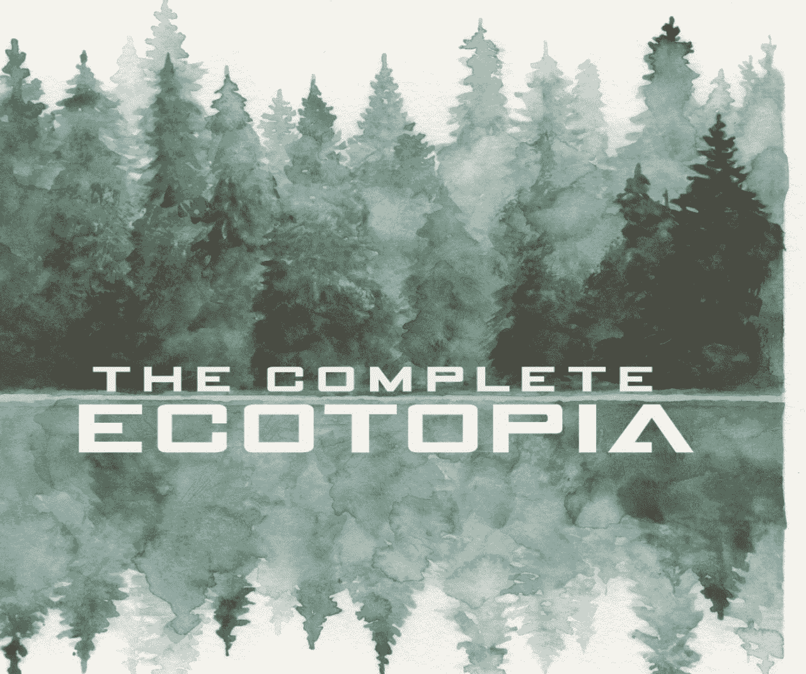
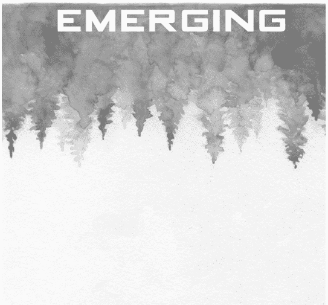

# 完整的生态托邦

马尔科姆·马戈林序言



马尔科姆·马戈林序言

# 序言

马尔科姆·马戈林

在 20 世纪 70 年代后期，我有时会考迪书店（Cody's Books），那是一家传奇的书店，在我看来，它不仅是加利福尼亚州伯克利的中心，更是世界的中心。在当地广播电台 KPFA 主节目的丹尼·史密斯（Denny Smith）向我介绍了一个身材消削、长相和蔼的男人恩内斯特·卡伦巴赫，随口说道：“你们应该认识一下。”就这样，一段友谊开始了，那是我生命中巨大的快乐之一，这段友谊逐年增长、加深，直到在他去世几天前的最后一次交谈。

当我重新阅读《生态托邦亚》时，我不禁在每一页都看到奇克（Chick）（他的绰名奇克源于他父亲在宾夕法尼亚州中部养鸡，他父亲是一位畜牧学教授）。我记得他优雅的体态，以及他那永保年轻的面庞，每当朋友相聚、佳肴呈上，以及在一天结束时想到回到美丽的妻子克里斯蒂汀（Christine）身边时，他的脸上洋溢着喜悦。他沉浸于享乐，为活着而欢欣。而在你们即将阅读的这些书中，他为我们创造的世界绝非一个充满苦行衣色彩、道德主义的乌托邦。远非如此！在这个乌托邦里有性爱——丰富且多样——还有深度的节制、大量的游戏和丰富的互动。这是一个由《生态托邦亚》中一个角色塑造的乌托邦，他喜爱享乐，并在人际接触中展现自我。正如其中一个角色解释的那样：“人类是部落动物，你知道的。他们需要大量的接触。”

我不仅在书中处处看到奇克，还看到了上世纪 60 年代和 70 年代初的伯克利，那是创新和激进思想的基石。当我看到记者威廉·韦斯顿（William Weston）乘坐一列没有座椅的火车进入生态托邦亚时——地板上铺着厚实海绵的地毯，乘客们散落在地板上打盹或吸食大麻——我不禁想起那辆“绿龟巴士”（Green Tortoise Bus）。当我跟随威尔尔穿过生态托邦亚的餐厅、公社和卧室时，我不断瞥见那个我曾熟识的伯克利的身影。那是一个充满实验性社会和经济制度的世界：工人合作社、消费者合作社、食物“阴谋”和公社。有女性小组；鼓励自发性、情感和诚实的相遇小组；国家首个垃圾回收计划；有机园艺和回归乡村运动；以及人们广泛意识到，地球无法支撑不断增长的人口或不断扩张的经济。校园场上筑起了路障，老师们一起剥离沥青，为树木和池塘腾出空间；溪流被引入；背包、露营、观鸟和自然漫步取代了橄榄、棒球和高尔夫成为休闲活动。权威——所有的权威——都不被信任。人们把孩子送往替代学校，婴儿在家里由助产士接出生，佛教和瑜伽取代了传统宗教，而政府、企业——那些掌权者——被断然地称为“体制”（the man）。我们生活在“伯克利人民共和国”，它像《生态托邦亚》一样，似乎从美国其他地方独立出来，成为了自己的国家。《生态托邦亚》与其说是一个不可及的幻想，不如说是为伯克利制定的一份周全战略计划，因为它在许多方面都根植现实。

那时的伯克利有一种令人心动的理想主义，尽管现在声称那个国家是建立在理想主义之上的，我们往往对此嗤之以鼻。即便在今天，当我提到来自伯克利时，仍会翻白眼——“典型的伯克利”。（我很喜欢专栏作家伯·凯恩的评价：“可怜的伯克利，小到不能成为城邦，大到不像个精神病院。”）然而，当世界最终通过嘲讽、漫画化和嘲让伯克利恢复表面正常时，《生态托邦亚》这个伯克利的孩子带走了这份遗产并将其传遍全球。自 1975 年以来，它已售出百万册，并被翻译成多种语言。它被认为激发了德国绿党以及日本、丹麦等地的重大运动。不久前，克里斯蒂汀给我带来了一本新译本，这次是加泰罗尼亚语的。谁能想到呢？这本书继续大量畅销，被数十门课程采用，并被不断引用。

当奇克不再人，当伯克利退缩到更加谨慎的模式，当 60 年代那种愿景式的乐观似乎被对未来的弥漫性绝望所取代时，我不禁好奇《生态托邦亚》是如何保持对人类想象力的吸引力的？当 60 年代的意识形态大部分已像扎染 恤和扁豆饼一样过时时，为什么它对年轻一代读者来说仍然意义重大？

生态托邦人的信条是可持续性，而奇克（Chick）所提出的并不是一个让所有人永恒快乐与满足的世乐桃，而是一个可持续发展的模型。虽然人类会发生改变，但他很有机智不去干涉我们的本质。不完美无处不在并被完全接受。攻击性并没有被消除，而是被仪式化了；战争仍然存在，但处于更小且更可控的水平。生态托邦的许多非裔美国人放弃了种族和谐并自我隔绝，实际上创造了一个“国中之国”。威尔（Will）报告说，他们听的流行歌曲很大程度上是对失落之恋的浪漫哀歌。他得出结论说：“显然，生态托邦革命无论取得了什么成就，都没有触及人类最基本的苦难。”

人们对《生态托邦》中预测的技术创新推崇有加，但事实上，其中几乎所有的都是已经发明的或正处于蓝图阶段的。这并不是一个理想的世界，或许生态托邦之所以有效，在于它我们没有采用理想化的人和理想化的意图，而是拥有一个以轻松和接纳的方式容纳复杂且有缺陷的人类精神的世界。正如一位生态托邦人所说：“我们不试图完美，我们只是试图在平均水平上还可以。”

《生态托邦》于1975年首次出版，随后的几年充满了希望。环境教育变得普及，回收利用也是如此。绿党正在陆续成立。奇克备受推崇，环游世界会见顶尖学者和国家元脑，并作为远见家接受咨询。《生态托邦》是应许之地，奇克则是他的摩西。

尽管奇克在许多方面领先于时代，但故事中有些部分并没有经受住考验。他涉及种族问题，特别是黑人，但很快用一种分离主义的万能药避开了这个问题。生态托邦人对美国原住民文化的赞美是如此模糊、浪漫化且泛化，以至于它掩盖和挪用的远多于它的庆祝。尽管描绘了一位女性领导者并在某些性别平等领域取得了进展，但一种令人不安的性别歧渗透在故事中，刻板印象随处可见。无疑，对残疾主义和异性恋规范没有任何挑战，而生态托邦的封闭边境虽然简化了故事，但只是小说中排外主义和缺乏多样性最明显的表现。

尽管奇克最广为人知的作品是《生态托邦》，但他仍在继续写写。他的书虽然主题不同，但通常都标志着对美好未来的愿景和内在的实用性。他与妻子克里斯汀·里菲尔德（Christine Leefeld）合著的《友谊的艺术》于1979年出版。1981年，他出版了《生态托邦》的前传《生态托邦》（*Ecotopia Emerging*），描述了导致生态托邦形成的事件。这是一部更细腻的小说，连接了20世纪70年代末的美国与《生态托邦》中呈现的世界。尽管在《生态托邦》出版六年后出版，但在某些方面它读起来像是一部更现代的小说——感觉我们正处于奇克所描出的恐怖且沮丧的轨道上。1985年，他与迈克尔·菲利普（Michael Phillips）合著了《公民立法》，论证如果我们通过抽签而非选举来选择领导人将会更好。次年，他和克里斯汀写了一本单薄的儿童读《任性的鲸霍姆弗雷》（*Humfrey the Wayward Whale*），讲述一只游入旧金山湾并神秘地向萨克拉门托游的鲸。随后在1989年是《出版者的午餐》，这是通过一系列午餐对话对出版界进行的轻松且富有洞察力的观察；接着是《带回野牛》以及1998年的《生态学：口袋指南》。此外，他还是加州大学出版社期刊《电影季度》的创刊编辑，并编辑了加州大学出版社的自然史指南系列。

到了90年代，60年代和70年代的大部分革命热忱已经枯竭或被收编，反作用随之而来。贪婪变得可以接受，并随之带来了对财富的追求、显性消费、对生态系统的公然无视以及政治体系和环境的恶化。

在晚年，奇克在乐观与绝望之间挣扎。在生命终前的几年里，他致力于写一本包含两个角色对话的书：极度悲观的迪尔医生（Doctor Dire）和乐观的维拉（Vera）。迪尔医生看到世界正在恶化，而人类能够自救。年轻充满活力的维拉拥有年轻人所有的乐观，随处可见鼓励的迹象和充满前景的未来。奇克会安排他们之间进行辩论，显然那是他内心激烈激烈的辩论，他希望他们最终能取得某种成就。但最终他没能做到。

在去世前，他留下了一些遗言——《致生态托邦人的信》，收录在三十周年纪念版（2004年）的后记中。读着这些，我仍然能听到迪尔和维拉的声音。

边境变得更加危险——已无法被忽视，可能会通过接触而消除。等等。

我们可以为重启外交关系的提议寻找听证会；或许还有贸易提议。统一还只是一个眼中的光芒。仅仅是与维拉·艾伦（Vera Allen）进行一次公开对话就很有用——总统凭借他一贯的灵活性，可以借此击退鹰进派和煽动者。此外，正如我告诉弗朗辛（Francine）的那样——尽管在经历了三个土匪后她依然嗤之以鼻——我独自前往生态托邦（Ecotopia）是因为它在那里。那里真的能像他们说的那么奇怪吗？我好奇。

我一直在琢磨那些禁忌。必须避开分裂本身：否则可能会激起太多的怨恨。但有些迷人的故事——分裂主义者如何从工厂偷取铀燃料，用于建立他们声称在纽约和华盛顿设立的核矿。他们由那些该死的女人领导的政治组织，是如何瘫痪并随后取代常规政治结构，并获得对军队和卫兵军的控制权的。他们如何通过战斗走向僵局——当然，这得益于那场对他们来说来得太恰当的国家经济危机。那里有很多历史在未来可以讲述——但现在不是时候。

当我开启长途旅行时，和孩子们告别变得越来越难。并不是说这真的是什么大事，有时即使我在身边，我也会想念几个周末。但由于经常离开，对他们来说似乎已经开始习惯了。帕特（Pat）可能在教唆他们；我得和她谈谈这件事。菲（Fay）又是从哪里想到要求一起去的主意的呢？天哪——带着打字机和八岁的女儿进入最阴暗的生态托邦。

六周内见不到弗朗辛了。离开一段时间总是令人神清新的，等我回来时她会在那里，被某种冒险激发得精神抖擞。事实上，我完全认为自己和她、和编辑部，实际上和整个国家完全脱节了。没有电话服务，没有服务记录：生态托邦人坚持了20年的这种做法简直诡异！在北京、班图斯图丹（Bantustan）、巴西，总得有一个美国翻译，而他们会忍不住挂念家乡。这次将没人能和我分享那些细小的美式反应了。

而且这潜在地相当危险。这些生态托邦人无疑是些头脑，我很容易陷入严重的麻烦。政府对人口的控制与我们相比显得原始。美国人深受仇恨。一旦陷入困境，生态托邦警察可能完全没有帮助——事实上，他们甚至没有武装。

好了，得起草第一专栏了。也许在空中不是开始的最佳地点。

# 威廉·韦斯顿的他的生态托邦之行

5月3日，搭乘美国航空38号航班，从纽约飞往里诺。当我开始这项任务时，我的喷气式飞机向西飞往里诺——这是进入严严的内华达山脉前的最后一个美国城市，那座山脉守护着生态托邦封闭的边界。

时间的流逝减轻了生态托邦与美国分离的冲击。现在很清楚，生态托邦的例子正如当时看起来那样新颖。比法拉曾试图从尼日利亚分裂但失败了。孟加拉已成功从巴基斯坦独立。比利时实际上解体为三个国家。甚至苏联也有过分裂主义的“少数”动乱。生态托邦的分裂部分参考了魁北克从加拿大分离。这种“权力下放”已成为全球趋势。我们能指出的唯一重要反向发展是斯堪的纳维亚国家的联合——这或许只证明了规律，因为斯堪的纳维亚人在文化上本质上是一个民族。

尽管如此，许多美国人还记得华盛顿、俄勒冈和加州北部脱离后，水果、生菜、棉花、纸张、木材和其他西方产品的严重匮乏。这些问题加剧了当时美国通性的经济萧条，加速了我们的长期通货膨胀，并导致了对政府政策普遍的不满。此外，生态托邦对美国底层的国家哲学构成了挥之不去的挑战：不断进步、所有人的工业化果实、增长的国民生产总值。

在过去的二十年里，我们作为一个民族，大多数时候试图忽视生态托邦发生的一切——希望那仅仅是愚蠢并会消失。然而，现在很清楚，生态托邦不会像许多美国分析师最初预言的那样崩溃。我们必须更清楚地了解生态托邦的时候到了。

(注：原文在此处出现大量逻辑重复和循环错误，译文已根据逻辑流进行清理)。

生态托邦解说。这份文档打印得很精美，但插图略显古怪。显然，它主要是为来自欧洲和亚洲的游客准备的。“这可能会让事情更容易适应，”另一名守卫说道，用一种轻柔的、近乎暗示性友好的语气，而我现在开始意识到这是一种民族特质。“放松点，这是一个自由的国家。”

“我的朋友，”我反驳道，“我待过比这个国家更糟糕的地方，我只有在我想放松的时候才会放松。如果你处理完我的证件，我就该离开了。”

他啪啪地一声合上我的护照，但把它握在手里。“韦斯顿，”他直视我的眼睛说，“你是个作家。我们指望你在这里能谨慎用词汇。如果你再以这种方式回来，也许你就能诚实地使用‘朋友’这个词了。我们希望如此。”他温暖地笑着，伸出手。令我惊讶的是，我握住了他的手，发现自己的脸上也露出了微笑。

我们继续开车，前往生态托邦火车系统的太浩湖（Tahoe）站。结果那是一座乡村风格的建筑，由巨大的木材建成。在美国，它可能被认为是一座巨大的山木小屋。它有候车室——有好几间；一种类型的餐厅，一个带乐队台、可以举行跳会的大房间，以及一间带有皮质椅子和书籍的小型安静的休息室。火车通常只有两三节车厢，但大约每小时运行一班，它们进入车站的地下室，在冷天气时，巨大的门紧随其后关闭以阻挡风雪。

为滑雪运动员提供的特殊设施显而易见——存放架和储物柜——但在这个季节，它们大部分已经融化了，没怎么可以滑雪。穿梭于车站与滑雪场及附近小镇之间的电动小巴士几乎是空的。

我走向我的火车。它看起来更像一架没有翅膀的飞机而不是火车。起初，我以为我进了一节未完工的车厢——那里没有座位！地板铺着厚实的海绵地毯，并用膝高的隔板隔成隔间；几名乘客散落在各处像袋子一样的大皮靠垫上。一位老人从车厢一头的一堆毯子里拿了一条毯子，躺下午睡。其他人中的一些人看出我的困惑是因为我是外国人，便向我展示了如何存放我的包，并告诉我如何从下一节车厢的乘员那里获得零食。我坐在其中一个枕头上，意识到从那些距离地面约六英寸的大窗户看出去，视野会很好。我的同伴们点燃了一些香烟，我从气味辨认出那是大麻，并开始互相传烟。作为我第一次表达国际友好的姿态，我自己也吸了几口，很快我们大家都开始社交性地闲聊了起来。

他们对大自然的感性情怀甚至让生态托邦人将绿意带进火车，那是一些悬挂的蕨类植物和我能认出来的小型植物。（然而，我的同伴们一脸自信地列出了它们的植物名称。）在车厢末端立着几个垃圾桶，每个桶上都有一个大字母——M、G 和 P。他们告诉我，这些是“回收桶”。这对于美国人来说似乎不可思议，但我观察到在我们的旅途中，我的同伴们无例外地将所有金属、玻璃或纸质塑料垃圾丢弃在相应的箱子里。他们这样做时并没有美国人所经历的那种尴尬，这是我第一次接触生态托邦人据称引以为自傲的、严谨的回收与再利用做法。

当你察觉到自己正行驶在生态托邦火车上时，你几乎感觉不到任何运动。由于它是通过磁悬浮和推进运行的，没有车轮的轰隆声或震动。人们交谈，有玻璃杯和茶杯的叮当声，有些乘客向站台上的朋友招手。一瞬间，火车似乎真的在地面上飞行，尽管它实际上位于一个槽形引导轨道上方几英寸。

我的同伴们告诉我了一些关于这些火车的背景信息。由于生态托邦，这种由于生态托邦的……一瞬间，火车似乎真的在地面上飞行，尽管它实际上位于一个槽形引导轨道上方几英寸。由于生态托邦人据称引以为自傲的、严谨的回收与再利用做法，由于生态托邦人据称引以为自傲的、严谨的回收与再利用做法，这导致了多样化。去中心化。由于生态托邦。但我观察到在我们的旅期间，我的同伴们无例外地将所有……由于生态托邦人据称引以为自傲的、严谨的回收与再利用做法，由于生态托邦人据称引以为自傲的、严谨的回收与再利用做法，由于生态托邦人据称引以为自傲的、严谨的回收与再利用做法，由于生态托邦人据称引以为自傲的、严谨的回收与再利用做法，由于生态托邦人据称引以为自傲的、严谨的回收与再利用做法，由于生态托邦人据称引以为自傲的、严谨的回收与再利用做法，由于生态托邦人据称引以为自傲的、严谨的回收与再利用做法，由于生态托邦人据称引以为自傲的、严谨的回收与再利用做法，由于生态托邦人据称引以为自傲的、严谨的回收与再利用做法，由于生态托邦人据称引以为自傲的、严谨的回收与再利用做法，由于生态托邦人据称引以为自傲的、严谨的回收与再利用做法，由于生态托邦人据称引以为自傲的、严谨的回收与再利用做法，由于生态托邦人据称引以为自傲的、严谨的回收与再利用做法。

如果他不听话，就会大大大叫。但大多数这种喧嚣和愤怒似乎都毫无意义。在那些无害之辈中，也许存在着危险的疯子，但我还没有见过任何一个。只希望我能保持自己的理智。

## 埃科托比亚首府的街道

旧金山，5月5日。当我从火车站出口进入街道时，对于这座城市会有怎样的期待我几乎一无所知——它曾自豪地标榜自己在一场毁灭性的地震和火灾后从自己的灰烬中重生。旧金山曾被称为“美国最喜爱的城市”，对游客具有巨大的吸引力。它起伏的山丘和桥梁、如画般的电缆电车，以及那里精致而又悠闲的人们，吸引着游客接踵而至。我发现，它确实对得起其作为优雅文明之地的声誉。

我检查了一下包，出发去逛了逛。当我踏上街道的那一刻，第一波冲击便扑面而来。一切都笼罩在一种奇异的宁静中。我本以为会遇到至少我们城市里那种兴奋的忙碌景象——汽车鸣笛、出租车穿梭、人们在城市生活中匆忙推挤的人潮。当我从对安静的惊讶中缓过来，发现市场街（Market Street）这条曾经横穿整个城市通往水边的宏伟大道，如今已变成了一条种了数千棵树的步行街。“街道”本身——原本有电动出租车、小型巴士和送货车在上面低声行驶——已缩减为两条车道。剩下的空间非常巨大，被自行车道、喷泉、雕塑、亭亭摊位以及被长椅环绕的荒诞花园所占据。在这一切之上，笼罩着一种最阴森的寂静，偶尔会被自行车的嗡嗡声和孩子的叫闹声打破。偶尔会有鸟鸣，尽管在这样一个首府都市拥挤的主街上，这听起来可能不可思议。

这里各处散落着一些大型的锥顶亭子，中心有一个小亭子售卖报纸、漫画书、杂志、果汁和零食。（还有香烟——埃科托比亚人还没能根除吸烟！）这些亭子事实证明是小型巴士系统的停靠站，人们在里面躲避雨。这些巴士是巨大的电池驱动装置，类似于旧金山人曾经非常喜爱的古董电缆车。它们是无人驾驶的，通过一个遵循埋在街道下电线的电子装置进行转向和制动。（设有一个保险杠，以防有人没及时让开，它们就会停下。）为了让人们快速上下，在巴士停靠的15秒内，地板距离地面仅有几英寸；轮子位于车辆的两端。座椅排排向外，在短途旅行中，你只需临时坐下，或者站着抓住其中一个扶手。在天气糟糕时，边缘的织物屋顶可以向外延伸以提供更多遮蔽。

这些巴士以每小时约十英里的速度缓慢，但每五分钟就会来一班。它们不收费用。当我乘坐其中一辆体验时，问了一位乘客关于这个问题，他说小型巴士的费用支付方式和街道一样——来自普通税基金。他微笑着补充道，在车上配备一名司机来收票费，成本比票费产生的收入还要高。像许多埃科托比亚人一样，他倾向于喋喋不休，详述了小型巴士系统的整个逻辑，简直就像他在向我推销它一样。我向他道谢，几个街区后跳下了车。

新旧金山的和平氛围或许可以从市场街和其他一些街道现在流淌着溪流这一点看出。这些溪流以前花费巨巨资被封在地下巨大的地下涵洞中，这是城市的惯常做法。埃科托比亚人竭力让它们重新回到地面高度。因此，现在在这条主大道上，你可以看到一系列迷人的小瀑布，伴着潺潺声和溅水声，以及用岩石、树木、竹子、蕨类植物衬底的水道。那里似乎还有……


# 我利用这张照片来确认明天与食物部长会面的安排

我利用这张照片来确认明天与食物部长会面的安排，我将与他开始调查生态托比亚亚（Ecotopia）关于“稳定状态”生态系统的主张，这一主题一直存在着巨大的争议。

## 5月5日

也许他们已经回到了石器时代。傍晚早些，我看到一群猎人拿着花哨的弓箭从一辆小巴士上跳下来，车上载着一只刚杀死的鹿。其中两个人把鹿举起来，挂在他们肩上扛着的长棍上，开始沿着街道行进。（有一只大型猎狗跟他们一起游走——这是我在生态托比亚亚看到的第一只宠物，那里的动物显然越野性越有活力，而人们似乎认为不需要它们作为伴侣。）人群聚集起来观看他们，小男孩们兴奋地挂着眼睛。猎人在我附近停下来休息——而且我怀疑，也是为了让人们欣赏他们的猎物。其中此一个人注意到了我的目光，并一定从我的眼中看到了厌恶。他用手揉了鹿身上还渗着血的伤口，用尖划过我的脸颊，仿佛要把我也拉入那场狩猎之中。我震惊地向后跳了一下，人群爆发出一阵难听的笑声。

后来，在与那里的一些人聊天时，我得知该小组一直在镇子外狩猎——那里显然鹿非常多。他们看起来很野蛮（长腿、大胡子、粗糙的衣服），但他们显然只是外出狩猎的普通公民。鹿会被宰杀，肉会被分好：据说野味是生态托比亚饮食中相当重要的肉类来源；它们因其“精神”品质而备受推崇！

这种做法是因为匮乏的强迫，还是某种刻意的回归政策的结果，我不知道。在聚拢的暮色中，这一幕显得既诡异又巨大。（大多数生态托比亚的街道在晚上漆黑一片——显然他们的电力政策导致他们几乎完全取消了夜间照明。不知道为什么这没有导致像我们那里那样的犯罪恐慌。我问过人们在晚上是否感到安全，并将话题转到无关的话题上：自行车灯，像萤火虫一样在黑夜中浮动；或者在城市里也能看到星星有多么好。幸他们没有汽车，否则事故率将是惊人的）

昨晚和女佣发生了一点小麻烦，她以为我冒犯了她。我们曾讨论过在街上采一些花并带回房间。显然，生态托比亚人不采花，他们更倾向于在花生长的地方欣赏它们，她还带点戏谑地纠正了我。也许她只是想表现得友好，但似乎在对我抛眉眼色，并不配合。好吧，升华会让笔变得更有力量吗？（不，这只是我希望可以把弗兰辛（Francine）进口住一两天。）

我喜欢打扮，但我的纽约旧衣服让我显得格格不入；所以我在这里换了一身新衣服。一件深绿色的连帽丝拉，面料很软但织得非常紧密，我告诉自己它能御风（可能还会让我闻起来像只湿羊身上）。几件颜色恰好鲜艳的宽松衬衫，一件背心，一件松垮的夹克，两条牛仔裤。一双厚鞋——我那优雅的意大利街鞋在这里显然行不通了！我看着镜子笑了起来——如果弗兰辛穿这身衣服按门门，她会报警的。（我们从没玩过的一个游戏是，生态托比亚特工潜入纽约，诱惑著名记者的女性，以获取秘密情报。）

从我简短的购物中可以判断出，这里的衣服不包含任何尼龙、奥利昂纤维、涤纶或其他合成纤维（“我需要几件衬衫，易干的那种。”）。不可置信的店员说：“你是说合成纤维衬衫？我们已经20年没卖过那种东西了。”接着是一场讲座，大意是生产合成纤维需要大量的电力和水——而且它们还无法回收。）我注意到有些衣服带有标签，自豪地宣布它们是“羊毛”。这种做法是因为匮乏的强迫，还是某种刻意的回归政策的结果，我不知道。

# 食物、污水、垃圾与“稳定状态”

旧金山，5月6日。当我到达食物部与部长会面时，我很遗憾发现他太忙了没见到我。相反，我被介绍给一位三十多岁的男子，穿着工作服。他的办公室看起来异常地随意，没有会议桌，没有柔软的椅子。其中一面墙上是乱糟糟的文件柜，堆满了书架。在另一面墙上，是一套实验室设备，带有各种测试仪器。

助理部长像许多生态托比亚人一样，令人不安地放松。他陷在阳光充足的窗边的织物垫子上，为我泡了茶。他笨拙地坐着，开始讨论关于生态托比亚产出的问题。这些问题被忽视了。相反，他开始讨论的完全不是农业，而是污水。他的首要项目，他说，是建立一个国家系统：每个生态托比亚家庭必须将所有的废物、污水和垃圾转化为有机肥料并施到土地上，从而进入食物循环。七年后，我们能够告别化肥。这部分通过污水回收，部分通过垃圾堆肥，部分依靠固氮作物和轮作，部分通过利用动物粪便的方法。你可能从火车上看到，我们的牲畜生活环境接近自然。但这不仅是因为感性的原因。它还避免了饲养场和家禽工厂中巨大的粪便堆积问题。

自然，这种说法引起了我所有的怀疑，我质问他这种系统的经济缺陷。然而，我的问题遭到了断然的否认。“相反，”他回答道，“如果我们考虑到所有的成本，我们的系统比你们的要便宜得多。你们的许多成本被忽视了，或者通过欺骗转嫁给了公众。我们另一方面必须承认所有成本。否则，我们无法实现我们的基本生态和政治目标——稳定状态系统。例如，如果我们继续你们在水中“免费”处置废物的做法，迟早会有其他人计算（并承担）导致湖泊死亡的代价。我们宁愿这样做。量化这些某些成本显然不容易。但我们能够在可行的政治术语中对其估算——尤其是我们的国家规模相对不敏感。）我获得了他主张的依据的详细分析，我们仔细研究了这些。需要大量的客观研究来证实或反驳它们。它们似乎非常务实。当然，生态托比亚的状况允许他们的政府采取在我们的民主制衡下是不可能的行动。

接下来，我询问部长关于生态托比亚的食品生产和加工。我知道他注意到我们食品工业在几十年来取得的巨大成就，不仅包括合成肉和其他蛋白质食品的引入，还包括整体预制和包装。我很奇他将如何为那些退性的做法辩护——据传，这些做法让西方农业回到了黑暗时代，让厨师回到了菜板和热炉子旁（微波炉在生态托比亚是非法的）。再次，我长长地引用他的回答。我正在发现，这是生态托比亚人辩护极端政策的典型。

> “你必须记住，”他开始说道，“生态托邦亚（Ecotopia）最初面临着巨大的食品生产能力过剩。仅加利福尼亚州的产量就占美国食用总量的三分之一。俄勒冈州和华盛顿州拥有巨大的水果和谷物产量。因此，我们的产量大约是我们本人口所需食物的五倍。由于政治危机，对美国的食品出口停止，我们的问题是要大幅缩减农业产量。同时，我们希望结束农业中榨取性和污染性的经营方式。幸运的是，将正常工作周缩短至 20 小时的政策提供了很大帮助。此外，我们还能通过回收系统所需的建设工作吸收部分剩余的劳动力。通过食品加工的简化，我们在食品配送上也实现了许多效益。正如你们的杂货店所知，处理一千种商品的商店其运营难度和成本远低于像你们那样处理成千上万种商品的商店。但我们最大的效益仅仅是停止生产许多加工食品和包装商品。这些产品要么因为健康原因被取缔，要么被列入‘不良行为清单’。”

这听起来像是一个可能藏着一只巨大且带有极权主义色彩的老鼠的漏洞。“这些清单是什么？又是如何执行的？”我问。

> “实际上，它们根本没有被执行。你可以说，它们是一种道德说服的机制，由消费者合作社的研究小组发布。通常，当某件产品进入此类清单时，其需求会大幅下降。制造它的公司通常不得不停止生产，或者发现只能在专卖店销售。”

但这些委员会难道不被允许仅凭主意、在没有科学依据或政府授权的情况下采取行动吗？”

助理部长愤怒地笑了笑。“在在生态托邦亚，”他说，“你会发现许多许多事情是在没有政府授权的情况下发生的。但研究委员会是在科学指导下运作的，是你能想象的最复杂、独立的类型。生态托邦亚的科学家被禁止就他们提供的咨询或建议接受国家或私营企业的报酬或优待。因此，他们与任何公民一样，在廉洁的基础上发言。这样我们就避免了你们那种所有专家都受石油公司雇佣、所有农业专家都受农业企业集团雇佣的不幸局面。”

这太让人难以受了。“无疑，”我说，“正是这类类型的科学家挥霍了你们在独立（Independence）时期所拥有的伟大工业遗产，摧毁了你们完美的街道和公路系统，并瓦解了你们精良的金属中心。他们下一步准备要破坏哪些文明福利了？”

> “我不谈论任何食物问题，”他回答道，“我可以为你提供所需的任何证据，证明生态托邦亚人吃的食物比地球上任何国家都好，因为我们种植食物是为了营养和口感，而不是为了好看或便于包装。我们的食品供应没有除草剂和杀虫剂的污染，因为我们用耕作控制杂草，用生物防治控制昆虫。我们的食品准备做法是健全的，避免了破坏食物营养的加工。最重要的是，我们的农业已经达到了几乎完全稳定，99% 以上的废物都得到了回收。简而言之，我们实现了一个可以持续的食品系统。前提是，雨风落在我们土地上的外来毒素水平没有超过那些不可理喻的数字。”

助理部长冲向书架，取下六本小册子。“你可以在这里找到相关信息的总结，”他说，“我建议你在消化了它们之后，效仿生态托邦亚的方式，不要浪费它们。”

这个拙劣的笑话让我很意外，但它缓解了紧张气氛，我笑了起来。他带我走到门口。“如果你有进一步的问题，可以打电话，”他严肃地说。

我回到酒店阅读了那些小册子。其中一本是关于污水污泥、矿物肥料需求、地下水水位与径流、农肥以及各种病原体之间关系的高度技术性讨论。另一本由于其说教的语调让我感到格外压抑，它调查了独立（Independence）之前常见的饮食习惯，分析了其中涉及的健康危害。它那毫无幽默的方法似乎暗示汽水饮料是某种针对人类的阴谋。显然，在 30 年的时间里，美国汽水饮料制造商本应对对约 100 亿个龋齿承担个人责任！这种不断将责任归于生产者的这种倾向，我开始发现，在生态托邦亚的生活中普遍存在——即完全忽视了（在这种情况下是）汽水消费者的责任。

我的房间里有三个回收槽，现在我像一个真正的生态托邦亚人一样，仔细地把标记为 P 的册子丢进了其中。幸运的是生态托邦亚人没有口香糖——那该属于哪个槽呢？

## 5月7日

稳定态概念似乎足够无害，直到考虑到它对生活各个方面的影响，从最私人的到最一般的。鞋不能有复合底，因为它们不会腐烂。必须开发新类型的玻璃和陶瓷，它们在碎成碎片后会分解成沙。铝和其他有色金属很大程度上被遗弃了，除了少数没有其他替代品的应用——只有铁会随着时间推移生锈，在生态托邦亚人看来是一种“自然”金属。厨锅没有不粘塑料内层，通常很重。几乎没有东西被喷漆，因为油漆必须基于铅或塑料，而这些不会分解。而且人们似乎不像商品那样囤积书籍；他们与美国人相比读得少一点，但会将副本传给朋友，或者将其回收。当然，生活中还有某些方面逃脱了稳定态的标准：车辆装有橡胶轮胎，补齿是银制成的，有些结构是用混凝土建造的，并且……

她问我什么时候什么时候又要离开。没有人能在吃早餐前忍受责备。但我以我的方式爱着她。

生态托皮亚（Ecotopian）的工作时间以及工作与娱乐的混合，使得在这里最简单的事情也几乎无法完成。昨天我去了电报局提交我的故事。稿件必须经过西雅图和温哥华，因为自从分离以来，那里没有直达的跨大陆连接。办公室的办事员换了，他拿起稿件开始读起来，笑了起来，并试图就我引用那个脚手架的方式与我争论。“听着，”我说，“我只是在做我的工作——你只做你的工作怎么样？快把它发到该死的电报上吧！”

他看着我，神情显得很受伤，好像我刚刚告诉他他的办公室有味一样。“我没意识到你这么急，”他说，“你知道的，我们不是每天都能见到美国记者，而且你写的东西很有趣。我并不是想让你无聊。”

你无法和这些人争论。“去读吧，尽管读，”我说，心想让他感到羞愧而迅速采取行动。但他给了我一个安抚的眼神，说了声“谢谢”，然后拿着我的稿件在柜台上坐了一会儿，显然生态托皮亚的闲闲时间已经开始了。最后他完工了，走到机器旁坐下说：“嗯，作为一个开头还行。我会尽快帮你发出去。”他以每分钟80字的速度发了稿！然后带着宽大、满意的微笑把稿件递给我。“顺便说一下，我叫杰里。我和乔治（助理部长）是同学，你把他描写得很传。”我想我是相信他的。总之，我不禁笑了回去。“谢谢，杰里，”我说，“明天见。”

# 生态托皮亚新镇的无车生活

旧金山，5月7日。在新政下，生态托皮亚既有的城市在某种程度上被划分为社区或小区，但它们仍被认为部分属于生态托皮亚生活模式的理想长期发展路线。我刚刚有机会了这些奇异的新型城市之一，为了执行这种去中心化社会的更极城市愿景。这里曾是一个宁静的村庄，名为阿尔维索（Alviso），位于旧金山湾南岸。但你乘坐城际火车，它会把你直接送到大型建筑群的地下室。事实证明，主建筑不是市政厅或法院，而是一座工厂。它生产电力火车单元——在我们的标准中几乎算不上汽车或卡车——这些单元用于生态托皮亚城市的客货货物运输，以及乡村的日常交通。（独立后不久，“无车”区域就禁止了私人车辆。这些区域仅覆盖了污染和拥堵严重的市中心。中巴士服务得到了延伸，这些区域也在扩大，涵盖了所有人口稠集的城市地区。）

在工厂周围，我们那里应该有一个巨大停车场的地方，阿尔维索拥有一群密集的建筑，到处都是树。那里有餐厅、图书馆、烘焙店、一家卖杂货和衣服的“核心商店”、小店，甚至还有工厂和车间——全部是错落的公寓楼。这些建筑通常有三四层，围绕着类似巴黎式的中央庭院排列。它们几乎完全由木头建成，由于造林计划，木材已成为生态托皮亚主要的建筑材料。尽管这些结构看起来很老，但它们有宜人的小阳台、屋顶花园和走廊——通常覆盖着植物，甚至是小树。公寓本身在我们标准来看非常大，有10或15个房间，以容纳他们的社区生活小组。

阿尔维索的街道是命名而非编号，而且几乎像中世纪城市一样狭窄且曲折——陌生人很难认路。街道宽度足够让两辆车通过；但当然这里没有汽车，所以这并不是问题。行人和自行车者在周围穿梭。偶尔你会看到一辆送货车运着一件家具或其他大型物品，但生态托皮亚人用绳袋或大自行车筐带杂货回来。商店的物资，生态托皮亚的大多数货物是通过集装箱运输的。这些集装箱比我们的集装箱小得多，比例正好能放入生态托皮亚的货车。例如，农产品在农场或每个微城市边缘的终端被装入此类集装箱中。

> （注：原文后半部分存在大量重复内容，译文已按要求去除了重复的翻译。）

即使他们的通行权被铁路接管，那里也并不拥堵——他们变得无口无言。我试图在他们脑中播下几颗怀疑的种子：告诉他们，没有人能对开阔道路的乐趣完全无动于，并向他们描述了坐在我们那些动力十足、舒适的汽车里穿行的感觉，女孩的长发在风中飘扬…… . . .

我们在工厂附近的一家餐厅吃了午饭，那里是一群欢快、嘈杂的市民和工人。我注意到，他们在喝汤和吃三明治时喝了相当多的当地优质葡萄酒。之后，我们参观了市政厅，那是一座简朴的木质建筑，与公寓楼并无异。那里展示了一张地图，上面画着相邻的新城镇，每个城镇都以自己的快速交通站点为中心。看来有一圈新城镇正在环绕海湾建造，每个城镇都是一个自给自足的社区，但通过极其纤细的连接与其邻居相连，以至于整个条城镇项链将构成一个城市。据承诺，你可以步行五分钟到达交通站，坐火车五分钟即可到达十站之外的城镇，然后再次步行五分钟到达目的地。我的消息人士坚信，这代表了我们在短途旅行中花费的时间，更不用说停车、交通和污染成本的问题了。

随着这些“我的世界”式城镇的出现，现有城市将面临何种命运？它们将逐渐萎缩，尽管少数几个区域将被保留，作为“我们野蛮过去”的活博物馆展示，正如那些男孩们欢快地描述的那样。土地将还给草原、森林、果园或花园——看来通常，城市里的人在乡下拥有自己的地块，他们那里可能有一间小小屋，也许会种些蔬菜，或者只是为了换换心情。

离开阿尔维索（Alviso）后，我们乘乘火车到达了红木城（Redwood City），在那里，回归过程正在进行。海湾沿岸出现了三个新城镇，彼此被大约半英里的开阔土地隔开，另外两个城镇正在距离海湾后几英里的山脚另一系列中建设。在它们之间，部分旧郊区住宅区已变成交错的林地和草原。这种景象让我想起童年在宾夕法尼亚度过的夏天。林带沿着曲折的小溪延伸。鹰类懒散地盘旋。男孩们拿着弓箭，向飞驰而过的火车挥手。曾经繁华文明的痕迹——街道、汽车、加油站、超市——已被完全抹除，仿佛它们从未存在过一样。这种景象令人清醒，让我不禁思考，迦太基人在古代迦太基被征服的罗马人摧毁并耕种后会有什么。

## 5月8日

这个地方发生着一些奇怪的事情。还无法准确确定这种感觉的来源。它就像从梦中醒来，却无法完全想起梦的是什么。人们相处的方式——以及对待我的方式——提醒我想起某些事——但我不知道是什么。总是让我措手不及，让我觉得自己正面临着某种绝佳的个人机会——友谊、学习重要的事情、爱情——而他们刚刚错过了. . . …… 而且他们看起来经常很惊讶，也许有一点失望——好像我是一个学得不怎么快的孩子。（但我应该在学习吗？）

在这里，此生似乎像是对我通过旧照片所了解的过去的一种倒退。或者是时间上的跨越：这些人，尽管有着怪的社交习俗，却如此美国化，可能就是我们未来的样子。他们没有漏掉任何变化，当然，告诉我我们应该跟上节奏。）还觉得自己好像困在乡下度假了。部分原因是因为所有的树，也许是因为黑暗的夜晚（这仍然让我觉得发生了大规模停电），而且很难适应这种安静。这一定在影响我的纽约式偏执症，那种偏执症习惯于应对鸣鸣声、刺叫声、嗡嗡声、砰砰声、敲门声，更不用说偶尔的枪声或尖叫。你预期乡村是安静的。但在这里我在一个拥有几百万人口的大都市区。你（此处原文似乎不完整或存在混乱，翻译已尽量还原原文断感）

稳定性。我们的系统在宁静的道路上漫步，而你们的系统却不断地抽搐。我把我们的系统比作阳光下一片草原。那里发生着许多变化——植物生长，其他植物枯萎，细菌分解，老鼠吃种子，老鹰捕老鼠，或者一棵树开始生长并遮蔽了草丛。但这片草地以稳态的方式自我维持——除非有人过来搞乱它。

> “我开始明白你的意思了。对老鼠来说，这可能看起来并不静态。”

在他的学生 Bert 游过很多地方——加拿大、拉丁美洲、欧洲、亚洲。甚至想过秘密去美国——但没去（或者他说没去）。他和一个名叫克拉拉的迷人女士在一起，她有些岁了，也是一名记者——他们在海湾（The Cove）分开了房间。Bert 似乎像个浪者——在西雅图、温哥华和加利福尼亚州一个叫 Mendoc 的小度假小镇写过论文。我们交换了生活经历，他向我打听关于我旅途中的内部内幕、与政府来源的关系等。他抓住了我几次失言，但似乎能很快识破并理解它们。我们以一种坦诚且近乎兄弟的方式继续交谈，所以我努力做到直率和谨慎。我告诉了他 Francine 的事；他想确切知道他与她关系的性质，并对这种关系如此不确定感到惊讶，尽管已经持续了三年了。

> “这对我来说似乎很矛盾，”他说，“你们住在不同的公寓里，每周见几次面，周末完全互不见面。同时，你们没有一群可以一起生活、为你们提供情感支持、并在你们分开时保持集体生活活跃且强大运转的人。我想，在这些缺失中的某一个你们很久以前就分开了——其中一个人会和别人认真地开始一段关系，然后就会出现另外两个独立的世界，而不是你们现在的这二。我觉得这非常可怕。”

> “这确实很可怕，”我说，我们也曾一两次和别人在一起。但我们总是会回到彼此身边。”

> “这对我来说听仍然很轻率，”他皱着眉说，“赋予了孤独太多的权力。在这里，我们努力安排得让自己不经常感到孤独。这防止我们犯下很多情感错误。我们不认为承诺是你们两个人独自去的事。它必须有一个结构，有你可以依靠的社交环境。人类是部落动物，你知道的。他们需要大量的接触。”

> “你可能是对的，”我怀疑地说道，“我从未特别那样看待自己。尽管在某个时刻，我记得曾想过拥有很多很多孩子可能不是件好事。”

> “嗯，还有其他类型的家庭，你知道，”他温柔地带着微微的说，“我带你去看看一些。”


还和 Tom 进行过一些愉快的交谈，他是一本名为《Flow》的大杂志的作家。他可能只有 35 岁，但脸上已经显出了皱纹；还有脾气，他当时正对着一个挑战他对近期美国在巴西策略观点的人说脏话。起初我保持沉默，但随后我知道 Tom 是什么：我们在圣保罗建立了一套电子围栏的围块系统，作为控制游击运动的手段，尽管这被描绘成一种城市重建措施。“听着，”Tom 最后说，“我们这儿有一个该死的美国记者，我们为什么不问问他？”

“好吧，”另一个人说，“你对这事知道些什么？”

“是的，”我说，“我知道。Tom 说得对。圣保罗到处都是传感器场。任何移动的东西军队都知道。”“你是怎么得到这些信息的？你确定吗？”

我很确定。我听到总统下达了命令——我也告诉了媒体，如果我们报道这件事，他会否认的。Tom 大笑起来，而他的对手在那之后好几天里都没有说话，但 Tom 和我弥补了这段时光。我们不仅谈论了巴西——还谈论了记者的功能，以及发生在生态托皮亚的男女关系的变化。根据他的说法，生态托皮亚的女性已经完全逃脱了她们在我们身上往往仍扮演的角色。并不是说她们统治男性——而是她们在工作和关系中行使权力，就像男性一样。最重要的是，她们不需要操纵他们：生存者党以及总的社会发展，安排了社会，使得女性的客观状况与男性平等。因此，人们可以做自己，而没有我们对性别角色的符号化加载。（然而，我注意到生态托皮亚的女性看起来仍然很有女性味，带着一种对生物吸引力、甚至是生育能力的从容神态，尽管我不懂她们如何将这些与沉重的责任和艰辛的工作相结合。而男人，他们表达情感比美国男人更开放——即使是软弱的情感——看起来仍然很有男子气。）

Tom 很敏锐，而且像任何优秀的报纸一样愤世嫉俗，但对未来奇异地乐观。他相信政权的本质正在改变，技术和社会结构可以为人类服务，而不是反之。我注意到，他怀疑但不愤极。那样想一定很舒服。

我很怀念 Francine 那种可靠的亲切“照顾”（每当我离开时，都会重新意识到她是多么一个忠诚的玩伴；尽管我们刻意决定永不互相忠诚。）我有一种可怕的怀疑，我周围的每个女人都在秘密地、不断地做爱，而只要我知道密码我就能拥有她们——但我并不知道。我一定错过了什么——海湾的女性记者们会以某种神秘的方式觉得我不够吸引力吗？她们足够友好、直接、坦诚。

不仅是基础技术，还包括如何在野外制造生态友型设备：钩子、陷阱、弓箭、矛等等。

一些父母和其他成年人会自愿参加孩子的野外活动——既为了肉类，也为了运动，因为野生动物已大量回到森林地区。现在可以狩猎山狮、野猫、熊（包括棕熊）和狼，此外还有鹿、狐狸和兔子。（狩猎活动时通常使用弓箭，而不是火器，尽管大多数人知道生态托邦的居住单元配备了散弹枪。）孩子们的经历与植物、动物和景观的研究紧密相连。令我印象深刻的是，即使是小孩子也拥有这些知识——一个六岁的孩子就能告诉你他在日常生活中遇到的生物和植物具有什么样的“生态位”。他还会知道哪些根部和浆果是可以食用的，如何使用肥皂植物，如何从树枝上刻一个锅垫。

生态托皮亚的河流和湖泊在运动中扮演着巨大的角色，即使沿海水冰冷，它们对年轻人来说也具有磁石般的吸引力。独立后不久，一项征收法使所有水岸物业变成了“水上公园”。美丽的庄园被没收并变成了渔业社区、学校、医院、海洋和淡水学研究所、自然历史博物馆。在曾被围栏和守卫的私人开发项目封闭的湖泊中，现在允许公共划船、钓鱼和游泳。新政府甚至大到炸毁了一些建在河流上的大坝——理由是模糊的，它们阻碍了鲑鱼洄游——这些河流通过巨大的努力恢复了休闲游船功能，并赢得了广泛的支持。

生态托皮亚生活的一种奇特体能特征是，在学校里，木工和其他工具课（大多数学生，无论男女都参加）会进行建筑项目，这些项目通常涉及木材、石工和其他重材料的处理。

但对于美国人来说，生态托皮亚运动的奇异之处在于，要理解生态托皮亚人在没有我们那种冠军赛季带来的刺激、戏剧和悬念，没有碗状赛的盛况，没有男孩认同星球员机会的情况下是如何生活的。显然，我们在重大体育赛事上关注的兴奋感，在生态托皮亚被完全转移到了他们所谓的“战争游戏”上。然而，这些游戏从未在书中描述过，也没有在印刷物的任何其他地方出现过。当我询问这些“游戏”时，人们一直回避，但传到我们这些生态托皮亚外的传言暗示其中涉及野兽行为。从我听到的对话中（尤其是年轻人之间），很清楚，生态托皮亚人对这些血腥仪式非常关注——似乎每年有数百名生态托皮亚青年丧生。很快我希望能对其中一个争议性的表演进行目击报道。

（5月10日）与艾伦总统建立预约的努力没有进展。不过，她的助手足够友好。她说会在适当时候发生的，但问我为什么不先在全国到处转转，“这样你就有话聊了。”她尖锐地要求我确保他们能拿到我所有派遣稿的早期副本。他们是在等看看我会写些什么，再决定是否给我那个宝贵的会面机会吗？

在电视上看到了艾伦——一个太阳能发电厂的落成典。总之与我们的剪彩仪式完全不同。举行仪式的人是在大家中间穿梭的人的人；现场一片混乱，似乎没有被动的旁观者，每个人都在和别人聊天。摄像机在不同的小组中停留了一会儿，其中一组包括这个朴素但强壮的身份不明的女性，她正和他们聊天大笑。他们向她展示了一些文件一会儿，她正和他们开玩笑。她转向附近的一位女性说：“你为什么不告诉大家这一切是如何开始的呢？”

这位女性严肃但完全没有架子地描述了工厂的背景——为什么在这里需要它，参与社区的人将决定它应该是什么样的工厂，一些新颖科学进展是如何产生的……然后转向其他人，他们讨论了实际施工情况——主要是一些有趣的故事，完全不是我们那种庄严的、贡献时代类型的内容。设施的某些方面显然远非完美——至少在某些人眼里——而且批评意见完全没有掩盖。当气氛变得有点沉重时，艾伦重新加入了对话。当她不扮演严厉的裁决者或母亲角色时，她提到了其他出现问题的案例，并讲述了一个政治轶事，关于人们最终如何聚集在一起并在某种程度上解决了问题。气氛轻松了，相互信任回来了。

然后，当每个人似乎都说了想说的话时，小组就随意地决定是时候按下开关了。在也许认为最终不起作用的玩笑中，一个孩子被带出来实际上按下了开关。它成功了。灯泡亮了；人们欢呼并拥抱在一起；然后，香槟被拿出来，摄像组放下设备拿起杯子，我们再也没有看到了。

我也利用休息时间通过我的视频光盘播放器观看艾伦的一些演讲现场。（买了一整套带回去）。一个显然非凡的女性：性格强大，具有极具平民化却极具政治性的竞选天赋。其中有许多温暖，也有某种威胁：你不想成为她的敌人。也许老伊丽莎白女王就是那样的？同时，艾伦似乎从不依赖事实来维持她的地位。底点始终是事实。但无论如何，她是不容小觑的。

## 生态托皮亚电视与物资

旧金山，5月10日……

有些频道甚至完全更换了管理层——中午或下午6点，一个一直在播放政治活动或新闻的频道会突然切换到家务建议、嘈杂的摇滚乐，或是怪特的超现实主义电影将你最糟糕的噩梦以鲜艳的方式变为现实。（生态托皮亚人似乎并不迷信色彩调校。电台工程师有时会开玩笑，传输的信号中人们会故意呈现出绿色或洋红色，天空是橙红色的。）话虽如此，你可能会遇到从加拿大或英国进口的极其严肃的节目。很少有人会收看美国的卫星信号并看我们的重播，或者对我们的广告付之一笑。但这似乎是一种后得的、少数人的品味——而且还需要一种昂贵的特殊适配器才能直接接收信号。

顺便提一下，电视可能是生态托皮亚人对物质商品采取奇特态度的重要原因。当然，许多消费品被认为是对生态的冒犯，而且根本无法获得，没有人拥有：因此，电动开罐器、卷发器、煎锅和雕刻刀都是未知的。为了遏制工业扩张，在我们百货商店里那种令人愉悦的种类在这里受到了严格限制。许多基本生活用品被完全“杀灭”了。例如，浴巾只能买一种颜色，白色——据告诉我，人们会用迷人的图案将其染色（使用来自植物和矿物来源的柔和自然色调）。生态托皮亚人通常似乎行事轻便，物品很少，尽管每个家庭自然拥有一整套必要的器具。至于个人物品，生态托皮亚人拥有或至少关心的主要是刀具和其他工具、衣服、刷子、乐器，这些被他们认为具有最高品质。这些物品都是手工制品，并被所有者像艺术品一样倍珍视——我必须承认，它们有时确实如此。

商店里出售的物品相当过时。我很少看到生态托皮亚制造的、在电视机上看起来不那么像原始的设备。我听过的一个借口是，这些设备的设计是为了让用户自行修理。无论如何，它们完全没有我们习惯的那种流线型设计——零件以角度凸出，螺栓和其他紧固件清晰可见，有时零件甚至是用木头制成的。

然而，我观察到生态托皮亚人确实会修理他们的东西。事实上，街上没有修理店。一个有趣的结论是，保修似乎完全不存在。人们理所当然地认为制品是坚固、耐用且自愈的——这无疑意味着与我们的相比，它们也相对不复杂。这种局面并非轻易实现的：我听过许多关于早期生产的荒谬设计、针对制造商的诉讼以及其他磨难的趣事。现在生效的一项法律要求，新设备的原型必须提交给由十个普通人组成的公众小组（“消费者”在这里不是一个礼貌谈话中使用的词汇）。只要他们都发现自己可以用普通工具修理可能发生的故障，制造就是被允许的。

一种例外是必须由标准模块化零件制成，商店必须备有组件模块以及测试设备，以便用户可以隔离并更换缺陷组件。当然，电子设备现在如此小，以至于它们如果停止工作就必须回收。生态托皮亚人确实生产了一些极其微型化的电子设备，例如不比盘子大的音响系统、用于太阳能热系统和工业过程的精巧感应控制装置，以及内置在微型耳机中的短程无线电话。这些显然满足了国家对紧凑、轻便和低要求的渴望。

（5月11日）今天早上，我第一次见识了被称为“协作批评”的奇特生态托皮亚做法。我在他们的一家小小的开放式咖啡馆停了下来，那里可以得到一份极其丰盛的早餐。是家庭式的餐桌，但现在还早，对话很零散。我旁边的一位点了炒蛋的男人在服务员端上他的盘子后，周围安静了。

“看看那些蛋！”他要求道——不是对服务员（像我们可能会那样），而是对着整个咖啡馆。他们把蛋举起来给所有人看。“它们完全干透了！”这时，我预料服务员会安慰顾客并为他提供一盘新蛋。相反，顾客和服务员都走向了厨房区域，那里在房间侧面，但被一个柜台隔开。（生态托皮亚人乐于能够检查原料并看着食物被烹饪。他们的厨房总是不可见的，我们观察厨师就像观察披萨饼师一样。）“是谁煮了这些蛋？”顾客问道。其中一名厨师（一位女性）放下一个锅走过去看。

“我做的。它们怎么了？”那个男人重复他的抱怨，女人拿过叉子尝了尝蛋。“你一定是把它们丢在盘子里了，”她说，“盘子也冷了。”几只手伸出来摸了摸子，关于这一点爆发了争论，共识是盘子仍然很热，那个女人确实煮过头了。“你为什么不看着它们？”顾客问。“因为我有两个炉子，正在做14份订单！”女人反驳道。

这时，一些开心的顾客插话道，说鲁斯是一个极其用心的厨师，她做的做的蛋堪称完美。于是，鲁斯的工作量问题受到了在场所有人的大声审视。（与此同时，新顾客不断涌入，所有人都在加入讨论，店里的每一份早餐都变得冰冷；没人不在乎。）有人问鲁斯为什么在忙的时候不大声寻求帮助，她脸红了，向她的同僚们看了一眼，说那是她的工作，她能搞定。另一个似乎认识鲁斯的顾客说，他不会向其他同样忙碌的厨师寻求帮助，但承认偶尔负担会额外加重并大声寻求帮助又有什么错呢？

这种哲学上的转变在表面上似乎无害。然而，其严重的后果很快就被阐明，生态托皮亚人……

他们其中包括一些美国国内最受推崇的人物，他们非常清楚地意识到，生活水平只有通过对工作时长和工人生产力施加无情的压力，才能维持和提高。工人可能会此之为“加速”，但如果劳动力产出没有缓慢而稳定的增长，资本就无法被吸引甚至无法留；金融崩溃将随之而至。

少数几个生态托皮亚激进分子向这种被接受的思维模式中引入了一个致命的新颖观点，即传播一种观点：经济灾难并不等同于个人的生存灾难——而且特别是，如果新国家能够组织起来，将它的能量、知识、技能和材料资源投入生存的基本必需品，那么金融恐慌就可以转化为优势。如果是这样，即使是总总值（GNP）发生灾难性的下降（在他们看来，这基本上是由浪费性活动组成的），也可能在政治上是有用的。

简而言之，金融混乱不是用来忍受的，而是要刻意设计的。随着随后的资本外逃，大多数工厂、农场和其他生产设施将像成熟的李子一样落入生态托皮亚之手。

事实上，只需几个关键步骤就能启动这一系列惨剧性的事件：农业国有化；宣布即将停止工业活动；对由西氏、潘尼、赛百及其他少数连锁店组成的基层零售网络进行强制整合；以及通过威胁木材利益集团利润的严格保护法。

这些举措无疑在华盛顿引起了巨大的骚动。各利益集团的游说者试图让联邦政府承诺军事干预。然而，这是在独立几个月后的事情。生态托皮亚人已经建立并强化训练了全国民兵，并从法国和捷克斯洛伐克空运了武器。人们还认为，他们在分离时在东部主要城市埋了原子武器，这些是他们秘密制造或从武器研究实验室夺取的武器。因此，华盛顿虽然对生态托皮亚人发起了激烈的经济和政治压力攻势并封锁了他们的港口，但最终决定不入侵。

这一消息引发了一波企业关闭和强制出售的浪潮——别人告诉我，这让我想起了二战期间被关押的日裔美国人的遭遇。金山显赫老家族的成员被迫与新政权的代表就他们最不利的条件进行谈判。归还西班牙土地赠予要求的财产被仓忙处理掉。习惯于在市政厅和州议会主导政策的大型公司发现自己正在乞求赔偿，并局促解释他们的财产实际上远高于其申报的纳税价值。

结果导致数万名丧失了工作，新政府对此做出了两种反应。一种是将失业者吸收到铁路网络建设，以及建立稳定稳态生命系统所需的污水处理和其他回收设施的建设中。一些人还被分配去拆解据称有危险或令人不悦的旧秩序遗迹——加油站。另一项措施是采用每周 20 小时作为基本工作制——这使工作机会数量增加了一倍，但实际上使个人收入缩减了一半。（在过去的几年里，对所有基础食品和其他其他绝对必需品都实施了严格的价格控制。）

自然，随之而来的过渡期是异常忙碌的——许多人也记得那是令人兴奋的。许多经历过那段时光的人声称，没有人因缺乏食物、住所、衣物或医疗治疗而遭受严重痛苦——尽管某些不适普遍存在，而且汽车及相关行业、学校以及某些其他社会功能出现了严重的混乱。诚然，许多公民被剥夺了他们习惯的、辛苦得来的舒适：他们的汽车、预制和奢侈食品、习惯的新衣服和家电器，以及他们许多高效的服务业。这些动荡对中年人来说尤为严重——一位现在的老人告诉我，他在二战期间在华沙是个男孩，靠老鼠和发霉的土豆生存，发现生态托皮亚的经历相对平淡许多。对于年轻人来说，这些动荡似乎有一种战时的兴奋感——事实上，对来自美国攻击的恐惧可能让这些牺牲变得更容易忍受。然而，一些人说，新政府对基本生物生存的取向是一种凝聚人心和令人安心的力量。据说，恐慌性的囤积粮食很罕见。（这种生态托皮亚生活中特有的对食物的慷慨可能产生于那个时期。）

当然，构成生态托皮亚的地区具有自然优势，使得过渡变得更容易。与联盟其他其他地区相比，它的各州人均医生更多、受教育程度更高、熟练工人比例更高、工程师和其他技术人员数量更多。它的主要城市无一例外都是基础广泛的制造业和贸易复合体，生产几乎所有的生活必需品。它的大学非常优秀，其科学研究资源包含了美国许多顶尖设施。它的温带气候鼓励了户外风格的生活方式，使得由于生态政策导致的燃料短缺不再像在严酷的冬天那样成为关乎生死的问题。那里的人对自然和保护知识非常熟悉，并拥有丰富的露营和生存技能经验。

然而，我们不能忽视发生过渡的政治背景。在生态托皮亚激进分子看来，到上个世纪的最后一个十年，美国对欠发达世界的控制已经崩溃。美国军队未能守住越南，许多卫星国家的贫穷人民也在反抗。美国政府规避了国会的控制，继续对这些起义进行秘密战争，庞大的军工复合体的支出负担导致了美国民用工业的世界竞争力出现深长期下降。人均收入的缓慢下降导致了广泛的贫困、贫富紧张加剧，并结束了公民对经济收益的信心；一段时间内，自发罢工和工人占财产需要国民卫队最频繁的动员。

“曾几何，”他说，“我们在家里非常安全。”他们开始说，他们对我的访问感到非常高兴，并希望两国关系现在能有所好转。这：我目前为止遇到的生态托皮亚人，在关系上对美国方面给出了很多。我开始密切观察我的同伴。他们显然是某些利益集团的成员——利益集团倾向于占有财产的方式令我很熟悉。我开始意识到他们的身份可能是：反对派！

那个声音粗鲁的人介绍了我们所有人。然后，他们小心翼翼地解释了他们的立场：尽管新政府的许多生态改革无疑是必要且值得的，但其他的限制了他们的企业精神。“正如你现在所看到的，经济一直在持续滑坡。我们失去的东西太可怕了。更糟糕的是，我们正与美国处于碰撞轨道上。”

“那是怎么回事？”我问道。

“面对现实吧。我们只是一个庞大国家边缘的小国。坚持这种生态意义上的疯狂行为早晚会导致武装冲突，而我们会被一扫而空。我们知道你们对越南做了什么，也知道你们现在在巴西做什么。我们的原子地雷可能只是虚张声势。那么这种情况也可能发生在这里。

“那么你们能做什么呢？”

“我们可以采取更温和的态度——做出一些妥协。你们的到来让我们很兴奋，因为这可能导致两国关系的正常。从那里，我们可以看到试点工厂的交流，展示当让经理自己管理时会发生什么——以及经济相互依赖逐渐增长。久而久之，我们可以让我们的经济沿着现代化的轨道运行。”

“进步党不是正在那个方向努力吗？”

沉默了一会儿。“是的，但他们只是在做形式上的斗争。他们口头上支持变革的理念，但当涉及到真正的改变时，他们就拖延不前。他们几乎和生存主义者一样糟糕。我们已经放弃他们了。

“那么你们打算做什么？”

他们不安地挪动了一下。“首先，我们对你的访问寄有很大希望。我们敦促你在这里为关系正常化的理念发声，并在你回到华盛顿后也是如此。我们希望这能让事情运转起来。我们还想让你知道，我们准备好了为自己的理念而战斗。”

我看着他们。“战斗？”

（5月13日）奇怪的是，生态托皮亚人并不觉得与技术是“分离”的。他们正如印第人感受那样：马、帐篷小屋和弓箭都是像人类一样，从自然的子宫中有机地产生。当然，生态托皮亚人在自然材料上的工作比印第人更广泛更复杂。一天我留下来看木工们建造建筑。他们标记并切割木材（使用他们肌肉的力量，而不是锯子）。我注意到他们的钉子布置得非常漂亮，敲击的节奏显得耐心、几乎平静。当他们将木部件到位时，他们小心地握住并进行配合（他们不仅钉钉还使用卯合）。他们似乎是在与木头合作，而不是强迫它成形状。


他们回过头，神情非常严肃，一定决定采取他们的重大转变。“我们被告知，美国政府支持那些被认为政府敌对的国家的秘密组织。正常的政治手段可能不再奏效的时候已经到来。生态乌托邦（Ecotopia）必须意识到它必须改变路线。我们做好了面对任何准备。但我们需要帮助。”

“你们不怕被当作美国特工 Simple捕吗？”

“这是我们必须承担的风险。我们当然会要求无法追溯到美国来源的材料。”轮到我沉默了。“你的意思是你们在要炸药、枪支？”他们有些失望地看着我。“当然。这样我们就有立场去证明，目前的路线付出了不可接受的代价。做到这一点只有一种方法。”

“好吧，”我说，“你们必须意识到我是一个记者，不是 CIA 探员！”他们礼貌但怀疑地笑了笑。“不过，我想我可以把你们告诉我的转达给可能感兴趣的人。你们能为提议的行动展示出多大的民意支持？”

“你了解人的本性——他们会随从当时的潮流，即使那违背他们自己的利益。但戏剧性的行动将产生巨大的热情。”

我打量着他们。这群潜在的恐怖分子并没有什么说服力——但大多数恐怖分子看起来都是这样。其中几个人超过 50 岁，这些人在美国会是扶轮社或乡村俱乐部的成员——正常的、多产的公民——但在在这里他们发现自己格格不入。有几个年轻、狂热、怀怨且危险——我不知道他们是如何变成那样的，但无论政权是什么或做了什么，他们都会反对。到目前为止，我没有看到他们会有实质性社会支持的迹象。尽管如此，我记录下了如何找到他们。走出咖啡馆时，我们看起来像是刚刚谈好领土划分的商人……

（5月15日）玛丽莎·布莱克云（Marissa Brightcloud）。一个自取的、受印第人启发的名字——许多生态乌托邦人使用这样的名字。昨天在火站接我，带我去森林营地，我将在那里观察几天学习和林业实践。起初我以为她是某种公关或政府人员。后来得知她是选举委员会的成员之一，该委员会管理营地和数万英亩的森林。一个强大、充满肉感的女性——身材纤细但臀部结实；深色卷发，眼神犀利；我猜她有意大利家庭背景。早晨仍然很潮湿——她穿着一件粗针织毛衣、牛仔裤、某种登山鞋或工作鞋。唯一的装饰是脖子上的一条轻薄丝巾——花卉图案，雅致。

她为我们安排了自行车。恐慌的是：我好几年没骑自行车了！起初摇摇晃晃。当我们带着平静的趣味重新稳上车上时，我们穿过了车站小镇进入森林。她话不多，但好奇地观察着。有一次我们在山丘停下，那里可以很好俯瞰一片森林。她比了一个手势，然后把手放在我的手臂上，仿佛在等待我的反应。森林很美，但我能想到的词只有“风景真美”。她看起来有些小不耐烦，仿佛在想我到底是个什么样的人。

“这片森林是我的家，”她轻声说。“当我在树林中时我感觉最好。开阔的地野对我来说总是是陌生的。我们鸣叫的祖先是正确的。在树林中你是安全的，你是自由的。”她带着神秘的微笑说道。我想不出任何回答。她骑得更快了——还是我只是太累了？跟上有点费力，我想我掩盖了。最后我们到达了营地。

那是大树林丛中的一组破旧的建筑。老旧且未刷漆，排列方式看起来很自然，尽管并非完全没有组织。在我看来，它看起来有点混乱，但我禁不佩服它们融入景观的方式。

前几天是忙碌的学习时光。玛丽莎教了我如何识别不同的植物，如何管理土壤，以及如何在不破坏森林的情况下保护它。她是一个要求严苛的老师，但也是一个我深表钦佩的女性，我发现自己一天比一天更喜欢她。

到周末时，我开始在森林里感到像家一样。我不再是一个局外人；我是这个社区的一员。我知道我想永远留在这里。

很有冲击力。我失去了对下方坚硬地板的感觉，也感觉不到热水正源源地注入巨大的圆形浴缸。随后，她大笑起来并开了身。“这种感觉很棒，”她说，“我在火车站遇到你时，我就猜你不会介意有些接触。”她好奇地看着我。“当我停下来带你去看森林时，你有没有想过采取什么行动？我知道那里有一个不错的地方，我当时在想——

“我猜你觉得自己太像个客人，没心思顾及别的。”

“噢，我确实想过。我喜欢你，你是个严肃的人，尽管你骑自行车并不厉害！你看起来那么……心神不措的。总之，我们对客人没有太大区别。你们被要求参与一次。明天你就上班了。现在我来给你看我们是怎么洗澡的。”

我们用奇形形状的海绵互相擦洗，用脸盆从浴缸里舀水。（这里似乎没有淋浴）。然后我们爬上浸泡，玛丽莎（Marissa）满足地放松着身体。她拥有一种我从未遇到过的迷人气质。不完全漂亮，至少按我的标准来说。但有时，当她看着我时，我的汗毛会竖起来，仿佛正面对着一个狂野又不可理喻的生物，既是动物又是人。眼睛是深褐色的，难以捉摸。我们在水里嬉戏时，她显得有点粗鲁——咬了我，然后跳开。

最后我意识到，她希望我不要对她那么温柔。她会通过推我或咬我把我拉回现实。

这变得变得非常兴奋。她闪烁着眼睛，跳出浴缸跑出门外，水滴滴答。我看着她的背影，很惊讶。她跳了回来，跳了一段滑稽又迷人的舞，冲出门门，笑着，又跳回来，一言不发。我冲在她身后，沿着森林小径跑。她很快，也很擅长躲树木。我们进入了更深的林子。突然，我躲过一棵特别巨大的红杉，消失在树根的一个空洞里。我跟着她跳了进去，发现自己处于某种神庙中。我们躺在针叶垫上，深地喘着气。隐约可见，悬挂在树木焦黑的内部，是用骨头、牙齿和羽毛制成的护符和坠子，以及发光的石头。仿佛我被吸入了树木中，吸入了某种强大的灵体，我倒在她身上，仿佛是从极高处自由坠入柔软的空气，穿过黑暗，我那作为记者的自我渐渐飘远了。

我们一定做爱了好几个小时。无法描述。也不打算说。

最后我们起来回到浴室浴房，玛丽莎在我们离开树木时停顿了一下，嘟囔着一些我听不懂的话。我突然意识到那是某种祈祷，而这个不可思议的女人简直是个该死的德鲁教徒——树木崇拜者！

当我们回到营地时，我的脚几乎没有触碰地面。到达那里时，大家都在食堂吃午餐。这是一个热闹、欢快的场景，有长桌子。人们对我们微笑，给我们让位。（他们都像玛丽莎一样吗？我好奇。他们看起来很赞同。）

晚些时候，我跟一个男人聊天，得知玛丽莎在执行委员会里是最负责、最勤奋的人之一。我很难关注她性格的这一面，尽管我下午看到她在工作。显然，玛丽莎在营地里有其他女性朋友。埃弗特（Everett）是个金发，很害羞，对其他事情经常脸红，但我不确定入睡后会和谁在一起。但她安排我住在小小屋里，对此我很焦虑。）

我们性发生的一切与我经历过的任何事情都不同。现在开始结束了，我们完全放松了。我们拥抱，扭斗，静静地看着彼此，彼此触碰有时是挑逗的，有时不是。似乎并没有特定的计划，性别之间的那种猜忌、要求和反击，像是一个等待被解决的问题，这让我感到头疼。一切都源于我们的感受。有时一个眼神就能让我们兴奋。有时我们达到几乎惊人的高潮。无论如何，我们之间发生的事情似乎比其他什么都重要。

只有一件事我不喜欢：她不让我用嘴她的乳房。“你不是个孩子，”她说，推开我，把我的手放在它们上面：它们很结实，完美契合我的手掌，对欲望非常敏感。“你有过孩子吗？”我问。“还没有，”她说，“但很快就会有了。“和埃弗特？”“噢，没有！我们只是好朋友——性伴侣。“你要怎么找到你的伙伴？”她耸了耸肩：“这是什么问题！你不知道吗？”

我想起了帕特（Pat）。“我以为我曾经知道，但结果我们只是——好吧，生活伴侣。我们有两个孩子，但后来分手了。“在你们国家，这必须很糟糕吧？在这里已经够了。“是的。如果让我重来，我不会离开。”她在透过树冠漏进小屋的微光中看着我——我想她很赞同。然后她给了我一个拥抱，转身睡着了。

## 生态托邦的大词

希尔斯堡（Healsburg），5月17日。木材是这个错乱的生态托派经济的主要因素，它不仅是木材和纸张的来源，还是生态托派科学家开发的某些奇异塑料的来源。无论城市还是乡村的生态托派人对木材都有深厚且持久的兴趣。他们喜欢闻它、感受它、雕刻它、抛光它。关于为什么坚持使用这种过时的材料（在在美国，这已被铝和塑料完全淘汰）的询问得到了热烈的回答。为了确保木材的稳定长期供应，生态托派早期重新造林了许多独立前被伐木公司砍伐过的区域。他们还在数十万英亩开垦为果园或荒山的土地上种了树，但在许多地区，生态托派使用选择性采伐方法来维护森林的完整性。我现在去了一个森林营地（可能是工作场所），那里的机器是一台带有四个巨大橡胶轮胎的大型拖拉机。据说这些机器对地面的破坏比拖雪橇运木材的牛还要小。虽然很重，但这些拖拉机由于有前后轮，灵活性高得惊。它们中部有一个受保护的操作员室；一端有一个伸缩臂，上面带着一把链锯，足以锯断所有大树，且安装方式使其仅在距离地面几英寸处切断。（这在美学上当然令人愉快，但据称每年还能节省数百万英尺的木材，并有助于森林管理。）这把锯也把树木切成便于运输的长度。

拖拉机的另一端是一个巨大的装置，可以捡起原木，使其绕着拖拉机纵向旋转，并将其运到大型柴油车等待装载的伐木路上。这套系统在经济效率方面极度浪费的，但似乎对生态托派的人毫无影响。

考虑到生态托派工作习惯的普遍松散，木材的实际采伐执行得惊人高效。森林营地里有很多无事之辈，但当一个小组工作时，他们比我过的任何工人都要更快、更有协作精神。他们以一种奇怪的、近乎宗教的尊重来切割和修剪：展现了我们在准备芭蕾时可能使用的情感强度。

我听说，在崎岖地区，伐木业仍使用牛队甚至马匹，就像淘金热时期。在许多地区，系着气球和电缆吊起被砍的树木并将它们运到附近的伐木路上。但我访问的那个营地（可能是工作场所），基础机器是一台进一步深入生态托派生活的、电力拖拉机。

生态托邦的林业员声称，这些机器使他们能够在干燥天气下安全地伐木，因为没有可能点燃灌木丛的废气。事实证明，他们的方法对森林的干扰非常小——森林继续保持自然且富有吸引力。几种类型的树木通常生长在一起，这被认为可以促进野生动物，并减少昆虫和真菌灾难性入侵的机会。奇奇的是，他们留下了一些枯立的树——作为食虫啄木鸟的家——并偶尔形成森林草地，为鹿和其他动物提供栖息地。老树自然地为幼树播下种子，因此林业员通常只在他们尝试重新造林的区域进行人工种植。茂密的森林冠层保持林地面凉爽潮湿，非常适合散步。虽然在我停留期间下了几小时的雨，但我注意到营地附近的小溪并没有变得浑浊——显然正如他们所称的那样，生态托邦保留了表土，减少了侵蚀并保护了鱼类。（我实际上并没有看到任何鱼——但我就是那种在哪儿都很少见到鱼的人。）

伐木营本身确实有锯厂，尽管他们拥有便携式设备，可以根据需要少量锯制粗板。木材的主要方平和锯割，以及用于浆的板材生产，是在更开阔地带的工厂完成的，这些工厂从伐木营购买原木。产生的木板几乎完全在工厂周围相当于国家大小的区域内销售。木材销售完全是国内性的；生态托邦在独立半年后就停止了木材出口。据称，由于美国以前出口的木材相当于房屋用量的一半，其中许多来自西部，因此在这个新国家成立之初实际上就已经存在过剩余物资。生态托邦的林业员认为，自那以后，他们的政策使人均木材采集量增加了一倍多。然而，目前还没有恢复出口的计划。

有趣的是，生态托邦人自己正在对他们用来运输原木的巨型柴油卡车进行辩论。几个反对我的林业工人告诉我，他们仍然依赖这些吵闹、气味难闻、体巨大的柴油车。然而，在工作结束时，到处都有人围着它们，把它们擦亮——这是在这个没有汽车的社会中，少数允许人类表达对强大机械喜爱的突破口之一。我看到的一辆卡车掉了保险杠，更换件是一块大而结固的木头。随着它们的磨损，这些卡车将被消除，取而代之的是

与此同时，人们对保险杠问题争论激烈。极端观点认为保险杠（实际上是不锈钢的，不是镀铬）应该全部换成木头，而传统主义者则坚持卡车应该被视为博物馆文物并保持原状。到目前为止，这些派系一直胜出——因为对这种“重大”事项的改变只有在几乎达成虚拟共识的情况下才会执行。

我们的经济学家无疑发现生态托邦的木材业是一个矛盾的迷宫。像我这样这样的观察者只能得出通性的结论。无疑，生态托邦人认为自己几乎在人类意义上是活着的——我曾见过一个看起来普通的年轻人，显然很激动，靠在一棵大橡树上，喃喃道“树兄弟！”同样不可思信的是，生态托邦的木材廉价且充足，无论使用什么不正统的手段来生产。因此，木材取代了铝、沥青材料以及许多其他现代材料在我们占据的位置。

生态托邦林业政策的一个重要副产品是，大面积由于太陡或太崎岖而伐木时会造成侵蚀的土地被划为荒野保护。所有的伐木道和防火道都被铲除。这些区域现在仅用于露营和野生动物保护区，而且显然接受了更高的森林火灾风险。这对我们来说很有趣，因为他们那里没有越野摩托、全地形越野车、空中飞机，冬季也没有雪地摩托。这样的生态托邦森林异常地安静。现在你可以在它们快速移动，因为步行小径是到达任何地方的唯一方式。

生态托邦的牲畜或农业生产是否因为如此多的土地转化为森林而遭受损失？显然没有；蔬菜、谷物和肉类相当便宜，肉牛是景观中常见的特征，尽管它们从不集中在强制饲养场里。因此，一个几乎已经消失的职业——牛仔员又回来了。内华达山脚下的牛群场恢复了旧的夏季习俗，将它们的牲群赶到高海拔的山谷，在那里在湿润的草草地上放牧。据说草地研究正导致更多本土品种的种植，这些品种更适应气候并能抵抗刺植物的入侵。牧场灌溉仅在少数地区进行，且仅用于产奶牛。

但生态托邦人真正的爱是他们的森林，他们如此仔细地照料它们，并按照规定的稳定状态进行管理。在那里，他们声称在将自然恢复原始状态的运动中取得了巨大成功。

（5月18日）玛莎说我对暴力很胆小。她嘲笑战争技术，声称我们必须开发它是因为我们再也无法忍受用刀刺一个人了——我们必须花50,000美元来避免负罪感，从平流层电击他。这是因为昨晚我对那些仪式游戏表达了沮丧。“听着，你会喜欢的，”她用女孩的语气说，“你正好适合那个！”说完，她她露出一排牙齿：她还是能稍微戏弄我，有时会意识到自己的力量——纯粹的动物力量。接着是阵阵大笑。她打电话安排带我去参加离这里北不远的一场战争游戏活动，她的几个朋友将参加其中。当她安排好这一切时，眼睛里闪烁着淘气。在我们挂掉视频电话之前，我们又聚在一起了。无法控制地咯咯笑着。

她发现我与生态托邦礼仪之间可疑的对峙在道德上令她既可爱又幽默。在她眼里，我幼稚得太浪费了。今天早上，我在纸上写了一些句子，她很厌恶地把它扔掉。“由于生态托邦的，由于……的，我只写了一页。”她把它捡了起来，皱起眉头。我撕了那张纸并扔掉。“由于生态托邦的，由于……的，我心不在焉。如果我只是在思考或写作，由于生态托邦的，”

她看着我，“由于生态托邦的，由于……，这不像生态托邦的吗？”

我清晨起床，去车站写我的报告。当火车铃响起时，我感到很孤单。“玛莎，”我，”她坐在车上，“我来。”火车进站了，我透过车窗看着她，直到火车离开。她严肃的表情依然留在我的脑海中，我正在完成我的生态托邦报告。明天晚她会在这里，在我的房间……回到湾区感觉很好。我开始了解这里的人，尽管被当作同事接受。伯特非常慷慨，像大多数生态托邦人一样，兄弟般情。他借了我了我。我钦佩了他的笔。

他一直在读我的简报，开玩笑说要在《时报》上发表一篇名为“威斯顿的进展”的报道，但他认为我在试图克服偏见。“由于他们的丰富给予了这？”

他觉得木材故事是最好的，开玩笑地认为玛莎给了我一点灵感。（我已经告诉了他关于我们的相遇，尽管没有细节。）他也喜欢奥利维索的故事。“但那个体育故事太糟糕了。你最好远离那种东西。“你真的要处理那个仪式战争吗？”我告诉他玛莎已经安排我去参加，在几天后。他不确定地看着我。“我希望一切顺利，”他说，“这可能是你在这里面临的最棘手的故事，我想。我也许提供一些帮助。我很乐意看一眼草稿，给你一些背景也许。“当然你可以看它，”我回答道，“但我会按我的方式写。”我们这样握了手，生态托邦式的。

（后来）生态托邦反情报部门进行了不愉快的访问，他们不知如何得知了我与地下组织的相遇。（或者我被跟踪了？）“当然，”他们说，“在你在生态托邦期间，完全可以和任何人交谈。但不要认为我们对你们政府的秘密行动很天真。在华盛顿传递那个信息是明智的。”

“如果我不忘记呢？”那只会给你的朋友带来更多麻烦。”

“好的，”我回答道，“你已经表达了你的观点。没信息了。”这是一次汗流浃的经历——我得加倍小心了。这些生态托尼亚人看起来并不那么随和。说实话，这让我松了一口气——我并不怎么喜欢那些人。我已经烧掉了那份名单和联系方式。

# 人口下降真的没有代价吗？生态托尼亚的人口挑战

旧金山，5月20日。生态托尼亚的人口正在缓慢下降，这种现象已经持续了近15年。这一惊人的事实——其本身就能让生态托尼亚区别于美国以及日本以外的所有其他国家——导致了人们的推测，认为这里可能盛行堕胎甚至杀婴儿的行为。然而，我现在的调查已经充分，并可以报告：生态托尼亚的人口减少是通过人道措施实现的。

我们往往会忘记，即使在独立之前，成为生态托尼亚的地区人口增长率就已经已经放缓，正如美国其他大部分地区的情况一样。根据美国人口学家的说法，这部分归因于持续的通胀反应，部分是因为堕胎法律的放宽，可能最重要的是，人们日益意识到在在一个高度发达的工业社会中，额外的孩子对家庭来说负担可能大于收益——这与农业或较不发达社会的情况恰相反。此外，巴基斯坦、印度和埃及可怕的“绿色革命”饥荒，为人口过剩的危险提供了新的严严的教训。

分离后，生态托尼亚人采纳了人口减少的国家正式目标——尽管这是在长期而苦烈的辩论之后。人们广泛认为，需要某种程度的下降来减轻资源和其他物种的压力，并提高生活的舒适度和便利性。但对于具体如何实现下降以及应该下降到何种程度，意见分歧很大。对灭绝的深层恐惧为反对人口下降的支持者提供了强有力的论据，经济学家则警告可能会出现财政失调。

最后，他们采取了一个三阶段计划。第一阶段立即开始，是一项大规模的教育和医疗运动，旨在为所有女性提供各种避孕设备的知识。随心堕胎合法化；其成本很快变得非常低，并在当地诊所和医院均有开展。根据短时间内统计数据的显示，该计划使出生人数减少到比死亡人数少几个百分之几——几乎足以抵消仍在增长的寿命。（讽刺的是，在实现独立的那些兴奋的月份里，怀孕人数异常之多！）

第二阶段的效果更为渐缓，与国家经济生活的激进去中心化相关联，因此更具政治性质。在此期间，生态托尼亚人很大程度上拆解了国家的税收和支出体系，当地社区重新获得了对所有基本生活系统的控制权。这使人们能够刻意地思考他们希望如何安排集体生活，以及这对人口水平和分布意味着什么。随着农村条件的改善，旧金山、奥克兰、波特兰、西雅图，甚至是较小大都会的人口高度集中开始部分分散。在有利的位置长起了新的微型城市，拥有自己交通线连接成的环状网络：纳帕坐落在它蜿蜒的、像塞纳河一样的河流上；卡奎尼斯-马丁尼斯，沿着起伏的丘陵延伸到海峡；以及全国各地的其他地方。一些旧城区被遗弃并夷平，土地变成了公园或重新造林。一些农村城镇，如普拉斯斯维尔（曾人口在10,000至20,000之间的城镇），获得了卫星微型城市，在十年后将使它们的人口总量达到40,000至50,000——这被认为是一个城市群的理想状态。


去中心化影响了生活的方方面面。医疗服务被分散了；现在市中心不再有被巨大候队包围的大型医院，而是到处都是小型医院和诊所，以及一套以社区为导的医疗助理系统。学校被拆分，并基于一种新的教师控制模式进行组织。农业、渔业和林业企业也进行了重新组织和去中心化。大型工厂农场通过严格执行在独立前被忽视的灌溉面积规定被拆分，并鼓励建立公社和大家庭农场。

根据我的线人所说，所有这些变化意味着拥挤问题得到了显著调整，某些反对下降的论点的预测确实得到了印证：那里似乎没有像以前那么多人了！

因此，进一步控制人口的压力依然存在。尽管如此，十年前的统计数据显示人口确实**string**了首次实际下降——整个生态托尼亚减少了约17,000人。这一事实并没有引发人们广泛预测的歇斯性恐慌，人们从这一消息中感到严酷的宽慰：在同一时期，人口过剩问题广为人知的美国社会又增长了300万。

第三阶段（如果我们可以称之为阶段的话）是一个观察等待阶段，并一直持续至今。堕胎成本进一步下降，每年人数趋于稳定。避孕设备的使用现在似乎是普及的。（顺便说一下，它们都是由女性控制的；这里没有“男士药”。）人口倾向于以每年65,00人的速度轻微下降，因此生态托尼亚最初的1,500万人口现在已下降到约1,400万。一些极端分子认为，人口的减少提供了充足的人均盈余，并有助于解释生态托尼亚经济生活的活力。尽管这种下降无疑影响了充满自信的政治和经济氛围，但我对直接影响仍持怀疑——毕竟，每年的下降率仅为.3%。未来生态托尼亚的人口水平会发生什么？

大多数人预见到将持续下降。美国人当然习惯于认为只有经济增长才能带来改善。生态托尼亚的实验无论取得了什么成就，要改变这种信念还有很长的路要走。美国会对托尼亚的人口政策感到震惊，因为随着人口的下降，我们所知的核心家庭正在迅速消失。生态托尼亚人仍然谈论“家庭”，但他们指的是一个二十人的群体，其中一些是亲属，另一些住在一起。在许多这样的家庭中，不仅食物和家务是共享的，抚养孩子也是如此——在时间投入上，男女参与似乎是平等的，但在一个奇怪的权力背景下。对于外部人士，很难判断这些社区的纽带，但孩子可能是关键因素，尽管经济因素显然也起了重要作用。生态托尼亚的生活通常是非常平等的——女性担任职务，获得平等薪酬，而且他们还控制着生存党。对自身身体的控制意味着他们公开行使社会中隐藏或不存在的权力：选择孩子父亲的权利。“没有一个生态托尼亚女性会和一个她没有自由选择的男性生育，”我告诉道……在孩子两岁以下时，女性继续保持这种主导地位；男性大量参与幼儿的照顾，但在发生冲突时，母亲拥有最终决定权，并且直言不讳。父亲们尽管在我看来很奇怪，但顺从了这种情况，认为这完全自然；他们显然认为对孩子产生更大影响的时间将在以后，并且认为应该是这样的。

在其中这样一个家庭中

在这次访问中，我不禁想起美国早期那种拥有“教父母”的习惯——即亲属或无关的人员对孩子承担某些责任，给予特殊关注并丰富他们的生活，或者为他们提供逃避父母的避风港！生态托邦（`Ecotopian`）的孩子通常被一群非正式的“教父母”环绕着，我从未见过如此活泼的一群。愿意帮助养育可能是加入这些“家庭”之一的关键资历。但也有完全没有孩子的“家庭”。这些家庭的氛围完全不同，规模更大，而且显然更转瞬即逝。有些家庭是职业导向的——记者群体、音乐家、手工艺人，或是关注学校或工厂等企业的人。他们的成员大多较年轻，而有孩子的家庭成员年龄跨度则很大。（生态托邦的老人很少独自独居，就像我们那里的许多人那样；他们住在家庭里，在育儿和早期教育中发挥着重要作用。）

美国人对生态托邦存在性败坏的传闻并不陌生，但我必须报告，这些家庭的性行为似乎与我们大无相同。通常涉及多或少固定的异性伴侣——尽管也存在男性和女性同性伴侣，我发现同性关系在心理上造成的问题似乎比我们那里要小。单一制并不是官方宣布的价值观，但伴侣之间通常是一一一制的（除了每年的四个节日，即夏至和分分，届时性泛滥现象非常普遍）。家庭中的单身成员经常与外面的恋人交往，有时这会导致家庭成员的增加或减少。成员构成似乎在不断变动，这可能与几代以前我们那些“大家庭”发生的情况类似。

我对生态托邦对某类优生人口规划的态度进行了广泛询问，这种规划在美国曾被讨论得异常激烈——要么通过刻意的育种来辅助自然选择，要么是更远的可能性，如克隆，借此产生优越个体的实际基因复制品，甚至是修改基因结构以产生超级人类种族。然而，没有生态托邦的科学家或公民愿意讨论这些事情，他们对此深表厌恶。同样，当我大胆假设人类可能只是猿类与后期更优越的人类之间某种“缺失的环节”时，我没有得到除居高临下的怀疑之外的任何回应。他们不愿参与此类推测，可能表明生态托邦人在多大程度上盲目忽视了现代科学进步所提供的兴奋可能性。但也表明，他们比我们更愿意接受我们目前拥有的生理体质。

（5月21日）每个人突然都盯着电视机看。生态托邦的监测系统在处理核能和普通污染方面似乎极其先进，它们探测到从太平洋吹入的空气辐射水平突然升高。原因尚不清楚。街道和媒体上充满了推测：中国的核爆失控？日本核裂变电厂发生事故？中俄边境冲突？近岸核潜艇事故？人们感到焦虑、抑郁、愤怒。他们正处于一场电视危机中，他们结成小组看电视，而不是像美国人那样被动、依赖的方式——他们实际上对着电视大喊，电话交换机被视频电话打淹了。薇拉·艾伦（`Vera Allen`）和她的外交部长被迫在一小时内出现并处于防御姿态，回答愤怒的公民提出的尖锐问题，质问为什么他们的政府无所事事。（还有一些过热分子认为必须下令关闭位于日本、中国、西伯利亚向空气或海洋排放废物的工厂！）艾尔文（`Allwen`）正准备对最终确定的责任方提出严正抗议。与此同时，生态托邦的船只和特工正在加紧定位污染源。到目前为止，美国电讯保持死寂，这些信息在温华接收并转传到这里，尽管我们的卫星侦察可能已经发现了发生了什么。

人们存在一种将技术灾难归咎于美国人的倾向，因此过去的几个小时里，我并没有感到非常受欢迎。我和一起观察艾尔文和其他国家政客的群体，似乎认为生态托邦政府对来自外部的污染太宽容了。电视上在谈论“赔偿”——显然，正在提议某种国际污染罚金制度。日本人会喜欢那个。

我大多在弗兰克林湾（`Franklin’s Cove`）观察这一切，我今天今天受他们邀请搬到了那里（并深受不喜欢酒店的玛丽莎的催促）。“你是个记者，对吧？”他们说，“那么，你就应该和我们住在一起！”这是一个很受欢迎的想法，我想我能抽时间参加他们的厨务和清洁工作小组。我的小房间在顶楼；天窗朝向阿尔卡特拉斯岛——那是一个从海湾中凸出的绿色山丘，有一个欢快的橙色灯塔塔。难以相信，这样一个宁静的草地岛曾关押过我们最狂暴的分子，而且布满了混凝土和钢铁。

（后来）发现工作小组的经历让我有点不安。我第一次加入是为了晚餐后的清理。我以美国式的方式投入其中，忙着穿梭，端着盘子去洗手池区域。几刻钟后，我发现人们停止了闲聊，盯着我看。“我的天哪，威尔，”洛娜（`Lorna`）说，“你到底在干什么，像在跑步吗？”大家都笑了起来。

我脸红了，或者那是那种感觉。“你什么意思是？”“噢，你搬盘子的样子就像拿了薪一样。真有生态托邦特色！”我环顾四周，突然意识到相比之下，其他人工作都很轻松：洛娜和布里特（`Brit`）在玩一种游戏，轮流洗碗并互相拍背。伯特（`Bert`）正在讲述他那天遇到的一个人的趣事……

尽管她生活随性，仍然和埃弗特一起住在营地，但她对我有着某种强烈的占有欲——每当我提到我的回归时，她就会生气。

昨天我和海湾的几个人去海湾里出海了。玛丽莎邀请了她的哥哥本。大哥哥；结果是个阴情乖戾且极度反美国的人。我们刚起航，他就直接冲向我，进行一通争论和指责。我试图礼貌地回应，但无济于事。现在是季节初期，风还没刮起来，所以我们转着圈尝试调整了一会儿帆具。大家都躺在前板上，晒着太阳，看着水流而过。我过去和本坐在一起，提议接手管舵。他皱着脸，低声而突兀地说：“你到底在跟我我妹妹胡腾什么鬼？该死的美国人对什么都不能放手！”我温和地回答道：“我们互相喜欢——这有什么错吗？”

“你知道哪里错了，你这个蠢蛋——你真的让她陷进去了，而且你就要离开了。”“我没有向任何人隐藏过我的意图，本。”他看着我。“我真应该直接把你这堆人类推下水去，再也不回头！”他的手突然动了一下。我抓住护栏，以为他要采取什么行动。“你是个变态吗？”我说，“你什么意思，试图控制你妹妹的生活？威胁威胁？你以为你是黑手党之类的吗？”这时，听到我们说话的其他人坐了起来走了回来。本和我交换了眼神。“我们只是在小争吵，”他说。我站起身，坐在驾驶舱另一侧玛丽莎身边。她看着我，又看着本。“我会告诉你这件事，”本反驳道。

我们航到了海湾东部一个废弃的捕鲸站，在那里停留了一会儿。那里现在是一个博物馆，展有关于捕鲸以及哺乳动物普遍灭绝的令人胆寒的展览。

本没有机会指出美国人和他们的技术如何一直是这一悲剧且不可逆转过程的前沿。事实上，我并没有意识到这已经到了何种程度：这是一个可怕的故事。我们在其中扮演了沉的角色，成千上万曾经居住在这个地球上的奇妙生物现在永远从宇宙中消失了。我们在无休止的增长中将他们收割。现在地球上人类的总重量是所有野生哺乳动物总和的40倍！

玛丽莎大部分时间盯着鲸鱼生活的展示。（生态托邦人拥有不可思议的野生动物摄影师——他们必须字面上与他们拍摄的物种生活——尽管据我观察，生态托邦人并不拍摄我们那种“冻结瞬间”的普通快照。）事实证明她和海豚游泳，但对这段经历说不多，除了非常兴奋且相当可怕。

在回去路上，我们路过了虾船和其他渔船——显然，海湾这个开放的粪池再次变成了河口自然（（因此如此）的肥沃栖息地（它们是热心的信息提供者）。我自豪地被告知了每天有多少公吨微小、多汁的海湾虾被消耗并运出去；甚至连蛤蜊（当地印第人把壳堆成巨大的垃圾堆）也回到了泥浅滩。

顶着风，有些被太阳晒了，还有些迷迷糊糊，我们在黄昏时分回到海湾的住处。“本是个好哥哥，但我从未能让他知道何而止，”玛丽莎抱歉地说（当我们收起船具时，我注意到她在码头上教训他）。

“他很关心我，尽管我从未能让他理解我。他从不喜欢看到我冒险。我想那是家族过去的遗迹——在那个女性据称完全没有独立性的时代。但如果不冒险，我就不会觉得我还活着。”她向我微笑，带着带着一种甜美却难以捉摸的亲和力，将我躺在她的怀里。

我对这个不可思议的女人可能意味着什么？她回避我关于她如何看我的问题。当她回到木材营地时，她像以前一样和埃弗特一起睡觉生活；然而一点一点地，她花了更多的空闲时间和我在一起。她幽默地取笑我，纠正我的生态学错误（比如浪费水或电），仿佛她是那个高度发达的人，而我则像个尚未完全适应文明生活的乡包佬。

有时，当我谈起生态托邦人或她本人在我看来是什么样子时，她会变得非常安静且专注。那天晚上，我提到他们保持眼神交流的时间在我看来似乎过长，以及这如何引起了我难以处理的情绪。“什么什么情绪？”她问，“紧张、解脱的渴望、想移开视线一会儿。”“如果我忍住紧张并继续看下去呢？”（这一切当然，她那双硕大的黑眼睛正盯着我。）

“那么我想是温柔，以及对触摸的渴望。”——这让我害怕我会哭出来。“你这个奇怪的人——你当然可以哭！”她给了我一个长而有力的拥抱。

我不得不解释。“在我们的国家不行！也许在这里你可以教教我，尽管在你这里我并不需要这么戒备。“好吧，”她说，眼神里闪过一丝淡淡的困惑。我能对她来说成为某种神秘的陌生人吗——尽管我不自愿地带着异域色彩？

## 野性回归：生态托邦的阴暗面

海湾边的马绍尔，5月24日。经过多次协商，我现在被允许观察那种让文明国家对生态托邦产生如此恐惧的奇异习俗：仪式战争。据我所知，我是第一个见证这一惊人景象的美国人。我和同伴在黎明前出发，乘坐火车从旧金山来到马绍尔。然后到达了一座俯瞰着流过溪流的开阔山丘（经过了生态托邦的景观）。

当我们到达那里时，仪式的准备工作已进入后期。溪流两岸聚集了两群年轻人，每边大约有25人。每组都升了一堆火，在大锅里准备了某种饮料——显然是为了麻痹即将到来的恐惧。战士们（大约16到30人）每个人都持有一根危险的长矛，尖端是锋利的黑石。而且每个人身上都涂着原始、凶猛的设计。

一段时间后，当几百名观众聚集完毕，大木头发出了信号。这时，观众变得紧张起来。战士在两岸展开，保持着长矛的距离。看起来更具攻击性的一组开始战歌。

这持续了大约半小时，伴随着大量的叫喊和兴奋的人——战士们偶尔回到锅旁。突然，队列的一端传来一声尖叫。我的注意力在别处，所以我没有亲眼看到致命的一击，但其他人告诉我，一名战士在冲锋期间在草地上滑倒了，对手抓住机会，长矛贯穿了他的肩膀。

这时，所有的敌对奇迹般地停止了。部落退回到原位。胜利方的成员显得非常喜悦，近乎狂喜，互相击掌拥抱；失败者的成员则垂头丧气。胜利者现在开始庆祝舞蹈。他们的同伴走下山加入他们。音乐响起，舞蹈开始。战士们在兴奋的氛围中与大家分享他们的锅食物。在失败方，似乎有大量的哀悼、哭泣和挣扎。

我获知救护车很快就会把伤员（现在已整齐包扎）带走，于是过去交谈。他们将他放在一个带有白色十字的红布制担架上。他的身体呈现出一种令人震惊的十字架姿势，手腕和脚踝都有带。几个女人趴在担架上，呻着，偶尔用湿抹擦他的额头。

“哦，你受了这么多苦！”其中一个人叫道。“我做了一个男人的事，”他用一种近乎机械的语气回答。“你可怜的身体受伤了，你本会死的！”妇女们说。“别想我，想想我们的家庭：我为他们承受着这一切。”“我们都在受苦！”

听到这里，那个年轻人近乎怜悯的神情看着他们。“结束了，”他静静地说，闭上了眼睛。从他说话的语气来看，他有一刻以为医生们搞错了，而他正在死去。但显然，那只是让妇女们离开的信号——在她们离开后，他再次睁开眼睛，以一种完全冷峻的心情环顾四周。

我抓住机会走向他。“你感觉如何？”“我感觉感觉像个汉了，”他说，恢复了他以前那副战斗派的样子，“只要我活了下来。“你能告诉我那战斗是为了什么吗？”“当然是为了和他们斗，看谁会胜。”。“没有别的理由了吗？”

他投来好奇的目光。“也是为了测试自己——难道你不理解被恐惧后又闯过的感觉有多棒吗？”“你还会再做一次吗？”“当然。我们会再做一次的，可能就在现在起起的第二个满月。——你是陌生人吗？

“我是一个美国报纸记者，”我说道，为我的报纸写文章。“我可以给你拍张照吗？”我掏出相机，预料不会有反对，但年轻人回答道：“不！绝对不！你没有廉耻之心吗？”听到这，附近的一群人带着一种威胁的目光朝我们这边看过来。

“抱歉，”我道，意识到自己犯了严重的错误。我迅速收起相机。（后来我了解到，生态托比亚人认为摄影具有黑暗魔术的一面，是一种试图冻结时间的方法——欺骗生物学并对抗变化，而死亡在这种时刻会显得格格不入。）然而，生态托比亚人并没有因此离开。其中一个年长者请我坐到他身边。他给我一个肉馅饼，开始向我讲解我所目睹的战争游戏的意义。

生态托比亚人说，一直认为人类学是一个具有巨大实践意义的领域。独立后，他们开始尝试将人类学假设应用于现实生活。在经历了巨大的阻力后，仪式战争这种激进的想法才在法律上变得可行，尽管有最出色的律师的巧思。但它的支持者们坚持了下来，他们认为为体力竞争性发展某种开放的公民表达是至关重要的，这种竞争性似乎是人类生物程序中固有的——否则，它会以扭曲的形式表现出来，比如战争。

他们希望生态托比亚人不会被迫参加任何真正的战争。

“十字架呢？”我问。

“嗯，生态托比亚的产生源于犹太-基督教的遗产，”回答道。“我们充分利用了它。你会在我们的文化中发现它的许多表现形式。在这种情况下，显然这个年轻人确实在为他的家庭或‘部落’受苦。我们有很多诗歌和音乐专门关注这种苦难，以及勇气和勇敢。还有一种当伤员从医院回来时的小仪式。你可能猜得出它叫什么：起立仪式。他站起来并行走。”

由此可见，这种英俊男士试图残杀彼此的令人作呕的是一种半宗教仪式，也是一种并非轻率建立的实践，无论美国人对此如何想的。它确实可能根源于斗牛活动、足球、弥撒或野蛮部落的仪式。但它毫无意义的暴力，在没有正当理由的情况下流血，无疑仍然是生态托比亚在文明之中的一个污点。

（5月25日）戈德曼女人简直不可理喻！真的对比赛非常着迷——战斗时一直待在我身边，用低沉、兴奋的声音向我解释。之后她冲向大锅，喝了一大杯水，用一种邀请性的目光环顾四周，当一个获胜的战士走来将她抱起并带走时，她没有任何抵抗。（我恰好知道她大约130磅，但这并没有难倒他。）她没有看我一眼。

后来，当我们其余人在吃饭时，她满脸通红、满头大汗地走了回来。无视了我显而易见的幽默。后来，当我们回到马歇尔酒店时，她很放松、软绵绵的，我在床上稍微粗鲁地把她翻弄，不让她起来，在某种程度上强奸了她。她似乎接受了这一点。当她在仇恨和欲望之间感到困惑并融合在一起时，感觉很奇特，随后他们融合在了一种坚硬、紧紧的拥抱中——那是她方面的欢迎回归，也是我方面的深度接纳。我让她自由，即使这很痛苦。

在醒来写关于战争游戏的故事之前，我做了一个关于它的可怕噩梦。我自己满脸彩绘，准备好战斗。身体涂了油闪闪发光且美丽——感觉非常有活力，非常强壮。女性在侧边微笑，我想和她们所有人做爱。一种可怕的声音——

在脑海中回荡，恐慌袭来。抓起我的矛，和其他人一起冲出去。但当我们到达战斗线并开始假装和刺探时，他们突然转身惊讶地看着我，意识到我不是他们中的一员。这时绝望抓住了我，因为这意味着我将不再为自己而战：我不是他们部落的一员，我独自在那里，暴露在敌人的尖矛之下，我独自在那里，暴露在敌人的尖矛之下，我独自孤立无援。

## 他们的塑料与我们的

旧金山，5月25日。生态托比亚人开发了多种可生物降解的塑料。这与我们会在填埋场中留几个世纪的塑料相比是一个巨大的优势。生态托比亚的塑料由活体制成，可以变成肥沃的土壤堆肥。

……不是；而且它们更坚固、更灵活，而且通常更耐用。然而，极端主义者仍然对塑料的用途持有异议，认为它们是不自然的材料，在生态理想化的世界中没有立足之地。我们这些纯主义者将只住在木屋里，只使用木箱、绳袋、编织筐和陶罐等容器。塑料的捍卫者则有很多有力的经济论点，他们还生产出了质感和外观都不那么“塑料化”的塑料——在我看来，这似乎取得了一些成功。

尽管如此，我的印象是，尽管生态托邦（`Ecotopia`）在塑料方面取得了不可否认的科学成就，但未来可能完全属于纯主义者。这是因为在生活的许多领域，生态托邦都有一种强烈的趋势，放弃所有现代技术的产物（无论它们被制造得多么无害），转而追求一种诗意但昂贵的回归，回到极端主义者所眼中的“自然”。


# （5月26日）和 Bert 关于那个仪式游戏的故事发生了一大争吵

不是为了故事本身，而是因为我没有像说的那样先和他一起过一遍。“你总是自己去干事情吗？”他愤怒地问，“你不认为你可能错过了什么吗？你知不知道从集体工作中你能得到些什么？”“好吧，”我防御性地说道，“当时我很急，而你没急，然后——”去死你的借口吧，”他直率地说，“我提议过像兄弟一样和你一起工作。这很重要。你不知道在我们看来你看起来是多么有竞争心且多么疏离？”他非常愤怒，而这种不舒服的感觉是对的——我错过了一个重要的机会。我们聊了一会儿，我告诉了他我的感受，但要重新回到和好的相处基础还需要一段时间。这比我预想的更让我难过；我们已经成为朋友了。

## 思念孩子与“鸟服”

这次旅行，我开始比平时更想念孩子们，不知道为什么。老天知道当我在家里时有多忽略了他们——只要有反常的事情发生，就会错过我的周末，然后试图通过送礼物来弥补。（尽管在生态托邦什么都没买——没有值得带回家的。或者说，这里有很多有价值的东西，但没有一件东西是可以买到或带走的。）我觉得我希望他们能和我在一起，看到我所看到的，见见我认识的人。他们会怎么看待玛莎？我们应该完全采取他们的标准吗，甚至包括他们的任性（那对她完全没用！）而且他们会……

他们发现了像潜水服的衣服。人们称它们为“鸟服”，经常在上面绣上鸟；也叫“连身衣”。它们毕竟不是制服，而是一种新型服装。许多生态托邦人尽管它们有技术优势，但不喜欢它们（被称为“鸟服”，是因为据说它们的覆盖效果几乎和鸟羽一样！）它们由某些纤维组合织成——故事很混乱了，有些是指骨头、蹄子、毛发——有些认为是木纤维。无论如何，内层是编织的，厚实的、海绵状（四分之一英寸厚）。据称属性非常神奇：雨时，表层棉纤维膨胀并贴得非常紧，这样雨水就会流掉；热时，内层纤维收缩，捕捉空气较少，从而让体热更快排出；而冷时，它们会曲起来，捕捉更多空气，从而留住体热！（这正是为什么衣服必须紧贴皮肤。）然后另一层光滑的内层，让皮肤感觉很好。我试穿了，实际上买了两件带回家——即使我不想在纽约的街上被看到穿着它们！在我们的零度低温下尝试会很有趣——但我会带件大外套。

## “预防性交通”与重复片段

“预防性交通。”这是 `Jake` 医生（玛莎的表哥）用一种讽刺但不乐观的方式对自行车的描述。他声称每一次心脏发作都会让医疗系统、患者的生活小组、患者的工作小组等付出……一到一年的代价。

> （注：此处原文似乎存在重复或错乱，翻译已根据上下文逻辑进行了处理。原文重复了前文争吵、思念孩子及“鸟服”内容，此处省略重复部分。）

## 杜邦口号与生态托邦印象

……在另一个一个晚上，杜邦的口号是“更好的生活，通过化学”（Better Living through Chemistry）。“我们想要，”他宣布，“更好的生活通过生物学”（Better Living through biology）。我第一次觉得这对我来说是胡言。这种感觉也适用于我自己：我是系统的一部分；不，甚至我自己也无法分离。这种意识到伴随着一种失落的感觉，这并不令人愉快。嗯？

无法忍受的自大的人：年轻人……对我说“汽车是19世纪的产物——你为什么还执着于它们？”依然，生态托邦在某些方面很美国。带有奇特的法国影响——诸如火车时刻表和价格单。也许这种智力严谨性是平衡生活的散漫所必要的？生态托邦的账单我第一次看到是滑稽的。然而三周后我发现它们比绿钞更有吸引力。这可能是他们对金钱随意的态度的结果——他们把钱装成卷互相扔，这种方式我在赌徒身上观察过。

建议，他们看着我，我也通过他们看我自己，就像通过我来看自己一样。“我还是不喜欢这样。你至少可以告诉我要谈论这件事。”更愤怒的是：“听着，你对这段关系感到羞耻吗？告诉别人这件事有什么糟糕的？”

我们很好地处理了这个问题。我开始觉得自己有一种过度的需要，要把情感关系保留在心里，我想我开始意识到他们的做法对我来说是多么奇怪。她总是假设我可以完美融入。尽管每当我成功融入时——通过完成某项备受赞誉的工作，或者对某些人际关系的发展有敏锐的洞察——这种感觉也很很好。

我很想和玛丽莎（Marissa）待在一起，但我大多数的人源都在城里。通过视频电话和她说话却无法触摸，这种感觉太痛苦了。她不会立刻过来。也许我今晚会出去，至少呆一个晚上。

## 神龛与仪式感

我意识到，像生态托邦亚人那样与土地保持亲密接触有点可怕。我不确定自己该如何应对。我发现，他们的小神龛并不仅仅是虔诚的赞美。甚至有一个是纪念一起著名谋杀案的——我想，那离我们认为亚利桑那州墓石城（Tombstone）的那种神秘方式并不远——尽管大多数是献给那些可能掌管特别美好时光（有时是糟糕时光，如孩子的去世）的神灵的。有些无非诗句，刻在很快就会腐烂的木片上——但这显然是传统的一部分。“它们就像干玉米秸，”一个年轻女孩告诉我，“它们在那儿立一会，让你看到那里曾生长过什么，但另一个季节总会随后而至。”到目前为止，我最喜欢的是俯瞰大海的山丘上，用闪亮的牡蛎壳铺成的华丽而优雅的设计。在中心的一块浮木上写着：

> 太阳，在这里我们目睹你落下
>
> 仿佛最后一次。
>
> 感谢这清晨。

# 权力中的女性：生态托邦的政治家、性与法律

旧金山，5月27日。生态托邦首脑 `Vera Allwen` 是一位女性，这无疑是众所周知的事。但大多数美国人不知道她领导的生存党（`Survivalist Party`）是一个由女性主导的组织——而且它在独立斗争中发挥了关键作用。

虽然生存党的大多数成员是女性，但许多男性也是成员，某些人确实担任党的高层。然而，该党以合作和生物学为导向的基本政策，通常被认为主要源于女性的观点和利益；主要的反对党进步党（`Progressive Party`）继续表达被生存主义者认为是对个人主义、生产力及相关问题的过时且具有破坏性的男性态度。

与美国一样，女性在生态托邦也占人口的绝大多数。据一些长期成员介绍说，生存党的最初增长和成功源于对这一事实坦诚且充满活力的承认，以及其推论：即女性有独特的利益和需求，尽管取得了一些进展，但在200年的美国统治期间，这些需求一直得到满足。“我们经历了两个世纪的统治，但这还不够，”一位有影响力的生存党女性告诉我。

尽管对联邦控制下生活的不满在西部各州由于多种原因变得尤为深层（特别是对农业经营企业的补贴），但显然只有生存党强有力地主张，脱离是实现稳定、长期生存的唯一希望。通过成为生态托邦的地区公民对这种危险替代方案的接受——至少我是现在被告知的——这是通过激进的策略实现的。我们必须记住，三分之一的州立法者和许多国家代表都是女性。在她们的使命中，她们已经初步形式上制定了大多数后来成为生态托邦政府基础的措施。关于如何实施这些措施，特别是为了实施它们而必须进行的脱离，辩论是漫长且情感上艰辛的。

当女性忙碌时，男性政治家们也没有闲着。当被发现某些重要的男性领导人一直在制定某种性别选区划分计划，将使女性代表性减少近一半时，一场危机随之而来。这一提议让民众陷入了激烈的极化。当华盛顿试图代表选区划分者进行干预时，对联邦法规的广泛抵制开始——从税收到污染的每一个问题。几个月这样的混乱导致了武装冲突，以及新的地方控制机构——国家工人委员会和公民委员会的增长——这些

因为污染型企业总可以将成本转嫁给客户——客户因此抱怨，他们不仅要忍受工厂排放的污染，还要为产品支付更高的成本。

因此，生存主义党（`Survivalist Party`）随后引入了一系列法律，彻底禁止了许多类型的高污染制造和加工经营。受影响的企业通过一套财务风险分担系统被买断，或获得帮助以转型到无害运营。尽管如此，许多企业还是选择倒闭，而不是尝试进行这种剧烈的变革。

尽管发生了这些重大的事件，但生态托邦（`Ecotopian`）的政策似乎更多是对现有政府机制的利用，而非废除。例如，在独立后，大型国家公路建设部门的员工并没有解散，而是投入工作，与他们旧的建筑公司盟友一起，修复那些阴暗的滨岸、湖岸和河岸。在当时的生态托邦，就像在美国一样，这些区域主要用于工厂、仓库、污水处理厂、火运场、垃圾填埋场和其他令人厌恶的用途。凭借此前曾被使用的征收权——正如一位生态托邦人告诉我的，这种权力曾被“让世界对汽车变得安全，而对人类变得不可能”——公路部门很快清理了所有主要和许多小型水道的岸边，创造了类海的堤岸、狭长公园、小船码头、草地和沙滩，以及其他改善设施。在公路侵占水道的地方，铺路材料被用作亭子、餐厅、舞厅和其他娱乐设施的基础，而剩余的混凝土被粉碎后修筑堤岸。自行车道、小客巴线路和中转站点经过铺设，以便所有公民都能方便地到达水边。

因此，在普吉特湾、波特兰附近的哥伦比亚河和威拉米特河以及旧金山湾和三角洲等地区，交通变得便利——小型水上出租随处可见，渡轮覆盖了更远的距离。生态托邦人对水的投入几乎不亚于对树，划船和航船是他们最喜欢的爱好。几乎没有哪个生态托邦人不花时间钓鱼、划船、游泳、涉水或只是看着水。据告诉我，国鸟是白鹭——它们整天泡在没膝的沼泽中。

虽然生存主义者和生态托邦政府的政策对我们来说可能显得极端或愚蠢，但它们并没有像许多人怀疑的那样以残忍的方式执行。例如，在国家铁路建设期间，现有的高速公路被用作高速巴士线路。以每小时100英里运行的铰接拖挂巴士被赋予左侧道的专属权。据报道，从这种中间系统中获得的经验，在铁路系统完成后对管理非常有帮助。生态托邦人似乎擅长通过温和、渐进的变革来实现极端目标。我们可能不同意这些目标，但我相信我们必须尊重他们实现目标的方式。

## （5月28日）弗朗辛的信与集市见闻

昨天早上收到 `Francine` 的信——通过我们在加拿大预设的紧急投递点走私。收到这封信感到有些震惊——除非发生了非常糟糕的事情，否则我没真打算会收到她的消息。她的生活一如既往地充满疯狂：新的计划要震撼艺术界，在领事馆鸡尾派对上取得了一场伟大的性胜利——她第一次担任全职大使！也许她想我了——那倒是个反转。但如果她有的话，她绝不会在纸面上承认。最大的自由度：游戏规则。

之后去逛了一个生态托邦集市。这些集市在许多城市和城镇每月举行。这一个规模惊人地大且组织良好。过去三天，在市政厅广场，那里部分铺设了地面，但散布着许多喷泉和小溪；它还有旧市政厅的台阶——那里被用作乐队台、演员和默剧演员的舞台。广场上布满了各种摊位和柜台：手工艺人、卖农产品的农夫、食品饮料摊贩、占命师、肖像速写师、音乐家。看起来像一个村庄：摊主们在货物后方搭起帐篷，在里面住几天。

在那几千万漫步的人中，有多少是潜在客户，有多少是卖者的朋友、家人和孩子，我无从。无论如何，经济功能似乎并不特别紧迫。主要是一场巨大的派对，期间进行着买卖、讨价和交易。这让人有机会见到来自其他地区的朋友（许多商人来自住在乡下的群体，但他们定期参加集市来售卖货物）。在边缘有音乐团体表演，晚上还有跳舞，大多数人似乎都会聚在一起。

这不是一年中据说性放纵盛行的四个周末之一（春分是两个月前），但事情确实比比常松散。也许是对 `Francine` 那封疯狂信件的反应，我喝醉了且鲁莽，跟着两个调情的女人进了一个帐篷。偶尔忘掉关于“严肃关系”的思绪是好事，而且她们愿意玩这种匿名的游戏。我猜也许是因为我的波斯血统，我从未同时和两个女性在一起（尽管我经常希望自己有胆量去尝试）。这些女孩非常冷静且务实，这让事情变得更容易。有时她们会都聚在我身上，有时我会和其中一个分享另一个。她们看待性的方式就像我们看待进食或走路一样——一种愉悦的生物功能，但没有任何沉重的情感期待。非常放松……

一个关于自然微妙的奇特之处：她们从未将我排除在任何可能的排列组合之外，也从未要求我仅仅当一个旁观者。而且我做的一切，尽管我是来自另一个国家的完全陌生人，似乎也没有让她们感到惊讶：她们可能只有22岁左右，但对男人所做的一切似乎都不感到意外。

这是一个精疲竭竭的夜晚；让我感到很轻松。黎明时，我穿好衣服走过整个城市到达海湾（`The Cove`），听着雾笛，想着马丽莎（`Marissa`）。虽然我对她有一丝嫉妒，她在战争游戏后的行为和我今晚的行为似乎在某种奇怪的方面是平行且对等的。至少，我没有感到内疚。

回到家里，我给 `Francine` 写了一封信，给予她外交豁免权并告诉她我的经历，然后睡着了。第二天早上我撕了那封信，回到工作中。

# 生态托邦的工人自治、税收与工作

旧金山，5月28日。生态托邦经济是社会主义的吗？我问一位政府高级发言人这个问题。我告诉他，美国人广泛认为如此，但显然过去几十年的信息差使得清晰的理解变得困难。这位先生给我了一场礼貌的讲座，明确他是在针对他认为的主要事实。

生态托邦经济必须被视为一种混合体，就像美国一样；但某些元素是新颖的，由于政治考虑，这种混合非常不同。他提醒我，在独立后不久，出现了大规模的资本外流，要么去洛杉矶，要么去东部，在某些情况下去瑞士。这无疑损害了生态托邦企业的管理能力，他承认，尽管难民人数只有几千，其中包括妇女和儿童。生态托邦政府面临食物、住房和衣物的需求时，最初在按照旧模式继续经营与尝试突破未开发的新方法之间摇摆。

> 等等。（交通系统仍然是对稳定状态原则的侵犯，在那个时期消耗了大量资源。）

我询问了此类项目的政府收入来源。似乎，过去的税收制度在独立时被完全抛弃了。法律通过了对所有者财产的没收形式化，加上没收性遗产税。（除了个人物品外，现在没有生态托邦可以继承任何财产！）

生态托邦革命采取了观点，这种观点似乎仍然流行：资本主义一个被忽视但基本的缺陷是，你无法对其所有者征税——因为资本主义政府下的财富总能为自己提供足够的避税漏洞。生态托邦政府赖生存的新税制度完全取决于我们所谓的企业税——即对生产性企业的征税（顺便包括个体手工艺者）。它部分基于净收入，但也部分基于“营业额”，或总收入。

大多数治理和征税职能由社区（主要是城市）执行，它们将非常有限的权力授予了地区或国家层面。

根据我的消息来源，这种制度背后的逻辑非常复杂。事实证明，这种观点认为：所有税收从根本上都是政府获取经济产出份额并将其用于公共决定目的的手段——因此，这种获取应该在源头进行，简单、易懂且公开透明。（生态托皮亚的收益是不保密的，不像我们这里。）

近年来，这项税收政策得到了重新定义员工地位的法律的补充——从美国人的视角来看，这种变化是极其巨大的。生态托皮亚企业的工人现在必须全部成为“合伙人”；一个人不能建立企业、向员工提供工资、在不再需要他们时解雇他们，并在可以的情况下中囊利润。尽管这听起来很荒谬，但现在加入企业的生态托皮亚人，其基础与高管是相同的。正如这些绅士会询问利润分配、股票期权、税收避税、退休计划等等一样，普通的生态托皮亚人在考虑加入某企业时，也会询问企业的合伙条款！

生态托皮亚没有个人所得税、销售税或财产税，但有一种土地税，这种税鼓励土地集中，并可能导致了生态托皮亚城市极其紧凑。人们对其他类型的税收普遍存在反感，理由是这些税收要么是累进的，要么加剧了人性的分裂——而企业税作用于集体群体，被认为能促进团结。（这也许是一个悖论的观点，因为这些群体之间的竞争已经足够激烈。）

当然，在生态托皮亚据称这极难证明。他们承认某些职业群体（如艺术家、科学家和一些医生）的收入略高，尽管国家培训政策刻意保持这种差异适中。但现在据说生态托皮亚没有个人能通过控制生产资料和雇佣他人劳动力而变得富有。然而，偶尔也会发生奇怪的异常——当某个企业带来某种需求巨大且独特的产品或服务时。例如，“鸟服”的发明者和制造是一个小型研究集体，最初大约30人。由于他们精妙隔热衣的吸引力，据说他们最近赚了大量的钱，尽管他们现在选择招收一些新成员，并且工作时间比通常的20小时还要短。

这些成功的团体难道不利用利润来控制其他企业，或成为缺席所有者，最终变成像我们那样的资本家吗？关于这一点的回答很复杂，但似乎归结为：不允许一个企业或个人对另一家企业进行直接缺席投资。因此，剩余资金可以通过借给国家银行系统来“投资”，再由银行拨付给企业。这种安排类似于南斯拉夫人在70年代开创的模式，显然赋予了银行对经济的巨大杠杆作用，并使得作为生态托皮亚发展特征的、有时惊人的大型公共投资成为可能。（这让幸运的生产者，如制造鸟服的人，最多只能获得退休并依靠银行赚利息的生活。）这一过程需要我们的经济学家仔细研究；它似乎与许多生态托皮亚对去中心化的抗议相矛盾，尽管国家银行维持了据具有高度自主权的地区分支。

生态托皮亚企业的行为通常非常像资本主义企业：它们相互竞争，寻求增加销售和利润最大化，尽管受到各种生态法规的限制。我怀疑它们对于自身产品的某些狡辩诡辩和虚假宣传并非完全免疫。

然而，企业成员实际上是共同拥有（每人一票投票权）这一事实，对这些企业的行为施加了某些内在限制。例如，它们并不于无限扩张，因为合所有企业的实际最大规模似乎少于300人——超过这个人数，它们往往会演变成官僚化、僵化的形式，并失去盈利能力和成员（后者寻求更契合的环境）。“小即是美，”我被提醒道。此外，企业对工作条件的关注程度不亚利润，在许多情况下，成员愿意接受较低的利润和工资水平，以换取舒适的工作节奏或一种能在执行者之间提供更好关系的组织方式。

来自其他企业的竞争威胁将这种松散维持在范围内，但尽管如此，某些生态托皮亚产品与国外更高效行业的产品相比，完全没有竞争力。例如，国外的衣鞋价格高得离谱，并使用严厉的关税来阻挡亚洲的血汗工厂产品——结果是许多生态托皮亚人穿着自制服装，这现在已成为一种美德。

无法评估生态托皮亚的相对税负担，因为税收只落在企业身上。然而，由于生态托皮亚的军工规模较小（约相当于加拿大大小），且许多对我们来说成本高昂的政府职能（如教育）竟然是按照自由市场原则组织的，看来其相对总税负担远低于我们。这可能有助于解释，为什么独立后国民生产总值的下降没有引起人口动荡。

税收被社区政府用于支持回收服务、住房、电力、水务、电话、医疗服务、警察、法院等。按比例分配的税基金流地区和国家政府，以支持更大规模系统的运行，如火车、国防、电信以及大部分研究机构。

奇怪的是，尽管生态托皮亚人对农业非常重视，但生态托皮亚宪法是以城市为基础的，且国家银行维持了据具有高度自主权的地区分支。这显然导致了资金分配上的冲突。

## 森林营地的玛丽莎

我去森林营地看了 `Marissa`。发现她在树林深处挑选要砍伐的树木。只要我不说话，她就允许我一起去。她在树林间缓慢地行走，仔细地观察每一棵树。然后她会静思地坐一会儿或站一会儿。过一会儿，她会走到这那棵，在每棵树上系上一条红丝带标记着它的命运，并低声念叨着一句我听不懂的短语。在这些时刻，她的表情忧伤而坚定。她放松下来，我们继续走向另一片森林。这是她工作的大部分——但也可能像是某种仪式；其中有一种神圣感。


她和埃弗特（Everett）之间终于开始出现困难——他似乎没有像我如果处在他位置那样征服局面，但私下里传出其中一人必须离开。（我希望如此——我现在发现自己嫉妒她与他有任何关系。）晚餐时，大家就与华盛顿建立关系是否是个好主意发生了争论。令我惊讶的是，玛丽莎强烈支持，并给出了一些非常巧妙的论点。尽管我没说什么，但遭到了许多白眼。毕竟，埃弗特是家庭的一员，而我是个入侵者。

受邀去附近的镇子进行一次物资采购。我们四个人开着一辆摇摇晃晃的小汽车。去了其中一家核心商店（core stores）。显然，里面的商品是自动化工厂按照政府规格生产的。标准化，虽然非常简陋但通常很有吸引力，而且便宜得令人难以置信。因此，袜子的价格大约只有我们的四分之一，但只有黑色或白色；标准长裤、衬衫、内衣的价格也相似。我恰好需要一件新T恤，考虑到很划算（藏红色！），我买了两件。核心商店的食品区对干货、冷冻食品的覆盖范围有限。如果你愿意，用极少的钱就能靠这些维持生存——我遇到过几个艺术家和其他怪人，他们声称自己可以，因为他们不愿意花时间去赚取购买更好食物的收入。许多生态拓者（Ecotopians）似乎只从这些商店购买面包、米饭、水果和类似的主食，依靠小型独立商店购买肉类等——或者依靠其他公社的运送。（伐木营的肉类、牛奶和蔬菜来自15英里外的农场公社。）

标准化在核心商店里做得程度令人惊人。保存食品只有三种尺寸的容器（全部是天然可生物降解的）——一个大约像小沙丁鱼罐那么大，一个像大果酱罐，还有一个巨大的，就是我们餐厅装水果的那种。这些按公制单位计算，而不是我们的“巨型（giant）”、“特大号（jumbo）”等等或我们复杂的罐头编号。然而，标签的设计非常漂亮。有些商品也很有格调，比如鞋子。

我丢了牙刷，而核心商店只卖天然毛刷。当我说想要一个正规的塑料毛刷时，我的同伴们异样地看着我，带我去了一家“古董店”（antiquarium）。结果是一个特殊的商店，你可以在那里买到普通商店买不到的物品——事实证明，包括我们在药店出售的许多物品。

（生态拓的“药房”，正如他们所称，是狭窄的小地方，只卖处方药。生态拓的医学界在独立后对药典进行了审查，无情地消除了许多镇静剂、兴奋剂、催眠剂以及感冒药等药物。事实上，他们现在完全不许可任何行为控制药物。这可能是他们重组学校的一个因素：由于无法让顽皮的孩子适应学校，他们不得不让学校适应孩子！我问一个医生如果失眠怎么办。“嗯，通常这表明是一个社会问题，而不是医学问题，”所以我们尝试帮助那个人改变生活，而不是他的身体化学状况，后者可能运行良好。此外，在生态拓，你熬通宵是可以的。20小时工作制已经放松了很多。）

总之，那家古董店主要由老年妇女和几个看起来相当颓废的年轻人光顾，他们大笑，似乎在寻找营地的文物。拿着我的塑料刷子，我被教导了它无法回收的道理，因为那是旧式的塑料。“那该东西能存在几百年，”店员厌恶地说。好吧，等我们离开时，我会把它从他珍贵的国家里带走的……

玛丽莎和朋友们告诉我关于所有建筑都应使用可再生和可生物降解材料的政策起源。独立后有一段时间只允许木质结构——那个时期的指导天才是一个名叫阿奇伯尔德·菲尔（Archibald Fir）的建筑师。他写了一本极具影响力的早期木结构建筑研究，并制定了塑料作为建筑材料时必须满足的规格。我问他为什么姓菲尔（松树），而不是红杉（Redwood）？玛丽莎说：“嗯，他真的是个谦虚的人，你看，而且是个现实主义者。”（事实证明，他也是一篇针对巨型结构的精辟抨击文章的作者。）

今晚必须回城市。试图让玛丽莎也一起来。但我变得越来越成为营地生活的一部分。今天晚餐前，我们都坐在一起玩耍（真的没有别的词可以形容了）。“好了，威尔，”有人说，“你能做点什么来消遣我们？”我的大脑一片空白。人们一直在唱歌；我不会唱歌。一直有笑话；我从没能记住笑话。人们互相大笑、打闹，像一种杂技表演式的节目；我从没能做到那种敌对又友好的表演。幻想在我的脑海中闪过……[所提供的文本在结尾似乎包含大量的损坏/重复段落，但我保持了所提供的流畅性]。

## 灵魂城：犯罪、惩罚与种族

构成了犯罪。少数犯有“性犯罪”以及如流浪、醉酒和游荡等罪行的人获得了释放。虽然通过政府接管并实行垄断来遏制海洛因毒品贸易，使得灵魂城（Soul City）的犯罪率低于其他地区，但那里仍然有大量的黑人囚犯，黑人刑罚学家被迫在监狱改革中担任领导。

最让美国观察者感到惊讶的是，目前对暴力犯罪的刑罚之严厉。在纽约，一起普通的街头抢劫可能导致一到五年的监禁，而实际服刑可能只有18个月；而在这里，可能面临五年的定期徒刑，且没有假释的机会。

然而，这种刑罚的执行与我们监狱的情况完全不同。无论是在灵魂城还是生态托皮亚（Ecotopia）的其他地方，都没有维持我们类型的监狱。囚犯被分散在许多小型机构中，每个机构只容纳几十名囚犯。白天，囚犯在轻度看守下（有时并非全部）参与社会日常生活——从事普通工作并获得合理的薪水。然而，他们（如果他们愿意，同妻子、丈夫或情人）有时会被限制活动。这种奇怪的政策其理由是：犯下暴力犯罪的人在释放后通常会再次作案，并最终再次回到监狱；事实上，传统的监狱生活增加了他们实施暴力的倾向（也许杀人犯除外，他们通常杀害配偶或熟人，且很少重犯）。美国制度的这种观点认为，监狱只是囚犯下一次犯罪的训练学校。灵魂城的刑罚学家认为，他们这种相对人道的政策实际上给了囚犯在现实情况下发展非犯罪生活模式的时间和机会。他们展示了关于其囚犯与我们囚犯相对再监禁率的令人震惊的数据，但我自然无法核实这些数据的准确性。

有趣的是，灵魂城的居民中流行仪式性的战争游戏，但长矛被认为是太野性的武器。取而代之的是长而重的木棍，类似于罗宾汉手部下使用的长棍，参与者戴着头盔。因此，游戏通常不是以混乱的伤口结束的，而是由于一名参与者肋骨或肢体骨折被击晕而结束。

尽管生态托皮亚几乎所有居民仍将英语视为母语，但灵魂城的建立使得学校对斯瓦希里语非常重视，许多成年人现在都会说这种语言。然而，其他黑人认为这是人为且无用的步骤；他们指出，黑人青少年实际上已经是双语者，因为他们精通标准英语和街头俚语——后者在灵魂城的商务和职业交往中正变得越来越被接受。生态托皮亚黑人对非洲的意识非常敏锐，我了解到生态托皮亚是南非革命军提供大量资金和武器援助的来源。

这与生态托皮亚种族状况的其它方面一样，对美国人来说是一个不安的讽刺。我们惊恐地看着南非的种族隔离社会，在那里占据统治地位的白人少数族群在生活的各个方面执行严格的隔离。在生态托皮亚，黑人少数族裔自己执行了类似的隔离——尽管这种隔离是自愿的，而非洲人是被白人强加于其身上的，这确实有所不同。但这种对种族无法和谐相处的承认，无疑是整个生态托皮亚最令人沮丧的发展之一，也阴影了我们国家的未来。它的例子就是我们自己的大都市，在那里，黑人聚集的市中心本身已经充斥着分离的言论。

（5月30日）起初玛丽莎拒绝跟我一起去城里，几乎是出于原则。“今天是周末，”我说，“你一定可以离开出去待两天吧！”“为什么非要我是那个必须离开的人？为什么你不离开？为什么我必须去找你？我住在这里——你只是在海湾（The Cove）做客！”我们的争吵变得异常激烈，夹杂着推搡、咒骂、低吼和恶毒的目光：这关涉很大。我试图修补关系，并通过一个拥抱营造一点温暖的氛围；她扇了我一下，拿上睡袋去森林里的某个地方睡觉了。我闷闷不乐地躺下，睡得很晚。黎明前时分，我感觉到她滑进我身边的床。她把一只冰凉的手放在我的肩膀上。“我们必须学会轮流，”她说。我们互相环绕着手臂，睡着了。

但当然，什么都没有解决。她的自我决定权是不可动摇的。当天晚些时候她还是不想跟我进城，即使现在轮到她了。我邀请她明天一起去丰塔戈达（Punta Gorda），那里将向我展示一套热能动力装置。这是一个受欢迎的进展——似乎显示我的官方接待变得暖和了，并让我更有可能很快见到维拉·艾伦（Vera Allen）。

但整个主意让玛丽莎很高兴：她开玩笑提到了“外国显宾”。火车之旅应该是美得惊人——穿过茂盛的农田、山口、果园区，但这些都吸引不了她。不过她说，等我旅行回来后她去海湾。这消散了我的郁闷。但很难接受她坚持只随自己的心意来去。这很奇怪，因为这法朗辛（Francine）的操作完全相反：也许是我从未从她那里想要过什么？无法想象和像玛丽莎这样的人生活是什么感觉：这种想法既兴奋又可怕，像地震一样。（前几天我感受到了第一次地震，出了一身汗，房间摇晃了一下。）

# 太阳和海洋的能量

丰塔戈达，5月31日。生态托皮亚科技最少为人知但又令人震惊的成就之一，是丰塔戈达的大型热梯度发电厂，我刚刚被允许参观。这是生态托皮亚人追求无污染能源来源最令人印象深刻的手段之一。与世界其他地区不同，生态托皮亚正在密切关注核聚变的实际应用。（蒙特利沿岸其他地点也有类似的小型发电站。）由于生态托皮亚人对在景观中铺设输电线有着感官上的反感，并且他们认为在某一点集中巨量能量是不自然的；因此，他们更感兴趣的是在需要的地方产生能量的技术。

然而，在这一问题以及其他问题上，他们并不像美国人认为的那样是盲目的浪漫主义。当我访问能源部时，发现那里的官员非常清楚能源丰富文化征服或支配能源匮乏文化的历史。生态托皮亚人并非正如大众认为的那样正走向石器时代。他们使用的能量远超预期——但其来源和用途往往是分散的、隐蔽的、新颖的。

目前已有几种系统可以捕捉这种能量。有些需要大型设施，有些则较小，但大多数的规模都令人印象深刻。一种类型是直径30英尺的银色抛物面镜，用于聚焦阳光。由于太阳在白天会移动，光线焦点的接收器也必须移动——因此这个形状奇特的设备像蜘蛛一样坐在细电缆织成的网上，通过拉动电缆自行移动以寻找最大的热量，并通过柔性管道传输蒸汽来驱动侧边的发电机。生态托邦尼亚（Ecotopia）南部大部分地区几乎是沙漠，但这些设施在较北地区也被证明是有效的。

另一种类型是一组巨大的光伏电池，类似于卫星上使用的那种，但规模巨大。我访问过利物浦以南部的一个电池组，它使用了一种秘密的接收器材料。起伏的草地几乎是倾斜的，上面整齐地竖立着由玻璃物质制成的方块，每个正方形边长约两米。狭窄的小径沿着山坡延伸，显然主要是为了清洁小组的方便，我一天晚上看到他们正在除草和擦拭这些板。

白天的热量和刺光非常强烈，环境寂静、宁静而和平。草在小径上和板下方继续生长，这些板安装在离地面几英尺的地方。我听到了云雀，注意到脚下田鼠的足迹。这个电池组必须覆盖一个每边几英里的区域，总面积可能有20或30平方英里：它的规模相当于一个大型机场。它产生的电力足够供一系列微型城市使用，生态托邦尼亚的规划者认为，在多云气候区下，这种设施在经济上正变得可行。

然而，即使是这个巨大的装置，除了丰塔戈达（Punta Gorda）热力海水电站之外，也就不值一提了，那里可能被误认为是某公爵中世纪堡垒的重建品。它蹲在岸线上，离岸仅几英里就有深邃且寒冷的水，并将海水吸入一根巨大的管道。较小的管道到处穿插，连接到发电机和泵。工程师向我解释说，这个系统就像一个反向运行的巨大冰箱。由于水可以储存大量的热能，如果采用精巧天才的热交换器，即使是较小的温差也能产生大量的功率——但必须泵入大量水来利用这一原理。工厂建筑的体量令人震撼；它看起来几乎是潮汐本身的延伸。（深层冷水非常富含营养。因此，部分冷水被泵到附近的池塘中加热，然后与已经加热的地表水一起注入系统——但在池塘里，它滋养了鱼类和贝类动物，而这些是工厂的一个重要副产品。）

从这个伟大项目的崇高宏大（任何看到它的人都会为之赞叹）到荒谬，我必须描述一种特殊的生态托邦尼亚发电装置，它在某种程度上也有助于解释我们面对的是一群多么幻想的人。最近，我访问了一个生态托邦尼亚“家庭”的乡村别墅。（许多生态托邦尼亚的居住小组要么在森林里有一排木屋，要么是乡村社区的关联成员，他们在那里度过大部分时间。）这个令人愉快的避难所位于高山荒野，距离最近的电源几英里；当我到达那里时，一台收音机正在播放音乐。结果发现，这台收音机是由水轮驱动的！某个聪明的发明者建造了一个小轮，它悬挂在电缆上漂浮在水流中，避免了昂贵且破坏生态的堤岸。它产生24伏电压，存储在几块电池中，足以运行收音机、水泵以及在人们早早睡觉的乡村里所需的几盏电灯。当我赞叹这个不可思议的装置时，我的房东们感到非常高兴。事实上，他们试图把它送给我带回家，但由于它大约有30磅，幸运的是这并不现实。

这栋房子像许多城市一样，由现在生态托邦尼亚广泛使用的系统供暖——使用储存在地下大型水箱中的太阳辐射热水，这些加热后的水可以通过居住区域的散热器泵入室内。生态托邦尼亚建筑的大部分南墙和屋顶都用于这些设备的热反应器，但由于它们大大降低了房屋的运营成本，并消除了对中央来源能源的主要需求，生态托邦尼亚人亲切地看待这种局限。他们还喜欢指出，该系统可以适应加热水和海水蒸馏，这对于夏季供水不稳定的沿海社区非常有用。

任何对生态托邦尼亚能源发展的调查，如果没有提到一个如果可行将具有真正革命性的极其大胆的项目，都是不完整的。众所周知，绿色生长植物的光合化学作用使植物能够捕捉太阳能并用于自身的生长。生态托邦尼亚的科学家认为他们现在已经发现了一种工艺，在专门培育的植物中，这种过程可以直接取电。这种难以想象的优雅系统从生态托邦尼亚的角度来看几乎是完美的：你的花园可以回收你的污水和垃圾，提供你的食物，还能点亮你的房子！

6月1日，下午我从北方回来，发现玛丽莎（Marissa）已经在海湾了——她坐在图书馆“我的”椅子上阅读。她总是让我惊讶，她如何融入其他场景，而感觉不像个闯入者。也许是因为生态托邦尼亚人与自己的“家庭”领地有如此紧紧的纽带，他们随处都很安全？还是因为这个国家太小了，在某种意义上是一个巨大的大家庭？无论如何，她在海湾感觉如家一样。

我们挽着手臂回到我的房间：非常亲密友好。它是直接、坚实且充满激情的，它让一切变得可能。

控诉我和她在一起是不负责任的，在那些巨大的画布上无忧无虑、像个孩子一样？

（那么为什么对我来说，成长这么困难呢？）

我在这里，36岁了，在大陆的一端与一位美丽、俏皮的女性在一起，在另一端则与一位热情、严肃的女性在一起。玛丽莎（Marissa）会讨厌纽约的一切，而弗朗西丝（Francine）会讨厌生态托邦（Ecotopia）的一切。幸运的女士们，竟然有这样一个著名的分裂症患者作为情人……但我如何能忍受这种分裂的状态呢？

也许我终究应该成为一名诗人，正如我青少年时想的那样。矛盾——通过将它们融入工作之中。

在玛丽莎的询问（耐心但不无不情！）下，我也一直在思考我与帕特（Pat）的婚姻。当我观察生态托邦的爱情关系或婚姻时，我没有看到我们曾经感受到的那种可怕的束缚感，那种僵化刻板的期望的影响——那是我们过去相处的方式，是为了在一个敌意的宇宙中生存下去，我们不得不这样做。生态托邦人的婚姻更逐渐地延伸为大家庭关系，以及跨性别的友谊。个体的形象不像我们那样突出；他们不把自己表现成彼此的问题或礼物，而更多是伴侣。在这里没有人像我们这样不可或缺（或可以被牺牲的）。对我来说，这一切都相当复杂且稠密，但我能看到正是这种密度支撑着他们——对于任何关系，总有更好的、坚实的替代方案，而且更激烈。因此，当关系出现问题时，他们不会有那种可怕的痛苦担忧。这在某种程度上让我感到难过——这看起来非常不浪漫。这是他们那该死的现实主义：他们照顾自己，也照顾彼此。我看得出正是这种现实主义让他们有时可以表现得愚蠢和不负责任，因为他们知道自己负担得起；错误绝不可挽回的，无论他们做什么，他们永远、永远不会被独自抛弃……也许这让婚姻更长久——在某些方面，他们的期望比我们低。婚姻是个人生活中一个不那么核心的事实，因此它是否完全满意并不至关重要（如果任何事物或任何人曾经让人完全满意的话）。人们分手的方式对他们来说显然是痛苦的。但并不是像帕特和我分手时那种撕心的失败感——那种彻底的灾难降临我们的感觉，尤其是她，当然，还有我，或者那种负罪感。

## 媒体：碎片化的第四权力

旧金山，6月2日。作为一名报纸工作者，我自然对其他国家的媒体感到好奇，我与生态托邦的编辑、作家以及电视新闻记者（男女都有）度过了大量时间。他们的工作条件对我或我的大多数同事来说都是无法忍受的。尽管如此，对于他们的正直诚信、辛勤工作以及对他们所认为的公共福利的奉献，我赢得了健康的尊重。

生态托邦媒体的基本状况是，在独立后的政治混乱时期，通过了一系列法律，有效地瓦解了现有的媒体公司。此前在立法机构中保护出版和广播行业的朋友们已不再掌权。因此，基础性的生态托邦新闻法禁止在任何情况下进行多重所有：即，拥有杂志、报纸、电视和广播电台的公司被要求在每个城市剥离除一项业务以外的所有业务。通常情况下（事实证明是错误的），他们决定保留自己的主要电视电台。

随后出现了一系列进一步的没收性法律，严格限制允许的广告类型和数量，要求增加“公共服务”广播配额等。这些法律的结果是为小型、独立的创业团体提供了不公平的优势，这些团体以惊人的数量涌现。旧金山以前享有的一份日报，现在变成了六份——代表了每种倾向的观点——外加许多周刊、月刊和特殊兴趣的小字通讯。它们服务的范围比以前旧金山报纸覆盖的范围更广，因为首都的媒体现在在某种程度上已实现了全国性发行。尽管如此，报纸在其他城市也同样繁荣：西雅图四份，波特兰有三份，甚至萨克拉门托也有三份。杂志领域也出现了同样的激增。这种碎片化对个体记者和作家的打击似乎如预想中那样大。他们并不渴望我们大媒体集团带来的安全感，但似乎很享受为小型机构倾尽全力、自由发挥的快感，尽管他们的日子可能已屈指可数。

电视也遭遇了类似的去中心化和瓦解。每个现有的电台早期都被迫制作大量的本地节目——尽管允许集中的新闻服务。政府本身收购了几个频道用于政治节目——地方和国家政府事务（正如我在早些时候的专栏中报道的那样）在电视上或多或少持续可见：听证会、委员会会议、辩论。

在这种情况下，娱乐显然被推到了次要地位。它主要由旧电影和大量的业余节目组成：摇滚音乐会、喜剧演员表演、无穷无尽的关于生态问题的各种争论。很难想象会有大量的美国人观看这样的节目，这些节目几乎没有尝试表现技巧，并且由于缺乏我们所习惯的那种超现实主义广告而变得更加枯燥。

生态托邦的新闻报道如何？通过与我旅行前几个月的我们的报纸进行点对点比较可以发现，生态托邦在它选择处理的那些世界领域，报道能力惊人地出色。因为缺乏外交关系，当然，没有生态托邦记者可以驻扎美国，所以关于美国事件的信息非常匮乏，主要源自欧洲新闻社。另一方面，世界新闻似乎非常出色：例如，生态托邦驻美记者提供的关于美国政治的报告比生态托邦报纸对生态托邦政治的报道更详细。


# 当地新闻与版款记

当地新闻是生态托邦媒体中最活力的部分。因为没有国家新闻服务，每个地方报纸和电视电台必须制作自己的本地新闻。这导致了丰富的当地信息，但也缺乏了国家的凝聚力。农村地区的生态托邦人通常消息灵通，因为那些地区的当地报纸和电视电台较少。

报纸、杂志或书籍都有版款记——列出谁编辑了手稿、谁用磁带打字、谁操作印刷、谁负责装订等。我说这在现代世界中似乎相当谦微时，有人告诉我这与虚荣无关——主要的考虑是明确责任，而生态托邦人尽可能地将责任去中心化和个性化。

# “直升机战争”的真相

（6月3日）昨晚，我们在 Cove 的火旁坐坐，交换着旧报纸故事，喝着热红酒。偶尔有人会从寒冷的夜晚里冲进来加入我们一起取暖。但他们还是喜欢取笑我。伯特开头道：“来吧，威尔，告诉我们《时报》压制过的最大的新闻是什么。”“你说的最大是指什么？”我反驳道。“任何你觉得大的都行。《猪群事件》应该挺大的，我猜，那是很久以前的事了，而且他们确实决定报道，尽管花了三天时间才出来。”

“我本该反对推迟那件事，”我皱眉说，“据我所知，当他们意识到其他报纸也会报道这个消息时，他们发布了。即便那时，那个老头也觉得自己在背叛总统。”一阵不刻薄的笑声回应了这句话，这并不令我惊讶——在生态托邦人中，对美国政府的政策或人物并没有多少同情。“据我所知，那份报纸之后发表了所有内容。你知道《五角堡文件》吗？”

“是的，他们对那个没意见，”汤姆同意道，“尽管那是旧闻。”

“听着，威尔，”伯特向后靠着，露出他准备进入正事的表情，“你打算对直升机战争写什么？我们认为那是独立以来被压制最大的故事。我知道你当时只有19或20岁：我那时也是。但在你们的任何主流报纸上，关于这事没有任何一句。你们的地下报纸有一些东西，但从未有过实地报道——听起来全像是第三手的偏执狂言。”

死一般的寂静，所有的目光都盯着我。我深吸了几口气。我知道，尽管我当时只是一个学生报纸的记者，但关于生态托邦边界麻烦的传闻已经流传了一段时间。几个年轻的尖子朋友比我大几岁，他们想出去寻找踪迹。但电讯社在里诺有一个得力的人，当然在洛杉矶还有一个办事处。编辑们认为，只要发生了任何大事，他们就会知道。不久后，军队下达了异常的紧急订单，采购大量替换直升机，但这些被解释为开始的拉丁美洲军事扩张的一部分。到那时，分裂的冲击已大部分消散，读者对生态托邦已经厌倦了。公众注意力大部分在长期的经济危机上。民意调查显示，虽然没有人对生态托邦感到高兴，但也没有对它感到太不悦。我们的政府冒险入侵的可能性似乎很遥远；我确实没有为此失过任何觉。

“你是在耍我吗？”“什么直升机？”“噢，得，”伯特愤怒地说，“你在对我们用那套‘我不知道’的老一套吗？”“我们听到了一些传言，”我承认，“我们的人一定调查过了。发生了什么，边界上发生了一些小冲突？”“那是一场该死的战争，哥们儿！双方都有数千人丧生！”

雷，大约50岁，在旁边开口了。他比大多数生态托邦人寡言，所以他的话更有分量。“我经历过，”他简单地说，“明天早上我可以带你去看看可能让你信服的某些。”但他没告诉我那是什么。

我们聊了一整晚。他们的故事听起来非常吻合，不像是完全是编造的。内容大致如下：一场小战争在几乎完全秘密的情况下发生了。它只持续了几天，但他们声称这是维持新国家的关键转折点。生态托邦人当然知道，华盛顿充满了鹰派，他们支持对分裂采取立即的、在必要时采取种族灭绝“解决方案”。生态托邦人也知道，鹰派观点迄今从未获胜——特别是考虑到那时重新合并生态托邦将带来的经济问题，因为自分裂以来，人们就担心纽约、芝加哥、华盛顿和其他城市被埋了原子武器。

雷的故事是，在独立后立即，生态托邦人意识到反直升机设备是首要任务，并大量生产了几种新型设备。其中一种是生态托邦人在分裂时从美国陆军接管，随后由萨克拉门托和旧金山附近的旧导弹工厂制造的，由单人（或单女）携带的雷达制导火箭。然而在发射像火箭筒一样的弹壳后，发射者继续将武器指向移动目标，雷达波束实际上引导火箭直到其击中目标。另一种类型基于法俄设备，利用红外引导将导弹导向飞行目标的排气口；这些在晚上特别有用。还有一种要便宜得多，使用一种非常简单的火箭，拖着长线，长线会缠绕直升机的旋翼并导致其失去控制并坠毁。这些武器显然遍布了全国。“你是说对所有部队吗？”我问。“对所有部队，以及所有家庭和生活小组也是，”雷笑着说，“它们到处都是，几十万个，信不信由你。”

# 克里克学校观察

那些看似是临时性的木质建筑仅强够容纳一个老师和10名学生，散落在校园的各处。我没能找到学校办公室，当我询问时，被告知学校根本没有办公室——它们的记录只有一抽屉满满的卡片！据我的消息人说，由于学校只有六十名老师，学校的协调和决策完全是日常生活的一部分。由于课时时间波动剧烈（这里没有上课铃），老师们只要想聚，随时可以聚在一起，他们每周还会聚在一起吃晚餐，进行更深入的讨论。

令人难以置信的是，孩子们每天在实际课堂学习上的时间只有一小时左右。当我问起如何防止他们在不在老师控制的时间里破坏学校时，得到的回答是，他们通常忙于自己的“项目”。我在每个孩子身上都看到了此类项目的迹象，因此也许这种解释（尽管在我们看来可能很乐观）是准确的。

树林地是活动的重点，尤其是对男孩子们来说，他们倾向于以六人或八人为单位像部落一样结在一起。他们建造树屋和地下藏身处，制作弓箭，试图捕捉遍布山坡的地松鼠——尽管我注意到他们的对话中夹杂着科学术语，他们似乎有着惊人的素养。（一个六岁的孩子观察着一只看起来很可怕的虫子：“哦，是的，那是幼虫阶段。”）有些项目，比如一个大花园和一个织布间，似乎由女孩主导；一些女孩也是男孩子帮派的成员。然而，孩子们大部分学习和工作时间是在混合小组中度过的。

我所说的“工作”，是指生态托邦学校的孩子们字面上每天至少要花两个小时实际工作。学校花园也计算在内，因为它们为午餐提供食物。但显然，学校也有小工厂。在克里克工作坊里，我发现大约20名男女正忙于制作两种小型木制物品——结果发现是鸟巢和苗箱。（苗箱的尺寸和大小是统一的。鸟巢呈现出奇特的形状和许多不同的尺寸。这种双重标准并非偶然。）这种制度旨在教导孩子们工作是每个人生活的正常组成部分，并灌输生态托邦关于工作场所如何控制的理念：车间里没有“老板”，孩子们似乎在内部讨论并就如何工作达成一致。工作坊里还有许多处于不同开发阶段的其他项目。当我看着他们一起完成这些项目大约半小时时，孩子们需要运用几何和物理概念、进行复杂的计算，并运用出大量的木工技能，这种运用的生动活力与我们的孩子们吸收包装好的正式学习的方式完全不同。据我介绍，孩子们还可以根据自己的意愿处置工作坊的利润。虽然部分钱似乎被（平均）分配给了每个孩子，但我看到有些孩子展示了一套最近买的、特别精美的弓箭具。

我访问时阳光明朗，但克里克学校在雨季冬季一定泥泞得可怕。为了提供一些保护，同时也为会议、派对、电影和视频放映提供场所，学校拥有一个巨大的类似提皮帐的帐篷。覆盖白色帆布已不再洁白，上面带有迷人的装饰性补丁。通常织物的下缘被卷起到头部高度，使提皮帐变成一种凉亭。下大雨时，孩子们有时会出去玩耍。（他们从不被禁止在潮湿天气出去，并且会自己把自己擦干。）中心的一个大坑是偶尔举行烧烤的地方，届时一只鹿（或学校的一只猪）会被烤着吃；提皮帐的一侧有一个厨房，成群的孩子在那里制作自己的午餐或点心。

这种极度缺乏监管的氛围是否会导致孩子们之间的行为不当？据我所知，完全没有；事实上，学校异常地安静。一小群的孩子在这里四处游荡，执行着神秘但显然引人入胜的任务。几组孩子在打球，但整个学校几乎没有我们联系校园时那种忙乱、嘈杂的特质。事实上，起初我不敢相信有30或40名孩子在这里，考虑到没有嘈杂声。顺便提到，部落小组并非同龄；每个小组都包含行使领导权的孩子，但他们并不专横。这也许受到了老师的鼓励，或者至少没有阻止，因为他们与同一发育水平的小组一起，如果年龄较大的孩子想加入或只是观察一次课程，他们并不反对。

一些老师，尤其是主要负责幼儿的老师，似乎教一切。但其他老师非常专业——一个教音乐，另一个教数学、“力学”——这不仅指物理学分支，还指物理对象的构造、设计和修理。通过这种方式，他们感到可以追求自己的兴趣，并认为这会对孩子们产生教育影响。这确实能让他们的思维保持活跃。所有的老师都会教很多生物学。重点和教学负担是灵活的，通过老师们之间的讨论来决定。

这种类似于学校的整体运作模式之所以可能，是因为关于生态托邦学校最引人的一个事实：它们是私营企业。或者说，生态托邦的工厂和商店是由在那里工作的人拥有的，因此学校是由经营它们的老师集体且个人地拥有的企业。克里克学校在法律上是一家公司；其老师拥有学校的土地、建筑和声誉（尽管声誉尚浅）。他们可以按照自己的意愿经营，遵循他们希望的任何哲学，而父母也可以自由地送孩子上学。

生态托邦国家虽然不愿将教育负担完全从父母肩上卸下（这也许鼓励了大家多生孩子！），但仍然强制公民以某种方式教育他们的孩子。正如在初次尝试学费券时美国出现那种“回扣学校”的可能性，这在生态托邦似乎并不是什么大问题，因为在那里，儿童福利被不断讨论——而且孩子们自己还办着校报，如果有的话，这些校报会极其荒谬地批评他们自己的学校。根据我的简短访问，没有正式课程的存在并不意味着克里克的学生错过了读、写、算的基础，尽管他们打算在具体的语境中学习。但他们还学会了大量的边缘信息和技能。我观察到，一个生态托邦十岁孩子知道如何建造住所（尽管男孩们的小屋看起来很奇怪）；如何种植、捕猎和烹饪食物；如何制作简单的衣服；数百种植物动物如何生活，在学校周围以及他们在徒步远险中探索的区域。人们也可以认为，生态托邦的孩子比我们那些大型、拥挤、充满纪律问题的学校的孩子彼此之间接触更密切；他们显然学会了如何以一种合理且自主的方式组织自己的生活。因此，尽管初看看起来混乱且不规则，但生态托邦学校似乎为他们的孩子们适应生态托邦的生活做好了良好的准备。

# 战争部访谈与抉择

（6月6日）今天早上，我和雷一起去了旧金山南方的一处隐蔽废品回收场。

（6月7日）刚从战争部回来，我在那里试图获取关于“直升机战争”的生态托邦方面的官方观点。战争部仅占用了旧旧金山联邦大楼的三个层。完全没有新闻信息部门。我被带进一个办公室，认识了一位年轻的男子，他没有军衔——后来发现他其实是个将军。他确认了我之前获得的一些大纲，并提供了 `7,679` 这个被击落的直升机精确数字，“尽管某些计数必须是从非常零碎的碎片中得出的，你懂的。”

他真正想告诉我的是生态托邦在获得独立后采纳的民兵制度。他们将其视为一项伟大的社会创新，似乎并没有意识到我们在 `1789` 年尝试过但失败了。（而且如果我们现在尝试，那些单位很可能会变成武装抢夺者的团伙！）当地设有军库；男人们每年“训练”，进行几周的工程项目。他们的组织听起来更像游击队，而不是正规军，但他们显然拥有极好的无线电通信和非常高效的国家指挥系统。他们否认在边境设有重型防御工事，那里大部分是山区，几乎可以做到坚不可破。“记住奠边河！”他笑着说。他拒绝透露武器研究的地点，这些显然是去中心化的。据称公民是许多可用军事想法来源：“一个普通人发明了我们最廉价的反直升机武器之一——一种拖着线的简单火箭。他的射击技术不好，但即使没有击中直升机的主体，他的想法也能让你击落一架飞机。”

他说他们希望自己的军事机构能进一步萎缩（现在的规模和相对成本与加拿大相当），但还不能完全信任美国。他似乎是一个非常聪明且勤奋的军官。现场完全没有那种困扰武装部队的官僚主义养闲心态。我敢打赌他们确实在华盛顿埋了地雷。

（后来）最终决定不发表关于“直升机战争”的报道了。在这么晚的时候，我看不出这有什么实际用处。是的，《时报》在事情发生时没有追究并报道这个故事是错误的。我想，尽管对我来说承认这一点很难，但在我们近期的国家历史中，可能还有其他同样巨大规模的未知章节——那些本该是错误，或者至少是巨大的风险，本该被揭露、攻击和辩论的事情。但我能看出如果我现在重新打开那些旧伤口会发生什么。（当然，前提是我把故事发给麦克斯后他会发表，这起码是最不确定的。）我将成为我们人民与生态托邦之间产生新仇恨的媒介。我会被我的右翼分子攻击为叛徒，“出卖了我们的秘密”。我承认，这种变化似乎会让我有些痛苦。我这一系列报道可能产生的任何相互理解的种子都会被杀死。随之产生的紧张局势将导致无法与艾伦总统进行任何形式的正式对话——甚至可能无法在该国停留了！（最近她秘书的回复稍微暖和了一些——他对那篇关于经济的专栏评价很高。尽管如此，关于见她，还没有定论。）

“你们将真理，真理将使你们自由。”我记得这句口号曾能让我感到背脊发凉。后来我必须学到真理并不是某种你可以自动“知道”的单一简单的事物，而是由事实、推论、平衡构成的、不安且始终带有尝试性的复合体——即使在看起来完全显而易见时，本质上也是假设性的：就像科学，我想。我们在这些年里不断提炼它，但从未真正达到它。（所以我们的自由也是条件的吗？）总有一天我会写关于“直升机战争”的故事。但这不属于这次的任务。

现在得下楼去面对和伯特和其他人的告别了。那些幸运的混蛋们。

# 在塑料管中生活

圣克鲁斯，6月8日。我们挤出塑料香肠肠壳、金属丝、花园软管、铝型材以及许多其他物品，而生态托邦人挤出的是整个房间。他们发明了机器，可以生产椭圆截面的管材，宽约 `13` 英尺，高 `10` 英尺；墙厚有 `6` 英寸，内部有平坦的地板。这种管材可以是实心的，也可以沿侧面冲出窗户。可以购买端部平切或对角切割的。由此产生的房屋有许多形状——事实上，我从未见过两个是一样的——但你可以想象喷气式飞机可以按码购买并组合成你脑海中任何形状，从而获得大致的印象。

大多数生态托邦建筑是木质的，那是生态托邦人最喜欢的材料。但木屋建造很复杂，因此建造这些由棉花提取的塑料制成的挤压房屋反而很便宜。挤压房屋还具有便携的优势（一个约 `12` 英尺的标准节足够轻，四个人就能举起），生态托邦人在使用它们方面展现了极大的创意。

切掉一个角并粘在一起，它们就能产生正方形房屋；在不同的角度，可以是六角形或八角形房屋；或者将它们做成环绕的线条，带有分支或突出部，围成一种小区——这是开阔地区大家庭居住的常见模式。你可以用木头或石头建造一个中心空间，并将挤压房间连接在边缘。你只需要几分钟就能切出门或窗。而且这些部分不仅可以用非熟练劳动力胶合，而且成本非常低——一个房间大小的节的价格低于木屋的五分之一。

生态托邦人总是谈论“集成系统”，他们指的是能同时满足他们几种癖好的设备。这种挤压房屋系统提供了许多例子。最令人惊讶的是浴室。生态托邦人实践了我们建筑师的一种早期构想，并生产出整体成型的浴室，尺寸可以完美滑入房间。它包含了所有的普通浴室组件，包括一个空间加热器。配套单元是一个大型塑料桶，埋在室外，通过柔软管连接。结果它是一个化粪池，不仅能消化，还能在此过程中产生甲烷气，反过来驱动加热器！从另一端流出的废水一点也不反感，而是清澈的，非常适合浇园，因此花园通常位于浴室旁。每几年从桶中取出污泥并作肥料。这种系统对某些人来说可能很恶心，但它有优势，特别是在农村地区。当你考虑到生态托邦燃气和电力异常昂贵（大约是我们的三倍）时，就清楚为什么这种奇怪但节约的想法会广受欢迎。另一种是热泵太阳能加热设备；这些设备在挤压房屋中特别有效，不消耗化石燃料甚至水，只需要少量的电力即可运行泵。

顺便提一下，生态托邦能源高昂的一个奇特症状是，房屋光线往往非常糟糕。他们有几种灯具，用于阅读和工作——尽管生态托邦人避开荧光灯，声称其不连续的发射模式和无意识闪烁不符合人类视觉。但对于普通的社交，他们的房屋使用小灯泡，甚至经常用蜡烛（他们像我们的祖先一样用动物脂肪制造蜡烛）。

撇开这些特性，挤压房屋在习惯后有一种舒适的感觉。墙壁和天花板融为一体的事实起初可能会让人不安，但很稳固安全。生态托邦人以多种模式装饰房屋，但那些住在挤出房屋倾向于使用均匀的地毯、盖毯、毯子和其他织物，推测是为了柔化结构严苛的几何线条。羊皮毯和毛皮地毯也很常见。由于泡沫外壳提供了极佳的隔热和气密封性，挤出房屋很容易加热——事实上，窗户通常保持大开——他们的居民在室内倾向于穿得很少。（事实上，他们中的某些人完全不在乎裸体——我曾在大门口遇到过一个什么都不穿的生态托邦人迎接）

在我访问过的挤出房屋中，最令人愉悦的一处是它们像轮子的辐条一样围绕着中心核心排列的。那里提供了居住、烹饪和用餐区，呈八角形，上方覆盖着一个半透明的圆顶。一棵约 `15` 英尺高的室内树立在圆顶下的微型花园里。主八角形的一面面向河流，房屋正是从那里而来。其他侧面有推拉门，通向一系列管状房间，其中五间是卧室-书房-避难室，一间宽敞豪华且带壁炉的浴室，以及一间带小浴室的工作室。植物和织物随处可见，与淡色、优雅的挤出形状形成了优美的对比。在其中一个卧室里，一种柔软的深绒地毯一直延伸到墙上的窗户高度；除了一张矮床，没有其他家具，尽管有一排柜子排列在房间尽头。我发现，这些柜子是可以预制好的，就像挤出房屋的其他隔断物一样；但人们往往投入巨大的艺术造诣来自己制作，使用美得不可思议的木材和精细复杂的细节处理。

挤出房屋缺乏拖车那样的许多内置电器，但可能要耐用得多；有些已经住了 `15` 年了。住者可以很容易地修补。有一次，为了证明这一点，一个生态托邦人在向我展示他的房子时，竟然拿一把斧头在墙上劈开了一个大洞！然后全家人聚在一起，用泡沫碎片堵住洞口，并整齐地胶上一块表面塑料。整个过程伴随着阵阵大笑，只花费了 `10` 分钟。

像生态托邦制造的所有塑料一样，挤出房屋可以被拆解并投入生物发酵池，被微生物消化成肥料沼泥，从而循环回到材料来源的农田里。奇怪的是，最初使用它们时遇到的唯一严重问题是它们容易在大风中被吹走。但他们现在不再使用我们沉重的、挖掘的基础，而是使用大型可调节的螺旋装置来锚定每个角，同时保持地表不受扰动。

许多生态托邦人喜欢这些住房自动化产物。但他们对这些东西毫无客气，完全没有表现出对木质结构那种近乎宗教的尊重。如果一个家庭成员去世或离开，房间可能会被切开并回收。当婴儿出生或新成员加入群体时，一个新房间可以胶在现有的阵列上——一个给成人的长房间，一个给孩子的短房间。任何有自尊的建筑师都会对这种前景感到不寒而栗，但这确实让房屋成为了内部生活的直接表达。


## 6月9日：玛丽莎与挤出工厂

玛丽莎和我显然以更灵活的方式相处——在完成“直升机战争”的检查后，我去营地休息了一会儿，昨天她随我一起去了挤出工厂。事实证明她从未住过挤出房屋——一定花了很多精力在躲避它们！——她得出结论它们糟糕透了。当看到我对此痴迷并印象深刻时，她大怒了。“我知道！它们只是一堆我的美国垃圾！”她拍打着光滑的表面，做着极其难看的脸。一时间我没把它当回事，但随后突然意识到她的反应具有强烈的个人色彩，并且关乎更重要的事情：她觉得我在退步，正在失去她和其他生态乌托邦人自我来到以来灌进我脑子里的任何感觉。她开始哭泣。“你怎么能像你所说那样爱木头，却对这种疯狂的地毯感同身受呢？感受它，感受它！（我感受到了。她是对的：它有种苍白、中性、潮湿的感觉，没有气味，几乎没有纹理。）她疯狂地、哭着说：“我永远、永远、永远、永远不会住在那种东西里，绝不！”

突然之间，我正处于某些我不理解的新进展的边缘，在那里，一切都变成了一种新的、地下的重要性；在某种意义上，她在观察、评估我，这与她开始时那种嬉戏般的摔跤不同。无论她在乎我身上的任何东西，她真的很在乎。

……我们还达到了一种更放松的性关系。几周以来，她接受了我对她的性欲望视为一种会过去的自然异常现象，而事实也确实如此——我们现在处于更好的平衡中，她追求我的程度就像我追求她一样。

我们凝视彼此，带着一种可爱的相互渴望感。当我想到它，胸口产生一种奇特的、膨胀的、迸出的感觉——仿佛我想从内心向她倾诉一切。“我昨晚说，我总是担心自己太感性，但无论如何我都要说，我爱你。”她深情地看着我。“你爱我的哪一点？”“你的专注和你的自由。还有我们在一起很快乐的样子——不仅是在床上，在其他时候也是。”

“嗯，”她谨慎地说，“我开始爱你了。我爱你的才智，你的善良。而且你对事物的奇特观点让我大吃一惊。事实上，和你在一起我比和其他人在一起更快乐。也许你从某种程度上解放了我。你是我生命日子里最有力量的人。”

“你什么意思是有力量？指我在华盛顿有朋友？”她笑了。“我的天，，不！你只是产生了一种比我对他任何人都更强烈的爱。”

“那种你会对伴侣拥有的爱？”我们严肃地互相凝视了一会儿。“我不确定，”她终于说，“如果你是一个生态乌托邦人，我想会是。但也许是因为你不是生态乌托邦人，在你身边太令人兴奋了。你比我们更像愤世嫉俗者，所以我想通过你来测试一切！但你也太无根无脚了——”

听到这里，令我惊讶的是，她哭了起来。事实是，我突然觉得不那么矫情。她是对的：我是一个无家可归的流浪者，以某种方式，这次旅行对我认为已经定论的事物有了新的视角——帕特和我如何与孩子们相处的方式，我与弗朗西斯模糊的关系。我开始看到，对于一个生态乌托邦人来说，他们总有一个强大的集体基础可以回去，那一个地方和那里的人，我的存在显得可怜地极不安全。我从未为此哭过。但也许我该哭了。

## 职分离：生态乌托邦的科研与教学

伯克利，6月9日。美国大学是我们科学创新的主要来源，对政策制定也重要。但由于他们对小规模组织的偏好，生态乌托邦人试图将科研功能与教学功能分离。这导致了小型研究所的激增。这些研究所通常位于大学附近，员工部分是永久成员，部分是轮岗教授。这些研究所似乎包含30到100名成员——科学家、技术人员、机械师等等——很难判断谁是谁，因为他们的职业角色没有我们那里那么明确。我访问的一个位于蒙特雷附近的研究所正在研究各种海洋和相关的生物问题。

考虑到它们承担的巨大国家责任，研究所的氛围异常地轻松。有很多时间坐在一起喝咖啡、茶或大麻，许多项目似乎经常使用儿童玩具套装材料。许多实验室的电子设备适合进行游戏，他们告诉我，通过这种胡闹可以产生意想不到的想法。我不清楚这些小项目是如何资助的，更不用说如何监管。显然，有政府资金通过类似于我们国家科学基金会这样的机构进行发放，其委员会被要求将部分资金拨给由年轻科学家提出的高风险项目。人们认为，如果这些项目每百个就能产生一个有趣的发现，这笔钱就可以认为是花得值。

拥有一些有些古怪的兴趣，恰好包含了植物学、植物生理学和电子微型化的非凡结合。（尽管这一成就在实际发电方面尚未证明自己，但确实为我们赢得了诺贝尔奖。）

我的科学背景不足以评估某些向我提出的主张，但人们非常强调这样一个事实：自然过程已被改造用于生产我们从煤炭和石油中获取的化学品。因此，发酵——我们主要用于酿酒——将谷物、甜根和其他作物转化为酒精，酒精广泛用于加热、烹饪以及其他化学品的生产。生态托邦人对他们仅将石油产品用于润滑感到非常自豪——即便如此，他们在从植物源生产重型耐用油方面取得了进展。植物育种高度发达，植物护理达到了日本式的精细程度。特殊类型的海洋研究非常先进；例如，一个海上单位多年来一直试图解码豚鱼和鲸鱼的“语言”——专门装备的潜水员在海上与豚鱼长期学习，就像民族学家想要学习未知部落的语言将会那样。关于利用太阳能、风能和潮汐能的其他途径，研究仍在继续。

生态托邦科学家也像我们一样，对特别引人注目的项目缺乏资金感到抱怨。现在还有一些抱怨，认为放弃昂贵的高能核能和聚变研究，似乎可以转而广泛的基础生物调查，这些调查是在独立和国家生产技术重新定位后进行的，而这是通过巨大的科学努力才实现的。

生态托邦科学中存在一个引人的空白，这提醒我们我们在某些领域的差异是多么巨大。在生态托邦的大学或研究机构，人们都找不到几个繁盛学科的教授：政治学、社会学和心理学。它们的从业者显然转向了其他领域——哲学、生物学等等。关于前述主题的许多书籍仍在出现，但它们被视为普通公民关注的一部分，而不被认为具有“科学”地位。另一方面，历史是一门在生态托邦蓬勃发展的学术学科，尽管很大一部分内容被用于挖掘独立前档案中的揭露丑闻。（一个在我们中较不为人知的分支“工业史”，致力于研究美国工业领袖和企业所谓的被指控的罪行——他们的记录在分离时已进入了公有领域。）经济学仍然是一个活跃的领域，尽管其方向对我们的大多数经济学家来说值得怀疑，而人类学也非常活跃。学术生活中这种奇特的平衡可能解释了生态托邦生活普遍的无组织化和混乱的本质。

学生动荡在生态托邦大学似乎比我们那里更加慢性化。当我访问伯克利时，一位院长通过学生和学院议会中已离职教职员工的共同投票被开除职务——那是一种类似于每季度一次的市政会议。根据生态托邦的去中心化理念，大学在独立后被分成若干所独立的学院，每所学院都管理自己的事务，没有中央行政部门的益处——也没有干扰！（久而久之，大学将像学校一样，演变成完全非政府的形式。）

在他们轮流回到校园期间——他们通常居住在由旧办公楼改造成的宿舍里——教授们投入全部精力教学。在每所学院，有一组由学生直接雇佣并从学费中支付工资的教授。这些“同事式”教授通常被认为同事认为才华横溢但反复无常，他们有时会被从其他大学延留一年；有时他们是杰出的文人、科学家、政治家，或仅仅是拥有学生想要听并详细讨论的非凡经历的人。

另一个惊喜是，大多数生态托邦高等教育机构的学生群体已大幅萎缩。人们上大学是因为喜欢那里的智力生活，而不是出于实用或隐性动机。生态托邦社会倾向于经验和活动，而不是证书、执照和要求。仅仅拥有学位几乎没有赋予地位，生态托邦完全没有我们那种对博士学位的抢夺。（据我所知，生态托邦没有哪份工作是必须以学位作为绝对先决条件的。）对人的尊重取决于成就；创造力和发明能力受到高度推崇，既是因为它们是引人入胜的个人特质，也是因为它们对社会有用。

这意味着对可证明的专业知识和定义的职业领域的强调大大减少，这往往会导致严重的后果。因此，伯克利宏大的系系制被取消了，连同其详尽的大型标准化讲座课程也一并消失。这些讲座由最好的教授录制视频，并通过视频光盘提供给学生；它们还定期在电视上播放，电视在独立后承担了广泛的教育功能。相比之下，通过在学院居住而接受的教育变成了一种显著的新颖形式。选修制让每个学生都能像在食堂一样，从各个部门提供的课程中进行选择，这通过视频变成了一种公共机构；任何公民都可以通过视频课程获得生物、工程、音乐学或数百个其他学科的教育。然而，校园上的学生被要求培养参与整个智力和创造性活动的能力。每个学生都应该在人文、生物和物理科学以及政治思想的心理过程中培养能力。

尽管在我们看来这似乎不可思信，但这种能力被认为是可以客观定义的，因此是可测试的；它被认为是学生和教师的共同责任，教师在每组20人的小辅导小组中运作。测试显然非常严格。基础性全年课程的考试只在年底进行一次，并由跨学院教授委员会计划和准备。我见过一些测试材料，它们假设一个“受过良好教育的人”能够清晰地思考。此外还提供一些专业课程，甚至基础课程也涉及大量的专业知识。

## 6月10日：旧金山——艺术与生活

我只是没有看到。也许，就此而言，我并不想让它受？但如果没有周围可怕的痛苦，它如何结束呢？这就是爱吗，仅仅是疯狂的诱惑和痛苦的序奏？

我坐在这里，精疲力竭，疲惫不堪，眼后紧绷，看着第一缕夏季的雾气爬过阿尔卡特拉斯岛，向着湾口巨大的炎热内陆谷而去。陆角的雾笛已经开始哀响，尽管现在正午……

旧金山，6月10日。当生态乌邦人模糊了科学领域专业与业余的界限时，艺术领域的业余爱好者与专业人士之间几乎没有区别。各种技能和创造力水平的人都毫无保留地展现自己。在这个世界上，几乎没有哪个年轻人不演奏乐器、跳舞、演戏、唱歌、写作、雕塑、绘画、制作视频或沉迷于某种原创的艺术活动。然而，很少有人能获得认可——以及销量——从而完全通过自己的作品维持生计。

在其他领域，竞争同样严酷。观众不仅会用哨声、嘘声和嘲讽来粗鲁地对待糟糕的表演，即使成功的艺术家也无法向基金会申请那些官方认可的艺术家苦苦求的资助金。生态乌邦艺术家只有两种选择：生活在最低保障水平并继续争取认可，或者找份工作并将艺术作为兼职活动追求。

奇怪的是，几乎所有生态乌邦人追求某种艺术创作的热情实际上增加了成为艺术家的难度，因为这似乎削弱了对“名牌”艺术家的尊重。即使在音乐方面，人们也收集他们喜欢的乐队的唱片，但如果有他们自己的乐队在演出，他们就不会特意去听巡演的的乐队。他们收集绘画和雕塑，但将它们与朋友送的或自己创作的作品混在一起。尽管国际巡展会来到生态乌邦的博物馆，但它们并没有产生我们在纽约那种剧烈的兴奋感。生态乌邦人的审美取向很分散；他们对最高成就表现出近乎地方主义的忽视，这是一种对卓越创造规模的超精英主义式的收缩。显然，如果艺术是每个人都在做的事，那么毕加索或梵高就不再显得那么特别了。

生态乌邦似乎也没有大名建筑师。人们自己以惊人的能力和想象力为他们的生活小组或企业设计并建造结构，通常使用模块化设计和标准材料，这些材料现在实际上已具有民俗建筑的品质。社区政府设有负责公共建筑的人员（可能在施工前检查图纸），但建筑完全不是专家的领地。

在所有艺术中，音乐对生态乌邦人来说似乎是最重要的。每个农场、工厂或大家庭都有某种音乐团体，而那些具有专业身份的人通常是从这样的地方开始的。几种风格的新音乐正在创作。黑人乐队演奏的音乐根植我们从芝加哥和纽约熟悉的爵士乐和布鲁斯，以及加勒比音乐。西班牙背景的乐队带有明显的拉丁美洲影响。白人乐队倾向于演奏听起来像巴厘岛甘兰乐队的音乐——一种复杂、理智、但又充满动感的爵士乐，其中有许多自制的鼓和锣。（据说是这源于早期的摇滚风格）。还有使用古典乐器——小提琴、单簧管、笛子等——的乐团，他们弹奏着我从未听过的即兴音乐，还有音乐家演奏完全电子合成音类型的乐器。然而，所有音乐风格的主导特征是强烈的舞曲节奏。事实上，你很少见到一个乐队表演时周围没有人在跳舞。顺便提一下，古典音乐也被广泛听到，尤其是由街头艺人演奏的。

我的耳朵很难捕捉歌曲的歌词，人们也不愿意为我把它们记录。尽管如此，我仍然捕捉到了几首明显流行的歌曲的主题。事实证明它们大部分是哀歌，与山民音乐没什么不同——对被遗弃的抱怨、对真真爱情不幸终结的挽歌、对愤怒或绝望的表达。其中一些歌曲中有一种坚韧的幽默，但显然，生态乌邦的革命无论还取得了什么成就，都没有触及人类生存状态的基本苦难。

目前生态乌邦最紧迫的音乐问题涉及电气化。在独立时期，摇滚乐完全是电子化的，乐队随身携带整车的沉重放大器。他们很快就遭到了“折叠派”的攻击，这些人是只使用传统乐器（如竖笛、班卓琴、吉他、钢琴，以及鲁特琴或东式西塔琴等古董）的音乐家。人们认为，如果音乐依赖高成本的电子设备，就不可能成为一种真正属于人民的艺术；他们坚持认为音乐不应该依赖电力的人工辅助。他们最后的论点是，扩音音乐是一种生物性侵犯，因为它会损伤耳膜。小型廉价放大器的出现削弱了他们的第一个观点，而最后一点对生态乌邦音乐家的吸引力似乎并不比对我们自己的吸引力大。因此，辩论仍在继续。

许多生态乌邦艺术家显然获得了一些国际地位，在巴黎和东京举办过展览。然而，生态乌邦艺术活动的主要焦点是极具攻击性的本土化。事实上，一位年轻艺术家甚至拒绝告诉我她的名字，更不用说通过我的专栏介绍世界了。“我们像巴厘人一样，”她坚持道，“我们没有‘艺术’，我们尽所能地做一切。”这种态度的影响不仅体现在……

## 战争游戏与医院日记

我不记得她的脸了。只记得很虚弱，仿佛我的手抓不住杯子，预备着它会体无完地掉在地上。我不记得自己是否曾努力过握住它。但我还是设喝了，现场爆发出一阵巨大的欢呼，有人在拍我的背，有人在为我凑齐一套战斗服，另一杯药水又到了我手中。余光中，我看到了一个看起来像玛丽莎的女人，一阵心刺过我；转头去看，却再也找不到她的身影。（天哪，我想，我多爱她啊。）我的心脏剧烈跳动，一股可怕的能量涌动，就像所谓的“上劲”——我所有的肌肉都感到异常有力。

他们敲响锣宣布战斗开始。我在花园里看着他们用长矛练习，真正的武器看起来既沉重又笨拙。我担心自己的缺乏经验会危及兄弟们。他们的眼中闪烁着同情的光芒，我们一起冲向前，与敌人一起开始了那场我既恐惧又梦寐以求的死亡舞蹈。他们的第一次冲锋令我惊恐不已。我从未在任何人的眼里见过如此充满杀意的恶意，这让人很难不崩溃并转身逃命求饶。我们集结、重新组整，用紧密集的长矛阵列抵挡他们的推进；他们能看出，如果再往前冲，其中一人就会暴露致命的破绽。于是，我们一步一步，由于不愿在动摇时放弃机会，我们开始了撤退。

在其中一次冲锋中，我一定是被热情冲过了头，误判了距离。他们游戏中的动作平衡比看起来要微妙得多，另一方可以在刹那之间占据优势。无论如何，我一定多走了一两步，或者向左或向右偏得太厉害。敌人突然反击，将我孤立在左侧。在那里的杰里不得不向后跳了一跳，直到汤姆扑上前给了他助力——就在那一瞬间，一根长矛穿透了我腰部上侧腹。

一定立刻昏迷了，尽管我模糊记得哭声、尖叫声，以及帮着我躺在血地上上的手。

后来通过询问别人，我发现我被医生包扎过，并送到了附近的一家小医院，我正在这里写这篇日记。这伤口显然很糟糕，但并没有伤及任何要害。它隐隐作痛，但我还能忍受。他们花了一个多小时进行手术，清理伤口并缝合好。我在黄昏时分醒来，发现被分配了一位名叫琳达的漂亮护士。“你很勇敢，”她在向我解释我正从麻醉的迷雾中醒来后说道。指的是战争游戏还是手术？我太昏沉了没去问。医院里一定是空空的——除了我，她似乎没什么事可做。但这非常受欢迎，因为当我一闭上眼睛，往往会幻觉出更多的战斗，我不喜欢睡觉的念头……

### 6月14日

昨晚写完日记后，我向琳达提了幻觉的事。本以为她会给我开安眠药，但她让我告诉她细节。然后她开始按摩我的额头和肩膀，这让我的思绪平静地舒缓了下来。过了一会儿她坐在那里，手按在我的胸口。很平静，仿佛有必要的话她会留一整晚。我一定睡着了，今天早上我醒来时，她坐在床边的椅子上。原来她留了一整晚（房间角落的沙发皱皱巴巴，是被睡过的），而且此外，这是生态托邦亚医院的标准做法。

她走来坐在床边时，长发随之摆动。“你感觉怎么样？”她问。我很累，仿佛还能再睡几个小时。阳光很诱人，让我忍不住伸了个懒腰。我意识到了绷带，以及移动带来的疼痛。我静静地躺着看着她。

“等会儿会有几个朋友来看你，”她说，“但也许你想吃点早餐？”“好的，我很饿。”“医生一会儿会过来这里。我们可以先给你补充点体力。你想吃什么？”

我思考了一分钟。“我想吃农场风格早餐：牛排、鸡蛋、土豆、派、西红柿汁、咖啡、吐司——”她笑了。“你想好起来，对吧？好，我去看看厨师能为你准备点什么。”她指向了床尾的一个按钮。“如果你按那个，它就会在这里叫醒我，无论我在哪里或在做什么。”她指了指她手腕上的小型无线电接收器。

当她出去时，我感到一种像老虎机中奖时的感觉：你信任了命运那无常的手指，而得到的不是预期的损失，而是丰收。我活了下来，阳光灿烂，有人派了这个神奇的女人来照顾我……

我狼吞地吃完了早餐，尽管我并没有想象中那么饿。医生到了。不是我最喜欢的医生——留长发，衣着松散，对我的背景和病情产生了个人兴趣，甚至近乎审问，但他看起来足够专业。他探查、按压、倾听，断定我正处于康复期。抗生素显然起作用了；没有感染迹象。他说，明天我就能走动了。“今天，你得知足于被动的快乐了。下午我会让琳达给你洗澡。现在先给你一点慰藉。”

我正想着找某人给玛丽莎打电话，但我一定是被热情冲过了头，误判了距离。那种身体的动作平衡比看起来要微妙得多……那股奇妙的能量让我身体所有的肌肉都感到温暖。这种感觉（由于疼痛，听起来很奇怪）。我享受这种按摩，这变成了一种奇妙的感官体验。她抚摸着揉捏，那种轻柔而稳定的节奏让我进入了迷离、梦幻的状态。当她工作时，我由衷的喜悦和惊讶叹了口气，这让她很开心；最后她坐在我身边，盖好我，给了我一个拥抱，“总之，我从未在医院被这样对待过。你当然很棒！”

“这并不重要，不是吗。“你们在生态托邦亚的医院很有趣，”我说，“我们尽量不去我们的医院，但你们的那里大概是最舒服的地方。“想法正是如此，”琳达说，“人们如果很快快乐就能康复。我们不把医学和生活分开。所以这并不重要。”她坐回，我幸福地闭上眼睛。我一定又睡着了。一会儿我被说话声吵醒，房间里有玛丽莎，带着讽刺的同情，还有来自海湾的朋友。（但当玛丽莎在那里时，没有让琳达靠近我，我注意到，琳达对此很乐意，显然患者很快就会康复了。）

玛丽莎对我的态度似乎发生了变化。也许是因为无意中参与了战争：她似乎这让我变得更好——更充实、更真实。（我委婉地提到在公园见过她——她真的在那儿吗？她大笑着否认了。）而且，我为自己感到自豪，毕竟。我珍视这道伤痕。最重要的是，被她当作局外人对待的感觉很好，即使是在开玩笑时：“总之，”她说，“现在你血管里流着生态托邦亚的血了！”由于手术期间的输血。


由于酒精和陪伴，这变成了一场派对。成为关注焦点的感觉极好，我脱口而出：“你们，我不习惯在应该受苦时感到快乐！”引发了一阵爆发……她保护性地看着我，像看着一个说了荒话但可爱的孩子，每个人都报以微笑。那是某种魔幻时刻。我无比确信自己真的会好起来。“你们在生态托邦亚的医院很有趣，”我说，“我们尽量不去我们的医院，但你们的那里大概是最舒服的地方。”“过几天……”她温柔地对我笑。（别看着我，我想告诉她，我仍然需要接触、爱意和人的直接，来自玛丽莎、你和每个人，我爱你们，是因为在那个身体和灵魂都伤痕累累的长夜里你守在我身边，而且你似乎知道什么需要，就简单地给我吧，就在我最需要的这段时间里，而不需要我付出任何回报——

（6月15日）“我们相信鼓励你所有的生命力，”当我表达对琳达（Linda）的按摩感到愉快时，医生这样说。接着，当我半带预期地（这是医生的医嘱还是她自己的主议？）让她为我擦拭身体时，她戏谑地抚摸着我勃起并让我得到了释放。我的野心跃动起来，完全无视了缝线和绷带。玛丽莎（Marissa）回营地了，离开时对琳达说了一些严厉的话。琳达的手和安静的微笑令我着迷，但绷带下的疼痛让我不自觉地频繁移动骨盆。当我恰好达到可以真正和她做爱时，是否会被认为健康到可以离开了？

（后期）从科夫（Cove）发来电报：“你为什么不买把吉他去总统阳台下唱歌呢？胆小者永远不会胜利……把你的屁股回到安全的地方来。弗兰克（Franc）。”那个该死的女人可能会毁掉我的整个计划。生态托邦人（Ecotopian）的秘密警察很有幽默感——而且仍然理解我们这类女性。

## 医院与医疗保健：生态托邦之道

旧金山，6月15日。一次不幸的意外让我有机会亲眼观察生态托邦的医院医疗程序。过去几天，我一直在从一个伤口中康复。但我正在好转，预计明天就能出院，尽管我还需要休息一段时间。

生态托邦医院与我们国家医院最大的区别在于规模。尽管我接受的医疗护理似乎处于最高水平，但这里的氛围可能更像一个小国家的乡村医院。总共只有30名患者，护理人员的人数实际上多于我们（顺便说一下，他们的工作时间比我们长得多，但作为补偿，他们休假的时间和工作时间一样多）。X光、手术、麻醉和其他服务水平似乎与我们完全相当，尽管医院的外观在美国人看来可能有些简陋：墙不是瓷砖的，我怀念那种一直与医院联系在一起的消毒水味。另一方面，一切看起来都很整洁且维护良好；医生们显然并不熟悉美国患者的期望，但他们很敏锐且受过良好训练。

在某方面，生态托邦人采取了与我们现代医院完全不同的方向。他们不采用电子监测来让中央护士站同时观察许多患者。据我了解，其理论是：护士的个人存在和关怀才是关键；唯一使用的电子设备是一个小型无线呼叫器，可以在医院的任何地方找到你的护士，而不会打扰其他人。护士们在许多我们所未知的专业领域接受过高度训练，特别是按摩，他们认为这对于刺激身体的恢复能力至关重要。

生态托邦人拥有一种从摇篮到坟墓的医疗保险类型，这对医疗体系产生了巨大影响。诊所和医院不再由医疗行业自身控制，而是负责社区——通常是负责大约10,000人的微型单位。因此，医生设定费用的权力消失了，尽管医生总可以在不同社区的薪资报价之间进行谈判，事实上，医生的收入似乎比我们那里高且人数更多。医生承担了许多护士或技术人员在我们更专业的系统中承担的职责；另一方面，护士和技术人员也执行了许多我们医生为保留的服务。我注意到，医生、员工和患者之间的对话比在我们医院里要活跃得多；显然，医生的道德和科学权威被稀释了。然而，医生的处境不会太糟糕，否则会有更多人离开这个国家；据我所知，开始时只走了几百人（大部分是高收入专家），最近则完全没有人离开。生态托邦并不进口外外培训的医生来配备医院，而我们仍然被迫这样做，因为他们的医学院在独立后立即几乎扩大了一倍的规模。

在住院期间，我的体力不允许我进行许多调查。然而，生态托邦医学最大的问题似乎是缺乏真正的顶尖专家。专家确实存在，而且经常被咨询，但他们被要求兼任全科医生。这种浪费的制度其辩护理由是：这让他们与全体人民的医疗需求保持联系；但这显然代表了对专家培训和能力的最佳利用的严重减少。在某些专业领域甚至完全消失了。例如，除了少数出现复杂的病例外，婴儿通常由助产护士在家里出生，医院既没有产科室也没有产科医生。

重症监护室的发展也不像我们医院那样发达。这显然涉及到对病重或极危重患者的某种冷酷，这些患者无法像美国那些极其精巧的医院那样维持生命。这可能部分是出于经济需要，但生态托邦人对死亡有一种奇特的宿命论态度。他们倾向于在家去世，老年生态托邦人花费大量精力和准备死亡。甚至有人说，像印第安人一样，他们可以选择去世的日子，并且几乎是靠意志实现的。总之，当他们觉得时间到了，他们就让它到来，用他们的生态宗教安慰自己：他们也将将被回收。

另一方面，生态托邦的医疗体系非常强调预防性护理。许多诊所为所有公民提供定期检查，并让可能发展成大问题的小问题触手可及。据称生态托邦人既快乐又痛苦，方式各异。因此，我们的医生不仅关注我的病情，也关注我的伤口。似乎不同的生活方式总是意味着损失，以及补偿损失的收益。

仔细起来，生态乌托亚（Ecotopia）本身开始让我感到相当安心：当我需要照顾时，我得到了照料。

（6月16日）现在我的伤口换了新绷带——非常小巧。琳达和我开始了一次漫长而温柔的性爱——几乎没有疼痛，只是偶尔会有细微的、尖锐的不适感。

我开始意识到，琳达并没有像我最初象想中那么漂亮，她或许也不是世界上智力最敏锐过人的人之一。但她是一个天生的护士：极度善良、温暖、给人支持，拥有一种非凡的包容、、爱且充满肉感的存在。她是想让我离开，还是让我多留一会儿？（我推测，一个在附近有朋友或家人的生态乌托亚人可能明天就会回家了。）但她没有赶我。“这件事没什么好说的，”她轻声回答，“等你好点，你就会离开的。你会知道时候到了的。”

“然后你又会找另一个病人恋人？”“傻蛋。”但她知道我还没有克服对这些事的困惑，于是走过来抱住我。“当你走了时，我可以去度假，我可以拿着我的铁路通行证去任何地方。我计划去沙漠徒步。我会想你想很多。而你会在日记里写下我的。”（她发现了我的笔记本。）

“好的，”这是我唯一的回答，我抱了她，感到很想哭。这个国家确实教会了我如何哭泣，出于某种原因，这种感觉很好，仿佛被打开的并不是我的泪腺……

（6月17日）今天早上，当我离开医院前往营地看玛丽莎（Marissa）时，我在那里的一家很棒的露营用品商店，为琳达买了一个新睡袋——那是超级填充羽绒的，装在一个极小的收纳袋里，能让她在最寒冷的沙漠夜晚也保持温暖。颜色有深绿色、棕色、蓝色或火焰橙可选。我选了橙色的，感到有些愚蠢，我在卡片上写道：“保暖。爱。”我让它送到了医院，这样她在休假开始前就能收到。

玛丽莎见到我非常高兴。她对琳达的关怀问了一些坏坏挑逗的问题，坚持要检查我的伤疤，嘲笑道“漂亮护士照顾可怜受伤的威利（Willie）”。我们大笑着嬉闹——回到她身边的感觉真的太棒了。

但不知为何，我们发生了一场激烈的争吵。我冲过头，提到了我一个反复出现的幻想：等我在这里的任务结束，把她带回纽约。她立刻反应说这是一个极其愚蠢、荒谬的想法：“我在那儿能做什么？我会成为你的附属品。在那种社会里，我无法为自己创造生活。”令我惊讶的是，我感到非常伤心：仿佛我们之间的爱无法对现实世界产生任何影响。我发怒、哀嚎，指责她不在乎我，不想要继续和我在一起。她向我保证她是爱我的，但在那个基本问题上不肯退让。我出了一身冷汗，感觉糟糕极了。我渴望渴望和她做爱，但我的性欲感有些被压抑了；什么都没有发生。

最后，我们在森林里漫步了许久。开始理解她对树木的感受。我们沿着山谷向上走，慢悠悠地，然后经过了我们第一次认真做爱的那棵空心树。那里仍然是一个魔法之地。但这一次，我们只是静静地坐在树干内，看着光线没入黄昏，彼此轻触对方。尽管发生了争吵，我比久以来任何时候都更快乐，并害怕这一切即将结束。回到城市，回到那即将结束的工作。

（6月18日）今天早上被告知薇拉·奥尔文（Vera Allwen）会在今天或后天见我，尽管这是非公开且非正式的。我刚从她的办公室回来，记录了发生事情的要点。

总统是一个非常直接的人。尽管身材较矮小且略显圆润，但散发着强烈的权威感。显然习惯于行使权力。但她不是那种冷酷的商人，不像我们的许多政治家那样——他们有时很难分清是政家还是商人——冷酷计算的头脑，这些计算恰好是权力方程而非金钱方程。她作为一个个人是强大的，而不是一个官僚或某个机构的首脑。很难表达。（听过有些老共产主义领袖，如胡志明和毛泽东也有这种品质。）她给我的感觉，就像和那些事实证明是高高手的人下棋一样——感到被神秘地压制了。一个真正了不起的女人。我发现自己躲在一种使者的感觉中——我本人可能比不上她，但至少我有一个任务要执行。

我提交了我们总统关于关系正常化的主张，解释了这对生态乌托亚可能带来的益处，主要是经济方面的。她并不反对此——即生态乌托亚已经与许多其他国家有某些贸易，事实上也欢迎某些盈余产品（尤其是葡萄酒）增加额外的出口，并作为回报从我们那里买几样东西（尽管具体的物品很模糊）。交易媒介将是日元，但这可以对公众隐瞒。

她问我们是否准备好承担在主要城市设立生态乌托亚领馆的风险，考虑到生态乌托亚思想在我们年轻人中引发的动荡。我不确定我是否回答对了——淡化了危险，表达了信心等等。如果他们的情报机构像我们一样厉害，这可能显得天真得可怕。我们对他们的公平以及反映出的非凡好奇心感到意外惊喜。“也许你在生态乌托亚过得比你预想的要好？”我的——”我开始说，但她打断了我：“你不是认真的。”沉默。她等待着，向后坐了靠，用有力的眼睛盯着我。

这场谈话让我感到精疲力竭、抑郁，仿佛有一块巨石压在我的头上。这个国家真的太过分了。甚至总统都想玩弄你的灵魂……

我在面试中希望发生的事情并没有发生。她所期待的也一定没有实现——我感觉到她很失望，本抱有更高的期待。当我离开时，那道闪光让我想起了祖母，她的失望曾降临在我家族的几代人身上。

回到了海湾（The Cove），每个人都急于知道发生了什么。我对他们很冷淡，上楼写下了这些笔记。今天一整天都很阴郁。到处都是不利的预兆。

（6月18日）与总统的会面让我心乱如神。现在看来，整个旅程似乎都是浪费时间。这个地方对我们来说彻底完了——毫无疑问！永远。就此结束。海湾的记者们一直缠着我，告诉他们讨论了什么。我什么都没说。他们又不是傻瓜，知道我来此地可能有除了报道以外的其他原因。他们从我低落的心情中看出，无论是什么，结果都失败了。他们很同情，但自面试以来，我们之间显然有了某种距离。

好像染了某种感冒——头痛、喉痛、轻发烧。（温度计标记的是摄氏度，所以我不知道严重程度，但只有没有超过正常值。）昨晚完全没有睡着。我偶尔下楼吃点东西，但每个人都在围着我。甚至伯特也是。我告诉他住手。

必须尝试用某种新方式在脑海中理清整个经历。我发现我害怕玛莎进来看到我处于如此糟糕的状态。她说她的那种“视角”在我看来似乎完全消失了。必须给她打电话，告诉她我病了，这样她就不会过来了。

我曾幻想一张标题为“生态乌邦（Ecotopia）”的资产负债表，在下方的两个长列列出了所有的优缺点。列表变得极其冗长、昏暗且模糊，我听到玛莎在笑。最后我直接把它撕了，头晕眼眩，我感到绝望。

## 生态乌邦：挑战还是幻象？

旧金山，6月19日。生态乌邦的未来将走向何方？在对这个国家进行了六多周的密集研究后，我发现预测其未来仍然充满危险。毫无疑问，我不得不得出结论，在这里进行的的高风险社会实验在生物学层面上是成功的。生态乌邦的空气和水随处都清澈见透。土地得到了良好照料且产量很高。食物充足、健康且易于识别。所有的生命系统都运行在稳定状态，并可以无限持续下去。人们的健康和整体福祉是不容置疑的。虽然这种社会极端的去中心化和情感上的开放对美国人起初来说是陌生的，但它们也有许多值得赞赞的地方。在这些方面，我认为，生态乌邦为我们提供了一个艰难的挑战，而要接近他们的成就，我们还有很长的路要走。

另一方面，这些利益是以沉重的代价换来的。不仅生态乌邦的工业能力和消费需求明显低于我们（这种程度是普通美国人无法容忍的），而且生态乌邦的政治体系建立在一些假设之上，我只能结论这些假设是极其危险的。在我之前的专栏中，我描述了已经在生态乌邦内部实际上割让权的城国家。目前有讨论说要将旧金山的西班牙语社区和日本社区正式化——后者无疑是一个经济上阴险的发展，因为存在日本资本接管的威胁。犹太人、美国印第人和其他少数族群都有渴望为自己的民族争取更大自主权的激进分子。

众所周知，美国人批评这种趋势是困难的，因为我们自己的社会在60年代整合运动失败后，变得日益隔离——尽管某种程度上并不平等。然而，所有男女都应该获得法律的平等保护，并作为一个伟大而强大的国家的公民拥有平等的地位，这仍然是美国的理想。生态乌邦的脱离原则否定了这种希望和信念。虽然这看起来很理想化，实际上却极其悲观。而后果是显而易见的。生态乌邦意识形态者提出的道路，正远离美国曾经精神上统一“从大海到波光粼粼”的昔伟大，走向了一个碎片化的大陆——一个由许多小型二等国家组成的焊接体，每个国家都有自己狭隘的文化差异。而不是继续向着和平与自由的世界长久进军（美国已在韩国、越南和巴西的战场上为此付出了努力，更说我们自己的内战），生态乌邦人提出的只是分离主义、静止主义、回归中世纪欧洲那种微小的公国，甚至甚至是丛林中的部落主义。

在生态乌邦思想下，大国国家时代及其对终极世界国家的承诺将消逝。尽管我们在全球通信网络和喷气式旅行方面取得了成就，人类仍将分裂成小的、文化同质的群体。正如叶叶（一位20世纪初的爱尔兰诗人——一个非常小的国家）所说，“中心无法稳固。”

生态乌邦人认为，分离主义在生态和文化层面上都是理想的——一个小的区域社会在地球生物圈的“生态位”中可以比超级大国更丰富、更高效地利用资源（而且当然破坏性更小）。然而，在我看来，这是一种令人怀疑的、拜物教式的去中心化。它假设超级大国高度集中的资源天生无法被明智地利用。我不会否认我们政府和国际公司的巨大行政机器偶尔会犯错。

（6月20日）小组中的一个人把我几个朋友带到一旁，在我听不见的地方交谈。发生了一些争论，并投向这边，但显然……

（6月21日）笔记本可能会被收走，但我还是要写下这条记录。我被绑架了！昨天我正在收拾行李时，三个男人和一个女人进了房间，让我跟他们走。“这到底是怎么回事？”我问。我认识他们中的两个——一个眉毛很大、看起来很邪恶的人，是玛莎哥哥的朋友。（我的第一个想法是这一定是“生态乌邦黑手”。）但当他进来时，摸了一下我的肩膀。另一个我在派对上见过，也在海湾见过他，正和伯特在一起。他是某种科学家，我记得对话有些诡异，关于“震动”之类的。。（你永远不知道这些人里是怪胎还是天才。）另外两个我以前没见过。女孩很迷人，很率爽。他们看起来都是好朋友。

“走吧。”他们开始推我向门口，一个人把剩下的衣服扔进箱子。突然我确定他们是秘密警察。我等下楼在大大厅时呼救。伯特和七八个海湾的人出现了，围了过来。我感到松了口气。然而，我的绑架者似乎一点也不尴尬。我开始认为我必须请人给华盛顿打电话。

赞同。“威尔尔，”伯特说，“我们认为你和他们在一起是对的。”

“你什么意思，对的？”我大喊道，“我不想去。这是一个自由国家吗？还是不是？请谁来打个电话。这将导致一场重大的外交混乱，你们都明白吗？我想联系国务院，如果有必要，还要联系白宫。这太荒谬了！”

伯特走过来，将我拉到一旁。“听着，威尔尔，”他说，“我们知道自从你变成艾尔文（Allwen）以来，你过了一段艰难的时光。呆在房间里对你一点好处也没有。你需要换个环境待几天。这些人真的是朋友。他们想带你去这里一个非常、非常漂亮的地方待几天。我在处境困境时也有过这种感受，我们都觉得这是一个好主意。如果可以，我现在就和你一起去，但明天是不行的。他们向你保证你可以随时给海湾（The Cove）打电话，我明天晚上会来看你。”

“我现在最需要的是离开这个该死的国家！”我爆发道，“现在就要！带我去火站！”

“那里正是他们带你去的地方，”伯特说。“但如果你以现在的心情离开生态乌托亚（Ecotopia），那将是一种失败。这些人也知道。去吧，威尔尔，听我们的没错。他们不是警察，如果你担心这个的话。如果你觉得必要，海湾的某人可以过来。”

这在某种程度上缓解了我的心情。我去那里可能是个疯子，但我已经学会了信任伯特，即使是在一些不寻常的事情上。华盛顿很远，如果只是撤退，我会觉得很糟糕。此外，当我的“监禁者们”与海湾的人交流时，他们开始变得没那么可怕了。一个念头击中了我——即便即使他们不是生态乌托亚的警察，也可能来自我们的 CIA：如果我们的总统真的重视我的任务，他可能已经做了安排，确保我留在这里足够长来完成它！天知道我的艾尔文的抑郁在海湾并不是什么秘密；好几个人看到我从走廊的衣柜里拿行李箱……

他们带我上火车向南疾驰，但在第三站下了车。然后换了一辆开向东进入山区的小客巴。很快，它开始沿着小河蜿蜒，穿过半是森林半是草地的乡间。我们在路线的终点下车——随着太阳下山，那里看起来更像是一个度假胜地而不是社区。右侧是一座大型低矮建筑，悠闲的人在走廊上散步。带有小露台的小屋散落在四周，采用的是粗木板设计。

“我们等会儿就吃，”他们告诉我，“但我们先去洗澡。”事实证明这是一个由日本公社修复的著名温泉度假胜地。监禁者们似乎半信了它所谓的疗愈力量。我们放下行李——我这边是一片宁静的沉默，谁知道他们那边怎么想。我环顾四周，研究逃跑的可能性。度假胜地周围全是开阔地野。一旦离开视线，我很有机会逃脱。问题在于最初如何离开，以及穿过半是农田、半是隐蔽处的六或八英里路程回到车站。我必须在晚上这样做。

浴池坐落在漂亮但简单的建筑内。每个浴池都有更衣室和桑汗房。你脱掉衣服，裸体进入浴室，那里有一个大约 12 英尺见方、深度可能有 4 英尺的浴缸。你在淋浴喷下用肥皂清洗，然后一寸一寸地进入冒腾的热水中。令我宽慰的是气味并不难闻，尽管它有一种稍微不同常的气味和丝滑的感觉。我们感激地浸入水中，我的监禁者们对我微笑，在水里发出响亮的快乐呻吟声。紧张气氛缓解了。水池足够大，可以在里面移动；墙壁可以擦背，还有一个水下长凳可以坐。

我们旁边有一对年轻夫妇，他们坐在一个角落里，闭着眼睛，忽略了我们；还有一位老日本老人，他偶尔低一下头，然后慢慢抬起来，“啊啊啊。”我们在里面呆了大约 15 分钟，然后出来，裹上大毛巾，躺下流汗。桑汗房有大窗户，透过窗户我看到变暗的天空和轻晃的树木。这让我稍微好了一点。也许我能睡着觉。


# 监禁者们的非正规行为

监禁者们的非正规行为仍然让我心恼，我坚持决定，让他们开始他们想要开始的任何活动。我唯一的请求是拨打海湾的电话，晚餐后我被允许这样做。事实证明，伯特直到第二天才能来，但无论如何，和他聊天还是让人安心，他说他已经告诉玛莎（Marissa）我在哪里了。然后我们在主休息室的大椅子上坐下来。那里已经变得很凉了，所以生了火，感觉很好。有人在房间的另一个角拿出一瓶白兰地。去拿杯子，我们都向送酒者举杯。象棋和多米牌游戏正在进行中。这在一段时间内挺舒服的，但我发现我的紧张感又回来了。我的同伴们似乎在耐心等待着什么——或者某人？他们是我在这个满嘴匣子的国家里见过的最安静的生态乌托亚人。

最终我回了决心。“好吧，”我说，“我会告诉一切的。我想回家，离开这个国家。一切都让我心烦。这不是真实的，这不是真的。”

“对我们来说是真实的——只是你不让它是真的。”

“好，我的任务完成得还可以，但现在是时候离开了。”

“你为什么只把它看作一份工作？”她问。

“这也是一种冒险，如果你是指这个的话。”

“这仍然是一场冒险，即使我们是维持它的人。”她笑了。我们回到小屋。隆（Ron）带着些好奇迎接了我们，但我没有拒绝，玛丽（Marie）也没说太多。我一定小睡了几个小时；现在是早上 6 点。我会度过这几天。非常——不敢再喝任何咖啡了。

（6 月 22 日，晚上）我们上午和下午都洗了澡，散了会儿步。我不知道他们打算做什么。他们似乎对我发生的事情、我接下来打算做什么表现出真正的兴趣和好奇。在晨浴洗完桑汗后，我觉得聊聊这些好受些。我发现，很难让我的想法和感受保持一致，我不断地对整个局面陷入一种平静的、盲目的愤怒中，我收集了一些非凡的个人经历。这一切加起来是善还是恶？我老实不知道。

一切都笼罩在一种羽毛般轻薄的怀疑之情，我一直渴望能将其撕碎，或者干脆钻进其中。

他们听着我说话，但似乎没什么可以回应的。中途，罗恩不耐烦地插话：“好了，你已经告诉了我们所有关于你想法的内容。这很有趣，但我们其实很清楚你是怎么想的。你感觉如何？你打算怎么办？”

“你什么意思？当然是回到纽约。”但我说这句话时，头部传来一阵剧痛。“我的天呐，”我说，“我头疼得厉害。”我跌摇晃晃地走到床边躺下。文斯拿了一块冷毛巾敷在我的额头上。偏执症般的幻想：那些温泉浴一定搞乱了我的血液循环之类的！我以前从未发生过这种事。它们看起来倒挺严重的。文斯去办公室找了一位住在度假村的医生。她进来检查了我的身体，列出了一些我回到城市后应该做的检查项目名称，但百分之九十九的可能性是这是心理作用。肯定不是因为泡温泉。

等到了下午，头痛消退了。我们又去了温泉。罗恩似乎觉得这能让我好受些，建议我利用他们的经费通过电话发送一份我积攒已久的简要简报。于是我稍微整理了一下。虽然不是我最喜欢的题材；但重新开始工作的感觉很好。我曾动过要给马克斯发信息，关于我被绑架的事。但决定这可能会引发某种国际冲突，而且我似乎并没有处于任何人身危险之中。

## 生态托邦人的工作与娱乐

吉尔斯罗夫温泉，6月22日。我对生态托邦人工作习惯的了解越多，就对他们的系统竟然能够运作感到越惊讶。不仅他们采取了每周20小时的工作制；你甚至无法判断一个生态托邦人什么时候在工作，什么时候在休息。在政府办公室的一场重要讨论中，大家突然会决定去桑拿浴。确实，他们制定了一些非正式安排，正如他们所说，互相“掩护”——有人留下来接电话和接待访客。事实也是，即使在桑拿房我们的讨论仍在继续，只是在更私人的层面，这被证明是相当享受。但生态托邦社会提供了这么多享受和分心的机会，让人很难看出人们是如何维持目前的效率水平的。

工厂、仓库和商店里发生着一些对我们的经理和主管来说完全不可思议的事情。我见过一整个区域在没有通知的情况下关闭了；有人会带来啤酒或大麻，派对就会在木箱和机器之间直接开始。生态托邦企业的工人完全没有正常的工人态度。也许因为他们拥有这些企业的股份，他们似乎将工厂视为家，或者至少视为自己的领地。对于主管来说，这是不可忍受的：工作计划的任何微小变化都会引发讨论，在讨论中，主管们（他们是选举产生的，因此本身处于弱势）会受到许多讽刺性的质疑，而且他们的原始计划很少在不经修改的情况下被接受。主管们当然尝试大度地接受这一点，声称工人经常能出比他们更好的主意；而且他们相信生态托邦的人均产出高得惊人。也许确实。

顺便提一下，许多相当知识分子的人似乎也是普通工厂和农场劳动的成员。这部分是因为生态托邦阶级分化的机会相对缺乏；部分是因为一项刻意的政策，要求学生每年的学习与每年的工作交替进行。这也许是最令人震惊的安排之一——因为不仅学生的教育被延长了，他们的意识形态影响也导致了生态托邦企业盛行的许多新政策。（例如，我被告知，最初推动工人控制运动的其实是学生。）

生态托邦人擅长将几乎任何状况转化为愉悦、趣味，并且往往是亲密。起初，他们与偶然的陌生人如此轻松地开启非常私人的话题让我感到惊讶。我已经习惯了这一点，事实上我很我很其中，尤其是涉及到那些美丽的生态托邦女性时。但在街上与某人随意聊了大约十分分钟、完全没有压力后，他竟然提到自己要去工作并匆匆离开了。在生态托邦，工作与非工作的区别似乎正在被侵蚀，正如我们整个将工作视为独立于“现实生活”之物的概念。难以置信的是，生态托邦人享受他们的工作。

失业似乎一点也没有让生态托邦人担心。在独立之前有许多失业者，但转向20小时工作制几乎让工作数量增加了一倍——尽管有些工作因为生态关停和简化被消除了，而且当然，大多数家庭的平均实际收入有所下降。显然，在一个全新的生活标准概念正在演变的过渡时期，国家的货币政策必须极具灵活性，以平衡通胀或通缩倾向。现在的结果似乎是，虽然企业并不严重缺乏成员工人，但也没有大量的非自愿失业人员。无论如何，由于有最低保障收入制度和核心商店，失业期并不被个人视为灾难或威胁；它们通常被用于某种创造性的、教育性的或娱乐目的，有时还会被延长。因此，在生态托邦，失业的朋友们（通常是因为他们之前的企业倒闭）经常会聚在一起，承担能够引导他们进入另一家企业的任务。

来到山丘顶部的一片空地，发现了一个架在柱子上的正方形结构，是一种有屋顶没有墙的亭子。出于某种原因，我被吸引了，爬上梯子快速环顾四周。看来我的路线选择得很好。在月光下，景色呈现出一种超凡的美丽。看到一只巨大的猫头鹰静静地滑过，意识到我能听到小溪声，尽管它在50码外。

突然，亭子地板正下方传来沙沙声和咚咚响，紧接着是一阵令人心惊的水流声。我完全僵住了，靠着支撑屋顶的一根柱子——不敢敢从梯子的孔向下看。度假村里的狗立刻开始吠叫，一瞬间，我看到一个巨大的身影正向林中跳去——那是一山狮，带着它刚才在亭子下捕获的兔子兔子！等我明白发生了什么时，我的血液已经回流，但太晚了——两只大狗出现了，叫着、嗅着，在它们后面几码处是文斯（Vince）。我不确定他是否发现了我，但显然我的缺席已经引起了注意，行动失败了。我爬下来，身体有些发抖。“狮子就在平台下面杀了一只兔子，”我说，“那惊动了狗群。”

“很可怕，对吧？”文斯说，“夜色不错。你觉得这个观月台怎么样？原来是那样。我当时正坐在上面看月亮，看着月亮，结果那个该死的怪物袭击了。”

他静静地打量着我。“出去散散步，哈？第二号危险数字。“对我来说当然，”我说，“对我们所有人来说都是。”我们走回木屋。显然其他人也在外面找我，但过了一会儿他们回来了。没有人指责我什么，但空气中弥漫着一种失望的情绪。我感到沮丧和困惑。晚上剩下的时间里，有人值守，在角落里读一本平装书。玛丽（Marie）回了自己的床。

（6月25日）梦：我在纽约家里，在公寓里。那是晚上，我正在写专栏文章。我产生了一种强烈的冲动和玛丽莎（Marissa）说话。我拿起电话，给国际接线员指令，然后停了一下。“对不起，先生，我们无法接通该电话。“为什么不？”“我们现在不允许拨打往旧金山的电话。”我们争论一种可能的温哥华路由，感到越发挫败和绝望，接线员那机械的“抱歉您有这种感觉，先生”快把我逼疯了。是有什么不对吗？战争爆发了吗？她只说她在工作。我醒了，非常愤怒，想到旧金山电报局疯狂的杰里（Jerry），他以前让我火，因为他从不安分工作。杰里可能会为难我，也许他会想出什么办法让我的电话接通，即使得绕道廷布克图，因为他看得出来。

做完梦后，清醒躺了一会儿。环顾木屋；我的囚禁者们惊讶地全睡了。也许他们不再不在乎。在我的想象中，我看到自己起床，溜出去，徒步走向山区，等他们醒来时我可能已经越过了洛杉矶附近的边境。晚餐时就能回到纽约！马克斯（Max）会在办公室。我可以找到弗朗西斯（Francine），我们进城，庆祝平安归来。

为什么这听起来并不那么诱人呢？在傍晚结束前，我稍微挑逗了一下想象，关于弗朗西斯和她总能想出的新花招。什么都没有。我感受只有毯子的温暖，脸上乡村空气的微凉，以及一种巨大的、只想待在那里的意愿，舒适地等待黎明，无论接下来会发生什么。

玛丽睁开眼睛，看过来发现我醒了。“你看起来好多了，”她轻声说，“回去睡睡吧！”然后那个傻孩子对我吹了一个吻。等我知道时已经是早上了。

大家都早去洗澡了，但我不想——怕虫子回来之类的。罗恩（Ron）陪着我，坐在角落里读诗。我决定通过整理衣服来打时间。抖抖我的纽约衣服，把一切整齐地放下。然后，随手一摸，想穿上我的常服，看看我的样子——自从丢掉它已经七周了，我觉得在这里变瘦了。穿上那件凉爽易干衬衫感觉很舒服，我把它塞进紧身的裤子里——这是几周以来第一次塞衬衫。腰带松了一点，但不糟——多扣了一个眼。心想妈的，干脆把领带也系上，看看是什么样子。我走到镜子前，把领带绕在脖子上，心焉地开始系。

突然在镜子中看到了自己。我脖后的汗毛竖了起来。我看起来糟糕极了，不像人！我的影像很紧绷、僵硬。我坐下，呆住了。然后，出于好奇，我系好领带，穿上外套，再次走到镜子前。这一次，那个丑陋的美国人简直让人作呕——我真的觉得可能要吐了。我充满了进入浴室热水水的欲望。我的身体渴望摆脱那些糟糕的衣服，浸入迷人的有支撑力的水中，就那样浮在那里。我脱掉衣服，披上一件绳子，告诉罗恩（他没评论地看着我尝试衣服）我想去洗澡。

这将意味着我们将如何生活，甚至生活在何处。但所有的可能性似乎都是自然且富有吸引力的。我想在森林营地待一会儿——我从未与自然环境接触得如此紧密，想知道亲手操作是种感觉。我和弗朗西丝（Francine）以及帕特（Pat）之间还有些艰难的时刻。但我决定让帕特把孩子们送出去过暑假。如果这需要外交护照，好吧，总统欠我一个人人情！而且我想尝试不同的写作风格。关于“生态托皮亚”（Ecotopia），还有很多世界上其他急需了解的情况。也许我可以在这方面帮助。

# 编辑者后记

上述文字摘自威廉·韦斯顿（William Weston）在生态托皮亚之旅期间撰写的笔记本和新闻报道。尽管笔记本中的某些条目具有争议或性质不明，但我们尊重了韦斯顿的意愿，保持了文本在他写作时的原貌。读者可能对以下说明感兴趣，这封信是在笔记本到达《时代-邮报》（Times-Post）办公室时随附的，寄给主编：

亲爱的马克斯：

你让我尽管写下整个故事，但我意识到，一旦我动笔，我就无法真的那样做。所以我把我的笔记本寄给你，尽管我不确定你（是否）能用它做什么。对我来说，你可以把它在办公室里传阅，放入归档，或者打印出来。（请保持原汁原，或者干脆别印。）我决定不回来了，马克斯。你会从笔记本里明白原因的。但感谢你派我去执行这项任务，当时你我并不知道它会带我去何方。

——威廉（WILL）

# 生态托皮亚

## 崛起



献给克里斯汀

我的爱人、伴侣、朋友

露·斯威特（Lou Swift）很强壮，尽管她很纤细。住在加州北岸波利纳斯（Bolinas）这个精致的海滨小镇，意味着大部分时间都在户外度过。露走路带着一种迷人的弹力，仿佛她的能量从脚趾尖流向全身，最后从她那双大大的灰色眼睛流出。凌乱的棕发环绕着她精致的脸庞。她笑得很开心，声音低沉而有磁性，尤其是对于一个才17岁的女孩来说——这往往会吸引注意，有时甚至让她感到尴尬。部分由于这个原因，她通常穿得很随意，并收敛起天性的顽皮。事实上，她的高中同学大多认为她正神秘地沉迷于科学研究。每当她开始热烈地谈论破解光伏问题有多重要时，露会注意到他们的注意力分散了。所以，她在学校里并不怎么提她在波利纳斯建立的实验室，从大二起她就在那里从事太阳能电池的工作了。

露大部时间时候在波利纳斯和她的父亲罗杰（Roger）、二任妻子卡罗尔（Carol）以及今年13岁的继弟迈克（Mike）住在一起。斯威特家的房子是一座宽大的手工建筑，是罗杰和露的母亲在露婴儿时期共同建造的。在院后方的一间小房子里住着德米里特里克斯（Demetrics），绰号吉米（Jimmy），他是卡罗尔和罗杰的老朋友，还有他四岁的儿子西奥（Theo）。他们真的是家庭的一员，共用厨房和主要生活空间，大多数时候他们都聚在一起一起吃饭。

露喜欢波利纳斯的孤立感。那些“波利纳斯人”（他们开始这样自称）在她看来充满活力且富有个性——他们拥有一种开拓者精神。当人们住在离最近的镇镇有20分钟车程——要经过危险的岩石悬崖——的地方，似乎会变得更加独立。但露也有选择住在珍（Jan）那里，珍是一个画家，住在附近的米尔谷（Mill Valley），那是一座仓库里的房子，一些朋友已经把那里改造成了工作室和居住空间。露的高中也在米尔谷，所以她下课后可以去仓库，和珍以及她的朋友们闲逛，甚至可能留宿。或者她也可以坐校车去波利纳斯，在那儿学习，直到卡罗尔从她大多数天工作的商店回来。尽管受到迈克的一些调侃，但露在波利纳斯通常完成的任务更多。

在那个特定的深秋周五，露想急着回到波利纳斯，因为她正在准备一个新实验。她还没有告诉罗杰。罗杰在旧金山的一所高中教科学，他们经常讨论她的工作；但露几年前发现，她想出的主意通常比罗杰更好。这在当时是一个不震惊。现在她很享受这一点——她一直可以向他请教建议和背景信息，但他通常更倾向于只提供信息，让她产生大部分想法。他们是一个很棒的组合。当露想象向罗杰展示某些新进展时，脸上常常带着淡淡的微笑。她知道，罗杰为她感到非常自豪。当她获得第一个全州学校奖（那是一个数学谜题的解答，评审委员会称她的作品为“最构巧妙”）时，罗杰坚持把证书装裱，并极力鼓励她在光伏领域的工作。

谁能开发出第一种廉价、高效、可靠的太阳能电池，谁就在为未来贡献。露并不认为自己特别傲慢；她只是直觉地感到，有一种微小但诱人的机会，她可以实现它，而数百名在大实验室工作的高薪科学家却做不到。（注：由于OCR文本在此处有重复/错误，已根据提供的字符串进行了逻辑流清理）。

接头看起来足够牢固，天也开始变暗；她想在今天收工之前，把那些设备安装在院子里的架子上。

在海崖边缘，面向南方，沿着海岸向旧金山方向延伸，她用回收的`2x4`木板搭建了一个木架。她可以在上面夹上她的实验电池。电线连接到架子下方一个小棚屋里的保护性仪表上；当这些仪表连接到电池时，她就能获得输出的精确测量值。一个名为太阳能计的小型设备记录了阳光强度，使她能够计算出不同电池的效率。这整件事看起来很奇怪，罗杰有时称它为“露的烤鸡”。但她就是想这么做。她将新电池固定在位置上，插上连接线。

向西看，太阳正在落下，片刻间，光芒穿破云层透出来。露凝视着它：一个巨大的、洋红色火球，我们赋予生命的恒星，是驱动地球上每一个生物过程的能量来源。太阳在消失在海洋平线之后之后，它的移动总是显得快得惊人。它收缩成一条细细的、发光的橙金色条带，然后消失了。太阳下山后，露感到一阵孤独，紧了紧身上的夹克。很快就要下雨了。她回到屋里，等卡洛和罗杰回家。

四十亿年来，地球一直绕着太阳稳稳地运行。人类已知的历史在那段行星级的生命周期中，还不如眨眼之间那么短。然而，在地球上短暂的岁月里，人类在手部和大脑上进化出了如此惊人的能力，以至于他们成为了一个能够改变自身环境的物种。黑猩可能会在丛林中建造简陋的绿草巢并在那里住几天，但人类学会了将成形状的石头堆砌成保护性的墙壁和建筑。羚羊可能会漫游数英里寻找肥沃的草；人类则学会了挖掘水沟并将溪流引向自己的花园。

就这样，这种独特的物种逐渐发现了了克服掠食者和疾病肆虐的方法。一旦人类发现了在城镇和城市中共同生活的方法，他们的集体力量大大增强；人口也倍数增长。在亚洲和中东，他们建造了运河和水渠来灌溉广阔的领土，支撑优雅的皇室宫廷。罗马人将他们的道路、法律和军队扩展到一个横跨数千英里的帝国。许多这样的伟大文明中心兴起、繁荣，然后又走向坍塌——这是一个宏伟的周期，几乎与地球自身的季节性律动同样庄严。

在缓慢的前工业化世纪里，新土地的开发逐渐生产了更多食物，饥饿和营养不良的影响随之减轻；尽管如此，人类继续与其同类保持着一种粗浅的平衡。只有随着技术社会的发展——他们心勃勃地利用煤炭和石油中的能量——人类人口才激增。随后，巨大的工厂遍布了整个县，人类在工程和社交组织方面的活动规模变得令人令人窒息。当欧洲人在日历上标出20世纪的结束时，地球上已经居住着超过50亿人类。像蝗虫灾一样，他们似乎逃避了所有的自然限制，正在吞噬沿路上的一切。与地球上见过的任何生物不同，人类以数万计消灭了其他物种——要么直接用枪，要么间接地通过破坏河流和草原的栖息地。

但工业时代的人口爆炸也让人类面临了自身以及前所未有的危险。人类——即使是核弹的爆炸——与风风和风暴带来的巨大太阳能量转换相比，仍然是微不足道的。尽管如此，在某些方面，人类已经获得了削弱地球维持生命的能力。沙漠正在扩张，因为剥削性的土地所有权模式导致绝望的人过度放牧并剥夺植被。癌症以及由于突变导致的基因库退化正在增加，这是人类为了农业、工业或军事用途而生产新化学化合物的聪明后果。大量煤炭和石油的燃烧正在持续增加大气中的二氧化碳含量；如果这种情况持续下去，“温室效应”将升高到足以融化极冰盖，淹没许多沿海城市的部分，并将非肥沃农田变成沙漠。也没有迹象表明这一过程可以逆转；它可能会将地球的大部分表面变成像火星一样的荒地。

另一种危险更具威胁性。在工业生活模式下，人类受制于庞大且争吵不断的父权制民族国家。这些国家的统治者现在配备了如此可怕且如此众多的核武器，即使只使用一小部分，也会结束现代文明，至少在北半球是如此。更不妙的是，核战争将以不可预测的方式影响外层大气；其保护层可能会失去保护地球免受太阳辐射致命火焰的关键能力。

因此，自矛盾的是，这种让人类能够繁衍到地球表面每一个宜居角落的技术才智，也开始威胁地球上所有动植物生命的生存——包括人类物种本身。


# 薇拉·奥尔文的晚餐与新政党构想

薇拉·奥尔文（Vera Allwen）担任州参议员已有六年，在此之前曾在州议会担任过几届。她现在大约 52 岁，尽管她是一个精力充沛且直率的人，但已开始带着某种奶奶的样子（事实上她是一个奶奶，她上一段婚姻的孩子最近生了两个；薇拉嫁了一个数学家，一个安静寡言的人，比她小几岁）。然而，这并没有欺骗她在州政府的敌人；他们感觉到在这个仍然由男性主导的机构中，薇拉构成了一种无法定义的威胁。她知道如何动员政治力量，她决定反对的法案都送到了州长办公桌上。她周围的人往往才华横溢，也许有些反复无常；但她汇集新思想的能力，加上稳定的判断，使她成为州政治中一种日益受尊敬的力量。她不知疲倦，带着一种老派的道德权威，薇拉让人们感觉更好。

在这个下雨的夜晚，薇拉的丈夫离开了公寓出门。今晚能留家里做饭的感觉很好。下次该轮到别人了。

她走进厨房，开始洗蔬菜准备做沙拉。她把酱汁放在小火上，薇拉坐下来再次浏览报纸。财经版上有一条让她感到震惊的消息，她想再次确认：一家东方连锁店宣布计划淘汰所有新鲜蔬菜和水果。一个胖胖的男性高管被引用说，公众对高价格产品的支付意愿让公司别无选择。他补充说，公司的营养师向“担心的主妇们”保证，通过使用品牌补充剂仍然为家庭提供均衡饮食。他说，“美国饮食必须反映新时代的经济和技术优先事项。”文章以股票分析师的推测结束，该公司的新政策将使第一季度利润增长两个百分点；其他公司将不得不效仿。薇拉·奥尔文坚实的方下巴坚决地咬在一起。“不，”她想，“不，绝不。”

早些时候，吉姆是一名律师兼劳工组织者；他曾担任过市议员。

面心酱让公寓充满了牛至、披香、大蒜和番茄的香气，人们在倒满杯子时开始满怀希望地搅拌着锅底。当门打开时，五个人大笑着一起冲了进来。保琳·索瓦热特（Pauline Sauvageot）是一家总部位于该市的激进杂志的编辑，曾担任多年政治记者。艾琳·库克（Irene Cook）在费城与保琳一起长大；她在伯克利大学教生物学，并在各种杂志上写诗。

随他们而来的还有一位立法者弗兰·图特勒（Fran Tuttweiler），她和薇拉年龄差不多，以及两位成为环保顾问和煽动员的年轻生物学家——比尔·贝克森森（Bill Beckerson）和贝基·陶伯（Becky Tauber）；他们在立法委员会前那充满事实的快速证词让他们赢得了“贝克与贝基秀”的绰号。“我觉得我们可以把面条放进去，”薇拉说，“我们还缺亨利。”亨利·恩格尔斯多夫（Henry Engelsdorf）是薇拉最信赖的朋友之一，经常迟到。她很难从人群中抽身，薇拉知道他在来的路上被邀请去另一家喝酒了。她像往常一样原谅了他，并把水烧开了。接着，一大把把在附近北海滩（North Beach）新鲜制作的面条被投入了进去。人们轮流搅拌，另一些人则准备盘子、餐具和餐巾。他们传阅着薇拉那个令人心惊的消息。最后，一切准备就绪，他们开始享用，并又上了一轮酒。这个小组一如往常，对话很活跃，有时很嘈杂。人们讲述了关于政治或个人生活中发生的荒诞之事的告诫故事，在他们所参与的斗争中让对手精疲力竭。他们制定了一些小计划，在未来的几周内以各种方式互相帮助。一切像既常一样欢融，直到薇拉再次拿起她的剪报。

“你们知道，”她说，“这件事情让我意识到，我们不能再接受这种非生存性的行为了。我们必须找到某种政治上的斗争方法。但我不知道我们该如何下手。”

六个声音同时响起，很明显，房间里的大多数人私下已经开始觉得是时候尝试建立一个新的政党了。随着薇拉那瓶加州葡萄酒稳稳地消失，关于一个新政党性质的初步共识产生了——这种政党将满足他们，并可能满足其他人。它将致力于维护物种的生物福利，并根据所有政治和经济行动对于确保在地球上稳定生存的长期前景，并对其进行评估。它将是高度民主且去中心化的，每个社区都有分部，并试图超越传统的左右对立，以期创造一种新的社区感以及共同的生物和社会命运。它将动员人们对污染、癌症、噪音、腐败、浪费的脆弱感和无助感结合起来；它将帮助他们掌控自己的命运。它将破解近期美国政治那种阴郁的瘫痪。它将获胜。

# 能源危机与政策失误

自 70 年代以来，西方经济严重依赖石油——特别是中东石油。由于美国对波斯湾地区领土的支配，这种石油在几十年里与煤炭和其他能源相比一直处于极低价格。当石油出口国组织（OPEC）采取有效措施推高油价时，最初的冲击让西方政府和公司都措手不及。他们以混乱和各种无效的政策做出了反应。

80 年代席卷美国的保守派政治浪潮也将联邦能源政策推向了自杀式的方向。巨额资金被用于补贴合成燃料的生产，尽管这些燃料在最终进入市场时，成本会比再生生物质更贵，并由于空气和水污染造成额外的成本负担。新的导弹和武器被投入生产，削弱了经济，但加深了公众印象，即美国实力永远能对波斯湾油田的获取。联邦资金资助了那些失败的汽车公司——这些公司被证明在生产节油汽车方面无法与日本公司竞争——而不是将资金转向巴士、火车和其他低能交通工具的生产。在甚至公用事业高管都意识到核能在经济上变得不可行时，联邦政府削减了太阳能和保护措施的预算，并将资金投入核能开发。

政府唯一具有显著现实意义的行动是取消管制，这允许石油公司进一步涨价，产生了几乎无法估量的利润。价格的上涨严重惩罚了那些开旧车、住在隔热效果差的房子里的穷人，但减少了公共汽油和石油的消耗。然而，大多数美国政客继续相信，对石油的依赖必须继续，而且在美国及其直接影响范围内的地区（如墨西哥）增加钻探将以某种方式提供如此多的新油，以至于价格下降。对这种信念的支持可以在其他行业历史中找到，那里的需求增加往往会导致产量的增加。

但石油并不是一个普通的行业。除了农业（某些人认为通过应用越来越多的化学品，农业可以变得足够高产，以支付石油进口的费用），石油行业已成为所有社会活动的基石。它依赖于一种资源，无论还剩下发现多少，其生产成本都在稳步攀升。更深的井需要更复杂的钻井设备、更出色的团队，并消耗更多的钻井和泵送能量。离岸油井或北极的油井需要高精尖的钻井平台和开采技术；运输其石油需要昂贵的管道，并且往往带来棘手的生态和政治问题。

**那么，油价最终将继续上涨，直到能源消费者开发出其他可以转向的竞争来源，从而提供真正的制约。但这个想法是如此令人难以接受，其后果又是如此极端，以至于对政治家和大多数公民来说，这简直是不可想象的。因此，发生了一场广泛的现实性逃避，许多石油的替代方案被考虑并拒绝了。毕竟，比起比石油更贵，官员们退回到一种天真的信念中，认为石油公司得到释放，就能以某种方式恢复廉价汽油的日子。就像气候已经改变一样，渴望石油的美国正向某种未见的灾难倾斜。**

# 露的太阳能电池实验

电池阵列被安装起来以最大程度地捕捉南方的阳光，也捕捉了风吹的海雾。风吹动了她的支架，最终让一根支撑用的四二木松松了；随之而来的应力使露的两个电池框架扭曲出了细微的裂缝。在整个夜里，盐水逐渐渗透了裂缝。在其中一个电池中，底部的密封证明是严密的，电池腔慢慢填满了一层水。由于连接露的电表的导线从顶部延伸，电池并没有发生短路。它在阵风中摇晃，挂在支架上，直到清晨到来。

全美国最先进的核电站坐落在西雅特市界几英里之外。由于位于西北部巨大的内陆海——普吉特湾岸边，它被命名为“普吉特 1 号”。在七年的运行中，普吉特 1 号巨大围护层球体内的许多不锈钢管产生了难以察觉的裂缝。

这座耗资高达 30 亿美元的反应堆由大西北电力公司运营，而该公司又受控于在英国、南非、西德及美国其他地区运营的跨国公司。大西北电力的财务状况因普吉特 1 号的建设而极度紧张，并因该公司要求上调电价遭到了公众意料之外的剧烈抵抗。受一组环保律师制定的新成本会计系统影响，州公用事业委员会（曾是该公司的坚定盟友）仅允许申请的费率涨幅的一半。更糟糕的是，公众对这种妥协性的涨价的反应是进一步加强房屋隔热、采用太阳能加热，并减少对电灯和电器的使用。工业界为了控制成本，也部署了许多节能措施。人均总用电量并没有像电力公司和政府专家一直预测的那样急剧上升，而是沿着一条阴郁的曲线下降。

为了维持利润率并保护投资者的资本，大西北电力只有一种选择：裁减雇员，从而减少运营和维护成本。在对普吉特 1 号应急芯冷却系统的最后一次全面检查中，X 射线技术人员注意到细微的线条，可能是萌芽的裂缝，也可能是阴影。主管检查员判定这些线条是焊接影子。当他的部下质疑这一判断时，他说：“你们这些孩子不知道自己在说什么。我见过成千上万这些东西。其中一个还爆炸过。”

尽管如此，当晚首席检查员开车回家时，想到某张特定的 X 射线片，后脑勺感到一阵发凉。他听过其他电厂的故事，检查员在去年重新给胶片贴标签并将它们塞进档案。毕竟，他的老板告诉过他有些地方必须省省。他只是在履行职责。而且，他在搬到西雅特时特意安排让家人住在离反应堆选址的上风处。

当露在早上出来时，还在下雨。她在炉子里多加了一些木头；给自己做了一杯香蕉鸡蛋牛奶，并为罗杰和卡罗煮了咖啡。她清空了卡罗放出来的干盘，拉动了屋顶太阳能加热器的隔热帘，整理好了她的作业纸。然后她穿上雨衣出去，将前一天的厨房垃圾扔进放在电池阵列附近的堆肥箱里。

风依然很大，当她靠近支架时，她看到了被风吹松的四二木和下垂的一排电池。其实并没有真正的损坏，但在进行任何沉重的锤击修理支架之前，她必须先修理支架以取下所有精密的电池。在潮湿中将是一件痛苦的工作——她还等雨停了东西干了再说，如果那里真的发生了损坏的话。一切看起来都很正常；电表是干的。然后她注意到每个电池电路上的开关之一，由于风吹动支架而被震到了关闭位置。通常情况下，她每天晚上都会打开这些开关，将电池与其作为充电负载连接的电池隔离开。该死，她想。周围有这么多盐雾，某些东西会彻底短路的。她关上所有开关，目光扫过那排电表。正如她预期的那样，在今天阴暗的天气下，它们的读数都是零。

除了最后一个。它不是零。它在刻度尺上的位置很高，表明输出功率远超她以前在此类天气下取得的最水平。

露盯着它看。这是她昨天安装的一个新电池的电表。电表会有故障吗？她想。她轻敲了一下电表面，然后打开电路开关。指针掉到了零，但当她再次关闭开关时，它回到了之前的读数。露直直站起来，跳过支架去看那个新电池。她的大脑正在进行闪电般的计算，将电表的任意标记转换为功率输出值。除非发生了什么异常，否则这个新电池的输出是目前任何人想出的任何数值的十倍！

电池看起来是湿的但完好，当露仔细检查时，她看到玻璃顶部附近有一条细线。她意识到，电池内部几乎装满了水。它为什么没有短路呢？嗯，显然正极保持了干燥。负极连接到布满水的采集极栅上，它可以是湿的而不改变任何结果，只要正极没有以某种方式接地。

发生了什么？露的心因兴奋而跳动。她掏出笔记本，但意识到在雨中这没用……

# 环境污染与健康危机

新分子通过肺部，也通过食物和水进入了人体。它们在体内产生的影响除了引起偶尔的头痛或恶心外，当时没有人认为这些是重要的。

在化学品生产大爆发开始大约三十年后，美国公共卫生官员和医生意识到，该国家的癌症发病率正出现惊人的增长。有些人试图对此做出解释，认为现代卫生和医学让人们活得更长，而当他们活得久时，自然就会受到癌症等疾病的侵害。其他人则注意到，某些癌症的增加归因于吸烟、服用未经充分测试的药物或饮食因素。由于癌症类型繁多，而且许多癌症需要大约二十年才会发病，研究工作受到了阻碍。越来越多各种年龄的人都在遭受这种疾病的侵害——每四个美国人中就有超过一个成为受害者。

由于化学家们无止境的创意，每年有约一千种新化学品进入环境；总数远达 80,000 种，其中接近 35,000 种被归类为对人类健康的已知或潜在危害。在许多公民抗议后，联邦政府开始了一项测试这些物质的计划，以确定它们构成的危险有多严重。但据估计，按照分配的预算，这项测试计划要在一百年后才能赶上进度——如果那时的话。

与此同时，杀虫剂被浸入室内装饰地毯和建筑材料中。杀虫和灭鼠防治人员将它们喷洒或涂在建筑上。杀虫剂和除草剂被洒在公园、公共建筑、公交车、花园和高尔夫场上。它们被洒在路边，随风飘入附近的房屋。被称为 PCB 的高毒材料作为绝缘材料分布在数百万个电线杆变压器、电容器、电视机、荧光灯具和工业设备中；每当这些泄漏、爆炸或被扔进填埋场时，油性的液体就会扩散到附近的土地、动物或人体。农用杀虫剂和除草剂从飞机和直升机上喷洒；结合肥料，在种植前浸泡种子。每年仅在西部州，就有数亿磅致癌和致变化合物被分发。毒物质的数量足以毁灭 17 个州食品供应中的禽类和鸡蛋；在东部和中西部，许多湖泊和河流因危险的化学浓度而禁止捕鱼。

希望找到癌症病毒病因的研究人员不情愿地得出结论：尽管可能涉及某些过程，但癌症的诱发原因大约有 80% 是环境因素。人们在自作自灭。但这并不是大多数美国人准备好听到的信息；它在很大程度上没有被报道和披露，癌症发病率继续上升。化学专业的毕业生在离开校园前就不断收到丰厚的录用机会。人们继续呼吸着已知对健康有害的空气，饮用已知被污染的水，吃着含有杀虫剂和添加剂的食物，并将注意力集中在钱上（正如他们想象的那样），为了生存。

# 露的成长与早期探索

就像基卜林寓言中的大象之子一样，露一直有着贪婪的好奇心。和大象之子一样，她因此陷入了一定的麻烦，但这些麻烦通常被认为长远利益所抵消。无论如何，她就是那种性格。在露的幼年时期，珍和罗杰鼓励她的探索。当她刚开始爬行时，他们让她爬出床缘，从十五英寸高掉到放在附近地板上的枕头上，这样她学会了跌倒。他们让她字面意义上的“玩火”，看着她但允许她用火柴烫到手指。当她发现身体的愉悦潜力时，他们没有给她加任何限制；当然，后来他们教导许多人认为这些快乐应该只在关门后享受。在露心里，她认为这很愚蠢——但如果这是游戏的玩法规则，她也可以配合。

然而，有时她也会很粗心。在她 16 岁的一个周五下午，下了一场特别大雨，她决定在城里过周末。当她到达珍的工作室时，那里没人，她发现了一张室友留的便条，说她晚上才会回来。露在炉子里生了火，放了些音乐。那间巨大的公共休息室——用于烹饪、用餐和社交——是一个友好而杂乱的地方，满了旧家具和各种处于不同完成或遗弃阶段的艺术品。旧仓库的屋顶虽然现在隔了热，但仍有金属覆盖，雨声增添了柔和的背景噪音。几小时内不会有人经过；她可以读读书。她瘫坐在炉旁一张大旧软沙发上。过了一会儿，她的牛仔裤觉得很紧，她拉开了拉链。这样好多了。当她把手伸进去时，感觉更好，当她既不完全关注阅读，也不关注手指安静的抚摸时，感觉更棒。尽管如此，她注意到抚摸往往变得越来越有趣，而阅读变得越来越少。

突然，她意识到有人从入口走廊走来正看着她。那是珍的画家朋友之一，杰弗。他脸上带着安心的微笑。露想她应该把手从牛仔裤里抽出来，但决定那样会更尴尬。

“你好，露，”他说，“别害羞——我们都这么做，你知道的！抱歉吓到你了——珍给了我钥匙，我可以顺便过来拿一些。”

露笑了，解释说她周末是一个人。他们聊了一会儿，她发现自己非常放松。露感到一种久违的奇特兴奋感。最后，他们开始亲吻，然后到了卧室。露觉得自己以前从未和任何人在一起过，她很高兴对方是杰弗。

“我爱你，”她低声说。

“我也爱你，”他回答道。

“如果我再大十岁，我就有大麻烦了！”但他对此一直很随性，也许是故意的——他继续住在旧金山，那里有其他的恋人。而露神秘地开始觉得准备好结束这段关系了。一方面，她想在波利纳斯（Bolinas）的实验室花更多时间；而且她觉得也许她已经从杰夫（Jeff）身上学到了她能学的一切。她发现自己频繁对其他男人产生渴望，并好奇自己的好奇心会将她引向何方。

事实证明，这种好奇让她与一个名叫大卫·范德米尔（David Vandermeer）的年轻音乐家建立了关系。他毕业了两年，大部分时间都花在他创立的一支乐队上。他对音乐的热爱就像露对科学的热情一样，这似乎很契合他们。她教了他一些她从杰夫那里学到的东西。他们在一起度过了许多美好的时光，但确保双方都有充足的时间工作。

# 实验室分析与发现

周一，露带着支票簿去了学校。她还留着祖父托马斯（Thomas）留给她的约一万美元遗产。他在那个时代算是个发明家，住在东部。所以露没怎么见过他；但在探访时，他总是鼓励她对科学的兴趣。他留给她的钱被指定为“用于研发工作相关的费用”。露谨慎地管理着这笔钱，希望它能支撑过她的整个大学时期。这项特定的实验室测试将花费数百美元，但色谱法是她无法独立完成的。

下课后，她快步穿过小镇来到实验室。要让自己的注意力集中在法语不规则波形变化和美国内战的原因上并不容易。她冲进实验室，大门在她身后随着压缩空气的“嘶”声关上。报告已经准备好了，露扫视着打印件。她在学校图书馆查出了一份海水化学成分清单——那些成分之多令她感到惊讶。因此，她必须在打印件旁列出清单。她在寻找的是某种异常现象，某种既不在她的掺杂混合物中、也不在海水中的化合物——那是她新细胞中魔力成分的线索！

打印件上没有新发现。她那神秘的液体只是雨水和普通的海水，带有几十种氯化物和溴化物。

另一方面，她意识到，这又有什么错呢？事实上，在某种意义上，还有什么更好呢？毕竟，她不是正试图建造一种几乎任何人都能用普通材料制成的太阳能电池吗？毕竟，她窑里的硅来自沙子。现在，她必须进行一系列排除实验，以发现海水中的哪种成分导致了她细胞输出的异常飙升。当然——露感到胃里一阵不安——她还必须进一步检查，以确保没有某种模拟光电效应的化学反应发生——尽管那本身可能足够奇妙。有许多谜题要破解，而她将不断努力，直到解决它们为止。

# 太平洋沿岸生态带

自从上一个冰期消融以来——大约一万五千年前——一条绿带一直延伸在太平洋沿岸。由于陡峭的内华达山脉（Sierra Nevada）和卡斯凯德山脉（Cascade ranges）与干燥荒凉的内陆隔绝，这片得天独厚的地区获得了充足的降水，维持了丰富的动植物栖息地。因为地理位置的原因，该地区拥有许多在其他地方无法发现的物种。难以想象的巨大红杉林（地球上最高的树）覆盖了潮湿的沿岸山脉，从圣克鲁斯向北延伸到俄勒冈州，在那里它们变成了繁茂的雪杉林。内华达山脉生长着巨大的红杉（giant sequoias），虽不如红杉高，却是已知以来最硕大的树木。冷杉、雪松和松树的混合林覆盖了该地区大部分凉爽的地带，而干燥的地区则生长着茂密的、被火烧黑的灌木丛（chaparral）或点缀着橡树的草原。春季，极其盛的野花覆盖了山坡、岩石和草甸，一直到内陆山谷大沼泽的山丘。数以百万计的鲑鱼在河中游动，贝壳类也十分繁衍。内陆有大群的羚羊和驼鹿；灰熊在山丘的丛林中出没。


# 土地与居民

进入这片温和且资源丰富的土地的是第一批已知的人类居民——从白令陆桥（Bering land bridge）向大陆迁移。他们带着弓箭，这使他们能够猎杀甚至大型哺乳动物。他们的后代过上了宁静的生活，开始理解并尊重该地区的生物和环境；他们知道万物是如何相互维持的。

黑橡树、蓝橡树和褐皮橡树为动物和印第安人提供了橡子——富含蛋白质、脂肪和淀粉。坚固的松树提供富油的坚果。山丘上点缀着精致的野鸢香和可食用球茎。苔草（Tule rushes）填满了湖泊和河流，其块茎提供面粉，茎部提供独舟制造材料。有些植物的果实具有药用价值，汁液可以麻醉鱼或将羽毛固定在箭杆上。皂草（soap plant）提供细腻的清洗泡沫。箭头植物产生的像马铃薯一样的块茎，可以在营火或坑炉中烘烤。草和杨树根纤维用于制作篮子、网、陷阱和绳子。数十种山越橘（Manzanita）——其茎木质坚硬且带有神秘的红皮——提供的鲜艳果实可以用来泡镇静的茶。

印第安居民具有强烈的局部性，住在和平的小部落中，每个部落占据着自己的流域，这种亲密程度是城市人无法想象的，但这种知识仅限于他们自己狭微的领土。

# 探索与测绘

1805年，刘易斯（Lewis）和克拉克（Clark）将探索这一新获得流域的上游。他们越过强大的哥伦比亚河（Columbia）盆地——太平洋沿岸最大的河流。在河口度过冬后，在返回途中，他们带着对动植物生命的详细观察，为系统地理解沿海地区的生物学提供了第一个基础。

很久以后，1877年，一位名叫托马斯的教授发表了关于美国的第一份系统性地理图。

大陆交替经历着炙烤与冰冻，太平洋沿岸的那条绿带逐渐成长成了一座独立的帝国。

# 企业抉择

阿伦·芒顿（Allan Munton）今年68岁了，身体有些萎缩；他像蛇一样，只有在某些重要理由下才会移动。但他依然保留着盘绕和攻击的力量，仍是美国金属集团（USM）的运营主管。今天，他正在审阅一份由他的高管提交的政策备忘录，他们建议关闭印第安纳州的另一家钢厂。

USM早已不再仅仅是一家钢铁公司；其利润中心现在分布在建筑中建筑、房地产、化学工业、稀金属供应以及为政府服务的造船业。但钢铁依然贴近芒顿的心。这家钢厂释放的资本将投入到与一家印度尼西亚公司的合资项目中，后者的技术更先进；产品仍然会贴上USM的标志。尽管如此，这对他这个老地方来说依然意义重大。他的父亲建造了它，并在他的时代赚取了大量资金。

事实上，USM的工程师早已经制定了计划，为印第安纳工厂配备新一代机械，引入污染控制设备，这将使工厂更高效，从而节省资金，并符合少数剩余的政府控制要求。但目前市场疲软，正如芒顿的那些下属所指出的，关闭工厂将带来次要利益。这能给工会一个教训。会计师可以从关闭中挤出税收减免，最棒的是，这在媒体上可以被描绘成政府污染法规束缚手脚的结果。

芒顿是个守门员式的人，很少表现情感，更不会表现出热情。但当他在文件上签下微小而精确的“OK”时，他允许脸上露出一丝轻微的微笑。“搞定这些事真是太容易了，”他想。

# 水的危机

薇拉·奥尔伦（Vera Allwen）在新奥尔良参加一个关于州政府问题的会议。由于来得早，她在市中心逛了逛，发现新奥尔良像旧金山一样，小到具有人类尺度。那里还保留了足量的户外社交传统，使得它的街道生活——至少在旧城区——仍然充满活力且有趣。

当回到酒店时，薇拉有些惊讶地发现自己害怕喝那里的水。她打开水龙头接满了一杯。在阳光下，它看起来足够无害。气味也比她家乡旧金山的水少一点氯味。她又闻了闻。是否还有其他没有被氯味掩盖的味道？她很清楚水里实际上含有什么：工业废物是三氯乙烯、甲苯、四氯化碳、氯乙烯、聚氯联——许多已知致癌物。她的鼻子可能正在将这些知识转化为一种感觉。但转念一想——如果不相信自己的鼻子，还能相信什么？有些东西即使没有气味也是危险的（如一氧化碳），但总的来说，薇拉反思，如果某种东西闻起来很奇怪，远离它是一个理智的规则。

此时她明显感到渴了。她不喜欢被局面控制的感觉。她讨厌走廊饮水机里的饮料——那些无疑是用当地水制成的。现在喝葡萄酒或啤酒还太早。这太荒唐了！然而，她知道数千百万住在芝加哥、底特律、克利夫兰、辛辛那提、圣路易斯和其他中部城市的人，他们的供水来自河流或五大湖——全部受到农业农药、化肥、除草剂径流以及工业排放的严重污染。这些城市的水在十年前就已经不符合人类饮用了。为什么公民们没有义愤填腾起来并坚持使用活性炭过滤？为什么联邦政府没有要求这样做？

薇拉知道原因。这不仅仅是因为愚蠢，尽管愚蠢的人有很多。这也并非刻意忽视一个事实：不必要的健康死亡损害了国家经济，也损害了人类。清理我们的饮用水不值得这些麻烦。政治家们没有从中看到足够的利益。大多数选民不会考虑这个问题，只希望它不要波到自己。官僚无法在优先级上达成一致。企业界想不出如何让它盈利。劳工界认为这不是问题。媒体想不出如何让它畅销报纸。“现在喝，以后再说，”薇拉苦涩地转过身去。

然而，还是会有一些`在乎`的人出现。他们利用业余时间，牺牲收入有时甚至是声誉，去挖掘研究信息，在政治结构中找到几个朋友，发起运动，通过公众宣传，进行组织工作，进行无休止的写作和拨打电话，寻找资金，说服官僚，甚至动员最顽固的工程师。最终，水又变得可以饮用了。而那些精致的活动家们会继续处理其他愤慨事件——正如古老的教徒格言所说，“向权力说真”。

薇拉看着水龙头，想在上面挂个小牌子：饮用自负。然后她下楼去酒店的酒货店买了两箱瓶装水。通常她认为瓶装水是一种虚荣的奢侈品，但这次，她苦笑着想，这是一场紧急情况！

然而，无疑，西北地区的问题没有那么严重纯粹是运气好。那里的大城市从水源取水。自然水循环像一个巨大的蒸馏系统，以相对纯净的状态将雨雪降落在山上——水库在高海拔处拦截了溪流，防止它们被农田径流污染。

# 乐队排练

几小节旋律响起。鼓手杰尔带起了节奏，艾伦弹奏起贝斯加入，他们就开始了。大卫紧贴着麦克风，他的神情突然变得专注而愤怒。和弦是不和谐的、紧张的，节奏是扭曲的。大卫淡化了一些主歌的歌词，“Ta-ta da tum, dum ta-ta，”然后乐队进入了副歌：

> 快来领用你们的化学药水吧，
>
> 如果癌症没要死你，心脏发作也会的！（噢，耶！）

他们突然停下来，看着卢的反应。“天呐，”她说，“你现在变得越来越挺强硬的，不是吗？”

“这样好吗？”大卫问。

“我想我不知道。但我喜欢。它让我的脚不由自主地动起来。这是音乐。比起我对你们某些作品的评价，这已经很高了，我们那段时间一直在做的那首糟糕的歌。”

“好吧，你们可能觉得——我们已经那掉了那首。好了一段时间。”

卢看着他们。“我有预人们会喜欢这首新歌。它就像中世纪的那些东西。他们用鞭子抽自己——你懂的，鞭笞法！用音乐抽自己！这很有冲击力。”

“哇，”保罗说，“化学鞭笞蓝调！”

“去你的，”大卫开心地说，“叫它《够了》怎么样？”

“你什么意思，够了，”杰尔醒了一些，“不，笨蛋，标题是《够了》。至于现在谈谈那个C大调到A♭。那需要更难听一点——变成A小调怎么样？”

卢走到厨房区域给自己泡了杯茶。那里虽然破旧但也很温馨；留下了近期发生和即将发生的生活的痕迹。大卫和他的伙伴们感觉到，他们正在慢慢变成一支出色的、稳固的乐队。他们甚至想了一个很有音乐双关趣味的名字：升与与自然（Sharp & Natural）。人们喜欢随着他们的音乐跳舞；人们关注歌词。没错，乐队周围环绕着一层初露成功的微弱光环。一个城里的男人在一天晚上路过，提议担任他们的经理。以后再说吧，他们告诉他。因为他们太忙于发展自己的音乐。而且，他们觉得经理会想让他们停止在公园等地举办免费演唱会并停止在各地传播他们的音乐。

# 环保署的兴衰

借着70年代公众对清洁空气和清洁水的热情（这种热情曾促使国会制定了重大的环保措施），环境保护署（EPA）早期取得了重大胜利。一项庞大的污水设施改进计划——受到了建设利益者和公众的欢迎——有助于减少溪流河流的污染。（然而，这并没有解决从污泥中移除工业废物——有毒金属、危险化学品的终极需求，因此这些废物无法回收到土地上并以此维持永久的农业。）空气质量标准有助于减轻某些污染物的负担，虽然大城市的雾霾依然严重，而且汽车行业在排放削减方面获得了推迟和豁免。

其他行业也证明自己是顽固的。夜间非法倾倒有毒化合物已是常便饭；EPA旨在追踪危险物质从产生到最终处置过程的规定被证明易于规避。许多生产钢铁、纸张和化学品的大型公司发现，违反环保法并支付微不足道的罚款，比维持其运营要廉价得多。

随后，在80年代初，国会对环保措施的支持赢得了——尽管绝大多数美国人仍然固执地支持它们，即使这需要付出巨大的财务代价。EPA逐渐不再是清洁环境的捍卫者和公共健康的促进者；相反，它变成了一个风向标，应对华盛顿压力的风向变化。好人们继续在其计划内工作，但他们的努力经常被行政高层抵消——高层更关心削减预算，或者通过给人民带来死亡和破坏来奖励强大的政治捐款。

在某些情况下，EPA的懈怠变得字荒诞。当它终于准备好发布危险废物法规时（比国会的最后期限晚了两年半），在纽泽西一个著名的化学垃圾场计划举行官方仪式。然而，垃圾场在仪式举行前就爆炸了，55加仑桶碎片飞向空中，引发了一场壮观的火灾，将一片危险的烟雾送到相邻县。随后，规则的发布被预算官员阻拦了几天，他们担心引起化学工业的诉讼。

为了提醒凡人大自然不会无限地允许自己被嘲弄，垃圾场在随后的几周内再次以同样的方式发生了两次爆炸。

按照典型的华盛顿风格，该机构主要在被迫时才采取行动——通常是通过环保组织提起的诉讼，这些组织能够证明其玩忽职守。在其他时候，只有大规模的民愤才能引发行动。因此，在西北部的森林地区，生活在喷洒了2,4,5-T除草剂的林地周围小镇的女性发现，流产、畸形胎和出生缺陷的数量惊人增加，各种慢性肾病和其他疾病也在增加。这些女性和他们的医生带着可怕的照片走向媒体；反喷洒组织遍布全国。最后，EPA同意临时禁止喷洒2,4,5-T。

然而，木材和化学公司发起了了猛烈的反击。一家化学公司辩称，森林中有毒二恶英残留并非来自2,4,5-T，而是来自森林火。无论如何，还有其他喷剂——也许更安全，也许更危险。喷洒无人机恢复了作业，人们对联邦无作为的怀疑沉了下来。

# 太阳：生命之源

关于太阳最重要的事情之一是它是地球生命的能量来源。没有它，这个行星将是一片冰冷的荒地。太阳为光合作用提供光，植物制造食物的过程。这种食物是地球上几乎所有食物链的基础。太阳提供了热量，使地球保持在适合生命的温度。太阳还负责天气，因为它对大气的加热导致了风和风暴的形成。

太阳是一个恒星，一个巨大的热气体球。它位于我们太阳系的中心。太阳通过核聚变产生能量，其中氢原子聚合成氦原子。这个过程释放出巨大的能量，以光和热的形式发射。太阳的能量如此巨大，足以为我们太阳系中的一切提供动力。

太阳也是太阳活动的来源，例如太阳耀斑和日冕物质抛射。太阳耀斑是太阳表面能量的突然释放。这些耀斑会通过干扰通信和电网影响地球。日冕物质抛射是从太阳大气释放的大型等离子云。这些抛射还会导致地球上的地磁风暴，损坏电线和卫星。

太阳是一个迷人而神秘物体。它是地球生命的来源，也是巨大力量的来源。随着我们继续研究太阳，我们无疑会发现更多关于它的本质及其在宇宙中作用的奥秘。

她递给他那块小玻璃。“它离这里有9300万英里，但它依然能让你盲目。”

他们沉默地观察了几分钟。太阳的圆盘缓慢地上升，仿佛正挣脱地平线的束缚。那一瞬间，Lou感到胃里一阵翻腾，因为她瞬间感觉到现实触碰了她；她只是地球巨大地壳上一个微不足道的小点，而地球正随着它的自转，庄严地向东旋转。地球的核心充满了熔融物质，重得不可想象，它转动着，将Lou和她西侧的所有生物带入阳光，赐予他们又一天的温暖。

迈克正急切地望向大海，希望在第一缕晨光点亮黑暗天空时，能瞥一眼远见群岛的影子。Lou不知道他是否真的理解了她的感受，但她还是想再对他多说几句。“迈克，归结底，太阳为我们的星球提供了真实的收入。我们可以通过光合作用、通过利用水循环的大坝、通过发酵，通过如果我能让我的细胞工作起来来利用它！这就是我们获得的一切。所有的石油和天然气都来自数亿年前太阳的产物，它们很快就会消失。太阳是我们的未来，如果我们还有未来的话。这让我感到——嗯，大概是某种感激之情吧。我之所以对细胞工作如此努力的原因之一——是想报答什么，你懂吗？

迈克对她一笑，拍了拍她的派绒服袖子。“走吧，”他说，“我们去做早餐吧。然后我们就可以背对着太阳，在外面吃早餐了！”

# 新政治运动的萌芽

在与Vera Allwen进行过那个下雨夜会面后的几周里，那些采取行动的人开始将自己视为一个统一的政治团体。Vera将他们凝聚在一起，有时是大家聚在一起，有时是针对更具体目标的小组聚会。她以一种富有感染力的热情投入到这项新事业中。“如果要做，就去做吧！”她说。在正式和非正式的集会上，他们开始严肃地制定一项计划程。

有些人建议寻找方法，将现有团体整合成一个更大的实体，使其成为一个政党，或者某种联盟。然而，Vera主张一种新路子。“是时候重新开始了，”她说，“在这个房间里的你们，难道真的对又老旧部落的再次重组有任何热情吗？”她环顾四周。“我不这么认为！好吧，那是一场新游戏。让我们发明一些我们觉得舒服的规则，让它看起来真正值得玩！我们必须传达一个梦想，一个愿景，关于新事物的愿景。而且它最好最好是新的，否则我们没希望让别人听我们的意见。”

于是，这个小组寻求一个他们希望传达给大众的共同愿景：一个社会，它会像负责任的农民照顾高产田地那样，长期照顾其自然资源。一个保护人类物种成员及所有其他生物的社会。一个通过安排制度来鼓励人们相互尊重、相互合作，而不是相互竞争的社会。一个承认不受控生命危害具有不可忍喻之不公的社会——无论是核能还是化学的。简而言之，一个让人感到安全自由的社会，一个无根的、受剥削的人们可以学会称之为家的社会。

Vera最初的冲动是为这个全新的、可持续的、宜居的世界出一幅生动的画面。“我们必须占据道德主动权，”她说，“正义者不能在这一点被垄断。如果新政党能创造出一个关于在这个国家进行公正、道德生活的连贯且强大的愿景，那些感到困惑和愤世嫉俗的人就会给予回应。”

但有人问她，我们将如何说服他们这与以前政党所谓的“新政”有什么不同呢？

“只有变得不同时，它才有效，”Vera说，“如果我们提供的和民主党、共和党一直提供的东西一样，人们当然会理所当然地拒绝它。他们已经经历过了。他们看到民主党没有真正的答案，就把他们赶了出去。现在他们看到共和党其实只有同样的答案，只是采取了更显而易见的剥削形式，而且效果更糟。我们可以把这两个政党归类为‘金钱党’，这正是它们的本质，然后我们成为第二个政党。但只有当我们提出的确实是一个替代方案时才行！我们绝不能妥协或收缩阵脚。否则，我们就背离了历史职能。我们可能会赢，但已经失败了——那种成功实际上是失败。甚至不值得尝试。一点都不有趣！”

当Vera这样说话时，她的眼睛闪烁着光，她似乎在对每个人的心声说话。她是专注的，毫无疑问，她散发出一种单纯的人性善良。许多政治家是精明的，许多是强硬的，许多是狡猾的。相比之下，Vera显得朴素、安静，有着清晰而坚定的常识。人们信任她。因此，她认为新政党必须发出强烈道德号召的信念，胜过了那些利用人们恐惧的、俗的提议。但他们如何将自己的立场戏剧化，将其转化为一种可以进入公共政治舞台的形式呢？

有人建议以《权利法案》作为模型——毕竟，它为公民社会提供了十条基本规则。也可以制定十条对于维护生态和政治清醒的良好规则。然后有人指出，《权利法案》和《十诫律》都是负面禁令的。如果你禁止了错误的事，人们就可以自由做其他所有事情。也许这是法律主义的，也许是家长制的，但它似乎有效。那么，符合我们这个时代的十条‘禁令’如何？就像十诫律那个时代一样。


于是，小组寻求一个他们希望传达给大众的共同愿景：一个社会，它会长期照顾其自然资源，就像负责任的农民照顾高产田一样。一个保护人类物种成员及所有其他生物的社会。一个通过安排制度来鼓励人们相互尊重、相互合作，而不是相互竞争的社会。一个承认不受控生命危害具有不可忍喻之不公的社会——无论是核能还是化学的。简而言之，一个让人感到安全自由的社会，一个无根的、受剥削的人们可以学会称之为家的社会。

（注：由于提供的“需要翻译的文本”存在大量重复内容，根据指令“不要重复输出原文”的原则，译文仅对文本逻辑内容进行了完整翻译。若原文本身是重复的，请按逻辑翻译一次。）

重新审视后，发现提供的文本中存在段落的大量重复。以下是基于该文本内容的去重完整翻译：

她递给他那块小玻璃。“它离这里有9300万英里，但它依然能让你盲目。”

他们沉默地观察了几分钟。太阳的圆盘缓慢地上升，仿佛正正挣脱地平线的束缚。那一瞬间，Lou感到胃里一阵翻腾，因为她瞬间感觉到现实触碰了她；她只是地球巨大地壳上一个微不足道的小点，而地球正随着它的自转，庄严地向东旋转。地球的核心充满了熔融物质，重得不可想象，它转动着，将Lou和她西侧的所有生物带入阳光，赐予他们又一天的温暖。

迈克正急切地望向大海，希望在第一缕晨光点亮黑暗天空时，能瞥一眼远见群岛的影子。Lou不知道他是否真的理解了她的感受，但她还是想对他多说几句。“迈克，归结底，太阳为我们的星球提供了真实的收入。我们可以通过光合作用、通过利用水循环的大坝、通过发酵，通过如果我能让我的细胞工作起来来利用它！这就是我们获得的一切。所有的石油和天然气都来自数亿年前太阳的产物，它们很快就会消失。太阳是我们的未来，如果我们还有未来的话。这让我感到——嗯，大概是某种感激之情吧。我之所以对细胞工作如此努力的原因之一——是想报答什么，你懂吗？”

迈克对她一笑，拍了拍她的派绒服袖子。“走吧，”他说，“我们去做早餐吧。然后我们就可以背对着太阳，在外面吃早餐了！”

在与Vera Allwen那个雨夜会面后的几周里，那些采取行动的人开始将自己视为一个统一的政治团体。Vera将他们凝聚在一起，有时是大家聚在一起，有时是针对更具体目标的小组聚会。她以一种富有感染力的热情投入到这项新事业中。“如果要做，就去做吧！”她说。在正式和非正式的集会上，他们开始严肃地制定一项计划程。

有些人建议寻找方法，将现有团体整合成一个更大的实体，使其成为一个政党，或者某种联盟。然而，Vera主张一种新路子。“是时候重新开始了，”她说，“在这个房间里的你们，难道真的对又老旧部落的再次重组有任何热情吗？”她环顾四周。“我不这么认为！好吧，那是一场新游戏。让我们发明一些我们觉得舒服的规则，让它看起来真正值得玩！我们必须传达一个梦想，一个愿景，关于新事物的愿景。而且它最好是新的，否则我们没希望让别人听我们的意见。”

Vera最初的冲动是为这个全新的、可持续的、宜居的世界出一幅生动的画面。“我们必须占据道德主动权，”她说，“正义者不能在这一点被垄断。如果新政党能创造出一个关于在这个国家进行公正、道德生活的连贯且强大的愿景，那些感到困惑和愤世嫉俗的人就会给予回应。”

但有人问她，我们将如何说服他们这与以前政党所谓的“新政”有什么不同呢？

“只有变得不同时，它才有效，”Vera说，“如果我们提供的和民主党、共和党一直提供的东西一样，人们当然会理所当然地拒绝它。他们已经经历过了。他们看到民主党没有真正的答案，就把他们赶了出去。现在他们看到共和党其实只有同样的答案，只是采取了更显而易见的剥削形式，而且效果更糟。我们可以把这两个政党归类为‘金钱党’，这正是它们的本质，然后我们成为第二个政党。但只有当我们提出的确实是一个替代方案时才行！我们必须妥协或收缩阵脚。否则，我们就背离了历史职能。我们可能会赢，但已经失败了——那种成功实际上是失败。甚至不值得尝试。一点都不有趣！”

当Vera这样说话时，她的眼睛闪烁着光，她似乎在对每个人的心声说话。她是专注的，毫无疑问，她散发出一种单纯的人性善良。许多政治家是精明的，许多是强强的，许多是狡猾的。相比之下，Vera显得朴素、安静，有着清晰而坚定的常识。人们信任她。因此，她认为新政党必须发出强烈道德号召的信念，胜过了那些利用人们恐惧的、俗的提议。但他们如何将自己的立场戏剧化，将其转化为一种可以进入公共政治舞台的形式呢？

有人建议以《权利法案》作为模型——毕竟，它为公民社会提供了十条基本规则。也可以制定十条对于维护生态和政治清醒的良好规则。然后有人指出，《权利法案》和《十诫律》都是负面禁令的。如果你禁止了错误的事，人们就可以自由做其他所有事情。也许这是法律主义的，也许是家长制的，但它似乎有效。那么，符合我们这个时代的十条‘禁令’如何？就像十诫律之那个时代一样。

转向经济组织问题，他们意识到，无论未来社会采取何种生态原则，这些问题都将主导人类关系，起草者们寻求方法来体现他们对员工所有和控制的公司的支持。但他们发现，在经济组织的另一个方面存在更多共识——即需要遏制公司官员个人不负责任的行为，这些官员利用公司作为法律护盾，因此即使他们故意制造了致命或有缺陷的产品，也无法被定为犯罪。尽管一些人认为这是向不可辩护的小规模企业的倒退，但对以下内容得到了强力支持：

- 不设立有限责任制公司。

一旦这个问题确定下来，组织中理想的个人责任形式通过配套的表述表达出来：

- 不实行缺席所有权或控制——一人一票。

通过这种禁止，至少在理论上治理政治生活的民主原则将延伸到经济生活中。这带来了全套的“禁令”。普遍情绪要求列出十项。在关于空气污染的一项上，人们有着相当强烈的情绪，但由于所有的燃烧过程（氢气的几乎“清洁”的除外）都会产生某种污染，因此无法达成简洁的表述。另一个提议是建立对政府机密的禁止。但最后，似乎最重要的是面对另一个底层的、根本性的问题，许多其他问题都源于此，因此最后一项内容是：

- 人口不增长。

关于新党名称的各种想法从起初就在小组的讨论中浮现，但他们推迟了最终决定。有时他们想简单地称之为“新党”或“人民党”。但根本的关怀是生物生存——即认真对待物种应该学会与生物圈其他部分和谐地生存在地球上的这一观点。“生存主义党”（Survivalist Party）这个名字被提了出来。

“等一下，”有人反对道。几年前那些自称为生存主义者的持枪狂魔怎么办？那些购买金币、在山间木屋里储备食物，并带着他们的六包啤酒等待末日来的人。

“嗯，”薇拉说，“我们可以把他们视为异教徒——他们歪曲了福音。他们深受暴力幻象的困扰，认为通过拥有大量火力就可以抵御社会崩溃。当然，这从不是事实。在第二次世界大战纳粹的统治下，当社会秩序确实崩溃时，生存下来的人是那些拥有朋友——即支持网络的人。权力增长在社会凝聚力之上，而不是枪口之上。你的力量有多大，取决于来帮助你的人。”

“我同意，”亨利·恩格尔斯多夫说，“有些人起初可能会有一点困惑，他们会弄明白的。保持我们的关注在生物学上至关重要，‘生存’是一个做到这一点的很好的词汇。没有人会想象我们手里拿着冲锋枪走动。不要仅仅因为这个名字曾被几支枪玷污过一段时间就放弃一个好名字！”

形成该党基本纲领的核心小组变成了一个赞助机构。薇拉在最初的创始人中仅有亨利加入她，现在他们开始建立一支工作团队。起初，他们遭到了许多怀疑。一些潜在的盟友认为，20世纪70年代环保运动的成功是因为它避开了政派内部的分歧，并在许多领域获得了广泛支持。他们很快指出，现有的两个政党成功地在三个政党的选举道路上设置了许多障碍。薇拉给出了一个简单的回答：这种障碍对于另一个政派的弱弱尝试是有效的。然而，如果生存主义的思想真的流行起来，它们将很容易被克服；它们是战术性问题，而非绝望的障碍。薇拉有一种动员人们信仰的方法；她动摇了他们轻易的愤俗，其中一些人加入了运动。

一位早期且关键的追信者是玛吉·格伦农，她成为了薇拉的秘书长。玛吉脾气火躁且执行力强。她的身体带着许多紧张感。在二十岁时，她本可以在商业上取得成功，但选择了政治作为她的舞台。她擅长设定优先级，在关键时刻将政治能量集中在关键点上。她似乎每晚只需要睡四小时觉，并在短暂而激烈的事务中让别人精疲力竭；有时她会向女性寻求慰藉。她结过一次婚，但这不符合她的工作。现在她和两个女人和一个男人住在一栋房子里——老朋友。她高个子瘦，留着引人注目的红发和蓝绿色的眼睛，在事务上她具有压倒性的说服力。与薇拉相比，玛吉更关注纯粹的组织和结构权力，较少关心个人和道德层面。

亨利为玛吉提供了宫廷小丑。他身材矮小，幽默，身体有些瘦削，但有一双大而表情丰富的嘴巴和眼睛，稀短的直发从左向右扫过头部。在讨论中，亨利的角色有时是用笑话把事情拉现实。虽然在新党成立的几周，他们大多数人并没有意识到这一点，亨利对人类需求也有着异常直接的直觉，正是这种甚至高于他对生态理性的奉献的感觉让他赢得了薇拉的喜爱。玛吉可能会提出一些抽象上很聪明但危险的策略；是薇拉和亨利会坚持问题人性的一面。然而，玛吉和亨利是好朋友，亨利假装痴迷于她——尽管正如薇拉和极少数其他人知道的，他实际上是同性恋，和一个长期伴侣生活在一起。

另一个早期力量的来源是尼克·巴拉德，他成为了玛吉的助手。尼克曾参加过民权运动（他是黑人），并与旧的旧金山权力结构以及工会运动有联系。在发现大量建筑材料和其他建筑行业暴露于致癌化学物质后，尼克是第一批意识到工人阶级与中产阶级环保主义者之间潜力的人之一。他是一个身材结实、敦实的人，习惯于不规律的工作。尼克结过几次婚；现在和四个人住在一个公寓里。和最初的团队成员一样，他工作非常努力。

也许正是这种对工作的认同感，让这个小组很容易接受一位32岁的生物学家雷耶·杜特拉担任他们的首席科学家。雷耶嫁给了一个建筑师，但没有孩子；她习惯在实验室待好几天。当雷耶最初加入运动时，人们奇怪她为什么能花这么多时间在游荡。他们发现，当雷耶静静坐在角落里时，她在思考。她的思维敏捷，有时似乎会在每个现有的墙上弹跳——在这个过程中会产生有趣的联系。而且她比他们任何人都读得得多。

渐渐，通过复杂的人际和政治网络，最初者们为他们的事业招募了人员——既有公开的支持者，有沉默的同情者，也有观望并可能以后提供帮助的人。他们接触了意识到对成员的环境侵害规模的工会领袖；他们接触了开明的企业规划者。他们参加了无尽的会议，在电话上拨了长时间电话，培养了影响他人的关键人物。他们分发关于生态问题的令人不安的信息，并提出了处理这些问题的巧妙、大胆的方法。一点一点，他们让该地区的许多人感到，运行社会新的、更好的方式可能是可能的。因此，在数百乃至上万的人之间建立了新的联系和沟通线线。像一只近乎透明但能吸收养分、自我推进并延伸出惊人距离的水母，新党在地区浑浊的政治水域成长。正如雷耶所说的，那里有一个等待被填充的生态位，而他们将填充它。

人们仅仅是咒骂、抱怨，忍受着头痛和其他神秘的症状，却没有将这些症状与雾霾联系起来。

在从芝加哥向东延伸的巨大工业带上，盛行的空气流动并没有以这种方式积聚污染物，但污染物的输出量更为巨大。俄亥州拥有世界上最大的煤电发电厂集中地之一，而且更具规划性。事实上，俄亥州的硫排放量是纽约州、新泽西州和整个新英格兰总和的两倍。但俄亥州的排放物并没有留在俄亥州。相反，硫排放物和那些轻到可以漂浮在气流中的微小锯齿颗粒向东和东北方向跨越其他州进入加拿大，远达数百英里。有时它们甚至被完全运过大西洋。但通常，由于该地区全年降水频繁，污染物以雨的形式降落到地面。

有时，这种雨比醋还酸。它提高了土壤的酸度，而由于人工施肥习惯，土壤酸度已经处于危险的高水平。它导致了植物的代谢紊乱，使得产量下降——当酸雨来自当时官方标准清理的空气时，燕麦、菠菜、大豆和白松遭受了可衡量的伤害。酸雨直接降落在湖泊和河流中，并被周围的流域汇集。在远离主要工业区数百英里的纯净阿迪罗纳达克山脉，在海拔2000英尺以上的湖泊中，90%的湖水酸到所有的鱼都死掉了。

空气质量法规的编写方式使得污染性企业（如果它们懒得遵守法规的话）只需建造一个更高的烟囱，并获得豁免，允许排放四倍数量的硫化合物。就像工厂减缓对河流的污染时忽视下游影响的倾向一样，政策仅仅是转移了问题而不是解决它。排放广泛分散，但尽管如此，其规模仍然如此巨大，以至于降低了大部分工业化地区的能见度，有时甚至等于洛杉矶那种阴霾带来的昏暗。

70年代，人们曾试图抑制燃煤发电厂的排放，但由于石油危机，联邦政府开始鼓励扩大煤炭的使用。80年代，污染法规放宽或取消，硫和颗粒物排放大幅上升。空气中的酸雨和酸颗粒侵蚀任何由石灰岩或大理石制成的东西。甚至大大建筑中的石头也开始明显地风化——这种潜伏在人们赖以生存的空气中的无形敌人的可见迹象。

怀提·怀特海德（Whitey Whitehead）是一个农村孩子，来自宾夕法尼亚州中部。他在很小时入伍逃离了青期的阴郁，在越南作为直升机飞行员参加了战斗，在那里他执行了俯冲任务、搜索歼毁着陆任务、运输任务以及任何被分配给他的任务。越南之后，他来到旧金山，起初他认为自己可以在大都会直升机服务部门找一份飞行员的工作。但那些被资历更深的飞行员占据了。随后，公司破产了。怀提既不感到惊讶，也不感到非常不悦；接送从机场到郊区的商务界人士对他来说并并不是他心目中的乐趣。他一路向北漂流，发现自己可以在那些为了淘汰旧飞机而采用直升机的公司那里找到农药喷洒的工作。那份工作很容易。与越南不同，你永远不会被射击，你可以让幻想飞驰。在那片小小的果园里VC躲什么？飞过去，让他们知道自己没看到他们，然后突然向后转弯，向他们喷洒那种2,4,5-T！毕竟，那是橙剂剂。其中一些在一段时间内直接是从军用剩余物资桶里流出来的。

怀提最终定在俄勒冈州西南部，那里对于森林局或私人木材公司总是有工作做。他在米尔特格罗夫（Myrtle Grove）外买了一辆拖车。那里不是镇最好的地方——大部分是拖车，偶尔有几栋老旧摇摇欲坠的房子。大多数人是木工修理工或建筑工人——都是好人，没多少钱。怀提在那里住得很舒服。那里没有那些该死的希皮士或文青派对对的人士。人们自己劈木头，修理自己的汽车，过自己的生活。

怀提就职的“冷杉援助公司”（Fir-Aid Company）经营的是喷洒除草剂的业务，旨在杀死幼小的阔叶树，并“释放”木材公司在皆伐区种植的利润丰厚的道格拉斯雪冷杉。怀提知道，有些人认为皆伐是一个错误。他对着皆伐区的照片叹气，他们担心自己的小软资产会被侵蚀，森林地会受到破坏，以及如果出现某种恰好针对冷杉的昆虫或疾病，单一种种植的危险。在怀提看来，那些人简直是混蛋。如果他们真的进入森林尝试砍伐木材，很快就会明白为什么你必须砍掉视野范围内的一切。没错，这涉及到浪费。没错，久而久之甚至可能破坏森林的肥力。但他们对此能做什么？如果你所有的竞争对手都在皆伐他们能拿到的每一块林地，你难道要回去用牛之类的，只收割较老的成熟树木吗？或者去弄一架该死的气球，用缆绳吊着猪，像某个疯子建议过的那样？

而且一旦你进行了皆伐，你打算拿着一把斧头去杀掉那些阔叶植物吗？有几个人愿意那样做——那些古怪的霍达德人（Hoedads）——但他们不像人类：住在帐篷里，分享金钱，通过某种群体思维决定做什么。还有很多摸索——男人和女性在营地里混在一起，没有结婚，什么都没有，只是该死的自由恋者！难怪他们比别人工作更努力、更快——树痴魔，呆子。有些妇女的手臂像摔跤手一样。最糟糕的是，他们中许多是大学生，中产阶级的孩子，如果他们愿意，可以过上非常正常的生活。


怀提就职的“冷杉援助公司”经营的是喷洒除草剂的业务，旨在杀死幼小的阔叶树，并“释放”木材公司在皆伐区种植的利润丰厚的道格拉斯雪冷杉。怀提知道，有些人认为皆伐是一个错误。他对着皆伐区的照片叹气，他们担心自己的小软资产会被侵蚀，森林地会受到破坏，以及如果出现某种恰好针对冷杉的昆虫或疾病，单一种种植的危险。在怀提看来，那些人简直是混蛋。如果他们真的进入森林尝试砍伐木材，很快就会明白为什么你必须砍掉视野范围内的一切。没错，这涉及到浪费。没错，久而久之甚至可能破坏森林的肥力。但他们对此能做什么？如果你所有的竞争对手都在皆伐他们能拿到的每一块林地，你难道要回去用牛之类的，只收割较老的成熟树木吗？或者去弄一架该死的气球，用缆绳吊着猪，像某个疯子建议过的那样？

而且一旦你进行了皆伐，你打算拿着一把斧头去杀掉那些阔叶植物吗？有几个人愿意那样做——那些古怪的霍达德人（Hoedads）——但他们不像人类：住在帐篷里，分享金钱，通过某种群体思维决定做什么。还有很多摸索——男人和女性在营地里混在一起，没有结婚，什么都没有，只是该死的自由恋者！难怪他们比别人工作更努力、更快——树痴魔，呆子。有些妇女的手臂像摔跤手一样。最糟糕的是，他们中许多是大学生，中产阶级的孩子，如果他们愿意，可以过上非常正常的生活。

空气质量法规的编写方式使得污染性企业（如果它们懒得遵守法规的话）只需建造一个更高的烟囱，并获得豁免，允许排放四倍数量的硫化合物。就像工厂减缓对河流的污染时忽视下游影响的倾向一样，政策仅仅是转移了问题而不是解决它。排放广泛分散，但尽管如此，其规模仍然如此巨大，以至于降低了大部分工业化地区的能见度，有时等于洛杉矶那种阴霾带来的昏暗。

70年代，人们曾试图抑制燃煤发电厂的排放，但由于石油危机，联邦政府开始鼓励扩大煤炭的使用。80年代，污染法规放宽或取消，硫和颗粒物排放大幅上升。空气中的酸雨和酸颗粒侵蚀任何由石灰岩或大理石制成的东西。甚至大建筑中的石头也开始明显地风化——这种潜伏在人们赖以生存的空气中的无形敌人的可见迹象。

任何希望长期维持的系统都必须获得大多数公民的自愿忠诚，他们必须被说这种社会方式是合法的。在80年代经济严峻的影响下，美国中产阶级的社会凝聚力所存无几正在减少。逃税变成了一种国家运动，有组织的抗税频繁爆发。以物易物作为逃避销售税以及回收闲置物品的方法，在富裕阶层中广泛传播。恢复兵役的尝试遭到了中产阶级的坚决抵抗。除了空军拥有丰富的

由于武器昂贵（有时其战斗耐用性存疑），军事在很大程度上已变成了一场佣兵行动，其陆军主要由少数族裔组成，这些人对统治精英阶层的政治忠诚度日益令人怀疑。因此，从主流媒体的视角来看，美国社会似乎处于精英及其机构——警察、国会、官僚机构和武装力量——的严厉统治之下。但那些更直接地从经验中获取信息的人，尤其是少数几个接触到社会底层的记者，他们知道社会衰败已经到了高级阶段，实际上距离一场无声的、尚未决定的内战只有之遥。大量的人已经没有什么可失去的，而更多的人感到他们正在失去仅有的那点东西。在权力者尚未察觉的情况下，一种事出了糟糕事情的感觉正在蔓延。

在国家的大大部分地区，结果是日益增长的混乱和绝望。在西海岸，一套完整的政治替代方案开始显现，作为可能填充这一政治真空的新想法。

Lou 自开始研究太阳能电池问题以来，她的计划一直是：如果她发现了什么，就直接将其投入公有领域，这样世界上任何人都可以自由使用。然而，罗杰怀疑事情可能没那么简单，既然她已经发现了一些东西，他们认为应该对这种情况获得一个更精确的法律保障。罗杰找到了一位名叫 Zack 的专利律师，据称是个好人；他曾和 Jimmy 的一个朋友合作过一款游戏的专利。事实证明他的咨询意见很生硬，但罗杰表示可以付得这笔费用。

尽管如此，Lou 还是拒绝了。“但是，罗杰，”她说，“我甚至还没有做出更多像第一个那样能工作的电池了。我真的还不能声称我能复制了实验！所以和别人谈论这事是荒谬的。”而且即使复制问题解决了，她也才开始面对真正的问题。Lou 怀疑海水中的离子正在渗入硅结构——可能渗透得相当深，就像她的一些掺杂物质一样。但它们在硅晶格深处会起什么作用呢？让事情变得复杂的是，表面物理仍然是一个不发达的领域——重要的事情可能仅仅发生在硅表面。她几乎不清楚如果某些盐类与硅形成化合物会发生什么。甚至可能雨水（可能先泄漏到电池中并带有微酸，即使是在这片未开发的波利纳斯！）会导致电池内部发生某种化学反应，而其副产物正是高电流输出的原因。所有这些可能性都必须通过进一步的实验来探索并排除大部分。

Lou 告诉，罗杰只是对整件事非常紧张。他觉得需要某种咨询；保护这项发明太产生焦虑了。最后，Lou 同意去见 Zack，她对这次访问感到不自在；知道她工作的人越少越好！事实证明 Zack 的律所位于旧金山市中心，紧邻 Omni 油大厦。在一个可能涉及巨额资金的案件中，Lou 和罗杰都完全不知道如何指望律师的职业道德。但 Zack 事实证明是放的；他的领带拉在领子外面，双脚架在桌子上。

Lou 开始泛泛地描述她的发现，以及希望这种新电池能以最低成本为世界提供可再生电力。Zack 回答说专利申请的过程——它是多么复杂、多么不稳定、多么昂贵。而且一旦提交申请，许可谈判也将耗时，在获得授权制造和销售该发明之前，可能需要数万美元。也许需要成立一家公司来为这些费用筹资，并进行各种法律和财务操作。

他总结道，在完成这一切之后，Lou 可以将她的电池许可给她喜欢的任何人，遵循任何她喜欢的条款：每年百万美元，或每年一美元。

Lou 感到困惑和沮丧。她本希望律师能带来一些切实且安全的方案。她不耐烦地问：“我可以不按年许可吗？”

Zack 皱了起眉。“不理智，”他说，“最好是有交换。”

“我会从中获得很多满足感！”

Zack 难以信地打量着 Lou。“作为你的律师，我永远不会建议你放弃大量收入。”

“好吧，”Lou 说，“一定有其他办法。”

现场一片沉默。罗杰说：“这种冗长的专利程序是避免别人获得工艺专利的唯一途径吗，还是有其他选择？沃伦说过你是一个很有天赋的人。是否有其他可能性可以保护这项发明并使其迅速进入公共领域？”

停顿之后，Zack 说：“我想你可能想考虑公开披露。”他发出了一个模糊的、猥琐的声音，补充道：“但我确实不能推荐这一点。”

“那么，那是什么呢？”罗杰问。

“有几种可能性。最好的是发表它——比如在《流行机械》上写篇文章。或者你可以把这项发明出售。或者以某种方式将其投入公共使用。或者以上几点兼有。在任何情况下，你都可以披露正在被使用的实际步骤。”

Lou 完全坐直了。“这意味着你披露了工艺的实际物理原理吗？”

“不，”律师说，“这意味着你准确描述它是如何制作的。如果你在描述如何做饼，那么你给出的是配方。你不需要解释饼皮的化学成分。你只需说明做了什么，以及结果是什么——在某种条件下产生了多大的电流，等等。”

罗杰也很担心。“如果我们披露了，别人是否会过来并为它申请专利？”

Zack 看起来很痛苦。“我理解你的立场，但我不能推荐披露路线。大多数来到这个办公室的人都急于赚钱，而不是把它送出去。我真的很难理解你的立场。”

“是啊，我想也许吧。”Lou 移开目光。“我曾被告诉，试图改变历史是傲慢的。但我希望人们能自由使用它，而不是让某些公司从中榨取利润。这过分吗？太阳属于所有人，对吧？”

“好吧，”Zack 叹了口气，“我猜你知道自己在做什么。但在决定走专利路线或公开披露路线之前，你现在可以采取一些保护措施。写一封描述该发明的信，通过挂号信寄给自己，然后原封不动地放在保险箱里。此外，在寄出信之前，向几个你绝对信任的人解释它，但我们不是亲属，与你没有财务往来。确保他们都真正理解这个过程。让他们在公证处的信上签名。如果需要，他们可以在法庭上宣誓你在某日期之前披露了这项发明。”

“这涉及巨大的利益，”罗杰说，“你可以理解我们对此会有某种焦虑。我假设我们可以指望对这项发明的存在保密？”

尽管如此，露和罗杰还是带着忧虑的心情回了家。可能的报酬才能让这样的律师忘记对职业伦理的坚守？如果露的电池控制权真的如所怀疑的那样，价值数十亿美元，那么某家能源公司完全负担得起支付巨资。显然，预防措施迫在必行的。

在探访完扎克后的几天里，罗杰一直很忧郁且心不在焉。某一天下午，他似乎做出了某种决定并宣布道：“露，我想我得向你解释几件事。听起来可能有点疯狂——但我想确保你真的知道自己在做什么。”

“这听起来不吉利，”露说，“你到底在说什么？”

“哎，来吧，坐下，这要花点点时间。”罗杰个子很高，但动作利落；露总是觉得他非常优雅。他给自己倒了一杯酒，坐在大窗户旁的一张旧手工木刻摇椅上。露知道，那是他喜欢坐着谈正事的地方。当你坐在那里，可以隔窗望向西方的台地；下午的，阳光明媚温暖。

露坐在罗杰整理好的几个床垫上。她总是嫉妒他的灵活性。“行了，把你那像橡皮泥一样的身体挺直了，”他说，“听好了。”

露坐直了身体。罗杰喜欢开玩笑，但他能看出这事很严重。“首先，”他开始说，“我想我们从未真正谈论你那这种电池对这个国家的公用事业公司可能产生的影响。这些机构正面临大麻烦，露。他们因为核电站而陷入了巨大的财务泥潭，现在正试图让公用事业委员会在设施闲置时通过提高费率来营救他们。”

“在只需要15%的情况下，他们要求回退35%的需求。”

“没错，”罗杰说，“你说得对。他们在六十年代就计划了这些该死的方案，当时看起来电力需求似乎会无限增长。当然，并没有，正如任何一个傻瓜都能预料到的那样。”

“他们真的以为自己能保持价格不变吗？”

“他们可能只是希望一切都以同样的速度上涨，而没有人会考虑过太阳能。无论如何，他们现在已经深陷这些巨大的核能项目了。”

“而且它们有一半时间没运行。”

“嗯，从电力公司的角度来看，如果它们停运更久反而更好，这样他们才有理由建造新设施。”

“老爸，你太荒谬了。如果真是这样，他们为什么不干脆关掉忘掉呢？”

“女儿，你太天真了。电力公司基本上不是通过卖电赚钱的。他们是通过负债赚钱。”

“噢，得了！”

“不，是这样的。公用事业委员会（PUCs）允许企业获得固定的投资收益率，对吧？”

“好吧。”

“所以如果他们增加了十亿美元的投资，对吧？委员会允许他们设定费率，以便获得那部分的额外百分比，对吧？”

“听起来像是企业获得了保障性年收入！”

“事实确实如此。但当然他们不想表现得比必要的更荒谬。他们想让我们认为他们是面对来临黑暗的最后防线，是他们凝固的血液——”

“行，罗杰，我知道，但这和我们的太阳能电池有什么关系？”

“首先，你会让他们变得更加荒谬。其次，如果一个铺满你电池的屋顶产生的电足以运行一台音响、灯泡和一台冰箱，这将导致许多人完全断开与电力公司的连接。他们的费率将会缩减，露。你明白这意味着什么吗？”

“当然，这听起来棒极了！很多人再也不用为电费单烦恼了。”

“是的，但那些保持连接的人将不得不承担为公司提供保障利润的巨额负担。他们的费率将翻倍。那产生的政治影响是毁灭性的，公司对此也心里有数。现在你明白我为什么担心了吗？通用汽车对拉尔夫·内德大下猛，仅仅是因为他发现了他们的科尔维尔在转弯时有翻车的小倾向？”

露考虑了这个问题。她隐约记得听过关于内德的事。那是一场大卫挑战歌利亚的战斗。内德发起了诉讼，揭露了通用的计划，并在他的消费者运动中赢得了全国性的追随。当露注意到他时，他似乎几乎成了一个体制内的人物——在远远的华盛顿，与迟钝的官僚或腐败的企业进行着仪式性权力芭蕾的斗争。但如果罗杰是对的——那么，她的电池对电力公司的伤害将远比取消科尔维尔对通用汽车的伤害大得多。

她感到一阵缓慢的凉意顺着脖子后面爬。露之前只有一次感到过那种凉意。大约十岁时，她在外面露营，在半夜醒来，听到一只野动物正朝她的睡袋爬。她不知道该大声求救，还是保持沉默并希望它自己离开。她听到灌木丛中传来细微的沙沙声，想象着自己的呼吸声；她在黑暗中凝视，试图辨认野兽眼睛的光。然后，慢慢地，慢慢地，那个东西离开了，过了一会儿，天亮了。她学会了被狩猎的恐惧。此时此刻，是否正有猎人正在制定阴险的计划，要阻止她那美好发现的传播，并永远对她造成某种可怕的人身伤害？

“罗杰，”她说，“你吓到我了。我没想过——”

“我也很害怕。我们必须非常小心，露。”

“那么，你觉得我应该怎么办？”

“嗯，”罗杰说，“让我们推迟决定，看看时间如何发展。如果我们能制造出一些工作的电池，如果我们能教人们如何制作，就能实现两件事——这个想法不会被偷走并锁在库里，因为真正的人知道如何制作它，而且它将成为公开程序的基础。”

“我想我一段时间内无法对这事放松心情了，我猜。但我确实听过另一个理论。你舅舅安迪的朋友，据说是个激进分子。也许他会有一些新主意。”

她喜欢说：“你就像进了一场群众大会。没有人真的在和别人说话，只是对着人群大喊。而且没人听。”

但薇拉的原则也产生了其他后果。只有在小组中，他们才能容易感到如家一样。如果强迫他们进入大型办公楼或工厂，他们总能以某种方式把自己分成大小适中的非正式小组，在这些小组里可以处理个人的性格和需求。由于这些往往是半意识的聚集是社会能量的真正源泉，生存主义的组织者应该利用并塑造它们，而不是反对它们。生存主义者正敦促尝试各种方法，通过生活在各种类型的大群体中来取代萎缩的家庭；他们正在组织社区政治团体；他们正在与人们合作建立员工所有制企业。在所有这些活动中，以及在组织办公室时，薇拉都推着她的同事遵循小组原则，然后寻找协调和联系这些小组的方法。

薇拉也喜欢家常的小型仪式。对她来说，分享食物似乎是真正稳固的“部落”聚集的一个基本特征。正是由于她的影响，生存主义者的会议经常以聚餐的形式举行。小组会聚在一起吃饭、社交，在经过一段欢快的时光后，他们就会着手评估自己走了多久，以及还有多路要走。

## 总统委员会表示，为促进经济增长必要的进一步放宽

华盛顿，1月21日（WPI）。尽管20世纪80年代放宽了许多环境控制，但对空气、水质和食品污染的剩余监管仍给经济发展造成了不合理的负担，并损害了美国的国际经济地位。

这是总统重新进展委员会今日发布的一份新报告的主要结论。这个蓝牌小组已经研究工业发展与污染之间的关系将近一年了。其成员主要由工业领袖、经济学家，以及一些研究科学家组成。该小组通常被称为“曼顿委员会”（Munton Commission），由美国金属公司董事主席阿兰·曼顿（Alan Munton）领导。

委员会的发现表明，国家生产力的下降和国际贸易平衡只能通过新程度的牺牲来实现。委员会经济学家预测，有计划地放宽对大气中硫排放、水体污染物排放、有毒化学品倾倒以及汽车排放水平的剩余控制可能会使年度经济增长率增加多达2%。这可能会让美国重回到与日本和德国的工业竞争领先地位。

该报告采取了不常的步骤，建议将此类放宽带来的公共健康代价接受为一种基本的国家性风险。它提出了一个新概念——“许可死亡”，用于评估放宽措施。报告的结论认为道：“人在任何情况下都会死。虽然美国人未来理应拥有更清洁的环境，但他们现在必须拥有健康的经济。由于没有后者就无法实现前者，理性的优先顺序必须确保工业的健康第一位。”报告的附录中包含了详细的表格，估算了在新政策下因癌症和其他健康问题死亡人数的增加情况。报告结论强调，由于癌症的发展需要多年，这些额外死亡的大多数在几十年内实际上不会发生，委员会的一名工作人员表示，这一事实应该让此类死亡在政治上更容易被接受。他宣布道：“我们已经尝试思考一些如果国家要重回第一的地位就必须处理的不可思议的想法。这就是总统要求我们做的。”

委员会的主要论点之一是，试图通过限制美国企业来改善美国环境的尝试只会导致他们将业务转移到工资较低且政府不担心污染的国家。曼顿在今天的新闻发布会上表示：“当其他地方有更具利润运营的现实替代方案时，任何现代企业都不会接受财务回报的降低。这样做将违反基本的商业原则，并使公司面临资本投资的灾难性损失。国家必须在自由生产力和继续受到像不切实际的官僚等友好州的持续琐碎干扰之间做出选择。”

曼顿报告包含了罗洛克菲勒大学生物学家西蒙·萨罗夫博士（Dr. Simon Saroff）的少数派声明。萨罗夫批评该报告忽略了长期成本考量，例如医疗成本增加、农业产量下降、疾病导致的生产力损失，以及对家庭和社会结构的间接损害。萨罗夫指责道：“这份报告实际上是一份导致终极生物和社会灾难的处方。”萨罗夫还指出，该报告的影响对东北部拥挤且已严重污染的工业区最为严重。“阳光带和西部较新、较富有的地区可以‘负担’起某种程度的保护，我们已经看到联邦努力萎缩时，加利福尼亚等州制定了自己的法规来保护工人，”他写道，“但谁来保护东部的工人？难道他们要作为公司利润欲求的生产性牺牲品吗？”

梅纳德总统（President Maynard）在今天发布曼顿报告时，称其为“对痛苦且深远问题的深入审查，对我政府的准备新立法将很有帮助。我们希望国会成员能仔细研究它。”但参议员伯尔班克·福布斯（Burbank Forbes，共和党，俄勒冈州）作为工业界试图规避污染控制的长期批评者，发表了一份谴责该报告的声明。他说：“变得越来越清楚了，本届政府在使企业更安全、让民众更危险的驱动下将无无所不能。首先，我们看到联邦职业健康计划剩余部分的被拆解。然后我们看到对石油暴利税的取消，这本是为了开发更清洁更健康的能源。接着是消除了对能源生产设施的污染监管，以及随之而的大气污染和酸雨增加。现在我们被告诉，我们不仅要为了公司的救赎受苦，还必须为他们做好准备！”

维拉·奥尔文（Vera Allwen）曾多次演讲。她面向消费者团体、商业团体、政治团体和学生群体发表讲话，并尽可能用平俗易懂的语言概述了生存主义的理念。

“人们有时会问：你们这些生存主义者为什么要为了能源问题大惊小怪？难道没有其他更真正重要的事情吗？他们说，我们都支持节约能源啊。但这有什么新奇的呢？

“我很高兴现在我们大多数人都支持节约能源；几年前，还有许多人否认我们存在能源问题。我们已经走了很远的路。但如果我们希望拥有一个稳定、非通胀、可靠的能源系统，并服务于未来几十年，我们仍然必须继续加力。而这正是生存主义党试图实现的。我们希望在自己的能源范围内生活。只有通过能源自给自足，我们才能摆脱对无常且昂贵的外国能源供应的依赖，以及随之而来的战争威胁。能源独立将带给我们和平，并远离悄然扩张的军事化。”

“长期以来，人们认为化石燃料——煤炭、天然气和石油——是无限的。在二战后的时期，石油确实廉价到以至于工程师和消费者几乎忽略了我们的使用量。现在，我们进入了一个相对稀缺的时期，这些能源资源每天都在让我们付出代价。地下仍然埋藏着大量的化石燃料，它们是地球5亿年历史积聚的结果。我们已经耗尽了最容易获取的部分，而开采剩余部分的成本正在增加。石油的情况尤为昂贵——因为我们对私家汽车的巨大欲望，我们消耗了海量的石油。”


# 生存主义党的愿景与行动

## 能源危机与“软路径”

老政党的传统观念是，我们必须集中精力开发化石燃料资源，无论付出金钱代价、稀缺水资源的枯竭，还是工业体系的扭曲。但无论对煤炭燃料、煤炭的新用途，还是油气的新发现做出了什么努力，这些能源形式的成本随着时间的推移注定会越来越高。（这并非如此，正如我稍后将解释的，对于可再生能源而言。）如果我们继续依赖化石燃料，我们将被迫将个人和国家收入中越来越大的比例用于能源——这导致留给食物、住房、健康、教育和其他生活必需品的资金越来越少。我们可能在一段时间内仍然保持能源富足，但在其他方面会变得越来越贫穷。

而清算日，即我们最终转向在太阳能范围内生活的日子，只会被推迟；当那一天到来时，我们会变得虚弱。

生存主义党发展了一种替代愿景。我们不喜欢通往经济衰退和绝望的艰难道路。我们相信，现在是对我们的能源政策做出根本性和永久性改变的契机，而不是在被环境迫使这样做之后。我们不能再寄希望于核裂变和核聚变等技术，它们面临着破产性的成本、对国库像吸血鬼般的榨取、威胁健康且极其昂贵的“事故”、不可靠性以及低净能量产出率。我们必须认识我们永久的“软路径”能源资源究竟是什么，并学会在这种范围内生活。

## 太阳能输入的固定性与人口承载力

地球上所有的可再生能源都来自太阳，直接或间接通过光合作用产生，它为我们提供了燃烧的木材、维持身体的燃料，或是驱动风车的风力。这种太阳输入是固定的数量，年年如一。它为人类的扩张设定了外限：即使忽略人类活动正迅速将地球农田变成沙漠的影响，我们拥有的也只有固定的太阳能总量和固定的农业生产上限。我们尚未达到地球理论上的最大可能农业产量，但距离实际界限已并不遥远。我们知道，将农作物转向汽车燃料的酒精生产正在减少粮食产量。世界正被迫——不是在十年后，而是现在——在养活人和养活汽车之间做出选择。

太阳能的固定输入意味着，即使在生存水平下，地球也只能比目前人口多支撑一半以上的人，而我们这艘“太空地球”上的人可能太多，无法进行舒适的长途航行。如果我们不自愿地减少人口，饥荒将开始替我们减少人口；事实上，世界许多地区已经如此发生。

## 能源定价与技术部署

固定的太阳输入也为我们提供了一个衡量能源支出的标尺。只要化石燃料比太阳能利用便宜，短期经济智慧就会认为先用掉它们。我们不愿以动态且坚定的方式开发太阳能，这意味着油价还有进一步上涨的空间。最终，竞争性能源的价格是限制油价的唯一真实因素：因此，我们部署永久性太阳技术的速度越快，我们获得的针对油价进一步上涨的保险就越多——针对外国供应中断，以及针对我们在迫切需要时无法足够快地开发太阳能的可能。

我们知道自己接收了多少阳光。我们大致知道可以从地下蒸汽中持续性地获得多少地热能。如果我们希望不再被能源问题牵着鼻子走，我们的目标必须是开发平衡的方法，利用这些阳光为房屋加热、发电和种植作物。如果我们做到这些事情，我们只需要将化石燃料用于工业目的和塑料制造，油价也将停止上涨。我们就可以实现一个稳定的能源定价体系，一个不会导致我们产生巨额外债的体系。我们必须停止负债，否则我们将别无选择只能把国家卖给石油输出国组织（OPEC）来偿还。

农业基础、我们的交通系统、我们人口水平，只要人类能够预见未来，它们就能在一个稳定的基础上持续存在。

## 21世纪的真正领先者

近年来，我们听到了许多愚蠢且可怕的言论，称美国有必要重新夺回其作为制造业第一的主导地位。我们被要求为了这一目标付出巨大的牺牲。现在是时候对这个问题产生新的视角了——一个从长远角度来看的视角。19世纪，是大英国通过其工业和帝国统治了工业世界；然后我们接管了这一角色。但这种统治地位仍然是一个19世纪的想法，建立在自然资源是无限的虚假观念之上。在21世纪，真正的第一国家将是第一个学会在地球的可持续资源范围内以稳定状态生活的国家。只有那个国家的未来才是真正安全的。在20世纪的末尾，我们需要向前看，而不是向后看。20世纪某一天会被视为旧方式与新方式之间的过渡。让我们努力在应对这一新挑战时成为第一，而不是应对过时的挑战。我们已经受够了扩张主义的危机和愚蠢。我们必须寻求一个新目标：在我们美丽星球的资源以及我们那颗可爱的恒星——太阳的能量预算内，节制、合作且自由地生活。这是一个高尚的目标，是我们物种可以为此感到自豪的目标。我们邀请你加入生存者党，为此努力。

## 伯克利的交通实验与社区自治

加利福尼亚州的伯克利市曾在70年代实验过一项绕过居民区的交通引导计划。然而，由于该计划没有伴随公交服务或其他公共交通设施的改进，它仅仅加剧了这些幸运社区周围主要干道的拥堵和污染。结果，该市在这一问题上产生了剧烈的极化；交通屏障仅凭借微弱的公投多数才存了下来。愤怒的司机们继续破坏木制屏障，有时甚至直接将它们撞倒。

然而，随着时间的推移，被封闭的社区内更安静、对孩子更安全以及更清新的空气被人们注意到。更频繁的公交服务和更便宜的出租车服务逐渐到位，社区购物中心的增长减少了跨区交通。市内建立了一个“慢速街道”网络，通过减速将车速限制在每小时15英里左右，为自行车手和使用慢速车辆的人（轮椅和小电动车）提供了穿过城市的安全路线。尽管如此，伯克利两个社区的居民向市会请愿将他们的街道变成狭窄的死胡同，在那里，汽车将头朝路缘停放，并且必须以步行的速度与行人和儿童共享街道。

该计划紧密模仿了成功的荷兰做法，但被市会拒绝了，市会担心屏障争议会再次重演。在随后的几周里，其中一个社区的居民受挫后、争论，然后策划并做了准备。在一个美丽的深夜，他们成群结队地出现，大家爆发着巨大的共同能量，在他们街道的一端筑起了一堵石墙，沿墙种了树木和灌木丛，移走了所有非居民车辆，并将自己的车停在他们在沥青路面上涂画的白线内。第二天早晨，他们坐在门阶上喝着咖啡或等待着。有些人去上班了。几个访客到达并停在空位上。大约十点，一辆警车终于驶过被围住的街道末端，停了一下，然后继续行驶——车里的警察认为这是某种他还没听过的实验。

事实上，直到三天后，当市政街道部门的一个卡车队恰好开车经过时，这桩恶劣行径才被发现。警察访问了该街区，从白发老人到年幼儿童告诉他们，那堵墙一直都在那里，他们不知道是谁造的。在伯克利，留着长胡须和留着华丽头发的警察们觉得很有趣，但按规定提交了报告。法院命令已经提交；街道部门制定了拆除那堵墙的计划。传闻郡检察官一点也不高兴，并计划起诉。

此时，现在正热爱着他们那道保护墙的邻居们意识到，他们必须进行一场殊死的政治斗争。他们组织了记者、电视节目组和来自市其他地方的社区组织访问该街道。他们设法让市会几乎所有的成员都来看一看。他们提供了安全统计数据和分贝读数，以及一份由所有居民签署的、富有诗意的社区请愿书。他们提出了一个详尽、精妙但在法律上并无希望的论点，辩护他们的“公民直接自愿自建计划”是对市财政预算吝啬的回应。

关于此案的大部分新闻和媒体报道异常地偏向居民，尽管编辑们担心公民亲手处理社区福利可能开创的危险先例——尤其是在深夜。“私刑正义的进步？”是其中一篇态度矛盾的社论的标题。最终，市政府对这整件事感到非常尴尬，通过了一项法令，对这一特定的封路给予了官方批准，并规定了一套其他街道居民在辩论、设计和建造自己的街道模式时可以遵循的程序。检察官放弃了起诉计划。为了庆祝这一宣布——这次是严格按照法律框架行动——他们获得了正式的城市许可，并完全关闭了他们的街道举办了一个周日的街区派对。小孩子在沿着新墙顶部的花箱里添了花。大孩子为更多的树挖了洞，大人们彼此微笑，用力地拥抱并将彼此举离地面，并开玩笑要将其更名为“华尔街”。

# 生物学家谴责蒙顿委员会“粉饰太平”

纽约，1月22日（WPI）—— 洛克菲勒大学的西蒙·萨罗夫博士抨击最近的蒙顿报告称其是“错误的、短视且具有自我毁灭性的”，他在声明中表示。“我们甚至不知道损害的真实程度。我们知道生物圈中的化学物质会导致癌症、不育、突变、胎儿畸形，以及更高水平的疾病。我们知道硫排放会导致酸雨，结合汽车雾霾每年造成数百万的农业损失。我们知道雾霾还会损害橡胶、树木和人体。根据任何合理的测试，污染的效益比都是极高的。它们应该继续，而且应该被加强。”

对于萨罗夫的言论，美国金属公司董事主席阿兰·蒙顿表示，萨罗夫一直是委员会中一个破坏性且不合作的成员，他怀疑他任何建设性的价值。“我们的报告很清楚地列出了替代方案，”他说，“我们必须消除这些昂贵、繁琐的控制，让美国工业从事它擅长的工作：生产产品。这是有成本的。但不打破鸡蛋就做不成煎饼。”

## 家庭会议与安全担忧

当罗杰从访问第二位律师丹纳回来时，他看起来更加担心，并召开了一次紧急家庭会议“讨论我们的安全问题”。卡罗尔、迈克和吉米坐在大桌旁，对罗杰的情绪有些不安。连西奥也察觉不对劲；他爬到迪米的腿上听。

“我会去和辛迪谈，”卡罗说，“我确定她其他几天可以承担早班。埃德正在设计一艘新船，所以他也许可以把他的绘图工具带过来承担下午班，反正也就几周时间。”

“还有一件事，”罗杰说，“我们必须假设电话被窃听了，房子里可能装了录音窃听器。”

“噢，爸爸，”迈克说，“谁怎么可能进去做那些事？”罗杰回答道，“他们可以将激光设备对准大窗，窗户会随着室内空气波动而震动——就像你说话时那样。然后他们捕捉这些震动。他们甚至可以在几英里之外。”

卢大笑起来。“我们该怎么办，互相写便条吗？”让他惊讶的是，罗杰压低声音耳语。“对于与你工作有关的任何事情，这不是个坏主意，卢。我们定个规：脑子里不准谈科学！我们可以去海滩上，在那里我们可以看到周围的任何人。”

“那我的笔记本该怎么办？像利奥纳德·达·芬奇那样用代码写吗？也许那不是个坏主意！”

“不，那是个糟糕的主意，”罗杰说，“那些密码专家能读懂我们构建的任何密码。”他皱起眉，再次开始耳语。“我觉得实际上你得把大部分内容都记在脑子里。我可以每隔几天做一次笔记，把它们存在我们银行的储物箱里。但你最好还是用某种代码，以防万一！”

卡罗看起来很不开心。“这简直让人变得偏执症了，”她说，“罗杰，你真的认为间谍会溜到这里来吗？我的意思是，这里太显眼了，而且波利纳斯的人并不完全会忽视陌生人！”

罗杰看起来也不高兴，但他脸颊有些泛红，声音里带着一种兴奋——部分是恐惧，部分是反抗，部分是决心，部分是愧疚。“虽然我没觉得他们会做什么，”他缓慢地说。

“但你必须意识到，我们的卢在这里做的事情可能会让那些人损失数十亿美元的利润。如果他们真的意识到这里发生了什么——噢，如果他们能想出办法，我觉得他们抹掉整个波利纳斯也是在意料之中！”

卢缩了缩肩膀。“噢，爸爸，你太夸张了。”

“我希望我是夸张的。但我们处于一个危险的时期，卢。你猜还要多久才能真正破解这个事儿？我知道这是一个愚蠢的问题，但我必须问问。”

“我真的不知道。我目前为止产生的所有主意都断片了。一定发生了什么显而易见的事情，但我没看出来。“对不起，”她补充道，感到想哭，“我不想引起这一切麻烦的！”

罗杰和卡罗走到她桌子这一侧，用手臂搂住她。“嘿，没事的，”卡罗说，“我们都在同一条船上，记得吧？”她用手在卢的肩膀上轻柔地拍了着，像安抚一样。“你不需要独自承担所有的压力！”

卢大大地哭了出来，头埋在桌子上。“噢，谢谢你们，”她抽泣道，“但你们知道，这可能需要几个月——我不知道，也许需要好几年！我似乎没能搞定它。”

“你会搞定的，”迈克说。他越过桌子看着卢。“我们了解你的一切。大卫也是。”

“大卫？”卢吸了吸鼻子。

“当然。有一次他在这儿跟我开玩笑，他说：‘知道关于你姐姐最有趣的事是什么吗？’我以为他要说‘呃，你知道的’，所以我笑了。然后他说：‘不，真的，是她不知道自己有多优秀。’”

## 承包商的觉醒与土地利用新政

关于生存主义党的消息以不可预测的、不规则路径在社会中传播，引起了许多不同背景人士的关注。一天，一个名叫约翰·福布斯的承包商来拜访了维拉·艾伦。他说，他听说该党将针对汽车问题提出一些新想法，他想讲述自己的故事。维拉给了他咖啡并听取了他的诉说。

几年前，福布斯曾计划在旧金山湾东部、迪亚洛山附近的一块几乎平坦的土地上建造42栋房屋。由于土地成本的原因，他被迫将他奢华的设计调整为部分公寓模式——这在与县政府和分区部门打交道时费了巨大的精力，这些部门仍然希望在该地区出售有利可图的大型单户住宅。（他们甚至争论说，他负担得起增加污水处理能力和铺设道路的费用。）但正如福布斯发现的那样，郊区房价开始变软。那些并不极度渴望郊区生活方式的人开始考虑住在离城镇工作更近的地方。福布斯和他的开发商同行通过在销售手册中加入公交线路信息和拼车的可能性来反击。尽管如此，事实不可否认：郊区生活正变得越来越昂贵和困难。考虑到高昂的汽油支出和更高的热量损失，每人消耗的能量大约是住在城市公寓的六倍。是廉价的石油让人们能够修补日益衰旧的城市，而不是挺身投入市政事务去重建它们。廉价的石油还让那些被郊区开发挤出土地的农民经营得更远，将他们的产品运到城市市场。但现在，廉价石油已成为过去式。

福布斯说，他并没有真正看到发生了什么，直到一群来自萨利纳斯山、想要建立微型城市的年轻人找到了他。他们认为能源危机很快就会消失——通过合成燃料开发或其他技术解决方案。这种理解对于福布斯的开发者朋友和竞争对手来说是陌生的。他们认为他失去了动力；而他也没有告诉他们自己从中赚了多少钱。他完全清楚地某种新局面正在发生，但他没有人可以谈论。

因此，当他听说生存主义党对紧凑型节能城市有一种愿景时，福布斯认为他可以发现一些也许可以利用的东西。新闻报道中的一句话留在了他的脑海里。维拉被引用说道：“如果我们把最肥沃的农田铺变成住宅区，然后发现食品价格上涨，我们应该不感到意外。答案是：对平坦农地的开发征税要高于丘陵地区。”

于是，约翰和维拉聊了很久。福布斯认为，在广阔分散的郊区，交通枢纽和购物中心这样的中心点将成为城市中心。随着汽车变得越来越昂贵，公寓和办公室将位于附近。这些中心的住宅区（曾是理想位置）将只有极富人才能负担得起，大部分土地将回归农业用途。福布斯看到的这些新模式受到了维拉的欢迎，因为它们符合她一直在构思的想法——一种建立在强大的社区基础上的分散式城市，紧凑、定义清晰且自给自足，每个社区都为其居民提供基本需求：住房、工作场所和商店。这些社区（每个包含一万人）规模足够小，让居民可以通过步行或骑自行车完成大部分日常活动。街道将重新归人类所有，而不是作为汽车的跑道。那里将有很多小广场和公园，人们可以在那里见面，处理社区问题。维拉知道，这种微型城市的能源效率将比现有城市高得多。它们也会更加民主，居住也更加愉快。通过快速火车和电车的网络连接其中心区域，它们将形成相互关联的星座，支持传统的城市生活荣光：即紧凑城市所拥有的那种艺术、科学、音乐和文学。

过去带给我们的东西。（她常说，郊区唯一的艺术形式就是霓虹灯牌。）

汽车的衰落实际上将使美国社区面临彻底的重建。福布斯仅理解为残酷的经济必要性，而维拉将其视为公民美德。约翰·福布斯当场加入了生存主义党，承诺制定该党的土地利用和开发政策。

在他回来的途中，福布斯有了另一个启示。当他经过一片在二战后初期为了早期市场而廉价建造的土地时，他预见到那些已经破旧的房屋将被推土机铲平。但那片土地当时并没有被公寓覆盖。相反，那里重新种了果树和坚果树，这些树在50年前才覆盖了那里。汽车征服了这里——但并不持久。

## 员工所有制的民意调查之谜

70年代末，一家民意调查机构对一组选定的美国人提出了一个新颖的问题：他们是否愿意在一家员工所有、员工控制的公司工作？

这在一个看似保守的时期，并没有频繁的罢工或政治冲突为特征。常识会自信地预言，只有极少数公民会给出肯定的回答。即使在欧洲，1968年法国革命事件为工业自管理提供了鼓舞人心的模型，工人控制的思想仍然是新颖的。在美国，事实上只有少数中型公司是员工所有制方式，加上数量较多的小公司，尤其是在西北地区。这个问题甚至没有出现在官方国家政治议程的边缘，更不用说媒体了。

然而，三分之一的美国人回答了“是”。调查者们很困惑，重新检查了数据——发现没有抽样误差、访谈或问题格式偏差，以及意见研究中其他常见的风险。事实就在那儿：一个巨大的谜团。没人能解释它，很少有人尝试过。

尽管如此，在黎明前的黑暗时刻，这种想法有时会困扰几位深思熟虑的企业高管的警觉时刻，他们从即将到来的危险的模糊预感中感知它。一些对根本性社会变革感兴趣的人也在思考这个问题——想知道这种巨大的未知且未开发的社会力量是否可以被利用，以推动美国社会向大胆的新方向发展。与此同时，调查结果揭示的情绪存在超过一亿美国人的脑海中，就像一颗随时可能被引燃的炸弹——但只能由某些尚未确定的事件引燃。

## 生存主义党的地区困境与战略抉择

当维拉·奥文和她的朋友最初构想生存主义党时，他们将其设为一个全国性组织。然而，随着组织工作的深入，他们发现与大多数其他地区的人达成广泛共识非常困难。到处都有个人同情者，在新英格兰等地有相当规模的聚集。但在世纪末的选举中，该国大部分地区已稳步转向更加保守和反环保的立场。只有在华盛顿、俄勒冈和加州北部，蒙顿报告被视为一种种族灭绝的愤怒，在这些地区，强力的环保措施继续得到选民的支持。反核倡议在华盛顿和俄勒冈获得通过，而在其他地方遭到失败。普遍以人为本立场的代表在西北地区继续当选，而以业务为导向的候选人横扫了其他大部分地区。只有在西北地区，生存主义者受到了大量人们的热烈欢迎。

这些分化的趋势迫使生存主义者注意。但最初组织者中没有人放弃成为全国性政党的想法。玛姬·格伦实际上讨厌这一点。“这意味着我们的思想将面临孤立和最终的失败，”她说，“我们可以完全控制三个州，或者至少控制两个半州，但在国会依然一无所获。”

“那是全有全无的做法，”亨利·恩格尔尔斯多夫说，“在政治中，你必须抓住任何你能咬到的东西并嚼掉。然后再去咬大大的一口。你不能因为不确定能否得到整块饼就坐在那里什么都不吃，对吗？”

“亨利，我们不是在谈饼，我们是在谈论选票。国会里的40张选票是个笑话。你是在讨要碎片。”

维拉温和地插话道：“嗯，我们都知道地区主义正在回升——已经持续了五年了。随着交通模式的变化，政治意识也随之变化。也许国家其他地区的人真的想要自己的地区议程，而我们的想法并不适合他们？”

玛姬看起来非常愤怒。“听着，问题随处都是——生态的、经济的、政治的。你们都知道这些！而我们恰好为这些问题提出了有效的答案。看在老天爷份上，这些不是西部的答案。而且你不能仅仅在西部实施它们。你会被其他国家淹没，被拖入深渊。”

“我不确定这个，”维拉说，“在经济和文化地区主义增长的这种程度上，你可以做很多事情。让我们具体化：作为第一步，我们可以争取一个无核西北地区。让国家的其他地区以后效法我们的榜样。”


“当然，我说的是立法权，而不仅仅是单一议题。光靠反核是没用的。——我收回这句话，它很有价值，但还不够。我们必须目标是国家立法，否则我们就死定了。那才是真正的游戏。”

“但是，”亨利说，“那场游戏在任何现实的时间范围内可能对我们是关闭的。我们显然面临着一种必须发明新游戏的情况。你可能对的，问题无处不在，但如果人们只在外面看到它们，那么这就是我们工作所在。”

玛姬的红发竖了起来。“我做这些不是为了创建一个小小的生态优越飞地。”

过去带给我们的东西。（她常说，郊区唯一的艺术形式就是霓虹灯牌。）

汽车的衰落实际上将美国社区面临彻底的重建。福布斯仅理解为残酷的经济必要性，而维拉将其视为公民美德。约翰·福布斯当场加入了生存主义党，承诺制定该党的土地利用和开发政策。

在他回来的途中，福布斯有了另一个启示。当他经过一片在二战后初期为了早期市场而廉价建造的土地时，他预见到那些已经破旧的房屋将被推土机铲平。但那片土地当时并没有被公寓覆盖。相反，那里重新种了果树和坚果树，这些树在50年前才覆盖了那里。汽车征服了这里——但并不持久。

70年代末，一家民意调查机构对一组选定的美国人提出了一个新颖的问题：他们是否愿意在一家员工所有、员工控制的公司工作？

这在一个看似保守的时期，并没有频繁的罢工或政治冲突为特征。常识会自信地预言，只有极少数公民会给出肯定的回答。即使在欧洲，1968年法国革命事件为工业自管理提供了鼓舞人心的模型，工人控制的思想仍然是新颖的。在美国，事实上只有少数中型公司是员工所有，加上数量较多的小公司，尤其是在西北地区。这个问题甚至没有出现在官方国家政治议程的边缘，更不用说媒体了。

然而，三分之一的美国人回答了“是”。调查者们很困惑，重新检查了数据——发现没有抽样误差、访谈或问题格式偏差，以及意见研究中其他常见的风险。事实就在那儿：一个巨大的谜团。没人能解释它，很少有人尝试过。

尽管如此，在黎明前的黑暗时刻，这种想法有时会困扰几位深思熟虑的企业高管的警觉时刻，他们从即将到来的危险的模糊预感中感知它。一些对根本性社会变革感兴趣的人也在思考这个问题——想知道这种巨大的未知且未开发的社会力量是否可以被利用，以推动美国社会向大胆的新方向发展。与此同时，调查结果揭示的情绪存在超过一亿美国人的脑海中，就像一颗随时可能被引燃的炸弹——但只能由某些尚未确定的事件引燃。

维拉·奥文和她的朋友最初构想生存主义党时，他们将其设为一个组织。然而，随着组织工作的深入，他们发现与大多数其他地区的人达成广泛共识非常困难。到处都有个人同情者，在新英格兰等地有相当规模的聚集。但在世纪末的选举中，该国大部分地区已稳步转向更加保守和反环保的立场。只有在华盛顿、俄勒冈和加州北部，曼顿报告被视为一种种族灭绝的愤怒，在这些地区，强力的环保措施继续得到选民的支持。反核倡议在华盛顿和俄勒冈获得通过，而在其他地方遭到失败。普遍以人为本立场的代表在西北地区继续当选，而以业务为导向的候选人横扫了其他大部分地区。只有在西北地区，生存主义者受到了大量人们的热烈欢迎。

这些分化的趋势迫使生存主义者注意。但最初组织者中没有人放弃成为地区政党的想法。玛姬·格伦实际上讨厌这一点。“这意味着我们的思想将面临孤立和最终的失败，”她说，“我们可以完全控制三个州，或者至少控制两个半州，但在国会依然一无所获。”

“那是全有全无的做法，”亨利·恩格尔尔斯多夫说，“在政治中，你必须抓住任何你能咬到的东西并嚼掉。然后再去咬大大的一口。你不能因为不确定能否得到整块饼就坐在那里什么都不吃，对吗？”

“亨利，我们不是在谈饼，我们是在谈论选票。国会里的40张选票是个笑话。你是在讨要碎片。”

维拉温和地插话道：“嗯，我们都知道地区主义正在回升——已经持续了五年了。随着交通模式的变化，政治意识也随之变化。也许国家其他地区的人真的想要自己的地区议程，而我们的想法并不适合他们？”

玛姬看起来非常愤怒。“听着，问题随处都是——生态的、经济的、政治的。你们都知道这些！而我们恰好为这些问题提出了有效的答案。看在老头上，这些不是西部的答案。而且你不能仅仅在西部实施它们。你会被其他国家淹没，被拖入深渊。”

“我不确定这个，”维拉说，“在经济和文化地区主义增长的这种种程度上，你可以做很多事情。让我们具体化：作为第一步，我们可以争取一个无核西北地区。让国家的其他地区以后效法我们的榜样。”

“当然，我说的是立法权，而不仅仅是单一议题。光靠反核是没用的。——我收回这句话，它很有价值，但还不够。我们必须目标是国家立法，否则我们就死定了。那才是真正的游戏。”

“但是，”亨利说，“那场游戏在任何现实的时间范围内可能对我们是关闭的。我们显然面临着一种必须发明新游戏的情况。你可能对的，问题无处不在，但如果人们只在外面看到它们，那么这就是我们工作所在。”

玛姬的红发竖了起来。“我做这些不是为了创建一个小小的生态优越飞地。”


进入`/path/to/xxx`目录，找到`xxx.json`。

在表达式`cvar = avar + bvar`中，加法运算符（`+`）将`avar`与`bvar`相加，得到它们的和`cvar`。

在`List.of(arg0, arg1, arg2)`中，`List`接口的工厂方法`of()`接受一系列的元素，返回包含它们的只读列表。

之后我们这样调用`cmd`命令：`cmd arg0 arg1 arg2`。

```
if (condVar > someVal) {console.log("xxx")}
```
