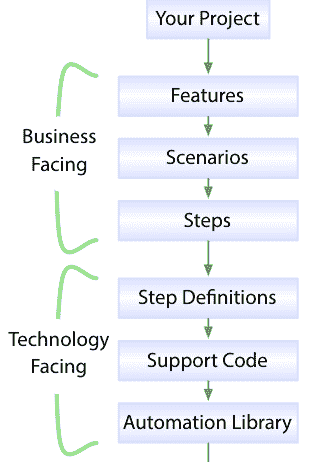
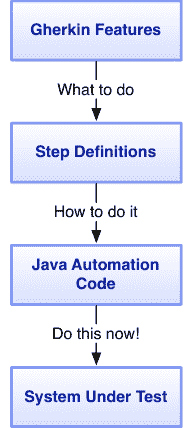
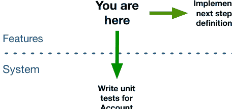
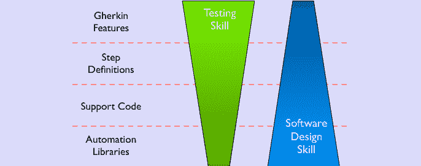
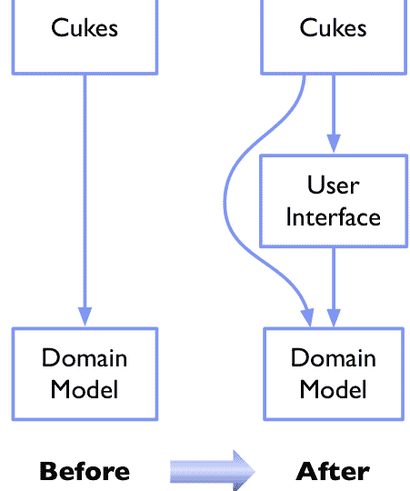
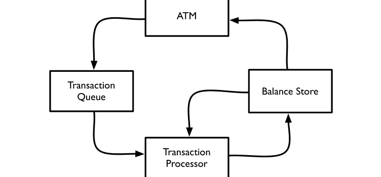
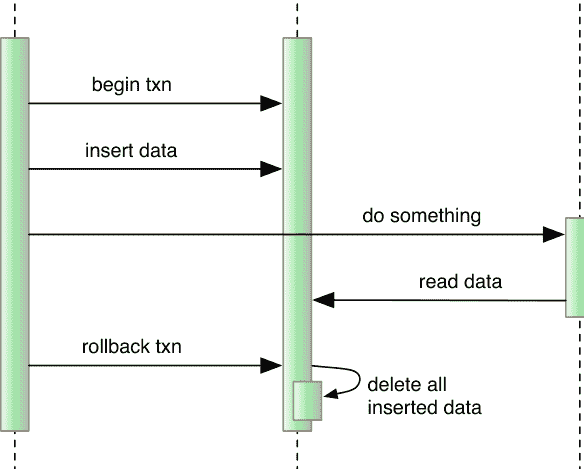
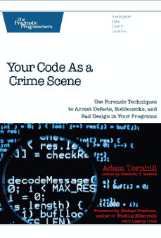
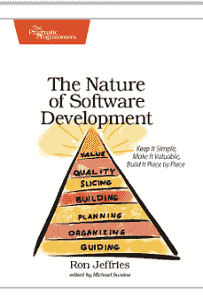
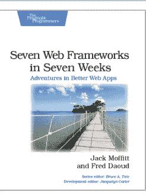

# Java Cucumber 指南


## 读者对《Cucumber for Java 实战》的评价

这本书不仅适用于程序员，也适用于测试人员。它超越了 Cucumber 本身：它不仅提供了测试指南，还提供了避免糟糕测试的提示和技巧。

- **Janet Gregory**，《敏捷测试：测试人员的实用指南》（与 Lisa Crispin 合著）

> “如果你在早上读这本书，然后尽快找到一个利益相关者，那么在下午你就能和他们一起编写出有效的场景了。从今天开始吧。”
>
> — **J.B. Rainsberger**，《单元测试食谱》

> “这本书最棒的地方在于：它将帮助你识别**为什么**可能想要使用 Cucumber，并引导你与整个团队协作，以良好的方式来实现它。”
>
> — **Lisa Crispin**，《敏捷测试：测试人员的实用指南》（与 Janet Gregory 合著）

> “这是一本关于在 JVM 上使用 Cucumber 的极佳介绍，它清晰地引导读者理解 API 的复杂性，并避开在真实项目应用中常见的常见陷阱。”
>
> — **Nat Pryce**，《由测试引导的面向对象软件增长》（与 Steve Freeman 合著）

> “这本书不仅深入探讨了在 Java 环境有效使用 Cucumber 的技术细节，还涵盖了如何通过交替使用系统行为的可读示例来成功驱动实现等更广泛的问题。因此，它将成为整个团队极具价值的参考书。”
>
> — **David Evans**，《改进你用户故事的 50 个快速想法》（与 Gojko Adjić 合著）

> “如果你以测试优先的方式实现应用程序，采取细小而谨慎的步骤，并交替进行实现和重构阶段，你的测试将告诉你下一步该做什么。听听你的测试，也听听这本书！”
>
> — **Gáspar Nagy**，SpecFlow - .NET 版 Cucumber 的创建者

> “这本书将教你入门 Java 平台上的 Cucumber 所需的所有知识……尽管作者确保了非程序员也能跟上进度。它将出现在我的书架上，以及我在培训课程中提供的书籍推荐里。”
>
> — **Markus Gaertner**，作者，《示例 ATDD》

> “对于软件项目构建维护者来说，这是一份优秀的参考指南，因为作者仔细处理了 Cucumber 与 Java 平台其他常用工具的集成，如 JDBC、数据库、依赖注入容器（如 CDI 和 Spring Framework）以及 REST 服务端点。”
>
> — **Peter Pilgrim**，作者，《Java EE 7 开发人员手册》

> “《Cucumber for Java 实战》满足了一个重要需求——庞大的 Java 社区拥有 Cucumber 这一强大工具，但关于如何有效使用它的文档非常少。这是我将推荐给那些想要快速上手 Cucumber 的 Java 客户的书籍。”
>
> — **Richard Lawrence**，BDD 培训师兼教练，Agile for All

> “对 JVM 上 Cucumber 的一个温和而全面的介绍。这是一本关注细节的极佳循序渐进式指南。”
>
> — **Paul Grenger**，Naked Element 和 NorDevCon 创始人

> “书中的内容基于真实经验，并对我们作为测试人员/软件架构师/经理在内部和外部面临的日常问题表示认同。”
>
> — **Márton Mészáros**，Tailored Tunes 创始人及测试自动化专家

> “作者很好地结合了技术性和非技术性的教训。对于初学者和经验丰富的 BDD 追随者来说，这都是非常好的读物。”
>
> — **Craig Harrison**，软件工程师

Seb Rose

Matt Wynne

Aslak Hellesøy

制作本书的团队包括：

Jacquelyn Carter（编辑）

Potomac Indexing, LLC（校对编辑）

Liz Welch（编辑）

Dave Thomas（排字）

Janet Furlow（制作）

Ellie Callahan（支持）

---

### 第一部分 Cucumber 基础

### 第二部分 实例演示

### 第三部分 更多技巧

- 我们刚刚学到的内容 ................................................................. 272
- 15. 与 REST Web 服务协作 ................................................................. 273
- A1. 安装 Cucumber .................................................................................................................................... 293
- A2. Cucumber 与其他 JVM 语言 ....................................................................................................... 297
- A3. 参考文献 ................................................................................................................................................................... 307

---

# 前言

好了，在我们做任何其他事情之前，让我们确保我们谈论的是那个测试工具。对吧？Cucumber。那个验收测试工具。我的意思是，如果你对它一无所知，你就不会拿起这本书的。对吧？我的意思是，你是个软件人员，对吧？

所以，你可能在想，既然 Cucumber 用起来如此简单，这本书到底能教给你多少有东西呢。我的意思是，你可能见过、甚至写过一些 Gherkin 场景，也可能见过一些 Cucumber 测试的运行。你可能看过一两个视频，所以你知道 Cucumber 是什么样子的。所以也许你是在看页数，或者只是在看这本书有多厚，在想：“真的有那么多可以聊的吗？”你可能会怀疑这本书就像所有其他书一样，充满了空洞的描述、空洞的建议和无聊的重复，为了填满空间并让它看起来很厚、很重要。

嗯，把这些念头抛出脑外吧——因为，相信我，这本书可能很厚，但它也非常硬核。（呃……）这部分没印出来……但是……

> [注：第 11-12 页的 OCR 文本包含大量的损坏/重复和碎片化句子。根据“保留原始语言和所有信息”以及“不要删除或总结”的指令，以下是所提供片段的清理版本，移除了看起来像是去连字符或 OCR 错误产生的去噪/伪迹（如“meat”或“pant”），同时保持了可能的连贯性。]

> [注：11-12 页的 OCR 具有重复性。文本“Foreword • xii”表示前言部分的结束。]

前言 • xii

# 致谢

我们首先想要感谢的是数百位为 Cucumber 社区做出贡献的你们。无论是在邮件列表上分享想法、经验和意见，在 IRC 频道中帮助他人，还是为代码库贡献新功能和 Bug 修复，这一切都是帮助的。没有你们的贡献，就没有 Cucumber，也就没有这本书。

写这本书付出的努力比我们任何人的预想都要多得多。在整个过程中，我们的编辑 Jackie Carter 一直耐心地守候在我们身边，在我们需要时安抚我们，在我们应该被指正时指正我们，并在每一个机会提供深思熟虑的反馈。Jackie 对你正在阅读内容的质量做出了巨大贡献，她的名字完全配得上它在封面上的位置。

感谢我们的审稿员：

- Nat Pryce, Morton Meszaros, Tim Pizey
- Roberto Lo Giacco, Gáspar Nagy, Craig Harrison
- Kev McCabe, Paolo Ambrosio, Simon Spencer
- Leslie Brooks, Jim Spearman, Axel He

你们的建议和鼓励令我们不胜感激。

特别感谢 Paolo Ambrosio 和 Krzysztof Jelski，他们帮助应对不断变化的 Spring 集成；并感谢 Ulises Cerviño Beresi，他们提供了及时的 Clojure 翻译。

感谢所有留下反馈的测试读者，他们帮助我们纠正了自己永远无法察觉的小错误。

我们非常感谢 Uncle Bob（马丁叔叔）富有洞见且幽默的远见。考虑到他所写内容的赞誉程度，你可能会认为我们用金钱或威胁影响了他——但我们没有。诚实地说，由于他喜欢我们的书就像我们喜欢他的书一样，我们感到非常自豪。

所以，这是我的建议。准备好学习！准备迎接一顿需要很长时间才能吃、更长时间才能消化的大餐。你不会失望的。这本书值得付出时间和精力。

Robert C. Martin (Uncle Bob)

来自 Seb：致 Claire、Megan、Angus，感谢你们在过去一年里忍受我的频繁缺席——这可能不是缺席的结束，从现在起我需要一个新的借口了。如果没有 *The Cucumber Book* 的成功，Java 版就没有什么东西可以重写了，所以感谢 Matt 和 Aslak。此外，如果没有 Cucumber 从 Ruby 移植到 JVM，这本书根本就没有任何存在的必要，所以额外感谢 Aslak 和整个 Cucumber-JVM 团队。

来自 Matt：我想感谢 Songkick 团队，特别是 Sabrina Leandro、Niko Felger、Dan Lucraft、Phil Cowans 和 Matt Johnson。此书中的许多教训都是和你们一起学到的。最感谢我出色的妻子 Anna，感谢她相信这个项目并给予了我真正完成它所需要的支持。想象一下，在书完成后，我们现在能做多少事情吧！

来自 Aslak：爸爸，感谢你在 1981 年远见卓识为我买了一台 Commodore 64。Patricia，我亲爱的妻子——感谢你无数小时的耐心和鼓励。感谢你想出了这个既傻又洗脑的名字 Cucumber！

---

# 前言

公司在信任方面往往存在巨大问题——客户不信任供应商，业务部门不信任开发者，开发者不信任测试人员，而测试人员不信任任何人。Cucumber 为业务部门、开发者和测试人员提供了一种协作和规范的方法，用纯英语描述系统应该如何工作。我们已经看到这些关于简单 Cucumber 规范的对话是如何开启恢复过程的。

从这些对话中产生了一系列所有利益相关者都能理解的规范。Cucumber 能够对规范进行直接自动化，这意味着任何人都可以一眼看出哪些功能已经实现，哪些尚未实现。它还为开发团队提供了一个安全网，这样如果他们正在进行的更改破坏了任何现有功能，就能获得早期反馈。它还让你的测试人员解放出来，去做更有趣、更具创造性的工作，而不是定期运行重复的人工回归测试模式。

Cucumber 现在已被许多团队使用，并以不同的方式从中获益。我们这些从一开始就被 Cucumber 吸引的人直观地意识到，它不仅仅是一个测试自动化工具；它更是一个协作工具。让我们明确一点——Cucumber 可以用于测试自动化——但这并不是其创作者的初意，我们的一些设计选择也反映了这一点。通过编写这本书，我们希望不仅向你展示如何使用 Cucumber，还向你展示如何“正确地”使用它。

Cucumber 最初是用 Ruby 编写的。多年来，它变得极其流行并被移植到许多其他语言。这本书是 *The Cucumber Book* 的 Java 版本，包含了关于如何协作交付稳健应用程序的优秀建议，但所有代码都完全用 Java 重写，并增加了涵盖 Java 版 Cucumber 特有功能的新章节。

---

# 这本书适合谁

Cucumber 的设计旨在帮助软件团队中技术成员和非技术成员之间建立桥梁，我们尝试考虑了这两种读者。书的大部分内容是为技术读者写的，即对测试自动化感兴趣且已经具备编程技能的人。然而，有几个章节——尤其是书的第一部分中解释如何编写规范的部分——是更多地考虑了非技术读者的。这些章节是：

- 第 6 章，保持你的 Cucumber 清新，位于第 91 页
- 第 16 章，与遗留应用协作，位于第 285 页

随着书的展开，我们将查看更复杂的测试情况，阅读这些章节所需的专业知识水平将会增加。

---

# 你不需要成为 Java 专家

Java¹ 是一种编程语言，可以在所有主流操作系统上安装和运行。Cucumber 已被移植到许多编程语言中，但这本书是关于用 Java 编写的版本。

这并不意味着你正在测试的系统必须用 Java 编写。Java 有许多库，可以使其能够与其他语言和平台通信，我们将向你展示如何使用它们来测试可能用任何语言编写的 Web 系统。此外，由于虚拟机（JVM）支持许多编程语言，Java 版的 Cucumber 与其他 JVM 语言编写的程序（如 Groovy、Scala 和 Clojure）配合良好。

为了跟上技术章节中的代码示例，如果你熟悉 Java 将对你很有帮助。Java 不是容易学习的语言，但也不是最难的，而且我们将使用的 Java 示例是刻意简单的。

---

# 你不是测试驱动也没关系

我们在 Cucumber 上的最大成功是作为“自外向内”（outside-in）方法的一部分，从一个失败的 Cucumber 测试开始，并以此驱动我们对应用程序代码的开发工作。作为开发者，这种工作方式帮助我们保持诚实，并避免构建那些没有人要求的功能的功能诱惑，以防将来某天可能需要。

Cucumber 是促进这种工作方式的工具，但它并不强迫你这样做。有些团队使用 Cucumber 为开发者已经完成的工作编写自动化测试。这通常是采纳“自外向内”方法的第一步，因为 Cucumber 的可读测试开始吸引团队技术利益相关者的注意力，将他们引入流程之中。即使你使用 Selenium 等替代方案而非 Cucumber，我们认为你仍然会从中获益匪浅。

---

# 为什么你应该听我们的

所有作者都开发了多年软件，我们花了许多时间让自己的想法受到挑战。Cucumber 创建于 2008 年，Matt 是它最活跃的用户之一。我们使用 Cucumber 测试过所有系统，从 Ruby on Rails 到企业级 Java 服务。Cucumber 社区充满了活跃的辩论，我们尽可能地提炼了这些经验。

---

# 本书的结构

书分为三个部分。在第一部分，我们将带你了解使用 Cucumber 所需的核心概念。新手读者将学习上手所需的所有内容，而已经熟悉 Cucumber 的读者应该可以获得很多有用的细节。

第二部分通过一个开发新应用程序的实践示例进行。你将与我们一起从零开始构建，这给你一个巩固第一部分中学知识的机会。我们还将在第三部分教你一些 Cucumber 的高级功能，并更详细地查看如何为 Java 配置 Cucumber。

## 书中包含的内容

虽然可以使用 Cucumber 测试 Flash 和移动应用程序，但遗憾的是，细节超出了本版的范围。本书涵盖了原生运行在 JVM 上的 Java 版 Cucumber，但不会涵盖与其他 JVM 语言一起使用。Cucumber 的线路协议（一种通过套接字驱动远程系统的协议）也超出范围。

## 运行代码示例

书中充满了实践示例，我们鼓励你跟随它们以获得书的最大收益。如果你在阅读时手动输入会学到更多，但如果你愿意，也可以从书的网站下载代码示例²。要运行示例，你需要安装 Java 语言以及 Maven 项目管理工具。你可以在附录 1 Cucumber 位于第 293 页找到完整说明。

## Windows 用户

大多数代码示例在 Windows 和 *nix 操作系统上是相同的。在少数出现差异的情况下，你将在附近的侧边栏找到 Windows 版本，并在所指的正文中给出注释。

你会注意到我们使用 `$` 符号作为命令提示符。这对于 Linux 或 Mac 用户来说很熟悉，但对 Windows 用户来说可能感到有些陌生。所以，当你看到类似这样的时：

```
$ mvn clean test
```

尝试想象你看到的是这个：

```
C:\> mvn clean test
```

¹ http://java.com

² http://pragprog.com/titles/srcuc/source_code

---

# 在线资源

书中所示的应用和示例可以在此本书对应的 Pragmatic Programmers 网站找到。你还可以找到社区论坛，如果你在完成书中的某些练习时遇到困难，可以在那里寻求帮助；以及错误提交表单，你可以在那里报告文本中的问题或对未来的版本提出建议。

如果你有关于 Cucumber 的通用问题，Cucumber 社区将欢迎你加入他们的邮件列表。Cucumber 是一个开源工具，这意味着为小组贡献的每个人都是在投入自己的时间，因此在邮件列表上寻求帮助之前，请确保你已经尽可能彻底地研究了你的问题。如果人们看到你正在尝试自己解决问题，他们会更有可能帮助你。

Seb Rose, Matt Wynne, 和 Aslak Hellesøy

2015年2月

- 4. https://groups.google.com/forum/#lforum/cucumber

---

# 第一部分

## Cucumber 基础

在书的第一部分中，我们开始讨论行为驱动开发（BDD），以及为什么世界各地的组织发现它能帮助他们为客户交付更多价值。我们将通过几个简单的示例向你介绍 Cucumber 团队如何以行为驱动的方式工作，但不会涉及过深的技术。事实上，书的这部分适合整个团队——包括产品所有者、经理、设计师和客户。

理解 BDD 不是一种“万灵药”解决方案是非常重要的，因此我们还会花一些时间看看事情可能会变得出错。我们见过 BDD 帮助过各种组织，一旦你能够识别（并纠正）新接触 Cucumber 的团队所常见的常见症状，我们有信心它也能帮助你的团队。

---

# 第 1 章

## 为什么选择 Cucumber？

软件源于一个想法。

假设这是一个好主意——一个可以让世界变得更好，或者至少让某人赚点钱的主意。软件开发者的挑战是将这个想法变为现实，变成一个能够交付利益的东西。


# 原始想法与沟通挑战

原始的想法是完美且美丽的。如果产生主意的人恰好是一个才华横溢的软件开发者，那么我们可能很幸运：想法可以直接转化为运行的软件，而无需向其他人解释。但更多时候，拥有原始想法的人并不具备实现它所需的编程技能。现在，这个想法必须从一个人的脑海进入到其他人的脑海。它需要被沟通。

大多数软件项目都涉及几个人协作工作的团队，因此高质量的沟通对他们的成功至关重要。正如你可能知道的，良好的沟通不仅仅是向他人描述你的想法；你还需要寻求反馈以确保你的理解是正确的。这就是为什么敏捷软件团队学会了以小增量的方式工作，使用增量构建的软件作为反馈向利益相关者表示：“这就是你的意思吗？”

即使如此仍然是不够的。如果团队在为期两周的迭代中实现了一个误解，他们不仅浪费了两周的努力，还用无法反映原始想法的概念和功能破坏了代码库的完整性。其他开发者可能已经无意中开始在这些糟糕的主意之上构建更多代码，导致代码库可能永远无法正确地反映业务领域。

我们需要一种过滤器来保护我们的代码库免受被误解的想法的影响。

# 自动化验收测试

自动化验收测试的想法源于极端编程¹（XP），特别是在测试驱动开发²（TDD）的实践。

与其由业务利益相关者将需求传递给开发团队而没有反馈的机会，不如让开发者和利益相关者合作编写自动化测试，用以表达利益相关者想要的结果。我们称它们为验收测试，因为它们表达了软件需要做什么才能让利益相关者认为是可以接受的。测试在编写时会失败，因为还没有编写任何代码，但它捕捉了完成工作所需的条件。

这些测试与单元测试不同，单元测试面向开发者，帮助他们推导出并检查他们的软件设计。有时说，单元测试确保你“把事情做对”，而验收测试确保你“做了对的事”。

自动化验收测试已经是优秀 XP 团队的一项成熟实践，但许多经验较少的敏捷团队似乎认为 TDD 仅仅是程序员的活动。正如 Lisa Crispin 和 Janet Gregory 在《敏捷测试：面向测试人员和敏捷团队的实用指南》[CG08] 中指出的，没有面向业务的验收测试，程序员很难知道他们需要编写哪些单元测试。自动化验收测试帮助你的团队专注于重点，确保你在每次迭代中做的工作是你可能所做的最有价值的事情。你仍然会犯错——但犯的错会少得多——这意味着你可以回家享受你余生的生活。

# 行为驱动开发

行为驱动开发（BDD）通过将优秀 TDD 实践者的良好习惯形式化，建立在测试驱动开发（TDD）之上。优秀的 TDD 实践者从外向内工作，从一个失败的客户验收测试开始，该测试从客户的角度描述了系统的行为。作为 BDD 实践者，我们特意编写验收测试作为团队可以阅读的示例。我们利用编写这些示例的过程从业务利益相关者那里获得反馈：

1.  在我们开始之前，确认我们是否正致力于构建正确的东西。
2.  在我们做的过程中，我们刻意努力开发一种关于系统的共享、通用语言。

## 参考资料

- 1. 《极端编程：拥抱变化》[Bec00]
- 2. 《测试驱动开发：实例教程》[Bec02]
- 3. <http://behaviour-driven.org/>

# 通用语言

正如埃里克·埃文斯在他的书籍《领域驱动设计》[Eva03] 中描述的，许多软件项目面临着领域专家和团队程序员之间沟通质量低下的问题：

> “当一个项目的语言碎片化时，它就会面临严重问题。领域专家使用他们的专业术语，而技术团队有针对设计调整过的语言……跨越这一语言鸿沟，领域专家模糊地描述他们想要的。开发者在努力理解对他们来说是新的领域时，模糊地理解。”

通过团队有意识的努力，可以产生一种被项目中的所有人使用和理解的通用语言。当团队在对话、文档和代码中一致使用这种语言时，翻译每个人不同方言的摩擦就消失了，误解的概率也大大降低。

Cucumber 通过为语言鸿沟的两端提供一个会合点，有助于团队内部通用语言的发现和使用。Cucumber 测试直接与开发者的代码交互，但它们是用利益相关者可以理解的媒介和语言编写的。通过合作编写这些测试——协作规范——团队成员不仅决定下一步需要实现什么行为，而且学会了如何用共同语言描述这种行为。

当我们在开发开始之前编写这些测试时，我们可以在它们渗透进代码库之前，探索并消除许多误解。

# 示例

让 Cucumber 在众多工具中脱颖而出的是它经过专门设计，以确保验收测试可以被团队中的任何人轻松阅读和编写。这揭示了验收测试作为沟通和协作工具的真正价值。Cucumber 验收测试的可读性将利益相关者引入过程，帮助你探索和理解他们的需求。

这里有一个 Cucumber 验收测试的示例：

## 特性：注册

注册过程应该是快速且友好的。

### 场景：注册成功

新用户应该收到一封确认邮件，并在登录后受到网站的个性化问候。

+ 假设我选择了注册
+ 当我使用有效信息进行注册时
+ 那么我应该收到一封确认邮件
+ 并且我应该看到一条个性化的问候消息

### 场景：重复邮箱

当有人尝试为一个已存在的邮箱地址创建账户时。

+ 假设我选择了注册
+ 当我使用已经注册过的邮箱地址进行注册时
+ 那么我应该被告知该邮箱已注册
+ 并且我应该获得找回密码的选项

注意测试是如何被指定为我们希望系统在特定场景下行为的*示例*的。使用此类示例会产生意想不到的强大效果，能让人们在系统构建之前就对其进行视觉化处理。所有团队成员都可以阅读测试，并告诉您它是否反映了他们对系统应该做什么的理解，这很可能激发他们的想象力，去思考你可能也需要考虑的其他场景。Gojko Adzic 的书籍 *Specification by Example* [Adz11] 包含了许多团队发现这一点并利用其优势的案例研究。

这种风格编写的验收测试不仅仅是测试；它们变成了可执行的规范。

# 活文档

Cucumber `feature files`（特性文件）具有传统规范文档的优点，即可以由业务利益相关者编写和阅读，但它们有一个明显的优势：计算机可以理解它们。在实践中，这意味着你的文档不再是写一次后就过时的东西，而是变成反映项目真实状态的“活”的东西。

# 事实渊源

对于许多团队来说，Cucumber 特性文件成为系统功能的定义的事实渊源。在一个单一的地方获取这些信息可以节省大量时间，这些时间通常被浪费在保持需求文档、测试和代码同步上。拥有单一事实渊源有助于建立团队内部的信任，因为团队的不同部分不再拥有自己版本的“真相”。

# Cucumber 如何工作

在我们深入书籍的核心内容之前，让我们通过对典型 Cucumber 测试套件的高层概述来为你提供一些背景知识。这种从特性到自动化库的结构如图所示。

Cucumber 最初由 Ruby 社区的成员作为命令行工具创建。此后它已移植到几个开发环境，包括 Java，以便让更多人享受它的好处。当你运行 Cucumber 时，它会从名为 `features` 的纯文本文件中读取你的规范，检查其中待测试的场景，并在你的系统上运行这些场景。每个场景都是 Cucumber 执行的步骤列表。为了让 Cucumber 能理解这些特性文件，它们必须遵循一些基本的语法规则。这组规则称为 Gherkin。



除了特性之外，你还为 Cucumber 提供一组步骤定义（`step definitions`），这些定义将每个步骤的业务可读语言映射为代码（在本书中使用 Java 编写），以执行步骤所描述的任何操作。在一个成熟的测试套件中，步骤定义本身可能只有一两行代码，委托给一个针对你应用程序领域的支持代码库，该库知道如何执行系统上的常见任务。这些任务有时可能涉及自动化库，例如浏览器自动化库 Selenium，以便与系统本身进行交互。

如果步骤定义中的代码执行无错误，Cucumber 将继续执行场景中的下一步。如果它运行到场景末尾而没有任何步骤抛出错误，它将该场景标记为通过。然而，如果场景中的任何步骤失败，Cucumber 将该场景标记为失败，并移动到下一个。随着场景的运行，Cucumber 会打印结果，向你准确显示哪些在正常工作，哪些没有。

简而言之，Cucumber 还有许多其他优势使其成为极佳的选择：你可以用四十多种不同的口语语言编写规范，可以使用标签（`tags`）来组织和分组你的场景，并且你可以轻松地与许多高质量的自动化库集成以驱动几乎任何类型的应用程序。所有这些以及更多内容将在阅读本书其余部分时变得清晰。

# 我们刚刚学了什么

让我们回顾一下目前为止涵盖的内容。

- 当开发者和业务利益相关者之间沟通清晰良好时，软件团队的工作效果最好。实现这一点的极佳方法是使用自动化验收测试协作指定即将完成的工作。
- 当验收测试以示例的形式编写时，它们会激发人们的想象力，并帮助他们看到以前没有考虑过的场景。
- 当团队成员协作编写验收测试时，他们可以开发出用于讨论业务领域的自己的通用语言（`ubiquitous language`）。这有助于他们避免误解。
- Cucumber 专为帮助业务利益相关者参与编写验收测试而设计。
- Cucumber 中的每个测试用例被称为 `scenario`（场景），场景被分到 `features`（特性）中。每个场景包含几个步骤。
- Cucumber 测试套件中面向业务的部分存储在特性文件中，必须根据语法规则（称为 Gherkin）编写，以便 Cucumber 能够读取它们。
- 在底层，步骤定义将从面向业务的步骤语言翻译为代码。

为了说明这些概念，在下一章中，我们将直接深入并构建一个非常简单的应用程序，使用 Cucumber 来驱动开发。

# 尝试一下

Cucumber 有它自己的通用语言。你能列出你在本章中学到的 Cucumber 领域术语，并描述你认为每个术语的含义吗？

# 第 2 章

## 初尝

我们猜你已经迫不及待要开始了，我们将通过一个简单的示例让你感觉如何使用 Cucumber。你可能还没有完全理解这里发生的一切，但在接下来的几个章节中，我们将回来完善细节。

假设你想要跟随本操作（你需要安装依赖管理工具，如 `Maven`、`Ant` 或 `Gradle`），但对于我们的第一个示例，我们将直接运行 Cucumber。

创建一个新文件夹来放置它们：

```
mkdir checkout
cd checkout
```

那么……我们开始吧？

我们将让 Cucumber 引导我们完成结账程序，所以让我们立即从 `checkout` 文件夹运行 cucumber：

```
$ java -cp "jars/*" cucumber.api.cli.Main -p pretty
```

在 `[]` 处未找到 features。

- Scenarios
- Steps
  0m.000s

这里有很多操作，所以让我们仔细查看命令行。首先，我们调用了 `java` 解释器，指定了类路径以执行包含 `cucumber.api.cli.Main` 类中的入口点。该类包含了实现 Cucumber 命令行界面（CLI）的代码，它允许我们控制 Cucumber 搜索要运行测试的方式。在这种情况下，我们向 Cucumber 传递了两个东西：

- `-p` 告诉 cucumber 使用 pretty 格式化插件（你稍后就会知道为什么）
- 一个指向我们 feature 文件位置的路径

我们还没有编写任何 feature 文件，这就是为什么当我们运行 Cucumber 时，它给了我们一个友好的错误信息“No features found at [].”。

这需要输入很多内容，所以让我们把它放到脚本中。在项目根目录（称为 `/checkout`）下，使用你喜欢的文本编辑器创建一个名为 `cucumber` 的文件（如果你使用的是 Windows，则为 `cucumber.bat`）。输入以下文本：

```
first_taste/01/cucumber
java -cp "jars/*" cucumber.api.cli.Main -p pretty
```

如果你在 Unix 风格的操作系统上工作，你可能需要在运行新的 shell 脚本之前使 `cucumber` 文件可执行：

```
$ chmod u+x cucumber
$ ./cucumber
```

如果你在 Windows 上工作，只需运行批处理文件（以后当你在文本中使用 `/checkout` 时都使用此命令）：

```
C:\checkout> cucumber.bat
```

无论你使用哪种操作系统，你都应该得到与我们第一次完全相同的输出：

```
No features found at [].
- Scenarios
- Steps
  0m.000s
```

现在是时候创建我们的第一个 feature 了。我们可以在当前文件夹中创建它，但很快就会变得混乱，所以让我们创建一个文件夹：

```
$ mkdir features
```

现在让我们在 features 文件夹中创建一个空的 feature 文件。如果你正在运行 Windows，可以使用这些命令：

```
C:\checkout> cd features
C:\checkout\features> type nul > checkout.feature
```

在其他操作系统上，执行这些命令：

```
$ cd features
$ touch checkout.feature
```

然后我们修改 shell 文件，告诉 Cucumber 在哪里找到我们的 feature 文件：

```
first_taste/01/cucumber
java -cp "jars/*" cucumber.api.cli.Main -p pretty features
```

现在，让我们再次运行 cucumber：

```
$ ./cucumber
```

```
No features found at [features]
- Scenarios
- Steps
0m.000s
```

每个 Cucumber 测试被称为一个 scenario，每个 scenario 都包含告诉 Cucumber 要做什么的步骤。此输出意味着 Cucumber 正在愉快地扫描 features 目录，但它没有找到任何要运行的 scenario。让我们创建一个。

我们的研究显示 67% 的购物者都会买香蕉，所以我们从这里开始。在你喜欢的编辑器中，编辑你刚刚创建的空文件 `checkout.feature`：

```
first_taste/02/features/checkout.feature
Feature: Checkout
Scenario: Checkout a banana
Given the price of a "banana" is 40c
When I checkout 1 "banana"
Then the total price should be 40c
```

这个 feature 文件包含了我们 checkout 类的第一个 scenario。我们将在本章开始时给出的示例之一翻译成了 Cucumber，我们可以要求计算机运行它，一次又一次。你可能已经看到，Cucumber 期望此文件具有某种结构。`Feature`、`Scenario`、`Given`、`When` 和 `Then` 关键字是结构，其他所有内容都是文档。虽然书中某些关键字被高亮了——它们在你的编辑器中可能也是这样——但它只是一个纯文本文件。这种结构被称为 Gherkin。

当你保存此文件并运行 cucumber 时，你应该看到比上次多得多的输出：

```
$ ./cucumber
Feature: Checkout

Scenario: Checkout a banana # checkout.feature:2
Given the price of a "banana" is 40c
When I checkout 1 "banana"
Then the total price should be 40c

1 Scenarios (undefined)
3 Steps (undefined)
0m0.0s
```

你可以使用下面的代码片段来实现：

```
@Given("the price of a \"(.*?)\" is (\\d+)c$")
public void the_price_of_a_c(String arg1, int arg2) throws Throwable {
    // Write code to turn phrase into concrete actions
    throw new PendingException();
}

@When("I checkout (\\d+) \"(.*?)\"$")
public void i_checkout(int arg1, String arg2) throws Throwable {
    // Write code to turn phrase into concrete actions
    throw new PendingException();
}

@Then("the total price should be (\\d+)c$")
public void the_total_price_should_be_c(int arg1) throws Throwable {
    // Write code to turn phrase into concrete actions
    throw new PendingException();
}
```

哇，有很多东西！让我们看看发生了什么。首先，我们注意到 Cucumber 输出了三个片段。这些是步骤定义的示例代码。由于 Cucumber 使用 ANSI 序列，你可能在控制台中看到彩色文本。如果你在 Windows 上工作，你需要安装一个小型应用程序来正确渲染它们。请参阅附录 1 安装 Cucumber，第 29 页。

现在我们将实现步骤定义，使我们的 scenario 不再是未定义的。

## 彩色控制台输出

如果你在 Windows 上工作，你可能在控制台中看到彩色文本。由于 Cucumber 使用 ANSI 序列输出，你可能在控制台中看到彩色文本。如果你在 Windows 上工作，你需要安装一个小型应用程序来正确渲染它们。请参阅附录 1 安装 Cucumber，第 29 页。

## 创建步骤定义

不用深思它们意味着什么，让我们把 Cucumber 上次输出中的片段复制粘贴到新的 Java 文件中。Cucumber 不在乎你称它为什么，只要它是一个 Java 文件，但这是一个很好的名称。在文本编辑器中打开并输入以下类定义：


## 代码片段

```java
__taste/04/step_definitions/CheckoutSteps.java
package 04.step_definitions;

import cucumber.api.java.en.*;
import cucumber.api.PendingException;

public class CheckoutSteps {
}
```

现在粘贴这些片段：

`first_taste/04/step_definitions/CheckoutSteps.java`

```java
package step_definitions;

import cucumber.api.java.en.*;
import cucumber.api.PendingException;
```

```java
public class CheckoutSteps {
    @Given("the price of a \".*\" is (\d+)c")
    public void thePriceOf(String arg, int arg2) throws Throwable {
        // Write code that turns the phrase above into concrete actions
        throw new PendingException();
    }

    @When("I checkout (\d+) (.*)")
    public void iCheckout(int arg1, String arg2) throws Throwable {
        // Write code that turns the phrase above into concrete actions
        throw new PendingException();
    }

    @Then("the total price should be (\d+)c")
    public void theTotalPriceShouldBe(int arg1) throws Throwable {
        // Write code that turns the phrase above into concrete actions
        throw new PendingException();
    }
}
```

## 编译与运行

我们现在想做的是运行 Cucumber，让它告诉我们下一步要做什么，但在那之前，我们需要编译新的 `CheckoutSteps` 类并将其添加到类路径中。通常我们不会费心在自己喜欢的 IDE 中工作，但由于我们是从命令行操作的，现在我们将编辑 `cucumber` shell 脚本文件，使其在编译我们的 Java 代码的同时调用 Cucumber。

```bash
first_taste/04/step_definitions/CheckoutSteps.java
java -cp "jars/*" step_definitions.cucumber.api.java.Main -p pretty -snippets- \
    -g step_definitions features
```

第 1 行编译了我们刚刚创建的 `CheckoutSteps` 类。第 2 行调用了 Cucumber。这里 的调用有两个细微的添加：

1. 我们将当前目录 `.` 添加到了类路径。
2. 我们添加了 `-g step_definitions` 命令行参数，以告诉 Cucumber 去哪里寻找它需要的步骤定义，这些定义将把 feature 文件中的步骤“粘合”到结账应用程序（我们还没有编写该程序）。

现在，让我们再次执行 `./cucumber` 看看下一步需要做什么：

## Seb 说：类路径分隔符

Java 类路径的语法取决于底层的操作系统。对于 *nix* 系统，分隔符是冒号 (`:`) ，而 Windows 操作系统的分隔符是分号 (`;`) 。

我们在本章中展示了 `cucumber` 脚本，这是为 *nix* 用户准备。你还会在下载的代码中找到 `cucumber.bat` 文件，它包含了完全相同但针对 Windows 格式格式化的操作。

## Feature: Checkout

```gherkin
Scenario: Checkout a banana # checkout.feature:2
Given the price of a "banana" is 40c #CheckoutSteps.thePriceOf(String,int)
cucumber.api.PendingException: TODO: implement me
at step definitions.CheckoutSteps.thePriceOf(CheckoutSteps.java:12)
at Given the price of a "banana" is 40c (checkout.feature:3)
When I checkout 1 "banana" # CheckoutSteps.iCheckout(int,String)
Then the total price should be 40c # CheckoutSteps.theTotalPriceShouldBe(int)
```

- 1 Scenarios (1 pending)
- 3 Steps (2 skipped, 1 pending)
- 0m.138s

```
cucumber.api.PendingException: TODO: implement me
at step definitions.CheckoutSteps.thePriceOf(CheckoutSteps.java:12)
at Given the price of a "banana" is 40c (checkout.feature:3)
```

场景已从“未定义（undefined）”变为“待处理（pending）”。这是一个好消息，意味着 Cucumber 正在运行第一步，而且它确实执行了我们在复制粘贴的步骤代码中调出的 `throw new PendingException()`，这告诉 Cucumber 该场景仍在进行中。我们需要将此异常替换为真实的实现。

注意，Cucumber 报告另外两个步骤为“已跳过（skipped）”。一旦遇到失败或待处理的步骤，Cucumber 就会停止运行该场景并跳过剩余步骤。

让我们实现第一个步骤定义。

## 实现我们的第一个步骤定义

我们决定这个版本的结账功能将是一个类，它将价格列表和购买的物品作为方法的参数。因此，在 `Given price of a banana is 40c` 的步骤定义中，我们的工作仅仅是记住香蕉的价格。在 `step_definitions` 文件夹中，编辑 `CheckoutSteps.java` 文件，使第一步看起来如下：

太好了，这很简单。现在我们写了一些 Java 代码，所以我们需要编译 `Checkout` 类并通过运行 `./cucumber` 再次运行 Cucumber。

```gherkin
Feature: Checkout
Scenario: Checkout a banana # checkout.feature:2
Given the price of a "banana" is 40c #CheckoutSteps.thePriceOf(String,int)
When I checkout 1 "banana" # CheckoutSteps.iCheckout(int,String)
cucumber.api.PendingException: TODO: implement me
at step definitions.CheckoutSteps.iCheckout(CheckoutSteps.java:17)
at I checkout 1 "banana" (checkout.feature:4)
Then the total price should be 40c #CheckoutSteps.theTotalPriceShouldBe(int)
```

- 1 Scenarios (1 pending)
- 3 Steps (2 skipped, 1 pending)
- 0m.26s

```
cucumber.api.PendingException: TODO: implement me
at step definitions.CheckoutSteps.iCheckout(CheckoutSteps.java:17)
at I checkout 1 "banana" (checkout.feature:4)
```

太棒了！第一步通过了。现在的场景仍然标记为待处理，因为我们还没有编写 `Checkout` 类。你可能觉得在写出并尝试运行 `Checkout` 类代码之前，完全知道 `Checkout` 类并不存在有点奇怪。我们是刻意这么做的，因为我们希望在编写解决方案之前，确保我们有一个功能完整的测试。这种纪律让我们相信，当测试通过时，我们真的完成了。这种温和的节奏是我们所说的*外向内开发（outside-in development）*的重要部分，尽管起初看起来很奇怪，我们希望在书中向你展示它的巨大好处。

从外向内开发的另一个好处是，我们有机会从用户的角度考虑 `Checkout` 类的命令行接口，而无需付出任何实现工作。在这个阶段，如果我们发现对接口的某些地方不满意，对我们来说很容易修改它。

现在我们创建一个存放实现的文件夹：

```bash
$ mkdir implementation
```

现在在 `implementation` 文件夹中创建一个名为 `Checkout.java` 的 Java 文件。用你的文本编辑器打开它并输入以下类定义：

```java
first_taste/08/implementation/Checkout.java
package implementation;
public class Checkout {
    public void add(int count, int price) {
}
```

我们需要将此添加到 `cucumber` 脚本的完整步骤中，并修改类路径以包含项目根目录：

```bash
first_taste/08/cucumber
javac -cp "jars/*:" step_definitions/CheckoutSteps.java \
implementation/Checkout.java
```

现在当你运行 `cucumber` 时，你应该看到以下输出：

```
- 1 Scenarios (1 pending)
3 Steps (2 skipped, 1 pending)
0m.81s

cucumber.api.PendingException: TODO: implement me
at step definitions.CheckoutSteps.iCheckout(CheckoutSteps.java:17)
at I checkout 1 "banana" (checkout.feature:4)
```

## 插件

Cucumber 插件允许你自定义工具的运行。我们将在第 14 页详细介绍插件。你可以通过以下命令查看可用的插件，并尝试使用一下它们：

```bash
first_taste/08/cucumber --help
```

## Cucumber 的输出

更改 Cucumber 输出。Cucumber 自带的插件可以生成 HTML 报告、用于如 Jenkins 这样的持续集成服务器的 JUnit 格式，以及更多。

## 测试我们的 Checkout 类

为了实现下一个步骤，编辑 `CheckoutSteps.java`，使第二个步骤看起来如下：

```java
first_taste/07/step_definitions/CheckoutSteps.java
@When("I checkout (\d+) (.*)")
public void iCheckout(int itemCount, String itemName) throws Throwable {
    Checkout checkout = new Checkout();
    checkout.add(itemCount, itemName);
}
```

这段代码尝试在 `Checkout` 类实例上调用 `add()` 方法，传递购买的物品数量和价格。这次当我们运行 `./cucumber` 时，应该得到编译错误，因为我们还没有创建 `Checkout` 类：

```
step_definitions/CheckoutSteps.java:15: error: cannot find symbol
  Checkout checkout = new Checkout();
symbol: class Checkout
location: class CheckoutSteps
```

我们的步骤失败了，因为我们还没有可以使用的 `Checkout` 类。

我们将 `Checkout` 类导入到 `CheckoutSteps` 中：

```java
first_taste/08/step_definitions/CheckoutSteps.java
import implementation.Checkout;
```

然后再次运行 Cucumber：

```
step_definitions/CheckoutSteps.java:19: error: cannot find symbol
checkout.add(itemCount, bananaPrice);
symbol:
    variable bananaPrice
    location: class CheckoutSteps
```

我们仍然遇到了一个语法错误。变量 `bananaPrice` 是 `PriceOfAISC()` 方法的局部变量，但我们正尝试在 `Checkout()` 中使用它。让我们把它移动到一个实例变量，以便 `CheckoutSteps` 中的所有步骤定义都能共享它：

我们现在有两个通过了测试的步骤和一个 `Checkout` 的骨架实现。

## 添加断言

为了让上一个测试恢复工作，请将 `step_definitions/CheckoutSteps.java` 中的步骤定义修改为如下所示：

```java
first_taste/10/step_definitions/CheckoutSteps.java
@Then("the total price should be (\\d+)\$")
public void theTotalPriceShouldBec(int total) throws Throwable {
    assertEquals(total, checkout.total());
}
```

我们正在使用 JUnit 断言来检查特征文件中的预期值是否与 `checkout` 的总额相匹配。如果不匹配，JUnit 将抛出错误。在可以编译之前，我们需要在 `step_definitions/CheckoutSteps.java` 中添加一个导入语句：

```java
first_taste/10/step_definitions/CheckoutSteps.java
import static org.junit.Assert.*;
```

我们还需要下载最新的 JUnit JAR 并将其放入 `jars` 文件夹中。

- 4. https://github.com/junit-team/junit/wiki/Download-and-Install

## 现在为 Checkout 添加 `total()` 方法的实现：

```java
first_taste/10/implementation/Checkout.java
public int total() {
    return 0;
}
```

当我们运行 `./cucumber` 时，我们得到了另一个编译错误：

```
step_definitions/CheckoutSteps.java:31: error: cannot find symbol
    assertEquals(total, checkout.total());
symbol: variable checkout
location: class CheckoutSteps
error
```

当我们在 `totalPriceShouldBeC` 中调用 `total()` 时，在 `iCheckout` 中创建的局部变量已经离开了作用范围。我们需要做的是把它变成 `CheckoutSteps` 的实例变量：

这是在同一个 Java 类中实现的不同步骤定义之间共享信息的常用方法。稍后你还会看到其他实现方法，但这是一个你会经常使用的简单方法。

当我们运行 `./cucumber` 时，我们有了一个真正的失败测试：

```
..F
- 1 Scenarios (1 failed)
3 Steps (1 failed)
0m0.099s

java.lang.AssertionError: expected:<40> but was:<0>
    at org.junit.Assert.fail(Assert.java:92)
    at org.junit.Assert.failNotEquals(Assert.java:646)
    at org.junit.Assert.assertEquals(Assert.java:127)
    at org.junit.Assert.assertEquals(Assert.java:471)
    at org.junit.Assert.assertEquals(Assert.java:455)
    at step_definitions.CheckoutSteps.totalPriceShouldBeC
    at .Then the total price should be 40c(checkout.feature:5)
```


太棒了！现在我们的测试是因为完全正确的原因失败的：它正在使用 `Checkout`，检查总额，并告诉我们总额应该是什么样子。这是一个停下来休息的自然时机。我们已经完成了这个版本最辛苦的工作：当我们回到这段代码时，Cucumber 将准确地告诉我们需要对程序做什么才能让它工作。如果所有的需求都能像这样带上失败的测试就绪，那么软件开发就会变得简单！

## 尝试一下

尝试为 `Checkout` 添加一个 `total()` 的实现，让测试通过。

```java
public void add(int count, int price) {
    runningTotal += (count * price);
}
```

```java
public int total() {
    return runningTotal;
}
```

首先，我们创建一个实例变量 `runningTotal`，用于跟踪运行总额。然后我们在 `add` 方法中对其进行递增。最后，我们在 `total` 方法中返回 `runningTotal`。

尝试一下。两种场景都通过了吗？太棒了！你刚刚用 Cucumber 构建了你的第一个程序。

# 我们学了什么

在这一章中，我们快速浏览了许多不同的内容，这些内容之后都会再次进行详细介绍。让我们总结并强调一些最重要的要点。

## 目录结构

Cucumber 需要你指定特性（features）和步骤定义（step definitions）的存放位置。

## 初学者之路

在进行示例的过程中，你注意到我们频繁运行 `../cucumber` 吗？

我们喜欢使用 Cucumber 进行由外向内（outside-in）开发的原因之一是它能帮助我们保持专注。我们可以让 Cucumber 引导我们完成所需的工作，让自己能够专注于创建一个优雅的解决方案。通过在每次做出更改时都运行 Cucumber，我们犯的任何错误都能被发现并解决，我们能获得关于进展的反馈和鼓励。

## Gherkin

Cucumber 测试使用一种名为 Gherkin 的语法来表示。Gherkin 文件是纯文本，扩展名为 `.feature`。我们将在[第 3 章，第 31 页的 Gherkin 基础]中详细讨论。

## 步骤定义

步骤定义是将你的 Cucumber 测试与你正在测试的应用程序结合在一起的胶水。整个部分协同工作，看起来有点像 17 页的图 1，Cucumber 测试套件的主要层。

你将在第 4 章[第 45 页的步骤定义：从外向内]中学习更多关于步骤定义的知识。

在对 Cucumber 特性进行了快速概览后，我们将放慢速度，进入更深层次的内容。在接下来的章节中，我们将层层深入，首先从查看 Gherkin 开始，这是我们用来编写 Cucumber 特性的语言。

## 尝试一下

看看你是否可以添加更多场景来驱动出一个更完整的实现。

例如，如果我们去结账两次香蕉会怎样？

```
first_test/15/features/checkout.feature
Scenario: 分别扫描两次香蕉
Given "banana" 的价格是 40c
When 我结账 1 个 "banana"
And 我结账 1 个 "banana"
Then 总价应为 80c
```

```
first_test/15/features/checkout.feature
Scenario: 一根香蕉和一个苹果
Given "banana" 的价格是 40c
And "apple" 的价格是 25c
When 我结账 1 个 "banana"
And 我结账 1 个 "apple"
Then 总价应为 65c
```

# 第 3 章

# Gherkin 基础

现在，由于你已经对 Cucumber 的工作原理有了一些信心，值得停顿片刻并进行一点学习。我们将查看 Gherkin，这是我们用来编写 Cucumber 特性的语言。

在本章结束时，你将理解如何为你的软件编写可以被利益相关者阅读并被 Cucumber 测试的规范。你将学习 Gherkin 关键字的作用，以及它们如何共同工作以形成可读的、可执行的 Cucumber 规范。

## Gherkin 有什么用？

当我们为人们（让我们称他们为利益相关者）构建软件时，要准确判断他们想要构建什么是非常困难的。在他著名的论文《没有银弹丸》[Bro95] 中，Fred Brooks 说道：

> “构建软件系统最困难的单一部分是精确地决定构建什么。”

我们都曾参与过这样的项目：因为误解，我们工作了几天甚至更久的代码不得不丢弃。开发者和利益相关者之间更好的沟通对于避免这种时间浪费至关重要。一种真正有助于促进这种通信的技术是使用具体示例来说明我们希望软件实现的功能。

## 具体示例

通过使用现实示例来描述我们想要构建的系统的预期行为，我们保持了利益相关者能够理解的语言和术语：我们正在使用他们的语言。当我们用这些示例进行交流时，他们真的可以想象自己使用该系统，这意味着在编写第一行代码之前，他们就可以为我们提供有反馈和想法。

为了说明这一点，假设你正在构建一个信用卡支付系统。需求之一是确保用户不能输入错误数据。这里是表达的一种方式：

应该防止客户输入无效的信用卡详情。

这是敏捷团队通常称为验收标准（acceptance criteria）或满意条件（conditions of satisfaction）的示例¹。使用“验收”一词是因为它们告诉我们系统必须做什么才能让我们的利益相关者认为它是可以接受的。

之前的需求描述是有用的，但它留下了太多的模糊和误解空间。它缺乏精确性。究竟什么使得一组详情无效？应该如何精确地防止用户输入它们？我们见过许多项目被拖入这种有价值但模糊的陈述所导致的“沼泽”中²。让我们尝试用一个具体示例来阐明这一需求：

如果客户输入的信用卡号长度恰好不是 16 位，当他们尝试提交表单时，表单应该重新显示，并带有一个错误消息，告知他们正确的位数。

你看到这具体了多少吗？作为实现此功能的开发者，我们知道了了开始编写代码所需的所有信息。作为利益相关者，你可能会指出某些类型的卡片在位数少于 16 位时也是有效的。这就是示例的真正力量：激发我们的想象力，使我们能够发现可能在之后更晚得多的时候才会发现的边缘情况。

通过提供一个示例来说明我们的需求，我们将一个验收标准变成了一个验收测试。现在我们有了可以手动使用或通过测试脚本使用的二明确内容。

1. 敏捷估计与计划 [Coh5]
2. “沼泽（tar pit）”比喻来自 Fred Brooks 的经典著作《神话一个月：软件工程论文》[Bro95]。

## 尝试一下

想一个你现在正在或最近处理过的功能。你能写下三个关于该功能所需行为的具体示例吗？

## 可执行规范

使用具体示例的另一个优势是，它们比模糊的需求陈述更容易针对运行中的系统进行验证。事实上，如果我们对表达方式做到整洁利利，我们就可以让计算机来检查它们。我们称之为自动化验收测试。

编写良好的自动化验收测试的挑战在于，为了让它们真正有效，它们不仅需要被计算机读取，还需要需要被我们的利益相关者读取。正是这种人类可读性让我们能够在构建的同时获得关于我们构建内容的反馈。这就是 Gherkin 大显用场。

Gherkin 为我们提供了一个轻量级的结构，用于记录利益相关者想要的行为示例，这种方式可以被利益相关者和 Cucumber 轻松理解。尽管我们可以称 Gherkin 为编程语言，但它的主要设计目标是人类可读性，这意味着我们可以编写像文档一样的自动化测试。这里有一个例子：

```
gherkin_basics/sample.feature
Feature: 输入无效信用卡详情时的反馈
```

在用户测试中，我们看到很多人在输入信用卡时出错。我们需要尽可能提供帮助，以避免在交易的这一阶段流失用户。

背景（Background）：
Given 我选择了一些要购买的物品

场景（Scenario）：信用卡号太短
When 我输入了一个只有 15 位的信用卡
And 所有其他详情都正确
And 我提交表单
Then 表单应该重新显示
And 我应该看到一条告知正确位数的消息。

3. 《极端编程：拥抱变化》[Bec00]
4. 给读者的注：Gherkin 语言有由解析器强制的语法，但该语言并不是图灵完备的。

## 第 3 章. Gherkin 基础 • 34

场景：过期日期不能在过去
当我输入一个过去的卡片过期日期时
并且所有其他细节都是正确的
并且我提交表单
那么表单应该重新显示
并且我应该看到一条消息，告诉我过期日期是错误的

Gherkin 语法中一个有趣的特性是，它并不绑定于某种特定的口语语言。Gherkin 的每个关键词都翻译成了四十多种不同的口语语言，使用其中任何一个来编写你的 Gherkin 特性都是完全有效的。无论你的用户说的是挪威语还是西班牙语，med Gherkin kan beskrive funksjonalitet i et språk de vil forstår.（Gherkin 让你用他们能够理解的语言编写特性。） Tocino grueso；（厚切培根！）关于这个问题稍后讨论。

## 格式与语法

Gherkin 文件使用 `.feature` 扩展名。它们以纯文本形式保存，这意味着可以使用简单的工具进行读取和编辑。在这方面，Gherkin 与 Markdown、Textile 和 YAML 等文件格式非常相似。

## 关键字

Gherkin 文件通过一组特殊的关键字赋予其结构和含义。在每个支持的口语语言中都有一组等效的关键字，但现在让我们来看看英语关键字：

- Feature（特性）
- Background（背景）
- Scenario（场景）
- Given（假设）
- When（当）
- Then（那么）
- And（并且）
- But（但是）
- *
- Scenario Outline（场景大纲）
- Examples（示例）

我们将在这章剩下的部分探索如何使用这些常用的关键字，这足以让你开始编写自己的 Cucumber 特性。我们将在第 69 页的第 5 章“丰富的场景”中回顾剩余的关键字。

## 空运行

本章中的所有示例都是有效的 Gherkin，可以通过 Cucumber 解析。如果你想在本章过程中尝试它们，请创建一个 `features/test.feature` 工作文件。然后使用以下命令运行它：

```
$ java -cp ".:jars/*" cucumber.api.cli.Main -g step_definitions --dry-run features
```

`--dry-run` 选项告诉 Cucumber 解析文件而不执行它。如果你的 Gherkin 无效，它会提示你。

## Feature

每个 Gherkin 文件都以 Feature 关键字开头。这个关键字实际上不会影响你的 Cucumber 测试行为；它只是为你提供了一个方便的地方，用于放置后续测试组的一些总结性文档。

这里有一个示例：

Feature: 这是该特性的描述，可以跨多行。
你甚至可以包含空行，像这一样：

> 事实上，直到下一个 Gherkin 关键字之前的所有内容都会包含在描述中。

紧跟在 Feature 关键字同一行之后的文本是特性的名称，其余的行是其描述。你可以在描述中包含任何文本，但不能包含以 Scenario、Background 或 Scenario Outline 单词之一开头的行。描述可以跨多行。这是你尽详描述关于谁将使用该特性、为什么要使用，或者放置指向文档的链接的绝佳场所。

通常的惯例是将特性的名称转换为小写并将空格替换为下划线，以此命名特性文件。例如，名为 `User logs` 的特性将存储在 `user_logs.feature` 中。

在有效的 Gherkin 中，特性后面必须紧跟以下内容之一：

- Scenario
- Background
- Scenario Outline

虽然在你写了几个场景后，Background 是一个非常实用的关键字，但我们现在不需要担心它。它将在后第 69 页的第 5 章“丰富的场景”中介绍。现在我们只需要 Scenario。

## 描述特性的模板

虽然特性描述通常是有用的文档，但它们并不是强制性的。如果你在苦结于该说什么，以下模板是一个很好的起点：

- 为了实现 <目标>
- 作为一名 <利益相关者>
- 我想要 <特性>

通过从特性提供的目标开始，你是在向所有参与该特性工作的人明确表达你的意图，同时也为人们提供了考虑其他实现目标方式的机会。也许你实际上不需要构建所有内容，或者你可以以更简单的方式交付相同的价值。这个模板被称为特性模板。

## Scenario

为了实际表达我们想要的行为，每个特性包含几个场景。每个场景都是系统在特定情况下应该如何表现的单一示例。当 Cucumber 运行一个场景时，如果系统的行为如描述所示，该场景将通过；否则它将失败。每当你向测试套件添加一个新场景并使其通过时，你就为系统添加了一些新功能，原因就在于。

每个特性通常有五到二十个场景，每个场景描述了该特性在不同情况下如何表现的不同示例。我们使用场景来探索边界情况和通过特性的不同路径：

1. 让系统进入特定状态。
2. 拨弄它（或点击它，或者……）。
3. 检查状态。

所以，我们从一个*上下文*开始，接着描述一个*动作*，最后检查*结果*（outcome）*是否符合预期。每个场景都讲述了一个小故事，描述了系统应该能够做。

## Given, When, Then

在 Gherkin 中，我们使用 Given、When 和 Then 关键字来识别场景的不同部分：

```
Scenario: 从账户成功取款
Given 我的账户中有 $100 # 上下
When 我请求 $20 # 事件
Then 应该取出 $20 # 结果
```

所以，我们使用 Given 来设置上下文，使用 When 与系统交互，使用 Then 来检查结果是否符合预期。

## And, But

场景中的每一行被称为一个*步骤*。我们可以使用 And 和 But 关键字在场景的 Given、When 或 Then 部分添加更多步骤：

```
Scenario: 尝试使用被盗的卡片
Given 我的账户中有 $100
But 我的卡片无效
When 我请求 $20
Then 应该取出 $20
And 应该联系银行
```

Cucumber 实际上并不关心你使用哪些关键字；选择仅仅是为了帮助你创建最具可读性的场景。如果你不想使用 And 或 But，你可以这样写场景，它的工作方式完全相同：

```
Scenario: 尝试使用被盗的卡片
Given 我的账户中有 $100
Given 我的卡片无效
When 我请求 $20
Then 应该取出 $20
Then 应该联系银行
```

但这样读起来没那么好，不是吗？

## 用符号替换 Given/When/Then

有些人觉得 Given, When, Then, And 有点啰嗦。有一个额外的关键字可以启动步骤：*（星号）。我们可以这样写场景：

Scenario: 尝试使用被盗的卡片
* 我的账户中有 $100
* 我的卡片无效
* 我请求 $20
* 应该取出 $20
* 应该联系银行

对于 Cucumber 来说，这完全是同一个场景。你觉得这个版本更容易读吗？也许。某些意义会丢失吗？也许。这取决于你和团队想要如何表述。

## 无状态

在编写场景时，有一个你需要掌握的非常重要的概念：

> 每个场景必须有意义，并且能够独立于任何其他场景执行。

这意味着你不能在一个场景中向账户存钱，然后在另一个场景中期望它。Cucumber 不会阻止你这样做，但这是极其糟糕的做法：你会遇到意外之外失败且难以理解的场景。

这可能看起来有些教条，但相信我们，这确实有助于保持你的场景简单。它避免了场景之间建立依赖关系，并让你能够灵活运行处理系统特定部分的场景，而无需担心获取正确的测试数据集。深入见第 91 页的第 6 章。

## 名称和描述

就像 Feature 一样，Scenario关键字可以使用名称和描述。通常你可能只会使用一个，但 Gherkin 的做法是在名称后跟一个多行描述——直到第一个 Given、When 或 Then 之前的所有内容都会被吸入场景描述中。

过时的场景名称可能会导致困惑。在修改现有场景（或复制粘贴它们）时，请务必检查名称是否仍然符合逻辑。由于场景名称仅仅是文档，即使它的名称与步骤中实际发生的情况不再有任何关系，Cucumber 也不会让场景失败。这对于以后阅读该场景的任何人来说，都可能非常困惑。

> Matt 说：
**在命名场景时要留心**

尽管场景名称不会让你的测试通过或失败，但确保名称正确是出乎意料地重要。以下是关注这些名称的几个原因：
- 当你的测试失败时，失败的场景名称将为你提供关于哪里出问题的“头条新闻”。在这里使用简洁、具表现力的名称可以节省大家大量时间。
- 一旦你在特性文件（feature file）中有几个场景，除非真的需要，否则你不想阅读步骤的细节。如果你是程序员，可以将其类比为方法命名。如果你给方法命名得好，就不需要阅读内部代码来搞它是做什么的。
- 随着系统的演进，利益相关者经常会要求你更改现有场景中的预期行为。即使你额外添加一两个步骤，一个结构良好的场景名称仍然具有其意义。

一个很好的建议是避免将关于场景结果（Then 部分）的任何内容放入场景名称中，而是专注于总结场景的上下文和事件（Given 和 When）。

## 试一试

- 现在既然你已经理解了如何编写 Gherkin 场景，请尝试将你之前为自己的项目编写的一些具体示例转换为 Gherkin。
- 将它们展示给一个完全不知道你项目的人看，并问他们他们认为你的应用程序是做什么的。
- 在做日常事务时（如启动汽车、做早餐或切换电视频道）时，练习使用 Given/When/Then 来描述你正在做的事情。你会惊讶于它们契合得多么完美。

专为 Aaron Evans 准备 · [报告错误](erratum) · [讨论](discuss)

## 注释

除了跟在 `Feature`（特性）和 `Scenario`（场景）关键字之后的描述字段外，Cucumber 还允许你在这些关键字之前添加注释。

注释以 `#` 字符开头，并且必须是该行的第一个且唯一的内容（空白字符除外）。

这是一个示例：


gherkin_basics/comments_example.feature

## This feature covers the account much transaction and hardware-driver modules

Feature: Withdraw Cash

In order to buy beer

As an account holder

Want to withdraw cash from the ATM

## Can’t figure out how to integrate with magic wand interface

Scenario: Withdraw too much from an account in credit

Given I have $50 in my account

## When I wave my magic wand

And I withdraw $100

Then I should receive cash $100

```
你也可以在场景内部放置注释。最常见的用途是注释掉某个步骤，正如我们在上一个示例中所示的那样。

像任何编程语言一样，注释可能会很快过时变得毫无意义甚至完全让人困惑。当这种情况发生时，注释带来的害处大于利处。我们建议你尽可能少地使用它们，并将重要的内容放在可以测试的场景中。

以下是我们对此的看法：描述（你可以将其放在每个关键字之后）是结构化 Gherkin 文档的一部分，也是为利益相关者放置文档的正确位置。

相反，注释可以为处理这些特性的测试人员和程序员留记。将注释看作是更临时性的，有点类似于便利贴。

不要忘记程序员和测试人员也需要文档。如果有技术细节需要随特性一起记录，你可以尽管将它们放入描述中，只要你团队中面向业务的成员能够接受它们出现在那里。

## 口语语言

记得我们之前提到过，你可以用利益相关者的口语语言来编写 Gherkin 特性吗？以下是方法。

在特性文件的第一行添加 `# language` 注释可以告诉 Cucumber 该特性是用哪种口语语言编写的。如果你省略这个头部信息，Cucumber 将默认使用英语，正如你已经看到的那样。

这是一个用挪威语编写的特性示例：

```
## language: no

Egenskap: Summering

For å unngå at firmaet går konkurs

Må regnskapsførere bruke regnemaskin for å legge sammen tall

Scenario: to tall

Gitt at jeg har tastet inn 5

Og jeg har tastet inn 7

år jeg summerer

Så skal resultatet være 12
```

如果你好奇 Cucumber 是否知道如何说你的语言，可以使用以下命令向它询问所有有效语言的列表：

```
$ ./cucumber --i18n help
```

当你使用特定语言工作时，可以通过传递语言代码（如前面的命令列出的）配合 `--i18n` 来发现关键字。这里是日语：

```
$ ./cucumber --i18n ja
```

`--i8n` 选项直到 Cucumber-JVM 1.2.0 才变得可用。在此之前，查找支持哪些语言的最简单方法是查看 Gherkin 项目中的 `lib/gherkin.json`。

使用像 Cucumber 这样的工具最大的益处之一是在你编写场景时与利益相关者进行的对话。这些对话可以帮助你发现漏洞和误解，这些误解可能在你花费几天或几周编写代码后才会出现。因此，即使你从未运行测试，仅仅编写它们就能帮助你运行得更快。

## Joe 问：那么，我可以混合口语语言吗？

项目可以包含使用不同语言的特性混合。但请记住，同一个特性下的场景必须使用相同的口语语言。

## 我们刚刚学到了

- 我们看到了如何使用 `Feature`、`Scenario`、`Given`、`When` 和 `Then` 关键字来描述利益相关者想要的行为。
- Gherkin 场景有一个基本的模式，包含上下文（`Given`）、事件（`When`）和结果（`Then`）。
- 每个场景都必须能够运行，并且不依赖于其他场景的数据。这意味着每个场景必须包含它所需的所有数据。
- 你可以在特性中添加描述和注释，将其变为有用的文档。
- 使用 `#language:` 头部，可以用不同的语言编写特性。

到目前，你已经拥有编写 Gherkin 特性所需的所有知识。尽管还有我们尚未涵盖的关键字，但你所掌握的内容非常有价值。想象你有一台机器可以将你的场景转换为完美运行的代码，并与你的团队协作，创建你希望软件实现的功能的最佳描述。

在下一章中，我们将开始探索步骤定义（它是你交互的 Gherkin 特性的下层），并让你的场景活起来。

## 试一试

这里有一些供你尝试的练习。

## 练习 Given/When/Then

让我们创建一个机器人吧！这是一个场景：

**Scenario:** Tickle a happy robot
**Given** I am in a good mood
**When** you tickle me
**Then** I will giggle

如果你改变该场景发生的背景会发生什么？写另一个场景，让第一步让机器人进入坏心情。保持动作不变。当你戏弄一个愤怒的机器人时结果会是什么？

现在尝试改变动作：

**Scenario:** Attack a happy robot
**Given** I am in a good mood
**When** you kick me in the shins
**Then** I will ...

现在结果会是什么？

## 你的第一个场景

为你的项目编写第一个正式的 Gherkin 场景。选择你现在正在处理的特性，并尝试描述完成后系统应该如何运行。注意在你对应该使用的精确语言或精确行为有疑问时，记录下这些问题。尝试与团队中合适的人交流以回答这些问题。向他们展示这个场景：对他们来说合理吗？他们会如何表述？

## 步骤定义：从外部开始

现在你已经知道如何使用 Gherkin 来描述你想要测试执行的*内容*，接下来的任务是告诉它们*如何*执行。无论你选择通过 Cucumber 场景还是简单的 JUnit 测试来驱动你的验收测试，都无法逃避最终需要编写某些代码的事实。现在是时候了。

步骤定义（Step definitions）恰好处于业务领域与程序员领域之间的边界上。你可以使用许多 JVM 语言来编写它们（目前我们将展示 Java 示例），它们的职责是将你 Gherkin 场景中的纯语言步骤翻译成代码中的具体动作。例如，来自上一个章节 ATM 场景的如下这个步骤：

Given I have $100 in my Account

这个步骤定义需要完成以下操作：

- 为场景中的主角创建一个账户（如果尚未创建）。
- 将该账户的余额设置为 $100。

是否能准确地实现这两个目标在很大程度上取决于你的具体应用程序。自动化验收测试通常尝试模拟用户与系统的交互，而步骤定义正是你告诉 Cucumber 你希望它如何“探测”你的系统的地方。这可能涉及点击用户界面上的按钮，或者深入内部直接向数据库插入数据、写入文件，甚至调用 Web 服务。我们将步骤定义本身与执行实际探测的自动化代码隔离开来，以便层级之间保持分离，如图所示：



步骤定义有两个面。在外部，它将纯语言翻译成代码；在内部，它通过自动化技术告诉你的系统该执行什么。JVM 拥有一套极其丰富的库，用于自动化各种系统，从重度使用 JavaScript 的应用程序到 REST Web 服务。我们不会在本章中展示如何使用所有这些库；那将在书的后续部分介绍。在这里，我们将聚焦于你 Cucumber 测试这一层的主要职责，即解释纯语言的 Gherkin 步骤并决定执行什么。

我们将开始解释步骤定义匹配纯语言步骤的机制，然后通过一个示例说明如何编写一个可以处理多个步骤的单个步骤定义。最后，我们将解释 Cucumber 如何执行并处理它们的结果。完成后后，你应该掌握足够的知识来开始编写和运行你的步骤定义。

## 步骤与步骤定义

让我们先明确“步骤（step）”与“步骤定义（step definition）”之间的区别。每个 Gherkin 场景由一系列用纯语言编写的步骤组成。对于你来说，一个步骤只是文档；它需要一个步骤定义来赋予它生命。步骤定义是一段代码，告诉 Cucumber：“如果你看到看起来像……的步骤，那么这就是我想让你做的”。

当 Cucumber 尝试执行每个步骤时，它会寻找一个匹配的步骤定义来执行。那么，Cucumber 是如何匹配步骤定义和步骤的？

## 匹配步骤

Gherkin 步骤以纯文本形式表示。Cucumber 扫描每个步骤以寻找它能识别的模式，你使用正则表达式（regular expression）来定义这些模式。如果你以前没用正则表达式，只需将它们看作搜索文件时使用的通配符稍微复杂的版本。它们起初看起来可能很吓人，但你只需要少量的模式就能发挥巨大的成效。本章将涵盖所有内容；如果你已经熟悉正则表达式，可能想跳过接下来的几节，直到第 58 页的“返回结果（Returning Results）”。

来看上一个章节中的 ATM 示例：

```
step_definitions/intro/features/cash_withdrawal.feature

Feature: Cash withdrawal

Scenario: Successful withdrawal from an account in credit

Given I have $100 in my account

When I request $20

Then $20 should be dispensed
```

当 Cucumber 执行此特性时，它会来到场景的第一个步骤 `Given I have $100 in my Account`，并对自己说：现在，我有任何匹配 `I have $100 in my Account` 短语的步骤定义吗？

匹配此步骤的简单表达式如下：

```
"I have \$100 in my Account"
```

注意，我们必须用双反斜杠对美元符号（$）进行转义。这是因为美元符号在正则表达式中有特殊含义，但在这种情况下我们需要字面地解释它。为了让情况更复杂，反斜杠在 Java 字符串中也有特殊含义，因此我们需要使用双反斜杠。我们将在本章稍后会讨论这些特殊字符。

如果 Cucumber 看到一个带有此正则表达式的步骤定义，它将在遇到我们场景的第一个步骤时执行它。那么，我们如何创建步骤定义呢？

## 创建步骤定义

步骤定义存在于普通文件中。要在 Java 中创建步骤定义，你使用特殊的 Cucumber 注解，例如 `@Given`，如下：

```
@Given("I have \$100 in my Account")

public void iHave100InAccount() throws Throwable {

    // TODO: 将 $100 放入用户账户的代码

}
```

你可能会在同一个文件中将多个这样的步骤定义放在一起。由于你必须告诉 Cucumber 在哪里寻找你的步骤定义，因此具体如何组织它们完全取决于你。我们建议为每个特性领域（feature domain）保留一个单独的文件，以便处理系统相似部分的步骤定义保持在一起。（关于 Cucumber 如何找到你的步骤定义的更多细节，请参阅第 260 页的[查找我们的步骤定义（Find Our Step Definitions））

让我们详细检查这个步骤定义。这是一个 Java 文件，我们正在使用 `@Given` 注解，告诉 Cucumber

# 依赖管理——第一部分

到目前为止，我们一直使用小型脚本运行 Cucumber。随着学习的进行，由于示例开始使用更多组件，我们会看到脚本的复杂性增加。与其手动管理这些依赖，现在是使用开发社区提供的依赖管理工具了。我们将使用来自 Apache基金会的 Maven。

Maven 非常强大，但我们只使用一小部分子集来帮助管理示例中的依赖。我们 POM 文件的主要内容是以 XML 格式描述 cucumber 脚本中的依赖：

```
express_scenarios/01/pom.xml

<properties>

  <cucumber.version>1.2.0</cucumber.version>

  <junit.version>4.11</junit.version>

</properties>

<dependencies>

  <dependency>

    <groupId>info.cucumber.cukes</groupId>

    <artifactId>cucumber-java</artifactId>

    <version>${cucumber.version}</version>

    <scope>test</scope>

  </dependency>

  <dependency>

    <groupId>info.cucumber.cukes</groupId>

    <artifactId>cucumber-junit</artifactId>

    <version>${cucumber.version}</version>

    <scope>test</scope>

  </dependency>

</dependencies>
```

+ a. http://maven.apache.org

注册步骤定义。我们向 `@Given` 注解传递一个正则表达式来匹配一个或多个步骤（双引号之间的部分），并定义一个匹配时执行的 Java 方法。Cucumber 存储了正则表达式与方法之间的映射，因此当遇到匹配的步骤时它可以调用该方法。

实际上，使用三种方法中的哪一种来注册步骤定义并不重要，因为 Cucumber 在匹配步骤时会忽略关键字。在底层，所有注解都是 `StepDefAnnotation` 的别名。

你也可以以同样的方式使用 `@When` 或 `@Then` 注解来创建步骤定义。

# 依赖管理—第 2 部分

需要添加额外的章节来包含 Surefire 插件，它包含了允许 Maven 找到并运行你的 JUnit 测试所需的代码：

```
express_scenarios/01/pom.xml

<plugin>

  <groupId>org.apache.maven.plugins</groupId>

  <artifactId>maven-surefire-plugin</artifactId>

  <version>2.12.2</version>

  <configuration>

    <argLine>-Duser.language=en</argLine>

    <argLine>-Xmx128m</argLine>

    <argLine>-XX:MaxPermSize=256m</argLine>

    <argLine>-Dfile.encoding=UTF-8</argLine>

    <useFile>false</useFile>

  </configuration>

</plugin>
```

从现在开始，当我们要构建项目并运行测试时，将使用 Maven：`mvn clean test`

第一次运行此命令时，可能需要很长时间从互联网下载依赖到本地仓库。下次 Maven 构建你的项目时，它将使用仓库中的副本。

> a. http://maven.apache.org/surefire

这些注解实际上是为了提供额外的文档，帮助你表达每个步骤或步骤定义的意图。

这意味着，无论是使用 `@Given`、`@When` 还是 `@Then` 方法创建，只要正则表达式匹配步骤的主文本，步骤定义就能匹配任何 Gherkin 步骤。此图强调了 Cucumber 在匹配匹配步骤定义时匹配场景的情况。

这种灵活性可以很很容易地实现，正如我们稍后向你展示的，但有一点需要注意。让我们通过例子来看一下。

Feature: 取款
Scenario: 使用被盗的卡尝试取款
我的账户中有 $100：
但我的卡无效
我请求提取 $50
然后我的卡不应该被退
并且我应该能够联系银行

假设你已经实现了 ATM 取款场景，包括为 “我的账户中有 $100” 编写了一个步骤定义。因此，你已经有了一个匹配 $100 的步骤定义。几周后，你创建的那个场景已经变成了一个模糊而遥远的记忆，而你得到了一个新需求：给所有新账户赠送 $1 的礼物。你和你的领域专家坐在一起，写了以下场景：

## Scenario: 新账户获得 $1 礼物

Given 我有一个全新的账户
And 我存入了 $99
Then 我的账户中有 $100

这看起来很合理，不是吗？我们设置了新账户，存入了一些钱，然后检查新余额是否符合我们的预期。但你能看到，如果我们把这个新场景和我们原始的 ATM 取款场景一起运行会发生什么吗？

让我们再次看看我们原始的步骤定义：

```java
@Given("I have \$100 in My Account")

void iHave100InMyAccount() {

  // TODO: 将 $100 放入用户账户的代码写在此处

}
```


# 步骤定义与正则表达式

现在我们已经了解了 Cucumber 会忽略匹配步骤的 `@Given`、`@When`、`@Then` 注解，我们可以看到这个原始步骤定义也会匹配我们新场景的最后一步，即“我的账户中有 $100”。惊喜吧！我们本以为该步骤会检查账户余额，但实际上它会向账户中存入 $100！

在这种情况下我们显然需要小心，因为我们很容易得到一个给我们虚假正报的场景：在失败时却通过了测试。这看起来可能不像，但 Cucumber 的灵活性实际上通过暴露每个步骤所用语言中某些微妙的歧义来帮助了我们。我们发现避免这种问题的最佳方法是仔细注意步骤中精确的措辞。你可以更改两个步骤，使其不那么歧义：

> Given 我在我的账户中存入了 $100
> Then 我的账户余额应该是 $100

通过这样重新排列步骤，你让它们能够更好地传达它们将执行的确切内容。学习排序和消除这种歧义是需要练习的。注意这样的两个步骤之间的区别也可以为你提供一些提示，即某些可能不需要在你的代码中表达的概念。这看起来可能很死板，但我们发现，关注这些细节的团队编写的软件质量更好，速度也更快。

## 语言混合

如果你在特性中使用与英语不同的口语语言，在注册步骤定义时仍然可以使用相同的语言。Cucumber 为每种口语语言的每个注解创建一个别名，例如，在西班牙工作的团队可以使用以下代码：

```java
@Dado("tengo \$100 en mi Cuenta")
public void tengo$100EnMiCuenta() {
  // TODO: 将 $100 放入用户账户的代码写在此处
}
```

## 捕获参数

你会注意到，在我们使用的示例步骤中，我们一直在谈论 $100 的总和。如果我们有另一个场景，需要向账户存入不同金额的钱呢？我们需要另一个步骤定义吗，像这样：

```java
@Given("I have deposited \$100 in my Account")
void iHaveDeposited100() {
  // TODO 代码写在此处
}

@Given("I have deposited \$250 in my Account")
void iHaveDeposited250() {
  // TODO 代码写在此处
}
```

显然这不可行。我们需要一种方法来捕获步骤文本中的变量部分，并将其传递给步骤定义方法。Cucumber 使用正则表达式来实现这一点。

### 正则表达式基础

我们可以修改步骤定义，使用正则表达式捕获金额：

```java
@Given("I have deposited \\$(\\d+) in my Account")
public void iHaveDepositedInMyAccount(int amount) {
  // TODO: code goes here
}
```

这里 `\\$` 匹配字面量 `$` 符号，`(\\d+)` 是一个捕获组，匹配一个或多个数字。Cucumber 会将捕获到的字符串自动转换为方法参数的类型（此处为 `int`）。

### 简写字符类

对于像 `[0-9]` 常见的字符模式，有一些可以替代的简写字符类。对于数字，你可以使用 `\\d` 作为 `[0-9]` 的简写。

以下是最有用的字符类：

- `\\w` 表示单词字符，具体为 `[A-Za-z0-9_]`。注意它包含下划线和数字，但不包含连字符。
- `\\d` 表示数字，或 `[0-9]`。
- `\\s` 表示空白字符，具体为 `[ \\t\\n\\r]`。这意味着空格、制表符或换行符。
- `\\b` 表示单词边界。

你也可以通过大写字母来取反字符类，例如 `\\D` 表示数字以外的任何字符。

### + 修饰符

星号 `*` 是重复修饰符的一个例子，它表示“零次或多次”。一个微妙的问题是，任意次数可能意味着零。

所以，如果使用 `\\d*`，这个步骤会匹配：

> Given I have deposited $ in my Account

这可不太好。为了修复这个问题，我们可以使用 `+` 修饰符，它意味着“至少一次”：

```java
@Given("I have deposited \\$(\\d+) in my Account")
public void iHaveDepositedInMyAccount(int amount) {
  // TODO: code goes here
}
```

### 多重捕获

你不需要停止于捕获单个参数。Cucumber 会为正则表达式中的每个捕获组向你的方法传递一个参数，因此你可以从一个步骤中获取你需要的任何细节。

让我们假设银行想开始为客户提供储蓄账户以及他们常规的支票账户。客户可以使用 ATM 在他们的账户之间转账。这里是该功能的一个场景：

```gherkin
Scenario: Transfer funds from savings into checking account
  Given I have deposited $10 in my Checking Account
  And I have deposited $500 in my Savings Account
  When I transfer $500 from my Savings Account into my Checking Account
  Then the balance of the Checking Account should be $510
  And the balance of the Savings Account should be $0
```

让我们尝试写一个可以处理前两个步骤的步骤定义。除了存款的金额，我们还需要捕获账户类型，以便我们知道把钱存放在哪里。

```java
@Given("I have deposited \\$(\\d+) in my (\\w+) Account")
public void iHaveDepositedInMyAccount(int amount, String accountType) {
  // TODO: code goes here
}
```

我们使用了简写类 `\\w`，通过 `+` 修饰以表示任何单词字符，至少一次，有效地捕获了单个单词。该单词随后被传递给我们命名为 `accountType` 的方法。

对于转账步骤，该步骤应该捕获三个参数：转账的金额、被扣款的账户类型、接收的账户类型。

```java
@When("I transfer \\$(\\d+) from my (\\w+) Account into my (\\w+) Account")
public void iTransferFromTo(int amount, String fromAccount, String toAccount) {
  // TODO: code goes here
}
```

---

# 第 4 章 步骤定义：从外部开始

## Cucumber 如何执行用例

与大多数其他测试工具一样，Cucumber 使用异常来告知测试的失败。在执行用例时，Cucumber 会逐个执行步骤，除非步骤定义抛出异常，否则它假设该步骤已通过。如果抛出的异常是 `PendingException`，则该步骤被标记为待处理——所有其他异常都会导致步骤失败。如果步骤通过，Cucumber 将移动到下一个步骤。

在 Cucumber 中，结果比简单的通过或失败要复杂一些。已执行的用例可能处于以下任何状态之一：

- 失败 (Failed)
- 待处理 (Pending)
- 跳过 (Skipped)
- 通过 (Passed)

设计这些状态旨在帮助指示你在开发测试时取得的进展。

## 未定义的步骤

当 Cucumber 找不到匹配步骤的步骤定义时，它会将该步骤标记为未定义（黄色）并停止用例。用例中的其余步骤如果它们本身没有匹配的步骤定义，将会被跳过或标记为未定义。

为了展示这是如何工作的，我们可以运行 ATM 取款用例。创建一个名为 `resources/cash_withdrawal.feature` 的文件并将以下内容其中：

```gherkin
Feature: Cash Withdrawal

Scenario: Successful withdrawal from an account in credit
  Given I have deposited $100 in my account
  When I request $20
  Then $20 should be dispensed
```

我们还没有编写任何步骤定义，所以当我们运行这个功能文件时，我们应该看到所有步骤都显示为未定义：

```
T E S T
Running RunCTest
Feature: Cash Withdrawal
Scenario: Successful withdrawal from an account in credit
  Given I have deposited $100 in my account
  When I request $20
  Then $20 should be dispensed
+ 1 Scenarios (1 undefined)
3 Steps (3 undefined)
0m.000s
```

你可以使用下面的代码片段实现缺失的步骤：

```java
@Given("I have deposited \\$(\\d+) in my account")
public void iHaveDepositedInMyAccount(int arg) throws Throwable {
    // 编写代码将上述短语转换为具体动作
    throw new PendingException();
}

@When("I request \\$(\\d+)")
public void iRequest(int arg) throws Throwable {
    // 编写代码将上述短语转换为具体动作
    throw new PendingException();
}

@Then("\\$(\\d+) should be dispensed")
public void shouldBeDispensed(int arg) throws Throwable {
    // 编写代码将上述短语转换为具体动作
    throw new PendingException();
}
```


public void shouldBeDisposed(int arg) throws Throwable {

    // 编写代码将上述短语转换为具体动作

    throw new PendingException();

}

```

运行测试: 5, 失败: 0, 错误: 0, 跳过: 4, 耗时: 0.382 sec

你应该能看到每个步骤都是黄色的，表示它既没有失败（红色）也没有通过（绿色），而是处于两者之间。注意 Cucumber 为每个缺失的步骤定义都打印了一个代码片段。我们可以将这些作为实现我们自己的步骤定义的起点。

## 待处理步骤

当 Cucumber 发现一个步骤定义实现了一半时，它会将该步骤标记为待处理（黄色）。同样，用例将停止，其余步骤将被跳过或标记为未定义。

Cucumber 如何知道一个步骤定义是否已经实现？
当然，你必须告诉它，即通过抛出 `PendingException`。

当你从步骤定义内部抛出 `PendingException` 时，这会告诉 Cucumber 的运行时该步骤失败了，但是以一种特殊的方式：该步骤定义仍在开发中。你可能已经注意到了——

## 断言与异常

即使你习惯使用 JUnit 这样的测试库，你可能还没有意识到这些库中的断言是通过抛出异常来工作的。

你可以通过编写一个运行失败断言的微型 Java 程序来证明这一点：

```
step_definitions/assertions_sidebar/AssertionExample.java

import org.junit.*;

import static org.junit.Assert.*;

public class AssertionExample {

    public static void main(String[] args) {

        try {

            assertTrue(false);

        } catch (AssertionError e) {

            System.out.print("Exception was raised was ");

            System.out.println(e.getClass().getName());

        }

    }

}
```

运行它时，你会发现这个程序抛出了类型为 `java.lang.AssertionError` 的异常。

Cucumber 为未定义步骤生成的代码片段抛出了 `PendingException` ：现在你明白为什么了。

让我们回到 ATM 取款用例来向你展示我们的意思。

创建一个名为 `step_definitions/Steps.java` 的文件并粘贴到此步骤中：

```
step_definitions/01/src/test/java/nicebank/Steps.java

package nicebank;

import cucumber.api.java.en.*;

import cucumber.api.PendingException

public class Steps {

    @Given("I have deposited \\\\|\\\d+) in my account$")

    public void IHaveDepositedInMyAccount(int amount) throws Throwable {

        // 在此处编写代码将该短语转换为具体动作

        throw new PendingException();

    }

}
```

当我们运行 `mvn clean test` 时，我们将看到它只执行了第一个步骤并将其标记为待处理。其余步骤仍然未定义？

```
T E S T

Running RunCTest

Feature: Cash Withdrawal

Scenario: Successful withdrawal from an account in credit

Given I have deposited $100 in my account

cucumber.api.PendingException: TODO: implement me

at nicebank.Steps.IHaveDepositedInMyAccount(Steps.java:11)

at *.Given I have deposited $100 in my account(cash_withdrawal.feature:3)

When I request $20

Then $20 should be deposited

+ 1 Scenarios (1 undefined)

3 Steps (1 pending, 2 undefined)

0m.121s

cucumber.api.PendingException: TODO: implement me

at nicebank.Steps.IHaveDepositedInMyAccount(Steps.java:11)

at *.Given I have deposited $100 in my account(cash_withdrawal.feature:3)
```

待处理状态就像正在工作中。当我们这样做时，可以检查是否有现有的步骤定义可以使用，如果没有，创建一个抛出 `PendingException` 的新定义。待处理的用例构成了我们在深入下一层并实现步骤定义时的任务清单。

## 第 4 章 步骤定义：从外部 • 64

```
@Then("^$(\d+) should be dispensed$")

public void shouldBeDispensed(int arg) throws Throwable {

    // 在此处编写代码将该短语转换为具体动作

    throw new PendingException();

}
```

> 严格模式
如果你在 shell 脚本中使用 `-strict` 命令行选项 cucumber，如果存在任何未定义或待处理的步骤，它将返回错误代码 1（表示错误）。这在持续集成构建中非常有用，可以停止意外提交的半成品功能，或者在你重构步骤定义导致某些步骤不再匹配时使用。

## 失败步骤

如果执行步骤定义的代码块抛出异常，Cucumber 将该步骤标记为失败（红色）并停止用例。用例中的其余步骤将被跳过。

在实践中，步骤定义失败通常有两个原因之一：

- 场景无法完成，是因为在你的步骤代码或被测系统中存在一个 Bug，导致它抛出了错误。当你使用 Cucumber 从外部向内部驱动开发时，你会经常看到这些失败。每个失败消息都告诉了你需要做什么。
- 步骤定义使用了断言来检查系统的状态，但检查没有通过。你通常会在外向内开发循环结束时遇到这些错误，或者在功能实现很久之后，如果有人意外引入了 Bug 就会遇到这些错误。

## 返回结果 • 65

你为系统安装了警报器，如果系统开始以意想不到的方式运行，它就会响起来。无论如何，Cucumber 都会在输出中显示异常消息和回溯轨迹，因此调查工作由你负责。

本章快结束了，但我们想先向你展示一个失败步骤的示例。我们现在处于开始设计测试与系统之间接口的阶段。让我们从一个简单的开始，假设有一个 `Account` 类，我们可以用它为场景中的角色创建一个银行账户。我们可以这样修改步骤定义：

```
step_definitions/03/src/test/java/nicebank/Steps.java

@Given("I have deposited ${int} in my account")

public void iHaveDepositedInMyAccount(int amount) throws Throwable {

    new Account(amount);

}
```

运行运行时会发生什么？我们实际上还没有 `Account` 类，所以它将在编译期间失败。因此，让我们在 `Steps.java` 中创建一个骨架类 `Account`。请注意，我们直接在步骤文件中定义了这个类。不要担心——它不会永远留在那里，但在我们工作的地方直接创建它对我们来说是最方便的。一旦我们清楚了如何使用这个类，就可以将其重构并移动到更永久的位置了。

```
step_definitions/04/src/test/java/nicebank/Steps.java

class Account {

    public Account(int openingBalance) {

}
```

现在当我们运行 `clean test` 时，得到了以下失败：

```
TESTS

---------------------------------------

Running RunCukesTest

Feature: Cash Withdrawal

Scenario: Successful withdrawal from an account in credit

Given I have deposited $100 in my account

    When I request $20

cucumber.api.PendingException: TODO: implement

    at nicebank.Steps.iRequest$(Steps.java:24)

    at *.When I request $20(cash_withdrawal.feature:4)

    Then $20 should be dispensed

```

- 1 Scenarios (1 pending)
3 Steps (1 skipped, 1 pending, 5 passed)
0m0.100s

cucumber.api.PendingException: TODO: implement me
at at nicebank.Steps.iRequest$(Steps.java:24)
at at *.When I request $20(cash_withdrawal.feature:4)

Tests run: 5, Failures: 0, Errors: 0, Skipped: 3, Time elapsed: 0.739 sec

如你所见，我们的步骤定义现在成功了。Cucumber 捕获了第二个步骤定义抛出的 `PendingException`，并将其显示在步骤下方。在底部的摘要中，我们可以看到一个步骤通过了，一个步骤失败了，另一个被跳过了。

## 我们刚刚学到了什么

将步骤定义看作一种特殊的方法是有用的。与名称必须精确匹配的普通方法不同，步骤定义可以可以由任何匹配其正则表达式的步骤调用。由于正则表达式可以包含通配符，这意味着你有灵活性让 Gherkin 步骤变得优美且易于读，同时保持你的 Java 定义代码整洁且无重复。

- 步骤定义提供了从 Gherkin 场景（用户操作的自然语言描述）到模拟这些操作的 Java 代码的映射。
- 步骤定义通过使用 `@Given`、`@When`、`@Then` 或你所用语言的别名来注册到 Cucumber 中。
- 步骤定义使用正则表达式来声明它们可以处理的步骤。由于正则表达式可以包含通配符，一个步骤定义可以处理多个不同的步骤。
- 步骤定义通过抛出或不抛出异常向 Cucumber 通信其结果。

现在你已经看到 Gherkin 和步骤定义是如何结合在一起的，你已经准备好开始使用它们。为了测试应用程序，你需要学习如何使用这些功能，例如见第 225 页的 `Applications`。Web 服务见第 273 页的 `Web Services`。

在本章结束时，你将掌握 Gherkin 语法的所有内容，以便编写清晰、易读的验收测试。我们还将展示如何使用标签和文件夹在编写更多功能时保持组织。

首先，我们专注于帮助你消除冗余。我们将展示如何使用场景大纲和数据表。

## 尝试这个

- 在上一章结束时，我们建议你为自己的项目编写场景。现在尝试运行它们，关注 Cucumber 的步骤定义。
- 思考如何使用实体来让步骤 更加灵活。

# 第 5 章

## 表现力场景

在第 3 章 `Gherkin Basics`（第 31 页）中，我们刻意没有给你整个故事，而是只展示了核心。为了让你尽快开始，我们展示了这些构建块。当你编写功能时，将可读性作为你的主要目标。否则，使用基本的 Gherkin 关键字往往会让你的功能变得重复。我们将从名为 `Background` 的新词开始。

## 背景

功能文件中的 `background` 部分允许你指定一组适用于每个场景的步骤。你不需要为每个场景反复重复这些步骤，而是将它们移动到 `Background` 中。这样做有两个优点：

- 如果你需要更改这些步骤，只需要在一个地方进行更改。
- 这些步骤的重要性会淡入背景，这样当你阅读每个场景时，就可以专注于该场景独特的部分。

为了向你解释我们的意思，让我们取一个使用基本 `Scenario` 元素的现有场景，并通过重构使用 `Background` 来提高其可读性。这是我们重构后的场景：

## Feature：更改 PIN

发放新卡的客户带有系统随机生成的个人识别码 (PIN)。

为了能够更改他们容易记住的内容，持有新卡的客户可以使用 ATM 更改 PIN。

```
Scenario: Change PIN successfully

Given I have issued a new card

And I insert the card, entering the correct PIN

When I choose "Change PIN" from the menu

And I change the PIN to 9876

Then the system should remember my PIN is now 9876
```

```
Scenario: Try to change PIN to the same as before

Given I have issued a new card

And I insert the card, entering the correct PIN

When I choose "Change PIN" from the menu

And I try to change the PIN to the original PIN number

Then I should see a warning message

And the system should not have changed my PIN
```


# 重构为背景

重构是更改代码以提高其可读性或设计而不改变其行为的过程。这种技术适用于 Gherkin 功能就像适用于你代码库的其他部分一样。随着你在项目过程中对领域的理解增加，你会希望通过更新功能来反映这种学习。

通常你不会立即看到背景。你可能最初从编写一两个场景开始，只有当你写第三个时你才会注意到某些步骤。当你看到一个功能在多个场景中重复相同或相似的步骤时，看看你是否可以通过重构将这些步骤提取到背景中。这样做可能需要一点勇气，因为存在可能出错并破坏某些东西的风险，但这是一种相当安全的重构。一旦你完成，该功能执行的结果应该与之前完全相同。

## 功能：更改 PIN码

当银行向客户发放新卡时，他们会获得一个由系统随机生成的个人识别码（PIN）。

为了能够将其更改为他们容易记忆的内容，持有新银行卡的客户需要能够通过 ATM 更改 PIN 码。

### 背景

- 假设我已获得了一张新卡
- 并且我插入卡片并输入了正确的 PIN
- 并且从菜单中选择了“更改 PIN”

### 场景：更改 PIN

- 当我将 PIN 更改为 9876
- 系统应该记住我的 PIN 现在是 9876

### 场景：尝试将 PIN 更改为相同

- 当我尝试将 PIN 更改为原始 PIN 号时
- 我应该看到一条警告消息
- 并且系统不应该更改我的 PIN

我们的重构完全没有改变测试的行为：在运行时，背景中的步骤在每个场景开始时执行，与以前一样。我们所做的是让每个单独的场景变得更易读。

你可以在功能文件中包含一个背景（`Background`）元素，它必须出现在任何场景（`Scenario`）或大纲（`Outline`）元素之前。与其他 Gherkin 元素一样，你可以给它命名，并且在第一个步骤之前有空间放置多行描述。例如：

## 功能：更改 PIN

为了能够将其更改为他们容易记忆的内容，持有新银行卡的客户需要能够通过 ATM 更改 PIN 码。

### 背景：插入新发放的卡片并登录

每当银行向客户发放新卡时，他们会获得一个由系统随机生成的个人识别码（PIN）。

- 假设我已获得了一张新卡
- 并且我插入卡片并输入了正确的 PIN
...

使用背景元素并不总是必要的，但通过从单个场景中移除重复步骤来提高你功能的可读性，它通常很有用。这里是一些用好它的小技巧：

- 不要使用背景来设置复杂的状态，除非该状态是读者实际上需要知道的。例如，在上一个示例中，我们没有提到系统生成 PIN 的实际细节，因为该细节与任何场景都不相关。
- 保持你的背景部分简短。毕竟，你期望用户在阅读场景时实际上能记住这些内容。如果背景超过四行，你是否能找到一种用一或两个步骤来表达该操作的方法？
- 让你的背景部分生动起来。使用形象的名称并尝试讲述一个故事，你的读者对故事的追踪能力远高于对枯燥名称（如 `User A`、`User B`、`Site 1` 等）的能力。如果值得提到，就让它真正脱颖而出。
- 保持你的场景简短，并且不要太多。如果背景超过三个或四个步骤，考虑使用更高级别的步骤或拆分功能文件。你可以将背景作为一个判断功能是否过长的良好指标：如果你想要添加的新场景与现有的背景不匹配，请考虑拆分该功能。
- 避免在背景中放置技术细节，如清除队列、启动后端服务或打开浏览器。这些内容的大部分将是读者默认的，并且有方法将这些动作推到你的支持代码中，我们将在书后的部分解释这些，例如第 157 页的标记钩子（`Tagged Hooks`）。

背景对于在每个场景中重复的 `Given`（有时是 `When`）步骤非常有用，可以将它们移动到单个位置。这有助于保持你的场景的清晰和简洁。

# 数据表

有时场景中的步骤需要描述不易于放入单行 `Given`、`When` 或 `Then` 的数据。Gherkin 允许我们在步骤正下方的表格中放置这些细节。数据表为你提供了一种扩展 Gherkin 步骤到单行之外的方法，以包含更大的数据。

例如，考虑以下步骤：

假设一个出生于 `1958 年 8 月 29 日` 的用户 `"Michael Jackson"`
以及一个出生于 `1935 年 1 月 8 日` 的用户 `"Elvis"`
以及一个出生于 `1940 年 10 月 9 日` 的用户 `"John Lennon"`

无聊了！在传统规范中我们不会容忍这种事情，也不需要容忍。我们可以将这些步骤合并到一个步骤中，使用表格来表示数据：

假设这些：

| name | date of birth |
| ---- | ------------- |
| Michael Jackson | 1958 年 8 月 29 日 |
| Elvis | 1935 年 1 月 8 日 |
| John Lennon | 1940 年 10 月 9 日 |

这清晰多了。表格从步骤之后的一行开始，其单元格之间使用管道符（`|`）分隔：你可以使用空格对齐管道符以使表格看起来整齐整洁，尽管 Cucumber 并不介意你是否这样做；它会剥离每个单元格中的值。在上一个表格中，我们为表格中的每列都使用了标题，但那仅仅是因为这对于那个特定的步骤是有意义的。你可以自由地以不同的方式指定数据，例如将标题放在侧边：

那么 我匹配以下内容：

| Wheels | 2 |
| Max Speed | 60 mph |
| Accessories | shopping basket |

或者只是为了指定一个列表：

那么 我的列表应该包含：

| Onions | |
| Potatoes | |
| Sausages | |
| Apples | |

为了解释如何处理这些不同的表格，我们需要简短地深入步骤定义层。如果你对编写 Java 步骤定义不感兴趣，请尽管跳过此部分。

## 在步骤定义中使用数据表

我们将通过一个快速的井字棋游戏来演示如何在你的步骤定义中使用数据表。让我们假设我们正在构建一个井字棋游戏，并且已经开始编写在棋盘上移动的基础功能。有了像这样的场景：

```
expressive_scenarios/01/src/test/resources/tic_tac-toe/tic_tac-toe.feature

Feature:

Scenario:

Given 一个像这样的棋盘:

| 1 | 2 | 3 |
| 2 | | |
| 3 | | |
```

当玩家 x 在第 2 行第 1 列下子时
棋盘应该像这样：

| 1 | 2 | 3 |
| 2 | x | |
| 3 | | |

我们将向你展示如何从第一个步骤获取表格，在第二个步骤中对其进行操作，最后将场景中的预期棋盘与实际棋盘进行比较。

运行 `./cucumber` 生成步骤定义代码段，并将它们粘贴到 `step_definitions/BoardSteps.java` 中：

```
expressive_scenarios/0/src/java/test/tic_tac_toe/BoardSteps.java

package tic_tac_toe;

import cucumber.api.java.*;

import cucumber.api.PendingException;

import cucumber.api.DataTable;

public class BoardSteps {

    @Given("一个像这样的棋盘:$")

    public void aBoardLikeThis(DataTable data, Object arg) throws Throwable {

        // 编写将短语转换为动作的代码

        // 对于自动转换，更改 DataTable 为之一

        // List(YourType), List<List<E>>, Map(K, V) or Map(K, V).

        // E,K 必须是标量 (String, Integer, Date, enum)

        throw new PendingException();

    }

    @When("玩家 x 在第 \\d+ 行第 \\d+ 列下子时")

    public void playerXPlaysInRowColumn(int arg1, int arg2) throws Throwable {

        // 编写将短语转换为动作的代码

        throw new PendingException();

    }

    @Then("棋盘应该像这样:$")

    public void theBoardShouldLikeThis(DataTable dataTable) throws Throwable {

        // 编写将短语转换为动作的代码

        // 对于自动转换，更改 DataTable 为之一

        // List(YourType), List<List<E>>, Map(K, V) or Map(K, V).

        // E,K 必须是标量 (String, Integer, Date, enum)

        throw new PendingException();

    }

}
```

作为一个实验，为第二个步骤定义添加一个实现，仅打印原始棋板，这样我们就能看到它的样子了：

```
expressive_scenarios/02/src/test/java/tic_tac_toe/BoardSteps.java

package tic_tac_toe;
```

```java
import cucumber.api.java.en.*;

import cucumber.api.PendingException;

import cucumber.api.DataTable;

import java.util.List;

public class BoardSteps {

    private List<String> board;

    @Given("a board like this:$s")

    public void addBoardLikeThis(DataTable table) throws Throwable {

        board = table.row();

    }

    @When("player x plays in row (\d+), column (\d+)")

    public void playerXPlaysInColumn(int arg1, int arg2) throws Throwable {

        System.out.println(board.toString());

        throw new PendingException();

    }

    @Then("the board should look like this:$s")

    public void theBoardShouldLikeThis(DataTable arg) throws Throwable {

        // 将代码将上述短语转换为具体操作

        // 对于自动转换，将 DataTable 更改为

        // List<YourType>, List<List<E>>, List<Map<K, V>> 或 Map<K, V>

        // E,K 必须是标量（String, Integer, Date, enum 等）

        throw new PendingException();

    }

}
```

当你运行 `./cucumber` 时，你将看到打印出的二维数组。

```
$ ./cucumber

TESTS

Running RunCukesTest
Feature:
[[1, 1, 2, 3], [1, , ], ], [2, , ], ], [3, , ]]]

Scenario: # tic_tac_toe/tic_tac_toe.feature:2
Given a board like this:
When player x plays in row 2, column 1

cucumber.api.PendingException: TODO: implement me
at tic_tac_toe.BoardSteps.playerXPlaysInColumn(BoardSteps.java:21)
at @*.When x plays in row 2, column 1(tic_tac_toe.feature:8)
Then the board should look like this:

+   1 Scenarios (1 pending)
3 Steps (1 skipped, 1 pending, 1 passed)
```

注意原始表格包含了列标题和行标题。

## 使用 Diff 比较表格

为了从一个失败的测试开始，我们暂时跳过此步骤中对棋板的任何操作。因此，移除第二个步骤定义的体，并在最后一个步骤中实现以下内容：

```
expressive_scenarios/03/src/test/java/tic_tac_toe/BoardSteps.java

@When("player x plays in row (\d+), column (\d+)")

public void playerXPlaysInColumn(int arg1, int arg2) throws Throwable
```

```java
@Then("the board should look like this:$")

public void boardShouldLookLikeThis(DataTable expectedTable) throws Throwable {

    expectedTable.diff(board);

}
```

我们在描述事物应该是什么样子的表格上使用了 `diff` 方法，并了我们在应用程序看到的实际棋板。当你再次运行 `mvn clean test` 时，你应该看到该步骤失败了，因为两个表格并不相同：

```
$ mvn clean test

TESTS

Running RunCukes
Feature:
Scenario: # tic_tac_toe/tic_tac_toe.feature:2
When x plays in row 2, column 1
Then the board should look like this:

```

```
cucumber.runtime.table.TableDiffException: Tables were not identical:

| 1 | 2 | 3 |
| 1 | |
| 2 | x |
| 3 | |
```

```java
at cucumber.runtime.table.TableDiffer.calculateDiffs(TableDiffer.java:37)
at cucumber.api.DataTable.diff(DataTable.java:169)
at cucumber.api.DataTable.diff(DataTable.java:159)
at tic_toe.BoardSteps.theBoardShouldLookLikeThis(BoardSteps.java:24)
at *.Then the board should look like this:(tic_toe.feature:9)
```

+   1. Scenarios (1 failed)
2. Steps (1 failed)

与预期不同的行被打印了两次——第一次（以 `-$` 开头）是预期的，后面是另一个（以 `+$` 开头），是实际返回的内容。

让我们修复 `@When` 步骤以使场景通过。对第二个步骤进行如下实现：

```java
expressive_scenarios/04/src/test/java/tic_toe/BoardSteps.java

@When("player x plays in row (\d+), column (\d+)")

public void playerXPlaysInRowColumn(int row, int col) throws Throwable {

    board.get(row).set(col, "x");

}
```

运行场景，不幸的是你现在会看到一个运行时错误：

```
java.lang.UnsupportedOperationException
at util.Collections.unmodifiableList(Collections.java:1311)
at tic_toe.BoardSteps.playerXPlaysInRowColumn(BoardSteps.java:20)
at *.When player x plays in row 2, column 1
```

错误发生是因为 `DataTable` 是不可修改的。我们现在解释原因，让我们复制一份数据：

```java
expressive_scenarios/05/src/test/java/tic_toe/BoardSteps.java

@Given("a board like this:$s")

public void addBoardLikeThis(DataTable table) throws Throwable {

    board = new ArrayList<>();

    for (List<String> row : table.rows()) {

        board.add(new ArrayList<>(row));

    }

}
```


运行场景，你应该看到它通过了。

使用场景大纲的优势之一是可以清楚地看到示例中的空白。在我们的示例中，我们没有测试任何边界情况，例如尝试提取超过你拥有的金额。当你看到所有值对齐在表格中时，这会变得更加明显。

## 场景大纲

很容易想象你可以在步骤中有数据的地方使用场景大纲占位符。事实上，Cucumber 将场景大纲的示例表格编译成可执行的场景。

## Feature: 取款金额

“取款”菜单包含固定金额。

**Scenario Outline:** 取款金额
Given I `<Balance>` in my account
When I choose to withdraw `<Withdrawal>`
Then I should receive `<Received>`
And the balance should be `<Remaining>`

**Examples:**

| Balance | Withdrawal | Remaining |
| :--- | :--- | :--- |
| 500 | 50 | 450 |
| 500 | 100 | 400 |
| 500 | 200 | 300 |

## 场景大纲 • 81

占位符的位置是固定的。你可以根据需要从任何步骤的文本中替换尽可能多或少的内容。

让我们通过测试尝试提取超过余额的金额这一边界情况来解释这一点。在这种情况下我们应该怎么做？根据用户的剩余余额给他们尽可能可能的金额，还是只向他们显示一条错误消息？我们向利益相关者寻求澄清，他们乐意向用户显示错误消息。以下是我们首先编写的场景：

```
Scenario: 尝试取款过多

Given 我的账户里有 $100

When 我选择取款 $200 的固定金额

Then 我应该看到一条错误消息

And 我的账户余额应该是 $100
```

与上面的场景流转相比，这里仍然存在大量的重复，但由于 `Then` 步骤太不同了，我们无法将其放入场景大纲中。真的可以吗？

让我们更改场景大纲，将 `<Received>` 占位符替换为更抽象的 `<Outcome>`：

```
Scenario Outline: 取出固定金额

Given 我的账户里有 <Balance>

When 我选择取款固定金额 <Withdrawal>

Then 我应该执行 <Outcome>

And 我的账户余额应该是 <Remaining>
```

| Balance | Withdrawal | Remaining | Outcome |
| :--- | :--- | :--- | :--- |
| $500 | $50 | $450 | $50 现金 |
| $500 | $100 | $400 | $100 现金 |
| $500 | $200 | $300 | $200 现金 |

现在我们只需将失败用例添加到该表格的底部：

```
Scenario Outline: 取出固定金额

Given 我的账户里有 <Balance>

When 我选择取款固定金额 <Withdrawal>

Then 我应该执行 <Outcome>

And 我的账户余额应该是 <Remaining>
```

| Balance | Withdrawal | Remaining | Outcome |
| :--- | :--- | :--- | :--- |
| $500 | $50 | $450 | $50 现金 |
| $500 | $100 | $400 | $100 现金 |
| $500 | $200 | $300 | $200 现金 |
| $100 | $200 | $100 | 显示一条错误消息 |

我们可以使用占位符来替换步骤中任何我们喜欢的文本。注意，占位符在表格中出现的顺序并不重要；重要的是列标题要与场景大纲中的占位符匹配。

## Joe 提问：我应该使用多少个示例？

一旦你有了一个包含几个示例的场景大纲，想到示例就非常容易，添加它们也更容易。在不知不觉中，你就拥有了一个巨大的、非常详尽的示例表格——以及一个问题。

为什么呢？

在任何具有实际复杂性的系统中，你很快就会开始体验数学家所说的“组合爆炸”，即输入和预期输出的组合数量变得无法管理。在试图涵盖每个可能的事件时，你最终会得到许多行 Cucumber 的示例数据，执行这些可能需要几秒钟。记住，这些每一行小数据都代表一个可能快速启动的场景。当你的测试运行时间变长时，会减慢你的反馈循环，导致整个团队的效率降低。

非常长的列表也很难阅读。让你的示例具有说明性或代表性，比穷尽所有要好。尝试坚持 Gohko Adic 所说的“关键示例”。如果你研究你正在测试的代码，通常会发现你示例中的某行与表格中的另一行了相同的逻辑。你可能还会发现表格中的用例已经被底层代码的单元测试覆盖了。如果没有，请考虑它们是否应该被。

记住，可读性是最重要的。如果利益相关者对详尽的测试感到疲惫，因为你的软件运行在安全关键环境中，那么就把它们放进去。记住，你永远无法证明没有错误。正如逻辑学家所说的，缺乏证明并不等于不存在。

- a. 示例驱动 [11]

虽然这是一个实用的技术，但要小心程序员不惜代价减少重复的本能不要过头。如果你将过多的测试移动到表格中，场景的流程将变得难以阅读。记住你的目标是可读性，不要这样做，并始终让其他人定期阅读它们并提供反馈。

- 2. 查看 David Chelinsky 详细解释这一点：http://confreaks.net/videos/434。

## 示例中的多个表格

Cucumber 乐意处理 Scenario Outline 下方的任意数量的 Examples 元素，这意味着如果你愿意，可以将不同类型的示例分在一起。例如：

**Scenario Outline:** 取出固定金额
Given 我的账户里有 `<Balance>`
When 我选择取款固定金额 `<Withdrawal>`
Then 我应该 `<Outcome>`
And 我的账户余额应该是 `<Remaining>`

**Examples:** 成功取款
| Balance | Withdrawal | Remaining |
| :--- | :--- | :--- |
| $500 | $50 | $450 | 获取 $50 现金 |
| $500 | $100 | $400 | 获取 $100 现金 |

**Examples:** 尝试取款过多
| Balance | Withdrawal | Outcome | Remaining |
| :--- | :--- | :--- | :--- |
| $100 | $200 | 显示一条错误消息 | $100 |
| $500 | $50 | | $0 |

通常情况下，你拥有相同的名称和描述。通过将其拆分成多个表格使其变得更容易。

## 解释你自己

在场景中使用合适的细节程度（抽象化）是一项需要时间才能掌握的技能。许多人没有意识到，不同场景有不同适当的细节程度——取决于它们正在描述的内容。例如，这里有一个为用户准备的场景：

**Feature:** 账户创建
**Scenario Outline:** 密码验证
Given 我尝试创建一个余额为 `<Balance>` 的账户
Then 我应该看到的是 `< <>`

**Examples:** 太短
如果密码少于 4 个字符，则无效

**Examples:** 字母和数字
密码需要同时包含字母和数字才有效

## 过量信息

在这个场景中，对身份验证过程进行如此详细的描述是完全合适的，因为那是我们的关注点。现在考虑我们的取款场景，它有不同的关注点但仍然需要验证。以相同的详细程度表达 PIN 步骤是有意义的吗？让我们尝试：

**Scenario:** 固定金额 $50
Given 我的账户里有 $500
And 我将卡片插入槽
And 我输入我的 PIN
And 我按下 "OK"
When 我选择取款固定金额 $50
Then 我应该获得 $50 现金
And 我的账户余额应该是 $450

这太糟糕了！关于身份验证的噪音太多，以至于我们几乎没有注意到重要的部分：取现金的部分。这些细节在相关的 PIN 场景中是有用的，但现在它们只是干扰。我们将在第 6 章《保持你的 Cucumber 清新》中讨论过度详细或命令式的场景的危险；现在我们鼓励你将这些细节提取到单独步骤定义中，使场景易读。

## 提取细节

让我们用一个高级步骤来总结这三个身份验证步骤：

Given 我已通过密码验证

从场景中删除那三行，并用这个单个步骤替换。现在运行 `cucumber` 为你的新高级步骤生成步骤定义片段。它看起来应该是这样的：

```java
@Given("I have authenticated with the correct PIN$")
public void iAuthenticatedWithTheCorrectPIN() throws Throwable {
    // 用之前的代码表示正则表达式
    throw new PendingException();
}
```

现在，在你的步骤定义中创建一个名为 `authenticateWithPin` 的方法，执行与 PIN 验证所需的操作，并修改你的步骤定义使其如下所示：

```java
@Given("I have authenticated with the correct PIN$")
public void iAuthenticatedWithTheCorrectPIN() throws Throwable {
    authenticateWithPIN();
}
```

## 第 5 章 表现力丰富的场景 • 86

你的 `authenticateWithPIN` 可能执行与它所替换的三个步骤定义相同的调用，或者可能有其他方法让 ATM 进入认证状态。无论哪种方式，场景现在都更具可读性了：

- **场景：** 提取 $50 的固定金额
假设我的账户中有 $500
并且我已使用正确的 PIN 进行了认证
当我选择提取 $50 的固定金额时
那么我应该收到 $50 现金
并且我的账户余额 应为 $450

## 文档字符串 (Doc Strings)

文档字符串允许你指定比单行能容纳的更多的文本。例如，如果你需要描述电子邮件消息的精确内容，你可以这样做：

- **场景：** 禁用不诚实的用户
当我表现得不诚实时
那么我应该收到一封包含以下内容的邮件：
"""
尊敬的先生：
由于您的不诚实行为，您的账户权限已被取消。
诚挚地，
管理层
"""
并且我的账户应该被锁定

就如表格一样，`"""` 引号之间的整个字符串都关联到上方的步骤。起始 `"""` 的缩进是非常重要的，尽管通常做法是如我们所示的，相对于包含它的步骤缩进两个空格。然而，三引号内部的缩进是有重要意义的：想象左边距从第一个 `"""` 开始向下延伸。如果你想在字符串内部进行缩进，你需要在该边距内进行缩进。

文档字符串为在步骤中指定数据开启了各种可能性。我们见过在为 API 编写特性时，使用这些参数来指定 JSON 或 XML 数据片段。例如，在第 15 章“处理 REST Web 服务”第 273 页有一个如何操作的示例。在场景中包含此类细节时，你需要保持谨慎。包含大段数据很容易产生大量杂乱，导致难以阅读整个场景。你还可能创建脆弱的场景，系统的一细微变化就会导致场景失败，因为其行为与文档字符串中描述的方式略有不同。

好了，我们已经涵盖了可以用于表达业务需求的 Gherkin 高级功能。我们在本章中最后想讨论的话题是保持条理清晰。

## 使用标签 (Tags) 和子文件夹保持组织

当你只有几个特性时，很容易保持组织；但随着你的测试套件开始增长，你会希望保持整洁，以便文档易于阅读和导航。实现此点的一种简单方法是使用子文件夹对你的特性进行分类。尽管这只给你提供了一个组织维度，但你也可以使用标签给任何场景贴上标签，允许你以你喜欢的任何不同方式来切分你的特性。

## 子文件夹

当然，这是你和你的团队需要做的决定，但我们可以提供一些建议。我们最成功的经验是使用子文件夹来代表用户可能尝试执行的不同高级任务。所以，如果我们构建一个内网报告系统，我们可能会这样组织：

```
features/
reading_reports/
report_building/
user_administration/
```

不要过度纠结于第一次就获得正确的文件夹结构。做个决定尝试一种结构，重组所有现有特性文件，然后在添加新特性时坚持使用一段时间。在日历上记下笔记，几周后抽空检查一下，并反思新结构是否有效。

如果你将你的特性看作一本描述系统是如何功能的书，那么子文件夹就像是书中的章节。所以，当你讲述系统的故事时，你希望读者在浏览目录时看到什么？

## Aslak 说：特性不是用户故事

很久以前，Cucumber 是从一个名为 RSpec Story Runner 的工具开始的。在那个年代，纯语言测试使用一种 story 扩展。当我创建 Cucumber 时，我刻意决定将文件命名为 `features`（特性）而不是 `stories`（故事）。我为什么要那样呢？

用户故事是规划的极佳工具。每个故事包含一点功能，你可以对其进行优先级排序、构建、测试和发布。一旦故事被发布，我们就不希望在代码中留下痕迹。我们使用重构，让代码吸收用户故事指定的新行为，使其看起来就像该行为一直存在那里一样。

我们希望 Cucumber 特性也发生同样的事情。特性应该描述系统现在的行为如何，但我们不需要记录它是如何构建的；那是版本控制系统的要做！

我们见过 `features` 目录看起来像这样：

```
features/
story_38971 generate new_report.feature
story_38986 run_report.feature
story_39004 log_in.feature
...
```

我们鼓励你不要这样做。你将得到碎片化的特性，它们无法作为系统的文档。一个用户故事可能映射到一个特性，但另一个用户故事可能会导致你在多个特性中添加和修改场景——例如，如果该故事改变了我们必须认证的用户。每个用户故事到每个特性之间不太可能始终存在一对一的映射，所以不要强求这一点。如果你需要为场景保留一个故事标识符，请使用标签代替。

## 标签 (Tags)

如果子文件夹是你书中的章节，那么标签就是你贴在想要快速查找页面上的便利贴。你通过在行开头加一个带有 `@` 前缀的单词来标记场景：

```gherkin
@tag
Scenario: My scenario
```

如果你想一次标记所有场景，只需标记顶部的 `Feature` 即可：

```gherkin
@tag
Feature: My feature
```

事实上，你可以为同一个场景附加多个标签，用空格隔开：

```gherkin
@tag1 @tag2
Scenario: My scenario
```

这允许你根据特定标签选择场景，例如：

```bash
$ cucumber --tags @nightly
```


这将选择并运行仅标记为 `@nightly` 的场景。

## 我们刚刚学了什么

恭喜，你从 Gherkin 学校毕业了！让我们回顾一下在本章中学到的内容。

- 在编写 Gherkin 特性时，可读性应该是你的首要目标。编写场景时，尽量与利益相关者坐在一起，或者至少在写完后将其交给他们获取反馈。
- 使用 `Background` 从特性中提取重复步骤，并帮助故事。
- 重复的场景可以合并为 `Scenario Outline`。
- 步骤可以使用多行字符串或数据表进行扩展。
- 你可以将特性组织到子文件夹中，就像书的章节一样。
- 标签允许你对场景和特性进行标记，以便选择特定的集合进行运行或报告。

# 保持你的黄瓜甜美

当你的团队刚开始使用 Cucumber 时，没多久你就会注意到，你创建的代码 bug 似乎比以前少了。你可能会发现自己开始勇敢地重构那些以前让你畏于触碰的代码。受到看到第一个通过的用例时所那种喜悦的影响，你可能会一个接一个地添加新功能。

然而，过了一段时间，事情开始变得糟糕。突然间，你让你头大地发现测试运行需要很长时间。或者，你可能开始注意到某些用例似乎随机失败，通常正发生在你面临紧迫截止日期的时候。也许非技术性的利益相关者已经对这个过程失去了兴趣，现在只有开发者在阅读这些功能特性。人们甚至可能开始这样做：

> Cucumber 正在拖我们的后腿吗？

好消息是，你不必一直与这些问题作斗争。在我们的教练和咨询工作中，我们见过了各种团队在学习使用 Cucumber 时遇到的各种类型的问题。在本章中，我们将描述我们看到的最常见的问题。我们将帮助你理解这些问题的根源，并为解决它们或理想情况下从源头上避免它们提供建议。本章不会有太多代码，但你会发现很多实用的建议。

我们将从痛苦源开始，描述你的团队可能经历的四种不同症状。然后，我们将深入这些症状的底层原因，最后查看解决方案。在本章结束时，你应该对如何帮助你的团队长期地通过 Cucumber 保持成功感到更有信心。

## 感受痛苦

我们识别了如果团队的 Cucumber 变得糟糕，他们可能会开始感受到的四种主要痛苦类型。看看你是否认出其中任何一种：

| 症状 | 问题 |
| --- | --- |
| 我们的某些测试随机失败。 | 闪烁的用例 |
| 我们不断无意中破坏测试。 | 脆弱的功能 |
| 我们的功能运行时间太长。 | 运行缓慢的功能 |
| 我们的利益相关者不读我们的功能。 | 无聊的利益相关者 |

让我们仔细观察这些症状。

## 闪烁的用例

当一个用例昨天还能通过，今天就失败了，而在相同的环境下运行相同的源代码时，你就拥有了我们所谓的“闪烁用例”——一种偶尔且随机失败的用例。同一个用例在相同的代码库和相同的环境下运行，大多数时候会通过，但有时会失败。这些显然不可控的失败导致团队对他们的测试、他们的代码以及他们自己失去信心。

闪烁用例最糟糕的一点是，每当你尝试重现它以便修复它时，它就拒绝失败。修复闪烁用例是你可以承担的最困难的任务之一，但它也是最重要的任务之一。为了让一组自动化测试套件有用，团队必须对它有绝对的信任。当仅仅某一项测试就会损害信任时，它对每个人对整个套件的感觉会产生腐蚀性影响。

要修复闪烁用例，你必须研究代码并试着理解为什么会发生这种情况。这是一个科学的过程：对失败的原因提出假设，创建一个实验来验证或反驳该假设，然后运行实验看看你是否正确。在解决问题之前，你可能需要反复这个循环几次，如果闪烁用例是间歇性失败，运行一次实验可能需要几天时间。如果你没主意了，考虑直接删除该测试，以防它以后又回来并在它自己选择的时间再次让你失败。

闪烁的用例通常由以下问题之一引起：

- 共享环境，第 105 页
- 泄露用例，第 103 页
- 竞态条件和休眠步骤，第 104 页

## 脆弱的功能

当一个用例昨天还能通过，今天就失败了，而在相同的环境下运行相同的源代码时，你就拥有了我们所谓的“闪烁用例”——一种偶尔且随机失败的用例。同一个用例在相同的代码库和相同的环境下运行，大多数时候会通过，但有时会失败。这些显然不可控的失败导致团队对他们的测试、他们的代码以及他们自己失去信心。

闪烁用例最糟糕的一点是，每当你尝试重现它以便修复它时，它就拒绝失败。修复闪烁用例是你可以承担的最困难的任务之一，但它也是最重要的任务之一。为了让一组自动化测试套件有用，团队必须对它有绝对的信任。当仅仅某一项测试就会损害信任时，它对每个人对整个套件的感觉会产生腐蚀性影响。

要修复闪烁用例，你必须研究代码并试着理解为什么会发生这种情况。这是一个科学的过程：对失败的原因提出假设，创建一个实验来验证或反驳该假设，然后运行实验看看你是否正确。在解决问题之前，你可能需要反复这个循环几次，如果闪烁用例是间歇性失败，运行一次实验可能需要几天时间。如果你没主意了，考虑直接删除该测试，以防它以后又回来并在它自己选择的时间再次让你失败。

脆弱的功能通常由以下之一引起：

- 固定件数据，第 107 页
- 重复，第 98 页
- 泄露用例，第 103 页
- 测试者心态，第 106 页

## 运行缓慢的功能

每次当你向测试套件中添加新用例时，你都在总运行时间增加秒数。为了让一组自动化测试套件有用，团队必须对它有绝对的信任。当仅仅某一项测试就会损害信任时，它对每个人对整个套件的感觉会产生腐蚀性影响。

## 无聊的利益相关者

“我们的利益相关者不读我们的功能特性。” 这是那些尝试过 Cucumber 但未能将其变成自动化测试脚本工具之外的其他东西团队的常见抱怨。然而，许多其他团队都证实了 Cucumber 给他们带来的变革性影响，帮助开发团队与业务利益相关者进行更有效的协作。

这种痛苦的症状通常是由以下底层问题共同引起的：

- [附带细节，见第 95 页](#page-95)
- [命令式步骤，见第 97 页](#page-97)
- [重复，见第 98 页](#page-98)
- [无处不在的问题？见第 100 页](#page-100)
- [孤立的功能，见第 101 页](#page-101)

一旦你在团队中发现了这些任何一种症状，你就知道该怎么办了。是时候看看正在起作用的底层问题，以及你可以针对它们采取什么措施了。

## 协同工作

Cucumber 特性是 Gojko Adzic¹ 所称的“活文档”。这个术语几乎概括了使用 Cucumber 的两个主要好处：

- 活的：它自动测试系统，以便你可以安全地进行工作。
- 文档：它促进了关于系统当前或计划行为的良好沟通。

当你的团队在 Cucumber 上挣扎时，你们所面临的问题会出现在这两个地方之一：要么它们导致 Cucumber 场景无法为开发人员提供反馈，要么意味着 Cucumber 无法帮助你的团队进行沟通。我们首先来看看可能是什么阻碍了让这些特性作为沟通工具发挥作用。

## 附带细节

考虑以下在线客户端的场景：

```
Scenario: 检查件箱
Given 一个密码为 "password" 的 "Dave"
And 一个密码为 "secret" 的用户 "Sue"
And 一封发给 "Dave" 来自 "Sue" 的邮件
When 我用密码 "password" 登录 "Dave"
Then 我在收件箱中看到 1 封来自 "Sue" 的邮件
```

这个场景中有很多细节：我们有主要角色 Dave 的用户名和密码，我们还有另一个用户 Sue。用户名非常有用，因为它们有助于讲述场景的故事，但密码只是噪声；用户的密码与测试内容无关，事实上，它们让阅读变得更加困难。

> 1. 示例驱动规范 [Ad 11]

例如，Sue 的密码与 Dave 不同。当你阅读这个场景，并想知道这是否相关时，你的注意力就偏离了场景的核心点：检查 Dave 是否能看到 Sue 的邮件。

我们将像密码这样的细节称为**附带细节**²，即在场景中被提及但实际上与场景目的无关的细节。这种无关的细节使得场景更难阅读，反而会导致你的利益相关者对阅读它们失去兴趣。让我们在不包含密码的情况下重写场景：

```
Scenario: 检查件箱
Given 一个用户 "Dave"
And 一个用户 "Sue"
And 一封来自 "Sue" 发给 "Dave" 的邮件
When 我登录 "Dave"
Then 我应该在收件箱中看到 1 封来自 "Sue" 的邮件
```

这绝对是一个改进，使其更容易阅读和理解场景的本质。让我们尝试剔除一些噪声：

```
Scenario: 检查件箱
Given 我收到了一封来自 "Sue" 的邮件
When 我登录
Then 我应该在收件箱中看到 1 封来自 "Sue" 的邮件
```

现在我们有一个简单的、清晰且简洁的三步场景。它也更具可维护性：如果我们的产品想要更改身份验证机制，我们只需要重写底层的步骤定义，而无需触碰特性。

## 避免附带细节

如果你是一个程序员，你可能习惯了在每天阅读代码时过滤掉无关细节。在编写场景时记住这一点，你可能没有注意这些附带细节会溜进来。

尝试在编写场景时不要受现有的步骤定义引导，直接用通俗英语写下你真正想要的内容。相反，让非技术利益相关者或分析师从纯粹的业务角度为每个场景编写初稿，或者理想情况下与程序员配对编写，以帮助他们分享心理模型。通过一个设计良好的支持层，你可以自信且快速地编写步骤定义来匹配他们所表达的场景。

> 2 这个术语源于 Dale Emery 的优秀论文 "Writing Maintainable Acceptance Tests"：http://dhemery.com/pdf/writing_maintainable_automated_acceptance_tests.pdf。

## 命令式步骤

在计算机编程中，有两种截然不同的风格来表达你给计算机让它为你完成任务的指令。这些风格被称为*命令式编程*和*声明式编程*。

命令式编程意味着使用一系列命令让计算机按照特定顺序执行。Java 是命令式语言的示例：你编写的程序是一系列语句，Java 按顺序一次一次运行这些语句。声明式程序告诉计算机它应该做*什么*，而不规定*如何*做。CSS 是声明式语言的示例：你告诉计算机你希望网页上的元素看起来像什么，并让它处理其余部分。

当然，Gherkin 是一种命令式语言。Cucumber 按你编写的顺序一个接一个执行场景中的每个步骤。然而，这并不意味着这些步骤需要像组装平板家具的指令一样。让我们来看一个命令式的典型示例：

```
Scenario: 登录后将用户重定向到最初请求的页面
Given 存在密码为 `secret` 的用户 "dave"
And 我没有登录
When 我导航到首页
Then 我被重定向到
When 我在 "dave" 中填写 `secret`
And 我点击 "Login"
Then 我应该处于主页
```


这个场景有什么用处？嗯，它使用了通用的步骤定义，如 `fill in with`，这意味着你可以编写很多场景而无需创建步骤代码。

然而，当团队使用命令式风格时，很快他们就会经历测试脆弱和利益相关者无味的痛苦。这种风格编写的场景不仅嘈杂、冗长无味，而且很容易破坏：如果用户体验决定将提交按钮文字从 "Log" 改为 "Login"，场景就会失败。

最糟糕的是，使用通用步骤定义的场景未能创建自己的领域。这个场景的语言是词

## 改用声明式风格

让我们提高这个场景的抽象级别，并使用更声明式的风格重写它：

- Scenario: 登录后将用户重定向到最初请求的页面
- Given 我是一个未验证的用户
- When 我尝试查看受限内容
- Then 显示登录表单
- When 我使用凭据进行验证
- Then 我应该看到受限代码

这种风格的魅力在于它与用户界面任何特定实现解耦。相同的场景适用于桌面客户端或移动应用程序。它使用的词不是技术性的，而是任何对安全感兴趣的利益者都能清晰理解的语言（未验证、受限、凭据）。正是在这个级别表达每个场景，你会发现团队的通用语言。

使用声明式风格意味着你需要编写更多的步骤定义，但通过将实际工作推送到支持代码中的辅助方法，你可以保持这些步骤定义的代码简短且易于维护。我们将在第8章支持代码（见第141页）中展示如何这样做。

## 重复

所有优秀的程序员都理解重复对代码维护性的破坏性。然而，我们经常看到团队的特性中充斥着重复。重复显然会让你的场景变得脆弱，也会让它们变得无味。

Gherkin 提供了 `Background` 和 `Scenario Outline` 关键字来减少重复，正如我们在第5章表现力场景（见第69页）中展示的那样，但要警惕重复何时是步骤编写的抽象级别过低的信号。如果你的步骤太过于命令式，将它们移动到 `Background` 或 `Scenario Outline` 中也无济于事。与团队中的非技术成员合作，获取关于他们可以接受的重复类型以及哪些类型让他们感到疲倦的反馈。

# 从命令式到声明式的光谱

在 Gherkin 特性中，命令式（imperative）和声明式（declarative）风格之间并没有清晰的界限。相反，存在一个光谱，每个场景（scenario）中的每个步骤在光谱上的合适位置取决于许多因素：你描述的系统领域、你正在构建的应用程序类型、程序员的领域知识，以及非技术利益相关者对程序员的信任程度。如果你的利益相关者希望看到特性看到很多细节，这可能表明你需要对该代码进行改进，但这仅仅意味着你正在处理的是一种需要详细说明的系统。

你也可以采用声明式风格，从场景中移除过多的细节，以至于它失去了讲述故事的能力：

- *场景：整个系统*
- 假设系统存在
- 当我使用它时
- 它应该完美地运行

当然，这个场景是荒谬的，但它说明了当你将抽象层次提高得太高，至于场景没有给读者提供任何有趣内容时，会发生什么。使用这种方式的团队需要对程序员有极高的信任。我们鼓励你的团队向光谱中更抽象、更声明式的端移动，但一如既往，最重要的是与你的非技术利益相关者合作，为他们找到合适的水平。

## 让你的示例流动起来

> DRY 原则（不要重复自己）认为，任何概念的定义应该在你的代码中出现一次且仅出现一次。如果你需要更改系统的行为，这是一个令人赞叹的目标：你应该能够在一个地方进行更改，并确信更改将一致地应用到整个代码库。如果代码中散布着多个行为的定义，很可能你不仅无法捕获所有它们，而且在你之前的某人也没有捕获所有它们，导致多个定义已经不一致，而谁想要那样呢？

然而，当你使用示例来驱动代码时，另一个原则在起作用，我认为它超过了 DRY 原则：示例应该讲述一个好故事。它们是文档叙述，将指导未来的程序员（包括当你在三个月后回来修改这段代码并忘记了它是做什么的时的你）。在这种情况下，意图的清晰度取决于叙述的质量，而不一定取决于最小化重复。

几年前，我与 Martin Fowler 有了我的第一次结对编程体验。也就是说，我之前不仅和 Martin，还和很多结对编程。在我们查看我编写的测试驱动的 Ruby 代码之前，Martin 要求查看测试，“以找出代码是做什么的”。然后他做了一件相当奇怪的事。他开始移动测试的位置。我在源文件中有几个辅助类和工具方法，整齐地放在末尾互不干扰。他将它们向上移动，并把它们内联到在它们所使用的第一个测试之前。

太疯了！我想——现在支持性代码到处都是！这真的冒犯了我的整洁癖。然后我看到一个模式开始显现：测试代码开始读起来像一个故事。我们在叙事中它们恰好出现之前，引入了这些小方法和类。这对我来说是一个大开眼界。测试代码流动着并流露着被测类的故事。

当我想象读一本角色和情节都被“DRY 掉”的书时，那种豁然开明的时刻。一切都会在脚注或附录中。角色描述、元素、潜台词等会被仔细地提取到带有完全引用的段落中。如果你在读一本百科全书，那很棒，但如果你想进入状态并发现发生了什么，这就不合适了。你会在书中来来回去，并很快就忘记自己处于故事的哪里。用老笑话的话说，字典的情节很糟糕，但至少它们在进行时解释了所有的单词。

有些人将此称为 DAMP 原则：描述性和有意义的短语（Descriptive and Meaningful Phrases）。当你编写示例时，可读性是首位的，而 DAMP 会枯竭。

## 通用语言是什么？

你的团队使用的通用语言将由你所工作的领域驱动。如果你在为现场音乐迷构建一个系统，你的通用语言将包括*音乐、表演、艺术家*和*场馆*等词汇。如果你在构建一个电视节目目录，你的通用语言中会有*广播站、类型、时长和传输日期*等词汇。

重点是让团队中的每个人在任何地方使用相同的词。如果一个数据库表名为 `tbl`，但该表中的行代表团队称为*艺术家* 的东西，这是不许可的。每当你看到这样的分歧时，都要决定哪一个是正确的词，进行适当的修正并坚持下去。

我们谈论*开发*通用语言，是因为这是一个持续的过程。这种开发需要努力。要真正倾听彼此并对将使用的词达成一致需要努力，而坚持这些承诺需要纪律。

回报是巨大的。使用通用语言的团队犯的错误更少，并且更*享受*工作，因为他们可以对工作进行有效的沟通。当团队不重视通用语言的价值时，他们对场景的措辞会很粗心，错过了在团队技术侧和业务侧之间建立坚实桥梁的价值机会。当你试图纠正别人或澄清术语时，你可能最终感觉自己只是在挑剔。

花时间向你的团队解释通用语言的概念，花时间向你的利益相关者解释通用语言的概念，花时间向你的用户解释通用语言的概念。当技术和业务团队开始在场景中使用相同的语言时，特性的质量将会提高。

花时间向你的团队解释通用语言的概念，花时间向你的利益相关者解释通用语言的概念，花时间向你的用户解释通用语言的概念。当技术和业务团队开始在场景中使用相同的语言时，特性的质量将会提高。

特性的质量将显著提高。当技术和业务团队开始在场景中使用相同的语言时，特性的质量将会提高。

因此，你的特性（features）可以作为对整个团队的反馈机制，告知他们系统的行为，并向程序员反馈你是否弄坏了某些功能。为了让这些反馈循环发挥作用，测试必须既快速又可靠。让我们先从影响测试可靠性的问题开始。

## 泄露场景 (Leaky Scenarios)

Cucumber 场景（scenarios）基本上是状态转换测试：你将系统置于一个 Given 状态 A，执行操作 X（When），然后检查它是否已移动到预期的状态 B。因此，每个场景在开始之前都需要系统处于特定状态，而且每个场景在结束后都会让系统处于一个新的、“脏”状态中。

当系统状态在测试之间没有重置时，我们说它们允许状态在彼此之间泄漏。这是导致脆弱测试（brittle tests）的主要原因。

如果一个场景依赖于另一个场景留下的状态才能通过，你就在这场景之间创建了依赖关系。当你有一系列多个场景这样相互依赖时，最终导致出现“连环车祸”（train wreck）只是时间问题。

如果第一个场景——即那个恰好让系统处于下一个场景可以接手的的完美状态的场景——发生了变化，那么下一个场景将突然开始失败。即使你只想单独运行第二个场景？如果没有前一个场景泄漏出来的状态，它也会失败。

与此相反的是，*独立场景（independent scenarios）*确保它们能将系统置于一个干净的状态，并在此基础上添加自己的数据。这使得它们能够独立存在，而不是耦合到其他测试留下的数据或共享的固件数据（fixture data）上。在书的第 104 页，投资构建一个良好的、可靠的测试数据构建器（Test Data Builders）库将使实现这一目标变得容易得多。

我们无法如何强调独立场景对于成功的自动化测试是多么至关重要。除了独立设置自身数据的场景增加了可靠性外，它们还更易于阅读和调试。当你仅通过阅读代码就能精确看到一个场景使用了哪些数据，而无需在固件数据脚本中，或者更糟，在数据库本身中翻找时，你将能够更容易地理解和诊断失败。

## 测试数据构建器 (Test Data Builders)

你可能已经知道测试数据构建器（Builder 模式的特化形式——参见《设计模式：可重用对象软件元素》[GHJV95]）。对于初学者，这里是其益处的快速总结。

假设你正在测试一个薪资系统，并且在某个场景中需要创建一个 `PayCheck` 记录。你的领域模型是结构化的，`PayCheck` 需要一个 `Employee`（员工），而 `Employee` 反过来需要一个 `Address`（地址）。它们每一个都有几个强制字段。你不需要在步骤定义（step definition）代码中单独创建所有这些对象，也不需要有一堆巨大的固件数据，你只需要说：

```java
@Given("have been paid")
void i_have_paid() {
    PayCheck paycheck = new PayCheckBuilder().build();
}
```

一旦你创建了 `PayCheckBuilder`，你只需要向它索要一个 `PayCheck`，它不仅会创建 `PayCheck` 对象，还会创建所有依赖对象，并用合理的默认值设置强制字段。如果你关心某个字段的特定值，可以提供一个方法来覆盖默认值：

```java
@Given("have paid 50 dollars")
void i_have_paid_50_dollars() {
    PayCheck paycheck = new PayCheckBuilder()
        .dollarAmount(50)
        .build();
}
```


当创建数据变得容易时，你就不再需要携带大型固件数据集的包袱。当然，在创建这些构建器上投入少量的前期工作，很快就会在可靠、可读的场景和步骤定义代码中获得回报。

- a. http://www.natryce.com/articles/000714.html

## 竞态条件与休眠步骤

如果你为复杂的系统编写自动化测试，最终会遇到这个问题。竞态条件发生在两个或多个部分正在并行运行，但成功取决于其中一个先完成。在 Cucumber 测试中，你的步骤可能会导致系统执行某些工作。如果后台任务在步骤执行之前完成，测试将通过；如果后台任务在步骤执行后才完成，测试将失败。

当自动化测试在同一个环境下运行时，通常会遇到竞态问题，导致场景随机通过或失败。解决这个问题的粗略方法是在测试中引入固定长度的暂停，即休眠（`sleep`），以给系统处理时间。这在短期内是有用的，但除非你理解问题的所在，否则不应该在测试中使用休眠步骤。引入休眠步骤只会增加测试的总运行时间，且不能解决问题。

我们无法过分强调独立场景对于成功的自动化测试是多么至关重要。除了独立设置自身数据的场景增加了可靠性外，它们还更易于阅读和调试。关于一个例子，请参见第 169 页《消息队列与异步组件》。

## 共享环境

这是我们在从手动测试转向自动化测试的团队中发现的一个问题。传统上，手动测试人员有一个专门的环境，通常称为测试环境，可以在那里部署一个构建。如果多个团队成员都需要在该环境下运行测试，他们会相互沟通以确保不互相踩脚。

如果在新的环境中安装系统稍微有点别扭，很可能团队在开始自动化测试时，会将脚本指向现有环境。假设一个开发者收到 Bug 报告并在那里重现。他登录环境并点击了一些按钮，但他并没有意识到测试依赖于此。

共享环境还会对数据库等资源造成沉重且不稳定的负载，导致测试失效。当共享数据库负载过大时，通常的测试将会超时并失败。

为了解决这个问题，你需要能够轻松在新的环境中启动系统。你需要第 107 页的《一键系统设置》。

## Matt 说：“Fixture”是一个过载的术语

在自动化测试领域，“fixture”一词至少有三种含义，这可能会引起困惑。我们在本章中使用“fixture data”是指用于设置场景或测试用例的数据。这是在各种 xUnit 测试中常用的含义。

测试领域（源自硬件世界）有一项悠久的传统，将测试系统与被测系统之间的链接称为 fixture。这就是我们在书中提到的“胶水代码”角色。FIT 测试框架使用了该术语的含义。

某些单元测试（如 `NUnit`）通过将测试类本身称为 fixture 进一步模糊了问题。

- xUnit Test Patterns [Mes07]
- http://fit.c2.com/

## 测试人员的隔离

测试人员在软件团队中往往被不公平地视为二等公民。正如我们在第 141 页《支持代码》中所解释的那样，开发一套健康的 Cucumber 特性不仅需要测试技能，还需要编程技能。当让测试人员独立构建自己的 Cucumber 测试时，他们可能缺乏保持步骤定义和支持代码良好组织的软件工程技能。很快，测试就变成了一堆人们害怕更改的脆弱性泥潭。

通过鼓励程序员和测试人员共同编写步骤定义和支持代码来对抗这一点。程序员可以向测试人员展示如何保持代码组织，并提取出其他团队可以使用的组件或库。通过与测试人员结对

## 一键系统设置

为了避免使用共享环境导致的闪烁场景，团队需要一个设置脚本，只需点击按钮即可从头创建一个新的系统实例。

如果系统有数据库，脚本生成的数据库应该包含最新的架构（`schema`），以及任何存储过程、视图、函数等。它应该包含系统运行所需的最少基线数据，例如配置数据。任何多余的数据都应该留给独立场景由自行创建。

如果有消息队列或内存缓存守护进程，设置脚本也应该启动它们，并带有你预期在运行系统上应有的最小化配置。

通过这种方式，程序员也能更好地理解使他们的代码具有*可测试性*需要什么。

当在团队中充分发挥 Cucumber 的作用时，测试人员应该能够将运行基本检查的工作委托给 Cucumber。这让他们释放出时间去做更有趣、更具创造性的*探索性测试*，正如《Agile Testing: A Practical Guide for Testers and Agile Teams》[CG08]所解释的那样。

## Fixture 数据

在手动测试系统时，向其中填充真实数据是有用的，这样你就可以像在实际应用程序中一样在系统中穿行。当你的团队从手动测试转向自动化测试时，你可能会忍不住只想导出生产数据的子集，以便自动化测试能够立即拥有一个可以运行的系统。

另一种方法是让每个测试都设置自己的数据，这看起来似乎太难了。在遗留系统中——尤其是那种设计有机演进的系统——为你正在编写的测试创建一个所需的单个对象意味着你需要创建一个巨大的其他依赖对象树，你会觉得最简单的选项是在 fixture 数据中创建一次这棵树，并将其与所有其他测试共享。

这种方法有两个显著的问题。一组 fixture 数据即使初始时相对精简，往往也会随着时间的推移而增大。随着越来越多的场景依赖于这些数据，且每个场景都需要自己的特定微调，fixture 数据的规模和复杂性就会不断增长。当你对一个场景的数据进行更改时，如果该更改导致其他场景失败，你就会开始感到功能脆弱性所带来的痛苦。由于你有许多不同的场景依赖于这些 fixture 数据，你会倾向于堆砌更多数据，因为这比更改现有数据更安全。当场景失败时，很难知道系统中的海量数据中哪些部分可能与失败有关，这使得诊断变得非常困难。

当你拥有一大组 fixture 数据时，在每个测试之间设置它的速度可能会很慢。这迫使你编写一些泄露的场景，这些场景在每个场景之间不重置系统状态，因为不这样做更快。我们已经解释了这会导致什么后果。

我们认为 fixture 数据是一种反模式。我们更倾向于使用位于第 104 页的测试数据构建器（Test Data Builders），其中相关数据在测试内部创建，而不是埋在错综复杂的 fixture 数据测试中。

## 大量场景

这似乎像是在说显而易见的话，但拥有大量的场景是你让自己整体功能运行变慢最简单的方法。我们并不是在建议你过度使用 BDD 并变成一个“牛仔哥程序员”，但我们确实建议你将缓慢的功能视为红旗。拥有大量的测试除了等待很长时间反馈外，还有其他代价。组织大量的功能集是困难的，让读者在导航时感到很尴尬。对底层系统定义和支持代码的维护负担也更大。

我们发现，拥有单一巨大构建的团队，其架构往往可以被描述为“大泥球”（big ball of mud）。由于系统中的所有行为都实现在地方，所有的测试也必须存在一个地方，并且必须作为一个大整体一起运行。这是长寿应用的经典疾病，它们在子系统之间没有明显接口的情况下是有机地增长的。

我们将在下一节中详细讨论如何处理“大泥球”。在意识到问题发生时就去面对并解决它是非常重要的，但这并不是一个你能够一夜就能解决的问题。

在此期间，你可以使用子文件夹和标签（第 5 章，表达性场景，见第 69 页）来保持你的功能的组织条理。打标签特别有帮助，因为你可以使用标签来划分你的测试。你可以选择并行运行划分后的测试集，甚至将其中一部分分配到每日构建（第 109 页）中。

## 每日构建

当你由于“大量场景”（第 108 页）导致出现“缓慢功能”（第 93 页）时，将你的构建分为两部分是值得的。使用标签来标记应该在每次提交时都运行的场景，并将其余部分降级为每日构建。

这种模式的使用奖励了你的团队对风险的渴求，以及他们犯错的倾向。那些应该被降级到每日构建的场景是那些很少甚至从未失败的场景。它们是未发生变化的功能的场景，涵盖了未正在处理的稳定状态。你随后可以准备完全删除它们。

在提交构建中为正确的场景保留标签有一项维护开销。随着时间的推移，其中一些场景将会稳定，并应该被降级到每日构建，由更新的场景取代。

虽然每日构建可以是一个很好的方法，但也值得考虑你的团队是否能处理这种开销。目标是提供一个有用的反馈循环，同时确保团队不会被淹没。

## 大泥球

“大泥球”（Big Ball of Mud）是一个讽刺的名字，用来描述当没有人努力解决时你看到的软件设计。

我们已经解释了泥球如何表现为：缓慢测试、测试数据和共享环境都是它可能引起麻烦的例子。

# 第 6 章 保持你的 Cucumber 清新

我们建议使用 Alistair Cockburn 的适配器架构（ports and adapters architecture）作为使你的系统可测试的方法。Michael Feathers 的《有效处理遗留代码》[Fea04]提供了许多分解系统的实用示例。

与你的团队定期举行会议，讨论你的架构：你喜欢什么，不喜欢什么，以及你想把它带到哪里。人们很容易产生一些宏大的想法，但在回到座位后就烟消云散，确保你们离开这些会议时带着真实的、可行的步骤，引导你们走向正确的方向。

这涵盖了你在采用 Cucumber 时可能遇到的最常见问题。然而，理解这些问题是一回事，而有时间采取任何行动则是另一回事。接下来我们将讨论一种实现此点的重要技术。

## 停线与缺陷预防

在你团队所做的所有活动中，你认为最重要的是？为新功能编写代码？修复测试中的 Bug？修复生产环境中发现的 Bug？加快你的功能？

遗憾的是，测试维护从未出现在大多数软件团队优先级列表的顶端。如果你的办公楼的电梯坏了，你可以确定有人立刻给设施部门打电话。当你的测试缓慢或脆弱时，这种问题对所有人来说都是不可见的，但如果你进行维护，通常是在情况糟糕到你无法忍受时，或者仅仅是因为测试损坏而无法发布时。似乎总是有更重要的事情要做。

以这种方式看待测试的团队成员完全错了。自动化测试是依赖它们的团队的心跳，它们需要细心的照顾来保持健康。

## 丰田停线

在丰田的工厂中，当出现问题时，每个车间工人都有权且责任停止整个生产线。问题将获得经验丰富的员工的立即和集中关注，并在问题解决后重启生产线。生产线重启后，一个小组负责对问题进行根因分析，以理解为什么会发生，从而解决问题的根源。

## 缺陷预防

丰田这种反直觉但极其成功的停线政策之所以有效，因为它是更广泛过程的一部分，即*缺陷预防*，该过程专注于持续改进制造系统。如果没有这个更广泛的过程，停线本身的效果将微乎其微。这个过程有四个步骤：

- 发现异常。
- 停止你正在做的工作。
- 修复或纠正即时问题。
- 调查根本原因并制定对策。

这第四步至关重要，因为它利用了手头问题提供的机会，去理解关于你的流程更本质的东西。它也意味着修复问题变成了一种习惯，而不是推到以后某天在你不忙的时候再去处理。

例如，假设构建由于某个测试失败而崩溃。事实证明，推送包含失败测试代码的那个家伙在推送之前没有运行所有测试。为什么呢？事实证明他认为测试运行太久了，所以他只运行了他认为覆盖了他所做更改的测试，然后祈祷好运并还是提交了他的代码。根本原因是功能运行太慢了。现在我们理解了根本原因，就可以着手修复它。

有些团队记录构建失败的日志，每次都记录根本原因。当他们有足够的证据表明某个特定原因值得对时，他们就可以集中精力来妥善地解决它。

想象你的团队是一条生产线，为你的用户产出有价值的功能。如果你发现了一个正在减慢生产线的问题，就停下线并彻底解决该问题。实施“停线”意味着你已经决定让运行快速、高质量、可靠的测试成为你团队的首要任务，而不是去处理影响你客户的生产环境问题。当测试出现问题时——无论是像测试失败这样的紧急问题，还是像场景闪烁这样的令人烦恼的困扰——都要安排你最优秀的人去处理，并永远修复它。

## 我们刚刚学到了什么

Cucumber 功能（features）是你们公司的宝贵资产。我们见过有些团队拆除并重写了系统的大部分，因为他们确信有一套准确、可执行的规范，可以确保新方案与原始方案一样运行良好。对于这些团队来说，功能比生产代码本身更有价值。如果你打算投入编写 Cucumber 功能，你就需要通过关注这些功能来保护你的投资，让它们对整个团队都尽可能有用。不要满足于缓慢、间歇性失败或只有一半团队成员阅读的功能：在问题发生时就解决它们，并利用每个问题作为让测试比以前更好的理由。

Cucumber 看起来可能只是一个测试工具，但它的核心实际上是一个协作工具。如果你真心努力编写出可以作为团队中非技术利益相关者文档的功能，你会发现自己正在与他们讨论一些以前可能永远没花时间讨论的细节。这些对话揭示了关于问题的洞察，这些洞察将帮助你构建出一个比原本好得多的解决方案。这就是 Cucumber 的秘密：测试和文档只是一个幸运的副作用；真正的价值在于你在这些对话中发现的知识。

## 尝试一下这个

这里有一些可以让你自己尝试的练习。

### 在你的团队中实施缺陷预防

想三个正在减慢你团队生产线速度的事情。它们的根本原因是什么？你可以做什么来让它们变得更好？

### 偶然细节练习

这里有一个场景，用隐藏的命令式风格编写，充满了附带细节：

```
Scenario: 创建发票
Given 我是一个登录的用户，角色为: admin
And 一个名为 "Test Client" 的客户 "Test Client" 存在
And 一个名为 "Test Project" 的项目存在且：
| name | "Test Project" |
| client | "Test Client" |
And 一个名为 "Test Issue" 的问题存在且：
| project | "Test Project" |
| name | "Test Issue" |
And 一个工作单元存在且：
| issue | "Test Issue" |
| completed on | "2011-08-24" |
| hours | "7.5" |
And 我在管理员发票页面
Then 我应该是 "Test Client"
And 我遵循 "Test Client"
And 我在 "invoice_id" 中填入 "abc"
And 我按下 "Submit"
Then 我在管理员发票页面
And 不应该看到 "Test Client"
```

从尝试弄清楚系统到底在做什么开始：你注意到附带细节像杂草一样妨碍了吗？现在你理解了场景的本质，用自己的话重写它。你应该需要更少的步骤，但你可能想要使用多个场景。

现在你已经重写了场景，你能发现原始场景中漏掉的关键步骤吗？

# 第二部分 示例案例

接下来的几章将带你通过一个示例案例。虽然它可能比你通常处理的应用程序小且简单，但它使用了真实的工具并解决了现实的问题。你不仅将快速学会使用 Cucumber 将规范转换为自动化测试，很快就会发现如何处理复杂问题，例如异步过程和数据库事务。

# 第 7 章 步骤定义：内部

是时候把你在第一部分学到的所有内容整合起来并付诸实践了。关于 Cucumber 有一些高级概念我们需要向你解释，通过示例演示会更容易。我们在书中这一部分的很多工作将模糊测试与开发之间的界限。如果你更像是一个测试人员而不是开发者，别担心：我们将构建的 Java 代码已经是最简单的了。通过跟随，你对我们喜欢工作的方式有一个良好的感受，并获得一些关于使用 Cucumber 的新知识。

在“返回结果”的第 58 页，我们刚刚开始一个全新的项目来构建 ATM 的软件。我们只有一个场景，描述了系统最重要的行为：让某人在机器前取款。

```
step_definitions_inside/01/src/test/resources/cash_withdrawal.feature

Feature: 取款

Scenario: 余额充足时成功取款

Given 我在账户中存入了 $100

When 我 $20

Then $20 应该被取出
```

现在我们将拿起这个场景并从外向内工作，在做的过程中设计系统，就像我们在真实项目中这样做一样。在本章中，我们将通过驱动出一个简单的 ATM 领域模型来让场景通过。然后，在下一章中，当我们发现场景中遗掉了一个关键步骤时，将会得到一个糟糕的惊喜。

在本章结束时，你将学习如何管理在步骤定义（step definitions）之间共享的状态。我们将编写一些自定义辅助方法，为我们的步骤定义与正在构建的应用程序之间引入解耦层。我们将向你展示如何使用转换（transforms）来减少步骤定义中的重复，并使处理有意义的数据类型变得更容易。最后，我们将向你展示如何组织项目中的文件，使其以便于工作和维护。

## 勾勒领域模型

任何面向对象程序的核心都是领域模型。当我们开始构建一个新系统时，我们喜欢直接与领域模型工作。这允许我们快速迭代并了解我们正在处理的问题，而不会被用户界面的小组件所分散注意力。我们拥有一个能够反映我们对系统理解的领域模型，很容易给它套上一层漂亮的外壳。

我们将让 Cucumber 来替我们工作，直接在步骤定义中构建领域模型类。一如既常，我们首先通过对场景运行 `mvn test` 来提醒我们需要做什么：

```
----------------------------------------------------------------------

TESTS

Running RunCukesTest

Feature: Cash Withdrawal

Scenario: Successful withdrawal from an account in credit
```


Given I have deposited $100 in my account

When I request $20

```
cucumber.api.PendingException: TODO: implement
at @logback.Steps(Steps.java:22)
at *.When I request $20($cash_withdrawal.feature:4)
```

Then $20 should be dispensed

```
1 Scenarios (1 pending)
3 Steps (1 skipped, 1 pending, 1 passed)
0m.090s
```

```
cucumber.api.PendingException: TODO: implement
at @nicebank.Steps(Steps.java:22)
at *.When I request $20($cash_withdrawal.feature:4)
```

当我们处理这个场景时，我们刚刚达到了为每个步骤定义编写了正则表达式并实现了第一个定义的点。以下是我们的步骤文件内容：

```
step_definitions_inside_/01/src/java/test/nicebank/Steps.java

package nicebank;

import cucumber.api.java.en.*;
import cucumber.api.java.PendingException;

public class Steps {

    class Account {

        public Account(int openingBalance) {
        }

        @Given("I have deposited \\d+\\$ in my account")
        public void iDepositedInMyAccount(int amount) throws Throwable {
            new Account(amount);
        }

        @When("I request \\d+\\$")
        public void iRequest(int arg) throws Throwable {
            // Write code that throws the phrase above into concrete actions
            throw new PendingException();
        }

        @Then("\\d+\\$ should be dispensed")
        public void iShouldBeDispensed(int arg) throws Throwable {
            // Write code that throws the phrase above into concrete actions
            throw new PendingException();
        }
    }
}
```

在第一个步骤定义中，我们创建了 `Account` 类的实例。Cucumber 告诉我们需要处理第二个步骤定义，它仍标记为 Pending（待处理）。在此之前，让我们审查步骤定义的代码并看看我们的想法。有几点让我们不满意：

- 一些不一致的语言正在渗透；步骤提到了存款资金，但代码将资金传递给了 `Account` 构造函数。
- 步骤在欺骗我们！它显示 `Given I have deposited $100 in my account` 并且通过了。但从我们的实现中知道，没有任何资金被存入任何地方。
- 余额并不总是包含美元金额，但我们的步骤定义使用了 `int`。我们应该能够处理美元和分。

在继续场景中的下一个步骤之前，我们将逐一解决这些问题。

## 准确用词

我们希望在做任何其他事情之前明确措辞，因此让我们思考如何让步骤定义中的代码读起来像步骤中的文字一样。我们可以返回并让步骤说类似于 `Given an Account with a balance of $100`。但实际上，账户拥有余额的唯一方式是有人存入了资金。因此，让我们改变步骤定义中与领域模型交互的方式来反映这一点：

```
step_definitions_inside/02/src/test/java/nicebank/Steps.java

class Account {
    public void deposit(int amount) {
    }
}
```

```
step_definitions_inside/02/src/test/java/nicebank/Steps.java

@Given("I have deposited \\d+\\$ in my account")
public void iDepositedInAccount(int amount) throws Throwable {
    Account myAccount = new Account();
    myAccount.deposit(amount);
}
```

这看起来好多了。

措辞中还有其他让我们困扰的地方。在步骤中，我们谈论“我的账户”（my account），这暗示了场景中存在一个与账户有关系的主角，可能是一个“客户”（Customer）。这表明我们可能缺少一个领域概念。然而，在我们遇到需要处理多个客户的场景之前，我们更倾向于保持简单，专注于设计运行此场景所需的类。因此，我们暂时搁置这个问题。

## 忠实事实

现在我们对 `Account` 类的接口更满意了，可以解决代码审查中的下一个问题。在账户中存入资金后，我们可以用断言检查它的余额：

```
step_definitions_inside/03/src/test/java/nicebank/Steps.java

@Given("I have deposited \\d+\\$ in my account")
public void iHaveDepositedInAccount(int amount) throws Throwable {
    Account myAccount = new Account();
    myAccount.deposit(amount);
    Assert.assertEquals("Incorrect account balance-", amount, myAccount.getBalance());
}
```

在这里使用了 JUnit 断言，但如果你偏好其他断言库，请随时使用。在 `Given` 步骤中放置断言可能看起来奇怪，但它向代码的未来读者传递了步骤运行后我们期望系统的状态。我们需要在 `Account` 中添加一个 `balance` 方法才能运行这段代码：

```
step_definitions_inside/03/src/test/java/nicebank/Steps.java

class Account {
    public void deposit(int amount) {
    }
    public int getBalance() {
        return 0;
    }
}
```

注意我们是在勾勒接口，而不是添加实现。当我们运行测试时，得到了一个有用的失败：

> Scenario: Successful withdrawal
> Given I have deposited $100 in my account
> java.lang.AssertionError: Incorrect account balance
>       expected:<100> but was:<0>
> at org.junit.Assert.fail(Assert.java:88)
> at org.junit.Assert.failEquals(Assert.java:74)
> at org.junit.Assert.assertEquals(Assert.java:118)
> at org.junit.Assert.assertEquals(Assert.java:555)
> at org.nicebank.Steps.iHaveDepositedInAccount(Steps.java:29)
>   at cash_withdrawal.feature:3
>
> When I request $20
> Then $20 should be dispensed
>
> +1 Scenarios (1 failed)
> 3 Steps (1 failed)
> 0.076s
>
> java.lang.AssertionError: Incorrect account balance
>       expected:<100> but was:<0>

我们的步骤定义健壮得多，因为如果项目以后出现回归，我们会发出警报；诊断也更容易，因为场景会在问题发生时立即失败。这种技术在您勾勒事物时最有用：

我们现在处于一个决策点。我们实际上完成了步骤定义的实现，但在对 `Account` 类的实现进行某些更改之前，我们无法进入下一个。这就像在建筑现场搭建脚手架：我们最终会拆除它，但在此期间有助于事物立起来。

## 做最简单的事

很容易停下来，将 `Account` 类移动到一个单独的文件，并开始使用单元测试驱动我们想要的行为。我们现在将尝试抵抗这种诱惑，留在 `Account` 类的外部。如果我们能从这个视角完整地遍历场景，那么在我们进入内部并实现它时，会对类的接口设计更有信心。

因此，我们将继续完善 `Account` 类的非常简单的实现，它显然是不完整的，但足以让这个步骤通过。

将 `Account` 修改为如下所示：

```
step_definitions_inside/04/src/test/java/nicebank/Steps.java

class Account {
    private int balance;
    public void deposit(int amount) {
        balance += amount;
    }
    public int getBalance() {
        return balance;
    }
}
```



很好。我们的列表中还剩最后一个问题了，就是我们使用 `int` 作为余额。既然我们的步骤已经通过了，我们可以放心地进行这次重构了。

## 保持转换（Transforms）的诚实性

我们在第一个步骤定义中遇到的另一个问题是，我们的正则表达式捕获的是一个整数，但我们期望能够向账户存入美元和分。因此，让我们修改特性（feature）来演示这一点：

```
step_definitions_inside/05/src/test/resources/cash_withdrawal.feature

Feature: Cash Withdrawal

Scenario: Successful withdrawal from an account in credit
Given I have deposited $100.00 in my account
When I request $20
Then $20 should be dispensed
```

现在当我们运行 `clean test` 时，它报告有一个未定义的定义，并告诉我们现在需要使用什么正则表达式来匹配我们的特性：

> Feature: Cash Withdrawal
> Scenario: Successful withdrawal from an account in credit
> Given I have deposited $100.00 in my account
> When I request $20
> Then $20 should be dispensed
> +   1 Scenarios (1 undefined)
> 3 Steps (2 skipped, 1 undefined)
> 0m.000s
>
> 你可以通过下面的代码片段实现缺失的步骤：
>
> ```
> @Given("I have deposited \\\\$(\\d+)\\\\$(\\d+) in my account$") throws Throwable {
> public void iHaveDepositedInMyAccount(int arg1, int arg2) {
>     // 编写将短语转换为具体动作的代码
>     throw new PendingException();
> }
> ```

```
Tests run: 5, Failures: 0, Errors: 0, Skipped: 4, Time elapsed: 0.458 sec
```

Cucumber 识别了步骤中的两个数字，并生成了一个正则表达式，该表达式分别捕获它们，并将它们作为两个整数传递给我们的步骤定义。与其传递两个整数，我们将使用一个专门为此编写的 `Money` 类，你可以在 `src/main/java/nicebank` 中找到它。

## Seb 说：
我们真的需要重新发明货币（Money）吗？

你可能认为像 Java 这样的语言会有它自己的货币类，但在编写本文时，它还没有。有许多可用的类，例如 Joda Money，但我们仍在等待 JSR 354（将定义一个 `Money` 类）的发布。

在步骤定义中，我们现在可以创建 `Money` 类的实例：

```
step_definitions_inside/06/src/test/java/niceback/Steps.java

@Given("I have deposited \\$(\\d+)\\|(\\d+) in my account")
public void iHaveDepositedInMyAccount(int dollars, int cents) throws Throwable {
    Account myAccount = new Account();
    Money money = new Money(dollars, cents);
    myAccount.deposit(amount);
    Assert.assertEquals("Incorrect account balance -", amount, myAccount.getBalance());
}
```

我们更改了 `Account` 的实现以处理 `Money` 存款：

```
step_definitions_inside/06/src/test/java/niceback/Steps.java

class Account {
    private Money balance = new Money();
    public void deposit(Money amount) {
        balance = balance.add(amount);
    }
    public Money getBalance() {
        return balance;
    }
}
```

这很好，但这意味着我们必须在每个处理美元和分的步骤定义中都创建一个 `Money` 实例。如果 Cucumber 能直接将 `Money` 对象传递给步骤定义就更好了。

要实现这一点，我们需要做的第一件事是更改步骤定义，使得：

- 正则表达式在一个捕获组中捕获整个金额
- 它的签名期望一个 `Money` 参数

## 自动转换魔术

你是否好奇过 Cucumber 如何知道在它生成的步骤代码片段中使用什么参数？首先，它在正则表达式中生成一个参数捕获组。然后，对于每个捕获组，如果匹配到数字，它会创建一个 `int` 参数；否则，它会创建一个 `String` 参数。例如：

```
@Given("a = amount(\\d+)")
public void aDollarAmount(String arg1, int arg2) throws Throwable {
}
```

如果你想将数字作为 `String` 进行操作呢？没问题——只需要 Cucumber 给你的一点点提示。如果你想使用不同的类型，只需更改步骤定义的签名，如下所示：

```
@Given("a = amount(\\d+)")
public void aDollarAmount(String arg1, int arg2) throws Throwable {
}
```

在底层，Cucumber 将正则表达式中的每个捕获组表示为 `String`。在调用时，步骤定义会将 `String` 转换为期望的类型。如果无法转换，它将抛出 `cucumber.runtime.CucumberException`，否则转换会自动发生——就像魔术一样。

```
step_definitions_inside/07/src/test/java/nicebank/Steps.java

@Given("I have deposited(\\d+\\.\\d+)\\) in my account$")
public void iHaveDepositedInMyAccount(Money amount) throws Throwable {
    Account myAccount = new Account();
    myAccount.deposit(amount);
    Assert.assertEquals("Incorrect account balance --", myAccount.getBalance());
}
```


现在我们需要知道 Cucumber 如何将 `String` 转换为 `Money` 对象。一种方法是为我们的 `Money` 类提供一个接收 `String` 的单参数构造函数。这样 Cucumber 在调用步骤定义时就会自动调用它，并传入匹配捕获组的 `String`。

`step_definitions_inside/07/src/test/java/nicebank/Money.java`

```java
public Money(String amount) {
  Pattern pattern = Pattern.compile("^(\\d+)\\.(\d+)$");
  Matcher matcher = pattern.matcher(amount);
  if (matcher.find()) {
    this.dollars = Integer.parseInt(matcher.group(1));
    this.cents = Integer.parseInt(matcher.group(2));
  }
}
```

# 第7章 步骤定义：内部

但如果 `Money` 没有 `String` 构造函数呢？在这种情况下，我们需要另一个特性，转换器（Transformer），它允许我们创建 `Money` 实例。例如，可以使用 Transformer 接收 `String` 并将其转换为 `Money` 实例。Transformer 作用于捕获的参数。

我们在步骤定义中对参数进行注解，以告诉 Cucumber 使用哪个 Transformer：

`step_definitions_inside/09/src/test/java/nicebank/Steps.java`

```java
@Given("I have deposited (|$d+|+|d+) in my account$")
public void iHaveDepositedInMyAccount(
    @transform(Money.class) Money amount)
    throws Throwable {
    Account myAccount = new Account();
    myAccount.deposit(amount);
}
```

当然，我们必须对 `MoneyConverter` 进行相应的更改以确保它正确处理货币符号。目前（由于我们不处理多种货币），我们将仅处理美元符号：

`step_definitions_inside/09/src/test/java/nicebank/MoneyConverter.java`

```java
String[] numbers = amount.substring(1).split("\\|");
```

让我们看看待办列表。使用转换解决了初始代码审查中的最后一点。在进行过程中，我们收集了一个待办事项：我们需要实现 `Account` 属性，并带有单元测试。让我们先处理这个，然后移动到场景的下一个步骤。

## 添加辅助方法

我们已经实现了场景的第一个步骤，设置了一个具有足够余额的账户以便取款能够工作。在讨论了这么多转换之后，很难准确记住接下来需要做什么，但我们始终可以依靠 Cucumber 来提醒我们所处的位置：

Feature: Cash Withdrawal

```gherkin
Scenario: Successful withdrawal from an account in credit
I have deposited $100 in my account
When I request $20
Then $ should be dispensed
```

```text
cucumber.api.PendingException: TODO: implement me
at nicebank.Steps.iRequest$(Steps.java:44)
at *. When I request $20($cash_withdrawal.feature:4)
+   1 Scenarios (1 pending)
3 Steps (1 skipped, 1 pending, 1 passed)
0m.099s
```

第 7 章 步骤定义：内部实现 • 128

```text
cucumber.api.PendingException: TODO: implement me
at nicebank.Steps.IRequest$(Steps.java:44)
at at *. When I request 20(cash_withdrawal.feature:4)
```

测试运行：5, 失败: 0, 错误: 0, 跳过: 3,耗时: 0.509 秒

第一步正如我们预期地通过了，第二步由于待处理（pending）消息而失败。因此，我们的下一个任务是实现该步骤，模拟客户从 ATM 提取现金。这里是空的步骤定义：

`step_definitions_inside/09/src/test/java/nicebank/Steps.java`

```java
@When("I request \|\d+\$")
public void iRequest$(int arg1) throws Throwable {
    // 编写将上述语句转换为具体动作的代码
    throw new PendingException();
}
```

我们需要一个地方来提取现金，这意味着我们需要在这个场景中引入一个新的参与者（actor）。这个新类将处理我们从账户中提取现金的请求。如果我们现实生活中走进银行，柜员会扮演什么角色。再次进行“从外向内”的思考，让我们勾勒出我们想要的代码：

```java
@When("I request \|\d+\$")
public void iRequest$(int amount) throws Throwable {
    Teller teller = new Teller();
    teller.withdrawFrom(myAccount, amount);
}
```

这看起来很不错。柜员需要知道从哪个账户提取现金，以及提取多少。语言中又出现了一点点不一致之处，但在代码中我们确实是在进行“提取（withdraw）”。Withdraw 是我们经常使用的术语，所以让我们更改场景中的文本以匹配它。

`step_definitions_inside/10/src/test/resources/cash_withdrawal.feature`

```gherkin
Feature: 现金提取
Scenario: 从信贷账户成功取款
Given I have deposited $100.00 in my account
When I withdraw $20
Then $20 should be dispensed
```

`step_definitions_inside/10/src/test/java/nicebank/Steps.java`

```java
@When("I withdraw \|\d+\$")
public void iWithdraw$(int arg1) throws Throwable {
    Teller teller = new Teller();
    teller.withdrawFrom(myAccount, amount);
}
```

这样好多了。现在场景中的语言更真实地反映了下方代码正在发生。再次运行 `mvn clean test`，系统会提示你创建一个 `Teller` 类。让我们创建一个吧：

`step_definitions_inside/11/src/test/java/nicebank/Steps.java`

```java
class Teller {
    public void withdrawFrom(Account account, int dollars) {
}
```

同样，我们现在只是勾勒了接口，还没有添加任何实现。就绪后，再次运行 `mvn clean test`：

```text
[INFO]
[ERROR] COMPILATION ERROR :
[INFO]
[ERROR] src/test/java/nicebank/Steps.java:[52,28] error: cannot find symbol
[INFO] 1 error
```

啊。我们在第一个步骤定义中定义了 `myAccount`，但当我们尝试在第二个步骤定义中使用它时，Java 无法看到。我们如何让 `myAccount` 对两个步骤定义都可用呢？答案在于理解 Cucumber 执行步骤定义的一个基本原理。

# 在步骤之间共享状态

在 Cucumber 执行步骤定义之前，它会为定义该步骤的类创建一个实例。在执行一个场景（scenario）期间，每个步骤定义类只会创建一个实例。一旦场景结束，Cucumber 就会丢弃所有步骤定义实例，以确保每个场景都是与其他场景相互隔离运行的。

就像普通 Java 类上的方法一样，我们可以使用实例变量在定义在同一类中的步骤定义之间传递状态。以下是代码使用存储在步骤定义实例变量中的 `myAccount` 的方式：

```java
private Account myAccount;

@Given("I have deposited \|\|\d+\|\|\d) in my account$")
public void iHaveDepositedInMyAccount(
    @Transform(MoneyConverter.class) Money amount
    myAccount = new Account();
    myAccount.deposit(amount)
```

```java
Assert.assertEquals("Incorrect account balance -", amount, myAccount.balance());
```

第 7 章 步骤定义：内部实现 • 130

尝试一下，有效了！

这种解决方案可以，但我们不喜欢在步骤定义中遗留实例变量。实例变量的问题是，如果你不设置它们，它们就会保持为 `null`。我们讨厌 `null`，因为它们会在你的系统中游荡，导致难以追踪的诡异 bug。例如，如果有人在另一个尚未设置 `myAccount` 的场景中使用了第二个步骤定义，那么一个 `null` 就会被传递到 `Teller.withdrawFrom`。

Cucumber 使用依赖注入（dependency injection）来促进步骤之间的状态共享（我们将在本章稍后在“依赖注入”部分，即第 137 页中讨论这一点）。现在，我们创建一个辅助类来在步骤之间共享状态。

## 创建自定义辅助类

在普通类中，我们可能会通过将实例变量放在访问器方法之后来避免 `null`，如下：

```java
private Account myAccount;
public Account getMyAccount() {
    if (myAccount == null) {
        myAccount = new Account();
    }
    return myAccount;
}
```

我们可以创建一个辅助类来在步骤之间共享状态。让我们定义一个辅助类并在步骤定义中使用它。

`step_definitions_inside/12/src/test/java/nicebank/Steps.java`

```java
class Teller {
    public void withdrawFrom(Account account, int dollars) {
}
```

# 添加辅助方法 · 131

在普通类中，我们可能会通过将实例变量放在访问器方法之后来避免 `null`，如下：

```java
private Account myAccount;
public Account getMyAccount() {
    if (myAccount == null) {
        myAccount = new Account();
    }
    return myAccount;
}
```

我们可以创建一个辅助类来在步骤之间共享状态。让我们定义一个辅助类并在步骤定义中使用它。

`step_definitions_inside/12/src/test/java/nicebank/Steps.java`

```java
class KnowsAccount {
    private Account myAccount;

    public Account getAccount() {
        if (myAccount == null) {
            myAccount = new Account();
        }
        return myAccount;
    }
}
```

# 设计通终点的路线

现在让我们尝试完成最后一个步骤。我们可以看到前两个步骤通过了，而最后一个是待处理的。让我们看看那个步骤定义：

`step_definitions_inside/12/src/test/java/nicebank/Steps.java`

```java
@Then("^\d+\$ should be dispensed")
public void iRequest$(int arg1) throws Throwable {
    // 编写将上述语句转换为具体动作的代码
    throw new PendingException();
}
```

这里的大问题是：现金会被取出？我们可以检查系统的哪个部分来确定是否拿到钱？似乎我们缺少一个领域概念。在物理 ATM 中，现金是从 ATM 的一个插口出来的，如下：

`step_definitions_inside/13/src/test/java/nicebank/Steps.java`

```java
@Then("\|(\d+) should be dispensed$")
public void ShouldBeDispensed(int dollars) throws Throwable {
    Assert.assertEquals("Incorrect amount dispensed -", dollars, helper.getCashSlot().contents());
}
```

看起来不错。当我们有了硬件代码时，我们需要某种与它通信的方式，在此之前对象可以作为测试双桩（test double）。让我们开始 `mvn clean` 来驱动它。首先它告诉我们需要定义 `getCashSlot` 方法，这是自然的。让我们为我们的类添加另一个方法并重命名以反映它的新角色。

`step_definitions_inside/13/src/test/java/nicebank/Steps.java`

```java
class KnowsTheDomain {
    private Account myAccount;
    private CashSlot cashSlot;
```

我们再次运行 `mvn clean test`，这一次它要求我们定义 `CashSlot` 类，所以我们就按要求做。同样，我们只是构建了一个我们想要使用的接口草图，并带有最少的实现：

`step_definitions_inside/14/src/test/java/nicebank/Steps.java`

```java
class CashSlot {
    public int getContents() {
        return 0;
    }
}
```

# 添加自定义辅助方法 · 133

现在当我们运行 `mvn clean test` 时，你已经离目标更近了：所有的类和方法都连接起来了，我们最后一步之所以失败，仅仅是因为 `CashSlot` 没有输出现金：

```java
java.lang.AssertionError: Incorrect amount dispensed
    - expected:<20> but was:<0>
    at org.junit.Assert.fail(Assert.java:88)
    at org.junit.Assert.failNotEquals(Assert.java:743)
    at org.junit.Assert.assertEquals(Assert.java:118)
    at org.junit.Assert.assertEquals(Assert.java:555)
    at nicebank.Steps.$ShouldBeDispensed(Steps.java:95)
    at *.Then $20 should be dispensed(cash_withdrawal.feature:5)
```

为了让最后一步通过，需要有人在客户取款时告诉 `CashSlot` 释放现金。虽然出纳员（Teller）负责交易，但此时的时刻它对 `CashSlot` 一无所知。现在我们可以想象一个新的 `CashSlot` 方法，出纳员可以用它来告诉其释放现金：使用 `dependency injection`（依赖注入）。

`step_definitions/15/src/test/java/nicebank/Steps.java`

```java
class Teller {
    private Teller(CashSlot cashSlot) {
        this.cashSlot = cashSlot;
    }

    public void withdrawFrom(Account account, int dollars) {
        cashSlot.dispense(dollars);
    }
}
```

这似乎是让场景通过所需要的的 `Teller` 最简单的实现方式。很奇怪的是，当我们从外部设计这个方法时，我们认为我们需要 `account` 参数，但现在我们不需要了。让我们保持专注；我们会在待办事项上做一个标记，稍后研究这个问题，并继续让这一步通过。

我们需要做两处更改。我们需要在 `CashSlot` 中添加新的 `disperse` 方法，并且我们必须更改第二个步骤定义以正确地创建 `Teller`：


```java
@When("I withdraw $\|(\d+)\$")
public void iWithdraws(int dollars) {
    Teller teller = new Teller(helper.getCashSlot());
    teller.withdrawFrom(helper.getMyAccount(), dollars);
}
```

现在这个 `new Teller()` 的调用在步骤定义中显得有些突兀。我们所有的其他类都是在辅助类内部创建的，所以让我们对 `Teller` 也这样做吧。这意味着我们的步骤定义变得不那么拥挤了：

```java
step_definitions_inside/15/src/test/java/nicebank/Steps.java
@When("I withdraw \$(\d+)\ dollars$")
public void iWithdraws(int dollars) throws Throwable {
    helper.getTeller().withdrawFrom(helper.getMyAccount(), dollars);
}
```

步骤定义的代码读起来非常顺畅。将一些细节推入我们的辅助类中，使得步骤定义代码处于更抽象的层次。这使得当你从面向业务的场景进入步骤定义时，心理上的跳跃会更小，因为代码中不包含过多的细节。

除非我们对 `CashSlot` 做一些工作，否则这个场景将无法通过。我们的新类仍然缺少 `dispense` 方法。一个简单的实现就能让它工作起来：

```java
step_definitions_inside/15/src/test/java/nicebank/Steps.java
class CashSlot {
    private int contents;

    public int getContents() {
        return contents;
    }

    public void disperse(int dollars) {
        contents = dollars;
    }
}
```

最后运行一次 `mvn clean`，你应该就能看到场景通过了。

太棒了！去喝杯饮料——然后我们可以坐下来审查代码并进行重构。

# 组织代码

在结束这一节之前，让我们对未来的自己好一点，稍微整理一下。在我们工作时，我们直接在 `src/test/java/nicebank/Steps` 文件中内联了所有内容。我们将把更多内容移出，放到更常规的地方。这里是我们想要修复的列表：

- 应用程序域模型类应该移动到 `src/main/java` 树。
- `KnowsDomain` 类可以移动到自己的文件中。
- `Steps` 文件可以拆分以更好地组织步骤定义。对于一个只有三个步骤定义的项目来说，这可能是没必要的，但我们将这样做是为了展示在更大的项目中是如何操作的。

## 分离应用程序代码

在 Java 项目中，惯例是将系统的代码存储在项目根目录下的 `src` 文件夹中。通常，你的生产代码会在相关的命名包中创建。我们的公司正试图通过 `NiceBank` 品牌脱颖而出，因此我们将生产代码放在 `src/main/java/nicebank` 文件夹中，与已经写的 `Money` 类一起。

将三个类 `Account`、`Teller` 和 `CashSlot` 移动到 `src/main/java/nicebank` 包中的 `Account.java`、`Teller.java` 和 `CashSlot.java` 文件中。在此过程中，我们需要指定类位于 `nicebank` 包中并将它们设为公共。

由于 `Steps` 也在 `nicebank` 包中，所以不需要导入。

保存文件并运行 `mvn test`。

## 干运行

当我们开始移动文件时，使用“干运行”来测试一切是否匹配是有用的。干运行旨在解析特征文件但不实际运行。

```java
@RunWith(Cucumber.class)
@CucumberOptions(plugin="pretty", dryRun=true)
public class CucumberTest {
}
```

如果你只想检查场景，这比实际运行要快得多。

## 分离支持代码

我们目前使用支持代码。随着步骤定义的数量增加，我们将根据需要拆分文件。

```java
import nicebank.Account;
import nicebank.CashSlot;
import nicebank.Teller;
```

# 组织代码

我们目前保持一个文件。随着步骤定义的数量增加，我们将根据需要拆分文件。

```java
step_definitions_inside/18/src/test/java/nicebank/Steps.java
```

```java
step_definitions_inside/18/src/test/java/nicebank/AccountSteps.java
KnowsDomain helper;

public AccountSteps() {
    helper = new KnowsDomain();
}
```

```
java.lang.AssertionError: Incorrect amount dispensed
    - expected:<20> but was:<0>
    at org.junit.Assert.fail(Assert.java:88)
    at org.junit.Assert.failNotEquals(Assert.java:743)
    at org.junit.Assert.assertEquals(Assert.java:118)
    at org.junit.Assert.assertEquals(Assert.java:555)
    at nicebank.Steps.$ShouldBeDispensed(Steps.java:95)
    at *.Then $20 should be dispensed(cash_withdrawal.feature:5)
```

## 依赖注入

依赖注入 (DI) 是一种技术，允许我们在运行时之前将类与其依赖项隔离开来。这通常被用于推迟关于我们将使用接口的哪种实际实现的决定。在这种情况下，Cucumber 使用一个依赖注入框架来创建一个类的单例，并在我们需要的所有步骤定义类之间共享该实例。（我们将在第205页的“使用依赖注入简化设计”中更多地讨论 Cucumber 对 DI 的使用。）

Cucumber 提供了几个流行的集成框架供选择。我们将使用 PicoContainer，它可能是最轻量级的，并且在 BSD 许可证下可用。我们修改 `pom.xml` 以添加 PicoContainer 作为依赖：

```xml
step_definitions_inside_19/pom.xml
<dependency>
  <groupId>info.cukes</groupId>
  <artifactId>cucumber-picocainer</artifactId>
  <version>${cucumber.version}</version>
  <scope>test</scope>
</dependency>
<dependency>
  <groupId>org.picocainer</groupId>
  <artifactId>picocainer</artifactId>
  <version>${picocainer.version}</version>
  <scope>test</scope>
</dependency>
```

现在我们只需要更改每个步骤定义中的构造函数。以下是一个用例：

- 1. http://www.martinfowler.com/articles/injection.html
- 2. http://picocainer.codehaus.org

```java
step_definitions_inside/19/src/test/java/nicebank/AccountSteps.java
KnowsTheDomain helper;

public AccountSteps(KnowsTheDomain helper) {
    this.helper = helper;
}
```

现在当我们运行 `mvn clean all`，所有步骤再次通过了。试一下吧！

## 我们刚刚学到了什么

看起来我们在这里构建的系统似乎只是一个玩具。它没有用户可以交互的任何具体组件：我们的 `CashSlot` 只是一个普通的 Java 类，而且没有给用户可以按的按钮。然而，我们拥有的是领域模型的开端，以及对问题更深层次的理解。“由外而内”并不总是从用户界面开始；它的意思是从你想要发现的事物的外部开始。

我们知道这种工作方式并不总是可行的。你经常需要向遗留系统添加测试，或者在一个在你被要求开发代码时用户界面已经定义好的项目上工作。即使在这些情况下，用 Java 类对你的领域进行建模也有助于你的所有权，并从长远来看使测试代码更具维护性。

以下是本章中涵盖的一些更具体的课题：

- `Transforms` 通过移除处理从步骤中捕获参数的烦人重复代码，帮助提高了可维护性。
- 支持步骤定义的 Java 代码可以重构到单独的类中。
- 每个实体使用一个文件来组织步骤定义是一个良好的做法。
- 你可以使用 Cucumber 与若干依赖注入框架之一的集成所实例化和管理的辅助类，在步骤之间传递状态。

通过添加我们的 `KnowsTheDomain` 类，我们让步骤定义代码变得更易读，并开始将步骤定义与系统解耦。这种解耦的益处将随着系统本身的演变而显出来。事实上，在下一章中，我们将展示你如何引入一个 Web 用户界面来提取现金，而无需更改步骤定义中的任何代码。

## 试一试

既然我们已经让这个示例运行起来了，有很多地方可以对其进行扩展。让我们来看一个你可以尝试的想法。

## 大重写

既然我们已经一起发现了领域模型，为什么不练习一下重做一遍呢？删除特征、transform 和步骤定义之外的所有所有内容。然后删除每个步骤定义的主体，并将其改回 `pending`（待定）。关闭书，运行 `mvn clean test`，开始你的吧！

尝试忘记我们所做的事情，享受自己发现领域模型的过程。

## 找虫子

我们的待办事项上还剩下一项，提醒我们需要调查为什么最初设计 `Teller.withdrawFrom()` 方法时接收两个参数，但我们只使用了其中一个。

看看你是否能看出这种不一致性意味着什么，并思考你想做哪些更改来解决它。玩玩代码并尝试一些解决方案。我们将在下一章开始时处理这个问题，所以如果你不确定答案，就不需要等待。

## 边界情况

我们这里有一个关于取款过程顺利路径的单一场景。你能想到一些该场景的简单变体并导致不同的结果吗？例如，如果你的账户余额较低会怎样？

将你的新场景写在同一个 `cash_withdrawal.feature` 文件中，如果你接受挑战，可以尝试将它们自动化。

# 第 8 章

## 代码

在上一章中，我们开始研究一个如何使用 Cucumber 由外而内地构建一个真实应用程序的示例。我们构建的系统是一个银行的自动取款机（ATM），我们使用 Cucumber 来帮助我们设计了一个满足该场景的简单领域模型：

```gherkin
support_code/01/src/test/resources/cash_withdrawal.feature
Feature: Cash Withdrawal

Scenario: Successful withdrawal from an account in credit

Given I have deposited $100.00 in my account

When I withdraw $20

Then $20 should be dispensed
```

我们写的代码让场景通过了，但系统实际上还没有什么用处：它没有用户可以交互的外部接口，只有几个 Java 类。现在我们将通过用用户界面封装领域模型来修复这一点，用户可以在该界面上请求他们想要提取的现金金额。

在本章中，我们将主要关注 `src/test/java/support` 文件夹中的代码。这是你测试代码的最低层，它在此处连接（或耦合）到你的实际应用程序。如果这种耦合设计良好，那么随着项目的增长，修改你的测试将是一件乐事。如果耦合太紧密，你的测试将变得脆弱，任何变动都会破坏它们。这就是为什么我们使用像 `KnowsTheDomain` 这样的辅助类在步骤定义和系统之间创建了一个分离层。这个分离层提供了我们在开始引入用户界面时所需的解耦。

在开始构建用户界面之前，我们的待办事项上还剩下一项需要先检查。

## 修复 Bug

有时，代码传给你的某些错误的信号非常微弱。我们总是尝试准备好一个待办事项，并在过程中写下所有让我们关心的事情。这样，我们就可以专注于当前任务，但又知道在移动到下一个任务之前，我们将有机会检查并清理任何不一致之处。

当我们完成最后一项时，我们注意到 `Teller.withdrawFrom()` 接收两个参数，但只使用了其中一个。让我们来看代码：

```java
support_code/01/src/test/java/AccountSteps.java
package nicebank;

import cucumber.api.java.*;

import KnowsTheDomain;

public class AccountSteps {

    KnowsTheDomain helper;

    public AccountSteps(KnowsTheDomain helper) {
        this.helper = helper;
    }

    @When("I withdraw $(\d+)")
    public void iWithdraw(int amount) {
        helper.getTeller().withdrawFrom(helper.getAccount(), amount);
    }
}
```

看起来我们很明确地想要让从账户中取出指定的金额。但场景：

```gherkin
support_code/01/src/test/resources/cash_withdrawal.feature
Feature: Cash Withdrawal

Scenario: Successful withdrawal from an account in credit

Given I have deposited $100.00 in my account

When I withdraw $20

Then $20 should be dispensed
```

啊！没有任何东西检查账户余额是否减少了 $80。幸好我们现在发现了——我们的代码会免费给客户发钱！

让我们采用这个额外的步骤：

```gherkin
support_code/02/src/test/resources/cash_withdrawal.feature
Feature: Cash Withdrawal

Scenario: Successful withdrawal from an account in credit

Given I have deposited $100.00 in my account

When I withdraw $20

Then $20 should be dispensed

And the balance of my account should be $80
```

运行 `mvn clean test` 并将新步骤定义的片段粘贴到 `AccountSteps.java` 中：

```java
support_code/02/src/test/java/nicebank/AccountSteps.java
@Then("the balance of my account should be \$|\d+\|\d+\$")
public void balanceOfMyAccountShouldBe(int arg1, int arg2) {
    // 在这里编写将短语转换为具体操作
    throw new PendingException();
}
```

我们可以使用上一章创建的 transform 来编写新的片段，并重复上一个步骤定义中的断言：

```java
support_code/03/src/test/java/nicebank/AccountSteps.java
@Then("the balance of my account should be \$|\d+\|\d+\$")
public void balanceOfMyAccountShouldBe(
    @Transform(MoneyConverter.class) Money amount) {
    Assert.assertEquals("Incorrect account balance -\n", amount, helper.getMyAccount().getBalance());
}
```

我们要继续修复 Bug，所以我们会在待办事项上记下清理我们引入的重复。现在运行 `mvn clean test` 看看我们捕捉到了什么：

```
The balance of my account should be $80.00
java.lang.AssertionError: Incorrect account balance -
expected:<$80.00> but was:<$100.00>
at at org.junit.Assertion.fail(Assert.java:80)
```


at `nicebank.AccountSteps.balanceOfMyAccountShouldBe`(
    `AccountSteps.java:36`
    *.And the balance of my account should be $80.00)

## Matt 说道：
这不是 Bug；这只是缺少了一个场景

当我第一次使用 Cucumber 从外向内地构建一个完整的应用程序时，我发现的奇妙之处在于，当我们开始进行手动探索性测试并发现 Bug 时，几乎无例外，这些 Bug 中的某一个都可以追溯到我们为系统某部分编写的 Cucumber 场景中的漏洞。因为这些场景是业务人员和开发者共同协作完成的，所以 Bug 的出现并不是任何人的错。这只是一个我们最初没有预料到的边缘情况（edge case）。

在我的经验中，Bug 是软件团队中摩擦和不快乐的巨大来源。业务人员将其归咎于开发者的疏心，而开发者则将其归咎于业务人员提供的需求不充分。实际上，它们只是软件开发这项复杂任务的自然结果。使用 Cucumber 帮助团队意识到弥补这些漏洞是每个人的责任。指责并没有发生，我们拥有了一个更快乐的团队，因为：

Bug 被我们的场景捕捉到了。正如我们所怀疑的那样，账户余额没有受到取款的影响。但时间不长！打开 `Crack.java`，我们来看下 `Teller` 类：

```
support_code/03/src/main/java/nicebank/Teller.java

public void withdraw(Account account, int dollars) {
    cashLot.dispose(dollars);
}
```

修改 `withdraw` 方法来告诉账户该做什么：

```
support_code/04/src/main/java/nicebank/Teller.java

public void withdraw(Account account, int dollars) {
    account.debit(dollars);
    cashLot.dispense(dollars);
}
```

现在当我们运行 `mvn clean test` 时，我们遇到了编译失败，这告诉我们需要在 `Account` 类上创建这个新的 `debit` 方法。在实际项目中，我们在这个时候会放慢速度，开始为 `Account` 类编写单元测试以引出该方法。我们不介意仅使用 Cucumber 作为支持，为类绘制带有方法存根（stubs）的接口的草图，但一旦我们开始为类添加行为，我们就希望确保该行为已经在单元测试中得到了规范说明。《RSPEC Book》[CADH09] 和《测试驱动的面向对象软件增长》[FP09] 都通过大量的例子很好地解释了这种平衡，但由于这本书侧重于 Cucumber，我们将跳过这一步并继续。

在 `Account` 类中添加 `debit`：

```
support_code/05/src/main/java/java/nicebank/Account.java

public void debit(int dollars) {
    balance = balance.minus(new Money(dollars, 0));
}
```

我们实现了一个名为 `debit` 的新方法，它根据给定的金额减少余额。让我们运行 `clean test` 看看我们是否成功修复了 Bug：

```
Running RunCukesTest
Feature: Cash Withdrawal

Scenario: Successful withdrawal from an account in credit
Given I have deposited $100.00 in my account
When I withdraw $20
Then $20 should be dispensed
And the balance of my account should be $80.00

+   1 Scenarios (1 passed)
4 Steps (4 passed)
0m.079s

Tests run: 5, Failures: 0, Errors: 0, Skipped: 0, Time elapsed: 0.513 sec
```

万喜，我们做到了！现在是在继续之前进行一些重构了。

## 审查与重构

在《极限编程之道》[Bec00] 中，Kent Beck 为简单设计给出了四个标准。按重要性排序，如下如下：

1. 通过所有测试
2. 揭示所有意图
3. 不包含重复代码
4. 使用最少的类或方法

让我们根据这四个标准审查我们当前的代码。它是由一个单一 Cucumber 场景创建的单一测试驱动的，且测试通过了，所以基本上规则 1 解决了。规则 2 呢？揭示意图关乎事物如何命名，这对我们非常重要。让我们看看 `Account` 类中的方法：

```
support_code/05/src/main/java/java/nicebank/Account.java

package nicebank;

public class Account {
    private Money balance = new Money();

    public void deposit(Money amount) {
        balance = balance.add(amount);
    }

    public void debit(int dollars) {
        balance = balance.minus(new Money(dollars, 0));
    }

    public Money getBalance() {
        return balance;
    }
}
```

反思一下，我们使用了 `deposit` 和 `debit` 这两个方法名令人困惑。我们希望看到要么 `deposit` 和 `withdraw`，要么 `credit` 和 `debit`，而不是两者的结合。哪对组合对我们的 `Account` 类更合适？

我们和其中一个领域专家聊了一会儿，现在很清楚，`credit` 和 `debit` 是 `Account` 方法的正确名称。事实上，`deposit` 是你更有可能要求柜员（Teller）为你做的事。当你开始建立一种通用语言（ubiquitous language）时，这些对话随处可见，随着你对领域的知识以及讨论领域时使用的通用语言的增长，你会发现它们变得越来越容易。

我们将把 `deposit` 方法重命名为 `credit`。由于我们的测试运行很快，我们只需要看看什么会坏。（当然，你可以使用你喜欢的 IDE，但我们想展示如何仅通过文本编辑器来实现这一点）：

```
test/AccountSteps.java:26: error: cannot find symbol
helper.getMyAccount().deposit(amount);
symbol: deposit(Money)
location: Account
```

在《重构：现有代码的设计》[FBB09] 中，从编译失败来看，我们需要更改 `AccountSteps.java` 的第 26 行。去修改它并再次运行 `clean`。我们的场景通过了，但我们还没有完成！步骤中的语言与我们刚刚更改的代码不一致。我们在步骤定义中使用存入的余额：

```
support_code/07/src/test/java/nicebank/AccountSteps.java

@Given("^I have deposited (\\$\\d+\\.\\d+) in my account$")
public void iHaveDepositedInAccount(
    @Transform(MoneyConverter.class) Money amount
) throws Throwable {
    helper.getMyAccount().credit(amount);
    Assert.assertEquals("Incorrect account balance", amount, helper.getBalance());
}
```

## 修复 Bug

在这个步骤定义中，检查余额与存入金额相同是没有意义的。如果这个步骤定义被用于另一个在此之前涉及其他贷记或借款交易的场景，余额可能等于存入金额，而这是完全正确的。因此，我们不再需要这里的断言。

在与我们的领域专家再次讨论后，我们决定将步骤奖励为 `Given account has been credited with $100.00`。我们将更改特性文件和底层的步骤定义：

```
support_code/08/src/test/resources/cash_withdrawal.feature

Feature: Cash Withdrawal
Scenario: Successful withdrawal from an account in credit
Given my account has been credited with $100.00
When I withdraw $20
Then $20 should be dispensed
And the balance of my account should be $80.00
```

```
support_code/08/src/test/java/nicebank/AccountSteps.java

@Given("^my account has been credited with (\\$\\d+\\.\\d+)$")
public void myAccountHasBeenCreditedWith(
    @Transform(MoneyConverter.class) Money amount
) throws Throwable {
    helper.getMyAccount().credit(amount);
    Assert.assertEquals("Incorrect account balance", amount, helper.getBalance());
}
```

这让我们能够轻松地勾掉待办事项列表中的最后一项：移除账户两个步骤定义中余额断言的重复。我们可以简单地删除第一个，因为它已经不再相关了。

# 自动化测试就是软件开发

你可能注意到，我们在特性、步骤定义和系统本身之间反复移动时付出了巨大的心血；尽可能地保持一切的整洁和一致。你可能在好奇，我们是否在日常实践中真的是这样做的。我们确实在尝试这样做。我们在书前面的部分都提到过这一点，但我们觉得是时候明确指出这一点了：如果你编写自动化测试的数量已经足以让你在最初就编写它们，那么你就会希望能够回来并修改它们。这意味着，我们通常用于编写可维护软件的所有良好习惯，都适用于我们编写的测试代码。

这个重要点经常被忽视，特别是在那些传统上进行手动测试的公司中。如果专门负责测试的人缺乏必要的软件设计经验，那么他们并不是实现自动化测试的最佳人选。如果没有理解如何编写可维护代码的人员的支持，团队可能会得到混乱且难以更改的测试代码。正因为这一点，人们开始意识到他们的自动化测试实际上让修改软件变得更加困难，而不是更容易，并彻底放弃了 Cucumber。下面的图显示了当你从栈的 Gherkin 特性向下移动到支持时，软件开发是如何变得越来越重要的。



测试和软件设计是互补的技能，一个强大的团队需要各种专长的混合。不同的人处于这个光谱上的不同点：有些人是优秀的测试人员，但并非所有人都对自动化或编程感兴趣；而有些人只想写代码而不考虑如何破坏它。这没关系，但团队需要意识到，当你处理自动化测试时，并没有明确的责任划分。每个人都需要共同工作来创建和维护高质量的测试。

```java
support_code/09/src/test/java/nicebank/AccountSteps.java

@Given("my account has been credited with (\\$\\d+\\.\\d+)")
public void myAccountHasBeenCreditedWith(
    @Transform(MoneyConverter.class) Money amount
) throws Throwable {
    helper.getMyAccount().credit(amount);
}

@Then("the balance of my account should be (\\$\\d+\\.\\d+)")
public void theBalanceOfMyAccountShouldBe(
    @Transform(MoneyConverter.class) Money amount
) throws Throwable {
    Assert.assertEquals("Incorrect account balance -", amount, helper.getMyAccount().getBalance());
}
```

我们的重构完成了。代码现在是清晰且具有表达力的，并且正如我们在这个阶段所想象的那样没有重复。我们将添加一些新功能。

# 启动用户界面

现在我们已经有了一个满意的模型，我们将将其封装在一个简单的用户界面中，允许用户指定他们想要提取的金额。尽管对于真实的 ATM 来说可能不是典型的选择，但我们将使用 Web 框架。我们将使用 Jetty 服务器来提供界面，并使用 Selenium WebDriver 来对其自动化。我们不会详细介绍 Selenium 是如何工作的，但你将在第 12 章第 225 页“处理 Web ”中学习更多知识。

我们将开始向项目中引入必要的依赖项，以使 Web 服务器运行起来。

## 使用 Jetty 创建网站

我们将使用 Jetty 为我们的 ATM 构建一个非常简单的 UI。首先，在你的 `pom.xml` 中添加 Embedded Jetty 依赖：

```xml
support_code/10/pom.xml

<dependency>
  <groupId>org.eclipse.jetty</groupId>
  <artifactId>jetty-webapp</artifactId>
  <version>${jetty.version}</version>
</dependency>
```

1. http://www.eclipse.org/jetty/
2. http://www.seleniumhq.org/projects/webdriver/

# 第 8 章 支持代码 • 150

现在，我们将创建一个简单的 servlet 来渲染静态页面：

```java
support_code/10/src/main/java/niceback/AtmServlet.java

package niceback;

import java.io.IOException;
import javax.servlet.ServletException;
import javax.servlet.http.HttpServlet;
import javax.servlet.http.HttpServletRequest;
import javax.servlet.http.HttpServletResponse;

public class AtmServlet extends HttpServlet {
    protected void doGet(HttpServletRequest request, HttpServletResponse response) throws ServletException, IOException {
        response.setContentType("text/html");
        response.setStatus(HttpServletResponse.SC_OK);
        response.getWriter().println(
            "<html><head><title>Nice Bank ATM</title></head>"
            + "<body><h1>Welcome to our nice bank!</h1></body></html>");
    }
}
```

最后，我们将创建 `AtmServer` 将我们的页面串联起来：

```java
support_code/10/src/main/java/niceback/AtmServer.java

package niceback;

import org.eclipse.jetty.server.Server;
import org.eclipse.jetty.servlet.ServletContextHandler;
import org.eclipse.jetty.servlet.ServletHolder;
```


```java
public class AtmServer {
    private final Server server;
    public AtmServer(int port) {
        server = new Server(port);
        ServletContextHandler context = newContextHandler(ServletContext.ESSIONS);
        context.setPath("/");
        server.setHandler(context);
        context.addServlet(new ServletHolder(new AtmServlet()), "/*");
    }
    public void start() throws Exception {
        server.start();
    }
}
```

```java
System.out.println("Listening on " + server.getURI());

public void stop() throws Exception {
    server.stop();
}

public static void main(String[] args) throws Exception {
    new AtmServer(9988).start();
}
```

## 启动服务器

通过启动 `AtmServer` 来启动服务器，当你看到“Listening on” `http://127.0.0.1:9988` 时，打开你喜欢的浏览器并导航到 `http://127.0.0.1:9988`，你应该能看到“Welcome to our bank.”

## 切换

我们的目标是引入一个提取现金的用户界面。我们希望在进行这些更改时由 Cucumber，因此我们需要更改测试代码与应用程序交互的方式。直到现在，所有的步骤定义都是与领域模型交互。但如果我们让 `getTeller` 返回其他内容，例如符合我们需要与柜员交互行为的接口呢？如图所示。但是，哪些步骤需要更改？



让我们再次查看测试场景：

```feature
support_code/10/src/test/resources/cash_withdrawal.feature
Feature: 取款
Scenario: 从存款账户成功取款
Given 我的账户存入了 $100.00
When 我提取了 $20
Then $20 应该被取出
And 我的账户余额应该是 $80.00
```

我们没有指定任何如何提取现金，所以我们不需要对场景进行任何更改。太棒了！让我们进入提取现金的步骤定义看看那里需要什么：

```java
support_code/10/src/test/java/nicebank/TellerSteps.java
package nicebank;

import cucumber.api.java.en.*;

import support.KnowsTheDomain;

public class TellerSteps {

    KnowsTheDomain helper;
    public TellerSteps(KnowsTheDomain helper) {
        this.helper = helper;
    }

    @When("I withdraw \$\(int \d+)")
    public void iWithdraws(int amount) throws Throwable {
        helper.withdrawFrom(helper.getAccount(), amount);
    }
}
```

我们在这里所做的只是对某个对象调用 `withdrawFrom`。现在，那个对象是领域模型中 `Teller` 类的实例。但如果我们让 `getTeller` 返回其他内容，例如符合我们需要与柜员交互行为的接口呢？这就是面向对象编程的魅力之处——只要该对象理解 `withdrawFrom` 方法，这个步骤定义就会很满意。我们需要做的是创建一个描述柜员职责的接口，并让我们现有的 `Teller` 实现它。

我们现在面临着编程中最困难的问题之一：我们应该如何给接口命名？接口最好的名称是 `Teller`（柜员），因此我们需要重命名现有的类，给它一个恰具描述性的名称，例如 `AutomatedTeller`（自动取款机）：

```
support_code/11/src/main/java/nicebank/Teller.java
package nicebank;

public interface Teller {
    void withdrawFrom(Account account, int dollars);
}
```

```
support_code/11/src/main/java/nicebank/AutomatedTeller.java
package nicebank;

public class AutomatedTeller implements Teller {
    private CashSlot cashSlot;

    public AutomatedTeller(CashSlot cashSlot) {
        this.cashSlot = cashSlot;
    }

    public void withdrawFrom(Account account, int dollars) {
        account.debit(dollars);
        cashSlot.dispense(dollars);
    }
}
```

现在让我们来看我们的 `KnowsDomain` 类。我们需要重新实现 `getTeller` 方法，以返回一个实现了 `Teller` 接口但知道如何与用户界面交互的类。目前，只需构建一个实现 `Teller` 接口的空类，并更改 `getTeller` 以返回该新类的实例：

```
support_code/11/src/test/java/support/AtmUserInterface.java
package support;

import nicebank.Account;
import nicebank.Teller;
```

```java
class AtmUserInterface implements Teller {
    public void withdrawFrom(Account account, int dollars) {
        // 以后实现
    }
}
```

- 3. [两件难事](http://martinfowler.com/bliki/TwoHardThings.html)

```
support_code/11/src/test/support/java/KnowsDomain.java
public Teller getTeller() {
  if (teller == null) {
    teller = new AtmUserInterface();
  }
  return teller;
}
```

现在，我们已经将场景中触发动作的 `When` 与领域模型解耦，并将其连接到这个新的 `AtmUserInterface` 类。如果你现在运行 `mvn clean test`，你应该看到场景失败了：

```
Then $20 should be dispensed
java.lang.AssertionError: Incorrect amount dispensed
  expected:<20> but was:<0>
at org.junit.Assert.fail(Assert.java:80)
at org.junit.Assert.failNotEquals(Assert.java:743)
at org.junit.Assert.assertEquals(Assert.java:118)
at org.junit.Assert.assertEquals(Assert.java:555)
at nicebank.CashSlotSteps.$ShouldBeDispensed(CashSlotSteps.java:21)
at *.Then$20 should be dispensed(cash_withdrawal.feature:5)
And the balance of my account should be $80.00
```

- 1 个场景（1 失败）

- 4 个步骤（1 失败，1 跳过，2 通过）

该场景失败是因为我们新的支持模块尚未连接到系统，因此在出钞口中没有找到任何东西。现在我们有一个目标：让该场景再次通过，但这次是通过用户界面完成的。

## 设计用户界面

| 金额 |

| :--- |

| 500 |


那么，这个闪亮的用户界面应该长什么样？我们和用户体验团队聚在白板前，为取款表单的迭代绘制了线框图。计划大致如下：

让我们完善我们的 `AtmUserInterface` 类，以便与该表单进行交互：

```
support_code/12/src/test/support/java/AtmUserInterface.java
class AtmUserInterface implements Teller {
  private final EventFiringWebDriver driver;
  public AtmUserInterface() {
    this.driver = new EventFiringWebDriver(new FirefoxDriver());
  }
}
```

```java
public void withdrawFrom(Account account, int dollars) {
    try {
        webdriver.get("http://localhost:9988");
        webdriver.findElement(By.id("Amount")).sendKeys(String.valueOf(dollars));
        webdriver.findElement(By.id("Withdraw")).click();
    } finally {
        webdriver.close();
    }
}
```

我们在 `AtmUserInterface` 类中使用 Selenium WebDriver 来与用户界面交互。首先，我们获取首页，然后找到标记为“Amount”的文本框并填入取款金额，最后点击“Withdraw”按钮。这就是我们刚刚在线框图上看到的设计，并将其形式化为代码。

由于我们使用了 Selenium，我们将在 `pom.xml` 中添加必要的依赖：

```
support_code/12/pom.xml
<dependency>
    <groupId>org.selenium</groupId>
    <artifactId>selenium-server</artifactId>
    <version>${selenium.version}</version>
</dependency>
```

当我们对此运行 `mvn clean test` 时，它理然会失败，原因如下：

1. 我们还没有启动服务器。（如果你一直在跟着操作，那么当我们之前在“启动我们的服务器”章节第 151 页进行测试时，服务器可能仍在运行。如果正在运行，请按 Ctrl-C 停止它。）

2. 我们还没有构建表单。

让我们运行 `mvn clean test` 来检查：

```
When $20 should be dispensed
org.openqa.selenium.NoSuchElementException: Unable to locate element {"method":"id","selector":"Amount"}
timeout: 14 milliseconds
```

## 使用钩子 (Hooks)

Cucumber 支持钩子，它们是在场景之前或之后运行的方法。你可以在步骤定义中的任何地方定义它们，使用 `@Before` 和 `@After` 注解。

为了测试它们，添加 `src/test/java/hooks/SomeHooks.java`，如下：

```
support_code/13/src/test/java/hooks/SomeHooks.java
package hooks;

import cucumber.api.After;
import cucumber.api.Before;
import cucumber.api.Scenario;

public class SomeHooks {
    @Before
    public void beforeScenario() {
        System.out.println("*********** 开始场景.");
    }

    @After
    public void afterRunningScenario(Scenario scenario) {
        System.out.println("*********** 运行场景: " + scenario.getStatus());
    }
}
```

如果你运行 `mvn clean test`，你会在场景开始和结束时看到这两个消息。`@Before` 和 `@After` 钩子类似于 xUnit 测试工具家族中的 `SetUp` 和 `TearDown` 方法。

钩子的常见用途是清除外部系统（如数据库）中的残留状态，以便每个场景从已知状态开始。我们将在第 10 章“数据库”第 185 页详细解释这一点。

钩子默认是全局的，这意味着它们会运行功能中的每个场景。如果你希望它们只运行某些场景，你需要对这些场景进行标记并使用标记钩子。

## 标记钩子

`@Before` 和 `@After` 都接受标签表达式，你可以用它选择性地将钩子添加到某些场景。例如，假设你正在为网站的管理员区域编写功能。每个管理员场景都从以下背景开始：

Feature: Delete Widgets

Background:

Given 我已登录

...

另一种方法是标记功能，然后使用 `@Before` 钩子来运行相同的代码以登录管理员。

@admin

Feature: Delete Widgets

...

```java
@Before("@admin")
public void logInAsAdmin() {
    // 登录为管理员用户
}
```

现在，要运行以管理员身份登录的场景，你只需要为场景标记 `@admin`，这段代码就会在场景步骤之前运行。在“使用标签表达式过滤”第 261 页中，我们将解释使用逻辑操作的更复杂的标签表达式，但目前简单的标签就足够了。

标记钩子可能有助于确保外部服务等技术事务已启动，而无需在场景文本中进行过多讨论。

## 检查场景

如果我们需要，我们的钩子可以接受一个代表场景的单一参数。例如，我们可以询问场景的状态：

## 步骤定义是全局的

当你定义一个步骤定义（step definition）时，它是全局定义的。你无法像使用带标签钩子（tagged hooks）那样，将步骤定义的范围缩小到特定的场景。

人们偶尔会要求一种类似于带标签钩子的、限制步骤定义范围的方法，例如为某些场景让 `When I turn it off` 使用一个步骤定义，而为另一些场景使用另一个。

这是一个可以很容易添加到 Cucumber 中的功能，有一天我实际上实现了了它，以从 Cukes 邮件列表上的友善的人们那里获得一些反馈。我的问题是，有人能想到人们可能会如何误用它吗？该列表的老成员 Richard Lawrence 回答道：

“功能耦合步骤（Feature-coupled steps）是极端的。更微妙的问题是，当建立通用语言（ubiquitous language）的压力变得太容易说出‘哦，那只是另一个上下文，我在这里用同样的词表达不同的意思’时，这种成长通用语言的积极压力就消失了。考虑到我指导团队关于通用语言进行的一些对话，我预计这种情况会发生很多。”

“功能耦合步骤”这个术语是我在 Cucumber 早期在 wiki 中记录良好和坏的 Cucumber 实践时提出的。我认为功能耦合步骤是一种“代码异味”，它会导致大量的重复，并且无法促进通用语言的形成。

当 BDD 的起源者 Dan North 编写他的第一个 BDD 框架时，步骤定义是与功能耦合的。他告诉我，能够跨功能共享全局步骤定义这种能力，是 Cucumber 带来的改进之一。

回想起来，观察 Cucumber 的克隆版和衍生版重新引入我们刻意舍弃的机制，是相当有趣的。

在 Cucumber 中，同一个句子可以代表一个意思。

```java
@After
public void afterCallingScenario(Scenario scenario) {
  System.out.println("The scenario completed with a status of "
  + scenario.getStatus());
}
```

关于 `Scenario` 对象的更多详细信息，请查看 `cucumber.api.Scenario` 的文档

⁴4. http://cucumber.info/api/cucumber/jvm/javadoc/cucumber/api/Scenario.html

## 在其他时间运行的钩子

如果你想在所有功能启动之前运行代码，方法是使用 Java 语言特性，例如静态字段。

如果你想在所有功能完成后运行代码，你可以使用 Java 内置的 `addShutdownHook`，它将在 Cucumber 进程退出之前运行。你通常会使用这种机制来关闭你从支持代码启动的某些外部系统。


有时人们还会询问如何为某个特定功能运行一次特定的设置和清理代码，而不是该功能中的每个场景。有很多方法可以实现这一点，而不需要 Cucumber 提供任何额外功能，其中一种由 Paolo Ambrosio 详细描述过。⁵

掌握了这些关于钩子的新知识后，让我们回到 ATM 的工作中吧。

```java
Joe 问：我的钩子按什么顺序运行？

有时，能够指定钩子运行的精确顺序是非常关键的。`@Before` 和 `@After` 注解有一个你可以设置的 `order` 参数。对于任何没有特定顺序的钩子，默认值为 10000。

@Before(order = 5)
public void oneHook() {
    // ...
}

@After(order = 200)
public void anotherHook() {
    // ...
}
```

Cucumber 从低到高运行 `@Before` 钩子。顺序为 10 的 `@Before` 钩子将在顺序为 20 的钩子之前运行。`@After` 钩子按相反的方向运行——从高到低——所以顺序为 21 的 `@After` 钩子将在顺序为 10 的钩子之前运行。

如果你需要使用 `value="Tag"`，你必须使用 `value` 参数：

```java
@Before(value="myTag", order=5)
public void oneHook() {
    // ...
}
```

⁵https://groups.google.com/d/msg/kukes/Z2mWGk0Rsgs/4F2H8SPcmRsj

# 让场景变绿（通过）

我们刚才在忙什么？我们刚才正尝试让我们的场景与 UI 通信，这时意识到我们需要学习如何让 Cucumber 启动和停止 Web 服务器。一旦我们运行成功，就需要设计并构建一个 UI。最后，我们必须编写新的 UI 以匹配我们现有的领域模型。

让我们开始吧！

## 启动服务器

我们希望在每个场景运行之前启动服务器，并在每个场景完成后停止服务器。这正是 `@Before` 和 `@After` 钩子的预期用途。让我们创建一个新文件 `src/test/java/hooks/ServerHooks.java`，在其中创建我们的钩子。

```java
support_code/14/src/test/java/hooks/ServerHooks.java

package hooks;

import cucumber.api.java.After;
import cucumber.api.java.Before;
import cucumber.api.java.Scenario;
import nicebank.AtmServer;

public class ServerHooks {

    public static final int PORT = 8888;

    private AtmServer server;

    @Before
    public void startServer() throws Exception {
        server = new AtmServer(PORT);
        server.start();
    }

    @After
    public void stopServer() throws Exception {
        server.stop();
    }
}
```

我们还想在驱动接口的类中使用刚刚引入的常量 `PORT`：

```java
support_code/14/src/test/java/support/AtmInterface.java

package support;

// 假设引用了 PORT
// ...
public class AtmInterface {
    // ... 使用 PORT
}
```

在 Cucumber 中，同一个句子可以代表一个意思。

```java
@After
public void afterCallingScenario(Scenario scenario) {
    System.out.println("The scenario completed with a status of " + scenario.getStatus());
}
```

关于 `Scenario` 对象的更多详细信息，请查看 `cucumber.api.Scenario` 的文档。

⁴ http://cucumber.info/api/cucumber/jvm/javadoc/cucumber/api/Scenario.html

## 在其他时间运行的钩子

如果你想在所有功能启动之前运行代码，方法是使用 Java 语言特性，例如静态字段。

如果你想在所有功能完成后运行代码，你可以使用 Java 内置的 `addShutdownHook`，它将在 Cucumber 进程退出之前运行。你通常会使用这种机制来关闭你从支持代码启动的某些外部系统。

---

# 从准备到执行 • 163

```html
<body>
<form action="/withdraw" method="post">
  <label for="amount">金额</label>
  <input type="text" id="amount" name="amount">
  <button type="submit" id="withdraw">提取</button>
</form>
</body>
```

我们还将创建一个新的请求处理器，以便表单有地方提交，尽管它只是一个在被调用时抛出错误的存根：

```java
support_code/16/src/main/java/nicebank/WithdrawalServlet.java
package nicebank;

import java.io.IOException;
import javax.servlet.ServletException;
import javax.servlet.http.HttpServlet;
import javax.servlet.http.HttpServletRequest;
import javax.servlet.http.HttpServletResponse;

public class WithdrawalServlet extends HttpServlet {
    protected void doPost(HttpServletRequest request, HttpServletResponse response)
        throws ServletException, IOException {
        response.setContentType("text/html");
        response.setStatus(HttpServletResponse.SC_OK);
        response.getWriter().println(
            "<html><head><title>Nice Bank ATM</title></head>" +
            "<body>我还不知道如何取款，抱歉</body>" +
            "</html>");
    }
}
```

最后，我们将 `WithdrawalServlet` 添加到 `AtmServer` 中：

```java
support_code/16/src/main/java/nicebank/AtmServer.java
package nicebank;

import org.eclipse.jetty.server.Server;
import org.eclipse.jetty.servlet.ServletContextHandler;
import org.eclipse.jetty.servlet.ServletHolder;

public class AtmServer {
    private final Server server;

    public AtmServer(int port) {
        server = new Server(port);
    }

    ServletContextHandler context = new ServletContextHandler(ServletContextHandler.SESSIONS);
    context.setContextPath("/");
    server.setHandler(context);

    context.addServlet(new ServletHolder(new WithdrawalServlet()), "/withdraw");
    context.addServlet(new ServletHolder(new AtmServlet()), "/");

    public void start() throws Exception {
        server.start();
        System.out.println("正在监听 " + server.getURI());
    }

    public void stop() throws Exception {
        server.stop();
        System.out.println("服务器已关机");
    }

    public static void main(String[] args) throws Exception {
        new AtmServer(9988).start();
    }
}
```

运行 `mvn clean test`。如果一切按照计划进行，你将在 Cucumber 的输出中看到“I don't know how to withdraw yet, sorry”的错误。我们的下一步工作是在 `WithdrawalServlet` 请求处理器中实现正确的代码，以实际执行取款。

## 发放现金

我们已经构建了领域模型，因此我们有了很大的领先。知道如何执行取款的类是 `Teller`，因此当我们在 Web 服务器上接收到提交的数据时，我们需要创建该类的实例。要创建一个 `Teller` 实例，我们需要传递一个 `CashSlot` 给构造函数。这里有点棘手的地方在于，我们需要确保步骤定义也在查看同一个 `CashSlot` 实例；否则，它们将无法看到我们发放的现金。

而且如果我们想从柜员处取款，我们还需要一个 `Account`。随着项目的进展，我们可能会通过读取用户的卡片来确定 `Account`，但目前我们的领域模型还没有走多远。暂时，我们需要一种方法让步骤定义能够告诉 Web 应用程序：“看，就相信我并使用这个账户。”

实现这一点的最简单方法是在创建服务器时，将 `CashSlot` 和 `Account` 的共享实例传递给服务器。它只需将它们传递给 `WithdrawalHandler`。

```java
support_code/17/src/java/nicebank/AtmServer.java
public AtmServer(int port, CashSlot cashSlot, Account account) {
    server = new Server(port);

    ServletContextHandler context = new ServletContextHandler(ServletContextHandler.SESSIONS);
    context.setContextPath("/");
    server.setHandler(context);

    context.addServlet(new ServletHolder(new WithdrawalServlet(cashSlot, account)), "/withdraw");
    context.addServlet(new ServletHolder(new AtmServlet()), "/");
}
```

我们需要更新服务器钩子，以便在启动服务器时利用 `CashSlot` 和 `Account` 的这些接触点：

```java
support_code/17/src/test/java/hooks/ServerHooks.java
@Before
public void startServer() throws Exception {
    server = new AtmServer(PORT, helper.getCashSlot(), helper.getMyAccount());
    server.start();
}
```

像这样提供账户是跳过通过实体卡和 PIN 验证用户过程的临时捷径，因为我们还不想担心该过程的那个部分。

最后要做的是让 `WithdrawalServlet` 实际请求取款并通知用户已发放：


```java
support_code/17/src/java/nicebank/WithdrawalServlet.java
protected void doPost(HttpServletRequest request, HttpServletResponse response)
throws IOException {
  Teller teller = new AutomatedTeller(cashSlot);
  int amount = Integer.parseInt(request.getParameter("amount"));
  teller.withdrawFrom(account, amount);

  response.setContentType("text/html");
  response.setStatus(HttpServletResponse.SC_OK);
  response.getWriter().println(
    "<html><head><title>ATM</title></head>" +
    "<body>请领取您的 $" + amount + "</body></html>");
}
```

运行 `mvn clean test`。如果一切按照计划进行，你将在 Cucumber 的输出中看到“I don't know how to withdraw yet, sorry”的错误：

```text
Running Cukes
Feature: 取款
正在监听 http://192.168.1.11:8887/
服务器已关机

Scenario: 从账户成功取款
假设我的账户里有 $100
当我提取 $20
那么 $20 应该被发放
并且我的账户余额为 $80

- 1 个场景 (通过)
- 4 个步骤 (通过)
```

太好了！我们成功地让测试运行在界面上。我们的下一步是

## 我们学到了什么

自向外的使用 Cucumber 模糊了测试与开发之间的边界。随时准备好学习领域的新知识，你将获得可以随系统演进的测试。在本章中，我们展示了如何使用 Cucumber 捕获错误。在第 16 章“处理遗留应用程序”中（第 285 页），我们将更多地讨论这一点。

我们涵盖了创建 Jetty 应用并使用 Selenium 进行测试的基础。Jetty 是一个轻量、标准的 servlet 引擎和 HTTP 服务器。我们的使用仅是皮毛。

我们还展示了如何使用 Cucumber 的钩子（hooks）在每个场景之前之后调用 Java 代码，或者使用标签运行它们。

接下来我们将通过更改架构使系统异步引入新问题。

## 尝试一下

这里有一些你可以尝试的练习。

### 重新设计

我们的用户体验专家重新考虑了。用户测试早期报告显示，大多数用户不想输入精确金额；他们想点击带有固定金额的按钮。在不改变 Cucumber 场景的情况下，你能修改支持代码以及用户界面本身，使用户只需点击一个按钮即可获得 $20 吗？

你能为其他固定金额添加更多场景（以及更多按钮）吗？

### 防止透支

我们需要帮助客户不要透支。添加一个像这样的场景：

Feature 防止用户透支

Scenario: 用户尝试提取超过余额的金额

假设我的账户里有 $100

当我提取 $200

那么不应该发放任何钱

并且应该被告知余额不足

你能实现它吗？

# 第 9 章

## 消息队列与异步组件

到目前为止，我们的示例一直相当简单。我们测试的是单一的 Web 服务器进程，它甚至没有数据库，而且我们只使用了一个场景来对它进行测试。当你读完这本书后需要处理的真实系统可能比这复杂得多，它们有多个服务相互交互，以实现你在 Cucumber 特性中描述的行为。

在本章中，我们将让系统变得更具“企业级感”，将架构拆分为前端和后端，以便我们向你展示如何测试这类系统。在此过程中，我们将有机会解释一些关于异步系统测试的基本概念。

## 我们新的异步架构

在真实的银行系统中，ATM 并不是唯一对你的账户进行扣款的设备。你可能在餐厅或超市使用你的借记卡，你也可能走进银行在柜台提取现金。你可能写好了一张支票，并在几天后才兑现。你的账户还会收到入账，比如在银行存款支票时。银行将这些事件中的每一个视为一个*事务*（transaction），并在实际事件发生一段时间后对其进行处理。请注意，这种事务与*数据库事务*（database transaction）完全不同，我们将在下一章中讨论后者。

我们将更改架构，当客户从 ATM 提款时，它会将一条关于扣款事务的消息发布到消息队列中。我们将处理该队列的责任移动到一个独立的后端服务中。当后端服务处理事务队列时，它会将更新后的账户余额存储在数据库中，ATM（以及我们的测试）可以访问它。

下图显示了新架构的样子。



图 3—企业级消息架构

ATM 将事务消息发布到事务队列（Transaction Queue）。事务处理器（Transaction Processor）从该队列中读取消息，从余额存储（Balance Store）读取现有余额，然后将更新后的余额存回余额存储。ATM 从余额存储读取账户余额。

让我们看看这种新架构对我们如何测试系统产生什么影响。

## 如何同步

在我们目前的实现中，扣款和入账事务是由我们简单的 `Account` 类同步处理的：

```java
support_code/17/src/main/java/nicebank/Account.java
public class Account (
    private Money balance = new Money();

    public void credit(Money amount) {
        balance = balance.add(amount);
    }

    public void debit(int dollars) {
        balance = balance.minus(new Money(dollars, 0));
    }

    public Money getBalance() {
        return balance;
    }
}
```

这种实现方式（在调用 `credit` 或 `debit` 方法期间更新余额）意味着我们可以确定，当 Cucumber 在场景的最后一个 `Then` 步骤检查账户余额时，余额已经更新完毕。

```gherkin
support_code/17/src/test/resources/cash_withdrawal.feature
Feature: 现金提款
Scenario: Successful withdrawal from an account in credit
Given my account has been credited with $100.00
When I withdraw $20
Then $20 should be dispensed
And the balance of my account should be $80.00
```

然而，当我们选择新的架构时，事务将由独立的后端服务处理。由于测试和后端服务运行在不同的进程中，Cucumber 很有可能在事务处理器完成工作之前就运行 `Then` 步骤。如果发生这种情况，即使系统实际上按预期运行，测试也会失败：只要给 Cucumber 再留一点时间，它就能看到正确的余额。这就是我们所说的“闪烁场景”（flickering scenario），正如第 6 章《保持你的 Cucumber 甜美》第 91 页所述。我们如何判断检查账户余额是安全的呢？

向系统中引入异步组件会引入某种程度的随机性，但为了我们的测试可靠，我们需要确保行为是完全确定的。为了做到这一点，我们需要理解如何将测试与系统同步，以便我们只在系统准备好时进行检查。在《由测试引导的面向对象软件增长》[FP09] 中，Steve Freeman 和 Nat Pride 指出了将测试与异步系统同步的两种方法：采样（sampling）和监听（listening）。

## 通过监听同步

监听事件是使测试与异步系统同步的最快、最可靠的方法。对于这种技术，被测试系统必须设计为在特定情况发生时触发事件。

测试订阅这些事件，并可以使用它们在场景中创建同步点。

例如，如果事务处理器向发布/订阅消息通道发射 `BalanceUpdated`（余额更新）事件，我们可以在 `Then` 步骤的顶部等待，直到听到该事件。一旦收到该事件，我们就知道可以安全继续并检查余额了。我们将使用超时机制来确保如果系统出现问题，测试不会永远等下去。

使用此类事件涉及对你测试开发工作的复杂协调，但它能带来快速的测试，因为它们没有浪费时间等待系统：一旦收到正确的事件通知，它们就会立即采取行动并继续执行。

## 通过采样同步

当无法从系统监听事件时，下一个备选方案是反复轮询系统以获取预期的状态变化。如果变化在特定时间内没有出现，你就放弃并让测试失败。

采样可能会导致测试比监听慢一点，因为存在轮询间隔。你越频繁地轮询系统，测试就能越快按预期继续执行。在无法从被测试系统接收事件的情况下，采样通常是务实的选择。在本章的剩余部分，我们将展示如何使用采样来提高测试的可靠性。

```java
private int nextId = 1;
public static void clear() {
  try {
    FileUtils.deleteDirectory(new File(MESSAGES_FOLDER));
  } catch (IOException e) {
    e.printStackTrace();
  }
  new File(MESSAGES_FOLDER).mkdirs();
}
```

```java
public void write(String transaction) {
  String messageFilePath
    = String.format(MESSAGE_FILE_PATH, MESSAGES_FOLDER, nextId);
  PrintWriter writer = null;
  try {
    writer = new PrintWriter(messageFilePath, "UTF-8");
  } catch (FileNotFoundException e) {
    e.printStackTrace();
  } catch (UnsupportedEncodingException e) {
    e.printStackTrace();
  }
  writer.println(transaction);
  writer.close();
  nextId++;
}
```

```java
public String read() {
  // Get files in 'messages'
  File messagesFolder = new File(MESSAGES_FOLDER);
  File[] messages = messagesFolder.listFiles();
  String message = "";
  // If message file found
  if (messages != null && messages.length > 0) {
    Arrays.sort(messages, new Comparator<File>() {
      @Override
      public int compare(File f1, File f2) {
        return Integer.parseInt(f1.getName()) - Integer.parseInt(f2.getName());
      }
    });
  }
  // Open it
  Scanner scanner = null;
  try {
    scanner = new Scanner(messages[0]);

    if (scanner.hasNextLine()) {
      message = scanner.nextLine();
      scanner.close();

      // Delete it
      messages[0].delete();
    } else {
      scanner.close();
    }

  } catch (FileNotFoundException e) {
    // File has gone away!
  }

  return message;
}
```

这是一段相当简单的 Java 代码，但它是我们目前为止遇到过最复杂的代码，让我们先运行它。首先，我们使用从第 15 行开始静态方法 `TransactionQueue.clear()`，我们将用它来确保在场景之间清理队列。当我们初始化 `TransactionQueue` 时，我们在第 13 行创建了一个实例变量 `nextId`，它将用于为每个新消息提供唯一的文件名。当要求写入消息时（第 24 行），我们在 `messages` 目录中创建一个新文件（第 30 行），将消息内容写入文件（第 37 行），并递增 `nextId`（第 40 行），为命名下一个消息文件做好准备。

当被要求读取消息时（第 43 行），我们获取 `messages` 目录中所有文件的列表（第 46 行）。如果目录为空，我们直接从方法中返回一个空消息（第 81 行）。如果目录不为空，那么我们根据消息 ID 对消息列表进行排序（第 52 行）。我们打开第一条消息（第 63 行），读取消息（第 66 行），从队列中删除该消息（第 70 行），并将内容返回给调用者（第 81 行）。

## 构建 BalanceStore

`BalanceStore` 是一个存储最新账户余额的数据库。同样，我们希望在这个例子中保持技术简单，因此我们将使用一种简单的数据库：磁盘上的一个文本文件。以下是代码：

# 第 9 章 消息队列与异步组件 • 176

```java
message_queues/01/src/main/java/nicebank/BalanceStore.java

package nicebank;

import java.io.File;
import java.io.FileNotFoundException;
import java.io.PrintWriter;
import java.io.UnsupportedEncodingException;
import java.util.Scanner;

public class BalanceStore {

    private String BALANCE_FILE_PATH = "./balance";

    public static void clear() {

        new File(BALANCE_FILE_PATH).delete();

        setBalance(new Money(0,0));

    }

    public static Money getBalance() {

        File balanceFile = new File(BALANCE_FILE_PATH);

        Scanner scanner = null;

        try {

            scanner = new Scanner(balanceFile);

        } catch (FileNotFoundException e) {

            e.printStackTrace();

        }

        // 这里可能需要正则

        Money balance = new Money(scanner.nextLine());

        scanner.close();

        return balance;

    }

    public static void setBalance(Money newBalance) {

        PrintWriter writer = null;

        try {

            writer = new PrintWriter(BALANCE_FILE_PATH, "UTF-8");

        } catch (FileNotFoundException e) {

            e.printStackTrace();

        } catch (UnsupportedEncodingException e) {

            e.printStackTrace();

        }

        writer.println(newBalance.toString());

        writer.close();

    }

}
```

我们有两个方法，一个读取余额（第 18 行），另一个设置余额（第 33 行）。它们都与我们项目根目录下一个名为 `balance` 的文件（第 10 行）工作。当被请求余额时，`BalanceStore` 打开文件（第 19 行），读取内容（第 22 行），并转换为数字（第 27 行）。当被要求设置余额时，`BalanceStore` 打开文件（第 37 行）并设置它。

## 添加钩子重置状态

我们有两个方法，一个读取余额（第 18 行），另一个设置它（第 33 行）。它们都与我们项目根目录下一个名为 `balance` 的文件工作（第 10 行）。当被请求余额时，`BalanceStore` 打开文件（第 19 行），读取内容（第 22 行），并转换为数字（第 27 行）。当被要求设置余额时，`BalanceStore` 打开文件（第 37 行）并设置它。

## 构建 TransactionProcessor

`TransactionProcessor` 是一段运行在后台的代码。以下是其代码：

```java
message_queues/01/src/main/java/nicebank/TransactionProcessor.java

package nicebank;
```


# 事务处理器

```java
public class TransactionProcessor {

    private TransactionQueue queue = new TransactionQueue();

    public void process() {
        do {
            String message = queue.read();
            try {
                Thread.sleep(1000);
            } catch (InterruptedException e) {
            }
            if (message.length() > 0) {
                Money balance = BalanceStore.getBalance();
                Money transactionAmount = new Money(message);
                if (isCreditTransaction(message)) {
                    BalanceStore.setBalance(balance.add(transactionAmount));
                } else {
                    BalanceStore.setBalance(balance.minus(transactionAmount));
                }
            }
        } while (true);
    }

    private boolean isCreditTransaction(String message) {
        return !message.startsWith("-");
    }
}
```

事务处理器通过创建 `TransactionQueue` 和 `BalanceStore` 的实例开始工作。一旦启动，它进入循环从事务队列中读取消息。如果找到了，它会暂停一秒，计算新余额并将其存储在 `BalanceStore` 中。我们引入暂停是为了演示与系统中的异步组件工作；这种延迟会导致测试失败，因为在后端更新余额之前，Cucumber 已经完成了场景。

## 修复闪烁场景

我们几乎准备好再次运行场景了，但在之前，我们需要对测试进行一项更改。现在，当我们运行 `mvn clean test` 时，我们依赖 Selenium 控制架构中的 Web 服务器部分，但我们需要一种方法来启动后端事务处理器。为此，我们将使用另一个钩子。

## 启动和停止事务处理器

让我们创建一个新文件 `src/test/java/hooks/BackgroundProcessHooks.java`，包含以下内容：

```java
message_queues_01/src/test/java/hooks/BackgroundProcessHooks.java

package hooks;

import cucumber.api.java.After;
import cucumber.api.java.Before;
import nicebank.TransactionProcessor;

public class BackgroundProcessHooks {

    private Thread transactionProcessorThread;

    @Before
    public void startBackgroundThread() {
        transactionProcessorThread = new Thread(new Runnable() {
            public void run() {
                TransactionProcessor processor = new TransactionProcessor();
                processor.process();
            }
        });
        transactionProcessorThread.start();
    }

    @After
    public void stopBackgroundThread() {
        transactionProcessorThread.interrupt();
    }
}
```

这些钩子会在每个场景中在独立的线程中启动 `TransactionProcessor`，并在场景结束后停止它。

## 调查不稳定的测试例

我们的测试已全部连接到新架构上，因此我们准备好运行它们并对这些不稳定的测试进行调查了。运行 `mvn clean test` 并尝试一下：

```text
TESTS
Running CukesTest
Feature: 现金提取
监听 http://192.168.1.11:8887/
服务器关闭

Scenario: 从有余额账户中成功取款
Given 我的账户存入了 $100.00
Then 应该吐出 $20
And 我的账户余额应该是 $80.00

java.lang.AssertionError: Incorrect balance
at org.junit.Assert.fail(Assert.java:88)
at org.junit.Assert.failEquals(Assert.java:743)
at org.junit.Assert.assertEquals(Assert.java:118)
at nicebank.AccountSteps.theBalanceOfMyAccountShouldBe
at *.And the balance of my account should be $80.00 AccountSteps.java:32)

- 场景 (1 个失败)
- 步骤 (1 个失败，3 个通过)
```

测试失败了，原因是时机问题：Cucumber 查找余额存储时发现余额为零，而它预期的值是 80。这是因为我们在事务处理器中引入了一秒的暂停，导致它每次都输给了与 Cucumber 的竞争。在 Cucumber 检查余额之前，它没有机会更新余额并导致场景失败。

让我们调换一下，让 Cucumber 处于劣势，而不是事务处理器。从事务处理器中移除第 1 行并将其放入 Cucumber 的 `then` 步骤中。现在你的文件应该看起来这样：

```java
message_queues/02/src/main/java/nicebank/TransactionProcessor.java

public void process() {
    String message = queue.read();
    if (message.length() > 0) {
        Money balance = BalanceStore.getBalance();
        Money transactionAmount = new Money(message);
        if (isCreditTransaction(message)) {
            BalanceStore.setBalance(balance.add(transactionAmount));
        } else {
            BalanceStore.setBalance(balance.minus(transactionAmount));
        }
    }
    while (true) {
    }
}
```

```java
message_queues_02/src/test/java/nicebank/AccountSteps.java

@Then("^the balance of my account should be (\\$\\d+\\.\\d+)$")
public void theBalanceOfMyAccountShouldBe(
    @Parameter(MoneyConverter.class) Money amount) throws Throwable {
    try {
        Thread.sleep(1000);
    } catch (InterruptedException e) {
        e.printStackTrace();
    }
    Assert.assertEquals("Incorrect account balance -", amount, helper.getMyAccount().getBalance());
}
```

## 捕捉外部服务的异常

当你在与 Cucumber 相同的 JVM 进程中运行测试代码时，代码中的任何异常都会被 Cucumber 捕获并显示在控制台上。然而，当错误发生在进程外组件时，Cucumber 无法看到该错误且不会向你报告。当测试失败但你不知道原因时，这会让你感到困惑。

处理此问题的简单方法是将错误写入日志文件，然后在 Cucumber 测试中检查该日志（可能在 `After` 块中）。

我们移动了 `sleep` 的位置，使得 Cucumber 每次都会输掉竞争，这意味着后端处理器总是先完成。现在运行 `mvn clean test`，你应该看到场景通过了。

这说明了异步系统的测试在时机问题上是多么脆弱。我们可以就保持现状，但缺点是它异常缓慢。尽管事务处理器更新余额花费不到一秒，但我们的步骤仍然会暂停整秒。此外，如果我们将来对事务处理器进行更改导致耗时超过一秒，测试将再次失败。

## 我应该在 Feature 中显示同步点吗？

在本章中，我们使用了 JUnit `AssertionError` 方法，在不改变 Gherkin 本身的情况下向我们的场景中引入了一个隐式同步点。这意味着异步行为对任何阅读场景的人来说都是隐藏的。在许多情况下，异步行为是一个不需要在特性中暴露的实现细节，但有时你的读者希望在场景中看到它。

关键问题是你的项目中非技术利益相关者是否关心系统的异步行为。也许他们关心。他们倾向于阅读这些：

```gherkin
Given 我的账户存入了 $100
When 我提取 $20
Then 应该吐出 $20
When 我等待所有事务处理完毕
Then 我的账户余额应该是 $80
```

记住，编写 Cucumber Feature 是为了沟通系统的行为。每个团队和项目所需的细节程度都不同，因此请询问你团队成员的意见。

## 使用采样来修复不稳定性

现在你已经亲眼看到了不稳定的测试，让我们妥善地修复它。我们需要更改 `Then` 步骤的行为，使其不再简单地检查一次余额，而是反复检查余额直到达到我们预期的值。让我们写一些代码，直到满足以下任一条件：

- 数值是我们预期的值。
- 达到时间限制。

以下是实现方式：

```java
message_queues/03/src/test/java/nicebank/AccountSteps.java

@Then("the balance of my account should be (\\$\\d+\\.\\d+)$")
public void theBalanceOfMyAccountShouldBe(
    @Parameter(MoneyConverter.class) Money amount) throws Throwable {
    int timeoutMillis = 3000;
    int pollMillis = 100;
    while (!helper.getMyAccount().getBalance().equals(amount) && timeoutMillis > 0) {
        Thread.sleep(pollMillis);
        timeoutMillis -= pollMillis;
    }
    Assert.assertEquals("Incorrect account balance -", amount, helper.getMyAccount().getBalance());
}
```

# 第 10 章

## 数据库

在第 6 章“保持你的黄瓜的甜度”中（第 91 页），我们描述了与泄露场景相关的风险，即一个场景留下的数据会影响下一个场景的结果。在本章中，我们将通过一个示例来说明这个问题，并描述处理该问题的两种方法，以及它们的优缺点。

在这个实战示例的最后部分中，我们将向 ATM 系统引入一个关系型数据库。目前，我们的基于文件的数据库只能存储单个客户账户的余额。让我们引入存储多个不同账户余额的能力，使用数据库表通过单独的行存储每个客户的账户余额。

我们将使用 MySQL 数据库，虽然选择什么数据库对这一点并不是非常重要。因为我们将通过对象关系映射器（ORM）与之交互。你为编写 Cucumber 测试的几乎每个系统都有某种形式的数据库，因此了解如何从测试代码直接与数据库通信是有帮助的。

## 迭代数据库开发

有很多 ORM 可以将你的数据模型连接到数据库，或者你可以使用 JDBC、JPA 或类似的工具自己实现。在本章中，我们将使用 ActiveJDBC。ActiveJDBC 仅需几行 Java 代码即可提供相同的数据库功能。它为与其通信的每个关系数据库提供了一致的接口，并且（截至本文编写）拥有 MySQL、PostgreSQL、Oracle、H2 和 Microsoft SQL Server 数据库的驱动。

1. http://www.mysql.com
2. http://code.google.com/p/activejdbc/wiki/GettingStarted

由于我们是迭代开发应用程序，因此我们也迭代开发数据库模式。在本章中，我们将使用一个名为 Liquibase 的流行工具来管理数据库的演变。随着你的产品变得越来越复杂，这类工具会变得特别有用。

对这些数据库工具有一个基本的了解是有用的，因此在将其接入我们的示例之前，我们将先进行简要介绍。

## 引入 ActiveJDBC ORM

ActiveJDBC 库灵感来自 Ruby on Rails 框架中的一种实现，而该框架又基于 Active Record 设计模式。ActiveJDBC 易于通过 Java 代码与任何现有数据库通信。例如，如果我们有一个包含以下数据的 `accounts` 表：

| id | balance |
|---|---|
| 1 | 1765 |
| 2 | 2214 |
| 3 | 250.00 |

那么我们可以使用以下 Java 代码查询该数据库表：

```java
Account account = Account.getFirst("number = 2214");
System.out.println(account.getString("balance"));
```

同样，要向表中添加新行，我们可以这样做：

```java
Account newAccount = new Account();
newAccount.setInt("number", 2134);
newAccount.setString("amount", "0.00");
newAccount.saveIt();
```

我们仍然需要定义这个 `Account` 类，但巧妙的地方在于，我们不需要在代码中定义数据库列。以下是类的定义方式：

```java
import activejdbc.Model;

public class Account extends Model {
}
```

就这些了！ActiveJDBC 会检查数据库模式并施加一点 Java 魔法，以从数据库表中检索 `Account` 类属性，提供按列名获取和设置这些属性的方法。还有像 `where` 和 `findFirst` 这样的类方法，用于通过特定字段搜索行。我们只需要继承 `activejdbc.Model`，剩下的工作由 ActiveJDBC 完成。

3. http://www.liquibase.org
4. http://en.wikipedia.org/wiki/Active_Record_design_pattern

它如何知道要看哪个表的？ActiveJDBC 拥护“约定优于配置”的原则。这意味着由 `Account` ActiveJDBC 类表示的数据库表的预期名称是 `accounts`；如果表名为 `widgets`，我们就把类命名为 `Widget`。只要我们遵循这些约定，就能用极少的代码获得很多实用的益处。

## 针对非传统数据库调整 ActiveJDBC

ActiveJDBC 的默认约定在你从零开始构建数据库时是非常棒的，但如果你正在处理的是一个遗留系统呢？如果你的数据库不符合 ActiveJDBC 的约定，你可以覆盖默认约定：

```java
@Table("tblAccounts")
class Account extends Model {
    int getNumber() {
        return getInteger("intNumber");
    }
    void setNumber(int number) {
        setInteger("intNumber", number);
    }
}
```


`@Table` 注解告诉 ActiveJDBC 你想要使用的表名。

## 使用 Liquibase 管理模式

仅仅有一种简单的方法将你的代码连接到数据库是不够的；你还需要控制数据库模式的演变。有几个框架可以从 JVM 管理你的模式，我们将使用其中最流行的一个，Liquibase。

我们将模式的每个增量变化定义为 changelog（变更日志）中的一个 changeset（变更集）。changelog 是一个纯 XML 文件，因此它可以轻松地提交到你的版本控制系统（连同代码一起），并使用普通工具进行管理。每个 changeset 由 ID 和作者的组合唯一标识。Liquibase 在一个特殊的表（`databasechangelog`）中跟踪哪些 changeset 已经应用到你的数据库，这意味着它始终能告诉我们需要应用哪些 changeset 来使模式保持最新状态。

使用 Liquibase changelog，你可以轻松地从零创建数据库、将数据库升级到最新版本，或回滚到之前的版本。

## 重构以使用数据库

在我们的当前系统中，余额存储在 `Account` 类中。让我们开始实践吧。

## 创建数据库

一旦你安装了 MySQL，你需要创建。这可以通过 `setup.sql` 脚本实现：

```sql
CREATE DATABASE bank;

CREATE USER 'teller'@'localhost' IDENTIFIED BY 'password';

GRANT ALL ON * TO 'teller'@'localhost';
```

你可以这样运行该脚本：

```bash
$ mysql -h localhost -p < setup.sql
```

## 配置 Liquibase

要配置 Liquibase，我们首先在 `pom.xml` 中添加另一个插件：

```xml
databases/00/pom.xml
<plugin>
  <groupId>org.liquibase</groupId>
  <artifactId>liquibase-maven-plugin</artifactId>
  <version>3.0.5</version>
  <configuration>
    <changeLogFile>src/main/resources/bank_schema.xml</changeLogFile>
    <driver>com.mysql.jdbc.Driver</driver>
    <url>jdbc:mysql://localhost/bank</url>
    <username>teller</username>
    <password>password</password>
  </configuration>
  <executions>
    <execution>
      <phase>process-resources</phase>
      <goals>
        <goal>update</goal>
      </goals>
    </execution>
  </executions>
</plugin>
```

- 5. http://dev.mysql.com/doc/refman/5.7/en/installing.html

注意我们在 url 中指定了数据库名称、要使用的用户名（username）以及用户的密码（password）。这些必须与 `setup.sql` 脚本创建的匹配。

我们还将插件指向我们的模式，我们将在 `src/main/resources/bank_schema.xml` 中创建它。Liquibase 将此 XML 文件定义的模式与数据库实际模式进行比较，并执行必要的操作以确保我们的数据库是最新的。

我们将很快创建一个包含三列的 accounts 表：

- 主键，应自动生成。
- 账户号码，作为辅助键。这必须是唯一的。
- 账户当前余额。

ActiveJDBC 将使这三个字段对每个 `Account` 实例可用。

```java
public int getNumber() {
    return getInteger("number");
}
```

```java
public Money getBalance() {
    return new Money(getString("balance"));
}
```

```java
public void setBalance(Money amount) {
    setString("balance", amount.toString().substring(1));
    saveIt(it);
}
```

注意我们已经修改了 `getBalance` 和 `setBalance` 方法以使用 ActiveJDBC 字段 `getString` 和 `setString`。在 `setBalance` 中，我们还调用了 ActiveJDBC 方法 `save` 将余额提交到数据库。

我们还修改了 `credit` 和 `debit` 方法，使其也写入账号，这样 `TransactionProcessor` 就能知道账户消息指的是什么。

现在让我们创建第一个 Liquibase changeset，以便在账户表不存在时创建它：

```xml
databases/00/src/main/resources/bank_schema.xml
<?xml version="1.0" encoding="UTF-8"?>
```

```xml
<databaseChangeLog
xmlns="http://www.liquibase.org/xml/ns/dbchangelog"
xmlns:xsi="http://www.w3.org/2001/XMLSchema-instance"
xsi:schemaLocation="http://www.liquibase.org/xml/ns/dbchangelog 
	/http://www.liquibase.org/xml/ns/dbchangelog/dbchangelog-3.0.xsd">
  <changeSet id="1" author="seeb">
    <createTable tableName="accounts">
      <column name="id" type="int" autoIncrement="true" />
      <constraints primaryKey="true" nullable="false" />
    </column>
    <column name="number" type="int" />
      <constraints nullable="false" unique="true" />
    </column>
    <column name="balance" type="decimal(13,2)" defaultValueNumeric="0.00" />
      <constraints nullable="false" />
    </column>
    </createTable>
  </changeSet>
</databaseChangeLog>
```

你会发现所有字段都标记为 `nullable="false"`，因为它们在任何时候都应该被设置。`id` 字段被标记为 `autoIncrement="true"`（这样数据库为每个添加的账户自动生成新的 id），并具有 `primaryKey` 约束（以确保其唯一且被索引）。`number` 字段有 `unique="true"`（同样是为了确保唯一性），`balance` 字段是一个默认值为 0.00 的小数。

## 连接到数据库

当我们运行应用程序时，我们需要获取到数据库的连接，以便读取和更新账户余额。我们将在 `AtmServer` 类的 `main` 方法中执行此操作，我们使用 `Base` 类激活 ActiveJDBC 连接到我们名为 `bank` 的 MySQL 数据库。一旦连接可用，该线程上运行的所有代码都可以使用它。

```java
databases/00/src/main/java/nicebank/AtmServer.java
public static void main(String[] args) throws Exception {
    Base.open(
        "com.mysql.jdbc.Driver",
        "jdbc:mysql://localhost/bank",
        "teller", "password");
    new AtmServer(9988, new CashSlot(), new Account()).start();
}
```

现在我们有一个可以持久化自身及其余额的 `Account` 对象。让我们删除 `BalanceStore` 类吧，只需简单删除 `src/main/java/nicebank/BalanceStore.java` 文件。当然，我们需要修改 `TransactionProcessor`，让它使用数据库而不是 `BalanceStore` 来访问余额：

```java
nicebank/TransactionProcessor.java
public void process() {
    do {
        String message = queue.read();
        if (message.length() > 0) {
            String[] parts = message.split(",");
            Account account = Account.findFirst("number = ?", parts[1]);
            Money transactionAmount = new Money(parts[0]);
            if (isCreditTransaction(message)) {
                account.setBalance(account.getBalance().add(transactionAmount));
            } else {
                account.setBalance(account.getBalance().minus(transactionAmount));
            }
        }
    } while (true);
}
```

我们还需要修改 `src/java/test/java/hooks/ResetHooks.java`，它不再需要引用 `BalanceStore`：

```java
databases/00/src/test/java/hooks/ResetHooks.java
package hooks;
import cucumber.api.java.Before;
import nicebank.TransactionQueue;
public class ResetHooks {
  @Before
  public void reset() {
    TransactionQueue.clear();
  }
}
```

在运行 Cucumber 之前，我们将向 `pom.xml` 中添加 ActiveJDBC 和 MySQL 的依赖及配置：

```xml
databases/00/pom.xml
<dependency>
  <groupId>org.javolite</groupId>
  <artifactId>activejdbc</artifactId>
  <version>1.4.1</version>
</dependency>
<dependency>
  <groupId>mysql</groupId>
  <artifactId>mysql-connector-java</artifactId>
  <version>5.1.27</version>
</dependency>
```

```xml
databases/00/pom.xml
<plugin>
  <groupId>org.javolite</groupId>
  <artifactId>activejdbc-instrumentation</artifactId>
  <version>1.4.1</version>
  <executions>
    <execution>
      <phase>process-classes</phase>
      <goals>
      <goal>instrument</goal>
      </goals>
    </execution>
  </executions>
</plugin>
```

## 数据库的读写 • 195

金额、账号？如果没有账号，事务处理器（`TransactionProcessor`）如何在数据库中找到正确的账户来更新其余额呢？

所以，让我们在 `Account` 类上提供一个构造函数，接收一个账号，为了保险起见，我们还将把新账户的余额设置为“0.00”。我们还需要创建一个默认构造函数，以便 ActiveJDBC 能够自己创建 `Account` 实例：

```java
databases/02/src/main/java/nicebank/Account.java
public Account(int number) {
    setInteger("number", number);
    setString("balance", "0.00");
}
```

现在当我们在 `KnowsTheDomain` 中创建账户时，使用这个非默认构造函数：

```java
databases/02/src/test/java/support/KnowsTheDomain.java
public Account getAccount() {
    if (myAccount == null) {
        myAccount = new Account(1234);
    }
    return myAccount;
}
```

当我们运行 `mvn clean test` 时，又得到了一个错误，这是因为一个线程在没有连接数据库的情况下尝试访问数据库：

# 测试

Running RunCukesTest
Feature: 提现
Listening on http://192.168.1.11:8887/
Exception in thread "Thread-9" org.javalite.jdbc.DBException:
org.javalite.jdbc.DBException:
线程上没有 'default' 连接，你打开了它吗？
Query: SELECT * FROM ACCOUNTS WHERE number = ? LIMIT 1, parameters: 1234
at org.javalite.jdbc.DB.connection(DB.java:604)
at org.javalite.jdbc.DB.find(DB.java:402)
at org.javalite.jdbc.LazyList.hydrate(LazyList.java:302)
at org.javalite.jdbc.LazyList.size(LazyList.java:528)
at org.javalite.jdbc.Model.findFirst(Model.java:1674)
at at nicebank.Account.findFirst(Account)
at at nicebank.TransactionProcessor.process(TransactionProcessor.java:14)
at hooks.BackgroundProcessHooks$1.run(BackgroundProcessHooks.java:16)

## 第 10 章 数据库 • 196

Caused by: org.javalite.activejdbcDBException:
线程上没有 'default' 连接，你确定你打开了它吗？
... 8 more
Server shutdown

这次是运行 `TransactionProcessor` 的线程需要数据库连接，所以让我们在这个进程方法中打开一个连接：

```java
databases/03/src/main/java/nicebank/TransactionProcessor.java
public void process() {
    if (!Base.hasConnection()){
        Base.open(
"com.mysql.jdbc.Driver"
```


再次运行 `mvn clean test`，我们现在有两个错误了：

- 测试
Running RunCukesTest
Feature: 提现
Listening on http://192.168.1.887/ java.lang.NullPointerException
Exception in thread "Thread-0"
at nicebank.TransactionProcessor.process(TransactionProcessor.java:27)
at at hooks.BackgroundProcessHooks$1.run(BackgroundHooks.java:16)
Server shutdown shutdown

Scenario: 从贷方账户中成功提现
Given 我的账户已存入 $100.00
When 我提现 $20
Then 应该取出 $20
And 我的账户余额应该是 $80.00
java.lang.AssertionError: 账户余额不正确
expected:$80.00 but was:$80.00
at org.junit.Assert.fail(Assert.java:80)
at org.junit.Assert.failNotEquals(Assert.java:743)
at org.junit.Assert.assertEquals(Assert.java:118)
at at nicebank.AccountSteps.theBalanceOfMyAccountShouldBe
at *.And the balance of my account should be $80.00

- 1 个场景 (1失败)
4 个 步骤 (1失败, 3通过)

我们将处理第一个错误，即 `NullPointerException`。查看第 8 行的堆栈跟踪，我们可以在 `TransactionProcessor` 类中看到这一点。那里发生了什么？

```
databases/03/src/main/java/nicebank/TransactionProcessor.java
account.setBalance(account.getBalance().add((transactionAccount));
```

看起来我们的 `Account` 对象是 `null`，所以让我们看看数据库中查看是否有任何线索：

```
$ mysql -h localhost -u teller -p bank
Enter password: 
mysql> select * from accounts;
Empty set (0.0 sec)
```

`accounts` 表中完全没有任何内容。这是因为，虽然我们创建了 `Account` 类的实例，但从未真正通过 JDBCdb 将其保存到数据库。我们将在 `KnowsTheDomain` 的 `getAccount` 方法中添加 `save` 调用。

```
databases/04/src/test/java/support/KnowsTheDomain.java
public Account getAccount() {
  if (myAccount == null) {
    myAccount = new Account(1234);
    myAccount.save();
  }
  return myAccount;
}
```

再次运行 `mvn test`，我们仍然需要弄清楚为什么断言失败了：

```
TESTS
Running RunCukesTest
Feature: 提现
Listening on http://127.0.0.1:887/
Scenario: 从贷方账户中成功提现
Given 我的账户已存入 $100.00
When 我提现 $20
Then 应该取出 $20
And 我的账户余额应该是 $80.00
java.lang.AssertionError: 账户余额不正确
expected:<80.00> but was:<0.00>
at org.junit.Assert.fail(Assert.java:80)
at org.junit.Assert.failNotEquals(Assert.java:743)
at org.junit.Assert.assertEquals(Assert.java:118)
at at nicebank.AccountSteps.theBalanceOfMyAccountShouldBe
at *.And the balance of my account should be $80.00
- 1 个场景 (1失败)
4 个 步骤 (1失败, 3通过)
```

# Cucumber 数据库 应用



图 4—数据库事务

现在我们已经有了一个干净的数据库，让我们配置 Cucumber 来启动和回滚事务。ActiveJDBC 是在 Java JDBC 实现之上的一个薄层封装，因此我们在打开连接时关闭自动提交，并在 `@After` 钩子中回滚事务：

```java
databases/06/src/test/java/support/KnowsTheDomain.java
public KnowsTheDomain() {
    if (!Base.hasConnection()) {
        Base.open(
            "com.mysql.jdbc.Driver",
            "jdbc:mysql://localhost/bank",
            "teller", "password"
        );
        try {
            Base.connection().setAutoCommit(false);
        } catch (Exception se) {
            // 忽略
        }
    }
}
```

使用事务清理数据库 201

```java
databases/06/src/test/java/hooks/ResetHooks.java
@After
public void rollback() {
    Base.rollbackTransaction();
}
```

这就是在每个场景（scenario）开始时启动事务并在结束时回滚所需的全部内容。

我们还会在 `TransactionProcessor` 中添加一些有用的诊断信息：

```java
databases/06/src/main/java/nicebank/TransactionProcessor.java
Account account = Account.findFirst("number = ?", parts[1]);
if (account == null) {
    throw new RuntimeException("Account number not found: " + parts[1]);
}
```

让我们来看看它是如何工作的：

# 测试

运行 CucumberCests
正在监听 http://sebasair13.lan:8887/
线程 "Thread-0" 抛出异常：java.lang.RuntimeException: Account number not found: 1234
at nicebank.TransactionProcessor.process(TransactionProcessor.java:26)
at nicebank.BackgroundProcessHooks1.run(BackgroundProcessHooks.java:26)

我们告诉过你这行通的。现在是时候找出原因了。`TransactionProcessor` 无法找到我们在第一步中创建的账户，导致我们的场景失败了。为什么 `TransactionProcessor` 找不到该账户呢？

数据库事务的属性之一是隔离性。这意味着在事务内部发生的任何数据库活动都无法被其他数据库连接看到。不要忘记，我们有多个数据库连接。

第一个数据库连接是由运行 Cucumber 的进程创建的。Cucumber 开始一个数据库事务并创建了一个账户。

第二个数据库连接是由 `TransactionProcessor` 创建的，由 `BackgroundProcessHooks` 在一个独立的进程中启动。`TransactionProcessor` 从队列中弹出贷方和借方消息，查找账户并更新余额。然而，由于 Cucumber 启动的数据库事务从未被提交，`TransactionProcessor` 无法看到我们在第一步中创建的账户。

# 浏览器测试与数据库

当我们在测试 Web 应用程序时，事务化清理和多个数据库连接产生的问题就会出现。这发生在 Web 应用程序拥有一个与 Cucumber 不同的数据库连接时。该问题通常表现为以下两种情况：

- Cucumber 插入了一些数据，但浏览器中并没有显示。
- 浏览器操作导致了某些数据的插入，但 Cucumber 无法看到它。

如果发生这种情况，你需要确保没有在任何地方启动事务。除非你正在使用 `truncation`（截断）清理策略进行插入。如果你正在记录数据库调用日志，那么在诊断此类问题时日志将非常有用。

在第 12 章“与 Web 应用程序一起工作”第 225 页，你将学习如何从 Cucumber 驱动浏览器。Cucumber 会在一个单独线程中启动 Web 服务器，因此你可能认为 Cucumber 和 Web 服务器共享同一个数据库连接。事实上，它们并不共享——每个线程都有自己的数据库连接，这意味着事务化清理将不起作用。它会隐藏连接中的数据。

当然，我们可以在创建账户后提交事务，但这违背了我们在场景结束后通过回滚获取干净数据库的初衷。我们无法回滚已提交的事务。规则很简单：当应用程序的数据库连接与 Cucumber 不同时，我们无法使用事务来清理数据库。我们必须使用另一种策略：`truncation`。

# 使用截断清理数据库

在每个场景之前截断数据库是一种粗暴技术，其主要缺点是它通常比回滚事务慢。这就是为什么如果可以的话，通常首选事务化方法。截断的优势在于，当有多个数据库连接时，它是一种可靠运行的清理策略，因为没有使用任何事务。让我们修改清理策略并看看对比结果。这是我们 `KnowsDomain` 类中的一个简单更改，如下代码所示。

# Joe 提问：为什么不在 @After 钩子中截断数据库？

在 `@After` 钩子中截断数据库通常与在场景执行前执行的效果一样，但存在细微的差别。

首先，如果进程在来得及清理 `@After` 钩子之前被杀死，它可能会导致下次测试失败。

其次，如果一个场景失败，失败的原因可能显而易见，而能够在事后分析（postmortem）查看数据库内部的能力有助于我们理解为什么场景会失败。

```java
databases/06/src/test/java/hooks/KnowsTheDomain.java
public KnowsTheDomain() {
    if (!Base.hasConnection()) {
        Base.open(
            "com.mysql.jdbc.Driver",
            "jdbc:mysql://localhost/bank",
            "teller", "password"
        );
        try {
            Base.connection().setAutoCommit(false);
        } catch (Exception se) {
            // 忽略
        }
    }
}
```

```
TESTS
--------------------------------------
运行 CucumberCests
Feature: Withdrawal
Given 我的账户已存入 100
When 我取款
Then 我的余额应该是 0
Scenario: 成功取款
```

这结束了我们的示例。下部分是关于 Cucumber 的配方。

## 我们学到了什么

测试使用数据库的应用程序可能是困难的。你必须确保每个场景开始时都是干净的，但清理状态本身也有坑。在本章中我们学习了两种策略的优缺点：

- Liquibase 非常适合创建数据库模式。
- ActiveJDBC 是连接 SQL 数据库的有用库。
- 重置状态至关重要；否则你会遇到奇怪的失败。
- 基于事务的清理是首选，因为它很快，但它只适用于单线程进程。
- 基于截断的清理是一种较慢的粗暴技术，适用于多进程多线程环境。

## 尝试一下

在你的网上找到一个现有数据库，看看能否让 ActiveJDBC 连接它。只需要几行 Java 代码即可设置一个可以与表通信的模型子类。阅读 ActiveJDBC 的 API 文档并对数据库运行查询。看看使用 ActiveJDBC 操作数据库变得多么简单！

# 第 11 章 使用依赖注入简化设计

在“依赖注入”第 137 页，我们看到了 Cucumber 如何使用依赖注入（DI）在步骤定义之间共享 `KnowsDomain` 实例，但我们只触了浅角。现在是时候深入探讨了。

在本章中，我们将讨论 DI 如何帮助改进代码设计以及与 Cucumber 集成的 DI 容器。然后我们将深入重构我们的 ATM 示例以更有效地使用 DI，展示如何使用四种流行的 DI 容器。

# DI 与 Cucumber

使用 Cucumber 时不需要 DI 容器。当你不使用任何 DI 集成使用 Cucumber 时，它自己管理所有钩子和步骤定义的创建。Cucumber 为每个场景创建每个步骤定义或钩子类的实例。这意味着这些类必须有默认构造函数；否则 Cucumber 不知道如何创建它们。这使得在多个步骤定义类之间安全地共享状态变得困难。

DI 可以让你的日常工作不再那么枯燥容易出错。一旦添加 DI 集成，DI 容器就会接管创建钩子和步骤定义的责任。所有的 DI 容器都可以在创建时向我们的钩子和步骤定义注入对象。更棒的是，DI 容器会创建任何所需的对象实例，你可以轻松构建依赖网络，将复杂的连接工作交给 DI 容器。

## 第 11 章. 使用依赖注入简化设计 · 206

DI 容器注入对象的两种常用方式是*构造函数注入*和*字段注入*。在接下来的章节中，我们将主要使用构造函数注入，但也会向你展示字段注入的用法。

## 让 DI 管理共享状态

DI 容器仅仅是一个为我们创建和管理某些类实例的工具。如果你回顾为在所有步骤定义类之间共享 `KnowsDomain` 单例实例而编写的代码，你会发现我们从未使用 `new` 创建过 `KnowsDomain` 实例。这是因为我们的 DI 容器 PicoContainer 已经为我们完成了这项工作。此外，PicoContainer 为每个场景（scenario）都创建了 `KnowsDomain` 新实例，并将其注入到每个需要的步骤定义类中。这使得我们能够轻松为应用程序中的每个领域实体创建一个集中的步骤定义类，并依靠 PicoContainer 在它们之间共享状态。

如果我们在不使用 DI 的情况下这样做，将意味着我们要面对得多的工作。我们将通过创建 `KnowsDomain` 的静态实例来共享状态，但该实例将被我们所有的场景共享。由于我们希望每个场景都拥有自己的 `KnowsDomain` 新副本，我们必须得添加一个 `@Before` 钩子来重置共享实例。但我们不需要做任何这些，因为 DI 容器会为我们完成。

Cucumber 对 DI 的使用通过处理钩子和步骤定义类的创建，以及它们所依赖的所有共享状态，使我们的生活变得简单得多。对于定义的每个步骤定义，我们都定义了一个接收共享类作为参数的构造函数。如果一个场景需要访问几个不同的类，我们只需提供一个包含每个类参数的构造函数即可：

```java
public StepDefinitionOrHooks(Foo sharedFoo, Bar sharedBar) {
  // sharedFoo and sharedBar
}
```

你可能会在大多数 Cucumber 项目中使用 DI，因为这让步骤定义类之间的状态共享变得简单得多。Cucumber 与几个 DI 容器集成了，接下来的我们将简要查看它们。

## DI 容器集成

Cucumber 自带与几个流行的 DI 容器（以及对大多数人来说并不熟悉的）的集成，如下列表所示。根据你选择的哪种 DI 容器，你编写的代码可能会略有不同。

改进我们的设计 DI • 207

- `cucumber-picocontainer`—PicoContainer:¹ 一个由 Aslak Hellesøy、Paul Hammant 和 Jon Tirsen 开发的轻量 DI 容器
- `cucumber-guice`—Guice:² 一个由 Google 开发的轻量 DI 容器
- `cucumber-spring`—Spring:³ 一个包含 DI 及更多功能的流行框架
- `cucumber-weld`—CDI/Weld:⁴ CDI（Java EE 平台的上下文和依赖注入框架）的参考实现
- `cucumber-openejb`—OpenEJB:⁵ 一个来自 Apache 的独立 EJB 服务器，包含一个 DI 实现

你通过在类路径（classpath）中选择使用哪种框架来决定使用相应的 Cucumber JAR 包，因为类路径中只会存在一个 Cucumber DI JAR 包。一旦你将这些 JAR 包之一放入类路径中，Cucumber 就会将你的钩子和步骤定义的创建与管理委托给你所使用的 DI 容器。Cucumber JAR 包仅包含集成 DI 容器的代码——你还需要添加对 DI 本身的依赖项。

## 我应该选择哪种 DI 容器？


## 各种 DI 容器提供的功能几乎相同

每个容器需要稍微不同的配置，但选择取决于你的应用程序中已经在使用哪种 DI。如果你的应用程序使用 Spring，则选择 `cucumber-spring`。如果你的应用程序使用 Guice，则选择 `cucumber-guice`。

如果你的应用完全没有使用 DI，PicoContainer 是一个很棒的选择，因为它简单易用。

让我们回到 ATM 示例，看看 DI 如何改进我们测试代码的结构。它所带来的巨大差异会让你惊讶。

## 使用 DI 改进我们的设计

正如我们所见，DI 可以通过为我们完成部分工作让我们的生活变得简单。目前我们的应用程序正在使用 DI 来共享状态，但 `KnowsDomain` 正在管理相当领域实体的创建。随着应用程序的增长，我们可能会发现更多需要在步骤定义之间共享的领域实体。诱惑是将所有的共享领域实体放入 `KnowsDomain` 中，但这很快就会变得庞大，表现出“怪兽（Monster）”反模式。⁶

为了保持步骤定义的可维护性，为每个领域实体创建一个步骤定义类是一个好主意。显然，`Cash Slot` 的定义将与 `Cash Slot` 领域实体交互，但它需要知道 `Customer` 实体吗？可能不需要，那么我们为什么要给它访问 `Customer` 的权限呢？

从最后的代码开始，我们重构 ATM 示例以更有效地使用 DI。我们将采取小步，⁷ 观察这次重构的结果，看看是否有其他重构可以进一步改进设计。最后你将看到一个更清晰、类更少且架构更清晰的应用程序。

## 分解 KnowsTheDomain

我们将首先将 `KnowsTheDomain` 分解为几个内聚的辅助类——每个领域实体一个——如图所示。然后我们可以通过在需要时传递它们，确保步骤定义仅访问需要交互的实体。

1. http://picocontainer.codehaus.org
2. https://github.com/google/guice
3. http://projects.spring.io/spring-framework/
4. http://weld.cdi-spec.org
5. http://openejb.apache.org/index.html

第 11 章. 使用依赖注入简化设计 · 208

| KnowsDomain | CashSteps |
| --- | --- |
| Account getAccount() | void CashSteps(KnowsDomain helper) { ... } |

| KnowsAccount | SlotSteps |
| --- | --- |
| Account getAccount() | void CashSteps(KnowsTheSlot helper) { ... } |

| KnowsTeller | |
| --- | --- |
| Teller Teller() | |

| KnowsTheSlot | | |

6. http://lostechies.com/chrismar/2009/05/28/anti-patterns-and-worst-practices-monster-objects/
7. http://c2.com/cgi/wi?RefactoringInSmallSteps

我们将特定于每个领域实体的功能移动到辅助类中。以 `KnowsTheSlot` 为例：

```java
package support;
import nicebank.CashSlot;

public class KnowsTheSlot {
    private CashSlot cashSlot;

    public CashSlot getCashSlot() {
        if (cashSlot == null) {
            cashSlot = new CashSlot();
        }
        return cashSlot;
    }
}
```

同样，我们可以创建 `KnowsTeller` 和 `KnowsAccount` 辅助类。

接下来我们需要更改对 `KnowsDomain` 的引用，例如在 `CashSteps` 中：

```java
package nicebank;
import support.KnowsTheSlot;

public class CashSlotSteps {
    private KnowsTheSlot cashSlotHelper;

    public CashSlotSteps(KnowsTheSlot cashSlotHelper) {
        this.cashSlotHelper = cashSlotHelper;
    }
}
```

并不是所有的更改都很简单。例如，`TellerSteps` 访问 `KnowsAccount` 也访问 `KnowsTeller`，所以我们必须在构造函数中传递它们。DI 框架可以处理多个参数，并在我们无需额外工作的情况下正确调用构造函数：

```java
package nicebank;

public class TellerSteps {
    private KnowsTheTeller tellerHelper;
    private KnowsTheAccount accountHelper;

    public TellerSteps(KnowsTheTeller tellerHelper, KnowsTheAccount accountHelper) {
        this.tellerHelper = tellerHelper;
        this.accountHelper = accountHelper;
    }
}
```

当我们完成功能移动到新的辅助类后，注意到 `KnowsDomain` 中仍然有一些代码是关于创建一个共享的 `EventFiringWebDriver` 的。由于这是驱动用户界面的特定技术，它逻辑上不属于任何 `KnowsThexx` 类的考虑范围，因此我们需要决定将其放在哪里，我们将在接下来进行讨论。

# 提取 Web Driver

`AtmUserInterface` 和 `WebHooks` 都依赖于一个共享的 `EventFiringWebDriver`。这以前由 `KnowsTheDomain` 管理，但实际上它与领域没有关系。相反，让我们提取一个全新的 `MyWebDriver` 类：

```java
dependency_injection/pico/02/src/test/java/support/MyWebDriver.java
package support;

import org.openqa.selenium.firefox.FirefoxDriver;
import org.openqa.selenium.support.events.EventFiringWebDriver;

public class MyWebDriver extends EventFiringWebDriver {
    public MyWebDriver() {
        super(new FirefoxDriver());
    }
}
```

`KnowsTheDomain` 中已经没有代码了，所以我们可以将其删除。但是，我们仍然需要通过更改构造函数将共享的 `WebDriver` 实例注入到 `AtmUserInterface` 和 `WebHooks` 中：

```java
dependency_injection/pico/02/src/test/java/support/AtmUserInterface.java
private final EventFiringWebDriver driver;

public AtmUserInterface(MyWebDriver driver) {
    this.driver = driver;
}
```

（`WebHooks` 的构造函数看起来相同。）

现在我们运行 `mvn clean test` 来确保我们没有引入任何缺陷。通过将 UI 与领域实体解耦，我们得到了改进。我们的 DI 容器现在承担了管理 `WebDriver` 共享实例并将其注入到任何需要它的构造函数中的责任。在下一步中，我们将发现大多数辅助类所做的事情（或做的极少）是我们的 DI 容器无法为我们完成的，因此我们将完全重构掉它们。

# 替换辅助类

到此时，我们已经创建了更小、内聚性更高的辅助类，现在让我们仔细观察其中的每一个类，看看我们是否对测试代码的结构满意。现在我们有了更小的辅助类，更容易看到到底哪一个类是做什么的，并根据我们对 DI 更深层的理解，判断是否可以做得更好。如果我们认为可以进一步改进，我们仍然有通过测试用例的安全网，以确保在继续重构时不会破坏任何内容。

## KnowsTheCashSlot

查看 `KnowsTheCashSlot` 类，我们可以看到它所做的只是管理领域实体 `CashSlot` 的创建。我们最初使用 DI 是为了管理共享对象的创建，所以我们竟然自己写了一个做这种事的类，这看起来很奇怪！发生的是，通过重构 `KnowsDomain`，并结合我们对 DI 工作原理的新知识，我们现在可以发现完全不需要 `KnowsTheCashSlot` 了。让我们通过删除 `KnowsTheCashSlot` 并将 `CashSlot` 直接注入到步骤定义中来简化代码库：

```java
dependency_injection/pico/03/src/test/java/nicebank/CashSlotSteps.java
private CashSlot cashSlot;

@Inject
public CashSlotSteps(CashSlot cashSlot) {
    this.cashSlot = cashSlot;
}
```

我们还需要将 `CashSlot` 注入到我们的 `ServerHooks` 中：

```java
dependency_injection/pico/03/src/test/java/ServerHooks.java
private KnowsTheAccount accountHelper;
private CashSlot cashSlot;

public ServerHooks(KnowsTheAccount accountHelper, CashSlot cashSlot) {
    this.accountHelper = accountHelper;
    this.cashSlot = cashSlot;
}
```

运行 `mvn clean test` 确保我们的测试仍然是绿色的！

## KnowsTheTeller

`KnowsTheTeller` 也只管理 `Teller` 的创建。如果我们采取相同的更改来删除 `KnowsTheTeller`，那么在尝试创建 `TellerSteps` 时将产生运行时错误。这是因为 DI 容器不知道要实例化 `Teller` 接口的哪个实现类。我们通过更改 `TellerSteps` 构造函数的签名来告诉它实例化哪个具体类：

```java
dependency_injection/pico/04/src/test/java/nicebank/TellerSteps.java
private KnowsTheAccount accountHelper;
private Teller teller;

@Inject
public TellerSteps(Teller teller, KnowsTheAccount accountHelper) {
    this.teller = teller;
    this.accountHelper = accountHelper;
}
```

再次运行 `mvn clean test`。

## KnowsTheAccount

移除 `KnowsTheAccount` 更加复杂，因为（现在显而易见）它有几项责任。它执行了以下操作：

- 打开数据库连接（如有）
- 删除任何现有账户
- 创建具有指定账号的账户

让我们从将数据库连接和账户删除移动到 `ResetHooks` 开始。我们需要确保它在任何需要数据库连接的钩子之前运行，因此我们指定了一个较小的顺序数字：

```java
dependency_injection/pico/05/src/test/java/hooks/ResetHooks.java
public class ResetHooks {
    @Before(order = 1)
    public void reset() {
        if (!Base.hasConnection()) {
            Base.open(
                "com.mysql.jdbc.Driver",
                "jdbc:mysql://localhost/bank",
                "teller", "password"
            );
            Account.deleteAll();
            TransactionQueue.clear();
        }
    }
}
```

现在 `KnowsTheAccount` 的唯一责任是在数据库中存储一个测试账户，所以这个名称不再有意义。将其重命名为 `TestAccount` 并扩展 `Account`：

```java
dependency_injection/pico/05/src/test/java/support/TestAccount.java
package support;
import nicebank.Account;

public class TestAccount extends Account {
```

# 迁移到 Guice

Guice 是 Google 提供的一个 DI 容器，具有 PicoContainer 的许多功能。在我们看来，它不像 PicoContainer 那么容易用，但它提供了额外的可能性。此外，由于它是流行工具集的一部分，你可能已经熟悉它了。

我们将快速修改 ATM 解决方案以在 Guice 上运行，并在过程中指出差异。更多细节可以在 Guice 网站上找到。注意此处 Guice 4.0 处于测试阶段，但本示例使用的是 Guice 3.0。

# 切换 DI 容器

我们将从上一个章节结束产生的重构代码开始。第一步要做的是替换 `pom.xml` 中对 `cucumber-picocontainer` 和 `PicoContainer` 的依赖。

```xml
dependency_injection/guice/01/pom.xml
<dependency>
  <groupId>info.cukes</groupId>
  <artifactId>cucumber-guice</artifactId>
  <version>${cucumber.version}</version>
  <scope>test</scope>
</dependency>
<dependency>
  <groupId>com.google.inject</groupId>
  <artifactId>guice</artifactId>
  <version>3.0</version>
</dependency>
```

如果你运行 `mvn clean test`，你会看到许多此类错误：

```
T E S T
Running CukesTest
Feature: Cash Withdrawal
Failure in before hook: ServerHooks.startServer()
Message: com.google.inject.ConfigurationException: Guice configuration errors:

1) Could not find a suitable constructor in hooks.ServerHooks.
Classes must have either one (and only one) constructor annotated with @Inject or a zero-argument constructor that is not private.
at ServerHooks.class(ServerHooks.java:19)

while locating hooks.ServerHooks
```

这告诉了我们什么？Guice 需要实例化我们的胶水代码类，但它不知道应该使用哪个构造函数（尽管它们各只有一个构造函数）。

## @Inject 注解

为了告诉 Guice 使用哪个构造函数，我们在我们想要注入的构造函数上添加 `@Inject` 注解：

```java
dependency_injection/guice/02/src/test/java/nicebank/CashSlotSteps.java
private CashSlot cashSlot;

@Inject
public CashSlotSteps(CashSlot cashSlot) {
    this.cashSlot = cashSlot;
}
```

我们还必须对 `AtmUserInterface`、`AccountSteps`、`ServerHooks`、`TellerSteps` 和 `WebHooks` 中的构造函数进行注解。当我们运行 `mvn clean test` 时，我们的两个场景都失败了，但错误信息不同：

```
TESTS
-------
Running CukesTest
Feature: Cash Withdrawal
Listening on http://10.101.77:8887/
Failure in after hook: ServerHooks.stopServer
Message: com.google.inject.ProvisionException: Guice provision errors:
```


> 1 error injecting constructor, org.servlet.activejdbcbc.DBException:
com.mysql.jdbc.exceptions.jdbc4.MySQLIntegrityConstraintViolationException:
Duplicate entry '1234' for key 'number', Query:
INSERT INTO accounts (number, balance) VALUES (?, ?), params: 1234.00
at support.TestAccount.<init>(TestAccount.java:8)
while locating TestAccount
for parameter 0 at ServerHooks.<init>(ServerHooks.java:22)
while locating ServerHooks

这里发生了什么？报告的错误是 `IntegrityConstraintViolation`（完整性约束违反），该错误是因为我们正尝试创建一个相同编号的多个账户。我们在数据库上设置的唯一约束不允许这样做，这就是错误的原因。问题的根源在于作用范围（scope）。我们发现了 PicoContainer 和 Guice 之间存在显著差异，我们将来看这个问题。

## @ScenarioScoped 注解

Cucumber 文档说：不建议让步骤定义类没有作用范围，这意味着 Cucumber 将为每个使用该定义的场景为该类创建一个新实例。

我们有两个潜在的作用范围可以选择：`@ScenarioScoped` 和 `@Singleton`。通常情况下，我们将使用 `@ScenarioScoped`，因为这确保了状态在每个场景开始之前被重置。让我们对步骤定义和钩子进行注解，表示我们希望为每个场景创建它们。需要注解的类有 `AccountSteps`、`CashSlotSteps`、`TellerSteps`、`BackgroundHooks`、`ServerHooks` 和 `WebDriverHooks`：

```
dependency_injection/guice/03/src/test/java/nicebank/AccountSteps.java
import cucumber.runtime.java.guice.ScenarioScoped;
@ScenarioScoped
public class AccountSteps {
}
```

当我们运行 `mvn clean test` 时，得到：

```
TESTS
RunningCukesTest
Feature: Cash Withdrawal
Listening on http://10.101.77:8887/
Server shutdown
Scenario: Successful withdrawal from an account in credit
Given my account has been credited with
com.google.inject.ProvisionException:Guice provider errors:
+   1 Error injecting constructor, org.servlet.activejdbcbc.DBException:com.mysql.jdbc.exceptions.jdbc4.MySQLIntegrityConstraintViolationException:Duplicate entry '1234' for key 'number'; Query:INSERT INTO accounts (number, balance) VALUES (?, ?), at support.TestAccount.<init>(TestAccount.java:8)
while locating TestAccount
for parameter 0 at AccountSteps.<init>(AccountSteps.java:24)
at AccountSteps.class(AccountSteps.java:24)
while looping AccountSteps
```

我们修复了关闭阶段的失败，但仍在尝试创建重复的账户。这是因为虽然我们已经在胶接代码上标注了 `@ScenarioScoped` 注解，但 Guice 在每次需要注入时仍然会创建一个新实例。由于我们使用注入来在对象之间共享同一个实例，我们需要对这些类也进行注解。需要注解的类有 `AtmInterface`、`CashSlot`、`MyWebDriver` 和 `TestAccount`。

唯一出现问题的类是 `CashSlot`，因为它是生产代码的一部分，我们可能不想为了让测试框架正常工作而添加注解。另一种方案是创建一个扩展 `CashSlot` 的 `TestSlot`，这样可以将 Guice 注解留给我们的测试代码：

```
dependency_injection/guice/04/src/test/java/support/TestSlot.java
package support;

import cucumber.runtime.java.guice.ScenarioScoped;
import nicebank.CashSlot;

@ScenarioScoped
public class TestSlot extends CashSlot {
}
```

然而，现在我们需要告诉 Guice 创建 `TestSlot` 和 `CashSlot` 的实例。我们可以通过更改当前接收 `CashSlot` 的带有 `@Inject` 注解的构造函数的签名来实现：

```
dependency_injection/guice/04/src/test/java/nicebank/CashSlotSteps.java
CashSlot cashSlot;

@Inject
public CashSlotSteps(TestSlot cashSlot) {
  this.cashSlot = cashSlot;
}
```

现在测试通过了！

## @Singleton 注解

在上一节中，我们对由 Guice 管理的每个类应用了 `@ScenarioScoped` 注解。这意味着每个运行的场景都会创建一个新实例。这对于我们目前来说不是问题，因为我们目前只有一个场景，但如果对象的构造开销很大，这种方法可能会浪费资源。

另一个支持的作用范围 `@Singleton` 允许 Cucumber 为所有将运行的场景构建唯一的实例。只有当你确定该对象没有存储可能导致一个场景影响另一个场景结果的状态时，才使用这种策略。在我们的情况下，我们可以将其应用于驱动程序 `MyWebDriver`：

```
dependency_injection/guice/05/src/test/java/support/MyWebDriver.java
import javax.inject.Singleton;

@Singleton
public class MyWebDriver extends EventFiringWebDriver {
    public MyWebDriver() {
        super(new FirefoxDriver());
    }
}
```

测试继续通过，当我们添加更多功能时，它们将共享同一个浏览器实例。使用 Guice 还有很多聪明的操作，请查看在线文档。

## Steps 中的 Spring

Spring 是一个流行且（巨大的）框架。Cucumber 提供了 Spring 集成来处理步骤创建和依赖注入，这不需要整个 Spring 框架。`cucumber-spring` 当前版本是基于 Spring 4 构建的并且仍在开发中，请查看发布说明了解未来版本的更改。

## 切换 DI 容器

我们将从《PicoContainer Almost Invisible》第 213 页的代码开始。与之前一样，我们修改 `pom.xml` 以引入 Spring 或我们选择的 DI 框架：

```
dependency_injection/spring/01/pom.xml
<dependency>
    <groupId>info.cukes</groupId>
    <artifactId>cucumber-spring</artifactId>
    <version>${cucumber.version}</version>
    <scope>test</scope>
</dependency>
<dependency>
    <groupId>org.springframework.framework</groupId>
    <artifactId>spring-context</artifactId>
    <version>${spring.version}</version>
</dependency>
```

我们还将添加一个配置文件 `cucumber.xml` 作为测试资源：

```xml
dependency_injection/spring/01/src/test/resources/cucumber.xml
<xml version="1.0" encoding="UTF-8"?>
<beans xmlns="http://www.springframework.org/schema/beans"
     xmlns:xsi="http://www.w3.org/2001/XMLSchema-instance"
     xmlns:context="http://www.springframework.org/schema/context"
     xsi:schemaLocation="http://www.springframework.org/schema/beans http://www.springframework.org/schema/beans/spring-beans-3.xsd http://www.springframework.org/schema/context http://www.springframework.org/schema/context/spring-context-3.xsd">
  <context:annotation-config>
  <context:component-scan base-package="nicebank, support" />
</beans>
```

现在我们已经完成了操作，所有的支持类都已识别为 bean，Spring 将乐意地根据需要实例化并注入它们。

运行 `mvn clean test` 来检查一切是否运行正常。

## Spring 配置的魔法

Spring 配置文件非常强大。在本节中，我们将看到如何使用配置文件来指定某个类为 bean，而完全不需要修改 Java 代码。

## 带无参数构造函数的 Bean

Spring 提供了另一种替代方法，通过在配置文件将类配置为 bean 来指定哪些类是注入候选对象。在我们的案例中，由于我们从 `cucumber.xml` 中没有说明任何构造函数参数，这些类需要有一个默认（或无参数）构造函数：

```
dependency_injection/spring/02/src/test/resources/cucumber.xml
<bean class="support.AtmUserInterface" scope="cucumber-glue" />
<bean class="support.MyWebDriver" scope="cucumber-glue" />
<bean class="nicebank.CashSlot" scope="cucumber-glue" />
```

现在我们可以从 `AtmInterface` 和 `MyWebDriver` 中移除注解，并完全删除 `CashSlot`（因为我们创建它仅仅是为了避免编辑生产代码）。我们还需要对 `TestAccount` 做一些处理，因为我们必须向其构造函数传递一个账号。一种解决方案是创建 `AccountFactory` 并配置 Spring 使用它：

```
dependency_injection/spring/02/src/test/resources/cucumber.xml
<bean class="support.AccountFactory" factory-method="createTestAccount"
lazy-init="true" scope="cucumber-glue" />
```

```
dependency_injection/spring/02/src/test/java/support/AccountFactory.java
package support;

import nicebank.Account;

public class AccountFactory {

    public static Account createAccount() {
        Account account = new Account(1234);
        account.saveIt();
        return account;
    }
}
```

运行 `mvn clean test`，场景将如以前一样通过。

## 带参数的 Bean 构造函数

在上一节中，我们看到了如何在 `cucumber.xml` 文件中将类配置为 bean。这对于具有默认无参数构造函数的类来说是没问题的。当我们需要为 `Account` 调用带参数的构造函数时，必须创建一个 `AccountFactory`。让我们看看是否有其他方法。查看 `MyWebDriver`：

```
dependency_injection/spring/02/src/test/java/support/MyWebDriver.java
package support;

import org.openqa.selenium.firefox.FirefoxDriver;
import org.openqa.selenium.support.events.EventFiringWebDriver;

public class MyWebDriver extends EventFiringWebDriver {
    public MyWebDriver() {
        super(new FirefoxDriver());
    }
}
```

如你所示，它与 Selenium 的 `EventFiringWebDriver` 的唯一区别是构造函数被连接到使用 Firefox 浏览器。作为最后一个例子，让我们使用 Spring 彻底移除 `WebDriver`。我们将开始告诉 Spring 如何为我们的场景创建一个供使用的 `EventFiringWebDriver`：

```
dependency_injection/spring/03/src/test/resources/cucumber.xml
<bean class="org.openqa.selenium.support.events.EventFiringWebDriver" scope="cucumber-glue" destroy-method="close">
    <constructor-arg>
        <bean class="org.openqa.selenium.firefox.FirefoxDriver" scope="cucumber-glue"/>
    </constructor-arg>
</bean>
```

现在我们需要将测试代码中所有对 `WebDriver` 的引用替换为 `EventFiringWebDriver` 的引用。这里是来自 `WebHooks` 的示例：

```
dependency_injection/spring/03/src/test/java/hooks/WebHooks.java
@Autowired
private EventFiringWebDriver webdriver;
```

再次运行 `mvn clean test` 将验证我们的场景仍然通过。

我们将在第 12 章“与 Web 交互”（第 225 页）中使用更多 Spring 功能。

## 使用 Weld 的 CDI

Java 社区一直致力于为软件开发者必须处理的许多挑战提供标准化的方法。其中之一就是 Java EE 的 CDI（上下文与依赖注入）标准，该标准有多种实现方式。Weld 和 OpenEJB 是 Cucumber 集成的两种实现方式，但由于它们非常相似，我们只展示一个使用 Weld 的示例。

再次，我们从《PicoContainer 几乎不可隐形》一节（第 213 页）结束时的代码开始。我们通过更改 `pom.xml` 来引入对所选 DI 框架的最少依赖：

```xml
dependency_injection/weld/01/pom.xml
<dependency>
  <groupId>info.cukes</groupId>
  <artifactId>cucumber-weld</artifactId>
  <version>${cucumber.version}</version>
  <scope>test</scope>
</dependency>
<dependency>
  <groupId>javax.enterprise</groupId>
  <artifactId>cdi-api</artifactId>
  <version>${cdi.version}</version>
</dependency>
<dependency>
  <groupId>org.jboss.weld.se</groupId>
  <artifactId>weld-se</artifactId>
  <version>${weld.version}</version>
</dependency>
```


与我们之前看到的 DI 容器一样，我们需要告诉 Weld/CDI 如何以及何时注入我们的对象。我们使用 `@Inject` 注解展示对象在哪里注入，并指示我们。

```java
dependency_injection/weld/01/src/test/java/niceback/CashSteps.java
@Inject
CashSlot cashSlot;
public CashSteps(CashSlot cashSlot) {
  this.cashSlot = cashSlot;
}
```

正如我们之前看到的 DI 容器一样，我们需要告诉 Weld/CDI 如何以及何时注入我们的对象。我们使用 `@Inject` 注解展示对象在哪里注入并指示我们。

```xml
dependency_injection/weld/01/src/test/resources/META-INF/beans.xml
<?xml version="1.0" encoding="UTF-8"?>
<beans xmlns="http://java.sun.com/xml/ns/javaee"
       xmlns:xsi="http://www.w3.org/2001/XMLSchema-instance"
       xsi:schemaLocation="http://java.sun.com/xml/ns/javaee http://java.sun.com/xml/ns/javaee/beans_1_1.xsd"
       bean-discovery-mode="all">
</beans>
```

## 处理 Web 应用

ATM 示例是一个具有单一功能的 Web 应用——取款——但这还没有完全实现。在本章中，我们将扩展此功能以处理利益相关者关心的某些错误情况。在此过程中，我们将学习向系统注入错误的一些技术，以及关于如何使用 Selenium 运行 Web 应用的更多知识。

## Selenium WebDriver

使用 Cucumber 最流行的方法之一是 Web 应用的自动化开发。这里有一个小秘密：

Cucumber 根本不知道与 Web 应用通信！

# 第 12 章 与 Web 应用程序交互 · 226

没错——对于这一点它完全没用。尽管如此，人们仍然在使用它来开发 Web 应用程序。为什么呢？

请记住，Cucumber 不过是一个解析 Gherkin 特性文件并执行步骤定义的工具。它不知道如何与数据库、Web 应用程序或任何外部系统通信。人们会安装其他库来实现这些，并在步骤定义和支持代码中使用它们来连接到这些外部系统。

截至写作时，最流行的用于与 Web 应用程序交互的 Java 库是 `Selenium WebDriver`。它提供了一个 API，用于访问网页并与其交互，其方式与真实用户的操作相似——在字段和文本区域中输入文本、检查复选框、点击链接和按钮等。`Selenium WebDriver` 允许你引入驱动程序，在多个不同的浏览器（如 Firefox、Internet Explorer 和 Chrome）中运行这些交互。

我们在书中已经使用了一些 `Selenium WebDriver` 的功能，但本章将需要更多功能。因此，是时候向你简要概述 Selenium 的完整威力了，以便你为稍后编写的步骤定义做好准备。请务必参考 Selenium 官方文档以获取更详尽的细节.¹¹

## 导航、WebElements 和位置

使用浏览器最基本的方法是访问特定的 URL。Selenium 提供了 `get` 方法（我们之前已经使用过），用于向指定的 URL 发送 GET 请求：`driver.get(String path)`。然而，你不能假设 Selenium 会在此方法返回之前等待页面加载。

一旦加载了网页，你可能想执行一些操作，如向框中输入文本或点击按钮。Selenium 将组成页面的组件称为 `WebElements`，并提供了许多方法帮助你发现它们。这些方法大部分都以 Selenium 定位器（locator）作为参数，指定你感兴趣的元素，最简单的是 `findElement`。如果有多个元素匹配你提供的定位器，`findElement` 会返回第一个匹配的元素。你也可以使用 `findElements` 获取所有匹配你定位器的元素列表。

这形成了一个非常流畅的接口，读起来像一个英语句子：“element by id dateOfBirth”（通过 id 查找出生日期）。

`id` 方法只是提供的许多方法之一。其他还包括 `xpath`、`linkText`、`name`、`className` 和 `inputfieldName`——更多请查阅 Selenium 文档。所有方法名称都是自明易懂的，有助于保持你的步骤易于阅读（和维护）。

一旦你获取了感兴趣的 `WebElement`，你就会想对其进行某些操作。你有许多方法可以选择，它们都具有像 `click`、`sendKeys` 和 `submit` 这样描述性且自明的名称。 `WebElement` 实例背后 HTML 控件的实际行为取决于它是什么类型的控件。例如，调用复选框会改变其选中状态，而调用按钮会触发按钮按下动作。

## 切换窗口

当然，并不是所有应用只有一个浏览器窗口，所以你可能需要在窗口或帧（frames）之间切换。Selenium 提供了 `switchTo` 方法为此目的。例如，你可以通过名称切换到另一个窗口：`driver.switchTo().window("myWindow")`。一旦调用此方法，驱动程序会将后续的 Selenium 调用指向该窗口。

除了窗口方法外，还可以使用 `frame` 和 `alert` 将调用指向指定的 IFrame 或警告框。

## Cookie 管理

Selenium 驱动程序还有 `manage` 方法让你直接访问当前的浏览器会话。如果你的 Web 应用程序使用了 Cookie，你需要它来管理 Cookie。Selenium 提供了具有描述性名称的方法，如 `addCookie`、`deleteCookies` 和 `getCookieNamed`，你可以像这样使用：`driver.manage().getCookieNamed("my-cookie")`。

Selenium 还提供了 `Cookie` 类作为封装器，使操作 Cookie 变得简单。如果你想向浏览器会话添加 Cookie，只需这样做：

```java
Cookie cookie = new Cookie("name", "value");
driver.addCookie(cookie);
```

即使我们的 Web 应用程序使用了 Cookie，我们可能还没有需要管理它们，因为每个用例都会重启浏览器，而我们只差一个用例了。在本章结束时，将在单个浏览器会话中运行多个用例，或者如果我们的应用程序使用了 Cookie，我们需要开始仔细管理它们了。

## 管理超时

通过 Selenium 驱动程序的 `manage` 接口另一个可用功能是超时（timeout），它用于更改 Selenium 在发出错误之前等待的各种超时时间。例如，这可以用于确保页面在查找特定 `WebElement` 之前有时间加载：`driver.manage().timeouts().pageLoadTimeout(10, TimeUnit.SECONDS)`。

你还可以告诉驱动程序在寻找特定 `WebElement` 时，对 DOM 进行一段时间的轮询——例如：`driver.manage().timeouts().implicitlyWait(10, TimeUnit.MILLISECONDS)`。当页面上的某些元素需要一定时间渲染时，这会有帮助，Selenium 对我们在“通过采样进行同步”中所完成的操作有完全实现。

使用这些超时的缺点是它们会全局应用于所有 Selenium 调用，这可能导致失败的用例运行非常缓慢。你将在稍后“Selenium 中的同步”中学习一种更具针对性的方法。

本节已经让你领略了 Selenium 提供的各种可能性。我们将在章节末尾开始使用其中的一些特性。我们有很多工作要做，让我们开始吧。

## 处理失败

我们已经交付了一个可以运行的用例并向利益相关者展示了它。他们对我们目前的工作表示满意，但我们想讨论如何处理一些常见的错误情况。一旦完成了这些讨论，就是扩展我们的 Web 应用程序了，我们将看到一些强制错误的示例。

现在我们来实现与利益相关者合作时捕捉的场景。由于 Spring 是一个非常流行的 DI 容器，我们将从“你的步骤”中编写 Spring 代码开始。我们不会花大量时间描述代码，因为你已经在书中之前学习了大部分内容，但我们将在使用时描述新的 Selenium 功能。如果你想跳过开发阶段，可以随时跳转到“复用浏览器”。

## 故障 ATM

我们决定处理的第一个场景是 ATM 在用户尝试取钱但在出钱之前发生了故障。与利益相关者合作，我们将该场景捕捉为：

```
fast/01/src/test/resources/cash_withdrawal.feature
Scenario: 由于技术故障导致取款失败
Given 我的账户已存入 $100.00
But 槽位发生了故障
When 我取款 $20
Then 我应该看到一条顺序错误的消息
And 应该吐出 $0
And 我的账户余额应该是 $100.00
```

此场景中有两个新步骤：一个向出钞槽位注入故障，另一个检查是否向用户显示了正确的错误消息。在查看是否可以改进场景读取方式之前，我们将查看这两个。

## 注入故障

我们希望确保当 ATM 机制（由我们的 `CashSlot` 表示）出现问题时，软件表现正常。我们不想修改生产代码，因此创建一个 `TestCashSlot`（扩展 `CashSlot`）以便我们模拟故障：

```java
fast/01/src/java/test/support/TestCashSlot.java
package support;

import nicebank.CashSlot;

public class TestCashSlot extends CashSlot {
    private boolean faulty;

    public void injectFault() {
        faulty = true;
    }

    public void dispense(int dollars) {
        if (faulty)
            throw new RuntimeException("Out of order");
        else
            super.dispense(dollars);
    }
} 
```

由于我们正在使用 Spring，我们可以对配置文件 `cucumber.xml` 进行一个简单的更改，将我们的测试类注入到应用程序中：

```
fast/01/src/test/resources/cucumber.xml
<bean class="support.AtmInterface" scope="cucumber-glue" />
<bean class="support.TestCashSlot" scope="cucumber-glue" />
```

现在，当我们的场景运行时，Spring 会创建 `TestCashSlot` 的单例，并将其注入到任何我们需要 `TestCashSlot` 或 `CashSlot` 的地方。当从故障的 ATM 取款时，`dispense` 将抛出一个异常。在我们目前使用 Java 的 `RuntimeException` 的情况下，如果这不仅仅是一个示例，我们会希望将其替换为更有意义的内容。

我们可以使用 `injectFault` 方法在任何时候注入我们的 `TestCashSlot`。我们在新的步骤定义“But the cash slot has developed a fault”中调用了它：

```
fast/01/src/test/java/nicebank/CashSlotSteps.java
@Given("the cash slot has developed a fault$")
public void theFault() throws Throwable {
    cashSlot.injectFault();
}
```

请记住，当这个定义执行时，`TestCashSlot` 已经由 Spring 创建并接线到我们的应用程序中。我们只是更改了一个标记位，表示在未来的调用中，我们希望它的表现像是有故障一样。

## 检查文本

如果 ATM 发生故障，我们希望向用户显示一条有用的消息。我们使用 Selenium WebDriver 来检查是否显示了正确的消息。为此，我们添加了以下步骤定义：

```
fast/01/src/test/java/nice/TellerSteps.java
@Then("I should see an out-of-order message$")
public void iShouldSeeOutOfOrderMessage() throws Throwable {
    Assert.assertTrue(
        "Expected error message not displayed",
        teller.isDisplaying("Out of order");
    );
}
```

所有的步骤定义都将责任委托给 `Teller` 的实现，以检查是否显示了所需的“Out of order”消息。我们没有在步骤定义本身中执行复杂的工作，因为我们已经解释过，希望保持这种类型的胶水代码尽可能薄。我们在 `AtmUserInterface` 中执行检查 UI 上显示文本的实际工作：

当然，我们第一次运行它时会失败，因为我们还没有对生产环境代码进行任何更改。为了处理尝试使用故障的 `CashSlot` 时抛出的异常，我们修改了 `WithdrawalServlet` 的 `doPost` 方法。它现在会从 catch 异常中提取消息并显示给用户：

```
fast/01/src/main/java/nice/WithdrawalServlet.java
protected void doPost(HttpServletRequest request, HttpServletResponse response)
    throws ServletException, IOException {
    Teller teller = new AutomatedTeller(cashSlot);
    int amount = Integer.parseInt(request.getParameter("amount"));

    try {
        teller.withdrawFrom(account, amount);
        response.setContentType("text/html");
        response.setStatus(HttpServletResponse.OK);
        response.getWriter().println(
            "<html><title>ATM</title></head>" +
            "<body>Please take your $" + amount + "</body></html>");
    }
    catch (RuntimeException e) {
        response.setContentType("text/html");
        response.setStatus(HttpServletResponse.SC_OK);
        response.getWriter().println(
          "<html><head><title>ATM</title></head>" +
          "<body>" + e.getMessage() + "</body></html>\n"
        );
    }
}
```

此时，我们可以运行 `mvn test`，我们的新场景将通过了。

## 重写场景

看看我们新的场景。你觉得读起来顺畅吗？其中是否有任何与正在开发的行为无关的细节？

# 第 12 章 与 Web 应用程序交互 · 232

看看我们新的场景。你觉得读起来顺畅吗？其中是否有任何与正在开发的行为无关的细节？

## 资金不足

我们将处理的下一个场景是 ATM 中的金额不足的情况。

## 复用浏览器

这有必要吗，或者我们的场景可以使用同一个实例？

## 使用 Spring 共享浏览器

## 一个停机钩子

Ajax 235

```java
@Override
public void close() {
  if (Thread.currentThread() != CLOSE_THREAD) {
    throw new UnsupportedOperationException(
      "You shouldn't close this WebDriver. " + 
      "It's shared and will close when the JVM exits.");
  }
}
```

```java
@Before
public void deleteAllCookies() {
  manage().deleteAllCookies();
}
```

我们创建了一个简单的驱动器实例并将其存储在静态变量中（第 2 行）。该实例将被 `SharedDriver` 的所有实例共享。我们还创建了一个静态线程（第 3 行），并将其添加到 JVM 的钩子列表中，这些钩子会在 JVM 退出时被调用（第 11 行）。

如果你尝试手动关闭驱动器，`SharedDriver` 将检查该调用是否来自已注册的 `CLOSE_THREAD`（第 20 行）。如果不是，`SharedDriver` 将通过异常报告错误。这可以防止你在执行 Cucumber 特性过程中无意中关闭浏览器。


# Ajax

在可用性测试期间，我们发现用户并不喜欢被告知他们请求的金额不可用。如果我们能在他们点击提交按钮之前，在向 ATM 输入金额时就显示一条 ATM 资金不足的消息，他们会更乐意。这可以通过一个新场景来描述：

`fast/05/src/test/resources/cash_withdrawal.feature`

**场景：** 由于 ATM 资金不足导致提取失败

* 我的账户有余额
* 并且 ATM 中有 $10
* 当我输入 $20 时
* 我应该看到一条“请求较少金额”的消息

在这里我们的 `When` 步骤有一个细微的区别。我们只是在输入文本，与我们上一个场景中的 `When` 步骤不同，我们没有通过点击按钮或按 Enter/Return 键来提交表单。我们已经有了如何实现此功能的主意——当用户输入字符时，我们将使用 Ajax 请求，当响应返回时，我们将在同一页面上显示消息，而无需解..

# 输入金额

当我们运行 `mvn clean test` 时，Cucumber 会因为缺少步骤定义而退出。我们需要告诉它如何在不提交表单的情况下向字段输入文本。这很简单！我们将实现未定义的步骤定义，类似于我们在上一个场景中使用的那个，但这次我们不会按下提交按钮——我们只填充字段。

如果你再次运行该特性并仔细观察，你会发现在场景删除且浏览器关闭之前，字段中已经填充了我们 Gherkin 场景中请求的金额。太棒了！这让我们只剩下一个失败的步骤——即我们需要验证错误消息是否正在显示。现在是时候休息一下，思考一下我们如何通过使用 Ajax 和动态 HTML 来实现它了。

# 设计我们的实时消息

当用户输入金额并等待短时间后，浏览器将发出一个 Ajax GET 请求，询问 ATM 是否有足够的资金。该请求有一个重要的区别——它将有一个额外的 `Accepts` HTTP 请求头，指示服务器我们想要 JSON 响应（而不是 HTML）。当响应返回时，我们将遍历获取的 JSON，并使用 JavaScript 动态创建通知消息（如有必要）。

# Ajax 237

在 JavaScript 中实现此功能，即使有 jQuery 的帮助，也需要二十到六十行代码，取决于你的风格。这并不是一个无法逾越的代码量，但我们建议不要每次对这些代码进行微小更改时都运行 Cucumber，因为反馈循环会太慢。那么，我们现在该如何进行？你可以采取两个主要方向：TDD 或不使用 TDD。

# JavaScript TDD

由于缺乏良好的工具，开发 JavaScript TDD 来很难，但这并不是那种工具——它太高级了。使用 JavaScript 进行低级 TDD 超出了本书的范围，但如果你想尝试，我们可以推荐 QUnit 或 Jasmine。测试驱动的 JavaScript 开发 [Joh10] 是一本非常好的书，它处理得非常好。同时也值得看看 Jim Shore 的“Let’s code JavaScript”视频教程。

# 不进行 JavaScript 编程

我们大家都是这样开始的。编写代码；手动测试！由于 JavaScript TDD 是一个我们在书中不会涵盖的大话题，我们将小作作弊，“直接写代码”。我们将启动 Web 服务器，并在 ATM 中设置有限的现金，一直编写到我们有可以运行的东西，并在浏览器中手动测试。当我们有了可以运行的东西时，可以运行 Cucumber 来获得最终验证。

这种方法并不理想——在实际项目中，我们也对 JavaScript 脚本使用 TDD。尽管如此，我们的 Cucumber 场景将作为验证，并在未来有人更改 JavaScript 时保护我们免受回归影响。所以，话不多说，我们将直接使用我们开发的 JavaScript 代码。在 `src/main/webapp/js` 中创建一个名为 `notifications.js` 的新文件，内容如下：

```javascript
// src/main/webapp/js/notifications.js
function Validate(form) {
    this.form = form;
}

Validate.prototype.queue = function (amount) {
  if (this.timer) {
    clearTimeout(this.timer);
  }
  this.timer = setTimeout(function () {
    self.checkAmount(amount);
  }, 150);
};

Validate.prototype.checkAmount = function (amount) {
  var self = this;
  jQuery.ajax({
    url: '/validate',
    type: 'GET',
    data: {'amount': amount},
    success: function(results) {
      self.render(results);
    },
    contentType: 'application/json',
    dataType: 'json'
  });
}

Validate.prototype.render = function (notifications) {
  var html = '';
  if (notifications.length > 0) {
    html += '<li>' + notifications + '</li>';
  }
  jQuery(this.form).find('.ol').html(html);
};

jQuery.fn.setupValidation = function () {
  this.each(function () {
    var validator = new Validate(this);
    var input = jQuery(this).find('input[type=text]');
    input.bind('keyup', function () {
      validator.queue(this.value);
    });
  });
};

jQuery(function() { jQuery('#withdrawalForm').setupValidation(); });
```

最后，我们在 `AtmServlet` 的输入字段中添加了 `autocomplete="off"` 属性，以防止浏览器在我们输入时提供建议值。

所有这些代码都通过了，现在是再次运行 Cucumber 的时候了！

场景：由于 ATM 资金不足导致取款失败

* 我的账户有余额
* 并且 ATM 控制 $10
  * 当我输入 $20 时
    * 我应该看到一条“请求减小金额”的消息
    * `Java.langAssertionError: Expected error message not displayed at org.junit.Assert.fail(Assert.java:88) at org.junit.Assert.assertTrue(Assert.java:41) at nicebank.TellerSteps.IShouldSeeAnAskForMoneyMessage at *.*`

我们的其他功能仍然通过，但现在我们正在测试的 Ajax 没有通过。输出表明预期的通知没有显示在页面上。这需要进行一些侦查工作，我们将深入研究。

## Selenium sendKeys 行为异常

我们调试了一个 Jetty 服务器，发现我们的 `ValidationServlet` 根本没有接收到请求。进一步调查发现，我们发现 JavaScript 方法队列也从未被调用，这意味着我们的 ATM Web 页面从未接收到任何按键事件。这是怎么？

在互联网上快速搜索发现了一个鲜为人知的事实：如果你传递字符串，`SeleniumKeys` 方法会产生 keyup 或 key 事件，但如果你通过 `Keys` 枚举传递，则不会。

所以，我们采取了最简单的方法，即将输入金额转换为一系列按键序列：

```java
// fast/07/src/test/java/support/AtmUserInterface.java
public void type(int amount) {
    WebDriver.get("http://localhost:" + hooks.ServerHosts.PORT);
    WebElement input = WebDriver.findElement(By.id("amount"));
    String amountString = String.valueOf(amount);
    for (int i = 0; i < amountString.length(); i++) {
        input.sendKeys(convertToKey(amountString.charAt(i)));
    }
}
```

- 7. https://code.google.com/p/selenium/issues/detail?id=5786

```java
private Keys convertToKey(char digit) {
    switch (digit) {
        case '0': return Keys.NUMPAD0;
        case '1': return Keys.NUMPAD1;
        case '2': return Keys.NUMPAD2;
        case '3': return Keys.NUMPAD3;
        case '4': return Keys.NUMPAD4;
        case '5': return Keys.NUMPAD5;
        case '6': return Keys.NUMPAD6;
        case '7': return Keys.NUMPAD7;
        case '8': return Keys.NUMPAD8;
        case '9': return Keys.NUMPAD9;
        default: throw new RuntimeException("Invalid keypress in test");
    }
}
```

遗憾的是，当我们执行 `mvn clean test` 时，场景仍然会失败，但我们的 `ValidationServlet` 现在可以接收请求了。看起来我们需要深入挖掘。

## 暂停 Selenium

看着 Selenium 浏览器一闪而过所有你需要仔细查看的内容，通常会令人沮丧。这种感觉这可能是那种情况之一，因此我们需要找到一种减慢速度的方法。使用 Cucumber（以及 Selenium）在步骤执行期间暂停的一个简单技巧是在步骤定义中弹出一个 Swing `JOptionPane`。

为了做到这一点，我们在 `AtmUserInterface` 中添加了以下代码：

```java
// fast/08/src/test/java/AtmUserInterface.java
public void type(int amount) {
    WebDriver driver = WebDriver.get("http://localhost:" + hooks.ServerHooks.PORT());
    WebElement input = driver.findElement(By.id("amount"));
    String amountString = String.valueOf(amount);
    for (int i = 0; i < amountString.length(); i++) {
        input.sendKeys(convertToKey(amountString.charAt(i)));
    }
}

ask("Ready to continue");
```

```java
public void ask(String question) {
    JOptionPane.showMessageDialog(
        null,
        question,
        "Ask for response",
        JOptionPane.PLAIN_MESSAGE);
}
```

## 第 12 章 与 Web 应用程序工作

现在当我们运行 `mvn test` 时，当我们在预期通知方法可见时，`ask` 方法弹出了对话框。足够了：“ATM 资金不足！看起来我们在下一节中还有另一个问题要解决。”

## Selenium 中的同步

**缺失了什么？** 在这一点可能很难判断。使用 `ask` 暂停场景帮助我们理解了通知正在显示——最终显示了。

在我们的步骤中，我们正在输入要提取的金额，然后验证页面上是否有预期的通知。问题是——我们查找结果太快了，在 Ajax 查询有机会完成之前！正如我们在第 9 章《消息队列与异步组件》中第 169 页讨论的那样，我们需要引入一个同步点，以便我们可以在继续检查返回的内容之前，确保验证请求已完成。

幸运的是，Selenium 有许多不同的方法可以简单地处理这种情况。在这种情况下，我们使用辅助类 `DriverManager` 每隔 30 毫秒轮询一次页面，最多 20 秒：

```java
// fast/09/src/test/java/support/AtmInterface.java
public boolean isDisplay(String message) {
    By locator = By.xpath("*contains(text(),'" + message + "')");
    WebDriverWait wait = new WebDriverWait(driver, 20);
    WebElement element = wait.until(ExpectedConditions.presenceOfLocated(locator));
    List<WebElement> list = driver.findElements(locator);
    return list.size() > 0;
}
```

## 我们刚刚学到了

在本章中我们涵盖了许多功能，并且我们需要提供。Selenium 有许多不同的方法可以简单地处理这种情况。在这种情况下，我们使用辅助类 `DriverManager` 每隔 30 毫秒轮询一次页面，最多 20 秒：

## 尝试这个

我们提供了一些你可以迭代的 Java，核心是这个类：

```java
// robot/01/src/main/java/WebDriver.java
import javax.swing.JOptionPane;
import org.openqa.selenium.firefox.FirefoxDriver;
import org.openqa.selenium.support.events.EventFiringWebDriver;

public class WebDriver {
    public static void main(String[] args) {
        FirefoxDriver firefoxDriver = new FirefoxDriver();
        EventFiringWebDriver webDriver = new EventFiringWebDriver(firefoxDriver);
        webDriver.get("http://www.google.com");
        // ...
        ask("Ready to finish");
        webDriver.quit();
    }

    private static void ask(String question) {
        JOptionPane.showMessageDialog(null, question, "Ask for response",
            JOptionPane.PLAIN_MESSAGE);
    }
}
```


下载项目后，你可以通过 `mvn compile exec:java -Dexec.mainClass="WebDriver"` 来运行它。

## 第 13 章 保持你的功能快速

我们在 ATM 中开发了一些新功能，以处理 ATM 尝试向客户发放现金时可能出现的错误。我们还实现了一个功能，让用户在点击提交按钮之前就知道 ATM 是否有足够的现金满足他们的请求。场景都在单个浏览器会话中通过 ATM UI 运行，目前似乎足够快。

然而，在发布集成之前，我们可能想要编写数百甚至上千个场景，因此我们功能的运行时间将继续增加。我们编写许多场景反复测试 UI 的相同部分，并不是因为这能带给我们对程序的任何信心，而是因为这是展示我们感兴趣的行为的唯一方式。很快，你将等待几小时而不是几分钟获得反馈。

### 分功能和场景

减少 Cucumber 运行时间的简单方法之一是运行更少的场景。为你的场景标记标签，你可以选择运行场景子集，覆盖你正在工作的区域。一旦工作提交，较大但仍然减少的快速测试子集可能会在我们的持续集成 (CI) 服务器上运行。较大的子集可能会在后续持续交付流水线的步骤，或者按照预定的间隔（例如隔夜或每周）运行。最后，全套场景可以作为发布过程或质量保证（QA）过程的一部分，按需运行。

#### 可能的分类

为了方便这种工作方式，我们需要商定一组应用于场景的标签。以下是我们看到的一些典型标签：

| 分类类型 | 描述 | 示例 |
| --- | --- | --- |
| 速度 (Speed) | 对运行场景的时间进行任意分类。这让我们能够排除运行较慢的场景。 | `@fast`, `@slow`, `@glacial` |
| 发布 (Release) | 执行仅适用于特定发布版本的场景。 | `@release_104`, `@hot-fix_2014_3_27`, `@version_2` |
| 缺陷 (Defect) | 执行验证缺陷的场景。 | `@defect`, `@defect_10983` |
| 目的 (Purpose) | 测试最有用地方的分类。 | `@regression`, `@smoke_test` |
| 风险 (Risk) | 对场景所缓解的风险进行任意分组，以便我们可以运行具有风险配置的场景。 | `@High`, `@Medium`, `@Low`, `@CurrentSprint`, `@WIP` |

记住，标签是自由格式的文本，所以如果我们拼写错了其中一个，Cucumber 无法知道也不会警告我们。

#### 标签表达式

正如第 261 页的“运行场景子集”中所解释的那样，我们可以构建标签的逻辑表达式，以指定我们想要让 Cucumber 执行哪些场景。我们可以将标签放置在功能特性、场景、场景大纲或示例块上，并且每个都可以带有任意数量的标签。例如，查看以下功能：

```gherkin
@high_risk
@first_released_2_0
Feature: 在身份验证系统指示时保留卡片

@fast
@regression
Scenario: 饮料机保留已注销的卡片
Given 已注销的银行卡
When 进行认证
Then 卡片被保留

@slow
@smoke_test
Scenario: 提交无效凭据次数过多
Given 银行卡
When 重复提交无效凭据
Then 卡片被保留

@slow
Scenario Outline: 客户使用银行卡使用 ATM
Given 银行卡
When 客户 <customer-action>
Then 卡片被 <card-action>

@regression
Examples: 常见客户行为
| customer-action | card-action |
| 30秒内无操作 | 保留 |
| 点击取消 | 返回 |
| 输入密码 | 授权 |

@defect
@defect_12345
Examples: 意外行为
| customer-action | card-action |
| 插入卡片不正确 | 返回 |
```

功能特性上的标签适用于该功能特性下的所有场景和场景大纲。场景大纲上的标签适用于与其关联的每个示例（此外应用于功能特性的任何标签）。示例块上的标签适用于该块中的所有示例（此外还有应用于功能特性和场景大纲的任何标签）。

如果在不带任何标签表达式的情况下运行此功能文件，将运行六个场景（2 个场景 + 4 个示例）。如果我们只想运行回归或缺陷场景，我们会告诉 Cucumber 运行 `@regression` 或 `@defect`，此时该功能中将只运行五个场景。如果我们指定要运行高风险回归场景，我们将使用 `@high_risk` 和 `@regression`，此时该功能中将运行四个场景。这是因为整个功能特性都被标记为 `@high_risk`，但只有一个场景和三个示例被标记为 `@regression`。最后，如果我们只运行未标记为 `@slow` 的场景，则只会运行一个场景。组合标签的语法在第 261 页的“运行场景子集”中进行了解释。

通过使用标签，我们可以构建场景子集，并在开发过程的不同时间运行这些子集，以控制获取反馈之前所需的时间。随着应用程序的演变，我们可以从功能文件中添加或删除标签。例如，今天被归类为高风险的功能，在六个月后一旦我们解决了技术问题，可能被认为风险较低。

现在我们已经探索了这种简单的技术，是时候从另一个角度解决测试缓慢的问题了。为了这一点，我们需要回到测试什么以及为什么要测试的根本问题上。

### 什么样的测试？

BDD（行为驱动开发）和 TDD（测试驱动开发）都要求我们在编写代码之前编写示例，以帮助我们引出客户想要的功能，仅此而已。当我们编写这些场景和测试时，它们会引导我们的演进设计。一旦功能实现，它的目的是在我们重构或添加新行为时赋予我们信心，保护我们免受回归的影响。

许多人假设在使用像 Cucumber 这样的工具时——测试是业务可读的验收测试——我们必须测试解决方案的所有层。事实并非如此！使用自然语言工具或更具技术的工具（如 JUnit）来运行测试，取决于应用程序中有多少部分对规范感兴趣。测试应该执行应用程序的多少部分将是一个完全独立的决策。

我们将引入一个新模型来帮助你思考这个问题，但让我们先看看敏捷社区中使用一种受认可的模型。

#### 测试金字塔

Mike Cohn 在他的书《Succeeding with Agile: Software Development Using Scrum [Coh09]》中引入了测试金字塔的概念，强调你应该拥有比全栈测试多得多的单元测试。接下来的图灵感来自他的想法，显示单元测试是你的自动化测试套件的基础。它们驱动实现并规定了单个组件的精确行为。集成测试或组件测试验证了子系统之间的交互。

单元测试比全栈测试更优，因为它们更快，且当它们失败时，会告诉我们哪里需要修复。全栈测试确保整个应用程序“在一起”。

通过 BDD，我们以业务语言描述应用程序。

#### 什么样的测试？


在极端情况下，你会得到一个倒置的金字塔（被称为冰激淋锥）。

由于某些场景运行时间过长而提出的解决方案之一是单元测试。这可行，但由于行为现在定义在特性中，我们的现场文档变得不完整且不可用。我们需要一种新方法来思考这个问题。

### 环境特定的步骤定义

一个常见的请求是根据运行环境以不同的方式运行场景。例如，我们的 CI 环境可能无法访问外部网络服务或生产数据库，因此我们在那里运行场景时将使用测试替身。另一方面，我们将在系统集成测试 (SIT) 或用户验收测试 (UAT) 环境中运行场景时，请使用真实系统。

我们将向 Cucumber 传递一个环境变量，让我们的步骤定义知道如何行为。由我们来使用标准的软件开发技术来构建实现该行为的条件逻辑。

#### 创建缝点

Michael Feathers 在他的经典著作《有效维护 Legacy 代码》（Working Effectively with Legacy Code）[Fea04] 中引入了“缝点”的概念。他这样定义缝点：

> 缝点是一个你可以在其中修改程序行为而无需修改该处的地方。

引入缝点的一种方法是创建一个工厂，根据环境创建接口的不同实现。我们做的第一件事是提取一个提供我们的 `TellerSteps` 依赖的功能的接口：

```java
// fast/10/src/test/java/support/AtmInterface.java
package support;

import nicebank.Teller;

public interface AtmInterface extends Teller {

    void type(int amount);

    boolean isDisplaying(String message);

}
```

然后我们修改 `AtmUserInterface` 以实现 `AtmInterface`，并更改 `TellerSteps` 以使用 `AtmInterface`：

```java
// fast/10/src/test/java/nicebank/TellerSteps.java
@Autowired
private AtmInterface teller;
```

现在，我们需要告诉 Spring 在每次需要 `AtmInterface` 的实现时，使用一个工厂来创建一个 `AtmUserInterface` 实例：

```xml
<!-- fast/10/src/test/resources/cucumber.xml -->
<bean class="support.AtmFactory" factory-method="createAtmInterface"
  lazy-init="true" scope="cucumber-glue" />
```

最后，我们创建一个创建所需对象的工厂：

```java
// fast/10/src/test/java/support/AtmInterfaceFactory.java
package support;

public class AtmInterfaceFactory {

    public static AtmInterface createAtmInterface() {

        return new AtmUserInterface();

    }

}
```

#### 改变实现

我们所做的是创建一个缝点，我们可以在这里对想要创建种类的 `AtmInterface` 做出决定。目前我们像以前一样创建一个 `AtmUserInterface`，但我们可以在工厂中添加逻辑来决定使用不同的实现。

现在，让我们为 `AtmInterface` 创建一个新实现。这个实现不会通过 UI，而是直接与 `Teller`、`CashSlot` 和 `Account` 交互：

```java
// fast/11/src/test/java/support/AtmProgrammaticInterface.java
package support;

import java.util.List;

import nicebank.Account;
import nicebank.AutomatedTeller;
import nicebank.CashSlot;
import org.springframework.beans.factory.annotation.Autowired;

public class AtmProgrammaticInterface implements AtmInterface {

    @Autowired
    private CashSlot cashSlot;

    @Override
    public void withdrawFrom(Account account, int amount) {

        try {
            AutomatedTeller.withdrawFrom(cashSlot, account, amount);
        } catch (RuntimeException e) {
            runtimeException = e;
        }
    }

    public void type(int amount) {
        // NOTHING TO BE DONE
    }

    public boolean isDisplaying(String message) {
        // SHOULD THIS BE TRUE OR FALSE throw NotImplementedException();
        return true;
    }

}
```

我们决定如果测试运行在一个定义了变量 `CUCUMBER_ENVIRONMENT` 为 `DEVELOPMENT` 的环境中，我们希望工厂创建一个 `AtmProgrammaticInterface` 实例。如果该变量有不同的值或未设置，它将创建一个 `AtmUserInterface` 实例。

```java
// fast/11/src/test/java/support/AtmInterfaceFactory.java
package support;

public class AtmInterfaceFactory {

    public static AtmInterface createAtmInterface() {
        String env = System.getenv("CUCUMBER_ENVIRONMENT");
        if ("DEVELOPMENT".equals(env)) {
            return new AtmProgrammaticInterface();
        } else {
            return new AtmUserInterface();
        }
    }

}
```

现在，我们可以根据设置了什么环境变量来修改我们步骤的行为：

- nix: `export CUCUMBER_ENVIRONMENT=DEVELOPMENT`
- Windows: `set CUCUMBER_ENVIRONMENT=DEVELOPMENT`

现在我们运行该功能时，将发现步骤没有执行 UI。这种技术允许我们根据步骤运行的环境来改变步骤的行为，这在 CI 流水线中非常有用。我们甚至可以使用我们的 CI 工具来控制场景的行为。

### 使用标签更改步骤定义

本节在上一节技术的基础上，使用 Gherkin 标签来修改我们步骤定义的行为。使用标签而不是环境变量的优势在于，测试所执行的层级被记录在特性文件中，供整个团队查看。

#### 使用带标签的钩子

在之前的章节中，我们设置了一个缝点，允许 `AtmInterfaceFactory` 决定我们的步骤定义是要与 Web UI 还是其 Java API 交互。在本节中我们将重用该缝点，但我们将使用 Gherkin 标签来修改工厂的行为，而不是我们之前使用的环境变量。

我们将使用的 Cucumber 是带标签的钩子，我们在第 157 页的“Tagged Hooks”中见过它们。我们将使用 `@bypass_ui` 来标记我们想要直接针对 Java API 运行的场景，并编写一个带标签的钩子来记录我们做出了这个决定：

```java
// fast/12/src/test/java/hooks/TaggedHooks.java
@ContextConfiguration("classpath:cucumber.xml")
public class TaggedHooks {

    @Before("@bypass_ui")
    public void bypassUI() {
        AtmInterfaceFactory.bypassUI();
    }

}
```

由于工厂标志是静态的，我们需要在运行之前进行重置：

```java
// fast/12/src/test/java/support/AtmInterfaceFactory.java
package support;

public class AtmInterfaceFactory {

    private static boolean bypassUI = false;

    public static void reset() {
        bypassUI = false;
    }

    public static void bypassUI() {
        bypassUI = true;
    }

    public static AtmInterface createAtmInterface() {
        if (bypassUI) {
            return new AtmProgrammaticInterface();
        } else {
            return new AtmUserInterface();
        }
    }

}
```

```java
// fast/12/src/test/java/hooks/ResetHooks.java
public class ResetHooks {

    @Before(order = 1)
    public void reset() {
        AtmInterfaceFactory.reset();
    }

}
```


我们只需为特性标记 `@bypass_teller_ui`，它们将直接针对 Java API 运行，而不是通过 Web UI。通过在特性文件中添加标签来控制每个场景执行的应用程序范围。使用标签更改步骤定义 • 255

我们对步骤定义的文本是可以添加标签的。这种技术是一项强大的工具，允许我们在不损害其特性的情况下控制运行时，并帮助我们建立对软件符合客户预期的信任。记住 Gherkin 标签是自由格式文本。你可以使用任何文本，所以你应该选择对你的团队有意义的词。在示例中我们使用了 `bypass_teller_ui`，但这些词并没有什么神奇之处。你可以选择 `NO-UI`、`DirectTeller` 或完全不同的。这取决于你。

## 构建信任

正如我们在《三人会议》（Three Amigos）第 101 页所示，测试人员、程序员和产品负责人协作发现说明应用程序如何工作的示例。这些示例变成了场景，开发团队利用它们驱动实现。同时，由于它们使用领域语言编写，它们也被测试人员和利益相关者用于自动化测试。我们可以定期运行它们，以确保应用程序交付了客户所需的功能这有助于建立客户、开发者和测试人员之间理解需求的信任。

我们还希望场景运行得足够快，以便我们经常运行它们并快速获取反馈。可以使用上一节介绍的技术来关注并执行场景指定的应用程序部分。

许多场景将执行相同的 UI 元素，因为这是改变应用程序业务逻辑路径的唯一方法。因此，我们可以引入标签来减少执行的程序量，而不减少场景的覆盖范围。我们只需要留下足够的未标记场景以确保每个 UI 元素都被执行，但这只是我们所有场景的一小部分。

通过在编写场景之初执行整个应用程序，建立对应用程序正确性的信任。一旦建立了这种信任，我们就可以标签和单元测试来最小化运行所有场景的成本。没有信任这将是不可能的，因此记住失去信任是多么容易。

组织并专注于可靠地交付软件，为我们的客户交付价值。

在本章中，我们看到了一些可以帮助你控制用例运行的技术。我们使用的示例是了跳过 UI 以减少所需的 Web 自动化数量。这些技术不仅限于我们的 UI，也可以适用于应用程序的任何地方。与其通过网络调用服务，我们可以使用这些技术切换到本地测试双胞（test double），它可以返回数据以加速用例运行。或者可以在使用真实数据库作为持久化存储与内存数据结构之间进行切换。可能性是无限的。我们的可执行规范保持了完整性，我们的用例持续提供一致的高覆盖率，但它们继续保持快速运行并提供快速、可靠的反馈。

## 我们刚刚学到了什么

在本章开头，我们回顾了测试金字塔（Testing Pyramid）描述的测试深度推荐分布。然后我们关注了测试应该被谁阅读这一独立问题，正如测试蜂窝（Testing honey comb）所捕捉的那样。这引导我们讨论如何在保持用例运行快速的同时，保持其对应用程序文档的完整。最后，我们查看了具体的技术，这些技术允许我们在不改变用例本身的情况下改变步骤执行的应用程序范围。

## 尝试一下

本章中的示例侧重于在 Web UI 和业务逻辑之间切换。尝试在我们应用程序的其他地方引入类似的选择。例如，你可以实现一个切换，让你将消息文件和 `TransactionProcessor` 的异步处理替换为同步的内存测试双胞。或者你也可以尝试在使用数据库和使用内存账户余额之间进行切换。

当你尝试这样做时，请考虑我们之前做的设计决策如何影响更改的便利性。是否某些决策让引入缝隙（seam）变得更加困难？从一开始就实现缝隙是否会更好？

## 第三部分：更多技术

在书的最后一部分，我们将向你展示如何精细调整对 Cucumber 控制。无论你是从命令行运行 Cucumber 还是通过许多持续集成（CI）服务器之一，这些材料都将很有用。

你还将学习在之前的练习示例中未涵盖的情况下使用 Cucumber 的技术。我们将通过一个简单的 REST Web 服务示例，它将让你练习与没有用户界面的应用程序进行交互。最后，我们将提供关于如何在遗留应用程序（legacy applications）中使用 BDD 和 Cucumber 的建议。

## 第 14 章：控制 Cucumber

我们已经尽力让 Cucumber 在无需复杂配置的情况下开箱即用。它不需要我们提供配置文件或传递许多复杂的命令行选项即可工作。然而，某些时候我们需要调整 Cucumber 的行为。

有时，默认输出可能过于详尽，或者我们可能需要一种更容易与他人共享的格式。我们可能只想运行用例的子集，或者可能以稍微不同的方式组织 Gherkin 特性文件和步骤定义的位置。在本章中，我们将更仔细地查看 Cucumber 提供的选项以及它们如何帮助我们实现其中一些目标。

运行 Cucumber 的最基本的方法是使用 `cucumber.api.Main` 类。我们在书的第一部分的示例中已经开始使用这个类了。我们可以通过向 `Main.main` 传递参数来控制 Cucumber 行为的某些方面。我们已经见过其中一些了，但让我们看看哪些可用选项。

### Cucumber 的运行时选项

让我们从探索选项开始。Cucumber 提供了 `--help` 选项，你可以从命令行调用它（你需要在类路径上有 `cucumber-core.jar` 和 `gherkin.jar`）：

```
$ java cucumber.api.Main --help
```

用法：java cucumber.api.Main [options] [ [FILE|DIR][:LINE[:LINE]*] ]

- `-g,--glue PATH`：加载胶代码的地方。
- `-p, --plugin PLUGIN[:PATH OR URL]`：注册插件。内置插件类型：junit, html, pretty, progress, json, usage, rerun。PLUGIN 也可以是完全限定类名，允许注册第三方插件。
- `-f, --format FORMAT[:PATH OR URL]`：已弃用。请使用 `--plugin`。
- `-t, --tags EXPRESSION`：仅运行带有匹配 TAG_EXPRESSION 标签的用例。
- `-n, --name REGEXP`：仅运行名称匹配 REGEXP 的用例。
- `-d, --[no]-dry-run`：跳过胶代码的执行。
- `-m, --[no]-monochrome`：不在终端输出中显示颜色。
- `-s, --[no]-strict`：将未定义和待定的步骤视为错误。
- `--snippets`：片段名称：underscore, camelcase
- `-v, --version`：打印版本。
- `-h, --help`：你就在这里。
- `--i18n LANG`：列出特定语言的关键字。运行 "--i18n" 以帮助查看所有语言

这有很多选项，而且每个选项在什么时候有用可能并不显而易见。让我们看看你会使用其中一些选项的情况。

### Cucumber 如何找到我们的步骤定义

Cucumber 调用我们的步骤定义胶代码，因为它们将特性与应用程序胶合在一起。钩子（`@Before` 和 `@After` 钩子以及所有带标签的钩子）也被认为是胶代码。

我们使用 `--glue` 选项告诉 Cucumber 我们的胶代码在哪个包中，如果其中有步骤定义（或钩子），它们就会被加载。理解的一点是，Cucumber 将你指定的包视为一个根，从该根开始扫描胶代码。一旦你理解了这一点，你就能避免一个常见的困惑和挫败的源头。让我们用一个例子来说说明。假设我们按所示组织了特性和步骤定义：

- features
  - stuff.feature
  - step.definitions
    - widgets
      - MyWidgetSteps.java

我们可以通过以下命令运行我们特性文件中的所有用例：

```
$ java cucumber.api.cli.Main -g step_definitions.widgets features
```

然后，某一天我们向特性中添加了一个新用例，并发现我们需要创建一个钩子：

- features
  - stuff.feature
    - step_definitions
      - MyHooks.java
      - widgets
        - MyWidgetsteps.java

现在当我们运行相同的命令时，Cucumber 告诉我们所有的钩子都是未定义的。可以将新包 `step_definitions.hooks` 添加到命令行中：

```
$ java cucumber.api.cli.Main -g step_definitions.hooks -g step_definitions.hooks features
```

那样可以正常工作，但命令行变得很长，而且有一种更紧凑的方法获取结果：

```
$ java cucumber.api.cli.Main -g step_definitions features
```

现在 Cucumber 将在类路径中搜索根包 `step_definitions` 下的所有胶代码。如果我们需要在 `step_definitions` 下添加更多包，我们在运行 Cucumber 时就不需要更改 `glue` 选项了。

### 运行用例子集

随着特性和用例数量的增加，我们经常会遇到只想运行一个（或几个）用例以获得更快反馈的情况。如果我们正在编写一个新的用例，或者我们破坏了某个用例，可能会出现这种情况。

#### 使用标签表达式

使用 `--tags` 选项最简单的方法是给出一个单个标签来运行。这里有一个例子：

```
$ java cucumber.api.Main --tags @focus features
```

这会导致 Cucumber 运行带有 @focus 标签的场景。临时给用例或特性打上唯一标签是很常见的。

在某些情况下，我们可能对标签过滤有更细致的控制。假设我们修改了发送电子邮件的应用程序部分。如果我们想运行带有 @focus 或 @email 的场景呢？方法如下：

```
$ java cucumber.api.cli.Main --tags @focus,@email
```

该命令被解释为逻辑或。理想情况下，大多数用例都是快速的，少数是缓慢。所以，与其将大多数用例标记为 @fast，不如将那少数缓慢的用例标记为 @slow（同时带有 @focus 或 @email）。我们可以使用取反（波浪号）：

```
$ java cucumber.api.cli.Main --slow --tags @focus,@email features
```

让我们另一种另一种用例子集的方法——行号。

#### 按行过滤

你不需要标记用例或特性就可以运行它们的子集。Cucumber 还提供了一种方便的方法来指定你想运行的场景的行号。正如你可能注意到的，Cucumber 在错误消息中打印文件位置以及行号。

如果你想重新运行失败的场景，只需选择并粘贴：

```
$ java cucumber.api.cli.Main features/something.feature:45
```

如果特性文件有多个场景，它将只运行第 45 行的场景。冒号符号还可以让你指定多个行号，允许你指定多个场景来：

```
$ cucumber features/something.feature:45:107
```

行号可以是特性中的任何位置，从注释到最后一步（包括步骤表格或文档字符串）。

#### 按名称过滤

如果标签不满足你的需求，你可以根据名称过滤用例。例如，你想运行所有包含 logout 文本的用例名称，并且它们分散在几个特性文件中，没有特定的标签来标识它们。运行它们只需执行以下操作：

```
$ java cucumber.api.cli.Main --name logout
```

`-name` 选项的参数是一个正则表达式，因此你可以使用常用的特殊字符。

# 更改 Cucumber 的输出

Cucumber 的默认行为是使用 progress 插件输出结果，它会生成一个每个步骤一个字符的极简报告（正如我们已经所看到的）：


$ java cucumber.api.cli.Main features

..U-..F.

```
每个字符代表每个步骤的状态：

- `.` 表示通过。
- `U` 表示未定义（undefined）。
- `-` 表示跳过（或是 Scenario Outline 的步骤）。
- `F` 表示失败。
```

Cucumber 还可以使用插件生成更详细的报告，该报告类似于 Gherkin 源码——但包含一些额外信息，如颜色、匹配的步骤定义的位置、参数的高亮显示等：

```
$ java cucumber.api.cli.Main --plugin pretty features
```

Cucumber 还内置了可以输出 html、json 和 junit 格式的插件。如果你在 CI 环境中运行 Cucumber，且 CI 服务器知道如何解释 JUnit 报告，那么后者非常有用。稍后会详细介绍相关内容。

# 其他插件

除了我们目前看到的插件外，Cucumber 还自带了几个插件，生成的输出不是为了作为运行报告的。这些插件作为开发辅助工具。

`usage` 插件列出了我们项目中所有的步骤定义，以及使用这些步骤的步骤。它会显示未使用的步骤定义，并按平均执行时间对步骤定义排序。`usage` 插件的输出有助于快速找到代码中的缓慢部分，也是获取步骤定义概述的绝佳方法。

最后是 `rerun` 插件。这是一个特殊的插件，创建如下所示的输出：

```
$ java cucumber.api.cli.Main --plugin rerun features

features/one.feature:367 another.feature:91:117
```

这看起来眼熟吗？当你想要使用行过滤（我们之前描述过的）运行场景子集时，提供给 Cucumber 的信息相同。

如果所有场景都通过，`rerun` 插件将什么都不输出。然而，如果一个或多个场景失败了，它将输出它们的位置，以便你可以复制并粘贴输出以重新运行那些特定的场景。在修复损坏的场景时，这样做可以为你节省大量时间。

# 输出到文件并使用多个输出插件

默认情况下，所有绑定的插件都会将其输出打印到 STDOUT。那么，如果你想看到普通的 pretty 输出，同时又想要 html 和 rerun 报告，该怎么办？这时你需要告诉 Cucumber 将输出重定向到文件而不是 STDOUT。例如：

```
$ java cucumber.api.cli.Main -p pretty -p html:cukes.html -p rerun:rerun.txt ckt features
```

这告诉 Cucumber 将 HTML 报告写入文件 `cukes.html`，将 rerun 输出写入 `rerun.txt`，并在控制台中显示 pretty 插件的输出。

# 杂选项

还有几个值得提到的选项。

## 代码段名称格式

变量名的格式可能会在某些开发团队中引起很多摩擦，Cucumber 允许你选择是否生成带有下划线的 CamelCase 方法名的代码段（默认是使用下划线）：

```
# snake_case
$ java cucumber.api.cli.Main --snippets underscore features
```

```
# CamelCase
$ java cucumber.api.cli.Main --snippets camelcase features
```

1. http://en.wikipedia.org/wiki/CamelCase
2. http://en.wikipedia.org/wiki/Snake_case

## 颜色或单色输出

默认情况下，绑定的插件产生彩色输出，以强调每个步骤的结果。这是通过在输出中插入控制字符实现的，但有时这并不是你想要的。只需提供 `--monochrome` 选项，输出将是纯文本。

## 覆盖 Cucumber 选项

有几种方法可以设置选项来控制 Cucumber 如何运行你的特性。如果你希望 Cucumber 根据调用它的方式表现出不同的行为，学习它们如何相互作用是有用的。让我们看看向 Cucumber 提供选项各种方式以及它们是如何相互作用的。

### Cucumber 如何覆盖

Cucumber 选项最初由提供给运行器的参数设置——可以是直接在命令行上针对 `cucumber.api.cli.Main`，或者为 JUnit 或 TestNG 运行器使用 `@CucumberOptions` 注解。

Cucumber 然后查找是否提供了任何选项覆盖。它会在以下三个地方查找：

1. 操作系统环境变量 `CUCUMBER_OPTIONS`
2. Java 系统属性 `cucumber.options`
3. 带有 `cucumber.options` 属性的 Java 资源包 `cucumber.properties`

覆盖是通过名为 `cucumber.options` 或 `CUCUMBER_OPTIONS` 的变量（或属性）提供的。Cucumber 按此处显示的顺序搜索该变量并使用找到的值。一旦找到覆盖，它将不再搜索其他位置。

除了插件参数外，在覆盖中找到的值将替换已设置的任何值。覆盖中未提到的参数将不会影响该参数已提供的任何值。

插件选项的处理方式略有不同。覆盖指定的插件列表将与任何已指定的插件合并。如果 Cucumber 最终有多个插件尝试输出到 STDOUT，可能会导致问题。

### 格式化覆盖

在覆盖 Cucumber 选项时，使用与你在命令行上相同的格式。例如：

```
$ java cucumber.api.cli.Main -g stepdefinitions
```

这可以在 Java 系统属性中设置：

```
-Dcucumber.options="-g stepdefinitions"
```

也可以在操作系统环境中设置：

```bash
export CUCUMBER_OPTIONS="-g stepdefinitions"
```

或者你可能会将其放在 `cucumber.properties` 中：

```
cucumber.options=-g stepdefinitions
```

# 自动化 Cucumber

在本书中，我们一直在从命令行运行 Cucumber，但我们大多数人将使用现有框架。在接下来的章节中，我们将查看一些流行的替代方案。即使你选择其他框架，示例也将提供你将 Cucumber 集成到环境中所需的知识。

# Cucumber 与测试框架集成

我们已经看到如何使用命令行调用 Cucumber。为了让 JUnit 运行场景，我们创建一个 JUnit 测试类（当然，类名并不重要）：

```java
import cucumber.api.junit.Cucumber;
import org.junit.runner.RunWith;
```

```java
@RunWith(Cucumber.class)
public class RunCukesTest {}
```

此类不应该包含任何代码。它所做的只是 JUnit 调用 Cucumber 运行器。它将搜索特性文件并运行它们，以 JUnit 能理解的格式返回输出。一如既常一样，我们可以通过在测试类上标记选项来控制 Cucumber 的运行。例如：

```java
import cucumber.api.CucumberOptions;
import cucumber.api.junit.Cucumber;
import org.junit.runner.RunWith;
```

```java
@RunWith(Cucumber.class)
@CucumberOptions(plugin="pretty", "html:out.html", glue="nicebank", features="src/test/resources/nicebank")
public class RunCukesTest {}
```

## 运行 JUnit

记住，在 `@CucumberOptions` 注解中提供的选项可能会在本章之前描述的所有方式被覆盖。

## 从 TestNG 运行 Cucumber

TestNG 支持在 2013 年被添加到 Cucumber 项目，它与 JUnit 集成非常相似：

```java
import cucumber.api.CucumberOptions;
import cucumber.api.testng.AbstractTestNGCucumberTest;
```

```java
@CucumberOptions(plugin="json:target/cucumber-report.json")
public class RunCukesTest extends AbstractTestNGCucumberTest {}
```

TestNG 运行器使用与 JUnit 运行器相同的 `@CucumberOptions` 注解来控制 Cucumber。

# 使用 @CucumberOptions 注解

通常你会使用 JUnit 或 TestNG 运行 Cucumber，因此你想使用 `@CucumberOptions` 注解向运行器类提供选项。虽然可以设置的选项完全相同，但结构不同，需要一些解释。

我们到目前为止使用的简单示例很容易放入 `@CucumberOptions` 注解中：

## 第 14 章 控制 Cucumber * 268

```java
@CucumberOptions(glue="step_definitions", features="features")
```

### 为属性提供多个值

如果你想为一个属性指定多个值，可以使用列表。在这里，我们指定了想要使用的两个插件的列表：

```java
@CucumberOptions(glue="step_definitions")
```

你可以在 features、glue、plugin 和 tags 上使用字符串列表。

### 代码片段 (Snippets)

`snippet` 选项是绑定的，因此你需要使用提供的常量之一 `SnippetType.CAMCASE` 或 `SnippetType.UNDERSCORE`：

```java
@CucumberOptions(glue="step_definitions", features="features", snippetType=SnippetType.CAMCASE)
```

记住：你必须在类中添加 `import cucumber.api.SnippetType`。

### 标签表达式

要运行所有带有特定标签的场景，请使用 `tag:` 遵循以下设置：

```java
@CucumberOptions(tags="@TagA", glue="step_definitions", features="features")
```

标签术语可以组合形成前面描述的逻辑表达式。要运行带有 @TagA 或 @TagB 的所有场景，我们应该写：

```java
@CucumberOptions(tags="@TagA,@TagB", glue="step_definitions", features="features")
```

要运行同时带有 @TagA 和 @TagB 的所有场景，我们应该写：

```java
@CucumberOptions(tags={"@TagA", "@TagB"}, glue="step_definitions", features="features")
```

我们可以使用如所述的 (NOT) 运算符 -

# 从构建工具运行 Cucumber

作为你开发环境的一部分，你可能已经设置了某种自动化构建脚本。在过去，人们可能使用 Make⁵，JVM 开发者更有可能正在使用 Maven⁶ 或 Gradle⁷。我们将查看 Ant 和 Maven 如何与 Cucumber 集成。

- 5. http://www.gnu.org/software/make/
- 6. http://ant.apache.org
- 7. http://maven.apache.org
- 8. http://www.gradle.org

## 从 Maven 运行 Cucumber

对于 Maven 运行你的场景的最简单方法是在与你的测试同时运行它们。你已经像“与单元测试框架的集成”第 266 页所示创建了一个空的测试类。如果你已经在运行单元测试，那么就没有什么需要做的了——你的场景将由 Maven 自带的 Surefire⁹ 插件运行。

当然，将你的场景作为单元测试运行的麻烦在于，它们可能会变得由于独立于你的单元测试而无法区分。偶尔你会发现使用 Maven 运行场景时，其中一个（使用 Maven Failsafe¹⁰ 插件）由 Sébastien Le Callonnec¹¹ 进行了详细描述。

将单元测试与场景隔离开的另一种方法是使用 `cucumber.api.cli.Main` 显式地运行它们。要在 Maven 中执行此操作，你需要使用 maven-plugin¹²（其示例已发布在 Cucumber 邮件列表¹³ 中）。

```xml
<build>
  <plugins>
    <plugin>
      <groupId>org.codehaus.mojo</groupId>
      <artifactId>exec-maven-plugin</artifactId>
      <version>1.2.1</version>
      <executions>
        <execution>
          <phase>integration-test</phase>
          <goals>
            <goal>java</goal>
          </goals>
        </execution>
        <configuration>
        <classpathScope>test</classpathScope>
        <mainClass>cucumber.cli.Main</mainClass>
        <arguments>
          <argument>--plugin</argument>
```


<argument>--pretty</argument>

<argument>--glue</argument>

<argument>--nicebank</argument>

<argument>--src/test/resources/nicebank</argument>

</arguments>

</configuration>

</plugin>

</plugins>

</build>

```

- 9. http://maven.apache.org/surefire/maven-surefire-plugin/
- 10. http://maven.apache.org/surefire/maven-failsafe-plugin/
- 11. http://www.weblogism.com/item/334/integration-tests-with-cucumber-selenium-and
- 12. http://mojo.codehaus.org/exec-maven-plugin/
- 13. https://groups.google.com/forum/#/topic/cukes/ye5joTffqs

```xml

<execution>

</execution>

<plugin>

</plugins>

</build>

```

Maven 是一个强大的软件，完全描述它的功能超出了本书的范围。本节中的示例演示了使用 Maven 使用 Cucumber 的一些方法，但还有其他方法可以实现的结果。

## 从 Ant 运行 Cucumber

Ant 是一个旧的构建工具，但它非常常见。它不带有依赖管理工具，因此许多人结合 Ivy¹⁴ 使用，它可以使用 Maven 基础设施来管理依赖。

### 使用测试运行器

可用的 `JUnit`¹⁵ 和 `TestNG`¹⁰ Ant 任务将按照“与单元测试框架的集成”第 266 页描述的测试运行器运行你的场景。一如既往，你可以使用类中定义的选项或作为系统属性传递给 Ant（使用嵌套的 `property` 标签）来控制 Cucumber 的执行。这是一个示例：

```xml

<junit>

  <property key="cucumber.options" value="plugin" />

</junit>

```

### 使用 cucumber.api.cli.Main

你可以使用如所述的 `NOT` 运算符

```xml

<target name="runcucumber" depends="compile">

  <java class="cucumber.api" fork="true">

    <arg value="plugin" />

    <arg value="pretty" />

    <arg value="glue" />

    <arg value="nicebank" />

    <arg value="src/test/resources/nicebank" />

  </java>

</target>

```

- 14. http://ant.apache.org/ivy/
- 15. http://ant.apache.org/tasks/
- 16. http://ant.apache.org/manual/

```xml

<fail message="Cucumber">

  <condition>

    <not arg="${exitstatus}" value="0" />

  </condition>

</fail>

```

## 在持续集成中运行 Cucumber

许多团队设置持续集成⁷在每次更改时运行 Cucumber。由于你已经如何在工作站上使用不同的选项。

### 严格模式

有些团队努力保持主干线的纯净。

```xml

<target name="runcucumber" depends="compile">

  <java class="cucumber.cli.Main" fork="true">

    <arg value="strict" />

  </java>

</target>

```

```

# OS X 或 Linux

$ echo $?

# Windows

$ echo %ERRORLEVEL%

```

- 17. http://martinfowler.com/articles/continuousintegration

## 分享报告

在本章之前我们看到了如何使用 `--plugin` 选项来更改 Cucumber 的输出。我们将 `--plugin:UNIT_DIR` 传递给 Cucumber，可以配置我们的 CI 服务器获取这些报告并进行分析。某些 CI 服务器可以生成显示我们健康的趋势图。这是判断项目是在改进还是退化的极佳方法。

我们还可以传递 `-p html:HTML_FILE` 来获取完整的 HTML 报告。如果我们使用浏览器自动化工具，这将特别帮助，因为我们可以将截图嵌入 HTML 报告中，正如我们在“构建用户界面”第 161 页中所做的那样。

## 我们学会

Cucumber 拥有丰富的选项，让我们完全控制它的行为。我们现在知道根据标签、名称和行号选择运行哪些功能或场景。使用特殊的运行插件，我们甚至可以选择只运行上次执行失败的场景。许多其他插件随 Cucumber 一起提供，我们也学习了如何控制它们的输出。

我们查看了一些控制 Cucumber 的其他选项，特别是 `glue` 选项（它让我们能够以我们想要的方式组织解决方案）和 `snippets` 选项（它让我们控制代码片段的格式）。

我们还查看了一些与 Cucumber 集成的单元测试和构建框架，以便你今天就能在项目中使用它们。通过了你了解如何使用你的操作系统或构建环境来覆盖 Cucumber 选项的知识，你就有了灵活地自定义 Cucumber 行为的能力。

### 试试看

这里有一些你可以尝试的练习：

- 修改第二部分中的一个示例，使用 `cucumber.api.cli.Main` 代替 JUnit 集成。

- 你能找到多少种不同的方法来获取 Cucumber 版本号？思考你可以在哪些地方提供 `--version` 覆盖。

## 第 15 章

## 与 REST Web 服务交互

有时，我们开发的系统的用户可能不是人类，而是另一个计算机程序。对于这类系统，用户界面通常是一个 REST¹ Web 服务。为了对它进行自动化场景测试，我们需要让我们的 Cucumber 步骤定义像普通的客户端应用程序一样与 Web 服务通信。

你的应用程序不需要用 Java（或任何其他 JVM 语言）编写就可以使用 Cucumber 进行开发。使用 Ruby、.NET、PHP 或任何其他编程语言编写的应用都可以在 Cucumber 运行之前启动应用程序，然后让 Cucumber 使用 HTTP 客户端库与其通信来完成测试。

我们将处理一个用于存储和检索水果的非常简单的 REST API。它可能不是世界上最有用的系统，但它应该让我们能够说明 REST 和 Cucumber 的基础。我们将从零开始构建 Web 服务。这里是我们的第一个场景：

```gherkin
rest_web_services/00/src/test/resources/fruit_list.feature

Feature: 水果列表

为了制作美味的奶昔，我需要一些水果

Scenario: 列出水果

Given 系统知道以下水果:

| name | color |

| banana | yellow |

| strawberry | red |

When 客户端请求 GET /fruits

Then 响应为 JSON:
```

```json

{ "name": "banana", "color": "yellow",

  "name": "strawberry", "color": "red" }

```

+ 1. http://en.wikipedia.org/wiki/Representational_state_transfer

## 第 15 章 与 REST Web 服务交互 274

在本节的剩余部分中，我们将实现此功能。我们将看到 Cucumber 如何向我们的应用程序发出 HTTP 请求。

## 结构化你的步骤定义

当我们使用 `mvn clean test` 运行 List 功能时，我们将看到通常的代码片段：

```java

@Given("the system knows about the following Fruit:$")

public void theSystemKnowsAboutTheFollowingFruit(DataTable arg1) throws Throwable {

    // 编写将短语转换为具体操作的代码

    // 对于自动转换，将 DataTable 更改为

    List<YourType>, List<E>, List<Map<K,V>> 或 Map<K,V>

    // E,K,V 必须是标量（String, Integer, enum 等）

    throw new PendingException();

}

```

```java

@When("the client requests GET /fruits")

public void theClientGetFruits() throws Throwable {

    // 编写将短语转换为具体操作的代码

    throw new PendingException();

}

```

```java

@Then("the response should be JSON:$")

public void theResponseShouldBeJSON(String arg1) throws Throwable {

    // 编写将短语转换为具体操作的代码

    throw new PendingException();

}

```

在我们继续将之前的片段粘贴到 Java 文件并填充空白之前，让我们来看每一个片段。第一个片段是一个领域特定的步骤定义——它关于我们的水果系统。最后两个看起来是更通用的、用于 HTTP REST 操作的步骤定义。正如第 134 页[代码组织](Organizing the Code)中所讨论的那样，我们将把每一个都放在一个描述它们所相关的领域概念的文件中。这使得将来将第一个放在 `src/test/java/fruit/FruitSteps.java`，以及将后两个放在 `src/test/java/fruit/RestSteps.java` 变得更加容易。

当我们运行 `mvn clean test` 时，我们的场景被标记为 Pending（待处理）。

我们需要做什么才能让第一步通过？我们需要某种方式让 Cucumber 告诉我们的 Web 服务（它将在与我们不同的进程中运行）我们有哪些可用的水果。有很多方法可以实现这一点，其本质是我们需要让应用程序的数据存储可以从不同的进程被访问。

一种方案是在我们的 HTTP API 上暴露一个方法，允许客户端（如我们的 Cucumber 场景）通过 HTTP POST 向系统添加新水果。向特殊 URL 发送请求以重置数据库并不是罕见的方法。如果你这样做了，请确保在生产环境中禁用了该 URL。另一种路线是构建我们的应用程序以使用 MySQL 或 MongoDB 等数据存储，并使用数据库库来插入数据。如果我们这样做，我们的步骤定义就可以通过直接与 Web 应用程序相同的数据库通信，从而将水果放入系统。

## 存储一些水果

为了简单起见，让我们使用内存之后第二种简单的数据存储——文件。让我们我们的步骤定义将水果信息写入文件：

```java

rest_web_services/02/src/test/java/fruit/FruitSteps.java

import com.google.gson.Gson;

import cucumber.api.java.en.*;

import java.io.PrintWriter;

import java.util.List;

public class FruitSteps {

    @Given("the system knows about the following fruit:$$")

    public void theSystemKnowsAboutTheFollowingFruit(List<Fruit> fruitList) throws Throwable {

        Gson gson = new Gson();

        PrintWriter writer = new PrintWriter("fruit.json", "UTF-8");

        writer.println(gson.toJson(fruitList));

        writer.close();

    }

}

```

在这个步骤定义中有几点新内容。首先，你会看到我们更改了步骤定义的签名以接受 `List<Fruit>`（第 13 行）。我们还第一次使用了 `Gson`。你可以从我们对它的使用（第 16 行）看到它是如此易用。稍后我们会使用一些高级功能，但现在我们需要在 `pom.xml` 中添加它：

```xml

rest_web_services/02/pom.xml

<dependency>

    <groupId>com.google.gson</groupId>

    <artifactId>gson</artifactId>

    <version>2.8.5</version>

</dependency>

```

283
第 15 章 与 REST 服务 276

为了让第一步通过，我们最后要做的是定义 `Fruit` 类：

```java

rest_web_services/02/src/main/java/fruit/Fruit.java

package fruit;

public class Fruit {

    private String name;

    private String color;

    public String getName() {

        return name;

    }

    public void setName(String name) {

        this.name = name;

    }

    public String getColor() {

        return color;

    }

    public void setColor(String color) {

        this.color = color;

    }

}

```

现在运行 `mvn clean test`，第一步通过了，并在项目根目录下创建了 `fruit.json`：

```json

rest_web_services/02/fruit.json

[{"name":"banana","color":"yellow"},{"name":"strawberry","color":"red"}]

```

文件的内容如你所期的，是第一步定义数据的 JSON 表示。接下来我们需要为我们的步骤定义创建一个 Web 服务器。

## 构建骨架服务器

现在是时候构建一个我们可以“挂载”功能的骨架了。最初，我们的 Web 服务器需要能够响应一个简单的请求，以便我们可以确保场景可以成功与其通信。这允许我们检查选择的框架是否适用，如果无效则尝试不同的框架。及这样做可以避免糟糕的意外。

## 使用 Jersey 创建服务器

我们将使用 Jersey 框架来实现小型 REST Web 服务，因为它从零开始创建一个简单的 Web 服务非常容易。如果不使用 Web 框架来实现，功能和步骤定义文件将完全相同，但会有更多的应用程序代码需要包含在书中。让我们从 `pom.xml` 中添加所需的依赖：

```xml

rest_web_services/03/pom.xml

<dependency>

  <groupId>org.eclipse.jetty</groupId>

  <artifactId>jetty-webapp</artifactId>

  <version>${jetty.version}</version>

</dependency>

<dependency>

  <groupId>com.sun.jersey</groupId>

  <artifactId>jersey-server</artifactId>

  <version>${jersey.version}</version>

</dependency>

<dependency>

  <groupId>com.sun.jersey</groupId>

  <artifactId>jersey-client</artifactId>

  <version>${jersey.version}</version>

</dependency>

<dependency>

  <groupId>com.sun.jersey</groupId>

  <artifactId>jersey-json</artifactId>

  <version>${jersey.version}</version>

</dependency>

```


# 第 15 章 使用 REST Web 服务

我们需要 `jetty-webapp` 来运行我们的 Web 服务器，`jersey-server` 来部署 JAX-RS Web 服务，`jersey-client` 与 Web 服务通信，以及 `jersey-json` 用于我们的领域对象自动转换为 JSON。

处理完这些后，我们就可以构建我们的 Web 服务器了。在 `src/main/java/fruit` 目录下创建一个名为 `FruitServer.java` 的文件。在该文件中添加以下代码：

1. https://jersey.java.net/

```java
rest_web_services/03/src/java/fruit/FruitServer.java

package fruit;

import org.eclipse.jetty.server.Server;
import org.eclipse.jetty.servlet.ServletContextHandler;
import org.eclipse.jetty.servlet.ServletHolder;
import com.sun.jersey.spi.container.servlet.ServletContainer;

public class FruitServer {

    private final Server server;

    public FruitServer(int port) {
        ServletHolder sh = new ServletHolder(ServletContainer.class);
        sh.setInitParameter("com.sun.jersey.config.property.packages", "fruit");
        sh.setInitParameter("com.sun.jersey.api.json.POJOMappingFeature", "true");
        server = new Server(port);
        ServletContextHandler context = new ServletContextHandler(server, "/");
        context.addServlet(sh, "/*");
    }

    public void start() throws Exception {
        server.start();
        System.out.println("Listening on " + server.getURI());
    }

    public void stop() throws Exception {
        server.stop();
        System.out.println("Server shutdown");
    }

    public static void main(String[] args) throws Exception {
        new FruitServer(9988).start();
    }
}
```

这与我们在 ATM 示例中的 `AtmServer` 非常相似，但这里我们没有显式地添加 servlet 包，而是告诉它去 `fruit` 包中查找服务。接下来是设置属性 `POJOMappingFeature` 为 `true`，这告诉 Jersey 尽可能地将 Plain Old Java Objects (POJO) 转换为 JSON。

我们将在 `src/test/java/hooks/ServerHooks.java` 中创建钩子（与 ATM 示例中的完全相同）来启动和停止 Web 服务。我们还需要在每个场景之前使用 `src/test/java/hooks/ResetHooks.java` 中定义的钩子来删除 `fruit.json`。

现在是时候让第二步通过了，我们需要发送一个 GET 请求：

```java
rest_web_services/03/src/test/java/fruit/RestSteps.java

@When("^the client requests GET /fruits$")
public void theClientRequestsGETFruits() throws Throwable {
    try {
        Client client = Client.create();
        WebResource resource = client.resource("http://localhost:9988/fruits");
        ClientResponse response = resource.type("application/json").get(ClientResponse.class);
    } catch (RuntimeException r) {
        throw r;
    } catch (Exception e) {
        System.out.println("Exception caught");
        e.printStackTrace();
    }
    Assert.assertEquals("Did not receive OK response: " + HttpURLConnection.HTTP_OK, response.getStatus());
}
```

遗憾的是，当我们运行 `mvn clean test` 时，第二步失败了，出现了一堆堆栈跟踪和一个失败的断言，期望 `<200>` 但实际为 `<500>`。此 HTTP 状态代码表示服务器错误，查看堆栈跟踪的开头可以为我们提供问题的线索：`ResourceConfig` 不包含任何根资源。这并不是一个很好的信息，但 Jetty 试图告诉我们的是，我们创建了一个没有任何服务的服务器。在下一步中，我们将看到添加一个服务是多么简单。

## 使用 JAX-RS 创建服务

使用 JAX-RS 创建服务非常简单。看看这个 `FruitService` 的简单实现：

```java
rest_web_services/04/src/main/java/fruit/FruitService.java

package fruit;

import javax.ws.rs.GET;
import javax.ws.rs.Path;
import javax.ws.rs.Produces;
import javax.ws.rs.core.MediaType;

@Path("/fruits")
public class FruitService {

    @GET
    @Produces(MediaType.APPLICATION_JSON)
    public List<Fruit> getFruits() {
        return Arrays.asList(new Fruit("Apple"), new Fruit("Banana"));
    }
}
```

1. https://jax-rs-spec.java.net/

`@GET` 注解表示当向由 `@Path` 注解描述的 URI 发送 GET 请求时，应该调用此方法。最后，`@Produces` 注解指定了该服务可以提供的格式。JAX-RS 允许你创建比这复杂得多的服务，但这超出了本书的范围，所以请参阅文档。

在 `ClientGetFruits` 结束时，你会注意到断言 GET 请求返回 HTTP 状态 OK。这与我们在 ATM 示例的存款步骤中检查账户余额相似——它帮助我们验证该步骤确实是我们所预期的。

再次运行 `mvn clean test`，你会发现第二步通过了，这意味着我们的 Web 服务正在返回 OK 状态。只剩最后一步了！

## 我们的劳动成果

现在是时候让场景的第三步，也是最后一步通过了。在更改服务中的任何内容之前，以便让我们将收到的 JSON 与预期的 JSON 进行比较。现在，一旦我们把第三步从 Pending 移动到 Failing 状态，就该时候在服务和场景中编写代码并让其通过了。

## 整合一切

JSON 通常表示为文本，因此通过比较我们预期的字符串与从 Web 服务收到的字符串，比较预期的 JSON 是非常容易的：

1. https://jersey.github.io/documentation/latest/user-guide.html

```java
rest_web_services/07/src/test/java/RestSteps.java

@Then("^the response should be JSON:$")
public void theResponseShouldBeJSON(String jsonExpected) throws Throwable {
    JsonParser parser = new JsonParser();
    Assert.assertEquals("JSON mismatch", parser.parse(jsonExpected), parser.parse(response.getEntity(String.class)));
}
```


最后，我们的第一个 REST 功能就完成了！

> Matt 说：比较数据比比较字符串不脆弱
>
> 我们在这一章中学到，在比较之前将两个字符串都解析为 JSON 文档，这在其他情况下也是非常有用的记忆点。在测试中比较两个字符串时，你往往会让自己暴露于无法提供任何有用信息的脆弱性失败中。将 Gherkin 功能中的字符串解析为更有意义的数据，通常意味着你拥有了更健壮的测试，它们只在应该失败的时候才失败。

## 我们刚刚学到了什么

使用 Cucumber 开发 REST Web 服务时，我们需要记住服务运行在与 Cucumber 不同的进程中。这意味着我们需要在运行功能之前先启动服务。

虽然我们的示例使用了 Jersey JAX-RS 库，但本章使用的技术可以应用于任何其他 Web 服务技术。而且由于我们通过 Web 接口访问服务功能，该服务可以用任何语言编写——Cucumber 并不在乎你开发的应用程序是用什么语言编写的，只要它有可以通信的 API 即可。

通常我们的服务会用 JSON 进行“对话”，这可能会体现在我们的功能中。你可以通过在场景中使用缩进的 JSON 文档来使它们更易读，只要在将它们与 API 生成的文档进行比较时忽略空白字符即可。

# 试一试

我们的 Fruit 应用非常简单。它没有提供存储水果的 API，而且基于文件的数据库并不复杂。这里有一些你可以尝试用 Cucumber 表达并实现的一些新功能：

- 添加一个场景：开始时数据库中有一个水果，通过 HTTP POST 添加另一个，然后验证你现在有两个水果了。
- 重构你的代码以使用适当的数据库（如 MySQL 或 MongoDB）来存储水果。确保所有场景仍然通过，并且你可以单独运行它们中的每一个。提示：记住要确保每个场景都从一个空数据库开始。

# 第 16 章

# 与遗留应用程序一起工作

在现实世界中，你并不总是有机会处理光鲜亮丽的新代码。读这样的书可能会让人有点沮丧，因为所有的示例处理的都是很好、简单的问题，而且通常是在新的代码库中。

我们都知道，软件开发并不是那样的。

即使在我们合作过的最好的团队中，代码库中也总有一些阴暗、丑陋的角落，没人想去。人们有时会在那里消失几天，然后精疲力竭、困惑地出现，在明媚的阳光下闪着眼睛。

就像一座被遗弃的老矿一样，代码库的这些区域是危险的。代码是脆弱的，微小的变化就可能导致代码的其他部分崩溃并停止工作。每个人都知道这一点，这就是为什么人们不愿意去那里；因为那是一项压力巨大的工作。

如果你必须进入一条旧矿道，你会做什么来让它更安全？你可能会搭建一些脚手架来支撑矿道的顶部，防止它坍塌——只需足以让你安全地进出即可。

你可以把自动化测试想象成这样。当你必须对你已知有问题的代码区域进行更改时，是很可怕的。你最害怕的事情是什么？

弄坏某些东西。

自动化测试可以帮助你抑制这种恐惧。如果你做了更改而代码的其他部分开始崩溃，测试会给你一个警告，此时你还有机会做些什么来纠正。但如果你没有任何测试呢？

即使你已经意识到自动化测试可以帮助团队编写更好的代码，在大型遗留代码库中添加测试的前景似乎也让人无所措。在本章中，我们将向你展示一些简单的技巧，可以帮助你逐步解决问题，每一步都带给你额外的收益。

这不是一个技术性章节，但如果你面临这种状况，它将给你一些实用的技巧和鼓励。

让我们从进入矿井时需要的第一个工具开始：手电筒。

# 特征测试

在他出色的著作《有效维护遗留代码》[Fea04] 中，Michael Feathers 讨论了两种不同的测试，他将其称为规格测试和特征测试。

规格测试是我们在整书中一直讨论的类型。它们检查代码是否执行了它应该执行。理想情况下，你在编写代码之前对其进行测试，并将其作为指南帮助你将代码调整为正确的形状。

特征测试则不同。你可以把它们看作更像科学实验，你通过煮沸或与其他物质混合来测试神秘物质的属性，观察它如何反应。通过特征测试，目标是理解系统当前在做什么。

特征测试完美适用于测试有限或没有、且代码难以阅读和理解的遗留代码。是我们根据 Michael Feathers 的书改编的方法，用于创建 Cucumber 特征测试：

- 编写一个场景，执行系统某些有趣但又神秘的行为。
- 编写一个你知道会失败的 Then 步骤。
- 编写步骤定义并运行场景。让 Then 步骤中的失败告诉你实际行为是什么。
- 通过特征测试，目标是理解系统当前在做什么。

1. 将错误报告翻译为 Cucumber 场景。将该场景展示给报告错误的人，并询问他们该场景是否准确描述了他们当时的操作。

2. 编写步骤定义并运行该场景。它应该像最初发现错误时真实系统表现的那样发生失败。错误被捕获了！

3. 检查缺陷代码，思考你需要修改哪些内容。如果你不确定或担心破坏某些现有行为，请为之编写一个或多个特征测试场景。

4. 修复使错误报告场景能够通过的代码。

5. 运行特征测试，以检查你没有破坏任何内容。

你会发现，错误报告场景充当了驱动力的角色，帮助你专注于代码，而不需要一直不断地运行手动测试来检查修复是否有效。

尽管有了新的特征测试，你可能仍然发现自己遗漏了某些内容并引入了新错误。这种情况有时会发生，即使你不使用任何自动化测试，这种情况也会发生。如果你使用相同的配方来修复每个错误以及每个出现新错误，那么随着时间的推移，你将逐渐建立起一套完善的 Cucumber 场景集。这些场景不仅能防止这些错误再次发生，还将开始为未来的维护人员记录系统的行为。

## 添加新行为

从本质上来说，向系统添加新行为的过程与修复错误并没有太大区别。总体目标是改变系统行为的某些方面，而不破坏其他任何内容。

就像修复错误一样，我们可以使用特征测试来固定系统的周边行为，确保这些行为不会被你的工作所扰动。在考虑新功能之前，特征测试也很有用。你可以利用它们通过澄清系统目前在做什么，来帮助理解实现该新功能涉及多大的工作量。

以下是我们为遗留系统添加新行为的方法：

1. 检查新功能。如果需要，编写几个特征场景，以检查并澄清系统在该区域的当前行为。

### Matt 说道：用于错误修复的特性

我们刚刚告诉你使用 Cucumber 来帮助你复现和捕获错误，因此你很有可能会最后写一个新功能，并将其命名为类似 `features/bugfix_52553.feature` 的名称。我们自己也这样做过，相信我们——这可算不上良好的文档！

解决这个问题有两种方法。如果你认为该场景足够重要，可以作为面向业务的文档保留，只需与你的团队讨论将其归类在 features 的什么位置。如果你正在向遗留系统添加功能，这可能意味着要为系统的整个大区域创建一个新的空特性文件，然后添加一个单一场景来描述其行为的一个方面。这没关系：你创建了一个空间，让其他人可以根据自己的意愿添加更多场景。在编写场景时，尽量不要忽略错误——只需描述你希望它一直存在的行为即可。

另一方面，如果你认为它是一个如此晦涩的边缘情况，以至于不足以作为面向业务的文档保留，那么在修复错误后直接删除该场景即可。前提是你已经使用单元测试覆盖了你为修复该错误而所做的更改，这样你就可以放心地知道错误不会再次出现。

2. 现在，在考虑新功能的前提下，修改这些场景或编写新场景，以指定所需的新行为。

3. 与你团队的利益相关者代表一起运行场景，以检查你是否正在构建正确的内容。必要时，与他们一起修正场景。

4. 运行场景。对于每个失败的场景，检查你需要修改的代码以使其通过，但一次只处理一个失败的场景。

5. 编写任何所需的额外特征测试，以给你修改该代码的信心。

6. 修改代码以使场景通过。

7. 重复第 4 步，直到所有场景都通过。

有时我们发现自己正准备实施更改（第 6 步），看到即将修改的代码负责了某些我们在第 1 步编写原始特征测试时未预料到的事情。此时，如果我们认为破坏某些内容存在重大风险，我们将停止并先添加一些新的特征测试（第 5 步）。

就像修复错误一样，遵循这一过程意味着你可以在需要自动化测试的系统区域快速获得益处：那些最容易变化和不稳定的区域。

随着你逐渐为遗留应用程序构建 Cucumber 场景集，你会发现自己更有信心去重构和清理代码。这变成了一个良性循环，更整洁的代码导致更少的错误。

## 你的场景足够吗？

通常，很难判断你编写的特征测试是否涵盖了足够的应用程序功能，以让你有信心安全地进行更改。有一些工具可以帮助你判断自己的真实安全感如何。我们最不希望的是虚假安全感导致给客户交付了意外之外的回归。

### 代码覆盖率

代码覆盖率工具允许我们发现系统中执行了哪些特定的代码行。当你开始添加一个遗留应用程序时，这可能很有用：

- 如果你知道某行代码没有被测试覆盖，你可以更清楚地看到你需要写什么。
- 如果你知道某行代码被测试覆盖，那么在重构或更改它时你会更有信心。

### 变异测试

变异测试背后的原理非常简单。工具获取你的应用程序并通过自动注入错误来创建一个变异版本。如果一个或多个测试失败，则变异被杀死。如果它们通过了，则变异存活了下来。任何存活的变异都表明我们的测试存在漏洞。我们可能会选择回去填补该漏洞，即通过编写新测试或修改现有测试来实现。

`pitest` 等工具的开发是为了最大限度地缩短在你的应用程序上运行它们的时间，但与我们的场景和单元测试相比，它们仍然相对缓慢。

### 跟踪你的代码覆盖率

代码覆盖率是一个被误用的代码质量指标。我们听过有些经理要求他们的团队实现 100% 的代码覆盖率。我们也听过在那种情况下，团队简单地写了大量没有任何断言的测试。

然而，作为团队内部反馈的来源，代码覆盖率是有用的，特别是当你启动一个长期项目，在自动化测试的控制下构建遗留系统时。从今天开始测量你的代码覆盖率，并每隔几周回来测量一次。你应该对看到这个数字不断上升而感到高兴。

另一个非常值得跟踪的相关指标（你的经理可能会对它印象更深）是缺陷率（每周发现的新错误数量）。如果 Cucumber 测试能为你的客户带来任何价值，这最可能体现的地方。随着你增加测试覆盖率，你的团队会犯更少的错误，你应该看到缺陷率下降。

## 我们刚刚学到了

处理遗留代码总是一个挑战，但你可以使用 Cucumber 场景来帮助使其变成一个更有趣的挑战。要务实！不要耗尽精力为系统已经执行的所有事情补全一套完整的 Cucumber 特性。相反，根据需要一个一个逐渐添加。

你将使用特征测试来帮助理解系统已经在做什么，并在做出更改之前提供一些安全感。同样，每当你发现一个错误时，你都会用一个新的 Cucumber 场景来捕获它。而且，每当你向系统添加新行为时，都从描述该行为开始。

代码覆盖率可以为你和团队提供关于测试系统方面进展的反馈和鼓励。

享受你现在拥有的信心，去重构和清理那些被测试覆盖的代码吧。

# 附录 1

## 安装 Cucumber

Cucumber for Java 以一系列 JAR 文件的形式打包。你只需通过下载相关的 JAR 文件并将它们放在 Java 类路径上即可安装，这就是我们在第 2 章“初体验”第 11 页中所做的。更可能的情况下，你会在构建过程中使用某些依赖管理工具，例如 Maven 或 Ivy，但这仍然需要你指定依赖树的叶子节点。这可能会令人困惑，而本附录将解释这一点。

## 选择你的 JAR

当前版本的 Cucumber for Java 包含十九个 JAR，分为四个组，并在后续章节中进行描述。你需要选择与你的环境相关的 JAR。正如你所看到的，某些选择是可选的，而另一些是必须的。详细信息见下文，可以在网上找到更多信息。¹

### 核心 JAR

核心 JAR `cucumber-core` 是始终需要的。正如其名称所示，它实现了 Cucumber 的核心功能。

如果你正在使用依赖管理工具，那么你永远不需要指定 `cucumber-core`，因为你必须指定的其他 Cucumber JAR（特别是编程语言模块）依赖于它，因此它将始终存在于依赖图中。如果你是手动下载 JAR，则需要下载它。

1. http://cukes.info/install-cucumber-jvm.html

## 后端模块

后端模块的选择决定了你将哪种语言编写胶水（步骤定义和钩子）。模块定义了 Cucumber 在发现缺失定义时生成的代码段格式，并可能控制 Cucumber 如何搜索你的胶水代码。

| 语言 | JAR |
|---|---|
| Java | `cucumber-java` |
| Clojure | `cucumber-clojure` |
| Groovy | `cucumber-groovy` |
| Ioke | `cucumber-loke` |
| JRuby | `cucumber-jruby` |
| Jython | `cucumber-jtyton` |
| Rhino | `cucumber-rhino` |
| Scala | `cucumber-scala` |
| Android 版 Java | `cucumber-android` |

你必须这些模块中选择且仅选择一个并将其放在 Java 类路径中。如果没有后端模块，Cucumber JUnit 将由于此错误报错：

> Exception in thread "main" cucumber.runtime.CucumberException:
> No backends were found.
> Please make sure you have a backend module on your CLASSPATH.

如果存在多个后端模块，Cucumber 将无法正常运行。此外，如果你使用 `cucumber-android`，则需要确保正确安装了 Android 开发环境。

## 运行器

`cucumber-core` JAR 提供了一个提供命令行界面的类。然而，如果你想从 IDE 或持续集成服务器运行特性，你可能希望通过通用测试 API（如 JUnit）与特性交互。

Cucumber 目前支持以下运行器：

| 运行器 | JAR |
|---|---|
| JUnit | `cucumber-junit` |
| TestNG | `cucumber-testng` |

只有当你在使用这些工具运行特性时，才需要将这些 JAR 包含在 Java 类路径中。类路径中包含 `cucumber-junit` 和 `cucumber-testing` 不会阻止 Cucumber 的运行。

## 依赖注入模块

正如第 11 章第 205 页“使用依赖注入简化设计”所描述的，你可以选择在胶水代码中使用几种依赖注入容器之一。

| DI 容器 | JAR |
|--- | --- |
| Guice | `cucumber-guice` |
| Weld | `cucumber-weld` |
| PicoContainer | `cucumber-picocontainer` |
| OpenEJB | `cucumber-openejb` |
| Spring | `cucumber-spring` |
| Needle | `cucumber-needle` |

你可以选择不使用 DI 容器，但你不能在类路径中放置多个依赖注入模块。

如果你确实在类路径中包含了这些 DI 模块之一，你还需要确保相应的 DI 容器是可用的，因为模块仅包含 Cucumber 与容器之间的绑定，而不包含容器本身。

## 版本号

每当 Cucumber 发布时，版本号都会增加。你永远不要将不同的版本号混合使用。编写本文时，最新的发布版本是 1.2.0。

Cucumber-JVM 依赖的一些 JAR 并不是发布包的一部分，它们的数字与你使用的 Cucumber-JVM 版本没有直接对应。特别是，`cucumber-jvm-deps` 和 `gherkin` 是独立发布的，因为它们有自己的版本号。

## 外部依赖

如上一节所述，某些 JAR 并不是特定 Cucumber 版本的一部分。如果你使用依赖管理器，则无需担心这些，但如果你是手动下载 JAR，则需要。

# Gherkin

Gherkin 是我们用来编写特性文件的方言名称。它包含了关键词以及它们与其他语言的翻译。显然，Cucumber 依赖 Gherkin 来理解我们的特性文件，但它是一个独立发布的项目。

相关的 gherkin JAR 可以从公共 Maven 仓库的 `cukes` 部分获取。编写本文时，发布版本为 2.12.2。

## Cucumber 依赖

Cucumber 还使用了其他工具，例如来自 Thoughtworks 的 XStream 工具（用于将数据从特性映射到你的步骤定义）以及用于比较表格的 `difflib`。

这些和其他工具被封装在 `cucumber-core` 中。

## 控制台颜色

Cucumber 使用 ANSI 代码向控制台打印彩色输出。如果你在 Windows 上，可能需要安装 Jansi 才能看到它们。

```
$ cucumber --plugin-ansi=true
```

如果你没有安装 Jansi：
```
$ cucumber --plugin-ansi=true

Jansi not found on the classpath. ANSI colors will be disabled.
```

2. http://github.com/fusesource/jansi
3. https://github.com/cucumber/cucumber-jvm

Groovy 299

```
appendix/groovy/01/pom.xml

<dependencies>

  <dependency>

    <groupId>info.cukes</groupId>

    <artifactId>cucumber-groovy</artifactId>

    <version>${cucumber.version}</version>

    <scope>test</scope>
```


</dependency>

<dependency>
  <groupId>info.cukes</groupId>
  <artifactId>cucumber-junit</artifactId>
  <version>${cucumber.version}</version>
  <scope>test</scope>
</dependency>

<dependency>
  <groupId>junit</groupId>
  <artifactId>junit</artifactId>
  <version>${junit.version}</version>
  <scope>test</scope>
</dependency>

<dependency>
  <groupId>org.codehaus.groovy</groupId>
  <artifactId>groovy-all</artifactId>
  <version>${groovy.version}</version>
  <scope>provided</scope>
</dependency>

</dependencies>

<build>
  <plugins>
    <plugin>
      <groupId>org.codehaus.gmaven</groupId>
      <artifactId>gmaven-plugin-plugin</artifactId>
      <version>${gmaven-plugin.version}</version>
      <executions>
        <execution>
          <goals>
            <goal>generateStubs</goal>
            <goal>compile</goal>
            <goal>generateTestStubs</goal>
            <goal>testCompile</goal>
          </goals>
        </execution>
      </executions>
    </plugin>
  </plugins>
</build>

---

## 附录2. Cucumber 与 JVM 语言

在第4行，我们指定了 `cucumber-groovy` 作为 Cucumber 的后端。然后在第21行，我们添加了对 Groovy 本身的依赖。最后，在插件部分，从第30行开始，我们告诉 Maven 使用 `gmaven` 插件。

注意我们仍在引用 `cucumber-junit` 和 `junit`，我们仍然可以通过执行 `mvn clean test` 来运行项目。

### 世界

Cucumber 最初是用 Ruby 编写的，并引入了 World（世界）的概念。步骤定义可以通过向 World 中添加对象、函数和数据来共享上下文。World 在每个场景运行之前都会重新创建，以确保你不会遇到“场景泄露”（Leaky Scenarios，见第103页）。

在第11章“使用依赖注入简化设计”（第205页）中，我们讨论了 Java Cucumber 如何使用依赖注入容器允许我们在步骤定义之间共享状态。然而，Cucumber Groovy 集成采用了不同的方法，这与原始 Ruby 版本的 Cucumber 不同。在每个场景运行之前，`cucumber-groovy` 会创建一个新的 World，这是你所有的钩子和步骤定义将使用的共享上下文。你可以通过实现 World 来提供你自己的实现：

```groovy
// appendix/groovy/01/src/test/groovy/checkout/World.groovy
this.metaClass.mixin(cucumber.api.groovy.Hooks)
```

```groovy
class CheckoutWorld {
  def priceList = new ArrayList()
  def checkout = new Checkout(priceList)
}
```

```groovy
World {
  new CheckoutWorld()
}
```

现在 World 包含一个 `CheckoutWorld` 的实例，任何步骤定义都可以访问其成员。注意我们需要 mixin `cucumber.api.groovy.Hooks` 包。这种 mixin 还允许我们在需要时访问 `@Before` 和 `@After` 钩子。

### 步骤定义

Groovy 中的步骤定义与 Java 中的对应部分相似。看看 `CheckoutSteps`：

```groovy
// appendix/groovy/01/src/test/groovy/checkout/CheckoutSteps.groovy
package checkout

this.metaClass.mixin(cucumber.api.groovy.EN)
```

```groovy
When(~/^ I scan "(.*)"/) { String itemName ->
    checkout.scan(itemName)
}
```

```groovy
Then(~/^the total is (\d+)$/) { int expectedTotal ->
    assert expectedTotal == checkout.getTotal()
}
```

注意，Groovy 实现没有使用 Java 注解，而是使用了 mixin 到 `cucumber.api.groovy.EN` 中的类。Groovy mixin 包中的语言标识符是大写的（例如 `cucumber.api.groovy.EN`），这与相应的 Java 包（例如 `cucumber.api.java.en`）不同。

最明显的区别可能是访问 world 成员的方式非常简洁。在展示的代码中，我们可以直接访问共享实例 `checkout`，而无需任何限定符，尽管它是 `CheckoutWorld` 实例的成员。

### Groovy 驱动 Java 应用程序

有人说，在 Java 中创建定义来开发 Java 应用程序是疯狂的。我们并不完全认同，但为了展示将 Groovy 和 Java 结合使用有多简单，此项目包含一个 Java 实现作为示例。你所需要做的就是更改 `World.groovy` 中注释掉的 import 语句：

```groovy
// appendix/groovy/01/src/test/groovy/checkout/World.groovy
/*
 * 通过更改下面注释的导入语句，在 checkout 代码的
 * Java 和 Groovy 实现之间切换。
 */

// import checkout.java.*
import checkout.groovy.*
```

现在，当你运行 `mvn test` 时，完全相同的 Groovy 步骤定义驱动了 Java 实现。简单！

### Scala

维基百科这样描述 Scala：

> Scala 是一种具有非常强大的类型系统的对象函数式语言。

`cucumber-scala` 集成既没有 DI 容器（如 Java）也没有 World。这个示例展示了如何使用：

```scala
// appendix/scala/01/src/test/scala/CheckoutWorld.scala
package checkout

import cucumber.api.Scenario
import cucumber.api.scala.{ScalaDsl, EN}

object CheckoutWorld extends ScalaDsl with EN {
  var priceList: PriceList = _
  var checkout: Checkout = _

  Before { scenario: Scenario =>
    priceList = new PriceList
    checkout = new Checkout(priceList)
  }
}
```

我们创建了 `CheckoutWorld` 对象来存储需要共享的数据。每个场景都会使用 `Before` 钩子重置内容。步骤定义可以轻松访问它，它们扩展了 `ScalaDsl`：

```scala
// appendix/scala/01/src/test/scala/CheckoutSteps.scala
package checkout

import cucumber.api.scala.{ScalaDsl, EN}
import org.junit.Assert._

class CheckoutSteps extends ScalaDsl with EN {
  When("""scan "(.*)""") { (itemName: String) =>
    CheckoutWorld.checkout.scan(itemName)
  }

  Then("""the total is (\d+)$""") { (expectedTotal: Int) =>
    assertEquals(expectedTotal, CheckoutWorld.checkout.getTotal)
  }
}
```

注意我们导入了 JUnit 包，所以可以在 Scala 中使用相同的断言语句。

### Clojure

Clojure 网站这样描述 Clojure：

> 它被设计为一种通用语言，结合了脚本语言的易用性和交互式开发以及多线程编程高效稳健的基础。Clojure 是一种编译语言——它直接编译为 JVM 字节码，但保持完全动态。Clojure 支持的所有功能在运行时可用。Clojure 提供了对 Java 框架的轻松访问，通过优化类型提示和类型推断，确保 Java 调用避免反射。

大量的括号可能会让 Java 程序员感到困惑，但这并不意外，因为 Clojure 是 Lisp 的方言。

在函数式语言中管理状态对于不习惯的程序员来说可能很困惑——不是因为困难，而是因为这些语言鼓励幂等性，因此是无状态函数。在这个示例中，我们在生产代码中定义函数。生产代码中不存储状态，这把这一责任留给了我们的步骤定义。

在使用 Cucumber 配合 Clojure 时，有两种常用方法：使用传统的 Java 基础设施或使用 Leiningen。我们将展示这两种。

#### Maven 和 JUnit

此项目使用 Maven，因此目录结构对 Java 程序员来说很熟悉。`cucumber-clojure` 集成不支持管理或重置状态，所以我们必须自己完成：

```clojure
; appendix/clojure-java/01/src/test/clojure/checkout/world.clj
(ns checkout.world
  (:require [checkout.checkout :refer [empty-cart empty-price-list]])
  (:import [org.junit Assert]))
```

```clojure
(def cart (atom (empty-cart)))
(def price-list (atom (empty-price-list)))
```

```clojure
(defn- force-long [maybe-str]
  (Long/valueOf maybe-str))
```

```clojure
(defn- assert-equals [expected actual]
  (Assert/assertEquals expected actual))
```

```clojure
(Before
  (reset! cart (empty-cart))
  (reset! price-list (empty-price-list)))
```

如你所见，我们使用 `Before` 钩子在每个场景运行之前重置世界状态。你还会注意到我们定义了一个函数 `force-long`，以确保我们将从 feature 传递的参数视为数字——这是 `cucumber-clojure` 为我们处理的。

我们的步骤定义是易于识别的：

```clojure
; appendix/clojure-java/01/src/test/clojure/checkout/checkout_steps.clj
(ns checkout.steps
  (:require [checkout.checkout :refer :all]))
```

```clojure
(load-file "src/test/clojure/checkout/world.clj")
```

```clojure
(When "#^I scan a \"(.*)\"$" [item-name]
  (swap! cart scan @price-list item-name))
```

```clojure
(Then "#^the total is (\\d+)$" [expected-total]
  (assert-equals (force-long expected-total) @cart))
```

我们通过 `load-file` 表达式让步骤定义可以使用共享状态。我们通过使用 `import` 语句使得 JUnit 的 `assertEquals` 可用。

#### Leiningen

现在我们将展示如何使用 Leiningen 来构建这个示例。Leiningen 是一个专为 Clojure 开发设计的构建工具，它允许使用 Clojure 配置项目——不需要 XML。它的文件结构与 Java 项目使用的非常不同，因此值得看一眼示例项目。

除了文件夹结构外，最明显的区别是 `pom.xml` 被 `project.clj` 取代了：

```clojure
; appendix/clojure-lein/01/project.clj
(defproject clojure-cucumber "0.1.0-SNAPSHOT"
  :description "一个使用 Cucumber 测试的结算示例"
  :dependencies [[org.clojure/clojure "1.6.0"]]
  :plugins [[lein-cucumber "1.0.2"]]
  :cucumber-feature-paths ["test/features/"])
```

我们将 JUnit 的使用替换为了更符合 Clojure 习惯的 `clojure.test`：

```clojure
; appendix/clojure-lein/01/test/features/step_definitions/checkout_steps.clj
(ns clojure-cucumber.steps
  (:require [clojure-cucumber.core :refer :all]
            [clojure.test :refer [is]]))
```

```clojure
(load-file "test/features/step_definitions/world.clj")
```

```clojure
(When "#^I scan a \"(.*)\"$" [item-name]
  (swap! cart scan @price-list item-name))
```

```clojure
(Then "#^the total is (\\d+)$" [expected-total]
  (is (= (Long/valueOf expected-total) (checkout @cart))))
```


你可以通过输入 `lein do clean, cucumber` 来构建并测试这个示例。这使用了 `lein-cucumber` 插件，它运行良好但没有暴露所有的 Cucumber 参数。例如，到控制台的输出始终使用进度插件，而美化输出则被写入 `target/test-reports/cucumber.out`——关于这一点你无法进行更改。

我们简要查看了 Cucumber 与三个最流行的非 Java JVM 语言的集成。它们以及其他的集成正由 Cucumber 社区积极开发，因此请查看在线文档获取最新详情。如果你想查看这些集成中的其他功能，为什么不自己实现并提交 pull request 呢？Cucumber 团队需要你！

- 8. https://github.com/nilswloka/lein-cucumber

# 附录3

# 参考文献

- [Ad 11] Gojk Adžić. Specification by Example. Manning Publications Co., Greenwich, CT, 2011.
- [Bec00] Kent Beck. Extreme Programming Explained: Embrace Change. Addison-Wesley Longman, Reading, MA, 2000.
- [Bec02] Kent Beck. Test Driven Development: By Example. Addison-Wesley, Reading, MA, 2002.
- [Bro95] Frederick P. Brooks Jr. The Mythical Man-Month: Essays on Software Engineering Addison-Wesley, Reading, MA, Anniversary, 1995.
- [CADH09] David Chelmissky, Dave Astels, Zach Dennis, Aslak Hellesøy, Bryan Helmkamp, and Dan North. The RSpect Book. The Pragmatic Bookshelf, Raleigh, NC and Dallas, 2009.
- [CG08] Lisa Crisp and Janet Gregory. Agile Testing: A Practical Guide for Testers and Agile Teams. Addison-Wesley, Reading, MA, 2008.
- [Coc04] Alistair Cockburn. Crystal Clear: a Human-Powered Methodology for Small Teams. Addison-Wesley Professional, Boston, MA, 2004.
- [Coh05] Mike Cohn. Agile Estimating and Planning. Prentice Hall, Englewood Cliffs, NJ, 2005.
- [Coh09] Mike Cohn. Succeeding with Agile: Domain-Driven Design: Tackling Complexity in the Heart of Software. Addison-Wesley, Reading, MA, 2009.
- [Eva03] Eric Evans. Domain-Driven Design: Tackling Complexity in the Heart of Software. Addison-Wesley, Reading, MA, First, 2003.
- [FBO99] Martin Fowler, Kent Beck, William Opdyke, and Don Roberts. Refactoring: Improving the Design of Code. Addison-Wesley, Reading, MA, 1999.
- [Fe04] Michael Feathers. Working Effectively with Legacy Code. Prentice Hall, Englewood Cliffs, NJ, 2004.
- [FP09] Steve Freeman and Nat Price. Growing Object-Oriented Software, Guided by Tests. Addison-Wesley, Reading, MA, 2009.
- [GHJV95] Erich Gamma, Richard Helm, Ralph Johnson, and John Vliss. Design Patterns: Elements of Reusable Object-Oriented Software. Addison-Wesley, Reading, MA, 1995.
- [HT00] Andrew Hunt and David Thomas. The Pragmatic Programmer: From Journey to Master. Addison-Wesley, Reading, MA, 2000.
- [Joh10] Christian Johansen. Test-Driven Development. Addison-Wesley, Professional, Boston, MA, 2010.
- [Mes07] Gerard Meszar. xUnit Test Patterns. Addison-Wesley, Reading, MA, 2007.
- [Oh88] Taiichi Ohno. Toyota System: Beyond Production. Productivity Press, New York, USA, 1988.

# 索引

# 符号

（此处省略重复的索引条目）

# 索引 · 311

容器选择, 206
字段注入, 219
使用 Guice, 214–218
使用 PicoContainer, 138, 206, 213
使用 Spring, 218–221, 234

## 设计，软件设计
- 细节级别, 84–86, 95-
- diff 方法, 77–78
- doc docs, 86–87
- 领域模型, 118
- 点字符, 52–53
- 点 (不要) 重复 (DRY), 99

## E
embed 方法, 161
环境变量, 252, 265
Evans, Eric, 5
示例
- vita 表格, 80
- 描述, 83
- 多个, 83
- 可读性, 82
- 在场景输出中, 79-
- 标记, 247

异常
- cucumber, 19, 60, 125,
- 来自外部服务, 294
- JUnit, 62
- exec-maven 插件, 269
- 可执行性规范, 6, 33–34
- 极端编程 (XP)
- 《敏捷测试：测试人员和敏捷团队的实用指南》, 4
- 极端编程示例, 145

## F
Failsafe 设计, 269
Feathers, Michael, 110, 251, 286
- 特性标记, 33–36
特性 (features)
- 背景, 69–73
- 脆弱的, 93, 107
- 用于错误报告, 290
- 创建, 14, 35–36
- 描述, 55, 40, 83, 95, 101–102
- 作为可扩展规格, 6, 33–34
- 特性扩展, 34
- Feature Injection 模板, 36
- 运行时过滤, 261–263
- 命名, 35
- 分区, 248–246
- 重构, 73
- 是, 要求文档, 7
- 并行运行, 94
- 斜率例程, 93–94, 172
- 作为真理源, 7
- 子文件夹, 87
- 同步点, 182
- 55, 77
- 标记, 89, 246–248
- us 句子, 88
- 字段注入, 219
- findElement 方法, 226–227
- findElements 方法, 226
- 固定的 (fixtures), 104, 106–107
- “闪烁”场景, 92, 105, 179–181
- Freeman, Steve, 171
- Gregory, Janet, 4
- Groovy, 298–301
- 组 (正则表达式), 51, 55, 57
- Gson 库, 275, 282
- Guice, 207
- 文档, 214
- @Inject 注解, 215, 217
- JAR 名称, 295
- @SpringBoot 注解, 216
- @Singleton 注解, 217

## H
哈希字符, 40–41
- help 运行时选项, 221
助器类 (helper classes)
- 组织, 136
- 替换, 使用 DI, 210–213
- 按领域拆分, 208–210
- 钩子 (hooks), 130–131
- 钩子 (hooks), 156–159
- 作为胶水代码, 261
- 运行顺序, 159
- 关闭, 159, 234–235
- 标记, 157, 253

## G
HTTP 请求方法, 226–279–n280
- 冰淇淋模式, 249
- 链接切换, 41
- @Inject 注解, 215, 222
- getInput 方法, 227
- 实例变量, 在
- 集成测试, 129–130
- 测试金字塔 (Testing Pyramid), 249
- like, 294

## J
Jasmine, 237
Java 类路径, 19
Java for Android, 294
JavaScript 开发
- Jasmine, 237
- @GET 注解, 280
- @GET 请求, 226, 236, 279–n280
- @getCommandLinelet 方法, 227
- getJSONObject 方法, 194
- getString 方法, 190
- Gherkin, 15
- 注释, 40
- JAR, 296
- 关键字, 33–38
- 作为编程语言, 33
- 口语语言支持, 31, 50
- GitHub, 102
- @Given 注解, 47
- Given 关键字, 37
- given 运行时选项, 260–n261
- 胶水代码, 227, 260, 见定义


## Unit • 312
测试驱动的 JavaScript 开发, 237
- Matts, Chris, 36
- 以及 Closure, 303
- exec-maven 插件, 269
- Failsafe 插件, 269
- 运行时来自, 269–270
- Surefire 插件, 269
- 字符, 52–53
- 单色运行时选项, 265–296
- 对象模式, 207
- 变异测试, 291
- MySQL, 185
- 安装, 137–138
- JAR 名称, 295
- 管道字符
- 数据表, 73
- 在正则表达式中, 52
- 插件 (o) 运行时选项, 13, 21, 23–265
- 插件 (Cucumber)
- html, 263, json, 263, 多个, 264
- pretty, 13
- 进度, 21, 263
- 运行时选项, 263–265
- 加 字符-diff 输出, 78
- 在正则表达式中, 54
- POJO (普通 Java 对象), 72
- JAX-RS, 279
- Jersey, 277–299
- Jetty, 149–151, 162
- Resourcehandler, 239
- iphone, 241
- JUnit, 238
- JRuby, 294
- JSON, 239–241
- 比较数据, 282–283
- Gson 库, 275, 282
- 在场景中, 280–282
- 断言完成, 32, 162
- 以及 Maven, 49
- 运行 Cucumber, 286–297, 294
- JUnit, 237
- 方法, 227
- 运行时选项, 262
- 背景, 71–72
- 场景, 38–39
- Needle, 295
- NullPointerException, 197
- 端口和适配器, 110
- POST 请求, 274
- pretty 格式化, 13
- @Produces 注解, 280
- 测试器, 21
- 项目配置, 5, 31–32, 100–101, 120, 146-158
Jython, 294

## K
Keogh, 36

## O
OpenJIT, 207, 221
- ORM (对象关系映射, 185)
- 结果场景, 37
- 输出插件, code-side-outside dement, xvi, 4, 22
- scheming 类, 121–122
- 步骤 vs. 测试, 25

## L
- (计算机) 支持, 294, 297–305
- (口语) 支持, 34, 41, 50
- CommandLine, Sebastian, 269
- 是 cucumber, 305
- 遗留代码场景, 288–289
- 特性化测试, 286–288
- 代码覆盖率工具, 291
- 变异测试, 291
- 新行为, 289–291
- 《有效重构遗留代码》, 110
- Leiningen, 304–305
- link 方法, 227
- Baseque, 187
- 监听同步, 171–172
- 定位器, 226–227

## P
- @Path 注解, 280
- PendingException, 19, 60–1
- 性能, 245–256
- 场景中的睡眠, 98
- 慢规则, 93–94
- 许多场景, 108–109
- 与重用, 233–235
- PicoContainer, 207
- 配置, 213

## R
- 竞态条件, 104–105, 179–181
- 重构, 123–127–149
- 《重构：改进现有设计》, 98
- 刷新方法, 198
- 变替, 52, 57
- 锚点, 58
- 捕获组, 51, 55

## 索引 · 313
- 字符类, 53–54
- 元类, 52–53
- 修饰符, 52–54, 57
- 非捕获组, 57
- 通配符, 54
- 单词类, 54, 56
@ScenarioScoped 注解, 216
- 模式管理, 187–191
- Cookie 管理, 226
- 文档, 226
- 查找元素 方法, 226–227
- 定位器, 226–227
- sendKeys 方法, 227, 240
- sendKeys, 227, 240
- setString 方法, 190
- 代码片段, 用于 15, 17, 264
- 创建, 20, 46–51
- 数据表, 74
- 环境特定的, 250–255
- 以及胶水代码, 180–261
- 助器类, 130–131
- 实例变量, 129–130
- 组织, 136–137, 260–261
- 要求, 7
- Web 服务, 273–283
- Rhino, 294
Scale, 302–303
- 爆炸, 82
- 占位符, 80–82
- 错误报告, 288–289
- 上操作, 137
- 场景中的睡眠, 105
- snake case vs CamelCase, 15, 264
- 路由选项, 15
- 测试优先, 4, 6–248–249
- 可测试, 110
- 执行, 60–66
- 闪烁, 92, 107–119
- 缩进细节, 96
- 缩进, 38, 103
- 级别, 84–85–96
- 声明式命令式风格, 97–99
-  {落, 64–66
- 通过, 60
- 填充, 60–64
- 竞态条件, 104–105
- 之间共享, 129–131
- 未定义, 60–61
- 分区, 108, 245–248
- 持久状态在 173–177
- 结果, 60
- 共享一个, 233–235
- 协作于, 5, 6, 31–32, 100–101, 120, 146-158
- 状态定义, 122
- 来自步骤定义, 109
Scenarios 关键字, 80

@table 注解, 187
- 改变状态定义, 235–255
- 分区测试, 108, 245–248
- 在场景中, 88–89
- 标签表达式, 246, 261–262
- 标记钩子, 157, 253–255
- 步骤定义, 7, 4–46
- 类实例中的, 129, 120
索引 · 314
标签运行时选项, 261–262
- 测试数据构建器, 104, 108
- 共享测试环境, 105–106
- 以及软件开发技能, 148
- 同步, 170–172, 182–184
- 相比意图, 109
- 来自步骤定义, 122
- 测试双胞, 132
- 测试驱动开发 (TDD), 4
- 在 JavaScript 中, 237
- 三人配对, 106
- 交叉测试, 27
- 单元测试, 106, 248
- Web 应用和
《敏捷成功：使用 Scrum 进行软件开发》, 248

## V
版本运行时选项, 260

TestNG
- @Cucumber 注解, 265
- 运行来自, 267, 294
- @When 注解, 48
- Then 关键字, 37
- 时间方法, 228
- 事务 (应用程序), 201
- 回滚清理, 199–202

## W
Windows
.bat 文件, 13
控制台输出, 16, 296
命令行提示符, xviii
Java 类路径, 19
设置环境变量, 253

# 探索测试与 Cucumber

探索探索性测试的未知领域，并通过更多的 Cucumber 来增强你的自动化测试。

# 探索吧！

通过探索性测试发现惊喜、风险和潜在的严重漏洞。探索者并不是预先设计所有测试，而是设计并执行小型、快速的实验，并利用从上一次小实验中中学的知识来指导下一次实验。学习探索探索者的技能，包括如何分析软件以发现关键漏洞点、如何即时设计实验以及如何集中精力。

Elisabeth Hendrickson
(160 页) ISBN: 9781937785024. 829
https://pragprog.com/book/ehxta


# Cucumber 菜谱

你可以用 Cucumber 测试任何内容。我们确实可以做到，在《Cucumber 菜谱》中，我们将展示如何将来之不易的实战经验应用到自己的项目中。一旦你掌握了基础知识，这本书将教你如何充分利用 Cucumber 的价值——从特定场景到高级测试用例建议。通过四十个实用的菜谱，你将测试跨平台的桌面、Web、移动端和服务器应用程序。这本书提供了你现在就可以使用的工具，来自动化你遇到的任何系统，并将其做好。

Ian Dees, Matt Wynne, Aslak Hellesøy
(272 页) ISBN: 9781937785017. 833
https://pragprog.com/book/dhwcr


# 变得敏捷

不要仅仅是“做”敏捷；你想要真正变得敏捷。我们将向你展示如何做到这一点，无论是新旧代码。

# 你的代码即犯罪现场

开开理手与遗留代码库之间的共同点比你想象的要多。受法医心理学的启发，这本书教你如何预测代码库未来、评估重构方向以及理解你的团队如何影响设计的策略。凭借法医心理学与分析的独特结合，这本书将为你提供所需的策略，无论使用何种编程语言。

Adam Tomhill
(190 页) ISBN: 9781680500387.836

https://pragprog.com/book/atcrime



# 软件开发的本质

你需要从你的软件项目中获得价值。你希望它是“免费、立即且完美”。我们无法带你那里，但可以帮助你实现“更便宜、更早、更好”。这本书将你对价值的渴望引导帮助敏捷项目以更低成本交付更好软件的具体活动。作者通过简单的草图和寥寥数语，邀请你跟随他在半个世纪软件开发经验以及他从敏捷方法初期的参与中所获得的学习与理解路径。

Ron Jeffries
(150 页) ISBN: 9781941222379. 824

https://pragprog.com/book/rjnsd



# 七周七个

从 Web 框架到并发模型，通过这本对七种方法的介绍，看看世界其他地方在做什么。

# 七周七个 Web 框架

无论你需要新工具还是仅仅是灵感，《七周七个 Web 框架》都探索了现代选项，通过帮助你创建更好应用的想法让你领略每种框架。你将看到利用现代编程语言、独特架构、客户端而非服务端或类型系统的框架。你将看到从熟悉的 Ruby 和 JavaScript 到更新奇的 Erlang、Haskell 和 Closure 的一所有内容。

Jack Moffitt, Fred Daoud
(302 页) ISBN: 9781937785635.838
https://pragprog.com/book/web



# 七周七个并发模型

你的软件需要利用多核、处理数千名用户和 TB 级数据，并在硬件和软件故障面前持续工作。并发和并行是关键，《七周七个并发模型》为你应对这个新世界做好了准备。看看 Actor 和函数式编程等新兴技术如何解决传统线程和锁开发中的问题。学习如何利用计算机 GPU 中的并行性，并利用 MapReduce 和流式处理利用机器集群。在利用帮助你编写晶莹剔、高质量代码的工具所带来的信心下完成这一切。

Paul Butcher
(296 页) ISBN: 9781937785659. 838
https://pragprog.com/book/pb7con


# 实战派书架 (Pragmatic Bookshelf)

Pragmatic Bookshelf 提供了由开发者为开发者编写的书。这些书籍延续了闻名的实战派风格，并不断获得奖项和好评。随着开发变得越来越困难，实战派程序员将带来更多的书籍和产品，帮助你保持领先水平。

## 访问我们

### 本书主页
https://pragprog.com/book/srjcuc
本书的源代码、勘误表和其他资源。也来给我们提供反馈吧！

### 注册更新
https://pragprog.com/updates
当有更新和新书发布时，你将收到通知。

### 加入社区
https://pragprog.com/community
阅读我们的博客，加入在线讨论，参与我们的邮件列表，与我们的 wiki 交互，并从其他实战派程序员的经验中受益。

### 新闻动态
https://pragprog.com/news
查看最新的实战派进展、新书和其他优惠。

## 购买书籍

如果你喜欢这本电子书，也许你想要这本书的纸质版。你可以在我们的商店购买：https://pragprog.com/book/srjcuc
