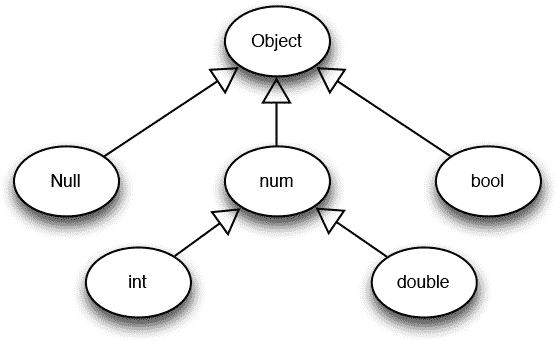
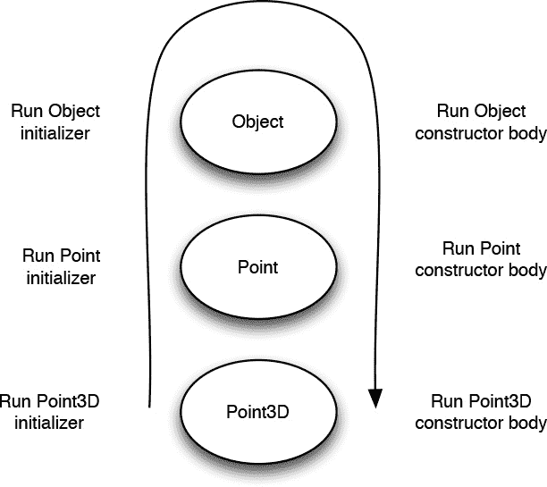
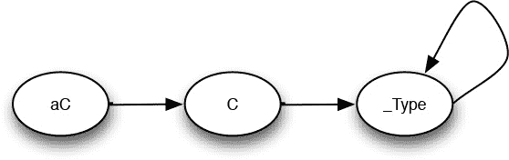
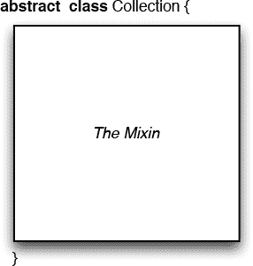
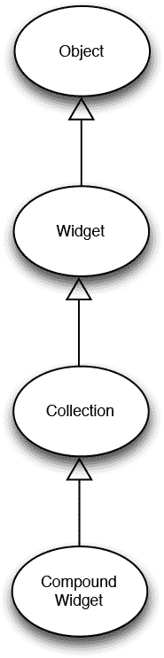
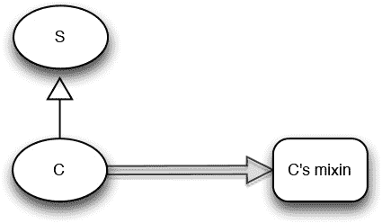
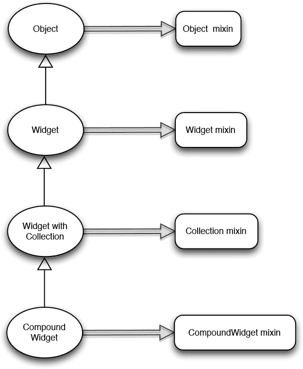
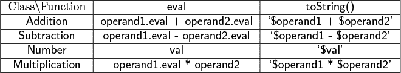
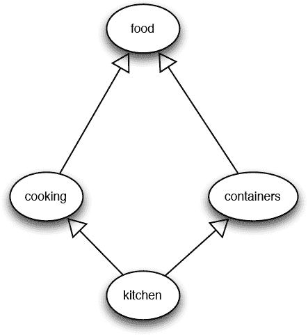

# Dart 语言入门指南

## 关于本电子书

EPUB 是一种开放的行业标准电子书格式。然而，不同阅读设备和应用程序对 EPUB 及其许多功能的支持程度不同。请使用您的设备或应用设置来根据您的喜好自定义显示效果。您可以自定义的设置通常包括字体、字号、单栏或双栏、横屏或竖屏模式，以及可以点击或触摸放大的图片。有关您的阅读设备或应用程序的设置和功能的更多信息，请访问设备制造商的网站。

许多书目包含编程代码或配置示例。为了优化这些元素的显示效果，请在单栏横屏模式下查看电子书，并将字体大小调整为最小设置。除了以重流文本格式呈现代码和配置外，我们还包含了代码图像，以模仿质书中的呈现方式；因此，当重流格式可能会影响代码列表的显示时，您将看到“点击此处查看代码图像”的链接。点击该链接查看高保真代码图像。要返回上一页，请点击设备或应用上的“返回”按钮。

献给我的母亲 Shoshana，

她教我要学会挑剔。

- 前言
- 前序
- 致谢
- 关于作者

# 前言

在 2006 年初春，我写了一篇名为《Gilad 是对的》的短博文。在文中，作为一个类型成瘾症的康复者，我承认 Gilad 关于可选和分层类型系统的想法——即静态类型不会改变程序的运行时行为，也不会阻止原本合法的程序通过编译或执行——对于面向数百万开发者的编程语言来说是一种必要的设计权衡。当时我正在开发 Visual Basic，它已经通过 `Option Strict Off` 语句支持某种形式的可选类型，但该功能遭到了静态类型支持者的强烈抨击。类型系统通常是非线性的，在达到某个程度后，其复杂性会爆炸，但给开发者带来的价值却很小，且让实现者非常痛苦。可选和分层类型系统通过允许强静态类型与动态类型和平共存，实现了一种更加渐进的方法。近年后，Gilad 开创的愿景已以“渐进式类型”的名字成为主流。过去几年中创建的许多语言，如 Hack、TypeScript、Flow、Racket，当然还有 Dart，都是渐进类型的。学者们也接受了这一观点，并撰写了关于它的论文，标题十分随意，包含了“三人行”和“责备”等词汇。

Dart 的另一个务实方面（但语言纯洁主义者尚未接受）是 Dart 的类型系统故意是不健全的（unsound）的。在普通英语中，这意味着 Dart 类型检查器不会在编译时标记某些类型错误，而是依靠运行时检查来确保类型安全。Dart 不健全的主要来源是协变泛型（covariant generics）。为了解释什么是变性（variance），让我们先看一台只能取出饮料的自动售卖机。如果食堂需要一台汽水自动售卖机，我们可以合法地安装一台供应根水的自动售卖机，因为根根水是汽水的一种（但在需要根水自动售卖机的地方安装汽水自动售卖机是非法的）。在编程语言术语中，我们说自动售卖机是协变的。接下来让我们看一个只能丢垃圾的垃圾桶。如果食堂需要一个可回收垃圾桶，我们可以合法地安装一个普通垃圾桶，因为可回收垃圾是垃圾的一种（但在需要普通垃圾桶的地方安装可回收垃圾桶是非法的）。在编程语言术语中，我们说垃圾桶是逆变的（contravari）。如果你对逆变感到有些困惑，你不是唯一的一个，并且你会欣赏 Dart 让所有泛型类型均为协变的决定。这种选择在理论上是不健全的，但不安全的变性对大多数开发者来说实际上相当自然，我赞赏 Dart 设计者所做的这一选择。正如任何与 `? super` 和 `? extends` 挣扎过的人所证实的那样，那些选择泛型静态类型安全的语言，是以牺牲用户为代价的。

Dart 语言的设计者做出额外的务实选择，使得在 Dart 中编写代码成为一种流畅的体验。例如，Dart 没有接口、抽象基类或“普通”类。相反，Dart 只有类，可以通过实现它们来当作接口，通过扩展它们来当作基类，或者通过混入（mixing）来复用它们的实现。Dart 中的每个类型都是对象，因此原始类型（例如数值类型）和普通对象类型之间没有区别。尽管 Dart 中的所有内容都是对象，但仍然可以定义顶层函数和变量，因此人们不再需要在顶层类内部写下那段令人生畏的 `public static void main` 咒语来启动程序。Dart 允许用户自定义算术操作符，但不支持基于类型的方法重载。这极地简化了该语言。在其他支持基于类型方法重载的编程语言中，该特性的精确语义往往占据语言规范中不合理的大比例。空感知操作符（即使 `null` 也是一个普通对象）和级联操作（cascades）赋予了点符号 `.` 更多功能，让 API 编写者只需付出少量精力，就能让每个 API 对用户来说变得流畅。

虽然 Dart 本质上是一种动态语言，因为所有类型都是可选的，但你遇到的比大多数其他动态语言的“什么鬼 (wat)”时刻要少得多。它有 `null` 但没有 `undefined`，因此只有 `==` 而没有 `===`。只有 `true` 才是真，所以不再需要通过 `(foo && foo.bar())` 来检查 `null`。Dart 拥有标准的整数和浮点数数值类型，没有了在 `+` 和 `==` 周围那些令人大惊其舌的运行时类型转换——那些转换虽然是极佳的考题和有趣的会议演示，但也是令人沮丧的 Bug。

在我看来（尽管我显然带有偏见），Dart 之所以位居我最喜欢的编程语言之首的原因是，它是我知道唯一支持编程四种基本效应的语言：

也就是说，Dart 深度支持使用生成器和 `sync` 块内的循环来产生和消费同步数据流（`Iterable<T>`），使用 `async` 块内的 `await` 表达式产生和消费未来（`Future<T>`），最后但同样重要的是，支持使用 `async` 块内的异步生成器和循环产生和消费异步数据流（`Stream<T>`）。内置对异步编程的支持对于任何现代编程语言都是至关重要的，因为在这些语言中，即使是内存中的数据，更不用跨网络的数据也是“遥远的”，高延迟使得同步访问极其昂贵。与 JavaScript 但与其他支持生成器的语言不同，Dart 拥有所谓的委托生成器（delegating generators），避免了嵌套和递归生成流的平方级爆炸。

尽管有这些精彩的设计，Dart 在设计上本质上是一种相当无味的语言。得益于对 getter、setter、lambda、枚举、具化泛型（reified generics）、模块、广泛且制作良好的标准库以及快速的包管理器的支持，如果你是一个来自 Java 或 C# 的开发者，Dart 会让你感到很舒服，像合脚的旧鞋；如果你来自 JavaScript，它会让你感到一阵清风。本书将帮助你以 Gilad 标志性的细致入微和无与伦比的风格，理解 Dart 所有特性的为什么、如何以及是什么，并让你迅速在 Dart 中投入生产。

Erik Meijer

*加利福尼亚州，帕洛奥图*

*2015 年 10 月*

# 前言

这本书与其他关于 Dart 的书籍何何？其他关于 Dart 的书籍充满了实操性；而本书侧重于原理和思想。

Dart 的实操性非常重要，但它们今年与去年不同，明年可能还会再次不同。相比之下，Dart 背后的原理随着时间的推移应该更具适用性。如果你对驱动语言设计的理念，以及这些理念如何在 Dart 这种务实且严苛的现实环境中体现感兴趣，那么你应该读这本书。

Dart 的核心思想之一是可选类型（optional typing）。我几十年前就开始研究可选类型了；今天我们看到了可选类型系统的泛滥，我认为这令人非常满意。虽然 Dart 或它的任何竞争对手都没有完全按照我设想的方式来实现可选类型，但由于这一想法已进入主流，事实才是重要的。

更重要的理念是，Dart 是一门面向对象的语言，但不是指类、继承以及大多数程序员所知的其他标准配置的传统意义，而是从深层意义上说，只有对象的观测行为才是重要的。同样，这一理念的实现并不完美，但比大多数主流语言都要好。

本书涵盖的另一个关键理念是反射（reflection）。关于反射的主题在编程书中并没有得到很好的解决。正因如此，我非常渴望在书中讨论反射。然而，Dart 反射的历史出乎意料地坎折。

一方面，许多 Dart 用户急切希望使用反射，有时甚至将其用于它并不理想的用途。另一方面，某些当前的平台作为 Dart 的编译目标受到严的限制，这使得反射的支持变得相对昂贵，特别是在程序大小方面。这种紧张关系让 Dart 反射陷入了尴尬的境地。

从一开始开始，人们就对代码大小的敏感性以及反射对其的影响有了充分的认识。关于问题及其解决方案，在 2011 年 11 月关于 Dart 反射的第一份设计文档中就讨论过了。尽管如此，过了大约四，，解决方案才以程序员可以轻松应用的形式得以实现。

我希望本书能有效地传达这些及其他思想，但那由你，即读者来判断。也许使用更纯粹的语言可以做得更好，但另一方面也不清楚是否能触及更广泛的读者。也许某天我会尝试一下那个实验并看看。

这本书准备了很长时间。我推迟了完成这本书，直到我能就反射讲述一个逻辑连贯的故事。推迟的另一个原因是，书的主题演变太快，以至于一直面临过时的风险。这种风险并没有消失，但在某些时刻人们需要说“够了”。

Dart 是驱动其设计的理念的不完美实现。没有人比它的设计者更清楚这一点。尽管如此，它是一门真正的语言，其中编写了数百万行任务关键代码。它在某些方面推动了编程文化，特别是在可选类型领域。正如丹麦人所说：本可以更糟的。

# 致谢

Dart 编程语言是大型团队努力的结果。我在 Dart 上的工作因为涉及许多许多共事的同事而变得愉快，其中许多人不仅是同事，更是朋友。我有荣幸在本书以及《Dart 语言规范》中记录了这部分工作。

Dart 语言由 Lars Bak 和 Kasper Lund 构思并设计，因此这本书从字面上来说不存在。Lars 是我的老朋友兼同事，他从起初一直领导 Dart 项目。除此之外，Lars 让我接触了 Dart，对此我深表感谢。

特别感谢 Erik Meijer；与他讨论 Dart 的异步功能是一种享受。Erik 是一个真正的编程语言专业人士，这种人才凤毛难求。

如果说第 8 章很大程度上归功于 Erik，那么第七章则归功于 Ryan Macnak，他在 Dart VM 中实现了镜像（mirrors）；归功于 Peter Ahé，他在 dart2js 中开创了镜像的先河；以及归功于致力于 `reflectable` 库的 Erik Ernst。

我手手中这本书的工作不仅得到了 Lars 的支持，还得到了经理 Ivan Posva 的支持。在过去的四年里，我与 Ivan 以及位于 Mountain View 的 VM 团队的其他成员共享办公室：Zachary Anderson, Daniel Andersson, Siva Annamalai, Régis Crelier, Matthias Hausner, Ryan Macnak, John McCutchan, Srdjan Mitrovic 和 Todd Turnidge。我感谢他们愉快的陪伴。

我经常访问位于丹麦奥尔赫斯的 Dart 总部，这总是很有趣的（尽管旅途本身可能并不愉快）。Linda Lykke Rasmussen 提供的行政支持是无价的。

我对 Dart 规范的工作是本书的直接基础。这项工作受益于许多人的仔细评审，但没有人比 Lasse Nielsen 多，他对细节惊人的关注捕捉到了许多微妙的问题。

我还深度参与了 Dart 的标准化过程。Anders Sand-holm 保护我免受其中许多负担；我对此感激不尽。我也感谢 Dart 标准委员会 ECMA TC52 的其他参与者。

如果没有许多过去和现在的 Dart 团队成员的努力，Dart 将是不可能实现的。他们多到无法列举，但他们都为 Dart 成为今天的样子做出了贡献。

我的长期编辑 Greg Doench 一直极具耐心，与他一起工作非常愉快。

一如既往，我的妻子 Weihong 和儿子 Teva 让这一切变得非常有意义。

Gilad Bracha

*加利福尼亚州，洛斯阿尔斯*

*2015 年 11 月*

## 关于作者

`Gilad Bracha` 是 Google 的一名软件工程师，负责 Dart 工作。在之前的职业中，他曾担任 SAP Labs 的副总裁、Cadence 的卓越工程师，以及 Sun 公司的计算神学家和卓越工程师。他是 Newspeak 编程语言的创建者，《Java 语言和虚拟机规范》的共同作者，也是面向对象编程语言领域的研究人员。在加入 Sun 之前，他曾致力于 Animorphic Smalltalk 系统的工作。他在以色列的本·盖里恩大学获得数学和计算机科学学士学位，并在犹他大学获得计算机科学博士学位。

# 第 1 章 引言

Dart 是一种通用编程语言。它是 C 语言传统的一种新语言，旨在让大多数程序员感到熟悉。那个必不可少的“Hello World”示例说明了 Dart 语法是多么熟悉：

```dart
main(){
  print('Hello World');
}
```

除非你的编程和计算机科学背景非常不寻常或者完全缺失，否则这段代码几乎是自言易懂的。我们当然会在接下来的章节中详细介绍这个程序以及更多有趣的程序。

Dart 是纯面向对象的、基于类的、可选类型类型，并支持基于混入（mixin）的继承和 actor 风格的并发。如果你对这些术语不熟悉，不要担心，我们将在过程中逐步解释它们。

尽管如此，本书并非为初学者编写的教程。预计读者在计算机编程方面具备基本能力。

虽然本书的大部分内容将描述并说明 Dart 的语义，但它还讨论了某些特性的原理。之所以包含这些讨论，是因为根据我的经验，优秀的程序员不仅对编程语言做什么感兴趣，而且对为什么这样做感兴趣。因此，接下来的几节将对 Dart 背后的哲学进行非常高层次的概述。后续还将包含对设计决策、替代方案以及关键思想历史的讨论。然而，如果你急于直接开始，第 1.4 节提供了一个快速教程。

现在，让我们开始吧！

### 1.1 动机

万维网的兴起了软件开发的格局。网页浏览器越来越多地被视为各种软件应用的平台。近年来，智能手机和平电脑等移动设备也变得无处不在。这两个趋势对软件的编写方式产生了巨大影响。

网页浏览器最初是显示静态文本文档的工具。随着时间的推移，它们演变为支持动态内容。动态内容随时间进行计算和重新计算，从简单的动画到基于服务器的应用程序（如数据库前端和电子商务商店），一直到可以离线运行的全功能应用程序。

这种演变是有机的；一系列意外（有些幸运，有些则不然）使得此类应用程序能够在一个并非真正为此目的设计的设施之上运行。

移动应用带来了它们自己的挑战。这些应用程序必须节省电量，这为提高性能提供了新动力。网络访问可能是缓慢、昂贵甚至不存在的。移动平台倾向于施加特定的生命周期，并对大小有特定的限制。

Dart 旨在提供一个专门设计的平台，以支持人们今天想要编写的应用程序。因此，它努力保护程序员免受底层平台不良的特性和低级细节的影响，同时让他们轻松访问新平台提供的强大功能。

### 1.2 设计原则

#### 1.2.1 万物皆对象

Dart 是一门纯面向对象的语言。这意味着 Dart 程序在运行时处理的所有值都是对象——即使是数字和布尔值等基础数据也是。没有例外。

坚持对所有数据进行统一处理简化了所有相关人员的工作，包括语言设计者、实现者以及最重要的用户。

例如，集合类可以用于各种数据，人们不需要担心自动装箱（autoboxing）和拆箱（unboxing）的问题。这些低级细节与程序员试图在应用程序中解决的问题无关；语言的一个关键作用是减轻开发者的这种负担。可能惊讶的是，采用统一的对象模型也减轻了系统实现者的任务。

#### 1.2.2 面向接口编程，而不是面向实现

对象重要的是其行为而非其实现，这一思想是面向对象编程的核心准则。不幸的是，这一原则经常被忽视或误解。

Dart 努力在几个方面维护这一原则，尽管做得并不完美。

- Dart 类型基于接口而不是基于类。根据规定，任何类都可以作为供其他类实现的接口，无论它们是否共享实现（数字、布尔值和字符串等核心类型有少数例外）。
- Dart 中没有最终（final）方法。Dart 允许覆盖几乎所有方法（再次，极少数内置运算符除外）。
- Dart 通过确保对状态的所有访问都通过访问器方法进行，从而抽象了对象的表示。
- Dart 的构造函数允许缓存或产生子类的实例，因此使用构造函数不会将其绑定到特定的实现上。

当我们讨论这些构造结构时，我们将扩展它们的影响。

#### 1.2.3 类型为程序员服务

在编程语言领域，可能没有哪个话题比静态类型检查引发更激烈的辩论和更多无意义的争议了。在编程语言中使用类型是一项重要的设计决策，像大多数设计决策一样，涉及到权衡。

从积极的一方面来看，静态类型信息为人类和计算机提供了价值文档。这些信息如果使用得当，可以提高代码的可读性（特别是在库的边界处），并让自动化工具更容易支持开发者。

类型简化了各种分析任务，特别可以帮助编译器提高程序性能。

静态类型的支持者还认为，它有助于检测编程错误。

天下没有免费午餐，在编程语言中添加强制性的静态类型检查也不例外。总会有某些被特定类型规范所禁止的有趣程序。此外，程序员的工作流往往会因为所有中间开发状态必须符合严格的类型系统而受到严重限制。讽刺的是，类型规范越有表现力，使用和理解就越困难。通常情况下，满足类型检查器对程序员来说是一种负担。高级类型系统通常难以学习和使用。

Dart 在类型的优缺点之间提供了一个高效的平衡。Dart 是一种可选类型语言，其定义为：

- 类型在语法上是可选的。
- 类型对运行时语义没有影响。

将类型设为可选，迎合了那些不想处理类型系统的程序员。选择这样的程序员可以将 Dart 视作一种普通的动态类型语言。然而，所有程序员都能从代码中任何类型注解提供的额外文档中获益。这些注解也允许工具能够更好地支持程序员。

Dart 对可能的类型不一致和疏忽给出警告而非错误。这些警告的程度和性质经过校准，既有用又不会让程序员感到无所适从。

同时，Dart 编译器永远不会因为缺失或不一致的类型信息而拒绝程序。因此，使用类型永远不会限制开发者的工作流。引用不存在或不完整的声明的代码仍然为了测试和实验目的高效运行。

静态正确性与灵活性之间的平衡使得类型能够为程序员服务而不会产生阻碍。

Dart 中类型的细节将推迟到第 5 章，在该章中我们将解释语言的类型规则，并详细探讨上述提到的权衡。

### 1.3 约束


Dart 是针对具体问题的实用解决方案。因此，Dart 的设计包含了折中。Dart 必须在现有的网络浏览器上高效运行。

Dart 必须让正在在职的程序员能够立即识别。这决定了它采用了类 C 语言家族风格的语法。它还决定了与主流程序员预期没有太大偏差的语义选择。目标不是激进创新，而是渐进的、保守的进步。

当我们讨论语义受上述约束影响的特征时，我们将关注所做的设计权衡。示例包括对字符串、数字、返回语句等许多内容的处理。

### 1.4 概述

本节将介绍 Dart 的快速之旅。目标是让你熟悉 Dart 的所有核心元素，而不会陷入细节中。

编程语言的结构通常以互递归的方式定义。要对它们提供有序的、顺序的解释是困难的，因为读者需要一次性知道所有部分！为了避免这个陷阱，必须先对语言结构有一个大致的了解，然后深入重新回顾。本节提供了这种粗略的了解。

在读完本节后，你应该能够掌握书中后续章节中出现的许多示例的精髓，而无需事先读完整本书。

这里是 Dart 中的一个简单表达式：

```
3
```

它意所料地求值为为整数 `3`。这里是一些稍微复杂的表达式：

```
3 + 4
(3+4)*6
1 + 2 * 2
1234567890987654321 * 1234567890987654321
```

它们分别求值为 7、42、5 和 1524157877457704723228166437789971041。你从一年级级学到的普通优先级规则适用于这里。最后一个示例可能具有某些意义。Dart 中的整数行为类似于数学整数。它们不限于某些 32 位或 64 位能表示的最大值（例如）。它们大小的唯一限制是可用内存。^(1)

**1。** 某些 Dart 实现可能并不总是符合这一要求。当 Dart 转换为 JavaScript 时，有时会使用 JavaScript 数字来表示整数，因为 JavaScript 本身不支持整数数据类型。因此，大于 `2⁵³` 的整数可能无法直接获取。

Dart 不仅支持整数，还支持浮点数、字符串、布尔值等。这些内置类型许多具有方便的语法：

```
3.14159 //  一个浮点数
'a string'
"another string - 支持双引号和单引号形式"
'Hello World' // 你已经见过这个了
true
false // 你可能需要的所有布尔值
[] // 一个空列表
[0, 1.0, false, 'a', [2, 2.0, true, \b]]
```

如上述示例所示，Dart 支持单行注释；`//` 之后的所有内容都会被忽略，直到行尾。上面的示例显示了字面量列表。第一个列表是空的；第二个列表长度为 5。可以使用运算符 `[]` 对列表进行索引：

```
[1, 2, 3].length // 3
[].length // 0
[].isEmpty // true
['a'].isEmpty // false
```

列表具有属性 `length` 和 `isEmpty`（以及许多我们现在不讨论的属性）。人们当然可以在 Dart 中定义函数。我们之前看到了看到了第一个 Dart 函数，即“Hello World”中的 `main()` 函数。它在这里：

```
main(){
  print('Hello World');
}
```

Dart 程序的执行始终从调用名为 `main()` 的函数开始。一个函数由一个给出名称和任何参数（我们的示例中没有）的头部和一个体组成。`main()` 的体由单个语句组成，即对另一个函数 `print()` 的调用，该函数接受一个参数。在这种情况下参数是字符串字面量 `'Hello World'`。效果是打印“Hello World”。

这是另一个函数：

```
twice(x) => x * 2;
```

在这里我们定义了带有参数 `x` 的 `twice`。该函数返回 `x` 乘以 2。我们可以通过以下方式调用 `twice`：

```
twice(2)
```

预期求值为 4。函数 `twice` 由一个给出其名称和形式参数 `x` 的签名组成，后面跟着 `=>`，然后是函数体，这是一个单一表达式。另一种更传统的编写 `twice` 的方式是：

```
twice(x) {
  return x * 2;
}
```

这两个示例完全等价，但在第二个示例中，体可以由零或多个语句组成——在本例中，单个 `return` 语句导致函数计算 `x*2` 的值并将其返回给调用者。

作为另一个示例，考虑

```
max(x, y){
  if (x > y) return x;
  else return y;
}
```

它返回两个参数中较大的。我们可以更简洁地写它：

```
max(x, y) = (x > y) ? x : y;
```

第一种形式使用了 `if` 语句，这在几乎所有编程语言中都有类似的形式的形式。第二种形式使用了条件表达式，在 C 家族语言中非常常见。使用表达式允许我们使用函数声明的短形式。

一个更具挑战性的函数是：

```dart
maxElement(a) {
  var currentMax = a.isEmpty ?
    throw 'Maximal element undefined for empty array' : a[0];
  for (var i = 0; i < a.length; i++) {
    currentMax = max(a[i], currentMax);
  }
  return currentMax;
}
```

`maxElement` 函数接收一个列表 `a` 并返回它的最大元素。在这里确实我们需要长形式函数声明，因为计算将涉及多个步骤，这些步骤必须作为一系列语句按顺序执行。这个短函数将展示 Dart 的许多特性。

函数体的第一行声明了一个名为 `currentMax` 的变量并对其进行初始化。Dart 程序中的每个变量都必须显式声明。变量 `currentMax` 代表我们对数组最大元素的当前估计值。

在许多语言中，人们可能会选择将 `currentMax` 初始化为代表最小可能整数的已知值，通常用 `MIN INT` 等名称命名。从数学上讲，“最小可能整数”的概念是荒谬的。然而，在整数受限于语言定义的固定大小表示的语言中，这是有意义的。如上述，Dart 整数的大小是不限的，因此我们实际上 `currentMax` 初始化为列表的第一个元素。如果列表为空，我们就无法这样做，但此时参数 `a` 是无效的；空列表的最大元素是未定义的。因此，我们测试 `a` 是否为空。如果为空，我们抛出一个异常；否则，我们选择列表的第一个元素作为初始候选值。

异常是通过使用 `throw` 表达式抛出的。`throw` 关键字后面跟着另一个定义要抛出值的另一个表达式。在 Dart 中，任何类型的值都可以被抛出——它不需要是特殊 `Exception` 类型的成员。在这种情况下，我们抛出一个描述该问题的字符串。

下一行开始了一个 `for` 语句，用于遍历列表。每个元素都会通过调用之前定义的 `max` 函数轮流与 `currentMax` 进行比较。如果当前元素大于 `currentMax`，我们将 `currentMax` 设置为新发现的最大值。

**2.** 我们从索引 0 开始，但在这种情况下，我们可以稍微提高一点效率，从 1 开始。

循环完成后，我们确信 `currentMax` 是列表中的最大元素，并返回它。

直到现在，本教程仔细地避免了提到任何对象、类或方法等术语。Dart 允许你在任何类之外定义函数（如 `twice`、`max` 和 `maxElement`）和变量。然而， Dart 是一门完全的面向对象的语言。我们看过的所有值——数字、字符串、布尔值、列表甚至函数本身——在 Dart 中都是对象。每个此类对象都是某些类的实例。像 `length`、`isEmpty` 甚至索引运算符 `[]` 等操作都是对象上的方法。

是时候我们自己学习如何写一个类了。请看 `Point` 类，它代表笛卡尔平面上的点：

```dart
class Point {
  var x, y;
  Point(a, b){x = a; y = b;}
}
```

上述是 `Point` 的一个极简版本，我们很快就会对其进行丰富。`Point` 有两个实例变量（或字段）`x` 和 `y`。我们可以通过 `new` 表达式调用其构造函数来创建 `Point` 的实例：

```dart
var origin = new Point(0, 0);
var aPoint = new Point(3, 4);
var anotherPoint = new Point(3, 4);
```

上述三行中的每一行都分配了一个新的 `Point` 实例，与其他任何实例都不同。特别是，`aPoint` 和 `anotherPoint` 是不同的对象。对象具有标识性，这就是区分它与任何其他对象的特征。

每个 `Point` 实例都有其变量 `x` 和 `y` 的拷贝，可以使用点表示法进行访问：

```dart
origin.x // 0
origin.y // 0
aPoint.x // 3
aPoint.y // 4
```

变量 `x` 和 `y` 是由构造函数根据 `new` 提供的实际参数设置的。定义一个具有与对象字段完全对应的形式参数的构造函数，然后在构造函数中设置这些字段的模式非常常见，因此 Dart 为这种情况提供了一个特殊的语法糖：

```dart
class Point {
  var x, y;
  Point(this.x, this.y);
}
```

新版本的 `Point` 与原始版本完全等价，但更简洁。让我们为 `Point` 添加一些行为：

```dart
class Point {
  var x, y;
  Point(this.x, this.y);
}
```

新版本的 `Point` 与原始版本完全等价，但更简洁。让我们为 `Point` 添加一些行为：

（注：输入文本末尾存在重复的段落，已根据提供的逻辑流进行了处理。）

需要注意的一个关键细节是 `import` 子句引用了字符串 `'dart:math'`。通常情况下，导入是指通过字符串提供的统一资源标识符（URIs）。这些 URI 指向编译器可以找到所需库的位置。Dart 的内置库始终可以通过 `'dart:˙'` 形式的 URI 访问，其中 `˙` 表示特定的库。

Dart 的内容比我们目前展示的要多得多，但你应该对 Dart 代码的样貌及其大致含义有一个通用的了解。当我们进入本书后面的详细章节时，这些背景知识将大有裨益。

### 1.5 书的结构

本书的其余部分围绕 Dart 编程语言的构造结构构建。下一章将讨论对象、类和接口。这些是 Dart 的核心概念，也是后续所有内容的基础。

接下来，我们将详细检查库，然后深入探讨函数。在第 5 章中，我们最后将查看类型以及它们在 Dart 中扮演的角色。我们在第 6 章中回顾了 Dart 的表达式和语句。最后的章节将研究反射和并发。

### 1.6 相关工作与影响

Dart 的设计受到了早期语言的影响，特别是 Smalltalk[1]、Java 和 Javascript。Dart 的语法通过 Java 和 Javascript 遵循 C 语言传统。Dart 的语义在某些方面更接近 Smalltalk 特 特别是对纯对象模型的坚持。

然而，它们之间存在至关重要的区别。Dart 引入了自己基于库的封装模型。这与上述三种语言都不同。Smalltalk 支持基于对象的字段封装，且方法和类是通用的。Java 结合了基于类的封装和包私有性，而 Javascript 则完全依赖闭包来实现封装。

与 Smalltalk 和 Java 一样，Dart 是基于类的并支持单继承，但它通过基于混入（mixin）的继承增强了这一点，这与最初在 Smalltalk 的方言 Strongtalk 中首次实现的模型[2] 非常相似。由于 Dart 中的类方法不是 Smalltalk 那种真正的实例方法，而是 Java 风格的静态方法，因此模型并不完全相同。

Dart 的构造函数在语法上与 Java 有相似之处，但实际上在关键方面有所不同。上述所有主题都将在下一章中讨论。

Dart 的类型检查方法也与 Strongtalk 开发的方法非常接近。类型在第 5 章中得到了详尽的。

Dart 对并发的观点接近原始的 actor 模型（尽管是命令式的），再次与上述任何语言不同。Erlang 的成功采用 actor 模型的一个因素，但与 Erlang 不同，Dart 具有非阻塞并发模型。Dart 还具有受 C# 深度影响的内置异步支持。详情请见第 8 章。

# 第 2 章 对象、接口、类和混入

值得重复的是：Dart 中的一切皆为对象。这甚至包括最简单的数据，如数字或布尔值 `true` 和 `false`。

一个对象由一组（可能是空的）字段（提供状态）和一组方法（提供行为）组成。对象的状态可以是可变的或不可变的。对象的方法集永远为空，因为所有 Dart 对象都有某些行为。对象从其类中获取行为。每个对象都有一个类；我们说该对象是该类的*实例*。因为每个对象都有一个决定其行为的类，所以 Dart 是一种*基于类的语言*。

考虑上一章中遇到的 `Point` 类。

```dart
class Point {
  var x, y;
  Point(this.x, this.y);
  scale(factor) => new Point(x * factor, y * factor);
  operator +(p) => new Point(x + p.x, y + p.y);
  static distance(p1, p2) {
    var dx = p1.x - p2.x;
    var dy = p1.y - p2.y;
    return sqrt(dx * dx + dy * dy);
  }
}
```

`Point` 的实例每个有两个字段 `x` 和 `y`，它们构成了它们的状态。点 还有几个提供有用行为的方法。这些方法包括 `scale` 和 `+`，但实际上还有其他的。这些额外方法并不是由 `Point` 类本身定义的，而是从其父类*继承*来的。每个类都有一个父类，但内置到每个 Dart 实现中的 `Object` 类除外。类可以显式列出它们的父类，但不是必须。如果类没有列出父类，则父类是 `Object`。`Point` 就是这种情况。我们可以如下显式地指定 `Object` 为 `Point` 的父类；这两个定义是完全等价的。

```dart
class Point extends Object { ... 其余定义不变 }
```

定义对象行为的方法被称为其*实例方法*。

### 2.1 访问器

访问器是提供值的特殊方法。为了理解访问器，让我们再次回到 `Point`。如果我们把字段 `x` 和 `y` 替换为方法，我们所有的客户端将修改对 `x` 和 `y` 的引用，使其成为方法调用。例如，如果客户端有一个这样的片段：

`print(myPoint.x);`

它需要更改为

`print(myPoint.x());`

唯一的区别是 `x` 后面的空参数列表；这是一个很小的变化，但确实是一个变化。Dart 以*访问器方法*（getter methods）的形式提供了更好的解决方案，通常称为*访问器*（getters）。访问器是一种不接受参数的特殊方法，可以在没有显式参数列表的情况下调用。访问器方法通过在方法名前前加上 `get` 单词来引入。不能给出参数列表——即使是空的也不行。

```
  return sqrt(dx * dx + dy * dy);

}

}
```

现在，我们的假设客户端不需要任何更改。getter 调用的语法与变量访问无二致。

敏锐的读者现在会问，`Dart` 编译器是如何区分这两者的？答案是，它并不区分。在 `Dart` 中，所有的实例变量访问实际上都是 getter 调用。得益于 `Dart` 编译器，每个实例变量都关联着一个 getter。

到目前为止，我们只解决了一部分问题。那些给字段赋值的客户端怎么办呢？例如 `myPoint.y = myPoint.y * 2.`

新版本没有可以被赋值的字段。目前还不清楚客户端可以进行什么更改来保持其代码的运行。为了解决这个问题，我们使用了 `setter 方法`（简称为 `setters`）。setter 以 `set` 单词为缀，并接收一个参数。setter 的调用语法与传统的变量赋值相同。如果一个实例变量是可变的，则会自动为它定义一个 setter，并且所有的实例变量赋值实际上都是 setter 调用。

```dart
class Point {

  var rho, theta;

  Point(this.rho, this.theta);

  get x => rho * cos(theta);

  set x(newX) {
    rho = sqrt(newX * newX + y * y);
    theta = acos(newX/rho);
  }

  set y(newY) {
    rho = sqrt(x * x + newY * newY);
    theta = asin(newY/rho);
  }

  get y => rho * sin(theta);

  scale(factor) => new Point(rho * factor, theta);

  operator +(p) => new Point(x + p.x, y + p.y);

  static distance(p1, p2) {
    var dx = p1.x() - p2.x();
    var dy = p1.y() - p2.y();
    return sqrt(dx * dx + dy * dy);
  }
}
```

此时，我们已经解决了问题的两个部分，但还剩下第三部分。我们的客户端通过调用 `Point` 类的构造函数来创建点，例如 `new Point(3,4);`


我们的新类期望构造函数的参数代表向量的长度和方向角，而不是它的笛卡尔坐标。正如我们之前提到的，我们在类内部也依赖于这个 API，因此它将无法正常工作。按照惯例，解决方案是在保留现有 API 的同时，按需更改表示法。因此，我们选择使用极坐标表示法，但为了保持接口，我们保留了现有的接收笛卡尔参数的构造函数。

点击此处查看代码图片

```dart
class Point {

  var rho, theta;

  Point(a, b){
    rho = sqrt(a * a + b * b);
    theta = atan(a/b);
  }

  ... 其部分保持不变 ...

}
```

我们现在已经实现了改变点的表示法而不对其客户端产生任何影响的目标。我们是在没有任何预计划的情况下做到这一点。我们不需要预先决定通过访问器方法或特殊的属性声明来暴露点的坐标；`Dart` 为我们完成了这一切，且没有任何语法上的不便。我们可以在任何主流语言中修复构造函数。然而，如果没有访问器，完全平滑的过渡是不可能的。

## 2.2 实例变量

当类声明一个实例变量时，它确保其每个实例都将拥有该变量的唯一副本。对象的实例变量占用内存。这些内存在对象创建时分配。在程序访问这些内存之前，将这些内存设置为某个合理的值是至关重要的（注：原文此处为逻辑错误，语境应为初始化，译文译为：在程序访问这些内存之前，将这些内存设置为某个合理的值是至关重要的）。在 `C` 等低级语言中，情况并非如此，新分配的存储空间的内容可能是未定义的——通常是它们之前存储的任何值。这会导致可靠性和安全性方面的问题。

`Dart` 将每个新分配的变量（不仅是实例变量，还有局部变量、类变量和顶层变量）初始化为 `null`。在 `Dart` 中，`null` 是一个对象，就像其他对象一样。不能将 `null` 与其他对象（如 `0` 或 `false`）混淆。`null` 对象仅仅是 `Dart` 核心库中定义的 `Null` 类的唯一实例。这与 `C`、`C++`、`C#`、`Java` 或 `Javascript` 等语言的情况不同，但它是“万物皆对象”这一公理不可避免的结果。

声明实例或静态变量会自动引入一个 getter。如果变量是可变的，还会自动定义一个 setter。事实上，在 `Dart` 中，从不直接访问字段。对字段的所有引用都是访问器方法的调用。只有对象的访问器可以直接访问其状态。所有访问对象状态的代码必须通过这些访问器方法。这意味着类的表示法可以随时更改，而无需对客户端源代码进行任何更改。甚至不需要重新编译——永远不需要！这种属性被称为`表示独立性`（representation independence）。

我们在上一节中看到了表示独立性的优势，在上一节中我们展示了如何更改点的表示法。

## 2.3 类变量

除了实例变量外，类还可以定义`类变量`。无论类有多少个实例，类都只有一个变量副本。类变量声明以 `static` 单词开头。

与实例变量一样，类变量从不被直接引用。对它们的所有访问都是通过访问器介的。类变量可以在声明它的类的任何地方被引用。在类外部，只能通过类名来访问它：

点击此处查看代码图片

```dart
class Box {
  static var numberOfInstances = 0;
}
```

类变量通常被称为 `static` 变量，但 `static variable` 也涵盖了类变量和顶层变量。为了避免混淆，我们将坚持使用类变量。当我们统称为实例和类变量时，经常使用字段一词。

类变量是延迟初始化的；类变量初始化在第一次调用 getter 时执行——即第一次尝试读取该变量时。如果类变量没有初始化器，它被初始化为 `null`，就像其他变量一样。

类变量的延迟初始化有助于避免一个经典问题：由于过度的初始化导致应用程序启动缓慢。然而，懒加载会导致意料之外的行为。假设类变量在被读取之前就被赋值了，如下例所示。

点击此处查看代码图片

```dart
class Cat {}

class DeadCat extends Cat {}

class LiveCat extends Cat {
  LiveCat() {print("I'm alive!");}
}

var schrodingers = new LiveCat();

main() {
  schrodingers = new DeadCat();
}
```

在这里，`schrodingers` 的初始化器永远不会执行，`print()` 调用也永远不会执行。虽然在上面看起来显而易见，但在更复杂的情况下可能并非如此。例如，在调试期间，可能会检查变量的值，这将引发初始化。程序员应该密切关注延迟初始化的影响。

## 2.4 finals

`Dart` 中的变量可以以 `final` 单词开头，表示它们在初始化后不能被更改。`final` 字段有一个 getter（访问器）但没有 setter（赋值器）。final 类变量必须在声明处初始化。

final 实例变量必须在任何实例方法运行之前初始化。有几种方法可以实现这一点。第一种是在声明处初始化变量，例如：

```dart
final origin = new Point(0,0);
```

这并不总是方便的。变量在不同的构造函数可能会被赋予不同的值。例如，它可能取决于构造函数的参数。如果想将一个 final 实例变量的值设置为构造函数参数的值，可以使用常用的构造函数简写。例如，考虑这个 `Point` 的变体，其中点是不可变的：

```dart
class Point {
  final x, y;
  Point(this.x, this.y);
  // Point 的其余部分 ...
}
```

然而，有时这并不够。值可能取决于构造函数参数，但又不同——即它可能涉及基于构造函数参数的某些计算。我们将在稍后的第 2.9 节中探讨如何实现。

尝试给 final 实例变量赋值通常会导致 `NoSuchMethodError`，因为赋值只是调用 setter 的语法糖，而 setter 并不会被定义。不过，可能单独声明一个 setter，在这种情况下，它会被调用。但这对实例变量的值不会产生任何影响——在初始化之后，根本没有办法更改 final 变量。

大多数实例变量在实例分配时设置，并且之后再也不改变。你可能发现这很惊讶，但这已经通过系统研究得到了验证[3]。因此，将大多数实例变量声明为 `final` 是最好的做法。

有一个强有力的理由认为 `final` 应该是默认值，但那违背了既有习惯，因此 `Dart` 在这里选择了传统的方案。

## 2.5 标识与等价性

所有对象都支持相等性运算符 `==`。该运算符定义在 `Object` 类中，因此所有类都继承了它，它因此包含在所有实例的行为中。考虑

点击此处查看图像

```dart
var aPoint = new Point(3, 4);
var anotherPoint = new Point(3,4);
aPoint == anotherPoint; // 结果为 false
```

最后一行的结果有些令人困惑。毕竟，`aPoint` 和 `anotherPoint` 具有相同的 `x` 和 `y` 值，为什么它们不相等呢？

`Object` 中的 `==` 方法测试参数是否与接收者是完全相同的（identical）。正如前面提到的，每个对象都有唯一的标识符。一个对象与自身是完全相同的，且仅与自身相同。两个对象可以是同一类的实例并具有完全相同的状态，但如上面的示例所示，它们仍然可能并不相同。

上面的解释是相当机械的。我们说这两个对象不相等，是因为等价性被定义为标识性，但这引发了一个问题：为什么等价性要这样定义？

遗憾的是，没有一种明显正确的方法来判断两个任意对象是否相等。可以比较对象的所有字段来判断等价性，但这仍然太保守了。对象可能拥有用于存储辅助数据的字段，而这些数据对于等价性的语义并不是必需的。例如，假设我们有一个时间戳，告诉我们某个缓存值最后一次计算是什么时候。缓存在一段时间后就会被认为是过时的。两个对象在时间戳（或缓存值）上不同，但仍然可能是相等的。

因此，定义类的程序员有责任确定对于该类的实例，什么等价性概念是合理的。这样做的方法是重写 `==`。^(2) 在 `Point` 的情况下，我们可以将等价性定义为

2. 如果能用 `=` 表示相等就很好了，但 C 传统和数学之间是矛盾的。

点击此处查看图像

```dart
operator == (p) => x == p.x && y == p.y;
```

注意，即使我们切换到极坐标（不考虑数值精度问题），这段代码仍然有效（尽管它可能没有那么高效）。事实上，即使 `p` 是笛卡尔点而接收者是极坐标，或者任何其他组合，它依然成立。

在某些情况下，人们可能想要检查两个表达式是否表示相同的对象，但这种情况相对罕见。通常，人们是对对象进行等价性测试。

可以使用定义在 `dart:core` 中的内置函数 `identical()` 来比较两个对象的标识性。

我们发现 `identical(origin, origin)` 的结果为 `true`，`identical(aPoint, aPoint)` 和 `identical(anotherPoint, anotherPoint)` 也是如此。另一方面，`identical(aPoint, anotherPoint)` 的结果为 `false`。

我们现在有足够的信息来自己定义 `Object` 类的相等方法：

点击此处查看图像

```dart
bool operator ==(other) => identical(this, other);
```

所有的 `Dart` 对象还支持 getter 方法 `hashCode`。等价性和 `hashCode` 是关联的。如果两个对象相等，它们的哈希值也相等。在实践中，这意味着如果你选择重写其中一个方法，也应该重写另一个。实现用户定义的等价性需要一些技巧。我们期望等价谓词满足自反性（`a == a`）、传递性（`(a == b) && (b == c)` 意味着 `a == c`）和交换性（`a == b` 意味着 `b == a`）。自反性是你可以在自己的 `==` 实现中确保的。其他属性在扩展系统中很难维护。人们总是引入

```dart
class BadApple {
```

并破坏整个系统的相等。

## 2.6 类与父类

每个类声明了一组实例成员，包括实例变量和几种实例方法。此外，每个类（`Object` 除外）都从其父类继承实例成员。由于除 `Object` 的每个类只有一个父类，而 `Object` 没有父类，`Dart` 的类层次形成了一个以 `Object` 为根的树。这种结构被称为单继承，如下所示。



在图中，我们看到了数字、布尔和 Null 的类层次。当然，这只是整个类层次的一个片段。

如果子类声明了一个与其父类方法同名的实例方法，则子类方法被认为覆盖了父类方法。

重写并不总是合法的。例如，你不能用普通方法重写 getter，反之亦然。这些情况会导致编译错误。

点击此处查看图像

```dart
class S {
  var v;
  final f = 0;
  get g => 42;
  set s(x) => v = 2;
  m(a, b) => 91;
}

class C extends S {
  v() => 1; // 非法：方法 v() 覆盖了隐式 getter v
  f() => 2; // 非法：方法 f() 覆盖了隐式 getter f
  g() => 100; // 非法：方法 g() 覆盖了 getter g
}
```

尝试用方法或 getter 覆盖 setter，或者用 setter 覆盖方法或 getter 技术上是不可能的，因为 setter 的名称与方法和 getter 不重叠。然而，如果你尝试，`Dart` 会警告你：

点击此处查看图像

```dart
class D extends S {
  s(y) => 200; // 警告：D 有方法 s 和 setter s=
}
```

在某些情况下，无意义的重写（override）会导致警告而不是编译错误。当重写的方法所需的参数比其所覆盖的方法更多时，会发出警告，但程序仍然可以编译。

点击此处查看代码图片

```dart
class E extends S {
  m(x, y, z) => 101; // WARNING: overriding method has incompatible arity
}
```

为什么 `Dart` 只对这种情况发出警告，而不是直接拒绝代码呢？因为 `Dart` 试图尽可能避免为程序员规定工作流。在开发过程中可能会出现各种类型的不一致性，这些问题最终应该被纠正。然而，强制程序员在取得任何其他进展之前立即处理这些情况往往是适得其反的。因此，`Dart` 确保开发者通过警告获知此类问题，但除非绝对必要，否则不会中止编译。

## 2.7 抽象方法和类

通常情况下，仅仅声明一个方法而不提供其实现是很有用的。这种方法被称为`abstract method`（抽象方法）。任何类型的方法都可以是抽象的，无论它是 getter、setter 还是普通方法。

声明抽象方法告诉阅读代码的人（无论是人还是计算机），当代码执行时可以使用该方法。这不仅有助于程序员理解，也有助于错误处理和工具支持。包含抽象方法的类本身是`abstract class`（抽象类）。抽象类通过在声明前加上 `abstract` 关键字来声明。下面我们看到一个完全没有任何实现信息的抽象类 `Pair`，它纯粹作为接口。

```dart
abstract class Pair {
  get first;
  get second;
}
```

`Pair` 有两个抽象 getter 方法：`first` 和 `second`。`Pair` 被显式声明为抽象类。如果我们省略 `abstract` 修饰符，`Dart` 分析器会警告该类具有抽象方法。在抽象类中拥有抽象方法完全正确，但在具体类中保留此类方法显然是一个问题。`abstract` 修饰符允许我们声明意图，分析器发出的警告也会随之变化。

抽象类不是为了实例化的；毕竟它缺少实现。实例化它会导致运行时错误；具体会抛出 `AbstractClassError`。`Dart` 分析器也会发出警告。

点击此处查看代码图片

```dart
new Pair();
// 静态警告：尝试实例化抽象类
// 抛出 AbstractClassInstantiationError
```

从运行角度来说，抽象方法根本不存在。毕竟没有可运行的实现。调用此类方法与没有该方法的情况完全相同。只包含抽象方法的类在定义接口时是有用的，见下节。

## 2.8 接口

每个类都隐式地定义了一个`interface`（接口），描述了实例上哪些方法。`Dart` 没有像许多其他语言那样的正式接口声明。这些声明是不必要的，因为始终可以通过定义抽象类来描述所需的接口。

点击此处查看代码图片

```dart
abstract class CartesianPoint {
  get x;
  get y;
}

abstract class PolarPoint {
  get rho;
  get theta;
}
```

尽管缺少接口声明，类也可以断言其实例实现了特定的接口。

点击此处查看代码图片

```dart
class Point implements CartesianPoint, PolarPoint {
  // 常用的 Point 实现
}
```

`Point` 不是 `CartesianPoint` 的子类；它没有继承 `CartesianPoint` 的任何成员（`PolarPoint` 也是如此）。`implements` 子句的目的是建立接口之间的意图关系，而不是共享实现。

可以在运行时测试对象是否符合某个接口：

点击此处查看代码图片

```dart
5 is int; // true
'x' is String; // true
[] is Point; // false
aPoint.toString() is String; // true
new Point(0,0) is String; // false
aPoint is CartesianPoint; // true
```

注意，`is` 测试并不检查对象是否为给定类或其子类的实例。相反，`is` 测试检查对象的类是否显式地（直接或间接地）实现了接口。换句话说，我们不关心对象的实现是什么，只关心它旨在支持的接口。这与支持此类结构的许多其他语言相比是一个关键区别。如果一个类想要模拟另一个类的接口，它并不受限于共享实现。这种模拟对客户端来说应该是不可区分的（不考虑反射）。当我们在第 5 章](#part0013.html_ch05）中详细检查类型时，对 `is` 有更多说明。

接口之间的继承非常像类。类的隐式接口继承自其父类的隐式接口，以及从该类实现的任何接口。与类一样，接口的实例方法覆盖父类的方法。再次，某些重写可能是非法的，因为重写方法与被重写方法之间的参数数量应该是兼容的，或者是因为试图用普通方法覆盖 getter 或 setter。

此外，由于接口有多个父接口，不同的父接口之间可能会冲突。假设一个方法出现在多个父接口中，并且不同的父接口对同一个方法的参数（arity）意见不一致。在这种情况下，冲突方法的任何版本都不会被继承——如果一个父接口定义了 getter 而另一个是普通方法也是如此。正如我们在第 5 章](#part0013.html_ch05）所示，这些情况也会产生各种警告。

## 2.9 对象的生命

`Dart` 中的计算围绕对象展开。因为 `Dart` 是一门纯面向对象的语言，即使是最微不足道的 `Dart` 程序也涉及对象的创建。例如，书的第一段所示的“Hello World”程序涉及一个字符串对象的创建。


某些对象，如字符串`'Hello World'`、布尔值`true`或数字`91`是`literals`（字面量）。它们仅仅因为在运行程序中被提到而存在。然而，大多数对象是使用实例化表达式显式创建的，例如`new Point(0,1)`。这样的表达式调用了一个`constructor`（构造函数）——在这里是`Point()`。每个类至少有一个构造函数。构造函数的名称始终以我们要构造的类名开头。构造函数可以由程序员显式声明，也可以被隐式生成。在没有声明显式构造函数时会生成隐式构造函数；它们不接受参数也没有正体。例如

```dart
class Box {
  var contents;
}
```

等同于

```dart
class Box {
  var contents;
  Box();
}
```

其本身又等同于

```dart
class Box {
  var contents;
  Box(){}
}
```

我们在使用`Point`的示例中已经见过了一些构造函数的变体。我们假设最简单的那个：

```dart
Point(a, b){x = a; y = b;};
```

评估实例创建表达式的第一步是评估构造函数的参数。在`new Point(0,1)`中，参数是字面量整数`0`和`1`。与任何函数调用一样，这些参数被设置为相应的参数。因此，我们将`a`设置为`0`，将`b`设置为`1`。现在，我们可以为`Point`类分配一个新实例，该实例将包含两个字段`x`和`y`的存储空间。最初，这些字段将由系统设置为`null`。这确保了用户代码永远遇到未初始化的内存。

现在我们可以执行构造函数的体，这涉及分别对`x`和`y`的两次赋值。如你现在所知，这些赋值实际上是调用了 setter 方法。正是这些隐式定义的 setter 方法按照预期将字段`x`和`y`的值设置为`0`和`1`。在此时点，构造函数返回一个指向新分配实例的引用，这就是`new`表达式的最终结果。

现在，让我们考虑一个表示三维点的类。该类拥有坐标`x`、`y`和`z`，并且可以自然地声明为`Point`的子类。

点击此处查看代码图像

```dart
class Point3D extends Point {
  var z;
  Point3D(a, b, c): super(a,b) {z = c;}
}
```

人们可以通过编写`new Point3D(1,2,3)`来创建一个`Point3D`实例。评估过程类似，但稍微复杂一些。我们仍然从评估参数和分配对象开始——这次有三个字段——从`Point`继承的两个字段`x`、`y`以及在`Point3D`中声明的字段`z`。这三个字段将再次被设置为`null`。然而，在执行`Point3D`构造函数的体之前，我们必须执行`Point`构造函数的体，否则字段`x`和`y`将无法被正确初始化。

通常情况下，Dart 编译器无法确定向父类构造函数传递哪些参数。在这种情况下这似乎显而易见，但并非总是如此简单。除最简单的情况（即没有参数）外，我们都需要显式的`super-constructor call`（父构造函数调用）来引导我们。在我们的示例中，那就是`super(a,b)`。在父构造函数调用中，`super`是父类名称的占位符，因此`Point3D(x1, y1, z1)`在执行自身的体之前会先调用`Point(x1, y1)`。

上面的描述有些简单，正如我们很快将看到的。对象创建是面向对象编程语言中复杂的方面之一，特别是在涉及继承时。为了进一步深化我们的理解，我们将再次查看更改点表示的问题。这一次，假设点是不可变的，但使用极坐标来表示。

由于点是不可变的，`rho`和`theta`是`final`的。我们不能在声明处初始化实例变量，因为我们需要访问构造函数参数。我们不能使用像`.rho`这样的初始化形式（initializing formals），因为`rho`和`theta`的值都是`x`和`y`的函数。我们不能在构造函数体内部赋值字段，因为没有为它们定义 setter。Dart 通过`initializer lists`（初始化列表）解决了这个问题，初始化列表旨在用于普通代码运行之前初始化实例变量。

点击此处查看代码图像

```dart
class Point {
  final rho, theta;
  Point(a, b) : rho = sqrt(a * a + b * b), theta = atan(a/b);
  get x => rho * cos(theta);
  get y => rho * sin(theta);
  scale(factor) => new Point(rho * factor, theta);
  operator +(p) => new Point(x + p.x, y + p.y);
  static distance(p1, p2) {
    var dx = p1.x - p2.x;
    var dy = p1.y - p2.y;
    return sqrt(dx * dx + dy * dy);
  }
}
```

此处的初始化列表从`Point(a, b)`之后的冒号开始，一直到行末的分号结束：`: rho = sqrt(a * a + b * b), theta = atan(a/b)`。它包含两个初始化器，一个用于`rho`，一个用于`theta`。初始化器用逗号分隔，并从左到右执行。除了实例变量的初始化器外，初始化列表还可以包含一个父构造函数调用。我们在`Point3D()`中看到了这一点，那里我们有初始化列表`: super(a,b)`。注意，如果初始化列表中没有显式出现父构造函数调用，则会附加形式为`super()`的隐式父构造函数调用到列表中。

我们已经看到了几种初始化实例变量的方法。让我们再次复习。人们可以在声明处初始化实例变量：

```dart
class Point {
  var x = 0, y = 0;
}
```

或者通过构造函数中的初始化形式（initializing formals）：

```dart
class Point {
  var x, y;
  Point(this.x, this.y);
}
```

或者在初始化列表中：

```dart
class Point {
  var x, y;
  Point(a, b) : x = a, y = b;
}
```

或者在构造函数体中：

```dart
class Point {
  var x, y;
  Point(a, b) {x = a; y = b;}
}
```

对于普通的实例变量，人们可以选择这些选项中的任何一个、多个，或者任一个都不选。最后一种选项对于`final`实例变量无效，因为`final`不。`final`实例变量必须初始化一次，因此人们必须在前三个选项中选择一个。

现在我们可以完整地描述实例创建的卓越过程了。假设`Point3D`如上所示被定义，并且`Point`具有以下构造函数：

`Point(a, b) : x = a, y = b;`

实例创建过程如图所示，执行遵循箭头方向：



通过`new Point3D(7,8,9)`创建`Point3D`的新实例从计算实际参数开始，在这种情况下，参数是 7、8 和 9。然后调用构造函数`Point3D()`。下一步是分配一个`Point3D`的新实例。所有实例变量都将设置为`null`。然后我们继续执行`Point3D`的初始化列表。这导致了父初始化器的执行，从而导致了`Point`的初始化列表的执行。这将设置实例变量`x`和`y`，然后执行添加到`Point`初始化列表末尾的隐式父初始化器。这将调用`Object`的初始化列表，它什么都不做（它末尾甚至没有父初始化器）。所有这些步骤显示在上方图左侧。

在遍历超类链中所有的初始化列表后，下一步是执行构造函数的体。在图中，这对应于箭头的返回。

构造函数体总是隐式地运行父构造函数体。传递给父构造函数的参数与初始化列表中给出的父构造函数调用使用的参数相同。它们不会被重新计算。因此在我们的案例中，我们将开始运行`Point3D()`的体，它开始运行`Point()`的体，后者开始运行`Object()`的体，后者什么都不做。由于`Point()`没有指定体，我们返回`Point3D()`的体，在其中初始化`z`，之后返回新分配的对象。该过程对应于我们图图的右侧。

#### 2.9.1 重定向构造函数

有时，通过一个构造函数来定义另一个构造函数是有用的。再次考虑从笛卡尔坐标转换为极坐标的情况。我们之前的尝试只允许从笛卡尔坐标创建点。考虑到我们的实际表示法是极坐标，这显得有点奇怪。当然，我们可以直接修改构造函数以接受极坐标，但我们知道这样做是有问题的，因为我们有现有依赖于笛卡尔接口的用户。我们确实应该保留旧的构造函数，但也要添加一个接受极坐标的新构造函数。为此，我们将定义一个新的具名的构造函数`Point.polar()`，并修改现有的构造函数，使其将传入的笛卡尔坐标转换为极坐标，并将调用转发给`Point.polar()`。

点击此处查看代码图像

```dart
class Point {
  var rho, theta;

  Point.polar(this.rho, this.theta);

  Point(a, b) : this.polar( sqrt(a * a + b * b), atan(a/b));

  get x => rho * cos(theta);

  set x(newX) {
    rho = sqrt(newX * newX + y * y);
    theta = acos(newX/rho);
  }

  set y(newY) {
    rho = sqrt(x * x + newY * newY);
    theta = asin(newY/rho);
  }

  get y => rho * sin(theta);

  scale(factor) => new Point.polar(rho * factor, theta);

  operator +(p) => new Point(x + p.x, y + p.y);

  static distance(p1, p2) {
    var dx = p1.x - p2.x;
    var dy = p1.y - p2.y;
    return sqrt(dx * dx + dy * dy);
  }
}
```

`Point()`现在是一个定向构造函数（redirecting constructor）。定向构造函数的目的正如你可能猜测的，是将执行重定向到另一个构造函数，在本例中是`Point.polar()`。在定向构造函数中，参数列表后面跟着一个冒号和一个形式如`this.id(..)`的调用，它指定了重定向到哪个构造函数。

此时，我们成功在保留类原始 API 的情况下转换了点的表示法。我们使用具名构造函数`Point.polar()`使用新的表示法制造点，从而允许我们保留旧的构造函数。我们将旧构造函数转换为定向构造函数，使其生成我们修改后的点。我们还使用了 getter 和 setter 来保留点实例的原始 API。

#### 2.9.2 工厂函数 (Factories)

现在假设我们想避免过度的点分配。与其在每次请求时都生成一个新点，我们希望维护一个点的缓存。每当有人尝试分配点时，我们都想检查缓存，查看是否已经等价的点，并返回它。

传统上，构造函数使得这变得困难。在大多数语言中，构造函数总是像我们描述的那样分配一个新实例。如果你想使用缓存，你需要提前考虑这一点，并确保你的点是通过方法调用分配的，这种方法通常被称为工厂方法（factory method）。

遗憾的是，程序员被剥夺了完美预见的天赋，偶尔可能无法提前预见到对缓存的需求。但在 Dart 中，任何构造函数都可以替换为工厂方法，且这种替换对客户端来说是完全透明的。我们通过工厂构造函数来实现这一点。

工厂构造函数以单词`factory`为缀。它们看起来像普通的构造函数，除了它们可能有初始化列表或初始化的形式参数之外。相反，它们必须有一个返回对象的函数体。工厂方法可以返回缓存中的对象，也可以根据其选择分配一个新实例。它甚至可以分配不同类的实例（或在缓存或任何其他数据结构中查找它们）。只要生成的对象符合类的接口，一切就都是顺利的。

通过这种方式，Dart 解决了传统构造函数的一些经典弱点。

### 2.10 noSuchMethod()

Dart 中的计算围绕着调用对象上的方法展开。如果调用了一个不存在的方法，默认行为是抛出`NoSuchMethodError`。然而，情况并非总是如此。

当调用一个在实例上不存在的方法时，Dart 运行时会调用该对象上的`noSuchMethod()`方法。由于`Object`中`noSuchMethod()`的实现抛出`NoSuchMethodError`，我们通常会看到熟悉的行为。

这种方案的优妙之处在于`noSuchMethod()`可以被重写。例如，如果你正在为另一个对象实现代理（proxy），你可以定义代理的`noSuchMethod()`，将所有调用转发到代理的目标。

点击此处查看代码图像

```dart
class Proxy {
  final forwardee;

  Proxy(this.forwardee);

  noSuchMethod(inv) { return runMethod(forwardee, inv);}
}
```

`noSuchMethod()`的参数是`Invocation`的实例，它是核心库（core library）中定义的特殊类型，用于描述方法调用。`Invocation`反映了原始调用，描述了我们尝试调用的方法名称、参数是什么，以及其他一些细节。

为了实际上将每次调用转发给`forwardee`，我们对`noSuchMethod()`的实现使用了一个辅助函数`runMethod()`，该函数接收接收者对象和一个调用，并使用提供的参数在接收者上调用具名方法。我们将在以后讨论第 7 章中的反射时展示如何实现`runMethod()`。

一个健壮的代理实现比上面的代码稍微复杂一点。一个微妙之处在于，`Proxy`不会转发在`Object`中定义的方法，因为这些是继承的，不会导致`noSuchMethod()`被调用。`Object`的接口设计得很小，可以进行手动拦截。

即使有这些复杂性，`Proxy`的完整实现也是直观的。在书的后半部分，一旦我们学习了更多技巧，我们将展示`Proxy`的完整版本。编写一个独立于目标类型的通用代理的能力，是可选类型语言可以提供的灵活性的绝佳范例。

我们将在整本书中看到`noSuchMethod()`的几种有趣用法。

### 2.11 常量对象和字段 (Constant Objects and Fields)

有些对象是在编译时计算的常量。其中许多是显而易见的：如`3.14159`这样的数字字面量，如`'Hello World'`这样的字符串字面量。我们将在 6.1.4 节（part0014.html_ch06lev4）详细说明常量表达式。

Dart 也支持用户定义的常量对象，这些是我们现在的重点。让我们看看是否可以制作常量点

点击此处查看代码图像

```dart
class Point {
  final x, y;

  const Point(this.x, this.y);

  ... the usual
}

const origin = const Point(0,0);
```

在适当条件下，我们可以产生一个表示点的常量`Point`对象。`origin`变量被声明为常量。我们只能为其赋值常量对象。常量对象使用`const`而不是`new`创建。就像`new`表达式一样，`const`表达式调用构造函数，但该构造函数必须是常量构造函数，且构造函数的参数本身必须是常量。事实上，Dart 要求参数也限制为数字、布尔或字符串。幸运的是，数字字面量`0`总是常量。

我们将`Point`的构造函数声明为常量。这对类以及构造函数本身施加了相当严格的限制。我们需要一个不可变的类。幸运的是，不可变点是非常自然的。

此外，常量构造函数不能有函数体。它可以有初始化列表，只要它只计算常量（假设参数是已知常量）。在我们的情况下，不需要计算。

遗憾的是，我们无法像`Point.polar()`那样定义一个常量构造函数，因为它使用了像`sqrt()`这样的函数，这些函数的结果不被视为常量。`Point`拥有这样的构造函数是可以的——我们只是不能使用`const`来调用它。因此，我们使用此构造函数创建的任何点都不会是常量。

我们并不总是需要创建常量点。事实上，我们仍然可以使用`new`调用常量构造函数。如果这样做，对我们传递的参数将没有任何限制，但结果将不是常量。

常量可以预先计算一次，而不需要重新计算。常量是经过规范化（canonicalized）的——在 Dart 程序中，一个给定的值只会创建一个常量。

### 2.12 类方法 (Class Methods)

类方法是不绑定到特定实例的方法。在讨论类变量时，我们已经遇到过一些这类方法了。类变量引发的访问器（accessors）就是类方法。我们可以称之为类 get（class getters）或类设置器（class setters）。除了自动生成的类访问器外，程序员也可以显式地定义这些访问器。事实上，人们也可以以类为基础定义普通方法。

我们在第 1 章中见过这样的示例。在`Point`类中，我们有：

点击此处查看代码图像

```dart
static distance(p1, p2) {
  var dx = p1.x() - p2.x();
  var dy = p1.y() - p2.y();
  return sqrt(dx * dx + dy * dy);
}
```


就像类变量访问器，用户定义的类方法名称在声明它们的类内部是可用的。在类外部，只有当方法以其所属类的类名前缀时才能被访问，例如，`Point.distance(aPoint, anotherPoint)`。

在类方法中使用 `this` 会导致编译错误。由于类方法不特定于任何实例，因此在类方法内部没有定义 `this`。

如果你尝试调用一个不存在的类方法，将得到一个运行时错误：

```
Point.distant(aPoint, anotherPoint); // NoSuchMethodError!
```

这种行为突出了一个有趣的设计问题。由于这是一个静态调用，Dart 编译器可以在编译时检测到 `Point` 中没有 `distant()` 类方法。为什么不在现场抛出编译错误呢？毕竟，我们确切地知道这段代码在运行时会失败。

然而，Dart 的设计目标是尽可能不阻碍程序员的思路。在开发过程中，可能会以实验精神编写并测试不完整的代码片段。程序员可能更倾向于测试代码中的某一条路径，而完全知晓另一条路径尚未实现功能。

在那些坚持要求完整定义的系统中，开发者通过定义存根（stubs）来规避此类需求。这些存根将在运行时导致不正确的结果或失败，它们的唯一目的是通过让过度热忱的编译器沉默来允许开发继续进行。

当然，编译器的热忱并非完全无理由。未定义的方法可能仅仅是一个拼写错误：

```
Pont.distance(aPoint, anotherPoint); // NoSuchMethodError!
```

未定义的类 `Pont` 与预期的类 `Point` 之间的差异对人类来说可能很难检测，程序员可能会花费漫长且令人沮丧的时间来理解失败的原因。更糟糕的是，失败可能发生在未测试过的代码路径上，导致生产环境中的崩溃。

幸运的是，Dart 在这些情况下会给出静态警告，但仍会编译并运行代码。这既提供了动态系统的灵活性，又提供了传统类型系统提供的大部分保障。

重要的是记住，类成员永远不会被继承：

```
class ExtendedPoint extends Point {
  var origin = new Point(0,0);
  get distanceFromOrigin => distance(origin, this);
  // sorry, NoSuchMethodError!
}
```

get 方法 `distanceFromOrigin` 无法使用 `distance` 名字。我们可以在 `Point` 本身中定义 `distanceFromOrigin`（假设我们也定义了 `origin`），但 `distance` 在 `Point` 的任何子类中都不在作用范围内。为了使之工作，我们必须写：

```
get distanceFromOrigin => Point.distance(origin, this); // ok
```

由于类方法永远不会被继承，因此声明抽象类方法没有意义。如果你尝试这样做，进展会进展缓慢，因为这在语法上是无效的。

## 2.13 实例、它们的类与元类 (Instances, Their Classes and Metaclasses)

每个对象都是类的实例。由于万物皆对象，类也是对象，而既然类也是对象，它们本身也是某个类的实例。类的类通常被称为*元类*（metaclass）。Dart 语言规定类的类型为 `Type`，但没有指定它们具体属于哪个类。

在典型的实现中，类可能是 `Type` 的实例。`Type` 的类会是什么呢？通常是 `Type`——即，它自身的实例。下图展示了这种情况：一个对象 `aC` 是类 `C` 的实例，类 `C` 是 `Type` 的实例，而 `Type` 是它自身的实例。



可靠地发现对象类的唯一方法是通过反射，我们将在第 7 章中详细讨论。对象确实支持 `runtimeType` getter，它默认返回对象的类。然而，子类可以自由重写 `runtimeType`。回想上面的 `Proxy` 示例。代理对象必须与真实对象不可区分。更广义地说，关于对象只有行为是重要的原则很容易被违反。需要非常小心以确保语言不会导致此类实现细节的泄露。

另一方面，某些代码可能需要发现对象的实际类。IDE、调试器或性能分析器预期显示真实准确的信息。实现这一点的机制是反射。

最后是一个令人不安的异常。人们很容易混淆调用类方法与在字面量上调用实例方法：

```
Type.runtimeType; // Ouch! NoSuchMethodError
(Type).runtimeType; // works
```

第一行是对一个不存在的类方法的调用；`Type` 类没有类方法 `runtimeType`。第二行调用了定义对象类型字面量 `Type` 的方法 `runtimeType`。我们可以通过将类方法视为相应 `Type` 对象的实例方法来解决这个问题，但目前并非如此。

## 2.14 Object 及其方法 (Object and Its Methods)

`Object` 类接口非常小。事实上，我们已经遇到了它的所有方法。我们在第 2.5 节](#part0010.html_ch02lev1sec5) 中遇到了运算符方法 `==` 以及访问器 `hashCode`。第 2.10 节 围绕 `noSuchMethod()` 展开。我们在上一节中看到了 `runtimeType`。可能最常用的方法是 `toString()`。该方法返回一个表示对象的字符串。默认版本通常会打印类似‘An Instance of C’ 的内容，其中 C 是对象的类名。通常非常有必要重写它以得到更有意义的内容。

总而言之，只有五个方法构成了所有对象共享的接口。`Object` 类的概要如下：

```
class Object {
  bool operator == (another) { ... }
  int get hashCode { ... }
  String toString(){ ... }
  noSuchMethod(Invocation im) { ... }
  Type get runtimeType{ ... }
}
```

你会注意到，类型首次出现在我们的代码中。Dart 代码可以带有类型注解的装饰，而 Dart 核心库几乎总是这样的。正如你所预期的，等性比较返回一个布尔结果，哈希码（hash code）是一个整数，`toString()` 返回一个字符串，而运行时类型（runtime type）确实是一个 `Type`。如上文所述，`noSuchMethod()` 接收一个 `Invocation`。这种语法对大多数程序员来说都是熟悉的。

我们省略了方法的体体。事实上，如果你查看源代码，你会发现一些与其相似但又不同的内容：

```
class Object {
  bool operator == (other)=> identical(this, other);
  external int get hashCode;
  external String toString();
  external noSuchMethod(Invocation im);
  external Type get runtimeType;
}
```

除了我们之前推导出实现的 `==` 之外，所有其他方法都是由 Dart 实现提供的，而不是直接在 Dart 代码中实现的。它们被标记为 `external`，表示它们的实是在其他地方提供的。`external` 机制对于声明实现来自外部的代码非常有用。有多种方式提供此类代码——通过外部函数接口、作为底层实现的原型（如此处所示），甚至可能是动态生成的实现。在这些场景中，对于大多数程序员来说，第一是最可能的。

## 2.15 Mixins（混入）

有时，单继承继承可能会具有很大的限制性。一个经典的现实例子出现在实现 GUI 框架时。你发现你需要一个复合组件，将多个较小的组件组合在一起。将这个复合组件视为一个集合（Collection）是非常自然且方便的。集合具有一些实用的共享功能，因此你想定义 `CompoundWidget` 继承自 `Collection`。只有一个陷阱：你还想 `CompoundWidget` 继承自 `Widget`，因为它是一个组件，而且那里也有许多实用的功能可以使用。

一种方法是允许类拥有多个父类。经验表明，这样做带来的麻烦远大于其带来的收益。相反，Dart 使用了*基于混入的继承（mixin-based inheritance）*。

为了理解基于混入的继承，我们将检查一个简化的集合类：

```
abstract class Collection {
  forEach(f); // 对集合中的每个元素执行函数 f
  where(f) ...
  map(f) ...
}
```

我们真正想要从 `Collection` 中得到的是它的体——大括号之间的内容。类体包含了类声明本身贡献的功能。它是 `Collection` 与其父类之间的区别。我们将这种区别称为 *mixin（混入）*。



我们希望将这项功能“混合”到 `CompoundWidget` 中，如下所示。



我们可以通过将 `Collection` 的内容拷贝到新类 `WidgetCollection` 中来实现目标：

```
abstract class WidgetCollection extends Widget {
  forEach(f); // 对集合中的每个元素执行函数 f
  where(f) ...
  map(f) ....
}
```

但每当 `Collection` 发生变化时，我们需要更新 `WidgetCollection`。通常情况下，这种复制/粘贴式的编码可能会导致各种问题——维护、类型检查、法律问题等。幸幸的是，我们可以使用混入来解决这个问题。

每个 Dart 类都有一个混入。如所述，混入是在类体中定义的特定于类的功能。因此，我们可以图形化地将每个具有父类 `S` 的类 `C` 描述为：



看待混入的一种方法是将其看作一个函数，该函数接收一个父类 `S` 并创建一个具有特定体的 `S` 新子类：

```
mixinCollection(S) { // 非法：仅为图示说明
  return class Collection extends S {
    forEach(f); // 对集合中的每个元素执行函数 f
    where(f) ...
    map(f) ....
  }
}
```

此类函数对给定的类的每次应用都会产生一个新的子类。因此，我们把*混入应用（mixin application）* 称为使用混入和父类派生类的操作。我们用 `S` 连上 `M` 来表示将混入 `M` 应用于父类 `S`。显然，`S` 必须是一个类名，但我们如何为混入命名呢？通过命名一个类；该类通过其体隐式地定义了混入，而这就是我们要应用到 `S` 的混入。我们现在知道如何在不复制代码的情况下定义 `CompoundWidget` 了。

```
class CompoundWidget extends Widget with Collection {
  ... 组件组件内容
}
```

`CompoundWidget` 的父类是 `Widget` 带有 `Collection`，这是 `Collection` 应用于 `Widget` 的混入，产生了一个匿名类。现在的层次结构如下：



在写作期间，作为混入使用的类不能显式声明构造函数。违反这一限制会导致编译错误。这种限制未来可能会放宽。

### 2.15.1 示例：表达式问题

在本节中，我们将考虑一个被称为*表达式问题（the expression problem）*的经典设计挑战，并看看混入如何提供优雅的解决方案。之所以这样命名，是因为使用的具体示例是语言的实现。然而，表达式问题引起的问题更广泛的编程示例具有特征。

考虑以下表达式语言：

*Expression* → *Expression* + *Expression*|*Expression* − *Expression*|*Number* 此语言的 AST（抽象语法树）可能的形式如下：

```
class Expression {}
class Addition extends Expression {
  var operand1, operand2;
}
class Subtraction extends Expression {
  var operand1, operand2;
}
class Number extends Expression { int val;}
```

现在假设你想为这种语言定义一个评估器。你可以通过在上面的每个叶子类中添加 `eval` 方法来以经典的面向对象风格定义它：

```
get eval => operand1.eval + operand2.eval; // Addition 中
get eval => operand1.eval - operand2.eval; // Subtraction 中
get eval => val; // Number 中
```

然而，这是有问题的。当你想要将此类表达式转换为字符串时，需要在原始层次结构中添加另一个方法。存在无数种类似的函数，你的类会迅速变得臃肿。此外，并不是想要定义新功能的人都有权访问原始源代码。

另一种方法是在 AST 类之外定义评估器函数。你必须对输入的表达式进行测试以确定它是什么类型，然后采取相应的行动。这样做是无聊且低效的，因此人们通常使用访问者模式。无论如何，这种组织都存在双重问题：虽然添加函数很容易，但添加新类型却很难。

这种困境如下表所示：



类型对应于表格中的行，函数对应于列。面向对象的使得添加行变得容易，但添加列却具有侵入性。函数式风格则相反——添加列很容易，但添加行具有侵入性。

我们真正需要的是一种能够独立向表中添加单个条目的方法。这个问题可以通过混入（mixins）很好地解决。下面的 Dart 代码展示了如何实现。我们从三个初始数据类型开始，但将它们定义为抽象类，因为这些并不是我们实际实例化的数据类型。它们的作用是定义类型的结构及其构造函数。

```dart
library abstract expressions;

abstract class AbstractExpression{};

abstract class AbstractAddition {
 varvar operand1, operand2;
  AbstractAddition(this.operand1, this.operand2);
}

abstract class AbstractSubtraction {
 varvar operand1, operand2;
  AbstractSubtraction(this.operand1, this.operand2);
}

abstract class AbstractNumber {
 varvar val;
  AbstractNumber(this.val);
}
```

现在，让我们定义第一个函数：求值器（evaluator）。我们将通过一组混入类来实现。

```dart
library evaluator;

abstract class ExpressionWithEval {
  get eval;
}

abstract class AdditionWithEval {
  get operand1;
  get operand2;
  get eval => operand1.eval + operand2.eval;
}

abstract class SubtractionWithEval {
  get operand1;
  get operand2;
  get eval => operand1.eval - operand2.eval;
}

abstract class NumberWithEval {
  get val;
  get eval => val;
}
```

上面的求值器完全独立于类型层次结构；注意，我们没有导入任何一个依赖项。客户端应该使用的实际类型是单独定义的。

```dart
library expressions;

import 'abstractExpressions.dart';
import 'evaluator.dart';

abstract class Expression = AbstractExpression with ExpressionWithEval;

class Addition = AbstractAddition with AdditionWithEval implements Expression;

class Subtraction = AbstractSubtraction with SubtractionWithEval
                                                   implements Expression;

class Number = AbstractNumber with NumberWithEval implements Expression;
```

每个具体的 AST 类型都被定义为混入的应用，通过通过相应的求值器混入来扩展相应的抽象数据类型。我们可以在 `expressions` 中添加一个 `main()` 函数来构建一个简单的表达式树。这是可能的，因为各种 AST 节点类已经根据其父类的构造函数隐式地为它们定义了合成构造函数。


```dart
main(){
  var e = new Addition(new Addition(new Number(4), new Number(2)),
                       new Subtraction(new Number(10), new Number(7))
                );
}
```

抽象类型和具体类型分离的意义何在？`expressions` 的作用是通过混入应用连接其各种组件来定义我们的整个系统。`abstractExpressions` 的作用是定义我们 AST 节点的形状。将它们分离将允许我们通过修改 `expressions` 来扩展系统，而不触碰我们的数据类型表示。

通用模式是每个具体类都基于扩展一个定义其数据表示的抽象类，并配有一系列代表该数据类型所有函数的混入。这种方法之所以有效是因为我们为每种函数和类型的组合都定义了一个独立的混入。例如，在上面，每个 `eval` 方法都定义在它自己的混入类中。

如果我们想添加一个类型，可以独立地完成。我们将添加一个乘法的 AST 节点：

```dart
library multiplication;

abstract class AbstractMultiplication {
  var operand1, operand2;
  AbstractMultiplication(this.operand1, this.operand2);
}
```

再次，这种添加完全独立于原始类层次结构和任何函数。在这个阶段，我们还必须定义如何求值乘法。我们可以将其定义为一个独立的库。

```dart
library multiplication evaluator;

abstract class MultiplicationWithEval {
  get operand1;
  get operand2;
  get eval => operand1.eval * operand2.eval;
}
```

这再次证明了完全独立的。我们确实需要在 `expressions` 中创建对应的类。

```dart
class Multiplication = AbstractMultiplication with MultiplicationWithEval
```

等待，原文在此处有一些碎片化的结构：

`class Multiplication = AbstractMultiplication with MultiplicationWithEval`

我们需要向 `expressions` 中添加以下内容：

```dart
import 'multiplication.dart';
```

`expressions` 的其余部分保持不变。如果能打印我们在 `main()` 中构建的树就好了。我们可以修改 `main()` 来来实现。

```dart
main(){
  var e = new Addition(new Addition(new Number(4), new Number(2)),
                       new Subtraction(new Number(10), new Number(7))
                );
  print('$e = ${e.eval}');
}
```

打印输出没有我们预期的信息量，因为 `e` 使用 `Object` 的默认 `toString()` 进行打印。为了解决这个问题，我们可以为我们的层次结构添加一个特殊的 `toString()`。

```dart
library string;

abstract class ExpressionWithStringConversion {
  toString();
}

abstract class AdditionWithStringConversion {
  get operand1;
  get operand2;
  toString() => '($operand1 + $operand2)';
}

abstract class SubtractionWithStringConversion {
  get operand1;
  get operand2;
  toString() => '($operand1 - $operand2)';
}

abstract class NumberWithStringConversion {
  get val;
  toString() => '$val';
}

abstract class MultiplicationWithStringConversion {
  get operand1;
  get operand2;
  toString() => '($operand1 * $operand2)';
}
```

再次，我们遵循为每个方法/类型组合定义一个混入的公式。这次，我们知道层次结构涉及乘法，并在同一个库中定义了相应的情况。同样，我们将希望精炼 `expressions` 以集成新功能。

```dart
library expressions;

import 'abstractExpressions.dart';
import 'evaluator.dart';
import 'multiplication.dart';
import 'multiplicationEvaluator.dart';
import 'stringConverter.dart';

abstract class Expression = AbstractExpression with
  ExpressionWithEval, ExpressionWithStringConversion;

class Addition = AbstractAddition with
  AdditionWithEval, AdditionWithStringConversion implements Expression;

class Subtraction = AbstractSubtraction with
  SubtractionWithEval, SubtractionWithStringConversion implements Expression;

class Number = AbstractNumber with
  NumberWithEval, NumberWithStringConversion implements Expression;

class Multiplication = AbstractMultiplication with
  MultiplicationWithEval, MultiplicationWithStringConversion implements Expression;
```

可以根据需要继续这一扩展过程。你可以添加任意数量的类型和函数。你只需要像上面那样，定义好你将要用作 mixin 应用（mixin applications）的类型的最终形式即可。对于每个类型，每个函数的对应情况都由一个独立的 mixin 类定义。添加新函数确实需要修改这些 mixin 应用，但这实际上更像是调整你的 make 文件以包含额外的函数和/或类型。如果新类型和新函数是独立定义的，我们总是可以单独定义一个 mixin，它负责添加将新函数应用到新类型的逻辑，并将其混合进来。

在表格方面，每个 mixin 代表一个单独的条目，而每个 mixin 应用构成了表格的一行。

当我们在之后讨论第 5 章中的类型时，会再次回到这种设计。

## 2.16 相关工作

如引言中所，Dart 的对象模型深受 Smalltalk [1] 的影响。Smalltalk 是第一种纯面向对象的语言，这里的许多思想都与其直接相关。这种循环引用自身的元类层级（metaclass hierarchy）概念源于那里，尽管 Dart 的元类层级与 Smalltalk 相比要简单得多。与 Smalltalk 不同，实例实例化是通过构造函数而不是方法处理的，这遵循了 C++ 建立的传统。然而，我们解决了经典构造函数的主要缺陷：它们无法产生并非由其类新分配的对象。

`noSuchMethod()` 的使用紧密模仿了 Smalltalk 的 `doesNotUnderstand:`。

表示独立性（representation independence）的概念可以追溯到 `Self` 语言。然而，由于 Javascript 和 C 语言风格语法的影响，Dart 并没有遵循统一引用（uniform reference）的原则。

Mixins 起源于某些 Lisp 方言中的一种惯用法（idiom）。这里使用的 mixins 语言模型由 William Cook 和作者在 1990 年引入 [4]，并首次在 Strongtalk [5],[6] 中实现，这是一种创新的 Smalltalk 系统，对 Dart 具有特别远的影响。在 Newspeak、Scala（其中它们称为 traits）和 Ruby 等语言中也存在密切相关的结构。

“表达式问题”（expression problem）这一名称源于 Philip Wadler。表达式问题在文献中被广泛讨论 ([7], [8], [9]）。提出的解决方案取决于所涉及的语言和需求。

## 2.17 总结

Dart 是一种纯面向对象的、基于类的语言，这意味着所有运行时值都是对象，且每个对象都是某个类的实例。

对象具有状态和行为。状态仅可以通过特殊的访问方法——getters 和 setters 使用。这确保了在 Dart 对象上进行的所有计算都是通过过程化接口完成的。

类在运行时是具象化的（reified），因此它们本身必须是对象。因此，每个类都是类型为 `Type` 的元类的实例。每个类至少有一个构造函数；构造函数用于创建对象。某些对象是常量，意味着它们可以在编译时进行预计算。

每个 Dart 类都有一个唯一的父类，类层级结构的根节点 `Object` 除外。所有的 Dart 对象都从 `Object` 继承共同的行为。

Dart 支持基于 mixin 的继承：每个类都会引入一个 mixin，捕获其对类层级结构的独特贡献。Mixins 允许类代码以模块化的方式重用，而独立于其在类层级结构中的位置。

# 第 3 章 Libraries

Dart 程序被组织成称为库（libraries）的模块单元。我们在第 1 章 中看到了第一个库。你可能认为那是该章节末尾显示的 `points` 库，但实际上它是我们的“Hello World”程序。这可能是一个微不足道的库，但它终是一个库。这里再次展示它：

```
main(){
  print('Hello World');
}
```

如你所见，并没有像我们在 `points` 中看到的那种显式库声明。大多数库都有这样的声明，这对于我们将在下文中说明的各种原因非常有用。然而，对于快速、简单的任务，能够直接写一个函数并运行它是很方便的。在 Dart 中，我们总是寻求以最小的麻烦实现语言的实验，同时为良好的软件工程实践提供支持。

## 3.1 顶层（Top Level）

在我们的示例中，库由单一顶层函数 `main()` 组成。通常，一个库由多个顶层声明组成。这些声明可以定义函数、变量和类型。

这是一个稍微大一点但仍然微不足道的示例——一个实现栈（stack）的库。这是你可能在入门编程课程中看到的种枯燥练习，这很好的，因为我们可以关注语言结构，而不是复杂的程序逻辑。

```
library stack1;

final _contents = [];

get isEmpty => contents.isEmpty;

get top => isEmpty ? throw 'Cannot get top of empty stack' : contents.last;

get pop => isEmpty? throw 'Cannot pop empty stack' : _contents.removeLast();

push(e) {
  _contents.add(e);
  return e;
}
```

我们有一个顶层变量 `contents`，它初始化为空列表。通过隐式访问器（getters）访问，就像实例字段一样。再次，用户代码并不直接访问这些变量。顶层变量是懒加载的，在第一次调用其 getter 时初始化，就像类变量一样。在 `stack1` 中，在调用访问它的方法之前，`contents` 不会被设置为 `[]`。

顶层变量和类变量共同构成静态变量。它们的区别在于作用域——可以通过名称引用。类变量的名称限制在定义它的类内部（甚至子类也看不到），而顶层变量（也称为库变量）的名称在整个库范围内都是有效的。库范围通常包含多个类和函数。

与类变量一样，顶层变量可以是 `final` 的，在这种情况下它们没有 setter，并且必须在声明处初始化。也可以将静态变量（无论是类变量还是库变量）声明为常量，在这种情况下它可以仅被赋值为编译时常量并被视为常量（见 2.11,6.1.4）。

顶层函数（通常称为库方法）的作用域规则与顶层变量相同；顶层函数在整个库范围内都是有效的。可以定义普通函数、getters 和 setters。在每种情况下，函数体都可以使用 `=>` 后跟单个表达式的短形式（如 `isEmpty`、`top`、`pop`），或者大括号之间的一系列语句（如 `push()`）。

除了顶层函数和变量外，我们还有顶层类声明。Dart 中的所有类声明都是顶层的，因为 Dart 不支持嵌套类。

## 3.2 脚本（Scripts）

“Hello World”程序是脚本的示例，脚本是一种可以直接执行的 Dart 库。脚本从它的 `main()` 函数开始执行。如果一个库没有 `main()` 函数，根据定义它就不是脚本且无法独立运行。

脚本还有另一个特殊之处。脚本的第一行可以以字符 `#` 开头，其后可以跟任意任意文本，直到行结束。这在许多环境中非常有用，这些环境能够根据文件头部以 `#` 为前缀的指令，对文件运行不同的解释器。

## 3.3 私有性

库（Libraries）是 Dart 的封装单元。以下划线（`_`）开头的名称对于库是私有的。我们在上面看到过一个例子，库变量 `_contents`。将 `_contents` 设为私有有助于维护 `stack1` 引入的栈抽象的完整性。因为只有 `stack1` 内部的代码可以访问 `_contents`，我们可以确保没有其他代码会篡改栈的底层表示。

另一个例子，考虑

```dart
class CachingClass {
   var _cache;

   operator [](i) {
     if ( _cache[i] == null) { _cache[i]= complicatedFunction(i);}
     return _cache[i];
   }
}
```

在定义 `CachingClass` 的库之外，没有人可以获取 `_cache` 字段。

这种方案允许你（以及编译器或任何其他工具）识别某个内容是否是私有的，而无需查找其声明。

私有性不应与安全性混淆。Dart 中私有性的目的是支持软件工程需求，而不是安全需求。唯一的安全边界是各个隔离器（isolates）之间的边界，我们将在第 8 章中详细检查它们。在一个隔离器内部，没有安全保证。

## 3.4 导入

读者无疑熟悉编程中的导入（imports）概念。例如，如果我们想在应用程序中使用 `stack1`，我们可能会这样写：

```dart
import 'stack1.dart';

main() {
  push('gently');
  push('harder');
  print(pop);
  print(top);
}
```

这为我们的 `main()` 函数提供了访问 `stack1` 的 `push()` 和 `pop` 方法的权限。脚本将打印 `harder` 然后打印 `gently`。只要库 `stack1` 存储在与主脚本相同目录下的名为 `stack1.dart` 的文件中，这段代码就可以工作。然而，如果 `stack1` 存储在其他地方，例如网络上的某个处 [`http://staxRUs/stack1.dart`](http://staxRUs/stack1.dart) 呢？

我们可以将其替换为：

```dart
import 'http://staxRUs/stack1.dart';
```

Dart 导入支持任意的 URI（通用资源标识符）。然而，上述两个 URI 都不被特别建议，因为这会让你的代码对导入库位置的任何变化变得敏感。使用此类 URI 对于快速且粗略的实验很有用，但严肃的代码需要更多的纪律。通常，人们会写：

```dart
import 'package:stack1.dart';
```

`package:` 方案用于调用一个驻的包管理器，该管理器封装了关于代码所在位置知识。Dart 环境通常带有一个包管理器，但细节超出了本书的范围。

对于属于 Dart 平台部分的库，不需要使用 `package:` 方案。它们通过 `dart:` 方案访问，例如：

```dart
import 'dart:io';
```

其他示例包括 `dart:html`、`dart:json` 以及许多其他。

无论你使用何种方案，URI 最好引用一个实际库，否则会发生编译错误。URI 还需要是一个常量字符串字面量（6.1.1.4），并且可能不涉及插值。

库内部可用的名称是它声明的名称，以及通过导入其他库引入库作用域的名称。`dart:core` 定义的名称是隐式导入的。

库向客户端提供的名称集合与内部可用的名称有所不同。首先，库导入的名称不会传递地提供给导入该库的客户端。此外，库的私有成员对导入它们的其他库是不可见的。我们很快就会看到其他的差异。因此，谈论库的*导出命名空间*（exported namespace）是有帮助的。

假设我们在库 `stack2` 中有一个备选的栈实现。我们可能会编写一些旨在测试这两种实现的代码。我们可能先这样草拟我们的脚本：


```dart
import 'package:stack1.dart';
import 'package:stack2.dart';

main() {}
```

到目前为止，一切良好。你可以毫无问题地编译这段代码。然而，一旦我们尝试用使用导入内容的代码填充`main()`的主体，我们就会遇到一个障碍。

点击此处查看代码图像

```dart
import 'package:stack1.dart';
import 'package:stack2.dart';

main() {
  // testing stack1
  push('gently'); // 静态警告
  push('harder'); // 静态警告
  print(pop); // 静态警告
  print(top); // 静态警告

  // testing stack2
  push('gently'); // 静态警告
  push('harder'); // 静态警告
  print(pop); // 静态警告
  print(top); // 静态警告
}
```

你能分辨出使用`stack1`的代码和使用`stack2`的代码之间的区别吗？当然不能，编译器也不能。`stack2`的方法与`stack1`的方法名称相同，将它们都导入到同一个作用域会产生无法解决的歧义。

Dart 编译器将对每次使用歧义名称发出警告。注意，导入冲突的名称本身不会引起任何警告——只有当你尝试使用歧义名称时才会发出警告。这符合 Dart 的“不阻碍他人”哲学。它还有一个很好的特性，即当有人在你之前导入的库中添加一个顶层名称时，你的代码不太可能崩溃。

如果我们忽略警告并尝试运行代码，第一次调用`push()`将导致运行时错误。具体来说，将抛出一个`NoSuchMethodError`，因为`push()`没有被正确定义。读者可能会问，为什么代码甚至被允许运行呢？我们确定它会失败，为什么不将这些情况标记为错误并拒绝编译呢？请记住，歧义名称的使用可能在一个并不总是执行的分支中。我们认为并非如此；我们不想对程序员施加特定的工作流。相反，我们乐于告知程序员问题，并由他们决定何时解决。解决上述歧义的良好方法是为每组导入的名称提供不同的前缀。点击此处查看代码图像

```dart
import 'package:stack1.dart' as stack1;
import 'package:stack2.dart' as stack2;

main() {
  // testing stack1
  stack1.push('gently');
  stack1.push('harder');
  print(stack1.pop);
  print(stack1.top);

  // testing stack2
  stack2.push('gently');
  stack2.push('harder');
  print(stack2.pop);
  print(stack2.top);
}
```

Dart 库内部声明的优先级高于任何导入，因此向导入的库中添加顶层名称并没有想象中那么糟糕。然而，问题仍然可能发生。如果你从一个导入访问一个名称，而另一个导入库后来添加了相同的名称，就会产生问题。此外，新导入的名称可能会遮蔽继承的名称。

为所有导入添加前缀可以确保当导入库添加顶层成员时，未来永远不会导致导入者崩溃。

前缀可能与闭包库中的任何其他顶层声明冲突。编译器会将此类冲突标记为错误。由于本地名称的优先级高于任何导入，因此前缀将遮蔽（shadow）任何未带前缀导入的同名声明。

在多个导入中使用相同的前缀是允许的。如果这些导入引入的带缀名称发生冲突，则适用上述规则：除非使用了冲突的名称，否则没有问题；一旦使用，则会在编译时发出警告，并在运行时因`NoSuchMethod`导致执行失败。

重要的一点是理解：只有当名称指向不同的声明时，Dart 才会认为它们存在冲突。如果我们从同一个库导入了两次`push()`，那么在编译时或运行时都不会出现问题。

Dart 提供了额外的机制来控制哪些名称被导入到库中：命名空间组合器`show`和`hide`。`namespace`（命名空间）是从名称到声明的映射。例如，由`stack1`定义的命名空间。它包含了`contents`、`isEmpty`、`top`、`pop`和`push`。当我们导入`stack1`时，看不到`contents`，因为它是私有的；它不属于`stack1`导出的命名空间。通常，导入允许导入者访问被导入库的导出命名空间。前缀化和命名空间组合器都允许我们操作被导入的命名空间。

`hide`组合器接收一个命名空间和一个标识符列表，产生一个新的命名空间，其中列出的标识符已被丢弃。如果我们在库中包含以下导入：

点击此处查看代码图像

```dart
library lib1;

import 'stack1.dart' hide isEmpty, top;
```

在`lib1`中只有`pop`和`push`可用，因为被导入的命名空间不再是`stack1`的完整导出命名空间。`hide`操作符作用于导出命名空间，消除了`isEmpty`和`top`。实际上提供在导入者作用域中的是`hide`作用的结果。

`show`组合器与之类似，区别在于结果命名空间中仅保留列出的标识符。我们可以使用`show`来达到与上示例相同的效果：

点击此处查看代码图像

```dart
library lib1;

import 'stack1.dart' show pop, push;
```

相比之下，让我们来看

点击此处查看代码图像

```dart
library lib1;

import 'stack1.dart' show isEmpty, top;
```

在这里，`lib1`中仅提供了`isEmpty`和`top`，而没有提供`pop`和`push`。这个示例也可以同样表达为：

点击此处查看代码图像

```dart
library lib1;

import 'stack1.dart' hide pop, push;
```

什么时候应该使用`show`，什么时候使用`hide`？如果你正在导入一个大型库，而你只想使用其中的少数成员，可能会发现`show`更方便。相反，如果你正在尝试解决库之间的一或两个冲突，可能会选择使用`hide`，但可能使用带前缀的`as`更好，以确保永远不会发生冲突。然而，正如我们在下面讨论导出时看到的，`hide`还有额外的用途。

如果你真的想让你的库更加健壮，你应该将前缀与`show`结合，只导入你真正使用的元素

点击此处查看代码图像

```dart
library lib1;

import 'stack1.dart' as stack1 show pop, push;
```

这样，你只需要扫一眼库的顶部就能确切知道你依赖于哪些成员。大多数程序员可能觉得这种纪律性有点无味，但良好的开发工具应该能够自动为你维护此类导入。

人们可能会觉得通过前缀访问导入内容过于冗长。另一种风格坚持始终使用`show`，但不使用前缀。使用`show`将防止导入的任何新成员引起意外的冲突。然而，人们可能仍然需要解决来自不同导入的成员之间的冲突，并注意导入成员与继承成员之间的冲突。

### 3.5 将库拆分为部分

有时，一个库太大了，不方便保留在单个文件中。Dart 允许将库拆分为称为 *parts*（部分）的小型组件。假设我们有一个实现 Dart 交互式开发环境（IDE）的 Dart 库。该 IDE 包括类浏览器、对象检查器、调试器，以及对单元测试、包管理和版本控制的集成支持。这是一个大型程序，我们绝对不希望用一个巨大的文件来包含所有内容。同时，由于紧密集成，我们可能希望 IDE 是一个单一的库，其私有状态可以在子系统间共享。我们可以如下对其进行结构：

点击此处查看代码图像

```dart
library ide;

import 'dart:io' as io;

import 'dart:mirrors' as mirrors;

import 'dart:async' as async;

// 更多：UI 等。

part 'browsing.dart';

part 'inspecting.dart';

part 'debugging.dart';

part 'unitTest.dart';

part 'packages.dart';

part 'vcs.dart';
```

每个子系统位于自己的文件中，库通过`part`指令引用它们。`part`指令给出了可以找到该部分的 URI。`part`遵循与导入相同的规则。部分共享相同的作用域——引用它们的库的内部命名空间，包括任何导入。

`part`似乎类似于 C 语言的`#include`指令。但并非如此。部分是结构化的。每个部分必须以 *part header*（部分头部）开头，指定它所属的库。例如，“browsing.dart”可能开头为

```dart
part of ide;

 // 顶层声明

 class ClassBrowser ...
```

头部头部引用库的名称。并不是所有库都有名称，但如果想要一个由部分构建的库，就必须给它一个名称。部分应该是良好的逻辑分组，而不是任意的代码块。

如果部分从不同的库引用怎么办？例如，假设`packages.dart`读取：

```dart
// file packages.dart

part of packageManager;

 // 顶层声明

 class Package ...
```

这种错误确实会发生，并引起 Dart 编译器的警告。一如既往，Dart 试图避免阻止执行的完全编译错误。你可能发现像`packages.dart`这样的部分在原始库之外的上下文中很有用。从长期来看，这可能是一个坏主意，因为`packages.dart`的更新可能会与你对`ide`库的计划冲突。然而，作为一种临时措施，它可能非常方便。它可以被编译和运行，Dart 不会阻碍你。

另一个可能的问题是`packages.dart`实际上不是一个部分：

```dart
// file packages.dart

library packages;

 // 顶层声明

 class Package ...

...
```

这段代码会导致编译时错误，因为在这种情况下编译器无法进行任何合理的操作。通用规则是：如果库引用某个 URI 的部分，而该 URI 的内容不是部分，则为编译错误；如果部分没有引用回同一个库，则为警告。与导入（以及接下来我们将看到的导出）一样，如果 URI 不是常量字符串或涉及字符串插值，它也是编译时错误。

### 3.6 导出

让我们再次考虑我们的 IDE 示例。IDE 不一定是数百万行代码的巨型建筑，但它们也可以是。我们的项目增长可能会超出我们最疯狂的预期，此时我们确实需要将其拆分成多个库。此外，我们也可能想为第三方提供一个 IDE 的 API。

当然，人们可以根据需要导入 IDE 的各种组件库。然而，这些 API 可能会非常大且复杂，我们可能希望提供一个更易于管理的子集。当我们不想让用户因导入大量子库而增加负担时，这非常有用。此外，我们可能不想暴露项目的内部库结构。

我们该如何从一系列库中组合出一个易于管理的 API 呢？

点击此处查看代码图像

```dart
library ideAPI;

export 'browsing.dart' 
  show AbstractBrowser, LibraryBrowser, ClassBrowser;

export 'inspecting.dart' show ObjectInspector;

export 'debugging.dart' show ThreadBrowser, ActivationBrowser;

export 'unitTestIntegration.dart' show TestBrowser, TestSuite;

export 'packages.dart' show PackageBrowser;

export 'vcs.dart' show RepositoryBrowser;
```

`export`指令允许库通过其他命名空间中的额外名称来增强其导出命名空间。在像`ideAPI`这样的情况下，库的整个目的是将其他库的功能聚合并封装成一种易于消费的形式。它通过从几个库的导出命名空间构建一个 API，并使用`show`和`hide`进行适当的过滤来实现这一目标。虽然我们的示例只使用了`show`，但在我们需要导出大型 API 但又想避免与另一个导出库发生冲突的情况下，`hide`将非常有用。

然而，使用`hide`有一个缺点：如果导出的库中添加了新成员，可能会引发冲突。另一方面，`hide`的优势是，我们不需要显式地更新导出子句即可让导出库中的新增内容对客户端可用。

注意，`ideAPI`并没有导入任何内容。导出（Exports）与导入（Imports）是完全独立的。即使你没有在库中使用某个库，也可以导出它。这正是让像`ideAPI`这样的库能够聚合（部分）多个 API 的原因。导出的规则与导入和部分（parts）的规则一致：导出中使用的 URI 必须引用一个库，并且必须是不包含插值的常量字符串字面量。如果违反了任何这些要求，编译器将报告错误。如果一个库通过多个导出子句导出同一个名称，也是编译错误。这种情况在本质上是模糊的——我们实际上在导出哪个实体？

### 3.7 菱形导入 (Diamond Imports)

在导入多个此类聚合 API 时，最终可能会通过多种路径导入同一个实体。这种情况被称为*菱形导入*（diamond import），如下所示。



点击此处查看代码图像

```dart
library food;

class Escargot {...}
class Caviar {...}
class Pasta {...}
class IceCream {...}

class IceCreamCone {
  fill(contents){ ...}
}

library cooking;

import 'package:food.dart' as food
  show Escargot, Caviar, Pasta, IceCream, IceCreamCone;

export 'package:food.dart'
  show Escargot, Caviar, Pasta, IceCream, IceCreamCone;

class CoqAuVin {...}
class SeaBassInBaroloSauce {...}
class PeaSoup {...}
class RabbitBrainsWithAnemone {...}
class SpaghettiBolognese {...}

library containers;

export 'package:food.dart' show IceCreamCone;

class Plate {...}
class Cup {...}
class Bowl {...}

library kitchen;

import 'package:containers.dart';
import 'package:food.dart';

makeIceCream() {
  new IceCreamCone().fill(new IceCream());
}
```

`kitchen`库同时导入了`cooking`和`containers`。它们在导出命名空间中都包含了`IceCreamCone`名称。Dart 会对这种情况发出警告；但并不被视为错误，因为两者都是从`food`获取`IceCreamCone`并简单地重新导出它。

考虑如果`containers`决定替换来自`food`的`IceCreamCone`版本（例如通过声明自己的版本，或从另一个提供者获取`IceCreamCone`）会发生什么。`containers`库保持了其公共 API 不变，因此客户端不应遇到任何困难。然而，这种变化会突然使上面的代码变得非法。

这是不希望的，因此我们发出了警告。然而，在典型的 Dart 风格中，我们并不阻止编译，因为并不存在真正的歧义。这种警告是有用的，可以确保程序员忽略潜在的冲突。它鼓励了最佳实践，即始终避免模糊性。

### 3.8 延迟加载 (Deferred Loading)

有时，推迟库的加载是必要的。原因各不相同。通常，我们只是为了让应用程序启动更快，尽可能保持初始下载尽可能小。另一种情况可能出现在功能很多的大型应用程序中；可能某些功能并非所有用户都会使用，因此实现该功能的库并不总是必需的。不加载未使用的库有助于减少内存占用。

Dart 使用*延迟导入*（deferred imports）来支持这些场景。

点击此处查看代码图像

```dart
import 'rarelyUsed.dart' deferred as rarelyUsed;
```

编译器在开发期间仍会使用该导入，以将所需的名称引入作用域，但在运行时尝试访问它们将导致动态错误，除非它们被显式加载。延迟导入必须提供一个前缀。提供的前缀可能不会被任何导入使用。违反这些规则会导致编译错误。

当需要实际使用延迟加载的库时（例如，当用户选择需要它的菜单项时），我们可以调用`rarelyUsed`上的`loadLibrary()`方法。

点击此处查看代码图像

```dart
rarelyUsed.loadLibrary().then(onLoad);
```

其中`onLoad`定义为：

点击此处查看代码图像

```dart
onLoad(loadSucceeded) => loadSucceeded ? doStuff() : makeExcuses();
```


对`loadLibrary()`的调用是异步的。它启动了库的加载，但立即返回，而不是等待加载完成。`loadLibrary()`的结果是一个*future*（未来）——一个代表稍后可用值的占位符对象。Futures 将在第 8 章](#part0016.html_08) 中详细描述。现在，我们需要知道的是 futures 支持一个`then()`方法，该方法接受一个函数值的参数。当 future 代表的值最终可用时，该函数将带有实际值被调用。

在我们的案例中，`loadLibrary()`返回的 future 是布尔值的占位符，指示加载是否成功。在加载过程完成后（无论成功或失败），将调用函数`onLoad()`。它的参数`loadSucceeded`将被绑定到上述布尔值，告诉我们库是否已加载。然后我们恰当选择选择行动方案。例如，`doStuff()`可以写为：

```
doStuff(){ rarelyUsed.respondToMenuRequest();}
```

在知道它已加载之前，避免访问`rarelyUsed`是关重要的。如果在加载完成之前尝试访问，将得到运行时错误。我们可能会选择只在`doStuff()`内部引用`rarelyUsed`，从而减少过早访问的风险。我们仍然面临`doStuff()`可能在`rarelyUsed`加载之前在其他地方被调用的风险。

### 3.9 相关工作 (Related Work)

Dart 的导入（imports）是常规的，不同之处在于它们依赖于 URI 而不是像大多数旧语言那样的内置标识符。导入的传统优缺点也适用于 Dart。例如，在同一个地址空间内，无法将同一个库绑定到不同依赖项的多个拷贝。Dart 对隔离（isolates）的支持可能在某种程度上缓解这个问题。另一方面，导入是具体的，并且被大多数程序员所理解。

钻石导入（Diamond import）与钻石继承问题有关，但又与之不同（[10], [11]）。

Dart 处理隐私性的方法是原创的。它偏离了在 C++、Java 和 C# 中常见的基于类的私有传统。它也与 Smalltalk 的基于对象的私有模型，以及基于抽象数据类型（ADTs）的私有模型（如用于 CLU、Ada、Modula 和 Oberon 等语言）不同。

这种方法是务实的。它能很好地处理多个类之间的交互，而不需要类型系统。在缺乏强制性静态类型系统的情况下，基于类的封装需要昂贵的动态检查，因此动态类型对象语言倾向于基于对象的封装，或将所有内容设为公共。前者被认为过于过于严苛，而后者不适用于一种为严肃的软件工程设计的语言。

命名空间组合符`show`和`hide`遵循了长期传统。示例包括 [12] 中的模块组合符、对特征（traits）的操作（[13]）、Racket 中对单元（units）的操作（[14]），以及无疑还有其他示例。

### 3.10 总结

Dart 程序由库（libraries）组成。库聚合了类/类型、函数和变量。Dart 库是隐私单元而非安全单元。

Dart 程序的执行始终从其脚本的`main()`函数开始。库可以拆分为多个部分。Dart 库通过导入连接到它们的依赖项，并通过调用命名空间组合符和使用前缀区分不同的导入，从而选择地从其他库导入名称。库还可以重新导出其他库或其子集，再次利用了命名空间组合符。库的加载可以在运行时推迟，以提高启动时间和/或减少内存占用。

# 第 4 章 函数

函数是 Dart 的工作主体。实际进行计算的是函数。我们松散地使用`functions`一术语来涵盖所有语法形式的函数和方法，无论它们的行为是否像数学函数。

Dart 中的函数是一等类值，可以存储在变量中、作为参数传递并作为结果返回。像 Dart 中所有的运行时值一样，函数也是对象。

我们已经遇到过各种函数：顶层函数、实例方法和类方法（无论它们是 getter、setter、运算符还是普通方法）以及构造函数。正如我们将看到的，还有局部函数和函数字面量（function literals）。它们都共享一个共同结构，我们在此进行说明。

### 4.1 参数

函数始终有一个`形式参数`（`formal parameters`）列表，尽管参数列表可能是空的，且对于 getter 方法它会被省略。参数要么是位置的（`positional`），要么是名的（`named`）。

#### 4.1.1 位置参数

参数可以是必需的（`required`）或可选的（`optional`）。以下是带有必需参数的函数：

```
zero() => 0; // 一个没有参数的函数；技术上，它有 0 个参数

get zero => 0; // 同一内容的另一个版本

id(x) => x; // 恒等函数

identity(x) { return x;} // 一个更详细的恒等函数

add(a, b) => a + b; // 一个带有两个必需参数的函数
```

可选参数必须一起列在参数列表末尾方括号内。任何必需参数必须在可选参数之前。可选参数可以赋予默认值，这些值必须是编译时常量。

```
increment(x, [step = 1]) => x + step; // step 是可选的，默认值为 1
```

我们可以用一个或两个参数调用`increment()`。

```
increment(1); // 结果为 2

increment(2, 4); // 结果为 6

increment(); // 运行时错误

increment(2, 3, 4); // 运行时错误
```

第一次调用将`x`绑定到`1`；由于没有提供第二个参数，`step`被绑定到默认值 1，产生`1 + 1 = 2`。第二次调用显然产生`2 + 4 = 6`。第三次调用在执行时抛出`NoSuchMethodError`。尽管我们在作用域内有一个名为`increment`的函数，但我们并没有一个接受零参数的函数，因此抛出了异常。最后一次调用的情况类似；没有接受三个参数的`increment()`版本。

#### 4.1.2 命名参数

参数可以是位置的，也可以是名的。我们已经看到了许多位置参数的示例。命名参数在编程语言中并不常见，这就是为什么我们一直推迟直到现在引入它们。命名参数声明在任何位置参数之后，位于大括号之间。

这里有一个完全依赖命名参数的示例：

```
addressLetter({name: '', street: '', number, city, zip, country}) {
  var addr = Address();
  addr.street = street;
  addr.number = number;
  addr.city = city;
  addr.zip = zip;
  addr.country = country;
  return addr;
}

addressLetter(street: "Downing", number: 10);

addressLetter(street: "Wall", city: "New York", country: "USA");

addressLetter(city: "Paris", country: "France");

addressLetter(name: "Alice", country: "Wonderland");

addressLetter();

addressLetter(name: "room", number: 101, country: "Oceania");
```

代码所示，可以使用命名参数的组合调用`addressLetter()`——包括全部或都不。

以下示例展示了必需参数和命名参数混合的情况。

```
var map = Map();

fail() => throw('Key not found');

lookup(key, {ifMissing: fail}) {
  var result = map[key];
  if (result == null) {return ifMissing();}
  return result;
}
```

通常，回调函数（例如错误处理器）通过命名参数指定，而其他形式参数通过位置形式给出。

```
var map = Map();

lookup("anything"); // 抛出

lookup("anything", ifMissing: () => map["anything"] = 42); // 42
```

如果我们想提供更好的错误信息，我们可能会这样写：

```
var map = Map();

lookup(key, {ifMissing}) {
  var result = map[key];
  if (result != null) {return result;}
  return ifMissing == null? throw '$key not found' : ifMissing();
}
```

在这种变体中，我们利用了事实：如果为可选参数指定默认值，它将默认为`null`。

命名参数总是可选的。换句话说，参数作为必需/可选的分类与它们作为位置/命名的分类不是正交的。你不能将可选位置参数与命名参数混合——你要么使用其中一种。

形式参数不是`final`。它们可以像任何其他变量一样被修改；但从良好的风格角度来看应该避免这样做。应该尽量减少可变变量的使用；修改会让代码更难以理解和推理。

函数有一个体，其中包含在执行执行时要评估的代码。体紧跟在签名之后，可以是我们见过的两种形式之一：

1. 用大括号括起来的语句列表（可能为空）。

2. 紧跟令牌`=>`后的单个表达式。

在第一种形式中，执行从体中的第一条语句开始，直到发生以下情况之一为止：函数的最后一条语句已成功执行、执行了`return`语句，或者抛出了在函数内部未被捕获的异常。

Dart 中的每个函数要么返回一个值，要么抛出一个异常。

如果我们完成了最后一条语句且它不是`return`，则我们从函数返回`null`。例如

```
sideEffect(){
  print("I don't have a return and I don't throw an exception");
  print("What is my value?");
}

sideEffect(); // 打印然后求值为 null
```

构造函数是用于创建类实例的特殊函数。构造函数包括工厂函数（factories，被赋予特殊角色的普通函数）和生成构造函数（generative constructors）。生成构造函数的不同之处在于它们总是返回一个新实例或抛出一个异常。因此，生成构造函数在没有显式`return`语句的情况下不会返回`null`。事实上，生成构造函数不能返回任意表达式。只有当该语句没有关联表达式时，它才可以包含`return`语句。

### 4.3 函数声明

我们目前为止看到的大函数都是通过函数声明引入的。例外是构造函数、getter（访问器）和 setter（赋值）。函数声明有一个名称，后面跟着参数列表和体。

抽象方法包含函数签名，但不提供体。从技术上讲，抽象方法不是函数声明。它们仅作为声明，帮助引导静态分析器。

函数声明可以出现在顶层（例如`main()`）或作为方法，我们已经遇到过许多示例。然而，函数也可以是*本地函数*。本地函数是嵌套在其他函数内部的定义。

简单的示例——在计算斐波那契序列时定义一个嵌套的辅助函数：

```
fib(n) {
  lastTwo(n) {
    if (n < 1) { return [0, 1]; }
    else {
      var p = lastTwo(n-1);
      return [p[1], p[0]+p[1]];
    }
  }
  return lastTwo(n)[1];
}
```

这不是计算 *n* 个斐波那契数的最佳方法，但它避免了朴素递归版本的浪费。由于`lastTwo()`只是`fib()`的实现细节，最好将`lastTwo()`嵌套在`fib()`内部，避免用额外的函数名污染周围的命名空间。

### 4.4 闭包

函数可以内联定义表达式的一部分。这些被称为*函数字面量*（function literals），或者更泛称为*闭包*（closures）。与函数声明不同，闭包是没有命名的。然而，它们和任何其他函数一样，拥有参数列表和体。

```
(x) => x; // 又一个恒等函数

(x) {return x;} // 另一个

(x, [step = 1]) => x + step; // 一个带有可选参数的闭包

(a, b) => a + b; // 一个带有两个必需参数的闭包
```

孤看这些示例，可能无法立即看出闭包有多用。它们看起来完全就是没有命名的函数声明。真正的好处在于将它们作为更大表达式的一部分使用。

考虑对列表元素求和的问题。人们确实写一个`for`循环来完成，但这是一种相当原始的方法。精通 Dart 的程序员会写成：

```
sum(nums) => nums.reduce( (a, b) => a + b);
```

`reduce()`方法为 Dart 中的列表以及许多其他类型进行了定义。任何实现`Iterable`的类型都应该有一个可用的`reduce()`方法。该方法接受一个二元函数作为参数，我们称之为`combiner`（合并器）。调用时，`reduce`遍历其接收者。处理从取前两个元素并将它们传递给`combiner`开始。在后续每次迭代中，上一次调用`combiner`的结果将作为第一个参数传递给新的`combiner`调用，同时传入接收者的下一个元素。如果`combiner()`相加它的参数，效果就是加上接收者的前两个元素，然后将结果加到第三个元素，依此类推，产生和。

我们当然可以在不使用闭包的情况下写 sum：

```
sum(nums) { // 坏风格
  plus(a,b) => a + b;
  nums.reduce(plus);
}
```

这稍微冗长，并且要求我们为加法函数命名。在加法的情况下，名称是显而易见的，但在如下示例中，声明并命名一个函数变得越来越繁琐：

```
country.cities.where((city) => city.population > 10000);
```

这显然找到了`country`中所有人口超过百万的城市。此片段使用了`where()`方法，这是`Iterable`的另一个接受函数参数的方法。在这种情况下，参数必须是一个一元谓词，`where()`将返回符合条件的元素。

### 4.5 调用方法和函数

函数可以通过标准方式调用，即在函数后带有括号参数列表，例如`print('Hello new world')`。

某些函数被称为 getter，不需要参数列表即可调用：

```
true.runtimeType
```

正如我们讨论过的，getter 和 setter 的统一使用我们提供了表示无关性。然而应该注意，与许多支持表示无关性的语言不同，Dart 并没有完全遵循*统一引用*。在 Dart 中，人们并不通过统一语法引用方法和字段。虽然 getter 和字段被视为相同以确保了表示无关性，但 getter 和方法的访问方式不同。因此，Dart 程序员需要注意函数是声明为 getter 还是无参方法。setter 也是如此。

#### 4.5.1 级联

除了使用点运算符选择成员外，Dart 还支持双点运算符*方法级联*（method cascades）。当我们对给定的对象执行一系列操作时，级联是非常有用的。

级联的评估方式与普通方法调用相似，不同之处在于它求值不是方法的返回值，而是返回方法的接收者。

```
"Hello".length.toString(); // 求值为 '5'
"Hello"..length.toString(); // 求值为 "Hello"
```

因此，而不是：

```
var address = new Address.of("Freddy Krueger");
address.setStreet("Elm", "13a");
address.city = "Carthage";
address.state = "Eurasia";
address.zipCode(66666, extend: 66666);
address;
```

我们可以写一个单一表达式：

```
new Address.of("Freddy Krueger")
  ..setStreet("Elm", "13a")
  ..city = "Carthage"
  ..state = "Eurasia"
  ..zipCode(66666, extend: 66666);
```

级联（Cascades）的作用不仅仅是节省几次击键。它们允许在无需预规划的情况下创建流畅的 API。在没有级联的情况下，方法必须设计为始终返回接收者（receiver），以便进行链式调用。通过级联，我们可以在不依赖 API 中单个方法返回值的情况下，实现与链式调用相同的效果。

仔细格式化级联，以确保代码具有可读性。不应滥用级联语法，例如在单行内放置系列级联或进行过度嵌套。

在处理所谓的构建器 API（builder APIs）时，级联非常有用。在这种 API 中，描述符是分步创建的，但被描述的对象在构建过程结束时一次性创建。

级联的另一个用途是：当我们想要调用对象上的某个方法并获取原始目标，但该方法返回了其他结果。如果我们写


```
var sortedColors = ['red', 'green', 'blue', 'orange', 'pink'].sublist(1, 3).sort();
```

我们会发现 `sortedColors` 是 `null`，因为 `sort()` 是 `void` 类型。我们可以重新排列代码：

```
var colors = ['red', 'green', 'blue', 'orange', 'pink'].sublist(1, 3);

colors.sort();
```

但直接使用级联要优雅得多：

```
var sortedColors = ['red', 'green', 'blue', 'orange', 'pink'].sublist(1, 3)..sort();
```

#### 4.5.2 赋值

这可能并不明显，但 Dart 中的赋值通常是函数调用，因为对字段的赋值是调用 setter 方法的语法糖。

像 `v = e` 这样的赋值的精确含义取决于 `v` 的声明。如果 `v` 是局部变量或参数，它只是一个旧式的赋值。否则，该赋值是调用名为 `v=` 的 setter 方法的语法糖。

赋值是否有效取决于 setter `v` 是否定义，或者变量 `v` 是否为 `final`。`final` 变量不能重新赋值，且不会产生 setter。

复合赋值（如 `i += 2`）根据普通赋值定义。更多信息请参见第 6.1.6 节。

#### 4.5.3 使用运算符

Dart 支持自定义运算符，例如我们为 `Point` 定义的 `+` 运算符。Dart 中用户定义的运算符实际上是实例方法，在被用时使用特殊的名称并具有特殊的语法。此类方法的声明必须带有内置标识符 `operator` 前缀。

除了语法之外，所有适用于实例方法的规则也都适用于运算符。允许的运算符集合是：`<`, `>`, `<=`, `>=`, `==`, `-`, `+`, `/`, `~/`, `*`, `%`, `|`, `^`, `&`, `<<`, `>>`, `[]=`, `[]`, `~`。

此外，还有许多固定运算符是程序员无法定义的。这些是 `&&`、`||` 以及增/减运算符 `++` 和 `--`（包括前置和后置）。

赋值在这些目的并不被视为运算符，尽管复合赋值在语义上依赖于运算符。

恒等性（Identity）在 Dart 中也不是运算符。相反，Dart 提供了预定义的函数 `identical()`。

运算符的优先级规则是固定的，并遵循既定约定。它们的元数（arity）也是如此。大多数运算符是二元的。显著的异常是一元负和 `[]=`。后者用于类似于向数组或映射（或任何索引集合）赋值的情况，需要两个参数：索引和一个新值。`-` 的情况比较特殊，因为我们同时支持二元减和一元减操作。

### 4.6 函数类

`Function` 是一个抽象类，作为所有函数的通用超接口。`Function` 没有声明任何实例方法。但它声明了类方法 `apply()`，该方法接收一个函数和一个参数列表，并使用提供的参数调用该命名函数。

`apply()` 的签名如下：

```
static apply(Function function,
  List positionalArguments,
  [Map<Symbol, dynamic> namedArguments]
);
```

你会注意到 `apply()` 的形式参数带有类型注解。它要求一个要调用的函数和一个位置参数列表（可以是空的）。命名参数可以通过一个从名称到实际参数的映射（map）提供，这些参数可以是任何类型的对象。最后一个参数是可选的。大多数函数不接受任何命名参数，因此如果它们不需要提供这些参数，会很方便。

`apply()` 方法提供了一种使用动态确定参数列表调用函数的机制。通过这种方式，我们可以处理在编译时未知其元数的参数列表。

#### 4.6.1 模拟函数

如前所述，面向对象编程的一个核心原则是：重要的是对象的行为 own 它的来源。理想情况下，任何对象都应该模拟任何其他对象。例如，`Proxy` 实例设计用于模拟任意对象的行为。由于函数也是对象，我们也应该能够模拟它们的行为。如何通过 `Proxy` 模拟函数？函数最常见且重要的行为是被调用时的行为，但调用是一个内置操作。我们想要写：

```
var p = new Proxy((x) => x*2);
p(1); // 我们想要 2
```

幸运的是，上面的代码按预期工作，尽管我们为止讨论的内容无法解释这一点。结果函数应用转换为名为 `call()` 的特殊方法的调用。在示例中，`p(1)` 实际上是 `p.call(1)`。当然，我们不能将 `p.call(1)` 视为 `p.call.call(1)`，否则会无限递归。

由于 `Proxy` 没有 `call` 方法，将调用 `noSuchMethod()` 转发给代理的目标，目标是一个函数，拥有自己的 `call()` 方法。

任何声明 `call()` 方法的类都被认为隐含实现了 `Function`。

注意，`Function` 没有声明 `call()` 方法。原因是没有特定的签名可以被声明：`call()` 可以有不同的元数，并且可能具有或没有可选参数（无论是位置还是命名的）以及不同的默认值。因此，`Function` 中确实没有可以列出的通用 `call()` 声明。相反，语言对 `call()` 方法进行了特殊处理。

### 4.7 作为对象的函数

Dart 是一门纯面向对象的语言，因此 Dart 中的所有运行时值都是对象，包括函数。除了上一节描述的 `call()` 方法外，函数支持 `Object` 中声明的方法。

在大多数情况下，函数原封地继承 `Object` 的方法。在实现 `toString()` 方法方面，函数具有一定的自由度。它们通常会产生函数的合理描述，其中可能包含其签名。

由于 `==` 和 `hashCode` 的实现通常是继承的，两个函数只有在它们完全相同时才被认为是相等的。这样做非常困难，因为函数之间通用的语义相等概念是不可判定的。

我们如何知道两个函数是相同的？让我们来看一些例子。

```
computeIdentityFunction() {
  return (x) => x;
}
```

我们是否可以假设两次调用 `computeIdentityFunction()` 会产生相同的结果？答案是否定的。虽然这种情况看起来“显而易见”该函数是同一个，但实际上，每次求值函数表达式时都可能分配一个不同的函数对象。同样，局部函数声明会在包含它的每个动态作用域中引入一个新的对象。例如，考虑下面代码中的局部函数 `increment`。

```dart
makeCounter() {
  var counter = 0;
  increment() => ++counter;
  return increment;
}
```

每次调用 `makeCounter()` 都会返回不同的 `increment` 函数。在这种情况下，很显然我们不想要同一个函数对象，因为每个对象都绑定到不同的计数器变量上。

顶层或静态函数声明可以命名，且该名称始终表示同一个对象。

然而，在某些情况下我们可以做得更好。Dart 特殊处理通过属性提取派生的闭包。如果（并且仅当！）两个表达式 `o[1]` 和 `o[2]` 求值结果为同一个对象（即 `o[1]` 和 `o[2]` 是恒等的），那么 Dart 将确保对于给定的标识符 `m`，如果 `o[1].m` 是合法的，那么 `o[1].m == o[2].m`。

作为一个示例，考虑向 DOM 注册监听器函数的典型 UI 代码。我们希望在注册一个函数后能够取消注册该函数。如果我们注册一个普通闭包作为监听器：

```dart
myElement.onClick.listen((event) => listener(event));
```

我们稍后无法通过如下调用来取消注册它：

```dart
myElement.removeEventListener('onClick', (event) => listener(event));
```

因为我们传递给 `removeEventListener()` 的闭包与我们注册的不是同一个。尽管它们看起来一样，但每个都是一个不同的对象，而且没有通用的方法可以判断两个不同的函数对象是否相等。我们必须存储监听器，以便稍后使用它来取消注册。然而，使用属性提取：

```dart
myElement.onClick.listen(myObject.listener);
```

取消注册就能按预期工作：

```dart
myElement.removeEventListener('onClick', myObject.listener);
```

`noSuchMethod()` 的实现继承自 `Object`，`runtimeType` 也是如此。Dart 运行时可以使用各种类来表示函数。所有这些类都会实现 `Function`，但人们无法可靠地期望不同函数的运行时类型之间保持相等性或标识性。

```dart
f(x) { return (x) => x;}

g() {
  h() => 42;
  h.runtimeType is Function; // true
  h.runtimeType == (() => 42).runtimeType; // 不要指望这个为真
  g.runtimeType == h.runtimeType; // 或者这个
  (() => 42).runtimeType == (() => 42).runtimeType; // 甚至是这个！
}

main(){
  f.runtimeType is Function; // true
  f(3).runtimeType is Function; // true
  g.runtimeType is Function; // true
  f(2).runtimeType == f.runtimeType; // 可能为，也可能不是
  f.runtimeType == g.runtimeType; // 不可能，因为参数个数不同，但不做保证
}
```

如上面的代码所示，无法确定任何两个函数的运行时类型是否相同。我们可以依赖的是它们都实现了 `Function`。当然，相等的函数具有相等的运行时类型。

```dart
f(x) { return (x) => x;}

g() {
  h() => 42;
  h.runtimeType == h.runtimeType; // true
  var x = (() => 42);
  x.runtimeType == x.runtimeType; // true
}

main(){
  f.runtimeType == f.runtimeType; // true
  g.runtimeType == g.runtimeType; // true
}
```

### 4.8 生成器函数

Dart 支持生成器，生成器是用于在集合中值的函数。生成器可以是同步的也可以是异步的。同步生成器为产生迭代器提供了语法糖（4.8.1），而异步生成器对流执行相同的操作（8.3）。

在这里我们将重点关注同步生成器。我们将对异步生成器的讨论（8.6.2）推迟到第 8 章。

#### 4.8.1 迭代器与可迭代对象

迭代器是允许遍历集合的对象。迭代器和可迭代对象的接口分别由 `Iterator` 和 `Iterable` 类进行规范。为了产生一个迭代器，必须定义一个带有 `moveNext()` 方法的迭代器类。作为一个示例，这里是打印到 20 的自然数的方法：

```dart
class NaturalsIterable {
  var n;
  NaturalsIterable.to(this.n);
  get iterator => new NaturalIterator(n);
}

class NaturalIterator {
  var n;
  var current = -1;
  NaturalIterator(this.n);
  moveNext() {
    if (current < n) {
      current++;
      return true;
    }
    return false;
  }
}

naturalsTo(n) => new NaturalsIterable()(n);

main() {
  for (var i in naturalsTo(20)) {print(i);}
}
```

实际上，一个良好的示例会实现完整的 `Iterable` 接口。

#### 4.8.2 同步生成器

为了减少迭代器产生的样板代码，Dart 支持同步生成器函数。我们可以通过在函数体上标记 `sync*` 修饰符来定义同步生成器函数：

```dart
naturTo(n) sync* {
  var k = 0;
  while (k < n) yield k++;
}
```

当调用时，该函数立即返回一个 `Iterable` `i`，可以通过它可以一个迭代器 `j`。当有人第一次调用 `j` 的 `moveNext()` 时，函数体开始执行。进入循环后，`yield` 语句执行，导致 *k* 增加，并将 *k* 的先前值添加到 *i* 并挂起 `naturTo()` 的执行。下次调用 `moveNext()` 时，`naturTo()` 的执行从 `yield` 之后恢复并重复循环。

实现这个特定示例有更好的方法；当序列的元素基于自然数计算时，有一个方便的构造函数 `Iterable.generate()`，它接收一个整数 *n* 和一个函数 *f*，并产生表示序列 *f*(0) . . . *f*(*n* – 1) 的可迭代对象：

```dart
naturalsTo(n) => new Iterable.generate(n, (x) => x);
```

然而，我们示例的目的是展示在泛用情况下定义迭代器时所需的所有机械结构，以及 `sync*` 方法如何简化这些机械结构。

## 2

在某些情况下，`return` 可能不会导致终止，因为 `finally` 子句（6.2.4）改变了控制流。

对于任何正在返回值的处理没有任何疑问。在生成器（generator）中不能让 `return` 语句返回值；这样的语句会被编译器标记为错误。允许这样的语句是没有意义的，因为值已经返回给了调用者，而调用者已经完成了处理并从调用栈中消失了。

尽管函数在向调用者返回结果后仍在运行，但函数体与结果相关并与之交互。在同步生成器中，结果始终是一个可迭代对象。生成器始终与该可迭代对象以及派自它的迭代器关联。

同步生成器内部的 `yield` 语句向其关联的可迭代对象添加对象，然后如上所示挂起执行体。调用 `moveNext()` 执行体。当 `yield` 挂起执行体时，`moveNext()` 向调用者返回 `true`。当生成器终止时，`moveNext()` 返回 `false`。

### 4.9 相关工作

函数作为一等值在编程语言中有着悠久而辉煌的历史。探索函数式语言的世界（它们使用此类函数值作为基础构建模块）远超本书的范畴。

将函数视为对象的概念可以追溯到 Smalltalk[1]，它的块（blocks）是 Dart 闭包的前身。Smalltalk 块最初受到各种限制，这些限制在现代方言中已被移除。

Dart 函数与其 Smalltalk 语言族祖先之间的关键区别在于闭包内部 `return` 的行为。Smalltalk 支持*非局部返回*（non-local returns），这意味着在闭包内执行的 `return` 会退出周围的方法，返回到该方法的调用者。因此，可以将控制结构定义为接受函数参数的库函数。这在 Dart 中是不可能的。由于底层 Web 平台的实现局限性，Dart 决定避免非局部返回，这是一个遗憾的决定。更多细节请参见 6.2.8。

值得注意的是，Scala[15] 也支持非局部返回。

### 4.10 总结

Dart 函数像 Dart 中其他运行时值一样都是对象。Dart 函数可以声明为接受位置参数或命名参数。位置参数可以是必需的或可选的。命名参数始终是可选的。

函数始终是词法作用域的，并捕获其环境。然而，由于 `return` 的语义，Dart 函数不适合实现用户定义的控制结构。

Dart 函数既可以作为类的方法支持，也可以作为独立结构支持。方法可以与实例关联（实例方法），或与类关联（类方法）。独立函数可以在库级别声明（顶层函数）、在其他函数内部作为局部函数，或通过字面量表达式进行声明。

所有内置运算符也是函数，其中大多数被定义为实例方法，并可以由程序员对其进行重写。用户定义的类可以通过实现特殊方法 `call` 来定义为表现得像内置函数类型。所有的 Dart 函数都被视为 `Function` 类型的成员。

## 第 5 章。类型

到目前，我们还没有对类型进行任何详细讨论。我们之所以能够将讨论推迟到现在，是因为 Dart 是可选类型的。在本章中，我们将描述 Dart 的类型，填补我们目前所述故事中的许多空白。我们首先开始解释可选类型（optional typing），这可能是 Dart 最不寻常的特征。

### 5.1 可选类型

如引所述，一种语言是可选类型的，当且仅当：

- 类型在语法上是可选的。

- 类型对运行时语义没有影响。

后一点比前一点重要得多。习惯了传统静态类型语言的人起初可能会对此感到困惑。这一点微妙但至关重要。它是 Dart 设计的基石。

首先，Dart 可以用作动态类型语言是至关重要的；任何可以在此类语言中编写的程序都应该能够在 Dart 中表达。我们期望代码随着时间的推移而演进，获得类型注解。如果类型注解改变了 Dart 程序的行为，那么当向程序中添加类型注解时，运行良好的程序很可能会停止按预期运行。这会降低人们使用类型注解的意愿，因为程序员会担心运行良好的代码会发生故障。


此外，Dart 程序通常会包含带类型的部分和不带类型的部分。这意味着人们不能假设类型安全，也不能假设类型注解实际上是正确的。在这种情况下，允许类型注解具有语义意义可能会导致混乱和不稳定。

作为运行时行为取决于类型的语言特征示例，考虑基于类型的方法重载（type-based method overloading）。重载是静态类型面向对象语言的常见特性。在这样的语言中，人们可能会写出：

```dart
class NotLegalDart {
  overloaded(List l)=> l.length;
  overloaded(num n) => n*2;
}
```

并期望调用根据参数的类型进行解析：

```dart
int x = 3;

new NotLegalDart().overloaded(x); // 假设为 6

List l = [];

new NotLegalDart().overloaded(l); // 假设为 0
```

现在，我们该如何处理：

```dart
var x = 3;

new NotLegalDart().overloaded(x); // 假设为 ?

var l = [];

new NotLegalDart().overloaded(l); // 假设为 ??
```

我们根据什么基础来实现 `overloaded`？可能的，这将是一个错误，迫使用户指定类型。(1)。有些人可能会认为，在选择方法时应该考虑参数的动态类型。这种被称为*多方法*（multi-methods）的机制有其自身超出本讨论范围的问题。

进一步想象，假设我们为 `overloaded` 添加了一个“通捕型”变体：

```dart
class NotLegalDart {
  ... 如前所示
  overloaded(x) => x;
}
```

在这种情况下，我们的第二组调用将解析到通捕版本，但如果我们决定为变量标注类型，行为就会因为我们在调用处对代码进行了记录而发生改变。

基于类型的重载即使在完全静态类型的情况下也是一个问题特征。由于类型不影响 Dart 的语义，该语言不支持基于类型的重载。因此，我们展示的所有示例即使给它们装饰了类型注解，在生产环境中行为也始终保持相同。

作为另一个示例，考虑：

```dart
class LazyFields{
  var _x;
  get x => _x == null? _x = complicatedFunction() : _x;
}
```

在这里我们有一个常见的实例变量延迟初始化场景。现在假设我们指定了 `_x` 的类型：

```dart
class LazyFields {
  int _x;
  get x => _x == null? _x = complicatedFunction() : _x;
}
```

在许多语言中，类型会影响其默认值。通常会将整数变量初始化为 0。不幸的是，在这种情况下代码将停止工作。由于这些问题，Dart 遵循类型注解没有语义影响的原则。

## 5.2 类型概览

Dart 变量可能关联有类型。类型也可以用于指示方法的返回类型。例如：

```dart
int sum(int a, int b) => a + b;

void main(){ print(sum(3,4));} // 输出 7
```

当然，我们可以编写不带类型的代码，正如我们在前面的章节中反复看到的那样。这里是与上面非常相似的代码，区别在于缺少了类型注解：

```dart
sum(a, b) => a + b;

main(){ print(sum(3,4));} // 输出 7
```

这两种变体的行为完全相同。人类读者可以受益于类型注解提供的文档说明，但运行时并不关心这些。

开发工具（如交互式开发环境 IDE）可以以多种方式利用类型注解：它们可以对可能的不一致发出警告，可以通过显示对表达式潜在适的方法菜单（名称补全），或通过支持基于类型信息的自动化代码重构等来帮助程序员。

上面的简单示例没有包含错误，因此很容易看出两种变体的行为是相同的。假设我们稍微修改一下：

```dart
var i;

var j = 0;

sum(a, b) => a + b;

main(){ print(sum(i, j));} // NoSuchMethodError
```

由于 `i` 没有初始化，它的值为 `null`。当我们执行 `sum` 时，我们最终在 `null` 上调用了 `+` 方法。由于 `+` 并没有由 `Null` 类（`null` 的类类型）定义，我们得到了一个 `NoSuchMethodError`。在某些语言中，你可能会得到空指针错误，但我们知道在 Dart 中，`null` 与所有值一样都是对象，因此它对诸如 `==` 等方法有响应。

下面的类型化版本在运行时的行为完全相同。正如上面提到的，`i` 被标记为 `int` 这一事实并没有改变它的初始化方式。

```dart
int i;

int j = 0;

int sum(int a, int b) => a + b;

main(){ print(sum(i, j));} // NoSuchMethodError
```

代码失败了，尽管它在类型上是正确的。这在现实中非常常见。如果仅通过类型检查就能可靠地确保现实程序的正确性，那么真正的静态类型编程语言将具有巨大的经济优势，并且实际上将解决所有软件 Bug 的“银弹子弹”。

我们最新的变体确实包含错误，但它是类型安全的。让我们来看一个不是类型安全的版本：

```dart
int i;

int j = 0;

Object sum(Object a, Object b) => a + b; // 类型警告：a 没有方法 '+'

main(){ print(sum(3, 4));} // 输出 7
```

这个版本运行良好良好，就像我们的前两个变体一样。然而，类型警告是完全合理的。根据类型注解，像下面这样的调用：

```dart
sum(new Object(), []); // NoSuchMethodError
```

本应该是有意义的，但显然没有意义。`sum` 的类型注解是错误的，但实际程序中的逻辑是正确的。由于类型注解无法影响语义，因此推导出你可以拥有错误的注解但仍然拥有一个有效的程序。

`sum()` 上的类型注解并没有看起来那么荒谬。

```dart
sum('ab', 'surd'); // 结果为 'absurd'
```

事实证明，`sum()` 是适用于任意数量类型的很有用的函数。任何定义了 `+` 方法的东西都有意义。将参数标记为类型 `Object` 似乎是合适的，因为 `Object` 是所有这些不同类型的共同父类型。正如我们所看到的，事实并非如此。

在这种情况下，最佳做法是完全避免对 `sum()` 使用类型注解。这避免了极端的类型警告。如果程序中的变量没有显式给出类型，则变量的类型为 `dynamic`。`dynamic` 类型是一种特殊类型，表示类型检查器不应该对变量上的操作或对变量的读写报错。

相比之下，显式使用类型 `Object` 意味着我们确实期望任何对象都是变量的有效值。这两种情况看起来相似，但当我们对 `Object` 类型的表达式进行操作时，如果我们尝试使用并非所有对象都支持的方法，将会得到警告。相反，使用 `dynamic` 类型实际上完全静止了静态类型检查。它告诉类型检查器，我们相信自己知道自己在做什么。在许多不需要精确类型的情况下非常有用。

在 `sum()` 上显式使用 `dynamic` 往往是多余的。我们可以写：

```dart
dynamic sum(a, b) => a + b; // 永远不要这样做
```

然而，这种写法是多余且风格糟糕的。它没有向类型检查器传递任何信息。

```dart
sum(a, b) => a + b; // 这样做得多
```

为了更好地理解类型及其用法，让我们回到老朋友 `Point`：

```dart
class Point {

  num x, y;

  Point(this.x, this.y);

  Point scale(num factor) => new Point(x*factor, y*factor);

  operator +(Point p) => new Point(x + p.x, y + p.y);

  static num distance(Point p1, Point p2) {

    num dx = p1.x - p2.x;

    num dy = p1.y - p2.y;

    return sqrt(dx*dx + dy*dy);

  }

}
```

这个版本完全类型注解。注意我们将实例变量标记为 `num` 而不是 `int` 或 `double`。我们选择 `num` 是它是整数和浮点数的共同父类型，坐标适用于任意类型（甚至是混合类型）。

你也可以看到初始化简写构造没有包含类型注解。参数的类型是从实例变量推导出的，因此没有需要重复。

## 5.3 接口类型

Dart 类型是接口类型。它们定义了对象上可用的方法。作为一般规则，它们没有告诉我们关于对象的任何信息。再次，这符合基本原则：重要的是对象的行为，而不是血缘。

令人惊讶的是，Dart 没有接口声明的语法。接口是通过类引入的。每个类都根据其成员引入一个隐式接口。需要传统接口声明的情况可以通过定义纯抽象类轻松处理。

任何类都可以实现接口，即使它与定义接口的类没有关系。这就是 Dart 不需要接口声明的原因。我们在第 2.7 节见过这样一个类，`Pair`。

```dart
abstract class Pair {

  get first;

  get second;

}
```

我们可以对 `Pair` 定义的接口声明实现：

```dart
class ArrayPair implements Pair {

  var _rep;

  ArrayPair(a, b) {

    _rep = [a, b];

  }

  get first => _rep[0];

  get second => _rep[1];

}
```

`ArrayPair` 类实现了 `Pair` 而不是其子类。`implements` 子句后面跟着类旨在实现的一个或多个接口名称。

类不会从 `implements` 子句中的接口中继承任何实现。在这个特定的示例中，没有可以继承的实现，但在许多情况下这种区别至关重要。

`implements` 子句的作用是在类与该子句列出的接口之间引发一种显式的子类型关系。这种子类型关系会影响 Dart 类型检查器的行为，也会影响运行时。

为了观察 `implements` 子句诱导的子类型关系的影响，让我们写一个处理对（pairs）的函数：

```dart
Pair reversePair(Pair p) => new ArrayPair(p.second, p.first);
```

我们可以如下所示使用 `reversePair()`：

```dart
reversePair(new ArrayPair(3, 4)); // 一个新的 Pair，其中 first = 4，second = 3
```

Dart 类型检查器对这段代码完全满意。然而，如果我们省略了 `implements` 子句，类型检查器将不知道 `ArrayPair` 是 `Pair` 的子类型。在这种情况下，它将对 `reversePair()` 的定义及其使用都报错。在 `reversePair()` 的定义处，它会警告我们返回的对象（类型为 `ArrayPair`）不是声明的返回类型 `Pair` 的子类型。调用处也会发出类似的通知，因为实际参数的类型是 `ArrayPair`，而形式参数的类型是 `Pair`。

类型检查器会在对象从一个变量转移另一个变量的每个点执行此类检查。这些值的传递发生在：

- 执行赋值操作。
- 将实际参数传递给函数。
- 从函数返回结果。

`implements` 子句中给出的每个接口都被视为该类的*直接超接口*（direct super-interface）。在我们的示例中，`Pair` 是 `ArrayPair` 的直接超接口。此外，类的直接父类也被认为是该类的直接超接口之一。

一个类型的完整*超接口*（superinterfaces）集合可以通过获取直接超接口集，并递归地计算和添加每个接口的超接口来计算。当集合中无法再添加新元素时，计算完成。

严格来说，类型检查器在检查值传递时并不强制执行超接口关系。它检查的是*可赋值性*（assignability）。可赋值性比子类型更宽松。如果两个类型在*任一方向*上是子类型，Dart 就认为它们是可赋值的。也就是说，不仅 `ArrayPair` 可以赋值给 `Pair`（因为 `ArrayPair` 是 `Pair` 的子类型），`Pair` 也可以赋值给 `ArrayPair`。后者可能会让你感到困惑。毕竟，`Pair` 可能有许多实现，而且它们通常不具备 `ArrayPair` 的所有成员。为了理解为什么 Dart 这样做，让我们来看另一个例子。

```dart
class Monster {

  // 许多怪异特征

}

class Vampire extends Monster {

  get bloodType => 'O';

}

Map<String, Monster> monsters = {

  'Frankenstein' : new Monster(),

  'Godzilla' : new Monster(),

  'Dracula' : new Vampire()

}

...

Vampire vamp = monsters['Dracula'];
```

怪物映射 `monsters` 只保证包含 `Monster` 的实例。典型的类型检查器会抱怨上面最后行的查找结果是一个 `Monster`，它不是 `Vampire` 的子类型。

在实践中，当我们在怪物映射 `monsters` 中查找键 `'Dracula'` 时，我们知道将得到一个 `Vampire`。这种情况经常发生。使用传统的类型检查规则，将被迫使用强制类型转换（casts）。给程序员施加这样的负担与 Dart 使用类型作为工具来提高开发者体验的哲学背道而驰。相反，Dart 的可赋值规则支持隐式向下转型。

当然，这意味着 Dart 的类型系统是不完备的（unsound）。我们无法保证一个通过类型检查的 Dart 程序实际上完全没有运行时错误。然而，正如我们在上面的导游中提到的，实际上没有任何静态类型系统可以做到这一点。通常，类型系统可以强制的属性被定义为其范畴的一部分，而它无法强制的属性则被归到其他地方。一个经典的例子是函数式语言中的模式匹配，它将某些属性的强制定义在静态类型系统之外。

正如我们将在第 5.5 节](#part0013.html_ch05lev1sec5) 中看到的，Dart 类型检查不完备还有其他原因。

## 5.4 运行中的类型：表达式问题，类型化

为了更好地理解 Dart 中的类型，让我们重新回顾表达式问题（expression problem），我们最初在第 2.15.1 节](#part0010.html_ch02lev2sec3) 中遇到的问题。我们想对原始解决方案进行类型检查。

我们首先为评估器添加类型信息。在类型检查评估器时，我们需要知道加法和减法的 mixin 具有支持 `int` 值的 `eval()` 方法的字段，因此我们用类型 `ExpressionWithEval` 标记字段。我们仍然没有依赖其他库（当然除了 `dart:core`）。例如，我们不需要知道 `ExpressionWithEval` 是否实际上是 `Expression` 的子类型。

我们还想保证数字 mixin 具有 `int` 字段 `val`，并且所有的 `eval` 方法都返回整数。

```dart
library evaluator;

abstract class ExpressionWithEval {

  int get eval;

}

abstract class AdditionWithEval {

  ExpressionWithEval get operand1;

  ExpressionWithEval get operand2;

  int get eval => operand1.eval + operand2.eval;

}

abstract class SubtractionWithEval {

  ExpressionWithEval get operand1;

  ExpressionWithEval get operand2;

  int get eval => operand1.eval - operand2.eval;

}

abstract class NumberWithEval {

  int get val;

  int get eval => val;

}
```

然而，在为 `multiplication evaluator` 添加类型时，我们发现需要添加一个导入，因为我们必须访问 `ExpressionWithEval` 类型。所有类型的评估代码可能依赖于原始评估器，这并不意外，但遗憾的是我们现在无法独立编译它们了。

```dart
library multiplication evaluator;

import 'evaluator.dart' show ExpressionWithEval;

abstract class MultiplicationWithEval {

  ExpressionWithEval get operand1;

  ExpressionWithEval get operand2;
```


`int get eval => operand1.eval * operand2.eval;`

`string converter` 库的代码注释方式与 `evaluator` 类似：

```dart
library string converter;

abstract class ExpressionWithStringConversion {
  String toString();
}

abstract class AdditionWithStringConversion {
  ExpressionWithStringConversion get operand1;
  ExpressionWithStringConversion get operand2;
  String toString() => '$operand1 + $operand2';
}

abstract class SubtractionWithStringConversion {
  ExpressionWithStringConversion get operand1;
  ExpressionWithStringConversion get operand2;
  String toString() => '$operand1 - $operand2';
}

abstract class NumberWithStringConversion {
  int get val;
  String toString() => '$val';
}

abstract class MultiplicationWithStringConversion {
  ExpressionWithStringConversion get operand1;
  ExpressionWithStringConversion get operand2;
  String toString() => '$operand1 * $operand2';
}
```

严格来说，由于所有对象都支持 `toString()`，我们不需要将操作数标记为类型 `ExpressionWithStringConversion`，甚至不需要定义 `ExpressionWithStringConversion`。真正需要的是注意到我们的 `toString()` 方法返回 `String`，这样我们就可以检查这些方法返回的值确实是字符串。然而，Dart 类型的一个核心目标是清晰性，我们想强调在这里我们也使用了与评估器相同的模式。

向表达式层次结构中引入新函数的库并不依赖于核心类层次结构，这意味着无论我们是否选择为核心类层次结构添加类型注解，我们都可以为这些库添加类型注解。因此，喜爱类型检查的程序员即使在原始层次结构的设计者选择不使用类型的情况下，也可以向系统添加新函数并对它们进行类型检查。

现在，让我们为类层次结构中的字段标注类型。这要求我们导入类型 `Expression`。

```dart
library abstract expressions;

import 'expressions.dart' show Expression;

abstract class AbstractExpression{}

abstract class AbstractAddition {
  Expression operand1, operand2;
  AbstractAddition(this.operand1, this.operand2);
}

abstract class AbstractSubtraction {
  Expression operand1, operand2;
  AbstractSubtraction(this.operand1, this.operand2);
}

abstract class AbstractNumber {
  int val;
  AbstractNumber(this.val);
}

library multiplication;

import 'expressions.dart' show Expression;

abstract class AbstractMultiplication {
  Expression operand1, operand2;
  AbstractMultiplication(this.operand1, this.operand2);
}
```

对 `expressions` 库的依赖比 `multiplication evaluator` 对 `evaluator` 的依赖更令人不快。我们最初完全独立于最终的应用库定义了核心层次结构。看来添加类型正在降低我们代码的模块化程度。我们将在下一节讨论泛型时，看看如何在保留类型的同时获得所需的解耦。

最后，让我们为主库添加类型。我们需要做的唯一更改是为局部变量 `e` 标注类型 `Expression`。库的其余部分保持不变。

```dart
main() {
  Expression e = new Multiplication(
    new Addition(new Number(4), new Number(2)),
    new Subtraction(new Number(10), new Number(7))
  );
  print('$e = ${e.eval}');
}
```

总的来说，为我们的表达式代码添加类型是非常直接的。唯一的问题是，所有对 `Expression` 及其子类的使用都必须根据 mixin 应用定义的类型进行类型检查。为了解决这个问题，我们需要更复杂的类型：泛型。

### 5.5 泛型

Dart 类可以是 `generic`（泛型的）——也就是说，它们可以由类型参数化。

泛型类可以赋予实际类型参数：

```dart
List<String> l;
Map<String, int> m;
```

这类类型被称为 `parameterized types`（参数化类型）。

然而，并不要求为泛型类提供类型参数。如果选择使用泛型类的名称而不带类型参数，将隐式使用 `dynamic` 类型代替所有缺失的类型参数。因此，你可以写成：

```dart
List l;
Map m;
```

这完全等同于：

```dart
List<dynamic> l;
Map<dynamic, dynamic> m;
```

显然，前者更简洁的形式更受青睐。在代码中填充没有传递新信息的类型是一种坏风格。然而，在某些情况下，显式编写类型 `dynamic` 是理想的，例如：

```dart
Map<String, dynamic> m;
```

如果提供的类型参数数量错误，所有的类型参数都将被忽略。

```dart
Map<String> m; // Map
List<String, num> // List
Object<int> // Object
```

上述三个示例将分别导致静态警告。除了警告之外，上述内容分别被视为 `Map`、`List` 和 `Object`，如上所述，它们等同于 `Map<dynamic, dynamic>`、`List<dynamic>` 和 `Object`。

假设我们有：

```dart
class Fruit {
  var color;
  Fruit(this.color);
}

class Apple extends Fruit {
  Apple() : super('Red');
}

class Orange extends Fruit {
  Orange() : super('Orange');
}

// 打印列表中所有水果的颜色
printColors(List<Fruit> fruits) {
  for (Fruit f in fruits) print(f.color);
}

main() {
  List<Apple> apples = <Apple>[];
  List<Orange> oranges = new List<Orange>();
  apples.add(new Apple());
  oranges..add(new Orange())
         ..add(new Orange());
  printColors(apples); // 打印一次 Red
  printColors(oranges); // 打印两次 Orange
}
```

有两个类 `Apple` 和 `Orange`，它们都是 `Fruit` 的子类。我们有一个简单的函数 `printColors`，它接收一个 `List<Fruit>` 并打印每个成员的颜色。

遗憾的事实是，协变类型在 Dart 中是不存在的。这让语言设计者面临一个棘手的选择：产生一个不可靠的类型系统，或者遵循逻辑规则。

是 `Fruit` 的子类。我们的第一步是让核心类泛型化，由 `E` 参数化。`E` 代表最终的表达式类型。这消除了对 `Expression` 的依赖。

```dart
library abstract expressions;

import 'expressions.dart' show Expression;

abstract class AbstractExpression{}

abstract class AbstractAddition<E> {
  Expression operand1, operand2;
  AbstractAddition(this.operand1, this.operand2);
}

abstract class AbstractSubtraction<E> {
  Expression operand1, operand2;
  AbstractSubtraction(this.operand1, this.operand2);
}

abstract class AbstractNumber {
  int val;
  AbstractNumber(this.val);
}

library multiplication;

abstract class AbstractMultiplication<E> {
  Expression operand1, operand2;
  AbstractMultiplication(this.operand1, this.operand2);
}
```

我们还会对表示函数的 mixin 类进行参数化。在评估器 mixin 中，我们需要一个已知是 `ExpressionWithEval` 子类的类型参数，以便我们可以在调用 `eval` 方法而不产生警告。

```dart
library evaluator;

abstract class ExpressionWithEval {
  int get eval;
}

abstract class AdditionWithEval<E extends ExpressionWithEval> {
  E get operand1;
  E get operand2;
  int get eval => operand1.eval + operand2.eval;
}

abstract class SubtractionWithEval<E extends ExpressionWithEval> {
  E get operand1;
  E get operand2;
  int get eval => operand1.eval - operand2.eval;
}

abstract class NumberWithEval {
  int get val;
  int get eval => val;
}

library multiplication evaluator;

import 'evaluator.dart' show ExpressionWithEval;

abstract class MultiplicationWithEval<E extends ExpressionWithEval> {
  E get operand1;
  E get operand2;
  int get eval => operand1.eval * operand2.eval;
}
```

同样，字符串转换的混入（mixins）应该让 `E` 边界限于 `ExpressionWithStringConversion`：

```dart
library string converter;

abstract class ExpressionWithStringConversion {
  String toString();
}

abstract class AdditionWithStringConversion<E extends ExpressionWithStringConversion> {
  E get operand1;
  E get operand2;
  String toString() => '$operand1 + $operand2';
}

abstract class SubtractionWithStringConversion<E extends ExpressionWithStringConversion> {
  E get operand1;
  E get operand2;
  String toString() => '$operand1 - $operand2';
}

abstract class NumberWithStringConversion {
  int get val;
  String toString() => '$val';
}

abstract class MultiplicationWithStringConversion<E extends ExpressionWithStringConversion> {
  E get operand1;
  E get operand2;
  String toString() => '$operand1 * $operand2';
}
```

最后，我们必须修改 `expressions` 来实例化所有泛型类型。


```dart
library expressions;

import 'abstractExpressions.dart' show
      AbstractAddition,
      AbstractExpression,
      AbstractNumber,
      AbstractMultiplication,
      AbstractSubtraction;
import 'evaluator.dart' show
      AdditionWithEval,
      ExpressionWithEval,
      MultiplicationWithEval,
      NumberWithEval,
      SubtractionWithEval;
import 'multiplication.dart';
import 'multiplicationEvaluator.dart';
import 'stringConverter.dart' show
      AdditionWithStringConversion,
      ExpressionWithStringConversion,
      MultiplicationWithStringConversion,
      NumberWithStringConversion,
      SubtractionWithStringConversion;

abstract class Expression = AbstractExpression with
      ExpressionWithEval, ExpressionWithStringConversion;

class Addition = AbstractAddition<Expression> with
      AdditionWithEval<Expression>,
      AdditionWithStringConversion<Expression>
      implements Expression;

class Subtraction = AbstractSubtraction<Expression> with
      SubtractionWithEval<Expression>,
      SubtractionWithStringConversion<Expression>
      implements Expression;

class Number = AbstractNumber with
      NumberWithEval, NumberWithStringConversion
      implements Expression;

class Multiplication =
  AbstractMultiplication<Expression> with
      MultiplicationWithEval<Expression>,
      MultiplicationWithStringConversion<Expression>
      implements Expression;
```

到此结束对表达式问题（expression problem）的讨论。请记住，扩展一组类型变体并在上面扩展函数的问题是通用的，这里显示的模式对许多与表达式无关的应用都有帮助。对于那些深入研究的人，强烈推荐 Torgersen [8] 以及 Zenger 和 Odersky [9] 的相关论文。

## 5.6 函数类型

函数类型在 Dart 中被特殊对待。所有函数都实现了 `Function`，但函数类型是根据其结构进行比较的。

函数的类型基于其返回值和形式参数的类型。该类型反映了参数是命名的还是位置的、位置参数是否必选，以及命名参数的名称。

在编写本文时，Dart 还没有表示函数类型的语法，因此我们在这里引入特殊的表示法。在最简单的情况下，函数接受 `n` 个位置参数，所有参数都是必选的。作为一个特殊情况，`n` 可以为 0。假设形式参数的类型为 `T[1]`、. . , `T[n]` 且返回为 `T`，我们可以将函数类型写为 `F[t]` = (`T[1]`、. . , `T[n]`) → `T`。例如，我们将

```dart
num twice(num x) => x * 2;
```

的类型写为 `(`num`) → `num`，而

```dart
num product(List<num> nums) => nums.reduce( (a, b) => a * b);
```

的类型是 `(`List < num >`) → `num`。`reduce()` 本身的类型很有趣，因为 `reduce()` 是一个接受函数作为参数的函数。`reduce()` 的类型是 `((E, E) → E) ! E`，其中 `E` 是 `List` 的类型参数。在我们的示例中，`nums` 是一个 `List<num>`，所以 `num` 就是 `E`。（此处注：原文此处存在大量关于 `reduce()` 类型的重复描述，译文已去重。）

回想一下函数类型子类型规则背后的直觉是基于：对于高阶函数 `h` 的函数值参数 `g`，什么构成了一个有效的调用。对于普通的（非函数）对象，参数传递受赋值规则（assignability rule）支配，该规则允许双向子类型化。因此，当用实际参数调用 `g` 时，它们的类型只需要能够赋值给 `g` 的形式参数。任何参数的类型都必须能够赋值给相应的 `S[i]`，因此它必须能够赋值给 `T[i]`。换句话说，该参数既可以是 `T[i]` 的子类型，也可以是 `T[i]` 的超类型。因此，如果 `T[i]` 是 `S[i]` 的子类型或 `S[i]` 的超类型，都是可以的。我们因此假设，如果 `T` 可赋值给 `S` 且 `T[i]` 可赋值给 `S[i]`，则 `F[t]` 是 `F[s]` 的子类型。

到目前为止一切正常。上述规则虽然是不安全的（unsound），但非常宽松。违反这一规则的程序员确实可能传递了一个其参数类型与形式参数完全无关的函数。

我们仍然需要考虑可选参数和命名参数。

### 5.6.1 可选位置参数

作为第一步，让我们扩展函数类型的符号表示以容纳可选位置参数。一个函数可能有 `k` 个可选位置参数。我们将它们写在必选参数之后，放在方括号内，反映了函数签名中使用的语法：`(*T[1], . . . , T[n], [*T[n][+1], . . . , T[n][+][+k]]) → T`。

我们可以安全地将一个接受可选参数的函数传递到需要这些参数的上下文中。该函数可以接受它们。相反则是不可接受的。需要某些参数的函数不能用在这些参数被视为可选的上下文中，因为实际上这些参数可能不会被提供。子类型必须能够接受至少与超类型相同的参数。然而，子类型的所有参数并不都是必选参数；事实上，即使它们中没有一个是必选的也可以的。

这引导我们得到了实际的规则：

函数类型 `F[t] = (*T[1], . . . , T[n], [*T[n][+1], . . . , T[n][+][+k]]) → T` 是函数类型 `F[s] = (*S[1], . . . , S[j], [*S[j][+1], . . . , S[m]]) → S` 的子类型，当且仅当：

**1.** `j ≤ n` 且 `m ≤ n + k`。

**2.** `∀i`  1..m, `T[i]` 可赋值给 `S[i]`。

**3.** `S` 为 `void` 或 `T` 可赋值给 `S`。

子类型需要 `n` 个参数，而超类型有 `j` 个必需参数。当类型为 `F[t]` 的函数 `f[t]` 用于需要类型 `F[s]` 的地方时，它将至少传递 `j` 个参数。由于 `F[t]` 需要 `n` 个参数，第一项要求 `j ≤ n`，因此保证 `f[t]` 能获得足够数量的参数。可能传递的最大参数数量是 `m`，即 `F[s]` 的参数总数。函数 `f[t]` 最多接受 `n + k` 个参数——`n` 个必选和 `k` 个可选。只要 `m` 不大于 `n + k`，传递的参数数量对于 `f[t]` 都是可以的。实际参数的类型必须赋值给 `f[t]` 的形式参数。由于实际上最多发送 `m` 个实际参数，我们只需要要求前 `m` 个参数类型的赋值性。

最后一项是我们在此之前忽略的一个转折。Dart 允许你识别不打算返回结果的函数可以使用特殊的返回类型 `void` 进行标记。如果 `F[s]` 返回 `void`，类型检查器假设结果未被使用，因此它没有意义。

### 5.6.2 命名参数

命名参数呢？再次，让我们为带有命名参数的函数类型引入一些符号。我们将在括号之间描述命名参数，类似于 Dart 的 map 字面量，再次反映了函数签名中使用的具体语法。命名参数出现在位置参数之后。每个命名参数将由一个类型后跟其名称表示。

为了作为一个具体的例子，我们将查看 `Iterable` 的方法 `firstWhere()`。

```dart
E firstWhere(bool test(E value), {E orElse()});
```

其类型为 `((*E) → bool, {() → E orElse}) → E`。

`firstWhere()` 方法接受一个谓词作为参数，就像 `where()` 一样。`firstWhere()` 并不返回满足谓词的结果集合，而是简单地返回第一个这样的元素。

`firstWhere()` 的一个近亲是 `lastWhere()`，它返回满足谓词的最后一个元素。

```dart
E lastWhere(bool test(E value), {E orElse()});
```

因此，带有命名参数的函数的通用形式是 `(*S[1], . . . , S[n], {T[1], . . . , T[k]}) → T` —— 让我们考虑带有命名参数的函数的子类型规则。命名参数总是可选的。在 Dart 中，一个函数不能同时具有可选位置参数和命名参数。

我们可以正式地阐述这些规则：函数类型 `F[t] = (*T[1], . . . , T[n], {T[1], . . . , T[k]}) → T` 是函数类型 `F[s] = (*S[1], . . . , S[j], {S[1], . . . , S[m]}) → S` 的子类型，当且仅当：

**1.** `S` 为 `void` 或 `T` 可赋值给 `S`。

**2.** `∀i`  1..j, `T[i]` 可赋值给 `S[i]`。

**3.** `k ≥ m` 且 `∀i`  1..m, `T[i]` 可赋值给 `S[i]`。

### 5.6.3 回顾 call()

在 4.6.1 中，我们提到任何声明特殊方法 `call` 的类都实现了 `Function`。现在我们可以完善对 `call` 的理解。

假设我们想要定义一个像函数的 map 类。我们将其限制为字符串到数字的映射。

```dart
class MapFunction implements Map<String, num> {
  MapFunction(this._map);
  Map<String, num> _map;

  num operator [](String k) => _map[k];

  void operator []= (String k, num v) { _map[k] = v;}

  // more wrapping functions
  num call(String key) => _map[key];
}
```

`MapFunction` 实例是通过将 map 对象传递给类的构造函数创建的。该类将 `Map` 接口中的所有调用转发给它封装的 map。此外，`call` 方法接受一个对象，作为底层 map 的键并返回查找结果。

Dart 确保不仅 `MapFunction` 被认为实现了 `Function`，而且它被认为是 `String` → `num` 的子类型。

虽然类型注解在运行时并不存在，但类型的其他方面是存在的。正如我们已经看到的，每个对象都携带着其*运行时类型*（runtime type），这可以通过从 `Object` 继承的 `runtimeType` 方法进行动态访问。用户可以自由重写 `runtimeType`，这意味着通常情况下，对象的实现类型无法通过调用 `runtimeType` 来观察。

每个类型声明都会引入一个 `Type` 类的编译时常量对象，用于表示该类型。这些对象在运行时也是可用的。此外，人们可以通过动态类型测试和类型转换来测试一个对象是否是某个类型的成员，如下所示。

### 5.7.1 类型测试 (Type Tests)

类型测试是测试对象是否属于某个类型的表达式。

```dart
var v = [1, 2, 3];

v is List; // true

v is Map; // false

v is Object; // 无意义的：始终为 true
```

类型测试的一般形式是 `e` is `T`，其中 `e` 是一个表达式，`T` 是一个类型。类型测试评估 `e` 并测试结果的动态类型是否与类型 `T` 。上述代码段的最后一行不应该出现在正常的 Dart 程序中。它将始终求值为 true，因为所有 Dart 值都是对象。

由于 Dart 类可以实现一个不相关的类型，因此即使对象的类不是 `T` 的子类，对象也可能模拟另一个类型 `T`。然而，对象无法完全隐藏其实现类型，因为人们可以使用类型测试来检测它。这在某种程度上违背了“只有对象的行为才是重要的”这一原则。同样的论点适用于下文描述的类型转换。

### 5.7.2 类型转换 (Type Casts)

类型转换也会评估一个表达式并测试结果对象是否属于某个类型，但它们不是谓词（predicate）。相反，如果测试失败，类型转换将抛出 `CastError`；否则，它将原封不动地返回对象。

```dart
Object o = [3, 4, 5];

o as List; // 一个相当开销的无操作

o as Map; // 抛出异常
```

类型转换几乎是以下内容的简写形式：

```dart
var t = e;

t is T ? t : throw new CastError();
```

类型转换的一个典型用途可能是验证数据

```dart
List l = readNextVal() as List;

  // 我很确定会从 readNextVal() 返回一个列表
  // 如果不是，情况就真的糟糕了，我应该失败
  // 接下来，对列表进行操作
```

人们应该小心不要滥用类型转换。考虑

```dart
Object o = [5, 6, 7];

... // 大量的中间逻辑

o.length; // 可以运行；类型警告：对象并不总是有 length
```

许多程序员可能会忍不住将代码重写为：

```dart
Object o = [5, 6, 7];

... // 相同的中间逻辑

(o as List).length; // 糟糕！避免警告的错误方法
```

类型转换是在运行时执行的，因此带有运行时开销。如果你的目标仅仅是让类型检查器闭嘴，只需使用赋值即可：

```dart
Object o = [5, 6, 7];

... // 相同的中间逻辑

List l = o;

l.length;
```

上述代码之所以有效，是因为可赋值规则（5.3）。某些程序员可能对这种用法有异议，因为他们发现很难为变量不断命名。一个简单的解决方案是在变量名后附加转换语的变体：

```dart
Object o = [5, 6, 7];

... // 相同的中间逻辑

List o_as_List = o;

l.length;
```

### 5.7.3 检查模式 (Checked Mode)

在开发过程中，验证变量的类型通常非常有用。例如，我们希望确保传入的参数或调用返回的对象符合预期。Dart 提供了*检查模式*（checked mode）来实现此目的。在检查模式下，每次值传递都会经过动态检查。这意味着每当传递参数、从方法或函数返回结果以及执行每次赋值时，系统都会自动为你执行动态类型测试。检查模式确保了赋值给变量的动态值是该变量静态类型的成员。同样，实际参数的动态类型会与形式参数的静态类型进行测试，函数的结果动态类型会与函数的声明返回类型进行测试。

```dart
num n = 3.0;

int i = n; // 检查模式下的动态错误

num x = i; // 始终允许

int j = null; // 始终允许
```

在检查模式下，我们有更多的信心。在没有检查模式的情况下，向列表中插入不适当对象的尝试会被拦截。类型转换 只有在真正需要时才使用。正如你所看到的，在检查模式下，类型注解会影响行为；然而，这是一种显式的开发者控制工具。事实上，在检查模式下，类型注解就像断言（6.2.7）。

## 5 具体化泛型 (Reified Generics)

类型参数在运行时是具体化的。当泛型类实例化时，提供的实际类型参数会被传递并存储。因此，使用 `List<String>` 创建的类与通过 `List<Object>` 创建的类不同。

我们可以写：

```dart
var l = new List<String>();

l is List<String>; // true

l is List<int>; // false
```

然而，必须理解此类测试的局限性。由于类型系统是不安全的，无法硬性一个声称是 `List<int>` 的对象只包含整数。我们可以确定该对象是一个列表，并且它是作为整数列表被创建的。然而，任何类型的对象都可能被插入其中。


在检查模式下，我们有更多的信心。向列表中插入不适当对象的尝试会被拦截。检查模式会确保泛型类实例的使用不会被破坏。检查模式会对变量声明类型和函数结果实际类型进行测试；但在泛型类型中，实际类型参数会替换声明类型中的任何类型变量。因此，给定`List`定义了：

```
operator [int index]= (E e)
```

当我们写：

```
var l = new List<String>();

l[0] = 'abc'; // 始终允许

l[1] = 42; // 在检查模式下失败 - 42 是 int，不是 String 的子类型
```

### 5.7.5 具体化与可选类型 (Reification and Optional Typing)

可选类型是如何与类型具体化相结合的？特别是，可选类型不应该影响运行时语义，但具体化显然会。然而，具体化只有在程序显式尝试观察或确定运行时类型结构时才会产生影响。这些情况包括：

- 请求对象返回其类型，使用类型测试、类型转换或调用`runtimeType`。
- 通过向泛型类型的构造函数传递实际的类型参数，设置对象的运行时类型。
- 使用反射来检查或设置变量或函数的类型。
- 使用检查模式（checked mode）。
- 通过其函数签名上的注解来确定函数对象的具象化类型（reified type）。

最后三点都极可能受到类型注解的影响，而类型注解通常没有语义影响。在这些点中，最后一点可能是最微妙的。如果逻辑依赖于涉及函数的类型测试，那么它可能会受到类型注解的影响。该函数可以是显式定义的闭包，也可以作为属性提取出来。以下代码演示了该问题：

```
typedef int IntFunction(int);

observeAnnotations(f) {

   return f is IntFunction;

}

String id1(String x) => x;

id2(x) => x;

int id3(int x) => x;

observeAnnotations(id1); // false

observeAnnotations(id2); // true

observeAnnotations(id3); // true
```

三个函数`id1`、`id2`、`id3`除了类型注解外都是完全相同的，但由于使用的类型注解不同，它们在类型测试方面的行为也不同。当然，我们已经在显式地执行类型测试，因此在这种情况下类型对行为产生影响并不令人意外。

### 5.7.6 类型与代理（Proxies）

能够为任何对象定义透明代理是一个重要的属性。代理与类型之间存在着内在的张力。考虑我们在第 2.10 节引入引入通用代理类`Proxy`。

假设代理正在模拟类型`Point`。我们遇到的第一个困难是我们将`Proxy`的实例作为类型变量或参数的值时。

```
Point pointProxy = new Proxy(new Point(0,0)); // warning
```

由于`Proxy`既不是`Point`的子类型也不是超类型，该代码会导致警告。最佳解决方案是将`proxyPoint`声明为动态类型变量。

```
var pointProxy = new Proxy(new Point(0,0));
```

当然，到这一步，我们失去了类型检查的某些用处。如果我们想对`pointProxy`的使用进行类型检查，我们需要另一种方法。看起来我们只需要添加：

```
Point pointImposter = pointProxy;
```

但事实证明这样做是不够的。虽然这消除了静态警告，但我们会在动态类型检查中遇到麻烦。如果我们编写以下任何代码：

```
pointImposter is Point; // false!

pointImposter as Point; // exception!
```

我们伪装代理对象为点的做法将被暴露。虽然我们可能选择放弃类型检查并避免这些情况，但在现实中，我们可能不得不将`pointProxy`或`pointImposter`传递给其他编写的代码，而这些代码假设它处理的是点。在这种情况下，上述的动态测试很可能会发生。此外，在检查模式下运行时，一旦有人尝试将`pointProxy`赋值、传递或返回到标记为类型`Point`的上下文中，就会立即发生错误。

```
Point pointProxy = new Proxy(new Point(0,0)); // dies in checked mode
```

如果我们要进行任何类型的类型检查，我们需要定义一个*特定类型的代理*（type-specific proxy）：

```
class PointProxy extends Proxy implements Point {

   PointProxy(forwardee): super(forwardee);

}
```

现在我们可以可靠地使用我们的代理了：

```
Point pointProxy = new PointProxy(new Point(0,0));

pointProxy is Point; // true!

pointProxy as Point; // identical to pointProxy
```

等一下！`PointProxy`中没有`x, y, rho, theta, +`等方法。我们难道不会收到`PointProxy`没有正确实现`Point`接口的警告吗？恰恰相反，Dart 有一条特殊规则允许我们抑制此类警告。如果一个类声明了`noSuchMethod()`，就不会有关于支持接口缺失成员的投诉，也不会有关于此类成员签名不错误的警告。

对特定类型代理的需求是令人失望的。在这里，绝大部分工作由`Proxy`完成，但我们仍然必须定义每个接口的子类。这种解决方案比定义一套详尽的转发方法要容易且易于维护（在传统的类型环境中，你必须这样做），但又比只定义一个`Proxy`类要困难。在完全动态的环境中，`Proxy`的共享定义就足够了。

...

另一个相关问题是模拟函数，这最早在第 4.6 节中引入。该问题在 Dart 的单元测试框架中实际出现。该定义了一个方法`expectAsync()`，它接收一个异步函数并将其封装在代理中，使其看起来是同步的。该框架需要处理不同的元数（arities）。

一个务实的解决方案基于这样一个事实：我们可以现实地将函数的元数限制在某个固定值。假设我们的示例`n` = 5，但如果这不够，可以选择`n` = 10 或`n` = 255 或任何适合的值——原理是相同的。我们还将忽略使用命名参数的可能性。在这种情况下，我们可以定义`call`接收五个可选参数。这使得我们的代理成为类型（`dynamic`, `dynamic`, `dynamic`, `dynamic`, `dynamic`）的成员，而它是任何没有多于五个必选参数且没有命名参数的函数的子类型。结果，代理对象不仅支持与其目标相同的合法调用，而且在类型测试、类型转换和检查模式下运行也是安全的。

我们仍然需要在`call`方法中定义代码，以将调用转发给目标。我们的实现需要确定传递的正确参数数量。假设对代理函数的调用具有正确的元数，我们需要确定实际上向我们传递了多少参数。为了实现这一点，我们为每个参数设置一个特殊标记对象的默认值。由于 Dart 中的默认参数值必须是常量的，因此该标记对象是一个编译时常量对象。然后我们可以方便地将参数列表定义为所有形式参数的列表字面量，并使用列表的`removeWhere()`方法过滤掉所有出现的标记值。然后我们可以使用`Function.apply()`（这是我们在第 4.6 节中首次看到的）来转发调用。以下是必要的代码：

```
class UnsentArgumentMarker{

   const UnsentArgumentMarker();

}

const NO ARG = const UnsentArgumentMarker();
```

```dart
class ProxyForFunctionOfArity5 implements Function {

  Function target;

  ProxyForFunctionOfArity5(this.target);

  call([a0 = NO ARG, a1 = NO ARG, a2 = NO ARG, a3 = NO ARG, a4 = NO ARG]){

    List args = [a0, a1, a2, a3, a4]..removeWhere((arg) => arg == NO ARG);

    return Function.apply(target, args);

  }

}
```

单元测试框架中的真实代码包含一些处理异步的额外逻辑，但这并不是我们关注的。我们可以通过其他方式过滤掉未发送的参数，但这段代码在效率略有牺牲的情况下是既优雅又简洁的。这里需要注意的是我们如何模拟广泛的函数类型，以及确定哪些参数实际上被传递的技巧。

Dart 的类型系统为代理提供了更特殊的优待。注解 (7.3) `@proxy`对类型系统具有特殊意义。如果一个类被标记为`@proxy`，那么当在类的实例上访问方法时，Dart 分析器将不再发出警告，即使该类在静态上并不认为支持该方法。

### 5.8 畸形类型

如果我们对一个变量标记一个不存在的类型会发生什么？根据我们上面阐述的原则，除了检查模式（checked mode）之外，代码应该保持不变。

`UndefinedType v = 91;`

假设`UndefinedType`实际上未定义，Dart 将发出警告。在检查模式下，当系统尝试检查`int`是否为`UndefinedType`的子类型时，对`v`的赋值将导致运行时错误。然而：

`UndefinedType v = null;`

在运行时不会引起任何错误，因为当给变量赋值为`null`时，不会执行子类型测试。

未定义类型可能由于多种原因产生：拼写错误、忘记导入，或者在实际定义该类型之前提到了它。在某些情况下，类型注解中使用的名称可能表示函数或变量。在任何名称未表示实际类型声明的情况下，我们得到了一个*畸形类型*(malformed type)。

未定义类型是畸形类型的一种特殊形式。歧义类型——由于在同一作用域内导入了同名的不同声明，导致其含义不明确的类型——也是畸形的。

泛型也可能导致畸形类型。如果泛型本身是畸形的，那么对该泛型的任何调用也是畸形的：

`UndefinedGeneric<int> ugi; // 畸形`

`UndefinedGeneric ug; // 畸形`

最后，当类型变量在静态成员的中被引用时，它们被认为是畸形的：

```dart
class C<T, S> {

  static T cantReferToTypeVars; // 警告

  static S alsoCantReferToTypeVars(T t) { // 这里有两个警告

    S local; // 这里还有一个

    return new Map[T, S](); // 这里有两个

  }

}
```

类型变量对于泛型类的每个实例具有潜在的不同的值。在不涉及实例时，它们没有意义。虽然可以简单地认为静态成员声明中的类型变量超出作用域，但通过将它们视为在作用域内但畸形，Dart 可以提供更好的错误信息。

`cantReferToTypeVars`的声明给出了警告，是因为`T`是畸形的；它只在`C`的实例语文中有意义。方法`alsoCantReferToTypeVars`将产生多个警告：它的返回类型`S`是畸形的，其形式参数的类型也是如此。局部变量`local`也引起了警告，而方法最后语句中`Map`的实例化则为`S`和`T`产生了单独的警告。

一旦对畸形类型的出现发出了警告，静态类型检查器会将该出现处替换为`dynamic`，以防止无意义的次级警告级联出现。例如，如果我们调用`alsoCantReferToTypeVars`，我们不会得到任何警告：

`int i = C.alsoCantReferToTypeVars('abc');`

向程序员投射无法操作的警告是没有意义的。人们无法通过变量`i`的类型或参数的类型来使调用正确。问题出在`C.alsoCantReferToTypeVars`的声明处，而不是任何调用处。

同样，上述`Map<T, S>`的实例化产生了`T`和`S`是畸形的警告，但并没有抱怨它们是`Map`的不当类型参数。我们将畸形类型参数替换为`dynamic`，并因此产生一个`Map<dynamic, dynamic>`。我们看到，在参数化类型中使用畸形类型作为类型参数并不会导致参数化类型畸形。畸形类型参数被替换为`dynamic`，这才是运行时使用的类型参数。

`List<UndefinedType> l = [3]; // 警告`

`List<int> list = [3]; // 警告`

### 5.9 不安全性

我们现在可以回顾类型系统中各种不安全性的来源。这些是：

- 泛型的协变。
- 赋值规则中的向下转型 (5.3)。
- 函数类型的赋值性。
- 私有性与接口类型的交互。

我们分别在第 5.3 和 5.5 节讨论了前两点。第三点实际上是前两点的产物。函数类型在其返回上是协变的，但在参数上是反变的。导致泛型协变的原理适用于函数类型。这本身就会使函数子类型成为额外的不安全性来源。

此外，赋值规则适用于所有的值传递，包括传递参数和返回结果，这决定了参数和返回类型的赋值性，正如第 5.6 节所述。

Dart 的最后一个不安全性来源是我们尚未讨论过的——库级别的 ADT 风格有性与基于接口的交互。为了理解这种交互，让我们看看上一章栈示例的变体。在这个版本中，我们将实现一个`Stack`类，以便能够实例化多个栈：

```dart
library stack3;

class Stack {

  List _contents = [];

  get isEmpty => _contents.isEmpty;

  get top => isEmpty ? throw 'Cannot get top of empty stack' : _contents.last;

  get pop => isEmpty? throw 'Cannot pop empty stack' : _contents.removeLast();

  push(e) {

    _contents.add(e);

    return e;

  }

}

clone(Stack s) {

  Stack ns = new Stack();

  ns.contents = new List.from(s. contents);

  return ns;

}
```

我们添加了一个`clone`函数，它接收一个栈并产生另一个内容相同的栈。这实际上并不是一个好主意，但它符合我们此处的目的。一个引起警觉的问题是，`clone`访问了其形式参数`s`的私有变量`contents`。在一种围绕抽象数据类型（ADTs）概念设计的语言中，这是非常自然的。在这样的语言中，类型系统向我们保证任何传入的参数都将是我们定义的`Stack`类的实例，因此也一定会有一个名为`_contents`的字段。

但问题正出于此：Dart 并不是围绕抽象数据类型概念设计的。Dart 是围绕接口（interfaces）概念设计的。Dart 中的类型从不表示特定的实现类型。相反，它表示的是该类型的接口。任何人都可以实现`Stack`类型，而且该实现可以与`Stack`类中定义的实现完全不同。特别是，该实现可能没有`_contents`字段。

事实上，假设我们决定在另一个库中产生`Stack`的另一种替代实现。

```dart
library stack4;

import 'stack3.dart' as stack show clone, Stack;

class Stack4 implements stack.Stack {

  final List _array = [];

  get isEmpty => _array.isEmpty;

  get top => isEmpty ? throw 'Cannot get top of empty stack' : _array.last;

  get pop => isEmpty? throw 'Cannot pop empty stack' : _array.removeLast();

  push(e) {

    _array.add(e);

    return e;

  }

}

main() {

  stack.clone(new Stack4());

}
```


显然，当我们尝试访问传入参数中不存在的 `_contents` getter 时，对 `stack.clone()` 的调用会导致 `NoSuchMethodError` 失败，因为该参数是 `Stack4` 的实例，且确实没有这样的 getter。问题是类型系统是否应该对这段代码报错。

在一个基于 ADT 的系统中，我们可能会抱怨说 `Stack4` 没有实现 `stack.Stack`，因为它缺少 `_contents` 访问器。这引发了几个困难：

- 由于 `_contents` 对 `stack` 是私有的，它的存在绝不能让其他库感知。特别是，在接口的实现者中生成警告是不可接受的。添加私有成员应该是类的纯内部决定。如果向类中添加私有成员会导致该类的实现者中产生警告，那么这种做法是不可能的。

- 抛开上述反对不谈，假设我们确实发出了警告？那么开发 `Stack4` 的开发者该做什么呢？在 `Stack4` 中定义 `_contents` 访问器并不能满足需求，因为它对 `stack4` 是私有的，无法在外部访问。`clone` 内部的调用将以相同的方式失败。`stack3` 和 `stack4` 中的 `_contents` 成员是不同的。简而言之，`stack3.Stack` 之外的任何人无法实现一个能够实现 `stack3` 内部定义的访问器的 `_contents` getter。

另一种方法是在 `clone()` 内部报错。类型 `Stack` 变量不能可靠地被假设具有如 `_contents` 的私有访问器。遗憾的是，这意味着除了 `this` 之外，任何对象都永远无法使用私有实例成员。基于对象的封装强制了这种替代方案。正如我们在上一章中讨论过的，Dart 显式地拒绝了基于对象的封装。

实际上，任何地方都没有发出警告，因此系统再次是不健全的（unsound）。这种不健全性是由于隐私规范基于 ADT 而类型系统纯粹基于接口的直接结果。

Dart 为程序员提供了定义抽象数据类型的选项，在这种情况下，他们必须明确记录他们定义的抽象类型不应被他人实现（尽管它们可以被子类扩展）。人们可以用这种风格定义单个抽象数据类型或若干种协作的类型。

或者，程序员也可以选择在倾向的基于接口的风格工作，在这种情况下，私有成员应仅通过 `this` 访问，实际上遵循了基于对象的封装。

## 5.10 相关工作

类型系统的僵化性引发了许多放松它的尝试。在 Scheme 中，人们对软类型（soft-typing）进行了大量研究，这与类型推断密切相关。Racket 最近的尝试混合了有类型和无类型代码，但粒度相对较粗。每个模块要么是有类型的，要么是无类型的。跨越有类型和无类型单元边界的数据会被动态检查。这些检查在某种程度上类似于检查模式（checked mode）。

Dart 的可选类型方案与 Strongtalk 开发的方案[16]最为相关。然而，在 Dart 中，可选类型更紧密地集成到了语言中。Strongtalk 没有泛型化（reify generics），也没有检查模式。此外，警告是 IDE 的专有的；编译完全独立于类型检查。最后，Strongtalk 拥有一个具有泛型声明变体（side variance）的健全类型系统。

*可选类型*（optional typing）一词曾用于 Common Lisp 的背景下，但表示的是某种不同的思想。类型被编译器视为有效的断言，编译器利用它们进行优化。然而，这些类型注释没有经过验证，导致系统从本质上是不安全的。Dart 要求指针安全，且不允许实现信任类型注释。

在 Dart 中，整数可以是任意大小的。然而，使用非常大的整数可能会相对昂贵。在超过某个特定边界后（该边界随实现方式而异），整数将无法再直接利用底层的硬件表示。因此，对此类大整数的操作将变得昂贵得多。

实现层可以自由使用各种类的实例来实现整数。唯一的要求是任何此类类都必须实现内置类 `int`。在实践中，可能会根据所表示的整数的大小使用不同的类。

当查询一个整数的 `runtimeType` 时，答案总是 `int`，这也就是静态检查器分配给整数字面量的类型。因此，发现整数底层实现类的唯一方法是通过反射，正如在下一章中讨论的那样。

如果两个整数对象表示相同的数学值，则它们被认为是恒等的。

在编译为 Javascript 的 Dart 实现中，会出现进一步的复杂性。在 Javascript 中，所有数字都表示为 IEEE 双精度浮数；没有整数。因此，在 Javascript 之上实现整数语义是非常昂贵的。在这样的实现上，当整数超出给定范围（绝对值约为 2⁵³）时，整数将被近似。

**[1].** 人们只能希望 Javascript 在随着时间的推移能够发现整数。

你不能定义 `int` 的子类，也不能让另一个类实现 `int`。这些限制是一种折中，允许 Dart 实现提供高性能，代价是牺牲了人们应该能够子类或实现任何类的原则。

### 6.1.1.2 Double

Double 是根据 IEEE 754 标准实现 64 位浮点数的对象。Double 是 `dart:core` 中 `double` 类的实例。

Double 的恒等性规则与相等性规则细有不同。简单来说，如果表示浮点值的底层位模式相同，则两个 double 是恒等的。在大多数情况下，这意味着两个 double 恒等的当且仅当它们是相等的，但有两个例外：

1. 浮点数 `-0.0` 和 `0.0` 是相等的但不恒等的。
2. NaN（非数字）与自身是恒等的，但不相等的。

你不能定义 `double` 的子类，也不能让另一个类实现 `double`。同样的规则也适用于 `double` 和 `int` 的共同父类型 `num`。

### 6.1.1.3 布尔值

只有两个布尔对象：`true` 和 `false`。它们是 `bool` 类的成员。

与某些语言不同，不能将任意表达式强制转换为布尔值。如果你尝试写：

```
var x = someComputation();

...

if (x) print(x.foo()); // 不要这样做！
```

期望语言会将一个非空值转换为 `true`，你将会非常失望。记住，Dart 反感内置的强制转换。如果 `x` 是 `true`，则打印将如预期执行。然而，如果 `x` 是任何其他对象，在生产模式下它将被视为 `false` 且什么都不会被打印。在检查模式下，它会失败。因此，最好的做法是在测试时编写正确的谓词表达式：

```
if (x != null) print(x.foo());
```

这让读者很清楚你实际上在测试什么，并且不依赖于可能产生很多问题的强制转换。当然，如果 `x` 确实是一个布尔值，那么这样写是完全没问题的：

```
if (x) print(x.foo());
```

简而言之，`true` 是 Dart 中唯一的真理。

你可能会问，鉴于我们对强制转换的公开反感，为什么还允许其他非布尔对象被视为 `false`？如果我们能确保 Dart 始终运行在 Dart VM 上，我们可以在所有测试中强制统一使用布尔值。然而，考虑到编译到 Javascript 的限制，坚持始终使用真实的布尔值成本太高了。这是 Dart 进行务实折中的的案例之一。

你不能定义 `bool` 的子类，也不能让另一个类实现 `bool`。

### 6.1.1.4 字符串

字符串字面量在 Dart 中有多种形式。它们可以用单引号或双引号定界：

```
'我引用: "用单引号分隔的字符串可以包含双引号"'

"我引用: '用双引号分隔的字符串可以包含单引号'"
```

通常，用户不需要记住使用哪种引号来分隔字符串。两种方法都可行，这让语言变得更容易学习。此外，当引号出现在字符串中时，处理起来也更简单，正如上面的示例所示。当然，界符必须匹配——例如，你不能用单引号开始字符串并用双引号结束。

```
'一个无效的字符串" // 非法！无法解析

"另一个无效的字符串' // 同样非法
```

普通字符串局限于单行。如果你需要一个跨越多行的字符串，可以使用*多行字符串*（multiline string）。多行字符串用三引号定界；同样，这些可以是三个连续的单引号也可以是三个连续的双引号。

```
'''我引用:

"用单引号分隔的字符串

可以包含双引号"

"""我引用:

'用双引号分隔的字符串

可以包含单引号'''
```

还有另一种选择，将你的字符串拆分成几部分并将每个部分写在一起：

```
' "我引用: '用单引号分隔的字符串可以包含双引号"'
```

Dart 会隐式地连接相邻的字符串。然而，生成的字符串不会跨越多行。Dart 在字符串中支持多种转义序列。这些包括：

- `\n` 换行
- `\r` 回车
- `\f` 换页符
- `\b` 退格
- `\t` 制表符
- `\v` 垂直制表符
- `\u{*h*}`，其中 `h` 是十六进制数字序列，用于由 `h` 表示的 Unicode 标量
- `\u*x[1]*x[2]*x[3]*x[4]}`，其中 `x[1]---x[4]` 是十六进制数字，是 `\u{*x[1]*x[2]*x[3]*x[4]}` 的简写
- `\x*x[1]*x[2]}`，是 `\u{*x[1]*x[2]}` 的简写

否则 `\*k*` 与 `*k*` 相同。

Dart 字符串还支持字符串插值。字符串插值允许在字符串字面量嵌入 Dart 表达式，例如：

```
print('2*的值是 ${twice(2)}');
```

假设范围内有一个合理的 `twice()` 实现，这将打印 `2*2 的值是 4`。你可以看到，$` 符号表示嵌入表达式的出现，然后由大括号分隔。嵌入表达式会被求值并调用其 `toString()` 方法，结果插入到字符串表达式所在的位置。如果表达式由单个标识符组成，可以省略大括号：

```
var roomNumber = 101;

print('欢迎来到房间 $roomNumber');
```

这将打印 `欢迎来到房间 101`。

此外，Dart 还支持原始字符串（raw strings）。原始字符串不支持转义序列；它们包含引号之间的原始内容。原始字符串有单行和多行变体。原始字符串以 `r` 字符为缀。

```
print(r'一个原始字符串 \n'); // 打印: 一个原始字符串 \n，没有换行
```

与整数类似，字符串字面量可以通过各种类来实现，但除非通过反射，否则是无法发现的。对字符串字面量请求其运行时类型始终得到 `String`，这与静态检查器赋予字符串字面量的类型相同。`String` 类不能被用户代码子类或实现，就像 `int`、`double`, `num` 和 `bool` 一样。

Dart 将字符串表示为 UTF-16 编码单元的序列。Dart 核心库包含了 `Runes` 类，它可以将字符串转换为 Unicode 表示形式。

### 6.1.1.5 符号 (Symbols)

符号用于表示程序中声明的名称。符号以井号 `#` 开头，后面紧跟一个或多个用点分隔的标识符，或者一个运算符。以下是一些示例：

`#MyClass #i` `#[]` `#com.evil empire.forTheWin`

以下是一些非法的符号：

`#. ` `#..` `#++` `#=` `#&=` `#||` `#&&#!=` `#!`

上述都是用户不可定义的运算符。非用户定义的运算符集包括：`^(2)`

**6.1.1.5 [2].** 要创建不具有字面形式的符号，需要显式地调用 `Symbol` 类的构造函数。这些情况通常出现在反射代码中。除了列出的运算符外，还有一个著名的案例是一元减号，出于反射目的，它的名称为“unary-”。

- 赋值，包括基础赋值运算符和所有复合运算符
- 点，用于成员选择，以及用于级联操作（cascades）的双点 `..`
- 不等号，它总是根据相等运算符定义的
- 通过 `!` 进行取反
- 后置运算符：自增和自减
- 逻辑布尔运算符

自然地，符号字面量的静态类型是 `Symbol`。

### 6.1.1.6 列表 (Lists)

列表字面量通常写为由方括号分隔的一系列逗号分隔的表达式。

所有列表字面量都实现了 `List` 类的接口。方便地可以将字面量 `[]` 视为 `new List()` 的简写，将 `[‘a’, 2, true]` 视为以下内容的简写：

```dart
new List() ..
      add('a')..
      add(2)..
      add(true);
```

严格来说，上面的解释并不准确，因为 Dart 实现并不要求使用 `List` 类的工厂构造函数。然而，作为初步近似，我们离事实并不远。

`List` 是一个泛型类，因此人们可能会合理地问 `[1, 2, 3]` 是否创建了一个 `List<int>`？它对应于：

```dart
new List() ..
      add(1)..
      add(2)..
      add(3);
```

还是对应于：

```dart
new List<int>() ..
      add(1)..
      add(2)..
      add(3);
```

答案（再次只是出于教学目的的近似）是前者。Dart 不会尝试从列表字面量的元素中推导出更精确的类型。原因之一是在运行时执行此类类型推断是非常昂贵的。另一个原因是可选类型。

为了获得后版本，我们可以选择通过编写 `<int>[1,2,3]` 来显式地提供类型参数。事实上，语法 `[e[1], . . , e[n]]` 确实是 `<dynamic>[e[1], . . , e[n]]` 的简写。我们也可以将语法 `< T>[e[1], . . , e[n]]` 视为以下近似：

```dart
new List<T>() ..
      add(e[1])..
      ...
      add(e[n]);
```

如第 6.1.4 节 所示，通过保留字 `const` 前缀，列表字面量可以变成编译时常量。`const` 的使用与类型参数的使用是正交的。因此 `const[e[1], . . , e[n]]` 确实是 `const<dynamic>[e[1], . . , e[n]]` 的简写，而 `const< T>[e[1], . . , e[n]]` 则是以下内容的近似：

```dart
const List<T>() ..
      add(e[1])..
      ...
      add(e[n]);
```

### 6.1.1.7 映射 (Maps)

映射字面量写为由大括号分隔的一系列逗号分隔的键值对。在每对中，键写在前面，并用冒号与值分隔。映射字面量实现了 `Map` 类的接口。方便地可以将字面量 `{}` 视为 `new Map()` 的简写，将 `{'a’: 2, ‘c’}` 视为以下内容的简写：

```dart
new Map() ..
      add('a')..
      add(2)..
      add('c');
```

严格来说，上面的解释并不准确，因为 Dart 实现并不要求使用 `Map` 类的工厂构造函数。然而，作为初步近似，我们离事实并不远。

`Map` 是一个泛型类，因此人们可能会合理地问 `{'a': 1, 'b': 2}` 是否创建了一个 `Map<String, int>`？它对应于：

```dart
new Map() ..
      add('a')..
      add(2);
```

还是对应于：

```dart
new Map<String, int>() ..
      add(1)..
      add(2);
```

答案（再次只是出于教学目的的近似）是前者。Dart 不会尝试从映射字面量的元素中推导出更精确的类型。原因之一是在运行时执行此类类型推断是非常昂贵的。另一个原因是可选类型。

为了获得后版本，我们可以选择通过编写 `<String, int>{'a': 1}` 来显式地提供类型参数。事实上，语法 `{e[1]: . . , e[n]}` 确实是 `<dynamic>{e[1]: . . , e[n]}` 的简写。我们也可以将语法 `< T>{e[1]: . . , e[n]}` 视为以下近似：

```dart
new Map<T>() ..
      add(e[1])..
      ...
      add(e[n]);
```

（注：此处原文“如第 6.1.4 节所示”在 Maps 部分似乎误用了 Lists 的章节引用，此处已按原文保留翻译。）

### 6.1.1.8 函数 (Functions)

函数字面量已经在 4.4 节中讨论过。函数类型的规则在 5.6 节中给出。现在我们可以给出函数字面量的规则。函数字面量没有声明返回类型的语法，因此函数字面量始终具有 `dynamic` 返回类型。函数字面量的参数类型与其他任何函数相同。如果声明了类型，则使用类型，否则参数类型被视为 `dynamic`。根据参数类型以及它们是强制还是可选、位置的还是命名的，可以确定显而易见的函数签名。示例：

```dart
(x) => 2*x; // (dynamic) -> dynamic

(num a, num b){ return a*b;} // (num, num) -> dynamic

(String k, [Function f]) => m.putIfAbsent(k, f); // (String, [Function]) -> dynamic
```


### 6.1.2 标识符 (Identifiers)

Dart 中的标识符与大多数其他语言非常相似。标识符可以以 `A-Z`、`a-z` 或 `$` 中的任意字符开头。后续字符可以是上述字符或任何数字 `0-9`。

Dart 不允许在标识符中使用非 ASCII 字母。这一选择是在经过大量讨论后做出的。我们选择确保 Dart 程序对世界上任何专业程序员都是可读的，尽管这牺牲了非罗马脚本用户的便利性。

标识符正如其名所示，用于标识一个声明。它可以标识变量、函数或类型。标识符也可以表示一个库，但这种情况下它不能单独在表达式中使用。

在评估标识符时，第一步是找到它所标识的声明。这涉及一个搜索声明的过程，从紧邻的作用域开始。如果没有找到匹配的声明（即简单名称为我们正在搜索的标识符的声明），搜索将在嵌套的词法作用域中继续进行，递归进行，直到到达闭包库的顶层。如果我们找到了声明，我们就会对如何处理它有了一些主绪；但也可能没有找到任何声明。

对合适声明的搜索是由编译器静态完成的；一旦它知道涉及哪个声明，它就会生成适当的代码在运行时进行评估。

为了了解它是如何工作的，我们将看看下面这段相当刻意的代码：

```dart
var global = 0;

var shadowed = 1;

aFunction(x) => x*x + global + shadowed;

class AClass<T> {

  static var aClassVariable = 2;

  var anInstanceVariable = 3;

  static var shadowed = 4; // 遮蔽了顶层变量

  var aClassMethod() {

    print(shadowed); // 4

    print(aClassVariable); // 2

    print(anInstanceVariable); // error

  }

  aMethod(aParameter) {

    var aLocal = 5;

    var anUnassignedLocal;

    var shadowed = 6; // 遮蔽了静态变量

    localFunction(x) => 7;

    {

      var moreLocal = 8;

      var shadowed = 9; // 遮蔽了局部

      moreLocalFunction(y) {

        return moreLocal;

      }

      print(global); // 0

      print(shadowed); // 9

      print(aFunction);

      print(AnotherClass);

      print(F);

      print(AClass);

      print(T);

      print(aClassVariable); // 2

      print(anInstanceVariable); // 3

      print(aMethod);

      print(anotherMethod);

      print(aParameter);

      print(localFunction);

      print(aLocal); // 5

      print(anUnassignedLocal); // null

      print(moreLocal); // 8

      print(moreLocalFunction);

    }

    print(shadowed); // 6

  }

  anotherMethod() => 10;

}

class AnotherClass{}

typedef int F(int x);
```

最简单的例子是标识符 `moreLocal` 的评估。我们的搜索在紧邻的作用域中找到了同名的声明，该声明引入了一个局部变量。该标识符评估为评估时存储在局部变量中的值——在我们的案例中是 `8`。这显而易见得令人痛苦，但如果要完全理解这些规则，这是必要的。标识符 `aLocal` 的情况几乎完全相同；区别在于我们需要再向作用域链向上爬一层来找到相关的声明。`anUnasssignedLocal` 的情况也是一样，只是在后情况下由于变量未初始化，表达式的值将是 `null`，而前一个表达式评估为 `5`。

评估 `aParameter` 非常相似。`aParameter` 的名称在作用域链上方的层通过形式参数声明声明的，形式参数的值当然会随着每次调用而变化。

如果我们找到的声明并不表示变量怎么办？有几种可能性。声明可能表示一个函数；该函数可能是一个 getter 或普通方法（它不能是 setter，因为 setter 的名称总是以 `=` 结尾，所以永远不是标识符）。

如果标识符表示一个 getter，评估的结果就是调用 getter 的结果。如果它是静态或顶层 getter，我们调用它并返回结果。如果有实例 getter，我们在 `this` 上调用该 getter。

例如，考虑标识符 `shadowed`。在 `aMethod` 内部，它首先在最内层域中被评估，因此找到了最内层的声明，该变量的值 `9` 就是结果。在方法的最后，我们在方法的最外作用域中评估 `shadowed`，得到值 `6`。在类方法 `aClassMethod` 内部，我们再次引用 `shadowed`。在这里，我们从方法作用域开始，向上沿作用域链直到到达类的静态作用域，那里定义了类变量 `shadowed` 的 getter。调用此 getter 产生了值 `4`。

相比之下，在顶层函数 `aFunction` 内部，`shadowed` 评估为 `1`，因为我们从 `aFunction` 的作用域内开始搜索声明，向上爬到其形式参数的作用域，然后到达库级作用域，在那里我们找到了隐式声明的合适的顶层 getter。在这种情况下，`global` 也是类似的；当我们在 `aMethod` 内部评估 `global` 时，我们的搜索将遍历一系列嵌套的作用域直到到达库作用域。

库方法、类方法和局部函数都被相同处理；评估的结果是函数/方法。对于库方法或类方法，该对象是固定的；对于局部函数，每当我们进入声明函数的作用域时，都会创建一个对象。

另一种可能性是 `id` 指向类型声明——类或 typedef。每个类和类型别名在 Dart 中都被具体化（reified）为一个唯一的对象，在那种情况下这就是评估的结果。然而，标识符也可以表示一个类型变量。在这种情况下，结果将是类型变量的值——就像普通变量一样。类型变量的值是接收者的属性；任何给定的泛型实例都是通过类似 `List<String>` 的实例化使用实际类型参数构造的。实际类型参数本身是一个绑定到类型的对象（在这种情况下是 `String`），这就是对应类型参数的值。

当然情况可能会更复杂，正如我们在第 5 章中看到的。例如，考虑当标识符表示如 `List` 之类的泛型类时会发生什么。`List` 的类型参数没有提供显式值。类型参数的默认值总是 `dynamic`，所以 `List` 表示表示类 `List<dynamic>` 的类型对象。

现在假设我们根本没有找到声明。这在完全正确的代码中发生；我们可能正在引用从父类继承的成员。规则是，如果我们不在词法作用域中找到 `id` 的声明，我们评估 `id` 就像它是表达式 `this.id` 一样。

当我们尝试在 `aClassMethod` 内部引用实例变量 `anInstanceVariable` 时，可以看到这一点。然而，这个变量（以及它的 getter）不在作用域内。该引用随后被解释为对 `this` 的 getter 调用。在实例方法中，这个规则运行良好，允许访问继承的成员。由于在类方法内部访问 `this` 是非法的，在我们的案例中这是一个编译错误。

#### 6.1.2.1 保留字和内置标识符

当然，标识符不能是保留字。以下代码永远无法正确解析：

```dart
var if;
```

然而，并不是所有的 Dart 关键字都是保留字。Dart 区分了`保留字`(reserved words）和`内置标识符`(built-in identifiers），保留字永远不能在 Dart 程序中命名实体。以下是 Dart 的保留字：`assert`, `break`, `case`, `catch`, `class`, `const`, `continue`, `default`, `do`, `else`, `enum`, `extends`, `false`, `final`, `finally`, `for`, `if`, `in`, `is`, `new`, `null`, `rethrow`, `return`, `super`, `switch`, `this`, `throw`, `true`, `try`, `var`, `void`, `while`, `with`。以下是内置标识符：`abstract`, `as`, `deferred`, `dynamic`, `export`, `factory`, `get`, `implements`, `import`, `library`, `operator`, `part`, `set`, `static`, `typedef`。

关于 Dart 的内置标识符会出现一些有趣的情况。考虑

```dart
get get => 'get'; // 千万不要这样做！
```

上面的代码在语法上完全合法，尽管这种风格非常糟糕。它定义了一个名为 `get` 的 getter，返回字符串`'get'`。懂了吗？Dart 编译器可以很容易地判断每个“get”的出现代表什么，但人类可能无法判断，因此强烈不建议编写这种代码。

保留字与内置标识符之间的区分使得代码从其他语言迁移到 Dart 变得更容易。特别是，将 JavaScript 代码转换为 Dart 往往出奇地简单。允许在 JavaScript 中合法的标识符在 Dart 中使用（即使 Dart 对它们有特殊用途），这有助于这种迁移。

内置标识符不能用作类型名。类、typedefs 或类型参数都不能使用内置标识符命名。内置标识符（`dynamic` 除外）也不能出现在类型注解中。这不允许了以下情况的发生

```dart
get get get => new get(); // 编译错误
```

显然，你作为人类读者，可以立即看出其意图是定义一个名为 `get` 的 getter 并返回类型 `get`，但解析器需要向后看几个标记才能理解发生了什么。这些限制并不影响迁移，因为 JavaScript 程序中没有出现类型。此外，由于按照惯例类型以大写字母开头，这条规则为 Dart 代码没有带来困难。唯一的缺点是限制了智谜题书作者的创作机会。

### 6.1.3 this

保留字 `this` 作为表达式使用时，指代当前方法调用的接收者（receiver）。此外，`this` 可以出现在构造函数的上下文中，表示新创建的对象。人们不能在静态或库方法中引用 `this`，因为没有对象作为调用的接收者。

注意，在构造函数中，关键字 `this` 可以出现在特殊形式参数的上下文中，在定向构造函数中，它标记对同类其他构造函数的调用。然而，这两种 `this` 的用法都不是表达式。

### 6.1.4 Constants

常量表达式是一个可以在编译时求值的表达式。常量表达式的值永远不会。常量包括字面量数字、布尔值、`null`、常量列表和映射、顶层函数、静态方法以及常量对象和少量子部分为常量的特定复合表达式。

常量对象是通过在实例创建表达式中将 `new` 替换为 `const` 创建的，如下节所示。常量对象的创建仅在非常特定的情况下才可能的。类必须有一个合法的 `const` 构造函数，并且构造函数的参数本身必须是常量。

给定

```dart
library constants;

const aTopLevelConstant = 99;

thrice(x) => 3*x;

class Foo {

  static threeCubed() => thrice(thrice(3));

}

class Konst {

  final x;

  const Konst(this.x);

}
```

那么以下表达式是常量：

```dart
"def" 1 2.5 true false null const[7, 8, 9.0] const{}

aTopLevelConstant thrice

Foo.threeCubed 'abc' 3+4

1 - 0 6*7 -1 2 > 3 3 < 3.0 7 >= 3+4

9 <= -0 17 % ( 2*2*2 + 8) '$aTopLevelConstant'

const Konst(42);
```

相比之下，这些表达式不是常量：

```dart
thrice(2)

threeCubed == 0

'${ const Point(0, 0)}'

const Konst(thrice(14));
```

### 6.1.5 Creating Objects

对象通过调用构造函数创建，如第 2.9 节所示。构造函数通过*实例创建表达式*调用。最常见的实例创建形式是 `new ConstructorName(`*args*)`)。示例：

```dart
new List<int>(); 调用带类型参数的构造函数

new Map(); // 调用泛型构造函数

new Point(); // 调用命名构造函数
```

使用 `new` 并不意味着分配了新实例。这取决于构造函数是否被调用。另一种实例创建形式是

`const ConstructorName(args)`

用于创建常量对象。在这种情况下，构造函数的参数必须是常量对象。

除了 `new` 和 `const`，调用构造函数的唯一方法是在构造函数内部或通过反射（7）。在构造函数内部，父类构造函数隐式或通过 `super(`args*)` 或 `super`.*id*(`args*)` 被调用。此外，定向构造函数可以使用 `this(`args*)` 或 `this`.*id*(`args*)` 调用其他构造函数。定向工厂可以命名它们将重定向到的构造函数。构造函数的细节见上所述的第 2.9 节](#part0010.html_2sec9)。

### 6.1.6 Assignment

赋值可以在顶层、类、实例和局部变量上进行。对于顶层、类和实例变量，赋值是调用 setter 的糖。

对于局部变量，赋值的行为与传统语言相同，将右侧表达式计算的结果设置为左侧变量的值。

人们不能给 `final` 变量赋值。

Dart 中的赋值包括 `variable = expression` 形式的简单赋值，以及与 `+` 等运算符结合的复合赋值。例如 `variable += expression`，它只是 `variable = variable + expression` 的糖。除了 `+=`，我们还有 `-=, *=, /=, ~=, %= <<=, >>=, &=, ^= |=|=`。

例如，以下程序打印数字 1, -1, 303 和 10。

```dart
library another_lib;

var topLevelVariable = 101;

class SomeClass {

  static var classVariable = 100;

}

library my_lib;

import 'anotherLib.dart' as another show topLevelVariable, SomeClass;

var myTopLevelVariable = 0;

class MyClass {

  static var myClassVariable = 0;

}

main(){

  myTopLevelVariable += 1;

  MyClass.myClassVariable -= 1;

  another.topLevelVariable *= 3;

  another.SomeClass.classVariable /= 10;

  print(myTopLevelVariable);

  print(MyClass.myClassVariable);

  print(another.topLevelVariable);

  print(another.SomeClass.classVariable);

}
```

偶尔，将方法作为未求值的函数对象来使用是非常方便的。例如，我们可能想将一个方法注册为事件循环中的监听器。假设函数 `onClick()` 接收一个监听器函数作为参数，并在发生点击事件时最终带上事件对象对其进行回调。进一步假设我们定义了一个实例方法 `listener()` 来响应点击事件。

```dart
listener(ev) => print(ev);
```

我们可以按照如下方式调用 `onClick()`：


`onClick(listener);`

根据语言的通常规则，上述代码是内容的简写：

```
onClick(this.listener);
```

这反过来（大约）是以下内容的简写：

```
onClick((event) => this.listener(event));
```

通常，表示法 `e.m` 表示对象 `e` 求值后的方法 `m`。严格来说，`e.m` 是一个参数与 `m` 完全相同的闭包。使用一组定的参数调用此闭包的效果，与在 `e` 的值上调用方法 `m` 相同。如果 `m` 在作用域内，可以使用标识符 `m` 代替 `this.m`。

属性提取实际上不仅仅是编写闭包的简写。制造出的闭包具有特殊的等性实现，如第 4.7 节所述。

不能通过这种方式提取 getter 或 setter 方法。对于 getters，问题在于如果 `g` 是一个 getter，`e.g` 表示调用 getter 的结果，因此该符号不能表示 getter 方法本身。对于 setters，它们的真实名称以 `=` 结尾且不是有效的标识符，因此 `e.s =` 在语法上是无效的。在所有此类情况下，必须显式地写闭包。

### 6.1.8 方法访问

方法访问的形式为 `e.m(args)`，其中 `e` 是产生对象的表达式，`m` 是成员名称，`args` 是一个可能为空的参数列表。示例：

```
3.toString();

{'a':1, 'b': 2}.containsKey('c');

'abcd'.indexOf('cd', 1);

myObject.foo(x, y, z);
```

理解各个内容的求值顺序非常重要。在成员访问中，首先计算接收者（receiver），然后计算方法的参数。参数与所有函数调用一样，按照左到右的顺序计算的。通常这并不重要，但可能会遇到产生差异的情况。

```
String x;

(x = 'xyz').indexOf(x); // 求值结果为 0
```

如果我们没有在计算参数之前计算目标表达式 `(x = 'xyz')`，我们将传递 `null` 作为参数。根据规则，如果成员访问对求值顺序敏感，说明你的代码中存在问题。

如果你正在访问的方法不存在怎么办？正如你现在应该很清楚的那样，这将导致调用 `noSuchMethod()`。事实上，如果你用错误的参数数量调用已存在的方法，也会调用 `noSuchMethod()`。

另一个可能的问题是你正在引用一个 getter 而不是普通方法。在这种情况下发生实际上是表达式 `e.m(args)` 被解释为 `(e.m)(args)`。首先我们执行属性访问 `e.m`，产生调用 getter `m` 的结果。接下来，我们在该结果上调用 `call` 方法。如果结果是一个函数对象（或任何其他支持适当 `call` 方法的对象），则一切将按预期工作。否则，我们将再次得到 `noSuchMethod()`。

### 6.1.9 使用运算符

Dart 中的运算符本质上是具有特殊语法的实例方法。其中少数运算符被限制了，因此在用户代码中不能被重定义，但大多数运算符被视为普通的实例方法，可以在任何类中声明和/或覆盖。

运算符集合及其优先级是固定的。用户代码可以定义以下运算符：`<`, `>`, `<=`, `>=`, `==`, `-`, `+`, `/`, `~/`, `%`, `^`, `&`, `<<`, `>>`, `[]=`, `[]` 和 `~`。

这些大部分都是二元运算符。例外是单元运算符 `~`、`-`（它既有单元也有二元版本）以及索引赋值运算符（它是三元运算符）。我们之前见过用户定义运算符的示例，从 `Point` 类开始。一个类似的示例是复数：

```
class Complex {

  final num re, im;

  Complex(this.re, this.im);

  Complex.fromScalar(num s): this(s, 0);

  // 重定向构造函数的良好示例

  Complex operator + (Complex c) => new Complex(re + c.re, im + c.im);

  Complex operator * (Complex c) =>

  new Complex(re + c.re, im + c.im);

}
```

运算符像实例方法一样被声明的。唯一的区别是运算符而不是方法标识符，且我们可以看到用户定义的运算符示例，从 `Point` 类开始。一个类似的示例是复数：我们现在看到运算符在列表上的这种特殊用法：

```
class Matrix {

  final List rows;

  Matrix.fromRows(this.rows); // 断言所有行相同

  Matrix.fromColumns(List cols);

  operator + (Matrix m) => pointwiseAdd(rows, m);

  operator [](int index) => rows[index];

}
```

### 6.1.10 throw

形式为 `throw e` 的表达式抛出一个异常。抛出的异常是子表达式 `e` 的结果。与许多语言不同，`throw` 是一个表达式。

如果 `throw` 是一个语句，我们就无法使用简写语法，而必须编写更冗长的形式：

```
unsupportedFoo() {

  throw 'Foo is not supported!';

}
```

通常情况下，表达式比语句更容易组合，因此尽可能将构造结构定义为表达式。

### 6.1.11 条件表达式

条件表达式的形式为：`b ? e1 : e2`，其中 `b` 是布尔表达式，`e1` 和 `e2` 是任意表达式。如果 `b` 求值为 `true`，则整个表达式的值为 `e1` 的值；如果 `b` 求值为 `false`，则条件的值为 `e2` 的值。

如果 `b` 不是布尔值怎么办？在检查模式下，代码将像往一样失败。在生产环境中，任何非布尔值都被视为 `false`。如果 `b` 的静态类型不是 `bool` 或 `dynamic`，类型检查器会向你警告。

条件表达式是另一个可以使用 `throw` 是表达式这一事实的场景。

```
asExpected(x) ? computeNormalResult(x) : throw 'Unexpected input $x';
```

条件条件的类型是其两个分支类型的最小上界。

### 6.2 语句

在这里我们讨论 Dart 的所有语句。它们大部分正如人们预期的那样——编程的主力工具，如 `if`、`for`、`while` 等。从技术上讲，变量声明和函数声明也是语句，几乎任何表达式也可以是语句。

#### 6.2.1 块

`block`（块）是将多个语句组合在一起的一种方式。`block` 用大括号限定，在大括号之间我们可以列出语句。列表可以是空的，例如 `{}`。`block` 内部的语句用分号分隔。由于 `block` 本身也是语句，因此 `block` 可以嵌套。

`block` 中的语句按照它们在源代码中出现的顺序、从左到右、从上到下的顺序执行。

每个 `block` 都会引入自己的作用域。在块内部引入的声明仅在块内部可用。在 `block` 内部，你可以通过名称引用声明，但必须在声明之后引用。换句话说，`block` 不允许互斥递归声明。

### 6.2.2 If

我们在整本书中看到了 `if` 语句。关键字 `if` 后面跟着一个圆括号括起来的布尔表达式，接着是一个语句，可选地还跟随着一个 `else` 子句，该 `else` 子句由关键字 `else` 和另一个语句组成。在上述两种情况下，该语句都可以是一个简单语句：

```
if (x > 0) print(x);

if (y < x) print(y); else print(x);
```

或者是一个块语句，它允许你在单个分支中执行多个语句：

```dart
if (x > 0) { var y = 'in then branch'; print(x);};
```

有些人倾向于始终使用块语句的风格：

```dart
if (x > 0) {print(x);};

if (y < x) {print(y);} else {print(x);};
```

这是因为在向分支或循环中添加语句时，永远不需要添加/删除分隔符。Dart 对此问题不持立场；这取决于你的决定。

Dart 温和地鼓励你在所有测试中（包括 `if` 语句）中使用正确的布尔值。如果你在条件中使用的表达式不是布尔值，你可能会得到一个类型警告；但只有在我们确实确定存在问题时才会。

例如，下面的代码：

```dart
primeBeef(x) => isPrime(x) ? 'DEAD BEEF' : null;

if (primeBeef(23)) {print('Prime');} // warning
```

这段代码将生成警告，因为字符串不是布尔值。然而，本着不干扰你开发的精神，在生产模式下，如果你的代码没有类型，或者被类型为 `Object`，Dart 不会抱怨：

```dart
primeBeef(x) => isPrime(x) ? 'DEAD BEEF' : null;

if (primeBeef(23)) {print('Prime');} // 对真正的动态类型代码不抱怨
```

然而，上述代码在检查模式（checked mode）下将始终失败。

### 6.2.3 循环

Dart 支持几种循环：两种形式的 `for` 循环，以及 `while` 和 `do` 循环。

#### 6.2.3.1 For 循环

Dart 同时支持经典的 `for` 循环语法和高级的 `for-in` 语法。

后者更不容易出错，因为它消除了在 C 和其他低层语言中常见的“差一”（off-by-one）错误风险。`for-in` 语句允许你对由 `Iterable` 提供的系列对象执行语句。`Iterable` 的示例可以是列表：

```dart
import 'dart:math' show pow;

main() {

  var v;

  for (v in [1, 2, 4, 8]) print(pow(2, v)); // 打印 2, 4, 16, 256

}
```

在这里，我们遍历一个列表，并计算列表中每个元素的 2 的幂。我们使用从 `dart:math` 导入的函数 `pow` 来计算幂。循环的每次迭代都会将 `v` 绑定到列表提供的另一个元素。

可以在 `for` 语句本身中声明迭代变量，带有类型声明，也可以不带：

```dart
for (int v in [1, 2, 4, 8]) print(pow(2, v)); // 打印 2, 4, 16, 256

for (var v in [1, 2, 4, 8]) print(pow(2, v)); // 打印 2, 4, 16, 256
```

除了列表，还有其他实现了 `Iterable` 接口的类。最重要的是，任何人都可以实现 `Iterable`，使得他们类的实例可以使用 `for-in` 语句。

经典的 `for` 循环有四个部分：初始化器、测试、循环变量更新和循环体。初始化器通常声明迭代变量，但并非严格要求。人们可以重用已有的变量，尽管这是一种糟糕的风格。无论如何，初始化器设置了迭代变量的初始值。然后循环评估测试；如果结果为 `true`，则继续执行循环体。如果测试表达式为空，则被视为 `true`，因此：

```dart
for (; ; ) s;
```

定义了一个不断执行 `s` 的无限循环。你可以看到，严格来说并不需要初始化器或定义迭代变量。在每次迭代中，在循环体之后会执行循环更新，然后重复测试。

以上内容都是标准的，对任何受过训练的程序员来说都不会感到意外。然而，Dart 的 `for` 循环有一个不寻常之处。

考虑以下代码，它分配了一个包含 100 个元素的列表，并将每个元素设置为一个闭包。该闭包本应该打印迭代变量的值。在填充列表后，我们遍历它，依次调用每个元素。

```dart
List<Function> funs = new List(100);

for (var index = 0; index < 100; index++) {

  funs[index] = () => print(index);

}

funs.forEach((f) => f());
```

在大多数语言中，效果将打印 99。变量在每次迭代时都会分配，因此上述代码将打印 0, 1, ..., 99。

#### 6.2.3.2 While 和 Do

最基础且通用的循环是 `while` 循环。`while` 循环评估一个条件，如果条件成立，它执行循环体然后重复该过程；否则终止。

`do` 循环是 `while` 循环的近亲。它执行一次循环体，然后评估一个条件。如果条件成立，则递归地重复，否则终止。

循环评估的条件应该产生一个布尔值。如果值不是布尔值，则被视为 `false`。

### 6.2.4 Try-Catch

为了捕获异常，使用 `try` 语句。`try` 语句由几个部分组成。第一部分是可能抛出异常的语句。这是紧跟在 `try` 关键字后面的语句。之后我们可能会有一个或多个 `catch` 子句、一个 `finally` 子句，或者两者都有。`catch` 子句定义了针对特定异常类型的处理器。`finally` 子句定义了无论如何（无论是否发生异常）都旨在执行的清理代码。

```dart
try {

  if ( x >= 0) {

    doSomething(x);

  } else { throw 'negative x = $x';}

}

on String catch(e) {

  print(e);

}

catch(o) { print('Unknown exception $o'); }
```

正如前面提到的，人们可以抛出任何对象，因此 `catch` 子句也可以捕获任何类型的对象。在上面的示例中，我们预期出一个字符串。描述遇到问题的字符串通常非常方便。然而，如果异常对象不是字符串，第二个 `catch` 子句将起作用，报告错误。第二个子句没有指定它期望捕获的对象的类型，因此作为任何可能出现的异常的万能捕获（无双关）。这种形式的 `catch` 子句具有实用的属性，即与 JavaScript 兼容，简化了将 JavaScript 代码转换为 Dart 代码的任务。

上述行为是非常标准的。Dart 中 `try`-`catch` 的不同之处在于它是如何处理堆栈轨迹（stack traces）的。`catch` 子句可选地接受第二个参数，用于表示堆栈轨迹。只有需要访问轨迹的代码才应该指定第二个参数。如果未指定该参数，实现可能会避免填充堆栈轨迹。填充堆栈轨迹是一项昂贵的操作，而避免它是一项重要的优化。

```dart
try {

  shootFloor();

}

on PodiatryException catch(e, s) {

  print(s);

  print('Shot myself in the foot: $e');

}
```

堆栈轨迹对象不支持 `Object` 定义之外的任何方法。其中最重要的是 `toString()`，它会打印出堆栈轨迹。

### 6.2.5 重新抛出 (Rethrow)

捕获异常并在检查后决定本地无法进行处理，应该将异常进一步传播到调用链的上层，这种情况并不罕见。

`rethrow` 语句通过重新抛出正在 `catch` 子句中处理的异常来处理正是这种情况。

### 6.2.6 分支 (Switch)

`switch` 语句提供了一种根据表达式的值在多个选项中选择行动方案的方法。`switch` 处理的每个 `case` 对应表达式的一个可能值。这些可能值必须预先已知——它们必须是编译时常量。我们还要求各种 `case` 具有完全相同的类型。

`switch` 的最佳用法是在词法分析器或解释器等应用程序中。让我们来看极其简单的解释器。该解释器在一个非常简单的指令集上工作：

**constant** *n*

**plus**

**minus**

该指令集假设有一个隐式的操作数栈。指令 `constant` *n* 将数值常量 *n* 推入栈中；`plus` 指令从操作数栈中弹出栈顶的两个元素，将它们求和并将结果推回栈中；`minus` 类似，但执行的是减法而不是加法。

我们可以用多种方式表示这些指令。这里有一种非常直观的方法：

```dart
class Instruction {

  String code;

  Instruction(this.code);

}

class LiteralInstruction extends Instruction {

  num constantValue;

  LiteralInstruction(this.constantValue): super('constant');

}
```

现在，假设我们有一个可迭代的指令序列 `instructions`，我们可以使用以下代码执行它：

```dart
List<num> operandStack = new List<num>();

for (Instruction instruction in instructions) {

  switch (instruction.code) {

    case 'plus':

      operandStack.add(operandStack.removeLast() + operandStack.removeLast());
```


`break;`

`case 'minus':`

`operandStack.add(operandStack.removeLast() - operandStack.removeLast());`

`break;`

`case 'constant':`

`LiteralInstruction litInst = instruction;`

`operandStack.add(litInst.constantValue);`

`break;`

`}`

`}`

`assert(operandStack.length == 1);`

`num result = operandStack.last;`

我们遍历指令流。在每次迭代中，`switch` 语句使用操作码（op-code）来适当地引导处理。指令的操作数存储在栈 `operandStack` 中。栈最初是空的。一个良好的指令流在执行完成时，在栈顶应该恰好留下一个元素。该元素就是评估的结果。

虽然上面的例子非常简单且朴素，但它捕捉了解释器的精髓。我们可以更高效地编码指令流（通常指令流将由整数组成，最可能是字节而不是对象），而且我们可能会有更多的指令，但基本结构不会发生太大变化。

Dart 中 `switch` 语句的工作原理与 C 及其继任者的传统行为相似，但并不相同。在大多数语言中，`case` 的执行会“穿透”（falls-through）到下一个 `case`。这种几十年前出于实现方便而做的决定，已成为无数 bug 的根源，特别是危险的安全漏洞。在 Dart 中，不允许这种穿透。如果发生穿透，将导致立即的运行时错误，从而防止隐藏的 bug。由于这个原因，我们示例中的每个 `case` 都以 `break` 语句结束，以防止穿透。

人们可能会自然地定义语义，使得执行在每个 `case` 结束时简单终止。这将更清晰、简单。然而，我们还希望便于从其他语言迁移代码到 Dart。Dart 的规则确保了编写正确的 `switch` 语句可以迁移到 Dart 并且很可能按预期工作。依赖穿透的代码将失败；这种代码并不常见且容易出错。

可以为 `switch` 语句添加一个特殊的 `default` case。如果没有任何其他 `case` 匹配，则将执行该 `case`。我们将在下面看到一个示例。

`switch` 语句有许多要求。各种 `case` 必须全为编译时常量（2.11, 6.1.4）。这允许高效的编译。此外，这些常量必须：

- 全为 `int` 的实例，或
- 全为 `String` 的实例，或
- 全为完全相同类的实例，且该类必须从 `Object` 继承 `==`。如果违反了这些规则中的任何一个，将标记编译错误。

上述规则有些微妙之处。注意，对所有完全相同类的要求并未施加于整数。Dart 实现可能会使用不同的类来实现不同大小的整数，但仍然是允许的：

```dart
switch (guest.bankBalance) {
  case 0:
    print('Never darken my doorway');
    break;
  case 10000000000:
    print('Welcome; su es mi');
    break;
  default: print('Hello');
}
```

我们只关心所有的是否都是 `int`。对于 `String` 也是类似的，再次实现可能会使用多个类。对自定义相等方法的禁止意味着实现可以使用对象标识性（默认的相等性实现）来快速测试对象是否匹配。这种要求不适用于字符串和整数。

### 6.2.7 断言 (Assert)

程序员处于永久的失望中；他们的期望经常被打破。考虑这个谦虚的阶乘函数：

```dart
factorial(int x) {
  return x == 0 ? 1 : x* factorial(x-1);
}
```

这种简单的代码可能会出什么问题？事实上，虐待软件工程师喜欢在面试中问这个问题。很容易相信上述代码的正确性。很容易评估 `factorial(-1);` 并看到函数会递归直到耗尽栈空间。

为了防止这种心碎，通过在代码中大量使用断言来使我们的假设显式化是一种良好的做法。我们通过 `assert` 语句来实现此类断言。

```dart
factorial(int x) {
  assert(x >= 0);
  return x == 0 ? 1 : x* factorial(x-1);
}
```

上面的与下面的非常相似：

```dart
factorial(int x) {
  if (x >= 0) return x == 0 ? 1 : x* factorial(x-1);
  else throw new AssertionError();
}
```

如果条件不成立，将抛出一个 `AssertionError`。`assert` 构造的优势在于在生产环境中它是被禁用的，不会在空间或时间上增加任何开销。它只在检查模式（checked mode）下生效。

当然，这可能不是编写 `factorial` 的最佳方式；一旦我们明确了假设，我们可能想要：

```dart
factorial(int x) {
  if (x >= 0) return x == 0 ? 1 : x* factorial(x-1);
  else return 1;
}
```

或者更好的：

```dart
factorial(int x) {
  if (x > 1) return x* factorial(x-1);
  else return 1;
}
```

重点是，人们应该仔细考虑自己所做的假设，然后决定是否要验证它们，以及当它们不成立时该做什么。

在 `assert` 内部提供一个谓词也是可能的。在这种情况下，当执行 `assert` 语句时，会调用该函数。如果它返回 `true`，则断言成功，一切无事；否则，断言失败。这意味着如果函数返回 `false` 或返回任何非布尔值，断言将失败。

如果 `assert` 内部的表达式不是以下类型之一：`bool`、`()` → `bool` 或可以赋值给其中之一的类型，Dart 类型检查器将会报错。可以赋值给 `bool` 的类型只有 `Object` 和 `dynamic`。对于 `()` → `bool` 的情况，可能性要更加多样。以下是一些不会引起警告的断言：

```dart
var x, y;
... f() => false;
g() => x > y;
assert(f); // 好的，但在检查模式下始终会失败
assert(g); // 好的
assert(() => 'error!!'); // 闭包始终具有静态返回类型 dynamic
assert(([a, b]) => a > b ); // 可选参数是兼容的
```

而这里是一些会引起警告的断言：

```dart
String f() => 'true';
assert(f); // String 返回类型与 bool 不兼容
assert((a, b) => a > b ); // 参数个数不兼容
```

如第 5 章所述，检查模式将类型注解视为断言。每一个形式为 `T v = e` 的检查模式赋值都会被视为如下面的生产模式代码：

```dart
T v = () { var v′ = e; assert(null == v′ || v′ is T); return v′; }();
```

类似的逻辑也适用于参数传递和从函数返回值。

### 6.2.8 Return

`return` 语句将控制权从函数转移到其调用者。`return` 有两种变体——一个带有关联表达式，另一个不带：

```dart
return 42;
return;
```

后者本质上是 `return null` 的简写。

执行 `return` 语句将立即控制权转移到封装该 `return` 的函数的调用者，跳转到紧接调用之后的点。当前函数的结果是 `return` 之后表达式的值（如果没有表达式，则为 `null`）。然而，如果 `return` 被封装在 `try-finally` 语句中，控制权将转移到 `finally` 子句。

如果与 `return` 关联的表达式静态类型无法赋值给函数的返回类型，Dart 类型检查器将警告我们。此外，在检查模式下，如果返回值的类型不是声明的返回类型的子类型，Dart 将停止运行（像既往一样，`null` 是可以的）。

如果我们在没有表达式的情况下编写 `return`，除非周围的函数声明返回类型 `dynamic` 或 `void`，否则类型检查器也会警告。因此，虽然以下是好的：

```dart
void postNotice(String n) {
  print(n);
  return;
}
```

如下所示：

```dart
postNotice(String n) {
  print(n);
  return;
}
```

但这种不行：

```dart
String postNotice(String n) {
  print(n);
  return;
}
```

在最后一种变体中，我们可能想要向发送者返回 `n`，也许作为流式 API 的一部分，这就是为什么我们声明函数返回 `String`。或者我们根本从未想过返回字符串。无论何种情况，这不对，Dart 将发出警告。

`return` 语句在（生成式）构造函数中被特殊对待。在生成式构造函数中不允许 `return` 后跟表达式：

```dart
class Point {
  var x, y;
  Point(x, y) {
    this.x = x;
    this.y = y;
  }
}
```

在生成式构造函数中不允许 `return` 后跟表达式。显然，像 `Point()` 这样的构造函数是不允许的。在生成式构造函数中，我们允许 `return` 后跟表达式，但也不允许 `return` 后面没有表达式。

```dart
class Point {
  var x, y;
  Point(x, y) {
    this.x = x;
    this.y = y;
  }
  Point() {
    this.x = 0;
    this.y = 0;
    return; // 错误：不允许函数
  }
}
```

```dart
class Point {
  var x, y;
  Point(x, y) {
    this.x = x;
    this.y = y;
  }
  Point() {
    this.x = 0;
    this.y = 0;
  }
}
```

### 6.2.9 Yield and Each

`Yield` 语句用于生成器函数。`yield` 在 Dart 中不是保留字，甚至不是内置标识符。然而，它在生成器内部被视为关键字。有时，有必要递归地定义生成器。

```dart
naturalsFrom(n) sync* {
  if (n > 0) {
    yield n;
    for (var i in naturalsFrom(n-1)) {
      yield i;
    }
  }
}
```

上面的代码功能上是正确的，但隐藏着严重的性能漏洞：它以平方时间运行。为了理解为什么，请考虑 `naturalsFrom(3)` 的以下追踪：

```text
naturalsFrom(3)
-> if (3 > 0) // true
  yield 3;
  for (var i in naturalsFrom(2))
    -> if (2 > 0)
      yield 2;
        for (var i in naturalsFrom(1))
          -> if (1 > 0)
            yield 1;
            for (var i in naturalsFrom(0))
              -> if (0 > 0) // false
                <- returns the empty sequence 1
              <- // the sequence 1
              yield 1;
          <- // the sequence 2, 1
    yield 2;
  yield 1;
<- // the sequence 3, 2, 1
```

注意 `yield i` 对于序列中的第 `n` 个元素执行了 `n-1` 次：在递归的每一层中一次；第一个元素 3 仅由 `yield n` 语句产生；第二个元素 2 被 `yield n` 产生一次，被 `yield i` 产生一次。第三个元素 1 被 `yield n` 产生一次，被 `yield i` 产生两次。

总之，我们有 `n(n-1)` 次 `yield i` 的执行，即 `O(n²)`。

`Yield` 语句仅允许在生成器内部。`yield` 词在 Dart 中不是保留字，甚至不是内置标识符。然而，它在生成器内部被视为关键字。

Dart 提供了 `yield-each` 语句来解决这个问题。`yield-each` 语句的格式如下：

```
yield* e;
```

表达式 `e` 必须求值为集合，否则将抛出运行时错误；`yield*` 将 `e` 的所有元素添加到与闭包生成器关联的集合中。我们可以使用 `yield-each` 如下重写代码：

```dart
naturalsDownFrom(n) sync* {
  if ( n > 0) {
    yield n;
    yield* naturalsDownFrom(n-1);
  }
}
```

后一个版本以线性时间运行。

### 6.2.10 标签 (Labels)

Dart 允许在代码中使用标签。标签的目的是方便工具进行自动代码生成。为了完整性，我们在这里提到它们。但是，你永远不要在你编写的代码中使用标签。它们是一种低级机制，不应该出现在人类编写或供人类阅读的代码中。

### 6.2.11 Break 和 Continue

`break` 和 `continue` 语句支持所谓的半结构化控制流。它们是 C 传统更早语言的遗留。通常，当人们深处控制结构内部并需要跳出整个流程时，它们非常有用。

例如，假设我们正在循环中处理消息。我们持续处理消息，直到收到消息 `#stop`。处理此问题的一种方法是使用无限循环并使用 `break` 退出循环。

```dart
var msg;
while (true) {
  msg = getMessage();
  if (msg == #stop) break; else processMsg(msg);
}
```

解决同一个问题的另一种方法是在循环顶部测试是否存在 `#stop` 消息：

```dart
var msg = getMessage();
while (msg != #stop) {
  processMsg(msg);
  msg = getMessage();
}
```

但这可能不够自然。不过，更好的做法是将上述内容改为一个独立的例程并使用 `return` 来退出：

```dart
processMessages() {
  var msg;
  while (true) {
    msg = getMessage();
    if (msg == #stop) return; else processMsg(msg);
  }
}
```


短方法是良好的编程风格。方法有一个名称有助于记录代码的意图，而且，短方法比具有深层嵌套控制结构的长方法更容易阅读和理解。

通常，`break` 语句将跳出最近的闭包循环（无论是 `while`、`do` 还是 `for`）或 `switch` 语句。任何中间的 `finally` 子句将被执行。如果编写了一个没有循环或 `switch` 包围的 `break` 语句，将发生编译错误。

还可以将 `break` 语句与标签关联。在这种情况下，必须有一个具有相同标签的闭包语句，控制将跳转到该语句。同样，任何中间的 `finally` 子句将被执行。正如上文第 6.2.10 节所示，标签（以及针对它们的 `break` 或 `continue` 语句）不应在人类编写或阅读的代码中使用。这些构造的存在纯粹是为了方便编译为 Dart。

`continue` 语句与 `break` 非常相似，但局限于循环。它的效果不是跳出循环，而是立即继续下一次迭代。

## 6.3 总结

Dart 提供了一套相当常规的表达式和语句。主要目标是让主流程序员感到熟悉。一些少数细节有所不同，例如：

- 条件判断和循环中对布尔项的处理，这是由于 Dart 避免了运行时强制类型转换。
- `switch` 的规则。
- 对 `for` 循环变量的处理，以防止常见错误。
- `catch` 子句中对堆栈跟踪的处理，这是出于支持更高效异常处理的愿望。
- 允许将自定义对象作为常量。
- 运算符，它们大多数被视为实例方法，例如 Smalltalk 或 Scala。与这些语言不同，操作符集被限制在一个固定集合。
- 对异步的支持。

# 第 7 章 反射 (Reflection)

什么是反射？对于我们的目的来说，反射是程序检查或修改自身的能力。反射可以进一步细分为*内省* (introspection)，即程序在运行时确定其结构的能力，以及*自修改* (self-modification)，即程序在运行时改变自身的能力。

目前，Dart 只支持内省。我们预计对自修改的支持随时间的推移而进化。

Dart 中的反射基于*镜像* (mirrors) 概念。在这种背景下，镜像是一个反射另一个对象。镜像是反射 API 的特殊形式，在分布、部署和安全方面具有优势，我们将在第 7.2 节中深入讨论。首先，我们将建立为什么以及如何使用镜像的理解。

## 7.1 内省

在 Dart 中，可以对库、类、函数以及对象进行内省。如果你想对 Dart 实体进行内省，你需要获取它的镜像。对应于这些实体的有库镜像、类镜像、方法镜像、对象镜像等。在所有这些情况下，第一步都是导入 Dart 提供的镜像：

```dart
import 'dart:mirrors';
```

通常，良好的风格会要求我们显式指定要使用的 `dart:mirrors` 成员。作为一个例子，让我们写一些代码来反射地打印类的成员：

```dart
import 'dart:mirrors' show reflectClass, ClassMirror;

class SuperClass {
  int superField = 0;
  final int superField = 1;
  int superGetter => 2;
  set superSetter(x) {}
  int superMethod(x) {}
}
```

（注：原文中的代码片段较为破碎，此处已根据逻辑重构了结构）

```dart
main() {
  ClassMirror cm = reflectClass(SelfPrinting);
  for (Symbol memberName in cm.instanceMembers.keys) {
    print('$memberName');
  }
}
```

关于上述列表有几点需要注意。对于 `superField` 和 `aField` 字段，列出了两个条目。其中一个是 getter，另一个（以 `=` 结尾）是 setter。`instanceMembers` 方法的设计初衷是为我们提供实例的 API——即一个可以调用的成员集合。由于 Dart 中的字段从不被直接访问，因此结果中实际上并不包含对字段声明的镜像（mirror）。相反，提供的是对隐式定义的 getter 和 setter 方法的镜像。这就是为什么 `final` 字段在列表中只显示了一次：final 字段会产生 getter 但不会产生 setter。

列表包含了继承的成员，以及由 `SelfPrinting` 自身声明的成员。这些包括 `Superclass` 和 `Object` 的成员。再次，`instanceMembers` 为我们提供的是 `SelfPrinting` 类实例的 API，其中包含了继承的成员。

由于我们请求的是实例成员，因此静态成员（static members）没有被列出，构造函数也是如此。这是合理的，因为这两者都无法通过类的实例来调用。假设我们稍微修改一下 `for` 循环：

```dart
for (Symbol memberName in cm.staticMembers.keys) {
    print('$memberName');
}
```

现在我们得到了 `Symbol("staticField")`、`Symbol("staticField=")`、`Symbol("staticFinalField")`、`Symbol("staticConstField")`、`Symbol("staticGetter")`、`Symbol("staticSetter=")`、`Symbol("staticMethod")`。

再次，看像 `staticField` 等可变字段的 getter 和 setter 是如何列出的。`SuperClass` 的静态成员没有出现在此列表中；静态成员不会被继承，且无法通过 `SelfPrinting` 调用。

### 7.1.1 对速度和体积的影响

如果你直接在 Dart 虚拟机上运行代码，可以假设整个 Dart 平台以及你的应用程序源代码在运行时都是可用的。但在许多部署场景中情况并非如此。

最常见的情况是将 Dart 编译为 Javascript 以部署到浏览器。Dart-to-Javascript 编译器试图最小化其生成代码的体积。生成的代码越小，通过网络下载的速度越快，程序启动时解析源代码占用的时间就越短。然而，最小化部署代码体积与反射（reflection）之间存在多种交互方式。

#### 7.1.1.1 树摇优化 (Tree Shaking)

编译器会避免生成从未使用的代码。通过一种被称为 *tree shaking* 的过程，编译器确定某些代码在给定应用程序中是否真的被使用。如果一个应用程序只使用了大型库中的单个函数，就没有必要生成、下载和解析该库中的所有其他代码。事实上，避免这样做至关重要；想象一下每个使用 Dart 的网页都必须下载整个 Dart 核心库的代码，即使是一个简单的“Hello World”程序也将有几兆大！

反射带来了困难。很难预测哪些代码正在通过反射被调用。某种实现可能会选择保守的做法，假设如果使用了反射，系统中的所有代码都必须保留在生成的输出中，因为它们可能会被反射调用。结果将是任何对反射的使用都会在代码体积上付出巨大的代价。

#### 7.1.1.2 代码压缩 (Minification)

*minification* 一词是指压缩代码中标识符的过程。源码中名称在编译代码中被转换为更短的名称。

代码压缩对反射有不利影响。为了减轻代码压缩造成的损害，请如第 7.4 节所述使用元数据注解和 `reflectable` 包。在实践中，目前的实现采用了前者。

### 7.1.2 示例：代理 (Proxies)

在第 2.10 节中定义了一个通用代理类 `Proxy`。它的实现依赖于辅助方法 `runMethod()`。我们终于可以展示 `runMethod()` 的实现了：

```dart
runMethod(forwardee, Invocation inv){
    InstanceMirror im = reflect(forwardee);
    im.delegate(inv);
}
```

在现实中，我们希望避免每次调用都分配一个 `InstanceMirror` 实例。我们将重写 `Proxy`，以便在私有实例变量中缓存该实例镜像。

```dart
library proxies;

import 'dart:mirrors' show InstanceMirror, reflect;

@proxy class Proxy {
  InstanceMirror _im;
  get forwardee => _im.reflectee;
  Proxy(f){
    _im = reflect(f);
  }
  noSuchMethod(inv) => _im.delegate(inv);
}
```

为了保持原始接口，我们为 `forwardee` 定义了一个 getter。大多数镜像都有一个名为 `reflectee` 的访问器，用于返回镜像所反射的实体；在这里，我们使用 `reflectee` 来实现 `forwardee`。完成后的类带有 `@proxy` 注解（如第 5.7.6 节所示），以减少不必要的警告。

### 7.1.3 示例：序列化

当我们想要将对象写入外部介质时，我们称之为*对象序列化*。同样，*对象反序列化*指的是从外部介质读取对象。外部介质可以是持久性存储，也可以是通信通道。如果我们希望持久化地保存程序状态，或者我们在对象层级与远程进程通信，那么序列化对象是非常有用的。我们将在第 8 章中看到后者的示例。

对象序列化主题是一个丰富的话题，我们在这里不会展现它的全貌。我们在这里展示的序列化器/反序列化器无疑是简单的；它既不健壮，也不完整，更不高效。序列化对象有不同的方法，各自有优缺点，我们将不再进行讨论。尽管有许多限制，我们仍然选择序列化作为一个说明性示例，因为它是反射的一个经典应用。

序列化器需要为对象定义一种标准表示。我们将通过对象的类和字段来表示对象。具体而言，我们将存储类名、定义类的库名以及对象字段的内容。

假设我们想要序列化通过表达式 `new Point(42, 91)` 创建的对象 `s`。回想 `Point` 是在第 1.4 节中的 `points` 库中定义的。`s` 的序列化形式将是 `points/Point(42 91)`。

如果我们有如下代码：

```dart
var shared = new Point(42, 91);
var so = new Pair(shared, shared);
```

其中 `Pair` 是在第 2.7 节中声明的类。建议的格式不再适用。假设 `Pair` 声明在 `pairs` 库中，序列化形式将是：

`pairs/Pair(points/Point(42 91) points/Point(42 91))`

但这并没有正确捕获结构。`Pair` 对象最终引用了两个不同的 `Point` 实例，而不是单个对象 `shared`。问题在于，源程序总是树形的，但对象可以形成有向图。我们必须泛化表示方法以支持此类图。

为了支持共享，我们将使用整数索引来表示对对象的引用。对象的表示是类的完全限定名，随后是实际的参数列表，其中参数通过整数索引表示。新的 `Pair(shared, shared)` 的序列化形式将是 `pairs/Pair(1 1)`。

对象图的完整序列化形式将是此类序列化对象的列表。整数索引将引用列表的元素。在我们的示例中，图可以写为 `[pairs/Pair(1 1), points/Point(2 3), 42, 91]`。`Pair` 对象本身位于索引 0，共享的 `Point` 实例位于索引 1，整数 42 位于索引 2，整数 91 位于索引 3。

这一切引出了如下定义：

```dart
class SerializedObject {
  final int id;
  final Symbol libName;
  final Symbol className;
  List<int> fields;
  SerializedObject(this.id, this.libName, this.className);
  toString(){
    String args = (fields.map((a) => a.toString())).fold('', (s, e) => '$s $e');
    return '${MirrorSystem.getName(libName)}/${MirrorSystem.getName(className)}($args)';
  }
}
```

序列化对象有一个唯一的整数标识符 `id`，并记录其类名和所属库名，以及字段的内容。这些字段表示为它们所包含对象的整数 ID。

（注：由于原文后部分存在大量重复段落，已根据要求仅翻译并保留核心定义内容。）

```dart
bool isLiteral(o) {
  return o is num || o is bool || o is String || o is Symbol || null == o;
}
```

`superclasses` 函数计算给定类的所有父类。在通过反射处理类层级结构时，通常需要这个实用的便利方法。不过，它并不是 `dart:mirrors` 的一部分，因为我们希望保持 Dart 核心尽可能小。

```dart
List<ClassMirror> superclasses(ClassMirror cm) {
  List<ClassMirror> scs = new List<ClassMirror>();
  ClassMirror scm = cm;
  while (scm != null) {
    scs.add(scm);
    scm = scm.superclass;
  }
  return scs;
}
```

该函数的逻辑非常直观；它依赖于 `ClassMirror` 的 `superclass` 方法，该方法返回被镜像反射的类的父类（返回一个类镜像）。对于 `Object`，`superclass` 的结果是 `null`。我们需要做的只是沿着父类链向上移动，并将类添加到我们的结果列表中。在这里，我们将父类关系视为是自反的，因此类的父类列表包含类本身。这种表示方式在下面的代码中被证明是非常方便的。现在我们可以关注序列化算法本身了。入口点是 `serialize` 函数，它接收对象图的根并序列化该图。

```dart
List <String> serialize(o) {
  counter = 0;
  sos = new Map<Object, SerializedObject>();
  serializeObject(o);
  List <String> sf = new List<String>(sos.values.length);
  for (var v in sos.values) {sf[v.id] = v.toString();}
  return sf;
}
```

`serialize` 所做的只是初始化 `counter` 和 `sos`，对根节点调用 `serializeObject`，并将结果按照序列化对象 ID 的顺序封装在列表中。大部分工作由 `serializeObject` 过程完成，它会递归地序列化一个对象及其字段。

```dart
SerializedObject serializeObject(o){
  SerializedObject current = sos[o];
  if (current != null) {
    return current;
  }
  if (isLiteral(o)) {return sos[o] = new SerializedLiteral(counter++, o);}
  if (o is List) {
    return sos[o] = serializeList(o);
  }
  InstanceMirror im = reflect(o);
  ClassMirror cm = im.type;
  var res = sos[o] = new SerializedObject(counter++, cm.owner.simpleName, cm.simpleName);
  res.fields = serializeFields(cm, im);
  return res;
}
```

我们首先在序列化对象映射 `sos` 中查找该对象。如果找到了，意味着我们已经遇到过它，可以返回其序列化形式。这确保了我们能够正确表示共享关系，并防止在循环对象图中陷入无限递归。

假设我们之前没有遇到过 `o`，我们检查它是否为字面量；如果是，我们就生成一个合适的 `SerializedLiteral`，将其存储在 `sos` 中并返回它。同样，我们检查该对象是否为列表，如果是，则使用下面的例程创建一个 `SerializedList`：

```dart
SerializedList serializeList(List l) {
  SerializedList sl = new SerializedList(counter++);
  sl.fields = l.map((e) => serializeObject(e).id).toList();
  return sl;
}
```


否则，我们有一个普通的对象`o`需要序列化。我们获取`o`的镜像，然后获取其类的镜像。我们可以通过实例镜像使用`type()`方法来获取对象类的镜像。与`runtimeType`不同，`type`返回的是底层对象真实类对应的镜像。

`ClassMirror`通过`simpleName()`方法提供类的名称。我们还可以通过`owner`方法获取其所属库的镜像。`owner`方法返回被反射实体的包含声明的镜像。对于类来说，owner始终是一个库。对于方法和函数，owner可能是库、类或另一个函数。关键点在于，可以使用`owner`遍历声明的词法作用域。在我们的情况下，我们想要的只是所属库的名称，我们可以使用`owner.simpleName()`计算它。我们本可以直接使用`qualifiedName()`获取类的完全限定名，但我们更倾向于分别获取并存储名称。正如我们之后看到的，这会让反序列化过程变得稍微简单一点。

然后我们可以分配一个`SerializedObject`实例，使用`counter`的值作为其ID。我们递增`counter`以为处理下一个对象做好准备，并将结果存入`sos`。随后我们调用`serializeFields`填充字段。所有剩下的就是展示`serializeFields`的工作原理。

```dart
List<int> serializeFields(ClassMirror cm, InstanceMirror im) {
  List<int> fields = new List<int>();
  for (ClassMirror sc in superclasses(cm)) {
    for (Mirror m in sc.declarations.values.where(isInstanceField)) {
      fields.add(im.getField(m.simpleName).reflectee.id);
    }
  }
  return fields;
}
```

注意我们使用的是`declarations`方法而不是`instanceMembers`。虽然`instanceMembers`提供镜像类支持的接口，但`declarations`提供的是类本身声明的成员（相对于继承的内容）。尽管`instanceMembers`总是方法的镜像（无论是getter、setter还是方法），但`declarations`包含了实际声明的内容：字段和构造函数。getter或setter方法只有在程序员显式声明时才会出现在`declarations`中，而`instanceMembers`会包含自动生成的getter和setter而非字段本身。

### 7.1.3.2 反序列化

反序列化带来了额外的问题。

```dart
library deserializer;

import 'serializer.dart' as serializer show isInstanceField, SerializedList,
                                     SerializedLiteral, SerializedObject;
import 'dart:mirrors' show ClassMirror, currentMirrorSystem, InstanceMirror,
                                     LibraryMirror, MethodMirror, Mirror, MirrorSystem,
                                     VariableMirror;
import 'dart:math' as math show pow;
import '../grammars/CombinatorialParsing.dart' show CombinatorialParser,
                                     ExecutableGrammar, Token;

Map<int, dynamic> dsos; // 反序列化的对象
List<String> serializedForm;
CombinatorialParser parser = new SerializedObjectParser().serializedObject;
int sid;
```

我们将反序列化的对象存储在一个名为`dsos`的map中，并以它们在序列化形式中的索引作为键。该map初始化时为空。反序列化器简单地遍历序列化器生成的序列化形式（这只是一个字符串列表）。我们使用`deserializeString`函数逐个反序列化列表中的元素：

```dart
deserialize(List<String> sf) {
  sid = 0;
  dsos = {};
  serializedForm = sf;
  // 序列化形式是一个字符串列表。逐一遍历并
  // 反序列化
  for(String s in sf) {
    deserializeString(s);
    sid++;
  }
  return dsos;
}

void deserializeString(String s) {
  if (dsos[sid] == null) {
    deserializeObject(parser.parse(s));
  }
}
```

相应地，`deserializeString`将单个对象的序列化形式解析为`SerializedObject`。它会检查当前对象ID是否已经解析，以便正确处理共享和循环引用。然后，它解析序列化形式并将其传递给`deserializeObject`。该代码依赖于`parse`函数。在下一节中，我们将描述一个易于构建解析器的框架。然后我们将使用该框架定义`parse`。在此期间，你只需相信`parse`完成了它的工作。

理想情况下，我们希望在反序列化期间避免任何用户代码（例如构造函数）。然而，我们需要某种方法来创建正在序列化的对象。在某些系统中，有一种机制可以在不执行构造函数的情况下分配类的原始实例。例如，在Smalltalk家族的语言中，类支持`basicNew`方法；在JVM上，`new`字节码的作用也类似。在本文写作时，Dart尚未暴露此类功能。

使用`basicNew`或其等效方法可以产生一个处于未正确初始化状态的实例。这是有问题的，因为它可能导致安全问题。因此，真的必须非常小心如何暴露此类功能。尽管如此，我们认为这可以通过适当结构的镜像（mirrors）来暴露，特别是考虑到Dart镜像并不承担任何安全角色。

在获得原始实例后，可以使用反射机制根据序列化对象的描述来设置其所有字段，从而产生原始对象的精确反序列化结果。

在没有`basicNew`的情况下，我们如何创建原始实例呢？我们打算玩一个相当“脏”的招数。我们将调用构造函数，但向其传递特殊的代理对象作为参数。这些对象通过返回自身来响应对所有方法调用的响应。

```dart
@proxy class OmniProxy {
  noSuchMethod(Invocation) => this;
}
```

`OmniProxy`的实例将处理构造函数直接或间接对它们发起的所有方法调用。当然，生成的对象处于完全不一致的状态，但我们从`basicNew`获得的原始对象也是如此。一旦我们拿到了原始对象，将使用反射来正确设置其状态。

现在我们可以检查如何反序列化单个`SerializedObject`。我们查找序列化对象所在的类所属的库，然后在该库中查找该类。然后我们为该类选择一个构造函数。我们并不真正意乎是哪一个，所以选择找到的第一个。我们使用该构造函数创建类的实例，并将`OmniProxy`实例作为参数传递。

所有这些都通过下面的代码实现：

```dart
OmniProxy filler = new OmniProxy();

deserializeObject(serializer.SerializedObject so) {
  if (so is serializer.SerializedLiteral) {
    return dsos[so.id] = so.literal;
  }
  if (so is serializer.SerializedList) {
    return deserializeList(so);
  }
  // 查找对象类所在的库；假设库存在于当前 isolate 中
  LibraryMirror lib = currentMirrorSystem().findLibrary(so.className);
  // 获取类
  ClassMirror cm = lib.declarations[so.type]; // 过滤掉所有不是 MethodMirror 的
  MethodMirror constructor = cm.declarations.firstWhere(
    (d) => (d is MethodMirror) && (d.isConstructor)
  );
  List cargs = [];
  for (int i = 0; i < constructor.parameters.length; i++) {
    cargs.add(filler);
  }
  InstanceMirror im = cm.newInstance(constructor, cargs); // 调用构造函数
  dsos[so.id] = im.reflectee;
  return im.reflectee;
}
```

```dart
int setFields(InstanceMirror im, ClassMirror cm, Iterable fields) {
  int fieldIndex = 0;
  // iterate over all fields, including superclasses
  if (cm.superclass.reflectedType != Object) {
    fieldIndex = setFields(im, cm.superclass, fields);
  }
  for (VariableMirror vm in cm.declarations.values.where(serializer.isInstanceField)) {
    im.setField(vm.simpleName, fields.elementAt(fieldIndex++));
  }
  return fieldIndex;
}
```

`setFields()`方法填充了通过实例镜像`im`指定的对象的字段。类镜像`cm`指明了应该填充哪些字段；只有通过`cm`所表示的类及其超类中声明的字段会被填充。字段本身通过一个可迭代的`fields`指定。代码会沿着类链向上递归，直到到达`Object`的直接子类。已知`Object`不包含任何字段，因此没有必要访问它。对于每个访问的类，我们通过反射循环遍历实例变量，并使用`setField`方法逐个设置每个字段。我们使用`fieldIndex`来跟踪已处理的字段。

我们概述的这种方法具有固有的局限性。与Dart中所有通用代理方案一样，在存在类型测试和强制转换或检查模式（checked mode）时，它无法正常工作。如果构造函数依赖于副作用（它们不应该这样做），它也将无法良好工作。在某些特殊情况下，依赖参数间标识性（或缺乏标识性）的构造函数也可能遇到困难。如果构造函数依赖于任何无法重定义的运算符，也是如此。

无论是否使用代理，通过反射设置字段都是有问题的，因为`setField`实际上调用了setter方法，而该方法可能会被重写或隐藏。这与之前讨论的`getField`问题类似。最终，Dart应该支持一种能够实际修改特定实例变量的反射操作。再次，我们这里的目的是教学，因此我们把这些顾虑都放在了一边。

### 7.1.4 示例：解析器组合器

作为使用反射以及整体Dart编程的另一个示例，我们将查看解析器组合器（parser combinators）。解析器组合器是由其他解析器组合成新解析器的操作。例如，考虑一个关于标识符的简单EBNF产生式：

`identifier` → `letter`(`letter`|`digit`)*

我们将借助解析器组合器库`combinatorialParsing.dart`的帮助，在Dart中表示这一产生式。使用`combinatorialParsing`，此类标识符的解析器可以通过解析字母的解析器和解析数字的解析器构建：

```dart
var identifier = letter & (letter | digit).star;
```

Dart代码非常接近EBNF规范。假设`letter`是解析单个字母的解析器，而`digit`是解析单个数字的解析器。

解析器在其身上定义了几个运算符。其中是`|`，它定义了“交替组合器”（alternating combinator）。它接受一个解析器作为输入参数，并返回一个接受接收者或参数接受的任何内容的新解析器。因此，`letter` | `digit`将解析单个字母或单个数字。

这里呈现的交替解析器对应于PEG中的交替运算符[18]。它与BNF中的交替区别在于，它总是赋予其左侧操作数优先级。(3)

**3。** 其影响超出了本书的范畴。

解析器还支持`star`访问方法。在解析器`p`上调用`star`的结果是一个新解析器，该解析器将接受空字符串或`p`接受的任何次数重复。由此，`(letter` | `digit).star`解析一个零或多个字母或数字的字符序列。

最后，运算符`&`被定义为返回一个新的解析器，该解析器先解析接收者解析的内容，然后解析其参数解析的内容。`letter & (letter` | `digit).star`的最终效果产生一个解析器对象，它先解析一个字母，然后接受一个（可能是空的）字母或数字序列。

这种方案的优之处在于它像EBNF记法一样具有组合性。实际上，我们现在有了一个用于定义解析器的领域特定语言，它与通常用于语法的层次表示法非常接近。

#### 7.1.4.1 完整的语法

我们可以将整个语法定义为一个类，其中语法的每个产生式都是该类的一个成员。语法被定义为`ExecutableGrammar`的子类，该类是由`combinatorialParsing`提供的。单个解析器的类型均为`CombinatorialParser`：

```dart
class ExampleGrammar1 extends ExecutableGrammar {
  CombinatorialParser digit, letter, id, identifier, expression;

  ExampleGrammar1() {
    digit = charBetween('0', '9');
    letter = charBetween('a', 'z') | charBetween('A', 'Z');
    id = letter & (letter | digit).star;
    identifier = tokenFor(id);
    expression = identifier;
  }
}
```

`charBetween()`方法继承自`ExecutableGrammar`；它接收两个字符串表示一个范围，并产生一个接受该范围内字符的解析器。因此`digit`被赋值为解析“0”到“9”，而`letter`解析“a”到“z”或“A”到“Z”，正如我们预期的那样。

`tokenFor()`方法也是继承的。它基于输入解析器产生一个令牌解析器。令牌解析器会忽略空格。框架因此允许我们处理词法和语法产生式，这被称为无扫描器解析（scannerless parsing）。

#### 7.1.4.2 语法子类化与相互递归

让我们扩展语法。好的一点是由于语法是类，我们可以像扩展类一样扩展它们——通过继承：

```dart
class ExampleGrammar2 extends ExampleGrammar1 {
  CombinatorialParser keywordIf, keywordThen, keywordElse, keywordReturn, ifStatement, returnStatement, statement;

  ExampleGrammar2() {
    keywordIf = tokenFromSymbol('if');
    keywordThen = tokenFromSymbol('then');
    keywordElse = tokenFromSymbol('else');
    keywordReturn = tokenFromSymbol('return');
    returnStatement = keywordReturn & expression;
    ifStatement = keywordIf & expression & keywordThen & statement & keywordElse & statement;
    statement = ifStatement | returnStatement;
  }
}
```


上述语法的一个有趣特性是它具有相互递归产生式。这在语法中很常见，但它产生了一个问题。当初始化`ifStatement`字段时，将调用`statement`的 getter，但它尚未初始化，其值将为 null。更改字段声明顺序没有帮助，因为那时`statement`的初始化将尝试调用为 null 的`ifStatement`。那么，上述代码应该如何工作呢？

一种方法是不允许向前引用，但这是不可接受的。另一种方法是通过闭包来指定产生式。在我们的情况下，将`ifStatement`定义为闭包就足够了。

```
ifStatement = () => keywordIf & expression & keywordThen & statement & keywordElse & statement;
```

当然，现在标识符`ifStatement`返回的是闭包而不是解析器，必须调用该函数来提取所需的解析器。我们必须更改引用`ifStatement`的方式：

```
statement = ifStatement() | returnStatement;
```

这些更改是有问题的。并不是所有的产生式（productions）都以相同的方式表示，这导致在引用产生式时会引起困惑。我们可以决定始终对产生式使用闭包（closures），但使用闭包会在产生式的定义和使用处都增加样板代码，使得我们的内部 DSL 不再那么吸引人。

### 7.1.4.3 使用反射的前向引用解析器

我们可以使用反射来解决这个问题。我们将文法对象的所有字段初始化为特殊的`前向引用解析器`（forward reference parsers）。这些解析器将支持普通解析器所支持的所有组合器（combinators），因此初始化代码可以无异常运行。当实际解析开始时，前向引用解析器会查找其所引用解析器的最新值并据此进行解析。

将字段初始化为前向引用解析器的代码是解析器组合器库的一部分。具体来说，`ExecutableGrammar`的构造函数将语法对象的所有字段设置为合适的前向引用解析器。由于库不知道实际的文法，我们需要通过反射来发现这些字段并设置它们。

```
abstract class ExecutableGrammar extends CombinatorialParser {

  Map forwardReferenceTable = new Map();

  InstanceMirror selfMirror;

  ExecutableGrammar() {

      selfMirror = reflect(this);

      setupForwardReferences;

      bindForwardReferences;

  }

}
```

构造函数首先获取它正在创建的实例的镜像（mirror）。镜像存储在`selfMirror`中，供`setUpForwardReferences`使用，该例程会将前向解析器分配给`this`的所有实例变量。起初，前向解析器并不知道它们将转发到哪个解析器；如果我们在创建前向解析器时就知道这一点，根本就不需要前向解析器了。只有在用户定义的文法的构造函数设置了所有实例变量后，我们才能真正地将每个前向解析器绑定到它应该转发的解析器。

显然，我们需要能够枚举文法的所有产生式，以便将前向解析器分配给相应的实例变量。我们使用一个私有实用方法`allProductions`来获取这些产生式。它依赖反射来遍历所有实例变量。

```
List<VariableMirror> get allProductions {

  List<VariableMirror> allProductions = new List();

  ClassMirror gc = selfMirror.type;

  while (gc.simpleName != #ExecutableGrammar) {

    allProductions.addAll(gc.declarations.values.where(isInstanceField));

    gc = gc.superclass;

  }

  return allProductions;

}
```

镜像库允许我们枚举单个类的声明。我们需要向上遍历类型层级以收集所有声明。我们沿着类型层级向上到`ExecutableGrammar`。这允许我们收集框架用户定义的所有字段，并忽略框架自身的、不存储解析器的字段。

使用`_allProductions`，`setupForwardReferences`会遍历所有的文法产生式，为每个产生式分配一个新的`ForwardReferenceParser`实例。

实际使用的解析器将在子类构造函数的体中定义，这将在稍后运行。显然，正如刚刚指出的，在这一阶段我们并不知道每个`ForwardReferenceParser`将转发到哪个解析器。

当子类构造函数运行时，它会将实际的解析器分配给各种实例变量。在此过程中，它将覆盖每个字段中存储的前向解析器。然而，我们稍后需要找到前向解析器，以便将它们绑定到真实的解析器。因此，当每个`ForwardReferenceParser`被创建时，我们将其存储在映射`forwardReferenceTable`中，并以字段名为键。

```
get setupForwardReferences {

  /* 遍历所有实例变量并将它们设置为一个新的前向引用 */

  /* 如果这些不对应于产生式，它们将由子类覆盖 */

  for (VariableMirror slot in _allProductions){

      Symbol iv = slot.simpleName;

      var fref = new ForwardReferenceParser();

      /* 假设 ExecutableGrammar 子类中定义的所有槽

       * 都是产生式。如果它们有其他用途，它们会被覆盖。

       * 只有当子类定义了同名的字段时，这里才会失败。

       */

      forwardReferenceTable[iv] = fref;

      /* 将 iv 设置为 fref */

      selfMirror.setField(iv, fref);

  }

}
```

在子类构造函数运行之后，我们希望将解析器绑定到目标。问题是，此时`ExecutableGrammar`的构造函数已经执行完毕，我们没有机会遍历所有的前向解析器。为了克服这个困难，每个前向解析器都有一个字段`bindingRoutine`，它持有一个将延迟绑定它的闭包。当`ForwardReferenceParser`第一次被要求某些内容时，它会检查是否已绑定到目标；如果没有，则调用`bindingRoutine`。

在`setupForwardReferences`中，我们将所有解析器的`bindingRoutine`设置为`finalBindReferences`：

```
// 前向引用

get setupForwardReferences {

  for (var v in forwardReferenceTable.values) {

    v.bindingRoutine = () => finalBindReferences;

  }

}

get finalBindReferences {

  forwardReferenceTable.forEach((k, v){

    var p = getRealField(k);

    if (p is CombinatorialParser) {

      v.bind(p);

      p.name = MirrorSystem.getName(k); // 为产生式命名的好地方

    }

  });

}
```

`finalBindReferences`方法实际上绑定所有的解析器，因此实际上只会被第一个需要解析的前向解析器调用。该方法遍历`forwardReferenceTable`，并将每个前向解析器设置为字段的值。当然，这是因为`finalBindReferences`是在文法完全完成后才调用的。

我们再次使用反射来获取想要绑定的目标解析器。该解析器存储在字段中，其名称是我们正在绑定的前向解析器映射项的键。

```
CombinatorialParser getRealField(Symbol k){

  /*

   * 如果当前类有 getter k 但没有字段 k

   * 则假设其 getter k 覆盖了存储在父类字段中的产生式 k

   * 并带有包装解析器。

   */

  var p = selfMirror.getField(k).reflectee;

  if (selfMirror.type.getters.containsKey(k) &&

      selfMirror.type.declarations.values.where(isInstanceField).isEmpty())

    return p.parser;

  else return p;

}
```

### 7.1.4.4 语义动作、AST 与反序列化

我们之前的两个示例`ExampleGrammar1`和`ExampleGrammar2`都产生解析树。解析器组合器隐式地执行这一点。树的形式是解析器返回的列表。在大多数情况下，我们希望解析器产生更高层次的内容，例如抽象语法树（AST）。

我们可以通过定义两个类来实现：一个定义我们语言的文法，另一个子类覆盖部分产生式以产生 AST。我们的下一个示例将说明这一点。我们将定义上一节反序列化器所需的解析器。首先是文法：

```
class SerializedObjectGrammar extends ExecutableGrammar {

  CombinatorialParser comma, decimal, digit, dot, doublequote, id, identifier,

                      integer, lbracket, letter, libName, list, literal, lparen,

                      nonliteral, number, rbracket, rparen, serializedObject, slash,

                      space, string, stringContent, sym, truth, untruth;

  SerializedObjectGrammar(){

    comma = token(',');

    dot = token('.');

    doublequote = token('"');

    lbracket = token('[');

    rbracket = token(']');

    lparen = token('(');

    rparen = token(')');

    slash = token('/');

    space = char(' ');

    underscore = char('_');

    digit = charBetween('0', '9');

    letter = charBetween('a', 'z') | charBetween('A', 'Z');

    integer = tokenFor(digit.plus);

    decimal = tokenFor(digit.plus & char('.') & digit.plus);

    number = decimal | integer;

    id = ((letter | underscore) & (letter | digit | underscore).star).wrapper(

          (fst, snd) => '$fst${ new StringBuffer()..writeAll(snd)}'

    );

    identifier = tokenFor(id);

    truth = token('true');

    untruth = token('false');

    stringContent = (letter | digit | underscore | space).star;

    string = doublequote & stringContent & doublequote;

    sym = token('Symbol') & lparen & doublequote & identifier

          & doublequote & rparen;

    literal = truth | untruth | number | sym | string;

    list = lbracket & integer.star & rbracket;

    libName = identifier & (dot & identifier).star;

    nonliteral = libName & slash & identifier & lparen & integer.star & rparen;

    serializedObject = literal | list | nonliteral;

  }

}
```

接下来，我们定义`SerializedObjectGrammar`的子类来生成 AST。在我们的案例中，AST 非常简单。它由`SerializedObject`的实例和字面量组成：

```
class SerializedObjectParser extends SerializedObjectGrammar {

  _computeIntFrom(List ints) {

    int val = 0;

    int j = 0;

    for (int i = ints.length-1; i >= 0; i–) {

      val += int.parse(ints[j++]) * math.pow(10, i);

    }

    return val;

  }

  _computeFractionFrom(List ints) {

    num val = 0;

    for (int i = 0; i < ints.length; i++) {

      val += int.parse(ints[i]) / math.pow(10, i+1);

    }

    return val;

  }

  CombinatorialParser get integer {

    return super.integer.wrapper((Token ints) {return computeIntFrom(ints.token);});

  }

  CombinatorialParser get truth => super.truth.wrapper((t) => true);

  CombinatorialParser get untruth => super.untruth.wrapper((f) => false);

  CombinatorialParser get decimal {

    return super.decimal.wrapper((d){

              return computeIntFrom(d.token[0]) + computeFractionFrom(d.token[2]);

            });

  }

  CombinatorialParser get string {

    return super.string.wrapper((lq, s, rq){

              return s.fold('', (String s1, String s2) => s1 + s2);

            });

  }

  CombinatorialParser get sym {

    return super.sym.wrapper((f, lp, ldq, s, rdq, rp){

          return MirrorSystem.getSymbol(s.token);

        });

  }

  CombinatorialParser get libName {

    return super.libName.wrapper((Token hd, List tail) {

      List l = [hd.token];

      l.addAll(tail.map((List pair) => pair[0].token + pair[1].token));

      String ln = l.reduce((String s1, String s2) => s1 + s2);

      Symbol h = MirrorSystem.getSymbol(ln);

      return h;

    });

  }

  CombinatorialParser get nonliteral {

    return super.nonliteral.wrapper(

      (Symbol libId, sl, Token classId, lp, List ints, rp) {

        Symbol c = MirrorSystem.getSymbol(classId.token);
```


```dart
var dso = new serializer.SerializedObject(sid, libId, c);

dso.fields = ints;

return dso;
```

```dart
CombinatorialParser get literal {
  return super.literal.wrapper((l) {
    return new serializer.SerializedLiteral(sid, l);
  });
}

CombinatorialParser get list {
  return super.list.wrapper((lb, elems) {
    serializer.SerializedList res = new serializer.SerializedList(sid);
    res.fields = elems;
    return res;
  });
}
```

### 7.1.4.5 使用 `noSuchMethod` 代替反射

如 7.1.1 节所述，使用反射会带来巨大的开销。我们是否有其他方法在不诉诸反射的情况下保留库的功能？是的，有的。我们可以利用 `noSuchMethod`。这种方法通过 `RunnableGrammar` 类进行了说明：

```dart
abstract class RunnableGrammar extends CombinatorialParser {
  Map<Symbol, ForwardReferenceParser> forwardReferenceTable =
    new Map<Symbol, ForwardReferenceParser>();

  Map<Symbol, dynamic> productions = new Map<Symbol, dynamic>();
  // 非解析器可能会被 noSuchMethod 插入，
  // 因此值的类型为 dynamic

  RunnableGrammar();

  noSuchMethod(Invocation im){
    // 如果是 get 操作，则在 productions 映射中查找；
    // 如果缺失，则安装一个转发器并返回它
    if (im.isGetter) {
      var result;
      return (result = productions[im.memberName]) == null ?
        setupForwardReference(im.memberName) : result;
    };
    // 如果是 set 操作，将其到 productions 映射
    if (im.isSetter){
      return productions[im.memberName] = im.positionalArguments[0];
    };
    // 否则转发给 super
    return super.noSuchMethod(im);
  }

  ForwardReferenceParser setupForwardReference(Symbol productionName){
    ForwardReferenceParser fref = new ForwardReferenceParser();
    fref.bindingRoutine = () => finalForwardReferences;
    /* 绑定到 finalForwardReferences */
    return forwardReferenceTable[productionName] = fref;
  }

  // 前向引用
  get finalForwardReferences {
    forwardReferenceTable.forEach((k, v){
      var p = productions[k];
      if (p is CombinatorialParser) {
        v.bind(p);
        p.name = MirrorSystem.getName(k);
        /* 命名产生式的好地方 */
      }
    });
  }
}
```

这里过程的核心是 `noSuchMethod`。产生式存储在 `productions` 映射中（从产生式名称到解析器）。对产生式的任何尝试都会导致其值的插入。

这种方案的一个优点是，我们不需要像以前那样为每个产生式声明一个字段。我们只需要在构造函数中引用产生式的 setter 和 getter 即可：

```dart
class ExampleGrammar3 extends RunnableGrammar {
  ExampleGrammar3() {
    digit = charBetween('0', '9');
    letter = charBetween('a', 'z') | charBetween('A', 'Z');
    id = letter & (letter | digit).star;
    identifier = tokenFor(id);
    expression = identifier;
  }
}
```

我们不再需要依赖反射，这意味着如果我们部署到 JavaScript，我们的下载包将会更小。

然而，我们失去了类型检查的优势。此外，由于所有对产生式的访问都通过 `noSuchMethod`，实际解析速度会比普通的 getter 调用慢得多。

总的来说，在 Dart VM 上使用反射可能是更好的选择，但在通过 Javascript 部署时，使用 `noSuchMethod` 可能更合适。当然，人们也可能选择完全不同的方法，例如外部 DSL。一个很有前景的替代方案是使用支持代码生成的反射库；我们将在第 7.4 节中探讨该选项。

### 7.2 为什么使用镜像 (Mirrors)

Dart 使用基于镜像的反射。在语言中处理反射有其他方法。为什么 Dart 选择使用镜像呢？

人们常说，计算中的每个问题都可以通过增加一层间接来解决。镜像就是一个例子。

镜像有助于反射代码和库的部署；通过将反射功能移动到单独组件中，可以更容易识别是否使用了反射，从而判断是否需要在部署的代码中保留这些反射代码。

在分布式系统中进行反射时，镜像非常有用。与通过直接处理类等实际实现产物来 get 反射的方法相比，镜像允许同时支持不同的实现。特别是，它可以支持作为位于独立地址空间（无论是另一个 actor、进程还是远程机器）中的代码和对象代理的镜像实现。

作为独立对象，镜像充当反射的权限（capabilities），因此自然适用于对象-能力安全模型（object-capability security model）。

前两个考虑与 Dart 有关；最后一个则不是，因为 Dart 的安全性是基于隔离区（isolates）。关于镜像的更详细讨论，请参见本章末尾的相关工作部分（7.6）。

### 7.3 元数据 (Metadata)

Dart 中的声明可以使用元数据注解进行装饰。元数据在声明之前给出。元数据注解以 @ 符号（`@`）开头，后跟常量变量的引用或对常量构造函数的调用。可以给出多个注解：

```dart
@deprecated prematureOptimization(x) { ... }

@specialToLib1 @ImportantToLib2(4) class MyClass {
  @override toString() => 'I am in a class of my own';
}
```

可以通过反射在运行时访问元数据。`dart:mirrors` 中的 `DeclarationMirror` 类有一个 get 方法 `metadata`，它返回一个包含与声明相关的各种注解值的镜像列表。

如果不对动态访问元数据，它不应该产生任何开销；一个良好的实现会在请求元数据之前忽略掉它。由于元数据完全由常量组成，其值独立于程序状态，因此它可以在任何时间进行计算并得到相同的结果。特别是，元数据可以根据需要进行评估，从而避免对未使用的注解产生任何开销。

在许多情况下，元数据根本不需要动态访问。工具可以根据需要静态地、离线地解析代码，并根据需要利用元数据注解。

我们现在来看一个通过反射访问元数据并从中获得某些优势的示例。

### 7.4 通过代码生成的反射 (Reflection via Code Generation)

如上所述，当部署到不支持良好的 Dart 虚拟机（例如 Web 或 iOS）的平台时，使用反射在空间上可能是代价昂贵的。在许多情况下，我们可以调整代码来解决这个问题。

为了防止部署的应用程序体积爆炸，实现需要知道哪些代码正在被反射地访问，以及如何访问。为此，Dart 支持另一个替代镜像库 `reflectable`。`reflectable` 要求对被反射的代码使用特定的元数据进行注解。元数据描述了在反射已注解代码时必须支持哪些能力。例如，是否应该能够反射地调用类的成员，或者分析它们的结构，或者遍历类的超类型链等。

我们将使用上面所示的解析器组合器库来说明 `reflectable` 的用法。

理想情况下，一旦所需的注解就绪，部署的代码应该能够正常工作且体积小得多。在实践中，`reflectable` 与 `dart:mirrors` 之间存在不兼容之处。因此，我们需要导入 `reflectable` 而不是标准库。

```dart
import 'package:reflectable/reflectable.dart' show
    declarationsCapability, instanceInvokeCapability, Reflectable,
    TypeCapability;

import 'package:reflectable/mirrors.dart' show ClassMirror, InstanceMirror,
    VariableMirror;
```

下一步是定义我们需要的反射能力集。例如，反射获取实例的类型。`reflectable` 专门为此目的定义了 `TypeCapability` 类。

```dart
const grammarTypeCapability = const TypeCapability(ExecutableGrammar);
```

`reflectable` 还提供了某些预定义的能力常量。在这里使用 `declarationsCapability`、`typeRelationsCapability` 和 `instanceInvokeCapability`。第一个允许我们访问类的结构，第二个允许我们遍历类型层次，最后一个允许调用成员。为了利用能力，我们需要创建一个拥有这些镜像系统。`reflectable` 的镜像系统是 `Reflectable` 的子类实例。我们将定义 `Grammar` 来描述镜像系统：

```dart
const grammar = const Grammar();

class Grammar extends Reflectable {
  const Grammar() : super(declarationsCapability,
    instanceInvokeCapability,
    typeRelationsCapability,
    grammarTypeCapability);
}
```

我们需要为类注解 `@grammar`，从而让 `reflectable` 知道这些类必须可以通过反射访问，正如为 `grammar` 指定能力的那样。

```dart
@grammar abstract class ExecutableGrammar extends CombinatorialParser {...}
```

`dart:mirrors` 与 `reflectable/mirrors` 之间还存在一些 API 不兼容之处。`dart:mirrors` 中的 `getField` 和 `setField` 方法命名错误。在 `reflectable` 中，这些分别被重命名为 `invokeGetter` 和 `invokeSetter`。我们需要在几处修改代码：4。未来版本的 `dart:mirrors` 将修复这个问题。

```dart
CombinatorialParser getRealField(String k){
  /* 一个粗糙的 hack，用于绕过 Dart 镜像库的缺陷。
  * 如果当前类有 getter k 但没有字段 k
  * 则假设其 getter k 覆盖了存储在父类字段中的生产 k
  * 并对字段内容加了包装解析器。
  * */
  var p = selfMirror.invokeGetter(k);
  if (selfMirror.type.instanceMembers.containsKey(k) &&
      selfMirror.type.declarations.values.where(isInstanceField).isEmpty)
    return p.parser;
  else return p;
}

get setupForwardReferences {
  /* 遍历所有非空实例变量并将它们设置为新的向前引用 */
}
```

```javascript
 /* 如果这些没有与产生式对应，它们将被子类覆盖 */
_allProductions.forEach((VariableMirror slot){
   String iv = slot.simpleName;
   var fref = new ForwardReferenceParser();
   forwardReferenceTable[iv] = fref;
   /* 将 iv 设置为 fref */
   selfMirror.invokeSetter(iv, fref);
 });
```

此外，`reflectable` 使用字符串而非符号来命名声明。鉴于 `reflectable` 已经处理了部署问题，它并不关注针对代码压缩的优化。这使得使用变得更加容易。

```dart
List<VariableMirror> get allProductions {
   List<VariableMirror> allProductions = new List();
   ClassMirror gc = selfMirror.type;
   while (gc.simpleName != 'ExecutableGrammar') {
     allProductions.addAll(gc.declarations.values.where(isInstanceField));
     gc = gc.superclass;
   }
   return allProductions;
}
```

最后，我们还需要在客户端代码上加上 `grammar` 注解：^(5)

5. ** 事实上，`reflectable` 有一种避免此操作的方法，但目前尚未实现。

```dart
import 'parsing.dart' show CombinatorialParser, ExecutableGrammar, grammar;

@grammar class ExampleGrammar1 extends ExecutableGrammar {..}
```


我们可以像以前一样运行示例。默认情况下，`reflectable` 在后台使用 `dart:mirrors`。然而，我们可以根据我们提供的反射能力注解，构建一个针对部署进行了优化的应用程序版本。结果是体积大幅缩小（对于我们的示例来说，缩小了一个数量级）。压缩又带来了近乎另一个数量级的缩小。^(6)

6. 在写作此时，对于我们的解析示例，我们看到翻译后的 JavaScript 代码大小从 2Mb 以上减小到 174Kb，然后进一步压缩到 30Kb。

一个合理的策略是使用 `dart:mirrors` 开发应用程序，并使用 `reflectable` 部署它。事实上，`reflectable` 可以直接在 Dart 运行时使用，在这种情况下，它会将工作转发给 `dart:mirrors`。因此，我们可以从一开始就使用 `reflectable` 编写应用程序。缺点是，我们需要在过程早期指定反射能力。然而，我们可以随着应用程序的构建，逐渐指定所需的。优点是我们不需要转换应用程序。我们预计，随着 `Reflectable` 包的趋于成熟和完善，使用该包将成为一个日益受欢迎的选项。

### 7.5 超越自省

反射最令人兴奋的应用之一是涉及反射式变化的应用——即动态修改或添加代码。反射式变化的主要用例是在开发期间。支持反射式变化的系统使得实现一个实时 IDE（live IDE）变得容易得多。

Dart 支持反射式变化一直是其意图。在写作此时，只有一个实验性的 Dart 实现（代号为 Fletch）支持这一功能。然而，我们预计这将随着时间的推移而改变。

开发期间反射式变化最明显的应用是它实现了实时评估器。这些评估器可以像简单的经典的读取-评估-打印循环（REPL），也可以更丰富，例如允许在特定实例作用域内进行评估的对象检查器。反射式变化的另一个标准用法是“修复并继续”（fix-and-continue）调试。值得注意的是，真正的实时环境允许对各种声明进行修改，而不仅仅是方法和函数。例如，应该能够添加、删除或重命名字段，并使更改在所有现有实例上立即生效。

在添加或重命名字段时，必须考虑它可能如何被初始化。反射式变化设施应该提供更新现有实例的方法，以便它们不仅具有声明的槽位，而且这些槽位具有适当的值。

在生产环境中使用反射式变化要有争议得多。这种用法的一个例子是程序员定义的动态加载版本。另一个是基于 `noSuchMethod` 的设计优化，例如代理。可以在第一次调用方法时添加自定义版本的方法，从而避免在后续调用中 `noSuchMethod` 调用的开销（代价是第一次调用的巨大开销）。也许最引人的是，人们可能会在运行时更新已部署的应用程序，而无需重启它们。

然而，在生产环境中支持反射式变化确实引发了。人们不再能确定应用程序的代码是什么，并且可能存在安全疑虑。反射式变化机制对性能的需求也更高。

### 7.6 相关工作

面向对象编程中反射的历史根于 Smalltalk。Smalltalk 模型的变体被其他语言所采用。CLOS 通过元对象协议丰富了它，而 Java 限制了它，C# 也随之其后。

后来的脚本语言通过刻意向程序员暴露实现结构，以非结构化的方式支持反射。在这一方面，它们遵循了早于 Smalltalk 的元循环 Lisp 系统的传统。

镜像（mirrors）的概念是在 Self [19] 中被引入的。Self 模型被应用于类系统，首先在 Smalltalk 中，后来在 Java 的部分内容中。有关详细讨论，请参见 [20]。最近，Newspook 引入了镜像系统，旨在实现 [20] 中概述的所有 set。Dart 镜像系统是 Newspeak 的后代，但在许多方面有所不同。Dart 的隔离间通信不同于 Newspeak，导致了 API 分为本地和隔离间版本。

这里显示的解析器组合器基于 [21] 中描述的版本。元数据在 .Net 中流行，随后被引入 Java。Dart 元数据的独特之处在于它利用了常量。

### 7.7 总结

镜像将反射功能位于被反射对象之外，为更好的部署、分发和安全性提供了可能。Dart 镜像目前支持自省和执行代码；未来，我们希望提供修改实时程序的能力。

当在 Dart 中调用方法或执行函数时，调用者会等待直到被调用者计算完毕并返回结果。在被调用者执行期间，调用者处于`blocked`阻塞状态。函数调用非常就像电话通话，调用者等待对方接听。调用是一种`synchronous`同步通信的形式——调用者和被调用者在时间上同步它们的活动。

相比之下，在`asynchronous`异步通信中，调用者启动一个操作但并不等待其完成，而是立即继续执行。异步通信适用的场景示例包括输入或输出任务，在这些任务中，请求的操作可能很慢，等待操作完成是不理想的。

异步是 Dart 并发机制的核心。Dart 不仅在单个隔离器（isolate）内部支持异步，也支持跨多个隔离器进行异步操作。

跨隔离器通信基于异步消息传递。在它的基本形式中，消息传递是一种“触发后遗忘”的活动。发送者无法确定消息是否被接收，或者是否会给出响应。这好比通过旧式邮政寄信。人们可以通过发送消息启动某些操作，但不知道该操作是否已执行，如果执行了，是否成功。你显然无法得知成功时的结果值，也无法失败时抛出了什么错误。这是不令人意的。应用程序需要能够监控并响应它们启动的异步活动。为了满足这一需求，我们使用了 futures（未来）。

### 8.2 Futures

`future` 是一个对象，代表一个可能尚未发生的计算结果。该结果可能在未来的某个时间已知，因此得名为“future”。Futures 在异步计算中非常有用。一旦发出了执行异步计算的请求，就可以立即以同步方式返回一个 future，而实际计算被调度在稍后的时间执行。future 为请求异步操作的代码提供了一个句柄，即对所请求计算的引用。在请求的计算完成后，可以使用该 future 来访问结果。我们说该 future `has been completed`（已完成），或者说 `has been resolved`（已解析）。

在 Dart 中，futures 是通过 `dart:async` 库中的 `Future` 类实现的。`Future` 是泛型类，其类型参数 `T` 代表 future 完成时的值的类型。

### 8.2.1 消费 Futures

Futures 有一个实例方法 `then()`，它接受一个闭包 `onValue` 作为参数。当 future 成功完成时，将调用该闭包。闭包本身接受一个类型为 `T` 的参数，即 future 所代表的计算的类型。因此，当 future 完成时，它代表的值将传递给 `onValue`。

例如，假设我们有一个想要复制的文件。`File` 对象支持复制文件的异步 API：

[1]. 这里我们指的是在 `dart:io` 中定义的 `File` 类，而不是在 `dart:html` 中定义的类，后者的 API 完全不同。

```
Future<File> copy(String newPath)
```

如果我们在 `File` 上调用 `copy()`，我们会得到一个 future。异步 API 的优势是，可以启动一个大文件的复制而无需等待复制完成。缺点是，如果我们实际上想对复制的文件做些什么，事情就会变得复杂一些，因为我们必须与 futures 交互。

一个简单的测试可以断言：如果我们有一个文件并在 `myPath` 路径创建一个副本，那么生成的文件路径确实是 `myPath`。由于 `copy()` 的结果是一个关于文件的 future 而文件本身，我们不能直接写：

```
assert(myFile.copy(myPath).path == myPath);
```

正确的代码是：

```
myFile.copy(myPath).then((f){ assert(f.path == myPath);});
```

文件系统完成复制后，`copy()` 返回的 future 将携带一个实际的 `File` 对象完成，传入 `then()` 的闭包将带有该 `File` 实例被调用，触发断言。那时，Dart 的执行早已离开了那里。

如果一个 future `f1` 代表一个产生另一个 future `f2` 的计算呢？如果结果本身也是一个 future，那么仅仅让 `f1` 完成是不够的。我们会调用 `onValue`，但被迫测试传入的参数是否为 future，并通过另一个 `then()` 来处理它，以此类推。相反，在这种情况下，`f1` 的完成依赖于 `f2` 的完成。当 `f2` 用一个非 future 值完成时，`f1` 将以相同的值完成。我们说这些 futures 是`chained`链式的，因为它们形成了一个依赖链。

Futures 也可以代表失败的计算。`catchError()` 方法也定义在 futures 上，它同样接受一个闭包作为输入。如果 future 代表的计算抛出异常，则调用该闭包 `onError`。

### 8.2.2 产生 Futures

原则上，需要向调用者返回 future 的代码必须做几件事。它必须调度一个计算在稍后的时间执行，它必须实例化 `Future` 实例，并且将该实例与调度的计算相关联，这样当调度的计算完成后，future 将带有结果完成。必须小心捕获调度计算抛出的任何异常，并用相应的错误完成 future。

`Future` 的构造函数为我们管理了所有这些记录工作。代码大致如下：

```dart
Future(Function computation){
  Timer.run(() =>
    try {
      _completeWithValue(computation());
    }
    catch (e){
      _completeWithError(e);
    }
  );
}
```

定义在 `dart:async` 中的 `Timer` 类有一个静态方法 `run()`，用于调度代码执行。`Future` 构造函数接受一个闭包 `computation`，体现了用户想要调度的计算。然而，实际调度的任务是一个闭包，旨在捕获 `computation` 的结果（无论成功失败），并相应地完成正在构建的 `Future` 实例。完成是通过私有方法（如 `completeWithValue()`）完成的。我们不希望将这些暴露给 futures 的消费者；此类消费者不需要、也不应该能够影响返回给他们的 future 的结果。

最终的效果是，Dart 程序员只需要编写类似这样的代码：

```
new Future(myComputation);
```

#### 8.2.3 调度

当我们说代码被调度到未来执行时，我们指的是什么？Dart 应用程序有一个事件循环，只要有可用的 `event handlers` 事件处理器来处理正在发生的事件，它就会一直运行。事件处理器针对各种事件——鼠标点击、键盘输入等。我们特别感兴趣的是定时器事件——标记时间流逝的事件。

上一节提到的 `Timer` 类用于定义定时器事件的处理器。可以定义一个设计在给定时间间隔通过后触发的处理器。一个重要的特例是当该时间间隔为零时。在零时间流逝时触发的处理器只是我们希望尽早无条件运行的任务。人们可以使用 `Timer.run()` 定义这样的处理器。设置这样的处理器等同于调度一个任务在未来执行，在事件循环的下一次迭代中运行。

通过构造函数 `Future.delayed()`，可以调度一个在非零延迟后执行的未来任务。详情请参阅 Dart API 文档中关于该函数以及其他 future 构造函数的说明。

一旦任务开始，它就会运行到完成；任务永远不会被抢占。任务运行期间被称为一个 `turn`（轮次）。在一个 `turn` 内调度的所有 futures 都保证只在当前 `turn` 结束后运行——但下文描述的微任务（microtasks）除外。

#### 8.2.3.1 微任务 (Microtasks)

根据原则，我们还必须假设在通过 future 调度的任务执行之前，可能还会执行其他代码。这些代码可能是：

- 来自另一个 isolate（隔离器）的代码
- 与鼠标点击等事件关联的事件处理器
- 与之前调度的 futures 相关的计算任务

一旦当前 `turn` 结束，事件循环可能会运行上述任何一种类型的任务，且在当前 `turn` 调度的任何 future 运行之前执行。有时，我们确实需要在事件循环恢复之前运行某些异步操作。

存在一种机制可以确保某个 future 在我们 `turn` 之外调度的任何代码之前运行。每个 `turn` 都有自己的 `microtask queue`（微任务队列）。微任务队列上的任务会在 `turn` 结束、将控制权交回主事件循环之前执行。

我们可以使用构造函数 `Future.microtask()` 调度在微任务队列上运行的 futures。保持微任务数量少且执行短是非常重要的。

### 8.3 Streams (流)

`stream` 是一个长度不定的值列表。它可以是无限的，持续下去。它也可能最终结束，但关键在于我们不知道流何时结束或是否会结束。

流的示例可能是随时间变化的鼠标位置、所有质数的列表，或者通过网络发送给我们的实时视频。

人们可以对 stream `subscribe`（订阅）或 `listen`（监听），这意味着向 stream 注册一个或多个回调函数。当新数据被追加到 stream 时，这些函数会被调用。

将 stream 视为一个集合是很自然的。对集合的许多操作也适用于 stream。人们可以在 stream 上调用 `map()`，从而派生出一个包含计算结果的转换流。例如，我们可以将一对坐标映射到由这些坐标平移的图像，从而构建一个响应鼠标移动并在场景中移动图像的应用程序。

使用 `map()` 派生的 stream 与其派生的原始流是 1:1 的关系。有时，能够用多个元素替换 stream 中的一个元素是有用的。作为一种特殊情况，如果该数量为 0，我们可以过滤掉元素。`expand()` 操作（在许多其他语言中被称为 `flatMap()`）允许我们这样做。

可以使用 `expand()` 过滤元素，但使用 `where()` 更简单。

对集合的某些操作需要遍历整个集合。在 stream 的情况下，我们无法立即这样做，因此这些操作返回 futures。例如，假设我们有一个包含所有质数的流 `primes`，并且我们想对它们求和：

```
Future<int> sisypheanSum = sum(primes);
sisypheanSum.then((s) => print(s));
```

当然，如果我们的质数流真的一直运行下去，这将是一项西西弗斯式的（徒劳）的任务。如果我们的流在某处应该关闭，我们就能得到结果。很棒的是，我们在 Section 4.4 中使用的同一个 `sum()` 函数可以直接作用于流，而无需任何修改。

### 8.4 Isolates (隔离器)

Dart 支持 `actor-style concurrency`（actor 模型风格并发）。一个正在运行的 Dart 程序由一个或多个 actor 组成，称为 `isolates`。一个 isolate 是一个拥有独立内存和独立单线程控制的计算单元。`isolate` 一词源于 isolates 之间存在的隔离性（isolation），因为一个 isolate 的内存从逻辑上与任何其他 isolate 的内存是分离的。isolate 内部的代码按顺序执行；任何并发都是运行多个 isolates 的结果。因此，Dart 中没有共享内存并发，因此就不需要锁（locks），也不可能发生竞态条件。

由于 isolates 没有共享内存，isolates 之间通信的唯一方式是通过消息传递（message passing）。Dart 中的消息传递始终是异步的。

与某些语言不同，isolates 没有阻塞式的接收结构。因此，不会发生死锁。

#### 8.4.1 Ports (端口)

一个 isolate 拥有几个 `ports`。端口是构建 Dart 隔离间通信的低层基础。端口分为两种：`send port`（发送端口）和 `receive ports`（接收端口）。

接收端口是传入消息的流 (8.3)。发送端口允许将消息发送到 isolate；具体地说，它允许将消息发布到接收端口。接收端口可以创建发送端口，并将发送在其上的任何消息发布回其源接收端口。我们将在下一节中查看它是如何工作的。

#### 8.4.2 Spawning (创建)

从一个 isolate 启动另一个 isolate 称为 `spawning`。isolate 在 isolate 启动时指定的库的 `main()` 方法开始执行。该库被称为该 isolate 的 `root library`（根库）。

`Isolate` 类提供了两个类方法用于创建。第一个是 `spawnUri()`，它根据通过 URI 提供的库创建 isolate。第二个是 `spawn()`，它根据当前 isolate 的根库产生 isolate。

Dart 程序在由 Dart 运行时启动的 `main isolate` 中开始执行。为了创建新的 isolates，需要使用上述方法。

在本节中，我们将展示如何构建一个应用程序，使其独立于 Web 浏览器的具体机制。我们将应用程序视为一对相互通信的隔离器（isolates），一个代表服务器，另一个代表客户端。

我们认为服务器本身就是一个对象，它拥有一组向客户端提供的操作接口。这些操作将是异步的，并返回 `future`。然而，返回的 `future` 将是我们现在要定义的特殊类型，我们称之为 `promises`（承诺）。

### 8.5.1 Promise：更美好的未来

Promise 的设计是为了减轻与异步代码交互的痛苦。Promise 会自动处理 `future` 回调的模板代码。通过使用 `noSuchMethod()`，promise 将在其上进行的方法调用转换为使用 `then()` 的回调。

当一个方法调用返回一个 promise 时，人们可以立即在该 promise 上继续调用其他方法，几乎就像它就是实际结果一样。这缓解了使用 `future` 的许多单调感，因为代码不再充满深度嵌套的回调声明。

```
library promise;
```


```
import 'dart:async' show Completer, Future;

import 'dart:mirrors' show InstanceMirror, reflect;

@proxy class Promise {

  Future future;

  Promise(this.future);

  noSuchMethod(Invocation inv) {

    onValue(v) {

      InstanceMirror m = reflect(v);

      var result = m.delegate(inv);

      return result;

    }

    return new Promise(future.then(onValue));

  }

}

class Resolver {

  Completer completer = new Completer();

  Promise _promise;

  get promise {

    return promise == null ? _promise = new Promise(_completer.future) : _promise;

  }

  resolve(v) {

    _completer.complete(v);

  }

}
```

## 8.5.1.1 局限性：无法保留的 Promise

上述代码存在我们之前在通用代理中看到的问题（5.7.6）。`promise` 与实际值之间的差异将通过动态类型检查检测——包括显式检查和强制转换（通过 `is` 和 `as`）以及检查模式下的隐式检查。

当结果用于控制结构（如条件语句和循环）或输出时，该过程也会崩溃。比较打印已知值 `v` 与打印用于 `v` 的 `promise` `p`：

```
print(v); // 打印值 v
print(p); // 打印类似 'An instance of Promise' 的内容
```

这里的直接问题是 `print()` 依赖于 `toString()`，而它是继承自 `Object` 的。更彻底的转发机制将覆盖 `Object` 的所有方法并通过 `then()` 将它们转发给 `future`。然而，这并没有真正解决此类问题；反而加剧了它。如果 `print()` 从 `toString()` 得到一个 `Promise` 而不是预期的字符串，它将抛出异常。

更严重的是控制流问题。如果我们有一个异步谓词，我们无法使用其结果在条件语句中做出控制流决策。

> **2.** 输出和控制流的问题在根本上是相同的。这些本质上是不会接受延迟输入的严谨函数。

我们可以尝试添加模拟条件判断的方法，本质上是将控制流的决策推迟到 `promise` 被解析（`resolve`）。然而，这些方法无法妥善处理 `break`、`continue` 和 `return` 等结构。

最后，对性能存在一些担忧。使用 `noSuchMethod()` 的调用可能比普通调用慢得多，因此需要注意不要在性能关键型代码中使用它们。对于我们设想的远程隔离器通信场景，这不应该是一个问题。一个潜在更严重的担忧是，使用 `noSuchMethod()` 使代码更难进行静态分析，这在编译为 JavaScript 时往往会增加体积。

尽管存在所有这些问题，`promise` 在某些情况下仍然有用。在接下来的章节中，我们将看到客户端-服务器通信的上下文中使用 `promise`。

### 8.5.2 作为分布式对象的隔离器

我们的下一步是提供隔离器对象的视图。我们需要将服务 API 定义为 Dart 类，编写从客户端运行服务的代码，当然还要实现该服务。最后，我们还需要构建服务及其客户端使用的基础设施。

#### 8.5.2.1 服务 API

假设我们有一个服务，允许人们向给定地址发送 cookie。该服务的 API 非常简单，由以下抽象类给出：

```
abstract class CookieService {
  Receipt sendCookiesTo(recipientAddress, customer);
}
```

你告诉服务向哪里发送 cookie，并提供你的详细信息以便他们收费。服务在处理请求后会返回收据。

##### 序列化

我们的模型依赖于在客户端和服务器之间发送对象，这涉及到对象序列化。我们假设所有被序列化的对象都是两端已知类型的实例。

#### 8.5.2.2 运行服务

为了运行服务，我们通过库定义我们的主隔离器：

```
library drive;

import 'civilisolates.dart' as civilisolates show startService;
```

我们依靠 `civilisolates` 库提供必要的基础设施，特别是下面使用的 `startService` 方法：

```
main() {
  var cookieService = civilisolates.startServiceObject(new Uri(path: 'cookie service.dart'));
  cookieService.sendCookies(getAddress(), getCustomerDetails());
}
```

上述代码使用 `startServiceObject` 基于 `cookie service.dart` 启动服务。`startServiceObject` 的作用是根据它的启动一个隔离器，并返回一个允许与新隔离器通信的 `promise`。

接下来，我们在存储在本地变量 `cookieService` 中的 `promise` 上调用 `sendCookies()`。服务隔离器可能还没有启动，但没关系；因为 `startServiceObject` 返回的是 `promise` 而非普通的 `future`，我们可以立即对其调用方法。

客户端只需要通过 URI 引用服务。之后，它像普通对象一样与服务通信。正如我们将看到的，服务器端的情况也很简单。

#### 8.5.2.3 服务实现

为了实现服务，我们如下定义 `cookie service.dart`：

```
library cookie service;

import 'civilisolates.dart' as civilisolates show serve;

class MyCookieService implements CookieService {
  Receipt sendCookiesTo(recipientAddress, customer) {
    charge(customer); // 首先要做的
    initiatePhysicalShipment(recipientAddress);
    return new Receipt(customer);
  }
}

main(args, client) {
  CookieService obj = new MyCookieService();
  civilisolates.serve(obj, client);
}
```

再次，我们导入 `civilisolates` 来提供必要的基础设施。`cookie service` 库定义了一个类 `MyCookieService`，它包含一组定义了该库提供的服务 API 操作。为了让该库作为一个服务运行，我们实例化 `MyCookieService` 并将其传递给 `civilisolates.serve()`。对 `serve()` 的调用会让当前运行的 isolate 监听来自 `client` 的消息，将其转换为对 `service` 的方法调用，并将序列化结果传回；简而言之，`serve` 让当前 isolate 充当由 `obj` 实现的服务。

我们几乎所有的代码都独立于异步操作。我们在普通类中定义了所需的功能。在服务器端，只有 `main()` 稍显特殊——但幸运的是它非常短且公式化。

当然，这幅图有点过于简化了。如果我们有依赖于异步调用结果的复杂控制流，我们的承诺（`promise`）运行起来就不会那么顺畅。我们确实必须在合适的粒度上设计 isolate 的 API，以避免这些问题并减少往返次数。但我们已经避免了大量的模板代码。

#### 8.5.2.4 基础设施

现在让我们来看一直用于定义和启动我们服务的基础设施。这包括 `startService` 和 `serve` 的定义。它们都定义在 `civilisolates` 库中。

```
library civilisolates;

import 'dart:isolate' show Isolate, ReceivePort, SendPort;
import 'dart:async' show Completer, Future;
import 'dart:mirrors' show InstanceMirror, reflect;
import 'promise.dart' show Promise, Resolver;
import 'serializer.dart' as serializer show serialize;
import 'deserializer.dart' as deserializer show deserialize;

msg2Obj(List<String> msg) => deserializer.deserialize(msg);
List<String> obj2Msg(obj) => serializer.serialize(obj);
```

我们将利用在第 7.1.3 节中引入的序列化。当然，这些想法更健壮的实现需要更好的序列化支持，但我们目前的已足够说明主要思想。

下面，你可以看到 `serve` 如何帮助一个 isolate 将对象（`obj`）作为服务提供给指定的客户端（通过发送端口 `client` 表示）。它设置了与客户端通信所需的必要端口。然后它监听任何传入的消息，并使用反射将其转发给 `obj`，最后将结果传回客户端：

```
void serve(obj, SendPort client) {
  // send client our address
  ReceivePort rport = new ReceivePort();
  SendPort selfPort = rport.sendPort;
  client.send(selfPort);

  // set up listener to respond to sends from client
  InstanceMirror target = reflect(obj);
  rport.listen(
    (msg) {
      var invArgs = msg[0];
      SendPort returnAddress = msg[1];

      // forward invocation to obj
      var result = target.invoke(invArgs[0], msg2Obj(invArgs[1]), msg2Obj(invArgs[2]));

      // extract and serialize result and send back to client
      returnAddress.send(obj2Msg(result.reflectee));
    }
  );
}
```

接下来，`startServiceObject` 被客户端用于设置一个表示服务的对象。该服务将由位于 `uri` 的库实现。我们将使用一个运行我们服务的 isolate。我们从连接端口和产生服务 isolate 的机制开始。我们想为该 isolate 创建一个代理对象，但 isolate 是异步创建的。我们拥有的只是一个用于 isolate 端口的 `future`。因此，我们返回一个代理的 `promise`。当端口的 `future` 完成时，它将触发代理的创建：

```
Promise startServiceObject(uri) {
  ReceivePort rport = new ReceivePort();
  SendPort selfPort = rport.sendPort;

  // start up the service isolate
  Isolate.spawnUri(uri, [], selfPort);

  // When we get the isolates address back
  // we can set up a proxy object for it. In the meantime,
  // return a promise for the proxy
  Future<SendPort> target = rport.elementAt(0);
  return new Promise(target.then((s) => new IsolateProxy(s)));
}
```

最后一块拼图是 isolate 的代理。它的工作原理与我们之前看到的代理类似。不同在于 `noSuchMethod` 例程方法的功能。它必须专门创建一个端口来监听答案。为了简化起见，我们没有处理命名参数。

```
class IsolateProxy {
  final SendPort _sendPort;

  IsolateProxy(this._sendPort);

  noSuchMethod(inv) {
    ReceivePort rport = new ReceivePort();
    SendPort selfPort = rport.sendPort;
    Resolver resolver = new Resolver();

    rport.listen((answer) {
      var a = msg2Obj(answer)[0];
      resolver.resolve(a);
      rport.close();
    });

    _sendPort.send([obj2Msg([inv.memberName, inv.positionalArguments]), selfPort]);
    return resolver.promise;
  }
}
```

当然，在给定 isolate 的发送端口的情况下，可以直接创建代理；不必非使用 `startServiceObject`。它仅仅是在我们首次启动服务时的一种便利方法。

遗憾的是，由于上述第 8.5.1.1 节中提到的所有原因，如图所示的链式承诺在 Dart 中的用途有限。为了解决这些局限性，Dart 在语言层面提供了对异步的专门支持，我们接下来将展示。

### 8.6 异步函数

正如我们所见，直接处理 `future` 可能会很别扭。问题之一是，我们熟悉的经典控制结构在设计时并没有考虑异步操作。一旦进行了异步调用，跟踪调用是否已执行、执行是否成功以及结果是什么的所有必要簿记工作都变成了程序员的责任。调度 `future` 以及在工作完成后（无论成功失败）调度待要执行的工作是非常繁琐的。

为了减轻处理异步操作的痛苦，Dart 为异步函数提供了语言级支持。函数体可以被标记为 `async` 修饰符；此时该函数就变成了一个 *async 函数*：

```
Future<int> foo() async => 42;
```

使用 `async` 函数可以从多个方面简化处理 `future` 和异步操作的任务。

当调用一个 `async` 函数时，函数代码不会立即执行。相反，函数中的代码会被调度在未来的某个时间执行。那么，返回给调用者的是什么？一个在函数体完成时（无论成功失败）将变为完成的 `future`。函数会自动创建该 `future` 并立即将之返回给调用者。

显然，这让程序员避免了编写相当数量的样板代码，但 `async` 函数的真正价值在于它们可以包含 `await` 表达式。

### 8.6.1 Await

`await` 表达式允许人们几乎像编写同步代码一样编写异步代码。执行 `await` 表达式允许我们在等待异步计算完成时，挂起周围的函数。

回想一下我们在第 8.2.1 节中的示例，当时我们想要测试 `File` 的 `copy()` 方法是否如其描述的那样工作。使用 `await`，我们可以这样写断言：

```
assert((await myFile.copy(myPath)).path == myPath);
```

这与我们在 `copy` 是同步的情况下会编写的代码非常相似：

```
assert(myFile.copy(myPath).path == myPath);
```

并且比显式使用 `future`（未来器）的版本更直接：

```
myFile.copy(myPath).then((f) { assert(f.path == myPath); });
```


`await` 只能在 `async` 函数内部使用。Dart 编译器不会在其他地方接受 `await`。

在思考 `async` 函数的执行时，需要记住它的体已经被调度为独立于其调用者的执行，即在稍后的一个轮次中执行。因此，当 `async` 函数运行时，它的调用者早已离开了。特别是在调试时，没有有意义的调用堆栈可以引用——也没有可以返回的调用者。那么，`async` 函数内部的 `return` 语句意味着什么呢？`return` 能做的只是用一个值完成与 `async` 函数关联的 future。像往常一样，不带嵌套表达式的 `return` 被视为 `return null` 的简写；同样，如果一个 `async` 函数抛出了它没有捕获的异常，那么该函数的 future 将用抛出的对象完成完成。

## 8.6.2 异步生成器 (Asynchronous Generators)

异步生成器是 Dart 支持的另一种异步函数形式。用 `async` 修饰符标记的函数体作为流（stream）的生成器函数 (4.8)。这个思想通过一个示例说明最好。以下函数产生一个包含顺序自然数的流：

```
get naturals async* {
  int k = 0;
  while (true) {
    yield await k++;
  }
}
```

当调用 `naturals` 时，它会立即返回一个新的流。一旦该流被监听，函数体就会按顺序运行，生成值以填充流。该函数在无限循环中运行。每次迭代执行一个 `yield` 语句，该语句内部包含一个 `await`。`await` 增加 `k` 并挂起函数。

稍后，函数带有新的 `k` 值恢复，`yield` 将其附加到流中。这个过程在每次迭代中重复，将下一个自然数添加到流中。当然，这并不是产生该序列的一种好方法；该函数在每次事件循环循环中最多运行一次。

这里有一个更真实的示例，它通过 HTTP 分块获取数据并将其放入流中。调用函数 `getRepeatedly` 时传入了一个 URI `uri` 和一个数字 `n`，表示该 URI 应该被访问的次数：

```
Stream getRepeatedly(uri, n) async* {
  for (var i = 0; i < n; i++) {
    var response = await http.get(uri);
    var nextJson = json.convert(response.body);
    yield nextJson;
    await new Future.delayed(new Duration(seconds: 2));
  }
}
```

流会立即返回给调用者。一旦流被监听，`getRepeatedly` 的体将开始运行。它将循环 `n` 次；每次迭代将使用 `await` 异步访问提供的 URI 以获取响应并挂起。响应准备好后，函数将恢复。响应被转换为 JSON 并发布到返回给调用者的流中。然后函数等待两秒并开始下一次迭代。

## 8.6.3 Await-For 循环

给定一个流，可以对其它的值进行循环：

```
await for (var i in naturals) { print('event loop $i'); }
```


每当有一个元素被添加到流中，循环体就会运行一次。在每次迭代之后，封装循环的函数会挂起，直到下一个元素可用或流结束。

就像 `await` 表达式一样，`await-for` 循环只能出现在异步函数内部。这两种情况的原理相同：这两种结构都会导致周围的函数挂起，而挂起的函数就不再是同步的。

### 8.7 相关工作

Dart 的隔离器（isolates）模型是 40 年前提出的 actor 模型[22] 的变体，它们拥有自己的内存。自那时以后，许多语言引入了 actor 模型的变体，特别是 Erlang[23]、E[24]、Newspeak[25] 和 Scala[26]。正如 E、Newspeak 和原始 actor 模型一样，Dart 的消息传递是非阻塞的。编程中的未来概念有许多变体，包括 E 的 promises 和 Scala 的 futures。Dart 的流深受 Meijer 关于 Rx[28] 研究的影响。

### 8.8 总结

Dart 程序由多个隔离器组成，每个隔离器拥有自己的内存和单线程。隔离器是 Dart 的并发和安全单元，通过异步消息传递进行通信。消息发送返回表示预期结果的 future。future 支持在完成（无论成功还是失败）时指定要执行的回调。流提供了构建 Dart 应用的高级抽象。最后，`async` 方法使得以与同步相似的方式编写异步程序成为可能。

## 9. 结论

通过对 Dart 的全面之旅，我们可以得出什么结论？在处理 Dart 的过程中我学到了哪些传达给你的知识？哪些地方可以做得更好？在这个简短的章节中，我们将回顾现状的 Dart 以及未来可能的 Dart。

### 9.1 可选类型

可选类型以各种形式已被提出了几十年。Dart 是第一种从诞生起就支持可选类型的主流编程语言。在 Dart 出现后，其他语言也出现了类似的功能。这些语言并不一定是受 Dart 直接启发的。然而，非强制类型系统确实是一个时代性的想法。

不那么明确的是 Dart 是否代表了该领域的最佳方法。Dart 作为语言规范的一部分强制了一种特定的可选类型系统。但优势是，可选类型（特别是可插式类型[29]）的灵活性如果成为语言工具的一部分而非语言本身，将得到最大化。语言工具的演进速度可以比语言本身更快。

检查模式（Checked mode）已被证明是一把双刃剑。它的用处显而易见，但也是有代价的。尽管有人认为检查模式仅仅是一个开发阶段的工具，但它往往被视为一种事实上的运行时类型系统，这违背了类型系统不应影响运行时语义的原则。在本书中，我们在讨论代理（proxies）时，已经看到了检查模式这种不受理想的影响。

检查模式的另一个弱点是它是“全或全无”的。人们可能希望能够以细粒度地激活检查模式，也许是按模块甚至按函数来进行。

一个健壮的（但可选的）静态类型判别可以减少对检查模式的需求。一个具有健壮规则但没有检查模式的设计更接近 `Strongtalk` 原始的可选类型系统，并且可能是一个很有吸引力的替代方案。可选类型确实可以是健壮的。像往常一样，这涉及到权衡。`Dart` 选择了放弃健壮性，以更好地符合程序员的直觉。然而，健壮分析具有重要的益处。我们越贴近真正可选（因此是可插的）类型的理念，在根据需要选择健壮或非健壮方法时就越有灵活性。

可选类型产生的一个有趣且意料之外的影响是用户预期的提高。一旦人们意识到程序尽管有类型警告也能正确运行，他们就会要求类型系统具有更高的智能性。示例包括流感知类型规则和更好的推断。

总的来说，将类型移出语言领域并进入工具领域，可能会更好地服务用户，允许一个快速演进的健壮与非健壮类型系统的混合体，并辅以不同的推断方法。

### 9.2 面向对象

`Dart` 是一门纯的面向对象的语言。所有的运行时值都是对象，在大多数情况下这种做法运行得非常好。

然而，在 `Dart` 中某些东西并不是运行时值，因此它们不是对象。库（Libraries）和前缀（prefixes）是这里明显的罪祸首。奇怪的是，库和前缀在底层通常被实现为对象，而是语言本身破坏了这种一致性。

将库视为完全功能对象的后果是深远的。正因为其影响如此深远，这一想法在 `Dart` 中并没有被追求。它挑战了关于模块系统的传统观念，因此违背了熟悉性的目标。

使用传统的模块化构建的代价是高的，因为传统的模块化构建是极其不的。我们遇到了一系列涉及依赖注入、灵活的库配置和动态加载的问题。所有这些问题都可以通过更激进的设计来，如 `Newspeak` [30] 所示。

类在 `Dart` 中是对象，但它们的功能是有限的。将类方法和构造函数视为静态特征的决定是一个失去了利用纯对象模型统一性的机会。在一个库和类都是对象的世界上，只需要一种方法访问方式（实例访问），而不是三种（顶层、类和实例）。这种简化会贯穿整个系统，从规范到实现再到工具。

最后，有一种观点认为，纯面向对象要求运行的程序/系统本身也必须是一个对象。这种观点意味着反射（reflection）是面向对象的不可或缺的一部分。`Dart` 支持反射，但没有它可以做得那么好或彻底。下一节将探讨这个主题。

### 9.3 反射

`Dart` 对反射的支持仍在进化中。在目前，它还没有达到理想状态。程序员通常被建议避免使用，主要由于与部署代码大小相关的务实问题。这些问题在第 7 章 中讨论过。

确实，在某些情况下反射被过度使用了。反射在支持依赖注入和用户界面框架的绑定方面特别被过度利用。遗憾的是，`Dart` 中甚至需要依赖注入。前一节提到的基于第一类库的强大模块化技术将使依赖注入框架变得没有必要。

另一方面，追求反射的倾向说明了它在力量和便利方面的价值。以有效的方式支持反射是完全可能的，正如第 7.4 节 所。

超越自省动态演变程序 (7.5) 是另一个 `Dart` 缺乏反射支持的领域。这对整个 `Dart` 编程体验产生了巨大影响，正如接下来的节所述。

### 9.4 工具

编程涉及的不仅仅是编程语言的抽象概念。编程的现实涉及语言、实现、库、工具、文化和社区。

`Dart` 曾雄心将 `Smalltalk` 的许多优势带给更广泛的受众。正如本书大部分提到的，它受到了 `Smalltalk` 的深度影响。然而，`Dart` 在熟悉性和目标实现平台方面的限制往往缩小了这种雄心。

这些局限性在工具领域最为显著。有许多支持 `Dart` 的 IDE。为了保持 `Dart` 熟悉的感受，这些 IDE 在设计上都非常传统。它们中没有一个能提供与 `Smalltalk` IDE 相似的体验。`Smalltalk` 实时编程（live programming）的理想在近年来享了复兴，未来的 `Dart` 开发环境应该纠正这一缺陷。

`Smalltalk` 的实时感源于元循环工具设计与程序在执行时修改自身的能力的结合。是程序随时间改变自身的能力，而不是动态类型，真正让一门编程语言变得动态。这种动态性可以通过镜像构建器（mirror builders） (7.5) 以结构化的方式实现。

大多数 `Dart` IDE 并不是用 `Dart` 编写的，也不具备实时性。任何主题、插件和选项都无法替代程序员根据需求塑造工具并在过程中获得即时反馈的能力。

### 9.5 总结

`Dart` 是一门旨在为主流读者提供熟悉且实用的编程语言，同时尝试遵循面向对象的核心原则：对象的唯一重要的是它的行为，每个运行时值都是对象，而程序的代码本身可以被视为一个对象并进行反射。

在本书期间，Google 内部有数百万行 `Dart` 代码在使用，外部也有数百万行。这种语言对许多程序员来说显然是有用的；而且显然是熟悉的。

为了保持熟悉，`Dart` 并不总是像本书作者希望的那样遵循面向对象的原则。为了保持实用，它主要关注 Web 编程，这也导致了妥协。

然而，`Dart` 对编程世界产生了重要影响。世界已经习惯了可选类型的理念。人们对动态类型纯面向对象语言所预期的性能被提高了。

## 参考文献

[2] L. Bak, G. Bracha, S. Grarup, R. Griesemer, D. Griswold, and U. Hölzle, “Strongtalk website.” [`www.cs.ucsb.edu/projects/strongtalk/`](http://www.cs.ucsb.edu/projects/strongtalk/).

[3] C. Unkel and M. S. Lam, “Automatic inference of stationary fields: A generalization of java’s final fields,” in *Proceedings of the 35th Annual ACM SIGPLAN-SIGACT Symposium on Principles of Programming Languages*, POPL ’08, (New York, NY, USA), pp. 183–195, ACM, 2008.

[4] G. Bracha and W. Cook, “Mixin-based inheritance,” in *Proc. of the Joint ACM Conf. on Object-Oriented Programming, Systems, Languages and Applications and the European Conference of Object-Oriented Programming*, Oct. 1990.

[5] G. Bracha and D. Griswold, “Extending Smalltalk with mixins,” Sept. 1996. OOPSLA Workshop on Extending the Smalltalk Language.

[6] L. Bak, G. Bracha, S. Grarup, R. Griesemer, D. Griswold, and U. Hölzle, “Mixins in Strongtalk,” 2002. Invited paper, ECOOP Workshop on Inheritance.

[7] S. Krishnamurthi, M. Felleisen, and D. P. Friedman, “Synthesizing object-oriented and functional design to promote re-use,” in *European Conference on Object-Oriented Programming*, pp. 91–113, Springer, 1998.

[8] M. Torgersen, “The expression problem revisited four new solutions using generics,” in *European Conference on Object-Oriented Programming*, pp. 123–143, Springer-Verlag, 2004.

[9] M. Zenger and M. Odersky, “Independently extensible solutions to the expression problem,” in *In Proc. FOOL 12*, 2005.

[10] A. Snyder, “Encapsulation and inheritance in object-oriented programming languages,” in *Proc. of the ACM Conf. on Object-Oriented Programming, Systems, Languages and Applications*, pp. 38–45, 1986.

[11] A. Snyder, “Inheritance and the development of encapsulated software components,” in *Research Directions in Object-Oriented Programming*, pp. 165–188, MIT Press, 1987.

[12] G. Bracha, *The Programming Language Jigsaw: Mixins, Modularity and Multiple Inheritance*. PhD thesis, University of Utah, 1992.

[13] N. Schärli, *Traits—Composing Classes from Behavioral Building Blocks*. PhD thesis, University of Berne, February 2005.

[14] R. B. Findler and M. Flatt, “Modular object-oriented programming with units and mixins,” in *Proc. of the ACM SIGPLAN International Conference on Functional Programming*, pp. 94–104, 1998.

[15] M. Odersky, L. Spoon, and B. Venners, *Programming in Scala*. Mountain View, California: Artima Press, 2008.

[16] G. Bracha and D. Griswold, “Strongtalk: Typechecking Smalltalk in a production environment,” in *Proc. of the ACM Conf. on Object-Oriented Programming, Systems, Languages and Applications*, Sept. 1993.

[17] O. L. Madsen, B. Møller-Pedersen, and K. Nygaard, *Object-Oriented Programming in the Beta Programming Language*. Addison-Wesley, 1993.

[18] B. Ford, “Parsing expression grammars: A recognition-based syntactic foundation,” in *Proc. of the ACM Symp. on Principles of Programming Languages*, pp. 111–122, January 2004.

[19] D. Ungar and R. Smith, “SELF: The power of simplicity,” in *Proc. of the ACM Conf. on Object-Oriented Programming, Systems, Languages and Applications*, Oct. 1987.

[20] G. Bracha and D. Ungar, “Mirrors: Design principles for meta-level facilities of object-oriented programming languages,” in *Proc. of the ACM Conf. on Object-Oriented Programming, Systems, Languages and Applications*, Oct. 2004.

[21] G. Bracha, “Executable grammars in Newspeak,” *Electron. Notes Theor. Comput. Sci.*, vol. 193, pp. 3–18, 2007.

[22] C. Hewitt, P. Bishop, and R. Steiger, “A universal modular actor formalism for artificial intelligence,” in *Proceedings of the 3rd International Joint Conference on Artificial Intelligence*, IJCAI’73, (San Francisco, California), pp. 235–245, Morgan Kaufmann Publishers Inc., 1973.

[23] G. Agha, *Actors: A Model of Concurrent Computing in Distributed Systems*. Cambridge, Massachusetts: MIT Press, 1986.

[24] J. Armstrong, *Programming Erlang: Software for a Concurrent World*. Pragmatic Bookshelf, 2013.

[25] M. S. Miller, *Robust Composition: Towards a Unified Approach*. PhD thesis, University of Maryland, 2006.

[26] N. Bote, “Actor-based concurrency in Newspeak,” San Jose, 2012.

[27] P. Haller and F. Sommers, *Actors in Scala*. Artima, 2012.

[28] E. Meijer, “Your mouse is a database,” *Commun. ACM*, vol. 55, no. 5, pp. 66–73, 2012.

[29] G. Bracha, “Pluggable type systems,” Oct. 2004. OOPSLA Workshop. Available at [`pico.vub.ac.be/Ewduter/Bracha.pdf`](http://pico.vub.ac.be/Ewduter/Bracha.pdf).

[30] G. Bracha, P. von Ahé, Y. Kashai, and E. Miranda., “Modules as objects,” in *European Conference on Object-Oriented Programming*, June 2010.

## 索引

- `assert`, [131]
- `async`, [183]
- `async`, [184]
- `await`, [183]
- `break`, [136]
- `catch`, [128]
- `continue`, [136]
- `do`, [128]
- `dynamic`, [78]
- `for`, [126]
- `hide` useful, [55]
- `if`, [126]
- `null` is a message, [176]
- `null` implicitly returned, [63]
- `rethrow`, [129]
- `return`, [133]
- `return`, [63]
- `super`, [120]
- `switch`, [129]
- `this`, [120]
- `throw`, [124]
- `try`, [128]
- `while`, [128]
- `yield`, [134]
- `ClassMirror`, [140]
- `Function` class, [68], [91]
- `Iterable`, [65]
- `Iterator` class, [72]
- `MirrorSystem`, [143]
- `NoSuchMethodError`, [30], [62], [77], [78]
- `Object`, [78]
- API of, [34]
- implementation of `NoSuchMethodError`, [30]
- `Timer`, [173], [174]
- `Type` class, [33], [46]
- `apply()`, [68]
- `basicNew`, [152]
- `call()`, [69]
- `currentMirrorSystem`, [153]
- `double`, [79]
- `getName`, [143]
- `getSymbol`, [143]
- `hashCode`, [20]
- `instanceMembers`, [140]
- `main()`, [59], [64]
- `noSuchMethod()`, [30], [70]
- `noSuchMethod`, [45]
- `num`, [79]
- `reduce()`, [65]
- `reflectClass`, [140]
- `reflectable`, [xvii]
- `runtimeType()`, [70]
- `runtimeType`, [34]
- `spawnUri`, [176]
- `staticMembers`, [141]
- `toString()`, [146]
- `where()`, [65]
- Aarhus, Denmark, [xvii]
- Abstract datatype, [59]
- accessor(s), [3]
- actor(s), [1], [10], [185]

# Scala 中的 Scala, 185
# Ada 编程语言, 59
# Ahé, Peter, xvii
# Akka, 185
# Anderson, Zachary, xvii
# Andersson, Daniel, xvii
# Animorphic, xix
# Annamalai, Siva, xvii
# 注解(s), 102
# Java 中的处理工具, 170
# 用于优化反射, 166
# 元数据, 165
# ASCII
## 标识符(s) 必须位于, 116
# 断言语句, 131
# 断言错误 (AssertionError), 132
# 赋值, 67
# AST, 160
# 自动装箱
# 没有这回事事, 2
# Backus-Naur 形式 (BNF), 155
# 扩展的, 155
# Bak, Lars, xvii
# 贝古古恩大学, xix
# Beta 编程语言, 107
## 绑定
# 用户界面, 189
# 块语句, 125
# 阻塞, 175
# 样板代码 (boilerplate), 180
# 布尔值(s), 110
# 在测试中, 126
# 是消息, 176
# 在断言中, 132
# 在循环中, 128
## 大括号
### 花括号
# 界定类体或混入 (mixin), 36
# 界定具名参数, 62
# Bracha, Teva, xviii
# Bracha, Weihong Victoria, xviii
## 中括号
### 方括号
# 界定可选参数, 61
# 在索引操作符中, 5
# break 语句, 136, 178
# 在 switch 中, 130
## 构建器(s)
# APIs, 67
# 镜像, 189
# 内置标识符(s), 119
## 字节码
# 新, 152
# C 编程语言, 1, 10, 46
# 家族, 4
# C++ 编程语言, 45, 59, 107
# C# 编程语言, xiii, 11, 59, 107, 169, 185
# 回调(s), 177, 186
## 规范化
# 常量的, 32
## 能力
# 用于反射, 166
# 镜像是, 165
# 级联(s), 66
# cdspawn, 176
# 检查模式, 178
# 布尔表达式中的非布尔, 110
# 类(s), 2, 7, 107
# 抽象的, 22
# 是对象, 33
# 作为对象, 188
# 私有的, 33
# 基于类的, 1
## 封装, 59
## 语言
# 定义, 13
# 闭包(s), 65
# 等价, 70
# 用于指定语法, 156
# CLU 编程语言, 59
# Common Lisp 编程语言, 107
# 交换律, 20
## 编译器错误
# 名称的歧义导出, 55
# 歧义导入的名称, 51
# 冲突的前缀, 52
# Part URI 不是部分, 54
# 从生成器返回表达式, 73
## URI
# 不是常量, 54, 55
# 插值字符串, 54, 55
# 在类方法中使用 `this`, 32
# 违反混入限制, 39
# 计算理论学家, xix
## 并发
# 共享内存, 175
# 条件表达式, 125
# 配置(s), 188
# 常量(s), 31, 46
# 作为默认参数值, 61
# 表达式(s), 120
# 在元数据中, 165
# 列表(s), 114
# 映射(s), 115
# 用户定义对象, 31
# 构造函数(s), 3, 7, 46
# 是函数, 64
## 经典
# 缺陷, 45
# 重定向, 29
# 支持抽象, 3
# continue 语句, 136, 178
# 控制结构, 178
# 第一类, 74
# Cook, William., 46
# Crelier, Régis, xvii
## Dart
# 设计者, xvii
# VM 团队, xvii
# 死锁, 175
# 调试, 170
# 修复并继续, 169
## 声明
# 由符号表示, 113
# 延迟加载, 57
# 丹麦, xvi, xvii
# 依赖注入, 188, 189
## 部署
# 和反射, 166
# 从镜像中受益, 165
# 到 Javascript, 142
## 分发
# 从镜像中受益, 165
# do 循环, 128
# Doench, Greg, xviii
# DOM, 70
# 点操作符, 66
# 双重(s), 110
## 动态语言
# 定义, 189
# 动态加载, 169
# E 编程语言, 185
# EBNF, 155
# ECMA, xvii
# 封装, 59
## 等价
# 闭包的, 70
# 操作符, 19
## 用户定义
# 在 switch 中禁止, 131
# Erlang 编程语言, 10, 185
# Ernst, Erik, xvii
## 事件
# 处理程序, 174
# 循环, 174
# 示例(s), 145
# `Point`, 79
## 异常(s)
# 和 future, 173
# 在 `await` 中, 184
# 抛出, 124
## 未捕获
# 在函数内部, 63
# 导出(s), 55
# 表达式(s), 109
# await, 183, 185
# 条件, 6, 125
# throw, 7
# 工厂, 30
## 字段(s)
# 常量, 31
# Fletch, 169
# Flow 编程语言, xi

## 流式 API (Fluent API), 67

## for 循环(s), 126
### for 循环
### 异步, 185
### for 语句, 7

## 外部函数接口 (FFI), 35

## 函数(s), 61, 74
### 异步, 183
### 仿的, 68

## 表达式(s), 115

## 生成器, 184
### 数学上的, 61
### 类型(s), 91

## 函数式编程语言, 74

## Future(s), 171, 172, 177, 186
### 带错误完成, 184
### 延迟的, 174, 185
### 在 Scala 中, 185

## 生成器(s), 71, 134, 184
### 异步, 184

## Getter(s), 66
### 参数列表的, 61

## 渐进类型, xi

## Hack 编程语言, xi

## Hausner, Matthias, xvii

## 现森虫 (Heisenbugs), 18

## Hello World 程序, 1

## Hewitt, Carl, 185

## HTTP, 184
## 超文本, 2

## IDE(s), 189
### 实时, 169
### 元循环的, 189

## 标识符(s), 116
### 恒标识, 8, 20
### 浮点数的, 110
### 函数的, 69
### 整数的, 109
### IEEE 754, 109, 110

## if 语句, 6, 126

## (s), 9, 49
### 延迟的, 58
### 菱形的, 56
### 弱点的, 59

## 索引运算符, 5
## 间接
### 计算中的任何问题都可以通过...解决, 165

## 继承
### 基于混入的, 1, 36, 46
### 多重的, 36
### 类方法的, 33
### 语法的, 156
### 单的, 36
### 初始化的, 79
### 整数的, 5, 109
### 接口的, 2, 46, 79, 107
### 不必要的声明, 23
### 省的, 139
### 隔离(s), 165, 171, 175, 185
### 作为对象, 179
### 以色列, xix
### 可迭代的(s), 72, 134
### 迭代器(s), 72
### Java 编程语言, xiii, xix, 10, 59, 107, 169

## Javascript
### 编译为, 178
### Javascript 编程语言, xiii, 5, 10, 46, 165
### 损坏的整数, 109

## 编译 Dart 的影响, 142

## JDI, 170

## json, 185

## JVM, 152

## Kronecker, Leopold, 109
## 标签(s), 136
### 在中断中, 137
### 库, 9, 47
### 作为对象, 188
### 主方法的, 176
### 根, 176

## Lisp 编程语言, 46, 169
### Common Lisp 方言, 107
### 列表(s), 113
### 是消息, 176
### 监听器(s), 70
### 字面量(s), 109
### 是常量, 31
### 函数, 65
### 实时评估器, 169
### 实时程序修改, 170
### 实时编程, 189

## 加载
### 动态的, 188
### 库的延迟加载, 57
### 锁(s), 175
### 循环(s), 126
### Lund, Kasper, xvii
### Nak, Ryan, xvii

## main
### 函数, 5
### 隔离, 176, 179
### 方法, 176
### 映射(s), 114
### 是消息, 176

## McCut, John, xvii
## Meijer, Erik, xvii, 185
### 消息传递, 171, 175, 186

## 元循环
### IDE(s), 189
### 元类, 33, 45
### 元数据, 142, 165, 170

## 方法(s)
### 抽象, 22
### 类, 32
### 最终, 3
### 主, 176
### 重载, 75
### 静态, 32
### 微任务(s), 174
### 压缩化, 142, 168
### 镜像(s), 139, 170
### API, 143
### 构造器(s), 189
### 可反射的系统, 167

## Mitrovic, Srdjan, xvii
### 混入(s), 36, 46
### 表达式问题, 39
### 应用, 38
### 起源, 46

## 移动
### 应用(s), 2
### 设备(s), 1
### 平台(s), 2

## Modula 语言族, 59
## Modula-3 编程语言, 107
## Mountain View, CA, xvii
## 命名空间组合器, 52
## 命名空间(s), 9

## NaN
### 不等于自身, 110

## new
### 字节码, 152
## Newspeak 编程语言, xix, 46, 170, 185, 188

## 非罗马字体, 116

## noSuchMethod, 163, 169, 177, 182

## 数字数字(s)
### 是消息, 176

## Oberon 编程语言, 59

## 对象(s)
### 创建的, 121

一切皆对象, 2, 13, 46

检查器(s), 169

基于对象的封装, 59

对象能力模型, 165

面向对象编程, 68

纯粹的, 1, 188

性能的, 190

Odersky, Martin, 91

运算符(s), 9, 67, 124

可选类型, xi, xv, 1, 107

定义的, 3, 75

重写, 3, 21

### 参数(s)

- 命名的, 62
- 可选的, 61
- 位置的, 61
- 必须的, 61

### 解析器(s)

- 组合器(s), 155
- 使用反射的, 166

- 部分(s), 53

- PEG(s), 155

### 节点(s)

- 常量的, 31
- 端口(s), 175, 182

Posva, Ivan, xvii

- 前缀(es), 51

- 作为对象, 188

- 延迟导入所需的, 58

- 隐私, 48, 59, 177

- 承诺(s), 177
- 在 E 中, 185

- 属性提取, 122

- 以及闭包相等性, 70

- 代理, 68, 169, 178
- 针对隔离器的, 182

- 谜题者(s), 119

-  Race(s), 175

Racket 编程语言, xi, 59, 106

Rasmussen, Linda, xvii

- 读-评估-打印循环(s), 169

### 接收

- 端口(s), 175

### 递归

- 生成器定义, 135
- 无限的, 132

### 相互

- 语法产生式的, 156
- 局部的, 125

### 引用(s)

- 前向的, 156
- 反射包, 142, 166
- 反射, xv, 34, 139, 188
- 可以违反隐私的, 177
- 定义的, 139
- 对速度和大小的影响, 142
- 用于发现整数运行时类型的, 109
- 反射性改变, 169
- 反射性, 20

### 相关工作

- 异步和并发, 185

### 表示

- 独立性, 3
- 表示上的独立性, 45, 66
- 留留(s), 119
- 抛出语句, 129

### 返回

- 非局部的, 74
- 语句, 3, 133, 178
- 在异步函数中, 184
- 在生成器内部, 73
- 根库, 176

- Ruby 编程语言, 46

### 运行时类型

- 整数的, 109
- 字符串的, 112

- Rx, 185

Sandholm, Anders, xvii

- Scala 编程语言, 46, 185

- Scheme 编程语言, 106
- 语句的作用域, 125
- 脚本(s), 48
- 安全性, 169, 177
- 从镜像中受益, 165

- 基于对象能力的, 165

- Self 编程语言, 45, 169
- 自修改, 139
- 发送端口(s), 175
- 消息, 176
- 序列化, 179
- 设置器(s), 66, 67

### 隐藏

- 标识符(s), 118

### 大小

- 部署反射代码的大小, 168

- Smalltalk 编程语言, 10, 45, 59, 152, 169, 189
- 手机(s), 1
- 派生, 176
- 语句(s), 125
- 复合的, 126
- 组, 125
- 返回, 133
- 简单的, 126
- 静态的, 188
- 修饰符, 9
- 流(s), 71, 134, 171, 174, 176, 184
- 循环, 185
- 相关, 185
- 严格函数(s), 178
- 字符串(s), 111
- 消息, 176
- 转义序列, 112
- 隐式连接的, 111
- 插值, 112
- 多行的, 111
- 原始的, 112

- Strongtalk, xix, 10, 46, 106, 169

### 子类化

- 禁止布尔, 110, 111
- 禁止双精度, 110
- switch 语句, 129
- 符号(s), 113, 168
- 以及压缩化, 143
- 字符串的映射/从, 143
- 平板, 1

- TC52, xvii
- 线程(s), 175
- 工具(s), 188, 189

- Torgersen, Mads, 91
- 特性(s), 46
- 传递性, 20
- 树摇优化, 142
- try 语句, 128
- 转换, 174

- Turnidge, Todd, xvii

### 类型(s), 3

### 检查

- 静态, 3
- 动态检查, 107, 178
- 通用, 107
- 可选的, 187, 190
- 查看 可选类型, 3

- 可插式的, 187

### 运行时

- 函数的, 71

- Typescript 编程语言, xi

### UI, 70

### 一元负号

创建符号

113

统一引用

# 原则，46, 66

# URI，10, 176, 179

# 犹他州

# 大学，xix

# 值

# 默认

# 可选参数的，61

# 变量

# final

# 不可重新赋值，67

# 瓦德勒（Philip Wadler），46

# 网页

# 浏览器，1, 4, 142, 171, 177

# 全球，1

# while 循环，128

# yield 语句，73, 134, 184, 185

# 曾格（Matthias Zenger），91


## 代码片段


