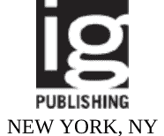

# 爱德华·伯纳斯选集：从宣传到共识工程

南西·斯诺（NANCY SNOW）引言

## 引言

《韦伯-韦西斯特词典》区分了两种类型的“影响力人物”（influencer）。第一种原始定义是指“一个启发或引导他人行动的人”。而21世纪对影响力人物的定义通常是指“一个通过在社交媒体上发布内容，使人们对某（如消费品）产生兴趣的人”。第一种定义表示排他性。如果没有适当的培训、教育和见解，并非每个人都能成为影响力人物。后者则表示包容性。只要有足够的勇气和动力在网络上被讨论或关注，任何人都可以成为社交媒体影响力人物。

伯内斯是影响者的源头（ursprung）。在他之后及之后，没有人能与他相提。他一生的工作——其中最具影响力的呈在本本书中——是超时代的，但也能无缝地适用于今天的媒体和宣传环境。

出生于维也纳的爱德华·伯内斯是西格蒙德·弗洛伊德的双重外甥，他会由衷地拒绝任何人都能成为影响力人物的民粹主义概念。他相信战争和和平宣传活动应当为统治阶级的利益服务，以对抗那些不可靠、缺乏纪律且易于影响的大众。伯内斯无疑会被今天社交媒体平台上的“最低公分数”倾向所排斥，在这些平台上，往往是最具煽性的图像获得最多的关注。他是一位毕业于康奈尔大学的学者，那是他所入籍美国精英常春藤联盟的一部分。

初一看，他1912年的农学学位——他最初在父亲的谷物出口业务工作——与他未来在新闻机构、新闻业和战争宣传领域的职业相径远。但事实上，“宣传”（propaganda）的动词形式具有农业起源。传播（propagate）是指通过从母种繁殖的过程使生物产生结果并繁衍，就像农民在生长的田里播种一样。对于伯内斯来说，他字面上就是我们今天所知的公共关系学科和行业的“母种”。他的后代是那些代表他的客户飞行的思想，其中最重要的是第一次世界大战期间的美国政府。在他毕业及1919年战争结束后的短短七年内，他在纽约市开设了一间“公关顾问”办公室。“公关顾问”听起来比“政府宣传员”好得多，并开启了伯内斯长达七十年的事业：建立客户群，并推销自己作为国家最顶尖说服者和通过秘密手段实现公开行为创造者的声誉。他于1995年去世，享年103岁。

虽然伯内斯被公认为公共关系领域的先驱——他常被称为该领域的奠基人或祖父——但他的影响力在学术界讨论得不够。现代公共关系行业似乎不知道该如何处理他或他的遗产，因为他永远与贬义词“宣传”（propaganda）联系在一起，在美国，这个概念几乎被普遍地揭示为谎言，或只有最坏的敌人才会做的事情。

（注：提供的OCR文本包含大量重复，我已根据其独特的叙事流进行了处理。）

游行进入高潮时，年轻女性在圣托马斯教堂和圣帕特里克教堂之间来回走动，张扬地抽着烟。其中两人被问及青睐哪个品牌，她们说出了名字。小组中的其中一人解释说，这些烟是“自由的火炬”，点亮了女性可以像男性一样自然地在街上吸烟的日子。这群人的发言人难道是安插的亨特小姐（Ms. Hunt）吗？

在五周内，热爱自由的女性烟民被允许进入剧院吸烟区，就像男性一样。发言人和赞助。这正是推广民主的美国方式！在1964年第一份医务长报告将吸烟与健康长寿联系起来后，伯纳斯（Bernays）彻底转变了态度，拒绝与烟草制造商有任何进一步联系。他无法再为一家公司提供建议，因为其产品如果按照广告使用，可能会杀死或缩短使用者的寿命。

作为华盛顿美国大学国际服务学院的国际关系博士生，我错过了在1989年亲眼见到伯纳斯先生的机会——当时他已97岁高龄——他在美国大学传播学院发表了关于公共关系的创始人观点。³他的采访者桑福德·昂加院长（Dean Sanford Ungar）引导伯纳斯透露了他最早的政治活动之一，即软化卡尔文·库里（Calvin Coolidge）冷酷的形象。西迪的女儿艾莉丝·罗斯福·隆沃斯（Alice Roosevelt Longworth）曾引用过一句广为人知的俏话，说库里看起来就像是被用黄瓜泡大的。⁴这种咸涩的表情很快赢得了全国关注。伯纳斯说，对抗任何谣言的最佳方法不是显而易见的否定，而是用一个公开的行为来掩盖谣言，这个想法源于他与同为公共信息委员会成员的记者沃尔特·利普曼（Walter Lippman）的合作。利普曼在伯纳斯出版他的第一本书《舆论的结晶》（1922）十八个月前出版了《舆论》（1922），将新闻描述为“任何打破常规情况的公开行为”。像伯纳斯这样优秀的公共关系专家建议其客户执行某些公开行为，以中断生活的连续性。这将带来有利于客户目标的反应。³对于库里来说，这位过任总统需要性格重塑。一个真正的被黄瓜泡大的古板会怎么做？邀请一群著名的百老汇杂演员和表演者，如阿尔尔·乔尔森（Al Jolson）和齐格尔德歌女团（Ziegfeld Follies girls），在白宫和他一起吃煎饼早餐。这正是伯纳斯在1924年10月17日周五安排的。早餐结束后，小组在白宫草坪再次集合，阿尔尔·乔尔森唱了1924年的竞选歌曲，歌词包括：“库里是那个人。他没有费周大力为我们做了很多，所以让我们报答，把他留在那里吧！他从未睡过，静水流深。”事实上，库里以每天午睡两小时而闻名。

与艺术家的热闹早餐违反了“沉默卡里”（Silent Cal）的刻板印象，就像复活节游行的解放者一样，这引发了全国性的头条新闻。在1924年大选的三方角逐中，库里获得了50%的票数。伯纳斯在国会图书馆收藏的《繁荣与节约：库里时代与消费者经济，1921–1929》中解释了他的角色：“我当时应用了一种老牌媒体推销技巧，在美国总统严苛的形象上增加广为人知的名字，使其成为一个打破常规并引发新闻的事件。”

爱德华·伯纳斯（Edward Bernays）已去世超过四分之一个世纪。他出生于无线电、电视和电影出现之前，死于互联网诞生之时，以服务精英企业客户而闻名，但也1920年为乔治亚州亚特兰大的美国黑人种权协会（NAACP）第十一次年度会议处理了国家宣传，这是会议首次在北方城市以外举行。伯纳斯通过将非洲人的经济前景与南方经济利益联系起来，制定了限制“大迁徙”的方案。其他事业就没有那么进步了。他是联合果公司（United Fruit Company，后更名为奇基塔国际品牌）的首席主管，该公司当时控制着危地马拉42%的土地。他建议该国支持由中情局支持的军事政变，通过其“解放军”推翻经民主选举产生的阿本本斯政府，该政府曾买回公司土地供10万贫困家庭使用。这一次，报纸标题不再那么友好，谴责政变是“经济殖民主义”的形式。

全球最大的公共关系公司之一——伯森马斯特哲的首席执行官兼联合创始人哈罗德·伯伦（Harold Buron）曾说：“我们仍在吟诵伯纳斯留给我们的赞美诗。”这种认可来自一位被《PR周刊》评为“20世纪最具影响力的PR人物”的人，但他的公司也代表阿根廷、罗马尼亚和尼日利亚的独裁政权进行国家品牌重塑旅游推广。在1965年的自传中，伯纳斯透露了他的震惊：希特勒的公共启蒙与宣传部长约瑟夫·戈培尔（Joseph Goebbels）曾利用《舆论的结晶》作为指导，对犹太人发动一场蓄意且有计划的破坏行动。我们不得不思考，在水军农场和人格抹杀的Twitter海洋中，伯纳斯会为支持客户利益提供什么样的公开行为建议。不当的宣传（improper-ganda）在哪里结束，正当的宣传（proper-ganda）又在哪里开始？这本书将提供一些线索。

——南希·斯诺（NANCY SNOW），2021年5月

1. 他的母亲是弗洛伊德的姐姐。他的父亲是弗洛伊德妻的兄弟。
2. 比尔·莫耶斯，《形象制造者，“漫步20世纪》，公共广播系统，1983年4月14日。
3. 爱德华·伯纳斯，“公共关系：创始人的观点，”美国大学传播学院，1989年1月23日。
4. 罗伯特·克洛斯，“在特朗普时代，库里的沉默，”巴格哥日报，2020年1月10日。
5. 斯图特·艾文，《公关！操纵的社会史》，纽约：基础书籍，1996年。

# 爱德华·伯纳斯选集

## 操纵舆论：为何与如何（1928）

舆论受到各种影响，并改变其对生活的各个领域的观点。宗教、科学、艺术、商业和工业都处于运动之中。社会的惯性不断被具有坚定信念和欲望的个人所击败。然而，文明受到惯性的限制。我们不断重复信仰和习惯，直到它们变成一种累积回归的力量。我们对社交、经济以及国际政治的态度延续了过去并加强了它们。康斯托（Comstock）将其传教道德的外衣披在萨默（Sumner）身上，彭罗斯（Penrose）落在巴特勒（Butler）身上，卡内基（Carnegie）落在施瓦布（Schwab）身上，以此类推。反对接受现有观念的活跃舆论过去由部落首领、国王、宗教领袖制造或改变。今天，动摇舆论的特权属于每个人。这是民主的一种表现，人们可以为了自己的论点说服他人承担领导。

……广泛的普通公众，因此他们对生活中许多问题的双方面事实都有了接触。诚实的教育与诚实的宣传有许多共同点。但存在这种不同之处：教育力求保持中立，而宣传则是直截了当地带有派性的。

操纵舆论的各种动机是什么？这些是在我们当今社会中占据主导地位的动机。自我保生、繁衍和爱的基本本能是更为复杂的社会动机。人们试图出于社会动机——伦理、慈善、教育——或者出于政治、国际、经济以及个人抱负的动机，去影响他人。

从社会动机出发，特殊的倡导者可能会发起一场反对结核病或癌症的运动，或提高商业伦理标准，或为某个慈善机构争取支持。从政治角度来看，他可能努力让公众接受政府特定效率或节约的理念。在国际上，特殊的倡导者可能在寻求各国之间的和平。或者在经济上，他可能尝试为旧产品创造一个新市场，或为新产品创造市场。成功、说服他人、获得认可的个人野心，是激活世界上大多数领导人的基本动机。

当然，这种处理舆论的本质机制蕴含着危险。这是一种严重的危险，以至于编辑和公关人员宁愿回避这一话题而非讨论它。

他们说，在这种冲突思想的洪流中，我们该止于何处？这种混乱中会产生什么？那个操纵了舆论并赢得其支持的人，难道不能为了自己的目的而误用它吗？也许有三K党，有墨索里林，有各种形式的暴政；但一个越来越学会表达自己的公众，将越来越学会如何推翻各种暴政。因此，那个教公众索取他们想要的东西，同时也教公众如何保护自己免受他专横侵略性的侵害。

舆论是如何被操纵的？测量和记录人类关系的技术还没有像测量物理关系的技术那样完善。并没有一个配备微米尺的标准局供人类或公共关系专家使用。实验心理学提供了一些尺子，但它们并没有被明确定义，而且应用于操纵舆论的一个特定领域——广告，远比应用于更广泛的宣传或公共关系领域容易得多。

测试页面广告与全版印刷广告的效果，或者彩色广告牌与黑白广告牌的比较效力，是相对简单的。但实验心理学实验室的方法几乎不能满足广义上处理舆论的技术人员的要求。

在这里，动员舆论的专家利用了内省心理学的发现。他了解他想要接触的公众的基本情感和欲望，以及这些欲望的流行程度和强度。分析是处理涉及公众问题的第一步。在考察以及他寻求宣传的理念或产品时，他采用了统计学、实地调查以及诱发事实和意见的各种方法。

诊断能力进入了操纵舆论的问题；这种诊断能力在技术得到更科学的充分发展之前，在未来更有效地操纵舆论时，它可能将是一个更重要的本质要素。

社会学也为他的技术做了贡献。社会的群体分层、群体领袖的重要性以及他们追随者的习惯，都是他工作技术背景的一部分。他有各种方法，用于教育公众接受新思想，阐述少数派观点并加强这些观点，使潜意识的大多数观点活跃起来，使旧原则适用于新思想，通过改变外外”来替代观点，克服偏见，以局部代表整体，以及创造代表他思想的事件和环境。他必须了解接触公众的途径：广播、讲演平台、信函、广告、小册子、报纸。他必须知道如何将一个理念翻译适合任何传播形式且他的公众能理解的术语。

纽约正在进行一项有趣的实验，试图沿着科学路线绘制这些人类关系图。对该群体的第一项研究是追踪对特定主题（如宗教、性、种族、道德、民族主义、国际主义等）特定态度的发展和功能。结论是，态度往往是由某个戏剧性时刻的环境或情况创造的。很多时候，宣传者被创造一种环境，以导致他努力接触的公众产生预期的反应。

原则方面就到这里；那么在实践中，这种操纵过程是如何运作的？

以反对私刑、吉姆·克劳主义（种族隔离）以及梅森和迪森线以下对黑人的民权歧视的斗争为例。战后舆论是如何被操纵，以引起公众对黑人的态度发生改变，或至少是向好的改进的？有色人种进步协会（NAACP）在战进行了斗争。从技术角度来说，他们决定将当年的运动在年度大会上戏剧化，在同一时间和地点将注意力集中在他们所代表的理念以及代表这些理念的人身上。这次大会的目的是为这个问题及其支持者建立所有必然会得知会议的人的支持。

战后舆论是如何被操纵，以引起公众对黑人的态度发生改变，或至少是向好的改进的？

随之而来的是其领导层渴望更有能力地应对这些局面。显而易见，私刑事件的减少是该协会及其他努力的结果。

但让我们来看看另一个领域，即工业。两年前，制帽业正处于悬命一线。毛毡帽的出现挤压了所有各类型帽子和饰品的生产，而这些行业以及赖此生存的数千名男女已经陷入了低迷。该做些什么来防止崩溃呢？

制帽贸易批发和零售协会请来了一位公共关系顾问。他分析了形势，发现厂家制造的帽子大致可以分为六类：蕾丝帽、丝带帽、草帽、羽毛装饰帽等。

公共关系顾问列出了了主导女性戴帽习惯的社会结构要素。他发现这些要素包括四类人：第一，是社会领袖，即时尚潮流源头的女性，她们通过自己的认可来引领时尚；其次，是风格专家，即阐述时尚事实和信息的作家或公关人员；第三，是艺术家，他们需要对这些款式给出艺术上的认可；第四，同样重要的，是用来穿着其他群体所认可的具化理念的美女。因此，问题在于将所有这些群体并置，并且最好在同一时间、同一地点，在最相关的观众——帽子买家面前将他们呈现出来。

以此作为塑造事件以实现预期结果的行动计划，剩下的工作就是用真实的人来填充大纲。

他们成立了一个由著名艺术家组成的委员会，选出纽约六位最美丽的女孩，在阿斯托酒店举办的一场时尚派对上，通过六组组画，穿上六种风格分类中最美的帽子。来自《康德·纳斯特》出版公司的海耶沃斯·坎贝尔担任委员会主席。雕塑家莱奥·伦泰利、查尔斯·达纳·吉布森、艺术总监亨利·克里奇、雷·格林夫加入小组，并刻苦地从数百名申请者中选出六位最理想的候选人。

与此同时，他们组织了一个由美国优秀女性组成的风格委员会，她们基于对美国工业发展的兴趣，愿意用自己的名字为这一理念背书。同时，还有一个由《时尚》杂志的卡梅尔·怀特和其他其他著名时尚权威组成的风格委员会，他们由于其风格价值而愿意支持这一理念。女孩们已经选好了。

现在，他们选择了那些纯洁的女孩。

时尚秀当晚，一切都安排妥当，为了塑造舆论而将所有元素进行戏剧性的并置。那些女孩——美丽的女孩们——穿着她们可爱的帽子和服装，在整个火车观众面前的踏板上游行。

这次活动的消息不仅影响了观者的购买习惯，也影响了全国女性的习惯。活动的故事通过报纸的新闻服务以及她们最喜商店的广告传给了消费者。大幅海报发给了制帽买家，而戴着精美帽子的美女的版画则传到了最小小镇的消费者手中。十天内，该行业就异常活跃起来。一位制造商表示，在展会之前他没有卖过任何大装饰帽，而在展会之后他卖出了数千顶。毛毡帽被淘汰了；并非立即由于巴黎，而是由于这个国家的女性，她们理所当然地接受了创造了如文所述环境的时尚群体的领导地位。

如果大装饰帽能让小毛毡钟形帽作废，或许丝鹅绒也能渗透到两千万女性的时尚习惯中。分析显示，丝鹅绒制造商无法在这里开启他们的时尚。时尚源自巴黎。毫无疑问，丝绸制造商的家乡里昂以及高级装设计师和制帽师的家乡巴黎影响了美国的生产和销售市场。进攻必须从源头开始，利用常规的时尚分发渠道，从源头影响公众。一个由制造商公开支持的丝鹅绒时尚服务被组织了起来。它的首要功能是与里昂制造商和巴黎的定制裁缝建立联系，了解他们在做什么，鼓励他们代表丝鹅绒采取行动，并帮助妥善开发他们的商品。

一位聪明的巴黎人加入了这项工作。他访问了兰文-沃斯（Lanvin-Worth）、艾格内斯和帕图（Patou）等，并使他们在礼服和帽子中使用丝鹅绒。他安排了尊贵的伯爵夫人或公爵夫人穿戴帽子或礼服。

是否对公众舆论进行某种刺激？“声乐机”（Panatrope）是一种仪器，它是四大集团公司——威斯康星、通用电气、无线电公司和布鲁斯克-巴尔克-科林德公司电气和声学实验室多年心血实验的成果，现已完善并准备通用出售。必须使用一种特定的技术来影响数百万人的思想，这些人可能对足球比分和林德伯格的兴趣远比对音乐制造机械中的某种新机械原理大得多。群体的认同是新思想最快被接受的支点。某些小群体的影响足够大，足以影响与其重叠的大群体的态度。首先是音乐爱好者和评论家，他们对这一新理念的认可对普通乐器买家具有分量，如果没有他们的帮助，买家无法对这台机器的质量形成意见。其次，选了一些科学家加入已成立的赞助委员会。他们对媒体的支持意味着向公众传达了该产品是根据科学方法创造的。第三是大都会歌剧院的刻板印象，它在公众心中代表着音乐领域的成就。决定将所有这些元素汇聚在一个进一步象征该理念的地方，通过一场戏剧性的活动来呈现。音乐赞助人被选中：文森特·阿斯托夫人和奥托·凯先生加入了委员会。科学家约翰·海斯·汉蒙德和阿尔弗雷德·N·戈尔德史密博士乐意为这一理念提供权威支持并加入了委员会。大都会歌剧院的男高音本杰明·吉利为活动盖上了艺术认可印章。理所当然，作为音乐核心的爱奥罗大厅被选为活动举办地。代表性的观众对邀请做出了回应。这次活动重要且有趣，在当时竞争性的思想和活动中占据了显著地位。结果是，“声乐机”立即作为一种重要的乐器获得了认可。如果没有在公众脑海中植入新思想的确定程序，社会的惯性可能会阻碍其接受。

如果没有在公众脑海中植入新思想的确定程序，社会的惯性可能会阻碍其接受。是否对公众舆论进行某种刺激？“声乐机”（`Panatrope`）是一种仪器，它是四大集团公司——威斯康星、通用电气、无线电公司和布鲁斯克-巴尔克-科林德公司电气和声学实验室多年心血实验的成果，现已完善并准备通用出售。必须使用一种特定的技术来影响数百万人的思想，这些人可能对足球比分和林德伯格的兴趣远比对音乐制造机械中的某种新机械原理大得多。群体的认同是新思想最快被接受的支点。某些小群体的影响足够大，足以影响与其重叠的大群体的态度。首先是音乐爱好者和评论家，他们对这一新理念的认可对普通乐器买家具有分量，如果没有他们的帮助，买家无法对这台机器的质量形成意见。其次，选了一些科学家加入已成立的赞助委员会。他们对媒体的支持意味着向公众传达了该产品是根据科学方法创造的。第三是大都会歌剧院的刻板印象，它在公众心中代表着音乐领域的成就。决定将所有这些元素汇聚在一个进一步象征该理念的地方，通过一场戏剧性的活动来呈现。音乐赞助人被选中：文森特·阿斯托夫人和奥托·凯先生加入了委员会。科学家约翰·海斯·汉蒙德和阿尔弗雷德·N·戈尔德史密博士乐意为这一理念提供权威支持并加入了委员会。大都会歌剧院的男高音本杰明·吉利为活动盖上了艺术认可印章。理所当然，作为音乐核心的爱奥罗大厅被选为活动举办地。代表性的观众对邀请做出了回应。这次活动重要且有趣，在当时竞争性的思想和活动中占据了显著地位。结果是，“声乐机”立即作为一种重要的乐器获得了认可。如果没有在公众脑海中植入新思想的确定程序，社会的惯性可能会阻碍其接受。

## 意愿工程 (1947)

言论自由及其民主必然结果——新闻自由，已经默化地扩大了我们的《权利法案》，使其包含了说服的权利。这一发展是自由言论和说服媒介扩张的必然结果。所有这些媒体都为公众敞开了大门。我们中的任何一个人都可以通过这些媒体影响我们同胞的态度和行动。

美国通信业的剧烈扩张，为这个国家提供了世界上最透彻、最有效的思想传输机制。每一位居民都不断暴露在我们巨大的通信网络的影响之下，无论这些角落是多么偏远或孤立。言语不断敲击着美国人的眼睛和耳朵。美国已经变成了一个小房间，在这里，一个低语都会被放大数千倍。

对于那些关注社会建设性行动的人来说，如何使用这个巨大的放大系统已成为首要考虑的问题。

这一通信系统有两个主要部分，它们维持着社会凝聚力。第一层是商业媒体。美国几乎有1,800份日报，其总发行量约为44,000,000份。大约有10,000份周报和近6,000本杂志。大约2,000个不同类型的广播电站向全国60,000,000台接收机广播。大约16,500家电影院的容量接近10,500,000人。每年出版海量的小册和手册。整个国家被广告牌、传单、随手丢广告和直邮广告覆盖。圆桌会议、小组讨论、论坛、教室和立法会议，任何所有的媒体日复一日地传播着信息，传播某人的话。

第二层是由该国家许多组织团体拥有并运营的专业媒体。几乎所有的团体（以及它们的许多分支机构）都有自己的通信系统。他们不仅通过劳工报、内部刊物、特别公报等正式书面文字来传播思想，还通过讲座、会议、讨论和基层的对话来传播。

### 通过沟通实现领导力

这种通信网络（有时会重复、交错和重叠）是一个事实，而非理论。我们必须认识到现代通信的意义，它不仅是一个高度组织化的机械网络，更是一种促进社会之善或可能产生恶的强大力量。我们可以决定这一网络是否能被最大限度地用于健全的社会目标。

因为通过掌握沟通技巧，在现代美国民主这一巨大的体系中，领导力才能得到充分发挥。在较早的时代，在一个地理范围较小、人口更同质化的社会里，领导者通常被追随者个人所认识；他们之间存在视觉关系。沟通主要通过向听众进行个人宣告或通过相对原始的印刷机完成。书籍、手册和报纸仅触及公众中极少数的识字群体。

我们已经听腻了反复出现的陈词滥调——“世界已经变得越来越小了”；但这种所谓的真理在某种意义上并不真的如此。世界既变小了，也变得大得多。它的物理边界已经扩张。今天的领导者在物理上变得比公众更遥远；但同时，通过现代通信系统，公众对这些领导者的熟悉程度大大增加。领导者的力量与以往一样。

相反，通过使用这个由于技术进步而不断扩张的系统，领导者能够克服地理距离和社会阶层化的问题，触及他们的受众。这种扩张的基础，以及其以目前形式存在的大部分原因，是识字率广泛且极其快速的普及。

领导者可以是许多不同观点的发言人。他们可能指导工业、工会或政府部门等主要组织团体的活动。他们可能在争取公众好感的斗争中相互竞争；或者他们可能代表大部门内部的分歧，进行内部竞争。这样的领导者在专长利用通信渠道的领域技术人员的帮助下，能够有针对地——科学地完成我们所称的“意愿工程”。

### 工程学方法

这个短语非常简单地意味着使用工程学方法——即，行动仅基于对形势的彻底了解，以及将科学原理和经过检验的实践应用于使人们支持某种思想和计划的任务中。任何个人或组织最终都取决于公众的认可，因此面临着对某项计划或目标的公众意愿进行“工程化”的问题。我们期望我们选出的政府官员通过向他们开放的通信网络，对他们提出的措施进行我们的意愿工程。我们拒绝政府的威权主义或军事化，但我们愿意采取书面或口头向我们建议的行动。意愿工程是民主进程的精髓，言论、新闻、请愿和集会的自由——这些使意愿工程成为可能的自由——是美国宪法中最受推崇的保障之一。

意愿工程在理论和实践上都应该基于对试图争取对象的对象的完全理解。但有时无法根据所有人都对事实的理解来达成共同决策。普通的美国成年人仅接受过六年教育。在面临危机和决策时，领导者往往无法等待人们达成一般的理解。在某些情况下，民主领导者必须在通过意愿工程引导公众走向社会建设性目标和价值观方面发挥他们的作用。这一角色自然地赋予了他们义务，即利用教育过程以及其他可用技术，以带来尽可能全面的理解。

在任何情况下，意愿工程都不应取代或取代教育系统（无论是正式还是非正式的）在使公众理解方面的功能。意愿工程往往补充了教育过程。

### 意愿工程的重要性

今天无法高估意愿工程的重要性；它影响着我们生活的方方面面。当用于社会目的时，它是我们对社会高效运作最有价值的贡献之一。技术可以被操纵；煽动者利用这些技术实现反民主目的，其成功程度与将其用于社会理想目标的人相当。因此，负责任的领导者为了实现社会目标，必须时刻意识到操纵的可能性。他必须投入精力，掌握意愿工程的操作诀，并在公众利益面前战胜对手。

战争期间，仅通过其短波设施传播的信息量，可能比乔治·克里尔（`George Creel`）全体员工所撰写的字数还要多。

随着这种方法被认为是影响公众思想的关键因素，许多相关领域的成千上万专家相颖而出——如编辑、出版商、广告商、压力团体和政党领导人、教育工作者和宣传人员等专家。第一次世界大战期间及战后初期，为了应对需要经过培训、有技能的专家来为他人提供工程化公众共识的技术建议，产生了一种新职业，即提供公共关系咨询的职业。

#### 专业观点

1923年，我在我的《结晶公众意见》（`Crystallizing Public Opinion`）书中定义了这一职业，并在同年的纽约大学开设了该主题的第一门课程。在从那之后的四分之一世纪里，这一职业已成为我国公认的职业，并传播到其他允许市场中思想自由交流和竞争的民主国家。该职业拥有自己的文献、培训课程、日益增加的从业者以及对社会责任日益增长的认可。

在美国，这一职业专门处理群体与其公众之间的关系问题。其主要功能是客观、现实地分析客户相对于公众的立场，并就客户对该公众的态度和处理方式提供必要的修正建议。因此，它是实现调整的工具（如果关系中存在任何失调的话）。当然，必须记住，作为持久调整基础的善意，只有那些行为与其符的人才能从长期来看保持。但这并不阻止那些不配拥有善意的人赢得并持有足够长的时间，以造成巨大的损害。

公共关系顾问有专业责任只推行他所认同的思想，而不应为他认为反社会的客户推行某些事业或接受任务。

#### 运动活动规划

正如土木工程师在筑桥之前必须分析形势的每一个元素一样，共识工程师为了实现有价值的社会目标，必须在周计划行动的基础上运作。让我们假设他正在从事某项特定任务。他的计划必须基于四个前提：

1. 资源的计算，包括人力和物力；即为该目的可用的人力、资金和时间；
2. 尽可能深入了解该主题；
3. 确定目标，并根据研究结果可能进行调整；具体要完成什么、与谁一起以及通过谁完成；
4. 对公众进行研究，以了解他们作为个体和群体如何以及为何行动。

只有在这些准备工作坚实落实之后，才可能知道目标在现实中可行。只有这样，共识工程师才能利用他的人力、资金、时间资源以及可用媒体。战略、组织和活动将根据形势的现实制定。

任务必须首先与人力机械预算挂钩。在人力资产方面，共识工程师具有某些才华——创造性的、行政、执行性的——他必须知道这些是什么。他还应该对自己的局限性有清晰的认识。人力资产需要工作空间和办公设备来实现。所有的需求必须由预算提供。

最重要的是，一旦预算建立，在迈出第一步之前，应该彻底探索处理该主题的知识领域。这主要是一个收集和对信息库进行编码的问题，以便供实际、高效的使用。这项准备工作可能是枯燥且严苛的，而且不能跳过；因为共识工程师在公众面前露面之前，必须具备强大的事实、真理和证据支持。

共识工程师应该为自己提供有关公共关系、宣传、公众意见的标准参考书：`N.W. 艾尔父子的《报纸和期刊年鉴》`、`《编辑与出版商年鉴》`、`《无线每日年报》`、`《国会年鉴》`、`《芝加哥日报年鉴》`、`《世界年鉴》`——当然，还有电话年簿。（例如，《世界年鉴》包含了美国成千上万协会的名单——一个国家的横截面。）这些或其他卷册提供了有效规划所需的基础性库。

在准备工作的这一阶段，共识工程师应该考虑其活动的目标。他应该时刻清楚地知道自己正要去何处，以及想要完成什么。他可能会加强已经存在的良好态度；他可能会诱导持有良好态度的人采取建设性行动；他可能会转化不信疑者；他可能会打破某些对立观点。

目标应该被精确定义。例如，在红十字募捐中，从开始就要设定时间限制和筹集的资金金额。在救济活动中，如果针对特定国家或地区的人民发出援助请求，而不是针对欧洲或亚洲等泛区域，将获得好得的结果。

#### 研究公众

目标始终要与要获得共识的公众相关。公众是人，但他们知道什么？他们对共识工程师所关注的形势目前态度如何？支配这些态度的冲动是什么？人们准备好吸收哪些思想？在有效的刺激下，他们准备好处理什么？他们的思想是来自酒保员、邮递员、女服务员、《孤女安妮》，还是《纽约时报》的社论版？哪些群体领袖或意见引导者有效地影响了追随者的思维过程？思想的流向是怎样的——从谁流向谁？权威、事实证据、精确性、传统和情感在接受这些思想方面起了多大作用？

公众的态度、假设、思想或偏见源于明确的影响。人们必须在工作所在的情境中找出这些影响是什么。

如果共识工程师要有效计划，他必须也了解他将处理的群体构成，因为民主社会实际上只是由组成群体的松散集合。具有共同社会或职业利益的某些个人形成了自愿团体。这些包括医生、律师、护士等人的专业组织；行业协会；工会；妇女俱乐部；宗教团体以及成千上万的俱乐部和兄弟会。正式群体，如政治单位，其范围可以从有组织的少数派到像我们两个大政党这样的大型无组织政治实体。今天还有另一类公众群体是共识工程师必须记住的。《新共和》（`New Republic`）的读者或雷蒙德·斯林节目的听众是许多自愿团体，尽管没有组织，正如工会或扶轮俱乐部的成员一样。为了良好运作，几乎所有组织团体都会选举或选择领袖，这些领袖通常留一段时间。这些领袖反映了追随者的意愿，并促进他们的利益。在民主社会中，他们只能在追随者想要去的地方和方向引导他们。为了影响公众，共识工程师通过各级的群体领袖和意见引导者开展工作。

#### 研究的价值与技术

为了获得公众思想对某个或多个思想接受程度的准确知识，必须进行细致的研究。这种研究旨在要在研究者和公众之间建立一个公约数。它应该揭示共识工程师必须工作的客观形势的现实。完成后，它提供了一份行动蓝图，并澄清了谁在何时、何地以及为何做什么的问题。它将指示要采用的整体战略、强调的主题、所需的组织、媒体的使用以及日常战术。它应该进一步指示赢得公众需要多久，以及公众思想的短期和长期趋势是什么。

研究可能表明需要修改原始目标、扩大或缩小计划目标，或改变行动和方法。简而言之，它等同于海员的海图、建筑师的蓝图、旅行者的路线图。民意调查可以通过问卷、个人访谈或民意调查来进行。可以与商业领袖、行业协会负责人、工会官员以及教育领袖取得联系，他们都可能愿意帮助“共识工程师”。社区中专业团体的领袖——医学协会、建筑师、工程师——都应该进行咨询。此外还有社会服务机构高管、妇女俱乐部官员和宗教领袖。编辑、出版商以及广播电台和电影界人士可以被说服与工程师讨论其目标，以及影响这些领袖及其受众的诉求和切入点。当地理发师、铁路工人、服装工人和出租车司机的工会或协会可能愿意合作这项事业。基层领袖至关重要。这样的调查可能会产生双重效果：工程师了解了群体领袖们知道和不知道的、他们与自己合作的程度、触达他们的媒体、可能有效的诉求，以及他们赖以生活的偏见、传说或事实。他能够同时确定他们是否会自行开展信息宣传活动，从而补充自己的活动。

#### 主题、策略与组织

既然准备工作已经完成，就可以进入实际规划阶段了。从民意调查中将得出的策略的主要主题。这些主题包含了要传达的思想；它们引导了通往公众的路径；并且必须通过所使用的任何媒体表达出来。主题是无处不在但又无形的——类比小说中所谓的“故事情节”。要取得成功，主题必须诉诸公众的动机。动机是由欲望力量创造的意识和潜意识压力的激活。心理学家已经分离出许多极具说服力的诉求，其有效性在实践中已得到反复证明。一旦确定了主题，它们将在什么样的活动中使用呢？情况可能需要闪电战或持久战、两者的结合或其他策略。可能需要为一场将在几周或几个月内结束的选举制定行动计划，也为一项可能需要多年的运动（例如降低结核病死亡率的努力）制定计划。

大众说服规划受许多因素影响，这要求运用所有的训练、经验、技能和判断力。规划应该是灵活的，并考虑到条件的变化。当计划完善后，将是资源的组织，这必须提前进行，以提供必要的人力、资金和物理设备。组织还协调可能随时召唤的任何专家活动，例如民意调查员、募捐者、公共关系人员、广播和电影专家、妇女俱乐部和外语小组的专家等。

#### 战术

在此时，可以规划计划的战术，即决定如何通过思想载体（传播网络）来传播主题。

不要从分段化的角度来看待战术。问题不在于将文章放入报纸、获得广播时段或安排一部电影新闻短片；而在于启动一项广泛的活动，其成功取决于所提策略中所有阶段和元素的环环相扣，并通过在效能最大时刻实施的战术来执行。一项仅持续一天的行动可能会完全失败。熟练且富有想象力的思维决定了许多运动和活动的成功，这种现象在美国人的行为模式中非常典型。共识工程师活动的重点将放在书面语和口头语上，针对媒体进行调整，并为他所面对的受众进行设计。他必须确保他的材料符合他的公众。他必须为平均年龄的公众准备使用简单语言和十六字句的文稿。某些稿件将针对受过十七年教育的人群。他必须熟悉所有媒体，并知道如何向他们提供数量和质量都合适的材料。

然而，共识工程师主要创造新闻。新闻不是死板的东西。是显性行为创造了新闻，而新闻反过来塑造了人们的态度和行动。判断某事是否为新闻的一个良好标准是该事件是否脱离常规模式。发展非常规的事件和情况是共识工程师的基本功能之一。经过设计的事件可以通过通信系统传播给比实际参与者多得多的的人，此类事件能为那些没有目睹事件的人生动地戏剧化思想。通过富有想象力管理的事件可以成功地与其他事件竞争注意力。涉及人的有价值的事件通常不是偶然发生的。它们被刻意计划以实现某种目的，影响我们的思想和行动。

事件也可以以链式反应的方式设定。通过利用群体领袖的能量，共识工程师可以激励他们启动自己的活动。他们将组织额外的、专门的、附属事件，所有这些都将进一步增强基本主题的戏剧性。

### 结论

交流是社会共识工程的关键。但仅仅在油印机上印传单和简报、在报纸上发布新闻稿或在无线电波中充满广播演讲是不够的。除非文字、声音和图像是深思熟虑的计划和精心组织的方法的工具，否则它们的作用微乎其微。如果计划制定得当并被善利用，文字所传达的思想将成为人们自身的一部分。当公众信服某个思想的合理性时，他们就会采取行动。人们将思想本身建议的转化为行动，无论它是意识形态、政治还是社会性的。他们可能采用一种强调种族和宗教宽容的哲学；他们可能将“新政”投进政府；或组织购买罢工。但这些结果并非凭空发生。在民主社会中，这些结果主要可以通过共识工程来实现。

## 塑造公众意见 (1935年)

“公众意见”突然成为一种实体，在任何涉及公众的事务中都必须对其进行考虑和理智处理。第一次世界大战的宣传展示了朝着目标塑造意见的可能性。它的成功让领袖们相信，衡量公众对思想或产品的反应是多么重要；为任何项目获得公众支持是多么必要。

随着文明变得越来越复杂，思想的传递加快了。随着竞争力量的增加和锐化，所有群体都越来越明显地意识到，如果要在争夺公众青睐的竞争力量混乱中生存，他们必须赢得并获得公众的认可。

这种认识导致了新型技术人员的发展——公共关系顾问，许多个人和群体都依赖他们的建议。公共关系顾问的功能是向公众解释其客户，并向公众推介其客户。在逻辑延伸上，它是要在国家与国家、政府与人民、慈善机构与捐赠者、私人公司与与其公众，或任何群体与其服务并依赖于其福祉的公众之间带来理解的和谐。

宣传者可以是建设性目的的力量，也可以破坏性目的的力量。这并非他所独特。这是在其他职业和行业中普遍存在的状况。显然，公共利益的力量应该使用这一武器。

## 公众

谁是公众？“塑造公众意见”这些词假设了一个统一的、凝聚力的公众的存在。这样的公众可能只在关键需求或紧急情况下存在。但通常情况下，我们所说的公众是由许多由于共同利益而聚集在一起的小公众或群体组成的。

政治战术家在规划他的活动时，首先将他的公众大致分为三类：支持他的不需要被宣传的、反对他的、以及那些可能被动摇但并不属于他的。

明确属于另外两个群体之一。这种对公众的分析是简单且初级的。但公众很少能被如此明确地分类。

有时，公众可以根据地理分布进行分类。也可以根据年龄组进行划分。例如，墨索里尼和希特勒非常重视青年运动，并利用年轻人的影响来摇动更为温和的成年群体。在某些情况下，公众根据性别、职业分类、经济或政治信仰，或狭义上的社会群体进行划分。还可以根据阅读习惯、智力、作为领导者或追随者的地位、作为雇主或受雇者的地位、宗教信仰、种族和国家起源，或对体育、慈善、爱好或俱乐部的特殊兴趣进行分类。

## 团体领导力

那么，这就是塑造舆论的第一个要素。宣传者如何接触这些构成大部分公众的群体呢？他可以通过他们的领导者来接触，因为个人会向其所属小组的领导者寻求领导。他可能会被许多小组领导者支配，因为社会的这种划分是众多且多样化的。他们在塑造舆论方面发挥着至关重要的作用，并为宣传者提供了接触大量个体的手段；因为有如此混乱且冲突的思想在竞争个体的注意力，他被迫向他人寻求权威和领导。在当今这个复杂的世界里，没有人能完全根据自己对证据的审查和权衡来做出判断和行动。对领导者的信任（当领导者是可靠时）是一种可靠的捷径。

因此，团体领导者成为塑造舆论的关键性人物，他们对某一理念的接受也伴随着许多追随者的接受——通过渠道来实现。如果团体领导者接受了我们的理念，他们所支配的群体就会做出反应。这些关键领导者作为接触大部分人口的媒介，其重要性是一个首要因素，绝不能忽视。我们也不应忘记，他们不仅向公众传达思想，还会为宣传者阐释并阐述他们所代表的特定群体，以供其指导。从整体而言，他们代表了整个公众。

如今的压力团体是获得广泛接受的运动的基础。我们可以将“压力团体”定义为任何对某一理念产生足够兴趣并积极支持它的人群。在这样的团体中积极参与可能并不比写一封信或参加一次会议更复杂。几乎所有美国人都属于某个团体，许多人属于好几个；正是通过团凝聚力和团体领导力，才能最迅速且最有建设性地唤醒公众兴趣。禁令废除的成功并不是通过直接转化数百万人，而是通过争取数百万人所属团体的领导者的积极支持实现的。

## 人类动机

在公众个体成员的所有这些划分和归属关系之后，宣传者必须考虑到第二个因素。无论人们身处何地、属于哪个团体，人类伟大的基本动机是什么？自保、野心、自尊心、饥饿、对家庭和子女的爱、爱国主义、模仿性、成为领导者的欲望、对游戏的喜爱——这些以及其他动机是每位领导者在努力争取公众认同其观点时必须意识到的心理原材料。

宣传者必须根据其与人们及其所属群体的底层动机之间的关系来分析他的问题。因此，他必须将其案例转化为能够诉诸这些基本动机的方式，以获得构成其公众的庞大且互交错的团体系统中的领导者及其所属公众的关注和支持。例如，乳制品行业意识到牛奶具有吸引人类自保动机的显著特征，发现健康、营养和其他权威人士会自发地向他们的公众强调牛奶的这些特性。

## 符号

公共关系活动必须考虑到社会的团体关系和人类的主导本能。它还必须考虑到符号的有效性，这是讨论公共关系背景的第三点。符号可以被定义为理解和行动的捷径。它是宣传的货币。它通常是一个词。“温和派”（wets）在“敲诈犯者”（racketeer）和“禁令”（prohibition）这两个词之间建立的联系，无疑影响了反对禁令的舆论。对符号的接受是情感性的，也是熟悉感的表现。必须仔细选择符号是显而易见的。在宣传一家大型跨公司时，符号可以是组织头部的某个人；可能是一个描述产品的口号；也可能是一个执行特定公共服务的单一部门。

公共关系计划的功能是将特殊的诉求与公众所能接受的理念联系起来。符号的效力在不断变化。必须在每一个机会明智地利用它们。对宣传技巧的评论家偶尔表示，这是一种试图通过诉诸情感而非头脑来为某一观点赢得追随者的方法。当然，这是对宣传者所认知的该词一词的重新定义。宣传者利用他所有可用的可靠方法来投影他的思想。

## 媒体

我们到了宣传者必须时刻记住的第四个因素——他的事实和观点传达给公众的媒体。

在今天为了产生和传播思想而建立的巨大系统中，有许多媒体让思想每分每秒地传达给公众。相机、麦克风、印刷机和打字机正忙碌地通过这些媒体呈现从 A 到 B、C 和 D 的观点；呈现 E 到 F、G 和 H 收集的事实；并报告 I 为 J、K 和 L 的利益创造的事件。

让我们列举一些我归类在印刷文字下的媒体——当然也包括广告。这些数字显然是估计值。

| 类别 | 描述 |
| :--- | :--- |
| 日报 (美国) | 2,000 |
| 周报 (美国) | 6,300 |
| 半周报 (美国) | 350 |
| 日报发行量 (美国及加拿大) | 38,700 |
| 日报发行量 | 26,700 |
| 宗教出版物 | 690 |
| 分类和贸易出版物 | 2,500 |
| 出版书籍（1933年） | 6,813 |
| 广告牌 | 200 |
| 无电台 (美国) | 600 |
| 收音机 | 18,500 |
| 教会 | 232,000 |
| 合法剧院 | |
| 覆盖数千人的查陶会 | |
| 电话 (美国) | 16,800 |
| 妇女俱乐部 | 14,500 |
| 转轮俱乐部、狮子会、服务俱乐部、商人俱乐部 | |
| 电影院 (美国) | 22,000 |
| 座容量 | 11,300 |
| 公立学校年度放映 | 44,000 |
| 小型日报的胶版服务 | |
| 全美新闻图片展示（橱窗展示） | |
| 巡展 |

我们关注这些数字是为了说明这一点：美国的传播组织使得几乎任何个人、任何团体或运动都能与公众产生最紧密的接触。这是使控制或改变行为可能的一种重要事实。如果思想通过这些渠道有效地投射，特别是当诉求基于主动机并获得领导者的支持时，对行为的控制显然会增强。

## 制定计划的四个基本步骤

让我们转向制定公共关系计划必须采取的更具体的步骤。为了使这个大纲更具体，让我们假设该计划是针对某个行业的。有四个步骤：

### 1. 目标的制定

第一点是明确目标究竟是什么。这是基础步骤。在我们竞争体系中，私营利润动机和必须符合公共利益。如果目标不符合公共利益，则应该放弃该计划。

### 2. 公众态度分析

第二点是分析公众对该行业及其所提供服务的态度。

显然，这种分析必须基于广泛且具有代表性的调查，该调查应该能够回答以下问题：公众对所提供的产品和服务的总体态度是什么？该行业的具体行动和宏观政策如何影响公众的态度？该行业在哪些方面未能达到公众的预期？

此类研究还应揭示舆论中发生的任何根本性变化，以便行业能够根据所指示的任何变化做出调整，以符合新的公众需求；或者在公众需求似乎无法满足的情况下，努力引导公众接受其自身的观点。

这项调查将为该行业开展其公共关系计划提供科学基础，并在必要时对其业务经营上做出指示性的调整。此类研究能够揭示一些通过销售人员与客户之间的普通关系无法获得的重要事实。此外，这种调查还应让行业对与其销售产品竞争的所有其他产品和服务有更全面的视角。

### 3. 分析研究

采取第三步，应该对这种分析进行研究，旨在从行业行动的角度概述接触公众的方法。这种行动必须在一段时间内持续进行。在可能的情况下，它必须是公开的。在与行业私人利益相合的情况下，它必须从公众利益的角度进行构想。

这种公共关系计划或政策必须整合到整个整个运作中。它不能是简单叠加在组织之上的东西。它不能仅仅由油印机印出的稿件组成。它必须是行业领导思考和行动中不可或缺的一部分。这可能意味着这种思考和行动必须发生决定性的改变，以符合公众需求和公众目标。公众不普遍接受的观点，只有在被证明对公众有价值，并且其吸引力可以与可接受的事实、意见或习俗联系起来时，才能变得可以接受。符号必须既有效又至重要。

在商业和工业领域，直到最近，“启明自利”的理念才开始发挥作用。企业意识到，如果促进公共利益，就能最好地服务自身的利益。人寿公司已经意识到，它们对公共健康的关注对公司具有财务上的收益。一家试图销售收电机的无线电设备制造公司意识到，激发人们对广播节目本身产生更具建设性和判别性的兴趣是有价值的。

建立的政策必须调和实际目标与公众许多阶层的先入为主、关注点和现有态度。所定的政策可能仅仅是一种最深刻、最广泛的事实调查，以及随后向个人、群体或普通公众展示事实。该政策可能要求制定一项计划，向公众教育涉及的广泛问题，也可能要求代表某一特定事实发起主动的进攻。

在任何宣传行动中，确定基本政策是至关重要的。仅仅表达意见，无论表达得多么好，如果不能具体满足形势的潜在需求，其价值可能很小，或者对事业造成明确的危害。

### 4. 媒体的使用

在这些计划在纸上制定并从宏观政策的基础上确定后，第四步——此类政策的实际执行——就可以开始了。这是通过所有可能的媒体，根据公众的思考和需求，对行业进行投影和解释。

此类运动的首要原则是它必须具有连续性。孤立的方法价值不大。努力必须经过仔细计划，以便这种努力的效果产生累积的力量。运动的结构必须像建筑一样具有进步性和统一性。

我们已经列出了许多需要考虑的媒体。旧时代的推销员向报纸寄稿件；而今天的宣传员可能在不向报纸发送一份通稿的情况下发动整场运动。媒体仍然重要，可以被尽力利用，但必须有选择性地利用。某些思想通过某些媒体传输更为有效。一千人的行军可能比一千个字更有说服力，反之亦然，取决于情况。

不仅这些媒体要仔细选择，目标——无论以何种形式表达——必须根据所需的特定媒体进行表述。这意味着目标必须被戏剧化，以便其代表的基本思想在竞争思想的洪流中脱颖而出，并通过习惯渠道自然地流向公众。

必须开发出能够象征目标的事件，同时又要足够有趣，以便被用于各种通往公众的渠道中。必须获得公众领袖的支持，并将这种支持反映给公众。必须选择符号。一旦对公众态度进行了深入研究，并将计划与这些态度协调，就会发现许多通往公众的渠道。

本文尝试对任何行业通过媒体塑造舆论的技术和方法提供一份比例合理的概述，并对这一文明新发展的社会意义做出讨论。显然

> “可能是相互关联的，” 1934年12月31日。参见美国电话公司，《报告》，1934, 第18页。

## 公众态度调查——仆人还是主人？（1945年）

就像维生素和其他许多好东西一样，态度调查被美国以其典型的不加思考的方式所采用。如果诚实、高效且智能地收集和理解，它们是极其有用的工具。反之，在无知、无能、不诚或反社会的人手中，它们是潜在的危险武器。

并非所有的调查都是诚实的，并非所有的调查都是准确的，并非所有调查都是智能解读的，调查很少预测未来。尽管如此，公众热诚地审视这些数字，并相信对这些调查中回答的所有问题已经给出了定论。

许多同仁。这些人的工作以及他们在民调方面的技巧对官员和政策制定者具有直接效用。此外，他们发明的新分析工具和创造的新数据源对各个领域都是一种福祉。

但有太多的领导者和太多的公众盲目地接受态度民调。他们不应该这样做。民调的价值在于解读，而不仅仅在于其准确性。态度民调本身并不传达任何信息。民调的数据是原材料。只有当解读者了解的比民调数据本身显示的内容多得多时，民调才是未来的指数。数百万美国人并不知道，民调是一道闪光，揭示了政府、民意调查者和公众的严肃考量。

### 民调

我们需要定义民调的功能；引起人们对误读、误用和歪曲的关注；说明为什么民调作为人们未来行动的指数会有差异。

不准确的民调和解读对社会是一种危险：

- 1. 因为不准确的民调对公众的影响与真实的民调一样大。
- 2. 因为民意调查者或雇佣民意调查者出于偏见或利目的而误用民调，这可能是极其有害的。
- 3. 因为领导者在处理公众事务时误读和歪曲民调，是对社会的威胁。

### 根本危险

人们对态度民调的有效性的接受过于字面化。许多人相信，当民调显示有 51% 的公众支持某项提议时，这就是民意。这种领导者和公众的信念倾向于消除传统的、通过多数派和少数派观点的协调与调整来决策的民主方式。这些决定通常是在公开场合通过讨论和妥协来争取的。今天，民调禁锢了异见的声音。这对我们得出结论的民主方式来说是一个真正的危险。

即使是不准确且拙劣的态度民调也会影响公众。最近的一个案例戏剧性地说明了这一点。一个不准确的选举民调对一个失败政党命运的影响，由其主席在一封给杜伊州长的电报中做了总结。该民调是由《纽约每日新闻》进行的。电报由自由党发出的：“10 月 15 日，《新闻》的民调错误地预测奥德韦先生的得票率超过 70%。（实际票数超过 57.3%。）从那一天起，争取良好政府的竞选在实际意义上结束了。士气低落，工人消失，收入停止了。”

但这种危险不仅存在于不准确民调的情况下。在准确民调的情况下同样如此。在最近的杰弗里斯-弗兰肯斯坦斯坦选举中，民调的过度影响被戏剧性地呈现在公众面前。意见研究公司受一家私人委托聘用，对两位候选人的选举胜算进行态度民调。《底特律自由报》获得了该民调并将其出版。它显示底特律绝大多数黑人支持弗兰肯斯坦。弗兰肯斯坦被指控由于这项民调的显示对他的选举产生了不利影响。

出于偏见或利目的使用操纵的、虚假的民调也存在危险。民调对民意调查者或缺乏社会责任的团体是一种诱惑，他们知道公众对民调的信任，却为了自己的目的使用民调。

### 民调 VS 领导者

态度民调往往让立法者和商人产生一种信念，即定量百分比证实了自己的观点时，他们就是免受公众反对的。他们没有考虑到公众意见会在不经通知的情况下发生变化，并忽视了这种可能性。他们不认为被动或隐藏的观点是重要的。这可能导致后来的爆发，当少数派意见变得清晰、活跃和公开，并突然与多数意见发生公开冲突时。在为了广泛公众利益做出决策时，讨论是极其重要的。

此外，民调在美国产生的新型领导力也存在危险——一种顺从民调的领导力。准确的民调必须被谨慎使用：

- 1. 因为态度民调对公众产生如此强烈的影响，以至于往往阻碍人们使用健全的民主方法来做出重要决策。
- 2. 因为当民调阻碍领导者独立思考、预判变化或为公众做好变化准备时，社会就会遭受痛苦。
- 3. 因为民调施加的压力可能使社会陷入杰斐逊所谓的“多数人的暴政”之中，并扼杀进步思想。

我们不再由人领导。我们被民调牵着鼻子走。民主领导者的责任，无论是在商业还是政治领域，都是告知和教育公众意见朝着有价值的进步，并在比仅仅进行数字计数更谨慎的基础上做出决策。态度民调已成为政治、艺术、商业以及事实上我们生活每个阶段的决定因素。

这使得公众对变化没有做好准备，因为本应该做好准备的领导者没有这样做。我们知道，态度通过计划的行动、非计划的事件变化得非常快，尽管发展性的变化通常是缓慢的。那些寄希望于民调所示态度的持久性，并认为它们是准确预测的人，往往被误导了。遵循民调的社会、工业和政治领导者遵循的是过去，而不是迈向未来。社会遭受痛苦。

因为民调的真实价值在公众心中被歪曲，民调也可能通过恐吓领导者来破坏许多种进步行动。它们阻止了过度谨慎的人沿着进步的路线前进。人们效法数字并服从它们。如果有 70% 的票支持某产品、某交通法规或某拟议议会法案，民调主宰了领导者的头脑。他们屈服民调的原因非常简单：为什么要通过违背似乎是多数意见的做法来冒自己的风险呢？

这并不是说领导者遵循他的公众。总的来说，我们国家生活中真正的领导者几乎总是领先于追随者的。但大多数情况下是追随者的伪领导者，受到民调的鼓励去成为追随者。

目前认为民调显示永久公众意见的信念有助于维持现状。无疑，在一个快速变化的世界里，这是一个沉重的负担。多数派必须受到刺激和教育以向前。破坏性对社会造成的危险是显而易见的。

但虽然态度民调带有这些危险，然而在现有知识范围内进行的科学计划民调，在未来行动方面可能是准确的。它们可以预测选举。例如，五项民调对上一次总统竞选结果的预测与实际票数的误差小于 2%。科学民调在选举预测上如此准确的一个可能可能是，这个国家的投票很大程度上遵循传统路线。只有一小比例的投票是灵活的。

### 如同冰山……

这种民调的有效性与收集公众对看板广告、广播广告或童工态度的民调相比相差甚远。要让此类民调具有意义，必须根据公众趋势、相反驱动力和重大事件的更广泛分析对数据进行研究和解读。

民意调查者所说的人民的声音通过态度表达出来，很少是人们不可改变的声音。公众意见像冰山。可见部分是表达出来的态度，但公众意见的潜水部分有时更有力量。

科学民调是对公众当前感受的计数。虽然它只告诉我们计数那一刻的公众反应，但它是有用的。它可以作为领导力的工具。具有社会关怀的领导者试图了解特定时刻的公众态度。有了知识，他们可以计划教育公众新习俗、新态度的价值，或者他们帮助保护现有的习俗。

当我谈到领导力时，指的是民主领导力——通过民主方法、通过教育和说服进行的领导力，而不是像威权政权那样通过威胁、恐吓、武力或虚伪进行的领导力。在政治中，民主进步是通过个人和群体在个人领导下为了共同决策而实现的。美国的领导者进展速度不会快于他的追随者想要跟随他。因此，态度民调的真实功能是成为领导者在商业或政治领域履行其民主职的工具。对于公众而言，民调应当仅仅是一个温度计——它显示了在威权政体下进行练习时的温度。在政治中，民主的进步是通过个人和向共同决策迈进的群体之间的互动来实现的。

大多数态度都会受到外部压力而发生变化。正如普林斯顿大学民意研究办公室的哈德利·坎特尔博士（Dr. Hadley Cantril）所说，我们必须区分“触及根深蒂固、成熟成型态度的民调，与触及未成型的情况——后者才是民调、领导者或其他任何影响所能影响的”。

仅通过数字来解读民调就像只通过读温度计来诊断病人。即使是一段时间内的读数在民调中也是无效的。数字在一段时间内可能保持稳定，并导致错误的解释，即通过将稳定的态度投影到未来来进行预测。实际上，公众可能对某种状况感到冷漠或无知。明天他们可能会获知新事实，从而改变他们的态度。

# 缘

为什么态度民调作为人们未来行动的指标会变化；为什么它们没有履行领导者和人们认为它们具有的功能；以及为什么它们需要进行判断性的解读？我将要讨论的心理因素无疑是显而易见的。我谈论这些因素是因为它们指示了人们如何获得一种并不真正有效、但仍然能产生强大影响的群众意见。

态度民调仅代表个人可能想告诉调查者的内容，或者他认为调查者想听到的内容。它们往往仅仅代表一个人对普遍接受观点的遵循。无意识的审查经常阻止受访者说出他们的真实想法——或可能做的事。一个周一说自己对黑人没有偏见的人，可能周二就会加入私刑暴徒。有时答案是随众心理。有时答案是试图建立自尊，或通过受访者的身份给听者留下深刻印象。答案可能反映了当时的环境或其他外部条件。

提问的方式、个人民调者的技术，都会影响态度民调的有效性。民调者的偏见和观点具有影响。提问者的性格影响受访者。答案取决于调查者作为受访者的身心状态。瞬间的情绪对随口出的答案有很大影响。它们会扭曲快速的回答并可能导致直接的误述。一个吃了丰盛早餐、睡了好觉并期待愉快的一天的人，其回答会与彻宿了一夜、稍微喝了点酒或被家庭状况困扰的人不同。一个在看医生路上的人对税收的看法可能比在纳粹入侵巴黎后第二天对任何事都感到很好的人更悲观。这种广泛的情绪并不会相互抵消，因此平均法则并不总是适用。

我们意识的思维以及意识的理性都会影响答案。我们回答的内容有时是一种合理化。真实原因可能被隐藏，因为我们对它们感到羞耻。它们可能是我们不认可的轻率或自私的原因。

许多人是神经质。他们的答案可能反映了他们内心的挣扎，并可能没有显示出真实的观点。出于各种原因——腺体的、心理的、社会的——我们避免随口给出深思熟虑的答案。所有这些因素都会对民调的意义产生影响。

有些态度民调仅基于“是”与“否”的给出定量测量。这些并没有显示一个人是否会改变其观点，以及为什么，因为它们没有显示态度的强度。持有态度的强度指示了变化的可能性。这就是为什么如此多民调对于瞬间的想法之外的都是糟糕的指南。这就是为什么民调呈现的态度可能明天或后天发生变化。

# 两项建议

可以采取什么措施来防止民调的一些误用、扭曲和误读？这里有两项建议。我相信它们值得讨论和采取行动。

1. 公民由其州或国家政府代表，必须确保自己不受任何涉及公共利益的职业不当行为的影响。在医生、律师、会计师和建筑师的情况下，这是在允许个人执业之前设定性格标准和教育资质来实现的。

执业民调需要执照。任何理性的从业者无疑都会欢迎这一步。许多职业已经实行了自我监管，这也可以在民调行业中建立。

有人建议这可以通过一个非政府机构接管对民调者的监督来实现。这是可能的，但怀疑一个私人组织在公众心中是否具有像政府那样的权威来消除虚假的、操纵的、贿赂的、不诚实且错误的民调。

还有一步——保护公众及其领导者。

2. 必须开展针对公众和领导者的教育活动，让他们了解民调在我们社会中的意义，以便他们能够正确评估并防止对社会的危害。民调将因此发挥健康的民主目的，帮助决策代表选民观点，而不是多数意见压倒其他观点。

“Propaganda”（宣传）一词本身具有某些技术含义，就像这个世界上的大多数事物一样，它“无所谓无坏，全取决于习俗”。我在《富克和瓦格纳尔词典》中发现了该词的四种定义：

1. 红衣主教会议，海外传教工作的监督者；也指教皇乌尔班尼八世于1627年为教育传教神父而创立的罗马宣传学院；圣传道学院。

2. “因此，任何传播教义或体系的机构或计划。”

3. 有系统地为某种观点或行动方案赢得公众支持而付出的努力。

4. “宣传机构所提出的原则。”

《科学美国人》最近的一期杂志中呼吁恢复那个“优美的旧词‘propaganda’”的体面用法。

它写道：“英语中没有哪一个词的含义像‘propaganda’那样被如此悲惨地扭曲了。”这种变化主要发生在上一次大战期间，当时这个术语带上了明显的阴险色彩。”

“如果你查阅《标准字典》，你会发现这个词曾被用于红衣主教会议或协会，负责照顾和监督海外传教工作，该机构于1627年成立于罗马。它也被用于由教皇乌尔班尼八世创立的罗马宣传学院，用于教育传教神父。因此，在后以后，这个词被应用于任何传播教义或体系的机构或计划。”

“根据这个定义，我们可以看到，在真正的意义上，宣传是一种完全合法的人类活动形式。任何社会，无论是社会、宗教还是政治，只要拥有某些信仰并试图通过口头或书面让其为人知，就是在进行宣传。”

“真理是强大且必须胜利的。如果有人认为他们发现了有价值的真理，那么传播真理不仅是他们的特权，更是责任。如果他们意识到（而且必须意识到）这种真理的传播只有通过组织的努力才能在大范围内有效地进行，那么他们就会利用媒体和平台作为使其广泛流传的最佳手段。只有当宣传者有意识且刻意地传播他们明知是谎言的内容，或者他们的目的是达到明知会对公共利益有害的效果时，宣传才会变得恶毒且受人指责。”

在正确意义上，“propaganda”是一个完全健康的词，出身正当，并有一段光荣的历史。它今天带有阴险的含义，说明了普通成年人身上还留着多少孩子气。一群公民针对某个有争议的问题，支持某种行动方案进行撰写和论述，认为这正在促进社区的最佳利益。这是宣传吗？一点也不是。这只是对真理平实而强有力的陈述。但如果让另一群公民表达反对意见，他们就会被贴上“宣传”这个阴险的标签……

“一位智者的老谚说道：‘鸭吃水，鹅也吃水’（意为：一视同仁）。”让我们尽快把这个优美的旧词放回它属于的地方，为我们的子孙后代之使用，恢复其尊严的意义。”

宣传塑造我们周围事务进展的程度，可能令见多识广的人也感到惊讶。尽管如此，只需观察报纸的表面，就能发现宣传对舆论具有权威性的端倪。在写这些段落的当天，《纽约时报》的头版包含了八条重要新闻报道。其中四条（即一半）是宣传。普通读者接受它们是自发事件的记录。但它们真的是自发的吗？这里是宣布这些新闻的标题：

- 十二国家宣战；中国改革必须在提供援助前进行”、“普里切特报告称锡尼主义将失败”、“房地产人士要求进行调查”、“霍华报告称：我们的生活水平处于历史最高点”

按顺序来看：关于中国的文章解释了中国治外特权委员会的联合报告，阐述了列国对中国混乱局面的立场。其内容本身并不重要，重要的是它的形式。该报告“由美国国务院部于今日公布”，其目的是向美国公众展示外交部的立场。它的来源赋予了它权威性，而美国公众倾向于接受并支持外交部的观点。

卡内基国际和平基金会理事人普里切特博士的报告，试图寻找位于动荡的阿拉伯世界中这个犹太人殖民地的事实。当普里切特博士的调查使他从长远来看锡尼主义将“为犹太人和阿拉伯人带来更多的苦涩和不快乐”时，这一观点以卡内基基金会的全部权威传播出去，以便公众听到并相信。纽约房地产委员会主席的声明以及霍华秘书的报告，也是为了影响公众转向某种观点的类似尝试。

给出这些例子并不是为了给人一种宣传有任何阴险之处的印象。它们更多是为了说明如何对事件进行意识的引导，以及这些事件背后的人是如何影响舆论的。这些都是现代宣传的例子。此时，我们可以尝试为宣传下定义。

现代宣传是一种持续、持久的努力，通过创造或塑造事件，来影响公众与企业、思想或群体的关系。

这种创造环境和在数百万人脑海中创造形象的做法非常普遍。现在几乎没有一项重大事业是不通过此完成的，无论这项事业是建造大教堂、大学、营销电影、发行大型债券，还是选举总统。对公众的影响是由专业的宣传人员创造的，有时也是为了这项工作由业余人员完成的。重要的一点是它是普遍且持续的；总体来看，它对公众的整顿程度就像军队整顿士兵一样。可以被整顿的思想脑数量是如此巨大，而且在整顿后是如此顽固，以至于立法者和编辑在它们面前无能为力。群体会紧紧抓住沃尔特·李普曼所说的“刻板印象”，当一个群体感受到对理想的渴望，感到自己被新移民群体挤出原来的地位和繁荣时，他们会抓住一个完美契合自己偏见的形象并将其据为己有。成千上万地结成一个足以左右选举的巨大群体。在我们目前的社会组织中，公众的认可对于任何大型事业都是至关重要的。因此，一项崇尚的运动如果不作用于公众思想，就会失败。慈善、商业、政治乃至文学，都必须采用宣传，因为公众在捐款方面需要被整顿，就像在预防结核病方面一样。近东救济会、纽约改善贫协会以及所有其他机构，必须像推销牙膏一样对舆论进行工作。我们对婴儿死亡率的下降感到自豪——这也是宣传的结果。

……以及听觉——为了支持国家事业，他们还确保了每个小组关键人物的合作——这些人的仅仅凭一句话就能对数百、数千或数十万名追随者拥有权威。因此，他们自动获得了兄弟会、宗教、商业、爱国主义、社会和地方团体的支持，这些成员的意见听取自他们习惯的领导人和发言人，或者源自他们习惯阅读和相信的定期刊物。与此同时，爱国舆论的操纵者利用公众的心理陈词滥调和情感习惯，引发了大众针对敌人所谓的暴行、恐怖和暴政的大规模反应。战争结束后，智力人士询问是否可能将类似的技术应用于和平问题，这是理所当然的。

事实上，战以来的宣传实践已经采取了与二十年前盛行的形式完全不同的形式。这种新技术可以公正地被称为“新宣传”。

它不仅考虑到个体，甚至不仅考虑到大众，而且特别考虑到社会的解剖，以及其中错综交织的群体形成和忠诚关系。它不仅将个人视为社会组织中的细胞，还将其视为组织成社会单元的细胞。在敏感部位触碰神经，你就会获得有机体某些特定成员的自动反应。

商业领域为利益集团对公众可能产生的影响提供了生动的例子，例如纺织品制造商失去了他们的市场。这个问题出现在不久前，当时丝绒制造商正面临灭顶，因为他们的产品已经过时很久。分析显示，在美国境内复兴丝绒时尚是不可能的。显而易见！但既是如此又如此。巴黎是时尚之都。里昂是丝绸之故乡。进攻必须从源头开始。他们决定用目的性取代偶然性，利用时尚分发的常规渠道，并从这些渠道影响公众。他们组织了一个由制造商公开支持的丝绒时尚服务机构。其首要功能是与里昂的制造商和巴黎的定制师建立联系，发现他们在做什么，鼓励他们代表丝绒采取行动，并帮助妥善利用他们的商品。一位聪明的巴黎人被招募到这项工作中。他访问了兰文（Lanvin）、沃斯（Worth）、艾格内斯（Agnes）和帕图（Patou）等，诱使他们在礼服和帽子中使用丝绒。是他安排了某位著名的伯爵或公爵穿上帽子或礼服。至于如何向公众推销这一理念，美国买家或美国时尚女性只需在裁缝师或制帽师的工作室内看到丝绒作品即可。她购买丝绒是因为她喜欢，也因为它很流行。

美国杂志的编辑们同样将实际（尽管是被创造）的情境反映在他们的新闻中，而这反过来又让买家和消费者受到同样的影响。结果是，最初像细流般的丝绒需求变成了洪流。巴黎和美国被缓慢但蓄意地创造出了一种需求。一家旨在成为风格领导者的大型百货商店根据法国定制师的权威广告了丝绒礼服和帽子，并引用了从他们那里收到的原始电报。全国数百家想要成为风格领导者的百货商店听到了新风格的回声。简报随在派遣之后。邮件随在电报之后。美国女性穿着丝绒礼服和帽子，在船运新闻摄影师之前旅行。

被创造的情境产生了其影响。“反复无常的时尚转向了丝绒，”一家报纸这样评论道。美国各项业再次让数千人有了事可做。

新宣传考虑到社会的整体结构，很少有助于集中和实现大众的欲望。对特定改革的渴望无论多么广泛，除非它变得清晰明确，并且对适当的立法机构施加了足够的压力，否则无法转化为行动。数百万主妇可能认为对健康有害的商品应该被禁止。

但是，除非他们半含糊的需求被组织起来、表达出来，并以某种方式集中在州立法机构或联邦国会，以产生他们想要的结果，否则他们个人的欲望几乎不可能转化为有效的法律形式。无论他们是否意识到，他们都在依靠宣传来组织并实现他们的需求。但显然，需要智力少数派持续且系统地利用宣传。在私利与公共利益契合的活跃少数派中，存在着美国的进步和发展。只有通过少数智人的积极能量，大众才能意识到并付诸新思想。

小团体可以、并且确实让我们其他人对某个主题随心所欲地思考。但每个宣传都有支持者和反对者，他们都同样渴望说服大多数。

## 为什么我们行为得不像人（1949年）

从以前——在迷人的1920年代——一位著名的美国人类学家乔治·阿莫斯·多西（George Amos Dorsey）写了一本畅销书，《我们为什么行为得不像人》（*Why We Behave Like Human Beings*）。

这出现在柯锐基时代，那个时代的未来看起来无限光明，每个人都将在国家富足的抽奖中获奖。美国繁荣、自信、具有历史性的乐观主义，它正喝着浴缸酒；跳着黑底舞；读着海明威、卡贝尔和《绅士偏爱金发》；为一位刚刚独自飞越大西洋的名叫林德伯格（Lindbergh）的年轻人欢呼；赞扬尤金·奥尼的《马可·万金》（Marco Millions），并对辛克莱尔·刘易斯的讽刺和一个新连环画角色米老鼠的作剧大笑。

那种从贫困到富有、从木屋到白宫的老旧美国梦依然强劲。埃尔伯特·哈伯德（Elbert Hubbard）的《给加西亚的信》（*Message to Garcia*）仍然激励着高中生，让他们坚信，如果你在人生的竞争赛跑中没有什么能阻挡你，你就能达到“成功”这个闪闪发的目标。库埃（Coue）的《自我暗示法》让许多人相信，只要你每天对自己说“我一天越来越好”，这种咒语就能让他们在永恒繁荣的旋转木马上抓住梦寐以求的名声和财富。就在转角处，全球范围内在布鲁斯·巴顿（Bruce Barton）的《无人知者》（*The Man Nobody Knows*）中寻找这一切的秘密，他将基督描绘成超人、小镇推销者和扶轮俱乐部的主席。

在这些日子里，美国是一个每个人都可以参与的世界，成功是触手可及。你所做的就是努力工作，用正确的牙膏刷牙，避开“B.O.”（体闻），你确定会和老板的女儿结婚，并在之后幸福地生活在一个从未听过住房短缺的土地上。

这种崇高的保证渗透了最高层。美国历史学家院长、已故的查尔斯·A·贝尔德（Charles A. Beard）在《美国文明的崛起》（*Rise of American Civilization*）结尾处于1927年宣布那是神的黎明。从华盛顿，历史的地平线上出现了《洛奇国际公约》（Kellogg Pact）的光明承诺，许多国家庄严地同意废除战争并建立全球和平。在这个幸福的，人们看起来完全是人。

在1929年秋季，这个美丽的梦破碎了。我们一直盲目忽视的历史性进程突然追上了我们，并用一次剧烈的冲击将我们唤醒。第一次世界大战开启了一个史无前例的时代。现在，在三十年里，人类被持续的冲突所撕裂。全球战争、革命和反革命伴随着全球萧条、民族起义、阶级冲突、阴谋、政变、地下运动、内战、独裁、渗透纵、公开审判、暗杀、自杀、处决和殖民反叛。旧帝国被摧毁；新国家被创造；共和国在入侵军队或极权政权的靴子下再次消失。

全球繁荣、进步和和平的梦想被全球野心、暴力和欺诈粉碎。一个侵略者刚好一点，另一个就举起了拳。每一场战争，无论是全球性的还是局部的，之后都是一个充斥着对下一次战争恐惧的模糊和平。

人们因其种族、宗教或政治信仰而被焚死；灯罩则无瑕地由人皮制成。

尽管拥有先进的民主生活方式，美国仍未完全逃脱这一世纪噩梦般的动荡。我们经历过萧条、战争、罢工、私刑、种族暴乱、宗教和种族偏见、青少年犯罪以及离婚率上升。精神疾病也呈现出惊人的增长，这成为那些极度不适应时代紧张、错位和恐怖的人们最后的、绝望的避难所——而这个时代以萨拉热窝的一声枪响开启，并以广岛原子弹的爆炸结束了其第一幕。

在现代世界的黎明，莎士比亚曾赞叹道：“理性的作品是多么的伟大！在形式和情感上是如此无限，如此生动且令人崇拜！在行动中是多么像天使！在理解中是多么像神！”今天，我们对人类天使般和神性的平等不再那么印象深刻。相反，我们被一种发现震惊：在压力下，数百万人可以如此轻易地屈服于机械化的猎杀和人相食。因此，当前的这个64美元的问题不是我们为什么得像人一样行为，而是我们为什么得像非人一样行为。

每个人都在问这个问题，从街头路人到最博学的科学家，因为过去四十年的各种突破和发现迫使我们改变了对自己以及对所处的世界的基本观点。

十九世纪科学的先驱发现增强了人们的信念，即人类不断的进步和自由完全取决于对物理世界的掌握。工业革命释放的每一项不断加速的发明，似乎不仅保证了普遍的福祉，还保证了普遍的和平。今天，当物理科学已经完善了以音速飞行的飞机，并承诺将我们从引力控制中解放出来时，对自然的物质征服正处于历史的顶峰。然而，世界正处于冲突的火焰之中，而科学发明使得冲突变得更加暴力和具有破坏性。

这改变了科学本身的重点。宗教会议（如最近在兰贝斯和阿姆斯特丹举行的会议）呼吁道德再生作为人类在地球上最后的最后希望，这并不意外。同样意外的是，同期在伦敦举行的世界领先精神病学家大会，敦促研究和控制人类本性（尤其是其攻击冲动）作为二十世纪的主要解决方案。同样合逻辑的是，像杜克大学的社会科学家霍内尔·哈特（Hornell Hart）博士——他因原子能社会影响的行动研究获得爱德华·L·伯纳叶斯原子能奖——提出一项社会科学的“曼哈顿计划”，作为现实应对以人类为中心的危机的第一步。

但最近，我们听到了一些“人咬狗”式的意料之外的新闻。现在是物理学家本身开始强调人类（我们对人类了解得甚少），而不是自然（我们对自然的掌握得如此完美，以至于如果我们不学会控制自己，自然就会毁灭我们）。

在今年的美国科学促进协会大会上，其主席、耶鲁大学的埃德蒙·W·辛诺特（Edmund W. Sinnott）博士表示：“人类，而不是自然，是今天的大问题。这些巨大的新力量掌握在自私或傲慢的人手中，只会增加他们支配同类的力量。”辛诺特博士说，人类想要的不仅仅是一头被饲养良好的野兽，他补充道：“除非我们给他充分的机会和鼓励去充分培养他本性的高级方面，并让他从教条和强迫的束缚中解放出来，否则他永远不会满足，他也将没有真正的希望。”

在同一场会议上，德克萨斯大学著名的生物化学家罗杰·J·威廉姆斯（Roger J. Williams）博士指出，虽然科学家们对物质原子有了巨大的了解，但他们对社会原子——即人类个体仍然一无所知，而这是一种比原子弹更具爆炸性的力量。威廉姆斯教授说：“今天文明面临的不是原子弹和生物战的威胁，而是来自我们自身的威胁。如果文明崩溃，人类将自取灭亡。他所使用的仪器和工具不会是问题的根源。”

# 二十世纪的关键问题：人际关系

二十世纪的关键问题是人际关系。物理、化学和生物学的持续胜利被认为是理所当然。但如果我们想知道，为什么在这些智慧战胜物质的成就中，我们仍然继续像非人一样行为，以及尽管尽管如此，我们是如何学会像人一样行为的，我们就必须转向那些在过去三十年才开始真正发展的新科学——人类学、精神病学、心理分析和社会学。

这让我感到有些亲切，因为我的叔叔西格蒙德·弗洛伊德（Sigmund Freud）很久以前就指出，我们大多数问题的解决方案在于科学地遵循苏格拉底著名的格言：认识你自己！今天，公认的精神科治疗是让不适应者通过认识他们自己来治愈自己。由于人类整体似乎不适应二十世纪强加的新条件，这种技术正在应用于整个人类。

## 探索人类本性的多维视角

在试图发现我们为何这样行为的过程中，这些科学正从各个角度探测人类的本性：

- **生理上**，人类取决于其身体的运作方式；
- **心理上**，取决于其大脑的运作方式；
- **社会上**，取决于其在其中的运作；
- **生物上**，取决于其对遗传和环境的反应方式；
- **教育上**，取决于早期和成年教育如何塑造他；
- **经济上**，取决于他是我们大众生产系统的受益者还是受害者。

通过探索每个人行为的这些阶段，我们可能会得出解释人性和行为之谜的答案。这种基础知识可能帮助我们找到更好地社会适应和幸福的方法。

## 社会稳定与挫败感的后果

各种科学现在一致认为，当个体获得本性所需的生理、智力、情感、审美、道德和宗教关注时，社会是稳定且健康的。我们表现得像非人一样的原因之一，是世界上许多人在基本需求和欲望上遭受了挫败。严重的挫败感倾向于让人们回到原始的行为模式。它激起了恐惧，而恐惧激起了复仇的欲望。尤其是，在一个冲突不断的世界中，挫败刺激了可以转化为建设性的冲动。

### 攻击性行为的分类

最近，科学家们对人类的攻击冲动进行了大量的讨论。哈佛大学的托马斯·尼克·卡弗（Thomas Nixon Carver）将攻击性行为分为破坏性、欺骗性和说服性。

- **破坏性**包括战争、抢劫、决斗、谋杀和斗殴；
- **欺骗性**包括偷窃、诈骗、掺假和虚假广告；
- **说服性攻击**涉及政治、商业、性爱和法律对人的攻击。

无论我们如何对其分类，攻击总是试图给他人带来伤害或死亡；如今，“我们为什么表现得像非人一样？”这个问题变成了“我们为什么表现出攻击性？”

## 文明的薄薄表层

1914年这个血腥与错误时代的开启，对那代人来说是一个巨大的震惊，他们仅在知识顶端吸收了达尔文进化论的真正含义，并且对历史时间没有真正的把握。即使今天，许多人仍然不理解科学的基本概念，即人类起源于较低的动物形态；并且和其他动物一样，我们寻求满足欲望并防御危险。

基本的欲望和恐惧一直都在，但随着文明的发展，我们学会了为了群体生存的利益而控制它们。事实上，文明始于人类对丛林冲动的放弃和升华。除非人类克制原始的性和攻击本能，否则家庭和社会生活是不可能的。即使是最原始的社会也禁止乱伦、抢劫和谋杀。

当社会被专制精英放弃时，我们会得到一个丛林法则强加在无助民众身上的极权主义国家。另一方面，当我们最初假设时，随后是大规模的挫败和神经症。越来越多，现代精神病学家倾向于将当代的危机与我们早年在家庭和社会中的经历联系起来。人不是静态的个体。像世界上的其他事物一样，他们在环境压力下演化和变化。我们塑造了他们，他们也塑造了世界。文明要求我们每个人适应社会生活。当错误的教养或构造使我们无法做出这种必要的调整时，我们就表现得像非人一样。

我们之所以这样做，是因为记录在案的最古文明仅追溯到6000年前——在人类从细胞出现以来的数百万年里，这仅仅是极小的一点。我们曾是丛林动物，时间远比我们作为文明的时间要长。**文明人，而丛林动物的冲动则潜伏在我们文明表象下的存在之中。**

## 童年经历与攻击性的形成

当我们作为孩子来到世时，我们的冲动是那些在原始动物世界中为生存而斗争的原始本能。童年的心理问题围绕着需要对家庭、社区、国家和世界进行社会适应的需求。所有的教育和训练——无论是在家庭、学校还是教会——都旨在遏制原始冲动（即我们与生俱来的攻击性），并将其重新引导至社会目标上。

但那些抚养我们的人，尤其是我们的父母，并不总是意识到他们将我们文明化的尝试可能是冷漠的、无知的或残忍的；如果他们没有考虑到我们发展中的人格的特殊需求，我们可能会感到挫败。对孩子的原始冲动进行创造性的重新引导是一方面，而由于缺乏爱和理解而导致的压抑则是另一回事。莎士曾观察到，腐烂的花朵比伤口糟糕得多；而那些因压抑而腐化的自然冲动，可能会在日后的生活中表现为无力或危险的攻击性。如果我们作为非人的人被培养，我们很可能变成非人的人。在成年人的生活中，没有人比那个在残忍中戒奶的人那样残忍。

然而，不仅是在家庭中，攻击性的教养也会助长攻击性。社会是抚养我们所有人的大家庭。社会未能妥善做到这一点，也可能使本应升华并建设性重新引导的原始冲动变质并激化。因贫困、种族、宗教或外貌而受侮辱的孩子可能怀有报复之情，而在我们这样一个充满暴力的时代，这些情感可能会找到攻击性的宣泄口。

圣经告诉我们，人不单靠吃活着。孩子需要感到自己被家庭和社区接纳和珍爱。如果他被拒绝——尤其是被不公正地拒绝——铁就会刺入他的灵魂，使他变得愤世俗、报复且具有攻击性。

## 社会层面的挫败与替罪羊现象

在这个全球动荡和冲突的时代，挫败的人往往通过反社会行为来发泄攻击性。他们试图通过种族和宗教歧视，以及对所谓的“劣等民族”的迫害来平愈自己的心理创伤。

阿纳托尔·法国曾说，拿破仑用血征服世界是因为他在自自己的帐篷里是个失败者；而现代心理学家发现，那些在集中营杀害数百万人的人，是在为自己童年被遗忘的痛苦和挫败寻找替罪羊。一个在经济和心理上都没有安全感、流着泪吃干面包并感到自己被拒绝、不被爱的孩子，可能会成长为一个寻找“替罪羊”的男人，强迫他为早期的失败付出代价。

科学正在密切思考这样一个事实：我们的许多现代政治白痴，从最默默无闻的棕色人到顶层声势浩浩的独裁者，都是被追溯到童年的仇恨和怨恨吞噬的心理残废。

挫败、失败、痛苦、不安全感以及作为“受侮辱和受伤者”的感觉，在经济、政治和军事不稳定的时期是非常危险的事情。

我们付出了代价才发现，一个具有领导力天赋的心理怪物，太容易向世界承诺地球上的安全与胜利，从而唤醒数百万挫败之人的原始攻击性冲动了。

一个偏执的希特勒毫不费力地点燃了在失败和严苛条约下痛苦的德国人民的情绪，或通过征服的承诺陶醉他们，让他们以巨大的规模表现得像非人。在这里，正如今天处处一样，野蛮的攻击被误认为是通往成功的捷径，而破坏被误认为是获得心理安全感的捷径。

## 竞争社会与教育的缺失

我们表现得像非人性的另一个原因是社会性的。我们生活在一个高度竞争的社会中。我们在这个社会中的行为建立在丛林的生存法则之上。

随着文明、道德和伦理历史的发展，我们制定了游戏规则，这些规则倾向于让我们表现得更像人类。但现代竞争社会仍然相对较新，这些规则还没有应该的那样清晰，我们也没有像可能这样做的那样遵守它们。竞争社会的金钱价值使我们惩罚通奸（这影响三个人的幸福）比惩罚通奸（这可能影响数百人的健康）要严厉得多。

诚然，正如我们许多明智的社会科学家所指出的，环境对塑造我们行为的影响比遗传要大得多。在大多数情况下，我们是由周围环境所造就的。正如同母体中的孩子从胚胎开始，经历从单细胞到人类进化的各个阶段一样，我们每个人必须在自己的一生中学习我们文明的全部遗产。威廉·格拉姆·萨姆创造了“被遗忘的人”这一短语来称呼这种遗产。

另一个使这种退化成为原因是世界十亿人口中有一半仍是不识字的。有些个体吸收模式比其他人更快更容易。根据1940年的人口普查，美国成年人平均只有八年教育。他们不是受知识和理解的引导，而是被最原始的恐惧和希望所驱动。

这就是为什么今天所有的科学，从心理分析到物理学，都在关注我们为什么表现得像非人这个问题。联合国职员拥有自己的心理顾问，这是这个时代的特征。我们生活在一个“去世界化”的世界，各种代表多样化利益的冲突诉求日日夜夜地向公众发出。

诚然，我们这个国家拥有一套公共教育体系，正如《教育政策》杂志最近所说，它应该培养人们成为自由民主国家的自由公民。但这一理想与我们周围的现实之间存在巨大的鸿沟。国家教育协会和类似团体显示，许多州、城市和村庄缺乏设备、经过良好培训的教师以及让孩子适应今天和明天的基本思想。作为这种严重滞后最后的顶峰，我们的教育系统没有将社会科学发现的人性规律带入教室。孩子们仍然在使用过时的方法教授过时的观念。青少年离开学校时，往往没有准备好面对现代生活的复杂问题。在大多数情况下，他们被适应了一种完全不同的生活模式，更接近19世纪而非20世纪。这可能会产生一种心理上的不安全感。他可能感到沮丧和愤恨，因为负责他教育的人把他抛入这个动荡的当代世界，却没有做好准备。如果他在追求安全或成功的斗争中遭遇失败和挫败，他就会成为煽动者的完美受害者，煽动者给出令人眼目的、不道德的报复、征服和掠夺承诺，这些承诺包含了挫败的匿名者感到自己被剥夺的一切美好与恶。

假设这一职位，纽约研究生学院和医院的卡尔·F·苏尔茨伯格博士敦促对人类进行进一步研究与希望有一天，人类不再为了在这个世界上生存下去而不得不与现实或虚幻的敌人作斗。

他说，精神病学无疑正朝着理解人类行为的方向发展，这种理解可能有一天有助于实现和平。当前许多人类行为问题的关键在于对儿童挫败感和失望的研究，因为“影响未来生活的焦虑与满足模式在幼年时期就已经建立了”。

这也是时代的标志之一，康奈尔大学的卡尔·宾格博士（Dr. Carl Binger）在伦敦最近举行的国际心理健康大会上发言时，敦促那些认为没有科学家帮助就无法发动战争的国家元人和政治家，听取关于如何预防战争的意见。宾格博士证实了弗洛伊德的论，即战争源于人类的侵略本能，并将战争比作没有单一原因的疾病，而是多种原因引起的，而这些原因共同导致了最终的灾难。

因此，科学凭借其现代的实验和方法设备，正试图通过对人类及其生存环境日益加深的了解来解决非人性行为问题。我们从力量与欺诈的丛林遗产中解放出来的关键，在于加速自我认知。当我们学会像控制物理自然界那样控制我们自己时，真理确实会使我们自由。

---

# 工会教育计划（1947年）

**公众对重大议题的意见**经历着一个演变的过程。公众最初只看到任何问题的一小部分，就像冰山只有顶部是可见的。然后，随着教育活动的结果，人们逐渐引导看到越来越多的内容，直到对该主题有了全面的了解——他们看到的不仅是山峰，还有冰山更大部分位于水下的部分。

以类似的方式，整个工业关系问题在今天是高度显而易见的。工会的教育努力是迫使这一问题走向公开化的一个重要因素。

在本文中，我将从公共关系的角度讨论工业关系。在与这些问题的日常接触中，我有着丰富的经验。我研究了商界和公众对劳工的态度，以及劳工对商界的态度。我曾研究过工会的教育计划。

在我看来，工会仍有一项重要工作要做完成；即开展强化的纪实性教育运动，不仅向普通公众和管理层，还要向自己的工会成员就争取工业民主斗争的基石事实进行指导。

我们所有人都渴望并期待拥有更好的生活、更好的家乡、更好的美国，并为所有人提供保障和就业。

我们尚未成功。对于如何获得更好的生活，存在着激烈的分歧和冲突。我们被心理和经济上的不安全感所困扰。愤世嫉俗、幻灭和挫败感破坏了我们的士气。我们将攻击性转向了同胞，而不是针对共同的敌人。美国是一个意识形态和群体斗争的战场：白人对黑人；本土出生对外来；管理层对劳工。我们必须对这些内部矛盾采取积极行动，正如我们正试图对国际战争采取积极行动一样。

这些内部斗争中最重要的是管理层与劳工之间的矛盾。只有当我们明智地追求时，才能实现工业和平。劳工和管理层可以计划并共同努力以实现我们社会的目标。惩罚性立法无法解决我们的问题——答案是工业关系教育。公众、雇主和工人必须了解这其中的意义。

劳工应该承担这部分教育责任。大型工会的教育主管能做什么来解决这个问题？

## 公共关系视角下的工会教育

这本质上是一个公共关系问题。人们在买肥皂之前必须先想要清洁。他们在涌入大学之前必须先想要高等教育。同样，人们在愿意支持特定的工会目标之前必须先想要工会。一个理解工会对国家利益所做贡献的公众，将对工会计划持开放友好的态度。如果公众不理解工会的价值，就会被偏见、谎言和歪曲所引导。

让我们研究一个进步的教育计划，看看它是否是从基础开始并逐步建立的。该计划遵循几条宽泛的路线：

- **第一**，工会教育其成员充分投入工会工作；为处理谈判问题培养有效且成熟的领导力；加强组织内部的民主；建立工会团结。通过这些活动，工会试图实现其目标——更高的工资、全行业工资协议、工资均衡、保障性年薪、女性工人的平等。
- **第二**，工会试图通过多种方式加强民主。它反对通货膨胀。它鼓励在政治事务上与农民、消费者和其他人合作开展工会活动。它为了更好的住房、退伍军人的援助、健康计划和公民自由而努力。
- **计划的第三部分**未公布但广为人知，是向自身成员“推销”自己的问题。（研究、广告和公共关系人员面临同样的问题。客户想要立即看到结果。）

当我研究工会的教育活动时，在我看来，它可以承担三项额外的教育计划，以便公众理解工会想要什么并更愿意接受其目标：

- 让公众理解健全工会和成熟领导力对国家的价值。
- 让雇主理解工会对他自己的价值，让他意识到他需要工会。
- 让工人理解工业体系及其在其中的角色。

这种教育将为对更广泛争议性问题的理解奠定基础，并促进劳工与社会其他部门之间增加合作。

### 教育公众的迫切需求

教育公众的迫切需求已通过多种方式得到证明。权威调查一次一次揭示了在该领域的大量无知。例如，受访者中超过四分之一的人无法回答1946年底埃尔莫·罗珀富运（Elmo Roper Fortune）调查提出的这个问题：“假设你在过去的几个月里在劳资纠纷中担任裁判员；你认为你的决定可能会更倾向于劳工方还是管理层方？”

美国公众对劳工事务无知的主要原因是缺乏事实性信息。公众主要通过报纸头条或广播节目获得工会的印象，而这通常发生在争议发生之前或期间。在争议期间，工会或管理层的观点无助于澄清；相反，它只会强化现有的态度。当问题没有被情绪压力过热时，人们更容易接受事实。

我认为，大多数人并不知道工会增加了购买力和利润，以及工资，不知道工会对工业体系的调整负责提高了我们的生活水平。公众对于工会扩张对我们经济意味着什么几乎没有概念。他们不知道工会的优势。他们不知道从其他国家的经验中可以学习什么。公众真的不知道为什么有些工会从事有害行为，而另一些不会。他们不了解工会内部的民主进程是如何运作的。

他们做出判断所需的知识。除非有人开展有计划的活动来提供这些事实，否则他们无法获得。进步性工会处于这种地位。它们可以向公众提供关于工会的的信息：

#### 1. 什么是工会？

它是如何运作的？介绍工会组织的基本故事、历史和发展。解释工会的结构和内部治理；不同类型的工会：工业工会和行业工会；地方性、国家性和国际性；隶属和非所属工会。清晰地解释关于管辖权、人员产生方法、其职责、会费以及工会财务处理的实情况。

#### 2. 工会的教育和福利活动有哪些？

介绍劳工报刊的故事及其功能。宣传工会的教育活动和福利计划，如职业培训、学徒制方法、`劳工银行（labor banking）`、保险等。

#### 3. 关于集体谈判的实情况有哪些？

解释这个不广为人理解的术语；说明实际过程是什么，发生了什么，达成了哪些协议。

#### 4. 关于一般劳工纠纷的实情况有哪些？

它们是如何产生的？纠纷的主要原因是什么？真的像公众所认为的那么多吗？

#### 5. 这些词是什么意思？

这项活动中很大一部分工作是定义劳资管理讨论中常用的许多术语，但公众对这些术语仅理解模糊。只有少数公众知道`工资（wages）`、`工资奖励（wage awards）`、`工资做法（wage practices）`、`工资差异（wage differentials）`和`工资稳定（wage stabilization）`之间的区别；`工作量（workload）`、`工作限制（work restriction）`和`工作共享（work sharing）`；`闭会商店（closed shop）`、`工会商店（union shop）`和`开放商店（open shop）`之间的区别。

## 教育雇主：工会与人际关系

我们的第二个建议是让工会对雇主进行关于工会和人关系的教育。可以使用与对待公众的方法来教育雇主。

今天，虽然人们普遍认为比以前更多的雇主愿意承担其社会责任，但绝非如此。根据《财富》杂志最近的一项调查，超过百分之九十的管理认为利润范围之外有明确的责任；但受访者中只有三分之一认为只有四分之一的管理具有这种社会意识。换句话说，管理层本身并不认为自己已经履行了社会责任。

工业必须改革思维。其对物理科学、技术的利用已远远超过了对社会行为科学——即如何合作工作——的利用。

工业不仅仅是“业务”，它也是一个社会机构。工业管理需要群体关系的技巧。在共同利益下，工会应该帮助教管理层如何与工人明智地合作。

工业中的某些困难是由某些雇主的维多利亚式态度造成的，他们想要夺回他们认为由于工人对工会的忠诚而失去的控制权。他们怨恨并恐惧工会。他们未能教育自己的公司官员如何与人相处。有些人不理解，正如菲利普·穆里（Philip Murray）简洁的言辞，工人面临着“维持生的首要人性问题”。

但工人想要的不仅仅是一份工作，许多雇主尚未意识到此点。埃尔莫·罗珀（Elmo Roper）几年前通过权威调查显示，“按照对他们重要性的程度排序，普通美国人想要安全感，想要被当作人而不是工资单上的数字对待的机会，想要一种来自感到自己的工作对整个社会有用的人类尊严。”这些偏好在更最近的调查中再次得到了证实。约一半的受访者表示，他们会选择一份收入低但确定能保住的工作。约四分之一的人说他们想要一份收入高但有五五可能失去的工作。更少的人说，他们更倾向于一份如果达标则收入极高、但如果不达标就会几乎失去一切的工作。

劳资关系的中断源于工资纠纷之外的许多原因。它们源于持续的不安全感，源于调整合同关系时真实或表面的管理不公，源于流水线有害影响，以及基于个人而非群体规划的工作和薪资标准。

在许多情况下，这些工人不满的原因源于雇主的预设态度。伟大工会的教育总监可以通过针对雇主的教育计划帮助改变这些态度，例如：

- **1.** 让雇主了解工会在我们系统中的地位。
- **2.** 让雇主熟悉由大学、工会、基金会以及心理研究学会等小组收集的人际关系数据。
- **3.** 说服雇主鼓励康奈尔、普林斯顿和哈佛大学的人开展研究。
- **4.** 鼓励雇主开展研究以改善工作条件。
- **5.** 帮助管理层发展工业关系的新方法。
- **6.** 指出明智、诚实的工业关系人员的重要性。
- **7.** 敦促管理层鼓励负责任的领导力。
- **8.** 支持最低工资立法、社会保障和其他计划。

当我谈到针对管理层的教育努力时，我知道这个想法并不新奇。它被尝试过，有时结果是负面的。工会在试图说服管理层方面经历过令人幻灭的经历。管理层主要的恐惧是，如果允许工人拥有建议权，工人将获得完全的控制权。消除这种信念的努力不能一夜之间取得成功；但正如移开一个木头就能打破木塞一样，赢得一个人可能会赢得其他人。

教育过程通过持续和重复的努力建立新的观点。引起雇主注意的方法数不胜数。工会可以安排在雇主团体、行业协会、商会、贸易委员会以及如狮子会和转轮俱乐部等小组面前进行演讲；电台座谈和公共会议上的演说将传递这一信息。人们可以通过对话中的口头传播接受教育。一个清晰表达的思想是引发连锁反应的一种。工会可以通过印刷文字触达雇主——向报纸和其他出版物发送清晰、真实的事实报道，通过广告、传单和单页，利用所有通信媒体。写给高层管理的明智信件会被阅读；工会高层对社区小组的演讲在报纸上的报道将获得关注；为社区中特殊小组（如妇女俱乐部、律师、神职人员）准备的材料，这些人会间接影响商人。

在推进自己的计划时，不应忽视任何方法。工人对共同利益有责任，要帮助教育美国最有影响力的群体之一——管理层。

第三项活动是对工会成员进行经济教育。许多可靠的调查证明了这种教育的必要性。例如，《工厂管理》杂志最近对工厂工人进行的交叉调查显示，超过一半的受访工人对于哪位高级工会领导人在获得更好工资、工时和工作条件方面最有效没有意见。约三分之一的人认为公司产品的价格太高、太低或合适。约三分之一的人对老板的薪水没有意见。约一半的人对分红过高过低没有意见。很少有人，更不用说，对商业财务的技术性问题了解很多。然而，如果没有这些知识，工人在谈判时就会处于劣势。但如果工人理解面对管理层的问题，他可以在现实的基础上进行谈判。一些见多识广工会在管理层陷入财务困难时实际上会提供援助，正如联合服装工人会（Amalgamated Clothing Workers）所做的那样，因为他们知道这种援助直接造福于特定行业的所有人。

像联合会这样的工会之所以能够采取这种果断措施，是因为他们的成员接受了教育，能够理解相互协助的价值。这种教育是由工会自身经过多年完成的。联合会所能做的，其他工会也能做到。

沃尔特·鲁瑟（Walter Reuther）曾说：“民主社会中民主工会的标准在于它是否愿意领导为整个社区的福利而战。”管理层也有同样的义务。

组织劳工可以帮助教育管理层和工人，让他们意识到这种义务。这种教育有一个基本目的：创造理解，使管理层和劳动力能够有效合作并防止冲突。这种合作是必须的，因为我们的系统无法承受持续战。

# 人性工程与社会适应 (1979)

上世纪的科技、交通和通信革命持续到今天。它们已经并持续将我们带向温德尔·威尔基（Wendell Willkie）所设想的“一个世界”。不再有人在任何地方是一个孤立的岛屿。我们都是整体的一部分，彼此之间越来越紧密。实际上，世界就是一个房间。个人与群体之间的相互适应成为了一种必要，成为当务之急。有些人使用“依赖”和“相互依赖”来描述现状状况。和平共处是伟大的愿望。适应必须发生在整个社会之间、国家与国家之间、群体与群体之间、个人与个人之间、卖方与买方之间以及社会的所有成员之间。

让我们彼此更接近的革命也带来了识字率的提高。这让人们更广泛地参与社会的所有活动。这也增加了“人民力量”及其对社会所有元素的重要性。

群体与个人之间的适应是通过他们的行动以及他们用于表达行动的语言来实现的。词语符号在辅助适应过程中对行动起着辅助作用。它们能产生理解，使接触到这些符号的人产生具有社会责任的行为。它们也让受影响的人产生理解。

行动和言语消了社会中的潜在冲突并实现适应。为了公共利益，必须消除任何存在的群体与群体、个人与个人、个人与群体之间的不适应。不适应可能是由于无知、偏见或执行他人行动的人的冷漠。武力、威胁和恐吓在我们社会没有立足之地。具有社会责任的行为有助于适应。使用产生理解的词语符号也是如此。我们将这些过程称为交流、教育、说服、宣传、传教、教学。无论叫什么名字，我们必须努力避免不适应和冲突。在许多活动领域已经发现了有效的实现适应策略和战术。我们将实现这种适应的过程称为“共意工程”。

我们社会的通信网络是广泛且复杂的。显然，它在涉及有限公众和有限区域的问题中并不发挥作用。但在涉及的地方，这个广泛而复杂的通信网络需要被考虑。这个网络是如此广泛，以至于需要一种工程方法来应对；因此有了“共意工程”这一术语。如果不采用这种方法，我们在尝试适应时浪费时间、精力以及投入的一切。

以下是一些复杂通信网络的示例。美国联邦通信委员会的数据显示了美国这些电视媒体的情况：513个 VHF 商业电视台，196个 UHF 商业电视台，95个 VHF 教育电台和155个 UHF 教育电台。美国7300万户家庭中有97%拥有电视机。此外，还有4459个 AM 商业广播站，2752个 FM 商业电台和799个 FM 教育电台。

印刷媒体分类显示，有1270万美国人阅读杂志。该国有1762份日报，7530份周报，2400份行业刊物。根据最新数据，早报的发行量为25,858,386份。晚报发行量为35,118,625份。还有大学报纸、外语报纸和特报。

我们所说的共意工程过程是基于一种信念：公众意见是任何项目成功的基础。调查使调查者能够识别出现有的良好态度作为加强的基础，将观望态度转变为良好态度和行动，并告诉他如何消除负面态度。

研究还表明了设定的原始目标是否符合现实，以及其符合现实的程度。如果研究显示目标不符合现实，就可以重新调整。科学调查应由受过高度培训、熟练的民意调查员或市场研究专业人员进行。这些需求已通过盖洛（Gallups）、哈里斯（Harries）、罗杰斯（Rogers）和其他专家得到了满足。但他们的可用性并不排除没有资金聘请他们的外行人士进行。有很多关于民意调查的好书，应该帮助外行人士自己计划和执行调查。任何作为程序基础的计划和执行的调查都比进行任何类型的调查要可靠。

共意工程以八条需要遵循的原则为特征：

- 定义你的目标。
- 通过民意调查和市场研究研究你的公众。
- 如有必要重新调整你的目标，以确保它们符合现实且可行。
- 确定你的策略和四个M——脑力、人力、机械设备和资金。
- 根据研究重新调整你的目标。
- 确定你的组织。
- 计划你的战术。
- 制定预算。

长期目标应该根据公众的预期来定义。这种长期目标随活动类型而异。目标越具体，公众意见和/或市场研究就越有价值。研究完成后，就可以设定另外两个关键目标：短期目标和中期目标。短期目标可能在一年左右，中期目标在几年后。

下一步，公众意见和/或市场研究是将现代社会科学的发现应用于当前的问题。该领域的现代研究定义并隔离了公众利益和支持的领域、市场等。它隔离并定义了相关公众对特定服务、产品、思想或个人群体的动机和态度。它定义了公众的潜力领域。它准确指示了成功的潜力。它使调查者能够识别出现有的良好态度作为加强的基础，将观望态度转变为良好态度和行动，并告诉他如何消除负面态度。

研究还将揭示并识别意见塑造者和群体领袖，他们在影响公众态度以及公众对相关项目的态度方面起着重要作用。意见塑造者是那些通过口头和文字建立了自己的选民并影响他们的判断和行动的人。意见塑造者当然反映了他们选民的。他们也影响他们。意见塑造者往往是通往你希望适应的公众的捷径。

还有群体领袖。他们是构成社会的利益集团和群体利益的选举或选拔出的领袖。从美国总统到工会主席，从妇女俱乐部联合会主席到主教或关键人物，他们在影响其选民的态度和行动方面起着作用。他们都在“同意工程”中发挥着自己的作用。

如果研究表明原始目标不切实际，则将进行目标的重新定位。目标可能代表了实现的愿望，而非对现实的评估。目标的重新定位也使得对短期和中期目标做出决策成为可能。应当记住，研究可能会发现，为了实现长期目标，事件发生的顺序并不一定符合逻辑。不符合逻辑的序列也可以导致最终目标的实现。

策略的决定了你将如何利用资源来实现目标，即你将以什么比例和在什么时间使用可用的四种“M”：人力、物力（物资）、机械设备和资金。

你策略的有效性取决于你的专业诀窍，即把艺术应用于科学。策略将决定你的行动是一个缓慢的教育过程，还是一场闪战，无论如何。许多策略在确定行动方案方面提供了选择。研究将有助于策略的制定。

你在引导公众进行高层次调整时将将使用的主题和诉求，很大程度上取决于你的研究。研究人员将发现你的事业的哪些方面吸引了哪些公众。你的主题将诉诸基本动机——渴望成为领导者或追随者、渴望永生或父母之爱，以及许多其他动机。

战术的时机和规划包含了你将采取的所有行动，从改变某些态度和行动以符合公众利益，到通过媒体和舆论引导者与公众接触。这种战术的时机和规划将为三个时期（短期、中期和长期）的每一个时期提供蓝图，并指示你将在什么时候做什么。它将显示你应该采取的行动和态度变化。

传播网络的复杂性已经被指出。显然，应该尝试利用所有能触及公众的手段。

与此联系，公开的行为（即围绕你的理念所创造的各种环境）可能有助于通过相关媒体获得公众的关注。我们政府对美国建国两百周年的庆祝就是这样一个公开行为。这是我们政府有意识的努力，旨在让人们意识到其体制的价值。诚然地说，它的构思和执行都很糟糕，但它仍然触及了许多民众。威尔逊的“十四点原则”证明了这一概念，罗斯福的“四项自由”也是如此。它们是实现调整的有意识的努力。

但言语本身的影响很小，除非它们反映了可接受的行动，或与赋予它们力量的概念相关联。社会科学家发现，人们只接受他们*先验*上愿意接受的东西。除非言语反映了事实证据、权威、理智、传统或带有强烈的情感，否则它们对那些*先验*不相信其所传达内容的个人就会失去影响。

还必须记住，在我们社会中，词语的意义就像肥皂泡或蕾丝一样脆弱。如果我们想让我们的话语获得接受，它们必须反映可接受的概念，并通过将其与上述接受的元素联系起来来加强其意义。

最后一项是制定预算。资金是任何活动中必不可缺的元素，因为机械设备需要钱。人力和智力通常可以用来开展活动。对这类任何活动中必要的支出进行规划是关键的。当智力和人力不可用时，必须考虑这些支出，并为它们进行提前计划。应当记住，对于服务公共利益的非营利活动，智力和人力通常可以在对努力做出贡献的基础上获得。

无论如何，预算都是必须的。

应当补充的是，在我们社会中，所有人类活动都可能受到滥用。老牌且受尊敬的职业中的反社会个人偏离了职业行为准则，包括法律、医学和其他行业。但职业的正直和其实践依然存在。显然，本文描述的行动可能被、有时会被滥用。不仅在政治领域，在所有努力领域都有煽动者。尽管有他们的存在，真理和伦理行为继续存在。

在我们复杂的社会中，采用工程方法来引入调整对于社会的福祉至关重要。

# 凝结舆论

（1923年）

# 第一部分

## 第二章

### 公关；其日益增加的重要性

现代公关的兴起基于其需求和价值。本世纪最显著的社会、政治和工业事实可能是对舆论关注的增加，不仅对于依赖公众支持的个人或团体，也对于那些一直疏远公众的人。通常情况下，依靠自愿捐的慈善协会在公众面前良好的形象有着直接利益。同样，面临利润被征税或自由受立法限制风险的大型企业必须寻求公众的支持来应对。然而，这些明显的现象背后隐藏着三个极其重要的近期趋势：首先，小型组织聚集形成的规模使得倾向于将其视为半公共；其次，由于识字和民主政府形式的传播，公众认为自己有权对这些大型组织（无论是政治性的还是资本性的）的经营发表意见；第三，由于现代方法对公众青睐的激烈竞争。

第一种趋势的例子——即由于工业组织的重要性增加，公众对活动的兴趣日益增长——可以在理查德·华什本·查德在1906年《大西洋杂志》发表的文章《批评者与法律》中找到。查德在文中讨论了批评者对公共利益事务发表不赞之意的权利。他指出了批评戏剧和小说的法律依据。然后他补充道：“一个极其重要且有趣的理论，必须从目前的工业状况和趋势中产生，是商业活动中人类的行为是否会变得如此突出、影响如此深远，以至于引发公众兴趣，并由于其显眼的半公共性质而暗示了公众评论。可以说，在任何时候，私人产业对社区的关注都不像现在美国这样令人惊讶。”远目前的趋势已经证实了查德对重要工业企业日益增长的预期，读者可以自行判断。

关于第二种趋势——公众对政治和社会利益事务获取信息的准备程度增加——雷·斯坦纳德·贝克对在凡尔赛和会议上美国记者的描述提供了一个极佳的画面。贝克讲述了美国记者给老世界外交官们带来了多大的冲击，因为他们在巴黎会议上“不是来乞求，而是来要求的”，贝克说：“我永远不会忘记由约翰·内夫林领导的美国记者代表团，我看到他们大步穿过那个圣地——法国外交部，要求准入第一和平会议的全体会议。他们让旧方法的维护者们感到震惊，他们拼命地冒犯古老的惯俗，他们像民主本身一样粗犷而直接。

我永远不会忘记那种触动我的感受，当时《纽约世界报》的赫伯特·巴雅德·斯普（Herbert Bayard Swope）在巴黎克里隆酒店的记者室内，领导了报业代表的讨论，迫使会议考虑舆论并接纳报人，且每天发布公报。

各国正感受到了公众要求进入外交机密领域的压力，这一点可以从1922年1月17日发表在《纽约赫尔德报》社（巴黎）的一份电报中看出来：“里德尔勋爵在华盛顿会议期间成功地让英国舆论赢了关注，而当时法国的观点则未得到强调，这可能导致庞莱尔政府任命一位真正的宣传代理来会见法国报人。《闪光报》（Le'Éclair）呼吁新总理‘在法国外交和议会界找到一位属于他自己的里德尔勋爵，来为法国人提供解释’。”《纽约世界报》的沃尔特·利普曼在著作《舆论》一书中宣布：“现代社会的重大革命不是工业的、经济的或政治的，而是正在发生的创造被统治者共识的艺术的革命。”他继续写道：“在如今掌握事务的新一代人眼中，说服已成为一种有意识的行为和民选政府的常规机构。我们中还没有人开始理解其后果，但说创造共识的知识将改变每一项政治承诺，这并非什么大胆的预言。在宣传的影响下（而不仅仅是世界本身阴暗的含义），我们思维中的唯一常数都变成了变量。例如，人们不再可能相信民主的一项基本教条，即管理人类事务所需的知识是自发性地从人类心中产生的。当我们根据这一理论行事时，我们就是让自己暴露在自欺和我们无法证实的各种说服形式之中。事实已经证明，如果我们要处理超出我们所触及的世界，就不能依靠直觉、良心或偶然的意见。

在内政事务中，舆论的重要性不仅体现在政治决策中，而且体现在国家的日常工业生活中，这一点可以从许多许多事件中看出。在1922年5月20日周五的《纽约时报》上，我看到了一篇题为“霍弗规定煤炭宣传”的类专栏文章。在煤炭行业的整体改进中，霍弗先生考虑到该电报，预见到通过对行业本身进行广泛、准确且信息丰富的宣传，将带来：刺激工业消费者产生更有规律的需求、能够更可靠地预测需求量、消费者能够“对其应支付的煤炭价格做出某种判断”的能力，以及通过公布产产量与产能的比率来遏制行业过度扩张的倾向。霍弗先生结论说，真正富有信息的宣传“将保护绝大多数经营者免受那种只能在少数人中被恰当提出的批评。””在许多年前，煤炭行业无论是多数还是少数，都不会关心公众对该业的批评。

从煤炭到珠宝似乎跨出了一大步，然而然而在贸易杂志《珠宝商周刊》（The Jeweler’s Circular）上，我发现了许多对“国家珠宝宣传协会”的评论。该协会起因于简单的商业野心，即通过‘礼品用途的珠宝商品价值’来赢得公众；现在它发现自己正致力于从普通公众特别是立法者的脑海中消除这样印象：‘珠宝行业完全毫无用处，在珠宝店里花的任何钱都是白白掉’。

不久前，珠宝行业几乎没有人会认为，公众对珠宝业的本质或非本质特征的意见具有任何重要性。相反，今天，珠宝商发现，向人们证明银器是现代生活的必需品是一项有利润的投资，而且如果没有手表，‘国家的业务和工业将是一片悲惨的混乱’。在当今世界所有其他竞争利益中，关于公众是否认为制造和销售珠宝业务是本质还是非本质的问题，对该行业来说是至关重要的。

当然，对于直到最近还几乎不关心舆论是否存在的行业来说，舆论重要性日益增加的最好例子是那些承担公共利益的行业。在篇关于公众对铁路态度的长文中，《铁路时代》（Railway Age）得出结论：美国铁路必须解决的最重要问题是‘向公众推销自己的问题’。一些公用事业维持着公共关系部门，其功能是向公众解释这些机构，同时也向他们解释公众。然而，意义所在不在于舆论在这一或其他工业行业中被认可的重要性，而是由于舆论正变得越来越清晰，因此对整个工业生活变得越来越重要。

例如，纽约中央铁路在佩特·汉德（Pett Hand）的领导下维持着一个公共关系部门，其功能是向公众明确铁路正在高效运行，以一切可能的方式服务公众。该部门研究公众，并试图发现铁路的服务在哪里可以得到修复或改进，或者何时对公众的错误或有害印象可以得到纠正。

这个公共关系部门发现，不仅让公众关注其火车、时刻表和实际旅行设施的重要事实是有利润的，而且建立一种广泛的合作精神间接地对自身具有巨大价值并对公众有益。例如，它与纽约市的欢迎陌生人委员会（Welcome Stranger Committee）合作，向游客分发文献，以在他们到达城市时提供帮助。它与各种会议合作，甚至安排特殊的旅行设施。它在大中央车站提供的此类援助，对公众产生的戏剧性影响尤为显著。

即使是在很大程度上是非竞争性的服务，也必须不断向公众‘推销’自己，正如纽约地铁和高架线为了以最有利的一面呈现在人们面前所付出的努力那样。让我们分析一下，例如卫生部门的活动。近年来，卫生局长罗伊·科普兰（Royal Copeland）的声明已成为新闻的常常部分。事实上，宣传是卫生部门的主要功能之一，因为其建设性工作在很大程度上取决于它在对抗恶习和建立个人及群体合作方面所提供的公众教育。当卫生部门意识到，像癌症、结核以及伴随营养不良的疾病通常是由于无知和忽视造成的，而改善或预防将是知识的结果时，那么该部门的下一个逻辑步骤就是投入巨大的精力开展其公共关系活动。该部门正是这样做的。

即使是现在也遵循这一原则，即仅仅良好地管理自己的公民并向他们保证自己正全心地代表他们是不够的。他们理解，全球舆论对他们的福祉至关重要。因此，上述的立陶宛，尽管拥有自己人民无限的和支持，但面临着灭绝的危险，因为它在有个人利益的国家边界之外是未知的。立陶宛被波兰需要，被俄罗斯需要。其他国家忽视了它。因此，通过公共关系专家的帮助，立陶宛发行了小册，进行了巡游，出现在图片和电影中，并在范围内发展出一种好感，这种情感最终赋予了立陶宛自由。

在工业和商业中，当然，还有另一个第一重要的考虑因素，除了公众对行业行为干预的危险之外——竞争的加剧。业务和销售绝不是伸手可得到的（如果有的话）。对于任何看过了街电车、地铁、报纸和杂志中以及其他接近公众途径的大量广告的人来说，必须清楚，产品和服务在努力使公众注意力关注其供应并诱导积极行动方面，正激烈地相互竞争。

在为了公众青睐而销售产品时，激烈的竞争使得销售者在试图建立良好反应时，必须考虑不仅仅是产品之外的其他事物。他必须自己评估公众心理及其与其之间的关系，或者他必须聘请（此处未完）

一位能够帮助他完成此事的专家服务。例如，在今天的销售活动中，他可能不仅考虑其肥皂的质量，还会考虑制作肥皂的人员的工作条件、劳动时间，甚至是他们的生活条件。

公关系顾问必须就这些因素向他提供建议，并就这些因素最感兴趣的公众就展示方式提供建议。

在这种情况下，工业领袖在最广泛和最实用的概念上对公关系给予最密切的关注，这一点并不令人意外。

大型工业集团在其协会中，已经为公关系处分配了固定的位置。

纽约贸易协会高管会（The Trade Association Executives）是由各州、领地或国家级贸易协会的个人高管组成的协会，如联合墙纸工业协会、美国硬件制造商协会、美国保护关税联盟、大西洋海岸造船者协会、国家信贷员协会、美国丝绸协会以及其他74个协会。其功能活动包括：合作广告；调整与催收；成本会计；信贷局；分销与新市场开发；教育、标准化和研究工作；展会；对外贸易局；内部刊物；综合宣传；工业局；立法工作；法律援助；市场报告；统计；交通部门；华盛顿代表；仲裁。值得注意的是，其中40个协会将公关系与综合宣传作为其促进组织利益计划中的明确组成部分。

美国电话电公司致力于研究其公关系问题，不仅是为了增加业务量，也是为了在公司与公众之间建立一种合作精神。电话公司的操作员、统计、通话、线路、安装工作以各种形式向公众公布。战争期间及此后的一段时间，其主要问题是让公众满意于由于特殊的国家状况，其服务必然低于标准。公众回应了公司的努力（这种努力类似于一种诚挚的个人道歉），在很大程度上接受了多或少令人厌烦的条件。如果公司不在意公众，公众无疑会固执地要求维持战前的服务标准。

美国人曾习惯于开玩笑说法国瑞士依赖旅游业。今天，我们看到美国城市作为其公关系计划的一部分，在竞争举办会议、博览会和会议。《纽约时报》前段时间刊登了内布拉斯州州长的一篇演讲，他在演讲中告诉一群广告人士，是宣传让内布拉斯州变得繁荣的。

《纽约先驱》最近刊登了一篇题为《州广告是有回报的》的社论，关注佛蒙特州为了在公众面前呈现良好形象而进行的活动。根据社论，该州出版了一本名为《佛蒙特人》（The Vermonter）的杂志，这是一本充满了有趣插图和文美文字的优秀读物。它专门详细介绍该州的工业和农业资源，并为夏季游客展示佛蒙特州迷人的风景风光。类似的、以行动或文字形式呈现的详尽努力——无论是为了获得公众关注，还是为了让特定行业和群体获得公众的良好态度——在读者脑海中都会涌而出。

虽然不打算严肃对待某纽约报纸最近一期刊登的一个趣闻，但现代生活的运动和工业领袖们倾向于认同那位宣传人士的话。关于这个故事，一个男人出发证明，决定一个人在历史上地位的并不是他做了什么，而是他是如何被宣传的。他引用了芭芭·弗里奇（Barbara Frietchie）、伊芙琳（Evangeline）、约翰·史密（John Smith）等六个人作为例子，证明他们被记住不是因为他们做了什么，而是因为他们在公关系上得到了卓越的建议。

> “很好，”朋友同意道，“但请给我看一个一个真正做过大贡献的人却被忽视的案例。”
>
> “你当然知道保罗·雷弗尔（Paul Revere），”他说，“但告诉我另外两个人的名字，他们也是骑着马在乡间传达‘英国人要来了’的消息以唤醒村民的。”
>
> “从未听说过他们，”得到的回答是。
>
> “当时有三个人在等候挂在老北教堂（Old North Church）塔楼上的信号，”他说，“他们中的每一个人都已骑上马并鞭着马，正如隆费留先生描述保罗·雷弗尔那样。他们都看到了信号。他们都骑马唤醒了农民，传播了警告。之后，其中一人成为了华盛顿军队的军官，另一人成为了一个州的州长。两万美国人中没有一个听说过另外两个人的名字，而美国几乎没有人不完全了解雷弗尔。”
>
> “是雷弗尔创造了历史，还是隆费留创造的？”

1 沃尔特·李普曼，《大众舆论》（Public Opinion），第248页。

## 第二部分：群体与羊群

## 第一章：什么是构成了公众舆论？

如果要明智地从事公关系顾问职业，并准确估计其功能和可能性，就必须理解构成个人思想和群体思想的因素——舆论的特征和起源。出于自身的福利，社会必须理解他所做工作的基本性质。

公关系顾问与被称为“公众舆论”的模糊、不被理解且不定的材料打交道。

公众舆论是一个术语，描述一个定义模糊、反复无常且多变的个体判断群体。公众舆论是构成社会或社会任何群体的男女之个人意见的聚合结果——而这些意见现在是统一的、互不冲突的。为了理解公众舆论，人们必须追溯到组成群体的个体。

普通人的心理设备包括了对触及其日常生活生理或心理生活的大多数主题的一系列判断。这些判断是他日常生存的工具，但它们毕竟是他自己的判断，不是基于研究和逻辑推演，而是基于他的父母、老师、教会以及社会、经济和其他方面的权威所接受的观点。

公关系顾问必须理解个人思想和行为的社会影响。例如，一个人属于某个教会还是另一个教会，或者属于任何教会，完全是偶然吗？波士顿偏好棕色鸡蛋而纽约女性偏好白鸡蛋是偶然吗？为什么某些社区反对禁令——而其他社区又遵守？为什么发起一个政党转向另一个政党或从一种食物类型转向另一种食物类型的运动很难——或者对抗癌症？为什么争取性教育很难？为什么自由贸易者谴责保护主义，反之亦然？

如果我们必须对每件事都形成自己的判断，那么我们应该为现在认为理所当然的许多事情都自己去寻找答案。事实上，我们应该回到原始生活。

公关系顾问必须面对这样一个事实：对某个主题了解很少的人几乎无疑会对该主题形成明确且肯定的判断。

> “如果我们考察普通人的心理财富，”社会心理学综合研究作者威廉·特罗特（William Trotter）说，“我们会发现它是由许多对极其多样、复杂和困难的主题所精确的判断组成的。他对于宇宙的起源和本质，以及他可能称之为意义的问题有着相当确定的观点；他对于死亡和以后会发生什么，以及什么是行为和应该是什么的行为准则有着结论。他知道国家应该如何治理，以及为什么它正在走向毁灭，为什么这项法律是好的而那项是坏的。他对于军事和海军战略、税收原则、酒精的使用和接种、流感的治疗、恐水症的预防、市政贸易、希腊语教学、艺术上允许的、文学上令人满以及科学上希望的有着强观点。”
>
> “这类意见大部分必然没有理性基础，因为其中许多涉及专家承认尚未解决的问题，而对于其他问题，显然没有任何普通人的训练和经验能够使他对所有这些问题发表意见。充分使用的理性方法会告诉他，对于绝大多数问题，他只能持有一种态度——即保留意见。”

巫术。今天，有同样多的人对灵性论和灵魂持有同样坚定的信念，无论是哪种观点。他们并不焚烧灵媒。但那些对这一主题未做过任何研究的人却得出了强烈的谴责性判断。另一些了解程度并不比的人，则认为灵媒是受神启示的。不久前，聪明的人还知道世界是平的。而今天，普通人对他所谓的“原子能量”这一神秘力量，其信念正如他的无知一样坚定。

一个不而易见的事实是，知识匮少的人往往对与自己相反的观点缺乏宽容。关于公共问题的争论所带来的苦涩是众所周知的。恋人们曾因对和平主义或军事主义理论的激烈争吵而分手；而当一个抽象问题的争论陷入双方对抗时，他们往往会放弃主线论点，转而互相辱骂。

在国会争议的记录中，我们是多么频繁看到这种情况，人身攻击取代了逻辑。在最近一次反对拟议关税措施的斗争中，一位保护主义支持者发表了长篇充满报复性的声明，在其中他试图混淆对手的人格和公正无私。从逻辑上讲，他的讨论本应基于所提法案本身健全的经济、社会和政治价值。

百位领先的美国银行家、商人、专业人士和经济学家对这一计划表示公开反对。他们发表意见认为，所谓的“美国”估值计划将危及国家的繁荣，不利于我们的外交关系，并将损害每一个与他们的商业和工业联系紧密的国家的。这个小组是一个具有广泛代表性的男女群体，然而，财政委员会的主席却指责所有这些人是出于个人利益的动机且缺乏爱国主义精神。偏见主宰了逻辑。

不宽容几乎不可避免地伴随着一种自然且真实的、无法理解或考虑到相反观点的无能。精明的科学家可能对其领域内的任何有前景的建议持开放态度，但在自己的领域之外，可能会发现自己完全不愿尝试理解与自己相反的观点。例如，在政治中，他对问题的理解可能是碎片化的，但他会兴奋地参与关于奖金和船只补贴的讨论，而这些内容他并未研究过。我们在这里发现了一种显著的一致性，正如一位心理学家所谓的“逻辑隔绝室”。

逻辑隔绝室一直与我们相伴。科学家曾因拒绝看到理论中的缺陷而丧命。聪明的母亲给婴儿提供了显然禁止他人给孩子提供的食物。特别具有意义的是，某些种族在宗教信仰和习俗失去意义很久后仍维持着这些信仰的倾向。饮食法、卫生法，甚至是根据已改变千年地理条件制定的法律，仍然在教条式固执的“逻辑隔绝室”中被维持着。有一个故事：某些传教士在异教徒改教时给他们钱，而这些异教徒在拿到钱后，就在神圣的溪流中洗掉了他们的改教仪式。

人类心灵坚守其信念的特征，在特罗特先生（Mr. Trotter）之前提到的那本书中得到了极好的总结。书开头就显而易见，“这些信念总是被认为是理性的并据此进行辩护，而持有相反观点的人的立场则被认为显然是不理智的。”

宗教人士指责无神论者浅浅且不理性，并得到了类似的回击。对于保守派来说，自由派最令人惊讶的地方在于，他们无法看到理性并接受公共问题的唯一解决方案。调查显示，这些差异并非源于单纯的逻辑机械谬误，因为这些谬误即使是政客也能轻易避免，而且没有理由相信此类争议中的一方比另一方更缺乏逻辑。差异更多是由于对手的根本假设具有敌意，而这些假设源于群体性的暗示；对于自由派而言，某些基础概念已获得了直觉性真理的性质，由于他所接触的累积暗示，已成为先天的综合；类似的解释也适用于无神论者、基督徒和保守派。重要的是，每个人因此都发现自己的立场是无懈可击的，并无法察觉群体暗示中的谬误。

在评估流行舆论的质量和稳定性时，绝不应忽视。

弗朗西斯·E·李普（Francis E. Leupp）在1910年2月的《大西洋月刊》撰写《媒体权力的衰落》，他对盖诺市在1909年当选后不久的评论指出——这导致了一个结论：在我们这一代人，没有人不在乎报纸怎么说什么。李普先生写道：“尽管这样的判决可能并不讨人，但如果对一个社区的大多数人进行陪团式的调查，他们可能会认同这一观点。在每一个社交聚会上，都能听到有人将某些主张轻率地斥为‘只是报纸上的闲谈’，直到那些从小培养就将媒体视为现代文明中强大因素的人，不禁怀疑媒体是否实际上已经失去了在我们中间施加影响的权力。”

H·L·门肯（H. L. Mencken）在同一杂志的1914年3月刊中宣称，“一个受过教育的人的主要标志之一，确实在于他不从报纸中获取观点——至少不从那些激进的、十字架式的报纸中获取。相反，他对这些报纸的态度总是坦诚的愤世嫉俗，最温和的形式是冷漠，最常见的形式是蔑视。他知道，报纸在关于其个人知识范围内的事题（即其专门教育的狭窄范围内）上不断陷入错误的推理，而他假定报纸在其他事情上（无论智力还是道德上）也会犯下同样的、甚至更糟糕的错误。可以说，这种假设在事实面前是完全合理的。”

第二种观点认为，日报和其他其他领先力量仅仅是接受、反映并强化了既定的公众舆论，因此对公众反应的统一性负责。对于一个代表这一群体的典型人物及其观点的表述，在埃弗里特·迪恩·马丁（Everett Dean Martin）的著作《群体行为》（The Behavior of Crowds）一书中可以找到对该人物观点的生动表述。他写道：“印刷机的现代人拥有极其有效的手段来延续群体运动，并让大量人群始终处于某些特定群体的影响之下。每个群体都有自己的杂志、公关代理和特殊的‘文学’，通过这些不断向其成员和潜在追随者进行说教。许多书籍，特别是某些‘畅销书’类型的虚构作品，显然是读群现象。”还有第三类群体，他们可能更接近真相，他们认为媒体正如其他教育或传播媒介一样，会对公众舆论带来非常明确的改变。关于此类媒介在改变基础性和重要事项观点方面能起的作用，最生动的例子就是妇女选举权问题以及它对既定观点的胜利。报纸、讲坛、讲座平台、电影和其他与大众接触的媒介引发了完全的民意转变。通过这种权威机构对公众舆论可能造成的改变的其他例子，是目前对避孕控制和健康教育的态度。

自然地，媒体像其他呈现事实或观点的机构一样，也受到各种控制条件的限制，这种限制往往是无意识的，有时是有意识的。某些人谈论到由公众自身的偏见和预设所施加的审查。一些人，如尤普顿·辛克莱（Upton Sinclair），将其归咎于广告商对出版物具有意识且有力的控制。另一些人，如沃尔特·利普曼（Walter Lippmann），则发现公众与事件实之间存在着一种有效的屏障，这种屏障源于在某些情况下所谓的“精英公众”对媒体施加的影响力，而报纸广告商希望接触这些群体，且报纸必须在他们之间流通才能成功。利普曼先生观察到，尽管可能存在这种限制，但报纸中常被归于审查的许多内容，实际上是对其试图描述的事件呈现不充分。

关于这一点，他说：“因此，在报道罢工时，最简单的方法是让新闻揭露公开行为，并将该事件描述为一个关于干扰读者生活的故事。这正是他的注意力被唤起、兴趣最容易被吸引的地方。我认为，在工人和改革者看来，看似是直接结果的关键部分，其实是因为揭露新闻的实际困难，以及为了让清晰的事实变得有趣的情感困难，除非正如艾默生（Emerson）所说，我们能够‘感知’（它们）并着手立即将（它们‘翻译’成平行的事实。”

因此，鉴于公众舆论具有可塑性，公关顾问为了让任何特定诉求获得听的机会，仅仅是利用现有的渠道来为其所代表的观点寻求表达。具体如何实现将在以后考虑。

由于思想交流渠道的重要性，公关顾问必须仔细研究公众舆论与维持它或影响其变化的器官之间的关系，这是至关重要的。我们将在章研究这种互动及其影响。

1. Everett Dean Martin, *The Behavior of Crowds*, p.45.
2. Walter Lippmann, *Public Opinion*, p.350.

## 第三章：公众舆论与帮助形成舆论的力量之间的互动

公众与媒体，或者说，公众与任何修改公众舆论的力量，是相互作用的。在投向公众的力量与公众自身之间，行动和互动一直在进行。公关顾问必须从最广泛、最详细的影响上理解这一事实。他不仅必须理解这些各种力量的存在，而且能够相当准确地评估它们的相对力量。让我们再次考虑报纸的案例，作为其他传播媒介的代表。

“我们印刷，”《纽约时报》说，“所有适合印刷的新闻。”问题随之而来（正如历史学家埃尔默·戴维所问），哪些新闻是适合印刷的？根据什么标准做出包含某类新闻而排除另一类新闻的编辑决定？《时报》在其长的职业生涯中，在这一点并非完全没有遇到困难。因此，在《纽约时报史》中，戴维先生认为有必要对针对比彻牧（Beecher）的行动做出解释。比彻是该国最著名的牧师之一；人们对他是否言行一致持有天然的好奇。审判期间一位顾问宣称，“整个基督教世界都悬于此结果之上。”对其过程的全面报道不仅是对浅薄好奇心的迎合，更是对该案件作为新闻的价值的认可。

这种口号能够存在并被接受的简单事实，对我们来说是一个重要点。在某个地方必须有一个让《时报》编辑可以遵循的标准，以及一个对该标准感到满意的更大客户群。“适合”必须由《时报》编辑定义为一种方式，以获得足够人的认可。然而，一旦尝试进行定义，困难就出现了。

W·G·利珀（W. G. Lipper）教授在他关于新闻业的书中，首先强调了报纸新闻专栏完整性的重要性，接着说：“完整性的唯一重要限制，是那些由‘所有适合印刷的新闻’这一辞藻所包含的普遍接受的体面观念，以及隐私权所带来的限制。”仔细编辑的报纸区分了公众有权知晓的和个人有权保持隐私的。

另一方面，当利普曼教授试图定义什么是适合印刷的以及公众有权知晓的时，他讨论了能够广泛且经常不一致解释的概括性陈述。“新闻，”他说，“是对于报纸读者与其社区、州和国家关系具有重要意义的时效性。”

谁来决定什么是重要的，什么不是？谁来决定个人与社区的哪些关系受到其隐私权的保护，哪些没有？这种定义告诉我们的信息，并不比它所尝试定义的口号更明确的。我们必须进一步寻找一个应用这些定义的标准。必须存在一个公众舆论的共识，作为报纸赖以的标准。

事实是，它似乎在重大事项上形成公众舆论，而媒体顺从它。

公关顾问的职责是确定公众、以及媒体与其他影响公众舆论的媒介之间的互动。符合投影思想的器官的标准，与向该器官呈现内容同样重要。

将符合他们最终所诉求的公众的根本理解和认同。“公众引导机构”这一命题的真理性，与“机构引导公众”这一相反命题是不相的。

为了说明报纸在向读者提供材料时倾向于接受读者的判断方式，我们有罗洛·奥格登（Rollo Ogden）在1906年7月版的《大西洋月刊》（Atlantic Monthly）中讲述的这样一个轶事，关于温德尔·菲利斯（Wendell Phillips）希望在一家波士顿报纸上发表的一封信。

“编辑读完后说：‘菲利斯先生，这是一封非常棒且趣的信，我很乐意发表它；但我希望你同意删掉最后一段’”

“为什么，”菲利斯说，“那一段正是我写这封信最想表达的内容。没有了它，它就毫无意义了’”

“噢，我明白了，”编辑回答道，“你说的完全正确！我完全同意这些观点。但它是那种不宜公开说的事情之一。不过，如果你坚持要写，我就按原样发表’”

这封信在第二天早上发表了，随之附带了一段简短的编辑说明，称菲利斯先生的信可以在另一栏找到，而像他这样敏锐的人竟然会落入最后一段所包含的显而易见的荒谬之中，实乎寻常。”

对这一事实的认识来自许多不同的来源。H·L·门肯（H. L. Mencken）意识到，公众运作媒体的方式正如媒体运作公众的方式一样。门肯先生说：“他们所有的首要目标——无论他们是在扮演世俗理想还是在扮演新闻小贩——都是为了取悦群众并演出一场好戏；而他们呈现这出好戏的方式，就是选择一个值得的受害者，然后华丽地将他推向刑架。”

“当他们仅仅为了自己的利润而表演时，他们的动机是让公众阅读他们的报纸，这是他们的方法；但当他们为了公共利益勇敢无私地战斗，并履行他们职业的最高职责时，这仍然是他们的方法。”

各种力量的互补作用有着有趣的尽管有些晦涩的例子。例如，在电影领域，制片人、演员和媒体在支持下，一直在与审查制度作斗。无疑，电影审查在实际运作中是一种经济和艺术上的障碍。然而，只要公众愿意接受这种审查，尽管有制片人的反对，审查也将继续。总体而言，公众拒绝加入反对审查的战斗，因为他们或多有一种明确的信念，儿童即使不是女性，也应该免受看到冲击性画面的影响，例如公开表演的谋杀、吸毒、不道德行为以及可能引起反感或暗示有害模仿的行为。

《受损的货物》（Damaged Goods）在1913年进入美国之前，曾由一位公关顾问进行分析，这位顾问还帮助制作了这部剧。他意识到，除非那些相信教育和真理的那部分公众情感能从那些谴责提及性话题的舆论中脱离出来，否则《受损的货物》将会失败。因此，制片人并没有通过以此剧为形式来教育公众，而是让团体领袖和对教育感兴趣的团体支持布里约（Brieux）的戏剧，并在某种程度上赞助了制作。

公众与制造舆论的机构之间相互互动的证明体现在以下案例中：某些书籍曾因公众的不认可而被压制，而在后期当舆论发生后，根据公众的需求再次问世。宗教著作和非常期的科学著作就是此类书籍。

# 第四章

## 构成舆论的相互作用力量

任何试图改变公众意见的力量，取决于其成功争取既定观点的程度。在公众固执与公众可塑的假设之间存在着中间地带。在很大程度上，报纸、学校、教会、电影、广告、讲坛和广播都符合公众的需求。但在同样大的程度上，公众对这些交流媒介的影响做出反应。

一些分析师认为，公众除了各种机构提供的现成观点外没有意见。从门肯等人的观点来看，似乎可以推导出，报纸和其他媒体除了公众提供的标准外没有任何标准，因此它们对公众思想没有实质性的影响。事实正如我所指出的，处于这两个极端立场之间。

换句话说，一个清晰思考公众意见和公共关系问题的公关顾问，会将这两个因素在相互作用中的影响和有效性归功于彼此。雷·斯坦纳德·贝克（Ray Stannard Baker）说：“当领导人（凡尔赛会议）表现出关注时，不要计算他们说了什么，现实中会议的哪一个方面需要的都不超过每晚发出的数万字的新闻、观点、推测，以及随之立即回的反应。宣传问题消耗了会议领导人大量的时间、焦虑和讨论。它影响了整个过程，并在某种程度上促成了四位国家首脑最终进入小规模秘密会议。全部成就的

有一次的舆论事件——威尔逊的意大利便条——几乎让会议陷入破裂并推翻了一个政府。在其他场合，这种赤裸裸的威胁改变了讨论的走向。没有什么比‘民主在外交上将要做什么’更令会议关注了。

对于此类事务，我们发现一些大型产业——电影和组织化的棒球是其中两个——任命在公共生活中显赫的人物担任其活动主管，以此向公众确保成员的行为是诚实且具有社会责任感的。富兰克林·罗斯福家族属于这一类，还有威尔尔·海耶斯和兰迪斯家族。

这种相互作用的一个引人例子是几年前海牙会议上发生的事情。海牙会议的行为对公众的影响，使得官员们被迫向报纸代表开放了会议大门。1922年6月16日，美联社从海牙发来电报，称荷兰外交部长范·卡内贝克（Van Karnebeek）屈从了世界希望通过记者了解进展的愿望。早些宣布‘媒体不准进入’的报道随后发布，接着是焦虑的使节恳求记者们耐心。荷兰国内的社论指出，确保公众合作的最佳方式是让公众获得信任。曾驻守华盛顿的卡内贝克部长充分意识到了世界媒体在华盛顿所提供的无价服务。一份社论指出，公共声明‘被外交官用作一种便利手段，用来测试公众对委员会提出的各项计划的意见。他们以这种方式放出了许多‘试探气球’，没人能记得。尽管如此，每个代表团的剪报处每天早上都会更新情况，并向代表们提供有关国内心态的准确信息。’因此，世界舆论已经准备好并渴望着接收会议的最终成果，并且能够迅速让那些不听话的群体回到正轨。

让我引用一下1922年7月《纽约晚邮报》（New York Evening Post）关于这些力量之间重要相互作用的话：‘媒体在引导舆论方面的重要性，以及媒体成员与行动中表达公众意见的人士之间的合作（自巴黎和平会议以来日益增长），莱昂尔·柯蒂斯（Lionel Curtis）强调了这一点。他昨天抵达亚德里采海，参加7月27日在威廉姆斯斯顿开幕的政治学院。他说‘也许是历史上第一次，那些负责制造公众舆论的人在几个月里聚集在同一屋檐下，与那些生活任务是实际处理外交事务的官员在一起。从长远来看，外交政策是由舆论决定的。在巴黎，人们无法不被这种让通过媒体塑造公众舆论的作家与那些必须在实际政策中表达意见的人士紧密接触，是具有巨大优势的。’’

哈佛大学同样意识到公众舆论对其活动的威力，近期任命了一位公共关系顾问，向公众明确阐述其目标。

那些使舆论符合公众要求的机构，在同样大的程度上也起着作用。公众对斗争做出的反应，正如《柯利尔周刊》（Collier’s Weekly）为纯净食品控制而发起的斗争那样。

‘安全第一’（Safety First）运动通过利用各种形式的诉求——从海报到传单，从讲座到法律执法，从电影到‘安全周’——正在使本应获得安全的公众对不必要风险的态度发生逐渐变化。

洛克菲勒基金会在面对南方及其他地区严重的钩线虫问题时，通过分析、调查、应用医学原理和公众教育，改变了大部分农村人口的习惯。

舆论的塑造者必须争取到既定的观点。这不仅适用于媒体，也适用于其他领域。门肯先生（Mr. Mencken）在宣称一家试图执行独立且深思政策的报纸所面临的主要困难时，‘困难并不在于董事会的方向，而在于购买报纸的公众的方向’，既讽刺且真实。

《纽约三民报》（New York Tribune）作为编辑勇敢的典范，在1922年5月23日的一份广告中指出，尽管‘新闻的制作没有顺序可言’，尽管‘报纸必须报道新闻，无论是好消息还是坏消息’，但任何报纸都有责任意识到存在选择性行动的可能性，并且‘在压力和暗淡绝望的时刻，报纸有一项硬性义务，即维护社区的士气’。事实上，这类实例屡见不鲜，任何读者都能想起报纸曾有意识地维护某种公众对其持敌意或冷淡的观点。

当然，有时即使是既定观点也是改变的。两份《巴尔的摩太阳报》（Baltimore Suns）勇于挑战公众，并已经挑战了一段时间，且并非完全没有成功。像奥斯瓦德·加里森（Oswald Garrison）这样严厉的批评家指出，他们勇敢坚定地维护编辑的政策，拒绝屈从任何来源的压力。对于公共关系顾问来说，这是公众与试图塑造舆论的机构之间相互施加的一个引人例子。两者相互作用，以至于有时很难区分哪是哪方。

《纽约世界报》（The World）和《纽约晚报》（The Evening of New York）以以下活动为自豪，这些活动列在1922年的《世界报》中。它们说明了这种相互作用。

> ‘军备限制会议’源于《世界报》的诉求。1921年由于其创始人约瑟夫·普利策（Joseph Pulitzer）坚持为进步和改革而战的格诫，在任何其他要求之前就领导了解除军备运动，因此《世界报》全面报道了华盛顿军备限制会议……

> ‘在1921年纽约州立法会议期间，《世界报》提倡的许多措施已成为法律。该报纸的主要成就之一是扩大了洛克伍德委员会（Lockwood Committee）的权力，使其能够调查与建筑贸易相关的高级金融。’

> ‘《世界报》在获得剧院票价法方面起了作用。它还推动了废除夏令时的法案，以便市政当局制定自己的条例。它在反对州禁酒法的搜查没收等严厉特征的运动中取得了成功。’

‘《世界报》揭露了克鲁族的真相

‘《世界报》于9月6日开始发表一系列关于克鲁族真相的文章。来自美国不同地区的26份报纸加入了《世界报》的联合出版；有些是被邀请参加，另一些则是请求《世界报》让他们使用这些文章。所有报纸都意识到，《世界报》出版的唯一目的是公共服务。他们渴望分享这项服务，而《世界报》感到自豪的是，他们在看到合作机会之前只要求对其准确性和公正性的保证。’

‘《世界报》感到自豪的是，完整的记录没有显示它曾被威胁恐吓，或受辱骂而偏离了诚实不夸张地呈现事实的目标。’

# 交通法的改变

‘作为旨在减少纽约市和纽约州汽车死亡事故运动的结果，《世界报》在交通法做出改变时赢得了胜利。该报刊登了关于本市被盗车辆发动机和牌号的独家报道，并发起了反对非法出租和财务不负责的司机及车主的运动。’

‘《晚报》的成就

‘《晚报》继续反对煤炭垄断和纽约市高昂煤价的运动——这种情况在《晚报》的专栏中被不断且有力地暴露。在与华盛顿领先参议员商讨后，向国会提交了几项法案以缓解这些状况。’

我只是让《世界报》自己说明自己，仅作为许多优秀报纸作为领军者所取得成就的一个例子。

运动。《纽约晚邮报》是另一个例子，它长期一直引领着公众对职业指导和控制的需要。

公共关系顾问的工作不能仅仅建立在公众及其权威之间相互互动的原则之上。他必须挖掘得更深，去发现为什么存在一种独立于教会、学校、媒体、讲演平台和电影屏幕的舆论——这种舆论有多大程度上影响这些机构，以及这些机构又在多大程度上影响舆论。他必须发现舆论最容易做出反应的刺激是什么。

对公众心理镜像——报纸、电影、讲演平台等——的研究，可以向他揭示这些的标准以及他们所接触群体的标准。然而，这还不够。在他对实际可衡量内容的理解基础上，还必须增加对支配个人和群体行为原则的透彻了解。在公共关系顾问确定个人或群体在多大程度上接受对其各自媒介的观点或政策的修改之前，需要对群体和个人心理进行基础性研究。

任何思想或观点都不是孤立的因素。它被先例、权威、习惯所有其他人类动机所包围和影响。

为了清晰地构想公共关系顾问的功能、权力和社会效益，务必掌握他必须运作的基础是至关重要的。

- 1. ‘巴黎的公开性’，《纽约时报》，1922年4月2日。

- 2. H.L. Mencken，‘论新闻业’，《国家杂志》，1922年4月26日。

## 公共关系顾问的出现：原则与回忆（1971年）

公共关系是一项**较新的职业**，其从业者——专业关系专业顾问——在我们复杂、自由的社会中发挥着建设性的作用。这一职业处理一个单位与其所依赖的公众之间的关系。公共关系顾问分析该单位与其所依赖的公众之间为了实现目标而进行的调整或失调。他为实现目标所需的态度和行动提供建议。他向公众提供有关单位的信息供其考虑和采取。公共关系的目标是基于调整、信息和说服，使单位与其公众之间达到尽可能可能的相互关系。

公共关系作为一种有组织的活动出现，它依赖公众的支持，需要一位社会技术人员来提供指导——即公共关系顾问。公共关系意识到，私人利益与公共利益的契合是民主社会生存的基础。更新、更快的通信和交通手段促进了这一职业的增长。社会科学研究增加了对人类行为的理解。社会日益复杂，维系社会的通信网络交织融合，几乎使得这一新职业的演变成为必然。这要求公共关系顾问以政策顾问和技术人员的身份，成为社会科学的学生。公共关系顾问通过双向过程解决了委托人与其公众之间建立更好关系的问题。他向公众解释委托人，也向委托人解释公众。

公共关系如果得到有效利用，有助于验证我们社会的一项基本原则——思想和物质市场中的竞争。在民主社会中，几乎每项活动都取决于公众的理解和支持。许多观点被自由地表达，它们都在竞争支持。在美国，公众对医学、社会服务、政治和商业领域新观念的接受，是通过有效的公共关系所开展的公众教育、说服和建议实现的。这一职业使得少数观点更容易被大多数人接受。专业公共关系在思想市场中发挥其作用时，依赖的是现实，而非形象。

## 工程方法的应用

1923年，我在《结晶舆论》（*Crystallizing Public Opinion*）中制定了这一新职业的原则和实践，这是该主题的第一本书。大约十五年后，根据我的经验，我完善了这种方法，并称之为‘意愿工程’（*engineering of consent*）。‘工程’词用得非常明智。在我们社会中，拥有无数的群体利益、利益集团和媒体，只有通过工程方法来解决调整、信息和说服问题，才能取得有效的成效。

意愿工程有几个基本步骤，适用于所有的公共关系问题。第一是尽可能具体地定义目标。如果我们不知道自己想去哪里，就不可能到达那里。目标必须在时间跨度以及我们所依赖的公众态度上进行定义。目标分为短期、中期和长期目标。我们寻求在谁身上、在何时寻求什么样的态度和行动的改变？在任何公共关系问题中都有许多公众，很少只有一个。在意愿工程中，目标的确定在对相关公众进行研究后可能会发生变化。只有当我们通过研究了解了舆论状况后，才能确定我们的目标是现实的。

研究是第二步。近期舆论研究的进展提供了评估公众的行之工具。舆论研究告诉我们关于公众的信息：人口统计特征、他们的态度、动机、他们的行为及原因，以及哪些诉求可能引起变化。研究定义了无知、冷漠和知识领域。研究的范围和强度取决于具体情况和可用资源。任何对舆论的研究，无论多么微小，都有助于评估实现目标的可行性。

意愿工程的下一步是考虑目标的可能重新定位。如果研究显示目标不现实，则必须根据研究数据对目标进行修改。

下一个问题是设计一种有组织的努力来实现目标，包括利用为了开展有效的公共关系计划所需的人力、智力、机械设备和资金。在某些情况下，公共关系组织可以是精简的。高层权威指导人员的行为和态度，并使其与良好的公共关系保持一致。在其他情况下，例如在酒店，由于良好的公共关系取决于整个机构内员工与客户之间的关系，公共关系可能需要更复杂的组织来确保每个人都执行政策。大型企业的地位可能取决于其与社会所有元素相关的政策和行动。这反过来需要一个复杂的组织来处理许多群体和通信媒体。商业组织往往依赖外部的公共关系顾问，这类似于法律关系中盛行的做法。通常，公司内部的公共关系部门与外部咨询顾问共同工作。

战略是意愿工程的下一步。我们的活动应该在多大程度上强调适应公众，又在多大程度上试图改变公众的冷漠、误解或无知？以何种组合使用可用资源以获得最大的效果？我们的战略将指导我们加强良好态度并扭转或消除负面态度的活动。

最后一步是计划和安排行动以实现短期、中期和长期目标。由于公共关系是双向运作的，我们可能会改变某些态度和行动以适应公众，和/或我们可能会改变努力说服公众支持我们的事业或产品。这里使用了许多不同的信息技术。公共关系作为一种职业是一门应用于科学的艺术，公众利益而非金动机是首要考虑。从这个意义上说，意愿工程承担了建设性的社会角色。遗憾的是，公共关系和其他职业一样，可能会被滥用用于反社会的目的。我努力使这一职业具有社会责任感，同时也具有经济可行性。

## 公共关系的早期经验

导致我在意愿工程中担任角色的事件源于我一生对交流、人际和群体间关系的兴趣。1905年担任纽约第184中学校刊《回声》（*Echo*）编辑，随后在1907年担任德威·克林顿高中的《喜鹊》（*Magpie*）编辑，然后

# 回忆录：公共关系先驱的早期生涯

## 早期职业生涯与戏剧宣传

1908年，我担任康奈尔大学《康奈尔乡村人》的编辑。毕业后，我成为《卫生与饮食杂志》的编辑，并于1913年成为《医学评论》的团队成员。我开展的第一项重要的公共关系活动是支持演员理查德·本内特（Richard Bennett），他想制作尤金·布里约（Eugene Brieux）的剧《受损商品》（*Damaged Goods*），这是一部关于性教育的戏剧。我遵循了一个后来经常运用的原则，即为我们的项目创造一个事业感。我们成立了《医学评论》社会学基金。成员支付四美元，即可获得观看一次该剧的权利。如果没有这些措施，安东尼·康斯托克（Anthony Comstock，当时著名的“高尚道德”十字斗士）本会查抄该活动。英国顶尖记者科斯莫·哈密尔顿（Cosmo Hamilton）说，这部剧让美国的时间敲响下午六点。我被赢得公众支持这一问题深深吸引，于是转而投入到戏剧、音乐和芭蕾活动中。

领先的戏剧制作公司 Klaw & Erlanger 聘请我担任亨利·米勒（Henry Miller）、露丝·查特（Ruth Chatter）、奥蒂斯·斯基纳（Otis Skinner）以及其他领先演员和剧作的公关。与大都会剧院相关的大都会音乐局聘我为合伙人。我宣传了迪亚季列夫（Diaghileff）、他的俄罗斯芭蕾舞团以及尼金斯基（Nijinsky），并管理和宣传了伟大的男高音恩里科·卡鲁索（Enrico Caruso）和其他大都会剧院之星。我抽出时间为《百老汇编集》（Broadway Anthology）投稿，这是一本埃德加·李·马斯特斯（Edgar Lee Masters）风格的诗集。

## 一战时期的公共信息工作

美国参加第一次世界大战后，我加入了由乔治·格雷策利（George Greeley）领导的美国公共信息委员会。我在纽约担任由小说家埃内斯特·普尔（Ernest Poole）领导的外国新闻处职员，随后在巴黎和平会议期间工作，宣传伍德罗·威尔逊（Woodrow Wilson）的战争目标和理想——让世界对民主保持安全，并使一战成为结束所有战争的战争。

美国公共信息委员会提了我们公民及盟友的士气，并帮助瓦解了敌人士气。它的宣传工作如此有效，以至于一位历史学家后来感慨写道：文字赢得了战争。我于1919年3月回到美国，意识到我在战争中学到的许多知识可以应用于和平时代的追求。在戏剧和音乐领域之外，我对本国的公关活动一无所知。这在某种程度上是因为媒体对当时公关人员的粗浅做法保持着某种“沉默的共谋”。

多年以后，我意识到公关人员之所以缺乏公众关注度，可能是因为媒体不愿意引起对某些报纸维持的特定恶行的关注。这些活动包括发表所谓的免费“软文”（即报纸为了换取广告费而承诺发表的编辑内容）以及为了换取免费通行证而向铁路提供版面好评的做法。报业出版商协会发起了一场运动，停止这种做法，并让新闻免受广告商对编辑内容的影响。

## 早期商业公关的兴起与争议

我对音乐和戏剧之外的公关工作的无知，包括对公关领域近期广泛发展的缺乏了解。19世纪末，曾经工会主义者、民粹主义者、基督教社会主义者和揭露黑暗者（muckers）参与的改革运动，随后得到了中产阶级的加入。其目标是消除大企业、“掠夺者骑士”和托拉斯的滥用。商业界的反应并不是改变对公众的态度和行动，而是通过言辞来迎合。报人被商业界聘用为辩护者。新闻处被组织起来，向媒体提供有利信息。这些活动最初由铁路、公用事业和电车利益集团采取，很快被许多大型企业采用。艾维·L·李（Ivy L. Lee）在1906年的这段公众告知时期，通过一份原则声明帮助了我们，概述了这种新的商业公关和信息政策。

反对这种做法的人将所做的一切称为“洗白”。从事这些活动的媒体代理人和公关人员被称为“版面掠夺者”。当时领先的广告杂志《编辑与出版者》（Editor & Publisher）和《油墨水》（Printers’ Ink）都对这些“威胁”发起了激烈的反对运动。

商业界确实意识到了公众，这在早期那个被公众所谴责的时期是并未意识到的。但它使用方法在本质上是原始的。这些方法的执行没有考虑到专业领域的基本原则——即将一门应用于科学的艺术，并以公共利益为首要考虑。

## 创立公司与早期客户

在对背景并不了解的情况下，我在1919年开了一家公司，处理战前更广泛的公关问题。战争部已经要求我为退伍军人的再就业开展公关活动。当时还没有《退伍军人权利法案》（G.I. Bill of Rights）。退伍军人重新融入国内经济完全取决于运气和我们的办公室，并由政府部门的外勤人员协助。

除了为政府工作，立陶宛国家委员会也来寻求我们的公众支持，以便被美国承认为一个自由独立的国家。我们为这些客户（我们认为其中许多是板上钉钉）服务的办公室位于纽约市东48街街19号的一栋装修过的私人住宅内。我们的办公室员工团队包括多丽丝·弗莱尔曼（Doris Fleischman），她是巴纳德学院一位才华横溢的年轻毕业生，我从大学时代就认识了她。我从《纽约论坛》引诱她离开，她在那里担任助理编辑。三年后她成为了我的妻子，并在近五年来一直是我的职业伙伴。四十九年来，我们共同生活着24小时的私人和职业生活。我一生中做过最正确的决定。

我们的第一批办公室员工由七名同事和我自己组成，每周工资为142.82美元。对工人来说幸运的是，没有预扣税的。我是与客户的联系人。我未来的妻子是我们运营的作家和平衡轮；我的大姐夫（当时是一名从战争回来的律师）也撰写材料。由于速记员、打字员和一名杂工构成了其余人员。我们将我们的活动称为“指导”，引导客户的行为。

## 20世纪20年代的活动

在1919年至1929年的最初几年里，许多客户留在了这里。我们将这种客户的涌入视为正常程序。回想起来，我很困惑为什么如此优秀的美国组织会寻求我们的建议。维克多·雨果的格言“快乐的想法其时机已到”可能是原因。当时纽约需要一种建设性的活动，来向商业界解释公众利益，就政策和计划提供建议，并反过来向公众解释商业行为。

我们从开始就决定将我们的服务与律师和其他顾问的专业服务并列。一位早期的客户，卢西斯·布默（Lucius Boomer）领导着华尔夫斯斯托亚酒店，他为我们的收费设定了两个拉丁词模式：*quantum merit*（价值价值）。我们的做法是与客户交换协议。我们的正常年费在12,000到15,000美元之间，按季度或每月预支付。

20世纪20年代，我们偶尔出版一份8.5 x 11英寸的单页《联系》（Contact），由我妻子发起并编辑。它包含了与我们工作相关的引言，并定义了公共关系的范围和功能。我们向小组领袖和意见领袖者寄送了《联系》。我们没有直接努力寻找客户。直到十年后，即20世纪30年代初，我们在媒体中很少被公开提及。但无论原因是什么——口碑推荐还是偶然接触——我们的客户名单迅速增长。1921年，我们搬到了第五大道和46街街角一栋更大、更具吸引力的新建筑里。列出我们第一个十年间所有的客户将是乏味且必要的，但我想列举几个。

### 宝洁公司：肥皂雕塑与社区关系

宝洁（Procter and Gamble）作为美国肥皂和植物脂肪的领先制造商，在这一时期早期就聘请我们提供公关咨询，在过去的三十多年里，我们与管理层紧密合作开展了多样化的项目。肥皂雕塑成为了儿童创造本性的国家级出口，并帮助培养了热爱清洁的一代人。我们宣传清洁。我们努力让保障就业更容易被工业界接受。我们对新工厂选址社区的民俗和道德习俗进行了社会科学研究，以确保遵循可接受的就业模式。我们制定了公司参与社区活动的计划。我们敦促公司雇佣黑人。我们帮助在公司内部建立了公关部门，其他公司很快效法了这一做法。

### NAACP与民权、政治公关

美国有色人种协会（NAACP）与我们合作，参加了1920年在佐治亚州亚特兰大举行的首次年度会议。该会议在马森-迪克森线（Mason-Dixon line）南部举行，加强了所有种族为争取一个**安全的民主世界**的决心。吉姆·克劳主义（Jim Crowism）和残忍的私刑事件曾是这个国家的污点。相比今天，情况并没有太大好转。

除了为工业界工作外，NAACP还聘请我们咨询政治家。爱丽丝·罗斯福·隆沃思（Alice Roosevelt Longworth）曾将美国总统卡尔文·柯利民（Calvin Coolidge）形容为“从小被泡菜养大的”。他的支持者们聘请我们来消除这种影响。我们帮助陈尼兄弟公司（Cheney Brothers）建立并立了行业领导地位。为了人性化总统的形象，我们在白宫安排了一场宴会，艾尔·乔尔逊（Al Jolson）、杜莉姐妹（Dolly Sisters）等人都出席了这场史无未有的盛宴，并在全国范围内被广泛报道。这有助于改善总统的声誉。

### 工业艺术与时尚推广

为了实现这一目标，我们发起了对“工业艺术”的关注。工业艺术的影响是深远的；当时的商务部长赫伯特·胡佛（Herbert Hoover）任命我担任装饰艺术专员。相关的经历是，我们在1925年巴黎装饰艺术博览会上担任了职务。

领先的服装制造商哈特、沙夫纳纳与马克斯公司（Hart, Schaffner & Marx）聘请我们咨询，以减少推出新时尚的风险。装饰艺术的原则主导了女性时尚，正如它主导了男装一样。我们与伦敦的时尚领袖们合作，使我们的客户与新兴品味保持协调。对于悉尼·布鲁门塔尔尔（Sydney Blumenthal）等丝绒制造商，我们的目标是让美国女性穿着丝绒；对于行李制造商，我们试图增加行李的使用量。我们将明胶（gelatine）作为一种甜点进行普及化，并尝试寻找它的新用途。梅隆学院（Mellon Institute）的研究证明了明胶在改善消化能力方面的有效性，我们将其作为食品添加剂进行推广。

### 出版界革新与医疗推广

我们引入了公共关系实践和政策，为《生活家》（Good Housekeeping）杂志工作。编辑们认为书籍应该是用来出版的，而非被售卖的。在我们的活动之后，出版界借鉴了莱弗特（Liveright）的灵感，书籍在社会中占据了更动态的地位。1920年，《出版者周》（Publishers Weekly）发表了关于这些新方法的文章。莱弗特的开创性工作在他出版《结晶化的公众舆论》（Crystallizing Public Opinion）时得到了证明。

《出版者周》为国会法案（Congressional Bills）建立了公众支持。我们为《世界杂志》（Cosmopolitan）关于护生法案（Shepherd Bills）的许多方面提供了建议。我们还在介绍新医疗技术方面也发挥了作用。玛丽·居里（Marie Curie）在欧洲分离出了镭，而含有镭的褐青矿（Carnotite ore）在科罗拉州被发现。镭公司（Radium Corporation）聘请我们以获得对镭的认可。在前往布法罗的这次难忘旅行中，我带回了一克价值70,000美元的镭；它是为了用于癌症治疗的。科学家们对这种稀有元素知之甚少；幸运的是，公司知道将这种昂贵但危险的货物装在铅容器里。

### 美国烟草公司：幸运牌与“绿色时尚”

乔治·华盛顿·希尔（George Washington Hill）是一个狂热、喧闹且权威的推销员，美国烟草公司（American Tobacco Company）的总裁多年来一直是我们令人兴奋的客户。幸运牌（Lucky Strikes）是他的主打。香烟尚未被证明是致癌的。歌剧明星在巨大的报纸广告中为幸运牌背书称“对喉咙友好”。口号席卷了全国。幸运牌成为了第一大香烟。希尔先生想让更多女性抽幸运牌；研究显示，对女性的销量在下降，因为绿色包装的香烟与她们的服装不搭。“改变包装的颜色，”我建议道。希尔先生大发雷霆。我建议尝试让绿色成为女性时尚的主导颜色。他问：“这要多少钱？”由于缺乏更具体的数字，我说：“25,000美元”。他迅速回答道：“花吧。”一年来，我们与纽约妇女福利医院（New York Infirmary for Women）以及其总裁弗兰克·A·范德尔利普（Frank A. Vanderlip）夫人合作，举办了一场绿色舞会。舞会上有穿着绿色衣服的社交名媛，其基于巴黎卢浮宫马尔赛大师的绘画。我们与服装和纺织配件制造商合作，确保手套、丝袜、鞋和其他配件也是绿色的。《时尚芭莎》（Harper’s Bazaar）和《时尚 Vogue》（Vogue）在绿色舞会当天登上了绿色的时尚封面。绿色成为了时尚的色彩。

### 其他著名客户案例

另一次时尚经历涉及巴黎高级定制的华之家（Maison Worth），它以装扮欧洲剩余君主国家的王后和公主为荣。他们想将市场扩大到美国，并聘请我们帮助他们。熟悉美国口味的食品产品制造商成为了我们的客户。我们在一家著名的艺术画馆为百事食品公司（Best Foods Company，沙拉油制造商）策划了一场调味油和沙拉油的艺术展。名人的喜爱沙拉食谱和法国大师的沙拉油画并列展示。沙拉油获得了公众的关注度和好感。

我们为以培根和姜汁闻名的蜂蜂包装公司（Beech-Nut Packing）提供了咨询，涵盖了从公司高层政策到反击谣言的许多问题。蜂蜂培根的销量增长得益于一项医生调查，医生们敦促美国人作为健康措施吃更丰盛的早餐——即大量的培根和鸡蛋。

1925年，我们在纽约市开设了第一家为航空业服务的公共关系办公室。我们还协助宣传了一个历史性事件：纽约交响乐团（New York Philharmonic Orchestra）的首次广播，这标志着广播向建立中产阶级和高层观众的尝试。当时，广播有望成为娱乐、音乐、教育和公共服务领域一种伟大且具有建设性的社会力量。但肥皂和香烟等低价消费品的大众广告压力，很快将节目推向了大众观众。广播尚未实现其社会潜力。底特律的道奇汽车公司（Dodge Motors Company）聘请我们推出一种新型汽车，这在当时被视为一次“划时代的事件”。我们安排了“胜利六号”（Victory Six）的首次全国广播。艾尔·乔尔逊（Al Jolson）、威尔·罗杰斯（Will Rogers）以及弗雷德和多萝西·斯通（Fred and Dorothy Stone）都登上了节目，道奇总裁也发表了讲话。第二天早上，全美的道奇展厅挤满了数千听过广播的潜在买家。

另一位让我们担任顾问的商人是沃德烘焙公司（Ward Baking Company）的威廉·B·沃德（William B. Ward）。他引入了机械化的批量生产面包。原料从顶楼投入，在地楼通过直接连接送货车的传送带变成包装面包。沃德先生想建立一个高效、巨大的面包垄断。但当司法部威胁提起反垄断诉讼时，他的野心破灭了。在我们任期间，他是就业问题、公共利益项目以及公司一般公共政策的顾问。

真空石油公司（Vacuum Oil Company）根据历史性的兰迪斯裁决从标准石油公司分离出来，聘请我们担任顾问。他们希望改善与汽车工业、航运、新兴航空业以及其他石油行业的关系。我们协助他们鼓励航空业的发展。

Seurat 等人。多年后，我们继续为艺术品商威尔尔登斯坦（Wildenstein）家族开展类似的活动。我们曾帮助女帽制造行业对抗“无帽风”。

我们与不快乐的波士顿零售业万翁 E. A. 菲尼（E. A. Filene）合作，他将理想主义与自我主义相结合。我们帮助推广了他的理念，包括向工人扩大信贷、中产阶级大众旅游以及为美国消费者提供更好的大众配送。这些理念中的许多已成为美国劳资管理关系体系不可或缺的一部分，这是对菲尼先驱思维的致敬。

发网制造商 Venida 请求我们增加发网的使用率，但当时这受到了舞者艾瑞琳·卡斯特（Irene Castle）引入的短发时尚的阻碍。我们探索了发网作为女性操作机械安全措施的，由于这一理念获得了广泛的公众关注，几个州通过了法律，规定女性在某些工作条件下必须佩戴发网。我们通过强调厨师和女服务员发网的卫生因素，开发了细分市场策略。

### “光之金禧庆”：爱迪生纪念活动

在 1929 年繁荣的股市中，参与的组织多样性似乎是无限的。公共关系也十分蓬勃发展。那一年，通用电气（General Electric）和威斯登电气（Westinghouse）决定庆祝托马斯·阿尔瓦·爱迪生（Thomas Alva Edison）发明电灯五十周年。他们来寻求展示电灯对社会贡献的方法，并指导他们纪念 1929 年 10 月 21 日的“光之金禧庆”。许多美国人尊崇爱迪生。亨利·福特（Henry Ford）在密歇根州底律尔建立了爱迪生技术学院（独立宣言厅的复制品），以纪念他伟大的灵感来源爱迪生。周年纪念在全球范围内持续了数月。总统赫伯特·胡佛（Herbert Hoover）以及来自商业、金融、工业和科学界的贵宾（包括居里夫人）出席了爱迪生学院举行的盛宴。沃尔特·温彻斯特（Walter Winchester）散布传言，说我诱使邮局发行了印有灯泡图案的二分邮票。实际上，邮局是因为金禧庆活动获得的高度公众关注度而自发采取了这一行动。

伦纳德·W·杜布（Leonard W. Doob）将光之金禧庆描述为“和平时期该国家策划过的最奢华的宣传活动之一。”¹约翰·T·弗林林（John T. Flynn）写道：

> 1929 年 10 月 21 日，发生了一场表面上旨在纪念爱迪生发明白炽灯的庆祝活动高潮。爱迪生在底特律的一群显贵听观众面前重新演练了这一过程，听观众中包括亨利·福特和美国总统。在活动之前和之后，对爱迪生的赞美响彻全球；美国政府甚至发行了一张印有电灯图案的特殊邮票。亨利·福特重建了爱迪生出生的村庄，并尽可能真实地复制了构思这一会议的原始实验室。从表面上看，一位真正伟大的人物正受到一位著名工业家的荣誉。事实上，伯纳叶斯先生（Mr. Bernays）才是管理和指导这一系列戏剧性事件的人。他的工作“不是为了爱迪生，也不是为了亨利·福特，而是为了非常重要的利益，这些利益认为这一历史性的周年庆是一个利用和宣传电灯用途的机会。”²

关于谁赞助了金禧庆，从未有过疑问。1929 年 11 月 9 日的《纽约时报》在对光之金禧庆其他有利的报道中，不愿接受“公共关系顾问”这一术语。它创造了一个新术语，“新闻事件制造专家”。

尽管对公共关系术语存在某些不接受，但对公众舆论的关注在商业和其他圈子里大幅增加。1929 年，两位消息灵通的观察者估计了纽约独立或隶属于广告公司的公关代理人数。《编辑与出版者》杂志的马龙·皮尤（Marlon Pew）将这一数字定为 5,000 人。《纽约信报》城市主编斯坦丹利·沃克（Stanley Walker）估计有 5,000 人覆盖了纽约和华盛顿。³显然，在我们业务的第一个十年末，影响公众舆论的尝试具有相当意义。

## 20 世纪 30 年代的活动

下一个阶段（1930–1941 年）经历了萧条和复苏。随着 1929 年秋季股市崩盘，商业从金字塔权力的顶端跌到了底部。它在美国社会中失去了大部分权威和魅力。新政的实施了一场无血革命。为了适应新状况，企业比以往任何时候都广泛地留用了公共关系顾问。

随着萧条持续，越来越多的客户来寻求我们。总统赫伯特·胡佛任命我担任他的就业紧急委员会成员，该委员会由我的老友阿瑟·伍兹上校（Colonel Arthur Woods）领导。胡佛在性格上并不适合处理当下的社会灾难，他试图驱散萧条。随后，总统富兰林·罗斯福（Franklinano Roosevelt）和新政带着针对危机的新理念和计划席卷而来。

# 公共关系公司和企业内部公关部门的早期发展

公共关系公司和企业内部公关部门在 20 世纪 30 年初激增。例如，卡尔·拜约尔（Carl Byoir）于 1930 年开设了他的公关办公室，Hill and Knoxville 在 1933 年开设，埃尔·纽斯姆（Earl Newsom）在 1935 年开设。越来越多的大型公司建立了自己的公关部门，反映了商界意识到公共关系对于现代经济成功日益增长的重要性。1927 年的西尔斯百货（Sears Roebuck）、1930 年的伯利恒钢铁（Bethlehem Steel）、1931 年的通用汽车（General Motors）、1934 年的巴尔的摩俄亥铁路（Baltimore and Ohio Railroad）、1936 年的阿奇森、托皮卡和圣菲铁路（Atchison, Topeka and Santa Fe Railroad）、1937 年的国际收割机（International Harvester）以及 1939 年的纽约中央铁路（New York Central Railroad）都是这一趋势的例子。

## 其他机构的公共关系需求

其他机构也需要专业的公共关系咨询。由领先基金和雷·莱曼·威尔伯（Ray Lyman Wilbur）赞助的医疗保健费用委员会留下了我们帮助实现其目标。在自愿的基础上，我们与领先的经济学家（包括联邦储备银行的卡尔·斯奈德 Carl Snyder、莱昂尔·D·珀尔森 Lionel D. Persons 等）合作，为信贷扩张赢得公众支持。他们认为信贷扩张将为国家带来繁荣。最后，联邦储备银行行长尤金·迈耶（Eugene Meyer）通过购买美国债券帮助扩大了国家信贷。斯奈德对美国经济史进行过研究，显示当信贷每年扩张 4% 时，繁荣就能得以维持。

在十年初期禁酒令被废除后，联合工业基金（United Industrial Foundation）请求我们协助他们重新融入美国社会。我们为他们制定了一份公共政策平台。该基金出于明智的自我利益，接受了我们的建议，即支持当局确保禁酒时代不再重演。这一行动的深远影响依然显而易见。

## 影响公众口味与社会事业

我们影响公众口味的另一种方法是帮助书籍出版商鼓励阅读。我们敦促承包商和建筑师在房屋和公寓中建造书架。空书架会诱导购买书籍。

我们参与了大型公司控制权的代理人战，特别是美国航空公司（American Aviation Company）。大北方铁路（在纽约第一国家银行发起下）和城市商店公司（City Stores Company）等公司因萧条带来的财务关系问题来寻求帮助。那时，一个新领域——财务公共关系，现在成为公关实践中一个高度专业的分支。

我们帮助了其他商人，包括天然珍珠的进口商。面对人工珍珠的新竞争，这些商人寻求我们帮助，试图恢复天然珍珠在公众中的地位。一位来自波斯湾巴林珍珠岛的谢赫赫（Sheikh）来到美国，戏剧化并证实了我们的诉求。

我们继续援助有益的社会事业。在我们的建议下，位于宾法尼亚州兰霍恩的伍兹学校（Woods School of Langhorne）组织了一个儿童研究诊所，该诊所在探索智力障碍事实并引起相关公众关注方面处于先驱，在这一儿童领域产生了深远影响。该诊所为我国更好地照料智力障碍儿童提供了动力。

在一次意义重大的奠基仪式上，我们致力于纽约的豪华公寓酒店——汉普郡之家（Hampshire House），我们还为它命名。奠基石上的铭文强调了昨日的魅力与明天的便利，指向了城市生活的新模式。然而，由于资金紧张，该建筑处于未完工状态达七久。建成后，汉普郡之家加速了公寓酒店式生活的趋势。

## 媒体影响力与公共利益

《财富》（Fortune）杂志在商业新闻方面开了先例，促使我们与其读者、潜在读者以及公众建立更紧密的关系。我们将埃里克·霍奇金斯（Eric Hodgins）的《战争与人》（Arms and the Man）初稿以及一篇讨论武器贸易和战争煽动者的财富文章寄给了爱达荷华州参议员威廉·博拉（William Borah），他以此为基础发起了一项军备调查。这项调查几乎终止了私营军火工业。它证明了印刷文字的力量。

通常，我们能够同时追求社会赞誉的目标和商业客户的需求。当我们被迪克斯杯（Dixie Cup）的制造商聘用时，我们帮助消除了公用饮杯。这开启了纸杯时代并改善了健康状况。这是公共利益与私人利益共同作用的一个建设性案例。

## 主要企业客户案例

我们为其他商业客户提供咨询，包括联合化学公司（Allied Chemical and Dye）和纳什-凯尔文公司（Nash-Kelvin Co.）。这十年见证了我们与世界上最大的化学公司——联合化工染料公司长期关系的开始。我们在股票交易所关系和销售问题等各种问题上为他们提供建议。我们制定了计划，让美国农民更多地使用美国制造的硝酸盐并反击了南方农民的一种迷信，即认为只有智利制造的硝酸盐才有效。新公司纳什-凯尔文纳特（Nash-Kelvinator）要求我们调整其各种企业活动以适应其广泛的公众。带轮冰箱曾是人们冷笑话的话题；在当时，冰箱制造商和汽车制造商合并被认为是很奇怪的。很少有人（甚至没有）从这种不协调的合并中看到后来的商业形式——企业集团的雏形。

另一位在大萧条时期聘请我们负责公共关系的商人是通用汽车公司总裁阿尔弗雷德·P·斯隆（Alfred P. Sloan）。即使是这样巨大的消费品行业，对依赖公众欲望的意识也极其有限。汽车设计是由工程师而非消费者主导的。公司内部一位天才的创新者亨利·韦伯（Henry Weaver）请求我们与斯隆先生协调，说服他更多关注韦伯所做的消费者偏好研究。这启动了通用汽车的消费者研究，并成为美国工业的典范。

我参加了决定公司基本政策和计划的执行委员会会议。在通用汽车 1932 年度的年度报告中，斯隆先生使用了我写的一段话，强调了与公众建立良好关系的重要性，这在当时业内是一项创新。

其他公司效仿通用汽车。在这些年，我们关注广泛的政策和计划，从员工和经销商关系到新车型发布、1933 年芝加哥博览会、政府关系以及年度报告。通用汽车将公共关系作为主要活动，影响了整个美国工业对其广泛原则和实践日益增长的接受。

## 广播与文化推广

这十年广播用途的扩大为我们尝试使其成为重要的文化力量提供了另一个机会。对于菲尔科无线电视公司（Philco Radio and Television Corporation），我们试图通过开发由诺曼·贝尔·盖德斯（Norman Bel Geddes）专门设计的无线收机来提升无线设备的地位。我们组织了听觉艺术广播学院（Radio Institute of the Audible Arts），其主管是著名的评论家皮茨斯·桑伯恩（Pitts Sanborn）。它的目标是在音乐、娱乐和教育领域开发重要的节目。但商业主义倾向最终压倒了这些努力。

## 社会科学应用

社会科学家帮助我们定义了贺卡在美国社会中的功能。这些贺卡满足了我们的社交性，并为需要心理支持的男女提供了士气激励。当制造商采纳了我们关于使用更复杂的艺术和情感的建议后，这些贺卡在社会上变得更容易被接受。同样，我们试图改进体育用品生产商的公共关系。我们向 A.G·斯帕尔丁公司（A. G. Spalding and Company）提供建议，让他们在接触公众时强调运动能增强性格和体质的事实。

## 金融与交通巨头

20 世纪 30 年代的两个重要客户是美国最大的银行——美国银行（Bank of America），以及全国闻名的普尔曼卧车制造及服务商——普尔曼公司（Pullman Company）。我们与银行巨头 A.P·詹尼尼（A. P. Giannini）密切合作，他是一个从挑货车起家并成为美国银行业界主导人物的意大利移民男孩。我们制定了计划，让美国公众接受分行制（这在当时并不受欢迎）。我们制定了改进银行人员与加利福尼亚州民众关系的计划。几十年后，我们发现我们的计划仍在在使用。它也成为了其他银行的典范。对于普尔曼公司，我们针对政府提起的反垄断诉讼，对其公共关系问题进行了巨大的深入研究。

另一个重要客户是 RCA 总裁大卫·萨尔诺夫（David Sarnoff）。他请我们为他的 NBC 新任总裁伦诺克斯·洛尔（Lenox Lohr）提供建议。关于那段关系（涵盖了网络广播全范围的建议），我难忘的经历是萨尔诺夫先生对我要求提供组织图的回应。他回答道：“我们没有组织图。这是一个由人组成的公司，而不是图表。”我在公司的经历让我确信了在大型组织中定义个人责任的必要性。

## 社会倡导与世博会

除了为企业工作外，我还关注更广泛的社会问题。在该年代后半叶，纳粹主义和法西斯主义在美国加速了其恶毒的宣传。民主生活方式的生存成为一个严峻的问题。维京出版社在 1939 年出版了我的平装本著作《为民主发声》（Speak Up for Democracy），这是一本公共关系策略和技巧手册，供所有美国人在珍珠港事件之前反对当时盛行的共产主义和法西斯主义宣传。

1939 年纽约世博会主席哈维·吉布森（Harvey Gibson）请我们协助他的公共关系。这项任务我是志愿者完成的。我们为核心景点三塔（Trylon）和球体（Perisphere）开发了民主的活象征这一主题。

## 公共关系行业的成熟

随着年代的过去，显而易见公共关系工作正成为美国生活中日益可见的一部分。作家、记者、社会评论家、心理学家和社会学家在 1930–1941 年期间对公共关系表现出新的兴趣。所有依赖公众理解和支持的人也同样表现出类似的关注。由于大萧条和新政的影响，公众在领导者心中占据了更重要的地位。媒体对公共关系的宣传程度是以前所未有过的。

对我们工作的引用出现在日报、综合性杂志、专业和行业期刊、小说和非虚构类书籍、百科全书、书目以及广播中。诸如《大西洋月刊》（Atlantic Monthly）和《水银》（American Mercury）等有影响力的刊物发表了我的深度报道。越来越多的商人也想学习如何适应他们赖以生存的世界。我也曾在许多商业团体面前进行过多次关于公共关系的演讲。一次典型的演讲发生在国际牛奶销售商协会。我分析了行业的问题并建议了行动方案。我制定了目标，对公众进行了科学分析，并根据研究建议了政策、产品或服务的变更。我还概述了如何通过传播渠道对行业进行预测和解读。

金融协会请我向他们解释公共关系。例如，在 1935 年 9 月的金融广告商协会第 12 届年度会议上，我解释了塑造舆论的必要性。我为金融机构建议了一个三点公共关系计划：(1) 关于银行需求的公众教育；(2) 由银行向公众普及银行的功能；(3) 银行和银行家承担社区领导责任，通过其行为重新赢得公众认可。次年，马萨诸塞银行协会要求制定类似的计划以恢复公众对银行的好感，该计划得到了广泛分发。

政府也日益使用公共关系。预算局、海军部以及国务院、司法部、农业部和内政部都有公共事务、公共关系或公共信息办公室。在最高政策层面，将公众态度作为公共政策的基础的研究和规划方法已成为普遍。到第二次世界大战期间，公共关系已稳立建立。战争强调了公共关系的重要性，并进一步促进了整个社会和商业界对其的接受。

# 二次世界大战后的公共关系

战后，许多企业相继建立了公共关系部门。其中包括：1946 年的福特汽车公司、1946 年的阿利斯-查尔默斯公司、1948 年的宾夕法尼亚铁路公司、1949 年的苏科尼-真空器公司（Socony-Vacuum）、1949 年的海湾石油公司、1950 年的克莱斯勒集团、1951 年的西北互助人寿保险公司、1952 年的美国石油公司以及 1953 年的南太平洋铁路公司。⁶

伊利诺伊大学的纳格根特·温丁（Nugent Wedding）在其 1950 年的一项及时研究——《业务中的公共关系：大型企业的活动研究》中指出，公共关系已经渗透到美国业务的大部分领域。在所考虑的企业中，35.3% 的企业将关系关系视为一种双向活动，包括适当的政策制定和向公众的阐释；29.4% 的企业接受信誉概念；10.6% 的企业同意公共关系是销售工作的一个方面，这一比例与其认为其纯粹是宣传活动的比例相同；而 8.2% 的企业认为它是对公众和业务的阐释。⁷

自 1923 年以来的三十年来，商业取得了巨大进步。但仍有改进空间。在过去的二十年里，公共关系已成为我们体系中不可或缺的一部分。从业人员数量不断增加。《纽约分类目录》在 1935 年列出了 10 名公共关系顾问，到 1950 年增加到 394 名，十五年增长了四倍。他们在 1940 年的目录中占据一列，而在 1971 年占据了九列。

《1960 年商业周报》⁸ 报告称，公共关系从业人数从 1950 年的 1,000 人增加到 1960 年的 10 万人。《公共关系记者》（Public Relations Reporter）声称，一个更真实的数字是 6 万，包括从从业人员到邮件信职员的所有人员。⁹ 他们中的大多数人致力于为企业提供建议。目前有约 1350 家咨询机构在运营，每年新增 50 家。公共关系的支出估计每年为 20 亿美元。¹⁰

## 专业教育与文献发展

公共关系改进了其专业教育。1923 年，我在高等教育机构纽约大学开设了第一门公共关系课程。今天，至少有八十九所大学提供公共关系的集中化教学，且超过 300 所大学至少有一门涉及该专业的课程。有七所大学提供该领域的学士学位，同样数量的大学提供硕士学位。¹¹

关于公共关系的第一本书——我的《舆论引导》（Crystallizing Public Opinion）于 1923 年出版。今天已有大量的文献。专门化的处理已与公共关系实践的专业化保持同步。该领域有自己的周刊通讯，其中包括由罗伯特·巴伯（Robert Barbour）出版和编辑的《公共关系记者》，以及由丹尼和格伦·格里斯沃尔德（Denny and Glen Griswold）于 1944 年创立的《公共关系新闻》。还有一份月刊，由美国公共关系协会出版的《公共关系期刊》，以及《公共关系季》。

美国公共关系协会拥有 7,000 名成员，试图设定绩效和伦理标准。在国际上，公共关系拥有国际公共关系协会，在许多国家设有公共关系协会。

## 现代企业中的公共关系地位

在今天的商界，公共关系是企业顶级的职能。企业的社会行动不再是一种奢侈品。企业要么主动改变，要么被迫改变。《公共关系记者》的罗伯特·巴伯简洁地指出，他说企业公共关系必须帮助管理层确定优先事项、制定行动计划，并设计和执行内部及外部通信系统。他们将承担更多的责任，且比以前更大、更具关键性。

只要民主社会繁荣，公共关系应该继续增长。在一个流动、多变的社会中，市场上的思想和事物的竞争将持续。国家对公共关系从业人员的认可和许可将确保其能力和品质服务于公众利益和职业利益。未来的公共关系顾问将既是通才也是专才，面向对整个社会的理解，而非仅仅是其一个部门。教育培训将强调该专业的政策制定和信息功能。¹²

从业人员的伦理义务建立在公众利益之上。公共关系顾问应该评估过去和现在，并借助科学研究预测未来的趋势。公共关系顾问向客户阐释公众，以便其预见未来。如果工作得当，他就服务于公众利益和职业利益。

## 尾注

1. Ray E. Hieb, *Trends in Public Relations Education, 1964–1970*, 由公共关系研究教育基金会出版。
2. Edward L. Bernays, “The Outlook for Public Relations,” *Public Relations Quarterly*, X, Nos. 8 and 4 (Winter 1966), 84–88.
3. Nugent Wedding, *Public Relations in Business: The Study of Activities in Large Corporations* (Urb, Il.), 1950.
4. “Public Relations Today,” *Business Week* (July 2, 1950), 40.
5. Scott M. Cutlip and Allen H. Center, *Effective Public Relations* (New York, 1953).
6. John T. Flynn, “Public Relations,” *Atlantic Monthly*, Vol. 14 (1935), 56.
7. Stanley Walker, “Public Relations,” *Harper’s*, 1932, 37.
8. “Public Relations Today,” *Business Week* (July 2, 1950), 40.
9. *PR Reporter*, XII, No. 27 (July 1970).
10. “Public Relations Today,” 40.
11. Financial Advertisers Association *Proceedings, Twentieth Convention,* Atlantic City, New Jersey, 1936, 9–11.
12. John T. Flynn, *Propaganda* (1942).

……其的一部分。安全、和平、更好的社会秩序、国际法被列为战争目标。

- 4. 强化民众的信念，即敌人对战争负有责任，并列举敌方堕落的例子。
- 5. 让公众相信不利消息真的是敌人的谎言。这将防止内部分裂和失败主义。
- 6. 随后辅以恐怖故事。关于一个土耳其人坐在一桶被俘虏面前进行处决的故事，是在十字军东征期间首次讲述的。作者说，恐怖故事应该听起来具有具有权威性。

乔治·布鲁恩茨（George Bruntz）的书《同盟国宣传与 1918 年德国帝国的崩溃》可能有助于我们处理这个问题。他处理的是外交视角的角度，但他对适用于国内局势的心理技术进行了如下分类：

- 1. 启蒙宣传：向敌对国家的人民和军队传递真实事实，否定由其本国投喂给他们的虚假信息。
- 2. 绝望宣传：通过向敌人展示死亡、灾难和失败正向其袭，试图摧毁其士气。
- 3. 希望宣传：向敌方平民和军队描绘一幅承诺之地的图景，只要他们放下武器。威尔逊总统提出了“十四点原则”作为美国的战争目标。
- 4. 别主义宣传：针对敌对国家和军队中的派系，试图将他们分裂为敌对群体——天主教徒反对新教徒，上一次战争中阿尔萨斯-洛林人反对普鲁士人。
- 5. 革命性宣传：旨在从内部瓦解敌方政府。上战中同盟国的宣传旨在煽动德国人民反抗霍亨索尔恩王朝。

第一次大战期间所有的心理战（无论是国内还是国外）都认识到了以下三个主要要素，但并没有像今天这样拥有整合的科学计划：

- 1. 提高士气——本国的团结。
- 2. 削弱敌人的士气。
- 3. 赢得中立国家的士气。

# 第一次大战的教训

尽管自一战以来，心理研究和思想传播在技术方面取得了巨大进步，但从那个时期德国、英国以及我们自己国家的心理战中仍可以汲取教训。

一战期间德国的心理战展示了零散、碎片化处理营销问题会导致的结果。德国人没有一个全面的心理方法。例如，他们很少关注后方的士气。他们虽然意识到外部心理战的重要性。他们操纵符号，利用政治马基雅维利主义、破坏、恐怖主义和审查。他们试图将黑人、德裔美国人和其他群体从美国人的主体中分裂出来，炸毁了我们的工厂并试图挑起墨西哥。

德国人在控制外国新闻时同时使用了宣传和审查。通过虚假掩护来控制外国报纸是他们当时及现在使用的一种手段；例如，他们曾试图购买纽约的《晚间邮报》。在一些国家，他们尝试控制广告垄断，试图通过广告控制来影响报纸政策和舆论。德国人还通过邮件向国外散发致命的传单或小册以及厚重的学术书籍。飞机跨越敌方阵线投放材料在意大利和俄罗斯是一种有效方法。

一战后，德国人意识到，从技术角度来看，他们的国外宣传很糟糕——太圆滑、太公开、太明显，缺乏热情和“煽动性的口号”。它引起的反感多于说服，被证明是一个回旋镖。

1933年，在希特勒上台后一年，德国布鲁斯尼克技术学院的军事科学教授埃尔德·范斯（Ewald Vance）在《准备战争》一书中指出了这些失败。他抱怨存在显眼的错误，“缺乏综合性思维；从大陆和海洋的角度思考”、“对经济和民族心理的无知，加之对战争的准备不足（包括粮食供应、原材料和心理装备）”、“德国政府的心理准备不足”。

委员会分发了数百万份小册，通过广告向全国发声，利用一切可用的传播手段，并在国内外赢得了公众对战争目标和理想的认同。该机构不断壮大，并扩展到世界各地。

公共信息委员会（C.P.I.）设有14个部门，以或多或少的协调方式共同工作。当然，还有画报宣传部、漫画部、特稿部和外宣部。他们产生了海量的材料并广泛分发，其中明确尝试针对不同的受众进行本土化改编。“四分钟演讲”在电影院以及任何种类的观众聚集的地方进行演讲。妇女和青少年部门也得到了发展，活动不断扩大，直到有75000名演讲者参与。“四分钟演讲员”连同处理较长演说的演讲部，他们是“对冷漠和漠不关心进行进攻的先锋”。他们预计总受众达到4亿人，其的工作正如当今广播所做的一样。

电影与胶片部门开展了卓有成效的先驱工作。

公民与教育合作部门制作并分发了7500万份文献，据某人说，这引发了“对国家资源的真正动员，并使学校、大学及各种非教育团体成为后方最坚点之一”。

工业关系部、劳动出版部以及外籍人士部门表明了对处理方法的相当的理解，而我们今天可以以更科学的方式来处理。在所有具有相似利益的战争机构中，它的工作最有效，而且这种方式是民主的，没有威胁和恐吓，仅实行自愿性审查。

美国在世界大战期间向敌方阵线后方射击子弹。当时的军事报告称：“德国人已发布命令，对士兵留存任何美国或盟国宣传材料的行为处以死刑。”

但即便是我，也认为美国在建议和说服的民主基础上，向美国及世界营销我们的战争目标和理想的努力，在我看来，它是一次带有试错性质、充满摸索的先驱尝试，而不是一项计划周全活动。

工作候选人的选拔是基于他们对事业的热情，而非他们的培训和经验。据我所知，公共信息委员会从未预先制定过图表。

## 1917年以来的变化

自1917年以来情况发生了怎样的变化？传播思想的技术手段得到了改进，分发渠道数量增加，传输速度极大加快，传播成本大大降低。在1917年，我们今天所知的有声电影、广播和飞机还不存在。

由于这些因素，领导者们意识到普通人在塑造政治命运方面具有更强大的效力。从18世纪末的法国大革命到19世纪，普通人的力量日益增长。20世纪初，人们对他们力量的信念与增长。一战后，自求自利的人利用了普通人可能被宣传所影响的这一事实。这种强大的普通人受到符号、言语、图片和行动的影响。人们可以针对他们的偏见、爱好和仇恨，以及未实现的愿望发出诉求。丧心无良的领导者在战后心理和经济不确定的背景下对符号进行操纵，导致数人在20世纪20、30年代追随新的领导者和意识形态。在处理这些营销问题时，不能忽视普通人力量发展的历史事实，这与传播思想的技术方法的发展是巧合的。

共产主义者、纳粹主义和法西斯主义者的兴起，显然由于这种通过加速传播思想的技术手段对符号的操纵而加速了。符号是理解理解目标的捷径。希特勒利用了符号主义。希特勒礼是政治符号。国家、州和地方政府的公务员被命令在希特勒夺权后立即举手行“希特勒礼”；随后，内政部长弗里克博士让贸易和工业部门也效仿。1934年的一份公报以以下句子结尾：“民族社会主义国家中真正的民族共同体精神以及对该国家的自愿认同，意味着全体人口都遵守这一规定。”

新德国的符号——万字旗被强调了。“不能有一家房子不展示民族社会主义德国的标志，”这句话印在一份由民族社会主义党地方小组签名的传单上，在德国退出国际联盟的公投当天，这些传单被投到了每个信箱里。元首（Fuehrer）是最强大的符号。1933年在德国出版的一本关于《宣传与国家力量》的书中写道：“没有这个伟大的符号，没有任何激情或思想能找到其最终且最强的表达。”国家启蒙与宣传部在戈培尔斯博士的指导下，通过31个地区机构充分利用了这些符号，并不断将其植入普通人的意识中，以诱导他们更接近纳粹主义。俄罗斯和意大利也使用了类似的方法。

自1917年以来，对人类心理和人关系的知识大大增加。社会学家、心理学家、社会心理学家以及公众论的理论和实践专家一直在研究其原则和技术。公共关系作为一个新领域出现了。在1922年，我所知没有美国大学开设公共关系课程。我在1923年在纽约大学开设了第一门课程。最近的研究显示，31所大学提供了公共关系、公众论及相关课程，这些数字可能增加了我们的调查范围。事实上，多丽·E·弗莱希曼和我用“公共关系咨询”这一表达来定义这一新的活动领域。

自1917年后，我们对人类心理的运作了解了很多。我们知道思想的接受通过情感、理性、权威和事实证据。工业和政府寻求公众论顾问。面包师现在只烤他们会买的面包。另一方面，有组织的说服往往改变公众的态度并引导他们采取行动。

## 工程方法

所有这些因素——以及世界大战的经验——导致了解决问题的工程方法：即民主制度下的“意愿工程”。我指的是什么？我的意思是，处理公共关系问题就像工程师规划造桥一样，或者像战术家策划军事行动一样。我们的目标是什么？我们在卖什么？我们的目的是什么？时间因素是什么？我们有所需的人力和材料吗？

当我们知道目标是什么时，我们通过公众论来评估我们的问题。公众的宽忍限度在哪里？哪些符号（言语、图片和行动）对于改变公众的态度和行动有效？这些符号这些公众的渠道是什么？我们所接触的公众群体是怎样的？需要多少人员、资金和材料？

在学习了所有这些之后，我们就可以以工程方法为我们的目标制定战略、计划和时机。分类攻击可能有微小的价值，但整合和统一攻击是基础性的。每种方法都必须作为广泛整合计划的一部分来影响各种态度，并赋予每个元素适当的关系，就像在军事事务中，军队有效平衡武器以实现目标一样。

这种公共关系方法可以用于社会目的，也可以被滥用于非常常的目的。它是基于建议和说服的民主基础上进行的，也可以基于非民主的镇压、威胁、恐吓和残暴基础上进行的。这种公众论的工程方法应该以民主的方式应用于美国的战争追求，正如其应用于和平追求那样。

早在1927年，拉斯斯威尔在完成他的权威性著作《世界大战中的宣传技术》后就写道，宣传已成为一种职业。“现代世界，”他写道，“忙于培养一群只研究改变思想或将思想束缚在其信念中的方法的人员。宣传正在发展它自己的从业者、教授、教师和理论。这是预料之中的”

政府将日益依赖于专业宣传人士来提供建议和帮助。

英国、德国以及我们自己的国家是如何利用现有的工具和知识进行全面心理战的？

英国显然没有从上一次大战的经验中中学到什么，也没有考虑到中间年份的变化和发展。在战争初期，英国对公共关系的处理简直是惊人地无能。对审查和其他活动的批评促成了管理上的改变。即使在今天，在国内外活动方面，仍有许多工作未完成。

尽管英国的公关技术有限，但其士气仍得到了维持。例如，这里是联合早社最近的一份报告：“《每日镜报》今天抨在战争部公共关系总监沃尔特·埃利奥特（Walter Elliott）上，称其为一个‘应该守住自己愚事的傻瓜’。他昨天在曼彻斯特演讲时，竟然胆指‘英国人缺乏胆量’，《镜报》说道，“埃利奥特显然不了解普通男性或女性。他应该在空袭后立即去一些被轰炸的城镇看看。他绝不能在全国侮辱他们，也不应该被允许指导任何事务，更不用说公共关系了。”英国糟糕的公共关系对丘切尔和贝文所做的改进对国内外局势产生了不利影响。

虽然英国没有从上一次大战的经验中获益，但德国获益了。从那时起，德国一直致力于心理重整——当然，加上纳粹式的“恐怖手段”（schrecklichkeit）。他们的科学家研究并编写了关于国家心理学、心理战、心理间谍以及军事生活心理学的文章。

埃瓦德·班瑟（Ewald Banse）在1933提出的建议被纳粹分子付诸行动。他们甚至更进一步，不仅纠正了自身的错误，还建立了一个通过独裁强迫士气的怪兽系统。

纳粹以其极权主义的残忍手段，将思想形成的所有机器集中在国家启蒙与宣传部。在说服和暗示的基础上，他们增加了残忍、威胁、恐吓和审查。所有负面观点都通过一个或多个装置被消除，以实现强制性的“民族统一”。

除了对新闻、广播、电影、音乐、艺术和剧院的监督外，该部门还包括国内政策的一般信息；国家假期和节日的组织；旅游和经济宣传；在国外组织艺术展、电影和体育活动。所有的国家和党的会议、会议和招待也都在其范围内。该部既是纳粹政权的舞台导演，也是其扩声器。在部部下，新闻受到了任何国家曾实现过的最严厉的监管和严密组织。记者必须注册，且新闻协会是宣传部长属的一个法定机构。报纸所有权和持股受到严格控制，任何形式的股份公司、合作社、公共团体或学术团体都不得出版报纸。

在这里，我们看到了在全面心理战（进攻和防御）中实施的极权主义士气崇拜。只有纳粹实践了这种“避免在 ўв建立士气”的做法——尽管这种做法是虚假且煽动的。在海外，他们也采取了类似的手段，运用了他们在所谓的“恐怖战略”中获得的知识。

# 我们今日的处境

与我们自己的士气相比，我们处于什么位置？我们可以吸取什么教训？我们无疑必须认识到处理得当的思想作为攻防武器具有巨大威力的。我们已经进入了和平时期；我们是通过民主程序到达这一点的。我们在进化的过程中调和冲突的观点。我们不能让任何独裁权威滥用权力和人民。在处理我们自己的士气时，我们必须承认我们最近经历了长年的低迷。这在数百万遭受经济和心理不安全感的人身上留下了印记。我们对安全感以及对民主理想的实现有着巨大的渴望。平等、自由、有序的正义、机会和安全尚未完全实现。我们也暴露在来自内部和外部的分离宣传之下。我们拥有迄今设计的最好的生活方式和政府。我们的民主拥有自由、平等、机会的理想。但这些理想还没有通过符号有效地呈现给所有人。

我们的人民已经为陆军装备提供了数十亿美元。通过他们选出的代表，他们投票通过了国家历史上第一支和平征兵军。如果我们要对可能发生的任何事情做好充分准备，我们必须说服人民，国家的心理防御必须和我们的物理防御一样坚固。这种信念必须建立在个人更大的经济和心理安全基础上，建立在加强民主和民主信仰的基础上。这种基于对我们目标的理解的信念，将表现为胜利和牺牲的意志。

有效实现它是我们的目标。紧迫在眉，而且我们有国家支持。现在我们可以制定计划。我们所有人都可以通过有效的营销政策帮助建立这种士气。以下是具有共同目标的行动计划，旨在通过平衡的公共关系努力来建立士气。

# 统一进攻的要素

我们所有人都可以在这个计划中发挥作用；但政府的领导对于有效执行该计划至关重要。只有对整个问题进行统一进攻才能获得最佳结果。首先，利用国家最优秀的智力资源建立一个心理总参谋部，供政府咨询提供建议；其次，制定一个加强对民主信仰的计划；第三，建立一个加强民主本身的计划。

每一个从事影响士气活动的政府和私营组织都可以融入这样一个广泛的计划中。

首先，政府需要一个心理总参谋部来对士气的所有重大问题提供建议——涉及工业、民生、陆军和海军。该参谋部将为建立士气和心理战提供最可靠的知识——通过拥有最优秀的技术人员，将加速整个士气的建立过程。这种在心理防御领域的士气委员会，其地位将与物理防御领域的总参谋部处于平级。

目前，政府部门（陆军、海军等）的公共关系部门在该领域正在开展许多良好的工作，但据我所了解的，还没有一个由来自社会科学、社会学、心理学、民族学、成人教育、经济学、陆军、海军、舆论、传播、公共关系和市场研究等领域的专家制定的总计划。今天这个国家拥有这些领域的人才，他们的经验、天赋和技能非常适合此类活动。

技术人员已经在许多课题上行使治理。物理防御应该有一个总计划。心理总参谋部应该就实现政府设定的国家目标所需的方法和程序提供建议。它不应该制定政策，但应该就如何高效、民主地实施政策提供建议。许多政府和私营局处正在开展建立士气的活动。但尚不清楚，这些士气活动是否能获得与执行政策者紧密合作的专家小组的广泛指导。这将使广阔的、重要的整体心理状况获得与总参谋部为规划实现军事目标时同样的关注。重要的一点是，这个组织不应该是宣传局，也不是形象局。它应该是一个规划、战略和咨询机构。除了良好建议所固有的权威外，它不拥有任何权力。

其次，一个加强民主信仰的计划。我们可以通过让人们看到民主与纳粹及法西斯主义之间的真实替代方案，让他们更好地理解民主。每个人都可以为民主发声，通过口头或其他方式告诉他接触到的人民主的目标和现实。这种活动在政府或私人人士的领导下，作为国家公共教育计划的一部分进行广泛开展，必须是创造动态民主意志的一步，而不是被动地接受它。数百万美国人愿意成为民主的热忱支持者。

第三，一个加强民主的计划。我所说的加强民主，意味着让民主运作得更好，让它的理想变为现实——个人或集体努力帮助实现自由、平等和有序正义的理想（我们现在正面临着这个问题），这些理想目前对所有人都不存在。这意味着利用我们的影响力来增加安全、机会和教育。我们的目标和理想必须被设定。一个快乐

人们拥有着强大的士气。我们可以通过加强民主来帮助美国人获得快乐。政府已经在这样做，但民主国家的政府取决于人民。人民——以及人民的领袖们——必须努力加强民主。

包括营销人员在内的专家们，为我们今天面临的危机中心理战争问题的科学方法奠定了坚实的基础。纳粹已经将这些知识转化为其自身邪恶目的行动。美国不应该、不能等待。她必须现在就利用已有的知识来应对所面临的问题。

# 媒体必须采取行动履行战后责任（1944年）

当今及战后世界的通信构成了一个至关重要的问题。

- 第一，今天管理美国日报报纸的公共关系政策和实践是什么？
- 第二，美国人对当今日报报纸的态度是什么？
- 第三，美国人现在以及战后时期感兴趣的问题和目标是什么？

报纸、广播、电影和杂志是我们四大最主要的传播媒介。在一个过渡时期，我们的民主必须做出决定未来的基本决策，这些媒体承担着巨大的社会责任。这些媒体中的每一种都承担着同样的义务。这种义务不仅要履行，而且还要被公众认可已履行。

日报纸在过去几年里取得了巨大进步。该国英文报纸在1943年的日发行量达到了每天44,392,839份的历史最高高，尽管日报纸数量下降到了1,754份的新低点。根据《编辑与出版者》汇编的数据，1942年发行量的增长使日发行量达到了1,017,799份。在美国出版的外语报纸额外增加了约1,366,000份的日发行量。

据报道，媒体也取得了广泛进展。它现在正在报道该国及世界其他地区的民事和军事活动，其范围是珍珠港事件之前所难以想象的。尽管面临交付问题以及新闻纸和人力的短缺，它仍然在坚持工作。

但正如我将展示的那样，媒体在作为新闻传播者或社会领导力工具方面，都未能获得广泛的公众认可，这是民主国家中自由独立媒体的两大功能。这种状况对我们的民主福祉是危险的，因为除非公众将媒体视为自由独立的公报和领导工具，否则它将在我们的社会中难以维持其地位和特权。它可能会失去其作为公共服务机构的地位，尽管有《第一修正案》，但公众可能会出现限制、控制和经济压力的倾向。

我通过对权威调查的研究以及与全国出版商的私人通信得出了这些结论。我提出这些结论是因为其中涉及到对影响公众和媒体的重要问题。

大多数报纸的政纲存在于管理层的脑海中，在社论栏中表达，或以印刷形式出现在社论页的报头下或报纸的其他部分。由于无法获得这些支付者实际政纲及其政策的声明，我着手获取它们。位于161个城市、43个州（96%的日报纸位于此处）的169家美国日报纸出版商通过提供我需要的信息给予了配合。根据日报纸的数量（《编辑与出版者》报告为1,754份）计算，我研究的报纸约占美国整个媒体的9%——这是基于日报纸数量的对整个媒体的横截面。

在这些报纸中，有18%在报头中列出了其政纲。17%在报纸的其他部分列出。63%在信中向我概述了他们的公共关系政策或政纲。只有4个案例（少于2%）未说明政纲。

这169家代表性报纸的出版商（无论大小，来自各地）都与我通信——《亚特兰大宪法报》、《布鲁明顿（伊利诺伊州）象形图报》、《波士顿环球报》、《底律新闻报》、《兰辛州立日报》、《路易斯维尔时报》、《密尔沃基人日报》、《纽约时报》、《旧金山纪事报》、《谢瑞夫特时报》、《圣路易斯邮报派递报》、《塔尔苏萨三民报》、《瓦拉联合公报》（Walla Union-Bulletin）和《威尔敏灵顿（特拉华州州立日报》。回答各不相同。我的许多联系人就就他们的政纲展开了讨论，并引用了用于实施这些政纲的方法——活动和斗争运动。

我们将从两个立场来认可报纸及其政纲：第一，作为调查新闻的专业服务机构、民意的知情者，独立且自由；第二，作为社会领导力工具，表现对当地社区的关注——改进、项目、合作；以及对国家政府的关注——爱国主义、战争及战后利益。

报纸整体上没有在政纲中强调政党派别。在涵盖的169份报纸中，68%完全没有提到他们的政党。18%表示他们是完全独立的。4%声称他们是共和党且独立的，1%是民主党但独立的。这使得有23%的报纸强调政治独立。加上那68%未在政纲中提到政治的报纸，总共有91%强调无政治派别或独立。只有9%（4%共和党和5%民主党）报告了明确的政党属性。

（注：原文后续部分存在大量重复，已根据要求去除了重复内容。）

可以在不求助于报纸的情况下获取并获取新闻。四分之一的人主要依靠广播获取新闻。在这一群体中，穷人人数是富人的两倍。报纸在东北部最受欢迎；而在太平洋地区，广播更受欢迎。

报纸还是广播，谁在提供新闻方面做得更好？公众对于哪种媒体提供的新闻更准确意见分歧：38.3%的人支持报纸，39%的人支持广播；49%的人认为广播是无偏见的，而在这一问题上只有17%的人支持报纸。经济地位越高，对媒体的尊重程度越高。79.3%的人认为报纸提供的信息更充分。

在“你最喜欢哪种？报纸社论、评论员？”这个问题上，广播是公众的首选新闻解读来源，总计39.3%的人选择报纸社论，25.9%的人选择评论员，10.7%的人选择广播。

“如果你从这些来源听到关于同一故事的冲突版本，你最可能相信哪一个？”答案显示出公众对报纸的信任度较弱：40.3%的人最倾向于相信社论编辑，26.9%的人倾向于相信评论员，11.6%的人倾向于广播。

“新闻的准确性如何？根据你的经验，报纸标题通常能准确反映发生的情况吗？”59.1%的人说“是”，29.4%的人说是“误导性的”。只有45.1%的人认为新闻通常是准确的。

# 新闻公正吗？

“新闻公正吗？报纸对争议性话题提供了公正无偏见的报道吗？”认为报纸没有提供公正无偏见新闻的人数占45.9%，涉及政治的31.4%，涉及劳工的25.9%，涉及商业和商人的20.1%，涉及外交事务的15.5%，涉及宗教和种族问题。

在“你是否相信报纸会报道不利于政客的新闻？”这个问题上，约50%的人认为“是”，约50%的人认为“否”。相对于出版者，有40%的人认为“是”；相对于大广告商，有29%的人认为“是”；一般商业，有22%的人认为“是”；劳工会。

考虑到那些说“在某些情况下”的人，总体答案显示出读者对报纸存在不信任。在国家的每个地区、每个职业和收入群体中，大多数人都认为出版者会受到政客、朋友和广告商的影响。

# 新闻是自由的吗？

“新闻是自由的吗？”大多数人认为是自由的——占比63.4%。不认为新闻自由的少数认为其自由受到了限制：22.9%的报纸所有者认为，19.6%的政客认为，15.7%的资本家认为，12.5%的政府认为，11.3%的广告商认为。

“你认为报纸是否有权对书籍、电影、汽油品牌、雇主的劳工政策以及公司的经营方式进行诚实的批评？”绝大多数人认为新闻界拥有的权利比目前行使的更多。

正如《时代》杂志的编辑们所说，这些自1939年以来持续反映报纸负面影响的结果表明，报纸的宗旨与公众的接受度之间存在巨大鸿沟，特别是在新闻传播、自由和独立领域。如果我们从公众现在不接受新闻这一前提开始，并将其推导至逻辑结论，战后时代的状况将会变成如何？这对报纸、公众和我们的民主制度的影响确实是严峻的！

对国家利益的任何考虑都要求改变这种现状；不能任其发展。问题并没有变得容易解决，如果我们接受《时代》的调查结果，它正变得越来越困难。

# 美国人关注的问题

让我们快速回顾第三组事实。

美国美国人现在以及在战后时期关注的问题有哪些？在对报纸提出具体的公共关系建议之前，必须提出这些问题并给出答案。如果报纸要在我们的社会中拥有应有的地位，报纸的宗旨必须与公众态度和民主目标相协调。

国家规划协会最近发布了普林斯顿大学公共意见研究办公室的民调结果。简而言之，美国想要的是：所有收入群体都希望由包括农业、劳工和政府在内的企业进行合作国家规划。美国认为政府有责任确保每个想工作的人都有工作。它要求在社会保障领域进行某些改革——养老保险占94%，失业保险占89%，医疗保险占85%，学生保险占79%。它希望建立一个中央政府机构，包含企业、劳工和农业的代表，并有权指导再就业、工厂转型、复员等国内政策。它希望为复员士兵提供教育帮助和就业机会。它希望如果为了养饱饱破坏国家的人民，战后结束后继续实行食品配给。

埃尔莫·罗珀（Elmo Roper）最近进行并发表在《水星》杂志上的一项调查显示，美国工人希望提升自己，并对其对美国及下一代的个人贡献获得认可。

# 结论与建议

我们已经审查了三组事实。我们的结论和建议是什么？如果报纸能作为新闻传播者和社会工具有效地服务于公众，它将能够维持其在社会中的地位。这些建议适用于整个报业领域。

## 影响力

通过进一步消除犯罪案件中的种族角度，它可以取得飞跃性的进展。

它必须不断向公众“推销”自己的真实性和准确性，特别是在公众似乎对其公正性产生怀疑的领域——即对政治家和政治、劳工和劳工领袖、商界和商人、外交事务以及宗教和种族问题的处理。它必须向公众强调其每一个独立性，即不受报纸业主、政治家、资本家、政府或广告商的支配。媒体必须有意识地尝试让公众认可其在领导力和新闻领域的价值。

这可以通过所谓的“共意性工程”来实现，即利用当今各类团体采用的公共关系程序，以获得公众对媒体更广泛的认可。这种活动涵盖了与公众不协调之处的了解及其消除；涵盖了目标、主题、策略、时机、计划、组织以及战术的使用，通过每一种渠道来赢得公众的认同。

民主需要一个自由独立的媒体作为新闻传播的工具，并作为一种社会领导力量。为了维持其地位并履行这些功能，媒体必须认真考虑其所处的境地——并采取行动改变这种处地，以自身和公众的利益。

# 民主的公共教育（1938年）

今天，民主面临着各方面的挑战。所有对民主感兴趣的人都有责任竭尽所力加强民主以维护它。这要求全体人民建立起一种民主信仰和对民主信心的内在堡垒。

自我表达的自由是民主的精髓。这种自由已由美国宪法《权利法案》所保障。它包括言论自由、集会自由、新闻自由、请愿自由和宗教自由。这些自由本身产生了意见的冲突。因此，意见自由是民主中的一个重要元素。

那些信仰民主的人过去让民主进程本身成为抵御攻击的最佳保护。直到最近，我们的民主才开始从内部和外部受到违背其原则的意见攻击。厌恶审查制度是我们美国民主遗产的一部分。因此，我们必须确保抵御反民主“导弹”投掷的那道墙是坚固且不可摧的，能够稳固地抵抗任何冲击。如果我们想要维持我们赖以生存的民主，我们必须依靠全体人民对民主的接受和捍卫。民主不是理所当然的。它必须被视为一种生命力量来珍爱。必须让人们理解它，使他们充分意识到民主对他们生活每个阶段的真实价值，从而他们准备好并渴望为维护民主而战。

当然，民主的过程本身通过普及教育、通过我们的政治制度以及对公民自由的行使来实现这些目标。但我们面临的现状需要更多。为了在政治体内部建立一种强大的进攻力量，准备好为其所信仰的立场，并反对攻击它的反民主观点，我们必须更进一步。自然地，我们必须依靠教育和其他基本机构。在这些关键时期，我们必须额外利用所有可能的社会合理方法来帮助维护我们的民主。我们的人民必须被教授它的真实价值，它对他们延续所珍视事物的意义。

要投身这项公共教育任务，我们必须理解如何向人们传递民主信息，如何告诉他们民主意味着什么，以便他们理解并欣赏它。仅仅服务于民主是不够的。必须通过人民的意志和行动来不计代价地维护民主。

# 通讯手段

科学提供了聚集人们的手段，也提供了使人们分开的手段。它们被应用于日常。现代科学和发明织就了一张难以置信紧密的通信网络，通过这个网络，思想传达给我们，并能让我们为了民主而更加接近。为了维持民主，我们必须意识到这个几乎每个美国人都暴露在其中的通信网络的事实及其影响。只有聋人、盲人或完全无法接触的人，才能免受通过报纸、电报、电缆、广播、小册、文章、信件、传单、故事片、新闻片、印刷文字、口语等所有媒体给他们的印象和意见——或通过美国人为口头和文字提供的宽泛论坛所带来的影响。

让我们看看美国这个网络中的一些数字：

- 我们的报纸和期刊有25,000多份；我们周日报的总发行量约为31,000,000份，日报发行量超过41,000,000份；
- 大约有700家商业广播电台；
- 美国家庭拥有约2,600,000台收音机；
- 有16,000家电影院，平均每周观众人数为115,000,000人；
- 有260,000块广告牌；
- 去年出版了9,000本新书。

人们只需指出这些数字，就能意识到这个网络为那些想要引导人们的思想走向民主或远离民主的人提供了怎样的机会。总来说，民主的朋友和敌人都通过同样的媒体传播他们的信息——通过媒体、通过广播、通过文字和口语。

让我们考虑一下少数几个准备传播民主的团体。

- 全国大约约有16,000个妇女俱乐部；
- 2,200个商会；
- 在爱国团体中，仅美国陆军军团就有11,000个分队；
- 有1,500个校友团体；
- 2,200个县医学协会；
- 有1,000个各类教育协会；
- 以及约12,000个地方贸易协会。

今天影响公众态度的努力不需要是随意的。它们建立在积累知识的坚实基础上——这是几十年社会科学研究、调查和实地工作的结果。群体心理已经得到了探索。个人心理学、经济学、社会学、政治和政府为从事成人教育的人提供了背景信息。

在我们复杂的二十世纪文明中，思想的传播通过技术进步和其他因素得到了加速。今天识字率已普及。其中一些识字只是浅层次的，但加上广播后，它为数百万男女提供了听众。在一个地方表达的观点和意见几乎瞬间传遍全球。这使得民主的信徒们有责任利用所有开放的渠道。只有通过这样，民主才能有助于生存。

# 私有企业的重要性

让我给你们一个具体的想法例子，在我看来，如果我们想要维护民主，现在推行这个想法是非常重要的。数百万人对它的意义没有概念。公众理解并接受私有企业在维护民主方面所起和正在起的重要部分。私有企业有助于维护民主。

让我解释为什么。在美国和当今世界许多地区，存在明显的向国家资本主义倾向——即国家对私有企业的控制。民主的本质决定了它应该有制衡，应该考虑对立的观点，而不应该是专裁的。但我们经济体系的本质要求它必须以最快的速度进行处理。

向国家资本主义倾向因此会导致政府权力的进一步集中。权力的集中可能会对民主制度的制衡产生限制，可能导致民主保障措施的崩溃——意见自由、言论自由、新闻自由、集会自由、请愿自由和宗教自由。

# 将私营企业与民主联系起来

防止国家资本主义的方法是重新建立对自由竞争和私营企业的信念——它们是我们现有民主制度中不可分割的一部分。让我举一个例子，说明如何建立这种对现行私营企业和民主制度的复兴信念：纽约世博览会可以被用来向数百万访问或听说的美国人，戏剧化、生动且有效地教授我们的民主是如何运作的，以及它的价值观是什么。通过在博览会上注入美国生活的方方面面与美国基本民主制度的关系，并不仅展示展品本身，而且展示它们与美国制度的关系来实现。

例如，一辆汽车可以从它对民主的重大意义来呈现——即它为个人和群体提供了更大的行动自由，且成本是该国所有收入阶层都能负担的。行动自由伴随着更自由的思想交流便利，并提供了更大的机会去观察和体验其他地区的其他群体如何生活以及解决他们的问题。这种由任何形式的更广泛、更快速、更廉价的交通带来的思想和知识交流，因此成为一种教育力量，使不同部门、不同群体、不同个人之间产生更紧密的理解。它成为了民主思想和理念的渠道。汽车还可以被展示它与民主的关系——它对税收的贡献以及这些税收对人民的使用。因此，汽车不仅仅是一个轮子上的机械——它变成了一种民主的工具。

# 展示民主的价值观

今天，对于有兴趣维护民主的人来说，有责任教授并继续教授民主的价值观，以便过去和现今世代人在所有领域的工作和贡献得到巩固和延续。

国家的学院和大学意识到了民主中领导的责任，这是一个令人希望的信号。在演讲者与多丽·E·弗莱希曼（Doris E. Fleischman）合作进行的一项调查中，发现许多领先机构都提供课程，让学生理解表达意见和观点的要点。只有有效地呈现民主观点，并使其成为我们人民信念中至关重要的一部分，民主在这些困难时期才能得以保留。

因此，我们有责任加强公共教育和公共信息计划，使美国每一个人都能理解民主的社会意义，以及它对每个男人、女人和孩子的价值。我们必须努力的是，在我们人民中实现那种对民主的内在信仰和奉献，这将使他们积极反对对民主基础的基本自由的侵犯。

# 为民主发声

一份面向爱国者……团体领袖……美国信徒的计划概要（1940年）

数百万美国人对美国民主缺乏同感。无论是本土还是外国出生，共产主义者、纳粹分子、法西斯分子或追随者，这数万人对苏联、纳粹德国或法西斯意大利的制度和政策的支持大于美国。

大萧条剥夺了人们的资产和机会，削弱了民主的信念。从那时起，共产主义者、法西斯和纳粹的军事机器和动态宣传击败了欧洲大部分地区的民主，并使其这一大堡垒——美国完全陷入了防御状态。

我承认民主在美国正处于防御状态。我提议要捍卫它。通过建立陆、海、空战斗力量！当然，是如此——但这只是建议的一部分。在很大程度上，我们战斗力量的力量将取决于我们对制度信念的深度和广度。一位英明的英国将军曾指出：“军队按照人民的思想进行战斗。”为了拓宽和深化我们对制度的信念，我提议我们所有人，包括领导人和基层，都成为民主的宣传员。

“为民主发声”——我的信息核心就是四个字。这个计划不是学术的，不是愿景式的。它是现实的、具体的。它应用了经过证明的说服、影响、结晶和动员舆论的方法。动员舆论二十多年来一直是我的职业和使命。我和我的妻子在十八年前首次将我们的工作称为“公共关系咨询”。谦虚地说，我可以说，美国许多大公司、高层人士以及政府都寻求并应用了我的咨询。因此，当我说这里建议的计划将奏效时，请给予信任。

用于国防的数十亿美元，如果全国范围内没有对民主有基本的信念，这些资金将是白浪费。对民主的无知或拒绝对国家造成的威胁比任何“第五纵队”都更大。现在，我们该如何开展民主呢？

拯救民主的方法是每个人都尽其责任。民主的保护不仅来自高层。这里的许多人没有意识到他们在民主下所享有的好处。

我相信，消除我们民主中这些误解的良方是更多的民主。在独裁政权下，宣传是国家的功能；在民主中，它必须是人民的功能。我提议的计划分为两个领域。一个由各种团体的领袖——社会、教育、社区、宗教、体育等——来培养。另一个将由我以及各地、随时的各种女性来培养。

塑造舆论不是天赋，也不是灵感。它像其他职业——法律、工程、建筑一样——它结合了科学与艺术。它应用了既定的心理学、社会学和其他原理。

……社会科学以实现明确的目标。我们需要的小组领袖研究这些原则，并学习如何利用它们来为民主制度塑造舆论。

普通的小组领袖在这些方面可能比普通的小组成员更有优势。在大学和其他地方都有教授这一主题的课程。图书馆里也有关于舆论的书籍。要找到这些书，可以查阅普林斯顿大学出版社出版的《舆论指南》（A Reference Guide to Public Opinion）。入门的好书有沃尔特·李普普曼的《舆论》（Public Opinion）和彼得·奥德加德的《美国人的公共心理》（The American Public Mind）。本文作者还写过《宣传与舆论的结晶》（Propaganda and Crystallizing Public Opinion）。

为了塑造舆论，小组领袖必须了解什么主宰着公共行为；必须了解构成社会的群体；必须对词汇和图片的价值及效果有良好的感觉。他必须了解将事实和观点传给其社区民众的媒体。当他了解了这些，他就能针对对民主的攻击采取有效的反宣传。

塑造其社区舆论的伟大工具——报业、广播、电影、学校、讲演平台，如果小组领袖能带来公众所要求的思想和素材，这些工具就会向他开放。他应该研究他们的活动和需求。他应该了解他城市报纸的观点代表了哪些选民群体；他们在新闻和评论报道中的政策是什么；编辑是谁；以及他们基于什么基础希望获得有关他可能发起的民主活动的新闻。

此外，他还应该熟悉其领地内广播电台和新闻服务的政策及人员。他应该了解其社区中任何公共论坛的性质和位置。他应该知道谁在他的镇上预订了重要的演讲活动以及在哪里。他应该知道他的社区中谁代表着主要的电影新闻公司。

有了这些事实，他就可以根据这些媒体所承载的素材类型来规划他的民主运动。如果他在镇上找到了志同道合的其他小组领袖，他们可以共同组织一个联合执行委员会，为共同目标努力。

而且每一个小组成员，以及小组领袖，都可以在推销民主方面尽力。如果你相信民主，就说出来。如果你理解民主作为影响个人日常生活的宏伟现实，就强调它们。肯定真理。戳穿谎言。我们每个人都可以在自己的领域内成为民主的捍卫者——对我们的朋友和家人，对我们遇到的人，对肉贩、面包师、蜡烛匠。

针对民主最常见的指控不到十项。我们每个人都可以对这些提供强有力且真实的回答，并通过不断重复这些回答来帮助掩灭这些指控。

以下是美国对民主的常见指控列表：

1. **民主进程太慢、效率太低。**  
   回答：民主进程的设计是为了提供充分、自由的讨论，这需要时间。因此，可以在相互冲突的观点之间达成共识，让大多数人获得最大的满意。通常情况下，民主的进程是通过演变变革以一种安全、持久的方式实现的。但我们经常面临紧急情况——注意国会在1933年通过复苏立法和1940年通过国防立法的速度。在这些情况下，它展现了独裁政权所有的力量和速度，而没有滥用权力。

2. **言论自由对于那些表现得像拥有特许权的人来说是一项毫无意义的自由。那么它应该被禁止。**  
   回答：你曾经批评过这个政府吗，或者专门批评过罗斯福先生？你愿意因为这样做而被送进集中营吗？那就是你在独裁国家批评政府的后果。言论自由、新闻自由和集会的根本目的是促进人类的交流，使人们通过思想的自由交流得出导致明智行动的正确结论。正如美国著名教育家莱曼·布莱克（Lyman Bryson）所说：“如果每个人都能说他们想说的话，我们就有很大机会获得真理。”如果这种自由是毫无意义的，真理本身也是毫无意义的。理性行动也是如此。

3. **独裁统治下的安全比民主国家的自由更重要。**  
   回答：自由和安全不是互斥的——那是极权主义宣传。世界上已知的最高程度的经济安全在最近被共产主义和法西斯主义破坏的斯堪的纳维亚民主国家中出现过的。它们也享有巨大的自由。相比之下，在独裁国家没有真正的安全——甚至没有生命安全。希特勒的许多好朋友都会证明，他们没有在1934年或后来的血腥清洗中被埋葬。

4. **独裁政权优于民主，因为它们消除了失业。**  
   回答：我们面临的替代不是“民主制度下没有工作”对比“独裁制度下有工作”。我们美国人一直在努力对抗失业，正如C.C.C.、W.P.A.和其他政府项目所示。与此同时，独裁政权努力创造的事实而是幻象，即在他们的制度下每个人都有工作。在独裁国家，每个人实际上或潜在地都是强制劳动系统的一部分——明天，专家会计师可能被去宰猪；明天，蒙大拿的牛仔夫可能被强迫挖掘布朗克斯。罢工权丧失了；谈判权也是。在独裁统治下，劳动力参与的活动主要是准备战争的活动。在美国，劳动力仍然是自由的——组织、集体谈判、辞职另找份工作。《当代历史》前编辑M.E. Tracy 简洁地描述道：“纳粹主义、共产主义和法西斯主义吹嘘他们没有失业。监狱没有，军队也没有。”

5. **大多数人太无知太愚蠢，无法明智地投票，但在民主制度下他们应该。**  
   回答：亚伯拉罕·林肯说：“未经他人的同意，没有人足够好治理他人。”那些指责多数人愚蠢的人很少将自己归为多数人。真正的替代方案是多数人统治与独裁者统治。在民主制度中，在明智领导下，总有机会和平转化腐败、专横或愚蠢的多数意见。托马斯·杰斐逊写道：“除了人民自己，我不知道还有什么终极权力的安全场所；如果我们认为他们不够开明，无法以健康的审慎行使控制，补救措施不是剥夺他们的，而是通过教育来启发他们的审慎。”如果一个独裁者具有反社会特质——而且还有希特勒盖世太保据称的60万名警察——该怎么办？

6. **这个国家的黑帮主义表明我们的民主制度已经腐烂了，必须被法西斯主义或共产主义等更强大的制度取代。**  
   回答：这里的黑帮是非法的。在独裁国家，黑帮是合法的。他们就是政府和法律。当这个国家的人民充分唤醒时，他们诉诸法律，黑帮就会被消除。在独裁国家，只有血腥革命才能将黑帮从手中摇出来。

7. **民主拥有代议政府，而不是民主政府。那些根据选民意愿行动的人。他们的行动并不符合公共利益。他们的行动建立在个人立法者及其群体的私利益之上。由顶端的强人做出的决定该好多少！**  
   回答：这假设了强人知道并总是采取正确的答案。与信任许多群体的私利益相比，信任一个个人所冒的风险要大得多。偶尔会出现仁慈的独裁者。历史很快指出这类人有多少。

## 8. 随着科学和发明的继续，民主国家通过其选民运作的机会将减少

开展政府活动的最佳方法将已经确定。而在独裁国家，元首可以迅速利用科学和发明的所有发现，而无需说服民众这些发现的有效性。

**回答：** 我们如何确定独裁者拥有全知的智慧来做出明智且科学的决策呢？当他即使是错误的，他的决定也具有和他正确时同样的分量和权威。纳粹那些所谓的“科学”血统论已被推翻，但在纳粹德国却依然被视为真理。难道让人们缓慢地吸收真理和科学，不比让所有人都遭受某些疯子伪科学观念的影响要好吗？

那些从独裁国家来到我们这里的难民展现了一幅生活在这里的人难以想象的画面。每当听到门铃响起时，他们都会极度恐惧那可能是盖世局或其类似的机构。当他们走在街上被一个路过的陌生人盯着时，他们会担心会被带走且再也没有音讯。当孩子们没有在规定的时间回到家时，谁又知道他们可能被逮捕了？没有任何电话通话是安全的。每一项活动都取决于一个冷酷且武断的权力的。

我们想要在美利坚合国过那样的生活吗？你知道我们不想。别让那种生活发生。让我们为我们的美国、我们的美洲、我们的民主发声——现在！

## 鸣谢

- “操纵舆论：为什么以及如何。”《美国社会学杂志》，第33卷，第6期（1928年5月）：958–71。经芝加哥大学出版社许可再印，许可通过版权许可中心（Copyright Clearance Center, Inc.）传输。
- “同意的工程。”《美国政治和社会科学学院公告》，第250卷第1期（1947年3月1日）：113–20。经Sage出版社许可再印，许可通过版权许可中心（Copyright Clearance Center, Inc.）。
- “塑造公众舆论。”《美国政治和社会科学学院公告》，第179卷，利益集团与宣传（1935年5月）：82–87。经Sage出版社许可再印，许可通过版权许可中心（Copyright Clearance Center, Inc.）。
- “态度民意——仆人还是主人？”《公共舆论季报》，第9卷，第3期（1954年秋季）：264。经牛津大学出版社许可再印，许可通过版权许可中心（Copyright Clearance Center, Inc.）。
- “第二章：新宣传。”《宣传》（1928年；重印本：布鲁克林：Ig Publishing，2005年）。
- “我们为什么表现得像非人类一样”，《家庭杂志》（1949年2月）：69–76。
- “工会的教育计划”，《ILR评论》，第1卷，第1期（1947年10月）：103–9。经Sage出版社许可再印。
- “人类工程与社会调整”，《ETC：一般语义评论》，第36卷，第2期（1979年夏季）：198–203。经一般语义研究所许可再印。
- “公共关系顾问；日益增长的职业重要性”“什么构公众舆论？”“公众舆论是固执的还是可塑的？”
- “公共关系顾问的兴起：原则与回忆。”《商业历史评论》，第45卷，第3期（1971年秋季）：296–316。经剑桥大学出版社许可再印。
- “国家政策的营销：战争宣传研究。”《营销杂志》，第6卷，第3期（1942年1月）：236–244。经Sage出版社许可再印，许可通过版权许可中心。
- “媒体必须行动以履行战后责任。”《新闻季报》，第21卷，第2期（1944年6月1日）：122–29。
- “民主的公共教育。”《美国政治和社会科学学院公告》，第198卷，当前的国际紧张局势（1938年7月）：124–27。经Sage出版社许可再印，许可通过版权许可中心。
- “为民主发声。”《当代历史与论坛》，第52卷，第2期（1940年10月22日）：21–24。

你通往知识与文化的大门。人人皆可用。

z-library.se singlelogin.re go-to-zlibrary.se single-login.ru

官方 Telegram 频道

Z-Access

https://wikipedia.org/wiki/Z-Library
