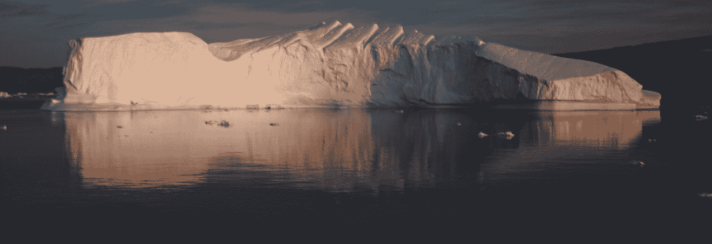
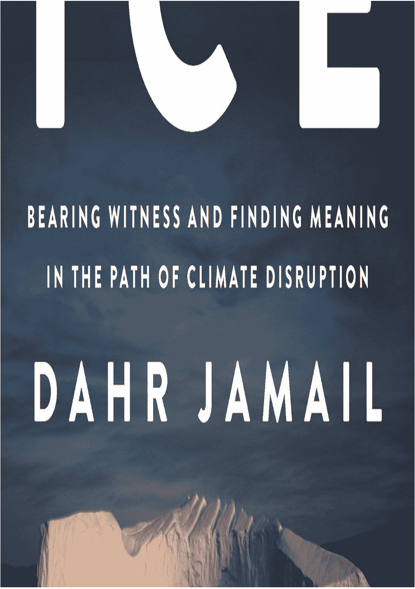
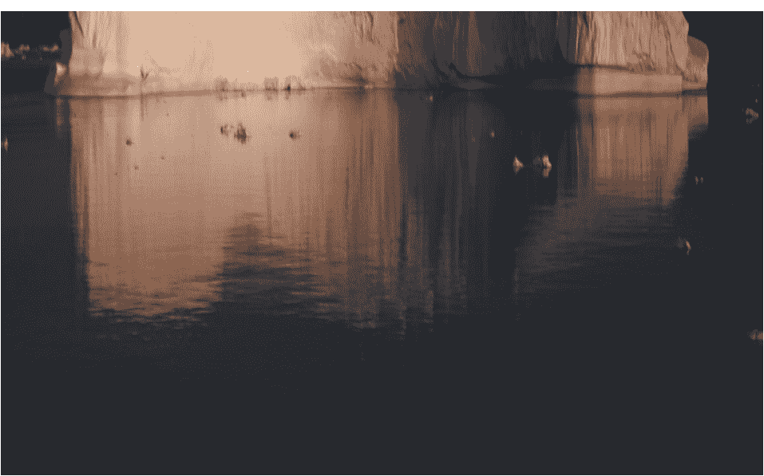
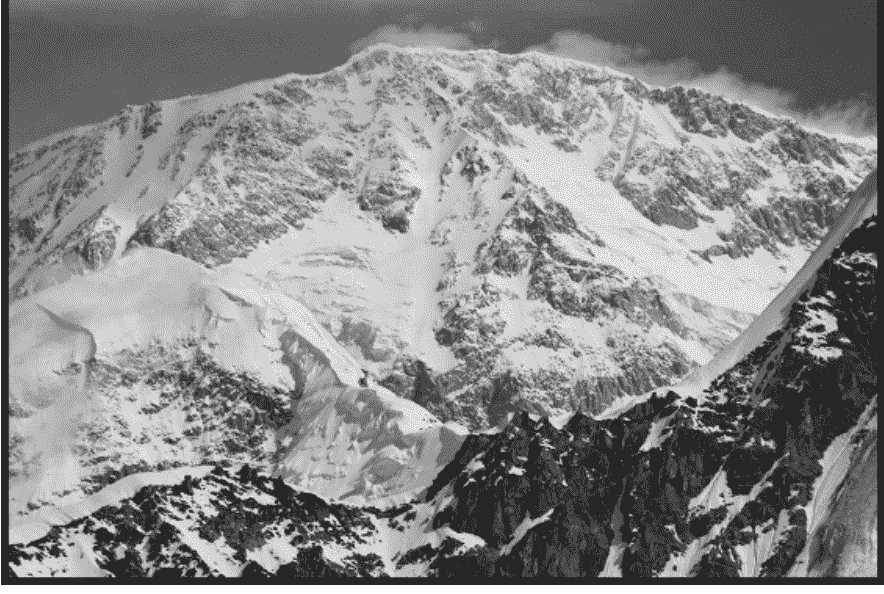
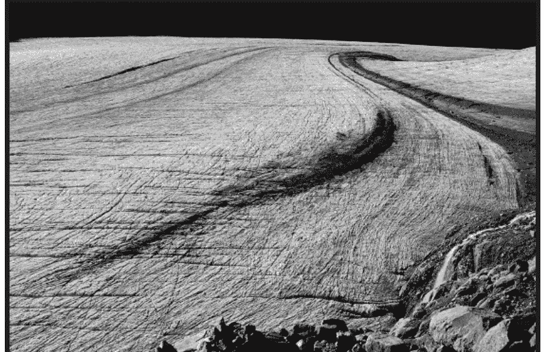
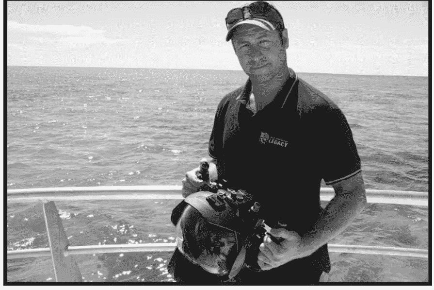
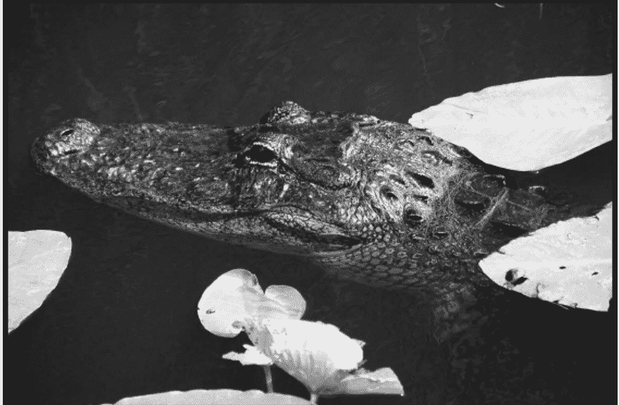
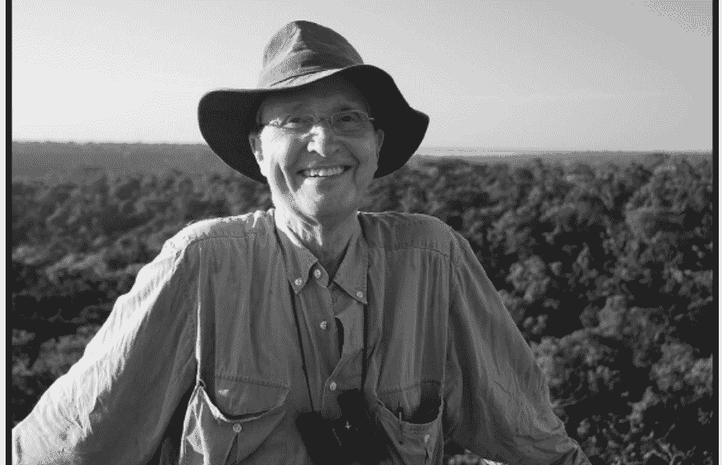

# 冰的终结：在气候动荡的道路见证并寻找意义

# 达尔·贾梅尔其他著作

- 《绿色地带之外：一名驻在被占领伊拉克的非嵌入记者的报道》
- 《抵抗的意志：拒绝在伊拉克和阿富汗作战的士兵》
- 《伊拉克的大规模灭绝：一个国家的瓦解》（与威廉·里弗斯·比特特合）

本书献给所有物种的后代。请记住，曾有许多像我们这样竭尽力的人。

> 没有不神圣的地方；只有神圣之地和被亵渎之地。
>
> ——温德尔·贝里 (Wendell Berry)

## 引言

坠落持续的时间足够长，我有时间观察蓝色的冰向上升腾，万年的光阴被压缩在冰川中，在几秒内闪烁。我假设我掉得足够远，已经把我的攀登伙伴肖（Sean）也拉进了裂缝中。我脑海里有一个声音告诉我，这就是在山里死去的感受。

正当我的脑海完成那个念头时，绳子向上拽住了我的攀登安全带。随着绳子中固有的动力物理学作用发挥出来，我无力地上下弹动。不知由于何，肖在还留在冰川表面时就拉住了我的坠落。

我拂掉头发、手臂和胸前的积雪和冰块，拉下衬衫的袖子。发现登山裤口袋里挂着我的冰镜，我将它们收好。我检查了自己的身体是否受伤，令人置信的是，我并没有受伤。评估了状况后，我发现附近没有冰可以缓解绳子的张力，这样肖才能开始建立滑轮系统将我救出来。

我向下看。

只有一片漆黑。

我看着正前方的蓝色冰墙，深吸一口气，抬头看向那个小小的洞，那是我穿过横跨裂缝的雪桥时掉进去的——那是肖在我们从阿拉斯加的马塔努斯卡冰川前往楚加赫山脉的马库斯·贝克山时顺利通过的同一座桥。

“你可以再往下看最后一眼，然后结束，”我大声对自己说。

再次，我下方只有漆黑的深渊在张开，吞噬了一切，甚至声音。我的胃紧缩着。我提醒自己呼吸。

“肖，你还好吗？”当我将机械上升器固定在绳上准备向上爬时大声喊道。

“是的，我没事，但我正处于边缘，”他回道，“我无法设置锚点来离开系统……”

“是的，我没事，但我正处于边缘，”他回道，“我无法设置锚点来离开系统……”

不知由于何，肖在还留在冰川表面时拉住了我的坠落。我拂掉头发、手臂和胸前的积雪和冰块，拉下衬衫的袖子。发现登山裤口袋里挂着我的冰镜，我将它们收好。检查身体是否受伤，令人置信的是，我并没有受伤。评估了状况后，我发现附近没有冰可以缓解绳子的张力，这样肖才能开始建立滑轮系统将我救出来。

我向下看。

只有一片漆黑。

我看着正前方的蓝色冰墙，深吸一口气，抬头看向那个小小的洞，那是我穿过横跨裂缝的雪桥时掉进去的——那是肖在我们从阿拉斯加的马塔努斯卡冰川前往楚加赫山脉的马库斯·贝克山时顺利通过的同一座桥。

“你可以再往下看最后一眼，然后结束，”我大声对自己说。

再次，我下方只有漆黑的深渊在张开，吞噬了一切，甚至声音。我的胃紧缩着。我提醒自己呼吸。

“肖，你还好吗？”当我将机械上升器固定在绳上准备向上爬时大声喊道。

“是的，我没事，但我正处于边缘，”他回道，“我无法设置锚点来离开系统……”

此前受困的甲烷可能随时会“打嗝”，导致释放到大气中的总量相当于人类排放的二氧化碳总量的数倍。其结果将是灾难性的。

气候紊乱随之而来的是极端天气，例如飓风和洪水。例如，温暖的大气层含有更多的水分，导致强降雨事件的频率增加，比如2017年夏天席卷休斯敦的哈维飓风，其降雨量之大，水的重量实际上导致地壳下沉了2厘米.³

自300万年前的上新世以来，地球还没有出现过目前的大气二氧化碳水平。百年后，四分之三的二氧化碳仍然留在这里。考虑到体验二氧化碳排放的完全变暖效应需要十年时间，我们距离体验目前排放的所有二氧化碳的影响还遥远⁴。即使我们停止所有的温室气体排放，还需要25,000年大气中目前的大部分才能被海洋吸收。气候紊乱的进展比以往任何时候都快，也比预测的快。在记录以来的18个最热年份中，有17个发生在2001年之后¹。我们这颗过热行星发出的求救信号在我们四周，报告、研究和警告每天都在增加。政府间气候变化委员会（IPCC）关于气温升高、极端天气、海平面上升以及大气中二氧化碳含量增加所做的每一个最坏预测都低于现实。无数冰川、河流、湖泊、森林和物种正在以以前所未有的速度消失，而这一切使得全球平均温度比工业前基准温度“仅”升高了1°C。根据一些科学家的说法，到2100年，温度可能会升高10°C⁶。

NASA戈达德空间研究所前所长詹姆斯·汉森（James Hansen）的一项研究警告说，即使在2°C的升温限制范围内，也会导致南极和格陵兰冰盖发生不可停止的融化。这将到2050年使全球海平面上升高达10英尺，淹没许多主要的沿海城市。⁷纽约、波士顿、迈阿密、坦帕、新奥尔良、雅加达、新加坡、大阪、东京、孟买、加尔各答、达卡和胡志明市只是这些迟早必须搬迁或遗弃于大海的城市的几个例子。

在当今气候紊乱的世界中，登山与过去已完全不同。冰川正在我们眼前消失，缩小到有记录以来最低水平，而且它们现在的融化速度比以往任何时候都快。在北美，预计到2100年，加拿大西部70%的冰川将消失⁸。蒙大拿州的冰川国家公园很可能到2030年将没有任何活跃冰川。马塔努斯卡冰川的古冰正在迅速消失。即使在地球上最高、最冷的地方也发生着剧变。即使是珠穆朗玛峰（萨加玛塔峰/乔穆龙玛）也在发生变化，因为喜马拉雅山脉数千条冰川到2100年可能会缩小99%⁹。今天出生的孩子将在一生中看到没有冰川的珠峰。

在开始写这本书之前，我已经知道人类引起的气候紊乱进展到了什么程度。我从1996年开始在阿拉斯加生活了十年，并在那里的冰川上度过时光。早在90年代后期，安克雷奇的假期期间大部分时间，地上都没有雪，有些冬天瀑布几乎不结冰，我们能看到以前穿行的冰川——我和我的攀岩朋友用来进入顶峰的冰川——逐年缩小。我当时并不知道海洋和雨林中发生了什么。我不知道海平面的上升以及气候变化对生物多样性的影响。

我从2010年开始报道环境和气候，从那时起发表了百多篇关于气候紊乱的文章，并就该主题进行了多次演讲和电台采访。

我们降落在地球上。我们改变了大气的成分以及我们赖以生存的海洋化学。我们现在使用了地球上超过一半易于获取的淡水径流，世界上大多数河流要么被筑起大坝，要么被改道。

作为一个物种，我们现在正悬于自己所创造的地球工程未来的深渊之上。在我们固执的要求下，我们贪婪的胃口正在吞噬自然本身。我们拒绝听从地球发出的警告，没有任何救援队正在路上。

从大营地望去丹利峰，位于海拔20,310英尺南峰下方两千百英尺。摄影：Dahr Jamail

# 丹利峰

2016年6月18日。我位于海拔17,200英尺处，狂风正以每小时50英里的速度在荒凉的高营地上咆哮，无情无情。在过去的24小时里，风力剧增，并且只会愈发增强。

我生命中有很多几个月是在丹利峰度过的，个人攀登并担任登山向导工作，同时也像现在这样作为国家公园管理局（NPS）的志愿者进行救援。NPS在每个登山季节都会利用数十名救援志愿者，以增加山上的登山巡逻员人数。作为志愿者，我们与巡逻员组成巡逻队，目标之一是确保山上的每个营地随时都有一支巡逻队，以帮助遇到困难的登山者。

我对山上的天气怀有敬畏，但尽管曾三次登顶（且每次路线都不同），我从未在如此强大的风暴中处于过如此的高度。由于知道风暴将变得更强，带领我们巡逻队的丹利登山巡逻员Mik Shane给了我们三个志愿者下撤的选择。我既热爱又恐惧丹利峰，但我并没有犹豫，这让我自己感到惊讶，因为我太清楚在北美最高峰的狂暴中，登山团队是如何被硬生生地吹下山的。

“我会留下，Mik。我想留下，”我告诉他，声音盖过了咆哮声和帐篷门厅在阵风中剧烈抽响的声音。我知道我们巡逻队的医生兼我的同帐友Liam，以及另一位志愿者Brian，急于下撤到海拔14,200英尺的营地躲避风暴，等风暴平息后再回到高营地。鉴于丹利山体的高度和宽度（它是地球上最大的单一山体之一），这座山在整个范围内很少出现持续的天气。大风在高营地咆哮，但在下方三千垂直英尺处、受风性远弱的营地，风力要好受得多。

昨晚，我们帐篷的整个后半部分都被飞雪掩埋。坦率地说，我们将帐篷搭建在雪地上挖的一个深坑里，并用雪块加固了高出雪面几英尺的雪墙。墙壁和深坑是保护帐篷及其内部所有物品不被大风撕碎、或者更糟糕——被从山上撕裂并吹向下方普特冰川的唯一屏障。

防风保护是有代价的；深坑必须不断清理积雪。当Liam收拾装备与Brian一起下撤时，我开始清理帐篷。

由于丹利峰距离北极仅1800英里，这座山比低纬度地区更高的山峰更接近对流层——支撑生命的大气层。地球大气在极地变薄；它在赤道处厚达12英里，但在北极仅有4英里高。因此，丹利峰靠近对流层上部，意味着山顶的氧气量比赤道附近同样高度的山峰少42%。此外，丹利峰的顶峰伸向对流层顶部，它更接近急流层，因此山上出现超过每小时100英里的风并不罕见。

正因如此，在该高度下的体力消耗被放大了许多倍。仅仅在铲了30分钟雪后，我就精疲力竭地爬回帐篷。我稍作休息，等雪再次填满坑底，然后再次开始铲雪——这种仪式虽然刚刚开始，但将成为我选择在接下来几天留在高营地的惩罚。

Mik的帐篷位于我帐篷正上方的一个平台上。他和未婚妻Sue Wolf蜷缩在那里。风力整天都在持续增强，以至于我们尽管相隔10英尺，也不得不使用无线电通信。“Dahr，我们大家一起加固帐篷吧，最糟糕的还没来，”Mik通过无线电对我喊道。

我告诉他会在外面碰头，爬出睡袋，开始穿羽绒裤、派克大衣、全脸头套、滑雪眼镜、手套、冰靴和保暖雪套。最后，我步入了这片旋涡。我抓起雪铲，穿过大风缓慢走向他们的帐篷，在那里，我们三个人缓慢但稳稳地加固雪块墙，增加额外的帐篷杆并拉紧风绳，然后对我的帐篷进行同样的操作。

工作持续了几个小时，期间我们周期地停下来呼吸。我大口呼吸着空气，惊叹地看着云帽在较低的北峰上方形成，就像在20,310英尺的主峰上方形成的一样一样。当来自低海拔的温暖潮湿空气被向上挤入海拔更寒冷的空气时，就会形成云帽，这种现象被称为地形抬升。

其他奇异的云层看起来像水波纹，从下方汇聚并扫过高营地的陡边缘。14,200英尺的营地位于下方三千垂直英尺处的冰川架上，那里向下急剧下降一英里到达卡尔特纳冰川。云层就在我们头顶上方掠过。它是如此接近，以至于Mik、Sue和我轮流伸手触摸它，但由于它被推向离我们后方的北峰，它始终遥不可及。它形成了经典的圆盘状卷积云帽——这一直是强风的警告。

遮挡了偶尔阳光的飞雪被长而持续的阵风吹走，这些阵风威胁着将我吹倒。在接近每小时70英里的风速下，我有时感到自己快窒息了。面对风感觉像在吸消防软管；背对风感觉像空气正从肺部被抽走。我很快发现侧对着风呼吸要容易得多。

我设法清理了帐篷的大部分积雪，溜回内部，机械而缓慢地脱掉所有装备，重新爬回睡袋。

几周前，我曾在阿拉斯加州的小镇塔尔基纳（Talkeetna），那里一片异常活跃。前往丹纳峰（Denali）的攀登者抵达沃尔特·哈珀·塔尔基纳护员站办理登记，并参加有关登山协议的简报。然后，如果神灵眷佑他们，他们就会前往这条狭窄主街另一头的机场。当山上天气允许在7,200英尺营地进行冰川着陆时，滑雪飞机就会从日出到日落起落。发动机的轰鸣声在整个小镇回荡。

Den'ai 原住民是该地区的最早居民，他们将这里命名为塔尔基纳，其字面意思是“河流附近储存食物的地方”。今天，来自世界各地的攀登者汇聚在这里，背包和旅行袋里装满了装备、食物和燃料，对攀登丹纳峰充满了期待。这座山对攀登者来说固然重要，但对于科尤肯-阿塔巴斯坎人（Koyukon Athabascan）来说，它的意义远为重大，他们将这座山命名为 Deenaali。这座山在他们的创世神话中处于核心地位。这座山还有其他几个名字，每种翻译都在致敬它的高度和力量，但都指向同一个含义：伟者。

在晴朗的日子里，这座高耸的山体可以从阿拉斯加周围数千平方英里的范围内看到。这是因为如果从边缘量起，丹纳峰山体无疑是地球上最大的山。它由144平方英里的岩石、冰雪和雪地组成，从海拔2,000英尺的高原直升至18,310英尺的高度，使其拥有地球上任何山峰中最大的垂直落差。相比之下，珠穆玛峰（Sagarmatha/Chomolungma）比丹纳峰高近9,000英尺，但它“仅”从西藏高原拔起12,000垂直英尺。

在这次旅行之前，我上一次攀登丹纳峰是在2003年，当时一组救援志愿者前往西脊（West Rib）路线，那条路线比标准的西肩（West Buttress）路线更具技术挑战性。那次巡逻的同伴志愿者图克·切诺维斯（Tucker Chenoweth）后来成为了一名丹纳峰登山护员，最近成为了丹纳峰国家公园南区的护员。

在我们飞往开始巡逻的前一天晚上，米克（Mik）的小逻小组与其他几名登山护员受邀来到图克家中参加文鱼晚宴。当孩子们在温暖的傍晚阳光下嬉戏时，图克向我讲述了国家公园管理局（NPS）近年来在丹纳峰见证的一些剧烈变化。

“我们正看到季节的转变，这是一件大事，”他解释道，“攀登者们一直认为登山季节是5月和6月，但现在4月成了新起点。山上现在的整体气候似乎比以前暖得多。”国家公园管理局在讨论这座山时，通常将“山上”描述为海拔一万一000英尺以上的所有区域，图克描述了山上一直是一个状态的区域，那里什么都不会改变。但现在不再了。

升高的气温已经影响了14,200英尺营地，那里基本上是上山营地。那里的气候比以往任何时候都要暖，在该海拔的山体四周也是如此。丹纳峰北侧著名的威克舍姆墙（Wickersham Wall）传统上是一个巨大、陡峭且充满冰川的岩面，现在其冰川正在崩塌，留下裸露的岩石。由于冰崩和雪崩增加，进入威克舍姆及其他几条路线变得越来越困难和危险。丹纳峰的这些现象现在也出现在全球热门登山峰的报道中，包括珠穆玛峰。

在谈话结束之际，图克谈到了气温升高如何影响下山区域。“下方的冰川，我指的是11,200英尺营地及以下的地方，正在快速融化，”他说，“表面每年都在下降，足以让我们那些口中称为数字的营地——11,200、9,700、7,800以及7,200英尺的基础营地——呃，我们要找些别的名字来称呼它们了，因为它们的高度正在流失。冰川融化得很快。”

那天晚晚些时候，我走到宿舍附近的塔尔基纳河边。丹纳峰傲然屹立在远方，半边被橙色的晚阳照亮，半边处于剪影中。图克的话压在我心头。我觉得自己被警告过了。现在，我回到山的兴奋中增添了忧虑，还有一种自己需要做好心理准备的感觉。

塔尔基纳的反常暖天气持续着，我们的小组准备好在第二天飞往丹纳峰开始巡逻。载着攀登者和数百磅装备的滑雪飞机发动机发出高亢的轰鸣，飞机从跑道起飞，向空中滑行。机翼向右倾斜，将我们直指那座主宰北方天际线的白色巨兽。当飞机艰难地向那巨大的山体波动时，我的身体在轻微的湍流中坐在座位左右晃动。我的灵魂找到了重心。当我们飞入远处耸立的阿拉斯加山脉核心时，世界仿佛如初，一切都充满了意义。

山是我我去倾听地球的地方。1996年当我第一次在阿拉斯加开始登山时就是如此。对丹纳峰是一见钟情，我搬到了阿拉斯加，花了几个月时间攀登、导游，后来成为国家公园管理局的志愿者。我对登山的热爱带我从丹纳峰走向阿空喀瓜峰（Aconcagua），后来，我成了一名气候危机专家。

2003年，我曾去西脊，而当我2016年回来时，景观已经发生了变化。我记忆中的冰川正在退缩，曾经被隐藏的岩石如今已裸露。这座山依然是丹纳峰，但它已经变了——脆弱、敏感，并以我未曾准备好见证的方式发生着。

……直到它们融化，露出了那宏伟而陡峭的岩壁。

我的目光审视着丹利山营地周围其他被冰川覆盖的山峰。即使是福格峰山（Mount Foraker）这座海拔17,402英字的巨峰——阿拉斯加山脉第二高峰，它横跨卡希尔特纳冰川（Kahiltna Glacier）的较低侧坡也显示出了流失的迹象。我难以想象，连阿拉斯加山脉也在融化，而且如此之快。

几十年来，我们面前一直存在着气候剧烈变化的证据。所谓发达世界的大多数人与地球上的某个地方联系并不紧密，以至于没有察觉。他们没有意识到这对地球和我们人类物种意味着多么严重的后果。我们这些花时间在自然自然中的人，无论是登山者、园艺师、背包客、草药师、渔民还是猎人，都有着自己版本的、正如阿尔多·利奥波德（Aldo Leopold）所说的“生态教育”。我们敏锐地感知到了已经发生在我们身上的变化。

利奥波德曾写道：“生态教育的代价之一就是，你独自生活在一个万象之中。生态学家要么硬起自己的壳，假装科学的后果与自己无关，要么就必须成为一名医生，在一个自认为健康且不愿听从告诫的社群中看到死亡的迹象。”¹

意识到气候扰动对我多年来珍视的山脉和冰川所造成的伤害，就像是看着一位亲密的朋友在绝症之苦中挣扎。我在丹利山亲眼目睹的，以及我从登山社区和关于全球冰川快速融化率的持续科学研究中学习到的知识，都令我感到不知所措。在写这本书期间，我习惯了听关于气候剧烈波动产生的影响。你对一个特殊的地方越亲近，就越难以接受其背后的含义。

全球气温上升之快，气温预测的变化也随之快。保守的国际能源机构（IEA）预测，到2035年可能出现升高3.5°C的最坏情况。²这意味着在不到二十年的时间内，温度将上升4.2%。世界银行委托的一份报告警告说，我们正处于“4°C世界”的轨道，其特征是极端热浪和威胁生命的的海平面上升。³ 领先的气候研究人员认为，到2100年，世界气温甚至可能上升6°C，这将给人类文明带来“灾难性的变化”和“无法想象的后果”。⁴

考虑到地球比工业化前的基准温度“仅”升高了1°C，而且我们已经看到的融化是如此严重，那么温度升高4到6°C对冰川和冰原的影响将是灾难性的。

距离我上一次来丹利山已过去十三年，但我感觉自己从未离开过那里。山脉具有这种持久的本质，当我再次回到山坡时，那种崇高而永恒的特质令我立然感受到。尽管我自己的生活发生了变化，但这一次丹利山高处的变化是显而易见且不容错过的。

当我们到达7800英尺营地时，第一场雪暴袭临了。我们五个人挤在厨房篷里，喝着茶分享故事。米（Mik）告诉我们，在2013年的登山季，由于13,200英尺处的风角（Windy Corner）频繁发生落石，国家公园管理局（NPS）选择让登山巡逻员从11,200英尺营地直升到14,200英尺营地。同年，丹利山一段被称为“高速公路”（the Autobahn，从17,200英尺到18,200英尺的标准路线部分）的地方在有记录以来首次发生了落石，山脊附近出现了闪电，这也是另一个首例。

第二天，我们在完全的能见度极低的情况下移动到11,200英尺营地，字面上来说是在穿过云层滑雪。我对于下方世界的所有认知在剧烈的体力消耗和呼吸的节奏中消散殆尽。唯一重要的是保持良好的节奏，然后在我们几次短暂的休息中保持饱腹和保暖。在到达并扎好营地后，另一场风暴袭来，将我们困在原地。但这一次雪是湿的。

“这在这里是新现象，”米当我们站在外面，看着风刮着营地上方高耸的西脊（West Butt）上的雪时说道，“在山上这么高的地方有湿雪，我以前没见过。我以前从不在这里带Gore-Tex雨衣，但现在我们需要一件了。”

那天晚上，我在日记中写道，处理关于这座山的每一条坏消息。我写下了我的悲伤，也写下了在身体不再被允许的情况下继续回到丹利的决心。我想在这个地方待一待，在这座山上，这座山将永远是我的哨兵、避难所、向导和灯塔。

我在这方面并不孤单，除了在怀俄米州的提顿山脉（Tetons）生活和工作外，还有一名季节性巡逻员。他和像他的人所做的事情显然不是为了发财。我们这些选择屈服于登山的身心严苛考验的人，是因为对这些荒野之爱。现在，丹利山还增加了一种吸引力：这就像是想守在病友床边，想在我们都在这里时与他们共度时光。

如果我不能来这里，以及其他类似的地方，我会在哪里？这是我生命中最接近教堂的地方；每个营地都是一个祭坛，每个顶峰都是我能向地球致敬的避圣所。

在11,200英尺待了三天后，我们撤了营，滑向14,200英尺。在陡峭上升后，路线平缓进入了一个被称为“极地场”（Pole Field）的区域。就在13,200英尺处的风角上方，为了防止落石，我们戴上了头盔，然后快速地滑过那段暴露在外的路段。

我们的营地位于一个冰川架上，顶峰在正上方一英里处俯瞰着。我们在山上的第一周，大部分时间持续的高风从山脊上吹起长长的雪流。

巡逻队以周为单位进行交替，随着我们缓慢向上移动。在扎好帐篷并安顿下来之前，我们要在这里至少停留一周以让身体适应高海拔。

在高处，风持续持续着。冲击顶峰的尝试寥少且零星其间。在我们定营几天后，我们的巡逻队行动起来，支持一起来自山上高处的直升机救援。一支日本小组在强风中到达了顶峰，但在下高海拔营地的途中，一名登山者倒下了。当直升机成功在18,400英尺处吊下救援篮时，飞行员和坐在机上的巡逻员立即意识到救援已变成了遗体搜寻。

在目睹了忙碌的活动以及一名巡逻志愿者尝试复苏登山者的失败后，我当天的剩余时间都花在了营地周围走动，凝视着亨特山和福格峰。虽然很明显，登山者忽视了高反反应的警告信号并犯了其他错误，但在这里去世总是一场悲剧。我感受到了任何生命逝去带来的悲伤。

然而，后来我不明白，为什么会对一个我不认识的人的死产生如此大的情感影响。我并不是那个进行心肺复苏的志愿者，也没有直接参与救援。然而我却在哀悼，并渴望孤独。

那天晚上，坐在帐篷里，我在日记中写道。我意识到那个日本登山者的死开启了我体内的某种东西。我开始感受到气候扰动对丹利山造成的深重代价。冰川在我的滑雪板、冰爪和冰镐下融化。

阿拉斯加山脉，古尔卡纳冰川。古尔卡纳正在迅速消融，正如当今世界上大多数冰川一样。世界冰川监测网在过去的几十年里追踪了全球冰川剧剧流失，一些专家预测，世界上所有的高山冰川将在2100年之前消失。摄影师：Dahr Jamail

## 时间不再封冻

一个与冰川为伴的人，会逐渐感到自己是如此的微不足道。阿尔卑斯山和冰川结合，能够带走一个人所有的自大，并让他的自尊降为零，只要他留在这种崇高存在的影响范围内足够长，给它们发挥作用一个公平且合理的机会。

> —马克·吐威，《海外漫游记》

2016年4月11日。第一晚的夜温降至零以下，微弱的绿色极光在清澈的天空中静静舞动。尽管阿拉斯加近年来打破了各种高温记录，但在春季于阿拉斯加山脉东部的古尔卡纳冰川露营仍然是一次极其严寒的体验。我们中的几个人已经在冰雪之上搭了营，接下来的几天里我们将在那里工作。

我是一名美国地质调查局（USGS）团队的志愿者，他们正在进行该机构年度冰川调查之一。这项工作包括使用雪地摩托在冰川高处建立营地，然后从那里出发日游，挖掘雪坑、放置测量桩，并对冰川的不同区域进行雷达测量。他们的“基准冰川计划”自1957年以来追踪冰川，并于1967年首次调查了古尔卡纳冰川。与华盛顿州北喀斯山脉的南喀斯山冰川一样，古尔卡纳冰川提供了北半球最连续的冰川表面质量平衡记录——即冬季积雪的雪量与夏季融化的雪水和冰量之间的差值。质量平衡的变化是冰川最敏感的气候指标，世界冰川监测网从1980年至2012年收集的数据显示，全球冰川连续二十五年处于负质量平衡。换句话说，世界上大多数冰川正在融化，且这一趋势在近年来迅速加速。

路易斯·萨斯（Louis Sass）是一位三十八岁、高个、瘦、沉默的USGS冰川学家，他领导着团队。萨斯曾在丹纳峰（Denali）担任过多年向导，是一位流动的山民。在零下温度的冰川高处，他像在自己的厨房做饭一样自如。他所做的一切都经过周密、深思熟虑且高效，他的说话方式也是如此。

我和他和另一位冰川学家埃琳·霍尔顿（Erin Horton）从安克利奇开车出发。当我们开车经过那些被又一年低于平均水平的冬季积雪覆盖的山脉时，他们都分享了对冰川和地球的痴迷。当我问他们他们为什么喜欢在USGS工作时，他们谈到了对事物运作方式以及为何这样运作的深切好奇。USGS是美国顶尖的科学研究机构之一，他们都曾在南极工作过，并在自己的领域拥有丰富的经验。

刚驶入山口路头，我们就卸下雪地摩托，准备登上冰面。萨斯解释说，冰川和冰原已经在适应我们引起的气候变暖。“阿拉斯加没有一个地方没有感受到人类引起的气变暖的影响，”他说。

古尔卡纳冰川就是一个典型的例子。自1974年以来，其末端失去了五百英尺的厚度，虽然冰川有两个侧支汇入主干，正如萨斯所说，“它最终只会剩下那两个较高的侧支冰川。”

萨斯和他的团队挖掘雪坑并插入测量桩，在四月，那是冰川上冰雪量最大的时候。然后他们在夏季冰雪量最少时返回，记录发现的变化。

从冰川末端也是如此。它看起来像一种黑色的病毒，在活跃冰川的白色和浅蓝色区域蔓延。

萨斯（Sass）曾告诉我，马塔努斯卡冰川（Matanuska）已经急剧缩小，该州大多数大型陆地冰川也是如此。除了退缩的末端，马塔努斯卡冰川在过去一个世纪面积并没有缩小，但正如萨斯所说，它正在“通过失去质量而萎缩”。冰川上的碎片是它正在持续变薄的迹象。现在，其末端甚至可能形成一个大湖泊。

萨斯说，当它开始退缩时，速度会非常快。冰川的全部或大部分将对它所支撑的生态系统以及当地天气产生剧烈影响。这还不用说它将带来的文化、精神和经济影响。例如，在 8 月，阿拉斯加州州对马塔努斯卡河发布了州级灾难宣言。由于在创纪录的暖期³期间冰川融水，该河流流量巨大、异常汹涌，威胁了下游的房屋和社区；在某一时刻，河流在短短十二小时⁴内侵蚀了十四英尺的土地。

尽管如此，一家名为 Matanuska Glacier Adventures 的公司现在拥有这片融化冰川末端的土地并正在利用此获利。仅仅是进入冰川附近的区域，每人就要收取 30 美元（并提供 100 美元的“之旅”），该公司还收取 40 美元的露营费，让他们与其他登山者聚集在一起，在冰川的裂缝中进行为期周末的攀爬。

现在该地区已完全私有化，冰川退缩末端正西侧充斥着建筑声、大卡车声、电锯切割树木声和推土机的轰鸣声。与此同时，从冰川流出的马塔努斯卡河比我见过的任何时候都要大。整个行动是一场在冰川融化时赚快钱的疯狂冲刺，即使冰川本身感觉更像是一个被遗忘的事物，变得暗淡并退入背景。这类似于在佛罗里达海岸线投资基础设施的愚蠢行为，但规模要小得多，大量资金被用于为一个在我们眼眼前正在融化的事物扩张旅游基础设施。

萨斯建议我与温格尔-圣埃利亚斯国家公园保护（Wrangell–St. Elias National Park and Preserve）的物理科学家迈克·洛索（Mike Loso）博士交流，因此我安排在他在阿拉斯加偏远山区小镇麦卡锡（McCarthy）的家中与洛索通话。

洛索认为自己是一个“冰川地质学家”，专注于冰川如何影响他的景观。他在丹纳国家公园、阿拉斯加的楚加奇山脉以及温格尔 圣埃利亚斯地区进行过大量研究。我问他看到了哪些变化。他告诉我，如果你不知道要寻找的迹象，很容易错过这些变化，而理解和体验冰川快速变薄的最佳方式是视觉上的、随着时间的推移，而不仅仅是通过科学研究。冰川的退缩变薄是体验其消融最明显的方式。在阿拉斯加冰川周围看到“浴缸环”也很常见，它们标记了陡峭冰碛的顶部，这些冰碛现在环绕着冰川的侧面，在许多情况下一直延伸到冰川的头部。

洛索向我介绍了安克利奇外的埃克卢特纳冰川（Eklutna Glacier）。那里有一条深受当地登山者欢迎的经典横穿路线，以至于阿拉斯加登山俱乐部已经在冰川边缘为其成员建造了三座小屋。这些小屋作为冰川曾经存在位置的标记。“现在你到了冰川的边缘，”洛索说，“而小屋在远处的山坡上，在你上方几百英尺的地方。”

萨斯还提到了卡希尔特纳冰川（Kahiltna）的变薄，它是阿拉斯加山脉最大的冰川之一。那是我花费过几个月研究的冰川。“卡希尔特纳正在失去大量质量，”他告诉我，“我们可能在未来几年内发生剧烈退缩。在今天的气候下，卡希尔特纳正经历着整个温格尔-圣埃利亚斯地区所有冰川类似的重大变化。在它们所经的路径上，在过去的五十年里，冰川仅损失了 5% 的覆盖面积。总体而言，阿拉斯加国家公园的冰川在同一时期退缩了 8%，暴露出的土地比罗德岛州还要大。这些暴露出的砾石地大部分没有被任何灌木覆盖。这是一个两百年前不存在的新景观。我们这些在冰川周围活动的人习惯于认为冰川边缘总是荒芜的。“冰川退缩是如此普遍，我们理所当然地认为景观是这种荒凉、多石的土地，但它只在过去的 150 年里是这样，”洛索说。

洛索提到了位于西华德附近的出口冰川（Exit Glacier），它从哈丁冰原（Harding Icefield）剧烈地流下狭窄的山谷到达下方的谷底。有一条通往那里的路，一个围绕末端的严密观测网络让观察者能够目证冰川的退缩。2015 年，时任总统巴拉克·奥巴马作为阿拉斯加之行的一部分访问了该冰川，但即使在那时，它已经发生了巨大的变化。⁷ 1996 年我第一次搬到阿拉斯加时，曾在冰川末端露过营，多年来又回来过几次。我完全清楚洛索所指出的问题。

“阿拉斯加周围的所有冰川一直在发生什么事情，”洛索说，“想想那些没有人看到的、令人震惊和剧烈的变化。仅温格尔-圣埃利亚斯地区就有三千条冰川，没有人在看它们，所以没有人看到湖泊排空或大型滑坡的发生。”

2016 年，冰川湾国家公园保护区（Glacier Bay National Park and Preserve）发生了一起四千英尺高的滑坡，释放出 2 亿吨岩石落入峡湾，引发了 5.2 级地震。在那一年，另一处山体崩塌，引发了五百英尺的海啸⁹。这些事件发生是因为支撑山体的冻土正在融化和消融。谈到最近的滑坡时，洛索将其作为快速、广泛侵蚀的一个例子。“我们所有的公园到处都是正在发生各种疯狂事情的景观，只有在少数情况下我们才能目睹或获知。这些非常常见，但大多数没有记录。”

他说阿拉斯加变化的规模很容易被忽视，因为阿拉斯加如此巨大且很大程度上未开发。“如果这些发生在加利福尼亚，每一个变化都是头条新闻，”¹¹这就是为什么你不知道阿拉斯加的冰川每年估计损失 750 亿吨冰。作为一名公园管理者，我问自己，该如何为后代管理公园资源。我们无法管理气候回到原来的样子。所以我们只能站在那里看着冰川的减少，而没有任何工具可以这样做。管理局无法阻止这种变化，我们至少必须见证它。我正试图向那些不知道这些变化严重性的人讲述这个故事。”

2017 年 6 月的一个早晨，在蒙大拿著名的冰川国家公园，我早起看日出。我看着光线照亮利文斯顿山脉，露出夏末残雪的脏白色区域，然后淹没下方的河谷，让常青树和小草充满色彩。鸟儿鸣叫，花朵绽放。除了弗拉特黑德河北支自然的声音外，没有其他声音。在这个脆弱、拥挤、过热的星球上，这里我们可以找到慰藉和宁静。”

这里聚集了许多科学家，他们在同一个地方工作了二十五到三十年。

Fagre 是一位视野宏大的科学家，他的研究涵盖了从冰川、雪崩、两栖动物到古气候以及生态系统动力学的方方面面。他平和且热情，邀请我坐上他的车，沿着著名的“向日之大道”（Going-to-the-Sun Road）开往洛根山口（Logan Pass），以便他向我介绍公园里的一些变化。冰川国家公园由于许多原因而是一个迷人的地方。大陆分水岭穿过公园中部，在西侧你可以找到西红松和山冷杉；从降水量较少和温度较低来看，那里更像明尼苏达州，但这两个生态系统仅相隔十英里。

离开长长的圣玛丽湖（St. Mary Lake）蓝色水域后，我们海拔迅速升高，开始沿着陡峭的山坡蜿蜒向上到达山口，那里是大陆分水岭的标志。我有幸与 Fagre 谈论冰川，因为他对这片景观非常熟悉。尽管在冰川国家公园工作了二十七年，但他告诉我自己“仍在学习”。

阳光穿过高山山脊的缝隙，当我们向东行驶时，照亮了河对岸的山坡。冰川和雪场的融水从道路附近的陡坡上倾泻而下。当一个小瀑布的水流溅到车上时，我关上了窗户，Fagre 笑道。“我们经历了一个‘菠萝快线’（Pineapple Express）暖天气，导致我们的雪层比正常情况下提前消失，”他解释道，“时机很重要；不仅是升温的程度，还有升温的时间。”蒙大拿州那个夏天经历了与美国西部其他地区完全不同的情况：冬季积雪比常年多，随后是创纪录的夏季气温，并在短时间内全部消失了。

Fagre 解释说，在过去的半世纪里，公园的积雪一直在萎缩。现在雪留在地面上的平均时间比以前少了三十天。这意味着树木生长得更早，体型更大，因此消耗了更多水。这就是为什么到八月份，蒙大拿州的森林火灾数量和规模都在增加。去年 6 月至 8 月是该州有记录以来最热、最干燥的时期。超过百万英亩的土地被焚毁，这是迄今为止最昂贵的灭火季节之一。¹³

由于地球变暖，冰川国家公园的降水现在更多是以雨的形式而非雪形成的。由于公园内只有六座海拔超过一万英尺的山，气候破坏的影响比科罗拉多州海拔高得多的公园来得更早。海拔 6600 英尺的洛根山口仅比波尔德市（Boulder）高 1200 英尺。

随着双车道向大陆分水岭攀升数千英尺，山谷两岸的景色变得越来越令人震撼。雄伟的山脸布满了积雪的沟壑并向上延伸。融化的雪层形成的瀑布为山谷奏响了柔和的奔流旋律。冰川国家公园确实是我见过最有意义的景观之一。Fagre 宽容着我的惊奇凝视，并定期停车让我拍照。

考虑到他告诉我的这些，这真是苦乐参半的。在 1850 年，该公园在被定为国家公园之前曾有 150 条冰川，覆盖约 100 平方公里。今天，仅剩下 14 到 15 平方公里的冰，损失了 85%，而且冰川数量从 150 条减少到现在的 26 条。即使这种冰量损失也是保守估计，因为测量并没有考虑到变薄的情况。

与阿拉斯加的古尔卡纳冰川（Gulkana Glacier）一样，Fagre 后院的斯普里冰川（Sperry Glacier）属于 USGS 基准冰川计划。Fagre 和他的团队从 2005 年开始监测斯普里的物质平衡，他说：“我们的计划反映了其他人在阿拉斯加和喀斯喀特山脉看到的情况。”这意味着，除了几年冰川积雪较多外，在其他所有年份冰川都在流失，“对于世界上几乎每个拥有物质平衡信息的山冰川来说都是如此，”他告诉我。

“冰不仅是在融化，它在崩塌，”Fagre 说。例如，冰川过去曾流过一个岩石丘，但由于变薄了，冰现在从岩石丘周围分裂并破碎，“我们一次会失去 25 英亩的冰。这造成了巨大的冰雪崩和碎冰的碎石场。”Fagre 说，他的团队制作了大量的摄影档案，显示冰川“布满了岩石和碎片。它们是扁平且肮脏的。”他的描述让我想起了马塔努斯卡（Matanuska）的下游。

我告诉他，我读过一项科学预测，公园内所有的冰川将在 2030 年前消失.¹⁴ Fagre 解释说，这是根据直到 1990 年收集的数据以及 EPA 的气候破坏情景得出的。那是当时最好的数据。“我们现在的轨迹早已超过了预测，”他平静地说，并补充公园内的黑脚冰川和杰克逊冰川融化速度比预测快了整整十年。“当我们接近洛根山口时，他说，“从那时起我们发现它们持续消失，而且以不可持续的速度。”

Fagre 解释说，公园的冰川将退缩到陡峭悬崖环绕的阴影冰斗中，雪崩会在它们上面沉积碎片。这将使它们能够作为受阳光保护的微小冰带存在，但它们将不再移动，也不会再覆盖足以被视为冰川的面积。

冰川就像一个阀门，或者说一个自由的蓄水系统，它在需要水时精确地打开水龙头。它们还方便地在远离冰川的地方提供非常冷的水，为各种动物带来生命，包括濒危昆虫和像牛鲑——“极地熊鱼”这样的物种。

“所以，当冰川消失时，冷水的安全网也将消失，”Fagre 解释道，“因此溪流会变暖或干涸，这任何一种对高山生物来说都是致命的。”

冰川还会冷却山地盆地的空气，下游的冷水对灌木和其他物种产生影响。如果没有了这些冷水，未适应较高温度的物种将受到负面影响。通过这种方式，冰川至少在周围范围内缓解了气候紊乱导致的温度升高，但当冰川消失时，它们的缓解作用也随之消失。

厚厚的雪层还能阻止树木生长。雪层减少允许树木进入高山地区，正如 Fagre 解释的，一旦树木进入了以前无法生存的区域，它们就被“生态释放”了，并倾向于快速生长。树木在高海拔变暖的温度中茂盛，导致亚高山草甸的植被消失，以及它们支撑的动物、鸟类、蜜蜂和蝴蝶随之消失。

因此，一个主要的后果是高山多样性的丧失。较高海拔在温暖温度下生长得更多增加了火灾发生的概率。下游的影响是，较大的树木可以在中海拔森林中生长更长时间的生长季，消耗更多土壤中的水分并耗尽溪流。这增加了更大规模火灾的风险。土壤中的燃料增加了，而水分减少了。

“这是一个正反馈循环，”Fagre 说，“发生得越频繁，发生得越厉害。这增加了北洛基山脉野火的频率和强度。”他停顿了一下，评论了一句让我深有感触的话，因为洛基山脉是我见过的第一座山。“洛基山脉是我见过的第一座山，那是一见钟情。现在它们正在融化和焚毁。”

公园内的树轮研究提供了过去千年的生长模式记录。在此期间虽然有起伏，但根据 Fagre 的说法，直到六十年前雪层减少和树木生长增加之前，从未出现过全面的转变。这证实了他的观点，他补充说，我们已经“进入了北洛基山脉的一种新的雪层格局。”

缺水和热胁迫的树木无法应对由水温引发的甲虫入侵。Fagre 还告诉我，现在的温度已经足够暖了，以至于一种甲虫每年经历两个生命周期，而不是一个。此外，冬季的变暖意味着有更少的甲虫死亡。

所有这些现象共同影响了山脉提供的主要生态服务之一——水储存和输送。山脉本质上起着水塔的作用，但当更多降水以雨而非雪的形式出现（这由于气候紊乱发生频率增加），水通常直接流向河流，而不是在山中形成雪层，而那里是树木、植物和野生动物的水源。鉴于喜马拉雅最长的七条河流系统源自冰川，考虑到 Fagre 在冰川国家公园所看到的现象对全球产生的影响，确实令人警醒。

“你可以预计到 2100 年，世界上所有的高山冰川都会消失，”Fagre 说，“导致海平面上升的大部分冰川贡献已经发生。我们正处于这一脉冲的后期，因为剩余的冰川太小了，无法提供那么多贡献。”

雪量变少还有更多影响。雪崩会扰动山坡。它们的路径在生态上非常有价值，通常被称为“熊的电梯”，因为熊利用它们来觅食。较大的雪崩会将树木和土壤带到山谷底部，将其沉积在溪流中，这可以将木质碎片重新转化为鳟鱼的栖息地。雪崩还会向水里贡献微生物，这些微生物通过食物链进入鱼类。雪崩减少意味着鱼类的食物减少，这自然意味着鱼类数量的减少。

没有了雪，动物之间的竞争关系被改变了。已经适应环境的貂熊、猞猁和貂现在依赖雪。例如，貂熊只出现在以雪为主的北方森林生物带中。貂熊的幼崽失去了雪的庇护，而且貂熊也会在雪中储存食物。它们面临的风险极大，因为它们的适应能力相对较低。

雪模式的变化还有非线性效应。如果平均温度是 28°F，然后增加到 32°F……

当谈到他心爱的国家公园里的冰川正走向终点，而且速度极快这一事实时，Fagre 直奔主题。“所以这就是我们的故事，我们已经说了二十年了，”他告诉我，“以我们现在每年创下的温度记录来看（包括在这个地区），这对我来说一点也不意外。关于冰川的消息只会变得越来越严峻。”

他看到我看着他。我不知道该说什么，只是咬了咬下唇。他也很动摇。“它们将消失的，很快就会发生，这是一件大事，因为高山生态系统对气候紊乱非常敏感，而且这些生态系统为人类提供了高达 85% 的水，更不用说其他物种了。”

在全球范围内，冰川已经缩小到记录以来的最低水平，其融化速度是 20 世纪平均速度的两到三倍。即使从现在停止所有的二氧化碳和甲烷排放，地球的温度也足够高，导致格陵兰和南极之外的所有冰川中超过三分之一将融化。显然，我们面对的是地球大部分非极冰川的终结，距离现在不到一百年。

2016 年夏天结束时，Sass、两名美国地质调查局（USGS）人员埃德里安·班德和克里斯托弗·麦尼尔回到 Gulkana 冰川，对四月的之旅进行后续考察，那是冰川尺寸最大的时候。现在，我们要测量它全年最小的尺寸。

沿着冰川融水形成的河流，Sass 和我沿着之前乘坐雪地车穿越过的灰色泥土和岩石向上步行。亮黄色的叶子标志着秋季的到来。越过河流后，我们沿着冰川暴露的冰面爬到约 5500 英尺处，在那里我们遇到了已经开始收集数据的班德和麦尼尔。USGS 在冰川的一侧维护着一座小型便携式建筑，基本上是一个塑料生存掩体，带有一个可拆卸的窗户，设计旨在抵御飓风级的风和大量积雪。这里是我们营地的中心。

第一个早晨，我们在强风和细雨中醒来，这种天气持续了一整天。班德、麦尼尔和我系上绳子走向西支（West Fork），在前往上方调查站的途中跨过几十个细小的开放冰缝。我们前进的自然节奏让我感到宽慰：领者探测区域是否有裂缝时的停顿，我们齐步走保持绳索紧绷时一致的脚步，以及绳索团队协作这种自然流动中固有的安全感。我们之间存在着明确的信任。如果我们其中一人掉入冰缝，其他人必须救出来，或者至少要锚定自己或绳子，以便让他们爬上来。

当我们爬进云层时，风雨持续着，在那里，我们偶尔可以瞥到覆盖着风化冰的崎岖山峰，随着夏天的结束，冰正从它们陡峭的坡面上滑落。我们所处的区域除了每年进行年度调查工作的 USGS 人员外，极少见到人类。随着我们的攀登，风变得断断续续。有时下雨，有时下雪，即使在 8 月下旬，冬季也开始缓慢地回到阿拉斯加山脉的高海拔地区。我爱这一切，所有这一切：冰冷的手、湿透的靴子、浸透的外壳和外套。穿过这些冰川之河有一种原始的荒野感，这种原始的元素交织着对一个不断流动的活地质系统的更深层认知，因为它在几千年来一直如此。

我们到达了海拔 6500 英尺的上方调查站，进行测量和读数，然后回到 Gulkana 冰川的主体。随着海拔的降低，尽管下着雨，我们也能清晰地看到太阳。在两个工作站完成任务后，我们回到营地，对圆满完成工作感到满意。云层开始消散，风力增强，我们在小小的 USGS 小屋吃晚饭并大声笑。晚饭后，我爬进被风吹乱的帐篷，对仅仅是存在于这些山之中感到感激，二十年来它们滋养并启迪了我的生活。感受到成为这样一个充满力量和壮丽地方的一部分，是一种快乐。

第二天早晨，我们喝了咖啡吃过早餐，为了即将到来的冬天整顿了营地，沿着冰川向下走。冰爪的金属尖刺在午后阳光下融化的冰面上划过，发出咯吱咯吱的声音，Sass 和我聊着攀岩的话。快速穿过河流到达末端甚至不需要脱鞋，因为冰川才刚刚开始从夜间的冰冻中开始融化。剩下的就是沿着穿过稀疏灌木和秋叶的小径漫步下山路。

在返回安克雷奇的路上，我们经过了北丘加赫地区绚丽的秋色。开车经过正在融化的马塔努斯卡河（其下游处于滞水且大部分被岩石碎片覆盖），我注意到冰舌西南侧有一片灰色的融水湖。一小群人像微小的点一样出现在湖边，向东朝冰川末端走去，他们的尺寸说明了湖已经有多大了。再向西看，看更远的地方，我看到了我们以前冰攀节使用的早已废弃的停车场。

高山的山坡被秋季的橙色和红色点亮，北丘加赫地区险峻崎岖的山峰主宰着南方的天空，在数千英尺的眩目垂直差上方抓向天空。

我们回到安克雷奇梅里尔机场（Merrill Field）的 USGS 装备库并打开装备。尽管是夏天晚上六点半，还是很热。周末的每天我们都在 Gulkana 冰川上，安克雷奇经历了创纪录的高温，前一天甚至整整升高了 70 华氏度。这也是该年度最热的一年。那个夏天，安克雷奇的气温包括了创纪录的 77 天连续低温，最低温度至少为 50 华氏度，打破了三年前（2013 年）53 天的记录。

Sass 的老板沙德·奥尼尔博士（Dr. Shad O'Neel）是 USGS 的一位地球物理学家，他的专业领域包括冰川与气候相互作用、海平面上升和冰川。在我们从 Gulkana 返回后的第二天，在安克雷奇又一个异常炎热晴朗的一天，我们在 USGS 阿拉斯加中心的办公室里见了他的面。

“Gulkana 告诉我们的和我们现在在阿拉斯加看到的情况是一样的。和以前相比，那里的雪没那么多了，”他说。“阿拉斯加陆地终结型冰川正在经历最大、影响最远的变化，”他警告道，“没有任何一个模型显示地表融化会减慢。就冰损失而言，数字只会更大。那一年是五十年记录中质量损失第四高的。2016 年后来成为阿拉斯加最温暖的一年——该州的平均温度比长期平均值高了近 6 度。次年 2017 年将成为该州迄今记录的最温暖的年份之一。”

## 3 煤矿里的金丝雀

Simeon 大部分时间都花在钓大比目鱼上，这在他年轻时是个巨大的变化，他的家人以前捕猎海豹，海豹多到可以用五十加仑的桶装满盐渍豹肉。“那时候有很多毛海豹，”他从家里窗户望向窗外的海湾说道，“我们有 1894 年的记录，那时这里每年有一百万只海豹，而现在几乎一无所有。”

我开始告诉他，我对去过的三个调查站中看到的数百只毛海豹感到多么惊讶，但 Simeon 闪烁着眼睛打断了我，他说：“这算什么！什么都没有！以前在扎德纳德鱼场的岩石上有成千上万只海豹，但和我们以前相比，那里已经没有毛海豹了。你看着这些海豹，它们正在灭绝。这就是我们看到的。这算什么！”

Simeon 是圣保罗村的市长。他 1956 年出生在附近的圣乔治岛，十岁时随家人搬到了圣保罗。他生活在一种自给自足的生活中，他的家里没什么钱，但他们也没有什么用钱的地方。Simeon 和这座饱风的岛屿上其他年老居民，在几十年里见证了许多变化，而且大部分都在变糟。

他停下来思考着，看着咖啡杯，然后望向窗外深吸了一口气。“以前这里有很多鸟类和海豹，但现在已经没有了，”他说。“这哪里出问题了。”就像我在圣保罗岛上谈到的每一个人一样，Simeon 表达了挫败感和恐惧。“好像每个人都知道这是一个问题，但没有人采取行动。”

“国家海洋渔业局每年都研究海豹，但他们无法解释为什么种群数量会下降，”他说。Simeon 说，海豹“显然没有获得足够的食物”，不得不游向更远的海域寻找，而当母海豹觅食回来时，它们的宝宝已经去世了。他过去曾更多地归咎于过度捕捞而非气候破坏，但现在他认为气候破坏是导致数量锐减的“主要因素”。

“我们的一位大比目鱼渔民刚刚告诉我，他看到现在的水温比他见过的任何时候都要高，”他说。“我们现在仅仅是为了维持渔业而在苦苦挣扎。以前我们有很多大比目鱼，现在没有了。然而，这是一个 100% 依赖渔业的社区，多年来一直如此，所以我们必须继续经营渔业。”

圣保罗岛非常偏远，人口稀少，以至于在飞往这里之前，不需要在安克雷奇机场通过安全检查。我坐在一架小型螺旋桨飞机的出口位，脚踩在一个充气救生筏上。乘客只有寥寥几个。等小飞机在迪林哈姆（Dillingham）完成短暂的加油停靠后，我们开始向西飞行，下方是一片深蓝色的海洋。在普里比洛夫（Pribilof）四个小岛附近，海水被雾气遮住。我的目光在窗外寻找任何坚实的东西，但一无所获。

长长而缓慢的下降让一片翠绿的陆地、起伏的山丘和跑道出现在眼帘。阿留特人（Aleut）将这些岛屿称为“Amiq”，这是他们语言中“母舅之地”或“亲属土地”的意思。他们一直独自拥有这些雾气缭绕的岛屿，但直到 1786 年加夫里尔·普里比洛夫（Gavril Pribylov）领导的探险队到达，俄罗斯人才最终发现了它们。

# 圣保罗岛：气候动荡前线的阿留申人生存记

## 历史创伤与殖民统治

18世纪后期，俄罗斯人将阿留申群岛的居民带到圣保罗岛和圣乔治岛，强迫他们捕猎海豹并出售皮毛。阿留人显然不被允许回到家乡，而是被关在不人道的生活条件下，没有获得足够的食物或医疗照顾，经常被殴打，并受到俄罗斯人对其吃什么、穿什么甚至可以和谁结婚的严密控制。¹在俄罗斯占领的前八十年里，阿留申的人口减少了80%。

1867年，美国从俄罗斯手中购买了阿拉斯加；1870年，美国政府向阿拉斯加商业公司授予了普比利洛夫群岛为期二十年的海豹皮租赁权，实际上是将俄罗斯人对这些岛屿的控制权转交给了该公司。阿留人的待遇略有改善，但他们仍然缺乏自主权，因为那里实行着社会和种族隔离，且工作条件依然极其糟糕。

第二次世界大战期间又一次巨大的打击，当日本轰炸了阿留申岛上阿纳拉斯加岛的荷兰港后，圣保罗岛和圣乔治岛的所有居民在紧急疏散中被转移到阿拉斯加东南部芬特湾（Funter Bay）的一个营地。在那里，他们被关在一个废弃的渔场和矿场里，被迫在恶劣条件下生活。当他们回到家时，发现家里被美国士兵洗劫了。所有有价值的东西都被拿走了，包括他们教堂里的宗教物品。阿留岛民最终从联邦政府获得了仅具侮辱性的850万美元，作为对他们在1870年至1946年间遭受的不公正和不公平待遇的部分补偿²

美国政府在圣保罗岛的存在及其对商业海豹捕捞的控制于1983年结束。从那以后，该岛屿实现了自治，海豹皮的所有权仅允许用于自给自足目的。然而，商业海豹业的终结对阿留人和他们的文化来说是一个巨大的挫折，再加上疾病、捕食和海洋变暖导致的海豹种群数量下降。

> “我们是一个关于生存、适应以及持续灭绝威胁的故事，”圣保罗阿留族社区部落政府生态保护办公室的联合主任阿奎莉娜·莱诺夫（Aquilina Lenof）曾说。“这些偏远岛屿上发生的事情正在全球重复。本土文化和物种正在为了不消失而战斗³。”正是如此，圣保罗岛的阿留人像世界各地的原住民一样，处于气候破坏的最前线。

## 当下的生存危机

和普比利洛夫的每个人一样，西西昂知道他们居住在一个国家野生动物保护区内。“我们清楚地意识到这个地方有多敏感，它的承受能力是有限的，”他说。“以前我们有百万磅大比鱼可以捕捞，而今年只有三十万磅，这在这里现在被认为是一个丰收年了。我们的雪蟹配额曾是3亿只；今年是4000万只。”西西昂提到，去年冬天岛上几乎没有下过任何雪。“以前的冬天很严酷，有你难以置信的暴风雪和雪堆。我们曾见过冰层从北方移动，但现在冰层不再来到这么远了。”曾经夏天意味着雾和雨，现在天气要暖得多。“我很担心气候变化是真的，它发生在每一个地方，”他强调道。他告诉我风暴正变得越来越严酷。去年的海浪距离村庄的变压器只有几英尺，差点导致整个岛在深冬断电。那个被告诉我是“这个社区的命脉”的港口遭受了巨浪的严重冲击。

白令陆桥的一部分，也是北美洲最后发现猛犸的地点之一。据估计，它们在公元前 3750 年左右因天气模式变化导致淡水短缺而灭绝。⁴

居住在这里的人们是尤纳甘人（Unangan，现在更常被称为阿留申人），据说他们生活在荒无人之地。但他们自己对此的看法完全不同。考虑到他们与海洋、土地、鸟类、鱼类，尤其是对北海豹的紧密纽带，他们认为自己生活在这一切的中心。

## 科学见证：布鲁斯·赖特的证言

在从安克雷奇飞往圣保罗岛之前，我见到了布鲁斯·赖特（Bruce Wright），他是阿留申群岛普里比洛夫群岛协会（APIA）的一位高级科学家。赖特曾在国家海洋鱼类服务局工作过，并在国家海洋和大气管理局（NOAA）担任过十年的部门主任。

> 通过我的研究，我深知阿拉斯加的海洋和海洋生物影响是多么深远。不仅海豹数量急剧下降，而且上冬天还出现了数万只海鸟的大规模死亡。如果你想更具体地了解发生了什么，布鲁斯是你要找的人。

赖特穿着牛仔裤和夏威夷衬衫，这种休闲的装束与我们在 APIA 大楼里面的正式会议室形成了鲜明对比，会议室里有巨大的抛光木桌和舒适的皮椅。

赖特没有浪费时间，直接切入主题：“到 1975 年，阿拉斯加湾的水温已经升高了 2°C，我们当时并不明白发生了什么，”他回忆起以前在阿拉斯加州鱼类和野生动物部工作的时候。“到1978 年，阿拉斯加湾整个生物系统从以贝类为主的系统转变为以鳕鱼、比目鱼、青鳕和鲽鱼为主的系统，这种转变发生得非常快。”赖特和阿拉斯加鱼类和野生动物部的其他人都不明白发生了什么。“所以，为了保护剩下的资源，我们关闭了渔场，”他说。

赖特知道关闭渔场意味着什么。“我接到了鱼类和野生动物部当地管理生物学家的电话，他警告我这次关闭有多严重，人们正在失去他们的船只、房子和妻子，”他说。“我们的生物学家告诉我，其中一个家伙胸口顶着一把装满弹的猎枪，他对此非常愤怒。”

赖特和他的大多数同事都明白海洋的变化影响着人们的生活。作为一个阿拉斯加人，他太清楚人们依赖自给自足的生活，不仅是为了食物，更是作为一种生活方式。20 世纪70 年代阿拉斯加湾生物系统的剧烈变化是赖特见证的深刻变化的第一个证据，他将其直接归因于气候波动导致的水温升高。

### 2016年：灾难性升温

“去年夏天，某些地区的海水温度比常年高了 15°C，”赖特告诉我，“是的，你听得没错。15°C。而且总的来说，阿拉斯加湾和白令海目前都比常年高出 5°C，而且整个冬季都是如此。”

我感到头晕眼眩。20世纪70 年代导致渔场关闭的生物转变源于水温 2°C 的变化。

> “想象一下现在阿拉斯加湾发生了什么，”他说并举了几个例子，包括长须鲸的死亡。“我们现在没有进行很多监测，所以这些只是我们了解的情况。”

我们谈到了比目鱼数量的减少。圣保罗岛的原住民一直能够捕到他们需要的比目鱼，但现在由于当地渔业和拖网渔业的增加以及鱼数量的减少，这需要付出更多努力。“我们没有钱去监测管理制度的后果，”赖特说，“我们只管捕鱼直到它们消失光，然后关闭渔场直到它们恢复，但比目鱼的大小和数量都下降了。”

阿拉斯加州海乌的大规模死亡占据了当地新闻。阿拉斯加州鱼类和野生动物部的一篇文章报道道：“阿拉斯加正目睹该州历史上最大规模的海乌死亡。”“数千只普通海乌正在被饿死。海乌种群有时经历大规模死亡是正常的，但 2015/2016 年看到的这一系列死亡，无论在地理范围还是时间跨度上都是前所未有的。”在 2015 年 4 月到 2016 年 4 月之间，阿拉斯加美国鱼类和野生动物管理局报告，从朱诺到科迪亚克，甚至北到费谷堡，发现了“惊人的数量”（数万只）死亡或濒死的海乌。根据赖特的说法，这是水温过高的结果，“我们不仅经历了大规模的麻痹性贝类毒素（PSP），还发生了 `Alexandrium`（甲藻）的大爆发。”

赖特职业生涯的大部分时间都在研究 PSP，他向我解释说，鱱鱼（sand lance）是一种生活在阿拉斯加海岸线、呈笔状的小鱼，会被海乌等鸟类捕食。他认为鱱鱼是因为摄食了名为 `Alexandrium` 的海洋甲藻而产生毒性的，这种藻产生了 PSP 毒素。这些毒素随后向上移动。几乎每种动物，从鲑鱼到鲸鱼，从海鸟、海鸦、海鸥到燕鸥，都吃鱱鱼或它们的幼虫。摄食鱼是食物链中传递能量最重要的步骤之一，因此所有动物都依赖它们。

赖特告诉我，海豹的数量现在只有三十年前的一半，而且数量仍在下降。当其他科学家将其归咎于捕食者的变化时，赖特确定驱动因素是气候波动，这种波动正在暖化北太平洋和白令海，并导致 PSP 的剧增。“任何愚蠢到来阿留申群岛吃摄食鱼的人都是用自己的命玩俄罗斯赌场，”他说。阿拉斯加州卫生部门明确指出，“这些毒素中的某些毒性比氰化物强 1000 倍，单个贝类中所含的毒素水平对人类可能是致命的。”⁹

地球海洋继续吸收大气温室气体捕捉的90%的额外热量，只剩下人类产生的一部分热能加热大气。¹⁰海洋及其周围的所有生命都在为我们的化石燃料排放买单。2014 年，NOAA 国家海洋鱼类服务局报告，“有记录以来，太平洋该地区从未如此温暖过。”¹¹华盛顿州的气候学家尼克·邦德（Nick Bond）将北太平洋这片破纪录的暖水称为“大水块（the blob）。”¹²从墨西哥到白令海，海洋生物都受到了影响。海鸟“从天而降”，它们的尸体从加拿大一直冲上加利福尼亚岸，加拿大温哥华岛发现了饿死的海狮尸体，鲸鱼死亡数量大幅增加。¹³食物网的大部分正在崩溃。最大的藻类爆发“让加利福尼亚的螃蟹业停产了几个月”，阿拉斯加海獭和许多种鲸鱼的死亡数量激增。加利福尼亚州圣克鲁斯 NOAA 西南鱼类科学中心的内特·曼图亚（Nate Mantua）表示：“结束后，我认为人们会将此视为历史记录中经济和生态影响最重大的事件。”⁴

## 长者的见证：格雷·弗拉蒂斯

七十岁的格雷·弗拉蒂斯（Greg Fratis）小时候曾是一名海豹捕猎者。他只有十一岁时就开始为日本市场收集“海豹棒”（海豹阴茎）。这是等级制度中的最后一份工作，格雷最终从事了其他工作，作为兽群守护员、剥皮工、挥棍手，最后成为了一支收割小组的领队。

我在村子里三角海鲜（Trident Seafoods）加工厂的食堂见到了格雷格（Greg）。这是岛上唯一充当餐厅的地方，除了三角公司的员工外，当地人也经常在这里用餐，部分是因为方便，但现在也是出于无奈，因为由于这座小岛周围海域发生的情况，可以吃的食物少了。

和西西昂（Simeon）一样，格雷格关于气候动荡如何影响海豹的前后故事也令人心胆寒裂。“当我开始采捕时，我们有一百万多只海豹，”他告诉我，“但现在种群正在迅速减少。”格雷格像圣保罗岛（St. Paul）的大多数一样，经常在海滩和繁殖场散步。他再也看不见幼崽了。

他目睹了海水上升并毁了圣保罗岛的部分海岸线，道路被日益剧烈的风暴冲毁，并注意到社区不得不开始从村子里抽水，这对于他们来说也是一个新现象。他的愤怒溢于言表。“他们为什么要让这种事情发生？为了那无尽的美元。我们以前有很多雪堆，道路必须铲雪……现在呢？没有积雪，没有铲雪。我们以前每个冬天都是大雪、大雪堆，清理积雪是个真正的问题。你根本没法去机场。我们以前得架雪橇拖过去，但现在不再了。”

格雷格谈到了植物、花朵和果实现在都比正常情况下开得早、结果得早，而且死得也早。“问题是为什么？以前七月和八月会变暖，但现在是五月和六月。季节正在偏移，它改变了岛上的一切。”

格雷格以前划船出去一小时能抓到十条鳕鱼。“现在我出去八小时可能只能抓到三条，三文鱼也是这种情况，”他说，“海洋、鸟类和陆地是我们赖以生存的，海洋和陆地就是我们的餐桌。我们是最好的保护者，因为你会照顾你所吃的东西，你会关心它……但现在这一切正在消失。”

## 杰森·布尔杜科夫斯基老士的回忆

杰森·布尔杜科夫斯基老士（Jason Bourdukofsky Sr.）是岛上本土公司 TDX 的主席（此类公司是在国会通过《阿拉斯加原住民权利索赔解决法案》时建立的，该法案解决了阿拉斯加原住民提出的土地和财务索赔问题），他在岛上的小机场附近与我会面。七十四岁的他记得小时候岛上到处是鸟类和海豹。“现在镇上的悬崖上没有鸟了。以前有小鹦鹉群，它们非常吵闹，海乌鸦自言自语也是如此，但现在你得去更远的悬崖，只能看到三四只。它们正在消失，这变得越来越可怕。”

杰森有很多关于气候变化的轶事佐证。“我小的时候，海湾会结冰，你可以直接走过去，但现在不再了，”他说，“而且以前雪多得多。我得从房子的窗户爬出去，我爸爸才能出去，而且雪大到我们能直接走到屋顶上。那时候要冷得多。我们的窗户内侧结霜，我们在冰霜上写自己的名字……但现在不再了。”

以前的雪多到让杰森在 20 世纪 70 年代甚至买了一辆雪地车，每年冬天都用它出行和狩猎。但现在，“我不需要它了，因为再也没有足够的雪了。”

他像格雷格和西西昂一样，讲述了关于海豹的故事。他记得小时候时，繁殖场到处都是海豹，不仅填满了海滩，还填满了“整个山谷，当你抬头看山丘时，上面全是海豹，但现在那里都是绿色的，再没有海豹了。现在简直太可怜了。”

杰森看到气候动荡对他的文化产生了“巨大的影响”，“我们现在几乎不吃海豹了，也不吃鸟了，人们现在领食品券、社会救济金和福利，然后在商店购物，”他说，“在我们长大时，我们不需要这些，因为我们总有海豹、鸟类和鱼可以吃。如果海豹不在了，我们也不会在了。”

## 菲莉丝·斯韦佐夫：文化的守望者

菲莉丝·斯韦佐夫（Phyllis Swetzof）是圣保罗岛的市秘书，西西昂的妻子。自 1964 年第一次访问该岛后，她从 1975 年起住在圣保罗岛，并一直是社区不可或缺的一部分。

> “你得不在意每个人对每个人的一切了，”她对我开玩笑道，“但我喜欢舒适区。如果你能接受更少的设施，你可以快乐。我不需要购物中心。”

菲莉丝爱着圣保罗岛的每一个方面，这显而易见。“我爱这里的风景、海洋、起伏的苔原，如果我用一个词来描述，那就是‘宁静’。”她也敏锐地意识到海豹数量下降对她社区的影响。“这种普里比洛夫阿留特（Aleut）文化大部分与海豹有关，如果俄罗斯人把它们带到这里后大家都留下了。阿留特文化是建立在海豹捕猎之上的。”

然而，她提到尽管海豹捕猎仍在，但参与的人越来越少，“因为人们在做西方类型的工作，可以捕的海豹变少了，所以捕猎、食用和在社区内分享也变少了。”菲莉丝还意识到，为了保护剩下的，越来越少的人想吃海豹。“这影响了文化，”她说。

> “我们以前有足够的雪，杰森甚至买了雪地车。以前包围岛屿的是绿水，”她告诉我，“大家都意识到了事情正在发生，海豹数量正在减少。我们现在面临着困难，大家不再狩猎了。”

她知道，从狩猎中学到的对动物的尊重将会失去。“长辈们和下一代在 40 年代和 50 年代……如果他们不再狩猎，就什么都没了，”她说，“而且艺术和手工艺，皮草缝纫和编织，这一切都在消失，那些东西制作需要花费几个小时，那是以前人们做的事。但现在不再了。我们只剩下少数几个织者了，而阿留特文化完全关于土地和自然的联系。你必须了解这些知识才能狩猎和捕鱼，通过狩猎，你分享这些知识，这就是文化传承和延续的方式。”

阿留特文化的每一个方面，直接或间接地都与捕猎海豹、鸟类和鱼有关。如果这些技能不能传给年轻一代，文化将会消失。随着许多圣保罗岛的儿童离开岛屿去上大学或“外面”的工作，西方文化的入侵和动物数量的减少正在迅速侵蚀着剩余的一切。

对于留在岛上的人来说，维持自给自足的生活比任何时候都更加困难。“自给自足正在消失，”格雷格早些说过，“我们主要依靠陆地和海洋生存，我们很健康。但现在，我们患上了糖尿病、高血压和心脏病，以及食用西方食物带来的所有其他疾病。在 40 年代和 50 年代，我们是一个社区，每个人都互相帮助。大家互相分享，互相拜访，每个人都是活动的一部分，但现在一切都在死去。以前门是不锁的，但现在锁了。尽管我们经历过艰难时期，但我们团结。我们曾是彼此关心的人，但现在我们看不到了。由于公司和政府，他们让我们分裂，让我们互相敌对。”

## 全球视野下的气候不公

圣保罗岛的阿留申人（Unangan）是世界上数百万原住民的一个例子，他们正承受着气候动荡对生计的影响，尽管他们在产生化石燃料排放方面的作用微乎其微。多年来人们早已知道气候动荡会加剧已经存在的社会和经济不平等，这无疑会导致更大的不平等。气候动荡变得越严重，对暴露在其中的弱势群体的影响就越严重。这些群体更容易受到进一步动荡的影响，恢复能力也越弱。世界上最贫穷且往往增长最快的地区，最终往往是应对能力最弱的。

气候动荡。从圣保罗岛的阿留申人到孟加拉国的人，再到居住在密西西比州南部受侵蚀海岸附近的贫困非裔美国人，同样的悲剧正在世界范围内上演。2014年的《国家气候评估》指出：“气候变化对美国566个联邦承认的部落以及其他部落和本土群体的影响预计将尤为严重，因为这些影响受到许多持续性社会经济问题的加剧。” 关键的脆弱性包括：在快速变化的生态条件下传统知识的流失、传统食物可用性减少导致粮食不安全增加、水资源可用性变化、北极海冰流失、多年冻土融化以及从故土的迁徙。¹⁶

## 文化复兴的努力

尽管如此，西西昂、菲利斯、格雷格和杰森，以及村里的其他许多人，正共同努力保护他们的文化。“语言基于传统、文化和自然，所以我们正试图复兴它，”菲利斯说，“每个人都从这片土地、海洋和海洋哺乳动物中获得认同，这正是这种植根于土地的文化保持活力的原因。美国干预并强加其文化越深，保持这种与自然的联系就越困难。”她停顿了一下，补充道：“我们正在和孩子们一起努力。”

虽然他不认为人们会让他们的文化重回原状，但格雷格和其他长辈、老师正在岛上向年轻一代教授语言。“语言对我来说非常重要，”他告诉我，“它定义了我是谁。每个村庄都有自己的语言。如果你失去了语言，你就失去了文化，失去了作为一个族群的身份认同。它定义了我是谁、我是什么。如果没有语言，你该如何定义自己呢？”

## 东北角：生命的最后堡垒

在离开圣保罗岛的最后一个早晨之一，我决定徒步前往东北角（Northeast Point），那里的悬崖为数百只海鸟提供了筑巢地，这也是普里比洛群成为阿拉斯加海洋国家野生动物保护区一部分的另一个原因。土路变成了小径，我向上走去。尽管现在是7月，但云层和海风让人感觉像是深秋。

鸟声从茂密的绿色叶丛中传出，小径正西方的垂直悬崖上掠出一片嘈杂声，海乌鸦、黑鸥、海鹦、海獭、海燕以及无数物种在那里产卵。南方的风带来了象海豹岩群的咆哮声、喷气声和鸣叫声。

我遇到了两个来自美国鱼类及野生动物服务局的研究员。在从一个调查点到下一个点检查蛋和鸟的途中，我问这两个年轻人海鸟的情况如何。“它们的情况比预想的要糟糕得多，”其中一人说。海乌鸦“不仅没有产蛋，而且非常瘦。”在正在产蛋的海乌鸦中，“我们发现的几枚蛋，没有发生配偶更替，所以巢穴被遗弃了。”这意味着两种鸟都在寻找食物，但没有找到足够的。

沿着鲁什山（Rush Hill）山顶火山口的边缘徒步，我向北走，风越来越大，缕缕云掠过这座古老火山的边缘。尽管天气恶化，我仍频繁停下来拍摄下方延伸出的绿色岛屿，以及环绕它的寒冷、灰色、波诡的海面。

我跪下观察脚下的苔原。这像是一个微型森林，覆盖着细小的蓝色、紫色、黄色、白色、粉色和紫色花朵。细小的叶簇托着水滴，苔藓和矮蕨在花丛和矮多肉植物之间穿行。我观察得越近，生命力就越发明显。

向东望去，较小的火口似乎正从绿色的地毯下凸起。我凝视着这些岛屿，试图想象棕色的长毛猛犸在火口之间行走。

继续沿着古老火山口的边缘走，我到达了北岸，然后向西穿过。圣保罗岛的西北岸是陡峭的悬崖，部分高度超过300英尺，直坠入轰鸣的波涛之中。鸟鸣声在悬崖间飘荡。

雨开始下起来了。随着一天推移，雨滴越来越大。回到酒店房间，我洗了个澡并休息。那天晚些时候晚上9:30左右，云层散了，夏日的阳光温暖了岛屿，将灰色的光线变成了闪烁的橙色。我把相机和日记丢进背包，发现自己又被拉回了西岸。

在岸边上方的一处岩石露头上，我坐下，观察、倾听并写下笔记。再次，我能在风中听到鸟鸣以及象海豹的吠叫和咕噜声。仿佛我是这岛上唯一的人，这在我离开村庄在海岸、在岩群或在鲁什山顶的大部分时间里，是一种压倒性的持续体验。当我凝视着绿色的苔原、覆盖周围岩石的橙黄色地衣以及我西侧的深蓝海水时，我在想，考虑到食物网正在发生的变化，这个地方还能生存多久。

第二天，天气恢复了正常：厚厚的灰云褪去了万物的色彩，大雨最终化为雾气。这是我飞回安克雷奇之前，在岛上的最后一个完整天。

悲剧发生前一天，一对年轻夫妇杀害了他们，这场悲剧笼罩了整座岛屿。三个幼童留在了人世。部落政府办公室关闭了。人们请假哀悼。我特意不与任何人交谈，除非有机会时表示哀悼。

那年秋晚些时候，有200多只海海鹦冲上圣保罗岛的岸边，还有几只角海鹦和海乌鸦。在11月初，由于死亡数量达到了217只海乌鸦，这种死亡的规模超过了所有以往的死亡。此前发现的最大数量是三只海海鹦¹⁷

科学家们特别担心。他们估计死亡总数是该数字的十倍¹⁸至于原因，就像以前的死亡一样，科学家将其归咎于水温变暖导致的食物短缺¹⁹

格雷格告诉我，没有迹象表明圣保罗岛的阿留特人情况会好转。“温度变暖改变了海洋，”他解释道。他讨论了我们向大气和海洋中引入的二氧化碳是如何通过增加酸度和加热海水来改变海洋化学性质，从而创造了一个让藻类毒素生存的环境。

“这就像砍光了地上所有的树，”他说，“你正在改变栖息地。”几个月前，来自阿拉斯加鱼类和野生动物部、国家海洋大气管理局（NOAA）和其他机构发表了一项基于对13种海洋哺乳动物十年采样的研究，显示藻类爆发产生的毒素已经出现在远极海洋的动物体内²⁰

2015年6月和7月的温度之高，使得作为往常海豹狩猎场的阿拉斯加西北部的科楚比湾（Kotzebue Sound）完全无冰。温度接近70华氏度，海豹早已向北迁徙。结果是，这次狩猎成了当地人记忆中最短的一次，只持续了几天而不是往常的几周，而且他们捕到的海豹可能含有藻类爆发的毒素²¹

格雷格对发生的情况态度很坚决：“海乌鸦发生的情况，是许多科学家不愿谈论的。当浮游生物从食物网中消失时，能量就困在了沉积物中，所以是因为藻类毒素杀灭了浮游生物，导致了食物缺失。去年（2015年）我们简直完全没有浮游生物，所以食物网从字面上来说崩溃了。

我们无法阻止这场车祸。我们甚至没有尝试减缓二氧化碳的产生，而且大气中已经有了足够的二氧化碳。我们将看到后果，而且后果将是巨大的。”

当我继续做笔记时，格雷格描述了一个早期的海洋像现在这样变酸的时期，当时地球经历了大规模灭绝事件。“它们是由海洋酸性，”他告诉我，“二叠纪大灭绝发生于[大约]2.52亿年前，当时90%的物种被灭绝，这就是我们现在正面临的局面。”

我结束了采访，但心情沉重。我将笔记本电脑放入包中，站起身，穿上外套，感谢他抽出时间，并与他握了手。我知道我即将飞往圣保罗，莱特在送我出大楼时最后叮嘱我一件事：“普里比洛夫群岛是猛象最后生存的地方，因为那里没有人类捕猎它们。而我们即将去的地方，从未经历过这种情况。也许这些岛屿将成为人类种群的避难所。”

海洋科学家，大堡礁遗产组织（Great Barrier Reef Legacy）科学与媒体总监迪恩·米勒博士。科学研究显示，世界上大部分珊瑚可能在2050年之前消失。摄影：Dahr Jamail

# 4

# 告别珊瑚

2017年2月10日。精致地漂浮在蓝绿色的热带海域上方，太平洋西部的帕拉奥岩石岛是曾经一个巨大的裸露石灰岩礁遭受严重侵蚀后的遗迹。这些岩石岛之所以呈现蘑菇形状，是数万年来强降雨、拍打的海浪、潮汐涨落以及软体动物切割石灰岩底部共同作用的结果。

潜水服务的快艇带着我和两名海洋生物学家和六名船员，穿过这些如今被灌木覆盖的古老礁石。船舵上的帕拉奥导游滑过平滑的水面，像一位职业赛车手在熟悉的赛道上一样，将我们穿梭在岛屿之间。

这里温暖清澈的水域存在着超过1400种珊瑚鱼，包括13种鲨鱼以及70多种硬软珊瑚。潜水时，你的感官几乎无法跟得上眼前游动、漂浮和生长的万千生命。世界著名的潜水点——位于西侧屏障礁外缘的“蓝角”（Blue Corner），是对感官的一种极低估描述。

当我们顺着布满蓝色、棕色和绿色硬珊瑚以及粉色海葵（亮橙色小丑的家园）的垂直墙向下漂浮时，一群银色鲏鱼仿佛在后方灰鲨的驱赶下游动。巨大的金枪鱼游向深海，当我回看向礁石时，那里挤满了隆头鱼、蝴蝶鱼和带鱼。海龟在珊瑚礁壁旁觅食。

我专注于呼吸的节奏。潜水是你在地球上最接近体验失重感的方式。看着并听着自己的呼吸，感觉像是一种液态的冥想。当我通过长后背管将空气吸入口中，经过喉咙充盈肺部时，空气通过调节器发出的鸣响声令人陶醉。稍作停，然后有意识地缓慢挤压横肌，将那些空气慢慢挤出肺部，经过喉咙，从嘴里进入调节器，化作气泡喷涌而出，向海面上升。

在70英尺深处漂浮，左侧是巨大的珊瑚墙和广阔的菲律宾海，下方是祖先想象力孕育海兽的不可测深渊，对我而言这是一种精神体验。然而，尽管“蓝角”如此壮丽，但鱼类和鲨鱼比我22年前上次来这里要少得多。

中谷治博士留着修短的灰发，身材结实，皮肤黝黑且刮得得很干净，他在眼镜后微笑迎接了我。他与我握手并轻轻鞠了一躬。

潜水前一天，我在帕拉奥国际珊瑚礁中心（PICRC）与他见面，该中心附属帕拉奥水族馆，位于科罗尔岛南端的水边。中谷是一位珊瑚生物学家，也是PICRC珊瑚礁管理项目的协调员。鉴于他的专业知识，他是帕拉奥了解气候变化对当地海洋世界影响的最佳人选。由于PICRC是为了帕拉奥珊瑚礁的研究和保护而建立的，中谷与帕拉奥紧密相连。

他带着一个近期报告副本的小文件夹，邀请我坐在两棵棕榈树下的长子上。他正处于一个为期五年的项目中，研究海水表面温度及其对珊瑚的影响、海平面上升、酸化，以及土壤径流和旅游业对帕拉奥珊瑚礁的影响。

我主要感兴趣的是了解珊瑚白化。珊瑚是组织内含有藻类细胞的生物，这些细胞产生能量，是珊瑚主要的食物来源。当温度过高时，藻类会产生对珊瑚有害的毒素。珊瑚随后排出藻类，失去藻类后，珊瑚骨骼上只下一层薄的透明组织。如果水温及时下降，珊瑚可以重新吸收藻类并开始产生能量。当珊瑚变白时，意味着它正处于饥饿的关键阶段。如果水温持续高温或进一步升高，珊瑚通常会在几周内死亡。

在1998年的首次全球白化事件中，全球16%的珊瑚死亡。¹根据美联社报道，2015年至2016年记录以来最大的白化事件，“一次持续的厄尔尼诺现象暖化了太平洋——影响了全球30%的礁石。”2016年，大堡礁有22%遭受影响。

据中谷介绍，帕拉奥在1998年遭受过最严重的白化事件，位于冲绳岛附近的日本最大的珊瑚礁——石濑礁遭受了56%。

海洋变暖正影响着帕拉奥。我们正看到温度上升和白化的模式，”中谷指向开阔的海域，“去年有四分之一的珊瑚受到影响，鱼类、甲壳类和其他分类群也遭受了这一事件的影响。而今年，例如，我们的温度比去年高得多。”

密克罗尼西亚。一项估计认为珊瑚礁的生物多样性价值为9.9万亿美元。

我们的行为正以惊人的速度杀死珊瑚。在加勒比海，至少有80%的活珊瑚已经消失。在那里，以及佛罗里达海角群岛，自1970年以来，惊人的97%的鹿角和鹿角珊瑚已经死亡。在此时，地球已经失去了一半的珊瑚；而根据另一项研究，海洋变暖的速度在二十年内增加了一倍，热量已经达到了更深的海域。同一论文显示，海洋变暖的速度比此前认为的快13%，而且仍在加速。美国国家海洋大气管理局（NOAA）2016年的一项研究预测，到2050年，每年将超过98%的珊瑚礁受到“白化-热压力”的影响。世界资源协会由二十多个保护和研究小组汇编的一项早些研究指出，“快速、广泛的行动对拯救珊瑚礁大有益”，但也警告说，除非立即采取行动减少威胁，否则到2030年，90%的珊瑚礁将受到“威胁”，到2050年，地球所有的珊瑚礁可能完全消失。该研究列出了人为引起的气候破坏、水温升高、海洋酸化、航运、过度捕捞、沿海开发和农业径流等影响因素。

夏威大学马诺亚校区的海洋生物学西德尼和埃里卡·萧教授教授马克·希克森博士在和我交流时非常坦诚。“情况非常严峻，但并非无希望，”他说，并解释现在已经有一些珊瑚适应了未来海洋典型的温暖、酸性海水。但希克森在2004年被ISI引用索引评为过去十年北半球和西半球珊瑚礁生态领域被引用最多的作者，他说：“物种将会消失，但一些珊瑚和珊瑚礁会幸存。遗憾的是，随着水水肺的发明，我们在上个世纪所熟知的那些色彩斑斓、多样化的珊瑚礁，将成为记录在胶片上的记忆。”

在离开帕劳国之前，我访问了巴贝尔道奥岛（Babeldaob Island）的北岸，这是群岛最大的岛，由于到达如此遥远地区的成本和精力，地球上没有多少人类能看到这里。我站在山顶向北望去。太平洋在东，菲律宾海在西。我沉浸在孤独中，在宁静的鸟鸣、稳定的温暖热带风、茂密的植被和远离人类文明的遥远中。我感受着青绿松水的吸引。这里是如此美丽，以至于有时难以忍受。我的一部分想让自己潜入水中，再也不浮水面呼吸，远离海面上正在发生的一切。即使在这样的美景中，在这片天堂里，人类引发的危机的现实也清晰可见。

气候变化的证据随处可见。2012年12月，NOAA气象预报将袭击帕劳的超级台风“波帕”（Super Typhoon Bopha）称为“万年一遇的台风”。35英尺高的波摧毁了石岩南部泻湖（Rock Islands Southern Lagoon）联合国教科文组织遗产地的许多珊瑚礁。《科学美国人》报道，“在过去的六十年里，只有三次台风严重威胁过帕劳群岛，”但在超级台风波帕袭击后不到一年，台风“海燕”（Haiyan）摧毁了帕劳北部的凯扬尔岛（Kayangal）。

“通常我们平均每二十年有一个台风，”帕劳当地的船长杰弗里·内斯托告诉我，“但我们刚刚经历了这两场大台风。不仅如此，我们还看到天气模式发生了重大变化。”随着雨在我们周围落下，杰弗里笑着说。“我们现在是旱季，但我们的雨季正在变成我们的旱季。”他告诉我，帕劳人长期以来用来追踪和适应气候的策略“不再起灵了”，在天气方面，“一切都在发生反转”。

在我到达那里几周前，美国航空航天局发布的数据证实2016年是记录以来最热的一年，这也是该记录第三第三打破。在这三年中，全球温度升高了0.24°C：这种行星变暖的极端加速在136年的记录中是史无前例的。遥远的帕劳正处于失控气候破坏影响的最前线，当我开始离开帕劳前往800英外的关姆时，我不禁想，这个地方还能多久保持我我有幸见证的这种相对未受扰扰的状态。

戴夫·伯迪克（Dave Burdick）在关姆大学海洋实验室协调一项由NOAA资助的珊瑚长期监测计划，在关姆潜水、浮潜并对珊瑚礁进行实地研究已十多年。

我们在关姆的桃蒙湾（Tumon Bay）会合，这是一个浅湾，岸边是白沙滩，被高立的游客酒店环绕。海洋侧有一个屏障礁。湾海水被游客和当地人使用，在技术上属于所谓的“当地管理的海洋保护区”。

伯迪克穿着泳裤和防晒的速干衣，在我们开始浮潜之前微笑着迎接我。他说这个海湾对他来说是一个“天然实验室”——这是他计划范围内监测的岛周围区域之一。我们浮潜穿过并环绕海湾的不同区域。白沙底散布着大块状的珊瑚，其中许多是两种不同的鹿角珊瑚和一种黄指珊瑚。一些珊瑚状态良好，中等数量的状态尚可。浮潜一小时后，我们浮出水面走向一个小亭子。这里是旱季，但我们在关姆经常看到这种情况。伯迪克解释说，这里近二十年一直没有异常，但在2013年，一场大面积白化事件突然出现并持续了三个月。伯迪克知道我刚从帕劳回来。我提到尼科湾的珊瑚状况如何，正在适应更高的水温和日益酸化的环境。伯迪克告诉我他很熟悉那里，并在帕劳度过了很多时光。“帕劳的尼科湾非常独特，”他解释道，“那里阴凉，生长着一种特定的珊瑚，是一种非常稀见的珊瑚礁。我更担心那些拥有桌形珊瑚的大珊瑚礁。它们很容易在当地再次发生重大事件并丢失所有的鹿角珊瑚。”伯迪克弹了下手指。“就这样。”

如果情况按照现在这样发展且没有平稳，我无法想象那个独特的区域为什么不会受到严重影响。各种因素会为某些区域赢得一些时间，因此某些珊瑚物种可能会多坚持一段时间，一段时间。但如果每五到十十年就发生一次白化，你就无法给珊瑚足够的时间恢复到原状。关键在于变化的速度。而现在，这个速度正在增加，而且是非常之快。

几天后，我见到了戴夫（Dave）和劳里·雷蒙多博士（Dr. Laurie Raymundo），她是关岛大学的教授。雷蒙多同样任于关岛大学海洋实验室，是一位珊瑚生态学家，与伯迪克（Burdick）合作了多年。她从2004年起住在那里，时间与伯迪克几乎完全一样，还是2016年巴黎气候协议的共同作者。巴黎协议是由联合国气候变化框架公约195个成员国签署的一项无约束力协议，目标是将全球变暖控制在比工业化水平高2°C，并努力将增幅限制在1.5°C。

在过去的十年里，雷蒙多一直监测水质、海岸开发、足以杀死珊瑚礁的长棘海星过度繁殖以及过度捕捞。这些因素导致了珊瑚损失，但这些元素已经趋于稳定。“但水温变暖突然爆发了，”她说，“还有白化现象。在任何人观察过这一现象的历史中，我们从未经历过过去几年那样严重的白化。”

雷蒙多认为，困扰关岛珊瑚礁的巨大问题是连续两次大规模白化事件的汇合，随后是连续几个月的珊瑚低潮暴露，接着是2016年爆发的珊瑚疾病。“我们不知道这影响了多少个种群，但我们知道的至少有两个种群被珊瑚疾病在的一周内消灭了，”她说，“我们并不知道其中许多现象的原因。某些反复发作，珊瑚感受到了压力（可能是来自热量），而原本并不必然是的问题现在变成了问题。”她表示，更长时间的暖水很可能在导致白化的同时还会带来更多携带病体的虫，或者至少延长这些病原体的寿命以及它们破坏珊瑚的能力，但这仍需要更多的研究。与此同时，海水以惊人的速度继续变暖，至少在美国，用于气候破坏的科学研究预算正被削减到骨子里。

鉴于他们多年来一直在岛屿周围进行站点调查，伯迪克和雷蒙多对关岛的珊瑚礁了如指掌。雷蒙多告诉我，已经有些地方不再有任何自然产生的珊瑚物种，那里的珊瑚是人工培养并放置在那里的。他们都告诉我，关岛将会有珊瑚物种被灭绝。雷蒙多补充说，他们有几个正在进行的研究可能表明，最近的白化事件后，三种鹿角珊瑚可能从关岛消失。虽然有几种珊瑚具有韧性，但不能再假设它们会一直存在于关岛。“整体而言，由于局部压力、近期的白化事件以及长棘海星，我们的珊瑚处于中等到较差水平，”伯迪克说。

他引用了美国国家海洋和大气管理局（NOAA）的研究，显示关岛自2003年以来失去了大约一半的珊瑚，某些区域海底的覆盖率仅为10%，这“非常非常低”。伯迪克还提到珊瑚的韧性正在降低。能够后代的成年体数量减少，因此它们从压力事件中恢复的能力受到了严重损害。

我问了伯迪克和雷蒙多，他们认为关岛珊瑚礁的最佳情况是什么。雷蒙多毫不犹豫。“我们会失去所有的敏感物种，”她告诉我，“我们的多样性会降低。会有一些强壮的生物过得非常好。上周，戴夫和我正看着一处受损非常严重的珊瑚礁。我们怀疑会出现物种替代，一种珊瑚生长得非常好，而且看起来这种珊瑚会多得多。”

伯迪克说，他担心一些提供栖息地的珊瑚物种正在流失，这对依赖鱼类蛋白质的人会有什么影响，但雷蒙多插话道：“我们甚至不知道我们正在失去什么，也不完全理解生物多样性丧失完全意味着什么——在医药、生态以及许多其他方面，”她说，“在我们甚至还没有完全知道自己正在失去什么之前，就已经失去它们了。这是一个全球性问题，因为我们知道多样性的丧失会让系统变得不稳定。”

伯迪克对那些所谓的原始系统也表示担忧。他认为即使在最佳情况下，现在所有的珊瑚系统都面临风险。“贾维斯岛上97%的珊瑚在一次白化事件中被杀死，那是地球上最偏远的地方之一，”伯迪克说。雷蒙多吸了一口气。她并不知道这个数据。“贾维斯遭遇了31°C的高温，一年中二之二的时间温度都处于导致白化的压力水平。当珊瑚进行自我结种时，你就麻烦了。”

我问关岛珊瑚和渔业的最坏情况是什么。“它们的产出都会下降，”伯迪克严峻地说道，“那些鹿角珊瑚丛将变成碎石场。那里将没有那些物种的栖息地。而我们似乎在继续遵循所有最坏的气候变化情景……我们最终得到碎石场，基本上将走向杰米·杰克逊所说的‘通往黏物的滑坡’。杰米·杰克逊博士是斯克里普斯海洋研究所的荣誉教授，史密森尼学会的高级科学家。他的研究表明，栖息地破坏、过度捕捞、入侵物种和污染导致了黏物的增加。”

我问了伯迪克和雷蒙多关于一项预测到2050年几乎所有珊瑚礁每年都会发生白化事件的NOAA研究。伯迪克说，研究显示许多珊瑚将无法生存。“情况会很糟糕，毫无疑问，”他说。事实证明雷蒙多与该报告的几位作者合作。她说，这项研究证明了在人为压力下生存了多年的珊瑚礁已经失去了它们更敏感的物种，”她说，“现在留下的都是最强的。而且珊瑚礁的多样性较低，生态冗余减少，因此它们更容易崩溃。”虽然雷蒙多并不认为地球会像预测的那样失去所有珊瑚，但他认为我们将遭受物种的巨大损失，以及功能和生产力的大量损失。他们都认为关岛的珊瑚礁向世界传递了一个信息。马里亚纳群岛（包括关岛）的住民查莫罗人与珊瑚礁及其提供的鱼类有着强烈的文化亲缘。珊瑚礁的失去意味着查莫罗人身份认同的关键性缺失。“这些是成千上万人用于捕鱼、文化认同或休闲的珊瑚礁，”伯迪克说，“而这些都将面临严重威胁。”

在我与伯迪克和雷蒙多对话之前的一年，关岛接待了150万游客，其中大部分是被清澈的海水和沙滩吸引的游客。“来到这里的人将看到碎石、色彩与色彩对比、有鱼与无鱼对比，”雷蒙多说，“如果没有珊瑚、没有鱼，随着时间的推移，这一切都会消失。”

我来到澳大利亚是为了见约翰·鲁姆尼（John Rumney），他是一位老练的美国水上运动员，几十年前搬到了这里，并在礁石区潜水了四十多年。他创立了大堡礁遗迹组织（Great Barrier Reef Legacy），这是一家致力于帮助尽可能多的科学家进入礁区进行保护性工作的非营利组织。“我住在礁区，而不是在澳大利亚，”鲁姆尼在我们位于道格拉斯港（Port Douglas）的一家水滨餐厅共进晚餐时笑着对我说，我们明天早上将出发前往礁区。“我们为什么没有照顾好珊瑚礁？因为我们作为人类与它脱节了。”鲁姆尼认为，通过让人们在礁区潜水并沉浸在它的宏伟之中，他们将重新建立联系，爱护它，并采取正确的行动来保护它，激励他人也这样做。“我最伟大的环保成就是是在1996年让澳大利亚的环境部长在礁区呆了半天，”鲁姆尼告诉我。正是这一单一事件促使部长将大堡礁的保护面积从4%增加到了33%。

每当鲁姆尼谈起珊瑚礁时，他的眼睛就会闪烁光芒，整个人都活跃了起来。他很高兴看到礁处于“最好的时期，因为与以前相比，现在还有珊瑚和三分之一的鱼类。”在近年来发生的大白化事件之前，鲁姆尼一直关注水质和农业径流的影响，但过去一年的白化事件“给了我们当头一击，而2017年的大白化事件在我到达前不久就已经开始了。”

我们的晚餐快要结束时，鲁姆尼指向了我们旁边的船港。“我们以前就在这里潜水，就在这个港口正外的海域，”他说，“这里曾经有充满活力的礁石，有硬珊瑚，但现在早已消失多年了。现在最近的礁石在八英里外，但明天我们需要去三十五英里外寻找可能还没有白化的礁石。”

晨阳光在珊瑚海青绿色的水面上闪烁，我们的船正朝大堡礁外围驶去。船上有鲁姆尼、我和迪恩·米勒博士（Dr. Dean Miller），他是一位海洋科学家，大堡礁遗迹组织的科学与媒体总监。虽然一些礁区的潜水和浮潜经营者不愿讨论气候破坏对珊瑚礁的影响，并带游客去少数几个显示出少量白化的区域，但鲁姆尼和米勒与一家经营者合作，该运营商带游客去正在白化的区域，并在船上配备了一位海洋生物学家讲解人类影响珊瑚礁的有害方式。

我知道米勒是关于珊瑚礁及其变化的科学信息宝库，于是与他坐在一起，在前往第一个潜点的一个半小时里我们一直在聊天。在他八岁时，米勒就迷上了马特·霍普珀（Matt Hooper），那是由理查德·德瑞弗斯（Richard Dreyfuss）在1975年电影《大鲨》中扮演的虚构海洋学家。“他是我的英雄，从那一刻起我就知道那就是我要做的，”米勒用他浓重的澳洲口音告诉我。他对水下世界的喜爱是一贯持续的，大堡礁对他来说一直是海洋世界的巅峰。我们成为“礁石兄弟”并不意外。米勒稍后会告诉，鲁姆尼因对珊瑚礁的终身贡献获得了道格拉斯市澳大利亚日年度公民奖。

米勒认为自己是世界上幸运的人之一，因为他住在海岸附近，而且是一个几乎每周都要在礁区工作的海洋科学家。但当我们开始谈起白化时，他的喜悦很快变得忧郁。“这些事件一次比一次恶化，”他解释道，“我们以前在事件之间有恢复的间隔，但那些间隔正在缩短。”他告诉我，我们要观察的礁区北部在过去几年的白化事件中受影响最严重，尽管它是整个大堡礁最原始的区域。白化程度已经足够严重，以至于去年11月和12月，珊瑚像往常那个时候一样褪色准备产卵。

“所以我们失去了该地区高达90%的珊瑚，然后没有产卵，而现在在经历了极短的恢复期后，白化已经再次开始了，”他说。根据米勒的话，最古老的记录是珊瑚本身，其中一些可以追溯到2000万年前，它们显示从未出现过像我们现在看到的白化事件。“我们目睹了1998年和2004年白化事件的发生，但没有采取任何行动，而现在我们能够失去大量的全球珊瑚却无法从中恢复，”他说，并强调如果我们失去了珊瑚，就失去了所有依赖它的海洋生物的栖息地。“我们可能会面临我们所知的生态系统崩溃。我们将失去依赖珊瑚的礁鱼，一直影响到食物链顶端的大鱼。一切都受了影响。”

我问起他关于世界资源国际（World Resources International）的报告，该报告警告说，如果没有巨大的干预，到2050年可能将没有珊瑚礁剩下。²我认为这太保守了，我是真的，”他说，“珊瑚需要很多年来适应变暖的海水，而我们真的没有时间了……我们现在看到的是死亡。”

米勒的话听起来很极端，但他并非如此。他知道大堡礁已经在依靠运气维持生存。²¹2016年的白化事件杀死了大堡礁分之一的珊瑚，如果不是因为台风温斯坦，情况会糟糕得多。台风温斯坦带来了大量的云雨，显著降低了礁区的水温。白化现象并不均匀，《悉尼早报》报道道，“道格拉斯以北的内礁和中礁受到了严重影响，但南部礁石几乎没有受到影响。”²

尽管如此，同年来自美国海洋局和加州劳伦斯利维尔国家实验室的研究了一项研究，显示自1865年以来海洋总热量的增加半数发生在过去的二十年里²³另一项海洋局的研究显示，全球范围内白化水平的热应激频率在1985年至1991年和2006年至2012年间增加了三倍……气候模型预测这种趋势将持续。²⁴

坏消息不断。2013年的一项研究显示，过去六十年太平洋的变暖速度比过去任何时候都快15倍。⁵到那一年（有记录以来最热的一年）结束时，深海的变暖速度让美国NASA和海洋局的研究人员报告，全球长期变暖趋势完全没有停滞。²⁶海洋变暖已升级到每秒爆炸十二枚原子原子弹的速度，是当时变暖速率的三倍。²⁷

在发布2014年全球气候状况报告期间，海洋局的科学家表示，由于人类引起的气候破坏，海洋变暖是“无法阻止的”。²⁸《卫卫报》2015年的一篇文章甚至题为“海洋变化太快，科学家的图表跟不上了”。²⁹另一项研究显示，“在深700米处，水温已经升高。”³⁰更糟糕的是，一个澳大利亚/美国联合研究小组报告，海洋吸收不断增加的二氧化碳已经威胁到整个海洋食物链。²¹另一份报告警告说，海洋酸化的速度比5600万年前一次重大全球物种灭绝事件时快得多。²²

2015年，另一项研究显示，作为整个海洋食物链基础的浮游生物受到海洋酸化的威胁。³³某些浮游生物将灭绝，而另一些将繁衍，报告作者认为这种不平衡将是一个“大问题”，因为海洋浮游植物的光合作用提供了地球上一半的氧气供应。

这里有一种方法可以让我们理解海洋吸收了多少热量：如果我们把1955年至2010年间人类产生的所有热量放在大气中而不是海洋中，全球温度将上升惊人的97摄氏度。³⁴

珊瑚在白化事件后一旦，藻类就会覆盖珊瑚的骨骼结构。肉食鱼会吃掉藻类，但它们并不总是跟得上，在它们跟上的地方，珊瑚礁就消失了。世界上大多数珊瑚礁的 80% 以上面积被人类用于维持生计。但大堡珊瑚礁具有更强的韧性，因为它规模巨大，而且位置偏远，且附近的人口相对较少，他们并不像印度尼西亚的人那样每天依靠从礁石捕捞的鱼来维持生存。然而，如何，即使是我们这些不依赖珊瑚礁作为直接食物来源的人，随着白化危机持续恶化，食物价格上涨，也会感受到损失的影响。考虑到所有四分之一的海洋生物依赖于珊瑚礁，当大多数珊瑚礁消失时，大部分这些物种也将随之消失。鱼类减少意味着剩余鱼类的价格更高，包括其他食品产品，而这些食品的需求自然会更高。

“你从系统中拿走任何东西都会影响整个系统，”米勒（Miller）在我们接近第一个检查珊瑚礁的地方时继续说道。“海洋更容易受到冷漠的影响，因为它们是一个看不见的世界，很容易被忽视，而我们对待海洋的方式已经太久了。它们已经变成了世界的垃圾场。海洋是我们生存的肺和食物来源。如果我们失去了海洋提供我们所需物质的能力，我们将承担后果。你的生存依赖于海洋，所以无论你喜不喜欢，你都需要它。如果发生在珊瑚礁上的事情发生在我们所有人都能看到的地方，我们会有不同的集体反应。”他举了一个类比例子。想象一下，如果你去你最喜欢的森林，在四周内，90% 的树变成了惨片白色。然后一个月后，当导致它们白化的温度持续高高不下时，所有的白树都死掉了。你会在几周内失去几十年、甚至在某些地区失去数千年的生长成果。““如果这种情况发生在地球上某处肉眼可见的森林，想象一下那种反应吧，”米勒说，“但由于大多数人从未见过珊瑚，这种情况仍在持续。想象一下你的花园，如果在三周内，你花园的 90% 变白并死去；你会很担心的。”

由于我们面前展开的危机，米勒改变了他的整个职业。“我的相机镜头现在已经成为我作为科学家最重要的工具，”他告诉我。“我希望人们对他们看到的发生的事情产生情感反应，因为也许他们就会为此采取行动。现在，地球上最大的生态系统正在经历它的垂死，而没有人留下来看着它。”

我们的船开始减速。我们向窗外望去，深蓝色的海水变成了青绿色。船员将船系在固定锚上，并告诉我们可以开始准备下水了。“我羡慕约翰（John），因为他在珊瑚礁还很奇妙的时候体验过它，我知道我永远无法看到那种景象，”米勒说，“地球上没有一个珊瑚礁没有受到影响。我希望我的孩子能看到珊瑚礁，至少是它们现在的样子，但我担心那不会发生。我愿意付出任何代价，只为看到一个不受人类活动影响的海洋。”

他继续说道：“与其让珊瑚礁在这些白化事件之间获得再生所需的休息时间，这段时间反而被更多的压力事件占据，如极端风暴、污染、更多的白化，所以我们现在真的处于一种无法为继的境地。我无法想象没有珊瑚礁的生活。我不忍心看着它在我的注视下流逝，现在我正忙于记录世界现在的样子，因为它再也不会如此美好了了。”

米勒告诉我，他在大堡珊瑚礁潜水了二十年，但他几乎不敢相信他所看到的变化，包括在“独脚石”（the Monolith，他所知的最大的珊瑚群落）一百英尺深处的珊瑚白化。“学校里教的一切都告诉我们事物的变化是多么缓慢，”他说，“我想知道达尔文的进化论是否还适用。现在不再关乎适应，而是关乎生存。”（几乎在我与米勒进行这段对话的同一时刻，科学家们正在警告，珊瑚无止境白化的时代可能已经到来，尽管比之前预测此类情况的预测要早。）

米勒、鲁姆尼（Rumney）和我穿上全长的黑色紧身衣，这将保护我们免受水中可能出现的任何箱水母。戴上面罩和脚蹼，我们滑入水中。米勒带着相机朝一个方向出发，鲁姆尼和我朝另一个方向出发。这个区域是大堡珊瑚礁边缘的圣克里斯宾珊瑚礁（St. Crispin Reef），约有 10% 已白化。鲁姆尼指了一些区域，那里只是一片片高死的鹿角珊瑚，是几米长的死的、覆盖着粘液的曾经斑艳且充满力的珊瑚遗迹。

我们游回到那些仍然活着且幸运地依然状况良好的区域。带有虹彩蓝色条纹的巨蛤蛤、黄色蝴蝶鱼、闪光的鹦嘴鱼以及无数其他闪烁的鱼，游动在发光的海葵、浅棕色珊瑚和其他多色的硬珊瑚周围。在下水十五英尺深绕着珊瑚头游了几次后，我们浮出水面。鲁姆尼拉起面罩。他哭了。“我全心意意这片珊瑚礁，”他说。

一小时后，我们爬回船上，船带我们经过一小段到达一个鲁姆尼称为“SNO”的地点，那里就在外礁附近。他非常想进水里。“这个区域曾经的健康水平是 110%，”他一边穿上装备一边说道。

使得那一年及之前的四年成为有记录以来最热的五年之一。39

大沼泽地国家公园（Everglades），佛罗里达州南部。全球海平面上升预测持续增加，一位专家表示“我们已经掉下了悬崖”，并警告说地球上的每个主要沿海城市最终将 la海水淹没。摄影：Dahr Jamail

# 5

# 将临的亚兰提斯

2017年5月13日。从大沼泽地国家公园的火雀鸟游客中心望向佛罗里达湾的广阔景色，不禁让人深感渺小。无数细小的绿色簇仿佛漂浮在蓝绿色的水面上，陆地与岛屿之间的水深ر没有八英尺。

鹈洲礁（Pelican Keys）、蟹石礁（Crab Keys）、牡蛎礁（Oyster Keys）、贝壳礁（Shell Key）、鹰岩礁（Eagle Key）、鲸背礁（Whaleback Keys）、鹤岩礁（Crane Keys）、战神礁（Man of War Key）以及这个佛罗里达大陆最南端点的岸边是热门胜地——造访不仅有人类，还有火红鹳、木鹳、三色鹭、沙山鹤、谷仓仓鸮、穴栖猫鹰、猛禽、海鸟、河流出海以及海牛。

世界上没有其他像大沼泽地那样的陆地/海景。它是多个世界的交汇点，来自加勒比和北美的热带和温带物种在此相遇并繁荣生长。整个公园是一个巨大的亚热带湿地，是美国唯一的一个同类湿地。它是基西米河湖-奥基奇乔比湖-大沼泽地水系的一部分，这是一个面积约11,000平方英里的巨型排水盆。大沼泽地由锯草草原、森林、沼泽、红树林、柏树和松树岩石组成，是数百种鸟类的家园，还有哺乳动物、鱼类和大量的爬行动物，包括短吻鳄和鳄鱼。

荒野爱好者使用皮划艇和独木舟沿海岸线划入佛罗里达湾，在“chickees”（高架小屋）上露营，他们在木质平台上搭建帐篷。沿着沿大沼泽地墨西哥湾沿南北运行的水道，可以划行一百英里而完全看不到道路。

根据国家公园管理局护林员鲍·肖勒（Bob Showler）介绍，公园每年有120万游客，当我问他最喜欢这个地方的什么时，他毫不犹豫。“生物多样性，”他说，“这是一个独特的亚热带环境。佛罗里达南部有125种物种，其中100种来自加勒比。”从加梅洲犬木花到红木无应尽有，公园内还有366多种鸟类。

卡鲁萨（Calusa）、特奎斯塔（Tequesta）、塞米诺（Seminole）和米科苏基（Miccosukee）等本土民族曾繁荣过，但当白人在19世纪到达时，他们杀死或驱逐了大部分人。大坝、闸门、运河、堤坝和道路被建成，将大部分水引离大沼泽地，并随着这里开始干涸，引发了各种生态问题。该地区在1947年被指定为国家公园，但边界之外的问题依然存在，因为被引开的水被用于灌溉附近的农场，入侵物种也渗透了公园。

尽管修复工作已经持续了很长时间，但公园现在面临着新威胁：海平面上升。公园地形非常平坦——最高点仅高于海平面八英尺——因此它深受自行车爱好者的青睐。但因为平坦，公园将会消失。气候波动驱动的气温和降水模式变化已经影响着大沼泽地，海平面上升正在侵蚀文化遗址，改变野生动物栖息地，并增加公园河口的盐度。

离开最南端的游客中心，我开车进入了构成大沼泽地的150万英亩土地。锯草草原向每个方向延伸到视线之外，点缀着“hammocks”（丛岛），即树木和灌木组成的小岛，它们提供了更干燥的栖息地并漂浮在锯草之上。我想起刚才在南方远处看到的漂浮在佛罗里达湾水面上的植被岛屿。

除了大沼泽地，另外两个国家公园——比斯凯恩（Biscayne）和干托尔加斯（Dry Tortugas）也位于佛罗里达南部，此外还有大松国家自然保护区（Big Cypress National Preserve）。这四个公园总共246万英亩。我很快得知，这246万英亩将在我有生之年被海水完全淹没。

基尔特曼博士（Dr. Ben Kirtman）是世界上领先的海平面专家之一。作为迈阿密大学计算科学中心气候与环境危害项目的主任，基尔特曼还是政府间气候变化委员会（IPCC）第五次评估报告的协调首席作者。

我们在迈阿密大学弗吉尼亚角校区的办公室里见面，那里就在迈阿密市中心穿过里肯巴卡堤道不远。基尔特曼精神敏捷，充满活力，穿着一件水蓝色的迈阿密大学短袖衬衫和蓝色牛仔裤。他微笑着聊天，直到我们进入全球海平面上升的具体细节。

海平面变化有四个主要原因。海平面变化的原因有四个。在我们谈到全球海平面上升的具体时，第一个是土地可能会下沉，基尔特曼以迈阿密海滩为例，说这基本上是填海造成的。另一个原因是海洋的热膨胀。当你加热水体时，它会膨胀，这是在全球范围内发生的。第三个原因是格陵兰融水进入海水，这最终可能导致海平面上升20英尺。第四个原因是气候波动对海洋环流的影响。格陵兰淡水的注入会削弱墨西哥湾暖流，这也会导致美国东沿岸的海平面上升。

根据基尔特曼的说法，预计到2030年，海平面将上升0.5到1英尺，这取决于进入海洋的水量以及海洋变暖程度。他重申有很多“不确定性”。

到2050年，海平面预计将增加1英尺到近3英尺，很大程度上受人类活动影响，特别是化石燃料排放。“我们是会继续燃烧化石燃料，还是实施《巴黎协定》并尝试减少二氧化碳排放？”基尔特曼问道，“如果我们按照目前的轨迹运行，我们将处于高位。”

对于2100年的数字令人难以置信，尽管存在更大的不确定性范围。预测的最低海平面已经是3英尺，但可能高到惊人的8英尺；这种不确定性范围反映了不同的人类情景以及冰川融化。

我询问了风暴潮和其他天气事件的影响，他并没有直接回答我的问题，而是说：“当我考虑区域性问题时，我认为重点必须放在适应上。适应是承认我们正面临某种程度的气候变化，并接受在未来二十多年内某些变化是注定的。”没有方法可以缓解海平面的必然上升。

基尔特曼指出，地方政府和社区已经必须考虑适应。他鼓励区域领导者关注海平面、高潮位和更多降水如何结合并增加洪水风险。他直言不讳地表示，某些土地将“归还给环境”，人们不得不接受大面积土地经常洪水的现实，而且许多结构并没有足够的韧性值得继续投资。

尽管处于前线，佛罗里达州共和党州长里克·斯科特否认这一点。他禁止任何政府员工公开或在任何政府文件中写“气候变化”这两个词。他和其他否认者让基尔特曼感到困惑。”

你相信吗？我希望这并不是气候变化……我有大量的科学问题要处理。我无法从文化角度上理解，为什么这会变成一个如此奇怪的话题。

不用看远就能看出谁对全球变暖负有主要责任。对于国家而言，美国的二氧化碳排放量仅次于中国，其次是印度、俄罗斯和日本。² 对于企业（包括国有实体），128家中的仅100家占全球二氧化碳总量的71%。规模较小的化石燃料生产商（埃克森美孚、壳牌石油、英国石油和雪佛龙是最糟糕的投资者和排放者，如果化石燃料在未来28年内继续像1988年至2017年间那样开采，全球平均温度可能在2100年之前上升4°C。）⁴此外，全球工业温室气体排放的五分之一有公共投资的支持，因此私人投资者通过对这些公司的直接财务支持也负有同样的责任.³在美国，唐纳德·特朗普总统受化石燃料支持的政府正全速推进化石燃料生产：任命埃克森美孚首席执行官雷克斯·蒂尔森为国务卿，就该政府在石油和天然气方面的方向发出了明确信号。（蒂尔森于2018年3月被解职，据称是因为与特朗普总统在几个问题上意见不。）此外，任命像俄拉荷马州前检察长、经常代表化石燃料行业起诉环保署（EPA）的斯科特·普鲁特担任EPA负责人，以及将全球转型化石燃料的行动称为“不道德”的里克·佩里担任能源部长，这没有留下任何疑问。⁶

正如基尔特曼深知的那样，迈阿密是一个极端对比的地方。大沼泽地的寂静旷野与迈阿密的人造建筑天际线形成对比，这里拥有地球上最大的贫富差距之一。“认为如果水位上升在某种程度上不是一种生存威胁，我不知道该怎么想了，”基尔特曼说。由于他对我如此坦诚，我问他将如何应对即将降临南罗里达的情况。“我提醒自己我的房子在15.34英尺高，但这算不上什么安慰，”他说，“如果我必须坐独木舟去买菜，那就是问题了。即使你的房屋可能较高，但所有的基础设施、淡水供应、污水处理以及排污……所有这些基础设施对海平面上升都极其脆弱。”

你可以为罗里达州工业基础设施可能发生的情况写一整本书，因为其中一个主要的关注点是罗里达州含水层。一旦这些水被盐水污染，一切就结束了。我接下来要交谈的一些专家认为，含水层被污染不是“是否”的问题，而是“何时”的问题。

采访结束后，基尔特曼和罗森斯蒂尔学院的总监迪安娜·乌德尔（Diana Udel）陪我来到室，方便我给基尔特曼拍照。在建筑的后露台上，大西洋拍打着我们脚下的白沙滩。乌德尔指出，所谓的“王之潮”（一年中最高的潮汐）现在已经到达建筑底部，而20世纪60年代的照片显示沙滩比这里远整足20码。她指向附近的一个排水管告诉我，当大潮来时，管子会被淹没。这导致水流倒流，淹没了他们的系统并导致污水也回流。

我感谢基尔特曼抽出时间，并继续与乌德尔聊天她对迈阿密所见情况的评估。她认为该地区的房地产将崩盘。“两年前我卖了父母的房子，卖了高价，”她说，“现在在帕尔梅托湾（Palmetto Bay）的同一个社区，房子很难卖掉，因为它们位于洪泛区。我妈妈的保险费在一年内上涨了30%……这将迫使许多老年人离开家园，而他们无法自行保险。如果你住在这里却不考虑这些事情，那你就有点傻了。”

与此同时，建筑公司似乎一点也不所畏惧。乌德尔开玩笑说，由于建筑起重机随处可见，它可能会成为新的州鸟。“如果你在银行业和抵押贷款行业工作，却对可能发生的情况不切实际，那就有问题了，”她说道，但她接着补充说，如果你住在海平面以下6英尺的地方，很难获得30年的抵押贷款。

尽管政治领域仍然存在着否认态度，但眼见为实，因此该地区的大多数人至少略微意识到了这场危机。他们已经称之为为“晴天洪水”（sunny-day flooding），正如乌德尔所说，“这是政治正确（PC）的说法，是许多官员为了不得罪州长而使用的说法。”“晴天洪水”是指高潮将海水带入迈阿密大地区或其他地区的街道。

乌德尔说，追踪海平面上升的科学家和气候记者早就知道迈阿密陷入了困境，乌德尔补充说，南罗里达最终将全部没在水下。乌德尔补充道，在她居住的区域，“人们正在拆除小房子并建造豪宅（McMansions）。我们目前处于一个无洪区，但十年后可能会改变。”对于许多人来说，离开迈阿密将变得太昂贵，因为人们无法卖掉房子。她知道十年后退休后无法住在那里了。

“如果你拥有房产，你就必须考虑你的退出策略，”她说。

回到室外，我越过水面看向迈阿密的天际线。我看到的建筑中约有五分之一栖息着乌德尔口中的新州鸟。这让我想起了多哈，一个坐落在海边的城市。我在半电视台工作了近三年，那里感觉像个片场。随处可见的豪华公寓开发项目，尽管海平面正在上升，但人们依然无视。

基尔特曼最后与我分享的内容之一是，他认为南罗里达对世界持有的信息：“现在就开始计划。你们如何迁移人口？你们如何收回某些土地以还其自然环境？你们如何改变建筑规范？所有这些都需要大量的时间和公众的支持。我有信心你们可以做到，但你们必须现在开始。我想如果我们解决这个问题，我们就能应对，但我担心的是‘我们没有在解决’。”

我穿过迈阿密，然后沿着大桥回到迈阿密海滩。这里是该地区最富有的地区之一，豪华公寓、住宅和数百万美元的游艇停在码头。当我靠近时，基尔特曼的警告不断在我脑海中回响：“迈阿密海滩是完美的风暴。”

迈阿密海滩市工程师布鲁斯·莫里（Bruce Mowry）博士是一个很难不喜欢的人。他穿着一件平整的白色迈阿密海滩市政工程部衬衫和蓝色牛仔裤，散发着活力和激情。他是一个致力于拯救他的城市免受海水上升威胁的人。他可以退休，但他太忙了。有太多的工作要做，而他动力十足。

他欢迎我进入市政厅角落的办公室，我们坐在桌旁直接切入主题。莫里对基尔特曼解释的内容非常熟悉，即迈阿密海滩面临的洋流、墨西哥湾流变化、海平面上升和海水变暖的问题。他甚至解释了为什么迈阿密海滩西侧更容易受到海平面上升的影响，因为该区域是在填海红树林沼泽上建造的，因此不像岛的东侧高。

Mowry 坚信拯救城市是可能的，尽管他告诉我，他亲眼目睹大潮水位在短短三年内就上升了五英寸。对于那些否认者，他的言辞犀利。“人们说：‘看，街道被淹没了，’”他模仿着困惑的表情说道，“我问：你们认为有人修路是为了让它被淹没吗？你们认为他们修海堤是为了被淹没吗？很难否认海平面正在上升，洪水也是无法否认的。就像今天，天空万里，没有雨，但在大潮日，街道上已经积了水。潮汐自然随着海平面上升而变得更高。

拯救迈阿密海滩的最初计划并不彻底，因为制定的计划是基于平均海平面，而不是最大值。“你必须考虑最坏的情况，因为发生一次洪水是不可接受的，”Mowry 说道，“所以我们从关注平均值转变为关注最大值。”那是 2013 年 10 月的事。市长上任时，菲利普·莱因（Philip Levine）也上任了，莱因的竞选很大程度上是以解决洪水为平台进行的。莱因给了 Mowry 一年的时间来解决这个持续了几年的问题。Mowry 立即意识到这将是一场硬仗。“城市的排水系统是基于重力排水的，”他说，“显然，那已经行不通了。”

在他上任的第一周，街道就被大潮淹没了。泵站连续不停地运行，但却无济于事。“他们正把水往地下里排，而地下已经装满了水，”他笑着说道。凭借极大的运气，甚至是更大的运气，接下来的两年没有发生洪水。“如果下了雨，我们就会被淹没，因为我们的抽水能力不足。那时迈阿密海滩成为了应对气候变化的世界领导者。但我们只是坐以待毙。我们有一项 5 亿美元的计划，现在进行了一半，我们正在全市范围内安装 60 到 70 个泵站。我们正坐在多孔材料之上，”他一边说，一边递给我一个迈阿密所在的多孔石灰岩样本。这本质上等同于在硬化的瑞士奶酪上建造一整座城市。

“泵必须从这种岩石中吸出渗水，”他继续道，“泵将水抽起，这样才能流出城市。”Mowry 说，2014 年的“小胜”给了他们动力，但他知道他们需要增加城市的高度。因此，他开始将某些地区的街道抬高 2.5 英尺，旨在改善街道排水。“那建筑呢？”我问。他立即回答道，“我们的建筑最终也抬高。”目前，市内唯一要求处于基准地面高度或以上的建筑是单户住宅。他没有说明更多建筑将如何抬高，也没有说明由谁买单。

Mowry 认为迈阿密海滩处于领先地位，因为他们为人们提供了更多的创新空间。他们正在开发如何应对海平面上升的新概念。他停顿了一下，指着窗外下方的梅西百货商店。街道之隔，在这个明媚阳光的日子里，人行道上竟然积着水。他看着我微笑道。“我们预计未来百年内海平面将上升 5 英尺，我们需要为此做好准备，”他引用了政府间气候变化委员会（IPCC）的中期预测，“我们为什么不对未来得聪明一点呢？”

我想知道，如果他们真的想让迈阿密海滩在未来长期存在下去，为什么不解决最坏的情况，更不用说考虑 2100 年之后的海平面上升模型了。Mowry 告诉我，自满是他最大的挑战，因为人们宁愿相信“我们正在解决问题”，认为问题已不复存在。“如果有人最近没有经历过洪水，他们就会忘记它。今天多孔石灰岩还不是压倒性的问题，但随着海平面的上升，这会对石灰岩产生更大的压力，你会看到这里梅西百货前面的城市出现更多泉水。我们已经在评估这一点，并正给出一个密封我们多孔石灰岩的解决方案。”

Mowry 承认迈阿密海滩在风暴潮面前非常脆弱：“这座城市可能会被一次大风暴潮摧毁。我们需要为此加固城市。”市官员意识到，在发生特大飓风时，会有许多人不会离开，Mowry 也是。

市长意识到迈阿密海滩在风暴潮面前非常脆弱，并建立了风暴避难所。我们见面的那天是他 65 岁生日，但他也意识到在发生特大飓风时，会有许多人不会离开。

“所有其他的反馈。” “事实是，每当他们发表重大声明时，他们给出的数字就更大，”万莱斯（Wanless）说道，“这样一来，之前的极端预测就移动到了中心位置。”

Wanless 积极与地方和联邦层面的政策及立法小组互动以指导他的决策，包括在佛罗里达州议会的各个委员会、环境和行业高管及指导委员会，以及白宫的环境质量委员会（至少在特朗普时期）发表演讲。他是迈阿密-大县气候顾问工作组科学委员会的联合主席，并与南佛罗里达地区规划委员会合作，为未来世纪的海平面上升提供科学预测。

他告诉我，在这些（以及其他）会议和像 IPCC 评估这样的研究中，总有几个人试图低估一切，所以他所属的佛罗里达小组出的估计是六英尺。然而，即便如此也是问题的，因为在南佛罗里达，迈阿密-大县有不到 40% 的地区位于六英尺以上。“大潮再增加一到两英尺，迈阿密-大县只有 10% 的地区在高潮期间能保持干燥。如果再加上风暴潮，一切就完结了。没有道路，没有电力。”

我提到莫里（Mowry）的态度有多积极，他打断道：“他的市长莱文（Levine）也是如此，他完全是在沙上筑塔。说那种话简直等于犯罪。”万莱斯分享了一系列恐怖的事实。大多数美国政府预测（美国地质调查局、国防部、环保署、能源部和美国陆军工程兵团）估计，到 2100 年海水位将在 4.1 到 6.6 英尺之间，这将带来更高的季节性潮汐和指数级破坏性的风暴潮。仅需两英尺的海平面上升（万莱斯说我们在 2050 年之前就能轻易看到），迈阿密-大县一个地方就会失去 38% 的土地，海岸线上土耳其点核电厂的大部分区域将被淹没。六英尺意味着只有 44% 的土地将保持在水面以上，而剩余土地的 73% 将比海平面低两英尺。十英尺将意味着迈阿密-大县仅有寥寥 9% 是干燥的。他向我展示了一张幻灯片，显示整个南佛罗里达看起来就像密钥群岛，而那些岛屿到那时早已不复。根据万莱斯的说法，萨拉索塔、那不勒斯和科尔特兹市都受到了“严重威胁”。“海平面每上升一英尺，海岸就会向内陆进一步移动五百到两千英尺。”⁸

迈阿密正南方坐着万莱斯提到的土耳其点核电厂。根据万莱斯的说法，所有者拒绝面对上升的海平面，美国核监管委员会（NRC）也是如此。“在福岛事件之后，你本以为他们会关注这类问题，”他说。相反，在 2017 年，NRC 裁定佛罗里达电力和照明公司（FPL）可以继续建造两个全新反应堆的计划，并将放射性物质和废物储存在已受海水污染的含水层以下的区域。这些含水层是迈阿密最大的饮用水源，供应着 270 万人的饮用水。⁹

他坐在那里看着我，看着这一切进入脑海。我感到胃里翻江倒海，这些信息搞得精疲力竭。

> “认为到 2100 年将超过十英尺，”他平静地说道，“迈阿密-大县只会剩下 9% 的土地。地图上的几块绿地。”

万莱斯提到当地报告的一位作者，他在南佛罗里达水资源管理局工作，在进行预测时简单地拒绝考虑冰融化和其他问题。“帮我找一个会预测海平面上升超过两英尺的工程师，因为如果超过这个数字，他们无法应对，”万莱斯说，“开发者也低估一切，许多社区领袖也是如此，因为他们担心基础税。”

这似乎是有道理的，至少在理解为什么许多社区和政治领袖否认气候动荡或低估预测方面。想象一下，如果斯科特州长、莱文市长以及所有其他知名政治家、社区领袖和房地产大亨公开同意万莱斯所说的话——即南佛罗里达几乎整个地区将在不到八十五年内完全被海水淹没——这对生意来说将是毁灭。

万莱斯开始展示他 PowerPoint 幻灯片中世界各地洪涝的画面，从迈阿密切换到孟买。“当我们谈到迈阿密海滩及其损失时，这适用于世界上所有的屏障岛，包括孟买，这些地方在海平面高度基本上是海滩和沼泽，”他说。“孟买大地区有 3000 万人，大多数住在低洼地区，所以你将把近 3000 万人搬到某个地方。他们要去去哪里？海平面上升绝对是非线性的。汉森（Hansen）预测 2100 年会有 15 英尺高的礁石是合理的。而 2050 年达到十英尺是非常可能的.¹¹⁰

大气中二氧化碳含量上一次达到这种水平是在 300 万年前，那时的温度与 2050 年的预期水平一样高，海平面比现在高出七十英尺.¹¹¹

万莱斯解释了在末次冰期（大约 11,700 年结束）之后，随着气候变暖和冰盖融化，海平面呈一系列快速脉冲式上升。他认为这必须指导我们对未来的考虑。海冰的减少速度比模型预测的快了几个十年。他解释了我们早在 2002 年就已经达到了 2050 年的北极海冰量，因此冰盖融化可能比预测的更快。

万莱斯建议将事物移至高地。他认为政府应该要求抵押贷款和保险公司告知人们何时将不再提供 30 年抵押贷款。人们必须获得公平的机会来获得负担得起的保险。他还看到了社区规划的终点。“海平面上升的速度比模型快，而且它不会停止，”他说，“所以政府必须有一项包含回购的计划。买回这些区域比维护基础设施要便宜。最后一点是在淹没之前清理土地，这是最重要的。我们应该为此制定计划，包括移除建筑和工业土地上将污染海洋环境的物品，包括泛原中的低洼地区。否则，我们将给孩子们一个高度污染的海洋环境，那将是悲剧性的。”

这种情况的预演发生在 2017 年飓风哈维之后。比在哈维飓风淹没这座美国第四大城市六个多月后，美联社和《休斯顿纪事报》的一系列报道揭示了环境破坏的规模，发现了比官方报告的毒性影响要广泛得多。休斯顿大地区是美国最大的能源走廊，拥有约 500 家化工厂、10 个炼油厂和超过 6600 英里的油气管道和化学品管道。报道显示，氯乙烯、苯、丁二烯和几种已知的致癌物是释放到该地区东部社区和水道的数十吨工业毒素之一。

光是休斯顿的一家化工厂，五亿加仑的废水与哈维飓风带来的雨水混合，在加尔维斯顿湾附近制造了这场毒性洪流，其影响无疑将持续几十年.¹¹¹²

Wanless 认为人们需要被警告购买新房的风险，因为在不遥远的未来，他们可能无法卖掉这些房子。“我们仍然看到人们工作了一辈子，只为了给孙辈投资一处海滨公寓，”他说，“如果二十年后卖不掉，那将是多大的悲剧。我没有看到任何人在谈论风险的证据。去年，迈阿密-达县有 230 栋新公寓楼正在建设，其中许多位于比斯凯恩湾沿陆低洼的海岸线上。”

根据 Wanless 的说法，但南奥兰多唯一的一位共和党国员签署了他们的公民气候游说团体，他也是该组织的成员。他知道住在南佛罗里达周围岛屿上的人已经意识到了发生了什么。“即使是最顽固的否认论者，作为父母和家庭成员，一旦发现自己可能无法很快卖掉房子，他们就会清醒过来。”

那周晚些时候，我去了迈阿密的佛罗里达国际大学校园，采访了 Philip Stoddard 博士，他是南迈阿密市长，也是该大学生物科学系的教授。Stoddard 曾被白宫任命为国家海洋委员会治理委员会成员，于 2015 年至 2017 年任职。Stoddard 拥有这样的简历是因为他精通科学，了解事实，严谨且极具务实精神，在处理每个问题时都能透彻入微。

Stoddard 指出，距离我们谈话的地方仅半英里就是甜水镇（Sweetwater），那里夏季的地下水位距离地表只有十八英寸。“如果地下水位上升一尺，会发生什么？”他问道，“如果下六英寸雨，地面就会被淹没；如果下九英寸雨，就会产生三英寸的积水，除非你往高处的海洋推，否则水无处可去。”

他指出南迈阿密三分之二的城市使用的是化粪系统。“我会给你们看，当旧化粪池与水位‘玩斗鸡’时会发生什么，”他一边说，一边调出他向居民解释该问题的幻灯片。他解释了功能性化粪系统的基本原理：当排水场（作为废水处理场，用于去除液体中的污染物和杂质）位于水位之上时，化粪池就能工作。现在，水位已经接近了那些旧化粪池。“我随时都可能接到电话，有人说：‘市长，我的化粪池坏了，水管工说没地方再建一个。我们该怎么办？’我会说：‘那么，你们有 1000 万美元？’”

事实上，当南迈阿密的水位上升时，拥有旧化粪系统的房屋会将一切东西冲进洗手池和浴缸。他给我看了一张满是原污的浴缸照片，极其恶心。“那就是你搬走的日子，”他说，“他们问我：‘我们什么时候能装上下水道系统？’我问他们：‘你们还能坚持多久？’也许四年吧？这就是我想避免的。这就是海平面上升造成的后果。你会考虑街道上的水，但没有人会考虑浴缸里的污水。”

“对于一个几十年后可能不再存在的城市，市长的意义是什么？”我问他。“这有一种超现实的感觉，”他回答道，向我展示一张 Scott 州长的幻片。“这是我们的州长，带着灿烂的笑容，第二年否决了我关于下水道和排水资金的。”他拿出手机播放了 Scott 的声语音邮件。“你好，市长。我是 Rick Scott 州长。我下周将去华盛顿特区，处理寨尔卡病毒的联邦资金问题。如果对南迈阿密有什么重要的事，尽管找我。周末愉快！”

詹姆斯·汉森（James Hansen）与其十多位优秀同事发表的一项研究表明，如果全球温度保持在比工业前基准线 2°C 以内，南极洲和格陵兰岛不可阻挡的融化已在轨道上，可能在 2050 年前导致海平面上升高达三米。这还不够，汉森的研究紧随另一项研究——该研究显示，即使大气温度保持在 2°C 的“安全”限制以下，海平面也至少还会上升 20 英尺——警告说，考虑到目前的二氧化碳水平，结合格陵兰岛和北极融化速度的研究，惊人的 77 英尺海平面上升可能已不可阻挡。与此类似，2012 年美国国家科学基金会报告称，根据古气候记录，当大气中含有如此多的二氧化碳时，地球的自然状态是海平面比现在高出 70 英尺。

环顾世界，我们就能对不远的未来有一个大概的了解。澳大利亚国家气候修复中心（又名突破）2017 年的一份报告指出，越南 60% 的地区位于海平面以上 1.5 米或以下。湄公三角洲提供了越南 40% 的农业产量和该国一半以上的稻米，其中半以上的地区位于海平面以上 2 米以下。仅孟加拉国，海平面上升 1 米将导致至少 3000 万人流离失所，因为整个国家五分之一的土地将被淹没。印度已经在孟加拉国周围建立了一道“气候难民”墙，并派遣了 8 万士兵进行巡逻。

回到家园，在美国，东北沿海将发生多种方式的剧烈变化。海平面上升将改变整个海岸，海洋酸化将破坏贝壳类产业，物种将灭绝，下曼哈顿全部将被没入水下（Wanless 的高端预测显示，由于海平面上升，整个纽约市将无法居住），数十处遗迹将因水位上升而消失，风暴和飓风将日益频繁。一项研究显示，海平面上升将使数百万人面临洪水威胁，特别在美国、非洲、亚洲和中欧；仅在亚洲，受洪水影响的人数预计到 2040 年将从 7000 万增加到 1.6 亿。埃及尼罗三角洲最终将被淹没，这为刚刚经历阿拉伯之春政权更迭的国家增添了另一层不稳定，而阿拉伯之春很大程度上是由气候引发的中东大部分地区干旱导致粮价上涨所触发的。

南太平洋岛国已经开始计划搬迁。所罗门群岛塔罗岛的小镇乔斯塞尔（Choiseul）成为太平洋第一个因海平面上升而搬迁的地方。多年来一直预计，印尼到 2050 年将失去约 500 个岛屿。雅加达作为印尼人口最多的城市（人口 1000 万），正在建造一座巨大的墙，试图阻止已经淹没陆地两里的海平面上升。该市的大型国际机场预计 2030 年前被完全淹没。退休军方专家已经警告，气候动变，尤其是海平面上升，将产生“数百万或数十亿气候难民”。研究预测，到 2100 年，因海平面上升导致的难民将多达 20 亿，其中超过 1300 万在美国。

众所周知，佛罗里达州三面环水，它位列美国最受海平面上升影响地区之首。美国国家海洋和大气管理局（NOAA）2017 年的一份报告警告称，我们所看到的“极端”海平面情形实际上更是一个“理想情况”，将淹没佛罗里达州 1200 万人的房屋，造成按目前价格计算 2 万亿美元的财产损失。彭博报道，佛罗里达沿海住房的需求将在淹没第一栋房屋之前崩溃，并警告称，价值超过 400 亿美元的物业目前面临淹没风险。Wanless 告诉我，佛罗里达州 2000 万居民中有 75% 居住的沿海地区预计将在 2100 年或之前被淹没。

## 森林的命运

几年前，我还没有怎么考虑过树，直到我搬进太平洋西北部的一间小房子，那里坐落在由落杉、道格拉斯松、赤杨、红枫和偶尔出现的樱桃树组成的次生林中。这些日子，当我需要休息写作时，我经常走出家门，只是看着环绕着我的绿色巨人们。看着它们的顶端在风中摇曳，尤其是当深秋的风掠过它们时，这让我感到平静。

在我买房后大约一年时间，相邻的五英亩森林土地出售了。我知道经常陪伴我的是门前的松鼠、猫头鹰和乌鸦，于是我贷款购买了这块土地，以确保树木留在那里。树吸收并储存二氧化碳，并向大气中释放氧气。每英亩成熟森林吸收 2.5 吨碳并释放 4 吨氧气，足够 19 个人生存。树木还能吸收臭氧、氨和氮氧化物。拯救那五英亩森林感觉是我至少应该做的。

看着这些树，我想起它们的阴影如何让我们保持凉爽，保护我们免受风吹，以及它们是动物、昆虫和鸟类的家园。它们通过保持土壤水分来减缓蒸发，并增加大气中的湿度，这就是为什么你在树林中待一会儿总是会感觉好很多。树叶吸收太阳能量，树木降低空气温度，并吸收和储存雨水供它们以及居住在其中的动物（包括我们）使用。

食物。我们大多数人经常认为树木是理所当然的，但气候变化正在改变这一切。

2017 年 1 月 13 日。克雷格·艾伦（Craig Allen）博士是美国地质调查局（USGS）新墨西哥州班德利尔纪念碑（Bandelier National Monument）的生态学家。他比任何人都了解树木。我们第一次见面是在圣塔菲（Santa Fe）的家中，他的书架上堆满了松果、树枝以及关于树木和森林的书。艾伦在野外工作了多年，他是一个典型的科学家。他指出，随着气候变暖，显而易见的是全球各地的森林已经变得非常脆弱。

# 森林在气候变化下的脆弱性与未来

## 艾伦的研究与警告

在坐在餐桌旁之前，艾伦和西部山地倡议（WMI）的同事们正在研究山地生态系统的变化，重点关注水分（这当然包括雪水），因为正如艾伦所说，“西部山地地区的水分储备正在枯竭。”我在这里是为了和艾伦讨论，在新墨西哥州的干旱地区，树木正在发生什么，以及这可能告诉我们未来。

艾伦对森林如何应对气候变化非常感兴趣。他拥有跨学科的视角，并将地理学和生态学结合到他的研究中。他完成了关于气候变化对全球森林影响的工作。正如艾伦所说，“这一切都是相互联系的。”

2010年，艾伦是一篇论文的主作者，该论文显示即使在较湿润的地区，森林也表现出高水平的树木死亡，这与气候变化有关。他说，“这意味着如果干旱压力增加，地球上任何地方森林都是脆弱的。”

2012年，艾伦引用了一篇论文，该论文研究了全球范围内树种的数据。作者们发现，大多数树木已经常规处于水分匮乏的边缘状态，因此当干旱发生时，就会将它们推向那道界限。2015年，艾伦和他的同事提出了一个框架，解释为什么有些树木在极端事件中死亡而另一些活了下来。利用来自西部的数据，他们发现树木的生长取决于冬季和春季接收的水分。他们还发现，气候变得越暖，树木的生长就越不佳。“以前没有人发现过这一点，”他说，“这意味着温度对树木的影响与降水一样重要。”因为气候变暖干燥的大气会从地面中抽取更多水分。这在艾伦工作了数十年的新墨西哥干旱地区表现得非常清楚，但根据艾伦的说法，这适用于地球上所有变得更暖更干燥的地方。

当被问及未来时，艾伦说：“极端情况将更加极端，是这些极端事件杀死了树木。”并不意外，他也写了一篇关于这一点的论文。随着全球降水的增加，极端天气事件的数量也在增加。然而，在许多地方，尽管水分增加了，树木也无法储存多余的水。相反，这对它们是有害的，因为气候变化导致了更长、更热的干旱。这些论文已成为研究气候变化影响森林的基础。如果我们选择不听艾伦的警告，将面临风险。他告诉我，“问题在于气温升高会增加水分压力。然后当干旱来临时，它会加剧水分压力，我们从经验上看到更热的干旱正在杀死地球各地的树木，因为树木已经在非常接近边缘运行。所以我们不知道森林能否承受1到3摄氏度的升温，但我们现在已经看到了森林死亡和大规模的枯死事件。”所谓的枯死事件是指一片树木失去健康并开始死亡。

艾伦的工作显示了气候变化引发的严重炎热干旱期间全球森林是多么脆弱，还显示了树木早已处于致命压力的边缘，这是由于进化的选择：如果一棵树陷入困境，另一棵更接近界限的树将在光照和空间上竞争过它，在第一者无法生长的地方继续生长。我们已经在系统地提高全球气温，研究表明，即使对于处于边缘的系统，轻微的偏差也能导致系统崩溃。

气候是各地的根本驱动力。优势种森林之所以占据那里，是因为它们可以在那里的气候中生存。但随着气候变化，其他适应性更好的树木将进入该地区。即使是温度的小小变化也可以完全颠覆生态系统，我们现在才开始理解这些方式。

人类不同时期进入了地球绝大多数森林，他们移除了大部分最大、最老、因此对火灾和干旱抵抗力最强的树木，所以现在的森林是由高密度的较年轻、较小的树木组成的，这些树木更容易受到火灾、干旱和虫害爆发的侵害。

> “气候变化足够快且充分，很可能很快，”他说，“占据优势地位的老树将不再成功。这意味着与极端干旱相关的大规模枯死事件。我们认为，每当地球上许多地方发生这些干旱时，我们已经看到了这种信号。”但由于树木死亡过程在宏观植被和气候模型中没有得到充分体现，死亡和极端过程都没有被纳入建模。
>
> “我认为我们现在对地球森林的命运完全是在盲目摸索，”他直截了当地说。

森林目前面临的挑战太多，而没有足够的时间补偿。这可能意味着，森林不再每年定期从大气中吸收三分之一的二氧化碳，而是可能成为大气二氧化碳的净排放源。在我们结束关于树木的谈话时，艾伦讨论了森林和海洋共同提供了大气中一半二氧化碳的巨大服务。尽管如此，由于气候变化，海洋正在酸化，而树木正遭受着干旱和热浪。

## 彼特森的观察与预测

“我们在80年代和90年代目睹了这一切，”他告诉我。

“这正在成为常态，”当我从西雅图的办公室与他通话时，他告诉我。彼特森还将2015年作为他预计在未来看到的的一个例子。2015年5月15日，华盛顿州州长杰·因斯利（Jay Inslee）宣布全州进入干旱紧急状态。积雪量处于历史低位。我大部分闲暇度过的奥林匹克山脉仅接收到了其平均积雪量的6%，而全州的平均积雪量仅为正常水平的微不足道的16%。“这种干旱与我们经历过的完全不同，”当时的华盛顿州生态部主任玛雅·贝蒙（Maia Beamon）如是说，“降雨量是正常的，但雪水非常稀缺。我们正眼睁睁看着这少量的雪水迅速消失。”

彼特森说，他还预计会看到更大规模的森林火灾。气候变化已经导致了过去三年全美燃烧森林面积的近一半，而在截至2014年之前的十年里，美国西部州记录了有以来最大的五场火灾。¹10。在写作时，2017年正有望成为美国历史上最糟糕的野火之年，紧随其后的是2015年和2012年。11。“我们在大火灾中看到的现象将成为常态，”彼特森告诉我。

与艾伦（Allen）不同，彼特森仍然认为时间正在完全偏离轨道。“到2050年，游戏规则将会改变，”他说，“假设我们不改变排放，如果你看预测数据，那时温度将足够高，让我们看到更频繁的干旱和扰动。”

彼特森以我居住的奥林匹克半岛（Olympic Peninsula）作为树木是多么顽强且有韧性的例子。他还补充说，虽然有千年古树在时间的推移中忍受了许多压力，但森林的再生将非常困难。“如果气候过于炎热干燥，导致花松无法再生，这将影响较幼的树木，”他说。彼特森并不认为上世纪以来1.2°C的气温升高足以以将大多数森林系统推向边缘，但如果2015年的干旱到2070年变成新常态，“那么就是另一种情况了，是一个真正的游戏规则改变者。”

## 白松锈病的威胁

彼特森对白松锈病（white pine blister rust）的影响特别感兴趣，这种疾病是由一种名为非原生真菌 *Cronartium ribicola* 的引起的。根据美国林业局的说法，所有的“北美白松都易受锈菌侵染”，而且林业局研究的所有物种“都表现出低水平的抗性和高死亡率。”¹²

虽然我们大多数人都听说过山松虫造成的破坏，但白松锈病尽管经常被讨论，现在已成为美国大陆树木面临的单一最大威胁之一。

白叶松松锈病（Whitebark pine blister rust）被认为是在从西伯利亚带到欧洲的，随后在20世纪初被意外引入太平洋西北地区。这种疾病在树木表面萌发，然后通过针叶或伤口进入树体。根据林业局的描述，真菌“随后生长成一个树枝。受感染的树枝通常会膨胀；一年左右，锈斑会在溃疡内形成孢子”。当溃疡破裂时，它们会释放出亮橙色的孢子，最终感染松树。一旦进入针叶，真菌最终会进入树干，颜色变红，树干变成灰色，树木死亡。这种疾病还通过杀死幼苗和减少可用种子数量来威胁树木的再生，从而威胁到白松繁盛的高海拔森林的整体可持续性。

气候变化加剧了这种疾病，而山松虫的爆发实际上正在减少（主要是因为虫子已经杀死了它们目标的大多数树木），白松锈病目前正处于爆发式增长。彼特森认为，日益升高的温度、火灾、干旱以及现在的锈病正在汇聚，将白叶松的命运推向“边缘”。它在加拿大已被列为濒危物种。考虑到白叶松在其生态系统中所起的关键作用，这更显悲剧性。白叶松能忍受最严酷的条件。它生长在海拔最高的地方，其上层遮挡着积雪并调节流向下游的水量。它的根系能够稳定土壤，减少侵蚀并保护流域。换句话说，我们的饮用水和农业都高度依赖白叶松。它的种子也是至少13种鸟类和8种哺乳动物（包括灰熊和黑熊）的重要食物来源。白叶松还为鹿、驼鹿、松鸡、雪靴兔和许多猛禽提供了避难所。¹¹³

迪安·汤巴克（Dian Tombak）博士研究白叶松已有数十年。她的研究领域从进化生态学到保护生物学再到动物学。2006年，她和研究小组开始调查白松锈病和气候变化对林线森林的影响，即那些生长在能够生长的栖息地边缘的森林，通常位于高海拔和寒冷环境。2001年，她和几位同事创立了白叶松生态系统基金会（Whitebark Pine Ecosystem Foundation），她在该基金会担任政策与外联协调员。基金会致力于白叶松生态系统的修复以及向公众普及这种树的重要性。

当我与汤巴克交流时，她告诉我，西部地区有8种松树易受这种疾病侵害。其中三种被用于木材，但现在感染程度如此严重，以至于木材采伐已经停止。

在黄石国家公园，20%到30%的海拔1.4米以上的树木患有松锈病，而在某些森林中，超过80%的树木已被感染。根据汤巴克的说法，即使明天停止气候变化，这种疾病可能继续杀死大量的树木，其程度正如她所说，是“不可思议的”。“如果你问我哪里情况最糟，我会说是北方落基山脉的奥林匹克国家公园，”那里的感染率达到了惊人的85%。

## 冰川国家公园的实地见证

奥林匹克国家公园的冰川山脉是落基山脉的标志。这座拥有百年历史的公园充满了绿松湖、古老森林、清澈的山溪，当然还有冰川。但当我2017年访问公园调查气候变化对冰川和白叶松的影响时，野火整个夏季都在持续燃烧，像西部其他地区一样，每个人都在抱怨异常的高温。

道恩·拉夫勒（Dawn LaFleur）是一位修复生物学家，她在奥林匹克公园工作了二十五年。我们在公园西入口附近一个炎热的七月的一个旧野餐桌旁会面。她告诉我，公园从1960年代开始就开始对抗锈病，当时聘佣了第一个清除小组。他们从很大程度上失败了。现在公园正在种植具有遗传抗性的白松，以努力给大自然推一把，”她告诉我。到目前为止只有一棵这样的树死于真菌，但对于已经失去的树木来说，25000棵树只是杯水车薪。更炎热干燥的条件本应抑制这种疾病，但拉夫勒发现它正在适应其新环境。“如果这些趋势持续，我们将因锈病而失去树木，”她说，“这也是大家最恐惧的。”

拉夫勒还担心公园森林中昆虫数量的剧增。虫害爆发。

菲尔·汤森森（Phil Townsend）博士是威斯康星大学麦迪逊分校的森林与野生动物生态学教授，帮助宇航员从国际空间站（ISS）识别气候变化干扰因素。他告诉我们，山松虫的损害显而易见，向北延伸远到了阿尔伯塔省和不列颠哥伦比亚省，“这比自人们开始记录记录以150年来的历史时期所观察到的多得多，”他说，“现在它们在南方落基山脉的海拔比以往任何时候都高，这并不一定是因为平均温度的变化，而是由于最低温度的变化。”

根据汤森德（Townsend）的说法，在我们目前看到的气候波动发生之前，洛基山高海拔地区的冬季气温零下40华氏度（minus40°F）是常有的。这些低温足以杀死在高海拔地区“越冬”的99%的甲虫幼虫。“但在二十年来，我们还没有出现过那样的温度，”汤森德说，“所以仍然有许多幼虫被杀死，但可能只有90%。” 这种表面上的转变导致了严重的后果。“如果你观察卫星图像并俯瞰地球，”汤森德说，“你会看到这些巨大的区域，科罗拉多州、怀俄明州和蒙大拿州的大部分地区都是山松的分布范围，这真的彻底改变了生态系统。”令人震惊的是，山松甲虫破坏的面积是任何一年内火灾面积的十倍，由于面积极其广阔，它们造成的经济损失是火灾的八到十倍。

与此同时，拉夫勒尔（LaFleur）告诉我，过去对公园游客构成威胁并必须移除的死树和枯树每年大约250棵。这个数字翻了一倍，在某些年份甚至翻了四倍。他们还看到了更极端的天气和强风。在公园的西侧，她见过足以吹倒高大且健康树木的强风。她还看到落叶树（如桦树和杨树）的减少，以及由于降雨减少导致地下水位下降，这也影响了森林的健康。例如，针叶树依赖春季和秋季较多的降水（那是它们生长的季节），它们现在无法在正确的时间获得所需的水，这使得它们更容易受到干旱、火灾和虫害的侵害。

拉夫勒尔说：“我们位于山脚下和洛基山脉，当风暴通常经过这里时，它们会被山脉阻挡并停滞不前，在我们西侧提供大量的降水。”但这种情况正在发生变化。降水在短时间内发生了很大变化，而树木无法适应得那么快。这很大程度上与积雪融化有关。树木不再像以前拥有稳定的积雪那样，在长时间内获得水分供应。

拉夫勒尔解释说，冰川国家公园森林的健康状况正在“下降”，死亡树木的数量是“令人难以置信的”。她说，气候波动是森林面临的最单一最大的威胁。“在我们的一生中看到景观发生如此迅速的变化令人惊叹，但这种状态的持续时间潜力可能会延伸到远得多、远超那个时期。”

为了强调她的观点，到那年底，蒙大拿州有140万英亩土地在山火中被烧毁，使2017年成为该州历史上山火最严重的一年。¹¹⁴。

## 作者的感悟

当我继续为这本关于地球如何因突发性气候波动而逐渐瓦解的各种方式而采访专家时，我经常发现自己在情感层面上不知道该如何处理这些信息。虽然我很感激自己能像一名侦察兵一样，窥视未来并看到世界的去向，但那些末日般的信息太沉重了，我无法承受。花时间在大地上走走已成为且仍然是迫不及待的。当我在两次研究之旅之隙在家时，我每个周末都会前往附近的奥林匹克国家公园山间徒步。听着鸟鸣，听着风穿过林冠，从未没有能让我从见证生态灭绝的痛苦中获得喘息。

定期的周末背包和攀爬经常让我发现自己只是坐着观察。在结束了一天的徒步或攀爬后，我不是在阅读，甚至不是在日记中写作，仅仅是沉浸在研究山体或记录远山上橙色光线的细微变化，就能带给我急需的慰藉和视角。这些定期休息是长长的、缓慢的深呼吸，支撑着我，因为我的工作对这些信息的了解越深，消息就越变得越糟糕。

## 全球森林退化的严峻现实

整个美国西部的树木显然在努力挣扎，它们的未来看起来愈发严峻。一个与森林砍伐具有同样影响但很少被讨论的问题是“森林退化”，当森林的生物财富被永久性减少时，就会发生森林退化。

用生长快速的短轮树木取代原始森林就是一个例子。现在，由于森林砍伐和退化，全球范围内的死树实际上贡献了全球二氧化碳排放总量的20%，因为它们将之前储存的碳释放回大气中。¹15。

此外，世界上某一部分活动会干扰其他地区气候平衡。2016年的一项研究显示，由于干旱、炎热和虫害，北美许多森林的变化会影响全球气候。16. 这种变化是可能的，因为亚马逊带的热带雨林正在“破碎”。17. 地球的北方带森林，由于干旱和火灾正在迅速下降。18. 虽然大多数人可能从未考虑过北方带森林，它们是地球最大的生物群，占森林面积的30%。科学家警告说，由于气候变化正威胁着这些北方带森林，到2050年，美国西南部可能不再有它们。19. 从2011年到2013年，俄罗斯每年损失的森林面积相当于瑞士的大小。20. 仅2014年，全球损失了4500万英亩森林，面积相当于俄克拉荷马州。21. 一系列科学论文警告说，全球森林正面临重大威胁，正如《科学》杂志上的一篇文章作者所言，“对土地和森林产品的需求加上快速气候的变化”。²2

在过去的八十年里，加利福尼亚州由于干旱和火灾已经失去了多半的树木。23. 到2015年初，加利福尼亚州的森林实际上已变成气候污染者，而非二氧化碳的减少者。由于火灾，它们释放的温室气体超过了它们吸收的量。24. 美国林业局宣布，到2015年8月，该机构历史上首次需要将其一半的全部预算用于灭火。25. 正在努力适应现状的森林让科学家们感到困惑。26. 在美国，树种群自1980年以来一直在向西移动，没人知道为什么。27. 这很可能是树木为了生存气候变化而在积极移动。2017年6月21日。

## 巨杉的现状

按木材总量计算时，红杉是地球上最大的活树。一棵大红杉每年的生长量足以产生一棵普通的60英尺高的树。它可以长到25英尺高，重量达270万磅。树皮就有3英尺厚，树干直径达30英尺。在它们之间行走就像在巨人之间行走。在与所有树木专家交流后，我想看看这种美国最大、寿命最长的树木状况如何。内华达山脉的西坡是它们自然生长的唯一地方。红杉不会因老死。它们的根系很浅且没有主根，这意味着强风、土壤过度潮湿或根系受损都会导致它们倒下。

我在这些巨人之间行走，尽可能地安静轻柔，它们如此强壮，却又完全沉默且深谦卑。猫头鹰的叫声在寂静的树林中回荡。鸟儿鸣着，偶尔的蚊子嗡嗡声打破了在这些树木面前显得如此恰当的沉默，微风在它们之间穿行。想要拍摄一片广阔的山脉，用相机捕捉这些树木的宏伟，是一项不可能的任务。我发现自己经常放下相机，直直向上，仰着脖子，深长而缓慢地呼吸。

傍晚时，红杉似乎散发着温暖的肉桂色。它们的树皮出奇地柔软，掩盖了它们力量。它们周围的地面由于千年以来掉落的针叶而变得柔软海绵。这些巨物维持着最轻柔的景观。当约翰·穆尔（John Muir）得知红杉正被砍伐时，他说：“如果可能的话，把雨云、雪和河流也卖掉，让它们切割并运走。”^29 尽管壮丽的红杉受到了保护（这很大程度上归功于穆尔的努力），但它们正以一种更为隐蔽的方式遭受着工业化的冲击。

内特·史蒂芬森博士（Dr. Nate Stephenson）是美国地质调查局（USGS）的研究生态学家，他的家族在内华达山脉的足迹可以追溯到五代。他同样属于WMI，生命的大部分都在这些山脉徒步和钓鱼。他的研究专注于火灾生态学和巨红杉生态学，于1979年开始在红杉国家公园工作。

在一个异常炎热的六月晨，我在公园里遇到了他。加利福尼亚州正真实地经历着所谓的“2017年美国西南部热浪”。加州各地的气温热得令人窒息，湾区城市甚至出现了三位数的温度.^30 即使是酷热的死亡谷，在我们相遇后的三天内也刷新或刷新了历史高温。尽管处于阴凉处且海拔超过一英里，但红杉林中清晨的热量仍让我感到震惊。圣何塞、南太湖、棕榈泉、奥科蒂洛威尔斯、塞尔莫尔、伯班克和雷丁在今年夏天都创了气温纪录。加利福尼亚州的尼德（Needles）已平了连续超过120华氏度的纪录，空气质量指数在错误的方向上破表了.^31 我的眼睛刺痛，肺部发痒，而我们才刚刚开始清晨进入木草甸-新月溪（Log Meadow-Crescent Creek）林地，那里是史蒂芬森横跨内华达山脉的32个样地网络中最老的一个。

随着我们向森林深处徒步，史蒂芬森告诉我们，他第一次对气候紊乱感到痛苦是在20世纪90年代中期，当时他“直觉上意识到，无法为后代维持公园现有的样貌了”。加利福尼亚州2012年至2016年的史诗级干旱可能在2017年得到了缓解，但那是该州迄今为止记录中最广泛的干旱。天气如此炎热干燥，以松树、冷杉和其他树木正在枯死。“我从未见过这种景象，”史蒂芬森告诉我，“这种变化是突然且令人震惊的。很大比例的红杉掉落了叶子以减少水分消耗，还有几棵已经死了。”

阿德里安·达斯博士（Dr. Adrian Das）是一位USGS生态学家，他与史蒂芬森密切合作，也是WMI的一员。我们三人与一支由年轻生物技术员组成的USGS森林人口小组会合，他们正在其中一个样地的中间进行测量并记录发现。每一棵高度至少达到胸高的树木每年都会进行一次测量，任何死亡的树木都会进行尸检。

树木死亡的数量从21世纪00年代中期开始上升。森林的典型死亡率约为1%，但现在已经翻了一倍。他们将其与气温升高联系起来，发现整个美国西部地区发生着同样的情况。温度更高、水资源更少、真菌更多、甲虫更多已成为新常态。“现在我们进入了慢性干旱时期，更高的温度驱动了植物枯死，”史蒂芬森说。

NASA在2015年警告说，在几十年后，如果气候紊乱的节奏持续加剧，西南部和中部可能会陷入持续数十年的“特大干旱”中。特大干旱的持续时间是正常三年干旱的十倍。俄勒冈州立大学全球变化生物学教授贝弗利·劳博士（Dr. Beverly Law）合作写了之前的一项研究，她的小组比较了两个时期的气候模型：2050年至2099年以及1950年至1999年。“结果显示，”劳说，“南加州有一个巨大的红斑。它将真正影响大城市、人口和水资源的供应。”史蒂芬森和他的团队告诉我，NASA的预测可能已经在发生，尽管仅涵盖加利福尼亚的一部分。

我们所在的样地情况较好，是因为那年早些雨充沛，但其他样地，特别是低海拔地区，正经历着20%的死亡率。“这场干旱让我们预见了未来，”史蒂芬森解释道，“让我们面临的是，50%到70%的大冠层松树死亡了。”他们的样地提供了树木因干旱产生压力时发生情况的数据——我们知道，随着气候的不断变化，我们将接踵而来的意外，”他说。

史蒂芬森用一个类比来传达他认为的系统性冲击的必然性，这些冲击是由气候紊乱催化进入自然世界的。人类在设计航天飞机的每一平方英寸时，都知道尽管投入了我们最精尖的技术和光，它仍有九分之一的概率发生灾难性失败。³ “这还只是火箭科学。”

“让我们面临的是，50%到70%的大冠层松树死亡了。”他们的样地提供了树木因干旱产生压力时发生情况的数据——我们知道，随着气候的不断变化，我们将接踵而来的意外，”他说。

到他们季节结束时，小组本应该已经访问了两万棵树，但当我们走向另一片林地时，史蒂芬森告诉我，截至2017年，活树的数量为16,076棵。“这意味着我们的样本量正在由于干旱而缩小，”他说。

“它们攻击了上层分支，”斯蒂芬森说，“可能是在树还活着的时候开始的，[这]可能导致了它的死亡。”

达斯和卡普里奥同意他的观点。斯蒂芬森转向我说：

“这看起来很有可能，但这种类型的甲虫（*Phloosinus*）除非树已经承受了压力，否则它们不会上树，而树是因为火灾和干旱才承受了压力。所以，如果我们未来达到某一个时刻，所有的杉树都处于压力之下，这可能会变成常态。”

斯蒂芬森在拿起另一根被虫钻穿的死枝时，不断发出的“哇”。地上的几根树枝是“巨大的、维持生命的分支”。斯蒂芬森从一棵过去的树上取下一根枝。它在两个月内就变黄了，对于寿命以数千年计的树木来说，这是一个极其惊人的快速变化。他说：“我不认为我们见过过 Phloosinus 杀掉一棵巨大的活杉树。”

这片林中总共有五棵杉树——一棵在地上，四棵还立着。现在他们知道要找什么了，所有的地面树枝都检查了是否有虫钻，而且它们都有相同的痕迹。“Phloosinus 现在已经进入大树木了，”斯蒂芬森说。他们需要更多的人和更多的资金来研究他们的新发现，但“我们的预算在减少，而不是增加，”他说。接着，他们在一棵活树的枝上发现了一种甲虫，小心地把它放入塑料袋中带回办公室。

最近，我去奥林匹克山脉进行了一个周末旅行，躲进风中，驱散因接收所有这些信息带来的绝望感。我爬上一座偏远的山峰，就在海拔 7,179 英尺的山顶下方，我发现了一棵矮小、扭曲、向上生长的树。在林线以上两千英尺处，它一年大部分时间都要忍受零下温度，遭受飓风级的风袭击，并被埋在几英尺厚的太平洋降雨下。

然而，这棵树就在这里。生长着。

风吹时，弯曲而不折。从雨中生长。只要有一线丝机会，生命就会持续。未来，地球上的自然生命将与现在大不相同，但它们会生存得很好。只是，正如丹·法格尔在冰川国家公园告诉我的一样，人类可能不在那里见证这一切。

托马斯·洛伊博士，“生物多样性之父”，亚马逊雨林。洛伊认为，“这种对地球生物多样性的减少是我们这个时代最基本的问题。” 拍摄者：Dahr Jamail

# 7

# 引线已点燃

我们正在扰乱全球系统以及地球实际运作的方式。

—托马斯·洛伊

2017 年 7 月 16 日。在我第一次亚马逊之行中，卡车载着我们沿着危险的黄红色粘土路面穿过丛林。我们在一个观测塔处停下，爬到亚马逊雨林地面上方数百英尺处，到达一个俯瞰一片绿色海洋、无数树木争夺阳光的观景平台。随着太阳升起，湿度也随之增加。

当我从顶端走下金属楼梯时，听起来像是在下雨。我听到的是森林中海量的水。水滴从厚密的树冠层坠落，厚到即使在白天鸟类也鸣叫得像在夜晚一样。鸟声嘈杂刺耳。在森林地面，空气是静止的。湿度比树冠上方高出十五倍，感觉像桑拿房。

亚马逊是世界上最大的雨林，是一个由水主导的系统。它产生了自身一半的降雨，并在范围内拥有了全球 20% 的河流，其面积是美国本土 48 州总面积的三之二。仅亚马逊河就有一千一百多条支流，其中十七条长度超过一千英里。雨林还创造了“飞行河流”，正如某人向我描述的那样——在树冠上方形成的巨大空气水汽流，随着云层和降水模式跨越南美移动。

虽然亚马逊作为地球最大的雨林而闻名，但它可能最为人知的是它的生物多样性。仅在黑河地区就有数千种树木、估计有 250 万种昆虫、数千种鸟类以及至少三种鱼。新物种正不断被发现。根据最近的一份报告，2014-2015 年发现了 381 个新物种，每两天就会发现一个新种。我采访过的一位科学家参加过一次为期 25 天的丛林偏远地区考察，在那次行程中，他们就发现了 80 多种新的鸟类、鱼类、螃蟹和昆虫。

我们从观测塔向下俯冲，轮子在所谓的“路”上寻找抓力。正当我确定我的腰部永远无法恢复时，我们到达了通往 41 号营地的起点。

他说话声音很轻，但并不是因为不安全感或缺乏热情。托马斯·洛伊博士从 1965 年起就一直在巴西亚马逊工作，尽管他总是第一个告诉你“我们几乎只触及皮毛”。因为对热带雨林的热爱，他担任了十四年世界自然保护基金会美国分会，并被誉为将这些雨林带入了西方的认知，并因此获得了“生物多样性之父”的称号。他的其中一份报告导致了半数以上的亚马逊处于受保护状态。

洛伊还负责在 1979 年发起了森林动力学项目（BDFFP），这是史密森森学会和巴西亚马逊研究所（INPA）的联合研究。BDFFP 是保护生物学的核心，是一项持续的实验，旨在研究生态系统被砍伐、开发、火灾或其他方法隔绝后会发生什么。鉴于工业化以来这种情况一直在发生，BDFFP 已经研究了数十年。我来与洛伊交流的 41 号营地是该项目使用的七个营地中最著名的。

当我擦掉额头的汗水时，洛伊说：“最好的气候模型在预测方面是非常保守的。”在 2013 年为《纽约时报》撰写的一篇名为《气候变化的终局》的评论文章中，洛伊写道：“显而易见，限制气候变化在 2 氏度的目标主要源于看起来方便且可行，而没有参考其真实含义。对于生态系统来说，2 度实际上太高。”2013 年，我们比工业化前的基准温度高出 0.8 氏度。没有放缓迹象。现在我们正处于 1.2 氏度，洛伊在此解释了如果我们达到巴黎协定约定的 2 度阈值对亚马逊意味着什么。他说：“想想整体意味着什么。这意味着一个海平面上升 4 到 6 米的世界，我们现在已经能看到影响，而且可能会突破许多我们无法预测的阈值。”他指出，珊瑚礁和北美针叶林所发生的情况实际上取决于少数物种的敏感性。“它们会拖垮整个系统，而没有任何模型能捕捉到这一点。”我很惊讶。我没预料到他会如此直率，他身份还是联合国基金会的高级研究员，并担任过白宫科学委员会的成员。这类顾问在工作期间广受赞誉，但我们并不完全了解“引线在哪里点燃，”他说。1980 年，洛伊在《保护生物学》一书的序言中写道：“成千上万的物种将灭绝，地球生物群减少 10% 到 20% 将在半个人生命周期内发生……这种对地球生物多样性的减少是我们这个时代最基本的问题。” 生物多样性越高，生态系统的韧性就越强，但洛伊认为大多数人仍然低估了生物多样性，尽管这一现象使人类文明得以存在。

通过形成和维持地球生物圈的整个生命基石而存在。我们的存在依赖于一种现在已经失衡的平衡。他也看到了人类心理中对局限的厌恶，虽然这种本能“让我们走得很远”，但它也引发了明显的问题。“这是社会灵长类动物的特性，”他说，“你能向某些人证明我们不应该超越界限的唯一方法，就是当我们超越界限并付出代价时。我们认为自己可以一直走到边缘而毫然无恙。但我们这样做过多少次，结果由于其他因素出现并将系统推向极限呢？”他正确地认为，复杂系统应该由见多识广的人类来保护。

保护亚马逊雨林除了道德考量外，还有其他原因，包括自身利益。“我们去看医生、去药店，却完全不知道我们的药是从哪里来的，”洛夫伊说，“来自自然的部分比我们想象的要多得多。”洛夫伊提到在亚马逊发现的一种毒素，它导致了药物卡托普的产生，而这种药物随后成为第一批ACE（血管紧张转换酶）抑制剂之一，现在被数亿人用于控制血压和心脏状况。卡托普扩张血管，使心脏更容易将血液泵过血管。大多数服用这种药的人并不知道这种负责他们健康的药物来自亚马逊。他提到了另一个例子：当地人发现的一种藤本植物。当他们把它扔进湖里时，所有的鱼都会大口呼吸空气，这让他们的捕鱼变得容易得多。引起这种现象的物质被称为“姜箭毒”（curare）；它现在被用作大型腹部手术期间肌肉松弛剂。

他的观点是，如果我们按照目前的速度继续破坏亚马逊，我们可能永远不知道它在未来如何拯救数百万甚至数十亿的人类生命。洛夫伊认为，这是生物多样性最不受重视的方面之一。“亚马逊是一座巨大的生命科学图书馆，不断地获得新书籍，”他说，“我们不断在发现新的鸟类。而在这一切中包裹着不可思议的适应能力。记住，每个物种都代表了对一系列生物问题的系列解决方案，而其中任何一个都可能彻底改变我们对生物科学的理解。”

洛夫伊停顿了一下，赞叹地注着环绕营地的丛林，“我们太自以为了，我们认为自己不需要这些这一切，”他说，“我们认为自己是某种神灵。”

41号营地挤满了研究项目。来自捷克的维特克·朱尼内茨在路易斯安那州立大学攻读鸟类学博士。从阿拉斯加到夏威夷再到加梅冰，在十一个不同的野生动物职位工作过的朱尼内茨对生物崩溃的迹象再熟悉不过。他目睹了亚马逊的一些鸟类，例如黑尾叶莺自20世纪80年代以来数量减少了95%，夏威夷的蚊子是如何杀死本土鸟类种群的，以及海水入侵阿拉斯加冻土层如何改变那里的鸟类栖息地。

当我问起洛夫伊时，朱尼内茨眼中充满了钦佩。他最初是通过阅读引用洛夫伊的书籍了解到41号营地的，其中包括大卫·夸默尔的《多多鸟之歌》，书中有一章关于汤姆和这个营地的。“汤姆做了这么多，使他对当今世界产生了真正的积极影响，见到他就像见到了一位神，”朱尼内茨说，“这一切都始于这里，我们对森林碎片化和气候干扰影响的大部分知识都是因为了汤姆和他所有的研究。”

然而，当我们谈论他的研究时，朱尼内茨语气变得严肃起来。“岛屿生物地理学不再是一项海外事业。它已经来到大陆。它无处不在。在各种碎片化区域内，处于长期无法维持生存的动植物种群问题已在整个地球陆地上开始。熟悉的问题再次出现：有多少山猩猩栖息在维鲁翁火山的森林山坡上？由于环境状况长期无法维持，被困在各种碎片化区域内的动植物种群问题已在整个地球陆地上开始。熟悉的问题再次出现：有多少山猩猩栖息在维鲁翁火山的森林山坡上？印度萨里卡国家公园有多少只老虎？它们还能生存多久？阿拉斯加冻土层的海水入侵如何改变那里的鸟类栖息地？”他的声音充满了愤怒。“华盛顿州边界有多少灰棕熊？不够。意大利阿布鲁佐国家公园有多少欧洲棕熊？不够。佛罗里达沼泽有多少只美洲豹？不够。吉尔森林有多少亚洲狮子？不够。阿纳马扎特有多少只猴？不够。这个世界已经支破碎了。”

当我们在41号营地时，我遇到了何塞··卡马戈，他是亚马逊雨林的科学协调员。卡马戈心情很愉快。“我们的政府最近停止了我们所有的合同，我们在这里什么也做不到。也许这会改变，不，走着吧。”他们这个碎片化地区的唯一资金来自微薄的门票。与此同时，至少接受过两次贪赂调查的特梅尔总统撤销了环保和原住民的权利，削减了近一半的政府预算，并向石油公司发出了进入巴西的邀请。特梅尔政府正顺从巴西土地精英的意愿行事，这些人遵循殖民传统，但腐败程度在历史上是罕见的。这个国家追求巨额利润的富人阶层推动着亚马逊的砍伐、过度开发以及农业经营、畜牧业和采矿业的扩张，对环境完全无视。

里塔·梅奎基塔博士是生物学家，任职于亚马逊研究所（INPA）。她的工作的一部分是带领人们参观马纳乌斯这座人口超过200万的城市的森林碎片。梅奎基塔在谈到亚马逊时，她的眼中闪烁着惊奇。当我们沿着布满树木的小径行走时，我们能听到不断的交通声，但梅奎基塔并不在乎。相反，当我们发现一片深色水域时，她指向了一只巨大的电鳗，这种鱼携带的电足以让心脏停止。

那天晚些时候，我在森林碎片区的一间旧办公室里和梅奎基塔坐在一起。在描述气候干扰对她喜爱的亚马逊的影响程度时，她放下戒备，笑容消失了。

她告诉我洪水和干旱。例如，在2015年，作为亚马逊最大的支流之一的马拉迪亚河泛滥。历史上，马拉迪亚河的平均洪水时间为70天，但在2015年这增加了一倍多，达到了153天。水位沉积了6英尺的泥落在可可种植园和许多巴西果种植园上，毁掉了几乎所有作物。她用富有感染力的热情描述沿途的树木和昆虫，偶尔提到她必须面对的障碍。巴西政府一直深陷腐败，并每天在不同的政治危机中动摇，他们将亚马逊研究所（INPA）预算以及政府的其他环保预算削减了43%，她笑着告诉我。“我们的政府最近停止了我们所有的合同，所以我们在这里什么也做不到。也许这会改变，不，走着吧。”他们这个碎片化地区的唯一资金来自微薄的门票。与此同时，至少接受过两次贪赂调查的特梅尔总统撤销了环保和原住民的权利，削减了近一半的政府预算，并向石油公司发出了进入巴西的开放式邀请。特梅尔政府正顺从巴西土地精英的意愿行事，这些人遵循殖民传统，但腐败程度在历史上是罕见的。这个国家追求巨额利润的富人阶层推动着亚马逊的砍伐、过度开发以及农业经营、畜牧业和采矿业的扩张，对环境完全无视。

当我们沿着碎石路进入一片森林碎片区时，有人问她是否非常了解濒危物种。“嗯，你对任何事物都不可能非常，”她回答道，列出一系列濒危物种、它们的觅食和繁殖习性、估计数量以及更多信息。

摧毁了一半的种植园，并导致这些社区的经济崩溃。原因是安第斯山冰川的记录性融化加之创性的降雨。随后，紧随洪水之后的是规模史诗规模的干旱和火灾。

亚马逊地区近期发生的两次干旱（分别为2005年和2010年）特别令科学家们感到警觉。2005年的干旱如此严重，被被称为“百年一遇之灾”，但2010年的干旱可能更具破坏性，它抑制了树木生长，并关闭了亚马逊碳汇功能（从大气中吸收二氧化碳的雨林），这是对未来时刻的恐怖预警。美国航空航天局（NASA）2014年的一项研究显示，亚马逊植被出现了为期十三年的下降，这与十年的降雨减少有关。在2016年上半年，亚马逊地区检测到超过27,000处火灾——比历史平均水平高出81%，是该时期以来的最高记录。1979年至2013年间，火灾季节也增加了近20%。

亚马逊正在经历气候学家长期警告的气候动乱带来的后果：加剧的洪水、干旱和极端天气。随着地球变暖，海洋的蒸发率增加。更温暖的气气能够留住更多水分，因此行星性的暴雨加剧，带来了更严重的洪水。在过去的十年里，强降雨和洪水增加了50%，而且它们现在的发生频率是1980年的四倍。虽然蒸发在增加，但大气持水能力增长得更快。反之，在暴雨后，水补充大气需要更长的时间，这导致在这些日益加剧的事件之间出现长时间的无雨或极少雨期。加之陆地蒸发受土壤含水量的限制，这为干旱铺平了道路。科学界现在将这些因素联系在一起，认为全球极端天气的频率和强度都在增加。

亚马逊面临的坏消息并没止于此。另一项研究显示，热带森林已经退化，它们不再像过去那样吸收排放，而是正如《卫报》（The Guardian）所指出的，现在每年释放的碳比美国所有交通工具的排放还要多。当热带雨林健康时，它们会从大气中封存二氧化碳，但当雨林因干旱、野火、人为火灾、砍伐和人类开发而退化时，它们会将储存的大部分全部碳释放到大气中。牛津大学的科学家观察到，2010年亚马逊干旱释放的二氧化碳相当于俄罗斯和中国的年度排放总和。从20世纪90年代到2000年代，森林面积的损失增加了惊人的62%，全球范围内每秒都有1.5英亩的热带雨林消失。在不不远的未来某个时刻，亚马逊排放的碳将经常超过其吸收的碳，成为地球的另一个关键转折点。与亚马逊一样，地球第二大雨林刚果盆地也面临着伐木业泥潭、蓬勃棕榈油贸易、野肉贸易以及内战的威胁，内战正驱动难民涌入该地区，他们对植物和野生动物造成破坏。地球上两大雨林正遭受攻击并迅速丧失领地。

2015年的巴黎气候协议谈判被许多政治家和活动人士视为最后努力，旨在达成一项有意义的全球协议以减少碳排放，从而限制人类引起的气候动乱的最坏影响。虽然该协议没有法律约束力，但结果的核心是地球上几乎每个国家都承诺在未来几十年减少温室气体，并将升温限制在比工业化基准温度2°C以内。此外，协议还包括一项决定是将升温控制在“远低于工业前水平的2氏度，并努力将温度增幅限制在1.5摄氏度”。

科学家表示，额外减少0.5°C将大幅减少飓风和干旱等极端天气事件的频率和严重性，并遏制海平面上升。但该协议没有约束力，且减排的时间尺度跨越几十年。考虑到危机的紧迫性，这简直是笑话。巴黎协议只是政府未能应对这一事实的最新案例，即我们正面临人类历史上遭遇过的最大的单一生存危机。

她特别关注人类的直接影响，例如为了农业而进行的森林砍伐。亚马逊地区的森林砍伐率正在上升，巴西是全球范围内与环境和土地改革相关的杀害率最高的国家。到2016年，全球范围内活动人士被杀害的速度平均每周近四人。巴西的比例最高，发生了49起杀害案，其中许多发生在亚马逊地区；在那里，由于森林砍伐率上升了惊人的29%，木材工业的生产与其中16起谋杀案有关。²24 梅斯奎塔（Mesquita）决心停止森林砍伐，但她承认单凭这一点是不够的。

“巴西以采矿业和工业化农业的名义所做的事情令人难以置信，我们正在破坏自己的保护区，”她说道。

她看到世界正在质疑保护工作，并危及了已在划定土地方面取得的胜利。“我为保护工作努力工作，”她说，“但我经常彻夜失眠，担心自己是否在浪费生命。我是在浪费生命吗？这是一个注定失败的事吗？我一直坚持下去——这是我唯一知道要做的事。”她认为自己和同事并没有以所需的紧迫感尽职：“我们没有告诉大众到底发生了什么。”梅斯奎塔曾与洛伊伊（Lovejoy）合著了一本书，并发表了许多经过同行评审的科学论文，是一个不容忽视的力量，但面对大局时，她个人感到力不从心。她很清楚，我们离目标还很远。“在我的论文中我写过，我们需要教育那些还没有意识到问题的人，”她说。

（注：由于原文后半部分存在大量重复且逻辑破碎的句子，译文已根据前文语境对核心内容进行了整理与翻译。）

由于以非传统且不卫生的方式储存大量水而导致的疾病爆发。

在巴西利亚期间，我还见到了克莱顿·利诺（Clayton Lino），他是巴西生物圈保护区协会主席，也是联合国教科文组织大西洋沿岸生物圈保护区顾问委员会的成员。利诺工作的大西洋森林生物圈保护区森林位于市中心，是在一个人口超过 1200 万、扩张且污染严重的巨型城市中，一个受困的绿色岛屿。

说话轻柔的利诺对巴西政府保护亚马逊雨林的政策非常坦诚。“我们每天都受到攻击，”他说，并补充道，了解巴西政府在继续砍伐森林方面承受着多大的国际压力非常重要，包括为了生产在美国和欧洲销售的牛肉而清理树木。其他国家的援助寥少，而政府陷入腐败泥潭也更是雪上加霜。”他的挫败感显而易见。大西洋森林是该国第二大森林保护区，正处于危险之中。如今，大西洋森林仅剩下 8%，在过去的一年里，这片雨林的砍伐面积增加了 60%。⁶ 这里具有高度的生物多样性和脆弱性。“如果你在某处破坏了某种东西，它无法在大西洋森林的其他区域恢复，”他说，“所以，碎片化导致了非常严重的问题。”

与此同时，曼弗里纳托（Manfrinato）继续致力于连接受保护的野生动物栖息碎片，旨在建立跨国家和大陆的走廊，为物种适应气候变化的机会。地球持续变暖，南半球的物种需要向更南方迁移，而在北方，它们需要向更北方迁移。“保护就是连接，反之亦然；两者必须兼备，”他告诉我，“我们在国际范围内推广这一点，因为如果没有对受保护碎片进行重新连接，我们将无法生存。”

在我离开之前，他分享了一个经历：“我曾在巴西一个新保护的地区徒步，从那里出来时，我感觉自己是那里的一部分，意味着那个地方是我的，我要保护它。我们需要每个人对这些地方、对这个星球产生这种感觉。你属于它，是因为它属于你。土地属于我，不是因为我拥有它，而是因为我属于土地。”

在与洛乔伊（Lovejoy）第一次见面不久，我们乘小船游览了壮丽的亚马逊河。他赞叹地谈到了粉色和灰色的海豚、海牛和森森蚺，其中有些体长可达 43 英尺，还吞过马和大鳄。当我们走向“水交汇处”时，空气显得厚实而柔软，那里亚马逊河棕色的水与内格罗河的黑色酸性水并排流。

不久后，我们的船停靠了一个浮上村庄，我们走在吱呀作响的板路上进入丛林。洛乔伊指了一朵巨大的亚马逊睡莲。这种植物在花蕾在白天升起并打开时授粉。它散发出一种能吸引特定甲虫的香气，甲虫在花朵晚上闭合时进入内部。甲虫进食并在身上覆盖了花粉，第二天移动到另一朵花上。睡莲底部有刺，可以防止海牛啃食，而且它们足够坚固支撑每片叶片 60 磅的重量。据洛乔伊介绍，工业化世界许多建筑的设计都基于这些睡莲的结构，这是生物仿学的完美范例。他指出，这仅仅说明了我们与大自然的联系比大多数人想象的要深得多。

当我们沿着板路原路返回时，鹰、金刚鹦鹉和各种鸟类在嘈杂的合唱中飞过。上方，树枝被在树间跳跃摇晃的蜘蛛猴猛击，震落果实掉入下方的水中。

洛乔伊开开了我的眼界、思想和心灵，让我看到气候变化对地球生物多样性的影响。作为科学家和记者，我们接受过训练关注物理测量：二氧化碳浓度、海平面上升、温度升高。但这些变化对错综复杂的生命之网产生了多深远的影响呢？人类的放纵灭绝另一个物种又何其重要？马达加斯加彩虹蛙、牡蛎或大火鹳鸟的消失对我们意味着什么？它可能会摧毁我们所知的整个生存奇迹。在亚马逊，我们见证了活地球令人敬畏的完整性，而我们人类的存在完全取决于此。

# 世界之头的结局

在乌塔维克（Utagvik）的岸边，一台大型装载机正忙于维护土堤，这道堤坝保护着村庄北缘，抵御日益汹涌的海水侵蚀。引擎轰鸣，黑烟从顶部冒出，它从距离内陆三分之一英里处的大土堆中铲起深色土壤，将其运到土堤。在这里这是一份全职工作。

一天傍晚，我散步到岸边。海外风暴激起的巨浪拍着海滩滚滚而来，许多浪花撞击在有二十五英尺高的土堤上。随着海浪翻涌，水花喷向空中，由于倾倒在土堤上的新鲜土壤而呈现出深褐色。当海浪退回大海时，它们将大块大块泥土带入了楚德奇海的浅水中。海滩下方露出了装满土壤的旧帆布袋，那是此前试图阻止楚德奇海向村庄无情进军的痕迹。在海滩的另一部分，我可以看到大型金属罐的顶部，它们生着锈，并排躺着，是过去将海水隔在之外努力的遗迹。

村里的第一排房屋距离土堤背面仅有五十英尺。在他们不远处立着政府大楼、警察局和部落办公室。沿着海岸线向南走一百码处，只有一条土路将房屋与十五英尺高的悬崖边缘以及拍击悬崖的波浪隔开。

理查德·塔拉拉克（Richard Taalak，化名 Taaqpak）出生并成长于乌特恰亚维克（Utqiapvik）。他今年六七十岁了，和这里所有的老人一样，他对年轻时的气候变化非常敏锐。“那时候，连续几周的时间都是零下四十五或五十摄氏度，”他在工作坊里一边用象牙柄制作一把传统的 `ulu` 弯刀，一边告诉我，“现在可能只是两周零下二十或三十摄氏度。”

工作坊里弥漫着骨头、咖啡和烟草味。里面满了用化石象牙雕刻的极熊、骨刻工艺品，以及正在制作的刀和其他传统手工艺。Taaqpak 使用过去十月就会到的冰块，但现在要等到十一月才会冲上岸。就在我与 Taaqpak 对话的当天，一艘芬兰破冰船创了西北航道最早通航的世界纪录，它从温哥华出发，于 7 月 29 日抵达格陵兰首府努克。

Taaqpak 的朋友佩里·马图梅亚（Perry Matumeak）住在工作坊隔壁的老人中心，大多数时候发现他正忙于骨刻。佩里告诉我，他过去从期待八月，因为那时开始下雪，预示着夏天的结束。但现在有时到了十月才开始下雪。他们从未经历过如此温暖的夏天。“以前夏天，我们从家里就能看到海冰，但现在一切都消失了。冰变得太小了，”他一边雕刻着鲸须一边说道，“甚至我们的狩猎也变了。就在三天前，我们还在离这里十八英里的岸边发现了一只灰熊。这本不该发生。”

这又是一个平静的日子，只有轻微的微风。在工作坊里，佩里找人点燃了一支蚊香。“以前这里一直都是风风的，”他说。Taaqpak 走过来，提到在“过去的好日子里”，他们有时在七月还会下雪。“我们再也见不到那种景象了，”他说。

我们又聊了一会儿，然后 Taaqpak 回去做刀，佩里也重新专注于他的骨刻。我感谢他们让我坐在他们身边，并离开了工作坊。一种悲哀涌上心头。这些善良、温暖、温柔的人和他们的文化在这个地方将不会存在多久了。

第二天早晨，我与詹姆斯·彻恩赛德（Dr. James Churnside）博士一起喝咖啡，他是这里的一名美国海洋和大气局（NOAA）物理学家，研究水下浮游植物层。在有冰的地方，冰层已经大幅退缩。“今年的冰比 2014 年时向北移动得多，”他告诉我，“我们看到的冰块看起来像是被风吹到了一起。在我们飞过的地方，没有看到过任何看起来像实冰的东西。”他亲眼目睹了国家冰雪数据中心（NSIDC）多年来一直报告的内容——冰量持续少于一年的量，覆盖范围在缩小，而且冰层正在变薄。这尤其令人困惑，因为彻恩赛德团队的一些成员曾飞过距离巴罗角以北 250 英里的地方。

猎人们无法猎捕更大的鲸鱼，因为当他们把它们拉上岸进行宰杀时，冰层还不足以支撑长度超过 35 英尺动物的重量。

那天下午，我在走向海边时遇到了佩里（Perry）。他露出灿烂的笑容，温暖地向我问好，正如他现在每次见到我时那样。“噢天哪，太热了，”他扇着脸说。气温接近 70 华氏度，海面风静如镜，这在这里也是常态。或者至少在以前很罕见。

我沿着海滩散步。在北方，越过巴罗角（Point Barrow）远处的海面上，阳光下形成了一朵巨大的积雨云。三个孩子的剪影在岸边的浅水中跳跃嬉戏。我拍的照片看起来像是在热带海滩。

卡纳亚拉克（Kanayrak）告诉我他是一名志愿者挖掘者。多年冻土曾位于地面地下 12 英寸，所以挖一个坟墓需要用冰镐凿三天。现在，多年冻土位于地下几英尺处，而且更软，所以他五小时或更短就能挖好坟墓。

多年冻土通常始于地下几英尺处，简单来说是一层持续结冰两年或更久的地面。它由几个世纪前分解前从大气中吸收二氧化碳的死植物组成。当它融化时，微生物活动会将其很大一部分转化为甲烷和二氧化碳，并将其释放回大气中。

根据美国国家航空航天局（NASA）的一份报告，在数十万年里，“北极冻土土壤积累了巨大的有机碳储”——估计为 1,400 亿到 1,850 亿吨，而地球大气中的碳量为 850 亿吨。这相当于地球土壤中估计所有有机碳的一半，其中大部分位于地下 10 英尺的易融化土层。科学家们及其他人正在发现，北极多年冻土并不像它的名称暗示的那样永久。

NASA 喷气推进实验室（Jet Propulsion Laboratory）的研究科学家查尔斯·米勒（Charles Miller）博士是“北极储藏层碳脆弱性实验”（CARVE）的首席调查员，这是一项由 NASA 领导的为期五年的野外活动，旨在研究气候变化如何影响北极碳循环。他告诉 NASA：“冻土土壤的升温速度快于北极气温——在过去的 30 年里，升温幅度高达 2.7 到 4.5 华氏度（1.5 到 2.5 摄氏度）。当来自地球表面的热量渗透进冻土时，它威胁要释放这些有机碳储，并以二氧化碳和甲烷的形式释放到大气中……极大地加剧了全球变暖。”

对融化冻土释放碳量的估计显示，每年平均可能达到 15 亿吨，这与美国目前燃烧化石燃料的年排放量相当。美国国家冰雪数据中心（NSIDC）研究冻土碳反馈（PCF）的研究科学家凯尔文·谢费尔（Kevin Schaefer）博士表示，由于冻土释放碳将导致地球表面变暖，估计仅 PCF 本身，到 2100 年就会使温度升高 0.2°C，之后还会更高。这意味着，即使实现了将大气温度限制在 2°C 的目标，PCF 也会对长期气候产生重大影响。

谢费尔将 5500 万年前古新世-始新世极热事件（PETM）的突然升温归因于“南极融化冻土释放的二氧化碳和甲烷”。驱动 PETM 的本质上正是我们今天看到的：向大气中注入大量二氧化碳导致全球温度在几千年内升高了 5°C，尽管在我们这里，这种变化可能发生得更快。

我在乌特恰格维克（Utqagvik）与阿拉斯加大学费尔班克斯分校的弗拉基米尔·罗曼诺夫斯基（Vladimir Romanovsky）博士交谈。他是一位多年冻土地球物理学教授，还专门负责在每年收集世界许多地方的温度数据，但主要遍布阿拉斯加、加拿大和俄罗斯。

“如果它更接近融化点，它就会变得不稳定，”他说，“对于任何冻土研究，这都是关键数据：温度是多少，稳定性如何？”他的实验室独特之处在于，他现在拥有来自不同地点的近四十年的数据记录，并生成冻土温度模型来解释温度如何变化，并根据各种气候扰动情景对冻土将如何变化做出预测。

阿拉斯加北坡（乌特恰格维克所在地）发生的多年冻土变化，源于世界上一些最剧烈的温度升高。在当地 35 年的测量中，地下 20 米的温度自罗曼诺夫斯基首次测量以来惊人地升高了 3°C，而冻土表面自 20 世纪 80 年代中期以来， 1 米处的温度升高了惊人的 5°C。即使是微小的增加也会让冻土温度接近 0°C。跨越这一界限意味着冻土将开始融化。

科学家们一直认为阿拉斯加北坡的冻土是稳定的，但现在它已经开始融化。罗曼诺夫斯基说，“如果我们查看我们的记录并推演未来三十年，假设变化持续，北坡的冻土将在 2050 年或 2060 年达到 0°C。没有人预料到这一点，大多数人看到这种情况会感到惊讶。”

阿拉斯加的多年冻土实际上已经开始融化，改变了地形。2017 年夏天，西伯利亚的雅马尔半岛（Yamal Peninsula）出现了两个巨大的坑。俄罗斯科学家认为这些是由困在冻土中的甲烷引起的。据报道，伴有火灾和烟雾的喷发被地震传感器捕捉到。“这是一个新现象，在科学文献中尚未描述或解释，”罗曼诺夫斯基说。研究人员开始调查加拿大西北地区福特麦克弗森（Fort McPherson）类似的、由地下冻土融化引起的坑。

更成问题的是，随着冻土融化，土地下沉，阿拉斯加和西伯利亚的沿海地区也是如此。五年前有十七个村庄正在考虑搬迁，但罗曼诺夫斯基表示这个数字现在更高了。“基瓦利纳（Kivalina）他们现在就需要搬家，因为发生的事情太多他们跟不上，这是一个巨大的问题，因为涉及大量资金，他们不知道钱从哪里来。现在有五到七个村庄处于关键阶段，”罗曼诺夫斯基说。海侵蚀。

谢费尔还提到了冻土融化对北极基础设施和民众的影响。“冻土融化代表了北极环境和生活方式的剧变，带有未知的社会成本，”他说。有人问他认为是否有必要搬迁阿拉斯加大部分所有的沿海村庄，他说随着海平面上升和冻土融化，“存在融化破坏基础设施的风险，需要维修，这包括整个村庄。这种情况发生在阿拉斯加内陆沿河流地区，也发生在整个北极地区。”

道路、铁路、石油天然气基础设施、机场、海港，所有这些在北极地区的建设都是基于多年冻土将保持冻结的假设。“当它冻结时是坚实的，但当它融化变成泥浆时，很容易看到基础设施遭受大量损害，”谢费尔参与了一份提交给联合国的报告，报告强烈建议拥有大量多年冻土的国家需要提前计划。“如果不做计划，东西就会倒塌，你必须重建，那可能非常昂贵，”他说。

令人担忧的是，随着陆地多年冻土的持续融化，现在已经表明其释放的甲烷在大气中的含量将变得相当普遍。${16}

在过去的两个世纪里，大气中的甲烷含量已从每百万部分的 0.7 增加到 1.7（且仍在持续上升），这使得全球温度升高 4 到 6°C 甚至更多极可能变得不可避免。甲烷被认为是约 2.52 亿年前二叠纪大灭绝的主要驱动因素之一，当时在约 8 万年的时间内，估计有 93% 的物种被灭绝。大灭绝也被称为“大死亡时期”（Great Dying），被认为是由现西伯利亚地区的大规模岩浆流引发的，这导致全球海洋温度升高了 6°C。反过来，导致浅海中含有甲烷的冰层融化并释放到大气中，引发温度进一步飙升。${17}

我们正处于科学家所认为的地球历史上第六次大灭绝之中，每天有 150 到 200 种物种灭绝，这一速度是人类成为灭绝主要贡献者之前地球地质和生物历史中“自然”或“背景”灭绝率的数倍。{18} 这可能已经等同甚至超过了二叠纪大灭绝的速度和强度，我们所造成的差异是这场“大死亡”以及可能是我们自身的灭绝。如果甲烷的突然增加源于化石燃料加上每年进入大气的数十亿吨二氧化碳，这一过程可能不会持续 8 万年。{19}

Ira Leifer 博士是一位学术研究人员，专注于气泡相关的海洋过程（如从海底发出的海底气泡）、卫星遥感和空气污染。他在某些项目上与美国国家航空航天局（NASA）紧密合作，利用其卫星数据研究北极的甲烷及其对气候破坏的影响。

在五年的周期内，甲烷捕获的热量可能是二氧化碳的多达一百倍，在百年的时间尺度上则是其三十五倍，这使其在短期和长期内都是强得多的温室气体。⁰ 当我在乌特基亚维克（Utqiagvik）与他交谈时，Leifer 告诉我：“在十年的时间尺度上，甲烷在全球范围内主导着气候变化。如果十年的变化让你跨越了临界点，你就无法回头。这就是为什么关注甲烷具有巨大的意义。”

Leifer 特别关注北极的浅海，那里大部分甲烷以冰冻形式存在于水下的多年冻土中。海洋的热容量是大气的千倍。在 200°F（约 93°C）的水中加热速度比在烤箱中以 200°F 加热要快得多。如果你在 200°F 下水煮一个贝果，几分钟就能好。但如果你把那个面团放入 200°F 的烤箱中，它将永远不会烤熟。因此，随着大气变暖，融化了防止多年冻土融化的夏季冰，导致甲烷逃逸到大气中。——东西伯利亚海是一个巨大的浅海，”Leifer 说，“所以那里的任何甲烷都会释放出来。来自多年冻土的陆地甲烷也是如此。”

Leifer 认为气候破坏影响北极有两种主要方式：直接变暖以及地球其他地区变暖对北极的影响。从地理上说，北极与世界其他海洋隔绝，但有一个例外：巴伦斯海接收到的中纬度暖水比任何其他北极海都多，它是热量输送到北极的主要途径之一。这些洋流极其重要，因为向北输送暖水的洋流正在增强，而向南输送冷水的洋流正在减弱。由于气候破坏，从热带开始并向北流向高纬度的暖咸水流正在发生改变。{21} 这导致了巴伦斯海的海表温度升高，引发海底的多年冻土融化，释放出其中含有的甲烷。

巴伦斯海是北极其他浅海（包括楚科奇海、波富特海和白令海）可能发生情况的例子。“洋流进一步渗透的过程，例如让欧洲保持温暖的墨西哥湾流，让挪威免于成为像格陵兰那样的冰封、荒凉的荒地，这非常重要，”Leifer 说。当他看到洋流增强、将暖水带入曾经寒冷海域的地方，也是他看到甲烷浓度正在增加的地方。这些洋流继续向北极渗透，Leifer 特别担心东西伯利亚海可能发生快速甲烷排放，他认为这将在几十年内发生。一旦释放，它们将成为全球气候的重要驱动力。“甲烷推动我们跨越临界点。如果人类加速甲烷的释放速率，那么十年的时间尺度就不是限制，因为你会不断深踩加速门。我们已经在这样做了吗？可能吧。”Leifer 向我展示了巴伦斯海甲烷释放的数据。他发现了一个面积约千平方公里的“热点”，包含了惊人的 6000 万个甲烷气泡流。..²² 相比之下，该大小区域的自然背景气泡流数量为数万个。我们正在释放自上一次冰期以来被困在那里的甲烷，“而且我们不知道有多少个热点，”Leifer 补充道，“可能不止一个。”他将巴伦斯海视为警告，随着海水继续变暖并释放更多甲烷，所有北极海最终都会发生这种情况。从低纬度汇入北极的暖水已经在温暖巴伦斯海，它最终将温暖卡拉海，然后拉普捷夫海，最后是东西伯利亚海。最终，由于 Leifer 密切关注的这一过程，大量的海底甲烷面临被释放的威胁，可能在短短几十年内发生。Leifer 在这些担忧上并不孤单。马里兰大学巴尔的摩分校物理系及地球系统技术联合中心的高级科学家 Leonid Yurganov 博士已经探测到北极大面积地区的甲烷长期增加，并警告说甲烷的快速释放将影响近地空气温度。“极与赤道之间的温度差驱动了从西向东的气流，”他说，“如果这种差异缩小，西向东的空气输送会变慢，南北气流会增强。”

Natalia Shakhova 曾是阿拉斯加费尔班克斯大学国际研究中心的副教授，现任于托姆斯克理工大学地质与矿产勘探系。她研究西伯利亚北极陆架（ESAS），因为那里的甲烷排放与世界其他地区显著不同。ESAS 是世界最大的大陆架海，拥有超过 200 万平方公里的陆架。Shakhova 认为 ESAS 储藏世界上至少 10% 到 15% 的甲烷水化物，而这些释放在发生时可能是突然的，就像“压力过大的管道被密封”。Shakhova 说，这可能导致在几分钟内发生数量级变化的极端排放速率，而且过程完全不会“平稳、渐进或受控”。Shakhova 最初在 2008 年共同发表的一项研究中展示了她多年来一直警告我们的：西伯利亚海下融化的北极多年冻土释放 500 亿吨甲烷“随时可能”。²³ 那将是

相当于至少一千亿吨二氧化碳（作为参考，自 1850 年以来，人类已释放了约 1,475 亿吨二氧化碳）“可能导致现代大气中甲烷负荷增加约 12 倍，并随之灾难性的温室变暖。”²⁴

令人担忧的是，Shakhova 的发现并非没有例可循，因为这种情况以前发生过。2017 年，科学家在北极发现了古代甲烷爆发的证据。在 1 亿多年前，地球曾经历过一段突然的全球变暖，这很可能是由多次火山喷发引起的，导致北极海洋底部此前冻结的甲烷大量涌出。²⁵

根据Shakhova2010年发表的一篇论文，该论文强调了东极大陆架边缘（ESAS）是甲烷的关键储层，北极的甲烷浓度“约为每百万1.85部分，是40万来的最高值”，且“与此前对整个海洋甲烷排放的估算相当”。²26 在我抵达乌特奇维克（Utqiqik）的前一个月，Shakhova是一项研究的主要作者，该研究显示ESAS下方的永久冻土融化速度比此前认为的更快。²27

在2010年和2011年夏季之间，科学家发现在一年内，仅30厘米宽的甲烷喷口就增长到了一公里。“我们测得的一些甲烷和二氧化碳浓度非常大，我们观察到的模式与模型建议的有所不同，”上述NASA CARVE研究的查尔斯·米勒（Charles Miller）说道。在春季融化期间，我们在阿拉斯加内陆和整个北坡（North Slope）看到了大规模、区域性的高于常的二氧化碳和甲烷爆发，这些现象一直持续到秋季结冰。再举一个例子，2012年7月，我们看到沼泽上方的甲烷水平比正常背景水平高出650十亿部分。这与你在大城市可能发现的情况相似。”²28

但那只是陆地甲烷。北极海床上的甲烷水合物含有相当于一千到五千亿吨碳。一千亿吨的低端估值仍然大约是人类每年燃烧化石燃料释放到大气中总碳当量的百倍左右。²9

Leifer认为，没有任何办法可以将这个魔鬼重新放回瓶子里。“如果全人类停止通过所有活动产生二氧化碳，没有人认为洋流会在很长一段时间内察觉，大气在未来几百年内将保持其现有的所有物质，”他说，“流向巴伦斯海和东西伯利亚海的这些暖海水将继续流动。”他认为，当这些暖流在东西伯利亚海（那里已知甲烷沉积的大部分存储地）开始产生全面影响时，将对全球气候产生“正向强迫”。这加上来自二氧化碳排放的人类持续强迫，将推动全球系统突破尚未被识别的临界点。

“有一个普遍的想法：我们会遇到一个临界点，情况会变糟，然后停止，”他说，“但谁能说没有进一步的临界点呢？目前没有理由全球气候不能突破那种‘地球上只能让10亿人生存’的临界点。”知道这听起来很极端，Leifer说我们已经越了一个点，中东大部分地区将变得无法居住，因为温度将超过人类能承受的范围。他认为，这种情况也会发生在欧洲和印度的大部分地区。“如果你无法提取支持人类生存的食物，人们就无法住在这些地方，你就会面临问题，而且这还没考虑到地缘政治因素，”他说，“而这一切都归结于这些微小的气泡。”

这一切量大到令人难以接受。有些人可能会给这些科学家贴上标签并选择忽视他们的警告，尽管他们的研究经过了同行评审，但即使是相对稳健的政府间气候变化专门委员会（IPCC）也警告过此类情景。IPCC第四次评估指出：“不能排除由气候变化引发的气候突变和/或地球系统突变的可能性，并可能导致灾难性的后果……变暖带来的正反馈可能导致陆地生物圈和海洋释放碳或甲烷。”30

离开乌特奇维克（Utqiavik）两天后，我从安克利奇飞往西雅图回家。在降落前45分钟，飞机在三万五千英尺的高度飞行，进入了下方不列颠哥伦比亚省146处山火升起的棕灰色烟雾。那时，火灾已经烧了六十万英亩土地，迫使七千多人离开家园。我们下降进入棕色云，直到降落在西雅图，那里也被笼罩在烟雾中。

几天后，一份来自美国13个联邦机构科学家的泄密草案报告警告称，在2071年至2100年间，北极可能出现18华氏度加热的最坏情况。报告还指出，北极每十年正在失去超过3.5%的海冰覆盖率，九月份的海冰范围每十年下降超过10%，陆冰正以越来越快的速度消失，而且由于温度升高，冬季风暴的严重性正在增加。³1

严峻的形势似乎无止境：阿拉斯加北坡的无雪季节正在延长。²32 2016年经历了记录以来115年来长的无雪季节——比过去四十年的平均无雪期长了约45%。巴罗（Barrow）的温度在1979年至2012年间增加了惊人的7.2℃。³3

然后，我得知特朗普政府决定关闭丹利委员会（Denali Commission），这是一项位于安克利奇的气候适应计划，旨在迁移受永久冻土融化、海平面上升和海冰消失威胁的数十个城镇。到2017年10月，加拿大西北地区的海岸侵蚀速度超过了科学测量速度，31个阿拉斯加社区面临着海岸侵蚀、洪水和其他后果带来的“迫在眉睫”的生存威胁。到2017年11月，乌特奇维克秋季风暴造成的基础设施损坏严重到让阿拉斯加州州比尔·沃克（Bill Walker）宣布了灾难，以释放资金修复被8英尺高海浪冲毁的道路，这些浪潮突破了我几个月前还站过的保护性土堤。³6

那八月，一艘长三百米、讽刺的是载着液化气的油轮，首次在没有破冰船的情况下穿越了从欧洲到亚洲的北方航线。³7

尽管这些发展令人震惊，但对于我们大多数不住在北极的人来说，由于与该地区的物理距离，这些现象很容易被忽视。然而，我们的命运与那里的变迁紧密相连。在本土48个州，过去几年提供了显性的证据，形式为“弹弹气旋”以及东北部或中西部打破了无数记录的极地温度。³8 这种极端天气是北极变暖导致急流波动的直接结果。一项研究指出：“随着北极因温室气体浓度升高而继续比其他地区变暖得更快，由持续急流模式引起的极端天气事件频率将会增加。”³9 另一份报告称，“北极系统的深刻变化与北半球纬度地区明显频繁的极端天气事件相吻合，包括严冬。”⁴0

在格陵兰海，欧洲的温度可能高出 10°C。41 因此，如果该洋流中断，英国和西欧的气候将变得异常寒冷。但随着冰川融化和格陵兰岸的海水变暖，传统上驱动这一烟囱效应的冰冷海水也在变暖，减缓了这一主要洋流的关键驱动力之一。著名的北极专家彼特·瓦达姆（Peter Wadhams）博士指出，这些系统发生了令人极大担忧的剧变。他在最新著作《告别冰雪》（*A Farewell to Ice*）42 中写道：“大家都承认热盐环流是我们气候系统中至关重要的一部分，它的变化或中断将产生重大的全球影响。”

与之直接相关的是大西洋经向翻流（AMOC），这是一个巨大的水流群，将暖水从热带向北移动，从大西洋流北极。AMOC 在营造英国及西欧其他地区温和气候方面起着至关重要的作用。如果没有 AMOC，世界该地区甚至可能陷入冰河时代。甚至警告，由于人类化石燃料排放对北极已经引起的变化，这种洋流可能在未来三百年内崩溃。43

鉴于 AMOC 与全球海洋输送带系统深度绑定（该系统在热带与南北极之间输送暖冷流），洋流的剧烈变化也将对大西洋热带产生深远影响。该地区的热带地区以南方将出现强烈的变暖模式，这将导致中美洲和巴西降水模式的剧烈变化。例如，巴西东北部的雨会多得多，而中美洲国家的雨水将少得多。科学研究预测，AMOC 的变化将导致南极海冰大幅减少，而令人不安的是，海冰已经在快速消融。44 正如在那边研究的科学家们所说，北极发生的事情并不会局限于北极。

在我在乌特基亚维克（Utqiapvik）的最后一个完整日子里，云层压得很低。我在镇上见过的每个人都告诉我，我必须和九十二岁的镇上长老韦斯利·艾肯肯（Wesley Aiken）谈谈。我被引回搜救建筑，发现他正在后房间剪头发。理完发后，他穿着蓝色外套，拄着拐杖缓步走进主厅。他总是带着微笑，我能透过厚厚的黑框眼镜看到他眼角的鱼尾纹。

与他 20 世纪世纪的生活相比，艾肯的世界几乎一切都变了。那时，乌特奇亚维克可能只有五百人。他们使用狗雪橇狩猎和生活，在很大程度上依靠传统手段。那时没有喷气式飞机、没有电话、没有雪地车，冬季和短暂的夏天要冷得多、冷得多。“冰都在融化，”他说，只是看着我，让我感受这句话的分量。他说话很慢。他来自一个永远不需要匆忙任何事情的世界。“在我年轻的时候，这里到处都是冰。现在海洋正在侵蚀海岸。海浪越来越大，拍打着岸边。我觉得在不久之后，我们就再也没有巴罗角（Point Barrow）了，”他指着位于主村东部、那个狭窄且最北端的海岸岬说道。

艾肯将冰视为生命，因为没有冰，一切都不再正常，狩猎更是如此。“现在北极洋上没有生命了，”他一边描述着变薄的冰层，“如今这些冬天只有你了。我们以前这里的冰会持续到整个七月。冰会封锁这里。因为冰，即使在夏天也不能沿岸航行，而且当风向从西变时，冰就会沿着海岸线聚集在这里。”

那天晚些时候，我得知数百只海象因为缺少冰，开始从楚斯奇海爬上陆地。两年前，这曾让科学家和当地人感到震惊。“我们不再数海象了，因为这里已经没有冰供它们立足了，”艾肯说，“所以我们几乎再看不见它们了。它们找不到冰，就去别的地方徘徊。有时我们会在其他地方或屏障岛处听到它们的消息。有时我们会发现搁浅的海象。北极熊也是如此。”

他告诉我永冻层正在融化，过去它只在地表下一英尺深，现在已是四英尺甚至六英尺深。“我看到窗外的苔原上有更多的绿草，”他指着窗外说，“草长得更茂盛了。”

他岁月的重量印证了所有科学家告诉我的话。“一切都在变化，”他说，“来自美国本土48州和世界其他地方的人在担心我们，但我不知道为什么，因为我们并不担心。我们知道这正在发生。我以前的人就告诉我们这将会发生。他们知道。我不知道他们是怎么知道的，但他们知道。我听了他们的。然后事情就开始了。现在，我只知道正在发生，我认为它不会停止。”

在乌特奇亚维克期间，我决定沿着海岸走到楚斯奇海和波波福特海的交汇处。我走了五个小时。我无法停下脚步。走着走着，我停下来捡起零星的绿色、透明或棕色的海玻璃，每一块都叮当当一声掉进口袋。我想着这一切已经结束了，已经太晚了，关于……

我感到由衷的谦卑，次年我开始训练返回阿肯肯瓜山（Aconconagua），并带着最深的敬意做准备。我刻意将自己调整到一个内在和外在中心点，对这座山保持最高的崇敬，并付诸行动。在失败尝试的一年后，我再次回来。在山上度过的二十八天里，我经历了包括两场长风暴在内的，帮助了两次救援，并患了轻度冻伤，但在登顶当天，我和我的登山伙伴被允许登上了顶峰。攀登过程中，整个早晨都在吹袭我们的强风在到达山顶前几分钟变得异常安静，而这种状态一直持续到了傍晚。

同样，我们通过污染破坏生物圈，并通过消灭全球物种导致了地球的第六次大灭绝，这正在让自己陷入我认为最终会导致我们自身灭绝的局面。这是我们无法理解自己在自然界中所处地位的直接结果。我们生活在一个世界里：我们正在酸化海洋，那里将没有足够维持全年冰雪的地方，所有的海岸线都将没入水，而干旱、野火、洪水、风暴和极端天气已经成为新常态。

在伊拉克报道的几年里，我感受到了悲伤、内疚、愤怒、无力、焦虑、绝望和痛苦的交织。我去伊拉克是为了报道一场暴力、混乱的占领如何压制伊拉克人民，并破碎他们社会和文化的结构。我想献出我的身体和心灵与他们站在一起。在倾听他们的故事并分享他们的痛苦时，我能够处理自己的哀伤。我的疗愈从分担他们的痛苦开始。我再次回到丹纳利（Denali）是这种经历的又一次迭代。我意识到需要与他人分享我对自然所发生之事的悲哀。

帐外的风最终开始平息。随着风平息，我们提供过庇护和帮助的两名登山者开始准备下降。米克（Mik）、苏（Sue）和我看向山上。在我们尝试登上顶峰的前一天晚上，我遵循惯常的行程对山表示尊重：尽可能地清洁自己，通过向高处行礼性跪拜加深对丹纳利的敬意，进行祈祷和奉献，然后收集食物和应急装备放入背包，为第二天做准备。

但随着早晨的临近，我的帐篷开始左右摇晃，门厅的四周被增强的阵风剧烈撞击。我拉开帐篷向外探身，望向上方一万九千英尺处的山脊，那里长长的丝带再次被强劲的大风吹入虚空。上方的强风和极端的寒风显然阻止了任何登顶尝试，尽管我已经以我能做的最尊重的方式进行了训练和准备，但我知道这次无法造访顶峰。

丹纳利在确认我在高营地的时间时，选择将她的祭坛留给自己，正因此，我更加尊重她了。

在我们意识到那次旅行无法登顶丹纳利山后的第二天，米克、苏和我们下降到了14,200英尺的营地。第二天晚上，与利亚姆（Liam）和布莱恩（Brian）会合后，晴朗的天空给了我们团队最后观察阿拉斯加山脉从白色变为蓝色、再变为橙色变化的机会。我们穿上雪板开始下降。标准方案是我们在晚上在山较低处行走，因为我们要滑雪的冰川内跨越裂缝的雪桥在低温下更坚固。

每当我离开一座山时，心情总是混杂而复杂的。几个月的计划、准备和训练，随后攀登高峰艰辛且有时精疲力竭的努力都结束了，从奇怪的角度来说，如此快速下降感觉是一种亵渎。即使从通常需要两周才能到达的丹纳利高营地，你也可以在不到48小时内到达大营。

当我们痛苦的傍晚色彩中绕着冰川滑行时，大多保持沉默，对这片美地的敬畏让我热流面面。随着我关于地球的所有知识充斥我的脑海，悲伤袭上我，我的心在哀鸣：为什么我们必须也失去这个？

我们滑下冰川，经过11,200英尺的营地、7,800英尺的营地，一直滑到大营。我只听到雪板划过雪面的嘶嘶声。上方有一层薄云，在云层东方的尽头，可以看到猎人山（Mount Hunter）的山顶仍沐浴在落日投射出的霞光中。冰川下游，阴影变成了深蓝色。我完全沉浸在这片神圣之地，我的忧愁已烟消云散。我永远不想离开这座山。

2015年，我最好的朋友杜恩·弗奇（Duane French）患了肺炎送往医院。肺炎本身已经够糟糕了，但对于一个瘫痪四十多年的人来说，这也是致命的。

我1996年第一次搬到阿拉斯加时遇到了杜恩，然后成为了他的私人助理。杜恩现在是地球上最寿的高龄瘫痪者之一，他一直是我的英雄之一。他在十四岁时在潜水事故中折断了颈骨，青少年时期在康复医院度过，与从战争归来的伤痕累累越南老兵住在一起。杜恩决定不让骨折和禁锢在电动轮椅上阻碍他工作去帮助《美国残疾人法案》的通过。从那时，他经营过多个协助残障人士的州政府部门。

杜恩呼吸困难，入院医院后不久被转入重症监护室（ICU）。他的伴侣凯莉（Kelly）、他的私人助理萨姆（Sakum）和我每12小时轮班一次。

（注：提供的OCR文本包含大量重复段落和破碎片段，此处已根据要求整合翻译核心叙事内容。）

我们问自己：“我该如何利用这段宝贵的时间？”一行和（Thich Nhat Hanh）提醒我们，仅仅是面对地球正在发生的事情就具有价值：“当你心爱的人遭受痛苦时，你需要意识到自己的痛苦、焦虑和忧虑，仅仅通过这样做，你就已经提供了某种慰藉。”^3

为了给这本书报告气候紊乱带来的灾难性影响，我前往了崩溃的地理圈和生物圈前线，并对近乎末日的图景进行了报道：关于快速融化的永冻土层、甲烷释放到大气中、沿海城市的淹没，以及在不遥远的未来数十亿人死亡的可能性日益增加。尽管我学会了找到一种不坚定地审视地球正在发生变化的方法，但我陷入了深切的抑郁，并开始怀疑写下这些是否还有意义。

我曾希望我在伊拉克的工作能有助于结束对该国的占领。我曾希望通过撰写气候报道，并用关于未来日益严峻预测的科学报告来“敲醒”人们，让他们意识到我们正处于全球性危机之中。对我来说，放弃那种希望非常困难。但我开始理解，希望阻碍了更深层次的哀悼需求，这就是我必须放弃这种希望的原因。

从丹纳利（Denali）回来后，我必须继续寻找平衡我所经历的方法。我恢复了周末前往附近的奥林匹国家公园（Olympic National Park）。我再次被大山所吸引，穿过原始森林，进入布满山湖并被崎岖山峰环绕的高山盆地。攀爬上陡峭的岩坡去向另一个山顶，找一个悬崖边缘坐下，吃坚果、干三鱼和咖啡作为午餐，呼吸着下方的景色：一个通向胡湾海峡的山谷，凯里山（Mount Carrie）山顶下方的冰川，一只乌鸦在上方飞翔。拯救每一个时刻。每一次旅行都激发了我对另一座山峰或山谷的奇奇。当我回家，清理装备，补充食物袋，拿出地图，开始为下一次远足或登山做准备。这些山山之行是我与地球相处的方式，以便保持对正在发生之事的痛苦的联系，同时也为了她。

我们已经面临着大规模灭绝。我们无法消除引入海洋的热量，也无法消除我们每年向大气中排放的400亿吨二氧化碳。可能无法改变正在发生的事情，更糟糕的事情正在到来。那么，我们该如何面对呢？

“问题不是我们是否会失败。问题在于如何。”作者兼故事讲述家斯蒂芬·詹金斯（Stephen Jenkins）说道，他在临终护理领域工作了几十年。“问题是，当我们无法照料托付给我们的事物时，我们的方式将是怎样的？问题在于我们失败的方式。”詹金斯现在通过教授关于哀悼以及将死亡视为生活不可或缺的一部分的接受来维持生，他在加拿大温哥华的西蒙·弗雷泽大学（Simon Fraser University）的一次演讲中，言辞激昂地谈论了哀悼和气候紊乱。当他谈及这些时，他也在说，为了那些托付给我们的事物，改变我们方式的时机早已过去了。“哀悼要求我们知晓自己所处的时代，”詹金斯继续道，“哀悼的伟大敌人是希望。希望对于那些愿意了解事物原貌的人来说，是一个四字母否定词。我们的时代要求我们没有希望。去烧掉‘有希望’和‘绝望’之间的虚假选择。它们是同一场骗局的两面。哀悼必须进行。”

每当又有新的科学研究发布，显示北冰洋冰层流失再次加速，或者海平面预测再次上调，或者又有物种灭绝的新闻公布时，我的心为我们对地球所做和正在做的而心碎。我哀悼，但这个持续的过程变得越来越像是在剥洋葱的皮——随着我们自己创造的危机不断展开，总有更多工作要做。在过程中的某个地方，我放弃了对工作可能产生的结果的执着。我没有希望。

一种没有希望的情况下生活的意愿使我能够接受我们处境中令人心心的真相，无论它是多么灾难。对地球正在发生之事的哀悼现在带来了我对最细微、最平凡事物的感激。哀悼也是一种纪念我们失去之物的方式。思想家、作家兼教师马丁·普雷切尔（Martín Prechtel）写道：“对我们失去的人、国家或家园大声表达哀悼，本身就是我们能给他们最伟大的赞美。哀悼是赞美，因为它是爱纪念它失去之物的自然方式。”我对我们可能衰落的接受，开启了与生命本身更亲密、更真诚的融合。这种开启的代价是反复拥抱自己的哀悼。哀悼是我穿过的东西，通往另一侧的领域。这意味着以一种我从未想过可能的方式爱地球。这也意味着向心灵的内在智慧开放。我正在哀悼，但我从未感到如此充满活力。我发现，在忍受生物圈衰落不可避免的哀悼和痛苦时，也可以到达接受和内心平静的地方。

我相信每一个活着的人都在感受对地球的这种悲哀，尽管大多数人并没有意识到。与其为此哀悼，许多许多人被服开了抗抑郁药物，或者找到了其他自我疗愈的方法。过好生活意味着通过对每一口食物、每一件衣服、身体里的每一个元素寻找感激来向地球弥补，因为这一切都源于地球。它意味着与他人生活在一个社区中，他们正根据现状重塑自己和他们的生活方式。“希望不是认为某事会有某种结果的信念，” 捷克异见人士、作家兼政治家瓦茨拉夫（Václav）说，“而是对某事无论结果如何都值得做的确定性。我写这些是为了对我们对地球所做的事见证。无论结果如何，我想对地球做出弥补。我从骨子里就决定与地球在一起，直到最后。”

斯坦·鲁沃斯（Stan Rushworth）是一位切罗罗基裔的长者，教授原住民文学和批判性思维课程二十多年。最近他向我讲述关于他父亲的故事，他的父亲是一名兽医，曾在加州大学戴维斯分校紧密工作，鲁沃斯描述他的父亲父亲是一位出色的诊断专家和科学家，在20世纪80年代，在我们完全了解气候紊乱之前，他就告诉他，他认为我们所做的事已经弄脏了床，到了无法回头的地步。

这种强大的灵魂居住在阿库奥-耶特（Akoo-Yet，什拉斯达山），位于加州中北喀斯德山脉的南端。米·米萨（Mis Misa）是一种平衡地球与宇宙、宇宙与地球的力量。威尔逊（Wilson）说，阿库奥-耶特是“地球上所有山脉中最必要的，因为米·米萨在奇迹与力量用一把巨大的隐形ja-pilo-o（独舟桨）扰动宇宙时，保持了地球与太阳的适当距离，并让万物各得其位。米·米萨防止了地球远离宇宙的其他部分。当地球绕太阳公行的途中季节变换时，它维持了生命繁荣所需的合适季节和大气层。”故事告诉我们，这山山必须被崇拜，因为米萨居住在山深处。带着纯洁的心和真正的决心攀登这山山，并与“宇宙所有的光和所有的黑暗”交流，就是将你的灵魂置于从米·米萨的歌声到宇宙之心（hataji）的直线上。在这种姿态下，人类或女性的灵魂处于完美的平衡与和谐之中。只要诚实地遵循米·米萨的指示，社会将得以维持。它的居民将长期生存。“据说，最重要的课程之一是让你的内心保持安静，以至于能不断听到米·米萨轻的歌声。”

然而，故事也警告说，如果不听米·米萨的歌，歌声就会消失。米·米萨将离开，地球和所有社会将失去平衡，其中的生命将面临灭绝的危险。”

1973年，威尔逊的长辈父亲克雷文·吉布森（Craven Gibson）召唤他，警告他即将来临的灾难。吉布森指着月亮，让威尔逊看到那些“伤痕”和“受苦的土地”。他讲述了一个祖母告诉他的故事，关于发生的一场“人之间的大战”。根据祖母给他的这个追溯到19世纪的故事，它被定位于加利福尼亚美国原住民灭绝的开始。在1846年至1880年间，90%的原住民被白人殖民者杀害，这个故事深刻地反映了殖民主义对自然和地球的毁灭性影响。吉布森祖母的故事讲述了“那些不在乎生命、不在乎月亮是否仍是居住地的人”与“那些希望月亮保持为良好居住地的人们”之间的一场“可怕的战争”。吉布森爷爷清楚地表示：“那场战争耗尽了月亮。当月亮起火时，没有足够的水来灭火。全用光了。月亮烧了。它烤掉了一切。那场大火烤掉了一切。就是一切。”

吉布森爷爷向威尔逊坦言，他担心地球也可能变成itamji-uw——如果每个人都未能“纠正他们浪费资源的方式，并修正他们对所有生命的傲慢无视”。

像许多人一样，我曾想过在此时该怎么办。现在，我们每一个人都必须首先对我们自己造成的处境找到自己诚实、自然的反应。像我我在巴西的朋友卡里娜·米奥托（Karina Miotto）这样的人让我感到振奋，她倾尽一生保护亚马逊雨林。每当有关于她热爱的雨林森林砍伐增加的报告发布时，我看着卡里娜陷入悲伤中。但每一次，她都会更深入自己的自己的内心和社区，进一步加强对她居住的这片星球的热爱，并将自己重新投入到保护亚马逊的行动中。我感到慰藉，是因为有数百万像卡里娜这样的人，尤其是年轻一代，他们已经在自己最贴近内心的地球区域划定了防线，并站了出来。

鲁什沃斯（Rushworth）经常邀请原住民长辈给他的课程演讲，特别是关于与地球的正确关系。他的学生总是问长辈：“我们能做什么？”阿拉拉帕霍族（Arapaho）的长辈亨利·泰勒（Henry Tyler）会指指自己的头，沉默一会儿，然后回答道：“用这个，”并微笑。鲁什沃斯解释道：“过去三个小时说的话都会为那些选择做出回应的人提供工具。他提供了这么多供反思的内容，那个手指指向头部是一个非常有力的陈述。”塞洛·布拉克克罗（Selo Black Crow）是一位拉科塔族（Lakota）日舞领袖和长辈，他笑着说：“想想。那取决于你。我不能告诉你该做什么。自我教育，然后由你决定。”关于此，鲁什沃斯补充道：“就像亨利叔叔一样，听他讲三个小时会提供无法计算的信息和反思的养料。”鲁什沃斯认为，这些男人提供的共同信息是，每个人都必须充分发挥自己的主观能动性，并决定适当的行动方案。否则，仅仅跟随他人的将会将缺乏这个时代所需的信念。

我通过与大山交流找到了我对地球最深层的信念和连接。在我二十出头时，我搬到了科罗拉多州并住在山山之间，正是在那里开始加深与它们的关系，并开始真正地倾听它们。我会徒步出去，只是坐在山峰之间，凝望它们几个小时，并在日记中写下它们。今天，我发自骨子里知道，我的工作是学会更深层地倾听它们，并将它们告诉我们的话分享给那些同样在倾听的人。

当西方殖民主义文化相信“权利”时，原住民文化教导我们与生俱负的“义务”：对先者的义务，对后世的义务，以及对地球本身的义务。当我围绕“我的义务是什么”这个问题来定位自己时，这个问题随之而来：从这一刻起，对地球本身。

## 致谢

如果没有伦德和Lannan基金会的慷慨支持，这本书将无法存在，他们提供了我实地调研的时间。特别感谢Lannan基金会，这本书在这里诞生。

感谢道格拉斯·汉布尔（Douglas Humble）和雷，对我工作的友好和持续支持。

我的父母，杰拉德和盖尔；在我年轻时带我走进大自然，从加尔维斯顿海岸到德克萨斯丘陵山区。特别感谢带我去科罗拉多的洛基山脉，我从在那里爱上了山。

杜安·弗兰克（Duane French），你的友谊和鼓励是我所有登山探险和工作的基金。

感谢New团队。

我很幸运能成为Truthout这样优秀团队的一员，他们弥补了我研究这本书期间留下的空白。

艾琳·林奇（Ellen Lynch），感谢你在构思封面设计方面提供的关键帮助。

感谢书中的所有专家和科学家，他们抽出时间接受采访，以及那些允许我跟随他们进入实地的人。

我亲爱的姐姐朱里娜和她的伴侣乔·华盛顿（Joe Washington），感谢我在工作期间的支持，以及对我工作重要性的由诚信念。朱里娜，你是一个哥哥能得到的最好的姐姐。

感谢凯文·赫斯特（Kevin Hester），感谢你在拉基诺岛接待我的期间。我们的对话、友谊、一起潜水、你的咖啡和皮划艇诞生了海洋章节。

迪娜·梅策格（Deena Metzger），感谢提醒我故事的力量，以及记住自己故事的最高重要性，这帮助了我。你的工作是我们所有人的灯塔。

感谢格里（Gerri）和鲍勃·海因斯（Bob Haynes），对我工作的友好和持续支持。

卡尔·布姆斯利（Carl Bromley），我我有幸合作过的最好的编辑之一。

我的经纪人安东尼·阿诺夫（Anthony Arnove），你以多种方式帮助这本书进入世界。感谢你成为如此优秀的经纪人和朋友。

玛雅·德尔（Maya Dewar），Truthout的主编辑、核心和灵魂，我欠你巨大的人情。

特别感谢杰德曼（Jedman）、本·伍德森（Ben Woodward）、艾米莉·阿尔巴里洛（Emily Albarillo）和迈克尔·奥康纳（Michael O'Connor），你们的贡献是无价的。

对于所有以大或小方式提供帮助的人，名字不胜枚举尽，感谢你们。

芭芭·塞西尔（Barbara Cecil），你和我一样热爱地球，这总能提醒起我对它的爱。你一次又提醒我要从爱的角度去写作，这让这本书成为了它本应有的、需要的模样。对于你不懈的帮助、编辑、建议（这些建议几乎总能改进我的想法）、作为我的思考伙伴，以及你对这本书可能成就的远见，我欠下了无法偿还的债。如果没有你巨大的帮助、智慧和心血，这本书将完全不会是现在的样子。

# 注释

## 引言

1. “气候变化：我们是如何知道的？” NASA, climate.nasa.gov/evidence。

2. “气候变化：我们是如何知道的？”

3. Alexis C. Madrigal，“休斯顿洪水导致地壳下降了2厘米，”《大西洋月刊》(The Atlantic)，2017年9月5日。

4. Katherine L. Ricke 和 Ken Caldeira，“最高变暖发生在二氧化碳排放约十年后，《环境研究快报》(Environmental Research Letters) 第9卷，第12期（2014年12月2日）。

5. Henry Fountain, Jugal K. Patel 和 Nadja Popovich，“2017年是最炎热的一年，而且在没有厄尔尼诺的情况下，《纽约时报》(New York Times)，2018年1月18日。

6. Glenn Scherer，“IPCC是如何低估气候变化的，《科学美国》(Scientific American)，2012年12月6日。

7. James Hansen 等，“冰川融化、海平面上升和超级风暴：古气候数据、建模和现代观测显示2°C全球变暖可能是危险的，《大气化学与物理》(Atmospheric Chemistry and Physics) 第16卷（2016年3月26日）。

8. Garry K.C. Clarke 等，“21世纪加拿大西部冰川消融预测，《自然地科学》(Nature Geoscience) 第8卷（2015年4月6日）。

9. J.M. Shea 等，“尼泊尔喜马拉雅山东部冰川变化建模，《冰层》(The Cryosphere)（2015年5月27日）。

## 1: 迪纳利 (Denali)

1. Aldo Leopold，《河流之流》(River Run)（纽约：牛津大学出版社，1993年）。

2. Stephen Curry，“全球温度到2035年将上升3.5摄氏度：国际能源署，《基督教科学监测》(Christian Science Monitor)，2010年11月11日。

3. “气候变化报告警告本世纪世界将变得异常炎热，”世界银行，2012年11月18日。

4. Steve Connor，“全球变暖：科学家称温度到2100年可能上升6度，并呼吁在巴黎召开联合国会议，《独立报》(The Independent)，2015年4月15日。

5. Rene Daumal，《类比山脉》(Mont Analogue)：一段非欧几里得且象征意义上真实的登山冒险故事，”Cosmol 译（纽约：Overlook出版社，2004年）。

## 2: 时间不再冻结

1. Michael Zemp 等，主编，《冰川质量平衡公报》(Glacier Mass Balance Bulletin: Bulletin) 第12期（2010–2011年）（瑞士苏黎世：世界冰川监测服务，2013年）。

2. 国家公园管理局，“关于冰川的常见问题与迷思，”https://www.nps.gov/glba/learn/nature/common-questions-and-myths-about-glaciers.htm。

3. “沃克州为马图斯卡河发布州灾难宣言，”KTUU.com,2016年8月23日。

4. Az Hollander，“随着马图斯卡河迅速吞噬土地，琉香发出警报，”安克拉奇每日新闻(Anchorage Daily News)，2016年8月11日。

5. Katelyn Goodwin, Michael G. Loso 和 Matthias Braun，“麦金利山-迪纳利国家公园人类废物的冰川输送与粪便细菌的生存，《极地、南极及高山研究第44卷，第4期。”

6. Michael Loso，“阿拉斯加国家公园——现状与趋势”（科罗拉多州科林斯：美国内政部，2014年）。

7. Yereth Roson，“奥巴马访问一年后，冰川大幅退缩，”安克拉奇每日新闻。

8. Yereth Roson，“随着冰雪融化，东南山的滑坡规模更大，”安克拉奇每日新闻，2017年9月18日。

9. Ned Rosell，“冰的巨浪，”阿拉斯加大学地理研究所，2016年4月7日。

10. Quirin Schmeier，“引发海啸的山坡，《自然》，2017年7月31日。

11. Erin McKittrick，“崩溃的阿拉斯加滑坡，”安克拉奇每日新闻。

12. Western Mountain Initiative, westernmountains.org。

13. Nate Hickey 和 O’Brien，“2017年火灾是蒙大拿最昂贵的季节，”蒙大拿公共电台，2017年9月20日。

14. Anne Minas，“2020年冰川国家将不再冰川？”2009年3月2日。

15. Ben Marzeion 等，“全球冰川流失归于人为和自然原因，《科学》(Science)，2014年8月22日。

16. Oliver Milton，“冰川国家公园正在失去冰川，《卫士报》(The Guardian)，2011年5月11日。

17. James Griffiths，“NASA新图像显示冰川融化有多快，”CNN.com,2016年12月12日。

18. Lester R. Brown，“水峰：当水井枯竭时会发生什么？”worldbank.org/comment/630。

19. Carolyn Kormann，“安第斯冰川的退缩预示着全球水危机，”2009年4月9日。

20. Mitra Taj，“秘鲁融冰是气温上升的致命威胁，”2014年12月11日。

21. “土耳其冰川缩小了一半，”NASA.gov,地球观测站，2015年7月2日。

22. Nina Larson，“覆盖瑞士冰川以停止融化，”Phys.org，2015年9月15日。

23. Yereth Roson，“埃克卢塔纳冰川饮用水源正在一点点消失，”安克拉奇每日新闻，2017年2月19日。

24. Ashley Ahern，“气候对冰川之地意味着什么，”KUOW.org,2014年11月9日。

25. Emily Chung，“加拿大西部冰川将如何融化，”CBC.ca,2015年4月6日。

26. Ben Marzeion 和 Kenneth Chang，“气候缓解对短期冰川质量的影响有限，《自然气候变化》(Nature Climate Change) 第8卷（2018年3月19日）。

27. “气候质量损失：回归点之后，”因斯布鲁克大学，2018年3月19日。

28. Bob Berwyn，“气候变化正在夺走高山冰川，”德意志意志(Deutsche Welche)，2017年4月17日。

29. John Vidal，“研究显示珠穆峰的冰川将随气候变化而消失，《卫士报》(The Guardian)，2015年5月27日。

30. Douglas Fox，“Larsen C冰架崩溃只是开始——南极正在融化，《国家地理》(National Geographic)，2017年7月。

31. Justin Gibbs 和 Kenneth Chang，“科学家警告极地融化导致海平面上升，《纽约时报》(New York Times)，2014年5月12日。

32. Alister Doyle，“东南极比想象中更有风险，”路透社(Reuters)，2014年5月4日。

33. Malcolm Macmillan 等，“CrySat-2探测到南极冰量增加，《地球物理快报》(Geophysical Research Letters) 第41卷，第11期（2014年6月16日）。

34. Andrew Shepard 等，“冰盘质量平衡协调估算，《科学》(Science)，2012年11月30日。

35. “冰盘大小的微小变化可引发气候变化，”ScienceDaily,2014年8月18。

36. “冰川已缩小至120年最低水平，《海峡时报》(Straits Times)，2015年8月4日。

37. Marzeion，“气候缓解的影响有限。”

38. Yereth Roson，“阿拉斯加2016年是创记录以来最热的一年——优势巨大，”安克拉奇每日新闻，1月9日。

## 3: 矿井里的金丝雀

1. Aldo Leopold，《河流之流》(River Run)（纽约：牛津大学出版社，1993年）。

2. Stephen Curry，“全球温度到2035年将上升3.5摄氏度：国际能源署，《基督教科学监测》(Christian Science Monitor)，2010年11月11日。

3. “气候变化报告警告本世纪世界将变得异常炎热，”世界银行，2012年11月18日。

4. Steve Connor，“全球变暖：科学家称温度到2100年可能上升6度，并呼吁在巴黎召开联合国会议，《独立报》(The Independent)，2015年4月15日。

5. Rene Daumal，《类比山脉》(Mont Analogue)：一段非欧几里得且象征意义上真实的登山冒险故事，”Cosmol 译（纽约：Overlook出版社，2004年）。

6. 国家公园管理局，“关于冰川的常见问题与迷思，”https://www.nps.gov/glba/learn/nature/common-questions-and-myths-about-glaciers.htm。

7. “沃克州为马图斯卡河发布州灾难宣言，”KTUU.com,2016年8月23日。

8. Az Hollander，“随着马图斯卡河迅速吞噬土地，琉香发出警报，”安克拉奇每日新闻(Anchorage Daily News)，2016年8月11日。

9. Katelyn Goodwin, Michael G. Loso 和 Matthias Braun，“麦金利山-迪纳利国家公园人类废物的冰川输送与粪便细菌的生存，《极地、南极及高山研究第44卷，第4期。”

10. Michael Loso，“阿拉斯加国家公园——现状与趋势”（科罗拉多州科林斯：美国内政部，2014年）。

11. Yereth Roson，“奥巴马访问一年后，冰川大幅退缩，”安克拉奇每日新闻。

12. Yereth Roson，“随着冰雪融化，东南山的滑坡规模更大，”安克拉奇每日新闻，2017年9月18日。

13. Ned Rosell，“冰的巨浪，”阿拉斯加大学地理研究所，2016年4月7日。

14. Quirin Schmeier，“引发海啸的山坡，《自然》，2017年7月31日。

15. Erin McKittrick，“崩溃的阿拉斯加滑坡，”安克拉奇每日新闻。

16. Western Mountain Initiative, westernmountains.org。

17. Nate Hickey 和 O’Brien，“2017年火灾是蒙大拿最昂贵的季节，”蒙大拿公共电台，2017年9月20日。

18. Anne Minas，“2020年冰川国家将不再冰川？”2009年3月2日。

19. Ben Marzeion 等，“全球冰川流失归于人为和自然原因，《科学》(Science)，2014年8月22日。

20. Oliver Milton，“冰川国家公园正在失去冰川，《卫士报》(The Guardian)，2011年5月11日。

21. James Griffiths，“NASA新图像显示冰川融化有多快，”CNN.com,2016年12月12日。

## 22. Lester R. Brown，“水峰：当水井枯竭时会发生什么？”worldbank.org/comment/630。

## 23. Carolyn Kormann，“安第斯冰川的退缩预示着全球水危机，”2009年4月9日。

## 24. Mitra Taj，“秘鲁融冰是气温上升的致命威胁，”2014年12月11日。

## 25. “土耳其冰川缩小了一半，”NASA.gov,地球观测站，2015年7月2日。

## 26. Nina Larson，“覆盖瑞士冰川以停止融化，”Phys.org，2015年9月15日。

## 27. Yereth Roson，“埃克卢塔纳冰川饮用水源正在一点点消失，”安克拉奇每日新闻，2017年2月19日。

## 28. Ashley Ahern，“气候对冰川之地意味着什么，”KUOW.org,2014年11月9日。

## 29. Emily Chung，“加拿大西部冰川将如何融化，”CBC.ca,2015年4月6日。

## 30. Ben Marzeion 和 Kenneth Chang，“气候缓解对短期冰川质量的影响有限，《自然气候变化》(Nature Climate Change) 第8卷（2018年3月19日）。

## 31. “气候质量损失：回归点之后，”因斯布鲁克大学，2018年3月19日。

## 32. Bob Berwyn，“气候变化正在夺走高山冰川，”德意志意志(Deutsche Welche)，2017年4月17日。

## 33. John Vidal，“研究显示珠穆朗玛峰的冰川将随气候变化而消失，《卫士报》(The Guardian)，2015年5月27日。

## 34. Douglas Fox，“Larsen C冰架崩溃只是开始——南极正在融化，《国家地理》(National Geographic)，2017年7月。

## 35. Justin Gibbs 和 Kenneth Chang，“科学家警告极地融化导致海平面上升，《纽约时报》(New York Times)，2014年5月12日。

## 36. Alister Doyle，“东南极比想象中更有风险，”路透社(Reuters)，2014年5月4日。

## 37. Malcolm Macmillan 等，“CrySat-2探测到南极冰量增加，《地球物理快报》(Geophysical Research Letters) 第41卷，第11期（2014年6月16日）。

## 38. Andrew Shepard 等，“冰盖质量平衡协调估算，《科学》(Science)，2012年11月30日。

## 39. “冰盖大小的微小变化可引发气候变化，”ScienceDaily,2014年8月18。

## 40. “冰川已缩小至120年最低水平，《海峡时报》(Straits Times)，2015年8月4日。

## 41. Marzeion，“气候缓解的影响有限。”

## 42. Yereth Roson，“阿拉斯加2016年是创记录以来最热的一年——优势巨大，”安克拉奇每日新闻，1月9日。

## 5. “地球代价的来源，”BBC.com，2015年10月8日。

## 6. Fiona Harvey，“加勒比海近年来损失了80%的珊瑚礁覆盖率，”英国卫报，2013年8月1日。

## 7. “对珊瑚礁的威胁，”珊瑚修复基金会，coralrestoration.org/threats-to-reefs。

## 8. “到2050年我们将失去一半的珊瑚海洋，科学家们正与时间赛跑以防止彻底灭绝，”印度时报，2017年3月13日。

## 9. Peter J. Geckler 等，“近几十年工业时代的全球海洋热量吸收，”自然气候变化（Nature Climate Change），2016年1月18日。

## 10. Lijeng Cheng 等，“1960年至2015年海洋热含量估计值的增加，”科学进展（Science Advances）第3卷，第3期（2017年3月10日）。

## 11. Scott F. Heron 等，“1985–2012年全球珊瑚礁的变暖趋势与白化压力，”科学报告（Scientific Reports）第6卷，2012年（2016年12月6日）。

## 12. Karin Zeitvegold，“世界珊瑚礁可能在2050年消失：研究，”Phys.org，2011年2月23日。

## 13. Michael Young 和 David Ginsburg，“风暴前后：波哈台风对帕劳珊瑚礁的影响，”科学美国（Scientific American）博客，2013年6月11日。

## 14. “台风海燕摧毁了帕劳北岛，”ABC.net.au，2013年11月8日。

## 15. “NASA和NOAA数据显示，2016年是全球记录以来最暖的一年，”NASA.gov，2017年1月。

## 16. Jeremy B.C. Slack，“勇敢新海洋中的生态演化与韧性，”PNAS第105卷补充1，11458–11465（2008年8月12日），https://doi.org/10.1073/pnas.080282105。

## 17. “热量创下纪录后，澳大利亚火灾增加，”海峡时报，2017年2月13日。

## 18. Michael Slack，“大堡礁：被暴露的灾难，”英国卫报，2016年6月6日。

## 19. Adam Collins，“报告显示，如果变暖趋势持续，大堡礁可能无法生存，”英国卫报，2016年12月9日。

## 20. Karin Zeitvegold，“世界珊瑚礁可能在2050年消失：研究，”Phys.org，2011年2月23日。

## 22. Adam Morton，“行动时刻到了：大堡礁的损害比想象中要严重，”悉尼晨早报，2016年11月26日。

## 23. “变暖趋势与白化压力，”NOAA研究新闻，2016年1月18日。

## 24. Heron 等，“变暖趋势与白化压力。”

## 25. Yair Rosenthal, Barack K. Lin 和 Delia V. Oppo，“过去10,000年的太平洋海洋热含量，”科学（Science），2013年11月1日。

## 26. Xiao-Hai Yan 等，“全球停滞：减缓还是重新分配？”地球未来（Earth’s Future），2016年11月22日。

## 27. Rob Painting，“海洋在2013年急剧暖：我们需要更大的图表，”Skeptical Science，2014年1月31日。

## 28. 2014年气候状况，NOAA，美国气象学会公报增刊第96卷，第7期（2015年7月）；Suzanne Goldenberg，“美国科学家：气候变化引发的海洋变暖是阻挡的，”*英国卫报*，2015年7月16日。

## 29. John Abraham，“海洋变暖如此快，不断打破科学家的图表，”*英国卫报*，2015年1月22日。

## 30. J.P. Gattuso 等，“不同人为源二氧化碳排放对海洋和社会的迥异未来，”科学（Science），2015年7月3日。

## 31. Oliver Milman，“水体二氧化碳水平上升导致的整个食物链风险，”*英国卫报*，2014年4月13日。

## 32. Jenna Iurci，“海洋酸化速率比古代剧烈变化快10倍，”自然世界新闻（Nature World News），2014年6月3日。

## 33. Jennifer Chu，“海洋酸化可能导致浮游植物剧烈变化，”MIT新闻，2015年7月20日。

## 34. Brittany Patterson，“海洋吸收了多少热量？机器人找到了答案，”科学美国（Scientific American），2016年10月18日。

## 35. “若不干预，大堡礁将在二十年内消失，”法新社（Agence Presse），2014年3月6日。

## 36. Helena Horton，“科学家：大堡礁已遭受无法修复的损害并获得拯救，”每日电报（The Telegraph），2017年5月29日。

## 37. Christopher Knaus 和 Nick Evershed，“大堡礁处于‘终末状态’：最新白化数据，”英国卫报，2017年4月9日。

## 38. Michael Slezak，“专家：气候变化使大堡礁2050计划失效，”英国卫报，2017年5月24日。

## 39. John Abraham，“2017年海洋历史以来最热，”英国卫报，2018年1月26日。

## 5：到来的亚特兰蒂斯

### 1. Tristem Kramer，“普鲁特对气候变化的禁令扩大到其他州，”迈阿密海报（Miami Herald），2018年3月。

### 2. “各国二氧化碳排放份额，”担忧科学家联盟（Union of Concerned Scientists），2015（最新数据），usa.org/global-warming-and-impacts/each-country-share-of-co2.html。

### 3. Paul Griffin，“碳排放巨头数据库：2017，”担忧科学家联盟。

### 4. Riley，“100家公司负责了全球71%的排放，”英国卫报，2017年7月10日。

### 5. Oliver Milman 和 Dominic Rushe，“新任EPA负责人揭露化石燃料利益，”英国卫报，2017年2月22日；Morgan Galter，“佩里呼吁放弃化石燃料‘出于道德’，”山地报，2017年3月8日。

### 6. Philip Levine，“市长对居民：我们正在应对迈阿密洪水，”迈阿密海报，2017年8月2日。

### 8. Orrin H. Pilkey，“北罗来纳州的海岸悬崖，”弗吉尼亚飞行员（Virginian-Pilot），2017年2月5日。

### 9. Jerry Iannelli，“因为‘可能泄漏’，FPL储备饮用水，”迈阿密新闻，2017年7月21日。

### 10. Lindsey Hadrock，“2100年水位上升导致难民，”Phys.org，2017年6月26日。

### 11. Douglas Fox，“拉森冰架崩溃只是开始，”国家地理（National Geographic），2017年7月。

### 12. Frank Bazak 和 Lise Olsen，“海维上升的影响比报道的更深，”美联社（Associated Press），2018年3月23日。

### 13. John Holden，“气候变化科学与政策：我们知道什么？我们该做什么，”凯利奖科学论坛，奥斯陆，2010年9月6日。

### 14. Sonke Dengendorf 等，“20世纪海平面上升的重新评估，”美国科学院纪报114卷，第23期（2017年6月6日）。

### 15. Xianyao Chen 等，“1993–2014年全球海平面上升率，”自然气候变化（Nature Climate Change）7卷（2017年6月26日）。

### 16. Dewi Le, Myr Drijnout 和 Hylke de Vries，“包括极地快速流失的高端水位上升概率预测，”环境研究快报（Environmental Research Letters）12卷，第4期（2017年4月）。

### 17. James Hansen 等，“水位上升与溢出：根据古气候数据、气候模型和现代观测，2℃全球变暖是危险的，”大气化学与物理（Atmospheric Chemistry and Physics）16（2016）。

### 18. A. Dutton 等，“过去温暖期冰盖消失导致的海平面上升，”科学（Science），2015年7月10日。

### 19. “未来世代全球海平面可能上升70英尺，”国家科学基金会，2012年3月19日。

### 20. Ian Dunlop 和 David Spratt，“灾难巷：气候变化冲突与风险，”墨尔本，突破性气候修复中心，2017年6月。

### 21. Bidasha Banerjee，“海洋之墙，”Slate，2010年12月20日。

### 23. Howard Mansfield，“上升的海平面：新英格兰的气候变化，”Yankee，2018年2月22日。

### 24. Sven N. Willner 等，“适应以使未来高端洪水风险维持在当前水平，”科学进展（Science Advances）4卷，第1期（2018年1月10日）。

### 25. Dina Zayed，“海平面上升威胁亚历山大和尼罗河三角，”路透社（Reuters）14，2010。

### 26. “所罗门群岛是太平洋首个因气候变化搬迁的国家，”路透社（Reuters），2014年8月15日。

### 27. Zubidaah Nazeer，“印度尼西亚面临到2050年损失最多1500个岛屿的风险，”黎报（Dawn），2014年2月25日。

### 28. Yudith Ho 和 Riek Rahad，“海洋之墙，”英国卫报，2017年11月11日。

### 29. Matthew Taylor，“海平面上升将引发最大的危机，”英国卫报，2017年11月2日。

### 30. “碳排放巨头数据库：各国二氧化碳排放份额，”担忧科学家联盟，2015（最新数据），usa.org/global-warming-and-impacts/each-country-share-of-co2.html。

### 31. Oliver Milman，“海平面上升将引发最大的危机，”英国卫报，2017年11月2日；Morgan Galter，“佩里呼吁放弃化石燃料‘出于道德’，”山地报，2017年3月8日。

### 32. Christopher Valle，“海平面上升将引发最大的危机，”彭博社，2017年4月19日。

### 33. J. Meen 等，“气候绅士化，迈阿密，”环境研究快报，2018年4月23日。

### 34. Gvyn Gould，“二氧化碳水平曾如此高，水量也是如此，”Quartz，2014年4月30日。

## 6：森林的命运

### 1. David J. Nowak 等，“城市树的氧气产量，”Arbor Urban Forestry，2007年5月。

### 2. Craig Allen 等，“全球干旱和热诱引起死亡，”森林生态与管理（Forest Ecology and Management）259卷，第4期（2010年2月）。

### 3. Brendan Cohen 等，“全球对干旱的脆弱性，”自然（Nature），2012年11月29日。

### 4. Nathan G. McDowell 和 Craig D. Allen，“达西定律预言了变暖下的大规模森林死亡，”自然气候变化（Nature Climate Change）5卷（2015年5月18日）。

### 5. Craig D. Allen, David D. Bresenheim 和 Nate G. McDowell，“对人类世热干旱导致森林和大量死亡的全球脆弱性的低估，”Ecosphere 6卷，第8期（2015年8月）。

### 6. Allen, Bresenheim, and McDowell，“对全球脆弱性的低估。”

### 7. Chao 等，“全球森林对干旱的脆弱性趋同。”

### 8. “美国林局发现全球森林每年吸收三分之一的碳排放，”美国林局，2011年7月14日。

### 12. “白松褐锈病，”美国林业局，fs.fed.us/rm/highelevationwhitep/Threats/blister-rust-threat.htm。

### 13. “为什么白叶松至关重要，”白叶松生态系统基金会，whitebarkfound.org/about-us-why-whitebark-pine-matters。

### 14. Karl Puckett，“2017年火灾季之首：制造了历史上最大的火灾，”大瀑布斯信民报，2018年2月8日。

### 15. “森林砍伐及其对全球变暖的极端影响，《科学美国人》；A. Baccina 等，“基于地表得失的测量，热带森林是净碳源，”《科学》，2017年10月13日。

### 16. Elizabeth S. Garcia 等，“不同地区森林损失的协同生态反馈与全球生态响应，”《PLoS ONE》第11卷，第11期（2016年11月）。

### 17. Tim Radford，“不健康的森林影响生态系统，”气候新闻网络，2016年12月9日。

### 18. Jim Robbins，“广斯北方森林的快速和开始性衰减，《耶尔环境360，”2015年10月12日。

### 19. William Andregg 等，“干旱引发的维管损伤导致树木死亡，《自然-地球科学》第8卷（2015年3月30日）。

### 20. M.C. Hansen 等，“21世纪森林覆盖变化的高分辨率全球地图，《科学》，2013年11月15日。

### 21. Rachel Peterson 等，“卫星揭示树木覆盖损失的5个意外热点，”世界资源研究所，2015年9月2日。

### 22. S. Trumbore, P. Brando 和 H. Hartmann，“森林健康与全球变化，《科学》，2015年8月。

### 23. Patrick J. McLintyre 等，“20世纪加州森林结构的转变：更密密的森林、树木以及橡树主地位的增加，《美国国家科学院进展》第112卷，第5期（2015年2月3日）。

### 24. John Upton，“加州的森林已成为气候污染者，”气候中心，2015年4月29日。

### 25. Anne C. Mulkern，“干旱开始杀死红杉和其他具有标志性的州森林的森林火灾风险，《E-EE新闻》，2015年6月4日。

### 26. Steve Gorman 和 Ian Simpson，“北加州野火造成的财产损失几乎翻倍，”路透社，2015年8月5日。

### 27. Songlin Fei 等，“物种对气候变化的分离，《科学进展》第3卷，第5期（2017年5月17日）。

### 28. Jessie Szalay，“巨大的红杉和红杉：世界上最大、最高的树木，”生活科学，2017年5月4日。

### 29. John Muir，“优胜美地的竞争对手：加州金斯河南支的峡谷，《世纪杂志》，1891年11月。

### 30. Paul Rogers, Louis Hansen 和 Mark Gomez，“热浪期间湾区温度突破100度，《水星新闻报》，2017年6月22日。

### 31. Jeff Masters，“2017年美国西南部大热浪总结，”天气地下组织，2017年6月23日。

### 32. “NASA研究发现碳排放可能剧剧增加美国特大干旱的风险，”NASA.gov，2015年2月12日。

### 33. Ira Flatow，“早期航天飞机飞行比预计的更有风险，”美国公共广播电台，2011年3月4日。

### 34. Nathan Stephenson 等，“美国西部树木死亡率大幅增加，《科学》，2009年1月23日。

## 7：导火索已点燃

### 1. “亚马逊地区发现381种新物种，”Phys.org，2017年8月31日。

## 参考文献

### 第一章

- 2. Thomas E. Lovejoy，“气候变化的终局”，《纽约时报》，2013年1月21日。
- 3. Thomas Lovejoy，《通往保护生物学的高速公路：进化-生态视角》，Michael E. Soulé 和 Bruce A. Wilcox 著（马萨诸塞州桑德兰：Steiner Associates，1980年）。
- 4. “5年内两次严重干旱引起科学家报警，”Phys.org，2011年2月3日；“研究发现，干旱导致生长停止并关闭亚马逊碳汇，”Phys.org，2016年7月6日。
- 5. “NASA研究显示亚马逊植被干燥下降创13年记录，”NASA.gov，2014年12月10日。
- 6. Christine Mazette，“关于亚马逊森林火灾的5个惊人事实，”绿色和平.org，2016年9月2日。
- 7. Arthur Neslen，“全球十年内洪水和暴雨增加50%，数据支持，”《卫士报》，2018年3月21日。
- 8. “为什么气候变化会导致更多洪水和干旱？”气候现实项目，climatereality.org/why-does-climate-change-lead-more-floods-and-droughts。
- 9. Chelsea Harvey，“科学家现在可以对灾难进行建模”，《科学美国人》，2018年1月2日。
- 10. Jonathan Harvey，“研究揭示热带森林是巨大的碳源”，《卫士报》，2017年9月28日；A. Baccini 等，“地表测量显示热带森林是净碳源”，《科学》。
- 11. Richard Black，“2010年亚马逊干旱‘严重’，”BBC，2011年2月3日。
- 12. Do-Hyung Kim, Joseph O. Sexton 和 John R. Townsend，“1990年代到2000年代潮带地区森林砍伐加速”，《地球快报》第42卷，第9期（2015年5月16日）。
- 13. Joe Sandler，“刚果盆：世界第二大雨林受到棕榈油和伐木威胁，”Unearthed，2016年11月17日。
- 14. Tom Bowen，“COP21：全球领导人同意将变暖目标降至1.5℃”，《独立报》，2015年11月11日。
- 15. Dana Nuicelli，“科学家曾向美国总统警告全球变暖”，《卫士报》，2015年5月5日。
- 16. Juan Jiménez-Muñoz 等，“2015-2016年厄尔尼诺期间亚马逊创纪录变暖和极端干旱”，《科学报告》第6卷（2016年9月8日）。
- 17. David Adam，“科学家称亚马逊可能因气候变化缩小85%”，《卫士报》，2009年3月11日。
- 18. Casper A. Hallmann 等，“保护区昆虫量27年下降超过75%”，《PLoS ONE》第12卷，第10期（10月18日）。
- 19. Patrick Barkham，“专家警告鸟类崩溃后欧洲面临‘生物性灭绝’”，《卫士报》，2018年3月21日。
- 20. Joby Warrick，“蜱虫性嗜原体病”，《华盛顿邮报》，2015年11月28日。
- 21. Patty Wight，“蜱虫性嗜原体病”，《缅格尔日报》，2017年11月13日。
- 22. Ashley C. Holt 等，“加州鼠疫空间分析：当前分布预测及对气候变化的潜在反应”，《国际健康地理》第8卷，第38期（2009年6月）；Garza 等，“气候情景下北美洲克形锥原虫载体的预见未来”，《被忽视的热带病》第8卷，第5期（2014年5月15日）。
- 23. Luna Sun，“CDC将全球疾病预防工作削减80%”，《华盛顿邮报》，2018年2月1日。
- 24. Jonathan Watts 和 John Vidal，“全球环保卫者死亡人数创新高，新研究”，《卫士报》，2017年7月13日。
- 25. Jon Gerberg，“没有水的特大城市：保罗的干旱”，《时代》，2015年10月13日。
- 26. 《2015-2016年大西洋森林残迹地图》（圣保罗）：大西洋森林基金会和巴西国家空间研究院，2017年），sosma.org.br/Atlas_Mata_Atlantica_2015-2016_relatorio_tecnico_2017.pdf。

*(注：OCR文本在此处有大量重叠和重复。我修复了明显的拼写错误，如“Ecocinate”为“ecological”，“Caon”为“Canyon”，“Bl Heat”为“Heat”，“Loses”为“Losses”、“Un 5”为“reveal 5”、“Ago”为“Today”等)*

### 世界之巅的终

- 1. Frank Jordan，“破冰船海实现最早西北航行，”透美社，2017年7月29日。
- 2. “前所未有的极热浪处于边缘，”NOAA.gov，2017年2月17日。
- 3. Mich Scott，“2018年2月横跨北方的热浪，”国家海洋和大气管理局，climate.gov，2018年3月20日。
- 4. Sabrina Shankman，“阿拉斯加白令海在8天内失去了三分之一的冰，”Inside News，2018年2月17日。
- 5. Capital Weather Gang (@capitalweather)，“由于极极热，格陵兰岛北部没有哪个地方是不冰的。信息：http://wapo.st/2ovbmK，”Twitter，2018年2月26日，上午11:45。twitter.com/capitalweather/status/96821055715638072。
- 6. Lars Kaleschke (@seace_de)，“格陵兰岛北部曾经是北极厚冰海的地方现在有了开水域。没有迅速重新结冰是因为 @dmick 的天气 #ArcticWarming 确认气温在零度以上。疯狂天气以可怕的力量和持续性持续，”Twitter，2018年2月25日，twitter.com/capitalweather/status/96821055715638072。
- 7. “前所未有的极地热浪处于边缘，”NOAA.gov，2017年2月17日。
- 8. “为什么气候变化会导致更多洪水和干旱？”气候现实项目，climatereality.org/why-does-climate-change-lead-more-floods-and-droughts。（注：OCR文本有重复/重叠，我根据来源重新对齐）。
- 9. Chelsea Harvey，“科学家现在可以对灾难进行建模”，《科学美国人》，2018年1月2日。
- 10. Jonathan Harvey，“研究揭示热带森林是巨大的碳源”，《卫士报》，2017年9月28日；A. Baccini 等，“地表测量显示热带森林是净碳源”，《科学》。
- 11. Richard Black，“2010年亚马逊干旱‘严重’，”BBC，2011年2月3日。
- 12. Do-Hyung Kim, Joseph O. Sexton 和 John R. Townsend，“1990年代到2000年代潮带地区森林砍伐加速”，《地球快报》第42卷，第9期（2015年5月16日）。
- 13. Joe Sandler，“刚果盆：世界第二大雨林受到棕榈油和伐木威胁，”Unearthed，2016年11月17日。
- 14. Tom Bowen，“COP21：全球领导人同意将变暖目标降至1.5℃”，《独立报》，2015年11月11日。
- 15. Dana Nuicelli，“科学家曾向美国总统警告全球变暖”，《卫士报》，2015年5月5日。
- 16. Juan Jiménez-Muñoz 等，“2015-2016年厄尔尼诺期间亚马逊创纪录变暖和极端干旱”，《科学报告》第6卷（2016年9月8日）。
- 17. David Adam，“科学家称亚马逊可能因气候变化缩小85%”，《卫士报》，2009年3月11日。
- 18. Casper A. Hallmann 等，“保护区昆虫量27年下降超过75%”，《PLoS ONE》第12卷，第10期（10月18日）。
- 19. Patrick Barkham，“专家警告鸟类崩溃后欧洲面临‘生物性灭绝’”，《卫士报》，2018年3月21日。
- 20. Joby Warrick，“蜱虫性嗜原体病”，《华盛顿邮报》，2015年11月28日。
- 21. Patty Wight，“蜱虫性嗜原体病”，《缅格尔日报》，2017年11月13日。
- 22. Ashley C. Holt 等，“加州鼠疫空间分析：当前分布预测及对气候变化的潜在反应”，《国际健康地理》第8卷，第38期（2009年6月）；Garza 等，“气候情景下北美洲克形锥原虫载体的预见未来”，《被忽视的热带病》第8卷，第5期（2014年5月15日）。
- 23. Luna Sun，“CDC将全球疾病预防工作削减80%”，《华盛顿邮报》，2018年2月1日。
- 24. Jonathan Watts 和 John Vidal，“全球环保卫者死亡人数创新高，新研究”，《卫士报》，2017年7月13日。
- 25. Jon Gerberg，“没有水的特大城市：保罗的干旱”，《时代》，2015年10月13日。
- 26. 《2015-2016年大西洋森林残迹地图》（圣保罗）：大西洋森林基金会和巴西国家空间研究院，2017年），sosma.org.br/Atlas_Mata_Atlantica_2015-2016_relatorio_tecnico_2017.pdf。
- 28. “北极是否有一个沉睡的气候巨兽正在苏醒？”
- 29. “甲烷水合物，与海洋共生”，《世界海洋评论》第1期 (2010)。
- 30. IPCC 第四评估报告：2007年气候变化，第 2.2.4 节“灾难性或突发性变化的风险”，政府间气候变化专门委员会，2007年。
- 31. 美国全球变化研究计划，气候科学特别报告：第四次国家气候评估，第1卷（华盛顿特区：美国全球变化研究计划，2017年）。
- 32. Christophe J. Cox 等，“北阿拉斯加州年度降雪循环变化的驱动因素与环境响应”，《美国气象学会杂志》第 98 卷，第 12 期（2017年12月）。
- 33. Zereth Roson，“1979年以来巴罗因海冰萎缩而剧烈觉醒”，《安克拉奇每日新闻》，2016年5月31日。
- 34. Oliver Milton，“由于特朗普联邦援助，面临海平面上升风险的阿拉斯加小镇发出警报”，《卫报》，2017年8月10日。
- 35. Bier Stewart，“沉入，”CBC.ca，2017年10月13日；“阿拉斯加原住民村庄：通过迁移受洪水和侵侵威胁的村庄已取得进展，”美国政府责任局，2009年6月3日。
- 36. Nathaniel Herz，“阿拉斯加州长在北坡昂贵坠落后欢迎灾难，《阿拉斯加每日新闻》，2017年11月14日。
- 38. Judson Jones，“没有复活节的春天可能是年来最显著的春天，”CNN.com，2018年3月21日。
- 40. Judah Cohen 等，“近期的北极放大与极端中纬度天气”，《自然科学》第 7 卷（2014年8月17日）。
- 41. Nicole Jones，“气候变化如何可能改变全球海洋环流”，《耶尔环境360》，2016年9月6日。
- 42. Peter Wadhams，“告别生命（伦敦：企鹅出版社，2016）”，155页。
- 43. Wei Liu 等，“变暖气候下大西洋经向翻转流崩溃这一被忽视的可能性，《科学进展》第 3 卷，第 1 期（2017年1月4日）。
- 44. Daher Jahmil，“大西洋洋流可能在300年内崩溃，”Truthout，2017年1月17日。

### 结论：存在

- 1. René Daumal，《类比山（Mount Analogue）：一个关于非欧里得几何和具有象征意义的登山探险故事》，Carol Cosman 著（纽约：Overlook出版社，2004年）。
- 2. 净行（Thich Nhat Hanh），《活佛，活佛》（纽约：企鹅出版社，1995/2007），第20页。
- 3. 一行（Thich Nhat Hanh），《活佛，活佛》，第20页。
- 4. Stephen Jenkinson，“论哀伤与气候变化，”soundcloud.com/orphan-wisdom-orphan-wisdom-stephen-jenkinson-on-grief-and-climate-change。
- 5. Martin Prechtel，《尘土上的雨味：哀伤与赞美》（加利福尼亚州伯克利：大西洋出版社，2015年）。
- 6. Darryl Wilson (Iss/Awte)，“Mis Misa：保护世界的 Akoo-Yet 之力量”，《社会正义杂志》第 2 期（2013年），Stan Worthworth 编辑。
- 7. Wilson，“Mis Misa：保护世界的 Akoo-Yet 之力量。”
- 8. Wilson，“Mis Misa：保护世界的 Akoo-Yet 之力量。”
- 9. Wilson，“Mis Misa：保护世界的 Akoo-Yet 之力量。”
- 10. Benjamin Madley，《美国种族灭绝》（纽哈港：耶尔大学出版社，2016年）。

## 索引

本书纸质版中的索引已特意从电子书中移除。请使用您电子阅读设备上的搜索功能查找感兴趣的词条。供您参考，纸质索引中出现的词条列于下方：

- 阿布鲁佐国家公园（意大利）
- 银孔华瓜，阿根廷
- 艾肯，韦斯利（Aiken）
- 阿拉斯斯加鱼类和野生动物部
- 阿拉斯斯加海洋野生动物保护区
- 阿拉斯斯加山脉。*参见丹纳利*
- 阿列留岛民
- 阿列留群岛协会 (APIA)
- 藻类毒素
- 藻华
- 珊瑚礁
- 艾伦，克雷格（Allen）
- 阿尔卑斯山
- 亚马逊雨林
- 生物多样性
- 鸟类
- 营地（Camp）
- 碳汇
- CO₂ 释放
- 森林砍伐
- 极端天气事件
- 政府对保护的障碍
- Lovejoy 与
- 药物
- 雨量/降水
- 韧性/脆弱性
- 安第斯山冰川
- 南极
- 北极海冰状况
- 杨树林
- 大西洋经向翻转流 (AMOC)
- 澳大利亚
- 大堡礁
- 热浪与野火 (2017)
- 孟加拉国
- 波富特海
- 甲虫虫害
- 宾德尔，马雅（Bender）
- 白令海。*参见白令群岛*
- 大丝柏树保护区
- 生物多样性
- 亚马逊雨林
- 珊瑚礁
- 欧洲
- 大沼泽地
- 森林生物动力学项目 (BDFFP)
- 生物仿生
- 生物圈保护区
- 比斯凯恩国家公园
- 黑色乌鸦，塞尔（Black Crow）
- 蓝角（岩石群岛）
- 森林砍伐
- 森林
- 艾伦，克雷格（Allen）
- Lovejoy 与
- 政府对保护的障碍
- 药物
- 雨量/降水
- 韧性/脆弱性
- 安第斯山冰川
- 南极
- 北极海冰状况
- 杨树林
- 大西洋经向翻转流 (AMOC)
- 澳大利亚
- 大堡礁
- 热浪与野火 (2017)
- 孟加拉国
- 波富特海
- 甲虫虫害
- 宾德尔，马雅（Bender）
- 白令海。*参见白令群岛*
- 大丝柏树保护区

# 索引

- `南极`
- `北极海冰状况`
- `杨树林`
- `大西洋经向翻转流 (AMOC)`
- `澳大利亚`
- `大堡礁`
- `热浪与野火 (2017)`
- `孟加拉国`
- `波富特海`
- `甲虫虫害`
- `宾德尔，马雅（Bender）`
- `白令海`。*参见`白令群岛`*
- `大丝柏树保护区`
- `生物多样性`
- `亚马逊雨林`
- `珊瑚礁`
- `欧洲`
- `大沼泽地`
- `森林生物动力学项目 (BDFFP)`
- `生物仿生`
- `生物圈保护区`
- `比斯凯恩国家公园`
- `黑色乌鸦，塞尔（Black Crow）`
- `蓝角（岩石群岛）`
- `森林砍伐`
- `森林`
- `艾伦，克雷格（Allen）`
- `Lovejoy 与`
- `政府对保护的障碍`
- `药物`
- `雨量/降水`
- `韧性/脆弱性`
- `安第斯山冰川`

- 白令海。*参见* `白令群岛`

洛乔伊，托马斯（`Lovejoy, Thomas`）

卢塞罗，埃弗顿（`Lucero, Everton`）

马哈普丘特峰（尼泊尔）

曼弗里纳，沃里克（`Manfrinato, Warwick`）

曼，迈克尔（`Mann, Michael`）

曼图亚，内特（`Mantua, Nate`）

马泽恩，本（`Marzeion, Ben`）

大灭绝事件

大西洋森林生物圈保护（巴西）

马塔努斯卡冰川（楚加赫山脉）

马图梅克，佩里（`Matumeak, Perry`）

麦尼克，克里斯托（`McNeak, Christopher`）

极端干旱

梅斯奎塔，丽塔（`Mesquita, Rita`）

甲烷，北极

以及东西伯利亚陆架

以及多年冻土融化

迈阿密，佛罗里达州

迈阿密海滩，佛罗里达州

迈阿密县县

米勒，查尔斯（`Miller, Charles`）

米勒，迪恩（`Miller, Dean`）

米奥托，卡里娜（`Miotto, Karina`）

米斯米莎（`Akoo-Yeet 山灵`）

类比山（道马尔）

珠穆朗玛峰（`萨加玛特莎/乔穆朗玛`）

华盛顿山

山地大猩猩

山地松虫

登山运动中的尊重行为

阿拉斯加登山俱乐部

莫里里，布鲁斯（`Mowry, Bruce`）

穆尔，约翰（`Muir, John`）

孟买，印度

海乌鸦

中谷，世治（`Nakaya, Seiji`）

美国国家航空航天局（`NASA`）

国家气候评估（2014）

国家海洋渔业局

国家海洋委员会

美国国家海洋大气环境管理局（`NOAA`）

以及珊瑚礁

关于海洋变暖

海平面上升预测

关于海冰状况

国家

国家公园管理局（`NPS`）

德纳利国家公园

大沼泽国家国家国家冰雪和冰数据中心（`NSIDC`）

尼泊尔

内斯托，杰弗里（`Nestor, Jeffrey`）

纽约市

纽约时报

义行，提谛（`Nhat Hanh, Thich`）

尼罗河三角洲

埃尔尼诺

非线性变化

北卡斯山山脉（华盛顿州）

北太平洋

北极

核监管委员会（`NRC`）

奥巴马，巴拉克（`Obama, Barack`）

海洋酸化

洋流/环流模式

海洋平面。*参见* `海平面，上升的`

海洋变暖

珊瑚白化以及

阿拉斯加湾

甲烷排放

洋流以及

太平洋

奥林匹克半岛/奥林匹克国家公园

奥尼尔，谢德（`O'Neel, Shad`）

地形性抬升

太平洋

帕劳国际珊瑚礁中心（`PICRC`）

帕劳珊瑚礁

始新世-始新世热最值时期（`PETM`）

佛罗里达州黑豹

麻痹贝类毒素（`PSP`）

巴黎气候协议（2016）

多年冻土碳反馈（`PCF`）

多年冻土融化

阿拉斯加北坡

碳循环和二氧化碳水平

对北极基础设施的影响

以及甲烷排放

西伯利亚

二叠纪末大灭绝

佩里，里奇（`Perry, Rick`）

彼得森，大卫（`Peterson, David`）

药物

`Phloinus` 甲虫

浮游植物

瘟疫

极熊

普雷切尔，马丁（`Prechtel, Martin`）

普里比洛夫群岛

阿留文化

极端天气

渔业

海豹种群

历史

海鸟大量死亡

圣保罗岛

温度升高

阿拉斯加湾水温升高

普鲁德霍湾，阿拉斯加

普鲁特，斯科特（`Pruitt, Scott`）

海鹦

昆曼，大卫（`Quammen, David`）

雷穆恩多，劳里（`Raymundo, Laurie`）

流离民众的迁移

里约地球峰会（1992）

河流洪水

岩石岛南部湖联合国世界世界遗产

落基山脉

罗曼诺夫斯基，弗拉基米尔（`Romanovsky, Vladimir`）

鲁姆尼，约翰（`Rumney, John`）

拉什沃斯，斯坦（`Rushworth, Stan`）

萨里卡虎类保护区（印度）

萨斯，路易（`Sass, Louis`）

谢费尔，凯文（`Schaefer, Kevin`）

斯科特，里奇（`Scott, Rick`）

海冰状况

南极

格陵兰

气温升高

更剧烈的波浪

乌特恰亚维克

海平面，上升

南极融化

屏障岛

以及二氧化碳排放

沿海城市洪水

珊瑚礁和

否定者

反馈循环

佛罗里达含水层/地下

佛罗里达大沼泽

佛罗里达工业基础设施

四个原因

格陵兰冰盖

大潮

当地/联邦规划与准备

贷款和保险公司

多年冻土融化

预测

房地产市场和房屋价值

流离民众的迁移

河流洪水

化粪系统和水位

风暴潮

海鸟大量死亡

化粪系统

红杉国家公园

红杉

塞雷，马克（`Serreze, Mark`）

谢恩，米克（`Shain, Mik`）

沙霍瓦，娜塔莉娅（`Shakhova, Natalia`）

贝类业

湿婆（印度教神）

肖勒，鲍勃（`Showler, Bob`）

舒尔茨，辛迪（`Shults, Cindy`）

西伯利亚

内华达山脉

第六次大灭绝

北极无雪季节

雪层

所罗门群岛

*多鹃之歌（昆曼著）*

迈阿密南部，佛罗里达州

南太平洋岛国

圣保罗岛。*另* `普里比洛夫群岛`

鹿角珊瑚

斯蒂芬森，内特（`Stephenson, Nate`）

斯托达德，菲利普（`Stoddard, Philip`）

风暴潮

“晴天”洪水

超级台风波帕（2012）

斯韦佐夫，菲莉斯（`Swetzof, Phyllis`）

斯韦泽托夫，西姆斯二世（`Swzetof, Simeon, Jr.`）

塔拉克，理查德（`Taalak`）

特默，米歇尔（`Temer, Michel`）

海洋温度。*参见* `海洋变暖温度，全球变暖`

北极

以及洋流预测

普里比洛夫群岛打破纪录的2°C工业前基准温盐环流

蜱传疾病

蒂尔森森，雷克斯（`Tillerson, Rex`）

汤姆马克，迪安（`Tomback, Diana`）

汤森德，菲尔（`Townsend, Phil`）

阿拉斯加输油管道

热带疾病媒介和病原体

对流层

特朗普，唐纳德（`Trump, Donald`）

特弯角核电站（迈阿密县）

崔因，马克（`Twain, Mark`）

泰勒，亨利（`Tyler, Henry`）

台风海岩（2013）

乌德，迪安（`Udel, Diana`）

英国气象局（`Met Office`）

2009年哥本哈根联合国气候变化

联合国环境计划

联合国粮组织

联合国气候变化框架公约

美国野生动物及植物局

美国地质调查局（`USGS`）

基准冰川计划

森林人口统计调查

登山调查

乌特恰亚维克，阿拉斯加

越南

沃达姆斯，彼特（`Wadhams, Peter`）

瓦格纳，托马斯P（`Wagner, Thomas P.`）

沃克，比尔（`Walker, Bill`）

海象

万莱斯，哈罗德（`Wanless, Harold`）

亚马逊睡莲

水位

西南南极冰盖

西部山区倡议

白宫环境质量委员会

白松锈病

白皮杉基金会

沃顿，艾琳（`Whorton, Erin`）

山火

亚马逊森林

澳大利亚（2017）

北美森林

野生动物走廊

威尔逊，达里（`Wilson, Darryl`）

沃尔夫，苏（`Wolf, Sue`）

狼

世界冰川监测服务

国际资源组织

2018年巴西世界水论坛

最坏情况预测

珊瑚礁生态系统

大灭绝

海平面上升和沿海洪水

旺格尔-圣埃利亚国家公园及保护区

赖特，布鲁斯（`Wright, Bruce`）

黄石国家公园

尤尔加诺夫，列昂德（`Yurganov, Leonid`）

寨卡病毒

浮游动物

# 关于作者

达尔·贾梅尔（`Dahr Jamail`）记者及前战地记者，《绿区：一名未嵌入记者的伊拉克报道》、《抵抗意志：拒绝在伊拉克和阿富汗的士兵》以及《伊拉克的毁灭：一个国家》（`William Rivers`合著）。贾梅尔在过去的十五年里曾在伊拉克、叙利亚、约旦和土耳其进行报道。作为一名曾在德纳利山担任过志愿者救援员的优秀登山者，他获得了玛莎·盖尔霍新闻奖，并获得2018年伊齐奖。贾梅尔还获得了詹逊正义奖、乔姆斯·A·卡拉维勇气奖以及五次项目审查项目奖。

# 为公共利益出版

感谢阅读由 `New Press` 出版的书。`New Press` 是一家非营利公共利益出版社。`New Press` 的书籍和作者在引发当代关键政治和社会议题讨论方面发挥着至关重要的作用。

我们希望你喜欢这本书并与 `New Press` 保持联系。有几种方式可以获取我们的书籍、活动和动态：

- 在 `www.thenewpress.com/subscribe` 订阅以获取作者和话题动态及活动通知

- 在 Facebook 上关注我们：`www.facebook.com/newpress`

- 在 Twitter 上关注我们：`www.twitter.com/thenewpress`

请考虑为你、朋友和家人购买 `New Press` 书籍，或捐赠给学校、图书馆、社区中心、监狱图书馆以及涉及我们作者所写话题的组织。

`New Press` 是一家 `501(c)(3)` 非营利组织。你也可以访问 `www.thenewpress.com/donate` 进行可抵税捐赠以支持我们的工作。

你知识和文化的门户。所有人可用。

`z-library.se` `singlelogin.re` `go-to-zlibrary.se` `single-login.ru`

官方 Telegram 频道

`Z-Access`

`https://wikipedia.org/wiki/Z-Library`
