# 印度尼西亚美食：巴厘岛、爪哇岛和香料群的美味食谱[印尼菜谱秘籍，79道食谱]

## 引言：Wendy Hutton

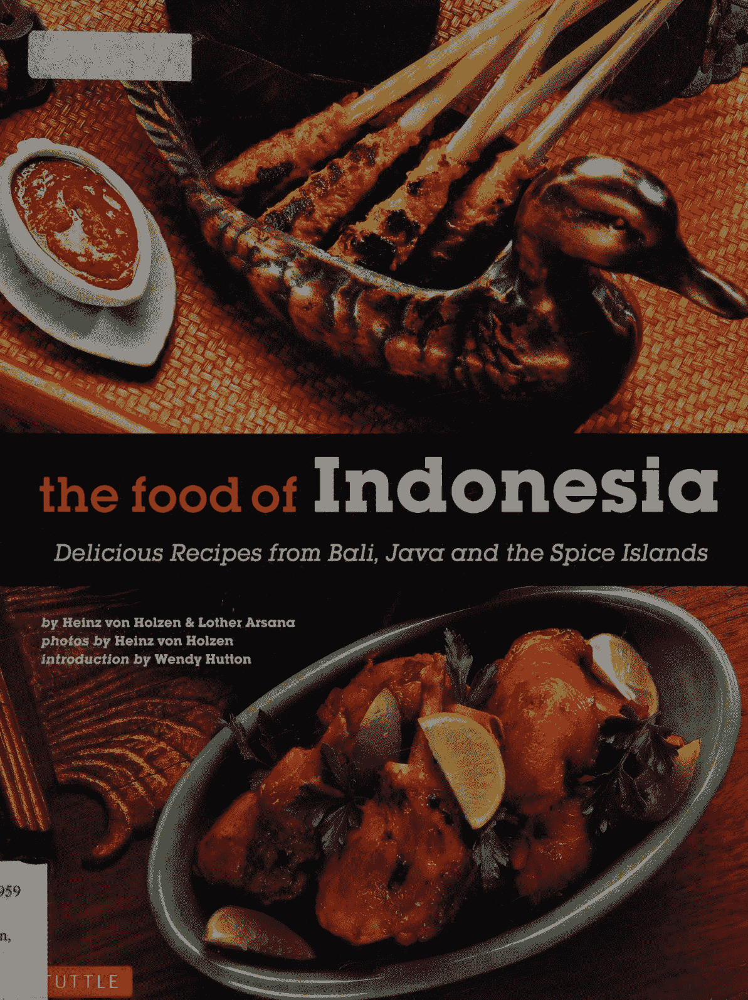

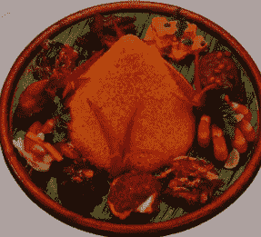

## 关于 Tuttle

## 跨越东西方的书籍

Tuttle Publishing 的核心使命是创作通过一页又页的书籍将人们聚集在一起。Tuttle 于 1832 年成立于美国新英格兰的一个小镇——佛蒙特州兰德。我们的基本价值观与从前一样坚守——出版顶级的书籍，向英语世界介绍亚洲国家和人民。如今世界已发生巨大变化，亚洲的经济、文化和政治影响力不断扩大，但对该地区有意义的对话和信息的需求从未如此迫切。自 1948 年以来，Tuttle 一直是文化、艺术、美食、语言和文学书籍领域的领导者。我们的许多作者和摄影师屡获殊荣，Tuttle 出版的从武术到纸工艺等各种主题书籍。欢迎您在 www.tuttlepublishing.com 探索丰富的亚洲信息。

所有食谱均在 Periplus 厨房测试过。

**照片：** 均由 Heinz von Holzen 拍摄，第 6, 7, 8, 9, 10 和 14 页由 Jill Gocher 拍摄。

**致谢：** 作者和出版社感谢印尼悦酒店区域经理 Peter Settler 的支持与热情。特别感谢 Marcel Isaac 及其团队提供的食物准备。来自巴厘岛 Nusa Bali Prawista 教育与培训中心的 Norman Wijaya 和 I. Mark Cornelius 提供了帮助并允许查阅他们的食谱档案。雅加达的 Puri Sankan 古艺术画廊、Titemile 画廊、亚洲艺术画廊、建筑陶瓷展以及 Jengalla Keramik Indonesia 为摄影提供了木雕、古董、艺术品、纺织品和陶瓷。

20 19 18 17 10 9 8 7 6 5 4 3 2

中国印 1703CM

汤煮茄子 63

布吉风味鸡 75

Lotek 40

食物终于做好了，一个极其肮脏的女人递给我一片装满猪肉的叶子。它闻起来有甜肉的味道。当我坐着盯着冒着热气的猪肉时，我想到了自己可能感染的所有疾病。极度的饥饿和绝望战胜了理智。我在山谷中拆开那小包香肠，撕下一些放在猪肉上，吃下了第一口。湿润、甜美、滋味丰富——我永远不会忘记我的顿丹尼猪大餐！红薯吃起来像是在这种土窑里蒸过一样（而且我完全没有受到任何副作用）。

相比之下，爪哇的日万加塔似乎位于另一个完全不同的星球。古老的石质寺庙——包括著名的罗布兰石佛寺和精美的印度教寺庙普兰巴南寺——从富含火山灰的土地上拔地而起。

日万加塔和附近的苏加卡塔人以他们精致的文化、舞蹈、`甘兰音乐`、蜡染和复杂的手工艺品为自豪。这是一个高度结构化的社会，其和谐取决于对他人的体谅，且集体胜于个人。仪式性活动以社区宴会（`selamatan`）为标志，我们入住一个日万加塔家庭（我们将在那里住一年），举办这样一场宴会是非常恰当的。

人们祈祷并为我们一家和在场的每个人忏罪。宴会的核心是一个锥形的黄米堆，即 `selamatan`，象征着神圣的梅鲁山，尽管大多数是穆斯林，但许多佛教和印度教的习俗仍然被包含在他们的仪式中。至少包括 `gudeg`（用棕糖、香菜和椰奶蒸熟的嫩果实）；棕糖炸鸡；红辣椒辣椒（`sambal`），以及油炸脆红葱——一种与虾仁油炸并用棕糖甜味的发酵大豆饼（`tempeh`）以及虾脆片（`krupuk`）的和谐融合。整体印象是微妙而甜美的，是典型的爪哇风味。

在光谱的另一端是苏门答腊西部达当地区的食物。如果你喜欢辛辣的食物，印尼大部分城市都能找到达当餐厅——你将毫不犹豫将其称为印尼最好的美食。在一个充满壮丽风景的国家里，苏门答腊崎岖的山脉、湖泊和壮丽的海岸线已经足够了。布基廷基（意为“高丘”）是米南加包人的核心区域，那里如画的风景是品尝当地美食的完美之处。

这是餐厅或简单小吃店里有的少数顶级美食之一；它是自助餐中的辛辣对照。多达 20 道菜从展示台上被端出来，放在你面前的桌子上。你可以随心挑选任何想要的，只需为你吃的部分付费。如果你不喜欢用浓郁辛辣的椰奶汁煮的羊肉，没关系，试试椰子柠檬草鸡、香醋牛肉后脑片、姜水煮大虾，或者辛辣辣椒酱（`sambal`）鸡蛋——名单长得列不完。

大多数人形容达当菜是辛辣的，但干香料只是故事的一部分。在布基廷基的市场里，自豪的米南加族女性穿着鲜艳的紫色天鹅绒衣服，那里堆着肉桂、黑胡椒、香菜、辣椒粉、孜然和茴香——还有新鲜的辣椒、生姜、大蒜、红葱、南姜、黄姜、柠檬草、芳香青柠和作为辛辣干虾膏的叶子。附近躺着成熟的椰子，它们的果肉被磨成浓郁、像奶油一样的牛奶，可以（轻微地）缓解香料的影响。

## 无尽的岛屿，无尽的品种

拥有数千英里的海岸线，位于群岛中心的、兰花形状的苏拉西岛以新鲜捕获的鱼类闻名。烤鱼（`Ikan bakar`，炭火烤的鱼并配以各种蘸料）是当地的最爱，也是我在苏拉西岛塔纳托拉雅高地最难忘的晚餐，那里的村庄像漂浮在广阔云海中的岛屿。

为了看到著名的托拉雅悬崖墓（那里有为逝者永不熄灭的灯），我从马萨卡睡到了兰得跑。睡了几个小时后，我注意到路上的同胞。我们前往葬礼，这是托拉雅人生活中最重要的活动，也是相互禁食的场合。

不久后，我坐在葬礼庆祝期间为客人搭建的竹棚里。蒸汽从装满热棕酒的竹筒中涌而出。`selamatan` 象征着神圣的梅鲁山，尽管大多数是穆斯林，但许多佛教和印度教的习俗仍然被包含在他们的仪式中。至少包括 `gudeg`（用棕糖、香菜和椰奶蒸熟的嫩果实）；棕糖炸鸡；红辣椒辣椒（`sambal`），以及油炸脆红葱——一种与虾仁油炸并用棕糖甜味的发酵大豆饼（`tempeh`）以及虾脆片（`krupuk`）的和谐融合。整体印象是微妙而甜美的，是典型的爪哇风味。

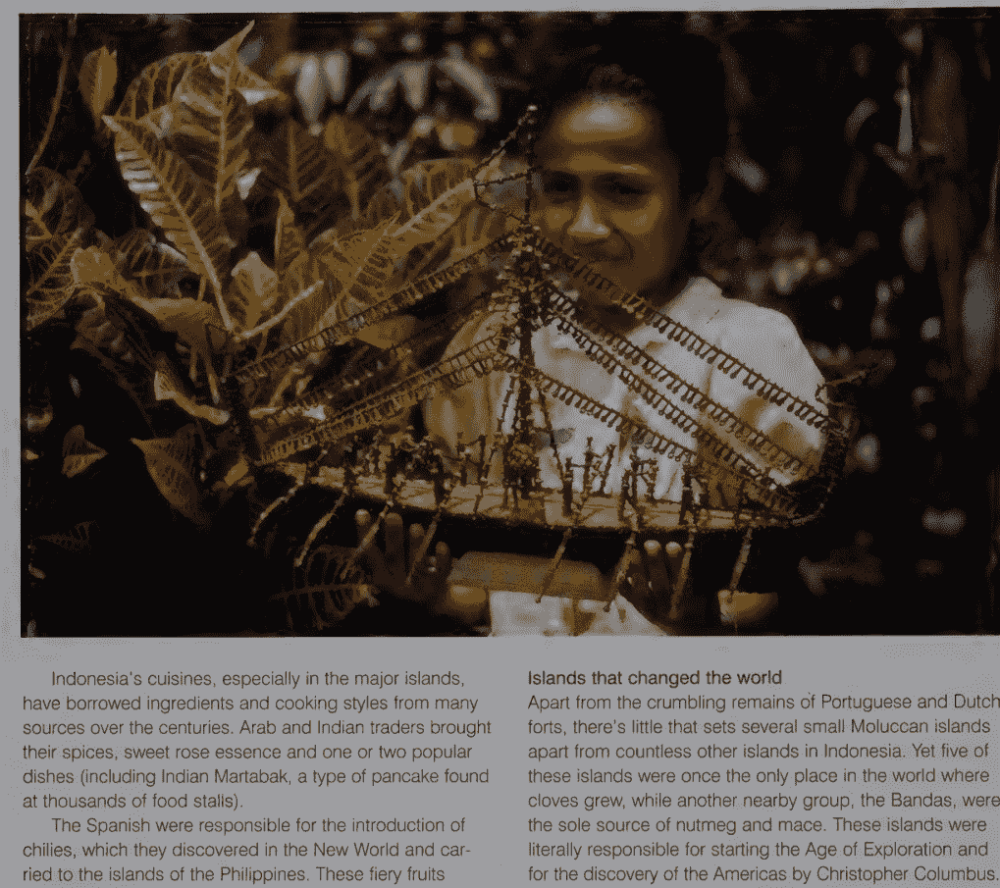

印度尼西亚的菜系，尤其是大岛地区的，在几个世纪以来从许多来源汲取了食材和烹饪风格。阿拉伯和印度商人带来了他们的香料、甜玫瑰花水以及一两道菜（包括印度的甜味 Martabak，一种在街头美食小摊上常见的煎饼）。

西班牙人负责了辣椒的引入，这些辣椒是在新世界被发现并带到菲律宾群岛的。这些火辣的果实席卷了东南亚和印度，并已完全成为当地美食的一部分，以至于很难想象如果没有它们，食物会是什么样子。

在作为殖民统治者的漫长时期里，除了引入新的蔬菜和面包外，他们对当地菜系产生了巨大影响。所谓的“饭台”（`rijsttafel`）是一种殖民时期的发明，是对印尼式米饭配几道咸菜和调料上菜方式的夸张改编。随着时间的推移、资金的积累以及充足的仆人（几乎能实现任何可能），荷兰人开发了一种“米桌”，那里有多达 18-25 道菜，每道菜由女佣或未经训练的“男孩”送到餐室。

中国人对印尼式烹饪的影响最大。他们引入了无处不在的食材（如酱油，印尼人对其进行了改造制成美味的 `kecap manis`）；豆芽（`tauge`）；豆腐和豆类，还用于制作美味且营养丰富的天贝（`tempeh`）。

## 改变世界的岛屿

除了葡萄牙和荷兰堡垒的残骸外，几乎没有什么能将几个小马马鲁库岛屿与印尼无数的其他岛屿区分开来。然而，这五个岛屿曾是世界上唯一丁香生长的地方，而另一组班达群岛则是肉豆蔻和肉豆壳的唯一来源。这些岛屿实际上开启了大航海时代，并让哥里斯多·哥伦发现了美洲。

凭借今天的冷藏和食品加工技术，很难完全体会香料在古代的重要性。2000 年前，罗马人、埃及人和中国人就在寻找丁香、胡椒和肉豆蔻，用于增味、掩盖肉不新鲜的味道、在葬礼期间弥散空气以及用于药物。

在中世纪，欧洲的香料贸易由阿拉伯商人控制，他们从印度商人那里购买香料。他们通过向威尼斯商人供应香料（再由后者分销到欧洲其他地区）来保持极高的价格。为了寻找此类香料以及稀有昂贵的物品——价值远超黄金或贵金属——哥伦多·哥伦布航向印度（他以为自己去的是印尼）。葡萄牙人也进行了其他探险航，他们最终在 16 世纪初到达印尼的香料群岛，随后是西班牙、英国和荷兰人。

1602 年，荷兰人建立了东印度公司，以开发最终成为印尼西亚的群岛的财富。他们无情地建立了香料贸易的完全垄断，并通过砍掉任何“非法”交易的种植者的高价值香料树。

香菜对古希腊人就已知，并遍布中东以及东南亚。香菜通常与胡椒、大蒜和椰子搭配调味。另一种与丁香一起使用的香料是孜然，一种细长的种子，看起来和闻起来像肉桂。另一种香料，

微妙的是，现在苏拉威锡和桑齐巴巴的丁香比马马鲁库多，印尼现在进口丁香以满足对这种香料的需求。不要期望在今天的印尼菜肴中找到它——大多数丁香都变成了烟雾，加入香烟（`kretek`）中。

黑、白胡椒各具独特风味，用于群岛的部分地区。胡椒是产自印度马拉马拉海岸藤本植物的果实，几个世纪前被带到印尼的。黑胡椒是带皮的干燥果实，而白胡椒则是去了皮。

对这些香料的渴望（这为 1000 万满载货物的探险家带来了利润），大多数干燥的丁香在马马鲁库是常见的景象。采摘的、绿色的丁香花蕾 `Eugenia aromatica` 被干燥数日，直到最终出现在世界的超市货架上。

印尼西亚的沿海地区（如苏门答腊东岸，在阿拉伯人到达之前就有居民；以及爪哇的西岸和北岸）使用种类更广泛的香料。虽然所有肉豆蔻都被许多人视为最珍贵的，但在班达岛和阿姆汶岛，果实被采摘，芬香的仁被提取；肉豆蔻和肉豆壳是鲜红色的，然后被干燥。

苏门答腊菜肴，例如，可能有六或七种不同的香料以及许多根茎植物、香草和调料，印尼偏远岛屿的菜肴可能用盐调味。

热带岛屿的香料丁香（树上干燥的花蕾）是一项受欢迎的物品。每个阶段的米和香料都确保了丰收！

米饭和菜肴在白天很快供应，紧随从市场回来后或用从花园采摘的物品烹制。特别是在远洋群岛的偏远地区，许多饮食极其简单，由当地主食加上一点炸鱼和辣椒辣椒（辣椒 `sambal`），配上一些炸洋葱或淋上甜黑酱（`kecap manis`）加入碎香草或柠檬汁。

烹制好的食物通常放在厨房的桌子上，用香蕉叶或塑料网制成的凉食物罩防止昆虫侵害。

在更富裕的家庭中，搭配米饭的菜肴是为了实现口味和质地的平衡。其中一道咸菜有浓郁的椰奶汁，味道更尖锐。可能还有一种由辣辣椒制成的辛辣辣椒（`sambal`），但它是搭配平衡的米饭或其他使用 `kecap manis`（甜酱油或棕榈糖）的菜。

烹饪印尼菜的一部分是规划菜肴的范围。其中许多可以提前准备，一旦客人到达，他们就可以放松并享受彼此的陪伴。

苏拉威锡南部的女孩聚在一起用餐，采用典型的印尼风格，米饭和配菜放在桌子中间方便她们取用。乌布的一条小巷是为了寺庙节日准备的。路边的竹竿被称为 `jenjor`，是繁荣的象征。

“Silakan makan”是提供任何菜肴之前的礼貌印尼语用语（以及外游客应该总是等后再吃饭）。在整个群岛的大多数家庭中，用餐是非正式的，而且通常独自进。数百万印尼人在黎明前醒来，当早晨的气气回来时，烹饪的任务就开始了，会有昨晚剩下的食物，也许是几块粘饼、一碗面或一份简单的炒饭。

在白天感到饥饿时，家人自己取用任何想要的东西，或者带一盒食物去办公室吃午餐。晚餐通常是午餐剩下的肉。

用餐是共式的，米饭和所有配菜都放在餐桌中间或垫子上，人们自己取用任何想要的东西。第一份就拿一整盘是不礼貌的；只要一点就可以了，随着用餐的进行，有很多机会增加更多。比起菜肴的名字，印尼人更倾向于享受四五种小份，而不是大拿一两份。

印尼人传统上用右手吃（穆斯林认为左手是不洁的），尽管使用勺子传递食物或盛菜碗。（用从共用菜中吃饭的勺子或叉子，这被认为是不洁的！）大多数家庭和餐厅提供勺子和叉子，而在中餐厅可以预期有筷子。

调料和咸菜一样重要，通常包括辣椒辣椒（`sambal`）以及一些提供酥脆对比的东西。这可能是炸天贝、炸鱼（`ikan teri`）、调了虾味的薄脆饼，或者是苦瓜仁，然后深炸的椰子制物，如 `rendang` 或花生水。

## 简约与实用的结合

印度尼西亚许多令人惊叹的特点之一，是如此美味的食物——通常是草药、香料和调味品的复杂融合——竟然是从最简单的厨房中诞生的。大多数印度尼西亚人从未见过那种光发亮的现代设计师厨房、瓷砖表面、家用电器以及冷热水。那里的厨房远非乡村风格，菜肴是在木火或 `kompor`（煤炉）上烹饪的。在许多城市地区，通常使用 LPG 燃料的燃气灶。

在你的厨房里准备印尼菜需要相当的技巧，因为所需的厨具并不多（见下节）。首先，你需要某种东西来研磨或捣碎调味品（`bumbu`），它们是无数印尼菜肴的基础，也用作辣椒酱（`sambal`）的配料。在印度尼西亚，经常使用由火山岩制成的盘状研臼和石杵。与马来西亚和泰国使用深口研臼捣碎食材不同，印度尼西亚的 `cobek` 是在石面上通过后退动作揉搓食材，而石面因使用而变得略微圆润。

研臼和石杵非常适合少量的食材，大多数现代厨师会使用食物加工机、搅拌机或漏勺（`spider`），这是准备基础香料糊或 `rempah` 最简单的方法。现在小型的香料研磨机配件非常齐全，对许多菜肴非常方便。

菜刀和菜板同样重要。这对组合可以完成许多任务：将蔬菜切成所需的尺寸；将肉或鱼切成细末状的食物。菜刀的平面用于处理柠檬草、豆蔻或南姜（以及大蒜）等。在亚洲，树干的粗壮横面被用作菜板；这种板材既耐用又实用。配合一把刃宽为 3-4 英寸（7-10 厘米）的菜刀。

锅基本上是一个圆锥形锅，用于许多菜肴的煎炸。它被称为 `kwal`（或爪哇语中），这种多功能工具对于深炸（用油较少）非常实用，而且对于许多以大量液体开始、以干香料结束的菜肴，它提供了恰蒸发量。

一个不易翻倒的重型铁锅更好，最好是“劳斯莱斯”级别的，即由不粘合金制成，在使用金属铲时不会刮伤。为了配合工作，一把金属铲和一个用于捞出油炸食物的带孔勺是很有用的。

印度尼西亚烹饪还使用各种铝制或铸铁的锅来烹饪食物。许多配方含有酸性成分，如罗望子汁或柠檬汁或椰奶，使用铝或铸铁会破坏酱汁或产生化学味。应使用不锈钢、玻璃或搪琅汤锅。

印度尼西亚烹饪中使用的一种物品在外面很少买到。这就是多功能香蕉叶，用于包裹食物、蒸制或直接放置在热炭上。香蕉叶的种类令人惊叹，它展示了 24 种用香蕉叶包裹食物的方法，取决于内容和制作风格！如果你能获得香蕉叶，请将它们擦干净并用它们包裹食物。在使用前，在盆中放入沸水直到其变软。铝箔可以用先用纸包裹食物，再裹上铝箔来代替。然后将包裹好的食物通常放在冷水蒸笼内，蒸制米饭。

印度尼西亚的厨房以带盖的中国式蒸器而闻名。蒸器放在锅内，沸水上方。竹盖会吸收水分并减缓……

竹蒸器的替代品是放在锅内沸水上方的带孔金属盘，但它盛装的食物没有双层蒸器多，而且你需要找到一个适合你工作的盖子。

采购：由火山岩制成的传统研臼和石杵在印度尼西亚很常见，它是准备每道印尼菜所需香料糊的重要工具。基础香料糊或 `rempah` 由红葱、姜、南姜、柠檬草和糖组成，通常还会加入其他香料或草药作为

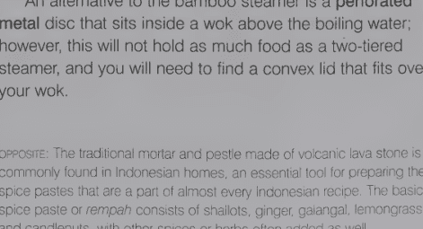

## 准备关键的香料糊、米饭和椰奶

印尼菜有多种准备方法：煎或油炸、在热炭上烤、蒸，甚至——在伊门望亚的偏远地区——在波利尼西亚式的土炉中烘烤。

掌握使用研磨机准备基础香料糊或 `rempah` 的艺术对许多菜肴至关重要。印尼料理使用石臼；必要时对食材去皮，并在相关情况下前将其切片或切成小块。如果你使用搅拌机或食物加工机，准备香料的过程快得多，但需要加入一些牛奶来保持机器内的混合物。香料糊要先在热油中煎炸，将规定量的一部分加入食物中。如果香料要在椰奶、高汤或水中炖，则加入少量的这种液体即可。

研磨或处理香料的顺序很重要。先研磨硬物品：香料、坚果和坚韧的根部或叶子，如柠檬草。当它们变细后，加入软根部，然后加入水分充足的食材，如红葱和大蒜。最后加入碎末状或液体成分，如虾酱、棕榈糖和姜黄，并加工混合。如果混合物粘在侧壁，你可能需要关闭机器并摇晃容器，或打开它并用铲将食材推向中心。

香料要先在热油中煎炸，将规定量的一部分加入食物中。如果香料要在椰奶、高汤或水中炖，则加入少量的这种液体即可。

研磨或处理香料的顺序很重要。先研磨硬物品：香料、坚果和坚韧的根部或叶子，如柠檬草。当它们变细后，加入软根部，然后加入水分充足的食材，如红葱和大蒜。最后加入碎末状或液体成分，如虾酱、棕榈糖和姜黄，并加工混合。如果混合物粘在侧壁，你可能需要关闭机器并摇晃容器，或打开它并用铲将食材推向中心。

香料要先在热油中煎炸，将规定量的一部分加入食物中。如果香料要在椰奶、高汤或水中炖，则加入少量的这种液体即可。

研磨或处理香料的顺序很重要。先研磨硬物品：香料、坚果和坚韧的根部或叶子，如柠檬草。当它们变细后，加入软根部，然后加入水分充足的食材，如红葱和大蒜。最后加入碎末状或液体成分，如虾酱、棕榈糖和姜黄，并加工混合。如果混合物粘在侧壁，你可能需要关闭机器并摇晃容器，或打开它并用铲将食材推向中心。

香料要先在热油中煎炸，将规定量的一部分加入食物中。如果香料要在椰奶、高汤或水中炖，则加入少量的这种液体即可。

## 多功能食物包装材料

用香蕉叶包裹食物进行蒸、烤或煎炸，可以赋予食物一种清新的的香气。在包裹之前，将叶子切成矩形，冲洗干净，并放入盆中用沸水烫一下。这能让叶子变软，使其在折叠时容易弯曲而不会断裂。

第 1 步：在干净的叶子上食材摆成圆柱形。

第 2 步：将叶子绕着馅料卷起来。

第 3 步：用牙签固定卷好的两端。

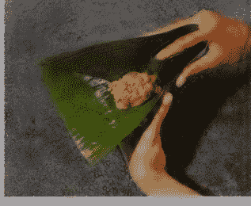

第 1 步：将食材放在叶子的中心，用食指将一侧折叠。

第 2 步：在另一侧重复操作。

第 3 步：将折叠好的一侧折到正面，另一侧折到背面。

# 腌菜、酱料和蘸料

## 印度尼西亚调味品

### 食材

许多印度尼西亚食材现在可以在印尼外的优质超市买到——如干抽（tris）、黑虾膏、山姜（kencur）、椰奶和香茅。包装上的名称可能不同，或者来自新加坡、马来西亚、泰国和越南的类似原料名称不同。查看22至27页的食材列表获取这些替代名称，并寻找在亚洲特色食品店较难找到的食材。

第 4 步：在另一侧重复操作，牢固地包裹住内容。

第 5 步：用另一条长窄的叶条包裹包包。

第 6 步：在顶部用牙签固定。

可以作为替代品，虽然较便宜的杏仁或腰果也可以。山油果从不生吃，也不单独食用，而是切碎后与调料和香料混合一起烹饪，以增加风味和口感。由于含油量高，它们变质很快，所以要少量购买并冷藏保存。

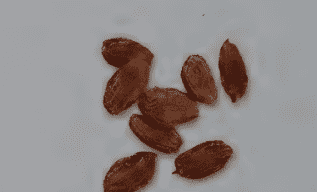

印尼常用的豆芽是由绿豆发芽而成的。虽然有豆芽但不常见。购买新鲜的豆芽，因为它们很快失去清脆的口感。不过，如果放在冰箱里浸泡在水中，可以保存几天。

豆蔻荚 (kepulaga) 用于菜肴和甜点的调味——赋予食物浓郁、甜美的香气。纤维状的星形果壳包裹着 15-20 颗黑色种子。使用前用菜刀或研杵轻微压碎。尽量不要使用豆蔻粉，因为它的品质远逊于完整的豆蔻。

杨果是一种淡绿色的水果（长 5-8 厘米）。它们成簇生长，与大星果有关。杨果可以整颗或切片使用，为汤、鱼类菜和辣酱 (sambal) 增加酸味。可以用罗子汁或西柚汁代替。

山油果 (buah kemi) 是奶油色的坚果，大小和质地与马斯加加果相似，可以

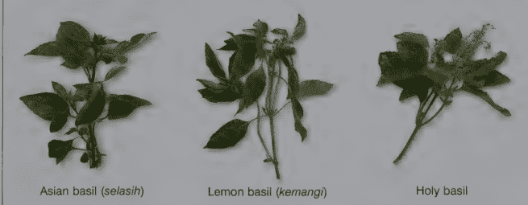

罗勒在印尼烹饪中常用作调料和点缀，有多种类型。最常用的罗勒是亚洲罗勒或 selasih，与欧洲和美国的甜罗勒相似。它被大量用作调料，罗勒叶也经常被加入新鲜蔬菜盘中。柠檬罗勒 (kemangi) 与之相似，但带有独特的柑橘香气。圣罗勒在泰国被称为 kaprow，具有丁香的香气。它的味道辛辣火热，主要用于炒菜。亚洲罗勒通常可以在食品商店和许多超市买到，但甜罗勒是可以接受的替代品。

冬瓜 (labu) 是一种椭形的绿色南瓜，带有小白色种子。煮熟时，种子是可以食用的，非常美味。在货源充足的超市出售。可以用西芦代替。

罐装椰奶有不同的稠度，取决于品牌，你可能需要加水来调整厚度。通常情况下，向 1 杯罐装椰奶油加入 1 杯水获得椰奶，或加入 2 杯水获得浓椰奶油。细碎的椰丝以各种尺寸出售，通常在烘焙区。

鸟眼辣椒 (cabai) 遍布印尼。新鲜的红色和绿色辣椒中等辣。干红色或绿色辣椒通常切成段并泡在温水中使其变软。在准备前丢掉部分或全部辣椒以减轻辣度。

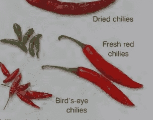

干虾 (ebbi) 是受欢迎的亚洲食材，用于酱汁和辣酱。日干的虾类呈红色且饱满，可以保存几个月。寻找颜色亮且完全去壳的干虾。

孜然籽 (jinten) 是脱水的。甜味和无甜味的椰丝在各种商店出售。

虾膏 (terasi) 是发酵干虾的浓稠混合物，气味非常强烈，可能令某些人反感。马来语也称为 belacan，块状使用，在平锅上用火火烘烤以增强风味。

肉桂比桂皮颜色更浅、更薄、也更贵。桂皮的味道比肉桂更强，但可以是可以接受的替代品。在需要肉桂棒的地方，不要用肉桂粉代替：

椰奶或奶油 (santan) 有新鲜的也有包装的，快速且方便。

南姜 (galangalang) 是姜科的一种香根根。它为许多东南亚菜肴带来了独特的味道和香气。尝试寻找嫩的粉南姜，因为它们更软。磨碎前总是去皮并切片，因为根很硬。南姜也有干的、冷冻的包装在水里的，但尽可能获取新鲜根，因为它更香气。

山药 (jicama) 可以生吃，切片后配岩盐或酱料，作为清爽的零食食用。在超市的蔬菜区寻找它。

柠檬青柠叶 (daun jeruk purut) 加入咖喱中，或切细丝加入沙拉中，赋予它们极佳的酸甜味。它们常用于印尼和其他东南亚菜系，在亚洲食品商店有冷冻或干的。冷冻叶比干的更有香气。

大蒜韭 (kucai)，在印尼有时被称为中式韭，叶子扁平像洋葱。它们有浓浓的大蒜味，在中式烹饪中经常加入面条或炒蔬菜中。可以用洋葱代替，尽管它们味道很淡。

山山 (kencur)，有时被误认为小南姜，也称为 zedoary。山山具有独特的、类似樟脑的味道，应该节制使用。使用前必须先冲洗并刮去皮。干山山在使用前最好在沸水中浸泡 30 分钟使其变软。如果使用普通山山，尽可能用 1/2-1 茶匙粉代替 1 英尺（21 厘米）的新根，因为它更香气。

虾片 (krupuk) 是由虾、鱼、蔬菜和坚果碎混合各种面粉制成的干脆饼，是一种非常流行的零食。它们必须在阳光下或在温度极低的烤箱中彻底干燥，然后在油中深油炸几秒钟，然后就会膨胀变脆。将炸好的 kerupuk 存在密封容器中。

| 黄面条 (mie) | 扁米粉 (kway teow) | 干米线 (beehoon) | 干粉丝粉丝 (tanghoon) |

面条是印尼人的的普遍喜爱，印尼人从中国那里热烈接纳了它们。新鲜和小麦制的面条都是

*With*

米粉是由磨碎的未煮生米粒制成的。它被用于制作许多甜点的面团或面糊。

西米粉是由磨碎的西米树露制成的，能为甜点带来非常微妙的风味和细腻的口感。在亚洲特色食品店通常以塑料袋装的形式出售。

香茅（serai）是一种带有清香的柠檬茎，既可以被捣碎加入汤中或咖喱中，也可以切片作为基础香料使用，在超市中以3到4根一捆的形式出售。应剥去较硬的外层，仅使用茎部下部三分之一的内层。在磨碎前务必切片茎，以获得光滑的糊。

棕糖（gula jawa）以固体块或圆柱形糖的形式出售，由椰子汁或油棕汁制成。颜色从浅棕色不等，带有焦糖味。它用于制作棕糖糖（见第104页）。用量时，应将硬棕糖刨碎、磨碎或在微波炉中融化。可用深红糖代替。

罗勒叶（Salam leaves）属于肉桂科，其用法与西方烹饪中相同——为菜肴增添复杂的土质香气。如果没有这种，请完全从食谱中省略。不要用月桂叶代替，因为风味完全不同。

印度尼西亚使用几种类型的青柠。圆皮黄柠檬（jeruk nipis）明显比高夫球大得多。深绿色的小柠檬（jeruk limau）用于其香气和果汁。也可以使用其他类型的青柠。

斑兰叶为一系列印度尼西亚菜肴带来微妙的香气和绿色调。它们通常被扎成结并加入液体配方中。甜点可以用瓶装斑兰提取物代替，但如果没有新鲜或干燥的斑兰叶，请在咸味菜肴中省略。可以用香草精代替。

八角（bunga lawang）是一种有8个角的干燥果实，内部带有光黑色的种子，带有茴香的香气。烹饪时使用整颗，食用前丢弃。整颗八角在密封容器中可以保存多年。

豆粉（tepung hoang kwe）以纸包装的圆柱体出售——有时会被染成粉色或绿色，包装纸也相应染色它比米粉给甜点提供更细腻的口感。

肉豆蔻（pala）是肉豆蔻树果实的内核。覆盖肉豆蔻的叶是另一种香料——在使用粉末香料前磨碎整颗肉豆蔻，否则气味很快消失。而肉豆蔻几乎可以无限保存。

酱油由大豆加盐发酵而成。它是咸的，可用作蘸料或烹饪调味品。黑抽比普通酱油更稠、更咸。甜抽为菜肴增添烟熏味。甜抽（kecap manis）比普通酱油甜得多、浓得多，加入了棕糖和糖蜜。可以用甜豉代替，或者只需在普通酱油中加入深红糖，如果可以也可以尝试寻找印度尼西亚的 kecap manis，因为它具有独特的风味。

罗望子（asam jawa）是印度尼西亚通常以干果出售的水果，仍包裹在长长的树木果壳内。在印度尼西亚境外，果肉更多用于果酱，且是已去壳的但含有一些纤维和种子。它是许多菜肴中的酸剂。要获得罗望子汁，将果肉捣入2份水中并过滤。如果使用已经清理过的罗望子果肉，请减少食谱中的用量。干果肉在密封容器中可以无限保存。

硬豆腐

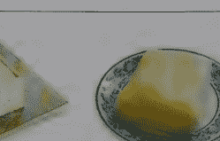

干豆腐

炸豆腐

豆腐富含蛋白，用途广泛。硬豆腐在切割或烹饪时能很好保持形状，味道浓郁且略微酸。干豆腐（通常被误标为硬豆腐）去除了大部分水分，质地完全不同，非常适合炒菜。将浸泡在水中的新鲜豆腐补水。炸豆腐片（tau poh）在超市和菜市场也有现成的，可以切片或切块加入炒菜和汤中。

木薯叶（Tapioca leaves）是木薯植物和木木薯植物顶部的嫩叶。在亚洲许多地区，它们被煮后作为绿色蔬菜食用。可用菠菜或空心菜（kangkung）代替。

姜黄（kunyit）是一种类似于生姜的根部，呈亮黄色至橙色，带有强烈的木质味。姜黄具有防腐和收敛作用，且会永久性污渍；处理后请立即清洗刀刃、手和菜板。根据需要购买新鲜姜根；风味在几天后会变淡。每1个（2½厘米）新鲜姜根使用1茶匙粉。姜黄叶被用作香草，特别是在苏门答腊。没有替代品。

（注：此处原文似乎有断句或格式错误）

小鱼（ikan）是一种通常炸至酥脆的鱼。可用作零食或菜肴配料。天豆是用大豆发制而成的食品。具有坚果味和结实的质地。可以切片、油炸或加入炒菜。空心菜（kangkung）是东南亚常见的叶叶蔬菜。通常与大蒜和虾膏一起炒。它是丰富的维生素来源。

### 份量

### 时间预估

时间预估是指准备和腌制时间，基于使用食品加工机或搅拌机。

制作2份

准备时间：20分钟 + 腌制2至3天

## 混合蔬菜腌

### Acar Segar

#### 配料

- 1个小黄瓜，去皮去籽切丝
- 1个小胡萝卜，去皮切丝
- 8颗红葱，去皮切成四份
- ½杯（180 ml）水
- 3汤匙醋
- 1汤匙糖
- 1茶匙盐

### 关于磨碎的小贴士

使用石臼准备香料时，提前将所有食材去皮并切片会有帮助。先磨质地较软的食材。如果使用搅拌机，加入少量液体（根据配谱加入油、椰奶或水）保持稀。不要过度搅拌——如果量太大，分批处理，磨好后再后再批。如果在磨碎前需要烘烤某些食材（干抽通常如此），请让其冷却后再磨。香料只需要粗磨——不需要磨成泥。将未使用的香料放入保鲜膜或密封容器冷藏或冷冻。

将切好的蔬菜放入碗中。在另一个碗中混合醋、糖和盐，然后加入蔬菜中拌匀。放在冰箱中腌制2至3天后食用。这种腌菜在冰箱中可以保存2周。

---

- 1 根黄瓜，去皮去籽
- 1/2 杯 (25 g) 豆芽，去籽
- 黄瓜的瓜皮和根部已弃用
- 2 个红洋葱，去皮切片
- 1 根红指辣椒，去籽切片
- 1-2 根鸟天椒，去籽切片
- 2 枝罗勒叶，切碎
- 3 汤匙粗磨的生杏仁、腰果或糖渍果
- 1/2 汤匙干虾膏 (trasi)，干烤（第 23 页）
- 2 汤匙现榨青柠汁或柠檬汁
- 1/4 汤匙糖
- 1/4 汤匙盐
- 1-2 汤匙水
- 2 汤匙白醋
- 1 1/2 汤匙糖
- 1 茶匙盐
- 30 个红洋葱，去皮切片
- 1 根红指辣椒，去籽切片
- 10-12 个新鲜或罐装马栗，或 1 个小风头草 (bangkuang)，去皮切丁
- 2-3 根红指辣椒，去籽切片
- 2 瓣大蒜，去皮；
- 1/2 汤匙干虾膏 (trasi)，干烤（第 23 页）
- 1 1/2 汤匙现榨青柠汁或柠檬汁
- 2 枝九层塔

在碗中混合醋、糖、盐和水。加入切好的洋葱和辣椒，混合均匀。置于一处腌制 2 到 3 小时，然后装入小碗中。这种酸菜在冷藏中可保存一周。

1. 将黄瓜和豆芽放入碗中，然后将切好的洋葱、辣椒和罗勒压在上面。
2. 在另一个碗中混合剩余食材，调成浓酱。将酱料淋在蔬菜上，混合均匀置于一处腌制 2 到 3 小时。如果需要储存，请将酸菜和酱料分开。这种酸菜在冷藏中可保存一周。

制作 1 杯

准备时间：20 分钟 + 2 到 3 小时

- 2 汤匙白醋
- 1 1/2 汤匙糖
- 1 茶匙盐
- 2/2 汤匙温水
- 10 根手指长度的绿辣椒，去籽切片

在碗中混合醋、糖、盐和温水。加入切好的洋葱和辣椒并混合均匀。置于一处腌制 2 到 3 小时，然后装入小碗中。这种酸菜在冷藏中可保存一周。

制作 1 杯

准备时间：15 分钟 + 2 到 3 小时

- 1 个熟的芒果（约 8 盎司 / 250 g），去皮去核，细切
- 1 茶匙盐
- 1 根红指辣椒，去籽
- 5 个红洋葱，去皮
- 1/2 汤匙干虾膏 (trasi)，干烤（第 23 页）
- 1 枝九层塔叶，切碎
- 2 汤匙油

1. 在芒果上撒盐，混合均匀，置于漏勺中静置 10 到 15 分钟沥干。将芒果放入干布中，尽可能挤出水分。
2. 在研钵或破碎机中将辣椒、洋葱和干虾膏磨成泥状，加入少许油以保持混合物旋转。将罗勒叶和油加入混合物中搅拌均匀，然后将此混合物加入芒果中轻拌拌匀。立即食用。

制作 2 杯

准备时间：30 分钟

- 1 1/2 汤匙糖
- 2 汤匙白醋
- 1 茶匙盐
- 2/2 汤匙温水
- 10 根手指长度的绿辣椒，去籽切片
- 2 汤匙油
- 15 个红洋葱，去皮切片
- 4 瓣大蒜，切片
- 1/2 汤匙盐
- 2 汤匙干虾膏 (trasi)，干烤（第 23 页）
- 两汤匙现榨青柠汁或柠檬汁

1. 在锅中加热油，除青柠汁或柠檬汁外，将所有食材大火翻炒 1 到 2 分钟。离火并放凉。
2. 加入青柠汁混合均匀，然后装入小碗中。这种辣酱在冷藏中可保存长一周。

制作 1 1/2 杯

准备时间：15 分钟

## 腌制绿辣椒

- 3-4 个红洋葱，去皮切片
- 1 根红指辣椒，去籽切片
- 2 汤匙印尼甜甜酱油 (kecap manis)

混合食材，搅拌均匀并装入小碗中。

制作 1/2 杯

准备时间：5 分钟

- 4 根红指辣椒，去籽
- 1 汤匙干虾膏 (trasi)，干烤（第 23 页）
- 1 汤匙碎的棕榈糖或黑糖
- 1 汤匙现榨青柠汁或柠檬汁
- 1/4 杯 (70 g) 黄豆豉酱 (tauco) 或味噌
- 1/4 杯 (60 ml) 浓 椰奶
- 调料酱
- 3 根绿指辣椒，去籽
- 4 个红洋葱，去皮
- 3 瓣大蒜，去皮
- 2 汤匙油
- 1 根香茅，去外层（弃用），保留内芯
- 2 片香茅叶
- 1 汤匙罗望子汁
- 1 汤匙碎的棕榈糖或黑糖

在研钵或破碎机中将食材磨成光滑的酱。制作火辣辣酱，用鸟天椒代替红指辣椒。

制作 1 杯

准备时间：10 分钟

## 甜酱辣酱 (Sambal Kecap)

- 3 个香茅或马蹄坚果
- 1/2 根 (cm) 新香茅 (laos)，去皮切片
- 2 根红指辣椒，去籽
- 5 个红洋葱，去皮
- 3 瓣大蒜，去皮
- 1 汤匙油
- 1 杯 (120 g) 干虾，浸泡 15 分钟沥干，在研钵或破碎机中
- 1 汤匙黑糖
- 1 杯 (250 ml) 椰奶
- 1 片香茅叶
- 1/2 茶匙盐
- 8 盎司 (250 g) 风头草，去皮切片
- 1 汤匙油
- 1 汤匙干虾膏 (trasi)，干烤（第 23 页）
- 2 汤匙罗望子汁（第 26 页）
- 4 汤匙甜甜酱油 (kecap manis)

1. 将香茅、洋葱和大蒜在研钵或破碎机中磨成光滑的酱，如有必要请加入少许油。
2. 在锅中中火加热油，翻炒混合物 3 分钟。加入干虾和糖，继续翻炒 2 分钟。
3. 加入椰奶和盐，混合均匀。将混合物煮至微沸，转小火加入风头草煮至软烂，约 15 分钟。

1. 在锅中中火加热油，翻炒洋葱和大蒜至金黄色，持续 3 分钟。
2. 加入辣椒、虾膏、罗望子汁甜酱油，混合均匀。转小火煮 4 分钟，直到辣酱浓稠。离火放凉，然后装入小碗。这种辣酱在冷藏中可保存一周。

制作 1 杯

准备时间：15 分钟

烹饪时间：10 分钟

- 1/2 杯 (100 g) 碎的棕榈糖和黑糖
- 1/2 杯 (125 ml) 水
- 1/4 杯 (60 ml) 或 1 茶匙干虾膏 (trasi)，干烤（第 23 页）
- 3-4 根鸟天椒
- 1/2 杯 (125 ml) 水

1. 在酱锅中将糖和水煮沸，转小火煮至糖浆浓稠，约 10 分钟。
2. 加入所有食材，搅拌均匀。转中火将混合物搅拌成酱。转小火煮 5 分钟，离火放凉。食用前滤出。

制作 1 杯

准备时间：10 分钟

烹饪时间：20 分钟

- 1/2 杯 (100 g) 烤过的无盐花生，去皮
- 3 瓣大蒜，去皮
- 1/2 根 (cm) 新山姜 (kencur)，去皮切片
- 2-3 根鸟天椒，去籽
- 1 片青柠檬叶

1. 去洋葱或大蒜的皮，然后用纸巾擦干。

## 炸葱

在锅中中小火加热油，翻炒洋葱和大蒜至金黄色且酥脆，持续 3 到 5 分钟。不要烧焦，否则味道会苦。用滤网沥干并完全冷却，然后储存在密封容器中调调其他菜肴。

制作 1/2 杯

准备时间：20 分钟

烹饪时间：5 分钟

## 干果与蔬菜辣酱

- 1 杯 (150 g) 烤过的无盐花生，去皮
- 3 瓣大蒜，去皮
- 1/2 根 (cm) 新山姜 (kencur)，去皮切片
- 2-3 根鸟天椒，去籽
- 1 片青柠檬叶
- 3 汤匙甜甜酱油 (kecap manis)
- 1/2 茶匙盐
- 1/2 杯 (375 ml) 水
- 1 茶匙现榨青柠汁和柠檬汁

1. 酥炸洋葱（参阅第 30 页的配方）
2. 在研钵或破碎机中将花生、大蒜、山姜和辣椒磨碎。
3. 在酱锅中将食材与其他所有食材（除青柠汁、柠檬汁或酥炸洋葱外）混合，中火煮 15 到 20 分钟，不断搅拌以防酱烧焦。根据需要加入更多水以保持酱汁浓稠。离火，加入青柠汁或柠檬汁并混合。食用前撒上酥炸洋葱。

制作 1 杯

准备时间：15 分钟

## 罗望子花生辣酱

- 2 个红洋葱，去皮
- 2 瓣大蒜，去皮
- 2 汤匙碎的棕榈糖或黑糖
- 1 汤匙干虾膏 (trasi)，干烤（第 23 页）
- 1 汤匙罗望子汁（第 26 页）
- 1/4 杯 (100 g) 现磨的椰丝或 3 杯 (240 g) 无甜椰子
- 1/2 杯 (100 g) 烤过的无盐花生，去皮
- 1/2 茶匙盐

1. 在研钵或破碎机中将大蒜、糖、虾膏和罗望子汁磨成光滑的酱。加入椰丝混合。
2. 在锅或平锅中极小火干煎混合物 10 到 15 分钟，直到金黄色且蓬松。加入花生和盐，混合均匀。离火放凉。装入碗中或撒在米饭或配菜上。*Serendung* 在密封容器中可保存 2 周。

制作 3 杯

准备时间：15 分钟

烹饪时间：15 分钟

## 山果辣酱

- 3 颗山果，油炸至完整
- 4-5 根红长辣椒或 5 根鸟天椒，去籽
- 6 个红洋葱，去皮
- 2-3 瓣大蒜，去皮
- 1 茶匙糖
- 1/2 茶匙盐
- 1/4 杯 (60 ml) 现榨青柠汁或柠檬汁

在研钵或破碎机中将山果、辣椒、洋葱和大蒜磨成光滑的酱，加入少许油。

制作 1/2 杯 (125 ml)

准备时间：20 分钟

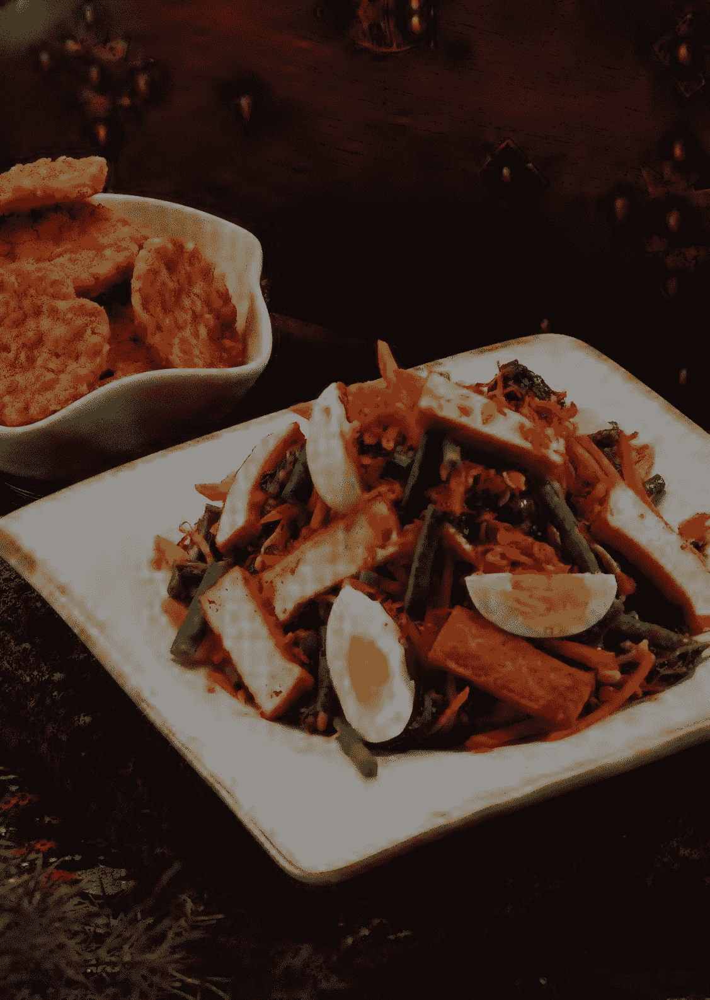

## 花生酱蔬菜沙拉

- 1 杯 (50 g) 豆芽，去皮和根部
- 2 杯 (180 g) 菠菜，洗净，去掉硬质茎部
- 1 根胡萝卜，切片
- 1 杯 (100 g) 豆角，切短段
- 1/4 头高卷心菜，叶叶分开并切片
- 2 块（每块约 7 厘米或 200 g）炸豆腐，切片
- 2 个水煮蛋，切成楔形
- 2 汤匙炸葱（第 34 页），用于装饰
- krupuk 虾片（第 24 页），配餐（可选）

1. 按照第 34 页的配方准备炸葱。
2. 制作 Gado Gado 酱汁：在研钵或搅拌机中粗磨花生、大蒜、辣椒和山南姜（kencur），必要时加入少量水保持混合物旋转。将磨好的混合物放入锅中，加入除青柠或柠檬汁以外的所有酱汁原料，不盖盖用小火煮约 1 小时，经常搅拌以防酱汁粘锅烧焦。离火备用。上菜前加入青柠或柠檬汁，拌均匀，并撒上 1 汤匙炸葱。
3. 中火将一汤匙水煮沸，快速焯烫蔬菜（豆芽 2 分钟，菠菜 1 分钟，胡萝卜 1 至 2 分钟，豆角和高卷心菜最多 3 分钟）。离火。
4. 将蔬菜、豆腐和鸡蛋摆放在菜盘中，淋上 Gado 酱汁。配上炸好的 krupuk 虾片食用。

### Gado Gado 酱汁原料

- 1 杯 (150 g) 烤无盐花生
- 2 瓣大蒜，去皮
- 2-3 根蚂天椒或红长指椒，去籽
- 1 英寸 (2 1/2 cm) 新鲜山南姜根，去皮切片
- 1 片青柠叶
- 3 汤匙甜味印尼甜油酱（kecap manis）
- 1/2 汤匙盐
- 2 杯 (500 ml) 水
- 1 汤匙现榨青柠汁或柠檬汁

供 4 至 6 人食用

准备时间：35 分钟

烹饪时间：1 小时

## Rempeyek Kacang

- 1 1/2 杯 (220 g) 生花生
- 1 杯 (100 g) 米粉
- 3/4 杯 (100 g) 面粉
- 1 杯 (250 ml) 浓椰奶
- 食油，用于油炸

1. 在锅或平底锅中用火将花生炒干约 5 分钟。离火备用冷却，然后互相搓花生去皮。
2. 制作香料酱：将所有原料加入研钵或搅拌机中磨成光滑糊，必要时加入少量椰奶保持混合物旋转。将磨好的花生和香料糊放入搅拌碗中，加入椰奶并搅拌均匀得到平滑面糊，然后加入花生拌匀。
3. 中火加热锅中的油至热。每次舀 2 汤匙面糊入热油中，炸至酥脆金黄色，需 3 至 5 分钟。出锅，将薄片放在纸巾上沥油。继续炸薄片直到所有面糊用完。待薄片完全冷却后放入密封容器中保存。

### 香料酱原料

- 2 根红葱，粗碎
- 1/2（厘米）新鲜西红柿，去皮切片
- 1/2 汤匙黄姜粉
- 2 瓣大蒜，去皮
- 1 汤匙香荽
- 2 片青柠叶（可选）
- 1/2 汤匙盐

可做 30 片薄片

准备时间：20 分钟

## 沙拉与开胃菜

### Satay Sapi

- 1/2 磅 (700 g) 牛肉
- 30 根竹签，使用前浸水 4 小时
- 2 份花生酱（第 34 页）

1. 按照第 34 页的配方准备花生酱。
2. 将牛肉切成 1 英寸 (2½-cm) 的立方块备用。
3. 制作香料酱：将除油和柠檬叶以外的所有原料加入研钵或搅拌机中磨成光滑糊，必要时加入少量油保持混合物旋转。中火加热锅中的油，加入柠檬叶翻炒酱料 3 至 5 分钟，离火冷却。
4. 冷却后，将香料酱和牛肉放入大碗拌匀。放入冰箱腌制。
5. 使用前将竹签浸水 4 小时。将腌好的牛肉串在竹签上，在炭火上或预热的烤箱上烤每面 2 至 3 分钟，期间刷上腌料。经常翻面以防烧焦，肉应外焦里熟。
6. 将肉串摆放在菜盘中，配上一碗 Sambal Kecap 和 Sambal Kacang 食用。

#### 香料酱原料

- 4 根红葱，粗碎
- 2 cm 新鲜高南姜，去皮切片
- 1/2 cm 新鲜生姜，去皮切片
- 2-3 根红长指椒，切片
- 5 根红葱，去皮
- 3 瓣大蒜，去皮
- 1/2 汤匙黑胡椒粉
- 1 汤匙香荽
- 3 汤匙甜糖
- 1 汤匙盐
- 2 汤匙油
- 柠檬叶

供 6 人食用

准备时间：45 分钟 + 腌制

烹饪时间：-

### Satay Ayam/Bebek

- 1 磅 (500 g) 鸡肉或鸭肉
- 2 杯 (200 g) 新鲜擦的椰丝
- 2 片青柠叶，薄片
- 2 汤匙刨糖
- 1 汤匙盐
- 4 根竹签
- 2 份 Sambal Kecap（第 33 页）

1. 按照第 33 页的配方准备 Sambal Kecap。
2. 制作香料酱：将除油以外的所有原料加入研钵或搅拌机中磨成光滑糊，必要时加入少量油保持混合物旋转。中火加热锅中的油，翻炒酱料 3 至 5 分钟，离火备用。
3. 冷却后，将香料酱与鸡肉或鸭肉以及原料（竹签除）混合。放入冰箱腌制 2 小时。
4. 如果使用竹签，先浸水 4 小时。用手将 2 大汤匙肉糊放在竹签上并压紧。重复直到肉用完。
5. 在炭火上或预热的烤箱上烤每面 2 至 3 分钟，期间刷上腌料，直到熟。经常翻面以防肉烧焦。将肉串摆放在菜盘中，配热的 Sambal Kecap 食用。

#### 香料酱原料

- 4 根红葱，粗碎
- 1/2 cm 新鲜高南姜，去皮切片
- 1/2 cm 新鲜山南姜根，去皮切片
- 1/2 cm 新鲜黄姜，去皮切片
- 2 根红长指椒，适量
- 4-6 根红葱，去皮
- 2 瓣大蒜，去皮
- 2 汤匙香荽
- 1 1/2 汤匙现磨黑胡椒粒
- 一小撮肉豆蔻粉
- 1 汤匙干虾酱（trasi），干烤（第 23 页）
- 1 汤匙油

供 4 至 6 人食用

准备时间：45 分钟 + 2 小时

烹饪时间：20 分钟

## Lotek 蔬菜沙拉

这款蔬菜沙拉的酱汁含有碎花生，增加了风味和营养。据说苏丹女性因为吃这么多蔬菜，皮肤才如此美丽。

- 6 oz (175 g) 空心菜（kangkung）或菠菜
- 6 oz (175 g) 南瓜或西葫芦
- 6 oz (175 g) 豆角
- 1 个大土豆，去皮切块
- 1 杯 (50 g) 豆芽，去皮和根部

1. 制作 Lotek 酱汁：在搅拌机中快速点打花生至粗磨，然后加入山南姜、辣椒、干虾酱、甜糖、盐和水，磨成光滑酱汁。备用。
2. 准备蔬菜，洗净并修剪菠菜的嫩芽离开主茎。将南瓜或西葫芦去皮并切块。将豆角切段。中火将一碗水煮沸，然后焯烫蔬菜（豆芽约 30 秒，菠菜 1 分钟，南瓜 1 至 2 分钟，豆角 2 至 3 分钟）。沥水并将焯好的蔬菜摆放在菜盘中。
3. 淋上酱汁拌匀。

### Lotek 酱汁原料

- 1/2 杯 (75 g) 炸或烤无盐花生
- 3/4 杯（干）新鲜山南姜，去皮切片
- 2-3 根蚂天椒，去籽
- 1/2 汤匙干虾酱（trasi），干烤（第 23 页）
- 1 汤匙刨甜糖或红糖糖
- 1 汤匙盐
- 2 汤匙水

供 4 人食用

准备时间：20 分钟

烹饪时间：5 分钟

## Karedok 蔬菜沙拉配甜糖酱

爪哇达人以喜爱生吃和熟蔬菜而闻名，通常作为间餐食用。将 Karedok 作为主菜的一部分食用。

- 1/4 头高卷心菜
- 1 个小黄瓜
- 2 杯 (100 g) 豆芽，去皮和根部
- 1 根细茄子，薄片
- 1 杯 (100 g) 薄切的豆角
- 2 汤匙炸葱（第 34 页），用于装饰
- Kruuk 虾片（第 24 页），配餐

1. 按照第 34 页的配方准备炸葱。
2. 制作 Karedok 酱汁：将所有原料加入研钵或搅拌机中磨成光滑糊。备用。
3. 分开卷心菜叶，洗净后切成极薄放入大碗中。黄瓜去皮，纵切四份后横切片。放入卷心菜碗中。洗净沥干豆芽。加入茄子和豆角。
4. 将酱汁淋在蔬菜上拌匀。撒上炸葱并配虾片食用。

### Karedok 酱汁原料

- 1 英寸 (2½ cm) 新鲜山南姜，去皮切片
- 3-4 根红长指椒，去籽
- 3 瓣大蒜，去皮
- 3 汤匙刨甜糖或红糖
- 1/2 汤匙干虾酱（trasi），干烤（第 23 页）
- 2 汤匙罗望子汁
- 2 汤匙温水
- 1 汤匙盐

供 4 人食用

准备时间：25 分钟

## 碧山果虾沙拉

碧山果（Belimbing wuluh）是一种小水果，在印度尼西亚及东南亚其他地区的庭院中生长茂。它们为这道北苏门腊沙拉增添了美味的酸味，尽管也可以使用酸梅。

- 1/2 磅 (700 g) 大鲜虾
- 4 杯（1 升）水
- 2 个红指辣椒，去籽
- 4 根红洋葱，去皮
- 2 个碧山果（carambola），或 2 汤匙酸梅汁（第 26 页）
- 新鲜欧芹碎或香菜叶，用作装饰
- 瓶装甜辣辣椒酱，用作食用

1. 在大汤锅中将虾和水煮沸。立即减小火并焖煮，直到虾变成粉红色，约需 2 到 3 分钟。快速滤干，并将虾浸入冰水中 30 秒以停止烹饪。沥干、去壳并去除虾筋。转移到盛菜盘中备用。
2. 在研钵或搅拌机中将辣椒、洋葱和碧山果或酸梅汁磨成光滑的糊，如果想要更酸的味道，可以加入少量青汁或柠檬汁。备用。
3. 将磨好的酱料加入虾中，轻轻拌匀至均匀裹上。撒上欧芹或香菜叶装饰，并配上一小碗甜辣辣椒酱食用。

供 4 至 6 人

准备时间：20 分钟

烹饪时间：5 分钟

## 新鲜金枪鱼青芒果沙拉

这道菜谱来自安汶岛（Ambon），那里新鲜金枪鱼充足。如果没有新鲜金枪鱼，可以使用罐头金枪鱼代替，尽管味道有所不同。

- 1 到 2 个未熟芒果（共 1 磅/500 g），去皮去核，然后切成丝条状
- 1 茶匙盐
- 1 磅 (500 g) 新鲜金枪鱼排，煎烤并去骨，新鲜切成块
- 3 到 4 根红洋葱，去皮切片
- 1 茶匙磨白胡椒粉
- 3 汤匙椰奶

1. 将芒果丝放在滤篮中。撒上盐并拌匀。备用沥干 10 分钟，然后挤压芒果以尽可能排出水分。
2. 将芒果放入大沙拉碗中。加入金枪鱼块、洋葱、胡椒和椰奶，拌匀。冷藏食用。

供 4 至 6 人

准备时间：25 分钟

## 香蕉叶包调味烤鱼 (Pepes Ikan)

这道加里曼丹（Kalimantan）菜谱要求将蒸好的调味易碎肉鱼直接放在热炭上上烤，赋予其无与伦比的味道。

- 1 磅 (600 g) 白鱼鱼片，去皮切成块
- 4-5 根红洋葱，去皮
- 3 瓣大蒜，去皮
- 2 根小葱，切片
- 1 茶匙白胡椒
- 1/2 杯 (85 ml) 浓椰奶
- 1 汤匙挤出的青汁或柠檬汁
- 1/2 茶匙盐
- 2 个鸡蛋
- 香蕉叶或铝箔，切成 8 英寸（20 厘米）的正方形块，用于包裹

1. 将鱼块放入搅拌机或食物加工机中脉冲几秒，然后加入所有其他原料、香蕉叶并磨成糊。备用。
2. 在盆中向香蕉叶淋上开水，使其变得柔韧。沥干并将叶子放在干净的表面。
3. 将 3 汤匙满的鱼肉糊盛在每片香蕉叶（或铝箔）上，按照第 19 页的 pepes 方法包裹。重复此操作直到所有鱼肉糊用完。
4. 将每个包裹直接放在炭火上或在预热的烤箱上模式下烤 10 到 15 分钟，随时翻面，直到香蕉叶焦化。热食用。

供 4 至 6 人

准备时间：40 分钟

烹饪时间：30 分钟

## 芳香炸鱼饼 (Otak Pipih)

这些日式风格鱼饼用椰奶、香料和洋葱调味，可以提前几小时准备并冷藏后再油炸。

- 1 杯 (100 g) 新鲜碎椰丝
- 1 杯 (80 g) 干燥椰丝
- 1 磅 (500 g) 白鱼鱼片，去皮切成块
- 2 个鸡蛋
- 1 茶匙糖
- 1 茶匙盐
- 1 杯 (250 ml) 浓椰奶
- 油，用于油炸
- 1 份腌渍洋葱（第 32 页），食用
- 1/2 份 Sambal Soto（第 34 页），食用

### 香料糊原料

- 2 根红洋葱，粗碎
- 1/2 厘米厚的新鲜生姜，去皮切片
- 1/2 厘米厚的新鲜生姜*，去皮切片
- 3 根红洋葱，去皮
- 2 瓣大蒜，去皮

1. 按照第 32 和 34 页准备腌渍洋葱和 Sambal Soto。
2. 在锅中用小火干煎椰子，不断翻炒直到金黄色，新鲜椰子需 10 分钟，干燥椰子需 7 分钟。不要烧焦。备用。
3. 用研钵或搅拌机将所有原料制作香料糊，必要时加入油。加入鱼块磨至细腻。
4. 将混合物放入大碗。加入鸡蛋、糖和盐拌匀。将混合物揉成小球，用手掌压成饼状。
5. 锅中热油，炸鱼饼至双面金黄色，约 5 分钟。出油并放在纸巾上沥干。配腌渍洋葱和 Sambal Soto 食用。

供 4 至 6 人

准备时间：20 分钟 + 准备腌菜和 sambal 时间

烹饪时间：25 分钟

## 咖喱肉饼 (Martabak)

这种印度特色美食是夜宵喜爱，通常在路边摊作为小吃购买。

- 2 汤匙油
- 4 瓣大蒜，切末
- 12 盎司 (350 g) 羊肉糜或牛肉糜
- 1 根洋葱，切丁
- 1 根大葱，对半并切片
- 1 根红指辣椒，去籽切片
- 3 碎芹菜叶
- 1 汤匙咖喱粉
- 2 个鸡蛋
- 1 根小葱，切薄片
- 1/2 茶匙盐
- 绿辣椒，去籽，食用（可选）
- 1 份腌渍蔬菜（第 31 页），食用

### 面团原料

- 2 杯 (300 g) 面粉
- 3 汤匙油
- 3/4 杯 (185 ml) 水
- 1/2 茶匙盐

1. 按照第 31 页准备腌渍蔬菜。
2. 将所有原料在室温下揉和 2 小时直到面团有弹性。盖好备用，然后将每块分成球。用面杖在涂油的表面将面团擀成大圆。剩余面团重复此操作并备用。
3. 制作馅料：在锅或锅中大火热油，炒大蒜几秒至焦香变色。加入肉糜炒至变色，约 2 分钟。加入洋葱、大葱和碎芹菜，再炒 2 分钟。加入咖喱粉炒至均匀，2 到 3 分钟。离火冷却，分成 4 份：每份加入 1 个鸡蛋、一根小葱、盐和胡椒，拌匀。
4. 中火加热平底锅或锅至热。在每个面团中心放入 1 份馅料。然后折叠面团两侧完全包裹馅料。将包裹放在平底锅或锅中煎至金黄色，2 到 3 分钟，翻面煎另一侧至上色。剩余面团和馅料重复此操作。
5. 配新鲜辣椒（如果使用）和一碗腌渍蔬菜热食用。为了呈现更美观，可撒上小葱、辣椒和芹菜叶装饰。

制作 4 个 Martabak

准备时间：30 分钟 + 准备腌菜时间

烹饪时间：25 分钟

## 甜酸梅酱水果蔬菜沙拉 (Rujak)

这种受欢迎的小吃是甜、酸、辣味道的奇妙结合，在印度尼西亚无数的小吃摊（warungs）制作。可以包含的生水果蔬菜清单是无尽的——完全取决于供应情况和你想吃什么。

- 1/2 个小菠萝，去皮，去掉果眼和纤维芯，然后切片
- 1 个未熟芒果，去皮去核，切片
- 1 个小黄瓜，去皮，去籽并切片
- 3 个水苹果（见备注）或 1 个青苹果，清洗并切片
- 1 个星果，切片
- 1/2 个小木瓜，去皮，对半，去籽并切片
- 1 份 Sambal Rujak（第 34 页）

1. 按照第 34 页食谱准备 Sambal Rujak。
2. 将所有切好的水果蔬菜放入大沙拉碗中，淋上 Sambal Rujak 并拌匀。立即食用。

> **备注**。虽然这在印度尼西亚是作为小吃提供的，但你也可以将其作为前菜或正餐/自助餐的一部分。水苹果（jambu air）是非常多汁且脆的水果，有红色、白色和粉三种颜色。它们味道清淡，口感爽脆。它们有薄而可食的皮，看起来有些波浪状。

供 6 至 8 人

准备时间：45 分钟

烹饪时间：20 分钟

## 椰浆香料鸡肉饭 (Nasi Kebuli)

- 1 磅 (500 g) 无骨鸡肉，切丁
- 3 杯 (750 ml) 鸡汤，或将 1 1/2 茶匙鸡汤粉溶于 3 杯 (750 ml) 温水中
- 1 茶匙盐
- 2 杯 (400 g) 生米，洗净
- 1/2 个小菠萝（约 8/250 g）用于装饰
- 酥脆炸葱酥（参阅第 34 页）

### 米饭调料原料

- 2 汤匙黄油或油
- 6 颗红葱，去皮切片
- 5 瓣大蒜，去皮切片
- 3 颗豆蔻荚，戳破
- 2 瓣丁香
- 1 根柠檬草，仅保留底部三分之一，去外层，内里部分拍碎
- 1 英寸 (2-1/2 cm) 生姜，去皮切薄片
- 1 根肉桂棒
- 1 茶匙菜籽
- 1/2 茶匙白椒

1. 按照第 34 页的食谱准备酥脆炸葱酥。
2. 制作所有米饭调料：在锅中大火加热黄油或油，翻炒所有食材至闻香，需 2 到 3 分钟。

### 烹饪步骤

3. 将鸡肉加入锅中翻炒 2 到 3 分钟。倒入鸡汤，拌均匀并加盐调味，煮沸。转中火，不盖盖子焖至鸡肉变软，约 5 分钟。离火。滤出汤汁。将鸡肉块备用，弃掉所有其他固体。

4. 将生米和 2-1/2 杯 (625 ml) 留出的汤汁放入碗中，大火加热。转中火，盖上盖子焖至米饭半熟且水分被吸收，需 5 到 10 分钟。加入鸡肉，拌均匀，继续不盖盖子煮至米饭松软，需 5 分钟。或者使用电饭煲加入 2-1/2 杯 (625 ml) 留出的汤汁煮饭，并在烹煮的最后 5 分钟加入鸡肉。

5. 将菠萝去皮，冲洗，去眼和纤维芯，切丁。将冷却后的米饭放入盘中，撒上菠萝丁和酥脆炸葱酥，热食用。

供 6 至 8 人享用  
准备时间：30 分钟  
烹饪时间：35 分钟

## 经典印尼炒饭 (Nasi Goreng)

炒饭是印尼最受欢迎的菜肴之一，制作方法数不胜数，早午晚都可以吃。这个经典版本配有煎蛋、炸鸡、肉串和 krupuk（炸虾片），是一顿丰盛的餐点。可以加入任何剩余肉类或新鲜肉，但印尼真正的风味来自辛辣的辣椒和 trasi（干虾酱）。

### 食材

- 5 杯 (500 g) 冷米饭或隔夜饭
- 3 汤匙油
- 4-5 颗红葱，去皮切片
- 2 瓣大蒜，去皮切片
- 1-2 根手指指长的红辣椒，切丁切碎
- 2 茶匙干虾酱 (trasi)，干焙 (2-3 g)
- 5 盎司 (150 g) 新虾，去皮切丁
- 1 杯 (200 g) 剩余的鸡肉、羊肉或牛肉，切丁
- 2 杯 (250 g) 薄切卷菜
- 1 汤匙盐
- 1 汤匙印尼甜抽油 (kecap manis)
- 黄瓜片和番茄片，用于装饰（可选）

### 步骤

1. 按照各自的食谱准备爪哇式炸鸡、牛肉肉串、酥脆炸葱酥、甜辣酱 (Sambal Kecap) 和混合蔬菜腌菜。

2. 用叉子或手指将冷米饭拨散，粒粒分离。备用。

3. 在不粘锅底轻涂少许油，将蛋面朝上煎熟。离火备用。

4. 在锅中中火加热油，翻炒红葱、大蒜、碎辣椒和干虾酱至闻香，需 1 到 2 分钟。加入卷菜和剩余的熟肉，翻炒至卷菜稍软，约 2 分钟。大火，加入米饭、盐和印尼甜抽油，快速翻炒至食材混合均匀并热透，约 2 分钟。离火。将米饭盛在盘中，配上煎蛋，并在旁边摆好炸鸡和肉串。撒上黄瓜和番茄片（如使用），并连同配菜一同食用。

### 配菜

- 1 份爪哇式炸鸡（第 67 页）
- 1/2 份牛肉肉串（第 38 页）
- 酥脆炸葱酥（第 34 页）
- 1 份甜辣酱（第 33 页）
- Krupuk 虾片（第 24 页）
- 1/2 份混合蔬菜腌菜（第 31 页）

> **注意**：这道菜使用冷米饭至关重要。现煮的饭太软，会吸收油脂，导致炒饭油腻且软烂。在亚洲，隔夜饭通常在第二天用来炒饭，因为它更容易炒散。

供 4 人享用  
准备时间：30 分钟 + 准备配菜的时间  
烹饪时间：15 分钟 + 准备配菜的时间

## 土豆球丸鸡汤 (Soto Ayam)

Soto 是一种用姜黄和香菜制成的浓郁汤品，配面条或土豆球丸。

### 食材

#### 鸡肉

- 8 杯 (2 升) 水
- 2 根柠檬草，仅保留底部三分之一，去外层，内里部分拍碎
- 2 片青柠叶
- 2 汤匙芹菜，切片
- 1/2 茶匙盐
- 1/2 茶匙白椒
- 7 盎司 (200 g) 粉丝 (tanghoon)，用水泡软
- 5 个大水煮蛋

#### 土豆球丸

- 2 个土豆，煮熟压成泥
- 1/4 茶匙白胡椒粉
- 1 根葱，切丝
- 1/4 茶匙盐
- 1/4 茶匙现磨肉豆蔻或肉豆蔻粉
- 1 汤匙碎芹菜叶
- 2 汤匙酥脆炸葱酥（第 34 页）
- 油，用于油炸

#### 香料酱

- 1 英寸 (1/2 cm) 新姜黄，去皮切片，以及 1 汤匙姜黄粉
- 5 颗红葱，去皮
- 5 瓣大蒜，去皮
- 2 汤匙香菜粉
- 1 汤匙油

#### 装饰

- 酥脆炸葱酥（第 34 页）
- 2 汤匙西芹叶，用于装饰
- 青柠角，食用
- 1 份 Soto 辣酱（第 34 页）

### 步骤

1. 准备第 34 页的 Soto 辣酱 (Sambal Soto)。

2. 清洁并冲洗鸡肉。大火将水煮沸，浸入鸡肉 15 分钟。关火滤出汤汁。鸡肉去骨，将肉撕丝。

3. 将土豆泥与除蛋以外的所有食材混合，拌均匀。揉成形状放入冰箱冷藏 45 分钟。在锅中中火加热油。将每个土豆裹上蛋，煎至金黄色，每面 2 到 3 分钟。离火放在纸巾上沥油。

4. 制作酱料：使用研钵或搅拌机将姜黄和香菜磨成光滑酱，加入少量油保持。在锅中中火加热油，炒酱料至闻香，需 3 到 5 分钟。备用。

5. 将 8 杯 (2 升) 留出的鸡汤、柠檬草、青柠叶和芹菜放入锅中煮沸。转小火不盖盖焖 15 分钟。加盐和胡椒调味，保持汤汁温度。

6. 用时，将泡软的粉丝和鸡丝分装在碗中。淋上汤汁，铺上煮蛋、豆芽和土豆球丸。撒上酥脆炸葱酥和芹菜叶，配上青柠角和一碗 Soto 辣酱食用。

## 节日姜黄米饭 (Nasi Kuning)

用姜黄染色并制成锥形的米饭是巴厘和爪哇答节庆期间常见的景象。这种锥形形状呼应了神话中的印度教须鲁山（Meru），而黄色是皇室的颜色，也是印度教徒的神圣颜色之一。即使在穆斯林的爪哇答，这道节日菜肴依然受欢迎，通常配有 Sambal Trasi（第 33 页）、经典烤鸡（第 64 页）和香柠檬茅汁水煮蛋（第 76 页）。

### 食材

- 2 英寸（5 cm）新鲜姜黄，去皮并切片，或 2 茶匙姜黄粉
- 1/2 杯（60 ml）水
- 1/2 杯（300 g）生米，洗净并沥干
- 1/2 杯（375 ml）椰子奶
- 1/2 杯（125 ml）鸡汤，或将 1/4 茶匙鸡汤颗粒溶解在 1/2 杯（125 ml）温水中
- 1 片苏拉叶（salam）或香兰叶
- 1 根香柠檬，仅取厚实的三分之一，去掉外层，内里部分拍碎
- 1 英寸（2-1½ cm）新鲜高南姜，去皮并切片
- 1 茶匙盐

### 配菜

- 新鲜切块的黄瓜和番茄
- 1 份 Sambal Trasi（第 33 页）
- 1 份烤鸡（第 64 页）
- 1 份 Sambal Goreng Tempeh（第 60 页）
- 1 份香柠檬茅汁水煮蛋（第 76 页）
- Emping（洋山参果脆片）

### 步骤

1. 按照各自的配方准备配菜。

2. 在研钵中将姜黄和水研磨至细腻。通过筛网滤出所有汁液。弃掉固体。如果使用姜黄粉，请将粉末溶解在 2 汤匙水中。

3. 将米、姜黄、椰子奶、鸡汤、苏拉叶或香兰叶、高南姜和盐放入锅中，大火煮沸。转中火，盖盖锅慢煮至液体被吸收，需 10 到 15 分钟，然后转至小火煮 5 到 10 分钟，直到米饭干燥且蓬松。离火并拌匀。或者，也可以用电饭煲烹制米和配料。

4. 弃掉苏拉叶或香兰叶、香柠檬和高南姜。如果需要，将煮好的姜黄米饭压成锥形。盛出米饭并配上配菜。

供 4 至 6 人享用  
准备时间：15 分钟 + 配菜准备时间  
烹饪时间：15 分钟 + 配菜准备时间

## 甜酸角蔬菜汤 (Sayur)

### 食材

- 4 杯（1 升）水
- 2 片苏拉叶（可选）
- 1 根（2½ cm）新鲜高南姜，拍碎
- 1 根新鲜或冷冻玉米棒，切成段
- 200 g 去脉叶、红薯叶、菠菜叶和甘木果叶（见备注）
- 100 g 豆角，切成短段
- 2 至 3 根手指长的辣椒，去籽并切成短段（可选）
- 1½ 杯（75 g）轻煮豌豆或新鲜甘木果仁
- 1¼ 杯（60 ml）酸望子汁（第 26 页）或 4 至 6 个酸角棱果（belimbing wuluh），切片
- 1½ 杯（125 g）新鲜虾仁，去壳（可选）
- 1 个熟透的番茄，切成楔
- 2 汤匙糖
- 1½ 茶匙盐

### 调味酱

- 2 至 4 根手指长的辣椒，去籽
- 4 瓣红洋葱，去皮
- 3 瓣大蒜，去皮
- 1½ 茶匙盐

### 步骤

1. 用研钵或搅拌机将所有配料研磨成光滑的酱料，必要时加少量水以保持混合物质软。备用。

2. 在平锅中中火将水煮沸。加入调味酱、苏拉叶（如果使用）和高南姜，搅拌均匀煮沸，然后慢煮 2 分钟。加入蔬菜、辣椒（如果使用）、花生和酸望子汁或椰子水。将混合物煮沸至蔬菜软，需 3 至 5 分钟。最后加入虾、番茄和糖，慢煮 1 到 2 分钟直到虾变粉色。离火，作为米饭餐的一部分热热享用。

> **备注**：在亚洲，许多植物的嫩叶被用作蔬菜烹饪。木薯叶、红薯叶和甘木果叶在印度尼西亚很容易获得。可用空心菜（kangkung）、普通菠菜或小白菜代替。

供 4 至 6 人享用  
准备时间：30 分钟  
烹饪时间：20 分钟

## 椰奶辣味空心菜 (Pelecing Kangkung)

### 食材

- 10 盎司（300 g）空心菜（kangkung）或普通菠菜
- 1 个青柠
- 1 瓣大蒜，去皮
- 1 汤匙棕榈糖或深色红糖
- 1 杯（100 g）新鲜碎的椰蓉
- 3 根小鸟辣椒或 3 根手指长的红辣椒，去籽
- 1½ 茶匙干虾（trasi），干烤过（第 23 页）
- 1 汤匙盐
- 1 汤匙现榨青柠汁或柠檬汁
- 2 汤匙温水
- 2 汤匙烤过的无盐花生

### 装饰

- 4 个青柠，对半切

### 步骤

1. 洗净菠菜并去掉茎。将其切成段。

2. 焯菠菜。将青柠、棕榈糖和椰蓉搅拌至光滑。备用。

3. 将辣椒、干虾、盐、柠檬汁和水搅拌至光滑。

4. 在锅中加热油，翻炒酱料至香。加入菠菜，烹制 5 分钟。

5. 撒上碎的椰蓉即可享用。

供 4 人享用  
准备时间：20 分钟  
烹饪时间：5 分钟

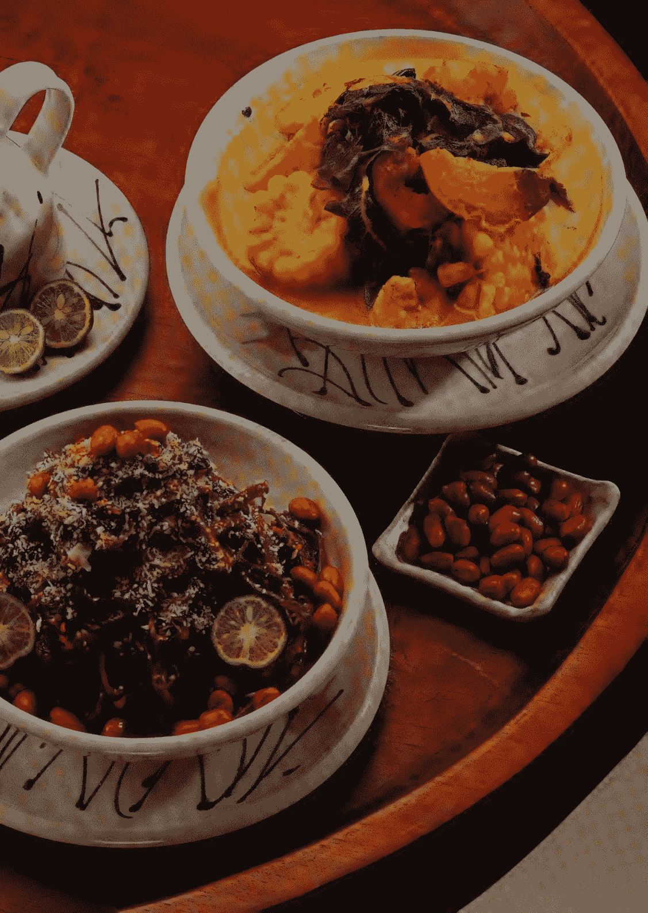

## 椰奶香料炖菠萝

### 食材

- 1 个大熟透菠萝
- 2 汤匙油
- 3½ 杯（875 ml）稀椰子奶
- ¼ 茶匙现磨黑胡椒
- 2 颗八角
- 1 根肉桂棒
- ¼ 茶匙肉豆蔻粉
- 1 根香柠檬，拍碎
- 1 cm 高南姜，切片

### 香料酱

- 1 英寸 (1/2 cm) 新姜黄，去皮切片，以及 1 汤匙姜黄粉
- 5 颗红葱，去皮
- 5 瓣大蒜，去皮
- 2 汤匙香菜粉
- 1 汤匙油

### 步骤

1. 按照第 34 页的配方准备炸洋葱。

2. 去掉菠萝芯并切块。

3. 用研钵或搅拌机将姜黄、洋葱、大蒜、棕榈糖和虾酱研磨成光滑的酱料，必要时加少量水以保持混合物干净。备用。

4. 在锅中中火加热油，翻炒酱料至闻香。加入椰子奶、八角、肉桂棒。煮沸。

5. 加入菠萝和其他配料，煮沸。转小火，盖盖慢煮至菠萝变软，需 10 到 15 分钟。

6. 根据喜好加糖或盐调味后即可。

供 4 人享用  
准备时间：40 分钟  
烹饪时间：30 分钟

## 椰子酱蔬菜

### 食材

- 7 盎司（200 g）豆角，切成段
- 2 杯（180 g）菠菜叶或嫩蕨菜尖（蕨头）
- 1 杯（50 g）豆芽，去掉尾部
- 炸洋葱（第 34 页）

### 椰子酱

- 1½ 英寸（1 cm）新鲜姜黄
- 1 茶匙姜黄粉
- 2 至 3 根小鸟辣椒或姜叶，切碎
- 2 至 3 瓣洋葱，去皮
- 2 瓣大蒜，去皮
- 1 汤匙切片棕榈糖或深色红糖
- 1 汤匙干虾（trasi），干烤过（第 23 页）
- 1 杯（100 g）新鲜碎椰蓉或甜味椰蓉
- 1 杯（250 ml）水
- 1 片苏拉叶或月桂叶
- 1¼ 茶匙盐

### 步骤

1. 按照第 34 页的配方准备炸洋葱。

2. 用研钵或搅拌机将姜黄、辣椒、洋葱、大蒜、棕榈糖和虾酱研磨成光滑的酱料。将研好的酱料放入平锅中，不盖盖慢煮 5 到 10 分钟直到酱汁变稠。离火冷却。

3. 在平锅中中火将水煮沸。将蔬菜煮 1 到 2 分钟。离火，沥干水分并摆放在菜盘上。

4. 将椰子酱淋在蔬菜上，撒上炸洋葱装饰，或如上所示将酱放在旁边。

供 4 人享用  
准备时间：25 分钟  
烹饪时间：15 分钟

## 甜辣风味天饼 (Sambal Goreng Tempeh)

这道菜用棕糖甜化，并加入南姜、柠檬草、虾酱、罗望子和辣椒调味，是爪哇人喜爱的菜肴。

### 食材

- 2 块天饼（总共 1 磅/500 克）
- 油，用于深炸
- 2 个小红葱，去皮并切片
- 3 头大蒜，去皮并切片
- 2 个红指椒，去籽并切片
- 1 英寸（2½ 厘米）新鲜南姜，去皮并切片
- 2 根柠檬草，仅取底部三分之一，去掉外层叶片，内部分拍碎
- 1½ 茶匙干虾酱 (terasi)
- 2 茶匙干烘制酱（见第 23 页）
- 3 汤匙碎棕糖或深色红糖
- 3 汤匙水
- 2 汤匙罗望汁（见第 26 页）
- 1½ 茶匙盐

### 步骤

1. 将天饼切成长条状。在锅中大火加热油，将条状物炸至金棕色且酥脆，需要 3 到 5 分钟。从热油中取出，放在纸巾上沥油。

2. 倒掉锅里的油并擦拭干净。在锅中加入 1 汤匙新鲜油，中火，爆炒小红葱、大蒜、辣椒、南姜、柠檬草和干虾酱，翻炒 3 到 5 分钟直到闻香。加入棕糖、罗望汁和水，翻炒至糖分溶解并变成焦糖色。加入炸好的天饼条，翻炒至酱汁浓稠并完全裹住天饼，需要 3 到 5 分钟。用盐调味后离火。弃掉南姜和柠檬草，根据喜好撒上辣椒片点缀。

## 椰奶香料炖天饼 (Gulai Tempeh)

这是一道苏门答腊菜，使用富含蛋白质的天饼和蔬菜融入浓郁的椰奶汁中。

### 食材

- 2 杯（500 毫升）浓椰奶
- 2 头（原文缺失具体食材名称，疑为蔬菜类）
- 4 块天饼（总共 2 磅/1 公斤），切块
- 8 盎司（250 克）木薯叶、菠菜或空心菜 (kangkung)
- 1½ 茶匙盐
- 1 根青葱，薄切，用于装饰
- 1 到 2 个红指椒，去籽并切丁，用于装饰

### 香料酱

- 1 汤匙白胡椒
- 1½ 英寸（4 厘米）新鲜姜黄，去皮并切片，或 1½ 茶匙姜黄粉
- 1 英寸（2½ 厘米）新鲜生姜，去皮并切片
- 4 头大蒜，去皮
- 1 汤匙碎棕糖或深色红糖

### 步骤

| 方法 | 准备时间 | 烹饪时间 | 份量 |
| :--- | :--- | :--- | :--- |
| 1 将所有食材放入研钵或破壁机中研磨成香料酱，必要时加入少量椰奶以保持混合物顺滑。2 在酱锅中将椰奶煮至沸。加入香料酱、辣椒以及木薯叶或菠菜并煮沸。转小火，不盖盖慢煮，直到蔬菜变软且酱汁浓稠，需要 7 到 10 分钟。用盐调味，撒上现切的洋葱和辣椒装饰。 | 20 分钟 | 15 分钟 | 4 至 6 人 |

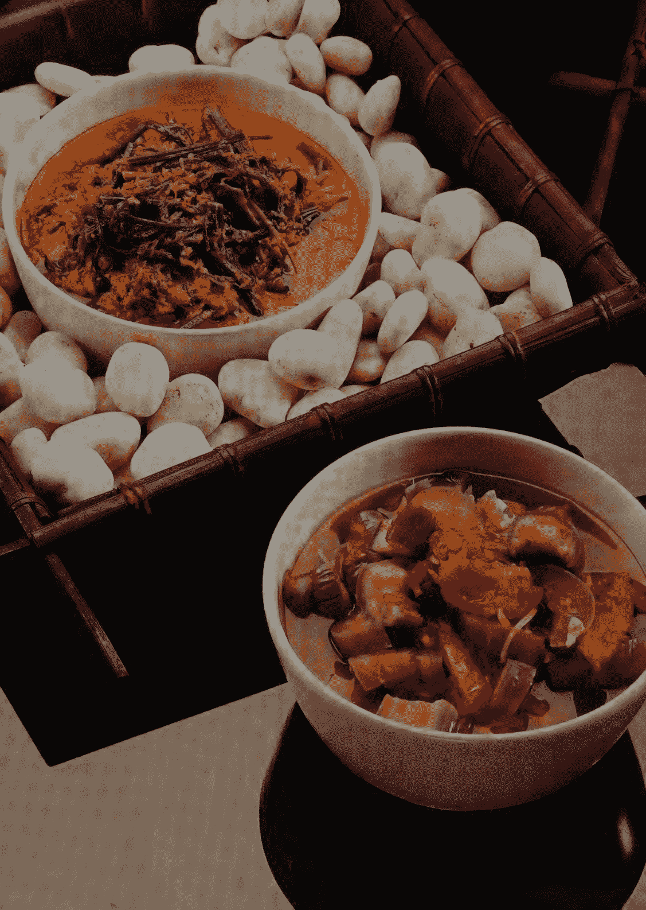

## 椰奶炖蕨芽 (Gulai Daun Pakis)

印尼西亚许多地区食用多种野生蕨的嫩芽。它们在东南亚各地的湿市场都有售，味道极佳。嫩芦笋或菠菜是极佳的替代品。

### 食材

- 2 杯（500 毫升）椰奶
- 1 磅（500 克）新鲜嫩芽（蕨头）或嫩芦笋，洗净
- 2 根（可选，原文缺失具体食材名称）
- 1 汤匙罗望汁（见第 26 页）
- 1½ 茶匙盐

### 香料酱

- 1 英寸（2½ 厘米）新鲜大蒜，去皮并切片
- 1 英寸（1 厘米）新鲜姜黄，去皮并切片，或 1½ 茶匙姜黄粉
- 1 英寸（2½ 厘米）新鲜生姜，去皮并切片
- 2-3 个红指椒，去籽并切片
- 3 个小红葱，去皮
- 2 头大蒜，去皮

### 步骤

1. 将食材放入研钵或破壁机中研磨成香料酱，必要时加入少量椰奶以保持混合物顺滑。

2. 在酱锅中将香料酱和椰奶煮沸。转小火，不盖盖煮 2 分钟。加入蕨芽或芦笋、罗望汁，搅拌均匀煮沸，然后慢煮约 15 分钟，直到蔬菜变软。用盐调味后离火。

3. 盛入碗中，配米饭食用。

供 4 至 6 人  
准备时间：20 分钟  
烹饪时间：20 分钟

## 罗望汁茄子 (Asam Terong)

这是一道简单快速的蔬菜菜，能提升茄子的风味。

### 食材

- 2-3 个红指椒，去籽并切片
- 3 个小红葱，切片
- 2 头大蒜，切片
- 2 杯（500 毫升）水
- 1 磅（500 克）2-3 个长茄子，对半并切片
- 2 汤匙罗望汁（见第 26 页）
- 1 个熟番茄，切块
- 2 茶匙碎棕糖或深色红糖
- 1½ 茶匙盐

### 装饰

- 炸小红葱（见第 34 页）
- 1 根青葱，切片

### 步骤

1. 按照第 34 页的方法准备炸小红葱。

2. 在大酱锅中，将辣椒、大蒜和水煮沸，转中火煮 3 到 5 分钟。加入茄子和罗望汁，煮至半熟，约 2 分钟。加入番茄，煮至番茄变软，约 2 分钟。用盐调味后离火。

3. 盛入碗中，配上炸小红葱和洋葱花食用。

供 4 人  
准备时间：20 分钟  
烹饪时间：15 分钟

## 经典烤鸡 (Ayam Panggang)

这是印尼最传统的菜肴之一，在整个群岛都占有重要地位。

### 食材

- 1 只鲜鸡（2 磅/公斤）
- 2 汤匙油
- 2-3 个鸟眼椒或红指椒
- 3 根柠檬草，仅取底部三分之一，去掉外层叶片，内部分拍碎
- 1½ 杯（775 毫升）稀椰奶
- 2 杯（500 毫升）鸡汤或 2 杯（500 毫升）温水
- 2 片山青叶（可选）
- 1 茶匙盐
- 1 茶匙黑胡椒
- 1 茶匙甜酱油 (kecap manis)，用于刷面
- 1 份 Sambal Kecap（见第 33 页）

### 香料酱

- 3 颗苦果，粗碎
- 1/2 英寸（1 厘米）姜根，去皮并切片（可选）
- 1/2 英寸（1 厘米）新鲜南姜，去皮并切片
- 1/2 英寸（1 厘米）新鲜姜黄，去皮并切片，或 1 茶匙姜黄粉
- 4 个小红葱，去皮
- 5 头大蒜，去皮
- 2 汤匙棕糖或深色红糖

### 步骤

1. 按照第 33 页的方法准备 Sambal Kecap。

2. 将鸡洗净并切块，压平。

3. 将所有食材放入研钵或破壁机中研磨成平滑的香料酱，必要时加入少量油以保持混合物顺滑。

4. 在锅或大酱锅中中火加热油，炒香料酱、鸡肉和 2 根柠檬草，直到混合物闻香并变成金色，需要 3 到 5 分钟。加入椰奶、鸡汤和剩下的柠檬草，煮沸，然后转小火，不盖盖慢煮约 5 分钟。加入鸡肉、山青叶、盐和胡椒，继续慢煮约 30 分钟，在锅中频繁翻动鸡肉以使其煮匀并让香料渗透肉中。关火让鸡肉冷却至合适温度。

5. 从酱汁中取出鸡块，在通风处晾干 30 分钟，然后在炭火或预热的烤箱上将鸡每面烤 3 到 5 分钟，刷上少量甜酱油以上亮鸡皮。烤鸡配上米饭、蔬菜和一碗 Sambal Kecap 食用。

供 4 至 6 人  
准备时间：40 分钟  
烹饪时间：1 小时

## 爪哇风炸鸡 (Ayam Goreng Yogya)

这道鸡在椰奶和香料中炖至半熟，然后快速炸至到位，是爪哇人喜爱的菜肴。

### 食材

- 油，用于深炸
- 2 片山青叶
- 1 只鲜鸡（2 磅/公斤），洗净并切块
- 2 杯（500 毫升）稀椰奶
- 2 个青柠，切角，食用
- 1 份 Sambal Trasi（见第 33 页）

### 香料酱

- 1 汤匙胡椒籽，2 汤匙胡椒粉
- 1/2 英寸（1 厘米）新鲜南姜，去皮并切片
- 1/2 英寸（1 厘米）新鲜姜黄，去皮并切片，或 1/2 茶匙姜黄粉
- 1/2 英寸（2 厘米）新鲜生姜，去皮并切片
- 4-5 个小红葱，去皮
- 3 头大蒜，去皮
- 1 汤匙棕糖或深色红糖
- 1/4 茶匙盐

# 印尼菜食谱集锦

## 1. 辣酱塔里旺鸡

龙望岛最著名的鸡肉菜是用炭火烤制的，并配上美味的椰奶酱。这个版本建议先部分烤鸡肉，最后通过油炸完成。或者，根据你的喜好，也可以完全油炸。

### 食材

- 1 只鸡（约 2 磅/ 1 公斤），清洗并切成块状
- 1 茶匙盐
- 1 根手指长度的红辣椒，切薄，用于装饰
- 几枝罗勒叶，用于装饰

### 辣酱

- 3-4 根手指长度的红辣椒或 2-3 根鸟眼椒，去籽
- 4 个红洋葱，去皮
- 1 茶匙干虾酱，干焙过（见第 23 页）
- 1 茶匙刨棕糖或红糖糖
- 1/4 茶匙盐
- 2 汤匙油
- 1 汤匙新鲜榨的青汁或柠檬汁

### 做法

1. 用研钵或搅拌机将辣椒、红洋葱、虾酱、糖和盐磨碎制成辣酱，必要时加入少量油以保持混合物旋转。在炒锅中中火加热油，将磨好的酱料炒 2 到 3 分钟直到闻香。关小火备用。如果是提前准备的，食用前重新加热辣酱。加入青汁或柠檬汁拌匀。
2. 用盐腌制鸡块并静置 5 分钟，然后在炭火上或预热的烤箱模式下将鸡块烤 2 到 3 分钟至半熟。在鸡块的双面都刷上辣酱，继续烤 10 到 15 分钟，期间不断刷酱，直到煮熟。或者，在刷上辣酱后，将鸡块放入热油中炸至熟。
3. 将剩余的辣酱涂在熟鸡肉上。转移到盛盘中，撒上切好的辣椒装饰，配蒸米饭食用。

> 供 4 至 6 人 | 准备时间：20 分钟 | 烹饪时间：35 分钟

---

## 2. 巴厘鸭肉或鸡肉咖

在巴厘岛，鸭子在稻田边漫步或跟随孩子（或主人）手中的旗帜行走是常见的景象。在节日场合，鸭肉是非常受欢迎的。香蕉叶包裹的香料烤鸭是一种流行食谱，而这道咖喱则是另一种。这种做法鸡也非常美味——这实际上是巴厘岛版的辣味 Rendang。

### 食材

- 1 只鲜鸭或烤鸡（约 4 磅/1.8 公斤）
- 2 汤匙油
- 4 杯（1 升）浓稠椰奶
- 2 根柠檬草，仅取粗壮的三分之一部分，弃去外层，修剪内层
- 2 叶圣罗兰叶（可选）
- 1 汤匙盐
- 1 茶匙现磨黑胡椒

### 香料酱

- 3 颗马蹄山豆子，粗碎
- 1 个 (2½ cm) 新鲜黄姜，去皮切片
- 1 个 (2½ cm) 新鲜山南姜，去皮切片
- 1 个 (2½ cm) 新鲜姜黄，去皮切片，或 1 茶匙姜黄粉
- 2-3 根手指长度的红辣椒，去籽
- 8-10 个红洋葱，去皮
- 6 瓣大蒜，去皮
- 2 瓣
- 2 茶匙香菜籽或 1 茶匙香菜粉
- 1/4 茶匙现磨黑胡椒
- 1/4 茶匙现磨或现屑的肉豆蔻，或肉豆蔻粉
- 1 茶匙干虾酱，干焙过（见第 23 页）

### 做法

1. 清洗鸭肉或鸡肉并切成块状，然后用纸巾吸干。
2. 用研钵或搅拌机将所有配料磨至细，制成香料酱，必要时加入少量油以保持混合物旋转。
3. 在炒锅中大火加热油，将香料酱炒至闻香，约 1 分钟。加入鸭肉或鸡肉。加入椰奶、圣罗兰叶和盐，经常翻炒，直到酱料浓稠且鸭肉煮软，约 30 分钟。关火。

---

## 3. 苏拉威锡炖鸡

这道源自南部苏拉威锡的喜爱菜肴，是在椰奶中炖制的。

### 食材

- 鲜鸡（1 公斤）
- 1 杯（250 ml）浓稠椰奶
- 4 杯（1 升）水或鸡汤
- 6 瓣大蒜，去皮切片
- 5-10 个红洋葱，去皮切片
- 1 汤匙干虾酱，干焙过（见第 23 页）
- 2 汤匙罗子汁
- 1 茶匙白胡椒
- 2 叶圣罗兰叶
- 1 根肉桂
- 1/4 茶匙现屑的肉豆蔻
- 1 茶匙盐
- 1 汤匙棕糖

### 做法

1. 清洗鸡肉并切成块状。
2. 在炒锅中将水煮沸。加入鸡肉，中火加盖焖煮至鸡肉变软，约 5 到 10 分钟。
3. 加入除椰奶外的所有原料，加盖焖煮 10 分钟直到酱汁浓稠。
4. 倒入椰奶，小火煮 5 分钟。
5. 关火，撒上洋葱装饰。

> 供 4 人 | 准备时间：25 分钟 | 烹饪时间：40 分钟

---

## 4. 青番茄辣酱鸡

这道食谱来自加里曼丹，通常用青番茄制作。柠檬汁为菜肴的辣味提供了很好的平衡。

### 食材

- 鲜鸡（2 磅/1 公斤）
- 1 茶匙盐
- 1 汤匙新鲜榨的青汁或柠檬汁
- 2 杯（500 ml）水
- 3-4 根手指长度的辣椒，去籽
- 5-10 个红洋葱，去皮
- 4 个青番茄
- 1 枝罗勒
- 1 片澳洲青柠檬叶
- 2 根青葱
- 1/2 个 (1 cm) 新鲜黄姜，去皮切片

### 香料辣酱

- 1/4 茶匙现屑的肉豆蔻，或肉豆蔻粉
- 3-4 根手指长度的辣椒，去籽
- 5-6 个红洋葱，去皮
- 3 瓣大蒜，去皮
- 1 茶匙盐
- 2 汤匙棕糖或红糖
- 1 汤匙干虾酱，干焙过（见第 23 页）
- 1 汤匙油
- 1 叶圣罗兰叶
- 1 根柠檬草，仅取粗壮的三分之一部分，弃去外层，修剪内层

### 做法

1. 清洗鸡肉并切成块。用盐、青汁或柠檬汁腌制鸡块，静置腌制至少 20 分钟。
2. 用研钵或搅拌机将配料磨成光滑的酱料制成辣酱，必要时加入少量油以保持混合物旋转。在炒锅中中火加热油，将磨好的酱料与圣罗兰叶、柠檬草和黄姜一同炒至闻香，约 3 到 5 分钟。加入罗望汁使混合物沸腾，然后转小火焖煮约 1 分钟。关火放凉。
3. 在炒锅中将水煮沸。加入腌好的鸡肉，中火加盖焖煮至鸡肉恰好软，约 5 到 10 分钟。
4. 加入所有其他原料，充分搅拌并继续煮 15 分钟后关火。
5. 立即食用，旁边配一碗香料辣酱，或混合香料辣酱食用。

> 供 4 至 6 人 | 准备时间：45 分钟 | 烹饪时间：40 分钟

---

## 5. 香柠檬茅汁水蛋

### 食材

- 8 个鸡蛋
- 1 汤匙油
- 1 茶匙棕榈油或红糖
- 2 杯 (500 ml) 浓椰奶
- 2 个鸟指天椒，压碎
- 2 根红葱，仅取中间厚的三分之一，去外皮，内里部分压碎
- 2 叶斑苏兰叶
- 1/2 汤匙盐
- 炸洋葱（见第 34 页），用于装饰（可选）

### 香料酱

- 1/2 (1 cm) 新鲜南姜，去皮切片
- 1/2 (1 cm) 新鲜姜黄，去皮切片，或用 1/2 茶匙姜黄粉
- 3-4 根红色指长辣椒，去籽
- 4-5 根红葱，去皮
- 3 瓣大蒜，去皮
- 1 汤匙干虾膏，干烤（见第 23 页）

### 做法

1. 按照第 34 页的食谱准备炸洋葱（如果使用）。
2. 将鸡蛋煮 7 至 8 分钟至全熟，然后沥干并浸入冷水盆中。剥去蛋壳备用。
3. 调制香料酱：在研钵或搅拌机中研磨所有配料至细滑，必要时加入少量椰奶以保持混合物流动。备用。
4. 在锅中中火加热油，放入香料酱炒出香气，持续 3 到 5 分钟。加入糖炒至完全溶解，加入椰奶、辣椒、香柠檬和斑苏兰叶煮沸后小火慢炖。转小火加入鸡蛋，不盖盖煮至酱汁浓稠，8 至 10 分钟。用盐调味关火。撒上炸洋葱装饰并配米饭食用。

> 供 4 至 6 人享 | 准备时间：30 分钟 | 烹饪时间：30 分钟

---

## 6. 辣味达达风蛋

### 食材

- 8 个鸡蛋
- 2 杯 (500 ml) 浓椰奶
- 1/2 叶姜黄叶，切丝（可选）
- 1 汤匙罗望子汁（第 26 页）
- 1/2 汤匙盐
- 炸洋葱（见第 34 页），用于装饰（可选）

### 香料酱

- 1/2 (1 cm) 新鲜南姜，去皮切片
- 1/2 (1 cm) 新鲜姜黄，去皮切片，或用 1/2 茶匙姜黄粉
- 1/2 (1 cm) 新鲜生姜，去皮切片
- 2-4 个鸟指天椒，适量
- 5 根红葱，去皮
- 3 瓣大蒜，去皮

### 做法

1. 按照第 34 页的食谱准备炸洋葱（如果使用）。
2. 将鸡蛋煮 7 至 8 分钟至全熟，然后沥干并浸入冷水盆中。剥去蛋壳备用。
3. 调制香料酱：在研钵或搅拌机中粗研磨所有配料，必要时加入少量椰奶以保持混合物流动。备用。
4. 在锅或酱锅中将椰奶缓慢煮至沸。加入香料酱和姜黄叶（如果使用），搅拌均匀并慢炖 2 分钟。转小火，加入鸡蛋，继续不盖盖子炖至酱汁浓稠，8 至 10 分钟。加入罗望子汁和盐调味，再慢炖 1 分钟关火。热吃，并撒上炸洋葱装饰。

> 供 4 至 6 人享 | 准备时间：25 分钟 | 烹饪时间：25 分钟

---

## 7. 罗勒番茄 Sambal 烤鱼

鱼肉直接烤或用香蕉叶包裹，在印尼东部的苏拉威锡和马鲁古岛非常受欢迎。这个食谱非常简单——使用典型的 Colo Sambal 调味。

### 食材

- 2 条完整鲜鱼（约 1 kg），或 1.5 磅 (700 g) 鱼排
- 1/2 茶匙盐
- 1 汤匙新鲜柠檬汁
- 2 汤匙油
- 1 片大香蕉叶或铝箔，用于包裹
- 3-4 根红色指长辣椒，去籽切片
- 4 根红葱，去皮切片
- 2 个熟透西番茄，切丁
- 4 枝新鲜亚洲罗勒，切碎
- 4 汤匙甜酱油
- 2 汤匙新鲜柠檬汁
- Colo Sambal（见下方配料）

### Colo Sambal

- 3-4 根红色指长辣椒，去籽切片
- 4 根红葱，去皮切片
- 2 个熟透西番茄，切丁
- 4 枝新鲜亚洲罗勒，切碎
- 4 汤匙甜酱油
- 2 汤匙新鲜柠檬汁

### 做法

1. 如果使用完整鱼，去鳞、去内脏并清洗，然后在侧面切几刀。用盐和柠檬汁调味，刷上油。备用 15 分钟。
2. 制作 Colo Sambal：将所有配料放入碗中混合均匀。
3. 用沸水烫香蕉叶后擦干。将包裹直接放在炭火上或预热烤箱下烤，直到香蕉叶变色且鱼熟，每面烤 10 至 15 分钟。
4. 打开香蕉叶，将 sambal 淋在鱼上。立即食用。或者将 Colo Sambal 盛放在小碗中作为配料。

> 供 4 人享 | 准备时间：20 分钟 | 烹饪时间：30 分钟

---

## 8. 香柠檬罗望子鱼

苏门答腊拥有丰富的湖泊和河流，产生了许多美味的淡水鱼食谱，此道例外。

### 食材

- 2 磅 (1 kg) 淡水鱼如鲤鱼或鳟鱼，完整鱼或鱼片
- 1 茶匙盐
- 1 茶匙白椒粉
- 2 杯 (500 ml) 水
- 3 根香柠檬，仅取中间厚的三分之一，去外皮，内里部分压碎
- 2 汤匙罗望子汁，切片，装饰
- 1 根小葱，粗碎
- 2 个柠檬或 1.5 个柠檬，切块

### 香料酱

- 6 颗糖渍花生
- 1/2 (1 cm) 新鲜南姜，去皮切片
- 1/2 (1 cm) 新鲜姜黄，去皮切片，或用 1 茶匙姜黄粉
- 1/2 (1 cm) 新鲜生姜，去皮切片
- 2-3 根红色指长辣椒，去籽
- 4-5 根红葱
- 4 瓣大蒜，去皮
- 1/2 茶匙盐

### 做法

1. 如果使用完整鱼，去鳞、去内脏并清洗，然后在侧面切几道浅斜刀。用盐和白椒调味，备用 15 分钟。
2. 调制香料酱：在研钵或搅拌机中研磨所有配料，必要时加入少量水以保持混合物流动。
3. 在锅或煎锅中将香料酱、水和罗望子汁煮沸。转中火，不盖盖子慢炖 10 分钟，期间均匀翻鱼。
4. 将鱼移至盛盘中，淋上酱汁。撒上小葱和柠檬块装饰。

> 供 4 人享 | 准备时间：25 分钟 | 烹饪时间：25 分钟

---

## 9. 黄汁龙虾

### 食材

- 4 只小龙虾（每只约 1 磅/500 克）
- 6 杯（1.5 升）水
- 3 根香茅，取底部粗部的三之一，去掉外层，内里部分拍碎
- 2 叶柠檬叶
- 1/4 茶匙白醋
- 1/2 杯（125 毫升）椰奶奶油
- 1 茶匙盐
- 酥炸洋葱（第 34 页）

### 调料酱

- 3 块南姜，粗切
- 2-3 根红手指指椒辣椒
- 4-5 头红葱，水煮
- 3 瓣大蒜，去皮
- 2 英寸（5 厘米）新鲜黄姜，去皮切片，或 2 汤匙黄姜粉
- 2 英寸（5 厘米）生姜，去皮切片
- 1/2 茶匙干虾膏（干），脱水（第 23 页）
- 1 片斑兰叶或月香叶
- 2 汤匙罗望水（第 26 页）

### 做法

1. 按照第 34 页食谱准备酥炸洋葱。
2. 刷净龙虾。在锅中用中火将水烧沸，放入龙虾煮 10 到 15 分钟。捞出龙虾，立即浸入冰水盆中 1 分钟以冷却。过滤并保留汤汁。沥干龙虾并从壳中剥出肉。丢弃虾壳。
3. 在研钵或搅拌机中将所有食材（油、斑兰叶和罗望水除外）磨成光滑的酱糊，必要时加入少量油使混合物旋转。在炒锅或平底锅中中火加热油，翻炒调料酱至闻香，需 3 到 5 分钟。然后离火备用。
4. 在锅中，将龙虾汤、调料酱、香茅、柠檬叶和醋用中火烧沸，然后不盖盖小火炖 3 到 5 分钟。加入椰奶奶油，搅拌均匀并煮沸，然后小火煮约 5 分钟。最后加入龙虾肉，用盐调味并煮 1 分钟。离火。
5. 盛入碗中，撒上酥炸洋葱装饰，配米饭食用。

> 供 4 人食用 | 准备时间：30 分钟 | 烹饪时间：35 分钟

---

## 10. 番茄三巴辣椒炸鱼

这种典型的海鲜菜来自中爪岛北部海岸佩卡洛贡县的村庄，使用像鲱鱼那样的小鱼。

### 食材

- 1/2 磅（250 克）小鱼，切块清洗后留用，或鱼排
- 1 汤匙盐
- 5 汤匙油
- 2 根红手指指椒辣椒，去籽切片（可选）
- 3 头红葱，去皮切片
- 2 瓣大蒜，去皮切片
- 2 个熟西番茄，切成块
- 1 片斑兰叶
- 2 汤匙罗望水（第 26 页）
- 2 茶匙糖
- 一小撮盐
- 1/2 茶匙白胡椒粉
- 3 汤匙水
- 几枝柠檬罗勒，作装饰

### 调料酱

- 2 块南姜，粗切
- 3-4 根手指指椒辣椒，根据喜好
- 6 头红葱，去皮
- 2 瓣大蒜，去皮
- 1/2 英寸（1 厘米）新鲜南姜，去皮切片
- 1/2 英寸（1 厘米）新鲜生姜，去皮切片
- 1/2 英寸（1 厘米）新鲜黄姜，去皮切片，或 1 茶匙香菜粉

### 做法

1. 用盐腌制鱼肉，静置 15 分钟。
2. 在研钵或搅拌机中将所有食材磨成光滑的酱糊，必要时加入少量油使混合物旋转。备用。
3. 在炒锅中用中火加热 3 汤匙油，至冒油。煎鱼至金黄色且酥脆，需 5 到 7 分钟。从锅中捞出，放在厨房纸上吸油。
4. 在炒锅中用中火加热剩余油，翻炒调料酱至闻香，需 3 到 5 分钟。加入切片辣椒（如使用）、红葱、大蒜、西番茄块、斑兰叶和罗望水，翻炒 1 分钟，然后用糖、盐和胡椒调味。最后加入炸鱼和水，搅拌均匀并小火炖 1 分钟后离火。
5. 盛入浅盘中，离火前撒上罗勒装饰即可食用。

> 供 4 人食用 | 准备时间：30 分钟 | 烹饪时间：15 分钟

---

## 11. 香茅黄姜炖鱼

这道菜在印度尼西亚通常用鱼烹饪，如图所示，但配上鱼片同样美味。

### 食材

- 1 1/2 磅（700 克）整鱼，切块清洗后留用，或鱼片
- 1 汤匙油
- 4 杯（1 升）水
- 3 根香茅，取底部粗部的三之一，去掉外层，内里拍碎
- 2 叶柠檬叶
- 2 汤匙罗望水（第 26 页）
- 2 茶匙糖
- 一小撮盐
- 1/2 茶匙白胡椒粉
- 3 汤匙水
- 几枝柠檬罗勒，作装饰

### 调料酱

- 2 块南姜，粗切
- 3-4 根手指指椒辣椒，根据喜好
- 6 头红葱，去皮
- 2 瓣大蒜，去皮
- 1/2 英寸（1 厘米）新鲜南姜，去皮切片
- 1/2 英寸（1 厘米）新鲜生姜，去皮切片
- 1/2 英寸（1 厘米）新鲜黄姜，去皮切片，或 1 茶匙香菜粉

### 做法

1. 用盐腌制鱼肉，静置 15 分钟。
2. 在研钵或搅拌机中将所有食材磨成光滑的酱糊，必要时加入少量油使混合物旋转。备用。
3. 在炒锅中用中火加热油，至冒油。煎鱼至金黄色且酥脆，需 5 到 7 分钟。从锅中捞出，放在厨房纸上吸油。
4. 在炒锅中用中火加热剩余油，翻炒调料酱至闻香，需 3 到 5 分钟。加入切片辣椒（如使用）、红葱、大蒜、西番茄块、斑兰叶和罗望水，翻炒 1 分钟，然后用糖、盐和胡椒调味。最后加入炸鱼和水，搅拌均匀并小火炖 1 分钟后离火。
5. 盛入浅盘中，离火前撒上罗勒装饰即可食用。

> 供 4 人食用 | 准备时间：30 分钟 | 烹饪时间：15 分钟

## 黄汁龙虾

- 4 只小龙虾（每只约 1 磅/500 克）
- 6 杯（1/2 升）水
- 3 根香茅，取底部粗部的三之一，去掉外层，内里部分拍碎
- 2 叶柠檬叶
- 1/4 茶匙白醋
- 1/2 杯（37 毫升）椰奶奶油
- 1 茶匙盐
- 酥炸洋葱（第 34 页）

### 调料酱

- 3 块南姜，粗切
- 2-3 根红手指指椒辣椒
- 4-5 头红葱，水煮
- 3 瓣大蒜，去皮
- 2 英寸（5 厘米）新鲜黄姜，去皮切片，或 2 汤匙黄姜粉
- 2 英寸（5 厘米）生姜，去皮切片
- 1/2 茶匙干虾膏（干），脱水（第 23 页）
- 1 片斑兰叶或月香叶
- 2 汤匙罗望水（第 26 页）

1. 按照第 34 页食谱准备酥炸洋葱。
2. 刷净龙虾。在锅中用中火将水烧沸，放入龙虾煮 10 到 15 分钟。捞出龙虾，立即浸入冰水盆中 1 分钟以冷却。过滤并保留汤汁。沥干龙虾并从壳中剥出肉。丢弃虾壳。
3. 在研钵或搅拌机中将所有食材（油、斑兰叶和罗望水除外）磨成光滑的酱糊，必要时加入少量油使混合物旋转。在炒锅或平底锅中中火加热油，翻炒调料酱至闻香，需 3 到 5 分钟。然后离火备用。
4. 在锅中，将龙虾汤、调料酱、香茅、柠檬叶和醋用中火烧沸，然后不盖盖小火炖 3 到 5 分钟。加入椰奶奶油，搅拌均匀并煮沸，然后小火煮约 5 分钟。最后加入龙虾肉，用盐调味并煮 1 分钟。离火。
5. 盛入碗中，撒上酥炸洋葱装饰，配米饭食用。

| 供 4 人食用 | 准备时间：30 分钟 | 烹饪时间：35 分钟 |
| --- | --- | --- |

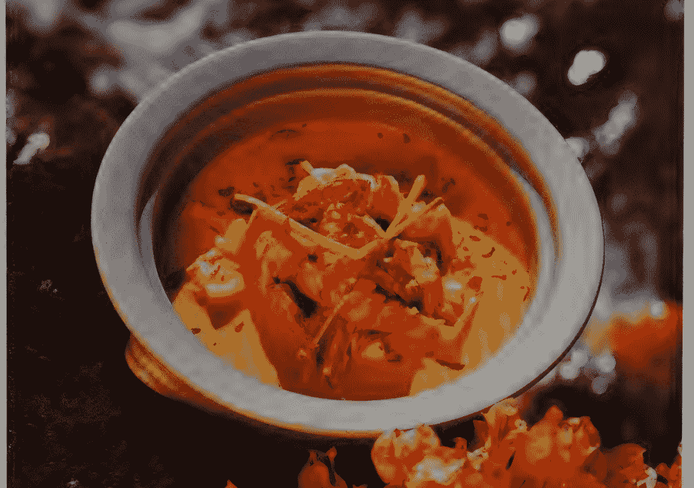

## 番茄三巴辣椒炸鱼

这种典型的海鲜菜来自中爪岛北部海岸佩卡洛贡县的村庄，使用像鲱鱼那样的小鱼。

- 1/2 磅（700 克）小鱼，切块清洗后留用，或鱼排
- 1 汤匙盐
- 5 汤匙油
- 2 根红手指指椒辣椒，去籽切片（可选）
- 3 头红葱，去皮切片
- 2 瓣大蒜，去皮切片
- 2 个熟西番茄，切成块
- 1 片斑兰叶
- 2 汤匙罗望水（第 26 页）
- 2 茶匙糖
- 一小撮盐
- 1/2 茶匙白胡椒粉
- 3 汤匙水
- 几枝柠檬罗勒，作装饰

1. 用盐腌制鱼肉，静置 15 分钟。
2. 在研钵或搅拌机中将所有食材磨成光滑的酱糊，必要时加入少量油使混合物旋转。备用。
3. 在炒锅中用中火加热 3 汤匙油，至冒油。煎鱼至金黄色且酥脆，需 5 到 7 分钟。从锅中捞出，放在厨房纸上吸油。
4. 在炒锅中用中火加热剩余油，翻炒调料酱至闻香，需 3 到 5 分钟。加入切片辣椒（如使用）、红葱、大蒜、西番茄块、斑兰叶和罗望水，翻炒 1 分钟，然后用糖、盐和胡椒调味。最后加入炸鱼和水，搅拌均匀并小火炖 1 分钟后离火。
5. 盛入浅盘中，离火前撒上罗勒装饰即可食用。

### 调料酱

- 2 块南姜，粗切
- 3-4 根手指指椒辣椒，根据喜好
- 6 头红葱，去皮
- 2 瓣大蒜，去皮
- 1/2 英寸（1 厘米）新鲜南姜，去皮切片
- 1/2 英寸（1 厘米）新鲜生姜，去皮切片
- 1/2 英寸（1 厘米）新鲜黄姜，去皮切片，或 1 茶匙香菜粉

供 4 人食用 | 准备时间：30 分钟 | 烹饪时间：15 分钟

## 香茅黄姜炖鱼

这道菜在印度尼西亚通常用鱼烹饪，如图所示，但配上鱼片同样美味。

- 1 1/2 磅（700 克）整鱼，切块清洗后留用，或鱼片
- 1 汤匙油
- 4 杯（1 升）水
- 3 根香茅，取底部粗部的三之一，去掉外层，内里拍碎
- 2 叶柠檬叶
- 2 汤匙罗望水（第 26 页）
- 2 茶匙糖
- 一小撮盐
- 1/2 茶匙白胡椒粉
- 3 汤匙水
- 几枝柠檬罗勒，作装饰

1. 用盐腌制鱼肉，静置 15 分钟。
2. 在研钵或搅拌机中将所有食材磨成光滑的酱糊，必要时加入少量油使混合物旋转。备用。
3. 在炒锅中用中火加热 3 汤匙油，至冒油。煎鱼至金黄色且酥脆，需 5 到 7 分钟。从锅中捞出，放在厨房纸上吸油。
4. 在炒锅中用中火加热剩余油，翻炒调料酱至闻香，需 3 到 5 分钟。加入切片辣椒（如使用）、红葱、大蒜、西番茄块、斑兰叶和罗望水，翻炒 1 分钟，然后用糖、盐和胡椒调味。最后加入炸鱼和水，搅拌均匀并小火炖 1 分钟后离火。
5. 盛入浅盘中，离火前撒上罗勒装饰即可食用。

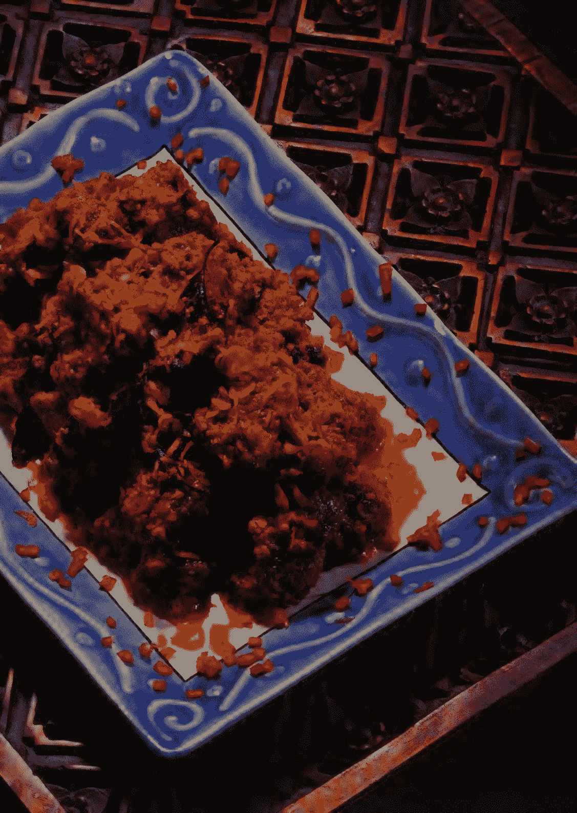
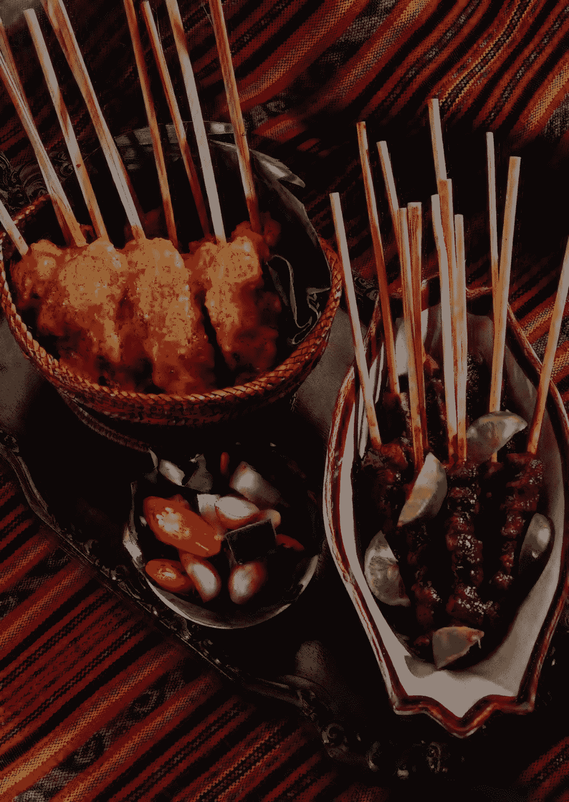

## 马杜拉羊肉串

这种普通的羊肉串可能是印尼最受欢迎的沙爹，起源于爪哇答岛东北部的马杜拉岛。

- 1/2 磅 (750 g) 无骨羊肉
- 24 根竹签，使用前在水中泡 4 小时
- 柠檬角，备用
- 1 份 Sambal Kecap（甜酱，第 33 页）
- 1 份 Sambal Kacang（花生酱，第 34 页）

1. 将羊肉切成一口口大小的块。在碗中混合腌料原料并搅拌。将三分之二的腌料倒入肉块中，搅拌至裹匀，腌制至少 2 小时。保留剩余腌料。
2. 按照第 34 页的食谱准备 Sambal Kecap 和 Sambal Kacang。备用。
3. 将腌制好的肉串在竹签上，放在热炭上烤或在预热的烤箱下烤 5 至 7 分钟，期间频繁翻面并用剩余的腌料刷味，直到肉全熟且各面呈金黄色。将沙爹放在盛盘中，配上柠檬角和一碗 Sambal Kecap 以及 Sambal Kacang 即可。

### 腌料

- 1/2 杯 (125 ml) 印尼甜酱油 (kecap)
- 1/2 茶匙碎香菜籽，和 1/2 茶匙香菜粉
- 1/4 茶匙白胡椒粉
- 1 汤匙挤出的柠檬或柠檬汁

可制作 24 串沙爹或供 4 至 6 人食用 | 准备时间：30 分钟 + 2 小时腌制 | 烹饪时间：15 分钟

## 龙目岛风味腌牛肉串

在邻巴厘岛的龙目岛，沙爹在烤之前通常会经过深度调味和腌制。

- 2 磅 (1 kg) 牛里脊肉
- 24 根竹签，使用前在水中泡 4 小时
- 柠檬或柠檬角，备用
- 1 份 Sambal Kecap（第 34 页）

1. 将牛肉切成一口口大小的块备用。
2. 准备腌料：在研钵或搅拌机中将所有原料（油和椰奶除外）磨成光滑糊，必要时加入少量油以保持混合物顺滑。在锅中中火加热油，炒糊至闻香，持续 3 至 5 分钟。转小火，加入椰奶慢煮至腌料变稠，约 10 分钟。离火放凉。将腌料倒入大碗中，与牛肉块混合，搅拌至裹匀，腌制至少 2 小时。
3. 按照第 34 页的食谱准备 Sambal Kecap。
4. 将腌制好的肉块串在竹签上，放在热炭上烤或在预热的烤箱下烤 5 至 7 分钟，期间频繁翻面并用腌料刷味，直到肉全熟且各面呈金黄色。将沙爹放在盛盘中，配上柠檬或柠檬角和一碗 Sambal Kecap 即可。

### 腌料

- 4 颗洋葱，粗切
- 1 (2 1/2) 厘米新鲜生姜，去皮切片
- 2 根红长辣椒，去籽
- 2-3 根鸟指天椒，去籽
- 5 瓣大蒜，去皮
- 1/2 汤匙干虾膏 (trasi)，干烘制后用（第 23 页）
- 1 茶匙盐
- 2 汤匙油
- 1 杯 (250 ml) 椰奶

可制作 24 串沙爹或供 4 至 6 人食用 | 准备时间：25 分钟 + 2 小时腌制 | 烹饪时间：30 分钟

## 调味炸牛肉片

正如这道菜的印尼名称所暗示的，它源于苏威拉腊北部的曼纳多。

- 1 1/2 磅 (700 g) 牛脊肉
- 3 瓣大蒜
- 1/4 茶匙现磨肉豆蔻或肉豆蔻粉
- 1 茶匙盐
- 2 杯 (500 ml) 水
- 油，用于深炸

### 香料糊

- 6-8 根红长指辣椒，去籽
- 1 英寸 (2.5 cm) 新鲜山姜 (kencur)，去皮切片
- 1 英寸 (2.5 cm) 新鲜黄姜，去皮切片，或 1 茶匙黄姜粉
- 1 英寸 (2.5 cm) 新鲜生姜，去皮切片
- 2 茶匙香菜籽，或 1 茶匙香菜粉
- 1 茶匙白胡椒粉

1. 在研钵或搅拌机中将所有原料磨成光滑糊，必要时加入少量水以保持混合物转动。
2. 在锅中中火加热 1 汤匙油，炒香香料糊，持续 3 至 5 分钟。加入牛肉、大蒜、肉豆蔻、盐和水煮沸，然后不盖盖子慢煮 3 至 5 分钟，直到牛肉半熟。将牛肉从锅中取出，继续炖汤 5 分钟直到汤汁变稠，然后关火。将牛肉切成条。
3. 在锅中大火加热油至热。深炸牛肉条 2 至 3 分钟直到呈金黄色且熟透。捞牛肉并放在纸巾上沥油。将牛肉放在盛盘中，淋上肉汁。立即食用。

供 4 至 6 人食用 | 准备时间：15 分钟 | 烹饪时间：15 分钟

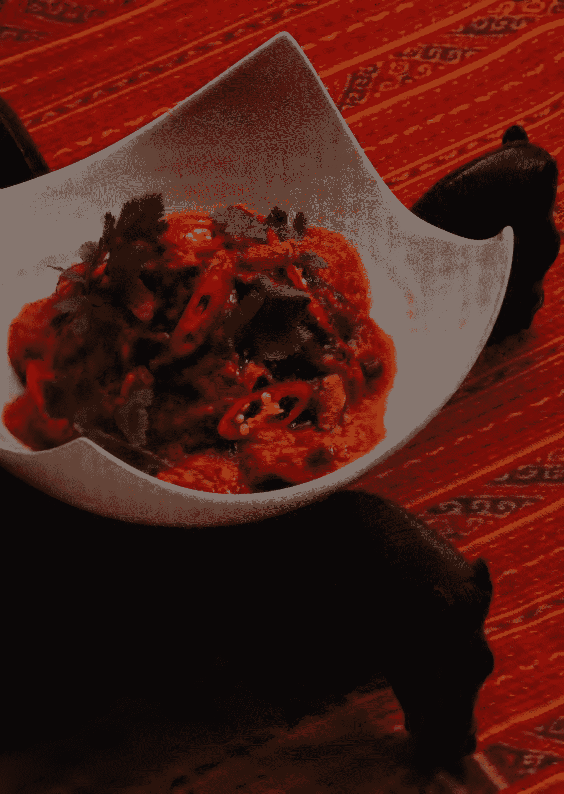

## 椰奶牛肉

这是一道来自马鲁库群岛阿汶的浓郁菜肴，与爪哇菜肴不同，椰奶与南姜、生姜的结合赋予这道菜极人的香气。

- 2 磅 (1 kg) 牛肉
- 1 杯 (100 g) 新鲜磨椰丝
- 1 杯 (80 g) 干椰丝
- 2½ 杯 (675 ml) 浓椰奶
- 2 汤匙香茅，去外皮并拍碎

1. 将牛肉切成一口口大小的块。
2. 在平锅中大火炒新鲜椰丝或干椰丝至金黄色，频繁搅拌，新鲜椰丝约 10 分钟，干椰丝约 8 分钟。离火放凉。温热时在研钵或搅拌机中将椰丝磨细。
3. 在研钵或搅拌机中将所有原料磨成糊状，必要时加入少量油以保持混合物转动。
4. 在锅中中火加热油，炒香香料糊，持续 3 至 5 分钟。加入牛肉、椰奶和香茅，搅拌均匀煮沸，然后不盖盖子慢煮约 10 分钟，频繁搅拌防止椰奶分离。转小火继续慢煮直到牛肉软且酱汁收干，约 30 分钟。离火。
5. 放入盛盘中，配米饭食用。

### 香料糊

- 6 根香菜，粗切
- 2 英寸 (5 cm) 新鲜南姜，去皮切片
- 3 英寸 (8 cm) 新鲜黄姜，去皮切片，以及 1 汤匙黄姜
- 3 英寸 (8 cm) 新鲜生姜，去皮切片
- 1½ 茶匙香菜籽
- 2 汤匙白椒
- 1 茶匙盐

供 6 至 8 人食用 | 准备时间：20 分钟 | 烹饪时间：1 小时

## 玉米饭

在米昂贵或难以获取的地区，玉米常用于增加饭的量。干玉米需浸泡 24 小时，但使用新鲜或罐装玉米不需要。

- 1½ 杯 (300 g) 生米，洗净并彻底沥干
- 1½ 杯 (360 g) 玉米粒，从新鲜玉米上取出，或 15 盎司 (425 g) 罐装玉米粒，沥干
- 3½ 杯 (775 ml) 水

1. 在锅中将所有原料煮沸。如果使用新鲜玉米，不要在此阶段加入。转中火慢煮直到水干，5 至 7 分钟。如果使用罐装玉米，将玉米加入米中。
2. 转小火继续煮 10 分钟，频繁搅拌防止烧焦，直到米饭干且松软。离火，搅拌热食用。

供 4 至 6 人食用 | 准备时间：5 分钟 | 烹饪时间：20 分钟

## 万加达式排骨汤

苏威拉腊部的望加达人以含有香茅和椰奶的浓肉汤而闻名。

- 2 磅 (1 kg) 肉多的牛肉排骨，分开并切成段
- 3 杯 (300 g) 新鲜磨椰丝，或 2 杯 (150 g) 无糖干椰丝
- 16 杯 (4 升) 水
- 3 茎香茅，只要厚部，去外皮并拍碎
- 1 英寸 (2.5 cm) 新鲜南姜，去皮切片
- 3 叶青柠檬叶 (kaff lime leaves)
- 1 茶匙白胡椒
- 1 茶匙盐
- 炸洋葱酥（第 34 页），用于装饰

### 香料糊

- 3 颗山竹果，粗切
- 3–4 颗洋葱，去皮
- 2 瓣大蒜，去皮

1. 按照第 34 页的食谱准备炸洋葱酥。
2. 分开牛肉排骨并切成段。备用。
3. 在平锅中低火干炒磨椰丝，频繁搅拌直到变成金黄色，新鲜椰丝约 10 分钟，干椰丝约 5 至 7 分钟。离火放凉。温热时在研钵或搅拌机中将椰丝磨细。
4. 在研钵或搅拌机中将所有原料磨成光滑糊，必要时加入少量油以保持混合物转动。备用。
5. 在大锅中将牛肉和水煮沸，转中火不盖盖子慢煮直到牛肉软，30 至 40 分钟。加入磨椰丝、香料糊和所有剩余原料（除炸洋葱酥外），搅拌均匀继续慢煮 15 分钟，直到牛肉非常软但不脱骨。离火，撒上炸洋葱酥作为装饰食用。

供 4 至 6 人食用 | 准备时间：20 分钟 | 烹饪时间：1 小时 5 分钟

## 番茄炖猪肉

一道来自加里曼丹的简单食谱，在那里，猪肉（尤其是森林里的野猪）在达雅族中非常流行。

- 1/2 磅 (700 g) 猪肉
- 4 个西红柿，切成楔
- 4-6 根韭菜（kucai）或小葱，切段
- 1 根柠檬草，仅留粗壮底部，去外皮，内部用拍碎
- 1 杯 (250 ml) 水

1. 将猪肉切成一口口大小的块。
2. 在研钵或搅拌机中将调料糊原料磨成光滑的糊，必要时加入少许水以保持混合物旋转。
3. 将调料糊和其他食材放入锅或锅中煮沸，然后用中火慢炖至猪肉软烂（3 到 5 分钟）。如果西红柿很酸，可以加一点糖；如果肉熟前酱汁干了，可以加一点水。离火，立即搭配米饭食用。

### 调料糊

- 1 英寸 (2.5 cm) 新生姜，去皮切片
- 2-3 根手指长度的红辣椒，去籽
- 4 瓣红葱，去皮

供 4 至 6 人享用 | 准备时间：15 分钟 | 烹饪时间：5 分钟

## 万纳腊姜肉猪肉

在苏拉威锡岛北部，许多人口是基督徒和华人，因此对食用猪肉的宗教禁忌并不适用于这里。

- 1/2 磅 (700 g) 无骨猪肩肉或猪腿肉
- 2½ 英寸 (6 cm) 新生姜，去皮切片
- 2-3 根手指长度的辣椒，去籽
- 3 瓣红葱，去皮
- 2 汤匙油
- 5 片青柠叶
- 2 片姜黄叶（可选）
- 3 根柠檬草，仅留粗壮底部，去外皮，内部用拍碎并切片
- 1/2 茶匙盐

1. 将猪肉切成一口口大小的块。备用。
2. 在研钵或搅拌机中将姜、辣椒和红葱粗磨，必要时加入少许水以保持混合物旋转。备用。
3. 在锅中用中火热油，炒碎的混合物直至香味，约 2 分钟，转小火，盖上猪肉和其他食材，让猪肉在自身的汁水中翻炒至软烂（3 到 5 分钟）。如果肉熟前汤汁干了，可以加一点温水。离火，搭配米饭食用。

供 4 至 6 人享用 | 准备时间：15 分钟 | 烹饪时间：15 分钟

## 巴厘黑糯米粥

很难找到一位来过巴厘岛的外国游客不爱上黑糯米那奇妙的坚果香气和入口即化的口感，上面还淋上了一圈圈美味的椰奶奶油。

- 1 杯 (200 g) 生黑糯米（详见备注）
- 3/4 杯 (150 g) 生白糯米
- 6 杯 (1.5 升) 水
- 2 叶香兰叶，打成结
- 1 滴香草精
- 1/4 杯 (50 g) 刨椰糖或深色红糖
- 一小撮盐
- 1/2 杯 (125 ml) 椰奶奶油

1. 将两种糯米洗几次水，直到水变清，然后浸泡过夜。
2. 在锅中，将糯米、水和香兰叶煮沸，用中火不盖盖慢煮约 40 分钟，偶尔搅拌直到糯米软熟，呈粥状粘稠度。如果使用了香兰叶，将其丢弃。加入椰糖并搅拌至溶解。转小火慢煮约 5 分钟后离火。
3. 在碗中混合椰奶奶油和盐并搅拌均匀。
4. 时，将粥盛入小碗中，顶部淋上咸椰奶奶油。

> 备注：*黑糯米*是一种主要在印度尼西亚发现糯米。可以用普通糯米代替，尽管口感不完全相同。

供 6 至 8 人享用 | 准备时间：10 分钟 + 过夜浸泡 | 烹饪时间：50 分钟

## 炸香蕉

在印度尼西亚烹饪香蕉有很多。这里有两个例子，但你也可以在面糊中加入椰奶奶油，或在香蕉裹上椰丝（所示）。

- 1 杯 (125 g) 米粉或面粉，过筛
- 1/3 杯 (80 ml) 水
- 1/3 杯 (80 ml) 椰奶奶油
- 1/4 茶匙盐
- 油，用于深炸
- 8 根小手指香蕉，去皮对半切，或 4 根普通香蕉，去皮对半切

1. 将面粉放入混合碗中。在中间挖一个坑，加入水、椰奶奶油和盐。逐渐将面粉融入液体，揉成光滑的面团。
2. 在锅中热油至中温。将香蕉浸入面糊中深炸 5 到 10 分钟，偶尔翻面，直到金黄色且酥脆。
3. 转移到盘中，搭配冰淇淋食用。

供 4 至 6 人享用 | 准备时间：15 分钟 | 烹饪时间：20 分钟

## 椰子蛋糕

- 2 杯 (200 g) 椰子丝
- 3/4 杯 (120 g) 糯米
- 1/2 杯 (120 ml) 牛奶
- 1/2 杯 (50 g) 糖
- 1/4 杯 (50 g) 米粉
- 1/2 茶匙盐

1. 将所有食材放入混合碗中；揉至光滑且不粘锅壁。
2. 预热烤箱至 350°F (180°C)。在蛋糕模上撒一些面粉，将面团压入。
3. 在烤箱中烘烤约 35 分钟，直到蛋糕呈金黄色并冷却。
4. 从模中取出蛋糕，在模边缘划刀，然后倒扣。

供 6 至 8 人享用 | 准备时间：10 分钟 | 烹饪时间：35 分钟

## 棕糖糯米饼

# 甜点与饮品食谱

## 糯米椰奶糕

这种流行的蛋糕有很多变体，可以在冰箱里储存几天。它常在室温下食用，也可以淋上椰奶奶油食用。另一种变体是在米半熟时加入菠萝块或葡萄干。

- 1 杯 (200 g) 生糯米
- 1/2 杯 (50 g) 刨椰糖
- 1/2 杯 (125 ml) 水
- 1 叶香兰叶，打成结，或 1 滴香草精
- 1/4 杯 (60 ml) 椰奶
- 一小撮盐

1. 将米洗几次水，直到水变清，浸泡过夜。
2. 在蒸锅内铺上纱布，将米平铺在布上。蒸 15 分钟，然后翻面用叉子拨散，再蒸 10 分钟直到煮熟。
3. 在锅中，用中火将糖和水煮沸，不盖盖搅拌直到混合物浓稠，约 15 分钟。加入所有食材并搅拌均匀。继续慢煮 3 到 5 分钟后离火。
4. 将糯米和椰奶放入锅中混合均匀，用小火煮，偶尔搅拌，直到混合物变稠变粘（10 到 15 分钟）。离火并丢弃香兰叶（如果使用了）。
5. 将蛋糕转移到抹了油的浅蛋糕盘或盘中，用湿匙抹平表面，静置冷却。将蛋糕切成正方形或菱形，在室温下食用。

供 6 至 8 人享用 | 准备时间：10 分钟 + 过夜浸泡 | 烹饪时间：1 小时 10 分钟

## 甜味椰子煎饼 (Dadar)

这些煎饼包裹着一种名为 *unti* 的甜味椰子内料，是一种受欢迎的零食，有时也用作早餐。

- 1 杯 (150 g) 面粉，经过过筛的
- 2 颗鸡蛋
- 2 杯 (500 ml) 浓稠椰奶
- 1/2 茶匙盐
- 2 汤匙

### 椰子内料 (Unti)

- 1/2 杯 (100 g) 棕榈糖或深色红糖
- 1/4 杯 (60 ml) 水
- 1 杯 (100 g) 现擦的椰子肉
- 1/4 茶匙盐
- 1 片香兰叶，打成结

1. 在平底锅中将糖和水煮沸以制作椰子内料。转小火，不盖盖子慢煮约 10 分钟，期间偶尔搅拌，直到糖溶解且混合物变成糖浆。加入所有其他食材，不断搅拌烹煮 10 到 15 分钟，直到混合物变干。离火，弃掉香兰叶并备用。
2. 制作煎饼时，在搅拌碗中将面粉、鸡蛋、椰奶和盐混合，搅拌成光滑且具有流体浓度的面糊。滤掉任何结块。轻微涂抹不粘炒锅或煎锅，用小火加热。搅拌面糊，用汤子舀一勺（约 3 汤匙）倒入锅中，转动锅使其形成一个薄的圆形层，直径约 7 英寸（18 厘米）。煎至煎饼定型并开始上色，翻面在另一面煎几秒钟，然后离火。继续制作煎饼直到面糊用完。
3. 享用时，将煎饼放在平整面上，上面放上 2 汤匙椰子内料。将煎饼的一侧折叠到料上，折叠两侧并紧紧卷成圆柱形。同样的方法组装煎饼。

> **注意**：煎饼和椰子内料均可提前制作并冷藏；组装前使其恢复至室温。

可制作 12 个煎饼 | 准备时间：45 分钟 | 烹饪时间：35 分钟

## 香蕉酥 (Banana Fritters)

这是一个利用熟香蕉的好方法，将它们压碎并与面粉、糖和椰奶油混合，进行油炸。

- 2 根大香蕉或 6 根小熟香蕉（约 10 盎司/300 g），去皮
- 1 汤匙 糖
- 1/4 茶匙盐（可选）
- 1 汤匙 面粉
- 1/4 杯 (60 ml) 椰奶油
- 食油，用于油炸

1. 在搅拌碗中，将香蕉与糖、盐（如果使用）、面粉和椰奶油混合压碎，制成粘稠且略微湿润的面糊。
2. 在锅或大平底锅中加热油至非常热。用非常湿润的手指捏起约 1 满满汤匙的面糊，揉成球，轻轻放入热油中。油炸 3 到 5 分钟，偶尔翻面，直到各面都金黄酥酥脆。不要让锅内面糊过多，否则油温会下降。从热油中取出并放在纸巾上沥油。
3. 移至盘中，撒上冰淇淋或少量椰奶油即可。

供 4 人享 | 准备时间：10 分钟 | 烹饪时间：15 分钟

## 蒸制香蕉蛋糕 (Kue Nagasari)

香蕉是印度尼西亚最常见的水果，因此它们出现在许多甜点和蛋糕中并不意外。

- 6 根小香蕉或 2 根大熟香蕉
- 1 1/4 杯 (150 g) 米粉
- 4 汤匙 豆粉或木薯粉
- 2 杯 (500 ml) 稀椰奶
- 1/4 杯 (50 g) 糖
- 少许盐
- 十二块 7 英寸（18 厘米）的正方形香蕉片

1. 将米粉、豆粉（或木薯粉）、稀椰奶、糖和盐混合，搅拌均匀。
2. 在平底锅中将香蕉片加热，准备香兰叶。
3. 将香蕉片放入香兰叶中，包裹好。
4. 蒸锅中蒸制约 20 分钟。
5. 冷却后享用。

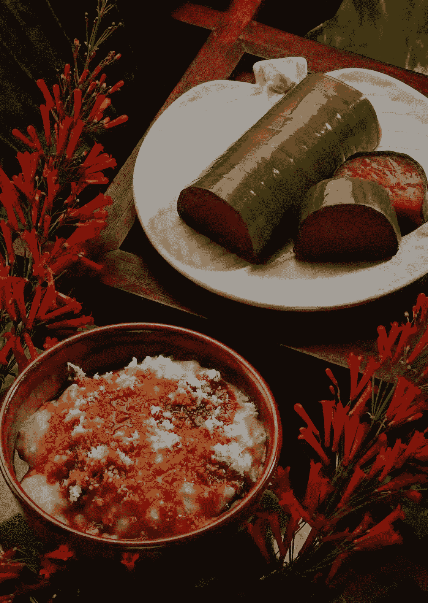

## 牛油果奶昔

这个食谱听起来很奇怪，但它是印度尼西亚非常流行的饮料，而且味道美味！

- 4 个熟透的牛油果（每个 10 oz/300 g）
- 1/2 杯 (60 ml) 甜炼乳、奶油或淡色奶
- 1 汤匙新鲜榨的青汁或柠檬汁
- 3 杯冰块
- 可可粉或巧克力酱（可选）
- 1 份 棕榈糖浆（第 108 页）

1. 去掉牛油果的皮并去核，然后将果肉切成块备用。
2. 按照第 108 页的食谱（步骤 1）制作棕榈糖浆。
3. 将可可粉或巧克力酱以外的所有原料放入搅拌机中，搅拌至光滑。冷藏食用，根据需要撒上可可粉或淋上巧克力酱。

4 人份 | 准备时间：10 分钟 | 烹饪时间：15 分钟

## 混合刨冰甜点

印度尼西亚有很多解渴的甜点，也可以作为甜点享。作为 Es Campur（混合冰），这种甜点的内容取决于食材的可用性和个人喜好。这里列出的只是建议。在菲律宾也很流行，被称为 Halo Halo。

- 1 份 棕榈糖浆（第 108 页）
- 8 汤匙 琼胶块或明胶块
- 8 汤匙 切块的发酵西薯露（tapi，见备注）
- 8 汤匙 切块的 kolang 棕榈果实（见备注）
- 2 杯 (250 g) 切块的水果（木瓜、菠萝）
- 1 个青椰子，用勺挖出果肉，取出 1 杯 (250 ml) 椰子水（可选，见备注）
- 1/2 杯 (125 ml) 甜炼乳、奶油或淡色奶
- 碎冰

1. 按照第 108 页的食谱（步骤 1）制作棕榈糖浆。
2. 沥干胶块、发酵西薯露（如果使用）和 kolang。将椰子肉切成一口大小的。
3. 将水果与碎冰以外的所有原料放入混合碗中拌均匀。将混合物加入杯中，加入一些碎冰即可食用。

> **备注**：琼胶块、调味明胶块、发酵西薯露、kolang kaling 和椰子水在某些亚洲特色商店可以买到。菲律宾商店以 buko 之名出售瓶装青椰子。也有罐装带胶的。

6 至 8 人份 | 准备时间：25 分钟 | 烹饪时间：15 分钟

## 水果椰子冰

- 1 份 棕榈糖浆（第 108 页）
- 1 个 红薯
- 1 根大香蕉，去皮切片
- 5 片 波菠萝，去核切片
- 4 杯 (1 升) 浓椰奶
- 一小撮盐
- 碎冰

1. 按照第 108 页的食谱（步骤 1）制作棕榈糖浆。
2. 洗净红薯，在水中用中火煮至软熟，耗时 15 分钟。取出放凉。去去红薯皮并切片。或者，在蒸锅中蒸 15 分钟，或用微波炉高火加热 4 到 6 分钟。
3. 将所有原料放入混合碗中拌均匀。装入个人碗中，加入一些碎冰即可。

6 至 8 人份 | 准备时间：15 分钟 | 烹饪时间：40 分钟

# 食谱完整列表

- 牛油果奶昔 111
- 巴厘岛米布丁 100
- 巴厘岛鸭肉或椰子咖喱 71
- 巴厘岛风味鸭肉咖喱 37
- 沙爹肉 38
- 香蕉糕 106
- 慢炖牛肉 88
- 芥衣甘菜草牛肉 73
- 椰子牛肉 95
- Bawang 风味鸡肉 72
- 椰奶浸重力鸡肉 67
- 青番茄鸡肉 58
- Sambal (辣椒酱) 75
- 辣椒酱 69
- 经典 Gado Gado 37
- 印尼炒饭 51
- 椰子酱 104
- 椰子酱 59
- 玉米 46
- 脆洋葱和炸大蒜 34
- 脆花生核桃仁 37
- 切块马蹄栗或山药 22
- 干虾 32
- 酸角汁茄子 68
- 香茅草汁鸡蛋 76
- 椰子烤水果或芦笋 92
- 节庆米饭 54
- 柠檬焖青萝卜根鱼 86
- 炸大蒜 Sambal 39
- 炸鱼饼 44
- 番茄炸鱼 84
- 椰奶浸水果 111
- 大蒜饺子、糖渍饼 103
- 青芒果 Sambal 32
- 辣椒酱烤鸡肉 69
- 罗勒番茄烤鸡肉 79
- 日式炸鸡 67
- 香茅草酸角汁鱼 80
- 羊肉沙爹肉 91
- 生菜包生菜 83
- 猪肉味 Sambal 91
- 豆类 40
- 望加虾汤 96
- 混合刨冰甜点 111
- 混合蔬菜腌 31
- 印尼椰子饭 58
- 酸角味花生 Sambal 33
- 腌制青椒 53
- 腌制海鲜 32
- 腌制串串 59
- 土豆球 48
- Rujak (印尼沙拉) 60
- 花生 Sambal 34
- 酱油 Sambal 33
- Rujak Sambal 44
- 香蕉内夹调味辣椒 32
- 调味炸薯条 32
- 调味辣椒饭 64
- 慢炖辣椒 76
- 慢炖豆子 88
- 慢炖椰子 104
- 慢炖水果 59
- 辣味辣椒 74

# 单位转换

## 液量盎司转毫升

| 英制 | 公制 |
|---|---|
| 1/2 oz | 15 ml |
| 1 oz | 30 ml |
| 1.5 oz | 45 ml |
| 2 oz | 60 ml |
| 2.5 oz | 75 ml |
| 3 oz | 90 ml |
| 3.5 oz | 105 ml |
| 4 oz | 120 ml |
| 4.5 oz | 135 ml |
| 5 oz | 150 ml |
| 5.5 oz | 165 ml |
| 6 oz | 180 ml |
| 6.5 oz | 195 ml |
| 7 oz | 210 ml |
| 7.5 oz | 225 ml |
| 8 oz | 240 ml |
| 8.5 oz | 255 ml |
| 9 oz | 270 ml |
| 9.5 oz | 285 ml |
| 10 oz | 300 ml |
| 10.5 oz | 315 ml |
| 11 oz | 330 ml |
| 11.5 oz | 345 ml |
| 12 oz | 360 ml |
| 12.5 oz | 375 ml |
| 13 oz | 390 ml |
| 13.5 oz | 405 ml |
| 14 oz | 420 ml |
| 14.5 oz | 435 ml |
| 15 oz | 450 ml |
| 15.5 oz | 465 ml |
| 16 oz | 480 ml |

## 茶匙转克

| 英制 | 公制 |
|---|---|
| 1/2 tsp | 3 g |
| 1 tsp | 5 g |
| 1.5 tsp | 7 g |
| 2 tsp | 10 g |
| 2.5 tsp | 12 g |
| 3 tsp | 15 g |
| 3.5 tsp | 17 g |
| 4 tsp | 20 g |
| 4.5 tsp | 22 g |
| 5 tsp | 25 g |
| 5.5 tsp | 27 g |
| 6 tsp | 30 g |
| 6.5 tsp | 32 g |
| 7 tsp | 35 g |
| 7.5 tsp | 37 g |
| 8 tsp | 40 g |
| 8.5 tsp | 42 g |
| 9 tsp | 45 g |
| 9.5 tsp | 47 g |
| 10 tsp | 50 g |

## 汤匙转克

| 英制 | 公制 |
|---|---|
| 1 tbsp | 15 g |
| 2 tbsp | 30 g |
| 3 tbsp | 45 g |
| 4 tbsp | 60 g |
| 5 tbsp | 75 g |
| 6 tbsp | 90 g |
| 7 tbsp | 105 g |
| 8 tbsp | 120 g |
| 9 tbsp | 135 g |
| 10 tbsp | 150 g |
| 11 tbsp | 165 g |
| 12 tbsp | 180 g |

## 杯转克

| 英制 | 公制 |
|---|---|
| 1/4 cup | 60 g |
| 1/3 cup | 80 g |
| 1/2 cup | 120 g |
| 2/3 cup | 160 g |
| 1 cup | 240 g |
| 1 1/4 cup | 300 g |
| 1 1/2 cup | 360 g |
| 2 cup | 480 g |
| 2 1/4 cup | 540 g |
| 2 1/2 cup | 600 g |
| 3 cup | 720 g |

## 磅转克

| 英制 | 公制 |
|---|---|
| 1 lb | 450 g |
| 2 lb | 900 g |
| 3 lb | 1350 g |
| 4 lb | 1800 g |
| 5 lb | 2250 g |
| 6 lb | 2700 g |
| 7 lb | 3150 g |
| 8 lb | 3600 g |

## 华氏度转摄氏度

| 华氏 | 摄氏 |
|---|---|
| 200°F | 95°C |
| 250°F | 120°C |
| 300°F | 150°C |
| 325°F | 160°C |
| 350°F | 175°C |
| 375°F | 190°C |
| 400°F | 200°C |
| 425°F | 220°C |
| 450°F | 230°C |
| 475°F | 245°C |
| 500°F | 260°C |
