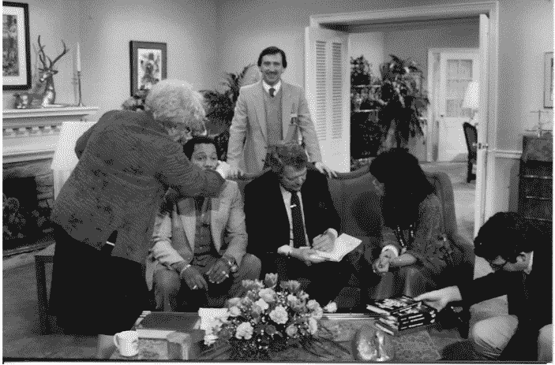
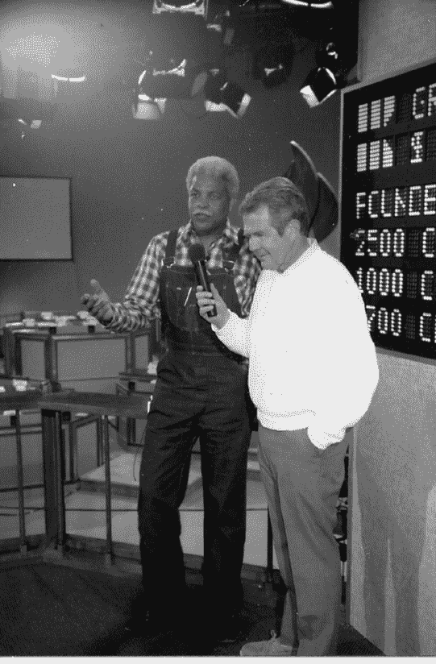
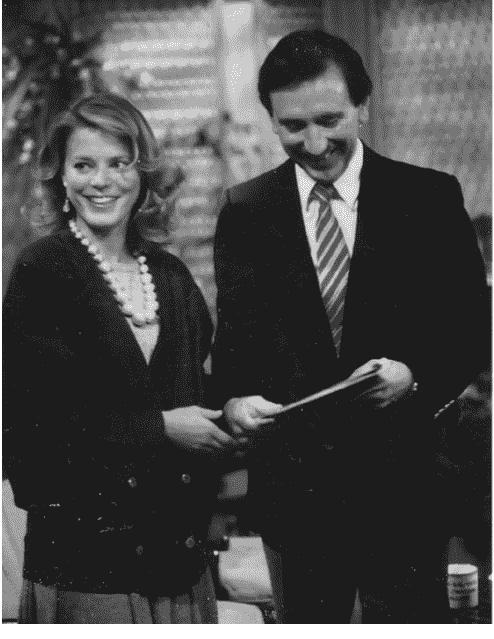

# 自我福音：帕特·罗伯逊如何窃取共和党的灵魂

这是我的故事。它始于对更加精神生活的追求，结束于意识到生活的意义在于变得更加人性。在这一过程中，我作为参与者，见证了人类历史上最激动、最重要且事实证明具有潜在破坏性的社会运动之一。

一个人如何能如此热爱某物，却同时又恨它？

照片来源：Terry Heaton

(1983年) 在好莱坞通用影城现场拍摄的《700人俱乐部》节目现场。好莱坞的这一周——以与唐娜·莎曼的非凡采访为亮点——是一次伟大的团队制作，并在宗教广播竞赛中荣奖。

照片来源：Terry Heaton

(1984年) 尽管所有的电视募捐都是直播的，但它们仍然需要主要为工作人员、机位调度和控制室进行排练。在这里，帕特·罗伯森和联合主持人本·金奇洛（Ben Kinchlow）正在挑战板上游戏。

照片来源：Terry Heaton

(1985年) 克里斯·莱尔科（Chris Rylko）是我的助手兼制片人；这是我们为通讯报拍摄照片时。在我 45 年的电视生涯里，克里斯是我身边有过的最好的纯粹制片人，我们今天仍然是朋友。

照片来源：Terry Heaton

(1986年) 帕特·罗伯森竞选期间使用的飞机。曾由乡村音乐明星肯尼·罗杰斯（Kenny Rogers）拥有，这架飞机命名为 NB，代表“新开始”（New Beginnings）。圣经中的新开始。

# 第一章

## 现代不满的种子

> 现代保守主义者从事着人类最古老的练习之一；即为自私寻求道德辩护。
>
> ——约翰·肯尼斯·盖尔布莱（John Kenneth Galbraith）

福音的信息一直是以自我为中心的，因为它传传的福音是为了让自己逃离地狱和惩罚。福音派基督教多年来精炼了这一信息，并将其转化为现世福报的手段。曾经对社区良好行为的强大动力，已变成获得更好地位的动力，它深刻地改变了我们从政治到对待邻里的方方面。我促成了这一现象，因为我曾与一位历史上最有影响力的福音传播者一起工作。

马里·戈登·“帕特”·罗伯森（Marion Gordon “Pat” Robertson）是一个政治动物，同时也是一名福音传播者、播人和电视人物。政治智慧流在他血管中，正如血液一样。他出生并成长于一个强大的弗吉尼亚政治家族。他的父亲阿布萨龙·华利斯·罗伯森（Absalom Wallis Robertson）是一位保守派民主党人——罗伯特·拜德那样的民主党人——曾在众议院和参议院任职。帕特被培养要继承他的脚步，就读于声著名的麦当登预备学校，随后就读华盛顿与李大学以及耶尔大学法学院。他曾在海军陆战队担任过一名中尉。

帕特·罗伯森没有通过司法资格考试，而是经历了一场宗教觉醒。他就读于纽约神学学院，并在1959年获得神学硕士学位。一年后，他在弗吉尼亚州波特斯茅斯建立了基督教广播网络（CBN）。他建立了一个庞大的电视帝国，是电视上最受争议的福音派基督徒之一，他在那里实践着灵性的“恩赐”，包括说方言以及神迹，如“医治”。但这个政治动物在整个电视事业中一直在寻求突破，这对我我自己的生活以及共和党的政治格局都产生了巨大影响，而且这种影响一直持续到今天。

当我在20世纪80年代与他合作时，我们实践并推广了一种灵恩派基督教，这对于在各方面（从音乐到讲道）都变得非常稳定的信仰来说，被视为一股清风。我们努力工作，以我们认为正确的方式打人心灵。

当我加入CBN（基督教广播网络）时，罗纳德·里根是总统，空气中弥漫着一种复兴的气息，因为我们刚刚经历了越南战争、水门事件和伊朗人质危机的那十年。自从约翰·F·肯尼迪、罗伯特·F·肯尼迪和马丁·路德·金被暗杀以来，我们作为一个国家已经苦苦挣扎了十多年。到20世纪80年代年代初，人们突然对各种形式的繁荣重回美国感到希望，而我也深陷其中。毕竟，我们曾是一股“反文化”力量，这激发了我的想象力并给了我力量，因为我们正处于一个可以真正改变许多人生活的地位。

我——或者说当时的任何一个人——都没有意识到，我们在追求上帝对基督徒、教会以及整个美国之旨意的愿景时，竟然会偏离正轨多远。对于我这样一个深度参与这一过程的人来说，这是一个极其艰难说出的表述，但它确实是一个事实，必须在脱离某些福音派基督徒那种教条主义束缚的盲目之后去审视它。对于我们和后代来说，代价实在太高了，无法忽视我们所做的事情以及我们这样做的事实。

快进三十年后，美国现在是一个极度痛苦分裂的国家。就好像政治光谱两端极极对立的势力引发了一场新的内战。所有的平衡都消失了，我们沉浸在各个层面的分裂混沌之中。再加上过去十五年显著的技术进步，这些进步削弱了下行式通信系统的力量，转而支持横向的、点对点的通信，这种分裂的深度在每天我们所谓的“社交媒体”中痛苦地表现出来。

不再有社区感了——不再有一个在上帝庇护下、统一且神不可分割的民族——我们成了一群互相争吵、剑拔弩张的人。媒体不再拥有公众的信任，因为记者们被暴露是带有偏见的、操纵性的，且自私的。斯皮罗·阿格纳（Spiro Agner）关于电视新闻力量的著名演讲——尽管当时被媒体界完全不予理会——结果事实证明他是：

> ...美国总统有权直接与选举他的选民交流，这个国家的人民有权对总统演讲做出自己的判断并形成观点，而不必让总统的话语和思想在被消化之前就被那些敌对批评者的偏见所定性。¹¹

在20世纪80年代初的CBN，我们强调媒体存在自由派偏见的观点，事实证明这是一项持久的文化贡献，正如福克斯新闻的成功所证明的那样。然而，媒体尚未完全接受这一观点，尽管“客观性”的虚假霸权在今天已由“透明度”的概念所取代。

那种通过同化多样性来实现统一的美国式理想——马丁·路德·金曾提到的梦想——已经在许多意图良好的人的压力下崩溃了，他们倾向于让国家成为由许多不同类型的人组成的织锦，而不是一个具有统一理想的熔炉。

在当今这种情况下，一位操纵大师、表演者和推销员通过利用恐惧、重复与某些美国人产生共鸣的主题，并对国家面临的复杂问题提供简单的解决方案，在华盛顿夺取权力。知识分子、媒体和政治观察家对唐纳德·特朗普如何当选总统仍然感到困惑，并提出一个又一个理论来解释为什么他的追随者回应他的号召。

然而，现实是，他们从未听从他的号召；而是他在听并回应了他们的号召。唐纳德·特朗普擅长解读那些对文化及其发展方向感到被剥夺权利的声音。作为一名推销员，特朗普先生察觉到了一个切入点，这使他随后能够描述出一种卖得出去的产品。他所做的只是为美国描绘一幅黑即白的、反乌托邦的景象，并将自己作为解决方案。这并不是原创性思维，因为他所做的只是重复白人福音派在密室里讨论的内容，而我们CBN正是播下其中许多思想的人。这些人思想是我们在三十年前组织并培养的。

2016年6月，佛罗里达州奥兰多发生了一起同性恋夜总扫杀案，凶手是一个堕信的穆斯林人奥马·马汀（Omar Mateen），他持有一个AR-15型突击枪，并对同性恋有严重的心理问题。当马汀在俱乐部内开火时，近五十人死亡，另有五十人受伤。他在此之前刚刚加入了伊斯兰国（ISIS），因此该恐怖组织宣布对此负责，这主导了早期的媒体报道。

由于倾向于将伊斯兰教视为敌人的世界观，特朗普先生吹嘘自己是唯一对穆斯林移民说“实话”的候选人。然而，马汀被证明是一名美国公民，而非移民，但这对特朗普来说并不重要。帕特·罗伯森（Pat Robertson）在屠杀案第二天发表讲话，谴责了凶手和同性恋受害者，称基督徒应该在旁边观望，让同性恋者和穆斯林互相残杀。看来，帕特比我担任他的制片人时变得更加极端。

要点在于，唐纳德·特朗普和帕特·罗伯森面对的是同一群人，他们实践着一种迥异于正统的基督教形式，这种程度简直令人大开眼界。在20世纪80年代，我们站在卫星建立的高台上，对那些思想对不同观点具有肥沃土壤的公民大声呼喊。我们喂养了他们。我们培养了他们。我们这样做并逃脱责任的方法，是解开我们今天所面临的令人沮丧的现实的关键。

耶稣现在与共和党政治紧密联系在一起。他加入了共和党（GOP），而《700俱乐部》（The 700 Club）是把他推向那里的主要工具。他是否希望留在那里在当今的政治舞台上无关紧要，正如耶稣基督形式的上帝也希望被认为共和党的社会立场是正义的一样。感知即现实，即使人们可以论证耶稣的心可能更接近民主党，但今天的演变结果并非如此。

这是一本写给所有派系基督徒读的书，因为只有基督徒才能纠正这一切。21世纪初，愤怒的暴民不会听从任何人的建议——绝不是外外人的——因为他们被教导其他人之所以不幸是因为某些原因。这就是我们今天所处的悲哀境。

过去四十年里，受《700俱乐部》影响的数千甚至数百万基督徒都是好人。他们的意图是高尚的。

他们大多希望他人也能找到他们发现的和平与自足。然而，在此过程中，关于羊群和羔羊的核心福音被一种感知的需求所掩盖，即不仅要挑战我们文化的演变，还要直接参与他们认为的文化恢复。某些基督教领袖的动机——虽然表现得无懈可击——向他们灌输了似乎能证明这种参与的圣经指令。然而，更深入的检查表明，今天最被传扬的福音是一种自我中心主义的形式：自我的福音。

我知道这一点，因为在担任帕特·罗伯森的制片人和执行制片人期间，正值电视节目发展的最关键时期——即20世纪80年代，当时帕特本人决定上帝呼召他竞选总统，并且他会赢。这件事发生的经过就是故事，而“自我的福音”是这段纪实的阴暗面。

历史将记录，《700俱乐部》是推动共和党右右化的根源，并为像唐纳德·特朗普这样的人提供了今天的政治支持。2015年哈佛的一份报告得出结论，驱动共和党的不是领导层，而是右翼媒体，但这假设为了让人们表现得像激进分子，他们必须被操纵才能这样做。这是对人性和个人信仰力量的误导性解释。如果认为右翼媒体的许多元素没有在此发挥作用，那是荒谬的，但那些被共和党挑战这一权利的人需要远看媒体影响的制度性权力。保守派谈话电台、福克斯新闻、线下出版物以及数百个观察者网站，如果没有受信仰使命的良知驱动并因此倾向于他们讯息的观众，将根本不会存在。我们在20世纪80年代初的基督教广播网络（CBN）就知道这一点，只要我们能以我们所谓的“圣经视角”呈现时事，人们就会感兴趣。

这种理解上的差距盲目了主流媒体在试图理解右翼媒体（尤其是福克斯新闻）之“成功”秘诀的尝试。因为媒体将宗教和宗教人士的观点视为新闻业中所谓的“偏离领域”（Sphere of Deviance），它永远不会认为自己是有平衡的。有信仰的人并不认同被置于文化规范之外的观点，这就是为什么福克斯的口号“公平与平衡”效果良好。

这种基督教形式与共和党结合得如此完美，因为两者都是围绕一个以“自我”为中心的圆圈形成的。这是帕特·罗伯森总的、虽未成文的策略，尽管CBN的许多职位的人要么没有，要么简单拒绝看到。对我来说，这是显而易见的，并在后来我与帕特关于筹款的一次难忘的私人讨论中得到了证实。

《700俱乐部》最初是一个为信徒准备的基督教对话节目，但它演变成一个具有政治动机、带有观点的新闻节目在我到来之前就开始零星启动，在我之后之后加速。在1981年4月一次中午祈祷大会的演讲中，帕特·罗伯森提出了他想要实现的愿景，以及将事工向这一方向移动的圣经辩护：

> “我告诉你们，在今天的世界里；人们就像一群羊。他们在说：‘我们该怎么办？你们知道，我们该如何处理我们的钱？我们该如何处理我们的孩子?’”
>
> 这有助于我的国家。
>
> 我正在履行伟大的使命，将福音传向世界。
>
> 这是我的责任。
>
> 如果我这样做，我将会得到祝福。
>
> 我正在帮助那些比我贫穷的人。
>
> 这就像一支调优良好的管弦响团。你不能只演奏低音部，也不能只演奏高音部。它们在一起创造了奇妙的声音。
>
> 人们也喜欢成为赢家的一部分。没有人喜欢输。
>
> 挑战是重要的，因为人是目标导向的，并且会对同伴压力做出反应。
>
> 划算很重要，比如用100美元就买到了一栋价值1300万美元的建筑。
>
> 还有一种老辈想要帮助年轻人，似乎是为了以某种方式延续社会。

帕特·罗伯逊（Pat Robertson）那天教我的是，基督教电视事工的成功始于修正人性中那种以自我为中心的核心。注意，他描绘了一幅扩张圆圈的图，每一圈都在远离圆心的自我认可。帮助穷人处于列表的最底端，尽管这种特定的动机与其他部分是分开的，而这体现在我们利用“祝福行动”（Operation Blessing）来针对特定类型的基督教捐赠者。然而，其他部分构成了我们事工和筹款的准则。

有了这种指导，不仅很容易策划筹款，而且很容易策划与“700俱乐部”（The 700 Club）电视节目相关的一切。。为上帝接管国家并没有被定位为一种责任；它更像是“你需要为你自己和你的家人这样做”。在定位的营销实践中，这是一种细微的区别，但它是一个强大得多的动力。帕特·罗伯逊的核心，在最终分析中，如果不包含这一层理解，他所做、所说或成就的任何事情都没有意义的。

对我们来说，这没有任何阴险之处；这是一种为了善改变世界的真诚而真实的愿望，尽管其最终果实是混乱、分裂和危险的。我们感到上帝的手在引导着我们，我是发真心地写下这些。我们审视进步文化，只看到邪恶。我们感到对基督教和教会的敌意。我们在媒体中受到嘲讽和嘲笑，尤其是那些来自好莱坞的媒体。我们觉得上帝正在把事情交给我们，好让事情变得正确。我们没有看到的是我们的动机被自我驱动的陷阱。毕竟，上帝真的需要我们去修复那些我们认为错误的事情吗？

即使是帕特广受推崇的生活手册《秘密王国》（The Secret Kingdom），也是一张利用圣经来证明一种基于上述扩张圆圈的、围绕自我、自我获益和自我完善的生活方式的图。它是一本伪装成神学的自学书籍。所宣布的每一条“法则”都旨在帮助个人、家庭和社区在人类竞争领域脱颖而出。通过在这些“王国法则”内生活，你可以让自己变得更健康、更富有、更安全、更快乐，并在文化中更具主导地位。这是对我接受的关于筹款的教学的完美补充，并进一步证明了我们正在教授一种非常阴险的自私形式——自我的福音。

这，这也是为什么我们都必须照镜子来解决社会问题。当帕特说“我看见了敌人，他就是我们”时，他是正确的。教会迫切需要一个自我检查的时期，以及一种站起来说“够了！”的勇气。然而，只要我们还指着别人的手指说问题是他们的而不是我们的，这种希望就几乎其零。

因此，我们今天使用 Facebook 和其他形式的社交媒体来传递符合我们世界观的虚假迷因。我们表达对他人行为的强烈厌恶，好像如果我们不这样做，这种厌恶就会传染在我们身上。重要的是我们的雷达，而不是真理。我们听到或看到某些媒体片段，那些熟悉的循环场景在守护着我们，我们觉得有必要通过我们希望影响的人的认可来传递它。为什么？因为这帮助了我，帮助了我的家庭，帮助了我的社区，帮助了我的国家，这是我的责任，如果我这样做，我将会得到祝福。

随着共和党进一步向右倾斜，福音派基督徒发现自己处于不得不否认他们已经变成了他们所鄙视的——一群试图将自己的信仰强加于他人的精英。在这种否认中，对真的扭曲是自私的民主党人被魔化为社会主义者、共产主义者、马克思主义者，当然还有想要以政府控制生活的名义偷窃他们的自由主义者。这里显而易见的冲突在于，上帝似乎无法处理这种缺失的帮助。

也许美国现在正面临着审判。也许上帝已经厌倦了我们所有的花招，包括那些以祂的名义所行的事。也许我们的文化问题都是“自我福音”的反映，而上帝审判的不是世界，而是教会。我想起了耶稣因被宣布为“犹太人之王”被带到本丢·彼拉面前的故事。他的回答是祂“不属于这个世界”，如果属于，他的追随者会战斗着释放祂。我们无法看到自己处于这种境地，因为我们似乎正在为拯救一个错误的世界而战。

并通过共和党来实现这一切。毕竟，它帮助了我，帮助了我的家庭，帮助了我的社区，帮助了我的国家，这是我的职责，如果我这样做，我会得到祝福。

## 两个

## 委员会与使命

> 与一个放弃了使用理性的人争论，就像给死人吃药。
>
> — 托马斯·潘因

1980年，我在肯塔基州路易维尔担任《PM杂志》的主人和制片人期间，经历了一次相当奇迹的重生体验。这发生在我正开车从印第安纳州南部森林里一位福音派基督徒的A型房屋开完会后回回的路上。我们一直在讨论我那充是抑郁、性、自杀、毒品和酒精的生活，而他向我讲述了他的信仰。我一路都在哭，直到回到家时精疲力竭地睡着了。

第二天早晨，一切似乎都变了。我感觉极好，抑郁消失了，我不再需要毒品，最神奇的事情是，我的语言完全被改变了，我变成了一个不同的人。

在工作中，我参与了印第安纳州南部的一个小型福音派机构，并在那里贴了一张写着“重生”字样的海报。我充满了活力，感觉以前所未有地活着。我感到了一种使命感，为了荣耀上帝的创造。我想唱歌，我笑得停不下来。我我是绝望的，正处于毁灭的边缘，但一夜之间，情况变得完全相反。我感到内心平静，完全沉浸在耶稣的爱中。这种爱让我感到奇妙。我感到自己很纯净。我想做些贡献，想成为他人的祝福。我想告诉每个人我发生的一切。

我也开始看电视，因为我想学习所能的一切。这包括像《700俱乐部》这样的节目，以及邀请像肯尼迪·科普兰、查尔斯·斯坦利和詹姆斯·罗比森这样聪明的人。

有一天，我收到一封来自当时CBN大学的一位学生的信。她的论文的主题是“杂志节目职业倦怠”，这种现象对人的负面影响。她告诉她正在调查《PM杂志》的制作人，要求我填写她的调查表并寄回去。下周，我接到了她的电话。她告诉我我的答案与大多数人不同，她说我一定是个基督徒。我告诉她是，并问我是否考虑过在CBN工作。她让我把我的作品发给她，并说她会交给事部。

我寄给她的第一个节目是一个关于列克斯敦（赛马之乡）的六分钟短片。它介绍了著名的三冠马赛得者秘书马，以及这个摄影师如何与马合作以获得完美的画面。帕特·罗伯逊的第二爱。他对这个故事非常着迷。我被邀请去弗吉尼亚海参加《700俱乐部》的工作面试。我去了，见到了执行制片人迈克尔·利特和CBN的其他工作人员。他们对我制作节目所花费的时间相对较感到特别感兴趣，因为节目制片人的角色在《PM杂志》时完全不同。这是一个奇妙的经历，因为他们给了我一份工作，但我有顾虑并拒绝了。我对自己正在做的事情很舒服，事实上我还没准备好为一家大型福音机构工作。我在信仰上还是个婴儿。

无论多么光光，上电视并不是为了表现的。噢，让我的照片出现在镇上每辆巴士上的感觉很奇妙，但我讨厌在路易维尔到处被认出来。我必须在公共场合始终保持“状态”，因为节目的观众会认出我。我的妻子非常喜欢在随处让我感到尴尬，我开始后悔这份工作。失去隐私是一个我无法承受的负担，于是我转了职业，成为了该台播出的第二个杂志节目的现场制片人。在那一年，我学到的讲故事技巧比之前两份工作中学到的得多，因为制作节目的团队是由国家电视摄影奖获得者组成的。我磨练了技艺，继续与音乐福音机构一起工作。那一年我在许多方面都成长了，真正成为了一名高端电视制片人。

我也成了圣经和所有信仰事务的深度学生。为了寻找意义和理解灵性的事物，我读了一又又一本书。我的档案里满了关于我所学的日记，而那通往智慧的“一土豆、两土豆...”之路仍在继续。我看着基督教电视，但更多是看着文化似乎偏离了我小时候所熟悉的一切。作为一个生活的专业观察者，我灵魂中探索这些事件的冲动是不言而喻的。我想知道一切的为什么，尤其是人们为什么那样行为。小时候，我的信仰完全关乎接受以及努力、纪律和坚持的基本价值观，但生活告诉我问题同样重要。我想要答案，我觉得我的大脑是新奇兴奋想法的沃土，而以前它只植根于传统。我想飞翔。

1981年初，各地经济都在崩溃，因此《路易维尔今晚》的管理层不得不做出艰难的商业决定。因为我来自《PM杂志》，我的工资高于《路易维尔今晚》的任何其他制片人，所以我的职位在预算缩减中被除了。

我给CBN打了第一个电话，失业的消息换到了建议，认为这是上帝在我的生命中并在召唤我进入事工。他们称之为“天堂之犬”。我无法（或不想）对此进行争论，于是我们搬到了弗吉尼亚海，我成为了现场拍摄团队的经理，他们自豪地为《700俱乐部》制作故事。

通过使用预制素材、采访和视觉效果，我们将从圣经的角度呈现新闻和时事的见解。

在我们所做的一切中，我们都以相关的、现代术语呈现耶稣基督的福音。

美国对基督徒和基督教存在着一种非常负面的态度。这在怀疑论者中尤为如此，并干扰了我们信息的传递。因此，在可能的情况下，我们将尝试呈现一个年轻、充满活力的基督教形象。

我们相信复兴的实现是“不是靠力，也不是靠才，也不靠争战，乃靠我的灵，耶和华说。”由于神迹总是伴随着圣灵真正的倾倒，而祂应许过要“用标记和神迹证实我的话”，因此我们完全致力于在尽可能的情况下记录并揭示神迹。

我们的一言一行，都将举起耶稣。

我们将效法保罗徒的榜样，在拯救这个垂死世界的努力中，“凡事就凡人，凡尽办法，总可以救些人”。我们也将效法主主的榜样，“与税人和罪人一同吃饭”。这样做时，我们理解自己可能不时在捍卫法利赛人不同意或不理解的节目内容时，面临他们的愤怒。

通过定期的、可推广的系列报道，我们将呈现电视上其他地方无法获得的信息。

我们的节目将具有娱乐、教育和启迪作用。

我们所有的环节将以这种方式呈现：每个环节都为所提出的冲突提供圣经答案。

在可能的情况下，我们将跨越教派之墙建立桥梁，因为我们将根据神国的法则寻求统一。

在预制片目中，通过口语和视觉效果，我们将呈现神国的法则。我们的目标是让所有人都能从实际角度学习基督徒生活方式的意义，并让所有人都在基督里成熟。

我们将与企业发展部门协调，以确保贴片、专题、嘉宾和视觉效果的顺畅、持续流动，这些内容说明了 CBN 事工所有分支的活动。

很少有电视节目有自己的使命宣言，而上述内容为我提供了一个每天可以遵循通用大纲。这对于我与事工的执行团队进行“向上管理”也非常有用，他们是负责维护底线的人，而且我在运营过程中经常与他们产生冲突。使命宣言的关键部分是关于时事、神迹以及教导“神国的法则”的章节，因为这些是《700俱乐部》的标志，也是制作节目的核心。

然而，节目的使命宣言并非关注的焦点。事工的总使命引导着我们所做的一切，这份文件对内对外也向公众公开。正是在这里，我们在寻求该地的政治变革时违背了规则，因为限制免税组织的法律监管着此类活动。

CBN 及其附属组织的使命是为美国、中东国家、远东、南美以及世界其他选定国家迎接耶稣基督的降临以及神在地上建立做好准备。我们的最终目标是实现一个历史时刻，“耶和华的知识要满水满地。”

在实现使命的过程中，主要方法是战略性地利用大众传播，特别是广播、电视和电影；唱片、磁带、电影和文学作品的派发；以及开展教育，训练老幼理解神国的原则如何与在我们世界中起主导作用的人类努力领域相关联。

在实现使命的过程中，不应做任何不荣耀神和祂儿子耶稣基督的事。

三个词可以概括我们使命的执行。首先，我们将具有创新精神。我们的任务不是重复或复制他人的劳动。其次，我们将追求卓越。我们的工作必须具有持久的价值和最高质量，否则就干脆不做。第三，我们将展现诚信。在我们的工作、公共关系以及内外部沟通中，将对信任有持久的承诺。诚信必须贯穿我们与他人的所有交易。

在为使命招聘人才时，我们必须坚持为每项任务寻找最优秀的男女，并尽一切努力确保人员与任务匹配。我们的政策是建立一个由优秀人士组成的小团队，并为他们的劳动提供优厚的报酬。我们的员工应当“充满圣灵和智慧”。神的工作将由神所装备和选拣的民来完成。

履行使命意味着隐含着对神国所有原则的展示，特别是互惠原则。因此，我们不断努力为全球范围内人类的需求和痛苦提供慷慨援助，并向其他与我们基本目标相同的组织捐款。

我们相信，按照神国法则进行神的工作将在财务上获得成功。我们不能同时侍奉神和钱，所以对神和祂的呼召始终优先于冲突的金钱考量。尽管如此，我们意识到只有经济上可行的活动才能在目前的社会中持续下去，因此规划必须考虑到经济可行性。我们还明确表示，按期支付费用是诚信的关键要素。我们寻求通过所有合法且道德正确的手段为活动筹资，包括但不限于贡献、销售和投资收入。在规划中，我们将努力为当前活动预测足够的收入，以及用于建设和扩张的慷慨盈余。

在履行使命的过程中，就呼召和信息而言，我们的圣经榜样是施洗约翰。至于智慧，是所罗门。至于对以色列的事工，是先知以西结。在我们所有的所、所行、所说中，都是耶稣基督。

那是我的工作，而不仅仅是制作电视，而且我做得很好，无论这如何影响我与部里其他人的关系。

对我而言，我的职责是对帕特·罗伯森（Pat Robertson），而不是他所任命的任何执行代表。在这个领域存在许多冲突，但我坚持自己的信念。归根结底，一个事工部门并不像公司那样，权力和控制是沿着层级金字塔向下流动的。一个事工部门更像是一种个人崇拜，拥有“呼召”的人是唯一的权威，而其他人汇聚在一起是为了实现这一目标。我将自己的呼召看作是帮助帕特·罗伯森行正义之事。

因此，在培养我们的观众对公认原则的认知方面，我发挥了关键作用，但这包括将某些事情推向了极端。例如，使命宣言中没有提到任何政治，但作为前任美国参议员，帕特·罗伯森在接受事工的呼召之前就已经是一个政治动物了。他对政治的理解比其他许多人都深刻得多，因为政治过程往往是社会痛苦的导火索，他知道自己正在做什么来纠正这些。帕特了解局内人物以及游戏是如何进行的。他的观察通常非常准确，每当他针对任何问题发表政治见解时，他都很清楚自己在做什么。

例如，帕特在一次直播节目中的即兴、无剧本对话中告诉本·金奇洛洛（Ben Kinchlow）和丹娜·索德尔曼（Dana Soderman），只有基督徒和犹太人才有资格在美国担任公职。本表现出极度震惊，但帕特重复了他所说的话。许多人——包括 NBC 新闻部——将这一时刻视为证据，认为帕特已经超出了记者丹尼尔·C·哈林（Daniel C. Hallin）所说的“合法辩论的范畴”，但帕特是直接对他的选民说话，他并不不在意批评者会如何解读。对于那些相信美国是建立在犹太-基督教原则之上的人来说，很容易接受“只有犹太人和基督徒才有资格管理它”的说法，但这个概念对于那些相信开国之父更具包容性和宽容度的人来说是陌生的。在大多数情况下，这些在在他人（尤其是自由派人士）看来是荒谬的言论确实如此，这也是为什么我们认为有必要教育他们。

新闻部匆忙汇编了一段关于该裁决的报道，我们在演播室集聚录制了新的开头片段。每个人都穿着早间直播时的同样的衣服，以确保最后的节目无缝衔接。在故事和讨论之后，帕特要求大家就这件事与他一起祈祷。我记得我和 CBN 主席鲍布·斯洛瑟（Bob Slosser）站在那里，帕特祈祷，让上帝通过任何必要手段（包括他们的死亡）除掉那些投票反对祈祷的最高法院法官。鲍布和我面视着对方，几乎同时说道：“他不能在电视上说这种话！”我们都知道帕特对法院的裁决非常愤怒，但实际上要求处决投票赞成禁令的法官之死既是明智的也是危险的，更不用说这种公开表态本身是不道德的了。

我们要求大家留在原位，并向帕特表达了我们的顾虑。经过深思后，他同意录制另一个不含死亡威胁的版本，这就是我们使用的版本。对于他在关于政府、爱国主义的那些极具攻击性的宣告中，这是一个难得的纠错机会，而这些是《700 俱乐部》的经常组成部分。很难说帕特在做出诸如杀死最高法院法官之类的言论之前，是否真的计算或考虑过他的措辞。他非常聪明，非常了解他的观众，但他非常相信祷告的力量能为信徒和群体提供答案。鉴于我们使命的广度和深度，帕特设想自己坐在一个由上帝亲自提供的巨大工具的驾驶台上，目的是让美国远离其自由主义倾向。我认为他这样做是真诚的，而那些将行动视为贪婪、权力或个人利益表现的人，与今天仍在努力理解唐纳德·特朗普当选的是同一拨人。

随着岁月的流逝，雷根总统任期开始尾声，《700 俱乐部》变得越来越政治化。回想起来，我们当时传导的是信上帝改变人心，并认为光靠改变文化是不够的，他希望我们都参与政治。这是一种微妙的转变，但我们并不孤单。整个电视福音派正在背离其初衷，掉入权力和影响的陷阱。随着《700 俱乐部》的演变，我们在教育人们共和党的方式就是上帝的方式，这后来变成了二十世纪最受注目的社会工程成就之一。

帕特·罗伯森热爱地图，他的观点是正确的：许多人根本不知道这个国家或那个国家在哪里，更不用说他们如何与邻居互动了。他们显然不知道为什么这很重要，或者“那边”的事情如何影响我们这儿的人。我们制作了八英尺高的画板，上面有精美的地图代表世界各个地区。

我记得某天在化妆间，帕特要求准备好非洲地图，因为他想谈谈这个话题。这并不是一个预先计划的环节，所以我们都必须保持警觉。在大约十五分钟，他遍历了整个大陆的每一个国家，说出了首都、统治者、政治状况，并解释了每个国家的地缘政治地位以及他们如何与邻国产生联系。我站在那里看着这一切，我记得在心里对自己评价道，世界上只有极少数人能做出他刚刚所做的事情。这确实是智力、知识和沟通能力非凡的展示。他的动力是教学，正如使命一样，他需要向追随者证明 CBN 是一群拥有时代知识、能够引导以色列的圣经式男士。

帕特不喜欢自由派，认为他们是社会的诅咒，因为他们对政府的依赖超过了对上帝。帕特是个人责任的坚定支持者，拒绝任何需要他人照顾的想法。民主党人和自由派很容易被视为上帝的敌人。

为他们自己、家庭、社区以及更远的地方带来了改变。

我们为人们提供了观察世界事件的视角，这绝非小事。我们坦诚地面对自己的偏见，并挑战媒体的其他同行也做到这一点。主观新闻中的透明度在某种意义上诞生于“700俱乐部”（The 700 Club），我为此感到自豪。

在在我们促成之前并不存在的问题上，我们为弱势群体发声。我们教导人们基于理性的推理来做出决策。我们教育了媒体、公共政策和法律领域的精英人士，因为我们深知他们的影响力将呈指数级扩散。

我们服侍受苦的人们，并给予他们希望。我们在一切所能的地方为贫穷和受苦者的事业哀求，并为那些难以独自开启大门的人开辟了道路。

我们在世界范围内的自然灾害和其他需要时期服务他人。我们影响了政策向更好的方向发展。我们影响了各个层级的政府。我们为个人、社会和机构带来了改变。

我们充当了一个枢纽，让聪明人士聚集在一起，讨论基督教，并创造出原创的概念，将这些深奥的思想作为一条主线，锚定美国已经变成的织锦。许多优秀、实际上非凡的人是 CBN、其政权大学（Regent University）及其附属机构使命和工作的一部分。这些人不懈地努力，根据基督教信仰的基础让世界变得更好。我向他们和他们的努力致敬。

但最终，爱德华·R· 莫罗（Edward R. Morrow）曾说：“我们可以否认我们的遗产和历史，但无法逃避对结果的责任。”无论我们做了多少善事，我们无法逃避一种遗产，其中包括创造了一个愤怒的群体——一个由自私、自怜、恐惧、自以为是和无知驱动的群体，而这一切是以耶稣的名。毕竟，如果同一个传授耶稣的权威人物也代表共和党（GOP）发言，追者怎么可能错呢？那些不想或不能独立思考的人的逻辑如此，它创造了一个怪物。我们本该更明智的。

## CBN 的生活

> 除非经历过糟糕的，否则你无法珍惜美好。
>
> —乔·托瑞（Joe Torre）

虽然我真心相信自己为 CBN 和“700俱乐部”使命的推进做出了很大贡献，但那五年里中学到的比我生命中任何其他工作时期都多得多。这是一场高级教育，是一门关于生命本身的学位。我学到了关于人、官层级制度的失败、社会工程、募款科学，以及与新闻、政治、高质量电视制作、直播电视、邪恶、欺骗、电视的力量、教会、宗教、人性、历史、新闻业，以及伦理与道德如何与信息的腐败力量（也称为政治宣传）相关的深层教训。

在福克斯新闻（Fox News）声称要“公平平衡”之前，曾有 CBN 新闻（CBN News）。此外，对一个大型基督教事工内部生活的观察，与研究任何其他类型的组织都不同，因为基督徒在背后捅刀或以其他方式试图达到自己的目的时，能够表现出极大的爱。人们并因为宣扬基督教就不再是人类，但基督徒的行为往往恰恰相反。“十字架下，人人都是平等的”这一理念在商业环境中引入了一种极其迷人入胜的违抗形式，但除此之外，它也导致了社会阶层之间非凡——且并不总是有利的互动。人们可能会认为，身处同一艘救生船的共同纽带会产生一种甜蜜的谦卑，但往往恰恰相反，这一点在我们的政治观点上表现得最为明显。尽管宣称我们的战争是属性的，但我们在文化基层战斗，以求在各个层面为上帝“赢得”。

我当时并没有意识到，这如何剧烈地削弱了我/我们对全能上帝能力的信念，因为我们经常引用“神学界的莎士比亚”——17世纪英国圣公会牧师杰里米·泰勒（Jeremy Taylor）的话：“无论我们向上帝祈求什么，如果那是责任的事，或是努力的结果，让我们也为此努力；因为上帝爱赐福劳作并给予回报，但不支持懒惰。”问题在于，这是……

在财务方面——它是基于对某些经文的解释，包括约翰写给改犹斯的信，也称为《约翰三书》。这里是《钦定译本》中的第一章第二节：“亲爱的，我祈求万事叫你事事兴盛，身体健康，正如你灵魂兴健一样。”由于基督徒是上帝所喜爱的，这似乎是上帝直接发给信者的信息，并且可以解释为财富。然而，在《新生活翻译》（New Living Translation）中，它是这样描述的：“朋友，我希望你一切都好，身体健康正如你的灵魂一样强壮。”现在，我并不是一位资深的圣经讲解家，但这封信是约翰写给改犹斯的，这节经显然是约翰对他的问候，而不是上帝发给某些信者的信息。

其他的引用包括旧约，在其中上帝教导犹太人如何兴盛。然而，在将这些内容传给基督徒时，必须突破重大的思想流派，才能为当代基督徒提供指令，其中一个事实是：上帝在律法中做了规定，以防止出现今天那种财富。禧年（Year of Jubilee）——古代犹太人的经济重置——被方便地从现代中移除了；因为这样做与为少数人提供巨额财富背道而驰。

然而，我们只为那些符合我们标准的人选择兴盛的故事。他们很年轻。他们很好看。他们的见证提供了他人渴望效仿的榜样。他们总是处于顶端。在给CBN（基督教广播网络）之后，他们总是兴盛。通过这种方式，我们呈现了一种偏颇的观点：那些给CBN捐钱的人——捐越多，祝福越大——总是受到上帝的眷佑。我们不敢接触任何可能声称相反的人，无论原因何。

《700俱乐部》节目中最才华、最有天赋的制作人之一是约翰·辛普森（John Simpson）。Jon 现在是一个环球旅行者，用摄像机记录全球各地的各种事。他今天很才华，那时也很才华。Jon还有一种天赋，可以在现场和普通人很好地演绎大卫·莱特曼（David Letterman）的段子。我们一直在寻找能让帕特（Pat）教学的平台。有一年，我给 Jon 一个主意，创建一个涉及一个总是犯错的善良基督徒角色的系列节目。这是一个喜剧，也是一个很棒平台，帕特可以借此教人们该角色所犯的错误。

Jon 创作了一个试点片，剧中他的角色试图使用“互惠律”（出自《帕特的秘密王国》），引用了“得的，就必得给你们了”来支付账单。如果他需要一百美元，他就会给十美元，以此类推。他越陷得越深，最后放弃了，看着镜头，张开双臂问道：“我哪里做错了？”我认为这完美地代表了我们试图创造的东西，我非常自豪地展示给帕特看。事实并非如此。恰相反，因为我们知道这是人们在履行基督生活时的困难点之一。

帕特·罗伯逊（Pat Robertson）一点也不觉得好。当我播放 Jon 的磁带时，他盯着屏幕。我们在休息室里只有我们俩，他的眼睛越是不眨，我越越感到不安。视频结束后，他看着我说：“如果你把这个播出去，会让这个事工损失数百万。”他解释说，我们都在帮助人们的信仰，我们不敢在节目中放入任何可能——不——产生相反结果的内容。我被指示永远不要靠近这个话题，并终止这个系列节目。我不需要进一步的指令就知道这个命令是不可违背的。

身体医愈的见证故事也有类似的规定，而这里也许是节目工作人员之间对对错产生内部冲突最频繁的地方。负责节目这部分的人是凯伦·汤普森（Karen Thompson），她是制作和故事讲述团队中一位才华且富有同情心的成员，恰好也是一名护士。她和员工的任务是对通过电话接到的无数报告进行筛选，并尽可能将它们转化为“神迹”故事。她感到很沮丧，我也一样，因为帕特·罗伯逊的期望完全不符合现实，特别是我们对可以在电视上展示的人群类型有着限制（年轻、不是严重肥胖、聪明等）。

1984年春季，帕特对我们制作的一个神迹故事表示反对，说它太弱了，不能播出来。他会在节目开始前在休息室审查每一个故事，我的工作很大一部分是和他一起看录像带并转达他的批评，这些批评有时非常刻毒。我总是过滤掉他的评论，有时他的情绪会泄露给工作人员。这个特定的故事就是如此，凯伦自然反对了。她出于沮丧给我了一封备忘录，我很乐意把她的案例带给帕特。这缓解了一些压力，但这些事情就像厨房里的老鼠，总会有办法回来。这对帕特没什么用，对我老板迈克尔·利特（Michael Little）也没什么用。

以下是她的一些话，我想重申的是她在写信给我时是在对我布道。

> “我理解你要向帕特要一份关于什么是‘神迹’的书面指南。好主意！但要提醒一下——他无法指望能得到他想看到的数量。难道较少的医愈故事我就会满意吗？

我知道帕特相信，我也在节目上听他说过有“成千上万”的神迹正在发生。我们收到的医愈故事数量与他所谓的“几千”数字并不符。许多打给咨询中心的人只是声称他们痊了但没有看到显象。其他人看到了短暂的显象，但随后又“丢失”了（这些人更频繁地写信询问哪里出了问题……他们很困惑，想知道为什么）。还有人热情地写信（这种情况非常频繁）关于他们的“神迹”，甚至为我们提供了医疗文件。然而，医疗文件通常显示，有太多的医疗干预（辐射、药物等），至于我们无法称之为神迹，或者无法让怀疑者相信它是神迹。

我的部门已经非常沮丧了，特里（Terry）。我一直对我的工作自豪，并努力尽责地做好工作。然而，我感到很沮丧，因为医愈领域超出了我的控制。只有当上帝施行医愈时，我才能提供故事。我不能自己医愈。我希望帕特不要认为我在对他隐瞒医愈故事。你知道我们寻找它们是多么困难。我会尽力寻找它们，但剩下的交在上帝手中。”

凯伦附上了她所说话的记录，而这些是我们从未被允许呈现的内容。在1984年第一季度，我们从咨询中心收到了6,207份“祷告的回应”表格。我们通常要求人们在节目中给我们打电话，这是其中一个类别。凯伦的员工评估了这些表格并发送了跟进表格。在那些6,000个告诉我们“神迹”的电话中，我们发送了略多1,200份表格。从这些中，我们收到了290份回复，那才是凯伦的员工实际上开始工作的地方。我们有一支护士团队进行跟进，还有一个医生顾问委员会，在我们制作故事之前会“批准”表格。在过滤掉那些表面的拒绝后，剩下极极少我们可以对其真实性有信心地播出的故事，有时300个中只有一两个。当你担任该节目制作人期间看一个医愈见证故事时，凯伦和我都确信它涉及某种神秘或超越物理解释的东西。帕特最喜欢的医愈故事是那些直接对节目中祷告时间做出回应的故事。作为《使徒行传》中描述的灵性恩赐的实践者，帕特、本（Ben）和丹杜塔（Danuta）为那些正在为某事祷告的观众寻求“知识的道”的恩典。他们说出从灵里“得到”的什么，信徒就会相信，以便上帝施行神迹。这一切听起来可能很离谱，但对我们来说，这只是每天的事工。”

### 奇迹的派发

话虽如此，有一天主持人们正在祈祷，帕特（转述了他的话）说：“有人正在祈祷中。有一个叫迈克或米基的小男孩遇到了麻烦。我无法确切知道是什么，但我看到他胸口处横跨着一个类似斜带的东西。”他比划了那条斜带的角度并继续说道：“上帝想让你们知道，祂正参与了其中，一切都会好起来的。”

那天晚些时候，事工部收到一份来自宾夕法尼亚州家庭的赞美报告（我想是那里），我们进行了彻底调查，并在后制作了一段证词故事记录了他们的“奇迹”。这确实非常非凡。丈夫正要出门上班，不小心用汽车压过了他两岁的儿子米基。那个男孩显然试图绕到车后部向爸爸告别，但没能成功。父亲在撞到一个“凸起”时意识到自己压到了什么东西，当他试图停车时，轮胎在儿子儿子的胸口上转了一圈。他在男孩的皮肤上留下了一个斜带形状和角度的烫伤。这与帕特在祈祷期间演示的角度完美吻合。他们冲向医院，全家人聚集在一起，一边看《700俱乐部》（The 700 Club）一边祈祷，这时这段“知识的话”在祈祷中出现了。奇迹的是，除了烫伤外，男孩尽管被汽车压过却毫无完好！那个故事留在我的脑海中，是我制作的所有节目中最无法解释的事件。所有相关人员，包括家人和医生，都认为发生了超自然的事情，而且这直接涉及了《700俱乐部》。

即使是最是最顽固的“唯科学论”怀疑者，也不得不承认这至少是不寻常的。除了它本身，我没有解释那就是祈祷的回应，而不是帕特·罗伯森的“幸运猜测”。

尽管有这个非凡的故事，但事实是，这些报告并不常见，但让它们看起来很常见一直是我们的目标。我们处理的是观众中信仰这一具有滑动性的概念，我们正试图激发各地个人的信仰，让他们能够为自己声称成果。这是对“自我福音”的直接诉求，特别是对于那些对自己、家庭、朋友、社区等方面有需求的人。提出“我们有通往上帝的热线”的建议，在筹款或提供帕特的政治观点时也是极有帮助的，因为谁能和一个能够带来那样奇迹的人争论呢？然而，这些祈祷是节目中一个引起分裂的环节，因为所谓的“知识的话”在教派性基督教中是一个有争议的神学概念。

此外，对一个“总是”在治愈的上帝的持续强调有一个非常阴暗的负面影响，那就是那些从未被治愈且没有解释的观众。在事工部的第一季末期，我收到了一封信，这是我决定在1986年离开的因素之一，当时帕特正开始竞选总统。这封信来自印第安纳州的一位父亲。他和他的家人是一个信仰教会的成员——在那里对奇迹的信仰往往影响医疗护理——他们经常看《700俱乐部》。这封信对我，指责我制作了一个总是展示人们痊愈的节目，因为他九岁的女儿刚刚死于癌症。“更糟糕的是，”他写道，“比晚期癌症的痛苦更糟糕的是她感受到的来自上帝的拒绝，因为上帝不治愈她。”

“她每天都看你们的节目，”他继续写道，并且根据节目展示的故事，对自己会被治愈充满了信心。最后，她感受到了几乎从未有人经历过的遗弃和拒绝，她因羞愧而不断哭，认为上帝不爱她，因为上帝让她死去。她是通过看《700俱乐部》产生这种信念的，”他总结道，“永远永远原谅你。”

这封信深深影响了我。我不光独自哭泣，和其他一起为了那个小女孩所受的苦难流泪，虽然我们都能想出理由，但我们知道父亲是对的。直到今天，我为那个女孩和她的家庭祈祷，并为自己在她的经历中所扮演的角色恳求原谅。

幸运的是，这类信并不罕见，但我们担心正在通过这种扭曲奇迹真相的方式来操纵人们成为信徒，这种恐惧无处不在，不仅对我是如此，也对其他那些在战线努力满足我们领导要求的职员来说是如此。我们谈论上帝王国不可更改的神圣“法则”，人们“应该”遵循这些法则以与上帝的旨意保持一致。我们在直播中朗读《祈祷回应》表格，而不进行任何审查。这进一步推进了上帝在我们中间大力运作的叙事，因为我们邀请观众与我们一起经历。我们经常模糊的界限对我们中的许多人来说是麻烦，但我们没有说出来。不敢说，因为参与我们被教导要相信正在发生的事情所带来的益处，超过了我们实际上在伤害人们的可能性。

在我与帕特·罗伯森一起制作的数百个节目中，只有一次我们接近一个除了为信仰助威以外的主的主题。那是一个关于死亡的节目，包含了那些经历过深层丧亲但找到了方法克服对上帝的责备或愤怒的人的故事。这是一个精彩的节目，所有的职员工都觉得这是我们最优秀的节目之一。然而，帕特对这个节目感到不舒服，尽管他的祈祷和教导是记忆以来最令人难忘的。那个节目福了许多人，但那是我们第一次触及关于上帝似乎出错的话题。在我们的节目中，耶稣总是将人们从绝望中拯救出来，并总是治愈每个人。我们将公共基督教参与政治过程混合其中，似乎非常容易接受作为精神整体的一部分。毕竟，谁能反驳一个能够带来那样奇迹的人呢？

### 更衣室里的“进退两难”

“哪里错了？”我问他。他继续抱怨福特汽车公司，说他们的广告是不诚实且具有误导性的。他买了一辆新的福特烈马（Ford Bronco），显然开着它就像电视上展示的那样，车辆在崎岖的地形上跳跃，在深泥沼和水坑中穿溅。他弄坏了新车的刹车和悬挂系统，并且很不开心。这是我与他度过的最有趣的时刻之一。

在周五的祈祷会议以及其他的全体员工会议期间，我和 Pat 一直在台上。我和另一位吉他手比尔·博罗维（Bill Borowik）一起弹吉他带领敬拜，Pat 总是对我们的工作表示喜爱和钦佩。1983年9月6日，Pat 甚至受到灵感给比我发了一份备忘录。

> 只是想再写一次告诉你们，劳动节祈祷会议是多么出色。我认为音乐是我们一直以来最好的。大学的新任教职员工对这些向主主的赞美感到非常欣喜。
>
> 再次感谢，
>
> PR

在 CBN 领导敬拜是一份真正的荣誉，只要 Pat 高兴，我并不在乎别人怎么说。我经常被要求加入更多当代音乐，但那些歌曲似乎永远不符合比尔和我正在做的事情，我们仅仅是顺着流程受引导。这需要音乐上有一种确定性，以便能够按照节奏将一首歌接另一首歌，并将赞美和敬拜带到我们认为需要去的地方。这意味着没有预先计划的列表或顺序，因为我们不希望把自己束缚在既定的计划中。我们更倾向于随性，而观众和 Pat 似乎也欣赏这一点。没有人会知道比尔和我我是受自己自我的引导，还是受来自彼之外的引导，但我确实记得在 CBN 员工面前弹吉他和唱歌的过程中，有一些非凡的时刻和极度幸福的感受。

我记得有一次祈祷会议，期间一位女性在安静的时刻开始说方言。Pat 立即抓住我说：“现在开始弹点什么吧！”我开始弹奏并唱歌，Pat 在同一刻也加入了。Pat 捕捉到了这一点，很快整个地方就充满了歌声，那个女人的声音被完全淹盖了。这是我记得的数百次祈祷会议中，唯一一次 Pat 带了一个他认为是“信息”的东西带给聚会的人。之后，我问 Pat 为什么要打断她，他说：“她是在凭肉体”，意思是他将她的姿态解读为自我为中心。我问他是否希望我总是那样行动，他回答说取决于是谁在预言，以及对圣灵的辨别。

我记得有一次祈祷会议导致了我在我这方面表现出令人羞愧的行为，尽管这很难承认。那是节日会议之一，所以大家都在场。我醒来，坐在马桶上，立刻闪伤了腰。这太糟糕了，我无法正常移动。由于持续的肌肉痉挛影响了神经，我感到剧痛，我确信我应该留家里。我打电话给 Pat 道歉，但他拒绝不听。

> “行了，兄弟，”他责备着我。“你不认为上帝可以治好那个吗？”

我去了祈祷会议，和比尔一起站那里向全能的上帝宣告赞美，尽管我因为持续的疼痛而身体弯曲扭曲。Pat 停止了音乐，告诉聚会的人我受伤了，需要医治。他指示聚会的人给予鼓励，并在他为我祷告时与他一起祷告。我把吉他放在一边，加入了他，他一只手放在我的背上，另一只手放在我的额头上，开始祷告。他祈求上帝立即治好我。他斥责撒旦。当他用“耶稣的名，阿们，阿们”结束时，人群爆发了掌声和欢呼，每个人按照他们认为合适的方式祷告。

Pat 看着我说：“你感觉怎么样？”我脸上洋着笑容：“极好，我感觉极好！”他指示我弯腰摸脚尖几次，我按照他的要求做了。当他们目睹了这看起来像神迹的事时，整个地方陷入了疯狂。我拿起吉他，比尔和我唱起一首欢快的曲子，我那天跳起了那些基督徒非常熟悉的舞蹈，左右摇动，双腿向前向后踢。赞美主！或者不。

我背部的酸痛是不可思议的，但我不想承认它。我尝试放松，但我做不到。痉挛持续没有缓解。会议结束时，我不得不站起来多弹一会儿，但我从未停下。毕竟，我已经被治好了，对吗？

我回到家，用我的暖水垫，在接下来的几天里照顾着自己，直到背痛消失。我利用 Pat Robertson 本人关于信仰的观点来合理化我的欺骗。我推论，这样做更好，不会伤害任何人的信仰。哎。

我讲述这个故事，是因为我愿意诚实地说明，为了支持福音派基督教的叙事，我愿意在多大程度上越分地跨越了理性的界限。我以后晚年才发现，在伪装自己看起来像别人一样义顺方面，我并不孤单。我没有、也不会指责我在 CBN 的任何同代人虚假，因为也许他们是对的，而我关于上帝不一定以那样回答祷告的观点是错误的。我在生命中见过许多奇怪的事情——那些我无法从逻辑上解释的事情——但我知道当我陷入困境时，我惨惨地失败了测试。我今天诚实地相信，那天在 CBN 错过了“我的奇迹”并不是因为我的不信；更多是一个诚实的问题，即在弯腰摸脚趾之后并没有感到任何不同。

### “不准有胖子”的规定

这揭示了一种以理想化方式描绘基督徒的许可，而非盖洛普研究显示的美国人对他们的真实描述。这在弗吉尼亚海滩引起了争议，并给我们这些试图履行使命的人造成了不必要的压力。然而，帕特对自己制定规则的解读与我们并不相同，这增加了更多混乱。记得1984年夏天，帕特收到一封来自诺福克一位女性的信，她不知通过什么途径听说了我们在《700俱乐部》中“不准有胖子”的规定。她非常愤怒，而帕特回给她的信耐人深省。

> 亲爱的 Xxxxx：
>
> 非常感谢你的来信。有时候，一些作为实际管理措施会变成死板的法律，而这可能并非我们的本意。
>
> 我们的问题在于此：有很多基督徒不仅胖，而且是严重肥胖。他们不抽烟、不喝酒，也不到处乱跑，但肉体的欲望都集中在他们的肚子上。对于那些寻求信仰的人来说，他们是一个糟糕的见证。我读过一个人的经历，在基督徒相处后，他认为自己“必须再增加一百磅才能像我看到的大多数基督徒那样”。
>
> 我并不特别想在节目中播放一个酗酒者痊愈疾病但继续酗酒的见证。我希望他不仅在疾病上得到治愈，精神上的混乱也能得到治愈。
>
> 我相信，决策时所包含的所有复杂推理在层层下达时并不会完全传达。无论如何，我们正努力吸引人们来到耶稣，而不是排斥他们。有时我们做得并不完美，但我觉得十字架的耻辱已经足够艰难了，不必再让那些不信者觉得他们必须克服我们自身坏习惯带来的耻辱。
>
> 你解释“那项政策”的方式显然是站不住脚的。我不认为事实如此。
>
> 感谢来信。顺以良好的祝愿。
>
> 在基督里你的，
>
> 帕特·罗伯森
>
> 总裁

在我的信件副本上，帕特附上了一张仅供我看的便条：

> 如果 Xxxxxxx 表述了她理解的“我们的政策”，听起来显然既不符合基督精神，又站不住脚。我相信这应该被重新分析、重新定义，特别是重新表述，使其在基督教的语境下具有意义。如果不符合，那么我们就不该有这项政策。

帕特说出这些很容易，但 CBN 政策的执行就在节目开始前的更衣室里，在那里，他对我展示的待播出的视频给出“是”或“否”。他将肥胖称为“罪”，这反映了某些基督徒（尤其是福音派右翼人士）的普遍态度。贫穷的人总是被视为处于罪中，特别是如果如果他们“可以”自救的话。当然，问题在于肥胖并不一定是罪，因为存在遗传、贫困、滥用等影响因素，这些因素阻碍了这种非黑即白的生命观。然而，《700俱乐部》是帕特·罗伯森的事业场所，他像任何其他人一样有权提出自己的观点。当然，他——无疑包括我这样的人——必须对结果负责并承担责任。

在很多方面，担任帕特的制片人的工作就像谚语所说的“进退两难”。我发现唯一的生存方法就是尽可能灵活以避免被压垮，这意味着要在两个方向上都灵活。我经常成为帕特的信使，不仅是对我的员工，也对整个事工机构的其他部门。那间更衣室可能是一个非常难待的地方，因为帕特在那时总是神清气爽、准备就绪的。他通常会立刻溜去午餐或其他预约，留我来当他的跑腿小子。

在很多方面，帕特·罗伯森是一个仁慈的独裁者，在这种情况下某种程度的恐惧是有用的。他很聪明，时间是有限的资源，与他争论很大程度上是徒劳的，而且很少需要这样做。增加我压力的是，我知道我永远无法从帕特那里得到充分保证，证明我们的政治努力是符合伦理且无懈可击的。此外，我经常被要求向那些对我挑剔的人解释这些努力是符合伦理的，因为他们也无法亲自向帕特表达意见。

### 视力的代价

1985年，我的右眼开始出现问题。出现了明显的模糊——一个盲点——影响了我的视力能力。我被诊断为中心性凹视视网膜病，也称为中心性脉络膜变性，即眼后部形成水泡干扰视力。这是一个严重的医学问题，对我来说，它产生了疤痕组织且是永久性的。我的右眼将永远无法看清。以下是美国眼科会关于此的说明：

> 男性比女性更容易患上中心性凹视视网膜病，特别是在30到50岁之间。压力是一个主要的风险因素。一些研究表明，处于巨大压力下的具有攻击性“A型”人格的人可能更容易患上中心性凹视视网膜病

在帕特·罗伯森竞选总统期间，担任他制片人的压力让我付出了右眼的代价。也许是因为我无法更好地应对压力，但这已经不再重要了。伤害已经造成。

### 团队的化学反应

幸运的是，在与帕特观看预制视频期间，我在更衣室里通常有人陪同。本·金奇洛和丹努塔·索德曼加入了我们，他们都非常清楚满足帕特·罗伯森的心思有多困难。时间太晚，无法进行长时间讨论，因此许多决定都是果断的。本和丹努塔经常充当缓冲区，这无疑促进了他们在电视节目中团队的化学反应。非语言信号是直播电视幕后沟通的重要组成部分，我非常幸运能与帕特、本和丹努塔一起在《700俱乐部》中工作。我无法代表现在的情况，但在那时，那对我来说非常非凡。我爱那群人，我喜欢认为这在直播中和线下都得到了体现。

本（Ben）是我遇到过最令人喜欢的人之一，我不知道有人会对此有异议。他像大泰迪熊一样的家伙，为团队的化学反应注入了世俗智慧。他作为非裔美国人的背景与帕特作为美国贵族的的成长背景完全不同，这使得互动变得很有趣味，并且充满了相互尊重。20世纪80年代初 CBN 的种族构成几乎完全是白人。本是管理团队中唯一的黑人面孔，他那善良、自嘲的幽默感经常能让全场大笑，无论是在会议室还是在电视上。

我的根源极其卑微，每当我听到流行的政治正确词汇“特权”被仅仅因为我的肤色而应用在我身上时，我都会缩一下脖。记得有一次在《700俱乐部》的回顾期间，我和本走过那座大厅，看到上流社会的人们被穿着白衣服的人士服侍。那座宅邸实际上弥漫着钱的味道，随着我们走着，我感到越来越不自在。我告诉本我感到格格不入。他停下来笑了。

> “哥们，”他说道，“如果你觉得格格不入，想象一下我的感受？看看那些穿白衣服的人！他们全都是黑人！”

当然，他是对的，我为自己竟然提了这件事感到羞愧。格格不入的感觉程度深浅不分，而本用一句简单的真理陈述就击败了我的无奈。他是那个地方唯一一个没穿白大褂的黑人脸孔。我们俩大笑起来，然后尽可能快地离开了那个鬼地方。结果我再也没有回到过里面。

在同一次静修期间，我记得在听着艾瑞塔·弗兰克林（Aretha Franklin）的音乐时，我和本进行了一场迷人的讨论。

> “哥们，”他看着我说，“你是个音乐上的同性恋。为什么这种音乐能触动我的灵魂，而基督教音乐却让我毫无无味？”

他注意到，基督教音乐——无论是赞美诗、崇拜还是当代音乐——都能触动他的内心，而“进入崇拜”总是让他感觉很“好”。然而，流行音乐，尤其是灵魂乐，以一种其他音乐都无法比拟的方式触了他并与他对话。它激动了他的情感，让他“感受到”了音乐的信息。本认为，那些旨在侍奉他灵魂的音乐并没有奏效作用。即使在今天，这也是一个很好的问题。

### 电视人物与“自我”

电视人物以及其他在任何舞台上进行现场表演的角色中，“自我”（ego）这一概念被严重误解了。它通常被用来描述或合理化不良行为。“自我膨大”的人通常被认为是招人嫌的且往往令人鄙视。这种贬义观点是不幸的，因为自我驱动的人的行为很少是故意为了掩盖真实或感知的缺陷而建立掩护。多年来，我与数百名主持人和主播共事过，我发现这是普遍现象。要在电视直播中冒犯错误并承担巨大的潜在尴尬甚至更糟的后果风险，需要极大的自我。我发现很容易对他们共情，因为我对同样的事情非常敏感。它倾向于驱使人们在对认可的不断追求中推向不可思议的高度。

帕特·罗伯逊（Pat Robertson）非常擅长掩盖任何潜在的紧张，但在被逼入困境时，他的行为中有一个明显的“破绽”。他会大笑来撇开情绪，以便更清晰地思考并给出智能的回答。我确定，这种笑不像帕特本人笑起来像他希望的那样真实，而且对于任何与他相处很长时间的人来说，这非常容易识别。无论是在直播新闻节目中接受采访，还是在《700俱乐部》（The 700 Club）中参与争议性讨论，甚至在事工部门的某些商务场合，他都会咯笑。当当下陷入困境时，帕特会找理由大笑来推迟他的回答。我一直觉得这很聪明，尽管这可能让人厌烦。如果你目睹过帕特在看似不恰的时刻咯笑，请放心，他感到不安，而且他那伟大大脑的齿轮正在飞速运转。

对我来说，在这里说明，尽管有这里提到的压力、操纵和其他负面因素，我在基督教广播网络（CBN）的多年时光总体是正向的——而且是远超此的。那些人，特别是《700俱乐部》工作人员的一员，是我工作过最有才华、最投入的人。他们外表内在都很美丽，在我工作的那几年里，我们度过了很多快乐时光。任何现场电视节目都会在时间上产生一个真实的敌人，因为它是一个永不停止的冷酷工头。因此，我们的工作中包含了大量的幽默，那种你可能在战时的《陆军医院》（MASH）部队中看到的那种。

有一天，为了开玩笑，我戴了一条旧领带，在更衣室引起了帕特的评价。他对西领带的质量非常讲究，而这一条糟糕极了。它是一条酒红色的褶皱带，看起来像葬礼馆里的那种窗帘。它就是丑，我很清楚。帕特看到那条领带时几乎作呕了，并叫我取下来。我拒绝了，这导致了后来在片场的一阵大笑，因为帕特停不下来抱怨它。我说那是件我救回的传家宝。

下周我又戴了它，为了让他开心起来，结果起作用了。然而，当我下一次戴上它时，他在一个视频故事播放时把我叫到片场，拿出一把剪刀，就在领结下方把它剪成了两半。我垂头丧气，而摄影棚里的每个人（包括观众）都大笑一场。

在买了一些魔术贴后，我把领带的碎片重新粘在一起。它现在变成了一条抽拉式领带，从底部拉开会产生好听的撕裂声。我带着它出现，帕特笑得几乎要断气。他在节目期间一定把那条领带扯了十几次。我今天还留着它，它仍然是我最珍视的物品之一。

我还见证过一些对历史上扮演过重要角色的人物的最迷人的采访。在我担任制作人的多年里，最令我深刻的客是本杰明·梅斯博士（Dr. Benjamin Mays），他是民权运动的创始人之一。梅斯出现在节目中时近九十岁，但他异常地有活力，头脑极其清醒。他是一位作家、教育家、摩豪斯大学（Morehouse University）前校长、牧师，而且采访领域的领先权威之一，这些都刻在了我的意识中并一直保留在那里。帕特问梅斯博士，他认为现在的年轻人有什么问题。梅斯博士回答说：“父母非常害怕让孩子经历那些塑造他们自己性格的类似经历。”这在当时是一个极具洞察力的论点，也是一个大胆的真理陈述。

我永远忘记1983年流行歌手唐娜·萨默（Donna Summer）的出现，当时她正处于成功的巅峰。我们收到消息说，如果我们能去加州，她愿意与我们讨论她的信仰。这是她第一次以如此亲密的方式公开讨论她的背景和信仰。我不记得是谁想出的这个主意，但我们对可能将整个节目搬到好莱坞感到非常兴奋。帕特对这个想法表示赞同，我去洛杉矶调查广播的地点。我们最终来到了通用影城，在那里我们接受了所有参与者的红地毯式待遇。我们安排了一些拥有信仰见证的大牌明星，但唐娜·萨默才是全场的焦点。这位被称为迪斯科女王的萨默小姐在当时在公告牌榜单上产出极其丰富。她是名声鼎鼎的，将她的成功与今天的任何人相比都是不公平的。她热情且优雅地向我们讲述了她的故事。

在她采访之前，我不得不跑去通用影城的办公室处理一件事，所以我直到采访快结束才回来。在通用影城内回到我们摄影棚的那段路程令人难忘。我经过的每一个房间、每个办公室和每一扇窗户，闭路电视都正播放着《700俱乐部》。人们聚集在一起观看唐娜·萨默，因为摄影棚已经传出消息，她将在电视直播中讲述过去的亲密细节。当我回到片场时，这带给我一种社区感和一种真正的祝福。毫无疑问，这是我电视生涯中最难忘的事件，来自加州的系列节目无论通过广播还是其他，都收到了基督教世界各个角落的赞誉。

我在这里停一下，向克里斯汀娜·里尔科（Christina Rylko）致敬，她的努力和投入减轻了我作为制作人感受到的压力。克里斯汀娜是一个年轻而美丽的女性，聪明、优雅，才华远超她的年龄。她在赢得所有人的心的同时工作极其出色，但她的能力是我将永远记住的。

## 四、 影子政府，1984–1985

> 如果你想捉鳟鱼，就得用鱼饵。
>
> — 帕特·罗伯森

有一个老笑话说，魔鬼有三个人是不想进地狱的：比利·格雷汉姆，因为他会让每个人都得救；奥拉尔·罗伯茨，因为他会让每个人都痊愈；还有帕特·罗伯森，因为他能为空调筹集资金。

在1984年，我们收到了248,000,000美元的捐款，这被证明是CBN事工的一项纪录。这是一笔巨款，甚至已经超过了今天的标准——按2016年的美元计算超过5亿美元——但在三十年前，它是令人惊叹的。有好几天的捐款金额超过了100万美元。无论如何想象，这都是一项非凡的人类成就。在随后的几年震惊整个宗教广播行业的丑闻发生之前，我们相信这种水平的“收入”会持续下去，因为，“上帝能这样做！”

所有这些钱都被视为上帝的赐福，并证明我们在所做的一切中都符合祂的旨意。谁能质疑这一点呢？毕竟，帕特·罗伯森的书《秘密王国》（*The Secret Kingdom*）曾被用作捐者的回报（他们捐款的“免费礼物”），书中列出了上帝之国的“法则”，而我们完全遵循了这些法则。我们坚信，这正是帕特的“报应法则”在起作用——“你们送，就送给你们；用满满的、压满了、摇实了而且溢出来的，就叫投进你们的怀里。你们用什么量量，别人也用什么量量给你们。”

我希望能诚实地说，所有那些钱都用于了正义的目标，但我做不到。其中大部分资金用于运营一个拥有2000多名员工的电视网络事工，但也有部分用于我们的海外事工，例如在黎巴嫩南部运营一家广播电台，这既有政治动机也有传教动机；部分用于政治活动，如资助自由委员会（Freedom Council）；还有部分用于干预政府政策，例如帮助尼加拉瓜的反政府军（Contras）。

我们不断受到参与政治问题的鼓舞，我们的声音让许多人转向了共和党。保守派民主党的概念迅速消失，因为我们无情地将民主党人——将所有民主党人——描绘成想要所有人钱的自由派敌人。我们的口号——“不同精神的电视新闻”是福克斯新闻的前身，而我们提供的“圣经世界观”似乎引起了越来越多的福音派人士的共鸣。然而，这种世界观充满了保守的政治观点，很大程度上是因为保守派——共和人——似乎最可能接受我们的观点。在堕胎问题上他们支持我们。在学校祈祷上他们支持我们。如果没有CBN新闻总监迈克·帕特里克和他才华横溢的足够的运作空间，福克斯新闻永远不会获得今天的成功，别没错：帕特·罗伯森是CBN新闻的编辑、出版者和思想领袖。

CBN要求的祈祷会之一每年在元旦举行，1984年也不例外。当我刚加入事工时，我们有非常好的福利待遇，没有人对参加假期祈祷抱怨。凭借我作为词曲作者的音乐背景，我很幸运能在这些全员会议上带领崇拜。这些是非常棒的祈祷会，人数超过1000人，是一段激烈的崇拜和音乐时光，随后是帕特·罗伯森的特别信息、圣餐，当然，还有祈祷。帕特在年底的传统是在弗吉尼亚州温泉泉（Hot Springs）的宅邸（The Homestead）山间度假屋通过祈祷来寻求上帝。1984年初，帕特从山上回来，带着上帝的信息：那一年将是这个国家“深度黑暗与苦难”的一年，我们在《700俱乐部》节目中整年都遵循这一主题，特别是在筹款时。我们当年创纪录的电视募款活动主题是“深度黑暗与苦难”，而这确实引起了观众共鸣的证据就是那2.48亿美元的捐款。

以下是帕特在1983年12月30日在《700俱乐部》节目的“麻烦制造”提问环节向观众分享的这一预言版本：

> 我一直在祈祷。我把这些写出来，我觉得这是上帝正在告诉我的。这是我在1984年看到的：在1984年底，我们的国家将进入一个从深度黑暗开始的时期。我相信我们将经历一段苦难时期。我们国家将出现一些领导层转型。那些开始参与的人将是行走在黑暗中的人。他们没有生命之光。但与此同时，上帝说：“我要给我的子民发光，世界将知道哪些是属于我的，哪些不属于我的。”
>
> 而且我相信世界上可能会发生动荡，许多国家将发生领导层变动。随着领导层的转变，将呼召基督徒理解这个系统的运作方式，并为某种大范围崩溃做好准备。我认为这个财务问题并没有消失。可能会持续到1985年，但我认为引发因素将在84年底到来。
>
> 深度黑暗与苦难——但对上帝的民，有光。对上帝的民，上帝将赐予智慧，对上帝的民，上帝将给予智慧，就像祂赐给丹理和那些在上帝面前得恩的人一样。

他在1970年担任加利福尼亚州州。这本书在一个选举年被送给基督徒，旨在帮助他们记住总统的基督教成长背景、根源、思想，当然，还有那段预言。书封提到，斯洛瑟（Slosser）对总统性格的探寻性描述以及对总统信仰的分析，将为每一个真正关心在上帝庇佑下的我们国家的人提供受欢迎的信息。

在1970年对里根进行预言的男士们是帕特·罗伯森（Pat Robertson）深爱和钦佩的朋友，他们经常向他建议并一同祈祷，在基督教广播网络（Christian Broadcasting Network）及其附属机构的员工中受到了深切的敬畏和尊重。其中最核心的人物是哈拉尔德·布雷德森（Harald Bredesen）牧师、乔治·奥蒂斯（George Otis，中东基督教广播电视电台——“希望之声”（Voice of Hope）的创始人）以及歌手帕特·布恩（Pat Boone）。布雷德森和奥蒂斯被布恩视为他的“两位圣灵父亲”，他们对他及其职业生涯产生了深远的影响。

以下是斯洛瑟著作《里根：内在与外》（*Reagan Inside Out*）第一章“预言”的节选：

> 1970年10月的一个周日下午，七个性格鲜明的人出现在了那个时刻，他们几乎无目的地走向萨克拉门托一座宏伟的特铎式住宅的门厅。他们低声地交谈着，在走向入口时，说话声音互相盖过了对方的话。
>
> 其中一个人走在前面，然后停顿了一下，回头看向其他人。那是赫尔伯特·E·艾灵顿（Herbert E. Ellington）。在某种程度上，他正引导着另外四个人，那几个人显然是访客。他的语调与他们略有脱节——并不尴尬，或许有些试探。他们正准备告别，这加剧了每个人的不确定感。
>
> 罗纳德·里根微笑着，当他转向帕特·布恩时，布恩的微笑让他的整张脸都光光溢彩。南（Nancy）看了他们一会儿，嘴角带着一丝难以察觉的微笑，然后对谢莉·布恩（Shirley Boone）耳声说了几个字。两个身材较矮的男人，哈拉尔德·布雷德森和乔治·奥蒂斯走向罗纳德·里根和布恩。两人都保持沉默，布雷德森似乎在盯着地板。
>
> 突然，所有人停停了。在瞬息的寂静中，他们彼此相视。其中一个男人——布恩或布雷德森——说道：“州长，您介意我们和里根夫人一起祈祷片刻吗？”
>
> “我们将不胜感激。”里根的脸依然明亮愉悦，但略微显出严肃。
>
> 很难说是谁先动手的，很可能是布恩。在一种链式反应中，七个人拉起彼此的手，围成不整齐的圆圈。一瞬间，他们像小孩子一样，先向右下方看一只手，然后又看另一只。只有布恩显得非常从容，但友谊打破了他与所有人（包括里根夫妇，即他们的主人）之间的所有隔阂。他脸上带着幸福的微笑。奥蒂斯和布雷德森显然很紧张。南的表情很困惑但很放松。
>
> 七个人都闭上了眼睛。里根猛地低下头；南的左脸保持平直。其他人则微微低了头。
>
> 奥蒂斯站在里根身边，他记得随后的那几秒尴尬的沉默。“当时有点紧张，”他说，“有点不好意思。我们不知道你们对这样做有什么感觉，尤其是对你。我们突然意识到我们可能有点自作主张。”
>
> 这就是为什么他们站着手着手，那几秒钟感觉像几分钟。他清了清嗓子，开始祈祷：“主啊，感谢你让我们有机会聚在一起……”这是一个非常通用的祷告，是那种在各地大小集会上都会做的的那种祷告。它是如此普通，以至于没有人还记得它的细节。
>
> “我当时只是凭感觉在祈祷，”奥蒂斯说，“我说的都是你预想到的那些话——你知道的，感谢上帝赐予里根夫妇、他们的款待，之类的。”
>
> 这种状态持续了十十五秒，然后情况变了。“一切从我的心转到了灵——**那**圣灵**，”奥蒂斯回忆道，“圣灵降临在我身上，我知道了。事实上，我很尴尬。我的手臂有一种脉动感。我的手——握着里根州长的手——在发抖。我不知道该怎么办。我只是不想让这件事发生。我记得即使在说话时，我也在努力，你知道的，绷紧肌肉，集中注意力，尽我所能地停止那种颤抖。”
>
> “那不是剧烈的摇晃之类。但那是明确的、脉动式的颤抖。我付出了巨大的体力去停止它——但我停不住。”
>
> “如果你在我面前正直直行，你将居住在宾夕法尼亚大道1600号。”
>
> 话结束了。沉默持续了三四秒。眼睛开始睁开，七个人有些羞愧地松开了手。里根深吸了一口气，看着奥蒂斯的脸。他所说的只是一句非常清晰的：“噢！”听起来几乎就像他呼了一口气气。
>
> 奥蒂斯被里根脸上平静的表情震动了。“我真的很担心他会如何看待这一切，”乔治回忆道，“但他脸上的表情很和蔼、健康——一种接纳的眼神，你懂的。那不是那种溢于言表或感性的之类的。他只是说了句‘噢！’，就结束了。我们都说了再见，然后离开了。”

为了充分体会这一预言在推动电视布道士开启的2世纪80年代初期复兴运动中的力量，读者必须理解并接受产生它的那个圈子，以及包括帕特·罗伯森等人的更广泛的圈子。我们很少直接谈论它，但作为帕特的制片人，我知道布雷德森对罗纳德·里根所说的“后期雨”发展中的一个里程碑式的时刻。

帕特（Pat）在1984年预言会有“深重的黑暗与混乱”的原因，包括他对他认为需要保持国家朝着保守方向发展的不确定。里根必须再次当选，而处理布什先生的问题将会在以后。

帕特·罗伯森（Pat Robertson）热爱罗纳德·里根。也许更准确的说法是，他热爱里根对传统价值观信仰——他称之为“美国价值观”——帕特认为国家需要这种价值观来“再次变得伟大”。在2015年3月一次《700俱乐部》节目的讨论中，帕特怀旧地表示里根将“从死中复”。因此，布什接替总统的念头是不可思议的。

当然，罗伯森在这一想法上并不孤单。政治右翼许多人开始展望未来，考虑1988年该做什么。在《华盛顿时报》的一篇文章中，作家罗恩·科德雷（Ron Cordray）提到了这个话题。他写道：“随着福音派活动者的出现……新右翼领导人……担心共和党在里根总统时期向左倾斜。”科德雷补充道，“许多保守派尽管钦佩他对总统的‘忠诚’，但对布什先生表示怀疑。”

当然，罗纳德·里根在1984年以压倒性胜利胜选。这是历史上最大的选举人团胜利。里根赢得了50个州中的49个。只有沃尔特·蒙代尔（Walter Mondale）的家乡明尼苏达州是蓝色。普票非常一边倒，里根赢得了近60%的选票。

帕特·罗伯森在1月提到并在整个年中一直说的银行危机在1984年并没有真正发生，这让他倍感压力，于是他再次前往弗吉尼亚州的山区休息、祈祷，寻求上帝对1985年的启示。他带回的信息只在1月1日的《700俱乐部》节目中部分公开，其余部分是在随后的私下会议中提到的。

**帕特：在银行方面，我们处于悬崖边缘。弗吉尼亚州某家主要银行的执行副总裁前几天告诉我，他们的状况比1974年或1975年要糟糕得多。** 情况糟糕得多，因为由于能源贷款、房地产贷款、大宗商品贷款、第三世界国家的债务，当然还有那里的联邦赤字。这一切对他们来说都非常困惑。

**丹塔（Danuta）：你认为1985年会看到一场重大危机，还是仅仅是危机的酝？**

**帕特：可能会发生。任何时候都可能。你看，上帝对我们太好了。我的意思是，我们一直是在透支时间生存，但现在我们有了这200亿美元的赤字。1984年：发生的一件事非常有意义。1984年标志着美国对世界其他地区70年顺差的结束。我们70年来首次成为债务国家。我的意思是，如果你从这个角度看，我们已经放弃了两代的繁荣。你不能一直向银行借钱生活。除非上帝自己采取行动，否则我们现在处于主宰和控制我们的外国势力手中。因此，经济非常脆弱。联邦政府没有杠杆。他们无法通过增加赤字来应对通胀，因为赤字已经达到了最高水平。在美联储政策方面他们无能为力，因为那超出了他们的控制。在政策上能做的多多不多，只有大幅削减预算，但没有人愿意这样做。在我看来，华盛顿将会陷入僵局……

本，另一件重要的事情是上帝的子民正在走向前沿。你知道，上帝说过我们本应该是头而不是尾。我们本应该在上面而不是在下面。我认为长期趋势是上帝的子民正在进入领导位置——我的意思是，在各种领域。我的意思是，上帝的人民将获得普遍增长的繁荣和祝福。这是我的观点，但我认为那将会发生。情况会变得越来越好、越来越好，上帝将开始把他的子推向他们从未梦过能胜任的位置。在未来几年里，他们将进入新的责任领域。我认为另一件一定会发生的事是苏联，那里的领导层。那个国家将分崩离析。我不知道是明年、后年，还是十年后，但将以某种方式推翻那种奴役了数十亿人的、可怕而可怕的权力。

**本（Ben）：基督徒应该开始做什么？**

**帕特：我认为如果他们还没有这样做，他们应该开始跪下祈求复兴。我认为复兴将是关键。我们不能只是说“好吧，我们就坐在这里等它发生”。我们需要谦卑；我们需要祈祷；我们需要转离我们的恶行道路；我们需要寻求上帝的面。他将从天降听我们的我们，赦免我们的罪并医治我们的土地。我们需要祈求复兴，更新对复兴的祈祷……（此处原文大量重复，已按要求处理）**

在许多事情上都会出现不虔诚者的分歧。我们将面临所有这些坑洼。这意味着一些银行将会倒闭，我们的经济也将出现零星的问题。我的意思是，这并不会一帆风顺，但也不会是世界末日。这将是艰难的一年，就像在一条满是孔洞和坑洼的乡村路上开车。

从CBN（基督教广播网络）方面来说，基本上是万备就绪。上帝正极大地赐福我们。这一年将比我们的1984年更好。这种情况将持续下去——上帝的祝福就在这里。祂一直在向我确信。但主特别给了我三四节经文……那些话语关于要粉碎不虔诚者。而且，当然，我们现在不能出去粉碎别人，但我认为你粉碎他们的方式是通过祷告。我们不能松懈。我认为基督徒有一种倾向，在想：“好了，选举已经结束了。1984年在某方面确实是件了不起的成就。”但事实并非如此……

我们必须消灭恶的力量；在祷告、圣经知识、福音传教以及这类方面。必须有一次前所未有的努力，特别是为了复兴的祷告。如果用一个词来表达，我想那是教会正准备好统治和治理的概念。这就是上帝的意图。祂将升起主之屋的山。这是一个渐进的过程。它将在今年、明年和后年加速。我们将看到上帝的民被提升。但为了让他们被提升，从某种意义上说，恶人需要从土地上被移除。而我们的方法是改变恶人，使他们成为圣徒。你通过坚持、祷告和复兴来实现。我想，这就是上帝在未来这一年里的计划和安排。

为了让上帝的民做好这种统治和治理，或者说在这一“混乱”时期之后，帕特认为我们需要协助创建一个影子政府，以便在一切崩溃时“接管”。我并不知道这样的计划将如何实施，但我确信它会涉及《700俱乐部》（The 700 Club），因此我让自己在未来的每一次会议和讨论中随时可用。尽管如此，帕特做事非常谨慎。然而，在我们1月的电视募款期间，我得到了这在帕特脑海中如何展开的迹象，当时我看到了一份《周六晚报》（Saturday Evening Post）杂志3月刊的预印本。帕特的照片出现在封面上，那是标志性的插画之一——由卢西恩·卢平宾斯基（Lucian Lupininski）创作的——这种画通常装饰着《晚报》的封面。

照片旁边是标题：“CBN的帕特·罗伯森：下一个是白宫？”

当我以前私下询问他时，他告诉我这只是个风风，很多人鼓励他这样做，而他正在就是否应该这样做“寻求上帝”。我（第一次）向他表示，这将对事工和《700俱乐部》产生巨大影响，但他已经意识到了这些事情。文章只是某种试探。

但我知道这个解释只是托辞。帕特非常不信任乔治·H·W·布什（George H. W. Bush）在1980年成为里根总统的继任者，那帕特自己呢？而且，《周六晚报》的编辑兼出版者科里·塞尔瓦斯博士（Dr. Cory Servaas），她是《700俱乐部》的定期记者。她在节目中有一个固定的健康和营养板块，我们在定期访问弗吉尼亚海滩期间利用该板块，有时会和帕特一起。我只能在想这篇文章已经准备了多久。鉴于杂志的策划周期和卢平宾斯基先生创作的高质量肖像，很可能在预印本提供给我们之前的几个月，它就已经在开发中了。这并不仅仅是对帕特在1985年年初提到的“山上的信息”的简单反应。

事实上，帕特至少从1981年起就一直鼓励保守派基督徒参与政治进程，当时他成立了“自由委员会”（Freedom Council），这是一个501(c)(4)类免税组织，有权代表政治候选人进行游说。“自由委员会”是CBN家族的一部分，每当它在《700俱乐部》中获得关注时，我们利用CBN事工的501(c)(3)免税身份来筹集资金并转给自由委员会，而这就是乔治·H·W·布什在帕特竞选总统期间引发美国国税务局（IRS）调查的依据。

根据《纽约时报》报道，在1985年1986年间，我们向自由委员会提供了每月25万美元或更多，“以支持罗伯森先生竞选1988年共和党总统提名人选。”根据《时报》报道，给自由委员会的总估计金额高达850万美元。

尽管CBN在1998年3月与美国税务局达成了一项“重大”和解，但帕特参与政治的影子政府方面已完全被那些观察文化并撰写历史初稿的人所忽略。福克斯新闻（Fox News）的流行对某些人可能很神秘，但对我来说不是。

1985年的《700俱乐部》显然有两种力量在运作。一种是CBN的任务，由事工的团队带着激情和技能执行。在我从事电视和电视咨询的多年里，我从未遇到过比弗吉尼亚海滩这群人更聪明、更有能力的人。无论我们向哪个方向倾斜，在世俗电视领域都是顶尖的。电视就是电视，我们做的是很好的节目。

第二种力量是由帕特·罗伯森领导的早期保守派政治。正如之前提到的，帕特是一位兼任牧师的政治策略家。尽管他对福音和传教充满激情，但从本质上是一个能力非凡的政治大师。他能够即兴且理智地讨论涉及世界上任何国家的事务。在我脑海中，帕特·罗伯森所掌握的知识比任何美国国务卿都更易获取。他研究世界。他是国际新闻报道的疯狂读者。他有很强的能力联系外国政府，并随时从脑海中提取这些知识。这就是我所认识的真实的帕特·罗伯森，这也是为什么我认为事工对他来说更多是一项爱好而非热情所在。

这些年来，员工中展现出的核心特质是想象力和创造力。可以说，我们对帕特（Pat）愿景的执行才让这一切成为可能。历史将审判帕特·罗伯逊（Pat Robertson），因为历史总是关注领导者，但我的印记——以及许多人的印记——遍布在我们所建立的讲坛上。

帕特早期政治野心的进一步证据，于 1984 年 9 月盖洛（Gallup）为我们提供的一份关于政教分离问题的研究报告。盖洛在报告的开篇第一段揭示了一个可以被利用的无知之门：

在评估这项调查结果时，应当记住，仅略一半的美国人（55%）正确识别了《第一修正案》。此外，超过十分之一之四（45%）的人错误地认为，“国家应与教会分离，教会应与学校分离”这一陈述出现在《美国宪法》中。

后一个说法出自 1977 年的《苏联联邦共和国（USSR）宪法》。这项研究中的这一或其他发现揭示了人们对教育的巨大需求，这激励了我们不断前行。我们发现，政教分离对美国人来说是一件大事，而研究显示这与罗纳德·里根（Ronald Reagan）及其在该问题上的观点有着强烈的联系。这一切都是我们可以利用的弹药，通过我们掌握的一切手段向大众传递救赎信息。

《周六晚间邮》（Saturday Evening Post）的文章在 3 月发表，部会内部处处都响起了反应。一个月前——在大多数员工并不知的情况下——帕特买下了一架曾由歌手肯尼·罗杰斯（Kenny Rogers）拥有的 BAC One-Eleven 喷气式飞机。它被重新编号为 NB88，我们后来发现这代表“1988 年的新开始”。这次购买以及随后对该飞机的使用，成为了美国国税务局（IRS）对帕特·罗伯逊在竞选活动中使用部会资金进行刑事调查的关键因素。

我第一次乘坐那架大飞机是 1985 年 8 月，当时它被用来送我们去弗吉尼亚州温泉泉的霍姆斯斯泰德（The Homestead）度假村，在帕特的豪华别墅参加年度高层执行活动。正在那里，帕特首次告诉我们他要竞选总统。

“上帝告诉我去竞选总统，我会赢，”这是他在那次旅行中难忘的会议上对我们说的。除了员工外，哈拉德·布雷德森（Harald Bredesen）也在场，还有一个我们从未见过的人，迈克尔·克里福德（Michael Clifford），他后来成为了竞选经理。帕特的信念是，上帝呼召他竞选总统是为了改变和更新美国的手段。尽管他感到一种矛盾的犹豫，但他告诉我们他已经得出结论，应该顺从呼召，服从从主听到的话。

布雷德森是曾握过里根手的人之一，也是给出过 1970 年关于里根和白宫预言的人之一，他是福音派基督教涉足影响文化的先锋。他在这次会议上直言不讳地表达，认为上帝告诉他帕特将是下一任总统。在福音派基督教中，很少有人敢挑战哈拉德·布雷德森的话。

在场的人除了表示支持外，话不多。我什么都没说，但我的脑海中翻涌着成千上万的思绪，关于未来对我、特别是对《700 俱乐部》（The 700 Club）意味着什么，因为我知道联邦平等法禁止竞选公职的人继续担任电视节目主持人。虽然我对参与这一历史性行动感到兴奋，并渴望为这一事业尽力，但我立刻知道这会对节目以及最终对部会产生什么影响。

《700 俱乐部》是一个人格驱动的电视节目，而帕特·罗伯逊就是那个核心人物。没有他，就没有《700 俱乐部》。会议在场的人，除了执行制片迈克尔·利特（Michael Little）外，没有人比我更清楚。然而，当帕特·罗伯逊决定做某事时，那就是板上钉钉。

1984 年和 1985 年是领导《700 俱乐部》幕后创意开发和战略执行的非凡岁月。我们拥有资源、使命、愿景以及通过电视改变世界的人才，这是一件令人振奋的事。我们对此也并不羞耻；我们公开表示这是我们的目标。

在我在 CBN 期间，我们制作了一些基督教电视史上最伟大的促销宣传公告（广告）。在沃伦·马库斯（Warren Marcus）的指导下，我们经常处于电视推广的最前沿，我记得其中一个广告特别精辟地展示了改变世界的想法。它名为《雨滴》（raindrops），始于一滴简单的雨滴，演变成一条小溪、奔腾的河流，最后汇入大海。这个广告的精彩之处在于，它是与 CBN 相关的许多事物的比喻。当然，它关乎奉献，也关乎参与，这是我们贯穿的主题：“我们都相信，如果你选择不参与，在生活中就没有什么可以抱怨的。”

《700 俱乐部》的政治化以及帕特改变国家最高领导位的决定，完全分化了 CBN 部会。这种分歧是显而易见的，并恶化了我与那些处于权威人士之间的关系。我怀疑帕特·罗伯逊是否完全理解什么是分歧，尽管他在竞选失败后回到节目时，这种结果确实显而易见。

我在预见后果方面有不错的记录，我知道这一切将对我个人意味着什么。我选择了简单的出路，辞去了职位，回到地方电视新闻的世界。鲍勃·伯福德（Bob Buford）是一位德克萨斯州的百万翁兼基督徒，他在德克萨斯州东部的电台 KLTV 给了我新闻总监一职。

我知道如果没有帕特，这个节目将会陷入困境并可能失败。我知道如果留得越久，我在 CBN 的背景会让我找工作变得困难。因此，我在 1986 年春天离开了部会。

因此，这些人往往表现得笨拙、激进且危险，他们的行为经常完全违背理智。四十五年来，我一直是美国生活的专业观察者，而基本教主义基督教对智力与受教育程度较低的人群的支配程度，是现代最最少被报道的文化变迁之一。信仰似乎能够凌驾于理性之上，贫困的南方人投票投给共和党，而共和党对他们的地位完全毫不在乎。结果，宗教影响人们为了那些根本就不属于教会管辖的社会议题，违背自己的利益进行投票。或者，驱动他们行为的更多是如果不听从上帝就会受到惩罚的恐惧。无论如何，这种反常的决策模式出现在那些不能或不愿花时间去研究或学习独立思考的人身上，这确实令人触为观止且令人心碎。

这就是帕特（Pat）影子政府真正的弱点和危险之处，证据就在真实的案例中。自这一过程开始以来，没有哪个当选官员能像莎拉·帕林（Sarah Palin）那样说明这个问题，她是阿拉斯加州前州长，2008年参议员约翰·麦凯（John McCain）的总统竞选搭档。细节众为人知，但读者需要理解，在莎拉竞选任何职位之前，她是一个直言不讳、富有魅力的福音派基督徒，相信许多基本教主义信徒所实践的“灵的恩赐”。她精通这种语言，并知道如何在信仰与政治的边缘进行交流。她的信仰不可否认，她的魅力也不可动摇。

帕林曾是一位选美皇后并在大学学习过传播学。她的梦想是上电视，这始于她的新闻行业。在地方电视新闻行业的多年里，我遇到了成百上千个莎拉·帕林，从未雇佣其中任何一个。“上电视”的动力毁掉了这个行业，因为这样的人会为了廉薪工作，并产出一种宽一英里深一英寸的产品。在全国大多数传播学院里，年轻人学习的是诸如“如何上电视”之类的事情，而不是学习生活中真正重要的事情，如历史、政治科学甚至英语。

在2013年的三卷本著作《福音派基督徒与流行文化：福音的流行》中，这是一系列由罗伯特·H·伍兹斯（Robert H. Woods）编辑的当代作者论文，作家凯文·希利（Kevin Healey）撰写了《媒体报道中莎拉·帕林的福音派主义建构》：

帕林将她的成功归功于穆西（Thomas Muthee，肯尼亚基姆布信心之道教会主教）“大胆”的祈祷：“他并没有在说：‘噢，主啊，如果这是你的旨意，请让她成为州长’。不，他只是为此祈祷。他说：‘主啊，请开一条路，让她迈出下一步’。事实也确实如此。”这样的评论对她的“上帝的任务”和“管道”祈祷被误读的说法表示了怀疑。事实上，帕林在接受詹姆斯·多布森（James Dobson）的采访以及在她的书中提到的“祈祷战士”，与福音派团体的观点是一致的。引用圣经经文，这些团体的领袖发起了针对特定族裔、地理区域和“战略小镇”的争议性运动。

在许多基督徒眼中，这种战略性祈祷是一座跨越不信深谷的桥，因为如果上帝正在开路，那么就不需要自己研究或努力了。人们假设“天上”的力量正在发挥作用，所以当提出某些问题时，对于那些无法回答的人来说，这可能成为真正的障碍。例如，关于社会议题资格和极端观点的问题，对信徒来说似乎是愚蠢甚至震惊的，因为他们“知道”上帝可以并涵盖任何感知到的缺陷。

莎拉·帕林是《700俱乐部》（The 700 Club）的粉丝，并学习了许多短语和策略，这些策略最终让她进入了瓦西拉市议会、市长办公室以及阿拉斯加州朱诺的州长办公室。在每一步中，她带出了堕胎、枪支管制、任期限制等能引起保守派基督徒、更重要的是引起共和党人共鸣的问题。这些问题与地方政府毫无关系，但她非常有效，她的魅力是她知道可以依靠的武器。

约翰·麦凯在2008年选择帕林女士作为其竞选搭档的这一惊人决定，在CBS主播凯蒂·库尔（Katie Cour）采访帕林时遭遇了剧烈反噬。那位州长的表现非常糟糕，显得智力匮乏。如果这一切发生时我没有和帕特·罗伯森（Pat Robertson）在一起，我敢打赌金他对此非常失望。她似乎符合每一个右翼标准，除了一个——正如我们以前在德州东部说的那样，她比一桶头发还笨。

回到今天，你会发现这种持久的无知存在于每一个层面，对我来说遗憾的是，不仅是像《每日秀》（The Daily Show）这样的幽默讽刺电视节目愿意讨论它。福音派现在与共和党的关系如此紧密且重要，以至于希望在共和党担任公职的人（包括唐纳·特朗普）必须满足他们的每一个愿望。这使得在信仰圈之外判断共和党候选人的品质变得非常困难。

最初作为为基督徒配备政府工具的诚恳尝试，已演变成对愚人的庆祝，这些愚人似乎相信他们的宗教信念等同于良好品质的特征，而且这些信念可以弥补智力上的缺陷。这就是当宗教与政治相遇时发生的情况，特别是在福音派基督徒身上，信仰弥补了逻辑和推理中的任何鸿沟。

我在上世纪80年代初期和中期参与了其中，我对比今天读者的警告是，警惕所谓的群体安全性。上帝想要我们思考，否则他不会给我们大脑，这意味着要学会独立思考。如果——耶稣的牺牲毫无意义，——

它从谈口秀的根源走过了非常长长的路，帕特（Pat）绝不会让它回到过去。我确定，在他心里，他乐意让人们玩谈口秀，但绝不是《700俱乐部》（The 700 Club），因为这个节目不仅仅是可以被其他节目取代的电视节目。它是这项耗资百万改变世界计划的核心，这确实是非常神圣的。触动它的结构就像是亵渎圣物。这对某些人来说可能很荒谬，但在信徒的高层眼中，CBN（基督教广播网络）的事业是在这种背景下被的。

会议上还讨论了资金是如何流失的，这些问题交织在一起，营造出一种恐惧颤抖的氛围。我立刻察觉到了这一点，这进一步加剧了我对我回去的恐惧感。

会议在没有结果的情况下就结束了。人们当着我的面说见到我很高兴，并祝我顺利。帕特和我安排了第二天一起吃午饭，他提议送我回酒店，我接受了。

那天晚上，我回想了刚刚发生的一切。我必须能够回答帕特关于我将带回什么的问题。我的大脑飞速运转，我想我已经接受了我会回去。我像了解其他人一样了解帕特·罗伯森，虽然其他人根据自己的经历持有观点，但帕特和我之间以我仍然无法解释的方式进行非语言的交流。基本上，我了解他的电视节目以及他希望通过节目创造的一切，无一例外。我作为一个初级基督徒，带着电视新闻的背景进入事业的，虽然有些教会领袖会认为这违反了圣经，但我一直觉得这让我比别人更有优势，因为我并没有完全浸泡在基督教式做事的方法的水流中。我不能、也不会屈服于此，因为我正与节目主持人一起肩负着一项严肃的任务，并拒绝了那种天真的、毫无疑问地步调一致的行为。

这也让我对那些做了这么多事情的人来说变得很危险，因为在重要的会议上，我的头脑会顾及两个方向。这给了我我在必要时进行对抗和冒犯的胆，因为我非常清楚我们是在如何扭曲“你应该这样做做”这种规则的。在董事会会议上，帕特经常会提出一个创造性的建议并立即看向我，因为他知道能从我这里得到真相，而其他人只是点头赞同。如果我对某些事持有不同意见，他会报以紧张的笑，然后向小组宣布：“嗯，希顿先生（Mr. Heaton）并不十分看好它。”表面上我非常害怕他，因为我试图练习在统治者发怒时隐藏自己位置的真理。帕特的刺头可能非常可怕。他是一个强大的存在者，魅力向四八方散发。他而且头脑得惊人，可以赢得任何辩论。

我们经常在休息室里斗嘴，我记得提到过关于蒙娜丽莎之美的话题。我觉得她是个长得挺丑的女人，但帕特坚持认为她的美是客观且不容置疑的，因为那幅画是一件杰作。我提醒他，对艺术的看法是高度主观的，我永远不会忘记他的回答：“好吧，这可能是主观的，但我才是主体！”他凭借这一句赢了。

我怀疑在 CBN 有人比帕特和我我在策略和战术上的讨论得更多。几乎每一段对话的核心都是策略和战术，因为任务本身就极具策略性。任何可以通过策略手段锁定的事情都没有留给运气。这就是 CBN。这就是帕特·罗伯森。这就是《700俱乐部》。

这与一般的电视新闻有相似之处，即客观的策略——增加观众——而不仅仅是为了满足公众的信息需求。在 CBN，我们为全球的人们挖掘耶稣的救赎，但在策略上，我们正非常努力改变这个世界以拯救它。是的，我们是信仰的传道者，但我们也是一台高效的政治机器，我们的策略是将两者结合以产生结果。我们不仅指出问题；我们还希望通过他们可以支持的解决方案赋予人们力量，其中大多数方案是通过选票箱，或者是冲向华盛顿并通过电话向我们的代表发表意见来实现。

我们的午餐很不错。我们在酒店餐厅的一了一个私位，谈论了诸如他想回到网球场的话题。他永远赢不过我，但这并没有阻止他的尝试。我想他喜欢我不会“让他”获胜这种想法。

午餐结束后，他问道：“特里（Terry），什么样才能让你回来帮助我？”

对我来说那是一个非常沉重的时刻，因此考虑到他和他事业面临的困难，我回答道：钱不是回来的首要考虑因素，但权威绝对是。如果没有引导航向的权威，这种责任会压垮任何人。我不希望在我的路上出现任何人。如果他要指导我将节目带向一个他和他的事业可以接受的地方，我就需要指导那些沉默寡言的人的权威，无论他们的理由是什么。这是我坚持的绝对必要条件，因为没有它，这份工作将无法维持。基于他会那样的保证，我同意回到 CBN 担任《700俱乐部》的执行制片人，职责包括募资以及最后是 CBN 新闻。

我本应该知道他以后无法履行这一承诺的，但那个红灯被我的自尊和讨好妻子的需求掩盖了。结果是我直接落入了陷阱。

迈克尔·利特（Michael Little）在我之前的任期内对我百“管教”。（注：原文文本在此处出现重复或损坏，翻译已根据逻辑叙述进行清理）。

不幸的是，有人必须承担领导者的意愿和需求，并将这些“方木”强行塞进CBN管理的“圆孔”。

在我回来后，这种冲突随着时间的推移而日益恶化，一个很大原因是，在奥拉·罗伯茨（Oral Roberts）在1987年1月的一次电视筹款活动中宣布，除非他在接下来的几个月内筹集到800万美元，否则上帝将“带他回家”（这是基督教人对结束生命的委婉说法）之后，捐款量断崖式下跌。这一荒谬且自我为中心的言论为图尔萨的记者提供了所需的武器，让他们打开了“信仰治疗者”事工的大门，报道很快蔓延到全国乃至海外。

几乎在同一时间，吉姆·巴克在北卡罗来纳州夏洛特的 PTL（赞美主）跌落神坛。他与杰西卡·哈恩的信任丑闻以及随后的掩盖打破了媒体界对电视传教士长期积压的不信任，随之而来的是他们用一笔大画描绘每一个电视事工，包括现在白宫那个家伙创立的事工。巴克的丑闻发生在 1987 年 3 月 19 日，就在我回到 CBN 的几周前。丑陋的聚光灯落在每个人身上，辛克莱尔·刘易斯笔下的埃默·甘特的幽灵访问了社会的各个层面，包括我们从 20 世纪 80 年代初以来努力招募的人。无法形容这些事件对基督教事工的影响有多严重，特别是对电视上的福音徒，包括帕特·罗伯森的事工。

结果是，我在 4 月初回来，面对的是一次裁员，这最终导致超过 500 人失去工作，其中包括我的 43 名员工。管理层决定调整薪资和人员配置，以确保新捐款水平的永久性，而不是在认为“钱会回来”的信念中硬挺过风暴。这一决定很难被反驳，尽管它几乎没有反映出对他们管理能力之外的任何信仰。我想今天我说这些话倒容易，但那些日子笼罩在事工之上的恐惧氛围影响了校园的每一个角落。观察到一群声称对全能上帝有信仰和信任的人在危机中屈服于恐惧，令人震惊。

在裁员后的媒体报道中，帕特·罗伯森将责任归咎于吉姆·巴克和奥拉·罗伯茨。以下是《费城询问者报》的一篇文章：

> “我们可能拥有福音世界最出色的预测和预算流程，但预测原子弹爆炸是不可能的，”罗伯森在他的电视节目《700 俱乐部》中说道。“我们与这一切毫无关系。”
>
> 他说，PTL 丑闻和奥拉·罗伯茨牧师对资金的“生死攸关”的呼求目前已让罗伯森的基督教广播网络损失了 1200 万美元的捐款，可能到年底前将会耗尽 2800 万美元。
>
> “在美国基督教的历史中，我们从未见过这样的事，”罗伯森说，他正在考虑竞选共和党总统提名。“那场丑闻像重磅炸弹一样击中了福音世界。”

该事工的这种商业化行动使作为帕特·罗伯森执行制片人的我面临了巨大的问题，因为实际上，我几乎没有我在与帕特那顿午饭时所被承诺的权力。尽管所有关于“信仰”的言论，我们在危机时刻表现出了相反的一面，我不认为这符合我们作为事工、感召的形象，也不符合我们作为那些“洞察时势的人”的形象。我们是伪君子，而这才刚刚开始。

帕特·罗伯森是否受感召去竞选“上帝的”总统？证据表明并非如此，但尚未全部收集。历史将给出定论。对我来说，更重要的问题是这个人的事工是否在这一感召的背后。行为总是胜过对信仰的宣告，而在帕特实际参选后，执行团队和董事会的行为完全与我们所宣称的使命、教义和事工不符。

正如我们在匿名戒酒会所说和相信的那样，“上帝要么是一切，否则他什么都不是，上帝要么是，要么不是。我们的选择是什么？”CBN 做出了决定，信徒们别无选择跟随。

这确实没有让我的归来之路变得更容易，因为到那时我已经成为这艘明显正在沉没的船的主人了。我被困住了。我知道。除了祈求指引并全身心投入眼下的任务，我别无可为。

公众聚光灯落在每一个事工身上，私语和恐惧以极其不健康的方式覆盖了 CBN 校园。我回来后发生的事件之一是某些捐赠者以及后的经理对共同主持人丹努塔·索德尔曼的丈夫凯·索德尔曼的行为表示担忧。我被告知他利用自己的大资金开发项目接触大捐赠者，这对于那些监督 CBN 筹款的人来说绝对不可接受。这对丹努塔产生了负面影响，她当时正面临内心的危机。她在书中《雕刻：身份、虚伪与神圣葡萄酒的回忆》中这样描述：

> “在帕特竞选期间我们需要休息。我觉得自己毫无用处，只是一个根据罗伯森随心所欲在最后时刻拼凑出来的政治节目上的道具。几个月来，帕特忽视节目制片人的准备，在最后时刻冲进演播室，用三十分钟的疯狂演讲说教观众，而我和本坐在那里点头微笑，努力假装感兴趣。”

当我表达我的担忧时，特里理解了。“我知道这很沮丧，丹努塔。我是那个辗转反侧睡觉的人。我们需要找到一条路。”

第二天早晨，我不希望演播室或休息室出现任何难看的情况，尽管我试图向帕特保证，考虑到丹努塔作为专业电视主持人的经验，这种情况极不可能发生。因此，在我经理生涯中履行的最痛苦的任务之一，我在那个停车场解雇了丹努塔。

丹努塔在她的书中对这次会面描述得非常清楚且完整，我不需要重复她的陈述。对我来说和对她来说这都不令人愉快，但没有人因为这种事而被解雇，也不被预期会那样。解雇你爱的人非常困难，但作为被解雇的一方更难。我深爱丹努塔·索德尔曼。她是一个非常敬业的演员，不该以那种方式结束在 CBN 的服务。我为自己也为这项事工感到羞愧，整场乱象对我个人产生了深远的影响。

CBN 的新闻记者之一凯蒂·布洛克长期以来她在镜头前的自然表现和作为记者的明智给我留下了深刻印象。用电视顾问的术语来说，凯蒂在电视上“穿透了玻璃”，意味着她拥有通过外貌和性格真正吸引屏幕之外观众关注的独特能力。她很年轻，但在联合主持人的位置上游刃有余，在丹努塔被换掉后非常出色地填补了空白。我的倾向是敦促她成为新的联合主持人，但帕特以及那些对他表达的每个意见都随之点头同意的人杀死了这个想法。帕特认为她太年轻、缺乏经验，尽管这既不是我的观点，也不是员工们的观点。

我首先联系了特里·米乌森，我在密尔沃基从事新闻工作的老朋友。特里曾是美国选美小姐，也是一位才华横溢的现场主持人。她曾偶尔担任替补，是《700 俱乐部》天然的联合主持人。遗憾的是，家庭和工作让她在当时无法搬到弗吉尼亚海滩，尽管多年后她确实成为了节目的主持人。

我的下一个想法是联系苏珊·霍华德，她是热门剧《达拉斯》的剧星之一。几年前当我们把《700 俱乐部》带到加利福尼亚时我见过她，我认为她会带来新的观众和追随者。我动用了我在好莱坞和事工界的所有关系，最终说服了她加入。这是一件意义重大的事，因为她是一位 A 级好莱坞明星。

虽然苏珊带来了她对好莱坞后台的某些预期，但作为节目的联合主持人，她非常出色。她在片场的出现让节目在真正需要提振的时候得到了焕新生。她充满活力，面容点亮了屏幕，为这个正受到深度公众审查的电视事工节目增添了某种信誉。她善良且富有同情心，CBN 的员工非常喜欢她。帕特和本与她合作得很好，很快丹努塔的离开对大多数人来说就成了过往云烟。然而我很清楚，我怀疑苏珊努力的持久性。她是一个加利福尼亚女孩，一个演员。她的丈夫随她一起来，他唯一合理的担忧就是苏珊和她的事业。尽管有我的职责，我还是聘用了她，因为节目急切需要一股新鲜空气，而苏珊确实是这样的人。

随着日子、周和月的推移，帕特·罗伯逊在节目中变得越来越政治化。当他不在时，我们可以偶尔播放名为“帕特·罗伯逊的观点”的片段，这些片段是在另一个更具权威设计的舞台上拍摄的。我在 1984 年提议，将 90 分钟的《700 俱乐部》的最后半小时转换为一个同名的独立半小时节目。我想我们可能可以从《700 俱乐部》进行分销，这可能让我们的节目免受政治片段的侵占。我们搭建了舞台制作试播片，但整个计划被冷落了。我们后来利用它来制作片段，这样帕特仍然可以出现在节目中，尽管他当时正在参加一项“非官方”的竞选活动。

1986 年，在我离职之前以及 1987 年，新的面孔偶尔出现在帕特的休息室和节目拍摄场周围，大多与帕特的竞选有关，而（工作与政治之间的）界限开始变得模糊。杰里·柯瑞作为帕特最亲信的顾问之一，在 1986 年 4 月份给我发了一份备忘录：

> “我假设这有点冒昧，但我不断遇到一些雷根政府的官员，如果以后需要，帕特可能想选择他们担任罗伯逊政府的关键职位。我想到，帕特结识这些人的一种方法是在《700 俱乐部》中采访他们。所以，请将这份备忘录视为寻找新人才的伟大征程中的第一号备忘录。除非你对我将其写成书面形式有意见，我会定期向你通报这些名单。”
>
> 随后他推荐了艾兰·E·西亚斯，司法部米斯色情委员会的工作人员总监——“艾兰那种我们希望选择担任司法部高层职位的人选，如果不是那个最高职位本身的话”；拉尔夫·斯坦利，城市大众运输管理局局长——“他将成为一名出色的交通部长”；以及戴夫·斯沃普，柯瑞想要他担任健康与人类服务部长，并补充道，“大约 45 岁的戴夫，为他的工作带来了和你帕特在你们工作中同样的智力水平。”
>
> 而且，供记录，让我们不要忘记国家安全委员会的奥利弗·诺斯。在那份工作中再做三年，他就应该准备好接替[约翰]波因克斯特的位置[[雷根的国家安全顾问]。
>
> 现在，我们如何让这些家伙登上《700 俱乐部》呢？

在与每个人的相处中，我别无选择，只能让行动反映出我对 Pat 将赢得选举的信念。我不仅是 CBN 的领导者，在许多方面，涉及到 CBN 的核心工具——**《700 俱乐部》**，我是 Pat 的得力助手。如果我不相信我们所做的事，我就不会在 1987 年回来。我所做的每一个决定都有一个核心理由，至于我最终证明自己是对是错的，并不重要。问题是今天该做什么，这意味着要成为 Pat 船上的一个划手。活在未来，尤其是一个由恐惧统治的未来，对于我这个位置的人来说并不是正确的选择。

我经常在与事工的祈祷会议上带领敬拜。在 Pat 开始长时间竞选活动前的最后一次祈祷会议上，我用吉他弹了《向首领致敬》，当他在千人的沉默中离开房间时，引起了他的注意，他笑了。这是我祝愿他一途风顺的方式。

在 Pat 缺席期间，我们像士兵一样战斗，偶尔使用预录的《Pat 的观点》片段来填补空白，但我们控制之外的事情是——在没有 Pat Robertson 的情况下交付电视节目的任务至少是困难的。

在很多时候，我能够说服查尔斯·科森（水门事件的共同阴谋者，后来的监狱伙伴会的创始人）在 Pat 缺席期间共同主持节目，或者录制我们稍后使用的片段。查克成了一个亲密的朋友，我们在《700 俱乐部》上共同完成的工作是我最好的作品之一。我是 Pat 努力的支持者，并对公共政策和时事分析持有类似的、权威且保守的观点。从哲学上说，他是一个务实者，不相信基督教实践（特别是在 CBN）中存在圣灵的恩赐或“礼物”。然而，他是一个非常敏锐的时事观察者，在 Pat 的位置上也非常从容。他可以轻松应对节目现场化学反应所需的“父亲形象”角色。

他曾告诉我，他在德克萨斯州遭到达拉斯·罗伯特·蒂尔顿的接触，被建议“拥抱”说方言和宣告灵的恩赐。蒂尔顿的理由是什么？“那里才有钱。”科森告诉我这些时笑了，我知道他的意思。金钱是 20 世纪 80 年代电视传教的诅咒，而查克·科森对此毫无兴趣。

在多年后写给我的一封信中，他写道：“你应该知道在你离开 CBN 之后，我再也没有被邀请回来。”他总是感谢他获得服务的机会，遗憾的是，他从未被认为足够成为 Pat 缺席时的接任人。

到 1988 年 1 月，CBN 的事工在财务上陷入了巨大困境。CBN 是天才营销人员和募捐开发专家的家园，他们根据数据生存，而那时的数据已经非常糟糕，尤其是那些显示 CBN 电话咨询师与拨打者之间直接事工的数据。我们衡量一切，从救恩祷告到对考虑自杀的人。比较 1988 年 1 月与 1987 年 1 月的事工数据是很有揭示性的：

| 特定事工 | 1987 年 | 1988 年 | 百分比变化 |
|---|---|---|---|
| 电话次数 | 685,724 | 346,088 | -49 |
| 救恩人数 | 34,130 | 17,850 | -47 |
| 祈祷请求 | 396,176 | 243,777 | -38 |
| 祈祷回应 | 9,763 | 4,901 | -49 |
| 圣灵片段 | 10,672 | 9,031 | -15 |
| 家庭咨询 | 114,902 | 81,496 | -29 |
| 毒品 | 12,152 | 8,479 | -30 |
| 酒精 | 15,525 | 7,753 | -50 |
| 性变态者 | 6,122 | 3,482 | -43 |
| 自杀 | 1,331 | 908 | -31 |

这种近乎一半的下降主要是传道士丑闻导致的，媒体暗示 Pat·罗伯逊的总统竞选也属于同一类别。这使整个事工陷入了危险，在那种情况下是不可能克服的。

尽管如此，我尝试了。我们在温泉泉的霍姆斯泰德庄园举行了计划活动，并进行了多次内部会议、研究和试验。基于我新闻行业的背景，我引入了顶尖电视咨询公司受众研究开发公司（AR&D），我后来才知道这让一些人不悦。本和苏珊仍在团队中，我想向他们加入查克·科森。这一建议被拒绝了，于是我转向了已经在事工中的两个人：斯科特·罗斯，一位服务音乐产业的牧师，有招募年轻听众的能力；以及鲍勃·斯洛瑟，一位长期的事工领导，担任首席执行官、摄政大学校长、CBN 新闻高级编辑以及前《新时报》助理编辑。虽然只是口头上，但鲍勃拥有担任时事评论员的资格和能力。在我看来，这个团队——在适当的支持下——可以继续《700 俱乐部》的事工和使命，直到 Pat 的竞选结束，无论他是否获胜。

可能还有其他几个人。苏珊·霍华德已经离开了，所以这完全是一场男人的会议。

在消息公布之前，我就感到不赞同，在我再次分享我下周及今之后的计划后，这种感觉愈发强烈。

帕特·罗伯逊在电视领域方面几乎可以处理任何问题，但他坚决不允许其他人可能筹集自己的事工资金。这就是 20 世纪 70 年代初帕特与吉姆和米米·巴克分裂的核心问题。巴克夫妇曾帮助他建立了 CBN 和《700 俱乐部》，但他们希望能够在 CBN 网络上筹集自己的事工资金。帕特拒绝了。随后，安置巴克夫妇景地的摄影棚里发生了一场神秘的火灾，吉姆和米米从弗吉尼亚州的波尔斯茅斯搬到了加利福尼亚，以推进他们自己的事工。

在电视募款活动后的会议上，帕特显得焦躁且易怒，在拒绝了我说的每一个字后，他转向他的儿子说：“提姆，你必须做这件事了。”

提姆·罗伯逊更像他的母亲而不是父亲。他很有才华，而且是一个极具天赋的业务管理人员，但他几乎没有魅力，没有公开露面的意愿，也没有电视经验。他脸涨通红，表示反对，说如果他试图取代父亲来主持《700 俱乐部》，对事工来说将是灾难性的。

帕特完全不买账，他说：“提姆，你可以的。我需要你这样做。特里和员工会帮助你的。一切会好的。”

但房间里的每个人都知道并不会好的，尽管我一直在抗议，也没有人站出来与帕特·罗伯逊争论。他的症结在于钱。他不希望有任何姓氏不是罗伯逊的人掌管电视节目。他的长子戈登在气质和魅力方面与其父亲如出一辙，但他不想与事工有任何关系，尽管这在多年后发生了改变。

事情就是这样。我想我预料到了会发生，但我并没有——其他人也没有预料到。事实就是如此，我别无选择只能硬着头皮继续下去。但那天，我的心不在焉。提姆在最初的几次亮相中表现得糟糕透顶，看起来无论如何都完全像是一个父亲在不顾结果如何的情况下将自己的事工交给了儿子。我感到备受打击、痛苦不堪，我本该对自己的生活和职业负责并在那时辞职，但我没有，因为我有家庭要养，我需要时间思考。我强装起战士的表情，用我所有的努力。但这永远是不够。

帕特偶尔露面，包括 1988 年 2 月 9 日，那是他在爱荷华州初选中领先于布什的第二天。在前一天晚上，我看了电视网络报道，帕特与 NBC 的汤姆·布罗卡发生了电视口角，布罗卡一直称他为“电视福音战士”。帕特理直气壮地认为这种说法是蓄意的贬低，于是他找布罗卡算账。这并不高明，因为候选人永远赢不了电视电台主播。

那天早晨在更衣室，我告诉他我认为他犯了错误。在与帕特相处的几年里，无论他是否同意，他总是欣赏我的意见。我只是喜欢那种有力量告诉他我想法的感觉。然而，这一次他生气了。

我们争论了一会儿，自然而然，我输了争论。帕特随口就能出一个比喻的能力是他真正的天赋之一，但那个早晨的感觉并不好受。

在随后的几周里，我们尝试了多种有提姆或无提姆的主持人组合。苏珊·霍华德回了加利福尼亚，这很难责怪她。她给了我们六个月时间，对我来说已经足够了，尤其是考虑到幕后和电视上动荡不安的局势。

凯西·布洛克和辛迪·格拉斯泽替补了她的工作，我们开启了新一轮对女性联合主持人的寻找。我们搭建了一个新景棚——当地报纸说它的颜色与《迈阿密风云》的配色相匹配，尽管那并非我们的本意。我们想要的是现代感，而粉色调是当时的潮流，无论这是否受《迈阿密风云》的影响。

帕特给了我们指令，其中包含了这段圣经经文：

> “没有人从新衣服上剪补丁补在旧衣服。若是如此，就破了新衣服，新补丁也与旧的不相配。没有人把新酒装在旧皮袋里。若是如此，新酒就要破皮袋，酒漏出来，皮袋也坏了。新酒倒要装在新皮袋里。喝了旧酒的人就不想要新酒，因为他说‘旧的更好。’”（路加福音 5:36-39）

我完全赞成新酒，但我从未计划让节目在过程中完全失去它的认同。随着事工状况恶化，本·金奇洛宣布了他的离开。我很难责怪他。本在节目中担任了多年二把手，但他以“让罗伯逊掌权”的名义被忽略了。我无力阻止这种衰败。CBN 董事会在 3 月 14 日当周开会，与提姆一起巩固了权力，宣布在提姆的领导下进行重大重组，并终止了我作为《700 俱乐部》执行制片人的聘用。

3 月 18 日，《弗吉尼亚领员报》的一篇报道记录了这次重组：

> “为了重启 CBN 的旗舰节目《700 俱乐部》，七成员董事会还要求 CBN 在全国范围内寻找电视人才和更好的格式。本顿·米勒表示，董事会认为《700 俱乐部》需要更具吸引力。不要提供垃圾。”

因此，我郑重地拒绝了你的提议并提交辞职，自 1988 年 4 月 8 日起。对于这些事件，我对你（或 CBN 的其他任何人）没有任何敌意，并期待我们永恒的友谊。

就这样结束了，这给我留下了一个无法回答的问题：我选择提前一年回来是否是一个错误。为了搬回弗吉尼亚海滩，我损失了超过70,000美元，而且在我尝试帮助 Pat 的几乎每一个日子里，整个经历带来的痛苦都是巨大的、压倒性的。在一年年前做过种种承诺后，最终被他开除，这真的很难以接受。此外，还有关于是否错过了上帝的呼召的问题。这一切都太沉重了，我开始大量饮酒，这深刻地改变了我与我爱的上帝之间的关系。

我获得了一份非常优厚的遣散方案，其中包括三个月涵盖我基本工资的支票。无论出于什么原因，他们给了我四张支票，当我后来收到 Tim 的封信承认这一错误并要求我寄回时，我拒绝了。在我看来，这是对我痛苦和遭受的补偿，我的心也变硬了。

经过多年的反省，我对我们在20世纪80年代那几年所做的事情进行了大量的思考。我们实际上重新定义了保守派共和党人的含义，这绝非一项小事。我们通过引入数百万基督徒（他们能够完全忽视共和党人代表富人阶层这一现实），改变了共和党的权力平衡。这是一项了不起的成就，但也让我们的文化陷入了非常糟糕的境地，因为基要主义基督徒是唐纳德·特朗普当选的关键因素。Pat 在他的《计划》（The Plan）书中提到了这一运动，今天当我审视这个愤怒暴民所造成的文化破坏时，我不禁脊背发凉。

我参选的原因是否是因为让成千上万福音派基督徒进入政府而实现的？这场运动教会了他们，他们也是公民，表达自己信仰的权利与那些在政府各个层级不断发声支持自身激进议程的狂热活动分子一样平等。在近现代历史上，第一次，爱国、重视家庭的基督徒学会了有效的政党组织和成功竞选的简单技巧。

明确一点，做此的不是 Pat 的竞选活动，而是《700俱乐部》电视节目。在拉什·林博（Rush Limbaugh）之前，有帕特·罗伯森（Pat Robertson）。

虽然我们信息针对的许多年轻且聪明的群体已经离开了，但留下的人接受了他们教给的一切切，他们相信耶稣过去现在都为他们的成就感到自豪，这使得无法与他们讲道理。然而，他们经常投票违背自己的最佳利益，因为作为大多来自南方的贫穷人，他们每时候都需要帮助。但他们并不是那样看的，相反他们认为自己是慈善的施予者，而不是无法准确说明如何施予的人。也许是嫉妒或仅仅是自私的思维迫使他们与现代的法利赛人站在一起，而事实上，他们更多是贫困者的一部分。这更多是重复过去及现在那些电视福音派人士告诉他们的话，由像帕特·罗伯森、我、CBN 事部这样的人领导的，以及一种迎合追随者自我中心式欲望和需求的福音——即自我的福音。

## 六

## 美国国税局（IRS）对阵帕特·罗伯森，1988年

> 唯一令我害怕的两件事是上帝和国税局。
>
> — 爷爷博士（Dr. Dre）

像美国国税局和联邦选举委员会这样的联邦机构，对帕特·罗伯森竞选美国总统非常感兴趣，大部分兴趣涉及金钱。CBN 是一个免税的事工机构，就像任何教会一样。例如，在国税局更改规则之前，我们不需要缴纳社会安全税，因此帕特通过富达投资公司（Fidelity Investments）为每位员工创建了个人退休账户。事工部门缴纳其社会安全份额，而我们的薪水按照与社会安全税相同的水平被“征税”。巨大的区别在于，这些钱进入了个人计息账户，我们可以在退休时可以提取。我的账户里的金额虽然在短短几年内产生，但已经是五万位美元的中位数。

然而，当一个领导公职事工机构的人竞选公职时，这种免税资格会受到严密审查，有两个联邦机构对此密切关注。其一，当然是国税局。另一个是联邦选举委员会。必须有人提出投诉、指令或其他通知，指出某些事情不对，以便启动昂贵的调查，而在华盛顿的官僚机构中，这种要求往往是出于政治考虑的。帕特正在竞选总统，这也是副总统乔治·H·W·布什正在寻求的职位。不需要天才也能创造性地探索其中涉及的政治，虽然我无法证明任何事，但我圈子里的流行观点是布什先生启动了这一切。

布什副总统有手段、动机和机会像一根长钉一样刺穿罗伯森竞选计划的心脏；虽然我承认我们在过程中违反了税法，并推之也违反了联邦选举委员会的规则，但这些调查的时机只对布什先生有利。关于是否曾经进行过针对“非现任副总统候选人”的调查，这是一个无法公正回答的问题。最重要的是时机。无论如何，这些调查的压力影响了 CBN 的日常生活，因为我们被迫将每一项决定都置于对免税地位威胁的显微镜下。我们只能采取防御，我们进攻努力的帆已经失去了风力。

1988年8月，帕特·罗伯森在纽奥尔良超级穹顶体育（Superdome）举行的共和党全国大会上登了台。帕特正在竞选总统，这也是副总统乔治·H·W·布什正在寻求的职位。不需要天才也能创造性地探索其中涉及的政治，虽然我无法证明任何事，但我圈子里的流行观点是布什先生启动了这一切。

布什副总统有手段、动机和机会像一根长钉一样刺穿罗伯森竞选计划的心脏；虽然我承认我们在过程中违反了税法，并推之也违反了联邦选举委员会的规则，但这些调查的时机只对布什先生有利。关于是否曾经进行过针对“非现任副总统候选人”的调查，这是一个无法公正回答的问题。最重要的是时机。无论如何，这些调查的压力影响了 CBN 的日常生活，因为我们被迫将每一项决定都置于对免税地位威胁的显微镜下。我们只能采取防御，我们进攻努力的帆已经失去了风力。

TH: 或者建议嘉宾……我确定他确实这样做了。我对于任何特定个人并没有具体的记忆。我不记得了……这可以举个例子……我不记得名字了，但确实有人在城里拜访他，或者他会和某人吃早餐，我记得有一天他走进来说：“顺便说一下，这家伙要参加节目。”正如你可以想象的，当你正试图制作一档电视直播节目以及所有这一切时……这就是为什么我记得这一点。在离节目开始10分钟时突然一片混乱，试图重新构建一个90分钟的节目。是的，他确实带过人进来，但我不知道他们是否专门与他的政治活动有关。

IRS CID: 你们经常遇到这种情况吗？这改变了你们节目的流程单（run sheets）吗？这是否只是偶尔发生，比如他可能会在最后一刻向你介绍一位嘉宾？

TH: 非常少见。流程单会一直变化，因为我们，呃……帕特指导节目制作的方式是从主播席开始的。如果你计划下一个节目是 B 环节，而他觉得不应该是 B 环节，那么你就会选择其他的。所以我们是顺应圣灵，顺应我们感到圣灵在节目事工方面告诉我们要做的。这是一种“活模式”，我们一直是这样称它的。

IRS CID: 好的。那么节目的形式呢？你说，当你加入时，你在节目中插入了新闻背景，而在之前它主要是以娱乐为主的……？

TH: 不，它更多地说是一个时事访谈节目。而且，里面偶尔会有新闻片段，但它并不是在上世纪 80 年代演变成的那种系统性新闻节目。

IRS CID: 你说的是整个《700 俱乐部》（700 Club）吗？

TH: 是的。

IRS CID: 那么将新闻专题插入进去是你的主意吗？

TH: 不，不是我的主意。我只是因为我的背景，知道怎么做。解释一下，基督教大学（CBN University）有一所电影学院，教人们如何制作电影，他们做得非常好。但是，拍摄一部拥有成千上万演员的电影与只有 15 到 20 个不同的人在一起，出去做一个新闻报道或杂志故事、制作一个六分钟的片段然后回来将其整合，这之间有巨大的差异。这就是我的经验发挥用场的地方，帮助教那里的人如何做到这一点。

IRS CID: 所以，你的背景是新闻新闻的？

TH: 新闻和杂志。

IRS CID: 这是你被聘用的原因之一吗？在你被聘用时，是否得到过任何一般性的指示，他们希望它更像是一个新闻节目？

TH: 是的。

IRS CID: 谁给的？

TH: 嗯，我们有……是迈克尔·利特（Michael Little）、里奇·德康塔纳（Rick DeContana），他是参与招聘我的人之一。还有帕特。我们大约每年举行一次规划研讨会，审查节目的形式，回顾我们在哪些方面增长以及我们对节目尝试什么。向新闻类节目的偏移是持续存在的。

IRS CID: 让我再次问你关于形式的问题。《700 俱乐部》中名为“帕特的观点”（Pat's Perspectives）的环节——那个环节在《700 俱乐部》中什么时候开始的？在你担任高级编辑或制片人时它在那里吗？

TH: 不，你是说那个叫“帕特的观点”的部分，就是他坐在蓝白背景里的那个部分？

IRS CID: 嗯，我见过好几个不同的“帕特的观点”。

TH: 我不能确定日期，但对我看来，我们可能在 1985 年晚期开始那个，并在 1986 年春季结束。

IRS CID: 这个主意是从哪里来的？是从你参加的这些会议之一中产生的吗？

TH: 是的，那个特定环节的主意是我的。你知道的，我的责任是节目的观众流量，因为收入与你触达的观众直接挂钩。我根据自己的经验推断，帕特离开节目会对收视率产生负面影响。

IRS CID: 跟上我的思路，他在“帕特的观点”中介绍了什么样的话题——主要的……是……

TH: 和“帕特的观点”之前类型类型的话。新闻、时事，从犹太-基督教的角度阐述。从经济到酒精依赖、毒药物成瘾、婚姻和家庭问题、外交事务……任何内容。

IRS CID: 我们看过了其中一些内容，当然，这不是法庭，我们只是在收集信息并根据我们看到的内容做出假设。但对我来说，“帕特的观点”是一个主要的平台，罗伯森先生（Mr. Robertson）可以通过它让潜在选民了解他的主张。在播出“帕特的观点”的过程中，是否讨论过这一点，或者是否讨论过类似的内容？

TH: 不，因为同样，他在窗外也在做同样类型的评论。整件事只为了一个目的而创建的，那就是确保帕特每天都会出现在节目中。否则他就会去哪里旅行了……对的，没有帕特，节目就不一样了。

IRS CID: 他有建议吗……？在整个《700 俱乐部》中，他上去并针对某些问题提出这些观点。现在，坦率地说，他进入了政治领域。那些事情是谁的主意？他对他要说的话有参与吗？是否有人递给他一份剧本，他只是坐在那儿读？

TH: 你指的是他面对摄像头的那些评论吗？

IRS CID: 有一个让我印象很深刻的，让我看看我是否记得准确，他基本上在教基督徒关于这种偏移…………基督徒离开民主党转向共和党。这类事情。

TH: 那完全是额外的。没有人提供任何帮助。如果他面对摄像头谈论这些，或者在对话中提到这些，或者，如果你所指的话题是来自“帕特的观点”，除非有嘉宾，否则没有人可以互动。但那都是他的，而且是没有脚本的。

IRS CID: 你会说帕特在节目上的嘉宾比自由派更保守吗？媒体上有几处陈述说帕特从不在意自由派媒体，他将给新闻带来保守的倾向。我的意思是，你知道在安排这类嘉宾——即具有保守倾向的嘉宾时，你是否得到过任何指示？

TH: 你在那里问了两个问题。

IRS CID: 我由你回答。

TH: 如果你看一眼出现在预制新闻片段中和作为嘉宾的人名单，老实说，我认为你会得到一个相当平衡的名单。至于嘉宾来说……你问了两个问题……你问保守派嘉宾是否比自由派多。可能我没有记录那个。你问我是否被指示要那样做。不完全是，当你试图制作一档为新闻提供圣经视角的节目时，我认为自然而然你最终会走向那个方向。

IRS CID: 为什么呢？

TH: 嗯……（长时间的停顿）公开场合，那些人的观点比更多被归类为自由派的人要……。反正我对这两个词感到不舒服，因为我不知道它们是什么意思。

IRS CID: 我想……再次……看着节目，再次……感知在增长……看起来你可以辩称，利用《700 俱乐部》通过引入某些个人来支持大多数政治问题或陈述。再次，我们没有看完整整个《700 俱乐部》。所以，我们要问的是，在选择那里的嘉宾、呈现的话题方面，是否存在一种理解，是你或《700 俱乐部》应该支持某种立场？除了纯粹的圣经式 501c3 立场之外？

TH: 不，我们从未被指示去支持某种特定的政治信仰。我们的……我们努力公开我们的偏见是圣经的。而且，你必须理解，有很多人不想成为《700 俱乐部》的嘉宾。也许那是他们的感知，我不知道。但，不，我们从未被指示要那样做。

IRS CID：当你们涉及到诸如资助反叛军、资金流向黎巴之类的问题时是如何处理的？你是否过一种认知，即你在 CBN 期间本应该采取某种立场？

TH：嗯，这听起来非常简单化了，但关于反叛军、自由和尼加拉瓜……这件事，可以从圣经的角度来论证其合理性。共产主义的核心是对上帝的仇恨，而我们拥有关于尼加拉瓜福音派牧师身上发生的事情的证据。所以……如果我们从圣经角度的立场与该国两种不同的政治倾向之一相符，那只是巧合。黎巴的情况也是如此，因为福音基督徒对以色列的重视，以及该国家在圣经中的意义。

IRS CID：我不是想在暗示你……不要觉得你……你所说的完全正确。在处理这些某些事情时，我们并没有处于 C-3 级别的纠葛中。你的回答……是大多数 CBN 人的感受都是这样吗，还是这种方向专门由帕特·罗伯森先生提出的？

TH：嗯……你是指圣经的角度吗？

IRS CID：不是，是指对国家或国际舞台上某些发生事件的支持。

IRS CID：黎巴嫩，中美地区。

TH：我不知道其他人是怎么想的？

IRS CID：我们只能询问你的意见。

## IRS CID：关于你们的接收指令。

TH：你指那个，意思是，我被告诉“做这个报道是因为……”吗？你知道的，我在这里很难组织措辞。我想，我应该，我确实从圣经的角度对反叛军产生了某种同情。我对以色列人民也有同样的感觉。我并不认为我们制作这方面的报道有什么大大不了。我从未被指示过“你将做这个，因为这是某些特定领域我想做的。”这才是你的问题真正想问的。

## IRS CID：你是否知道关于 501(c)3 禁止实质性游说的规定？

TH：是的，我质清楚。

IRS CID：我之所以在 1986 年 3 月在节目中与辛劳布将军（General Singlaub）一起询问这个问题，是因为节目中有大约 20 分钟的时间完全用于《反叛军援助法案》及其支持，其中还提供了国会总机号码供普通观众拨打。现在，这属于游说。是谁想出这个问题的？

TH：做这些某些事情是不违法的对吧？所以，我们偶尔会打出国会总机号码。非常小心地说明，无论你们的观点是什么，作为公民，你有宪法义务和权利让你的议员或代表知道你对对此的看法。这一点我们非常小心。

IRS CID：我可以再进一步吗？虽然其他人也说过这些，但他们也说过，你知道你们针对的受众……我们知道保守派基督徒通常可能会采取某种立场。这对于《700 俱乐部》的工作人员来说也是一个众所周知的事实，即很有可能这就是你们正在做的。而且，关于游说……其中很大一部分是合法的，但我正试图理解你们的运作方式。

TH：我无法……再次，我无法替所有人做决定，但我很清楚。

IRS CID：当你们做这些事情时，在你们在屏幕上闪现那个号码之前，是否得到了帕特（Pat）的批准？他是否提前知道你要做这些事情？

TH：通常情况下，在节目期间显示国会总机号码或白宫电话号码的冲动来自帕特·罗伯森在节目期间提出的。

IRS CID：所以他在你们录制时做出了决定？

TH：在我们与数百万观众同步直播时。

IRS CID：你们是直播的……你们的早晨节目是直播的。

TH：记得我告诉过你这是一种直播形式。我们有那些东西……那些电话号码保存在我们的素材库（still store）里。就像很多其他东西被保存在我们的素材库里一样。当他要求时……有时他甚至会在休息室给我们许可，告诉我们他想做这件事。他并没有在拍摄现场让我们感到措手不及。

IRS CID：所以，通常情况下，他是那个给出指令闪现那个号码以便人们拨打的人吗？

TH：是的，先生。

IRS CID：你知道他是否曾在节目中支持过候选人，或者受邀《700 俱乐部》的客中有过候选人？或者如果……不是保守派的候选人……《700 俱乐部》是否会提供替代候选人。换句话说，试图损害那个候选人的声誉……具体提到加州的的伯德夫人（Mrs. Bird）法官。

TH：指的是这个……罗丝·伯德（Rose Bird）。

IRS CID：她是加州最高法院的法官。

TH：我们不是那种为了选举就着手破坏别人的残忍之人。我们没有做过那种事情。我们请过正在参加竞选的客人们吗？我只是不明白如何在不偶尔涉及那样情况的情况下做新闻，但我真的不知道。

IRS CID：我们知道，但不要偏离重点。我想重点是……你们在节目中确实做了一些基本上是反伯德的片段。再次，在那个特定案例中，那个……那个想法是从哪里来的？制作那个节目的那个主意？是来自 [?] 还是其他人？

Bthe：很可能是来自工作人员的。做这样一个报道会……

TH：特里（Terry），他们问的是你是否知道。如果你知道这源于哪里。如果你不知道，就告诉他们。

TH：我真的不知道。

这种提问持续了三个小时，我精疲力竭，所有的话都说完了。我从政府获取证据的能力中学到了宝贵的教训。在当今，完全“秘密”运作的想法是非常荒谬的。

对满足好奇心的尝试引发了问题。这是新闻业建立的基石假设，也是当今许多垃圾信息中缺失的元素。

让我们暂时翻开《新约圣经》。耶稣故事的福音书叙述带有相似的故线，但路加——一位同时也撰写了《行徒传传》的医生——增加了其他人没有包含的元素。看看他是如何开始他的叙述的：

尊贵的提阿非腓：有许多人在我们中间发生过的事写了记录。他们以早期门徒和其他见证者在我们中间流传的、关于上帝为成就他的应许所行事的报告作为参考材料。我从初就仔细考查了所有这些记录，决定为你写写一份详尽的总结，使你对所领受的真理可以放心。（路加福音 1:1–4 NLT）

这与“新闻简”（newsletters）的起源非常相似，那些是发往遥远地区、支付服务费的商人那里的商业记录。一名“记者”进行研究和调查，然后对他发现的情况写下一份报告。这就是新闻业的开始，并构成了这门行业的核心。

拿破仑征服欧洲时，他写道：“四份敌对报纸比一千支刺刀更令人可怕。”独立战争时期的报纸（其中许多因反对其观点而被英国人关闭）影响了《宪法第一修正案》的撰写，使得这种反对意见在新世界中不再被封口。事实不需要宪法保护，但思想确实需要。为什么以色列工作如此努力地控制他们的叙事，甚至不惜对 YouTube、Facebook 以及其他形式的水平传播进行审查，以针对他们视为“煽动”的内容。

亚伯拉罕·林肯总统遇刺杀事件为观察19世纪中期新闻业的心态提供了一个实用的视角。《纽约侍报》从华盛顿发出的关于处决四名与约翰·威尔克斯·布斯斯合谋的共犯的电报包含了以下内容：

今天处决了他们的杀害者，这证明了我们是一个守法的人民；否则，那些策划并执行了他们大罪之行的恶徒早已被人们撕成碎片，因为人们在他们审判之前和之后对他们的罪行都深信不疑。一切都办得体面且有秩序，法律和国家的威严得到了维护，而最有罪的巫师们正前往伟大的法庭为其罪罪，在那里，任何诡计都无法掩盖他们的犯罪行为。

那里几乎没有客观性可言。四个被吊的人中有一个女性。记者通过描绘一个缺乏女性特质的形象来为她的死亡辩护。

> （她）灰色的眼睛冷而无神，增加了她外表上的阳刚之气。眼睛很少被兴奋或快乐点亮，尽管偶尔会闪过愤怒或阴险的光芒，显示出她灵魂中的恶毒情感……她看起来不仅在形象和举止上，而且思想上也是男性。

这一点是，新闻业的根源并不包括一种纯粹的概念：人们应该（甚至应该）退后并报告事实，而不带观点或“论证”——用历史学家克里斯托弗·拉什（Christopher Lasch）的话说。他在1990年为哈珀出版社出版的《政治论证的艺术》中写道：“媒体的工作是鼓励辩论，”而不是“为公众提供信息。”他支持这样观点：论证证明了公众的理解，并是民主舆论形成的核心。而民主舆论是第一次世界大战后几年导致自由派思想者分歧的问题，当时现代公关时代应运而生。以实用主义哲学家约翰·杜伊（John Dewey）为首的一组认为公众可以也应该参与民主。后来被称为“美国新闻界教父”的沃尔特·利普曼（Walter Lippmann）领导另一组人，他认为公众太无知，除了偶尔投票外无法做任何其他事情。

公众可能干涉“负责任者”事务的想法让愤世嫉俗的利普曼感到反感，他在两本重要的著作《大众舆论》（1922）和《幻影中的大众》（1925）中表达了他的社会工程愿景：

> 一种虚假的民主理想只会导致幻灭和多事干涉的暴政。如果民主不能指导事务，那么指望它能指导事务的哲学将鼓励人们去尝试不可能的事；他们将失败的……公众必须被置于自己的位置，以便行使自己的权力，但并不少，甚至可能更多，这样我们每个人才能生活在不受混乱族群践踏和咆哮的环境中。

他探讨了他认为的未受教育者通过利用符号和刻板印象来操纵大众，并要求受过教育的精英代表所有人管理事务。这诞生了“职业”记者，一个脱离了符号和刻板印象的人，他将协助其他精英机构领导国家，这正是利普曼在担任伍德罗·威尔逊总统顾问时已经做过的事情。

另一方面，杜伊是一个坚定的信者，认为思想的开放交流允许人民治理自己：

> 投票行为在民主政体中是一个持续开放和公开沟通过程的顶峰，在这个过程中，偏见有机会相互抵消；事实和思想的这种持续交流揭示了什么是不靠谱的，并展示了什么可能有利于人类的福祉……对这个国家压制性行为的任何公正调查将证明，它们的最终源头是一个特权少数群体（而大多数人则被动地旁任其发生）。

后现代主义的心态与杜伊的惊人地相似，并立即对利普曼的态度产生排斥。后现代主义者环顾四周，在精英阶层承诺繁荣的地方看到看到。美国梦仅为少数人延续，由此产生的反建制能量是激烈且无留情的。技术抹平了知识的竞争场，将大众推入了一个未知的领域，在那里，知识的应用曾仅限于少数人。今天政治右翼和左翼之间表达的激烈仇恨在2016年总统大选期间席倒了社交媒体。

### CBN 新闻

正如我在其他地方一直强调的那样，在日常职责中与 Pat 保持亲近让我处于与他人相处的尴尬境地。事实事实是，他会对我说一些他不会对别人说的话，并且他期望我将“Pat 说”作为我传达给那些电视节目贡献者指令的修饰词。

这本身就让我与 CBN 新闻部门的人产生了不和。例如，如果我对任何特定报告发表任何被视为负面的评论，或者如果我提供了建议，他们的防御性反应就是问这究竟是我自己的想法，还是来自 Pat。我总觉得自己自己像个传声筒，尽管在加入 CBN 之前，我是该机构少数在电视新闻和杂志节目中担任过经理的人之一。我在密尔基极其困难的新闻市场中练了兵，但新闻部门的经理们拒绝了我的经验以及我所学的方法和实践。也许是我的性格，或者是我尝试分享这些知识的方式有问题，但无论如何，我从未觉得自己是他们敌人以外的什么。

这确实很遗憾，因为他们的目标就是我的目标，而他们的素材为节目开场营造的新闻敏锐感一直是我最喜欢的部分。在过去的十五年工作里，我多次提到 CBN 新闻和我的经历。在福克斯新闻（Fox News）出现之前，有 CBN 新闻，这让我对整个新闻界对福克斯新闻所提出的批评有了独特的见解。我认为新闻中唯一“错误”的地方在于，他们对于为新闻提供文化平衡所做的努力是不透明的。

因此，这听起来像是在为共和党拉票，因为在很多方面这确实如此。福克斯新闻试图提供的“平衡”在于它包含了被媒体标榜为“共识领域”之外的观点。然而，他们试图做的事情与他们实际呈现的内容之间存在差距。福克斯新闻可能在整体新闻媒体报道中提供了一个平衡因素，但他们的视角完全是保守的、共和派的和基督教的。他们没有尝试包含自由派观点——除非是作为贬义词使用——这就是为什么他们对自己的偏见不透明的原因。

### 哈林的媒体影响力三领域理论

丹尼尔·C·哈林（Daniel C. Hallin）关于越南的书籍《未审查的战争》（The Uncensored War）对媒体的决策过程提供了深刻的见解。通过提供扩张的圆，定义了媒体影响力的三个“领域”：共识领域、合法争议领域和偏离领域。以下是哈林构想的方式²⁴。

**图 1 共识、争议和偏离领域。**

根据哈林的观点，这三个区域定义了华盛顿记者的世界。最中心的共识领域是记者们认为没有必要提供论证形式的地方，因为这里的主题被认为是没有争议的。哈林写道：“在这个区域内，记者并不觉得迫于呈现相反的观点或保持中立观察者的身份。相反，”他补充道，“记者的角色是担任共识价值的维护者或庆祝者。”

在共识之外是合法争议领域，在这里客观性和平衡占据主导，特别是在涉及选举我们的代表和两党制的过程时。相反的观点是必要的，因为主题本身被认为是有争议的。

哈林将外层领域称为偏离领域，根据哈林的说法，那里存在社会政治主流认为“不值一听”的主题和参与者。在这个领域不存在中立性，媒体可以自由决定谁居住在这里，因为这些玩家被认为超出了“可接受的政治冲突”。

这种分析在今天审视唐纳德·特朗普的选举事件时特别有用，因为许多人感觉到他们的观点被一个具有自由派偏见的媒体看作是偏离的。当现状被视为共识时，持不同意见的人被视为偏离者，这让那些因此感到无力的人感到难以忍受。

福克斯新闻和 CBN 新闻都对此嗤之以鼻，并大声宣布被推向偏离领域就是偏见，而他们是完全正确的。这是那些拒绝与文化步调一致的人在不断斗争的真正问题，他们试图告知他人被重要群体所采纳的观点。

这进一步让福克斯新闻“公正与平衡”的立场变得荒谬，因为福克斯呈现了它自己的共识、合法争议和偏离领域。整个产品都是一种观点新闻的形式。如果他们提供一个概述信念和社会结论的口号和声明，对于关注新闻的观察者来说，将构成一个完全且更易接受的挑战。

### 透明度是新的客观性

在世界上，没有人比哈大学的“知识思考者”大卫·温伯格（David Weinberger）更理解这一点，他在 2009 年 7 月在一篇被广泛引用的名为“透明度是新的客观性”的博客中写了他的原创思考。经许可转载：

> 一位朋友请我解释一下我在 PDF09 中说的“透明度是新的客观性”是什么意思。首先，我为“x 是新的 y”这种陈词滥调道歉。其次，我的意思是透明度现在知识生态系统中履行着客观性的一些旧角色。
>
> 在科学领域之外，客观性如今被贬认为除了愿望之外的一无，甚至这种愿望看起来也相当不可靠。客观性的问题在于，它试图从没有任何视角的角度展示世界的样子，这就像是在在黑暗中好奇某东西看起来是什么样子。尽管如此，客观性——即使作为一个无法实现的目标——在我们如何信任信息以及知识经济学中发挥了重要作用。
>
> 这种权威以“停止标志”的形式出现：你已经到达了一个可靠性无需进一步查询的来源。
>
> 在链接时代，我们仍然在使用凭证并依赖权威。这些是规模化知识不可或缺的方式，也就是说，让我们了解的知识比我们任何一个人独立能验证的要多得多。但日益地，凭证和权威在保证商品化知识方面效果最好，即那些已经盖定论且不值得争论的内容。在知识的边缘——即在如今告诉我们其真实价值的分析和语境化中——我们想要、需要、可以拥有并期待透明度。透明度在报告本身内部提供了一种让我们看到哪些假设和价值观塑造了它的方法，并让我们看到报告为何选择了某一个论点而非另一个。透明度——这种看穿已发布草案的内在能力——往往让我们有更多理由相信，客观性的主张已经破灭。
>
> 事实上，透明度涵盖了客观性。任何声称客观性的人都应该愿意通过让我们查看来源、分歧，以及那些据称从报告中剔除的个人假设和价值观，来支持这一断言。
>
> 缺乏透明度的客观性将变得越来越像是傲慢。接着就是愚蠢。为什么我们应该信任一个即便怀着最好意图也坚持某事是真的的人，而我们本可以拥有一个证据、思想和论点的网络？
>
> 简而言之：客观性是一种当你使用的媒介无法实现链接时所信赖的信任机制。

### 客观性的起源与演变

沃尔特·利普曼（Walter Lippmann）对专业新闻业的愿景是愤俗且自有其利的。为了向广告商出售报纸版面（并成为利普曼如此推崇的富裕精英），内容必须以尽可能干燥无菌的方式呈现。因此，客观性的概念应而生，并最终成为整个行业新闻业的标志。

20世纪中叶，在理查·尼克松（Richard Nixon）总统任内发生了两个事件，改变了作为记者的意义的内涵。1969年11月13日，副总统斯皮罗·阿格纽（Spiro Agnew）在爱荷华州迪斯莫因向共和党人发表讲话，抨击媒体，尤其是电视新闻。阿格纽被称为尼克松的“刽子手”，他曾有发表极具争议的公开言论的记录，他的“法律与秩序”方法平息了对1968年芝加哥民主全国大会上混乱事件感到恐惧的选民。在这场演讲中，他赋予了电视新闻权力和影响力，这种方式点燃了全国每一位准记者的想象。

> 今晚，我想讨论电视媒介对美国人的重要性。没有哪个国家比我们更依赖其公民的明智判断。也没有哪个媒介对舆论的影响更深刻。在我们的系统中，没有哪里对这种巨大权力的约束更少。因此，新闻媒体没有哪里应该不尽职尽责。问题是，我们对电视节目的要求足够吗？我们作为这种媒介的人是否对自己要求足够？

阿格纽继续讨论了尼克松关于越南战争的一场重要演讲，他认为那场演讲被在其网络上播放该演讲的电视评论员们拒绝了。

> “每个美国人都有权对美国总统表示异议，并公开这种异议。美国总统有权与选举他的人直接交流，这个国家的人有权对总统演讲做出自己的判断并形成自己的意见，而不必在总统的话和思想被消化之前就先通过敌对批评者的偏见来定性。”

他谈到了网络的覆盖范围，并提供了统计数据，得出的结论是：少数人手中不受限制的权力对国家是危险的。

> 对于数百万美国人来说，报道持续问题（如反弹道拦截计划或民权）的网络记者，实际上成了国家级陪审团审判的主审法官。
>
> ……一次挑眉、一次语调的波动、在广播中插入的一句刻薄言语，就能在百万人的心中对一位官员的真实性或政府政策的智慧产生怀疑。
>
> ……它代表了历史上未见的对美国舆论的权力集中。

这场演讲对阿格纽主张的真实性产生任何帮助；它实际上让事情变得更糟，因为现在公众（包括其记者）对媒体的天职有了新的愿景——成为与其被指派报道的那些精英并肩而的权力掮。

这直接导致了第二个改变美国记者内涵的事件——水门事件丑闻——以及两名《华盛顿邮报》记者，鲍迪·伍德曼（Bob Woodward）和卡尔·伯恩斯坦（Carl Bernstein）的努力。事实证明，这整个乱象的“英雄”是一个心不满的高层 FBI 高管，他向伍德曼和伯恩斯坦提供信息，但这并没有阻止对这一推翻美国总统的报道过程的推崇化。

公众对水门事件感到好奇，但媒体对这个故事的热爱淹倒了这种好奇心。它仍然是新闻史上最大的“捉现（gotcha）”故事，它单枪将报道变成了一项名声和荣誉的职业。正如维基百科在关于伍德曼和伯恩斯坦的文章中所说：“他们关于这一丑闻的书《总统的大们》（All the President’s Men）成为畅畅销书，并后来被拍成电影。1976年由罗伯特·雷德福饰演伍德曼、达斯汀·霍夫曼饰演伯恩斯坦的电影，将记者变成了明星，并引发了调查新闻报道的热潮。”

我作为一个感兴趣的参与者和观察者，在接下来的几十年里目睹了这一切的发展。在我担任新闻主管工作的许多电视台，面试新闻工作的人的心灵中，这种思想无处不在。这正是现代性梦想的巅峰：在工作中和社交中经常与富人并肩。电视，尤其是以公共利益的名义成为成名最简单的途径。沃尔特·利普曼的“专业主义”暴露了它的真面：一种通过自我进行操纵和被操纵的方式。最终，那些公众人物学会了如何玩这种游戏，并利用这种私利来操纵。例如，我有一本动物权利杂志，其中一篇文章逐条列出了如何成功地接触和操纵一家地方台。

媒体在收集和报道新闻时掩盖的一切，这种职业利益最令我困扰。任何地方新闻机构的大多数（如果不是大多数）员工并不想待在那里。每家电视台都被视为通往更大市场的跳板，因此许多人进正门时，一只脚已经在门外了。

记录最终将打破“抱团取暖”的这种根基。

### 极端主义与媒体生态

CBN 新闻和福克斯新闻延续了这种思维孤立，这种方式对文化既有益也有害。毫无疑问，并不是所有保守派都不拥抱右翼极端，他们应该在公共广场上拥有发声权。同样，也有那些不拥抱左翼极端的自由派，他们同样应该发声。

极端主义倾向于相互抵消，正如我们今天所希望的那样，共和党总统候选人名单上充满了被党内及其许多支持者对中庸蔑视所推向右翼的人选。这是因为共和党最活跃的一派代表了福音派基督徒，他们加入其中的原因超出了理性的范围。他们的狂热在表达有关所有社会习俗的极端保守“价值观”方面起着引导作用，而且他们对讨论是关闭心态的。他们关注那些不断产生符合其观点的迷因的网站，因此这些人通过社交媒体和整个互联网毫无疑问地传播了这些内容。

以下是 2015 年的几个流行例子，有些是来自不同网站的逐字引用。每一个都是完全虚假的：

#### 巴赫曼故事

明尼苏达州州会议员米歇尔·巴赫曼（Michele Bachmann）的丈夫马库斯·巴赫曼无意中成为了印第安纳州新颁布的《宗教自由恢复法案》的第一个公众脸，因为他在一家女装店被拒绝服务，店主认为他是同恋。

#### 德国飞行员故事

所有证据表明，德国翼航空的副驾驶在飞行员培训期间的六个月假期里皈依了伊斯兰教，随后根据“激进”德裔穆斯林人的命令，或根据自己的意愿遵循恐怖书籍《古兰经》，决定执行了这场大屠杀。由于该皈教者经常居住的布莱梅一家激进清真寺是调查的中心，可以假设他——就像纽约袭击中的穆哈默德·阿塔（Mohammed Atta）——直接从清真寺附近收到了指令。

#### 问问布布朗博士

迈克尔·布朗博士是一位基督教福音传教士，拥有一个广播节目和一个活跃的在线事工，不断产生迷因供 Facebook 用户传播。在一个旨在证明以色列是中东唯一赋予女性完全政治权利的国家的案例中，他使用了一张 2004 年伊拉克阅兵的照片，照片中女性身穿全黑，头上戴着头巾集体行。这张照片被刻意用来代表中东所有的穆斯林女性。作为一名归太教徒，布朗博士是以色列的坚定支持者，他的许多迷因反映了这一信念。这张极具误导性的照片被他的 8,000 名粉丝“分享”。

#### 白人婴儿在种族袭击中受伤

几乎每个保守派网站都报道了这样一个故事：一名黑人青少年袭击了一名当时抱着幼儿的白人同学。这个故事通过社交媒体引起了广泛关注，因为文字配有一张右眼上方剃着光头的婴儿照片。这张图像令人震惊——受害者同行的孩子实际上要大得多。然而，伤害已经造成。

#### 阿拉伯对奥巴马总统的反应

YouTube 网站“iPhone Conservative”发布了一个由 Memrvity.org 制作的视频，对阿拉伯电视节目主持人对奥巴马总统演讲发表的的评论进行了极具争议的翻译。根据其网站显示，翻译是 Memrvity 的专长：

> 中东媒体研究学院（MEMRI）于 1998 年成立于华盛顿特区，通过监测、翻译和研究阿拉伯、伊朗和土耳其媒体、教科和宗教布道，弥合中东与西方之间的语言鸿沟。

遗憾的是，这段翻译完全是虚假的，但在短短八个月内就获得了超过三百万次观看。这些控被事实检查网站 Snopes 认为是虚假的。

Snopes 是一家迷人的在线公司，我经常在想，为什么它是在线新闻界日益棘手的问题的唯一揭露者。对于记者来说，仅仅负责他们他们个人研究和编写的内容已经不再够了。如果不包含偏差内容，我们就在无意中为边缘群体打开了大门，而这种情况已经持续了多年。聪明的营销人员发现了一个现实：人们会通过社交媒体传播他们的荒唐，因为欺诈性报道非常符合那些寻求验证的信仰体系。

### 新闻业的新方向

每家媒体公司都应该探索三个新的新闻领域：

- 伪造与迷因（Fakes & Memes）
- 技术
- 文化

《华盛顿邮报》并没有在 12 月结束。这是自我福音主义的果实。

现代基督教并非无懈可击，除非我们相互讨论基础问题，否则我们将看到正义与慈悲绝对之间的文化差距变得越来越大。这始于任何或自称为“新闻”机构的人员真正的透明。并可能导致在审查任何自称为“新闻”机构的根基时最大的启示。它始于将新闻与政治分离，从这个意义上说，我们可以看到所谓的“右翼媒体”根本不是在从事新闻业务。因此，驱动他们的叙事完全是虚假的。

回斯斯罗·阿格纽（Spiro Agnew）的宣告，总统应该直接向美国人民讲话，而不要通过他眼中的自由派过滤器，那种过滤器会通过模糊的镜片扭曲尼克松的观点。尼克松是电视黄金时代的第一个保守派政府，他在历史上一个极不稳定的时期，由于无法控制信息而苦苦挣扎。在水门事件之后，许多人也采纳了这一主张。毕竟，只有政治对手才会努力推倒现任总统，绝不会是一个自诩为客观的媒体。

这些投诉被充若罔闻，因为抱怨者缺乏一个可以阐述他们论点的媒体舞台。结果，他们不得不依靠同样的模糊镜片，因此“反对自由派”的努力在开始之前就失败了。我们在 CBN 曾拥有这样一个舞台，它是最初的十家机构之一第一台 RCA 通信卫星 Satcom One 上的转应器。此外，我们的节目是一场电视节目，我们拥有足够的制作能力，可以在被称为“政治观点”的虚拟平面上创造我们任何想要的任何。媒体真正本该属于这个平面，这并不重要，重要的是它方便于我们的目的——我们声称自己正在为耶稣基督的回归为世界做准备。

因此，我们公开地将整个“媒体”整体在这一政治平面上向左移动，以便在其右侧筑起一道方便的围栏。我们将自己（以及像鲁什·林姆鲍之类的人）安置在那道围栏的右侧，这使得整个大文化似乎在“新闻”的旗帜下得到了表述。毕竟，大多数人要么是自由派，要么是保守派，而政治——或影响政治——才是我们的真实目标。这一现实怎么强调都不为过。你无法通过改变媒体来改变世界；你只需要证明媒体并非中立，剩下的就轻而易举了。当然，媒体帮助我们获得了一个更激进的文化观点以便我们深耕。即使在媒体仅仅是在履行本职的情况下，我们也可以自由地分配偏见。

狗咬人，这不是新闻。人咬人，这就是新闻。这个老比喻指向了我们创造的虚假叙事，因为新闻的定义本身就与不同紧密相关，即“新”的东西。而“新”总是意味着进步，因为基本的保守逻辑与现状以及传统及其随后的等级制度的维护相联系。许多（如果不是所有的）记者都受过教育，对职业充满热情，并且在专业观察规则方面是符合伦道德的。只有在某些这些内容可以应用于“自由主义”的意义上，媒体才是自由的。这是一个人们在未经他们同意的情况下给他们的虚假名号，这些人需要媒体是那样，以符合他们自己自私的叙事。并没有什么阴谋。记者并不会定期聚集讨论如何通过谎言和欺骗来操纵无知的大众。这种情况更有可能出现在那些声称参与了“右翼媒体”的人身上。

例如，在堕胎上，福音派基督徒几乎忽略了生命保护运动的原始先驱者——天主教徒。这是理解右翼媒体的一个重要元素，因为天主教会并不保守。除了指责支持堕胎者在“罗诉韦德案”之后实际发生的情况外，天主教徒还为出生后那些“不被需要的”婴儿辩护，并反对死刑。我的朋友们，这正是“亲生命”的定义。天主教徒也倾向于投票给左派，因此他们在堕胎辩论中的声音比任何其他群体都要重得多。这种声音不符合右翼的叙事，而“会叫响的轮子才有润滑油”。通过将堕胎夺为福音派基督教的事业，政治右翼获得了一种他们不应拥有的情感草根吸引力。你不能声称自己是“亲生命”的而不为那些坐在那里的穷人和被受压迫者辩护，除非，你的福音是自私的福音。同样的情况也适用于右翼的许多诉求，因为政治权力才是真实的目标。

仅仅暗示操纵可能导致那些被标记为文化上冒犯的法律被推翻，是是多么的愚蠢，完全是徒劳无功。这包括这样一种观点：只要保守派能任命足够的高法院法官，他们最终就会推翻“罗诉韦德案”。由于许多原因，这种情况发生的概率极小，人们最好考虑保守派法官哈里·布莱克曼（尼克松任命的法院法官）在“罗诉韦德案”中写的原始意见。尽管如此，右翼媒体需要不断悬挂这根胡萝卜，以维持他们作为媒体成员这一主张的夸张性。

右翼媒体不是、也将不会是媒体的一部分，因为其核心目的是通过扭曲操操文化，这正是他们赋予给所谓的“自由派”媒体的行为。此外，许多当代右翼媒体只不过是政治特工，唯一目的是反复重复他们纯粹的政治论点。为此，没有什么是不可禁忌的，因为在伦理空虚海洋中，毫无根据且可被证实的谎言都是合法的攻击目标。好了，讽刺的是，这些团体公开大声说出那些他们指责政治对手在伪装所做的事情，仿佛这在某种程度上证明了通过任何必要手段刻意“平衡”公共广场是合理的。即使当真正的“事实核查”组织在合理的怀疑范围内证明了某些指控的虚假，这些政治政客仍然继续重复这些指控，可能是因为他们认为没有义务撤回或对这些谎言承担其他责任。此外，他们知道只要他们能持续击鼓助威，就有“那里”的人接受过训练，无论证据如何都会听信。

媒体只有在报道政治时才是一种政治动物，即使我也必须承认，在这个鸡窝里确实可能有作乱。纽约大学新闻系教授、作家杰伊·罗森已经研究这个问题三十年了，他特别将华盛顿记者团称为“国家媒体（或称政治媒体）”。他强力主张透明和问责，反对不透明和煽动。他也敏锐地察觉到“新闻业”与这种“政治媒体”之间的区别。

> 如果你的工作是进行论证，我们进行谈判，决定社区应该做什么，或维持士气；那是这类工作。如果你的工作是告诉人们发生了什么，并让他们在没有幻觉的情况下参与进来，那是完全不同的另一种工作。

媒体是后者，而政治是前者。然而，右翼媒体声称自己是领导者，但在功能上却是前者，这就是为什么它的叙事是一个骗局。再次，并没有所谓的“右翼媒体”。德拉奇（Drudge）不是记者，汉尼蒂（Hannity）不是记者，林姆鲍（Limbaugh）不是记者。许多标题里带有“新闻”的网站完全不是。

# 第八章

## 帕特·罗伯森今日的影响

> “我为你所做的一切感到非常自豪。”
>
> ——帕特·罗伯森对唐纳德·特朗普，2017年7月

经济阶层中地位较低的人们完全信任他们的“主子”，这是过去100多年或更久以来成就的最伟文化成就，这让那些依赖教育和理性的的人感到困惑。这就是为什么我将今天的采访称为“一个重要的文化时刻”，因为如果观察者继续忽视这一现象，在美国的投票站将会有更多惊喜等着。

帕特·罗伯森（Pat Robertson）的愿景是建立一个福音派基督徒“影子政府”，将在左翼完全失败后接管一切。在唐纳德·特朗普身上，帕特找到了他的领袖。这不是一次采访，而是一次充满崇拜的拍马。

要接受帕特·罗伯森关于在上帝任命的领导人领导下的美国观点，需要愿意跳出某些现实——这正是自唐纳德·特朗普当选以来，福音派徒恰恰发生的情况。当关于特朗普个人生活、虚假叙述和管理风格的每日揭秘不断出现时，福音派徒必须强迫自己视而不见。他们确实支持他，而且是以我们无法忽视的话语和方式支持，因为帕特的“影子政府”似乎正走向阳光。

《华盛顿邮报》的保守派评论员马克·蒂森森（Mark Thiessen）写道：

> “特朗普在执政的第一年里，在保护生命和宗教自由方面可能比任何现代总统都做得多。”
>
> “难怪，”他补充道，“尽管有丹尼尔斯（Daniels）丑闻，宗教保守派仍然坚持支持他。这并不是说基督徒不认为忠诚文化很重要。但生命文化同样重要。因此，是一种欢迎宗教信徒的文化，而不是对他们发动战争。”

这种驱动力——对基督教信仰的由衷信念——是特朗普获得支持最重要的因素之一。这种想法认为，福音派基督徒正被一种腐烂的文化所迫害，我们需要在政治上尽尽全力进行反击，而不是通过保持沉默仅仅将国家交给魔鬼。在竞选期间，特朗普向那些垂涎欲滴的基督教右翼人士保证：“我们会让它回来”，“我们会保护基督教”，而且“如果我当总统，基督教将拥有力量。”

关于基督教是否正受到攻击的问题非常复杂，在每个层面上都难以理解。涉及的双方观点不同，但辩论从未在相同的语境框架内进行。一方认为，美国是由以耶稣之名来到这里殖民的基督徒建立的基督教国家，而另一方则认为这种信念不适用于美国，因为该国的创始者是一个多元化的群体，他们编写文件是为了保护公民免受宗教统治。基督教国家论在现代社会是无关紧要的，因为人类在过去的几个世纪里已经走了很远。一种是精神上的争论；另一个是理性的争论。一个推崇圣经，另一个则依赖教育和知识。一方与古老的圣人同行；另一方则处于百条人类支流之中。一方认为圣经是“活文件”，而另一方则在一组过时的规则中看到某种反进步的僵化。一方声称在战斗；另一方则声称在论证逻辑。

对非革命美国历史的任何合理、客观的研究都提供了一个令人服力的论证：当时的基督教与日常生活如此紧密，以至于人们得出其治理和机构充满了有信仰的人。反对这一点需要改变历史，尽管并没有真正的理由这样做。当1607年说英语的人登陆在维吉尼亚州的亨利角角时，他们的第一个行动就是插上一个十字架，代表他们的救世主宣领这片土地。这一行为在其随后的一切事物中具有重要意义，包括那些意识到过度推此类宣告可能产生滋端的文件。因此，我们有了第一条修正案中的政教分离条款。然而，这并没有改变殖地的房屋、小径和社区充满了有信仰的人的事实。我们的民主建立在相互相互的誓言和承诺之上，对于那些超出法律规定范围违反此类承诺的人，必须有一种形式的惩罚。因此，我们在某些法庭上通过把手放在圣经上宣誓说真话。再次，我们可以争论多年来这种做法多么有效，但这并不会改变其背后的历史。

此外，对早期文件的任何公正解读——包括开国父们的文件——只能使用当时的语言，因为关键词的含义随着时间的推移而发生了变化。这意味着人们必须使用那个时代的字典，塞缪尔·约翰逊（Samuel Johnson）1755年的经典著作和1828年的韦伯斯特（Webster）字典。这样做之后，如果不经过大量的操纵，很难得出“基督教的真相对美国的形成起了重要作用”这一结论。这不需要特别说明，因为在当时这是被理所当然的。美国绝不是作为一个神权国家出生的，而是基于这样一种信念：“民有、民治、民用”的政府，意味着有些人已经通过他们的信仰实现了自我治理。毕竟，是约翰·威克里（John Wycliffe）在完成第一部通用英语圣经译本后首次说：“这句话将使民有的、民治的、民用的政府成为可能。”这就是为什么同样的开国父们认为必要在第一条修正案中加入政教分离条款。任何上帝的代表都无法统治受过圣经真理教育的人。

因此，随着国家变得越来越世俗化，帕特·罗伯森和其他福音派领袖很容易围绕当代进步思想者的行为煽动他们的追随者。这形成了一个争议性的容器，基础主义者在其中酿造自私的愤怒，要求回到“过去的样子”。通过这种方式，他们成了旧时代的奴隶。

《华盛顿邮报》的保守派评论员马克·蒂森森写道：

> “特朗普在执政的第一年里，在保护生命和宗教自由方面可能比任何现代总统都做得多。”
>
> “难怪，”他补充道，“尽管有丹尼尔斯丑闻，宗教保守派仍然坚持支持他。这并不是说基督徒不认为忠诚文化很重要。但生命文化同样重要。因此，是一种欢迎宗教信徒的文化，而不是对他们发动战争。”

这种驱动力——对基督教信仰的由衷信念——是特朗普获得支持最重要的因素之一。这种想法认为，福音派基督徒正被一种腐烂的文化所迫害，我们需要在政治上尽尽全力进行反击，而不是通过保持沉默仅仅将国家交给魔鬼。在竞选期间，特朗普向那些垂涎欲滴的基督教右翼人士保证：“我们会让它回来”，“我们会保护基督教”，而且“如果我当总统，基督教将拥有力量。”

基督教是否正受到攻击的问题非常复杂，在每个层面上都难以理解。涉及的双方观点不同，但辩论从未在相同的语境框架内进行。一方认为，美国是由以耶稣之名来到这里殖民的基督徒建立的基督教国家，而另一方则认为这种信念不适用于美国，因为该国的创始者是一个多元化的群体，他们编写文件是为了保护公民免受宗教统治。基督教国家论在现代社会是无关紧要的，因为人类在过去的几个世纪里已经走了很远。一种是精神上的争论；另一个是理性的争论。一个推崇圣经，另一个则依赖教育和知识。一方与古老的圣人同行；另一方则处于百条人类支流之中。一方认为圣经是“活文件”，而另一方则在一组过时的规则中看到某种反进步的僵化。一方声称在战斗；另一方则声称在论证逻辑。

对非革命美国历史的任何合理、客观的研究都提供了一个令人服力的论证：当时的基督教与日常生活如此紧密，以至于人们得出其治理和机构充满了有信仰的人。反对这一点需要改变历史，尽管并没有真正的理由这样做。1607年说英语的人登陆在维吉尼亚州的亨利角时，他们的第一个行动就是插上一个十字架，代表他们的救世主宣领这片土地。这一行为在其随后的一切事物中具有重要意义，包括那些意识到过度推此类宣告可能产生滋端的文件。因此，我们有了第一条修正案中的政教分离条款。然而，这并没有改变殖地的房屋、小径和社区充满了有信仰的人的事实。我们的民主建立在相互相互的誓言和承诺之上，对于那些超出法律规定范围违反此类承诺的人，必须有一种形式的惩罚。因此，我们在某些法庭上通过把手放在圣经上宣誓说真话。再次，我们可以争论多年来这种做法多么有效，但这并不会改变其背后的历史。

此外，对早期文件的任何公正解读——包括开国父们的文件——只能使用当时的语言，因为关键词的含义随着时间的推移而发生了变化。这意味着人们必须使用那个时代的字典，塞缪尔·约翰逊1755年的经典著作和1828年的韦伯斯特字典。这样做之后，如果不经过大量的操纵，很难得出“基督教的真相对美国的形成起了重要作用”这一结论。这不需要特别说明，因为在当时这是被理所当然的。美国绝不是作为一个神权国家出生的，而是基于这样一种信念：“民有、民治、民用”的政府，意味着有些人已经通过他们的信仰实现了自我治理。毕竟，是约翰·威克里在完成第一部通用英语圣经译本后首次说：“这句话将使民有的、民治的、民用的政府成为可能。”这就是为什么同样的开国父们认为必要在第一条修正案中加入政教分离条款。任何上帝的代表都无法统治受过圣经真理教育的人。

因此，随着国家变得越来越世俗化，帕特·罗伯森和其他福音派领袖很容易围绕当代进步思想者的行为煽动他们的追随者。这形成了一个争议性的容器，基础主义者在其中酿造自私的愤怒，要求回到“过去的样子”。通过这种方式，他们成了旧时代的奴隶。

从那百分之之一的山顶招募支持。这群人希望他们的祈祷进入公立学校，希望用他们自我为中心的福音来治理贫困计划，希望在涉及个人医疗或关系决策时，用他们自以为义的统治人心，希望他们的生活方式成为常态并决定国家的文化融合，希望他们的音乐、电影、书籍和艺术成为所有人的唯一选择。

正如我的朋友杰夫·贾维斯（Jeff Jarvis）所说：

> “沙里法？那与末日审判相比算不上。”

如果关于这群特定的基督徒只有一个能让我们所有人警惕的真理，那就是：他们永远不会满足于在文化战争中仅仅赢得一次胜利。你可以对此深信不疑。作为一个自我治理的人民，我们不能、也不应该放松警备。人类历史充满了那些迷信偶像崇拜、魔法承诺和人性局限性的人的悲剧。你想要民权被倒退吗？那么今天请保持沉默。你想要让女性沦为奴隶的地位吗？那么今天请保持沉默。你想要恢复奴隶、在公共广场实行肉体刑、让一种由法西斯式的恐惧和刺刀主导的文化统治吗？那么今天请保持沉默。

从历史角度来看，一个文化的被推翻与一个文化的自我毁灭之间存在巨大差异，而这正是这里正在发生的。如果正如福音派所坚信的那样，他们是建立这个国家的人，那么它的崩溃也必然诞生于同一个子宫。你不能在对一方声称领导力的同时，不对另一方承担责任。这是那些辩称魔鬼、自由主义者、共产主义者或任何其他群体有错的人的盲目盲点。因此，假设基督教本身是受害者完全是自私的，而且在试图对周围的邪恶时也是徒劳的。如果一个滑坡的文化内部统治阶级不能或不愿意为这种滑坡负责，那么它就不需要外力。

我们现在必须结论，美国今天的统治阶级包含了犹太-基督教西方霸权内部某些强大且发声响亮的元素。昔日的贵族被投机取巧的小偷所取代，这些人渴望并要求的是许可，而非自由。

过去的人无法认出今天这种“受到攻击”的基督教，其中包括顽固领袖们真正惊人的主张和警告。

作者兼基督徒领袖玛丽·科伯特（Mary Colbert）：

> 他（上帝）通过他选择的人工作。我们不选择他们。我们所做的就是识别他们；当你识别出一个被选中的人并有洞察知道他们被选中且知道那是上帝的旨意时，你的生活将得到祝福。如果你反对上帝的选中者，你为你和你的孩子以及你的子孙带来从未见过的诅咒。这令我敬畏。35

《新闻周刊》（Newsweek）：

> 至少100年来首次为美国内阁的圣经学习小组由一位牧师（拉尔夫·德罗林 Ralph Drolling，Capitol Ministries的牧师兼主席：该组织旨在“福音化”选举官员并引导他们向基督成熟）领导，他认为同性恋是“不合法的”，不认为女性应该讲道，并将天主教描述为一种“虚假”宗教。36

富盛福音传道士肯尼迪·柯普兰（Kenneth Copeland）：

> 如果基督徒不支持特朗普，他们就是在冒着上帝愤怒的风险。特朗普是被上帝选中的，拒绝他就是拒绝上帝。他们可能会受到不孕、贫困甚至生下同性恋孩子的惩罚。37

媒体通常不记录此类陈述，这并无帮助。只要媒体继续将宗教——尤其是福音派基督教——留在它的“偏离领域”内，它就会运行在一个不包含宗教在文化中发挥作用的叙事中。这意味着媒体运行在那些信仰在生活中是动态动力的人的观点之外。这使得记者和评论员永远无法弄清唐纳德·特朗普在白宫期间到底发生了什么。他们对“自我福音”一无所知。他们愿意讨论对福音派重要的问题，但他们总是会低估和淡化信仰在历史特别是当前事件中的重要性。当理性本身被宣布为信仰的敌人时，仅仅引用无知并应用它是不够的。因此，问题在于美国这场伟大的分裂中的双方都在不同的竞技场上辩论。

重要问题被完全排除在讨论之外，例如关于唐纳德·特朗普是否属于白宫的问题。福音派声称，是上帝把他放在那里的吗？特朗普执职两年了，已经演变成只有对这个男人有好话说的声音来自他自己的政府、少数极右翼评论员，以及他支持的核心力量——即这些福音派基督徒。他得罪了媒体、自己的政党以及三分之二的美国人，但对于那些实践自我福音的人来说，这一切都是在一个上帝的名下可以被容忍的，这位上帝听到了他人民的哀求并决定拯救这个国家。自我福音教会基督徒，他们今天应该在政治领域战斗，为了那些要为美国和世界恢复正义的人。

让我们现在考虑一个假设福音派是正确的论点，但让叙述稍放宽。也许上帝真的让唐纳德·特朗普就职了。有时，对于他是否“应该”存在的这个问题，最可能且显而易见的答案就是，这构成了对某些福音派关于“他们的”男人行为的正确回应的本质。唐纳德·特朗普是总统，借用信仰的语言说，他在那里是因为他本该在那里。

我们必须记住，福音派相信一个超越人类理解的上帝计划，这构成了对某些福音派关于“他们的”男人行为的正确回应的本质。唐纳德·特朗普是总统，借用信仰的语言说，他在那里是因为他本该在那里。

我们必须记住，福音派相信一个超越人类理解的上帝计划，这构成了对某些福音派关于“他们的”男人行为的正确回应的本质。唐纳德·特朗普是总统，借用信仰的语言说，他在那里是因为他本该在那里。

我们必须记住，福音派相信一个超越人类理解的上帝计划，这构成了对某些福音派关于“他们的”男人行为的正确回应的本质。唐纳德·特朗普是总统，借用信仰的语言说，他在那里是因为他本该在那里。

我们必须记住，福音派相信一个超越人类理解的上帝计划，这构成了对某些福音派关于“他们的”男人行为的正确回应的本质。唐纳德·特朗普是总统，借用信仰的语言说，他在那里是因为他本该在那里。

我们必须记住，福音派相信一个超越人类理解的上帝计划，这构成了对某些福音派关于“他们的”男人行为的正确回应的本质。唐纳德·特朗普是总统，借用信仰的语言说，他在那里是因为他本该在那里。

我们必须记住，福音派相信一个超越人类理解的上帝计划，这构成了对某些福音派关于“他们的”男人行为的正确回应的本质。唐纳德·特朗普是总统，借用信仰的语言说，他在那里是因为他本该在那里。

我们必须记住，福音派相信一个超越人类理解的上帝计划，这构成了对某些福音派关于“他们的”男人行为的正确回应的本质。唐纳德·特朗普是总统，借用信仰的语言说，他在那里是因为他本该在那里。-

作者兼基督徒领袖玛丽·科伯特（Mary Colbert）：

> 他（上帝）通过他选择的人工作。我们不选择他们。我们所做的就是识别他们；当你识别出一个被选中的人并有洞察知道他们被选中且知道那是上帝的旨意时，你的生活将得到祝福。如果你反对上帝的选中者，你将为你和你的孩子以及你的子孙带来从未见过的诅咒。这令我敬畏。35

《新闻周刊》（Newsweek）：

> 至少100年来首次为美国内阁举办的圣经学习小组由一位牧师（拉尔夫·德罗林 Ralph Drolling，Capitol Ministries的牧师兼主席：该组织旨在“福音化”选举官员并引导他们向基督成熟）领导，他认为同性恋是“不合法的”，不认为女性应该讲道，并将天主教描述为一种“虚假”宗教。36

富盛福音传道士肯尼迪·柯普兰（Kenneth Copeland）：

> 如果基督徒不支持特朗普，他们就是在冒着上帝愤怒的风险。特朗普是被上帝选中的，拒绝他就是拒绝上帝。他们可能会受到不孕、贫困甚至生下同性恋孩子的惩罚。37

媒体通常不记录此类陈述，这并无帮助。只要媒体继续将宗教——尤其是福音派基督教——留在它的“偏离领域”内，它就会运行在一个不包含宗教在文化中发挥作用的叙事中。这意味着媒体运行在那些信仰在生活中是动态动力的人的观点之外。这使得记者和评论员永远无法弄清唐纳德·特朗普在白宫期间到底发生了什么。他们对“自我福音”一无所知。他们愿意讨论对福音派重要的问题，但他们总是会低估和淡化信仰在历史特别是当前事件中的重要性。当理性本身被宣布为信仰的敌人时，仅仅引用无知并应用它是不够的。因此，问题在于美国这场伟大的分裂中的双方都在不同的竞技场上辩论。

重要问题被完全排除在讨论之外，例如关于唐纳德·特朗普是否属于白宫的问题。福音派声称，是上帝把他放在那里的吗？特朗普执职两年了，已经演变成只有对这个男人有好话说的声音来自他自己的政府、少数极右翼评论员，以及他支持的核心力量——即这些福音派基督徒。他得罪了媒体、自己的政党以及三分之二的美国人，但对于那些实践自我福音的人来说，这一切都是在一个上帝的名下可以被容忍的，这位上帝听到了他人民的哀求并决定拯救这个国家。自我福音教会基督徒，他们今天应该在政治领域战斗，为了那些要为美国和世界恢复正义的人。

让我们现在考虑一个假设福音派是正确的论点，但让叙述稍放宽。也许上帝真的让唐纳德·特朗普就职了。有时，对于他是否“应该”存在的这个问题，最可能且显而易见的答案就是，这构成了对某些福音派关于“他们的”男人行为的正确回应的本质。唐纳德·特朗普是总统，借用信仰的语言说，他在那里是因为他本该在那里。

我们必须记住，福音派相信一个超越人类理解的上帝计划，这构成了对某些福音派关于“他们的”男人行为的正确回应的本质。唐纳德·特朗普是总统，借用信仰的语言说，他在那里是因为他本该在那里。

我们必须记住，福音派相信一个超越人类理解的上帝计划，这构成了对某些福音派关于“他们的”男人行为的正确回应的本质。唐纳德·特朗普是总统，借用信仰的语言说，他在那里是因为他本该在那里。

从未当选过，这个国家就不会像现在这样分分裂。

## 注释

1. William Safire, 编, 《借用你的耳朵：历史上的伟大演说》（纽约：W.W. Norton, 2004），第 807 页。
2. 访问于：http://shorensteincenter.org/conservative-media-influence-on-republican-party-risk-jackie-calmes/
3. 访问于第七章。
4. Daniel C. Hallin, 《未经审查的战争：媒体与越南》（加州大学大学出版社，1989），第 117 页。
5. Jeremy Taylor, 《正义的杰米·泰勒作品集，1856》（BiblioBazaar, 2008），第 180 页。
6. 访问于：https://www.ao.org/eye-health/diseases/central-serous-retinopathy-risk
7. 访问于：http://hbr.org/2004/01/managers-and-leaders-are-the-different
8. 路加福音 63，钦定版圣经
9. 访问于：http://blogs.cbn.com/ChurchWack/archive/2007/07/24/george-sr-otis-another-christian-general-goes-home.aspx
10. 访问于：https://www.nytimes.com/2000/07/30/magazine/george-helbert-walker-bush-the-accidental-vice-president.html
11. 访问于：https://www.nytimes.com/1998/03/21/us/christian-broadcasting-network-to-pay-fine-for-its-political-efforts-in-1988.html
12. 传道书 14 (RSV版)
13. 访问于：https://www.nty.org/resources/articles/a124_christians-and-politics-part1
14. 《福音派基督徒与流行文化：流行文化获取福音》，Robert H. Woods, 编（ABC-CLIO, 2013），第 67 页。
15. “随着引用下降，罗伯逊在 CBN 裁员 500 人”，《费城人》，1987 年 6 月 6 日。
16. Danuta Pfeiffer, 《身份、伪装与神之酒的回录》（Luminaire Press, 2015），257 页。
17. Pfeiffer。
18. Pat Robertson, 《纳什计划》（Thomas Nelson Publishers, 1989），第 178 页
19. 访问于：http://www.nytimes.com/1998/03/21/us/christian-broadcasting-network-to-pay-fine-for-its-political-efforts-in-1988.html
20. 访问于：http://www.sec.gov/audits/1988/Title26/PatRobertson1988.pdf
21. 《纽约先驱报》，1865 年 7 月 8 日，通过 http://law2.umck.edu/faculty/projects/fptrls/lincolnconspiracy/herald78.html
22. Walter Lippmann, 《幻影中的公众》（Transaction Publishers, 1925），第 145 页。
23. John Dewey, 《政治著作》，1993，Debra Morris, Ian Shapiro 编（印第安纳波利：Haskett Publishing, 1993），248 页。
24. 访问于 https://books.google.com/books?id=dQQ0ScSuQnAC&pg=PA117&lpg=PA117&dq=sphere+of+legitimate+controversy&source=web&ots=Z_zvue3T1PFjNuBRclOR0S9Xwhl&en=sa=X&oi=book_result#resnum=2&ct=result#v-oneq&f=false
25. 访问于 https://www.hyper.org/blogger/2009/07/19/transparency-is-the-new-objectivity/
26. Safari, 805-11。
27. 访问于 https://www.nationalreport.net/marcus-bachmann-refused-service-indiana-store-owner-assumed-gay?
28. 访问于：https://www.speisa.com/modules/articles/index.php?item.1086/the-co-pilot-of-the-germanwings-airbus-was-a-convert-to-islam.html
29. 访问于：https://www.facebook.com/AskDrBrown/photos/pb.109430102415934-2207520000.1451396885/1146372124895/type=3#theater
30. 访问于：https://www.libertynews.com/arrest-w-issued-for-black-teen-who-attacked-white-girl-causing-her-to-drop-baby-and-split-open-eyebrow
31. 访问于 https://www.youtube.com/watch?v=UXodRLL4
32. 访问于 https://www.snopes.com
33. 访问于 https://www.washingtonpost.com
34. 访问于 https://www.washingtonpost.com
35. 访问于 http://www.patheos.com
36. 访问于 https://www.newsweek.com
37. 访问于 http://allchristian.com
38. 以西结书 16:49

## 关于作者

Terry Heaton 曾是基督教电视节目《700 俱乐部》的执行制片，在那期间他协助 Pat Robertson 参加 1988 年的总统竞选，并处于一个独特的地位观察并参与了基督教右翼的发展。作为一名媒体理论家，他是《重塑地方媒体》一书的作者，并为全美各地的媒体撰写过文章，包括《赫赫邮报》。他弹吉他和五弦班卓琴，是一位蓝调音乐爱好者。他住在阿拉巴马州的马迪逊市。

## 在各大书店均有销售

由 BOOKS/COUNTERPOINT PRESS 出版

- 《黑广告：原生广告、内容营销与数字销售的秘密世界》，MARA EINSTEIN
- 《美丽的解决方案：解放工具箱》，ELI FEGGHALI, RACHEL PLATTUS 和 ELANDRIA WILLIAMS 编
- 《记忆阿克巴：伊朗革命内部》，BEHROOZ GHAMARI
- 《将红色融入黑色：或为 21 世纪的人类生存开发可行的乌托邦》，WALTER MOSLEY
- 《地狱（诗人的小说）》，EILEEN MYLES

由 Publishers Group West 向批发商分发
