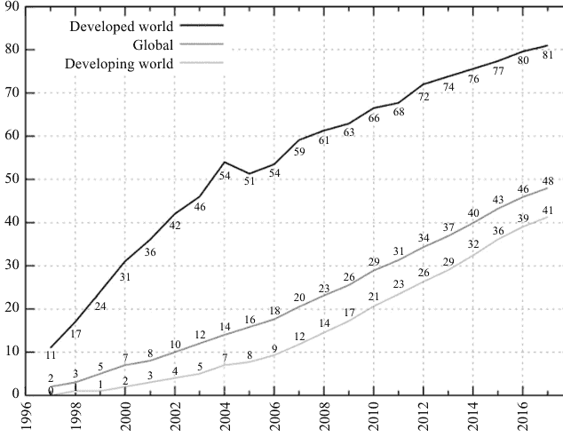
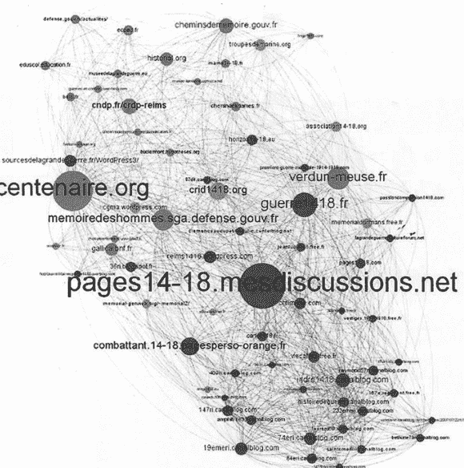

# 历史中的世界大战：争论与争议，1914年至今（现代战争社会文化史研究）

《历史中的第一次大战》这一修订更新版，对1914年至2020年间关于第一次大战的历史学阐释进行了首次综述。它展示了大战的历史如今如何走向全球化，以及互联网革命如何影响了我们理解这场冲突的方式。杰·温特（Jay Winter）和安托万·普鲁斯特（Antoine Prost）不仅评估了外交和军事研究，还评估了跨越学术与大众历史、家族史、公共历史（包括博物馆、舞台、银幕、艺术和记忆场地中的公共历史）对战争的文化阐释。他们为历史学的实践提供了一个引人入胜的案例研究，并对百年纪念如何深化和偏离了公众与专业人士对战争的解读进行了首次综述。对于历史、战争研究、欧洲史和国际关系领域的学者和学生来说，这本书是必读物。

杰·温特（Jay Winter）是耶鲁大学荣誉教授。他是《记忆之地，哀悼之地：欧洲文化史中的第一次大战》（Sites of memory, sites of mourning: The Great War in European cultural history）的作者，《剑桥第一次大战史》（The Cambridge History of the First World War）的编辑。

安托万·普鲁斯特（Antoine Prost）是巴黎大学-先神学院荣誉教授，并曾任法国第一次大战百年纪念委员会主席（2012–2019年）。他与格德·克鲁梅希（Gerd Krumeich）合著了《1916年的凡丹：法德历史史》（Verdun 1916, une histoire franco-allemande），并是《老兵与法国社会（1914–1939）》（Les Anciens combattants et la société française）以及《美好时代的法国人》（Les Français de la Belle Époque）的作者。

## 主编

- 罗伯特·格尔瓦斯（Robert Gerwarth），都柏林大学学院
- 杰·温特（Jay Winter），耶鲁大学

## 顾问编辑

- 希瑟·琼斯（Heather Jones），伦敦大学学院
- 冉·密特（Rana Mitter），牛津大学
- 歇尔·莫伊德（Michelle Moyd），印第安纳大学布明顿分校
- 马丁·托马斯（Martin Thomas），埃塞大学

近年来，现代史领域通过对两条平行历史的探索而变得丰富。这两者是武装冲突的社会文化史，以及军事事件对社会文化史的影响。

《现代战争社会文化史研究》展示了这一日益增长领域的成果，反映了社会文化史历史学家对军事史的“殖民化”，这对于双方都有益。该系列提供了从19世纪50年代至今欧洲及非欧洲事件的最新学术成果。

该系列的完整书目列表请见：


## 导言

## 第二版序言（2020）

《历史中的第一次大战》的第一版出版于2004年。有三个理由说服我们，如果不修订一个章节并增加两个章节，重新出版这本书是不可能的。

首先，对第一次大战历史的写作并没有在2004年停止。此后有许多作品改变了我们看待问题的方式。学者们进入了新的领域，特别是在东欧，历史学家进入了冷战的领域，以理解在1989年由于政治原因被限制的话题。我们无法忽视这些发展。

其次，2014年第一次大战百年纪念在世界范围内举行。在法国，这是由一个政府委员会协调的一系列纪念活动。其他国家也投入了大量精力让公众关注1914年至1918年发生的事情。到处都是出版物、会议、纪录片、电视历史和小说。纪念潮是否改变或影响了我们看待历史的方式？

最后，最重要的是，2004年互联网的指数级增长在全球范围内刚刚开始。在过去的十六年里，它在某种程度上接管了世界。它也彻底改变了历史学家的工作条件。档案和图像的数字化与开放、社交媒体和信息交换场所的扩张、博客以及世界各地学者之间其他交流形式的出现：这些和其他发展促使我们提出了这样一个问题：互联网在多大程度上改变了我们撰写大战历史的方式？

我们没有修改这本书的前七章。我们在第八章中填补了1918年至2000年大战故事是如何呈现的空白。我们替换了最后一章。

本版在第一版的基础上，增加了两个分析2000年以来发展情况的新章节，并有一个新的结论。我们还更新了精选书目。坦率地说，我们并未引用该领域所有的重要著作，并请作者原谅我们在这类著作中仍留下的空白之处。

我们在2004年提出的核心问题依然没有改变。通过对处于特定社会背景下的历史写作进行调查，我们探索了世界各地的人试图为二十世纪初那场屠杀寻找意义的不断变化的方式。斗争继续（La Lutte continue）。

A. Prost 和 J. Winter

2020年3月3日

## 引言

1914–18年的战争不属于任何人，甚至不属于历史学家。自战争爆发以来，关于这场战争的出版物如潮水般涌现，面向世界各地不同的受众。诚然，这种兴趣一直在波动；事实上，在某些时期，第一次世界大战被第二次世界大战所掩盖，但从未没有任何时候人们达成共识大大战的历史已经一劳永逸了。即便在今天，这个课题仍然是一个开放的课题；尽管它正逐渐消失在记忆的地平线上，但该主题依然鲜活，这种痴迷在并非该时期特定专家的著名历史学家所创作的新书中显而易见。著名学者让·巴普蒂斯特·杜罗塞尔（Jean-Baptiste Duroselle）通过撰写一本关于法国人民和世界大战的新综合性著作结束了他的职业生涯（Duroselle, 1994）。

该领域的著作规模令人眩晕。仅仅读完现有的关于大战的文献就需要几辈子：巴黎当代历史图书馆（Bibliothèque d'histoire contemporaine）的馆藏列出了50,000多本书。法国期刊《历史》（Le journal historique）在1919年至2002年间发表了775篇书评或书目介绍；同一时期，一组盎撒逊历史期刊发表了420篇文章和评论，这些期刊的收藏已被在线数据库JSTOR数字化并保存。在法国，自20世纪70年代以来，《历史评论》（Revue historique）已不再作为该领域的出版平台，尽管它在80年代和90年代经历了剧增。从1993年到1998年，出现了1,100多本关于世界大战的法语新书，仅在1998年这一年就出版了200多本。在法国或其他地区出版的每一本新书，有些突破了领域，有些则在重蹈覆辙。许多文章在课题的发展方面有时比书籍更重要，而文章的数量也在增加。我们还必须加上电影、电视纪录片、展览、博物馆和网站，它们的叙述既借鉴了职业历史学家的工作也做出了贡献。

因此，令人惊讶的是，在战争发生一个世纪后，我们仍然缺乏对这段历史写作方式的通论分析。关于战争、战斗、机器、及其多个侧面的历史填满了整个图书馆，但据我们所知，没有人提出这样一个问题：这些文献是否是以特定的方式构建的，或者在特定时刻是否处理了特定的主题或问题，又相继的发展是如何相互关联的？这些内容是彼此重复，还是为不同背景下的不同受众提出了新问题并提供了新答案？这正是本书探讨的核心。

为了开始回答这些问题，我们必须将视野限制在战争本身、其进行及其直接后果上。研究战争对主要参战国以及它所颠覆的世界产生的中、长期影响超出了我们的能力。尤其是，我们更看重书籍而非学术文章，后者较难获得，尽管其中许多文章在历史知识的形成中起了至关重要的作用。

在这片茂密且多形式的森林中，我们试图追踪最重要的路径。我们显然并不意图为卓越的作品颁奖，或声称对如此大量的文献提供详尽综述。当然，我们并未遗漏所有。我们意识到该领域有许多重要的著作和知识。我们希望读者原谅我们，不要因此得出我们的目标（尽管看似巨大）无法实现的结论。我们的首要目标是描述特定领域历史研究的趋势或模式。我们的目标是展示“世界大战”这一类别是如何被构建的。

## 历史上的大战

第三，也是最后，由于战争是一场跨国现象，如果将其局限于单一国家的史学将是荒谬的。如果我们仅仅关注该领域的法语著作，我们将无法领略到英语国家学界研究成果的上升势头。法语出版物的读者群正在萎缩，而英语读者群在不断扩大，这反映了英语学术界的增长。此外，我们还考虑了该领域德国文学的某些方面，无论是原著形式还是翻译成英文的版本，以及一些由意大利学者撰写的研究。另一方面，在第1至7章中，我们既没有处理像奥匈帝国这样具有多民族性质的复杂史学，也没有将苏联和俄罗斯史学的著作纳入其中。本书第一版中的另一个刻意遗漏是：日益增加的从亚洲、非洲和拉丁美洲历史视角出发的关于大战的文献。在第二版末尾的新增章节中，我们开启了对这些主题的讨论。

这三重框架为我们提供了一种灵活的模式，来分析随时间和主题的变化。这种对历史性和主题性的兴趣使我们有时间回到相似的主题。我们试图限制这种重叠，消除所有会削弱我们对特定主题处理的内容。许多著作并不局限于特定领域，考虑到近期的学术研究，早期的来源具有了新的意义。例如，由卡内基和平基金会赞助的系列丛书首先必须被视为那些负责战争努力重要方面的人的证词。其次，它是我们理解战争经济史最早的支柱。第三，如果不参考其中的许多卷著作，没有人能写出这场冲突的社会和文化史。毕竟，在访问一个城镇时，如果一个人反复经过一个中心广场，这并不意味着访问计划得不周，而是说明这个广场确实是中心。

我们共同拥有的这些假设形成了我们的合作，这种合作源于数十年的讨论与友谊。但这种以两种声音进行写作的愿望——我们对每种声音都承担着责任——是具有启发性的。它使我们能够强调不同国家历史之间的对话，并强调仍然主导着关于战争历史写作的国家框架。因此，这本关于旧欧洲解体历史的书，可以作为一种更广泛的第一次世界大战历史的介绍，如果欧洲想要塑造自己的身份认同，这种历史有一天必须被写出来。

为了减轻文中参考文献的负担，我们采用社会学家熟悉的格式来引用参考文献中列出的作品，即只需作者名和日期即可指示该作品在其原始语言中的首次出版情况，并对来自个人作品的引用给出页码参考。

- 2. Jean-Charles Jauffret, ‘Quinze d’historiographie française sur la Grande Guerre 1983–1998: essai de bilan’, in Maurin and Jauffret, 2002, pp. 39–67, followed by a research bibliography, pp. 68–143.
- 3. 学术文章的主要参考文献将作为每章正文的末尾注进行引用。

## 1 三种史学格局

对于士兵来说，至少在西线，这是毫无疑问的：1914年开始的战争结束于1918年11月11日，从那时起他们不再需要担心生命。对于国家元首来说，战争结束得更晚，要么是在和平条约失效之后，要么是在其执行之后。战争始于动员之前，始于萨拉热窝弗朗茨·斐迪南被刺杀的那一刻，甚至更早，于巴尔干战争或关于阿加迪尔的法德危机。职业军人包含了1914年8月在双方展开的战争计划。对于法国行政部门来说，敌对行动的结束是由法律规定的，定于1919年10月24日；而战争的边界则是在11月15日被一次性界定的，因为战争不是一个孤立的实体，而是某种交织、构想的东西。它是一种真实的经历，当代人赋予了它意义。“1914-18年战争”或“世界大战”等词汇反映了这种多样性。毕竟，在访问一个城镇时，如果一个人反复经过一个中心广场，这并不意味着访问计划得不周，而是说明这个广场确实是中心。

## 历史上的大战

在这种配置下，重要的是由卡内基国际和平基金会赞助的系列丛书所发挥的卓越作用。在第5章及其他地方，我们将更详细地分析这一项目，但目前，强调这些特定观点就足够了。这是有史以来规模最大的单项历史工程。这是一部“关于战争的综合经济史，其主题是战争在文明正常进程中造成的流离场所程度”（Shortwell, 1924, p. 1）。通过由官僚、商人、政治家以及经济学家和历史学家组成的国家委员会，几乎对每个参战国和中立国都出版了132卷。英国委员会包含了凯恩斯（Keynes）和贝弗利奇（Beveridge），法国委员会由查尔斯·吉德（Charles Gide）、查尔斯·里斯特（Charles Rist）、亚瑟·丰丹（Arthur Fontaine）和历史学家亨利·豪（Henri Hauser）组成，后者在战争期间是贸易部长埃蒂安·克莱芒（Etienne Clémentel）的顾问之一。由于作者在学术和行政界的地位，以及他们个人所掌握的资料，这一系列对历史学家来说仍然具有最高价值。

## 外交问题的优先性


# 战争史学的三种格局

这一最初配置的主要任务是出版完整的外交文件集。事实上，同时代人被一个主导他们工作的核心问题所困扰：战争罪责。很难体会这种密度的程度和强度。这场磨难是如此长期、如此艰难、如此惨烈，代价是如此触目惊心，以至于每个人都必须知道战争为何爆发以及为何持续了如此久。每个国家都相信自己的事业是正义的。德国人被说服认为包围是真实存在的，这使他们面临着一心复仇的侵略性法国的危险，以及决心阻止德国获得其作为世界强国所应得地位的盟国的威胁。他们坚持认为，他们所做的一切只是自卫。他们的失败是不公正的，更何况《凡尔赛条约》第231条让他们承担了战争的全部责任。试图减轻该条款重要性的论点并没有传给处于震惊状态的民众。在历史学家开始介入之前，两种互不相容的战争罪责版本就已经并存了。

为了确立其论点的有效性，各国政府着手出版官方文件，不仅关于战争的直接起因，还关于决定同盟体系并引发战争的国际关系整个领域。每个政府都动员其职业历史学家来管理这项任务并确保其客观性。当然，档案在多年后开放了，从这些文件中得出的观点将得到修正。但在此期间，大量的外交文献出版物主导了历史学家的工作并消耗了他们的精力。由于大学是薄弱的机构，职业历史学家寥寥无几；因此他们在全球历史文献中的作用是有限的。他们出版的书籍比行动家、见证人少且缺乏多样性。

## 三种史学格局

这种情况因国家而异。法国的情况在两个方面与众不同。一方面，学院比其他地方要弱得多。它们从19世纪80年代起才真正兴起；学生很少，每年约有100名历史专业的毕业生。历史学教授也很少：整个世纪只有55位教授，涵盖了每个时期和每个国家的历史。在索尔邦大学，塞诺波斯是唯一一位“现代和当代政治史”教授。另一方面，这种薄弱被中学教育对历史教学所给予的特殊重要性所平衡了。历史教学在所有中学都是必修课，1914年共有620名教师授课。像世界大战这样的重大历史事件不能停留在教室之外。该学科的教学于1929年正式启动，但在此之前，最广泛使用的教科书作者朱尔斯·艾萨克就在1921年对死于战争中的阿尔贝特·马莱特的经典文本完成了修订，通过在单独的一卷中增加一个100页的关于战争史的章节完成。

由于法国大学相对薄弱，关于战争的历史研究集中在公共教育部下属的一个由专业委员会监督的特定机构上：战争图书馆和博物馆，它迅速发展成为当代国际文献图书馆（BDIC）。该图书馆与战争史学会有关，该学会从1923年起出版了《世界大战历史杂志》。该杂志后来变为《第二次世界大战历史杂志》，现在是《世界大战与当代冲突》。BDIC由卡米尔·布洛赫指导，一位年轻的特许人员皮埃尔·雷诺文担任管理员，他在1917年的达姆山战役中失去了一只手臂。早在1922年，他就受邀在索尔邦大学就战争起源进行演讲。他于1932年当选为索尔邦大学的历史学教授。他的专业和道德权威无可置疑。作为《历史杂志》的编辑、1955年至1958年间索尔邦大学的院长以及国家政治科学基金会主席，他指导了法国外交文件的出版。作为法国学院成员，并荣获荣誉军团最高等级勋章，雷诺文在1964年退休及十年后去世之前，统治了世界大战和当代政治史领域。无论在德国还是英国，都没有哪一位历史学家能像雷诺文那样屹立在世界大战历史之上。在莱茵河彼岸，战争是一段过于黑暗且冲突太多的记忆；跨越英吉利海峡，它对于历史分析来说似乎又太新了，牛津的历史研究在1914年戛然而止。尽管也有例外。克鲁特威尔的战争史于1934年出版，尽管其地位从未比及过雷诺文的作品。

雷诺文的名声通过他在哈尔丰和萨纳克编辑的“民族与文明”系列中的第19卷而广为人知，该系列是剑桥史的平行项目。艾萨克并不认同雷诺文的观点并有时对其进行批评，但他用最热烈的措辞评价了这本书。艾萨克写道，这本书是“第一部具有意义的综合。我愿意说，这本书遵循艺术规则，是法国大学所推崇的历史写作的完美范例，我们的导师朗格洛瓦和塞诺波斯正是其方法和原则。”这本大书（640页）分别在1930年、1948年、1962年和1969年重新出版并更新（1969年版为776页）。它的经典地位取决于知识的博大、文献的精确、阐释的严谨、组织的清晰以及散文的流畅。没有人能比得上雷诺文用最简单、最清晰的方式解释最复杂局势的能力。他的智力具有感染力，他的分析是如此容易理解以至于显得显而易见。令人惊讶的是，他被邀请为1940年前的“克里奥”系列高等教育教科书编写战争章节。1965年，他创作了“什么是？”系列中的战争卷，该书作为权威百科全书具有无可比拟的地位。

让我们看看《危机与战争》。它是纯粹的政治、外交和军事史。冲突的经济和社会方面被忽视了。仅用了两页描述1917年的罢工和叛乱。总有一段描述了罢工潮，26行描述了叛乱以及贝当的回应，还有一段致力于其原因。在稍后出版的“克里奥”书中，雷诺文扩大了他对战争经济层的评论：

他花了一页半的时间讨论经济动员，两页半的时间讨论封锁和潜艇战，用了一页的时间讨论经济“武器”。但对于罢工和兵变，他的描述则非常简练，寥寥数语：“1917年5月的法国，巴黎的罢工与前线许多团发生爆发的兵变相遇。这场危机持续了三个多星期；对政治局势产生了影响”。

比杜的著作对战斗进行了详尽描述，并配有精美的地图，出版商证明了这些地图的质量，但这本书在处理经济和社会主题时同样显得得心应手。兵变占据了一页多篇幅，作者认为这呈现了芒仁将军对兵变原因的解释。布尔热的《世界大战简史》是一本短小、机智、文献详实且细致入微的书，但完全是军事视角的。罢工和兵变仅在文中提到。但最后一章引入了这一视角，并论述了人民战争，以及世界意识的觉醒导致了国际联盟的建立。讽刺的是，拉维斯《当代法国史至1919年和平》的最后一章对该主题提供了最不纯军事和政治的方法，其中两章处理了战争对“国民生活”的影响。令人惊讶的是，塞诺波斯评论了战争的经济后果以及公共债务，并对其增长进行了分析和衡量。关于战争经济的组织或其产生的社会问题则没有任何介绍。

在此阶段，战争史学仍处于婴儿期；研究虽在进行，但仅限于军事和外交史领域，这从季刊《世界大战历史评论》的页面便可见。该杂志装帧精美，留有大量空间对该领域的出版物进行评论。例如，对胡伯关于出版的著作以及皮卡尔对战争期间工会主义的研究均有评论。每期都有两篇核心文章，有时甚至跨越几期，并配有文献汇编和回忆录。这两篇核心文章是均衡的，一篇致力于军事史，另一篇致力于外交史。完全没有关于战争经济和社会层面的文章。同样，《历史评论》几乎没有评论过卡内基系列：在法文版的三十七卷书中，只有七卷引起了注意。其中两本是由杂志的撰稿者写的：卡米·布洛克和雷诺文。三本是关于战争期间城市的专著，其中一本是帕肖关于铁路的作品，另一本是科利内和斯塔尔关于被占法国食物供应的记述。胡伯关于人口学的著作、皮卡尔关于工会主义的研究，以及欧尔和皮克内登关于工资的研究均未被评论。卡内基系列提供的巨大信息资源尚未成为专业历史学家关注的焦点。战争史仍然仅仅是战斗和外交交流的历史。唯一的例外是一个大思想家、开放的学者埃利·哈莱维，他对危机提供了一种全球性的解释，这种危机在战争和革命中是不可分割的。然而，哈莱维对当时的历史学家影响很小。

这种写历史的方式有助于我们理解《年鉴》杂志的观点。奥利维·杜穆林和洛朗·米希耶利表明，布洛克甚至费布弗尔对政治史的特权地位，以及他们所谓的“纯事件史”的谴责过度了，因为历史学家们已经对社会和经济史产生了兴趣。然而，当我们审视战争史时，他们的批判确实是有根据的。我们看到了这种“纯事件史”的完美例证。为了给历史学家辩护，有必要考虑到政治背景。年鉴学派的历史学家与当时的政治争论保持相当疏远。1940年，布洛克承认：“我们一直是优秀的工作者。但我们曾是优秀的公民吗？”相比之下，战争历史学家处于一个暴露的立场，没有对政治利益做出任何妥协，他们提出了关于法国对德立场合法性的核心问题。历史写作的关涉点是外交政策的制定。

这种关注需要进行最严谨的历史批判。历史学家必须做出“客观性的剧烈努力”，以便让他们的解释具有一种远超其他声音的权威性。在一个历史参与者和见证者以权威身份发言的背景下，核心任务是将真与假、可能与确定区分开来，并在寻找证据的过程中比较不同的文献。专业史与大众历史之间区别的最好例子之一，可以在1917年兵变的描述中找到。布尔热或比杜给出的官方解释将兵变解释为和平主义宣传的结果。雷诺文则谨慎得多且具有批判性。对于他来说，需要更多证据才能接受这些断言。

对他而言，“在目前的文献状态下，考虑到兵变的起源时，很难为军事和政治原因归因多少权重；但没有人证明这场运动是由一群妥协主义分子组织或策划的”。

人们对他们所写的内容感兴趣，但历史学家们并不感兴趣。即使是残疾的老伍军兵雷诺文也写道：“士兵的证词对于理解战斗氛围至关重要，但很少能提供有关作战行动的信息，因为他们的视野太窄了。”

正如我们在下文中将看到的，其中一些人试图以不同的方式发出自己的声音。引人注目的尝试是诺顿·克鲁在《证人》中提出的。在这种史学构型的背景下，这本书的意义是无法理解的，这种构型由文献批判主导，并特别排除了前线士兵。批判方法对于战争史是决定性的。因为历史批判已经证实，1914年7月5日德国皇帝等人在波茨坦的著名会面实际上是由一位急于推动他前进的大使所虚造的；所谓的参与者大多数在当天并不在柏林。对于诺顿·克鲁来说，退伍士兵的著作必须以同样的方式进行批判才能成为历史材料。他收集了300本法语书籍，并详细地重建了作者的服役记录：他们被说在哪里，在他们声称的时间他们真的在那里吗？他以一种极度批判和怀疑的精神，追踪了不可信的陈述和不恰当的表达方式。他倾向于避开巴鲁斯和多尔热勒等著名证人，而不是扭曲他根据自己的经验认为准确的内容。在今天，这种计划很容易被质疑。但在当时的背景下，这种批判是士兵为了进入历史记录必须付出的代价。诺顿·克鲁的工作是一个被排除在官方史之外的人近乎绝望的尝试，旨在让自己的声音被听到，并在这场他们且只有他们发现的战争中为士兵获得迟来的认可。

这种尝试揭示了第一种史学构型的方法，但失败了。雷诺文既没有听取，也没有从诺顿·克鲁那里学习。这不仅是因为他们的视角不同——一个从往上看战争，另一个从往下看。这也是方法论或伦理的问题。克鲁将对不同证人的判断作为最终标准。和大多数历史学家一样，雷诺文认为客观性要求他完全从他将写的历史中排除自己。据我们所知，雷诺文在自己的原创作品中从未提到他所经历的那场战争。作为职业历史学家保持批判距离的承诺，与诺顿·克鲁采取的立场完全相反。

这是一个真正的争议点：历史学家对他所写的事件在个人层必须保持多远的距离？这个问题不止一个答案。在第一代中，雷诺文的回应占据主导。这使他及其同事能够写出关于战争的专业历史叙事，但同时也让那些参加过战争的人无法在这些叙事中获得认可，也无法在其中发现自己。

随后是关于德国和英国相同模式的讨论。在每一篇文本中，战争被视为一种从宏观角度观察的大规模政治冲突。这种克劳塞维茨式的偏见与可能被称为托尔斯泰式的对大众的强调，或斯丹达尔式的讽刺（作为决定军事遭遇结果的关键因素）是不一致的。诸如巴希尔·L·哈特那样的概述——他是一位两次受过伤的老伍军兵，也是军事问题的伟大专家和著名的编史家——更多是关于战争而非战士，更多是关于模式而非生活经验，更多是关于单位而非困在战壕系统中的孤个体。但只有在经过了相当的时间，并且在大学外工作的历史学家人数大幅增加之后，情况才有所不同。60年代之前，历史写作限于少数专业学者。此后，参与大战研究的人数呈指数级增长，他们产出的文献也是如此。我们现在转向的新文献，为1914-1918年冲突的历史开启了新的视角。

## 概述

20世纪下半叶是欧洲国家和美国高等教育大规模扩张的时期。这种现象之一是大众市场的扩张，特别是在受教育程度显著提高的人群中。此外，接受过职业历史学家培训并获得博士学位的人数大幅增加。为了出版作品并满足更广泛的需求，历史期刊领域也迅速扩张。国家级期刊如《历史学报》或《历史评论》仍然活跃，但不再主导历史出版领域。专业期刊层出而出。

```

```

图1 大战出版物的比较，《美国历史评论》、《历史评论》以及按年代划分的盎格鲁-撒克逊期刊，从1920年至1999年。作为结果，出现在国家期刊上的大战文章可能减少了。还有其他作品可以立足的地方。

在史学研究中，必须将这一广泛背景考虑在内。以下统计数据提供了我们参考的定量证据。图1是大战出版物的比较，涵盖《美国历史评论》、《历史评论》以及按年代划分的盎格鲁-撒克逊期刊，从1920年至1999年。

人们对他们所写的内容感兴趣，但历史学家们并不感兴趣。即使是残疾的老伍军兵雷诺文也写道：“士兵的证词对于理解战斗氛围至关重要，但很少能提供有关作战行动的信息，因为他们的视野太窄了。”

正如我们在下文中看到的，其中一些人试图以不同的方式发出自己的声音。引人注目的尝试是诺顿·克鲁在《证人》中提出的。在这种史学构型的背景下，这本书的意义是无法理解的，这种构型由文献批判主导，并特别排除了前线士兵。批判方法对于战争史是决定性的。因为历史批判已经证实，1914年7月5日德国皇帝等人在波茨坦的著名会面实际上是由一位急于推动他前进的大使所虚造的；所谓的参与者大多数在当天并不在柏林。对于诺顿·克鲁来说，退伍士兵的著作必须以同样的方式进行批判才能成为历史材料。他收集了300本法语书籍，并详细地重建了作者的服役记录：他们被说在哪里，在他们声称的时间他们真的在那里吗？他以一种极度批判和怀疑的精神，追踪了不可信的陈述和不恰当的表达方式。他倾向于避开巴鲁斯和多尔热勒等著名证人，而不是扭曲他根据自己的经验认为准确的内容。在今天，这种计划很容易被质疑。但在当时的背景下，这种批判是士兵为了进入历史记录必须付出的代价。诺顿·克鲁的工作是一个被排除在官方史之外的人近乎绝望的尝试，旨在让自己的声音被听到，并在这场他们且只有他们发现的战争中为士兵获得迟来的认可。

这种尝试揭示了第一种史学构型的方法，但失败了。雷诺文既没有听取，也没有从诺顿·克鲁那里学习。这不仅是因为他们的视角不同——一个从往上看战争，另一个从往下看。这也是方法论或伦理的问题。克鲁将对不同证人的判断作为最终标准。和大多数历史学家一样，雷诺文认为客观性要求他完全从他将写的历史中排除自己。据我们所知，雷诺文在自己的原创作品中从未提到他所经历的那场战争。作为职业历史学家保持批判距离的承诺，与诺顿·克鲁采取的立场完全相反。

这是一个真正的争议点：历史学家对他所写的事件在个人层必须保持多远的距离？这个问题不止一个答案。在第一代中，雷诺文的回应占据主导。这使他及其同事能够写出关于战争的专业历史叙事，但同时也让那些参加过战争的人无法在这些叙事中获得认可，也无法在其中发现自己。


随后是关于德国和英国相同模式的讨论。在每一篇文本中，战争被视为一种从宏观角度观察的大规模政治冲突。这种克劳塞维茨式的偏见与可能被称为托尔斯泰式的对大众的强调，或斯坦达哈尔式的讽刺（作为决定军事遭遇结果的关键因素）是不一致的。诸如巴希尔·L·哈特（Basil L. Hart）那样的概述——他是一位两次受过伤的老伍军兵，也是军事问题的伟大专家和著名的编史家——更多是关于战争而非战士，更多是关于模式而非生活经验，更多是关于单位而非困在战壕系统中的孤个体（Liddell Hart, 1934）。但只有在经过了相当的时间，并且在大学外工作的历史学家人数大幅增加之后，情况才有所不同。60年代之前，历史写作限于少数专业学者。此后，参与大战研究的人数呈指数级增长，他们产出的文献也是如此。我们现在转向的新文献，为1914-1918年冲突的历史开启了新的视角。

## 概述

20世纪下半叶是欧洲国家和美国高等教育大规模扩张的时期。这种现象之一是大众市场的扩张，特别是在受教育程度显著提高的人群中。此外，接受过职业历史学家培训并获得博士学位的人数大幅增加。为了出版作品并满足更广泛的需求，历史期刊领域也迅速扩张。国家级期刊如《历史学报》（Historische Zeitschrift）或《历史评论》（Revue historique）仍然活跃，但不再主导历史出版领域。专业期刊层出而出。


图1 大战出版物的比较，《美国历史评论》（American Historical Review）、《历史评论》（Revue historique）按年代划分的盎格逊期刊，从1920年至1999年。作为结果，出现在国家期刊上的大战文章可能减少了。还有其他作品可以立足的地方。

在史学研究中，必须将这一广泛背景考虑在内。以下统计数据提供了我们参考的定量证据。图1是大战出版物的比较，涵盖《美国历史评论》、《历史评论》以及按年代划分的盎格逊期刊，从1920年至1999年。

其他历史主题在评论性数量和国家图书馆编目的书籍方面，很可能以类似的方式在增长。

自20世纪60年代以来，历史写作的第二阶段所讨论的战争，与第一代历史学家所描述的战争不同。这种变化在法国身上得到了典型体现：Ducasse、Meyer 和 Perreux（1959年）的著作取得了成功。这些人是第一次世界大战的退伍士兵，而非职业历史学家。正如他们的书名《1914-1918年：法国人的生与死》（Vie et mort des Français 1914–1918）所示，这是一种“自下历史”。这项研究有其自身的历史。作者们在寻找出版社时遇到了困难。Hachette 公司最终接受了这本书，但提了一个条件：他们必须找一位知名人士为书撰写序言。由于这三位作者都毕业于最著名的高等教育机构之一——巴黎高等师范学院（Ecole normale supérieure），他们的同志、法兰西学院常务秘书 Maurice Genevois 同意为这本书撰写序言和后记，且字号比给作者的还要大。这本书取得了巨大的商业成功，使 Hachette 能够邀请其中两位作者在其著名的丛书《日常生活》（La Vie quotidienne）中撰写书籍，其中一本关于第一次世界大战中的士兵，另一本则关于平民（Meyer, 1966; Perreux, 1966）。

《法国人的生与死》（Vie et mort français）是一部混合著作。作者们处于学术界的边缘。他们接受过巴黎高等师范学院和“师范考试”（Agrégation）的培训。这些作者中只有一位是老师，但在中学而非大学。由于他们请求 Genevois 而非 Renouin 来写序言，他们似乎选择了文学而非历史。他们的研究半是给本科生的教科书，另一半是战争期间幸存作家的选集。在军事行动或外交阴谋等主题上，这本书依赖于二手资料，没有提供任何新内容。然而，这些业余历史学家从根本上改变了人们看待第一次世界大战的方式。这是对专业历史学家学习谦逊的一种邀请。

这本书的新颖之处以及其成功原因在于它的视角，这种视角是相当非传统的，正如 Genevois 在他的后记中所言。首先，这是一个全球性的视角，不局限于军事或外交历史。战场显然处于前景，但经济和社会在某种也是景观的一部分。一个处理后方的章节揭示了理想化形象与战争现实之间的巨大鸿沟，以及前线与后方之间的距离。最重要的是，这项研究的重心是新的；我们在这里看到的不是一部法国民族的历史，而是一部法国人民的历史。他们成功地从自下而上的角度，以生动的细节叙述了这一切。他们所描述的战争既是“将军的战争”，也是“士兵的战争”；他们表明，困难的不是下达命令，而是执行命令。“马恩河战战胜利者是法国士兵”（第44页）。在他们的战斗叙述中，他们讲述了服役过的作家们的故事，为自己的书赋予了一种完全全新且未知的基调，以及不可比拟的价值。Grenoble 说过，这段战争历史“更深层、更具创新性。这是一部‘简单’的历史，因为它没有提供过早总结的野心，但提供了一个客观且全面的概述。他们既没有关注军事、外交或社会学，也没有以任何特定方式关注技术，他们将更广泛、更详尽的研究任务留给了专门人士。他们刻意追求的是一部‘战争中的凡人史’”（第11页）。

视角的转变——即用士兵和平民的观点取代了更广泛运动的一部分观点——这需要进一步的阐述。某些因素适用于第一次世界大战的历史。1939-45 年的后期，对法国人来说是阿尔及利亚的……

## 社会背景

视角的转变——即用士兵和平民的观点取代了更广泛运动的一部分——这需要进一步的阐述。某些因素适用于第一次世界大战的历史。1939-45 年的后期，对法国人来说是阿尔及利亚的……

# 历史上的大战

尽管历史学家们不够严谨，但它激发了他们的问题并帮助他们构建了假设。

战争罪责问题是第一种史学构型的核心。对于第二种构型，它是战争与革命之间的联系：1914年第二国际的失败、社会民主主义的“背叛”、革命运动的增长。这一点由罗斯梅（Rosmer）在1936年提出，但他从两个意义上说都是边缘化的。他既不是历史学家也不是共产主义者。²25 第二次世界大战后，这类探讨变得更加频繁。它们往往政治性强于社会性，正如安妮·克里格尔（Annie Kriegel）的博士论文《法国共产党的起源》（Aux origines du parti communiste français，1964年）所示。

这种范式为“用社会解释政治”、“用经济解释社会”增加了一种显而易见的性。如果人们想对历史有一个全球性的理解，必须考虑社会阶级及其之间的合作与冲突关系。正是在这一层面，客观条件与个人和群体的选择相结合了。当时，历史生产由社会群体史主导，例如E.P·汤普森的《英国阶级的形成》（The Making of the English class）、E.J·霍布斯鲍姆的《劳动者与原始反抗者》（Labouring men and Primitive rebels），或者在法国，有莫里斯·阿格尔宏（Maurice Agulhon）关于战争的著作、加布里埃尔·德塞尔（Gabriel Désert）关于卡尔瓦多农民的著作、罗兰德·特姆佩（Rolande Trempé）关于卡尔诺矿工的著作、米歇尔·佩罗特（Michele Perrot）关于罢工工人的著作、伊夫·勒基昂（Yves Lequin）关于里昂工人阶级的著作等。对于这一代历史学家来说，历史是一个故事，其中的演员是社会阶级。在当时，所有这些词汇都是显而易见的。

由于政治背景有利于劳工运动研究，而意识形态背景有利于工人阶级研究，历史学家杰伊·温特（Jay Winter，1974）和约翰·霍恩（John Horne，1991）尽管在1980年的博士论文中就开始了战争中的社会主义研究。在法国，让·雅克·贝克（Jean-Jacques Becker，1977）处理了1914年的动员，他此前研究过社会民主主义的“背叛”，并探讨了为什么1914年8月反军国主义活动分子没有被捕（Becker, 1973）。安托万·普罗斯（Antoine Prost，1977a and b）研究了老军人运动，他已经出版了一本关于人民阵线时期法国工会的书。在第六章中，我们将评论这种社会研究的繁荣，许多在性质上是定量的，这是第二种史学构型的特征。其中一些集中在特定群体；另一些致力于理解整个国家社会及其结构性变化（Feldman, 1966; Kocka, 1973; Waites, 1987）。可以说，这种演变在战争通史中是可见的，这些通史将军事和外交事件、舆论、经济组织和士兵的经历联系在一起。

马克·费罗（Marc Ferro，1969）的综合著作多年来无与伦比，由于它涵盖了所有参战国而更为引人注目。作者完全意识到自己矛盾的位置：“当一个人既皮埃尔·雷诺瓦（Pierre Renouin）又是费尔南·布罗德尔（Fernand Braudel）的学生时，写一部大战史似乎是不莽的，”他在引言中写道。雷诺瓦在序言中记录了这种变化并赞誉了这本书的独特性：

> 它强调了20世纪上半叶人的心理，强调对他们情感和抱负的分析。战争爆发时的民众态度、冲突拖延时的疲劳形式；这种疲劳给革命者带来的希望（他们渴望急于让一个民族国家平息）；尽管存在“思想的动员”，但广泛舆论运动的形成；这些运动的有效性——这些都是本书的主题。

作为这种阐释和方法平衡的例子，让我们考虑其中一项成为该时期法国学生教科书的研究。在《当代法国新史》（the New History of Contemporary France）系列平装本中，第12卷是《世界的终结：1914–1929》（La Fin du monde: 1914–1929，1975年）。它由早逝的历史学家菲利普·伯纳德（Philippe Bernard）编写。战争的起源已在该系列之前的著作中讨论过。130页给了战争、其后果和和平协定；30页给了军事行动；少于一点给了政治方面；15页给了战争经济本身；10页涉及平民生活。马恩河、凡尔丹或索姆河都没有消失，但战争历史已不仅仅是一个经济、一个社会和一个处于战争之国家的历史。

雷诺瓦在为马克·费罗的综合著作写的序言中，用他特有的清醒文字写道：“从这个角度来看，军事史仍留在原位。但外交史已变得次要，外交馆的意义和手段仍然是秘密。”雷诺瓦是对的，外交史在这一新构型中的地位因国家而异。

舆论被赋予的新意义（在文献允许对其进行知情讨论之前，雷诺瓦忽略了它）实际上通过将注意力从战争起源问题转向战争目标问题，重新激发了外交史。如果说爱国动员锻就了“神圣联盟”（Union sacrée），那么战争疲劳在1917年就侵蚀了它，政府不得不说明出于什么原因、什么目标有必要继续战斗。社会民主党瓦解了，德国少数派拒绝为了帝国主义目标参加战争。由于人们卷入了由老旧外交和秘密条约造成的这种毫无意义的屠杀，对政府实施一种新的外交变得迫关重要，这种讨论将在阳光下进行。外交体系的形式决定了其内容（Mayer, 1959 and 1967）。瞬间，核心作用回到了国内政治而非外交。

在德国，正是通过战争目标问题，外交史的主导地位才重新启动。由于纳粹主义阻止了任何批判性研究，一个持久的追求困扰着德国：纳粹时期是成了德国历史中的一个括号、一个意外，还是源于更早的传统？弗里茨·费舍尔（Fritz Fischer）在他1961年的研究《夺取世界市场》（Griff nach der Weltmarkt）中的陈是清晰的。德国想要欧洲霸权，通过建立“中欧”（Mitteleuropa）。这本书引发了极其激烈的辩论。外交史复兴并并了新的动力。同时，档案使得完成和修正之前的阐释成为可能。关于德国战争责任的早期假设得到了证实。

法国和英国不受这场辩论的影响。雷诺瓦在费舍尔书中发现了他早期阐释的证实²⁷该书由詹姆斯·德罗斯（James Droz，1967）译成英文，并由雅克·德罗斯（Jacques Droz，1970）译成法文。德罗斯在后总结了这场德国辩论（Droz, 1973）。雷诺瓦的学生通过先处理舆论和财务关系来学习国际关系。在这里我们看到了马克思主义范式的影响，它将战争视为帝国主义的结果、资本主义的最后阶段。一系列关于国际金融史论文（我们将回到这个主题）削弱或反驳了这一假设，进一步加速了马克思主义范式的衰落。

军事史至少部分也受到了新构型的影响，通过这种构型，这一历史分支发现了普通士兵。军事档案的开放允许佩德龙琴（Pedroncini，1967 and 1968）详细研究了征兵制度，并展示了其根源于士兵的生活条件。他也证明了对这种叛乱的镇压并不严重。他反驳了深受政治圈喜欢的两种流行观点：首先是右派和平主义煽动者的鬼魂；其次是左派系统性盲目镇压的神话。

1975年在凡尔丹举行的一场会议（凡尔丹战役纪念国家协会）揭示了军事史这一转向重新定位的深度。除了关于战略和战术的贡献外，还有关于士兵生死、公众舆论、报刊以及论，甚至是学校教科书中对战争的表述的文章。

在盎格逊文化世界，伦敦历史学家詹姆斯·乔尔（James Joll）在20世纪60年代对英国战争的外交和政治历史提供了最有影响力的重新定位。作为第二国际国际的学者，乔尔以一种令人惊叹的新视角审视了七月危机的外交史。他将主要交战方的领导人描述为在1914年7月发现自己处于一种无法预测的局地之中的人。他们面对的是一种克劳斯威尔式的理性计算，这种计算已变成了一系列关于荣誉或斗争不可避免性的模糊概念，而这些概念是他们生活中更早时期就学到的。英国外交大臣格雷伊勋爵（Lord Grey）的回应并非基于1914年的思想，而是基于他早年在英国公立中学时期学到的荣誉准则。在这里，乔尔称之为1914年的“未言说的假设”，即人们在紧张时刻迷失的隐藏动机（Joll, 1968）。《心态史》（L'Histoire des mentalités）显然跨越了英吉海峡，入驻了伦敦政治经济学院。从这一视角出发，到社会和文化历史成为欧洲史学核心要素时期，只有一步之遥。

## 历史为何以及如何变化的？

在第一种和第二种构型之间，存在着断层，一段由于第二次世界大战影响导致的沉默期。相反，在第二种和第三种构型之间并没有断裂。显而易见，这里有一个平滑的过渡，许多学者轻松地从社会史转向文化史，例如让·雅雅克·贝克尔（Jean-Jacques Becker）、杰·温特（Jay Winter）和斯特塔芬妮·奥杜万-鲁泽（Stephanie Audoin-Rouzeau）。这并不是真正的代交替，而是重点的转移，兴趣中心的位移。这就是为什么这种演变如此迅速的原因，从两次重大国际会议的主题可以看出来：第一次是1988年在南泰尔举行的关于欧洲社会与大战的会议（J.-J. Becker and Audoin-Rouzeau, 1990），第二次是1992年在佩龙举行的关于战争与文化的会议（J.-J. Becker et al., 1994）；在短短四年内，从欧洲社会转向了文化。

### 26 历史中的大战

1988年，温特在一部为大众写的综合性著作中预见了这种转变。在经历了关于政治家战争、将领战争、士兵战争和平民战争战争的四个章节后（每个章节又分为四个时间序列），他写了一个关于战争后果的章节，另一个是关于文学、艺术和电影中战争记忆的章节。在这里，他遵循了费罗（Ferro）开辟的道路，变得更加系统化和形式化。大量插图的使用，结合了真实生活的照片和一些表现作品，为整本书赋予了清晰的视觉维度（Jay Winter, 1988）。八年后，杰·温特和巴格盖特（Baggett, 1996）为英国BBC和美国公共广播服务协会在八年内制作了一部新的电视历史。他们在《大战与20世纪的塑造》（The Great War and the shaping of the twentieth century, 1996）中扩大了视觉项目，提供了一个涵盖所有交战国的通用文化史。他们的引言是明确的：在一个时间框架内，这是一部关于军事冲突的文化史。作者的目的是探索那些远离权力的人和领导权力的人的“希望与梦想、渴望、探索与绝望”。文化史是他们如何理解战争及其后果的故事。¹

这种演变是快速且相对平稳的——它是一种没有问题的延续。在社会史内部，文化史已经存在，并以“心态”、“意见”、“心理”等术语呈现。由于第二次世界大战的影响导致一段沉默期。在第一种和第二种构型之间，存在着断层。显而易见，这里有一个平滑的过渡，许多学者轻松地从社会史转向文化史。……在1990年之前，这种连续性被视为一种转变。文化史显然已经存在，但并未被承认。为什么会变成断裂呢？

一个核心原因是马克思主义范式的合法性危机。柏林墙的倒塌揭示了更多；它揭示了意识形态的崩溃。在某种荒谬的夸大下，马克思主义被视为对社会的科学研究。通过对“社会阶级”等术语的关注，之前，像吉佐（Guizot）这样的历史学家被归类为黑暗时代的幸存者。我们在这里看到历史研究的去物质化，转向了表征。为了逃避上层建筑反映下层的简单观点，许多历史学家完全忽视了下层。我们看到了一种新的理想主义。马克思主义的崩溃对经济史也产生了间接影响。这种趋势体现在对定量证据的整体忽视，以及转向对企业或机构的研究。


# 从社会史到文化史：第一次世界大战史学的演变

## 欧洲与美国的史学转向

在欧洲，马克思主义的危机是导致社会史转向文化史的主要原因之一。在美国，马克思主义的影响较小，学者们更早地表达了对文化时尚的兴趣。保罗·富塞尔（Paul Fussell, 1975）的开创性著作《大战与现代记忆》激发了一整代对文化问题感兴趣的学者。在英国，军事历史学家约翰·基根（John Keegan）的《战斗的面貌》（*The face of battle*, 1976）帮助重新定位了军事史，使士兵在战斗中的行为成为核心，这显然是一种人类学视角。

## 马克思主义范式衰落与微观史的兴起

随着马克思主义范式的衰落，改变的不仅是因果关系的方法，更是历史的方法。历史学家不再试图为历史事件提供全球性的解释，或在所有维度上研究社会。通过微观史或德国人所说的“日常生活”（*Alltagsgeschichte*），历史学家接触的是本身就值得研究的问题。这就是对个人证人记忆重新产生兴趣的起点，但原因与诺顿·克鲁（Norton Cru）的作品非常不同。今天有意义的不是他们的客观性，而是他们的主观性，而代表性问题现在被认为是没有意义的。

## 记忆、身份与纪念

在这种历史学构型中，记忆与身份是不可分的。在这种对第二代物质假设的反转中，身份是从社会条件下产生的吗？由于技术和物质生活的剧变动摇了之前的身份观念？在世纪末，出现了一场强大的记忆热潮，产生了一种对集体过去的责任感。这关乎的不仅是记住大屠杀中发生的事（这非常重要），还为了在广泛寻找起源中寻找社会稳定的元素。那些有根基或基础的人可以确定自己的存在。对于社会主体、机构、企业、社区来说，纪念是一种确认其重要性并履行集体存在的方式。社会身份通过纪念获得合法化。

> 当代文化生活的主要特征之一：身份认同即价值。

这种演变使公众将第一次大战视为我们文化遗产的一部分。随着幸存者的相继离世，战争面临着被遗忘的风险。但通过建立博物馆、展览和纪念碑——在21世纪，一战战场的纪念碑仍在建设中——以及通过教育倡议，第一次大战依然具有极强的生命力。它也存在于家庭记忆中，体现在家庭对阅读战争书籍的兴趣、对在电视和电影中讲述的战争历史的关注，以及对博物馆和战场遗址的参观中。

## 第三种史学构型：文化史的核心地位

在第三种史学构型中，文化占据了核心地位，它既不是统一的，也不是独一无二的。对作为身份认同遗产的广泛关注，与对故事和物品的重新发现偶然，这些发现极大地扩张了历史文献的范围。

### 史料范围的扩张：从物品到影像

这种扩张始于将新闻片作为纪录片来源，例如费罗（Ferro）在其1964年电影中的作品。杰·温特（Jay Winter）和巴盖特紧随其后，除了纪录片外，还引入了许多其他来源（1996）。许多以前被认为仅仅是奇珍异宝或不重要的纪念品的物品成为了历史研究的对象。历史学家研究了照片、明信片（Huss, 2000）²、纪念碑、涂鸦、教堂铭牌（A. Becker, 1994）、玩具（Audin-Rouzeau, 1993）。乔治·莫塞（George Mosse）在其关于第一次大战的著作中专门用一章讨论“战争的平庸化”这一主题。他的解读基于对各种生活用品的研究，这些物品上印有关于战争的图像或信息，以及士兵收集或制作的装备，亦或是商人意图卖给士兵和平民的物品。

### 佩罗讷大战历史博物馆的里程碑意义

佩罗讷大战历史博物馆（Historial de la Grande Guerre de Péronne）的开馆从两个方面标志着这一演变。首先，博物馆强化了对物品重要性日益增长的趋势，物品在空间中的组织创造了其自身的叙事（Audin-Rouzeau, 1995a）。该博物馆的落成（其设计质量广受赞誉）是召开由博物馆内部研究中心历史顾问组织的“战争与文化”会议的契机。其次，通过汇集德国、英国和法国的物品，这座博物馆证明了比较方法是既有意义又必不可少的。

这一项目为法国文化史有了决定性的推动。

### 研究领域的深化：艺术、科学、医学与情感

除了对物品的新发现外，历史研究将注意力转向了新领域：艺术、科学、医学、文学，以及这些领域受到战争影响的方式。然而，这种研究进入了更深层次，触及了深刻的问题，试图理解男女不仅是如何生活的，而且对战争有何种感受。我们现在所处的舒适社会，难以理解人们是如何度过那种极端处境的。参考杜罗塞尔（Durocelle, 1994）作品中的细微之处，战争是“不可理解的”；事实上，他的核心观点目前仍以法语表述。第一次大战就是那个“不可理解之物”。

## 解读框架的根本转变

思维和分析框架的转变完全改变了我们对1914-1918年战争的解读。在两次大战期间，这场冲突被视为最后的；后来，它变成了一场新的“三十年战争”的序幕。现在，它看起来像是一个短暂而野蛮的20世纪的奠基，那些在审视这场战争时，脑中同时也包含了纳粹对犹太人的大屠杀和斯大林的罪行。1914-1918年的战争难道不是极权战争和大规模死亡的首次实验吗？在两次大战期间，历史学家无法提出这个问题；现在历史学家则避免提出它。通过战斗史、外交史甚至社会史无法为这个问题提供答案。

在这里，男女的表征、感受、情感成为历史学家关注的核心。文化史是一个国家共同体内部最私密、最动人经历的历史。它是意义实践的历史；它研究男女如何理解他们所生活的世界。这里包含了哀悼的意义（Jay Winter, 1995; Audoin-Rouzeau, 2001）、野蛮化（Mosse, 1990）、暴力（由历史学会和当代历史研究所研究的，如...所示，Audoin-Rouzeau et al., 2002）以及面对面的杀戮（Bourke, 1999）。我们的当代人对这些主题着迷。在这里，历史学家的工作跨越了学科边界，有时在之前曾有过交汇（Fussell, 1975; Hynes, 1992; Pourcher, 1994; Trévisan, 2001）。

## 文化史的新范式：表征驱动行动

但文化史不仅扩大了研究领域。它提出了其他范式。20世纪20年代的第一种构型通过个体行动者的决策、社会群体或阶级的力量来解释故事。第三种构型让文化成为历史的驱动力。表征告知并解释了行动。例如，约翰·霍恩（John Horne）和艾伦·克雷默（Alan Kramer, 2001）展示了1914年德国入侵比利时和法国时的暴行是如何受到战士形象的启发的。正如阿什沃斯（Ashworth, 1980）描述壕战的物质和心理条件那样，他的目的并不是让读者觉得士兵的行为和态度易于理解。在一种类似的微观历史中，研究了指挥官与士兵之间的关系，这些士兵将自己视为公民。也许最好的例子是让-路易·罗贝尔（Jean-Louis Robert, 1989）对战争期间巴黎工人的研究，该主题需要一种马克思主义的解释，其中客观工作条件和需求将是他们伦理的基础。

---

## 附录：注释与参考文献

9. 这种划分在1923年出版的第一期中就显而易见：查尔斯·阿普（Charles Appuhn）的《现政府与和平：教皇调解提议》，以及E·德斯布里上校（Colonel E. Desbriere）的《英国远征军在1914年行动中的作用》。此后这种情况一直持续。在1927年至1931年间，这一公式没有改变。

10. 他于1936年11月28日向法国哲学家学会了这些演讲。见下文，第129–130页。

11. 奥利维耶·杜米永（Olivier Dumillion），《历史职业：1919–1939，处于危机中的职业》，巴黎高等史学院（EHESS）博士论文，1983年；洛朗·米歇亚利（Laurent Michelli），《法国新史的起源：法国知识分子的演变与社会科学领域的的形成（1880–1930）》，载于《综合研究》（Recherche de synthèse），第4系列，第1期（1995年1月–3月），第55–98页。参见安托万·普罗斯（Antoine Prost），《历史十二课》，巴黎，首尔，1996年，第36页。

12. 马克·布洛赫（Marc Bloch），《奇怪的法国人》，巴黎，A. Michel，1957年，第21页。

13. 这一表达出自朱尔·艾萨克（Jules Isaac），他强调需要“不要对自己的领域过于自傲，要采取一种剧烈且持久的约束”。雅克·托比（Jacques Thobie），《朱尔·艾萨克与第一次世界大战的起源》，收于朱尔·艾萨克论文集，上布塔尼大学组织的展览目录，1997年11月28日，巴黎，Hachette出版社，1979年，第43–51页。

14. 鲁热（Rouget）在第77页承认，平息或击败宣传“很大一部分由敌人资助，并受到俄国革命范式的激励”。

15. 雷努文等人，1939年，第609页。

16. 关于诺顿·克鲁（Norton Cru）和“见证者”（Témoins）的起源，见 Rousseau（2003）。

17. 关于这一点，见韦罗尼克·萨拉斯（Véronique Salas）编，让-雅克·贝克（Jean-Jacques Becker）的评注，《历史学家》（*Les Historiens*），巴黎，A. Colin出版社，2003年，“皮埃尔·雷努文（Pierre Renouvin）”，第104–118页。

18. 《国家历史》（*L’Histoire de la nation*）是加布列尔·哈诺托（Gabriel Hanotaux）的主要著作，由Pierre-Nourrit于1920年至1929年间出版五卷。《法国人民史》（*L’Histoire du peuple français*）由法国新书店（la Nouvelle Librairie de France）于1951年和1953年分四卷出版。第五卷《共和国精神的核心》（*Cent d’esprit républicain*）于1964年出版。其中，1914–18年的战争由弗朗索瓦·贝达达（François Bédarda）论述。

19. 例如，存在一种平行运动，将法国大革命的历史转变为革命者的历史，阿尔伯特·索布尔（Albert Soboul，1958）的论文是代表，它明确反对那种自上而下的历史观。见该论文缩减版的引言，《共和二年的群众运动与革命政府》（*Mouvement populaire et gouvernement révolutionnaire en l'an II (1793–4)*），巴黎，Flammarion出版社，1973年。

21. 参见 丹尼尔·托德（Daniel Todd），《英国政治文化中的第一次世界大战，1914–2000》，博士论文，剑桥大学，2001年。

22. 我们感谢马克·费罗（Marc Ferro）为我们提供这些信息。

23. 安妮·克里格尔（Annie Kriegel）、马克·费罗（Marc Ferro）和阿兰·贝尼松（Alain Besançon），《历史与电影：“大战争”的经验》，载于《学院学院》（Annales ESC），1965年，第2期，第327–336页。

24. 同上，第331页。

25. 基督斯蒂安·格拉斯（Christian Gras），《阿尔弗雷德·罗斯梅（Alfred Rosmer，1877–1964）与国际革命运动》，巴黎，1971年。

26. 参见 雷努文（Renouvin），《关于德国的新研究（1914-1945）》，载于《现代与当代史》（L'histoire moderne et contemporaine），1967年。

27. 参见 费舍尔（Fischer），《德国外交政策（1914-1939）》，巴黎，Seuil出版社，1961年，第22–23页。

28. 参见，《第一次世界大战危机》（*La crise de la Première Guerre mondiale*），巴黎，Gallimard出版社，1996年。

29. 参见，《大战史》（*L'histoire de la Grande Guerre*），巴黎，Seuil出版社，1988年，第32–37页。

---

## 补充：第一种史学构型中的战争写作与七月危机

其他作家，这是关于战争写作的第一种史学构型中的一个显著特征。

德国试图在严谨历史研究的基础上为战前的德国政策辩护，其支柱是迅速出版了四十卷外交文件，书名为《1871-1914年欧洲内阁大政策》（*Die grosse Politik des Europäischenischen Kabinette 1871–1914*）。这项巨大的任务由历史学家提姆（von Thimme）监督。1945年后，德国档案馆的开放使得暴露该系列编纂时的偏见成为可能，并引发了对其所谓客观性的怀疑。英国和法国也出版了大量的本外交文件集，但时间较晚且速度较慢。至于布尔什维克人，他们乐于指责沙皇政府进行帝国主义阴谋，并出版了一本摘自沙皇档案馆的“黑书”，揭露了帝国主义做出的承诺，以及盟国在胜利后计划瓜分未来战争战利品。

在法国，人们出于不同的目标创建了战争“图书馆-博物馆”。它是一个研究中心，其目标是根据历史专业的最高标准，产生一份客观且严谨的历史。它由档案保管员卡米尔·布洛（Camille Bloch）领导，而非将军。德国部门的负责人是一位哲学硕士，查尔斯·阿帕胡（Charles Appahun），他对德国意见的多样性非常了解。皮埃尔·雷诺万（Pierre Renouvin）被任命为该研究中心的馆员。我们已经注意到他在法国外交文件出版以及监督战争历史研究方面所发挥的作用。他在1922年为索邦大学关于德国责任的论点提供了丰富的证据，并在几年后发表了这些内容（Renouvin, 1925b）。在随后的著作中，他证实了这一分析。布洛的研究（1933）对德国的指控甚至更加致命。

相比之下，法国和平主义左翼反对和平协定和建议的德国罪责理论。一群具有不同背景的人在战争期间成立了一个对冲突进行批判性和文献性研究的协会：战争批判与文献性研究学会（*Société d’études critiques et documentaires sur la guerre*）。停战后，它继续工作，并将其核心目标指向了“战争分子”庞加莱（Poincaré la guerre）（Morhardt, 1924；战争批判与文献性研究学会，Jules Isaac），它在双方之间采取了更为中立的立场。简而言之，辩论仍在继续。为了展示这场辩论的全貌，对七月危机的简要概述可能有用。

### 七月危机

1914年6月28日，奥匈帝国皇储弗朗茨·斐迪南大公在萨拉热窝被一名塞尔维亚民族学生刺杀。一个月后，共和国总统庞加莱和内阁首脑维瓦尼履行了对圣彼得堡的长期计划承诺。法国和俄罗斯自1893年以来一直是盟友。7月23日，奥地利向塞尔维亚政府递交通牒，仅留给他们两天时间回复。俄罗斯表示将保护塞尔维亚，同时建议他们谨慎行动。7月25日，塞尔维亚接受了通牒，但只有一个保留：她拒绝奥地利警察参与刺杀案的调查。奥地利认为此为拒绝，一名大使离开了贝尔格莱德，并动员了军团。随后，塞尔维亚决定动员全体军队。战争似乎迫在眉睫。

为了防止战争发生，英国于7月26日提议召开国际会议。德国拒绝了这一提议。7月28日，奥地利对塞尔维亚宣战。第二天，正处于海上且无法联系的庞加莱和维瓦尼在敦刻尔克登陆。俄罗斯在7月30日决定动员，引发了德国的即时动员；德国并于8月1日对俄罗斯宣战。法国动员以支持整个俄罗斯，但英国仍保持未被察觉。柏林要求其保持中立，巴黎要求其根据1904年《英法协约》的条款行动。从伦敦的角度来看，关键问题是对比利时中立的尊重以及比利时的地位。7月31日，英国政府正式询问德国是否会尊重1839年和1848年的中立。德国的回答是模糊的，法国的回答是肯定的。8月2日，德国请求通过比利时。这一请求被拒绝了。几天后，德国军队进入比利时。8月4日，英国对德国宣战并派遣远征军。

不同的侧重点导致了对谁负责任的不同解释。法国历史学家指出，奥匈帝国为了防止在许多民族压力下解体，这才是其向塞尔维亚提出通牒的形式的原因。

来自敌对国家。德国通过在动员过程允许时宣布战争，使得战争不可避免。8月12日前，德国支持奥地利承担欧洲战争的风险，因为她知道俄罗斯不会让奥地利人吞并塞尔维亚。在这种环境下，德国认为力量对比绝不会比现在更好。过去几十年发展的德国海军计划已经实现；然而，俄罗斯军队的现代化尚未实现。7月28日，德国建议奥地利占领贝尔格莱德作为保护措施，但这种安抚表态是一种策略，其主要目标是防止英国加入法国。

对于贝特曼·霍尔韦格来说，违反比利时中立就像一张“废纸”，在分析中至关重要，因为它强调了德国参谋部在德国准备战争中的决定性作用。军队指挥官，甚至总理本人，都被他们的计划所限制。如果与俄、法发生战争，施里芬计划（唯一的替代方案）包括在几周内击败动员时间更长的俄罗斯军队。如果没有德国军队通过比利时摧毁法国军队，对法的快速胜利是不可能的。当皇帝和总理贝特曼·霍尔韦格接受了将军们构思的唯一计划时，他们让德国处于错误的地位。得出结论：“只有德国和奥地利想要战争。他们既不接受讨论也不接受妥协；不接受诉诸武力之外的任何解决方案……至于战争的直接起源而言，这一事实主导了整个辩论”（Renouvin, 1925, p. 214）。

德国论点（Wegerer, 1928和1939）倾向于主张德国完全无辜。这一假说甚至得到了著名历史学家德尔布吕克（Delbruck 1929）的支持。这种分析的总体框架是一个快速扩张的德国，被具有威胁的邻国包围，被剥夺了关键空间和在殖民瓜分中的合法份额；在这种环境下，她的政策仅仅是防御行为。在这样的解释中，从危机开始，参谋部对德国政府施加的压力微不足道；相反，德国给奥地利提出的谨慎建议被强调。这种分析强调了俄罗斯的责任：通过决定全面动员军队，她使得德国的动员以及走向战争变得不可避免。这种观点没有考虑到德国对比利时和法国的进攻对于施里芬计划（Schlieffen plan）至关重要；否则，如果有不同的战略计划，俄罗斯的动员不会导致极端后果。最后，这种分析预测了法国外交并未迫使俄罗斯做出妥协；法国只是重新重申了此前支持其全部的承诺。驻圣彼得堡的法国大使莫里斯·帕莱奥洛格（Maurice Paléologue）是这一批评的主要目标之一，因为他的干预处于对抗一方，而当时庞加莱（Poincaré）和维瓦尼（Viviani）正从俄罗斯回途中。对于英国而言，其责任程度这些论点源于7月底政府的诱导；格雷勋爵（Lord Grey）的犹豫让德国官员相信英国将保持中立。但如果当时那样，交战国之间的军事力量将处于平衡，英国将有机会作为一个公正的调停人并结束危机。


法国和平主义者确实指责盟国对战争的责任（Morhardt, 1924）。从这个观点来看，俄罗斯是一个追求明显理想主义目标的专制政权。包括庞加莱在内的所有法国政治领袖通过在1912年恢复法俄防御同盟，已将其变成了进攻同盟。在这种设定下，庞加莱据认为说服了驻巴黎的俄罗斯大使发动一场战争，以为法国夺回失去的领土和海峡。战后，庞加莱反驳了这些论点，尽管没有说服和平主义者（Poincaré, 1921; Gérin and Poincaré, 1930）。他们的主张并非针对庞加莱，而是符合他们对在法国政治体系外运作的秘密外交体系的认知。在战前夕，法国议会没有一个人知道法俄协定的文本，也不知道为什么一位在圣彼得堡的爱好和平的大使会被撤换。他的继任者帕莱奥洛格被指控在德国试图限制战争之际，加强了俄罗斯在其侵略性立场上的支持。在这里，他使得国际战争变得不可避免，法国和俄罗斯都无法逃避战争爆发的责任。一位观点经常被法国和平主义者使用的美国历史学家（Barnes, in Société politique critiques et documentaires sur la guerre, 1926）甚至反驳了关于德国违反比利时中立的论点。他声称德国没有入侵比利时，英国和法国自己也会这样做。

艾萨克（Isaac）的分析（1933）概述了一组中间结论。他描述了不同程度的责任，将战争的主要责任归于德国和奥地利。但他认为法国和俄罗斯也存在较小的责任。他批评勒努（Renouin）低估了1912年法俄同盟的硬化，以及驻巴黎俄罗斯大使和帕莱奥洛格在圣彼得堡的干预。在可以采取这种做法有益的情况下，法国并没有要求俄罗斯人缓和他们的立场。当俄罗斯将军说服沙皇下令全面动员时，战争变得不可避免了，因为部分动员会在战争开始之初使俄罗斯陷入危险。在他后来的著作中，勒努考虑了其中一些危机，特别是在帕莱奥洛格的问题上；他坚持自己的核心论点，即同盟国对战争负有主要责任。尽管如此，他承认盟国没有尽一切努力防止战争：法国没有足够迫使俄罗斯走向温和；英国没有清楚且尽早地声明如果比利时被入侵，她将保持中立。自20世纪30年代以来，勒努的分析继续影响着法国高中的历史教科书，而在20世纪20年代，这些教科书以更爱国主义和极端主义的方式对待战争。德国对战争负有主要责任（尽管这种责任也由其他国家部分承担）这一点已被费舍尔（Fischer, 1961）证实。即使在我们将要讨论的所谓“费舍尔争议”之后，在勒努研究这一问题几十年后，我们仍然回到了他在战争结束后五年发表的立场上。人们只能佩服他是如何严谨和谨慎，以及他的结论如何经受住了时间的考验。

令人惊讶的是，历史学家在战争结束后不久就能以严谨和详尽的文献处理具有政治意义的问题。几个问题随之产生：什么条件使得这种历史成就可能？所有问题无论其现实影响如何，是否都可以进行历史分析？

首先，显而易见的是某些争议性问题未被视为历史问题。因此，被广泛讨论的和平协议未被作为一个历史现象进行研究。战争确实已经发生；起源是一个封闭的主题。和平条约才刚刚展开，至于如何实施，关于凯恩（Keynes）还是班维尔（Bainville）并非特定的历史问题。可以判定我们进入了另一个领域，即经济学家和政治家的领域，其中许多人发表的内容不仅关于发生了什么，还关于现在和未来必须做什么。一些人对对手提供了负面形象（Tardieu, 1921; Nicholson, 1933）。因此，这些研究虽然提供了重要信息，但不具有历史特征。它们是开放的政治论文。即使埃蒂安·曼图（Etienne Mantoux, 1946）后来的研究具有历史特征，也是为了对抗性地反驳凯恩关于“迦太基式和平”的论点。但当曼图写作时，关于条约的应用或修订的问题已经过时；它不再是一个开放的政治问题，因此可以作为历史分析的主题（Birdsall, 1941; Luckau, 1941）。

德国外交很早就看到了这种优势，通过动员友好的美国学者来获得，这些学者能够为他们在战争责任问题上的立场提供外部证实。他们促进了历史学家的工作，并为他们著作的出版和翻译（特别是法语）做出了贡献（Mombauer, 2002）。

三项关于该时期的美国研究立即被翻译成法文：巴恩斯（发表于《批判性研究与战争文献政治研究学会》，1926），他后来任新学院教授，倾向于同盟国；法伊（1929），哈佛大学教授，支持“共同责任”论点；施密特（1930），芝加哥大学教授，将主要责任归咎于德国和奥匈帝国。法国的辩论是顺着这三项研究展开的。艾萨克（1933）用一整本书探讨了这些论点，并得出结论：如果正如勒努（Renouvin）所说，同盟国是“强加”给欧洲的战争，那么欧洲也很难拒绝效仿。

第三，法国历史学家明确区分了那些基于文献证据进行讨论的主题，以及那些由于缺乏完整且批判性的文献而仍保持开放的主题。这种区分使得在某些观点上存在根本分歧但在另一些方面可以达成共识的学者之间，能够实现某种务实的和解。因此，该领域对历史问题的外交式讨论或谈判敞开了门。例如，1935年，在德国中学历史教师协会主席的提议下，巴黎举行了一场关于两国历史教学的会议。法国代表团包括勒努、艾萨克以及国家小学教师工会的总秘书。其目标是为法德教师找到一种双方都能接受的历史叙述方式。两个代表团只能对那些他们都能以自己的方式解释的陈述达成共识。考虑这些内容：“现有文献并不允许我们认为1914年任何政府或民族对一场[欧洲的]战争具有预谋的企图……”（Isaac, 1938）。当然，纳粹分子拒绝了这些陈述。和解的努力在1951年再次重启，当时勒努会见了德国历史学家格尔哈德·里特（Gerhard Ritter），里特的反纳粹信誉获得了认可——他甚至曾被监禁。他们达成的共识并没有比1935年的先辈们大多少。尽管阿尔贝蒂尼（Albertini, 1942–3）出版了三卷基础性著作，分歧仍然存在——这位杰出的记者转历史学家从新证据中得出德国责任是确定的结论，尽管阿尔贝蒂尼对庞加莱有非常严厉的措辞。

### 直接原因与深层原因

所有历史学家都承认，将战争起源问题简化为几个部长、将军和外交官的作用是荒谬的。每个人都意识到需要将七月危机置于一个使其易理解的背景之中。勒努的作品——事实上这正是其力量所在——是由一个双重概念框架构建的：直接原因、深层原因，后者意味着我们脱离传统历史所禁锢的、交流与谈判的狭窄世界（Pinguard, 1938）。勒努发起了研究历史中起作用的深层力量的号召，通过这些力量，外交史可以变成国际关系史。这是他的《国际关系史》伟大与成功的源泉，该书关于战争的部分遵循了他早期的论证路线（Renouvin, 1955–7）。

在对交战方的计划进行详细分析后，肯尼迪（1979）修正了这种解释。这些计划受到日益复杂的行动以及对更先进技术使用的限制，因为总参谋部认为这些是值得的。对他们来说，对政治精英来说，僵化是一种美德。全战的爆发并非由于误判；妥协从一开始就被排除了。目标是绝对胜利。

正如勒努所表述的，由于战争与其起源之间的对立，关于通过设计或通过误判引发战争的讨论被跳过了。

### （接上文）

正如勒努所言。原因总是被视为直接原因，在应用于如此大地震时显得微不足道；起源则总是设定在一个更长、更深层的时间框架内。例如，乔尔（Joll, 1984）在《第一次大战的起源》中，在关于七月危机的章节之后，处理了同盟体系以及军事、政治、经济和殖民等方面的情况。但这种对问题的框架扩大到了对历史认识论更深层的考虑，涵盖了决定论和偶然性，正如我们在哲学家阿隆（Aron）的反思中看到的那样。每当历史学家权衡导致事件发生的条件的力量时，他必须控制那种“宿命论的回顾性幻觉”。这是一个战争起源历史学家无法解决的矛盾，因为这是不可能解决的。在对深层原因进行长期讨论后，他们总是会回到战争爆发过程中偶然性不可还原的本质上。正如勒努所说（1934, 180），战争的深层原因中，没有任何一个能构成对其爆发的充分解释。在寻找更好解释的路上，我们必须转向“国家政治的取向、政府的行为，归根结底，这些才是发生的事件”。五年后，乔尔回应了这一观点（Joll, 1984, p. 205）：

战争是否不可避免，或者至少在特定时间发生的特定战争，并不是一个可以从个人责任来回答的问题。尽管有所有促使战争发生的力量，尽管我们现在拥有所有证据，但某些阶层的统治意志……

## 政治家与外交官

毫无疑问，政治家在1914年没有想象他们引发的战争会变成“大战”。

在第二种格局下，法国史学由马克思主义范式和年史学派主导，后者消解了纯事件历史。因此，失去了政治维度的历史只能失去其在1940年之前的中心地位。它在更深层且经常被提到的原因中寻求复兴：经济危机、帝国主义、资本主义的阶段。这一路线的历史学家持有相同的假设：一些希望证实马克思主义立场，另一些则想反驳它。但无论如何，审查经济利益和联盟以及它们如何影响战争爆发是重要的。

在勒努及其继任者的指导下，杜塞尔（Duselle）等年轻历史学家对新档案进行了研究。大使馆公文已被研究过；要发现新东西，必须探索其他来源，如领事报告和外交部的商务部门、大企业的部门，特别是银行部门。许多“大论文”被启动，它们在十多年后根据法国学院的规则出炉。

# 历史上的第一次大战

经济和财务问题并非德法两国宣战的起源。显然，政治和战略因素起了决定性作用，但经济问题加剧了这两个国家之间紧张的整体氛围，从而促进了双方关系的破裂。（Poidevin, 1969, p. 819）

简而言，帝国主义并非经济利益的简单政治化。

## 德国关于弗里茨·费舍尔（Fritz Fischer）著作的争议

这种国际关系研究的导向是法国所特有的。在英国或美国并没有以同样的方式存在，在这些国家马克思主义范式虽然存在，但是一股微弱的力量。在德国，没有与法国类似的平行；第二次世界大战的创伤是另一个层面的。随着1945年毁灭性的失败，随着处处废墟和惨重损失，随着德国被分裂为两个国家，同时也存在纳粹的阴影以及他们带来的恐怖。所有关于一战或二战思考背后的核心历史问题，是理解纳粹为何以及如何统治德国的。这是历史的偶然，还是长期趋势的结果？在这里，关于连续性还是断裂的旧问题具有了生存的维度。

1945年后的西德，历史研究人员重新获得了自由。纳粹对大学施加的政治限制消失了。诚然，大学精英阶层的精英主义继续像其他国家一样行使某种程度的社会控制，但研究是自由的。档案开放了，《德意志政治》（*Deutsche Politik*）的卷被发现时，历史学家意识到这些文件经过了仔细的筛选和删减，以证实官方的解释。

20世纪50年代，一些德国历史学家开始探索一战和二战之间德国追求世界强权的连续性。但是弗里茨·费舍尔在1959年的一篇文章中，随后在他的著作《迈向世界权力》（*Griff nach der Weltmacht*, 1961）中，从根本上扭转了1914年的史学观。后来他以及学生的作品证实并巩固了他的重新解读（Geiss, 1963）。

在这场讨论中，战争目标的问题起到了核心作用。费舍尔试图分析帝国主义德国的目标。罪责问题不再是调查的核心，尽管他在书中关于德国责任的论点非常有力。这对于德国历史学家来说既是新颖又是令人震惊的，但它建立在巨大的文献基础之上。由于档案的开放，费舍尔能够利用广泛且丰富的文献对大国地位给出解释，这对于一个受过神学训练的人来说是令人惊讶的。例如，他早在7月5日就表明德国政府推动奥匈对抗塞尔维亚，并向其递交了一份无法接受的最后通牒。但费舍尔感兴趣的还有德国统治精英阶层的政治计划：他们为了什么目标参与局部战争，又为什么要接受欧洲战争的风险？

这样一个问题导致了对战争史学的深刻修正。虽然贝特曼-霍尔韦格（Bethmann-Hollweg）在公开声明中采取了谦虚的立场，以免疏远社会民主党并削弱国家凝聚力，但他实际上追求了野心勃勃的扩张政策。这一论点很大程度上基于他在1914年9月9日马恩战役期间制定的“和平计划”。核心概念是“中欧”（*Mitteleuropa*），这是一个包含奥地利-匈牙利以及法国、荷兰和丹麦的关税联盟。德国还将在东方通过若干缓冲区国家扩大影响力，特别是波兰，以保护其免受俄罗斯的侵害。在西方，德国将成为一个巨大的国家，在经济上受到控制，剥夺列日、可能还有安特卫普，并在战略要点由德国驻军统治。比利时刚果将成为沃日山西侧、马斯河上游（Hauts-de-Meuse）的要塞以及布里-龙维（Brie-Longwy）铁矿，这些被认为是德国钢铁工业不可或缺的。此外，德国将占领从敦刻尔克到海岸，并获得巨额赔偿金，足以防止二十年内的重组。整体而言，根据情况进行了一些调整，这一计划符合鲁尔地区大亨和普鲁士贵族的需求。它得到了总参谋部的支持，并影响了直到1918年的德国政策。

费舍尔的书引发了一场异常激烈的辩论。费舍尔和盖格斯（Geiss）以及贝尔格哈恩（Berghahn, 1971），通过将第三帝国的扩张解释为德意志帝国（Kaiserreich）扩张的延续，反驳了主流史学。希特勒和纳粹不再是例外。这一论点对于拥有完美专业和政治背景的历史学家格哈德·里特（Gerhard Ritter）来说是完全不可接受的。他关于军事主义的著作展示了军事阶层如何获得政策据地，并通过施莱芬计划将防御战转变为针对法国的进攻战，这必然意味着对比利时中立的违反。对于里特来说，贝特曼-霍尔韦格是民权力量的化身，以及对控制军队的渴望。

也许费舍尔著作的重要性在于其他地方，在于对解释体系的倒置。从他的角度来看，战争被解释为德国政治和社会力量对皇帝和总理的相互作用，而非外部压力。费舍尔对凯尔（Kehr）十年前提出的观点进行了新的和扩充，凯尔早已暗示德国的侵略外交是为了消除内部社会紧张。通过强调外交政策的社会维度，费舍尔在某种程度上导致了历史格局问题的转变。

# 50 历史上的第一次大战

因此，国际关系史与该时期社会史有着许多共同的核心关注点。但如果战争与革命是交织在一起的，如果核心问题是战争为何没有早发生以及为何以这项条约结束，那么关于战争目标的辩论就具有至关重要的意义。在这里，英国历史学者的工作非常重要，他们描述了战争目标演变的偶然性（Stevenson, 1982; French, 1986）。同盟国战争目标的性质与协约国提出的目标之间存在本质区别。大卫·斯蒂文森（David Stevenson, 1982）从国内和外交政策的角度探讨了这一主题。对于盟国来说，定义战争远比同盟国要困难得多。在盟国中，没有哪个单一国家像对面的德国那样起主导作用。维持同盟的存在本身就是法国的一个战争目标。在民主国家，由于涉及不同的政党，其讨论比德国复杂得多，而在德国，政府有更宽广的操作空间。

但这些目的性的陈述也是复杂的外交活动的一部分，必须拟定并发表其回复。事实上，“正常”的外交史仍如以前那样进行。虽然有许多独立的倡议，特别是来自梵蒂冈和其他来源的倡议，但没有一个取得结果，部分是因为宣称的战争目标与政府内部秘密讨论的目标之间的差距太大了。

从1914年至1916年，双方的核心目标是消灭对方的力量，但从1917年起，并非出于任何内在原因，而是因为需要维持国内政治休战，以及由于俄罗斯革命和美国参战的政治影响，战争目标变成了每个人的事务。由于到1917年伤亡人数惊人，这些目标也变得至关重要。公众无疑认为，必须有一个目的地，一个终点，让每个人都能声称：“我们正是为了这个目标、这个事业而战斗，并在实现它后停止战斗。”到1917年，公众在国际关系中的地位比任何时候都重要；各国政府在战争第二阶段的重新动员，是为了充当大众事业的旗帜，而这些事业被定义为战争目标。

乔治斯·亨利·苏图（Georges-Henri Soutou, 1989）从经济角度对这一主题进行了彻底探讨。他的论文为广为人知的文献提供了全新的视角，并增加了大量新材料，为对所有交战国的经济战争目标提供了权威叙述。通过这种方式，他削弱了费舍尔的核心论点，证明“9月9计划”并不像费舍尔说的那样重要。尼雅尔·费格森（Niall Ferguson, 1999）将该计划分析为对英国参战的愤怒回应，但对苏图来说，它首先是对德国兼并更极端计划的温和反应，正如我们在第五章将所示。另一方面，苏图强调了法国经济战争在其对战后安排的整体思考中的重要性。早在1916年6月，法国就获得了英国的支持，以控制原材料并在欧洲范围内建立某种经济霸权。

在这种背景下，胜利国在参加1919年和平会议时准备有限，这并不令人意外。凡尔赛史学已经经历了重大的重新诠释。凯恩斯对赔款的批判受到了费尔德曼（Feldman, 1993）和费格森（Ferguson, 1999）的质疑，他们表明尽管德国对此表示抗议，但德国确实有能力支付。对于许多学者来说，该条约是当时最不坏的妥协（Sharp, 1991; Stevenson, 1991; Boemeke, 1998; Macmillan, 2002）。在几个月内结束谈判是必要的，因为不可能让军队保持着装状态。必须进行复员。被封锁导致饥饿的平民问题是迫在眉睫且不可避免的。但重要的是，协约国政府正忙于他们必须镇压的革命性动乱。谈判者受限于国内问题的困扰，已经尽力而为了。这里的对比是：以威尔逊为代表、最初得到欧洲公众支持的激进和平的预期，与和平条约的现实之间的对比，后者看起来就像是换了新装的旧时代。

对比一下1871年接受的法国和支付了巨额赔款且未对条款提出异议的法国。多年后德国拒绝承认失败并对解决结果提出异议。事实上，德国成功恢复了军事力量，并最终发动了战争。麦克米伦（Macmillan）在其《和平创造者》的研究中证实了这一点。说第二次世界大战直接源于凡尔赛就太简单了。和平安排的主要弱点在其他地方。他们（以及克鲁切（Kruiche, 2001）对其他矛盾的强调）从法国对安全的渴望、英国对帝国的承诺以及威尔逊对自决权的信念为世界秩序提供了新的解释。英国帝国变得削弱；盟国消灭布尔什维克革命的尝试失败了，尽管自由的波兰在1920年抵抗了苏联入侵。威尔逊遭受了双重失败：第一次是他未能使巴黎条约获得批准，其次是他向劳埃德·乔治和克莱孟梭的让步，以及他对非有色人种世界自决性质的保留。通过拒绝在条约中加入种族平等原则，引发了塑造整个世界、特别是亚洲面貌的发展。中国的五四运动（中国共产党由此诞生）与美国人和欧洲列强在凡尔赛对待自己的方式相提并论。埃及和印度的动荡是1919年和平条约对威尔逊原则“背叛”的直接结果。在读完麦克米伦的书后，可以认为凡尔赛不仅种下了1939-45年欧洲战争的种子，也种下了1941-45年太平洋战争的种子。


# 文化史为战争起源研究注入了新的动力

詹姆斯·乔尔（James Joll）在1968年伦敦政治经济学院的开学讲座中，建议理解公众舆论和集体心理对国际史的用处。在《未言的假设》（The unspoken assumptions, 1968）中，他呼吁重构政治人物以及普通人的思想和预设，或者用吕西昂·费弗（Lucien Feuvre）的话来说，理解他们的“精神家具”。他的结论是：“只有通过研究人类的心灵，我们才能理解任何事情”（第24页）。十六年后，在《第一次大战的起源》（Origins of the First War, Joll, 1984, p. 205）结尾，他写道：“为了要理解1914年的那些人物，必须根据他们的价值观来衡量其行为。”

在某些方面，Joll的计划已经实现，特别是通过Düllfer和Holl（1986）的研究。有趣的是，这种对国民民意的调查是不同国家历史学家共同的成果。一个国家的历史学家探索了敌人的心理。格尔德·克鲁梅伊希（Gerd Krumeich, 1981）在一篇未用法语出版而是用英语出版的德国论文中探讨了关于法国《三年法》的辩论。他指出，法国政府发起了一场恐惧运动，以确保法律的通过。他们的论点是，法国将被新改革的德国军队淹没，对方能够在法国人调整预备队之前发动奇袭。法律通过后不久，政府多数派遭到了1914年选举结果的威胁。1914年7月，波庞莱（Poincaré）可能认为时间并不站在他一边，也不符合国家利益，而且几个月后，法国军队将变得更弱，而俄罗斯则最不坚定。一个深度和平主义的法国形象需要这样的修正，尽管其核心本质上并非如此。

在战前夕对集体心态进行比较分析的首次机会是1972年在鲁昂举行的一次会议。波伊德文（Poidevin）补充了克鲁梅伊希的观点，指出在阿加迪尔事件后，法国公众舆论对德国的恐惧日益增加，这是因为德国公司的法国子公司正在向法国销售德国生产的材料。在英国，人们对陆战很少关注，领土防御已充分交给了皇家海军。就在此时，诺曼·安格尔（Norman Angel）提倡了一种新型和平主义，这种主义并非源于道德观点，而是源于利益计算。战争是一个错误，是不划算的。不仅是因为战争变得越来越昂贵，而且因为胜利并不能带来他们预见的那些收获。在德国，沃尔夫冈·穆姆森（Wolfgang Mommsen）注意到了支持战争的意见力量，政府既刺激了这种力量，又声称自己无法抵抗。

一种有利于使用武力的帝国主义热情开始产生，被呈现为人们生活中必要甚至是积极的。另一方面，作为一种反应，人们对迟早会发生的世界大战产生了一种宿命论式的无奈。这种关于战争不可避免的思想……有了其自身的内在动力，并很快变成了……一种对战争的宿命论期待。

事实上，德国舆论中的许多元素倾向于战争。在他1911年死后出版的政治学课程中，海因里希·冯·特雷特舍克（Heinrich von Treitschke）将战争视为上帝赋予的秩序的一部分，是政治的正常手段。弗里德里希·冯·伯纳尔迪（Friedrich von Bernardi）的观点在1912年广受推崇，尽管大自由报纸和社会民主党批评他声称战争是不可避免的、值得的且合法的。

> 力量是伟大的立法者，伟大的考验将由战争来裁决，战争是力量的尺度，而且总是做出生物学上的正确判断……如果没有战争，人们将看到堕落的[vorkommen]、低价值的[minderwertig]种族轻而易举地压倒作为未来基因载体的健全元素；这将导致普遍的衰败。¹¹⁷

这是所有民族必须通过的测试。穆姆森（Mommsen, 1990和1995）分析了这种入侵德国公众舆论的民族主义，特别是底层阶级和资产阶级。这些群体在政治上渴望战争，因为他们相信，除非认为德国已经准备好并愿意战斗，否则大国不会考虑到德国的利益。德国学者也致力于相似的主题，例如克劳斯·冯东古（Klaus Vondung, 1980）。

托马斯·林德曼（Thomas Lindemann, 2001）遵循了约翰·L于1968年在伦敦经济学院开辟的道路。他分析了民族主义达尔文主义思想在1914年战争爆发中的作用，并将其追溯到其知识元素和吸引力。他进一步提出了一个问题：政治局是如何根据意识形态及其预设的术语被感知的。从他的观点来看，社会达尔文主义不仅营造了有利于战争的氛围，还导致了充满严重的错误。由于许多德国人及其领导人认为由许多民族组成的国家必然是脆弱的，他们低估了奥匈帝国抵抗所面临的紧张局势的能力。埃德华德·贝内（Eduard Bene）或托马斯·马萨里克（Tomas Masaryk）依靠的是改革而非军事。

# 政治家与外交官

“阶级特质”（或他人所谓的“文化”）使得出身于共和制精英选拔的法国人与来自贵族阶级的外交官之间无法进行谈判：法国领导人和德国领导人一样，既不想也不可能和对手玩同样的游戏，因为这要求他们采取对方的观点。人们可能提供一些让步，但从法国的角度来看，无法接受德国人的优越傲慢；从德国的角度来看，也无法接受平权主义的实践。从双方来看，这些态度植根于两种政治文化、两种阶级精神，更深层次地，源于对立的社会动态。（pp. 240–1）

法国的提议并未被视为一个民主且和平的社会的产物，德国外交官对此深恶痛绝。在某种意义上，这种叙述遵循了一条成熟的路径。多年来，历史学家一直认为有必要理解人们根据自己的思想和信念所做的政策决策。但事实上的新之处在于双重：第一是心态、文化与所谓的理性的政策制定世界之间的联系。这些中介是长期的、复杂的、间接的，不仅涉及情感，还涉及道德假设。其次，存在对现实的过滤在决策者认为自己正在客观分析时，扭曲了对局势的感知。

大卫·弗伦奇（David French, 1986和1995）已经展示了1914年底的战略选择是英国人对西线意外形成僵局之方式的感知的结果。由于打破这种僵局的代价如此高昂，丘吉尔等人寻求一种以奥斯曼帝国和中东为中心的新战略。此外，对衰败的预设观念致命地误导了英国的计划，因为这些计划基于对东方的十年认知，无法想象土耳其人会击败他们。这种“东方主义”夺走了成千上万盟军士兵的生命，他们死在加里波利的战壕中。

承认失败。最终的胜利比他们预想的更加彻底。在索姆战役之后，被他所谓的“失败主义者”认为战争已经失败，伤亡人数是如此触目惊心，以致胜利与失败之间的区别仅仅是程度问题，而非性质问题。

在这一项调查结束时，人们惊讶地发现，随着写作当时的社会和历史背景的演变，历史学家的观点发生了多大程度的变化。在战争结束后，看起来像是罪行的行为是由必须被识别和惩罚的人所为的。第一次世界大战是第一次被界定为一场犯罪，而不是被视为事物的本质。从文化角度来看，这种战争的犯罪化是令人震惊且前所未有的，因为它使战争变得不正当。这种规范性陈述本身充满了与胜利者的帝国主义态度以及他们对苏联进行军事干预的意愿相关的矛盾，在两次大战期间迅速消失了。随着时间的推移，“战争罪责”的概念虽然仍然存在，但变得尖锐。所有国家、政府、所有人民都在不同程度上对这场他们未能预见或阻止的灾难承担了某些责任。更糟糕的是，凡尔赛条约未能阻止其再次发生。曾被视为犯罪的行为已变成了一种集体错误，其元素是接受了二十世纪特征的大规模死亡（Mosse, 1990）。战争确实是这个世纪的开创性灾难。正如所说，那些主持了这个世纪集体灾难第一幕的人，似乎是被他们自己引发的事件所吹动左右的傀儡。这是一个与希特勒和斯大林性质不同的故事，后者是在知情的情况下杀害了数百万人，且完全没有打算做其他任何事情。大屠杀和斯大林的大规模杀戮不是经典意义上的悲剧，而是反人类的罪行。相比之下，1914–18年的领导人设法恰好实现了与他们意图完全相反的结果。他们在1914年7月选择了战争，但他们的手和头脑有多大的自由呢？战争一旦启动，没有人能阻止它，无论个人领导人多么想通过愿望消除自己的命运以及那些渴望和平生活却被他们很大程度上背叛的人民的命运。文化历史在这里变成了对命运的冥想。考虑到那个时代人的样貌、他们的想法和他们的信仰，他们无法别无选择。在这一史学背景下，我们再次面对人类事务中自由与必然之间无休止的对话。

## 参考文献

1. Camille Bloch 和 Pierre Renouvin，L’article d’histoire du traité de Versailles, sa genèse et sa signification’, Revue d’histoire de la guerre mondiale, 1–1932, pp. 1–24.
2. Droz (1973) 和 Mombauer (2002)。
3. 冯·德布鲁克（H. von Delbruck）和门德尔松恩（A. Mendelsohn）。
4. 《战争文献》（Deutsche Dokumente zum Krieg），1914，柏林，出版社。
5. 
6. 
7. 《18年战争记忆》（La mémoire de la guerre 14–18），1994。
8. 《大战》，纽黑港，耶尔大学出版社，1999。
10. 《政治》（Di Vita Politica）。
11. 战争的演变，马盖尔出版社（Gallimard）。
12. 战争的演变。
13. 战争的演变。
14. 《历史评论》（*Revue historique），1974。
15. 《1914：18》，1985。
16. 《1914：18》。
17. 《德国与下一场战争》（Deutschland und der nächste Krieg (1912)），引用自

---

我们过去所形成的战场幻景在某种程度上是关于……的……以及……的……在这些……战争的……领域是不稳定的。这种变化的政治格局是主要参与者在……期间有很多可以的话题。指责对方是战争军事史中不可避免的一部分。由于将军和政治家对战争的方式负责，大战史学中的领导与指挥主题必须要求对军事史本身以及军民关系的性质进行评论。我们可以将该领域的讨论分为三个时期。首先，在两次世界大战之间，有一个“英雄”时期，期间战斗是根据19世纪的标准构想的。然后，在20世纪60年代和70年代，人们对指挥问题的兴趣增加。最后，在20世纪80年代和90年代，出现了第三个时期，期间存在着更大的意见分歧和争议性的解释。在这些年里，特别是英国，出现了“学习曲线”的概念，描述了盟军指挥官缓慢但确实地掌握了这一工业化战争的新战场，以至于他们能够取得1918年的胜利。在这个第三个时期，军事史写作中的国家差异是显而易见的。“学习曲线”

“Great War”一词是英国人的发明，在法国或德国关于战时指挥的著作中几乎没有踪迹。这一领域辩论的激烈程度也是英国史学的一个特征，在英国史学中，指挥问题一直是对战争本身徒劳性进行更广泛质疑的核心。

## 第一阶段：英雄主义历史

第一阶段涵盖了两次大战之间的时期，本质上是一部关于战役和战斗的历史。关于一战军事史的出版物始于战争期间，并在20世纪20年代初呈现出某种如洪水般的特征。在这一时期，大部分工作集中在特定战役的历史上；战役规模越大，对其进行的历史评论就越多。这些作品绝大多数分为两类：关于胜利如何取得的英雄主义历史；以及关于战役和战略的历史，即以宏大叙事风格撰写的历史，带有对所描述事件史诗规模的感悟。其中很大一部分也是官方史，写作带有教化目的，旨在为未来的参谋官提供启示。因此，它们对这个故事中主要参与者进行客观批判的能力是有限的。

两次大战期间历史写作的这种偏见显然一直延伸到了军民关系领域。核心政治人物的回忆录涉及了他们对冲突期间不断演变的战斗历史所承担责任的问题。一个典型的例子是法国战争部长保罗·帕内莱维（Paul Painlevé）以及他的著作《我如何认识福煦与培坦》（1923年）。意料之中的是，在几乎每一种情况下，错误的责任都归咎于相关作者在书页中的叙述或其实际表现。这种对每个参战国军事努力的高度个性化的历史具有争论性质。这些书籍大多基于作者的记忆，或他们所接触的非公开文献。尽管存在一些显著的例外，但在这一时期，我们很大程度上仍停留在军事史的层面，即制服大将或“穿长大褂”（即内阁大臣的服装）的人士所属的领域——他们在巨大的棋盘上部署了数百万士兵；结果是1918年11月将德国击溃了。

对一战战场进行反思的第二个维度是更为细致的，尽管它仍然反映出一种自上而下的方法。这是一种利用历史为下一轮战斗做准备的倾向。分析胜利或失败的原因既具有战术意义也具有政治影响，当时的作者和读者对此非常清楚。

在这一初始构型中，有一个元素尤为明显。它是那些非专业历史学家或士兵的作家倾向于向市场充斥关于一战战役的书籍。如果说什么证明学术界是关于一战意义的持续公共对话中的最佳伙伴，那只需扫一眼1918年停战后出现的各种军事事务书籍范围即可。这种学术界的“白噪音”包含了许多价值很低的内容，但它确实决定了一群对战争书籍有着近乎无法满足的渴求的读者。而且最初和主要是关于战斗的书籍。

这些作品是针对特定群体、特别是针对不同国家的人民编写的，这一事实在本书书中随处可见。第一阶段的战场历史是伟人领导民族军队在决定性遭遇战中战斗的历史，他们的名字变得家喻户晓——马恩河、凡尔登、索姆河、坦能堡、加利波利。这是宏大规模的史诗历史。

加布里埃尔·哈诺（Gabriel Hanotaux）对索姆河战役的处理具有典范意义。阅读他作品的家庭是法国人，因此对战役中英国方面没有特别兴趣，英国方面被视为法国行动的一个次要因素（Hanotaux, 1920, p. 370）。同样地，该时期的英国战场手册几乎忽略了法国人在该战斗中的参与。就好像在索姆河南北两侧行动的盟军占据着不同的宇宙一样。

在这里，我们遇到了这场战争军事史第一阶段最显著的特征之一——其本质上的民族性格。战争制造和和平营造的外交故事在本质上是国际性的。战争生产的历史以及所有参战国平民生活的变迁也是无处不在。但军事史是民族性格的产物，因此不适用于跨国或比较性的处理。

由所有主要参战国高级指挥部编写并为其服务的几十部军事行动的官方史，都遭受了这种民族或帝国主义短视之苦。本质上，所有的历史——就像战争期间的大多数军事指挥官一样——都估算了对方的力量和顽强性。这些作品的主题是对身穿制服的国家的调度。指挥仅通过胜利来衡量，理解为对国家人力物力资源的成功动员和部署。方程式的另一端——敌人执行军事力量的相对能力——从未像审视国家故事那样受到同样的关注。这种形式的常规军事史可能源于关于敌人战争努力的可用来源匮乏，但无论其起源如何，它都产生了一系列美化自身的一方而贬低另一方的民族历史。

体现这种军事史方法的历史学家之一是澳大利亚官方历史学家查尔斯·豆（Charles Bean）。豆曾随澳大利亚远征军在加利波利登陆，并贯穿了1915年在土耳其失败的战役。他是澳大利亚战争官方史的编辑，也是关于所谓的“澳新军团（Anzac）作战”关键综合著作的作者。他的历史是一个国家诞生的年代史（C. E. W. Bean, 1934）。

当军事史的任务解释德国失败时，另一套限制因素在起作用。1919年10月，德国军队的军事史被转移到波茨坦新成立帝国档案馆（Reichsarchiv）。这100名现已退休的军官面临的任务是编写德国军队在大战中的官方史。国家档案馆属于内政部，该部门任命了一个由士兵、历史学家政治家组成的顾问委员会来协助监督任务。档案馆军事史部门的老派决定将外行人排除在外。在这项任务上他们成功了。他们决定处理战争的“纯军事”方面，并完全排除了社会和政治历史。因此，他们制作的系列丛书既枯燥又失衡。在十二卷书中，有六卷涉及1914年；两卷涉及1918年。如何在这一时期发现失败的种子仍是一个谜团（Philmann, 2002）。

这种战争历史的“倾斜”还有一个更阴险的一面，它粗暴地反驳了负责帝国档案馆（Reichsarchiv）中负责这些卷目的军事历史学者的短视。这在该系列最后一卷中包含了对“背后捅刀之说”的反思。如果军队被本国人口中的激进分子和犹太人背叛，从而从他们手中夺走了胜利，那么战争军事史的编写就没有审视其平民和国内决定因素。这种逻辑解释了这些作者以及广大公众，他们因此被喂养了对魏玛共和国敌人极有用的战争结束的毒性公理（Bessel, 1993）。

这些历史学家仅仅是在追随德意志帝国司令部的领导。1919年11月19日，兴登堡元帅被要求就无限制潜艇战向帝国议会作证。相反，他读了一份准备好的声明，确认德国军队被后方捅了刀。他在后几年里重复了这一主张。当德国军事历史学家效仿时，他们是在向这位老领袖致敬，并为他的最终政治行为——将权力交给另一位世界大战老兵阿道夫·希特勒铺平道路。英雄主义军事史的危险变成了致命的维度，因为那些将“背后捅刀之说”作为历史传达的历史学家，难道不是在与兴登堡一起回到尼伯龙根（Nibelungen）吗？正如兴登堡写道：“像‘齐格弗里德’一样，被背叛者哈根的野蛮长矛所刺中，我们的整个前线崩溃了”（Hindenburg, 1920, p. 403）。

在战争历史中，这种政治保守主义有几个显著的例外。克鲁特威尔对战争军事史的调查是详尽的（Cruttwell, 1934），战后为指导不同军队的后代士兵而编写的多卷史中的部分也是如此。英国系列对战术和后勤问题提供了最有趣且富有见地的讨论，并扩展到平行的海军官方史。相比之下，法国系列只是文件的汇编，没有任何概述，甚至对单一战斗都没有。西里尔·福斯（Cyril Falls）在他的战争书籍调查中提到，法国官方军事史总共是“人们可以想象的最非人道的文献之一”（Falls, 1930, p. 146）。

巴塞尔·利德尔·哈特（Basil Liddell Hart, 1930和1934）的作品比官方史丰富得多，比克鲁特威尔的作品更具争议。作为一名受伤且屡获殊勋的老兵，对军事和大学精英层都保持强烈独立，利德尔·哈特对整个英国指挥提供了许多尖锐的批评，并将这些意见转化为快速的突破，即古德里安在1940年发起的那种运动战。随着利德尔·哈特的工作，我们进入了道格拉斯·黑格和约翰·杰利科的职业受到激烈且持续质问的阶段。那个时期依然与我们息息相关。

### 辩论的演变


# 第二时期：20世纪60年代至70年代

第二时期，即20世纪60年代和70年代，其特点是比第一时期更激烈的指挥竞争。在20世纪60年代，战斗史呈现出不同的特征。史诗维度仍然存在，但此时的记录使历史学家能够反驳英雄史，并用更灰暗、更微妙、异质的指挥描写取而代之。争议仍然围绕着指挥史，但无论是描写菲利普·培丹、道格拉斯·哈格，还是埃里希·卢登道夫，他们的军事表现故事都嵌入在一个比20世纪20和30年代历史学家所拥有的更广泛、更复杂的学术框架中。参与者的历史让位于专业者的历史。军民关系可用文献的大量扩张也揭示了整个冲突期间发生的关于战争控制权的激烈斗争中许多被掩盖的内容。立法和执行参与重大指挥决策的政治史，为后来对第一次大战军事史的重新解释奠定了基础。

在第二阶段，随着电视军事史的出现，可用文献的范围大大拓宽。（注：原文在此处重复/损坏）。

指挥官是他们试图部署但未果成功的战争机器的囚徒。

同样的一套限制也作用于战争进行方式的政治责任层面。一战期间几乎所有主要的政治领袖——阿斯奎斯、劳埃德·乔治、威尔逊、庞加尔、克莱门梭、贝特曼·霍尔维格等——没有一个具有直接的军事经验，尽管他们都清楚，对于在他们批准（默许或明确）下发起的军事行动结果负有直接责任。继任战争部长吕奥泰和潘内维在尼维尔战略计划面前的犹豫就是一个例子。直到1917年4月4日，潘内维才召尼维尔在贡比涅开会，在庞加尔总统的面对下，对是否在达姆山路发动进攻做出最终决定。尽管尼维尔自己的指挥官们如培坦提出了公开批评，怀疑进攻计划的可行性，但政治家们批准了它。当记忆文学赋予实际上得到支持的战争史学时，显而易见，文职当局在解决战争僵局方面并不比将军们更高明。

该领域的先驱之一是保罗·金，他在1965年对1914年至1918年间英国战略和政治的研究很大程度上基于出版的资料。这种主要观点认为，政治家们放弃了掌握战略的责任，将钥匙交给了道格拉斯·哈格爵士和他的内阁联络官威廉·罗伯森爵士。在这一部分中，我们说，金的研究表明，哈格在政治上的老练利用了他与国王以及著名报业大亨的友谊，来威胁任何挑战其战略或权威的部长。在发生此类变化后的第二天，报纸上会出现如下性质的头条：“缺乏经验的政治家要对数千名英国士兵的死亡负责”。这种威胁实际上意味着哈格不会被解雇。而他凭借这一点熬过了他们所有人。

德国方面的文献显示了大致相同的情况。从技术上讲，是由皇帝任命首脑。总理贝特曼·霍尔维格对战略或战术几乎没有发言权。当总司令官穆尔滕在施里芬计划失败后精神崩溃时，他在1914年被法肯海因取代，不是通过政治而是通过军事压力。当法肯海因在1916年中期面临凡尔登正像吞噬法国军队一样吞噬德国军队时，情况也是如此。随后，正如格尔哈德·里特所所示，在滑向失败和德意志帝国崩溃的过程中，对战略和后勤问题的政治限制几乎不存在。

## 历史中的第一次世界大战

里特的巨著《国家艺术与战争工艺》（Staatskunst und Kriegshandwerk; das Problem des ‘Militarismus’ in Deutschland）于1954年至1968年间分四卷出版。第三卷涉及了里特所说的贝特曼·霍尔维格执政期间（1914年至1917年）的“政治家的悲剧”，最后一卷则处理了德国“军事主义”问题，其定义为国家事务中军事价值观的提升和军事思维的主导地位。这些因素被认为导致了第一次世界大战的灾难。这部著作在20世纪60年代末翻译成英文（但没有翻译成法文），对随后的许多学术产生了影响。加拿大学者马丁·基钦在他1976年的书中遵循了里特的大部分路线，正如阿斯巴赫尔在其法肯海因的传记（1994年）中所做的那样。这里没有军事史与政治史的割裂。

考察里特的“军事主义”概念对于理解其影响和局限性至关重要。1953年，他在年度普通历史大会上发表了一场演讲，在其中总结了自己的观点。正如贝尔格后来所说，对里特来说，军事主义既是：

1. 政治决策被军事技术考量单方面地决定，取代了对“国家理性”（raison d’state）之要求的全面审查——这既包括国家政策的军事方面，也包括道德准则；
2. 国家家或国家基本政治观点中战斗性和武力特征的单方面主导，以至于国家最重要的任务被忽视，即“创建一个持久的法律与和平秩序，促进普遍福利，并在不同利益和国家之间的永恒斗争中不断调解”。

对于我们的目的而言，里特论点最重要的元素是它为弗里茨·费舍的解释铺平了道路（见第二章）。费舍拆除了国家军事主义与该国工业金融精英经济梦想之间的边界。几乎同时，费尔德曼对战时德国军队、工业和劳动力之间关系的描述，使得军事主义无法从德国生活中分离出来。他对一个阴险人物调解作用的研究，这个人的活动捕捉了战时国家的所有主要机构。陆军司令部成功逃避了……。在滑向失败和德意志帝国崩溃的过程中，对战略和后勤问题的政治限制几乎不存在。

在其他章节中也是如此。在考虑曾对1915年加里波利惨剧负责任的第一海军大臣丘吉尔时，马德并没有留情。丘吉尔应归于在没有足够的部队夺取领土之前，就计划了一场在加里波利的海军行动。由于“丘吉尔的鲁莽”，他决定仅凭海军力量强行通过达达尼尔海峡，成千上万盟军士兵白白无死。

“杰基”费舍尔和提尔皮茨是世界大战期间海洋权力史上的主要人物。关于提尔皮茨的文献争议得多，在大战结束后以及战时宏大设计的范围内，费舍尔对德国战前及战时的解释出现了两种论点。第一种由沃尔克·伯格汉提出的，他展示了提尔皮茨的愿景在多程度上受到稳定政权国内地位需求的限制。他通过1898年《海军法》对英国海洋霸权的挑战，以及随后产生帝国舰队的狂热，既具有国内目的，也具有地缘政治目的。伯格汉的愿景在其书的标题中陈述得很清楚，将提尔皮茨计划描述为一种“国内政治战略”的角色。乔纳森·斯坦伯格也得出类似的结论。提尔皮茨确实打算建立一种战争威慑；但提尔皮茨1897年6月15日概述其愿景的备录显示，他“打算”从英国手中夺取海军霸权，“因此不能被视为防御性举措”。这些话加强了对国家军事领导层战前预测灾难并在战结束时收获恶果的解释。其次，提尔皮茨也有他的支持者。在德国学者迈克尔·萨列维基的作品中，可以对其战前政策和战时策略给出更为保守和宽容的判决。他对伯格汉和斯坦伯格解释的警告是明智的，但并未达到整体平衡。提尔皮茨和德国高级司令部一样，本质上是赌徒，他们对国内局面的关注并不亚于国际。

同样的赌徒心态可以在1917年发动无限制潜艇战的决定中看到。这场赌博是显而易见的：在美国通过U艇作战改变结果之前，通过切断大西洋食品和基本物资供应的生命线，在1917年中期让英国屈服。这种绝望策略的命运命悬一线，但护卫队制度最终使英国和盟军抵御了水下攻击的威胁。在这里也有证据表明德国平民当局被军事和海军指挥部所掩盖的程度。贝特曼-霍尔维格在第一次俄国革命后于1917年春天尝试寻求和平，被提尔皮茨和海军参谋部直接“鱼雷”。总理辞职，将指挥权和战争政策完全交给了军队。这一转折的灾难性结果在随后的费尔德曼1966年对德国战争经济研究的许多文献中显而易见，我们将在第五章讨论。

德国海军战争思维的低点出现在最后，当时谢尔海军上将决定在1918年11月对皇家海军发动最后一次自杀性进攻。德国士兵的生命将被牺牲，以维护德国海军的荣誉。结果是士兵们熄了锅炉，“诸神黄昏”从未发生。相反，爆发了兵变，直接导致了德国革命和霍亨索伦王朝的终结。光荣的代价究竟是什么呢？

尽管每个国家案例的配置不同，但在世界大战史学的第二阶段，关于战场历史，存在着一些惊人的相似之处。到20世纪60年代，历史写作的重心发生了转移。指挥历史（无论是军事还是平民）变成了战场四年僵局所伴的挫折与失败的历史。指挥历史（无论是军事还是平民）变成了全球范围内挫折的历史。在这里，我们从第一阶段所编写的个人化历史转向了“对象历史”。指挥官和“上级”面临的挑战规模之大，让任何用英雄主义术语描述战争的尝试都显得微不足道。电视历史视觉化了这一转变。马克·费罗1964年的纪录片和同年的BBC剧集。这两部作品的剧本都是专业的，但传达了战争并非没有言语。在法国案例中，“凡尔登”这个名字唤起了一系列难以想象的苦难。但在英国案例中，1964年BBC剧集使用的图像表明，它证实并合法化了英国民众中已经普遍的一种感觉——无论战争最初的理由是什么，世界大战都是一座徒劳无意义的丰碑。在阿尔及利亚战争和越南战争的十年里，这一信息有助于创造一种更复杂、更分化的史学。与此同时，随着新档案和其他来源的开放，学术界之外的男女所撰写的军事史出版物依然源源不断。

## 对比不同的国家史

在20世纪80年代和90年代，世界大战的军事史进入了一个新阶段。社会和文化历史学家对冲突兴趣的兴起，给通常在历史专业领域被边缘化的军事历史学家带来了特殊的挑战。那就是如何重新夺回战场，作为一个他们可以以特权权威发言的历史空间。有些人对社会和文化历史的“和平主义”倾向表示怀疑；军事历史学家可以向大众保证，他们的课题仍然充满活力，并且掌握在专业上能够掌控它的人手中。因此，军事史比以前时期更加极化。尽管曾尝试在“右翼”和“左翼”之间建立桥梁，但每个阵营都试图反对对方阵营作品所谓的受意识形态驱动的特征。

英国自称为“新”的军事历史学家的一个核心论点是，战争期间的指挥记录描述了一条“学习曲线”。我们将在下文分析这一论点。只需说明，这种解释在法国和德国史学中完全缺失，在这些史书中，学者们考察了围绕个人对特定行动成功或失败责任的证据。约弗尔和加列尼的支持者争论谁“赢了”马恩战役，正如约弗尔和朗勒韦的支持者互相指责，以寻找1914年血腥的前线战役的责任。鲁登道夫和兴登堡在坦能堡战役的胜利中被赋予了多或少的荣誉，而那场战斗是在他们出现之前由马克斯·霍夫曼上校策划的。法尔肯海因因其关于凡尔登战役旨在作为一场消耗战的主张而受到辩护或攻击；毕竟，他的军队未能摧毁默兹河左岸的法国炮兵，由于这一失败，确保了德国军队和法国军队都陷入“血流成河”。培丹看出了尼维尔未能看到的事实：需要制定一种追求有限收益的策略，而不是幻想单点的突破。而卢登道夫在描写关于1918年的战役时，将德国真正的失败建构为由于国内后线背叛的结果。

海格也撰写了他自身战役的历史；他甚至重写了自己的日记。英国对第一次世界大战指挥问题的辩论强度远比他在大陆上的对手更为激烈和暴虐。海格的肖像从他的牛津学院被移除，那是由学院成员决定的，他们曾担任指挥，并认为他的战争方法是单纯的屠杀。在法国或德国，问题的构建方式不同。他们的义务兵役制度早已确立；被海格“挥霍”的军队主要是由志愿者组成的，他们承受了他各项战役的大部分压力。而军事天才的地位，从拿破仑到老莫尔特克，是国家历史中一个相对没有争议的部分。在德国，指挥失败是被承认并允许的。年轻的莫尔特克在马恩河战役结束后因抗议崩溃而被下台；正如尼维尔在尽管遭到抗议的情况下，在达姆山路进攻失败后被下台。失败在萨姆索诺夫将军身上确实是个性化的，他在坦能堡战役中军队溃散后自杀了。但英国人更为严苛，这可能是因为英国遭受损失的冲击如此巨大，以至于指挥及其缺陷的问题立即导致了对更深层、更持久的问题——战争本身性质的思考。

英国与大陆历史学家之间的差异也延伸到了民军关系课题。在英国，这个问题被视为平民领导层——阿斯奎斯和劳合·乔治——未能控制战争进程的结果。只要意见出现分歧，海格与阿斯奎斯或劳合·乔治之间的联络官罗伯森将军就维持了总参谋部在如何进行战争等问题上的主导地位。在德国，不存在这种竞争。莫尔特克、法尔肯海因以及兴登堡和卢登道夫领导的三个高级司令部做出的决策，国家的政治领导层也认为这让他们得以执行。1918年，当西线战场出现胜利前景时，强烈的反对声音陷入了沉默。在法国，除了1914年秋季，政府两院都没有放弃对军队和战争经费的控制。总而言之，德国军队逃脱了政治控制，并在1917-18年间被其吸收；尽管平民控制存在缺陷，英国军队在很大程度上也走了自己的道路；而在法国，军队在很大程度上仍处于共和国家的控制之下。

这些差异在围绕第一次世界大战指挥的文献中显而易见。

英国的军事历史学家面临来自文化历史学家的挑战，反击了那些认为战争是徒劳的、并指出战争中多次规模会战中指挥多次失败的人。这种反击采取了两种形式。第一种是从结果出发。正如彼得·西姆金斯和约翰·泰兰认为，战争是由战场上的英国军队赢得——再次注意这种对国家视角的关注，无论早期的战役有多么惨，海格都是正确的。他通过不断的英军战役消耗了德国军队，尽管他们没有实现既定目标，但确实削弱了敌人在持久的工业化消耗战中的生存能力。

“新”军事历史学家采用的第二种论点是，战争期间的指挥记录描述了一条“学习曲线”。将军们确实犯了重大错误，但这些错误是掌握此前从未见的战场的阶梯。到1918年，英国人（和法国人）已经解决了流动性问题。这一解决方案的一个重要因素是有效的反炮兵火力，它帮助在1918年10月突破了兴登堡防线，直接导致了战争的结束。

这两种论点一直被注意到。在澳大利亚历史学家罗宾·普莱尔和特雷沃·威尔逊的一系列研究中，他们发现了关于“学习曲线”说法的缺陷。如果西线确实存在这种现象，他们认为，它是极不均衡的。在1916年7月1日的索姆河战役，由于攻势范围太广、太深，炮兵掩护并未能摧毁防御，结果是灾难。7月14日，目标更为有限，成功也更有实质性。但此后，旧的方法重新抬头。这种方法假定他能控制战场，而战场却控制了他，并歼灭了1916年7月1日冲上壕沟的大部分步兵。指挥失败是基于傲慢和僵化；而指挥成功则是基于灵活性和即兴。美国学者伍德沃德展示了他如何巧妙地通过动员各地的盟友来平息对其指挥的批评。如果海格在战争期间学到了什么，那就是如何保护他的侧翼不受政治主人的影响。

以色列历史学家马丁·范·克雷尔德在其著作《战争指挥》中对“学习曲线”方法提供了一个有力的回答。他的观点应用于第一次世界大战，以及对更早和后期冲突的研究：最好的指挥是在技术限制范围内运作。指挥官应该假设任何形式的通信都会崩溃，因此。施里芬计划没有成功的可能，因为莫尔特克在1914年距离马恩河附近的部队有300公里时，完全不知道发生了什么。这就是为什么亨奇上校必须亲眼去看，并在随后发布了改变战争的撤退命令。这就是为什么海格将军在索姆河战役第一天的那份27页的命令近乎疯狂，因为它假定他能控制战场，而战场却控制了他，并杀灭了大量英国步兵。指挥失败是基于傲慢和僵化；指挥成功则是基于灵活性和即兴。但当尝试即兴发挥时（如1918年3月的进攻），战争三年半后拉到极限的补给线崩溃，以及德国军队的极度疲竭，使得失败不可避免。卢登道夫，这位“先突破，后看之”格言的大师，未能将战术才华转化为战略力量。因此，1918年进攻战中数十万德国人的伤亡并没有改变西线的战力平衡。从德国人的角度来看，结果是灾难。

并以某种对战争方式具有意义的方式进行了抵抗。

佩德龙西尼审视了1918年3月德国发动攻势前这一时期，法国战略思维演变的另一个侧面。他关注的是一个极具政治爆炸性的“第二道战线”问题。在康布雷河进攻失败之后，在俄罗斯战争努力崩溃之后，为了释放数十个师投入战斗，必须对构成法国战略预备队的40个师进行重新部署。佩德龙西尼显示，在1917年后期，培丹发现了一种重新构建战场的新方法，这既有助于预测未来的德国进攻，又能以此方式集结法国预备队，以准备一次决定性的反攻。这种对1918年发生情况的预测，使得佩德龙西尼认为，培丹不仅应该因为对士兵生命的谨慎吝啬而受到赞誉，更应该作为一名老练的反攻规划者而受崇，正是这种反攻导致了1918年11月的德国投降。

福煦等人坚决反对第二道战线的概念。培丹试图将重点从前线转向“军队更广泛的战场”，这本身并没有可指责之处。福煦无法接受的是，这种观点证明——或许甚至要求——法国军队在面对德国进攻时撤退并放弃法国领土是合理的。培丹想法的逻辑是，这种灵活的防御将使法国军队能够保留第一阶段战斗中失去的位置。这完全是顺应德国战术的发展，即在索姆战役之后、康布雷河战役之前实施的战术。但德国军队接受失去前线阵地并退到第二道战线是一回事，而法国人做同样的事情则是另一回事。

培丹坚持了自己的立场。1918年1月，他对第二和第四军下达了这些指示：“我们没有充分考虑到地形。我们没有足够的力量在前线赢得防御战。因此，我们必须机动，让地形为我们服务……如果每个人都防守前线，机动是不可能的”。佩德龙西尼将这种方法称为“革命性的”。它不仅偏离了贯穿整个战争的法国军事思维准则，而且与两个月后德国军队实际发动进攻时的时代需求相契合。

佩德龙西尼将培丹塑造成攻防两策略的大师。这并不奇怪，他将培丹的远见与福煦的“缺乏想象力”进行对比。毕竟，谁想推迟停战呢，当时德国军队在战场上已经崩溃了。也许佩德龙西尼推测，那时未来——不仅是欧洲的未来，还有培丹的未来——可能会有所不同。


也许吧。但与 Pedroncini 提供的特定解读同样重要的是他这部分作品的传记性色彩。像 Corey Barnett 一样，Pedroncini 在人格激烈冲突的框架内论述战略和战术。他有自己的支持者，而支持者总有敌人，这些敌人也成了 Pedroncini 的敌人。有些人身着军装；另一些则是政治家。沛坦必须反抗他们，因此 Pedroncini 证道，他确实反了他们，从而确保了他所效力的国家的胜利。他的著作是基于对法国军事档案无与伦比的了解的明智圣记，但这种圣记并非空洞。

在德国或英国历史学家关于第一次大战的著作中，没有这种不言而喻的崇拜。Terrain（1963）将海格称为“受过教育的士兵”（在其法译中译为“le soldat métier”），并试图将其描绘为国家的救星，但他的观点很大程度上被充而不闻。作为胜利代价而接受的伤亡从未离开过他对战争作用的讨论。因此，在1914-1918年冲突的史书中，对海格的观点与沛坦的观点更为接近。海格和尼维尔都承诺通过从未实现的“决定性打击”获得胜利。沛坦提供了不同的承诺：坚韧、耐心、部队的协调以及灵活的前线。这就是为什么他在1914-1918年的角色逃避了一直困扰道格拉斯·海格之名的争议。

海格并不是战线责任争议中唯一一个受到批评的人物。对政治领导层的历史描述也很刻薄。劳德·乔治削弱并取代阿斯奎斯担任首相的方式是文献中的永恒主题。将战争期间的政治与军事辩论交织在一起是英国历史学家 David French（1982, 1986, 1995）研究的主题。他清楚地展示了劳德·乔治如何利用其后方地位夺取阿斯奎斯的主动权，这种主动直接导致了他在1916年12月取代阿斯奎斯。后方的动员从未远离更广泛的战略争论。David French 系列著作的伟大之处在于他看到“战略”本身在战争期间迅速演变。这并不奇怪，他将沛坦的远见与福煦的“缺乏想象力”进行对比（Pedroncini, 1989, p.417）。毕竟，谁想推迟停战呢，当时德国军队在战场上已经崩溃了（1989, p.420）。也许 Pedroncini 推测，那时未来——不仅是欧洲的未来，还有沛坦的未来——可能会有所不同。

然而，在所有的文献中，我们看到了史学中的一个主要缺陷，无论其国家背景如何。那就是倾向于孤立地分析指挥或军队。当然，也有例外。早在1924年，夏尔·德高乐就发表了关于他对德国战争思想理解的描述，这种理解是在德国战俘期间以及整个战争期间阅读德国媒体取得的成就。他从参谋部对文官当局的主导中看到了共同的简单假设，即存在一条“学习曲线”，它绝不是由单一军队独立发展的。战壕战的冲锋与反击，正如主要的会战役一样，它们至少是二元对立的操作，并且经常涉及多个指挥结构。战争的国际史——正如战线双方士兵共同经历的、思考着一系列共同的问题和共同的困境————仍有待书写。

- 1. Markus Pohlmann, 'Yesterday's battles and future war', in Chickering and Forster (eds.), 2003, pp. 229–30.
- 2. 引用自 Volker Berghagen, *Militarism. The history of an international debate 1861–1979* (Lemington Spa: Berg, 1981), pp. 55–6.
- 3. Holger Herwig and David Trast, ‘The failure of Imperial Germany’s undersea offensive against world shipping, February 1917–October 1918’, *Historian*, 33, 1971, pp. 61–36.
- 4. 有许多此类出版物…… (1968–71), Contamine (1970), Miquel (1983), Doise and Vaisse (1989). 英语著作中还有 Peter Liddle 的多部作品 (Liddle et al., 2000) 等。
- 5. 与本书其中一位作者无关。
- 6. Charles de Gaulle, *La Discorde chez l'ennemi* (Paris: Berger-Levraut, 1924).

## 4 士兵

### 他们是如何作战的？

在熙德骑士（El Cid）著名的诗句中，“当士兵消失，战斗便停止”，科尼尔提醒我们，战争首先地关乎进行战争的人。在阅读那些关于战争停战以及整个两次世界大战期间出版的无数卷著作时，这一点并不显而。普通士兵在这些作品中被遗忘了。

这种遗忘行为是不可避免的。这些历史学家中的大多数都在战壕中战斗过。对于一位著名的教科书作者朱尔·艾萨克（Jules Isaac）来说，他关注自己要传递的教学信息，更担心作为学者的学生，因此士兵的经历被包含在战争的叙述中。这一页位于他在1921年为中学毕业年级教科书增加的补充章节中，约第100页。他坚持将自己的名字加在该教科书上一期作者的名字之后，因为他是战死的。这本在法国学校被广泛使用的教科书被称为“马莱特-艾萨克”（Malet-Isaac）。

职业学者并不认同这一观点。勒努瓦（Renouin）在他1934年的主要研究中没有关于战壕士兵写过一个字。艾萨克在对这本书的评述中指出了这一遗漏，带着一种刺耳的讽刺：

> “有一个角色的完全缺席令人惊讶：普通士兵，或者说武装的人民……这场战争历史学家是作为士兵经历过的，其记忆令我们痴迷，已经被清理了；士兵以及那些令人痛苦的伴侣——血液、泥泞、垃圾、老鼠、虱子被留在了后面，我们现在看到它进入历史，就像一场战争本该拥有军官和参谋部一样。”¹

原因并不是被遗忘，而是被排除了。让我们忽略东线吧：大多数历史学家出于各种原因忽略了它。即使在我们主要感兴趣的西线，士兵在大多数历史学家[……]

随后引用了战线上的一个特定区域来解释战壕系统的组织：第一线、第二线和第三线，通信战壕、掩体和前哨阵地。文章以团级日记或军事公报的语言对战壕战进行了分析结尾。战壕并不是人们生活和死去的地方；它们仅仅是防御性组织。

# 地下历史

历史叙述对士兵的冷漠，与士兵对历史的报复性冷漠相得益彰。他们最感兴趣的是新小说和叙事作品。在这一种史学构型中，公众对这类文学的兴趣非常浓厚。父母、朋友想知道“情况是怎样的”；他们想看看前线，看看那里发生的战斗，看看他们被排除在外的地方。退伍军人——约法国成年男性人口的一半——不希望被遗忘。有些人避开了过于痛苦的过去，但另一些人对讲述他们曾参加过的战斗的书籍非常感兴趣。家人和退伍军人都疯狂阅读战争史，特别是当时的明信片合集。同样的兴趣也吸引了游客前往战场——1919年的第一版《米其林指南》便诞生于此时——退伍军人和他们的家人乘大巴在那里朝圣。

除了历史文学和“伟大”人物的回忆外，历史学家认为政治家、外交官或将军也有话说（因为他们对战争有全面的观察），大量的额外文献填满了图书馆，其中一些作品取得了持久的成功。例如，Barbusse 和 Dordèles，以及 Genevox 等其他一些，后者的声誉建立得较慢。战争期间的第一波出版潮本身就在法国。1915年，该国最高文学奖由 René Benjamin 颁给 Gaspard，那是一本完全准确但很快被遗忘的书。次年，奖项颁给了 Barbusse 他的作品《在炮火下》（*Under fire*），该书描绘了一个完全不同的战争图景，“对于平民，对于士兵来说，这是一场复仇的行动”（Ducasse et al., 1959, p. 490）。1917年，奖项颁给了 Malherber 的《手持火炬》（*Flame in hand*），1918年颁给了 Duhamel 的《文明》（*Civilization*）。次年，另一项文学奖颁给了 Dordèles，而 Ernst Jünger 在同一时期出版了他的《钢铁风暴》（*Storm of steel*）。20世纪20年代中期，曾出现过短暂的停滞，尽管英国有一些例外，例如 Madox Ford 的四部曲《阅兵式的终结》（*Parade’s end*，1924–6）和 R. H. Mottram 的西班牙三部曲（1926–8）；但总的来说，出版者认为：

> 公众不再对战争这一主题感兴趣了。

埃里希·马里亚·雷马尔克的《西线无战事》（*All Quiet on the Western Front*）的成功立即被翻译成多种语言，开启了第二波出版潮，其代表性著作包括：例如法国的 Jacques Meyer 的《步兵》（*La Biffe*）、Gabriel Chevalier 的《恐惧》（*Fear*），或英国的 Robert Graves 的《永别了，武器》（*Good-Bye to All That*）、R. C. Sheriff 的《旅行终点》（*Journey's end*）、Richard Aldington 的《英雄之死》（*Death of a hero*）以及 Siegfried Sassoon 的《步兵军官回忆录》（*Memoirs of an infantry officer*）。

学术界将这部作品归入文学范畴，并对其进行了分析（Rieneau, 1972; Riegel, 1978）。历史学家对文学并不感兴趣，他们可能只将其包含在关于智力、文学和宗教生活的最后章节中。因此，他们忽略了这部分特定的战争文学及其所展示的内容。因此，来自文学界、对进步感兴趣的某些具有激进性的“走私者”便具有了至关重要的意义。这些年间法国出版的三部作品说明了士兵是如何被“运回”历史的。

第一本书是一部关于战争的作家选集（Ducasse, 1932）。叙事的合法性取决于作者的身份以及这种身份赋予给他的社会地位。但在当时，作为一名新教高中教师的 Ducasse 非常谨慎，他只包含了他认为具有真实性的证言。

### 法国人的生死

在世界大战历史上，士兵的重新整合并非由历史学家完成的。在20世纪50年代和60年代，他们仍然忠于勒努文（Renouvin）发展的历史模型，而勒努文直到1964年才退休。人们可能认为年鉴史学派会与这种历史学断裂，但他们对当代其实并不感兴趣，并且看不起“单纯的事件”。

《法国人的生与死》（*Vie et mort des Français*，1959）的成功源于目击者与部分公众之间的相遇。一方面，士兵对战争新闻的敏锐程度比任何战争文学历史学家都要高，并且对在未能传递信息的情况下就去世感到困扰；另一方面，无论老少显然都渴望听听战争的故事。我们已经注意到了寻找出版者的困难，以及这本书令人惊讶的成功。

这种成功的关键在于三位作者采取的立场。他们没有像过去那样自己表现为见证者并从自己的经验出发说话，而是试图讲述一个广为人知的故事，但这次为男女、为法国人民留出了空间。这种叙事以新闻技术为特征，通过在故事中对士兵叙述的重新整合感兴趣，而且他们对战争文学如此熟悉，总能找到合适的叙述来证实他们想说的话。这部作品基于足够严谨的二次文献，使他们能够避免常识性错误¹⁰，并得益于对其他军事行动场所和国际事件演变的洞察。杜罗斯（Durosse）在他长长的著作中表示，对他而言，“这本书是关于整个战争主题最注目的著作”（Durosse, 1994, pp. 47-8）。


受此成功的鼓舞，并意识到战争的影响，出版商产生了许多面向普通公众的作品，而这些读者同时也开始通过电视发现战争。我们无需对以下书籍进行额外评论：《士兵的日常生活》（*La Vie quotidienne des soldats*，Meyer, 1966）、佩罗（Perreau, 1966）对平民生活的研究、《达芒路步兵》（*Les Fantasins du Chemin des Dames*，Nobécourt, 1965）或布特费（Boutefeu, 1969）的《战友们》（*Les Camarades*），后者利用了他在媒体上征集的300多份未发表叙述。同样的情况在英国也可以通过平行的作品看到。首先是马丁·米德布鲁克（Martin Middlebrook, 1971），他关于索姆战役第一日的叙述基于 400 多份个人叙述。然后是乔治·帕尼沙（Georges Panichas, 1968）编辑的书，汇集了来自不同交战国著名退伍军人的个人陈述。这些年历史景观的特征之一，是在时间允许的情况下，为战争的人恢复了他们自己的历史。

军事史和社会史内部的趋势有助于解释士兵经历被纳入专业历史写作的原因。在军事史方面，佩德龙琴尼（Pedroncini, 1971）在撰写关于 1917 年 5 月到停战期间战争执行的论文时，如果不参考叛变以及彼丹是如何平息叛变是不可能的。毕竟，没有叛变者如何能写叛变的历史呢？战争档案的开放使他（1967和1968年）能够修正这段历史，并终结了关于因叛变受惩罚的法国部队被处死的传说。此外，他提供了一份关于叛变者的社会学，强调了农村工人重要性（Pedroncini, 1967, pp. 194–231）。近年来，克里斯托夫·夏尔（Christophe Charle）重新研究了这些统计数据，发现工人在叛变者中的比例更大，特别是当我们考虑到免于前线服役的豁免减少了他们在军队中的人数时（Charle, 2001, pp. 259–60）。

另一类军事来源在当时也用于历史研究：军事对士兵信件进行审查的档案，这提供了关于士兵观点和态的大量信息。这些报告很难使用，但价值巨大。然而，在此为止，历史学家很少探索它们，除了让·诺尔·让内尼（Jean-Noël Jeanenney）在1917年的一篇文章中，以及安妮克·科谢（Annick Cochet）的一篇博士论文外¹¹

他在大型计算机上进行了自己的计算。事实上，他挖掘了一个系列性的来源，其规模令其他学者都望而却步。这些是兵员登记簿（inscription registers），其中记载了关于每位士兵的所有相关信息：个人信息——他的父母、住址、职业等；以及军事信息——他的服役记录、伤情、纪律处分记录，有时还有他的死亡记录。如此海量的数据只能被选择性地处理。莫兰（Maurin）处理了蒙彼利埃附近两个截然不同的征兵区：位于朗格多克附近所谓“红”葡萄园的贝齐谢尔，以及位于该地区“白色”山脉的曼德，那里倾向于天主教和保守。结果是产生了一幅关于第一次世界大战士兵的极其丰富且多样的社会学图景。¹⁴ 这些数据让莫兰能够对来自两个不同地区的特定士兵群体提供详尽描述。两个地区被征召入役的步兵士兵士兵比例差异巨大：曼德的士兵中有22%的人遇牺牲，而贝齐谢尔为17%。当然，由于他们属于不同的兵团，士兵们并非在同一战线、同一时间战斗。然而，情况并非简单，随着征兵制度的废除，来自所有地区的士兵都会在前线汇合。总的来说，葡萄园工人和牧羊人参加了战争。如果死亡人数没有像上述情况那样多，可能是因为他们战斗的方式并不相同。对于那些急于对战争下定论的人来说，这无疑是一个完美的警示。

该领域的其他干预是零散的。殖民档案的开放使得梅尼耶（Meynier, 1981）能够探索阿尔及利亚士兵的案例，米歇尔（Michel）则研究了来自塞内加尔的黑人士兵（1982）。战壕经验并非这些关于殖民和非洲士兵研究的核心。然而，它们对于法国军队如何利用这些士兵具有启示意义。1996年于凡尔丹组织的一场会议关注重点是这些殖民军队的专业化问题（Carlier and Pedroncini, 1997a）。

# 战壕经历

在同一年，盎格逊历史学家并不那么受限于档案，他们开展了一项战斗史研究，这很大程度上基于士兵的陈述，以及在伦敦帝国战争博物馆出版或保留的信件。这项工作的独特性并不在于其文献资料，尽管军事档案的开放允许人们探索参谋部对士兵士气的看法。这种变化是视角的转变。

# 历史学中的第一次世界大战

开创性的工作是约翰·基根（John Keegan, 1976），这本书在十六年后被翻译成法语。基根的著作之所以如此独创，是因为它提出了一个普遍性问题并给出了特定的答案。这个问题是：战斗是如何成为可能的？当对这种可怕特质的最本能反应是放下武器逃跑时，人类为何会投身其中？这个问题是由一位在桑德赫斯特（皇家军事学院）教学的英国历史学家提出的，当时英国军界必须从其帝国荣光中为自己构建首要身份。这在苏伊运河惨败仅二十年后，当时英国已意识到自己不再是世界强国。回顾战斗史，就是回顾一段似乎已经结束的国家历史中的关键章节。基根的结论是，20世纪的战斗达到了一种无法忍受的恐怖水平。这种存在主义维度使得他的工作与英国之前的历史学家区分开来。

基根的“战斗面貌”遭遇了整个战场：军队、计划、准备、轰炸等，并对前线的不同部门、人地界限维度、炮兵准备的效率以及敌人的行为给予密切关注。他考虑了伤员，引用了通过休战将他们从战场撤离的实例。但在他分析的中心，我们发现了困于恐怖处境中的人，而这种处境仍在继续。

战斗的共同点是人：人们挣扎着平衡自身利益的行为。如果死亡人数没有像上述情况那样多，可能是因为他们战斗的方式并不相同。这对于那些急于对战争下定论的人来说，是一个完美的警示。

## 历史上的第一次大战

英国战壕战史研究的一个显著特征，是其深根于劳工史的方法。这似乎可能令人惊讶，因为在欧洲大陆，劳工史学家关注大战的时间较晚，而且当他们开始关注时，选择的主题很大程度上位于军事领域之外。驱动英国研究的问题在于调和两个事实：第一，1914年的英国是欧洲乃至世界上阶级意识最强的国家；其次，英国军队中有600万士兵在数年多年战争中留下的忠诚服务记录。英国工人阶级的斗争性去到哪里了？为什么英国军是冲突期间唯一没有发生兵变的主要力量？

学者们提供的答案各不相同。第一种观点认为，英国人确实发生过兵变。Dalls和Gill（1985）指出，1917年9月埃特尔（Etles）基地营地的纪律发生了崩溃，这是由英国、加拿大和澳大利亚军队宪兵与不同部队士兵之间的一场斗殴引发的。贵族炮兵团（Honourable Artillery Company）对从未见过前线的宪兵施的粗暴对待感到愤怒，他们成功恢复了秩序，但那些暴乱并抢夺附近一切能找到之物品的人员却自行回了营地。然而，这一事件很难称之为兵变，因为它发生在第三次战役期间，完全没有影响部队的移动或部署。

因此，关于英国人是否没有发生兵变的问题仍然是一个悬而未决的问题。Fuller的作品表明，标志着工业化英国的一种纪律混乱直接转移到了军队。Winter（1988）认为，劳动力工业化程度越高，就越可能接受“游戏规则”；军队中农民越多，发生兵变的可能性越大。Ashworth的解释与这一论点一致：英国人悠久的“按规程办事”（working to rule）做法，即只恰好完成订单，绝不多做一分。这里的主张是，工人在和平时期忍受不公正的命令，在战争时期也是如此。纪律是现实，但它与对参谋部和上层阶级的普遍蔑视是一致的。John Macdonald编纂的《大战影像》（*Images of the Great War*）丛集展示了这种工人阶级战争文化的丰富性（Macdonald, 1978, 1988, 1993, 1988）。她所出版的那些士兵的节奏与战争诗人的节奏迥然不同。克制的忍耐是他们的特征，一种爱国的无忧说服了他们：作为英国人，他们不可能输掉战争。Denis Winter（1978）对斯多主义的类似研究被恰地命名为《死士们》（*Death’s men*）。Winter写道（1978, p. 234）：“对名誉的快乐接受来自一个相对静态、传统导向的民族”，这些人的黑色幽默让他们的痛苦变得不那么难以忍受。

Bill Grawidge（1974）对澳大利亚士兵的研究指向了相同的结论，尽管原因不同。几乎所有团的士兵都无法忍受他们在某些英国部队中观察到的对权威的防御；他们的非正式性和纪律松散是他们最大的优势。一个事件捕捉到了这种区别：一名澳大利亚军官在接受英国参谋官检查之前向他的士兵讲话，恳求他们不要叫他的绰号“Alf”。非正式意味着自尊，产生了战争中战斗最精良的部队之一。他们的起源是城市和工业的，尽管他们摆出内陆（澳大利亚乡村广阔的草原）的姿态。

在英国和澳大利亚的学术界，显而易见的是，对同伴的忠诚形式以及对严酷条件的克制接受（工人阶级文化的两个重要方面），在战争期间被转化为军事效率。在俄罗斯军队（Wildman, 1980）和某些德国军队中，情况恰恰相反。士兵Stump日记为Horn（1969）关于1918年德国兵变的叙述提供了参考。忠诚、爱国的德国人对战争以及对高级军官失去了信心。这就是为什么他们在1918年11月拒绝参加战斗，因为那是一场毫无希望的会战，那种会战只对高层指挥部有用，而他们只是在战争结束时拼命拯救海军的荣誉。Deist对1918年“士兵罢工”的描述也显示了疲劳、饥饿和社会不满如何让普通人在1918年夏天之为了生存而生存。他们是否应该把生命投入一场无法赢得战争？

意大利的情况则介于这两个阵营之间。伊宋佐河战线是一片混乱的地形，岩石露出的地形形成了极难防御的景观。1917年10月至11月，意大利军队在卡波雷托（Caporetto）溃败，在残军中（1917年曾看到罢工活动），意大利军队的绝境加剧了对战争的敌意。这是一场正在发生的性危机。然而，异常的是意大利军队和国家如何能够生存这种危机并避免俄罗斯军队的命运——后者在1917年7月最后进攻失败后直接瓦解了。1918年，意大利军队重新组织，并在盟军的帮助下守住了并击退了奥瑞直到他们投降（Isnenghi and Rochat, 2000）。

Len Smith（1994）关于法国军队的研究是对该文献的一项重大贡献。他回到了Pedrini开始的1917年兵变研究，但是从一个不同的视角。Smith的作品在焦点上既广也更窄。他选择了一个步兵师——第五师，部分是因为该部队受兵变影响很大，部分是因为可以追踪其在整个战争中的行动。Smith的书虽然没有自称为微观史，但仍然是这种方法所能提供内容的理想实例。通过详细分析一个案例研究，他能够充分探索许多避开了一般性研究的问题。通过将兵变置于1917年以后更广泛的时间框架内，他能够揭开产生兵变的社会关系故事。

对于Smith来说，士兵和军官参与了一个隐性谈判的论坛，其中下级军官担任非正式的调解员。指挥官不能单纯做他们想做的事。他们必须处理士兵们认为能做的事；他们必须考虑到士兵的惯性或意愿，有时甚至是他们的日心主义。这里有学术学者Jim Scott所术的“隐藏文本”（hidden transcripts）统治着统治者与被统治者之间的关系，他们对上级命令的沉默否决或修改，与第五师的行为模式惊人地一致。¹ 凯egan的书基于比例原则，具有相同论点的元素。从战争的最早期开始，战斗中对士兵的要求（就成本而言：努力、危险、伤残、死亡）与他们给予命令价值之间存在巨大的距离。在Smith的作品中，我们看到了这一关键点的实例。从一个角度看，第五师在1914年9月18日的一次恐慌事件是模糊的；但从另一个角度看，他们的行动具有清晰的意义。他们简单地拒绝在当天发动新的进攻。Smith逐扇区追踪第五师，展示了在西线僵局的情况下，对攻击能产生何种结果的急剧下降导致士兵相信他们掉入了致命的陷阱。他们发现留在原地（与和他们一样痛苦的人在一起）和失败之间没有选择。

在这种背景下，1917年的兵变确实是政治性的，但并不是军队之外活动分子所理解的那种。士兵的目标是——并成功地让他们的指挥官理解

## 士兵

这是他们想要的“政策”；也就是说，他们明确表达了军队不愿在徒劳的进攻中被牺牲。在俄罗斯，那些兵变的人并没有射杀军官并陷入狂乱。这些法国抗议活动的局限性是显而易见的；他们的行动表明，每一级指挥部的首要考虑必须是避免不可挽回的损失：法国士兵不能被命令追随牺牲。这是一种以军事形式进行的罢工，从这些术语来看，它既是一种罢工，也是一种公民抗议。士兵们要求他们信任的军官将诉求传达给政府，因为穿军服依然是公民，史密斯（Smith）对这一点非常看重：法国公民士兵与与其他军队服役人员之间的区别。正是他们的公民身份，定义了法国军队士兵对诸如达姆大道（Chemin des Dames）进攻那样的、进一步屠杀的抵抗。他们对共和国的深层认同限制了他们的不服从行为，但同时也设定了指挥部无法轻易逾越的界限。这种认同是真实的，但是深受条件的。

这种对战争经验的丰富分析包含了人类学元素。它将战壕视为一种微型社会，拥有其所遵循的一套行为准则，以及内部的冲突与波动。这部作品的特征是内含的。通过关注一方的士兵，另一方始终作为一个参考或相似性的点而存在。这里的假设是，战壕战的经验在不同军队之间在本质上并没有区别，尽管一种更具操作性的历史可能会产生惊喜。

# 认同与强制之间的斗争者

# 20世纪80年代的法国史学

法国历史学家后来才开始以他们的盎格-撒逊同事自20世纪70年代以来所采用的方式研究战争经验。这种大约十年的延迟可以归结为几个原因。档案对学术历史的专政是一个我们已经提到过的点：战壕并非产生官方文件的地方。还有法国学术学科划分的性质，这可能导致历史研究陷入自我循环。此外，由于这些问题和研究方法在20世纪之前对中世纪和现代早期时的研究中更为明显。但事实不仅于此。

# 历史中的第一次大战

首先是意识形态迟疑的问题。对战斗感兴趣在政治上是可疑的。这种根深蒂固的偏见植根于两次大战之间的和平主义，和平主义怀疑一切与军队有关的事物，甚至在被动防御中也看到了社会的军事化。法国左翼与军队格格不入，军队也报以同样的对待，并推翻了民主，这种方式在1914-1915年将军们对动员的议员施加的侮辱中显而易见。大多数历史学家、大多数知识分子都是左翼的男女。但这并非全部。阿尔及利亚战争可能也起了作用，它说服了历史学家不要仔细审视某些问题，这些问题他们倾向于遗忘，而不是通过历史探究来驱除。

更具决定性的是制度因素。法国的研究组织沿着其他路线发展，这反映了社会压力，例如，探索1940年至1944年维希政权的历史。作为一个充满活力的学术中心，当代史学研究所（L'institut de l'histoire du présent，简称IHTP）关注并培养了这项研究。政治学院（IPP）培养了传统定义的政治史，但其方式对新兴政治科学领域中的新方法持开放态度。在这一第二种史学格局中，第一次大战的历史并没有获得一个像1940年以前战争博物馆（Bibliothèque-Musée de la guerre）那样既合法化又协调该领域工作的中心。1992年佩罗讷历史博物馆（Historique de Péronne）的开放，以及三年前设计该机构的研究的建立，改变了局面。在20世纪70年代和80年代，第一次大战的历史学家们只能自生自灭。

为了让作为无数叙述对象的战壕经验成为法国历史的主题，必须找到来源。军事档案的开放在这方面并没有产生太多成果；关于士兵士气的军事报告并没有特别启发性。斯蒂芬·奥丹-鲁泽索（Stéphane Audin-Rouzeau, 1986）曾想过探索一个几十年来触手可得但尚未被开发的文献集：《被锁链的加拿大》（*Le Canad enchaîné*），这份报纸至今仍作为一份讽刺周刊存在，它并非其中之一，因为它们是由平民在巴黎出版的（Douglas, 2002）。但在战争期间，在相对平静的部门和时期，出现了大量由士兵为同胞撰写的战壕日记。《战壕臼》（*Le Crapillot*）是这些日记中最著名的，其中约一半被保留了下来。这意味着我们在法国战线上有162部。这里存在军官对这些文件的监管问题，但它们没有机会被阅读或以一分钱买入，或者

## 士兵

两份复制了平民媒体的那些“脑灌”（bourrage de crâne）或洗脑的散文，而这些战壕日记正谴责了这些。

通过对这部分材料的分析，可以观察战壕中的日常生活，以及士兵针对自身和后方方面所构建的一套表征系统。士兵的身份产生于他们与“那里”的人之间的对比。20世纪80年代的其他工作，例如卡尼尼（Canini, 1988）的作品，他通过第一人称叙述与士兵信件邮政审查以及在军事档案中保存的其他文件的档案相结合，描述了士兵在凡尔丹的士兵，这进一步加深了法国学术在该领域的存在感。历史学家一次又一次回到目击者及其叙述的问题，这是卡尼尼（1989）组织的一次会议的主题，他早逝了。

# 通向经验的历史

近期的历史工作标志着对个人证词兴趣的复兴。二战后，图书馆被回忆录、小说、散文和日记形式的战战叙事充斥，这并不意外。过度的重复本应导致一种疲劳。但法国社会在20世纪70年代初被对生命故事的非凡激情所俘获。一种观点盛行起来：所有的生命故事都值得讲述：一位布列塔尼渔民、一位退休教师、一位圣泰勒的织工、一位巴黎锁匠；或者见证者时代成为了二战历史的核心要素¹¹⁸ 顺着这股潮流，历史学家出发寻找新的证词，那些在文献中代表较少的平民证词，采访日益减少的老年证者。其中包括退军人，他们的家人在去世后发现了日记和未发表的信件，为新的战争见证提供了矛盾性的复荣。

雷米·卡扎尔（Rémi Cazals）无疑这类研究的领袖，得到了奥德省世俗作品联合的支持.¹⁹ 在1968年事件之后，他发现了一份非凡的文献，并于1978年出版：木桶匠路易·巴塔斯（Louis Barthas）的日记²⁰ 这部作品经过多个版本并取得了巨大的成功，销量超过6万册。这是一个社会主义和深层反军事主义士兵的愿景，其特征在许多其他来源中都能找到。由于巴塔斯在战后修改了他的笔记，他的证据关于两次大战期间文本的和平主义重构遭到了质疑¹²¹ 但这些变化是微不足道的。

## 历史上的大大战

许多类似的来源也相继出版，包括保罗·图夫（Paul Tuffrau）的日记。为了拒绝并中和平民媒体的谎言，图夫在战争期间在报上以连载的形式发表了他的笔记。这种重建真实的渴望赋予了他的写作一种特殊的真实性。1998年，奥丹-鲁索（Audoin-Rouzeau）出版了原文，^22 与出版版本的对比显示出某种程度的自我审查，这暗示了落在见证者肩上的压力之。


# 主观见证者的回归为战争史学开启了新的主题

该领域的社会学和人类学研究关注了更多的问题，即社会心理学的前沿问题。询问士兵如何生活已不再足够，而是要问什么让他们感到快乐，他们又反感什么。利兹（Leeds，1979）主要研究德国和奥利的文献，他提出了士兵的身份问题：我们正处于他们的个人经历、表征和情感之中。这种身份是局限的（liminal），处于一种“无地带”，士兵在那里留下了战前的自我，完全没有感觉可以回到以前的自己。他被困住了，仿佛处于行间之间。然而，差异依然存在。利兹注意到了德国士兵与志愿者之间的不理解：前者将其视为工作，而且是致命的工作，首要目标是完好无损。人们很难想象那些自愿参战的年轻人经历了什么。危险的记忆并没有消除这些社会阶层差异。志愿者因为阶级特权而受到厌恶，尽管如此他们仍然陷入了死胡同。在穿着制服时分享家乡带来的包裹是家长式的关怀；而不这样做则是自私。这种矛盾在停战协定时也没有消失。退伍军人诉诸于情谊与暴力的意象。有些人回到家忘记了；另一些人则保留着一种空虚的愤怒，非理性且无出口，直到纳粹来为他们指路。

这种解释在战线的德国和奥地利方面比英法方面更有力，尽管可以追溯到一些明显的相似之处。乔安娜·伯克（Joanna Bourke，1996）延续了利兹的研究方向，认为战争的迷失在男性气概方面表现得最为明显。男性躯体的残缺和康复是故事的物理层面；但也有心理层面，这对于前士兵理解战争的方式以及他们在冲突结束后在家庭生活中的定位具有重要意义。利兹对“局限性”概念的使用借用了人类学家维克多·特纳（Victor Turner）^23，对于第一次大战期间动荡不安的男性气概历史有着影响。

## 士兵

我们稍后会回到这一点，届时我们将从“弹震症”（shell shock）这一范畴考虑战时心理伤害的历史，这是英语战争历史学家关注的一个永恒的话题。

奥丹-鲁索对战壕报的研究表明，在对战壕生活的描述中，对士兵心态或精神世界的处理方式也发生着类似的位移。这在安妮特·贝克尔（Annette Becker，1994）对战争与信仰的研究中是显而易见的。在这里，作者并未将目光局限于制服人员的信仰问题，她的研究探索了我们对私密事务可以了解多少这一核心问题。也许只有上帝知道灵魂的奥秘；无论如何，谨慎是不可避免的。冲突爆发前几个月宗教实践的复兴并没有无限持续，但对于少数天主教徒来说，战争的经历是某种“宗教和爱国主义的热热”（第100页），类似于一种神秘主义体验。

德国史学加入了这一趋势。布里克林（Brckling，1997）强调了初级群体的团结。利普（Lipp，2003）对士兵在信件和战壕报中的语言感兴趣。她的工作强化了这样观点：即“背后捅刀”传说在停战很久之前的德国报纸上显而易见。莱曼（Reimann，2000）是少数几个比较英德士兵语言的历史学家之一。在给家人写信时，双方都以相似的方式描述战争。鲁梭（Rousse，1999）并未声称所有欧洲士兵的经历都是相同的，但在西西和利尔（Cecil and Lille，1996）汇集的论文中，出现了许多相似之处。

在此期间，两个主要问题主导了战斗者的史学。它们相互关联。第一个问题关于战争中的暴力，这在国际历史写作中很常见；第二个问题关于对战争的同意，在法国更为突出。

## 战时暴力

战时暴力令人着迷。讽刺的是，对这个主题感兴趣的历史学家中，许多人是第一个没有单一战争直接或间接经验的人。事实如此，但并不充分。这种痴迷有两个来源。首先，我们的社会继续对日常生活中的暴力设置规范性障碍，以至于任何针对个人的身体暴力都变得不可接受。在20世纪50年代，在街上参加政治游行是有风险的；现在它是一场狂欢节，如果有人在游行中受伤或死亡，现在就会是一场丑闻。我们不再接受危及生命的术。任何车祸后都会立即为受害者的父母和家属提供心理帮助；此类例子比列不胜。

这些变化使得战争和战时暴力变得越来越难以理解，正如战争本身已经比和平时期所想象的要残人和残酷得多。这是第二个原因。从1914年起，世界经历了如此的大屠杀和残暴行径，相比之下，大战显得出奇地文明。历史学家现在怀疑情况并非如此；1914-18年的战争也是一场肮脏的战争。从这种质疑中产生了一个假设——奥丹-鲁索提出的——这一假设也有先例，即两次战争形成了一个连续体（Aud-Rouzeau等，2002）。

战时暴力在战争早期就打击了平民。安妮特·贝克尔（Annette Becker，1998）和海伦·麦菲（Helen McPhil，2001）关注了德国占领期间法国的暴力问题、平民驱逐以及战俘的命运。将这些驱逐视为第二次世界大战的某种预演是夸大的，正如阿巴尔（Abbal，2001）在他对60万法国战俘的研究中所指出的。法西（Farcy，1995）强调了“集中营”一词使用的相似性，该词是于1899年布尔战争期间发明的，当时关押了数千名盟友和不受欢迎的人。对于在法国、德国或东线（Rachamimov，2002）^24 对战俘的对待，是否与1900年左右在南非建立或20世纪30、40年代遍布欧洲的营地相似，尚值得商榷。

## 士兵

Bartov (2002) 也反思了战争犯罪及其否认这一主题。在这里，我们面对的并非战争问题本身，至少是 1914–18 年战争总体化的过程（Chickering and Forster, 2000）。

战争暴力首先影响的是士兵的身体。与体育史、私生活史同步迅速发展的身体史，在第一次世界大战中找到了异常肥沃的土壤。正如 Bourke (1996) 所示，身体经历了极其恐怖残暴的磨炼。Sophie Laplace (1996) 研究了面部毁容士兵的命运，以及他们回归正常生活的社会过程，这绝非易事，有时甚至是不可能的。Frédéric Rousseau (1999) 在其对欧洲战斗的研究中，包含了对受压抑性内容的探讨。Jean-Yves Le Naour 在一部更宏大的著作中，思考了战争如何改变或修正了性行为（Le Naour, 2002b）；在此，他考虑了士兵的性挫败。遵循 Nouilhat (1977) 的研究，他展示了法、美两国指挥层对此点的不同反应。对美国人来说，反对普遍疾病是一项强制任务；对法国人来说，劝说工作则是将宪兵部署在酒店门口，希望减少前往酒店的长队中的士兵人数。美国对禁止妓卖淫的要求（这在法国是合法的）导致了高层冲突；克莱孟梭本人亲自干预。1918 年3 月的一份通令授权法国军开设军用妓院，但不允许其自行经营。

当然，战争暴力的震中是战斗本身。任何战争的目标都是消灭敌人，杀死他。Jeanne Bourke (1999) 关注了面对面杀戮的密史这一主题。她的主要来源是士兵的第一人称叙述，其中许多未出版的版本被收藏于帝国战争博物馆。在书的第一章中，她写到了杀戮的快感，随后分析了美化杀戮手段的话语，军队在教会和医疗界的支持下为了杀戮而战斗，并使杀戮事实合法化。她得出一个结论：普通人从流血中获得快乐（第 364 页），杀戮与残忍的快感结合是广泛存在的（第 369 页）。在这项研究中，她涵盖了 1914–18 年、即 1939–45 年的战争，包括太平洋战争和越南战争。她仅用一页（倒数第二页）描述这些战争之间的差异，而没有从这一核心点得出相应的结论。核心论点是，大战开启了 20 世纪战争暴力的历史。Bourke 的工作是当代方法的良好范例，即根据后期战争的历史重新诠释了 1914-18 年的战争。

事实上，可以利用她的证据来支持相反的观点，即 1914-18 年战争在西战线的暴力程度远高于太平洋战争或越南战争，因为这些后来的战争汇聚了来自完全不同文明和文化的士兵，而且白兵战频繁发生。相比之下，1914–18 年的战争（即第一次世界大战）是一项大规模毁灭的工业化事业，炮兵占据统治地位，正如许多描述所言，面对面的杀戮是稀缺的。

这里再次出现了证人的问题。在《重新发现第一次世界大战》（*Rediscovering the Great War*）中，Audoin-Rouzeau 和 Annette Becker (2000) 挑战了士兵战争叙述的主导地位。一方面，战后和平主义的深流导致证人进行自我审查，将自己呈现为没有杀戮者的大规模杀戮受害者。另一方面，为了重建一个更易接受的自我形象，他们模糊了自身经历中的某些方面。“从证人的角度来看，人们很容易想象，他们中的大多数人想要行使并重建一种不同的战争，以至于让他们能够与他们所经历的创伤共存（第 58 页）。”人们可以这样想象，但根据什么依据呢？证人“选择不谈论暴力问题的关键方面”（第 53 页）。但历史学家基于什么证据来进行他们的替代性重构的？他们使用了什么证据，这些证据为何比其他来源更优？例如，对于 Hardier 和 Jagielski (2001) 收集的证人叙述，我们该如何处理？我们真的能相信，例如，一个知识分子可以代表所有被认为天生了暴力的沉默农民发言吗？目击者证据的问题是一个循环论证。关于同意战争的问题也同样如此。

## 同意战争。士兵们为何坚持下去？

这个问题对于英美国家的历史学家来说并非核心问题。相反，它在 2000 年左右的法国辩论中变得无一切。然而，这些问题并非新鲜。它们在 Audoin-Rouzeau 对战壕日志的研究中已被提及，他从中分析了前后期之间日益拉大的差距。对于士兵来说，后方既令他们恐惧，又是他们着迷的对象。恐惧是因为其盲目的宣传、由于无法理解战争的本质、那些愚蠢的问题以及轻松的生活；着迷是因为士兵心中怀有的依恋、爱情和计划，因为那里是士兵寻求认可的地方，唯有如此才能带给他们慰藉。随着时间的推移，前线与平民之间的差距扩大，威胁到了国家的凝聚力。前线之间的差距被一种深层的民族情感所桥接。他书的最后一章致力于这一主题，并进行了细致的处理。

后来，Audoin-Rouzeau 和 Becker (2000) 对战争文化提出了更激进的解释，认为战争文化结晶为一套真正的体系，赋予了战争意义……与敌人不可分割（第 122 页）。这就是士兵同意战争的来源。战争文化与战争暴力以循环的方式联系：战争文化解释了战争暴力，而战争暴力解释了战争文化。这是一个具有深根源的现象，“自下而上推起的”（第 131 页）。它不是媒体和其他政府机构的产物。它将统一整个国家，贯穿冲突的前线和后方，从而确保盟国的胜利。这正是为什么战争文化在他们的解释中占据如此核心且优先的位置。

相反，其他历史学家强调了士兵陷入的困境：当局的权力、无法背叛的后方道德力量、以及对宪兵和军事法庭的恐惧（后者有时非常严）。战争期间，约 500 名法国士兵、383 名英国士兵和约 30 名德国士兵被处决。1998 年 11 月 5 日，法国总理若斯宾在克拉翁揭了一座纪念碑，以哀念经军事法庭判决的人。他的此举旨在帮助这些人以及其他被处决的士兵重新整合到国家的战争叙事中（Offstadt,1999）。在这种背景下，爱国主义几乎没有被考虑到。士兵们坚持下去是因为他们别无选择。他们有义务战斗。这大致是 Rousseau (1999) 在《欧洲士兵史》中的观点：“士兵难道不是一个被自己国家压迫、去人性化、恐吓并受到死亡威胁的人吗？”简而言之，我们可以称之为“强制派”与“同意派”的划分已变得高度政治化。然而，这种分裂在英美世界并未得到反映。由于我们这本书的目的更多是史学研究而非历史研究，我们不在辩论中采取立场，这种辩论的争论性质导致双方没必要地相互对立。这场辩论的一部分反映了早期的史学发展。Audoin-Rouzeau 和 Becker 试图逃脱

# 历史上的大大战

“见证者的暴政”是一个令人震惊的说法，因为这意味着他们忽视了那些被约束学派视为代表性人物的人所提供的证据。在海登·怀特（Hayden White）和语言转向之后，在阿兰·科尔宾（Alain Corbin）和罗杰·夏蒂埃（Roger Chartier）以及表征历史之后，如果我们不质疑目击记录是否经过了结构化、受到了作者观点的预设，就不可能对其信。然而，这种方法在任何方面都不允许历史学家按照自己的意听到见证者的声音。

诺顿·克鲁（Norton Cru）的作品在20世纪80年代和90年代作为对士兵战争文化史的主要贡献而重新兴起，在这一关于认同与约束的辩论背景下具有了意义，他对士兵叙述的怀疑是有据可查的。与其拥有一个不在那个现场或不在那个时间的见证者，不如根本没有见证者。同时，诺顿·克鲁的问题并非完全具有说服力，批评那些对感受、情感、个人经历提供见证的人，并不等同于对外交文件或军事派遣应用批判性方法。此外，还存在一些中间性质的文件，它们既具有个人元素又具有集体元素，特别是战争期间牧师和神父的布道。

这种强烈的个人和集体经历的叙述永远不能被视为事实；它们需要文学性的阐述来引导读者，使我们能够听到他的她的声音。这是诺顿·克鲁在其书籍1929年出版后许多作家注意到的这一点（Rousseau, 2003）。从这个意义上说，与其指责诺顿·克鲁对写作的分析不足，不如指责他过度批判，而且最好采纳他的著作并超越它们，而不是直接拒绝它们。世界大战（或任何战争）的亲密历史无法逃避对目击证词产生方式的认识论反思；只有在经过一系列反思后，此类文本才能作为历史叙述的证据。最后，目击者以许多不同的声音说话。也许回顾一下整个战争历史的的假设是有用的。无疑，所有士兵都经历了这种经历，但并非所有人如此。我们需要找到团结士兵的共同点，但不考虑到个人的差异和轨迹是危险的。他们所穿的制服并没有消除法国人的“代际”。“the”这个词终究可能只是一个语言产物。

## 注释

1. Jules Isaac, *La crise européenne et la grande guerre. L'occasion d'un livre récent*, *Revue historique*, 6, 1935, pp. 412–47, 引用 p. 420.
2. *Revue historique*, 1937, p. 117.
3. Abbé Henri Brémond, *Histoire littéraire du sentiment religieux en France*, Paris, Blond and Gay, 1912, 1916–36.
4. *Guides illustrés Michelin des combats de bataille. La Bataille de Verdun (1914–1918)*, Clermont-Ferrand, Michelin, 1919, 是涵盖整个战场的指南之一。
5. *L'Anthologie des écrivains morts à la guerre: 1914–1918*, Amiens, A. Malfère, 1924–6, Henry Malègre, président de l'Association des écrivains de subjects在战争中去世的人的著作，并不是战争叙述的合集。在晚得多的时候，这类书籍以《世界大战消失的声音》的形式出现。
6. *Le fonds Péricard*, prepared in the Secrétariat d'Etat aux Amains Combatants contains 1,200 accounts. By Philippe Gorennec, 'Le fonds Péricard', in Canini, 1989,
7. Len Smith describes his Protestantism in 'Jean Norton Cru, lecteur de vivres et de guerre', *Annales du Midi*, 112, October–December 2000, pp. 517–28. 关于 Norton Cru, 还有 Christophe Prochasson, 'Les mots pour le dire: du témoignage à l'histoire', *Revue d'histoire moderne et contemporaine*, 2000, 4, October–December 2001, pp. 160–89, Frédéric and Lefèvre, 2000, and Rousseau, 2003.
8. 军事历史完全由这些事实事实，它向非战斗人员传递了一个错误的想法，认为战争是由一系列战术事件组成的：进攻、防御、推进、撤退、夺取人和物资，粗来说，就是小胜利和小失败。从这些中今天的历史没有说明任何信息。今天的前线是另一回事，我们不再对军事事实迷信，*Cru*, 1929, p. 24, 被 Prochasson 引用自 'Les mots pour le dire', p. 186.
9. *Revue d'histoire de la guerre mondiale*, 1930–1, pp. 77–8.
10. *Revue d'histoire de la guerre mondiale*, 1930–1, pp. 77–8.
11. *Le fonds Péricard*, prepared in the Secrétariat d'Etat aux Amains Combatants contains 1,200 accounts. By Philippe Gorennec, 'Le fonds Péricard', in Canini, 1989,
12. *Le fonds Péricard*, prepared in the Secrétariat d'Etat aux Amains Combatants contains 1,200 accounts. By Philippe Gorennec, 'Le fonds Péricard', in Canini, 1989,

# 商人、工业家和银行家

## 经济战争是如何打的？

对1914-18年经济历史的历史分析有三种配置。第一阶段侧重于经济政策和行政人员的角色。第二阶段在20世纪60年代和70年代显而易见，转向工业活动，并从商人、民官和军事力量之间的工作联盟进行分析。在第三阶段，两种方法合并到对战争经济的具有争议的分析中，战争经济被理解为在全球范围内运行的复杂的生产、流通和交换系统，用于在交战双方之间分配商品和服务。

## 历史上的第一次大战

在整个战争期间都有可调动的人力和兵力，而他们确实做到了。尽管拥有这些优势，盟国也发现胜利极难获得，直到1918年3月，大多数观察者仍不确定哪一方会赢得战争。盟国是否最终获胜，这在20世纪90年代及以后仍然是一个悬而未决的问题。一种学派强调盟国分配体系的强度，使其在这些困难的岁月里让前线和后方得到了充足的供应。另一学派则对这一发现提出了挑战。在战争结束一个世纪后，战争的经济史仍然是一个激烈争论的话题。

# 战间时期：战争的政治经济

### 卡内基系列：一战经济史的里程碑


# 第一次大战的经济史

第一次大战的经济史是20世纪20年代和30年代出版的一系列意义非凡的著作的主题。这些著作由卡内基国际和平基金会委托，源于战前美国的一项倡议。该倡议在1911年伯尔尼的一次国际会议上宣布，旨在探讨战争与和平作为经济生活核心要素的问题。该系列由纽约哥伦比亚大学的一群学者指导，其中包括经济学家约翰·贝茨斯·克拉克（John Bates Clark）和历史学家詹姆斯·T·肖莱特（James T. Showlett）。克拉克是新古典经济学中边际效用派的关键人物之一。他认为，一旦国际冲突爆发，自由市场就无法作为商品和服务相对价格的仲裁。因此，战争对自由主义社会经济体系具有破坏性，他从知识和政治双重立场捍卫这一体系，并为社会主义提供了替代方案。

这种自由主义冲动在诺曼·安格尔（Norman Angell）著作的讨论中得到了共响，该书于1911年由英国海因曼出版社（W. Heinemann）在伦敦出版，名为*大大的幻觉：军事力量与国家利益关系的研究*。安格尔和克拉克都认为，这种关系具有极大的破坏性，而帝国主义和民族主义元素忽视了这一点，从而危及了整个世界。1914年以后，对这种关于“战争对文明正常进程造成的位移程度”的调查变得更加迫切。虽然一些著作已经开始中断，但许多研究源于战时经济控制的实验。

该系列的目标是提供一种半官方的历史。作者之所以被选中，是因为他们对经济和社会动员的某些方面具有直接经验。此外，这些人非常适合完成该项目的第一步，即对用于撰写个人史的文献材料进行综述。该系列基于这种档案审查，汇编了未出版和已出版的文献。这一目标反映在各种书目指南的出版上，包括卡米尔·布洛赫（Camille Bloch）的*战时法国经济与社会史的系统方法书目*（Bloch, 1925）。它还解释了邀请让·诺尔顿·克鲁斯（Jean Norton Cruse）撰写关于战争细节的综述的背景。卡内基项目设定了明确的优先顺序：首先是史料，然后是阐释。

卡内基系列并不是一套国家资助或授权的战时行政记录。官方史会“展示经济战争的成就，而非指示其压力”。由参谋部编写的军事史是官方史，旨在“展示后方工作的战略；其主题与战场军队的叙述同样关注赢得战争”。而经济和社会史则与这一观念相反，关注“这种经济和社会动荡对平民社会造成的位移”（Shotwell, 1924, p. 5）。例如，英国军需部的官方史从产的角度展示了其对战争的贡献。相比之下，卡内基史处理此类话题时不是从炮弹或大炮的产量出发，而是从这种多样化的能量对钢铁贸易和其他行业的影响出发。因此，这项倡议邀请“后世的智力来判断[战争]破坏力的范围，不仅从破坏本身来看，而且从它所释放的能量——有时甚至是它所威胁的社会来看”（Shotwell, 1924, p. 5–6）。为了撰写这些书籍，詹姆斯·肖莱特认为，卡内基基金会建立了一个国际学院，批判性且客观地分析战争的影响；并这样，通过对相似目标的追求，无论是意识还是无意识地连接了敌对的边界”（Shotwell, 1924, p. 6）。

## 商人、工业家和银行家

大多数受命撰写这些历史的作者都担任过行政或政治职务。其中二十五作者曾任内阁成员。他们的特权知识使该系列具有权威。例如，亚历山大·波波维奇（Alexander Popovics）的书揭示了他在担任奥匈银行银行期间的事务，肖莱特评论道，他的作品显示了即使是君主制。

法国系列显示了专业经济学家的地位。编辑委员会由四位人物组成：查尔斯·格拉克，巴黎法学院经济学教授——多年后他被任命法兰学院；亚图尔·冯泰，战时铁路系统的主席，后担任国际劳工组织代表；亨利·豪泽（Henri Hauser），索邦大学历史教授，曾任职于商务部；以及查尔斯·里斯特（Charles Rist），巴黎法学院经济学教授。这些人委托并审核了关于战时行政形式、与战争几乎每个方面相关的政策和实践的著作。

基础性著作由奥热-拉里（Augé-Laribé，1925）关于战时土地，亚图尔·冯泰（1924）关于法国工业。格拉克撰写了生活成本和战争的一般经济影响（查尔斯·格拉克与阿基勒斯·道德-班塞尔，1926）。然而，法国系列具有一些独特的特征，即对战时城市历史给予了特定的空间和关注。其他国家系列没有这样做。著作产生于巴黎、图尔、马赛、里昂（由爱德华·埃里奥撰写）、布日（由克洛德·约瑟·吉尼诺，另一位经济学教授撰写）、波尔多和鲁昂。在其他任何国家书中，都没有这样分离并检查战时城市历史的方面。与其他国家系列一样，法国著作源于对战时政策大臣的密切了解。克莱芒特（Clément）关于调节航运和基本物资分配的盟国委员会的著作（1931）就是一个典型的例子。

总而言之，卡内基系列共有132卷。这可能是历史上同类规模中最大的集体事业。尽管规模宏大，但它不可避免地留下了巨大的空白。德国系列受到了官方审查的影响，因此比其他国家的历史更接近官方史。魏玛政府官员对德国战争工业史的敏感程度如此，以至于该卷未能在卡内基系列中出版。该项目还有其他空白。俄罗斯史止于布尔什维克革命。保加利亚、捷克斯洛伐、希腊和土耳其各由一卷处理；西班牙被遗漏，尽管意大利被包含内；意大利系列

## 商人、工业家和银行家（续）

该项目由二战后意大利总统路易吉·艾纳纳迪（Luigi Einaudi）监督。该系列中有关于日本和美国的几卷，但大部分内容具有北欧特色。中立国和参战国均得到了调查。卓越经济学家埃利·赫克斯舍（Eli Heckscher）监督了斯堪的纳维亚系列；荷兰与比利时放在一起处理，后者的系列由著名历史学家皮埃尔（Pirenne）监督。在这一总结中，该项目是一次独特的尝试，旨在通过让人们更好地理解冲突如何通过多种方式在1914年之前就削弱了运行中的经济和社会趋势，从而为战后经济和社会政策的讨论提供信息。

在几乎每一个国家以及总体而言，卡内基项目试图对战争造成的物质损失进行全球成本核算。德国的直接和间接成本约为四年的国家支出；奥匈帝国的成本要高得多（Grebler and Winkler, 1940），而这些只是战争造成的经济损害的冰山一角（Bogart, 1919）。这些计算忽略了战后削弱每个欧洲国家的经济权力结构性转变。伦敦城作为国际金融中心被华尔街取代，标志着欧洲长期主导地位的结束，这种统治曾通过银行、航运和保险为英国和其他欧洲国家提供了大量的无形收入。这种对国家收入的补充被战争大幅削减，战争将经济权力的重心移了大西洋西岸（Feis, 1930）。

## 赔款与经济封锁

这第一代战争经济写作背后的自由主义冲动也反映在对约翰·梅纳德·凯恩斯（John Maynard Keynes）《和平的后果》（Consequences of the Peace, Keynes, 1919）的争论中。我们已经展示了这份和平条约对战后世界讨论的影响。凯恩斯将战争视为一场经济灾难，并主要从经济角度对战后和定进行了一项著名的分析。他很大程度上继承了克拉克（Clark）和肖特威尔（Shotwell）的精神，将之视为一种严重且衰弱身体的疾病，在精心的康复之后，必须进行细致的调养才能让欧洲（以及世界）经济恢复恢复健康。在凯恩斯看来，凡尔赛条约使得这种恢复几乎成为可能。这一观点在当时充满争议，后来在20世纪作为该冲突经济史的一个大主题再次回归。

# 历史中的第一次大战

这是战间期关注的一个特定主题。它是关于盟国对德国和奥匈帝国封锁的法律性质和经济影响的问题。在这里，我们面临大战经济史中的第二个结构性要素。盟国拥有德国显然缺乏的财政资源和原材料。这些优势通过封锁得到了进一步强化和倍增。它勒死了同盟国吗？封锁在停战后持续并直到1919年6月28日条约签署时才解除，这是否是一种犯罪？毕竟，如果德国军队已经停止敌对，平民是否被剥夺了必需品？这些问题的敏感性解释了为什么英国关于封锁的官方历史直到1961年才出版（Bell, 1961）。该书在1921年就已经完成，且少数副本被储存在政府部部门中。在二战结束后很长一段时间，这本书一直没有流传。讽刺的是，它在1961年的出版距离德语版出现整整二十年（Bell, 1943），而且之后美国档案机构胡佛基金会（Hoover Institution）已经出版了一套关于封锁的完整文献（Bane and Lutz, 1942）。

这是官方历史与在卡内基国际和平基金会赞助下撰写的历史之间区别的一个实例。1926年，一组法国学者完成了一项关于封锁的研究，该研究在历史学家丹尼斯·科辛（Denys Cochin）的领导下开始，他于1922年去世（Cochin et al., 1926）。该书认为封锁对于最终获得胜利具有根本性意义。与这项研究并行的由前海军军官用法语写的类似出版物，探讨了封锁的战术和策略（Guichard, 1929）。

在二战初期，显而易见早期封锁的历史具有最高级别的战略意义。这种短前的关注有助于解释为什么英国政府依赖在1914-18年战争中分发其关于该主题的官方历史。威廉·贝弗弗里奇（William Beveridge）是卡内基战争社会经济史项目的关键人物之一，他在1939年发表的名为《封锁与平民人口》（Blockade and the civilian Population, Beveridge, 1939）的短文中指出了这一点。随着战争的进行，攻击平民的合法性成为宣传战中利用的主题。德国评论者强调盟国在1914年至1919年间通过封锁对德国妇女儿童进行的战争，而此时德国军队正将针对平民的战争概念转化为一种新的、更怪异的形式。在布鲁塞尔出版的名为《世界大战期间西方民主国家的不公正行为（1914–1918）》的系列书中，

## 商人、工业家和银行家（文中重复标题，保留为小节）

维尔纳·谢弗（Werner Schaeffer, 1940）指控盟国对妇女儿童发动战争。考虑到战略轰炸的性质以及英国对其合法性的辩论，1939年后，大战中对德国的封锁成为需要谨慎对待的主题，并不令人意外。

经济封锁的历史和凡尔赛和约的历史都说明了第一代关于战争经济及其影响讨论的争议性。国际贸易受国际法约束，但在20世纪30年代中期，特别是在1939年后，战略考量优先于法律。

因此，战争经济写作的第一阶段是“公共历史”。也就是说，它是那些对经济活动有深入了解的人为后代提供的记录。在20世纪30年代，这些教训不可避免地成为第二次世界大战爆发的一部分。这些作者中，少数人是公务员。他们的观点并不统一，但这项事业的结果大致是和平的。这些卷著作说明了战争的地震对自由秩序基础造成的破坏。诚然，至少在苏联以西的基础是完好的，但处处都有裂缝，必须全部修复。智慧和良好的管理在许多情况下限制了损害，但总而言，第一代战争经济写作的结论是，第一次大战对于胜败双方来说都是一场巨大的灾难。

## 20世纪60年代以后：企业经济与国际秩序

### 平民与军事对战争经济的控制

1945年后，经济史的新方法改变了第一次大战经济努力史学的性质。1945年后国际经济的扩张以及对“第三世界”经济的发展计划，促进了经济史作为一个蓬勃学科在20世纪60年代的兴起。在这个领域，战争主题相对边缘化，但阿尔及利亚、越南、中东等地冲突的加剧再次引起了学术界对卡内基项目和1939年其他历史学家讨论过的问题。20世纪60年代也是马克思主义影响在经济史中显而易见的时期，尽管并非主导地位。

### 历史上的第一次世界大战

在关于世界大战经济史写作的这第二个阶段（跨越20世纪60年代到本世纪末），出现的是一种可以被称为“结构史”的内容。也就是说，研究对象与其说是生产要素——土地、劳动力、资本——或是某种特定的政策倡议或策略，不如说是新国家资本主义形式以及新企业管理经济的模式的兴起。理解这一现象的一种方法，是将其视为社会学家C·莱特（C. Wright）所说的议会和内阁之外的“权力精英”。工业界人士、技术官僚、专家、科学家、银行家、官僚——这些人是亲手控制经济的人。从20世纪60年代起，学者们探索了战争的政治经济，展示了经济利益如何塑造了整体战争政策以及特定的经济问题。这种关于混合经济兴起的历史（国家与私营部门形成了一种新型且持久的伙伴关系）并不具有马克思主义色彩。事实上，在经济历史学家对战前及战争期间政策制定和执行中私人与公共利益相互作用的系统研究中，可以看到凯恩斯的影子。

我们在本书的早期章节中已经遇到过其中的一些历史倡议。这是不可避免的，政治经济学涵盖了该时期冲突前及冲突期间所有的外交记录。该领域最重要的干预是由一位受过神学训练的非马克思主义历史学家弗里茨·费舍尔（Fritz Fischer）完成的。我们已经注意到他在1961年出版的著作《迈向世界强权：帝国德国1914–18年的战争政策》在德国引起了巨大震动。他对德国扩张主义和帝国贪婪的强调在他1969年的著作《幻影之战》（Fischer, 1969）中得到了延续。在书中，他详细记录了战前几年工业和其他其他利益如何与军事、海军力量合作，以推行一种具有进取扩张主义色彩的外交政策。没有人会忽略掉对诺曼·恩格尔（Norman Engel）著作的引用，也不会忽视由于纳粹政权政策某些方面在第一次世界大战之前及期间就已受到预见的警示性影响。埃克·凯尔（Eck Kehr, 1965）战间期间关于外交政策形成的民主政治的文章，回响在这里也显而易见。凯尔作为经济学家，其影响力有限但确实存在，正如沃尔克·伯格汉（Volker Berghahn），后者本身也是费舍尔的学生（Berghahn, 1971）。

大企业在德国战争经济中的特殊作用成为随后研究的焦点。该领域的开创性工作是杰拉德·费尔德曼（Gerald Feldman）的《1914–1918年德国的军队、工业与劳动》（Feldman, 1966; Bieber, 1981）。这部著作研究了领导德国战争努力的权力精英，并得出了毁灭性的结论。费尔德曼全面地展示了战时德国军队与重工业这种主导性伙伴关系所导致的混乱。其结果是民用和军事需求者之间商品与服务的供应完全完全失衡。军队拿走了其所需的一切，由重工业供应；领导者则为了履行政府合同向国家索取任何他们。随之引发的通胀危机是德国历史上最严重的一次。

这种解释并没有忽略德国战争初期的优势。在强大的电气公司`AEG`总监拉特诺诺（Rathenau）以及德国原材料办公室（`KRA`）的监督下，德国的产量超过了盟国。在前两年里，德国凭借其强大的科学-工业能力，在这种新型战争中比盟国具有明显优势。但从1916年开始，当德国高级统帅接管战争经济时，军事与民事权威之间的平衡被完全破坏了。1916年12月的《爱国义务兵役法》——在兴登堡（Hindenburg）和伦德多夫（Ludendorff）指挥德国军队之际通过——特别具有灾难性。该措施的目的是让德国军队能够应对盟国生产力的明显实力，这种实力在索姆战役期间盟国轰炸的重量中得到了体现。但这种措施并没有让战争经济变得高效，反而适得其反。它破坏了资源配置机制，导致了后方的供应萎缩，同时未能提供足够的弹药来扭转战略格局。

### 商人、实业家和银行家（文中重复标题，保留为小节）

陷入了一场国际消耗战之中。对同盟军强化据点的研究（Siney, 1957; Frar, 1974; Vincent, 1985）。在需求方面，Winter 指出，虽然这些物质优势非常显著，但英国和法国在战期间保留并扩展的权利体系也同样重要。这些权利确保了战争努力的进行不会以牺牲平民人口的福祉为代价（Wall and Winter, 1988）。

## 经济战争目标及其国际后果

关于 1914-18 年战争经济的文献很大一部分强调了双方之间的差异。但这种解释在 1989 年乔治-亨利·苏图（Georges-Henri Soutou）论文的出版而受到了挑战。他的著作的力度在于他对德国、英国、美国和法国档案资料的掌握。Soutou 指出，法国或英国那些将排除德国档案馆收藏的文件作为论据的人，错过了他们本国历史的很大一部分。Soutou 审查了费舍尔（Fischer）关于德国政策的侵略性和帝国主义本质的论点，并发现 1914 年之前和之后的故事之间存在连续性。他还发现一些实业家对德国在西欧或东欧的兼并或扩张深表怀疑。Soutou 挑战了那些与费舍尔观点一致的人，即战争计划是试图建立一个从英海峡到乌克兰的庞大德国帝国。他认为贝特曼-霍尔韦格（Bettmann-Hollweg）通过建立关税联盟来防御中欧的计划，比军队的兼并计划更不具侵略性的政策。Soutou 的创新在于将德国对战后经济世界形状的温和思想呈现。

Soutou 认为，真正的激进思想在另一方。在这里他介绍了 1916 年 6 月的同盟间经济会议及其 1917 年和 1918 年的后续会议，产生了控制一个从未设过的庞大德国国际原材料和贸易的计划。从长期来看，这些宏大计划没有取得结果，但通过研究这些计划，Soutou 证明了盟国（特别是法国）可以在 1919 年的凡尔赛和约中实现他们想要的大部分目标。他的工作清楚地表明，在分析战争经济史时，比较视角是多么地重要。

Soutou 的发现之一（得到了其他学者的支持）是，1915-16 年的英国得出一个不可避免的结论：战争努力的代价之一将是其在国际金融领域的领先地位；这个价格及其后果被不情但公开地接受了。变化的一部分包括英国和美国之间的新关系，英国作为依赖伙伴。凯瑟琳·伯克（Kathleen Burke）展示了这些英美国际金融工具是如何部署和实现的，以支付同盟国战争所需的物资进口费用（Burk, 1982 和 1985）。显而易见，美国金融界在 1917 年美国宣战之前很久就已经处于同盟国的一方了。德国无法补偿这些财务劣势，但科学家的天才有助于弥补必需物资的短缺。

# 历史中的第一次大战（文中重复标题，保留为小节）

战时科学史是战争经济史的一个重要方面。由于战争，飞机工程、光学、化学生产和医疗技术方面取得了重大的技术发展（Hartcup, 1988）。每当我们去看牙医时，我们都受益于第一次大战期间开发的痛药——新卡因（novocaine）。此外，在法国 1912 年诺贝尔奖获得者卡雷尔（Carrel）创立的军医院里，他了强力消毒剂达金（Dakin），并向他持怀疑的制服同事证明了其有效性。让·佩尔琅（Jean Perrin）证明了地下战的声学，保罗·朗之万（Paul Langevin）致力于通过声纳探测潜艇。这些进步向工业界、军队和政府的许多人证明了科学研究巨大的战略意义。因此，对此类研究的投入变成了一种国家承诺，这在以前是所未有的。

与军队紧密合作，哈伯（Haber）等化学家展示了合成手段，以产生被同盟国封锁剥夺的必需品（Haber, 1986）。哈伯还负责在 1915 年叶普斯战役中首次使用毒气。他的战争并没有阻止他在 1919 年获得诺贝尔化学奖。在法国，化学家乔治·乌尔班（Georges Urbain）和查尔斯·穆鲁（Charles Moureux）也致力于毒气。化学家在法国的战争是 Lepick 一本详尽专著的主题（Lepick, 1998）。在对化学家的动员也引起了相当关注（Richter, 1992）。


# 历史上的第一次大战

## 科学战争的政治与经济回响

这段历史中有一个特别方面值得再多说几句，以强调这种战争的影响。这正是曼彻斯特化学家奇姆·魏兹曼在开发一种新型且更高效的合成丙酮（用于炸药）的方法方面的重大意义。为了感谢他对同盟国战争努力的有力支持，魏兹曼得到了英国外交大臣巴尔福勋爵的支持，实现了魏兹曼的梦想——在巴勒斯坦为犹民族建立家园。1914-18 年化学家的战争其政治回响今天依然可闻。

科学战争对经济生活产生了其他影响，历史学家已经系统地记录了这些。战争使得规模经济变得如此重要，以给企业合并提供了巨大动力。弹药的大生产者，如布鲁纳、蒙德和诺贝尔，在战期间获得了大量的公共资金注入。他们在战后不久合并为帝国化学工业。许多其他企业也随其后（Reader, 1970）。德国战时的通货膨胀加上指挥部的政策，有利于大企业建立新工厂，而不是依赖中小型企业（Feldman and Homburg, 1977）。

法国的商业史展示了战争对特定企业及其经营方式的强大影响。这是 1970 年代战争经济史中的一个重要对比，并在随后的战争史学中一直是一个常数。从企业史及其与国家关系的角度来看，战争是一场深刻的现代化进程。正如我们在第 6 节中讨论的那样，战争将泰勒制（一种关注时间和动作效率的管理方法）和流水线生产技术引入法国和英国，其速度比没有战争要快得多，而且它赋予了他们垂直和水平扩张的动力和资金。像路易·雷诺诺和皮斯乔的恩内斯特·马特恩这样的强有力人物代表了企业史的未来；这些实业家有时与国家结盟，有时独立行动，为他们个人帝国的增长做出了巨大贡献（Frkinson, 1972; Daviet, 1988; Cohen, 2001）。在铁路方面，Caron 清楚地表明战争引发了私营部门与国家之间的新关系，一种“预备国有化”（Caron, 1973）。在这里，战争为对 20 世纪经济史具有长期意义的强大联盟提供了动力。合理化是其引入，并为战间期的工业战略提供了极其重要的准则。总而言之，第一次大战因此是现代企业经济出现的主要催化剂（Friderson, 1972; Caron, 1973; Moutet, 1997; Cohen, 2001）。

鉴于战时引入的工业政策和实践的这些结构性变化，令人惊讶的是，目前还没有完整的 1914–18 年战争期间法国的经济史。在其他国家的史学中也存在同样的空白。关于法国案例中这些问题，我们拥有的最简洁的评论是 Kisel 对法国资本主义的调查（Kisel, 1981），但在这里，战争被纳入了长期考量，这使得无法对战争期间本身进行更详细的分析。

## 谁赢得了经济战争？为什么？

然而，当我们从微观经济史转向宏观经济分析时，战争的影响似乎几乎完全是负面的。企业的结构可能得到了精简，其与国家的合作关系也得到了重组，但战后企业家经营的经济环境显然变糟了。

部分原因在于战争为何推剧了通货膨胀。该领域的关键工作由经济学家 Holt (1986) 完成，并由历史学家杰拉德·费尔德曼的一系列研究（Feldman and Homburg, 1977 以及 Feldman, 1993）完成。他们展示了通胀如何破坏了重建后的稳定，并作为整个欧洲投资和消费的策略扭曲了劳资关系。仅此一点，就很难得出结论：战争对胜利者和失败者来说都是一场经济灾难。

事实上，无论单个企业在战期间能做什么，国际经济的去中心化、由于货币混乱导致的干扰、贸易壁垒的建立以及长期的债务，都使得战间期的商业生活变成了一件极具不确定性的事务（Hardack, 1973）。令人惊讶的是，在这些风险条件下，商人及其盟友是如何保持他们在各自经济和社会中的主导地位的。这种“资产阶级欧洲的重塑”是查尔斯·迈耶对法国、德国和意大利的重要研究课题（Maier, 1975）。

如果费格森将目光投向英国，对英国而言，这场大战的影响会更加负面。英国的萧条始于 1920 年 5 月，直到第二次世界大战爆发才没有真正好转。考虑到一战对英国的长期后果，尼尔·费格森重新审视了许多主导战争史的问题。费格森在许多不同层面上都是修正主义者。他重审了凯恩斯的论点和费舍尔假说，并发现两者都缺乏说服力。《战争的悲剧》一书指的不是战争诗人所传达的痛苦，而是费格森的观点：战争比犯罪更糟糕；它是一场不必要的错误。他将责任归咎英国内阁，他们参战的决定并非对德国侵略计划的反应，而是实际上促成了记录在 1914 年《九月计划》中的宏大构想。德国对扩张的渴望是对战时压力的反应，而不是大企业和军队赞助的政治计划的结果。这只是费格森关于战争经济史既定结论的开始。德国在努力方面非常高效；其投资比盟国更具成本效益。费尔德曼、Offer 或 Winter 的说法就此为止。至于凯恩，费格森认为德国能够支付赔偿金，凯恩和其他人被欺骗了，认为德国在凡尔赛条约后已经破产。这种障眼法是由显赫的银行家兼凡尔赛德国官方代表卡尔·梅尔乔完成的。顺便提到，梅尔乔后来是大学关于战争期间德国经济社会史编辑委员会的主席。

这种对传统战争经济史的抨击说服了许多学者，但也引发了一系列新的激烈争议，对我们理解战争及其在 20 世纪的地位具有深远影响。因为费格森实际上是在寻找英国在 20 世纪沦为二流国家地位的根源。他在英国 1914 年对抗德国并不惜一切代价胜利的决心中发现了这一点。这才是真正的悲剧；英国加入冲突的决定是无缘的、不必要的，并导致了一场巨大的皮洛斯式胜利。然而，我们已经离开了卡内基会项目的自由主义和平主义假设有多远了。在一个更具好性的时代，对战争经济“审计”的研究是在完全不同的领域进行的。

因此，显而易见，对 1914–18 年冲突中战争的讨论是对 20 世纪事件走向进行更广泛解释的节点。

## 商人、工业家和银行家

在任何以往的冲突中，商人、工业家和银行家。人们如何制定一份经济负债表？在战争结束百年后，这个问题仍然悬而未决。

## 注释

1. Shotwell, 1924, p. 9；参见 Alexander Popovics, *Das Geldwesen im Kriege*, Vienna, Hölder-Pichler-Tempsy a.-g. and New Haven, Yale University Press, 1925.
2. James Shotwell, *Autobiography*, Indianapolis, Bobbs-Merrill, 1961, p. 154.
3. Alain Drouard, *Alexis Carrel (1873–1944): de la mémoire à l’histoire*, Paris, L’Harmattan, 1995.
4. Jean-François Picard, *La République des savants. La recherche française et le CNRS*, Paris, Flammarion, 1990, p. 27.
5. 参见 David Auban 和 Patrice Brett 就此研究领域提交的报告，14–18。《Aujourd’hui. Today. Heute》，6, 2003, pp. 41–172。

# 工人

## 战争是阻碍还是挑发了革命？

在本书中，我们为何将工人历史与后方历史区分开来？原因是战争与革命之间存在着强大的关系，关于这一点有大量的文献。这部分写作遵循了与其他类型的历史相同的路径，即从政治视角转向了社会视角。简而言之，工人历史已经取代了劳工运动史。在这个领域，时期划分与我们在其他章节中看到的有所不同。从第一种配置到第二种配置的转变发生得晚，且没有明显的断裂。这第三种配置反映了这部分写作政治特征的重要性。作为一种世俗弥赛亚主义的叙事，劳工运动史被框架为一个民族迈向解放的史诗。革命如何以及为何在俄罗斯被如此广泛期待而在其他国家不是，是整个左翼（社会主义者、无政府主义者、共产主义者或特洛基主义者）的核心关注点，尽管侧重点各异。在法国，20 世纪 20 年代到 1960 年间共产党的强力影响使得劳工运动在“好与坏”、革命派与改革派之间造成了分裂，这反映在一种嵌入了内含或有时是显性的价值判断的历史中。但在处理劳工运动这样一个被建构的对象时，大多数历史学家（包括共产主义历史学家）都尊重专业竞技的规则。这产生了两个结果。首先，他们的结论并非平庸；他们写的是历史，而非宣传。其次，他们从事了需要数年才能完成的专业研究，导致了出版的滞后。这些作品中的许多是在解放后不久发出的，并于 20 世纪 60 年代初出版，当时社会史开始主导战争史的其他领域。

全意义上的工人阶级历史是一个假定阶级存在是事实的课题（正如 20 世纪 60 年代所有人所做的那样），并对数百万以此为生的男女性所面临的工作条件和日常生活提出了问题。这段历史通过背离意识形态和政治，修正了从前代历史学家那里接收的问题。它不是通过参考个人行为，而是通过对客观社会力量的理解来解释革命运动的失败或成功。形势的逻辑比行动者的意图更有力量。

遗憾的是，几年后，这种工人阶级历史变得过时了。随着柏林墙的倒塌、大众民主的内部崩溃、共产党的退缩与危机，政治背景被 1917 年大国的衰落所主导。与此同时，社会背景的特征是经济危机、失业和去工业化（委婉说法）。这种工人阶级历史由于 1917 年大国的衰落而失去了主导地位。由于这种工人阶级历史的消失，社会背景发生了变化。在劳工史中区分这三个时期是有意义的。

## 1919–1965：政治历史

### 微的开端

有几个原因解释为什么历史学家在战争期间关注劳工史。首先，大多数人认为革命是一个偶然，苏联政权不会持续多久。其次，革命的起源在 20 世纪 50 年代在欧洲变得更重要。由于专业研究在其他地方存在。

以及革命。这个问题被一位先驱埃利·哈莱维从各个方面给出了正面回答，他的观点在许多方面都是边缘性的。首先，在法国学术界，他被认为不是一名历史学家，而是一位哲学家。其次，他在巴黎政治学院任教，而该学院并不是法国高等教育体系中的核心机构。第三，他提供的分析是以牛津讲座的形式呈现的，而非在法国出版。这些讲座以英语出版，在迟了十年后才被翻译成法语（Halévy, 1930 and 1938）。这些论文在美国具有一定的地位，它们在 20 世纪 60 年代重新出版，但在法国并未如此。我们再次面临着分割各国战争史（以及现状史）的障碍。

哈莱维从开始就首先搁置了战争的政治、军事和外交历史，即个人在某一天或某一小时应该做什么来防止或赢得战争：

> “治愈地震的药！我的主题是地震本身！我将试图定义 20 世纪初为了斗争而产生的集体力量、集体民意情感和运动。我特意使用‘斗争’而非‘战争”，因为这场世界危机不仅是一场战争——1914 年的战争——更是一场 1917 年的革命。”（Halévy, 1930, p. 5）

他的观点强烈强调社会性和国际性。他的第一场讲座是本世纪初指向革命力量的景回顾：德国社会民主主义、法国工会主义、俄罗斯社会民主主义。第二场讲座致力于那些导致战争的力量，特别是处于瓦解过程中的奥匈利牙帝国，他将战争的主要责任归于此。他的第三场也是最后的讲座概述了战争与革命的演变。这种全球性的解释建立在对 1914 年 8 月作为起始点的选择上，我们可以从这一时刻称为“暴政时代”，其定义如下：

- (a) 从经济角度看，一方面是一套非常广泛的对生产、分配和交换手段的国家所有制体系；另一方面是政府要求劳动组织领导人对这一国家所有制体系进行合作；从而产生了工会主义、法团主义以及国家控制；
- (b) 从知识角度看，国家对思想的控制，这种控制具有双重性质：一种是消极形式，导致对被认为不利国家利益的意见进行抑制；另一种是积极形式，我们称之为热情的产生。（Halévy, 1938, p. 214）

最后，他以一种非常英式的辞藻总结道，称这是一个悖论：战后社会主义通过他们对战争的仇恨和厌恶来观察追随者，同时又支持一项完全由将战时国家延伸到和平世界的计划。

## 社会民主主义史

奇怪的是，战争与革命之间的联系并非出现在 1917 年，而是在 1914 年。历史学家们往往忽视了东线战场。苏联档案的无法获取、语言的指挥问题、对沙俄俄国行政和军事现实的无知，这些因素都阻碍了历史学家去研究 1917 年二月革命和十月革命的历史。他们没有问问为什么革命发生在 1917 年，而是问为什么它没有在 1914 年发生。问题在于战争是否产生了革命，但为什么革命没有防止战争？

这段历史首先关注从 1914 年 8 月开始（Haut, 1965, p. 11）被所谓的第二国际的‘失败’——用列宁的话说——或社会民主主义的‘背叛’，然后是‘真正的’社会主义者为争取社会事业和社会爱国主义而进行的斗争。这种历史是由那些在战争期间属于反战少数派的社会主义者撰写的，他们变成了共产主义者或特洛西基主义者，或者有时也是由那些心怀愧疚的社会主义者撰写的。他们关注的是如何构建一个真正的革命运动。在法国案例中，这些观察者关注工会总会（CGT）的转弯，工会比社会主义党整合得要得多。那么，它是如何突然从一个立场转变为另一个的呢？工会运动拥有巨大的支持，他们通过号员总罢来参与战争，这些‘好’的社会主义者和‘坏’的社会主义者。最后，这种历史建立在一个隐含的假设之上：法国、德国和奥地利的社会主义者对战争的拒绝本可以阻止其爆发，Haupt 在 1965 年写道，他们的活动‘受到正统马克思主义的启发’（p. 81）。然而，重要的是要注意，在历史学格局中，许多人是在这一立场工作的。

这类最早的作品是罗梅的。他的真名叫阿尔弗雷德·格里奥，皮埃尔·蒙塔古反对 1914 年的社会和约。他是最初反对战争的代表第三国际的第一代共产主义者。直到 1925 年被驱出去之前，他是法国党的政治局成员。两战期间，他为《产阶级革命》杂志撰稿并帮助建立了共产主义联盟，但他过于独立。他收集了大量关于法国运动内部战多数派与反战少数派之间冲突的文件，从他系统检索的社会主义和工会杂志开始。他关于这个主题的第一本书出版于 1936 年，但在第二次世界大战期间他不得不逃亡，当时纳粹没收了他的文件。因此，他的第二卷直到 1959 年才出版。引用的丰富性、年代线的精确性，以及他与研究环境的个人渊源，使他的书成为后世所有学者参考的经典。

故事的某些部分广为人知：法国、德国和奥匈利牙的社会主义者和工会对“社会契约”（Union sacré）的接受；7 月 31 日晚间儒尔斯被暗杀；8 月 4 日工会总会秘书莱昂·朱豪斯在儒尔斯葬礼上的演讲：“我们将是自由的士兵”。罗梅对法国政府 8 月 1 日不逮捕警察名单（“B 笔记本”，Carnet B）上的反军事主义活动者的决定发表了看法；他认为这个问题通过内政部长马尔维与工会总会之间的正式和非正式接触解决了。他对朱豪斯非常严厉，批评他接受政府机构公职的方式，并随他在 1914 年 8 月离开巴黎前往波尔多。罗梅在重建反战革命运动方面特别有用，他将一次重要的社会主义会议作为他两卷书之间的桥梁。雅克·贝克尔后来问为什么第二国际投入了这么多时间研究它如何防止战争。他强调了自世纪初以来社会主义者发动的战争与战争之间的差距，他们对国家现实的完全低估，这种意识形态证明是破产的。

在 1915 年 9 月，在瑞士的齐默瓦尔德举行了一次会议，他本人无法出席。

米洛拉德·德拉奇科夫的研究政治立场较少，因为他没有处理战争本身的这段时期。他的主要目标不仅是研究社会民主党在法国的立场，还包括德国以及第二国际的立场。他的方法非常传统，处理的是文本和辩论。类似的，基于工会大会报告、辩论以及劳动过程的其他著作，在方法上同样遵循传统。在一些广泛的研究中，战争占据了显著地位，例如乔治和丁坦于 1962 年关于乔豪斯的著作，多年来一直是从战前时期到 1921 年精神的法国工会运动不可或缺的记录。在这里，我们看到了对“神圣联盟”、反战少数派的发展（及其与多数派并存的情况）以及不同人物作用的经典且非党派的描述。乔治和丁坦很好地理解民族情感的力量与现实，甚至是那些战前被捕的激进和平主义者，他们避免了二元论，为乔豪斯提供了一个充满同情的肖像。

在社会主义的通史中，大多数著作花费大量篇幅描写“神圣联盟”支持者与反对战争的少数派之间的冲突。这些研究作为战争期间社会主义的历史，对战争与社会主义联系的研究较少。有些是由德国社会主义者撰写的，他们在纳粹上台后逃离德国，在美国大学担任职务。这些著作在时间跨度上更广；因此，1914 年 8 月的失败因 1933 年 1 月的失败而加剧了残酷性。G·D·H. 柯尔继续了他的社会主义思想巨著，涵盖了一卷覆盖 1914 年至 1931 年的时期（Cole, 1965）。同样框架的是由雅克·德罗兹编辑的社会主义史，该书出现得较晚，跨度更长。该领域的创新来自其他处。

## 20 世纪 60 年代的新突破

20 世纪 60 年代，新元素进入了史学界，但对待战争和革命问题的相同政治方法仍然占据主导地位。这是一个马克思主义历史时期，但矛盾的是，当时的马克思主义历史学家对经济或社会几乎感兴趣。对他们来说，冲突是政治和意识形态的，他们写的是关于这些冲突的历史。他们是档案（特别是警察档案）进步性开放的受益者。最重要的是，他们的工作是严谨且专业的，并且在适当的情况下，在研究中整合了那些具有政治立场的先驱的见解。在这里


我们在德罗兹编辑的《社会主义史》（Droz, 1974, II, pp. 585–642）中，看到了马德莱娜·雷贝里约乌斯（Madeleine Rebérious）关于战争的一份详实且有据可查的综述。她的政治方法将战争变成了一盏探照灯，揭示了第二国际的失败、其组织结构的软弱以及其对帝国主义理论反思的脆弱。战争创造了20世纪社会主义出现的条件，一方面是无政府主义的长期衰落和革命象征主义，另一方面是新兴的共产主义运动。但战争给社会、工人阶级以及国家角色带来的转型，在这种分析中仅起了有限的作用。

乔治·豪普特（Georges Haupt）是这样的历史学家之一。他创作了一部令人印象深刻的第二国际文献汇编（《The Second International》, 1965），以及一篇名为《错过的会议》（*Le Congrès manqué*, The Congress that never happened）的文章，提到了第二国际计划于1914年8月在维也纳举行的国际会议，该会议在战争爆发时自然地被取消了（Haupt, 1965）。书中从对意识形态趋势的严密讨论开始，包括1914年7月29日至30日在布鲁塞尔举行的国际局最后一次会议的未出版纪要。没有什么比对这一文件的连续且截然不同的后继解读更能说明自20世纪60年代以来发生的史学变化了。

## 工人 135

执行这些逮捕；人们对这一决定的解释直接影响了关于工人与战争的总体辩论。对于激进右翼和军队来说，马尔维（Malvy）表现出了软弱，并被描绘为与革命组织勾结。另一方面，和平主义者则谴责工会领导层的“背叛”，并指责他们放弃了被授权执行的总罢工号召，出卖了自己的自由。马尔维决定不对激进分子进行预防性逮捕，不将他们视为嫌疑人或敌人，这使得工人更容易遵守“民族联盟”（Union sacrée）。任何动员史都无法避免处理这一章节，因为它具有其自身的意义。

在档案开放后，贝克（Becker, 1973）能够为这一事件提供解释。法国总工会（CGT）中央委员会于1914年7月31日晚上9点至10点30分之间召开了会议。罗乐（Jaurès）在同一晚被刺杀。通过总会会议上的一名线人，马尔维立即知晓他们的决定：总会不会号召总罢工。随后在凌晨1点，他向每一位省长发送电报，命令他们不要逮捕“B名单”（Carnet B）上列出的人员。贝克发现了线人的字条以及发给北方省省长的电报，这使他能够解决相互矛盾的证据。结论是具有启发性的：总会并没有取消总罢工，是因为他们需要为暂停执行“B名单”付出代价。对于对“纯粹事件”进行历史研究实践的价值，还有什么比这更好的例子呢？

安妮·克里格利尔（Annie Krieglier, 1964）的研究规模要大得多。她探讨了法国共产党的起源。这个主题更多是政治性的而非社会性的，她更关注停战后政治系统对战争本身的深刻转型。她细腻地分析了法国社会主义党内部反战运动的兴起，特别关注了1917年至1920年期间。革命运动试图在1919年11月的立法选举中寻求政治突破口，但在失败后，他们又试图通过1920年5月的总罢工寻求社会突破口。在这次双重失败之后，法国共产党于次年12月的图尔会议诞生了。

二十四年后，在1968年，同一作者脱离了这一宏大论点，将专门致力于1920年铁路总罢工的章节作为单书出版。在这里的案例研究中，我们看到了双方：罢工者和他们的对手（后者已经为这场斗争准备了很长时间）。单独出版这些材料是有意义的，因为这个故事只是这部以社会历史为核心关注点的论著的一部分。1917年和1918年的罢工几乎未被提及，复员危机以及引发的无数罢工则被完全忽视了。

## 历史中的第一次世界大战

从政治事件史的角度来看——这是克里格尔（Kriegel）明确采用的观点——她的研究力量源于其广度与精确度。她的核心结论是，共产主义是嫁在法国社会主义上的一个“嫁接”，这一点使她能够同时坚持连续性与断裂。因为相比之下，战争的影响远小于布尔什维克革命。决定性的时期是战后后几年，而非战争本身，而其引发的持久分歧，在法国乃至整个欧洲归根结底都是环境因素使然。

1920年12月的社会主义分裂因此是一个恰好处于两个时期之间的环境问题：在人们清楚法国所取得的与俄罗斯发生的情况相比想要追求什么之后；而在将俄国革命视为国家革命结果的愿景消灭之前（第二卷，第868页）。

20世纪60和70年代的英国历史学家提出了一系列类似的问题。如果说法国的战后时期标志是共产党中出现了一个激进的新元素，那么在英国，政治格局的转型则是自由党的分裂以及工党作为一个具有雄心勃勃的社会主义计划的国家政党的出现、工党与新社会秩序的形成。问题在于这种转型在多大程度上归功于战争。本书的其中一位作者从思想史（更确切地说是意识形态史）的角度对这一问题进行了处理。温特（Winter, 1974）研究了战前的四位主要社会主义思想家：韦伯夫妇（The Webs）、G. D. H. 考尔（Cole）和R. H. 陶尼（Tawney），并关注战争对他们思想的影响以及他们在工人运动中的影响力。他表明，韦伯夫妇的思想直接应对了战争提出的问题，因为他们的目标直指国家机构。相比之下，考尔在工业界的“行会社会主义”（Guild socialism）以及陶尼的“道德社会主义”在冲突期间几乎没有市场之地。然而，并没有一种“漂浮思想的历史”。关键问题是，这些立场在更广泛的劳工政治世界以及调解这些思想传播的机构中，产生了怎样的回响和吸引力？对西德尼·韦伯（Sidney Webb）的研究导致对“战争紧急工人国家委员会”（WEWNC）的分析，随后是对工党的分析，工党的政纲在某种程度上是韦伯在该委员会工作的延伸。与此同时，工党秘书长阿瑟·亨德森（Arthur Henderson）在访问俄罗斯之后，他已准备好在韦伯的思想中看到一种左翼替代方案的萌芽。

## 工人

知识分子与工会成员之间诞生了新的联盟，导致工党在1918年蜕变为一个具有社会主义目标的国家政党。在这个过程中，战争起到了分裂的间接作用，有点就像气候变化允许某些植物繁茂而另一些则枯萎。战争提供了某些条件，使得某些方法得以生长，而另一些则被边缘化。我们看到的不是战争时期新思想的出现，而是旧思想的变异，其中某些不适应政治气候，而另一些反而在蓬勃发展。

这是瑞提出的结论，战争迫使WEWNC和其他组织要求国家控制经济并以平等主义的精神这样做。但这些观点被麦比宾（McKibbin, 1974）所反驳，他认为政治思想（即使是偶然产生的）的影响远小于工会运动和投票权的结构。直到1918年，工人阶级才被充分授权；选民人数从800万跃升至2000万。自由人在白领阶层的选举基础被比以前更工人化、更贫穷的选民破坏。在麦比宾看来，工会成员并不是社会主义者；他们是机会主义者，在1918年党章第四条中看到了吸引中产阶级选民加入党的好方法。意识形态是一层覆盖在深厚的会会集团和利益之上的薄层。因此，对麦比宾来说，该党后来的历史完全不是未能履行1918年承诺的社会主义目标，因为该党从根本上就从未做出过那种承诺。在威尔逊执政英国的背景下，麦比宾的书带有一种务实感；从这个角度来看，工党在1918年和1968年都是一个工会党，不多也不少。

## 1965-2000年：从政治史到社会史

## 劳工运动与国家

上世纪末几十年的创新涉及

## 138 历史上的第一次大战

文章更加强调了战争在法国、英国、德国和意大利引发劳运动与国家之间的碰撞。

约翰·霍恩（John Horne）在20世纪80年代的工作为此奠定了基础，并于1991年以书的形式出版。他的研究具有相对比较性，对待法国和英国一视同仁。在这些背景下，战争相关工业生产水平提高的需求迫使政府与工会进行谈判，而工会领袖——其中包括和平主义者和革命者——转而影响了国家。在法国，由工会、社会主义者和合作社运动成员组成了名为“行动委员会”。在这个机构中，工会处理日常政治事务和具体问题。他们通过与马尔维（Malvy）或阿尔伯特·托马斯（Albert Thomas）的交道（Saperin, 1959），发现国家并不仅仅是资本的政治工具，而是可以作为裁者和组织者发挥积极作用，而劳工界必须参与其中。在对一系列战争相关问题（1914年的失业、食品供应等）做出反应并参与了若干项倡议和委员会后，法国总工会（CGT）认为有为战后时期制定一个重建计划。行动委员会启动了这一计划以强制国家经济重组，该计划在战后立即得到了CGT的广泛批准。其核心要求是建立经济委员会，并将行政权并非完全掌握国家手中的行业国有化，而是由工人、资本家和消费者代表组成的三方管理委员会运行。英国的开发者情况也类似，我们再次发现世界战后全国工人委员会（WEWNC）发挥了领导作用。结论是不可避免的：战争产生了一股强大的改革派潮流，但由于在战后初期没有产生立即影响，法国和英国劳工改革的遗产直到二战后的第一次才显现出来（Horne, 1991, p. 394）。

费尔德曼（Feldman, 1966）对德国发展的分析得出了类似的结论。工会主义在国家内部制度化并在战争期间不断加强，特别是在1916年12月《辅助服务法》通过后，该法要求所有雇佣人数超过20人的企业必须建立工厂委员会（Betriebräte），即咨询委员会。伊丽莎白·丹尼（Elisabeth Dany）甚至认为，战争是工会主义者长期斗争的顶点，他们确立了自己作为工人阶级发言人的地位，以及在必要时遏制罢工者的权力。⁵ 这就是我们著名的1918年11月15日斯蒂内斯军团（Stinnes–Legion）事件的背景。在革命性事件的压力下，工会接受参加联合委员会，执行集体协议、入会权以及八小时工作制。在意大利，工业动员中央委员会向工会成员开放，处理工资要求的地区委员会也是如此。这些委员会上的劳工代表有权视察该地区的工厂。⁶ 除俄罗斯外，各处政府尽管都采取了行动，尽管做出了巨大的让步，以换取劳运动继续支持战争努力。这种局面一直持续到战争所需的人力和物力牺牲变得无法接受——在1917年的许多国家如此，在意大利则从1915年参战开始。

工会、雇主与国家之间的这种合作在短期内并没有导致温和的改革主义，相反导致了罢工活动的增加。利奥波德·海森姆（Leopold Hainsom）及其同事对这些罢工进行了研究；其中大部分研究是定量的且具有国际视角的（Hainsom and Tilly, 1989; Hainsom and Sapelli, 1992）。结果是显而易见的。意大利是一个例外，在1917年8月因缺粮引发起义后，图灵爆发了显著的罢工。⁷ 然而，不满情绪是长期的，并在卡波雷托战役（1917年11月）后进一步恶化。工厂里为军事工作的间谍预测即将发生总工。在意大利，参战决定在议会还是民众中从未获得共识。农民和工人的不满以及惨痛的军事溃败，有助于建立一个接近政权变更派的和平派（Labanca et al., 1997）。在意大利，随着盟军援军到达，状况稳定了军事形势并迅速为平民提供了食品供应。但这种不满在战后依然回响，并在斯皮亚诺（Spiano, 1964）研究的1920年工厂占领运动中体现。

在其他所有地方，活动在战争初期很大程度上停止，并在1917-18年恢复，并随着工人不再害怕被送往前线而蔓延开。1917年俄罗斯革命的成功激发了各地的希望或恐惧。它在战败的德国、在柏林、莱比锡、慕尼黑、鲁尔区爆发。法国和英国也受到重大罢工运动的震动，这些运动在法国被官方统计学家淡化了（Robert, 1995, p. 12）。

历史学家们思考如何解释这股强大且有时是暴力的罢工浪潮。他们提出了三种主要的解释路线来说明这场动荡。第一种是社会学的，认为斗争性的源头在于工人阶级结构发生发生的变化。第二种是组织性的，强调工厂工作结构和节奏的变化。第三种是文化性的，即斗争性源于工人对他们所生活的战时世界所构想的愿景和表征。这三种解释是互补的，并共享着许多相似的元素和时间线。

## 社会学解释

战争在两个方面改变了工人阶级的技能构成和结构。首先是劳动力发生了转型。战争工业的增长需要大量增加动力，这些动力源于失业工人、女性群体以及为了参军的青少年。一些学者认为，这些新工人习惯了工厂纪律，并在俄罗斯和德国革命以及1917年冲击盟约国的罢工浪潮中表现突出。20世纪80年代和90年代的社会史否定了这种解释。根据源自俄罗斯工厂的数据，1917年2月革命是由长期在市的工人发起的。起义的维尔堡区（Vyborg）拥有高比例的本地工人、稳定的劳动力性别构成，以及使其成为工人阶级认同中心的教育水平。进入工厂工作的女性和青年比原有的女性更具城市和工人阶级背景。大工厂劳动力规模的剧增并没有侵蚀拥有稳固身份的工人核心。德国的情况也是如此。例如在莱比锡，正如肖·多布森（Sean Dobson, 2001）所示，工人阶级并没有被战争转型；相反，它比战前更稳定。

在法国，新工人并非劳工运动的核心。工会成员的快速增长以及在是否加入第三国际问题上的分歧为这一点提供了数据。是1921年反对战前建立的改革派多数的工会，还是在战争末期和1919年扩张的新工会？这个问题最早由克里格尔（Kriegel）和让·路易·罗伯特（Jean-Louis Robert, 1980）提出，后者采用了更严谨可靠的方法。他的结论是，最激进的工会那些在战争最后几年保持抗议和斗争活动的工会。工会成员的增长或特定的政治选择，无法从工人阶级的社会学角度来解释。本质断裂并非源于1920年、1919年或战前时期，而是属于战争期间，并且在

## 工人

141

“特定于冲突的年份”（第177页）。唯一的例外是意大利（Isnenghi, 1982），在那里，在不发达的工业基础上，快速的战争工业化产生了一个新的工人阶级，这个阶级在纽带和职业上仍带有农村色彩。这在对离开田间去工作的工人所采取的制裁中显而易见。根据 Giovanna Procacci^9 的观点，这一因素有助于解释意大利工人和农民之间强有力的团结关系。

如果说新工人的涌入并没有真正改变工人阶级，原因有两个，这在该时期的主要研究中得到了强调。首先，在所有国家，政府都通过不同形式的立法，留住了军火工厂中拥有关键知识的工人，这些知识是通过长期对工作模式和相关机器的熟悉而发展起来的。这些是在工作中带头作用、并领导罢工的工人。第二个原因是，新的战时劳动力即使在俄罗斯，也来自其他工业部门。这种情况在意大利和法国并不十分成立，那里更多的是移民劳动力。冶金和重工业的繁荣是以牺牲更传统的行业为代价实现的。Robert (1889 和 1995) 认为，金属工人成为工人象征性人物的时刻源于战争本身。Kocka (1973) 在德国案例中研究了类似的发展，Haimson (Haimson and Sapelli, 1992) 在圣彼得堡案例中也是如此；两者都强调了劳动力巨大的世俗流动性，体现在战争部门（工资迅速上涨）与非战争部门（工资未上涨）之间的工资水平差异。

在女性的情况下，那些不在劳动力中的女性由于与伴侣动员相关的经济原因，从事了有偿劳动。在参战国，因征兵导致的工业劳动力缺口部分由女性劳动力填补。每个人在当时都注意到了。在法国，Dubset、Thébaud 和 Vincent^10 研究了“军弹女工”（munitionettes），随后 Thébaud 在另一部关于战争期间女性劳动力整体的作品中进行了研究（1986）。但这里有两个具有重大意义的长期转变。新女工人的出现某种程度上是一种幻象；大多数人更换了工厂，放弃了纺织或服装行业，转而进入工资更高的战争工业，正如 Robert 在法国所示，也正如 Woollacott (1994) 和 Thom 在英国所示。^11；Haimson 在圣彼得堡、Dobson 在莱比锡、以及 Nolan (1981) 在杜塞尔多夫等也是如此。

许多女性出现在战争工厂中引发了两个问题。第一个问题是，战争构成了女性历史的进步，还是女性解放长期斗争中的一个括号？我们将在下一章更详细地讨论这个问题，但

# 历史上的大战大战

目前，只需说答案在很大程度上是否定的：战争的进展之后是旧秩序的回归。第二个问题没有得到充分充分讨论。它是要了解这种女性的存在（如果有的话）如何影响了工人运动采取的方式。Jean-Louis Robert 显示，女工的罢工比男工罢工更自发、时间更短，且更容易成功。当然，女性在罢工时并不面临被送往前线的风险；这一因素解释了为什么她们在所有国家都发挥了至关重要的作用，特别是在罢工运动初期。显而易见，对粮食短缺感到愤怒的女性动员是 1917 年 2 月 23 日圣彼得堡著名游行的导火索，但在图林和德国城市也是如此。如果工厂里的女性劳动力没有那么多，如果跨部门的流动没有在工厂之间建立团结（正如我们在圣彼得堡棉纺厂和金属厂的案例中看到的），这些抗议就不会变成具有重大意义的运动。

通过女性工作的案例，我们得到了第二个主要的社会学探究：即对劳动过程的演变以及泰勒制（Taylorism）的特殊进展感兴趣。如果工人阶级受新工人涌入的影响比以前认为的要小，那么它是通过生产线自身的演变从内部发生的。无疑，这种发展可以追溯到战前时期，如果战争从未发生，它也会出现。但至少，大战加速了这一过程。我们随处看到为了实现产量最大化而出现的新时空组织新形式。流水线生产是这一过程的最终形式，它始于将生产过程划分为由专门机器承担的基础操作。

战争工厂对劳动力的利用必须放在生产线重组的框架内考虑。这不仅仅是女性取代男性，而是新劳动类别的出现。Laura Downs (1995) 显示了工业家如何创造了“女性劳动”这一类别及其特定的功能和特征，尽管事实事实反驳了这种对女性工作的自然化倾向，而且他们通过这一类别组织生产的方式在战争结束后仍持续了很长时间。为了管理这样的劳动力，雇主发明了“工厂主管”这一类别，简而言之，他们让管理层放心，因为他们出身于中产阶级，但向女工表现出了一种女性团结的假象。

生产系统的修改产生了其他后果。在法国，泰勒制长期以来受到了 Aimée Moutet (1997) 的审查，以及在雷诺的汽车工厂（Friderson, 1972）和

## 工人

143

标致（Cohen, 2001）。这一系列发展影响了收入，用计件工资取代了计时工资。Robert 指出，在巴黎的金属厂，61% 的装配工和 76% 的压工按计件计工资（Robert, 1989）。技术工人地位的缩小并没有引起主要问题，因为对劳动过程的控制很薄弱。


在英国情况完全不同。Hinton (1973) 在其关于车间代表的历史书中强调了对“技术稀释”（dilution）的斗争。金属行业最重要的工会，也是军工行业最重要的工程师联合会（ASE），在 1914 年之前就为维护技术工人的利益而战。工会谈判了一项协议，如果技术变化削减了工作所需的技能，工资将保留。在 1914 年，大部分技术工人的工作不需要大量的培训。对于 ASE 来说，用被征召的半技术工人或体力工人取代技术工人是一种挑衅，导致了他们行业技能成分的稀释，并导致了他们的减少。为了应对这些反对，政府通过 1915 年的《军需法》建立了一个由军需部管理的特殊工厂类别，工会接受了技术稀释，政府承诺在战争结束后恢复战前的贸易习惯。此外，政府同意免除这些重要工厂的工会成员。这种特权持续从 1916 年底到 1918 年初，并伴随着技术工人与半技术及体力工人之间的反复冲突。

战争通过半技术部门的扩张帮助了劳动力。在 19 世纪初仍穿着制服的工人阶级和 20 世纪末碎片化的工人阶级之间，战争帮助将工人阶级改造为类似于真正的无产阶级的形态。在英国，Waits (1987) 引用 E. P. Thompson 经典著作的标题，写道“英国工人阶级的形成”。没有理由认为这个新的工人阶级会比旧阶级更有革命性，后者的激进分子在 1914-18 年仍是领导罢工运动的先锋。社会学范式产生了重要的结果，但它没有解释为什么革命没有从战争中产生。

## 组织解释

许多历史学家倾向于通过工会组织来解释战争结束和战后初期的社会爆发。在各地，实际上工会入会急剧增长。在德国，工会成员在 1918 年中期达到 150 万，年底接近 300 万，三个月后达到 500 万，并到 1919 年底超过了 700 万。在英国，工会人数在战争期间从 400 万增加到 650 万，并在两年达到了 800 万的峰值。即使在传统工会化较弱的法国，总工会（CGT）在 1914 年仅有 35 万成员，到 1919 年底也达到了 150 万，这是一个显著的增长，并伴随着罢工行动的增加。

工会化只是劳工组织的一个方面。要了解战争带来了什么，我们需要进入工厂内部。在那里会发现一种地方结构，这种结构在英国的发展或在法国的出现显然与战争密切相关。我们在这里提到的现象是“车间代表”（shop stewards）或“车间代表”（workshop delegates）。Hinton（1973）将其著作的第一部分专门给了车间代表的兴起。在 19 世纪，他们是由工会在特定工厂正式选出的成员，负责征收会费和处理诉求。但他们逐渐演变成了一个地方委员会，这些委员会相对于他们所属的工会具有相对自主性。这些人是领导战时罢工的人，而不是那些由于受限于对战争努力而束手无策的工会官员。战争期间第一次罢工是 1915 年 2 月由格拉斯哥的代表们发起的，他们从 1896 年起就在那里了。Hinton 故事中的核心元素之一是潜伏的冲突，这种冲突有时会在公开场合爆发，即这些由车间工人选出、因此拥有代表他们之授权的车间代表，与试图保持对战时工厂谈判控制权的工会官员之间的冲突。

Hinton 的叙述展示了工人阶级代表的这种二元结构、工厂劳动力的新技能构成，以及关于军备和征兵的国家政治之间的相互关系。车间代表产生于工厂的新组织形式，而这些工人并不属于英国工会联合（ASE）。他们的立场更加强硬、也更加激进。Hinton 认为，政府不得不考虑到他们，并试图通过与其他工会（而非 ASE）谈判来维持对局势的控制，并通过调整政策适应当地状况。

Hinton 的解释并非没有受到挑战。Keith Burgh 通过政府对价格和生活条件的行动，以及工党新计划所激发的希望，解释了车间代表的最终失败。Alastair Reid 则认为，劳动力“稀释”（dilution）的普及程度并不像 Hinton 所暗示的那么大，政治意义也没那么大。Reid 还发表了证据表明，战期间工资差异实际上增加了，这削弱了这种观点——即熟练工人是因为这些“劳动阶贵族”与其他普通工人之间经济距离的缩小而变得激进的。

事实上，车间代表并非英国特有的现象；在大多数国家，你都可以在不同的地点、以不同的名称找到他们。在德国，他们在柏林工厂中的作用是相当大的。在法国，Gilbert Hatry 在名为法语版《L'autre》和英语版《the home front》的论文集中研究了车间代表，Jean-Louis Robert 则在其论文中研究了这一问题。他们在 1917 年被军备部长 Albert Thomas 认可，在工厂中充当雇员与工人之间的中介者；其中一些人是熟练工人，在服兵役期间被派往工厂工作。他们主要处理工资问题，但他们也是工会成员，并就更广泛的问题发表意见，例如和平主义者对公布武器和自决权的要求。雇主们认为他们形成了“胚胎期的苏联”（soviets in embryo）。他们与社会基础的关系是复杂的，因为有时是车间代表领导他们，但在其他时候，基层士兵仍保持漠不；例如，在 1918 年 5 月罢工后，当工人在工厂服务时，政府镇压了这些激进分子，他们去了前线。事实上，这些车间代表开启了一种新的斗争形式，即以工厂为中心。

## 工人

认为，对于少数派和平主义者、斯巴达塔主义者独立社会主义者来说，几乎没有群众支持，他们继从多数社会民主党中分裂出来。在柏林大工厂里，支持工厂代表的工人是技术熟练、薪资丰厚的工人。这支先锋比改良派大众要激进得多，但他们专注于工业行动。大多数工人仍然保持对社会民主党的信赖。在 1918 年 12 月的工人与兵员代表大会上，60% 的代表是社会主义者，而大会拒绝接受以斯巴达塔主义领袖罗莎·卢森堡和卡尔·李卜内希特为首的代表。在制宪议会的选举中，在德累斯顿和凯姆尼茨等工人阶级城市，社会主义党获得的票数是少数派社会主义者的十二倍。在这种情况下，政府试图巩固工人所获得的成果，但它缺乏所需的权力，其对军队、官僚机构、媒体和法律体系的控制是不确定的。最重要的是，它必须避免经济体系崩溃，确保食品供应，并维持最低度的秩序。艾伯特和谢伊德曼的失败更多源于他们的错误，而非缺乏任何革命冲动，也源于旧秩序力量完好的合法性，以及德国历史上最困难时期之一面临的事件压力。

## 迈向文化史

战争期间工人的社会史在此时似乎陷入了僵局。一方面，德国、法国和意大利显然存在革命诉求的证据；另一方面，存在一个已经转型但抱有改良诉求的工人阶级。此外，高薪者与低薪者之间的差距缩小了，工人与白领工人之间的社会距离也比战前小。我们如何调和这些分化的趋势呢？

历史学家在此处提到“心态”（Procacci, 1999）和“文化”。对于因战争而迅速且不可争议地发展的平等主义希望，有许多值得学习的地方。凝聚力的加强意味着所有社会群体都参与了共同努力。但对于投机者和富人来说并非如此，每个人都意识到这一点。韦特斯（Waites）反思了一个悖论：随着阶级意识通过投机丑闻而变得敏锐，资本家的形象被视为在英国牺牲士兵尸体上分食的秃鹫（Waites, 1987, p. 68）。考克（Kock, 1973）指出，战争加深了对平等的渴望以及产生的社会紧张局，这很大程度上是因为德国政府显然无法为民众确保基本供应。罗伯特（Robert）提供了丰富的引用，显示了对富人的谴责是多么广泛，即那些“五年来在无产阶级的血油上积累财富的肥胖资本家”（Robert, 1995, p. 310）。这些是猛禽之鸟，是吃得肚子撑的亿万翁，是那些社会寄生虫，“如果面包师、农民、矿工、屠户们决定不用他们的食物换取他们的金子，他们将在自己的厨师面前饿死”（Robert, 1995, p. 312）。

在这种平等主义中，包含一个重要的反军国主义元素。在歌颂新俄罗斯时，一些人想象妇女们扫着街道，军官做着家务。军官的傲慢似乎是那种没人想要的权威类型。这是德国工人与兵员委员会发起支持选举军官的运动背后的精神；而艾伯特政府的拒绝则标志着军队及其事实领袖格罗内尔将军将拥护新政权。

但还有更多，让·路易斯·罗伯特（Jean-Louis Robert, 1989）无疑是唯一研究这一领域的学者，这并不排除值得捍卫的爱国主义元素。这种和平主义首先是道德抗议，是面对屠杀时与人类的团结。战争是防御性的这种信念在法国保持完好。每当德国人推进一次，1918 年那些罢工的工人就不愿被视为带来国家灾难的人。这关乎到他们作为人的尊严。罗伯特（Robert）通过对战争期间工会会议的警察报告显示了大约 18,000 名工人的这种力量，他们知道自己的艰苦与士兵所经历的相比是微不足道的。在工人运动的核心，我们发现的不是一系列社会和经济诉求，而是一种带有道德和伦理色彩的抗议。活动家的话从未停止污名工人阶级。汽车和航空工业行业的主要活动家之一佩里卡特（Péricat）在 1919 年 1 月的工会会议上发言。法国工人阶级既没有心也没有脑，只通过胃思考，并且只有在大家都饿死后才会发生反抗（Robert, 1989, p. 179）。同样的人对物质问题非常愤怒：他们污名化了卑劣的态度：“工资！工资！为了 15 法郎，我会出卖我的良知，背叛我的阶级”（Robert, 1995, p. 159）。这种斗争形象与大多数正直、有阶级意识的、固执的、受过良好教育的人相反。在某些方面，在战争结束时重新加入总工会（CGT）但保持和平主义的杜莫林（Dumolin）回忆道，在运送士兵上战场的火车上，工人喝着廉价酒，喊着“去柏林”。在这种分析中，被战时限制所压迫的工人寻求平静；同时，1919 年 6 月巴黎郊区罢工的工人要求总工会要求政府将权力交给工人阶级。这些暴力冲突重申了某种工人阶级文化。对于改革者来说，国家变成了合作伙伴和调解人；但工人运动也被战争损害了：为了国家团结，付出了太多的牺牲。有一种形象——在战争期间经历、实践和感受到的国家团结——使重申认同和尊严变得必要。革命不再是对国家统一的否定，而是它的实现。

## 注释

1. Antoine Prost, 《今日法国工人史》，Historiens et geograp, 350, 1995 年 10 月, pp. 201–22; 《社会学发生了什么？》，Le Mouvement social, 1995 年 4–6 月, pp. 79–99.

2. Jacques Jullillard, 《战争期间的 CGT（1900–1914）》，Le Mouvement social, 49, 1964 年 10 月, pp. 47–62，收录于《工人自治：直接行动社会学研究》，巴黎, Hautes-Etudes/Gallimard/Le Seuil, 1988, pp. 94–111.

3. 《国际工人运动影像下的战争》，载于 Allain, 1995, pp. 41–9.

4. WEWNNC（工人与兵员全国委员会）是 Richard Harrison 平行研究的主，得出了相似的结论。见 Briggs and John Saville（编），《劳动史论文，1886–1923》，伦敦, 1971, pp. 219–259。自由党的衰落有着巨大的背景。关于其元素，见 Bergh and Friedenburg (1998)。

5. Elizabeth Domansky, 《阶级斗争的理性化：金属工会的罢工与策略，1891–1922》，载于 Haimson and Tilly, 1989, pp. 321–55.

6. 见 Procacci, 1983 以及 Tomassini 1997，《第一次大战期间意大利的工业动员与投资：论劳动动荡》，载于 Haimson and Sapelli, 1992, pp. 179–211.

7. Stefano Musso, 《第一次大战期间及之后都灵的政治紧张与工会冲突》，载于 Haimson and Sapelli, 1992, pp. 213–43; Tomassini，“工业动员”。见 Morelli and Tomassini, 1976 的案例研究。

8. Leopold H. Haimson and Eric Brian, 《第一次大战期间俄罗斯帝国的劳动工作：定量分析与解释》，载于 Haimson and Sapelli, 1992, pp. 389–451. 见 Haimson 的著作，Koenker and Rosenberg, 1989.

9. Giovanna Procacci, 《意大利的国家强制与工人团结（1915–1918）：社会动动的道德与政治内容》，载于 Haimson and Sapelli, 1992, pp. 145–77.

10. Mathilde Dubescet, François Thébaud, and Catherine Vincent, 《塞纳河女工》，载于 Friedrich, 1977, pp. 189–219.

11. Jean-Louis Robert, 《第一次大战期间法国女性与工作》，载于 Wall and John Winter, 1988, pp. 251–66; Deborah Hunt, 《战时英国的女性与工作》，见 *同上*, pp. 297–326.

12. Keith Burgess, 《第一次大战期间英国工程工人的政治经济》，载于 Haimson and Tilly, 1989, pp. 289–320; Alastair Reid, 《第一次大战期间英国的稀释、工会主义与国家》。

“战争”，见于 Steven Tolliday 和 Jonathan Zeitlin（编），《工厂车间谈判与国家》，剑桥，剑桥大学出版社，1985 年；以及“第一次世界大战对英国工人的影响”，见于 Wall and Winter, 1988，第 221–233 页。

13. Dirk K. Müller, “柏林战时工业中的工会、工人委员会和工人会议，1914–1918”，见于 Haimson and Sapelli, 1992，第 287–301 页。

14. “雷诺工厂的车间代表”（Les délégués d’atelier aux usines Renault），见于 Fridenson, 1977，第 221–35 页。

15. Luigi Tomassini, “工业动员”。

16. 在 1968 年 5 月的罢工期间，激进的工会成员也曾发表过反对“消费社会”的类似声明。

17. Georges Dumolin, 《法国工会成员与战争》（Les Syndicalistes français et la guerre），巴黎，C.S.R. 中央委员会编辑部，1921 年，第 26 页。

# 第 7 章 平民

他们是如何参与战争并从中幸存的？

## 引言

战时平民生活的史学随着时间的推移沿着不同的轴线不断发展。

### 第一条轴线：大众

在 20 世纪 20 年代和 30 年代，线后的大众被配置为需要被动员、保护或迫使做出牺牲的人口，以确保战争取得最终胜利。卡内基研究（Carnegie study）从社会经济政策及其结果描绘了平民生活的空间。在这一时期，后方仍被视为前线的后备和支持。历史写作中对后方的关注直到 20 世纪 60 年代才变得重要。这部分内容反映了向历史学和社会历史学发展的趋势，这种趋势可能与那些并非以制服形式进入战争的大规模人群有关。这是一个回归起源的绝佳例子，因为肖特威尔（Shotwell）于 1924 年出版的关于战争经济和社会历史的十三卷丛书，旨在消除军事史与“人民史”之间的区别。

### 第二条轴线：阶级

20 世纪 60 年代，社会运动的研究关注不同国家在俄国革命前后劳工运动的矛盾轨迹。一方面，劳工对战争的反对在 1914 年的危机中迅速消散；另一方面，劳工组织加入了经营所有参战国工业的精英阶层。此后，战争的前三年从未完整。工厂纠纷持续进行，平民的处境因战争快速且混乱的扩张而进一步恶化。正如巴林顿（Barrington，1978）所示，年轻工人和女性改变了重工业劳动力力量的性别和年龄构成。到 1917 年，这一门槛已经过去，正如许多历史学家所示，战争疲劳结合投机和通货膨胀，导致后方产生了苦涩与匮乏的交织。考虑到所遭受的伤亡程度，当战争成为对政治和社会秩序合法性的考验时，俄罗斯、德国、奥匈利和土耳其帝国记录了首批大量的局部和国家研究。正如我们在第 6 章中看到的，这些社会冲突和革命冲动的轨迹，以及战时和平主义者和异见者的斗争，主导了这一代大大战文学的史学。

### 第三条轴线：战争文化

到 20 世纪 80 年代，认同问题开始取代冲突与强制问题，成为公民社会历史的关键。对行为模式和实践的研究揭示了男女对战争努力所付出的非凡社会投入的侧面。女性史蓬勃发展。到 20 世纪 90 年代，前南斯洛维亚、比利时和安纳托利亚战争罪的出现，有助于将注意力重新回到暴行问题上。所谓的“战争文化”能够忍受，并接受对外部和内部敌人的魔鬼化观点。导致种族灭绝的战争罪是结果，越来越多的历史学家开始关注这场全面战争中武装冲突规则的变形问题。

## 战争中的大众：20 世纪 20 年代和 30 年代

### 战时的官方史与官员史

由卡内基国际和平基金会（Carnegie Endowment for International Peace）赞助的系列提供了一战期间平民生活史学第一阶段的关键要素。正如我们已经注意到的，该系列的组织者联系了许多直接负责不同参战国后方组织的人员，并说服他们许多人将一手经验带到记录在国内进行的战争的任务中。这种方法的优势是显而易见的。像威廉·贝弗奇（William Beveridge）这样在食品政策制定方面工作的英国官员，处于撰写该主题历史的理想位置（Beveridge, 1928）。但官方史往往会变成官员史，而这项工作自上而下的重点使得人们难以审查作者关于其及其同事所承担工作的责任性主张，也难以评估目标政策的有效性，或这些政策对针对这些人的政策的反应。

尽管如此，卡内基系列的累积效应显示了战争对平民生活各个层面的强大影响，特别是其管理方式。法国系列产出了极高水平的城市史。爱德华·埃里奥（Edouard Herriot）写了里昂；亨利·塞利耶（Henri Sellier）写了巴黎。关于布尔日、鲁昂、图尔和马赛的丛卷册也出现在法国系列中。住房、食品供应和公共卫生问题在法国系列中也被触及，正如在意大利、德国、英国等国家系列中一样。正如我们在第 5 章中指出的，法国的独特之处在于其对城市史作为战时平民生活切入点的贡献。

重要的是，这些作品中发展的城市史概念在很大程度上是被动的。也就是说，讨论的人口是被供应的对象，而非积极塑造其生存策略的对象。大众的主动性，以及他们愿景与挫折的复杂性，并未处于第一批关于战时平民生活研究的核心。


# 战争的人口史

在卡内基丛书中，以及对建立战争人口统计的首次尝试中，由胡贝尔（Huber）为法国准备了估算，由梅沃（Meerwerth）及其同事为德国准备了估算，两者都成了战争成本历史讨论的基础。这些研究大部分是描述性的而非分析性的，这些研究为屠杀及其对家庭形成和生育行为的影响提供了全球视角。一旦确定了军事年龄的萎缩，战争的人口扭曲就变得显而易见。公共卫生防御的研究也在卡内基计划的支持下发表。这些研究为城市人口面临的压力提供了一些见解。卡内基系列缺乏比较研究，使得无法判断一个国家是否比另一个国家更好地保护其平民免受战争的侵害（Bernard, 1929; Meerwerth et al., 1932）。而且，战争的长期人口后果仍然不清楚，部分是因为没有足够的时间来充分评估战争对婚姻和生育率的影响，并且是因为缺乏对迁移的系统性研究。战前约 3000 万欧洲人的外迁“战争”在 1914 年结束，并在战后没有恢复。由于缺乏这一变量的数据，卡内基系列仅对某些与战争的人口趋势提供了粗略但不可或缺的草图。

# 宣传

两次大战期间战时平民生活的历史另一个关注点是宣传。甚至在纳粹夺权之前，政府操纵平民意见的主题已成为严肃历史研究的对象。这种兴趣的起源于对德国军队在 1914 年进入比利时和法国期间犯下暴行的指控，这一点在历史学家们

# 历史上的第一次大战

关于这一主题的写作第三阶段将会回归。这类文献大部分假设是，同盟国的宣传发明了这些故事，或对其进行了润色，以实现将美国等中立国引入战争的目的。

战争如何催生虚假信息引擎成为 20 世纪学术界关注的焦点。在所有交战国，都建立了机构来帮助传播信息和引导舆论。在此期间，这些团体被配置为傀儡，操纵着一个被动且激进的植物。在《我的奋斗史》中，希特勒称大众为“女性化的”，需要强有力的手和强有力的领导。宣传的作用就是给他们提供这些。因此，在这一时期，宣传史与洗脑史是同构的。

这项工作的先驱是哈罗尔德·拉斯韦尔，一位美国政治科学家（Lasswell, 1927）。他对宣传的研究将信息流呈现为律师的辩护词；充满了有效信息，似乎在陈述关于对方的真相。律师通常并不喜欢；他们只是压制尴尬的事实，并突出有利于己方的扭曲优势点。宣传所做的是将律师辩护词激化，将辩护转化为仇恨。

这种丑化敌人的努力往往将政治修辞变成了种族诽谤；因此，德国人暴行的“德国性”定义了战争罪，而不是暴行本身。这种工作在德国和意大利的法西斯统治时期似乎是有道理的，让当时的历史学家低估了德国军队在 1914-15 年在比利时和法国对平民所犯犯罪准确性背后的现实。对宣传的研究倾向于将这些真实事实与宣传人员在战争期间虚构的所有谎言和夸大混为一谈（Buitenhuis, 1987）。因此，在两次世界大战期间，“谎言”一词出现并不意外。当 20 世纪 40 年代华盛顿或伦敦传出报告，德国人在波兰和俄罗斯进行了规模惊人的暴行时，20 世纪 20 年代对大战宣传的学术研究为他们的否认提供了依据。一场战争中的谎言帮助掩盖了另一场战争的现实。

# 战争中的社会：1960 年代和 1970 年代

## 社会结构与社会冲突

战争与社会的研究出现在 20 世纪 60 和 70 年代，部分是对当代事件的反映。越南战争在许多国家引起了激烈争议，并凸显了发动战争往往加剧国内社会冲突的方式。60 年代，由斯丹尼斯拉夫·安德雷斯基（Stanislav Andreski, 1954）最早提出的战争是一盏照灯、是对社会秩序稳定条件的探测的概念，出现在英国人阿瑟·马威克（Arthur Marwick）及其他学者的作品中（Marwick, 1967）。但除了当时的呼应外，英国二战后福利国家的出现与这种社会政策——特别是冲突期间组织的各项服务——直接相关。1945 年十年后，对不同交战国社会机构的“战争审计”问题被应用于1914-18 年的冲突。

许多此类研究处于社会史和政治史的边界上，重点关注 1914 年以前自由党如何被工党掩盖，在此过程中，工党采纳了社会主义目标。正如我们在第 6 章中提到的，这里有三条论分歧。第一条是结构性的，将自由党的灭亡归因于 1918 年选举权的转型；这反映了许多加入英国军队的男子在 1914 年被剥夺了选举权。不可能要求他们为国捐死，却剥夺他们作为新选民的权利，这些工人阶级男性作为首次选民，在选票上选择了“他们”的阶级政党。第二种解释是意识形态的。自由党通过发动战争了“自杀”，将国家变成了社会的核心机构，这与自由主义思想背道相反。此外，自由主义政权在促进凝聚力和镇压 1916 年叛乱中的强制性质让许多自由主义者感到幻灭并转向工党。第三，俄罗斯革命创造了条件，使工党作为布尔什维主义的左翼替代方案获得了支持。所有趋势都有利于工党，而当时 1914 年至 1916 年任首相阿斯奎斯（Asquith）之间爆发了个人恩怨。

## 平民

（注：由于原文文本存在大量重复的 OCR 错误，此处翻译了其核心逻辑内容，并去除了冗余重复。）

# 在战争中生存：1980 年代和 1990 年代

## 物质文化：战争时期的人口学

# 历史上的大大战

战争损失的估算。这些统计数据基于英国最大的人寿公司——太平保险（Prudential）的记录，这使得杰·温特（Jay Winter）能够估计战前及战期间英国人口的预期寿命，并构建生命表。通过对战前数据进行外推，温特进行了一种反事实估计，即如果没有战争，死亡率会处于什么水平。这种“和平估值”（1914-18年期间的死亡率水平）与“战争估值”（登记死亡率水平）之间的差异，构成了“迷失的一代”，他们的死亡归因于战争。这些关于战争特定年龄死亡率的首批数据，直接印证了20 世纪 60 年代和 70 年代发展的社会科学史的印记（Winter，见 Beckett and Simpson, 1989）。

随后几年撰写的大多数文化史仅使用了定性资料。但在对战时人口问题的研究中，定性与定量之间的联系是显而易见（Bardet and Dupâquier, 1999）。温特 1986 年对公共卫生的一项研究结果很好地说明了这一点。在某些年龄段（四十岁以后），关于如果没有战争死亡率会是多少的反事实估计，得出的死亡总数反而高于战时数据的估值。令人惊讶的是，这意味着在超过男性服役年龄的年龄段，男性在战期间活得比比在没有战争时活得更长。这种“负死亡率”的概念提出了一个假设，并针对其他类型的定量和定性证据进行了测试：即一场无计划的血腥之战，也是平民预期寿命无计划改善的时期。通过对死亡率的研究，这一假设得到了验证。为什么会这样？因为充分就业、更好的社会保障和转移支付改善了生活水平，从而提高了健康水平。而在获得这些收益时，英国超过一半的全科医生正因服从兵而离开了执业场所。战时人口福利状况发生性变化的证据是从人口统计分析中间接显现出来的。

一些批评者并不信服。Bryder (1988) 显示，战争期间女性的结核病例增加了，这一发现使他对杰·温特关于平民健康在战时改善的说法表示怀疑。作为回应，温特提出了一项比较研究，利用法国和德国的材料与已研究的英国数据进行对比。其中之一是降低分析的聚合水平，以便使差异显现，而这些差异在使用国家数据时可能会被平滑。这项工作的结果是对巴黎、伦敦和柏林的人口数据、健康模式以及社会经济状况的分析（Jay Winter and Robert, 1997）。温特的最初发现通过这项研究得到了证实，数据显示，在大都市层面，战时平民健康趋势的起伏比国家层面更为复杂。温特修正了他的原始假设，但保留了其核心观点：在法国和英国，与德国相比，战争并非以牺牲平民为代价进行的。

在这里，后方研究与战争经济产生了交汇。社会史与经济史的重叠如此清晰，以至于很难判断一个何时结束而另一个何时开始。将文化史引入这些讨论丰富了对话。这些人口数据表明，虽然供应很重要，但战时的需求同样重要。诺贝尔奖得主阿马蒂亚·森（Amartya Sen）开发的能力与功能理论似乎解释了这样一个事实：一个粮食供应受限的国家，在和平时期也实现了更好的资源分配。后方历史是一个试验场，用于检验关于民主国家可能比像德国这样的准军事独裁政国家更能进行总战的假设。民主国家即使在战时也对其对其负责。在英国和法国，后方的福利与军队的福利从没有分离过。在德国，权力平衡是不同的，结果就是经济和军事的灾难。Wilhelm Deist (1970) 出版的文件最好说明了这种军事力量与政治、经济失败的灾难性混合。

仍有许多工作需要完成，以观察这一假设是否适用于其他战斗者和其他战线。对维也纳较较新的研究（Healy, 2003）有助于加强这一解释，但关于东欧和南欧后方历史的资料太少，我们还无法得出任何强有力的结论。但确实有扩大这一事实研究的趋势（McAy, 1991）。特别是，德国学者最终克服了在处理这一系列问题时的“过敏症”（摘要请见 Herwig, 1997）。正如我们在第 3 章关于战争官方史中提到的，“背后捅刀的传言”对战争期间德国后方的历史投下了巨大的阴影。面对这些问题意味着面对当时兴登堡和希特勒提出的主张。对这样做感到不适是解释这一系列问题史学失衡的一部分，而这种失衡终于正在结束。

# 从社会史到文化史

20 世纪 60 年代和 70 年代，对后方的历史研究注入了来自社会学著作的见解，这些著作主要是马克思主义或韦伯派特征。在关于后方的第三代写作中，这种转变是双重的：从社会学转向一种折衷主义的人类学，以及从社会冲突研究转向对根源的调查。

在这两种情况下，重点从社会经济史向社会文化史的转移都是微妙且没有产生太大摩擦的。有时这种转变甚至发生在同一项研究内部，作为一种自然的移动：例如，杰·温特 (1986) 在对战争进行定量讨论时，转向了对战争记忆和文化问题的关注。当然，对定量历史兴趣的普遍下降在第一次大战的研究中也是显而易见的，但社会史的框架具有足够的渗透性来吸收分析的元素。我们现在所谓的“战争文化”（culture de guerre）研究变成了各种证据（物质性的或叙述性的）的混合体，这些证据描述了社会群体和个人如何理解战争并适应战争。毕竟，大众在战争初期就参与了战争，除了少数例外，他们致力于争取胜利的斗争。当数百万人死亡后，社会冲突模式在 1918 年 3 月陷入僵结，当时最后一次大规模进攻威胁要人们恐惧或预期的决定性军事进攻。这次进攻失败了所有其他进攻，结果是同盟国的迅速溃败。

## 平民

163

同意。Audoin-Rouzeau最初为塑造这一领域所研究的语言是战壕报，即战争期间由士兵编写并供士兵阅读期刊。这里没有沙文主义；相反，有充足的证据表明了斯多葛主义，平民的斗志与其与战线的远近成反比增加。约翰·富勒（John Fuller, 1990）的一项平行英国研究得出了类似的结论。事实上，这项工作的很大一部分遵循了普罗斯特在他1777年的论文中对古代战斗者分析所提供的引导。战争期间出现的退伍军人组织证明，它们是关于暂时穿上制服保卫国家的他们的观点和语言中平民及共和特征的参考库（Prost, 1977a）。

## 战争文化

Audoin-Rouzeau的作品之所以具有影响力，是因为它随后从从对“战争文化”（la culture de guerre）的解释转向对战争社会的全球解释。在乔治·莫斯（George Mosse）关于战争对平民和平士兵残酷影响（Mosse, 1990）的研究的启发下，Audoin-Rouzeau和安妮特·贝克（Annette Becker）与其佩龙历史博物馆（Historial de Péron）的同事开始看到平民生活历史如何与士兵历史相结合。这一举措的意义在于，它绕过了早期且不令人战线历史与后方历史之间的划分。战争文化，或者更微妙地说是，每个战斗国内部的战争文化，提供了制服人员与表面上试图防御的人们之间的桥梁。在1992年位于索姆战役期间德国总部的完成的佩龙历史博物馆的设计中，平民的历史与士兵的历史具有同等重要性。没有其他第一次世界大战（或第二次世界大战）博物馆以同样的历史叙述呈现平民和士兵之间共同的文化共性。因此，欣赏该历史博物馆创新特征的一种方法，是不要将其看作一个战争博物馆，而是将其视为一种三维的战争历史人类学。组织者在1994年于《世界报》（Le Monde）上发表的作品（Becker et al., 1994）反映了这种对战争历史思考的重新取向。

这种新取向在1992年7月佩龙历史博物馆开幕式会议上清晰可见，其贡献论文以《战争与文化》（War and cultures, Becker et al., 1994）为名发表。该书按三个副标题组织：被想象的战争、被回忆和纪念的战争。这种区分

在穿制服的人与军队之外的人之间的区别

被刻意模糊了。

## 历史中的第一次世界大战

历史博物馆的研究中心通过其创办的年度期刊《14-18, Aujourd'hui, Today, Heute》继续融合军事历史和文化历史。这本期刊可能对关于第一次世界大战的出版物提供了最好的回顾，并从跨学科的角度发表了系列文章。例如，其第二期（1999年）探讨了可以教我们战争是如何进行的考古研究。第三期（2000年）讨论了关于遭受弹震症痛苦者的精神科诊断和治愈问题。第六期（2003年）侧重于应用于战争的科学。在每一期中，来自不同学术领域的学者都为我们理解战争带来了权威性的见解。柯孟梭（Clemenceau）说，战争太重要了，不能交给将军们；可以说，佩龙历史博物馆证明了文化历史太重要了，不能仅仅交给历史学家。

“战争文化”（culture de guerre）是一个术语，指代人们为了理解他们所处的战争世界而抽取的“心理家具”。在关于童年、暴行和哀悼习俗的一系列研究中，Audouin-Rousseau（1993, 1995b, 2001）显示，这种文化深入了家庭生活的每一个领域。在许多方面，这是一幅优美的画面，因为它展示了文明的变形，而这种变形带来了战争的道德污染。这里是乔治·奥威尔（George Orwell）后来改变的内容的文化历史。Audouin-Rousseau在对暴力的态度和哀悼象征实践方面所展示的内容，安妮特·贝克在她对战时宗教热的研究中也进行了探索，我们以后将回到这一点。生存战争的巨大压力加剧了由于亲人生存而带来的痛苦，使人们寻求帮助。其中宗教形式被推到了公共生活的中心。在这里，生存的人类学受到了战争强烈情感特质的启示。这种解释的力量部分在于，它将“情感”（affect）置于战争叙事的核心。在德国，杜塞尔多夫的大学也处理德国士兵和后方的历史（Hirschfeld et al., 1993 and 1997）；他们使用与法国和英国同行者相同的文化方法。文化历史吸引了许多学生研究第一次世界大战，因为它让他们能够进入政治冲突、文化活动以及家庭、国内和情感生活最私密的方面。

在某一个层面上，这些可以被称为“战争文化人类学”的发展已被证明具有争议。被争议的是它使用了单数的“文化”（culture）而非复数的“战争文化”（cultures of war）。

## 平民 165

根据地区、社会阶级和性别对战平生活进行了重要的区分。让·路易·罗伯特（Jean-Louis Robert）关于巴黎工人的论文（Robert, 1989）证明了根据社会阶级、居住地和职业来灵活处理“战争文化”概念的需求。杰·温特（Jay Winter）指导的一项集体著作展示了对平民权利的不同方法如何决定官员维护平民福祉的能力。总体而言，对平民生活的强调在巴黎和伦敦得到了维持，而在柏林被削弱了。目前尚不清楚历史学家的发现是否适用于这些国家的其他地区。文化历史既是明显的，不足以解释冲突的性质及其在冲突中的贡献。

单数形式的“战争文化”理念主要具有城市特征。为了判断战争中的社会（除了英国的情况外，大多数公民在土地上工作），我们必须接受其农村环境下的战争文化与其城市环境存在差异的可能。与城市历史相比，战争的农村历史确实显得薄弱。随着战争进行，农田与工厂之间的平衡发生了根本性的变化。战争开始时，农业生产是一个关注点，因为它不仅要满足平民的需求，还要满足士兵和马的需求。工业化战争使工业生产成为将军、政治家和官员的主要关注点。尽管向军队和后方提供食物对于维持士气至关重要，但农业的重要性变得低于其他产品。历史学家告诉我们的关于农场劳动的信息很少。性别研究显示了推动女性进入工业的力量与战前未有的情况、以及战后将她们挤出劳动力市场的力量之间的辩证关系。他们忽视了大多数女性劳动者留在土地上这一事实。战争期间的农业意味着艰辛的劳动，因为没有足够的手和牲畜来耕作和收割。在法国案例中，皮埃尔·巴拉（Pierre Barral）强调了农村社会在战后的调整

# 历史中的大大战

许多从事土地生产的男士生命的丧失.³撇开那些必须完全恢复的战场不谈，主要因素是通货膨胀，它减轻了农民的债务。现金流入农村，改变了社会地位。因此，战争几乎颠覆了自耕农与租农户之间的平衡。许多农村习俗也是如此，正如皮埃尔·雅凯·埃利亚斯（Pierre-Jakez Hélias）在《傲慢马》中对战及后布列塔尼生活的回忆所暗示的⁴

## 性别与战争

这种强调在某种程度上是战争与性别研究交叉的结果。在一个层，对男性气概的研究导致了对某些德国退伍军人性别关系粗俗化的探索。克劳斯·特韦尔特（Klaus Theweelter, 1978）探索了一些自由军士兵或自由军团辅助兵的性幻想。玛丽·路易斯·罗伯茨（Mary Louise Roberts, 1994）展示了战时和战后不暴力但充满不安的性别角色景观。罗伯茨展示了流行小说和政治话语中幼稚或独立的女性形象，这些形象体现了对战争动荡的广泛恐惧。遵循约翰·斯科特（John Scott）⁵的研究，性别讨论并不限于其表面意义。他们指出了战后法国社会如何重建其全球性的稳定与不稳定的观念。


罗伯茨的工作是该领域许多英撒克逊写作的特点。这些学者已经背离了作为致力于妇女权利的社会运动的女性史，转而将性别历史视为一种棱镜，通过它来研究整个社会。重点从投票权向整体性别不平等的转移，削弱了将战争视为通向女性“解放”一步的解释。在对战争期间女性历史进行初步描述（1986年）后，弗朗索瓦·泰博德（Françoise Thébaud）考察了关于战争是否加速了女性解放进程的证据，并得出战争只是一个没有遗产的括号⁶。其他人也发展了这种解释，特别是针对德国的U·丹尼尔（U Daniel, 1997）。劳拉·当当斯（Laura Downs, 1995）和苏珊·格雷泽（Susan Grayzel, 1999）都采用了英法的比较方法来分析女性在工作和家庭中的地位。格雷泽对战时发展的看法比罗伯茨更为怀疑。她总结道：“战争并没有以这种方式打破性别关系和身份，以至于在战后时期需要重新重建”（Grayzel, 1999, p. 244）。1914年缩减女性生命的同样平等现象持续在1918年，只是在更严酷的政治和经济气候背景下。

## 公民

## 167

我们可以在苏珊·佩德森（Susan Pedersen, 1995）对英法家庭津贴的研究中看到同样的比较方法。如果不参考他们的倡议，法国社会政策中雇主阶层（`patronat`）的力量在整个家庭津贴历史中是不可理解的。然而，英国和法国社会从不同的角度考虑女性的工作；在两个国家，当工厂关闭时，女性在男性工人失去工作之前就被解雇；在英国，带有孩子的妇女首先离开劳动力是官方政策，而在法国，是未婚女性这样做，因为她们不需要为家庭提供工资。法国在大战后建立了一套更完善的家庭津贴制度，而在英国，家庭津贴始于1945年，且设定在低得多的水平。这两个国家之间的差异确实引人注目。它们之间的相互作用被称为性别关系的“双螺旋”，这是玛格丽特·希尼农（Margaret Hignon）等人（1987）编辑的女性史论文集的核心。这些论文探讨了大致同一社会阶层和年龄的男女之间生活机会差异变化的二元性。也就是说，女性地位的变化在任何意义上都不独立于男性地位的变化。玛格丽特·达罗（Margaret Darrow, 2000）已经表明，即使在战争期间塑造的社会角色中，例如法国的“战地教母”（`marraine de guerre`），传统的女性化定义也可以被保留。战争推崇男性气概，并产生了丹尼丝·莱莉（Denise Riley）所说的“女性过度女性化”（Higonet *et al.*, 1987, pp. 260–72），即以牺牲对社会其他贡献方式为代价，增强了女性的生育特征；这正发生在环境允许女性占据更独立地位的时候（Higonet, 2001）。因此，性别角色发生了变化，但它们在战后并未走向平等。

# 168 历史中的大大战

战时后线史发展迅速的一个领域是宗教史。在20世纪60年代和70年代，教会和贵格会等宗教团体的机构历史被困在和平主义问题以及其未能阻止战争或哪怕缩短一天的困境中。在20世纪90年代，研究的对象不再仅仅是教会而是宗教情感，在这方面，研究重心已从神职人员转向信徒（A. Becker, 1994; Landau, 1999）。教皇权威在试图调解或促成和平谈判中扮演的角色，暴露了天主教徒的国家立场与冲突双方信徒之间的普世教会兄弟谊之间的冲突（Fontana, 1990; Latino, 1993）。圣公会内部的辩论（Wilkinson, 1978）以及法国新教徒的布道（Gambarotto, 1996）也受到了审视。历史上第一次，身着制服的犹太士兵处于了可以杀死战壕另一侧犹太人的位置。这

## 平民

## 169

向教派生活国家化的转变（Rosenblith, 2001）并未在很大程度上动摇那些旧有的偏见，这些偏见导致了对德国天主教徒或犹太人是否完全效忠于祖国的怀疑。这在1916年对德国军队中的犹太士兵进行人口普查的计划中表现得为为。这种计划的存在显然意味着，高级司令部想要确认犹太人是否在逃避兵役；这足以加深反犹太仇恨，而这种仇恨在战争期间及战后都十分盛行。值得注意的是一个事实：身着军服的德国民众第一次与大量正统教犹太人相遇，是在他们占领现今波兰的地区期间。这次相遇并不友善，尽管德国军队的行为比沙皇军队要严厉得多，而沙皇军队在1915年的撤退中屠杀了数百名犹太人（Liulevicius, 2000）。

## 哀悼中的社会

在历史写作的第三种构型中，我们看到了从制度史向情感史转变的有力证据，这既包括信徒也包括更广泛的认同不同宗教群体的民众。与此同时，出现了一批文献，从宗教和其他机构在调和丧亲之痛的功能角度对其进行分析。

哀悼的分量如此显著，以至于影响了宗教机构处理数万失去亲人的男女所需的成年礼的能力。问题的部分原因在于，在战斗中牺牲的人中，大约有一半没有坟墓。这些伤亡者中的许多最初被列为失踪；数百万人等待着他们亲人的消息，这种等待是徒劳的。

## 记忆的 8 个代理人

见证者与历史学家，1918–2000：第一次世界大战的记忆在整个二十世纪是如何展开的？

1920年4月，在凡尔丹选出了法国“无名士兵”的灵棺。十二年后，杜奥蒙翁骨窟（ossuary of Douaumont）落成，其中埋葬着死于那里的法德士兵混合遗骸，共和国总统出席了典礼。纪念的实践与话语向历史学家或其活动展开。在两次大战期间，纪念实践的语言由其他人士形成并使用：如政治领袖，他们随时准备召唤出那些为“我们”牺牲者的幽灵；老老老兵及其各种组织，如德国的民族主义组织“钢头盔”（Stahlhelm）和社会主义的“帝国之旗”（Reichsbanner）；保守的美国军团（American Legion）和英国军团（British Legion）；以及一系列倾向于道德话语而非党派政治倾向的法国协会。

1984年9月，法国共和国总统弗朗索瓦·密特朗（Francois Mitterrand）与德国总理赫尔穆特·科尔（Helmut Kohl）会师于凡尔丹。他们携手肯定了一个整合型欧洲的未来，这一未来建立在1914–18年间消亡于凡尔丹及其他十余处杀戮场地的瓦解欧洲的废墟之上。纪念实践仍在继续，但现在记忆的语言既是数百万普通人共享的社会实践，也是学术活动的对象。历史学家开始做的是将一种仪式历史化，这种仪式将神圣元素与特别针对年轻人的公民教育结合在一起。德国历史学家莱因哈德·凯勒切克（Reinhard Kellechek）是首位探索这一领域的人，随后世界各地的同事也随之加入。这些历史学家所做的是将可见的事物转化为历史叙事中可读读的内容。战争纪念碑在整个20世纪一直存在，但直到20世纪的80年代和90年代，它们才被解码，从而产生关于社区如何纪念第一次世界大战的重要信息。

在本章中，我们考察了两个广阔时期的历史文献：从1918年到1970年，以及二十世纪的最后三十年。在第一个时期，幸存者及其家人占据了关于战争的公共（私人）对话的主导地位。在第二个时期，随着直接经历战争及其紧后影响的人口逐渐减少，记忆的主题采取了新的形式。纪念活动持续并固定在日历上，吸引了新的追随者，但现在它既是主体也是客，既是参与也是分析的问题。

## 直接经验的权威：1918–1970

记忆话语领域中的第一次对话发生在战斗员之间及他们内部。他们自豪地维护了直接经验的权威性，并向公众提供了关于“战争真实是什么样”的看似不可磨灭的真理描述。这些战争见证者绝大多数是男性，并致力于对近期过去的事件拥有特权式的洞察。见证者们清晰地区分了他们所知道的（我们称之为“记忆”）与他们所知道的关于战争的其他信息（我们称之为“历史”）。他们并不使用这些术语，因为他们的记忆就是历史，因为他们说的是事实，而历史是非战斗者的事，且总是会被他们所说的对未所知的话题产生怀疑。

## 掌权者的权威

在第一个时期，涌现了大量战争期间担任政治和军事权力职位的人士所撰写的出版物。在前面的章节中，我们从“记忆”领域看到，职业历史学家只是众多评论者之一，且始终处于少数地位。出版商从两次大战期间前任官员撰写的大量书籍中获益良丰，这些书籍旨在对“他们的”战争进行权威性的概述。温斯顿·丘吉尔（Winston Churchill）的《世界大战》（`The Great War`, 1933–4）就是此类作品之一，旨在为这位战争中核心国家政治家和战略家之一的个人贡献辩护并将其背景化。每个主要参战国的领袖都效仿此，发表了趣味性不一的回忆，尽管很少有人能与丘吉尔那宏大的辞藻相媲美。波庞莱（Poincaré）、克里孟梭（Clemenceau, 1930）、劳埃德·乔治（Lloyd George）和登德多夫（Ludendorff）都是20世纪20年代和30年代关于战争意义的持续公共对话中的人物。在20世纪60年代及以后战争的完整档案记录公开之前，这些个人拥有对记录和事件的特权访问权，这些内容对广大读者来说至关重要，有时他们还保留了自己的私人档案。

## 记忆的代理人

极高水平。正如我们已经注意到的，朱尔·艾萨克（Jules Isaac）本人就是一名战争老兵，他帮助塑造了年轻一代对战争及其对战间期生活影响的理解。所教的历史并不总是能被记住，但任何关于战争史学的叙述，如果不参考教科书在传递特定战争愿景方面发挥的作用，将是不完整的。


# 历史上的第一次世界大战

在马莱特-艾萨克（Malet-Isaac, 1930）的教科书中，战争爆发后立即发表的早期作品中的爱国主义色彩已消失；取而代之的是对战争原因的平衡描述，并用地图说明了战争在各个战场的进展。但对战壕战的处理非常冷静，正如艾萨克所说，因为“任何文字无法传达步兵的经历，我们在这里满足于展示一些士兵对战争的描述，是从最准确和最动人的中选出的”（Malet-Isaac, 1930, p. 702）。在这里，艾萨克对历史表现的局限性表现出敏感，当文学对想象力产生更强大的刺激时，他引用战争写作来对那些作战士兵的历史给予公正以待。为此，他在教科书中包含了目击者的记述章节，例如 Genevoix、Pazard、Delvert、Meyer、Lemercier、P.-M. Masson 和 Duhamel 的记述。此外，工业化问题以及供应问题、封锁及其后果也得到了记录。战争确实以盟国的胜利告终，但教科书的最后一幅插图是集体的哀悼：一张军事墓的照片。

面向朝圣者和游客的出版物构成了关于战争的纪念性文献的另一个重要层次。自1919年以来，米其林轮胎公司一直出版针对主要战场的详尽访客指南。加布里埃·哈诺陶（Gabriel Hanotaux）从国际联盟的工作中抽身，创作了《法国战场：大战的历史与路线》（Champs de bataille de France: histoire et Itinéraires de la Grande Guerre），这是一部在法美委员会赞助下完成的作品。这纯粹是胜利者的史诗。它结束于抵达被解放的佛兰德和比利时王国，在此期间，“一群热情的群众迎接了身披光荣归来的胜利国王阿尔伯特”（Hanotaux, 1920, p. 482）。

战争见证者留下了许多不同的证词。战争的记忆被嵌入在绘画和摄影中。像乔治·鲁奥尔（Georges Rouault）和画家奥托·迪克斯（Otto Dix）这样的艺术家写道，艺术家的事务不是构建，而是见证。他通过一系列源自德国文艺复兴时期启示录形象的绘画做到了这一点。其他艺术家则利用了不同的国家母题——拉尔·杜菲（Raoul Dufy）借用了埃皮纳尔画报（Imagerie d'Epinal），保罗·克莱（Paul Klee）将空中影像融入天使，而保罗·纳什（Paul Nash）和 C. R. W. 尼文森（C. R. W. Nevinson）构建了一种不同的英国风景画艺术，暗示了战争对西线的破坏。迪克斯伟大的系列《战争》（Der Krieg）源自他的战时速写，但也来源于照片。在其中，许多士兵发现了一种现成的廉价的方法来触发战争记忆。路德·巴特（Luther Barth）为他的家人制作了一本关于他战争的剪贴簿——包括评论、明信片和照片。

写信是战争的关键符号实践之一。战争期间，前线和家之间流传着数百封信件和卡片（Baconnier et al., 1985），这些信经常进入家庭收藏，然后出版。其中一些收藏是纪念艺术：考虑由这些人的死者的父母菲利普·威特科普（Philipp Witkop）收集的《亡德国学生战书》的多个版本，该书于1916年首次出版。威特科普（1928）亲自编纂了该版本，并删除了与他的观点不符的信件元素。他重新组织了选择，以加强在“朗格马赫胜利”传说中被捕捉的德国学生英雄化形象，而这一传话后来被恩鲁赫（Unruh, 1986）揭露为传说。该合集在接后的三十年里被重新编辑和出版了六次，其中包括一个纳粹版本，删掉了阵亡士兵的信件。我们看到这种做法在德国出版商中很，他们试图提供一种政治正确的战争观点，因为他们关注记忆的需要，将故事呈现为一个“伟大的时代”（Natter, 1999）。

国家差异影响了参与者记忆的构建。战争诗在英国比在其他欧洲战国更重要。或许《詹姆斯译本圣经》的记忆在那些威尔弗德·欧文（Wilfred Owen）诗歌的百万读者心中，这位在1918年停战前一周去世的英国诗人。作为记忆的诗歌在英国浪漫传统中根深蒂固，正因如此，那些不幸的声音成为了英国记忆准则的一部分，而在其他地方并非如此。

我们强调了具有战争直接经历的人对纪念话语的主导地位。在20世纪60年代和1970年代，关于大战的公共对话出现了新的变化，受到老兵人数不断增加的影响，也部分受到重大纪念日的影响。1914年战争爆发五十周年，或澳大利亚和新西兰士兵登陆加里波利后五十周年，引发了英国及其殖民地对战争的反思。

## 记忆的代理人

由英勇的士兵们战斗过，而这些士兵在后来又遭到了国内犹太人和社会主义主义者的背叛。这是纳粹党的核心信息，在两次世界大战之间的期间，他们号召了数百万人加入他们的事业。

法国历史学家深受莫瑟（Mosse）著作的影响。特别是“**野蛮化**”（brutalization）这一概念被奥杜因-鲁泽（Audoin-Rouzeau）等人特别采用，用来描述个体士兵沦为暴徒的过程，而在战争爆发之前，特定的社会群体或整个社会是无法接受这种行为规范的。因此，“野蛮化”的真正意义在于，战争使社会生活的规范变得野蛮，而在1914年之后，这些规范面临着战前所未有且无法接受的暴力形式和强度。另一种表达方式是，将战争视为降低了国内社会政治生活以及国际事务中诉诸暴力的门槛。由于第一次大战，暴力在从爱尔兰到俄罗斯及以外的整个欧洲变成了政治的“首要原则”（prima ratio），而非仅仅“最后手段”（ultima ratio）。

在这里，我们关注了一组更广泛的历史问题，这些问题与你914-18年战争在整个“三十年战争”框架内的定位有关。我们将在结论中回到这一点。在这种背景下，重要的是它如何与纪念的历史叙事相关联。在莫瑟手中，缅怀阵亡者是第二次世界大战文化准备的一部分。普罗斯（Prost）对法国退伍军人的研究（1977a）以及温特（Winter）对战争纪念碑的分析（J. Winter, 1995）提供了另一种视角。显然，1914-18年战争的退伍军对纪念活动的意义采取了截然不同的立场。这场争论的意义很高：如果我们把大战争的“野蛮化”视为一条从凡丹通往奥斯威辛的路径，我们就忽略了成千上万为了热烈纪念战争以不让这种氛围影响后代的退伍军人。普罗斯对莫瑟关于战间解释在法国的适用性表示了怀疑。历史学对这一特定问题尚未下定论，而这个问题对20世纪上半叶的历史具有中心性。

## 越南战争的阴影

历史学家从不在真空中工作。20世纪60年代末和70年代严酷的国际气候有助于活跃学者们之间关于“第一次世界大战记忆”的对话。这在美国和和英国尤为如此。在越南战争之后，两位独立工作的英国文学学者将记忆成为了英格-撒克逊世界文化史的核心，尽管他们在法国或其他地区并没有产生即时影响。

## 历史中的第一次世界大战

这些学者中的第一位是保罗·福塞尔（Paul Fussell），他在1975年完成了一项具有开创意义的研究，题为《大战争与现代记忆》（*The Great War and modern memory*）。该书献给他在二战最后几年中共同服役的步兵部队中的一名中士。那位中士牺牲了，但福塞尔幸存了下来。这种偶然的事件——生存的荒诞——是这种讽刺的核心，也是从战争中产生的标志性语言。它在这里意味着许多方面：预期与结果之间的对比，士兵内部对战争道德正当性判断的流沙般变化——看到战争作家竟是士兵式的和平主义者，还有什么比这更讽刺的呢？在没有产生一种超自然且诡异陌生感的情况下，无法对战争说任何话。但福塞尔更进了一步：将讽刺视为一种从战争中涌出的语言，因为战前的语言无法容纳战壕中的感官体验。在冲突期间及之后写作的人将语言推向了新的用途，创造了一套词汇，帮助我们构建了对20世纪后期其他灾难的认知。因此，产生于大战争的“现代记忆”，是我们理解20世纪暴力世界的句法和语法。这场战争产生了一种语言，这种语言在英格-撒克逊世界中，一直处于我们自涉关于集体暴力、其奇特性、残酷性和暴行之表意性实践的核心位置。

塞缪尔·海因斯（Samuel Haynes）是第二次世界大战的退伍军人，但他的传记不如福塞尔的著作中那样显性。在两本重要的著作中，海因斯探讨了“想象中的战争”（*A War Imagined*）以及《士兵的故事》（*The Soldiers' Tale*），他创造了在他所说的“神话”。通过这个术语，指的是赋予历史意义的叙事。这些历史可以是个体的，也可以是集体的。海因斯认为，从记忆——到表征的转变中，“士兵的故事”起了重要作用。通过这个术语，指的是在那个时代无法理解且不可接受的暴力。海因斯认为，在这种转变中，他所谓的“**脑中的战争**”（war-in-head）起了举足轻重的。。这种是以一种简洁、直率的风格讲述的，其核心是托尔斯泰所说的“真实的杀戮”（the actual killing）。

## 现代与传统

福塞尔和海因斯所发展的立场在

## 记忆的代理人

他们的工作是文化史与军事史结合的一种方式。它宣告了史学工作不再仅仅是由于战争的发生。这种立场前所未有的地吸引了许多学生和学者，他们位于大学的各个系中。

在一个层面上，福塞尔和海因斯所做的是，对于对20世纪文化史感兴趣的人来说，没有人可以忽视第一次世界大战。这种立场被那些对这些历史解释持有异议的人所认同。这是温特《记忆之地，哀悼之地》（*Sites of Memory, Sites of Mourning*, 1995）的核心观点。温特承认，福塞尔和海因斯在人类如何理解第一次世界大战方面有很多教诲。但在战争及其影响中，存在一条同样强大但截然不同的轨迹。这条轨迹被框定在传统的语言中，即源自古典、浪漫和基督教来源的共同符号和思想。为什么要回到熟悉的东西？因为在这些传统中，当时人拥有可以哀悼的语言。“现代记忆”可以震惊、刺激或带来快乐，但在大多数时候，它无法治愈。而对于战争屠杀后的数百万哀悼者来说，治愈是当务之急。采取截然相反观点的，莫瑟的学生、加拿大学者埃克斯斯斯坦（Eksteins），将战争视为现代主义的先驱。它的破坏性被像斯特拉文斯基这样的偶像破坏者所预示了，《春之祭》（*The Rite of Spring*）——被埃克斯斯斯坦用作书名——被尼吉列斯基改编为震惊的芭蕾舞，宣告了一个人类恐怖时代的开启。埃克斯斯斯坦认为，战争证实了艺术中的现代主义时刻，并为将1914年视为欧洲和世界历史中不可逆转的转折点提供了大量理由。

# 历史上的第一次世界大战

20世纪最后二十年，地方和国家层面对战争纪念碑研究的激增，表明了这种史学倾向已变得何等等广泛。普罗斯特（Prost）在1984年对法国战争纪念碑以及作为记忆之地的凡丹的研究，完成了他此前在关于法国的*d'Etat*（Prost, 1977）中对法国退伍军人运动性质的解读阐释。无论是纪念形式还是退伍军人，他们每年11月11日向这些地方朝圣，重申了对战争的仇恨以及对一种共和派和平主义的承诺。在这二十年里，出现了几十部关于世界大战每个参战国纪念形式的学术著作，但俄罗斯除外（Tippett, 1984; Vance, 1997; Gaffney, 1998; A. King, 1998）。在这些作品中，或许最详尽的是肯·英格里斯（Ken Inglis）对澳大利亚每一座战争纪念碑的记述（Inglis, 1998），但还有许多类似的研究涉及南非、加拿大、美国、新西兰和德国的纪念碑，他们共同贡献了这场关于战争纪念碑的历史对话。对于法国，出版了多项关于战争纪念碑的重要研究（A. Becker, 1988; Rivé, 1991; Bouillon and Petzold, 1999），并编制了法国各省的清单，尽管无法提供其涵盖范围的完整列表。

在英国，帝国战争博物馆建立了一个全国所有战争纪念碑的清单。这个数据库帮助学者和家庭深入广泛地挖掘世界大战纪念的当地历史。英联邦战争坟墓委员会（Commonwealth War Graves Commission）档案馆的建立有助于将这项工作延伸到朝圣领域（Lloyd, 1998）。康奈（Connelly, 2002）研究了伦敦的纪念活动，而格雷高里（Gregory, 1994）对“两分钟静默”这一实践提供了富有见解的历史，该实践在1919年至1938年间于11月11日的11点进行，此后在11月11日最近的周日同一时间举行。那个周日现在被称为“纪念周日”（Remembrance Sunday）。据我们所知，格雷高里的书是唯一以“静默”为核心主题的研究。对于更具发声性和音乐色彩的纪念形式，格伦·沃特金斯（Glenn Watkins）对音乐与世界大战的研究提供了补充格雷高里作品的见解（Watkins, 2003）。

我们对暴力在世界大战规模上的影响理解也通过其他方式形成了框架。科塞勒克（Koselleck）的*Begriffsgeschichte*（即概念史或语义史）被理解为社会语义语境下流行术语的历史，在历史学界产生了巨大影响。以下是与这些工作的惊人相似之处

## 记忆的载体

在法国，奥杜安-鲁索（Audoin-Rouzeau）和贝克（Becker）等人对“战争文化”这一概念作为士兵和平民共同同意的语义进行了研究。在英语国家国家，“现代主义”或“现代性”的语义在不同的艺术运动中（如超现实主义或抽象画）中被追溯。“回归秩序”是历史学家（Silver, 1998; Dagen, 1996）描述战争期间及战后初期绘画和雕塑中具象复兴的方式之一。无论是作为断裂还是作为反革命的动荡，战争都成为了整个艺术表现史上的一个关键时刻。

## 战争与疯狂

另一项进展也有助于关于世界大战文化史的写作。1980年，在越南战争之后，美国医学界接受了“创伤后应激障碍”作为一种医学综合征，并对其有公认的起源和治疗方法。在随后的几年里，历史学家将这种状况追溯到第一次世界大战期间英国军医称为“弹震症”（shell shock）。这个术语本身在任何其他欧洲语言中都没有直接的对等词；其简洁性和暗示性特征解释了为什么“弹震症”一词会进入英语的口语。英语国家的历史学家通过三种相互重叠的方式研究了这一现象。

- 第一批学者将该术语视为男性歇斯底里的并发症，这是一种源于西线战场停不前和僵局严峻特征的心理虚脱（Leed, 1979; Showalter, 1985）。

- 第二组人将这种状况位于伤残并非主要是身体性的男性的军事化中。如何将“颤抖者”与“真正的”伤员区分开来是一项极其困难的任务。军队需要士兵；因此医生陷入了对患者的医疗义务与对军队的军事义务之间的困境。结果在不同国家不同；德国的情况最倾向于“快速恢复”；英国的情况则留有了长期康复的空间以及利用休克来尽可能快速补充战线（Bineveld, 1998; Shepherd, 2000; Michael and Lerner, 2001; Leese, 2003）。

- 第三种方法由温特（Winter）和巴格特（Baggett, 1996）采用，他们探索了心理障碍与叛乱之间的边界。西格弗里德·萨松（Siegfried Sassoon）的案例特别具有启发性。他获得了军事荣誉，然后写了一封给《晤士报》的信拒绝回到前线，理由是没有人脑脑或勇气结束这一切。他被送往苏格兰的克雷格洛哈特医院（Craiglockhart Hospital）进行精神检查，在那里他遇到了同样在接受休克治疗的威尔弗德·欧恩（Wilfred Owen），后者回到了前线并在战争结束前去世。患弹震症的人与幸存者之间的区别并不明确。温特和巴格特认为，精神崩溃的政治色彩使得军队很难识别这一点。从这个意义上说，弹震症是一种“叛乱”，是处理将个体士兵推向人类意志极限的战争的方式（Babington, 1983）。

在所有三种方法中，我们都能看到历史学家如何将冲突的文化史融入了所谓的“具身记忆”（embodied memory）——即战争在同时代人脸和大脑中的痕迹。他们的语言以及在战后社会中的存在，为“表现”概念赋予了直观的意义，使其得以重演、重历。在医学史与军事史的边界上，历史学家发现了一些肥沃的土壤。在这个研究领域，文化史研究方法上的国家差异尤为明显。法国学者研究了“冲击”（le choc, Crocq, 1999），而关于法国军医与其患者之间冲突的第一份严谨描述是由加利州大学伯克利分校的一位美国学者写的。英语国家对弹震症的痴迷在欧洲国家的历史文献中仍然没有对等物，尽管德国和意大利历史学家在这方面做出了重要工作（Gibelli, 1991; Eckart and Gradmann, 2001）。

## 战争的愿景：博物馆、小说、电影

20世纪80年代和90年代战争表现传播的另一个维度是战争博物馆。美国所谓的“大众历史”（即学术之外的历史）的需求大幅增长，其原因之一是对世界大战日益增长的兴趣。在伦敦，帝国战争博物馆坐落于曾作为疯人院的建筑内，始于1917年但涵盖了20世纪的其他冲突。它成为了主要的旅游景点，对所有年龄段的人都具有无与伦比的吸引力。英国，1914-18年的战争形象占据了公众观点。澳大利亚战争纪念碑正对着1988年建造的议会大厦，是对世界大战及后期冲突的直接提醒。1993年，澳大利亚无名战士墓就在那里。

在法国，世界大战的表现偶尔在荣军军院（Les Invalides）、BDIC以及凡丹向公众展示。在2018年，作为“图书馆博物馆”的BDIC被称为“当代性”。在比利时，一座新的世界大战博物馆于1998年落于伊普斯。它位于英国纪念的核心地点之一——梅宁门，成千上万英国士兵通过那里走向第三伊普斯战役（著名的帕申丹）。它被称为“弗兰德斯战场博物馆”。

相比之下，另一种方法出现于1992年，随着佩罗讷世界大战国际博物馆（Historial de la Grande Guerre）的开放。我们已经强调了该博物馆在从社会历史转向文化历史关注的重要性。我们现在强调的是它所提供的战争表现的独特性。佩罗讷历史的不同之处在于它有意识地将其呈现为一个三国的欧洲博物馆。所有的展览都是三语种的（法语、英语和德语）。

在房间里，参观者的目光向下。在第一间房间里，参观者俯视着1914年以前冲突点的地图，随后看向浅浅的`壕沟`长方形区域，在那里，士兵们携带的物品以一种整洁且风格化的方式排列着。德国步兵与其英国对手所熟知的壕战本质，其相似性是显而易见的。墙上的战争展列柜和遍布博物馆各处的四十块视频屏幕描绘了战争平民，相似性同样如此。通过这些图像，参观者将士兵的战争与后方的战争整合在一起。这一点在肖像馆也同样显而易见，那里从天花板到地板的照片排除了战前的常态化水平陈述，呈现的是奥托·迪克斯在索姆战役期间创作的一系列恐怖版画。

以一种主人的方式，战争博物馆的设计避免了胜利主义。这一点通过其空间组织得到了强调。垂直性是希望的语言，水平性是哀悼的语言。博物馆呈现的话题是共同灾难。建筑位于索姆战役期间德国总部所在地，但哪里都没有战争的完整或部分表现。战争博物馆的另一个惊人创新在于对战争表现可能性的质疑。参观者被要求思考——是否可能——表现战争。战争的其他性——其奇异的、不可思议的特征——在这种情况下被凸显出来。


这种反思性历史的形式让参观者参与到我们如何想象战争的对话中，与其他博物馆提供的方法截然不同。在20世纪80年代和90年代，伦敦的帝国战争博物馆对英国和自治民地人们想象战争的方式产生了巨大影响。毕竟，这是*帝国*战争博物馆。在入口处有大炮；设计良好的展上有坦克和飞机；在许多其他地方，战争的历史以一种直白的方式呈现，这是第一代和第二代历史写作的特征。帝国战争博物馆最受欢迎的展览之一被称为“壕沟体验”。参观者看到塑料模型，听着轰鸣声。在历史中，完全没有声音。幸存者的声音被分开听到，电影中呈现了在索姆战役战斗过且从未离开的英国步兵的形象，甚至

## 记忆的媒介

189

尽管在文化历史的语言中，从某种意义上说，历史回到了20世纪20年代，创造了一个与罗讷和法国佛兰德等地许多地方公墓平行的空间。这些公墓是在停战后的第一个十年建造的。观察公墓一眼足以说明，这些人倾向于对历史进行个人反思。在这里，记忆和朝圣没有失去它们的亲缘。近年来“记忆热潮”的一个原因是——1914-1918年历史叙事中的家庭或全球倾向。第一次世界大战当时是一个标志性的、20世纪灾难性质的象征。这些书籍成功的意义是多方面的。作者们以有力的方式结合了家庭历史和国家历史，并将其视为一个基础神话，一个关于力量的故事。塞巴斯蒂安·雅普里索的《长长的约会》（Un Long dialogue de fiançailles, Paris, Denoel, 1991）、让·鲁罗的《荣誉场》（Champs d’honneur, Paris, Editions de Minuit, 1990）以及马克·杜盖的《军官室》（Chambre des officers, Paris, Edition. C. Lattes, 1998）在法国出版界找到了市场。同样，塞巴斯蒂安·福尔克斯的《鸟歌》（Birdsong, London, Hutchinson, 1993）和帕特·巴克的《再生》三部曲（Regeneration, London, Viking, 1996）在英国和北美也取得了成功。

如果不讨论电影，就无法考虑到20世纪末第一次世界大战图像的流传。电影

## 历史上的第一次世界大战

战争电影的历史与战争文学的历史平行，在20世纪20年代和30年代与近期一样。虽然一些早期电影提供了和平主义的信息，但20世纪20年代和30年代大多数的电影表现是冒险片，赞扬友谊、爱情和英雄主义。从50年代开始，电影染染了更复杂的色彩，更具讽刺意味，带有战争文学的精神。斯坦斯坦利·库布里克的《荣誉之路》（Paths of glory, 1957，但在法国发行得晚得多）、约瑟夫·洛斯的《国王与国家》（King and country, 1964）以及理查德·阿特金森的《噢！多么美好的战争啊！》（Oh! What a lovely war!, 1969）成功地展示了普通士兵的感性和残酷性。令人惊讶的是，这些电影以前在法国没有公映。斯坦利·库布克的电影描绘了法国高层既不道德又无能。澳大利亚导演彼得·维尔的《加里波尼》（Gallipoli, 1981）将战斗变成了高生命的毁灭。塔维尼尔导演的《唯有生命》（Life and nothing but, 1988）和《康康队长》（Capitaine Conan, 1997）都关注战争的阴暗面及其影响。在这些电影的第一部中，塔维尼尔展示了法国军选择“无名士兵”在凯旋门下安葬的过程，而在第二部中，则展示了东线战争的残酷进行。1999年，帕特·巴克的《再生》作为关于弹射症及其治疗的电影上映，这一主题在1999年改编自弗吉尼亚·伍夫小说《达洛薇夫人》（Mrs Dalloway, 1925出版）的电影中也通过西穆斯·史密斯的故事进行了处理。阿贝尔·甘在他两个版本的《控诉者》（L'Accusée, 1919和1937）中，通过巴布斯所描绘的末日景象描绘了士兵的视角。米尔斯顿在前一年出版的《西线无声》（All Quiet on the Western Front）呈现为一种巨大的浪费。诺哀莱的《大幻影》（La Grande Illusion, 1937）具有完全不同的基调，关于法德和解的问题。

在很大程度上，20世纪末，战争的电影表现将其变成了徒劳的符号。在轻得多的基调下，英国电视剧利用了这段历史。《黑阿德出征》（Blackadder goes forth, 1989）以英国士兵在耶普附近的进攻作终。这部情景喜剧的幽默基调在结束时消失了，当小队准备越壕沟女儿墙时。节目结束时，所有演员都定格在进攻的瞬间，只有寂静陪伴他们进入历史（和永恒）。

## 记忆的代理人

1914–18年冲突的表征。我们再次看到，历史学家如何只是宏大文化产物中的次要参与者。我们从这些趋势中获益，但并未以任何方式创造或控制它们。现在，在二十世纪，第一次大战的历史仍然是每个人的事务。

## 结论

这些学者中有多少人对表征这一主题感兴趣。自20世纪70年代以来，“记忆”在历史上以多种方式被构建，但在其中，这个词指的是普通人讲述的关于过去的故事、神话和传说，通常是关于他们的过去，但有时也是关于抽象的国家过去。因此，“一战的记忆”就是他们所讲述的全部故事的总和。

在20世纪末，这些故事越来越多是由那些没有直接经历过战争甚至没有与幸存者接触的人讲述的。它们已经变得符号化，意义在于它们独立于最初讲述这些故事的人。凡尔丹、帕斯舍达莱：这些词携带着包袱，有时这些包袱是由历史学家塑造的。但仅限于某些时候。大多数时候，我们历史学家是关于语言——书面、口头、视觉、物质——更广泛对话中的同路者，通过这些语言我们共同描述第一次大战的“意义”。这本书《历史中的第一次大战：辩论与争议，1914年至今》首次于2004年出版，于2020年修订，是这种努力之一，旨在为持续进行的对话做出贡献，即承认第一次大战在我们的生活以及我们所处的社会文化世界中意味着什么。

## 192

# 历史中的第一次大战

## 注释

- 1. Reinhard Koselleck, ‘War memorials: identity formations of the survivors’, in Koselleck, *The practice of conceptual history*. Timing history, spacing concepts*, trans. T. S. Presner, Stanford, Stanford University Press, 2002, pp. 285–326.
- 2. Robin Prior (1983) 得出了类似的结论。
- 3. 关于此点，Hubert Tison, *La Mémoire de la guerre 14–18 dans les manuels scolaires français (1920–1990)*, in J.-J. Becker et al., Allain, 1995, pp. 294–314, *L’Image du “poilli” dans les manuels scolaires d’histoire’*, in Allain, 1989, pp. 325–40.
- 4. Antoine Champeaux, *Les Guides illustrés des champs de bataille, 1914–1918’*, in Canini, 1989, pp. 31–54.
- 5. Antoine Prost, *Historical journal*, xxvii (1), 1994, pp. 209–17.
- 6. Prost, ‘The impact of war on French and German political culture’, *War memorials of the Great War*: pp. 11–43 and *Verdun: the life of a city of memory*, pp. 45–71 in Republican identities in war and peace: representations of France in the 19th and 20th centuries*, Oxford, 2002. 这些文章首次发表于 Pierre Nora, *Les Lieux de mémoire*, Paris: Gallimard, vol. 1, 1984 and vol. 3, 1986.
- 7. Marc Roudebush, ‘Un Patient se défend’, 13–18, *Aujourd’hui, Today, Heute* 3, 2000, pp. 57–68.

# 新世纪

## 互联网时代

本书的第一版于2004年出现，当时第一次大战的最后一批兵役幸存者正相继去世。2008年，在法国最后的幸存士兵拉扎尔·庞蒂内利（Lazare Ponticelli）的国葬上，总统尼古拉·萨科（Nicolas Sarkozy）认为他的去世标志着一个时代的结束。一年后，最后一位英国军队的士兵哈里·帕奇（Harry Patch）去世，引发了对战争一代逝去的最后的情感抒发和反。克劳德·肖（Claude Choules）是一位英国和澳大利亚海军的老兵，而最后一位美国士兵弗兰克·巴克斯勒（Frank Buckles）在两年后去世。

现在已经没有人能说“我曾在场”了，媒体发起了这一话题，探讨在没有活着的见证者的情况下编写战争历史是否可能。对于历史学家来说，这个问题是荒谬的，尽管我们承认了跨越一个世纪以来与那些在场的人之间的纽带——那些将战争视为自己生活一部分的人。现在，战争一代的老人们已经离世，我们将继续编写第一次大战的历史。

在另一个层，我们编写历史的方式发生了巨变，这不仅是因为时间的不可避免的流逝，也是因为技术的变革。在21世纪，已经持续数十年的许多发展导致了足以改变社会和文化的深刻变化，甚至可能是一场革命。

## 框架

## 社会变革

历史并非历史学家的专利；我们为我们所处的世界编写历史。我们社会的变化速度令人惊叹。首先考虑经济发展的惊人速度，这种速度是以气候变化、全球变暖和污染的沉重代价换来的，但也是贫困水平下降的源头。


历史并非历史学家的专利；我们为我们所处的世界编写历史。我们社会的变化速度令人惊叹。首先考虑经济发展的惊人速度，这种速度是以气候变化、全球变暖和污染的沉重代价换来的，但也是贫困水平下降的源头。

## 196 历史中的世界大战

每100人口互联网用户数



图3。1996–2017年每100人口互联网用户数。

材料可以追溯到1996年。其他三十个国家也以某种方式做了同样的事。

一旦政府机构和服务部门开始保护较近期的历史记录，过去官方档案数字化的大门就开启了。这种努力过去（现在仍然）受到资金以及档案保管员投入任务的时间限制，但同样的趋势随处可见。向数字档案迈进的运动对于第一次世界大战的历史学家来说具有特殊的意义。它恰逢了数字时代的第一个重大全球周年纪念——世界大战百年纪念。

结果是，跨越国家和国界的战争档案数字收藏品如洪流般涌来。英国国家档案馆将其这些档案和倡议汇总在其“第一次世界大战100”网站上。只需点击一下，读者就能看到数字化的第一次世界大战部队日记，以及在战争中服役于英国军队的六百万男子的兵力和养老金记录，此外还有许多记录和收藏。

## 新的世纪

与法国的同行不同，美国和英国大学图书馆在保护和提供历史档案访问方面发挥着主要作用，其中许多可以在线获取。英国和美国的大学拥有与战争时期有关的主要收藏。牛津大学设立了名为“WW1牛津资源”的网站，包括一个与世界大战相关的手稿和文物的数字数据库。其藏品中包括一个第一次世界大战诗歌数字档案。其他大学也拥有类似的在线材料收藏。

在盎格鲁-撒克逊世界的其他地方，国家拥有的占多数。重要的数字收藏还存储在堪培拉的澳大利亚战争纪念馆和惠灵顿的新西兰档案馆中。加拿大档案馆数字化处理了在战争中服役的士兵的人员记录。澳大利亚国家档案馆已开始将遣返部门的大量文件放到网上，这些文件记录了战后流离失所军人及其家庭的生活。

在法国，国家图书馆通过其 `Gallica` 网站出版了军队在两次世界大战期间编写的100卷关于“大战争中的法国军队”（les Armées françaises dans la Grande Guerre）的书籍。该收藏包含76,000页——其中20%是叙述性的，没有任何任何批判性评论，20%是文献。2003年，法国国防历史局（军事档案馆）在其“人类记忆”（Mémoire des hommes）网站上发布了130万份关于大战争死者的卡片记录。五年后，他们提供了《行军与日志》（Journaux des marches et opérations, JMO），提供了战争期间所有军事单位部署和移动的信息。

百年纪念确保了在线档案文件的持续进行。被法院定罪后处决的法国士兵文件被放到网上。此外，按姓名和出生日期排列的每一位服役人员及其服役地点的完整名单也出现在“大纪念碑”（Grand Mémorial）网站上。

在法国，共和国总统于2012年成立的百年纪念委员会支持了国家档案馆、国家图书馆和其他机构的倡议，在2013年及之后发起了场名为“大搜集”（la Grande Collecte）的公开号召，邀请家庭和个人捐赠他们关于战争的私人收藏，用于保护或数字化。约有2万人响应，带来了信件、笔记本、图画、日记、照片，有时还有他们手中的物品。这次号召产生了1600个新的档案收藏，包括32.5万份关于战争的新文件。

这次公开号召与 `Europeana`（欧盟文化遗产数字平台）有关，它利用了全欧洲3000家机构的藏品。其通用收藏中拥有超过50,000,000个数字化项目。这一倡议由雅克·希拉克和其他领导人于2005年发起，他们敦促欧盟委员会主席创建一个欧洲数字图书馆。三年后，`Europeana` 上线。它拥有世界上最大的关于世界大战的数字图书馆。它保存了20万份文本、17万张图像、3000段视频、60份声音记录和320件三维展示物体。它拥有的文献四分之三是英文或已翻译成英文，这使得中东欧的战争材料从以前只有德语、俄语、波兰语、立陶宛语、乌克兰语、意第绪语或其他语言变得可以获取。

实际上，这场技术革命改变了今天撰写世界大战历史的条件。互联网的到来影响已超越了来源本身，延伸到了历史学家解释和描写战争时所采取的方法。

## 互联网时代的历史与记忆

## 历史学家撰写的历史

初级资料（印刷的、书面的和视觉的）数量扩张对世界大战历史写作的积极影响是显而易见的。互联网作为一种跨国工具，使西欧、北美和澳洲大洋地区之外的历史学家能够参与世界战争历史叙事的重构。许多国家效仿英国、法国和美国，对战争记录进行数字化，以以前无法想象的方式开启了对世界大战的教学。其中一些学者已经开始在没有相关既有文献的情况下编写战争史。这些贡献需要时间才能显现，但毫无疑问，它们已经在路上了。

例如，两位杰出的波兰历史学家 `Wlodzimierz Borodiej` 和 `Mac Górny` 创作了关于波兰在战争期间的两卷历史。该书名为“我们的战争”（Our War），第一卷是“帝国，1912–1916”；第二卷是“国家，1917–1923”。正如 `John` 的方式，1914–1918年重现了民族军队在1914年至1918年间为保卫重建国家的士兵。

世界大战从爱尔兰到俄罗斯及其他地区的传播得到了文献来源全球化的促进。互联网为其他重要的倡议提供了无限空间，包括“1914–1918在线”百科计划。这是一个关于全球战争方面的易于更新和下载的文章库。

从某种意义上说，现在的历史性质可以通往穆罕德，或者至少让世界变得更小了。现在澳大利亚的历史学家不再需要前往欧洲查看许多可以获得的英国或法国档案，而欧洲历史学家也可以以数字方式进入澳洲的档案世界。

即使在各个国家历史学实践中，互联网也改变了历史研究的性质。对于不在巴黎的人来说，互联网取代了位移——即等待可能正在使用或其他原因无法获取书籍或档案盒所浪费的时间。现在历史学家可以在离开研究室的情况下工作或讨论他们的研究。由于这些原因，互联网的出现使历史学家能够更快速、更有效地响应公众对1914–18战争日益增长的兴趣，而不仅是在百年纪念期间。

然而，有必要对这些发展发出警示。在线提供的海量文献确实增加了许多战争文章和书籍使用的档案材料，这些新资源不可避免地吸引了许多学者和学生。对于那些未数字化的，随着在线档案数量的增加，访问人数已经减少。例如，位于库尔讷的法国外交部档案馆阅览室的读者现在比以前少了。

在互联网革命期间，世界大战研究完整档案库的缩小有着内在逻辑。`Web` 产生于美国国防部门，但很快变成了在线商业的领域。诚然，战争档案的数字化并非一项逐利事业。互联网的影响是另一种层次。它使用的算法根据我们感兴趣的主题（例如索姆战役）的列表按其最近查询的频率进行排序。也就是说，网络用户喜爱的在线主题将在我们的在线搜索中被优先考虑。这缩小了在线学者发现机会的范围。

## 200 历史中的第一次世界大战

关于经历过战争的非凡事件或人物的非凡网站。

用一个类比可以说明这一点。开放式书架允许读者偶然发现书籍，这些书就在我们正在寻找的书籍几英尺之外的地方。如果书架是封闭的，读者必须在图书馆管理员台前等待，那么这种“不期而遇”就消失了。互联网也是如此。它的首要目的是为消费者提供一些他们已经购买过或在购买前考虑过的东西。`Google` 上不太可能出现的东西，是长期以来没有人购买或考虑过购买的东西。因此，历史消费者发现，他们的搜索是被 `Google` 或其他平台根据之前的搜索记录引导的，而不是根据他们自己的意愿。相反，尴尬的假设在设计上就被排除了。纯粹基于互联网的研究可能会强化既有观点，并增加发现意料之外事物的概率，而这些发现能够使我们以原创的方式对阐释进行修正。

互联网优先考虑在线资源，而这些资源在历史写作中也被优先考虑。位于日内瓦的国际红十字委员会档案体量巨大且尚未上线，面临着被国际联盟档案掩盖的风险，后者将从 2020 年开始上线。历史学家没有使用这两个重要的档案，这并不令人意外，他们可能会选择在手的这一个。在互联网时代，对同一主题的不同档案来源进行比较——例如大战后针对平民的暴力——变得越来越不利。

总而言之，许多在线查阅来源的人并没有意识到，他们依赖于他人而非自己所选择，而这些选择的标准是隐藏的，且在我们无法控制范围内。在没有人想要的情况下，互联网倾向于减少而非增加对前所未有档案来源的使用，同样也使得交叉检查信息、产生原创观点以及发现意外细节变得更加困难。

历史学家不应对这种技术局限性感到惊慌。懒惰并简单地屈从于 `Google` 的统治是太容易了。来源之间的比较以及通过试错来验证假设这一缓慢而艰巨的工作，仍然是我们职业的基石。在线捷径，尤其是那些由他人引导的捷径，使历史变得贫乏了。

过去两个十年资源大规模数字化的另一个意料之外的影响，是它赋予了图像在历史研究中的优先地位。值得注意的是，在资金匮乏的国际红十字委员会提供的少数主要在线资源中

## 一个新世纪 201

是关于1922年希腊-土耳其战争期间所犯暴行的电影。图像在过去十年的互联网档案中已无处不在。`Europeana` 和其他网站上有数十万张图片，例如法国军事网站 `ECPAD` 的相册、法国摄影新闻机构 `Rol et Meurisse` 的馆藏，以及法国博物馆保存的相册。¹³

这些材料无可争议地丰富了许多关于战争的固定或移动展览，并增加了博物馆图目录的重要性。考古学家使用的其他图像使他们能够传播研究成果，这是百年纪念年来的创新之一。他们展示了物体和涂鸦，说明了战斗的各个方面、士兵的日常生活，以及他们喝了什么——这是一个从印刷文献中很难记录的主题（Pralaux, 2018）。

遗憾的是，战争的许多方面没有留下任何图像来说明。同盟国与协约国之间营养水平的失衡，主要通过慈善援助项目来体现，讲述了平民获取和操纵微妙来源的损耗过程，其中许多来源性质上是定量的（Cox, 2019）。协约国战线上的饥饿儿童照片与同盟国一侧的照片一样多。在这里，比较需要的不仅仅是视觉证据，最重要的是定量材料。

其他许多与战争相关的课题也存在同样的情况。在某些情况下，视觉是至关重要的，尽管并非所有情况。有1919年6月28日正式签署《和平条约》的名照，但这些图像并没有告诉我们关于《和平条约》本身的任何信息。历史不能被简化为来源中可见的内容，无论是否经过数字化。

即使视觉来源很有用，它们的有效部署也取决于一套批判性体系，使历史学家能够像我们评判书面或定量来源一样对它们进行批判。然而，在最近关于战争的写作中，视觉资源的泛滥使用正像过去一样杂乱。这更有理由要求我们坚持在处理图像时要遵循严格的规则，而这种规则在最近关于战争的写作中很少见到。例外是有的，例如 `Bezier (2016)` 的工作，他证明了德国杂志的读者并没有从中看到战壕和尸体的写实图像，就像法国插画杂志中展示的那样。更多时候，图像被简单地用作战争状况的直接证据，而没有考虑到布景、摆拍或为了不干扰经常接收此类图像的平民而进行的裁剪。

## 历史中的第一次世界大战

在以第一次世界大战为主题的数百网站上，视觉证据的显著性加强了战争文化史的突出地位，相比于国家及其武装部队的历史，或处于战争中的社会的历史——这两种范式是历史学家围绕1914-18年冲突进行组织（目前仍在使用组织）其工作的中心。文化史通过互联网增长了重要性，这不仅是因为战争的语言是互联网的“润滑剂”，还因为网站倾向于赋予事件以个人声音和证词，而这些事件从定义上具有集体和大规模的特征。

过去两个十年中，战争文化史迅速增长的一个方面是对个人经验的重视，特别是在家庭背景下。在这里，网站提供了数千封士兵信的副本，揭示了暴露在二十世纪战争条件下产生的恐怖影响。这种发展本身更具问题性，但当战争被拆解为七千万名军装士兵的声音时，其集体特征就很难探索。在个人与国家之间仍然是家庭，它作为记忆场所和战争讲述地的意义随着时间的推移而增长。因此，家族史得到了快速增长。

## 每个人都是历史学家

档案的民主化引发了另一项重大发展，即业余爱好者、谱系学者的历史，这是一种地下历史，其重要性很少被承认，因为它在很大程度上独立于学术历史学家的工作。

# 新世纪

203

正如这种将私人传品作为国家集体遗产的一部分传承给后代的意识一样 {p14}

这种私人与公共纪念形式的混合，在人们对士兵日常生活以及战争独特经历日益增长的兴趣中显而易见。这些经历记录在许多在线的家族档案中（Cazals, 2013），或者 `Audoin-Rouzeau (2013)` 那个有力且亲密的家族史中。许多人转而撰写家族史，以加深对家族文献的了解。退休人员和其他谱系学家找到时间去寻找留下这些痕迹的祖先，即使他们的名字只出现在战争纪念碑上。通过网络可以查询这些在战争中牺牲的法国士兵的档案；他们可以绘制该士兵从服役开始到结束的活动轨迹。在老师的指导下，成千上万的学生也在做同样的事情，为那些仅知名字的退伍士兵建立简介，如果可能的话附上照片。

这种公共研究的规模令人印象深刻。从 2013 年 11 月到 2019 年 6 月，法国战亡者在线数据库记录了四千万次访问；在 2014 年 11 月至 2019 年 6 月之间，仅针对战争期间伤亡姓名的访问就有 55 万次 {p15} 这种热情在志愿者身上同样明显，他们数字化了了索恩卢瓦尔（Saône-et-Loire）一个地区 104,797 份个人兵役记录 {p16} 这些匿名的努力创造了一个现在可获得的巨大个人历史马赛克 {p17}

这股家族和地方史的浪潮是由整个法国社会其他数字平台的资源汇聚而成的。2014 年 4 月 1 日至 2018 年 11 月 11 日期间，总共有 720 万条推文——其中 85% 是关于第一次世界大战的英语推文。在这些推文中，只有 63,598 条（全部为转发）是由那些自称为历史学家的人发布的。

自 21 世纪初以来，互联网和社交媒体的增长为第一次世界大战百年纪念增添了新的维度。在法国，最重要的网站是“Pages 14–18”。该网站于 2004 年开放，由志愿者管理，他们对收到的每条查询做出回应，拥有 18,000 名订阅者并处理了 400,000 条信息。这是许多此类网站之一。在关于第一次世界大战的 512 个网站中，`Pages 14–18` 被引用了 72 次，被提及 250 次 {p19} 图 4 显示了仅在 2014 年 11 月，关于第一次世界大战的网络活动是多么复杂和多样 {p20}

这种这种盛行的“地下”活动涉及关于个人的特定问题，但它的程度远不止于此。在网络上，联系导致了信息的交换，并提供了如何在数字世界中有效运作的建议。有时，一群网络爱好者会一起参观博物馆或战场。

# 204 历史中的第一次世界大战

整个互联网历史世界与专业或“官方”历史并存而存在。一些历史学家的工作引起了这些数字战士的兴趣，在大多数时候，他们认为学术历史学家是钻牛角尖的，满是博学的脚注、封闭的辩论和自命不凡。业余爱好者用他们的“活的”历史反对学术者的“死去的”历史。对他们来说，重要的是他们对过去的构建建立在“真实”的事实、“真实”的对象以及触及他们对战争兴趣的“真实事物”之上。



图 4 法国第一次世界大战网站地图，按咨询次数和网站间链接统计，2014 年 11 月。²¹

## 新世纪 205

## 重演（Re-enactment）

这种对活态历史热情的一个显著例子就是重演。这种现象出现在所有国家，反映了从古代至今试图重现过去的尝试。这种历史的民俗化在某些地方提供了中世纪巡游，而在其他地区则进行了重演，从 13 世纪法国的布因（Bouines）到 1805 年的奥斯特利茨（当时属奥地利，现属捷克），直到 1916 年的凡尔登。

这些重演者对物品真实性的关注是毫不留情的。他们穿的制服必须尽可能真实，精确到纽扣和扣带。历史重演诞生于互联网出现很久，而万维网赋予了它指数级的推动。³² 网络是一个巨大的大集市，几乎一切都是待售的：护士制服，或是战争期间喂给英国士兵的硬干或黄褐色饼干的仿品。这个在线市场特别提供了大量的火器。

重演协会有自己的组织，在法国，包括“La Fédération des amateurs d'armes”（大致译为“武器收藏爱好者协会”）。在该小组组织会议的小镇里，他们交换或购买感兴趣的物品。

重演的目的是重温士兵们在第一次世界大战中的经历。他们认为专业历史学家是与世隔绝的，无法理解“普通人”，而我们带着傲慢和自大的态度对待他们。有时，这种批评是合理的，有时则对过去缺乏情感，这使得一切变得荒诞。

## 新世纪 207

让-皮埃尔·盖诺（Jean-Pierre Gueno）的《士兵谈话》（Paroles de poils）占总销售额的7%。非虚构类书籍占销售额的10.1%，其中包含了历史著作。显然，对于公共历史学家来说，这是一种少数人的口味，在商业层面上被更具诱惑力的声音所掩盖。

大学历史学家和历史教师的作品每年平均销售量为1,657本，尽管其中一半的历史学家书籍的销量从未超过过387本。历史学家作品中的畅销书是一位出生于澳大利亚的英国历史学家克里斯托弗·克拉克（Christopher Clark）的译作，他的书《梦游者》（*Les Somnambules*, 2013）在法国售出了40,000本，德语版售出超过30万本。克拉克的书是历史学家创作的作品中的一个特例。他的介入具有学术性，文笔优良且易于理解，而且书籍带来的宣传使其销量成倍增长。

在法国，最畅销的历史学家是作家而非学者，除非是在法国被毫无讽刺地称为“高级普及化”（haute vulgarisation）。大众历史学家马克斯·加洛（Max Gallo）编写了两本书，合计售出120,000本；独立学者伊夫·勒·纳尔（Yves Le Naour）的五本书售出了33,000本。² 没有任何大学历史学者的书籍达到过这样的销量。

历史学家通过另一种方式间接地对视觉历史做出了贡献。最初同意协助制作一部分为五集的战争电视剧，剧名为《启示录》（*Apocalypse*），并于2014年3月和4月播出。该剧集捕获了法国22.7%的电视观众，约有618万观众观看。剧集制作制作了太多关于战争的刻板印象，以至于他们的历史顾问退出了项目。该剧集使用了冲突的彩色纪录片，这是一项创新的尝试。


其他历史学家协助博物馆和其他战争展览。曼弗林（Manfrin）和维斯耶（Vyssière）（2014）在法国国家图书馆举办了关于1914年和平最后日的展览；莎拉·豪斯多夫-德雷弗斯（Sarah Hausdorff-Dreyfus）在荣军院的军事博物馆策划了一场展览（Hausdorff-Dreyfus, 2014）。多年后，约翰·霍恩（John Horne）为关于1918年后东欧战争的大型展览《东部：无尽的战争》（*A L’Est, la guerre sans fin*, 1918–1923）提供了叙事支持（Bertrand et al., 2018）。这是一个展览如何使历史学家展示其研究和新诠释，并通过创新且严谨的设计进行传播的显著案例。这些目录本身也成为了参考性著作。

战场旅游的增长为位于公共建筑、新旧博物馆、阐释中心的历史展览提供了新的重要性。

## 历史中的第一次大战

在法国，博物馆（位于战场附近，如索姆河畔（靠近佩罗讷）或马恩河畔（靠近梅奥））在百年纪念纪念期间吸引了大量游客。其他人则被位于马恩河畔苏伊普（Suippes）的信息中心和临时展览、香槟地区丹斯路上的龙洞（Cavern du Dragon）、沃尔日山脉的哈特曼斯维勒之头（Hartmannswillerkopf），或是梅斯省小镇苏伊（Souilly，1916年彼丹的司令部）所吸引。凡丹战役有多个不同的地点，在百年纪念之前大约接待了30万游客；16万人花了时间建造了由战役老兵建立的纪念馆（Mémorial）。这座纪念馆的设计在百年纪念期间发生了彻底改变，通过建筑翻新，历史学家和设计师能够合作工作，更好地描绘双方士兵的日常生活，而不是仅仅集中在法国人身上。这种跨国家的视角并没有损害民族自豪感。凡丹纪念馆（Mémorial de Verdun）仍然是一个神圣之地，但现在它向双方士兵致敬。

2004年，索姆河畔蒂普瓦尔（Thiepval）开放了一个游客中心。2017年4月，加拿大在维米（Vimy）国家纪念碑处为百年纪念开放了一个新的教育中心。一年后，澳大利亚人在维耶耶-布雷东（Villiers-Breton）建造了地下的纳什爵中心，并于2018年4月落成。这从一开始就充满了争议。历史学家担心其成本（超过6100万欧元），并担心讲述整个战争的故事而非仅仅是澳大利亚人在1918年在纳什领导下的作用并非明智之举。一些顾问从项目中辞职，但在政治人物的个人干预下，项目还是完成了。与此同时，位于堪培拉的澳大利亚战争纪念馆经历了耗资5亿美元（3亿欧元）的大规模扩建。按人均计算，澳大利亚在百年纪念项目上花费的资金远超法国和英国的总和。

这些信息中心呈现的历史侧重于民族自豪感，这些中心的内容显然倾向于帮助朝圣者理解发生了什么。游客在访客簿上表达观点，很难知道他们带走了什么信息。由于大多数地点位于墓地附近，这些地点为许多为了家族使命来到此的人提供了一个冥思的地方，去看特定的墓并在附近留下罂粟花或花。对于某些人来说，这些访问是极其震撼的；对于另一些人，我们无从得知。没有家人哀悼的人可能会了解战争；其他人最多只留下了模糊的记忆。²27

## 新纪世纪

伊普斯的弗兰德广场博物馆（Flanders Fields Museum）提供了一个完全不同的视角，那里没有任何弗兰德民族主义的痕迹。这是一个设计良好的博物馆，具有欧洲、国际主义和和平议程。它的展品本土且引人注目，包括一棵保存的树干横截，显示了树轮，这棵树在1917年几乎被毁，但一直活到了20世纪90年代。游客可以看到树木受损年份的黑色痕迹。这些痕迹刻在了景观中。还有一块最初标记彼特维茨茨（Peterwitz）墓地的木头，他是德国艺术家凯瑟·柯尔维辛（Käthe Kollwitz）的儿子，她在1932年放置了一尊她和丈夫的雕塑，他们跪着，请求儿子原谅他们没有给这一代人提供过完整生活的机会。

## 记忆中的历史

在这些记忆之地的快速扩张中，历史学家还有什么位置？除了网站、漫画小说、大众历史和展览，他们扮演着什么角色？反思百年纪念期间组织的活动可以为这些问题提供某种答案。

首先，法国历史学家参与纪念活动的程度从未像1914-18年百年纪念期间那样深。他们向公众举办了数百场不同主题的讲座。一项研究发现，366名法国或外国历史学家在法国进行了1,785场讲座，其中155人是大战历史专家。平均而言，大战历史学家每人提供六场讲座；他们的普通同事每人提供四场。²28 专家承担了大部分工作。他们被频繁召唤；正如一位年轻专家所说：“历史学家需求很大，特别是当针对后方战争以及冲突对妇女和儿童的影响等多样化主题时。”²29

## 历史上的第一次世界大战

美国或澳大利亚的历史学家。在法国，委员会中持有迥异观点的历史学家们展现出的团队凝聚力显而易见，他们将严谨学术的“人民战”视为对整个社会的服务。

由于百年纪念活动是一场典型的媒体盛事，记者和节目主持人寻求专家的帮助是不可避免的，正如那些制作纪录片和展览的人所做的一样。许多历史学家经常在法国广播黄金时段发表评论。他们在地区和国家媒体的评论和杂志上撰写文章。在某种程度上，历史学家从孤立中解放出来，并获得了一个表达其观点的绝佳平台。百年纪念委员会发挥了重要作用，现在它已经完成了任务，问题随之产生：在2012年至2018年间，一战历史学家的高关注度是否会持续。

答案是带有保留的肯定。记忆工作、纪念工作与历史工作非常接近，研究发现不时会改变我们所说的战争记忆。某些传统的刻板印象已经消失：德国士兵作为砍下小童头头的怪兽形象已不复存在。现在在德国军中，我们看到了看起来和感觉像法国或英国士兵的士兵。被遗忘的是刺刀冲锋，以及在思考工业化战争和炮兵主导地位时已无法维持的漫画式想象。亚米尼亚大屠杀逃脱了某些土耳其领导人希望掩盖的阴影。相反，我们可以将其视为1919年至1923年间爆发的另一场战争或系列战争的一部分，我们尚未充分承认这些战争，但其痕迹今天仍可在巴尔干地区和中东看到。这需要时间，但很显然，历史学家的工作确实进入了集体记忆领域。

历史学家们挖掘了被忽视的战争故事，并揭露了其他本应被忽略的战争故事的虚假性。1914年德国确实在比利时和法国北部发生了暴行。这些并非由于比利时地下组织的挑衅，德国军的荣誉并非被虚假指控所污，而是被其战争初期的残暴行为所玷。德国军在1918年的战场上战败，并非在通往胜利的道路上被背后捅刀。历史学家可以指出哪些并未发生，从而帮助揭露危险的真相。

然而，主要点在于其他地方。汇聚的家族史、展览叙事、媒体文章、讲座和采访显示，职业历史学家对文化史的实践一直帮助公民社会进入了战争的流行记忆中。在这里，历史与记忆共同成长。战争如何

## 一个新世纪

影响孩子、伴侣、女性以及城镇和村庄的日常生活的方式，已被推到了故事的前沿。公民社会现在占据了中心舞台，而战争的政治和军事历史某些方面则被边缘化了。

但这引发了一个深层次的问题。旧的记忆与新的记忆并存，很难将两者整合为一个共同的故事。对于我们的当代人来说，第一次世界大战首先是一场灾难，使士兵——以及平民——遭受了前所未有的暴力水平。这是一场丑闻的屠杀，如果不对其政治维度进行分析，它就是毫无意义且不可理解的。谴责战争的恐怖并不能解释它。历史不能满足于一种*心声（*cri du coeur*）。它必须超越我们对如此痛苦的厌恶感。它必须尝试赋予情感意义，为个人命运恢复集体维度，并解释这起悲剧发生的原因及其后果。

这一大规模死亡的时代源于主权国家之间的对抗；它是民族主义激化的果实之一。这个故事很难渗透进我们所谓的“受害者故事”。然而，唯有如此才能让第一次世界大战变得易读。政治元素仍然是本质的，将其与从战争文化史中产生的丰富叙事相结合，是等待我们的重要任务之一.³

## 注释

- 1. Organisation for Economic Co-operation and Development, OECD.Stat., Average annual hours actually worked by worker. https://stats.oecd.uk/Index.aspx?DataSetCode=ANHRS, consulted 2020年5月24日.

- 2. Source: ‘Global internet usage’, https://en.wikipedia.org/wiki/Global_Internet_usage, consulted 2019年8月20日, citing ‘Individuals within the Internet 2005 to 2014, Key ICT for developed and developing countries and the world (total and penetration rates), International Telecommunication Union (ITU); ‘Internet users per 100 inhabitants 1997 to 2007’, ICT facts and Statistics (IDS), International Telecommunication Union (ITU); ICT facts and figures 2017, www.itu.int/en/ITU-D/Statistics/Pages/facts.aspx.

- 3. nationalarchives.gov.uk/first-world-war, consulted 2020年2月8日.

- 4. ox.ac.uk/world-war-1/ww1-oxford-orders, consulted 2020年2月8日.

- 5. reading.ac.uk/special-collections/archives/sc-WWI.aspx, consulted 2020年2月8日.

- 6. Bruce Scottes, ‘How war came home: reflections on the digitisation of Australia’s repatriation files’, *History Australia*, 16 (1), 2019, pp. 190–209, DOI: 10.1080/14490854.2018.155807.

- 7. gallica.bnf.fr/ark/12245/bpt6240.

- 8. Communication from the European Commission to the European Parliament, the Council, the European Economic and Social Committee and the Committee of Regions.

- 9. Centenaire.org.

- 10. Teaching History, June.

- 11. OAH Magazine of History, xxii (4).

- 12. Nasojna vol. 1: Imperia 1912–1916 (Warsaw: W.A.B., 2014).

- 13 14. Bulletin de la Commission Historique du Nord, 2016–17.

- 15. archives7.fr/arkotheque/consult_funds/index.php?ref_funds=18.

- 16. La Grande Guerre des Français à travers les archives de la Grande Collection (Paris: 14-8 Mission Centenaire, 2018).

- 17. OAH Magazine of History, xxii (1).

- 18. Beaudouin, Chevallier, and Maurel, 2018.

- 19. Transactions of the Royal Historical Society (2020).

- 20. Vanessa Agnew.

# 新世纪

213

'引言：什么是重演？',《批判》（Criticism），46 (3), 特刊：极端与感性历史（2004年夏季），pp. 327–39; Tony Horowitz,《Confederates in the attic: dispatches from the unfinished Civil War》, New York, Vintage, 1998; Ronald Vaughan Morris,《History and imagination: reenactments for elementary social studies》, Lanham, Md., Rowman & Littlefield, 2012; Kevin Morrison,《Study abroad pedagogy, dark tourism and historical reenactment: in the footsteps of the Ripper and his victims》, London, Palgrave Macmillan, 2019; Greg M. Romaneck,《A Civil War reenactment's guidebook》, Westminster, Md., Heritage Books, 2007; Iain MacCallman and Paul Pickering,《Historical reenactment: from realism to the affective turn (Re-Enactment History)》, (编.), London, Palgrave Macmillan, 2010.

- 23. Angela Landsberg,《Prosthetic memory. The transformation of American remembrance in the age of mass culture》, New York, Columbia University Press, 2004.

- 24. Nicholas Patin,'Les Livres du Centenaire: publication, diffusion, réception', in A. Weinreich, *Quel bilan*, pp. 219–45.

- 25. Paris, A. Michel, 2013.

- 26. 1914, le destin du Monde: récit (Paris: Editions France-Loisirs, 2013); 1918, la terrible victoire: récit (Paris: Editions France-Loisirs, 2014). 其他出版社也出版了多个版本。

- 27. Sylvain Delpeut,*Materiaux pour l’histoire de notre temps*, n° 121–2.

- 28. Sylvain Delpeut,'Les Conférences “grand public”', in A. Weinreich, *Quel bilan*, pp. 191–217, p. 195.

- 29. 同上, p. 216.

- 30. John Horne,‘End of a paradigm? The cultural history of the Great War’,, *Past & Present*, ccxlii (1), 2019, pp. 55–92.

## 撰写世界大战史，2000–2020

自世纪之交以来，关于世界大战的历史写作以创新和延续为特征。其三项主要发展是：对战争爆发争论的新表述、战争历史的全球化，最后是“世界大战结束于年并非1918年，而是在1923年”这一观念的兴起。延续性不仅体文化史的传播中，也体现在其渗透到政治、经济、军事和社会历史的写作中。

## 创新

### 梦游者

克里斯托弗·克拉克（Christopher Clark）的*《梦游者》于2012年出版英文版，2013年出版法文版，迅速成为出版界的现象——它是德国的畅销书，任何对第一次大战感兴趣的人都必须关注这本书。克拉克修正的关键在于，他解释了欧洲在1914年为何以及*如何*走向战争的。因此，他从道德转向机制，从孤立罪责者转向观察所有主要领袖在向世界释放其力量时的盲目。德国读者认为他为德国洗清了罪；另人则认为他的处理过于公正，从而低估了德国在将战争危机演变为战争中的责任。德国历史学家格尔德·基希霍夫（Gerd Kirchhoff, 2014）对克拉克引导德国离开这一点的方式持有异议。麦基金（McKeekin, 2011）利用俄罗斯档案发现了大量关于俄罗斯在升级战争危机中负责任的证据。玛格丽特·麦克米兰（Margaret Macmillan, 2014）将1914年的战争危机描述为“完美风暴”，这与早期缓解国际危机的做法不同，是一系列事件和个体的独特组合，他们的错误导致欧洲陷入战争。

然而，在两个方面，克拉克的解释标志着1914年史的一个新时刻。他的第一章关于19世纪塞尔维亚政治中暗杀和谋杀的长久传统，展示了这本书在多大程度上是考虑到2001年9月11日的袭击而写的。此后，严肃对待恐怖主义不再是一种选择，而是理解战争危机的必然。¹这一断言在塞尔维亚历史学家中没有赢得支持，他们拒绝参加他邀请的2014年在萨耶热窝举行的学术会议。他们的敌对反应在预料之中，在本书的读者和评论员中也很罕见。

他对1914年创新性处理的第二个元素，是他在书末的声称：重火炮的所有影响并不广为人知，但在1912-13年巴尔干战争期间在通俗媒体中得到了充分说明。当时所有的主要政治领袖都在日报中看到了现代战斗的恐怖性；然而，克拉克驳斥了他们关于“没有人能预见到即将到来的灾难”的说法。在这里，克拉克也提到了电视将1992年至1996年间的萨耶热窝围城战以及2003年后伊拉克战争的恐怖带入了万家。克拉克写的不仅是一部优雅的论证且记录详尽的书；他为时代写下了一份痕迹。

## 全球战争

2000年以来世界大战史的第二大重大创新是其全球化。在这一部分，它是战争重心转移的反映。在整个世纪里，战争被置于欧洲和西方战线，被设定为英国、法国与德国之间的冲突。自2000年以来，关于这部分的重大著作并未开辟新领域。


相比之下，2000年后出现了关于中国、日本和印度的首次重大研究，既在战争对国际秩序的影响范围内，也涉及边缘国家和民族的参与。埃雷兹·马内拉（Erez Manela）的《威尔逊时刻》（2007）开辟了道路，研究了亚洲和非洲人如何利用自决的信息，并将其解读得正如威尔逊总统从未预料的那样。作为被统治民族权利的自决，是向欧洲人、捷克人以及其他人的传递的信息，他认为只有承认这些人的诉求，和平才能成功。

世界大战史的全球化通过郭国琦（Guoqi Xu, 2005）关于中国在国际秩序中地位的研究得到了进一步推动。1911年革命后深受内战困扰，并被日本军事和海军实力超越，中国的屈辱正如郭的研究所示，在战争期间和和平谈判中持续存在。

将世界大战置于印度历史中是长期以来的缺失。部分，这种延迟不仅是因为印度对1914-18年战争的参与，还因为印度在第二次世界大战期间动荡的历史，当时苏哈斯·钱德拉·博塞（Subhas Chandra Bose）领导了一支与同盟国结盟的印度军队。桑塔努·达（Santanu Das）是首批跨越这一政治障碍探索大战份额的人之一。他的《印度、帝国与一战文化》（2018）利用当地资源，包括士兵在战争中留下的歌曲、图像和物品，记录了1914-18年冲突留给印度生活的深刻痕迹。

世界大战史的全球化了拉丁美洲。在这里，文化历史学家奥利维·康帕尼（Olivier Compagnon, 2013）展示了南美知识分子和艺术家如何打破对欧洲思想和实践的依赖旧传统。维拉-洛伯斯（Villa-Lobos）创作了巴西音乐，而不是遵循拉威尔或德彪西的脚步。尽管欧洲的影响仍然很强，但拉丁美洲的创造力源泉在战争后蓬勃发展。

被1861-65年内战和第二次世界大战所掩盖，美国参与世界大战及其后续的历史在特别是2014-2018年百年期间获得了新的动力。但公众的兴趣是断断续续的，部分原因是1914-18年战争未能获得足够的关注以进入学校的历史课程。世界大战故事在美国的吸引力相对有限，这从在华盛顿国家广场为参加过战争的美国军人建立纪念碑的筹资困难中显而易见。相比之下，非裔士兵引起了更多关注，特别是将其视为长期争取平等的又一个时刻（Lentz-Smith, 2011）。

黑人参与世界大战史的悖论之一在于，它刺激了白人人口的种族主义，黑人退伍军人的存在感到困扰。

# 撰写大战史：2000–2020

他们的兵役经历引发了质疑。这一问题不仅在美国显而易见。学者们也表明，澳大利亚同样存在类似的种族紧张局势加剧的模式（Scalates, Wheatley, and James, 2015）。比尔·内顿（Bill Nation）的《南非大战史》（2014）微妙地探讨了在英国自治地和帝国在战期间，军队多种族动员与部署历史中这些不和谐的元素。

虽然大战的历史本质上仍是国家及其属地的战争史，这依然真实，但向大战历史的跨国研究方法已经迈出了第一步。从顶尖历史学家开始，那些并非完全局限于本国历史的学者，杰·温特（Jay Winter）编辑了《剑桥第一次世界大战史》。这部三卷本著作于2014年以法文和英文出版，并于2020年以中文出版。书中没有关于单一国家的章节；相反，战争的组织完全是主题性的，并为地区和帝国留了空间，同时也对战争的军事、经济、社会和文化方面进行了研究。该项目的意图是利用跨国历史（这种历史现在已跨越国界），以一种更完整、更丰富的方式编写国家史。

约翰·莱昂哈德（John Leonhard）的《潘多拉的盒：第一次大战史》（Die Buchse der Pandora: Geschichte des Ersten Weltkriegs, 2014 and 2018）从全球背景下全面审视了这场战争。他强调了作战社会内部分裂与错位。“政治秩序”的概念在战争中“没有被新模型取代”而遭到了质疑。有序的时间感和生活节奏也随之消失：“前线与后方之间的预期与经验差异变得越来越大，它们无法再进行简单的相互同步”（Leonhard, 2014, 英文翻译版, 2018, pp. 900, 16）。在这里，他遵循了科塞莱克（Koselleck）对经验领域与预期视域的区分。莱昂哈德的书是政治、社会和文化历史的典范结合，以宏大的规模进行了叙述。

## 东欧战争史

2000年后发生的最重大变化之一，是关于大战及其在东欧影响的主要历史出版物的出现。在某种程度上，这反映了历史学研究在超越冷战术语之后缓慢而稳健的兴起，在那期间，1917年的俄罗斯革命使得战争未能成为东欧历史的塑造性因素。

## 历史中的大战

波波里斯·科洛尼茨基（Boris Kolonitskii）领导了一项由俄、英、美合作的项目，名为“俄罗斯的大战与革命”。他和其他学者发表了许多关于1914-1922年间流行文化和政治文化的重要著作（Frame et al., 2014）。在一篇论文中，休伯特·雅恩（Hubert Jahn）表明，俄罗斯的“战争狂热”是转瞬即逝的，对巨大努力的支持在1915年迅速消散。在该系列丛书的第三卷中，埃里克·洛尔（Eric Lohr）指出从1914年起，战争期间俄罗斯犹太人和其他少数民族的处境日益恶化（Lohr et al., 2014）。计划更多关于俄罗斯战时和革命史其他层面的书籍，包括国际事务、俄罗斯及其周边的革命、性别、科学、技术、环境和医学。

西方学者在1914年至1921年间对俄罗斯史学界做出了更重要的补充。该领域的领军人物是英国历史学家彼得·盖特（Peter Gatrell, 2011），他是关于这两个时期难民和人口流离问题的专家。劳拉·恩格尔斯汀（Laura Engelstein, 2017）和彼得·霍尔奎斯特（Peter Holquist, 2002）进行了重大干预，标记了破坏俄罗斯历史的战前后暴力连续性。

约书亚·桑伯恩（Joshua Sanborn）（2014）将战争置于全球背景下重新审视了1914年至1921年间的俄罗斯史学。他提供了一个关于帝国崩溃的四部分模型，涵盖了帝国转型、合法性丧失、社会灾难和战争。

在波兰，学者们也开始对大战进行重新思考。安德热伊·赫瓦尔巴（注：此处原文未完整）

## 220 历史上的大大战

这种洞察使一些学者描述了一场“大大战”，它始于1911年意大利在利比亚的战役，或是始于1912年的第一次巴尔干大战，并一直持续到1923年，即在洛山上签署最后一份和平条约的年份。

都柏林的一个活跃的历史学家团体建立了这种他们称之为“大大战”的新编年法。这种发展具有爱尔兰本土的背景。1916年的爱尔兰起义导致了两次战争：一场是针对英国的战争，持续到1922年；另一场是亲和平与反和平条约团体之间的冲突，持续到1923年。暴力破坏了爱尔兰南北方的政治面貌，直到1998年《周五协议》的签署。此后，历史学家们打开了大门，将拒绝将爱尔兰参加第一次大战视为其历史一部分的天主教共和派，与拒绝将爱尔兰内战视为爱尔兰战争历史延续的新新教忠诚派联系在一起。正如波兰历史学家近期告诉读者1914-18年也是“我们的战争”一样，爱尔兰历史学家也告诉读者，战争与内战构成了一个连续体。

这种重大视角转变的欧洲背景也同样重要。整个欧洲范围内激进右翼和民粹主义运动的重新兴起是一个无法忽视的现象。因此，罗伯特·格瓦特（Robert Gerwarth），一位研究战间德国历史的专家，出版了一项关于战败国崩溃时期与战后多年深层政治动荡时期之间连续性的研究（2017），这非常及时。他的研究跨越了1917–23年，并迅速被翻译成法语，随后得到了牛津大学出版社的“大大战”系列丛书中多部著作的印证。其中包括桑伯恩（Sanborn）关于俄罗斯的书，以及由格瓦特和霍恩（Horne, 2012）以及格瓦特和马内拉（Manela, 2014）共同编辑的论文集，探讨了有必要将1911–23年时期视为一个整体。

这种更长的大战编年法揭示了历史学家几十年来所知的一切：1月11日并不是大大战的结束，而仅仅是一场停战，结束了西线上的德、英、法战争。将战争地理拓图向东欧和中东扩张的同步转变相结合，将战争结束的新终点日期定在1923年是有合逻辑的。只有在那之后，大大战的炮声才真正归于平静。

将战争爆发推迟到1912年或1911年的支持者较少。事实上的确，意大利1911年入侵利比亚和两次巴尔干大战有助于动摇奥斯曼帝国的稳定。但有两个观点反对将1911年开始为“大大战”的开始：第一，它忽略了1904–05年的俄日战争，在那场战争中，重型火炮和战壕战产生了1914–18年冲突的许多特征。第二，选择意大利在利比亚的战争或巴尔干战争作为大大战的开始是太具有欧洲中心主义了。相反，一些历史学家对这一持续到20世纪20年代中期的全球暴力时期提出了更早的日期。他们从1894–95年日本对华战争开始。

关于“大大战”的终结日期，存在更多共识。考虑到德马克的稳定、对苏联的外交承认，以及穆斯林人口从希腊、希腊正教徒从土耳其迁移，将1924年视为和平期的开始是有意义的。1925年10月，《洛萨诺条约》恢复了德国与其东部邻国正常的外交和贸易关系，从而完成了1919年在巴黎开始的复员进程。《凯洛格-布里亚条约》的签署国承诺不通过战争解决国际争端。因此，这段缓和时期只持续到次年的世界经济危机，但20世纪20年代的成就并不能在急于进入一场新的“30年代战争”即第一次和第二次世界大战的洪潮中被忽视。那个术语在20世纪上半叶被政治家频繁使用，但在历史研究中很少出现。1914–18年的冲突及其战斗员与纳粹在整个东欧和南方发起的战争，或日本从1931年起在中国发起的战争之间，隔了太远。百年纪念结束时的共识是，大战或大大战在20世纪20年代初就已经结束了。

### 连续性

尽管许多历史学家拓宽了大大战的地理和时间定义，但2000年以后出版的大多数著作继续深化了我们对战争军事、政治、经济、社会和文化历史的理解。大多数作品仍采用了主导整个第一次世界大战研究的国家级框架。

### 军事史

在推进第一次世界大战军事史方面，没有人比斯特查尚（Strachan）更深入，他新版《牛津通史》的第一卷《员命作战！》（To Arms!）于2000年出版。在这部作品中，他通过使用德、英、法档案，为战争的政治、战略和战术历史的交织确立了一个标准。鉴于与战争其余部分的文献数量巨大，斯特查尚的计划尚未完成也并不意外。

军事历史学家在帮助理解各个战役的命运方面做出了重大贡献。罗宾·普里尔（Robin Prior, 2009）证实了1915年4月通过两栖登陆强攻达达尼尔海峡并夺取高地的计划是徒劳的。保罗·扬科夫斯基（Paul Jankowski, 2013）以及安托万·普罗斯特（Antoine Prost）和格尔德·克鲁梅希（Gerd Krumeich）的研究展示了凡尔丹战役计划的绝望性。扬科夫斯基以及后来的普罗斯特和克鲁梅希指出，费尔亨登并未将凡尔丹视为一次突破的预演。普罗斯特和克鲁梅希展示了1916年凡尔丹战役的突破性。威廉·菲利普（William Philip, 2009）对索姆河战役提供了新的见解。弗朗索瓦·科谢（Francois Cochet, 2013）对1917–18年期间的盟军进攻做出了重大贡献。格林哈尔（Greenhal, 2013）通过研究展示了法军在1918年伊森佐战役最后阶段火力的规模。阿尔卑斯和山地战的特殊特征由蒙迪尼（Mondini, 2008）和拉班卡（Labanca, 2017）进行了研究。格林哈尔展示了福煦（Foch）作为一个复杂的政治参与者，在战争最后几个月里如何掌控了盟军的进攻。我们看到克莱孟曼（Clemenceau）在1918年晚期对战争政策发挥了作用。

许多法国历史学家为我们对军队的理解增添了内容。关于1917年法军的问题由奥夫斯塔特（Offstadt, 2004）、罗兰德（Rolland, 2005）和洛兹（Loez, 2010）讨论。他们提出了问题：为什么不服从和纪律混乱作为军队的共同特征，在1917年春季爆发了，以及高级指挥部为恢复秩序做了什么。

总将安德烈·巴赫（André Bach）关于军事正义的作品（2003，2013）不太会被取代。由百年纪念委员会编写的1914–15年法国军事法庭处决者的报告，解决了一个长期存在争议的问题。

战争的军事、政治和社会历史之间的一个核心交叉点是在占领领土领域。这一现象从比利时延伸到俄罗斯，并产生了一系列关于平民在战争期间如何被虐待或作为人质的研究。索菲·德·沙耶（Sophie de Schaeyer, 2015）和劳伦斯·范·耶塞尔（Laurence van Ypersle, 2014）记录了占领比利时的严酷。安妮特·贝克（Annette Becker）和菲利普·N（Philip N）对法国十个被占领省做了同样的研究。东线平民的遭遇更多表现为强制驱逐，特别是在犹太居住区。根据格特雷尔（Gatrell, 1999）的研究，1915年的亚米尼亚大屠杀是平民驱逐的一个极端案例，但正如洛尔（Lohr, 2003）所指出的，同一时间约50万俄罗斯犹太被赶出家园，遭受掠夺、强奸和杀害，尽管这一政策的军事建筑师尼古拉·雅努舍维奇（Nikolai Yanushevich）在1915年8月被沙皇流逐。古姆斯（Gumz, 2009）将奥匈利帝国占领塞尔维亚的严酷解释为官僚绝对主义的一个侧面，而非巴尔干第二次世界大战的预演。相比之下，克拉默（Kramer, 2007）和哈（Hull, 2005）遵循了德国军队破坏与歼灭的动态，这不仅针对战斗，也针对对平民的对待。克拉默在奥匈、意大利、俄罗斯和奥斯曼军队中也看到了类似的趋势。

## 历史上的世界大战

## 经济史

Broadberry 和 Harrison 在他们的《第一次世界大战经济学》（2005）中开辟了新领域。他们的结论同样适用于第二次世界大战：同盟国较发达的经济体相对于同盟国国家具有压倒性优势。法国和德国承担了比例上最大的战争成本，尽管两国在战后都实现了反弹，但这场冲突减少了整个欧洲的整体收入。Hubert Bonin 在 2018 年对战时法国经济的描述提供了许多深刻见解，而 Adam Tooze (2014) 则记录了同盟国在 1917 年面临的深刻经济危机，以及战争期间及之后国际经济权力向美国的转移。

得益于 Hubert Bonin (2018) 的工作以及财政部组织座讨会中同事们的贡献，我们现在对法国的经济动员有了更深入了解。Patrick Friderson 和 Pascal Greset (2018) 对工业生产进行了调查，Descamps 和 Quouille-Corse (2015, 2016, 2018) 编辑了三卷关于战争期间法国财务史的论文。这些论文讲述了法国如何逃离 1914 年的流动性危机、战争是如何融资的，以及从 1917 年起价格控制和面包等基本食品分配是如何运作的。它们还阐明了法国进入 20 世纪主权债务的新现实。

Nicholas Lambert (2012) 对同盟国封锁德国的起源和后果提供了一个修正主义的解释。他贡献了国家史和经济战争史。他认为，在战前几年，英国海军规划者认为扰乱世界经济不仅是缓慢扼杀德国战争努力的手段，更是一种摧毁它的快速武器。然而，将封锁作为一种金融武器遭遭了巨大反对，因此实施了更温和、“有百漏洞”的封锁。一些学者对他观点表示质疑，即 1914 年是否真的预见到过快速胜利，以及封锁是否是经济战争的一种“临时起意”的方法。Lambert 的书结束于 1916 年，因此封锁的完整故事仍待编写。

Tucker 等人 (2018) 编写了第一部探索一战环境史的论文集，强调了战争对景观造成的破坏，以及在 1914-1918 年间，粮食作为赢得战争武器的程度，正如石油在第二次世界大战中是赢得战争武器一样。继 Offer 早期对战时农耕史的研究（1989）之后，Cox (2019) 利用身高和体重统计展示了营养匮乏对德国儿童的影响，以及他们在国际援助到达后的恢复情况。

## 国际政治

Abbenhuis (2006) 在开发战时中立地位和战时中立国家历史方面发挥了先导作用。Renoton-Beine (2004) 探索了教皇的和平倡议。Hull (2014) 展示了战争对国际法实践的影响。她认为，尽管 Bethmann-Holweg 有过著名的断言，认为英国参战决定仅仅取决于“一张废纸”，但战争促成了积极的进展：确认了犯罪分子应受到审判、侵略性战争和使用毒气是非法的、以及人道对待战俘是所有战斗方的要求。

Soutou (2015) 和 Stevenson (2017) 大增增进了我们对冲突悬而未决期间战争发展的理解。Afferbach (2015) 提供了一部论文集，理清了关于德国、奥地利和土耳其战争冲突立场的错综关系。

关于和平协定及其后果的文献在百年纪念期间迅速增长。Hew Strachan 关于 1914 年的故事、Margaret Macmillan 于 2001 年出版关于 1919 年的描述仍然是经典。Peter Jackson (2018) 显示，该条约等于战争时期法国外交政策中的国际主义元素。Leonard Smith 指出了一种新主权的构建，在这种主权中，集体安全是每个人的事务，而国际联盟的亚洲成员在缓解持续冲突中发挥了作用。他还展示了国际联盟主要国家通过国际劳工组织（ILO）以及其他社会经济手段间接地在“掌控革命”方面产生的影响。国际劳工组织作为形成“全球公民社会”的先驱工作，见于 Lespinet-Moret 和 Viet 2011 年的论文集。国际联盟为稳定战后经济和社会生活所做的工作，则是 Patricia Clavin 2012 年关于国际联盟在保障世界经济方面功能的硕士论文。

## 社会与文化史

在 21 世纪的前几十年里，社会史和文化史在许多地方已经合并。它现在是历史写作四个领域的混合：第一是战时文化实践的社会史；第二是关于伤害和不平等的文化史，一方面涉及医疗护理和残疾，另一方面涉及性别和种族；第三是纪念史；第四是人道主义行动和人权。

## 战时文化实践

战时文化实践的社会史已成为一战文化史的一个主要元素。在这里，Pignon (2012) 和 Clémentine Vidal-Naquet (2014) 发表重要著作。2006 年，Martha Hanna 发表了关于一对法国夫妇婚姻和丰富通信的描述。Emmanuelle Cronier (2013) 研究了连接士兵与其家庭的关键要素——休假。Bette (2017) 写了一本关于大战期间法国战争寡妇及其建立的协会的研究，补充了 Kuhlman (2012) 关于德国案例的研究。

诗人长期以来受到显著关注，现在我们有了关于大陆诗人的主要研究。Becker (2009) 和 Campa (2010) 探索了阿波林尼的作品和生活，Beaupré 则调查了多个国家作家的作品。Beelius (2015) 将诗歌视为关于整个欧洲前卫的“知识来源”。

## 伤害与不平等


文化史的第二个领域关注伤害和不平等。近期关于战争期间社会政策、医疗护理、性别和种族历史的出版物与关于残疾人员及其治疗的重要工作相交织。我们现在有了基于档案的英国医院和医疗护理（Carden-Coyne, 2014 和 Harrison, 2010）以及法国（Viet, 2015）的研究。Hofer (2004) 涵盖了奥地利精神病学。

# 历史上的第一次世界大战

当 Crouthamel (2009) 以及 Tison 和 Guillemain (2013) 分别研究德国和法国对战争中遭受心理或神经系统损伤的人员的对待时，Marina Larsson (2009) 著的《破碎的澳军》（*Shattered Anzac*）以及 Scates 和 Oppenheimer 的《最后的战斗：1916–1939 年澳大利亚的士兵定居点》都是研究澳大利亚退伍军人生活的里程碑式著作。

近年来，关于战时性别角色以及战后回归父权制的新研究层出不穷。Hämmer 探讨了奥地利-匈牙利国的动员（2014），以及 Allison Fell 和 Ingrid Sharp (2007) 对战争期间该运动的进展与失败提供了比较视角。Sharp 和 Stibbe (2011) 则将故事延伸到了 1918 年之后。

一部关于战时劳工史的重要论文集（Machu, Lespinet-Moret, and Viet, 2018）为战时经济中的女性工作提供了丰富的全新视角。在其他情况下，当大量女性进入战场时，健康和卫生问题以及工业事故也被重新构建了。这部作品对于研究移民、殖民和中国工人具有价值，揭示了法国对这些外国劳工在薪资和待遇上的不平等。这本书很好地展示了近年来社会和文化历史的边界是如何模糊的。

战争期间种族和民族冲突的剧增是许多不同背景下重点关注的主题。Lohr (2003) 记录了俄陆军的故事。Fogarty (2008) 研究了法国案例，Das (2011) 编辑了一部关于不同语境下种族问题的论文集。Winegard (2012) 处理了英国军队中的原住民士兵，Voogd (2008) 调查了战争中 30 万非裔美国士兵被动员后种族仇恨的加剧情况。Keene (2001)、Capozzola (2008)、Lentz-Smith (2011) 和 Nieberg (2016) 都探讨了战争对美国民主的影响以及战时加深的民族紧张局势。

# 礼仪与纪念

伟大的事件就是我们记忆的事件。世界大战通过许多方式展示了这一点。其中之一就是归家。2004 年，Bruno Cabanes 出了一本关于士兵从战争中归来的书。它提供了村民和士兵如何适应这种从军事生活到平民生活的“过渡礼仪”（*rite de passage*）的证据。其他人也随其后。

# 编写世界大战史，2000–2020

Tison (2011) 讨论了士兵的创伤记忆。Deborah Cohen (2008) 比较了德国和英国退伍军人在战后面临的困难，发现德国的支持力度更大，但慈善事业为英国退伍军人重新开始生活提供了更多帮助。Dan Seipp (2009) 在英国和德国的城市层面发现了类似的对比。Eichenberg 和 Newman 的论文集（2013）展示了活跃的退伍军人组织如何积极进行转化性工作，以获得更好的待遇和更好的养老金。

纪念史是一项在 1990–2014 年以及 2014–18 年百年纪念期间快速发展的领域。在这个领域，澳大利亚学者在 Ken Inglis 的带领下做出了贡献。其中包括 Bruce Scates，他进行了两项关于澳大利亚前往加利波利岛朝圣（2006）以及墨尔本纪念战争纪念碑（2009）的研究。Al Thomson (2013) 探索了家庭记忆，其中一些记忆跨越了一代家庭强加的沉默，而这包含了其中。但 Joy Damousi (1999) 和 Bart Ziino (2007) 探索了私人与公共纪念的交汇。

早在 2014 年之前，许多澳大利亚历史学家就提出了“澳军怎么了？”（*What's wrong with Anzac?*, Lake et al., 2010），这意味着纪念在多大程度上面临被右翼政治家为了自身私利而劫持的危险。Carolyn Holbrook 在其带有讽刺意味的书名《澳军：未经授权的传记》（*Anzac: the unauthorized biography*，2014）中发出了类似的警报。

关于为什么在澳大利亚身上花了这么多墨水（并花费了这么多公共资金），这是一个有趣的问题。在每个英联邦国家，百年纪念都通过一系列活动和出版物来标记。但没有任何地方像澳大利亚这样，学者们对某些政治人物控制纪念议程的方式感到如此愤怒。这在历史学家对 2018 年开幕的索姆河维莱-布勒托讷战役（*Villers-Bretonneux*）新访客中心的广泛谴责中是显而易见的（Scates, in Becker and Tison, 2018）。Todman (2005) 指出英国的“神话”（指世界大战作为一场不受控灾难的公众形象）是 20 世纪 60 年代的产物。Vincent (2017) 认为，早在 20 世纪 40 和 50 年代，这种广为流传的英国“神话”就是两国纪念方式对比的基础。在英国，人们通过艺术形式付出了更大的努力来纪念世界大战百年，再次划分了从 John Nash 和 Wilfred Owen 等战地诗人到装置艺术的界限。在法国，战地诗人对公众态度的影响并不像那里那样，而不同战斗国家的哀悼实践却引起了学术关注。这一主题占据了政治与家庭之间的空间，反映了不同的国家和宗教传统。Elise Julien 分析了她对巴黎和柏林的比较研究（2009），这是在她与制作 Winter 的团队工作之后。

## 结论

### 百年纪念之后

在 2014 至 2018 年间，大战的记忆侵占了法国社会的每一个角落。在其他地方并非如此。在美国，尽管公众付出了巨大的努力来纪念这场战争，但内战和第二次世界大战的阴影使得第一次世界大战几乎变得隐形。所有其他英语国家参战国的情况更像法国，在法国，甚至在百年纪念之前，国家层面以及更重要的是在社会内部，就已经出现了一波先期的纪念活动热潮。这种百年前的纪念冲动在某种程度上可以视为对最后经历过战争的人群逐渐消失的回应。在战争爆发 100 年后，对“大战一代”的广泛认可具有什么意义？百年纪念是否改变了关于战争的记忆或历史？

### 纪念工作

从数量以及其局部和全球性的特征来看，百年纪念期间的纪念活动强化了对战争年代的记忆。即使是那些此前完全不知道 1914 年至 1918 年发生过大战的人——我们确实遇到过这样的人——也了解了我们在 1914 年让欧洲经历了什么，以及战火熄灭前发生了什么。那些通过学校课程或大学讲座听过战争的人则了解了更多。

历史学家的工作至关重要，他们至少提供了一个关于战争的基础性叙述，有时甚至远不止于此。阅读、看到或听到历史学家的声音，有助于改变大众对大战的刻板印象。战争不再仅仅被呈现为德国与英国、法国两军之间的对峙。战争不再结束于 1918 年。地理上和时间上的双重扩张，将战争变成了一场规模更大、持续时间更长的戏剧。欧洲西部的战争不再掩盖东部的战争；欧洲的战争不再掩盖大战是一场全球性冲突的事实。叙述变得完全欧洲化，涵盖了巴尔干地区、波兰、波罗的海国家和希腊，以及奥斯曼土耳其和俄罗斯——这些在旧的战争观点中是边缘地区，值得提及，但仅此而已。一旦战争的重心转移到东部，中东也进入了视野，因冲突以及 1918 年以后持续的屠杀而陷入混乱。重点的地理转移导致了时间跨度的转移，在讨论“大战”时将 1919 至 1923 年纳入在内，这是一段从 1912-13 年巴尔干战争到 1923 年《洛桑条约》的暴力时期。因此，大战战后的流血成为了 1914-18 年动荡故事不可或缺的一部分。

将大战视为英法一方与德国另一方的三角冲突的狭隘观点终结，产生了多种影响。作为一场完全的欧洲战争，所有人都能看到这是一场全球战争，列强在全球范围内拥有殖民地、属地以及核心利益和投资。

对于大多数以某种方式参与百年纪念的人来说，采取完全全球视角来看大战是无法触及的。国家这一单位仍然是大多数叙述的核心，对当地的庆祝优先于对其他地方、甚至对“我们”的盟友所发生事情的好奇。回溯我们的城镇、我们的学校、我们的家庭、我们的孩子、我们亲爱的，表达了纪念活动中关注单位向家庭、社区和村庄的转变。

这种关注国家层面以下的战争视角，使战争故事变得更加亲切、更具普遍性。战争不再仅仅是穿军服的人们的事。它也不再主要是那些政治家和将军（即百年纪念中被遗忘的人们）的事。诚然，“浴血的步兵”是叙述的核心，它强调了他们的艰辛、恐惧、决心、坚忍和悲剧性的死亡。其他人加入了前线的士兵：非白人士兵和工人——越南人、中国人、非裔美国人——在后方或战俘营；外国士兵站在后方，或者在法国的情况下，在工厂里。

这种将百年故事向更广泛的人群开放更进一步。对于澳大利亚人来说，比尔·盖奇所说的士兵的“破碎岁月”开始被“破碎国家”的男女所分担（Gammage, 1974; Beaumont, 2013）。平民走向了故事的中心。注意力转向家中的家庭，转向妻子和伴侣、孩子，转向前线士兵的父母，转向他们的工作、忧虑以及日常生活。1974 年，Gammage 用这首 1917 年的士兵歌曲作为书的序言：

### 历史中的大战

> 告别，岁月是一首破碎的歌，
>
> 正义在与错误的斗争中变得软弱，
>
> 爱的百合染上了绯红的污迹，
>
> 旧年将再次到来。

到 2014 年，平民加入了士兵对战争黑暗日的集体叙述中。人们对家谱和家族历史已显而易见的巨大兴趣，部分是查阅在线档案的人数激增背后的驱动力，这让他们能够相对精确地看到祖先是如何度过战争的。

这种以家庭为中心的研究中存在一个悖论：在这个时期，传统的家庭观念正在调整以接纳单亲和同性父母，而家庭破碎、离婚和重组家庭的数量甚至更高。父姓在某些地方已过时，而直呼其名变得更加常见。

### 236 历史上的第一次大战

请看看那些作为受害者而作战的人。许多人加入是因为他们相信这一事业。大多数人继续战斗是因为他们相信胜利即将到来。使他们既是参与者又是受害者的，是工业化战争的规模和程度。对于最强壮的士兵来说，大炮也太强大了。这就是为什么在友谊与勇气的记录旁边，人们有一种感觉，即无论结果如何，这是一场每个人都输了的战争。唯有一个国家赢得了战争。

在法国，我们可以将参加第一次大战的国家描述为一个由男性组成的群体，而女性被排除在外，面对着比世界以前见过的更强大的物质力量。“所有人都是受害者，而且最重要的是所有人都是受害者”这句话捕捉了这个故事的核心。英国、加拿大或澳大利亚没有人会使用完全相同的表述，但它隐藏在加马奇（Gammage）关于澳大利亚士兵的书名中：“破碎的岁月”。

战争结束百年后的纪念活动，已经没有空间留给过时的胜利赞歌了。没有人会庆祝、甚至不会纪念 6 月 26 日，即《凡尔赛条约》的签署日期。对于某些人来说，某场战斗的英雄很重要，但对更多人来说，更重要的是谈论对生命和肢体的巨大牺牲，这种牺牲既是带来稳定的欧洲或和平世界的必要条件，也是其合理性所在。这就是“受害者故事”的精髓。

在这一叙述中，士兵们变成了充满活力的年轻人，而他们被“他们”——那些将军和政治家——送往了屠宰场。同样，这种观点在某些其他地方更为流行，但在我们这里，看到了当今民粹主义时代的元素：战争是由“当权者”发动的，这是个人主义对曾经统治我们世界的专家和官僚独裁统治的断言。如果我们认为我们历史学家可以免于此类判断，那么我们需要重新思考。这种狭隘、盲目且目光短浅的精英阶层是今天对一战纪念的一部分，而且通过这种方式，走在街头或网络上的民众人员正在使用一种一些（尽管并非所有）一战士兵能够理解的语言。

当今的抗议者非常了解什么是受害者。一战士兵远不止于此。然而，许多世界大战百年的展览、出版物、电影、漫画或视觉小说（无论是在网上还是网下），都将他们简化为纯粹的受害者。图像可以支持这种观点。门户网站 Europa 在线上有数千万张战争照片。其中没有一张能告诉我们做了哪项政治或战略决策。我们看到的只有结果——战壕、戴着防毒面具的步兵、伤员及其现场包扎、伤员处理站或医院，以及曾经是城镇城市的废墟。这些是数百万版画、明信片、照片和画作的主题，触动了我们的想象力和情感。战争的政治戏剧已变得边缘化或不可见了。关于为什么或为了什么、这一切痛苦和努力的目的是什么已经消失了。没有这些问题的答案，战争就毫无意义。它变成了一场巨大而荒谬的屠杀。

这种战时的民粹主义受害者记忆是否满足当今社会的需求？在某种程度上，它凸显了我们现在比 1918 年好了多少。我们坚持认为一战的集体记忆在不同社会中是不相同的，但所有的一战都是通过现在和未来的变形镜子被审视的。对于居住在前英国殖民地（澳大利亚、新西兰、加拿大）的人来说，正如我们所注意到的那样；对于波兰，是以不同的方式；对于独立的爱尔兰。在美国，格蒂斯堡战役和珍珠港事件掩盖了[如贝尔洛森林和蒙福康之类的事件]。对于匈牙利来说，战争是一道未愈合的伤口，让匈牙利民族萎缩为昔日的一个影子。在英国，它仍然是第一次大战，是一场可怕的悲剧，开启了长达一个世纪的政治经济衰落，并仍困扰着人们。对于法国人来说，这是一场强加在和平人民身上的战争，是一场本可以避免的战争，但它确保了共和国的生存，并在另一场战争后，导致了欧洲联盟的建立。过去是序言。

（注：由于提供的文本存在重复，此处已完成完整翻译）

### 240 历史上的第一次世界大战

在法国，第一次世界大战留下的持久痕迹几乎无处不在。它们已成为景观的一部分，出现在军事公墓、战争纪念碑中，以及那些被摧毁又重建的城镇和村庄。在西欧，以及曾经的英国领地和殖民地，战争已成为当地语言的一部分。它留下了一套词汇，一套至今仍在使用的术语或表达方式，其中回响着 1914-1918 年冲突的回声：`战壕战`、`冲出壕`（`over the top`）、`弹震症`（`shell shock`）、`迷失的一代`、`gueues cassées`（面部毁损的士兵）、`弹药`。这些术语在百年纪念日凸显其意义并以各种方式展示其含义之前，就已经在日常生活中使用了。

我们所称“第一次世界大战”的这场宏大战争，在不同的地点意味着不同的含义。第一次世界大战改变了世界面貌，以至于未来的历史学家将对其进行论述。正如我们所看到的，他们已经开始了这项任务，正如这一时期全球文化史的研究增长所证明的那样。他们必须进一步扩大其子学科的研究，以展示战争如何改变了社会、他们的愿景以及彼此之间的关系。将一个人的兴趣限于年份本身是可能的，但或许没有人能逃脱其时间范围的限制。它已成为一个首要意义的全球性事件，对我们所有人都产生了深远影响。

一些历史学家试图将第一次世界大战与第二次世界大战联系起来。这种观点在表面上具有合理性，但经过审查必须进行修正。乔治·莫塞（George Mosse, 1990）在他关于第一次世界大战的出版物中触及了这一论点中的一个要点。他问，我们是否在在那场战争中发现了 20 世纪 30 年代和 40 年代政治野蛮化的起源。在回答肯定答案时，他的论点在德国方面很有说服力，但在英国和法国方面是错误的。即使在德国案例中，故事也更加复杂。自由军团（`Freikorps`）并非仅仅是为了其他目的的德国冲锋队；1933 年也不仅仅是数百万穿着褐色衬衫的士兵缓解了 1914 年的局面。战争及其影响中还埋藏着其他可能性，以至于我们忘记了自身的危险。曾存在未被采取的道路，稳定的努力——正如查尔斯·梅耶（Charles Maier, 1988）所示，这些努力并非死胡同。历史并非仅仅被这些事件所决定。历史走了一条弯曲的路。我们也应该这样做。

要估计百年纪念日对世界历史研究的影响还为时过早。我们希望在未来十年里，将出现新一代历史学家，他们会被百年纪念日产生足够的兴趣或启发，从而基于新来源提出新的解释。今天，公众对第一次世界大战的兴趣依然浓厚，并且在短期内可能会保持。以战争岁月为背景的电影、戏剧、小说所吸引的观众比历史学家的作品多得多。

## 结论

然而，尽管我们的声音绝非主导地位，但它们具有分量。历史学家无论拥有什么样的技能和学识，都为他们的听众和读者提供了意义。在法国，百年纪念委员会是由一个历史学家委员会组织的。这个小组强化了历史学家的形象，即他们为国家的历史遗产提供服务。在这个委员会中，观点迥异的历史学家共同工作。为了完成赋予服务公众的任务，分歧被搁置了。共同目标是显而易见的。第一次世界大战是一场重大事件。它属于所有人。它的复杂性必须被尊重。目标是进行不带漫画化的纪念。

这正是英国导演萨姆·门德斯（Sam Mendes）在他卓越的电影《1917》（2019）中所做到的，这一成就证明了一个事实：在百年纪念日之后，纪念仍在继续，并在历史与记忆的创造性相互作用中进行。他的灵感源于他从祖父（一位第一次世界大战的老兵）那里听到的故事，作为艺术家，门德斯自由超越 1917 年 4 月 6 日（电影背景设定时间）所发生的事实限制。他的电影讲述了战争的徒劳，同时避免将士兵描绘成漫画化的英雄或牺牲者。

## 关于第一次世界大战的精选文献 1914–2020

## 1914–2020 参考书目

- Audoin-Rouzeau, Stéphane, 1986, 14–18, 《战壕中的战士》，巴黎，A.
- Audoin-Rouzeau, Stéphane, 1993, 《1914–1918年的儿童战争：一种全史的尝试》，巴黎，A. Colin.
- Audoin-Rouzeau, Stéphane, 1995a, 《战斗》，亚眠等地，CRDP。
- Audoin-Rouzeau, Stéphane, 1995b, 《1914–1918年的敌之子》，巴黎，Aubier.
- Audoin-Rouzeau, Stéphane, 2001, 《战争的五种》，巴黎，Noësis.
- Audoin-Rouzeau, Stéphane, 2008, 《战斗：19世纪至21世纪，现代战争的人类学》，XIX，Editions du Seuil.
- Audoin-Rouzeau, Stéphane, 2009, 《武器与肉体：1914–1918年的三个死亡物》，巴黎，A. Colin.
- Audoin-Rouzeau, Stéphane, 2013, 《什么样的历史。一个血缘叙事（1914–2014）》，巴黎，EHESS/Gallimard/Le Seuil.
- Audoin-Rouzeau, Stéphane, and Becker, Annette, 2000, 14–18, 《重新发现战争》，巴黎，Gallimard.
- Audoin-Rouzeau, Stéphane, Becker (编.), 2004, 《大战百科全书：历史与政治》，Bayard.


## 1914–2020 精选参考文献

- Audoin-Rouzeau, Stéphane, Becker, Ingratto, Christian, and Rousso, Henry (编.), 2002, 《1914–1945年的暴力：两次世界大战冲突的比较研究》，布鲁塞尔，Complexe.
- Audoin-Rouzeau, Stéphane, and Prochasson, Christophe (编.), 2008, 《走出大战争：1913–1918年之后》，巴黎，Tallandier.
- Augé-Libardi, Michel, 1925, 《战争期间的农业》，巴黎，PUF [国际和平卡内基基金出版物].
- Aaulard, Alphonse, Bouvier, and Ganem, A., 1924, 《1914–1918：大战争的政治史》，巴黎，A. Quillet.
- Babington, Anthony, 1983, 《作为范例。1914–1920年的军事法庭》，伦敦，Lee Cooper.
- Bach, Gérard André, 2003, 《作为例子的被处决者1914–1915》，巴黎，Tallandier.
- Bach, Gérard André, 2013, 《1915–1916年的军事司法》，Vendémiaire出版版.
- Baconnier, Gérard, Minet, and Soler, Louis, 1985, 《步枪上的羽笔：共和派视角下的南部地区》，图卢兹，Privat.
- Badia, Gilbert, 1964, 《斯巴达克主义者：1918，革命中的德国》，巴黎，Julhiard (档案).
- Badia, Gilbert, 1967, 《斯巴达克主义：罗莎·卢克斯堡与卡尔·李布尼希的最后几年，1914–1919》，巴黎，L'Arche.
- Badia, Gilbert, 1975, 《罗莎·卢克斯堡：记者、论战家、革命者》，巴黎，Bainville.
- Bane, Sodora, Lutz, Ruth Haswell (编.), 1942, 《停战后许多人的封锁，1918–1919；最高经济委员会、高级封锁委员会、美国救济署及其他战争组织备选文件》，斯坦福，斯坦福大学出版社/伦敦，H. Milford，牛津大学出版社.
- Bariety, Jacques, 1977, 《第一次世界大战后的法德关系，1910-1918-1925年1月10日，从执行到谈判》，巴黎，Pedone/索邦大学出版物.
- Barnes, Harvey Elmer, 1926, 《世界大战的起源：战争罪责问题的介绍》，纽约，A.A. Knopf.
- Barnett, Corelli, 1963, 《断剑者：第一次世界大战中的最高司令部》，纽约，Signed Books.
- Bary, Gearoid, 2012, 《仇恨的解除军。马克·桑尼尔，法国天主教与第一次世界大战的遗产，1914-45》，纽约，Palgrave Macmillan.
- Bartov, Omar, (编.), 2002, 《战争罪：20世纪的种族灭绝与否认》，纽约，The New Press.
- Bean, Charles E. W., 1934, 《澳新的故事》，悉尼，Angus & Robertson.
- Beaudouain, Chevalier, Philippe, and Maurer, Leonel (编.), 2018, 《大战争的法国网络：军事与机构网络》，南泰尔尔，巴黎南泰尔尔大学出版社.
- Beaumond, John, 2013, 《破碎的国家。大战争中的澳大利亚人》，Cowry.
- Beaupré, Nicolas, 2006, 《在战争中写作，关于战争的写作1914-1920》，CNRS.
- Becker, Annette, 1988, 《战争的纪念碑》，巴黎，Belles Lettres.
- Becker, Jean-Jacques, 1973, 《战争中的法国》，巴黎，18.
- Becker, Annette, 1994, 《战争的记忆》，巴黎.
- Becker, 100, 9的战争》, 布鲁塞尔，Complexe.
- Becker, Jean-Jacques, and Audoin-Rouzeau, Stéphane, 2010, 《大战争的文化919巴黎巴黎巴黎andier.
- Becker, Jean-Jacques, and Krumeich, Gerd, 2008, 《大战争，法德历史》，巴黎，Tallandier.
- Becker, Annette, 111, 的的》, 巴黎，andier.
- Becker, Jean, 10, 《,1111111,,,,,1914–18的》, 布鲁塞尔，Complexe.
- Becker, Jean-Jacques, and Audoin-Rouzeau, Stéphane (编.), 1990, 《1914–1918的会议记录》，巴黎大学大学.
- Becker, Jean-Jacques, 1997, 《111111111111111111111111111111111111111111111.
- Becker, Ian F. W., 2001, 《1914–1918年世界大战》，纽约，Longman.
- Becker, Ian F. W., and Simpson, Keith (编.), 1985, 《武装的国家：第一次世界大战影响下的英国社会研究》，曼彻斯特，曼彻斯特大学出版社.
- Billi Archibald C., 1943, 《德国饥饿封锁1914–15：根据官方陈述》，埃森，Essener Ververlag.
- Billi Archibald C., 1961, 《德国及其相关国家在大战中的封锁历史：奥匈利帝国、保尔干和土耳其，1914–1918》，伦敦，H.M. Stationery Office.
- Bendixk, Rainer, 1999, 《战争叙事与战争经历：德国和法国历史书中的第一次大战（1990–1945）》，帕芬法，Centaurus-Veragsgesellschaft.
- Borgh, Paul Rolf, 1971, 《提尔皮计划：威廉二世国内战争战略的产生与衰落》，杜塞尔多夫，Droste.
- Berghoff, Hartmut, and Friedberg, Robert (编.), 1998, 《变化与惯性：第一次大战影响下的英国》，Bodenhem，Phil Coop.
- Bernard, Léon, 1929, 《战争与公共卫生。战争期间的公共卫生防御》，巴黎，PUF.
- Bernard, Philippe, 1975, 《1914–1929：世界的终结》，巴黎，Seuil [当代法国新史，第12卷].
- Bertrand, Christophe, Lachêvre, Carine, Lagrange, France and Ranvoisy, Emmanuel (编.), 2018, 《Esur，无尽的战争（1918–1923）》，巴黎，Gallimard/Musée de l'Armée albums beaux.

# 选书文献 1914–2020

- Beveridge, 廉威爵士, 1928, 《英国食品管制》，新哈文，耶鲁大学出版社 [国际和平基金会协会出版物].
- Beveridge, 廉威爵士, 1939, 《封锁与平民》，奥斯福，克拉伦登出版社.
- Bianchi, Bruna, 2011, 《疯狂与逃离：意大利军队中的战争神经、叛逃与不服从（1915-1918）》，罗马，Bulzoni出版社.
- Bidou, Henry, 1936, 《一战史》，巴黎，加利马德出版社.
- Bidou, Henry, Gauvain, André, 以及 Seignoblos, Charles, 1922, 《第一次世界大战》，第9卷，“从革命到1919年和平的法国现代史》，由 Ernest, Hochet 编辑.
- Bieber, Hans Joachim, 1981, 《社会：工人运动、工业、国家与1914–1920年的德国》，汉堡，Hans Christians出版社.
- Binneveld, Hans, 1998, 《从震惊到战斗压力：军事精神病学的比较史》，安娜阿尔堡.
- Birdsall, Paul, 1941, 《凡尔赛条约二十年后》，纽约，雷纳德和希斯科克出版社.
- Blokhum, Robert, 2017, 《小末日日：第一次世界大战期间的华沙》，伊塔卡堡，康奈尔大学出版社.
- Bloch, Camille, 1925, 《战争期间法国经济社会史的方法论文献》，巴黎，PUF出版社 [国际和平基金会协会出版物].
- Bloch, Camille, 1933, 《世界大战的原因：历史简要》，巴黎，Paul Hartmann出版社.
- Bloxham, Daniel, 2005, 《亚美尼亚人的大种族杀、民族主义与奥斯曼帝国的毁灭》，奥斯福大学出版社.
- Bock, Fabienne, 2002, 《1914–1919年的战争议员》，巴黎，柏林.
- Boemeke, Manfred (编), 1998, 《凡尔赛条约：75年后的重新评估》，剑桥，剑桥大学出版社.
- Bogart, Ernest L., 1919, 《第一次世界大战的直接与间接成本》，纽约，奥斯福大学出版社 [国际和平基金会协会出版物].
- Bond, Brian, 1991, 《第一次世界大战与英国军事史》，奥斯福，奥斯福大学出版社.
- Bond, Brian, 2002, 《不安的战线：英国在文学与历史中的角色》，剑桥，剑桥大学出版社.
- Bond, Brian, 以及 Cave, Nigel (编), 1999, 《海格：七十年后的重新评判》，巴恩斯利，Pen and Sword出版社.
- Bonin, Hubert, 1988, 《经济战争中的法国（1914–1919）》，日内瓦，Droz出版社.
- Bonneous, Georges, 1957, 《第三共和国的政治史》，第二卷：第一次世界大战（1914–1918）》，巴黎，PUF出版社，1967年.
- Borodziej, Włodzimierz, 以及 Górny, Maciej, 2014, 《我们的战争》，第一卷：帝国1912–1917，第二卷：民族1917–1923》，华沙，W.A.B.出版社.
- Bouillon, Jacques, 以及 Petzold, Michel, 1999, 《忠实的记忆，鲜活的记忆：艺术纪念碑》，巴黎，Cités出版社.
- Bourget, J.-M., 1932, 《世界大战简史》，巴黎，Rieder出版社.
- Bourke, Joanna, 1996, 《肢解男性：身体与第一次世界大战》，伦敦，Routledge出版社.
- Bourke, Joanna, 1999, 《亲密的杀戮：二十世纪的面对面杀戮》，伦敦，Granta出版社.
- Bourne, John M., 1989, 《英国与1914–1918年大战》，伦敦，Arnold出版社.
- Bouteuf, Roger, 1966, 《战友：1914–1918年的法国与德国士兵》，巴黎，Fayette出版社.
- Bowley, Arthur L., 1921, 《英国1914–1920年的物价与工资》，新哈文，耶鲁大学出版社 [国际和平基金会协会出版物].
- Braco, Maria, 1993, 《战争商人：1919–1929年的第一次世界大战》，伦敦，大学出版社.
- Braenthal, Julian, 1961, 《1864–1943年国际史》，伦敦/爱丁堡，汉诺威，Dietz出版社，第3卷.
- Bradley, Stephen, 以及 Harrison, Mark (编), 2005, 《战争与国家：1914–1919年的政府转型》，剑桥，剑桥大学出版社.
- Brückling, Ulrich, 1997, 《纪律：军事生产》，慕尼黑，Wilhelm Fink出版社.
- Brückling, Ulrich, 以及 Sikora, 1998, 《军队与叛逃：现代军事史中被忽视的章节》，哥廷根，Vandenc出版社.
- Bryder, Linda, 1980, 《现代社会的战斗：英国的社会史》，奥斯福，克拉伦登出版社.
- Buchhold, Arnold, 1921, 《战争生活：1919–1933年的纪念政治》，纽约，纽约大学出版社.
- Buelens, Geoffrey, 2015, 《从有到无：第一次世界大战的诗歌与欧洲的转型》，伦敦，Verso出版社.
- Buitenhuis, Peter, 1987, 《1914–1923年的美国与加拿大的宣传与小说》，温哥华，大学出版社.
- Burk, Kathleen (编), 1982, 《战争与国家：1914–1919年的政府转型》，伦敦，Allen & Unwin出版社.
- Burk, Kathleen, 1985, 《战争的感知：1914–1918》，伦敦，Allen & Unwin出版社.
- Cabanes, Bruno, 2004, 《被揭开的人生：1918–1920年的法国士兵》，巴黎，Editions du Seuil出版社.
- Cabanes, Bruno, 2014, 《第一次世界大战与人道主义的起源：1918–1924》，剑桥，剑桥大学出版社.
- Campa, Laurence, 2010, 《世界大战的诗人们：战斗经验与诗学》，巴黎，Garnier出版社.
- Canini, Gérard, 1988, 《在凡尔丹战斗：1916–1917年的士兵痛苦》，南西，南西出版社.
- Cazals, Remy, Picard, Emmanuelle, 以及 Roland, Denis (编), 2005, 《第一次世界大战：实践与经验》，图卢兹，Privat出版社.
- Cazals, Remy, 以及 Rousseau, Frédéric, 2001, 《一代的呐喊：1914-18》，图卢兹，Privat出版社.
- Cedar, Martin, 1980, 《1914–1945年的英国和平：信仰的定义》，奥斯福，克拉伦登出版社.
- Cecil, Hugh, 以及 Liddle, Peter (编), 1996, 《面对哈米吉顿：经历过的第一次世界大战》，伦敦，Cooper出版社.
- Centre de recherche l'Histoire de Perronne, 1994, 《1914-18，极大的战争》，巴黎，Le Monde-editions出版社.
- Chaline, Nadine-Josette (编), 1993, 《第一次世界大战中的基督徒》，巴黎，Cerf出版社.
- Charles, Christophe, 2001, 《帝国社会的危机：德国、法国、英国：1900–1940：比较史论文》，巴黎，Seuil出版社.
- Chickering, Roger, 1998, 《帝国德国与第一次世界大战》，剑桥，剑桥大学出版社.
- Chickering, Roger, 2007, 《第一次世界大战与德国城市生活：1914–1918》，剑堡，剑桥大学出版社.
- Chickering, Roger, 以及 Forster, Sig (编), 2000, 《第一次世界大战，总战：1914–1918年西线的战斗与动员》，剑桥，剑桥大学出版社.
- Chickering, Roger, 以及 Forster, Sig (编), 2003, 《总战的阴影》，剑桥，剑桥大学出版社.
- Churchill, Winston, 1933–4, 《第一次世界大战》，伦敦，G. Newnes出版社，3卷.
- Chwalba, Andrzej, 2014, 《1914–1918：全球冲突的剖析》，克拉科夫，雅盖隆尼亚大学出版社.
- Clark, Christopher, 2012, 《沉睡者：1914年欧洲如何走向战争》，伦敦，Allen, Allen Lane出版社.
- Clavia, Patricia, 2012, 《确保世界：1919–1946年的国际联盟重塑》，奥斯福，大学出版社.
- Clement, Georges, 1930, 《规模与衡量》，巴黎，Plon出版社.
- Clémentin, Étienne, 1931, 《战争与记忆：法国的经济政策》，巴黎，PUF出版社 [国际和平基金会协会出版物].
- Cochet, François, 2005, 《1914–1918年的战后生存：约束与服从之间的法国士兵》，巴黎，14出版社.
- Cochet, François, 2013, 《第一次世界大战：一个世界的结束，一个世纪的开始》，巴黎，国防部.
- Cochet, François, 以及 Porte, Lévy, 2008, 《1914–1918年第一次世界大战辞典》，巴黎，Laffont ‘Bouquin’出版社.
- Cochin, Denys 等, 1996, 《1914–1918战争期间法国的集团组织》，巴黎，Plon出版社.

## 1914–2020 精选参考文献

- Collinet, Paul, and Stahl, Paul, 1928, *Le Ravitaillement de la France occupée*, Par-, PUF [Publication of the Carnegie Endowment for International Peace, inc.].
- Compagnon, Olivier, 2013, *L'Adieu à l'Europe. L'Amérique latine et la Grande Guerre*, Paris, Fayard.
- Connelly, Mark, 2002, *The Great War. Memory and ritual. Commemoration in the City and East London 1916–1933*, Woodbridge/Rochester, Royal Historical Society/Boydell.
- Constantine, Stephen, Kirby Maurice W., and Rose, Mary B., 1995, *The First World War in British history*, London, Arnold.


## 252 精选参考文献 1914–2020

Combantine, Henry, 1970, *La Victoire de la Marne, 9 septembre 1914*, Paris, Gallimard [Trente enjeux qui ont fait la France'].

Cornwall, Mark, 1990, *The last years of Austria-Hungary: essays in political and military history 1908–1918*, Exeter, University Press.

Cox, Mary, 2019, *Hunger in war & peace. Women & children in Germany, 1914–1924*, Oxford, Oxford University Press.

Crevelin, Martin van, 1985, *Command in war*, Cambridge, Mass., Harvard University Press.

Crocq, Louis, 1999, *Les Traumas psychosatiques de guerre*, Paris, Odile Jacob.

Cronier, Emmanuel, 2013, *Permissionnaires de la Grande Guerre*, Paris, Berlin.

Crosby, George Richards, 1975, *Disarmament and peace in British politics, 1914–1919*, Cambridge, Mass., Harvard University Press.

Coutham, James, 2009, *The Great War and German memory. Society, and psychological trauma, 1914–1945*, Exeter, University of Exeter Press.

Cru, Jean Norton, 1929, *Le Témoin*, Paris, Les Etincelles [repr.: Les artistes face à la Grande Guerre, Nancy Presses universitaires de Nancy, 1993].

Cru, Jean Norton, 1930, *Du Témoignage*, Paris, NRF [repr.: Paris, Italia, 1989].

Dallas, Golden, and Gill, Douglas, 1985, *The unknown army*, London, Vers.

Damsu, Joy, 1999, *The labour of mourning: memory and wartime bereavement in Australia*, Cambridge University Press.

Daniel, U, 1997, *The war from within: German working-class women in the First World War*, Oxford, Oxford Press.

Darrow, Margaret H., 2000, *French women and the First World War: war stories of the home front*, Oxford/New York, Berg.

Das, Santanu (ed.), 2011, *Race, empire and First World War writing*, New York, Cambridge University Press.

Das, Santanu, 2018, *Empire and First World War culture, writings, images, and songs*, Cambridge, Cambridge University Press.

Dauzet, Pierre, 1915, *Guerre de 1914: de Liège à la Marne*, preface by Gabriel Hanotaux, Paris, Charles-Lavauzelle.

Daviet, Jean-Pierre, 1988, *Un destin international: la Compagnie de Saint-Gobain de 1830 à 1939*, Paris, Editions des Archives contemporaines.

Davis, Belinda J., 2000, *Home fires burning: food, politics and everyday life in Berlin*, Chapel Hill, University of North Carolina.

Dechaepdrier, Sophie, 2015, *Bastion: occupied Bruges in the First War*, Lichtvelde, Belgian/Hannibal Publishers.

Debeneey, Général Marie-Eugène, 1937, *La Guerre et les hommes, réflexions d’après-guerre*, Paris, Plain.

Debruyne, Emmanuel, 2019, *‘Femmes aux Boches’. Occupation du corps féminin, dans la France et la Belgique de la Grande Guerre*, Paris, Les Lettres.

Jedimir, Vladimir, 1967, *La Route de Sarajevo*, Paris, Gallimard, 1969 [1st ed.: London, MacGibbon and Keel].

Degrot, Gerard G., 1996, *Blighty. British society in the era of the Great War*, London, Longman.

Weilst, Wilhelm, 1970, *Militär und Innenpolitik im Weltkrieg 1914–1918*, Deldorf, Dorf.

Weilst, Wilhelm, 1976, *Flottenpolitik und Frontpropagandas: nach dem Reichmarschall 1897–1914*, Stuttgart, Deutsche Verlagsanst.

Delaporte, Sophie, 1996, *Les Gueules cassées. Les blessures de la face de la Grande Guerre*, Paris, Noëis.

Debrück, Hans, 1929, *Der Friede von Versailles, Gedenken, geplant zu vom Ministerium untertersagt Veranstaltung der fünf vereinigten Berliner Hochschulen am 28 Juni 1929*, Berlin, Gliche.

Detailch, 1926, *Le Poulard*, Paris, Grasset, 1980. 2015, *La Mobilisation pendant la Grande Guerre*, Paris, Gallimard.

Constantine, Stephen, 1995, *The First World War in British history*, London, Arnold.


# 1914–2020 精选参考文献

Cru, Jean Norton, 1929, *Le Témoin*, Paris, Les Etincelles [repr.: Les artistes face à la Grande Guerre, Nancy Presses universitaires de Nancy, 1993].

Cru, Jean Norton, 1930, *Du Témoignage*, Paris, NRF [repr.: Paris, Italia, 1989].

Dallas, Golden, and Gill, Douglas, 1985, *The unknown army*, London, Vers.

Damsu, Joy, 1999, *The labour of mourning: memory and wartime bereavement in Australia*, Cambridge University Press.

Daniel, U, 1997, *The war from within: German working-class women in the First World War*, Oxford, Oxford Press.

Darrow, Margaret H., 2000, *French women and the First World War: war stories of the home front*, Oxford/New York, Berg.

Das, Santanu (ed.), 2011, *Race, empire and First World War writing*, New York, Cambridge University Press.

Das, Santanu, 2018, *Empire and First World War culture, writings, images, and songs*, Cambridge, Cambridge University Press.

Dauzet, Pierre, 1915, *Guerre de 1914: de Liège à la Marne*, preface by Gabriel Hanotaux, Paris, Charles-Lavauzelle.

Daviet, Jean-Pierre, 1988, *Un destin international: la Compagnie de Saint-Gobain de 1830 à 1939*, Paris, Editions des Archives contemporaines.

Davis, Belinda J., 2000, *Home fires burning: food, politics and everyday life in Berlin*, Chapel Hill, University of North Carolina.

Dechaepdrier, Sophie, 2015, *Bastion: occupied Bruges in the First War*, Lichtvelde, Belgian/Hannibal Publishers.

Debeneey, Général Marie-Eugène, 1937, *La Guerre et les hommes, réflexions d’après-guerre*, Paris, Plain.

Debruyne, Emmanuel, 2019, *‘Femmes aux Boches’. Occupation du corps féminin, dans la France et la Belgique de la Grande Guerre*, Paris, Les Lettres.

Jedimir, Vladimir, 1967, *La Route de Sarajevo*, Paris, Gallimard, 1969 [1st ed.: London, MacGibbon and Keel].

Degrot, Gerard G., 1996, *Blighty. British society in the era of the Great War*, London, Longman.

Weilst, Wilhelm, 1970, *Militär und Innenpolitik im Weltkrieg 1914–1918*, Deldorf, Dorf.

Weilst, Wilhelm, 1976, *Flottenpolitik und Frontpropagandas: nach dem Reichmarschall 1897–1914*, Stuttgart, Deutsche Verlagsanst.

Delaporte, Sophie, 1996, *Les Gueules cassées. Les blessures de la face de la Grande Guerre*, Paris, Noëis.

Debrück, Hans, 1929, *Der Friede von Versailles, Gedenken, geplant zu vom Ministerium untertersagt Veranstaltung der fünf vereinigten Berliner Hochschulen am 28 Juni 1929*, Berlin, Gliche.

Detailch, 1926, *Le Poulard*, Paris, Grasset, 1980. 2015, *La Mobilisation pendant la Grande Guerre*, Paris, Gallimard.

Constantine, Stephen, 1995, *The First World War in British history*, London, Arnold.

Combantine, Henry, 1970, *La Victoire de la Marne, 9 septembre 1914*, Paris, Gallimard [Trente enjeux qui ont fait la France'].

Cornwall, Mark, 1990, *The last years of Austria-Hungary: essays in political and military history 1908–1918*, Exeter, University Press.

Cox, Mary, 2019, *Hunger in war & peace. Women & children in Germany, 1914–1924*, Oxford, Oxford University Press.

Crevelin, Martin van, 1985, *Command in war*, Cambridge, Mass., Harvard University Press.

Crocq, Louis, 1999, *Les Traumas psychosatiques de guerre*, Paris, Odile Jacob.

Cronier, Emmanuel, 2013, *Permissionnaires de la Grande Guerre*, Paris, Berlin.

Crosby, George Richards, 1975, *Disarmament and peace in British politics, 1914–1919*, Cambridge, Mass., Harvard University Press.

Coutham, James, 2009, *The Great War and German memory. Society, and psychological trauma, 1914–1945*, Exeter, University of Exeter Press.


# 1914–2020 精选书目

Dauzet, Pierre, 1915, *Guerre de 1914: de Liège à la Marne*, preface by Gabriel Hanotaux, Paris, Charles-Lavauzelle.

Daviet, Jean-Pierre, 1988, *Un destin international: la Compagnie de Saint-Gobain de 1830 à 1939*, Paris, Editions des Archives contemporaines.

Davis, Belinda J., 2000, *Home fires burning: food, politics and everyday life in Berlin*, Chapel Hill, University of North Carolina.

Dechaepdrier, Sophie, 2015, *Bastion: occupied Bruges in the First War*, Lichtvelde, Belgian/Hannibal Publishers.

Debeneey, Général Marie-Eugène, 1937, *La Guerre et les hommes, réflexions d’après-guerre*, Paris, Plain.

Debruyne, Emmanuel, 2019, *‘Femmes aux Boches’. Occupation du corps féminin, dans la France et la Belgique de la Grande Guerre*, Paris, Les Lettres.

Jedimir, Vladimir, 1967, *La Route de Sarajevo*, Paris, Gallimard, 1969 [1st ed.: London, MacGibbon and Keel].

Degrot, Gerard G., 1996, *Blighty. British society in the era of the Great War*, London, Longman.

Weilst, Wilhelm, 1970, *Militär und Innenpolitik im Weltkrieg 1914–1918*, Deldorf, Dorf.

Weilst, Wilhelm, 1976, *Flottenpolitik und Frontpropagandas: nach dem Reichmarschall 1897–1914*, Stuttgart, Deutsche Verlagsanst.

Delaporte, Sophie, 1996, *Les Gueules cassées. Les blessures de la face de la Grande Guerre*, Paris, Noëis.

Debrück, Hans, 1929, *Der Friede von Versailles, Gedenken, geplant zu vom Ministerium untertersagt Veranstaltung der fünf vereinigten Berliner Hochschulen am 28 Juni 1929*, Berlin, Gliche.

Detailch, 1926, *Le Poulard*, Paris, Grasset, 1980. 2015, *La Mobilisation pendant la Grande Guerre*, Paris, Gallimard.

Constantine, Stephen, 1995, *The First World War in British history*, London, Arnold.

Combantine, Henry, 1970, *La Victoire de la Marne, 9 septembre 1914*, Paris, Gallimard [Trente enjeux qui ont fait la France'].

Cornwall, Mark, 1990, *The last years of Austria-Hungary: essays in political and military history 1908–1918*, Exeter, University Press.

Cox, Mary, 2019, *Hunger in war & peace. Women & children in Germany, 1914–1924*, Oxford, Oxford University Press.

Crevelin, Martin van, 1985, *Command in war*, Cambridge, Mass., Harvard University Press.

Crocq, Louis, 1999, *Les Traumas psychosatiques de guerre*, Paris, Odile Jacob.

Cronier, Emmanuel, 2013, *Permissionnaires de la Grande Guerre*, Paris, Berlin.

Crosby, George Richards, 1975, *Disarmament and peace in British politics, 1914–1919*, Cambridge, Mass., Harvard University Press.

Coutham, James, 2009, *The Great War and German memory. Society, and psychological trauma, 1914–1945*, Exeter, University of Exeter Press.

Cru, Jean Norton, 1929, *Le Témoin*, Paris, Les Etincelles [repr.: Les artistes face à la Grande Guerre, Nancy Presses universitaires de Nancy, 1993].

Cru, Jean Norton, 1930, *Du Témoignage*, Paris, NRF [repr.: Paris, Italia, 1989].

Dallas, Golden, and Gill, Douglas, 1985, *The unknown army*, London, Vers.

Damsu, Joy, 1999, *The labour of mourning: memory and wartime bereavement in Australia*, Cambridge University Press.

Daniel, U, 1997, *The war from within: German working-class women in the First World War*, Oxford, Oxford Press.

Darrow, Margaret H., 2000, *French women and the First World War: war stories of the home front*, Oxford/New York, Berg.

Das, Santanu (ed.), 2011, *Race, empire and First World War writing*, New York, Cambridge University Press.

Das, Santanu, 2018, *Empire and First World War culture, writings, images, and songs*, Cambridge, Cambridge University Press.

Dauzet, Pierre, 1915, *Guerre de 1914: de Liège à la Marne*, preface by Gabriel Hanotaux, Paris, Charles-Lavauzelle.

Daviet, Jean-Pierre, 1988, *Un destin international: la Compagnie de Saint-Gobain de 1830 à 1939*, Paris, Editions des Archives contemporaines.

Davis, Belinda J., 2000, *Home fires burning: food, politics and everyday life in Berlin*, Chapel Hill, University of North Carolina.

## 254 精选参考文献 1914-2020

Fay, Sidney B., 1929, 《世界大战的起源》(Les Origines de la Guerre Mondiale)，巴黎, Wieder [第一版：纽约, Macmillan]， 2卷。

Fayolle, Marche Marie-Emile, 1964, 《大战战秘密笔记》(Carnets secrets de la Grande Guerre)，Henry Contamine 编述并注释，巴黎, Plon。

Feis, Herbert, 1930, 《欧洲：世界的银行家，1870–1914：欧洲海外投资实录及战前金融与外交的联系》，伦敦, H. Milford, Oxford University Press。

Feldman, Gerald D., 1966, 《1914–1918年的德国军队与工业》，省/牛津, Berg, 1992 [修订版] [第一版：普林斯顿, Princeton University Press]。

Feldman, Gerald D., 1993, 《1914–1924年德国通货膨胀期间的政治、经济与社会》，纽约, Oxford University Press。

Feldman, Gerald D., and Hamburg, 1977, 《工业与通货膨胀：1916–1923年德国企业家政策的学生与文献》，汉堡, Hoffman and Cape。

Fill, Allison, S. and Sharp, 2007, 《战中的世界女性：国际视角，1914–19》，贝辛斯斯托克/纽约, Palgrave Macmillan。

Ferguson, Niall, 1999, 《战争的怜悯》(The pity of war)，纽约, Basic Books。

Ferro, Robert H., 1985, 《伍德罗·威尔逊与战争，1917–1921》，纽约, Haper & Row。

Ferro, Marc, 1967, 《1917年革命》(La Révolution de 1917)，第一卷：沙皇政权的覆灭与十月风云》，巴黎-Montaigne。

Ferro, Marc, 1996, 《1914–1918大大战》(La Grande Guerre)，巴黎, Gallimard。

Ferro, Marc, 1976, 《1917年革命》(La Révolution de 1917)，第二卷：我们社会的诞生》，巴黎-Montaigne。

Ferro, Marc, 1980, 《西方转变为苏联革命：历史及其神话》，布鲁塞尔, Editions Complex。

Field, Frank, 1991, 《第一次世界大战的英国与法国作家》，剑桥, Cambridge University Press。

Fischer, 1961, 《迈向世界霸权》(Griff nach der Weltmacht)：德意志帝国1914–1918年的战争目标政策》，杜塞尔多夫, Droste。

Fischer, 1969, 《幻象之战》(Krieg der Illusionen)：1911年至1914年的德国政策》，杜塞尔多夫, Droste [英文译本：伦敦, Chatto & Windus, 1975]。

Flood, P. J., 1990, 《1914–18年的法国：公众舆论与战争努力》，伦敦/贝辛斯斯托克, Macmillan。

Foch, Marchéal Ferdinand, 1911, 《为1914–1918战争史服务的回录》(Mémoires)，巴黎, Plon，2卷。

Fogarty, Richard, 2008, 《法国的种族与战争：1914–1918年法国军队中的殖民主体》，巴尔的摩, Johns Hopkins University Press。

Fontaine, 《战争期间的法国》(L'armée française pendant la guerre)，巴黎, PUF [法国慈善基金会出版物]。

Fontana, Jacques, 1973, 《1914–1918年战争前后及期间法国神职人员与天主教徒的态度与情感》，利尔, 论文复制服务。

Fontana, Jacques, 1990, 《面对大战的法国天主教徒》(Les Catholiques français devant la Grande Guerre)，巴黎, Editions du Cerf。

Fox, James, 2015, 《英国艺术与第一次世界大战，1914–1924》，剑桥, Cambridge University Press。

Frame, Murray, Kolonitskii, Boris, Marks, Steven G., and Stockdale, Melissa K. (编), 2014, 《1914–22年战争与革命中的俄罗斯文化》，第一卷：大众文化、艺术与机构；第二卷：政治文化、身份、心态与记忆》，布鲁明顿, Slavonic。

Frédéric, Madeleine, and Lefèvre, Patrick (编), 2000, 《追踪诺顿的足迹》(Sur les traces de Norton)，国际会议论文，1999年11月18–19日，布鲁塞尔, 军事博物馆，军事历史中心研究，第32期。

French, 1982, 《英国经济与战略规划，1905–1915》，伦敦, Allen & Unwin。

French, 1986, 《英国战略与战争目标，1914–1916》，伦敦, Allen & Unwin。

French, 1995, 《洛伊德·乔治联合政府的战略，1916–1918》，牛津, Clarendon Press。

Fridenson, 1972, 《雷诺工厂史。第一部分：大企业的诞生1898–1939》，巴黎, Seoul。

Fridenson, Patrick (编), 1977, 《1914–18：另一战线》(L'autre front)，巴黎, Les Editions Ouvrières [增订：法国战线(The French front)，Berg, 1992]。

Fridenson, Patrick, and Griset, Pascal (编), 2018, 《战争中的工业》(L'Industrie dans la Guerre)，巴黎, 法国经济历史委员会。

Fuller, John G., 1990, 《1914–1918年英国及联邦军队的士气》，牛津, Clarendon Press。

Fussell, Paul, 1975, 《大战与现代记忆》(The Great War and modern memory)，纽约, Oxford University Press。

Gaffney, Ireland, 1996, 《回忆录》(Mémoires)，日内瓦, Cardiff, University of Wales。

Gallieni, Joseph, 1926, 《回忆录》(Mémoires)，巴黎, Plon。

Garambotto, Laurent, 1968–1971, 《战争的宣讲》(La prédication de la guerre)，日内瓦。

Gammage, Bill, 1974, 《破碎的年代》(The broken years)：第一次世界大战中的澳大利亚士兵》，堪培。

Gattrel, Peter, 1999, 《战期间的俄罗斯帝国》(Russia's empire during the First War)，布鲁明顿, 印第安纳州。

Gattrel, Peter, 2005, 《战期间的俄罗斯难民》(Refugees in Russia during the First War)，布鲁明顿。

Geiss, Israel, 1964, 《战争与爆发》(Krieg und Ausbruch)，1914，汉诺威。

Georges, Bernard, 1930, 《战争问题》(Les questions de la guerre)，巴黎, Payot。

Gérin, René, 1961, 《大战的起源》(Les origines de la Grande Guerre)，巴黎, PUF。

Gérin, René, 1985, 《法国人眼中的大战》(La Grande Guerre par les français)，巴黎, Payot。

Giles, John, 2014, 《世界大战结束的人体》(The human body at the end of the World War)，剑桥, Cambridge University Press。

## 256 精选参考文献 1914-2020

Gregory, Adrian, 2008, 《最后的大战：英国社会与第一次世界大战》，纽约, Cambridge University Press。

Gregory, Alan, 1994, 《记忆的沉默》(The silence of memory)：停战日，1919–1946》，牛津, Berg。

Grieves, Keith, 1988, 《兵员政治》，曼彻斯特，曼彻斯特出版社。

Griffith, Paddy, 1994, 《西线线的战斗战术：英国军队的进攻艺术，1914–1918》，新哈文，耶尔大学出版社。


## 1914–2020 精选参考文献

Guichard, Louis, 1929, 《海军集团结史（1914–1918）》，巴黎，Payot出版社。

Guinn, Paul, 1965, 《英国战略与政治，1914–1918》，牛津，克莱登出版社。

Gullace, Nicoletta F., 2002, 《男人、女性与第一次世界大战期间英国公民身份的重新谈判》，新纽/贝辛斯托克，Pluto Macmillan出版社。

Gumz, Jonathan, E., 2009, 《哈布斯堡塞尔维亚帝国的复兴与崩溃，1914–1918》，剑桥，剑桥大学出版社。

Hadwig, Ludwig Fritz, 1986, 《第一次世界大战中的有毒化学战》，牛津，牛津大学出版社。

Haimson, Leopold (主编), 1974, 《从1917年革命到第二次世界大战的曼彻维》，芝加哥，芝加哥大学出版社。

Haimson, Leopold, 与 Sepilio, Giulio (主编), 1992, 《国际视角下的罢工、社会冲突与第一次大战》，米兰，Feltrinelli出版社。

Haimson, Leopold, 与 Tilly (主编), 1989, 《国际视角下的罢工与革命》，剑桥，剑桥大学出版社/巴黎，Éditions de la Maison des Sciences l'Homme出版社。

Heley, Alex, 1930, 《1914-1918年的世界危机：一种解读》，牛津，克莱登出版社 [法文重印于《l'Ere des tyrannis》，巴黎，Gallimard出版社，1990年] [第一版]。

Hämmerle, Christa, 2014, 《家乡/前线：奥匈帝国第一次世界大战性别史》，维也纳，Böhlau出版社。

Hanna, Martha, 1996, 《意的动员：大战期间的法国学者与作家》，剑桥，哈佛大学出版社。

Hanna, Martha, 2006, 《你的死亡将是：大战中的保罗与玛丽·普雷多》，剑桥，哈佛大学出版社。

Hanotaux, Gabriel, 1915–22, 《法国战战回路：大战的历史与路线》，巴黎，L'Éd française illustrée出版社。

Hanotaux, Gabriel, 1922, 《马恩河战役》，巴黎，Plon-Nourrit出版社。

Hardac, Gerd, 1973, 《第一次世界大战1914–1918》，伦敦，Penguin（1977年）[第一版：慕尼黑，Deutscher Taschenbuch Verlag出版社]。

Hardier, Thierry, 与 Jalais, Jean-François, 2001, 《战争中的战斗与死亡（1914-1925）》，巴黎，Imago出版社。

Hardier, Thierry, 与 Jalais, Jean-François, 2014, 《遗忘启示录？大战期间战斗员的休闲与消遣》，巴黎，Imago出版社。

Harrison, Mark, 2010, 《医学战争：第一次世界大战期间的英国军事医学》，牛津/纽约，牛津大学出版社。

Hartcup, Guy, 1988, 《发明的战争：1914–18年的科学发展》，伦敦，Brasey's出版社。

Haupt, Georges, 1965, 《错失的会议：第一次世界大战前夕的国际主义》，巴黎，Maspero出版社。

Headon, David, Warden, James, 与 Gammage, Bill (主编), 1994, 《皇冠与国家：澳大利亚共和主义的传统》，圣莱纳兹，Allen & Unwin出版社。

Healy, Margaret, 2004, 《维也纳与哈布斯堡帝国的衰落：第一次世界大战中的总体战与日常生活》，剑桥，剑桥大学出版社。

Herwig, Holger H., 1997, 《第一次世界大战与德国1914–1918》，伦敦，Arnold出版社。

Higonnet, Margaret R., 2001, 《前线的护士：大战时期的写作》，波士顿，东北大学出版社。

Higonnet, Margaret R. 等 (主编), 1987, 《战线后：性别与两个世界》，新哈文，耶尔大学出版社。

Hindenburg, General Marshall von, 1920, 《生活回忆录》(aus Leben)，莱比锡。

Hinton, James, 1973, 《迈运动的第一步》，伦敦，Allen & Unwin出版社。

Hirschfeld, Gerd, 2013, 《第一次世界大战中的德国》，法兰克福，Fischer出版社。

Hirschfeld, Gerd, 与 Ullmann, Hans-Peter (主编), 1997, 《战争行为：第一次世界大战社会史研究》，埃森，Klartext出版社。

Hirschfeld, Gerd, 与 Renz, Irina (主编), 1999, 《这里没有人再觉得自己像个人了：第一次世界大战的影响》，埃森，Klartext出版社。

Hirschfeld, Gerd, 与 Renz, Irina, 2003, 《第一次世界大战百科》，帕德博恩，Schölling出版社。

Hirschfeld, Gerd, 与 Renz, Irina., 2012, 《布里尔大战百科全书》，莱登。

Hofer, Hans-Georg, 2004, 《战争与战争：1880–1920年奥地利的现代性批判与危机应对》，维也纳。

Hoffmann, Barbara, 2006, 《奥地利的战争形象》，格拉茨，冲突与战争研究协会。

Holbrook, Carolyn, 2014, 《安扎：制造战争，锻造革命：俄罗斯1914–2021的危机连续》，马萨诸塞州，哈佛大学出版社。

Holfert, Carl-Ludwig, 1986, 《第一次世界大战中的德国兵变》，新布伦瑞克，新泽西，Rutgers大学出版社。

Homer, Isabelle, 与 Pénicaut, Emmanuel, 2016, 《大战中的士兵与死亡》，雷恩斯，PUR出版社。

Horn, Daniel, 1969, 《第一次世界大战中的德国兵变》，新布伦瑞克，新泽西，Rutgers大学出版社。

Horn, Martin, 2002, 《法国与第一次世界大战的战斗》，蒙特利尔，麦吉尔大学出版社。

Horn, John, 1991, 《战争中的英国劳工》，牛津，克莱登出版社。

Horne, John (主编), 1997, 《国家、社会与欧洲的战争动员》，剑桥，剑桥大学出版社。

Horne, John (主编), 2010, 《战争：爱尔兰与》，都柏林。

Horne, John, 与 Kramer (主编), 2013, 《纪念：第一次世界大战期间的战争》，新哈文，耶尔大学出版社。

Hough, Richard, 1983, 《海洋上的第一次大战》，牛津，牛津大学出版社。

Huss, Marie-Monique, 2000, 《家庭史：战争文化中的明信片》，巴黎，Noéis出版社。

Hynes, Samuel, 1992, 《想象中的战争：第一次世界大战与英国文化》，伦敦，Pimlico出版社。

Hynes, Samuel, 1997, 《士兵的故事：见证战争》，纽约，A. Lane出版社。

Inglis, Kenneth S., 1999, 《神圣之地：澳大利亚景观中的战争纪念》，

Ingram, Norman, 1991, 《异见的政治：1919–1939年的法国和平主义》，牛津，克莱登出版社。

Irwin, Julia F., 2013, 《让世界安全：美国红十字会与国家的人道主义觉醒》，牛津，牛津大学出版社。

Isaac, Jules, 2012, 《大战史：九月至马尔特》，与 Grillet, P., 《十九世纪：当代史（1815–1920）》，哲学与数学班，巴黎，Hachette出版社。

Isaac, Jules, 2022, 《约弗与伦雷扎克：关于第五军作用的证言批判研究（2014年8月）》，巴黎，E. Chiron出版社 [战争历史协会出版物]。

Isaac, Jules, 1933, 《一场历史争论：战争起源问题》，巴黎，Rieder出版社。

Isnghi, Mario, 1970, 《大战争的神话：从马里内捷到马拉帕帕》，巴里，Laterza出版社。

Isnghi, Mario, 1982, 《第一次世界大战中的工人与农民》，博洛尼亚，L. Capelli出版社。

Isnghi, Mario, 1989, 《意大利人的战争：言辞、记忆，1848–1945》，米兰，Mondadori出版社。

Isnghi, Mario, 1993, 《第一次世界大战》，巴黎，Casterman/佛罗伦萨 Giunti出版社。

Isnghi, Mario 与 Rochat, 2000, 《20世纪意大利史。第一部分：自由的意大利》，第二卷：大战争：1914–1918，斯坎迪奇，La Nuova Italia出版社。

Jackson, Peter, 2023, 《超越权力平衡：第一次世界大战时期的法国国家安全政治》，剑桥，剑桥大学出版社。

Jacobzone, Alain, 1988, 《在安茹，前线，Botellerie-Vauchrét》，Edition Ivan Davy出版社。

Jaber, Hubert, 1995, 《第一次世界大战期间俄罗斯的爱国主义文化》，伊塔卡，康奈尔大学出版社。

Jahr, Christoph, 1998, 《德国士兵：1914–1918年德国与英国的逃伍与逃兵者》，Vandenhoek and Ruprecht出版社。

Jankowski, Paul, 2013, 《凡丹》，巴黎，Gallimard出版社。

Janz, Oliver, 2009, 《哀悼的象征资本：第一次世界大战期间意大利战俘中的国家、宗教与家庭》，蒂宾根，Jena出版社。

Joffre, Méchaël Joseph, 1932, 《回忆录》，巴黎，Plon出版社，两卷。

Joll, James, 1968, 《未说出口的假设》，伦敦，Weiden & Nicholson出版社。

Joli, 1984, 《第一次世界大战的起源》，伦敦，Longman出版社。

Jones, Heather, 2011, 《第一次世界大战中针对战俘的暴力：英国、法国与德国，1914–1920》，剑桥，剑桥大学出版社。

Julien, Elise, 2009, 《巴黎，柏林，战争记忆：1914–1933》，雷恩，Presses universitaires de Rennes出版社。

Kantorowicz, Hermann, 1967, 《关于战争责任问题的报告》，法兰克福，Europäische Verlagsanst出版社。

Kaspi, André, 1987, 《1917–1918的爱情时光》，索邦大学出版物。

Kaufman, Jesse, 2015, 《难以捉摸的联盟：第一次世界大战期间德国对波兰的占领》，剑桥，哈佛大学出版社。

Kautskys, Karl, 1919, 《世界是如何产生的？》，柏林，P. Cassirer出版社。

Keegan, John, 1976, 《战斗的面容》，伦敦，Jonathan Cape出版社。

Keegan, John, 1998, 《第一次世界大战》，伦敦，Hutchinson出版社。

Keene, Jennifer D., 2001, 《道格拉斯比家族、大战与美国的重塑》，巴尔的摩，约翰霍普金斯大学出版社。

Kehr, Eckart, 1965, 《内政的主导地位：19和20世纪俄德社会史论文集》，柏林，De Gruter出版社 [部分文章的英文译本：伯克利，加州大学出版社，1977年]。

Keiger, John F. V., 1983, 《法国与第一次世界大战的起源》，贝辛-斯托克/伦敦，Macmillan出版社。

Kennedy, David M., 1980, 《我们这边：第一次世界大战与美国社会》，纽约，牛津大学出版社。

Kévonian, Dzovinar, 2014, 《难民与人道外交：两次战期间欧洲参与者与世界东方舞台》，巴黎，索邦大学出版物。

Kevorkian, Raymond, 2006, 《亚美尼亚人种族杀》，巴黎，Odile Jacob出版社。

Keynes, Maynard, 1919, 《和平的经济后果》，伦敦，Macmillan出版社。

Hiers, Hans-Lukas 与 Reimkius, Maurus (编), 2019, 《第一次世界大战与奥斯曼帝国的终结：从巴尔干战争到土耳其共和国》，伦敦，B. Tauris出版社。

King, Alex, 1998, 《英国大战回忆》，牛津。

King, Gere C., 1951, 《将领与政治家：法国高级司令部之间的冲突，1914–1918》，加州大学出版社。

Kitchen, 1976, 《秘密独裁：兴登堡领导下1916–1918年德国高级司令部的政治》，剑桥，马萨诸塞州，哈佛大学出版社。

Koln, Jürgen, 1973, 《面对总体战：德国社会史》，1984 [第1版：哥廷廷根，Vandenhoeck und Ruprecht出版社]。

Koeltza, Camille Louis (译), 1919, 《失败的承认：停战的起源：内阁发表的德国官方文件》，巴黎，Renaissance du Livre出版社。

Koetz, Louis 将军, 1966, 《1914–1918年战争。第一部分：法国》，巴黎，Sirey出版社。

Koetz, Louis 中校 (编), 1989, 《关于马恩战役的德国文件》，巴黎，Payot出版社。

Koenen, David 与 Rosenberg, 1989, 《俄罗斯的罢工与革命》，普林顿出版社。

Koistinen, Paul A., 1997, 《动员现代战争：战争的经济》，伦敦，普林顿大学出版社。

Kolko, Gabriel, 1994, 《战地：冲突与大规模杀戮》，纽约，普林顿大学出版社。

Kramer, Alan, 2007, 《战争的动态：第一次世界大战》，伦敦，New Press。

Lease, Peter, 1994, 《战争世纪》，卢克斯顿，Oxford出版社。

Kriegel, Annie, 1964, 《法国爱国主义》，巴黎，Colin出版社。

Kriegel, Annie 与 Becker, Jean, 1964, 《法国工人运动》，巴黎，Colin出版社。

Krumeich, Gerd, 1981, 《关于1914战争的德国文件》，威斯巴登，Teiner出版社。

Krumeich, Gerd (编), 2001, 《凡尔赛》，埃森，Wahrtext出版社。

Kriger, Gerhard, 2014, 《潘多拉之书》，慕尼黑，C. H. Beck出版社；英文译本：2015年，《潘多拉之书：第一次世界大战史》，剑桥，马萨诸塞州，柏林/哈佛大学。

Lepik, Olivier, 1998, 《第一次化学大战：1914-1918》，巴黎，PUF出版社。

Lerner, Paul Frederick, 2003, 《歇症患者：战争、精神医学与德国的创伤政治，1890–1930》，伊塔卡，康奈尔大学出版社。

Lentz-Smith, Adrian, 2011, 《自由斗争：美国非美国人与第一次世界大战》，剑桥，马萨诸塞州，哈佛大学出版社。

Leonard, Jorn, 2014, 《潘多拉之书》，慕尼黑，C. H. Beck出版社。

Lanti, Philippe-E., 1999, 《国际劳工组织：起源、发展、演进》，雷恩，CNRS出版社。

Lake, Nicholas, 2012, 《计划现代战争》，悉尼，新南威尔士大学出版社。

Leese, Peter, 2002, 《弹震症、创伤性神经症与第一次世界大战中的英国士兵》，纽约，Palgrave/Macmillan出版社。

Hasswell, Harold D., 1927, 《世界大战中的宣传技术》，纽约，Knopf出版社。

Le Naour, Jean-Yves, 2002a, 《无辜的士兵》，巴黎，Hachette出版社。

Le Naour, Jean-Yves, 2002b, 《大战期间肉体的痛苦与折磨：法国的性运动，1914-1918》，Le Grand livre du mois。

Lee, Eric J., 1979, 《无人地：世界大战中的战斗与身份》，伦敦，剑桥大学出版社。

Larsson, Marina, 2009, 《破碎的澳军：带着战争伤痕生活》，悉尼，新南威尔士大学出版社。

## 精选文献 1914–2020

Lhéritier, Michel, and Chaumet, Camille, 2016, 《图尔与战争：经济研究》，巴黎, PUF [国际和平基金会出版部, inc.].

Liddell, Hart Basil, 1930, 《真实的战争，1914–1918》，伦敦, Faber & Faber.

Liddell, Hart Basil, 1934, 《世界大战史，1914–1918》，伦敦, Faber & Faber.

Liddle, Peter, Bourne, and Whitehead, Ian (编), 2000, 《第一次世界大战：1914–1945》，伦敦, HarperCollins, 2 本。

Lindemann, Thomas, 2001, 《1914年的军事学与战争》，巴黎, Economica.

Lipp, Anne, 2003, 《战争中的认知表现：德国士兵在1914–1918年间对德国本土战线的体验》，哥廷根, Vandenhoeck und Ruprecht.

Lejevicus, Jaques Gabriel, 2000, 《东线战争：第一次世界大战中的文化、民族认同与德国占领》，剑桥, 剑桥大学出版社。

Liversey, Anthony, 1994, 《1914–1918世界大战地图》，巴黎, Autrement.

Livre noir, 2021, 《根据俄罗斯档案文件编写的前卫卫外交黑书：1910-1917》，巴黎, Librairie du travail, s.d. [c2021-3], 2 本。


# 参考文献

Lloyd, David W., 1998, 《战场的动荡：英国、澳大利亚和加拿大的大大战朝圣与纪念，1919–1939》，普罗维登斯/牛津, Berg.

Loez, André, 2010, 《14-18。战争之子：一场兵变史》，巴黎, Gallimard.

Lohr, Eric, 2003, 《驻俄罗斯帝国德国代表团：第一次世界大战期间反对敌对盟友的行动》，马萨诸塞, 哈佛大学出版社。

Lohr, Eric, Tolz, Vera, Semyonov, Alexander, and von Hagen, Mark (编), 2014, 《战争中的帝国与国家》，布鲁明顿, Slavica.

Macdonald, Lyn, 1978, 《他穿过了帕斯潘代尔：伊普尔第三战役的故事以及他战斗过的人们》，伦敦, Joseph.

Macdonald, Lyn, 1984, 《1914–1918：大战的声音与影像》，伦敦, Joseph.

Macdonald, Lynd, 1993, 《纯真的终结》，伦敦, Headline.

Macdonald, Lynd, 1998, 《战斗到最后：1918年春季》，伦敦, Viking.

Machu, Laurare, Lespinet-Moreet, Isabelle, and Vincent (编), 2018, 《1914–1918：战争劳动力》，巴黎, La Documentation française.

Macmillan, Margaret, 2001, 《1919年巴黎：改变世界的六个月》，多伦多, Random House.

Macmillan, Margaret, 2013, 《结束和平的战争：欧洲如何放弃和平投身第一次大战》，伦敦, Profile Books.

## 精选文献 1914–2020

Maier, Charles. S., 1975, 《重塑资产阶级欧洲：法国、德国及一战后十年的稳定》，普林斯顿, 普林斯顿大学出版社。

Mallet, Albert, and Isaac, Jules, 1930, 《19世纪中叶以来的当代史》，巴黎, Hachette.

Manela, Erez, 2007, 《女性时刻：自决与殖民民族主义的国际起源》，纽约, 牛津大学出版社。

Manfrin, Frédéric, and Vyssière, Laurent (编), 2014, 《14年夏天：旧世界的最后日子》，巴黎, BnF/国防部。

Mangin, Charles, 2020, 《战争是如何结束的》，巴黎, Plon.

Mantoux, Etienne, 1946, 《被强加的和平或凯恩斯的经济后果》，Paul, L'Harmattan, 2002 [第1版]:巴黎, Gallimard.

Mariot, Nicolas, 2013, 《1914–1918年战壕中的大统一：知识分子对抗民众》，巴黎, Editions du Sahel.

Marcus, Michael R., 1985, 《不受欢迎的人们：20世纪的欧洲难民》，伦敦, 牛津大学出版社。

Marwick, Arthur, 2017, 《洪流：英国社会与第一次大战》，伦敦, Penguin Books.

Marwick, Arthur, 2017, 《战争中的女性：1914–1918》，伦敦, Fontana Paper-backs.

Maoun, Paul, 1962, 《战争期间的马赛市》，巴黎, PUF [国际和平基金会出版部, inc.].

Maurin, Jules, 1982, 《军队——大战：士兵社会（1889–1919）》，巴黎, 索邦大学。

Maurin, Jules, and Jean-Charles (编), 2002, 《1914–1918世界大战》，巴黎, 索邦大学。

Mayo, A J., 1959, 《新外交的政治起源，1917–1918》，新哈维, Yale Press.

Mayo, A J., 1967, 《和平的制造：凡尔赛，1918–1919》，新哈维, Yale Press.

McAulay, Mary, 1991, 《面包与正义：彼格勒德，1917–21》。

McCartney, Helen, 2006, 《公民士兵：第一次大战中的利物浦》，剑桥, 剑桥大学出版社。

McDonough, Frank, 1997, 《两次大战的起源》，剑桥, 剑桥大学出版社。

McKinnon, David, 1998, 《战争与革命：莱比锡，1914–23》。

McKinnon, Ross, 1974, 《工人党的演变，1910–1924》，兰哈姆。

McMeekin, Sean, 2011, 《第一次大战的俄罗斯起源》，剑桥, 哈佛大学出版社.。

McMeekin, Sean, 2013, 《1914年7月：战争的倒计时》，纽约, Basic Books.

McMeekin, Sean, 2015, 《奥斯曼的终局：战争与现代中东的形成，1908–23》，纽约。

McPhail, Helen, 2001, 《漫长的沉默：德国占领下的法国，1914-1918》，伦敦, I. Tauris.

Meerwuth, Rudolf, Günther, und Zimmermann, Waldemar, 1932, 《战争对德国人口、收入和生活的影响》，斯图加特/柏林, Deutsche Verlagsanstalt [英文版：新哈维, Yale Press] 国际和平基金会, inc.].

Meigs, Mark, 1997, 《末日中的乐观主义：第一次大战的美国参与者》，贝斯托克。

Meangelo, Piero, 1977, 《1914–1918大战争的政治史》，罗马, dell'Universa.

Meyer, Jacques, 1966, 《大战期间士兵的生活》，巴黎, Hachette.

Meier, Gilbert, 1981, 《揭示阿尔及利亚：1914–1918战争与该世纪的分之一》，日内瓦/巴黎, Droz.

Micale, Mark, and Lerner, Paul Frederick (编), 2001, 《创伤史、精神病学与现代创伤，1870–1930》，剑桥, 剑桥大学出版社。

Michel, Marc, 1982, 《努力号召：战争的贡献与反应，1914–1918》，巴黎, 索邦大学出版社。

Middlebrook, Martin, 1971, 《1916年7月1日的第一天》，伦敦。

Mignon, Médecin-Général Inspecteur Albert, 1926-7, 《1914-1918战争期间的医疗服务》，巴黎, Masson, 4 本。

Millerton, Chris, 2012, 《从胜利到维基：战间期的法国》，曼彻斯特, 曼彻斯特大学出版社。

Millman, Brook, 2000, 《第一次大战中的国内异见》，伦敦, F. Cass.

Millman, Brook, 2001, 《悲观主义与英国战争政策，1916–1918》，伦敦, F. Cass.

Milaward, Alan S., 1984, 《两次大战对英国的影响》，伦敦, Prometheus Books.

Minohara, Toshihiro, Hon, Tse-Ki, and Davies, 2014, 《大战十年：1910年代的日本与更广泛的世界》，莱顿/波士顿, Brill.

Miquel, Pierre, 1972, 《凡尔赛和约与法国舆论》，巴黎, Flammarion.

Miquel, Pierre, 1983, 《大大战》，巴黎, Fayard [重印：1986, 1988, 1994, 1997]。

Miquel, Pierre, 1995, 《在凡丹战死》，巴黎, Tallandier.

Miquel, Pierre, 2000, 《政治：被牺牲的法国》，巴黎, Plon.

第一次世界大战百年周年，2018, 《1916年的战役》，巴黎, 索邦大学出版社。

Mitchell, Allan, 1965, 《巴伐利亚的革命，1918–1919：艾森纳政权与苏维埃》，普林斯顿, 普林斯顿大学出版社。

Moeller, Robert G., 1986, 《通战之路：1914–24》，查佩尔希尔, 北卡罗来纳大学出版社。

Mommsen, Wolfgang, 1990, 《威权民族国家：帝国的宪法》，法兰克福, Fischer.

Mommsen, Wolfgang (编), 1996, 《文化与战争》，慕尼黑。

Mondini, Marco, 2008, 《阿尔卑尼兵：出发，讲述，1914–18》，波洛尼亚亚, Il Mulino.

Mondini, Marco, 2014, 《意大利战争：言语与讲述，神话，1914–18》，罗马, Laterza.

Moor, Barrington Jr., 1978, 《不公正：服从的社会基础》，伦敦。

Morhardt, Mathias, 1929, 《统一指挥：它实现了》，巴黎, Librairie.

Marrow, John H., 2004, 《世界大战：一部帝国史》，纽约。

Mosser, George L., 1990, 《阵亡的士兵：重塑世界大战的记忆》，纽约, 牛津大学出版社。

# 1914–2020 精选书目

Nivet, Philippe, 2004, *第一次世界大战中的难民：“北方的德国佬”*, 巴黎, Economica.

Nivet, Philippe, 2011, *被占领的法国，1914–1918*, 巴黎, A. Colin.

Nivet, Philippe, 2011, *法国与被占领者*.

Nébécourt, R. G., 1965, *达姆山口的步兵*, 巴黎, R. Laffont.

Jolan, Mary, 1981, *社会民主与社会：1890–1920年杜塞尔多夫的工人阶级激进主义*, Cambridge Press。

Olte, Ernst, 1987, *1917–1945年的欧洲内战：国家社会主义与布尔什维主义*, 法兰克福, Propyläen.

Nouilhait, Yves-Henri, 1977, *法国与美国，1914年8月至1917年*, 里尔, 论文复印服务，2卷。

Offstadt, Nicolas, 1999, *第一次世界大战的步枪与集体记忆（1914–1999）*, 巴黎, Odile Jacob.

Offstadt, Nicolas (编), 2004, *达姆山口：从觉醒到记忆*, 巴黎, Stock.

Offstadt, Nicolas, 2010, 从1914年至今。*当代法国的第一次世界大战*, 巴黎, Odile Jacob.

Offer, Avner, 1989, *第一次世界大战：一种农业视角解释*, 牛津, Clarendon Press.

Openppenheim, Melanie, 2014, *人性的力量：澳大利亚红十字会的100年*, 悉尼, HarperCollins.

Openppenheim, Melanie, 与 Sates, 2016, *最后的战斗：1916–1939年澳大利亚的军士兵定居*, 墨尔本, Cambridge University Press.

Otte, T. G., 2014, *七月的哀号：1914年夏天世界陷入战争状态*, 剑桥, Cambridge University Press.

Oualid, William (编), Picquard, Charles, 1928, *薪资与资率；集体协议；军部与劳动力部的政策*, 巴黎, PUF [国际和平基金会出版物].

Palmier, Daniel (编), 2013, *国际红十字委员会与第一次世界大战*, 日内瓦, 14–18 Mission Centenary.

Panayi, Panikos, 2012, *英国战俘：第一次世界大战期间的德国平民与战斗员*, 曼彻斯特, Manchester University Press.

Panichas, George Andrew (编), 1968, *伟大的承诺：1914-1918年的战争*, 纽约, John Day Co.

Pedersen, Susan, 1995, *家庭、依赖与福利国家的起源：英国与法国，1914–1945*, 剑桥, Cambridge University Press.

Pedroncini, Guy, 1967, *1917年兵变*, 巴黎, PUF/索邦大学出版.

Pedroncini, Guy, 1968, 1917, *法国军队的兵变*, 巴黎, Julliard [档案系列].

Pedroncini, Guy, 1969, *第一次世界大战期间的秘密谈判*, 巴黎, Flammarion.

Pedroncini, Guy, 1971, *高级指挥部与战争的指挥，1917年5月至1918年11月*, 里尔, 论文复印服务，3卷。

Pedroncini, Guy, 1974, *裴胆，总司令，1917–1918*, 巴黎, PUF/索邦大学出版 [Pedroncini, 1971年的节选版].

Pedroncini, Guy, 1989, *裴胆，卷1：士兵与荣誉：1856–1918*, 巴黎, Perrin.

Pedroncini, Guy (编), 1997, *法国军事史，卷III：1871年至1940年*, 巴黎, PUF.

Pennell, Catriona, 2012, *统一的王国：英国和爱尔兰对第一次世界大战爆发的反应*, 牛津, Oxford University Press.

Percin, Alexand 大将, 2021, *步兵大屠杀，1914–1918*, 巴黎, A. Michel.

Picard, Jacques, 1933, *凡尔丹：1914年至1918年在梅斯河两岸爆发的战斗历史*, 巴黎, Librairie de France.

Perreaux, Gabriel, 1996, *第一次世界大战期间法国的日常生活*, 巴黎, Hachette.

Perry, Heather, 2014, *第一次世界大战中军队、医学与现代性的位移*, 曼彻斯特, Manchester University Press.

Paris, March, 2012, *战争期间的铁路政策*, 巴黎, PUF [国际和平基金会出版物].

Petrov, Karen, 2011, *俄语中的第一次世界大战*, 布鲁明顿, 印第安纳大学出版社.

Peukert, Det, 1987, *魏玛共和国：古典现代的危机*, 法兰克福, Suhart.

Philott, William, 2008, *索姆河上的三支军队*, 伦敦, Brown.

Picard, Roger, 1928, *战争期间的医疗运动*, 巴黎, PUF.

Pignon, Manon, 2012, *祖国之。战争世代*, 巴黎, Découverte.

Paugard, Albert, 1938, *第一次世界大战期间法国的外交史，卷I和卷II：联盟与尝试，卷III：中立与尝试*, 阿尔萨, 1940.

Paris, Raymond, 1969, *1898年至1914年法国与德国之间的经济金融关系*, 巴黎, A. Colin.

Poincaré, Raymond, 1975, *第一次世界大战的起源：在法国协会发表的演讲*, 巴黎, Découverte.

Pourcher, Raymond, 1994, *战争岁月：1914年和1918年法国人的日常生活*, 巴黎, Découverte.

Pril, Gilles, 2018, *第一次世界大战档案：战士的记忆*, 巴黎, Michalon.

Prior, Robin, 1983, *丘吉尔的世界*, 伦敦, Helm.

Prior, Robin, 2009, *加里波利：战争的终结*, 纽哈芬, Yale Press.

Prior, Robin, 与 Wilson, Trevor, 1986, *第一次世界大战的无数面孔*, 牛津.

Prior, Robin, 与 Wilson, Trevor, 1992, *西线：亨利·罗林森的军事生涯*, 牛津.

Prior, Robin, 与 Wilson, Trevor, 1999, *第一次*, 伦敦, Cassell.

Procacci, Giovanna (编), 1983, *第一次世界大战期间的意大利士兵与阶级*, 罗马, Angeli.

Procacci, Giovanna, 1993, *世界大战期间的意大利战俘*, 罗马, Riuniti.

Procacci, Giovanna, 1999, *战争爆发中的心态*, 罗马, Bulzoni.

Prochasson, Christophe, 1993, *知识分子、社会主义与*, 巴黎, Seuil.

Prochasson, Christophe, 2008, *战争故事*, 巴黎, Tallandier.

Prochasson, Christophe, 与 Rasmussen, Anne, 1996, *以祖国之名：知识分子与*, 巴黎, Découverte.

Prochasson, Christophe, 与 Rasmussen, Anne (编), 2004, *真实与疯狂*, 巴黎, Découverte.

Proctor, Tammy M., 2010, *战争世界中的平民*, 纽哈芬, Yale University Press.

Prost, Antoine, 1977a, *老兵与法国社会*, 巴黎, Presses de la FNSP,3卷。

Prost, Antoine, 1977b, *战争之后：老兵与法国社会*, 牛津.

Prost, Antoine, 与 Winter, Jay, 2013, *雷内·卡辛与人权：一代人的计划*, 牛津, Cambridge University Press.

Rachamimov, Alan, 2002, *第一次世界大战中的战俘：东线时期*, 牛津, Oxford.

Rauchensteiner, Manfred, 2013, *第一次世界大战与哈布斯堡王朝的终结1914–1918*, 维也纳, Böhlau.


# 精选参考文献 1914–2020

Reader, William Joseph, 1970, *帝国化学工业：历史，卷1：先驱，1870–1920*, 伦敦, Oxford University Press.

Reid, Fiona, 2011, *弹伤：1914–1930年英国的弹伤治疗与康复*, 伦敦/纽约, Continuum.

Reimann, Albert, 2000, *语言战争：第一次世界大战期间德国的语义研究*, 埃森, Karltert Verlag

Renoton-Beine, Nathalie, 2014, *鸽子与战壕：第一次世界大战期间的X与和平尝试*, 巴黎, Cerf.

Renouven, Pierre, 1925a, *战争政府的形式*, 巴黎, PUF [国际和平基金会出版物].

Renouven, Pierre, 1925b, *战争的中期起源（1914年6月28日至8月4日）*, 巴黎, A. Costs [第二版，1927].

Renouvin, Pierre, 1955–77, 《国际战争史》，第6卷：19世纪。第二部分。1871年至1929年：欧洲的巅峰；第7卷：20世纪的危机。1914年至1929年，巴黎，Hachette 出社。

Renouvin, Pierre, 1965, 《第一次世界大战》，巴黎，PUF [“Que sais-je”系列]。

Renouvin, Pierre, 1968, 《兰姆休战协：1918年11月11日》，巴黎，Gallimands 出社。

Renouvin, Pierre, Préclin, Edmond, and Hardy, Georges, 《当代时代》，第2卷：大战后的和平，1871–1919，巴黎，PUF [“Clio”系列] [重印：1947年, 1960年]。

Reynolds, David, 2013, 《长长的影子：大战与20世纪》，纽约/伦敦：Simon & Schuster 出社。

Reynolds, Francis J., Churchill, Allen L., and Miller, Frederic Trevelyan (编), 1916–20, 《大战故事：来自官方来源的欧洲战争史》，纽约，P. F. Collier & Sons 出社，8卷。

Ribellos, 1985, 《1914–1920年战线的伏击：一个团体的蜕变》，巴黎，Certes-ENCAPS 出社。

Richardson, Daniel, 1992, 《化学战斗：第一次世界大战中的英国战争》，兰卡斯特：Leeds, University of Press。

Ridel, Charles, 2007, 《士兵的永恒》，巴黎，Vendémaire 出社。

Rigel, Léon, 1972, 《战争与文学：大战启发的法国文学中意识的剧变（法语、英语及德语文学），1910–1930，巴黎，Kinskieck 出社。

Renaud, Maurice, 1972, 《法国小说中的战争与革命，1919–1939》，日内瓦，Slatchine 出社，2000年 [第一版：里尔，Service de reproduction des theses]。

Rinke, Stephan, 2017, 《拉丁美洲与第一次世界大战》，纽约，Cambridge University Press。

Ritter, Gerhard, 1988, 《权力的黄昏：欧洲与德国问题》，慕尼黑，Leibniz 出社。

Ritter, Gerhard, 1954–68, 《政治艺术与战争技巧：德国的军事主义问题》，慕尼黑，Oldenburg，4卷。[英文版：The sword and the scepter: problem of militarism in Germany, Gables, Ohio: University of Miami Press, 1969–73]。

Rié, Philippe (编), 1991, 《退伍军人及战争受害者国务部，第一次世界大战纪念碑永久代表》，巴黎，Tour historique, Monuments, La Documentation française 出社。

Robert, Jean-Louis, 1980, 《1921年的工会分裂：形式识别的尝试》，巴黎，Publications de la Sorbonne 出社。

Robert, Jean-Louis, 1989, 《大战期间及之后的巴黎工人》，巴黎，Thèse d’Etat，9卷。

Robert, Jean-Louis, 1995, 《工人、祖国与革命。1914–1919》，贝桑松，Annales littéraires de l’Université n°59，历史系列。

Robert, Jean-Louis (编), 2017, 《大战中的工会主义》，罗讷，PUR 出社。

Roberts, Mary Louise, 1994, 《没有性别：战后法国，1917–1927》，芝加哥，University of Chicago Press。

Rogan Eugene, 2015, 《奥斯曼帝国的衰落：中东的大战》，纽约，Basic Books 出社。

Rolland, Denis, 2015, 《战壕罢工》，巴黎，Imago 出社。

Rolland, Denis, 2012, 《尼维尔：达姆战路》，巴黎，Imago 出社。

Rogers, Michael, 2009, 《秘密战斗：大战中的情感生存》，曼彻斯特，Manchester University Press。

Roshwald, Alfred, and Sites, Richard (编), 1999, 《大战中的欧洲文化：艺术、防御与宣传，1914–1918》，剑桥，Cambridge University Press。

Rosmer, Alfred, 1936, 《战争中的工人运动，第一卷：从Union sacrée 到 Zimmermann》，巴黎，Librairie du théâtre。

Rosmer, Alfred, 1939, 《世界大战中的工人运动，第二卷：从 Zimmermann 到革命》，巴黎/海牙，Mouton 出社。

Rotveld, Victor, 1971, 《1914–1918年的英国武器与和平》，Oxford, Press。

Rousseau, Frédéric, 1999, 《被审查的战争：1914–1918年欧洲战士史》，巴黎，Seuil 出社。

Rousseau, Frédéric, 2003, 《大战》，巴黎，Seuil 出社。

Rozenblatt, Martha L., 2001, 《重构民族认同：第一次世界大战中的犹太人》，纽约，Oxford University Press。

Rürup, Heinrich, 1968, 《1918–1920年德国的革命问题》，威斯巴登，Steiner 出社。

Saint-Faucien, Emmanuel, 2011, 《法国军队中的权威现实》，巴黎，Editions de lEcole。

Sanborn, Joshua, 2014, 《启示录：大战的毁灭》，Oxford，Oxford University Press。

Scates, Bruce, 2006, 《回到加里波利：大战的战场》，剑桥，Cambridge University Press。

Scates, Bruce, 2009, 《记忆之所：纪念史》，墨尔本，Cambridge University Press。

Scates, Bruce, and Oppenheimer, Melanie, 2016, 《最后的战斗：1916–1939年的士兵情绪》，墨尔本，Penguin 出社。

Scates, Wheatley, Rebecca, and James, 2014, 《第一次世界大战：故事》，墨尔本，Penguin 出社。

Schaeffer, Werner, 1940, 《战争与儿童：饥荒》，柏林，Deutsche Informations 出社。

Schaffer, Ronald, 1991, 《世界大战的经济社会史：福利国家的崛起》，纽约，University Press。

Schiebelbusch, Wolfgang, 2003, 《失败的文化：民族创伤与恢复》，纽约，Metropolitan Books 出社。

Schmitt, Bernardo, E., 1930, 《1914年的战争代价》，纽约，Schribner’s 出社。

Scott, W.-R., and Cunningham, J., 1924, 《战争期间克莱德河谷的工业》，Yale University Press。

Seipp, Adam, 2009, 《1919–1921年英国与德国的复员与经验》，法恩姆，Ashgate 出社。

Shaper, Bertram Willem, 1959, 《阿尔贝尔·托马斯：三十社会改革》，阿克斯，Van Gogh 出社。

Sharp, Alan, 1991, 《凡尔赛协定：1919年的巴黎和》，贝斯廷托克，Macmillan 出社。

Sharp, Ingrid, and Stubbe, Matthew (编), 2011, 《妇女运动与女性活动者的余波，1918–1923》，莱顿/波士顿，Brill 出社。

Sheriff, Gay, and Toll, Geoffrey (编), 2009, 《指挥的挑战：英国经验》，贝斯廷托克，Palgrave Macmillan 出社。

Shepherd, Ben, 2000, 《神经之战》，Jonathan Cape 出社。

Sherman, Daniel J., 1999, 《战间法国的记忆构建》，芝加哥，University of Chicago Press。

Shotwell, James T., 2021, 《世界大战的经济社会史：计划大纲》，华盛顿，Carnegie Endowment for International Peace。

Showalter, Elena, 1985, 《虚假的现实：女性、疯狂与英国文化》，纽约，Pantheon Books 出社。

Siebrecht, Claudia, 2013, 《失去的美学：第一次世界大战时德国女性的艺术》，Oxford，Oxford University Press。

Kerry, Kenneth E., 1989, 《军精神：巴黎前卫艺术与第一次世界大战，1914–1925》，普林斯顿，Princeton University Press。

Simkins, Peter, 2008, 《琪军队：新军的崛起，1914–1916》，曼彻斯特，Manchester University Press。

Sine, Marian C., 1957, 《盟军对德国的封锁，1914–1916》，安娜伯格，University of Michigan Press。

Sjöberg, Erik, 2016, 《希腊大族灭的形成：对奥斯曼大灾难的争议性记忆》，纽约，Berghahn Books 出社。

Smith, Angela, 2013, 《围绕第一次世界大战英国遗孀的话语》，伦敦，Bloomsbury 出社。

Smith, Leonard V., 1994, 《在叛乱与服从之间：第一次世界大战期间法国第五步兵的案例》，普林斯顿，Princeton University Press。

Smith, Leonard V., 2007, 《受挫的自我：大战中的法国士兵证言》，伊塔卡，Cornell University Press。

Smith, Leonard V., 2018, 《1919年巴黎会议上的主权》，Oxford，Oxford University Press。

Smith, Leonard V., Audoin-Rouzeau, Stéphane, and Becker, Annette, 2003, 《1914–1918年的法国与大战》，剑桥，Cambridge University Press。

Société d'études critiques et documentaires sur la guerre, 1926, 《面对战争起源问题的美国学者》，巴黎，Librairie de Travail 出社。

Sombart, Werner, 1932, 《资本主义的巅峰》，巴黎，Payot 出社，2卷。

Soulez, Philippe (编), 1988, 《14年战争与哲学家们》，圣丹尼，Presses de Vincennes 出社。

Southey, Georges-Henri, 1899, 《黄金与血：第一次世界大战的经济战争目标》，巴黎，Fayard出版社。

Southey, Georges-Henri, 2015, 《大幻象：法国在1914-1920年间失去和平》，巴黎，Tallandier出版社。

Spriano, Paolo, 1964, 《工厂占领：1920年9月》，都灵，G. Einaudi出版社。

Stephenson, Scott, 2009, 《最后的决战：西线战场的士兵与1918年革命》，剑桥，剑桥大学出版社。

Stevenson, David, 2011, 《背水一战：1918年的胜利与失败》，剑桥，Belknap出版社。

Stevenson, David, 2017, 《战争、和平与革命》，纽约，牛津大学出版社。

Stibbe, Matthew, 2008, 《英国平民对德国的干预：鲁尔生存营，1914-18》，曼彻斯特，曼彻斯特大学出版社。

Stone, Normal, 1975, 《东部战：1914-1917》，纽约，牛津，Scribner出版社。

Stovall, Tyler Edward, 2012, 《巴黎与1919年的精神：消费者的斗争、民族主义与革命》，剑桥，剑桥大学出版社。

Strahan, Hew, 1998, 《牛津第一次世界大战插图史》，牛津，牛津大学出版社。

Strahan, Hew, 2000, 《第一次世界大战，第一卷：动员》，牛津，牛津大学出版社。

Stree-Salter, Heather, 2017, 《我们在东南亚的全球性大战：全球冲突时代的殖民主义与反殖民主义》，剑桥，剑桥大学出版社。

Sturmthal, Adolf, 1951, 《1918-1939年欧洲早的悲剧》，纽约，哥伦比亚大学出版社。

Suny, Ronald Grigorov, 2015, 《*他们可以在沙漠生存，但其他地方不行*：亚美尼亚大屠杀史》，普林斯大学出版社。

Tamari, Salim, 2011, 《蝗灾年：一名士兵的日记与巴勒斯坦奥斯曼过去的抹除》，伯克利，加州大学出版社。

Tardieu, André, 2021, 《和平》，乔治·克莱孟梭序言，巴黎，Payot出版社。

Taylor, Alan John Percival, 1964, 《第一次世界大战：插图史》，伦敦。

Taylor, Alan John Percival, 1965, 《英国史1914-1945》，牛津，Clarendon出版社。

Taylor, Alan John Percival, 1969, 《战争时间表：第一次世界大战如何爆发》，纽约，美国遗产出版社。

Temperley, Harold W., 2020-4, 《巴黎会议：1914-18》，伦敦，H. Frow and Hodder出版社，共4卷。

Terrain, John, 1960, 《蒙斯：从撤退到胜利》，伦敦，B. T. Batsford出版社。

Terrain, John, 1963, 《西线1914-1918》，伦敦，Hutchinson出版社。

Terrain, John, 1970, 《战争的影响》，伦敦，Hutchinson出版社。

Terrain, John, 1977, 《1917年弗兰德攻势：一项必然性研究》，伦敦，L. Cooper出版社。

Thébaud, Françoise, 1986, 《战争妇女》，巴黎，Stock出版社。

weleit, Klaus, 1977–8, 《幻想：第一卷：女性；第二卷：男人》，法兰克福，Roter Stern出版社。

Thobie, Jacques, 1973, 《1895-1914年间奥斯曼帝国的法国利益与帝国主义》，巴黎，索邦大学出版社，第1版：重印本。

Thomas, Gregory, 2009, 《治疗1914-1940年的创伤：士兵、平民与法国的精神病》，巴顿鲁治，路易斯安州州出版社。

Thomson, Alistair, 2013, 《澳新记忆》，克莱顿，密苏大学出版社。

Tippert, Maria, 1984, 《为战争服务的艺术》，多伦多，多伦多大学出版社。

Tison, Stéphane, 2011, 《如何论述战争？1870-1940年的创伤》，雷内，雷内大学出版社。

Tison, Stéphane, and Guillaume, Hervé, 2013, 《从前线到避难所1914–1918》，伦敦。

Todman, Dan, 2005, 《第一次世界大战：神话与记忆》，伦敦，Hameledon出版社。

Tassini, Luigi, 1997, 《劳动与战争：1915–1918年的意大利动员》，那不利，Edizioni italiane。

Toz, Adam, 2014, 《洪水：大战争、美国与全球秩序的重塑》，纽约，Viking出版社。

Travers, Timothy, 1987, 《杀戮之地：英军与现代战争的兴起》，伦敦，Allen & Unwin出版社。

Travers, Timothy, 1992, 《战争是如何赢得：1917–1918年西线的指挥与技术》，伦敦。

Trévan, Clément, 2001, 《哀悼的寓言：大战争：文字与写作》，巴黎，PUF出版社。

Trott, Vincent, 2017, 《大战争：1918年后的文学与记忆》，伦敦，Bloomsbury出版社。

Truchy, Henri, 1926, 《战争财政》，巴黎，PUF出版社[国际慈善基金会出版]。


# 参考文献

Tucker, Richard P. 等 (编), 2018, 《第一次世界大战的环境史》, 剑桥, 剑桥大学出版社。

Unruh, Karl, 1986, 《传说与现实》, 科布伦, Bernard & Graefe出版社。

Van Ypersele, Laurent, and Debruyne, Emmanuel, 2014, 《记忆与战争（1914–1918）》, 滑铁卢, Renaissance出版社。

Vance, Jonathan, 1997, 《高贵的死亡：第一次世界大战的意义》, 温哥华, 温哥华大学出版社。

Vance, Jonathan, 2015, 《大战争：从记忆到历史》, 滑铁卢, Wilfrid Laurier出版社。

Véray, Laurent, 2008, 《电影中的大战争：从荣誉到记忆》, 巴黎, Ramsay出版社。

Véray, Laurent, 2017, 《阿贝尔，预言者》, 巴黎, Gaumont出版社。

# 1914-2020年精选参考文献

Verhey, Jeffrey, 2000, 《1914年的精神：德国的军事主义、神话与动员》, 剑桥, 剑桥大学出版社。

Vidal-Naquet, Clémentine, 2014, 《大战争中的夫妻：婚姻对决的悲剧与平凡》, 巴黎, Les Lettres出版社。

Vidal-Naquet, Clémentine, 2018, 《通过档案看法国人的大战》, 巴黎, 第一次世界大战百年纪念活动。

Vincent, Vincent, 2015, 《1914-1918战争中的健康：大学的先驱政策》, 巴黎, 巴黎政治学院出版社。

Vincent, Charles David, 《战争的政治：盟军对德国的封锁》, 伦敦。

Vondak, Klaus, 1980, 《德国的战争体验》, 哥廷根, Vandenhoeck Ruprecht出版社。

Void, Jan, 2008, 《种族骚乱与反抗：1919年的红色夏天》, 纽约。

Wates, Bernard, 1987, 《战争中的阶级社会：1914-18年的英国》, 莱宁顿。

Waldman, Jenny 等, 2019, 《第一次世界大战的当代艺术》, 伦敦, Profile出版社。

Wall, Richard, and Winter, Jay (编), 1988, 《战争的动荡：1914-1918年欧洲家庭、工作与福利》, 剑桥, 剑桥大学出版社。

Watenaugh, Keith David, 2015, 《石中面包：中东与现代人道主义的形成》, 奥克兰, 加州大学出版社。

Watkins, Glen, 2003, 《穿过夜晚的证明：音乐与大战争》, 伯克利, 加州大学出版社。

Watson, Alexander, 2008, 《坚持大战争：1914-1918年德军与英军的战斗、士气与崩溃》, 剑桥。

Watson, Alexander, 2014, 《钢铁之环：1914-1918年的德国与奥匈利帝国》, 伦敦, Allen Lane出版社。

Watson, Janet S. K., 2004, 《不同的战争：英国第一次世界大战的经验与记忆》, 剑桥, 剑桥大学出版社。

Wegerer, Alfred, 1992, 《对凡尔赛战罪论的反驳》, 纽约/伦敦, A. A., 1930 [第1版]: 柏林, R. Hobbing出版社。

Wegerer, Alfred, 1939, 《出自第一次世界大战》, 汉堡, Hanseatische Verlanstalt出版社, 共2卷。

Weill, Claude, and Gadia, Gilbert (编), 1986, 《今天的罗莎·列宁堡克斯：1983年5月30-31日在巴黎举行的会议》, 圣丹尼, 雷内大学出版社。

Weinreich, Arnd, 2012, 《作为教育者的世界大战：魏玛共和国的青少年与民族主义》, 埃森, Klartext出版社。

Wates, Bernard, 1987, 《战争中的阶级社会：1914-18年的英国》, 莱宁顿 Spa。

# 1914-2020 精选参考文献

Wilcox, Vanda, 2016, 《第一次世界大战期间的摩西与意大利军队》, 剑桥, 剑桥大学出版社。

Wildman, Alan, 1980, 《俄罗斯帝国陆军的终结。第1卷：旧军队与士兵起义（1917年3月–4月），第2卷：通往苏联政权与和平之路》, 普林斯顿大学出版社。

Wilkinson, Alan, 1978, 《英国教会与第一次世界大战》, 伦敦, SPCK出版社。

Wilson, Trevor, 1986, 《战争的千面相：英国与第一次大战（1914–1918）》, 剑桥, 政策出版社。

Vinegard, Timothy, 2012, 《英国殖民地的原住民与第一次世界大战》, 纽约, 剑桥大学出版社。

Winter, Denis, 2008, 《大战中的死神之师》, 伦敦, Allen Lane出版社。

Winter, Denis, 1991, 《海格的指挥：重新评估》, 伦敦, Viking出版社。

Winter, Denis, 1994, 《1915年4月25日：不可避免的悲剧》, 圣露西亚亚, 昆士兰大学出版社。

Winter, Jay, 2006, 《记住战争：20世纪英国与记忆之间的第一次大战》, 新纽哈文, 耶尔大学出版社。

Winter, Jay (主编), 2009, 《大战的遗产：九年后》, 密苏里亚州, 哥伦比亚市, 密苏里亚大学出版社。

Winter, Jay, 2014, 《第一次世界大战史》, 3卷, 剑桥, 剑桥大学出版社。

Winter, Jay, 2017, 《言语之外的战争：从1914至今的纪念语言》, 剑桥, 剑桥大学出版社。

Winter, Jay, and Baggett, Blaine, 1996, 《大战与20世纪的塑造》, 纽约, 企鹅工作室。

Winter, Jay, and Robert, Jean-Louis, 1997, 《战争中的首都：伦敦、巴黎、柏林 1914–1919》, 剑桥, 剑桥大学出版社。

Winter, Jay, and Robert, Jean-Louis (主编), 2007, 《战争中的首都：巴黎、伦敦、柏林，1914–1919。文化史》, 剑桥, 剑桥大学出版社。

Winter, Jay M., 1974, 《社会主义与战争的挑战：1912–18年英国的思想与政治》, 伦敦, Routledge & Keegan Paul出版社。

Winter, Jay M., 1986, 《大战与英国人民》, 马萨诸塞州剑桥, 哈佛大学出版社。

Winter, Jay M., 1988, 《第一次世界大战的经历》, 伦敦, 麦米出版社。

Winter, Jay M., 1995, 《记忆之地，哀悼之所。欧洲文化史中的大战》, 剑桥, 剑桥大学出版社。

Witkop, Philipp, 1928, 《与德国部部关联的亡亡学生战信》, 慕尼黑出版, Georg Müller出版 [其选编信件的英译本，德国学生的战信，伦敦，Methuen出版，1929，重印于：费城，Pine Street Books，2002]。

Wohl, Robert, 1980, 《1914年一代》, 伦敦, Weidenfeld & Nicholson出版社。

Woodward, David, 1983, 《劳义德·乔治与将军们》, 伦敦, 联合大学出版社。

Woollacott, Angela, 1995, 《被耗尽的生活：大战中的军火工人》, 伯克利, 加利福尼亚大学出版社。

Woronoff, Denis, 2001, 《弗朗索瓦·德温德》, 巴黎, 巴黎政治学院出版社。

Wrigley, Chris J., 1976, 《大卫·劳义德·乔治与英国劳工运动：和平与战争》, Hassocks出版社。

Xu, Guoai, 2005, 《中国与大战：中国对新身份与国际化的追求》, 剑桥, 剑桥大学出版社。

Xu, Guoai, 2016, 《亚洲与大战。共同历史》, 牛, 牛津大学出版社。

Yanikdağ, Yücel, 2013, 《战争俘虏：土耳其1914–39年的民族》, 爱丁堡, 爱丁堡大学出版社。

Ziemann, Benjamin, 1997, 《前线与家园：1914–23年南巴利亚的战争经历》, 埃森, Klart出版社。

Ziemann, Benjamin, 2013, 《争议的纪念：共和国政治文化》, 剑桥, 剑桥大学出版社。

Ziemann, Benjamin, 2017, 《大战中的德国士兵：杀死、死亡、生存》, 伦敦, Bloomsbury Academic。

Ziino, Bart, 2007, 《遥远的痛苦：澳大利亚人与大战》, 珀斯, 西澳大学出版社。

# 现代战争社会文化史系列标题

- 1 记忆之地，哀悼之所：欧洲文化史中的大战，Jay Winter
- 2 战争中的首都：巴黎、伦敦、柏林 1914–1919，Jay Winter and Jean-Louis Robert
- 3 第一次世界大战期间的欧洲国家、社会与动员，John Horne
- 4 沉默的时代：1936–1945年西班牙的压制文化，Michael Richards
- 5 20世纪的战争与纪念，Jay Winter and Emmanuel Sivan
- 6 大战中的欧洲文化：艺术、娱乐与宣传，1914–1918，Aviel Roshwald and Richard Stites
- 7 损失的劳动力：澳大利亚的大战，Joy Damouski
- 8 损失的遗产：西欧的主义记忆与国家恢复，1945–1965，Pieter Lagrou
- 9 东线战场：文化、民族身份与占领，Vyas Gabrielicius
- 10 1914精神：德国的军事主义、神话与动员，Jeffrey Verhey
- 11 英国与大战：1914–1918，Matthew Stibbe
- 12 记忆与希望之间：被占领德国，Zeev W. Mankowitz
- 13 纪念爱尔兰内战：1923–2000年的历史与记忆，Anne Dolan
- 14 犹太人与性别：1915年的解放，Karen H. Adler
- 15 美国与亚美尼亚大屠杀，Jay Winter
- 16 不同的战争：英国的第一次世界大战的经历与记忆，Janet S. Watson
- 17 维也纳与哈布斯堡帝国的覆灭：第一次世界大战的全面战争与日常生活，Maureen Healy
- 18 法国的道德解除：教育、和平主义与爱国主义，1914–1940，Mona L. Siegel
- 19 国家清洗：战后对纳粹合作者的报复，Benjamin Frommer
- 20 中国与大战：中国对新身份与国际化的追求，Xu Guo
- 21 历史中的大战：1914至今的辩论与争议，Jay Winter and Antoine Prost

# 索引

本索引包含主题和人名。我们在此包含了文中提到的人物、期刊名称以及引用的作者姓名，出版日期位于括号内。

- 14–18, 今日/今天，164, 191
- 1914, 战争精神症 (1979) 68; (2015) 25
- 1914–18 199
- 1917 (电影, 2019) 241
- Abbal, Odon (2001) 102
- Abbenhuis, Marta (2006) 225
- Acton, 爵 31
- Afflerbach, Holger (1994) 68; (2015) 22
- 阿加尔, 53
- Agence de Presse Meurisse 201
- Agence Roi (2012) 219
- 农业 165–6
- Agulhão, Maurice 22
- Akcam, Tanner 22
- Albert, 比利国王 177
- Albertini, Luigi 57; (1942–3) 42
- Alderman, Richard 86
- 阿尔及利亚战争 (1954–62) 3, 19, 73, 98, 115, 179
- 西线无战事 (1930) 86, 176, 189
- 日常生活史 (Alltagsgeschichte) 27
- 工程师联合协会 1943, 144
- 美国历史评论杂志 16, 17
- 美国军团 173
- Andreisk, Stanislav (1954) 157
- Angell, Norman 53, 110
- Annnales E.S. 12, 45, 88, 134, 239
- 反犹太主义 237
- 启示录 (电视系列, 2014) 207
- Apollinaire, Guillaume 227
- Appun, Charles (1926) 36
- 档案, 百世纪的民主化，196, 197; 家族收藏，202, 203; 美国和英国大学的第一次世界大战
- 军备, 法国部 128, 145
- 亚美尼亚大屠杀 (1915) 210, 210, 219, 223
- Aron, Raymond 44
- Artaud, Denise (1978) 45
- Ashworth, Tony (1980) 30, 92–3, 4
- Asqueth, Herbert H. 67, 74, 78, 79, 157
- 凡尔登战役纪念协会 180
- 共和国老兵协会, 1914年的德国的记忆 30, 102–3, 107, ARAC 175, 155, 171, 210, 223, 238
- Att, Richard 190
- Aidan, 125
- Audin-Rouzeau, Stéphane 25, 98, 105, 162, 172, 181, 203; (1986) 98, 101, 104; (1993) 64, (1995a) 28; (1995b) 164; (2000) 226; (2001) 29, 164
- Audin-Rouzeau, Stéphane, (主编) (1998) 100
- Audin-Rouzeau, Stéphane, and Becker, Annette (2000) 104, 163, 164, 185, 226
- Audin-Rouzeau, Stéphane et al. (主编) (2002) 29, 102
- Augé-Laribé, Michel (1925) 112

## 279

- 奥斯威维辛，237；作为 181 战争序幕的大大战
- 贝克特，Ian F. W. (2001) 73
- 澳大利亚和新西兰陆军 (ANZAC) 62, 95, 178
- 贝克特，Ian F. W. 与辛普森，Keith（主编） (1985)，第160页关于 Winter 的文章
- 澳大利亚红十字会 223
- Bedarida，François 32
- 澳大利亚战争纪念馆（堪培拉）180, 187, 197, 208
- 教利十五世，教皇 225
- 巴宾顿，Anthony (1983) 186
- 贝尔，Archibald C. (1943) 114; (1961) 114
- 巴赫，André 将军 223
- 贝内斯，Edvard 54
- Baconnier，Gérard, Minet，André 与 Soler，Louis (1985) 178
- 本杰明，René 85
- Berghan，Volker (1971) 47, 71, 116
- 贝利，Gilbert (1964) (1975) 133–134
- 贝尔纳德，Léon (1929) 155
- 贝尔纳德，Philippe (1975) 23
- 班维尔，Jacques (1920) 41
- 伯恩哈尔迪，Friedrich von 54 (1943)
- 贝尔福，勋爵 121
- 贝尔尔，Henri 57
- 巴尔干战争（1912–13）239
- 贝塞尔，Richard (1993) 63
- Bane，Suda Lorena 与 Lutz，Ralph Haswell. (1942) 114
- 贝特曼-Holweg，Theodore von 30, 47, 66, 68, 72, 119, 225
- Varguis Quillen 154
- Peggy，Jenny (2017) 225
- Barbeusse，Henri I 84, 85, 176, 190
- Beulers，Gauss (2015) 222, 226, 227
- 巴尔代，Jean Pierre 与 Dupapier Jacques (1998) 160
- Beujier，Marjorie (2016) 201, 226, 227
- 贝弗里奇，William H. S. (1954); 158; 194
- Bariety (1977) 45
- 贝齐尔 91
- 巴克，Pat 189, 190
- 比安基，Rocca (2001) 186
- 巴内斯，Harry Elmer 39 (1926) 39, 42
- 国际临时文献库 (BDIC)；现为 le contemporaine；1, 9, 31, 180, 187
- 法国国家图书馆 (BNF) 17, 18, 207
- 巴内特，Coelli 20, 65, 80; (2033) 239, 65, 67
- Bidou，Henri (1936) 12
- Bidou，Henri, Gauvain，André 与 Seignobois，Charles (1922) 11, 84
- Barral，Pierre 165
- Bier，Hans (1981) 188
- Barréus，Maurice 86
- Birchard，Paul (1941) 41
- Luther, 199
- Blackadher goes (1989) 190
- Bartow，Omer（编） (2000) 180; (2002) 103
- Bloch，Camille 9, 36; (1925) 11, 111; (1933) 36
- Baker，Conrad Max 69
- Bloch，Marc, 172
- Bean，Charles 62, (1830) 64
- 被封锁的德国盟国 114, 115, 224
- Beaumont，Jean (2013) 231
- Beaupré，Nicolas (2006) 227; (2015) 226
- Bloxham，Donald (2005) 219
- Boasson，Mark 86
- Bock，Fabienne (2002) 76


# 索引

Becker, Jean-Jacques 25, 32, 107, 134, 155, 162, 170; (1973) 22, 135

Rouzeau, Stéphane (编) (1990) 25

Becker, Jean-Jacques 等 (编) (1994) 25, 57, 163

Boemeke, François (编) (1998) 51

Bogart, Ernest L. (1919) 113

Bond, Brian 与 Cave, Nigel (编) 99

Bonin, Hubert (2018)

Bonneux, Georges (1957) 69

Borodziej, Włodzimierz (2014 and 2018) 198, 218

Bose, Sabha Chandra 216

Bourges, Carnegie历史 112, 154

Butefeu, Roger (1966) 98

Bowler, Arthur L. (1921) 128

Braudel, Fernand 23

Brahantul, Julius (1961–3) 128

Bremner, Henri 107

布列斯特-立陶斯克条约, 意大利 (1918) 49

Brette, Patrick 125

英国广播公司 (BBC) 20, 26, 70

英国军团 173

大英博物馆 (图书馆) (BM/BL) 17, 18

Britten, Benjamin 188, 229; 《安魂》

Brückling, Ulrich (1997) 101

布鲁西洛夫攻势 (1916) 62, 222

残酷化 29, 181, 240

Byder, Linda (1988) 160

Buckles, Frank 193

Budera, Lisa (2010) 230

Buitenhuis, Peter (1987) 156

Bülów, Bernard 57

Burgeois, Keith 144

Burk, Katleen (编) (1982) 120

Cabanes, Bruno (2007) 224

Calvos 22

Campa, Laurence (2010) 227

Le enchaîné 98

Canini, Gerard 99

Canini, Gerard (编) (1988) 99; (1989) 99, 107

Capdevilla, Luc 与 Voldman, Daniele (2002) 169

Capitano Nano 190

卡帕雷托战役 (1917) 95, 222; 意大利兵变 95, 139

Capozzola, Chris (2008) 228

Carden-Coyne, Ana (2014) 227

Carlier, Claude 与 Perduconi, Guy (编) (1997) 9

Carmax 22

国际和平基金会经济与社会历史系列 4, 8, 11, 110–135, 123, 128, 159, 176

'Carnet B 131, 135–4

Caron, François (1973) 121

Carrel, Axel 120

Cassin, René 231

Cazls, Remy 99

Cecil, Hugh 与 Little, Peter (编) (1996) 101

Celine, Louis-Fernand 176

大大战百年纪念委员会 (法国 Mission da) 232; 当地百年 133, 234; 百年纪念委员会 (Mission du) 197, 209, 210, 222, 236, 241; 文化历史的传播 240; 将军与政治家的重要 233, 241; aline-Josette (编) (1993) 168

Charles, Christophe (2001) 54, 89, 171

Chartier, Roger 106

丹麦人之路 (1917) 66, 67, 74, 77, 179

凯姆尼茨 147

Chevalier, Gabriel 86

Chickerog, Roger (1998) 68

Chickerog, Roger 与 Forster, Stig (编) (2000) 103

Claude, Claude 193

丘吉尔, Sir Winston 55, 71, 79; (1933–4) 174, 175

Chwalba, Andrew, 美国的大大战 84, 109 二十世纪战争文明 238

Clark, Christopher 207; (2012) 214, 215, 219

Clark, John Bates 110, 113

Clauseworte, Carl von 25

Clavinia, Patricia (2012)

克莱孟梭, Georges 41, 52, 67, 103, 164, 222; (1930) 174

戴高乐, Charles 19, 32, 80

Deisler, Wilson 95; (1970) 161

Delaprorte, Sophie (1996) 103

Delbrück, Hans von 37; (1929) 38

Delvert, Charles 177

Descampos, Florence (2015) (2018)

Désert, Gabriel 224

Dihaglev, Serge 183

技术劳动力分工 143, 144

殖民军队 91

Dto, Oct, 178, 141

Dobson, Sean (2001) 哥伦比亚大学 110

Doise, Henri 与 Vaisse, Maurice (1989) 89

行动委员会 (法国) 138

共产党 52, 74, 161

法国总工会 (CGT) 126, 131, 134, 144, 155, 162, 170, 174, 219, 222, 225, 226, 227, 229, 230

Heckscher, Eli F. 113

Graves, Robert 86

Hélias, Pierre-Jake 166

Grayzel, Susan R. (1999) 166

Henderson, Arthur 136

"第一次大战" 219, 220, 221

Hentsch, Lt-Col. Richard 76

Greer, Leo, and Winkler, Wilhelm (1990) 113

Herriot, Edouard (1924) 154

1922年希土耳其战争 201

Herwig, Hol H. (1997) 161

Greenhalgh, Elizabeth (2013) 222

高等教育, 扩张 194

Gregory, Adrian (1994) 188

Higonet, Margaret R. (2001) 167

Grey, Sir Edward 25, 39, 124

Higonet, Margaret R. et al. (eds.) (1987) 163

Greives, Keith (1918) 227

Hindenburg, General Paul of 63, 117, 161

Griffith, Patty (1994) 75

Hinton, James (1973) 143, 144

Gessel, Paris (2018) 224

Hirschfeld, Germauch, Gerd, and Renz, Italy (eds.) (1993) 164

Goener, General Wilhelm 69, 148

Hirschfeld, Germauch, Dieter, and Ullmann, Hans-Peter (eds.) (1997) 164

Jeano, Pierre-2007

《世界大战史》, Perronne 28-9, 98, 163, 184

现代战争与当代冲突 9

Guichard, Louis (1929) 114

Guillemain, Hervé (2013) 222

Hitler, Adolf 47, 48, 63, 156, 176, 179

Guyn, Paul (1995) 67

Hobsbaum, Eric J 22

Guizot, François 26

Hofers, Hans-Georg (2004) 227

Quoi Xu Qi (2005) 216

Hoffman, Colon Max 37

Haber, Fitz 120

Holbrok, Carolyn (2014) 229

Haber, L. F. (1986) 122

大屠杀, 见见 niece

Haig, Sir Douglas 64, 67, 74, 75, 78, 79

Holquist, Peter (2002) 218

Holtfricht, Carl-Ludwig (1986) 122

Haimson, Leopold 139, 141

Haimson, Leopold, and Tilly, Charles (eds.) 132, 141,

Haimson, Leopold, and (1989) 139

Homer, Isabelle (2016) 226

Hoover, Herbert 238

Horn, Daniel (1969) 72, 95

Horn, John (1991) 22, 138

Haley, Ely (1990) 12, 48-130

Halpern, P. C. (1994) 71

Halpen, Louis 10

Hull, Alan, and Kramer (2001) 30, 102, 171

Hmerlich, Christina (2014) 228

Hou-Dreyfus, Sarah (2014) 207

Hanna, Martha (1976) 170; (2006) 227

Hanotaux, Gabriel 7, 61, 77; (1915–23)

Huber, Michael (1931) 11, 12, 155

Hubert, Emile 146

Hardach, Deutsch (1973) 112

Hues, Ted 191

Thardier, Thierry (2012) 226

Thardier, Thierry, and Jagielski, Jean-François (2001) 104

Hull, Isabel (2005) 223

Huss, Marie-Monique (2002) 28, 33

Hynes, Samuel (1992) 29, 182

Hyperbata 222

Imagerie d'Epinal 177

Hatcup, Guy (1988) 120

Hatry, Gilbert 154

Haupt, Georges (1965) 130, 133

Hauser, Henri 8, 112

Imperial Chemical Industries 121

Imperial (Commonwealth) War Graves 184

Imperial War Museum 80, 91, 130, 180, 184

Imperial Museum, Ypres 2009

inflation, wartime 109, 117, 128

English, Kenneth (1998) 184, 229

Ingram, Norman (1991) 202

Institut d'histoire des présents 29, 98, 196, 197, 198

First World War, 203, 204, 205; limits of research solely on cultural history 2002; World Web and 236

Invasion, Les 186 (1916) 157

Irwin, Julia (2013) 231

Isaac, James 10, 13, 32, 36, 83, 176 (2021) 92, 83; (1933) 40

Inschenghi, Mario (1970) 180; (1982) 141

Inschenghi, Mario, and Rocatti, Giorgio (1919 and 1937) 189

Ison, Battle of 222

Jackson, Peter (2013) 225

Jacob, Alan (1988) 172

Jankowski, Paul (2003) 230

Japris, Sebastien 183

Jures, Jean 131

Janney, Jean-Noël 89

Jellice, Admiral Sir John 64, 65, 66

Jena, Battle of 1907

Joll, James 25, 52-3, 54; (1968) 52, 54; (1984) 44, 53

Jones, Heather (2011) 225; 226

Jospin, Lopez 105

Journey's end 86

Julien, Elise (2009) 230

Julliard, Jacques 130

July crisis (2019) 37-40

Jünger, Ernst 85, 175, 187

justice, military 223

Jutland, Battle of (1916) 66, 70-1

Kaspi, André 58; (1978) 45

Kautsky, Karl 35; (1919) 35

Keegan, John 27, 92; (1976) 72, 92; (1996)

Kehr, Eck (1965) 48, 57, 116

Kellogg-Brier Treaty (1928) 221

Kennedy, Paul (ed.) (1979) 43

Kovonian, Dzovinar (2004) 231

Kovrikian, Raymond (2006) 219

Keynes, John M. 8, 51, 116; (1939) 41, 113

King, Alexander (1998) 184

King and country 189

King, Jerry C. (1951) 69

Kitchen, Martin (1976) 68

Kitchener, Horatio H. 93

Klee, Paul 177

Kocka, Jürgen (1973) 22, 141, 159, 170

Koeltz, Louis 81

Kohls, Helmut 173

Kollwitz, Peter (2009) 202

Kolonitski, Boris (2014) 218

Koseleck, Reinhard 173, 184

Kramer, Alan, 30, 102; (2007) 223

Kriegel, Anna 21; (1964) 22, 133, 140-6; (1965) 21

Kriegel, Anna, and Becker, Jean-Jacques (1964) 134

Kriegschlage 40, 46, 57

Krumeich, Gerd 57; (1981) 53; (2001) 52

Kubrick, Stanley 190

Kuisel, Richard F. (1981) 122

Kman, Elena A. (2012) 227

Lanca, Nicole (2012) 257

Lanca, Nicole, Procacci, Giovanna, and Tomassini, Luigi (1997) 139

Lafon, Alexander (2014) 226

Lambert, Nicolas (2012) 224

Landau, Philippe-E. (1999) 168

Langevin, Paul 120

Langlois, Charles Victor 10, 31

Larsson, Marina (2009) 228

Lasswell, Harold (1927) 156

Lussaine, Ernest 11, 84

Le Noble, Jean-Yves (2007; 2002a) 169

League of Nations 111, 225

Learning curve of war 59, 75, 76, 80

Ledic, Eric J. (1979) 100

Leese, Peter (2002) 185

Leipziger, 141

Laitre, Pierre 206

Lentz-Smith, Adrian (2011) 228

Leonard, John (2014) 217

Lequin, Yves 22

Lerner, Paul Frederick (2003) 218

Lherier, Michel, and Chautemps, Camille (1992) 26

Liberal Party (British) 136, 137, 157

Libitt, Hart, Sir Basil 15, 20, 63, 64

Liebknecht, Karl 133

Lindemann, Thomas (2005) 1

Lipp, Anne (2003) 101


## 索引

Liulevicius, Viejas (2000) 171

Lloyd, David W. (1998) 184

Loehr, E., David, 52, 67, 74, 78, 118, 157, 174

Loez, André (2010) 222, 226

Lohr, Eric (2003) 223, 228; (2014) 218

London School of Economics, 25, 52, 54

Losey, Joseph 190

Luckau, Alma M. (1941) 41

Luddendorf, General Erich 64, 65, 68, 73, 74, 117, 174

Luxemburg, Rosa 133–4, 147

Lyautey, General Louis 67

Lyon, Carnegie history of 112, 154

Maastricht, Treaty of (1992) 187

Macdonald, Lyn 94

Machau, Laure (2018) 228

Macmillan, Margaret (2001) 51–2, 225; (2014) 214

Maier, Charles (1988) 122, 240

Malert, Albert, 9, 31

Malert, Albert, and Isaac, Jules (1930) 31, 17

Malherbe, Henry 85, 107

Malvy, Louis 131, 134, 138

Manela, Eric (2007) 215

Manfrin, Frédéric (2014) 207

Mangin, General Charles 11, 96

Mantoux, Etienne (1946) 41

Montaux, Paul 57

Marder, Arthur 70

Marne, Battle of (1914) 7, 19, 23, 76

Marseille, Carnegie history 112, 154

Marshall, Plan 118

Marwick, Arthur 157

Marx, Karl 26

Marxism, influence on historiography 3, 24, 25, 27, 30, 45, 115, 128, 152

Masaryk, Tomas 54

Masson, Paul (1926) 2

Masson, Maurice 177

Maurin, Juries (1992) 90

Maurin, Juries, and Jaffuret, Jean-Charles (eds.) (2002) 5, 7

Meyer, Arno (1959) 24, 48; (1967) 49

Meuky, Mary (1991) 161

Meekin, Sean (2014) 214

McPhail, Helen (2001) 102

Melbourne, Shrine of Remembrance 229

Meer, Karl 123

Mendelssohn-Barthold, Albrecht 57

Mendes, Sam 241

Meyer, Jacques 86, 177

Meynier, Gilbert (1981) 91

Micale, Mark, and Lerner, Paul (eds.) (2001) 185

Michael, offensive (1918) 76

Michel, Marc. (1982) 91

Michelin (guides) 85, 177

Middlebrook, Martin (1971) 88

Milestone, Lewis 190

Miller, Susanna (1974) 134

Milbank, Crook (2001) 53, 64

Mills, C. Wright 116

Moureux, Chaires 120

Moutei, Amïée (1997) 121, 142

Mucchielli, Laurent 12

Munitions, (of British) 111

Musée de l'Armée, Les Invalides 207

Musée de la Grande Guerre (Meaux) 208

museums (war) 28, 101, 163, 180

mutinies, French 10, 11, 12, 24, 30, 65, 89-7, 222, 223; British 94; German shock as a form of mutiny 72, 95; Italian 95; shell

Nanterre (University of Paris – X) 25

Nash, John 230

Nash, Paul 178

Nasson, Bill (2014) 217

Natter, Wolfgang G. (1999) 178

naval war 69–72

Netti, John Peter (1966) 134

neutrality 225

Nevinson, C. R. W. 178

Newman, John Paul (2013) 229

Nicolson, Sir Harold G. (1933) 41

Nieberg, Michael (2016) 228

Nivele, Gerhard Robert 66, 67, 74, 76

Vivet, Philippe (2011) 223

Nobécault, R. G. (1965) 19

Nolan, Mary (1981) 141, 158

Nouhaït, Yves-Henri (1977) 45

Occupation, military 223

Offstadt, Nicolas (1999) 105; (2004) 222, 226

Offer, Aven (1989) 118, 123

Oh!A lovely world! 189

Oppenheimer, Melanie (2014) 203, 228

Orwell, George 164

Oualid, William, and Picquenard, Charles (1928) 12, 128

Owen, Wilfred 178, 230

pacifism, pacifists 57, 146, 148

Pénicaud, Emmanuel (2016) 226

Péricard, Jacques (1933) 14, 83, 86–7

Péricat, Raymond 148

Perroux, Gabriel (1966) 18, 88, 159

Perrin, Jean 120

Perrot, Michèle 22

Peschaudul, Marcel (1926) 12

Pétain, Philippe 将军 10, 64, 65, 67, 74, 76, 77–8

标ugeot工厂，泰勒制在 143

Pézard, André 177

Philpott, William (2009) 222

摄影，通过条纹化对我们身体的摄影 227

Picard, Roger (1928) 12, 128

Pignon, Manon (2012) 227

Pingauld, Albert (1938) 43

Pirene, Henry 113

Pöllmann, Markus (2002) 63

Poidvoir, Raymond (1969) 46, 53, 56

Pommeray, Raymond 35, 36, 67, 174, (1921) 39

Ponticaze, Lazar 193

Popovics, 美国 111

人民战线（法国） 22

人口 12, 159–61, 162, 168

Poucher, Yves (1994) 159

Prior, Robb (1983) (1901) 222

Prior, Robin, 和 Wilson, Trevor (1992) (1996) (79) 75

战俘 102, 208, 233

Proccaci, Giovanni (1983) (150) 147

Prachasson, Christine, 和 Rasmussen, Anne: (1996) 170

Practor, Tommy (2020) 133

投机者，反作作家身份 147–8, 149 即使宣传 155–6

Prost, Antoine 22, 32, 107, 184, 191; (1977a) 22, 183; (1977b): (2013) 231

普信信保险公司 160

公共广播协会（美国） 26

Quennouëlle-Corre, Laure (2015) (2016) (2018) 224

Rachamimov, Alon (2002) 108

Ransson, Anne (2015) 226

Rathenau, Walter 117

Reader, William Joseph Joseph (1970) 121

Rearcick, Charles (1997) 170

Réébrous, Madeleine 133

重演 204, 205, 206

再生 189

Reichshamer 173

Reid, Alastair 144

Reimann, Albert (2000) 101

Remarque, Erich Maria 86, 176, 190

Renault, Louis 121, 142

Renoir, Jean 190

Renoton-Beine, Natalie (2004) 225

Renouvin, Pierre 9–11, 12, 13, 14, 20, 23, 40, 43, 45, 77, 83, 88, 89, 107; (1925a) 9–11; (1925b) 9–11, 14; (1934) 9–11, 13, 43, 84; (1939) 9–11; (1955–7) 43

Renouvin, Pierre, Edmond, Hardy (1939) 83, 179

革命，德国（1918–133）, 146,

综述杂志 57

大世界历史杂志 7, 9, 11, 15, 36

Richter, Richard Donner (1992) 120

Ridel, Charles (2007) 226; (2016) 226

Riegel, Gerhard 42, 47–48; (1954–68)

Rieau, Maurice (1972) 86

Riley, Denise 167

Rist, Charles 8, 112 67–

Rivers, W. H. (1991) 184

Robert, Jean-Louis 340, 145, 148, 165; (1980) 140; (1989) 30, 149

Roberts, Mary-Louise (1994) 166

Robertson, Sir William 67, 74

Rogan, Eugene (2015) 219

Rolland, Denis (2005) 222

Roshwald, Aviel, 和 Siteshed, Richard (eds.) (1999) 170

Rosmer, Alfred (1936) 22, 131

Rousseau, Jean 118

Rouault, Georges 177

Rouen, Carnegie历史 112, 154

Rousseau, Frédéric (1999) 101, 103, 105

Rozenblith, Marsha (2001) 169

Rürup, Reinhard (1968) 134, 146

Sagnac, Philippe 10

Saint-Michel, Emmanuel (2011) 226

Salicki, Michael (1979) 71

萨洛尼战线 69

Sassoon, Alexander V. 74

Sandburn, Joshua (2014) 218

Sandhurst, 皇家军事学院 92

萨拉热窝 6

Sarkozys, Nicholas 193

Sasso, Siegfried 86, 186

Scates, Bruce (2006) 2009; 2009

Schaerfer, Werner (1990) 145

Schaedifer, Sophie de (2015) 223

Schemir, Reinhard 72

Scheidemann, Philipp 147

施莱芬计划 38, 39, 47, 67, 76

Schmitt, Bernadette E. (1990) 14, 42

Schott, Jim 106

Scott, J. Woo, 176

Scott, W. R., 和 Cunlif, (1922) 24, 130, 131, 132

第二国际（社会主义） 22

第二次世界大战 52, 103, 124, 178

Seighberg, Charles 9, 11

Seipp, (2009) 32

Sellier, Henry, Bruggeman, André, 和 Poëte, Marcel (1926) 154

Sen, Amartya 169

Shaper, W. B. (1959) 138

Sharp, Alan (1991) 51

Sharp, Ingrid (2007) 228; (2011) 228

Sheffield, Gary, 和 Till, Geoffrey (eds.). (2003) 80

弹震伤 101, 184-6

Shepherd, Ben (2000) 185

Sheriff, R. C. 86

商店，走向 144-5

Stotwell, James T. B., 110, 152, 176; (1924) 8

Showalter, Elaine (1985) 185

Siebrecht, Claudia (2013) 227

Silver, Kenneth V (1989) 185

Simkins, Peter 75, 80; (1988) 93

Siney, Marion C. (1957) 119

约翰·纳什中心，维莱尔-83

Smith, Angela (2013) 227

Smith, Leonard V. 30, 96-7; (1994) 30, 96; (2018) 225

Smuts, Jan Christian 254

Soboul, Albert 32

政治批判研究学会 (1926) 33, 56

索姆战役 (1916) 25, 36, 77, 79, 88, 167, 193, 222

Soulez, Philippe (ed.) (1988) 170

Soutou, Georges-Henri (1989) 50, 119, 124; (2015) 225

Spriano, Paolo (1964) 139

Stahlheim, 173, 175

Sterling, John (2049) 71

Stevens, David (1982) 52; (1991) 51; (2017) 225

Stibe, Matthew (2008) 223

Stinner-Legnies (1918) 138

Strachan, Hew 71, 33; (2000) 73, 80, 221

斯特拉文斯基，Igor 183

罢工 10, 11, 13, 140, 142, 149, 法国 10, 11, 138, 145, 139; 意大利 139; 俄罗斯 140

Stumper, Richard 95

Sturmhall, Adolf (1951) 128

斯图加特 164

Suny, Ron (2015) 219

Tamari, Salim (2011) 231

坦南堡战役 (1914) 73, 74

Jardi, 206

Tardieu, André (1921) 41

Tavernier, Bertrand 1990

Tawney, R. H. 136

Taylor, A. J. P. 21, 44

泰勒制 142

Terrain, John 20, 75, 80

Thibaud, François (1986) 141, 166

weleit, Klaus (1977-8) 166, 180

Thimme, Friedrich von 36

第三国际（共产主义） 131, 140

反对二十世纪的争论 235-9; 61, 192

Tobie, Jacques (1973) 45

Thomas, Albert 128, 138, 145

Thomas, Edward. 22, 143

Thomson, Al (2013) 229

Tippet, Maria (1984) 184

Tirpitz, Alfred von 71, 72

Tison, Stéphane (2011) 228; (2023) 227; (2005) 229

Tolleiday, 151

Tolstoy, Leo 182

Toozam, Adam (2014) 224

图尔斯历史 112, 154

会议 (2020) 135-6

贸易和工会 11, 21, 22, 30, 128, 131, 132, 147, 144, 145

Travers, Timothy (1987) 75; (1992) 75

treitsch, Heinrich von 53–54

Tremplande, Roland 22

战壕日志 98, 99, 101, 104

Trévisan, Carole (2001) 29, 170

Trott, Vincent (2017) 229

Tbingen 164

Tucker, Richard P. (2018) 224

Tuffrau, Paul 100

Turner, Victor 110


# 索引

## V

**Verheij, Jeffrey** (2000) 170

**凡尔赛条约** 8, 35, 41, 49, 51–2, 113, 115, 119, 123, 124, 236

**退伍军人组织** 175

**Versailles, Laurent** (2014) 224–227

**Vincent, Catherine** (2014) 227; (2015) 228

**Vincent, Charles** (1985) 184

**Viviani, Rene** (1980) 54

**Wait, Bernard** (1987) 130, 145, 148–151, 155, 156, 167, 168, 170, 178, 181, 183–186, 188, 190, 191, 193, 195, 197, 199, 200, 203, 204, 207, 208, 211, 217, 219, 221–231, 233, 235–240

**Wilk, Keith** (1991) 54

**Williamson, Samuel R.** (1991) 67

**Winegard, Timothy** (1983) 75

**Winter, Jay** (1996) 28–240
