# HTML5 与 JavaScript 指南｜初学者编程：分步构建你的第一个 HTML 和 JavaScript 项目

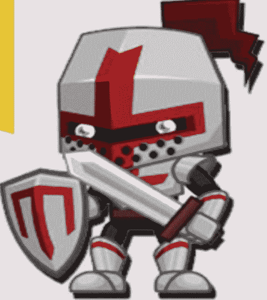

## 作者：Jeanine Meyer

HTML 5 ~ 这是一个新版书籍。通过它，你将逐步精通 HTML。我们编写书籍旨在帮助你理解这些新特性。你可以轻松且新鲜地将其应用于家庭/办公室环境。

## 这本书适合谁读？

我相信我的解释是完整的，但我并不像像我之前的书籍《HTML5 必备指南》中所称的那样，这本书是写给完全初学者的。这本书是针对具有某些编程知识、并希望通过结合基础功能并将 JavaScript 与其他技术来构建（更多）实质性应用的开发者。它也可以作为与程序员合作的人的灵感来源，帮助他们理解哪些可能性。

## 这本书是如何结构的？

这本书由十章组成，每章都围绕一个应用或应用类型展开。你可以跳着读。不过，在读第 5 或 6 章之前读第 4 章可能更有意义。此外，PHP 服务器语言在第 6 章中以简单方式使用，然后在第 10 章中更全面。文中指示了其他交叉引用。每章都从应用的介绍开始，并附有应用运行的截图。在某些情况下，展示了浏览器之间的差异。章节继续讨论关键需求，在深入技术细节之前介绍概念。接下来的部分描述了如何通过 HTML5、JavaScript、PHP 和/或 SQL 中的特定结构以及标准编程技术来满足这些需求。然后我将逐行展示应用代码并附带注释。每章都以测试和将应用上传到服务器的说明与技巧，以及对所学内容的总结结束。代码（第 10 章另有说明外）均包含在出版商提供的下载中。此外，插图以 TIFF 文件形式提供。

# 第 1 章

## 构建 HTML5 标志 – 在画布上绘图、缩放与语义化标签

在本章中，我们将回顾：

- 在画布上绘制路径
- 在画布上放置文本
- 坐标变换
- 画布上和其他元素中的字体
- 语义化标签
- `range` 元素

### 引言

本章的项目是官方 HTML5 标志的展示，并带有文本。盾牌和字母绘制在画布上，辅助文本演示了语义化标签的使用。观众可以使用滑动输入设备更改标志的大小。这是本书的一个合适开始，这是一个使用 HTML5、JavaScript 和其他技术的项目集合，不仅是因为主题本身，而且作为基础事件驱动编程的良好回顾。我开发项目的方式（在他人工作的基础上）是大多数人的工作方式。特别是，这种情况为坐标变换提供了动力。最后，在编写时，Firefox 尚未完全实现滑动元素。遗憾的是，这也是常见情况，我将讨论其影响。本书的方法是在特定示例背景下解释 HTML5、层叠样式表和 JavaScript。项目代表了各种应用，希望你能在每个项目中找到可以学习并适用于你目的的内容。

> **注意**：如果你需要使用 HTML5 和 JavaScript 的编程介绍，可以参考我的书籍《HTML5 必备指南》或其他出版商的书籍。网上也有大量的可用资源。

图 1-1 显示了 Chrome 浏览器上标志项目的启动界面。（请跳至图 1-3 查看 Firefox 上的外观。）


> **注意**：在某些浏览器中被视为文本字段。

基于 Daniel Davis 等人的工作构建，但字体问题归他们负责。查看样式元素中 `font-family` 的使用，以及脚本元素中用于安全处理表单的常量变量。我处理了缩放。同时注意语义化元素的使用。

HTML5 标志由 W3C 所有。

#### 图 1-1. HTML5 Logo 启动界面

注意滑块功能、随附文本（其中包含一个看似链接的内容）以及黄色线条下方页脚中的文本。页脚也包含一个链接。正如我后将解释的，页脚及其他语义元素的功能和格式完全由我决定，但为 Logo 的所有者万维网联盟（The World Wide Web Consortium）提供引用是恰当的。

可以使用滑块更改 Logo 的大小。图 1-2 显示了调整滑块后的应用，此时 Logo 缩小到宽度和高度的三分之一。


> **缩放比例**：注意：在某些浏览器中，滑块被视为文本字段。
>
> 基于 Daniel Davis 等人的工作，但字体不要归他们他们的。查看 `style` 元素中 `font-family` 的使用以及 `script` 元素中 `fontfamily` 变量，这些是处理字体的方法。缩放是我完成的。还要注意语义元素的使用。
>
> 由 W3C 提供的 HTML5 Logo。

#### 图 1-2. 缩小后的 Logo

HTML5 的实现尚未被任何浏览器完成，而且事实证明，Firefox 将所有滑块输入视为简单的文本字段。这被称为“优雅降级”（graceful degradation），这确实比什么都不产生要好。图 1-3 显示了 Firefox 中的启动界面。注意初始值显示为 100。

#### 图 1-3. 使用 Firefox 的应用程序

正如每一章的惯做法，我现在解释应用程序的关键需求，这些需求在很大程度上独立于使用 HTML5 的事实，然后根据需要描述实现中将使用的 HTML5、JavaScript 以及其他特性。“构建”部分包含一个带有每行代码注释的表格，以及如何构建类似应用程序的指导。“测试”部分提供了上传和测试的细节。该部分对于某些项目比其他项目更关键。最后，有一个总结，回顾了所涵盖的编程概念并预览书中接下来的内容。

### 项目历史与关键需求

该项目的关键需求有些人为，并且不容易表述为与 HTML 独立的内容。例如，我想画出 Logo，而不是从网上复制图像。我的设计目标始终包括练习编程并为我的学生准备示例。Logo 盾牌部分的形状似乎适合在画布上绘制，而 HTML 字母可以使用绘制文本功能完成。此外，绘制图像比使用图像文件有实际优势。单独的文件需要管理、存储和下载。图 1-4 显示的图像为 90KB。持有程序代码的文件仅为 4KB。绘制 Logo 或图形意味着可以动态更改缩放和其他属性。

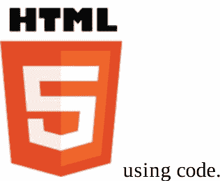

#### 图 1-4. Logo 图像

我在网上查找并找到了在 Opera 工作的 Daniel Davis 制作的盾牌示例。这太棒了，因为这意味着我不需要测量 Logo 图像副本来获取坐标。这引出了他如何确定坐标的问题。我并不知道答案，尽管我们进行过愉快的邮件交流。一种可能性是下载图像并使用 Adobe Photoshop 或 Corel Paint Shop Pro 等程序的网格功能。另一种可能性是使用（旧式的）透明网格纸。

然而，在 Daniel Davis 的工作基础上进行构建存在问题。他的应用程序没有包含 HTML 字母。解决办法是将字母在在屏幕上定位，然后所谓的向下移动，以便使用 Daniel 示例中提供的坐标对盾牌进行定位。“在屏幕上向下移动”的技术术语是执行坐标变换。因此，执行坐标变换的能力成为该项目的关键需求。

我选择写一些关于 Logo 的内容，特别是以链接的形式给予荣誉和引用。我决定在文档底部的线条下方通过简短文本作为 Logo 官方来源的引用。对 Daniel Davis 的引用是正文写作的一部分。我们在字体选择上交换了意见，我将在下一节中详细讨论这一点。

为了让观众对 Logo 做些什么，我决定提供一种更改大小的方法。实现此目的的良好设备是指定了最小值、最大值和步进的滑块。因此，该应用程序的关键需求包括在特定字体中绘制形状和字母、坐标变换、带有主部分和页脚部分的文档格式，以及包含链接。

### HTML5、CSS 和 JavaScript 特性

假设你（读者）对 HTML 和文档有一定经验。HTML5 最重要的新特性之一是用于绘制的 `canvas` 元素。我简要描述了适当颜色的填充路径和填充文本的绘制。接下来，我描述了坐标变换，它在项目中用于 Logo 本身的两个部分以及整个 Logo 的缩放和大小更改。最后，我描述了 `range` 输入元素。它产生了滑块。

#### 在画布上绘制路径

`canvas` 是 HTML5 引入的一种元素类型。所有 `canvas` 元素都有一个属性（或属性）称为 `2D context`。

```javascript
const ctx = document.getElementById('canvas').getContext('2d');
```

理解 `canvas` 是一个位图很重要，一旦你绘制了东西，画布就会“忘记”它画了什么；它只知道像素。要更改绘制，必须清除画布并重新绘制。画布的坐标系是笛卡尔坐标系，(0,0) 位于左上角。当你向右移动时，x 轴增加；当你向下移动时，y 轴增加。

绘制线，使用以下方法：

```javascript
ctx.beginPath();
ctx.moveTo(10, 10);
ctx.lineTo(100, 100);
ctx.stroke();
```

绘制圆，使用 `arc` 方法：

```javascript
ctx.beginPath();
ctx.arc(75, 75, 50, 0, 2 * Math.PI);
ctx.stroke();
```

绘制矩形，使用 `fillRect` 或 `strokeRect` 方法：

```javascript
ctx.fillRect(20, 20, 150, 100);
```

#### 图 1-5. 绘制路径序列

图中，我选择了以下代码来绘制盾牌：

```javascript
ctx.fillStyle = "#E34C26";
ctx.beginPath();
ctx.moveTo(39, 250);
ctx.lineTo(17, 0);
ctx.lineTo(62, 0);
ctx.lineTo(239, 250);
ctx.lineTo(139, 278);
ctx.closePath();
ctx.fill();
```

```javascript
ctx.fill();
```

如果你还没有在画布（canvas）上进行过绘制，这里是生成这个五边形形状所需的完整 HTML 脚本。`<body>` 标签中的 `onLoad` 属性会在文档加载时调用 `init` 函数。`init` 函数设置了 `ctx` 变量，设置 `fillStyle` 属性并绘制路径。

```html
<!DOCTYPE html>
<html>
<head>
<title>HTML 5 Logo</title>
<meta charset="UTF-8">
<script>
function init() {
  ctx = document.getElementById('canvas').getContext('2d');
  ctx.fillStyle = "#E34C26";
  ctx.beginPath();
  ctx.moveTo(39, 250);
  ctx.lineTo(17, 0);
  ctx.lineTo(262, 0);
  ctx.lineTo(239, 250);
  ctx.lineTo(139, 278);
  ctx.closePath();
  ctx.fill();
}
</script>
</head>
<body onload="init();">
<canvas id="canvas" width="600" height="400">
您的浏览器不支持 canvas 元素。
</canvas>
</body>
</html>
```

如果你以前没有做过，请尝试在画布上进行绘制练习和实验，但我将继续下去。其他形状是以类似的方式生成的。顺便说一下，如果你看到盾牌中间有一条线，那是一个视觉错觉。

#### 在画布和文档正文中放置文本

文本是使用上下文（context）的方法和属性在画布上绘制的。可以使用 `fillText` 方法填充文本，也可以使用 `strokeText` 方法作为描边形式绘制。颜色取决于当前 `fillStyle` 属性或 `strokeStyle` 属性的值。上下文的另一个属性是 `font`（字体）。该属性可以包含文本的大小和一种或多个字体。包含多个字体的目的是为了如果运行浏览器的计算机上没有第一个字体，则为浏览器提供备选项。在这个项目中，我使用了：

```javascript
var fontFamily = "65px 'Gill Sans Ultra Bold', sans-serif";
```

并在 `init` 函数中：

```javascript
ctx.font = fontFamily;
```

这引导浏览器在可用时使用 `Gill Sans Ultra Bold` 字体，不可用则使用计算机上默认的 `sans-serif` 字体。

我本可以将这些内容写在一个语句中，但我选择将其作为一个变量。你可以认为我选择的字体与官方 W3C Logo 已经足够接近。

> **注意** - 对于这个示例，至少还有两种方法。一种可能是**不使用**文本，而是将字母绘制为填充的路径。另一种是定位并获取一种字体，将其放置在持有 HTML5 文档的服务器上，并使用 `@font-face` 直接引用它。

设置好字体和颜色后，绘制文本的方法需要一个字符串和一个位置：x 和 y 坐标。项目中绘制字母的语句是：

```javascript
ctx.fillText("HTML", 31, 60);
```

在 HTML 文档的其他部分（即 `canvas` 元素之外）对剩余进行格式化，需要对字体进行同样的关注。在这个项目中，我选择利用 HTML5 新的语义化元素，并遵循将格式设置放在 `style` 元素中的做法。我的 HTML 脚本的 `body` 包含两个 `article` 元素和一个 `footer` 元素。一个 `article` 包含带有注释的 `input` 元素，另一个 `article` 包含剩余的解释。`footer` 元素包含对 W3C 的引用。这些格式化和用法取决于开发者/程序员。这包括确保 `footer` 是文档中的最后一个元素。如果我将 `footer` 放在一个或两个 `article` 之前，它将不再显示在底部（即文档的底部）。该项目的样式指令如下：

```css
footer {
  border-top: 1px solid #E34C26;
  text-align: center;
  padding: 20px;
}
```

```javascript
ctx.moveTo(139, 257);
ctx.lineTo(220, 234);
ctx.lineTo(239, 20);
ctx.lineTo(139, 20);
ctx.closePath();
ctx.fill();
```

> **注意**：画布将被清除（擦除）掉之前绘制的所有内容。

#### 使用 range 输入元素

我称之为滑块（slider）的输入设备是新的 HTML5 输入类型 `range`，它放置在 HTML 文档的 body 中。我将其放置在一个 `article` 元素内部。这种类型以及其他输入元素的属性提供了指定初始值、最小值、最大值、最小增量调整以及观众更改滑块时要执行的操作。代码如下：

```html
<input id="slider" type="range" min="0" value="100" onChange="changescale(this.value)" step="10"/>
```

`min`、`max`、（初始）`value` 和 `step` 可以设置为任何你喜欢的值。由于我使用的是百分比，而且我不希望 Logo 比初始值大，也不想处理负值，因此我使用了 0 和 100。

在滑块的正确实现中，观众看不到初始值、最大值或最小值。我的代码将输入视为百分比。表达式 `this.value` 被解释为“此”（THIS）元素的 `value` 属性，这里用大写字母强调一下切换到了英语！`this` 术语在 JavaScript 以及其他几种语言中具有特殊含义。`changescale` 函数接收通过赋值给 `onChange` 属性的参数指定的值，并使用它来设置一个全局变量（在任何函数外部声明的变量，以便它持久存在并供任何函数使用）。

```javascript
function changescale(val) {
  factorvalue = val / 100;
  dologo();
}
```

HTML5 规范的一部分是浏览器将提供表单验证，即检查是否遵守输入元素中属性指定的条件。这在减少程序员需要做的工作方面可以显著提高生产力，而且由于由浏览器进行检查，速度可能会更快，从而提升性能。我们将在第 10 章数据库和 PHP 中详细地讨论这一点。在 HTML5 Logo 项目中，滑块的一个优势是观众不需要关心数值，只需移动设备即可。没有办法输入非法值。我不想贬低 Firefox 浏览器，正如我所指出的，产生一个文本框比什么都没有好，但至少在写作时，它没有显示滑块或进行任何检查。图 1-6 显示了在输入字段中输入 200 的结果。


> **缩放百分比：200%** | 注意：滑块在某些浏览器中被视为字段。
>
> 基于 Daniel Davis 等人的工作，但不要因为字体埋怪他们。请查看 `style` 元素中 `font-family` 的使用以及 `script` 元素中 `fontfamily` 变量，这是安全处理字体的方法。我负责缩放。同样注意语义化元素的使用。
>
> W3C 的 HTML5 Logo。
>
> 画布具有固定的宽度和高度，在画布之外的绘制会被忽略（当进行缩放以接受数字并将其拉伸到原始值的两倍时也是）。

### 构建应用程序并将其专属

该项目只做一件事：绘制 Logo。为此目的定义了一个函数 `dologo`。非正式地说，程序的大纲如下：

函数调用和调用表显示了函数之间的关系。`dologo` 函数在文档首次加载以及每次比例发生变化时被调用。

#### 表 1-1. HTML5 Logo 项目中的函数

| 函数 | 被谁调用/触发 | 调用了 |
| --- | --- | --- |
| `init` | 被 `<body>` 标签中 `onload` 属性的操作触发 | `dologo` |


| 函数 | 调用关系 | 备注 |
| --- | --- | --- |
| `dologo` | `init` 和 `changcale` 调用 | |
| `changcale` | 被 `<input type="range">` 标签中 `onChange` 属性的操作触发 | `dologo` |

`dologo` 函数的代码整合了之前描述的技巧。特别是，代码带回了原始坐标系并清除了画布。

此应用程序中的全局变量有：

```javascript
var ctx;
```

```javascript
var factorvalue = 1;
```

```javascript
var fontfamily = "65px 'Gill Sans Ultra Bold', sans-serif";
```

如前所述，可以不使用 `fontfamily` 而直接在代码中使用字符串。将 `ctx` 和 `factorvalue` 设为全局变量是方便的。

表 1-2 显示了基础应用程序的代码，并每行都有注释。

### 表 1-2. HTML5 Logo 项目的完整代码

| 代码行 | 描述 |
| --- | --- |
| `<!DOCTYPE html>` | 头部 |
| `<html>` | html 标签开始 |
| `<head>` | head 标签开始 |
| `<title>HTML5 Logo </title>` | 完整的标题元素 |
| `<meta charset="UTF-8">` | 元数据标签 |
| `<style>` | 样式表开始 |
| `footer {display:block; border:1px solid #E34C26; margin:5px;}` | 用于页脚 |
| `article {display:block; font-family:Georgia, font-weight:bold;}` | 用于文章 |
| `</style>` | 样式结束 |
| `<script>` | 脚本开始 |
| `var ctx;` | 变量 |
| `var factorvalue = 1;` | 变量 |
| `var fontfamily = "65px 'Gill Sans Ultra Bold', sans-serif";` | 变量 |
| `function init() {` | `init` 函数 |
| `ctx.translate(0,offset);` | 水平偏移 |
| `ctx.clearRect(0,0,600,400);` | 清除整个画布 |
| `ctx.scale(factorvalue,factorvalue);` | 缩放 |
| `ctx.fillText("HTML",31,60);` | 绘制字母 |
| `function dologo() {` | `dologo` 函数 |
| `ctx.save();` | 保存状态 |
| `ctx.beginPath();` | 开始路径 |
| `ctx.moveTo(139,113);` | 移动到水平位置 |
| `ctx.lineTo(98,113);` | 向左画线 |
| `ctx.lineTo(96,82);` | 向上画线 |
| `ctx.lineTo(139,82);` | 向右画线 |
| `ctx.lineTo(139,51);` | 向上画线 |
| `ctx.lineTo(62,51);` | 向左画线 |
| `ctx.closePath();` | 关闭路径 |
| `ctx.fill();` | 填充颜色 |
| `ctx.fillStyle = "#EBEBEBE";` | 设置颜色为灰色 |
| `ctx.beginPath();` | 开始路径 |
| `ctx.moveTo(139,257);` | 移动到中间点 |
| `ctx.lineTo(220,234);` | 向右上画线 |
| `ctx.lineTo(239,20);` | 向右上画线 |
| `ctx.lineTo(139,20);` | 向左画线 |
| `ctx.closePath();` | 关闭路径 |
| `ctx.fill();` | 填充颜色 |
| `ctx.fillStyle = "#F06529";` | 设置颜色为橙色 |
| `ctx.beginPath();` | 开始路径 |
| `ctx.moveTo(139,257);` | 移动到中间点 |
| `ctx.lineTo(220,234);` | 向右上画线 |
| `ctx.lineTo(239,20);` | 向右上画线 |
| `ctx.lineTo(139,20);` | 向左画线 |
| `ctx.closePath();` | 关闭路径 |
| `ctx.fill();` | 填充颜色 |
| `}` | 函数结束 |
| `}` | `init` 函数结束 |
| `function changcale(val) {` | `changcale` 函数 |
| `factorvalue = val / 100;` | 计算 |
| `dologo();` | 调用 `dologo` |
| `}` | 函数结束 |
| `</script>` | 脚本结束 |

```javascript
ctx.lineTo(70, 144);
```
// 向左下方画线

```javascript
ctx.lineTo(139, 144);
```
// 向右画线

```javascript
ctx.closePath();
```
// 关闭路径

```javascript
ctx.fill();
```
// 用指定的颜色填充

```javascript
ctx.beginPath();
```
// 开始一个新路径

```javascript
ctx.moveTo(139, 193);
```
// 移动到中间点

```javascript
ctx.lineTo(105, 184);
```
// 向左上方画线

```javascript
ctx.lineTo(103, 159);
```
// 向稍微左侧画线
// 向上

```javascript
ctx.lineTo(72, 159);
```
// 向更靠左的侧画线

```javascript
ctx.lineTo(76, 207);
```
// 向稍微右侧画线
// 并向下

```javascript
ctx.lineTo(139, 225);
```
// 向左下方画线

```javascript
ctx.closePath();
```
// 关闭路径

```javascript
ctx.fill();
```
// 用指定的颜色
// 填充形状

```javascript
// 白色，数字5的右侧
```

```javascript
ctx.fillStyle = "FFFFFF";
```
// 设置颜色为白色

```javascript
ctx.beginPath();
```
// 开始路径

| 代码行 | 说明 |
| --- | --- |
| `ctx.moveTo(139, 113);` | 在中间点开始 |
| `ctx.lineTo(139, 144);` | 向下画线 |
| `ctx.lineTo(177, 144);` | 向右画线 |
| `ctx.lineTo(173, 184);` | 向稍微左侧下方画线 |
| `ctx.lineTo(139, 193);` | 向更靠左的下方画线 |
| `ctx.lineTo(139, 225);` | 向下画线 |
| `ctx.lineTo(202, 207);` | 向右上画线 |
| `ctx.lineTo(210, 113);` | 向稍微右上方画线 |
| `ctx.closePath();` | 关闭路径 |
| `ctx.fill();` | 填充白色 |
| `ctx.beginPath();` | 开始一个新路径 |
| `ctx.moveTo(139, 51);` | 移动到中间点 |
| `ctx.lineTo(139, 82);` | 向下移动 |
| `ctx.lineTo(213, 82);` | 向右移动 |
| `ctx.lineTo(216, 51);` | 向稍微右上方移动 |
| `ctx.closePath();` | 关闭路径 |

```javascript
ctx.fill();
```
// 填充白色

```javascript
}
```
// 关闭 `dologo` 函数

```javascript
function changcale(val) {
```
// 打开带有参数的 `changevalue` 函数

```javascript
factorvalue = val / 100;
```
// 将 `factorvalue` 设置为输入除以 100

```javascript
dologo();
```
// 调用函数绘制 logo

```javascript
}
```
// 关闭 `changevalue` 函数

```html
</script>
```
// 关闭 script 元素

```html
</head>
```
// 关闭 head 元素

| 代码行 | 说明 |
| --- | --- |
| `<body onLoad="init();">` | 属性设置为调用 `init` 的 body 标签 |

```html
<canvas id="canvas" width="600" height="400">
```
您的浏览器不支持 canvas 元素。

```html
</canvas>
```

```html
<article>
```
缩放比例：`<input id="slide" type="range" min="0" max="100" value="100" onchange="changescale(this.value)" step="10"/>`

注意：滑块在某些浏览器中被视为文本字段。

该滑块可能是文本字段。它仍然可用。

```html
</article>
```
// article 结束标签

<article>基于 <a href="http://people.opera.com/daniel/html5/html5logo/">Daniel Davis 等人</a>的作品，但不要为他们的字体负责。请查看样式元素中 `<em>font-family</em>` 的使用以及脚本元素中 `<em>fontfamily</em>` 变量，以获取安全处理字体的方法。我负责了缩放。

article 标签包含一些文本，包括超链接

注意还使用了语义化元素。</article>

```html
<footer>HTML5 Logo 由 <a href="http://www.w3.org/"><abbr title="World Wide Web Consortium">W3C</abbr></a> 提供。
```
// footer 标签和 footer 内容，包括 abbr 元素

```html
</footer>
```
// footer 结束标签

| 标签 | 说明 |
| --- | --- |
| `</body>` | body 结束 |
| `</html>` | html 结束 |

您可以通过使用此应用程序的全部或部分来创建您自己的程序。您可能想省略关于字体的注释。

### 测试和上传应用程序

这是一个用于测试和上传（并测试）的简单应用程序，因为它只有一个文件。我告诉 logo 在 iPhone4 和 iPad 2 上显示，但在每个情况下滑块都是文本框。我还在 PC 上的 Safari 和 Opera 上测试了它。您可以跳到第 8 章查看更多内容。

### 总结

在本章中，你学习了如何

- 使用 HTML5 Canvas 绘制图形
- 通过滑块控制缩放比例
- 处理跨浏览器兼容性问题
- 使用语义化 HTML5 元素（`article`、`footer` 等）

### 引言

在本章中，你学习了如何

- 使用 HTML5 Canvas 绘制图形
- 通过滑块控制缩放比例
- 处理跨浏览器兼容性问题
- 使用语义化 HTML5 元素（`article`、`footer` 等）

### 家庭剪贴：操纵

在本章中，你学习了如何

- 使用 HTML5 Canvas 绘制图形
- 通过滑块控制缩放比例
- 处理跨浏览器兼容性问题
- 使用语义化 HTML5 元素（`article`、`footer` 等）

# 第 2 章

在本章中，你学习了如何

- 使用 HTML5 Canvas 绘制图形
- 通过滑块控制缩放比例
- 处理跨浏览器兼容性问题
- 使用语义化 HTML5 元素（`article`、`footer` 等）

以及 HTML5 和 JavaScript 的特性。而且，正如我将反复强调的那样，浏览器之间存在差异需要讨论。

## 关键需求

该项目的关键需求包括构建一个用于操作屏幕上对象的框架，包括检测对象上的鼠标事件、删除对象以及创建对象的副本。目前的框架提供了一种指定矩形、椭圆、心形和图像的方法，但这种方法可以容纳其他形状，这是本章的一个重要教训。

目标是让拖放操作尽可能精确：而不仅仅是将某个东西从窗口的一个区域移动到另一个区域。我将在第 8 章和第 9 章关于制作拼图的内容中重新这个主题。

我还决定控制光标的外观。当鼠标不在画布上时，光标是标准箭头。当在画布元素上时，光标将变为十字。当用户按下鼠标按钮并拖动对象时，光标会变为带有指向手指的手形。

工作完成后，人们自然会有保存它的愿望，或许保存为图像文件，因此这也是项目的一个需求。

### HTML5、CSS 和 JavaScript 特性

我们现在探索用于“家庭合贴”（Family Collage）项目的 HTML5 和 JavaScript 特性。其核心思想是维护画布上材料的列表。这个列表将是一个 JavaScript 数组。信息将包括每个项目的位置、如何在画布上绘制它以及如何判断鼠标光标是否在项目上。

### JavaScript 对象

面向对象编程是计算机科学的标准，也是大多数编程语言的关键组成部分。对象具有属性（也称为属性）和方法。方法是一个函数。换句话说，对象拥有数据以及可能使用这些数据的代码。HTML 和 JavaScript 有许多内置对象，如 `document`、`window` 以及数组和字符串。对于“家庭照片”项目，我利用了 JavaScript 的一项基础功能（在 HTML5 之前已建立）来定义我自己的对象。这些被称为“用户定义对象”，但我和其他更倾向于称为“程序员定义对象”。对于“家庭合贴”项目来说，这是一个重要的区别，因为你（作为程序员）可能会创建一个包含你识别并设计的图片和其他形状的应用程序，然后将其提供给家庭成员使用。

该项目的目标是建立一个在画布上创建和操作不同形状的框架，考虑到一旦某个东西被绘制到画布上，它作为矩形或图像的身份就会丢失。每个形状的第一步是定义所谓的“构造函数”，它用于存储指定形状的信息。下一步是定义方法，即使用这些信息来完成所需操作的代码。

我的方法呈现出在画布上移动事物的假象。实际上，存储在内部变量中的信息被改变了，每当发生改变外观的变化时，画布都会被清除并进行新的绘制。

我的策略是定义新类型的对象，每个对象将定义两个方法：

- `draw`：用于在画布上绘制对象
- `overcheck`：用于判断给定位置（具体为鼠标位置）是否在对象上

这些方法引用了对象的属性，并在数学表达式中使用这些值来产生结果。一旦定义了构造函数，就可以作为这些对象的新实例来创建值。一个名为 `stuff` 的数组持有所有的对象实例。

**注意** 面向对象编程在其所有的光辉中拥有一套丰富且往往令人敬畏的词汇。类（Classes）是定义对象的实体。我在这里暗示了所谓的“接口”（interface）。类可以是其他类的子类，这对于图片和矩形可能有用。我在这里的目标是采用更随意的语气。例如，我会谈论对象和对象实例。

让我们离开泛泛而谈，展示它是如何工作的。我创建了名为 `Rect`、`Oval`、`Picture` 和 `Heart` 的函数。这些将是 `Rect`、`Oval`、`Picture` 和 `Heart` 对象实例的构造函数。给此类函数命名为大写开头是一种惯例。

#### Rect

`Rect` 构造函数的定义为：

```javascript
function Rect(x, y, w, h, c) {
  this.x = x;
  this.y = y;
  this.w = w;
  this.h = h;
  this.draw = drawrect;
  this.color = c;
  this.overcheck = overrect;
}
```

变量 `r1` 的创建和初始化如下：

```javascript
var r1 = new Rect(10, 10, 50, 50, "red");
```

#### Oval

`Oval` 构造函数的定义类似于 `Rect` 函数：

```javascript
function Oval(x, y, r, hor, ver, c) {
  this.x = x;
  this.y = y;
  this.r = r;
  this.radsq = r * r;
  this.hor = hor;
  this.ver = ver;
  this.draw = drawoval;
  this.color = c;
  this.overcheck = overoval;
}
```

变量 `oval1` 的创建如下：

```javascript
var oval1 = new Oval(200, 30, 20, 20, "teal");
```

相比之下，紫色的圆声明如下：

```javascript
var cir1 = new Oval(300, 30, 20, 20, "purple");
```

#### Picture

`Picture` 对象的构造函数存储了位置、宽度、高度以及 `Image` 对象的名称。

```javascript
function Picture(x, y, w, h, imagename) {
  this.x = x;
  this.y = y;
  this.w = w;
  this.h = h;
  this.imagename = imagename;
  this.draw = drawpic;
  this.overcheck = overrect;
}
```


我的示例中有四个 `Picture` 对象。以下设置其中一个对象的代码：

```javascript
var dad = new Image();
dad.src = "daniel1.jpg";
var pic1 = new Picture(10, 100, 100, 100, dad);
```

### 心形

我们还有一个程序员定义的对象需要介绍。我给自己设定的挑战是定义能够指定心形形状的数值。我得如下方案：心形形状由位置定义，即一对 x、y 值对，它们将是心形凹处的位置；从凹处到底部顶点的距离，以及代表心形弯曲部分的两个部分圆弧的半径。你可以将其视为一个标准心形。关键信息如图 2-3 所示。当以及何时向应用程序中添加新类型的形状时，你将需要发明或发现定义该形状的数据。

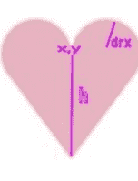

图 2-3. 定义心脏的数据

构造函数将指定的值连同颜色保存到任何新构造的对象中。你可能怀疑绘制和悬停检查（`overcheck`）会比矩形的函数要复杂一些，你是正确的。构造函数的形式与另一个构造函数相似。

#### `function Heart(x, y, h, drx, color)`

```javascript
{
  this.x = x;
  this.y = y;
  this.h = h;
  this.drx = drx;
  this.radsq = drx * drx;
  this.color = color;
  this.draw = drawheart;
  this.overcheck = overheart;
  this.ang = .25 * Math.PI;
}
```

`ang` 属性是我的一种留后路做法。你会注意到它是一个常量，我可以避免将其设为属性。稍后当我解释 `drawheart` 时，你会看到我的代码是如何使用它来使心形变圆的。我把它设为属性是为了防万一以后我想修改它以允许心形具有更多变体。

### 绘制

我有不同的方法函数需要解释，但让我们直接进入绘制发生的地方，以演示这一切是如何协同工作的。我定义了一个数组，初始为空：

```javascript
var stuff = [];
```

然后我的代码通过如下述语句向此数组中添加内容：

- `stuff.push(pic1);`
- `stuff.push(pic2);`
- `stuff.push(pic3);`
- `stuff.push(pic4);`
- `stuff.push(r1);`
- `stuff.push(s1);`
- `stuff.push(oval1);`
- `stuff.push(cir1);`

在适当的时间（即在任何更改之后），会调用 `drawstuff` 函数。它的工作原理是擦除画布，绘制一个矩形作为框架，然后遍历 `stuff` 数组中的每个元素并调用它们的 `draw` 方法。

```javascript
function drawstuff() {
  ctx.clearRect(0, 0, 600, 400);

  ctx.strokeStyle = "black";

  ctx.lineWidth = 2;

  ctx.strokeRect(0, 0, 600, 400);

  for (var i = 0; i < stuff.length; i++) {
    stuff[i].draw();
  }
}
```

注意，并没有代码在询问“这是一个椭圆吗？如果是，就这样做”，或者“这是一个图片吗？如果是，就那样……”……相反，为数组中的每个成员建立的 `draw` 方法会完成它们的工作！在检查位置（鼠标）是否在对象上时，也发生了同样的魔法。随着更多对象类型的添加，这种方法的益处会不断增加。

我这样做是因为我的代码从未改变 `strokeStyle` 或 `lineWidth`，我可以将这些语句移动到 `init` 函数中只执行一次。然而，我考虑到可能会有一个形状会改变这些值，为了应对以后应用程序中可能发生的这种变化，我会在 `drawstuff` 中设置 `strokeStyle` 和 `lineWidth`。

现在我将解释绘制方法以及检查位置是否在对象上的方法。`drawrect` 函数非常直观：

```javascript
function drawrect() {
  ctx.fillStyle = this.color;
  ctx.fillRect(this.x, this.y, this.w, this.h);
}
```

记住 `this` 术语指的是 `drawrect` 作为方法的所属对象。`drawrect` 函数是矩形和图片的方法。`drawoval` 函数稍微复杂一点，但仅仅是稍微复杂一点。你需要回想变换是如何工作的。HTML5 只允许圆形圆弧，但允许通过缩放坐标来产生不是圆的椭圆（椭圆）。`drawoval` 函数中代码的作用是保存坐标系的当前状态，然后移动到对象的中心。然后应用缩放变换，使用 `hor` 和 `ver` 属性。现在，在设置填充颜色为属性中指定的颜色后，我使用绘制由圆形圆弧组成的路径并填充该路径的代码。最后一步是恢复坐标系的原始状态。

```javascript
function drawoval() {
  ctx.save();
  ctx.translate(this.x, this.y);
  ctx.scale(hor, ver);
  ctx.fillStyle = this.color;
  ctx.beginPath();
  ctx.arc(0, 0, this.r, 0, 2 * Math.PI, true);
  ctx.closePath();
  ctx.fill();
  ctx.restore();
}
```

这就是在画布上绘制可能是圆的椭圆的方法。由于我的代码恢复了坐标系的原始状态，这具有撤消缩放和变换的效果。`drawpic` 函数是最简单的，只需要一行：

```javascript
function drawpic() {
  ctx.drawImage(this.image, this.x, this.y, this.w, this.h);
}
```

棘手之处在于确定圆弧在右侧何时停止。我的代码使用三角表达式来设置 `cx` 和 `cy` 值。`cx`, `cy` 位置是圆弧与直线相交的地方。图 2-4 指出了变量的含义。

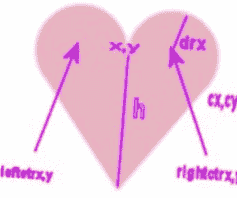

图 2-4. 函数中使用的数据片段

路径将从我们所谓的“凹处”开始，在左侧绘制圆弧，画一条线到底部顶点，然后向上到 `cx`, `cy` 点，最后以右侧的圆弧结束。函数如下：

```javascript
function drawheart() {
  var leftctx = this.x - this.drx;
  var rightctx = this.x + this.drx;
  var cx = rightctx + this.drx * Math.cos(this.ang);
  var cy = this.y - this.drx * Math.sin(this.ang);

  ctx.fillStyle = this.color;
  ctx.beginPath();
  ctx.moveTo(leftctx, this.y);
  ctx.arc(leftctx, this.y, this.drx, Math.PI, 1.5 * Math.PI, true);
  ctx.lineTo(cx, this.y);
  ctx.arc(rightctx, this.y, this.drx, 1.5 * Math.PI, 2 * Math.PI, true);
  ctx.closePath();
  ctx.fill();
}
```

`outside` 函数的原理与 `overrect` 函数类似。你需要编写代码来比较 `mx, my` 值与矩形的各边。然而，对于 `outside`，我选择了使用逻辑或运算符 `||` 并返回它的值。如果任何一个因素为真，则结果为真，否则为假。

```javascript
function outside(x, y, w, h, mx, my) {
  return ((mx < x) || (mx > (x + w)) || ((my < y) || (my > (y + h))));
}
```

实际上，我说的是正确的，但漏掉了在性能出现问题时可能是一个重要的考虑因素。`||` 会从第一个（最左侧）条件开始评估每个条件。一旦其中一个条件为真，它就会停止评估并返回真。`&&` 运算符执行类似的操作。只要其中一个条件为假，它就会返回假。

这是我为在画布上进行操纵而设计的四种类型对象的依据。你可以预先查看所有代码，或者继续查看这些对象在鼠标事件的响应中是如何被使用的。

**注意：** 此示例没有展示面向对象编程的全部威力。在像 Java 这样的语言（或为艺术家设计的 Processing 变体）中，我可以以这种方式编写，以确保每个对象都定义正确，具有用于位置的 `x` 和 `y` 属性以及用于绘制和检查的方法。

### 用户界面

用户界面的应用程序需求包括拖拽（即鼠标按下、鼠标移动和鼠标抬起）用于重新排列项目，以及通过双击产生项目的复制副本。我决定使用按钮来处理其他用户操作：从画布中删除项目以及创建一个要保存的图像。按钮的操作非常直观。我写了两个 HTML5 元素的实例，并将 `onClick` 设置为相应的函数。

```html
<button onclick="saveimage()">打开带有图片的窗口（你可以保存它）</button>
<button onclick="removeobj()">删除最后一个对象</button>
```

`saveimage` 函数将在下一节解释。`removeobj` 函数从 `stuff` 数组中删除最后一个移动的对象。最后一个移动的对象是数组中的最后一个。这使得编码变得极其简单：

```javascript
function removeobj() {
  stuff.pop();
  drawstuff();
}
```

任何数组的 `pop` 都会删除最后一个元素。该函数调用 `drawstuff` 来显示除最后一个之外的所有元素。顺便说一下，如果在应用程序启动时点击了按钮，推入 `stuff` 数组的最后一个元素将被删除。如果这是不可接受的，你可以添加一个检查来防止这种情况的发生。代价是用户每次点击按钮时都需要进行检查。坦率地说，HTML5 提供了我们此应用程序所需的鼠标事件。在 `init` 函数中，我包含了以下行：

```javascript
canvas1 = document.getElementById('canvas1');
canvas1.mousedown = function () { return false; };
canvas1.addEventListener('dblclick', makenitem, false);
canvas1.addEventListener('mousedown', startdragging, false);
```


```javascript
function makenitem(ev) {
  var mx;
  var my;
  if (ev.layerX == 0) {
    mx = ev.layerX;
    my = ev.layerY;
  } else if (ev.offsetX == 0) {
    mx = ev.offsetX;
    my = ev.OffsetY;
  }
  var endpt = stuff.length - 1;
  var item;
  for (var i = endpt; i >= 0; i--) { // 反向顺序
    if (stuff[i].overcheck(mx, my)) {
      item = clone(stuff[i]);
      item.x += 20;
      item.y += 20;
      stuff.push(item);
      break;
    }
  }
  drawstuff();
}
```

正如我之前指出的，`clone` 函数为 `stuff` 数组中的元素创建副本。你可能会问，为什么不直接写 `item = stuff[i];`？答案是这种赋值没有创建一个新的、不同的值。JavaScript 仅仅将 `item` 变量指向与 `stuff` 成员相同的内容。这被称为“引用传递”。我们不希望那样。我们想要一个全新的、独立的、我们可以更改的东西。复制的方法在 `clone` 函数中演示。创建一个新对象，然后调用一个 `for` 循环。`for(var info in obj)` 表示：对于 `obj` 的每个属性，将 `item` 中同名的属性设置为该属性的值。

```javascript
function clone(obj) {
  var item = new Object();
  for (var info in obj) {
    item[info] = obj[info];
  }
  return item;
}
```

所以这两个函数的作用是复制鼠标光标下的任何元素。你或你的最终用户可以在原始对象或复制的对象上按下鼠标并移动它。

```javascript
function startdragging(ev) {
  var mx;
  var my;
  if (ev.layerX || ev.layerX == 0) {
    mx = ev.layerX;
    my = ev.layerY;
  } else if (ev.offsetX || ev.offsetX == 0) {
    mx = ev.offsetX;
    my = ev.offsetY;
  }
  var endpt = stuff.length - 1;
  for (var i = endpt; i >= 0; i--) { // reverse order
    if (stuff[i].overcheck(mx, my)) {
      offsetx = mx - stuff[i].x;
      offsety = my - stuff[i].y;
      var item = stuff[i];
      var last = stuff.length - 1;
      stuff.splice(i, 1);
      stuff.push(item);
      thingInMotion = last;
    }
  }
}
```

```javascript
canvas1.style.cursor = "pointer"; // change to finger
canvas1.addEventListener('mousemove', moveit, false);
canvas1.addEventListener('mouseup', dropit, false);
break;
}
}
```

`moveit` 函数移动由 `thingInMotion` 引用的对象，并使用 `offsetx` 和 `offsety` 变量来移动对象。`drawstuff` 函数被调用以显示修改后的画布。

```javascript
function moveit(ev) {
  var mx;
  var my;
  if (ev.layerX || ev.layerX == 0) {
    mx = ev.layerX;
    my = ev.layerY;
  } else if (ev.offsetX || ev.offsetX == 0) {
    mx = ev.offsetX;
    my = ev.offsetY;
  }
  stuff[thingInMotion].x = mx - offsetx; // adjust for flypaper dragging
  stuff[thingInMotion].y = my - offsety;
  drawstuff();
}
```

当鼠标在任何方向上移动一个像素时，就会触发 `mousemove` 事件。如果这看起来太频繁，请记住是计算机在操作，而不是你或我。用户会在移动鼠标时得到平滑的响应。

`dropit` 函数在 `mouseup` 事件时被调用。其响应是移除对鼠标移动和释放鼠标的监听，然后将光标改回十字准。

```javascript
function dropit(ev) {
  canvas1.removeEventListener('mousemove', moveit, false);
  canvas1.removeEventListener('mouseup', dropit, false);
  canvas1.style.cursor = "crosshair"; // change back to crosshair
}
```

总结来说，此应用程序的用户界面涉及两个按钮和两种类型的鼠标操作。拖放操作是通过一组函数实现的。

## 将画布保存为图像

在创建构图后，用户可能想将其保存为图像文件。Firefox 浏览器让这变得简单。在 PC 上使用时，你可以右键点击画布，或者在 MAC 上执行相应操作，就会弹出一个菜单，其中包含“另存图像...”的选项。然而，Chrome、Safari 和 Opera 并不提供该功能。如果你右键点击，选项将涉及 HTML 文档。不过，HTML5 提供了一种替代方案。

`canvas` 元素有一个名为 `toDataURL` 的方法，它可以从画布生成图像。该方法提供了从 `png`、`jpg` 或 `bmp` 中的图像文件类型供选择。我处理该操作结果的方法是编写代码打开一个以图像为内容的新窗口。用户可以通过保存文件选项或右键点击图像将此图像保存为文件。然而，还有最后一个考虑因素。Chrome 和 Firefox 要求此代码从服务器运行，而不是在客户端计算机上运行。客户端计算机是运行浏览器程序的计算机。服务器计算机是你上传完成作品的网站。你可能没有服务器。Opera 和 Safari 允许代码从客户端计算机运行。这对测试有影响，因为通常情况下，我们在本地测试程序。

```javascript
function saveasimage() {
  try {
    window.open(canvas1.toDataURL("image/png"));
  } catch (err) {
    alert("你需要更改浏览器或上传文件到服务器.");
  }
}
```

## 构建应用程序并进行自定义

你可以通过识别自己的图像文件、指定要包含的矩形、圆形和心形来让此应用程序属于自己。该应用程序有很多函数，但它们彼此共享许多属性。应用程序的非正式总结/大纲如下：

1. `init` 初始化，包括设置双击、鼠标按下、移动和释放事件
2. 对象定义：构造函数、绘制函数和 `overcheck` 函数
3. 事件处理函数：鼠标事件和按钮 `onClick`

更正式地说，表 2-1 列出了所有函数，并指示了它们如何被调用以及调用了哪些函数。注意，某些函数是作为对象类型的方法被调用的。

### 表 2-1 HTML5 家族卡项目中的函数

| 函数 | 被调用 / 触发 | 调用 |
| :--- | :--- | :--- |
| `init` | 由 `<body>` 标签中的 `onload` 属性触发 | |
| `saveimage` | 由按钮的 `onClick` 属性触发 | |
| `removeobj` | 由按钮的 `onClick` 属性触发 | `Picture`, `Rect`, `Oval`, `Heart`, `drawstuff` |
| `Picture` | 在 `init` 函数中调用 | |
| `Rect` | 在 `init` 函数中调用 | `drawstuff` |
| `Oval` | 在 `init` 函数中调用 | |
| `Heart` | 在 `init` 函数中调用 | |
| `drawheart` | 在 `drawstuff` 函数中调用 | |
| `drawrect` | 在 `drawstuff` 函数中调用 | |
| `drawoval` | 在 `drawstuff` 函数中调用 | |
| `drawpic` | 在 `drawstuff` 函数中调用 | |
| `overheart` | 在 `startdragging` 函数中调用 | |
| `overrect` | 在 `startdragging` 函数中调用 | |
| `overoval` | 在 `startdragging` 函数中调用 | |
| `overpic` | 在 `startdragging` 函数中调用 | |
| `moveit` | 在 `mousemove` 事件中调用 | |
| `dropit` | 在 `mouseup` 事件中调用 | |

### 初始化代码说明

| 代码行 | 说明 |
| :--- | :--- |
| `var mmm = new Image();` | 创建一个 `Image` 元素 |
| `mom.src = "allison1.jpg";` | 将 `src` 设置指定的文件 |
| `var son1 = new Image();` | 创建一个 `Image` 元素 |
| `son1.src = "liam2.jpg";` | 将 `src` 设置指定的文件 |
| `var son2 = new Image();` | 创建一个 `Image` 元素 |
| `son2.src = "grant1.jpg";` | 将 `src` 设置指定的文件 |
| `var pic1 = new Picture(10, 100, 100, 100, dad);` | 构造一个 `Picture` 对象 |
| `var pic2 = new Picture(120, 100, 100, 100, mom);` | 构造一个 `Picture` 对象 |
| `var pic3 = new Picture(230, 100, 100, 100, son1);` | 构造一个 `Picture` 对象 |
| `var pic4 = new Picture(340, 100, 100, 100, son2);` | 构造一个 `Picture` 对象 |
| `var heart1 = new Heart(400, 30, 60, 20, "pink");` | 构造一个 `Heart` 对象 |
| `stuff.push(pic1);` | 将 `pic1` 添加（推入） `stuff` 数组 |
| `stuff.push(pic2);` | 添加 `pic2` |
| `stuff.push(pic3);` | 添加 `pic3` |
| `stuff.push(pic4);` | 添加 `pic4` |
| `stuff.push(r1);` | 添加 `r1` |
| `stuff.push(s1);` | 添加 `s1` |
| `stuff.push(oval1);` | 添加 `oval1` |
| `stuff.push(cir1);` | 添加 `cir1` |
| `stuff.push(heart1);` | 添加 `heart1` |
| `drawstuff();` | 在画布上绘制所有对象 |
| `}` | 结束函数 |

### `distsq` 函数

| 代码行 | 说明 |
| :--- | :--- |
| `function distsq(x1, y1, x2, y2) {` | `distsq` 的函数头。接受 2 个点（2x2 个值）作为参数 |
| `var xd = x1 - x2;` | 设置 x 轴差 |
| `var yd = y1 - y2;` | 设置 y 轴差 |
| `return ((xd * xd) + (yd * yd));` | 返回平方和。这是两点之间距离的平方 |
| `}` | 结束 `distsq` 函数 |

### `Picture` 构造函数

| 代码行 | 说明 |
| :--- | :--- |
| `function Picture(x, y, w, h, imagename) {` | `Picture` 构造函数的函数头，位置在 `x, y`，宽度为 `w`，高度为 `h`，`imagename` 为 `Image` 对象 |
| `this.x = x;` | 设置属性 |
| `this.y = y;` | 设置属性 |
| `this.w = w;` | 设置属性 |
| `this.h = h;` | 设置属性 |
| `this.imagemename = imagename;` | 设置属性 |
| `this.draw = drawpic;` | 将 `drawpic` 函数设为 `draw` 方法 |
| `this.overcheck = overrect;` | 将 `overrect` 函数设为 `overcheck` 方法 |
| `}` | 关闭函数 |

### `Heart` 构造函数

| 代码行 | 说明 |
| :--- | :--- |
| `function Heart(x, y, h, drx, color) {` | `Heart` 构造函数的函数头，心形底部位于 `x, y`，从 `x, y` 到底部的距离为 `h`，半径 `drx`，颜色 `color` |
| `this.x = x;` | 设置属性 |
| `this.y = y;` | 设置属性 |
| `this.h = h;` | 设置属性 |
| `this.drx = drx;` | 设置属性 |
| `this.radsq = drx * drx;` | 设置属性以避免后续重复执行此操作 |
| `this.color = color;` | 设置属性 |
| `this.draw = drawheart;` | 将 `drawheart` 函数设为 `draw` 方法 |
| `this.overcheck = overheat;` | 将 `overheat` 函数设为 `overcheck` 方法 |
| `this.ang = .25 * Math.PI;` | 设置属性为此常数值。以后可能会使其更具通用性 |
| `}` | 关闭函数 |

```javascript
function drawheart() {
  var leftctrx = this.x - drx;
  var rightctrx = this.x + drx;
  var cx = rightctrx + drx * Math.cos(ang);
  var cy = this.y + drx * Math.sin(ang);
  ctx.fillStyle = this.color;
  ctx.beginPath();
  ctx.moveTo(this.x, this.y); // 移动到心形凹
  ctx.arc(leftctrx, this.y, drx, 0, Math.PI - ang, true); // 绘制左曲线
  ctx.lineTo(this.x, this.y + h); // 移动到底点
  ctx.lineTo(cx, cy); // 移动到 (cx,cy)
  ctx.arc(rightctrx, this.y, drx, 0, Math.PI + ang, true); // 绘制右曲线
  ctx.closePath(); // 关闭路径
  ctx.fill(); // 填充
}
```

```javascript
function overheat(mx, my) {
  var leftctrx = this.x - drx;
  var rightctrx = this.x + drx;
  var cx = rightctrx + drx * Math.cos(ang);
  var cy = this.y + drx * Math.sin(ang);
  if (mx < this.x) {
    return (my < this.y - drx * Math.sin(ang)); // 简化逻辑示例
  }
  return false;
}
```

*(注：原文中代码片段较为混乱，此处已根据上下文逻辑进行了整理)*

```javascript
function drawpic() {
  ctx.save();
  ctx.translate(this.x, this.y);
  ctx.drawImage(this.imagemename, 0, 0, this.w, this.h);
  ctx.restore();
}

function overrect(mx, my) {
  return (mx >= this.x && mx <= this.x + this.w && my >= this.y && my <= this.y + this.h);
}
```

### `overrect` 函数说明

| 代码行 | 描述 |
| :--- | :--- |
| `function overrect(mx, my) {` | `overrect` 函数的函数头 |
| `if (mx >= this.x) && (mx <= (this.x + this.w)) && (my >= this.y) && (my <= (this.y + this.h))` | 如果 `mx, my` 在边界内（4个边） |
| `{ return true; }` | 返回 `true` |
| `else { return false; }` | 否则返回 `false` |
| `}` | 关闭函数 |

### `makenewitem` 函数

```javascript
function makenewitem(ev) { // 函数头。具有作为参数的由 JavaScript 设置的事件 ev
  var mx; // 变量将存储鼠标的 x 坐标
  var my; // 变量将存储鼠标的 y 坐标
  // ... 后续逻辑
}
```


## 跳动的视频：HTML5 动画与遮罩

### 视频

在本章中，你将学习如何实现以下内容：

- 通过画布上的不同位置绘制视频的当前帧来产生移动的视频片段
- 通过重新定位文档中的视频元素来产生移动的视频片段
- 对视频进行遮罩处理，使其在两种情况下看起来都像一个圆圈
- 构建一个能够适应不同窗口大小的应用程序

### 引言

本章的项目是显示一个在盒子里弹跳的球形状的视频片段。HTML5 的重要新特性之一是对视频（以及音频）的原生支持。Silvia Pfeiffer 写的《The Definitive Guide to HTML5 Video》（Apress, 2010）是一本非常好的参考书籍。本项目的挑战在于让视频片段在屏幕上移动。我将描述实现该应用程序的两种不同方法。截图并没有看出其中的区别。

图 3-1 显示了该应用程序在 Opera 全窗口视图下的外观。视频是一个标准的矩形视频片段。由于我的代码编写，它看起来像一个球。你可以直接跳到图 3-8，了解为了跟随视频移动而创建的遮罩概念。所有图片都是动画的静态屏幕截图。你需要相信我的话，视频确实在盒子内移动并弹跳。

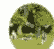

**图 3-1** 屏幕截图，全窗口

在所有情况下，当虚拟球撞击墙壁时，它似乎是从墙上反弹的。例如，如果虚拟球正在向屏幕右下方移动，当它撞击盒子的右侧时，它将向左移动但继续向下移动。当虚拟球随后撞击盒子的底墙时，它将向左弹跳，向屏幕上方移动。轨迹如图 3-2 所示。为了制作图像，我将虚拟球改为简单的圆，并且没有编写在每个时间间隔清除画布的代码。你可以将其想象为定格摄影。改变虚拟球是必要的，因为它具有复杂性：一个来自视频片段的图像和一个全白的遮罩。我在“构建应用程序并将其个性化”部分中包含了轨迹程序的代码。

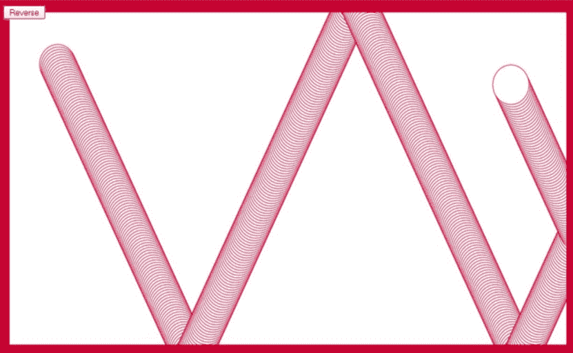

**图 3-2** 虚拟球的轨迹

如果我将浏览器窗口调得小一点并重新加载应用程序，代码将调整画布大小以产生图 3-3 所示：一个较小的盒子。

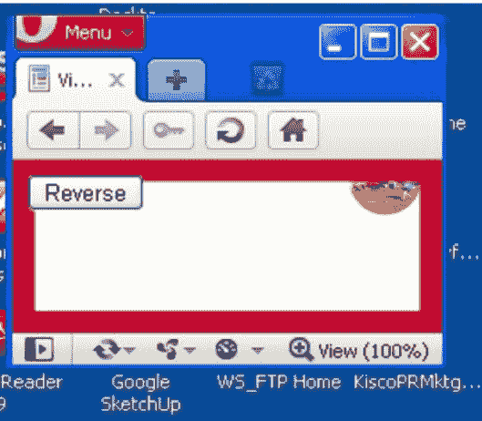

**图 3-3** 较小窗口中的应用程序

如果将窗口调得很小，这将强制视频片段本身以及画布和盒子的尺寸发生变化，如图 3–4 所示。

**图 3-4** 窗口被调整为非常小

应用程序会在 HTML 文档首次加载时，根据当时的窗口尺寸调整盒子的大小，可能还会调整虚拟视频球的大小。如果观众稍后在程序运行期间调整了窗口，画布和视频片段将不会调整大小。在这种情况下，你将看到类似图 3-5 的效果，大窗口中的一个小盒子。

**图 3-5** 运行期间调整窗口变大

同样，如果你使用全尺寸窗口或任何大窗口启动应用程序，并在程序运行期间将其调整为较小尺寸，你将看到类似图 3-6 的效果，浏览器会显示滚动条以指示内容大于窗口。如果你选择不使用滚动条，那么视频片段将周期性地消失在视野之外然后重新出现。

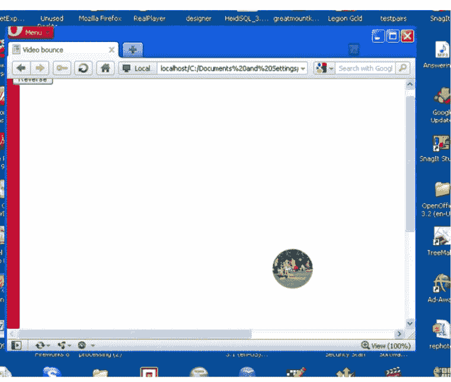

**图 3-6** 调整后的窗口

### 代码示例

#### 视频元素 HTML

```html
<video id="vid" width="480" height="320"
       codecs="avc1.42E01E, mp4a.40.2">
    <source src="joshuahemerun.webmvp8.webm" type='video/webm' codec="vp8, verbis">
    <source src="joshuahemerun.theora.ogv" type='video/ogg' codecs="theora, verbis">
    您的浏览器不支持视频标签。
</video>

<button id="revbtn" onclick="reverse();">反转 (Reverse)</button><br>

<canvas id="canvas">
    此浏览器不支持 HTML5 canvas 元素。
</canvas>
```

#### 样式指令

样式指令将改变这三个元素的位置：`video`、`canvas` 和 `button`。

#### 初始化函数

在文档加载时调用的 `init` 函数中，以下语句将 `canvas` 的尺寸设置为与窗口匹配：

```javascript
canvas1 = document.getElementById('canvas');
ctx = canvas1.getContext('2d');

canvas1.width = window.innerWidth;
cwidth = canvas1.width;

canvas1.height = window.innerHeight;
height = canvas1.height;
```

这些语句还设置了稍后使用的变量。因此，将 `canvas` 适配到窗口的任务已经完成。

现在下一个任务需要更多的思考。我想要在多大程度上让视频适应窗口尺寸？我决定在所有情况下，都将视频的宽度和高度缩小到原始宽度和高度的三分之一。然而，如果窗口非常小，我将进一步减小它。`Math.min` 方法返回其操作数中的最小值，因此语句：

```javascript
v = document.getElementById("vid");

v.width = Math.min(v.videoWidth / 3, 5 * width);

v.height = Math.min(v.videoHeight / 3, 5 * height);
```

### 核心代码逻辑表

#### 鼠标坐标获取与克隆逻辑

| 代码行 | 描述 |
|---|---|
| `if (ev.layerX || ev.layerX == 0) {` | 此浏览器是否使用层... |
| `mx = ev.layerX;` | 设置 `mx` |
| `my = ev.layerY;` | 设置 `my` |
| `} else if (ev.offsetX || ev.offsetX == 0) {` | 浏览器是否使用偏移... |
| `mx = ev.offsetX;` | 设置 `mx` |
| `my = ev.offsetY;` | 设置 `my` |
| `var endpt = stuff.length - 1;` | 存储 `stuff` 数组中最后一个元素的索引 |
| `for (var i = endpt; i >= 0; i--) {` | 从末尾开始搜索 |
| `if (stuff[i].overcheck(mx, my)) {` | 鼠标是否悬停在 `stuff` 的此成员上 |
| `item = clone(stuff[i]);` | 克隆（制作副本） |
| `item.x += 20;` | 水平方向稍微移动 |
| `item.y += 20;` | 垂直方向移动 |
| `stuff.push(item);` | 将新创建的项添加到 `stuff` 数组中 |
| `break;` | 离开 `for` 循环 |
| `}` | 结束 `if` 句 |
| `}` | 结束 `for` 循环 |
| `drawstuff();` | 绘制所有内容 |
| `}` | 关闭函数 |

#### `clone` 函数

| 代码行 | 描述 |
|---|---|
| `function clone(obj) {` | `clone` 函数的函数头 |
| `var item = new Object();` | 创建对象 |
| `for (var info in obj) {` | 遍历作为参数传递的对象的所有属性 |
| `item[info] = obj[info];` | 通过名称设置属性值 |
| `}` | 关闭 `for` 循环 |
| `return item;` | 返回新创建的对象 |
| `}` | 关闭函数 |

#### `startdragging` 函数

| 代码行 | 描述 |
|---|---|
| `function startdragging(ev) {` | `startdragging` 函数的函数头。参数是由 JavaScript 设置的事件 `ev` |
| `var mx;` | 变量将存储鼠标的 x 坐标 |
| `var my;` | 变量将存储鼠标的 y 坐标 |
| `if (ev.layerX || ev.layerX == 0) {` | 此浏览器是否使用层... Firefox, ??? |
| `mx = ev.layerX;` | 设置 `mx` |
| `my = ev.layerY;` | 设置 `my` |
| `else if (ev.offsetX || ev.offsetX == 0) {` | 浏览器是否使用偏移... |
| `mx = ev.offsetX;` | 设置 `mx` |
| `my = ev.offsetY;` | 设置 `my` |
| `}` | 结束条件判断 |
| `var endpt = stuff.length - 1;` | 存储 `stuff` 数组中最后一个元素的索引 |
| `for (var i = endpt; i >= 0; i--) {` | 从末尾开始搜索 |
| `if (stuff[i].overcheck(mx, my)) {` | 鼠标是否悬停在 `stuff` 的此成员上 |
| `offsetx = mx - stuff[i].x;` | 计算 `mx` 距离该对象 x 的距离 |
| `offsety = my - stuff[i].y;` | 计算 `my` 距离该对象 y 的距离 |
| `var item = stuff[i];` | 现在将此项移动到数组末尾。设置 `item` |
| `thingInMotion = stuff.length - 1;` | 设置用于拖拽的全局变量 |
| `stuff.splice(i, 1);` | 从原始位置移除此项 |
| `stuff.push(item);` | 将项添加到末尾 |
| `canvas1.style.cursor = "pointer";` | 拖拽时将光标改为手指 |
| `canvas1.addEventListener('mousemove', moveit, false);` | 为鼠标移动设置事件处理 |
| `canvas1.addEventListener('mouseup', dropit, false);` | 为释放鼠标按钮设置事件处理 |
| `break;` | 离开 `for` 循环 |
| `}` | 结束 `if` 句 |
| `}` | 结束 `for` 循环 |
| `}` | 关闭函数 |

#### `dropit` 函数

| 代码行 | 描述 |
|---|---|
| `function dropit(ev) {` | `dropit` 函数的函数头。参数是由 JavaScript 设置的事件 `ev` |
| `canvas1.removeEventListener('mousemove', moveit, false);` | 移除（停止）鼠标移动事件处理 |
| `canvas1.removeEventListener('mouseup', dropit, false);` | 移除（停止）释放鼠标按钮的事件处理 |
| `canvas1.style.cursor = "crosshair";` | 将光标改回准星 |
| `}` | 关闭函数 |

#### `moveit` 函数

| 代码行 | 描述 |
|---|---|
| `function moveit(ev) {` | `moveit` 函数的函数头。参数是由 JavaScript 设置的事件 `ev` |
| `var mx;` | 变量将存储鼠标的 x 坐标 |
| `var my;` | 变量将存储鼠标的 y 坐标 |
| `if (ev.layerX || ev.layerX == 0) {` | 此浏览器是否使用层... |
| `mx = ev.layerX;` | 设置 `mx` |
| `my = ev.layerY;` | 设置 `my` |
| `else if (ev.offsetX || ev.offsetX == 0) {` | 浏览器是否使用偏移... |
| `mx = ev.offsetX;` | 设置 `mx` |
| `my = ev.offsetY;` | 设置 `my` |
| `}` | 结束条件判断 |
| `var endpt = stuff.length - 1;` | 存储 `stuff` 数组中最后一个元素的索引 |
| `for (var i = endpt; i >= 0; i--) {` | 从末尾开始搜索 |
| `if (stuff[i].overcheck(mx, my)) {` | 鼠标是否悬停在 `stuff` 的此成员上 |
| `item = clone(stuff[i]);` | 克隆（制作副本） |
| `item.x += 20;` | 水平方向稍微移动 |
| `item.y += 20;` | 垂直方向移动 |
| `stuff.push(item);` | 将新创建的项添加到 `stuff` 数组中 |
| `break;` | 离开 `for` 循环 |
| `}` | 结束 `if` 句 |
| `}` | 结束 `for` 循环 |
| `drawstuff();` | 绘制所有内容 |
| `}` | 关闭函数 |

### 总结

在本章中，你学习了如何构建一个应用程序，在画布上创建并定位特定的形状，如矩形、圆形和心形，以及照片等图片。涉及的编程技术和 HTML5 特性包括：

- 编程定义对象
- 画布上的鼠标事件
- 用于捕获错误的 `try` 和 `catch`
- 多个函数的代数和几何

下一章将描述如何创建一个显示视频片段在框内弹跳的应用程序。


这些语句首先将变量 `v` 指向视频元素（你可以看到我在 `body` 中为它设置了 `id="vid"`）。然后，它将视频的宽度设置为视频片段原始固有宽的三分之一，或者是 canvas 宽的一半，以较小者为准。下一个语句对视频的高度执行相同的操作。这种方法并不会让视频片段与 canvas 成比例。当正在处理此程序或其他应用程序时，你需要决定你想要采取的方法。

某些其他变量在 `init` 函数中设置，并用于绘制框和掩码。代码如下：

```javascript
videow = v.width;
videoh = v.height;
ballrad = Math.min(50,.5*videow,.5*videoh);
maskkrad = .4*Math.min(videow,videoh);
ctx.lineWidth = ballrad;
```

`ballrad` 变量继承自之前的应用程序。它是球的半径，假设视频的高度和宽度相等且小于 50 像素。它在 `videbounce` 程序中的作用是设置绘制框的线条宽度。掩码中孔的半径设置为视频宽度和高度最小值的 .4 倍。你完全可以对这些值进行实验，也可以尝试掩码的形状。

## 动画

动画是一种技巧，通过让静态图像连续呈现，速度快到让我们的眼睛和大脑将看到的内容解释为运动。物体如何绘制的精确机制将在接下来两个章节中解释。请记住，有两个动画正在进行：视频的呈现以及视频在框中的位置。在本节中，我将讨论视频在框中的位置。

在 HTML 和 JavaScript 中实现动画的方法是使用 `setInterval` 函数。该函数调用时带有两个参数。第一个是我们要调用的函数名，第二个是指定每次调用该函数之间的时间间隔长度。时间单位是毫秒。

以下位于 `init` 函数中的语句设置了动画：

```javascript
setInterval(drawscene,50);
```

`drawscene` 指向一个执行所有工作的函数。50 代表 50 毫秒。这意味着每隔 50 毫秒（每秒 20 次），`drawscene` 函数就会被调用一次。推测，`drawscene` 将执行必要的操作，以便在新位置显示视频片段。你可以对间隔时长进行实验。

如果你想增强此应用程序，或者构建另一个在停止动画有意义的程序，你会为 `setInterval` 调用声明一个局部变量（我们称之为 `tid`），并使用语句：

```javascript
tid = setInterval(drawscene,50);
```

在需要停止动画（或更正式地说，停止定时事件）的时间点，你编写代码：

```javascript
clearInterval(tid);
```

如果你有多个定时事件，你会将每个事件的输出赋值给新变量。注意不要用同一个函数多次调用 `setInterval`。这样做的效果是增加了新的定时事件并多次调用该函数。

`drawscene` 函数的大部分细节将在接下来的章节中描述。然而，两个关键任务是擦除 canvas，然后确定视频片段的下一个位置。清除整个 canvas 的语句是：

```javascript
ctx.clearRect(0,0,width,cheight);
```

注意它使用了 `width` 和 `height`。弹跳模拟由一个名为 `movecheck` 的函数执行。视频的位置由变量 `ballx` 和 `bally` 定义。视频的位移也由变量 `ballx` 和 `bally` 定义。`movecheck` 的目标是为 `ballx` 和 `bally` 设置占位值。`movecheck` 的任务是决定何时弹跳。视频的位置由变量 `ballx` 和 `bally` 定义。视频的位移也由变量 `ballx` 和 `bally` 定义。视频的位移将在稍后解释。其效果是视频球在改变方向之前稍微进入墙壁。我的方法是为 `ballx` 和 `bally` 设置测试或占位值。你可以逻辑上将其理解为：如果视频球移动，它是否会超出任何墙壁？如果是，则调整到刚好碰到该墙并改变相应的位移值。新的位移值不会立即使用，但将在下次迭代的计算中使用。如果测试值不在或超出墙壁，则保留原测试值和相应的位移值。然后将 `ballx` 和 `bally` 改为可能调整过的占位值。

`videounce` 程序中的函数定义如下：

```javascript
function movecheck() {
    var nballx = ballx + ballvx +.5*videow;
    var nbally = bally + ballvy +.5*videoh;

    if (nballx > cwidth) {
        ballvx = -ballvx;
        nballx = cwidth;
    }

    if (nballx < 0) {
        nballx = 0;
        ballvx = -ballvx;
    }

    if (nbally > cheight) {
        nbally = cheight;
        ballvy = -ballvy;
    }

    if (nbally < 0) {
        nbally = 0;
        ballvy = -ballvy;
    }
}

ballx = nballx-.5*videow;
bally = nbally-.5*videoh;
```

```javascript
function movecheck() {
    var nballx = ballx + ballvx;
    var nbally = bally + ballyvy;

    if ((nballx+videow) > cwidth) {
        ballvx =-ballvx;
        ballx = cwidth-videow;
    }

    if (nballx < 0) {
        ballx = 0;
        ballvx = -ballvx;
    }

    if ((nbally+videoh) > cheight) {
        nbally = cheight-videoh;
        ballvy = -ballvy;
    }

    if (nbally < 0) {
        nbally = 0;
        ballvy = -ballvy;
    }

    ballx = nballx;
    bally = nbally;
}
```

对于移动视频元素，`movecheck` 函数略有不同，因为涉及到一个滚动问题，我稍后会讨论它。基本概念是相同的。`videounceE` 中的 `movecheck` 函数

注意，`videobounceC` 版本将 `ballx + vx + .5*videow` 与 `cwidth` 进行比较，而 `videobounceE` 将 `ballx + vx + videow` 与 `cwidth` 进行比较。这意味着与右侧墙相比，videobounceE 程序将强制更早地反弹——即更早地转向。检查底部墙的情况也是如此。我这样做是为了避免涉及自动滚动的问题。视频元素并不局限于画布（canvas），因此，如果它移出了画布范围，它仍然文档的一部分并会被显示。由于新的显示区域比窗口大，这会导致滚动。滚动条会出现，尽管你什么也看不见，但我并不喜欢这种效果。如果你从较小的窗口开始，并在程序执行期间将其放大，你就能看到类似图 3-7 所示的内容。

图 3-7. 检查限制较少的视频元素反弹

为了避免这种情况，你会发现我更改了视频球应用程序的检查方式。这样做的缺点是视频球几乎没有触碰到右侧和底部墙。

这些效果之所以在画布上绘制视频的应用程序 `videobounceC` 中没有发生，是因为在画布之外的坐标在画布上进行绘制没有可见效果。你可以回看第一章的图 1-6，查看一个在“线条之外”绘制导致画布外不产生任何内容的示例。

> 注意：可能还有其他方法可以避免滚动问题。但这无法防止图 3-7 所示的不美观。在浏览器中阻止滚动可能是可能的。可以阻止用户滚动，但自动滚动似乎是一个更具挑战性的问题。

## 画布绘制视频以及移动元素

现在我将描述两种不同的实现方式：一种是将视频内容绘制在画布上，另一种是在文档中移动视频元素。

### 在画布上绘制视频

正如我之前提到的，HTML5 确实提供了在画布上绘制视频的功能，就像绘制图像一样。这实际上是一个术语误。视频片段由一系列被称为“帧”的静态图像序列组成。帧率各异，但通常为每秒 15 到 32 帧，因此你可以理解视频文件往往很大。视频使用不同类型的编码存储，每种编码在质量和存储大小方面都做了不同的技术权衡。我们不需要担心这些技术细节，但可以将视频看作一系列帧的序列。播放视频涉及按顺序呈现帧。在 `drawImage` 命令中发生的是，视频片段的当前帧就是绘制在画布上的图像。如果此操作是通过定时间隔事件（timed interval event）执行的，那么查看者将在每个时间间隔看到一帧。这不能保证显示的图像是视频片段的连续帧，但如果执行得足够快，绘制的帧将足够接近实际序列，以至于我们的眼睛和大脑将其体验为视频片段的实时动作。

伪代码中的命令为：

```javascript
ctx.drawImage(video element, x position, y position, width, height);
```

该命令正式上是 `ctx` 画布上下文的一个方法，它提取与视频当前帧对应的图像，并根据指定的宽度和高度将其绘制在 x 和 y 轴值处。如果图像没有指定的宽度和高度，则对图像进行缩放。在这种情况下不会发生。

目标是让移动的视频片段看起来像球。对于这个应用程序，这意味着我们想要遮住矩形视频片段中心圆以外的所有部分。我通过创建一个移动的遮罩来实现这一点。遮罩是画布上的一个绘图。由于我想将视频元素放置在画布元素上，并将由路径创建的形状放置在从视频片段绘制的图像之上，我使用了 CSS 指令使视频和画布都能使用绝对定位进行定位。我希望“返回”按钮位于画布上方。这些指令实现了效果：

```css
#vid {position:absolute; display:none; }
#canvas {position:absolute; z-index:10; top:0px; left:0px;}
#revbtn {position:absolute; z-index:20; }
```

记忆图层工作原理的一种方法是想象面向屏幕外的 z 轴。值较高的元素位于设置值较低的元素之上。画布的 `top` 和 `left` 属性各设置为 0 像素，以便将画布的左上角置在窗口的左上角。

注意：当在 JavaScript 中引用或修改 `z-index` 时，它的名称是 `zIndex`。

希望你能理解为什么 `z-index` 这个名称不起作用：连字符（-）会被解释为减法运算符。

视频元素在样式指令中被设置为不显示（display:none）。这是因为作为一个元素本身，它不应该显示任何内容。相反，当前帧的内容通过以下语句绘制到画布上：

```javascript
ctx.drawImage(v, ballx, bally, videow, videoh);
```

`ballx` 和 `bally` 值在 `init` 函数中初始化，并按照上一节所述进行递增。视频的宽度和高度已经修改以适应窗口。理解这一点的一种方法是想象视频元素替换了 `drawImage` 命令。

### 移动元素

移动视频元素需要让视频可见并开始播放。`videobounceC` 应用程序在文档中移动视频元素。以下代码

```javascript
v.style.left = String(ballx)+"px";
v.style.top = String(bally)+"px";
v.play();
v.style.visibility = "visible";
v.style.display = "block";
```

在 `init` 函数中执行。注意视频的初始位置更改为初始的 `ballx` 和 `bally` 值。数值值需要转换为字符串，然后将 "px" 拼接到字符串末。这是因为 HTML/JavaScript 假设样式属性是字符串。我在 `drawscene` 函数中使用相同的代码设置视频元素的 `top` 和 `left` 属性为对应 `ballx` 和 `bally` 的值。替换 `drawImage` 命令的语句为：

```javascript
v.style.left = String(ballx)+"px";
v.style.top = String(bally)+"px";
```

### 循环视频

你可能已经注意到视频标签带有 `loop="loop"` 属性。这表示当视频播放结束时，视频将循环——即每次重新开始。在编写时，这在 Firefox 中不起作用，因此我使用语句

```javascript
v.addEventListener("ended", restart, false);
```

来设置在 `ended` 事件发生时调用指定的函数。`false` 参数意味着该事件不会冒泡到任何其他应用程序。不太可能有其他应用程序在监听此事件，但停止冒泡动作并无害。我定义了名为 `restart` 的函数。

```javascript
function restart() {
    v.currentTime=0;
    v.play();
}
```

### 移动遮罩

遮罩的目标是遮住——即覆盖除中心圆圈以外的所有视频。样式指令确保了我可以在两种情况下使用相同的变量——即 `ballx` 和 `bally`——来在“画布上绘制视频”和“移动视频元素”两种情况下引用视频和遮罩。现在问题是：如何创建一个带有圆形圆洞的矩形甜甜圈遮罩。

我通过编写代码绘制两条路径并将其填充为白色来实现这一点。由于遮罩的形状可能难以直观理解，我创建了两幅图向你展示它的样子。图 3-8 显示了两个路径的轮廓。

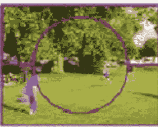

图 3-8。遮罩路径的轮廓

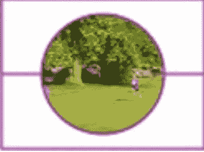

图 3-9 显示了填充和描边后的路径。

图 3-9。填充和描边后的遮罩路径

现在，实际路径只有填充，且填充颜色为白色。你需要想象这两个白色形状沿着视频上方移动。遮罩的效果是覆盖大部分视频片段。可以说，画布上没有绘制颜料的部分是透明的，视频片段的内容会显露出来。换句话说，画布位于视频元素之上，但它等同于一块玻璃。每个没有绘制内容的像素都是透明的。

绘制遮罩的代码对于在画布上绘制的视频 (`videobounceC`) 和屏幕上移动的视频元素 (`videobounceE`) 是相同的。第一条路径从左上角开始，然后向右、向下到中间点，最后向左。接着路径是一个半圆弧。最后一个参数指示圆弧的方向，设为 `true` 表示逆时针。路径继续通过一条线到左边缘，然后向上回到起点。第二条路径从左边缘的中间开始，向下到左下角，到右下角，移动到右侧中间，然后向左移动。圆弧方向参数值为 `false`，表示圆弧为顺时针。路径在起点处结束。

```javascript
ctx.beginPath();
ctx.moveTo(ballx,bally);
ctx.lineTo(ballx+videow,bally);
ctx.lineTo(ballx+videow,bally+.5*videoh);
ctx.lineTo(ballx+.5*videow+maskrad, bally+.5*videoh);
ctx.arc(ballx+.5*videow,bally+.5*videoh,maskrad,0,Math.PI,true);
ctx.lineTo(ballx,bally+.5*videoh);
ctx.lineTo(ballx,bally);
ctx.fill();

ctx.moveTo(ballx,bally+.5*videoh);
ctx.lineTo(ballx,bally+videoh);
ctx.lineTo(ballx+videow,bally+videoh);
ctx.lineTo(ballx+videow,bally+.5*videoh);
ctx.lineTo(ballx+.5*videow+maskrad,bally+.5*videoh);
ctx.arc(ballx+.5*videow,bally+.5*videoh,maskrad,0,Math.PI,false);
ctx.lineTo(ballx,bally+.5*videoh);
ctx.fill();
```

你可以跟随我的“英文”描述进行编码，看看它是如何工作的。

顺便说，我最初的尝试是绘制一个由代表矩形的四边形和中间圆形组成的路径。这在某些浏览器中有效，但在另一些浏览器中无效。

对于 `videbounceC` 应用，遮罩位于画布上绘制的视频之上，因为两个白色填充路径是在 `drawImage` 语句绘制视频帧之后之后绘制的。在 `videbounceE` 应用中，我通过将视频元素的 `z-index` 设置为 0，画布的 `z-index` 设置为 10 来实现相同的效果。记住，z 轴是垂直屏幕的轴。数值越高越靠近我们，并位于较低数值之上。`z-index` 设置为 10 的画布位于 `z-index` 设置为 0 的视频元素之上。下一章将演示在 Google Maps 上移动的聚光灯，这将使用 JavaScript 更改 `z-index`。

## 用户界面

`videobounce` 项目两个版本的用户界面只包含一个供用户的操作：用户可以反转移动方向。按钮由 `body` 中的一个元素定义：

```html
<button id="revbtn" onclick="reverse();">Reverse </button><br/>
```

`onClick` 设置的效果是调用名为 `reverse` 的函数。该函数定义用于改变方向。

```javascript
function reverse() {
    ballvx = -ballvx;
    ballvy = -ballvy;
}
```

```javascript
var ballvx = 2;
```

| Code Line | Description |
| --- | --- |
| var ballvy = 4; | 球的初始垂直位移 |
| var v; | 将存储视频元素 |
| function restart() { | restart 函数标头 |
| v.currentTime=0; | 将视频位置重置为开头 |
| v.play(); | 播放视频 |
| } | 结束 restart 函数 |


### 视频弹跳程序代码解析

#### `init()` 函数

| 代码行 | 说明 |
| --- | --- |
| `function init() {` | `init` 函数标头 |
| `canvas1 = document.getElementById('canvas');` | 设置 canvas 的引用 |
| `ctx = canvas1.getContext('2d');` | 设置 canvas 上下文引用 |
| `canvas1.width = window.innerWidth;` | 设置 canvas 宽度匹配当前窗口宽度 |
| `cwidth = canvas1.width;` | 设置变量 |
| `canvas1.height = window.innerHeight;` | 设置 canvas 高度匹配窗口高度 |
| `cheight = canvas1.height;` | 设置变量 |
| `v = document.getElementById("vid");` | 设置视频元素的引用 |
| `v.addEventListener("ended", restart, false);` | 设置视频结束时的事件处理；之所以这样做是因为元素标签头中的 `loop` 属性在 Firefox 浏览器中不起作用 |
| `v.width = Math.min(v.videoWidth / 3, .5 * cwidth);` | 设置视频宽度 |
| `v.height = Math.min(v.videoHeight / 3, .5 * cheight);` | 设置视频高度 |
| `videow = v.width;` | 设置变量 |
| `videoh = v.height;` | 设置变量 |

#### 初始化变量与设置

| 代码行 | 说明 |
| --- | --- |
| `ballrad = Math.min(50, .5 * videow, .5 * videoh);` | 如果视频非常小，则修改 `ballrad` |
| `maskrad = .4 * Math.min(videow, videoh);` | 根据视频尺寸设置 `maskrad` |
| `ctx.lineWidth = ballrad;` | 设置绘制框的线宽 |
| `ctx.strokeStyle = "rgb(200,0,50)";` | 设置颜色为红色 |
| `ctx.fillStyle = "white";` | 设置遮罩填充样式为白色 |
| `v.play();` | 开始视频 |
| `setInterval(drawscene, 50);` | 设置定时事件 |
| `}` | 结束 `init` 函数 |

#### `drawscene()` 函数

| 代码行 | 说明 |
| --- | --- |
| `function drawscene() {` | `drawscene` 函数标头 |
| `ctx.clearRect(0, 0, width, cheight);` | 擦除画布 |
| `moveandcheck();` | 检查下次移动是否碰到墙壁，如果是则调整位移和位置；否则直接移动 |
| `ctx.drawImage(v, ballx, bally, videow, videoh);` | 在指定位置绘制视频图像 |
| `ctx.beginPath();` | 开始绘制遮罩上半部分的路径 |
| `ctx.moveTo(ballx, bally);` | 移动到起点 |
| `ctx.lineTo(ballx + videow, bally);` | 水平移动 |
| `ctx.lineTo(ballx + videow, bally + .5 * videoh);` | 向下移动到一半 |
| `ctx.lineTo(ballx + .5 * videow + maskrad, bally + .5 * videoh);` | 移动到开口处的起点 |
| `ctx.arc(ballx + .5 * videow, bally + .5 * videoh, maskrad, 0, Math.PI, true);` | 绘制半圆弧 |
| `ctx.lineTo(ballx, bally + .5 * videoh);` | 向左移动 |
| `ctx.lineTo(ballx, bally);` | 回到起点 |
| `ctx.fill();` | 填充遮罩上部的白色 |
| `ctx.moveTo(ballx, bally + .5 * videoh);` | 移动到遮罩下部的起点；移动到左侧中间点 |
| `ctx.lineTo(ballx, bally + videoh);` | 向左下角移动 |
| `ctx.lineTo(ballx + videow, bally + videoh);` | 移动到右角 |
| `ctx.lineTo(ballx + videow, bally + .5 * videoh);` | 向上到右侧中间 |
| `ctx.lineTo(ballx + .5 * videow + maskrad, bally + .5 * videoh);` | 移动到遮罩孔处的起点 |
| `ctx.arc(ballx + .5 * videow, bally + .5 * videoh, maskrad, 0, Math.PI, false);` | 绘制半圆弧 |
| `ctx.lineTo(ballx, bally + .5 * videoh);` | 向右移动 |
| `ctx.fill();` | 填充遮罩下部的白色 |
| `ctx.fillRect(0, 0, width, height);` | 绘制框 |
| `}` | 结束 `drawscene` 函数 |

#### `moveandcheck()` 函数

| 代码行 | 说明 |
| --- | --- |
| `function moveandcheck() {` | `moveandcheck` 函数标头 |
| `var nballx = ballx + ballvx + .5 * videow;` | 设置 x 的测试值 |
| `var nbally = bally + ballvy + .5 * videoh;` | 设置 y 的测试值 |
| `if (nballx > cwidth) {` | 与右墙比较，碰撞时 |
| `ballvx = -ballvx;` | 改变水平位移 `vx` 的符号 |
| `nballx = cwidth;` | 设置测试值恰好在右墙 |
| `}` | |
| `if (nballx < 0) {` | 与左墙比较，碰撞时 |
| `nballx = 0;` | 设置测试值恰好在左墙 |
| `ballvx = -ballvx;` | 改变水平位移符号 |
| `}` | |
| `if (nbally > cheight) {` | 与底墙比较，碰撞时 |
| `nbally = cheight;` | 设置测试值恰好为高度 |
| `ballvy = -ballvy;` | 改变垂直位移符号 |
| `}` | |
| `if (nbally < 0) {` | 与顶墙比较，碰撞时 |
| `nbally = 0;` | 设置测试值恰好在顶墙 |
| `ballvy = -ballvy;` | 改变垂直位移符号 |
| `}` | |
| `ballx = nballx - .5 * videow;` | 使用测试值设置 `ballx`，偏移为左上角而非中心 |
| `bally = nbally - .5 * videoh;` | 使用测试值设置 `bally`，偏移为左上角而非中心 |
| `}` | 结束 `moveandcheck` 函数 |

#### `reverse()` 函数

| 代码行 | 说明 |
| --- | --- |
| `function reverse() {` | 按钮函数标头 |
| `ballvx = -ballvx;` | 改变水平位移符号 |
| `ballvy = -ballvy;` | 改变垂直位移符号 |
| `}` | 结束 `reverse` 函数 |

#### HTML 结构

```html
</script>
</head>
<body onLoad="init();">
  <!-- 开启 body 标签；调用 init -->
  <video id="vid" loop="loop" preload="auto">
    <!-- 视频元素标头 -->
    <source src="jomerun.mp4" type='video/mp4'>
    <!-- mp4 视频源 -->
    <source src="jomerun.webm" type='video/webm'>
    <!-- WEBM 视频源 -->
    <source src="jomerun.theora.ogv" type='video/ogg'>
    <!-- OGG 视频源 -->
    您的浏览器不支持 video 标签。
  </video>
  <!-- 关闭视频标签 -->
  <button id="revbtn" onclick="reverse();">Reverse </button><br>
  <!-- 用于反转方向的按钮 -->
  <canvas id="canvas">
    <!-- 开启 canvas 标签 -->
    此浏览器不支持 HTML5 canvas 元素。
  </canvas>
```

#### 表 3-3. Video bounce 程序完整代码（版本二：移动视频元素）

此版本的应用程序移动视频元素而不是在 canvas 上绘制视频的当前帧。我的研究表明执行时可以使用更少的计算机资源。所有版本都有共同之处，我将通过注释不同的行来指出。

##### 全局变量与样式

```javascript
var ctx;
var cwidth;
var cheight;
var ballrad = 50;
var ballx = 80; // 起点是任意的
var bally = 80; // 起点是任意的
var maskrad;
var ballvx = 2;
var ballvy = 4;
var v;
```

```css
<style>
  #vid { position: absolute; display: none; z-index: 1; }
  #canvas { position: absolute; z-index: 10; top: 0px; left: 0px; }
  #revbtn { position: absolute; z-index: 20; }
</style>
```
*需要设置定位和 z-index，因为 display 设置将更改以使元素可见。Canvas 位于视频上方，按钮下方。*

##### `restart()` 函数

```javascript
function restart() {
  v.currentTime = 0;
  v.play();
}
```

##### `init()` 函数（版本二）

```javascript
function init() {
  canvas1 = document.getElementById('canvas');
  ctx = canvas1.getContext('2d');
  canvas1.width = window.innerWidth;
  cwidth = canvas1.width;
  canvas1.height = window.innerHeight;
  cheight = canvas1.height;
  window.onscroll = function () {
    window.scrollTo(0, 0);
  };
  v = document.getElementById("vid");
  v.addEventListener("ended", restart, false);
  v.width = Math.min(v.videoWidth / 3, .5 * cwidth);
  v.height = Math.min(v.videoHeight / 3, .5 * cheight);
  videow = v.width;
  videoh = v.height;
  ballrad = Math.min(50, .5 * videow, .5 * videoh); // 如果视频非常小，则修改 ballrad
  maskrad = .4 * Math.min(videow, videoh); // 根据视频尺寸设置 maskrad
  ctx.lineWidth = ballrad; // 设置绘制框的线宽
  ctx.strokeStyle = "rgb(200,0,50)"; // 设置颜色为红色
  ctx.fillStyle = "white"; // 设置遮罩填充样式为白色
  v.style.left = String(ballx) + "px";
  v.style.top = String(bally) + "px";
  v.play();
  v.style.display = "block"; // 使视频元素可见
  setInterval(drawscene, 50); // 设置定时事件
}
```

##### `drawscene()` 函数（版本二）

```javascript
function drawscene() {
  ctx.clearRect(0, 0, width, height);
  moveandcheck();
  v.style.left = String(ballx) + "px"; // 设置视频的水平位置
  v.style.top = String(bally) + "px";  // 设置视频的垂直位置
  ctx.beginPath();
  ctx.moveTo(ballx, bally);
  ctx.lineTo(ballx + videow, bally);
  ctx.lineTo(ballx + .5 * videow, bally + .5 * videoh);
  ctx.lineTo(ballx + .5 * videow + maskrad, bally + .5 * videoh);
  ctx.arc(ballx + .5 * videow, bally + .5 * videoh, maskrad, 0, Math.PI, true);
  ctx.lineTo(ballx, bally + .5 * videoh);
  ctx.lineTo(ballx, bally);
  ctx.fill();
  ctx.moveTo(ballx, bally + .5 * videoh);
  ctx.lineTo(ballx, bally + videoh);
  ctx.lineTo(ballx + videow, bally + videoh);
  ctx.lineTo(ballx + videow, bally + .5 * videoh);
  ctx.lineTo(ballx + .5 * videow + maskrad, bally + .5 * videoh);
  ctx.arc(ballx + .5 * videow, bally + .5 * videoh, maskrad, 0, Math.PI, false);
  ctx.lineTo(ballx, bally + .5 * videoh);
  ctx.fill();
  ctx.strokeRect(0, 0, width, height); // box形
}
```

##### `moveandcheck()` 函数（版本二）

```javascript
function moveandcheck() {
  var nballx = ballx + ballvx; // 尝试值
  var nbally = bally + ballvy; // 尝试值
  if ((nballx + videow) > width) { // 取总宽度并比较
    ballvx = -ballvx; // 改变水平位移的符号
    nballx = width - videow; // 设置为确切位置
  }
  if (nballx < 0) {
    nballx = 0;
    ballvx = -ballvx;
  }
  if ((nbally + videoh) > height) { // 比较总长度
    nbally = height - videoh; // 设置为确切位置
    ballvy = -ballvy; // 改变垂直位移的符号
  }
  if (nbally < 0) {
    nbally = 0;
    ballvy = -ballvy;
  }
  ballx = nballx; // 设置为尝试位置，可能经过调整
  bally = nbally; // 设置为尝试位置，可能经过调整
}
```

##### `reverse()` 函数（版本二）

```javascript
function reverse() {
  ballvx = -ballvx;
  ballvy = -ballvy;
}
```

##### HTML 主体（版本二）

```html
<body onLoad="init();">
  <video id="vid" loop="loop" preload="auto">
    <source src="joshuaomerun.webmvp8.webm" type='video/webm; codecs="vp8, vorbis"'>
    <source src="joshuaomerun.mp4" type='video/mp4; codecs="avc1.42E01E, mp4a.40.2"'>
    <source src="joshuaomerun.theora.ogv" type='video/ogg; codecs="theora, vorbis"'>
    您的浏览器不支持视频标签。
  </video>
  <button id="revbtn" onClick="reverse();">反转 </button><br/>
  <canvas id="canvas"></canvas>
  此浏览器不支持 HTML5 canvas 元素。
</body>
```


我通过修改 `drawscene` 为 `videobounce` 实现了**轨迹**（trajectory）函数。由于我想让圆形的大小与遮罩视频片段相似，因此在设置视频宽度和高度后，临时向 `videobounce` 函数中添加了一个 `alert` 语句，并使用这些值运行了程序：

```javascript
v.width = Math.min(v.videoWidth/3,.5*width);
v.height = Math.min(v.videoHeight/3,.5*height);
alert("width "+v.width+" height "+v.height);
```

然后，我使用了 106 和 80 这两个值作为轨迹程序中的 `videow` 和 `videoh` 值。包含修改行的完整代码如表 3-4 所示。注意，此程序与第一个程序的主要区别在于缺少了某些行。

表 3-4. Videobounce 轨迹程序的完整代码

| 代码行 | 说明 |
| --- | --- |
| `<!DOCTYPE html>` | |
| `<html>` | |
| `<head>` | |
| `<title>Video bounce</title>` | |
| `<meta charset="UTF-8">` | |
| `<style>`<br>`#canvas {position:absolute; z-index:10; top:0px; left:0px;}`<br>`#revbtn {position:absolute; z-index:20; }`<br>`</style>` | |
| `<script type="text/javascript">`<br>`var ctx;`<br>`var width;`<br>`var height;`<br>`var ballrad = 50;`<br>`var ballx = 50;`<br>`var bally = 60;`<br>`var ballvx = 2;`<br>`var ballvy = 4;`<br>`function init(){`<br>`  canvas1 = document.getElementById('canvas');`<br>`  ctx = canvas1.getContext('2d');`<br>`  canvas1.width = window.innerWidth;`<br>`  canvas1.height = window.innerHeight;`<br>`  width = canvas1.width;`<br>`  height = canvas1.height;`<br>`  videow = Math.min(106,.5*width); // 使用宽度`<br>`  videoh = Math.min(80,.5*height); // 使用高度`<br>`  maskrad = 50;`<br>`}`<br>`setInterval(drawscene,50);`<br>`function drawscene() {`<br>`  ctx.clearRect(0,0,width,height);`<br>`  moveandcheck();`<br>`  v.style.left = String(bally)+"px";`<br>`  v.style.top = String(bally)+"px";`<br>`  ctx.beginPath();`<br>`  ctx.moveTo(ballx,bally);`<br>`  ctx.lineTo(ballx+videow,bally);`<br>`  ctx.lineTo(ballx+.5*videow,bally+.5*videoh);`<br>`  ctx.lineTo(ballx+.5*videow+maskrad,bally+.5*videoh);`<br>`  ctx.arc(ballx+.5*videow,bally+.5*videoh,maskrad,0,Math.PI,true);`<br>`  ctx.lineTo(ballx,bally+.5*videoh);`<br>`  ctx.fill();`<br>`  ctx.moveTo(ballx,bally+.5*videoh);`<br>`  ctx.lineTo(ballx,bally);`<br>`  ctx.lineTo(ballx,bally+videoh);`<br>`  ctx.lineTo(ballx+videow,bally+videoh);`<br>`  ctx.lineTo(ballx+videow,bally+.5*videoh);`<br>`  ctx.lineTo(ballx+.5*videow+maskrad,bally+.5*videoh);`<br>`  ctx.arc(ballx+.5*videow,bally+.5*videoh,maskrad,0,Math.PI,false);`<br>`  ctx.lineTo(ballx,bally+.5*videoh);`<br>`  ctx.fill();`<br>`  ctx.strokeRect(0,0,width,height);`<br>`}`<br>`function moveandcheck() {`<br>`  var nballx = ballx + ballvx;`<br>`  var nbally = bally + ballvy;`<br>`  if ((nballx+videow) > width) {`<br>`    ballvx = -ballvx;`<br>`    nballx = width-videow;`<br>`  }`<br>`  if (nballx < 0) {`<br>`    nballx = 0;`<br>`    ballvx = -ballvx;`<br>`  }`<br>`  if ((nbally+videoh) > height) {`<br>`    nbally = height-videoh;`<br>`    ballvy = -ballvy;`<br>`  }`<br>`  if (nbally < 0) {`<br>`    nbally = 0;`<br>`    ballvy = -ballvy;`<br>`  }`<br>`  ballx = nballx;`<br>`  bally = nbally;`<br>`}`<br>`function reverse() {`<br>`  ballvx = -ballvx;`<br>`  ballvy = -ballvy;`<br>`}`<br>`</script>` | |
| `</head>` | |
| `</body>` | |
| `</html>` | |

## 让应用程序属于你

让这个应用程序属于你的第一种方法是使用你自己的视频。由于你想让圆形的大小与遮罩视频片段相似，正如之前提到的，你需要制作不同编码格式的版本。下一步是添加其他用户界面交互，包括改变水平和垂直速度，就像在《HTML5 必备指南》中做的那样。另一组增强是添加视频控制。视频控制可以包含在视频元素中，但我不认为对于小型且移动的视频片段这样做是可行的！不过，你可以通过模仿其他按钮来实现自己的控制。

Opera 浏览器提供了颜色选择器。

## 测试与上传应用程序

正如前面提到的，但值得重复的是，你需要获取合适的视频片段。在编写本书时，你需要使用如 Miro 等程序生成 WEBM、mp4、OGG 版本的视频，因为浏览器识别不同的视频编码（解码器）。这种情况可能会发生变化。同样，如果你只想为一个浏览器实现此功能，可以检查哪种视频编码适用于该浏览器，并只准备一个视频文件。视频文件和 HTML 文件需要位于电脑上的同一个文件夹中，并且在你将此应用程序上传到服务器账户时，也需要位于服务器上的同一个文件夹中。或者，你可以在源元素中使用完整的网络地址或正确的相对地址。

## 总结

在本章中，你学习了操作视频的不同方法。这些方法包括：

- 将视频的当前帧作为图像绘制在画布（canvas）上
- 通过更改左上角的样式属性重新调整视频元素在屏幕上的位置
- 使用样式指令对视频、画布和按钮进行层叠
- 在画布上创建移动遮罩
- 获取窗口尺寸信息以适应应用程序的不同情况

下一章将向你展示如何在 HTML5 项目中使用 Google Maps 应用程序接口（API）。该项目将涉及使用画布并更改 `z-index`，以便画布交替位于 Google Maps 生成的内容上方或下方。

# 第 4 章

## 地图制作：结合 Google Maps 与画布

在本章中，你将学习如何执行以下操作：

- 使用 Google Maps API 在特定位置显示地图
- 使用透明度（也称为 alpha 或不透明度级别）和自定义光标图标在画布上绘制图形
- 通过结合 Google Maps 和 HTML5 特性的使用，并管理事件和 `z-index` 级，为用户提供图形用户界面（GUI）
- 计算两个地理位置之间的距离

### 引言

本章的项目是一个涉及地理地图的应用程序。现在的许多应用程序都涉及使用他人或其他组织提供的应用程序接口（API）。本章将介绍 Google Maps API 的使用，它是使用 Google Maps JavaScript 版本 3 API 的三个章节中的第一个。图 4-1 显示了启动界面。

**基础位置（小红色 x）**

**更改基础位置：**

- Friends of ED, NYC
- Purchase College
- Illinois Institute of Technology

**更改**

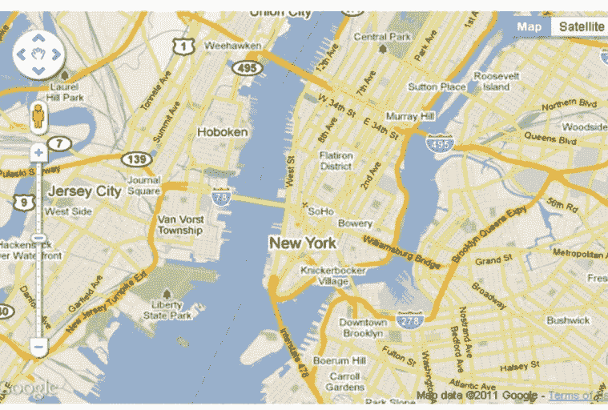

### 图 4-1. 地图聚光项目的启动界面

注意位于 SoHo 正上方和左侧的小红色（手绘）x。
在决定地图标记时，你面临着一种权衡。较小的标记更难看到。较大和/或更复杂的标记更容易看到，但会遮挡更多地图或分散对地图的注意力。x 标记了曼哈顿下城的一个社区。它是 friends of ED 出版者的地址。对于此程序来说，它是初始基础位置。基础位置用于计算距离。

鼠标悬停在地图上如图 4-2 所示。

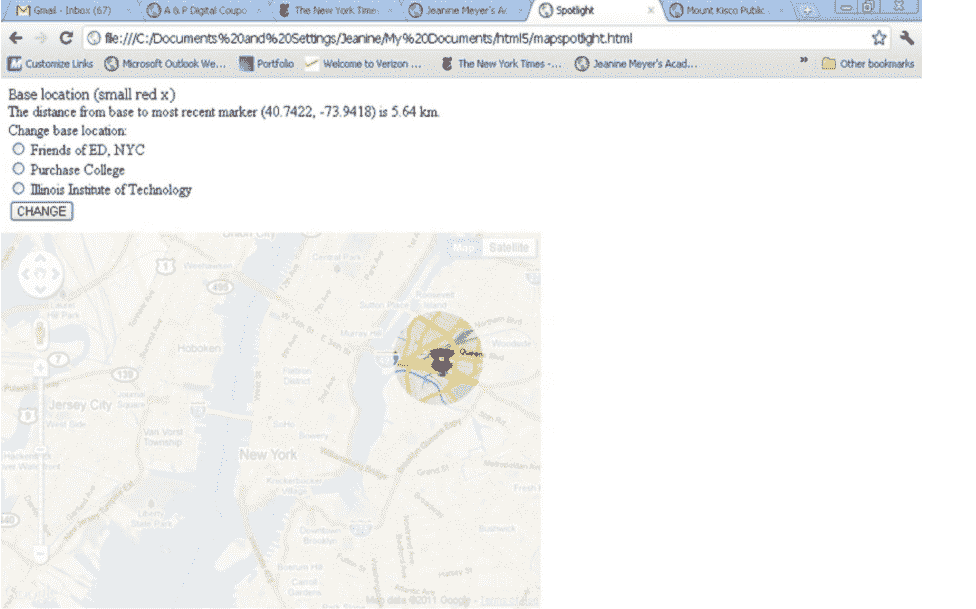

- 基础到最近标记 (40.7422,-73.9418) 的距离为 5.64 km。
- Friends of NYC
- Purchase College
- Newark Institute of Technology

### 图 4-2. 地图上的阴影/聚光

注意现在地图上阴影和聚光的组合。地图的大部分被半透明的阴影覆盖。你需要相信我，这张截图是在我将鼠标移动在地图上时拍摄的。鼠标位置周围有一个圆，原始地图在圆内显示出来。

光标不是标准的默认光标，而是我用一个代表紧凑荧光灯的小图像创建的。

屏幕上的文本显示，从基础位置到我点击的地图最后一点的距离为 5.64 公里。对于所有此类位置都有一个手绘的 x。该位置的经纬度在括号中。

Google Maps 提供的通用 GUI 特性对本项目的用户可用。这包括一个控制演示放比例的垂直滑块。图 4-3 展示了使用该滑块放大的结果。
可以进一步放大。

**基础位置（小红色 x）**
**基础到最近标记 (40.7422, -73.9418) 的距离为 5.64 km。**
**更改基础位置：**

- Friends of ED, NYC
- Purchase College
- Illinois Institute of Technology

**更改**

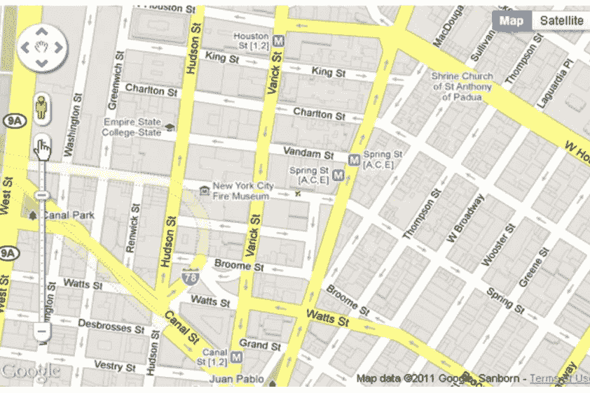

### 图 4-3. 放大的街道级别

还可以通过左上角的鼠标，然后通过按下鼠标按钮并拖动来虚拟抓鼠标来移动地图。图 4-4 显示了缩小和向北移动的效果。
屏幕再次显示阴影/聚光。

**基础位置（小红色 x）**
**基础到最近标记 (41.2365, -73.6977) 的距离为 62.39 km。**
**更改基础位置：**

- Friends of ED, NYC
- Purchase College
- Illinois Institute of Technology

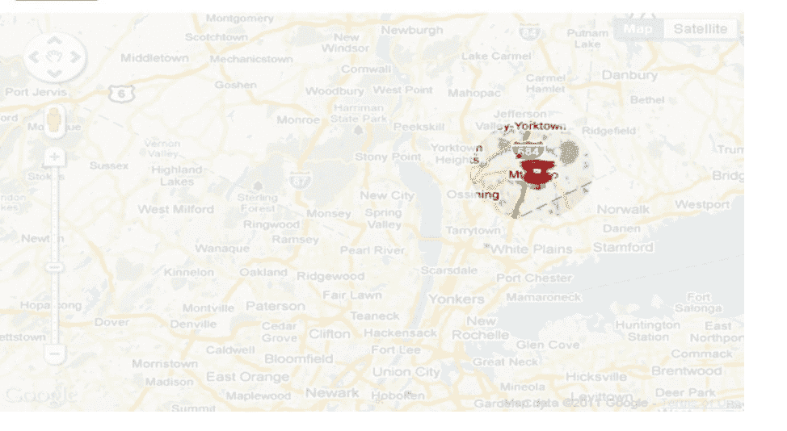

**更改**

### 图 4-4. 缩小并向北移动

**基础位置（小红色 x）**
**基础位置位于 Purchase College**
**更改位置：**
* Friends of ED, NYC
* Purchase College
* Illinois Institute of Technology

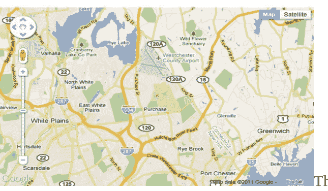

### 图 Purchase College 新位置

接下来，我点击第三个单选按钮将芝利诺伊州的 Illinois Institute of Technology 作为基础。结果如图 4-6 所示。

**基础位置（小红色 x）是 Illinois Institute of Technology**
**更改基础位置：**

- Friends of ED, NYC
- Purchase College
- Illinois Institute of Technology

**更改**

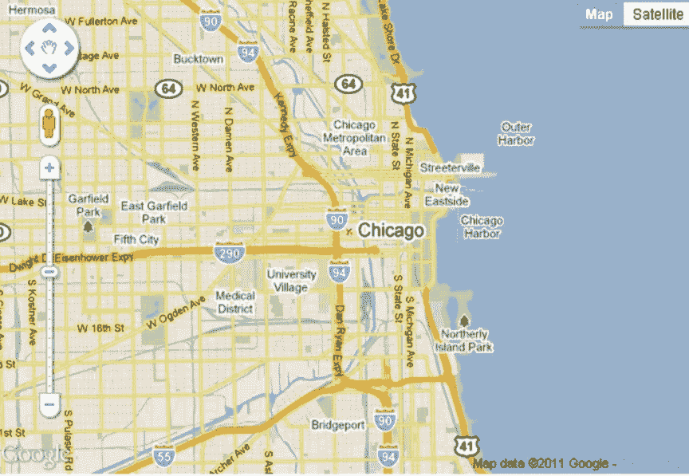

### 图 4-6. 芝加哥的 Institute of Technology

再次注意基础位置的小红色 x 以及屏幕顶部新基础名称的文本。

每个基础的位置是由我确定的三个值的经纬度提供的。我的代码并没有“要求” Google Maps 通过名称查找这些位置。如果你在 Google 或 Google Maps 中输入“Purchase College”和“Illinois Institute of Technology”，可能会得到不同的结果。为了让此应用程序属于你自己，你需要确定一组基础位置并查找经纬度。我将在下一节建议这些方法。

由于你好奇，缩小到缩放/比例的最远位置会产生图 4-7 所示的内容。这种投影显示了所谓的格陵兰问题。格陵兰并不比非洲大，但实际上只有非洲大小的1/14。

**基础位置（小红色 x）**
**基础到最近标记 (40.6855,-74.0935) 的距离为 8.7 km。**
**更改基础位置：**

* Friends of ED, NYC
* Purchase College
* Illinois Institute of Technology

**更改**

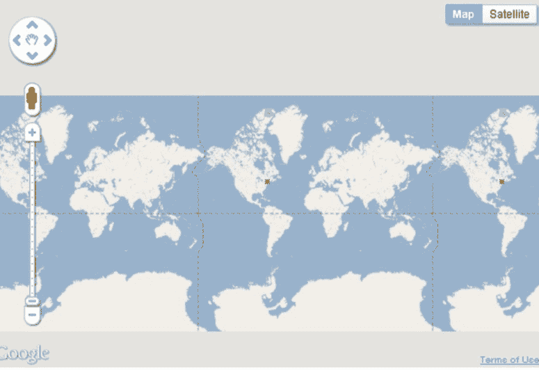

### 图 4-7. 地图的最远视图

图 4-8 显示了接近最小距离限制的地图。通过右上角的按钮，地图还切换到了卫星视图。

**基点位置（小红色 x）是 Friends of ED, NYC**
**从基点到最近的标记点 (40.6855, -74.0935) 的距离为 8.7 公里。**

**更改基点位置：**

- Friends of ED, NYC
- Purchase College
- Illinois Institute of Technology

**更改**

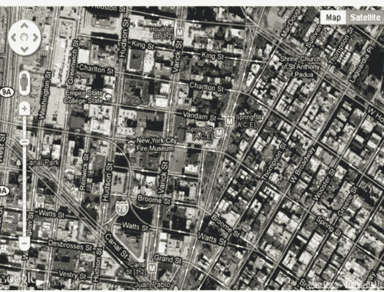

### 图 4-8. 缩放至可以检测到街块的区域

注意，左侧的滑块比最小设置高出约四个刻度。最后，图 4-9 显示了缩放到极限的地图。这基本上是建筑级别的，至少对于曼哈顿而言如此。

**基点位置（小红色 x）是 Friends of ED, NYC**
**从基点到最近的标记点 (40.7257, -74.0049) 的距离为 0.01 公里。**
**更改基点位置：**

- Friends of ED, NYC
- Purchase College
- Illinois Institute of Technology

**更改**


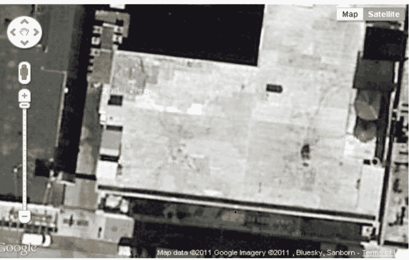

图 4-9. 缩放至最大

通过使用界面进行缩小、平移并再次放大，我可以确定从任何基点位置到世界上任何其他位置的距离！我还可以使用此应用程序来确定任何位置的经纬度和经度值。在更改或添加基点位置列表，以及确定第 5 章项目位置时，您需要知道纬度和经度。我将在下一节中回顾纬度和经度。

Google Maps 本身就是一个极其实用的应用程序。本章和接下来的两章将演示如何将功能引入你自己的应用程序中。也就是说，我们将 Google Maps 的通用功能与使用 HTML5 和 JavaScript 开发的任何（或几乎任何）内容相结合。

### 纬度、经度和其他关键需求

该项目（以及后续章节）最基本的要求是对理解地理坐标系。就像在画布上指定点或在屏幕上指定位置需要坐标系一样，地球上的地点也需要使用一套系统。经纬度系统在过去的几百年里已经开发并标准了。这些值是角度，纬度表示距离赤道的度数，经度表示距离英国格林威治本午线的度数。后者是一个任意的选择，并于 19 世纪后期成为标准。这里存在一个北半球的偏向：纬度值从赤道的 0 度到北极的 90 度，再到南极的 –90 度。同样，经度值从格林威治本午线开始，向东为正数，向西为负数。纬度通常被称为纬线，通常表现为水平线；经度通常被称为经线，通常表现为垂直线。这种取向是任意的，但已经非常稳固。

我将使用小数值（这是 Google Maps 的默认显示方式），但你会看到度、分（1/60 度）和秒（1/60 分）的组合。没有必要背诵经纬度值，但对该系统建立一些直觉感是有益的。你可以通过我所谓的“双向奔赴”来实现这一点。首先，识别并比较你熟悉的地方的经纬度值；其次，选取数值并查看它们是什么。例如，我这个版本的项目基值如下：

- `[40.725592, -74.00495, "friends of ED, NYC"]`
- `[41.04796, -73.70539, "Purchase College/SUNY"]`
- `[41.878928, -87.641926, "Illinois Institute of Technology"]`

首先要到，纬度值非常接近，而经度值是负数且并不接近。纽约市的 friends of ED 办公室位于 Purchase College 1 度纬度和 1 度经度的范围内。根据 Google Maps 显示，距离为 27.4 英里。伊利诺理工学院的经度值更负，表明它比那两个纽约州的地点更靠西。这些都合情合理，但你需要花时间仔细思考。

寻找特定位置的经纬度有很多种方法。你可以这样使用 Google Maps：

1. 启动 Google Maps（访问 `www.google.com` 并点击 Maps 或访问 `http://maps.google.com`）。
2. 在右上角点击齿轮图标打开下拉菜单。点击 Maps Labs 选项。会出现一个标题为 Google Maps Labs 的窗口。滚动到 LatLng Marker 选项并点击圆圈启用。如果你登录，所有设置将在下次登录时依然有效。保存并关闭窗口。
3. 在位置字段中输入你感兴趣的位置。
4. 点击地图上的位置以查看坐标。
5. 经纬度将出现在屏幕底部。

你也可以在地图上的任何地方点击右键以查看该点的坐标。

Google Maps 功能和 JavaScript 特性（包括事件），并且不会让它们互不干扰。你可以将所学的知识用于此项目或其他项目。

### HTML5、CSS 和 JavaScript 特性

地图制作项目的挑战在于如何在 Google Map 中引入地图，并在外观和图形用户界面（GUI）操作方面，将地图、画布（`canvas`）和按钮结合起来。我将描述基础的 Google Maps API，然后解释 HTML5 特性如何提供部分遮罩和事件处理。

### Google Maps API

Google Maps JavaScript API 版本 3 基础提供了优秀的文档，位于：
`http://code.google.com/apis/maps/documentation/javascript/basics.html`。

你现在不需要参考它，但当你决定构建自己的项目时，它将对你有帮助。在为移动设备制作应用程序时，它将特别有帮助。

大多数 API 以一组相关对象的形式呈现，每个对象都有属性（也称为属性）和方法。API 可能还包含事件以及一个设置事件的方法。Google Maps API 正是这种情况。重要的对象是 `Map`、`LatLng` 和 `Marker`。设置事件的方法是 `addListener()`，它可以用于设置点击地图的响应。

Google Maps API 通过 `script` 元素引入你的 HTML5 文档中：

```html
<script type="text/javascript" charset="UTF-8" src="http://maps.google.com/maps/api/js?sensor=false"></script>
```

我将在第 6 章再次讨论 `script` 标签，特别是 `sensor=false` 设置。

下一步——如果你只是想引入 Google Map，这可能就是你需要的全部——是设置对 `Map` 构造器方法的调用。其伪代码如下：

```javascript
map = new google.maps.Map(place you are going to put the map, associative array with options);
```

注意，将变量命名为 `map` 并没有坏处。

让我们一个一个来看这两个参数。放置地图的地方应该是 HTML 文档 `body` 中定义的 `div`。然而，我选择动态创建该 `div`。我是通过在 `init()` 函数中的代码来实现的，该函数通过通常的方式在在 body 语句中设置 `onLoad` 属性调用。我还编写了代码在 `div` 内部创建一个 `canvas` 元素。代码如下：

```javascript
candiv = document.createElement("div");
candiv.innerHTML = ("<canvas id='canvas' width='600' height='400'>No canvas </canvas>");
document.body.appendChild(candiv);
can = document.getElementById("canvas");
pl = document.getElementById("place");
ctx = can.getContext("2d");
```

`can`、`pl` 和 `ctx` 是全局变量，每个变量都可以供其他函数使用。

注意，尽管我尝试使用“将 Google Maps 引入 HTML 文档”这种语言，但我确实在于描述一个“制作”地图的函数了。Google Maps 的连接是动态的，其中 Google Maps 创建了所谓的“待显示的瓦片（tiles）”。

`Map` 方法的第二个参数是一个关联数组。一个名为 `elements` 的关联数组，而不是索引元素数组。Map 方法的数组可以指示缩放级别、地图中心和地图类型等。缩放级别可以从 0 到 18。级别 0 如图 4-7 所示的内容。级别 18 可以显示建筑物。地图类型有 `ROADMAP`、`SATELLITE`、`HYBRID` 和 `TERRAIN`。这些都是使用 Google Maps API 中的常量指示的。中心由类型为 `LatLng` 的值给出，正如你预期的，它是使用表示纬度和经度的小数构造的。使用关联数组意味着我们不需要遵循固定的参数顺序，默认设置将应用于你省略的任何参数。

我的 `makemap()` 函数开始如下。该函数通过两个表示纬度和经度的数字调用，以此为地图中心。我的代码构造了一个 `LatLng` 对象，设置了持有地图规格的数组，然后构造地图——即构造通往 Google Maps 的门户。

```javascript
function makemap(mylat, mylong) {
  var marker;
  bl = new google.maps.LatLng(mylat, mylong);
  options = {
    center: bl,
    zoom: 12,
    mapTypeId: ROADMAP
  };
  map = new google.maps.Map(document.getElementById("place"), options);
}
```

遮罩的分分为两个部分绘制，就像处理跳动视频的遮罩时一样。你可以回看图 3-8 和图 3-9。代码逻辑类似：

```javascript
function drawshadowmask(mx, my) {
  ctx.clearRect(0, 0, 600, 400);
  ctx.fillStyle = gryshadow;
  ctx.beginPath();
  ctx.moveTo(canvasAx, canvasAy);
  ctx.lineTo(canvasBx, canvasBy);
  ctx.lineTo(canvasBx, my);
  ctx.lineTo(mx + holerad, my);
  ctx.arc(mx, my, holerad, 0, Math.PI, true);
  ctx.lineTo(canvasAx, my);
  ctx.lineTo(canvasAx, canvasAy);
  ctx.closePath();
  ctx.fill();
  ctx.beginPath();
  ctx.moveTo(canvasAx, my);
  ctx.lineTo(canvasDx, canvasDy);
  ctx.lineTo(canvasCx, canvasCy);
  ctx.lineTo(canvasBx, my);
  ctx.lineTo(mx + holerad, my);
  ctx.arc(mx, my, holerad, 0, Math.PI, false);
  ctx.lineTo(canvasAx, my);
  ctx.closePath();
  ctx.fill();
}
```

现在我们来看红色灯泡。

### 光标

光标——即当你移动鼠标时在屏幕上移动的小型图形——可以在 `style` 元素或 JavaScript 中设置。该图形有几种内置选择（例如：十字准线、指针），我们也可以参考自己的设计来创建自定义光标，这也是我在这个项目中所演示的。我在 `init()` 函数中包含了以下语句：

```javascript
can.onmousedown = function () { return false; }
```

以防止在按下鼠标时光标切换到默认光标。这可能不是必须的，因为默认状态可能不会被触发。

为了将移动鼠标时的光标更改为传达聚光灯效果，我创建了一张红色紧凑荧光灯泡的图片，并将其保存为文件 `light.gif`。然后，我在 `showshadow()` 函数中使用了以下语句。`showshadow()` 函数已被设置为 `mousemove` 的事件处理器：

```javascript
can.style.cursor = "url('light.gif'), pointer";
```

这表示当悬停在 `can` 元素上方时，JavaScript 应该使用该地址的图片作为光标。此外，如果文件 `light.gif` 不可用，该语句引导 JavaScript 使用内置指针图标。这类似于通过优先级列表指定字体的方式。变量 `can` 已被设置为引用 `canvas` 元素。当 `canvas` 被推到 Google 地图下方时，将不会使用该光标，这将在下一节中讨论。

### 事件

事件处理——特别是鼠标事件，还包括更改 Google 地图上的滑动条或点击单选按钮的事件——在我开始进行这个项目时似乎是最棘手的部分。然而，实际实现被证明是简单而易的。在 `init()` 函数中，我编写了代码来设置鼠标移动、鼠标按下和鼠标抬起的事件处理，所有这些针对 `canvas` 元素：

```javascript
can.onmousedown = function () { return false; }
can.addEventListener('mousemove', showshadow, true);
can.addEventListener('mousedown', pushcanvasunder, true);
can.addEventListener("mouseout", clearshadow, true);
```

第三个参数的布尔值 `true` 表示此事件是冒泡的，意味着它可以向其他监听器发出信号。然而，为了实现我在此项目中所需的事件处理，还需要更多工作。我将解释这三个函数，然后继续描述另一个事件。

`showshadow()` 函数如前所述调用了 `drawshadowmask()` 函数。我本可以把这两个函数合并，但将任务分解为更小的任务通常是一个好做法。`showshadow()` 函数确定鼠标位置，进行调整使灯泡底座位于中心：

```javascript
function showshadow(ev) {
  var mx = ev.offsetX;
  var my = ev.offsetY;
  drawshadowmask(mx, my);
}
```

`showshadow()` 函数如前所述调用了 `drawshadowmask()` 函数。我本可以把这两个函数合并，但将任务分解为更小的任务通常是一个好做法。`showshadow()` 函数确定鼠标位置，进行调整使灯泡底座位于中心：

```javascript
if (holerad > 0) { }
ctx.arc(mx, my, holerad, 0, Math.PI, true);
}
```


遮罩的绘制分为两个部分，就像处理跳动视频的遮罩时一样。你可以回看图 3-8 和图 3-9。代码逻辑类似：

```javascript
function drawshadowmask(mx, my) {
    ctx.clearRect(0, 0, 600, 400);
    ctx.fillStyle = grayshadow;
    ctx.beginPath();
    ctx.moveTo(canvasAx, canvasAy);
    ctx.lineTo(canvasBx, canvasBy);
    ctx.lineTo(canvasBx, my);
    ctx.lineTo(mx + holerad, my);
    ctx.arc(mx, my, holerad, 0, Math.PI, true);
    ctx.lineTo(canvasAx, my);
    ctx.lineTo(canvasAx, canvasAy);
    ctx.closePath();
    ctx.fill();
    ctx.beginPath();
    ctx.moveTo(canvasAx, my);
    ctx.lineTo(canvasDx, canvasDy);
    ctx.lineTo(canvasCx, canvasCy);
    ctx.lineTo(canvasBx, my);
    ctx.lineTo(mx + holerad, my);
    ctx.arc(mx, my, holerad, 0, Math.PI, false);
    ctx.lineTo(canvasAx, my);
    ctx.closePath();
    ctx.fill();
}
```

现在我们来看红色灯泡。

### 光标

光标——即当你移动鼠标时在屏幕上移动的小型图形——可以在 `style` 元素或 JavaScript 中设置。该图形有几种内置选择（例如：十字准线、指针），我们也可以参考自己的设计来创建自定义光标，而这也是我在这个项目中所演示的。我在 `init` 函数中包含了以下语句：

```javascript
can.onmousedown = function () { return false; }
```

以防止在按下鼠标时光标切换到默认光标。这可能不是必须的，因为默认状态可能不会被触发。

为了将移动鼠标时的光标更改为传达聚光灯效果，我创建了一张红色紧凑荧光灯泡的图片，并将其保存为文件 `light.gif`。然后，我在 `showshadow` 函数中使用了以下语句。`showshadow` 函数已被设置为 `mousemove` 的事件处理器：

```javascript
can.style.cursor = "url('light.gif'), pointer";
```

这表示当悬停在 `can` 元素上方时，JavaScript 应该使用该地址的图片作为光标。此外，如果文件 `light.gif` 不可用，该语句引导 JavaScript 使用内置指针图标。这类似于通过优先级列表指定字体的方式。变量 `can` 已被设置为引用 `canvas` 元素。当 `canvas` 被推到 Google 地图下方时，将不会使用该光标，这将在下一节中讨论。

### 事件

事件处理——特别是鼠标事件，还包括更改 Google 地图上的滑动条或点击单选按钮的事件——在我开始进行这个项目时似乎是最棘手的部分。然而，实际实现被证明是简单而易行的。在 `init` 函数中，我编写了代码来设置鼠标移动、鼠标按下和鼠标抬起的事件处理，所有这些针对 `canvas` 元素：

```javascript
can.onmousedown = function () { return false; }
can.addEventListener('mousemove', showshadow, true);
can.addEventListener('mousedown', pushcanvasunder, true);
can.addEventListener("mouseout", clearshadow, true);
```

第三个参数的布尔值 `true` 表示此事件是冒泡的，意味着它可以向其他监听器发出信号。然而，为了实现我在此项目中所需的事件处理，还需要更多工作。我将解释这三个函数，然后继续描述另一个事件。

`showshadow` 函数如前所述调用了 `drawshadowmask` 函数。我本可以把这两个函数合并，但将任务分解为更小的任务通常是一个好做法。`showshadow` 函数确定鼠标位置，进行调整使灯泡底座位于中心：

```javascript
function showshadow(ev) {
    var mx;
    var my;
    if (ev.layerX || ev.layerX == 0) {
        mx = ev.layerX;
        my = ev.layerY;
    } else if (ev.offsetX || ev.offsetX == 0) {
        mx = ev.offsetX;
        my = ev.offsetY;
    }
    mx = mx + 10;
    my = my + 12;
    drawshadowmask(mx, my);
}
```

### 更改基站位置

当点击标记为 CHANGE 的提交按钮时，会调用 `changebase` 函数。`changebase` 函数确定选中了哪一个单选按钮，并使用 `Locations` 表格获取纬度和经度值。然后，它使用这些值作为参数调用 `makemap`。这种数据组织方式是并行的结构：`locations` 数组的元素与单选按钮相对应。最后一条语句将标题元素的 `innerHTML` 设置为显示文本，其中包括所选定的基站位置的名称。

```javascript
function changebase() {
    var mylat;
    var mylong;
    for (var i = 0; i < locations.length; i++) {
        if (document.f.loc[i].checked) {
            mylat = locations[i][0];
            mylong = locations[i][1];
        }
    }
    makemap(mylat, mylong);
    document.getElementById("header").innerHTML =
        "Base location (small red x) is " + locations[i][2];
    return false;
}
```

### 计算距离并对显示数值进行舍入

正如我们许多人所知，Google Maps 提供了距离信息，甚至区分了步行和开车。对于这个应用程序，我需要更精确地指定想要计算距离的两个位置，因此我决定在 JavaScript 中开发一个函数。确定两个点（每个点代表纬度和经度值）之间的距离是使用球面余弦定理完成的。我的参考来源是 www.movable-type.co.uk/scripts/latlong.html。以下是代码：

```javascript
function dist(point1, point2) {
    var R = 6371; // km
    // var R = 3959; // miles
    var lat1 = point1.lat() * Math.PI / 180;
    var lat2 = point2.lat() * Math.PI / 180;
    var lon1 = point1.lng() * Math.PI / 180;
    var lon2 = point2.lng() * Math.PI / 180;
    var d = Math.acos(Math.sin(lat1) * Math.sin(lat2) +
        Math.cos(lat1) * Math.cos(lat2) *
        Math.cos(lon2 - lon1)) * R;
    return d;
}
```

**注意** 我在代码中没有包含很多注释，因为我附带了每一行注释的表格。然而，注释是非常重要的。我强烈建议在 `dist` 函数中保留关于 `km` 和 `miles` 的注释，以便你可以根据需要调整程序。或者，你也可以显示这两个值，或者让用户进行选择。

最后一个函数用于对数值进行舍入处理。当一个数量取决于人的鼠标移动时，你不应该显示带有过多小数位的值。然而，我们应该记住，纬度代表的是很大的单位。我决定让距离显示两位小数，而纬度显示四位。

我写的这个函数是非常通用的。它接受两个参数，一个数字 `num` 和另一个数字 `places`，表示取值的小数位数。你可以在其他情况下使用它。它会通过添加我称之为 `increment`（增量）的值，然后计算不大于该值的最大整数，从而适当地进行向上或向下舍入。因此：

- `round(9.147, 2)` 将产生 9.15；而
- `round(9.143, 2)` 将产生 9.14。

代码的工作原理是首先确定我所说的 `factor`（因子），即 10 的目标位数次方。对于 2，这将是 100。然后我计算增量。对于两位小数，这将是 `5 / 100 * 10`，即 `5 / 1,000`，即 `.005`。

### 代码注释表

| Code Line | Description |
|---|---|
| `ctx = can.getContext("2d");` | 设置上下文 |
| `can.onmousedown = function () { return false; };` | 防止光标变为默认形状 |
| `can.addEventListener('mousemove', showshadow, true);` | 设置鼠标移动的事件处理 |
| `can.addEventListener('mousedown', pushcanvasunder, true);` | 设置按下鼠标键的事件处理 |
| `can.addEventListener("mouseout", clearshadow, true);` | 设置鼠标移出画布区域的事件处理 |
| `mylat = locations[0][0];` | 设置纬度为第 0 个地点的纬度 |

| Code Line | Description |
|---|---|
| `mylong = locations[0][1];` | 设置经度为第 0 个地点的经度 |
| `makemap(mylat, mylong);` | 调用函数创建地图（在指定位置引入 Google Maps） |

| Code Line | Description |
|---|---|
| `}` | 关闭 `init` 函数 |
| `function pushcanvasunder(ev) {` | `pushcanvasunder` 函数头，调用时带有引用事件参数 |
| `can.style.zIndex = 1;` | 将画布下推 |
| `pl.style.zIndex = 100;` | 将 map div 置顶 |
| `}` | 关闭 `pushcanvasunder` 函数 |
| `function clearshadow(ev) {` | `clearshadow` 函数头，调用时带有引用事件参数 |
| `ctx.clearRect(0, 0, 600, 400);` | 清除画布（擦除阴影掩罩） |
| `}` | 关闭 `clearshadow` 函数 |
| `function showshadow(ev) {` | `showshadow` 函数头，调用时带有引用事件参数 |
| `var mx;` | 用于存储鼠标的水平位置 |
| `var my;` | 用于存储鼠标的垂直位置 |
| `if (ev.layerX || ev.layerX == 0) {` | 此浏览器是否使用 `layerX`？ |

| Code Line | Description |
|---|---|
| `mx = ev.layerX;` | 如果是，使用它设置 `mx`... |
| `my = ev.layerY;` | ...以及 `my` |
| `} else if (ev.offsetX || ev.offsetX == 0) {` | 尝试 `offsetX` |
| `mx = ev.offsetX;` | 如果是，使用它设置 `mx`... |
| `my = ev.offsetY;` | ...以及 `my` |
| `}` | 关闭语句块 |
| `can.style.cursor = "url('light.gif'), pointer";` | 如果可用，将光标设置为 `light.gif`，否则设置为指针 |

| Code Line | Description |
|---|---|
| `mx = mx + 10;` | 进行粗略修正，使灯泡底的光中心在水平方向上... |
| `my = my + 12;` | ...垂直方向 |
| `drawshadowmask(mx, my);` | 在修改后的 `(mx, my)` 处调用 `drawshadowmask` 函数 |
| `}` | 关闭 `showshadow` 函数 |
| `var canvasAx = 0;` | 掩罩常量：左上角 x |
| `var canvasAy = 0;` | 左上角 y |
| `var canvasBx = 600;` | 右上角 x |
| `var canvasBy = 0;` | 右上角 y |
| `var canvasCx = 600;` | 右下角 x |
| `var canvasCy = 400;` | 右下角 y |
| `var canvasDx = 0;` | 左下角 x |

| Code Line | Description |
|---|---|
| `var canvasDy = 400;` | 左下角 y |
| `var holerad = 50;` | 阴影圆的常量半径（聚光灯半径） |
| `var grayshadow = "rgba(250,250,250,.8)";` | 淡阴影的颜色；透明度为 .8 |
| `function drawshadowmask(mx, my) {` | `drawshadowmask` 函数头；参数持有圆环洞的中心 |
| `ctx.clearRect(0, 0, 600, 400);` | 清除整个画布 |
| `ctx.fillStyle = grayshadow;` | 设置颜色 |
| `ctx.beginPath();` | 开始第一条（上方）路径 |
| `ctx.moveTo(canvasAx, canvasAy);` | 移动到左上角 |
| `ctx.lineTo(canvasBx, canvasBy);` | 绘制到右上角 |

| Code Line | Description |
|---|---|
| `ctx.lineTo(canvasBx, my);` | 绘制到 `my` 参数指定的垂直点 |
| `ctx.lineTo(mx + holerad, my);` | 绘制到洞的左边缘 |
| `ctx.arc(mx, my, holerad, 0, Math.PI, true);` | 绘制半圆弧 |
| `ctx.lineTo(canvasAx, my);` | 绘制到左侧 |
| `ctx.lineTo(canvasAx, canvasAy);` | 绘制回起点 |
| `ctx.closePath();` | 关闭合路径 |
| `ctx.fill();` | 填充 |
| `ctx.beginPath();` | 开始第二条（下方）路径 |
| `ctx.moveTo(canvasAx, my);` | 从 `my` 参数指定的左侧点开始 |

| Code Line | Description |
|---|---|
| `ctx.lineTo(canvasDx, canvasDy);` | 绘制到左下角 |
| `ctx.lineTo(canvasCx, canvasCy);` | 绘制到右下角 |
| `ctx.lineTo(canvasBx, my);` | 绘制到右边缘的点 |
| `ctx.lineTo(mx + holerad, my);` | 绘制到洞的边缘 |
| `ctx.arc(mx, my, holerad, 0, Math.PI, false);` | 绘制半圆弧 |
| `ctx.lineTo(canvasAx, my);` | 绘制到右边缘 |
| `ctx.closePath();` | 关闭合路径 |
| `ctx.fill();` | 填充 |

| Code Line | Description |
|---|---|
| `var listener;` | 由 `EventListener` 设置的变量；不再使用 |
| `var map;` | 持有地图 |
| `var lat;` | 持有基础纬度对象 |
| `var myOptions;` | 持有用于地图的关联数组 |
| `var rxmarker = "x1.png";` | 持有红色 x 的文件名 |
| `var bxmarker = "bx1.png";` | 持有黑色文件名 |
| `function makemap(mylat, mylong) {` | `makemap` 函数头；参数持有地图的位置 |
| `var marker;` | 将持有为中心创建的标记 |

| Code Line | Description |
|---|---|
| `var latLng = new google.maps.LatLng(mylat, mylong);` | 构建 `LatLng` 对象（API 的特殊数据类型） |
| `myOptions = {` | 设置关联数组 |
| `zoom: 12,` | 缩放设置（可以是 0 到 18） |
| `center: latLng,` | 中心点 |
| `mapTypeId: google.maps.Map.ROADMAP` | 地图类型 |

```javascript
map = new google.maps.Map(document.getElementById("place"), myOptions);
marker = new google.maps.Marker({
    position: latLng,
    title: "center",
    icon: rxmarker,
    map: map
});
```


# 第 5 章

## 地图门户：使用 Google Maps 访问你的媒体

在本章中，你将探索以下内容：

- 使用 Google Maps API 播放并显示媒体
- 动态创建 HTML5 标记
- 将程序与内容分离
- 构建地理游戏

### 引言

本章中的项目利用 Google Maps API 来播放视频、显示图像，或者播放音频并显示图像，这些都是基于地理位置的。所有的应用程序都平滑运行，这是由于媒体文件是分离的且相同的。

你可以将这些项目作为模型来获取特定的位置信息。为了让你理解我的意思，基准位置（在代码中给出的经纬度）与媒体的关系如表所示。

| 位置描述 | 媒体 |
| --- | --- |
| Purchase College | 机器人课程视频 |
| Dixon, Illinois | Esther 弹钢琴的音频文件 |
| Statue of Liberty, New York City | Aviva 的照片 |

### 纽约自由女神的烟花

所有应用程序在处理不同类型的媒体时运行顺畅。这是由于媒体文件是分离且相同的。

第一个应用程序由一个 HTML 文件组成，命名为 `mapvideos.html`，它邀请用户点击地图。如果距离某个位置足够，用户就会看到相应的图像、看到相应的视频，或者同时看到相应的音频文件。程序处理所有类型的媒体。

第二个应用程序对用户来说与第一个相同，但在实现上有一个重要区别。该应用程序由两个文件组成：`mapmediabase.html` 和 `mediacontext.js`。`mediacontext.js` 文件包含了描述媒体的信息。`mapmediabase.html` 程序引入 `mediacontext.js` 文件并在运行时创建复制第一个应用程序所需的内容。

第三个应用程序是一个测试。与第二个一样，它由两个文件组成：`mapmediaquiz.html` 和 `mediaquizcontent.js`。`mediaquizcontent.js` 文件包含了连接媒体与位置的信息，包含了问题的文本。

点击地图。

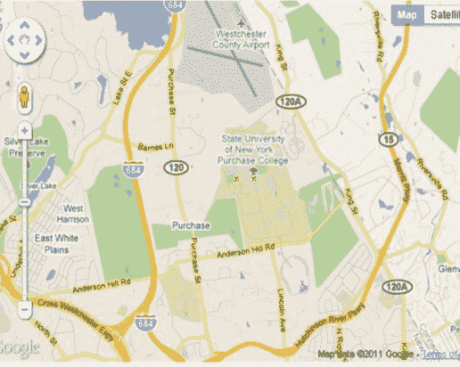

乐高机器人

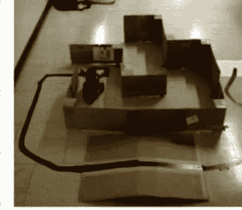

图 5-2. 点击 Purchase College 的结果

点击地图。

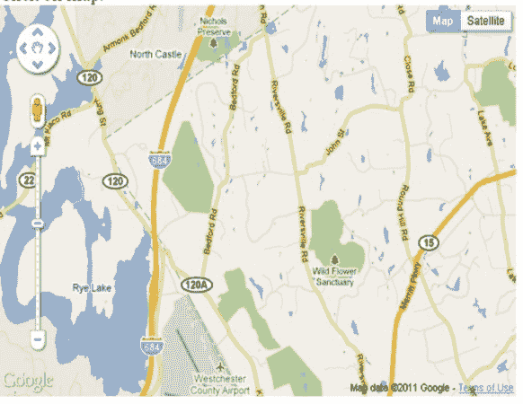

图 5-3 显示了点击屏幕的结果，但距离任何目标位置都不够近。注意我平移了地图，将其向北移动。

图 5-3. 点击未靠近任何目标

图 5-4 显示了我在 Mt. Kisco 附近点击并获得奖励的结果。我需要进一步向北移动才能到达 Mt. Kisco。注意还有音频控制，它提供了暂停、恢复播放以及更改扬声器音量的方法。不同浏览器中的音频（和视频）控制会有所不同，但功能是相同的。

图 5-4. 图像与音频的结合

因为我知道这些位置在哪里，所以我知道缩小以到达下一个位置。图 5-5 显示了使用 Google Maps 接口完成此操作的结果。音频继续播放，我仍然能看到图片。

点击地图

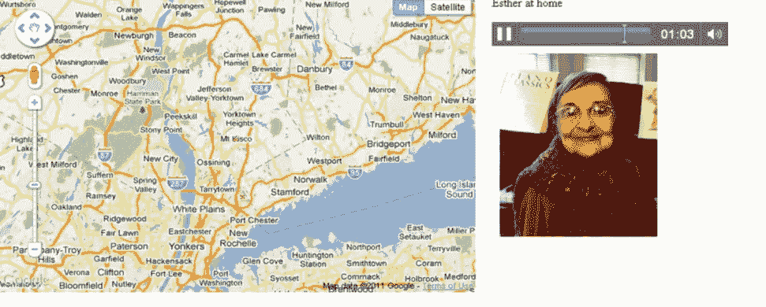

图 5-5. 为向南平移做准备缩小

图 5-6 显示了将地图向南移动，然后放大到自由女神像的位置，这是烟花视频片段的目标位置。

点击地图：

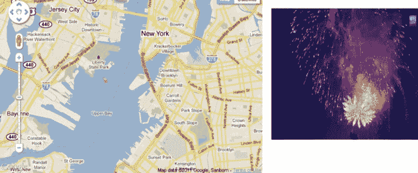

图 5-6. 平移并放大后点击自由女神岛

再次，我知道图片在哪里，所以我缩小比例，平移到芝加哥西部，并点击了伊利诺伊州的 Dixon 小镇。图 5-7 显示了我预期的图像。

### 点击地图。

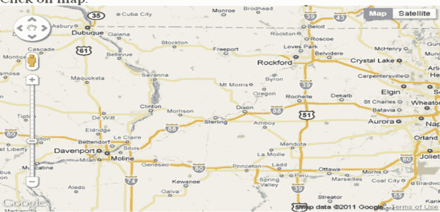

图 5-7. 向西平移并放大到伊利诺伊州的 Dixon

为了让第二个应用程序在布局上与第一个相似，实际上花了一些工作（稍后解释）。

### 埃斯特奶奶住在哪里？

### 标题将放在这里。

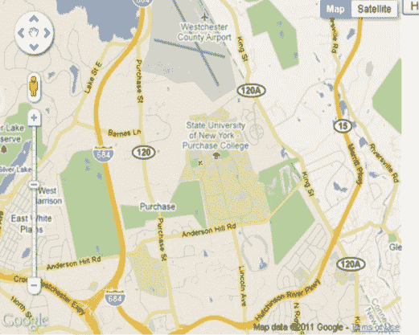

现在我将展示第三个应用程序——测验的截图。图 5-8 显示了启动界面。

图 5-8. 测试启动界面

问题是：埃斯特奶奶住在哪里？玩家必须点击靠近与此问题相关的位置。你可能可以从之前的截图猜出答案。图 5-9 显示了一个错误的回答。

我刚刚点击了 Purchase College 附近的地图。

埃斯特奶奶住在哪里？

离答案不够近。

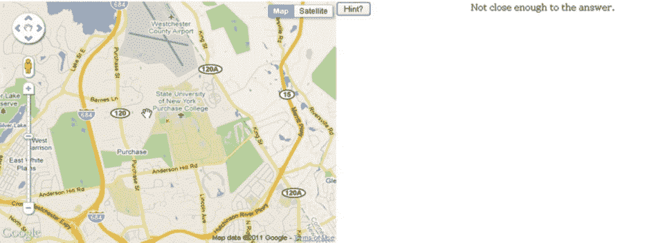

图 5-9. 错误回答

我知道答案，而且，我知道如何在地图上找到它。我将地图向北移动到 Mt. Kisco 并点击那里。图 5-10 显示了熟悉的图像和音频控制。钢琴音乐正在播放。

显示乐高机器人在迷宫中穿行。

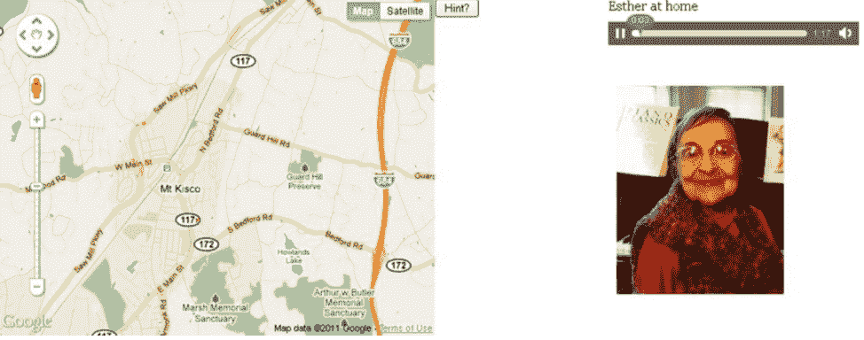

图 5-10. 给出了正确答案，因此显示图像并播放音频，然后给出下一个问题。

注意，一旦上一个问题被正确回答，屏幕就会显示下一个问题。

在设计此类游戏时，当玩家不知道答案时，最好对他们怜悯。我提供了 `Hint?` 按钮，尽管它的功能不仅仅是提供提示。跳过一下，我会正确回答接下来两个问题，然后我将在寻找伊利诺伊州的 Dixon 时需要帮助。图 5-11 显示了提示。

图 5-11. 关于吹笛的提示

如果我点击 `Hint?` 按钮，应用程序将引入一个以目标位置为中心的新地图。图 5-12 显示了屏幕。

寻找 Aviva 吹笛的地方。

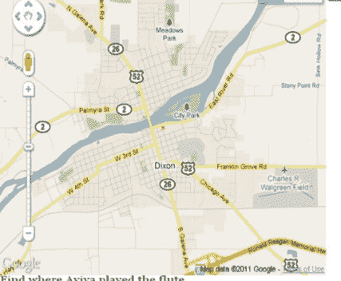

点击红色 x 完成

创建经纬度对象，创建关联数组 `myOptions`，并调用 `Map` 构造函数：

```javascript
lng = new google.maps.LatLng(mylat,mylong);

myOptions = {
  zoom: zoomlevel,
  center: lng,
  mapTypeId: google.maps.MapTypeId.ROADMAP
};

map = new google.maps.Map(document.getElementById("place"), myOptions);
```

为了完整起见，这里是其他地图类型的设置截图。这些分别是 TERRAIN（地形）、HYBRID（混合）和 SATELLITE（卫星）。图 5-13 显示请求地形设置的结果——即指示海拔、水域、公园和人工区域的颜色：

**mapTypeId: google.maps.MapTypeId.TERRAIN**

图 5-13. TERRAIN 地图类型

图 5-14 显示请求 HYBRID 视图的结果，它结合了卫星和道路地图。

**mapTypeId: google.maps.MapTypeId.HYBRID**

图 5-14. HYBRID 地图类型

顺带提一下，混合地图点击界面上的“卫星”选项后生成。图 5-15 显示了请求 SATELLITE 图像的结果。

点击地图。

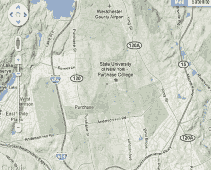

标题将置于。

点击地图。

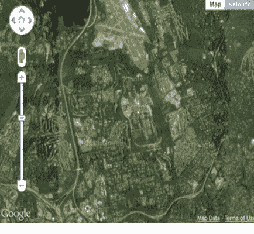

标题将置于。

mapTypeId: google.maps.MapTypeId.SATELLITE

图 5-15. SATELLITE 地图类型

最后，你可能有一个不希望用户更改地图的应用程序。通过在 `myOptions` 数组中使用额外的选项禁用默认界面，可以防止用户更改地图。注意 ROADMAP 后的逗号。

```javascript
mapTypeId: google.maps.MapTypeId.ROADMAP,
disableDefaultUI: true
```


图 5-16 显示了结果。

点击地图。

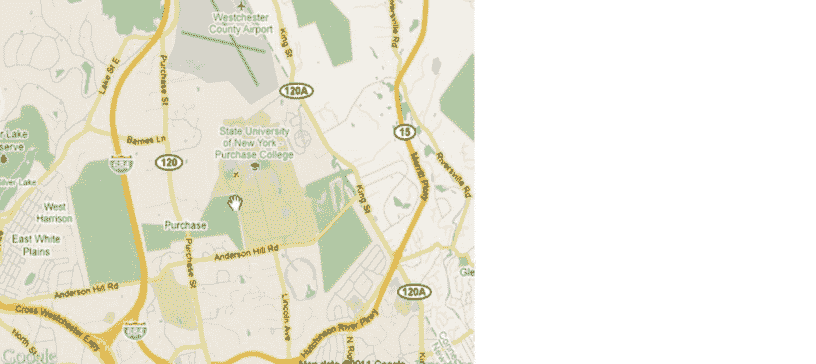

图 5-16. 移除地图界面

`makemap` 还有两个操作需要执行。在指定的中心位置放置了一个自定义标记，并为点击地图设置了事件处理：

```javascript
marker = new google.maps.Marker({
  position: bestLng,
  title: "center",
  icon: xmarker,
  map: map
});

listener = google.maps.event.addListener(map, 'click',
  function(event) {
    checkit(event.latLng);
  });
```

`xmarker` 值引用一个 `Image` 对象，其 `src` 被设置为名为 `x1.png` 的外部文件。

### 项目内容

门户项目展示所有连接到地图位置的当前媒体。我的项目使用了三种类型的媒体：视频、图片和图画。注意：这些是我选择包含在项目中的三种类型的术语。门户项目的内容通过名为 `content` 的数组来指定。数组的每个元素本身是一个包含五个或六个元素的数组。前四个元素对于所有类型都是相同的：纬度、经度、标题和类型。第五个点或第五、六个点指向特定的媒体元素。

数组 `content` 定义如下：

```javascript
content = [
  [41.19991,-73.72353,"Esther at home","pictureaudio",esher,aud1],
  [41.05079,-73.70448,"Lego robot ","video",vid1],
  [40.68992,-74.04460,"Fire works ","video",vid2],
  [41.8442,-89.480,"Aviva in Dixon","picture",aviva]
];
```

上述内容指定了四个位置，从一个图片/音频组合开始，接着是两个视频，最后是一个图片。数组中图片/音频组合的元素如你预期的那样，包含了两个额外信息。仅从这段代码来看并不易见，但 `esher` 指的是一个 `Image` 元素，`aud1` 指的是一个 `audio` 元素。同样，`vid1` 和 `vid2` 指的是视频元素，`aviva` 指的是另一个 `Image` 元素。

`content` 数组被 `checkit` 函数（后文描述）引用，并展示相应的媒体。

测验项目还有额外内容，即一个问题数组，稍后显示。

### 视频、音频和图片的展示与移除

我假设你对 HTML5 展示视频、音频以及在画布上从文件绘制图像的功能有基本的了解。地图门户项目需要按需展示媒体的代码（即让媒体出现和消失）。这一要求与第 3 章中的跳动视频类似。在基础 `mapvideos` 应用程序中，我在文档的 `body` 元素中包含了视频、音频和画布元素的定义，所有内容都在我指定的向右浮动的 `div` 元素中：

```html
<div style="float: right;">
  <div id="map" width="400" height="400"></div>
  <video id="video" width="300" controls></video>
  <audio id="audio" controls></audio>
  <canvas id="canvas" width="300" height="300"></canvas>
</div>
```

### 距离与容差

上一章描述了两个经纬度点之间距离的计算。这里要解释的问题是如何对距离进行比较。对于这个门户应用程序，我需要编写代码来确定 `content` 数组中指定位置距离观众点击位置最近的那个。我使用 `for` 循环来实现这一点。按照此类“目前为止最佳”计算的典型做法，我通过计算到 `content` 数组中第 0（即第一个）元素的距离来开始该过程。这是目前最佳的。然后 `for` 循环从索引 1 开始继续。

```javascript
function checkit(clatng) {
  var i;
  var latlng = new google.maps.LatLng(content[0][0], content[0][1]);
  var bestyet = 0;
  var closestdistance = dist(clatng, latlng);
  var distance;
  for (i = 1; i < content.length; i++) {
    latlng = new google.maps.LatLng(content[i][0], content[i][1]);
    distance = dist(clatng, latlng);
    if (distance < closestdistance) {
      closestdistance = distance;
      bestyet = i;
    }
  }
}
```

当 `for` 循环完成后，`bestyet` 存储了目前最佳（即最近）的索引，而 `closestdistance` 存储了到该元素的距离，该距离已被确定为最近（最小）距离。

我需要编写代码来检查该元素——索引名为 `bestyet` 的元素——是否足够近以便继续操作。在游戏和其他应用程序中，使用“容差”（tolerance）或“边距”（margin）这一术语。你不能期望某人精确地点击某个位置。当单位是像素时，这是可能的；当单位是经纬度且用户在当前缩放级别可能无法获取精确点时，这绝对不可能。

变量 `maxdistance` 存储了我选择用于此测试的值。以下是 `checkit` 函数的剩余部分（不再重复整个 `switch` 语句）：

```javascript
if (distance < maxdistance) {
  marker = new google.maps.Marker({
    position: clatng,
    title: content[bestyet][2],
    icon: xmarker,
    map: map
  });
  switch (content[bestyet][3]) {
    ...
  }
} else {
  answer.innerHTML = "Not close enough to any [new] target";
}
```

### 正则表达式

正则表达式是用于描述字符字符串（文本）模式以进行检查和处理的强大工具。它是一门指定模式的完整语言。例如，为了让你对这个大话题有一个初步了解，这个模式

```
/^5[1-5]\d{2}-?\d{4}-?\d{4}-?\d{4}$/
```

可以用于检测万事达（MasterCard）卡。这些数字以 51 到 55 开头，后面跟着两个数字，然后是三组四位数。该模式接受连字符，但不是强制要求的。`^` 符号模式必须出现在字符串的开头，而 `$` 表示它必须延伸到字符串的结尾。正斜杠（`/`）是模式的分隔符，反斜杠（`\`）是转义字符。从开始解释此模式如下：

- `^` : 从字符串开头开始。
- `5` : 模式必须包含一个 5。
- `[1-5]` : 模式必须包含 1, 2, 3, 4 或 5 中的任意一个数字。
- `\d{2}` : 模式必须包含恰好两个数字。
- `-?` : 模式必须包含 0 个或 1 个 `-`。
- `\d{4}` : 模式必须包含恰好四个数字。
- `-?` : 模式必须包含 0 个或 1 个 `-`。
- `\d{4}` : 模式必须包含恰好四个数字。
- `-?` : 模式必须包含 0 个或 1 个 `-`。
- `\d{4}` : 模式必须包含恰好四个数字。
- `$` : 字符串结束。

万事达卡还必须遵守其他规则，你可以通过研究找出如何进一步验证它们。别担心，我们将使用比那要简单得多的正则表达式（也称为 `regex`）。

正则表达式的使用早于 HTML。正则表达式可以在表单中使用，用于指定输入的格式。对于此应用程序，我们将使用字符串的 `replace` 方法在长字符串中查找某个特定短段文本的所有实例，并将其替换为其他内容。我使用的语句之一是

```javascript
videomarkup = videomarkup.replace(/XXXX/g, name);
```

此操作的作用是找到字符串 `XXXX` 的所有出现位置（这就是 `g` 的作用），并将它们替换为变量 `name` 的值。

我本可以且可能应该更多地利用正则表达式来验证定义应用程序内容的数据。也许这是你可以在自己的应用程序中尝试的实验。

### 外部脚本文件

对于这个项目以及上一章的项目，我演示了如何使用 `script` 元素引入外部脚本文件，即 Google Maps API。你也可以使用此功能引入自己的外部文件。我的目标是将与我的项目相关的所有特定内容放在单独的文件中。对于 `mapmediabase`，这是一个我命名为 `mediacontent.js` 的文件。如下：

```javascript
var base = [41.04796, -73.70539, "Purchase College/SUNY"];
var zoomlevel = 13;
var precontent = [
  [41.19991, -73.72353, "Esther at home", "pictureaudio", "esherT", "esher.jpg"],
  [41.0579, -73.70448, "Lego robot ", "video", "maze"],
  [40.68922, -74.04460, "Fire works ", "video", "fire3"],
  [41.8442, -89.480, "Aviva in Dixon", "picture", "avivadixon.jpg"]
];
```

**提示** 下一步可以将信息放在数据库中。请注意，使用数据库并不提供隐藏数据的方法。我不认为此应用程序中需要它，但我可能是错的。

```html
<script type="text/javascript" src="mediacontent.js"></script>
```


对于 mapmediaquiz，这是：

现在我将解释如何使用 `precontent` 信息来构建使项目运行所需的内容。

### HTML5 标记标记的动态创建与定位

外部脚本语句引入了基础应用和测验应用的信息。现在是解释这些信息是如何被使用的了。在两种情况下，`init` 函数都会调用一个名为 `loadcontent` 的函数。该函数调用 `makemap` 在指定的基位置创建一个地图。

```javascript
makemap(base[0], base[1]);
```

`content` 数组最初是一个空数组。

```javascript
var content = [];
```

顺便说，这与以下不同：

```javascript
var content;
```

你的代码需要让 `content` 成为一个数组。

它使用 `for` 循环遍历 `precontent` 的所有元素。`for` 循环的开始将 `precontent` 的元素添加到 `content` 数组中。

```javascript
for (var i = 0; i < precontent.length; i++) {
    content.push(precontent[i]);
    name = precontent[i][4];
```

下一行是 `switch` 语句的头部，使用内部数组中指示类型的元素作为条件：

```javascript
switch (precontent[i][3]) {
```

对于视频和图片音频，代码会创建一个 `div` 元素并对其定位，使其浮动在右侧。然后它在 `div` 元素内部放置视频或音频的正确标记。这些标记是什么？我准备了我在文中的“占位符字符串”，其中 `XXXX` 处预留了放置视频或音频文件实际名称的位置。这些字符串是：

```javascript
var videototext1 = "<video id=\"XXXX\" preload=\"auto\" controls=\"controls\" width=\"400\"><source src=\"XXXX.mp4\" type=\"video/mp4\" codecs=\"avc1.42E01E,mp4a.40.2\">";
var videototext2 = "<source src=\"XXXX.theora.ogv\" type=\"video/ogg\" codecs=\"theora,vorbis\"><source src=\"XXXX.webvp8.webm\" type=\"video/webm; codecs=\"vp8, vorbis\">";
var videototext3 = "Your browser does not accept the video tag.</video>";
var audiotextext1 = "<audio id=\"XXXX\" controls=\"controls\" preload=\"preload\"><source src=\"XXXX.ogg\" type=\"audio/ogg\" />";
var audiototext2 = "<source src=\"XXXX.mp3\" type=\"audio/mpeg\" /><source src=\"XXXX.wav\" type=\"audio/wav\" /></audio>";
```

我将字符串分成三一组和两一组，为了方便我检查。注意反斜杠（`\`）的使用。它告诉 JavaScript 按照原样使用下一个符号，而不是将其解释为正则表达式的特殊运算符。这样屏幕内的引号就能传递并成为 HTML 的一部分。

我的方法要求我必须确保视频和音频文件的名称遵循此模式。这意味着 `mp4` 文件只需要包含名称，而不能包含内部的点。

我使用正则表达式函数 `replace` 编写代码，从 `precontent` 数组中提取信息，并尽可能在需要的地方将其放入字符串中。整个 `switch` 语句如下：

```javascript
switch (precontent[i][3]) {
    case "video":
        divelement = document.createElement("div");
        divelement.style = "float: right; width: 30%;";
        videomarkup = videotext1 + videotext2 + videotext3;
        videomarkup = videomarkup.replace(/XXXX/g, name);
        divelement.innerHTML = videomarkup;
        document.body.appendChild(divelement);
        videoelementreference = document.getElementById(name);
        content[i][4] = videoelementreference;
        break;

    case "pictureaudio":
        divelement = document.createElement("div");
        divelement.style = "float: right; width: 30%;";
        audiomarkup = audiotext1 + audiotext2;
        audiomarkup = audiomarkup.replace(/XXXX/g, name);
        divelement.innerHTML = audiomarkup;
        document.body.appendChild(divelement);
        audioreference = document.getElementById(name);
        savedimagefilename = content[i][5];
        content[i][5] = audioreference;
        imageobj = new Image();
        imageobj.src = savedimagefilename;
        content[i][4] = imageobj;
        break;

    case "picture":
        imageobj = new Image();
        imageobj.src = precontent[i][4];
        content[i][4] = imageobj;
        break;
}
```

注意 `pictureaudio` 情况进行了一些调整，以创建一个带有新创建的音频元素和 `Image` 元素引用的 `content` 元素。

然而，这不足以确保视频和音频在所有浏览器中都位于右侧。也就是说，它在某些浏览器中有效，但在另一些中无效。我决定精确地定位音频和视频——即从绝对的角度来看。这需要在所有视频和音频元素的 `style` 元素中包含以下 CSS：

```css
video { display: none; position: absolute; top: 60px; right: 20px; }
audio { display: none; position: absolute; top: 60px; right: 20px; }
```

### 提示

`pictureaudio` 情况进行了一些调整，以创建一个带有新创建的音频元素和 `Image` 元素引用的 `content` 元素。

然而，这不足以确保视频和音频在所有浏览器中都位于右侧。也就是说，它在某些浏览器中有效，但在另一些中无效。我决定精确地定位音频和视频——即从绝对的角度来看。这需要在所有视频和音频元素的 `style` 元素中包含以下 CSS：

```css
video { display: none; position: absolute; top: 60px; right: 20px; }
audio { display: none; position: absolute; top: 60px; right: 20px; }
```

| 函数名 | 调用方式 | 备注 |
| :--- | :--- | :--- |
| `makemap` | 由 `init` 调用 | |
| `checkit` | 由 `makemap` 中的 `addListener` 调用触发 | |
| `dist` | 由 `checkit` 调用 | |

表 5-2. Mapvideos 门户项目中的函数

表 5-3 显示了原始门户应用 `mapvideos.html` 的代码。

表 5-3. Mapvideos 门户应用程序完整代码

| 代码行 | 描述 |
| :--- | :--- |
| `<!DOCTYPE html>` | HTML5 的 doctype 声明 |
| `<html>` | html 标签 |
| `<head>` | head 标签 |
| `<title>Clickable map </title>` | 完整的 title 元素 |
| `<meta charset="UTF-8">` | meta 标签，HTML5 标准 |

```css
<style>
header {
    font-family: Georgia, "Times New Roman", serif;
    font-size: 20px;
    display: block;
}
video { display: none; position: relative; }
audio { display: none; position: relative; }
</style>
```

```html
<script type="text/javascript" charset="UTF-8" src="http://maps.google.com/maps/api/js?sensor=false"></script>
```

```javascript
<script type="text/javascript" charset="UTF-8">
```

将 `maxdistance` 设置为 5，我认为这是一个合适的值；点击位置需要距离一个目标 5 公里以内才能被认为足够足够

```javascript
var maxdistance = 5;
```

`addEventListener` 调用的占位符

```javascript
var listener;
```

保存当前地图的变量

```javascript
var map;
```

用于保存 `Map` 构造函数调用选项的关联数组变量

```javascript
var myOptions;
```

保存 canvas 上下文的变量

```javascript
var ctx;
```

保存构建的

```javascript
var blending;
```

| 代码 | 说明 |
| :--- | :--- |
| `var esther = new Image();` | 保存 Image 对象的变量 |
| `esther.src = "esther.jpg";` | 将此 Image 对象的 src 设置为文件地址 |
| `var aviva = new Image();` | 保存 Image 对象的变量 |
| `aviva.src = "avivadixon.jpg";` | 将此 Image 对象的 src 设置为文件地址 |
| `var vid1;` | 在 `init` 中设置为 video 元素之一 |
| `var vid2;` | 在 `init` 中设置为另一个 video 元素 |
| `var aud1;` | 在 `init` 中设置为音频元素 |
| `var content;` | 在此处声明为全局变量；将在 `init` 中设置 |
| `var answer;` | 将在 `init` 中设置以引用一个 div 中的 |

| 代码 | 说明 |
| :--- | :--- |
| `var v;` | 指向当前（上一个）视频的引用 |
| `var audioel;` | 指向当前（上一个）音频的引用 |
| `var base = [41.04796, -73.70539, "Purchase College/SUNY"];` | 设置为项目基础的变量 |

```javascript
function init() {
    ctx = document.getElementById("canvas").getContext('2d');
    makemap(base[0], base[1]);
    answer = document.getElementById("answer");
    vid1 = document.getElementById("maze");
    vid2 = document.getElementById("fire");
    aud1 = document.getElementById("mpiano");
    content = [
        [41.19991, -73.72353, "Esther at Info for the Esther picture audio home", "pictureaudio", esther, aud1],
        [41.05079, -73.70448, "Lego robot Info for the Lego robot video", "video", vid1],
        [40.68992, -74.0440, "Fire works Info for the Fireworks video", "video", vid2]
    ];
}
```

```javascript
var xmarker = "x1.png";
function makemap(mylat, mylong) {
    var marker;
    blatLng = new google.maps.LatLng(mylat, mylong);
    myOptions = {
        zoom: 13,
        center: blatLng,
        mapTypeId: google.maps.MapTypeId.ROADMAP
    };
    map = new google.maps.Map(document.getElementById("map"), myOptions);
    marker = new google.maps.Marker({
        position: blatLng,
        map: map,
        icon: xmarker
    });
    listener.addEventListener('click', function(event) {
        checkit(event.getLatLng());
    });
}
```

```javascript
function checkit(latLng) {
    var i;
    var distance = Infinity;
    var bestyet = 0;
    for (i = 0; i < content.length; i++) {
        latLng = new google.maps.LatLng(content[i][0], content[i][1]);
        distance = latLng.getDistance(latLng);
        if (distance < distance) {
            distance = distance;
            bestyet = i;
        }
    }
    if (bestyet != 0) {
        answer.innerHTML = content[bestyet][2];
        switch (content[bestyet][3]) {
            case "video":
                answer.innerHTML = content[bestyet][2];
                v = content[bestyet][4];
        }
    }
}
```


## 代码示例与说明

### 视频播放控制

设置 `v` 为视频。

```javascript
v.style.display = "block";
```

使视频可见（之前的 `style.display` 设置为 `"none"`）。

```javascript
v.currentTime = 0;
```

将视频时间设为零以便从开始播放；以防之前正在播放。

```javascript
v.play();
```

播放视频。

```javascript
break;
```

离开 `switch` 语句。

### 图片与音频处理

```javascript
case "picture":
```

对于图片。

```javascript
case "pictureaudio":
```

对于图片音频。

```javascript
answer.innerHTML = content[bestyet][2];
```

显示标题。

```javascript
ctx.drawImage(content[bestyet][4], 10, 10);
```

在画布上绘制图像。

```javascript
if (content[bestyet][3] == "picture") {
```

如果是图片……

```javascript
break;
```

……离开 `switch`。

```javascript
else {
```

其他对于图片/音频组合。

```javascript
audiol = content[bestyet][5];
```

设置 `audiol` 为音频元素。

```javascript
audioElement.style.display = "Block";
```

显示音频——即控制控件。

```javascript
audioElement.currentTime = 0;
```

将时间设为零。

```javascript
audioElement.play();
```

播放音频。

```javascript
break;
```

离开 `switch`。

```javascript
}
```

闭合图片或图片音频子句。

```javascript
}
```

闭合 `switch`。

```javascript
}
```

闭合 `if` 足够近子句。

```javascript
else {
```

否则。

```javascript
answerHTML.innerHTML = "Not close enough to any [new] target";
```

显示消息说明点击没有足够任何新目标。

```javascript
}
```

闭合子句。

### 函数定义

| 代码 | 说明 |
|------|------|
| `}` | 关闭 `checkit` 函数 |
| `function dist(point1, point2) {` | 两点间距离函数的页头 |
| `var R = 6371; // km` | 用于千米的系数（地球半径） |
| `var R = 3959; // miles` | 代码中的注释；仅以防你可能切换到英里 |
| `var lat1 = point1.lat() * Math.PI / 180;` | 将度转换为弧度 |
| `var lat2 = point2.lat() * Math.PI / 180;` | 将度转换为弧度 |
| `var lon1 = point1.lng() * Math.PI / 180;` | 将度转换为弧度 |
| `var lon2 = point2.lng() * Math.PI / 180;` | 将度转换为弧度 |
| `var d =` | 根据球面余弦定理计算 |
| `Math.acos(Math.sin(lat1)) * Math.sin(lat2) +` |  |
| `Math.cos(lat1) * Math.cos(lat2) *` |  |
| `Math.cos(lon2 - lon1)) * R;` |  |

```javascript
return d;
```

返回结果。

```javascript
}
```

关闭 `dist` 函数。

```html
</script>
```

关闭 `script` 标签。

```html
</head>
```

关闭 `head` 标签。

```html
<body onLoad="init();">
```

`body` 标签，调用了 `init()`。

```html
<header id="header">点击地图。</header>
```

页面页头。

```html
<div id="place" style="float: left; width: 60%; height: 400px"></div>
```

设置 `div` 浮动左侧；这将为地图留位置。

```html
<div style="float: right; width: 38%; height: 400px"></div>
```

设置 `div` 浮动右侧；它包含答案和媒体文件（视频、音频和画布）。

```html
<div id="answer">标题将放置在此处。</div>
```

标题留位置（即：关于位置的文本和媒体文件）。

```html
<p> </p>
```

间距。

```html
<video id="maze" preload="auto" controls="controls" width="400px">
```

`video` 标签。

| 代码 | 说明 |
|------|------|
| `<source src="maze.mp4" type='video/mp4; codecs="avc1.42E01E, mp4a.40.2"'>` | 可能的源 |
| `<source src="maze.theora.ogv" type='video/ogg; codecs="theora, vorbis"'>` | 可能的源 |
| `<source src="maze.webmvp8.webm" type='video/webm; codec="vp8, vorbis"'>` | 可能的源 |
| `您的浏览器不支持视频标签。` | 不兼容浏览器的标准文本 |
| `</video>` | 关闭 `video` 标签 |

```html
<video id="fire" preload="auto" controls="controls">
```

`video` 标签。

| 代码 | 说明 |
|------|------|
| `<source src="sfire3.mp4" type='video/mp4; codecs="avc1.42E01E, mp4a.40.2"'>` | 可能的源 |
| `<source src="sfire3.theora.ogv" type='video/ogg; codecs="theora, vorbis"'>` | 可能的源 |
| `<source src="sfire3.webmvp8.webm" type='video/webm; codec="vp8, vorbis"'>` | 可能的源 |
| `您的浏览器不支持视频。` | 不兼容浏览器的标准文本 |
| `</video>` | 关闭 `video` 标签 |

```html
<audio id="mpiano" controls="controls" preload="preload">
```

`audio` 标签。

| 代码 | 说明 |
|------|------|
| `<source src="esherT.ogg" type="audio/ogg" />` | 可能的源 |
| `<source src="esherT.mp3" type="audio/mpeg" />` | 可能的源 |
| `<source src="esherT.wav" type="audio/wav" />` | 可能的源 |
| `</audio>` | 关闭标签 |

```html
<canvas width="canvas" height="300">
```

`canvas` 标签。

| 代码 | 说明 |
|------|------|
| `您的浏览器不识别 canvas` | 不兼容浏览器的标准文本 |
| `</canvas>` | 关闭标签 |
| `</div>` | 关闭从右侧浮动的 `div` |
| `</body>` | 关闭 `body` 标签 |
| `</html>` | 关闭 `html` 标签 |

## 地图应用

下一个应用 `mapabase.html` 重新创建了第一个应用，但使用独立的文件作为内容。你可以通过更改内容轻松创建属于自己的应用。你需要获取位置的纬度/经度坐标。你可以直接使用 Maps，或者在地图集中查找。以下是该应用的快速摘要：

- **init**: 执行初始化，包括对 `loadcontent` 的调用。
- **loadcontent**: 使用变量，特别是外部脚本元素中包含的 `content` 数组来创建标记。它还调用了 `makemap`。
- **makemap**: 引入地图并设置事件处理，包括对 `checkit` 的调用。
- **checkit**: 将点击的位置与 `content` 数组进行比较。如果一个足够近，则显示并播放相关的媒体文件。
- **dist**: 计算两个位置之间的距离，`mapabase.1` 应用中描述的应用和调用关系对于所有应用都是类似的。

### 表 5-4. 第二个门户应用中的函数

| 函数 | 调用者/调用 |
|------|-------------|
| `init` | 在 `<body>` 标签中调用 |
| `loadcontent` | 在 `init` 中调用 |
| `makemap` | 在 `loadcontent` 中调用 |
| `checkit` | 在 `makemap` 中调用 |
| `dist` | 在 `checkit` 中调用 |

## 5-5. 第二个门户应用的完整代码

| 代码行 | 描述 |
|--------|------|

```html
<!DOCTYPE html>
<html>
<head>
<title>点击地图</title>
<meta charset="UTF-8">
<style>
body {font-family: Georgia, serif;}
header {display: block;}
#answer {display: block;}
video {display: block;}
audio {display: block;}
canvas {display: block;}
</style>
<script src="https://maps.googleapis.com/maps/api/js?key=YOUR_API_KEY"></script>
<script>
var content = [];
var map;
var answer;
var ctx;
var v;
var videoelementreference;
var audioelementreference;
var imageobj;
var name;
var savedimagefilename;

function init() {
    ctx = document.getElementById("canvas").getContext('2d');
    answer = document.getElementById("answer");
    loadcontent();
}

function loadcontent() {
    for (var i = 0; i < precontent.length; i++) {
        content.push(precontent[i]);
        name = precontent[i][4];
        switch (precontent[i][3]) {
            case "video":
                divelement = document.createElement("div");
                divelement.id = name;
                var videomarkup = document.createElement("video");
                videomarkup.id = "maze";
                videomarkup.preload = "auto";
                videomarkup.controls = true;
                videomarkup.width = "400px";
                for (var j = 0; j < content[i].length; j++) {
                    source = document.createElement("source");
                    source.src = content[i][j];
                    source.type = content[i][j];
                    videomarkup.appendChild(source);
                }
                videomarkup.appendChild(document.createTextNode("您的浏览器不支持视频标签。"));
                divelement.appendChild(videomarkup);
                answer.appendChild(divelement);
                break;
            case "audio":
                divelement = document.createElement("div");
                divelement.id = name;
                var audiomarkup = document.createElement("audio");
                audiomarkup.id = "mpiano";
                audiomarkup.controls = true;
                audiomarkup.preload = "preload";
                for (var j = 0; j < content[i].length; j++) {
                    source = document.createElement("source");
                    source.src = content[i][j];
                    source.type = content[i][j];
                    audiomarkup.appendChild(source);
                }
                audiomarkup.appendChild(document.createTextNode("您的浏览器不支持音频。"));
                divelement.appendChild(audiomarkup);
                answer.appendChild(divelement);
                break;
            case "canvas":
                divelement = document.createElement("div");
                divelement.id = name;
                var canvaselement = document.createElement("canvas");
                canvaselement.width = "canvas";
                canvaselement.height = "300";
                canvaselement.appendChild(document.createTextNode("您的浏览器不识别 canvas"));
                divelement.appendChild(canvaselement);
                answer.appendChild(divelement);
                break;
        }
    }
}

function makemap(center) {
    map = new google.maps.Map(document.getElementById("place"), {
        center: center,
        zoom: 4
    });
    google.maps.event.addListener(map, 'click', function(event) {
        checkit(event.latLng().lat(), event.latLng().lng());
    });
}

function checkit(lat, lng) {
    for (var i = 0; i < content.length; i++) {
        if (dist(lat, lng, content[i][0], content[i][1]) < 10) {
            // 显示并播放媒体
        }
    }
}

function dist(lat1, lng1, lat2, lng2) {
    var lat1 = lat1 * Math.PI / 180;
    var lat2 = lat2 * Math.PI / 180;
    var lon1 = lng1 * Math.PI / 180;
    var lon2 = lng2 * Math.PI / 180;
    var d = Math.acos(Math.sin(lat1)) * Math.sin(lat2) +
        Math.cos(lat1) * Math.cos(lat2) *
        Math.cos(lon2 - lon1)) * R;
    return d;
}
</script>
</head>
<body onLoad="init();">
<header id="header">点击地图。</header>
<div id="place" style="float: left; width: 60%; height: 400px"></div>
<div style="float: right; width: 38%; height: 400px"></div>
<div id="answer">标题将放置在此处。</div>
<p> </p>
<video id="maze" preload="auto" controls="controls" width="400px">
<source src="maze.mp4" type='video/mp4; codecs="avc1.42E01E, mp4a.40.2"'>
<source src="maze.theora.ogv" type='video/ogg; codecs="theora, vorbis"'>
<source src="maze.webmvp8.webm" type='video/webm; codec="vp8, vorbis"'>
您的浏览器不支持视频标签。
</video>
<video id="fire" preload="auto" controls="controls">
<source src="sfire3.mp4" type='video/mp4; codecs="avc1.42E01E, mp4a.40.2"'>
<source src="sfire3.theora.ogv" type='video/ogg; codecs="theora, vorbis"'>
<source src="sfire3.webmvp8.webm" type='video/webm; codec="vp8, vorbis"'>
</video>
```


您的浏览器不支持视频。

<audio id="mpiano" controls="controls" preload="preload">
<source src="esherT.ogg" type="audio/ogg" />
<source src="esherT.mp3" type="audio/mpeg" />
<source src="esherT.wav" type="audio/wav" />
</audio>

<canvas width="canvas" height="300">
您的浏览器不识别 canvas
</canvas>

| 代码行 | 描述 |
| :--- | :--- |
| `divelement.style = "float: right;width:30%;"` | 设置样式向右浮动（尽管这在所有浏览器中均不起作用） |
| `videomarkup = videotext1+videotext2+videotext3` | 为视频元素创建整个 HTML 标记 |
| `videomarkup = videomarkup.replace(/XXXX/g,name)` | 将 `XXXX` 替换为预内容中提供的名称 |
| `divelement.innerHTML = videomarkup` | 将构建的文本设置为 div 内部的 HTML |
| `document.body.appendChild(divelement)` | 将 div 添加到 body 中 |
| `videoelementreference = document.getElementById(name)` | 获取创建的视频元素的引用 |
| `content[i][4] = videoelementreference` | 将此值放入 `content` 数组 |
| `break` | 退出 switch |
| `case "pictureaudio"` | 针对 `pictureaudio` 情况 |
| `divelement = document.createElement("div")` | 创建一个新的容器 div |
| `divelement.style = "float: right;width:30%;"` | 设置样式向右浮动（尽管这在所有浏览器中均不起作用） |
| `audiomarkup = audiotext1+audiotext2` | 为音频元素创建整个 HTML 标记 |
| `audiomarkup = audiomarkup.replace(/XXXX/g,name)` | 将 `XXXX` 替换为预内容中提供的名称 |
| `divelement.innerHTML = audiomarkup` | 将构建的文本设置为 div 内部的 HTML |
| `document.body.appendChild(divelement)` | 将 div 添加到 body 中 |
| `audioreference = document.getElementById(name)` | 获取创建的音频元素的引用 |
| `savedimagefilename = content[i][5]` | 保存文件名 |
| `content[i][5] = audioreference` | 覆盖该位置以存储音频引用 |
| `imageobj = new Image()` | 创建一个新的 `Image` 对象 |
| `imageobj.src = savedimagefilename` | 将 `src` 设置为文件名 |
| `content[i][4] = imageobj` | 将内容项设置为 `Image` 对象 |
| `break` | 退出 switch |
| `case "picture"` | 在 `picture` 情况下 |
| `imageobj = new Image()` | 创建一个新的 `Image` 对象 |
| `imageobj.src = precontent[i][4]` | 将 `src` 设置为文件名 |
| `content[i][4] = imageobj` | 将内容项设置为 `Image` 对象 |
| `break` | 退出 switch（不是严格必要的，因为它是最后一个，但为了防止以后添加新的媒体类型而保留它） |
| `}` | 关闭 switch |
| `}` | 关闭 for 循环 |

| 代码行 | 描述 |
| :--- | :--- |
| `var xmarker = "x1.png"` | 地图上标记的图片 |
| `function makemap(mylat,mylong) {` | |
| `var marker` | |
| `blatng = new google.maps.LatLng(mylat,mylong)` | |
| `myOptions = {` | |
| `zoom: zoomlevel,` | 从外部文件中选取此值 |
| `center: blatng,` | |
| `mapTypeId: google.maps.MapTypeId.ROADMAP,` | |
| `}` | |
| `map = new google.maps.Map(document.getElementById("place"), myOptions)` | |
| `marker = new google.maps.Marker({` | |
| `position: blatng,` | |
| `title: "center",` | |
| `icon: xmarker,` | |
| `map: map })` | |
| `listener = google.maps.event.addListener(map, 'click', function(event) {` | |
| `checkit(event.latLng)` | |
| `})` | |
| `}` | |
| `function checkit(clatLng) {` | |

| 代码行 | 描述 |
| :--- | :--- |
| `var i` | |
| `var latInga = new google.maps.LatLng(content[0][0],content[0][1])` | |
| `var bestyet = 0` | |
| `var closestdistance = dist(clatLng,latInga)` | |

```javascript
var distance;

for (i=1; i<content.length; i++) {
    latlng = new google.maps.LatLng(content[i][0],content[i][1]);
    distance = dist(clatLng,latlng);
    if (distance < closestdistance) {
        closestdistance = distance;
        bestyet = i;
    }
}

distance = Math.floor((closestdistance+.005)*100)/100;

if (distance < maxdistance) {
    marker = new google.maps.Marker({
        position: clatLng,
        title: content[bestyet][2],
        icon: xmarker,
        map: map
    });
}
```

```javascript
if (v != undefined) {
    v.pause();
    v.style.display = "none";
}
```

```javascript
if (audioel != undefined) {
    audioel.pause();
    audioel.style.display = "none";
}
```

```javascript
switch (content[bestyet][3]) {
    case "video":
        answer.innerHTML = content[bestyet][2];
        ctx.clearRect(0,0,300);
        v = content[bestyet][4];
        v.style.display = "block";
        v.currentTime = 0;
        v.play();
        break;
    case "picture":
    case "pictureaudio":
        answer.innerHTML = content[bestyet][2];
        ctx.clearRect(0,0,300);
        ctx.drawImage(content[bestyet][4],10,10);
        if (content[bestyet][3] === "picture") {
            break;
        } else {
            audioel = content[bestyet][5];
            audioel.style.display = "block";
            audioel.currentTime = 0;
            audioel.play();
            break;
        }
} else {
    answer.innerHTML = "Not close to target.";
}
```

```javascript
function dist(point1,point2) {
    var R = 6371; // km
    // var R = 3959; // miles
    var lat1 = point1.lat() * Math.PI/180;
    var lat2 = point2.lat() * Math.PI/180;
    var lon1 = point1.lng() * Math.PI/180;
    var lon2 = point2.lng() * Math.PI/180;
    d = Math.acos(Math.sin(lat1)*Math.sin(lat2) + Math.cos(lat1)*Math.cos(lat2) * Math.cos(lon2-lon1)) * R;
    return d;
}
```

```html
</script>
</head>
<body onload="init();">
<header id="header">Click on map.</header>
<div id="place" style="float: left;width:50%; height:400px"></div>
<div style="float: right;width:30%;height:400px">
<div id="answer">Title will be placed here.</div>
<p></p>
<canvas id="canvas" width="300" height="300">Your browser doesn't recognize canvas</canvas>
</div>
</body>
</html>
```

### 测验应用程序

本章的最后一个应用程序是一个测验。基于第二个应用程序构建。它使用了外部脚本文件。内容参见“外部脚本文件”部分。应用程序摘要如下：

1.  **init**: 执行初始化，调用 `loadcontent`。
2.  **loadcontent**: 使用变量（特别是外部脚本元素中的 `precontent` 数组）为媒体创建新的标记。它还调用 `makemap`。`questions` 数组不需要任何处理。
3.  **makemap**: 引入地图并事件处理，包括调用 `checkit`。
4.  **shufflecontent**: 打乱 `content` 和 `questions` 数组（保持它们对应）。
5.  **asknewquestion**: 显示问题。
6.  **checkit**: 将点击的位置与问题的位置进行比较。
7.  **dist**: 计算两个位置之间的距离。
8.  **giveup**: 引入位于当前问题位置的新地图。
9.  **eraseold**: 移除任何显示的视频、音频或图片。

#### 表 5-6. 测验应用程序中的函数

| 函数 | 调用/被调用 | 调用 |
| :--- | :--- | :--- |
| `init` | 由 `<body>` 标签中 `onload` 属性的操作调用 | `loadcontent`, `asknewquestion` |
| `makemap` | 由 `init` 调用 | |
| `checkit` | 由 `makemap` 中的 `addListener` 调用调用 | `dist`, `asknewquestion` |
| `dist` | 由 `checkit` 调用 | |
| `loadcontent` | 由 `init` 调用 | |
| `asknewquestion` | 由 `init` 和 `checkit` 调用 | |
| `eraseold` | 由 `checkit` 和 `giveup` 调用 | |
| `giveup` | 由按钮的操作调用 | |

#### 表 5-7. 测验应用程序代码

| 代码行 | 描述 |
| :--- | :--- |
| `<!DOCTYPE html>` | |
| `<html>` | |
| `<head>` | |
| `<title>Map Quiz</title>` | |
| `<meta charset="UTF-8">` | |
| `<style>` | |
| `header {font-family:Georgia,"Times New Roman",serif;` | |
| `font-size:20px;` | |
| `display:block;` | |
| `}` | |
| `video {display:none; position:absolute; top:60px; right: 20px;}` | |
| `audio {display:none; position:absolute; top:60px; right: 20px}` | |
| `canvas {position:relative; top:60px}` | |
| `#answer {position:relative; font-family:Georgia, "Times New Roman", serif; font-size:16px;}` | |
| `</style>` | |
| `<script type="text/javascript" charset="UTF-8" src="http://maps.google.com/maps/api/js?sensor=false"></script>` | |
| `<script type="text/javascript" src="mediaquizcontent.js"></script>` | 引入 `mediaquizcontent.js` 中的内容 |
| `<script type="text/javascript" charset="UTF-8">` | |
| `var listener` | |
| `var map` | |
| `var myOptions` | |
| `var ctx` | |
| `var blatng` | |
| `var content = []` | |
| `var answer` | |
| `var v` | |
| `var audioel` | |
| `var videotext1 = "<video id=\"XXXX\""` | |

```javascript
var videotext2 = "<source src=\"XXXX.theora.ogv\" type=\"video/ogg\" codecs=\"theora, vorbis\">\n<source src=\"XXXX.webmvp8.webm\" type=\"video/webm\" codec=\"vp8, vorbis\">";
```


## 代码示例

```javascript
var videotext3 = "您的浏览器不接受 video 标签。video";
```

```javascript
var audiotext1 = "<audio id=\"XXXX\" controls=\"controls\" preload=\"preload\"><source src=\"XXXX.ogg\" type=\"audio/ogg\" />";
```

```javascript
var audiotext2 = "<source src=\"XXXX.mp3\" type=\"audio/mpeg\" /><source src=\"XXXX.wav\" type=\"audio/wav\" /><audio>";
```

```javascript
var nextquestion = -1;
```

```javascript
function init() {
  ctx = document.getElementById("canvas").getContext("2d");
  answer = document.getElementById("answer"); // 计数器需要从第 0 个问题之前开始
  header = document.getElementById("header");
  loadcontent();
  shufflecontent(); // 调用函数来打乱问题的顺序
  asknewquestion(); // 调用函数来提问，从而开始测验
}
```

### `shufflecontent()` 函数

`shufflecontent` 函数的头部；将对两个数组进行打乱。

```javascript
function shufflecontent() {
  var i = content.length - 1; // 从末尾开始
  var s; // 保持随机值
  var hold; // 用于持有内容 元素，该元素本身是一个数组
  var holdq; // 用于持有问题 元素
  while (i != 0) { // 从末尾开始工作到零
    s = Math.floor(Math.random() * (i + 1)); // 随机选择一个位置
    hold = content[s]; // 从内容数组开始；保存某个元素
    content[s] = content[i]; // 交换第 ith 个元素
    content[i] = hold; // 放入保存的元素
    holdq = questions[s]; // 现在，处理问题数组，保存某个元素
    questions[s] = questions[i]; // 交换第 ith 个元素
    questions[i] = holdq; // 放入保存的元素
    i--; // i 减1
  }
}
```

### `asknewquestion()` 函数

```javascript
function asknewquestion() {
  nextquestion++; // 计数器加1
  if (nextquestion < questions.length) { // 如果还有问题
    header.innerHTML = questions[nextquestion]; // 显示问题
  } else { // 否则
    header.innerHTML = "No more questions."; // 显示没有问题了
  }
}
```

### `loadcontent()` 函数

```javascript
function loadcontent() {
  var divelement;
  var videomup;
  var videoreference;
  var audiomup;
  var audioreference;
  var imageobj;
  var name;
  var savedfilename;

  makemap(base[0], base[1]);

  for (var i = 0; i < precontent.length; i++) {
    content.push(precontent[i]);
    name = precontent[i][4];
    switch (precontent[i][3]) {
      case "video":
        divelement = document.createElement("div");
        videomup = videotext1 + videot2 + videot3;
        videomup = videomup.replace(/XXXX/g, name);
        divelement.innerHTML = videomup;
        document.body.appendChild(divelement);
        videoreference = document.getElementById(name);
        content[i][4] = videoreference;
        break;

      case "pictureaudio":
        divelement = document.createElement("div");
        audiomup = audiotext1 + audiotext2;
        audiomup = audiomup.replace(/XXXX/g, name);
        divelement.innerHTML = audiomup;
        document.body.appendChild(divelement);
        audioreference = document.getElementById(name);
        savedfilename = content[i][5];
        content[i][5] = audioreference;
        imageobj = new Image();
        imageobj.src = savedfilename;
        content[i][4] = imageobj;
        break;

      case "picture":
        imageobj = new Image();
        imageobj.src = precontent[i][4];
        content[i][4] = imageobj;
        break;
    }
  }
}
```

### `makemap()` 函数

```javascript
var xmarker = "x1.png";

function makemap(mylat, mylong) {
  var marker;
  var blatLng = google.maps.LatLng(mylat, mylong);
  var myOptions = {
    zoom: zoomlevel,
    center: blatLng,
    mapTypeId: google.maps.MapTypeId
  };
  map = google.maps.Map(document.getElementById("place"), myOptions);
  marker = new google.maps.Marker({
    position: blatLng,
    title: "center",
    icon: xmarker,
    map: map
  });
  var listener = google.maps.event.addListener(map, 'click', function(event) {
    checkit(event.latLng);
  });
}
```

### `eraseold()` 函数

```javascript
function eraseold() {
  if (v != undefined) { // 是否存在旧的 v？
    v.pause();
    v.style.display = "none"; // 从显示中移除
  }
  if (audioel != undefined) { // 是否定义了旧的 audioel
    audioel.pause();
    audioel.style.display = "none"; // 除最后一个音频的控件
  }
  ctx.clearRect(0, 0, 300, 300); // 清空画布
}
```

### `checkit()` 函数

```javascript
function checkit(clatng) {
  var latLng = google.maps.LatLng(content[nextquestion][0], content[nextquestion][1]); // 该问题的答案对象
  var distance = dist(clatng, latLng); // 计算距离
  eraseold(); // 调用函数删除当前显示上的任何媒体
  if (distance < maxdistance) { // 用户点击足够近吗？
    marker = new google.maps.Marker({
      position: latLng,
      title: content[nextquestion][2],
      icon: xmarker,
      map: map
    }); // 标记正确位置
    switch (content[nextquestion][3]) {
      case "video":
        answer.innerHTML = content[nextquestion][2];
        ctx.clearRect(0, 0, 300, 300);
        v = content[nextquestion][4];
        v.style.display = "block";
        v.currentTime = 0;
        v.play();
        break;
      case "picture":
      case "pictureaudio":
        answer.innerHTML = content[nextquestion][2];
        ctx.clearRect(0, 0, 300, 300);
        ctx.drawImage(content[nextquestion][4], 10, 10);
        if (content[nextquestion][3] == "picture") {
          break;
        } else {
          audioel = content[nextquestion][5];
          audioel.style.display = "block";
          audioel.currentTime = 0;
          audioel.play();
          break;
        }
    }
    asknewquestion(); // 提一个新问题（仅当用户的猜测足够近时）
  } else {
    answer.innerHTML = "Not close enough to the answer.";
  }
}
```

### `dist()` 函数

```javascript
function dist(point1, point2) {
  var R = 6371; // km
  // var R = 3959; // miles
  var lat1 = point1.lat() * Math.PI / 180;
  var lat2 = point2.lat() * Math.PI / 180;
  var lon1 = point1.lng() * Math.PI / 180;
  var lon2 = point2.lng() * Math.PI / 180;
  var d = Math.acos(Math.sin(lat1) * Math.sin(lat2) + Math.cos(lat1) * Math.cos(lat2) * Math.cos(lon2 - lon1)) * R;
  return d;
}
```

### `giveup()` 函数

```javascript
function giveup() {
  makemap(content[nextquestion][0], content[nextquestion][1]); // 引入以答案为中心的新地图
  eraseold(); // 擦除任何旧的媒体文件
  answer.innerHTML = "Click at red x to finish this question."; // 显示指令，因为玩家需要点击才能继续，这为玩家提供了一种方式表明他已经获取了新地图
}
```

## HTML 结构

```html
</script>
</head>
<body onload="init();">
  <header id="header">Click</header>
  <div id="place" style="float: left; width: 50%; height: 400px"></div>
  <button onclick="giveup();">Hint ??</button>
  <div style="float: right; width: 30%; height: 400px">
```


| 代码行 | 描述 |
| --- | --- |
| `<div id="answer">标题将放置在此处。</div>` | |
| `<p> </p>` | |
| `<canvas id="canvas" width="300" height="300" >` | |
| 您的浏览器不支持 canvas | |
| `</canvas>` | |
| `</div>` | |
| `</body>` | |
| `</html>` | |

### 程序的测试与上传

在本章中，我描述了三个独立的应用程序。`map-videos.html` 应用程序由单个 HTML 文件组成。另外两个应用程序各由两个 HTML 文件组成：一个包含大部分代码，另一个包含内容。在所有情况下，代码都引用了媒体文件。我在两个视频片段中使用了相同的视频文件，在音频片段使用了相同的音频文件，并在所有三个情况下都使用了两个图像文件。我使用了手绘的小 x 图像来标记地图上的位置，而不是 Google Maps 默认的水滴形状标记。

与上一章和下一章的项目一样，此应用程序确实需要在线进行测试，因为这是联系 Google Maps 的唯一方式。

### 总结

在本章中，你继续使用 Google Maps API。你学习了如何进行以下操作：

- 编写 Google Maps API 事件处理程序，检测用户是否靠近你拥有视频、音频或图像的地点
- 将媒体内容的定义与程序本身分离
- 使用正则表达式动态创建 HTML5 标记以生成正确的标记
- 开始和停止媒体的显示和播放

在下一章中，我们将探索地理定位的使用，结合 Google Maps API、HTML5 以及 JavaScript 和 PHP 来执行电子邮件发送。

# 第 6 章

## 我在哪里：使用地理定位、Google Maps API 和 PHP

在本章中，你将学习以下内容：

- 如何使用地理定位确定你的用户/客户/客户端的位置
- 关于 Google Maps API 中的反向地理编码，用于查找给定经纬度的地址
- 关于 Google Maps API 中某些操作的异步性质
- 如何使用服务器端函数发送电子邮件

### 引言

本章的项目涉及 Google Maps API、地理定位和 PHP。我将描述两个应用程序：第一个仅用于演示地理定位，这是一项浏览器通过多种手段确定用户位置的功能。此应用程序让你发现你认为位置服务所在的地方，并将其与实际所在的位置进行比较。第二个应用程序提供了一种方法，让用户利用地理信息和其他数据生成电子邮件并发送给他人。这利用服务器端 PHP 脚本来发送电子邮件，并使用 HTML5 验证来确认电子邮件地址。

地理定位规范正与 HTML5 并行开发，并被视为一项独立的规范。它也与 Google Maps 不同，尽管 Google 位置服务是地理定位信息的来源之一。对位置数据进行的一种明显操作是显示 Google Maps，但你可以对这些信息进行任何操作。

地理定位规范的一个重要特性是，用户——即在客户端计算机上浏览网页的人——必须批准确定位置。这被称为所谓的“选择性加入”（opt-in）。屏幕的具体外观随不同的浏览器而异。术语也不同：一个特定的地址可能想要知道、跟踪或使用。它们都是一回事。图 6-1 显示了使用 Firefox 的打开屏幕。


图 6-1. 请求共享位置的打开屏幕 (Firefox)

下拉菜单提供四个选项：共享位置、始终共享、从不共享和稍后。如果你选择第一个选项，当刷新屏幕或返回页面时，程序将再次提示响应。

注意，屏幕上已经出现了来自我程序的其他内容。当调用地理定位操作的代码时，会触发权限请求。图 6-2 显示了浏览器中类似的屏幕。

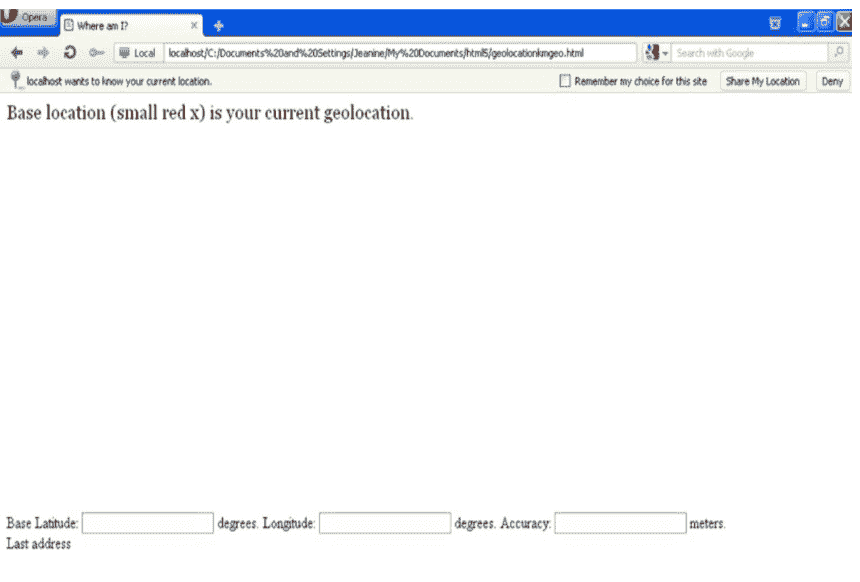

图 6-2. 请求共享位置的打开屏幕 (Opera)

注意 Opera 提供了记住为此网站选择的选项。图 6-3 显示了后续屏幕，请求确认用户是否选择加入。

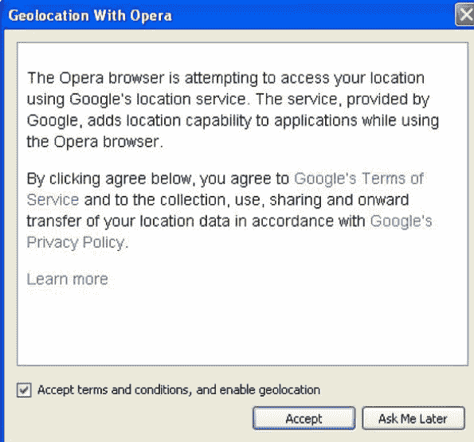

图 6-3. Opera 的附加请求

图 6-4 显示了 Chrome 中对应的屏幕。此时，我已将应用程序上传我的服务器账户之一。浏览器在查询中使用该账户的域名。

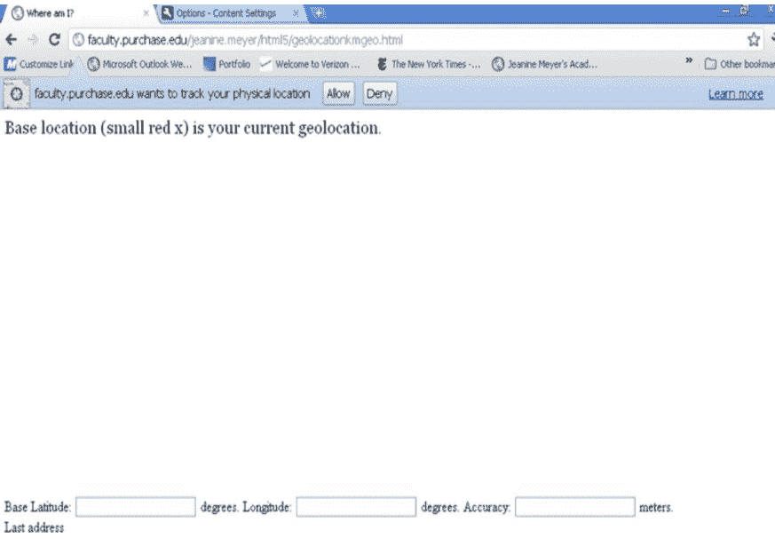

图 6-4. 请求共享位置的打开屏幕 (Chrome)

图 6-5 显示了 Safari 的屏幕。

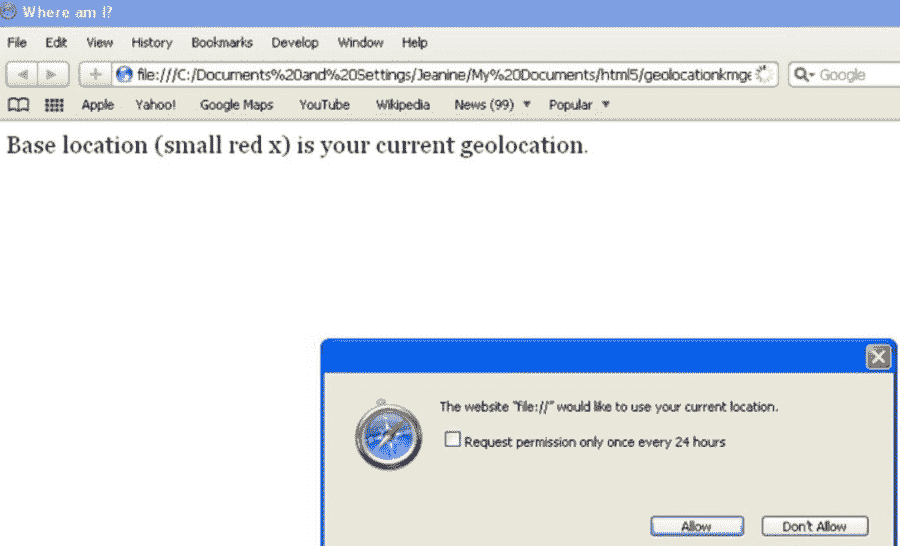

图 6-5. 请求共享位置的屏幕 (Safari)

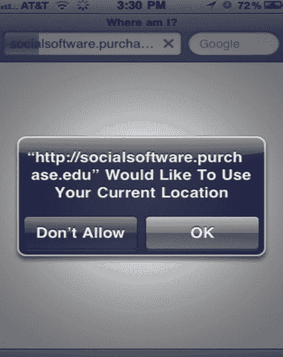

图 6-6. 请求共享位置的屏幕 (iPhone)

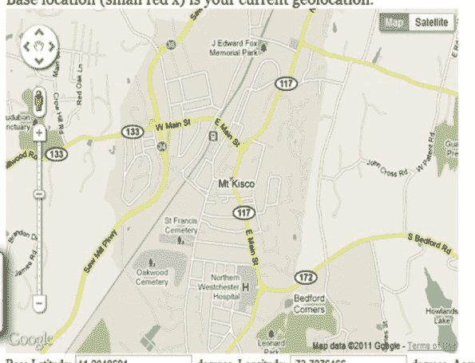

图 6-7. 程序中找到的位置

反向地理编码返回了地址描述：100-162 E. Main Street, Mt. Kisco, NY 10549, USA，准确度给为 86 米。对于红色 x 的位置来说，这相当准确。这张截图是在 Borders Café（现已关闭）使用笔记本电脑时拍摄的。事实非常有意义，因为正如后文将演示的，地理定位本身是非常准确的。W3C 地理定位官方规范对于如何计算准确性提供的信息很少。你可以使用这个项目对地理定位的准确性进行你自己的分析。用户可以使用 Google Maps 界面进行缩放和/或移动，然后点击屏幕。这就是我所做的。会出现一个黑点，以及反向地理编码地址和距离点击位置基点的距离。这可以用来检查其他位置，或者计算地理定位到实际位置的距离。图 6-8 显示了在我最初位置点击屏幕的结果。

基准位置（小红 x）是你当前的地理定位。

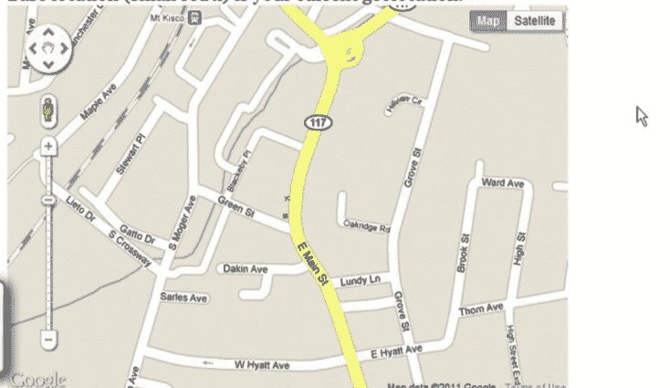

基准纬度：41.204869 度。经度：-73.7276466 度。准确度：8 米。
上一个地址：
1-99 Green St, Mt Kisco, NY 10549, USA
距离：
你点击距离基点 0.03 km。

图 6-8. 显示实际位置的屏幕

反向地理编码很好：我们确实在 Green Street 上。程序计算并显示了从基点（红色 x）到我点击位置（黑色 x）的距离。位置是 0.03 公里（相当于 30 米）。这在地理定位函数返回的 86 米准确度范围之内。

第二个应用程序演示了你如何利用地理定位、反向地理编码信息以及你自己的操作来编写一封电子邮件发送给其他人。诚然，许多公司都提供此类服务以促进会面、推广餐厅等。此应用程序 `geolocationkm-mail.html` 使用了一个运行在你的服务器上的 PHP 编写的小程序，向你选择的人发送电子邮件。你需要确认你的服务器账户是否支持此功能。这是你的互联网服务提供商可能提供也可能提供的额外服务。我们将在第 10 章回到 PHP。

在同意允许地理定位后，显示第二个应用程序的启动屏幕（见图 6-9）。

基准位置（小红 x）是你当前的地理定位。

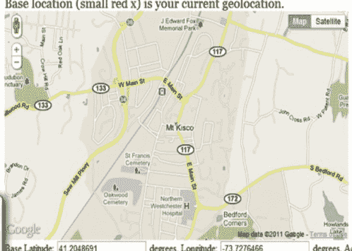

基准纬度：41.204891 度。经度：-73.727648 度。准确度：96 米。

你的电子邮件（用于回复）：收人

主题：155-162 E Main St, Mt Kisco, NY 10549, USA

邮件正文（你可以更改 #）
我的地理定位位于主题行中给出的地址。

发送

### 图 6-9. 电子邮件程序的启动屏幕

注意显示上有一个表单，留有填写发件人和收件人电子邮箱地址的地方。主题行包含反向地理编码信息，邮件正文引用了主题行。

接下来，我点击我认为我在的位置。这个应用程序确实需要你能够在地图上找到自己！图 6-10 显示了结果。

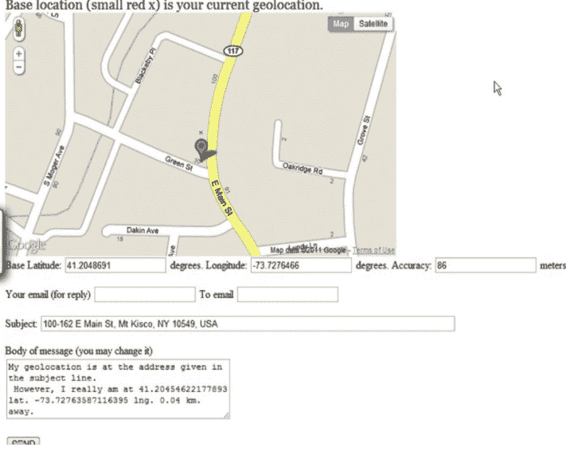

图 6-10. 点击位置后，显示邮件正文信息的屏幕

被点击的位置现在有了 Google Maps 使用的默认标记。这实际上是我的一种疏忽，但我决定保留它，以向你展示你可以使用默认的倒水滴形图标。注意主题行和邮件正文已经填充完毕。现在是填写发件人和收件人地址的时候了。你还可以更改邮件正文或主题行的内容。然后点击发送（SEND）按钮。它不是即时的，但消息将发送到你的电子邮件账户。图 6-11 显示了消息在 Gmail 账户中显示的样式。


图 6-11. 带有位置信息的接收邮件

我对这种工作方式表示满意，但我目前向你展示的内容似乎假设我的用户/客户/委托会表现良好并填写正确的电子邮件地址。这是一个糟糕的假设。为了处理这个问题，我将表单验证设置为此应用程序的要求。表单验证是指对此应用程序的一系列测试。通过表单验证，如果用户忽略了未填写任何内容，应用程序将呈现如图 6-12 所示的内容。

图 6-12. 当字段为空时 Chrome 出的消息

你的电子邮件（用于回复）：收人
主题：155-162 E Main St, Mt Kisco, NY 10549, USA

邮件正文（你可以更改 #）
我的地理定位位于主题行中给出的地址。

发送

### 图 6-13. Chrome 检测到无效电子邮件地址

图 6-14. 当字段为空时 Firefox 出的消息

图 6-15. Firefox 检测到无效电子邮件地址

### 地理定位和其他关键需求

此应用程序的主要需求是地理定位：为客户端计算机确定纬度和经度位置。在本节中，我将简要介绍从最移动智能手机到最固定的桌面完成此任务的各种方法。下一节将描述如何在 HTML 和 JavaScript 中使用位置信息的机制。

如果你汽车、手机或平板电脑上有全球定位系统（GPS）芯片，那么计算机程序确定位置的概念已非常普遍。GPS 芯片使用环绕地球的 24 颗卫星中的某些信息来确定位置。天空中的单颗卫星并不发送告诉我们在哪里的信息。相反，地面的 GPS 设备接收来自多颗卫星的信号。设备使用当前时间和信号离开卫星的指定时间来计算每个信号的传输时间。利用这些传输时间计算与卫星的距离，并结合这些距离以及卫星的位置进行计算。使用三颗卫星可以确定纬度和经度；使用四颗卫星可以确定纬度、经度和高度。软件可以对代表地球的球体假设，但可能并不准确，正如我有一次使用 GPS 时被“告知”我在布鲁克林桥匝道下一样。汽车或手机中的导航设备也可能利用存储在设备上的数据进行定位到一个街道地址。

那么，如果你的电脑内部没有 GPS 芯片，或者处于无法接收卫星信号的位置，但有手机无线电且处于手机服务区，会发生什么？计算位置的另一种方法是使用一个或多个手机基站的信号强度。谷歌位置服务（Google Location Services）和其他地理定位应用已经确定了许多基站的位置并将信息存储在数据库中。如果范围内只有一个手机基站，那么非常粗略的估计就是该基站的位置。然而，如果你的电脑可以接收到多个基站的信号，它就可以计算出更准确的位置估计值。它利用基站不同的信号强度，而不是 GPS 卫星不同的信号传输时间，通过已知点的已知距离来计算你的位置。

如果你的电脑没有 GPS 或手机无线电，但通过无线连接到 Wi-Fi 无线电，那么浏览器可能可以使用附近 Wi-Fi 无线电的信号强度来确定位置。事实证明，某些公司（如谷歌位置服务）拥有许多 Wi-Fi 热点已知位置的数据库。即使 Wi-Fi 热点是私有且安全的，也可以确定其位置。谷歌、苹果以及可能的其他公司收集这些信息的做法存在争议。收集这些信息的一种方式是通过穿梭在街道上的面包车获取谷歌地图街景服务所需的图像。另一种方法是保留人们在使用手机某些应用程序时使用的数据，并将其转发给公司以添加到它们的数据库中。无论如何，这些数据库都被引用以为地理定位计算提供热点位置。你的电脑可以使用邻近热点的信号强度来估计与热点的距离，从数据库中获取它们的位置，并计算出自己的位置。当然，它的位置也会进入数据库，供其他计算使用！

> **注意**：谷歌、苹果等公司声称收集的数据已去除了个人信息。我不同情秘密收集信息的公司。然而，我们确实需要接受，许多服务的提供并没有明确的按次付费。正如谚语/陈词所说，“一分钱分货”，我们还可以加上类似的话，“我们不付钱的东西，由大众或社区承担了负担。”

最后，如果你的电脑没有 GPS、手机或 Wi-Fi 无线电呢？IP 地址——在 Web 上识别你电脑的数字与组合——与纬度和经度值相关。如果电脑与局域网上的许多其他电脑共享 IP 地址，这种方法的效果就不理想——位置可能会偏差很大。然而，这种方法允许即使是孤立的电脑也能从已知电脑大致位置的应用程序中受益。我的经验是，我台式电脑上的浏览器没有使用 Wi-Fi，而是使用 IP 方法，或者在 Safari 的情况下，要么失败要么超时（请见下一节的超时选项）。相比之下，我家里笔记本电脑、iPhone 和 iPad 上的浏览器利用连接到我台式电脑的 Wi-Fi 网络，确实利用了 Wi-Fi 进行地理定位，结果要好得多。

这些是确定位置的主要技术。W3C 正在开发的地理定位标准为程序员访问信息（如果可用的话）确立了一系列方法、属性和事件。

我的项目还利用了反向地理编码（reverse geocoding），即确定街道地址或关于位置的某种描述性信息。推测，谷歌位置服务和其他类似服务拥有关于与纬经度值相关的地理描述性术语的海量数据库——显然不是针对每个值，而是针对值的范围。下一节中描述的 HTML5 设施提供了由反向地理编码产生的多个结果，你需要决定什么对你的应用程序是合适的。这取决于所在国家和世界的地区。

这两个项目都需要对用户点击地图做出响应。这包括以一种方式标记位置，即使在移动或缩放地图时该标记依然存在。项目还计算了从基础位置到标记位置的距离。

发送电子邮件首先需要一种让用户输入电子邮件的方法。发送电子邮件超出了普通的 JavaScript 处理范围，因此为了满足这一要求，必须采取不同的方法——即在服务器上运行程序。回想 Web 的基本机制：文件（包括 HTML 文档）位于服务器站点。浏览器程序（如 Firefox 或 Opera）运行在所谓的“客户端电脑”上——即我的电脑，或者我们在家里、咖啡馆或图书馆里的你的电脑。浏览器程序从服务器获取文件并对其进行解释。要执行如发送电子邮件之类的服务器操作，浏览器必须调用运行在服务器上的程序。

在发送电子邮件之前，程序需要获取电子邮件地址、收件人地址（To）以便发送消息，以及发件人地址（From）以便回复正常工作。程序应该进行某种检查以确保地址有效。你会发现，收集和验证信息是在客户端电脑上完成的，就在你或你的用户面前的电脑上。处理和发送电子邮件是由运行在服务器上的 PHP 程序完成的，即持有项目文件的电脑。

这些是构建“引言”部分中演示项目的要求。在下一节中，我将描述用于实现这些项目的 HTML5 和 PHP 特性。

### HTML5、CSS、JavaScript 和 PHP 特性

在本节中，我将解释用于完成基础地理定位项目和电子邮件项目所需的所用特性。

### 地理定位

W3C 的地理定位标准与实际提供信息的服务的方式或类型无关。假设任务将需要时间，因此请求被设置为异步请求。我编写的用于请求的代码是：

```javascript
if (navigator.geolocation) {
    navigator.geolocation.getCurrentPosition(handler, problemhandler, positionopts);
} else {
    if (document.getElementById("place")) {
        document.getElementById("place").innerHTML = "抱歉，您的浏览器不支持地理定位服务";
        document.getElementById("place").style.color = "#FF0000";
    }
}
```

“引言”部分展示了地理定位的成功示例。现在，在解释如何使用这些信息之前，我将展示处理可能且确实发生的问题的方法。

外层 `if` 的条件测试 `navigator.geolocation` 是否为浏览器识别的对象。如果*不是*，那么在检查是否存在名为 `place` 的 div 后，程序将显示以“I'm sorry . ”开头的消息。当我在旧版本的 Internet Explorer 中尝试此程序时，必须首先允许运行任何脚本，如图 6-16 所示。

```javascript
var positionopts;
```

```javascript
positionopts = {
    enableHighAccuracy: true,
    timeout: 10000
};
```

W3C 未对 `enableHighAccuracy` 设置的解释做出具体规定，但目前的实际意义是如果可用 GPS，则使用它。启用后后，可能会消耗更多的处理时间，整个应用程序可能会变慢。将此项设置为 `false`（默认值）也可能延长本地设备的电池寿命时间。`timeout` 设置表示执行此操作的时间被限制在 10,000 毫秒（10 秒）。还有其他选项设置，因此当你开始在生产工作中使用地理定位功能时，请务必研究它们。

如果在执行地理定位操作期间检测到问题，将调用 `problemhandler` 函数，并传递一个包含指示问题性质代码的参数。`problemhandler` 函数的定义包含一个基于该代码的 `switch` 语句。

```javascript
function problemhandler(prob) {
  switch(prob.code) {
    case 1:
      document.getElementById("place").innerHTML = "用户拒绝共享位置信息...";
      break;
    case 2:
      document.getElementById("place").innerHTML = "获取基础位置时出错...";
      break;
  }
}
```


      break;

    case 3:

      document.getElementById("place").innerHTML = "获取基础位置时超时...";

  }

  document.getElementById("header").innerHTML = "需要设置基础位置";

}

```

需要设置基础位置！
用户拒绝共享位置信息。

基础纬度：___ 度。经度：___ 度。精确度：___ 米。
最后地址： 
距离

图 6-18 显示了用户拒绝允许地理定位权限的结果。

图 6-18. 用户对地理定位说不的结果

一个更微妙的问题是无法及时执行操作。图 6-19 显示了之前提到的关于在桌面电脑上使用 Safari 的情况。

图 6-19. 地理定位耗时过长

现在让我们转向成功的情况：地理定位已正常工作。我的代码导致函数处理程序被调用，其中由 `getCurrentPosition` 方法设置的参数持有计算出的位置信息。代码提取了纬度和经度值并调用了我的 `makemap` 函数，该函数在 Google Map 中设置一个名为 `blatling` 的全局变量。`makemap` 函数本质上与最后两章涵盖的项目使用的函数相同。一个带有完整地图界面的 Google Map 将出现在屏幕上。处理函数还显示了值并调用了 `reversegeo`，这是下一节的主题。以下是 `handler` 的代码：

```javascript
function handler(position) {

  var mylat = position.coords.latitude;

  var mylong = position.coords.longitude;

  makemap(mylat,mylong);

  document.coutp.lat.value = mylat;

  document.coutp.lon.value = mylong;

  document.coutp.acc.value = position.coords.accuracy;

  reversegeo(blatling);

}
```

`accuracy` 值是 W3C 规范的一部分。它的精确含义在标准中并未定义。一种可能性是它定义了返回点周围的圆的半径，实际位置将位于该圆内。当我使用桌面式 PC 时，返回的值为 2000 米，而实际上实际位置只有 10 米。无论如何，如果你正在构建一个生产应用程序，你可能不会与用户共享精确度信息。**注意** `navigator.geolocation` 对象还有其他方法和属性。值得注意的是，有一个 `watchPosition` 方法，用于设置位置变化或位置计算方式的监控。

### 反向地理编码

反向地理编码是指从纬度/经度位置获取如街道地址等描述的功能。记住“垃圾进，垃圾出”的原则，如果原始纬度/经度错误，那么地理定位操作返回的地址也是错误的。我使用的设施是 Google Maps API 的一部分，包含了获取短名称、邮政编码等功能。在 `init` 函数中，我的代码构建了一个 `Geocoder` 对象并设置了变量 `geocoder`：

```javascript
geocoder = new google.maps.Geocoder();
```

`reversegeoc` 函数调用该对象的方法。也就是说，该方法启动了一个耗时的异步操作，并开始确定反向地理编码的任务。在任务完成之前，控制将移动到下一个语句。大多数异步方法通过指定一个在任务完成时调用的函数来工作。我指定函数的方法是在方法调用本身中定义一个匿名函数。完整的 `reversegeoc` 函数如所示。

```javascript
function reversegeoc(results, status) {

  if (status == google.maps.GeocoderStatus.OK) {

    if (results[0]) {

      addressref.innerHTML = results[0].formatted_address;

    } else {

      alert("未找到结果");

    }

  } else {

    alert("Geocoder 失败: " + status);

  }

}
```

`geocode` 方法可以用于通过描述（地址）查找位置，或用于反向地理编码：从位置确定描述。`latlng` 坐标的存在是区分两者的标志。我的代码指定了纬度/经度，`geocode` 返回如街道地址之类的描述信息。**注意** 如果你使用 `locrequest` 指定地址：如果 `locrequest` 是一个持有地址的字符串变量，那么 `geocode` 将返回纬度。

```javascript
var out = "";

for (var i=0; i<results.length; i++) {

  out += results[i].formatted_address+"\n";

}

```


alert(out);

图 6-20. 结果


```

am at "+distanceString;

}

```

### 检查电子邮件地址输入并调用 PHP 发送电子邮件

正如“引言”部分所描述的，任何涉及根据用户输入发送电子邮件的应用程序都应该尝试检查该输入是否符合电子邮件地址的格式。幸运的是，这是 HTML5 的新功能之一。`input` 元素具有一个 `type` 属性，其中一种类型就是 `e-mail`。标准 HTML（4 及更早版本）提供了一种指定表单提交的方法，即导致服务器上某个文件的调用。我将在下一节中详细描述这一点，包括 `method` 设置的意义。以下是完整的电子邮件的表单：

```html
<form name="msg" action="sendmail.php" method="post">

<p>Your email (for reply

<input type="email" name="from" required/>

To email

<input type="email" name="to" required />

</p>

Subject: <input type="text" name="subject" size="100" />

<p>

Body of message (you may change it) <br/>

<TEXTAREA NAME="body" COLS=40 ROWS=5>

My geolocation is at the address given in the subject line. </TEXTAREA>

</p>

<input type="submit" value="SEND" />

</form>
```

此代码产生了图 6-12 到 6-15 所示的错误检查（之前已显示），这被认为减轻程序员的责任。

表单标签中的 `action` 属性指定了 PHP 文件 `sendemail.php`。这意味着当表单提交时，在输入有效的前提下，浏览器将向服务器（下载 HTML 文档的这台计算机）发送消息。该消息将是调用 `sendemail.php`。输入数据将一并传递。现在我将简要介绍一下 PHP。第 10 节关于数据库项目的内容将包含更多信息。

### PHP 语言简介绍

发送电子邮件是服务器提供的功能，而不是客户端计算机的功能。有几种语言可以编写所谓的服务器端脚本，PHP 就是其中之一。它在 www.php.net 上有良好的维护和文档支持。你将在第 10 节数据库项目的描述中读到更多关于 PHP 的内容。

上一节展示了如何作为提交表单的结果来调用 PHP 脚本。表单输入可以通过两种方式之一传递给脚本：`POST` 和 `GET`。`GET` 方式利用所谓的查询字符串。`POST` 方式是使用 HTTP 头部完成。我选择在此示例中使用 `POST`。

PHP 脚本的主要目的是在服务器上执行某些操作，可能是使用 HTML 文档的表单输入，并生成一个 HTML 文档传回浏览器进行显示。本项目的示例并非如此，但许多 PHP 脚本由 HTML 和 PHP 混合组成。PHP 部分由分隔符 `<?php` 和 `?>` 指明。`echo` 函数将其输入添加到正在创建的 HTML 文档中。

PHP 的一个特性是变量（包括内置和程序员定义的）以美元符号 `$` 开头。例如，如果 PHP 脚本被表单动作调用，且指定的 `method` 为 `POST`，并且表单有一个名为 `to` 的输入元素，那么这一行：

```php
$to = $_POST['to'];
```

将访问名为 `to` 的表单输入并将其赋值给变量 `$to`。正如前面提到的，PHP 脚本由 HTML 文档组成，因此频繁的操作是字符串拼接。PHP 中用于此的运算符是 `.`（点）。这一行：

```php
$Sheaders = "From: " . $_POST['from'];
```

提取名为 `from` 的表单输入并将其添加到字面量字符串 `"From: "` 中以形成一个更长的字符串，并将其赋值给变量 `$Headers`。

PHP 的另一个特性（对于经验丰富的程序员来说可能是最奇怪的）是变量可以包含在字符串中。

| 代码 | 描述 |
|---|---|
| "FF0000"; | 将内容设为红色 |
| } | 结束语句 |
| } | 结束外部 else 语句 |
| } | 结束函数 |
| var listener; | 监听器变量（已设置但未作为变量使用） |
| var map; | 将用于存储地图 |
| var blatng; | 将存储基点的经纬度对象 |
| var myOptions; | 将存储在加载地图时使用的选项 |
| function handler(position) { | handler 函数的头部；如果地理定位成功，将带有参数 position 被调用 |
| var myylat = position.coords.latitude; | 设置为纬度 |
| var mylong = position.coords.longitude; | 设置为经度 |
| makemap(mylat,mylong); | 调用（我的）makemap 函数 |
| document.coutput.lat.value = mylat; | 显示纬度 |

| 代码行 | 描述 |
|---|---|
| document.coutput.lon.value = mylong; | 显示经度 |
| document.coutput.acc.value = position.coords.accuracy; | 显示精确度 |
| reversegeo(blatlng); | 调用（我的）函数 reversegeo |
| } | 结束 handler 函数 |

```javascript
function reversegegeo(latLng) {
```

reversegegeo 函数的头部

使用 `latLng` 对象调用 `geocode` 方法。第二个参数是一个匿名函数。函数定义从此行开始，在 11 行后结束，恰好在 `reversegegeo` 函数的结束括号之前。

```javascript
geocoder.geocode({'latLng': latLng}, function(results, function, status) {
```

```javascript
if (status == google.maps.GeocoderStatus.OK) {
```

如果返回的状态值等于 `google.maps.GeocoderStatus.OK` 的值

```javascript
if (results[0]) {
```

如果 `results[0]` 存在

```javascript
adressref.innerHTML = results[0].formatted_address;
```

显示此结果

```javascript
} else {
```

否则

```javascript
alert("No results found");
```

弹出警报消息

```javascript
}
```

结束语句

| | 描述 |
|---|---|
| } | 结束外部语句 |
| else { | else（状态不是 OK） |
| alert("Geocoder failed due to: " + status); | 弹出警报消息 |
| } | 结束语句 |

| 代码行 | 描述 |
|---|---|
| })); | 结束函数定义，结束 Geocode 方法调用 |
| } | 结束 reversegeo 函数 |

```javascript
function problemhandler(prob) {
```

problemhandler 函数的头部；prob 将包含有关失败的信息

```javascript
switch(prob.code) {
```

基于 `prob.code` 的 switch 语句

```javascript
case 1:
```

如果用户拒绝共享位置信息，则返回代码 1。

```javascript
document.getElementById("place").innerHTML = "User declined to share the location information.";
```

显示消息

```javascript
break;
```

退出 switch 语句

```javascript
case 2:
```

如果执行地理编码编码的程序检测到错误，则返回代码 2。

```javascript
document.getElementById("place").innerHTML = "Errors in getting base location.";
```

显示消息

```javascript
break;
```

退出 switch 语句

| case 3: | 如果地理编码耗时过长，则返回代码 3。你可以在原始 geocode 方法的调用中指定时间限制。 |
|---|---|
| document.getElementById("place").innerHTML = "Timeout in getting base location."; | 显示消息 |
| } | 结束 switch 语句 |
| document.getElementById("header").innerHTML = "Base location needs to be set!"; | 在所有情况下，设置 header 的内容 |

| 代码行 | 描述 |
|---|---|
| } | 结束 problemhandler 函数 |
| var rxmarker = "rx1.png"; | 红色 x；用于基点 |
| var bxmarker = "bx1.png"; | 黑色 x；用于点击 |

```javascript
function makemap(mylat,mylong) {
```

makemap 函数的头部

```javascript
var marker;
```

将存储标记标记

```javascript
blating = new google.maps.LatLng(mylat,mylong);
```

创建一个 `LatLng` 对象并设置全局变量 `blating`

```javascript
myOptions = {
```

开始设置用于地图选项的关联数组

```javascript
zoom: 14,
```

将缩放级别设置为常量 14

```javascript
center: blating,
```

将地图中心设置为 `blating`

```javascript
mapTypeId: google.maps.MapTypeId.ROADMAP
```

将地图类型设置为 `ROADMAP`。其他可能性是 `SATELLITE`、`TERRAIN` 和 `HYBRID`。

```javascript
};
```

结束数组

```javascript
map = new google.maps.Map(document.getElementById("place"), mymyOptions);
```

调用 `Map` 构造函数方法以加载带有指定选项的地图；设置 `map` 变量

```javascript
marker = new google.maps.Marker({
```

创建一个标记

| position: blating, | 位置 blating |
|---|---|
| title: "center", | 标题 "center" 鼠标悬停时会显示 |
| icon: bxmarker, | 图标 bxmarker |

| 代码行 | 描述 |
|---|---|
| position: blating, | 位置 blating |
| title: "center", | 标题 "center" 鼠标悬停时会显示 |
| icon: bxmarker, | 图标 bxmarker |

| distance = String(distance); | 调用（我的）map 函数 |
| document.coutput.lat.value = mylat; | 显示纬度 |
| makemap(mylat,mylong); | 调用（我的）makemap 函数 |
| document.coutput.lon.value = mylong; | 显示经度 |
| document.coutput.acc.value = position.coords.accuracy; | 显示精确度 |
| reversegeo(blatlng); | 调用（我的）函数 reversegeo |
| } | 结束 handler 函数 |

```javascript
function dist(point1,point2) {
```

dist 函数的头部

```javascript
var R = 6371; // 公里
```

千公里

```javascript
// var R = 3959; // 英里
```

英里

```javascript
var d = Math.acos(Math.sin(lat1)*Math.sin(lat2) + Math.cos(lat1)*Math.cos(lat2)*Math.cos(lon2-lon1)) * R;
```

基于球形的计算

```javascript
var lat1 = point1.lat()*Math.PI/180;
```


# 电子邮件地理定位项目

## 代码示例：坐标转弧度

| 代码行 | 描述 |
|---|---|
| `var lat2 = point2.lat() * Math.PI / 180;` | 转换为弧度 |
| `var lon1 = point1.lng() * Math.PI / 180;` | 转换为弧度 |
| `var lon2 = point2.lng() * Math.PI / 180;` | 转换为弧度 |

```javascript
return d;
```

## 代码结构说明

```html
</script>
</head>
<body onload="init();">
<header id="header">Base location (small x) is your current geolocation.</header>
<div id="place" style="width:600px; height:400px"></div>
<form name="output">
基纬度：<input type="text" name="lat"> 度。经度：<input type="text" name="lon"> 度。精确度：<input type="text" name="acc"> 米。<br/>
</form>
```

| 代码行 | 描述 |
|---|---|
| `</form>` | 结束表单标签 |
| `Last address <div id="address"></div>` | 用于地址的 div |
| `Distance <div id="distance"></div>` | 用于距离的 div |
| `</body>` | 结束主体标签 |
| `</html>` | 结束 html 标签 |

## 项目架构

你可以以许多方式构建基础地理定位程序。例如，你可以结合 `dist` 函数使用信息，类似于上一章演示的方法，根据用户与一组固定位置的距离执行某些操作。电子邮件定位项目通过另一种方式构建在基础之上。它利用这些信息向用户选择的人发送电子邮件。电子邮件定位应用的非正式摘要/概述如下：

- **init**：初始化，包括异步调用地理定位
- **handler** 和 **problemhandler**：完成地理定位
- **makemap**：加载 Google 地图
- **checkit**：响应地图点击并调用 `dist`
- **reversego**：从经纬度值确定地址
- **sendmail**（在服务器上运行的独立程序）：执行电子邮件发送

表 6-3 列出了所有函数，并描述了它们如何被调用以及它们调用了哪些函数。`sendmail.php` 函数通过 body 元素中第二个 `<form>` 标签中的 `action` 属性设置：

```html
<form name="msg" action="sendmail.php" method="post">
```

### 表 6-3. 电子邮件地理定位项目中的函数（与基础地理定位项目相同）

| 函数 | 被触发/调用者 | 调用 |
|---|---|---|
| `init` | 被 `<body>` 标签中 `onLoad` 属性的 action 触发 | `makemap`, `reversegeo` |
| `handler` | 被 `init` 中 `getCurrentPosition` 调用的 action 触发 | - |
| `reversegeo` | 在 `handler` 中被触发 | - |
| `problemhandler` | 被 `init` 中 `getCurrentPosition` 调用的 action 触发 | - |
| `makemap` | 被 `handler` 触发 | - |
| `checkit` | 被 `makemap` 中 `addListener` 的 action 触发 | `dist` |
| `dist` | 被 `checkit` 触发 | - |

表 6-4 显示了 `geolocationkmemail.html` 的完整代码。新的代码语句和修改的代码语句均有注释。

### 表 6-4. 电子邮件地理定位应用程序的代码

| 代码行 | 描述 |
|---|---|
| `<!DOCTYPE html>`<br>`<html>`<br>`<head>`<br>`<title>Where am I?</title>`<br>`<meta charset="UTF-8">`<br>`<style>`<br>`header{font-family:Georgia,"Times New Roman",serif;`<br>`font-size:20px;display:block;`<br>`}`<br>`</style>` | |
| `<script type="text/javascript" charset="UTF-8" src="http://maps.google.com/maps/api/js?sensor=false"></script>` | |
| `<script type="text/javascript" charset="UTF-8">` | |
| `var positionopts = {`<br>`enableHighAccuracy: true,`<br>`timeout: 10000 };` | |
| `var headerref;` | |
| `var geocoder;` | |

```javascript
function init() {
  headerref = document.getElementById("header");
  geocoder = new google.maps.Geocoder();
  if (navigator.geolocation) {
    navigator.geolocation.getCurrentPosition(handler, problemhandler, positionopts);
  } else {
    if (document.getElementById("place")) {
      document.getElementById("place").innerHTML = "I'm sorry but geolocation services are not supported by your browser";
      document.getElementById("place").style.color = "#FF0000";
    }
  }
}
```

| 代码行 | 描述 |
|---|---|
| `}` | |
| `var listener;` | |
| `var map;` | |
| `var blating;` | |
| `var myOptions;` | |
| `function handler(position) {` | |

```javascript
var mylat = position.coords.latitude;
var mylong = position.coords.longitude;
var result;
makemap(mylat, mylong);
document.coutput.lat.value = mylat;
document.coutput.lon.value = mylong;
document.coutput.acc.value = position.coords.accuracy;
```

```javascript
reversegeob(latlng);
}

function reversegeob(latlng) {
  geocoder.geocode({'latLng': latlng}, function(results, status) {
    if (status == google.maps.GeocodingStatus.OK) {
      if (results[0]) {
        document.msg.subject.value = results[0].formatted_address;
      } else {
        alert("No results found in reverse geocoding.");
      }
    } else {
      alert("Geocoder failed due to: " + status);
    }
  });
}
```

```javascript
function problemhandler(prob) {
  switch (prob.code) {
    case 1:
      document.getElementById("place").innerHTML = "User declined to share the location information.";
      break;
    case 2:
      document.getElementById("place").innerHTML = "Errors in getting base location.";
      break;
    case 3:
      document.getElementById("place").innerHTML = "Timeout in getting base location.";
  }
}
```

| 代码行 | 描述 |
|---|---|
| `document.getElementById("header").innerHTML = "Base location needs to set!";` | |
| `var marker = "x1.png";` | |
| `function makemap(mylat, mylong) {` | |
| `var marker;` | |
| `blatLng = new google.maps.LatLng(mylat, mylong);` | |

```javascript
myOptions = {
  zoom: 14,
  center: blatLng,
  mapTypeId: google.maps.MapTypeId
};
map = new google.maps.Map(document.getElementById("place"), myOptions);
marker = new google.maps.Marker({
  position: blatLng,
  title: "center",
  icon: marker,
  map: map
});
listener = google.maps.event.addListener(map, 'click', function(event) {
  checkit(event.latLng);
});
```

| 代码行 | 描述 |
|---|---|
| `}` | |
| `function checkit(latLng) {` | |
| `var distance = dist(latLng, blatLng);` | |
| `var result;` | |
| `distance = Math.floor((distance + .5) * 100);` | |

```javascript
var distanceString = String(distance) + " km. away.";
var newcoords = String(distance.lat()) + " lat. " + String(lng()) + " lng.";
distanceString = newcoords + " " + distanceString;
marker = new google.maps.Marker({
  position: latLng,
  title: distanceString,
  map: map
});
document.msg.body.value = document.msg.body.value + " However, I really at " + distanceString;
```

```javascript
function dist(point1, point2) {
  var R = 6371; // km
  // var R = 3959; // miles
  var lat1 = point1.lat() * Math.PI / 180;
  var lat2 = point2.lat() * Math.PI / 180;
  var lon1 = point1.lng() * Math.PI / 180;
  var lon2 = point2.lng() * Math.PI / 180;
  var d = Math.acos(Math.sin(lat1) * Math.sin(lat2) + Math.cos(lat1) * Math.cos(lat2) * Math.cos(lon2 - lon1)) * R;
  return d;
}
</script>
```

```html
<head>
<body onload="init();">
<header id="header">Base location (small red x) is your current geolocation.</header>
```

```html
<div id="place" style="width:600px; height:350px"></div>
```

```html
<form name="coutput">
Base Latitude: <input type="text" name="lat"> degrees. Longitude: <input type="text" name="lon"> degrees.
```

```html
Accuracy: <input type="text" name="acc"> meters.<br></form>
```

```html
<form name="msg" action="sendmail.php" method="post">
<p>Your email (for reply)</p>
<input type="email" name="from" required/>
```

通过 `action` 属性指定调用 `sendmail.php`，`method` 属性指定通过 POST 方法调用。

From 输入字段的标签

此字段是必填的且类型为 email

电子邮件需要一个 PHP 脚本来执行发送电子邮件的实际工作。我的 `sendemail.php` 程序所示表 6-5。

### 表 6-5. 发送电子邮件的 PHP 脚本代码

| 代码行 | 描述 |
|---|---|
| `<?php` | PHP 代码分隔符 |
| `$to = $_POST['to'];` | 将变量 `$to` 设置为 name="to" 表单输入的值 |
| `$subject = $_POST['subject'];` | 将变量 `$subject` 设置为 name="subject" 表单输入的值 |
| `$body = $_POST['body'];` | 将变量 `$body` 设置为 name="body" 表单输入的值 |
| `$headers = "From: " . $_POST['from'];` | 将变量 `$headers` 设置为以 `From:` 开头的字符串，后面跟着 name="from" 的值 |
| `if (mail($to, $subject, $body, $headers)) {` | 如果成功，则调用 `mail` 函数 |
| `echo("Your message was sent");` | 输出成功消息 |
| `else {` | 否则 |
| `echo("There was a problem: <br>the body is $body,<br> the to is $to,<br> subject is $subject,<br> headers is $headers.");` | 输出包含所有变量内容的较消息 |
| `}` | 结束语句 |
| `?>` | 结束 PHP |

除了使用地理定位的应用程序外，你可能还会发现其他发送电子邮件的用途。你还可以通过其他更有实质的方式构建此应用程序，例如在电子邮件内容中包含其他信息。

## 总结

在本章中，你继续使用了 Google Maps API。你学习了如何使用以下内容：

- 地理定位
- Google Maps API 和用于地址的地理编码
- 用于发送电子邮件的 PHP 脚本

在下一章中，我们将离开地理领域，进入一个虽小但在空间上依然令人迷人的折纸世界。我们将探索如何使用 JavaScript 为会说话的鱼折纸制作教程。

# 索引

## A

- 累加器 (`Accumulator`), 303
- `addEventListener`, 142
- `addListener` function, 111
- Adobe Flash, 332

## B

- 跳动视频 (`Bouncing video`), 53 动画
- 自动滚动, 63
- `clearInterval(id)`, 61
- `ctx.clearRect(0,0,cwd,height)`, 61
- 偏移值 (`displacement value`), 62
- `init` function, 61
- `moveandcheck` function, 62
- `setInterval(drawscene,50)`, 61
- `setInterval` function, 63
- `tid = setInterval(drawscene,50)`, 61
- `videobounceC` 程序, 62
- `videobounceE` 程序, 62, 63
- 具有较松检查的跳动视频元素, 63
- application `changedims` 函数, 86
- 测试与上传, 86
- 轨迹函数, 69
- `v.currentTime` 属性, 86


# 索引

## A

- `videobounceE` 应用代码, 69, 70
- `videobounceE` 程序代码, 76
- `VideobounceTrajectory` 程序代码, 82
- `window.innerWidth` 和 `window.innerHeight` 属性, 86

## B

- `ballrad` variable, 61
- `body` element, 60
- `init` function, 60
- 视频元素, 59
- 视频格式, 59
- `window.innerWidth` 和 `window.innerHeight` 属性, 59
- HTML5, 53
- 循环视频, 66
- 可移动视频元素, 65, 66
- Opera 屏幕截图, 53, 54
- 项目历史与关键性, 58, 59
- 较小窗口, 55, 56
- 定格摄影, 54
- 虚拟球的轨迹, 54, 55
- 移动遮罩 (traveling mask), 66–68
- 用户界面, 68
- 极小窗口, 57
- 在画布上绘制视频, 64, 65
- `window resize`, 运行中的程序, 57, 58

## C

- `changescale` 函数, 10
- `checkpositions` 函数, 340
- `clearshadow` 函数, 110
- Corel Paint Shop Pro, 330
- 折痕图 (Crease pattern), 228, 229

## D

- 数据库 (Database)
  - 构建应用, 390
  - 添加和删除站点记录, 404
  - `createresearchtables.php` 代码, 392
  - 在站点上显示信息, 417
  - 终端用户和数据库管理员, 390
  - finder 注册脚本, 394
  - 脚本任务, 390
  - 客户端处理与服务器端处理, 382, 383
  - 关键需求, 376, 367
  - 添加站点, 371, 372
  - 修改密码, 370, 371
  - 删除站点, 374, 375
  - 网站列表, 372, 373
  - 注册, 368
  - 用户错误, 369
  - 哈希函数, 382
  - 本地存储, 381
  - Opera 浏览器, 375, 376
  - 关系型数据库, 377, 378
  - SQL, 379, 381
  - 测试与上传, 422
- 数据库管理系统 (DBMS), 377, 378
- 文档对象模型 (DOM), 59
- `dologo` 函数, 9, 11
- Drop `LatLng` 标记标记选项, 100, 103

## E

- 实体关系图 (ERD), 377

## F

- 家庭拼贴 (Family collage), 19
  - Adobe Photoshop, 21
  - 关键需求, 21
  - 画布元素, 22
  - 拖放操作, 22
  - CSS, JavaScript 对象, 22
  - 终端用户位置, 19
  - 最终产品, 重排后的对象, 20, 21
  - HTML5, 22
  - 图像应用, 35
  - 事件处理函数, 35
  - HTML5 家庭卡项目, 35, 36
  - HTML5 Logo 项目, 37–52
  - 初始化, 35
  - 对象定义方法, 35
  - JavaScript 对象, 22
    - 构造函数, 22
    - 家庭照片项目, 22
    - 方法函数, 22
    - 对象的类型, 22
  - 操作对象, 19
  - 鼠标对象, 28
    - 坐标系, 29
    - 外部函数, 30
    - `overcheck` 方法, 28
    - `overhear` 函数, 29
    - `overofal` 函数, 29
    - `over` 函数, 28
    - `startdragging` 和 `makewinit`, 28
  - 启动界面, 家庭照片, 20
  - 保存画布图像, 34
    - DataURL, 34
    - Firefox 浏览器, 34
    - `saveagesfunction`, 34
  - 测试并上传应用, 52
  - 用户界面, 31
    - `clone` 函数, 32
    - `drawstuff` 函数, 31
    - `dropit` 函数, 34
    - 飞贴纸特效 (flypaper effect), 33
    - 鼠标指针坐标, 32
    - `moveit` 函数, 33
    - `removeobj` 函数, 31
    - `onOnClick` 属性, 31
- `fillStyle` 属性, 7
- 帧 (Frames), 64

## G

- 地理定位 (Geolocation), 183
  - 精度值, 200
  - 始终共享选项 (Always Share option), 184
  - 电子邮件 地理定位代码, 215
  - `getCurrentPosition` 方法, 198
  - 处理函数, 200
  - Internet Explorer 脚本请求, 196, 197
  - Firefox, 193
  - iPhone 屏幕, 187, 188
  - `navigator.geolocation` 对象, 198, 200
  - Not Now 选项, 184
  - 电子邮件程序, 191
  - Chrome, 184, Opera, 184
  - 跟随屏幕, 185
  - Safari, 183, 187
  - opt-in, 183
  - 电子邮件地址, 203, 204
  - 语言, 204, 205
  - `opts`, 198
  - 带位置的电子邮件, 192
  - 信息, 192
  - 匿名函数, 200
    - 定义, 200
  - 反向地理编码, 189, 190
  - 数组, 201, 202
  - Google Maps API, 200
  - 初始化函数, 200
  - `request`, 201
  - Share Location 选项, 184
  - 规范, 183
  - `subler` 问题, 199
  - 用户拒绝, 198, 199
  - W3C 建议, 188
  - W3C 标准, 196
- 全球定位系统 (GPS), 194
- Google 位置服务, 183, 194
- Google Maps API
  - `addListener`, 104
  - 关联数组, 105
  - HYBRID 图, 105
  - `makemap` 函数, 105
  - `Map` 构造方法, 104
  - `Map`, `Lat`, 和 `Marker`, 104
  - 关联数组, 138
  - 事件处理, 141
  - HYBRID 图类型, 139
  - 移除, 141
  - `makemap` 函数, 138
  - `myOptions` 数组, 140
  - SATELL 图类型, 140
  - `x1.png` 文件, 141
  - `onload` 属性, 50
  - 移动设备, 104
  - 门户结构, 105
  - 伪代码, 104
  - SATELLITE 图, 105
  - TERRAIN 图, 105

## H

- HTML5 Logo, 1
  - `document` 的 `body`, 7, 8
  - Chrome 浏览器启动界面, 2
  - 画布元素, 1
  - 画布元素, 5
  - 2D 坐标系, 6
  - `closePath` 方法, 6
  - 十六进制格式, 6
  - `init` 函数, 6, 7
  - `onLoad` 属性, 6
  - 序列, 5
  - `drawpath`, `fillStyle` 属性, 5
  - Firefox 启动界面, 5
  - 优雅降级, 3
  - 实现, 3
  - 项目代码, 12
  - 项目函数, 11
  - 项目历史与关键需求, 4, 5
  - `range` 输入元素, 9–11
  - 语义化标签, 2
  - 滑块功能, 2
  - 测试与上传, 18
  - Test 部分, 4
  - 文本放置, 7, 8
  - 万维网联盟 (World Wide Web Consortium), 2
- HYBRID 图, 139

## I

- `initMouseEvent` 方法, 302
- `innerHTML` 属性, 335
- `intersect` 函数, 239
- Intersection, 240

## J

- JavaScript 数组, 147
- JavaScript 对象
  - 构造函数, 26, 28
  - 心, 25
  - Oval, 23, 24
  - 图片, 24, 25
  - Rect, 23
- 拼图视频拼图, 283 应用
  - `jigsaw-to-video` 项目代码, 307
  - `jigsaw-to-video` 项目函数, 306
  - 测试与上传, 319
- 桌面电脑
  - Feedback label, 286
  - 几乎完成的拼图, 286, 286
  - 替换碎片, 288
  - 散开的碎片, 284, 287
  - 关键性, 287
  - 带控制的视频, 288, 289
  - `display` 属性, 297
  - `endigsaw` 函数, 296
  - 手指触摸累加器, 303
  - `checkpositions` 函数, 303, 304
  - `delta` 和 `deltay` 数组, 303
  - `doaverage` 函数, 303
  - 碎片和碎片ey 数组, 303
  - `question` 元素, 304
  - `release` 函数, 303
  - `setupjigsaw` 函数, 302
  - 关键性, 303
  - `touchcancel`, 302
  - `touchend`, 302
  - `touchHandler` 代码, 302, 303
  - `touchmove`, 302
  - `touchstart`, 302
  - 视频准备、定位和播放, 302
  - W3C, 302
  - `firstpel` variable, 296
  - 图像和数据获取, 294, 295
  - `init` 函数, 295
  - iPhone 和 iPad
    - 关键需求, 293
    - 游戏中, 291
    - `jigsaw-puzzle-with-video-reward` 项目, 293
    - 启动界面, 289, 290
    - 准备播放视频, 291, 292
    - 用户界面构建, 289
    - 视频播放中, 293
  - `Math.floor`, 297
  - `Math.random`, 297
  - 鼠标事件
    - `adjustX`, 299, 300
    - `adjustY`, 299
    - `checkpositions` 函数, 301
    - `curX`, 298–300
    - `curY`, 298
    - `draw` 函数, 301
    - Internet Explorer, 298
    - `mouseDown` variable, 300, 301
    - `moving` 函数, 300
    - 移动的拼图碎片, 298
    - `movingobj` 元素, 301
    - `movingobj`, 300
    - `offset` 函数, 300
    - `piececelelements` array, 298
    - `setupjigsaw` 函数, 298, 301
    - `startdragging` 函数, 298–301
    - `style` element, 301
    - zero offset, 300
  - `piecesx` 和 `piecesy` 值, 296
  - `piecesx` 文件, 296
  - `setupgame` 函数, 295, 296
  - `setupjigsaw` 函数, 296, 297

## K

- `kamih` 变量, 237

## M

- 地图制作者 (Map maker), Google Maps, 89
- API（参见 Google Maps API 应用功能），114, 115
- `mapspotlight.html` 应用代码, 115
- 测试与上传, 127
- 基础位置, 90, 93–95
- canvas graphics
  - `drawshadowmask` 函数, 107, 108
  - `grayshadow`, 107
  - 鼠标移动, 遮罩, 105
  - 带有变量值的原理, 108
  - 阴影遮罩 (shadow mask), 106, 107
  - `z-index` 值, 106
- 最近距离限制 (closest-in limit), 96, 97
- 光标, 109
- 距离和舍入值, 113, 114
- `addListener`, 111
- 按钮, `changebase`, 112
- CHANGE 按钮, 112
- `checkit` 函数, 111
- `drawshadowmask` 函数, 109
- `init` 函数, 109
- `mousevent`, 110
- 平移与缩放, 110
- 并行结构, 112
- 单选按钮, 112
- `slideshow` 函数, 109
- 显示距离的标题, 111
- 最远边界 (farthest-out), 95, 96
- 格陵兰问题 (Greenland problem), 95
- 经纬度坐标系, 98
- 位置间的距离, 103
- 格林威治午子线的赤道, 102
- 格林威治午子线, 99
- HTML 应用, 103
- 位置, 95
- 经线, 99
- 纬线, 99
- 泪滴标记 (teardrop marker), 103
- 值, 99, 100
- Wolfram Alpha, 101
- 卫星视图, 96, 97
- 半透明阴影, 91
- 阴影/聚光 (shadow/spotlight), 90, 91
- 滑块, 缩放, 91, 92
- 放大至限制, 97, 98
- 缩小并向北移动, 92, 93
- 地图门户, Google Maps, 129
  - 应用测试与上传, 182
  - 点击未点中任何目标, 131, 132
  - 内容大纲, 130
  - 距离与公差, 144
  - 外部脚本文件, 146, 147
  - 提示按钮, 149
  - HTML5 标记与定位, 147, 149
  - 图像音频组合, 132
  - 乐高机器人, 131
  - 平移并放大后的自由岛 (Liberty Island), 133
  - 以伊利诺伊州迪克森为中心的地图, 136
  - `mapmediabase` 应用功能, 160
  - 经纬度坐标, 60
  - `mapmediabase.html` 文件, 130
    - `canvas`, 150
  - `mapvideos.html` 文件, 130
  - 启动屏幕, 130, 131
  - 向西平移并放大迪克森, 134
  - 钢琴音乐播放, 135
  - 关于笛子播放的提示, 136
  - 正则表达式, 145, 146
  - 视频、音频和图像文件, 129
  - 以及 `removeEventListener`, 142
  - `div` 元素, 142
  - `style` 元素, 142
  - 万事卡号, 145
  - 中间件。参见 PHP

## O

- `onChange` 属性, 10
- 开源 Miro 视频转换器 (Open Source Miro Video Converter), 60
- 应用功能, 248
- 测试与上传, 282
- 关键需求, 232, 233
- 鱼喉照片, 230
- 线条画/图像, 225
- `origamfish.html`, 226
- 细垂直线, 227
- 制作嘴后, 246
- 环绕步骤, 246
- 将线分为三等份并折叠, 241
- 三等分步骤, 240
- 标记关键点, 243
- 水水槽中心准备, 245
- 三角形函数, 240
- 变量, 234
- `don next` 函数, 234
- `goback` 函数, 234
- `init` 函数, 234
- `nextstep`, 234
- `origamfish.html`, 233, 234
- 会说话的鱼, 225, 226, 231
- 展开的线, 227
- 用户界面, 235, 236, 237
- 展示与移除, 247
- `origamfish.html` 应用, 226, 282

## P

- 并行结构, 112
- 字符字符串, 384
- 脚本, 384
- 记录集结果, 387
- 三层模型, 383
- Pixlr, 330
- `problemhandler`, 198
- 勾股定理, 237

## R

- 红-绿-蓝-透明 (rgba), 107
- 反向地理编码函数 (`reversegeo` function), 200

## S

- 卫星地图 (SATELLITE map), 140
- `setup` 函数, 335
- `strokeStyle`, 7
- `strokeText`, 7
- `style.left` 值, 303
- `style.top` 值, 303
- `THIS` 元素, 10
- `toFixed` 方法, 114
- `touchHandler` 函数, 302

## U

- 美国州游戏, 321
  - 功能, 344
  - 关键需求, 329
  - 教育游戏, 321
  - 元素创建, 335
  - 寻找州份, 322, 323
  - Adobe Flash 符号, 332
  - 基础位置, 332
  - Corel Paint Shop Pro, 330
  - 夏威夷原始符号, 333
  - `illinoisclone`, 332
  - 图像处理程序, 335
  - 魔棒, 330, 331
  - pixlr 工具栏, 330
  - 选中的伊利诺伊州, 331
  - 基于 Web 的 pixlr 图像编辑工具
  - Web 版 pixlr 图像编辑工具, 330
  - 拼图
    - 正确排列, 328
    - 恢复上上一个拼图步骤, 327
    - 进行中, 327
    - 命名州份, 325
    - 回答正确后的响应, 325, 326
    - 恢复原始/压缩地图, 325, 350
    - 散开碎片, 338, 339
    - `statesx` 和 `statesy` 数组, 339

## W

- `watchPosition` 方法, 200
- 网站数据库, 367
- Wi-Fi 热点, 194
- Wi-Fi 射频, 194
- Wolfram Alpha, 101

## X, Y, Z

- `zIndex`, 65, 106, 339

---

# 第9章：美国州游戏：构建一个多功能游戏

- 引言
- 关键需求
- HTML5、CSS、JavaScript 特性、编程技术和图像处理
- 获取棋子图像文件并确定偏移量
- 动态创建元素
- 用户界面整体
- 请求玩家点击某个州的用户界面
- 请求玩家命名某个州的用户界面
- 散布棋子
- 设置拼图游戏
- 保存并重建拼图游戏状态以及恢复原始地图
- 构建应用程序并将其定制化
- 测试并上传应用程序
- 总结

# 第10章：网站数据库：使用 PHP 和 MySQL

- 引言
- 关键需求
- SQL、PHP、HTML5 和 JavaScript 特性
- 关系型数据库
- SQL
- 本地存储
- 哈希函数
- 输入验证的客户端与服务器端
- 中间件：PHP
- 构建应用程序并将其定制化
- 测试并上传应用程序
- 总结
