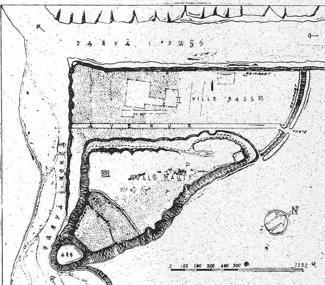
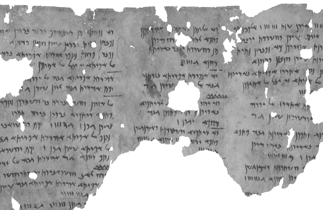
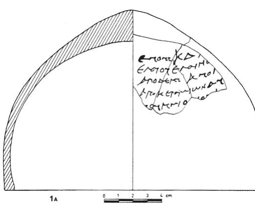
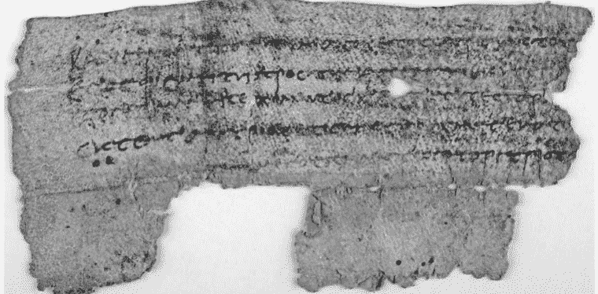
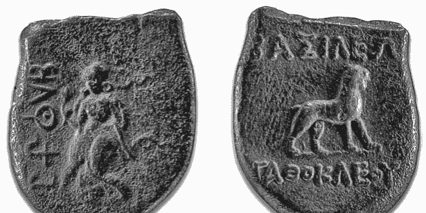

# 希腊化时代的远东：希腊中亚的考古学、语言与认同


# 古文学中的乔安·帕列夫斯基印记

纪念亲爱的维吉尔——

> “愿其他诗人获得荣誉与光辉 . . …”

—但丁，《地狱》

献我的祖父

# 致谢

我第一次读到关于`Ai Khanoum`的书是祖父母给我的童年礼物，但我对希腊化巴特里亚的真正兴趣始于我在剑桥圣凯瑟琳学院图书馆担任本科生期间。我本该在写关于其他主题的文章。威廉·伍德索普爵给我的问题比我能开始思考如何回答的还要多。多萝·J·汤森是一位与伦比的导师和导师。在我在埃及和中亚之间的假期期间，我非常感激她，她让我意识到可以对语言和身份认同进行批判性和创造性的思考。此书的部分内容源于在她指导下完成博士论文。《希腊化时代的远东方》并没有真正的归宿，但我非常感谢各个考古中心以及过去几年我工作的机构所给予的欢迎。纽约大学古代世界研究所（`ISAW`）、牛津大学梅尔顿学院、布朗大学朱科夫斯基古代世界研究所以及雷丁大学古典文学系的学术界，都提供了资金支持和分享研究的绝佳机会。我在布朗大学的学生们给了我真正的教学机会。索伦·斯塔克和曾莉让我参加了他们在 `ISAW` 的文化互动与艺术研讨会，并学习更多关于中亚游牧者的知识。

雷蒙·J·梅尔为 `Ai Khanoum` 提供了建筑学视角。多年来参加多次会议的参与者也给了我思考，让我测试了这样一个原则：只有在大规模、庄严的观众面前说出你的想法后，你才能真正了解它们。还要感谢所有对《希腊化时代的远东方》做出贡献的人，参考文献及随后的更新中逐一列出。我将继续在 `www.bactria.org` 定期更新参考文献（由于名称相似，我偶尔会收到后勤支持的请求）。琳内·劳斯给了我一个在土尔曼斯坦进行挖掘和研究的机会，这是由英国科学院的资助支持的。卡罗尔·梅尔，中亚旅行奇才（撒马尔罕），以及所有人。弗兰克·L·霍尔特和马修·卡内帕在准备手稿时提供了卓越的评论和建议，对此我非常感激。保罗·伯纳德和和尼古拉斯·辛姆斯-威廉姆斯为巴特里亚文献提供了友好的帮助。在加州大学出版社，Eric Schmidt、Maeve Cornell-Taylor 和 Cindy Fulton 是支持力强且敏锐的编辑，保罗·谢里诺斯是一个典范般的文字校对员。感谢这一切，我们必须感谢我的家人。

# 关于缩写的说明

对于铭文文献，本书中使用的缩写遵循 Simon Hornblower 和 Anthony Spawforth 编选的《牛津古典词典》第 3 版修订版（Oxford, 2003），以及 H.G. Liddell, Robert Scott 等编选的《希腊英语词典》第 9 版（Oxford, 1968）；对于莎草纸，请访问 `http://library.duke.edu/rubenstein/scriptorium/texts/list.html`。

通过希腊和罗马历史学家著作中的简要提及，人们早已知道在公元前4世纪末，亚历山大帝征战之后，希腊人就定居在了中亚。然而，在奥克索斯河（`Oxus`）发现的这座城市，是此类定居点首次揭露的真实物质遗迹。它的当地名称是`Ai Khanoum`（在乌兹别克斯语中意为“月亮女神”）。`Ai Khanoum`位于基内亚斯神庙和体育场，拥有一系列精美的公共建筑，其中一些在建筑上具有明显的希腊风格，另一些则与中亚和近东的建筑有联系。`Ai Khanoum`一直是研究中亚希腊人定居者及其后裔最重要的证据来源，但仍有很多重要问题尚未解答。例如：他们崇拜哪些神？他们认为自己与希腊祖籍家园有什么关系？

本书将涉及的领土是亚历山大帝在公元前4世纪末穿越波斯帝国征战时的最东部地区。这些地区包括北部的粟迪亚（`Sogdia`）和巴克提（`Bactria`），现位于乌兹别克斯坦、塔吉克斯坦和阿富汗北部；以及阿拉喀索提亚（`Arachosia`，现阿富汗南部）和今日巴基斯坦西北部的甘达罗（`Gandhara`）。我将讨论其他地区的一些内容，特别是印度中部，那里有希腊人存在的证据。这些领土的共同历史可能是一个方便的通用术语，我选择了使用“希腊化远东”（`Hellenistic Far East`），这个词虽然不完美，但在学术界相当通用。

希腊化远东的历史仅为人知大致的轮廓。公元前320年代，亚历山大帝在从整个粟迪亚领土到印度西北部留下了希腊和马其顿定居者的驻军。整个地区由他的继任者塞琉子王朝继承，但阿拉喀索提亚和印度领土很快失给了孔难王朝王朝；到公元前3世纪中叶，巴克提在当地希腊王朝——狄奥提德王朝（`Diootids`）的统治下已实际上独立。狄奥提德王朝被欧游西德摩斯（`Euthydemos`）推翻，塞琉子国王安提俄柯三世被迫在公元前3世纪末承认了他的独立。欧游西德摩斯的儿子德米特留斯（`Demetrius`）将王国分裂成许多较小的王国，由国王统治，这些国王开始在硬币面上刻上希腊文，另一面刻上印度文。公元前240年代，巴克提希腊国家本身由于北方来自帕尔提亚的游牧入侵以及内部王朝冲突的共同作用而衰落。一些印希腊小国在印度北部一直斗争到纪元左右。

尽管`Ai Khanoum`的发现带来了优势，但希腊化远东的考古和铭文证据仍然支离破碎且充满问题。除了`Ai Khanoum`的材料外，我们还拥有来自该地区的各种其他历史和考古证据（见下文“来源”部分）。除`Ai Khanoum`以外的遗址还有极少数处希腊铭文，以及一份同时代印度铭文中对一个希腊人的重要记载。此外，还有用亚拉姆语和希腊语书写的日常行政和法律文件。有由一系列希腊-巴克提王国和印希腊王国国王铸造的硬币。来自巴克提、粟迪亚、阿拉喀索提亚和甘达罗考古遗址的证据（大多质量和数量有限）。在后续章节讨论的这些材料中，我们遇到了这样的人物：印度国王宫的希腊大使、一位拥有非希腊名字并编写复杂希腊诗歌的人、在皇家国库工作的希腊和巴克提官员，以及受希腊雇用的塞提亚佣兵。然而，这些记录是碎片化的；它们需要被背景化：从地理、历史角度，以及从古代殖民主义、民族国家和身份形成问题的理论方法来进行分析。

距离、地形和政治边界在地理上将希腊化远东与广为人知的地中海、近东和印度的当代帝国隔离开来。它的考古记录显示了物质文化形式和风格特征的复杂结合，其中一些特征在邻近帝国也能发现，另一些则没有。学术界对希腊化远东的领土主张认为，该地区并不真正“属于”古典系、东方研究系或南亚系——尽管`Ai Khanoum`的遗迹和该地区的希腊铭文偶尔会引起兴奋和怀疑。这些材料在双重意义上都是异域的。它戏剧地证明了希腊文化在亚历山大和早期塞琉子王朝最初定居后的约三百年时间里，在中亚和印欧伊朗边疆地区这一偏远地区的存在和持续。早期的学者曾将中亚存在充满活力的希腊文化这一观点（认为由探险的考古学家去发现）称为“幻象”；但这种幻象被证明具有物质实体。希腊化远东考古和铭文记录的另一种异域意义在于，无论分析者接受过什么样的训练，都会不断面对令他们熟悉的材料。`Ai Khanoum`在位置上是侵入性的希腊，但从其出土的材料来看又是非希腊的。它不是雅典，甚至不是亚历山大，也不是塞琉昔。此类材料的挑战不在于其异域性——而在于如何阐明产生它的社会的社会和文化动态，并将这种情况与其区域后陆以及近东和印度次大陆的当代国家有意义地联系起来。希腊化远东的材料可能是新颖且有趣的，但我们对其究竟如何处理呢？

这些都是我将在后续章节中探讨的问题。然而，本书并非旨在作为希腊化远东的通用或全面历史，有许多主题——也许对普通读者来说是熟悉的——我将不会涵盖。这些包括希人在该地区的征战、孔毛王朝皇帝阿育罗王的希腊铭文、关于希腊-巴克提王国和印希腊王国的问题，以及一般的政治历史问题。我选择材料是为了探索几个研究问题。在第一章中，我询问希腊化远东是如何由其统治者进行行政管理的，并讨论了在希腊统治时期之前行政实践连续性的证据。第二章专门研究`Ai Khanoum`，在其中我试图将这座城市视为一个活的、运作的社区，而不是各种建筑特征的抽象集合，并将其放在巴克提城市定居更广泛、更长期的证据背景中。第三章分析了两份铭文，一份是希腊人用普拉特语（`Prākrit`）写的，另一份是印度人写的。这两份铭文都对希腊化远东的个人对希腊语言和文化的依附问题，以及他们可能根据这种依附试图构建和主张的身份类型。在第四章中，我回到考古证据并采用“长历法”（`longue durée`）方法，考察希腊-巴克提王国崩溃的时期。质疑传统的观点，即巴克提的希腊“文明”被北方“蛮族”游牧入侵者所摧毁。

在序言中，我的目的是设定学术范围，解释我们如何获得现在的文献和考古记录，以及为什么学者认为希腊化远东提供的材料（无论是文献还是考古的）是……；古代世界文化和民族的现状辩论……

- 2. 该术语显然是由 Hassulier 在1902年提出的，即“Extrême-Orient grec”（参考 Schmidt 1990, 42 以及 Schlumberger 1996）。Canali di Rossi（2004）对“Estremo Oriente greco”希腊铭文的汇编使该术语得到了广泛流。我倾向于使用“希腊化”而非“希腊”，原因通过对该地区民族多样性和文化活力的讨论将会清楚。

- 3. 关于亚历山大在巴克提，参考 Holt 1988 和 2005。

- 4. Holt 1999b。

- 5. Foucherer and Bazin-Foucher 1942–47, 73–75; Schlumberger 1960, 152; Kuzmina 1976; Holt 1987。

- 6. Mairs 2011b（定期在 `www.bactria.org` 更新）综述了希腊化远东的考古和铭文数据，并列出了关于这些材料的完整出版列表。

# 引言

# 5

可能帮助我们接近这一素材；以及19和20世纪中亚亚洲发现的即时知识和政治背景。

## 来源

在《带有印度铭文的钱币》中，亚历山大希腊诗人康斯坦丁·P·卡瓦菲（`Constantine P. Cavafy`，1863–1933）描述了他在翻阅一份印希腊钱币目录时感到的惊讶，因为他发现一些钱币上用印度文字书写着希腊国王的名字。其中一些国王仅通过钱币学记录广为人知，并未出现在任何古代历史文献中。希腊、罗马、印度和中国的文献对希腊尼化远东历史的记载极稀少。（第1章和第4章中将有的少数来源）。直到20世纪后半叶，考古和文献证据的数量也极其有限。

现代希腊尼化远东历史学家传统上面临的问题是，如何对现有资料进行最大利用。学者们的观点（如出版物中所述）显示出悲观主义与勇气的结合。我们可以看三个例子。德国学者T.S. 拜尔（`T.S. Bayer`，1694–1738）撰写过一系列古典和东方主题，包括巴克特。在他的出版著作中，他经常引用希腊化诗人提奥克里特（`Theocritus`，卡瓦菲两千多年的之前的亚历山大先驱）的话：“希腊是通过尝试进入特洛的……一切都是通过尝试！”法国考古学家阿尔弗雷德·富谢（`Alfred Foucher`）于1922年成为阿富汗法国考古代表团（`DAFA`）的首任主任（见下文），他在巴克特挖掘了十八个月，没有发现任何关于希腊占领的重大证据。他后来写道，巴克特的希腊王朝“由于忽视建造刻有铭文的大理石神庙和宫殿，未能履行对学术社会最基本的义务”。在1938年首次出版的《巴克特与印度》中，英国历史学家利亚姆托普·塔恩爵士（`Sir Liamthorpe Tarn`）处理了这些来源。

这里必须提一下这些来源，随着书籍的进展，它们将充分出现。它们确实非常零散……正如曾经的一种传统一样，这是某人试图恢复其轮廓的尝试。

- 7. 提奥克里特，《牧歌》15.61–62（例如引自Bayer 1730序言）。关于拜尔，见Lundbæk 1986；关于他的评价，Mairs 2014c。

- 8. Foucher和Bazin-Foucher 1942–47，关于1925年在巴尔赫的挖掘。

- 9. Tarn 1951, xxi。

### 6 引言

在接下来的章节中，我将考察一系列来源，并认为我们能做的比简单“利用”现有资料要多得多。写在皮革和陶瓷上的书写文献文本、石刻铭文、钱币，以及来自挖掘和实地调查的丰富考古数据，可以说提供了比连贯的叙事性政治历史更具价值的内容：对希腊尼化远东居民生活、文化和认同的洞察。我们能够获得这种洞察，得益于近期许多铭文和文献文本的重要发现，以及阿富汗和中亚正在进行的考古项目。尽管如此，我们希腊尼化远东年代框架的基础仍然是钱币学。在这里，过去几十年的创新性研究使我们能够更准确地确定国王的统治时期及其领土范围，并探索了包含在希腊-巴克特和印希腊钱币图像和铭文中所包含的政治和文化信息¹⁰。

我认为，通向更好地理解希腊尼化远东材料的最重要一步是恢复它的部分语境。这意味着从广义上来说——作为更广泛的希腊化世界的一部分（我将在本书的结论中回到这个话题），从历时方法来看——这种方法将主要体现在第1章中（关于巴克特从阿契美德到希腊人的行政连续性）以及第4章中（关于公元前2世纪中叶巴克提希腊统治的结束）。

认识考古和铭文证据中明显的当前矛盾也是重要的，并找到细致的方法来处理这些问题，而不是简单地声称某个个人或建筑是“希腊的”或其他。`Ai Khanoum`，这座“中亚的希腊城市”¹¹，与其“希腊式”健身场、剧院和创始人神庙相辅的还有其他过于“非希腊式”的机构和建筑元素。这种风格上的不协调对于那些与当代当地人口建立了某种文化关系的现代考古学家来说是醒目的，它使我们能够为这种社会的社会动态找到一个合理的模型²。希腊尼化远东的希腊铭文记录了一系列在其他希腊化铭文中不太可能遇到的人物和概念：佛教伦理术语，¹³，

- 10. 可以引用许多例子。Holt 199b考察了Diodotop的盖纳语语和政治。Boepocharchi（1991, 1993, 1998）编录了几个重要的钱币收藏。此处遵循了其年代法。最最近的两个基于钱币学的希腊尼化远东历史著作是Coloru 2009和Widemann 2009。

- 11. Bernard 1982b。

- 12. 关于`Ai Khanoum`城市景观的一些方法，见Liger 1979和Mairs 2013c。

- 13. Schott 1990, 50。

- 14. 河流神，1⁴，以及印度皇帝¹⁵。它们向我们展示了奇特的并置：一个带有印度语名字的人，带有荷马式的韵味¹⁶，或者书写在阿富汗北部的格言¹⁷，由于近期国际文物市场的影响——包括希腊铭文¹⁸、大量的钱币¹⁹以及重量标记²¹——几乎没有确定的来源。

仍有工作要做。尽管有阿富汗20世纪60和70年代的考古工作以及印度河以北更近的挖掘（见下文），我们对希腊尼化远东的考古工作仍然碎片化。巴克特（现代巴尔赫），作为阿契美德巴克特行省的首府，在很大程度上是未知的，尽管阿富汗法国考古团做出了工作²³对于整个希腊尼化远东，只有少数城市经过了挖掘，但许多此类遗址追溯到20世纪中期或更早，且挖掘出的材料由于各种原因而不充分²⁴。广泛的考古实地调查为这些遗址提供了一些区域背景，并提供了关于希腊尼化远东定居点的农业和经济基础的信息，但此处仍有许多工作要做²⁵。

- 14. Litvinski, Vinogradov和Pichikyan 1985; Bernard 1987a。

- 15. Benveniste 1964。

- 16. Bernard, Pinault和Rougement 2004。

- 17. Robert 1968。

- 18. Rea, Senior和Hollis 1994; Clarysse和Thompson 2007。

- 19. Navreh和Shaked 2012。

- 20. Bernard, Pinault和Rougement 2004。

- 21. Barchi和Flandrin 2005。

- 22. Boparchi和Bernard 2002。

- 23. Schlumberger 1939; R.S. Young 1955; Bernard, Besenval和Marquis 2006; 更新见`www.dafa.org`。

- 24. Merv: Callieri 1990; Samarkand: Genet和Ismayiddov 1990, 1992,以及此类活动。Termez: Leriche和S. Pidaev 2007. Herat: Lézira 1964. Old Kandahar: McNill和Ball 1996. Helms: Backin 1939, 1954. Charsada: Wheeler 1962. Marshall: 1951, 1960。我在此处包含了那些材料很少以及仅经过粗略考古勘探的遗址。尚未对国际梅尔夫项目的工作给出完整引用，因为目前为止出版的材料主要是伊斯兰教或萨珊王朝的：见Hermann, Masson和Kurbansatov以及后续报告。Takht-i Sangan未出现在列表中，因为关于环绕神庙的定居点的研究尚未出版（Litvinski和Pichikyan 2000; Litvinski 2001; Pitschikyan 1992）。

- 25. Gentelle 1989, Lyonnet 1997; Gardin 1988, Stride 2001.

# 引言

## 身份

古代由阿富汗、中亚和印度次大陆大陆西北部组成的地区在民族和文化上是具有多样性的。希腊定居者只是一个早已异质化的人群最新加入者，这个群体使用多种语言并信仰多种宗教。外来国王亚历山大帝对该地区的兼并在某种意义上并不是什么新鲜事。它此前曾作为阿基孟德帝国的一部分受波斯统治。从公元前四世纪末亚历山所征服领土的历史来看，新颖且令人兴奋的是，我们能看到的新希腊移民社区与其邻居之间这种动态互动。这种互动在`Ai Khanoum`等遗址的建筑和物质文化中清晰可见。从发掘或古董市场发现的写在动物皮和陶片上的文献，也为我们提供了行政结构和民族图谱的见解。简而言之，该地区的民族和文化多样性在我们关于希腊化时期中亚和印度西北部的证据中变得非常直观——而其中许多考古和文献证据直到最近学术界才为人所知。

我在标题中使用“希腊”一词，尽管正如后文将变成的，如果不加上预防性的逗号，我不会将“希腊”一词应用于本书中讨论的任何个人、社区、铭文或考古材料上。“希腊问题”是一个主导了关于希腊化远东、乃至更广泛的希腊化世界学术辩论的问题。在这里，希腊在文化、语言和身份（而非遗传学）上是否是亚历山大帝征战后留下的新王国？将希腊语作为行政语言和更通用的通用语的使用，是否表明它具有了文化和政治上的主导地位，并意味着个人可能出于这种原因寻求将自己联系在一起？


我用卡瓦费（Cavafy）的一首诗作为本章的开头，他是一位来自埃及亚历山大城的希腊人，写作时这座城市仍保留着许多希腊化大都市的民族和语言多样性。作为一名散居的希腊人，卡瓦费在印希希腊钱币中看到熟悉的希腊名字时会感到动情。⁶许多现代学者一直试图调和希腊化远东民族和国家中希腊化与非希腊化的一面。我将该地区视为更广泛的希腊化世界的一部分，这些概念和理论让我们对其他希腊化国家发展出更有效的文化和身份方法，同样适用于巴克提和东方。²⁷

+ 26. 关于这首诗，请参见 Oikonomides 1984。
+ 27. 参见 Mairs 2010。

## 民族身份

民族身份是我书中主要关注的话题之一。我所说的“民族身份”，指的不是个人或社区所拥有的某种单一的、未受挑战的、原始的身份，而是一种流动的、情境化的身份，在不同的社会背景下会随时间和空间而发生变化。（参见下文关于语言领域和代码转换的讨论。）这种民族模型从根本上是人类学家弗里德里希·巴特（Friedrich Barth）的理论，他指出，当相关群体之间的语言、文化和社会之间几乎没有可观察的差异时，群体之间的边界是可以划定的，而且许多不同形式的行为和文化都可以被赋予民族权重。28 从希腊化的视角来看，这意味着，在许多人的物质记录与其邻居没有太大区别的情况下，他们仍然捍卫了强烈的民族身份。这也意味着，正如我在第二章中将论证的那样，区分我们所认为的民族归属外部标准（例如对希腊建筑形式的使用）与那些被当代行动者感知为此类标准的标准是非常重要的。

## 古典研究的后殖民主义转向

古典研究的后殖民主义转向 29 也为接近希腊化世界带来了新方法。希腊化远东无疑是一个定居社会，是迁入的希腊殖散居者以及这些定居者后代的家园。30 从最近的殖民遭遇中向该地区学习什么教训？我的方法更为谨慎。从19世纪开始，欧洲对印度次大陆和中亚的殖民，使得亚历山大和巴克提的希腊人被视为英国人的先驱——这种身份被英国人自己带有些自豪地声称为。31 但这两个历史背景之间存在重要差异，尤其是对民族和种族间通婚和混合的态度。我将在下文中进一步讨论该地区更晚、最近的欧洲考古研究。后殖民研究产生的其他概念，如杂糅性（hybridity）和中间地带（middle ground），或许可以成效地应用于希腊化远东的证据中，我将在结论中回到这一主题。32

+ 28. Barth 1996a。巴特关于民族的著作有许多应用于希腊化案例研究的例子。关于古希腊世界更广泛的民族问题，另请参见 Malkin 2001 以及 Jonathan-Hall 1997 和 2002。
+ 29. 参见例如 Webster and Cooper 1996，Hardwick and Gillespie 2007，更具体关于希腊化世界的，参见 Will 1985。
+ 30. Mairs 2008 和 2013a。
+ 31. Mairs 即将 (3)。
+ 32. Mairs 2011c。

## 社区互动

除了身份及其构建之外，书中最重要的主题是社区之间的互动，而这个话题再次是我与那些研究希腊化世界其他地区的学者们共同关注的话题。

这种互动可以细分为几种方式：在希腊人与非希腊人之间，在希腊化远东的国家内部与之外，以及在定居人口与流动人口之间。最后这一领域将构成第四章的主题，在那里我将探讨中亚定居文明与来自草原的游牧民族之间的界限神话。

## 语言

在大多数地区、本书考虑的大部分时期内，希腊语都是主导文字语言。此前波斯帝国将阿拉姆语作为行政语言的使用留下了一些遗产。在第一章中，我将讨论在巴克提，波斯行政机构可能被包括希腊人在内的群体使用。在行罗斯（Arachosia），孔雀王朝皇帝阿育石（Ashoka）直到三世纪仍在使用阿拉姆语向臣民发布一系列敕令。阿拉姆语的影响逐渐消失了；它一直是行政语言，而非街头语言。尽管希腊化远东可能通行多种语言，但在阿拉姆语消失后，希腊语仍然是唯一的识字语言。直到晚得多的时期，当地方言巴克提语才有了文字形式，而希腊语为了这一目的所适应是非常有意义的。

本书讨论的希腊文献和希腊铭文是希腊语在希腊化远东持久重要性的明证，但它们只是语言冰山一角。整个希腊化世界是一个深度的多语言世界。在埃及等地区，我们有关于人口使用的语言多样性以及单一个人可能掌握的语言寄存范围的文字证据。在巴克提我们没有，但证据的缺失不应等同于事实的缺失。希腊铭文的制作者和读者——包括来自艾伊汗努姆基内亚斯（Kineas）神庙的德尔斐铭文——很可能是双语或多语的，而且他们居住的社区一定有多种语言的使用者。在整个讨论中应记住这一点。在一种情况下，在第三章中，我们恰好有关于印希希腊国王代表如何在不同语境下出现的证据，即一份来自中部印度王国的普拉拉特语（Prakrit）铭文。我们发现了一个带有希腊名字的人，赫利俄罗斯（Heliosoros），他被描述为一位希腊大使和一位印度神神的信徒。这件铭文让我们对该地区的民族语言复杂性有了深入了解，并允许我们推测赫利俄罗斯除了希腊语之外可能说过哪些语言。

将希腊化远东视为多语言环境是有用的，因为它提醒我们，创造了这些文献和纪念碑的个人和社区后续章节中考虑的论点并不遵循某种单一的、铁板的文化认同；但从理论角度来看这也有帮助。语言类比长期以来在更广泛的文化互动研究中备受推崇。语言互动的方式——无论是在个人使用中还是在言语社区内部——为文化和族群如何互动提供了许多实用的模型。多语种者很少在所有言语领域平等地使用他们的语言。相反，他们可能用一种语言与家人交流，用另一种语言在学校交流；或者他们对某一种语言有足够的能力来谈论工作的某些方面，但无法进行社交闲谈。言语领域为艾汗努姆（Ai Khanoum）等遗址不同建筑和艺术风格的模式提供了一个有趣的类比，因为“标记性”（markedness）的概念是指：标记形式是一种区别于默认、更中立规范的形式；例如，“狮子”（lion）可以被用作中立形式，而“狮性”（lioniness）则是标记的，因为它只指代母狮。在第二章关于艾汗努姆的章节中，我建议质疑公共行为形式是标记的还是非标记的是有帮助的。一座没有希腊建筑形式的寺庙奉献，并不一定是一个族裔标记的行为形式；它可能同样是一个非标记的默认。这些考虑对于我们更广泛地考虑艾汗努姆公共生活中活动的族裔共鸣具有意义。

一种语言模型在分析希腊化时代远东的材料时尤为有用，即“代码切换”（code switching）。精通双语的人在单次对话或表述过程中会在语言间来回切换，并能根据语境或谈话者在语言间切换。像希腊大使赫利奥索罗斯斯（Heliosoros）这样的人最可能以这种方式管理他们的行为，根据需要并在语言和文化之间流畅切换。赫利奥索罗斯斯这样做有职业理由，但即使在社区内部，个人也可能在证明这样做有利时修改其族裔认同的外在表达。

# 中亚考古学

关于现代重新发现巴克提亚和印度希腊王国的完整故事，以及拼凑其可能历史的艰辛过程，已在其他处叙述过。近年来，许多项重要研究调查了巴克提亚研究的学术史，并对现有证据提供了综合和新的分析。对该地区古代历史重新产生兴趣的背景，无疑是政治性的。昔希腊-巴克提亚和印度-希腊王国的大部分领土在现代经历了战争或政治动荡，正如在古代一样，这种不稳定性抑制了考古研究，同时也为其提供了催化剂。34 19世纪，英国和俄罗斯对中亚的探险及其历史的调查是在殖民扩张的背景下进行的。最近，阿富汗数十年的战争见证了该国文化遗产的广泛破坏，以及许多遗址被系统性掠夺，以便在国际市场上非法出售。阿富汗出现在新闻中也引发了公众和学术界兴趣的某种激增，这种兴趣通过欧洲、北美、澳大利亚和日本的几次大型展览和电视纪录片得以维持。35 从21世纪初开始，外国考古探险再次在阿富汗活跃起来，阿富汗考古学院也在进行实地工作。20世纪90年代苏联的崩溃中断了该地区的考古研究（其他因素包括，考古项目的资金不再获得），但也为中亚与西方考古学家之间的新合作开辟了道路。

公众和学术界对比中亚的一直受到政治状况的激发和驱动。欧洲探险和研究的历史是广为人知的领域，这个故事在其他地方有详细叙述，出现在我已引用的著作中，也出现在在该地区活跃的考古任务的机构历史中，例如法国阿富汗考古代表团（Delegation Archologique Française en Afghanistan）。在接下来的内容中，我想对希腊-巴克提亚研究的学术史提供一个略有不同的视角，一个关注希腊化时代远东专门学术及其传播、阐释、被学术界和广泛受众接收的视角。在调查了希腊-巴克提亚的历史后，我将更具体地转向艾汗努姆以及这一发现在学术期刊和大众媒体中引发的兴趣。

> 33. 另有，Holt 1999b, Color 2009.
> 34. 如古代一样，这种不稳定性抑制了考古研究，同时也为其提供了催化剂。
> 35. 参见例如，Inagaki 2002, Jarrige 2006, Reiss-Engelhorn-以及Museen 2009.
> 36. Olivier 1997. 关于更广泛的中亚探险，参见Gorshenina 2003.

# 模糊的历史

即使在20世纪上半叶，历史学家对希腊化时代远东研究前景的抱怨也是很大合理的。巴克提亚和印度的硬币在18世纪就为欧洲学者所知，但该地区传统上以其极低的考古产出而闻名，希腊和罗马作者似乎没有传达多少信息。关于巴克提亚希腊国王的少数“历史”引用出现在乔叟的《坎特伯雷故事集》（Canterbury Tales）中。

> 37. 少数引用收集在Holt 1999b的附录中。
> 38. “骑士故事”1297–1301；比较Boccaccio, *De Casibus Virorum Illustrum* 6.6; Bivaros 1950.

由于普遍缺乏历史数据，希腊化时代远东长期以来一直面临学术挑战。由于20世纪的挖掘和调查项目，特别是从60年代开始，我们现在拥有的证据比第一部主要的综合性著作——Tarn的《巴克提亚的希腊人》（第一版1938，第二版1951）以及Narain的《印度-希腊人》（1957）出版时所预期的要多。新发现恢复了这些书籍中的讨论，每本书都有有用的视角，我将在后续章节中偶尔引用它们的论点。

Tarn和Narain对最东端“希腊”王国的政治和文化亲缘持有不同观点，他们以相当可以接受的方式概述了这些观点。Tarn是一个古典主义者，旨在夺回巴克提亚“丢失的希腊化历史章节”。相反，Narain认为“历史是印度历史的一部分，而不是希腊化国家的历史；他们看到了，但印度征服了。”然而，通过审查，这种表面上的对立消失了。每个学者在自己的方面都是正确的；但他们关注的是不同的区域和时期。巴克提亚希腊王国的发展正如希腊化世界其他新生国家一样：其统治人口、政治修辞、语言、文化和对起源的感知都是公开且希腊的。在随后希腊-巴克提亚王国被征服的北方领土，随着时间的推移，希腊国家作为政治实体不复存在，希腊语言和文化也消失了。

由于艾汗努姆城市的挖掘（下文详述），希腊化时代远东获得了一种略有不同的模糊声誉，如果它有声誉的话：作为一种偶尔的来源

## 引言

这些令人赞叹但充满问题的材料，难以进行直接的分析或文化分类。此外，这些材料在与希腊化世界其他地方的证据联系起来时，往往没有得到太多讨论（而非仅仅是被引用）。⁴² 本项工作的两个核心目标之一，首先是超越对现有考古和文献证据的简单合成⁴³，并追问我们在实践中可以对这些证据做些什么；其次是讨论一系列案例研究，这些研究对于那些致力于希腊化世界其他地区乃至更远地区的人来说可能具有意义。

+ 42. 然而，这一规则也有一些例外，特别是那些将艾伊汗努姆平原的调查证据与近东或其他希腊化世界的类似项目并列处理的作品：例如，参见 Alcock 1993 和 1996。
+ 43. 我在Mairs 2011中调查过这些内容。

# 俄罗斯与苏联时期的中亚

在19世纪末和20世纪，有两个民族主导了阿富汗和中亚的考古工作：俄罗斯人和法国人。在阿姆河（Oxus）以北，首次大规模考古调查的背景首先是殖民性的。19世纪60年代和70年代，俄罗斯成功吞并了后来成为苏联及后苏联共和国的哈萨克斯坦、乌兹别克斯坦、土尔其曼和吉尔吉斯斯坦领土。与此同时，英国试图将其影响力扩大到阿富汗的尝试结果仅建立了一个阿富汗国家。44 随着俄罗斯征服而来的许多士兵、行政人员、学者、旅行者和记者在该地区的文物中开展了业余挖掘，支持了当地活跃的文物及其他艺术品和工艺市场。45 撒马尔罕（1874年）、塔什干（1876年）、费尔干纳（1888年）和阿什哈巴特（1889年）建立了博物馆——更不用说通过购买、掠夺或挖掘进入俄罗斯和欧洲各大博物馆收藏体系的大量中亚艺术器品了。46 “阿姆河宝藏”（Oxus Treasure）是一批阿契美尼德王朝时期的金银器，发现于1877年（可能在塔赫特-i-Sangin的“阿姆河”附近），被运往印度出售，最终进入了英国博物馆。47 撒马尔罕与塔什干之间修建的道路破坏了阿法夏亚布（Afrasiab）古遗址，涌入市场的文物潮导致了1873年在该遗址进行的首次官方批准的俄罗斯考古挖掘。48

+ 44. 这里不是充分讨论英国古董学和古典文学在印度地位的地方，可参见例如 Hall and Vasunia 2010。
+ 45. Gorshenina 2004。
+ 46. Gorshenina and Rapin 2001, 3。
+ 47. Dalton 1964。

对阿法夏亚布的挖掘——该遗址因被确认为亚历山大历史学家口中的“马拉甘达”（Maraganda）而引起极大兴趣——在整个19世纪80年代和90年代持续进行。1895年，塔什干成立了土耳其斯坦考古爱好者协会（Turkanskii Kruzh Lyubiteli Arkheologii，简称TKLA），他们的研究开始在《土耳其斯坦考古爱好者学报》（Tashkent, 1886–1916）及其他期刊上发表流传。49

然而，对中亚的系统性专业调查直到俄罗斯革命和苏联成立后才开始，并在20世纪20年代和30年代的首批大型远征中实现，例如莫斯科东方文化博物馆的B. P. Denike在1926年至1928年间执行的任务。在特尔梅兹（Termez）遗址、阿姆河的考古研究史是一个很好的例子。在1936年至1938年间，土耳其斯坦综合考古考察队（Turkmenskaya Arkheologiches Ekspeditsiya，简称 TAKE）在M. E. Masson的带领下成立，他在青少年时期就在阿法夏亚布参加过业余挖掘。苏联时期，组织的大规模考古项目是跨学科的，团队包含了考古学家、建筑历史学家、地质学家和东方学家。51 阿姆河两岸的考古学家在特定的知识氛围中工作，这种氛围使得意识形态因素对该地区的物质文化产生了影响。52 苏联时期的考古学家还在困难的条件下工作：他们的行动由于敏感区域而受到限制；成员会生病；必须沿着河流艰难地取水；且食物匮乏单调。53

+ 48. Gorshenina 1999, 366。
+ 49. Lunin 1958; Pugachenkova and Germanov 1996; Gorshenina and Rapin 2001, 32–33; Pugachenkova 2001b。
+ 50. Leriche and Pidaev 2008, 13–20。
+ 51. Pugachenkova 2001b。
+ 52. Pugachenkova 2001b。
+ 53. Pugachenkova 2001b。
+ 54. 出版于 Kruglikova 1976, 1979, 1984。

从20世纪70年代开始，研究阿姆河南部地区的法国与阿富学者之间的国际合作与对话日益增加，并一直持续至今。本概述有必要保持简洁，限于主要遗址或涉及希腊化物质的项目；但有几点涉及了俄罗斯和苏联在中亚的研究。苏联远征的规模和跨学科性质提到：调查广阔区域，处理复杂的遗址，并包含了不同领域的专家。20世纪远征的持久成就之一是确立了“考古巴克提亚”作为阿姆河中上游盆地，而非仅仅是阿富汗北部的土地。河流从未将其分割。

## 阿富汗法国考古团

1922年9月9日的法阿公约建立了阿富汗法国考古团（DAFA），该机构在后几十年里主导了阿富汗大部分考古项目，直到1982年解散。DAFA及其考古学家还组织或参加了许多大型国际会议，特别是与苏联学者合作的会议。57 前DAFA的人员随后在中亚其他地区建立了合作项目，例如中亚法国考古任务（Mission Archéologique Française en Asie Centrale）和法乌兹考古任务（Mission Archéologique Franco-Ouzb）。58 DAFA本身于2002年重新建立，除了其他项目外，他们将在巴特米进行挖掘。59 因此，20世纪阿富汗考古学史很大程度上是DAFA的历史。

+ 57. Francfort 1993.
+ 58. Leriche and Pidaev 2001.
+ 59. Bernard 2002; Bernard, Bensval, and Marquis 2006; Bensval and Marquis 2007; Bensval, Marquis, and Mongne 2009.

法国之所以获得阿富汗考古特权，很大程度上是对英国在该地区权的反应。1919年5月，在埃米尔阿曼努拉·汗（Amanullah Khan，1892–1960；1919–29年在位）的统治下，阿富汗对属英国发起了突然袭击；8月，由于英国对第一次世界大战后欧洲局势关注，他们成功谈判了《拉瓦尔品第条约》，授予了阿富汗在外交事务上的自治权。阿曼努拉积极寻求外国援助与合作，他的提议得到了热烈响应。德国、土耳其和意大利——特别是法国——是这一时期对阿富汗感兴趣的国家，并提供了援助、投资、培训和专业知识。阿曼努拉对现代化、西方化和世俗化的推动在欧洲媒体上获得了好评。DAFA的创建必须放在这一背景下来看60。该公约由阿富汗人发起，并作为一系列方案的一部分进行谈判，该方案包括在喀布尔建立常驻外交使团和一所法国学校——阿曼尼亚学校（后改为独立中学）。考古学家布歇及其妻子兼合作者尤金妮·巴金-福谢尔（Eugénie Bazin-Foucher）实际上在外交官之前抵达——或者说他们自己就成了第一个外交使团。布歇向法国外交部提交的报告涉及外交事务同样如科学事务61。考虑到局势的敏感性，福谢尔夫妇试图秘密从伊朗前往阿富汗，以避免引起英国的怀疑62。


# 1922年考古公约与DAFA早期历史

1922年的考古公约赋予了`DAFA`在阿富汗挖掘三十年的独家权，并规定了阿富汗与法国之间分享发现物的条款。这种垄断是由阿富汗和法国政府坚持要求的，而非法国考古学家的。布歇确实希望进行国际合作，打算邀请英匈裔考古学家`奥雷尔·斯坦`（`Aurel Stein`）在巴克特拉进行发掘，并邀请`恩斯特·赫兹费尔德`（`Ernst Herzfeld`）工作[^63]。斯坦在其漫长的职业生涯中大部分时间一直未能成功访问巴克特拉。法国在阿富汗的外交和考古活动被证明是大众媒体感兴趣的话题。1923年5月，插图日报《L’Excelsior》刊登了一篇文章报道道：“法国人福谢先生负责视察阿富汗的土地。”[^64]

[^60]: Olivier-Utard 1997, 17–22.
[^61]: 见Fenet 2010中书中迷人的档案文献集。
[^62]: Olivier-Utard 1999, 29–31.
[^63]: Bernard 2002, 1290–91.
[^64]: P. Denoyer, L’Excelsior, 1923年5月7日，周一，3页。

# 引言

1927年，福谢发表了一篇关于`DAFA`成立初期的文章[^65]。这篇简短的更为重要，因为关于他阿富汗项目的完整报告《从塔克西拉到巴克特拉的印度古道》直到20世纪40年代才出版[^66]。布谢的初步笔记以及篇幅大得多的出版物中，最重要的主题有两个：第一，他感到失望和沮丧，因为巴克特拉（今巴尔赫赫）遗址未能提供希腊-巴克特拉遗迹的实质性证据，实际上没有任何任何发现——这种沮丧感更加强烈；其次，希腊化巴克特拉的视觉文化对于理解中亚和犍陀罗佛教艺术至关重要。需要注意的是，福谢从未幻想过巴克特拉的发掘会很困难，或者可能没有太多产出。他只意识到与挖掘该遗址相关的实际问题，但巴克特拉作为“城市之母”的承诺和吸引力太大，他在巴黎的上级坚持让他继续该项目[^67]。布谢希望发现希腊化巴克特拉未知的艺术，并在后世犍陀罗佛教艺术的起源中发现它，尽管事实上并非如此，但他将阿富汗视为另一个意义上的“缺失环节”[^68]：不仅在佛教艺术的发展时间轴上，而且在地理上，作为考古界广为人知的印度和土耳其曼之间的过渡地带。他的思想后来才发展为将阿富汗看作一个侵略者和朝圣者的土地，以及一个具有自身内部文化动力的地区[^69]。

`DAFA`前几十年的考古学家在非常困难的外交和物理条件下工作。`DAFA`的服务对连续几位研究者的健康、个人财务和幽默感产生了毁灭性影响。资金几乎总是很紧张。另一个严重问题是出版问题：完整的考古报告很少及时出现，这再次是因为财务限制，也是因为研究人员在每个挖掘季节结束后尽可能快回到原岗位。第二次世界大战期间，维希法国与自由法国之间的斗争在喀布尔的法国居民及其分布在法国、伦敦和法国海外领土的各种政治主人之间展开。几位`DAFA`考古学家死于战争（约瑟夫·哈金、里亚·哈金和让·卡尔，均于1941年）。尽管如此，贝格拉姆等地仍进行了成功的发掘，结果最终得到了发表[^70]。这些结果引起了广泛发行物读者的兴趣，甚至是外国期刊，如美国杂志《亚洲》（`Asia`）[^71]。

[^65]: Foucher 1927.
[^66]: Foucher and Bazin-1942–47.
[^67]: Olivier-Utard 1999, 59.
[^68]: 他使用了英语词汇：Foucher 1927, 118.
[^69]: Olivier-Utard 1997, 77.
[^70]: 此处原文缺少参考文献编号。
[^71]: 此处原文缺少参考文献编号。

`DAFA`最著名的项目——`艾奈库姆`（`Ai Khanoum`）发掘也遭受了财务限制，且由于位于边疆地区，受到官方限制。将`艾奈库姆`的发现归于很多人包括英国旅行者`约翰·伍德`（`John Wood`）[^72]和`DAFA`成员`朱尔·巴尔托洛斯`（`Jules Bartholous`）[^73]；是`扎希德·沙`国王在1961年在该地区狩猎时发现了石柱遗迹，在他的赞助下，第一批`DAFA`才得以进行[^74]。在第二章中，我将讨论`艾奈库姆`的城市规划、物质文化和铭文可以如何告诉我们其居民的社会和文化历史。在这里以及第一章中，我的目标是在史学语境下研究`艾奈库姆`，然后探索其作为东部巴克特拉殖民城市的地理和历史背景。

[^72]: 此处原文缺少参考文献详情。
[^73]: 此处原文缺少参考文献详情。
[^74]: 此处原文缺少参考文献详情。

# 艾奈库姆发掘

## 考古学家在阿富汗北部发现2300年历史的希腊城

在阿富汗北部`阿姆河`与`库库恰河`的交汇处，发现了一座追溯到公元前三二世纪的大希腊城市遗址。

根据`DAFA`（`法国阿富汗考古代表团`）主任`丹尼尔·舒尔姆贝格`（`Daniel Schlumberger`）教授的说法，这一发现的意义无论如何都不为过。已知亚历山大帝及其继承者在亚洲这一地区建立了至少二十座希腊城镇……现在，其中一座终于可以进行考古发掘和研究了。（《喀布时报》，1964年12月20日）

## 北部发现一座有2300年历史的古城



在第3页，你将读到关于该地区历史地图的草图，该报告基于对`塔哈尔省`（`Takhar Province`）`施鲁姆贝格`（`Schlumberger`）教授的采访，该地位于`阿尔汗努姆`（`Al-Khanum`）附近。这是一由法国任考古团离任负责人准备的地图。

其绘制了一幅城市简草图，并配有“悬念”十足的标题和说明。12月31日，《世界报》（`Le Monde`）发表了关于`艾伊汗努姆`的故事；第二天，英国的《卫报》（`The Guardian`）为了其读者的利益，在文中转载了该文章中的信息[^75]。

[^75]: 在英语媒体中，《卫报》在接下来的几年里对`艾伊汗努姆`了最持续的关注，这是因为其巴黎记者密切参加了铭文文字学院（`Académie des Inscriptions et Belles-Lettres`）的会议。这种兴趣程度在整个英美媒体中并没有对应。我查阅了《伦敦时报》、《约克时报》和《华盛顿邮报》的档案。（然而，1972年10月22日的《纽约时报》确实刊登了`艾伊汗努姆`首次发掘期间`法国海外考古团`（`DAFA`）主任`丹尼尔·施鲁姆贝格`（`Daniel Schlumberger`）的讣告。）涉及期间，《卫报》的巴黎记者是`达尔西·吉尔`（`Darsie Gille`），他曾报道过`DAFA`的其他发掘，正如在铭文文字学院展示的：1953年1月31日和1958年7月23日（推测后者由`施鲁姆贝格`在《亚洲杂志》上发表，标注为1958年）；以及`吉尔`1964年的报道。这些针对普通读者的简短英语记述出现在铭文文字学院会议记录（`CRAI`）的完整学术出版之前。例如，参见`吉尔`1965年关于2月5日会议的报告，这导致了`施鲁姆贝格`和`伯纳德`1963、`吉尔`1966关于第一季发掘的报告；`吉尔`1959年和1969年关于第一和第五季的报告。另见1966年2月20日的《观察者报》，其中有`莫蒂默-惠勒`（`Mortimer-Wheeler`）在`艾伊汗努姆`对雅典英国学院年度订阅的评论的报告。

`铭文文字学院会议记录`（`CRAI`）迅速成为`艾伊汗努姆`官方实地报告的首选平台[^77]，至少其篇幅之巨迫使它们迁至《法国远东学院公报》（`Bulletin de l'École Française d'Extême Orient`）[^77]。`施鲁姆贝格`在`CRAI`上的最初报告特别为他的读者强调了`艾伊汗努姆`发现的意义[^78]。`艾伊汗努姆`提供了一个独特的机会，来恢复希腊化远东“失落的历史”（`histoire perdue`），这一时期此前在考古界和历史证据中都留有空白。`艾伊汗努姆`与该地区的其他希腊城市（如`赫拉特`、`坎大哈尔`和`巴特拉克`）不同，并没有被埋在千年或更久的后续占据之下。在这一初步出版中，城市的轮廓及其制度已经得到认可。`艾伊汗努姆`为这些本在希腊早已消失的城市提供了停止从文字消失的机会[^79]。有趣的是，`施鲁姆贝格`将`阿契美德帝国`东部的希腊城市与美洲的西班牙人进行了类比[^80]。这预示了近期学术界对古代与现代背景之间相似性的兴趣。

`施鲁姆贝格`和`伯纳德`对`艾伊汗努姆`发现情况及“初步成果”（`premiers fruits`）的进一步报道，1964年的《希腊通讯报》（`Bulletin de Correspond Hellénique`）已经准备好关于该地区此前未经测试的陶瓷生产的内容。发现了少量爱中海希腊器形的碎片，以及当地生产的可能性，这可能受到了进口模具的帮助[^81]。

[^76]: 发掘者们在叙利亚发表了少量文章（例如，1968年的伯纳德，1970年的Leriche和Thoraval）以及《希腊通讯报》（例如，1985年的施鲁姆贝格和伯纳德；Veuve）。
[^77]: 伯纳德等1976，Gardin和Gentelle1976。`CRAI`继续发表简化版本。
[^78]: 施鲁姆贝格1965，38–39，45；关于施鲁姆贝格的职业，见Gelin2010。
[^79]: Gille1965，44。
[^80]: 同上。
[^81]: 施鲁姆贝格和伯纳德1965。

由于多种情况（包括资金限制和阿富汗战争），`艾伊汗努姆`发掘最终卷要么延迟多年，要么尚未出现。这意味着初步出版（如`CRAI`中的文章）对今天看待该遗址的方式产生了不成比例的影响。`艾伊汗努姆`也出现在更广泛的兴趣中。流行杂志《考古》（`l'Archéologie`）在1974年专门刊登了“`艾伊汗努姆`，希腊的”一期。向外界报道`艾伊汗努姆`以及对文化和民族事务的某些概念化方式在很早就成了标准。即使发掘者重新审视他们的结论，或者有新信息出现，也是如此。这些事实并非谬误，但在许多学术文献中，它们作为修辞反复出现。我将在第二章回到这些话题上。

`艾伊汗努姆`作为“阿富汗的希腊城市”的概念是最持久的观点之一。它的希腊性是戏剧性的且不寻常的，古典历史学家所知的`巴特拉克`国家，甚至是该地区后来的希佛艺术——从18世纪以来一直吸引着欧洲作家。`理查德·弗莱`（`Richard Frye`）在《美国考古杂志》（`American Journal of Archaeology`）对`艾伊汗努姆`第一季发掘的简短报告专注于希腊：“遗址的顶层没有伊斯兰层。这为中亚发现的第一座希腊城市的未来工作提供了令人兴奋的报酬。”意义在于——这将成为后文的主线——这份令人兴奋的报告是基于非常有限的信息编写的。考虑到出版日期和脚注中包含的信息[^82]。

[^82]: 同上。631。
[^83]: 见Fman1996中的批判性讨论；旧路线也遭遇了严重的延迟。已出版的卷（1–8）有Bernard1973，1985；Guillaume1983；Francfort1984；Leriche1986；Guillaume和Rougeolle1987；Veuve1987以及Rapin1992。
[^84]: Bernard1974a；另见关于90年代在中亚的法国发掘，其他包括（Collectif）1996；Rapin和Rakhmanov1999，Rtveladze1999。
[^85]: Frye1966。

`弗莱`一定将他的报道基于`施鲁姆贝格`在`CRAI`上的首份报告[^86]以及后来在期刊上发表的口头报告[^87]。早期向英语学术界报道`艾伊汗努姆`既是新闻报道也是学术研究。人们引用的内容很有趣，甚至无法直接看出他们使用了哪些来源，但他们复制插图的来源通常能说明问题。

在第二季完整发掘结束后不久，`保罗·伯纳德`（`Paul Bernard`）在英国学院发表了当年的`阿尔伯特·雷基特建筑讲座`[^88]。它在《英国学院论文集》上的出版插图丰富，除了地图和平面图外，还有二十张黑白照片[^89]。这篇文章仍然是关于`艾伊汗努姆`的少数英语介绍之一，并具有持久的影响——即使`伯纳德`和该遗址的其他发掘者随后修改了文中提出的某些观点。对于`伯纳德`最初对城市“希腊性”的强调，对`亚历山`在`巴特族`的定居点作为“中亚希腊的核心”，这一点尤其如此[^90]。`伯纳德`写道，“这些日子给我们总体印象是，`艾伊汗努姆`首先是一个希腊城市，其殖民者努力维持他们带去的文明的完整性。”[^91]

`伯纳德`的其他问题还包括希腊化`巴特拉克`缺乏考古证据的问题、从稀疏迷人的文本和钱币证据中重建其历史的困难，以及在前两个完整发掘季节揭示的发掘地位移：“行政区”（被称为“宫殿”；该结构的功能将在第二章讨论）、带有`德尔斐铭文`的`基尼亚斯`（`Kineas`）神庙，以及带有铭文的体育场。这些铭文的描述早于`路易·罗伯特`（`Louis Robert`）在`CRAI`上的基础性研究[^92]。`伯纳德`始终强调的是是希腊艺术和文化背景，较少是城市及其居民的希腊文化身份。基本上是因为这篇文章，学术界对`艾伊汗努姆`作为中亚希腊主义前哨的普遍认知才定型。

[^86]: 此处原文缺少参考文献详情。
[^87]: 此处原文缺少参考文献详情。
[^88]: 此处原文缺少参考文献详情。
[^89]: 此处原文缺少参考文献详情。
[^90]: 此处原文缺少参考文献详情。
[^91]: 此处原文缺少参考文献详情。
[^92]: 此处原文缺少参考文献详情。

# 引言

在`莫蒂默·惠勒`（`Mortimer Wheeler`）的《火焰》一书中，`艾伊汗努姆`在他关于希腊文化向东方传播的叙述中占据了主角，再次被视为`巴特腊`希腊王国的第一手物质证据，以及希腊性的遥远殖民哨所[^93]。`惠勒`关于在`巴特腊`发现失落的希腊化文明的现代冒险故事，强调了该遗址的自然优势、希腊机构（如可能的剧院和健身房）、希腊铭文以及如`科林斯柱式`等希腊建筑元素[^94]：

> 从某种意义上说，`艾伊汗努姆`这座城市在揭示的早期已经是一个首要的人类和历史见证。它是欧亚大陆最边缘地区那些富有冒险精神、想象力且文明的民族的产物。德里的元素在这里得到了彰显，或许是通过创始人那座被精心守护的坟墓。建筑根据西方准则进行了精巧的雕刻和染色，尽管偶尔也表现出对亚洲环境的认可；在这里，一些细节，如前提到的柱子加固的古典底座，或屋顶装饰的翼状仿大理石，被认为指向`艾伊`，或许是`阿契美德`王朝的影响，事实上确实如此。随着发现的进展，这些混合元素无疑将衡量重要性的更清晰的尺度。但这仍次于整体的希腊化特征。希腊祭司、哲学家、工匠可以依赖于此。罐子或油上的印章可能是当地制造的，指的是黑海地区和近东希腊城市中为人知的农官（`agronomos`）或主管。完全可以想象大多数希腊化城市生活的熟悉装置将随着时间的推移被发现。

但在英语学术界关于`艾伊汗努姆`最有影响力的文章是`伯纳德`于1982年发表在《科学美国》（随后在其法语姐妹刊《科学科学》上）上的论文《中亚的古代希腊城市》[^95]。这段跨越古代与现代的冒险始于开篇：“亚历山大征服波斯的遗产是位于现今阿富汗境内的一个希腊王国。一个法国考古小组在过去的15年里挖掘了它的其中一座城市——`艾伊汗努姆`。”文章中的地图和插图包括一幅希腊化世界地图、`艾伊汗努姆`城市平面图、行政区平面图、一张来自宝库的希腊莎草纸水印照片、一个钱币面喷泉和一座来自神庙的骨像。`艾伊汗努姆`是“希腊文明的哨所”；文中提到了“希腊-`巴特腊`幻象”，并强调了`艾伊汗努姆`与地中海世界的直接接触及其作为“希腊化最东端延伸”的地位[^96]：

> 我们探险队对`艾伊汗努姆`可能发现之物的构想，在15年的挖掘过程中发生了巨大的变化。没有人预料到在中亚这个偏远的角落会发现一座显然是强大且富有的首都。也没有人预料到，一方面，希腊定居者在大多数方面对希腊文化保持着顽固的忠诚，另一方面，他们在建筑和宗教等事务上全盘接受了东方的做法……当`阿斯河`畔的希腊殖民者努力保护他们的文化认同时，他们也准备好从当地文明中汲取教训。

`艾伊汗努姆`的呈现本质上是现代欧洲意义上的殖民地，移民、殖民人口与当地人之间存在某些权力动态。正如在后续章节中将讨论的那样，我不认为`巴特腊`的族群动态是以这种方式运作的，因为希腊和马其顿定居者可以维持任何社会或婚姻隔离。在宝库的希腊文献中提到的名字周围，`伯纳德`暗示，“显然`巴特腊`的新主人发现留住由前任统治者训练的当地官僚是明智的。似乎可以假设，卫城上的一些简陋的单间房屋可能是那些不被允许住在下镇的当地人的。”[^97] 我并不是认为`伯纳德`在这一上是错误的（特别是第一章将强力论证这种行政连续性）：更多我们需要进一步探索的族群和文化问题。我不认为应该排斥现代类比：我们还应该考虑到最近的背景以及由此产生的政治和文化对话，以告诉我们在这种情况下群体如何互动。如果正如`伯纳德`等人经常指出的那样，`艾伊汗努姆`的建筑和物质文化表现出保守，那么我们应该考虑这种保守是刻意的希腊化政策，还是与希腊世界分离以及内部发展的结果。”[^98]

[^93]: Wheeler 1968, 12, 75–87.
[^94]: Ibid. 82–84. 在他的书目中，惠勒引用了 Schlumberger 1965，Schlumberger and Bernard 1965，以及 Bernard 1967a 和 1967b。他的插图取自于前者。
[^95]: Bernard 1982a, 1982b.
[^96]: Ibid. 126.
[^97]: Ibid.
[^98]: “在艺术上，殖民者的口味保持着传统的希腊风格，以至于延续了一种过时的风格”：同上。

# 二十一世纪

在经历了20世纪80和90年代阿富汗战争的长期中断后，`法国阿富汗考古团`（`DAAF`）于2002年重新建立并返回喀布尔。在间隔的几年里，正如我上面提到的，

[^99]: 此类项目的最新细节及其出版物可以在 Mairs 2011b 以及该卷即将出的补充材料中找到。在在前苏联国家，建立了许多新的法国和其他国际合作项目。除了传统的挖掘，这些项目越来越多地扩展到实地调查，并利用考古地理信息系统（`GIS`）和`谷歌地球`等新技术。[^100] 最近，喀布尔国家博物馆的物品，包括来自`艾伊汗努姆`和`贝格拉姆`的材料已经在欧洲和北美的海外展出。[^101] 目录 Cambon and Jarrige 2006 以及 Hiebert and Cambon 2008 和 2011 基本上复制了相同的材料。`巴特腊`研究在21世纪初的地位相比初期进步到了难以认出的地步。战争对阿富汗的文化遗产产生了毁灭性的影响。`巴米扬大佛`被毁等剧性事件引起了全球媒体的关注。

[^100]: 此处原文缺少参考文献编号。
[^101]: 关于此类发现之一及其在国际文物市场轨迹的案例研究，请见 Bopearachchi and Flandrin 2005。

# 管理巴克提亚：从阿基美尼卫省到希腊巴克提亚国家

从那场惊人的泛希腊远征中，

以胜利加冕，处处赞誉，

名扬四迩，正如无其他对手那般辉煌，

无可敌手：我们离开了，

一个全新的、希腊且伟大的世界。

我们：这些远征远方的人，亚历山大人、安提奥克人、

塞琉冷人，以及在

埃及、叙利亚的众多希腊人，以及米地亚、波斯的所有人。

带着他们广阔的疆域，

伴随着审慎整合的细致政策，

以及共同希腊语，

我们已将其带到了巴克提亚，带到了印度。

> C. P. CAVAFY, "公元前200年" (1931); 译文参考 MENDOLSON 2012, 171-72

## 巴克提亚及其资源


# 巴克提亚的统治

巴克提亚的一部分位于北邻的阿里里亚（Aria），但其大部分位于阿里里亚的东部。那里土地广阔，除石油外，物产极丰。由于土地肥沃，根据阿尔忒米塔的阿波罗多洛（Apollodorus）的记载，在那里叛乱的希腊人变得如此强大，甚至征服了阿里亚纳和印度。他们还征服了东部的印度河，并进军至马崇山脉（Ima），其中一些被米兰达（Menander）本人征服，另一些则被巴克提亚王尤特德摩斯之子德梅特里奥（Demetrios）征服。他们不仅占领了帕塔莱（Patalene），还占领了其余海岸，即被称为萨罗斯托斯王国和西格尔迪亚王国。总而言之，阿波罗多洛说，巴克提亚是整个阿里亚纳的明珠；此外，巴克提亚的希腊人将他们的帝国延伸到了塞里斯人（Seres）和弗留尼亚人（Phryni）¹。

……那个拥有千座城市的最繁荣的巴克提亚帝国……²

## 管理巴克提亚

亚历山大大帝的征将希腊语和骑兵族的统治带到了中亚和西北印度的大片领土。在公元前200年³，使用巴克提亚和印度来指示地球的尽头，希腊化“居住圈”（oikoumene）的最远边界——即我们所读的“希腊化且文明的”世界。但巴克提亚已从其作为“希腊化世界的西伯利亚”的声誉中恢复了某种学术上的平反。这种平反部分归于我们对其与近东世界之间政治和经济联系有了更好的理解。尽管在地理上远离控制它的各个东方帝国中心（阿基美尼波斯帝国，以及后来的大帝及其塞琉冷继任者帝国），但巴克提亚在经济上并非边缘地区。它拥有丰富的自然资源，并处于伊朗世界、美索不达米亚世界与欧亚草原世界之间的战略位置⁴。使波斯人继而希腊人产生兴趣的资源也意味着它可以被用作权力基地，无论是作为总督帝国野心的跳板，还是作为独立区域国家分离的基础。

除了具有灌溉潜力的农业外，巴克提亚及其南方邻国阿拉喀索尼亚（Arachosia）也是人力的来源。由于其地理位置，这些领土也是来自西北印度的军队和战象的通道，它们可能在巴克提亚和阿拉喀索尼亚总督的指挥下服⁵。当塞琉冷帝国统治者能够维持某些权威时，该地区一直是大象的来源。公元前305年，塞琉冷一（Seleukos）根据与印度皇帝君德拉古普塔·摩衍罗（Chandragupta Maurya）的条约获得了五百头大象，但根据同一协议失去了对阿拉喀索尼亚的控制⁶。巴比伦天文日记记载，公元前274/3年，巴克提亚总督向塞琉冷王提供大象。公元前3世纪的最后一个十年，安提俄三世（Antioch III）进行了一次大规模扩张，最终在领土扩张上收获甚少，但从希腊巴克提亚王尤特德摩斯（Euthydemos）和统治喀布尔谷的印度王索法加萨内斯（Sophagasanes）那里获得了大象——总计一百五十头⁸。

1. Strabo 11.1.1, Holt 1999b, 183.
2. Optulissimum illum urbe Bactrian imperium: Justin, Epitome of Pompeius Trogus 41.8.
3. Rawlinson 1909, 23.
4. 关于巴克提亚与阿基美尼帝国路网的，Briant, 2012.
5. Arrian 3.8; Briant 1984, 71–74; 1988a and 1997, 180–87.
6. Strabo 15.2.9; Plutarch, *Alexander* 62.4.
7. Sachs and Hunger 1988, 345.
8. Polybius 11.34.

巴克提亚东部的巴达赫申山区（Badakshan Mountains）可能是古代世界唯一的青金（lapis lazuli）产地，也是其他矿物和宝石的矿床。目前为止，似乎还没有对巴达赫申矿场进行过任何考古调查，但其产品早在王朝前时期就出现在遥远的埃及。公元前2200年左右，印度河流文明的哨所绍尔图盖（Shortugai）建立，显然是为了控制进入巴达赫申矿资源的通道。除了作为这种资源的管理中心，希腊化城市爱河汗努姆（Ai Khanum）的宝库在被遗弃时含有75公斤未加工的青金石块。因此，青金因素是巴克提亚经济史中的一个重要常数。

考古与文献资料（包括文学和文献记录）的结合，使得巴克提亚成为一个极佳的案例，用于观察帝国如何管理一个资源丰富的地区，尽管我们对行政系统的了解不可免地保持局限。尽管发土的阿基美尼和希腊化时期的遗址寥寥无几，但最近一项田野调查项目发现了少数用阿拉拉语书写的行政文件，其年代可追溯到公元前3世纪末或2世纪初，涵盖了阿基美尼统治结束到亚历山大大帝征服的时期。

接下来的章节将讨论这些来源告诉了我们关于当地如何为了外部权力的服务，对巴克提亚农业和其他资源进行组织开发。这种行政结构的存在及其效力在文献中直接和间接地得到了体现——这通过强大的地方行政机构成为可能；至关重要的是，为了有效管理巴克提亚的资源，需要共同的努力和大量劳动力的动员。土地具有农业潜力，但需要灌溉。士兵必须招募或征召。

在更人性的层面，在阿拉拉语文件中，我们保留了总督与其上级之间的信件，充满了简短的指令、责备和反复强调。资源可以在当地重新分配，也可以运往帝国中心，但在紧急情况下也可以快速调配，正如逃离亚历山大军队的总督贝索（Bessos）那样。塞琉冷帝国为此类行政连续性的问题提供了丰富的证据。尽管考虑到两个时期的证据类型不同（阿基美尼时期主要是波斯波斯的堡土板，塞琉冷时期是希腊文献），正如预期的那样，这两个系统之间许多相似之处。巴克提亚的证据可能有限，但我们的结论基本上是一的。

（……部分）以限制政治阻力。维持现有的官僚体系并留住人员来运营，并非“懒惰的帝国主义”——尽管其实践者的放任态度可能确实如此，但也可能未必如此——而是一种稳妥的政治和经济策略。然而，对于本研究的关键在于，这种行政连续性可能意味着，外部势力对领土的控制和剥削在考古和文献记录中的可见程度并没有人们想象的那么明显。

尽管我会介绍从青铜时代到贵霜帝国的材料——特别是东部巴克特的考古现场调查——我的重点将放在该地区的波斯统治时期（在阿契美尼王朝时期），以及在亚历山大大帝及其塞琉昔继任者的外部权威下的希腊统治，以及随后独立的希腊-巴克特王朝的当地统治。这对应于东部巴克特铁器时代的晚期（从公元前800年到公元前330–329年亚历山大大帝征服该地区）以及希腊化时期（后者在巴克特实际上结束于公元前2世纪中期的北方的入侵）。现在，新的文献数据允许我们重新审视并重启关于阿契美尼和希腊化帝国在巴克特本质的长期争议。这场争的一的一是传统的考古学家（特别是让-克洛德·加丹，Jean-Claude Gardin），他们强调考古记录没有出现与阿契美尼国家干预巴克特社会经济事务相应的断层。另一方是皮埃尔·布里亚（Pierre Briant），他利用历史文献证据证明了强大的阿契美尼国家，以及对资源管理和资源采集系统（如灌溉）的管理。解决这场争议并非简单的妥协：考古来源和历史来源各自掩盖了阿契美尼巴克特“真实图景”的某些方面。例如，这些历史来源并未提到该地区令人印象深刻的灌溉工程。新的文献现在也清楚地表明，物质文化连续性的迹象观察到了阿契美尼帝国控制非常真实且有效的机制。

从公元前6世纪中叶左右，随着居鲁士大帝向中亚亚洲的远征，巴克特开始出现在我们的历史文献中，这些文献大多是希腊人的，希罗多德是其中最著名的作家。这种希腊视角在接近阿契美尼帝国历史时是一个问题，尽管最近通过对当代文献——尤其是铭文和文献——其他语言的关注增加，这一问题得到了平衡。19 大量的希腊语和拉丁语历史著作涵盖了亚历山大大帝在公元前330年代和320年代的征战时期，并包含了他在中亚的军事活动记录，以及他所遇到的人们和地形。现存的来源参考了当代的叙述，但其年代较晚。20 对于中亚的塞琉昔和希腊-巴克特统治时期，我们拥有的历史来源要少得多，该地区这一期的政治历史必须主要基于钱币学证据进行重建。21

出于本文讨论的需要，我想从这些历史来源中提取出几个主题或相关信息，这些信息可以与考古和文献证据进行比较和对比，或者提出一些我们可以转向这些数据寻求答案的问题。第一个主题涉及阿契美尼总督（satrap）行政中官员的起源。高层职位（如总督或地方州长）往往由波斯人的“主导民族阶层”占据，而各总督区的当地人则处于较低职位。27 波斯人似乎并没有试图在波斯裔的省份精英之外传播或强加他们的宗教或语言。23 在考古术语中，这意味着我们不应自动期望在各省份看到波斯物质文化的任何显著存在或影响，因为无论波斯的控制程度是否是积极强加的，其某些方面可能被当地人口根据自己的意愿和时机采纳并适应。24 东部巴克特的考古证据表明，在这个特定地区，当地人口与波斯文化的任何接触都是有限的。

从历史来源中引出的第二点是当地“大人物”（big men）行使权威的程度，他们可能在更广泛的帝国结构中运作，但也独立运作。25 地方州长或军阀的能动性在亚历山大及其军队在中亚遭遇的抵抗中表现得最清楚。许多这样的人发起了军事反对，或者退缩到加固的山丘，或二者兼之，并且在付出人力、物资和最后时间等巨大代价的情况下被击溃。126 在亚里安的《亚历山大东征记》（Anabasis of Alexander）中，这些人被称为 `hapuchoi` (*hyparchs*)，这是一个希腊术语（可以大致翻译为“副统治者”），它对于澄清他们的声望作用不大，但可能很好地表明了他们在实际地方层面的有效权力，与其在阿契美尼权力结构中的从属地位相比是不成比例的。`Hyparchs` 可能是各个领域（包括灌溉计划或征集兵员）执行帝国政策的代理人。127 正如亚历山大发现的，脱离了外部义务也可以作为独立的代理人利用当地的忠诚和资源。然而，他的政策在可能的情况下倾向于吸纳强大的地方人物：他们被被为他效力。128

在总督政府层级，巴克特本身也是阿契美尼帝国或希腊化继任者世界中一个可能的权力基地。这种作为权力基地使用的最具戏剧性的例子是贝索斯（Bessos），他是大流士斯三世统治下的巴克特总督，在亚历山大于公元前331年在高加米拉战击败波斯人后，他自称国王，带着居鲁士退回到巴克特作为建立权力的基地。公元前3世纪中叶，随着狄奥多提斯（Diodotis）领导的希腊-巴克特国家独立于塞琉帝国，巴克特再次寻求一个权力基地，统治者借此挑战扩张帝国的权威。阿拉米亚文献提供了关于巴克特作为地区权力基地的特殊见解。

16. Briant in Shaked 2004, 6–7.
17. Briant 2002, 752–54.
18. Ibid, 38–40.
19. Sanswick and Kuht 1987; Kuht 2007.
20. Heck and Yardley 2008.
21. 收集在 Holt 1999b 的附录 D 中；希腊化时代最新的“钱币史”是 Wiedemann 2009。
22. 见 Briant 1988b 关于埃及的讨论。
23. Briant 1986, 1987, 以及 2002, 76–77.
24. 关于此类过程如何运作的更详细大纲，见关于罗马帝国罗马化的大量文献：例如，Millett 1990, Woolf 1998.
25. 见 Briant 1985a, 24–49.
26. 关于亚历山大在中亚的苦难，见 Holt 1988, Bosworth 1996.
27. Briant 2002, 74–83.
28. 因合作或反亚历山大的青睐而被保留职位的当地统治者或官员包括 Taxies（Diodorus 17.6:4）和 Aphrodates（或 Phrataphates: Arrian 3.2:5, 3.2:4; Diodorus 8.1:3）。

从历史文献中得出的第三个相关的初步要点是，外部势力试图打破中亚现状的尝试往往遭到武力反制，这种抵抗通常是由我们讨论过的那些当地“大人物”发组织的。同样，亚历山大提供了一个最好的例子，他在公元前 329 年在雅尔萨特斯河（现今的锡尔河亚河）上建立了新定居点——亚历山大-埃斯卡特。亚历山大将该河流视为与北方草原地带的边界并试图巩固其这一地位，这代表了与现有文化和政治格局的根本性断裂——在过去，河流两岸的人处于不断的互动之中，而这无意中引发了一场大叛乱。³29 对于进入的政权来说，保留行政和管理人员具有政治利益。保留家族制度和社会结构（即使这些现在由不同的人在高层进行管理）也能非常有效地减少任何“新事物的冲击”以及殖民人口产生反抗或叛乱的可能。

正如我所指出的，这是我们从阿契美尼德和希腊化巴克提亚的各种证据（无论是历史、文献还是考古证据）中得出的最重要的时期。与其说是一种虚弱或缺陷，不如说在引入新的管理和剥削系统之外或之外，保留并高效地利用现有结构是一种实力，是一种在高效管理资源和施加控制方面积极且有效的策略。

## 东部巴克提亚调查与关于阿契美尼德势力遗迹的历史文献

在中亚的考古记录中，对阿契美尼德时期的了解仍然非常匮乏。³⁰ 考古发掘的真正意义上的“阿契美尼德”遗址数量极少，这里是指其整个或主要的居住时期落在阿契美尼德统治时期，或者这些遗址显示出波斯或近东物质文化的任何实质性影响。尽管现有的证据总量仍然非常小，但已有的证据足以印证本项及此前的多项研究中提出的观点：即波斯人在中亚的统治时期在物质文化或管理系统方面并没有发生实质性的创新。然而，这种创新的缺乏并不意味着缺乏帝国控制。此外，我们缺乏阿契美尼德时期实质性且可辨认的考古遗迹，在某种程度上可能归于保存的偶然性以及野外工作的实际限制。中亚几乎所有的主要城市（如巴克特拉、撒马尔罕、梅维）在同一遗址上都有跨越两千年以上的居住层；这些城市通常在公元 1220-21 年蒙古人入侵时被遗弃。阻碍希腊化中亚考古调查的因素（直到希腊-巴克提亚城市艾伊汗姆的发掘才解除，并造成了该地区文化史上不存在一个独特且创新的时期的错觉），也阻碍了对阿契美尼德时期中亚的调查。¹（参见本卷引言部分的上述讨论。）阿契美尼德层位于主要遗址的希腊化层之下，考古学家寻找阿契美尼德巴克提亚的程度往往不如他们寻找希腊化巴克提亚的程度。

我们找到中亚阿契美尼德存在特征的地方，是来自考古实地调查的数据。1974 年至 1978 年，在巴克提亚东部进行的一项广泛实地调查项目旨在为艾伊汗姆的 DAFA 发掘提供一个更广泛的背景（涵盖年代和地理方面）。³¹ 为了恢复艾伊汗姆的某些背景，我选择先从讨论著名的实地调查开始起，然后再考虑第 2 章中艾伊汗姆的学术清晰度。尽管最初的部分目的是为了识别“希腊”势力对“巴克提亚”景观的影响和定居点，但东部巴克提亚调查人员发现的两个因素是该地区定居和农业活动相当的时间跨度（就第一部分而言……

31. 关于希腊化时期巴克提亚中所谓的希腊文化混合，请参阅 Foucher 在巴克特拉发掘后的原始报告及后期评估（Foucher and Bazin-Foucher 1942–47: 7–75, ³¹）。Schlumberger 认为巴克提亚“并非神话，只是未被探索”（Schlumberger 1952; 参见 Schlumberger）。DAFA 在艾伊汗姆的发掘（1964–78）最终证实了其中的很大一部分。Kur’mmina 1976 和 Holt 1982 提供了进一步的讨论。关于

32. 这项调查的结果发表在《东巴克提亚考古展望》三卷中（1974–1978）（Gentelle 1989: 古文字文字学数据；Lyonnet 1997: 年代学与地质学；Garden 1998: 遗址与定居模式；关于该项目、目标和方法论的初步报告见 Garden 1980; Garden and Gentelle 1976, 1979; Garden and Gentelle 1979）。

## 公元前巴克提亚的治理

29. Briant 1982, 203–30; Holt 1988, 52.
30. Francfort 2005 提供了关于该问题的综述；近期的一个乌兹别克斯-意大利项目旨在考察撒马尔罕地区阿契美尼德时期的遗址。Genito et al. 2009, 2010; Abdullaev, et al. 2011; Genito and Raiano 2011。

我们找到中亚阿契美尼德存在特征的地方，是来自考古实地调查的数据。1974 年至 1978 年，在巴克提亚东部进行的一项广泛实地调查项目旨在为艾伊汗姆的 DAFA 发掘提供一个更广泛的背景（涵盖年代和地理方面）。³¹ 为了恢复艾伊汗姆的某些背景，我选择先从讨论著名的实地调查开始，然后再考虑第 2 章中艾伊汗姆的学术清晰度。尽管最初的部分目的是为了识别“希腊”势力对“巴克提亚”景观的影响和定居点，但东部巴克提亚调查人员发现的两个因素是该地区定居和农业活动相当的时间跨度（就第三千年的第一部分而言）。不仅该地区的定居历史很悠久，而且与远远地区的联系也很深。这些联系通过团队在 1975 年发现艾伊汗姆东北部 21 公里的肖图盖伊（Shortugai）遗址得到了最好的说明。肖图盖伊定居点在其第一阶段（约公元 2200–2000 年）是印度河文明的“产物”，具有相同的物质文化、进口的贝壳和陶瓷、一枚刻有印度河文字的犀牛印章，以及与印度河流城市相同的砖块尺寸。周围土地由一条 25 公里的运河灌溉。“青石因素”可能在很大程度上解释了印度河流人对巴克提亚东部的兴趣——再次强调，肖图盖伊并不是该地区发现的最早遗址。除了珠子，肖图盖伊还发现了用于加工它们的微石器、印章碎片和碎片³⁴但在第二阶段（约公元 2000–1800 年），情况发生了变化。该遗址融入了当地东部巴克提亚考古文化，不再产生与南方远距离联系的证据，但显示了与西部巴克提亚和草原的联系。保持不变的是肖图盖伊与其直接农业腹地之间紧密的关系和依赖。

印度河流人在肖图盖伊的定居点的精确状态（我犹豫使用“殖民地”一词）尚存争议，其与印度河流的联系性质以及在通往西方“青石之路”上的位置也是如此。但这对我讨论的主题——即阿契美尼德和希腊化巴克提亚的行政管理——的意义是非常明确的。遗址两个时期之间物质文化的剧烈变化代表了其与印度河流文明关系的某种根本性重新调整。我们是否可以从帝国控制机制或外来权力存在来看待这一点尚不确定。然而，无论是否存在显性的外来文化存在，这些：

33. Francfort 1989.
34. 在 Francfort 1983, 1984a, 1984c 中提到的关于该遗址及其各种兴趣和争议点的英文介绍。
35. Francfort 1983.

# 巴克提亚的统治 37

考古证据表明，在定居、经济开发或农业生产方面并没有出现根本性的中断。


巴克提东部的后期定居点——例如位于阿伊汗农姆（Ai Khanoum）的希腊化城市，它建立在较早的阿契尼德定居点之上，或位于霍纳卡拉（Khohna Qala³）以北三公里的巨大铁时代-阿美尼德防御工事“圆形”之上——在类似的景观中此起彼伏。在这里，某些时期农业开发的强度可能会增加，但允许这种开发的实践和结构依然存在。当然，问题在于，这些结构（特别是灌溉渠道）是在地区政治地位发生变化的情况下持续存在，还是说外部政治政权本身在建立和维护此类结构中起了作用。在巴克提东部考古记录历史的早期，问题在于，灌溉工程的出现最初是否需要某种国家（无论是局部的、区域性的还是外部的），还是说这些工程可能导致了国家的出现.³⁷⁷

后一个问题要求对思想史进行某种程度的探讨，具体而言，作为我对本书引言中对上述问题的更广泛概述的补充，即苏联在中亚洲的考古研究。在印度河（阿姆河）以北的旧苏联亚洲共和国境内，关于能够建设和管理大型渠系的社会政治条件的讨论，传统上被框架在马克思主义社会进化理论中.³⁸ 简之，大多数此类研究提出的模型是：在较早时期，巴克提亚提供了一个能够掌控此类劳动力的集权政治权威；而且，这种政治权威可能代表了从早期的更平等的社会政治系统向使用奴隶劳动力的等级等级系统的演变。我想向读者提出更简单且谦逊的观点：这种规模的灌溉需要劳力的集体化和动员，局部国家或外部力量可能在组织此类劳动力方面发挥作用，而且这个国家或帝国从农业生产的高效组织中获良多。对于青铜时代的问题我们无法多言，但对于阿美尼德和希腊化时期，我们现在有了必要的文献证据来说明由谁、在何种水平（局部、区域、帝国范围）管理了东巴克提亚的农业、矿产和人力资源。从这些文献文本中获得的信息将在随后的章节中讨论。本节的其余部分将致力于东巴克提亚的调查数据概述，以及这些数据所代表的意义。

关于东巴克提亚定居点水渠，要说明的第一点是其规模和复杂性。它们不仅非常长（早在青铜时代就有长20到30公里的水渠），而且能够处理高达十米的落差变化。到青铜时代，与这些水渠相关的遗址已经显示出从较小的农业定居点到较大的防御遗址的等级划分，尽管应当注意的是，并不总是能够对此类防御工事进行可靠的断代。铁器时代，人口增加了，防御遗址的数量也随之增加；可以将这种增长更具体地定位于在巴克提亚铁时代的后期，这对应于阿美尼德统治时期。在希腊化时期，阿伊汗农姆平原和其他地区经历了灌溉工程的强化，以及与希腊人定居时期相对应的人口增长。尽管阿美尼德的统治没有改变当地的陶器组合，但希腊-马其基人的定居改变了这一点。当地的希腊化陶器与地中海沿岸当时的陶器保持着非常密切的关系，因为巴克提亚和阿拉霍西亚的希腊铭文和文献文本在语言和古文字学上与希腊化埃及同时期的作品无法区分。（详见下文。）正如我已经指出的，尽管定居和灌溉的规模和强度在增加和减少（这里提到的进展某种程度上是一种简化），但在物质文化组合或单个水渠的持续使用上并没有出现根本性的断裂。

铁器时代定居和灌溉的强化意味着东巴克提亚的某种区域组织比以前发展得更充分：

> “巴克提亚东部的某种区域组织比以前发展得更充分：可以将这种增长更具体地定位于巴克提亚铁器时代的后期，这对应于阿美尼德统治时期。在希腊化时期，阿伊汗农姆平原和其他地区经历了灌溉工程的强化……直到希腊时期，外来政权显然发现了维护现有结构的益处。”

- 36. 关于其持续性，参见 Frankfort and Lecomte 2002。
- 37. 关于国家形成的灌溉，请参见 Butzer 1976。
- 38. 关于中亚的调查，参见 Frankfort and Lecomte 2002。
- 39. 关于该地区的讨论，参见 Stride 2009。
- 40. 关于此类问题，参见 Gentelle 1978。
- 41. 关于其机制，参见 Gardin 1985。
- 42. 这种规模的灌溉需要劳力的集体化和动员。
- 43. 关于埃及的灌溉，参见 Briant。

最后一点——即外来政权可能会将原有的行政系统整合到其政府和开发中——我认为这是最根本的。这不仅得到了最新发现证据的支持（将在后文中讨论），而且它提供了一个让我们能够调和 Gardin 与 Briant 之间长期争论的问题² 我已经概述了 Briant 的基本论点。他认为，巴克提亚不能被孤立地视为波斯帝国范围内的一个“特例”：掩盖了巴克提亚阿美尼德行政机制的文献空白是由于证据的缺失，而非证明古代官僚机构的存在（这已得到证实）。³ 长期延续可能意味着阿美尼德国家对当地行政缺乏影响或未能干预，而是利用了现有结构⁴ 这里，应当注意的是，Gardin 和 Briant 本质上在表达同一个观点。

巴克提亚帝国控制在考古上并不特别可见的一个原因，是因为许多现有的行政系统被保留了。系统的保留并不意味着缺乏帝国控制，而是告诉我们这种帝国控制运作的方式之一是利用现有结构。阿美尼德和希腊化的帝国控制在文献记录中变得可见，我们现在转向这些文献。

# 总督档案：管理阿美尼德巴克提亚

尽管阿美尼德巴克提亚的文献才最近出现，但它们的证据和内容证实了学者长期以来的观点：巴克提亚作为一个对阿美尼德国家具有经济和战略意义的省份，只能像帝国其他省份一样，通过同样的行政记录（亚拉姆语和埃拉米语）和工具进行管理。⁵

- 特别参见 Briant 1985a。

既然我们已经有了一些来自总督府（satrapal archives）的文献，这些文献对我们理解阿契美王朝在巴拉克特的行政有什么贡献？首先要说的是，目前已文献没有提到灌溉或运河，但确实提到了正在耕种的公地、此类土地的管理及其农产品。已经考虑过的考古证据表明，巴拉克特地区的这种农业生产是通过大规模的灌溉工程实现的，但在我们掌握的任何文字文献中均未提到此类工程的执行情况。另一个考古与文献证据可能被视为互补而非累积的点是地理来源。记录最详尽的调查是东部巴拉克特（我关注的区域）以及中巴拉克特的苏尔汗德里亚河（Surkhan-darya）谷（将在第4章中讨论）。相比之下，文献大多来自中巴拉克特巴克拉市的总督档案。其中一些与该市东侧的胡尔米（Khulmi）镇周边的行政有关。然而，正如将讨论的那样，文献中许多处提供了新信息，以回答现有的历史问题。⁴⁶

目前的文献包括三十份文本和18根木简，全部用墨水书写。语言是阿拉拉姆语（Aramaic），这是阿契美王朝的标准行政用语，也与埃及的其他阿契美王朝文献相同。⁴⁷在字体、拼写以及官方术语和公式方面，巴拉克特文献和波斯文献是完全相同的。

我想强调的是……没有人可以认为从一种“沉默推论”（argument a silentio）中得出结论，即巴拉克特保持着军事化特征且未能融入阿契美王朝帝国；在帝国中，国家机器的存在首先是以书面符号为标志的：它与其他阿契美王朝土地（犹大亚、希腊城邦、巴比比伦）的对比在很大程度上更为明显；至于巴拉克特文献，它是由于偶然原因存在的。⁴⁸

由于空间限制，我对整个波斯帝国的行政机构，以及巴拉克特在阿契美王朝和希腊化时期及其邻近总辖的语言景观的讨论非常有限。但在我们阿富汗南部的巴拉克特以南的阿拉喀西亚（Arachosia），我发现那种多语言行政在阿契美王朝之外也在运作。阿拉拉姆语的使用可以从坎哈哈尔（Kandahar）和拉格曼谷（Laghman Valley）后来的第三世纪铭文，以及邻近巴拉克特的四世纪文献中推出。埃拉米语（Elamite）的出现真正说明了问题。在坎哈哈尔发现了与波斯波利石档案中保存的（Hollock 1996）内容和物理形式相同的两个泥板残片（Hels 1997, 101: 目录编号1399, 1400）。因此，阿拉喀西亚和巴拉克特的阿契美王朝行政似乎与帝国其他地区一样，对阿拉拉姆语和埃拉米语在记录的不同方面遵循了相同的功能分化。（关于该问题的进一步讨论，参见 Briant, Henkelman, and Stolper 2008；关于阿拉拉姆语：参见 Millard 2003。）

⁴⁹. Arshama: Driver 1957; Posten and Yardeni 1986-

巴拉克特文献的来源未知，但它们几乎肯定来自或位于巴克拉（现代巴尔赫 Balkh），即巴拉克特总辖的首都，后来也是希腊巴拉克特王国的首都。遗憾的是，巴克拉尚未经过大规模挖掘，尽管阿契美王朝和希腊-巴拉克特时期的建筑正在逐渐显现。⁴⁸有日期文献的年代跨度为公元前153年至324年，根据古文字标准，有一份异常值为公元前1世纪。文本跨越了阿契美王朝在巴拉克特的最后几十年直到亚历山大帝统治的第七年。它们为巴拉克特在政治转型期的行政和经济事务提供了宝贵的记录。

文献之间的内部联系表明它们来自同一个档案，该档案属于巴克拉的总督。一个重要的子集包含八封信和两份笔记，与一个名为 Bagavent 的人有直接或间接联系，他是胡尔米（Khulmi，可能是现代Khm，位于东部约70公里处）的总督（pāthā）。然而，这些信件是草稿——它们包含许多修正错误和不相关的错误，以及擦除的痕迹——属于发送者 Bagavent 的 Akhvamazada。他的头衔没有明确给出，但他是巴拉克特总督这一点是直观的。从文献的内容和信函风格（生硬、要求、缺乏礼貌用语）来看，这些官员，强化了总督档案的概念。⁴⁹除了 Akhvamazada 与 Bagavent 的通信外，该收藏品还包含许多未提及某位官员、但属于管理该省各种经济事务机构的文件。另一个子集由职级相近的官员信件组成，这从他们的称呼格式可以看出。⁵⁰另外两组包含了发给特定个人的物资和农产品清单，以及提供信用商品数量的木板，日期为大流士三世第三年，即公元前333-332年。巴拉克特的阿契美王朝在帝国其他地区的记录方面，观察到了阿拉拉姆语和埃拉米语相同的功能分化。（关于该问题的进一步讨论，参见 Briant, Henkelman, and Stolper 2008；关于阿拉拉姆语：参见 Millard 2003。）

⁴⁹. The Arshama: Driver 1957; Posten and Yardeni 1986-

# 治理巴克提亚 43

某一特定土地所有权所属的类别。尽管名义上是帝国官员，但这两个人都显然也掌握着地方权力，而且阿赫瓦马兹达（Akhvamazda）的个人经济利益与其“官方”职责范围以及他所支配的资源紧密结合。我认为，吸收强大的“大人物”——那些建立起巴克提亚权力的波斯裔男性，或者是历史久远的的强大地方家族的后裔——是阿美尼德王朝在巴克提亚行政的一大优势之一。终极例子是贝索斯（Bessos），他是巴克提亚的总督，在亚历山大之后接受了帝国王位。亚历山大追他进入中亚洲，贝索斯能够利用当地的资源和支持。在总督档案馆的文稿中，我们似乎有一份与贝索斯军队当地供应有关的文献（Naveh and Shaked 2012: C1 [Khalili IA 21]，公元前330年11月至12月）：

> 在基斯莱月（Kislev），当国王阿尔塔薛（Artaxer[xes]时。在迈塔哈卡（Maithaaka）为[巴亚萨](Bayasa）准备物资，他从巴克提亚前往瓦尔努（Varnu）。

阿尔塔薛是贝索斯使用的名字，将第二行的贝索斯（巴亚萨）与历史上的贝索斯识别起来非常有诱：从日期来看这完全可能。因此，他可能在同一文件中出现两次：一次是作为确定文件日期的统治权威，另一次作为能够利用巴克提亚行政机构为其军队提供供应的个人。

# 早期希腊化时期的巴克提亚：照常营业

> 希万月（Sivan）15日，亚历山大国王执政7年。来自里亚凡特（Ariavant）的大麦供应商瓦赫舒达塔（Vakhshudata）的大麦支出。（Naveh and Shaked 2012: C4 [Khalili IA 17]，公元前324年6月8日）

六年后，另一个国王提供了类似的文献。来自巴克提亚的阿拉拉姆语涵盖了一个过渡时期，从阿美尼德统治的最后几十年到新希腊-马其顿政权的早期。从非常字面的意义上说，阿拉拉姆语文献记录了“照常营业”：根据现有的做法，在行政层级内部对该省经济生活的持续监管，并按照相同的模板用相同的语言记录下来。在日期公式中，波斯国王们无缝地将权力交给了亚历山大大帝，这位“最后的阿美尼德者”。由于目前这些文献只能追溯到公元前320年代，无法确定这种阿美尼德阿拉拉姆语官僚体系何时以及何时被修改或替换。至少在到目前已知的第一批希腊文献出现（公元前3世纪末或2世纪初）时，巴克提亚已在使用希腊语进行管理。

# 44 治理巴克提亚



图 2 公元前32年6月8日的巴克提亚阿拉拉姆语文献，记录在皮纸上，带有亚历山大大帝的纪年。（Khalili Collections, IA 17 recto.© Nour Foundation. 由 Khalil 家族信托提供。）

至少最初，如上所述，很难在考古记录中发现任何与公元4世纪末政治变化相对应的清晰断层。最有吸引力的假设是，将3世纪的大部分时间视为一个漫长的过渡期，在此期间，希腊的影响逐渐显现，并开展了计划（无论这些是否由中央指导），以加强在东部巴克提亚的定居和对农业土地的开发。这可能伴随着更长时间从阿拉拉姆语官僚体系向希腊语官僚体系的交叉或过渡，在不同的媒介上针对不同的目的使用多种语言和语言，但证据非常稀少。尽管在兴库什山以南地区有一直到公元前3世纪上半叶的阿拉拉姆语文献，但这些是外部权威（印度毛利利帝国）的公共铭文，仅提供了继续使用阿拉拉姆语管理地方事务的间接证据idget58} 但来自爱汗诺姆（Ai Khanoun）的一个陶片（ostrakon）虽然破碎且晦涩，但实际上是很好的证据，证明在希腊-马其顿统一时期，巴克提亚的行政功能在某些背景或某些层面继续用阿拉拉姆语执行。这个陶片属于公元前3世纪下半叶（写在那个时代的希腊化陶器上）。文字破碎得太严重无法完全阅读，但它似乎记录了一笔与粮食有关的交易.^59 因此，它可以与下一节讨论的来自爱汗诺姆的希腊陶片（ostraka）进行比较，后者给出了付款名单或具名的人员名单.^60 如果这个陶片表明爱汗诺姆会计实践的连续性，我们也会警觉到一种可能性：国库文献中使用的某些希腊头衔可能被借用来指代从当地阿美尼德前身演变而来的或与之相同的职位。

下一节将考虑的大多数希腊语文献来自希腊-巴克提亚城市爱汗诺姆，该地是东部巴克提亚调查最初旨在提供背景的地点。我想在下一章讨论这座城市的某些内容之前，通过考察巴克提亚的希腊定居者——亚历山大要求的士兵——及其后代在公元前3世纪期间如何修改了他们的建筑环境，以及这些修缮意味着什么。

爱汗诺姆是巴克提亚唯一经过广泛发掘的定居点，但其出版历史仍有许多问题未解决.^61 在发掘开始后不久，来自该地的陶器数据虽然不全面，但现在提供了一个更可靠的年代框架，以安置爱汗诺姆的建筑.^62 这些巴克提亚的希腊化时期数据清楚地表明了希腊-马其顿的建立.^63

爱汗诺姆最主要的翻修发生在公元3世纪的IV到V时期，根据测定大约在公元前260年至200年之间.^64 这个时期很重要有两个原因：第一，它是巴克提亚宣布独立的时期；其次，它是希腊文化和行政建立的时期。

58. Henning 1949; Pugliese and Garatini 1964; Benveniste and Dupont-Sommer 1966, 1969.
59. Hammat 1994, 390.
60. Rapin 1992, 105.
61. Fussmann 1996.
62. Gardin 1977, 1985.
63. Lerner 2003–4, 38.
64. See the schema in Lerner 2003.
65. 如 Mairs 2014 所述。
66. 在其他巴克提亚遗址发现了少量类似于爱汗诺姆国库文献的陶器希腊语文献，但它们要么破碎得无法解读，要么只带有人名、金额或容器描述（Canali De Rossi 2004, nos. 305–9, 313; Mairs 2011b, 39–40）。

# 治理希腊化巴克提亚：收入与税收

从公元前320年代新的（但官僚上无创新的）希腊-马其顿巴克提亚管理的最后日期阿拉拉姆语文献到3世纪末2世纪初的批希腊文献之间，有一个世纪的空白。这两个文献提供了不同类型的信息，而希腊材料位于不同的媒介（皮纸和陶器）上并来自不同的地点。……产生这些文献的爱汗诺姆办公室（以及行政区内存在的任何额外部门）其规模与阿赫瓦马兹达的总督档案馆大不同，但可能更类似于巴甘凡特的地区长官办公室。尽管我们无法精确识别巴克提亚管理或评估的土地利用或其他形式的经济开发，但爱汗诺姆的地区巴克提亚中心与更广泛的考古背景有关，即东部巴克提亚调查的数据。如果阿拉拉姆语文献提供了从（阿美尼德）中心看到的局部视角，那么希腊化时期的希腊文献则对经济事务提供了更现实的视角……其地位是阿美尼德、亚历山大还是塞琉昔的省份。

## 治理巴克提亚 47

艾伊汗努姆（Ai Khanoum）市及其发掘遗迹将在第二章进行详细讨论；只需一眼城市规划即可为本部分的讨论提供足够的信息。陶瓷器皿上的经济文本源于宝库，这是一个被仓库包围的小型宫廷，通过宫殿的主庭进入。 67 宝库虽然是这一建筑群中不可或缺的一部分，但其位置使其可以从外部直接从主庭进入，而无需访问者经过南侧的房间和走廊。对于一个需要人员和货物频繁往来的办公室来说，这也许是一个合适的合适。

尽管宝库还出土了写在易腐材料上的文学文本碎片，68 我将关注这些位于陶瓷器皿上的经济性质文本，其中大部分是烧制之前的，只有较少部分是烧制后的。69 这些文本是在器皿完好且仍在使用时书写的：也就是说，它们并不是意义上的“陶片（ostraka）”（即作为廉价书写材料而重复使用的破碎陶块），尽管有些器皿包含多处文字，在每个被取代的文本之前都有取消标记。70 大多数情况下，文本涉及器皿的内容，包括油、橄榄油和香料，它们描述了由具有希腊语名字和当地巴克提亚-伊朗名字的个人对这些内容的关联、量化和验证：证据不足以对艾伊汗努姆的种族关系和身份做多描述。金额以印度货币单位或希腊德拉马（drachmas）计算。最著名的文本71 日于一位无名国王的“第24年”，最可能是希腊-巴克提亚国王尤克拉提德斯（Eukratides）。72 除了区域战争、考古学和古文字学标准外，以及巴克提亚希腊军队向印度西北部的扩张的存在，我在这里没有发现这些第彭提（dipenti），但只保留了几个字母，但其承载的文本足以提供有用信息。

通常，这些文本是关于硬币或货物的交易记录，这些交易是与不同的个人通过（through）或来自（para）达成的，他们的

- 67. 详见 1992 年对宝库的研究以及 1987 年的早期讨论。宝库及其文本的年代学由 Learner 2011, no. 311 再次出现。
- 68. Rabin and Hadot 1987。


# 69–72 注释

- **69.** 我引用这些文本是为了参考 Dani De Rossi (2004) 的合集《希腊东方王国文献》（Iscrizioni dello Regno Oriente greco），因为它比 Rabin 1992 年《艾伊汗努姆发掘》（Fouilles d’Ai Khanoum）第8卷中之前的合订更容易获得，而 Rougeumont 2012 年在《伊朗铭文丛》（Corpus Inscriptionum Iranicum）系列中的著作在写作时尚未出版。

- **70.** 例如，编号 324, 325, 330，下文有讨论。另见 Rabin 1992, 109。

- **71.** Rabin 1983, 1992; Canali De Rossi 2004, no. 329。

- **72.** Bernard 1985, 99–100; Hollis 1996, nn. 18 and 26; 也见 Fussman 1980 关于“尤克拉提德斯时代”的证据。

# 治理巴克提亚 48



图 3. 陶瓷碎片上的希腊经济文本，源自艾伊汗努姆宝库。（© Editions de Boccard..）

官方职位（如果有的话）未被提及。73 在大多数情况下，动词“被计算”（arithmeisthai）可能也需要理解。74 否则，一个或另一个个人盖印者（sphragistai）可能被理解为字面上的密封器皿，以及比喻上的主管对某事的“签字”。75 两个这样的官员可能会“盖章（seal）”，作为一种双重检查。因此，我们有一份简短且可能晦涩的记录，关于宝库的一些员工的名字，以及他们在活动中的角色。我在这里总结这些（参考 Canali De Rossi 2004 中的文本）：

- **73.** 例如，编号 323：Hippias。

- **74.** Picard 1984, 679；另见下文。

- **75.** 编号 323：[Molos] and St[raton]。

- **Aryandes:** 327 (?) 330 “through.”

- **Hermaios:** 325 “counted,” 326 “counted,” 327 (?).

- **Hippias:** 323 “through.”

- **Kosmos (or Kosmas):** 334 “through.”

- **Molossos:** 323 “sealed,” 328 “through.”

- **Nikeratos:** 333 “from,” 334 “verified through,” 334 “sealed.”

- **Oxybases:** 324 "counted", 325 "counted."

- **Oxybazos:** 324 "from," 324 "sealed," 346 (?).

- **Philiskos:** 330 “from,” 331 “from,” 332 “from,” 347 (?).

- **Philoxenes:** 349 ownership.

- **Sosipatros:** 348 ownership?

- **Straton:** 323 "sealed," 328 "from," 328 "through," 330 "through."

- **Tarzos:** 328 "sealed."

- **Theophrastos:** 332 "sealed."

- **Timodemos:** 325 "from," (?), 341 (?).

- **Zenon:** 324 "from."

名字 Kallisthenes, Sinophotos, Xtratannos 和 Oumans 在列表中（no. 345），而 Kallisthenes 可能也是我们交易的一员（no. 353）。

我将该地点限定为“大部分”文本发现的地方，因为类似的碎片是从城市的其他地方寻回的。这种位移是因为公元前 2 世纪中期被毁后占据该遗址的人口干扰了内容。证据不足以对艾伊汗努姆的种族关系和身份做多描述。金额以印度货币单位或希腊德拉马计算。最著名的文本71 日于一位无名国王的“第24年”，最可能是希腊-巴克提亚国王尤克拉提德斯。72 除了区域战争、考古学和古文字学标准外，以及巴克提亚希腊军队向印度西北部的扩张的存在，我在这里没有发现这些第彭提，但只保留了几个字母，但其承载的文本足以提供有用信息。公元前 1 世纪前半叶。

通常，这些文本是关于硬币或货物的交易记录，这些交易是与不同的个人通过（through）或来自（para）达成的，他们的

由个人或通过个人支付的款项总额。885 另一份保存较完好的文本遵循了不同的格式，886 其中 `dokimos`（“批准的”）或“经检验的”）银币，或“法定货币”，87 通过 Kosmos 接收，由 Nikeratos `dedokimatai tai`（经……Nikeratos 核实），并由此（明确指出的）“同一位”Nikeratos 封存。Nikeratos 的核实可能与国库内存在多种货币标准有关。888

在城市行政区宏伟的入口处出土的一块小型陶瓷碎片上，有一个矩形印章，上面绘有其自己的双耳颈瓶图像和铭文 `epi agoram Khaireas`（“在 Khaireas 执政期间”——根据恢复的语法来看，Khaireas 与 `agoromos` [市场官] 并非同一个人）。889 虽然不能排除这种双耳颈瓶是进口品的可能性，但将其归于本地产更为简单，特别是巴克提亚本身就是一个产酒区。因此，我们推测在阿伊汗尼姆（Ai Khanoum）可能存在一位名为 `agoromos` 的官员，这个人物在希腊化世界的其他地方广为人知，是衡量的监管者以及市场贸易的总管。990

葡萄酒可能来自阿伊汗尼姆当地地区，正如蜂蜜和橄榄油（尽管斯特拉博 Strabo 声称巴克提亚不产油）一样，91 但国库中或其文中提到的其他商品还包括香料和肉桂。国库的大小及其在城市中的位置并不允许储存或监管如谷物那样的大型农产品。因此，国库的作用更有可能是具体地管理“特殊”商品，这些商品是进口的、小批量生产的、受国家控制或在国家垄断下生产的。这些商品不仅作为完整单位被接收和重新分配，还经过了检验和重新包装。某些文本记录了部分满或全满容器之间的内容转移和合并。992 国库中还发现了砝码。

国库是专门为极稀有或昂贵货物设立的结算处的这一观点，通过从仓库中发现的原材料考古证据得到了证实。这些仓库包含了大量的未加工青金石块，其中约七十五公斤装在一个腐烂的袋子里。

- **85.** No. 345.

- **86.** No. 334.

- **87.** Picard 1984, 683.

- **88.** Rapin 1992, 107; 另见 Bernard 1979 和 Picard 1984 关于财务实践和术语的研究。

- **89.** Canali De Rossi 2004, no. 322; Schlumberger and Bernard 1965, 636–39, fig. 29.

- **90.** 虽然其在希腊化和罗马埃及的职位有所不同：Raschke 1974.

- **91.** *Geography* 11.1.1.

- **92.** Nos. 323, 329, 332, 335.

# 巴克提亚的管理

从这些物品中，可以对操作国库的人员及其相对地位做一些说明。这些信息可以与关于巴克提亚的希腊文献进行比较和对比，我将在后文中讨论。国库文本似乎源于一段短时期，揭示的名称范围较小。个人可能出现在多个文本中，担任不同的角色，并出现在多个单一文本中。在其中一份，Nikeratos 既核实又封印995——文中说明这是同一位 Nikeratos——这种情况在另一份文本中可能也是如此，当 Oeboxes 计数并封印时。996 我们无法判断是否总是同一个人，还是仅仅两个名字相同的人，但所有案例中都缺乏身份代词或其他职位指示，这表明对于该小型机构内部的记录人员来说，相关人员是显而易见的（且负责任的）。

带有希腊名字或巴克提亚名字的官员是否以不同的身份出现？“来自”（from）某人的形象总是希腊名字；其他的可能是希腊名字或巴克提亚名字。Philoske 的名字是希腊语，在多四份文本中被作为“来自”某物的代理。当地的巴克提亚-伊朗名字包括带有神名的“Oxus”名字 Oeboxes 和 Oxybazos，这是从阿契美德时期（可能更早的时期）当地命名习惯的延续。997. 但这种希腊-巴克提亚的划分有多大意义尚存疑问：文本语料非常小，名字的语言起源可能与其持有者的血统或族裔没有直接关系。998。

这个仓库-办公室拥有其自身关于产品容器和付款的记录，还必然伴随着一个更高行政层级的档案馆，那里有记录在易腐介质上的未保存账。999. 正如阿契美德的阿拉米语文献一样，我们看到的只是一个庞大的行政机构中一个办公室的一部分，该机构具有内部职能和层级划分。

- **93.** Rapin 1992, 50, pl. 100.2.

- **94.** *Ibid.* 175–76, pl. 78.

- **95.** No. 334.

- **96.** No. 324.

- **97.** 一件出自 Takht-i Sangin 的希腊化-希腊语铭文，该神庙位于阿伊汗尼姆下游阿穆斯河北岸的 Oxus 之神，献给 Litvinsky, Vinogradov 和 Pichikian 1985；Bernard 1987a.

- **98.** Mairs 出版中 (23), no. 3106.

- **99.** Rapin 1992, 109–10 之后提出的一个观点。

然而，我们在易腐介质上保存的当代文本是在行政层级较低的水平，即与个人法律和财务事务监管以及他们与国家官僚机构往来有关。目前，巴克提亚已知只有三份在制好的皮纸上的希腊文本。与阿伊汗努姆的经济文本一样——如果应该记得大约一个世纪前的阿拉米语文献——这些文献的字迹与同时期的地中海世界相似，证明了它们的起源以及可能属于一个共同的运作模式。我在这里的兴趣主要是从这些文献中获取经济和行政数据，而非巴克提亚行政层级的地图。第一份发表的文件是一份日期为公元前二世纪上半叶的税收据。100. 它带有根据当地希腊国王的格式、一个马其顿月份名称，以及一个名为 Asagorna 的地点。101. 一位 `nomophlux`（法律守护者）是第一个被提到的官员：“尽管其位置表明他是一个为了日期而使用的显贵法官，但他可能对交易的合法性承担某些责任。”1002 接下来是一条从 `logetes`（收税员）向上的指挥链，他在一位姓名未存的人物面前（sumparonton）行动，该人物同样由其他官员列出（sunapestmenou hypo），通过 I Diodoros `epi tōn prosodn`（收入控制官）。原始收税员 Menodos——其名字在这一扩展格式中未保存——确认收到了一个个人的款项，该人的名字是 `tē on ta kathēkonta`（关于购买的付款）。这的确切含义并不清楚：文本编辑者认为这与政府购买的税收或根据购买合同缴纳的税收有关。文件末尾有一个关于神庙或神圣事务的晦涩参考……表明我们处理的是财务事务和国家对希腊语的监管，除了纳税人的父名似乎是伊朗语。

# 54 治理巴克提亚

尽管本文中存在许多空白和不确定性，但其行政层级仍然相当清晰。该文本很可能源于财政管理部门的一个地方机构，由“收入控制官”迪奥多罗斯（Diodoros）领导。在迪奥多罗斯之下有若干名“收税员”及此类官员，他们共同构成了一个指挥链，负责引导从个人到税收和收入，通过日益高级和集中的机构，最终将资金运往其最终目的地——王室金库¹⁰⁴。其次，这种对收入的收集和组织（尽管只是其中一种收入，即来自地方税收，而非来自奢侈品或国家控制的资源和进口）发生在比艾伊汗农姆（Ai Khanoum）金库办公室更低的位置。此外，可以追踪到一条相当直接的线索：从个人支付记录（如阿桑贡戈纳收据）到具名个人的合并支付列表（例如金库的第 327 号和 345 号，可能记录了个人支付者或地方机构的负责人），再到收入最终打包成五百德拉克马的单位，运往巴克特拉的王室金库。这种重建是假设性的，我并不认为我在这里讨论的这些特定文件之间存在这种关系。

另外两篇关于皮肤的希腊语文本最近出版，年代可能追溯到公元前3 世纪末至 2 世纪初¹⁰⁵。两者在任何意义上都没有出处，因此实际上无法判断它们是否与阿桑贡戈纳（Asagona）文本或彼此源自同一来源或地点。第一篇记录了支付了一百德拉克马银币的金额，可能是一份与金钱贷款相关的合同或收据。如果是这样，这是少数关于法律框架内私人个人之间金融交易的文本之一。据介绍，该文本编写于一个名为阿芬波利斯（Amphopolis）的地方，该地与阿桑贡戈纳一样，无法在地面上确定位置。第二篇文本更短且更碎片，日期为公元前2 世纪的某个时期，记录了某些（一笔钱？）ha ekhei Arkhisis ei phor [已收到]（供运送）。它还包含一个对“石头”的隐晦引用。正如编辑者指出的，将其解读为对青金石的引用可能有些过头，但正如上文讨论的艾伊汗农姆金库的发现提醒我们，任何形式的半宝石或加工过的“石头”都可能作为商品被估值和收集。

- **104.** 同上. 287–88。

- **105.** Clarysse and Thompson 2007，他们将阿桑贡戈纳文本也同样定在这一时期。



# 结论：行政连续性

在评估所有这些文本（即使结合在一起）在多大程度上可以用于重建希腊化时期巴克提亚官僚机构的运作时，我想非常谨慎，更不用说这种官僚机构在多大程度上取决于阿契美德前身的早期。正如本章引言所述，极可能是阿契美德对巴克提亚的行政正如阿契美德帝国其他地区一样，为后来的希腊化行政结构提供了模板。人员的连续性只能追溯到亚历山大统治的早期，但很可能持续了更久。关键在于，实地调查证据表明，土地管理和资源提取系统的本质运作并未受到干扰。正如本章引言中所讨论的，东部巴克提亚阿契美德和希腊化接管证据的明显缺失，实际上是某种特定政治和经济策略的有力证据，即保留现有的人员和经济生产与开发体系以服务于新的政治权力。

可能与阿伊汗努姆宫殿的建筑规划相平行。此外，对塔吉克斯坦南部青铜时代和铁器时代遗址的最新研究，使得可以将阿伊汗努姆更紧密地置于广大的农牧混合系统中，这种系统破坏了中亚许多地区游牧与定居之间的划分。2 除了初级食物生产外，经济活动也发挥了重要作用：特别是。这对于遗址周边的领土也是如此。阿伊汗努姆的位置沿着科赫恰河通往巴达尚山的青金石矿。宝库中发现的大量加工青金石块表明，阿伊汗努姆是收集和转运青金石的主要中心，无论该城市是否对开采过程起过直接监督作用。

阿伊汗努姆城的设计旨在利用其选址的战略潜力，位于科赫恰河与奥克斯河（阿姆河）的交汇处。其布局包含一个大型的三面高地“卫城”，一角有一个高大的“堡垒”，它向下延伸到一个巨大的倾斜城市，在过去三十年的掠夺和破坏之前，该城市出土了大量的希腊化时期建筑遗迹。阿伊汗努姆的规模及其公共建筑中心群的宏伟规模，与文献史中完全的缺失形成了对比。其古名未知，试图断定古名的尝试不太可能产生假设之外的结果。3 然而，从其物质文化和铭文中，我们可以对这座城市（尽管仅略多于假设）阿美尼德王朝的前身、其希腊化基础，以及该城市及其居民随后的政治和文化生活有许多了解。在铭文、纪念碑、文化亲缘以及对居民民族身份的解释中，我们可以尝试读出居民对自身公民历史的陈述。更微妙的民族陈述——无论是刻意的还是隐含的——是通过其房屋和公共建筑的组成部分和布局，或是他们制作雕像或墙壁装饰的媒介表现出来的。

我在这里讨论的阿伊汗努姆基本上是公元前二世纪的前半叶，这是该城市最后一个主要的建筑阶段，是在其公元前145年左右的“陷落”之前的最后几十年内实现的。“希腊的”阿伊汗努姆只是该遗址历史的一部分。城市周围的平原——也许遗址本身——在青铜时代就已经被占据、灌溉并进行了经济开发。阿伊汗努姆的堡垒显示了从阿美尼德时期到中世纪的居住证据。这一序列并非一脉不断，但该城市的自然优势继续使其具有吸引力：在最近一次战争中，北约联盟的堡垒上曾建立过火炮阵。4

+ **2.** Vinogradova and Lombardo 2002; 2010；欲进一步调查这些问题，请参第4章。

+ **3.** Mairs 2014a。

正如第一章所讨论的，在阿美尼德统治时期，阿伊汗努姆及其周边地区存在具有重大意义的考古证据；阿拉米语文献显示，巴克特官僚机构的运作方式与帝国其他地区相同；而阿伊汗努姆的几个机构可以解释为阿美尼德前身的延续——无论是直接覆盖在遗址上早期的遗迹上，还是从维持巴克特行政和基础设施的角度来看。我在本章中的主要论点之一——即阿伊汗努姆显然异常或矛盾的特征可以由当地的阿美尼德前身来解释——正如我很清楚的，在目前该地区考古证据的状态下无法证实。相比于希腊化巴克特的考古学，对阿美尼德巴克特考古学的了解还要更少。然而，在前一章讨论的野外调查和文献为阿美尼德与希腊-马其顿统治之间的某种程度的行政连续性提供了有力的支持。来自阿伊汗努姆的证据进一步支持了这一点，它还表明关键公共机构——行政中心、神庙——继续在建筑中运作，这些建筑的形态源自波斯波塞波。在这种背景下，我介绍了阿伊汗努姆与波斯波斯的建筑对比。

在阿伊汗努姆历史的末尾，它经历了某种“后世”（或多个后世），包括在“希腊”城市“陷落”后的若干几年内至少有一个重新居住。在此期间，遗址的居住和使用方式与之前非常不同。对阿伊汗努姆整体的流行观点，正如我将讨论的，充其量是。学术界对阿伊汗努姆“陷落”的接受日期是公元前145年，但这仍比阿伊汗努姆“陷落”时的实际情况要少。然而，在“陷落”之前的时期，是阿伊汗努姆增长和繁荣的时期，这受到政治发展以及德米特律和尤克拉提斯向西北印度的希腊巴特扩张的推动。印度材料出现在阿伊汗努姆，包括印度硬币（在第一章讨论过）和象牙等印度奢侈品。东部巴克特的战略重要性在这一时期似乎也增加了，由于向北扩张和人口流动。这一半世纪也是巴克特内部政治动荡和派系冲突的时期，该城市的声望和繁荣表明它参与了这些动荡。正是在这种背景下，我们将阿伊汗努姆识别为古典文献中提到的尤克拉提亚城。如果这种认同是正确的，它将表明阿伊汗努姆新的繁荣和声望来自于与国王及其派系的联系。

正如引言中讨论的，了解该遗址的发现、发掘和出版历史，对于现实地评估阿伊汗努姆是什么，以及它作为一座城市在考古学上具有什么样的价值是至关重要的。它是它是希腊化时期唯一的主要的巴克特遗址

## 62 艾伊汗努姆 (AI KHANOUM)


# 艾伊汗努姆

我们对此完全没有这方面的考古证据。它是希腊化远东唯一一个让我们可以直接观察到当代希腊化街道规划的遗址。在希尔卡普（塔克西拉），印度-希腊城市的布局仅通过其继任者¹ 间接为人知。由于这些原因，我们实际上并没有足够的证据来判断艾伊汗努姆对于巴克提亚城市或希腊化远东的希腊定居点有多大的代表性。另一方面，我们可以非常有说服力地论证，艾伊汗努姆并不代表希腊化时期城市化的任何普遍模式。一方面，该遗址的希腊化占领持续从公元前 4 世纪末到公元前 140 年代。无论该地是否存在阿契美德势力，第 3 世纪和第 2 世纪的修都代表了一座新城市的诞生。艾伊汗努姆的后期阶段，是刻意城市规划方案的产物，其占领时间比巴克特拉（Bactra）长得多，产生了更复杂的物质文化与建筑形式的交汇。艾伊汗努姆必须作为其本身（qua Ai Khanoum）来对待。

在更广泛的解释和分析方面，艾伊汗努姆的发掘者还面临着某些实际问题。城市的巨大规模及其机构的宏伟规模意味着，即使阿富汗的长期的战争和动荡从未在发生时产生干预，后勤问题——人力问题、财政资源问题、对野外考古季节数量和持续时间的实际限制——也将让“真实的、“完整”的艾伊汗努姆难以显现。发掘者有时会在其出版的报告中坦诚地解决这些问题。20 世纪 70 年代中期，法国外交部停止提供此前同水平的资助，这种预算削减自然对发掘工作产生了影响¹²。阿姆苏河岸的侵蚀迫使团队在尚可行的情况下将精力集中在西侧防御墙和喷泉上，而不是上城的其他区域；而且上城高于平原的高度使得作业和大量挖掘土方变得困难¹⁴。面对健身馆的巨大规模及其不同的占领时期和建筑活动期，发掘者决定在几处进行探沟，而不是尝试完整且系统的发掘¹⁵。在时间和资源的限制下，他们采取了这些策略，从而留下了我们今天所知的艾伊汗努姆。

¹¹. Mairs 2009.

¹². Oeveve 1987, 2.

¹³. Leriche and Thoraval 1979, 171–72.

¹⁴. Bernard in Leriche 1986 的序言, i.

¹⁵. Bernard 1978, 423.

## 城市

艾伊汗努姆是按照巨大的规模建造的。它的主街沿着“卫城”或上城的脚下延伸，长度约一千五米，而该城市三角形遗址中最长的一侧沿着下城和上城的北侧防御墙，延伸了两半公里。上城的水平比下城高出约六十米。它的机构也是以宏大的规模建造的，其中一座健身馆有两个正方形庭场，外侧长约百米，还有一个可容纳超过六千名观众的剧院。艾伊汗努姆最晚的希腊化阶段（公元前 2 世纪上半叶）是一项重大的、中央指导的建筑计划的结果。然而，城市早期布局（或多个布局）的痕迹在多处可见：最明显的是两条主轴线略显生硬的共存，一条最初与主街平行，另一条后期呈成角；以及通往宫殿的主入口的绕行方式，为了避开基尼亚斯（Kineas）的光芒——这是城市中最早的结构之一，尽管经过了修缮，其基本的朝向和布局并未受到干扰。这种城市规划在南部住宅区规整的尺寸单元中也非常明显。整个城市都使用了石材。未烧制的砖是主要的建筑材料，也有许多烧砖的痕迹。防御工事的不断修缮——这不一定是因为军事攻击，而是因为生土砖建筑易受风化和磨损的影响——也显示了设计和维护城市建筑织物所投入的资源和规划。

这种规划的一部分是针对不同区域的功能分区和建筑处理。最广泛、最集成的城市规划处理方案仍未出版：Liger 1979 年的著作。尽管大部分内容不可得，但值得简要总结不同区域的功能分区和建筑处理。

## 64 艾伊汗努姆

大致是希腊的，且地位较高，拥有精美的建筑——与较不显下城，后者是巴克提亚的且地位较低。这些论点是否已经让情况变得难以判断，但城市的大部分面积在过去的几十年中并不一致。我将在接下来的内容考虑以下几个方面：

- 城市的行政建筑和市政中心
- 住宅区，大型建筑内的社区
- 寺庙和其他崇拜遗址，包括墓地
- 城市的防御结构
- 两个社交生活中心，健身馆和剧院，它们与希腊（带有对希腊文化的简要注释）有关
- 最后是城市的供水设施，包括排水系统、喷泉和浴室。

下城的主要建筑在空中照片中显示得很好，其轮廓可以在 Google Earth 上看到（坐标：`37°59'46.30"N, 69°24'45.86"E`）。1964 年发表在《喀布尔报》上的城市早期草图也显示，在大规模发掘之前，宫殿和主街的布局就已经很清晰（见引言）。某些区域，如南部住宅区，其他未发掘结构在空中是可见的，但另一些地方则完全可见。考虑到城市巨大的面积从未经过探沟性发掘，这种看似空旷的程度令人侧目。健身馆北侧的整个区域似乎从未建造过。舒尔伦贝格（Schlumberger）将城墙描述为环绕着已建筑城市“像一个过大的空白（comme un vacant trop large）”，这可能有很充分的原因：作为集结部队的地方，或者在动荡时期作为平原人口在城内的避难所¹。没有后期的出版物提到这种结构。人们可能还建议，看似“空”的空间实际上并不是空的（这一命题在第 4 章中进一步讨论）。

¹⁶. Liger 1979.

¹⁷. 见 Mairs 2011, 179–82.

曾用于某些并不一定需要永久性建筑的活动（如花园；露天市场，或许是定期的；以及军事训练）。在下一节将讨论艾伊汗努姆（Ai Khanoum）中心建筑群可能的阿契美尼德式模型或平行案例，但在通用的城市规划方面，阿契美尼德时期的类比也可能很有用。例如，帕萨尔盖达De（Pasargadae）和苏萨（Susa）的平面提供了类似的“空旷感”，但这些“空旷”空间被较轻的建筑填充，或者以某种方式（例如用于花园或娱乐）被占据，而没有留下建筑遗迹。艾伊汗努姆的上城同样在很大程度上没有结构；而且正如下文城市防御章节将讨论的那样，这种印象已通过探坑的挖掘得到了证实。高城由于其高度，无法进行灌溉，尽管该空间可能被用作骑兵马或牲畜的牧场¹²。人们认为，艾伊汗努姆的城市规划设计是为了围合空间，以实现密集和广泛的城市化，而且它可能从未支撑过其规模最初暗示的人口水平。在中心建筑群内这一点也是明显的：健身馆，尤其是宫殿或行政区有非常坚固的围墙。主庙是一个大型圣所，军械库和城市内另一座未名的公共建筑也有相当大的庭院。从空中俯瞰，艾伊汗努姆呈现出极其开放的布局。它的空间设计确实是为了像其公共建筑的宏伟规模一样，增添其宏大感。也可以认为——考虑到城市的自然布局，高城的位置在城市北端与阿姆苏斯河（Oxus）之间形成了一个自然边界，城市的北墙也修筑于此——艾伊汗努姆的建筑师别无选择，按如此巨大的规模进行建造。

然而，在地面上，在城市中移动的人会遇到多个进入受限的点，这与几处侧通道允许某些个人绕过主要交通路线的地方形成了对比。城市的整个街区通过一座纪念碑式的门退后于主干道¹²，这与其他直接面向街道的建筑（剧院、主庙、未名公共建筑、军械库）形成对比。该区域包含了行政区或宫殿的入口、两座城内陵墓，可能还有通往健身馆的入口。在实际操作中，门楼和楼梯对于管理高度变化是必要的，即比主街道水平低四米的落差¹³。门廊，

+ ¹¹ Bouchart 2001.

¹¹ Learner 2003–4, 377.

¹² Guillaume 1983.

¹³ Bernard et al. 1980; Guillaume 1983, ix.

# 66 艾伊汗努姆

将街道与中心区隔开门廊很可能起到限制进入城市不同建筑和区域的作用，或者至少创造出一种城市分区可见的、纪念碑式的表达。

在宫殿或行政区内（我将在下文回到术语问题上），有许多进入受限的点。主庭院通向一系列更私密的房间：一个通往庭院的柱廊门厅；门后的接待室；一组由走廊连接的内部套间房间，分为几组，以便若干人工作或接受接待，而无需侵犯他人的空间甚至无需被看见；最后，在西南角是居住单元。两条走廊（每条都有几扇门）直接从主庭院通向最内部的房间，允许某些人员（推测为高级官员或居民）直接进入。这些房间如何体现行政中心的工作生活将在下一节中讨论。

位于宫殿最后阶段的国库位于主庭院西侧，也有几个入口，具有不同程度的封闭或保护。一条通道（无门）通向建筑群内部的一个柱廊庭院，该庭院本身与其中一个内部居住单元相连，并通向另一个居住单元。另一个入口（有门）通过狭窄的走廊直接进入主庭院，允许某些人员（推测为高级官员或居民）进入。这些房间展示行政中心工作生活的方式将在下一节中讨论。

国库位于西墙的，有几个入口，可能供工人进入并运送建筑材料。在宫殿西北部，在大庭院和健身馆之间，有一个带围墙的围场，带有一个池子，围墙处至少有一个入口，通向沿着阿姆苏斯河延伸的南北街道。这处围墙在建筑期间曾被用于运送建筑物资。该围场与健身馆没有直接联系，但位于阿姆苏斯河岸的建筑在理论上允许人们在两个结构之间通过。它可能被解释为运动员提供洗漱的水源。或者，更通俗地说，它可能被用来圈养牲畜。

> 24. Rapin 1992, 20–22.

> 25. Ibid. 20.

阿姆苏斯河街或其他路线，因为通过主街道的门廊有阶梯。

阿姆苏斯河街连接了健身馆（以及其北部的任何建筑）与南侧的大型住宅区。在这里，也可以对社会和民族因素如何影响艾伊汗努姆的分区做出建议。尽管这个富华街区的居民可能为健身馆提供了部分成员，但最好还是保持开放态度，考虑这些人在（种族、文化、语言上）是谁，以及健身馆是否从其他地方吸引参与者。

南部社区并不是城市唯一的居住区，尽管它是房屋最大、街道规划最规律的区域。在高城的南坡上分布着一些较小的简陋住所（持续时间较短）。北墙是另一处大房子，城市的后后地区承载了相当的人口（第一章）。一些公共建筑（宫殿、未名公共建筑）拥有居住单元，这可能引导我们对这些建筑的功能得出结论。

然而，关于城市的城市规划许多信息仍然未知，且仅经过部分挖掘。这条街道建筑与宫殿之间的一个长洼地可能包含宫殿的远端部分，也可能包含一个可能的体育场。大型庭院可能从主街道有某个入口，因为通过门廊的主入口有楼梯。这种入口对于骑马或携带牲畜进入该区域是必要的。这些后勤问题对于思考城市在实际中的运作非常有用。

## 中心建筑群

### 概述

艾伊汗努姆的下城由一组在遗址出版物中被称为宫殿或行政区的建筑群主导。该建筑群已讨论过，位于主街道旁侧，通过一座纪念碑式的门，既是为了隔开这个区域，也是为了管理显著的高度变化。主建筑群由一个大型柱廊组成

26. Niger 1979, 38.

中庭和一栋附属建筑，它们被划分为若干个功能不同的区块：办公室和会议室、居住单元、浴室以及宝库（宝库在第一章中讨论过）。核心问题在于，这处建筑容载了什么类型的行政或政治权威：是一个按照阿基美尼王朝或希腊化模式建造的宫殿（作为王权代表的驻地），还是一个功能更为中性的行政街区（我们无法确定其功能和职能人员）。根据下文列举的独特特征和潜在的类比，我主张前者。此外，如果将门廊（propylaea）之前的整个街区——宫殿、宝库、健身房、露天泳池——视为单一的超级复合体，将从中获得许多收益。尽管正如将讨论的那样，艾汗姆宫殿建筑群展现出许多与阿基美尼和希腊化遗类似的特征和功能；同时也包含一些希腊-巴克特风格之外典型的元素。其中最重要的特征之一是利用外围廊将建筑内的个体相互隔离开。这是当地希腊-巴克特建筑的显著特征，在艾汗姆内外的房屋中也能看到这一点，在奥克苏河以北的 Saksanokhur 遗址的另一座建筑中也有较程度的体现。

在建筑材料和对气候的适应方面，艾汗姆宫殿是非常典型的中亚建筑。²27 墙壁在某些地方保存的高度达二至三米。建筑主要采用土砖，烧砖的使用相对较少（尤其是用于墙基等元素），石材的使用极少（一种软白色石灰岩），用于柱子、门槛和某些墙基等石制物品。石材在当地并不产产，但在河流上游的几个地方存在可能的采石场，可以通过水路运输。²28 木材在多处被发现火化痕迹，被用作墙的内部支撑（以及粘土和灰泥塑像）以及屋顶梁。屋顶铺有瓦，具有不同形状的棕叶形瓦（antfixes）。各种建筑（宫殿和房屋）中庭的朝向由气候决定，以避开来自西南方的雨风。在宫殿内，室内房间通过墙上的窗户采光，其朝向可能受到希望在一天不同时间捕捉阳光的影响。一套带有管道和露天水池的排水系统将水从主庭引入，并通过通道等设施排向河流。²29

+ 27. Bernard 1973, 7–17.

28. Bernard (1973, 11, 24–45) 认为最可能的来源是奥苏河右岸上游约 30 公里处，齐尔河附近的 Parkhar 背斜构造。

29. Ibid. 35–36.

宫殿的大部分房间——至少是已发掘的部分——位于大庭以南的一个复合体中。该复合体包含若干间可能用于办公事务的房间（接待室、办公室）和一个居住区。宫殿的内部布局使得房间通过一套廊道系统被划分为较小的单元，其效果是使它们相互隔离开并限制通行。存在一些长走廊，理论上允许某人从主庭直接进入宫殿最深处的内室，而无需经过正式的接待区或内部的接待室和办公室.³³⁰ 这些走廊被一系列门限限制，显然仅供获得特殊许可的人员使用。这种走廊从主庭沿着宫殿单元的东侧延伸，一直通到宫殿后方的另一个巨大的露天庭院。在这条走廊东侧是另一处开放式庭院。与主庭不同，这些庭院没有柱廊。它们尚未被完全发掘，很难对其功能下定论，但南部庭院似乎与其他建筑或庭院相连。


# 艾伊汗诺姆宫殿建筑群

## 宫殿布局与功能区划

中庭和一栋附属建筑被划分为若干个功能不同的区块：办公室和会议室、居住单元、浴室、以及宝库（宝库在第一章中讨论过）。核心问题在于，这处建筑容载了什么类型的行政或政治权威：是一个按照阿基美尼王朝或希腊化模式建造的宫殿（作为王权代表的驻地），还是一个功能更为中性的行政街区（我们无法确定其功能和职能人员）。我主张前者，根据下文列举的独特特征和潜在的类比。此外，如果将门廊（`propylaea`）之前的整个街区——宫殿、宝库、健身房、露天泳池——视为单一的超级复合体，将从中获得许多收益。尽管正如将讨论的那样，艾汗姆宫殿建筑群展现出许多与阿基美尼和希腊化类似的特征和功能；同时也包含一些希腊-巴克特风格之外典型的元素。其中最重要的特征之一是利用外围廊将建筑内的个体相互隔离开。这是当地希腊-巴克特建筑的显著特征，在艾汗姆内外的房屋中也能看到这一点，在奥克苏河以北的 `Saksanokhur` 遗址的另一座建筑中也有较程度的体现。

## 建筑材料与气候适应

在建筑材料和对气候的适应方面，艾汗姆宫殿是非常典型的中亚建筑。²²⁷ 墙壁在某些地方保存的高度达二至三米。建筑主要采用土砖，烧砖的使用相对较少（尤其是用于墙基等元素），石材的使用极少（一种软白色石灰岩），用于柱子、门槛和某些墙基等石制物品。石材在当地并不产，但在河流上游的几个地方存在可能的采石场，可以通过水路运输。²²⁸ 木材在多处被发现火化痕迹，被用作墙的内部支撑（以及粘土和灰泥塑像）以及屋顶梁。屋顶铺有瓦，具有不同形状的棕叶形瓦（`antfixes`）。各种建筑（宫殿和房屋）中庭的朝向由气候决定，以避开来自西南方的雨风。在宫殿内，室内房间通过墙上的窗户采光，其朝向可能受到希望在一天不同时间捕捉阳光的影响。一套带有管道和露天水池的排水系统将水从主庭引入，并通过通道等设施排向河流。²²⁹

> **注释**
>
> 27. Bernard 1973, 7–17.
>
> 28. Bernard (1973, 11, 24–45) 认为最可能的来源是奥苏河右岸上游约 30 公里处，齐尔河附近的 `Parkhar` 背斜构造。
>
> 29. Ibid. 35–36.

## 南部复合体：办公与居住区

宫殿的大部分房间——至少是已发掘的部分——位于大庭以南的一个复合体中。该复合体包含若干间可能用于办公事务的房间（接待室、办公室）和一个居住区。宫殿的内部布局使得房间通过一套廊道系统被划分为较小的单元，其效果是使它们相互隔离开并限制通行。存在一些长走廊，理论上允许某人从主庭直接进入宫殿最深处的内室，而无需经过正式的接待区或内部的接待室和办公室.³³⁰ 这些走廊被一系列门限限制，显然仅供获得特殊许可的人员使用。这种走廊从主庭沿着宫殿单元的东侧延伸，一直通到宫殿后方的另一个巨大的露天庭院。在这条走廊东侧是另一处开放式庭院。与主庭不同，这些庭院没有柱廊。它们尚未被完全发掘，很难对其功能下定论，但南部庭院似乎与其他建筑或庭院相连。

## 接待大厅与装饰艺术

宫殿的主入口位于南侧的中部，呈现出高大的有屋顶入口 `iwan`（券门）形式，这是希腊-巴克特建筑的共同特征。在 `iwan` 后面，通过一个稍微偏离中心的门，是一间大厅（³³），它没有内部支撑（至少在不腐烂材料中），可能是暴露在自然元素中的；它没有像露天大庭那样的排水系统，且其装饰方案如果暴露在阳光或雨水下会迅速恶化。³³⁴ 这种装饰包括墙上的木柱，带有小狮子头（约 7–8 厘米），其鬃毛和口部涂成黄色。墙壁本身覆盖着彩绘泥，在浅色背景上有红、黄、白色的几何设计。

其建筑高度低矮，显然是为了追求某种自然主义风格.³⁹ 这些雕塑在艺术风格和工艺技术上，显然是贵霜王朝后期艺术的先驱，正如北巴克特里亚 `Khalchayan` 遗址的人像那些.⁴⁰ 房间带有类似的装饰，有木制半柱，与 3 号房间的内向凹陷半柱相似，不同之处在于它们使用的是石柱。许多壁柱是经过重新加工并重复使用的石块，从它们上的灰泥痕迹可以看出来。这些半柱顶部装饰有高浮雕石柱头，在白色粉刷的背景上涂有黑、红、绿、黄色彩.⁴¹ 其中一个房间的更多碎片似乎源自东墙某处的两个拱形壁龛，可能位于壁柱上方，用于采光.⁴² 这种装饰方案精细、色彩鲜艳，且极具视觉冲击力。

> **注释**
>
> 39. Bernard 1967b, 319; 1969–71; 以及 1973, 68–69, 189–93.
>
> 40. Pugachenkova 1965; Neher 1999–2000.
>
> 41. Bernard 1973, 63–67.
>
> 42. 同上 68.

## 接待单元的动线设计

接待单元的其他房间与方形建筑群的内部走廊隔离开。入口是错位的，因此没有直接的视线，且没有迹象显示它们装有门。两间前室分别通向十字形走廊的不同分支。前室非常适合用作访客或会议室。这种入口、门厅和走廊的双重系统也意味着，在理想情况下，不同的群体可能被同时要求分开等待，而这些群体可以被分别处理，并在进出时不会被另一组看到。伯纳德（`Bernard`）暗示，拥有两处并行的接待办公室群的原因可能延伸到宫廷管理中使用了不同的官员，可能是共同执政的两位国王，或者是由军事指挥官或王室官员协助的总督.⁴³ 然而，并没有必要拥有多套这样的房间。

由于公元前 2 世纪后期该城市被重新占领期间材料受到了扰动，很难对这些房间在使用期间的功能做更多描述。但宫殿的一些房间看起来像是供人等待、并可能让不同小组分开等待的地方。在最后的阶段（即我们现存的阶段），这是一个经过深思熟虑的空间，必须代表了在充分意识到该空间功能需求以及其早期形态可能存在的问题的情况下所进行的翻新。该空间的另一个巧妙之处在于它可以通过两种方式进入：沿着主轴线，经过其宏伟的接待室和等候室；或者通过专为建筑日常区域设计的绕过路线。

> **注释**
>
> 43. Bernard 1974b, 291–92.

## 西部住宅区与宝库

在办公室和接待单元的西部，两个相邻的住宅建筑群都由同一条纵向南北的大型走廊分隔并连接，这处走廊有几扇内门，穿过大庭院的西侧。位于东部的较大单元有自己的庭院和 `iwan`（艾万），并通过一条周边的隔离走廊与西侧较小单元隔开。人们很容易将它们认同为男宿舍和女宿舍，但我们对艾伊汗诺姆及整个希腊化巴克特里亚的社会结构了解太少，无法做出此类假设。这些住宅单元在平面上与艾伊汗诺姆的私人住宅相当。这些单元是自包含的，但与走廊以及间接与办公房间相连。西部区块较大房间之一（77）装饰有粘土浮雕，其碎片表明这可能是一系列胸像，其中一些是女性的.⁴⁵ 两个单元都带有卵石马赛克的复合建筑，布局与城市其他地方的浴场相同.⁴⁶ 在大庭院正南方宫殿部分下方存在浴场建筑，可能表明宫殿在建造时期就具有居住功能，或者它包含了公共浴场.⁴⁷ 在西部住宅单元的北部（但像通常一样，被另一条走廊隔开）是一个柱廊庭院，而在庭院的北部是宝库。

以保存形式呈现的宝库建筑（位于大庭院西南方，直接位于西部住宅单元北方的单元）是宫殿最后阶段的一项创新。在前一阶段，它位于其他地方，可能在大庭院东侧未发掘的房间内.⁴⁸ 像宫殿的其他部分一样，宝库的遗迹显示了如何管理和限制进入。西部外墙有几处被封死的入口，曾用于施工期间工人和材料的进入，随后被封上.⁴⁹ 在南方，有一条通道通往柱廊庭院，那里进一步通往宫殿最内部的公寓，那里没有关闭装置的证据。宝库的另一个入口在东部，通向大庭院，这是间接的——中间隔着隔离走廊——并有一个带有石门槛和木门留下的门洞.⁵⁰ 因此，员工或在宝库有事务的人员可以通过大庭院允许进入。这些员工在宝库中所从事的工作已在第 1 章中讨论过。他们的行业工具一些保存在宝库中：印章、书写材料（墨水和笔）、灯、砝码和尺度。其中一个储藏室可能是一个图书馆；在这里发现了两个文学文本.⁵¹

> **注释**
>
> 44. Bernard 1976a, 291.
>
> 45. 同上；Bernard 1975, 173–80.
>
> 46. 同上 1971, 38.
>
> 47. Rapin 1992, 11.
>
> 48. 同上 21–22.
>
> 49. 同上 20.
>
> 51. Rapin and Hadot 1987, Lerner 2003.

## 周边建筑与墓冢

因此，这里是主宫殿建筑。在挖掘时，主庭院周围可见额外建筑的痕迹.⁵² 沿着主街继续向前，在神庙圣所正南方，有另一座大型建筑——带有一个庭院和一个相邻的住宅单元——尚未被完全发掘，其功能尚不确定.⁵³ 它在建筑或功能上可能与宫殿有关。我将考虑若干结构假设为属于同一个整体，回到宫殿的建筑方案，以及它可能告诉我们关于该建筑功能的信息。

两座墓冢（位于围墙内带有墓葬的小型二或三室神庙）位于宫殿建筑群入口的南北。南部墓冢似乎与这条街道直接相连，而对北部墓冢围墙的了解太少（至少根据已发表的平面图），不足以说它也是如此。南部墓冢，即 `Kineas`（基内亚斯）神庙，已被广泛讨论，可能比艾伊汗诺姆的任何其他结构都要多.⁵⁴ 这是因为它是极少数关于其建造者本人的希腊语铭文的热点。这就是我在引言第一段提到的那个铭文。它陈述 `Klearchos`（克里阿尔科斯）抄了德尔斐著名的智者名言，并将它们带到 `Kineas` 的圣域（`temenos`）建立。在铭文的左侧保存了这些智言的小小样本。铭文保存的部分是一个较大石刻文本的插座底部，石刻以小碎片形式幸存，其中只有一块带有更多可读的文字.⁵⁵

> **注释**
>
> 52. 这些在 Rapin 1992, 图 6 中有绘图。
>
> 53. Bernard 1980, 451–52; Bernard et al. 1980, 46–50.
>
> 54. 参见铭文的基础性研究（Robert 1968）和建筑研究（Bernard, Le Belle and Stucki 1973）；近期讨论包括 Lerner 2003–4; Mairs 2007, 2014a.
>
> 55. 文本：Robert 1968; Canali Di Rossi 2004 (IK Extremo Oriente), 182–84. 带有完整德尔斐遗存文本的铭文版本——几乎全部位于铭文学家用于标记重建文本的方括号内——请参阅 Canali Di Rossi 2004 (IK Extremo Oriente), 183.

## 德尔斐箴言铭文

…… 多赞他人；一位智慧的领导者。……

这些古代智者的睿言、名人的格言，被刻在神圣的皮托（即德尔斐）。`Klearchos`（克莱阿尔科斯）在那里认真地复制了它们，并将它们竖立在 `Kineas`（基尼亚斯）的圣所中，远远可见其光芒。

> 幼年时守规矩；
> 年轻时自律；
> 中年如长者般公正、明智；
> 而当你步入终点时，毫无无悔。


神殿下方的墓室内有多个石棺墓，其中一处留有用于从上方房间进行液体祭祀的通道，通过导管直接注入棺中——我们可以假设这口棺就是铭文中所说的基尼亚斯的。该神殿的早期日期可以追溯到公元4世纪末⁵⁶，而它对城墙内某一特定人物的崇拜表明，基尼亚斯被认为是希腊城市艾赫罕姆的创始人。墓室内额外墓葬的位置表明，它们属于神殿建造的不同阶段⁵⁷，是一个家族的连续世代，或者，是一系列执政官或高级官员，在不同意义上是基尼亚斯的继任者？除了从墓室上方进行的倾酒祭外，在结构的第三阶段，神殿的北侧和西侧外墙有两个长形龛，作为放置额外祭品的供座。⁵⁸ 这些龛从通往宫廷庭院的两侧都可以清晰可见。

铭文通过引用德尔斐格言，声称（或向往于）拥有与更广泛的希腊世界的联系，这自然引发了许多评论。该铭文是几个特征之一——健身房和剧院、其他希腊语铭文、文学和文献文本——这些特征通常被用来支持“艾赫罕姆是中亚的希腊城市”这一观点。⁵⁹ 路易·罗伯特（Louis Robert）建议，铭文中的克莱阿尔科斯等同于历史上的索伊斯克莱阿尔科斯，他是亚里士多德的学生，曾对东方哲学写过大量著作；但这无疑是一个假设——尽管很有吸引力——且最终无法证实。⁶⁰

陵墓没有发现任何标识墓葬者身份的铭文。与基尼亚斯神殿一样，它包含了一段时期内穿插的多次墓葬。这些墓葬位于一个用石头制成的墓室内，这种材料在艾赫罕很少使用——该结构传统上被称为“hēroon au caveau de pierre”（带石拱顶的*heröön*）。⁶¹ 该墓室的墓葬者尚未确认（其中一些是女性和儿童），但我认为，有理由认为他们是艾赫罕姆某种统治家族的成员——无论是皇室、总督世系还是“权贵者”——并且进一步认为，我们应该在某种意义上将这群人与宫殿内的居住单元联系起来。⁶² 这座显赫家族的神殿连同宫殿的单元，是我选择将宫殿定位于、并假设艾赫罕姆及其地区的政府在一位高级官员手中，而其职位可以说在家族内传承了一个代以上的原因之一。

值得提要要讨论一下艾赫罕墙外的其他墓葬地。⁶³ 到发掘时，现代耕作的侵占非常细微，以至于卫城山北坡下的墓地遗迹已所剩无几。发掘的陵墓格式与墙内的不同。它包含具有实砖结构的地下室，但并没有承载任何神殿或建筑。它包含两种墓葬类型：石棺葬和罐葬，后者代表了对坟墓中遗骸的二次入葬，罐上有希腊语标注的名字和身份说明：“利萨尼亚斯（of Lysanias）”、“伊西多拉（of Isidora）”、“那个（男）的和那个（女）小的”、“科斯姆斯（of Kosmos）”。⁶⁴ 在城外墓地发现的两处希腊语铭文已经出版，但遗憾的是，它们太破碎，无法产生许多连贯的文本。⁵⁵ 还发现了一尊描绘古典风格青少年的石雕。在齐加特培普（Zhiga-tepe）发现了一块陶瓷板上的碎片铭文，它提到了希腊化巴克提亚建筑风格。⁶⁶ 但没有进一步的建筑证据。

艾赫罕布局与其潜在的阿契美尼王朝王室比较对象之间最重要的区别在于：

- 使用独特的走廊隔离开建筑内的单元。在波斯波利斯的平台建筑群中，走廊确实不是用于房间间的交流，而是为了划分不同的区域。这在“后宫”的公寓中尤为明显。但希腊化-巴克提亚宫殿和住宅建筑中的隔绝走廊的使用比阿契美尼王朝 ... 宫殿更为广泛且系统。
- 这种带有艾万（iwan）的开放式庭院特征，由于其主建筑群位于后方，这与四周被仪式性建筑环绕的庭院形成了对比——例如在波斯波斯斯发现的那种。
- 阿库汗姆宫殿缺乏任何类似于“阿帕达纳（apadana）”或多柱大厅的特征，这些特征在几处波斯帝国宫殿中可见（如波斯、苏萨）。相反，它倾向于使用户外空间。

这些差异有其解释，但也反映了功能上的不同。阿库汗姆宫的独特特征可能让我们了解关于社会结构和组织，或仅仅是建筑方式的信息，这些特征是巴克提亚特有的，并可能继承自先前的波斯帝国或塞琉冷王朝的组织体系。在下一节讨论住宅建筑时，我将首先讨论巴克提亚的比较对象，但当我转向波斯波斯和苏萨等帝国中心、区域中心或总督驻地时，那里有更有参考价值的比较。

然而，关于其建筑起源，关于阿库汗姆建筑群作为波斯帝国或希腊化时代意义上的宫殿（作为一个地区或整个帝国的行政中心），我们可以获得很多。我广泛认同尼尔森（Nielsen）的定义：宫殿是一种结合了行政和居住功能的建筑，无论它是国王、总督或其他官员的住所；我注意到阿库汗姆宫殿符合她识别宫殿的大多数标准。

最重要的问题是它在多大程度上遵循某些波斯帝国或希腊化宫殿的平面图（它实际上并不符合任何出土的波斯帝国或希腊化案例），但阿库汗姆宫殿的特征在多大程度上证明了其设计是为了相同的功能。尼尔森在希腊化宫殿的研究中纳入阿库汗姆，这说明了在更广泛的希腊化世界范围内讨论阿库汗姆可以获得多少益处。我广泛赞同她的分析，即将阿库汗姆建筑群视为塞琉冷总督以及后来的当地君主的住所。然而，我额外建议，阿库汗姆最初的希腊化宫殿可能是直接建造在波斯帝国的遗址上，或者至少借鉴了当地的波斯帝国建筑和行政模型。

如果将相邻的墓葬、健身场和水池包含在内，阿库汗姆结构就符合其他希腊化宫殿的功能。此外，与其他宫殿的比较为这些特征在阿库汗姆的出现提供了先例，并解释了其设计可能具有的政治意义。意义在于，希腊化世界的宫殿通常包含了娱乐和教育场所——以及特定希腊形式的娱乐和教育场所，如健身场和摔跤场。如果我们把主殿与健身场之间的水池区域识别为花园，那么就可以将其与希腊化宫殿周围的大型公园类比，或者与其内部的庭院花园类比，波斯帝国宫殿的“天堂（paradise）”正是后者的模型。

用于描述此类花园的希腊词之一是 *as*，这个词出现在据称来自塔吉克斯坦南部库拉布（Kulab）的未证实希腊语铭文中。⁷⁷ 一个名叫赫利奥多托斯（Heliodotos）的人为赫斯提亚（Hestia）献祭一座祭坛，为了欧乌德墨（Euthydemos）和德米特里（Demetrius）两位国王以及宙斯。由于没有关于其出处的进一步信息，无法得知这段铭文是否可能来自阿库汗姆（这是不可能的），或者其描述是否准确代表了它所声称的地点和实践。对于目前的讨论而言，意义重大的是，早在公元前 3 世纪末或 2 世纪初，在阿库汗姆最终建筑方案之前的几十年，我们就发现一座奉给希腊神灵的花园被用作个人展示政治忠诚的地方。像阿库汗姆中心区域这样的花园空间可以被用作各种宗教政治活动及表演的剧。

转向功能问题，具体的希腊化建筑比较涉及阿库汗姆宫殿与位于现叙利亚东部幼发底河岸的杜拉欧罗波斯（Doura-Europos）塞琉冷时期堡垒宫殿的比较。⁷⁸ 后者的第二阶段与阿库汗姆宫殿的最后一个主要阶段大致同期，即公元 2 世纪第二季度。两者之间存在一些浅层的共鸣，某种……

我们在当地发现了与阿库汗姆宫殿（以及住宅建筑）最接近且最有说服力的比较对象，正如预期的那样，当地有几处出土的希腊化和贵霜时期建筑，可见地采用了相同的巴克提亚语汇。也许最引人注目的比较是与位于阿库汗姆东北部 35 公里的南部萨克努尔（Saksanour）。⁸¹ 一座带有堡垒宫殿（可能可能是宗教场所）建筑和附近的工匠区在 20 世纪 60 和 70 年代被发掘，当时阿库汗姆的挖掘正在进行。每个遗址的发掘者在各自的出版物中都提到了对方，并对宫殿的建筑图以及石柱和柱头等单独元素进行了比较。萨克努尔是阿库汗姆结构最接近的亲属。它强化了当地希腊化巴克提亚通用语（koine）的概念，这种语言部分由波斯帝国和塞琉冷模型演变而来，与印度希腊王国有所不同。⁸² 硬币、陶瓷和其他发现物显示萨克努尔的活跃期从公元前 2 世纪（即该地区的希腊-巴克提亚时期）延续贵霜时期（公元 2 至 3 世纪）。遗憾的是，这些日期意味着它无法为“希腊-巴克提亚学派”的起源和发展提供太多信息。

萨克努尔的发掘建筑仅是规模更大遗址的一小部分，该遗址在近期已被平整和耕作。幸存的是定居点的最高点，即“宫殿-寺庙群”。正如阿库汗姆一样，建筑主要由夯土（波斯语 paksa）和泥砖建成，表面覆盖有土坯或灰灰层。

图 6. 萨克努尔宫殿。（上方为北；© 德国考古学院。）

# 艾伊汗努姆

所有元素均采用石材，例如柱座和柱头。两座科林斯式柱头的设计与来自艾伊汗努姆的相似。至少有一间房间装饰有彩绘墙壁画。

在建筑材料和设计上，萨桑胡库尔（Saksankhur）宫殿与艾伊汗努姆的宫殿及住宅建筑有明显的联系。大型中央庭院（27.7 x 27.7 米）的南端有一个柱廊，人们可以通过它进入外围走廊，然后进入内部的柱廊大厅。外围走廊在西侧和东侧环绕庭院；北侧是一排房间，其中没有一个房间直接对着庭院。从外部没有到达庭院的直接路径或视线。两个或三个独立的石块与外围走廊隔离开。同样与艾伊汗努姆一样，建筑群的活动路线是刻意间接的，没有直线轴线；外、内走廊与柱廊大厅之间的入口偏移了约一米。在东侧，建筑的外墙暴露在外面；该处设有扶壁加固，且至少在建筑使用的早期阶段有一座塔。

该建筑群既有接待室也有居住区，经过加固并位于定居点的最高点。在两间房间内发现的大陶器碎片表明那里有储藏室。该建筑群是否具有额外的宗教功能仍存争议。波里斯·利特文斯基（Boris Litvinsky）和库尔谢德·穆赫迪蒂蒂诺夫（Khurshed Mukhidtitinov）也认为如此⁸⁴；波里斯·斯塔维斯基（Boris Staviskij）说明挖掘者对几间房间内“祭坛”的鉴定，并指出它们（如同艾伊汗努姆的壁炉）仅被用于加热⁸⁵无论如何，萨桑胡库尔宫殿履行了许多艾伊汗努姆宫的功能，并按照类似的规划建造，使用了类似的材料和建筑装饰形式。

从平面图来看，萨桑胡库尔宫殿比目前西方的任何潜在比较对象都更接近艾伊汗努姆的宫殿和住宅。考虑到这两个遗址的年代，萨桑胡库尔宫殿不可能是艾伊汗汗姆宫殿的模型，相反相反。如果这两个遗址在居住时期上有任何重叠，那一定是在公元前二世纪中期的几十年内⁸⁶即使这没有为我们提供艾伊汗努姆宫殿的模型（原因已在本章和上一章中讨论过，我认为那是阿契美尼时期巴克提亚建筑），但它表明艾伊汗努姆模型是一个持续产生影响并扩散到遗址之外的模型。

最有成的方法是从当地语境下观察艾伊汗努姆。萨桑胡库尔一直居住到公元二、三世纪（即贵霜帝国时期），这一事实也表明了某种长期存在的当地建筑传统；此外，萨桑胡库尔为第一章中论证的长期行政和社会经济连续性提供了一个例子。这是一个真实的机构，在政治变迁中以某种方式继续发挥作用。

我对萨桑胡库尔的讨论引向对住宅建筑的考虑，将在下一节中涵盖。通过分析艾伊汗努姆宫殿的功能，不要将居住背景与官方建筑背景人为地分割开来是重要的。行政建筑内存在居住套房——正如正如下城中心区域存在带有供祭物品的家族墓穴一样——有可能向我们提供关于艾伊汗努姆治理方式的信息，特别是在其存在的最后几十年里。这两者都暗示了艾伊汗努姆存在一个或多个拥有显赫政治权的家族，可能是一个地方总督的王朝，并且该城市在某一时曾是王权的权力中心。尽管艾伊汗努姆是一个具有极地战略和经济重要性区域的遗址，但它（至少最初）并不是一座王室首都。但我认为，证据指向了它曾是希腊-巴克提亚总督（可能此前是阿契美尼总督）的住所，他们住在宫内管理该地区。同样，带有石拱顶的陵墓也是一个强大的当地家族安息地的可能选择。这里的潜在连续性（如第一章所讨论）改变了我们对艾伊汗努姆可能是纯希腊创造（无论是政治上还是文化上）的任何观念。

# 住宅建筑

除了宫殿内的居住单元外，在城墙内外都发现了布局相似的大房子。像宫殿一样，这些房屋经常与近东或地中海世界的其他居住结构进行比较。尽管可能与近东建筑传统有联系，但用波斯波利斯（Persepolis）或奥林托斯（Olynthos）来描述艾伊汗努姆的房屋是有误导性的。它们最好被视为希腊化时期巴克提亚的当地形式，并在某种程度上是对当地环境的回应。

下城南部大部分（位于主街及其旁主要公共建筑的南和西侧）被整齐排列的大型房屋占据。

目前仅挖掘了一处，但其他房屋的平面图在航空照片上可见。已挖掘的房屋由一个矩形围墙组成，北半部分是露天庭院，南半部分是有顶居住区。这座房屋通过一个小型柱廊通往庭院，类似于大宫殿。这个柱廊是一个三间房间内部建筑的一部分，通过走廊与周围房间隔开。与城市其他地方居住单元一样，这座多功能建筑包含了用于加热的壁炉和设计的浴室。虽然这座房屋没有遵循地中海式的环绕中央庭院模式，但可以与附近的萨桑胡库尔遗址宫殿进行比较。但正如我提到的，我不怀疑与其他遗址（德洛斯、奥林托斯）的房屋平面图进行比较能产生什么结果。然而，我想强调希腊-巴克提亚住宅建筑的一些共同特征，保持其在民族和文化上的自然属性。我可以指出艾伊汗努姆房屋和宫殿遵循共同规划并适应共同需求的几点：朝向方向，以抵御盛风和雨水；用于加热，适用于两种建筑；最重要的是一种模块化结构，不同功能的套房通过走廊隔开，允许绕过特定区域。

在城市北墙外挖掘了另一座房屋，其布局和朝向相似，并包含了许多相同特征。围合面积的一半被露天庭院占据，一个小柱廊连接到内部房间，这些房间本身通过走廊网络隔开或连接。外墙内整个建筑群被碳化木环绕，似乎有红色屋顶。房屋有用于加热的壁炉和浴室、管道和排水系统，以及用于排水的倾斜的不渗透材料。在房屋东北方向约三米处发现了类似建筑的遗迹，但尚未挖掘。探井也

位于农业平原更深处的一处农场，距离爱伊汗努姆（Ai Khanoum）约五公里。⁹²

除了前节讨论的宫殿内套房外，在神庙南部主街的一处未标识、仅部分发掘的公共建筑内，也包含一个居住单元。⁹³ 该单元的浴室和厨房配置与他处相同，但由于我们对该建筑的功能知之甚少，且与之相连的居住单元如何融入其平面图的观察也是碎片化的，因此对其居住者提出假设是值得的。值得对这些人员提出低地位（看守者）以及高地位（居住功能）的两种选项。

城市内实行着某种居住分区，为大型住宅和更简陋的住宅划分了不同的区域。正如已经提到的，航空照片显示，南部居住区的大型房屋其邻近房屋的布局也采用了类似的平面图，而城外的房屋至少有一座距离城市较远的邻近房屋。在城市内至少其他两个地方出现了几群小得多的房屋。在卫城山坡地之间存在一个社区，该区域出现在了希腊-巴克特城市生活的末期，或许在晚之后。⁹⁴ 在卫城上，另一群较小的房屋在公元前三世纪第二季度左右的短暂居住期之外，或取代了这一时期。⁹⁵ 这种区域可能代表了社会经济分区，反映了卫城的军事功能以及守卫或士兵的居住需求。对于这些区域除了职业身份之外可能具有的任何族裔暗示，我们应当保持谨慎。

在较大的房屋中，解决走廊隔绝“问题”的一种显而易见的方案是假设存在性别隔离或隐居。即使在仍有家务事务残留的发掘房屋中，识别女性空间也是困难的。⁹⁶ 在爱伊汗努姆，我们至少可以说房屋的布局使得这种隐居成为可能。然而，它们可能仅仅反映了将私人家庭空间与外部访客及公共活动分开的普遍愿望。


除了讨论过的与萨纳索尔（Sanaksanor）的对比外，其他迹象表明，这种巴克特式的住宅建筑在希腊-巴克特王国灭后，出于某种实用或文化原因仍然持续存在。正如第四章将讨论的，公元前二世纪中叶的“游牧征服”并不代表完全的文化或行政断绝，因此这种连续性既不是不可能，也不偶然。在迪尔贝尔德津（Dilberdzin）遗址，即巴克特绿洲，一座约公元前100年的大型房屋（84.0 x 57.5 米）展示了与爱伊汗努姆和萨纳索尔居住单元的一些相同特征。⁷ 它沿直线轴布局，中央庭院通向南边的两个主房间。这个中心单元三侧被走廊环绕，通往进一步划分较小公寓的套房。这种对比过于宽泛而无法进一步深入，但重点在于，强调爱伊汗努姆结构的本土比较对象（包括更早和更晚期的建筑）比优先考虑近东和地中海世界更为重要。

# 神庙与宗教生活

爱伊汗努姆的神庙和献铭可能比该遗址的任何其他特征都更受学术关注。我这里的重点将是如何为城市的宗教生活提供一个整体的、整合的描述；通过纠正对爱伊汗努姆崇拜之神的常见假设，并将城市的宗教特征更好地整合到其城市景观中。当然，宗教无法与其他实践分离：城内和城外的墓地已经讨论过，体育馆内一处给赫尔墨斯和赫拉克勒斯的献铭将在下一节讨论。

爱伊汗努姆有三处结构被确定为正式宗教崇拜场所：一座位于围墙区域内的神庙，从下城的主街进入；另一座神庙位于离开围墙城市向北的道路旁；以及卫城上的一个露天高台。⁸这些结构以及从中出土的许多文物的非希腊特征令人震惊，并对使用它们的文化身份提出了许多问题。然而，正如我将论的，这些宗教机构内部的性质可以通过希腊与非希腊的二对立来说。主庙、所谓的壁龛神庙及其圣所构成了城市中最引人注目的非希腊部分。⁹

- 92. Bernard 1978, 461.
- 93. Bernard 1980a, 451–52; Bernard et al. 1980, 48–50.
- 94. Bernard 1978, 462–63.
- 95. Bernard 1980a, 458–59; Bernard et al. 1980, 71.
- 96. E.g., Olynthos: Cahill 2002, 152–53.
- 97. Kruglikova and Pugachenkova 1977, 5–47; Pugachenkova et al. 1994, 328 fig.. 5; 这种对比也被 Fuss 1993, 95–96 提出。
- 98. 爱伊汗努姆的神庙建筑包括（其中包括）Downey 1988, 63–76; Bernard 1990; Hannestad and Potts 1990.
- 99. 神庙的发现发表于 Francfort 1948b, 93–94.
- 100. Francfort 1948b, 31–37; Mairs 2014b.
- 101. 神庙及其圣所发现物品的空间分布，很大程度上是由城市的居民为了他们的“灭亡”（公元前145年）创造的。
- 102. 同上。17–18, 81–84.
- 103. Bernard 1969, 329.
- 104. Francfort 1948b, 93–94.

# 爱伊汗努姆

主神庙建筑呈方形，坐落在一个高台上。它的外墙点缀着赋予其现代名称的独特龛。正如我将讨论的，这些壁龛将神庙与近东的建筑传统联系起来。围墙内，圣所包含了较小的礼拜堂。两者都在一个可能证实希腊化风格的平面图中。然而，某些物品可能因为缺乏明显的价值（与金属和宝石相比，例如）而被忽视并遗留在原处：圣所的东北部可能包括神庙建筑内的象牙家具和小型石灰岩底座，底座可能作为祭坛或为香炉提供支撑。然而，占据内殿中心室的塑像的唯一迹象来自

在一座比人体高大的石质头像像（acrolith statue）碎片中。保存了一个石脚的一部分，其凉鞋上有闪电纹样，这成为了将该神像确定为宙斯（Zeus）的基础，或许等同于迪奥多提契库斯（Diodoticius）所说的“雷电宙斯”。¹105 也有人建议——我认为这显而易见——即将其识别为宙斯并不能完全说明凹龛神庙（Temple with Indented Niches）的状况，神庙的部分或全部成员可能也将其视为米特拉（Mithra）或其他当地或伊朗神灵.¹106 但必须强调，无论打印图中显示出什么，神庙的神灵尚未被最终确定，我们拥有的只是假设。例如，神庙内没有发现任何铭文。

分析凹龛庙的形式和功能的第二个问题是建筑本身的平面图，它通常被认为灵感来自美索不达米亚，并与后来的杜拉-欧波斯（Doura-Europos）地层进行过比较。这种相似性究竟意味着什么？如果我们找到一种将其与神庙当地的巴克特里背景调和的方法又意味着什么？正如我在其他地方论证过的，从神庙形式和美索不达米亚影响得出的类比其有效性仅在于美索不达米亚对伊汗纳姆凹龛的影响是通过波斯帝国官方文本媒介的（Maires 2013）。我认为，如果人们对阿契美德巴克特有了更多了解，关于希腊化巴克特里的制度和物质文化就会变得合理。

与凹龛庙相比，对该城市已知的两个崇拜地的了解较少：北门外的神庙和卫城上的台基。城外庙是按照与城内凹龛庙类似的建筑方案建造的.¹10⁷ 它坐在一个抬高的平台上，外墙有凹龛，在第一阶段具有三开间的内殿（cella）。后来增加了两个侧翼，并带有额外的房间。不幸的是，城外庙几乎没有产生任何发现，对于那里举行的崇拜活动或它与城内凹龛庙的任何相似或差异，我们无话可说。

卫城西南角的台基位于一个小型围墙圈起来的空间内。它高约二米半到三米，面向正方位，其西侧有一个楼梯，这表明它是为了祭祀或其他面向朝日的活动而设计的.¹10⁸ 这种阶梯式台基被置于伊朗高处露天崇拜传统之中。此外，该地区的额外证据使我们能够将其结构置于非常当地的阿契美德背景中，我认为这一背景对于理解伊汗纳姆宫殿和神庙至关重要。位于苏尔汗河谷（Surkhan-daya Valley）下部的帕恰特佩（Pačak-tepe）的一处结构为伊汗纳姆阶梯式台基提供了一个很好的当地类比。该结构是一个夯土的多层台基，面向东南，仅有轻质的上层结构。它的尺寸与伊汗纳姆的阶梯式台基相当。根据陶器定年为公元前五至四世纪，这为伊汗纳姆台基在当地巴克特里阿契美德背景提供了提供了。

我首先提出了其他问题，即如何在概念上将伊汗纳姆遗址置于更广泛的城市景观中。我认为，将这些遗址视为“非希腊”的特产物和更具功能性的机构是非常重要的，它们融入了一个城市，该城市居民的建筑形式和装饰涵盖了古代中亚、近东和地中海世界。这种物质和视觉文化的多样性并没有损害个人或社区在愿意的情况下维护特定族裔身份的能力和欲望。正如我所证的，伊汗纳姆的考古证据揭示了一个城市，其公民身份的公开声明在一个非常希腊化的框架内进行，但个人在其他领域可能表现出差异。由于希腊认同在健身房等区域被如此强烈地强调，神庙奉献或向朝日供奉等活动中的任何族裔共鸣很容易被中和。回到我在开头中使用的语言类比，我们可以说这种行为并非族裔标记的，而是一种“默认设置”，一种不具有任何族裔权的普遍崇拜。当然，可以将其解读为文化不安全感的衡量，以承认我们对艺术风格或宗教实践等事的敏感可能会引发文化、政治地位与族裔身份之间的冲突。

在凹龛神庙的圣区内，我们还应该注意不要对所证的宗教实践分析进行分割——该遗址显然被用于各种活动：正式与非正式、仪式性与日常性。无论一个人是否参与其中，该遗址显然被用于各种活动：正式与非正式、仪式性与日常性。

这些防御工事为该遗址在希腊-巴克提城出现前后的历史提供了最有趣且详尽的文献记录。即使在城墙的其他结构被完全铲除并重建时，它们的基本格式也得以保留。当然，当城市内的其他机构获得或失去其重要性时，防御工事仍然保留了其功能和地位。正如第一章所讨论的，我们正是在这里发现了该遗址存在阿喀美尼德统治的最具决定性的证据。特别是要塞——作为防御工事中最高、最坚不可破的部分——展示了从阿喀美尼德一直到帖木儿王朝的占领记录。¹112

在较狭窄的时间跨度内，防御工事显示了希腊-巴克提城市存续期间的几次毁坏事件和修缮工程。¹113 泥砖建筑需要不断的维护——这是整个遗址面临的一个共同问题，正如下文在艾伊·汗努姆的水资源管理章节中讨论的那样——而且损坏和重建并不一定与军事攻击有关。例如，在要塞处，很难判断希腊晚期建筑坍塌是因为攻击还是由于轻微的退化。¹114 然而，在城市的不同时期仍留下了某些特定的军事活动痕迹：北墙中挖掘地道的证据，以及“外来者”在墙上留下的火灾；¹115 要塞中的石制碎片，有些重量达20公斤；¹116 北墙中的矛头和箭箭。¹117

问题在于，试图将这些攻击和修缮与绝对年代学联系起来（确定这本身对于艾伊·汗努姆来说就是一个有争议的问题），并进一步将它们与历史事件中其他地区的钱币发现联系起来。¹118 对其防御工事的一系列攻击标志着艾伊·汗努姆希腊-巴克提城的结束。正如前文提到的，文献和钱币发现可追溯到尤克拉特斯（Eukrates）统治的末期，约公元前145年。这是一段希腊-巴克提王国面临外部威胁和内部激烈斗争的时期，人们倾向于将其中一个或所有因素归因于艾伊·汗努姆的陷落。¹119 我将在第四章详细讨论这一时期，但在此提供我讨论的摘要。在北方，有记载的人口迁移，

+ 112. 同上. 64, 70–74; Leriche 1986, 9–11, 24, 71–72.
113. 例如，参见 Lerner 2003–4, 395–97 中的摘要，或参见 Leriche 1986, 54–57 以获取关于城墙某处修缮的详细描述。
114. 同上. 23.
115. 同上. 75.
116. 同上. 77, 114–15.
117. 同上. 118.
118. 同上. 67, 82, 以及 Lerner 2003–4, 397–99。对单一毁坏事件的不同断代和归因可以被视为案例；相关问题由 Leriche 1986, 79–84 进行了性讨论。
119. 见简明且批判性的讨论 83–84.

艾伊·汗努姆 91

中文和希腊文献，¹120 以及考古发现，开始了一系列迁移和军事征服，这些行动在这一地区建立了诸如月氏这样的群体，其中他们是后来巴克提亚库珊统治者的祖先。¹121 细菌等人也参与了与帕提亚的冲突，尽管这自然对该王国西部的影响远大于东部。¹122 最后，尤克拉特斯的统治在内政斗争和政治碎片化中结束。所有这些因素都导致了希腊-巴克提王国的崩溃，虽然它们提供了一个总体的政治和军事背景，但很难找到任何一个因素在艾伊·汗努姆陷落中起起作用的具体证据。最重要的是，艾伊·汗努姆希腊时期的结束并非简单的来自北方所谓蛮族族群的入侵。这一时期该市城墙遭受的主要攻击包括了攻城设备的使用，这与游牧战士进攻的观念难以调和。¹123 从更广泛的意义上说，传统认为的巴克提游牧征服并非完全毁灭的过程。考虑到巴克提亚的库珊统治者后来发展了使用希腊字母的文字，因此维持了某种连续性。正如第一章结论中提到的，在征服和政权更迭期间维持了某种行政连续性。

艾伊·汗努姆希腊-巴克提城自身的毁灭和遗弃在任何情况下都不是完全且决定性的。城市曾有一个重新占领的时期（“希腊后占领期”或“晚期占领期”），期间城市的许多机构被调整了不同的用途，其内容也被移动或受到扰动。尽管这一时期通常被解释为新进入该地区但非希腊的人口占领了遗址，但没有理由认为这些遗址的重新占领者与城市及其邻腹地之间没有某种关系，或者为什么他们可能不是陷落中的幸存者。城市景观正以不同的方式被使用，城市的本质社会政治基础设施显然已被完全破坏，但这可能恰恰反映了这种秩序的崩溃，而非绝对新人口的现实。城市真正的死亡实际上是由一场全城火灾标记的，这场火灾结束了相当短暂的希腊后直接占领期。¹124

+ 120. Strabo 12.8.2.
+ 121. 这些事件的探讨包括 Bernard 1987b; Lyonnet 1991, 1998; Posch 1995。关于月氏，参见 Benjamin 2007。
+ 122. 参见例如 41.6, Strabo 11.11.2.
123. Leriche 1986, 83.
124. 同上: 78; 同上; 69 为公元前125年左右城市防御工事毁坏和修缮的年代表。

# 希腊文学与知识文化

来自艾伊·汗努姆的文字材料——铭文和文献文本——提供了对城市文化生活最深刻的见解，此外还可以将这些材料置于城市景观中进行背景化。宫殿宝藏内有一个小型图书馆。健身馆（gymnasium）作为一个典型的希腊机构，也是知识活动的中心。城市还拥有一座较大的半圆形剧院，坐落在山坡上。

宝藏的107号室是希腊文学文本的发现地。¹25 一篇原本写在莎草纸上的哲学对话以泥土墨迹的形式保存了下来。¹126 还发现了两块羊皮纸的碎片。虽然保存的文本很少，但现存部分足以表明它是用抑比节创作的，并暗示其身份为戏剧文本。这段戏剧文本是艾伊·汗努姆演出过希腊戏剧的若干指标之一。西墙喷泉的一个喷口呈面具形状，水从其张开的嘴流出。¹127 剧院坐落在山坡上，但挖掘出的规模已揭示了典型的剧场形式，拥有阶梯式座位、半圆形观众席和带背景墙的舞台。许多机构可以容纳六千人，这超过了城市本身可能居住的人。因此，它服务于更广泛地区的人口，并可能作为节日的场所。

健身馆紧邻西奥鲁斯墙，中间被一条街道隔开。¹129 它在城市布局中的位置以及与其他建筑群的联系并不完全清楚，特别是对健身馆建筑群正北东的区域了解较少。西墙内的道路将其与南北的地区连接起来。很难确定健身馆与水池之间的精确关系。它们之间没有直接联系——尽管人可能会间接经过它们，从健身馆的南门走到水池的西门——而且它们沿着不同的轴线排列。它们的邻近以及健身馆最后阶段缺乏浴室设施暗示了它们之间存在某种联系。¹110.

+ 129. Veuve 1987.
130. 同上. 40–41.

# 艾伊汗诺姆 93

体育馆的最后阶段——第二阶段，¹³，被挖掘者定位于公元前二世纪第二季度末¹¹²，与宫殿一样，它是对早期结构进行彻底破坏和重建后的产物³。由于逻辑和财务上的问题，挖掘者很难对先前的阶段有清晰的认识，但布局相当不同；唯一不变的是一条横跨南部庭院、东向西流的开敞水渠¹⁴。阶段⁵在位于建筑群的南部包含一个功能未知的圆形建筑⁶，以及一个与该市其他地方类似的地下建筑群，以及位于日后池中水池围墙区域西南部的其他建筑¹⁷。阶段⁸则更早，包含一个规模更广的浴场建筑群¹⁹。

第二阶段¹⁰由两个相连的四形庭院组成。北部庭院是一个边长约一百米的正方形。每个庭院的中心都有柱子，一条走廊紧贴外墙内部延伸。这条走廊的入口很少，或许用于散步¹⁴¹。在北部门廊后方嵌入的一尊胡须男子雕像背面发现了一段希腊铭文¹¹²。这是斯特拉同之子斯特拉同和斯特比隆向体育馆的神赫尔墨斯和赫拉克勒斯所做的简短献文¹¹³。

南部庭院（120 × 100 米）由一个简单的围墙组成，通往两座石制日��作为户外锻炼场所。该区域是这些¹⁴⁴的发现地。它们证明了体育馆中典型的智力及体育活动，可能还起到了调节体育活动时间的作用。

# 阿穆斯河的礼物

> 巴克提亚几乎等同于印度河，正如埃及之于尼罗河。
>
> — W. W 1978，《巴克提亚与印度的希腊人》，第102页。

- 131. 即，Bernard 1978, Éat I.
- 132. Veuve 1987, 103.
- 133. 阶段一代表了遗址的重新占据.
- 134. Veuve 1987, 2, 23–41; Bernard 1978, 425, 429.
- 135. 即，同上，État II.
- 136. Veuve 1987, 49–50.
- 137. 同上 51–52.
- 138. 即，Bernard 1978, État III.
- 139. Veuve 1987, 53–56.
- 140. 同上，图 4.
- 141. Ibd. 33.
- 142. Bernard 1976a, 296.
- 143. Canali De Rossi 2004, no. 381; 首席编辑本: Robert 1968, 417–21.
- 144. Veuve 1982.

# 94 艾伊汗诺姆

在艾伊汗诺姆（第一章）周围农业平原上修建和维护的运渠，供应了一条沿着卫城山脚、穿过主街道的支流。城市的水源来自这条运渠，而不是直接来自河流（因为城墙的岸太高）。一个由开敞水渠和陶瓷管组成的网络为各种机构提供了供水和排水。阿穆斯河旁一个精美的喷泉将泉水引入河流。

除了位于阿穆斯河（Amu-darya）和科克恰河两条河流交汇处外，水在艾伊汗诺姆也起着重要作用。河流对于灌溉以及运输至关重要。尽管已经讨论过的，艾伊汗诺姆的主要建筑材料是干土或烧制土砖，但有些元素是用白色石灰岩制成的。当地不产石材，但山上有几个可能的采石场，从那里到达最实用的路线是水路¹⁴⁵。河流或其山谷可能更容易进入巴达赫尚山的矿场，而且当地气候意味着水也可能具有破坏性。

城市的地形、建筑材料以及在城市内的移动并跨越低城城区几米的海差变化，都得到了精心的管理。土砖建筑需要不断的维护，当这种维护被中断时——如城市陷落后的情况——雨水和高处的地径流可能会造成严重损害⁴⁶。在城市防御工事方面，通过墙体的一个剖面执行了几个阶段的修复，在某些地方¹⁷很难判断损害是由于军事攻击还是风化和侵蚀造成的。沿河岸，城市的防御工事不如沿岸那样令人印象深刻，阿穆斯河本身充当了道防线，这里的防御本质上是：在科克恰河，防御结构的遗迹已被冲刷。由于土砖建筑受破坏的地径流问题可能被考虑在内。

- 145. Veuve 1987, 2, 23–41; Bernard 1978, 425, 429.
- 146. Veuve 1987, 49–50.
- 147. Bernard 1976a, 296.
- 148. Veuve 1982.
- 149. Bernard 1978, État III.

# 95 艾伊汗诺姆

遗址重新占据的奇怪现象，在很大程度上也可能是蚊的滋生以及疟疾的结果，这在近代变得.

- 150. 内部以及 Bernard 1965, 602.

主运渠位于卫城底部的地理位置使其成为剧院中的一种水景，穿过了座席的弧形通道⁵¹。其他设施被淹。排水问题可以用来证明某些区域被淹水了².

- 151. Bernard 1978, 434–39.
- 152. Bernard 1973, 35–36.

在城市各处都发现了浴室。最常见的布局是两个或三个相邻房间的套间，铺有鹅卵石的地板倾斜以便于排水，并配有通道。这些房间通常与厨房设施相邻并共享热源¹³。浴室位于城市所有的住宅中，无论是独立的还是大型建筑群的一部分⁵⁴.

- 153. Papin 1992, 24.
- 154. 南部住宅包含 14 和 17.


# 96 艾伊汗诺姆

大多数鹅卵石地板没有明显的图案，宫殿内部住宅单元的浴室除外，那里有带有抽象图形（星形）、植物图案和海洋生物的马赛克⁵⁵。这种在深色鹅卵石背景上用白色鹅卵石勾勒图案的技术，被一些人视为另一个例子，在那个时代，中海世界已经不得不使用方形镶嵌技术¹¹⁶。尽管这种保守主义与将该遗址雕塑解读为古典主义的观点相符，但也应注意到实际原因：河流鹅卵石易于获得，而且可能对演变的希腊技术缺乏直接接触或了解。在神庙圣区的发现物中（尽管它应该被提及时，它们并不一定最初是被用于此处）；那里有一个铁制的刮板¹¹⁵⁷。值得强调的是，除了显而易见的公共体育场和剧院外，这里还是一个非常生活化的区域，在这里发现了传统的希腊活动¹¹⁵⁸。

奇怪的是，一个在最新阶段没有形成复杂建筑群的设施是体育场——我将其其中包括南部带有一个水池的大型开放围合区域。在 IV 阶段和 III 阶段（最早的地层）曾有此类设施，其地面像城市其他地方一样铺着鹅卵石¹¹⁵⁹，但当整个建筑群被掠夺并重建为完全不同的格式时，这些设施没有被维护。这里有几个特征：一个开放式水渠、一个水池和一个附近的喷泉，它们可能、也可能没有继续发挥让运动员清洗的功能。从最早的阶段开始，主体育场的南侧庭院有一条东西向的开放式水渠，这在所有阶段中都是贯穿的¹¹⁶⁰。无法确定这是否被用于运动员清洗，还是仅仅是一个排水沟或水景。体育场位于奥克斯河防御工事内的街道旁，一套复杂的石制喷泉装置（比相邻街道低约 6.5 米）通过三个喷口引水：一个胡须男人的喜剧剧面具、一只海豚和一只狗¹¹⁶¹。城市中的水槽和下水道可能经过装饰：例如主神庙庭院中的一个狮头滴水嘴¹¹⁶²。喷泉可能承担了以下数中的一个或多个角色：为社区提供饮用水（喷泉由地下水补给，而非直接来自排水沟）；将水引离防御墙墙基以防止损坏；沿河漫步道的一个装饰性水景；或为体育场的运动员提供洗水。由于奥克斯河旁的防御工事受损严重，无法识别墙体上的任何部分可以将该喷泉与体育场旁的街道连接起来¹¹⁶³。

在后来演变为露天水池的地方附近存在浴场，可能表明它继续了浴场的功能，但目前已经很难确定这处围合区域与相邻结构的关系。在 I 阶段（体育场的最后阶段），一个人可以从主体育场的南侧庭院出发，通过通往街道的门进入街道或墙内的开放空间，然后从西门进入水池围合区域。尽管是间接的，但这两个空间因此是沟通的。然而，它们的精确关系仍然是一个问题，因为人们对这处围合区域向南向东的连接点知之甚少，包括门廊下方的宫殿和街道。水池呈正方形，边长四十一米，深二米，内衬有双层鹅卵石。供水和排水系统尚未发现，围合区域似乎没有其他建筑¹¹⁶⁴。除了体育场的浴室外，还有其他可能的解释。它可能曾用于水生动物用水¹¹⁶³ [注释：“除了体育场的浴室，还有其他可能的解释。它可能曾用于水生动物用水¹¹⁶³”]。另一种可能是它与宫殿有关，应该在近东和黎凡特希腊化时期宫殿中带有水池复合设施的花园背景下进行考虑¹¹⁶⁶。

奥克斯河在艾伊汗诺姆的宗教生活中扮演过角色吗？来自巴克提亚其他地区以及晚期的充足证据表明，被神化的奥克斯河在巴克提亚宗教中非常重要¹¹⁶⁷。在下游的塔赫特-萨加恩（Takht-i Sagan）遗址处有一座面向河流的神庙，人们在那里崇拜神化的河流，同时还有其他形式的宗教活动，包括可能的火祭¹¹⁶⁹。神庙的一些供品带有与水相关的希腊和非希腊世界的神灵或其他超自然生物形象¹¹⁷⁰。该神庙的现代名称“奥克斯神庙”源于一个小小的牧神奉像，像上有一段希腊铭文，提到一位名为 Atroskes 的男子向奥克斯河献祭¹¹⁷¹。Oxos 这个名字也出现在最近发现的一块碎片石头的希腊字母上¹¹⁷²。

在艾伊汗诺姆的任何宗教设施中都没有奥克斯河崇拜的证据，尽管我们确实受限于铭文证据的缺乏，以及后来的占领者破坏了主神庙圣区的供品和宗教还物（paraphrteria）。海洋图像出现在遗址的偶尔碎片中，例如象牙扇和珠宝上的海豚形象（尽管这些发现的考古背景尚不清楚）¹¹⁷³。没有理由认为奥克斯河不是其中之一。

---

## 建筑材料与技术

与其他材料相比，希腊化巴克提亚建筑和雕塑中使用的石材很少。相反，泥砖、夯土和粘土是主要材料。（巴克提亚粘土雕塑将在下文第 4 节进一步讨论。）这些是巴克提亚建筑师和工匠在当地更容易获得的原料，因此即使在采用希腊（或其他）艺术风格的地方，它们也使这些风格适应了新的媒介和新的工艺技术。¹¹⁹

艾伊汗诺姆的建筑具有许多独特的特征，其中一些可以在地区的其他遗址中观察到。在缺乏发掘的城市中心的情况下，城市机构的宏伟规模是希腊化-巴克提亚城市化的特征，或者简单说是艾伊汗诺姆公元二世纪建筑规划的特征。然而，宫殿和城市居住空间的“隔绝”或“循环”走廊可以在其他遗址中识别，例如萨坎汉德（Saksanhand）和后来的迪尔贝尔日金（Dil’berzhin）。在伯纳德（Bernard）看来，这反映了“对使用走廊在物质形式上标记循环轴线的痴迷关注，并通过沿着预设路径引导路线，绕过房间或一组房间，甚至是整栋建筑，而不穿过它们。”目前很难对采用此类规划背后的逻辑，以及它们设计旨在引导和限制的行为与循环特征做太多评论。

---

## 对巴克提亚环境的响应

当地的大陆性气候为巴克提亚建筑设计的选择提供了进一步的可能。宫殿和住宅的万（iwans）背对着盛风。许多结构——如宫殿“会议室”的前厅——带有壁炉。长走廊（如环绕健身场北庭院的走廊）可以让地中海希腊世界通常在户外进行的活动——如散步和哲学思考——免受极端热冷降水的影响。可以进一步认为，在外墙内侧立即围绕建筑走廊的做法提供了不受自然元素的隔绝。

---

## 本地工艺生产传统

除了制造技术外，特定类型的制品或工艺产品是希腊-巴克提亚王国之前、之后和期间巴克提亚的典型。这些物品在文献中被称为希腊术语 `pyxides`，即小型的（直径约 10–12 厘米）半球形盖容器，用于多种用途.¹¹它们由片岩或滑纹石制成，这些材料在当地山区产出，盖上有近乎镶嵌装饰，内部有两个或较小的隔间。许多此类容器在艾伊汗诺姆发现；另一些则源自附近的巴克提亚遗址，如塔赫特-桑吉（Takht-i-Sangi）。²这些当地希腊化-巴克提亚工艺生产的独特元素最初作为珠宝、化妆品或其他物品的容器。然而，这种形式的容器在该地区继续使用和生产，在公元初的犍陀罗（Gandhāra），它们被用作佛教舍利的容器³这些 `pyxides` 是用途和意义的变化融入相同的局部巴克提亚物质语言的良好例子。

然而，最引人注目的是：在木支架上的粘土雕塑，有时包含石制元素，是该地区希腊化时期（例如艾伊汗诺姆的寺庙和宫殿）以及后期的典型。位于苏尔库尔河谷的哈尔恰扬（Khalchayan）是一个希腊化时期的定居点。公元一世纪，巴克提亚希腊国王的直接继承者（贵霜人的先驱）建造了一座装饰有壁画和粘土雕塑的宫殿⁴。无论从风格还是工艺技术上，它们显然都是该地区现有雕塑传统的演变。

---

在提出一种赋予希腊化巴克提亚独特身份的物质 `koinê` 时，我还想强调艾伊汗诺姆本身必须首先根据其自身的术语来理解。

它向我们展示了另一段铭文的镜像，那段铭文是由希腊使节赫利奥多罗斯（Heliodoros）在印度中部撰写或委托撰写的，按直线距离虽近一千五百公里，但属于公元前二世纪一个大致相似的时期。作为另一件希腊化时代的远东文献，这篇文本用当地的普拉克里特语（Prakrit）描述了赫利奥多罗斯是一个希腊人（yona）以及印度神灵的崇拜者。这两段铭文都对该地区的文化、族群身份和自我呈现提出了类似的问题。来自古典世界另一个边疆——下努比亚（Lower Nubia）的几处希腊语和拉丁语铭文也将进入我的讨论，其中最著名的是努比亚士兵帕基修斯·马西马斯（Paccius Maximus）写的一首希腊语字母数字诗。我的意图是从两个意义上将索菲托斯（Sophytos）和赫利奥多罗斯的铭文语境化：在地理上，参考我们对他们考古和社会历史背景的了解；在主题上，参考他们相互以及与努比亚人共同拥有的自我呈现技巧。

索菲托斯和赫利奥多罗斯的铭文似乎包含某些希腊和印度的文化元素，他们的作者非常积极地试图以特定的方式展示自己及其社会和文化背景，在现代学者看来，这些可能被视为关于其种族、教育、地位甚至母语的更具模糊性的信号。这些铭文都具有一种“意识到被审视”的意识，以及作者（或委托者）被读者评判的意识。当然，这些铭文是在完全不同的地缘政治背景下产出的，他们的作者——除了在铭刻行为中的自我意识，以及在不同程度上对希腊身份的认同之外——可能几乎没有共同点。关于这些人究竟是谁，这只是我们应该向他们的铭文提出的一个问题之一。同样重要的问题是，他们认为自己是谁，他们希望自己的铭文达到什么目的，以及他们在铭文创作中所运用的共同主题和策略。

我想在本章中提出三个主要论点。首先，也是最根本的一点是，这些铭文是可以被使用的，它们的地位不仅仅是关于希腊人在东方所做的怪异行为的学术旁注。其次，我假设这是没有争议的，在公共展示中使用的族群策略比任何希腊人与非希腊人的二元对立都要复杂和微妙得多。这种复杂性我在第二章讨论艾伊汗诺姆的城市景观时已经说明，并在上面提到过。我的第三点是，族群表达或自我设定是通过书面媒介体现的，个人在其中只能行使有限的选择自由。除了古代世界其他地区铭文中常见的问题（公式的使用、作者身份问题等）外，希腊化时代远东一个尤为严重的问题是，铭文语言的选择——我们可能倾向于将其解读为“一个写希腊语的印度人”或“一个写普拉克里特语的希腊人”等文化线索——可能与可用的书面媒介比任何其他因素更有关系。正如我们在第一章讨论的阿拉姆语和希腊语文献文本中所看到的，将特定语言作为行政登记语言可以告诉我们使用和制作此类文件的人或其在官僚体系中的上级的族群语言身份。在这种情况下，个人究竟拥有多少文化自主权？

尽管这些铭文——无论是阿拉科西亚的、印度的，甚至是努比亚的尚巴拉（chambara）——对于古典学学者来说并不熟悉，但这里并不是进行详细哲学或历史评论的地方：我将给出原始出版物的全面参考文献，以便读者自己进一步追踪感兴趣的观点。索菲托斯的铭文是我的起点。正如已经提到的，这段非凡的铭文并不特别易读；因为缺乏考古或铭刻背景。对此，可以做的补救有限：大规模考古工作的前景并非没有，尽管无疑会有许多未证实的材料进入国际文物市场。至于由印度-希腊国王的使节赫利奥多罗斯留在印度中部贝斯纳加尔的普拉克里特语铭文，它不仅为索菲托斯的铭文提供了最有趣且最有价值的比较，其自身的兴趣点也值得再次带到古典学者面前，并以一种允许对其进行批判性评估和利用的方式呈现出来。因此，我对赫利奥多罗斯铭文的注释比这里讨论的其他铭文稍长一点。对于索菲托斯的铭文，除了提供区域背景外，它还为所采用文学技巧和族群文化策略提供了一个比较点。有人认为索菲托斯采用了荷马风格，而赫利奥多罗斯引用了印度史诗《摩诃婆罗多》（Mahābhārata）：他们想要证明自己的教育达到什么？他们是否预见到铭文读者会对此类引用保持敏感？

索菲托斯和赫利奥多罗斯的族群模糊性——以及对这种模糊性的感知是现代情感而非古代的问题——自然将占据我讨论的大部分内容。这种明显的模糊性绝非希腊化时代远东所有。在希腊化和罗马世界的其他地方也有许多潜在的铭文比较，例如罗马军事和行政人员留存在下努比亚卡拉布沙（Kalabsha）和菲莱（Philae）神庙墙上的少数希腊语和拉丁语铭文。其中两处铭文的作者帕基修斯·马西马斯经常被视为一个公开宣称其希腊教育和文化亲和力的努比亚人。正如我将讨论的，马西马斯的努比亚人身份并不像某些人假设的那样稳固。他的铭文来自一个在文化和族群上与希腊化远东一样复杂的古代地区，这种复杂性似乎激发了当地居民控制其身份呈现的类似欲望。他的字母数字诗位于其左侧的一个独立列中，他知道自己很聪明，并想让别人知道。

---

# 索菲托斯与赫利奥多罗斯的铭文

父宅曾布满了腐朽，使其变得比以前好。而且，由于墓穴坍塌到了地面，我重新建造了一座，并在我生前竖立了路边那块多嘴的铭牌。因此，我完成这项令人羡慕的工作的子孙后辈可以拥有我的房子。

《索菲托斯碑》（The Stele of Sōphytos）——这是对他铭文的命名——并非来自某次出土的考古，目前学者普遍无法获取。它收藏于私人收藏中，其身份并非公开信息，而且是从古董市场获得的，未经过任何官方监管渠道。编辑者建议，它目前为止的出版物仅是关于其发现或获取过程的记录。编辑者的知情者似乎了解其来源，以及在同一篇文章中发表的另一处希腊语亚洲铭文的来源，但他们选择对此话题保持沉默。尽管如此，将其起源于坎大哈（Kandahar）的论点是充分的。

该作品的文学质量表明，它只能产生于希腊语使用者定居并带来了其文化传统和教育体系的中心。尽管希腊化时古坎大哈（Old Kandahar）尚未被完全挖掘（见下文），但它出土了少数公元前 3 世纪的希腊语铭文：一份还愿祭；以及两份关于印度皇帝阿育王（Asoka）法令的较长译文，当时坎大哈正处于阿育王的政治统治之下。其中一条法令刻在一块尺寸和工艺上与索菲托斯碑极其相似的石头上，该碑刻在一个方形白色石灰岩块上（62.0 × 62.0 cm，深 12.5 cm）。两块石头的背面都经过了粗加工，显然是设计用来嵌入建筑墙体的。阿育王铭文仅包含部分文本，表明它是放在同一面墙的几块此类铭石之一。同样，索菲托斯的碑也可能是家族个人成员的若干墓志铭之一，安装在他们家族墓的墙上。这将在下文中进行讨论，索菲托斯及其父亲纳拉托斯（Naratos）可能的印度渊源，意味着也可以排除其源自阿拉科西亚（Arachosian）的可能性。

铭文的真实性问题目前可以暂缓，读者可能希望对比另外两份英文翻译，即 Nagle 和 Burstein 2006 (28s) 以及 Lougaya 2009，因为他们在处理晦涩词汇时采用了字面或非字面译法，以及他们对含义的选择：例如第 11 行，“在商船上”或“作为商人”。

---

## 索菲托斯与赫利奥多罗斯的铭文

```
| 行 | 文本 |
| :--- | :--- |
| - | ΣΩΥΤΟΥ |
| A | ΑΝΟΝΕΜΩΡΦΤΥΝΟΚΩΝΕΣΙΣΑCΕΝΓΙΛΚΔΩΜΑΟΣ |
| B | ΚΑΜΑΧΟΣCΟΙΡΩΝΓΕΛΟΣCΕΝΤΡΙΑΟΣ |
| C | ΑΥΤΑΠΟΓΕΡΦΤΥΝΟΚΟΜΗΑΔΠΟΤΟΙTOCCΥΦΤΥ |
| D | CCΥΤΟCΥCCΙΕCΟΝΚΤΡΑΠΑΤΙΑΗ |
| E | ΚΥΑΣCΙΤΗΜΕΝΑΤΟΤΟΥΜΥΕCCΤΙΧ |
| F | ΠΡΙΙΝCCΩΦΥCΗΑΜΑΣΜΗΝ |
| G | ΥΚΟCΑΜΙΚCΕΤΑPOΓΑΝΤΙΩΜΑΥΟΙ |
| H | ΤΕΚΝΟΦΡΟΝΑCΛΕΒΑΛΟΒΕΝΤΡΙ |
| I | ΟΙΛΚΕΓΕΝΜΕΝCCΕΚΕΣΤΑ |
| J | CCΥΝΤΑCCΙΗΜΕΤΑΓΑΣAΔΟΣ |
| K | ΤΟΦΥΡΕCCΤΗΜΥΚCCCCCCPO |
| L | ΟΒΛΝCΜΑCCCCCCCCΑΝΗΝ |
| N | ΥΝΕCΟΙCCΤCCCCCCCCΑΝΗΝ |
```


| O | ΑΜΒΕΤΟCΥΚΑΜΝCCCCΑΝΗΝ |
| P | ΤΕCCΥΝΗΤ |
| Q | ΑΓΙΥCCCCCCCCCCΤΟCCΟΑΛΜΟΣ |
| R | CΥΝΕCCCCCCCCΑΔΩΕΒΕΤΔΕΚΛΟΣ |
| S | CΥΛCCCCCCCCΤΑΜΟΣ |

图7。索菲托斯的铭文。转录和翻译请见附录。（Bernard, Pinault, and Rougemont 2004, 图1；© Académie des Inscriptions et Belles-Lettres.）

通过古董市场。文本中唯一的缺陷是两个拼写异常和一个格律错误，最大的怀疑点是该铭文是否好得令人难以信。希腊语精炼且文学化，刻字质量良好，而且——无论是一般的还是模糊的——文中的引用为希腊化远东的历史学家提供了更多——

- 14. Rougemont (Bernard, Pinault, and Rougemont 2004, 231) 校正如下：第5行，η(σ)ῆκα；第6行，(τ)ήμος；我保留石头上出现的拼写。

## 索菲托斯与赫利奥多罗斯的铭文 109

自坎大哈拉挖掘停止以来，比阿姆斯河（Oxus）南方出土的几乎任何东西都要。根据编辑者的观点，支持该铭文真实性的点如下：该碑的精美石灰岩与刻有阿索卡法令的石头相同；在真实性无疑的诗歌铭文中可以发现词汇错误；如果该铭文是由伪造者制作的，那也是一位技巧无与伦比的人制作的——他极其精通文学希腊语，熟悉晦涩的名字索菲托斯和纳拉托斯以及希腊化远东的历史，并能够雕刻出与希腊化起源无异的铭文。另一个支持该铭文真实性的点在我看来是它出土于希腊化坎大哈这一事实；在这里，阿索卡的法令及其用希腊语翻译的佛教伦理规范、bramen（婆罗）和sramanai（商人）的阐述仍然占据领先地位。铭文始终存在是伪品的风险——对于任何未来自出土语境的铭文来说，某种程度上都是如此——除非结论得到证明，否则利用它将是一个巨大的遗憾。

铭文的字母形状和词汇使其能够被很好地定位；Georges Rougement 在最近发表的坎大哈拉铭文中发现了一个完全相同的对应物，该城市的希腊语追溯到公元前2世纪中叶。Bernard 根据他对索菲托斯文化和家庭背景的解释（见下文），给出了公元前100年左右下限（Bernard, Pinault, and Rougement 2004, 318–9）。因此，定在公元前2世纪的某个时期，也许更早，似乎是不合理的。首版包含长篇、详尽的语言学和历史注释，为希腊化远东的历史学家提供了更多——

附录中的希腊语文本遵循 Rougement，除了两处在石头上清晰可见：第5行，η(σ)ῆκα；第6行，(τ)ήμος。

- 15. Id. 134.
- 16. Id. 2004, 136–37.
- 17. Bernard, Pinault, and Rougement 2003;
- 18. Whitehouse.
- 19. Bernard, Pinault, and Rougement 2005.
- 20. Id. 230, f.

## 索菲托斯与赫利奥多罗斯的铭文 110

异常（例如第5行，*reten*）索菲托斯的某种语言特征。该铭文是格律诗体，带有两个音节过多：这种格律的错误也许是作者意图改变索菲托斯的韵律。

ΣΩΦΥΤΟΥΛ

| 行 | 文本 |
| :--- | :--- |
| - | ΣΩΦΥΤΟΥ |
| A | ΑΝΟΝΕΜΩΡΦΤΥΝΟΚΩΝΕΣΙΣΑCΕΝΓΙΛΚΔΩΜΑΟΣ |
| B | ΚΑΜΑΧΟΣCΟΙΡΩΝΓΕΛΟΣCΕΝΤΡΙΑΟΣ |
| C | ΑΥΤΑΠΟΓΕΡΦΤΥΝΟΚΟΜΗΑΔΠΟΤΟΙTOCCΥΦΤΥ |
| D | CCΥΤΟCΥCCΙΕCΟΝΚΤΡΑΠΑΤΙΑΗ |
| E | ΚΥΑΣCΙΤΗΜΕΝΑΤΟΤΟΥΜΥΕCCΤΙΧ |
| F | ΠΡΙΙΝCCΩΦΥCΗΑΜΑΣΜΗΝ |
| G | ΥΚΟCΑΜΙΚCΕΤΑPOΓΑΝΤΙΩΜΑΥΟΙ |
| H | ΤΕΚΝΟΦΡΟΝΑCΛΕΒΑΛΟΒΕΝΤΡΙ |
| I | ΟΙΛΚΕΓΕΝΜΕΝCCΕΚΕΣΤΑ |
| J | CCΥΝΤΑCCΙΗΜΕΤΑΓΑΣAΔΟΣ |
| K | ΤΟΦΥΡΕCCΤΗΜΜΥΚCCCCCCPO |
| L | ΟΒΛΝCΜΑCCCCCCCCΑΝΗΝ |
| N | ΥΝΕCΟΙCCΤCCCCCCCCΑΝΗΝ |
| O | ΑΜΒΕΤΟCΥΚΑΜΝCCCCΑΝΗΝ |
| P | ΤΕCCΥΝΗΤ |
| Q | ΑΓΙΥCCCCCCCCCCΤΟCCΟΑΛΜΟΣ |
| R | CΥΝΕCCCCCCCCΑΔΩΕΒΕΤΔΕΚΛΜOS |
| S | CΥΛCCCCCCCCΤΑΜΟΣ |

# 索菲托斯·赫利奥多鲁斯铭文 111

坎哈哈博物馆中经过烧制的骨骼经过了翁伯托·塞拉托（Umberto Scerrato）的研究，但它们与其任何考古背景或所有者的种族、社会归属完全脱节。塞拉托初步将其定定于萨珊王朝时期。²⁸ 在通往格里斯克（Girisk）和赫拉特（Herat）的路边，皮尔绿（Pir-I Sabz）的穆斯林墓下方有一个伊斯兰教之前的世纪，但这在1958年仅经过简短探索，发现了许多陶罐和浴缸形盆。根据陶瓷证据，塞拉托（同样是非常初步地）将这些器物的年代定在公元二世纪至第四世纪之间²⁹。从考古角度来看，希腊化坎哈哈的墓葬建筑仍然完全未知。在文学历史方面，琐罗亚教文献中对阿拉赤契亚（Arachosia）非正统葬礼习式的描述模棱不清，对我们的研究没有用处.³⁰

在政治上，阿拉赤契亚在公元前一世纪至四世纪之间发生了几次变化。尽管该地区在第一世纪的更广泛斗争中（特别是在塞琉基王朝和毛利帝国期间）发挥了作用，但很难不得出结论：它在大部分时间里实际上是自治的，或者至少松散地整合到声称控制它的外部国家的行政结构中，这可能是通过第一章中为巴克提亚提供的基于行政连续性的某些有效治理策略实现的³¹ 无疑，从古坎哈哈考古记录中呈现出的最强烈的主题是当地形式的主导地位——例如陶瓷——以及与邻近及遥远领土文化和经济接触的更壮观证据。众所周知，阿拉赤契亚在公元前303年被塞琉柯一世（Seleukos I）以五百头象卖给了毛利帝国的君德罗罗多多（Chandragupta），其中还包括一份婚姻协议，其条款引发了一些争论³² 普遍认为，塞琉柯的这笔交易相当划算。从政治和军事上来说，近东统治者试图控制这一地区（该地区缺乏北方巴克提亚的农业潜力）的主要原因之一，是为了确保通往印度的路线及其大象供应。关于条约中的联姻条款（epamia），被考虑的两种主要可能性是：第一，由塞琉柯或君德罗罗多提供一个女儿嫁入另一方的家族（如果是这样，那么在历史记录中就没有这位公主的后续踪迹了）；或者第二，联姻条款代表了对通婚的协议，例如希腊国家之间为了保证混合血统子女的公民身份而建立的此类制度³³。因此，这种联姻可能是为了确保阿拉赤契亚人口的公民权利和官方的希腊身份，因为他们现在正处于印度的统治之下³⁴ 尽管这一理论无法证实，但提出关于官方身份、公民地位以及个人在当地社会阶层和等级体系中位置的问题，可能是研究所有这些铭文的一种潜在且有效的方法。

在印度的语境下，种姓制度使得此类问题更具相关性。赫利奥索多尔（Heliosodor）和其他希腊人相对于当代印度式社会组织体系的位置将在下一节讨论。

君德罗罗多的宏伟——如前提到的，阿育卡（Ashoka）继续了他的帝国做法，在坎哈哈设立了声称其佛教伦理准则的敕谕。尽管来自印度次大陆的敕谕在语言上与毛利王朝和行政部门使用的标准北印度中期印度雅普拉特语（Prakrit）几乎没有偏差，但值得注意的是，阿拉赤契亚讲希腊语的人口继续使用阿拉米语作为通用语。似乎——正如我在第一章中建议的那样——阿拉米语并不是阿契美尼帝国统治的遗留，而是希腊-巴克提亚过渡的一部分-------------即-希腊-巴克提亚向兴都库什以南扩张的。--------------------是公元前303年从塞琉基到毛利王朝过渡的一部分，这些-----t-t-a-a-n-i-s-i-s-i-o-n-a-r-s-o-f-G-r-e-n-d-s

# 索菲托斯·赫利奥多鲁斯铭文 113

## 索菲托斯的铭文

索菲托斯的铭符合格言诗的传统，对路人有隐含或显性的诉求，关于被纪念者的成就或不幸³⁸ 这种形式是对神的祈祷（*proskunata*），但索菲托斯的提到是神性的。

索菲托斯及其父亲纳拉托斯（Naratos，或 Narates：名为 Nāādēs）并不是希腊人。Peanut 提供了强有力的论据认为他们是印度的，源自 Subhū 和 Nārada³ 并没有将印度雅语转写为希腊语的绝对规则（正如将希腊语转写为中期印度雅普拉特语那样），但似乎曾尝试将语音学适应为更常见的希腊名称，尽管结果是毫无意义的。

## 索菲托斯与赫里奥多罗斯的铭文

尽管纳拉托斯（Naratos）在这种希腊形式下并不为人知，但索菲托斯（Sōphytos）出现在约公元前四、世纪交界时期、希腊尼化时代远东地区各种面额的希腊硬币上。一面是一个戴着阿提卡头盔的希腊风格肖像，另一面则是一只公鸡和带有“索菲托斯”的字样，没有任何没有任何头衔。由于他的名字仅以属格形式出现，他可能是一个索菲奥斯（Sōphyos）或斯菲伊特斯（Sphytes）。伯纳德（Bernard）对这位较早的索菲托斯以及他与铭文中提到的索菲托斯之间的关系进行了详尽讨论。他认为“索菲托斯A”是阿拉古契尼亚（Arachosia）的毛利王朝总督，印度人裔，而“索菲托斯B”是其后代。除了名字重合之外，我们从伯纳德对其家族财富和血统的描述中获得了证据证据，希腊主义的加强，似乎只有在公元前二世纪初阿拉古契尼恢复希腊化中亚的文明范围（oikoumene）时才可能实现。

这是一个极具吸引力的假设，尤其是因为我们没有其他依据。然而，值得注意的是，关于索菲托斯A的问题，更有明智的做法是将其考虑位于库什山以北巴克特（Bactria）的某个造币厂，奥斯曼德·波波阿基斯（Osmand Bporearchis）在回应伯纳德时据此认为索菲托斯是公元前315–305年左右巴克特的一个独立王朝。根据我们目前的知识水平，我们无权基于对索菲托斯A的推断来建立关于索菲托斯B背景和血统的任何论点。如果伯纳德关于一个显赫的印度裔坎哈家族的论点得到证实固然很好，但仍然存在可能：两个索菲托斯的起源都应在更本土的背景中寻找，即公元前四世纪末巴克特和阿拉古契尼地方权贵之间的权力斗争。

索菲托斯——如果他是这首诗的作者——受过极好的教育，不仅对于一个阿拉古契尼人来说受过良好（关于作者身份的问题将在本章的结语中讨论）。在索菲托斯的铭文和赫里奥多罗斯的铭文中，评论者都注意到与希腊文学和印度文学的某些相似性。这些印象是否正确——我将在下文中论证，我们在追溯直接引用或文学灵感时应该更加谨慎——但这些相似性引发了关于个人族裔认同（以及他们能够从容且令人信服地运作的族裔环境，以及我们假设获得的在多个领域运作的文化诱导手段，即这种“功能性族裔”，及其底层的*惯习/habitus*）之间关系的问题。尽管族裔认同一直是希腊化研究中的一个重要课题，但其处理方法是相对静态的：所考察的问题涉及特定社区或情境内的民族及其功能（正如我在第二章对阿伊汗努姆 Ai Khanoum 的讨论），或涉及特定个人的生活。其中一个尚未得到足够关注的领域是：个体最初如何在童年获得其族裔认同概念的，或者他们如何将可能获得的新文化刺激整合到不断演变的自身身份认知中。索菲托斯确实在培养阿波罗和缪斯女神的美德（*aretē*）时，明确提到了他的教育以及早期对希腊文化的接触，即使在年轻时被剥夺了家族的财富和声望（第5-6行）。正是文本与家族荣誉感——以及真金白银的结合，使他在晚年建立并供养了他的子孙。

⁴40. Bporearchis 1996. Bernard (Pinault, Pinault and Rougemout 2004, 262) 考虑了亚历山大遇到的次要索菲尼斯（Sophenes）。除了名字重合之外，我们从伯纳德对其家族财富和血统的描述中获得了证据证据，希腊主义的加强，似乎只有在公元前二世纪初阿拉古契尼恢复希腊化中亚的文明范围（oikoumene）时才可能实现。

这是一个极具吸引力的假设，尤其是因为我们没有其他依据。然而，值得注意的是，关于索菲托斯A的问题，更有明智的做法是将其考虑位于库什山以北巴克特（Bactria）的某个造币厂，奥斯曼德·波波阿基斯（Osmand Bporearchis）在回应伯纳德时据此认为索菲托斯是公元前315–305年左右巴克特的一个独立王朝。根据我们目前的知识水平，我们无权基于对索菲托斯A的推断来建立关于索菲托斯B背景和血统的任何论点。如果伯纳德关于一个显赫的印度裔坎哈家族的论点得到证实固然很好，但仍然存在可能：两个索菲托斯的起源都应在更本土的背景中寻找，即公元前四世纪末巴克特和阿拉古契尼地方权贵之间的权力斗争。

索菲托斯——如果他是这首诗的作者——受过极好的教育，不仅对于一个阿拉古契尼人来说受过良好（关于作者身份的问题将在本章的结语中讨论）。在索菲托斯的铭文和赫里奥多罗斯的铭文中，评论者都注意到与希腊文学和印度文学的某些相似性。这些印象是否正确——我将在下文中论证，我们在追溯直接引用或文学灵感时应该更加谨慎——但这些相似性引发了关于个人族裔认同（以及他们能够从容且令人信服地运作的族裔环境，以及我们假设获得的在多个领域运作的文化诱导手段，即这种“功能性族裔”，及其底层的*惯习/habitus*）之间关系的问题。尽管族裔认同一直是希腊化研究中的一个重要课题，但其处理方法是相对静态的：所考察的问题涉及特定社区或情境内的民族及其功能（正如我在第二章对阿伊汗努姆 Ai Khanoum 的讨论），或涉及特定个人的生活。其中一个尚未得到足够关注的领域是：个体最初如何在童年获得其族裔认同概念的，或者他们如何将可能获得的新文化刺激整合到不断演变的自身身份认知中。索菲托斯确实在培养阿波罗和缪斯女神的美德（*aretē*）时，明确提到了他的教育以及早期对希腊文化的接触，即使在年轻时被剥夺了家族的财富和声望（第5-6行）。正是文本与家族荣誉感——以及真金白银的结合，使他在晚年建立并供养了他的子孙。

⁴40. Bporearchis 1996. Bernard (Pinault, Pinault and Rougemout 2004, 262) 考虑了亚历山大遇到的次要索菲尼斯（Sophenes）。除了名字重合之外，我们从伯纳德对其家族财富和血统的描述中获得了证据证据，希腊主义的加强，似乎只有在公元前二世纪初阿拉古契尼恢复希腊化中亚的文明范围（oikoumene）时才可能实现。

索菲托斯与赫里奥多罗斯的铭文

尽管纳拉托斯（Naratos）在这种希腊形式下并不为人知，但索菲托斯（Sōphytos）出现在约公元前四、世纪交界时期、希腊化时代远东地区各种面额的希腊硬币上。一面是一个戴着阿提卡头盔的希腊风格肖像，另一面则是一只公鸡和带有“索菲托斯”的字样，没有任何没有任何头衔。由于他的名字仅以属格形式出现，他可能是一个索菲奥斯（Sōphyos）或斯菲伊特斯（Sphytes）。伯纳德（Bernard）对这位较早的索菲托斯以及他与铭文中提到的索菲托斯之间的关系进行了详尽讨论。他认为“索菲托斯A”是阿拉古契尼亚（Arachosia）的毛利王朝总督，印度人裔，而“索菲托斯B”是其后代。除了名字重合之外，我们从伯纳德对其家族财富和血统的描述中获得了证据证据，希腊主义的加强，似乎只有在公元前二世纪初阿拉古契尼恢复希腊化中亚的文明范围（oikoumene）时才可能实现。这是一个极具吸引力的假设，尤其是因为我们没有其他依据。然而，值得注意的是，关于索菲托斯A的问题，更有明智的做法是将其考虑位于库什山以北巴克特（Bactria）的某个造币厂，奥斯曼德·波波阿基斯（Osmand Bporearchis）在回应伯纳德时据此认为索菲托斯是公元前315–305年左右巴克特的一个独立王朝。根据我们目前的知识水平，我们无权基于对索菲托斯A的推断来建立关于索菲托斯B背景和血统的任何论点。如果伯纳德关于一个显赫的印度裔坎哈家族的论点得到证实固然很好，但仍然存在可能：两个索菲托斯的起源都应在更本土的背景中寻找，即公元前四世纪末巴克特和阿拉古契尼地方权贵之间的权力斗争。

索菲托斯——如果他是这首诗的作者——受过极好的教育，不仅对于一个阿拉古契尼人来说受过良好（关于作者身份的问题将在本章的结语中讨论）。在索菲托斯的铭文和赫里奥多罗斯的铭文中，评论者都注意到与希腊文学和印度文学的某些相似性。这些印象是否正确——我将在下文中论证，我们在追溯直接引用或文学灵感时应该更加谨慎——但这些相似性引发了关于个人族裔认同（以及他们能够从容且令人信服地运作的族裔环境，以及我们假设获得的在多个领域运作的文化诱导手段，即这种“功能性族裔”，及其底层的*惯习/habitus*）之间关系的问题。尽管族裔认同一直是希腊化研究中的一个重要课题，但其处理方法是相对静态的：所考察的问题涉及特定社区或情境内的民族及其功能（正如我在第二章对阿伊汗努姆 Ai Khanoum 的讨论），或涉及特定个人的生活。其中一个尚未得到足够关注的领域是：个体最初如何在童年获得其族裔认同概念的，或者他们如何将可能获得的新文化刺激整合到不断演变的自身身份认知中。索菲托斯确实在培养阿波罗和缪斯女神的美德（*aretē*）时，明确提到了他的教育以及早期对希腊文化的接触，即使在年轻时被剥夺了家族的财富和声望（第5-6行）。正是文本与家族荣誉感——以及真金白银的结合，使他在晚年建立并供养了他的子孙。

⁴40. Bporearchis 1996. Bernard (Pinault, Pinault and Rougemout 2004, 262) 考虑了亚历山大遇到的次要索菲尼斯（Sophenes）。除了名字重合之外，我们从伯纳德对其家族财富和血统的描述中获得了证据证据，希腊主义的加强，似乎只有在公元前二世纪初阿拉古契尼恢复希腊化中亚的文明范围（oikoumene）时才可能实现。

## 索菲托斯与赫里奥多罗斯的铭文


尽管纳拉托斯（Naratos）在这种希腊形式下并不为人知，但索菲托斯（Sōphytos）出现在约公元前四、世纪交界时期、希腊化时代远东地区各种面额的希腊硬币上。一面是一个戴着阿提卡头盔的希腊风格肖像，另一面则是一只公鸡和带有“索菲托斯”的字样，没有任何头衔。由于他的名字仅以属格形式出现，他可能是一个索菲奥斯（Sōphyos）或斯菲伊特斯（Sphytes）。伯纳德（Bernard）对这位较早的索菲托斯以及他与铭文中提到的索菲托斯之间的关系进行了详尽讨论。他认为“索菲托斯A”是阿拉古契尼亚（Arachosia）的毛利王朝总督，印度人裔，而“索菲托斯B”是其后代。除了名字重合之外，我们从伯纳德对其家族财富和血统的描述中获得了证据，希腊主义的加强，似乎只有在公元前二世纪初阿拉古契尼恢复希腊化中亚的文明范围（oikoumene）时才可能实现。这是一个极具吸引力的假设，尤其是因为我们没有其他依据。然而，值得注意的是，关于索菲托斯A的问题，更有明智的做法是将其考虑位于库什山以北巴克特（Bactria）的某个造币厂，奥斯曼德·波波阿基斯（Osmand Bporearchis）在回应伯纳德时据此认为索菲托斯是公元前315–305年左右巴克特的一个独立王朝。根据我们目前的知识水平，我们无权基于对索菲托斯A的推断来建立关于索菲托斯B背景和血统的任何论点。如果伯纳德关于一个显赫的印度裔坎哈家族的论点得到证实固然很好，但仍然存在可能：两个索菲托斯的起源都应在更本土的背景中寻找，即公元前四世纪末巴克特和阿拉古契尼地方权贵之间的权力斗争。

索菲托斯——如果他是这首诗的作者——受过极好的教育，不仅对于一个阿拉古契尼人来说受过良好（关于作者身份的问题将在本章的结语中讨论）。在索菲托斯的铭文和赫里奥多罗斯的铭文中，评论者都注意到与希腊文学和印度文学的某些相似性。这些印象是否正确——我将在下文中论证，我们在追溯直接引用或文学灵感时应该更加谨慎——但这些相似性引发了关于个人族裔认同（以及他们能够从容且令人信服地运作的族裔环境，以及我们假设获得的在多个领域运作的文化诱导手段，即这种“功能性族裔”，及其底层的`habitus`）之间关系的问题。尽管族裔认同一直是希腊化研究中的一个重要课题，但其处理方法是相对静态的：所考察的问题涉及特定社区或情境内的民族及其功能（正如我在第二章对阿伊汗努姆 `Ai Khanoum` 的讨论），或涉及特定个人的生活。其中一个尚未得到足够关注的领域是：个体最初如何在童年获得其族裔认同概念的，或者他们如何将可能获得的新文化刺激整合到不断演变的自身身份认知中。索菲托斯确实在培养阿波罗和缪斯女神的美德（`aretē`）时，明确提到了他的教育以及早期对希腊文化的接触，即使在年轻时被剥夺了家族的财富和声望（第5-6行）。正是文本与家族荣誉感——以及真金白银的结合，使他在晚年建立并供养了他的子孙。

⁴40. `Bporearchis 1996.` Bernard (`Pinault, Pinault and Rougemout 2004, 262`) 考虑了亚历山大遇到的次要索菲尼斯（Sophenes）。除了名字重合之外，我们从伯纳德对其家族财富和血统的描述中获得了证据，希腊主义的加强，似乎只有在公元前二世纪初阿拉古契尼恢复希腊化中亚的文明范围（oikoumene）时才可能实现。

## 索菲托斯与赫里奥多罗斯的铭文

该铭文保留在原址，今日仍可参观；它看起来更像是一个穿着印度服饰的希腊人，而非反之。为了让这件铭文更容易被古典学者接触，意味着我在此处的讨论（特别是关于铭文的考古背景以及印度文化和宗教环境的部分）将更加详尽并引用更多文献。尽管如此，与索菲多多罗斯石碑相比，它是一件孤立的铭文，古典学和南亚研究似乎都认为它属于另一个学科。53. 我花出空间进行更长的注释，目的是让那些没有印度语言学背景的人在使用和研究该铭文时更有信心。为了这些目的，强烈推荐理查德·萨洛曼的《印度铭文学手册》。54.

铭文刻在一根粉褐色的砂岩柱子上，柱头呈钟形，其首份报告由印度考古调查局的创始人亚历山大·坎宁汉于1880年发表。55. 铭文最初未被注意到，因为在坎宁汉视察时，这根柱子仍然是崇拜和朝圣的对象——56. 柱身被信徒涂了一层厚厚的朱砂而磨损。坎宁汉未能进行进一步检查，不情愿地仅限于记录了当地非专业人士的报告。马歇尔在1909年首次记录了译文，并在同一出版物中收录了朱尔斯·布洛克提供的初译。57. 主铭文（A）的刻字区域大约为56厘米乘52厘米。另一段较短的铭文（B）出现在柱子的另一面。字体是胜犍时期的婆罗米文，语言是中西部的文性普拉特语（Prakṛt），带有一些梵文拼写。铭文B可能是诗体。58. 然而，两段铭文之间的关系得到了充分讨论，尽管它们在字体和位于柱子两侧位置上的相似性表明，它们是在同一时间或由同一个人雕刻的。59.

- 53. 然而，请参见 `Burstein 1985`（见第53）和 `2003, 234`。
- 54. `Salomon 1998`。
- 55. `Cunningham 1880, 41–42`。
- 56. `Bhandarkar 1917, 187–88; Kaur 1975–76, 177–78; Theuns–de Boer 1999.`。
- 57. `Marshall 1909`。首次的全文出版或注释是 `Fleet (1901), Barnett (1909), Venis (1910) 和 Vogel (1912)`。铭文最好的已出版插图仍是 `Marshall (1909)` 中的拓片，该拓片由 `Narain (1957) 和 Salomon (1998)` 翻印。柱子的插图和照片：`Bhandarkar 1917 和 Vasiilli 1900`。`Cunningham 1880` 的图中存在不准确之处：`Iring 1975–76, 166`。柱子结构图以及在贝斯纳格（Besnagar）进行的各项挖掘的平面图：`Iring 1975–77`。
- 58. `Salomon 1998, 265.`。
- 59. `Raychaudhuri 1922; Audouin and Bernard 1974, 16 n. 1; Narain 1957.`。

### 索菲托斯与赫利奥多罗斯的铭文 119

公元前110年的日期已成为学术文献广泛接受并引用的标准，但正如下文将讨论的，铭文本身的内部引用仅能让我们将其定位于公元前二世纪的后期。60.

这里是萨洛曼整理的赫利奥多罗斯铭文的最新译文版本，我在此重印。61.（我未包含完整的批判校勘）。62. 读法差异——由于柱子表面磨损且历史背景不详——大多是微不足道的。方括号中重复的名字是铭文中所使用的普拉特语版本对应的希腊语或梵文形式。

#### 铭文 A

```
[de]vade v[a][sude va garaḍadhvaje ayaam kārit[e] i[a7?] heliodoreṇa bhāga-vitena diusa [takha]ślikena yonudatena āgatena mahārājasa amantlikasa up[m]ta sakāsam raño 5 kasiput[r]asa bhāgbhadharasa tātrātarasa vasena ca[tu]dasena vadhamānasa.
```

这根神中之神瓦斯德瓦（Vāsdeva）柱，是由赫利奥多罗斯（Heliodoros），婆哈加塔（Bhāagata）建造的，他是迪亚（Dion）之子，来自塔希拉（Taxila），是从大王安提利提卡（Antialikas）派往救主卡希普特拉（Kāśputra）婆伽巴哈德拉（Bhāgbaghadra）的希腊使节，正在其十四次统治期内兴盛。

#### 铭文 B

```
trini amutapad[a]ni [i][me?] [su]anuthitāni neyamanti sv[agam] dam[e] cāga pramada.
```

（这些？）通往永生的阶梯，若正确遵循，将通向天堂：节制、慷慨与专注。

### 赫利奥多、塔希拉与安提利提卡

赫利奥多罗斯的铭文初看起来为我们提供了索菲托斯所缺乏的具体信息。我们有了一个希腊名字和父名（赫利奥多罗斯，迪亚之子）——尽管有普拉特语的变体。

### 斯菲托斯与赫利奥多罗斯铭文 121

地区。该城市位于现代巴基斯坦伊斯兰堡以西部，在同一区域的几个遗址都有悠久的居住历史.^69 塔西拉的第二大城市希尔卡普（Sirkap）是一座根据网格规划建造的大型遗址，由印度-希腊人在公元前二世纪第一叶建立。70

赫利奥多罗斯的国王安提尔基达斯一世（Antialkidas I，在位公元前115–95年），^71 与大多数印度-希腊国王一样，其主要仅通过钱币证据为人知；72 由于对巴格巴哈拉（Bhāgabhabhara，见下文）身份和神性的鉴定存在不确定，我们无法利用赫利奥多罗斯铭文来提供关于他统治期的更多信息。在赫利奥多罗斯执行任务期间，塔西拉显然属于他的王国，其领土范围似乎有所变化。赫利奥多罗斯的铭文提供了一个极其罕见的案例，使我们将一个经钱币证实的印度-希腊国王与其他形式的证据联系起来。它提供了有关安提尔基达斯政治联盟以及他与印度南部和东方地区关系的信息。

安提尔基达斯的硬币与其他印度-希腊国王的硬币共用字母组合（此情况下用于表示造币厂），将他们置于相同的地理区域：甘陀罗罗和旁遮普——正如赫利奥多罗斯铭文中提到的塔西拉所证实的那样.^73 他与利西亚亚斯（Lysias）之间可能存在特别密切的关系；这两个国王的硬币显示出相同的字母组合，以及一些故意或无意中打有其国王头像相反侧面的“混铸币（mules）”。无论安提尔基达斯和利西亚亚斯是否同时在位，他们使用的都是同样的货币.^74

> 69. 考古材料的主要出版物是 `Marshall (1951)`，`Marshall (1960)` 中有一份简短的指南。
> 70. `Ghosh 1948: Coningham and Edwards 1997–98.`
> 71. 参见 `Bopearchchi 1992` 提出的年代学。关于安提尔基达斯的日期、领土以及与其他印度-希腊国王关系的早期讨论，请参见（例如）`Tarn 1951, 313; Narain 1957, 157.`
> 72. 关于利用钱币证据提供印度-希腊国王信息的某种悲观评估，请参见 `Selsachs 2004, 249–50`，源自 `Guillaume 1990 和 1991`。希腊-巴克提和印度-希腊钱币学的硬币比且有详尽引用的介绍可以在 `Kartamen 1997, 299–306`，以及 `Holt` 的《The Diodotis and their coinage》(1999b) 中找到。`Guillaume 1990` 对研究这些硬币涉及的解析和分类过程进行了深入批判。我主要考虑的希腊-巴克提和印度-希腊硬币语库是 `Bopearchchi` 对奖币博物馆收藏的目录（`Bopearchchi 1991`），以及华盛顿特区的史密森尼学会在线数据库（`www.fitmuseum.ac.uk/coins/sng_search/snp_search.html`）和美国钱币学协会（`http://www.annumnosec.org/search/`）。
> 73. `Bopearchchi 1993, 41`，关于利用字母组合和加盖确立斯特拉一世（Strato I）、利西亚亚斯二世（Lysias II）和安提尔基达斯的成功，对这一时期年代学和顺序的所有解释各不相同；另见 `Senior and MacDonald 1998`。
> 74. `Bopearchchi 1991, 280, 以及 1993`。

## 索菲托斯·赫利奥多罗斯的铭文

在附近，神庙碎石挡土墙外，沿南北方向的等距离分布着几个深坑的痕迹。86 正如神庙和圣地的考古遗迹所示，这使我们能够重建该遗址更广泛的崇拜活动，赫利奥多罗斯柱仅是其中的一部分。关于崇拜的神灵及其与毗奴（Visnu）崇拜的关系还需要进一步考虑。

赫利奥多罗斯的铭文为当时的贝纳纳特的政治地位提供了有力证据。“救世主凯普特拉·巴哈格德拉（Kāiputra Bhāaghadra）”没有其他文献以此名出现。在缺乏更确切年代顺序的情况下，所给出的统治年份（第14年）不能用于确定铭文年代，尽管它确实为我们提供了统治时间的最小长度。他的身份和地位是一个争议的话题：他可能是一个当地统治者，也可能是孙王朝（Śūnga dynasty）的成员，该王朝在公元前 185 年至 73 年间控制了印度北部和东北部大部分地区。87 赫利奥多罗斯铭文中出现孙王朝国王，通常被用作支持公元前 110 年左右孙王朝在维迪沙（Viḍiśa）地区统治范围的证据，但事实是我们的证据匮乏，且存在多种解释。撇开关于孙王朝对该地区控制权的争议，可以认为巴哈格德拉是一个当地统治者，无论他是否服从更高的帝国权威。88 另一根来自贝纳纳特的柱子刻有铭文，日期为“巴哈加瓦塔（Bhāagavata）国王”十二年，可能是同一国王名字的另一种拼法，而非仅仅是“信徒”（”（如赫利奥多罗斯铭文的第 2-3 行：见下文）。89

巴哈格德拉的额外称号并未为他的身份身份提供更多线索。凯普特拉（Kāiputra，即梵语 Kāiputra）最可能是一个借代词，意为“喜提（现代贝纳斯；梵语 Vāarasi）之地之子”。90 我们不知道巴哈格德拉母亲的名字或身份，但显然，她或她与瓦拉纳西的关系作为其儿子王衔的一部分被提及是非常重要的。称号 `rātra`（梵语 trātāra，“救世者”）的出现非常奇特。几位印度-希腊国王硬币叶片上的希腊化称号是可以翻译的。99 纳莱因（Narain）指出，“这是一个印度国王采用的非寻常头衔，一定是赫利奥多罗斯在他要求下所刻的铭文中赋予他的。但我们不知道他为什么为巴哈格德拉选择意为‘救世者’的 Tāratra，尤其是这个称号并未被安提亚西德（Antialcidas）或其直接前任者所采用。”90 迪尼什·钱德拉··西尔卡（Dinesh Chandra Sircar）将该称号的使用归于类似的起源：“这个词是希腊语 Soteros 的翻译，出现在印度-希腊国王的硬币上，表明一个希腊人（可能是赫利奥多罗斯本人）负责了记录的草拟。”91 考虑到纳莱因和西尔卡的观点，我们不必假设该称号是赫利奥多罗斯赐给巴哈格德拉的：国王出于某种原因自己采纳了它。其他假设引发了一些有趣的问题。例如，头衔 `tātra` 的使用了印度国王对希腊化风格王室称号的某种喜爱，甚至是一个可以赢得或被授予的名字，这在早期西方极少见？印度-希腊国王是否有习惯向他们的盟友授予头衔，如果印度国王接受了，则带有声望？接替希腊人的之后的塞提亚和库汗国王使用该称号表明，在这一后期，它已变成一种固化的王室称号，像他们的前任者那样被重复。在印度-希腊统治范围之外的地区，该称号的政治和文化意义尚未明朗。94

## 印度宗教背景

赫利奥多罗斯的铭文位于一根“迦罗达（Garuda）神柱”上（II.1–2），赫利奥多罗斯本人被描述为“巴哈加瓦塔（Bhāgavata）”。独立石柱的使用具有确定的印度背景：它们被摩利王朝皇帝阿育（Ashka）使用，也可能是为了纪念国王的胜利或献给神灵。95 在文学文献中，`dvaja` 更常用于便携式标准。它在赫利奥多罗斯柱上的出现代表了作为纪念性石柱的首次使用。另一根来自贝纳纳特的柱子也将其确定为献给巴哈加瓦塔（bhāgavata）。97 有建议认为，两根柱子顶部都有迦罗达的像。98 在后来的传统中，迦罗达是毗奴的坐骑。铭文中的宗教表达均指向与毗奴派（Vaishnavism）的联系，包含了对众多至高神（如 Nārāyaṇa-Visnu）的崇拜，其中 `Vādeva` 是之一。`bhāagata` 指的是毗奴信徒。100 必须强调的是，赫利奥多罗斯的铭文属于笈多时期（公元 4 至 6 世纪）。101 我们对崇拜活动和虔诚的理解必须是有限的。在早期毗奴派中，我们至少应该假设教义和实践存在某种流动性。103 铭文中各种名称和关联的精确含义仍有争议，我们应该将这些关联追溯到公元前 2 世纪。104 赫利奥多罗斯柱上较短的铭文位于平台的一侧，语调是伦理而非政治的，面向内部圣殿而非为了更多的公共或政治展示。105 赫利奥多罗斯在当地遗址的立柱符合这一观点：他的希腊使节旨在在当地印度展示自己。

86. 同上。23。

87. 可能的候选人是孙王朝的第九国王巴哈（Bhāagavata），或者第五位奥德拉（Odraka, Bhadaka）。详尽讨论及参考文献见 `Narain 1957, 157`；纳莱因将铭文鉴定为孙王朝国王，注意 `Fleet 1909` 被 `Venis 1910` 误读为印度统治者。

88. 根据哈特尔（Härtel）在桑奇未发表的挖掘，`Infra 1975-76, 168` 认为孙王朝的统治未超出公元前 120 年，尽管这一观点并非没有批评；见 `Nävert 1983, 86`。

89. `Bhandarkar 1917, 1990; Narain 1957, 157`。

90. `Fleet 1910, 127; 142; Venis 1910, 814; Narain 1957, 171 n. 148`。

91. 印度-希腊国王称号的列表，见 `Kartnin 1997, 304–5`。

92. `Narain 1957, 158`。

93. `Sircar 1965, 2`。`Sircar 1966, 343` 将 `tātra` 称为“外来王衔”。

94. 见 `Sircar 1964, 31` 关于 `tātra` 的使用：`330–51` 关于一般的印度王室称号和头衔，以及 `rāja` 与 `maharāja`，后者是印度-希腊人的发明。

95. `Salomon 1998, 111, 126–28`。柱刻诏是阿育（约在位公元前 272 年至 232 年）推广其新佛教伦理信条的广泛铭文计划的一部分，其中包括已提到的坎大哈尔希腊语和阿拉米语岩石（`Thapar 1997`，见附录文本）。

96. `Irwin 1975–76, 170`；对比 `Sircar 1966b, 283–85`，作为公元 5 世纪的例子。

97. `Bhandarkar 1970, 1920, 152`。

98. `Fleet 1910, 127–128; Chandra 1920, 154`。


99. 《Mahābhārata》1933, 133–16–17; Chandra 1920, 152；

100. 关于早期毗奴派及其发展，Jaiswal 1967——一些宝贵的文献集和对该地区早期发展的讨论。铭文来源：Salomon 1908, 239–40。来自爱汗汗姆（Ai Khanoum）展板的阿加托勒斯硬币（Aoudouin and Bernard 1974）也是重要的早期来源。Chandra 1920 仍对*Vaishnava*铭文带有启发性的评论。

101. Jaiswal 1967, 32, 37–40。

102. 同上。13, 28, 31。

103. Aoudouin and Bernard 1974, 71–72。

# 索菲托斯与赫利奥多罗斯的铭文



图 8。带有双语文字的阿加托克莱斯铜币。（© 英国博物馆信托。）

文化属性与关联的语境。这一目标对赫利奥多罗斯自身文化身份的影响将在下文中讨论，并结合源自索菲托斯铭文的类似问题。然而，值得注意的是，毗湿奴教及其相关崇拜对于希腊人来说并非未知的宗教实践形式，即使在赫利奥多罗斯时代也是如此。从艾汗努姆（Ai Khanoum）发现的一批印度和印-希腊钱币中包含一种印-希腊国王阿加托克莱斯的钱币。这些硬币是方形的，采用印度标准，并带有双语文字，正如许多后世印-希腊国王（包括安提亚尔基达斯）的印度发行币一样。硬币上有两个人物，正面一个，背面一个，其属性可以被解释为毗湿奴教神瓦苏德瓦（Vasudeva）和山卡尔沙（Saṃkarśa）。与另一系列阿加托克莱斯钱币相比，发行地是塔西拉（Taxila），那是几十年后赫利奥多罗斯的家乡¹¹⁰⁶ 这表明毗湿奴崇拜在二世纪的塔西拉已知——受印-希腊人赞助，或仅因为族裔政治原因被他们突出——而且赫利奥多罗斯在进入婆伽瓦塔（Bhagagata）宫之前之前可能已经熟悉瓦苏德瓦崇拜，甚至是其信徒。虽然考虑赫利奥多罗斯铭文的印度宗教背景很重要，但同样重要的是记住，他在贝斯纳加尔（Besnagar）所处的处境，对于一个来自东地中海希腊化国家的希腊裔人士来说，可能比他更加熟悉。

106. 同上. 10–14, 23–25, 30–31, 图 1 和 5。

## 128 索菲托斯与赫利奥多罗斯的铭文

赫利奥多罗斯可能如何看待瓦苏德瓦以及他对该崇拜的依恋？随亚历山大的希腊人以及后来的美加斯尼尼将印度崇拜与赫拉克勒和奥尼西斯的崇拜等同¹⁰⁷，有人认为美加斯尼尼的“印度赫拉克勒”实际上是瓦苏德瓦-克里希纳¹¹⁰⁸ 理论和实践上的融合是希腊化文化中的常见现象，是一种理解共存的希腊与非希腊神的方式或传达政治信息的方法。作为赫利奥多罗斯的赫利奥多拉做了一个希腊式的献祭，可能会用希腊名字称呼他选择的神灵，或将神的印度名字翻译成希腊字母？我倾向于认为，这根本不是做一个希腊铭文的理由。早期的希腊评论者曾对希腊神和印度神建立等同关系，但没有必要假设公元二世纪居住在印度的希腊裔也这样做。问题在于熟悉程度。正如三世纪坎大哈尔（Kandahar）的希腊人不需要对婆曼（bramanai）和沙罗门（srameni）的阿育王诏进行希腊语翻译一样，赫利奥多罗斯和他的社区（印度文化显然与他们的身份有某种关系）可能觉得没有必要将当地神合理化到希腊宗教的框架内¹¹¹ 如果确实如此，那么印度崇拜的官方地位（不仅出现在硬币上为了当地印度选民的利益，而且受到希腊人的赞助）可能暗示与三世纪巴克提的情况形成对比，在巴克提，复杂现实的存在（例如在艾汗努姆的寺庙中）与硬币和公共铭文上完全希腊化的官方、公民身份形成了对比。

# 希腊人及其在公元前二世纪印度的地位

赫利奥多罗斯被描述为一个 yavana（梵语：yavana）。这个词（尤其是在后期）成为了西方外来人的泛称¹¹¹ 但其原始词源源于词 Ion，即“爱奥尼亚的”，这是许多印-雅言语和非亚罗亚语语言中表示“希腊人”的词¹¹¹¹ 在赫利奥多罗斯的铭文中，我们可以将其翻译为“希腊人”。

107. Kartunen 1989, 210, 以及 1997, 89–90。

108. Oudouin and Benoit 1974, 18–19. 关于塔ht-i-Sangin 和艾汗努姆的印度物品，它们可能提供了巴克提希腊人曾接触印度崇拜（特别是毗湿奴教）的证据。

110. 在十九世纪的印度，它甚至偶尔被指代英国：Killingley 1997, 127–28。

111. 波斯语 yauna (Sancisi-Weerderburg 2001)，希伯来语 yavana，埃及民主语 wyn，巴利语或普拉特语 yona ya yonaka。

## 索菲托斯与赫利奥多罗斯的铭文 129

对于一个当时的印度读者来说，赫利奥多罗斯是一个 yona 意味着什么？首先，yona 是外地人（梵语：mleccha）和外语的使用者。在当代和后来的印度文献中，希腊人经常与西北的其他民族列在一起，如坎波贾人（可能是伊朗人）和斯塞提人¹¹² 在古典视角的奇妙反转中，他们是印度世界边缘的群体：这种不遵循印度社会规范的局外人 mleccha 并不奇怪，而是野蛮的¹¹³ 此外，希腊人因不遵守印度种姓制度而闻名，至少在任何标准形式上都是如此。在《中部经》（Maijjhika Nikāya，归于佛佛及其弟子，但大部分可能是后世创作的）中，佛说：“你们听说过 yona 和坎波贾和其他遥远地区只有两个姓：主人和奴隶吗？”¹¹⁴

这种社会结构的差异不仅引发了当代观察者（希腊人和印度人）的评论，而且一直是关于希腊人作为更严密的印度体系之外人的讨论焦点。美加斯尼尼等希腊作家意识到印度有一个等级森严的社会体系，其中本土群体占据特定的位置。不可避免地引发了与种姓系统的对比

+   112. 参见《摩奴法典》10.44。此处引用的许多文献年代不确定，或者经过长期修订，即使它们报道了关于

+   113. Sarva, 1991, 222–23，关于不止一个地方对局外人的命名和社会排斥。

+   114. Horsner 1954–51，见：Chlammers 1898, 149。由于其语音相似性，也由于其含义范围（这毫无疑问），在两种注释中都传达了野蛮和不可接受的言论。无论是借词还是反映了某种共同的印欧遗传，它在希腊和印度对不说自己母语的人的态度之间勾勒出另一个引人的相似之处。Thapar 1971, 420 指出，“尽管美加斯尼尼没有将印度人描述为野蛮人，但印度人无疑将其视为 mleccha。”他们可能认为他——或者实际上是赫利奥多罗斯——是一个野蛮人。

## 130 索菲托斯与赫利奥多罗斯的铭文

近期，人们曾试图将美伽斯梯尼（Megasthenes）的七种等级划分映射到某些历史现实中¹115。我的意图并非在这里深入探讨种姓制度的问题；其复杂性数不胜数¹116，而且关于其在历史时期的运作方式，能确定多少还尚不清楚¹117。“种姓”一词涵盖了两个相互相关的系统：*varṇa*（瓦舍）和 *jāti*（种姓）。*Varna* 指四个等级类别：婆罗门（brahmaṇa，祭司）、刹帝利罗（kṣatriya，战士或国王）、吠舍（vaiśya，商人）和首罗（śūdra，工匠或农民）¹118。*jāti* 的运作规模更小、更实用且通常更具地方性。人们的 *jāti* 用于非常精确地识别他们的仪式和地位，以及他们与其他 *jāti* 成员可能存在的关系¹119。这种系统对外国人给予特殊关注也是意料之中的。

该理论是非常清晰的：外国人被排除在婆罗门社会之外¹120。与 *mlechchas*（外邦/蛮人）的接触甚至在他们中间旅行，都被认为是对婆罗门以及非婆罗门教派的污染。鉴于婆罗门考虑到他们对神圣文献准确口头传授的地位以及其在仪式中的应用，*mlechchas* 的非梵语语言是一个特殊问题¹121。*mleccha* 一词最早出现在《百夜叉-婆罗门》（Śatapathabrahmaṇa）中，指代言语¹122，而《吠舍法经》（Vaiṣṭha Dharmasūtra, 6.41）则警告不要学习 *mleccha* 语言。在佛教文献中，*mlechchas* 以其正确的语言和偏离标准（在此情况下是摩伽利语 Māghaḍakrī）而闻名。佛教尊者达多萨（Buddhhadagosa，活跃于公元五世纪）的《胜法喜论》（Sammohavinodi）提到，奥塔（Ōṭa）、基拉特（Kirāta）、阿哈哈（Āhaha）、希腊语和泰米尔语在内的十八种语言中，这种摩伽语——被正确地称为完美的用法、高贵的用法——不会改变¹123。达多萨的《愿望成就》（Manorathapūrana）也将希腊语与 *mleccha* 语言并列¹124。

这种对旅行和说外语语言的禁令曾经存在，并且表明人们实际上采取了与此相悖的行为。印度并非与世世隔绝，外国群体（尤其是来自西北部的群体）有一种不方便的习惯，即居住或迁移到次大陆大陆并获得政治主导地位。高地位的外国移民或入侵者必须以某种方式在 *varna* 和 *jāti* 的规范内被接纳，并可能采取了积极的合理化策略来实现这一点¹11²⁵

-115. Karttunen 1997, 69–94: Falk 1991.

116. 见 Baijali 1999, 1–24，关于处理种姓制度问题及其学术文献的介绍。

117. Fussmann 1996, 243 n. 1: [“稀少的数据足以表明在 Common时代，印度社会的运作远未达到可能出现在更晚法经中所描绘的理想印度社会。”] 比较 Baijali 1999, 25，关于种姓制度的变化与发展。种姓的考古学可见性，见 Coningham and Young 2007。

118. 《吠俱陀经》10.90.12。

119. Baijali 1999, 9.

120. 《摩奴法经》2:23–24: Paraser 1991, 102–3; 婆罗门 3.2.1.23–24: 公元前第一个世纪半；Paraser 1991, 42–43, 116。

123. Nānamamoli 译 1991, 128; Buddhhadatta Nero 1923, 388.

124. Wallerer and Kropp 1967, 2, 289.

## 索菲托斯与赫利奥多罗斯的铭文 131

出于这个原因，更具务性的著作如《摩奴法经》和《政事论》（*Arthaśāstra*）在 *varna* 和 *jāti* 的理论规定上表现出某种灵活性，特别是在实施应对现有系统内进入群体的策略时¹¹²⁶ 这为我们提供了关于该系统所面临的社会现实的一些信息：“前殖民王国及其子民并不将情况视为单一维度的，而是视为可以根据适应情况进行谈判或重塑的参考。”

政治权宜是决定对 *lechcha* 群体文化接受或排斥的关键因素之一。*Melechas* 作为军事或政治盟友可能是很有用的，而婆罗门对他们低地位以及禁止与他们接触的断言并未此停止¹11⁷ 婆罗门显然意识到这一规则，但政治权宜可能是决定其的因素之一。高地位的外国移民或入侵者必须以某种方式在 *varna* 和 *jāti* 的规范内安置，并可能采取了积极的合理化策略来实现这一点¹1²⁵（注：此处原文逻辑似乎有重复或断接，已按原文翻译）。

（此处接上文）

……¹11⁷ 婆罗门显然意识到这一规则，但政治权宜可能是决定其的因素之一。¹1⁸ 婆罗门在没有王权支持的情况下无法维持地位。在早期世纪，将 *lechchas* 视为“未开化的”是受到考虑的。《愿望成就》（Manorathapūrana）详细描述了由于 *yavas* 的入侵而产生的混乱，这种适应¹1⁹ 政治权宜的可能是。将 *lechchas* 融入社会，这种记忆仍然持续。……

-125. Parasher 1991, viii-ix.

126. Doniger 1991, 127. Rangarajan 1987, 34.

128. Parasher 1991, 243.

129. 同上。114, 125–130.

130. apar  1744 1119, 140.

131. 这种¹¹ 这种 *yavas* 的神话起源见于《摩诃婆罗多》165.30–38;《罗摩衍那》1.55–24;《马tsya法经》34.29–30。

## 132 索菲托斯与赫利奥多罗斯的铭文

这种灵活性使得 *yavas* 作为一种军事上强大的统治群体，通常被认为是刹帝利。然而，*yavas* 是由于其外国出身而被贬低的刹帝利¹⁴。《摩奴法经》在其种姓名单中包含了他们，因为他们没有履行仪式¹¹⁸ 这种适应的可能是的。将 *lechchas* 融入社会的一种策略¹⁹ 相反，关于这一问题的文献性质预设了事务是以更非正式、个人化的方式进行的。文献在尝试研究这些过程方面作用有限，其充分的理由是它们并不承认这些存在，无论如何：“古代文学传统并没有为外来人转化为被认可的 *varṇa-jāti* 社会组织模式提供清晰的模式。”⁴⁰ 这种将公元前300年塞琉古与君铁陀罗拉的通婚引入讨论是很有吸引力的，作为一种希腊-印度后裔可能融入希腊或印度结构（或两者）的可能机制。但缺乏硬证据。

赫利奥多罗斯或许为我们提供了从个人层面接触外国人的最好机会。我们并不了解更多之前的

## 索菲托斯·赫利奥斯多罗斯的铭文

贝斯纳加（Besnagar）及其统治者与外国群体曾有过接触，因此无法判断赫利奥斯多罗斯（Heliosodor）的行为是否有针对著名外国人的先例。他的铭文并没有试图掩盖他是一个“雅纳”（yona，即外人）的事实，他拥有外国的名字和出身：这可能既不可能也不符合需要。他作为外国国王中间人的身份被清楚地陈述。与此同时，他作为印度崇拜的信者的描述，以及他对柱碑和铭文的奉献，并没有试图将他排除在当地的文化实践和宗教活动之外（如果有）。我们不知道赫利奥多罗斯是否因其“雅纳”身份在仪式或社会层面上受到过当地民众的经历；但他对柱碑的奉献以及对当地崇拜的个人参与——无论是出于自发还是政治动机——展示了外来背景可能轻易进入理论上封闭的社会结构的个人、个人渗透中的之一。

# 帕丘乌斯·马西马斯（下努比亚）

我对本章考虑的最后几处铭文——来自下努比亚的帕丘乌斯·马西马斯（Paccius Maximus）的希腊字母缩词诗的讨论将是比较性的。我打算主要利用这些诗来突出它们与索菲托斯和赫利奥斯多罗斯铭文共同的策略和结构元素，并说明此类铭文绝非限于希腊罗马世界的东部。¹¹

位于卡拉巴（Kalabba，罗马称为Talmis）的马杜利斯（Maudolis）和伊西斯（Isis）神庙是以其目前所处的形式（位于纳赛尔湖水面之上）建造于奥古斯塔到韦斯帕ian期间的。¹卡拉巴是一个军事驻所，神庙墙壁上的许多涂鸦和铭文是罗马士兵留下的。绝大多数是希腊语。罗马百长帕丘乌斯·马西马斯负责卡拉萨（Kalabsa）的三处文本和马哈拉拉卡（Maharraqa）的一处文本。¹¹他被流放到第三塞塞尼亚军团（Legio III Cyrenaica），该军团在公元一世纪驻守卡拉萨。

帕丘乌斯·马西马斯在我们讨论索菲托斯和赫利奥斯多罗斯的铭文时具有特别的意义，因为他驻守在希腊罗马世界的边缘之一，因为他在诗句中提到了希腊宗教和文化主题，因为他的其中两处铭文采用了字母缩词形式并使用了其他的文字游戏，而且因为他不可避免地被指责为保护希腊文化和博学的努比人。带有

138. 关于这些铭文的完整讨论，以及来自下努比亚和利比亚的其他希腊和拉丁字母缩词诗，可见于 Maires 2012。

139. Gauthier 1911–14; Curto et al. 1965。

140. I.Metr. 168, 169 (E. Bernard 1969); SB 4597; CIG 5119; Wagner 1993; Burstein 1998, 1999–2000.

然而，马西马斯影响对他希腊人或努比人认知的现代偏见已经得到了解决。¹⁴⁴¹我在这里引用的两处铭文是缩词诗。应该记住，帕丘乌斯·马西马斯不仅在其他地方留下了印记，他的诗句还成了第一瀑布附近一些重要的希腊语和拉丁语缩词铭文的一部分。¹²其中一些具有很高的文学质量。¹³

（缩词诗，[I] 马西马斯，他留下了，写下了它）

当我来到这片神圣和平之地，

在空气中自由漫游，我灵魂所渴望的灵感，

一种生活方式，从各个方面激发我的心智。

我无法指责自己嫉妒。

大自然促使我从事神秘的苦修。

在我的智慧中，我创作了一首复杂的歌，

从神那里获得了一个神圣而富有表现力的思想。

当显然缪斯完成了令神灵愉悦的事情时，

我展现出最精妙的部分，如同赫利孔山上绿芽上的花。

随后，一个洞穴引导我进入并入睡，

尽管我也害怕屈服于幻想之梦。

睡眠带起了我，将我带往一片亲爱的土地。

我似乎在甜美尼罗河丰水的溪流中轻轻洗涤身体。

我想象着卡俄珀（Calliope），缪斯神圣的成员，

与所有仙女一起唱了一首神圣的歌。

想到那里仍残留一点希腊，

我将灵魂激发的我的思想写成文字。

正如一个人随着木棍击响的节奏移动身体，

我召唤了一个伙伴为我这首歌的铭文，

留下了一个细微的、责的理由。

领袖促使我说出我机智的诗。

随后，光荣的曼杜利斯（Mandoulis）从奥林匹山降临。

他驱散了埃塞俄俄人的野蛮语言，

促使我用甜美的诗句歌唱。

他带着光彩的脸颊出现在伊西斯的右侧，

为他的伟大和罗马人的荣耀而欢呼，像奥林匹斯神一样口述皮提亚的神谕。

你宣告了你们人类如何期待生计，

日夜和所有季节如何敬畏你，并称你为布雷斯和曼杜利斯，兄弟，

¹⁴¹ 见上，48。

¹² Catilius: IG Philae 143 (Faustinus: CIL 77 = 271 = Courtney 1995, no. 26; Mars 2011b.

¹³ I.Metr. 168 (E. Bernard 1969); trans. after Bernstein 1997, 66–68) 和 169。

## 索菲提斯与赫利奥多罗斯的铭文


这种对荷马史诗的熟悉程度是希腊教育中不可或缺的一部分。索菲提斯（Sophytos）告诉我们，他接受过这种教育。还有其他迹象（其中一些年代较晚），表明希腊化时代远东的人民也认识荷马。特洛伊木马的形象出现在甘达罗¹⁴⁸。在中亚，英雄式名称与希腊名称（或索菲提斯所说的非希腊名称）的比例——尽管应该记住我们的命名文献很小——比预期的要高一点。这反映了他们与其希腊遗产建立联系的¹⁴⁹。我们的文学引用则更为晦涩。普鲁塔克德斯提到了索福琉斯和欧里庇得的悲剧¹⁵⁰——但这告诉我们关于他对文学文化作为文明载体的观点，以及希腊征服对“未开化”的格德罗西亚（Gedosia）的影响，而不仅仅是关于对格德罗斯人的阅读。迪奥·克里索斯（Dio Chrysosthem）提到印度人正在阅读荷马的译本¹⁵¹。这一记载可能指的是——无论是否正确——即伟大的梵语史诗《摩诃婆婆罗》（Mahābhārata）。

赫利奥多罗斯（Heliodoros）认识荷马（也许他不认识），但贝斯纳加尔（Besnagar）铭文B的措辞表明他也熟悉《摩诃婆婆罗》¹⁵²。并没有直接引用，且与《摩诃婆婆罗》中几处的相似性比索菲提斯铭文中与《奥德赛》的相似性要遥得多。类似的表达也出现在《法句经》（Dhammapada）中¹⁵⁴。对于赫利奥多罗斯（可能）引用《摩诃婆婆罗》的含义，人们意见不一。H.C. 查杜里（H.C. Raychaudhuri）认为：“认为塔西的的赫利奥多罗斯实际上听过并利用了大史诗的教义是不合理的。显然，《摩诃婆婆罗》在印度边境外国定居者的印度教中发挥了重要作用。”¹⁵⁵。相反，塔恩（Tarn）指出，如果贝斯纳加尔B代表对《摩诃婆婆罗》的间接引用，这并不是赫利奥多罗斯个人熟悉该史诗的结论性，因为铭文可能是由当地印度抄写员写的，而不是他本人¹⁵⁶。作者身份问题是关键，这将我在下一节中回到的话题。

- 148. Allen 1946, Khan 1990.
- 149. Bopearchi and Bernard 2002, 261–62; Mairs 2014a.
- 150. De Alexandri Magni Fortuna aut Virit 1, 328s–329d.
- 151. 53:6; cf. Afghan 12.48.
- 152. Kartkanen 1997, 285.
- 153. Venitis 1910, 1093; Raychaudhuri 1922; Bhattacharya 1932, 对原始梵语没有转写或翻译，且注释较少。
- 154. Salamon 1998, 267, 参考文献处。
- 155. Raychaudhuri 1922, 271.
- 156. Tarn 1951, 351.

# 索菲提斯与赫利奥多罗斯的铭文

从更消极的角度来看，索菲提斯、赫利奥多罗斯和马克西马斯（Maximus）铭文文学风格的共同点是缺乏直接引用。任何文学引用更多是启发性的暗示，是更广泛的文化和文学关联网络的一部分。我认为，这些引用的价值在很大程度上取决于其内容和熟悉熟悉，而来源是次要的。我们可以与艾伊汗努姆（Ai Khanoum）基内亚斯（Kineas）圣地的铭文形成对比，那里的希腊文本对德尔斐戒律文本的来源和传播过程给予了相当关注，注意到克拉克科斯（Klearchos）亲自“尽责地”抄写了这些戒律¹⁵⁷。贝斯纳加尔B中任何对《摩诃婆婆罗》的引用并不属于特定的引用或引用传统。上述提到的类似表达也出现在其他地方。这个短语实际上提醒了口头传统在文化强化和传承中的作用。这种传统可能包括史诗诗歌的口头传授和表演——这种传统在希腊和印度都有——但它也以不正式的形式出现。

## 索菲提斯与赫利奥罗斯的铭文

索菲提斯，国王，安提亚基达斯（Antialkidas）铸造过带有双语铭文的硬币。索菲提斯铭文石碑上的宗教内容——无论是出于个人的虔诚、精明的政治考量，还是两者的结合——都预示了其在两种文化领域中运作自如的从容程度。

赫利奥罗斯在印度和希腊两种文化领域中运作的能力，源于其双语流利程度。当然，从坎哈拉的索菲提斯铭文中，我们可能会怀疑文化不安全感或当地人如何看待他的语言和行为。

赫利奥罗斯在两种文化领域中运作的来源，很可能是寻求在自己的文化背景中的某种易用性。如果非要说的话，在希腊人的身份方面，他有一个希腊名字，但铭文中的所有的文化指向都是印度的。他作为雅罗那（yona）的身份显示，至少在当地人的眼中，他被认为是希腊人，尽管我们不知道他是否说希腊语，或者是否表现出任何（也许是同时代的）希腊特征。

在公元前3世纪晚期，巴克提亚（Bactrian）和阿罗昔亚（Arachonian）人——包括那些入侵并建立希腊化国家的人——大多是混合血统：事实赋予了他们创造或重新定义民族边界的潜力，无论他们是否在实践中这样做。赫利奥罗斯的位置给我们提供了一个例子，即双语主义可能带来的某种实际优势——如果他的铭文确实代表了某种偏离常规的行为。

在希腊（或印度希腊）方面，赫利奥罗斯无法像美底斯梯尼（Megasthenes）那样作为一名大使来观察并评论异域文化和环境，可能无法对其报告做出批判性的判断。赫利奥罗斯在维迪沙哈（Vidisa）所处的环境中有着更多的文化接触——这似乎是他的文化运作领域或某些接近它的事情。

- 162. Audouin and Bernard 1974, 37 n. 4.
- 163. Holt 1988. 关于与希腊定居者的通婚。
- 164. Burstein 2012.
- 165. Foucher and Bazin-1942–47, 314, 强调了混合血统个体熟悉印度语言和文化，并在希腊人和印度人之间担任中间人的潜力。然而，Foucher 与“纯正雅那族”的对比是人为的：例如米兰达（Meander）的例子，他在一部巴利语佛教文中被称为米林达（Milinda），佛教赞助者：Rhys-Davids 1890。

## 索菲提斯与赫利奥罗斯的铭文

索菲提斯独特的是，他没有给出自己的民族身份。在我看来，这暗示了一些并不一定兼容的事项：他对自己的身份感到安全，当地社区对他的身份判断感到安全，或者葬礼铭文并不是发表民族归属声明的时间或地点——尤其是那些可能产生矛盾的声明。

完全可能，在这种语境下，希腊民族身份并不显著——或者用语言类比为“未被标记的”正如索菲提斯所强调的身份形式（家庭背景、文化和教育、财富和声誉），帕基乌斯·马西马斯（Paccius Maximus）同样将他称为一名百人长（deurion），这在罗马驻军城镇的一座帝国赞助的寺庙中是合适的。

无论根据索菲提斯和纳拉托斯（Naratos）名字的印度根源陈述了什么，索菲提斯的民族身份问题还没有解决。索菲提斯的现状正反映了我们在希腊化世界其他地方所熟悉的（表面的）民族模糊性或双重性：在希腊语作品中使用一个印度名字。

然而，值得注意的是，我们不知道他的家族是否是来自印度的移民，如果是，他们是如何到达坎哈拉的。我们不知道他的家族是否与希腊或或伊朗有过通婚，我们不知道在何种程度上。他在家里和公共场合说什么语言，以及是否精通一种语言——这些铭文中没有任何关于我们所说的“语言干扰”的真实迹象。我们完全不知道他住在什么样的房子里，穿什么衣服，吃什么，以及可能最重要的——坎哈拉的其他居民如何看待他及其民族身份。

通过与希腊化时期埃及的情况相比，我们可以推断出一些关于他的已知信息，至少是从反面证据。他在希腊语公共铭文中保留了据称为印度的名字索菲提斯，这表明这是他使用的唯一名字——不像埃及的情况，那里有些人表现出双重命名，或在希腊语语境中使用希腊名字，在埃及语语境中使用埃及名字。另一方面，从民族上说，索菲提斯可能是苏布提（Subhti），但他被用他的印度式名字称呼过吗？如果是，在什么语境下？索菲提斯曾有过在完全希腊化的官方语境中出现的历史，出现在曾在3世纪某时期担任阿罗昔亚（Arachosia）或巴克提亚当地统治者的硬币上。在索菲提斯铭文出现时，它是将如何被感知的？这个名字在坎哈拉是否有足够的声望来产生任何民族含义？

- 165. Bernard, Pinault, and Rougement 2004, 261: "...l'appartenance ethnique du personnage est certain."

## 索菲提斯与赫利奥罗斯

可能已经从属于他的熟悉和（也许是）血统？

尽管赫利奥罗斯与索菲提斯不同被赋予了一个民族描述，但事实是他在铭文中的雅罗那（yona）身份解决了关于他的任何模糊性。关于作者身份、社会政治背景和语言规范可能在某种程度上澄清了索菲提斯与赫利奥罗斯的可能性和不确定性。首先是作者身份，一个我在上面几个地方特意预留到这些结语中讨论的问题。索菲提斯非常个人化的铭文（带有回文结构）至少声称是由他本人创作的。个人创作与对良好教育的主张以及只有过此类教育才能创作的诗句相吻。同样，帕基乌斯·马西马斯的诗句在主题和内容上彼此相似，要么是罗马士兵诗艺的自豪展示，要么是故意误导读者。相比之下，赫利奥罗斯的铭文缺乏这种个人化的语气和索菲提斯铭文中那种个人创作的迹象。然而，在判断他是否创作时，我意识到了一种根深蒂固的文化和语言偏见：印度人或努比亚人可能渴望希腊教育，但结果只是显得不自信；希腊人必须远离异域文化，并委托他人为印度神灵制作巴利语献文，以此作为大使对当地习俗的表面顺从。

# 索菲托斯与赫利奥多罗斯的铭文

（该铭文日期于他晋升之前。）赫利奥多罗斯的职业身份是希腊人，是驻在印度宫廷的希腊大使，这种双重身份意味着他无法很好地自称为其他任何身份。如果他不是这段铭文的作者，当地社会结构的影响可能依然尖锐：他可能会将一个外来者称为“尤 纳人”（yona），因为这就是他被感知的方式，尽管他在向一位印度神灵的献文中已使用了印度语言，并付出了这种调和与融合的努力。

铭文学和语言风格也可能对任何自我自称或主题的选择施加了限制。从语言角度来看，我们可以问这些铭文作者还有什么其他选择。这些铭文使用的语言是卡拉布沙（Kalabsha）和贝斯纳加尔（Besnagar）使用的主要铭文语言。关于坎哈拉尔的情况并不完整，但希腊语现在占据主导地位。据我所知，贝斯纳加尔仅已知普拉特语（Prākrit）铭文。在卡拉布沙，大多数铭文和涂鸦是希腊语，只有极少数是拉丁语或世俗埃及语。在铭文惯例中，赫利奥多罗斯和帕克斯尤斯·马克西马斯（Paxcius Maximus）在受到官方赞助的主要圣地立立了宗教誓愿。因此，对相关神明的引用和诉求是低风险的，正如对献祭行为本身有意识的引用一样。这些铭文也设定在当地的铭文语环境中，其他人也出于相似的原因和相似的主题出现。我们缺乏索菲托斯墓志的铭文背景，但它似乎只是家族墓上此类纪念铭文之一。刻在石头上的书面语言会自动增加正式程度，当人们在公共背景下展示自己的身份时，出于各种社会或政治原因，他们会仔细选择在哪里设定该身份的边界，以及他们希望展示文化背景中的哪些元素。一份给瓦苏德瓦（Vasudeva）的普拉特语献文，并不是赫利奥多罗斯去进行个人铭文离题的时机或场所——讲述他的父亲是希腊人而母亲是粟特人，以及他的奶母用甘达罗语（Gandāhari）与他说话——或者（我怀疑是更微妙且复杂的）希腊文化背景的任何其他替代组合在其中经历了什么，以获得他现在的身份。在希腊或印度的公共展示模式框架内，完全可能有合适的时间或地点进行这种检查或自我审视。贝斯纳加尔铭文的献祭者认为自己是“尤 纳人”还是“希腊人”（Hellen），是赫利奥多拉（Heliodora）还是赫利奥多罗斯（Hēliodoros），最终都是我们无法回答的问题。无论是“尤 纳人”还是“希腊人”都是一种理性，是将将其无疑复杂的个人身份简化为让他成为一个独特族群成员，并被该群体的其他成员和外部人士认可。

> 167. Fussman 1989。

# 结论

这里讨论的四件铭文（来自三位作者）尽管在语言、地区、日期和目的上存在差异，但它们有一些共同点，使得它们值得放在讨论。赫利奥多罗斯和帕修尤斯的铭文来自发掘的宗教中心，而索菲托斯的铭文则没有任何可验证的考古背景。索菲托斯和马克西马斯是执迷的希腊语使用者，似乎竭力展示他们的教育程度和学识。赫利奥多罗斯、索菲托斯和马克西马斯留给我们去推测他们的身份和自我定义——尽管马克西马斯声称拥有罗马后裔的职业身份，而赫利奥多罗斯则承担了希腊大使这一兼具民族和神权的双重头衔。

考古记录中识别民族身份和族群行为的问题，正如经常指出的那样，在于通常很难识别哪些物质文化的形式和风格被认为是族群身份的指标，而哪些不是¹⁶⁸ 这是我在引言中提到的问题，并在第二章关于阿伊汗姆（Ai Khanoum）的城市景观中直接面对的问题。希腊化时代远东的一根科林斯柱子是希腊身份的标志吗¹⁹ 它是支撑屋顶的东西吗？同样，在希腊化时代远东的铭文中中，很难判断描述符、引用、语言选择和文学风格应该被读作族群线索，哪些又不是。在前面的讨论中，我试图证明，当这些明显的线索以如此诱人且直接的形式出现时（如描述一个拥有希腊名字的男人是一个希腊大使），它们是有多种解释的。特别是，作为一个古典主义者，赫利奥多罗斯看起来总是像已经本土化了¹⁷⁰ 索菲托斯乍看像个努力的*新希腊人*（nouveau grec）。但对于一个印度学家来说，两者同样是外来的。

索菲托斯或赫利奥多罗斯对他们的文化参考点或身份的陈述本身几乎没有问题。关键的一点是，身份的模糊性是个人公共展示可能竭力避免的，无论我们在希腊化时代远东奇异的考古和铭文材料中如何发现它。分析声称的民族与血统或语言使用等因素之间的冲突是一个关键的现代问题，但古代文献——试图掩盖这一点。术语的民族色彩和

> ¹68. Smith 2023 为该问题提供了一个令人耳新的实用的方法，使用了 Jones 1998。
> ¹69. Bernard 1968。
> ¹170. Green 1990, 320, 对印度希腊人的这种印象。

# 索菲托斯与赫利奥多罗斯的铭文 145

现代分析赋予铭文的特殊民族权重，是希腊化时代远东与其他地区共同的研究问题和方法论问题。

希腊化时代远东社区与其西部地区的另一个共同点是，所谓的希腊-蛮人之间的界限在实践中是渗透的——这与公共展示和修辞中可能抗议的情况相反。正如在南方索菲托斯和赫利奥多罗斯这样的人生活在希腊与印度文化的互动地带一样，在北方，社区对巴克提亚的定居文明和游牧世界表现出不断变化的政治忠诚。

# 4

## 等待蛮人（注：原文为 Waiting for the Barbarians）

# 希腊巴克提亚的衰落

那么现在没有了蛮人，我们会变成怎样？

那些人是某种解决方案。

—C. P. CAVAFY, "等待希腊蛮人"(1904), 译自 MENDELSOHN 2012, 192-93

# 流动性

希腊-巴克提亚向印度的扩张在几十年内就导致了王国核心地区的丧失。赫利奥多罗斯和他的国王的世界是印度次大陆，巴克提亚希腊人与其他希腊化国家之间的所有外交、商业或文化接触现在实际上被中间的帕提帝国和各种游牧联盟所阻碍。在公元一世纪，《红海航记》的作者在其实用的手册提到，“今天的巴克提亚德拉克马在巴里加沙（位于印度西北岸）流通……刻有希腊字母和亚历山大、阿波多多和米曼德之后统治者的标志。”但到那个时期，印度希腊国家必须是政治独立且文化独特的实体。

希腊-巴克提亚国家的突然衰落和灭亡是由内外的力量共同促成的²印度征服显然为野心勃勃的人提供了机会。根据朱斯汀对波波斯·特洛斯的编年，尤克拉底斯被自己的儿子杀害，但我们也发现了“新贵”，正如伟大的米曼德一样，其与

+1. Periplus 47: Casson 1989.
2. 参见 Poch 1995 关于巴克提亚在希腊-巴克提亚王国灭亡与贵霜王朝兴起的研究。
3. Coloru 2009, 241–44; Widemann 2009, 156–59, 170–74.

146

# 希腊巴克提亚的衰落（公元147年）

之前的王室成员并不明显。整体格局呈现出一种多元统治制（heterarchy），而非等级制：几个以希腊名字命名的国王统治着被征服印度领土的不同地区，呈现出政治碎片化的状态。

在公元前140年代和130年代的这段动荡时期，破坏性最大的力量来自巴克提亚北部和西方的土地。虽然与帕尔提斯发生过战争，但希腊-巴克提亚王国衰落的主要推手长期以来被认为是进入阿姆苏斯河地区的游牧族群。自从西方学者能够获取中国文献以来，中国史料与古希腊、罗马文献在这一问题上相互印证的潜力就得到了认可。

我的目的从根本上并不是要挑战或改变关于北方入侵压力下希腊-巴克提亚王国衰落的叙事，而是为了这种叙述方式提供新的侧重点。早期的学术研究中，巴克提亚的游牧入侵不可避免地被浪漫化为野蛮狼群对文明羊群的掠夺。描述这些入侵的辞可能直接或间接地引用了更广泛的学术叙事，即将希腊文明的力量与荒凉的沙漠、山脉或草原对立起来。

最近，对于巴克提亚定居希腊文明被草原部落入侵这一中心，两个核心现象——游牧化和迁移——被认为是更具问题的研究课题。公元前二二世纪中叶巴克提亚的许多相关现象——游牧化、迁移、牧民业、季节性迁徙，甚至是希腊国王和将领的流动性——可以归类在“流动性”（mobility）这一广泛框架下，这种方法潜力改善游牧研究中发挥作用的广泛社会经济过程。除了历史文献（希腊-罗马和中国文献）外，考虑这些问题的可用数据还来自巴克提亚及周边地区的几个考古实地调查项目和挖掘获得的信息，特别是那些经历过希腊-巴克提亚与草原游牧民族交替统治的时期。除了研究定居与非定居人口的关系以及土地利用模式本身具有价值外，我还利用这些考古数据来解决游牧民族征服巴克提亚的问题。

+   4. de Guignes 1759; Colorum 2009, 37.
5. 在达尔顿看来，例如，在他的著作《阿姆苏斯河宝藏》（1964, 18）中：“巴克提亚和俄罗斯南部殖民地希腊化趋于衰落的状况提供了许多类比点。两者都与希腊世界隔绝，并最终在塞提亚亚部落的野蛮活力面前屈服。”
6. 参见，例如 Barnard and Wendrich 2008 中的研究。

# 公元前206年巴克特拉的围城与游牧威胁

如果定居、游牧和牧民生活方式之间的地理和社会经济界限已被证明是发生变化且模糊的，那么对于历史文献（甚至包括一些现代研究）中生动描绘的画面——野蛮族群席卷巴克提亚定居文明——这具有意味着意义。巴克提亚和索格迪亚定居人口与流动人口之间复杂的共生关系，实际上是该地区历史的常态之一，而亚历山大大在雅尔特斯河畔试图打破这些联系，可能会引发叛乱。


# 希腊巴克提亚的衰落与游牧威胁

## 公元前206年巴克特拉围城与游牧威胁

尤提墨莫斯（Euthymemos）本人是一个马格尼斯人，向特莱亚斯（Teleas）辩护时称，安提奥霍斯要求他下台是不公正的，因为他并没有反抗国王。相反，当其他人叛乱时，他消灭了他们的后代，从而夺得了巴克提亚王位。在沿着这一思路进一步讨论此事后，他请求特莱亚斯友好地调解和平，让安提奥霍斯统治他的王名和国家。因为如果安提奥霍斯不做这些让步，他们双方都不会这样做：因为远方有大量的游牧民族不仅对他们构成威胁，而且如果进攻，将威胁使整个地区野蛮化。

对于巴克提亚定居希腊文明被草原部落入侵这一中心，游牧化和迁移这两个核心现象，最近被认为是更具问题的研究课题（此处衔接上文逻辑）。公元前二二世纪中叶巴克提亚的许多相关现象——游牧化、迁移、牧民业、季节性迁徙，甚至是希腊国王和将领的流动性——可以归类在“流动性”这一广泛框架下，这种方法潜力改善游牧研究中发挥作用的广泛社会经济过程。除了历史文献（希腊-罗马和中国文献）外，考虑这些问题的可用数据还来自巴克提亚及周边地区的几个考古实地调查项目和挖掘获得的信息，特别是那些经历过希腊-巴克提亚与草原游牧民族交替统治的时期。除了研究定居与非定居人口的关系以及土地利用模式本身具有价值外，我还利用这些考古数据来解决游牧民族征服巴克提亚的问题。

（注：此处原文存在部分重复和逻辑混乱，作为高级文档工程师，已按语意对齐）

5. 在达尔顿看来，例如，在他的著作《阿姆苏斯河宝藏》（1964, 18）中：“巴克提亚和俄罗斯南部殖民地希腊化趋于衰落的状况提供了许多类比点。两者都与希腊世界隔绝，并最终在塞提亚亚部落的野蛮活力面前屈服。”

6. 参见，例如 Barnard and Wendrich 2008 中的研究。

如果定居、游牧和牧民生活方式之间的地理和社会经济界限已被证明是发生变化且模糊的，那么对于历史文献（甚至包括一些现代研究）中生动描绘的画面——野蛮族群席卷巴克提亚定居文明——这具有意味着意义。巴克提亚和索格迪亚定居人口与流动人口之间复杂的共生关系，实际上是该地区历史的常态之一，而亚历山大大在雅尔特斯河畔试图打破这些联系，可能会引发叛乱。

尤提墨莫斯（Euthymemos）本人是一个马格尼斯人，向特莱亚斯（Teleas）辩护时称，安提奥霍斯要求他下台是不公正的，因为他并没有反抗国王。相反，当其他人叛乱时，他消灭了他们的后代，从而夺得了巴克提亚王位。在沿着这一思路进一步讨论此事后，他请求特莱亚斯友好地调解和平，让安提奥霍斯统治他的王名和国家。因为如果安提奥霍斯不做这些让步，他们双方都不会这样做：因为远方有大量的游牧民族不仅对他们构成威胁，而且如果进攻，将威胁使整个地区野蛮化。

（注：原文后续段落出现大量乱码和重复，以下为核心意译部分）

安提奥霍斯在公元前206年围攻巴克特拉的事件，是巴克提亚历史中极少数的记载之一。波比斯（Polybius）关于安提奥霍斯围攻巴克特拉的叙述是希腊化与游牧民族的互动。尤提墨莫斯向安提奥霍斯传达了信息，由于这些信息，显示了游牧民族的威胁。巴克提亚的。此外，中国史料也记录了巴克提亚王国被北方游牧民族入侵。

+   7. Polybius 11.34, 6; After 1999b, 181–82.

## 希腊巴克提亚的衰落

在某些方面，尤提墨莫斯对游牧威胁的指控确实可以被视为未来的预兆。将波比斯的叙述与其他历史文献相结合，揭示了这并非新敌人的突然到来。定居的希腊-巴克提亚文明与北方的草原游牧之间并没有清晰的边界。尤提墨莫斯作为巴克提亚的军事和经济事务，可能并不知道这一点，尽管波比斯为了利益对其进行了简化或歪曲。

正如希腊化的经济和社会一样，巴克提亚及其周边行省不仅是阿契美德帝国的人力和自然资源来源，而且是阿契美德控制地区的人力和资源进入帝国的渠道。在描述高加米拉战役的准备时，阿里阿安（Arrian）提到大流士一侧有由将别索斯（Bessos）指挥的印度人和索格底人，以及不属于别索斯但与大流士结的萨骑。他将萨骑视为亚洲塞提亚的一个子集。其他中亚骑兵也为阿契美德帝国服务。

正如下文将讨论的，来自这些网站的资料显示，在希腊化时期，无论从政治还是社会经济角度来看，定居的巴克特与北方的游牧民族之间形成了一个重要的边缘地带。对于阿基美尼王朝当局来说，塞提亚人既是希腊-巴克特国家的资源，也是一种威胁。欧特律德莫斯诉诸一种共同的游牧威胁，但他可能是在字面或比喻意义上利用这些“野蛮人”来吓跑安提阿柯。来自巴克特的希腊语行政文件中对塞提亚人有一处引人注目的引用³，其背景表明这些人并非从草原而来的野蛮族群，而是一个与文中提到的人物有密切往来的族群。

在安提马库斯统治期间，公元第30年[月份+日期]，在阿福利斯·卡雷托将[NN的]佣兵[?]引入了[NN的][ty - - ...]塞提亚人，每百枚德拉马银币[- - -]，[.]的上述)]的总和

这段转抄录中的某些解读尚不确定，行首的“塞提亚人”（Skuthoi）一词很清晰。第三行可能指佣兵的“外来者”（xenoi）一词也很清晰。该文件的性质——即克拉里瑟和汤普森的回应——是两名外国佣兵集团军事指挥官之间的交易记录。日期源于一位名为安提阿柯的国王统治时期，即公元前3世纪末或2世纪初，距离围攻巴克特以及欧特律德莫斯对野蛮威胁的诉求时间并不遥远。这并不是否认北方流动人口对希腊-巴克特国家安全构成的军事威胁，而是为了将其与对塞提亚军队在巴克特力量中所起作用的认知平衡。

### 公元前二世纪中叶游牧运动的希腊与中国史

希腊-巴克特与该国游牧后地之间的关系显然非常复杂，并非完全是对立的。然而，公元前140年代和130年代的事件，更接近于传统观点，即一场清晰的双边冲突，希腊-巴克特国家面临来自北方骑马游牧民族的大规模入侵。从巴克特的角度看，这是一场入侵，但中国的历史史源使我们能够看到更广泛的图景。公元前二世纪中叶对希腊-巴克特领土的入侵，是当时整个中亚洲大规模人口南迁的产物。这一过程是有记载的。

¹³ Clarysse and Thompson 2007；这些文献在第一章中有更深入的讨论。

### 希腊巴克特国的衰落

提供的两组资料都没有为我们提供塔尔恩（Tarn）和其他学者试图从中提取的历史或民族学范畴——例如一个“希腊王国终结”的日期，或是导致这一结果的族群的准确身份。同样重要的是，希腊-罗马和中国史料中叙述的民族和事件无法相互匹配，或者至少没有像人们认为的那样一致。试图将它们结合的做法往往产生一种幻觉，即某个特定作者重建了希腊-巴克特王国衰落的历史，在其中两组资料在宏观、长期的趋势之外，还在小规模和具体的细节上相互印证。不幸的是，事实并非如此，正如我将讨论的那样。处理文献资料最高效的方法不是试图辨别叙事中的单一事件（或将一处的细节与另一处的相匹配），而是接受这些资料就是它们原有的样子。它们为我们提供了一个跨越数十年的人口迁移传送带图景，这与我将在后文中讨论的考古现场调查和挖掘形成了补充。我的兴趣不在于建立特定外来集团的移动，而是通过观察一般的多米骨牌效应（如果存在的话）：它在巴克特的起因结果，包括短期（希腊-巴克特王国的终结）和长期（贵霜帝国的兴起）。

公元前二世纪中叶希腊-巴克特国家的困境不仅限于游牧民族。然而，这种人口是王国崩溃中最受关注的元素，因为它是历史史料中记载的，而且这个在中国史料中被称为“月氏”的族群，随后占据了并对曾是希腊-巴克特腹地地以及奥克斯斯河以南的地区取得了霸权。朱斯丁（Justin）对欧特律德斯统治时期事件的描述，平衡了来自帕提亚、来自印度库什山以南的各种民族，以及巴克特王室内部（或许不止是一个）的威胁：¹⁵

+ 14. Tarn 1951, 274.

与此同时，米特里达发斯在帕提亚开始统治，欧特律德斯在他的巴克特开始统治，他们都是伟人。但帕提亚人的命运持续了，使他们在这位国王统治下达到了权力的巅峰。因为巴克特人在各种冲突中遭受了冲击，遭受的不仅是他们的帝国，还有他们的财富。在被索格底人、阿拉契亚人、德拉克亚人和印度人掠夺后，他们最终在帕提亚人的力量下几乎处于耗尽状态，这是一个比他们更弱的民族。尽管如此，欧特律德斯仍与德米特留斯进行了多次战争，但通过反复突围，他以300人击败了6万名敌人。在被围四个月后脱，他将印度纳入了自己的麾下。在返回途中，他被儿子杀害，他的儿子没有隐藏自己的骄傲，并且由于杀死了父亲，他命令战车解缰飞而去。

15. Justin, Epitome 41.6–5, trans Yardley and Devlin 1994.

在朱斯丁（或可能是庞培留斯）的分析中，多种因素导致了希腊国家的衰落和灭亡。该王国因领土丧失和来自各方的军事攻击而削弱。鉴于古代和现代学者所预想的大规模入侵这一致命的结合，情况并不一定是如此：军事力量能够进入权力真空。

对于游牧民族，他列出了若干个人群体——提供了一种表面上但虚幻的民族学精确度，这对于现代历史学家来说，可能造成的麻烦比带来的收益要多。斯特拉波（Strabo）的描述将焦点更清晰地转移到了游牧民族身上，他列出了若干个人群体——他在此引用的第一段中提到巴克特是在讨论中亚洲游牧民族的背景下，而非相反：在这些人的左侧和对面是塞提亚或游牧部落，覆盖了整个北侧。大部分塞提亚人从里里海开始，被称为大亚亚（Daae），而其余的被称为马萨格泰亚人（Massageta）。但游牧民族中最闻名的是取了巴克特的阿西亚人（Asii）、帕塞亚人（Pasiani）、托哈里人（Tochari）和

16. Strabo 11.8.2; Loeb翻译本。

萨卡留人（Sacauli），他们最初来自雅克斯特斯河（Iaxertes River）另一岸的国家，该地比邻萨凯人和索格底人的领地，并被萨凯人占据。对于大亚亚人，一些被称为阿帕尔尼人（Aparni），一些被称为赞提人（Xanthii），一些被称为皮苏里人（Pisuri）。现在，一些阿帕尔尼位于靠近海尔人和与其比邻的海域，其余的延伸到与阿里亚（Aria）平行的国家。在巴克特上方，延伸到奥克斯斯河（巴克特人和索格底人之间的边界）与雅克斯特斯河之间的东方。而雅克斯特斯河也构成了索格底人与游牧民族之间的边界。

中国史料对公元前二世纪中叶中亚洲人口移动的关注点自然与特罗格（Trogus）和斯特拉波不同，后者共享一种定居文明的观点，认为自身与荒蛮后地之间存在清晰界限。这种“文明-荒蛮”的极性，在很大程度上是修辞问题，而非是社会经济和政治现实，正如我将在后续章节讨论的。

中国史料主要关注公元前二世纪中叶两个主要联盟——匈奴和月氏的移动，因为这些对中国帝国的安全构成了直接威胁。关于匈奴联盟和匈奴边疆地区的考古已有许多近期研究，而通过历史视角观察匈奴物质文化——或仅仅识别匈奴考古文化的问题，与希腊史料和巴克特考古面临的问题同样严峻。司马迁《史记》广泛引用了张骞，他在公元前138年至125年间进行了西征，此时正处于巴克特被月氏灭后不久。对于更早的时期，它以《史记》作为来源¹⁸

17. Ibid. 113.11.2. 在第二个引用的段落中，特别是Brosseder和Miller 2011。

18. 关于《史记》这一部分的探讨包含在Posch 1995中。

19. 《史记》第123页，Watson译，1993。后世史书《汉书》（Dubs译，1938–55）涵盖了公元前206年至公元25年的时期，包含了月氏征服巴克特后的记载，以及贵霜帝国的记载。对于更早的时期，它借鉴《史记》作为来源。

### 中国史料中的月氏与大夏

大月氏居住在大宛以西2000或3000里处，归水（阿姆河）北方。他们南邻大夏亚，西邻安息（帕提斯），北邻姜居。他们是一个游牧民族，随畜群四处迁徙，习俗与匈奴相似。他们有10万或2万名弓箭战士。他们曾非常强大并击败过匈奴，但后来，当单于成为匈奴的领袖时，匈奴进攻并击败了月氏。一段时间后，老单于杀杀了月氏之王，并将其头骨制成了一个饮酒杯。

月氏起源于祁连山（或天山）与敦煌之间的地区，但在被匈奴击败后，他们向西迁移，越了大宛之外，在那里他们进攻并征服了大夏亚人，并在归水北岸建立了国王的宫廷。少数未能随大迁徙的人在南山的祁羌蛮人中寻求庇护，在那里他们被称为小月氏……（后是关于安息（帕提斯）和陶纸（可能是美索不达米亚）的记载）。

大夏亚（巴克里亚）位于大宛西南2000里处，归水南方。那里的人耕种土地，拥有城市和房屋。他们的习俗与大宛相似。他们有大统治者，但只有少数小首统治着各个城市。那里的人不善用兵且畏惧战斗，但擅长商业。在大月氏迁移并进攻大夏亚后，整个国家都处于他们的控制之下。该国人口众多，多达100万或更多。首城称为兰士城（巴克特），那里有一个市场，可以买卖各种商品。

中国人的民族志和历史信息在关于巴克里亚北部地区中亚游牧民族的描述上，在性质和数量上都与希腊文献有所不同。《史记》中的材料代表了中国关于中亚描写的一次真实转折——从对神话生物的奇幻描述（与某些希腊记载不同）转向了类似于民族学的描述——例如，匈奴牧业经济的细节。中国历史史料是基于与草原游牧联盟进行密集互动和外交关系的立场编写的，涉及了具体的历史人物。司马迁关于月氏和巴克里亚的来源是经过良好训练的外官张骞，张骞曾作为俘虏在匈奴中生活了多年，为他提供了公元前二世纪中期中亚事务的比斯特拉波或朱斯丁任何记载都更丰富的描述。因此，司马迁能够详细地叙述月氏的长途迁徙。张骞在月氏征服后访问巴克里亚，使他亲眼看到这种征服并非彻底的毁灭。巴克里亚仍然是一个富庶、多产且人口稠密的国家。在军事上，巴克里亚人不再是一支可怕的力量，政治权力已经去中心化，但在月氏统治的巴克特城，文明继续繁荣。巴克里亚定居的城市化文明并未被破坏，在新的（原先）游牧统治者下依然继续运作。中国历史记载缺乏更多社会经济或政治方面的细微差别，但令人惊叹的是，他们对中亚人口流动及其复杂影响的详尽描述，与考古证据契合得如此紧密。

如果司马迁或其他中国历史学家能够提供月氏入侵巴克里亚的实际记载，而非仅仅是其后续，那么就会陷入一种徒劳的陷阱，试图将古典文献中提到的游牧群体与中国文献中的群体相匹配，并试图追踪它们的活动，但他在分析和对史料的评论中的其他观点则另如此.^22 他对萨卡人无处不在的沮丧是显而易见的——“我或许可以这样评论，亚洲正变得充满了萨卡人。”^23（我同样可以断言，亚洲正变得充满了吐罗人。）但我想通过重新审视他的观点来澄清，“巴克里亚正在流死”——这一陈述他归因于朱斯丁。^24 尽管朱斯丁并非完全是这样表述的。^25 塔恩对其儿子残忍杀死欧克拉特斯感到致命的绝望愤怒，因为当时巴克里亚希腊人仍在印度不断扩张领土。但到此时，巴克里亚的希腊人和印度的希腊人已经是两段不同的历史了。孔雀王朝的衰落以及塞琉王朝不愿或无法将注意力转向东方，在印度西北部造成了一个权力真空，巴克里亚的希腊人可以进入其中。正如我们所看到的，印度为野心勃勃的指挥官提供了开辟王国并将注意力转回巴克里亚的机会。印度远离帕提亚人和草原民族，它可以成为巴克里亚无法做到的事。在巴克里亚最终枯竭后，印度的希腊王国继续保持健康。

## 中亚人口流动的考古学

如果写作能够提供月氏入侵巴克里亚的实际记载，而非仅仅是其后续，那么就会陷入一种徒劳的陷阱，试图将古典文献中提到的游牧群体与中国文献中的群体相匹配，并试图追踪它们的活动，但他在分析和对史料的评论中的其他观点则另如此.^22 他对萨卡人无处不在的沮丧是显而易见的——“我或许可以这样评论，亚洲正变得充满了萨卡人。”^23（我同样可以断言，亚洲正变得充满了吐罗人。）但我想通过重新审视他的观点来澄清，“巴克里亚正在流死”——这一陈述他归因于朱斯丁。^24 尽管朱斯丁并非完全是这样表述的。^25 塔恩对其儿子残忍杀死欧克拉特斯感到致命的绝望愤怒，因为当时巴克里亚希腊人仍在印度不断扩张领土。但到此时，巴克里亚的希腊人和印度的希腊人已经是两段不同的历史了。孔雀王朝的衰落以及塞琉王朝不愿或无法将注意力转向东方，在印度西北部造成了一个权力真空，巴克里亚的希腊人可以进入其中。正如我们所看到的，印度为野心勃勃的指挥官提供了开辟王国并将注意力转回巴克里亚的机会。印度远离帕提亚人和草原民族，它可以成为巴克里亚无法做到的事。在巴克里亚最终枯竭后，印度的希腊王国继续保持健康。


中国人的民族志和历史信息在关于巴克里亚北部地区中亚游牧民族的描述上，在性质和数量上都与希腊文献有所不同。《史记》中的材料代表了中国关于中亚描写的一次真实转折——从对神话生物的奇幻描述（与某些希腊记载不同）转向了类似于民族学的描述——例如，匈奴牧业经济的细节。中国历史史料是基于与草原游牧联盟进行密集互动和外交关系的立场编写的，涉及了具体的历史人物。司马迁关于月氏和巴克里亚的来源是经过良好训练的外官张骞，张骞曾作为俘虏在匈奴中生活了多年，为他提供了公元前二世纪中期中亚事务的比斯特拉波或朱斯丁任何记载都更丰富的描述。因此，司马迁能够详细地叙述月氏的长途迁徙。张骞在月氏征服后访问巴克里亚，使他亲眼看到这种征服并非彻底的毁灭。巴克里亚仍然是一个富庶、多产且人口稠密的国家。在军事上，巴克里亚人不再是一支可怕的力量，政治权力已经去中心化，但在月氏统治的巴克特城，文明继续繁荣。巴克里亚定居的城市化文明并未被破坏，在新的（原先）游牧统治者下依然继续运作。中国历史记载缺乏更多社会经济或政治方面的细微差别，但令人惊叹的是，他们对中亚人口流动及其复杂影响的详尽描述，与考古证据契合得如此紧密。

如果司马迁或其他中国历史学家能够提供月氏入侵巴克里亚的实际记载，而非仅仅是其后续，那么就会陷入一种徒劳的陷阱，试图将古典文献中提到的游牧群体与中国文献中的群体相匹配，并试图追踪它们的活动，但他在分析和对史料的评论中的其他观点则另如此.^22 他对萨卡人无处不在的沮丧是显而易见的——“我或许可以这样评论，亚洲正变得充满了萨卡人。”^23（我同样可以断言，亚洲正变得充满了吐罗人。）但我想通过重新审视他的观点来澄清，“巴克里亚正在流死”——这一陈述他归因于朱斯丁。^24 尽管朱斯丁并非完全是这样表述的。^25 塔恩对其儿子残忍杀死欧克拉特斯感到致命的绝望愤怒，因为当时巴克里亚希腊人仍在印度不断扩张领土。但到此时，巴克里亚的希腊人和印度的希腊人已经是两段不同的历史了。孔雀王朝的衰落以及塞琉王朝不愿或无法将注意力转向东方，在印度西北部造成了一个权力真空，巴克里亚的希腊人可以进入其中。正如我们所看到的，印度为野心勃勃的指挥官提供了开辟王国并将注意力转回巴克里亚的机会。印度远离帕提亚人和草原民族，它可以成为巴克里亚无法做到的事。在巴克里亚最终枯竭后，印度的希腊王国继续保持健康。

# 中亚人口流动的考古学

迁移研究通常是这样工作的——即涉及的活动和社会过程——首先要根据其他学科学者对历史和当代迁徙的文献记载与分析，在此之后决定此类迁移可能合理预期具有什么样的考古特征。在关于公元前二世纪人口迁动的古典和中国历史史料中，我认为我们对迁移的社会和政治功能的处理可能比表面看起来的要好，我将在总结时回到这一论点上。考古学界对迁移更近期的讨论进一步发展了许多有用的观点。一个考古组合包（`archaeological package`）的移动，比任何单一的物品或特征更能指示最初创造并拥有该遗存物的人类群的移动，而在中亚的考古记录中，很少有地方我们可以识别出此类组合的移动。或许对我讨论而言，最大的慰藉是这些观点：流动性应该被视为一个光谱，而所有在通俗意义上的长距离、永久性的大规模人口流动，都发生在这一光谱的不同点。将游牧季节性迁徙（`pastoral transhumance`）纳入一个中间点，使我们能够打破中亚游牧与定居之间虚假的二元对立，正如希腊-巴克特里亚对斯基泰商人的使用（其他等）可能使我们能够模糊巴克特拉欧托德摩斯修辞中尖锐的希腊-蛮族对立划分一样。

近期关于游牧民主义和考古关注的文献大多集中在近东青器时代，并广泛使用了民族学比较，然而中亚的青器时代和铁器时代日益成为此类问题的系列案例研究和探索对象。在我将要考虑的地区，游牧群的特征是他们与定居人口存在社会和经济上的共生关系：个人参与活动的频率可能并不稳定，但会随时间而变化。然而，这种共生关系在考古上往往是不可见的，因为定居农业的遗迹——农田、定居点、灌溉渠道——在景观中比季节性或临时帐篷营地的短暂遗迹，以及（放牧——这种对景观进行广泛而非密集利用的生存形式）要突出得多。游牧这一类别并不一定具有独特的物质文化，而是它可能包含了与游牧者接触的定居群的融合元素。³³¹

28. 参见，例如 Christensen 2005, Hakenbeck 2008，案例研究参见 Stevenson 2007。

29. Saidel and Steen 2007, Zuchman 2009, Porter 2011。

30. Davis-Kimball, Bashilov, and Yablonsky 1995; Kohl 2002, 2007; 我在此提供了一些参考文献，并强调了一些特别相关的话题，但这里并非对学术成果进行全面批判性综述的地方。我特别借鉴了 Roger Cribb, 1991, Barnard and Wendrich 2008, Zuchman 2009 中的讨论。

# 希腊化-巴克特里亚的衰落 159

在我下方讨论的案例研究遗址和地区，我的重点恰恰是这种共生关系。公元前二世纪也是中亚内部大规模、长距离人口流动的时期，这通过新陶器的出现和独特的结构（如在已经实行混合经济的领土内的库尔墓[`kurgan burials`]），使得特定的、侵入性的游牧群在考古上变得可见。在某些地方，入侵者也对现有的遗址和土地利用模式产生了可见的影响。正如将变得清晰的那样，评估这些材料时需要大量的考虑，而且它们往往通过对中国和希腊-罗马历史史料的传统解读视角来看待。历史记载表明几个主要的游牧群参与了二世纪的人口迁动。我们与其尝试在现场追踪这些迁徙，倒不如从中汲取教训：多个新群的到达应该以多种形式在考古记录中体现。³³² 重点不在于人们应该试图用陶器或任何其他形式的证据来绘制单一迁移或入侵者的路线——例如考古科学——例如，月氏风格的陶器或其他物质文化——其本身可能揭示中亚长期存在的游牧-定居社会经济（而非对立）关系，北方群体进入阿姆河盆地（`Oxus Basin`）的逐渐且增量的移动，以及历史史料赋予特定名称的各种人口的多样性。尽管我使用了“传送带”或“多米诺骨牌”，但在中亚这一地区，存在许多民族的局部和小规模人口流动，³³³，这些流动在不同时期可能顺应或背离总的从东北向南的流向。

在上面我对中国历史史料的讨论中，我注意到，对匈奴联盟（在公元前二世纪左右成为中亚东北部主要力量）及其与中国关系的近期研究提供了一幅比传统模型更[贴合]游牧-定居关系的图景

+ 31. Smith 2008, 343.

+ 32. 这为 Gardin (1909b, 135) 在处理潜在陶器指示物时提出的问题提供某种解决办法。“对于公元二世纪进入巴克特拉的运动，假设我们面对从西安（`Ai Xianou`）到布哈拉（`Bukhara`），从基希罗（`Kishi`）的所有发现，而在对制造或使用这些类型陶器的人没有任何假设的情况下，我们是否有理由将其归因于游牧民跨越欧亚草原的、在巴克特拉耕耕地的定居运动？诚实地说，答案是否定的。换句话说，在这种情况下，陶器并不是此类运动的指标”

+33. Abdullaea 2007, 73.

160 希腊化-巴克特里亚的衰落

精细地契合了上述理论考量。尽管我建议匈奴及其与中国的关系为月氏（及其随者）与巴克特拉的关系提供了一个有用的比较案例研究，但关于匈奴的考古和历史数据要复杂得多。³⁴

34. Di Cosmo 1994 以及较长的研究 Di Cosmo 2002。

35. Di Cosmo (1994, 1109) 采取了类似的观点：“研究匈奴与其中国关系的考古学家和历史学家很少质疑文献来源的智慧。在意识到这种方法的潜在陷阱的同时，事实也是，我们拥有的唯一历史记录不能假装完全虚假而将其抛弃。”

# 巴克特拉及邻近地区：考古证据

正如我讨论的，月氏进入巴克特拉之后（公元二世纪上半叶），进入居住有定居和半定居人口的地区，并没有导致现有农业系统和定居点的破坏；³⁶ 反而是现有的共生关系中出现了一种新力量。在方法论上，我必须强调的重点是，在历史史料证据与考古记录之间进行花费的时间是值得的，而不是为了判断这些来源是否相互印证或相互矛盾³⁷

36. 同上，115。

37. 关于此，我再次参考读者 Brosseder and Miller 2011。

相关的收藏，仅仅通过获取中亚考古遗址原始出版物中的信息是困难的.³38 我在后文中将讨论的许多考古材料的年代判定存在争议，即使是**百年的差异（这是我们尚未达到的精度水平），对于建立与希腊-巴克特亚王国末期时期运动的任何联系也可能是致命的。考古证据并未提供精确追踪人口迁徙所需的细致细节——尤其是在跨越如此广的区域时。但这种缺陷并不意味着我们对这些证据的分析没有可以着手的方向。当一个人的遗迹可以被识别时，在中亚追踪一个特定的游牧部落，简单来说就是将多张具有相似内容和特征的墓地地图或居住遗址地图连接起来的问题。这种方法要求人、物品及其意义必须同一起移动——但事实并非如此.³39 它还需要群体身份和组间关系随着时间的推移保持稳定，而事实（正如我已经在讨论历史来源时提到的那样样）也并非如此。然而，比较相似类型结构内聚会的组成往往是有成效的。

例如，我在下文中考虑的几个遗址是有用的测试案例，通过这些案例，我们可以提出在考古记录中定位游牧者的替代方法，并考察流动人口与定居人口及其生活方式之间的局部接触点。这包括撒马尔罕和艾尔·汗农的城市遗址。携带随身物品居住在易腐材料棚的房屋中的流动群体，其留下的特征并不像那些用砖、土、石建造建筑的群体那样持久。当他们与建造和使用更多建筑的人群近距离生活并产生互动时，他们的遗迹可能以“负空间”的形式可见：防御墙内暗示性的空旷空间，用于停放帐篷或圈养牲畜.³40

尽管我在下文中主要按区域和遗址来组织讨论，但我在此处考虑的考古证据可以分为三大大类：野外调查数据、防御工事和墓葬。

+   38. Abdullaev and Rapin 2007 用英文对这些材料和问题提供了极佳且最新的处理；另见 Zadnepovsky 1994。

39. 参见，例如 Koptoff 1986, Gorden and Marshall 1999。

40. Abdullaev 2007, 81–86。关于阿契美尼德、希腊化时代和库石巴克特亚的许多事务，来自巴克特拉城本身的证据将大受欢迎，并极大增加我们对该地区政治和行政事务的理解——在目前的考古调查状态，这些证据根本不存在。（参见 Bernard, Beneval, and Paris 2006, 1176–80，关于巴克特拉考古工作的历史；进一步参考，参见 Mairs 2011b, 29–30。）巴克特拉-巴尔赫新项目可以期待的是这座城市随时间演变的构想，它的防御工事以及它们在长历史尺度上必须面对的问题，而关于这种长期管理、连续性和变化的问题将在第一章中讨论，而非此处关注的单一灾难性事件。

这些内容中的每一项都以自己的方式说明了中亚长历史尺度上游牧社区与定居社区之间的关系，但在某些情况下，我们也可以看到较短过程的运作，甚至是征服和遗弃的孤立事件。例如，防御工事可能告诉我们它们预期抵御的军事力量类型，指示游牧-定居关系与冲突的长期模式，新防御工事的创建或现有工事的破坏可以被置于更直接的政治背景中。我将进一步讨论这些问题。在本章末尾，我将总结与艾尔·汗农相关的特定证据。

# 共生：苏尔汗德河与谢尔拉巴德河

历史学家昆提乌斯·鲁儒（`Quintius Curtius`）指出，巴克特拉的土地能够支持多种形式的生存⁴¹。苏尔汗德河——阿穆尔河的一条支流——在现今乌兹别克斯坦境内的考古记录中是游牧-定居界限最先被打破和探索的地方。近期的考古项目能够建立希腊化时代巴克特拉的基础。苏尔汗德河地区包含了许多旱作农业的区域。考虑相邻地区不同开发策略的益处也可以在谢尔拉巴德河地区看到，这里最初是阿穆尔河的一条较小支流，包含了许多旱作农业的区域，但更适合放牧。景观考古研究揭示了游牧群体与农业人口之间的紧密共生，表明他们经常占据不同的生态位，但会产生接触并共享资源。³历史上，特别是在苏尔汗德河北部地区，依赖灌溉农业和旱作农业的人群是相互依赖的。

+   ⁴¹ Curtius 7.24-31.

⁴² Stride 2007, 102; 关于苏尔汗德河的考古GIS，见 Stride 2004; 更多近期的考古报告：Gurt et al., 2007, 2007a; Gurt and Pidaev 2009。

³ “考古证据对定居群体的偏好是众所知的：然而在正常情况下，苏尔汗德河应该是定居的”（Stride 2007, 104）。

农业与游牧之间的关系是共生关系⁴⁴

# 希腊巴克特拉的衰落

尽管在苏尔汗德河和谢尔拉巴德河谷盛盛社会经济共生，但希腊-巴克特亚王国监控并监管从阿穆河谷城市（如巴克特拉）通往北方撒马尔罕和索格底亚的路线。我们在苏尔汗德河谷甚至发现了针对这些领土和路线的防御结构，例如库尔扎格尔遗址，一座拥有巨大围墙和半圆形塔楼的堡垒，其居住时期与亚历山大征服到公元二世纪上半叶以及希腊-巴克特亚王国的最后几年相吻合。库尔扎格尔的遗迹显示了在许多地区防御遗址中反复出现的特征。

⁴⁸ Sverchkov 2008.

特定的攻击形式——在库尔甘索尔（`Kurganzol`）的情况下，带有内部房间和射击孔的空心墙表明，这是轻骑兵或步兵攻击，而非攻城器。该遗址的居住是有周期性的。尽管出现了破坏层，但在其他时期，遗弃似乎是一种战略决策，因为对墙以北领土的稳固控制使得堡垒变得多余。49 

在希腊化时代的西方——正如中国东部那样——国家对边界建设和维护的尝试可以从非常具体的意义追溯到：墙和其他防御工事的遗迹。这些遗迹证明了希腊-巴克特控制范围在不同时期的压缩与扩张，以及建立和防御固定边界的尝试。在下文的相关章节中，我将讨论来自德尔特（`Derbent`，铁门）、撒马尔罕-阿夫罗亚洲（`Samarkand-Afrosiab`）和科特佩（`Koktepe`）遗址的资料，这些地点都在阿姆河北部，位于希腊-巴克特王国的北部边界，有时在其控制范围之外。本章的最后部分还将回顾艾汗努姆（`Ai Khanum`，第2章）的防御工事以及针对它们的攻击证据。我希望已经确立了当我们在考古记录中发现此类事物时，单一的创伤性事件——游牧民族的攻击——仅说明了公元前二世纪中期巴克特发生情况的部分真相。防御工事（作为独立结构的城市遗址）的重建可能显示了令巴克特精疲力竭的各种威胁和诱骗的影响，但它们也可能揭示了中亚防御策略和边界维护的长期模式。此外，人们还可以考虑这些防御工事究竟被设计用来保护什么的。其形式很少、甚至从未仅仅是传统意义上的围墙定居点或边界农田。在许多情况下，希腊-巴克特的防御工事包围了大量区域的永久性建筑，这些建筑可以保护定居点后方牧场和农业腹地的人和牲畜，或者用来纳轻质材料的帐篷或其他——或两者兼顾。即使在唯一一个游牧与定居冲突乍看起来最强烈、最具体的地方——在防御工事中——我们也可以通过质疑这种文明的城市定居性质来打破这种观点。

除了防御工事的存在（创建、破坏或忽视）外，还有人认为，中亚防御工事的形式和特征取决于该地区和时期盛行的（或预期的）攻击类型。亨利·保罗·弗兰福特（`Henri-Paul Francfort`）1979年的研究《从青铜时代到贵霜时代的亚洲防御工事》确定了两种主要的防御工事类型：空心墙，特征是带有内部走廊的薄墙、带有射击孔的半圆塔，提供全角度的视线和射击轨迹（在库尔甘索尔）；以及厚实墙，拥有厚实的墙体和矩形塔，其防御行动主要在墙顶而非墙内进行。空心墙存在于希腊-巴克特王国之前之前的时期，并继续作为希腊-巴克特领土之外的河罗米亚（`Chorasmia`）的主要模型。厚实墙是希腊-巴克特帝国城市和堡垒的典型特征。弗兰福特提出，这两种主要模型是对两种不同军事战术的回应：一方面是骑箭手的攻击，另一方面是使用火器和攻城器的围城战（Francfort 1979, 40–43）。我在此处的论点并不取决于弗兰福特理论的时间维度；事实上，也不取决于地理维度：我的观点是，由不同军事力量发起的不同类型的战争和掠夺需要不同类型的防御工事，而这对中亚政策制定者来说是非常敏感的。

# 希腊-巴克特的衰落 165

来自苏尔赫德达里亚（`Surkhan-darya`）和谢尔巴德达里亚（`Sherabad-darya`）地区的野外调查数据，结合泽尔尚河谷（`Zershan Valley`）两个遗址——撒马尔罕-阿夫罗亚洲³⁰和科特佩——以及德尔特铁门的证据，显示了定居的巴克特与游牧草原之间广阔的互动区域，且这种区域可能受到突然的剧烈干扰。公元前二世纪中期巴克特的事件，从希腊-巴克特国家安全的角度来看，只是这些干扰中创伤性最大的一种。尽管定居与牧业游牧之间的界限并不模糊，而且哪个群体都没有独占任何一个划定的领土，但这种妥协并不意味着局面是静态的，也不意味着希腊人没有发现其中的问题并采取行动。相反，在泽尔尚河谷北部和西部修建主要防御工事的资源投入，表明了希腊-巴克特控制在可以定义边界与无法定义边界时的压缩与扩张。51

# 德尔特：铁门

撒马尔罕经历了两个阶段的占据，第一阶段始于亚历山大时期，第二阶段代表欧乌拉提德（`Eukratides`）在公元前二世纪早期或中期的重新占据。两者持续时间都很短。铁门占据了位于苏尔赫德达里亚和泽夫尚河附近、现代德尔特村的山路上的天然防御位置。古代防御系统由护沟和一堵巨墙组成。这道墙的第一阶段建筑可以追溯到希腊-巴克特时期，可能ن早于塞琉基国王安提奥俄斯一世（`Antiochus I`）在该地区的活动，52，并且从那时起，“他们的墙的历史与控制该地区的国家历史重合，因为他们的边界根据与游牧邻居的关系不断重绘。”53 铁门在多大程度上代表了有意义的文化边界仍然是一个谜题。在巴克特和粟特的其他地区，物质文化在局部、区域内部的差异表明，不应假设政治、文化或社会经济边界是重合的。54

# 撒马尔罕、科特佩与泽尔尚河谷

巴克特北部的苏尔赫德达里亚和谢尔巴德达里亚山谷，尽管它们在不同时期都被包含在希腊-巴克特王国的防御边界内，但粟特（`Sogdiana`）和中泽尔尚河谷属于中亚混合地带：“一个生态区，其特征是面积较小的区域，如沙漠、草原或山脉（或三者都有）。资源丰富的牧区表明，这种景观多样鼓励了混合经济（主要是农业和游牧业的结合），牧民与农耕者之间的紧密互动是常态”（Stride, Rondelli and Mantellini 2009, 80）。然而，粟特及其城市撒马尔罕在希腊化时期的大部分时间里位于希腊-巴克特政治和文化圈的最北边缘，并且在该时期的相当时间内实际上处于其之外。正如我已经提到的，撒马尔罕的事务与铁门密切相关：撒马尔罕的破坏和遗弃时期反映了希腊-巴克特权力扩张与收缩的阶段。

## 希腊巴拉克提的衰落 167


与泽拉夫尚河谷的其他地区一样，希腊巴拉克提的统治时期相对短暂，其被其他时期分隔，在这些时期里，撒马尔罕以及铁门以北西的整个地区都由草原游牧民族控制。尽管撒马尔罕古城——阿夫拉西亚这一巨大的土丘（山丘）遗址的一小部分已经被发掘，但很明显，这里曾经历过不同的希腊-巴拉克提占领时期。每个时期都以一次破坏事件结束，随后是新人口迁入该地区的时期。亚历山大和早期塞琉冷王朝统治下的占领时期非常短.³³⁵ 从公元前三世纪的后二分之一到公元前二世纪初，希腊-巴拉克提的控制退回了铁门。阿夫拉西亚遗址当时无人居住，周围平原的考古遗迹表明，流动性人口可能在该地区附近定居，正如我将在下文中进一步讨论的那样。这就是波留所描述的巴拉克特围城战时的局势，当时巴拉克提的希腊人面临着来自塞琉冷游牧人的额外威胁。无论欧特德墨斯（Euthydymemos）与他们的关系如何，考古证据确实表明，草原游牧势力范围比之前和之后都更接近阿姆河河。

在公元前1600年幼弗拉提斯第二次征服撒马尔罕和泽拉夫尚河谷后，希腊-巴拉克提的边疆向北移动，而现在已显得多余的德尔班特墙陷入了荒废。然而，不久之后，这种征服模式在阿夫拉西亚体现为一次短暂但强烈的城市化计划和城墙的全面重建。然而，公元前2世纪40年代的游牧入侵使阿夫拉西亚城墙的施工活动戛然而止，并开启了以轻质建筑为特征的新占领阶段.³³⁶ 随后的一个破坏时期（其特征是防御工事和其他结构的新建筑计划中断，以及城墙最近建成部分的被迅速摧毁）发生于公元前二世纪中期的游牧征服期间或前后.³⁷ 尽管这证实了公元前二世纪人口迁徙的潜在破坏性，但撒马尔罕的动荡也证实了这种运动涉及了具有不同物质文化的多元化群体，而非来自一个统一政治或文化实体的统一入侵.³⁸ 目前和未来在撒马尔罕周边地区的考古工作，可能将提供新数据，以进一步探索这些课题，以及在长时期（longue durée）内定居模式较不暴力的中断⁵⁹

特别是科克特佩（Koktepe）这一较小遗址，提供了希腊-巴拉克提占领之前和之后的物质，并展示了特定时期占据中泽拉夫尚河谷统治地位的各种群体如何以不同的方式使用同一遗址和结构。科克特佩是灌溉平原边缘几个遗址之一，其中一个公元前第一千年中期的先有遗址被重新用作富豪墓地。⁶⁰ 科克特佩三期是阿美尼（Aemenid）时期的防御遗址，采用了“靠近草原地区的中亚洲城市化特征”的格式，防御墙包围并保护的不仅是宏大的建筑结构，还有适合后方人口在必要时带上牲畜避难的大片区域⁶¹ 这种格式在撒马尔罕、艾哈努姆（第二章）和塔克西拉反复出现。在公元一世纪，一位游牧公主的墓仅仅是由阿美尼科克特佩的宏大平台制成的⁶² 迁入群体以这种方式与早期定居占的遗迹紧密接触。在艾哈努姆和提利亚亚（Tillya），我们还发现了定居点土丘和宏大建筑下的墓地⁶³

## 阿姆河河谷

来自德尔班特、撒马尔罕和科克特佩的考古证据可以被置于希腊-巴拉克提成败的共同叙之中。我选择讨论阿姆河（Amu-darya）地区，因为要确定公元前二世纪中期的入侵者是否留下了任何物质，要困难得多。遗憾的是，东巴拉克提是一个更难探索游牧群体与铁门定居人口之间关系的地区。

在长时期（longue durée）中，20世纪70年代的野外调查提供了关于游牧入侵的有用数据。希腊-巴拉克提王国试图识别现代考古学[需要]的那种考古组合。年代因素在追踪东巴拉克提游牧群体方面面临着最大的问题。要区分同一区域内连续群体的物质，并不总是具有足够的年代精度。陶瓷记录确实发生了变化，但这是发生在漫长的时期内。

- 55. Lyonnet 2010, 147–48.
- 56. Rapin, Isamdinov and Kasanov 2001, 75–77.
- 57. Rapin (2007, 48) 将此定在公元前145年之后不久，Lyonnet 1991 认为它可能晚至公元前130年，但重点是这一时期发生了一次破坏。
- 58. Rapin 2007, 50.
- 59. Bermandinov 2007.
- 60. Rondellini 2009, 81.
- 61. Rapin 2007, 36.
- 62. Fussman 1993, 90.
- 63. Isamdinov 2010.
- 64. Saranian 1972.
- 65. Gentelle 1989, Yonnet 1997, Gardin 1998.
- 66. Yonnet 1997, 357–72.
- 67. Idem, 165.
- 68. Idem, 158–59.
- 69. Grenet 1984, 95.
- 70. Mordvintseva 2010, Mairs 2014b.
- 71. Francfort and Liger 1976, 34 n. 1.

关于迁徙的案例通过考虑其紧邻考古背景中的特定器物和陶瓷类型，并考虑特定器物组合与特定方向墓葬方位之间可能的对应关系，强调了其重要性.72 然而，只有在更宏大的尺度上，这种分析才变得具有说服力。一种特殊的器皿类型——三脚足瓶，在艾汗努姆（Ai Khanoum）最后的定居阶段少量出现，并与希腊和月址陶器有关。三脚足也出现在基西罗夫（Kisirov）、图普·霍纳（Tup Khona）、图尔哈卡（Tulhkar）和阿尔陶克（Arktauk）的库冢定居点，以及更东部的边疆遗址.73 这再次证实了中亚洲民族及其文化从东北向西南的大规模移动，尽管对于细节还无法很有信心地给出更多信息。

公元前二世纪中叶持续了数十年的游牧民族征服也证实了——本章的一个贯穿主线——流动性有多种形式，且其规模可能以不同方式反映在考古记录中，也可以不反映，包括不可见性.74 人口流动可以在巴克特亚（Bactria）的物质文化中初步且批判性地追踪，但通过地表畜群识别部落并将其与历史群体等同是缺乏根据的——遗憾的是，我仍有必要指出这一点。东巴克特亚物质文化的长期变化代表的并非游牧者的突然到来和定居，而是那些已经熟悉农业的群体的出现，这些群体在希腊-巴克特亚王国时期可能已经充分进入或与东巴克特亚发生了互动.75 在调查材料中，很难区分出“结果性的侵入”与“和平的渗透”。作为对比，我现在将转向来自定居遗址（特别是艾汗努姆）的关于遭受直接军事攻击的证据。

## 艾汗努姆的衰落

东巴克特亚是观察公元前二世纪早期中叶政治动荡形成的一个极有价值的地点。在二世纪上半叶，艾汗努姆及其地区在一段派系性王朝冲突（涉及德米特里奥斯、欧乌拉提德等）以及邻近地区权力平衡变化的期间变得重要。印度的战争和向东北巴克特亚的游牧运动增加了其战略意义.76 然而，在考古记录中追踪这一点更为困难。艾汗努姆宝库中的印度钱币和商品，以及公元前二世纪第一部分规模巨大的全城翻新工程（第1章和第2章），无疑证明了财富的增加以及与印度的接触。在东巴克特亚（从亚历山大的征服到希腊-巴克特亚王国的崩溃，一直完全处于希腊控制之下），我们无法像在铁门（Iron Gates）和兹拉夫尚山谷（Zravshan Valley）那样以同样详细的追踪希腊-巴克特亚命运的兴衰，因为在那两个地方，领土冲突不断波动，且任何特定时期中央权威的削弱或状态的影响可能更为极端。

尽管它们卷入了人口流动、战争和政治博弈的长久过程（longue-durée）中，但公元前二世纪中叶撒马尔罕和艾汗努姆的事件比任何其他地方的联系都不那么直接。两座城市在整个国家崩溃于亡的期间，都失去了希腊-巴克特亚控制的地区。两座城市都经历了定居的中断和人口的不连续，在公元前二世纪中叶被毁后的后续时期，由物质文化和与环境的关系与之前不同的群体重新占领。但它们是同一群人——这两座城市位于从北方和东部游牧民族进军的不同区域——且艾汗努姆和撒马尔罕的破坏性质都是毁灭性的。

艾汗努姆遭到攻击，其领土被某些人口占领，正如我已经讨论过的，这些人口的物质文化可能与塔吉克斯坦齐齐尔地区（Qizil region）的基西罗夫等库冢墓地有关.77 在艾汗努姆的遗址中发现了与齐齐尔地区基西罗夫的库冢墓地相关的物质，伴随的是我之前提到的三脚足瓶.78 在艾汗努姆的建筑群中发现了与基西罗夫类似的墓葬。在整个巴克特亚，这些随葬品出现在许多地方。然而，在在撒马尔罕，这些较晚的墓葬被挖掘在艾汗努姆的建筑中。

## 希腊巴克特亚的陷落

在巴克特亚，这种对艾汗努姆陷落的印象是一个单一事件是准确吗？在第一章中，我将艾汗努姆放置在一个广阔的背景下。在接下来的章节中，我将对巴克特亚做类似的事情。这种冲击是非常典型的。

在结束时，我想对艾汗努姆的陷落提供另外两点。一个关于希腊时期占领的性质；另一个是关于希腊-巴克特王朝斗争可能对城市的毁灭起过作用。接着这一点，我将结束对巴克特亚二世纪政治动荡的讨论，继续

79. 我将在下文中考虑巴克特亚剧烈问题的可能联系。80. Holt 2012 回顾了关于艾汗努姆陷落日期的近期辩论，并得出传统提出的公元前二世纪中叶日期经得起推敲的结论。81. 参见 Rapin 2007; 50；以及专门关于宝库掠劫的讨论，参见 Rapin 1992, 281–94。

## 希腊-巴克特国的衰落

希腊-巴克特文化的影响和政治权威形式一直持续到公元 1 世纪及以后。

尽管该城市以现有形式存在的活跃生活在大约前 145 年左右结束——而且似乎是突然结束的——但在艾伊汗努姆（Ai Khanoum）陷落或人口迁徙期间，从人口统计学而非纯军事角度发生了什么，尚并不清楚.³³ 这有时被描述为希腊殖民人口的失败和随后的流亡，以及当地占领者重新占领该城市.⁴ 但这表明希腊殖民城市人口与乡村土著农业人口之间存在明确的界限。为什么这座城市不是由导致其终结的某些幸存者（包括城市居民和乡民）占用的呢？该遗址后期的重新占领和利用显然比简单的占领要复杂得多，这一时期的建筑遗迹值得进一步研究。

艾伊汗努姆的北墙带有塔楼和护沟，能够抵御围战，事实上，挖掘工作显示了箭手、重火炮和工兵的攻击⁸⁵。作为外部敌人——无论是草原游牧民族、塞琉德帝国还是帕提亚帝国——我们必须考虑艾伊汗努姆受到竞争性的希腊-巴克特国王军队攻击的可能性⁸⁶。正如我所建议的，公元 2 世纪初的入侵提供了社会流动的机会：年轻的皇室成员和胜利将军可以为了政治权力大展作为。尤提德摩斯（Euthydemos）正如他在巴克特拉纪念安提奥柯霍斯（Antiochos）那样，推翻了狄奥尼索提斯王朝（Dionysotis），巴克特在该王朝下公元 3 世纪中叶脱离了塞琉德的统治。随后，欧拉提德斯（Euratides）以尤提德摩斯和德梅特里奥（Demetrios）家族为代价夺取了权力，反被自己的儿子暗杀。

这使我们回到朱斯丁关于巴克特王国血腥终结的叙述。作为欧拉提德斯一系列麻烦的终点——与帕提亚、粟格底人、阿拉克申亚人、德拉克人、阿里亚人以及“印度人王”的冲突——朱斯丁没有点名他。一个候选人是赫利乌德斯（Heliokles），他是已知在巴克特统治的最后一位希腊国王（活跃于公元 145-130 年）。欧拉提德斯的父亲也是赫利乌德斯，这使得家族联系的假设变得可能。

关于赫利乌德斯国王的情况知之甚少；我们也不知道在公元 2 世纪期间，有多少位希腊国王统治过巴克特，或者统治了多久。赫利乌德斯的统治对应于艾伊汗努姆被完全遗弃之后的重新占领时期。他的硬币没有被发现于艾伊汗努姆或其周边，但在塔吉克斯坦南部，来自苏尔河-达尔亚河（Surkhan-darya）和其他阿穆河主要地区的硬币更多。这种模式并不一定意味着赫利乌德斯控制了领土：他不仅已知拥有银币，而且铜币在其他地方也很常见。赫利乌德斯硬币最多来自于所谓的“昆达兹钱币”（Qundaz hoard），实际上发现于阿穆河南岸的基什特特普（Kisht Tepe），位于艾伊汗努姆和特梅兹（Termez）之间。然而，在希腊-巴克特王国陷落后，迁入的游牧民族制造并使用了赫利乌德斯的硬币仿制品。在复制“野蛮化赫利乌德斯”类型的过程中，显然被误解了。铭文的希腊字母被复制为图像而非文字，变得不规则。正如公元 2 世纪和 1 世纪期间到达巴克特的新群体将当地的希腊-巴克特陶瓷纳入他们的墓葬组合一样，这些硬币的生产表明了工艺、经济系统甚至行政上的某种连续性。


图 9 仿币。（©英国博物馆所有。）

许多考古遗址，特别是在苏尔河-达尔亚河地区，在那里我们可以看到一个长期的过渡和文化变迁，从希腊-巴克特时期一直到贵霜时期，但并没有出现决定性的居住中断或严重破坏。一个极佳的例子是达尔维津特普（Dalverzin-tepe），这是一个小型的希腊-巴克特防御遗址，在公元 1 世纪在贵霜人的首都下发展成为更大的城镇，然后是一个要塞城市。达尔维津特普的日益显赫显然是一个新区域政治者的首都（游击不可避免地出现在学术文献中）。在塔赫桑（Takht-i-Sangin），最近的挖掘也表明在公元 2 世纪巴克特的斗争期间居住具有连续性⁶。

在许多方面，贵霜人是其希腊-巴克特先者的文化和政治继承者。在贵霜帝国时期，希腊文字被适应于巴克特语。带有希腊语签名“通过帕拉梅德斯（Through Palamedes）”的巴克特语铭文表明，存在一个至少持续了年的文人阶层⁷有人建议，在公元 2 世纪，塔赫桑青铜铸造坊的模具上的希腊文字，我们已经可以看到当地巴克特希腊字母向标准贵霜形式方向的发展⁸。保留了希腊图像学，而且直到公元 2 世纪早期，在大君迦腻石（Kanishka the Great）统治下，才引入了一项新政策，用他们可能一直代表的伊朗等效名称取代希腊名称（例如，Helios-Mitra）⁹。公元 2 世纪中叶的人口迁移以及随之而来的政治文化发展，深刻地改变了希腊-巴克特文化圈（coinē）的组成，但也存在某种程度的连续性。

我在本章中描绘的画面是中亚游牧-定居互动这一动态区域内的长期政治和文化变迁。在某些时期和地点，这种共生关系内部被巴克特和中国定居国家的行动或政策所破坏或故意改变，并受到该地区外部和内部群体流动性的影响。在公元 2 世纪中叶，从中国边界向南和向东进入中亚的人口迁移的长距离多骨牌效应，导致了阿穆河盆地希腊国家的崩溃。

这一时期的考古和文本数据集告诉我们略有不同的信息，两者都具有重大的历史和文化意义：通过物质文化的变化以及防御设施的建造与破坏所揭示的人口迁移和军事扩张的总趋势，以及这些如何影响并被周边地区感知。在其他领域，我们可以探索社会经济、政治和行政的连续性，而无需进一步进入贵霜帝国本身的历史和考古研究⁴。

# 结论

他取了一个希腊名字，穿得像希腊人，或或在某种程度上学会了像希腊人的行事方式；在他内心，他担心由于某种偶然会因为他那糟糕野蛮的希腊语而失去他所留下的好印象，并担心亚历山大的人们会嘲笑他——那是那些人的常态，他们是些可可怕的人。

> C. P. CAWAFY, "POTENTATE FROM WESTERN LIBYA" (1928), TRANS. MENDELSONHN 2012, 150

## 希腊化时代的远东方与希腊化世界

正如我在引言中所述的，希腊化时代的远东方要求被视为更广泛的希腊化世界的一部分。我在这里并不做任何文化上的假设。我所说的“希腊化”并不是指希腊人，我认为，恰恰是希腊化世界中民族认同、语言和文化的相遇，为研究希腊化远东的材料提供了最好的背景。在政治上，希腊-巴特要有和印度-希腊王国确实是希腊化世界的重要组成部分。塞琉德王朝君主试图控制该地区的定期尝试可能遭到了拒绝（第4章），但政治意识形态和图像是共有的。印度-希腊国王阿加托奥克斯（约位在公元前190–180年）铸造了一系列谱系钱币，其中一张是亚历山大的肖像，以此与其他显赫的马塞其顿前驱之间的联系来诉求合法性。各种希腊-巴特要有和印度-希腊国王使用了其他希腊化王朝常见的王室头衔，如 `dikaites`（“义者”）或 `sōtēr`（“救世主”）。他们还追求生前和死后的神化。（例如，参见第一章讨论的文献中对安提马霍斯的断代。）

1. Holt 1984. 关于希腊化政治中亚历山大的形象，请参见 Stewart 1993。
2. 许多例子请参见 Bopearchchi 1991。

然而，在文化和民族问题上，我认为希腊化的背景最能服务对希腊化远东的研究——而希腊化远东方反过来可能为希腊化研究提供贡献。

希腊问题主导了我在前几章中的大部分讨论。我试图区分那些最终源自希腊的实践和材料的使用，与对希腊认同的主动主张。我们也可以指出，人们可能在这一认同没有得到他人认可的情况下，仍然感到并证明自己是希腊人——正如卡瓦菲的利比亚王子，他在亚历山大城行走时，时刻担心自己对希腊语的匮乏（即他对希腊认同的诉张）会被揭穿。我还暗示，希腊与非希腊并不总是我们证据中最重要的划分，特别是在分析像艾伊汗努姆（Ai Khanoum）单一遗址的材料时。为此，需要一个更广泛的视角——地理和历史上的。

## 长期延续（LONG DURÉE）


# 第一章和第四章的重点：巴特河历史的持续性

我在第一章和第四章的重点在于巴特河历史的持续性（durée），即社会和行政组织发展与演变的长期过程，这种过程伴随着巴特河政府表面上剧烈的政治断裂。因此，新来的希腊政权至少在最初并没有改变一个被证明在管理人口及其事务、最大化土地收益方面非常有效的阿契美尼行政当局。行政和资源管理的连续性可以是一种刻意的策略，也可以是放任不管方法的结果。正如我在第一章中讨论的那样，至少在新秩序的早期，支撑着其他希腊化王国行政和经济的阿契美尼式混合模式在学术界已得到越来越多的认可。

## 希腊-巴特里亚统治结束后的行政连续性

在希腊-巴特里亚统治结束后，似乎也存在某些行政上的连续性。希腊语一直被用作主要的书面媒介，直到公元二世纪上半叶被贵霜帝国大王窟湿卡（Kushan Kiska the Great）的刻意政策取代。然而，巴特河语本身是用修改过的希腊字母书写的。在其他地区，至少在短期内，现有的希腊行政当局得到了保留。这在斯瓦特谷（Swat Valley）和甘达拉（Gandhara）也是如此，在那里希腊头衔 `strategos` 和 `meridarchos` 出现在公元前后期和公元早期的一些文献中。

3. 这一点由 Rabatak 铭文（Fussman 2001）证实，以及钱币证据（Joe Cribb 2007）。

4. 一件公元二世纪上半期的佛教舍利容器包含了 Theodos 的名字和行政头衔 `meridarchos`（Konow 1929,1–4），这个头衔在公元二世纪上半期的 Senavrama 铭文中再次出现（Salomon 1986）。`Strategos` 也作为一种官方头衔出现。

# 结论：定居人口与流动人口

另一个我们从长期角度思考政治和文化演变的领域，是定居人口与流动人口之间的关系。来自阿契美尼巴特河的阿拉米语行政文件对游牧经济有所提及。正如来自田野调查的证据在希腊化时期一直非常重要。最好的证据来自奥克斯河以北的山谷，但同样的情况在东部巴特河、艾伊汗努姆周围也可能是事实。我们应该在这种背景下看待中亚希腊-巴特里亚权力的扩张，这种扩张是以游牧人口为代价还是为了他们的利益。正如与游牧人口以及泽拉夫尚河谷（Zeravshan Valley）的冲突，我们可以看到这些群体的长期影响。

# 艾伊汗努姆（AI KHANUM）

艾伊汗努姆城在前几章中占据主导地位。在引言中，我论证该城是一个希腊化殖民地，而且在巴比伦可以看到许多希腊文化。

然而，在巴比伦尚未发现任何希腊神庙。这仅仅是因为它尚未被发掘，还是因为希腊人在巴比伦的贝尔神庙崇拜，或许将其解读为一位希腊神？如果他们是这么做的，他们没有留下任何可识别的希腊崇拜证据。我的观点并不是说巴比伦为艾伊汗努姆提供了直接的类比——它们的人口组成完全不同，一个是古代城市，另一个是希腊殖民地——但它展示了在本土城市景观中也存在像剧院这样的希腊式建筑，而且希腊人可以将当地机构纳入他们的生活。

遗憾的是，艾伊汗努姆在近期阿富汗战争期间遭到严重的掠夺。该城市的一些材料似乎出现在文物市场上，例如两只带有工匠签名和重量标记的金手镯。该遗址的大部分尚未完全出版，例如宫殿南部和以东的公共建筑——尽管关于这些建筑的新卷由于太晚而无法被纳入本书中的说明。然而，近年来欧洲和北美的观众首次看到了来自阿富汗该遗址的材料：《发现的宝藏 / 阿富汗》（Les Trésors Retrouvés / Afghanistan: Hidden Treasures），这些宝藏经历了三十年的战争与动荡。我们希望未来的研究能够更多地将艾伊汗努姆（Ai Khanum）的发现与其当地的巴克里亚背景、中亚、乃至整个希腊化世界的背景进行更深层次的联系。

# 结论：族群归属的社会基础

要彻底阐述希腊化东方族群归属的社会基础尚存困难，但根据我们拥有的证据，已经可以完成一定程度。

# 文化与教育

无论在希腊化东方是哪些文化特征和模型被赋予了民族意义，个人都可能以某种方式获得它们：在幼年时期通过家庭、通过教育，或者在成年后通过获得。来自希腊化世界其他地区的例子向我们展示了人们和社区将新实践纳入他们认为保持不变的旧身份的某些机制。

苏福琉斯（Sophyrus）在其诗歌铭文中运用的荷马式修辞表明，他接受过与希腊化世界其他地区学生相同的希腊教育。从存世的纸草可以看出，荷马是埃及希腊教育各个层次中最常被阅读和教授的作者¹。艾伊汗努姆（Ai Khanum）的哲学和戏剧文本，以及健身馆和剧场的存在也表明城市的一些居民既是希腊文化的实践者也是消费者。因此，教育和参与文化活动是希腊身份被纳入或维持的一种方式——尽管普鲁塔克（Plutarch）断言“当亚历山大殖民亚洲时，波斯人、苏萨斯人和格德罗西亚人的孩子学会了索福克勒斯和欧里庇得的悲剧”²或许有些夸张了。

希腊式教育或参加剧院或健身馆是否使一个人根据其自身或其社区的定义成为了希腊人？在先前的讨论中，我指出这并非必然。但同样重要的是强调个人和社区在采纳希腊文化装扮时的能动性、他们这样做的原因，以及外人和他们自己的邻居对这种行为的感知方式。《马加比书》第二卷记载了公元前175年，犹太大祭司雅森（Jason）建立了一所健身馆，并将耶路撒冷的居民招募为新安提俄克城的公民³。他鼓励他的同胞犹太人在其他领域采取希腊式的生活方式，例如着装和参加体育活动，并忽视祭祀。这引来了希腊人的批评和愤恨——尽管另一位希腊化的犹太人梅内拉奥斯（Menelaos）最终罢免了他。作为大祭司的雅森在流亡中去世。他的例子表明，希腊文化可以被那些在其他方面遵循自身传统的人所采纳，这种采纳并不被认为是自上而下的、由希腊权威鼓励或强加的，也不以至于使他们真的变成了希腊人。

+21. Cribiore 1996, 46–49, 以及 2001。

+22. 《亚历山大的幸运与美德》1。

+23. 《马加比书》4, 10–17。

# 后殖民主义视角下的希腊化东方

在引言中，我简要提到了一些后殖民研究的理论概念，这些概念对希腊化世界的物质分析产生了影响。希腊化东方的一个主要（感知的）问题在于，它们将文化视为具体化的、有边界的实体，在我们的分析中这些文化可能是孤立的。为了应对类似的问题，用于互动和协商空间的后殖民词汇已受到希腊化世界的考古学家和历史学者的采纳。希腊化东方是一个良好的领域，用于探索理论概念——无论如何——帮助我们更好地理解该地区的族群和文化动态。

这些概念中或许最重要的（或最流行的）是“混合性”（hybridity），它是根据霍米·巴哈（Homi Bhabha）的作品适应了文化的汇聚、交织以及由此产生的权力动态⁴。然而，“混合性”和“杂化”（hybridization）被古典学者和考古学家从后殖民研究，而非直接源自巴哈和其他学者。混合性可能并不适用于历史语境。特别是，后殖民混合性中文化之间活跃的有意识的（以及新身份的形成），与我们在希腊化东方某些人群中观察到的维护单一身份的努力之间，存在着一种潜在的冲突。混合性可能为分析希腊化东方的物质文化提供有用的工具，但对于创造和创造这种物质文化的人来说，它可能是陌生的。称某物为混合性的选择是我们自己的⁵

+24. Robert Young 2001 为后殖民世界提供了一个易于理解的介绍，以及它是如何被政治和文化理论塑造的。关于将某些后殖民隐喻应用于希腊化东方，见 Mairs 2011c。

+25. Bhabha 1994。《文化位置》（Location of Culture）因其写作风格和缺乏易读性受到批评（例如 Leo 1999），这意味着它被引用的频率远高于被阅读。

+26. 拉丁美洲殖民：Dean and Leibniz 2003。希腊化东方：Mairs 2010c。

## 其他后殖民隐喻

其他后殖民隐喻虽然能为我们的证据产生生产性的方法，但也需要置于历史之中。例如，理查·怀特（Richard White）的“中间地带”（middle ground）起源是对美国原住民和欧洲定居者互动地理区域的字面描述⁷。将中间地带进一步泛指文化互动区域并非怀特原始论文的意图，但这一事实并没有使其在其他历史语境中的用途失效⁸。再次，重点在于理论的演变和重新解释并没有使一个被证明有用或具有启发性的概念失效。然而，追踪这种演变对于我们识别理论的哪些方面具有历史偶然性可能极其有用。

因此，希腊化东方的考古学到目前为止在上述概述的后殖民观点分析非常有限。将这种分析视为让该地区与希腊化世界其他地区、实际上南亚和东亚相邻地区的学术进行更紧密对话的重要部分⁹

+27. White 1991

+28. Deloria 2006。

+29. 关于 Canepa 2010b 的论文为文化互动理论在欧亚语境下可能参与的各种用途提供了有用的证明。

# 结论

在种族认同方面，我们从物质文化、建筑甚至书面文件中读取到的种族信号，与行动者可能感知或刻意想要发送的信号之间，可能存在着潜在的脱节。

后殖民理论和词汇对于希腊化远东物质材料的分析还有什么贡献吗？对“中间地带”（middle ground）的讨论强调了创造性误解的过程：“中间地带是部分通过创造性误解创造的一系列实践、仪式、职位和信仰，这些内容虽然包含了接触群体的元素，但同时也独立于所有这些群体的实践和信仰。”³⁰ 这是创造希腊化远东混合文化的过程之一：即创造了我在第2章中称之为“希腊化-巴特里亚文化网”的东西。像艾伊汗努姆（Ai Khanoum）带有凹槽龛的神庙这样的结构，使用并以不同名称称呼的人可以从许多方式来理解。但也许最重要的，正如我在第2章中所述的，将希腊化巴特里亚结合在一起的、来源不同的共同实践和物质环境，对于允许不同种族和文化群体之间产生调适与对话非常重要。从这个意义上说，我认为考虑到现场许多重要文物的来源，密切关注“中间地带”的原始理论表述（而非通用意义上的解释），是研究希腊化远东证据最有效率的方法。

# 未来方向

本卷讨论的大多数建筑、文物和文本仅在过去半个世纪内才面世，许多仅在过去十年内。鉴于古董市场上许多重要文物的来源，希望很快就会有更多材料问世，或许是天真的，甚至是不伦理的。没有像艾伊汗努姆这样的遗址，我们对希腊-巴特里亚王国的物质文化知之甚少，仍然依赖钱币记录以及希腊、罗马和中国历史文献中对该国的少数提及。我希望在前面的章节中已经证明，从传统来源中可以获得许多有用信息，即使是在流动人口与定居人口之间的互动这种看似不可能的话题上。

除了巴特里亚文化网之外，希腊化远东的材料具有更广泛的意义。在整书中，我引用了现代亚历山大希腊语诗人康斯坦丁·P·卡瓦斐（Constantine P. Cavafy）的作品。对于那些像卡瓦斐一样对古代与现代世界对比感兴趣的人来说，希腊化远东是一个极具吸引力的案例研究。³¹ 但唯有在他们的希腊化背景下，希腊-巴特里亚和印度-希腊王国的历史和文化才具有重大的广泛意义。希腊化远东并不是希腊化王国历史的一个异域旁白，而是要求像塔尔恩（Tarn [W. Old]）在20世纪30年代想象的那样被对待：作为希腊化世界（oikoumeneë）不可分割的一部分。在这方面，对中亚和印度西北部希腊统治国家文化互动和种族认同的讨论，对希腊化世界关于这些问题的广泛辩论有很大贡献。

31. Mairs 2013a 与其他多种离散社区的现代案例研究一起讨论了希腊化远东。

# 附录

# 希腊文献

## 1. 艾伊汗努姆基尼亚斯圣所的德尔斐铭文（第2章）

```
ε[ύλόγει πάντας]
φιλοσοφ[ος] γίνου - - -
ἄνδραν την σοφὰ ταύτα παλαιότερων ἀνάκε[τα]ι
ῥήματα ἀρίώων Πυθοί ἐν Πθοίἤθαθε-
ἔνθεν τηλαυγὴ Κτ[α] Κλεάρος ἐπιδραίας
εἴσατο τηλαγή Κινέου ἐν τεμένει.
Παΐς ὁ κόσμος γίνου,
μέσος δικαιος, περεύις εὐβλος,
τελευτών ἀλυπος.
```

善待每个人；要热爱智慧。这些古人的智慧格言、名人的准则，被保存在德尔斐。克莱阿尔克斯（Klearchos）诚实地复制了它们，立在基尼亚斯圣所，在远方闪耀。

幼年时，要端正；年轻时，要自律；中年时，要公正；老年时，要善于建议；临终时，要无哀。

+1. 见上文第55页。

## 2. 古坎哈达（Old Kandahar）的 Sophytos 石碑（第3章，图7）

```
Σωφύτου στῆλη δην ἀρῳ κοκυνών επίθῆλα ζόντα
ίς ἀθῶς ίων Μοιρῶν ἔξεξολεν
Σωφύτος ἐὶς ἐδν οἶκρά Ντιάης,
Φορυτήν σφροσρόνη, Υψώμα εἰς ἀἀρχνο
νομοην ἐμπορὶν ἀμαπο[λο]ῖν
Οἴκοεθέν ἐμεαι προσθὶ Υιανοί.
```

**SOPHYTOS 石碑**

首字母诗：Through Sophytos the son of Naratos

命运三女神不可阻挡的力量摧毁了我的房子，它曾繁荣过多年。但我，纳拉托之子 Sophytos，悲惨地从中获得了微小的生计。我获得了至高神的德行（即阿波罗）和缪斯，并结合高尚的谨慎，随后思考了如何兴旺我的家族。通过其他渠道获得利息资金，我游历多个城市多年后回到了家乡，为衷心祝福的人带来了快乐。我立即重建了那座腐烂的祖宅，使其比以前更好，而且由于坟墓坍塌在地上，我在生前在路边立了这块雄辩的石碑。因此，我的子孙拥有我的房子。

+2. 见上文第3章8页。

## 3. 下努比亚卡拉布沙（Kalabsha）的保罗·马克西姆斯（Paulus Maximus）铭文（第3章）

```
Μ ακάριν οδτ’ ἐβῆν ἡρεμὶς τόπον ἐσαθραῖ,
Α ἀερι τὸ ποίθειν ψυχῆς πνεύμ᾿ ἐπανναιο,
Ξ ζένα μοιοί πέρὶ φρεν πάντον ἐδονῖ,
Ιἵστορα κακὶςἑαυτὸ οὐ ἔξων ἕλεχο,
Μ μυστέν δὲ κικλύσε φύσης πάντον γεωργείν-
Ο σοφὸς στὸ ἐὐγ ποικιο ἵρμοις ἀξιος,
Σ ἀὸ δὲ κθῶλον ἐπιτυχυν νόημα.
Δ δῆλλον δὲ θεῖς ἀρέστὸ ποιργάζε Μουσσα,
Ε Ἑλληνικὶ χοῖὶ ἀθέμα ἐπετῖκαζῶν
Κ καὶ το δὲ ἷν ὑτπου μκρ ἐρίθεσε φρέρεεσθε,
Ο ἐλλίπονγον φηναντασὶ ὅναρ τραπαϊναι-
Υ ὕπνος δὲ λέξας τάχν ἀτέμήν φιιληην,
Ρεῖδδος ὅρακοις ἀρροεις μέγας ἀπ᾿ ἀμαποῖν,
Ι ἰάκοις τοῦ Νίλουἱλυκερου ἕδας προφήνῶς
Ω φῶμὴ δὲ Μευνού Καάλλείσων χάμον ϊν ἀἴσαῖ,
Ν νμιφραὶ πάσαι ἀθέμαων χάμον ϊν.
Γ Ἑλλάδος τὸ καίῶ βροχὶἤλιζων νοίνομιον,
P γραπτον ἀπὸ σοφὸς ἐπνευσὰ ψυυχῆς οὐ νομοημα.
Ρ ῥάψδω δὲ ἵς οἱτα καὰ μέθας δεμασς ἀθῆς,
A ἀμορμην ἀήλη συννεργκ ἐπεικαλλον χάρτη,
Σ ψῦγον ὅἄλτρίς ἐθεσε ἀπολων.
X ἀρχὴ δὲ ἵκλεν τοῦ σοφὸς ποιῆμα λέξαι,
Λ λαμπρίς ἐβὶ ἐσασα καὶ δεῖξὶ αἰδῖν,
Ρ ῥωμαίων μεγγθεὶ χάρῶν καὶ δεῖξὶ ἀγαλλόμενος,
Μ μυστέν δὲ κικλύσε φύσης πάντον γεωργείν-
Ο σοφὸς στὸ ἐὐγ ποικιο ἵρμοις ἀξιος,
Σ ἀὸ δὲ κθῶλον ἐπιτυχυν νόημα.
```

由于我无法认定自己有任何恶行，我的本性驱使我投身神秘的劳动。凭借我的智慧，我从神灵那里获得了一个神圣而富有表现力的构思，并创作了一首复杂的歌曲。当缪斯已经完成了令神灵愉悦的事物时，我唱出了我的节日之歌，犹如赫利孔山上新绿植物绽放的花朵。

随后，一个洞穴诱使我进入并睡眠，尽管我对屈服于幻想之梦有些恐惧。睡眠将我提起，并将我带向一片亲切的土地。我似乎在尼罗河那丰盈的水流中轻轻地洗涤着身体。我想象着卡俄珀（缪斯中的一位神圣成员）正与所有仙女一起吟唱一首神圣的歌曲。想到那里仍留着一丝希腊的味道，我将灵魂赋予我的构思写成了文字。正如人们随着节拍敲击声移动身体一样，节奏被召唤成为我创作歌曲的伙伴，没有留下任何可以责备的的理由。神灵催促我写下这首才华横溢的作品。

随后，伟大的曼杜洛斯（Mandoulos）从奥林匹斯降临。他迷住了埃塞俄人的野蛮语言，并促使用甜美的希腊语诗句歌唱。他带着伊西斯右手的光辉弦律到来，为他的伟大和罗马人的荣耀感到欢欣，像奥林匹斯神一样发表着皮提的神谕。你宣告了人类如何展望生计，日夜和四季如何敬畏你，并称你为“呼吸”和曼杜洛斯。（字母缩词：Paccius）

```
Π Πάνντε ὑμήν (λα)το(ς)(γ)ὅνε, (π)(ι)θ(ε)Ἄπολον, Καί γὰ ἐργ παρὰ σοῖς ποθαροῖςἦλλον. (ἐ)π(ι)θθθεκα καὶ(ι)χρύσό(υ)σο Κ κύκας, τος (πά) μ’ στρατηγ μεγάλα(ς), σία θε μεγάλω(τ’) Καισοί(λ)ωις ἀποῖς Σ Σείπω πάνό’ἐγῷ τοῖς δυσίν. Τ ἰδε (ἀνα)γνώναι καὶ τοῦ γράτος δὶς τάς δκοσιας ὑ(φ)ἴσνικοσι μιαν. Τὸ προσκύνη τοῦ γράτος.
καὶ τοῦ ἀάνγτος σπαρά θέφ Μάνδου. (字母缩词：Paccius)
```

我时刻都在颂颂你，勒托之子，皮提的阿波罗，不死神的引导者和金色里拉琴的赞歌者。因为我已来到你的门前。主啊，请赐予我在军队中获得成功。如果你赐予我，我将为你献上祭酒，正如献给伟大的神和王后那样。我将永远为这些成功献酒。要找出作者的名字，请数到二百二十一。给作者的献祭仪式。


## 4. 一份关于皮的希腊语文献，未经证实（第4章第4节，图4）

Βασιλετος ἀντιμαχοῦ ἔτους τριακοστου ἐν Λυμποφιλ τῇ πρὸς τὴν Κάρελο τὴν εἰγετα ζέννων μοανεχολλν... ῶν τεσάσα κόντα Σκυθῶν ἁγριίου ἐίσίμου δὰ χμώνἑκατον τού εἰ μενου πληθους τοῦ οῦ ἀργρίου ἀρρ.

在安提马科霍斯（Antimachos）统治的第30年，卡雷洛特（Karelote）附近的安斐波利斯引入了雇佣兵——塞提人，其人数为上述金额的一百枚银马币。

## 参考文献

- Abdullaev, Kazim. 2001. "La localisation de la capitale des Yüeh-chih." In P. Leriche, C. Pida, M. Gelin, K. Abdullaev, and V. Fournier, eds., *La Bactiane au carrefour des routes et civilisations de l'Asie centrale: Termez et les villes de Bactriane. Actes du colloque de Termez 1997*. La Bibliothèque d'Asie Centrale, vol. 1, 197–214. Paris: Maisonneuve et Larose.

- ---. 2007. "Nomad Migration in Central Asia." In Joe Cribb and Georgina Herrmann, eds., *After Alexander: Central Asia before Islam, Proceedings of the British Academy*, vol. 133, 73–98. Oxford: Oxford University Press.

- Abdullaev, Kazim, and et al. 2011. "Trial Trenches at Koj Tepa, Samarkand Area (Sogdiana): Third Interim Report, 2011." *Newsletter di Archeologia CISA*, 2, 7–72.

- Abdullaev, Kazim, and Ladislav Stanč. 2003. "Jandavattepe: Preliminary Report of the 2004 Excavation Season." *Studia Hercynia* 7, 165–68.

- ---. 2005. "Jandavattepe: Preliminary Report of the 2004 Excavation Season." *Studia Hercynidia* 9, 273–75.

- ---. 2007. "Jandavattepe 2006: Preliminary Excavation Report." *Studia Hercynia* 11, 157–59.

- Adams, J.N. 1999. "The Poets of Bu Niem: Language, Culture and the Centurionate." *Journal of Roman Studies* 89, 109–34.

- Alcock, S.E. 1993. "Surveying the Peripheries of the Hellenistic World." In P. Bilde, T. England-Petersen, L. Hannestad, J. Zahle, and K. Randsborg, eds., *Centre and Periphery in the Hellenistic World*, Studies in Hellenistic Civilization, vol. 4, 162–73. Aarhus: Aarhus University Press.

- Allan, John. 1946. “A Tabula Iliaca from Gandhara.” *Journal of Hellenic Studies* 66, 21–23.

- Amiet, Pierre. 2010. “Le palais de Darius de Suse: Problèmes et hypothèses.” *Arta* (www.achement.com)/2000.01, 1–13.

- Anthony, David W. 1990. “Migration in Archaeology: The Baby and the Bathwater.” *Journal of American Anthropology*, 92, 89–94.

- Benveniste, E. 1962. “Cout de l’Archasie ancienne.” In W. B. Henning and E. Yarshater, eds., *A Locust’s Leg: Honour of S. H. Taqizadeh*, 39–43. London: Perry Lucy, Humphreys and Co.

- 1964. “Édits d’Asoka en traduction grecque.” *Journal Asiatique* 252, 137–57.

## 参考文献 197

- Benveniste, E, and A. Dupont-Sommer. 1966. “来自坎大哈的阿育王的印度的-阿拉拉米语铭文。” *Journal Asiatique* 254, 437–65.

- Berdimurad, A., et al. 2007. [A. Berdimurad, F. Franceschini, D. Giortgi, Simone Mantellini, Bernardo Ronoldi, and M. Tomi.] “撒马尔罕及其领土：从考古地图到文化景观管理。” *Bulletin of the International Institute for Central Asia Studies* 6, 22–33.

- Bernard, André, et Étienne Bernard. 1969. *菲拉的希腊铭文。第1卷，托勒密王朝时期。* 巴黎：Editions CNRS。

- Étienneienne. 1969. *希腊罗马时期埃及的格律铭文：对埃及希腊人墓志铭歌的研究。* Annales Littéraires de l’Université de Besançon, vol. 98. Paris: Les Belles Lettres.

- Bernard, Paul. 1966. “艾库汗姆的首次挖掘。” *Comptes-Rendus de L’Académie des Inscriptions et Belles-Lettres* 110, 127–33.

- 1967a. “印度河畔的艾库汗姆：中亚的一座希腊化城市。” *Proceedings of The British Academy* 53, 71–95.

- 1967b. “艾库汗姆的第二次发掘。” *Comptes-Rendus de L’Académie des Inscriptions et Belles-Lettres*, 306–24.

- 1968a. “在艾库汗姆发现的中亚希腊化时期科林斯式柱头。” *Syria* 55, 411–551.

- 1968b. “艾库汗姆的第三次发掘。” *Comptes-Rendus de L’Académie des Inscriptions et Belles-Lettres*, 263–79.

- 1969. “艾库汗姆的第四次发掘（巴克提亚）。” *Comptes-Rendus de l’Académie des Inscriptions et Belles-Lettres*, 333–55.

- 1970a. “1969年阿富汗艾库汗姆的第五次发掘。” *Comptes-Rendus de l’Académie des Inscriptions et Belles-Lettres*, 301–49.

- 1970b. “中亚希腊化时期的要塞与遗址。” *Syria* 47, 327–43.

- 1971. “1970年阿富汗艾库汗姆发掘考古。” *Comptes-Rendus de l’Académie des Inscriptions et Belles-Lettres*, 385–452.

- 1972. “阿富汗艾库汗姆发掘考古。” *Comptes-Rendus de l’Académie des Inscriptions et Belles-Lettres*, 605–32.

- ed., 1973. “艾库汗姆挖掘。第1卷，1965, 1966, 1967, 1968年考古。” *法国阿富汗考古代表团回忆*, vol. 21。巴黎：Klinsckisch.

- 1974a. “艾库汗姆，希腊殖民地城市。” *Archeologie–Dossiers de l’Archéologie* 5, 59–114.

- 1974b. “阿富汗艾库汗姆挖掘：1972和1973年考古。” *Comptes-Rendus de l’Académie des Inscriptions et Belles-Lettres*, 280–308.

- 1975. “1974年阿富汗艾库汗姆发掘考古。” *Comptes-Rendus de l’Académie des Inscriptions et Belles-Lettres*, 167–97.

- 1976a. “1975年阿富汗艾库汗姆发掘考古。” *Comptes-Rendus de l’Académie des Inscriptions et Belles-Lettres*, 287–322.

- 1976b. “希腊巴克提亚建筑中的东方传统。” *Journal Asiatique* 264, 245–75.

- 1978. “1976–1977年阿富汗艾库汗姆发掘考古。” *Comptes-Rendus de l’Académie des Inscriptions et Belles-Lettres*, 421–63.

## 参考文献

- 1979. “希腊化巴克提亚的希腊财务实务。” *Bulletin de la Société Française de Numismatique*, 517–20.

- 1980a. “1978年阿富汗艾库汗姆发掘考古。” *Comptes-Rendus de l'Académie des Inscriptions et Belles-Lettres*, 435–59.

- 1980b. “苏联对贵霜王朝历史的新贡献：达尔津发掘。” *Bulletin de l'École d'Extrême*, 68, 313–48.

- 1982a. “艾库汗姆：一座古希腊城市。” *Scientific American*, 246, 126–35.

- 1985. “艾库汗姆挖掘。第4卷，宝藏币。” *法国阿富汗考古代表团回忆*, 28。巴黎：Bordeaux。

- 1987a. “阿姆斯河与巴克提亚的塞琉冷殖民化。” *Studia Italica* 16, 103.

- 1987b. “希腊巴克提亚帝国的征服民族：民族与文化身份。” *Comptes-Rendus de l'Académie des Inscriptions et Belles-Lettres*, 31.

- 1990. “希腊化时期的亚洲建筑。” *Akten des Internationalen Kongresses für klassische Archologie, Berlin 1988*, Mainz am Rhein, 51–59.

- 1994. “Takht-i Sangi的神庙。” *Studia Iran* 23, 81–121.

- 2001. “阿富汗艾库汗姆（1964–1978）与现状（2001）：一个处于危险中的遗址。” *Comptes-Rendus de l'Académie des Inscriptions et Belles-Lettres*, 97–129.

- 2002. “阿富汗法国考古代表团的工作（1922–1983）。” *Comptes-rendus de l'Académie des Inscriptions et Belles-Lettres*, 147, 287–323.

- 2005. “希腊化主义：巴克提亚DAFA的新考古。” *East and West* 55, 13–34.

- 2006. “从巴克提亚的神迹到考古现实：DAFA的新考古（2004–2005）。” *Comptes-Rendus de l'Académie des Inscriptions et Belles-Lettres*, 175–254.

- Bernard, Paul, et al. 1971. “阿富汗艾库汗姆挖掘。” *École d'Extrême Orient* 6, 5–51.

- 1980. “1978年阿富汗艾库汗姆发掘考古。” *École d'Extrême Orient* 6, 1–75.

- Bernard, Paul, and Henri-Paul Forcrant. 1978. “阿富汗艾库汗姆平原的历史地理研究。” 巴黎：Editions du CNRS.

- Bernard, Paul, and Franz Grenet, eds. 1991. “伊斯兰前亚洲的历史与文化：考古来源与文献。” *Actes du Colloque international du CNRS*（Paris, 22–28 novembre 1988）。巴黎：Editions du CNRS.

- Bernard, Paul, Franz Grenet, and Mukammedzon Isamiddinov. 1990. “法苏考古对古撒马尔罕（Arasiasab）的挖掘：1989年第一次发掘。” *Comptes-Rendus de l'Académie des Inscriptions et Belles-Lettres* 134, 356–80.

## 参考文献 199

- 1992. “1990年和1991年法乌兹别克斯考古对古撒马尔罕（Asabiab）的挖掘。” *Comptes-Rendus de l'Académie des Inscriptions et Belles-Lettres* 136, 275–311.

- Bernard, Paul, Marc Le Berre, and R. Stucky. 1973. “建筑：Kinéas的圣所。” P. Bernard, et ed., *艾库汗姆挖掘，第1卷，1965, 1966, 1967, 1968年考古，法国阿富汗考古代表团回忆*, 21, 85–102。巴黎：Klinkcksieck.

- Bernard, Paul, Georges-Jean Panuis, and Georges Rougemont. 2004. “中亚的新希腊铭文。” *Journal des Savants*, 227–356.

- Bernard, Paul, and Claude Rapin. 1994. “宝藏币。” *Comptes-Rendus de l'Académie des Inscriptions et Belles-Lettres*, 261.

- Bernard, Paul, and Georges Rougemont. 2003. “DAFA的秘密。” *Journal d'archologie*, 28–94.

- Bensval, Roland, and Philippe Marquis. 2007. “DAFA 2002–2007的新考古。” *Comptes-Rendus de l'Académie des Inscriptions et Belles-Lettres*, 84.

- Bensval, Roland, Philippe Marquis, and Paul Mongnel. 2009. “阿富汗考古代表团2004–2009年DAFA的发现。” *纪念Alfred Boucher的夏季日活动*（1865–52），211–42.

- Bhabha, Homi K. 1994. *文化的定位。* 伦敦: Routledge.

- Bhandarkar, D. R. 1917. “贝斯纳加尔发掘。” *印度考古调查年度报告1913–14*, 186–226。加尔加答：印度政府。

- Bhattacharya, V. 1932. “欧库拉特斯的贝斯纳加尔铭文。” *Indian Historical Quarterly* 8, 610.

- Bivar, A. D. 1950. “中世纪传统中欧库拉特的死亡。” *Journal of the Royal Asiatic Society* 82, 7–13.

- Boiy, Tom. 2004. *后阿美王朝与希腊化巴比伦。* 洛瓦尼亚安纳托利亚方言。

- 2005a. “希腊化巴比伦的阿卡德语-希腊语双名。” In W. Han Holt, et ed., *古美索不达米：第48届国际亚述学会议论文，莱丹，2002年7月1–4日*, 47–60。莱丹：荷兰近东研究所。

- 2005b. “Nikarchos = Anu-Uballit家族的第五和第六代。” *Revue d'Assiologie et d'Archologie Orientale* 99, 105–10.

- Boparchepis, Osmund. 1991. *希腊-巴克提亚及希腊钱币：专题目录。* 巴黎：Bibliothèque Théologique.

- 1993. *史密森尼学院的印-希腊、印-塞种和印-帕提钱币。* 华盛顿特区：史密森尼学院。

## 200 参考文献

- 1996. “中亚的神秘统治者索菲提斯。” *Nomismika Khronika* 15, 19–32.

- 1998. *希腊钱币选编：美国钱币学学会合集。* 第9部分，希腊特亚（希腊-巴克特亚与印希腊钱币）。纽约：美国钱币学学会。

- 2005. “希腊人对巴克特亚和印度艺术文化的贡献：考古证据。” *Indian Historical Review* 22, 103–25.


# 参考文献

Bopeararchi, Osmund, and Bernard Pierre. 2002. “两条穿过希腊化中亚地区的、刻有希腊语铭文的手镯”。*Journal des Savants*, 237–28.

Bopeararchi, Osmund, and Philippe Flandin. 2015. 《亚历山大帝的肖像：人类发现发现史》。Editions du Rocher 出版社。

Bosworth, A. B. 1996. 《亚历山大与东方：胜利的悲剧》。Oxford：Clarendon 出版社。

Bouchart, Remy. 2001. “宫殿与阿契美尼德王室：两个案例研究——帕萨尔加达埃和苏萨”。Inge Nielsen 编，《公元前一千年的皇宫：东西方的区域发展与文化交流》，雅典丹麦学院专著丛，113–21。雅典丹麦学院与奥斯陆大学出版社。

Bourdieu, Pierre. 1977. 《实践理论大纲》。剑桥：剑桥大学出版社（Outline of a Theory of Practice）。

Boyce, Mary, and Frenet Genz. 1991. 《琐罗亚斯德教史》。第3卷，马其顿与罗马统治下的琐罗亚斯德教。*Handbuch der Orientalisten*, 第一部分：中东与东方。8.1.2.2.3。莱顿：Ostvel. E. J. Brill 出版社。

Bresciani, Ada, 1980. “米什乔翁碑上的谜语铭文与希腊罗马时期埃及文化的双语性”。*Egitto e Regno Oriente* 117–45.

Briant, Pierre. 1978. “希腊化殖民与土著人口：定居阶段”。*Clio* 60, 57–92.

- 1982. 《第一千年纪东方王国的国家与征税者（约公元前8世纪至11世纪）》。Editions Recherche sur les Civilisations，记忆系列第42。

- 1984. “阿契美尼德帝国中的巴克特亚：阿契美尼德国家”。In M. S. Osten 等编，《古代巴克特亚考古学：法苏联合会议》，杜布纳（U.R.S.），1982年10月30日–11月3日。巴黎：CNRS 出版社。

- 1988. “在阿契美尼德帝国崩溃后的小亚细人”。*Dialogues d'Histoire Antique* 11, 67–95.

- 1986. “阿契美尼德帝国的宗教政治：阿米逊”。In《大宗教：功能性与象征性》，贝尚松，1984年4月25日–5月6日古代历史研究中心，贝尚松大学附录。巴黎：Belles Lettres 出版社。

- 1987. “阿契美尼德帝国中的中央权力与多中心主义”。Weerderburgh 编，《阿契美尼德历史》，第1卷，文献与综合，132。莱顿：Nederlands voor Nabije Oosten 出版社。

- 1988a. “阿契美尼德军队中的伊朗人与中亚人”。In Amélie Kuhrt 和 H. Sansici-Weerderburg 编，《阿契美尼德历史》，173–75。莱顿：Nederlands voor Nabije Oosten 出版社。

- 1988b. “阿契美尼德帝国统治下的民族阶层与被服人口：埃及”。In Susan E. Alcock, John P. Boindel, and Bryan J. A. Talbert 编，《现代世界中的公路、小径与道路》，185–221。纽约：Wiley-Blackwell 出版社。

- 1997. “关于大流士三世的军事历史笔记”。In Pierre Brulé et Jacques Oulen 编，《古代希腊的奴隶制与经济》，17–90：Presses Universitaires de Rennes。

- 2002. 《从居鲁到亚历山大：波斯帝国史》。Winona：Eisenbruch 出版社。

- 2012. “从印度河到地中海：阿契美尼德帝国的行政组织与大路”。In Susan E. Alcock, John P. Boindel, and Bryan J. A. Talbert 编，《现代世界中的公路、小径与道路》，185–221。纽约：Wiley-Blackwell 出版社。

- Briant, Pierre, Wouter Henkel, and Mathew Wolper. 2008. 《防御工事档案》（*Archive des fortifications*），第12卷。巴黎：Boccard 出版社。

- Briant, Pierre and François Jeans, 2006. “阿契美尼德帝国与希腊化王国之间的过渡（公元后350-300年）”。巴黎：Boccard 出版社。

- Briouquet, Ursula, and Bryan K. Miller. 2011. 《希西诺丰：古代考古的多学科视角》。对古代考古的贡献第5卷。波恩。

- Brunsch, Y. 1979. “米什乔翁的双语雕像（柏林馆藏，No. 6360）”。*Zeitschrift für Geschichtliche Archäologie* 9，开罗。

- Buddhatta, Taro, A. 1925. 《Sammohavatha》，Pali Text Society 系列。伦敦：Pali Text Society。

- Bulkin, V. A., Leo, S. Klein, and G. S. Lebed. 1982. 《考古发现与问题》，第13卷，272–95。

- Burn, Lucilla. 2004. 《从亚历山大大帝到奥古斯都的希腊化艺术》。洛杉矶：J. Getty 博物馆。

- Burstein, Stanley M. 1985. 《从伊普索之战到亚历山大之：希腊化时代》。剑桥：剑桥出版社。

- 1993. “希腊化边缘：美罗埃案例”。In Peter Green 编，《希腊化历史与文化》，第6卷，38–54。

- 1997. 《古代文明：库什与努比亚》。普林斯顿：普林斯大学出版社。

- 1999-2000. “下努比亚的士兵与神：帕库修斯·马西马斯的赞歌”。*Graeco-Arabica* 第7–8卷（特别辑），希腊-东方与非洲学生国际会议论文，尼科西亚，1996年4月30日–6月5日，50。

- 2003. “亚历山大的遗产：希腊化时期做希腊人的新方式”。In W. Heckel 和 L. A. Title 编，《历史的十字路口：亚历山大时代》，217–42。克莱蒙蒙：Regina Books 出版社。

- 2012. “女性来自哪里？巴克特亚希腊人的起源”。*Ancient West & East* 1–904。

- Butzer, Karl M. 1976. 《埃及的早期水利文明：史前考古与生态学研究》。芝加哥：芝加哥大学出版社。

- Cahill, N. 2002. 《家庭与城市组织》。纽黑市：耶鲁大学出版社。

- Callieri, Francesco. 1996. “希腊化时期的马尔吉亚”。In Enrico Acquaro 编，《古典选择：传统与创新之间的地中海》，第2卷，159–78。比萨：Istituto Editori e Poligrafrafi 出版社。

- Cambon, Pierre, and Jean-François Jarrige, eds. 2006. 《阿富汗，发现的宝藏：喀布国家博物馆馆藏》。国家博物馆与亚洲国家博物馆联盟。

- Canali De Rossi, Filippo. 2014. 《希腊国家铭文：名录》。小亚细亚希腊语铭文，第65卷。波恩：Rudolf Habel 出版社。

- Canepa, Matthew P. 2010. “阿契美尼德及选定的王室实践与中部伊朗王权”。In Henning Böck 和 Josef Wieshöfer 编，《Commutatio Oriental：晚期罗马、萨珊与早期东方》，1–22。杜塞尔多夫：Weller 出版社。

- 2010b. “古代地中海、近东与亚洲的跨文化互动”。*Oriental* 第38卷。华盛顿特区：史密森学会。

- Casella, Eleanor Unwin and Chris Fowler, 2004. 《多元与变化的身份的考古：超越认同》。纽约：Kluwer Academic and Plenum 出版。

- Casson, Lionel. 1989. 《红海航记》。普林斯顿：普林斯顿出版社。

- Chakrabarti, D. K. 1995. 《印度城市的考古》。牛津与德里大学出版社。

- Chalmers, R., 1928. 《米什乔翁-米卡翁》。第2卷。伦敦：Pali Text Society。

- Chanda, P. R. 1920. 《考古与毗湿奴教传统》。印度考古调查备录，第5卷。加尔各答：政府印刷局。

- Bulkin, V. A., Leo, S. Klein, and G. S. Lebed. 1982. 《考古发现与问题》，第13卷，272–95。

- Clarysse, Willy, and Dorothy J. Thompson. 2006. 《希腊化时期埃及的人口》。2卷。剑桥：剑桥大学出版社。[第1卷，人口登记册；第2卷，历史研究]。

- 2007. “关于希腊化巴克特亚的两篇希腊语铭文”。*Zeitschrift für Papyrologie und Epigraphy* 159, 273–79.

- (Collectif). 1996. 《巴克特亚，从希腊化到佛教》。*Dossiers d'Archéologie* 211。

- Coloru, Omar. 2009. 《从亚历山大到美罗狄：巴克特亚希腊王国》。*Studi Hellenistici*, 21。比萨和罗马：Fabrizio Serra Editor。

## 参考文献 203

Cingham, Robin and Ruth Young. 2007. "种姓的考古可见性：引言。"收于 Timothy Insoll 编，《身份的考古学：读者》，250–64。伦敦：Routledge。

Courtney, E. 1995. 《石刻音乐：拉丁诗歌铭文选》。美国经典丛，第36卷。亚特兰大：Scholars Press。

Crib, Joe. 2007. "货币作为中亚文化延续与变化的标记。"收于 Joe and George Herrmann 编，《伊斯兰教之前的中亚》，英国学会论文集，第133卷，333–76。牛津：英国学会的牛津大学出版社。

Crib, Roger. 1991. 《考古学中的牧民》。考古学新研究。剑桥：英国大学出版社。

Cibriore, Raffaella. 1996. 《希希罗马埃及的写作、教师与学生》。美国莎草纸研究学生，第36卷。亚特兰大：Scholars Press。

- 2001. 《脑力体操：希腊化与罗马时期埃及的教育》。普林斯顿与牛津：普林斯顿大学。

Cunningham, Alexander. 1880. 《印度考古调查》。第10卷，1874–75年及1876–77年邦德和马瓦考察报告》。加尔各答：印度政府。

Curiel, R., and G. Fussman. 1965. 《名为 Quindi 的宝藏》。法国阿富汗代表团回忆》。巴黎：Klicnisseck。

Curto, Silvio, 1965. [Silvio Curto, V. Maraglio, C. Rinaldi, and L. Kalanshi. 东方]，5卷。罗马：近东古代与艺术史中心。

Dalton, O. M. 1964. 《奥克鲁斯宝藏》。伦敦：英国博物馆。

Danielová, A., Ladislav Stanča, and A. Shaydulov. 2010. "2003年乌兹别克斯坦南部谢拉布地区考古调查初步报告。"Hercutia 14, 67–90。

Davis-Kimball, Jeannine, Vladimir A. Bashilov, and Leonid T. Yablovsky, ed. 1995. 《铁器时代早期欧亚草原的牧民》。伯克利，加利福尼亚州：Zinat Press。

Dean, Carolyn, and Dana Leibsohn. 2003. "混合性及其折扣：考虑殖民时期西班牙美利的视觉文化。《拉丁美洲评论》12, 5–35。

de Guignes, 1759. "关于涉及巴克特亚国王希腊历史的若干事件，特别是塞提亚人对该王国的破坏、其在印度沿岸的建立以及与帕提亚人的战争的研究。《铭文与文书学院文献回忆》25, 17–33。

Deloria, Philip J. 2006. "究竟什么是中间地带？"《威廉与玛丽季刊》63, 15–22。

Deshays, J., ed. 1977. 《从起源到伊斯兰征服的中心文献中的光之论：根据考古文献的联系》。1976年3月22–24日，法国科学研究中心国际会议，第567卷。巴黎：CNRS 出版社。

Di Cosmo, Nicola. 1994. "古代内亚牧民：他们的经济基础及其在中国历史中的意义。《亚洲研究杂志》53, 1092–1126。

- 2002. 《古代中国及其敌人：东亚历史中牧民权力的崛起》。剑桥：剑桥大学出版社。

Doniger, Wendy, ed. and trans. 1991. 《曼奴法》。伦敦：企鹅出版社。

- 1988. 《美索不达米亚宗教建筑：亚历山大到帕提亚时期》。普林斯顿：普林斯顿大学出版社。

Driver, Geoffrey Rolf 1957. 《公元前五世纪的阿拉米亚教义》。牛津：Clarendon出版社。

Druzhinina, Anelina. 2001. "奥克罗斯神庙区 Takt-i 的支出（塔吉克斯坦南部）：1998–1999年活动报告。《伊朗与图兰考古简报》33, 25–92。

- 2004. [A. P. Druzhinina] "来自 Tahti-Sang 堡的装饰有动物纹饰的石质盒盖：古代巴克特亚的新发现。《考古、民族学与人类学》3, 98–105。

Druzhinina, Anelina, and Gunnar Lindström. 2013. "奥克罗斯神庙中的祭祀器：关于公元前祭祀延续的问题。《伊朗与图兰考古简报》14, 76–81。

Dubs, Homer H. 1938–55. 《后汉史》（表、班、固、班赵著）。3卷。Waverly Press。

Dupont, A. 1966. "在坎哈尔发现的一处新的阿育王的阿拉米亚铭文。《铭文与文书学院回忆》，44–51。

- 1969. "在拉格赫曼谷发现的一处阿育王的阿拉米亚铭文。《铭文与文书学院回忆》，158–73。

Falk, H. 1991. "梅加斯特的七个‘洞窟’。"收于 U. P. Afora 编，《希腊印度：世界的接触》，48–56。新德里：Raman Vidya Bh。

Fenet, Anick. 2010. 考古文献：法国阿富汗任务（1922–1925）。《铭文与文书学院回忆》，42。

Fleet, J. 1909. "贝斯纳格铭文。《亚洲学会杂志》，108–92。

- 1910. "贝斯纳格铭文。《亚洲学会杂志》，141–82。

Foucher, Alfred. 1927. "法国阿富汗考古任务（1922年10月）。《铭文与文书学院回忆》，117–23。

- 1942. "印度古之路。《法国代表团回忆》，1。

Foucher, Alfred, and Eugenie Bazin. 1947. "中亚发掘。《法国代表团回忆》，2。

Frachetti, Michael D. 2008. "多样性与牧民化。"收于 H. Barnard and W. Wendrich 编，《流动考古学》，第4卷，36–96。加利福尼亚大学。

Frenchfort, Henri-Paul. 1976. "希腊-巴克特亚模型。"32, 91。

- 1977. "巴克特亚墓葬中的铭文。"收于 Paul Bernard, Jean-Claude Liger, Jean-Claude Liger, Bertillon Lyon, and Serge Vieux，《阿伊汗富姆发掘（1974年任务）》、《法国东方学院回忆》63, 5–21。

- 1979. "伊斯兰时代的起源。《法国科学研究中心国际会议》，第56卷，26–80。巴黎：CNRS 出版社。

- 1983. "中亚问题。《法国东方学院回忆》87, 51–19。

- 1984a. "苏图格的早期时期。"收于《亚洲考古学》，剑桥大学，34, 170–75。

- 1984b. "苏图格的哈拉帕定居点（东北部）。"收于亚洲考古学家协会会议，剑桥大学。

- 1989. "中亚发掘。《阿拉木集体会议》，17–26。

- 1990. "牧民与定居者。《法国东方学院回忆》93, 17。

- 1993. "中亚的法国考古任务（MAFAC）。《法国东方学院回忆》80, 21–85。

- 2005. "中亚。"收于 Pierre Briant and Robert Bouchard 编，《古代帝国考古学：新研究》，Persika第6卷，313–52。巴黎：Bocard。

- 2013. "希腊与希腊化时期巴克特亚石刻的被遗忘的艺术。"Persika第17卷。巴黎：Bocard。

Frenchfort, Henri-Paul and Olivier Lecomte. 2002. "古代时期中亚的灌溉与社会。《历史、社会科学与文明》57, 62–63。

Bernard, Henri-Paul Frenchfort, Jean-Claude Liger. 1976. "巴克特亚墓葬中的铭文。"收于 Paul Bernard, Jean-Claude Liger, Jean-Claude Liger, Bertillon Lyon, and Serge Vieux，《阿伊汗富姆发掘（1974年任务）》、《法国东方学院回忆》63, 5–21。

Fraser, P. M. 1979. "巴兰的一座希腊城市。《美国考古学杂志》70, 286。

Fussman, G. 1980. "中亚的新铭文：欧库拉提德、阿泽斯、维克拉马和坎尼王的铭文。《法国东方学院回忆》67, 1–44。

- 1982. "中央权力与古代印度地区：孔雀王朝的问题。《经济、社会与文明》37, 621–47。

# 参考文献


## 参考文献

— 1989. “Gāndâri écrite, Gāndâri pâlee.” 收于 C. Caillat 编，*Dialectes des littures indo-aryennes*，Publications de l'Institut de Civilisation Indienne, série en 8°, vol. 55–439。巴黎：Collège de France, Institut de Civilisation Indienne.

— 1993a. “L’Ind-Greco Méandre; ou, Paul Demiène revisité.” *Journal Asiatique- Asiatique* 281, 61–138。

— 1993b. “塔昔拉：中亚的联系。” 收于 H. Spode 和 D.M. Srinivasan 编，*Urban Form and Meaning in Asia: The Shaping of Cities from Prehistoric to Precolonial Times*，Studies in the History of Art, vol. 31, 83–100。华盛顿特区：美国国家美术馆。

— 1996. “伊斯兰教传入之前的南部巴克里亚与北印度：考古报告综述。” *Journal of the American Oriental Society* 116, 243–59。

— 2001. “拉巴塔铭文、巴克里亚与库车。” 收于 P. Leriche, C. Pidaev, M. Gelin, K. Abdullaev 和 F. Vouniau 编，*La Bactriane au carrefour des routes et de l’Asie centrale: Termes et villes de Bactrie-Tokharistan*。Actes du Collège de 1997, La Bibliothèque d’Asie Centrale, 1, 251–91。巴黎：Mayonnaise et Louvre et IEFAC。

**Gardin, Jean-Claude.** 1977. “中亚政权研究：对出版的反思。” *American Journal of Archaeology* 81, 80–81。

— 1980. “巴克里亚景观考古学。” *Comptes-Rendus de l’Académie des Inscriptions et Belles-Lettres* 124, 480–501。

— 1984. “青铜时代东巴克里亚的灌溉。” 收于 B. B. Bal 和 S. P. Gupta 编，*Frontiers of the Indus Civilization: Mortimer Wheeler Commemorative Volume*，311–20。新德里：印度考古学会。

— 1985. “古代米安德尔河与巴克里亚的关系，基于此前未发表的年代学数据。” 收于 J.-L. Huot, M. Lyon 和 Y. Calvet 编，*De l’Indus aux Balkans: Recueil à la mémoire de Jean Deshayes*，447–60。巴黎：Editions Recherche sur les Civilisations。

— 1990a. “中亚的希腊化：阐释问题。” 收于 XIII Internationalen Kongresses für klassische Archäologie，柏林 1988，187–93。美因河莱茵：von Zabern。

— 1990b. “游牧民族的考古指标：巴克里亚的案例研究。” 收于 H.-P. Franc 编，*Nomades et sédentaires en Asie centrale: Aspects d’archéologie et de l’ethnose*。Actes du Collo franco-sovétique，阿拉木塔（哈萨克斯坦），1987年10月17-26日，131–40。巴黎：Editions CNRS。

— 1998. *东部巴克里亚的考古勘探（1974–1978）*。第 3 卷，遗址描述与综合。*Mémoires de la Mission Archéologique Française en Asie Centrale*, vol. 9。巴黎：Editions Recherche sur les Civilisations。

**Gardin, J.-C., and Pierre Gentelle.** 1976. “艾赫-卡纳姆平原的灌溉与定居：从阿契王朝时期到伊斯兰时期。” *Bulletin de l’École Française d’Extrême Orient* 63, 59–110。

— 1979. “古代巴克里亚的资源开发。” *Bulletin de l’École Française d’Extrême Orient* 66, 1–29。

**Gardin, Jean-Claude, and Bertille Lyonnet.** 1979. “古代巴克里亚的考古勘探（1974–1978）：初步结果。” *Mesopotamia* 13–14, 99。

**Gauthier, Henri.** 1911–14. *卡拉巴赫神庙*。*Les Temples Immersés de Nubie*。开罗：Imprimerie de'Institut Français d'Archéologie Orientale。

**Gelin, Mathilde.** 2010. *Daniel Schlumberger：西方与东方的相遇*。大马士革与贝鲁特：法国东方学院。

**Genito, Bruno, 等.** 2009. [Bruno Genito, Alexei Gricia, Luciano Medina]. “撒马尔罕地区的阿契美尼王朝时期（索格迪亚地区）。” *Newsletter of Archeology CISA*, 122–41。

2010. [Bruno Genito, Alexei Gricia, Rahimov Kamill, and Luciano Medina]. “撒马尔罕地区的阿契美尼王朝时期（索格迪亚地区）：Koj Tepa 的试验性挖掘（1999–2010年）。” *Newsletter of Archeology CISA*, 1, 13–61.

**Genito, Bruno, and Fabiana Raina.** 2001. “来自 Koj Tepa（乌兹别克斯坦撒马尔罕）的陶瓷（1999年）。” *Newsletter of Archeology CISA*, 2, 107–77。

**Gelle, Pierre.** 1978. *艾赫-卡纳姆平原的地质研究*。*Publications de l’URA*, Centre de Recherches Archologiques, 2。巴黎：Editions。

1989. *东巴克里亚的勘探（1974–1978）*。第 1 卷，地理数据与基础。*Mémoires de la Mission Archéologique en Asie Centrale*, 3。巴黎：CNRS。

**Ghosh, A.** 1948. “塔希拉（Sirkay）。” *Ancient India* 4, 41–84。

**Garsi, Greta.** 1965. “一枚开启道路的硬币。” *Guardian*（7月11日），9。

1966. R. F. 1988. “古希腊发现。” *Guardian*（2月22日），21。

1969. “带有大理石足部的艾赫-卡纳姆。” *Guardian*（7月30日），7。

**Gombrich, R. F.** 1988. *座部佛教：从古代到现代*。*Library of Religious Beliefs and Practices*. 伦敦：Kegan。

**Good, Irene.** 2010. “探索内亚高地：瓦赫什-潘杰河下游的游牧、垂直农业与环境考古。” 收于 D. Frey 和 M. Tosi 编，*South Asian archaeology 2007: Proceedings of the 19th Meeting of the European Society of South Asian Archaeology in Ravenna*，107–16。Oxford。

**Gorshenina, Svetlana.** 1999. [Svetlana Gorshenina]. “俄罗斯考古学家在法国早期足迹（1870–1990年）：研究方法与收藏流失。”

2003. *中亚探险家：马可·波罗的旅行者与冒险家*。日内瓦：Oliviana。

2004. *19世纪后期至20世纪初的俄罗斯收藏*。柏林：Schwarz。

**Gorshenina, Svetlana, and Claus Rupin.** 2001. *中亚考古学家：从喀布到撒马尔罕*。*Collection Découvertes Gallimard, série Archéologie*, vol. 1。巴黎。

**Gosden, Chris, and Y. Marshall.** 1999. “物的文化传记。” *World Archaeology* 33, 169–78。

**Goudriaan, Koen.** 1988. *托勒密埃及的民族性*。*Monographs on Ancient History and Archaeology*, vol. 5。阿姆斯特丹：J.C. Gieben。

**Graves-Brown, P., Ian Jones 和 Clive Gamble 编.** *文化认同与考古学：欧洲社区的构建*。伦敦：Routledge。

**Green, Peter.** 1990. *从亚历山大到提款：希腊化时代的历史演变*。伯克利与洛杉矶：加州大学出版社。

**Grent, F.** 1984. *法国在中亚实践：从希腊征服到伊斯兰化*。*Publications de l'URA*, vol. 29; Centre de Recherches Archologiques, mémoire 1。巴黎：CNRS。

— 1991. “米特拉在艾赫-卡纳姆主神庙中？” 收于 P. Bernard 和 F. Frenet 编，*Histoire et culture de l'Asie centrale: 文字来源与考古文献*。Actes de l'Accueil international du CNRS（巴黎，1988年11月22-28日），147–51。巴黎：Editions du CNRS。

— 1996. “Ακαυвроποια, Αγκαχυρούποια, Sangchāk。” *Topoi* 6, 470–74。

**Grent, F., and Claude Raipin** 1998. “亚历山大、艾赫-卡纳姆、特梅兹：对3328年春季战役的评论。” *Bulletin of the Asian Institute* 12, 79–89。

— 199b. “伊斯兰时期的撒马尔罕：连续性与断裂。” 收于 Roland Gayraud 编，*Colloque d'archéologie islamique*，IFAO，Cairo，1993年2月，Arabes et Etudes Islamiques，387–402。法国法国东方学院。

**Green, Erich.** 2001. “希腊文化与民族性的视角。” 收于 Irak Malkin 编，*Ancient Perspectives of Greek Ethnicity*, Center for Hellenistic Studies, Colloquia, 547–73。华盛顿：哈佛大学信托基金。

**Guardian.** 1953. “巴克里亚希腊语发现。” *Guardian*（1月31日）。

— 1958. “埃及的希腊字母发现。” *Guardian*（7月23日）。

**Gubaev, A., G. Koshenko 和 M. Tosi 编.** 1998. *穆尔格布三角洲的考古地图：初步报告，1990–95*。Istituto Italiano per l'Africa e l'Oriente, Centro Scavi e Ricerche Archeologiche, Reports and Memoirs, senior minor, vol. 3。罗马：Istituto Italiano per l'Africa e l'Oriente。

**Guillaume, Olivier.** 1981. *艾赫-卡纳姆发掘*。第 2 卷，主街物业。*Mémoires de la Délégation Archologique Française en Afghanistan*, vol. 26。巴黎：Boccard。

— 1990. “巴克里亚与印度希腊钱币学的考古逻辑分析。” *French Studies in South Asian Culture and Society*, vol. 44。Delhi。

**Guillaume, and Axelle Rougeille.** 1987. *艾赫-卡纳姆发掘*。第 7 卷，小物体。*Mémoires de la Délégation Archologique Française en Afghanistan*, vol. 31。巴黎：Boccard。

## 参考文献 209

—— 2008a. 巴克特亚国际多学科考古远征工作初步报告，第2卷。巴塞罗那：ERAUB。

—— 2008b. 巴克特亚国际多学科考古远征工作初步报告，2008。巴塞罗那：ERAUB。

**Gurt, Jose Maria, and Shakir Pidaeev.** 2009. 巴克特亚国际多学科考古远征工作初步报告，2009。第5卷。巴塞罗那：ERAUB。

**Hackin, J.** 1939. 贝格拉姆考古研究。法国阿富汗考古团备录，9。巴黎：Les Éditions d'Art et d'Histoire。

—— 1940a. “贝格拉姆发掘，《亚洲》（Asia）40, 25–28。

—— 1940b. “贝格拉姆发掘，”II部分，《亚洲》（Asia）40, 68–72。

1954. 贝格拉姆的新考古研究。法国阿富汗考古团备录，11。巴黎：Imprimerie Nationale-Presses Universitaires。

**Hakenbeck, Susanne.** 2008. 考古学中的迁徙：我们接近了吗？ *剑桥考古评论*（Archaeological Review from Cambridge），23, 9–26。

**Hall, Edith, and Philero Vasunia.** 2010. 印度、希腊与罗马，1757年。 *《古典研究学院公报》*，补充辑108。伦敦：古典研究学院，伦敦大学高级研究院学院。

**Hall, Jonathan M.** 1997. 古希腊时期的民族身份认同。剑桥：剑桥大学出版社。

2002. 希腊化精神：在族群与文化之间。芝加哥：芝加哥大学出版社。

**Hallock, Richard T.** 1969. 波斯波斯板。芝加哥大学东方出版，第92卷。芝加哥：芝加哥大学。

**Hannestad, D. and Potts.** 1990. “塞琉德王国的寺庙建筑。” 收录于 B Bode 等著，《塞琉德王国的宗教与宗教实践》，希腊化文明研究，第1卷，91–124。奥尔胡斯：奥尔胡斯大学出版社。

**Hardwick, Lorna, and Carol Gillespie.** 2007. 后殖民世界的发掘。Classical Press。牛津：牛津大学出版社。

**Hartmann.** 1994. “希罗希腊-巴克特亚与萨卡王国的语言与文字。” 收录于 Hartmann, B. N. Puri, and G. F. Etemadi 编，《中亚文明史》，第2卷，定居与游牧文明的发展：公元前700年至公元后250年，386–406。巴黎：联合国教科文组织。

**Härtel, H.** 1993. 申农克发掘：马特拉地区一个城镇的2500年。印度考古、艺术与语言学学术专著，第9卷。柏林：Deutsch。[包含 H.-J. Paech 和 R. Weber 的贡献]。

**Heckel, Waldemar, and J.C. Yardley.** 2008. 亚历山大帝：古代历史中的历史文献。牛津：Blackwell。

**Helms, S. W.** 1979. “1976年坎富哈尔发掘：初步报告。” *阿富汗研究*（Afghan Studies）2, 1–8。

—— 1982. “坎富哈尔市及著名堡垒的发掘，全亚洲之首。” 3–1–24。

—— 1997. 代表南亚研究协会（阿富汗研究协会）进行的1976–1978年阿富汗古坎富哈尔发掘：地层学、陶器及其他发现。BAR国际系列，第66期；南亚研究协会，专著2号。牛津：Archaeopress。

**Henning, W.B.** 1949. “阿育石王在inampā的达达米语铭文。” *东方与非洲研究学院公报*（Bulletin of the School of Oriental and African Studies）13, 80–88。

**Herermann, V. Mass. and K. Kansakhatov.** 1993. “国际美尔夫项目：第一季初步报告。” 1992。《伊朗》（Iran）39–62。

**Heiberg, Friedrich, and Pierre Camb.** 2008. 阿富汗：喀布尔国家博物馆的隐藏宝藏。华盛顿特区：国家地理学会。

—— 2011. 古代世界的希腊化十字路口。伦敦：英国博物馆。

**Hollis, Adrian S.** 1996. “对 J. R. Rea, A. Hollis，《希腊化巴克特亚的税收收据》的补充。” ZPE 109, 261–280。

—— 2011. 希腊化巴克特亚。 收录于 Dirk 和 Rutherford 编，《希腊化和平：古代文献》，古文献学与铭文学杂志（Zeitschrift für Papyrologie und Epigraphik），110。

**Holt, L.** 1984. 希腊化巴克特亚的希腊语。 收录于 wald 和 Sullivan 编，《希腊化世界：古钱币》，古世界（Ancient World），69–91。

—— 1987. 希腊化巴克特亚的希腊语。 *古世界*（Ancient World）15, 3–15。


## 参考文献

—— 1988. 亚历山大帝：中亚希腊边界的形成。《希腊化文化》，11, 54–64。

—— 1999. 申农克的希腊语。收录于 F. Moorton 编，《希腊化和平：希腊化艺术》，93–104。伯克利：加州大学出版社。

—— 2005. 阿富汗的亚历山大帝。《希腊化文化》，47。伯克利：加州大学出版社。

—— 2012. 希腊化巴克特亚的希腊语。《希腊化与文化》，110。

Horner, I. 1954. 关于 Irwin 的通讯。《希腊化世界》，29。

Inaki, Jaime. 2002. 希腊化巴克特亚。收录于《乌斯坦的考古学》，乌兹克斯斯坦。

Irwin, J. 1975. 关于坎富哈尔的通讯。《考古》（Purātta）8, 176–78。

Isidov, Muhammad. 2010. 乌兹别克斯斯坦的考古学。收录于《乌兹别克斯斯坦科学院的考古学》，地层学，131–40。

—— 1989. 乌兹别克斯斯坦的铭文。《希腊化与问题》，131。

Khan, A. N. 1990. 犍陀罗的一件浮雕。《东方与西方》（East and West）40, 35–19。

Khare, H. D. 2006. 维迪沙（米德普尔）附近发现的希奥多罗斯神庙。13, 21–27。

—— 1975. 关于 Irwin 的通讯。《考古》（Purātta）8, 175–78。

—— 1989. 贝纳纳尔。收录于 A. Ghosh 编，《印度考古百科书》，62。新德里：Munishim Manohar Lal。

Killingley, D. 1997. “梅莱恰、雅那那与异教徒：19世纪早期加尔各答的交叉异者学。”收录于《William Halifax 的著作及其对印度的影响与跨文化研究》，123–40。阿姆斯特丹和亚特兰大：Rodopi。

Klein, Lev. 1997. *苏联历史的现象*。历史、学校、主角。时代变革中的社会与国家，第6卷。法兰克福与纽约：P.Lang。

Kohl, Philip L. 2002. “考古学转型：跨越游牧/农业的桥梁。”《铁古代》（Iron Antiqua）35, 151–90。

—— 2007. 青铜时代欧亚的形成。剑桥世界考古。剑桥：剑桥大学出版社。

Konow, Sten. 1929. *印度铭文集》。除阿育石以外的铭文。加尔各答：印度政府。

Kopsacheli, Maria. 2011. “宫殿建筑的混合化：希腊化王室宫殿与总督府，”收录于 Anna Kouremenos, Sujatha Chandasekaran 和 Roberto Rossi 编，《佩拉到犍陀罗：东方希腊化艺术与建筑中的混合化与身份》，BAR国际系列，第2221期，17–34。牛津：BAR。

Kartanen, H. 1989. 希腊化文学。希腊化东方研究（Studia Orientalia），第6卷。赫尔辛基：芬兰东方学会。

—— 1994. 雅那与铭文。收录于 A. Parola 和 P. Koskio 编，《南亚考古学：1993年欧洲南亚考古协会第十二届会议》，希腊化时代纪要，271, 329–36。

—— 1997. 希腊化世界。希腊化东方研究（Studia Orientalia），第83卷。赫尔辛基：芬兰东方。

Kopytoff, Ior. 1986. “物品的文化传：作为过程的商品化。”收录于 Arjun Appadurai 编，《物品的社会生活: 文化视角下的商品》，64–91。Cambridge: Cambridge University Press.

Kristensen, Kristian. 2005. “扩散与人口迁徙。”收录于 Colin Renrew and Paul Bahn 编，《考古学: 核心概念》，56–59。London: Routledge.

Kruglikova, I.T. 1976. *Древняя Бактрия: Материалы Советско-Афганской экспедиции 1969–72 гг.* Moscow: Nauka. [古代巴特利亚：苏联-阿富汗考古队资料 / Drevvnyya Baktria: Materialy Sovetsko-Afghansk archaeological expeditions, 1969–73].

—— 1977. “Les fouilles de la mission archéologique soviéto-afghane sur le gréco-khan de Delirdjan en Bactraine (Afghanistan).” [苏联-阿富汗考古队对巴克提亚德尔伯德姜希腊化遗址的发掘]. *Comptes-Rendus de l'Académie des Inscriptions et Lettres*, 407–27.

—— 1979. *Древняя Бактрия*. Vol. 2, Материалы Советско-Афганской археологической экспедиции. Moscow: Nauka. [古代巴特利亚：苏联-阿富汗考古队资料 / Drevvnyya Baktria: Materialy Sovetsko-Afghansk archaeological expeditions].

—— 1984. *Древняя Бактрия*. Vol. 3, Материалы Советско-Афганской археологической экспедиции. Moscow: Nauka. [古代巴特利亚。第三卷，苏联-阿富汗考古队资料 / Drevvnyya Baktria: Materialy Sovetsko-Afghansk archaeological expeditions].

Kruglikova, I.T., and G. A. Pugachenova. 1977. *Дильберджан (раскопки Северного Афганистана, выпуск 3. Часть 2.* Moscow: Nauka. [Dilferdjan：1970–1973年发现，第2部分。北阿富汗考古地图资料，第3卷]

Kuhr, Ahmet. 2007. “巴克提利亚的幻象与考古现实: 论北巴克提利亚文化的形成问题。” East. London: Routledge.

Kuzmina, E. E. 1976. “巴克提利亚的幻象”与考古现实：论 the West 26, 21–31.

Lecuyoy, Guy. 2013. *Fouilles d'Aï Khanoum*. Vol. 9, l'habitat. *Mémoires de la Délégation Archologique Française en Afghanistan*, Vol. 34. Paris: de Boccard.

Leo, John. 1999. “图姆波利斯之塔。”《U.S. News & World Report》（3月15日）。

Leriche, Pierre. 1986. *Fouilles d'Aï Khanoum*. Vol. 5, les remparts et les monuments associés. *Mémoires de la Délégation Archéologique Française en Afghanistan*, vol. 29. Paris: Boccard.

Leriche, P., et al. 2001. [C. Pidaev, M. Green, K. Abdullaev, and V. Fourniaux.] 巴克提利亚——中亚路线与挖掘的十字路口：特尔梅兹与特拉克哈纳城市。*Actes du Colloque de Termez 1997*. *La Bibliothèque d'Asie Centrale*, vol. 1. Paris: Maisonneuve et IAC.

Leriche, Pierre, and Shakir Pavel. 2001. “L’action of the Mission Archéologique Franco-Ouzbèque de Bactrie.” *Cahiers d'Asie Centrale* 9, 24–48.

—— 2007. “古代的特尔梅兹。”收录于 Joe Cribb and Georgina Hermann 编，《Alexander: Central Asia before Islam, Proceedings of the British Academy》，vol. 133, 179–211。Oxford: Oxford University Press for the British Academy.

Leriche, Pierre, and Joël Travain. 1974. "La fontaine de'Olympus à Ai Khanoum." *Syria* 56, 171–205.

Lerner, Jeffrey D. 2003. "The Ai Khanoum Papyrus." *Zeitschrift für Papyrologie und Epigraphik* 142, 45–51.

—— 2003-4. “Correcting the Early History of Ay Khanom.” *Archologische Mitteilungen aus Iran und Turan* 35, 373–410.

—— 2011. “A Appraisal of the Economic Inscriptions and Coins From Ai Khanoum.” *Analysis: Studia Classica et Orientalis* 2, 103–47.

Lézire, A. 1964. "旅行笔记." *Bulletin d’Études Orientales* 18, 127–45.

Liger, J.-C. 1979. "La physisomie d’une cité hellénistique enAsie." [中亚一座希腊化城市的布局]. 未出版论文，巴黎大学，第八系。

Litvinskii, Boris A. 1998. [B. Litvinsky] 中亚文明。*Archéologie en Iran and Turan*, vol. 3. Leiden: Ledorf.

—— 2001. *Храм в Бактрии (Южный Таджикистан). Бактрийское Вхождение в Древнем и Восточном Востоке.* Moscow: Voschnova. The Temple of Oxus (Southern Bactria). Vol. 2, Ancient East and Greek Context.

Litvinskii, B. A., and I. R. Pichiyan. 1981. [B. A. Litvinsky and I. R. Pichiyan] “北阿富汗的奥克河斯神庙。”《Journal of the Royal Asian Society》，133–67。

—— 1995. “Deities of Greece Salt of the River Oxus: Achilles and the Hippocamp.” 收录于 Invernizzi 编，《The Hellenistic of the Gryphon: Papers on Central Asian Antiquity, Monografie di Mesopotamia》，vol. 5, 12–94。Florence: Case Editrice Le Lettere。

—— 2000. [B. A. Litvinsky and I. R. Pichiyan] *Эллинический Храм в Бактрии (Южный Таджикистан).* Vol. 2, Architecture, Life. Moscow: Voschnova. The Hellenistic Temple of Oxus in Southern Bactria. Vol. 2, Architecture, Life.

—— 2002. G.Y. Vinogradov, Archfund и Stratigrafie. *Archéologie en Iran und Turan*, vol. 4. Mainz: Bonn.

—— 1998. “The Temple of the Oxus in Northern Afghanistan.” *Vestnik de Древней Истории*, 85–110. [德尔伯德姜：1970–1973年发现，第2部分。北阿富汗考古地图资料，第3卷]


## 参考文献

- 1995. “Deities of Greece Salt of the River Oxus: Achilles and the Hippocamp.” In Invernizzi, ed., *The Hellenistic of the Gryphon: Papers on Central Asian Antiquity, Monografie di Mesopotamia*, vol. 5, 12–94. Florence: Case Editrice Le Lettere.

- 2000. [B. A. Litvinsky and I. R. Pichiyan] Эллинический Храм в Бактрии (Южный Таджикистан). Vol. 2, Architecture, Life. Moscow: Voschnova. The Hellenistic Temple of Oxus in Southern Bactria. Vol. 2, Architecture, Life.

- 2002. G.Y. Vinogradov, Archfund и Stratigrafie. *Archéologie en Iran und Turan*, vol. 4. Mainz: Bonn.

- Litvinskii, B. A., and I. R. Pichiyan. 1998. “The Temple of the Oxus in Northern Afghanistan.” *Vestnik de Древней Истории*, 85–110. [德尔伯德姜：1970–1973年发现，第2部分。北阿富汗考古地图资料，第3卷]

- Kuhr, Ahmet. 2007. “巴克提利亚的幻象与考古现实: 论北巴克提利亚文化的形成问题。” East. London: Routledge.

- Kuzmina, E. 2009. “西克拉普（塔西拉）的‘希腊神规划’与西北希腊影响的追寻。” In Michael Wills, ed., Migration, and People: European Association of South Asian Archaeologists, Proceedings of the Eighteenth Congress, London, 2005, 135–147. London: The British Association for South Asian Studies and The British Academy.

- Login, Boris Vladimovich. 2018. Из русского востоковедения (1995–2008). Tashkent: Toshirlik. [In Kazim Abdulla, ed., The Traditions of East and West in Ancient Cultures: Papers in Honor of Paul Bernard, Institute of Archaeology, Academy of the Republic of Uzbekistan, 141–53.]

- MacDowell, David W. 2003-4. “巴克提利亚希腊王中的太阳神。” *Numismatic Digest* 27–28, 31.

- Mairs, Rachel. 2006a. “希腊化东部的民族身份。” 未出版博士论文，剑桥大学古典文学系。

- 2007. “希腊化巴克提利亚的族性与边疆实践。” In H. Schroeder, P. Bray, P. Gardner, J. Jefferson, and E. Macaulay-Lewis, eds, *Frontiers: The Opportunities and Challenges of Interdisciplinary Approaches to Archaeology*, Oxford University of Archaeology Monographs, 6, 111–224. Oxford: School of Archaeology.

- 2008. “希腊化巴克提利亚和阿尔科斯的希腊身份与定居者社区。” *Migrations and Identity* 1, 19–43.

- 2010. “身份的危机？希腊化研究中的身份及其不满。” In Jennifer E. Gates-Foster, ed., “Beyond Identity in the Hellenistic East,” in M. Dalla Riva, ed., *Between Cultures in the Ancient Mediterranean: Proceedings of the 17th International Congress of Classical Archaeology, Rome, 22–26 Sept. 2008. Rome. [在线获取于 Bulletino di Archeologia.]

- 2011a. 《卡拉布沙（罗马塔尔米斯）的首字母铭文：文化认同与文学游戏》。*Chronique d’Egypte* 86, 281–97。

- 2011b. 《希腊化时代远东考古学综述：巴克提亚、中亚与印度-伊朗边界，公元前100年至公元100年》。《考古报告》，国际系列，第2196期。牛津：BAR出版。

- 2011c. 《中间地：希腊化时代阿拉克索尼亚考古学中的模型与比喻》。收 Anna Kouremenos, Sujatha Chandasekaran, Roberto Rossi 编，《佩拉到甘达罗：希腊化东方艺术与建筑中的混合与认同》，BAR国际系列，第2221卷，177–89。牛津：BAR出版。

- 2012. 《Sopha Grammatica：来自阿拉克索尼亚、努比亚和和利比亚的首字母铭文》。收 Jan. Kawisz, David Petrin, Mikołaj Szymański，《游戏之神：希腊语和拉丁语诗歌中的谜语与文字游戏》，《古代研究贡献》，第305卷，279–306。柏林：De Gruyter出版。

- 2013a. 《公元前10年至公元10年中亚和南亚的希腊定居者社区》。收 Girish Daswani 和 Ato Quayson 编，《离散与跨国主义手册》，43–54。牛津：Blackwell出版。

- 2013b. 《希腊化时代远东：从居住世界到社区》。收 Eftychia Strianopoulou 编，《希腊化时期的社会想象转变：叙事、实践与图像》，*Mnemosyne* 补充本，第363卷，365–85。莱登：Brill出版。

- 2013c. 《艾伊汗纳姆带有刻有铭文的寺庙：希腊化巴克提亚的民族与公民认同》。收 Richard Alston, M M van Nij, Christina G. Williamson 编，《古典时代后希腊城市的崇拜、教义与认同》，格罗宁根霍洛威古典时代希腊城市研究，第3卷，85–111。鲁汶汶：Peeters出版。

- 2014a. 《创始人神庙与艾伊汗纳姆的“基础”》。收 Naoise Mac Sweeney 编，《对话中的创始神话：古代社会的起源论述》，103–28。费城：宾夕法尼亚大学出版社。

- 2014b. 《模型、模具与大众化生产：从地中海到巴克提亚的风格影响力学》。*Ancient West & East* 13, 17–95。

- 2014c. 《对T.S. Bayer《希腊巴克提亚王国史》（1738年）的接收》。*Anasia: Studia Classica Antiqua* 4, 255–62。

- 待出版1. 《赫利奥多斯与赫利奥多罗斯：两件希腊化远东铭文中的认同与模糊性》。收《近东历史中的文化遭遇》，哥本哈根。

- 待出版2. 《英雄还是哲学家？希腊化巴克提亚的希腊人名及其》。收《丝绸之路：交织的历史》，第1卷，长途贸易、文化与人。

- 待出版3. 《印度-希腊文化遭遇：比较方法》。收 Nawaz Mody 编，《印度-希腊文化交流》。孟买：K.R. Kama Institute 出版。

- 待出版4. 《向希腊人和当地人宣告，在奇特板旁：希腊语、拉丁语和俗语首字母铭文的读者与观众》。收 Niv Allon 和 Julia Hsieh 编，《双重故事，双重生活：古代世界刻字文物的语境化》。纽约：Gorgias Press。

### 参考文献

- Malkin, Irad 编。2001。《古代希腊族群认同》。希腊研究中心，座谈会集，第5卷。华盛顿：希腊研究中心与哈佛大学出版社。

- Mandelbaum, D.G. 1970。《印度社会》。伯克利：加州大学出版社。

- Marshall, J.H. 1909。《1908–9年在印度的考古探险记》。*Journal of the Royal Asiatic Society* 105–56。

- Marshall, J.H. 1951。《塔西拉：插图说明》。剑桥：剑桥大学出版社。

- Marshall, J.H. 1960。《塔西拉指南》。剑桥：剑桥大学出版社。

- McNicoll, A. 1978。《1975年坎哈哈发掘：中期报告》。阿富汗研究。

- McNicoll, A., 与 W. Ball. 1996。《1974和1975年坎哈哈发掘：沙赫尔-科纳（及坎哈哈）的第一部分》。英国阿富汗研究所，BA国际系列，第61期。牛津：Tempus Republic 出版。

- Mason, Daniel. 2002。《全诗》。

- Millard, Alan. 2003。《亚述时期和阿契美尼时期的阿拉米亚语文献》。收 Mariaed 编，《古代档案与传统：古代世界的记录概念》，古代城市研究，230–40。牛津：牛津大学出版社。

- Millett, Martin. 1990。《英国的罗马化：考古阐释》。剑桥：剑桥大学出版社。

- Moigt, A.L. 1961。《与萨尔马提风格相关的黄金首饰》。收《纪念约泽夫·沃尔夫斯基的海域》，*Anabasis: Studia Classica Antiqua*，175–207。

- Mukhtov, K. 1968。《萨克沙遗址的陶工区》。塔吉克斯坦苏联科学院 de：科学系列，第3。

- Noble, D. 与 Stanley M. 2006。《历史阅读：文献与解读》。牛津：牛津大学出版社。

- Nomoli, B. 1991。《消除幻觉者（萨莫哈夫）》。第二部分。《圣书》，第41卷。

- Narain, A. K. 1975。《关于艾伊汗纳姆的建立与年代学》。收 Gilbert Pellet 编，《印度与古代世界：伊斯兰时代之前的历史、贸易与文化》，60。*Orientalia Lovaniana Analecta*，第25卷，15–30。鲁汶：Orientalistisch。

- Naveh, Joseph 与 Saul Shack. 2012。《公元4世纪的巴克提亚阿拉米亚语文献》。收哈利收藏。《哈利收藏》。伦敦：哈利家族信托。

- Nehru, Lolita. 1999–2000。《重新审视哈恰扬。《丝绸之路艺术与考古》6，217–39。

- Nielsen, I. 1994。《希腊化地区：传统与更新》。希腊化文明研究，第5卷。奥尔胡斯：奥尔胡斯出版社。[第二版]。

- Nielsen, 2001a。《希腊化宫殿的花园》。收 Inge Nielsen 编，《公元前一千年的皇宫：区域发展与东西方交流》，丹麦希腊研究中心专著，165–87。雅特哈根：丹麦希腊研究中心与奥尔胡斯出版社。

- Nielsen, 2001b。《公元前一千年的皇宫：区域发展与东西方交流》。丹麦希腊研究中心专著。雅特哈根：丹麦希腊研究中心与奥尔胡斯出版社。

- *The Observer*, 1966。《沙漠战利品》。*Observer* 40 (2月20日)。

- Oikonomides, Aloka. 2006。《C. P. Cavafi的新发现诗：带有印度铭文的硬币》。*Ancient World* 9, 35–37。

- Oliver, Patrick. 2004。《曼奴法典：曼纳瓦-摩哈法斯特的批判校本与译文》。南亚研究。开罗、德里：牛津大学出版社。

- Olivier-Viard, F. 1997。《政治与考古：法国阿富汗考古团历史（1982-1992）》。巴黎：Editions Recherche sur les Civilisations。

- Parasher, A. 1991。《早期印度的商人：对公元600年以前外人的态度研究》。新德里：Munshir Manohar。

- Parusher-Sen, Aloka. 2006。《命名与社会排斥：被放逐者与外人》。收 Patrick Oliveille 编，《帝国之间：公元前300年至公元400年的印度社会》，45–55。

- Picard, O. 1984。《关于艾伊汗纳姆金库的两处铭文》。收 Hélène Walter 编，《致敬吕塞尔·雷特》，第二卷，贝桑松大学文学档案，第294期：历史研究中心，第55卷，67–90。巴黎：Les Belles lettres。

- Posch, Walter. 1995. 希腊人与库珊人之间的细菌：过渡时期文化与历史问题的研究，附对《史记》第123的文本批判性论述。威斯巴登：Hassassowitz。

- Pugachenkova, G. A. 1965. “哈尔恰延的雕塑。《古希时代》5, 116–27。

- Pugachenkova, G. A. 1971. 《哈尔恰延的雕塑》。莫斯科：Ikusstvo。

- Pugachenkova, G. A. 1978. 《德尔拉津-特特的宝藏》。列宁勒格：Art。

- Pugachenkova, G. A. 1979. “吉加-特佩（1974年发掘）”。收 I. T. Kruglikova 编，《巴克提亚的运动》2，苏联-阿富汗考察队资料，63–94. ["Zhiga-type Excavations (1974)." In I. T. Kruglikova, ed., Движения Бактирии 2, Материалы Советско-Афганской Экспедиции, 63–94.]

- Pugachenkova, G. A. 1990. “北巴克提亚文化”。收于 E. Litt. 国际古典考古学，柏林, 88, 61–66. 美因茨（莱茵河）。

- Pugachenkova, G. A. 2001. “参加德尔拉津-特特考古考察的回忆（1997年）”。收于 I. Leriche, C. Pidaev, M. Gelin, K. Abdoullaev, and V. Fournau 编，《中亚洲会议集》1, 37–46。

- Pugachenkova, G. A. 2001b. “自德尔拉津-特特建立以来（1997年）达姆尔亚河南部巴克提亚地区考古研究的历史”。收于 I. Leriche, C. Pidaev, M. Gelin, K. Abdoullaev, and V. Fournau 编，《中亚洲会议集》1, 23–34。

- Pugachenkova, G. A., et al. 1994. “库珊艺术”。收于 J. Hammarta, B.N. Puri, and G.F. Etemadi 编，《中亚文明史》，第2卷，定居与游牧文明的发展：公元前700年至公元后250年，325–85。

- Pugachenkova, G. A., and V. A. Gorbanov. 1996. “中亚考古爱好者和前伊斯兰时期古迹的土尔克斯斯坦古墓。《古代考古学学报》（土尔克斯斯坦考古文化百年周年）。”中亚考古爱好者的文化与前伊斯兰时期古迹。

- Pugachenkova, G. A., and E. V. Etvalde. 1938. 《古德尔拉津——乌兹别克斯坦南部的库珊城》。塔什干：Phan. [Delalzine-tepe—乌兹别克斯坦南部的库珊城]。

- Piglue Carretta, Giovanni, and Giovanni Garbani. 2014. 《阿育王的希腊-阿拉米语双语诏书：阿富汗发现的第一件希腊语铭文。《东方系列》，罗马。第29卷：意大利中东及远东研究所。

- Rangarajan, L. 1987. 《法训》(The Harshastra)。新德里：企鹅图书印度分。

- Rapin, Claude. 1983. “阿伊汗姆希腊化时期经济铭文。《希腊化通讯报》107, 315–81。

- Rapin, Claude. 1987. “阿伊汗姆希腊化时期金库。《考古学评论》41–70。

- Rapin, Claude. 1992. “阿伊汗姆发掘。第8卷，阿伊汗姆希腊化时期宫殿金库：阿富汗考古与巴克提亚王国的衰落。《阿富汗考古考察队回忆》。巴黎：Boccard。

- Rapin, Claude. 1995. “印度-希腊地区的印度教：关于来自巴克提亚和塔克希拉的发现”。收于 A. Vernizzi 编，《格里芬之地：古代中亚考古，《美索不达米亚研究》，第5卷，275–91。罗伦：Classica。

- Rapin, Claude. 1996a. “阿伊汗姆的印度艺术。沙卡拉传说”。新德里：Manohar。

- Rapin, Claude. 1996b. “阿伊汗姆的巴克提亚铭文。《Topoi》6, 33–69。

- Rapin, Claude. 1998. “托勒密地图中的中亚。《亚洲学会报》12, 21–25。

- Rapin, Claude. 2005. “希腊-罗马地理中的阿富汗与中亚：哈拉特之路”。收于 Osmund Boparchi and Marie-France Boussac 编，《东西方的古老十字路：印度洋考古》，第3卷，143–172。图恩霍特：Brepolis。

- Rapin, Claude. 2007. “游牧民族与中亚的塑造：从铁器时代到库珊时期”。收于《英国学院公报》，第133卷，29–72。牛津：牛津大学出版社。

- Rapin, Claude, and P. Hadot. 1988. “阿伊汗姆金库的希腊文本。《希腊化通讯》111, 225–6。


# 参考文献

- Rapin, Claude, Mohamed Siddikov and Mutalab Khasanov. 1999. “位于撒马尔罕的公主墓。”《铭文与信函公报》, 145–92。

- Rapin, Claude, and S. A. Rakhmanov. 1999. “德尔拉津附近的门。”《考古档案》Dossiers d’Archéologie 23, 18–19。

- Raschke, M. G. 1974. “托勒密和罗马埃及的集市官”。收于 K. Kiessling and M. A. Rupprecht 编，《第三届国际纸草会议记录》：汉堡/哈亨，《纸草研究与古代历史》，66, 349–56。慕尼黑：Bech。

- Rawlinson, H. G. 1909. 《巴克提亚：从早期到巴克提亚希腊语在旁遮地区的灭绝》。《印度时报》。

- Rahmans, Him P. 1988. “古代印度的雅瓦纳（Yavana）存在。”《第一世纪经济与社会历史杂志》，31, 211–55。

- Raychaudhuri, H. C. 1922. “马哈塔吉里和赫利奥多斯的贝斯纳加尔铭文。”《孟加学会报》，新系列，18, 269–71。

- Rea, John R.C., and Adrian S. Hollis 1994. “希腊化巴克提亚的税收收据。”《纸草与铭文学杂志》104, 261–80。

- Reiss-Engelhorn-Museen. 2009. 《亚历山大帝与西方的开启》。《莱斯-恩尔霍恩博物馆出版物》，第36卷。雷根斯堡：Schnell und Stein。

- Rhys-Davids, T. W. 1890. 《米林达王的问题》。两卷。《东方圣经》，第35和第36卷。牛津：牛津大学出版社。

- Robert, Louis. 1968. “从德尔什到奥克斯河：巴克提亚的新希腊语铭文。”《学院与文学学院铭文公报》，416–57。

- Rougement, Georges. 2005. “中亚的新希腊语铭文”。收于 Osmsund Boparchi and Marie-France Boussac 编，《阿富汗：东西方的古老十字路：印度洋考古》，第3卷，127–36。图恩霍特：Brepolis。

- Rougement, Georges. 2012. 《伊朗与中亚的希腊语铭文》。《伊朗铭文集》，第2系列，《塞琉冷与帕提王朝以及东伊朗与中亚铭文》，第1卷，《非伊朗语言铭文》。伦敦：伦敦大学东方和非洲学院。

- Rveldaze, E. V. 1990. “巴克提亚-托哈拉的历史地理。”《丝绸之路艺术与考古》1, 1–33。

- Rveldaze, E. V. 1999. “坎米特佩-潘多海姆。”《考古档案》24, 56–57。

- Sachs, A. J., and H. Hunger. 1988. 《巴比伦天文日记及相关文本》。第1卷，公元前652年至公元前226年的日记。《维也纳科学院哲学-历史科学类文集》，195。维也纳。

- Saidel, Benjamin A., and E. J. van Steen. 2007. 《视野的边界：考古与民族考古策略》。BAR国际系列，1657号。牛津：Archaeopress。

- Solomon, Richard. 1986. “维迪国王塞纳瓦拉的铭文。”《印度-印度杂志》29, 26–93。

- Solomon, Richard. 1998. 《印度铭文学：梵语、普拉克拉特语及其他印度雅言语言铭文研究指南》。南新纽约和牛津：牛津大学出版社。

- Schlumberger, Daniel. 1946. “阿富汗特任务报告。”《文学学院公报》，169–77。

- Schlumberger, Daniel. 1949. “巴克特拉的考古勘探（1947年春季）：摘要报告。”《叙利亚》26, 73–90。

- Schlumberger, Daniel. 1960. “希腊艺术的地中海式后裔。”《叙利亚》37, 131–66。

- Schlumberger, Daniel. 1961. “苏尔赫霍特的发掘与巴克特拉和印度的希腊化化问题。”《英国学院论文集》47, 77–95。

- Schlumberger, Daniel. 1964. “阿戈卡（Aqoca）的一件新希腊铭文。”《铭文与文学学院公报》，126–40。

- Schlumberger, Daniel. 1965. “艾伊汗努姆：阿富汗的一座希腊化城市。”《铭文与文学学院公报》，36–46。

- Schlumberger, Daniel, and Paul Bernard. 1965. “艾伊汗努姆。”《希腊化通讯简报》89, 590–657。

- Schlumberger, Daniel, et al. 1958. [Daniel Schlumberger, Louis Robert, A. Dupont-Sommer, and E. Benveniste] “阿育石的希腊语-阿拉米语双语铭文。”《亚洲杂志》246, 36–48。

- Schmidt, E. F. 1953. 《波斯波里斯》。第1卷，结构、关系、铭文。东方研究所出版部，芝加哥：芝加哥大学出版社。

- Schmitt, R. 1990. “东方卢克：希腊化东部的希腊与希腊语。”收于 P. Steinmetmetz 编，《希腊化文学及其在罗马的接受》，Palingenesia, 28, 41–58。斯斯图加特：Franz Steiner。

- Seldelchas, E. 2004. “通往印希腊之路的终点。”《伊朗纪》39, 249–96。

- Senrich, R. C., and D. Macdonald. 1998. 《印希腊人：从美难达罗时代到阿泽斯时代的年代学重新评估》。希腊化钱币学会专著。

- Shaked, Saul. 2003. “从库尔米到纳沙哈普尔：关于巴克特拉新发现古代文献中该地区地名数据（公元前4世纪）。”《铭文与文学学院公报》，1517–35。

- Shaked, Saul. 2004. 《巴克特拉总督及其执政：巴克特拉时代之前的公元4世纪阿拉米语文献》。《*Persika*》，第4卷。巴黎：波尔尔多。

- Shanks, Michael. 1996. 《古希腊的古典巴克特拉语：学科的经验》。考古实验。伦敦：Routledge出版社。

- Sharma, G. R. 1980. “美难达罗的雷赫铭文与印希腊人对盖加尔谷的入侵。”收于《历史、文化与考古》，第1卷。阿拉哈巴德：Abinash Prakash Sharma。

- Shenkar, Michael. 2011. “希腊化时期伊朗世界的建筑。”收于 Anna Kouremenouts, Sujoyata Chandrasekhar, 和 Roberto Rossi 编，《从佩拉到甘达罗罗：希腊化东方艺术与建筑中的混合化与认同》，BAR国际系列，第2221号，117–40。牛津：BAR出版社。

- Sherwin-White, S. M. 1983. “阿里斯提亚斯·阿德布莱特斯：塞琉昔巴比伦中双名的特征。”《纸草学与铭文杂志》50, 209–21。

- Sherwin-White, S. M. 1987. “塞琉昔巴比伦体系：希腊统治建立与发展的案例研究。”收于 Amélie Kucht 和 Susan Sherwin-White 编，《东方的希腊化：亚历山大后从叙利亚到中亚的希腊与非希腊文明的互动》，1–31。伦敦：Duckworth出版社。

- Sims-Williams, Nicholas. 2000. 《来自阿富汗北部的巴克特拉文献》。第一部分，法律与经济文献。《哈里里收藏研究》，第3卷，第1部分；伊朗铭文丛书，第2部分，《东伊朗和中亚的塞琉昔与帕提王朝铭文》，第6卷，巴克特拉语》。牛津：与Azimuth Editions及牛津大学出版社合作出版。

- Sims-Williams, Nicholas. 2007. 《来自阿富汗北部的巴克特拉文献》。第二部分，信件与佛教文本。《哈里里收藏研究》，第3卷，第2部分；伊朗铭文丛书，《东伊朗和中亚的塞琉昔与帕提王朝铭文》，第6卷，巴克特拉语》。伦敦：与Azimuth Editions合作出版。

- Sims-Williams, Nicholas, and Joe Cribb. 1999. “坎尼什卡的新巴克特拉铭文。”《丝绸之路与考古》4, 75–142。

- Sirc, D. 1965a. 《印度铭文》。德里。

- Sirc, D. 1965b. 《关于印度的历史与文明铭文》。第1卷，从6世纪到7世纪。德尔里：Motil Banars。

- Skydgaard, J. E. 1993. “俄罗斯南部的希腊人：两个城市的故事。”收于 P. Bilde, Engelberg-Petersen, L. Hannestad, 和 Rasmussen 编，《希腊化世界的中心与边缘：希腊化文明研究》，第4卷, 124–31。奥尔胡斯：奥尔胡斯大学出版社。

- Smith, Stuart. 2003. 《苦难的库石：埃及帝国的民族认同与边界》。

- Smith, Stuart. 2008. “跨越边界：游牧群体与民族认同。”收于 H. Baird 和 W. 编，《考古：旧世界与新世界：高级报告》，第4卷, 33–65。洛杉矶：加州大学考古学院。

- Stančić, Louis. 2009. “乌兹别克斯坦的活动：将谷歌地球作为勘探工具。” 10, 115–22。

- Stančić, Louis, et al. [Ladislav Stančić 与 Petra Belavan, Igor Halama, Jakub Kysela, Lucie Machová 合作出版] 2006. “初步评估。” 5, 16–77。

- Stavskij, J. 1981. 《库石时期的巴克特拉：历史与文化问题》。

- Stevens, Alice. 2007. “民族性与迁移：埃及。”收于 B. Reynolds 和 W. 编，《东方学》，第17卷, 543–600。图卢兹：Peeters出版社。

- Stewart, A. 1993. “水的力量：亚历山大帝国与希腊化政策。”伯克利：加州大学出版社。

- Stride, Sebastian. 2001. “苏尔赫特河的管理计划。”收于 P. Leriche, C. Padeev, M. Gelin, K. Abdullayev, 和 V. Fournier 编，《作为中亚路线与文明交汇点的巴克特拉：巴克特拉-托哈拉斯坦的术语与城市》。1997年会议记录，《亚洲图书馆》，第1卷, 21–44。巴黎：Maisuve et Larose及IFEAC。

- Stride, Sebastian. 2004. “苏尔赫特河的考古GIS系统（南部乌兹别克斯坦）。”《丝绸之路》2, 30–35。

- Stride, Sebastian. 2007. “南亚地区与领土：苏尔赫特河告诉了我们关于巴克特拉的信息。”收于 Joe Cribb 和 Georgina Hermann 编，《伊斯兰之前的中亚》，英国学院论文集》133, 99–117。牛津：牛津大学出版社。

- Stride, Sebastian, Bernardo Rondelli, 和 Simone Mantelli. 2009. “撒马罕绿洲的政治权力。”《世界考古》41, 73–87。

- Stronach, David. 2001. “从居鲁士到大流士：阿契王朝艺术与建筑。”收于 Inge Nielsen 编，《第一千年的王宫机构：东西方的区域发展与文化交流》，奥尔胡斯学院专著，95–111。雅典与奥尔胡斯：奥尔胡斯学院及奥尔胡斯大学出版社。

- Sverkov, Leonid M. 2008. “库尔干要塞：希腊化时代的中亚历史。《从斯提亚到西伯利亚的古代文明》14, 23–91。

- Zuchman, Jeffrey, 编. 2009. 《古代近东的游牧、部落与国家：学科视角》。东方研究所研讨会，第5卷，芝加哥：东方研究所。

- Tarn, Sir William. 1951 [1938]. 《巴克特拉和印度希腊人》。剑桥大学出版社。

- Tarski, Zachary. 1996. “朱尔·巴图：艾伊汗努姆的发现者。《科学学院报告》140, 595–611。

- Thapar, Romila. 1971. “早期印度的蛮人形象。《社会与历史比较研究》13, 40–68。

- Thapar, Romila. 1974. “古代印度的社会流动，特别关注精英群体。”收于 R. S. Sharma 编，《印度社会：历史探究》，95–123。新德里：人民出版社。

- Thapar, Romila. 1997. 《阿育石与孔雀王朝的衰落》。德里与牛津：牛津大学出版社。

- Theens-de Boer G. 2009. “赫利奥多鲁斯柱的仪式生活：莱登Kern研究所的摄影印件。《国际亚洲学生简报》，20。[在线]。

- Tougournov, Bakhadir. 2001. “Dalverze-Tepe址的新数据。”收于 P. R. Leriche, C. Pidaev, M. Gelin, K. Abdullayev, 和 V. Fournier 编，《作为中亚路线与文明交汇点的巴克特拉：巴克特拉-托哈拉斯坦的术语与城市》。1997年会议记录，《亚洲图书馆》，第1卷, 21–44。巴黎：Maisonneuve et Larose及IFEAC。

- Triger, Bruce G. 2006. 《考古思想史》。第2版。剑桥：剑桥大学出版社。

- Tripathi, K. K. 2002. 《维迪什（阿里亚纳）地区的考古》。德里：Shahrada。

- Tušová, Petra. 2011. “乌兹别克斯坦南部谢拉德地区的系统性野外调查。”《》15, 27–38。

- van der Spe, R. J. 2001. “楔形文字中的巴克特拉剧院。”收于 W. H. Soldt 编，《芬霍夫纪念卷：为庆祝Klaas R. Venhof六十六岁生日呈献的研究》，444–56。莱登：Brill出版社。

- van der Spe, R. J. 2005. “希腊化巴比伦的民族隔离。”收于 W. H. Soldt 编，《古代美索不达米亚的民族性：第48届国际亚述学学术会议论文集》，莱登，2002年7月1-4日，393–408。莱登：荷兰近东研究所。

- van der Spe, R. J. 2009. 《希腊化巴比伦伦的多元民族与种族隔离》。收录于 Ton Deks 和 Niko Roymans 编，*古代的种族建构：权力与传统的作用*，阿姆斯特丹考古研究丛，第13卷，101–115页。阿姆斯特丹：阿姆斯特丹大学出版社。

- van Domellen, Peter. 2005. 《殖民互动与混合实践：古代地中海的腓尼基与迦太基定居点》。收录于 G. J. Stein 等编，*殖民帝国的考古学：比较视角*，109–141页。圣塔菲：美国研究学院出版社。

- Vassiliades, D.T. 2000. 《印度的希腊人：哲学理解综述》。新德里：Munshiraj Manoharal。

- Venis, A. 1910. 《关于两个贝斯纳加尔铭文的记》。《皇家亚洲学会杂志》，83:13。

- Veuge, Serge. 1982. 《阿伊胡恩（阿富汗）的希腊巴克提日��》。《希腊通讯报》第106期，23–51页。

- Veuge, Serge. 1987. 《阿伊胡恩的叶片》。第6卷，建筑、陶瓷、雕塑。《法国阿富汗考古代表团录》，第30号。巴黎：Boccard。

- Vinogradova, Natalia M. 与 Gian Lombardi. 2002. 《塔吉克斯坦青铜时代与早期铁器时代的农耕遗址》。《东方与西方》第52期，71–72页。

- Vleeming, S. P. 2001. 《阿提拉克塞一世的一些硬币以及在各种物体上收集自许多出版物的民主语文字文本》。民主语文字研究》第5卷。列文：Peeters。

- Vogel, J. P. 1912. 《贝斯纳加尔的迦罗达柱》。收录于《坎哈达：印度考古调查报告》，1908–09年，126–129页。加尔各答：印度政府。

- Wagner, G. 1993. 《百人长帕西乌斯·马克西马斯，藏字母诗的冠军》。《教父学与铭文杂志》第95期，147–148页。

- Walleser, M. 与 H. Kropp, 1993. 《Monarathapaharini：本达伽萨对《增若支部经》的注释》。帕利语文本协会丛书。伦敦：帕利语文本协会。

- Watson, Burton. 2013. 《司马迁史记记录：汉代。2. 文明史》，第65卷。香港与纽约：香港中文大学翻译研究中心与哥伦比亚大学出版社。

- Weber, Jan. 2001. 《罗马行省的克里奥化》。《美国考古学杂志》。

- Webster 与 Nicholas Cooper, 1996. 《罗马帝国主义：后殖民视角》。莱斯特：莱斯特大学，考古学研究学院。

- Wheeler, Mortimer. 1962. 《恰尔萨达：西北边疆的的都市》。牛津：牛津大学出版社。

- Wheeler, Mortimer. 1968. 《波斯波利斯的斯的火焰：印度的转折点》。伦敦：Weidenfeld and Nicolson。

- White, Richard. 1991. 《中间地带：大湖地区的印第人、帝国与共和国，1650–1815》。《北美印第人历史系列》。剑桥：剑桥大学出版社。

- Whitehouse, David. 1978. 《1974年坎哈达发掘：第一中期报告》。阿富汗研究》第1期，9–39页。

- Widemann, François. 2009. 《中亚亚历山大的继任者及其文化遗产：随笔》。第2版。巴黎：Riveneux。

- Will, Edouard. 1985. “论一种希腊化世界的‘殖民人类学’”。收录于 J. W. Eadie 和 J. Ober 编，*古代史学家的技巧：纪念切斯特·G·斯塔罗斯*，273–301页。莱林姆：美国大学出版社。

- Wood, John. 1841. 《前往阿姆河河源的个人叙述，经由印度河、喀布尔和巴达赫尚路线，经印度政府批准于1835年和1838年执行》。伦敦：John Murray。

- Woolf, Greg. 1998. 《罗马化：高卢腓利比文明的起源》。剑桥：剑桥大学出版社。

- Yardley, J. C. 与 R. Develin 编，1994. 《贾斯汀：波波留斯·特罗格《腓利比史》选编》。古典资源系列，第3卷。亚特兰大：学者出版社。

- Young, R. S. 1955. 《巴尔尔赫的南墙》。《美国考古学杂志》第59期，267–276页。

- Young, Robert J. 2001. 《后殖民主义：导论》。牛津：Blackwell。

- Zadrovsky, Y. A. 1994. 《入侵后的亚洲游牧民族》。收录于 J. Harmatta, B. N. Puri 和 G. Etemadi 编，*中亚文明史*第2卷，《定居与游牧文明：公元前700年至公元250年》，448–531页。巴黎：联合国教科文组织。

- Zeen, J. 1966. 《古代埃及十字路口：底比铭文》。《东方研究学报》第15卷。莱顿：东方研究学会。

# 索引


# 索引

## A

- **阿契美尼德**：与阿伊胡恩对比，76–82；随阿契美尼德统治，39, 60；在巴克提亚的控制，31–43；未强加宗教或语言，32；历史连续性，31–32；在巴克提亚的考古发掘，34–35；在希腊化时期被遮盖，39；与希腊化时期的连续性，39；与塞提亚人的，149–150。
- **阿富汗**：文化遗产，12, 26, 180；最初被视为缺失的联系，12；对阿契美尼德统治的重新关注，12–16。
- **阿伊胡恩（建筑）**：卫城，25, 60, 64, 87–88, 89, 171, 185；浴场，88, 72, 93, 95–96；中心建筑群，67, 79, 82；要塞，59–60, 89；建筑材料，68, 94；阿契美尼德时期，88, 89–90，76–77；民用，82–85；排水系统，68, 94, 95；下城中的“空”区域，84–86；极端案例，87–88, 92, 94；体育场，63, 66, 66, 67, 92–93, 96–100；隔离廊，66, 68, 69, 70, 72, 76, 81, 84, 89, 99；布局，58, 63–67；图书馆，92；作为当地通用语（koinē），98–101；主庙，65–88, 89；神庙（maulea），73–75, 82, 169；彩绘雕塑装饰，70–71；宫殿建筑群，66, 67, 81；马赛克地面，95–99；水池，72, 96；办公建筑群，70–71；居住地，66–70；阿伊胡恩圣区，63, 74–94, 98–139；具有内陆特征的庙，85–88, 89, 183, 187；92, 95–180；布局痕迹，63；29, 49–51, 66, 72–93。
- **阿伊胡恩**：阿契美尼德统治，45, 60, 90；类比阿契美尼德时期，44–45；运渠，94, 95；黄金储备，126, 127；发现，10。
- **亚历山大帝**：2, 8, 27；遗产，24；作为埃及宰相，134；作为亚历山大本人，30；地方总督的抵抗，33；对干扰的抵抗，35；权者的使用，36。
- **阿曼**：177。
- **安东尼**：257。
- **安提基亚**：2, 121, 122, 139, 140, 173。
- **安提奥斯三世**：2, 8, 148。
- **阿波罗**：106, 115, 135, 136, 190。

## B

- **建筑**：买卖中的婚姻（Epigamia），111–117, 132, 136；多语言行政；希腊化通用语（koinē），98–101；主庙。

## C

- **钱币**：阿加托克勒斯斯（Agathokles）的，126, 109, 127；5082年的雅典标准；希腊化东方时代框架的优势，6；来自印度的爱尔汗姆（Ai Khanoum）的，49, 50, 171；带有希腊语和普拉拉特语（Prakrit）的，112；用印度文字书写的希腊语；5；索引-希腊语，122–23, 1294, 127；由游牧民族发起的赫利奥多斯国王（King Heliodos）的，174；记载于爱尔汗姆金库的记录中，47, 50；证据的悲观主义的，112–172；索菲托斯（Sophytos）的，114, 141。

## D

- **大象**：28。

## E

- **埃及**：在当地的民族歧视，181–186；荷马在埃及的起源，136, 184；双名制的使用，141, 182。
- **埃拉姆（Elam）**：406。
- **欧提德摩斯（Euthydemos）**：22；与当地结盟，78, 120；在巴克特利亚的，148–49, 150, 167；关于迪奥托多斯（Diotodos），2, 173。

## F

- **法国-阿富汗协会（DAFA）**：16–19, 25。
- **福谢，阿尔弗雷德（Foucher, Alfred）**：5–18, 35b, 35–131, 140n64。
- **法兰克福，亨利·保罗（Francfort, Henri-Paul）**：129n133, 164–165。
- **弗莱（Frye）**：22–23。

## G

- **加丹，让-克洛德（Gardin, Jean-Claude）**：31, 38, 39, 159–162。
- **格德罗尼亚（Gedrosia）**：137, 184。
- **希腊-巴克特国家**：见 希腊化的巴克特利亚。
- **希腊语**：继续作为希腊化东方的主要书面语言，100。
- **希腊-巴克特统治**：178；作为巴比伦的希腊人，180；大多混血，140；在印度的地位，129–33。

## H

- **哈拉帕文明**：36。
- **哈曼，J.（Haman, J.）**：139–141。
- **赫利奥多罗斯（Heliodoros）**：103, 104；作为大使，122–23；其铭文的作者，142；铭文的日期，119；民族认同，120, 143, 183；铭文的首次记录，118；铭文的历史背景，123–125, 126–127；标记；作为局外人的可能的熟悉感，139；选择《摩诃婆罗多史》的原因，127；现实，182；铭文的首次记录，125–128。
- **赫利亚科斯（Heliakos）**：174, 175。
- **希腊化东方（Hellenistic East）**：2–3；在当地采用希腊名字，182；其民族和文化多样性，8；异域记录，4；在当地的考古史，14–66；多语言的，10；作为更广泛的希腊化世界的一部分，177–78；作为殖民地地和，187；关于它的文献，5–7；另见 希腊化的巴克特利亚；印度的。

## I

- **印度**：个案研究，112–129–30；希腊人的地位，124–25；希腊-印度的国王，12–25；另见 希腊化的巴克特利亚；钱币，5, 121, 159–124；铭文，加密的，105–6, 110, 115, 133–34, 190；正式程度，143；在希腊语中的引用，136–39；欧提德摩斯（Euthydemos）和德米特罗斯（Demetros），70, 120；在印度的许多希腊名字；在爱尔汗姆的赫尔墨斯和赫拉克勒斯（Hermes and Herakles），1；赫利奥多罗斯（Heliodoros）；Cherakos；帕西乌斯·马克西穆斯（Paccius Maximus）；索菲托斯（Sophytos）。
- **灌溉**：青铜时代，38；爱尔汗姆的运河，94, 95；铁器时代，38；在东巴克特利亚，36, 38；未在文字文献中提到，40；组织意义，37。

## J

- **詹莱塔（Janletta）**：163。
- **杰森（Jason）**：184。
- **贾斯汀（Justin）**：27–28, 151–152。

## K

- **卡拉布沙（Kalabsha）**：106, 133, 191。
- **迦尼卡（Kanishka）**：阿拉米语铭文，40, 46；埃拉姆语表格，40；古代，110–51；希腊语铭文，107；在当地的希腊人，112–133；另见 索菲托斯（Sophytos）。
- **大迦尼卡（Kanishka the Great）**：176。
- **卡尔陶斯（Karttaus）**：120。
- **哈尔恰（Khalchay）**：71, 100–101。
- **哈尔，M.（Khare, M.）**：123。
- **希什特特培（Khisht Tepe）**：174。
- **科特培（Koktepe）**：168。
- **基斯罗夫（Kisrov）**：171。
- **库拉布（Kulab）**：78。
- **库尔干墓群**：159, 169, 170。
- **库尔干索（Kurganzol）**：163–64。
- **贵霜帝国（Kushan empire）**：174–176。

## L

- **语言**：代码切换，1；标记，11；公共铭文，143。另见 阿拉米语；希腊语，普拉拉特语。
- **里格（Liger）**：63, 65–67。
- **里昂内，贝尔蒂尔（Lyonnet, Bertille）**：169–70。
- **吕西亚亚的（Lysian）**：121。

## M

- **马哈尔塔（Maharta）**：137, 138–39。
- **马歇尔（Marshall）**：102, 129n160。
- **马哈提（Mahathi）**：132。
- **美格斯陶尼尼（Megasthenes）**：128n63, 67–29–30。
- **米南达德（Menander）**：27, 120n63, 140n64, 146–47。
- **末民人（mlechus）**：129n110, 133–30。
- **莫奇勒斯石碑（Moschler, Stele of）**：115。

## N

- **纳莱因，A.K.（Narain, A.K.）**：13, 122, 25。
- **尼尔森（Nielsen）**：77–88。
- **尼沙亚（Nishakhaya）**：109。

## O

- **阿穆河（Oxus）**：作为巴克特利亚，93, 98；在爱尔汗姆的生活中，97–98；名字源自，42, 52, 98。
- **阿穆河宝藏（Oxus Treasure）**：14。
- **阿穆河谷（Oxus Valley）**：68–70。

## P

- **帕西穆斯（Pacimus）**：其民族身份，106, 136, 141；铭文的重要性，133；铭文，104, 113, 134–35, 191。
- **帕克马克培（Paxmark-tepe）**：88, 131, 132。
- **帕舍，A.（Pasher, A.）**：131。
- **帕提亚（Parthia）**：91, 147, 151–52, 173, 176。
- **红海的皮留乌斯（Perius of the Erythean Sea）**：146, 76。
- **比尔萨布（Pir-Sab）**：131。
- **普鲁塔克（Plutarch）**：137, 184。
- **波旁德（Polybios）**：148, 157, 162。
- **皮留乌斯·特罗格斯（Pompeius Trogus）**：151, 152。
- **普拉提（Prait）**：122：带有希腊语的，122；赫利奥多斯铭文位于，10, 140, 105, 118, 142；仅在贝斯纳加尔（Besnagar），143；与阿拉米语用于阿肖卡敕令，116。
- **普加申科，G.A.（Pugachenkova, G. A.）**：15。
- **派伊德斯（pyxides）**：100。

## R

- **雷丘德里，H.C.（Raychaudhuri, H. C.）**：137。
- **罗伯特，路易（Robert, Louis）**：74, 138n57。
- **鲁热（Rougement, Georges）**：109。

## S

- **萨卡人（Sakas）**：131, 149, 156。
- **桑索库尔（Sankokhur）**：58–59, 79–82, 85, 99。
- **撒马尔罕（Samarkand）**：166–68, 171。另见 阿夫拉西亚布（Afrasiab）。
- **桑贾萨纳（Sanjarsana）**：127。
- **塞拉托，乌伯托（Serrato, Umberto）**：111。
- **舒姆伯格，丹尼尔（Schumberger, Daniel）**：19, 23, 35n64。
- **塞提亚人（Scyth）**：149。
- **塞琉德帝国（Seleucid empire）**：30。
- **塞琉冷一世（Seleukos I）**：28, 111, 120, 132。
- **塞巴斯蒂安（Sebastian）**：162n43, 166。
- **谢拉巴德-达利亚地区（Sherabad-darya region）**：163, 155, 176。
- **绍图盖（Shortughai）**：29, 36, 37。
- **司马迁（Sima Qian）**：153, 154, 155。
- **锡尔卡（Sircar）**：62, 121。
- **索格底亚（Sogdiana）**：153, 166, 168。
- **索法根诺斯（Sophagenos）**：28。
- **索菲托斯（Sophytos）**：铭文的真实性，107–51；日期，109；拥有希腊语，116, 184；兴盛，105, 116, 138, 184；铭文的重要性，104；铭文，106–7, 108, 109–10, 115, 119, 190；民族认同问题，114–15, 117, 141, 183；名字，113–14, 141–48, 183；铭文的产地，103；可能没有希腊名字，182；我们所了解的，141。
- **斯特拉波（Strabo）**：151, 152, 176。
- **斯特拉托一世（Strato I）**：122。
- **苏尔汗-达利亚地区（Surkhan-darya region）**：88, 100–101。

## T

- **塔赫特萨金（Takht-i Sagin）**：52n97, 97, 100。
- **塔尔，威廉·伍德（Tarn, William Wood）**：5, 13, 93, 137, 151。
- **塔克希拉（Taxila）**：62, 120–21, 127, 179。
- **特勒斯（Teles）**：148。
- **特尔梅兹（Termez）**：5。
- **塔帕，罗米拉（Thapar, Romila）**：129n133。
- **汤森，多萝丝·J（Thompson, Dorothy J.）**：150。
- **西奥里特（Theocritus）**：5。
- **提利亚特普（Tillya Teep）**：169。
- **图尔哈（Tulkhar）**：170。
- **图普库纳（Tup Khona）**：170。

## V

- **毗湿纳维派（Vaishnavism）**：120, 126, 127。
- **维斯德瓦（Vusdeva）**：125, 126, 127, 128。

## W

- **惠勒，莫蒂姆（Wheeler, Mortimer）**：24。
- **白，理查德（White, Richard）**：186, 187。

## X

- **匈奴（Xiongnu）**：153, 154–55, 160, 170。

## Y

- **月域（Yuezhi）**：91, 153, 154–55, 160, 170。

## 图片

```

```
