# RTL-SDR 爱好者指南：廉价的软件定义无线电

## 前言

2012 年 2 月，使用自定义 SDR 驱动程序的 `RTL2832U` RTL-SDR 电视接收器接收到了第一个 FM 广播信号。此后，数万名无线电爱好者、安全研究人员、黑客、创客、捣鼓者、学生和电子爱好者购买了 RTL-SDR 适配器，将其作为非常廉价的软件无线电使用。

本书旨在为爱好者提供使用 RTL-SDR 适配器的全面指南。书中主要包含了如何充分发挥 RTL-SDR 性能的技巧，以及使用该适配器可以完成的各种有趣项目的教程。

书中的信息和教程在编写时是最新的。由于 SDR 技术及其支持软件的发展速度极快，我们无法保证其在未来依然有效。我们将尽力更新本书。如果您发现书中有任何错误或缺失信息，请通过邮件 `rtlsdr@gmail.com` 联系我们。如果您对本书不满意，请在 Amazon 上留下反馈。

## 引言

### 什么是软件无线电 (SDR)？

软件无线电（SDR）通过软件处理信号。

### 什么是 RTL-SDR？

RTL-SDR 是一种廉价的电视接收器，可以作为软件无线电使用。

### RTL-SDR 需要什么设备？

进入 RTL-SDR 领域真正需要以下常见设备：

- `RTL-SDR` 适配器
- 用于项目的天线（购买或自制）
- 一些同轴电缆和连接 RTL-SDR 与天线的适配器
- 计算机（至少双核 CPU）或 Linux 嵌入式电脑
- RTL-SDR 软件和驱动（大部分软件免费）

可以在此处购买到这些部分产品：<http://www.rtl-sdr.com/buy-rtl-sdr-dvb-t-dongles/>。

#### RTL-SDR 技术规格

- 调谐范围 22-2200 MHz（近似取决于调谐器型号）。
- 最大带宽 3.2 MHz（稳定带宽约为 2.8 MHz）。
- 8 位 ADC（约 7 位 ENOB），提供略低于 50 dB 的动态范围。
- < 4.5dB 噪声系数低噪放大器 (LNA)。
- 75 欧阻抗。

#### RTL-SDR ADC

ADC 是“模拟数字转换器”（Analogue to Digital Converter）的缩写。它是一种读取模拟信号电压并将其数字化的微芯片。ADC 的位数越高，数字化程度就越精确。例如，8 位 ADC 可以将模拟输入电压缩放为 -127 到 +127 之间的值，而 12 位 ADC 则可以将输入电压缩放为 -2047 到 +2047。

由于 ADC 位数较低，模拟输入中的某些微小细节（如弱信号）可能会在数字化过程中丢失。这在附近有强弱信号时尤为明显。`RTL-SDR` 拥有 **8 位 ADC**，虽然数值相当低，但恰好足以提供良好的性能。

动态范围是最大和最小可能值之间的范围。ADC 的动态范围可以通过公式近似计算：`number_of_bits * 6 dB`。这使得 RTL-SDR 具有约 50 dB 的动态范围。然而，由于可以在软件中执行过采样技巧，动态范围可以变得稍微更好。此链接 <http://www.rtl-sdr.com/comparison-several-sdrs-degradation-frequencies/> 中显示的一些实验性测试表明，RTL-SDR 的动态范围确实比 50 dB 略好。

#### RTL-SDR 带宽

RTL-SDR 的最大带宽为 3.2 MHz，但取决于电脑，稳定带宽为 2.4 MHz 或 2.8 MHz。在速度较慢的 PC 上设置过大带宽会导致音频断续。大多数兼容 RTL-SDR 的软件允许您选择带宽，这有时也被称为采样率。虽然采样率和带宽不是一回事，但在 RTL-SDR 中，2 Msps（每秒百万次采样）的采样率将为您提供 2 MHz 的带宽。将其设置为 2.8 Msps 将为您提供 2.8 MHz 的带宽。（如果您熟悉奈奎斯特采样，可能会疑惑为什么 2 Msps 能产生 2 MHz 的带宽；这是因为 RTL-SDR 使用了两个 ADC 进行 I/Q 采样）。带宽是您任何时候看到的真实频谱的大小。

#### 输入阻抗

由于 `RTL2832` 电视棒接收器设计用于电视硬件，因此所有设备的输入阻抗均为 75 欧姆。大多数业余无线电设备运行在 50 欧姆电缆和适配器上。您可能认为这种不匹配会是一个问题，但由于不匹配导致的信号损失微乎其微，小于 0.2 dB。

#### RTL-SDR 最低电脑配置

要使用 SDR，任何带有双核处理器、至少 1 GB 内存并运行 Windows XP 或更高版本的现代 PC 都应该足够了。PC 必须具备 USB 2.0 端口。虽然最低配置要求，但请注意，旧且低配置的 PC 运行起来会很吃力，可能需要降低带宽才能应对。慢速的 PC 和像树莓派这样的嵌入式计算机可以配合高效的软件使用。

#### RTL-SDR 兼容接收器

几乎任何带有 `RTL2832` 芯片的 DVB-T 接收器都可以配合 RTL-SDR 驱动使用。然而，必须密切关注接收器使用的调谐器芯片。所使用的调谐器类型决定了接收器的频率范围。常用的调谐器芯片有两种：`RTL820T` 和 `E4000`。还有不常用的 `FC0013` 和 `FC0012`，以及更罕见的 `RTL28D` 和 `FC2580`。下表显示了每个调谐器的频率范围。

| 调谐器 | 最小频率 (MHz) | 最大频率 (MHz) |
| :--- | :--- | :--- |
| `RTL820T`/`R820T` | 24 | 1766 |
| `E4000` | 24 | 2200 |
| `FC0012` | 22 | 948 |
| `FC0013` | 22 | 1100 |
| `RTL28D` | 24 | 1766 |
| `FC2580` | 146 - 308 | 438 - 924 |

`RTL820T` 及其改进型号 `RTL28U` 是最受欢迎和购买的 RTL-SDR 变体。`RTL820T` 是调谐器的更新变体，与 `E4000` 相比具有更好的敏感度。`E4000` 曾是最流行的，因为它们最早上市，但制造商 Silicon 已经停止生产这些芯片，导致它们变得稀有且昂贵。但不必为错过了廉价的 `E4000` 接收器而感到遗憾，因为在大多数情况下，`RTL820T` 调谐器的整体性能更好。其他调谐器变体并不常见，尤其是在网上，但有时可以在欧盟的本地商店找到一些兼容的调谐器变体。这些调谐器不常见是有原因的——性能不如 `RTL820T`。

根据价格和可用性，目前我们推荐 `RTL820T` 调谐器，除非您需要 `E4000` 调谐器提供的更高频率。如果您不需要这些高频，请购买 `RTL820T`，因为 `E4000` 调谐器没有其他真正的优势。

#### 购买 RTL-SDR 接收器的建议

网上有几个地方可以购买 RTL-SDR。首先，我们 RTL-SDR.com 现在销售自家的 RTL-SDR 接收器。我们销售的 `RTL820T` 单元在原厂基础上进行了多项改进，包括使用 SMD 晶振器和改进组件公差。改进的组件公差确保设备能够按照其设计优化运行，而 SMD 晶振器提供了更低的频率偏移和漂移。我们的主套装还包括两个带有磁性天线座的伸缩天线。磁性天线座相比其他供应商具有更高质量的同轴电缆，伸缩天线长度从 7cm 到 20cm 以及 20cm 到 1.5m 不等。关于保修，我们将更换任何到货故障的单元，无需退回。我们从美国发货，确保美国客户快速收货。请查看我们的 [购买 RTL-SDR](http://www.rtl-sdr.com/buy-rtl-sdr-dvb-t-dongles/) 页面。

| 设备 | 频率范围 | 通道数 | 类型 | 价格 |
|---|---|---|---|---|
| `BladeRF` | 300 - 403800 | 12 | RX/TX | 400, 650 |
| `USRP/B210` | 70 - 566000 | 16 | RX/TX | 675/1100 |
| `Softrock Ensemble II` | 0.180 - 0.1923 | 声卡 RX/TX. 滤波器. | 67 (TX) 89 (RX/TX) | |
| `AirSpy` | 24 - 101750 | 12 | RX. 滤波器. | 199 |

## 其他解码器

### GR-GSM 安装

## GNU Radio 简介

### GNU Radio 程序：FFT 显示

### GNU Radio 程序：WBFM

### 编译 WBFM

### 在 Windows 上从源码编译 RTL-SDR

### 使用 MingW 编译

## 飞行数据馈送器

### ADS-B 接收器

## SDR 天气

### 接收 10 GHz 信标

## OOK 解码器

## 使用 RTL-SDR 和噪声源测量 RF 滤波器特性

### 滤波器特性分析

#### 滤波器特性教程

#### 同轴/谐振滤波器特性

#### 下载

### 使用噪声源和 RTL-SDR 测量天线的 VSWR

#### 天线 VSWR 教程

### 使用 RTL-SDR 接收和追踪 GPS

#### 有源 GPS 天线和偏置

## 未来的项目与更好的 SDR

### HRPT

### HD Radio

### 软件 DVB-T 解码

### DECT 无线电话

## 其他尚未提到的软件

### RTL-Airband

### WebSDR

### RTL 熵

### SWSCAN

## 其他人们使用 RTL-SDR 完成的有趣项目

## 未知信号识别

## Linux 上的 DVB-T HDTV

### 驱动

### DVB-T 看电视软件

## Windows 上的 DVB-T

### 在 Windows Vista/7/8 上快速切换 DVB-T 和 SDR 驱动的方法

## 天线指南

### 天线 ESD 安全

### 天线适配器指南

### 同轴电缆指南

#### 同轴损耗

#### 速度系数

#### 材质

### 天线增益/方向性

#### 辐射图

#### 天线设计频率

### 驻波比 (SWR)

### 天线极化

### 天线互旁性

### 天线定位

### 共模扼流器

#### VHF/UHF 频段示例天线

- 散频锥形天线 (Discone)
- 散射天线 (Scantenna)
- 平面盘天线
- 四分之一波单极地平面
- 鞭状天线 (Whip)
- 极对天线 (Dipole)
- J型杆 / Slim Jim 天线
- 同轴天线 (Collinear)
- 阿基米德螺旋天线 (Archimedian Spiral)
- 四极对立天线 / 交叉极对天线
- 四旋翼螺旋天线 (QFH)
- 有源 GPS 贴片天线
- 八木天线 (Yagi Uda)
- PCB ADS-B 单极天线

### HF 高频天线

- 长线 / 随机天线
- 磁环天线 (Magnetic Loop)

#### 4NEC2 教程

- 如何模拟天线方向图
- 如何模拟 SWR
- 更改模拟天线地
- 修改天线尺寸/高度

## 附录 A：音频传输

- 立体声混音 (Stereo Mix)
- VB 线缆
- Hi-Fi 线缆
- 虚拟音频线
- 设置音频采样率

## 附录 B：无线电基础

- 电波传播
- 基带信号
- 带宽

### 模式

### 分贝 (dB) 转倍数

## 附录 C：多模式解调器列表

## 附录 D：杂项

## SDR# 的手动安装

## 结语

## 在哪里获取更多帮助

## 勘误与更新

## 法律事项


| Mirics (Msi3101) | 64 - 1085162240470960 | 12 | RX | 85 |
| SDR Play | 100 - 83804302000 | 12 | RX. 滤波器. | 149 |

对于仅接收的 de适配器，有 `AirSpy`，它通过改进的 ADC 位宽和良好的 RF 设计提升了相对于 `RTL-SDR` 的性能。`Funcube` de适配器是另一个与 `RTL-SDR` 相似的设备，但具有改进的 RF 设计并更换了前级滤波器。`Mirics Msi3101` 是另一种类似于 `RTL-SDR` 的 de适配器，它最初是为 DVB-T 电视设计的，但也具备 SDR 能力。目前，`Mirics` 电视 de适配器很难找到，即使能找到，价格也昂贵且频率范围很差。另一种 SDR 是 `SDR Play`，它在设计使用了 `Mirics Msi3101` 芯片，并配备了开关式一阶滤波器。根据 <http://www.rtl-sdr.com/comparison-several-sdrs-degradation-broadcast-fm-frequencies/> 上的某些测试，在大多数情况下，`Airspy` 是性能最好的仅接收设备，其次是 `Funcube`，可能还包括 `SDR Play`。

在 SDR 硬件规格的中高高端，我们有 `HackRF`/`BladeRF` 和 `USRPs`，它们都完备接收和传输能力。然而，`HackRF` 仅支持半双工操作，这意味着它在任何时刻只能传输或接收。`BladeRF` 和 `USRP` 无电是全双工的，这意味着它们可以同时接收和传输。`USRP B210` 甚至能够在两个通道上同时接收和传输，而 `B200` 仅在单通道上全双工。

如果你主要对业余无线电的 HF（高频）频段感兴趣，你可能想要一个专门用于业余 HF 频率的 SDR。现在有很多这类 HF SDR，它们与上述列出的通用 SDR 相比，性能要好得多。在我们的博客上，我们在 <http://www.rtl-sdr.com/roundup-software-defined-radios/> 列出了一份非常丰富的替代 SDR 列表。一种受欢迎的低成本仅限 HF SDR 是 `Softrock Ensemble II`（配备适当套件也可以传输），它是以套件形式提供的。你需要具备良好的焊接和组装技能来完成该套件。它具有出色的短波接收性能。

对于那些只想体验拥有 HF SDR 是什么感觉的人来说，有一个优秀的在线 WebSDR <http://websdr.ewi.utwente.nl:8901/>，对于只想看看 HF 频段内内容的人来说，这是一个非常棒的接收机。

# 软件定义无线电基础理论

这本书的标题为《爱好者指南》，因此我们只会非常浅地触及 SDR 算法理论。下面我们将非常简单地解释 SDR 理论，但请注意，SDR 系统的理论和设计比这里描述的要多得多。

软件定义无线电的工作原理简单来说就是通过天线接收模拟无线电信号，然后使用模拟量数字转换器（`ADC`）将信号数字化。数字化后的信号可以在标准 PC 上的数字信号处理软件中进行。

在实践中，`ADC` 只能工作到特定的频率。`RTL2832U` 是一种工作频率高达 28.8 MHz 的 `ADC` 类型。为了对更高频率数字化，我们需要一个混频器将所有接收到的频率转换为 `ADC` 可以使用的频率。这就是调频器芯片（例如 `R820T`/`E4000`）的工作。

简而言之，整个过程是：信号由天线接收，由调频器通过内部 `LNA`（低噪声放大器）放大，经过滤波消除混叠，再次放大到足够 `ADC` 读取信号的程度，然后由 `ADC` 数字化。一旦数字化，数字 `I/Q` 数据就会通过 USB 发送到 PC，在那里使用信号处理算法对信号进行解调和/或解码。

在任何时刻，SDR 接收并处理一段“块”射频谱，例如可能是 2 MHz 的带宽，对于更先进的 SDR 则更宽。在这个带宽块内可能有许多信号。软件端的数字信号处理部分负责该带宽块内单个信号的调谐。

我们可以考虑以下与色光谱极度简化的类比。假设从色光谱（从紫色到红色）中，我们想用我们的 SDR 来“听”绿色信号。首先，我们使用天线接收整个光谱。SDR 将其一部分数字化（该部分的大小取决于 SDR 的带宽），并将数字化的部分发送到运行 `DSP` 软件的计算机。然后，`DSP` 软件使用数字滤波器算法提取出我们想要听的绿色信号。

## 高级

`SDR` 改进了 `RTL-SDR`。通过 `RTL-SDR` 改进的 `ADC` 位宽和良好的 RF 设计。`Funcube` de适配器是另一个与 `RTL-SDR` 相似的设备，但具有改进的 RF 设计并更换了前级滤波器。`Mirics Msi3101` 是另一种类似于 `RTL-SDR` 的 de适配器，它最初是为 DVB-T 电视设计的，但也具备 SDR 能力。目前，`Mirics` 电视 de适配器很难找到，即使能找到，价格也昂贵且频率范围很差。另一种 SDR 是 `SDR Play`，它在设计使用了 `Mirics Msi3101` 芯片，并配备了开关式一阶滤波器。根据 <http://www.rtl-sdr.com/comparison-several-sdrs-degradation-broadcast-fm-frequencies/> 上的某些测试，在大多数情况下，`Airspy` 是性能最好的仅接收设备，其次是 `Funcube`，可能还包括 `SDR Play`。

在 SDR 硬件规格的中高高端，我们有 `HackRF`/`BladeRF` 和 `USRPs`，它们都完备接收和传输能力。然而，`HackRF` 仅支持半双工操作，这意味着它在任何时刻只能传输或接收。`BladeRF` 和 `USRP` 无电是全双工的，这意味着它们可以同时接收和传输。`USRP B210` 甚至能够在两个通道上同时接收和传输，而 `B200` 仅在单通道上全双工。

如果你主要对业余无线电的 HF（高频）频段感兴趣，你可能想要一个专门用于业余 HF 频率的 SDR。现在有很多这类 HF SDR，它们与上述列出的通用 SDR 相比，性能要好得多。在我们的博客上，我们在 <http://www.rtl-sdr.com/roundup-software-defined-radios/> 列出了一份非常丰富的替代 SDR 列表。一种受欢迎的低成本仅限 HF SDR 是 `Softrock Ensemble II`（配备适当套件也可以传输），它是以套件形式提供的。你需要具备良好的焊接和组装技能来完成该套件。它具有出色的短波接收性能。

对于那些只想体验拥有 HF SDR 是什么感觉的人来说，有一个优秀的在线 WebSDR <http://websdr.ewi.utwente.nl:8901/>，对于只想看看 HF 频段内内容的人来说，这是一个非常棒的接收机。

# 设置并使用你的 RTL-SDR (测试过 Windows 7)

1. 购买一个 `RTL-SDR` de适配器。查看 <http://www.rtl-sdr.com/buy-onele> 了解更多信息。
2. 插入你的 de适配器，不要安装它附带的任何软件（如果有），但要确保等待插入即用弹出窗口完成。如有必要，卸载随 de适配器自带的 DVB-T 软件。
3. 现代 PC 通常默认安装了 `.NET 3.5` 可发行包，但运行 XP 的旧 PC 可能需要它。可以从微软 <http://www.microsoft.com/en-gb/download.aspx?id=21> 下载。
4. 压缩并解压 `sdr-install` 文件夹到电脑上的某个文件夹。
5. 在解压文件夹内双击 `install.bat`。这将启动一个提示符，下载 SDR 以及所需文件。所有文件将放在名为“sdrsharp”的新文件夹中。提示符会自动关闭。
6. 打开新创建的 `sdrsharp` 文件夹并找到 `zadig.exe`。XP 用户从 <http://zadig.akeo.ie/> 下载 XP 版本。
7. 在 `Zadig` 中，进入 `Options` -> `List All Devices` 并确保此选项已勾选。
8. 从下拉列表中选择 "`Bulk-In, Interface (Interface 0)`"。确保 `Target` 旁框中选择了 `WinUSB`。（注意：在某些 PC 上你可能会看到 `RTL2832UHIDIR` 或 `RTL2832U` 而不是 bulk in interface。这也是有效的选择（不要选择“`Bulk-In, Interface (Interface 1)`”或“`USB Receiver (Interface 0)`”）。
9. 点击安装（或替换）驱动程序。你可能会收到一个说无法验证发布者的警告，但直接点击此驱动程序即可。这将安装运行 de适配器作为软件定义无线电所需的驱动程序。注意：
   如果你将适配器移动到另一个 USB 端口，或者想要同时使用两个或多个适配器，可能需要再次运行 `zadig.exe`。
10. 打开与 `Zadig` 在同一文件夹下的 `SDRSharp.exe`。将左上 `Source`（源）分区下的下拉框设置为“**RTLSDR / USB**”。点击播放按钮 ▶。你的 `RTL-SDR` 无线电现在应该开始播放静音，并显示 RF 频谱和瀑布图！如果一切运行正常，你应该可以使用程序顶部的数字开始调谐频率。
11. 点击 `SDR#` 窗口顶部的 `Sample` 按钮 ⚙ 打开配置菜单。
12. 默认情况下，`RTL-SDR` 的增益设置为零。通过移动 `RF Gain` 滑块来增加增益，或通过启用 `Tuner AGC`（调谐器自动增益控制）选项。

恭喜！你的 `RTL-SDR` 现在应该已经设置好并运行。为了测试，我们建议首先调到一个 FM 广播电台（你在汽车里听的音乐电台）。在大多数国家，这些电台位于 88 MHz - 108 MHz 之间。要收听这些电台，请在 `SDR#` 左上角选择 `WFM` 模式。请参考下方章节了解 `SDR#` 使用及其各种设置。

# 故障排除与常见问题指南

## 在 SDR# 中启动适配器时出现“未找到兼容设备”错误

长距离、低质量的 USB 扩展线有时会导致此错误。由于此外，某些 USB 3.0 端口也与适配器不兼容并可能导致此错误。有一个用户通过在安全模式下安装 `zadig` 解决了这个问题。最后，也有极小概率是适配器本身存在故障。如果适配器在多台电脑上都产生相同的错误，则说明适配器可能已损坏，应退款或更换。

## ZADIG 安装驱动时间过长后失败

你可能没有以管理员模式运行 `zadig`。请确保右键点击 `zadig` 并选择“以管理员身份运行”。

## 我没有看到 BULK-IN, INTERFACE (INTERFACE 0)

确保已勾选 `Options` -> `List All Devices`（列所有设备）。有些用户报告在接口中看到 bulk 以外的内容。如果你安装了 DVB-T 驱动，它可能显示为适配器的品牌或以“rtl”为前缀。这些选择也可以用。在少数情况下，你可能会收到一个故障适配器，无论尝试哪个 USB 端口或电脑都无法显示。在这种情况下，你应该申请更换。

## 在 SDRSHARP 中没有看到 RTL-SDR/USB

你可能下载了不支持 `RTL-SDR` 版本。请检查你是否是从官方网站下载的 `SDR#`。

## USB 3.0 端口无效

遗憾的是，许多 USB 3.0 控制器存在缺陷，无法与某些设备配合。通常，USB 3.0 与 `RTL-SDR` 运行良好，但某些控制器就是无法识别适配器。在这种情况下，请使用 USB 2.0 端口。

## 运行 install.bat 时，CMD/DOS 窗口闪烁一下后消失。没有任何内容下载或安装。

某些 Windows 版本似乎存在错误或配置错误，导致批处理无法执行。解决办法之一是手动安装 `SDR#` 和 `RTL-SDR` 驱动。有关如何操作的说明，请参见附录 D：`SDR#` 的手动安装。

## Windows 8 中 ZADIG 提示“系统策略已拒绝未签名驱动”错误

Windows 8 可能会导致 `zadig` 驱动问题。某些用户报告收到错误：“System policy has been modified to reject unsigned drivers”。要解决此问题，请从 <http://zadig.akeio/> 下载较新的 `Zadig 2.1+`。

## SDR# 接收效果非常差

确保你有一个天线。接收差可能是由天线、位置或适配器本身引起的。如果天线在室内，尝试将其移动到窗边。

## SDR# 提示“应用程序初始化失败”

这可能意味着你没有安装 `.NET 3.5`。请从 <http://www.microsoft.com/en-us/download/details.aspx?id=35190> 下载。

## SDR# 提示“无法访问设备”

你可能调谐到的频率超出范围。请尝试频谱的另一个部分。

`R820T2` 和 `R820T` 在电子方面是完全相同的，仅在最大 IF 滤波器宽度上有些细微差异。不同的滤波器可能是 `R820T2` 性能更好的原因。因此，`R820T2` 在电脑上会显示为 `R820T`，因为在电路的数字部分它们没有区别。你可以通过检查芯片上的标记来确认你拥有的是 `R820T2`。

# SDR# 用户指南


# SDR# 设置与显示详解

SDR# 是目前配合 RTL-SDR 使用的最流行的 SDR 程序。它设置简单，使用方便。要安装 SDR#，请参考上述的 RTL-SDR 设置指南。下面我们将解释 SDR# 中的一些设置和显示。

打开 SDR# 后，你将看到下方所示的屏幕。我们突出了 SDR# 的主要部分。

| 启动/停止菜单 | 音量 | 频率输入 | 中心/自由调谐 | 调谐条 / IF | FFT 与 瀑布显示图表控制 |
|---|---|---|---|---|---|
| 858.691.669 Hz | | | | | |

第一次打开 SDR# 后，我们建议你立即记得执行以下步骤（如果你不知道某些步骤的含义，请继续阅读下文获取更多信息）：

1. 在配置菜单中将 `RF 增益` 从零增加到较高的值。
2. 将 SDR# 窗口右侧的 `范围` 滑动条到 -70 左右。
3. 在左菜单的 `FFT Display` 标题下，将 `FFT 分率` 增加到至少 `16384`（如果你的电脑足够强大，理想值为 `32768` 或更高），以便获得更清晰的频谱和瀑布图。
4. 如果使用 `R820T/R820T2`，启用 `Correct IQ` 设置以移除中心尖峰；或者在使用 `E4000/FC0012/13` 时在配置菜单中启用 `Offset Tuning`。
5. 关闭 `Snap to grid（对齐网格）` 设置，或相应调整 `PPM 偏移`。

有关这些设置和其他的更多信息请见下方。

# 主设置与窗口

注意，SDR# 中影响软件侧的设置与影响硬件侧的设置是有区别的。所有硬件设置都可以在 `Configure Menu / RTL-SDR Controller` 窗口中找到，可以通过齿轮图标 ⚙ 进入该窗口。这里有控制 `RF 增益` 以及 `RTL-SDR 采样率/带宽` 的设置。为了优化接收效果，你需要调整该窗口中的设置。

SDR# 主窗口中找到的大多数设置都影响软件数字信号处理 (DSP) 部分。要优化信号的处理，你需要调整这些 DSP 设置。

## 播放/停止按钮

此按钮用于启动和停止 SDR。

## 源 (SOURCE)

这是一个下拉菜单，用于选择正在使用的 SDR 输入设备。如果你使用的是 RTL-SDR，请选择 `RTL-SDR/USB`。除非你正在使用带有 `rtl_tcp` 的远程服务器，否则**不要**选择 `RTL-SDR/TCP`。

## 配置菜单 / RTL-SDR 控制器

点击此按钮打开配置菜单。在这里你可以更改 `采样率（带宽）` 和 `RF 增益` 等设置。有关这些设置的更多信息请见后文。

## 频率输入

使用鼠标在此处设置你想要监听的所需频率。你可以点击每个数字的顶部或底部来增加或减少数值，或者只需将鼠标悬停在想要更改的数字上并使用鼠标轮更改数值。

频率输入分为 4 个部分，每个部分包含 3 个值（例如）。第一部分代表 GHz，第三部分代表 kHz，最后部分代表 Hz。例如，要调到 `88.6 MHz` 的电台，输入 `000.88.6.000`。要调到 `861.547 MHz`，输入 `000.861.547.500`。要调到 `1.575 GHz`，输入 `001.575.000`。要调到 `500 kHz`（带有后文讨论的适当偏移设置时），输入 `000.500.000`。

## 音量/增益 (GAIN)

设置输出的音量。

## 频谱 / FFT 显示 (DISPLAY)

窗口的此部分显示频谱。

## 瀑布图 (WATERFALL)

窗口的此部分显示瀑布图。

## 调谐条 (TUNING BAR)

垂直线显示调谐频率。你可以手动调整，也可以通过鼠标拖动边缘。调谐频率周围的阴影区域是带宽。垂直线显示调谐频率。

## 无电选项卡 (RADIO TAB)

在这里选择模式：

- **NFM** - 窄带调制
- **WFM** - 宽带调制
- **AM** - 幅调
- **LSB/USB** - 下变带/上边带
- **CW** - 连续波
- **DSB** - 双边带

## 原始 (RAW)

原始 IQ。

## 偏移 (SHIFT)

指定 CW 发射和接收之间的偏移。

## 带宽 (BANDWIDTH)

这是阴影区域的宽度。你可以手动设置，也可以通过鼠标拖动边缘。

## 滤波器 (FILTER)

更改使用的滤波器类型。不同的滤波器具有不同的形状。滤波器用于选择高亮信号。`Blackman-Harris` 通常是最佳选择。

## 阶 (ORDER)

更改滤波器阶。使用较高的滤波器阶可能会增加 CPU 负载。

## 静信 (SQUELCH)

静信用于在信号强度低于指定值时静音音频。较大的值需要更强的信号来解除静音。它对于听语音非常有用，当没有人说话时静杂声会被静音。注意，静信的值与 RF 频谱图中 dB 信号强度并不对应。你只需尝试不同的静信值直到获得理想结果。

## CW 偏移 (CW SHIFT)

主要用于接收 CW（摩尔密码）时，因为它指定了 CW 发射和接收之间的偏移。

## FM 立体声 (STEREO)

为广播 WFM 信号开启立体声输出。

## 对齐网格 / 步进 (SNAP TO GRID / STEP SIZE)

在许多频段中，频率是固定间隔分配的。例如，在大多数国家，空频信号的间隔为 `25 kHz`（某些国家为 `8.33 kHz`）。开启对齐网格有助于调谐导致调谐器直接跳到信号。然而，要配合 RTL-SDR 使用此功能，必须正确设置 `PPM 频率偏移`，否则频率可能无法对齐。步进步长可以在 `Step Size（步进）` 下拉菜单中设置。

## CORRECT IQ（IQ 矫正）

推荐默认设置：开启

通常应选择为开启。此设置消除了 `R820T/R820T2` RTL-SDR 电视接器中微小但恼人的中心尖峰。

## LOCK CARRIER（锁定载波）

推荐默认设置：关闭

仅在 `AM` 或 `DSB` 模式下激活。允许同步 AM 接收，这可以显著提高接收效果并自动居中。居中不会显示在主 RF 频谱图中，但其效果可以在 `Zoom FFT IF` 频谱窗口中看到。开启此项可获得更好的 AM 接收效果，但可能会增加 CPU 占用。

## ANTI-FADING（抗衰减）

推荐默认设置：关闭

在激活 `锁定载波` 时可以使用。它利用 AM 信号的对称性，有助于处理信号可能出现衰减的弱信号。开启此项可获得更好的 AM 接收效果，但可能会增加 CPU 占用。

## SWAP I & Q（交换 I & Q）

推荐默认设置：关闭

如果你将 SDR# 作为调谐器，某些硬件无线电的 `I & Q` 信号可能是反的，需要勾选此选项。

## MARK PEAKS（标记峰值）

推荐默认设置：关闭

仅用圆圈标记 RF 频谱中的任何峰值。

## AUDIO TAB（音频标签页）

## SAMPLE RATE（采样率）

推荐默认设置：`48000`

设置声卡的采样率。某些解码软件可能需要特定的采样率。通常默认值对于普通收听已经足够。这通常只能在第一次按下播放按钮之前设置。

## INPUT（输入）

推荐默认设置：任意

当在 SDR# 中使用 `其他（声卡）` 源时，指定输入声卡。主要用于基于声卡的软件无线电台。在 RTL-SDR 的正常使用中，不需要设置此项。

## OUTPUT（输出）

推荐默认设置：你的声卡

设置音频输出设备。默认设置为你的扬声器。如果你在这里将音频传递给解码程序，则应选择虚拟音频通道（`VAC/VB Cable`）来发送音频。

## UNITY GAIN（等幅增益）

推荐默认设置：关闭

通常不应勾选此项，因为它会将音频增益设置为 `0 dB`。

## FILTER AUDIO（音频滤波）

推荐默认设置：关闭

通过对音频进行低通滤波改进语音信号，消除高频嘶声和干扰。解码数字信号时请关闭此项。

## AGC（自动增益控制）标签页

| | |
|---|---|
| [ ] 使用 AGC | [ ] 使用保持 (Hang) |
| 阈值 (dB) | -50 |
| 衰减时间 (ms) | 100 |
| 斜率 (dB) | 0 |

注意，在某些模式下，AGC 标签页将显示灰色。

## USE AGC（使用 AGC）

推荐默认设置：开启

开启自动增益控制。AGC 将尝试控制音频电平水平，使大声音不那么刺耳，小声音不那么模糊。默认设置对于语音音频信号良好。在收听 `AM/USB/LSB` 信号时开启此项特别有用，因为这些模式下的强信号可能会听起来过大。

## USE HANG / THRESHOLD / DECAY / SLOPE（使用保持/阈值/衰减/斜率）

推荐默认设置：`-50, 100, 0`

允许你修改默认的 AGC 行为，尽管大多数情况下默认值就足够。

## FFT DISPLAY（FFT 显示）

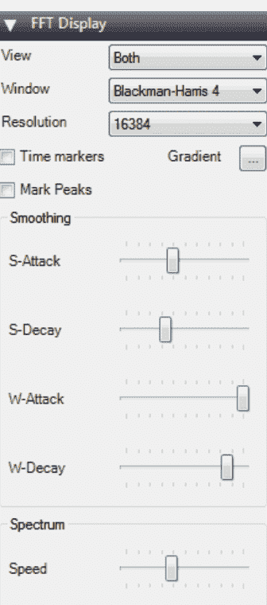

## VIEW（视图）

推荐默认设置：两者

设置为同时查看 RF 频谱和瀑布图，或仅查看其中之一。

## WINDOW（窗口）

推荐默认设置：`Blackman`

设置 FFT 使用的窗口类型。

## RESOLUTION（分辨率）

推荐默认设置：`32768`

增加分辨率会消耗 PC 性能，但可以获得更清晰的频谱。通常情况下，`32768` 足够了。

## PEAKS（峰值）

推荐默认设置：关闭

在瀑布图中显示峰值。

## S-ATTACK / S-DECAY（S-攻击/S-衰减）

推荐默认设置：`0`

控制瀑布图中信号出现和消失的速率。

## SPEED（速度）

改变 FFT 的更新速度。

## ZOOM FFT（缩放 FFT）


Zoom FFT 是一个插件，允许你查看特定区域的频谱。它在放大信号时非常有用。

## ENABLE FILTER（启用滤波器）

开启后可以对信号进行滤波。

## ENABLE AUDIO（启用音频）

开启后可以听到调的音频。

## ENABLE MPX（启用 MPX）

开启后显示 MPX 瀑布图。

## TIME MARKERS（时间标记）

推荐默认设置：关闭

在瀑布图中添加时间标记。

## GRADIENT（渐变）

推荐默认设置：关闭

改变瀑布图的渐变效果。

## MARK PEAKS（标记峰值）

推荐默认设置：关闭

在瀑布图中标记峰值。

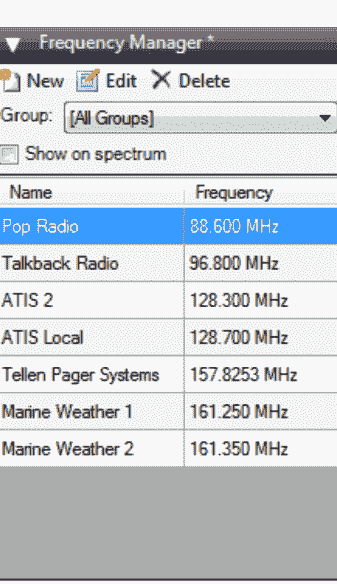

频率管理器允许您在数据库中保存任何感兴趣的频率。点击 `New（新建）` 按钮可以向数据库中添加新频率。这将添加一个带有当前调谐频率和带宽等设置的频率。您可以编辑名称并将其分类分组以便于管理。

如果您勾选 `Show on spectrum（显示在频谱上）` 复选框，您保存的频率将显示在 RF 频谱中。

# 右侧滑块

## 缩放 (ZOOM)

推荐默认设置：缩小 (Zoomed out)

移动此滑块会将 RF 频谱和瀑布图放大到您调谐的 IF 带宽，以便近观察信号。然而，放大得越高，分辨率就越低。缩放的替代方案是降低采样率，或者使用在后文 `优化调优` 章节中讨论的特殊抽取驱动程序。这些替代方法将保留视觉分辨率并让您更清晰地看到信号结构。

## 对比度 (CONTRAST)

调整瀑布图的对比度。调整它使信号能够从背景噪声中显现出来。

## 范围 (RANGE)

推荐默认设置：`-70`

修改 RF 频谱窗口左侧（垂直）轴上显示的 dB 电平范围。您应该调整此项，使噪声底位于 RF 频谱窗口的底部。这将使得信号在 FFT RF 频谱和瀑布图中可见。由于 RTL-SDR 的动态范围约为 `50 dB`（加上由于过采样/抽取的额外增量），您不需要远高于 `0 到 -70 dB` 的范围。此设置还会影响瀑布图的对比度，并可能有助于更容易发现微弱信号。

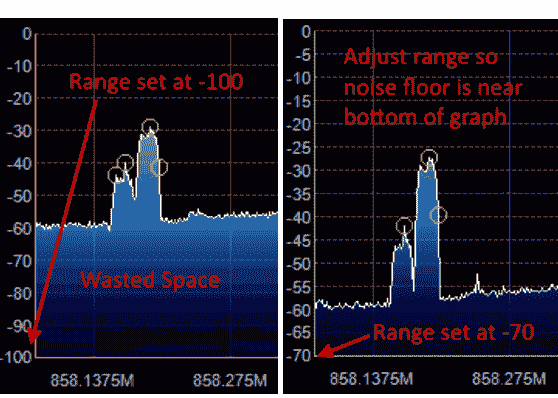

## 偏移 (OFFSET)

推荐默认设置：`0`

在 RF 频谱的 dB 范围内添加偏移。该偏移值被添加到 RF 频谱的顶部。通常不需要调整此项，但如果您想对微弱信号获得良好的对比度，请配合范围一起调整，使信号高度与垂直轴一致。此设置也会影响瀑布图的对比度，并有助于更容易发现微弱信号。

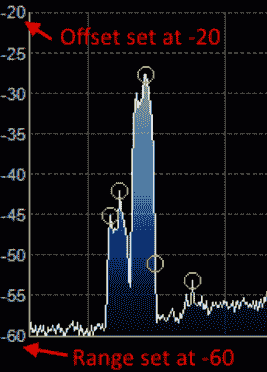

# 配置窗口 (CONFIGURE WINDOW)

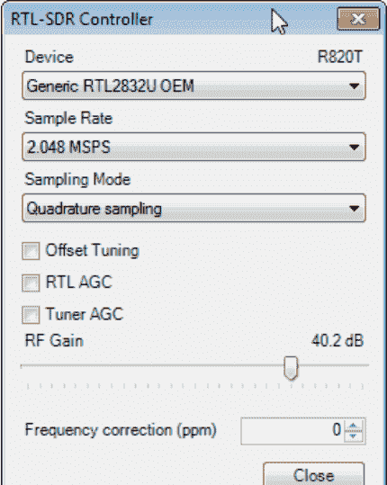

点击 SDR 窗口顶部的齿轮图标可以进入配置窗口。该窗口中的设置影响 SDR 的实际性能，应正确设置以优化信噪比 (SNR)。配置窗口有多个选项。

## 设备 (DEVICE)

如果您插入了多个 RTL-SDR 模块，设备下拉菜单允许您在它们之间选择。

## 采样率 (SAMPLE RATE)

推荐默认设置：`2.048 或 2.4 MSPS`

让您选择 RTL-SDR 显示的瞬时带宽。通常 `2.8 MSPS` 的设置在大多数 PC 上运行良好，但如果您的电脑较慢，您可能想要降低此值。较大的采样率可以通过更多的过采样提高微弱信号的接收效果。我们建议默认率为 `2.048 或 2.4 MSPS`。

## 采样模式 (SAMPLING MODE)

推荐默认设置：正交采样 (Quadrature Sampling)

正常操作使用正交采样。在使用支持直接采样的设备时应使用直接采样选项。更多信息请参见直接采样章节。

## 偏移调优 (OFFSET TUNING)

推荐默认设置：`R820T/2 关闭，E4000/FC0012/13`

仅对 `E4000/FC0012/13` 调器有用。选择此项可以消除 `E4000/FC0012/13` 调器频谱中心的峰。

## RTL AGC

推荐默认设置：关闭

开启 `RTL2832U` 芯片上的自动增益控制。这通常没用，因为开启会降低接收效果。

## 调器 AGC (TUNER AGC)

推荐默认设置：关闭

开启调器芯片上的自动增益控制。对于普通浏览有用，但通常手动设置增益更好。

## RF 增益 (RF GAIN)

推荐默认设置：根据最佳性能调整

此滑块可手动设置调器 RF 增益。如果勾选了 `Tuner AGC` 则无效。

## 频率校正 (PPM)

推荐默认设置：您的模块唯一的 PPM 偏移

允许您纠正 RTL-SDR 由于晶体振荡器质量导致的频率偏移。更多信息见下方的 PPM 设置部分。

## 设置 RF 增益 (SETTING THE RF GAIN)

点击配置按钮可以找到三种 RF 增益设置。`RTL AGC` 开启 `RTL2832U` 内部自动增益控制（AGC）算法。`Tuner AGC` 启用 RTL-SDR 调器的 AGC。AGC 尝试自动优化信号的 SNR。最后，可以使用增益滑块手动设置。

RTL-SDR 中的 AGC 设计用于宽带 DVB-T 信号，对窄信号效果不好。我们建议使用手动增益控制来优化信号增益，但对于休闲浏览开启 `Tuner AGC` 可能足够。`RTL AGC` 几乎未使用，因为它往往会引入很多额外噪声。

手动设置 RF 增益的目标是尽可能提高信噪比 (SNR)。这意味着最大信号强度应该很高，但噪声底也应该越低越好。

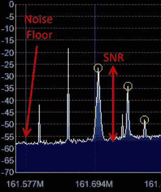

当增加增益时，会达到一个噪声底上升速度超过信号强度增长速度的点。这就是您停止增加增益的点。

可以通过从噪声底高度减去峰值信号高度来计算信噪比。下面展示了增加增益的效果示例。

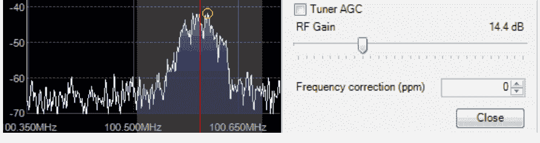

## 设置滤波器 (SETTING THE FILTERS)

通常不需要调整滤波器。然而，有时存在邻近信号可以通过软件过滤来调掉。要激活此插件，只需点击左侧菜单 `Zoom FFT` 标题下的 `Enable IF（启用 IF）` 框。Zoom FFT 频谱显示了通过通滤波后的调谐区域信号。您可以用它研究不同滤波器阶数的影响。例如，这里我们正在调到一个 AM 信号。

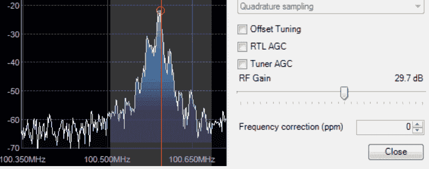

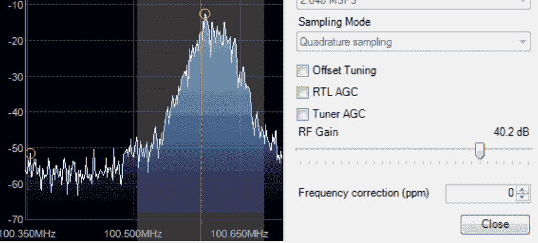

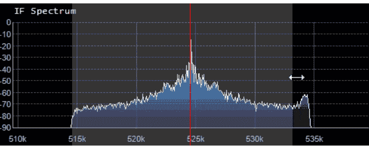

# 设置 PPM 校准

PPM 是 `百万分之一（parts per million）` 的缩写，是一种用于确定晶体振器准确性的指标。晶振器是数字电路的 `时钟` 或 `心脏`。高质量的晶振器具有较低的 PPM 值。

由于 RTL-SDR 适配器是批量生产低质量的 `28.8 MHz` 晶振器，其调谐频率可能会产生 `+-150 PPM` 更多偏差。现在的 RTL-SDR 有一些改进后的晶振。配备贴片式（SMD）晶振的型号误差通常为 `+-30 PPM`。配备 TCXO（温度补偿晶振器）的型号通常误差为 `+-1 PPM`，或者通常不需要设置任何频率校准。

较大的误差意味着你调谐的已知频率可能与你预期的频率不一致。你可能会发现频率总是偏差几千赫兹，这对于窄带信号来说非常令人沮丧。在低频（HF）处，频率偏移并不明显，但在 VHF 和 UHF 频率下，偏移会更大。PPM 的工作原理如下：在 `1 kHz` 处，`1 PPM` 的偏移仅为 `0.001 Hz`。但在 `1 MHz` 处，偏移为 `1 Hz`；在 `10 MHz` 处为 `10 Hz`；在 `100 MHz` 处为 `100 Hz`，以此此类推。

当使用具有大 PPM 偏移的 RTL-SDR 时，你在 VHF/UHF 频段调谐的信号可能不在你预期的位置。这种随调谐频率增加而线性增加的频率偏移，这也是为什么你不能用 `Shift` 框来修正晶振偏移，该框专门用于设置变频器偏移。

幸运的是，SDR# 有一个选项可以修正你可能遇到的 PPM 频率偏移。要设置 PPM 校准，你首先需要已知无线信号的真实频率，最好是恒定的窄带信号，例如中继道或强 ATIS 信号。要找到这些频率，你可以从所在国家的频率数据库或 `radioreference.com` 等网站上在线查找。


在 SDR# 中调谐到已知频率。你可能会发现实际调谐频率与已知信号存在偏移。使用缩放块稍微放大信号。点击 `Configure`（配置）按钮。现在调整 `PPM` 偏移值框，使信号与红色调谐线完全对齐。大多数适配器的 `PPM` 偏移几乎总是是 0 到约 150 之间的正值。记住在第一次插入适配器后等待其预热，因为温度变化会影响 `PPM` 偏移。

下面的图片显示了设置 `PPM` 的效果。第一幅显示了在没有正确设置 `PPM` 的情况下，调谐到 859.070 MHz 信号的情况。调谐条偏离实际频率很远。在第二图中设置了 36 的 `PPM` 校准，现在调谐条位于已知信号频率的中间。

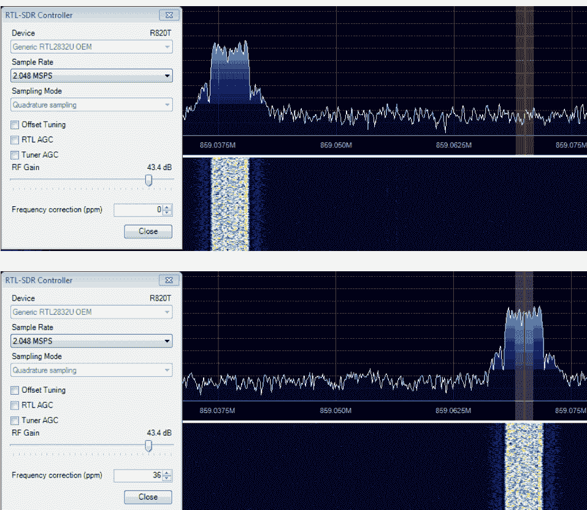

获取准确 `PPM` 偏移值的另一种方法是使用名为 `Kalibrate` 的 Linux 程序。该命令行程序使用手机的 GSM 信号来精确检测适配器的偏移。显然，你需要所在地区的 GSM 信号以及一个可以接收它们的天线才能实现这一点。关于此的教程可以在本书的“校准 RTL-SDR”章节中找到。但请注意，我们强烈建议使用手动方法，因为 `Kalibrate` 有时会给出不准确的结果。

# SDR# 插件

有很多扩展 SDR# 功能的插件可用。我们建议访问 `http://www.rtl-sdr.com/sdrsharp-plugins/` 和 `http://www.sdrsharp.com/#plugins` 查看这些插件的列表和简要概述。

要安装插件，你通常需要将 `.dll` 文件复制到 SDR# 目录，并在 `Plugins.xml` 文本文件中添加条目。该文件位于 SDR# 目录中。你需要用记事本或其他编辑器打开此文件。

插件压缩包中通常附带的 `readme` 文件会告诉你添加什么内容。该行应添加在 `Plugins.xml` 文件的 `<sharpPlugins></sharpPlugins>` 标签之间。

注意，某些旧的 `readme` 文件可能仍指示你将该行添加到 `SDRSharp.exe` 配置文件。这在旧版本的 SDR# 中曾使用，现在是不正确的。该行应该添加到 `plugins.xml` 文件中。

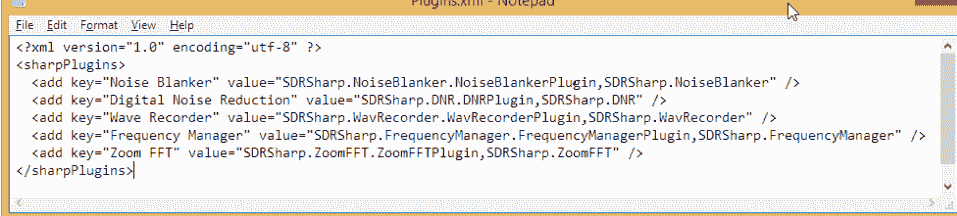

# SDR# 输出采样率

SDR# 中 `NFM`（窄频调）区域的最大带宽限制为 32 kHz。然而，对于某些应用，该带宽太小了。`NFM`/`USB`/`LSB` 信号的最大带宽可以通过更改 `SDRSharp.exe.Config` 文件中的设置来调整。用文本编辑器打开此文件并找到以下行。

```
<add key="minOutputStreamRate" value="32000" />
```

将此行改为以下内容以增加最大带宽。

```
<add key="minOutputStreamRate" value="100000" />
```

# 其他通用扫描软件

一旦你掌握了简单易用的 SDR#，你可能就想尝试其他类似的程序。

# HDSDR 设置指南

HDSDR 基于流行的旧 SDR。HDSDR 有一些额外功能。频率偏移并不那么明显，但在 VHF 和 UHF 频率下偏移会更大。`PPM` 的原理如下：在 1 kHz 处，1 `PPM` 的偏移仅为 0.001 Hz。但在 1 MHz 处，偏移为 1 Hz；在 10 MHz 处为 10 Hz；在 100 MHz 处为 100 Hz，以此类推。当使用具有大 `PPM` 偏移的 RTL-SDR 时，你在 VHF/UHF 频段调谐的信号可能不在你预期的位置。这种随调谐频率增加而线性增加的频率偏移，这也是为什么你不能用“Shift”框来修正晶振偏移，该框专门用于设置变频器偏移。

幸运的是，SDR# 有一个选项可以修正你可能遇到的 `PPM` 频率偏移。要设置 `PPM` 校准，你首先需要已知无线信号的真实频率，最好是恒定的窄带信号，例如中继道或强 ATIS 信号。要找到这些频率，你可以从所在国家的频率数据库或 `radioreference.com` 等网站上在线查找。

在 SDR# 中调谐到已知频率。你可能会发现实际调谐频率与已知信号存在偏移。使用缩放块稍微放大信号。点击 `Configure` 按钮。现在调整 `PPM` 偏移值框，使信号与红色调谐线完全对齐。大多数适配器的 `PPM` 偏移几乎总是是 0 到约 150 之间的正值。记住在第一次插入适配器后等待其预热，因为温度变化会影响 `PPM` 偏移。

下面的图片显示了设置 `PPM` 的效果。第一幅显示了在没有正确设置 `PPM` 的情况下，调谐到 859.070 MHz 信号的情况。调谐条偏离实际频率很远。在第二图中设置了 36 的 `PPM` 校准，现在调谐条位于已知信号频率的中间。


获取准确 `PPM` 偏移值的另一种方法是使用名为 `Kalibrate` 的 Linux 程序。该命令行程序使用手机的 GSM 信号来精确检测适配器的偏移。显然，你需要所在地区的 GSM 信号以及一个可以接收它们的天线才能实现这一点。关于此的教程可以在本书的“校准 RTL-SDR”章节中找到。但请注意，我们强烈建议使用手动方法，因为 `Kalibrate` 有时会给出不准确的结果。

HDSDR 基于流行的旧 SDR。HDSDR 有一些额外功能。频率偏移并不那么明显，但在 VHF 和 UHF 频率下偏移会更大。`PPM` 的原理如下：在 1 kHz 处，1 `PPM` 的偏移仅为 0.001 Hz。但在 1 MHz 处，偏移为 1 Hz；在 10 MHz 处为 10 Hz；在 100 MHz 处为 100 Hz，以此类推。当使用具有大 `PPM` 偏移的 RTL-SDR 时，你在 VHF/UHF 频段调谐的信号可能不在你预期的位置。这种随调谐频率增加而线性增加的频率偏移，这也是为什么你不能用“Shift”框来修正晶振偏移，该框专门用于设置变频器偏移。

幸运的是，SDR# 有一个选项可以修正你可能遇到的 `PPM` 频率偏移。要设置 `PPM` 校准，你首先需要已知无线信号的真实频率，最好是恒定的窄带信号，例如中继道或强 ATIS 信号。要找到这些频率，你可以从所在国家的频率数据库或 `radioreference.com` 等网站上在线查找。

在 SDR# 中调谐到已知频率。你可能会发现实际调谐频率与已知信号存在偏移。使用缩放块稍微放大信号。点击 `Configure` 按钮。现在调整 `PPM` 偏移值框，使信号与红色调谐线完全对齐。大多数适配器的 `PPM` 偏移几乎总是是 0 到约 150 之间的正值。记住在第一次插入适配器后等待其预热，因为温度变化会影响 `PPM` 偏移。

下面的图片显示了设置 `PPM` 的效果。第一幅显示了在没有正确设置 `PPM` 的情况下，调谐到 859.070 MHz 信号的情况。调谐条偏离实际频率很远。在第二图中设置了 36 的 `PPM` 校准，现在调谐条位于已知信号频率的中间。

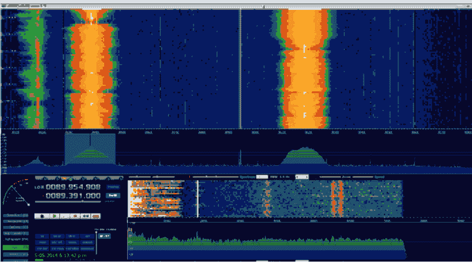

HDSDR 的顶部是 RF 瀑布图和 RF 频谱。左下角是控制控件。右下方是音频瀑布图和音频频谱。可以通过拖动音频 RF 频谱（底部的图表）上的红色滤波器边缘来对音频带宽进行带通滤波。

## SDR-RADIO.COM V2 安装指南

SDR-Radio V2（有时被称为 SDR-Console）是一款具有许多高级功能的流行 SDR 程序。因此，与 SDR# 和 HDSDR 相比，它的学习和使用难度要大得多。请确保你安装的是版本 2，而不是 V1.5，因为只有 V2 支持 RTL-SDR。

与 HDSDR 类似，SDR-Radio 不仅具有 RF FFT 信号和瀑布图显示，还有可选的音频频谱 FFT 和瀑布图显示。它还内置了若干项 DSP 功能，如噪声静止器（`noise blanker`）、降噪滤波器、陷波滤波器和静音（`squelch`）选项。`EMNS` 降噪滤波器特别擅长自动清理和清晰语音信号。

在功能列表之外，SDR-Radio 还内置了 `PSK`、`RTT` 解码器，并附带了卫星跟踪器。此外，SDR-Radio 拥有出色的远程服务器应用程序，允许你通过网络或互联网轻松设置并连接到远程 RTL-SDR 服务器。最后，SDR-Radio 能够在在同一可见频谱区域内同时收听六个信号，换句话说，它可以同时运行六个 VFO。

请按照以下步骤为 RTL-SDR 安装 SDR-Radio。

1. 如果你还没有执行过此操作，请下载并安装 `zadig` (`http://zadig.akeo.ie/`)，并按照 SDR# 安装指南中的说明为 RTL-SDR 安装 `WinUSB` 驱动。
2. 从 `http://v2.sdr-radio.com/` 下载 SDR-Radio 安装程序。
3. 使用安装程序安装 SDR-Radio。
4. 从 `http://www.aa5sh.com/?page_id=65`（镜像站：`http://bit.ly/1oPcWTm`）底部下载 `SDRSourceRTL2832U.dll`、`rtlsdr.dll` 和 `libusb-1.0.dll` dll 文件。根据你的 Windows 版本，将它们拷贝到 `C:\Program Files\SDR-RADIO-PRO.com` (64位) 或 `C:\Program Files (x86)\SDR-RADIO-PRO.com` (32位) 文件夹。
5. 打开 SDR-Radio。打开后，你将看到 `Select Radio`（选择电台）屏幕和提示“列表为空 - 现在添加电台定义吗？”。点击 `Yes`。如果没有显示此提示，点击 `+ Definitions` 按钮。
6. 在新窗口中打开 `Search`（搜索）下拉菜单并选择 `RTL SDR (USB)`。点击后，RTL-SDR 将添加到 `Radio Definitions`（电台定义）列表中。点击 `OK`。
7. 点击 RTL-SDR 选择它，选择你所需的采样率，然后点击 `Start`（开始）。

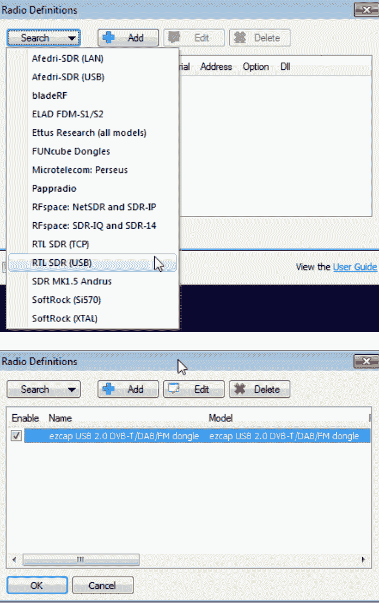

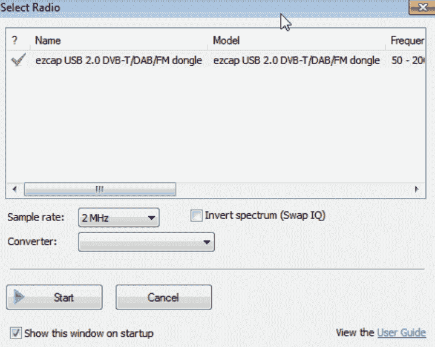

8. 点击 `Span`（跨度）按钮并将跨度调整为你在上一步中选择的采样带宽。这将让你看到整个频谱。

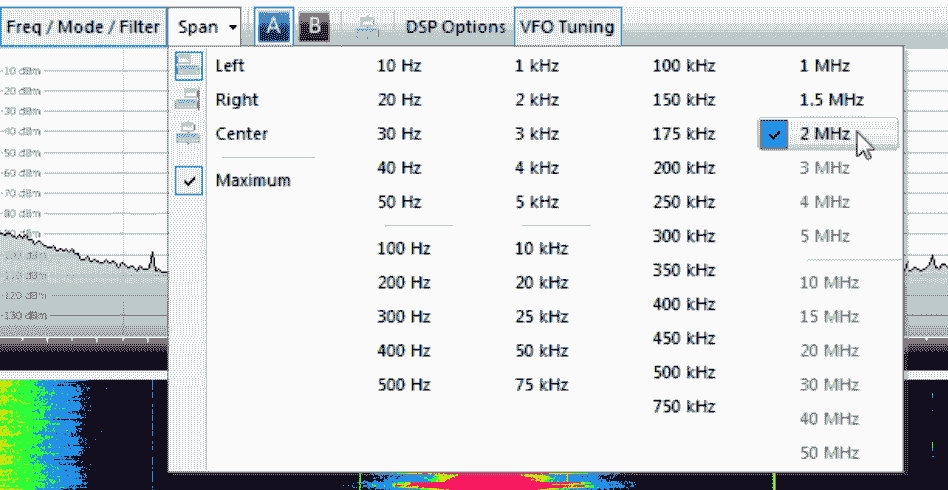

9. 使用频率（`frequency`）标签页下的左侧菜单来更改接收模式和带宽。

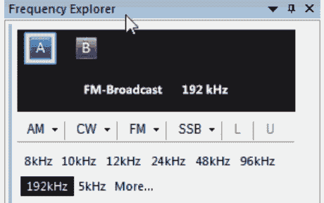

10. 使用右侧的 `VFO` 调谐来调整频率。如果你在该框中没有看到任何数字，可能需要增大 `VFO` 调谐框的大小或最大化程序。

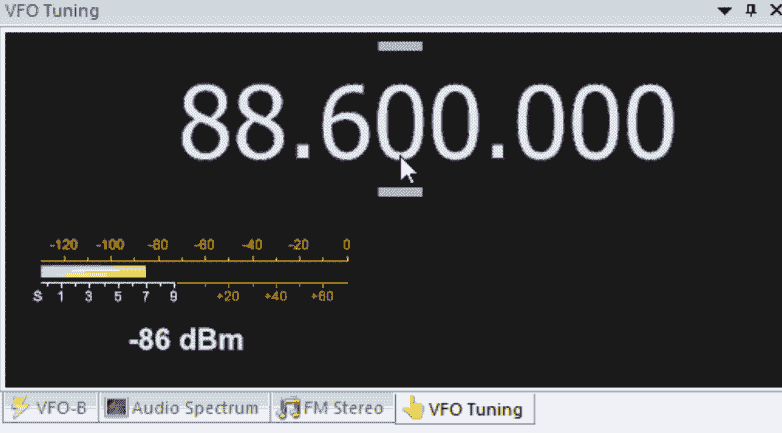

11. 请确保使用工具栏上 `Home`（主页）标签页下的 `RF gain` 按钮调整增益设置。默认情况下设置为自动。

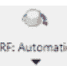

12. 若要调整瀑布图颜色以便更清晰地看到信号，前往顶部的 `Display`（显示）标签页，然后点击最右侧的 `Automatic`（自动）。

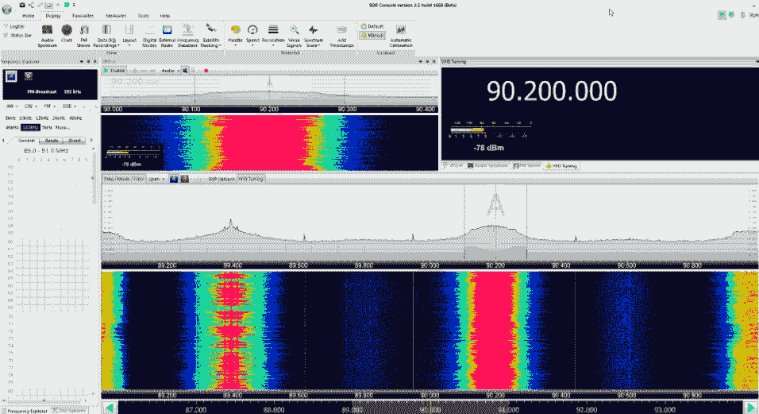

SDR-Radio 的主宽带瀑布图位于屏幕底部，正上方是 RF 频谱。上方是另一个较小的瀑布图和 RF 频谱，它们仅仅是放大后的频率。

## GQRX

GQRX 是一个适用于 OSX 和 Linux 的软件定义电台 GUI。它在可用性上与 SDR# 类似，但功能较少。它还内置了 `AFSK` 解码器。在 Linux 上安装 GQRX 请遵循以下说明。

在 Linux 上安装 GQRX 最简单的方法是使用 `apt`：

```
sudo apt-get install gqrx
```

如果你想从源码安装 GQRX，需要先安装 GNU Radio 3.7 和 RTL-SDR 驱动。请参考 `https://github.com/csete/gqrx` 查看依赖列表。

```
git clone https://github.com/csete/gqrx.git gqrx.git
mkdir build
cd build
make ..
make
sudo make install
```

你可以通过在终端输入 `gqrx` 来运行 GQRX。首次启动 GQRX 时，会出现一个配置 I/O 的界面。从菜单中选择 `Realtek RTL832U` 并选择所需的采样率。其他设置可以保持默认。

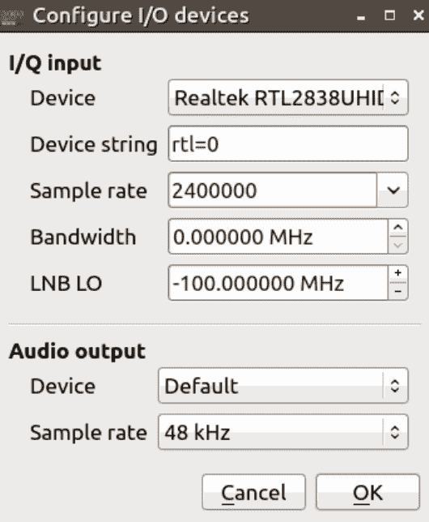

接下来点击左上角的 `Start` 按钮。使用鼠标调整频率。模式和带宽可以在右侧的 `Receiver`（接收器）选项中进行调整。按住 `CTRL` 键滚动滚轮也可以更改 RF 增益。

## 在 OSX 上安装 GQRX

在运行 OSX 上安装 GQRX 最简单的方法是使用 `Macports`。`Macports` 是 OSX 系统的包管理器，拥有许多可下载的 Linux 软件。使用 `Macports` 首先需要安装 `Xcode`，可以从 App Store 下载。如果你需要安装 `Xcode` 的指导，可以参考 `Macports` 网站：

`http://guide.macports.org/#installing.xcode`

安装 `Xcode` 后，你可以从 `https://www.macports.org/` 下载适用于你版本的 `Macports`。

现在通过 `Macports` 安装 GQRX，请打开终端窗口并执行 `sudo port install gqrx`。安装可能需要长时间（几个小时），因为 GQRX 需要编译 GNU Radio。安装完成后，你应该能在应用程序中找到 GQRX。

如果由于某些原因 `Macports` 不适用，我们建议从以下链接下载预制的（尽管已过）GQRX `.dmg` 文件：

`http://eliaseno.com/2012/09/30/osx-port-of-the-awesome-gqrx-sdr/software.`

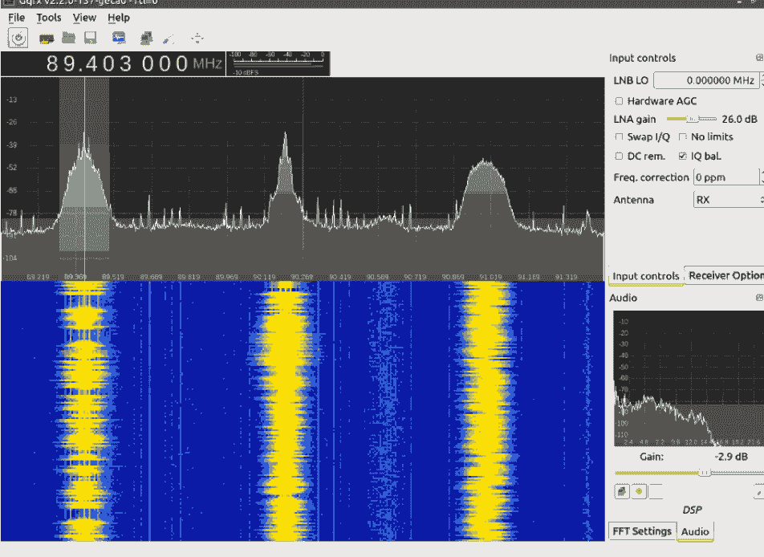

## CUBICSDR

CubicSDR 是一个较新的 SDR 接收程序，前景广阔。它完全跨平台，支持 Windows、Linux 和 OSX。设置过程极其简单。

1. 如果你还没有执行过此操作，请下载并安装 `zadig` (`http://zadig.akeo.ie/`)，并按照上述 SDR# 安装指南中的说明为 RTL-SDR 安装 `WinUSB` 驱动。
2. 访问 `www.cubicsdr.com`，从下载页面下载适用于你系统的最新版本。
3. 打开安装程序并按照提示操作。这将安装以及所有的 RTL-SDR dll 文件。
4. 从开始菜单（或 Linux/OSX 对应位置）打开 CubicSDR。

如果 RTL-SDR 已插入，CubicSDR 将自动启动并显示频谱。只需点击底部瀑布图区域即可调谐。

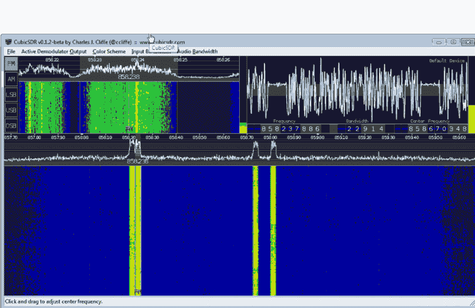

## LINRAD

Linrad 是一个 SDR 接收机程序，具有一些非常先进的功能，并且可以在旧款 PC（奔腾 4）上运行。虽然 Linrad 拥有高级功能，但它的学习曲线非常陡峭，仅供高级用户使用。本教程将向如何在 Windows 上设置 Linrad 并在宽带 FM 无电上对其进行测试。更高级的功能需要 I/Q 和滤波器校准，这需要一个脉冲发生器。关于设置这些校准的良好教程可以在 `https://www.youtube.com/watch?v=rQPART6r8` 找到，这是 Linrad 程序员的一个教程视频。

1. 如果你还没有这样做，请下载并安装 `zadig` (`http://zadig.akeo.ie/`)，并根据上述 SDR# 设置指南所示说明为 RTL-SDR 安装 `WinUSB` 驱动。
2. 前往 `http://www.sm5bsz.com/linuxdsp/linrad.htm` 下载并运行 Windows 版本的 Linrad DLL 安装程序（`setup-linrad-dll-package-03.exe` (804985 bytes)）。
3. 下载并运行 Windows 的安装程序 `setup-linrad-04.00.exe` (843728 bytes)。
4. 打开 Linrad。你将看到以下命令提示窗口。

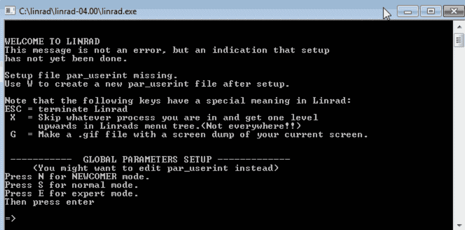

5. 输入 `S`，然后按回车以普通模式打开 Linrad。
6. 接下来你将被要求输入字体缩放（大小）。较小的屏幕选择较小的数字，较大的屏幕选择较大的数字。
7. 接下来选择进程优先级为 0，表示普通（`NORMAL`）优先级。
8. 接下来选择 `N` 来指定百分比窗口大小。然后宽度设为 100%，高度设约为 90%。
9. 现在 Linrad 屏幕将打开。按 `W` 键保存你目前选择的选项。
10. 按 `U` 键配置输入设备，然后按 `A` 进入 RF 输入设备选择屏幕。按 `H` 将输入设备设置为 `RTL2832`。（必须连接 RTL-SDR Linrad 才能检测到它）。
11. 选择 2400000 作为采样率。选择 0 进行正常的 I/Q 调谐器操作，并选择 0 进行自动增益模式。如果你知道你的 `PPB`（十亿分之一）中的频率误差，请现在输入，否则直接输入 0 即可。
12. 按 `B` 设置输出声卡。输入 `N` 不选择 `PortAudio` 作为输出。现在查看列出的列表，找到你想要使用的扬声器或虚拟音频管道。
13. 按 `X` 进入主菜单，然后按 `W` 保存你的设置。
14. 现在按 `E` 进入 FM 解调屏幕。在接下来的几个屏幕中按回车键选择默认值。


- 15. 在显示的新接收范围中，首先点击显示频率范围的最顶端栏。在栏的左侧输入值 0，右侧输入一个任意大值（例如 1000）。点击 Apply。这将为瀑图选择最大带宽频率范围。
- 16. 要增加瀑图速度，请将瀑图左下角的数值改为较低的值，例如 9。
- 17. 按 `X` 然后 `P` 进入参数屏幕。点击 `First FFT Amplitude` 并新值设置为 20。这会降低底噪。
- 18. 如果你的 PC 处理跟不上，按 `X` 然后 `P` 将 `First FFT Bandwidth` 设置为 1 kHz。
- 19. 要调谐到电台，点击顶部 RF 频谱中的峰值。通过拖动下方频谱中的黄色条来改变带宽。向右拖动增加宽带 FM 的带宽。

## 在 LINUX 上安装 RTL-SDR 驱动

如果你想在 Linux 系统上开始使用 RTL-SDR，第一步是安装驱动。首先使用以下命令更新发行版：

```
sudo apt-get update
```

现在如果没有安装，安装 `git`、`cmake` 和 `libusb`，这是 RTL-SDR 需要的库：

```
sudo apt-get install git
sudo apt-get install cmake
sudo apt-get install libusb-dev
sudo apt-get install libusb-1.0-dev
sudo apt-get install build-essential
```

现在下载、编译并安装 RTL2832 Osmocom 驱动。（注意，我们也建议使用链接 `https://github.com/keenerd/rtl-sdr.git` 克隆 Keenerd 驱动来代替 osmocom）

```
git clone git://osmocom.org/rtl-sdr.git
cd rtl-sdr/
mkdir build
cd build
cmake .. -UDEV_RULES=ON
make
sudo make install
sudo ldconfig
sudo cp ../../etc/rules.d/
```

在某些情况下，你现在需要重启 Linux。

插入加密狗，然后运行 `rtl-test` 测试加密狗。如果 `rtl-test` 在 found devices 头部返回奇怪字符，或者遇到如下错误：

> Kernel driver is active, or device is claimed by second instance of librtdr.

在第一种情况下，请分离或黑名单模块 (`dvb_usb_rtl2xx`)，或者在编译时启用自动分离。

```
usb_claim_interface error -6
Failed to open device #0.
```

这意味着包含在较新 Linux 版本中的 RTL2832 DVB-T 驱动已安装并激活。运行以下命令禁用它们：

```
sudo rmmod dvb_usb_rtl2xx
```

注意运行此命令只会停止一次 DVB-T 驱动。当你移除并重新连接加密狗或重启 Linux，DVB-T 驱动将重新加载，你需要再次运行此行。

为了获得持久的解决方案，在 `/etc/modprobe.d` 中创建一个文本文件 `blacklist-dvb_usb_rtl2xx.conf`。在该文件中写入文本 `black dvb_usb_rtl2xx`。此此简单的方法是在终端中直接输入以下内容：

```
sudo echo "blacklist dvb_usb_rtl2xx" > /etc/modprobe.d/blacklist-dvb_usb_rtl2xx.conf
```

黑名单 DVB-T 驱动后，你可以拔掉并重新连接加密狗，它现在应该默认使用 RTL-SDR 驱动，但在某些情况下你可能需要重启 Linux 黑名单才能生效。

如果你运行 `rtl_test` 时出现奇怪字符，可能表明你没有通过 `cp ../../rtl-sdr.rules /etc/udev/rules.d/` 正确安装 `.rules` 文件。

## RTL_FM

`Rtl_fm` 是一个用于 WBFM/AM/FM/SSB 的轻量级命令行接收机。我们首先需要对术语进行一项区分。当我们提到 `rtl_fm` 时，指的是调谐区域带宽（例如 SDR# 中的阴影区域），而不是宽带瞬时带宽。下面列出了可能的 `rtl_fm` 标志，然后展示一些使用示例。

## RTL_FM 使用示例

要使用下面示例中使用的 `play` 命令，你需要 `sox` 或 `aplay`。在 Debian Linux 上可以通过 `sudo apt-get install sox` 获取 `sox`。在 Mac 上使用 `port sox`。在 Windows 上，可以从 `http://sourceforge.net/projects/sox/` 下载。你需要将安装 `sox` 的文件夹添加到 Windows PATH 中，以便从提示符的任何地方访问。你可能也希望将包含 `rtl_fm` 的文件夹添加到 PATH。在此链接中有一个如何将目录添加到 PATH 的教程：`http://geeksswithblogs.com/renso/archive/2009/10/21/how-to-set-the-windows-path-in-windows-7.aspx`。在 Windows 上，需要在命令末尾添加 `-d` 标志来选择默认设备。此外，在 Windows 上，“play" 命令被 "sox" 命令取代。

## RTL_FM 标志

+ `-M` 设置接收模式 (`wbf`, `fm`, `am`, `lsb`, `usb`, `raw`）（默认为 `fm`）
- `-s` 调谐区域的带宽/采样率（不是整个频谱）
- `-g` 增益（默认是自动）
- `-l` 抑制电平
- `-t` 抑制延迟
- `-p` ppm 偏移
- `-F` 使用更好的滤波器（0 - 9）
- `-r` 输出采样率（极低质量重采样）
- `-d` 加密狗编号（用于使用多个加密狗）
- `-A` 反正切计算 (`std`, `fast`, `lut`)
- `-E` 特殊模式 (`dc`, `deemp`, `direct`, `offset`)

有关完整的类型列表，请参考 `rtl_fm -h`。

# 接收 WBFM

`rtl_fm` 在 WBFM 模式下使用的音频采样率为 32k。

```
rtl_fm -M wbfm -f 88.6M | play -r 32k -t raw -e -s 16 -c 1 -V1 -
```

为了获得更好的音频输出质量，可以使用 `-r` 标志将音频采样率重采样为 48 kHz，如下：

```
rtl_fm -M wbfm -f 88.6M -r 48k | play -r 48k -t raw -e -s 16 -c 1 -V1 -
```

除了 `sox` 之外，也可以使用 Alsa amp 作为替代方案，如下。某些 Linux 计算机播放的音质效果更好。

```
rtl_fm -M wbfm -f 88.6M -r 48k | aplay -r 48k -f S16_LE
```

在 Windows 上请使用以下命令。

```
rtl_fm -M wbfm -f 88.6M | sox -r 32k -t raw -e -s 16 -c 1 -V1 -d
```

此外，除了使用 `-M wbfm`，还可以使用 `-M fm` 并通过 `-s` 指定带宽，通过 `E` 指定去强调选项。这种方法有时会产生更好的音质。

```
rtl_fm -M fm -f 88.6M -s 200k -r 32k -E deemp | play -r 32k -t raw -e -s 16 -c 1 -V1 -
```

# 窄带 FM 示例

```
rtl_fm -M fm -f 161.649M -s 12k -g 50-70 | play -r 12k -t raw -e -s 16 -c 1 -V1 -
```

# AM 示例

```
rtl_fm -M am -f 127.7M -s 12k -g 50 | play -r 12k -t raw -e -s 16 -c 1 -V1 -
```

对于上述示例，可以通过使用 `-F` 选项在增加计算时间的代价下提高接收信号的质量。在 `-F` 之后使用 0-9 之间的数字，数字越大，下采样滤波器的质量越高。即使使用 `-F0` 也会提高音频质量。

# 扫描仪示例

`rtl_fm` 也可以用于扫描多个频率的活动情况。

添加你想要扫描的频道的多个 `-f` 频率。

`rtl_fm` 将继续扫描直到找到活动信号。下所示是一个示例。

```
rtl_fm -M m -f 161.649M -s 12k-161.925M -f 161.825 -s 12k -g 50-70 -1 | play -r 12k -t raw -es -b 16 -c 1 -V1 -
```

你也可以指定频率范围和步长进行扫描。例如，若要扫描航空频段，可以使用以下命令：

```
rtl_fm -M am -f 118M:137M:25k -g 50 | play -r 12k -t raw -es -b 16 -V1 -
```

# 使用 SOX 更改音频采样率

`rtl_fm` 有 `-r` 标志来调整输出采样率。然而，这是一种低质量的转换且无法进行上采样。如果你出于某种原因需要更改 `rtl_fm` 的输出采样率，可以如下所示使用 `sox`。

```
rtl_fm -M fm -f 161.649M -s 12k -g 50 -10 | sox -r 12k -t raw -es -b 16 -traw -r 48k -es -b 16 -c 1 | play -r 48k -t raw -es -b 16 -c 1 -V1 -
```

一个更好的音质 WBFM 使用 `aplay` 的示例：

```
rtl_fm -M fm -f 88.6M -s 170k | sox 170k -t raw -es -b 16 -traw -r 48k -es -b 16 -c 1 | aplay -48k -f S16_LE
```

关于 `rtl_fm` 的完整文档可以在 `http://kmken.com/rtl-demod-guide/index.html` 找到。

如果你想通过网络启动 `rtl_fm` 音频，请连接项目部分的 MP3 streaming_tutorial。此外，若要在如 `multimonng` 等数字解调软件中使用 `rtl_fm`，请参阅本书后半部分的 MultimonongNG 章节。

# 安装 GNU RADIO

GNU Radio 是一个流行的基于 Linux 的数字信号处理平台，兼容 RTL-SDR。GNU Radio 是一个大型且复杂的程序，有时很难安装。下面我们展示了最常见的方法。

重要提示：不要在运行于 SD 卡上的嵌入式设备上运行编译 GNU Radio 的安装过程。GNU Radio 在安装过程中产生的写入次数可能会损坏卡片。安装后，可以通过 `gnuradio` 启动 GNU Radio。

如果你在 Ubuntu 虚拟机运行 GNU Radio，可能需要调整 `/usr/local/gnuradio/conf.d/gr-audio-salsa.conf` 中的某些设置：`period_time = 0.10` 和 `nperiods = 32`。

注意，除非使用下所示的脚本，否则应预安装 RTL-SDR 驱动。请查看 Linux 上安装 RTL-SDR 驱动。如果你不想经历安装 GNU Radio 的过程，有一些预装 GNU Radio 的 Linux 发行版。参考 Live DVD 章节。

# 安装脚本

在几乎任何 Linux 系统上安装最新版本 GNU Radio 的简单方法是使用 Marcus Leech 的脚本。此脚本还会安装 RTL-SDR 和 OsmoSDR 等相关库。我们推荐这种方法，因为它最简单且最可能成功。使用该脚本只需在终端输入：

```
sudo apt-get update
wget http://www.sbrac.org/files/build-gnuradio && chmod a+x ./build-gnuradio && ./build-gnuradio
```

脚本会问几个问题，回答 yes 或 y。它将下载并安装所有依赖项以及 GNU Radio。几分钟到一小时后，脚本将停止并要求你输入管理员密码以执行 `sudo`，因此你需要定期检查脚本的进度。另外注意，取决于你的网络和电脑速度，脚本大约需要 1-3 小时完成。

如果出于兼容性考虑你需要安装旧版本的 GNU Radio 3.6.5.1，可以使用如下 `-o` 标志：

```
wget http://www.sbrac.org/files/build-gnuradio && chmod a+x ./build-gnuradio && ./build-gnuradio
```

如果你发现错误“Fetching GNU Radio- Could not find gnadio”，请尝试下方法。如果出于某种原因脚本不起作用，可以尝试 `pybombs`。

# PYBOMBS

# 包管理器

也可以使用标准的 `apt-get` 过程安装 GNU Radio，但这些预包版本通常不是最新版本。安装较现代版本的 GNU Radio (3.7+) 最简单的方法是使用 Ubuntu 14.04 或更高版本。

FreeDV, wsjt-x, Micro-Fox 15 Config 以及一个 TinyTrak3 配置程序。

`http://sourceforge.net/projects/kb1oiq-andysham/`

# GNU RADIO LIVE DVD

基于 GNU Radio 程序的 Linux 发行版。包含 rtl-sdr 驱动、GNU Radio 3.7.3 版本、gqrx、Mode-S/ADSB 飞机接收器、GrOsmoSDR GNU Radio 模块、GNSS-SDR。

`http://gnuradio/redmine/projects/gnuradio/GNURadioLiveDVD`

# KALI LINUX

Kali Linux 是一个以安全和渗透测试为中心的发行版。Kali Linux 预装了 GNU Radio 和 Wireshark。

`http://www.kali.org/`

# PENTOO

Pentoo 是另一个以安全和渗透测试为中心的发行版。预装了 GNU Radio 和 RTL-SDR 驱动。

`http://www.pentoo.ch/`

# PORTEUS

Porteus 是一个非常轻量级的发行版，针对小体积、速度和效率进行了优化。

`http://www.porteus.org/`

# BEAGLEBONE BLACK SDR IMAGE FILE

这是一个为 BeagleBone black 嵌入式 Linux PC 设计的实用镜像文件。该镜像包含 Ubuntu 14.04 操作系统以及预装的 SDR 软件和驱动，如 RTL-SDR 驱动和 GNU Radio。预装软件的数量不断增加，但在编写时包含以下内容：GNURadio 3.7、keenerd 的 rtlsdr bundle、gqrx、multimode、LTE-Cell-Scanner、LTE-Tracker、multimon、rtl_flex_noX、SuperKuh 的 Dongle Logger – pyrtlsdr、rtl_433、SDR-J、rtl_sdr 宽谱分析仪、DSD 1.7、RTLAMR、RTL_FM_Python。

`http://www.kd0cq.com/2014/08/packed-full-beagle-black-img-file-rtl-sdr-gnuradio-gqrx-lots-more-on-ubuntu-14-04/`

# RTL-SDR 杂项

## RTL-SDR 晶振误差

RTL-SDR 是一种中国批量制造的设备，晶振误差较大高达 +150 PPM 偏移。RTL-SDR 中的晶振器是其时钟源（电路的心脏）。RTL-SDR 使用 28.8 MHz 晶振器，可能会偏差几千兹。结果是已知频率可能不在你预期的位置。请参阅[校准 RTL-SDR]章节或[设置 PPM 偏移]章节，了解如何校准 RTL-SDR 以消除频率偏移。

某些 RTL-SDR 配备了升级版晶振。使用 SMD 晶振的误差可能为 +-30 PPM，而带有 TCXO（温度补偿晶振器）的设备误差为 +-1 PPM。带有 TCXO 的 RTL-SDR 不需要设置任何 PPM 偏移，或者只需要 1 或 2 的偏移。

## RTL-SDR 直流脉冲 (SPIKE)

E4000 适配器（以及 FC0012/13）无论调到哪里，频谱中心都会出现一个巨大的脉冲。这是预期的，因为这是 E4000 的设计方式。要消除 E4000 和 FC0012/13 适配器的直流脉冲，可以使用 SDR# 配置菜单中的“偏移调整 (Offset Tuning)”选项。对于 R220/R820T2，偏移调整无效。

R820T2/R820T2 在中心也有一个微小但明显的直流脉冲，但通常在 SDR 中点击 Correct IQ 即可完全消除它。

## RTL-SDR 杂波 (SPURS)

由于适配器的设计，在 28.8 MHz（内部晶振频率）的倍数处会有杂散（不需要的）信号脉冲。你可能在 48 MHz（USB 时钟频率）的倍数和 480 MHz（USB 数据率）的倍数处看到强杂波。

遗憾的是，对于这些脉冲的位置没有很好的办法。晶振杂波在频谱和瀑布图中看起来像一条细实线。在 LSB/USB 模式下听起来像单音频调。要检查信号是否为晶振产生的杂波，只需将可疑频率除以 28.8 MHz。如果结果是整数，它可能就是杂波。USB 之类的杂波可能像许多聚集在一起的杂波。

# RTL-SDR ADC 位深

RTL2832U ADC 使用物理位为 8，但 ADC 的有效位数通常较低，对于 RTL-SDR 可能约为 7 位。

# RTL-SDR 灵敏度

带有 R820T 调谐器的 RTL-SDR 平均灵敏度约为 -130 dBm。以下是 HB9AJG 执行的一些灵敏度结果。完整报告可以在此处找到：`http://f6fvy.free.fr/rtl_sdr/Some_Measurements_on_E4000_and_R820T_Tune.pdf`。


| 频率 (MHz) | 灵敏度 E4000 (dBm) | 灵敏度 R820T (dBm) |
|---|---|---|
| 24 | N/A | -127 |
| 52 | -139 | -134 |
| 110 | -139 | -134 |
| 145 | -141 | -134 |
| 435 | -139 | -135 |
| 700 | -136 | -136 |
| 1000 | -129 | -137 |

# 优化调谐

当信号调在频谱/瀑布图中心附近（但不是正中心）时，RTL-SDR 接收效果最好。频谱边缘的灵敏度略有下降。

# 优化抽取 - 软件提高接收质量

抽取（Decimation）是一种通过过采样从 ADC 获取更多位数的巧妙方法。（此处由于原文包含大量重复的说明文字，已按要求处理）

<http://manpages.ubuntu.com/manpages/trusty/man1_rtl_eeprom.html>

只需使用 `-s` 字符串即可为你想要连接的每个 RTL-SDR 创建一个唯一的序列号。

## 每个端口的最大适配器数量

一个设备吞吐量为 256 Mbit/s 的 USB 2.0 总线控制器的理论限制约为 5 个转接器。在实际操作中，最大限制可能是 3 到 4 个。如果你想连接更多适配器，可以购买一块 PCIe 扩展卡来添加更多的 USB 2.0 控制器。

## 在 LINUX 虚拟机上使用 RTL-SDR

RTL-SDR 在通过 VMware Player 运行的虚拟操作系统上运行良好。VirtualBox 由于其 USB 实现较差，往往运行效果不佳。在 VMware Player 中运行程序时，请确保在虚拟机设置中将“USB 宿主机速度”设置为 USB 2.0（默认设置为 USB 1.1），并确保为应用程序提供足够的内存和处理能力。我们建议将虚拟机至少配置 2 个处理器核心和至少 4 GB 内存。

通常情况下，使用虚拟机是理想的，因为某些 Linux RTL-SDR 项目需要安装旧版本的 3.6 版 GNU Radio，而另一些则需要安装 GNU Radio 3.7+。这两个 GNU Radio 不能安装在同一个系统中，因为它们会产生冲突。但通过虚拟机，你可以运行两个安装了不同版本 GNU Radio 的独立 Linux 实例。

可以在 <http://www.traffictool.com/vmware/> 找到一些现成的 VMW Linux 镜像。我们倾向于使用 Lubuntu 14.04 及以上版本，但你也可以选择自己喜欢的发行版。

## 输入静电保护二极管

在天线输入端，适配器有一个二极管，可以将静电产生的高电压旁地。这有助于保护调谐器芯片（R820T/E4000）的敏感前端。过去，为了节省成本，一些适配器制造商没有在电路中包含二极管，导致人们将其连接到带有静电的天线后，许多适配器发生了损坏。最近没有收到关于缺少静电保护二极管的适配器的报告，尽管检查一下仍然是有必要的。请参阅下文带有标有输入保护二极管的典型 RTL-SDR 板图像。

即使适配器带有静电保护二极管，也不能保证适配器一定受到保护。在插入户外天线之前，请务必对其放电。

## RTL-SDR 电流使用

当前电流随调谐器型号甚至适配器品牌而异。使用内置 USB 电流测量适配器测得电流：全尺寸 R820T 在空闲时使用约 60 mA，使用时使用 260 mA。小型 R820T 适配器空闲时使用约 60 mA，使用时使用 240 mA。Terratec E4000 模型空闲时需要约 60 mA，使用时约 170 mA。

## 遥控

某些 RTL-SDR 适配器的经销商选择在适配器中包含一个遥控器。这有时会导致困惑，因为遥控器看起来没有任何作用。遥控器只有在配合官方厂家驱动将适配器作为 DVB-T 调谐器使用时才有用。在配合 SDR 驱动程序使用时，它没有任何用。

## 附带的 CD

某些经销商还选择随 RTL-SDR 适配器附带一张小型 CD，其中包含一些 DVB-T 驱动和电视软件。大多数情况下，这些 CD 上的 DVB-T 软件是盗版的，由于复制保护会在几周或几个月后停止工作。如果你想将 RTL-SDR 作为 SDR 使用，你不应该安装这些 CD 中的任何东西。如果你想看 DVB-T 电视，请参阅本书中的 DVB-T 章节。

## 到货损坏率

尽管质量控制正在缓慢改进，但目前我们估计适配器的到货损坏率在 1-2% 左右。这意味着你购买的 100 个适配器中，可能有 1 或 2 个出厂时就是故障的。请参阅我们的故障指南。

## 典型 RTL-SDR 板的图像


## RTL-SDR 噪声底

这是一张显示在 RTL-SDR 整个范围（24 MHz 到 2 GHz）进行频率扫描的图像，此时未连接天线且增益设置为最大。从图中可以看出，RTL-SDR 的杂散清晰可见。这些大杂散出现在 2.8 MHz 的倍数上，表明它们来自本地振荡器。我们从图中还可以看到 RTL-SDR 的噪声底不是平的。在 30 MHz 附近，噪声底急剧上升，然后再次下降，在 2.4 GHz 处再次上升。

## RTL-SDR 的改进与改装

## 低噪声放大

适配器中使用的放大器被认为对于严肃工作来说质量较差，但对于大多数应用来说噪声仍然足够低。然而，有第三方的 LNA（低噪声放大器）可以用于改进信号。像 RTL-SDR 中这种噪声系数 >4dB 的劣质放大器会引入噪声，导致信号退化，特别是在增加增益时。“噪声系数”一词用于描述这种现象。可以使用第三方的 LNA 来改善信号。

## 直接采样改装

引脚 1 和 2 位于 `RTL2832U` 芯片圆形缺口下方。将导线焊接在直接连接到引脚 1 和 2 的两个电容之一可能会更容易。

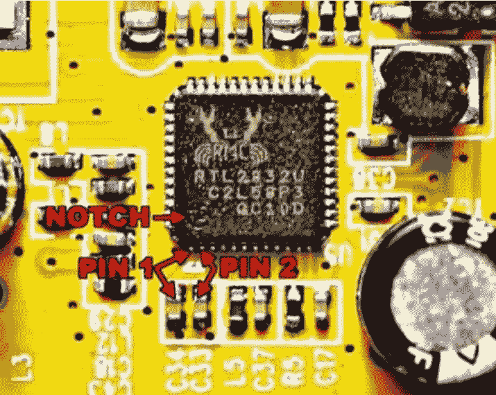

如果你使用的是基于 R820T 的适配器，这种模式下使用引脚 4 或 5 可能效果最好。由于 R820T 的电路架构，`RTL2832U` 上的这些引脚在正常运行期间会被占用。使用引脚 4 或 5 可以允许你对 VHF/UHF 使用常规正交采样，并对适配器上的 HF 波进行直接采样。引脚 4 和 5 的问题在于它们没有像引脚 1 和 2 那样的电容连接，因此非常难以焊接。Reddit 用户 psкато 拍摄了他焊接到引脚 4 和 5 的照片（<http://img42.imageshack.us/img42/3272/htjo.jpg>），可以作为参考。一些 2015 年第一季度及以后制造的新型 R820T RTL-SDR 适配器现在配备了引脚 4 和 5 的易焊的连接。这些适配器使得执行直接采样改装变得容易得多。

一旦你完成了硬件改装并激活了它，你需要更改一些软件设置。在 SDR# 中，进入 `configure`（配置）菜单并将采样模式更改为“Direct sampling (I branch)”（直接采样 I 支）或“Direct sampling (Q branch)”（直接采样 Q 支）。I 支对应引脚 1，Q 支对应引脚 4 和 5。引脚 3 未连接任何地方。在 HDSDR 中，也可以使用 ExtIO 设置窗口（选择采样率的相同窗口）中的直接采样选项来启用。要在 GQRX 中启用直接采样，请在 Configure I/O devices（配置 I/O 设备）窗口的设备字符串输入框中添加字符串 `direct_samp=1`。

如果将线线连接到这些引脚之一并选择了正确的直接采样分支，你将能够接收 0 - 14.4 MHz 之间的信号。由于奈奎斯特混叠，在此之上你会看到 0 - 14.4 MHz 范围的镜像。如果你想接收 14.4 到 28.8 MHz 之间的频率，你需要为该范围制作一个带通滤波器。请参见下方的“Designing Simple Filters with RFSim99”部分，获取如何设计简单但有效的低通和带通滤波器的信息。

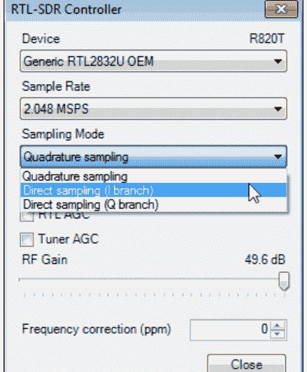

## 改进

上述的直接采样改装可以进一步改进。由于 `RTL2832U` 使用两个引脚为每个 I 和 Q 输入创建一个差分输入（+ 和 - 信号），可以使用巴伦器（balun）将引脚 1 和 2 以及引脚 4 和 5 同时连接到天线。使用巴伦器还具有额外优势，可以提供额外的天线静电保护。本质上，这种改装涉及寻找或绕制自己的巴伦器，并将巴伦连接到两个引脚，并将巴伦的另一端连接到天线。使用如 `FT370-43` 的铁氧环芯和一些漆包线很容易制作巴伦，这些在爱好者电子商店中都能买到。大多数实验者都使用了三匝巴伦（trifilar balun）。

巴伦器还可以将 50 或 75 欧姆的天线输入匹配到 `RTL2832U` 的输入阻抗。`RTL2832U` 的输入阻抗并不确定，但大多数人认为它约为 200 欧姆。因此，巴伦器的 4:1 阻抗转换似乎是公认的值，在 200 欧姆下它可以匹配 50 欧姆的天线/馈线。然而请注意，有些人报告称使用 8:1 或 10:1 等更大的阻抗转换性能更好。

这里 Mikig 显示了 E4000 调谐器上直接采样改装的原理图 <http://mikikg.files.wordpress.com/2012/08/rtl2832u-dc-mods.pdf>，Mikig 建议使用 Minicircuits `T1-6T-KK81+` 变压器 (<http://www.minicircuits.com/pdfs/T1-6T-KK81.pdf>) 作为巴伦以获得最佳性能。这是 l6BE 关于他的直接采样改装的另一篇文章 <http://www.radioamatoripeligni/i6be/rtl2832hf/dongle.html>，在他的实现中使用了双匝巴伦（bifilar balun）。关于直接采样改装的日语文章可以在这里找到 <http://blog.livedored.jp/bh5ea20tb/archives/4263275.html>，这篇文章有很多图片展示了通过扭扭两根线来绕制三匝巴伦高效方法。有趣的是，日语作者建议十匝性能最佳，这表明 `RTL2832U` 的输入阻抗可能高于预期的 200 欧姆。

大多数改装实验者发现 FM 干扰可能是一个问题，因此可能需要低通滤波器来获得良好的性能。一些用户还报告说添加低噪声放大器（LNA）可以极大地帮助改善接收。这是因为调谐器芯片被跳过了。（注：由于原文中存在大量重复的句子，已过滤以提供实际内容）。

<https://github.com/mutability/rtl-sdr/>。SDR 的预编译 Windows 二进制文件可以在 <http://bit.ly/W2Zzqv> 获取（镜像地址: <https://dl.dropboxcontent.com/u/43061070/rtlsdr_OLIVERHFMOD.dll>）。

只需下载此文件，将其重命名为 `rtlsdr.dll` 并复制到 SDR# 文件夹以覆盖旧文件（你可能希望先备份原始文件）。现在你可以打开 SDR# 并调谐到 HF（短波）频率。假设你已经连接了 HF 天线（例如简单的随机线天线），你应该能够轻松地接收到 0.5 到 2 MHz 左右的一些广播调电台。

测试人员报告说，14 MHz 及以上的灵敏度最佳，但在较低频率下也能获得可以接受的性能。此修改的灵敏度接近真实的直接采样硬件修改或使用上变频器的效果，但使用如 `LNA4HF` 等 LNA 和低通滤波器可以显著提高接收效果。

在使用这种实验性修改时，带有 R820T2 调谐器的 RTL-SDR 适配器的性能也会比带有 R820T 调谐器的好得多。这是因为 R820T2 具有更大的中频滤波器，能够更好地利用此修改用于接收这些 HF 频率的机制。

## 无需硬件修改的直接采样发现

注意，下文讨论的实验性驱动已被上述 Oliver Jowett 提供的驱动程序取代，后者提供了显著优越的接收性能。我们建议现在使用 Oliver 的驱动程序进行 HF 接收，但在少数情况下，这种修改在某些频率上可能会提供更好的性能。

Reddit 用户 Anonofish 也有了一个发现。Anonofish 发现，当调谐到 3686.6MHz - 3730MHz 之间的频率时，E4000 RTL-SDR 适配器表现就像处于直接采样模式，将无线电信号直接跳过调谐器并传入 `RTL2832U` 芯片。这种方法是通过本地振荡器泄漏实现的。遗憾的是，这在较新的 rtl-sdr 驱动中被修复了。

然而，仍然有一种测试方法。RTL-SDR 开发人员 tejeez 将代码合并到了另一位开发者 Keenerds 的实验性 rtl-sdr 分支中，该分支位于 <https://github.com/keenerd/rtl-sdr>。这可以在 Windows 或 Linux 上编译。若要在 Windows 上编译 RTL-SDR，我们在下一章中提供了编译说明。

如果你不想编译，这里提供了一个用于 SDR# 的预编译替换文件 `rtlsdr.dll`，下载地址为 <http://bit.ly/1Nu8Vb>（镜像地址: <https://dl.dropboxusercontent.com/u/4306170/rtlsdr_NOHWAREMAVC.dll>）。要使用此文件，请下载它，将其重命名为 `rtlsdr.dll`，然后复制到 SDR# 文件夹并覆盖原有。现在，在 SDR# 中启用 RTL AGC。对于此 dll 文件，RTL AGC 功能已被替换为直接采样破解（hack）。启用后，调谐到 HF 频率。先尝试 AM 波段，大约在 0.5-2 MHz 之间。你可以调谐到大约 14.4 MHz。请确保你已将 HF 天线连接到适配器的正常天线端口。这种破解方法似乎在 R820T 调谐器上效果最好，而且据报道在 FC0013 和 R820T 调谐器上效果更好。

# 放置你的 RTL-SDR

## 适配器

传统上，桌面扫描式收音机位于用户旁边——在室内或无线电电台室内。天线通常位于较远的地方，通常在房屋屋顶或桅杆上。这种设置可能需要长同电缆将收音机与天线连接起来。这是一个问题，因为天线和收音机之间的同电缆越长，由于衰减和噪声损失的信号就越多。

使用 RTL-SDR，无线电硬件就是适配器本身。适配器将天线的模拟信号转换为数字信号，通过 USB 发送到 PC。USB 线缆传输数字数据，数字数据不会降低 RF 信号质量。因此，RTL-SDR 适配器应该紧贴天线（或尽可能靠近），用无损耗的数字 USB 线缆代替损耗的同电缆。

然而，USB 线缆存在问题。对于 USB 2.0，USB 扩展线缆的最大长度约为 5 米（16 英尺），对于 USB 3.0 约为 3 米。这种限制是由于数字计时要求（尽管低质量线缆也可能因为电压降而无法工作）。USB 协议期望发送的数据包在特定的帧内被接收。如果线缆太长，数据将无法在预期时间内接收，因为数据包通过线缆需要时间。

5 米或 3 米的线缆可能不足以连接你的 PC 和天线。幸运的是，针对这个问题有两个解决方案。

- 1. 使用主动 USB 中继线缆或集线器。
- 2. 使用嵌入式计算机（如树莓派）或远程计算机通过无线或以太线将信号传输到你的 PC。

## 1) 使用主动 USB 中继线缆或集线器

USB 中继线缆通过在 USB 线缆上每隔几米使用一个中继电路工作。中继电路接收 USB 数据包，重置计时器，并以全速再次向下发送。使用中继器的最大长度，USB 2.0 为 30 米，USB 3.0 为 18 米。

如果你有 USB 集线器，也可以将其作为中继器。只需从 PC 到集线器放置 5 米的 USB 线缆即可。可以在 Amazon 或 Ebay 上便宜购买主动 USB 线或集线器。注意：不要使用 USB 转以太网转换器。

## 2) 使用嵌入式或远程计算机将信号无线传输到你的 PC

这是一个有趣的解决方案，将运行 Linux 服务的微型嵌入式 PC（如树莓派或 Beaglebone）放在适配器旁边。嵌入式 PC 连接 RTL-SDR 适配器，然后可以通过 TCP 传输原始 IQ 数据。

该方案需要担心的问题是 TCP 网络带宽。由于 `rtl_tcp` 根据你选择的带宽消耗大量数据，你需要快速的网络连接。对于 2 Msps / 2 MHz 的带宽，常用的 100M 有线连接通常足够。对于 WiFi，可能需要 N 级连接。在实践中，你可能会发现需要将采样率降低到大约 1 Msps。

在嵌入式计算机上安装 RTL-SDR 与在普通 Linux PC 上安装的方法相同。要在树莓派或其他基于 Linux 的嵌入式 PC 上安装 RTL-SDR 驱动程序，请参考前面的章节所示的 Linux 安装说明。

可能使用来自 <https://github.com/th0ma5w/rtl_fm_python> 的修改版 `rtl_fm_python` 也是明智之举。该软件是 `rtl_fm` 的修改版本，允许通过简单的 Web 界面远程修改 `rtl_fm` 中的调谐频率调制模式。这对于远程嵌入式服务器非常有用。

请参考下文的 RTL TCP 项目部分了解如何有效设置和使用 `rtl_tcp`。

# 在 SDR# 中升级 RTL-SDR 驱动

## KEENERDS 驱动

SDR# 带有由 Osmocom 编写的标准 RTL-SDR 驱动。虽然这些驱动很好，但现在有一个由开发者 Keenerds 开发的实验性驱动分支，整体表现好得多。使用 Keenerds 驱动，你可以获得略低的底噪和更少的来自强信号的带外干扰。还有其他改进，例如更快的调谐速度，这在配合扫描仪插件使用驱动时可能会帮助。虽然 osmocom 团队正在更新官方驱动，但目前尚不知道这些驱动的最终发布日期。按照以下步骤更新驱动：

1. 访问 <http://igg.kmkeen.com/builds/> 并下载最新的 zip 文件。该 zip 包包含了适用于 Windows 的最新 Keenerds RTL-SDR 驱动。
2. 打开下载的 zip 包并进入 `sdrsharp` 文件夹。
3. 将所有非 `.exe` 文件复制到 `sdrsharp` 文件夹，确保替换任何重复文件。
4. 现在在 `sdrsharp` 文件夹中删除 `rtlsdr.dll` 文件。
5. 将 `librtlsdr.dll` 文件重命名为 `rtlsdr.dll`。


新驱动现在已安装并准备就绪。请注意，如果你在何时再次运行 `install.bat` 来更新 SDR#，Keenerds 驱动将被覆盖，你需要再次执行上述步骤。

# 自定义增益控制和抽取 RTL-SDR 驱动

Keenerds 驱动和 RTL-SDR 默认的 Osmocom 驱动都很好，但它们隐藏了增益级的一些内部工作机制。在 RTL-SDR 中实际上有独立的增益级：LNA 增益、混频器增益和 VGA 增益。标准驱动中的增益滑块仅仅是这三个增益的函数。对于经验丰富的 RTL-SDR 用户来说，如果能手动控制每个增益级会更好。在某些情况下，通过完美调整增益来实现更好的调谐，避免发生过载。可以从 `http://www.rtl-sdr.ru/page/novaja-modifikacija-sdr-rtls-drajvera` 下载一个暴露所有三个增益的修改版驱动，注意该页面是俄语，你可能需要使用 Google 翻译。

该驱动还提供了一个特殊的抽取功能。抽取是一种巧妙的方法，本质上通过对信号进行过采样来增加 ADC 的有效位。在解码为音频时，SDR# 和其他类似软件会自动进行抽取，但它们不会将其应用于视觉瀑布图。这些驱动允许你对视觉 RF 频谱和瀑布图应用抽取，让你更清晰地看到信号及其结构。另一个益处是，抽取允许你使用更宽的带宽从而获得更多的抽取，但仍保持足够小的带宽以便进行调谐。

# 适配棒屏蔽与降噪

RTL-SDR 适配棒存在一个问题，即它们容易受到通过天线以外途径进入的干扰信号。解决这个问题的简单方法是将适配棒封装在金属盒中，作为 RF 屏蔽层。适配棒上的 USB 接口和 RF 端口的屏蔽层应与箱子形成良好的电气接触。因此，箱中使用的金属尽可能导电——铜是最好的，但最贵。某些金属如铝可能经过阳极氧化处理，这会严重降低其导电性。

如果你将 RTL-SDR 与 LNA 或上变频器等组件一起放在一个盒子里，请确保将 RTL-SDR 与这些其他组件分开屏蔽。事实证明，RTL-SDR 适配棒本身会发射 RFI，可能会在其他设备中产生干扰并被放大。

避免在笔记本电脑和手机等设备的电源附近使用 RTL-SDR 适配棒。这些电源通常使用所谓的“开关模式”电源，容易在周围引入大量的 RF 噪声。如果你在笔记本电脑上运行适配棒，请确保使用电池运行而非电源。台式 PC 也使用开关模式电源，因此使用 RTL-SDR 的最佳 PC 是使用电池运行的笔记本电脑。开关模式 RFI 通常表现为瀑布图上的多条实线或多条模糊线。

如果供电笔记本电脑不可行，建议使用标准或有源 USB 线让适配棒尽可能远离 PC，以减少 PC 的 RF 噪声干扰。请参见“放置你的 RTL-SDR 适配棒”章节获取更多信息。

# 常见噪声源

- 电源线。产生电弧的故障电源线会产生大量的白噪声，淹没你的信号。
- 开关模式电源。
- 大多数电气设备，如显示器、电视、家电器等。
- 以太网线。未屏蔽的以太网线可以输出大量的 RFI。
- 汽车发电机。
- 适配棒本身。你会看到 28.8 MHz 整数倍数的峰值（例如 28.8 MHz、2 x 28.8、3x28.8 等）。这些峰值来自适配棒使用的本地振荡器。
- 通用总线 (USB)。USB 通常使用 48 MHz 时钟，你可能会看到这些频率倍数的峰值。你还可能在 480 MHz、960 MHz 和 1440 MHz 看到巨大的噪声峰值，这些是 480 MHz USB 数据传输率的倍数。
- 电线传输。通过电线发送以太网的设备确实会引入很多噪声。某些互联网供应商还通过未屏蔽的电源线传输宽带，这影响大部分 HF 和某些 VHF 频率。

# USB 线接地改进

根据 USB 规范，RTL-SDR 适配棒存在接地缺陷（尽管这一 USB 规范有时存在争议）。USB 线屏蔽层通常不连接到设备的 RF 地，而是连接到独立的地。然而，在 RTL-SDR 中，USB 线屏蔽层连接到了 RF 地。这会导致 USB 线充当天线，允许不需要的 RF 信号通过电缆进入适配棒的地。幸运的是，这种设计缺陷有一个简单的解决方法。修复方法是移除 USB 线或适配棒本身的屏蔽连接，然后创建一个二次地，例如在适配棒周围包裹锡箔，并将 USB 线的地连接到锡箔而非适配棒的地。

# 测试噪声变化

如果没有适当测试方法，很难判断你的屏蔽工作是否有任何影响。一种简单的测试方法是使用 `rtl_power` 软件。`rtl_power` 在后面的“热力图”部分有更详细的描述。要进行噪声分析，首先插入适配棒并在天线输入连接 75 欧姆负载。虚拟负载可以在网上或本地电子商店几美元购买。如果你在 Linux 上运行并安装了 RTL-SDR 驱动，可以从终端访问 `rtl_power`。对 R820T 适配棒的 24 MHz 到 1.7 GHz 全范围进行扫描，请使用以下代码：

```
rtl_power -f 24M:1M -7G:1M -g 50 -i 15m -1 noise.csv
```

这将扫描频谱并将数据输出到 `noise.csv`。可以使用 Excel 或等软件使用 CSV 文件对最后一列数据创建散点图。为了比较变化，我们建议在进行任何更改之前进行扫描，然后在更改后再次进行扫描以便对比。扫描需要运行至少 15 分钟以正确平均数据。更长的扫描将产生更准确的结果。

# 参考文献

- `http://sinnet3000.blogspot.com.br/2013/03/reducing-emi-in-rtl-sdr.html`
- `http://imgur.com/a/pQ8dM`

# USB 线磁环

另一个简单但高效的改进是在 USB 扩展线上添加夹扣式 USB 磁环。这些磁环专门为消除 USB 电缆中的干扰信号而设计。确保你购买的是用于 USB 电线的夹扣式磁环。其他尺寸错误的磁环或环绕磁环可能会通过过滤掉真实的数字 USB 信号而损害性能。

夹扣式磁环可以在 Amazon 便宜购买。

# 预选滤波器

RTL-SDR 与大多数廉价宽带 SDR 收音机一样，前端没有预选。预选滤波器是一种模拟硬件电路，可以过滤掉不在滤波器通带内的任何频率。有几种不同类型的预选择器，例如带通滤波器、低通、高通滤波器或带阻滤波器。

- 带通滤波器：仅允许特定频率范围内的信号通过。例如对于 ADS-B，允许 1 GHz 到 1.2 GHz 之间的信号通过。
- 低通滤波器：仅允许低于某一频率的信号通过。
- 高通滤波器：仅允许高于某一频率的信号通过。
- 带阻滤波器：阻隔特定的频率范围。

在像 RTL-SDR 这样的宽带设备上使用预选择器，意味着 24-1700 MHz 范围内只有一小部分是可以用的。然而，预选择器可以极大地减少干扰。大多数收音机和高端 SDR 都内置了预选择器。在像 RTL-SDR 这样的宽带收音机中实现预选择器是困难的，因为你需要为每个可调频率分段准备多个预选择器，并根据你感兴趣的频率设置不同的值。

但尽管如此，如果你正在为单一目的构建一个系统（例如仅接收 ADS-B 信号），你将会希望使用预选择器来大幅减少干扰并提高信噪比。启用带通预选择器后，实验数据从每秒 800 条消息增加到每秒 1200 条消息。大多数良好的 SDR 还会使用低通滤波器来过滤掉 30 MHz 以上的干扰信号。如果你发现来自强信号源（如寻呼器或 FM 广播）的干扰信号，可以使用带阻滤波器。带阻滤波器不是仅仅通过特定频带，而是阻塞（停止）某一范围的频率。带阻滤波器有时被称为“FM 陷阱”。MCM Trap 是一种非常廉价但有效的带阻滤波器。你可以在网上购买带有前放大器的成品带通滤波器。

可以购买带有母头 SMA 连接器的贴装滤波器。大多数贴装滤波器也可以配合评估板一起购买。如果没有评估板，你需要良好的焊接技术来连接带通滤波器。遗憾的是，滤波器通常很贵。低成本滤波器可以在 Ebay 上购买。我们注意到，像 Dongle Pro+ 这样昂贵的 SDR 内置了预选择器，这增加了成本，但也提升了性能。

## 使用 RFSim99 设计简单滤波器

自制的低通、高通和带通滤波器可以用电容器和自绕电感器制成。你只需要电容器、一些用于制作电感的漆包线和电烙铁。这些类型的简单电容滤波器在 HF（高频）和可能的低频率下效果良好，但在 300 MHz 以上的频率难以正常工作。在 300 MHz 以上，你需要使用 SAW 滤波器或腔体滤波器等元件。设计电容滤波器可以使用 `RFSim99` 等工具，它可以下载。请注意，你需要像 Windows XP 这样的 32 位操作系统来运行此程序。此限制可以通过 Windows XP 模式或在虚拟机中运行 XP 来绕过。

设计滤波器，只需打开 `RFSim99`，然后进入 `Tools`（工具）-> `Design`（设计）-> `Filter`（滤波器）。输入所需的滤波器参数，然后按 `Calculate`（计算），点击 `Simulate`（仿真）查看仿真结果图表。


这里是一些滤波器设计的简单建议：

- **Filter Type（滤波器类型）**：你可以在巴特沃（Butterworth）和切比雪夫（Chebyshev）滤波器之间进行选择。两种滤波器使用的元件数量相同。两者的区别在于切比雪夫滤波器可以具有更陡峭的截止特性，但是以通带内波纹为代价的。更陡峭的截止意味着靠近通带的频率具有更大的抑制。
- **Topology（拓扑结构）**：你可以在低通、高通或带通滤波器设计之间进行选择。
- **First Branch（第一分支）**：设置第一个元件是串联还是并联。
- **Tolerances（误差）**：你所使用的元件的误差。
- **Centre Frequency（中心频率）**：如果你正在设计带通滤波器，这就是你希望通过的频率范围的中心。
- **Bandwidth（带宽）**：对于带通滤波器，这是你希望在通过区域的带宽；对于低通和高通滤波器，这是滤波器通/阻带的起始或结束。
- **Number of Poles（极数）**：增加滤波器的极数会增加所需的元件数量，但也会使滤波器的响应截止更陡峭。
- **Passband Ripple（通带波纹）**：仅在使用切比雪夫滤波器类型时使用。增加此值会使滤波器截止更陡峭，但会增加通带内的波纹。
- **Z in / out（输入/输出阻抗）**：滤波器的阻抗，大多数应用程序设置为 50 欧姆或 75 欧姆。

电感可以通过绕一些导线来制作。设计滤波器，只需打开 `RFSim99`，然后进入 `Tools` -> `Design` -> `Filter`。输入所需的滤波器参数，然后按 `Calculate`，点击 `Simulate` 看到仿真结果图表。

如果你对此模块进行修改，请务必注意不要意外短路天线端口，或使用直流短路状态的天线。短路 USB 5V 电源可能会导致电感烧毁，并损坏你的 USB 端口。

# 改进原生天线

大多数 RTL-SDR 软件包都带有一根小型单长度天线。有些制造商提供伸缩天线，这比单长度鞭形天线好得多。但如果你没有获得伸缩天线或没有其他天线，只能使用标准的天线，这里有一些快速技巧可以大幅提高它的性能。这些技巧也适用于其他类似的鞭形天线。

## 接地平面

许多 RTL-SDR 单元附带原生天线的性能可以通过简单的将其放在平整的金属表面上来提高，该表面的半径应与鞭形天线的长度相似或大于之（对于大多数适配器提供的标准天线，这个长度是 11.5 厘米）。即使你只能找到半径较小的金属圆，在大多数情况下也有助于改善接收效果。金属表面可以是任何东西——最方便的是咖啡罐盖子，或者金属饼干盒或巧克力盒的铁盒盖。

将其放置在金属表面上使天线成为一个四分之一接地平面。这会将最佳驻波比（SWR）平衡点移到较低频率并通常会降低它。请参阅天线章节中的 SWR 部分以获取有关 SWR 的更多信息。下面我们展示了广播 FM 频率下的瀑布图，比较了没有（顶部）和带有（底部）半径为 12 cm 的金属接地平面的天线。使用接地平面后，底噪大幅降低。

下面我们展示了原生鞭形天线的某些 NEC2 SWR 仿真。我们可以看到，对于没有接地的原生鞭形天线（除了天线自带的 1 cm 半径磁性底座接地外），天线在约 935 MHz 处共振，且较低频率的 SWR 非常高。当配合 6 cm 接地平面使用时，SWR 降低，共振频率也降到了 695 MHz。使用半径为 11.5cm 的接地平面时，共振频率降至 645 MHz，但属于边际收益递减的情况。

综上所述，为了提高 935 MHz 以下频率原生天线的性能，请将天线放在平整的金属表面上创建接地平面。

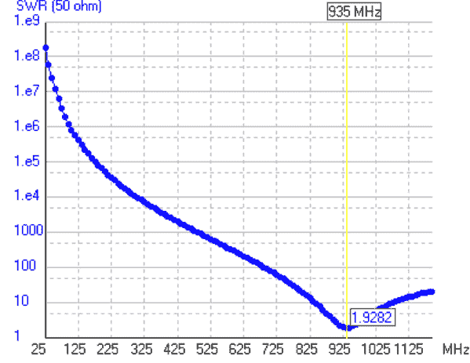

未添加接地平面的原生鞭形天线的 SWR。

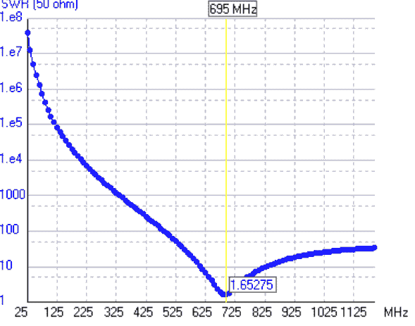

带有 6cm 半径接地平面的原生鞭形天线的 SWR。

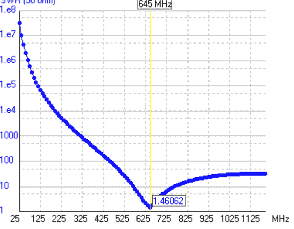

带有 11.5cm 半径接地平面的原生鞭形天线的 SWR。

# ADS-B

为了提高原生天线在 1090 MHz 下 ADS-B 的性能，将鞭长剪至约 6.9 cm，然后使用半径为 6.9 cm 的接地平面。

## 同轴扼极

另一个可以大幅提高性能的改进方法是创建一个共模同轴扼极，这在业余爱好者中也被称为“丑陋巴伦”。扼极本质上会阻止同轴电缆屏蔽层中不需要电流。这有助于消除同轴电缆变成天线的一部分并导致不必要的辐射图畸变的影响。请参见[天线章节]()以获取有关辐射图的更多信息。

要创建一个同轴扼极，你只需要找到直径约 2-3 cm 的圆柱形物体（如马克笔），并在周围缠绕约 5-10 圈电缆。如果你有磁氧环（如夹式磁环），请将其作为绕线中心以获得更好的性能。使用磁氧环，你可以用较少的圈数达到相同的性能，因为在没有磁氧环的情况下需要更多圈数。让绕线尽可能靠近天线底座。下面我们展示了一个使用 USB 磁环的绕线示例图像。

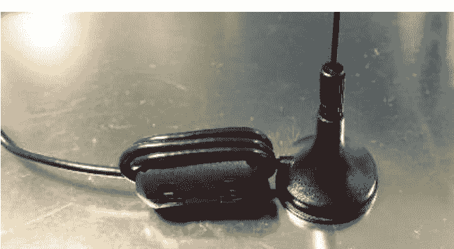

下面我们展示了共模扼极对接收的影响。图像的下半部分是安装了扼极的情况，使用了带有四匝夹式磁环。上半部分显示未安装扼极的接收情况。如所示，底噪显著降低。

# 更换原生天线同轴电缆

许多 RTL-SDR 用户表示原生天线上的同轴电缆很差，但实际上对于 VHF 频率来说并不那么糟糕，因为它们只有 1 米长。大多数单元使用的同轴电缆是一种低质量的 RG174，编织层非常薄。我们测量了 1 米原生天线电缆的插入损耗，发现 0-600 MHz 之间的损耗约为 0.5dB - 2dB，700 到 900 MHz 之间约为 3dB。在 1 GHz 及以上，损耗显著增加，变为约 6dB - 8dB。下面我们展示了去掉了外护的原生天线同轴电缆特写。请注意，有些原生天线附带的线差得多，只是细线的绞线，这些线通常使用 PAL 接口而不是 MCX 接口，在高频下的损耗明显更高。


去掉外皮后的原生天线同轴电缆。更换为更好的同轴电缆可以提高性能。


```
user@ubuntu:~/kalibrate-rtl kal v -s GSM900 -g 50 -e 50
user@ubuntu:~kalibrate-rtl:
Found 1 device(s):
 0: Generic RTL2832U OEM

Using Device 0: Generic RTL2832U OEM
Found Rafael Micro R820T tuner
Exact sample rate: 27883.002142 Hz
Setting gain: 50.0 dB
kal: Scanning for GSM-900 base stations.
channel threshold: 864083.467083
GSM-900:
chan 3: (93.095MHz + 5.490kHz) power: 1637068.57
chan 14: (93.097MHz + 5.240kHz) power: 1687765.05
chan 17: (93.097MHz + 5.434kHz) power: 1303647.82
chan 52: (94.065MHz + 5.165kHz) power: 3639111.56
chan 53: (94.065MHz + 6.780kHz) power: 1629257.14
chan 62: (94.067MHz + 5.565kHz) power: 2438527.63
chan 63: (94.067MHz + 6.061kHz) power: 1573741.34
user@ubuntu:~/kalibrate-rtl kal c 17 -e 50
Found 1 device(s):
 0: Generic RTL2832U OEM

Using Device 0: Generic RTL2832U OEM
Found Rafael Micro R820T tuner
Exact sample rate: 27883.002142 Hz
kal: Calculating clock frequency.
GSM-900
man 17 (93.04MHz)
average (min, max) (range, stddev)
+ 5.067kHz [5048, 5085] (36, 9.602301)
overruns: 0
not found: 0
average absolute error: 44.600 ppm
user@ubuntu:~/kalibrate-rtl |
```

# LTE 扫描器

Kalibrate 的一种替代方案是 LTE Scanner，它使用移动 LTE 基站信号来获取 PPM 修正值，而不是 GSM 信号。你需要在所在地区有 LTE 信号并知道它们的大致频率。可以使用以下命令安装 LTE Scanner：

```
sudo apt-get install boost-all-dev
sudo apt-get install libittpp-dev
sudo apt-get install libftw3
git clone https://github.com/Evryania/LTE-Cell-Scanner
cd LTE-Cell-Scanner
mkdir build
cd build
cmake ..
make
sudo make install
```

注意，如果你在运行 `cmake` 时遇到关于 FFTW 的错误，且正在使用的是 32 位 Linux 操作系统，你需要跳转到 `LTE-Cell-Scanner/cmake/Modules` 并使用文本编辑器编辑 `FindFFTW.cmake`。在 `FIND_LIBRARY(FFTW_LIBRARY)` 块中，你需要添加文件夹 `/usr/lib/i386-linux-gnu`。

使用以下命令运行 LTE-Scanner，请将起始和结束频率替换为你所在国家的值：

```
CellSearch --freq-start 749e6 --freq-end 799e6
```

程序将一直运行直到找到 LTE 信号，并返回结果。

# 移除二极管

如果在运行 `cmake` 时遇到关于 FFTW 的错误，且使用的是 32 位 Linux 操作系统，你需要跳转到 `LTE-Cell-Scanner/cmake/Modules` 并使用文本编辑器编辑 `FindFFTW.cmake`。在 `FIND_LIBRARY(FFTW_LIBRARY)` 块中，你需要添加文件夹 `/usr/lib/i386-linux-gnu`。

# 减少 USB 上的噪声

在 USB 之间连接电容可以减少噪声。使用 1uF 电容可以改善频率偏移。

# 稳定频率偏移

带有温度补偿晶振（TCXO）的 SDR 可以更好地稳定频率偏移。

# RTL-SDR 教程

## 音频路由

大多数教程是针对音频输出的。

# 通用频率指南

| 信号 | 频率 (MHz) | 类型 | 说明 |
|---|---|---|---|
| 短波 | 0.535 | AM | |
| 业余无线电 | 1.4 - 4.5 | SSB/Digital | |
| 业余无线电 | 144 - 148 | NFM Voice | 爱好者使用 |
| 空交通管制 | 118 - 137 | NFM Voice | 塔台通信 |
| 空交通管制 | 110 - 129 | NFM Voice | 飞行员 |
| ACARS | 131.550 | Data | 发送消息 |
| ACARS | 136.975 | Data | 发送和接收 |
| VDL2 | 136.975 | Data | 替代 ACARS |
| NOAA/卫星 | 136 - 138 | Digital Data | 传输天气图像 |
| NOAA 天气 | 162.4 | NFM Voice | 天气报告 |
| NOAA 天气 | 159 - 162 | NFM Voice | 用于 |
| 海洋 | 156 - 162 | NFM Voice | 船只使用 |
| 自动识别系统 | 161.917 | Digital Data | 追踪船只 |
| 自动识别系统 | 162.025 | Digital Data | (AIS) |
| 寻呼机 | 157 | NFM Data | 消息系统 |
| 模拟电视 | 174 - 216 | Data | PAL 或 NTSC 电视 |
| 数字音频 | 174 - 239 | DAB | 数字广播 (DAB) |
| 军事通信 | 225 - 380 | Voice/Data | (美国) |
| 通调频率无线电 | ~400 | NFM Voice/Data | 商业对讲机 |
| 气象球 (无线探测器) | ~400 | NFM Data | 气象局发射的气象球 |
| 业余无线 ISM频段 | 420 - 450 | NFM Voice/Data | 免许可低功率段。主要用于天气站/电表等 |
| LTE | ~700 | Digital Data | 手机快速数据 |
| 通调频率无线电 | ~860 | NFM Voice/Data | |
| GSM | 850 | Digital Data | 手机语音和数据 |
| GSM | 900 | | |
| GSM | 1800 | | |
| GSM | 1900 | | |

# ACARS 接收指南

## ACARS 简介

ACARS 是飞机通信地址与报告系统（Aircraft Communications Addressing and Reporting System）的缩写。这是一种商用飞机与地面站收发短信息的数字系统。你在 ACARS 上听到的一些消息包括 OOOI 事件（报告主要飞行阶段变化的消息，如：离开闸门、起飞、落地和进入闸门）、发送到飞机航空设备的数字信息以及发送给飞行员的文本消息。某些 ACARS 消息还包含飞机的 GPS 坐标，但如果你的目标是飞机雷达，那么 ADS-B 飞机雷达部分会更让你感兴趣。每条 ACARS 消息还包含飞机注册号和飞行识别码。

标准 ACARS 在 131.550 MHz 的 VHF 频率传输，但根据你所在的位置，也有其他频率在使用。还有通过 Inmarsat 卫星网络和 HF 高频频段传输的 ACARS 消息，但这些频段没有 VHF 波段那么常用。

通过 RTL-SDR 和一些解码软件，你可以在 PC 上实时接收并显示周围的 ACARS 消息。由于 ACARS 在 VHF 波段传输，接收几乎是视距的。但由于飞机在高空飞行，使用良好的天线，你应该能够接收到远 200 英里高空飞机的消息。由于 ACARS 使用垂直极化信号，我们建议使用伞形天线、共线天线、四分之一波地面天线或 j-pole 天线。请参考本书的天线指南部分获取更多关于这些天线的信息。LNA（低噪声放大器）和带通滤波器可能有帮助，但在接收信号差的情况下并非必须。更多信息请参见 LNA 章节和预选器章节。

为什么要接收 ACARS 呢？除了观察传入的消息，大多数解码软件还会在网上查询收到的飞机注册号，并显示发射飞机的信息和照片。这对于飞机爱好者和任何想看周围空中飞着什么飞机的人来说非常有帮助。

下表显示了一些常见的 ACARS 频率。

| 频率 (MHz) | 地区 / 国家 |
|---|---|
| 131.550 | 全球主频 |
| 129.125 | 美国和加拿大 |
| 130.025 | 美国次要 |
| 130.425 | 美国附加 |
| 130.450 | 美国及附加 |
| 131.125 | 美国附加 |
| 131.450 | 日本/中国主频 |
| 131.475 | 加拿大航空公司 |
| 131.525 | 欧洲次要 |
| 131.725 | 欧洲主频 |
| 136.700 | 美国附加 |
| 136.750 | 美国附加 |
| 136.800 | 美国附加 |
| 136.900 | 欧洲次要 |
| 136.850 | SITA 北美 |
| 136.750 | 欧洲新频 |
| 131.580 | 欧洲新频 |

## ACARS 教程 (Windows)

在本教程的大部分内容，我们将假设你已经在 Windows PC 上安装并运行了 RTL-SDR 适配器。如果没有，请遵循“快速上手安装指南”章节。

- 有四种常用的 ACARS 解码器软件。这些是 `Acarsdeco2`、`PlanePlotter`、`AirNav ACARS 2` 和 `ACARSD`。下面我们介绍了介绍每种软件的教程。目前，我们推荐 `Acarsdeco2` 作为最佳使用软件。

使用 `PlanePlotter`、`AirNav ACARS 2` 和 `ACARSD` 时，你还需要安装一个 Windows 音频管道（audio piping）程序。更多信息请参阅附录 A：音频管道。

首先，我们将尝试在 SDR# 或另一个类似的程序中接收 ACARS 消息，以确认它们是可以接收的。

1. 打开通用的 SDR 程序（如 SDR# 或 SDR-Radio）并调到 ACARS 频率，例如 131.500 MHz。注意，如果你想使用 `PlanePlotter`、`AirNav ACARS 2` 或 `ACARSD` 并想要跟踪多个 ACARS 频率，我们强烈建议使用带有多个 VFO 的 SDR-Radio。

2. 你应该在 RF 频谱和瀑布图中看到一些 ACARS 信号。调整 RF 增益设置，使 ACARS 信号强劲且无频带干扰。

3. 将接收机的调谐带宽调整到 5-10 kHz 左右，使带宽覆盖整个 ACARS 信号。

4. 将接收机模式设置为 `AM`，关闭静噪（squelch）并关闭任何降噪。使用音频 AGC 可能效果不佳，你需要尝试哪些方法有效。如果你打算通过多个 VFO 将多个 ACARS 通道合并到同一音频，最好开启静噪。此时，你应该能看到频谱中出现一些 ACARS 信号。ACARS 信号是突发性的，看起来像下面的瀑布图。如果你将音频输出到扬声器，当接收到 ACARS 数据包时也会听到一种尖叫声（img/33eab9643eb7fbb93c6171004150.png）。

在接下来的章节中，我们将展示如何使用这四个 ACARS 解码器。我们强烈建议使用 `Acarsdeco2`。`Acarsdeco2` 是一款兼容 Windows、Linux、树莓派和 OSX 的命令行多通道 ACARS 解码器，它直接与 RTL-SDR 接口。这意味着不需要音频管道，也不需要 SDR 等程序。在本教程中，我们将展示如何使用 Windows 版本，但 Linux 和树莓派版本的使用非常相似。我们认为 `Acarsdeco2` 可能是目前最好的 ACARS 解码器，因为它具有良好的解码性能，能够同时解码多达 3 个 ACARS 通道，并且配合多个 VFO 时比 SDR 等程序更容易使用。此外，虽然 `Acarsdeco2` 是一个命令行程序，但它有一个 Web 界面可以浏览收到的 ACARS 消息。

1. 首先，使用 SDR 或其他程序发现你的适配器频率偏移（offset）和适用于接收 ACARS 信号的最佳增益设置。调整增益设置，直到接收到强信号 ACARS 信号。记录你的 PPM 偏移和最佳增益，然后关闭 SDR。请参本书的 PPM 偏移章节。确定最佳增益和准确的 PPM 偏移对于 `Acarsdeco2` 的运行至关重要。

2. 接下来，下载最新版本的 Windows Acarsdeco2 http://forum.planefinder.net/threads/acarsdeco2-up-to-3-channels-acars-sdr-receiver-。在 rtl2832-dongle/157/ 中解压文件。

3. 现在，通过开始菜单搜索 "cmd" 并打开命令提示符。

4. 进入你解压 Acarsdeco2 文件的文件夹。例如，如果你将文件存储在 F:\acarsdeco2，输入：

```
cd acarsdeco2
```

5. 现在输入以下命令启动软件：

```
acarsdeco2.exe --gain 38.0 --freq-correction 65 --freq 1315500 --freq 1317250 --http-port 8090 --vrs-url http://192.168.1.10:80 --udp 127.0.0.1:9742 --net
```

6. 根据你的实际情况设置参数值（双横杠后面的单词）。最后三个参数（`--vrs-url`、`--udp` 和 `--net`）除非你想使用下方参数中解释的功能，否则可以省略。

- `--gain` - 你在步骤 1 中找到的最佳增益设置
- `--freq-correction` - 适配器的 PPM 偏移（非常重要，必须准确设置）
- `--freq` - 你可以通过指定多个 `--freq` 参数添加多达 3 个 ACARS 频率
- `--http-port` - 用于 `Acarsdeco2` Web 界面的 HTTP 端口
- `--vrs-url` - 如果你同时运行带有 ADS-B 解密的 Virtual Radar Server，可以让飞机图片显示在 `Acarsdeco2` Web 界面（如果不使用 Virtual Radar Server 则不需要）
- `--udp` - 设置传输 `Acarsdeco2` 数据到 `PlanePlotter` 的 UDP 端口（如果不使用 `PlanePlotter` 则不需要）
- `--net` - 设置传输 `Acarsdeco2` 数据到 SBS BaseStation 的 TCP 端口如果不使用 BaseStation 则不需要）

7. 现在当 `acarsdeco2` 运行时，打开浏览器访问 http://127.0.0.1:8090，你应该能看到实时收到的 ACARS 消息。

8. 如果你想与 `PlanePlotter` 对接，可以进入 `PlanePlotter` 的 Options->I/O settings，取消勾选“Acars reception from audio input”，选择来自网的 UDP/IP 数据，确保端口设置为 9742。现在当你启动 `PlanePlotter` 时，它将从 `Acarsdeco2` 获取数据。

要在 `Acarsdeco2` Web 界面显示真实的飞机图片，你必须运行 Virtual Radar Server，并使用另一个 RTL-SDR 适配器接收相同的飞机以及 ADS-B 数据。

# acarsdeco2

131.480 131.580

```
ID: 50 Freq: 131.550MHz
Mode: 2 (S01), Label: _
Block 3 (I51), Reg No: B107A
aircraft B4513, Flight ID: MB779
Type: Airbus A330, c1262, Carrier: CES
Airline: China East
```

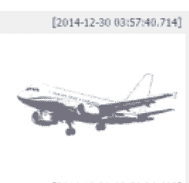

[2014-12-30 03:57:40.714]

```
ID: 48 Freq: 131.450MHz
Mode: 2 (S01), Label: _
Block 3 (I51), Reg No: N107A
aircraft mg: MCEL, Flight ID: NZ27831
Version: 2.1, Reg No: 8776-319 (B763), c29913, Carrier: NZ, Air New Zealand
Airline: Air New Zealand
```

[2014-12-30 03:56:56.608]

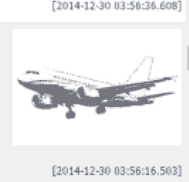

[2014-12-30 03:56:58.503]


# ACARS 解码软件

## 示例数据

```
ID: 42 Freq: 131.450MHz
Mode: 2 (S01), Label: C1 (input message to the cockpit)
Block 3 (I51), Reg No: N107A
aircraft mg: MCEL
Version: 2.1, Reg No: 8776-319 (B763), c29913, Carrier: NZ, Air New Zealand
Airline: Air New Zealand
```

```
Administrator: acarsdeco2-system-v2-acarsdeco2-main-168-freq-connection-ti-c1 (u)
Block 3 (I51), Reg No: met, SYS
Mode: 2 (S01), Label: (orange Arrival report)
aircraft B4513, Flight ID: MB779
Type: Airbus A330, c1262, Carrier: CES
New New Zealand\Air New Zealand
Message content:
```

[2014-12-30 03:57:56.944]

```
ID: 50, Freq: 131.550MHz
Mode: 2 (S01), Label: _
Block 3 (I51), Reg No: B107A
aircraft B4513, Flight ID: MB779
Type: Airbus A330, c1262, Carrier: CES
Airline: China East
```

Message

```
0 299.10T $ 36.219,117.489,141.55,35.600,141.55 H00
```

[2014-12-30 03:58:05.63]

```
GUID:62915
SONN
CLK: 123
TEMPERATURE: 23
DEG: 169
QNH: 1019
SIGNATIONS SUITABLE FOR A VISUAL
APPROACH
```

## PlanePlotter

第一个是 **PlanePlotter**，这是一个售价 25 欧元的付费软件包。不过，它也有 21 天的免费试用版。PlanePlotter 的另一个优势是它可以在后续项目中用于 ADS-B 绘图。要使用 PlanePlotter 处理 ACARS，请遵循以下说明。

1. 从 `http://www.coaa.co.uk/planeplotter.hm` 下载并安装 PlanePlotter。
2. 在你的 SDR 接收器（如 SDR#）中，设置你希望作为音频输出的音频管道。
3. 打开 PlanePlotter。点击“I/O Settings”（输入/输出设置）按钮。
4. 确保勾选了“ACARS reception from audio input”（从音频输入接收 ACARS）。点击 OK。

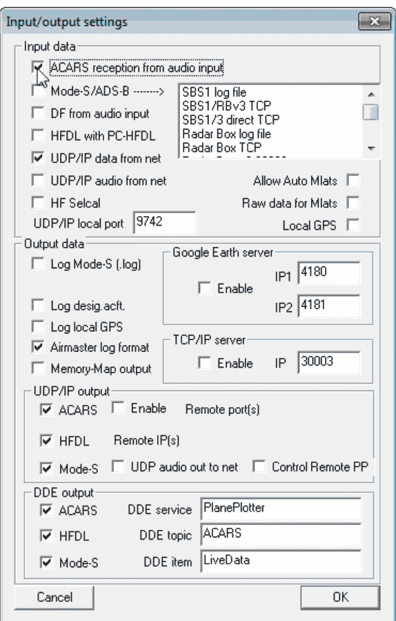

5. 转到 `Options->Audio->ACARS`，选择你在 SDR 接收器中使用的音频管道。
6. 点击“Start”（开始）图标 ●。
7. 点击“Signal”（信号）图标。这会显示信号音量的图表。确保信号不要过大。如果接收到 ACARS 数据包时图表开始裁剪/饱和，你就知道音量太大了（如果饱和，信号看起来会像方方形）。

以下是理想空闲音量的示例。

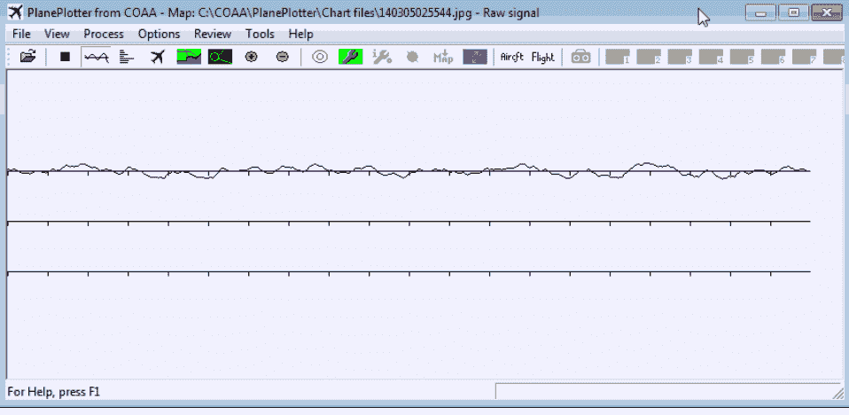

以下是 ACARS 数据包响时理想音量的示例。

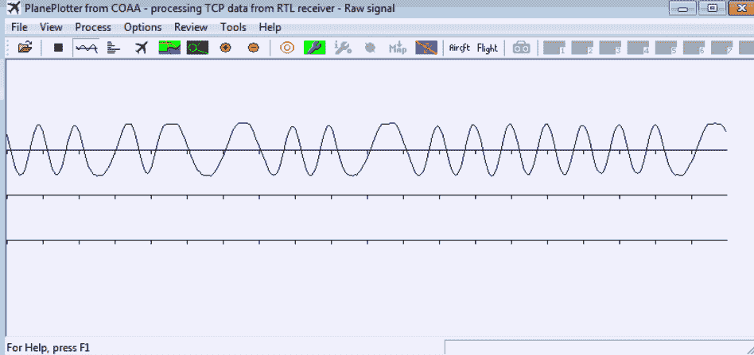

这里是一个 ACARS 数据包音量设置过大的示例。

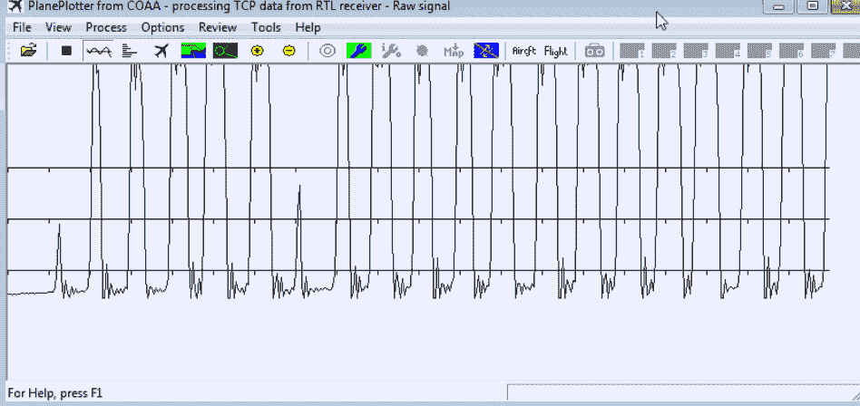

此时，PlanePlotter 应该能够成功解码 ACARS 消息。右键点击 Aircraft（飞机）窗口中的条目将打开带有该飞机信息的浏览器。

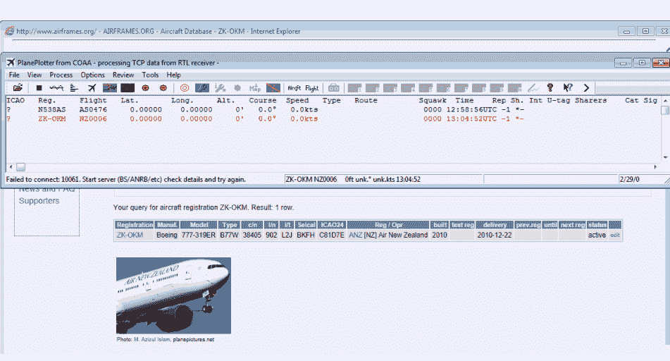

| ID | Flight | Lat | Long | Alt | Course | Type | Time Sh. | Int | Sig |
|---|---|---|---|---|---|---|---|---|---|
| B535 | A276 | 0.0000 | 0.0000 | 0 | 0 | 0.5k | 0000 12:54C | -1 | |
| ZK-XM | | 0.0000 | 0.0000 | 0 | 0 | 0.5k | 0000 13:52C | -1 | |

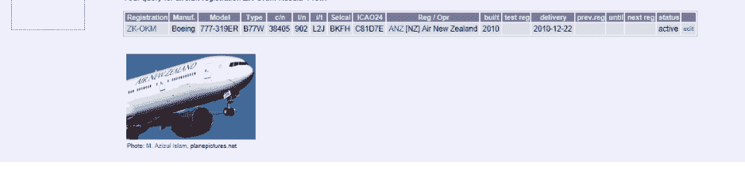

## AirNav ACARS

另一个商用 ACARS 解码器是 AirNav 的，称为 **AirNav ACARS decoder 2**。该产品带有 30 天试用，但每月费用为 39.95 美元，这使其成为昂贵的选项。它可以在 `http://www.airnavsystems.com/ACARS/` 获取。该解码器的优势是设置非常简单，且解码能力与 PlanePlotter 相当。使用 AirNav ACARS 仅需：

1. 下载并安装 AirNav ACARS Decoder 2 程序。
2. 确保在 Windows 录制属性中正确设置了默认音频设备。Acarsd 将使用找到的第一个音频设备。
3. 在 SDR 接收器中设置你想要作为音频输出的音频管道。
4. 打开程序。AirNav 将选择默认音频设备。
5. 调整 SDR 接收器中的音量，使右下角的音量计在听到 ACARS 数据包时不会进入红色。

## Acarsd

另一个解码 ACARS 信号的程序是 **Acarsd**。Acarsd 的优势是完全免费并且支持 Linux。Acarsd 可以从 `www.acarsd.com` 下载。我们发现 Acarsd 的性能不如付费选项，但某些用户反映 Acarsd 效果同样良好。当音频管道设备的采样率设置为 44kHz 时，Acarsd 效果最佳。关于如何更改此设置请查看采样率部分。

1. 访问 acarsd 网站下载并安装 acarsd。务必按照网站上的说明进行安装。
2. 确保在 Windows 录制属性中正确设置了默认音频设备。Acarsd 将使用找到的第一个音频设备。还要确保播放和录制采样率设置为相同的 44100 Hz。
3. 在 acarsd 文件夹中运行 `setup.exe`。
4. 在 `Configuration / Installation` 下启用 44 kHz 选项。

### acars Configuration tool

| Configuration / Installation | Databases |
|---|---|
| | >> SOUND SETTINGS << |
| 如果你的声卡不支持 19520Hz，则你应该激活 22kHz 选项。 | Sample22kHz: [ ] |
| 如果你的声卡不支持 19520Hz 和 22050Hz，你应该激活 44kHz 选项。 | Sample44kHz: [ ] |
| acars 最多可以处理 4 个声卡。若要启用它们，请用逗号分隔设备标识符。例如，在 Linux 下使用 0,1,2或3。如果你只安装了一个声卡，Windows 下它使用第一个可用声卡，Linux 下它使用默认声卡。如果你想在 PC 中使用多个扫描器或多个声卡？没问题，你可以启用此功能，通过定义声卡线路输入上扫描的通道来解码单声卡。使用此选项，你可以在 4 个声卡上连接 8 个扫描器！使用单个字母或数字，除非更改数据库中的定义。 | |

解码器通过次数可以在 `Windows->acarsdui` 设置中更改。增加此值可能会提高解码性能。

```
acars 1.30RC3-(CL-2007-2007) 由 KyM acars@acarsd.org
```

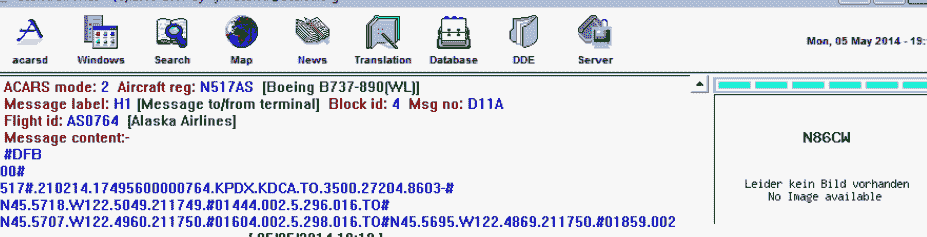

```
ACARS 模式: 2. 飞机注册: N517AS (波音 737-8909WL)
消息标签: H1 (离终端消息) Id: 6 消息号: D11A
航班: AS0764 [阿拉加航空]
消息内容:
#0DF8
5172.291014175468000/S4.PKD.DCA.KO.3550.2772.2264.B83#
N5178.7712.5549.2117/A444.444.052.296.0170
N4507.7712.9462.2170/A5108.2002.1045.5695.WL.122.4069.11.21750.01859.002
首次接触此架飞机
```

```
ACARS 模式: 2. 飞机注册: N517AS (波音 737-8909WL)
消息标签: H1 (离终端消息) Id: 6 消息号: D11A
航班: AS0764 [阿拉加航空]
路线: [波特兰,国际,美国,华盛顿,国家,雷根,美国]
消息内容:
#0DF8
5172.2910141751570080/S4.PKD.DCA.KO.3670.2335.863#
N4567.7712.5511.2173/A473.2175/A6223.031.02.017.C.L#
N4563.7712.5023.1905.08-0022.7259.0114.N4553.5663.WL.122.4091.11.21750.04049-02
航班数据: 2015-05-19T20:15:26Z.ppr 4:18
与此架飞机接触。首次接触:05/2015 19:14:19
```

```
ACARS 模式: 2. 飞机注册: N578AS
消息标签: H1 (离终端消息) Id: 1 消息号: F26A
航班: AS0407 [阿拉加航空]
消息内容:
#A11PO4563B31W122540.VANTZ.1725J21.WL2175J3400/WR180LP,RP290108,175,172,175,17K
13,7634
北: 45.381008 经: 122.540000
首次接触此架飞机: 05/2015 19:14:19
```

```
05 May 2014 19:18:18 ACARS 'N578AS' was added to your database
05 May 2014 19:18:18 Fetching information for 'AS0407' from db.acars.org
05 May 2014 19:19:05 Fetching information for 'N578AS' from db.acars.org [In Queue 1]
05 May 2014 19:19:20 Fetching information for 'AS0407' in Queue 1
05 May 2014 19:19:23 Fetching information for 'N578AS' from db.acars.org
---------------------------------------------------------------------------------
[D] User: D.Party.S. Src: 1. Cmd: CMD | CMD: [4-2 Queues] NO-SERVER-EDR
```

## 仅限 Linux 系统

Linux 有多种基于开源的 ACARS 解码器。最好的两个是 **rtl_ng** 和 **acars**。与 Windows 解决方案相比，它们具有显著优势，因为可以直接连接到 RTL-SDR 而不需要任何音频过滤，就可以同时监听并解码多个 ACARS 通道。acarsdec 的功能更丰富，但由于两个程序都基于相同的代码库，性能相似。

这些程序非常适合在树莓派等嵌入式设备上运行。

## acarsdec

运行 acarsdec，请从 `http://sourceforge.net/projects/acarsdec` 下载并解压 tar 包，或者在 Linux 终端使用以下命令：

```bash
wget http://sourceforge.net/projects/acarsdec/files/latest/download -O acarsdec.tar.gz
tar -zxvf acarsdec.gz
```

如果尚未安装，请安装以下依赖以及 librtlsdr 库，并使用 `make` 编译程序。

```bash
sudo apt-get install libsndfile-dev
sudo apt-get install libound
sudo apt-get install sqlite3 libsqlite-dev
cd acarsdec-3.0
make
```

在 RTL-SDR 上运行程序，使用以下命令：`-p` 指定你的接收器的 PPM 偏移，`-r` 如果你连接了多个 RTL-SDR 指定设备编号，后面跟随你要监控的 ACARS 频率。注意由于 ACARS 信号是窄带的，正确获取 PPM 偏移非常重要。查看 `./acarsdec -h` 获取选项列表。

```bash
./acarsdec -p 24 -r 0 131.550 131.450
```

你还可以通过网络连接将 acarsdec 的输出发送到运行 PlanePlotter 的 PC。首先找到运行 PlanePlotter 的 PC 的 IP 地址。然后在 Linux 设备上使用以下命令，将 `IP_ADDR` 替换为运行 PlanePlotter 的电脑 IP 地址。

```bash
./acarsdec -n IP_ADDR -r 0 131.550 131.350
```

接下来在 Windows 的 PlanePlotter 中，确保在 `Options->I/O Settings` 下勾选了“UDP/IP data from net”，然后点击绿色按钮。当 Linux 计算机接收到 ACARS 包时，acarsdec 也会显示在 PlanePlotter 中。通过这种方法，你可以让树莓派等远程 PC 为 PlanePlotter 提供数据。

## rtl_acars_ng

**rtlacars_ng** 是一个简单的 ACARS 命令行解码器。运行 rtlacars_ng 只需从 `https://github.com/gat3way/rtlacars_ng` 下载文件，解压然后运行 `make`。运行 `rtlacars_ng -h` 获取帮助。

```bash
sudo apt-get install libusb-dev
git clone https://github.com/gat3way/rtlacars_ng
cd rtlacars_ng
make
```

然后你可以使用以下命令运行程序。

```bash
./rtlacars_ng -f 131.550
```

# ADS-B 接收指南（飞机追踪）

## ADS-B 简介

现代飞机上载有被称为自动相关监视广播（ADS-B）Mode S 应答器。这种应答器定期向空中交通管制员和其他飞机广播位置和高度信息。该系统的建立是为了取代传统的雷达系统，雷达系统通过向飞机发射无线信号并监听回声来工作。传统的雷达并不总是可靠，因此发明了 ADS-B。ADS-B 使用精确的机载 GPS 接收器通过无线电将 GPS 位置数据广播给地面控制器和其他飞机，提供更准确、稳定的数据。ADS-B 还用于帮助飞机避免碰撞，如果飞行计算机从 ADS-B 数据中检测到可能发生碰撞，会发送警告或采取自动应急措施。

目前，ADS-B 数据完全没有加密，因此 RTL-SDR 监听这些信号，从而创建自己的家庭飞机雷达系统。与 200 美元到 1000 美元的专用 ADS-B 接收器相比，20 美元的 RTL-SDR 在价格上对爱好者来说非常有吸引力。RTL-SDR 的 ADS-B 接收性能也相当不错。但请注意，出于安全考虑，可能不依赖 RTL-SDR 进行真实飞机的 ADS-B 导航。此外，如果你使用具有发射功能的 SDR，请绝不要在 ADS-B 频率上发射，这可能会导致严重后果。ADS-B 信号可以在 1090 MHz 频率找到。

如上一节所示。除外，你还需要以下设备：

- 一根调优至 1090 MHz 的垂直极化天线。
- 用于接收和解码 ADS-B 的软件。
- 用于显示 ADS-B 位置数据的软件。

## ADS-B 接收指南

配备一个良好的天线，RTL-SDR 能够接收来自 250 nm 外的飞机 ADS-B 信号，这相当于 460 公里或 290 英里外。

许多人发现，在大多数情况下，适配器附带的自带天线已经足够接收 ADS-B 信号。其性能取决于你与飞机的距离以及当地的射频（RF）干扰情况。要改进自带天线，你可以将鞭线裁剪到 6.9 厘米，并将其放置在金属地平面上。然而，如果你真的想增加 ADS-B 的接收范围，你需要一根放置在高处且调优良好的天线。当然，你可以购买商用的 ADS-B 天线，但为了保持 RTL-SDR 低廉的价格优势，最佳选择是自己动手。

ADS-B 在 1090 MHz 频率下以垂直极化运行，这是一种视距频率，意味着天线与飞机上的发射器之间需要清晰且无障碍的路径。由于 ADS-B 信号通常很强且来自高空的飞机，接收非常容易，大多数用于 1090MHz 的垂直极化天线都能良好工作。使用调优不佳或制作不良的天线会导致你的空中雷达范围不足。

对于 ADS-B，我们建议使用四分之一波地平面天线、J极（j-pole）、垂直偶极子或同轴天线。伞形天线（discone）效果也还可以，但专用调优天线是最好的。参见《天线指南》获取更多关于这些天线的信息。

你还应该确保你的同轴馈线（天线和适配器之间的同轴电缆长度）是高质量的且尽可能短。吉赫兹频率下的廉价同轴线会导致显著降低信号强度。使用适用于卫星电视安装的同轴电缆，如 RG-6 或 RG-8，因为这些电缆旨在吉赫兹频率下良好工作。参见《同轴电缆指南》获取更多信息。


此外，确保你在同轴电缆上使用的是可以处理吉赫兹频率的连接器。参见天线部分的《天线适配器指南》获取连接器信息。我们推荐使用 `BNC` 或 `SMA` 连接器。在吉赫兹频率下的劣质连接器每个接口可能会导致 `1-3 dB` 的损耗。

在天线处使用低噪声放大器（`LNA`），如 `LNA4ALL` 有助于补偿损失，特别是当你有一个很长的馈线时。参见 `LNA` 部分获取更多信息。使用有源 `USB` 扩展线并将适配器放置在天线处可能是更好的考虑方案。有些人会在天线处放置运行 `RTL-SDR` 的树莓派等小型嵌入式电脑，然后使用 `WiFi` 或以太网将解码后的 `ADS-B` 数据发送到电脑。

如果你附近有强大的广播站，或其他干扰源，我们建议使用 `1090 MHz` 预选带通滤波器。你可以从 `94QV` 购买廉价的 `ADS-B` 带通滤波器：http://www.adsbfilter.blogspot.com。另一个常用且易于制作的方案是 `PCB` 板上的发夹滤波器（`hairpin filter`）：http://www.rtl-sdr.com/homemade-ads-b-filter/。使用 `1090 MHz SAW` 滤波器组件也很容易，你可以在 `Ebay` 上以约 `10` 美元的价格便宜购买。

http://www.ebay.com/itm/B1602-SAW-filters-Epcos-1090MHz-ADS-B-AirNav-SBS/-1106017914。这些组件很小，需要良好的焊接技巧。参见 https://steve-m.de/pics/ads-b_saw_filter.jpg 查看一个接线示例。为了获得更完整的解决方案，我们推荐 `HABAMP`，它带有 `SAW` 滤波器并内置在精美的金属盒中。`HABAMP` 可见：http://ava.upuat.net/route=product&product_id=85。

`SAW` 带通滤波器可能有很高的插入损耗。在许多情况下，一个简单的高通滤波器就足够了，因为它们的损耗低得多。一个从 `1 GHz` 开始的高通滤波器在大多数情况下都是足够的，并且可以屏蔽广播干扰，但它无法屏蔽手机信号，这在你的地区可能是一个问题。类似 `Minicircuits` 的 `SHP-1000` 滤波器效果良好。参见预选器部分获取更多信息。

在视频 https://www.youtube.com/watch?v=wcr-PX662gO 中，上传者注意到在使用 `1090 MHz` 预选器后，帧率从 `800` 帧增加到 `1200` 帧。

一个屏蔽 `1 GHz` 以下频率的高通滤波器也可以作为带通滤波器的替代方案。反正大多数干扰都来自 `1 GHz` 以下。

# 软件指南

目前，有多种软件可以使用 `RTL-SDR` 接收和解码 `ADS-B` 信号。几乎所有软件都是免费的。对于 `Windows` 软件，你需要通过 `zadig` 安装 `RTL-SDR` 驱动。如果你还没有这样做，请参考快速上手指南。

常用的 `ADS-B` 解码器[原文缺失或不完整]。

# ADBS# (Windows)

另一种带有图形界面的 `Windows` `1090 MHz ADS-B` 解码器是 `ADBS#`，可以从 www.sdrsharp.com 下载。安装 `ADBS#` 的简单方法是使用 `IMU`（安装和维护实用），它会自动下载所有所需文件。`IMU` 节省了手动拷贝多个 `dll` 文件的麻烦，甚至还会引导你通过 `zadig` 安装驱动。注意，如果你已经通过快速上手指南通过 `zadig` 安装了驱动，则可以忽略 `IMU` 中的 `zadig` 安装。目前，`ADBS#` 有一个新的 `Beta` 版也可以从他们的网站下载。在本教程中使用的是 `Beta` 版，但也可以使用标准版。

点击 `RTL1090` 窗口左上角的 `OPEN` 按钮进入选项屏幕。`RTL1090` 具有一些特殊功能。它可以解码 `MODE A/C` 以及 `MODE S`。`Mode A` 发送飞机识别码，`Mode C` 发送飞机高度，`Mode S` 是最有用的，因为它带有位置信息。通过将选项屏幕中的开关切换到 `Mode AC` 一侧可以激活 `Mode AC` 解码。`RTL1090` 还内置了一个频谱查看器，可以通过切换 `SISEX` 开关激活，这对于验证是否接收到 `ADS-B` 信号很有用。最后，`RTL1090` 还有一个 `1` 位校验和错误检查器，可以在 `Config` 菜单中激活，该菜单通过切换选项屏幕中的 `Config` 开关打开。默认禁用错误检查，因为它对配置较慢的电脑可能会产生负担。`RTL1090` 最近的 `beta 3` 版本还带有一个内置的可图形雷达显示。

与 `ADSB#` 一样，我们建议尝试手动增益设置，或者在勾选 `Tuner AGC` 并取消 `RTL AGC` 的情况下运行。不启用 `AGC` 时的最大增益通常是最佳选择。

`RTL1090` 的作者还提供名为 `RTL-DUO` 的实验版本，它利用两个 `RTL-SDR` 适配器来提高接收。也可以从 http://rtl1090.web99.de 下载。

## DUMP1090 (LINUX/MAC/WINDOWS)

这是一个兼容 `Linux/OSX/Windows` 的命令行 `ADS-B` 解码器。对于树莓派等 `Linux` 嵌入式设备非常有用。通过 `dump1090`，你可以设置一个向 `Web` 服务器传输数据的树莓派解码器。大多数人报告，`dump1090` 是所有 `ADS-B` 解码器中解码性能最好的。

`dump1090` 最新的分支由 `Malcolm Robb` 维护，可以从其 `git` 仓库 https://github.com/MalcolmRobb/dump1090 下载。

`dump1090` 还有一个集纽模式（`hub mode`），允许不同物理位置的多个 `dump1090` 实例连接并合并数据流。如果你没有兴趣将数据公开共享（例如通过 `adsub` 或 `flightradar24`），这可能是一个选项。

`dump1090` 还有一个图形化显示 `Web` 界面，使用了代码内置的 `Google` 地图。可以通过 `Web` 浏览器访问。

在 `Linux` 上安装 `dump1090`，假设你已经安装了 `libllsdr` 库，使用以下命令：

```
git clone https://github.com/MalcolmRobb/dump1090
cd dump1090
make
```

`dump1090` 也可以在 `OSX` 上编译，但你需要确保已安装编译器和 `make` 工具，并拥有开发环境和 `Xcode` 的访问权限。编译完成后，你可以运行：

```
/dump1090 --interactive --net
```

这将启动一个显示所有接收到的飞机的屏幕，以及一个可以视觉显示飞机的 `Google Maps Web` 服务器。要查看地图，请在浏览器中访问 http://localhost:8080，或者如果你想从另一台电脑访问，请使用 http://IP_ADDR:8080，其中 `IP_ADDR` 是运行 `dump1090` 的电脑的 `IP` 地址。

你可能还希望启用 `--aggressive` 和 `--fix` 标志，这能够在增加 `CPU` 使用的代价下解码更多的 `ADS-B` 数据包。`aggressive` 模式启用激进纠错，主要对低空流量区域很有用，因为在高流量条件下可能会导致许多假阳性。`fix` 选项启用 `1` 位纠错。可以在终端中输入 `./dump1090 -h` 找到更多选项。注意，如果没有设置增益，`dump1090` 会自动选择最大增益设置，这通常是最佳选择。

`dump1090` 还可以通过 `--modeac` 标志接收 `Mode AC` 消息。

若要配合 `Virtual Radar Server`（下文描述）等程序使用 `dump1090`，你可以如下将其设置为在端口 `30002` 上以 `Beast` 格式输出数据：

```
dump1090.exe --interactive --net --net-ro-port 30002 --beast --mlat
```

在 `Windows` 上安装 `dump1090` 请遵循以下 `Github` 下载链接：

1. 从 `Github` 下载链接 https://github.com/MalcolmRobb/dump1090 下载 `dump1090` 的 `zip` 包。

2. 从 http://sdrosmoc.com/trac/attachment/wiki/rtl-sdr/RelWithDebInfo.zip 下载官方 `RTL-SDR Windows` 发布版。

3. 将官方 `RTL-SDR Windows` 发布 `zip` 包中的 `libusb-1.0.dll`、`rtlsdr.dll` 和 `pthreadVC2-w32.dll` 文件复制到 `dump1090` 文件夹。

4. 将 `pthreadVC2-w32.dll` 重命名为 `pthreadVC2.dll`。

5. 双击 `dump1090.bat`。

`dump1090 Windows` 批处理文件包含 `dump1090.exe --interactive --net --net-ro-port 30002 --beast --mlat`，它会启动交互式 `Web` 服务器和 `beast` 模式输出，允许像 `Virtual Radar Server`（下文描述）这样的程序通过端口 `30002` 连接到它。你也可以尝试使用记事本等文本编辑器编辑批文件，以实验 `--aggressive` 和/或 `--fix` 标志。

| Hex | Flight | Altitude | Speed | Lat | Track | Messages | Seen |
|---|---|---|---|---|---|---|---|
| a57bb | 11000 | 0 | 0.000 | 0.000 | 0 | 34 | 1 sec |
| ada521 | 9825 | 283 | 0.000 | 0.000 | 275 | 81 | 9 sec |
| a77a4f HAL15 | 36000 | 279 | 34.199 | -119.240 | 6 | 14 sec |
| a9bb70 | 28625 | 0 | 0.000 | 0.000 | 0 | 37 | 3 sec |
| a8bcf0 | 0 | 0 | 0.000 | 0.000 | 0 | 43 | 2 sec |
| a8c455 | 0 | 0 | 0.000 | 0.000 | 0 | | |
| a7f7bd | 6825 | 0 | 0.000 | 0.000 | 0 | | |
| a8b939 | 0 | 0 | 0.000 | 0.000 | 0 | | |
| aa4199 | 0 | 0 | 0.000 | 0.000 | 0 | | |
| a4c2e41 | 7300 | 254 | 34.012 | -118.444 | 83 | | |
| 7b1c8a | 9825 | 273 | 34.030 | -118.647 | 95 | | |
| a3dbe7 | 5425 | 0 | 0.000 | 0.000 | 01 | | |
| a37a9f | 0 | 0 | 0.000 | 0.000 | 0 | | |
| a09216 | 36000 | 0 | 0.000 | 0.000 | 0 | | |

`Modesmixer` 与其他解码器的不同之处在于它实际上并不是一个解码器。相反，它是一个命令行工具，可用于合并多个解码器的输出并输出单个合并后的流。如果你有多台计算机运行 `ADS-B` 解码软件并希望合并结果，这就会非常有用。可以从这个[论坛帖子](http://radarspotting.com/forum/index.php/topic,2978.msg15240.html#msg15240) 下载 `Modesmixer`。`Modesmixer` 可以混合来自多个 `ADS-B` 解码器的数据，例如来自 `dump1090`、`RTL1090` 和 `ADS-B` 的数据。

例如，要合并两个数据源（一个来自网络上的远程 `PC`，另一个来自本地 `PC`），你需要指定 `ADS-B` 数据源的两个 `IP` 地址，并指定你想要使用的输出数据格式。见下文示例。可以在命令行中使用 `modesmixer2 -h` 查看 `Modesmixer` 可用的完整参数和输出格式列表。如果你想像 `modesdeco2` 一样使用 `Web` 界面，还可以提供 `--web` 标志。

```
modesmixer2 --inConnect 192.168.1.127:30005 --inConnect 127.0.0.1:30005 --outserver beast:31001 --web 8088
```

## DUMP978

`dump978` 与 `dump1090` 相同，不同在于它不是解码 `1090 MHz` 的 `ADS-B`，而是解码 `978 MHz` 类似的 `UAT` 协议。`UAT` 在美国常用于小型飞机，因为认为其运行成本更低且更有用。`dump978` 目前处于实验性 `Beta` 版本阶段，因此性能可能并不完美。可以从 https://github.com/mutability/dump978 下载。

## Windows 版图形化雷达显示软件

上述的大多数解码器会将解码后的 `ADS-B` 数据通过本地（或根据需要通过公共）网络连接发送。目前有几种软件选项可以接收并显示这些网络数据。这里我们展示了四种最流行的软件，其中三个是免费的，一种是付费的并提供试用选项。要使用这些程序，你需要在同时运行 `ADS-B` 解码器。

## 虚拟雷达服务器 (WINDOWS)

`Virtual Radar Server` (`VRS`) 是一个基于 `Windows` 和 `Linux Mono` 的免费程序，它使用 `Google Maps` 在网页浏览器中显示飞机位置。如果需要，可以通过互联网与其他共享地图。可以从 http://www.virtualradarserver.com/ 下载 `Virtual Radar Server`。

如果你想查看其他公共 `Virtual Radar Server`，可以使用字符串 `inurl:VirtualRadar/GoogleMap.htm` `Google` 查找许多公共 `Virtual Radar Server`。

1. 首先从其网站下载并安装 `VRS`。然后从开始菜单打开 `VRS`。

2. 进入 `Tools`（工具）-> `Options`（选项）。

3. 点击 `Receivers`（接收器），然后 `New`（新建）。将显示此接收器的属性。

4. 在 `General Settings`（常规设置）下将你的接收器命名为 `RTL-SDR`。

5. 将数据源更改为 `"AVR or Beast Raw Feed"`。

6. 保持 `IP` 地址为 `127.0.0.1`（除非使用远程服务器），但如果使用 `ADSB#`，将端口号更改为 `47806`；如果使用 `RTL1090`，则更改为 `31001`。（或者在 `ADSB#` 中将端口设置为自定义值）。下图显示了使用 `RTL1090` 时应使用的设置。

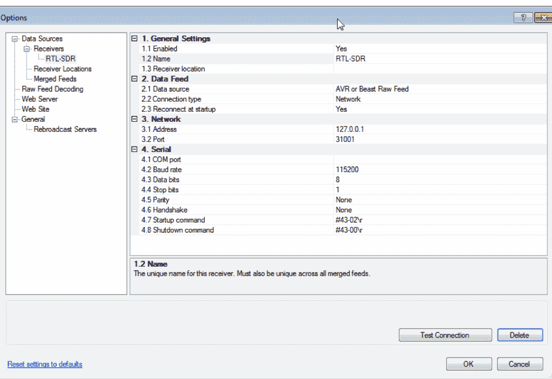

7. 点击 `Receivers`，并将 `"Web site receiver"`（网站接收器）、`"Closest aircraft receiver"`（最近飞机接收器）和 `"Flight Simulator X receiver"`（飞行模拟器 X 接收器）设置为你刚刚创建的 `RTL-SDR` 接收器。点击 `OK`。

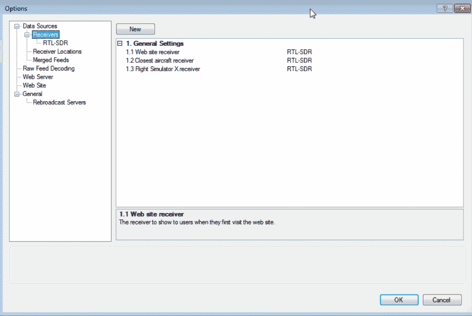

8. 现在点击 `VRS` 主窗口中间右的 http://127.0.0.1:1025/VirtualRadar 链接，将进入加载了特殊 `VRS Google` 地图的网页。

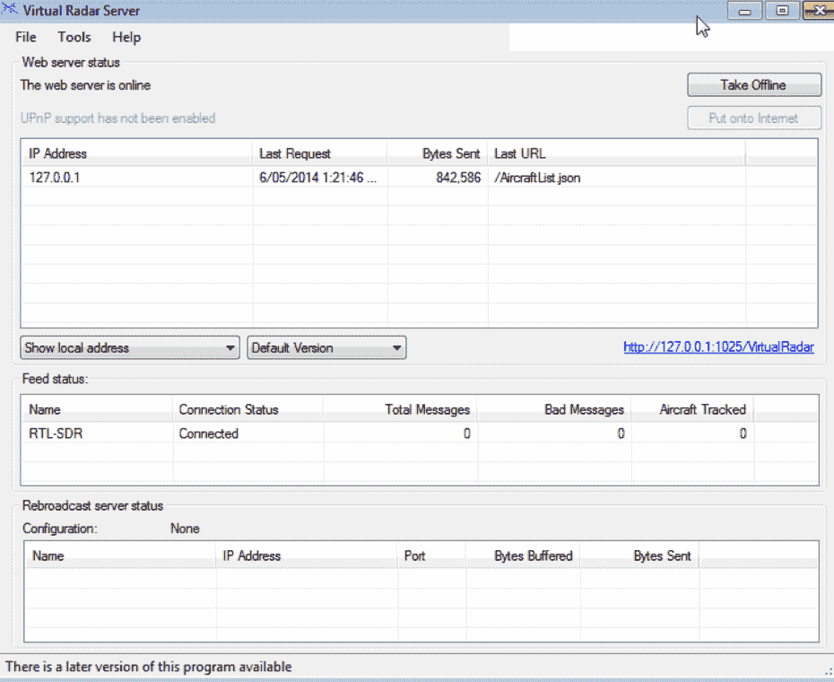

9. 你现在应该能看到地图了。缩小并滚动到地图上的你的位置。如果你从你的 `ADS-B` 解码器程序获得了良好的 `ADS-B` 帧解码，你就应该能看到飞机出现。

如果你想看到飞机注册号、运营商、制造商、型号、旗帜和轮廓信息，你需要安装一个名为 `basestation.sqb` 的预制查找数据库。请按照以下指令操作。

1. 访问 http://www.sbs-resources.com/download/index.html 下载并安装设置文件。这默认将所需文件安装到 `C:\SBS-resources` 文件夹中。如果你更改了默认安装文件夹，请更改步骤 3、4 和 5 中的文件路径。

2. 进入 `Tools`（工具）-> `Options`（选项）。

3. 点击 `Receivers`，然后 `New`。

4. 在 `General Settings`（常规设置）下将你的接收器命名为 `RTL-SDR`。

5. 将数据源更改为 `"AVR or Beast Raw Feed"`。

6. 保持 `IP` 地址为 `127.0.0.1`（除非使用远程服务器），但如果使用 `ADSB#`，将端口号更改为 `47806`；如果使用 `RTL1090`，则更改为 `31001`。（下图显示了使用 `RTL1090` 时应使用的设置。）

7. 点击 `Receivers`，并将 `"Web site receiver"`..."Closest aircraft receiver"` 和 `"Flight Simulator X receiver"` 设置为你刚刚创建的 `RTL-SDR` 接收器。点击 `OK`。

8. 现在点击 http://127.0.0.1:1025/VirtualRadar 链接，将进入加载了特殊 `VRS Google` 地图的网页。


9. 你现在应该能看到地图。缩小并滚动到地图上的你的位置。如果你从你的 `ADS-B` 解码器程序获得了良好的 `ADS-B` 帧解码，你就应该能看到飞机出现。

如果你想看到飞机注册号、运营商、制造商、型号、旗帜和轮廓信息，你需要安装一个名为 `basestation.sqb` 的预制查找数据库。请按照以下指令操作。

1. 访问 http://www.sbs-resources.com/download/index.html 下载并安装设置文件。这默认将所需文件安装到 `C:\SBS-resources` 文件夹中。如果你更改了默认安装文件夹，请更改步骤 3、4 和 5 中的文件路径。

2. 进入 `Tools`（工具）-> `Options`（选项）。

3. 点击 `Receivers`，然后 `New`。


- 4. 在 General Settings（常规设置）下将你的接收器命名为 RTL-SDR。
- 5. 将数据源更改为 "AVR or Beast Raw Feed"。
- 6. 保持 IP 地址为 `127.0.0.1`（除非使用远程服务器），但如果使用 ADSB#，将端口号更改为 `47806`；如果使用 RTL1090，则更改为 `31001`。（下图显示了使用 RTL1090 时应使用的设置。）


上述的大多数解码器会将解码后的 ADS-B 数据通过本地（或根据需要通过公共）网络连接发送。有几种软件选项可以接收并显示这些网络数据。这里我们展示了四种最流行的，其中三个是免费的，一种是付费的并提供试用选项。要使用这些程序，你需要同时运行你的 ADS-B 解码器。

3. 现在，使用 Windows 资源管理器导航到你安装 PlanePlotter 的文件夹。默认安装路径为 `C:\Program Files (x86)\COAA\PlanePlotter`。在此文件夹中找到 `google_aircraft.kml` 文件并双击它。该文件应自动用 Google Earth 打开并显示飞机的俯视图。你也可以打开 `google_cockpit.kml` 来查看飞机的模拟座舱视图。

若要配合 Virtual Radar Server 安装 `basestationsq` 数据库，请遵循 <http://planeplotter.pbworks.com/w/page/17117301/Databases> 中列出的说明。

## ADSBSCOPE

AdsbScope 是一款免费的 ADS-B 雷达程序，可以从 <http://www.sprut.de/electronic/pic/projekte/adsb/adsb_en.html#downloads> 下名为“ZIP-File with all relevant data (13 MB)”的链接进行下载。有些人更倾向于使用 adsbScope 而上述其他程序，因为它是免费的且不基于网络浏览器。adsbScope 的最新版本还为 ADSB# 和 RTL1090 提供了简单的设置选项。要安装并使用 adsbScope，请遵循以下说明。

- 1. 下载并解压 adsbScope 到文件夹。导航到 `pc_software/adbscope/26` 文件夹。运行 `adsbcope26_16384.exe` 打开程序。
- 2. 进入 `other` -> `Network` -> `Network setup`。
- 3. 显示如下屏幕。在 `presets`（预设）下，根据你选择的解码器点击 ADSB# 或 RTL1090。点击 `local`（本地）按钮，除非你正在使用共享服务器，此时请输入服务器的 URL。如果你更改了任一解码器的端口，请将 `RAW-data-client` 框中的 `Portnumber` 设置为相同的值。

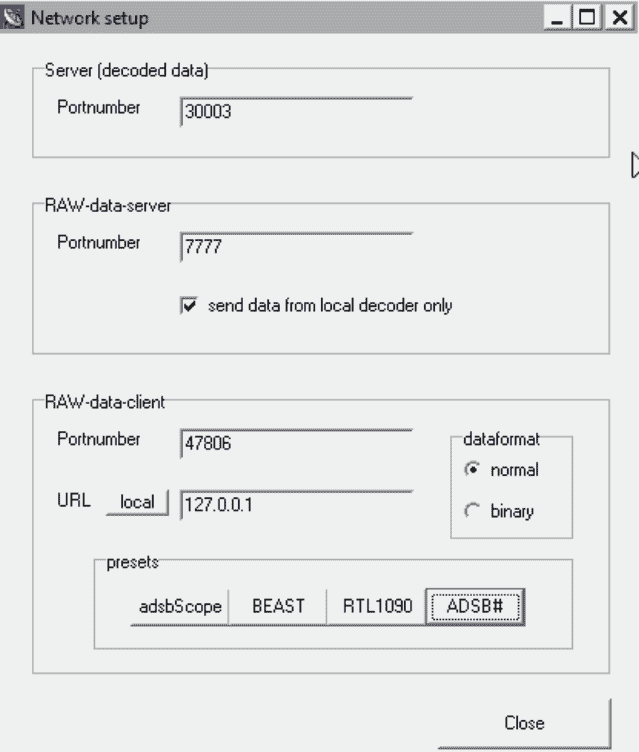

- 4. 现在开启 RTL1090 或 ADSB#。
- 5. 在 adsbScope 中点击 `start RAW-data CLIENT` 按钮。按下后，按钮将变为彩色，ADS-B 数据现在应显示在 adsbScope 中。
- 6. 你可以使用鼠标在地图上移动，并使用缩放按钮放大或缩小。你也可以点击地图按钮下载屏幕显示区域的地图。
- 7. 使用鼠标和缩放将十字准中心对准你的接收器位置。
- 8. 进入 `Navigation` -> `set Receiver Location` 将接收器设置为十字准的当前位置。


ADSBScope 还可以创建一个最大范围图，该图可以覆盖一段时间，并显示你的天线工作情况。它将为随时间看到的每架飞机绘制一条线。要开启它，只需遵循以下步骤：

- 1. 进入 `Config` -> `Maximum Range` 并启用‘show all altitudes’（显示所有高度）。
- 2. 确保勾选了 `View` -> `Maximum Range`。

## BASESTATION

BaseStation 是原始的 ADS-B 显示软件之一。它出现在仅有专用 ADS-B 接收器的那个时代。许多用户更喜欢此软件，因为它简单易用，且能与专业雷达显示配合使用。要让 BaseStation 配合 RTL1090 或 ADSB# 工作，请遵循这些说明。要让它配合 Modesdeco 工作，你可以跳到第 4 步打开 BaseStation - 如果你想使用 BaseStation 的易用性，强烈建议使用 modesdeco 为解码器。

- 1. 下载并安装 com0 模拟器 <http://sourceforge.net/projects/com/>。安装期间，你可能会遇到未签名驱动程序的问题。要解决这个问题，你需要禁用驱动程序签名。安装 com0 后，重启电脑。启动 com0 后，根据你的系统设置，注意对应的 COM 端口号（通常是 COM6 或 COM7）。

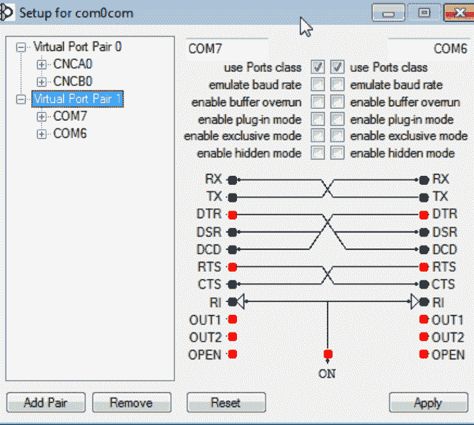

- 2. 下载并安装 modesdeco（从 <http://ads.github.com/> 下载并解压 `.zip` 文件）。
- 3. 在文件夹中创建一个 `.bat` 文件。
- 4. 在 `.bat` 文件中输入以下内容：

```
@echo off
mode com=COM6 baud=115200,n,8,1
modesdeco.exe -r COM6 -w 127.0.0.1:3000,127.0.0.1:30001
```

*（请根据实际端口号修改代码中的 COM6 或 COM7）*

- 5. 运行该 `.bat` 文件。
- 6. 打开 BaseStation。
- 7. 在 BaseStation 中，进入 `Network` -> `Network setup`。
- 8. 在 `presets` 下，点击 ADSB# 或 RTL1090。
- 9. 点击 `local` 按钮。如果你更改了解码器的端口，请确保 `RAW-data-client` 区域中的 `Portnumber` 一致。
- 10. 开启 RTL1090 或 ADSB#。
- 11. 此时 BaseStation 应该能显示飞机数据。

如果你希望在导航显示窗口中显示航点（Waypoints）、导航台（NavAid）和 VOR 等地面符号，请从 <http://data.x-plane.com/get_data.html> 下载 X-Plane 9.00-9.70 数据。将数据解压到文件夹，并在 XHSI 中将 AptNav Resources 目录设置为你解压数据的目录。

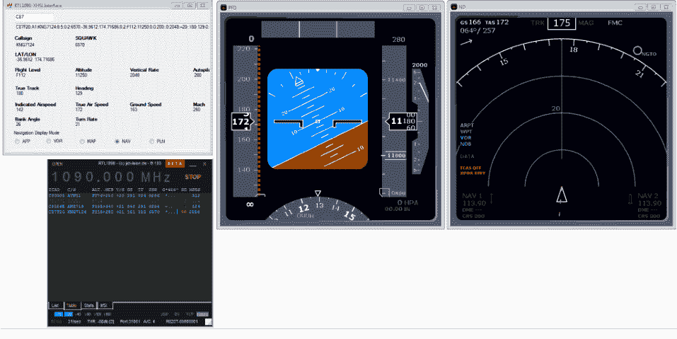

# 监测军用飞机

虽然军用飞机配备了 ADS-B Mode S 转发器，但它们通常不传输位置信息。尽管如此，仍有一些军用飞机爱好者乐于接收并记录来自军用机的 ADS-B 信号。即使接收不到位置信息，观测者仍然可以获取军用机的十六进制代码（hex code）、注册号、机型、基站位置和高度。

milaircomms.com 的爱好者们为树莓派和 Windows 开发了自定义的 ADS-B 软件，称为 MilAirComms1090。该软件可以记录军用飞机数据，并将其网站上许多志愿者提供的数据进行上传和聚合。由于有志愿者在世界各地记录数据（主要在美国和欧洲），通过日志有可能发现军用飞机过去出现过的地方。你可以在 <http://milaircomms.com/mil_air_modes_logger.html> 找到更多关于该项目的信息。

另一个类似网站 <http://www.live-military-mode-s.eu/> 的类似软件可以在 <http://www.live-military-mode-s.eu/share/V4.0/> 找到，其教程详见 <http://www.jc-images.de/docs/RTL1090_Mode_S_Logger_Virtual_Server_Configuration.pdf>。

# 滑翔机和直升机的 ADS-B：FLARM

滑翔机和某些直升机等小型飞机使用一种改进版的 ADS-B，称为 FLARM。FLARM 是 Flight alarm（飞行报警）系统的缩写。FLARM 是一种低成本、低功耗的 ADS-B 替代方案，通常用于轻型飞机的避障。它的发明是因为滑翔爱好者需要一种更廉价、更易安装的 ADS-B 避障系统，以适应滑翔机中常见的近距离飞行。

尽管信号要弱得多，但只要使用正确的天线，就可以像商业飞机一样追踪这些轻型飞机。这对于住在滑翔俱乐部附近的人来说可能很有趣。FLARM 信号在 `868 MHz` 传输，其强度比标准 ADS-B 信号有效弱 100-100 倍，但仍然可以接收。

<http://wiki.glidernet.org/start> 的 Open Glider Network 是滑翔机追踪爱好者群体使用 RTL-SDR 和自定义软件实时追踪滑翔机。在他们的网站 <http://live.glidernet.org/> 和 <http://live.glidernet.org/3D/> 上可以看到聚合的实时滑翔机追踪示例。Open Glider Network 项目主要活跃在欧洲。

# NOAA 气象卫星 (APT) 指南

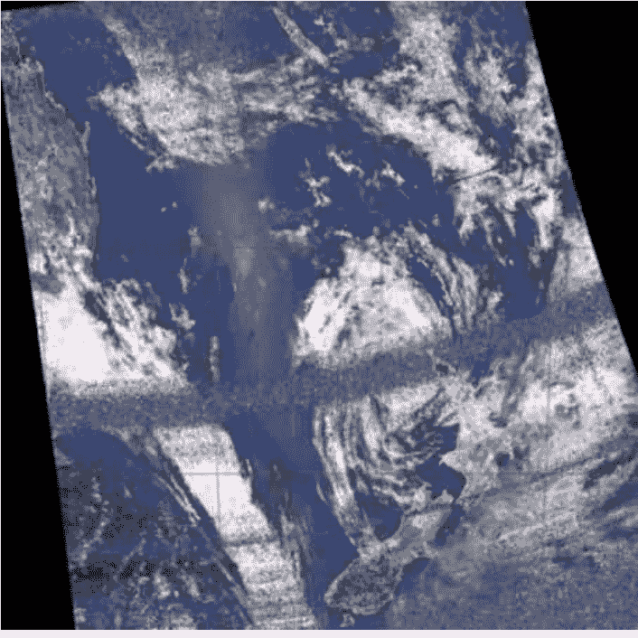

## NOAA 气象卫星简介

美国 NOAA（国家海洋和大气管理局）气象卫星每天会多次经过你的所在地。当它们飞过时，每颗 NOAA 气象卫星都会广播自动图像传输（APT）信号，其中包含你所在区域的实时天气图像。RTL-SDR 结合良好的天线、如 SDR# 等 SDR 程序以及解码程序，可以下载并显示这些实时图像。

目前有三个活跃的 NOAA 卫星：NOAA 15、NOAA 18 和 NOAA 19。每颗卫星以约 `137 MHz` 的频率传输，采用右旋圆极化（RHCP）。

## NOAA 气象卫星接收教程

为了设置 NOAA 气象卫星接收站，你需要：

- 音频管道方法。如果没有设置，请查看附录 A。
- 适用于 `137 MHz` 的圆极化天线。
- 用于解码的 WXToImg 等。

## NOAA 气象卫星天线

NOAA 卫星以 `137 MHz` 附近的频率发送圆极化信号。对于卫星接收，理想的是指向天空的圆极化天线。最常用的两种天线是字形线（turnstile），它是两个成 90° 角的偶极子排列，有时被称为交叉偶极线（cross dipole）。字形线有两种类型。

四臂螺旋线（QFH）是一种由 PVC 管和电缆制成的圆极化天线。大多数人报告 QFH 的接收效果优于字形线，但人使用字形线。另一种有效的天线是双十字（DCA），它基本上是以特定方式排列的四个偶极子，产生圆极化信号。圆锥天线（discones）或四分之一波地线天线也可能接收信号，但如果不是圆极化天线，信号会严重衰减。更多信息请参见天线指南。

许多人报告，天线处的低噪声放大器（LNA）和广播滤波器有助于接收。请参见 LNA 部分和滤波器部分。

## WXTOIMG 软件教程

WXtoImg 是一个适用于 Windows、Linux、OSX 甚至树莓派的免费气象卫星解码程序。它可以解码 APT 信号并告知你卫星通过的频率。

1. 首先，从 <http://www.wxtoimg.com/> 下载并安装 WXToImg。
2. 打开 WXToImg，通过 Options -> Ground Location 设置你的地面站位置（即天线的坐标）。你所在的城市应该足够，但如果你愿意，输入精确的经纬度和高度会更准确。位置信息用于确定卫星何时经过你的上空。

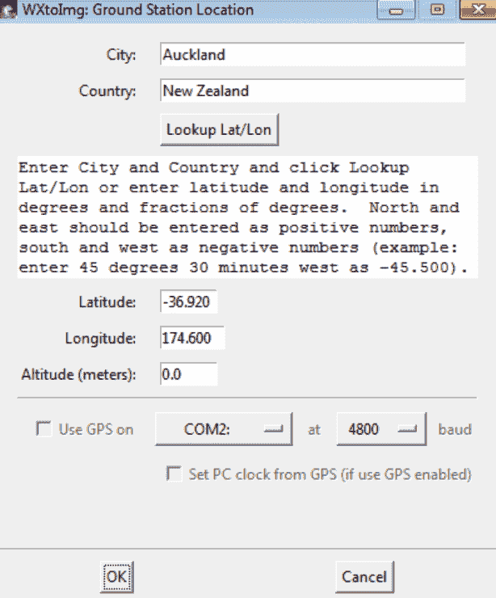

3. 在 WXToImg 中设置你正在使用的音频管道方法。进入 Options -> Recording Options，并确保声卡选项下选择了正确的音频设备。
4. 此外，在此窗口中，你还可以调整“仅在活跃 APT 卫星位于头顶时记录”、“最大仰角（度）”以及“仅当卫星位于（度）以上时记录”设置。如果你的天线天空视野良好，但发现 WXtoImg 停止记录或启动不够快（尽管 SDR# 中存在 APT 信号），你可能需要减小默认值。

接收效果会更好，因为通天线的路径更畅通。当卫星位于地平线较低位置时，由于障碍物，接收效果可能会很差。你应该根据你的地形设置这些值。


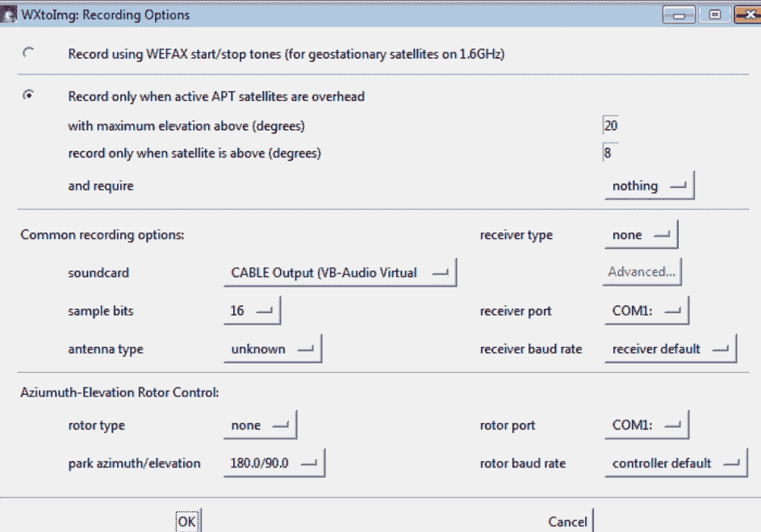

## 更新 Kepler 文件与获取卫星过境列表

5. 现在你需要更新你的 Kepler 文件。该文件包含卫星位置信息，由于卫星随时间推移会在轨道上漂移，因此需要定期更新。前往 `File -> Update Keplers` 执行此操作。确保在更新时已连接互联网。

6. 现在你可以前往 `File -> Satellite Pass List` 寻找 NOAA 卫星飞过头顶的时间。同时请记录过境的频率。

### 新西兰奥克兰 (36°55'S 174°35'E) 的卫星过境列表

高度在 8.0 度以上，且最大仰角 (MEL) 超过 20.0 度

从 2013-05-12 16:28:41 新西兰标准时间 (2013-05-12 04:28:41 UTC) 开始

| 卫星 | 方向 | MEL | 经度 | 本地时间 | UTC 持续时间 | 频率 |
|---|---|---|---|---|---|---|
| NOAA 18 | N | 43W | 166E | 05-12 18:37:46 | 04:37:46 | 11:11 | 137.925 |
| NOAA 19 | N | 49W | 166E | 05-12 18:00:14 | 06:00:14 | 11:03 | 137.620 |
| NOAA 16 | S | 47W | 178E | 05-13 00:55:06 | 12:55:06 | 11:22 | 137.100 |
| NOAA 19 | S | 38W | 185E | 05-13 01:21:50 | 13:21:50 | 10:51 | 137.915 |
| NOAA 19 | S | 21W | 182E | 05-13 02:37:06 | 14:37:06 | 09:12 | 137.900 |
| NOAA 16 | S | 24W | 171E | 05-13 03:39:35 | 15:39:35 | 09:22 | 137.620 |
| NOAA 18 | S | 28W | 165E | 05-13 04:02:44 | 16:02:44 | 10:26 | 137.915 |
| NOAA 19 | S | 29W | 162E | 05-14 04:44:34 | 14:44:34 | 10:58 | 137.100 |
| NOAA 18 | S | 38W | 165E | 05-13 06:18:31 | 17:18:31 | 10:39 | 137.620 |

当卫星出现时，打开 WtoImg，然后进入 `File -> Record`，并点击 `Auto Record`。当卫星出现在地平线上时，录制和解码会自动开始。根据卫星过境列表，当卫星消失时会自动停止。由于某些原因录制没有及时开始，你可以点击 `Manual Test` 按钮开始解码。

| 选项 | 值 |
| :--- | :--- |
| 仅记录（如果启用则显示图像） | |
| 录制并自动处理 | |
| 创建图像(s) | Image Settings... |
| 创建视频 | Movie Settings... |
| 将图像添加到网页 | Web Page Settings... |
| 最少扫描行 | 0 (0:00) |
| 删除音频文件 | never |
| 删除原始图像 | never |
| 删除地图 | never |
| 删除图像 | never |

8. 打开 SDR#，在 `Audio Output` 下拉框中选择你正在使用的音频管道方法，然后调谐到卫星广播的频率。在 SDR# 的 `Configure` 按钮下调整增益设置，以便获得良好的信号接收。将接收模式设置为 `WFM`，滤波器带宽设置为 `34 kHz`，并将 `Filter Audio` 设置为 `OFF`。确保取消勾选 `Snap to Grid`（捕捉网格）可能也有帮助。

9. 由于 RTL-SDR 的频率并不准确，且由于多普勒效应，信号可能不在其精确的频率上。只需调整 SDR# 中的频率，直到调谐条对准卫星信号中心即可。

10. 调整 SDR# 中的 `AF Gain` 和/或 Windows 音量设置，使 WXtoImg 右下角的音量条显示绿色。

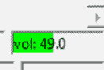

11. WXtoImg 现在应该正在解码并显示接收到的图像。你可能需要定期调整频率使信号居中，因为多普勒效应会导致其移动。然而，对于 RTL-SDR，调整多普勒偏移并不关键，滤波器带宽设置为大于 `34 kHz`（尝试 `36-40 kHz`）即可接收整个信号。

12. 一旦完全接收图像，可以使用 `Enhancement` 菜单下的选项进行处理。

## ORBITRON 教程

使用名为 Orbitron 的程序，可以让 SDR# 在 NOAA 和其他卫星出现在地平线上时自动调谐。虽然对 SDR# 并非完全必要，但 Orbitron 将有助于补偿多普勒效应引起的卫星漂移。

1. 从 `http://www.starr.pl/` 下载并安装 Orbitron。

2. 从 `http://www.starr.pl/orbitron/files/mydde.zip` 下载 Orbitron DDE 驱动（镜像地址见）。将文件提取到 Orbitron 安装目录（通常在 `Program Files (x86)\Orbitron`）。

3. 从 `http://public-s3.amazonaws.com/SatelliteTracker.zip` 下载 SDR# 插件（镜像地址见）。虽然随附的 readme 文件带了安装说明，但某些说明对你不起作用。你可以按照下面的步骤。

4. 将 SDR# 插件文件提取到 SDR 目录。使用记事本或其他编辑器打开 `Plugins.xml`。在 `<Plugins></Plugins>` 标签内添加行：（此处应为代码内容）。

5. 以管理员模式打开 Orbitron（如果是 Windows Vista/7/8），右键点击并选择以管理员身份运行。Orbitron 可能会全屏打开。如果需要，按 `Alt+Enter` 退出全屏。你可能会看到 TLE 更新界面。你可以保持所有框默认。点击带有地球和闪电图标的更新按钮。Orbitron 将下载新的 TLE 文件。TLE 文件包含轨道信息，需要每几天更新一次。以管理员模式运行 Orbitron 非常重要，否则可能写入 TLE 文件。如果没有看到界面，可以通过主 Orbitron 标签中的 `Setup` 图标进入。

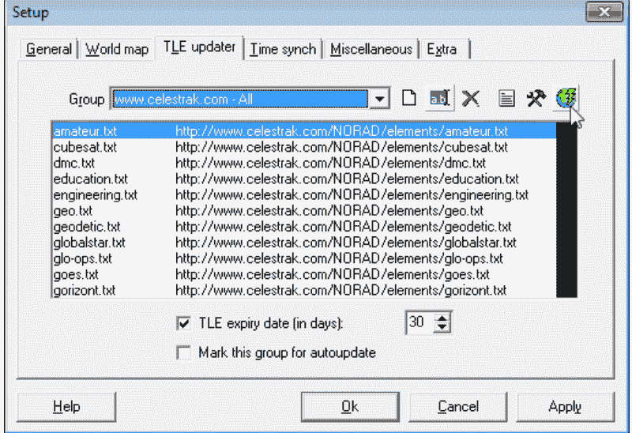

6. 为了让 Orbitron 准确跟踪卫星，Windows PC 时间准确很重要。Orbitron 提供将 PC 时间同步到提供准确时间的 NTP 服务器的方法。在设置界面点击 `Time Synch` 标签，点击 `Synchronise PC` 按钮自动同步时间。如果你的 PC 始终连接互联网，你可能还想勾选 `Synchronise PC clock when Orbitron starts` 复选框。


7. 关闭 Orbitron。现在以管理员模式打开记事本（通过右键点击开始菜单中的快捷方式）。

8. 在记事本中，点击 `File -> Open` 并浏览到你的 `Orbitron\Config` 文件夹。Orbitron 可能安装在 `Program Files (x86)\Orbitron`。打开 `Setup.cfg`。

9. 在 `Setup.cfg` 文件的底部添加这两行：

```
[Drivers]
SDRSharp=SDRSharp.exe
```


现在打开 Orbitron 并点击底部设置你的位置。如果你不知道自己的经纬度，可以在右侧选择你的城市。


11. 接下来点击 `Load TLE` 并加载 `noaa.txt` 文件，以及你感兴趣跟踪的其他卫星的文件。


12. 对于天气卫星图像，我们对 NOAA 15、18 和 19 号卫星，因为它们是唯一运行的，因此在它们旁边打钩。双击卫星名称将选中它并在地图窗口中显示。

### Orbitron 3.71 界面示例


奥克兰: 174.7582' E, 36.0551' S

| 方位 | Dlink/MHz | 接收/多普勒 | Dlink 模式 | 驱动 |
|--- | --- | --- | --- | --- |
| 289.3 | 145.000 | 144.99786 | FM-W | SDRSharp |
| 仰角 | 上行/MHz | 发射/多普勒 | 上行模式 | Satellite |
| -11.7 | 145.000 | 145.00214 | | |

与驱动程序的 DDE 会话未激活

Orbitron 3.71 - ©2001-2005 by Sebastian Pohl

13. 现在前往 `Rotor/Radio` 标签，将 `Radio` 模式设置为 `FM-W` 并将 `Driver` 设置为 `SDRSharp`。点击 `Driver` 下拉框旁带有两个窗口的图标，并确保它处于按下状态。第一次按下此按钮时，可能会被要求安装驱动程序。点击是，然后浏览到 Orbitron 文件夹并选择早早复制的 `MyDDE.exe` 文件。

#### 文件选择对话框示例

| 名称 | 修改日期 | 类型 | 大小 |
| --- | --- | --- | --- |
| Lang | 11/05/2013 11:20... | 文件夹 | |
| Notes | 11/05/2013 11:20... | 文件夹 | |
| Output | 11/05/2013 11:20... | 文件夹 | |
| Tie | 19/03/2014 9:42 p... | 文件夹 | |
| MyDE.exe | 26/02/2005 1:00 a... | 应用程序 | 335 KB |
| Orbitron.exe | 8/09/2005 12:00 a... | 应用程序 | 1,218 KB |
| lunins000.exe | 11/05/2013 11:20... | 应用程序 | 654 KB |

文件名：`MyDDE.exe`

文件类型：`DDE 驱动文件 (*EXE)`

14. 打开 SDR#，点击 `Play`，然后进入 Orbitron 插件。在 `Enable` 旁边打一个钩，将 `Tracking Software` 选项设置为 `Orbitron`，然后点击 `next`（下一步）。现在在 Orbitron 中双击卫星名称，应该会自动在 SDRSharp 中设置正确的经过多普勒修正的频率。


15. SDR# 现在应该自动吸附到正确的频率并自动调整多普勒效应。你仍需要手动设置正确的滤波器带宽并将模式设置为 `WFM`。此外，由于 RTL-SDR 的频率并不准确，你需要在 SDR# 配置框中调整 `PPM` 修正值，以确保信号居中。

16. 如果你想让 Orbitron 在卫星进入范围时就让 SDR# 自动调谐到该卫星：

17. 转到 `Miscellaneous`（杂项）选项卡，确保选中了 `AOS Notification: Show Notice`（AOS 通知：显示通知），并将 `elevation`（仰角）设置为 `0`。（如果你只想在卫星升得更高、接收效果更好时开始调谐频率，请增加仰角）。


18. 转到 `Extra`（额外）选项卡，确保勾选了 `AOS Notification: Make satellite active`（AOS 通知：激活卫星）。


19. 最后，如果需要，可以使 WXtoImg 自动输出最新卫星图像的实时网页。此选项可以在 WXtoImg 的 `Options`（选项）-> `Auto Processing Options`（自动处理选项）-> `Web Page Settings`（网页设置）下找到。

# METEOR-M 俄罗斯 LRPT

## 气象卫星指南


## METEOR-M 简介

Meteor-M N2 是一颗极轨道俄罗斯气象卫星，于 2014 年 7 月 8 日发射。它的主要任务是天气预报、气候变化监测、海水监测/预测以及空间天气分析/预测。

该卫星目前处于激活状态，发射低分辨率图像传输（LRPT）信号，用于广播实时气象卫星图像，类似于 NOAA 卫星产生的 APT 图像。然而，LRPT 图像要好得多，因为它们以数字信号传输，图像分辨率比旧的模拟 NOAA APT 信号高 12 倍。

将本节开头显示的新西兰图像与上方 NOAA APT 教程部分显示的图像进行比较，即可看到分辨率的差异。一些 Meteor 气象示例图像可以在 `http://meteor.robonica.ru/septembers-gallery/` 找到，并可以在 Orbitron 或在线通过 `http://www.satview.org/?sat_id=40069U` 跟踪卫星。白天的气象图像使用可见光生成，晚上则使用红外线生成。

可以使用 RTL-SDR 以及如 HackRF 等 SDR 配合一些免费软件来接收和解码这些图像。来自 Meteor-M N2 的 LRPT 图像在 `137.1 MHz` 附近以右圆极化传输，因此通常使用与 NOAA 卫星类似的卫星天线，如十字形或四线螺旋天线。更多信息请参见天线指南。

由于 LRPT 是数字信号，接收强度必须良好，请确保使用放置在高处且视野开阔良好的卫星天线。在某些接收不良的情况下，可能还需要天线处的低噪声放大器（LNA）以及一些带通或带阻滤波器。

## 接收卫星图像：Windows 教程

为了在 Windows 上接收这些图像，你首先需要下载并安装以下内容：

- **Audacity**。免费的音频编辑软件。从 `http://audacity.sourceforge.net/` 下载。
- **LRPT BPSK/QPSK 解调器**。从 `https://www.dropbox.com/s/yic/software.zip` 下载（镜像：`http://bit.ly/yicop`）。提取 `LRPT.exe`，压缩包中的其他文件是不需要的。
- **LRPTOfflineDecoder**。从 `http://meteor.robonica.ru/soft/` 下载最新版本（2014.09.01 的镜像）（版本：`http://bit.ly/IUKS4Y`）。

由于这颗卫星非常新，解码过程不像 NOAA 卫星那样精炼。以下步骤概述了该过程：

1. 打开 SDR#，并在配置菜单中将 RTL-SDR 的采样率更改为 `1 Msps`。

2. 当 Meteor-M2 即将经过时（使用 Orbitron 确定时间），在 SDR# 中调谐到 `137.1 MHz`。确保设置了 `Correct IQ`，如果你使用的是基于 RTL2832 的转接器，请确保已启用偏置调谐（offset tuning）。

3. 一旦信号出现，首先确保它在瀑布图中尽可能居中。然后使用标准 SDR# 安装中默认包含的 `Recording` 插件录制一个 `8-bit PCM` 基带文件。


4. 卫星经过且信号消失后，停止录制，然后在 Audacity 中打开生成的 `.wav` 文件（记住 SDR# 将其录音保存在与可执行文件相同的文件夹中）。

5. 在 Audacity 的左下角将采样率更改 `130000 Hz`。


6. 通过 `File > Export`（文件 > 导出）将重采样后的文件导出为新的 wav 文件。然后选择格式为 `WAV (Microsoft) signed 16-bit PCM`。将新的 wav 文件保存到方便的文件夹中。

7. 现在打开 LRPT 程序，通过点击输入文件名框加载刚刚从 Audacity 导出的重采样 `.wav` 文件。


8. 确保选中了 `Swap IQ`（交换 IQ）。


9. 在窗口中间移动滑块到信号最强点。点击右下角的开始按钮。


10. 如果看起来像一个 X 或正方形，尝试将符号率从 `72000` 更改为 `80000`。

11. 如果你看到四个簇，遗憾的是卫星处于 `80K` 模式，目前无法解码。


12. 如果你在星座图中某处看到四个簇，则可以继续。将滑块移回起始位置。

13. 通过点击左侧输出文件名旁的 `Change` 按钮选择解码 RAW 输出文件的保存位置。默认情况下，输出文件将保存为 `C:\Meteor_001.raw`。

| 输出文件名 |
| --- |
| `\Meteor_001.raw` |

14. 点击程序右下角的 `Start` 按钮开始解码过程。观察滑块并等待到达末尾，然后点击停止。程序不会自动停止，因此必须记得点击停止按钮。停止后点击退出按钮。


## 从处理后的文件中提取图像

15. 现在要从处理后的文件中提取图像，我们需要使用 `LRPTToLineDecoder.exe` 软件。通过点击 **72K** 按钮（未来可用时可能是 **80K** 按钮）在 `LRPTToLineDecoder.exe` 中打开解码后的 RAW 文件。打开时，你需要将文件类型过滤器更改为 **All Files (\*\*)** 以便看到 `.raw` 文件。

16. 一旦打开，图像将自动开始生成。生成可能需要 10 到 15 分钟。

17. 处理完成后，点击 **Generate RGB** 按钮查看最终图像。请注意，如果你发现其中一张图像不在前三列，你需要调整 R、G、B 下拉框以选择另一列。如果红外传感器在白天处于激活状态，第三幅图像可能在最后一列。为了获得彩色图像，G 和 B 都应该选择为 `0.7-0.11`。

> **注意**：`LRPT.exe` 实际上是为已失效的 Meteor-M1 卫星设计的。因此，最终图像中可能会出现一些伪影，例如黑色条带。

# 在 Windows 上实时接收 METEOSAT 气象卫星图像

得益于新的软件开发，最近已能实时解码 Meteor M2 LRPT 图像。这种方法的设置仍然有些困难，但在获得实时结果的同时，它还能提供更好的卫星锁定效果和更优的图像。要使用实时解码，你需要卫星跟踪软件 `Orbitron`、用于 `SDR#` 的 QPSK 解码插件、用于 `SDR#` 的 DDE 接口插件，以及一个特殊版本的 `LRPTDecoder`。这种方法还会记录 LRPT 信号的备份 I/Q 文件，如果实时方法不起作用，可以将其通过离线方法进行处理。请注意，这种方法非常新，可能仍处于快速开发和变化中。

> **注意**：本教程在很大程度上基于 Alex (happysat) 的原始教程，你可以在我们的博客找到它：<http://www.rtl-sdr.com/rtl-sdr-tutorial-decoding-meteor-m2-weather-satellite-images-in-real-time-with-an-rtldr/>。如果你需要更多帮助、想学习更多关于实时解码的知识或在此教程中遇到问题，请参考他的教程。

# 下载软件

1. 首先从 <http://meteor.robonuka.ru/for-experts/amigos/downloads/amigos-compatible-lrptofflinedec/> 下载与 LRPTdecoder 的 QPSK 插件软件，并将其解压到文件夹 `C:\AMIGOS\`。请注意，虽然文件名仍为 `LRPTToffLineDecoder.exe`，但它实际上是一个在线解码器。

2. 接下来从 <http://www.rtl-sdr.ru/page/komplekt-plaginov-dlja-priema-sputnikov> 下载 DDE Orbitron 接口插件和 QPSK 解调器。此外，如果你想对 LRPT 站点进行备份录制，以防在线方法因故障失败，还可以选择从 <http://www.rtl-sdr.ru/page/dobavlen-novyj-plugin-recorder> 下载 IF 录制插件。请注意这些页面是俄语的，请使用 Google 翻译。将这些插件 zip 文件的内容解压到你的 `SDR#` 安装文件夹，并添加 `magicline.xml` 文件。如果你需要安装插件的帮助，请参见“安装 SDR# 插件”部分。

# 同步 Windows 时间

为了提高与 Meteor M2 的信号锁定，`Orbitron` 的多普勒校准准确性以及 Windows 时间的准确性至关重要。这是因为 `Orbitron` 使用当前时间来计算卫星在空间中的位置，以及你的位置需要什么多普勒校准。正如 NOAA 教程中解释的，`Orbitron` 包含一种从 NTP 服务器更新 PC 时间的方法。然而，这只有在你点击更新按钮后才会激活。对于 NOAA 卫星来说，时间修正不像 Meteor M2 那样关键，因为 NOAA 卫星是模拟信号，不需要锁定数字信号。我们建议你下载一个 NTP 自动更新程序，它每隔几秒就会将 PC 时钟与 NTP 时间同步。软件可以从 <https://www.meinbergglobal.com/english/sw/ntp/ntp.htm#stable> 获取，选择适用于 Windows XP 及更高版本的 NTP 下载，以及 IPv6 支持。请注意，在运行安装程序之前，确保已关闭 `Orbitron`，因为它自身的 NTP 更新程序可能会阻止设置成功完成。

下面显示了应该配置的设置选项：

1. 在安装期间，确保在显示 “Want to use predefined public NTP servers (see www.pool.ntp.org?)” 的地方选择离你最近的位置。点击 “Choose”。

   

2. 你可以在下一个屏幕直接点击 “No”。

   

3. 下一个屏幕也可以保持默认设置，如下图所示。

   

4. 在下一个屏幕中，你将被要求在 PC 上创建一个 NTP 账户。只需输入密码并记住它，以防将来需要更改某些设置。

   

5. 点击 “Next”，NTP 时间服务将安装并自动启动。如果你收到关于 NTP 时间服务无法启动的错误，请确保已关闭 `Orbitron` 并重新运行安装程序。安装 NTP 后，你可能还需要手动关闭 Windows 时间同步，与 NTP 相比，它的同步效果很差。在控制面板中进入 “日期和时间” 设置，确保 Windows 同步已关闭。

> 如果你需要关于 NTP 设置的进一步帮助，请访问 <http://www.satsignal.eu/ntp/setup.html> 查看更深入的指南。

# ORBITRON 和 SDR 设置

下面我们解释了设置 `Orbitron` 和 `SDR#` 以实时接收 Meteor M2 的步骤。

1. 进入 `C:\Orbitron\setup.cfg` 并使用文本编辑器打开此文件。在文件末尾添加以下行：

   ```
   [Scheduler]
   radio_modulation_type<wfm>
   radio_center_frequency_Hz<137100000>
   radio_frequency_Hz<137100000>
   radio_bandwidth_Hz<120000>
   ```

2. 现在你可以从 QPSK 和 DDE Tracker 页面下载示例设置文件并将其放入 `SDR#` 文件夹。文件可以从 <http://www.rtl-sdr.ru/page/komplekt-plaginov-dlja-priema-sputnikov> 下载，是名为 `deschedule.zip` 的最后一个文件。请注意，你可能需要调整 `LRRPTOfflineddecoder.exe` 的路径。

3. 将刷新间隔设置为 1 秒。

4. （如果你需要调度）通过勾选 **Scheduler** 框可以让 DDE 插件在卫星过顶时自动激活并启动解码器。设置最小仰角（天空位置越高通常接收效果越好，随后解码器将启动）。你会希望将其设置为能够实际解码图像的足够信号仰角。

5. 将仰角限制设置为 0。

6. 现在在 `Orbitron` 中进入 **Radio** 选项卡。

7. 将频率设置为 `137.1 MHz`，模式设置为 **FM-W**。

8. 选择驱动为 `SDRSharp` 然后点击 **Play**。

9. 现在在 `SDR#` 中进入 **DDE 插件**。

10. 你应该能看到状态显示 `Orbitron` 已连接。

    

    - **“Sat came”框**：用于存放在 `Orbitron` 通知 DDE 插件卫星过顶时运行的命令。
    - **“Sat came out”框**：用于在 `Orbitron` 通知 DDE 插件卫星过境结束时运行的命令。

    - `send_tracking_frequency_On` - 启用 QPSK 插件上的跟踪功能，该功能可以修正小的多普勒效应并提高锁定。
    - `QPSK_demodulator_Start` - 启动 QPSK 解调器。
    - `IF_recorder_Start` - 启动 IF 记录器。注意，这是可选的。如果你不需要记录 IF 文件，请删除此命令以及下方的 `IF_recorder_Stop` 命令。
    - `start_program_Path<C:\AMIGOS\LRPToffLineDecoder.exe>` - 启动 `LRPToffLineDecoder`。如果你没有将修改后的 `LRPToffLineDecoder` 放在 `C:\AMIGOS`，请更改此位置。注意不要在路径中使用带有空格的内容。
    - `QPSK_demodulator_Stop` - 停止 QPSK 解调器。
    - `send_tracking_frequency_Off` - 停止 QPSK 解调器（此处原文误，应为插件）进行多普勒跟踪。
    - `IF_recorder_Stop` - 停止 IF 记录。注意，这是可选的。如果你不需要记录 IF 文件，请删除此命令以及上方的 `IF_recorder_Start` 命令。

## QPSK 插件与 LRRPTOFFLINEDECODER 设置

QPSK 插件通过本地 TCP 连接与修改后的 `LRPToffLineDecoder` 通信。

1. 在 `SDR#` 的 QPSK 插件中，确保 **Output（输出）** 下选择了 **TCP socket**。（注意，如果你的电脑配置较低，实时解码可能无法正常工作。在这种情况下，你仍然可以记录解调后的输出文件，之后可以通过 `LRPToffLineDecoder` 进行离线处理。要这样做，请选择 **File** 选项。）

   

2. 如果你没有使用调度器，请等待 Meteor M2 经过。确保 **Tracking** 复选框已勾选。当卫星经过头顶时，将 `Orbitron` 连接到 DDE 插件，使其自动跟踪 Meteor M2 频率，然后点击 **Demodulator** 旁边的选择框。这将开始解码。

3. 最后打开修改过的 `LRPToffLineDecoder.exe` 查看实时下载的图像。

4. 如果你在 DDE 插件中使用调度器，当卫星经过头顶时，`Orbitron` 会自动通知 DDE 跟踪和调度器插件，该插件会自动启动 QPSK 解码器和 LRPT 解码器。

5. 要检查 QPSK 解码器是否锁定信号，点击 **Out** 复选框显示星座图。如果星座图在四个角显示四个明显的簇，则已实现锁定，你应该能开始在 `lrPTOffLineDecoder` 软件中看到图像形成。

   

## 接收 METEOSAT 气象卫星图像：LINUX 教程

Windows 离线方法的另一种步骤更少的替代方案是使用 Linux 软件，它可以同时完成接收和解码。要这样做，你需要一个安装了 GNU Radio 3.7+ 和 Python 的 Linux 系统。查看 GNU Radio Live DVDs 章节获取预装 GNU Radio 的发行版列表，或查看 GNU Radio installation-instructions 章节获取如何安装 GNU Radio 的信息。注意，生成实际图像的最后一步仍然在 Windows 上使用 `LRPToffLineDecode.exe` 解码器完成，如上述 Windows 教程中的步骤 15 和 16 所示。

首先从 <https://www.dropbox.com/s/par34n42m1r68k3/meteor_rx.zip>（镜像：<http://bit.ly/Yahuq6>）下载所需的 GNU Radio python 脚本，将其提取到文件夹中，然后按照以下说明操作：

1. 首先使用 `Orbitron` 等待卫星经过。
2. 使用 `meteor_rx.py` 运行脚本。
3. 观察输出。
4. 如果图像不正常，调整参数。
5. 解码完成后，保存图像。

---

# 气象球无线电探接收指南

气象球通常在官方观测时间 UTC 0000 和 1200 前 45 分钟发射，尽管某些国家的时间可能不同。你可能通过 Google 搜索或咨询当地气象机构来获取所在区域发射的确切时间。你还需要向当地气象机构确认他们使用的无线电探仪类型。他们通常乐意提供这些信息。

最常用的无线电探信号之一是 **Vaisala RS92SGP** 数字信号。下方是该信号的瀑布图示例。它的带宽约为 `5 kHz`。


## 解码气象球无线电探步骤

1. **下载并安装 SondeMonitor**。`SondeMonitor` 是一款付费软件，价格为 25 欧元，但提供 21 天试用。从 <http://www.coaa.co.uk/sondemonitor.htm> 下载 `SondeMonitor`。

2. 当气象球即将发射时，打开 `SDR#` 或另一个无线电接收 GUI 程序，在 **Audio Output** 下拉框中设置你的音频传输方法，并调谐到 `403` 到 `406 MHz`（或 `1680 MHz`）之间的频率。扫描周围寻找无线电探信号，该信号应该是一个带宽约为 `5 kHz` 的窄带信号。如果你找到了，请调谐到该频率并调整 RF 增益设置以获得最佳性能。将接收模式设置为 **NFM** 并将音频过滤设置为 **OFF**。调整滤波器带宽使其恰好覆盖信号。

3. 打开 `SondeMonitor`，进入 **Options -> Audio -> Audio Source** 并选择你正在使用的音频传输方法。

4. 选择你所在地区使用的无线电探解码协议。可以使用这些图标进行选择，它们位于开始和停止图标的右侧。悬停在图标上将显示它们代表的哪种协议。如果你不知道所在地区使用哪种协议，可以逐一尝试每一个，希望其中一个有效。

5. 现在点击绿色的 **开始圆圈 (●)** 开始解码。会弹出一个遥测数据窗口。接下来，点击 **原始信号图标 (↝)**。使用 `SDR#` 中的音频增益或 Windows 音量设置调整音频量，使音频图表足够大以便可见，但不要太大以免导致削波。削波是指信号过大导致波形开始变方。理想的音量如下所示。

   

6. 此时，如果你的信号接收良好且选择了正确的解码方法，遥测窗口将显示数据并有四个绿色圆圈。注意，`SondeMonitor` 需要一些初始时间进行校准。校准过程的进度可以通过主窗口左下角的红条看到，随着校准完成，它会慢慢变为绿色。遥测窗口也可以跟踪校准状态。如果校准未完成或耗时过长，意味着你的信号强度不够。

   | 处理 SGP 探仪 | |
   | :--- | :--- |
   | 硬件 | H3113202 |
   | 发射频率 | 403.000MHz |
   | 帧 | 1938 |
   | 日期时间 | 周四 09:45:13.420 |
   | 校准 | 100% |
   | 压力 | 477.5 hP |
   | 压力高度 | 5913 m |
   | 温度 | -13.1°C |
   | 露点 | -45.4°C |
   | 湿度 | 6% |
   | 上升速率 | 3.6 m/s |
   | GPS 纬度 | -36.87650°N |
   | GPS 经度 | 174.72343°E |
   | GPS 高度 | 5913 m ~4m/s |
   | GPS 剩余 | 97 m |
   | GPS 风速 | 14.9m/s 318° |

7. 点击 **Graph 2 图标** 查看遥测图表。你可以点击 **Autoscale 图标 (↕)** 以确保所有数据都显示在屏幕上。

   

## GPS 无线电探位置追踪

对于大多数发射，可以在 Google Earth 中实时跟踪气象球的实时位置和高度。然而，某些无线电探协议（如 `RS92SGP`）并不直接传输经纬数据。相反，它们传输原始 GPS 数据，可以在接收端（你的计算机）将其转换为经度。要实现这一点，需要无线电探的起始坐标、UTC 发射日期和 UTC 时间以及最新的 GPS 历法。历法是一个存储 GPS 卫星位置信息的文件。

`MeteoModem MK2/M10`、`Graw DFM-06` 和 `Meteorab SRS-C34` 是传输已解码 GPS 位置数据的无线电探。以下步骤仅适用于其他传输原始 GPS 数据的无线电探：

1. 从美国海岸警卫队 <https://www.uscg.gov/> 下载历法。
2. 在 `SondeMonitor` 中进入 **Tools -> Import GPS**。假设你已经设置好并运行了 RTL-SDR。如果你还没有购买接收器，请查看我们的 <https://www.rtldr.com/buy-rtl-sdr-dvb-t-dongles/> 页面。
3. 一旦有了 `.kml` 文件，使用 Google Earth 打开它。
4. 如果信号不起作用，检查 `SondeMonitor` 中的选项。
5. 打开文件以查看气象球的位置。现在你应该可以在 Google Earth 中看到它了。

   

## 其他链接和参考

- 视频演示：<https://www.youtube.com/watch?v=Mz2id>
- 实验者的结果：<http://nerdsville.blogspot.com/2014/radionde-decoding.html>


# 海事自动识别系统 (AIS) 指南

大多数船只被要求广播位置、航向、速度和目的地信息。该系统被称为 “自动识别系统”（Automatic Identification System），简称 **AIS**。它被用于飞机，类似于 **ADS-B**。

## AIS 教程


# 在 Windows 系统上设置 AIS 船用雷达

要在 Windows 系统上设置 AIS 船用雷达，你需要：

- 一个音频传输方法。如果你还没有设置，请参见附录 A：音频传输。
- 一个调谐到 162 MHz 的垂直极化天线。
- 解码软件。

假设你已经设置并运行了 RTL-SDR。如果你还没有购买接收器，请查看我们的 [购买页面](https://www.rtldr.com/buy-rtl-sdr-dvb-t-dongles/) 并查看本文中的快速上手指南以进行任何设置。

# AIS 天线指南

AIS 信号在 161.975 MHz 和 162.025 MHz 广播，最大范围约为 75 公里。如果你的无线电设备距离任何船只超过 75 公里，你可能无法接收 AIS 信号。AIS 也是视距信号，这意味着如果你的天线和船只之间有大型建筑或山脉，AIS 信号可能会被阻挡。由于这个原因，将天线放置得越高越好。

AIS 天线通常是共线天线。共线天线具有指向地平线的高全向增益。这意味着它可以接收来自地平线的信号，而船只就在那里。其他天线如四分之一波地板天线、J 极天线、偶极子天线或圆环形天线也可能效果良好。

如果你所在区域的大多数船只仅集中在某一个方向，八木天线可能是很好的选择。八木天线是一种强方向性天线，它只会接收其所指向方向的信号。它的优势在于，通过方向性，我们可以获得巨大的增益。八木天线通常对很小的频率范围敏感，因此调谐适当的八木天线也有助于排除干扰信号。有关这些天线的更多信息，请参阅“天线指南”章节。

一个中心频率在 162 MHz 附近的带通滤波器（例如表面贴装型 [Mini-Circuits 滤波器](http://www.minicircuits.com/products/filters_sm_bandpass.html)）也可能有用。或者，使用带阻滤波器滤除 FM 广播频段和寻呼机信号可能有所帮助。寻呼机带阻滤波器可能特别有用，因为某些国家的寻呼机频率往往在 157 MHz 左右，靠近 AIS 频率。同轴插接式滤波器可能是处理寻呼机干扰的廉价方案。

在天线处使用 LNA（如 `LNA4ALL`）也可以接收微弱信号。更多信息请参阅 LNA 章节和预选器章节。

# 软件教程

1. 使用 `Virtual Audio Cable` 或 `VBCable` 在 Windows 中设置两个音频管道。确保采样率设置为 48 kHz。有关如何更改此设置的信息，请参阅“设置采样率”章节。
2. 使用 SDR 接收器如 `SDR#` 或 `SDR-Radio` 调谐到 AIS 信号。在 SDR 接收器的音频输出下拉框中设置你的音频管道方法，并调谐到 AIS 频率（161.975 MHz 或 162.025 MHz）。信号可能不会正好出现在 AIS 频率上，因为 RTL-SDR 的频率并不十分精确。只需手动调谐，直到信号正确居中，或者正确设置你的 PPM 偏移量（`offset`）。

对于 AIS，我们强烈建议使用 `SDR-Radio`，因为它允许你同时调谐两个 AIS 通道。如果使用 `SDR-Radio`，请设置两个 VFO 来监听两个 AIS 通道。确保每个通道都输出到独立的音频管道设备。

3. 调整 RF 增益，直到你获得良好的 AIS 信号接收。你希望调整 RF 增益，使信号足够强，但底噪较低。
4. 将接收模式设置为 NFM（窄带调频），并扩展带宽，使其恰好覆盖瀑布图上的 AIS 脉冲。带宽将约为 12.5 kHz 或 25 kHz（有两种不同带宽的 AIS 标准）。关闭静噪（`squelch`）和任何 DSP 算法。如果使用 `SDR#`，将 `Filter Audio`（滤波音频）设置为 OFF。
5. AIS 信号在瀑布图上看起来像细小的水平线（如果你住在海交通繁忙的区域，会有更多水平线）。如果你通过扬声器听 AIS 信号，它们听起来就像是杂声的脉冲。两个 AIS 频率广播相同的信息，并用于商业 AIS 接收器中实现冗余。

一旦设置好 AIS 接收，你就可以使用程序进行 AIS 解码。有几个程序可以用于解码和显示 AIS 信息。`ShipPlotter` 是一个带有 21 天试用期的商业程序。`AISMon` + `OpenCPN` 或 `AISDispatcher` 是免费程序，但设置起来稍微复杂一些。

# OpenCPN + AISMon 教程

`AISMon` 是一个免费的 AIS 解码程序。它可以从 AISMon Yahoo 群组的文件部分下载：[http://groups.yahoo.com/group/aismon/](http://groups.yahoo.com/group/aismon/)。你可能需要先使用 Yahoo 账户加入小组以访问文件部分。Yahoo 群组还包含一个示例 AIS `.wav` 文件，与立体声混合（`stereo mix`）配合使用时可以测试 `AISMon` 和 `ShipPlotter`。

`AISMon` 相比 `ShipPlotter` 的优势是，我们可以打开程序的两个实例并使用它们同时解码两个 AIS 通道，这将提高船舶的更新率。

1. 打开 `AISMon`，将音频管道设备设置为你选择使用的那个，并将采样率设置为 48 kHz。
2. 使用 SDR 接收器如 `SDR#` 或 `SDR-Radio` 调谐到 AIS 信号。在你的 SDR 接收器的音频输出下拉框中设置你的音频管道方法，并调谐到 AIS 频率（161.975 MHz 或 162.025 MHz）。信号可能不会正好出现在 AIS 频率上，因为 RTL-SDR 的频率并不十分精确。只需手动调谐，直到信号正确居中，或者正确设置你的 PPM 偏移量。
3. 调整 RF 增益，直到你获得良好的 AIS 信号接收。你希望调整 RF 增益，使信号足够强，但底噪较低。
4. 将接收模式设置为 NFM（窄带调频），并扩展带宽，使其恰好覆盖瀑布图上的 AIS 脉冲。带宽将约为 12.5 kHz 或 25 kHz（有两种不同带宽的 AIS 标准）。关闭静噪（`squelch`）和任何 DSP 算法。如果使用 `SDR#`，将 `Filter Audio`（滤波音频）设置为 OFF。
5. AIS 信号在瀑布图上看起来像细小的水平线（如果你住在海交通繁忙的区域，会有更多水平线）。如果你通过扬声器听 AIS 信号，它们听起来就像是杂声的脉冲。两个 AIS 频率广播相同的信息，并用于商业 AIS 接收器中实现冗余。

一旦设置好 AIS 接收，你就可以使用程序进行 AIS 解码。


一个中心频率在 162 MHz 附近的带通滤波器（例如表面贴型 http://www.minicircuits.com/products/filters_sm_bandpass.html）也可能有用。或者，使用带阻滤波器滤除 FM 广播频段和寻呼机可能有所帮助。寻呼机带阻滤波器可能特别有用，因为某些国家的寻呼机频率往往在 157 MHz 左右，靠近 AIS 频率。同轴接节滤波器可能是处理寻呼机干扰的廉价方案。

在天线处使用 LNA（如 `LNA4ALL`）也可以接收微弱信号。更多信息请参阅 LNA 章节和预选器章节。

# 软件教程

1. 使用 `Virtual Audio Cable` 或 `VBCable` 在 Windows 中设置两个音频管道。确保采样率设置为 48 kHz。有关如何更改此设置的信息，请参阅“设置采样率”章节。

2. 使用 SDR 接收器如 `SDR#` 或 `SDR-Radio` 调谐到 AIS 信号。在你的 SDR 接收器的音频输出下拉框中设置你的音频管道方法，并调谐到 AIS 频率（161.975 MHz 或 162.025 MHz）。信号可能不会正好出现在 AIS 频率上，因为 RTL-SDR 的频率并不十分精确。只需手动调谐，直到信号正确居中，或者正确设置你的 PPM 偏移量。

对于 AIS，我们强烈建议使用 `SDR-Radio`，因为它允许你同时调谐两个 AIS 通道。如果使用 `SDR-Radio`，请设置两个 VFO 来监听两个 AIS 通道。确保每个通道都输出到独立的音频管道设备。

3. 调整 RF 增益，直到你获得良好的 AIS 信号接收。你希望调整 RF 增益，使信号足够强，但底噪较低。

4. 将接收模式设置为 NFM（窄带调频），并扩展带宽，使其恰好覆盖瀑布图上的 AIS 脉冲。带宽将约为 12.5 kHz 或 25 kHz（有两种不同带宽的 AIS 标准）。关闭静噪（`squelch`）和任何 DSP 算法。如果使用 `SDR#`，将 `Filter Audio`（滤波音频）设置为 OFF。

5. AIS 信号在瀑布图上看起来像细小的水平线，如下图所示（如果你住在海交通繁忙的区域，会有更多水平线）。如果你通过扬声器听 AIS 信号，它们听起来就像是杂声的脉冲。两个 AIS 频率广播相同的信息，并用于商业 AIS 接收器中实现冗余。

一旦设置好 AIS 接收，你就可以使用程序进行 AIS 解码。有几个程序可以用于解码和显示 AIS 信息。`ShipPlotter` 是一个带有 21 天试用期的商业程序。`AISMon` + `OpenCPN` 或 `AISDispatcher` 是免费程序，但设置起来稍微复杂一些。

# OPENCPN + AISMON 教程

`AISMon` 是一个免费的 AIS 解码程序。它可以从 AISMon Yahoo 群组的文件部分下载：http://groups.yahoo.com/group/aismon/。你可能需要先使用 Yahoo 账户加入小组以访问文件部分。Yahoo 群组还包含一个示例 AIS .wav 文件，与立体声混合（`stereo mix`）配合使用时可以测试 `AISMon` 和 `ShipPlotter`。

`AISMon` 相比 `ShipPlotter`（在下一节显示）的优势是，我们可以打开程序的两个实例并使用它们同时解码两个 AIS 通道，这将提高船舶的更新率。

1. 打开 `AISMon`，将音频管道设备设置为你选择使用的那个，并将采样率设置为 48 kHz。

2. 使用 SDR 接收器如 `SDR#` 或 `SDR-Radio` 调谐到 AIS 信号……（此处省略重复内容，翻译已涵盖所有逻辑）


6. 回到 `AISDispatcher` 文件夹，在 Google Earth 中打开 `AISDispatcher.kml` 以查看地球上的船只。

## SHIPLOTTER 教程

`ShipPlotter` 是一款可以解码并绘制存储在 AIS 信号中的位置数据的软件工具。`ShipPlotter` 是一款商业软件，个人使用费用为 25 欧元，但提供 21 天的试用期。`ShipPlotter` 一次只能监听一个 AIS 通道，但也可以配合 `AISMon` 等外部解码器一起使用。以下是使用 `ShipPlotter` 的说明。

1. 从 http://www.coaa.co.uk/shipplotter.htm 下载并安装 `ShipPlotter`。

2. 打开 `ShipPlotter`。进入 `Options` -> `Audio` -> `SoundCard` 并选择你的音频传输方法。

3. 在 `Options` -> `I/O Settings` 下，确保勾选了 `enable audio input processing`（启用音频输入处理）。


4. 确保 `Options` -> `Demodulator` 中的解调器选项设置为默认值，并勾选“Require Preamble”（需要前导码）和“Require HDLC FCS correct”（HDLC 校验正确）。


5. 之后我们点击“Start”（启动）按钮，然后点击“Raw”（原始）图标，这将显示一条带有波浪线的水平线。确保音频电平足够且没有削波，通过调整 SDR 中的 AF gain 音量设置或 Windows 音量设置，确保波形峰值位于图表的一半处。

6. 现在你应该能够点击工具栏上的“Ships”（船只）和“Messages”（消息）图标来查看解码后的 AIS 信息。要可视化地查看船只，你需要按照 `ShipPlotter` 的说明下载图表。


7. 一种比下载图表在 Google Earth 中显示船只更容易的方法。要让 `ShipPlotter` 与 Google Earth 工作，你必须首先在 `Options` -> `I/O Settings` 中启用 Google Earth 服务器，确保左下角的“enable Google Earth server”复选框被选中。HTTP 端口可以保持默认。


| 特性 | 启用 | 端口 | 速率 | 服务器 | 远程 IP |
| :--- | :--- | :--- | :--- | :--- | :--- |
| 音频输入 | | | | | |
| UDP/IP 点对点输入 | | 本地端口 4159 | | | |
| NMEA 1 | 1 | 38400 | | | |
| NMEA 2 | -1 | 38400 | | | |
| NMEA 3 | -1 | 38400 | | | |
| NMEA 4 | -1 | 38400 | | | |
| 本地输入端口 | | 2 | 4800 | | | |
| 在 NMEA 1-4 中允许 GPS 消息 | | | | | |
| 输出音频输入 | | | | | |
| 输出录制 | | | | | |
| UDP/IP 点对点输出 | | 远程 IP 127.0.0.1 | 4158 | | |
| | | 127.0.0.1 | 4158 | | |
| | | 127.0.0.1 | 4158 | | |
| 串口输出端口 | | 2 | 4800 | | |
| Google Earth 服务器 | | 本地 HTTP 端口 4185 | | | |
| TCP/IP 输入 | | 端口 速率 | | | |
| 服务器客户端本地端口 | 5419 | 远程 IP 127.0.0.1 | | | |
| HTTP 输出服务器 | | 启用本地端口 4189 | | | |

8. 然后你可以进入 `ShipPlotter` 安装目录（很可能在 "Program Files (x86)/COAA/ShipPlotter"）并在 Google Earth 中打开 `google_ships.kml` 文件。注意，你必须在打开 `google_ships.kml` 文件**之前**打开 `ShipPlotter` 并按下绿色启动按钮开始解码 AIS 信号，否则船只将不会显示。


## GR-AIS

`GR-AIS` 是基于 GNU Radio 的 AIS 解码器，可以从 https://github.com/bistromath/gr-ais 下载。

## AISDECODER

`AISDecoder` 是兼容 Linux 和 Windows 的 AIS 解码器，可以输出 NMEA 位置用于 `OpenCPN`。可以从 http://forum.aishub.net/ais-decoder/ais-decoder-beta-release 论坛帖子下载 `AISDecoder`。

要在 Windows 上使用，帖子中提供了一个预编译的二进制文件。下载 `AISDecoder` 后，启动 `SDR#` 或任何通用 SDR 接收机并调谐至 AIS 通道。接下来打开命令提示符并使用以下行打开 `aisdecoder`：

```bash
aisdecoder -h 127.0.0.1 -p 10110 -a winmm
```

这将启动 `aisdecoder` 并输出输出。

# 解码 VHF 数据链路模式 2 (VDL2)

## VDL2 简介

VHF 数据链路模式 2 (VDL2) 是一种用于航空机的新传输模式，用于发送短信息、位置数据（类似于 ADS-B），并允许空中控制器通过文本和数据与飞行员进行通信。VDL2 旨在最终取代 ACARS。其全球通用频率为 136.975 MHz。

可以使用 `MultiPSK` 解码 VDL2，如果发送了 GPS 数据，则可以将数据发送到 `PlanePlotter` 以绘制飞机位置图。

## 使用 MultiPSK 解码 VDL2

`MultiPSK` 是一款复杂的多模式解码器，可以直接连接到 RTL-SDR 并能够解码 VDL2 信号。它是免费的，但要解码如 VDL2 等“专业”模式，需要付费版本。不过，`MultiPSK` 每次启动程序都会提供 5 分钟的 VDL2 使用时间供测试。使用 `MultiPSK` 请遵循以下步骤。

1. 下载并解压 `multiPSK` 压缩包到文件夹中。

2. 打开 `MULTIPSK.exe`

3. 你将看到一个看起来复杂的屏幕。在这个屏幕上，我们需要确保 RTL/SDR 密钥按钮（位于顶部中间）处于按下状态。

4. 点击左下角的 RX/TX 按钮。这将启动 RTL-SDR 以及瀑布图和射频显示。

5. 点击主屏幕左上角的收发机按钮。这将调出收发机控制屏幕。在这里你可以调整 RTL-SDR 增益并设置 PPM 校准，现在显示在收发机屏幕的右上角。如果你不确定设置增益，请确保按下 Auto 按钮以使用自动增益。在带有“correction”的文本框中输入。关闭收发机。

6. 在瀑布图/频谱窗口中，将 HF 频率从 0 改为 136965000 Hz（注意是 136975000 Hz）然后点击“Forward”。

7. 将“AF频率”设置为 10000 Hz。通过首先点击瀑布图中的数字 10 并使用 AF 控制下的左右按钮进行微调来实现。

8. 现在点击主窗口最右侧显示“Professional modes”（专业模式）的 VDL2 按钮。如果你看不到，可能需要最大化主窗口。

9. 现在 VDL2 解码将开始，当接收到消息时，你应该在主窗口看到 VDL 消息。

`MultiPSK` 也可以与 `PlanePlotter` 接口，以便在地图上绘制 VDL2 数据（如果传输了坐标）。请遵循以下说明。

1. 在 `MultiPSK` 主窗口中，点击左上角的 TCP/IP 按钮。确保端口号设置为 3122。

2. 现在在 `PlanePlotter` 中进入 I/O 选项，并勾选 VDL2-MultiPSK 复选框。


- 3. 点击绿色启动按钮启动 PlanePlotter。现在 MultiPSK 接收到的任何消息出现在 Plane Planeter 中。

你还可以使用来自 `http://www.rstools.info/downloads-2.html` 的免费程序 VDL2-Display，它将以更清晰的格式显示接收到的 VDL2 信息。使用 VDL2-Display 请遵循以下说明。

- 1. 在 MultiPSK 中，点击接收屏幕左上角的 TCP/IP 按钮。将端口号更改为 `3125`。断开连接然后重新连接。

- 2. 打开 `Display-Launcher.exe`，然后打开 VDL2 Display。

- 3. 点击 VDL Display 中的 Connect #1 按钮连接到 MultiPSK。现在接收到的 VDL 消息和飞机将显示在 VDL Display 中。

## 参考文献和额外链接

PlanePlotter MultiPSK VDL2 教程：

`http://planeplotter.pbworks.com/w/page/75894179/VDL%20mode%22`

## 空中交通控制 / 扫描指南

使用 RTL-SDR 和 SDR# 的扫描插件可以轻松扫描空中交通控制语音信道。扫描插件在频率之间快速切换以寻找活动信号。当发现活动信号时，它将保持开启状态直到传输结束。本教程可以适用于任何需要扫描的无线电系统。

## SDR 频率扫描器

我们将使用的 SDR# 频率扫描插件可以从 `www.sdrsharppugs.com` 下载。它具有自动安装程序，因此不需要编辑配置文件。只需将压缩包解压到文件夹并运行 `PluginsSetup.exe`，确保按照屏幕上的说明操作。

## 已知频率扫描

这将快速扫描已知频率列表以寻找活动信号。你需要找到所在地区空中交通使用的频率列表。你也可以在频谱中手动搜索活动频率。另一种方法可能是创建热力图或使用扫描插件寻找活动频率。请参见后章节的热力图教程。

- 1. 在频率管理器插件标签页中，进入 `Manage -> Groups` 并创建一个名为“Air Traffic”的组。

- 2. 现在要添加频率时，首先调到该频率，点击 Edit 按钮。在弹出的窗口中，确保将模式设置为 AM，并将滤波器带宽设置为 `8000`。在 Air Traffic 组框旁勾选。最后，点击 Add。


3. 要扫描一个组，请先在“Scan A Group”（扫描群组）选项卡中选择该组。然后点击“Scan”（扫描）按钮。“最小信号强度”滑块应设置为高于噪声底，但不要设置得太高以免漏掉弱信号。请记住，值 `0` 表示信号非常强，而值 `-130` 表示信号非常弱。你可能需要调整信号强度滑块，直到只识别出有效信号而非噪声。


你可以通过点击扳手图标，然后调整“Performance”（性能）选项卡下的“Radio Settle Time in Milliseconds”（电台稳定时间毫秒）滑块来编辑扫描速度。

## 通用频率扫描

通用频率扫描是指当你希望快速扫描一段频率范围以找到未知的活动信号时。虽然上面使用的频率扫描插件可以做到这一点，但对于这种类型的扫描，我们更倾向于使用来自 `http://rtl-sdr.ru/skaner-poisk-novyh-chastost` 的“Faster Scanner Plugin”（快速扫描插件），我们认为它的效果更好。注意该页面为俄语，但下载链接位于文章底部，且插件是英文的。请根据插件安装程序安装插件。

使用快速扫描插件请遵循以下步骤：

- 1. 在开始扫描之前，你需要知道你想要扫描的频段中的频率间隔。例如，航空频段信号的间隔为 `25 kHz`（在某些国家为 `8.33 kHz`）。你需要使用 SDR# 中“Radio”（电台）选项卡中的设置将此间距设置为你的步长，该选项卡包含 AM/FM/SSB 模式选择。扫描器将使用此信号间距递增频率。


- 2. 进入快速扫描器频率插件窗口。在下拉菜单中选择“screen”（屏幕）或“manual”（手动）模式。屏幕模式将扫描当前屏幕上显示的活动频率，而手动模式将允许你在任意最小和最大频率之间进行扫描。

- 3. 点击 Scan（扫描）。会弹出一个“Pan View”（平视图）扫描器窗口。此窗口显示信号的频率频谱。

- 4. 水平红线表示信号作为活动信号需要跨越的功率阈值，扫描器将在此处停止。线条的高度可以使用 SNR dB 设置框进行调整。

- 5. 扫描时，你可以按“Skip”（跳过）按钮直接跳到下一个活动信号。

- 6. 你可以通过在平视图频谱图中用鼠标点击某些信号（如噪声脉冲或数据通道）来忽略它们，或者通过在平视图频谱图中拖动鼠标并使用“Lock”（锁定）和“Unlock”（解锁）按钮。当频谱中的某个频率被涂成红色时，它即被“锁定”，扫描器将忽略它。


扫描时，快速扫描器还会在插件窗口中创建一个已找到活动信号表格。它会显示信号活动的时间和所在的频率。

## 数字音频广播

(DAB) 广播指南

数字音频广播（DAB）是一种用于广播商业电台的数字收音技术。它是宽带 FM 电台广播的替代方案，用于许多国家，尤其是欧洲。某些适配器随附 CD 中的 DVB-B 电视软件实际上带有 DAB 解码软件，但该软件需要安装官方驱动程序，这将阻止通用 SDR 使用。

# 使用 SDR-J 的 DAB 接收教程

相反，在安装了 SDR 驱动的情况下收听 DAB 广播，可以使用名为 SDR-J 的程序。SDR-J 是一个 Windows 和 Linux 程序，能够接收 DAB 和 DAB+。它还带有一个 FM 接收器，但在我们的教程中不会使用。可以从 `http://www.sdr-j.tk/` 下载 SDR-J。确保下载了 dabstick-radio zip 文件。

- 1. 下载 SDR-J 并解压 zip 文件到文件夹中。

- 2. 打开 `dabreceiver.exe` 文件。

- 3. 如果你的 RTL-SDR 适配器已插入并正确设置，SDR-J 的 DAB 屏幕将显示。


- 4. 确保最左侧的下拉菜单选择了“dabstick”。

- 5. 在屏幕左侧右两个下拉框中选择 BAND 和 DAB 频谱块标识符。在上面的截图中，我们使用了 BAND III 和块 13F。这些设置在每个国家都不同。访问 `http://www.wohnortort.org/dab/` 获取有关所在国家块标识的信息。

- 6. 在右下角选择你想使用的音频输出，通常是扬声器。

- 7. 点击 Start（开始）。

- 8. 调整右下角的增益，使右下角的 DAB RF 信号变强。

- 9. 如果信号不强，调整频率。

- 10. 一旦找到信号，音频将播放。


## 使用 DAB PLAYER 的接收教程

由 Andreas 开发的 SDR-J DAB Player 的替代品可以从 `http://rtl-sdr.ru/page/tvsharp-analogovoe-tv-na-rtl-tuner/tvsharp-updated-version-1-2/` 下载。该页面为俄语，请使用 Google 翻译或直接下载。（镜像 1: `http://sdr.amoti.ru/download/view.download/4/8`) (镜像 2: `http://bit.ly/1hMBZmy`）。

使用 TVSharp 仅需打开它，并在插入 RTL-SDR 适配器后点击开始按钮。在采样率下选择 `2.0 MSPS` 选项，这通常效果最好。然后使用频率框将频率调到一个已知的模拟电视电台。使用更高的采样率会增加采样的带宽，提高画质，但设置得太高会导致接收问题。


## 接收模拟电视

(PAL/NTSC) 指南

大多数国家已开始分阶段停止模拟电视传输，转而倾向于转向数字传输标准，如 ATSC（美国）或 DVB-T（全球大部分地区）。在仍在传输模拟电视的国家，可以使用 RTL-SDR 进行接收。

在 SDR 模式下，RTL-SDR 无法接收 PAL/NTSC 视频带宽（PAL 为 `5 MHz`，NTSC 为 `4.2 MHz`）。然而，它仍然能够接收 PAL 或 NTSC 信号中部分亮度（黑白）部分。

一个用于解码 PAL 和 NTSC 的程序是 TVSharp。最新版本的 TVSharp 可以从 `http://rtl-sdr.ru/page/tvsharp-analogovoe-tv-na-rtl-tuner/tvsharp-updated-version-1-2/` 下载。该页面为俄语，请使用 Google 翻译或直接下载。（镜像 1: `http://sdr.amoti.ru/download/view.download/4/8`) (镜像 2: `http://bit.ly/1hMBZmy`）。

使用 TVSharp 仅需打开它，并在插入 RTL-SDR 适配器后点击开始按钮。在采样率下选择 `2.0 MSPS` 选项，这通常效果最好。然后使用频率框将频率调到一个已知的模拟电视电台。

该程序还内置了自动频率和位置校正选项，有助于防止图像滚动和图像未居中的问题。你可能需要等待加密狗热热并稳定其频率偏移后，才能看到稳定的图像。


目前还有一个可用于 GNU Radio 的 NTSC 解码器，如果你想学习 NTSC 解码，这可能会派上帮助。该教程是用日语编写的，但 Google 翻译已足够从中获取所需信息。你可以在 `http://bit.ly/XUdeEIv` 找到它。

# 中继式无线电收听指南：模拟与数字 P25

在一种低效的无线电系统中，一个音频组（例如某公司）可能使用单一频率进行无线通信。然而，这是非常低效的，因为该频率在大多数时间内可能处于空闲状态。如果多个音频组可以使用同一频率，且在在使用时不干扰其他音频组，效率将会更高。

在中继式无线电系统中，一组较小的语音频率被大量的音频组共享。每个无线电台不断接收和发送到由无线电服务供应商运行的特殊计算机控制信道。当按下无线电上的通话键时，无线电通过控制信道快速与供应商的远程计算机通信，并确定一个音频组可以使用空闲语音频率。这有助于使无线电频率分配更加高效。

由于音频组可能会在不同的语音频率之间切换，对于无法解码控制信道的无线电扫描仪来说，收听对话可能是困难的。可以使用 Unitrunker 软件解码控制信道，并在语音对话在不同频率间跳变时进行跟踪。通过两个 RTL-SDR 加密狗，你可以搭建一个中继接收站。以下是关于如何设置此接收站的教程。

# UNITRUNKER 语音中继跟踪教程

为了搭建中继站，我们假设你已经学习了书中的[快速入门指南]()，因此已经有一套可以正常工作的 RTL-SDR 设置。

此外，你还需要：

- 2 个 R820T RTL2832U RTL-SDR 加密狗。如果你还没有两个，请访问 `http://www.rtl-sdr.com/buy-rtl-sdr-dvb-t-dongles/` 查看购买 RTL-SDR 加密狗页面。你需要一个加密狗接收控制信道，另一个加密狗接收语音信道。目前仅支持 R820T。

- Unitrunker 软件（从 `http://www.unitrunker.com/download` 下载并安装最新版本）

- 一个分成两个连接用于两个加密狗的天线，或者两个可以接收你感兴趣的中继频率的独立天线。

现在按照以下步骤使用 RTL2832U 设置 Unitrunker。

# 设置信号（控制信道）接收器

首先确定你感兴趣监控的中继控制信道的频率。你可以使用 SDR# 或 SDR 接收程序来搜索这些频率。它们是持续传输的信号。以下是一些常见中继模式的示例。它们通常出现在 `400` 和 `800 MHz` 频段，但根据你所在的国家可能会有所不同。

| 协议 | 瀑布图 |
| --- | --- |
| P25 |  |
| DMR/MotoTRBO | |
| MPT1327 | ![image] |
| Motorola Type II Smartnet | ![image] |
| EDACS96 | ![image] |

要使用 Unitrunker，请遵循以下指令：

- 1. 插入两个加密狗，然后打开 Unitrunker。

- 2. 点击“Add new receiver”（添加新接收器）按钮，然后在弹出的栏上点击 RTL2832 按钮。

| Signal | Control | Both | Inline | RTL2832 | Debug | Q & A | Cancel |

- 3. 在弹出的新窗口中将 Role（角色）更改为 Signal（信号）。

- 4. 在 Signal 标题下，将 RTL Device 更改为用于控制信道的棒。

- 5. 在 Correction（校正）中输入你的加密狗频率 PPM 偏移。注意，获得正确的 PPM 校正至关重要。

- 6. 确保勾选 Mute（静音）。

- 7. 将 Park 值更改为你想要监控的中继信道频率。

- 8. 在 Decode（解码）下，勾选所有你感兴趣收听的中继协议。

- 9. 现在在此窗口顶部点击 Play（播放）按钮。Decode 下的 Protocol 现在应该显示检测到的协议，很快就会弹出一个带有站点信息的窗口，且 Decode 标题下的 Protocol 设置值应更改为检测到的中继协议。

- 10. 如果窗口没有弹出，检查 Protocol 条目下的 Health（健康状况）。如果低于 `100`，增加 Gain 值（可以设置为 `0-500` 之间）或开启 Auto Gain（自动增益）设置。如果还没有弹出新窗口，将 Audio Output（音频输出）设置为你的扬声器并取消勾选静音按钮。听听中继信道是否通过扬声器正确播放。如果没有，你可能需要通过 PPM 校正设置微调频率，或者你的调谐不正确。


- 11. 如果信号足够强，应该弹出一个 Site（站点）窗口。

此新窗口显示正在使用的频率，并记录每次通话。

如果频率没有显示，点击图标看起来像计算器的“Wizard”（向导）按钮。然后选择你所在国家使用的系统。如果不确定，先尝试“Standard”（标准）。


- 12. （可选）如果你有 RadioReference.com 账户，可以点击齿轮图标并输入你的 RadioReference 账户凭。这将下载 RadioReference.com 提供的信息，包括站点信息和一些音频组标签。

- 13. 关闭信号信道的 Receiver R820T 窗口，返回 Unitrunker 主窗口。

# 设置语音信道接收器

- 1. 现在由于我们已经添加了信号接收器和解码器，我们将添加语音接收器。

- 2. 再次点击“Add new receiver”按钮，并在弹出的栏上点击 RTL2832 按钮。

- 3. 这次为角色选择“Voice”（语音）。

- 4. 对于 RTL Device，选择你的第二个 RTL-SDR 加密狗。

- 5. 为该加密狗恰当设置增益和 PPM 偏移。注意，设置正确的 PPM 偏移对于正确运行至关重要。

- 6. 将 Audio Output 设置为你的扬声器，并确保没有勾选 Mute。

- 7. 将“Park”频率设置为零。这是接收器在没有活动时将返回的频率。

- 8. 如果需要，设置 squelch（静噪门）值为类似于你在 SDR# 中使用的值。在没有信号时，静噪门将停止播放。在一切运行之前，你可能希望将其设置为 `0`，稍后通过调试进行调优。如果你正在进行调试，先尝试 `40-60` 之间的值。


- 9. 点击 Play 按钮

# 启用 UNITRUNKER 跟踪

现在我们将确保 Unitrunker 设置为允许语音接收器跟踪信号信道的通话。

- 1. 返回 Unitrunker 主窗口，点击窗口底部的“Options”（选项）选项卡。

- 2. 确保 Listen 下的“Enabled”（启用）已勾选。这将允许语音信道跟踪来自信号的信息。


此时，你的中继接收器应该已经运行了！

# 优先级与锁定

如果你想收听一个或多个音频组，但同时也阻止你不感兴趣的组，你可以使用“Lockout”（锁定）功能或优先级设置。这将允许你静音你不感兴趣的音频组。

锁定功能将静音特定组。要使用它，转到弹出的站点窗口中的 Call History（通话历史）。双击你想锁定的组（注意双击观众或目标列），并勾选 Listen 标题下的 Lockout。

优先级允许在多个组同时传输的情况下，优先考虑你想要收听的音频组。优先级可以设置在上述描述的 Lockout 框上方。优先级 `1` 为最高，优先级 `50` 为最低。当多个组同时说话时，高优先音频组将优于低优先音频组。

# 故障排除

如果你在同一台电脑上有两个加密狗，由于计算机无法区分这两个加密狗，那么你可能需要为一个加密狗设置不同的序列号。这可以通过


使用了`rtl_eeprom`，它是官方 Osmocom RTL-SDR 发布版的一部分，下载地址为：http://sdr.osmocom.org/trac/wiki/rtl-sdr。关于 `rtl_eeprom` 的指令请参阅此页面：http://manpages.ubuntu.com/manpages/trusty/man1/rtl_eeprom.1.html。

## 替代的中干跟踪软件

除了 Unitrunker 之外，还有两个可以与 RTL-SDR 工作的中干跟踪软件包。

一种是 Trunk88，可以从 http://wiki.trunk88.com/ 获取。Trunk88 是一个 Windows 程序，可以监控摩托罗拉中干无线电系统，并直接连接 RTL-SDR 适配器。

另一个程序是 SDRTrunk，可以从 https://code.google.com/p/sdtruck/ 获取。这是一个基于 Java 的程序，用于使用多个 RTL-SDR 适配器跟踪多个模拟和数字中继通道。由于它是基于 Java 的，因此可以在 Windows 或 Linux 上运行。目前它支持 Fleetsync II、LJ-1200、LTR、RTL-Net、MDC-1200、MPT-1327、Passport 和 1200 ANI/GPS。Fleetsync 1200 GPS 是某些出租公司用于跟踪车辆位置的系统。SDRTrunk 可接收这些信号并在地图上绘制出租车。

## 解码数字语音

### P25/DMR/MOTOTRBO/NXDDN/PROVOICE

P25/DMR/Mototrbo 等未加密数字语音信号的解码设置方法与上述模拟系统相同。然而，不再是将音频输出到扬声器，而应该通过 Unitrunker 中的“数字输出”（Digital Output）选择将音频输出到如 VAC 或 VB Cable 等虚拟音频管道。然后应使用 DSD+ 来监听音频管道。如果你没有设置任何音频管道，请参阅附录 A：音频管道（Audio Piping）以获取更多信息。

| 去强调 | x |
|---|---|
| 音频输出 | 扬声器 (VIA High Definition Audio) |
| 数字输出 | Line 1 (Virtual Audio Cable) |
| 暂停 | 0.00000 |

DSD+ 是一个能够解码 P25、DMR/Mototrbo、NXDN 和 ProVoice 等数字语音协议的程序。它无法解码加密的数字语音通道。DSD+ 与开源 DSD 版本 1.6 类似，但它大大提高了解码能力并改善了音质。这里找到 DSD+ 最新版本的直接链接 http://www.dsplus.com/，我们建议从该链接下载。关于 DSD+ 及其开发的活跃讨论可以在 RadioReference 论坛找到：http://forums.radioreference.com/voice-control-channel-decoding-software/

要使用 DSD+，请下载并解压 zip 文件到你电脑的文件夹中。然后只需双击 `DSDPlus.exe` 即可启动 DSD+ 界面。DSD+ 将监听你的默认声音设备，因此请确保你已经在 Windows 声音录制属性中将其正确设置为在 Unitrunker 中选择的音频管道。调整音量级别，使源音频波形显示出良好的电平，但不要太大，以至于波形开始看起来像方形波。

确保 Unitrunker 中的去强调（Deemphasis）选项已关闭（复选框中没有 x），以便语音接收器能够与 DSD+ 协同工作。目前似乎有一个错误，有时需要先关闭去强调过滤器再次关闭才能真正关闭，请注意这个问题。

当 DSD+ 运行正常时，当数字语音信号激活时，你会看到命令行提示窗口中滚动大量文本。当语音信号播放时，右侧会显示“voice”。事件日志（Event Log）将显示接收到的所有通话日志，通道活动（Channel Activity）窗口显示当前正在进行的通话。


## 一些技巧

- 对于数字语音，你可能需要调整音频管道的 Windows 音量设置来改进解码。
- 你需要一个良好的天线，能够接收你感兴趣的中干频率。
- Unitrunker 可以与 radioreference.com 账户关联以获取中干组名称。
- 可以立体声代替 VAC 或 VBCable，但你将同时听到数字信号和解码后的语音。此外，解码后的语音音频将回传到 DSD+，导致不利的反馈循环。

## 在 SDR# 中解码数字语音

有时，通过 SDR# 解码数字信号可能更理想，如果：

1. 安装 SDR# 并找到 digital+ 插件所在的位置。
2. 在 DSD+ 中，将输入设备设置为你的音频管道。
3. 一旦 DSD+ 运行，按 `r` 键开始记录原始音频文件。
4. 确保任何过滤器（如数字降噪）也是关闭的。
5. 确保 SDR# 中的音量级别足够大。
6. 此时 DSD+ 应该可以正常工作。


部分 MotoTRBO 无线电内置了 GPS 接收器，用于通过无线电将 GPS 位置发送到基站。这对于跟踪车队等非常有用。用于发送这些位置的协议被称为“位置请求响应协议”（Location Request Response Protocol，简称 LRRP），它包含在标准的 MotoTRBO/DMR 信号中。可以使用 DSD+ 来解码 LRRP 信号并将它们显示在地图上。

在使用 DSD+ 时，若要在地图上显示解码后的 LRRP 坐标，只需打开与 `DSDPlus.exe` 位于同一目录下的 `LRRP.exe`。像收听语音一样调谐到 MotoTRBO 信号。当接收到 LRRP 信号时，它们将开始在地图上显示。你可以使用鼠标对地图进行平移和缩放，以查看你所在的区域。

注意，许多 LRRP 无线电用户使用第三方 GPS 软件系统，这些无法被 DSD+ 解码。如果在事件日志显示 LRRP 事件时，你不在 DSD+ 事件日志中没有看到任何坐标，可能是因为这种情况。

# CTCSS 组网静噪

CTCSS 是“连续调码静噪系统”（Continuous Tone-Coded Squelch System）的缩写，是一种用于共享双无线电系统（对讲机）的静噪系统。为了频率效率，单语音无线电信道由多个用户组共享是种常见现象。CTCSS 在语音音频中使用一种特殊音调来识别每组用户。该音调用于防止某组用户听到来自共享同一信道的其他组的无线电杂音。

一个名为 CTCSS decoder 的 SDR# 插件可以检测并使用 CTCSS 音调进行静噪控制。它可以从 http://rtl-sdr.ru/page/ctcss-detektor-shumopodavitel 下载（镜像 1：http://sdrts.amoti.ru/ctcss_detektor_shumopodavitel）（镜像 2: http://bit.ly/1iV44Me）。


# DCS 组网无线电

DCS 是“数字码静噪”（Digital Code Squelch）的缩写，该系统与 CTCSS 非常相似，它通过确保无线电用户不会受到非目标信息的干扰来允许无线电用户共享。DCS 也被称为“连续数字码静噪系统”（Continuous Digital-Coded Squelch System，CDCSS）。

可以从 http://www.rtl-sdr.ru/page/novyj-plagin-dcs-decoder 下载 SDR# DCS 解码器和静噪插件。

# LTR 组网无线电

逻辑组网无线电（LTR）是一种不使用控制信道的组网无线电系统。相反，每个中继器都有自己的控制信号，该信号调制在语音信号中。LTR 被称为分布式组网系统，与使用专用信号控制信道的专用组网系统相对。

可以使用 Windows 命令行程序 LTR Analyzer 分析 LTR，该程序可以在此处下载：http://home.ica.net/~phoenix/wap/LTR/。下载 `LTR-Analyzer.zip` 并

Fleetsync II 是一种可以传输状态信息以及 GPS 坐标的协议。它通常与语音信号一起传输，可以通过语音前播放的短音进行识别。Fleetsync II 可以用 SDR Trunk 解码，地址为 https://code.google.com/p/sdrtrunk/。SDRTrunk 将在地图上显示解码后的 GPS 消息。

# 呼机解码指南

RTL-SDR 结合 SDR# 和支持 POCSAG/Flex 的解码应用程序可用于解码呼机消息。通过这种设置，你可以接收系统中所有呼机用户的用户的消息。

如果你不知道什么是呼机机（因为现在已不常见），这里有来自维基百科的简要解释：

> 呼机机是一种无线通信设备，用于接收并显示数字或文本消息，或接收并播放语音消息。

由于手机短信更常见，现在很少有人使用呼机了，但呼机在医生、某些消防和救护机构以及各种服务公司中仍然流行，因为它们往往更可靠且覆盖范围更大。

在大多数国家，接收呼机消息是完全合法的，因为它们是未加密明文。但根据接收到的信息采取行动是违法的。请遵守当地法律，特别是敏感数据经常通过呼机进行传输。

# 教程

虽然本教程针对 RTL-SDR，但它可能也适用于其他软件定义无线电，例如 Fuccube 适配器和 HackRF，甚至带有鉴分器抽头的传统硬件无线电。

由于呼机信号通常以很强的功率级别传输，几乎任何天线都能接收它们，即使是适配器自带的原装天线。呼机频率在不同国家有所不同。通常分布在 137 - 160 MHz、~450 MHz 左右或 900 MHz 左右。最常见的是 150 MHz 左右。请检查 radioreference.com 或 Google 获取你所在地区的呼机频率。

呼机通常使用 POCSAG 或 Flex 编码，信号瀑布图看起来像下面的示例所示。它们在 NFM（窄频调制）下也有独特的特征。声音示例请参阅 www.sigidwiki.com 上的信号识别指南。


对于本教程，你需要设置好并让 RTL-SDR 适配器与 SDR# 或另一个接收程序协同工作。我们假设你已经完成了这一步。如果没有，请访问 http://www.rtl-sdr.com/buy-rtl-sdr-dongle/ 上的 RTL-SDR 页面并按照本书开头的快速入门指南操作。音频管道（Audio piping）允许将 SDR# 或你喜欢的 SDR 接收器的音频传递到解码程序。可以使用立体声混合或虚拟音频电缆。如果需要更多信息，请参见附录 A：音频管道。此外，在启动音频管道之前，确保采样率为 44100 Hz。如果需要帮助，请查看音频采样率部分。

要解码 POCSAG 或 Flex 信号，你需要下载并安装一个名为 PDW 的免费程序。可以从 http://www.discriminator.nl/pdw/index.html 下载 PDW。下载安装后按照步骤操作：

- 打开你喜欢的 SDR 接收器（如 SDR#），将音频输出设置为你优的管道方法，然后启动无线电。
- 调谐到呼机 POCSAG/Flex。将接收模式设置为 NFM，带宽设置为 12.5 kHz，关闭静噪控制，将 SDR# 中的任何 DSP 或降噪算法设置为关闭。调整 RF 增益直到获得良好的接收效果。由于呼机信号非常强，你可能实际上需要降低增益以确保信号不饱和。
- 打开 PDW。最初可能会收到一些错误，但可以安全地忽略。进入 Options（选项）并点击“Enable POCSAG”。确保 512、1200 和 2400 框都已勾选。同时确保启用 Flex 解码且 1600、3200 和 6400 框都已勾选。点击 OK。
- 进入 Interface -> Setup。勾选 Soundcard 复选框，将 Configuration 设置为 Custom 并在 Soundcard 下拉菜单中选择你的音频管道方法。如果在 Windows 记录属性中仅启用了一个音频方法，它将自动选择该方法。点击 OK。
- 进入 Monitor 菜单并确保勾选 POCSAG/FLEX。

现在，如果一切设置正确，来自 SDR# 的呼机音频应该发送到 PDW。在 PDW 的右上角有一个音量表。你需要调整 SDR 接收器软件中的 AF 增益设置和或 Windows 音量设置，以便在发送呼机信号时音量表上升。表下的百分比符号显示解码率。100% 表示所有消息都正确解码。

| Address | Time | Date | Mode | Bitrate | Messages |
|---|---|---|---|---|---|
| 196608 | 18:54:13 | 25-05-13 | POCSAG | 1200 | Triage |
| 196608 | 18:54:13 | 25-05-13 | POCSAG | 1200 | Chest pain |
| 123457 | 18:24:25 | 25-05-13 | POCSAG | 1200 | THIS IS A TEST SEQUENTIAL NUMBER 1087 |
| 123457 | 18:24:25 | 25-05-13 | POCSAG | 1200 | |
| 112689 | 18:04:26 | 25-05-13 | POCSAG | 1200 | Unit CTYV21 Job #1201-2013/0 Received: 18:16 Located: 18:32 Departed: 18:05 |
| 112049 | 18:04:26 | 25-05-13 | POCSAG | 1200 | From ad to et please thanks from: 2403 |
| 112031 | 18:04:26 | 25-05-13 | POCSAG | 1200 | LRR Ta "HeMa" |
| 185546 | 18:54:13 | 25-05-13 | POCSAG | 1200 | SCADA ALARM 26 May 2013 18:55:08 HP Sub Minor |
| 123457 | 18:04:26 | 25-05-13 | POCSAG | 1200 | THIS IS A TEST SEQUENTIAL NUMBER 7159 |
| 072485 | 18:04:26 | 25-05-13 | FJDZ-A | 1400 | zone 4 big alarm |
| 112004 | 18:54:21 | 25-05-13 | POCSAG | 1200 | CUMER UAD2C to Kind Made fm x740 kth |
| 114009 | 18:57:01 | 25-05-13 | POCSAG | 1200 | Unit CTYV21 Job #1051-2013/0 Received: 17:58 Located: 18:13 Cancelled: THIS IS A TEST SEQUENTIAL NUMBER 1066 |

## 分析 GSM 信号

可以使用 RTL-SDR 通过基于 Linux 的工具 gr-gsm 和 Wireshark 来分析 GSM 信号。全球移动通信系统（GSM）是许多手机使用的通信协议。GSM 信号中的数据（如短信和语音数据）是加密的；然而，由于可以使用 RTL-SDR 接收到多个明文系统消息，因此你可以分析所在地区使用的 GSM 系统。请注意，在本教程中，你将无法接收任何敏感数据。下面展示了一张包含可以接收的一些信息的图片。

| 511 4056.B96D970 127.0.0.1 | 127.0.0.1 | GSMAP | BI1 (CC1) |
|---|---|---|---|
| 512 4056.B81A100 127.0.0.1 | 127.0.0.1 | GSMAP | BI1 (CC2) |
| 513 4056.B7D9750 127.0.0.1 | 127.0.0.1 | GSMAP | BI1 (CC3) |
| 514 4056.B66B700 127.0.0.1 | 127.0.0.1 | GSMAP | BI1 (CC4) Paging Request Type 1 |
| 515 4056.B43A500 127.0.0.1 | 127.0.0.1 | GSMAP | BI1 (CC5) Paging Request Type 1 |
| 516 4056.B333300 127.0.0.1 | 127.0.0.1 | GSMAP | BI1 (CC6) Paging Request Type 1 |
| 517 4056.B5A4700 127.0.0.1 | 127.0.0.1 | GSMAP | BI1 (CC7) Paging Request Type 1 |
| 518 4056.B16F200 127.0.0.1 | 127.0.0.1 | GSMAP | BI1 (CC8) Paging Request Type 1 |
| 519 4056.A5F1200 127.0.0.1 | 127.0.0.1 | GSMAP | BI1 (CC9) Paging Request Type 1 |
| 520 4056.B91D200 127.0.0.1 | 127.0.0.1 | GSMAP | BI1 (CC10) System Information Type 3 |


| 521 4056.A963300 127.0.0.1 | 127.0.0.1 | GSMAP | BI1 (CC11) |
| 522 4056.B80D600 127.0.0.1 | 127.0.0.1 | GSMAP | BI1 (CC12) |
| 523 4056.B90D350 127.0.0.1 | 127.0.0.1 | GSMAP | BI1 (CC13) |

- `Ethernet II`, Src: `00:00:00:00`, Dst: `00:00:00:00`, TS: `00:00:00.000000`
- `Internet Protocol Version 4`, Src: `127.0.0.1`, Dst: `127.0.0.1`, TS: `00:00:00.000000`
- `GSM TAP (Downlink)`, TSF: `00:00:00.000000`
- `L2 PDU Length`
- `Priority Channel`: Radio Resource Management
- `Message Type`: System Information 3
- `Cell Identity`: (CI, LAC)
- `Location Area Identification (LAI)` 262
- `Mobile Network Code`: Germany (德意志联邦共和国) 262
- `Control Channel Description`
- `Cell Parameters (BCCH)`
- `Cell Selection Parameters`
- `Radio Resource Parameters`
- `SI Results`

```
0000 03 64 46 04 00 40 11 56 73 00 00 01 71 00 ...C..88..A..VC...
0010 00 70 26 8f 74 26 04 04 01 00 00 00 00 00 ...
0020 00 00 03 99 84 67 01 00 00 00 49 8a 62 62 ...9...I..bb
0030 00 00 7f 19 2e 83 04 34 55 65 05 04 00 3b 3d ...30..a..M..
0040 05 26
```

注意：如果没有良好的 Linux 环境，本教程可能会非常困难。为了实现本教程，我们将从全新安装的 `Ubuntu 14.04` 开始描述。

第一步是找出你所在地区的 GSM 信号频率。对于大多数国家，GSM 主频段是 `900 MHz`，而在美国则从 `850 MHz` 开始。如果你有 `RTL-SDR`，你可能可以在大多数地区的 `1800 MHz` 频段以及美国的 `1900 MHz` 频段找到 GSM 信号。打开 SDR 或常用的接收软件，在 `900 MHz`（或 `850 MHz`）频段附近扫描类似于下方瀑布图的信号。此图显示了非跳频 GSM 下行链路。查看 Signal Identification Wiki（信号识别百科）获取 GSM 示例。记录下你找到的最强 GSM 频率。


教程的剩余部分将在 Linux 中进行，我们假设你具备 Linux 操作。我们从全新安装的 `Ubuntu 14.04` 开始，但本教程也适用于其他预装了 `GNU Radio` 的 Linux 安装版本，只是我们无法保证。

## 安装 GR-GSM

本教程很大程度上参考了 `gr-gsm` github 的 readme 文件：https://github.com/ptrkrysik/gr-gsm。

1. 安装 `gr-gsm` 最简单的方法是使用 `Pybombs`。`Pybombs` 会自动安装 `gr-gsm` 以及包括 `GNU Radio` 在内的所有依赖。

```
git clone https://github.com/pybombs/pybombs
cd pybombs
sudo ./pybombs config
```

2. 运行 `config` 后会询问几个选项。除了安装前缀应设置为 `/usr/local` 之外，其余直接按回车选择默认选项即可。

3. 检查你的 Linux 发行版仓库中是否有 `GNU Radio 3.7.3` 或更高版本。`Ubuntu 14.10` 有，旧版本没有。

```
apt-cache policy gnuradio-dev
```

4. 如果 `GNU Radio` 版本为 `3.7.3+`，请使用以下代码通过仓库安装，而不是从源码编译，这将节省大量的安装时间。如果 `GNU Radio` 版本较旧，不要从仓库安装。

```
/pybombs config forcebuild
```

5. 现在运行以下命令安装 `gr-gsm`：

```
/pybombs install gr-gsm
```

6. 安装完成后，你可以从终端启动 `gr-gsm`。

7. 使用 `gr-gsm` 调谐 GSM 信号。打开 SDR 或常用的接收软件，在 `900 MHz`（或 `850 MHz`）频段附近扫描类似于下方瀑布图的信号。此图显示了非跳频 GSM 下行链路。查看 Signal Identification Wiki（信号识别百科）获取 GSM 示例。记录下你找到的最强 GSM 频率。

8. 使用 `gr-gsm` 分析 GSM 信号。

9. 使用 `wireshark` 显示 `gr-gsm` 输出的数据。

## 安装并测试 Airprobe

如果由于某种原因你无法运行新的 `gr-gsm` 软件，仍然可以使用基于 `gr-gsm` 的旧版 `Airprobe` 软件。这种方法的步骤长一些。我们建议先尝试让 `gr-gsm` 工作。

1. 首先，使用构建脚本安装 `GNU Radio`。

```bash
sudo apt-get update
wget http://www.sbr.org/files/build-gnadio && chmod a+x ./build-gnadio && ./build-gnadio
```

2. 安装 `wireshark`，这是一个用于显示 `Airprobe` 输出数据的程序。

```bash
sudo apt-get install wireshark
```

3. 安装 `Airprobe` 和 `libosmocore` 需要的一些依赖项，`GNU Radio` 安装脚本可能没有安装这些项。

```bash
sudo apt-get install git-core autoconf automake g++ python-dev swig libcap0.8-dev pkg-config liblog45-dev
```

4. `Airprobe` 还需要安装 `libosmocore` 库。可以通过以下步骤安装。

```
git clone git://git.osmocom.org/libosmocore
cd libosmocore
autoreconf -i
./configure
make
sudo make install
sudo ldconfig
```

5. 使用以下命令克隆 `Airprobe` 仓库。

```
git clone git://git.gnumonics.org/airprobe.git
```

由于 `GNU Radio` 安装脚本安装的是最新版本的 `GNU Radio`（`3.7+` 版本），我们需要使用一个来自 RTL-SDR 评论者 neeo/zmiana 的补丁。这是因为 `Airprobe` 已经没有更新，仍然在使用 `GNU Radio 3.6`。从 http://speedy.sh/NBRYBB/zmiana3.patch 下载补丁（镜像：http://bit.ly/1v8e3T2）并将其移动到 `Airprobe` 目录。

```
patch -p1 < zmiana3.patch
```

除了打补丁，另一种选项是使用 `GNU Radio` 安装脚本中的 `-o` 标志安装旧版本的 `GNU Radio 3.6` 版本。

6. 在 `Airprobe` 目录中，使用以下 `patch` 命令应用补丁。执行此命令后，您应该看到几行文本，表示补丁成功。

```
cd airprobe
patch -p1 < zmiana3.patch
```

7. 使用以下命令安装 `gsm-receiver`。

```
cd airprobe/gsm-receiver
./bootstrap
./configure
make
```

8. 接下来，我们将通过下载一个包含 GSM 信号的预录制 `cfile` 来测试 `Airprobe` 是否安装正确。（`cfile` 的镜像文件可以在 http://bit.ly/1snLGW 处获得。）

```bash
cd airprobe/gsm-receiver/src/python
wget --no-check-certificate https://svn.berlin.ccc.de/projects/airprobe-raw-attachment/wiki/DeModulation/capture_941.8M_112.cfile
```

9. 打开第二个终端窗口，并在其中输入 `sudo wireshark` 来打开 `Wireshark`。因为我们以 sudo 身份运行 `Wireshark`，可能会弹出一些错误和警告，但可以安全忽略。注意，我们以 sudo 运行 `Wireshark` 是为了访问本地环回接口。

10. 由于 `Airprobe` 将数据导出到 UDP 端口，我们必须让 `Wireshark` 监听该端口。在 `Wireshark` 的 Start 按钮下，将采集接口设置为 `Loopback:lo`，然后按 Start。接着，在 `Wireshark` 窗口顶部的过滤器框中输入 `gsmntap`。这将确保只显示 `airprobe` 的 GSM 数据。

11. 注意，您也可以使用 `sudo wireshark -k -Y 'gsmntap' -i lo` 启动 `wireshark`，这将自动以环回模式启动 `wireshark` 并激活 `gsmntap` 过滤器。

12. 回到位于 `Airprobe/gsm-receiver/src/python` 目录的第一个终端，输入以下内容。

```
./go.sh capture_941.8M_112.cfile
```

13. 如果一切安装得正确，您现在应该能够在 `wireshark` 中看到示例 GSM 数据。

# 接收实时 GSM 通道

1. 使用 `RTL-SDR` 解码实时通道，在终端中输入以下内容，其中 `-f` 指定您的 GSM 信号频率，`-g` 指定 `RTL-SDR` 增益。此处使用 `-s` 标志将采样率设置为 `1.0 MSPS`，这似乎比默认的 `1.8 MSPS` 效果好得多。

```
./gsm_receive_rtl.py -s 1e6 -f 936.6M -g 24
```

2. 将弹出一个新窗口。几秒钟后，您应该会在终端窗口中看到十六进制数据滚动，`Wireshark` 中开始显示一些 GSM 数据。如果您收到“cannot decode”错误或类似 `ERR: conv_decode 11` 的错误，请在 RF 显示窗口中重新对准 GSM 信号。使用 `Kalibrate` 确定您的发射器精确频率偏移可能有助于更好地对准。您还应该等待发射器预热，使频率偏移稳定下来。您也可以尝试点击频谱中 GSM 信号的中心来调谐。如果仍然有调谐错误，请尝试像下面所示捕获离线录制。

# 使用 RTL-SDR 捕获 CFILE

1. 首先使用 `rtl-sdr` 所示保存 `rtl-sdr` 原始 `.bin` 文件，其中 `-s` 是采样率，`-f` 是 GSM 信号频率，`-g` 是增益设置。

```
rtl_sdr /tmp/rtl_sdr_capture.bin -s 1.0e6 -f 938.345M -g 24
```

2. 接下来，从 bit.ly/1uIL6VP 下载此 `GNU Radio Companion (GRC) 3.7` 流图。该流图将把 `rtl-sdr .bin` 文件转换为 `.cfile`。在流图中，将文件源块设置为 `/tmp/capture.bin` 文件，并将 sink 块中的文件输出设置为名为 `/tmp/capture.cfile` 的文件。此外，确保源块中的“Repeat”设置为“No”。


3. 现在通过点击像播放按钮一样的执行按钮来执行流图。流程图在完成后会自动停止，因此您需要监控输出文件的大小直到它停止增长，然后点击停止按钮停止流图。注意，输出的 `.cfile` 文件大小约为输入 `.bin` 文件的四倍，处理可能需要一些时间，特别是当您的输入 `.bin` 文件很大时。

4. 将 `capture.cfile` 拷贝到 `airprobe/gsm-receiver/src/python` 文件夹。

5. 接下来，像之前一样打开 `Wireshark` 并运行所示的命令。GSM 数据应该开始在 `Wireshark` 中显示。

```
./go.sh capture.cfile 64
```

# 解码 GSM 消息和语音

实际上，通过从 SIM 卡获取个人解密代码，可以解码来自手机的短信和语音。

# 监听和分析 TETRA 信号

`TETRA` 是地面集群无线电的缩写，它是一种数字对讲机语音协议，通常用于政府机构、公共安全、铁路、运输部门和军队。`TETRA` 协议在某些方面与手机使用的 `GSM` 协议相似。除美国以外的大多数国家都部署了 `TETRA` 系统。使用 `TETRA` 的国家列表可以在 http://en.wikipedia.org/wiki/Terrestrial_Trunked_Radio#TETRA_usage 找到。

未加密的 `TETRA` 信号可以使用 `RTL-SDR` 进行监听。即使 `TETRA` 信号是加密的，您仍然可以使用某些工具分析明文。我们将展示如何监听未加密的 `TETRA`。

# 安装解码软件

1. 首先，使用您最喜欢的 SDR 接收软件或频率数据库找到您所在地区的 `TETRA` 频率。`TETRA` 信号宽度约为 `25 kHz`，如下所示的放大示例以及第二张图所示的缩小视图。可能有多个 `TETRA` 信号聚集在一起。记录您找到的任何强 `TETRA` 信号的中心频率。


2. 接下来，安装 `TETRA` 解码器需要的一些前提条件。

```
sudo apt-get install vorbis-tools
sudo apt-get install sox
sudo apt-get install alsa-utils
sudo apt-get install libncurses-dev
```

3. 现在安装 `GNU Radio 3.6`。安装此旧版本 `GNU Radio` 的简单方法是使用 Marcus Leech 的安装脚本配合 `-o` 标志。更多信息请参见 `GNU Radio` 安装指南部分。安装 `GNU Radio` 可能需要几个小时，请耐心等待。

```
cd ~
wget http://www.sbrac.org/files/build-gnuradio && chmod a+x ./build-gnuradio && ./build-gnuradio -o
```

4. 接下来安装 `libosmocore-sq5bpf` 库，这是原始 `libosmocore` 库的补丁版本。

```bash
cd ~
git clone https://github.com/sq5bpf/libosmocore-sq5bpf
cd libosmocore-sq5bpf
autoreconf -i
./configure
make
sudo make install
sudo ldconfig
```

5. 现在使用以下命令安装 `osmo-tetra-sq5bpf` 库。

```bash
cd ~
git clone https://github.com/sq5bpf/osmo-tetra-sq5bpf
cd osmo-tetra-sq5bpf
cd src
make
```

6. 接下来安装 `telivich`，它是 `TETRA` 解码器的前端软件。你需要将 `YOURUSER.YOURGROUP` 替换为你当前在 Linux 系统上登录的用户名和组名。在大多数情况下，它就是你的 `YOURUSER.YOURUSER`。在你的主目录下运行 `ls -l` 查看你的文件使用的是哪个用户名和组名。

```bash
git clone https://github.com/sq5bpf/telivich
cd telivich
make
sudo mkdir /tetra
sudo chown YOURUSER.YOURGROUP /tetra
sh install.sh
```

## 在你的系统上安装 TETRA 解码器

现在我们需要安装 `TETRA` 解码器，这样我们才能听到正在播放的 `TETRA` 音频。注意，如果你使用的是 64 位版本的 Linux，首先需要将系统设置为使用 32 位编译器。以下指令假设你已经安装了 32 位的 Linux OS。

1. 访问 http://pda.etsi.org/

2. 在右上角输入搜索词“en 300 395-2”并点击按钮选择“Search Standards”（搜索标准）。


3. 开始搜索。

4. 找到标记为 `REN/TETRA-05059` 的搜索结果。


5. 点击结果右侧的 winzip 图标（像一个带有黄色文件柜的白色页面）下载 `en_30039502v010301p0.zip`。

6. 将此 zip 文件移动到 `~/osmo-tetra-sq5bpf/etsi-codec-patches`。

7. 在终端中进入 `~/osmo-tetra-sq5bpf/etsi-codec-patches`。


- 8. 现在运行以下命令用小写字母解压文件、编译解码器，并将编译后的解码器复制到 `/tetra/bin` 文件夹。

```bash
unzip -L en_30039502v010301p0.zip
patch -p -N -E < codec.diff
cd c-codec
make
cp cdecoder decoder /tetra/bin
```

如果你安装的是 64 位 Linux，则需要使用单独的步骤代替上述步骤 8。这些步骤展示了如何在 64 位的 Ubuntu OS 中设置 32 位环境。

- 1. 使用以下指令代替上述的步骤 8。

```bash
sudo su
mkdir /build32
apt-get update
apt-get install debootstrap
debootstrapstrap --variant=buildd --arch i386 whezy /build32
mkdir /build32/root/codec
```

- 2. 现在将 `en_30039502v010301p0.zip` 文件和解码器文件移动到 `/build32/root/codec` 并使用以下命令编译解码器。

```bash
cd /home/user/osmo-tetra-sq5bpf/etsi_codec-patches
cp en_30039502v010301p0.zip /build32/root/codec
cp codec.diff /build32/root/codec
chroot /build32
apt-get install unzip
cd root/codec
unzip -L en_30039502v010301p0.zip
patch -p1 -N -E < codec.diff
cd c-code
make
exit
cd /build32/root/codec/c-code
cp c-decoder sde-coder /tetra/bin
exit
```

## 运行解码软件

现在一切已安装完成，我们可以运行软件来解码一些 TETRA 信号。

- 1. 打开一个终端窗口，进入 `~/osmo-tetra-sq5bpf/src` 并运行 `./receiver1 1`。

```bash
cd ~/osmo-tetra-sq5bpf/src
./receiver1
```

- 2. 打开第二个终端窗口或标签页，使用以下命令打开一个特殊尺寸的 xterm 窗口。

```bash
/usr/bin/xterm -font fixed -bg black -fg white -geometry 203x60
```

- 3. 在 xterm 窗口中，进入 `~/telive` 并运行 `./rxx`。

```bash
cd ~/telive
./rxx
```

- 4. 打开另一个终端窗口或标签页，进入 `/tetra/bin` 并运行 `./tetrad`。

```bash
cd /tetra/bin
./tetrad
```

- 5. 打开另一个终端窗口或标签页，输入以下内容打开 GNU Radio Companion。

```bash
gnuradio-companion
```

- 6. 在 GNU Radio 中打开位于 `~/telve/gnuradio-companion` 的 `televe_1ch.grc` 文件。你也可以使用 `telve_1ch_simple.grc`，它会显示图形化的 FFT 频谱，可以通过点击进行调谐帮助，但这会消耗额外的 CPU 资源。

- 7. 在 GNU Radio 流图左侧，双击标记为 `Center Freq` 的变量，将频率更改为你之前找到的 TETRA 信号频率减去 500 kHz。例如，如果发现 TETRA 信号在 858.562 MHz，则你输入的中心频率应为 `858.562 MHz - .500 MHz = 858.062 MHz`。这是因为默认偏移值被设置为 500 kHz。

- 8. 双击标记为 `ppm` 的变量，输入你的接收器特定的 PPM 校正值。

## 分析 TETRA

即使 TETRA 信号经过了加密，我们仍然可以以类似于 GSM 信号的方式查看发送的系统数据，从而分析 TETRA 信号。

- 1. 如果尚未安装，请在终端窗口中使用以下命令安装 Wireshark。

```bash
sudo apt-get install wireshark
```

- 2. 现在请在“收听 TETRA”教程章节中执行上述步骤。

- 3. 打开第二个终端窗口或标签页，通过输入 `sudo wireshark` 来打开 Wireshark。由于我们以 sudo 身份运行 Wireshark，可能会弹出一些错误和警告，但这些可以安全地忽略。注意，我们以 sudo 运行 Wireshark 是为了获取本地环回接口的权限。由于 Airprobe 将数据导出到 UDP 端口，我们必须设置 Wireshark 监听该端口。

- 4. 在 Wireshark 的开始按钮下，首先将捕获接口设置为“Loopback: lo”，然后点击开始。接着在过滤器框中输入 `gsmtap`。这将确保只显示 TETRA 数据。此时，TETRA 系统数据应该显示在 Wireshark 中。

## 射电文学指南

结合合适的天线和低噪声放大器（LNA），RTL-SDR 已被用作天文工具来：

- 观测氢线和银系面。
- 探测进入大气层的流星。

### 观测氢线和银系面

通过将高增益定向天线指向星际介质，可以在 1420 MHz（21cm）处观测到氢线。星际介质是存在于星之间的物质。它由大量中性氢组成，在 1420.4057577 MHz 发射电磁辐射。对于单个氢原子来说，这种发射非常稀有，但星际介质由大量的中性氢组成，使得合适的无线电设备和天线很容易探测到这种发射。

通过观测移动天空中的氢线，可以探测到银系面。这是因为银系面上的氢比真空空间中得多。当天线指向银系中心时，氢线频率的信号强度会增强。

此外，还可以观测我们银河系旋臂的多普勒频移。由于星系正在旋转，旋转臂发射的氢线会产生多普勒频移，偏离 1420 MHz。当指向正确的方向时，可以在 1420 MHz 附近的多个光谱功率峰处观测到多个旋臂。这是因为内臂的旋转速度与外臂不同，导致它们的氢线多普勒频移存在差异。这是天文学家确定星系形状的一种方法。

观测氢线所需的物品：

- 大型卫星天线（>1m）、高增益八线天线、螺旋天线或喇叭天线。
- 1-2 个 LNA 前置放大器和 1-3 个线路放大器。
- 1420 MHz 带通滤波器。

Marcus Leech 是最早尝试射电文学和 RTL-SDR 的人之一，他在这里有一篇优秀的文章：http://www.sbr.org/files/budget_radio_telescope.pdf。他写道，使用 RTL-SDR 观测氢线至少需要 1 米的大天线。在大多数有卫星电视的国家，可以相对廉价地找到旧天线。如果你很难获得天线，其他实验者使用非天线定向天线取得了成功，例如 22 元八线天线 http://www.y1pwe.co.uk/RAProgs/HLRrtrtl.pdf，这可能更便宜且更容易制作。另一个成功案例是使用 22 元八线天线作为螺旋天线和喇叭天线。在这里可以找到一个用于 RTL-SDR 射电文学的喇叭天线示例：http://rishi-patel.blogspot.com/2013/10/summary-of-horn-antenna-project.html。在以下链接中可以找到更多氢线实验示例：

- 3M 锅面：http://lea.hamrad.si/~s57ra/index.php/radio-astronomy/hydrogen-line-with-rtl-sdr
- 3.6M 锅面：http://lea.hamradio.si/~s53rm/Radio%20Astronomy.htm

观测氢线的方法是将定向天线/锅面指向天空，并将无线电调谐到 1420 MHz。由于氢线信号非常微弱，需要为天线配备多个放大器，以获得接收器能够检测到的足够信号强度。通常使用两个或三个线路放大器并直接在天线后放置一个极低噪声放大器。此外，还需要 1420 MHz 附近进行良好的带通滤波，以消除来自人为源的带外干扰。有了正确的设备，通过对一段时间的光谱功率进行测量并对数据进行积分或平均，即可观测到氢线。

为了平均数据，你需要能够对一段时间内的 FFT 频谱进行平均的软件。可以使用 http://1ype.co.uk/RAPProgs/index.html 的 `RAFFT.exe` 软件。基于 Linux GNU Radio 的 `simple_ra` 软件位于 https://www.cgan.org/wiki/simple_ra。关于 `simple_ra` 的有用说明可以在 http://superkul.com/rtlsdr.html#simple_ra 找到，尽管目前 `simple_ra` 似乎仅适用于旧版本 3.6。

### 流星散射探测

RTL-SDR 可探测流星。流星散射的工作原理是探测来自远程广播站的信号。当流星进入大气层时，它会电离空气留下痕迹。注意，射频信号并不是从流星本身反射，而是从它留下的电离空气反射。流星探测需要一个距离你的天线 300 到 1200 公里的具有强载波的广播站。这个距离远到不会直接接收到过强的信号，但又近到让天空中的流星可以将信号反射到你的接收器。50-80 MHz 的电视频段是最佳选择。然而，由于数字转换，模拟电视发射正在减少，88-108 MHz 的 FM 波段也可以作为替代方案，可能还有 UHF 频率的数字传输，尽管 UHF 频率的结果较差。如果你住在欧洲，位于法国频率为 143.050 MHz 的 Graves 雷达是最佳选择，因为它发射的是纯载波信号，非常适合该项目。在美国，也有强大的雷达可以使用，但你需要确定哪些位于你附近。在北美几个州运行的 40.670 MHz SNOTEL 系统可能是另一个值得研究的发射源。

由于流星散射信号可能很微弱，你应该使用调谐至监控频的高增益八线天线，并将其指向广播站的天空。非定向天线也可以工作，但增益可能不足以获得良好的性能。有些人报告使用磁环天线取得了成功。一个 LNA 也是理想的。探测到的流星会在射频频谱瀑布图中显示为弯曲或倾斜的亮点，并且如果接收器设置为 USB 模式，则会产生一种哨哨声。

业余射电天文学家 Marcus Leech 的一篇关于使用 RTL-SDR 进行流星散射探测的良好论文在这里：http://www.sbrac.org/files/meteor_forward_scatter.pdf。Morgan 博士撰写的更多关于业余流星散射探测介绍及使用 RTL-SDR 进行探测的文章可以在此处找到：

http://www.britastro.org/radio/projects/meteorproj.html。这里还有由 *Sky at Night* 编写的有趣文章，讨论了流星散射，并展示了如何构建用于 Graves 雷达的 Yagi 天线：http://www.britastro.org/radio/downloads/SkyAtNight/BBC_SatN_HOWTO OBSERVEEMETEORS.pdf。

虽然可以在 SDR# 等独立 SDR 软件中通过肉眼监测流星，但使用额外的流星检测软件进行长时间监测会更有用。某些软件会自动计数检测到的流星“脉冲”数量。下文讨论了 Baudeline、HROFFT、`rtl_power`、Spectrum Lab 或 `meteor_detector` 软件包，它们可用于监测发射器频率周围的小带宽以进行流星散射。

## RTL_POWER

若要对 53 MHz 发射器周围的小带宽进行 1 小时的监测，可以使用以下 `rtl_power` 命令。注意，对于流星散射，最好使用非常小的分箱大小（binning size）和小带宽以获得高分辨率。请查看 *Heatmap Bandscan Tutorial* 了解更多关于 `rtl_power` 的信息。

```bash
rtl_power -f 52.995M:53.005M -1 g -50 1i -1h meteor_scatter.csv
```

## HROFFT

可以使用 RTL-SDR 名为 HROFFT 的 Windows 程序来监测流星散射。HROFFT 会监测你调谐频率的音频频谱，并每 10 分钟输出一次彩色谱图（音频 FFT 图像）。可以从 http://www.bcmeteors.net/php/index/radio-methods/87-radio-detection-basics?showall&start=4 下载 HROFFT。要使用 HROFFT 请按照以下说明操作。

- 1. 下载并解压 HROFFT 到文件夹中。
- 2. 打开 `header.txt` 文件并输入它所要求的信息。
- 3. 打开你喜欢的 SDR 接收器（如 SDR#），并将首选的音频管道（audio piping）方法设置为输出。
- 4. 调谐到远程发射站的中心频率，然后向上调高几 kHz。将接收模式设置为 USB 并将调谐区域带宽增加到最大。
- 5. 打开 HROFFT。
- 6. 调整 SDR# 中的音量和 HROFFT 中的信号电平，使底部显示的蓝色信号电平位于第一线下方。如果蓝色信号比第一条水平线强，则流星将被计为检测到，因此你可能需要相应调整音量和信号电平设置，以便只有真实的流星反射会触发该线。
- 7. 在看到几个流星回声后，你可能希望调整音频带宽，使其覆盖你正在检测的信号带宽。左侧垂直轴上的灰色条显示带宽，可以通过 `f1` 和 `f2` 设置进行调整。这将更好地检测流星，因为信号强度取自该带宽内信号之和。


流星通常表现为短促的闪烁，但大流星可能会产生较大的回声。长轨迹可能指示了来自飞机的无线电反射。关于分析 HROFFT 图像的更多信息可以在这里找到 http://www.amro-net.jp/about-hro/analyze-hrofft.htm。

## BAUDLINE

在 Linux 上，频域 FFT `baudline` 也可用于记录流星散射活动。使用它在瀑布图中搜索闪烁。从 http://www.baudline.com/download.html 下载 Baudline。可以使用以下示例启动 Baudline。

```bash
rtl_sdr -f 91M -s 2400000 -g 50 - | /baudline -reset -sampler 2400000 -channels 2 -format u8 -quadrature -quadrature
```

另一个检测流星的优秀软件程序是 Spectrum Lab，它可以在 http://www.qsl.net/dl4yhf/spectra1.html 免费下载。关于使用 RTL-SDR 使用 Spectrum Lab 进行流星检测的指南可以在此文档中找到：http://www.britannastbro.org/radio/downloads/TECHNIQUES_FOR_USING_the_RTL_Dongle.pdf。前述论文同一作者的其他关于流星检测的额外文档可以在 http://www.britastro.org/radio/projects/meteorproj.html 找到。

## METEOR_DETECTOR

`Meteordetector` 是一个 GNU Radio 程序，可用于检测流星散射。它曾可从 https://www.cgan.org/ 获取，但在编写本文时（2015 年 1 月）该网站似乎已关闭。我们建议你定期回来检查以获取更新，或在 IRC freenode 的 #rtlsdr 联系 patchvonbraun 获取代码。

## SOLAR INTERFEROMETRY

RTL-SDR 可作为太阳干涉仪来测量太阳的变化，例如太阳黑子。干涉测量法是一种简单的方法，可以将较小的无线电望远镜天线连接在一起，使其近似于更大的天线。

Superkh 有一个正在构建的 11 GHz 太阳干涉仪。关于它的细节可以在 http://superk.com/rtlsdrinterferometer.html 找到。

## OTHER SIMPLE RADIO ASTRONOMY EXPERIMENTS

使用带有 LNB 和 RTL-SDR 的简单 18 英寸直接电视卫星天线可以进行更多简单的无线电实验。这些组件可以用于...（注：此处原文似乎不完整，已根据现有内容翻译）

- http://www.rtl-sdr.com/passive-radar-dual-coherent-channel-rtl-sdr/
- http://www.rtl-sdr.com/rtl-sdr-based-coherent-multichannel-receiver/
- http://www.rtl-sdr.com/rtl-sdr-based-passive-multistatic-radar-used-track-aircraft/

# HF 模式解码指南

要接收高频（HF）信号，你需要一个带有上变频器的 RTL-SDR 调谐器、启用直接采样功能，或者使用实验性的 HF 驱动程序之一。更多信息请参阅书中前面的“接收 LF/MF/HF 指南”。或者，你也可以使用支持 HF 的 SDR 无电台，例如 Funcube Dongle 或 SoftRock SDR。你还需要一个 HF 天线，大多数 VHF 和 UHF 天线完全无法接收 HF 信号。关于 HF 天线的更多信息，请参阅“天线指南”章节。

# 短波广播

短波广播实际上是通过 HF 频段发送的国际调幅（AM）广播。接收这些内容只需要一个良好的 HF 天线和一个支持 HF 的 RTL-SDR。有时，寻找和监听短波电台的爱好被称为 SWLing（短波收听）。在这里找到常见的短波电台列表：http://support.radioshack.com/support_tutorials/communications/swave-6.htm。


# CW（电报）

CW 是连续波（Continuous Wave）的缩写，是一种更为人知的摩斯电码的通信方法。业余无线电爱好者经常用它进行远距离通信。摩斯电码人类很容易解码，但对计算机准确解码实际上非常困难。尽管如此，目前有几个相当不错的 CW 解码器。

所有解码器都要求音频从通用 SDR 接收机传输到它们。大多数 SDR 接收程序都有 CW 模式，如果没有，使用 USB 模式也可以。

最好的 CW 解码器名为 `CWSkimmer`。它的价格是为 75 美元，但提供 30 天免费试用。可以 `http://www.dxatlas.com/cwskimmer/` 下载 `CW Skimmer`。要使用 `CW Skimmer`，在设置菜单中将硬件类型设置为 `3-kHz Radio` 或 `SoftRock IF`。将信号 I/O 设备设置为你的音频传输方法。此外，确保主窗口中的 `Audio output` 按钮设置为关闭（未按下）。


性能良好的免费替代 CW 解码器包括来自 `http://www.hotamateurprograms.com/downloads.htm` 的 `CW Decoder`、来自 `http://www.dxsoft.com/en/products/cwget/` 的 `CWGet` 以及 `MultiPSK`。将音频从 `SDR#` 或其他 SDR 接收机传输这些程序中即可实现 CW 解码。

来自 `http://www.w1hkj.com/Fldgi.html` 的 `Fldgi` 和 `MultimonNG` 能够解码 CW，但它们的解码器不如 `CW Skimmer` 或上述程序。

CW 频率列表可以在 `http://www.arll.org/band-plan` 找到。

# RTTY

RTTY 是无线电打字（Radioteletype）的缩写，是无线电爱好者通过无线电发送文本消息的方法，类似于 CW 但速度更快。RTTY 频率列表可以在 `http://www.arll.org/band-plan` 找到。

RTTY 可以以不同的波特率传输，由接收方选择正确的速度。业余无线电爱好者最常用的波特率是 45 波。天气服务和其他商业服务也使用 RTTY 传输信息，但它们最常用 50 波。北约军事部门倾向于使用 75 或 100 波传输。注意，军事传输通常是加密的。

一个良好的 RTTY 程序是 `TrueTTY` `http://www.dxsoft.com/en/products/truetty/`。务必在 `Speed` 菜单下设置波特率。

# STANAG 4285

STANAG 4285 是一种 HF 数字文本数据链路，主要由军事海军使用。STANAG 4285 信号最常见的发射源是法国海军，他们持续发射一个测试信号，重复法语版的“快速棕色狐狸”：“VOYEZ VOUS LE BRICK GEANT QUE J EXAMINE PRES DU GRAND WHARF”。这些信号遍布 HF 频谱，带宽为 2500 Hz。STANAG 4285 频率列表可以在 `http://qg.globaltuners.com/?q=STANAG+4285&s=1` 找到。下面的图片显示了 Stanag 4285 信号放大后的样子。


提示 - 要测试下方提到的软件，请访问 `www.sigidwiki.com` 信号识别指南，并使用 Windows 混音作为默认音频传输方法播放示例 STANAG 4285 音频。这些程序应该能够从该音频示例解码。

# 解码 STANAG 4285: SORCERER

`Sorcerer` 曾是一个商业解码器，但现在是可以免费下载的软件，来自 `http://www.radioaficion.com/HamNews/archivo/vagabundos-del/5814-sorcerer-decoder.html`。

1. 在你常用的 SDR 程序中调谐带宽约为 2500 Hz 的 STANAG 4285 信号。将音频输出到你的首选音频传输方法。

2. 从上述链接下载 zip 文件并将其解压到文件夹。

3. 双击 exe 文件打开 `Sorcerer`。进入 `File -> Options` 设置你的音频传输方法。

4. 转到 `Decoder -> Stanag 4285`。点击 `Stanag 4285` 启动解码器。

5. 点击信号中间的黄色条。确保主窗口中的 `Audio output` 按钮设置为关闭（未按下）。

6. 点击信号中间的黄色条。确保主窗口中的 `Audio output` 按钮设置为关闭（未按下）。

# 解码 STANAG 4285: SIGMIRA

另一个程序 `Sigmira` 也可以解码 STANAG 4285。`Sigmira` 可以 `http://www.sahalow.com/technology/sigmira/` 下载（Windows 和 Linux 版本）。

1. 要使用 `Sigmira`，打开它并进入 `Source -> Soundcard`。`Sigmira` 现在监听你在录制选项中设置的默认音频方法。注意 `Sigmira` 有一个 bug，会静音音频传输方法。如果发生这种情况，你需要进入 Windows 声音属性取消静音。

2. 在 `Mode` 下，选择 `S425`。

3. 在你常用的 SDR 程序中使用 USB 调谐带宽约为 2500 Hz 的 STANAG 4285 信号。将音频输出到所使用的音频方法。

4. 如果 STANAG 4285 控制面板可见，转到 `View->S4285 Control` 并点击它。

5. 在 `S4285` 控制面板中，对于法国海军信号，选择“Data Rate”为 600 bps，“Interleave”为 Long，“Source Format”为 ITA2，如截图所示。

6. 现在在主 `SIGMIRA` 窗口中，将频谱宽度设置为 5 kHz，并将 `Demod Width` 设置 3 kHz 或更高。

7. 点击音频频谱和瀑布显示器显示的信号中心，在信号中间放置一个红色箭头。如果对准正确，`S4285` 控制面板中的 `Sync` 框将亮绿，`FEC` 质量条将变为绿色，消息将在 `Rx Text` 窗口中显示。可能需要一些尝试才能正确对准红色箭头。


## 解码 STANAG 4285：其他解码器

`MultiPSK` 也可以用于解码 STANAG 4285，但它的解码性能不如 `Sigmira` 或 `Sorcerer`。

## SSTV

SSTV 是慢扫描电视（Slow Scan TV）的缩写，是业余无线电爱好者主要在 HF（高频）波段上发送小型名片图像的的模式。目前有多种 SSTV 格式，其中 `Scottie S1` 和 `Martin S1` 最常见。SSTV 最常出现在以下频率（MHz）或附近：

- 3.730

- 7.171

- 14.230 (最常用的频率)

- 21.340

- 28.680

- 145.5

在某些国家，也可以发现由巴西和墨西哥无线电海盗通过劫持军用卫星在 245.800 到 294.075 MHz 附近传输的 SSTV。这些海盗劫持军用卫星应答器来传输 SSTV 图像和其他信号。关于此活动的更多信息可以在此处找到：`http://www.qsl.net/py4zbz/ec/ec.htm`。

一个很好的免费 SSTV 解码器是来自 `http://hamsoft.ca/pages/mmsstv.php` 的 `MMSV`。`MMSV` 会自动检测使用的 SSTV 模式。要使用 `MMSV` 解码 SSTV，请在 SDR 接收器中使用 USB 模式，并使用你喜欢的音频管道方法音频传输到 `MMSV`。

一些 SSTV 音频样本可以在 `https://www.youtube.com/watch?v=Ke5UB2HLaZa` 找到。


## 数字 SSTV

数字 SSTV 是一种现代 SSTV 模式，使用数字信号在 HF 波段上传输高质量图像。数字 SSTV 最常出现在以下频率（MHz）或附近：

- 3.733

- 7.058 (欧洲)

- 14.233 (最常用的频率)

- 21.337

一个很好的数字 SSTV 解码器是 `EasyPal`，可以从 `http://www.kc1cs.com` 下载。


## WSPR

WSPR（读作“whisper”）是弱信号传播报告（Weak Signal Propagation Report）的缩写。它是一种用于在业余无线电操作员之间通过 HF 发送和接收极微信号的信号类型。

针对 `Fucube Dongle` 的优秀教程（也适用于上变器/直接采样模式）可以在此处找到：`http://www.nerdsville.blogspot.com/2013/03/wspr-using-fucube-dongle-pro.html`。

## 海洋 HF 模式

海洋 HF 模式通常是为海上海员设计的信号。这些模式主要用于发送天气预报等信息，但在陆地上接收它们也很有趣。下面我们介绍一些常见的海洋 HF 模式。

## 天气传真 (HFFAX) 解码指南

天气传真（WeatherFax，有时也称为 WEFAX 或 HFFAX）是气象机构用于传输天气信息图表图像的 HF 模式。该服务主要供海上海员使用。还有一份名为“光电新闻”的日本报纸，通过 HFFAX 传输其每日报纸的整页内容。天气传真的频率在每个国家都不同，但许多国家的无线电传真频率有大量记录可以从 NOAA 网站此处找到：`http://www.nws.noaa.gov/om/marine/rfax.pdf`。

要解码 HFFAX，使用如 `SDR#` 或 `SDR-Radio` 等通用 SDR 接收器，并将音频输入到解码程序中。`Fldigi` 能够解码并显示 HFFAX 图像。`Fldigi` 可以从 `http://www.w1hkj.com/download.html` 下载。接收天气传真请遵循以下说明：

1. 打开你喜好的 SDR 接收器，并将音频输出方法设置为你喜欢的音频管道方法。

2. 在你的 SDR 接收器中调谐到天气传真信号。使用上边带 (USB) 模式并将带宽设置为约 1900 Hz。

3. 打开 `Fldigi`，进入 `Configure`（配置） -> `Sound Card`（声卡）。

4. 将 `Capture audio device` 采集设备更改为你选择的音频管道方法。


5. 现在进入 `Op Mode`（操作模式） -> `WEFAX` -> `WEFAX-IOC576`。

6. 点击右下角的自动频率控制 (AFC) 按钮，使灯变为绿色。

7. 当 WEFAX 信号开始播放时，`Fldigi` 将自动开始解码。

8. 如果发现图像向某一侧倾斜，可能需要调整 `Slant`（倾斜）选项。

由于某些原因 `fldgi` 未自动启动，你可以点击“Non-stop”（持续）按钮手动开始解码。

在接下来的几个模式中，我们将先介绍它们，然后在稍后的章节中展示如何在名为 `MultiPSK` 的程序中解码它们。

## SYNOP

SynOP（地面气象观测）是德国气象服务部门 `Deutscher Wetterdienst` 在 HF 上的一种 RTTY 信号，用于发送天气预报。这些报告通常面向海船。SYNOP 消息使用 5 位代码来编码一组天气参数。它通常在欧洲周围接收。调谐到 synop 信号时，你应该使用 LSB 模式。下方显示了一些 SYNOP 频率和传输时间。

| 频率 (kHz) | 台站 | 时间 (UTC) |
|---|---|---|
| 147.300 | DDH 47 | 0500 - 2200 |
| 4583.000 | DDK 2 | 0000 - 2400 |
| 7646.000 | DDH 7 | 0000 - 2400 |
| 10100.800 | DDK 8 | 0000 - 2400 |
| 11039.000 | DDH 9 | 0500 - 2200 |
| 14467.300 | DDH 8 | 0500 - 2400 |

由于某些原因 `fldgi` 未自动启动，你可以点击“Non-stop”（持续）按钮手动开始解码。

一个典型的 SYNOP 消息如下：

```
09/04/18:00 5538N01240E 1000 1111 0000000000000000000000000000000000000000000000000000000000000000000000000000000000000000000000000000000000000000000000000000000000000000000000000000000000000000000000000000000 15C
```

以下是 `MultiPSK` 中显示的 SYNOP 示例：


## GMDSS DSC

GMDSS（全球海洋遇险和安全系统数字选择呼叫）是海员用于发送遇险警报的系统。它主要用于 HF、VHF 和卫星频段。GMDSS DSC 使用以下频率：

- 2182.5 kHz (HF)

- 8414.5 kHz (HF)

- 8690.0 kHz (HF)

- 9252.5 kHz (HF)

- 12577.5 kHz (HF)

- 16207.5 kHz (HF)

- 1562.5 kHz (VHF)

一个典型的 GMDSS 消息如下：


```
09/04/18:00 5538N01240E 1000 1111 0000000000000000000000000000000000000000000000000000000000000000000000000000000000000000000000000000000000000000000000000000000000000000000000000000000000000000000000000000000000000000000000000000000000000000000000000000000000000000000000000000000000000 15C
```

## SITOR

SITOR（单工无线电传输）是一种海员用于文本传输的系统。分为 SITOR-A 和 SITOR-B。SITOR-A 用于点对点，SITOR-B 用于广播。两者之间的区别在于 SITOR-A 在消息包含错误时会请求重发，而 SITOR-B 使用前向纠错。

## 差分 GPS (DGPS)

GPS 精度被军事方面故意降低以防止敌人使用。为了解决这个问题，需要更高精度的用户使用了差分 GPS (DGPS)。它通过测量 GPS 位置与已知位置之间的差异，并将差异广播给接收器。普通 GPS 的精度约为 15 米，使用 DGPS 后可以达到 10 厘米。GPS 通常在 283.5-325.0 kHz 传输。

## 使用 MultiPSK 解码海洋模式

MultiPSK 是一个可以解码 SYNOP、GMDSS DSC、SITOR-A 和 Navtex 的程序。MultiPSK 可以从 `http://f6cte.free.fr/index_anglais.html` 下载。你需要购买 MultiPSK 的专业版本。然而，每个专业模式都有 5 分钟的预览限制用于测试。Navtex 可以在免费版本中无限解码。

要使用 MultiPSK 解码，你可以让 MultiPSK 连接到 RTL-SDR，或者让 MultiPSK 监听声卡的输出。

或者使用虚拟音频电缆。在这里我们将展示声卡/虚拟音频电缆方法。如果你想知道如何在 MultiPSK 中直接连接到 RTL-SDR，请参考 VDL 教程章节。

1. 打开你最喜欢的 SDR 程序，如 SDR# 或 SDR-Radio。
2. 将 SDR 接收器设置为使用你喜欢的传输方法（piping method），并 USB 模式调到你想要解码的海事信号。
3. 打开 MultiPSK。你首先会看到以下界面。


4. 进入 Sound Card（声卡输入）菜单并选择你的音频传输方法。
5. 确保“Direct via the sound card”（直接通过声卡）按钮已按下，且“RTL/SDR”键未被按下。
6. 点击左下角巨大的 RX/TX 屏幕按钮。

现在你已准备好解码信号了。但首先，对于 Synop 等模式，我们需要设置地图。

1. 从 multiPSK 网页下载 `maps.zip` (`http://f6cte.free.fr/index_anglais.htm`)。
2. 在 `multisk` 文件夹内创建一个名为 `maps` 的文件夹，并将 `maps.zip` 文件中的内容解压到其中。

## 使用 MULTISK

1. 点击窗口右上角的按钮选择解码器：SYNOP/SHIP | SITORA | GMDSS | Luxor FEC-Navtex
2. 在“I/Q direct Interface via the sound card”（通过声卡直接 I/Q 接口）中，对于 SDR 收发器，将 AF 频率设置为 0 Hz。


3. 在 MultiPSK 主窗口的 RF 频谱或瀑布图中，点击信号右侧的峰值。你可以使用右侧的按钮在 RF 频谱和瀑布图之间切换。


4. 如果没有看到右峰，你可能需要增加 RF 频谱/瀑布图的频率范围。在 RF 频谱/瀑布图右侧，点击 Band kHz 框中的 4.3 单选按钮。

## 数字世界广播 (DRM) 指南

### DRM 简介

数字世界广播（Digital Radio Mondiale, DRM）是一种数字短波无线电信号，供国际短波广播站使用。通过使用数字音频编码，它提供了比 AM 信号更优的音质。通过上变器（或直接采样模式/实验性驱动）、良好的天线和解码软件，RTL-SDR 可接收并解码 DRM 信号。本教程也适用于其他可以接收 HF 的软件定义无线电，如 Softrock 和 Funcube。

## 如何接收和解码 DRM 信号

要使用 RTL-SDR 接收 DRM，你需要准备四样东西。

- 一个 HF 上变器、经过直接采样模式修改的 dongle 或使用实验性 HF 驱动。
- 一根 HF 天线。
- 带有 AAC 解码器的 DREAM DRM 解码软件。
- 一种音频传输方法（虚拟音频电缆/VBCable）。[附录 A：音频传输](https://example.com)

DREAM 是一个免费开源 DRM 解码器。前往 DREAM 下载页面，地址为 [http://sourceforge.net/apps/mediawiki/drm/index.php?title=Main_Page.](http://example.com)

在开始之前，你需要确保首选的音频传输方法已设置为使用 48 kHz 采样率。更多信息请参见[设置采样率章节](https://example.com)。

1. 下载 DREAM 并将 zip 文件解压到文件夹中。
2. 由于软件许可证原因，所需的 AAC 音频解码器无法随 DREAM 二进制文件一起发布。你可以按照 DREAM 下载页面上的指令编译你自己的 `faad2_drm.dll` 解码器。但考虑到并非所有人都有编译经验，你可以在此 megaupload 链接找到 Windows 版的预编译 `faad2_drm.dll` 下载：[http://bit.ly/1mZivHy](http://example.com)（镜像：[https://dl.dropboxusercontent.com/u/43061070/faad2_drm.dll](https://example.com)）。

注意，在某些国家由于专利法，使用此文件可能是不法的。将 `faad2_drm.dll` 文件放入你的 DREAM 文件夹中。

3. 现在你可以使用 SDR# 或你喜欢的 SDR 接收器软件，并将所需的音频传输通道设置为输出音频设备。
4. 调到 DRM 信号。DRM 信号使用上侧带（USB）且带宽为 10 kHz，因此也对这些设置应用于你的 SDR 软件。音频 AGC（自动增益控制）可以开启，但可能需要反复尝试以获得最佳解码性能。
5. 如果使用 SDR#，你还应该尝试滤波器阶数。通常 100 以上的大阶数效果良好，特别是当附近有其他强信号时。
6. 在瀑布图中，DRM 信号看起来如下图左侧所示信号。将其与瀑布图右侧显示的普通短波 AM 信号进行比较。


7. 现在打开 DREAM，进入 Sound Card->Input，将你选择的音频传输通道设置为输入设备。确保 Sound Card->Input 的采样率设置为 48000Hz。


## HFDL 解码指南

HFDL 是高频数据链路的缩写。它类似于 ACARS 但传输在 HF 上。要使用 RTL-SDR 解码 HFDL，请遵循以下步骤：

8. 当一个 HFDL 数据包被接收时，PC-HFDL 将解码它并显示在主窗口中。


- 1. 打开 SDR 或你喜欢的 SDR 接收器软件，并将音频传输通道设置为输出音频设备。
- 2. 使用上侧带（USB）模式调到 HFDL 站点。
- 3. 确保信号位于瀑布图下方 1440 Hz。
- 4. 将带宽设置为 2800 Hz。
- 5. 打开 PC-HFDL。
- 6. 进入 `System-Options -> Soundcard`。
- 7. 选择你使用的音频传输方法并点击 `Select Input`。
- 8. 当接收到 HFDL 数据包时，PC-HFDL 将解码它并显示在主窗口中。

> **注**：由于原文文本存在大量重复和错误，上述译文已根据逻辑进行了去重和整理。

在写入日志文件之前。

10. 确保连接详情下勾选了 `Log 1`，然后点击开始（`Start`）按钮。


# MULTIPSK

MultiPSK 是另一个可以解码 HFDL 消息的解码器。HFDL 解码需要 MultiPSK 的付费版本。用于 PC-HFDL 的显示器（Display Launcher）也可以配合 MultiPSK 使用。只需在显示器插入 HFDL-Display 按钮，并像上述其他 MultiPSK 教程所示通过 TCP/IP 连接到 MultiPSK 即可。

# D-STAR

D-STAR 是一种 VHF 数字业余无线模式，通常在 145.670 MHz 附近听到，带宽为 6.25 kHz。D-STAR 使用通过互联网的中继器，允许实现全球通信。放大的 D-STAR 瀑布图看起来如下所示。


数字语音解码器（DSD）版本 1.7（如果未来阅读为更高版本）可用于解码 D-STAR 音频。可以在 `http://bit.ly/1nPU87E` 下载适用于 Windows 的预编译版 DSD 1.7（镜像 1: `https://dl.dropboxusercontent.com/u/43061070/dsd-1.7.rar`）（镜像 2: `http://bit.ly/RF0yLw`）。下载该 zip 文件并将文件解压到文件夹中。

使用 DSD 1.7 用于 D-STAR 请遵循以下步骤。

- 1. 在 Windows 录制属性中，将您优的音频管道设备设置为默认 Windows 录制设备。我们建议为 D-STAR 使用 VB Cable 或 Virtual Audio Cable。
- 2. 打开您喜欢的 SDR 接收软件（如 SDR# 或 SDR-Radio），设置您的音频管道设备并关闭所有 DSP 选项。如果使用 SDR#，请确保过滤音频（`filter audio`）设置为关闭。调谐到 145.670 MHz 的 D-STAR 频率，并将模式设置为 NFM，带宽设置为 6.25 kHz。
- 3. 通过开始->所有程序->辅助->命令提示符打开命令提示符，或直接在开始菜单搜索栏中输入 `cmd`。
- 4. 在命令提示符中导航到解压 DSD1.7 的文件夹。例如，如果将 DSD 1.7 解压到 `c:\radio\dsd17`，则输入 `cd c:\radio\dsd17`。
- 5. 使用命令 `dsd -i /dev/dsp -o /dev/dsp -fd` 运行 DSD1.7。
- 6. DSD 将开始解码 D-STAR 音频并通过扬声器播放语音音频。

# 在 Windows 上编译最新的 DSD 版本

数字语音解码器（Dsd）是正在活跃开发中的开源软件。因此，为了使用软件的最新版本，您需要能够自行编译。在 Linux 上编译非常简单，可以参考 `https://github.com/szechys/dsd/wiki/Installation` 中的说明，这些说明几乎可以直接复制并粘贴到终端窗口。在 Windows 上编译要复杂一些，因此我们提供了一个教程。编译 DSD 最简单的方法是使用 Cygwin 环境。

请注意，如果您不想编译最新的 DSD 版本，可以从 `http://bit.ly/1nPU8E7E` 下载预编译的 DSD 1.7.0 版本（镜像 1: `https://dl.dropboxusercontent.com/u/43061070/dsd-1.7.rar`）（镜像 2: `http://bit.ly/RF0yLw`），这些版本适用于旧版本。请记住，对于大多数数字音频，我们推荐 DSD+，可以在 `http://www.rtl-sdr.com/improved-digital-voice-p25-decoding-dsd/` 找到它。然而，DSD 1.7 是目前唯一可用于解码 D-STAR 的软件。

- 1. 从 `https://www.cygwin.com/` 下载并安装 Cygwin 环境。确保下载 32 位版本而不是 64 位版本。Cygwin 是一个允许在 Windows 平台上编译 Linux 软件的环境。
- 2. 安装过程中，系统会询问您是否想安装某些包。您需要安装以下包：`gcc-core`, `gcc-g++`, `libgcc1`, `libsndfile`, `libsndfile-devel`, `libsndfile1`, `cmake`, `make`, `fftw3`, `libfftw3-devel`, `libfftw3_3`, `libapack-devel`, `libapack0`, `git` 和 `wget`。安装时只需在搜索栏中输入它们的名称并展开菜单直到找到正确的名称。然后点击文本 `Skip` 将其更改为当前版本号。

还要记住 Cygwin 的安装位置。默认情况下它应该是 `C:/cygwin`。

- 3. 从开始菜单打开 Cygwin 终端。现在我们将下载并编译所需的先决条件。（注意，如果您的系统上有多个编译器，在运行 `cmake` 命令时，您应该设置 cmake 使用 "Unix Makefiles" 生成器）
- 4. 使用以下命令下载 mbelib（P25 解码器）：

```
git clone https://github.com/szechys/mbelib.git
cd mbelib
mkdir build
cd build
cmake -G "Unix Makefiles" ..
make
make install
```

- 5. 接下来安装 itpp。

```
cd ~
wget -O itpp-latest.tar.bz http://sourceforge.net/projects/itpp/files/latest/download=files
tarxf itpp-latest.tar.bz
cd itpp-4.3.1 (或任何最新版本)
mkdir build
cd build
cmake ..
make
make install
```

- 6. 最后编译 DSD。

```
cd ~
git clone https://github.com/szechys/dsd.git
cd dsd
mkdir build
cd build
cmake ..
make
```

- 7. 现在在 Windows 中浏览到 cygwin 安装目录（默认路径为 `C:\cygwin`），然后浏览到 `C:\cygwin\home\NAME\dsd\build`，其中 `NAME` 将是您的用户名。
- 8. 在 build 文件夹中，您应该能找到 `dsd.exe`。将 `dsd.exe` 复制到另一个文件夹中。现在，如果您进入命令提示符并尝试运行 `dsd.exe`，将会收到错误。这是因为我们需要将一些 .dll 文件移动到 `dsd.exe` 所在的文件夹中。
- 9. 浏览到 `C:\cygwin\bin`，并将 `cygwin.dll`, `libsndfile.dll`, `cygcc.dll`, `cygstdc++.dll`, `libflac.dll`, `cygvorbis.dll`, `cygvorbisenc.dll`, `cygfftw3.dll`, `cygomp.dll`, `cygfortran.dll` 以及最后的 `cygmath.dll` 复制到 `dsd.exe` 相同的文件夹中。
- 10. 从 `C:\cygwin\home\NAME\itpp-4.3.1` 将 `itpp.dll` 复制到 `dsd.exe` 相同的文件夹。
- 11. 从 `C:\cygwin\home\NAME\mbelib\build` 将 `libbem.dll` 复制到 `dsd.exe`。
- 12. 从 `C:\cygwin\libapack` 将 `libblas.dll` 复制到 `dsd.exe` 相同的文件夹。

现在 DSD 就可以从 Windows 运行。记住，在使用 DSD 1.7 时，您需要指定输入和输出设备。

# FLIGHTWARE FLIGHTFEEDER

这是一个用于解码 ADS-B 信号并将其绘制在地图上的优秀应用。有关接收 ADS-B 的更多信息请参阅 ADS-B 教程章节。它还可以将数据传输到 flightaware.com 共享网络。作为奖励，它还能解码 978 MHz 的 UAT 信号，并在两个频率之间自动切换。

Play store链接：`https://play.google.com/store/apps/details?id=com.flightaware.android.flightfeeder`


# USB ADSB RTL-SDR

USB ADSB RTL-SDR 是一个能够接收 ADS-B 信号并将其绘制在地图上的程序。有关接收 ADS-B 的更多信息请参考 ADS-B 教程。此应用费用为 0.99 美元。

Play store链接：`https://play.google.com/store/apps/details?id=com.wilsonae.android.usbserial`

# ADSB-B RECEIVER

另一个适用于 Android 的 ADS-B 接收器应用。此软件还可以用于在名为 Avare 的另一个 Android 应用中显示飞机数据，这是一个显示离线 FAA 图表的应用。此应用费用约为 1.99 美元，但提供试用版。关于该应用的更多信息可以在 `http://hiz.ch/index.php/home/adsb-receiver`。

Play store链接：`https://play.google.com/store/apps/details?id=bs.Avare.ADSB`

# SDR WEATHER

此应用使用 RTL-SDR 接收天气电广播和紧急警报系统（EAS）警报。

Play store链接：`https://play.google.com/store/apps/details?id=org.thecongers.sdrweather`

# 接收 10 GHZ 信标

业余无线爱好者通常使用 3 cm 或 10 GHz 波段进行简单的信标和通信。

要接收此类高频率的信标，需要 Ku 波“低噪声块下变频器”（LNB）。幸运的是，可以在亚马逊上非常便宜的价格买到这些。更多信息请查看 rtl-sdr.com 产品页面：`http://www.rtl-sdr.com/buy-rtl-sdr-dvb-t-dongles/`。

LNB 将接收 10 GHz 信号并将其转换为 RTL-SDR 可以接收的频率。通常，您需要将 LNB 与卫星天线结合，以获得远距离 10 GHz 信号的良好性能。

通过这种方法可以接收几个 10 GHz 的业余无线信标。此外，还有被称为“雨散射”的通信技术，它允许通过反射云云信号来接收 10 GHz 信号。

附加信息：

- `http://www.rtl-sdr.com/rain-scatter-10-ghz-reception-rtl-sdr/`
- `http://www.rtl-sdr.com/receiving-10-ghz-reflected-moon-beacon-rtl-sdr/`

# GNU RADIO 简介

GNU Radio 是一个基于 Linux 的高级数字信号处理（DSP）图形编程工具。它可以与 RTL-SDR 接口并进行实时解码。

本指南旨在通过帮助您创建第一个 GNU Radio RTL-SDR 程序来教授 GNU Radio 的基础知识。如果您没有运行预装了 GNU Radio 的 Linux 发行版，且尚未安装，请参阅书中之前的 [GNU Radio 安装指南](#) 章节。

# GNU RADIO 程序：FFT 显示

我们将制作的第一个程序是使用 GNU Radio 的简单的 FFT RF 频谱显示器。

- 1. 首先，在终端中输入以下命令打开 GNU Radio Companion。

```
gnuradio-companion
```

- 2. 在 GNURadio Companion 的右侧，您将看到可以添加的 GNU Radio 模块列表。找到 Sources（源）菜单并展开它。将 `RTL-SDR Source` 拖入 GNU Radio 主窗口。
- 3. 接下来，双击 ID 为 `samp_rate` 的变量框。通过输入值 `2e6` 将 `samp_rate`（采样率）更改为 2 MHz。

> **数学贴士**：数字 `2e6` 等于 2 x 10⁶ 或 2M 或 2000000。

# FFTSink.grc - home/user/GNURadio - GNU Radio Companion

文件 编辑 编译 帮助


显示：`"/home/user/GNURadio/example_instructables.grc"`

显示：`"/home/user/GNURadio/FFTSink+audio.grc"`

显示：`"/home/user/GNURadio/example_instructables.grc"`

显示：`***`

# 属性：变量 (Variable)

| 通用 | 文档 |
| :--- | :--- |
| ID | samp_rate |
| Value | 2 |

- 4. 接下来，双击 RTL-SDR 模块。通过输入 88.6 设置频率（Hz）为 88.6。
- 5. 将 LNB 与卫星天线结合以获得远距离 10 GHz 信号的良好性能。
- 6. 将两个模块连接起来。
- 7. 运行程序。

声卡的需求。抽取（Decimation）操作也可以在下一个有理重采样器块中完成，但在 WBFM 块中执行的采样质量更高。

由于声卡需要 48 kHz 音频，我们需要将 50 kHz 的音频信号转换为 48 kHz。我们首先通过 50 倍抽取将信号降频到 1000 Hz。然后通过 48 倍插值（interpolation），得到 48 x 1000 = 48 kHz 的最终采样率。这正好是我们的声卡所需的速率。

为了了解更多信息，我们建议将 FFT 接收口连接到第一个有理重采样器的输出以及低通滤波器的输出，以观察如下图所示的它们如何影响信号。顶部的图是低通滤波后的信号，中间的图是抽取后的信号，底部的图是原始信号。

# 顶部模块

| FFT 图 | 选项 |
| --- | --- |
| | 平均 (Average) |
| | 持续性 (Persistence) |
| | 峰值保持 (Peak Hold) |
| 设置 dB/div | |
| 1 dB/div | |
| 2 dB/div | |
| 5 dB/div | |
| 10 dB/div | |
| 20 dB/div | |
| 调整参考电平 (Adj Ref Lvl) | |


| FFT 图 | 选项 |
| --- | --- |
| | 平均 (Average) |
| | 持续性 (Persistence) |
| | 峰值保持 (Peak Hold) |
| 设置 dB/div | |
| 1 dB/div | |
| 2 dB/div | |
| 5 dB/div | |
| 10 dB/div | |
| 20 dB/div | |
| 调整参考电平 (Adj Ref Lvl) | |


| FFT 图 | 选项 |
| :--- | :--- |
| | 平均 (Average) |
| | 持续性 (Persistence) |
| | 峰值保持 (Peak Hold) |
| 设置 dB/div | |
| 1 dB/div | |
| 2 dB/div | |
| 5 dB/div | |
| 10 dB/div | |
| 20 dB/div | |
| 调整参考电平 (Adj Ref Lvl) | |

# GNU RADIO 程序：编译 WBFM-RDS 接收器

在本教程中，我们将向你展示如何下载、构建和运行一个现成的 GNU Radio 程序。我们将下载 GR-RDS 程序，它不仅能让你收听宽带调（WFM）广播，还能解码其内部的 RDS 信号。要开始之前，请按照下面的指令操作。

使用以下命令从 Github 克隆 gr-rds 程序。

```
git clone git://git.github.com/bastibl/gr-rds
```

现在使用以下命令构建 gr-rds。

```
cd gr-rds
mkdir build
cd build
make ..
make
sudo make install
sudo ldconfig
```


现在你可以通过打开 `gnuradio-companion rds_rx.grc` 或运行如下所示的 Python 文件来运行 r-rds。

```
cd ..
cd apps
python rds_rx.py
```


# GNU Radio 教程及额外链接

更多 GNU Radio 教程：http://files.ettus.com/tutorials/

GNU Radio 视频教程系列：https://www.youtube.com/playlist?list=PL618122BD66C8B3C4

由 HackRF SDR 发明者 Micheal Ossmann 提供的 GNU Radio 综合视频课程可以在找到：https://greatscottgadgets.com/sdr。

# 在 Windows 上从源码编译 RTL-SDR 驱动

编译 RTL-SDR 驱动是一项很有用的技能，因为它允许你测试驱动程序的最新更新，或者尝试各种实验性的 RTL-SDR 分支。其中一个经常更新的实验性分支是 keerened，可以在这里找到 https://github.com/keenerd/rtl-sdr。

注意，如果你只是想使用 RTL-SDR，则没有必要编译驱动。只需遵循第一部分的快速上手指南。

在 Linux 上编译驱动非常简单，官方 osmocom 页面（http://sdr.osmocom.org/trac/wiki/rtl-sdr）提供了说明。

在 Windows 上编译要复杂一些，因此我们在下面提供了一个教程：

## 使用 MINGW 编译

本教程展示了如何使用 MingW 从源码编译，MingW 是一个在 Windows 上编译 Linux 程序的工具。其他用户要使用编译后的文件，需要在其系统中设置 MingW。可以从 http://www.mingw.org/ 下载 MingW。如果 Windows 没有自动设置，请确保在 Windows 中正确设置 MingW 路径（http://stackoverflow.com/questions/5733220/how-to-add-mingw-bin-directory-to-my-system-path）。

1. 安装 MingW，确保安装了开发工具、基础和 g++ 编译器。

| 类 | 安装版本 | 仓库版本 | 描述 |
| --- | --- | --- | --- |
| mingw-developer-tool- | bin | 201307220 | 一个 MinGW 的 MSYS 安装 (meta) |
| mingw32-base | bin | 201307220 | 基础 MinGW 安装 |
| mingw32-gcc | | 4.8-1 | GNU C 编译器 |
| mingw32-gcc-fortran | | 4.8-1 | GNU FORTRAN 编译器 |
| mingw32-gcc-g++ | bin | 4.8-1 | GNU C++ 编译器 |
| mingw32-gdb | | 4.8-1 | GNU 调试器-C 编译器 |
| msys-base | bin | 201307220 | 基础 MSYS 安装 (meta) |

2. 下载并安装 CMake，并在安装期间确保勾选到路径 http://www.cmake.org。

3. 下载 libusb1.0 http://sourceforge.net/projects/libusb/releases/。

4. 下载 threads ftp://sourceware.org/pub/threads-win32/threads-w32-9-1-release.zip。

5. 将 libusb1.0 zip 文件解压到类似 `c:\libraries\libusb-include` 的文件夹，并将 threads 解压到 `c:\libraries\threads-include`。

6. 使用 `git://git.osm.com` 或从 https://github.com/steve/librtdr 下载 zip 包或通过 `git clone` 下载 RTL-SDR 源码。解压到类似 `c:\rtl-sdr` 的目录。

7. 从开始菜单打开 `cmake-gui`。

8. 将源码设置为 `c:\rtl-sdr`

9. 将二进制构建文件夹设置为 `c:\rtl-sdr\build`。点击 Configure，系统会要求你创建构建目录。点击 yes。

10. 选择 "MinGW Makefiles" 作为此项目的编译器，并选择 "Use default compilers"，然后点击 Finish。


11. 你可能会收到一个错误，但先不要担心。


12. 现在确保勾选了高级（advanced）框。滚动到窗口底部。你应该看到 5 个显示未找到你的目录的库名称。

```
GIT_EXECUTABLE                               C:/Program Files (x86)/Git/cmd/git.cmd
LIBUSB_INCLUDE_DIR                     LIBUSB_INCLUDE_DIR-NOTFOUND
LIBUSB_LIBRARIES                       LIBUSB_LIBRARIES-NOTFOUND
PKG_CONFIG_EXECUTABLE                 PKG_CONFIG_EXECUTABLE-NOTFOUND
THREADS_PTHREADS_INCLUDE_DIR          THREADS_PTHREADS_INCLUDE_DIR-NOTFOUND
THREADS_PTHREADS_WIN32_LIBRARY         THREADS_PTHREADS_WIN32_LIBRARY-NOTFOUND
```

13. 将 `LIBUSB_INCLUDE_DIR` 设置为 `c:\libraries\libusb-include\include\libusb-1.0\`

14. 将 `LIBUSB_LIBRARIES` 设置为 `c:\libraries\libusb-include\MinGW32\static\libusb-1.0.a`

所需的运行环境，它们通常已包含在 Windows 中。

1. 安装 Windows SDK。这是 Windows 7 的下载链接：http://www.microsoft.com/en-us/download/details.aspx?id=8279。

2. 安装 Visual C++ 2010。编译在较新的 Visual C++ 版本上也应该可以工作：http://www.visualstudio.com/en-us/downloads#d-2010-express。

3. 你可能还需要为 Visual C++ 2010 安装服务包包 1：http://www.microsoft.com/en-us/download/details.aspx?id=4422。

4. 为 MingW 编译时，请按照上述节所示的相同步骤对 CMake 操作，但在指定生成器时选择 Visual Studio 10。


5. 添加与 MingW 编译相同的库，但对于 `LIBUSB_LIBRARIES` 请使用 `c:\libraries\libusb-include\MS32\static\libusb-1.0.lib`。

6. 点击配置（Configure）然后点击生成（Generate）。

7. 现在在 Windows 资源资源管理器中进入 `c:\rtl-sdr\build\` 并用 Visual C++ Express 2010 打开 `rtlsdr.sln` 文件。

8. 在 GUI 中，将 Visual Studio 顶部菜单中的生成（Build）从 Debug 更改为 Release，然后按 F7 编译文件。

`rtlsdr.dll` 和其他编译后的文件可以在 `c:\rtl-sdr\build\src\Release` 中找到。

# 宽频指南 (PANADAPTER GUIDE)

宽频器是一种连接到传统模拟硬件电台，并通过 RF 频谱和瀑布图显示频谱的可视化设备。大多数 RTL-SDR 软件默认显示 RF 频谱和瀑布图，因此 RTL-SDR 可以作为一个极其廉价的宽频器使用。这让你拥有专用硬件电台的卓越性能，以及软件无线电台常见的视觉化 RF 显示。

制作 RTL-SDR 宽频器取决于硬件电台，因为你需要找到一种将 RTL-SDR 天线输入连接到你硬件电台第一个中频（IF）的方法。一旦 IF 输出连接到天线输入，你只需使用 RTL-SDR 调到 IF 频率即可在瀑布图上看到信号。

一些旧或廉价的电台可能需要一些硬件改装来访问此 IF 输出，而一些新的电台会在电台背面提供可用的 IF 输出。如果你有控制线，大多数硬件电台还允许通过 GUI 软件 Omnirig HDR SDR 进行进行控制。

这是一个优秀的教程，展示了为 ICOM IC-7600 电台设置 RTL-SDR 宽频器的步骤：http://www.ab4oj.com/icom/ic7600/we1x_rtl_sdr_0.pdf。该教程也适用于具有简单 IF 输出的其他电台。

关于针对 Yaesu FT-857 进行此操作的良好教程可以在此 YouTube 视频找到：https://www.youtube.com/watch?v=tshXGarnBQ#t=164。另一个显示 FT-857 配合 RTL-SDR 宽频器性能的视频可以在这里：https://www.youtube.com/watch?v=wqcGACGPtrM。显示许多 Yaesu 电台所需修改的优秀 PDF 在这里：http://www.radioamatoripeligni.it/i6ibe/pdf/panadapter.pdf（注：为意大利语，但有很多很好的图片）。

这是一个针对没有简单 IF 输出的 Heathkit HR-10 的教程：https://www.youtube.com/watch?v=BRVAT9jG4kg。

# RDS 接收指南 (RDS RECEIVING GUIDE)

RDS 代表无线电数据系统（Radio Data System），是嵌入广播 FM 信号中的数字信号。电台用它在 LCD 屏幕上显示电台名称或正在播放的歌曲。

当调到设置为 WFM 模式的广播电台时，SDR#会自动解码 RF 频谱左角的 RDS 数据。


如果你不确定电台是否有 RDS，可以在 SDR# 中通过“启用 MPX”选项检查。这将打开一个显示 FM MPX 的新显示。如果电台使用了 RDS，你应该能在 57kHz 处看到一个峰值。在 SDR 上，RDS 更容易看到。你可以通过 SDR 的频谱视觉上检查调到的电台是否有 RDS。在下面的示例中，频谱右侧有一个细信号——这就是 RDS 信号。下方是一个没有 RDS 的 FM 电台示例。


另一个常用于 RDS 的程序是 Windows 程序 RDS Spy。RDS Spy 具有更好的灵分析选项，因此适合远距离接收。RDS Spy 可以从 http://rdsspy.com/ 下载。在使用特殊插件时 RDS Spy 才能配合 SDR 工作，因为默认 SDR 会移除输出中的 RDS 音调。RDS Spy 也可以配合 SDR 工作。使用 RDS Spy 解码 RDS 的第一步是设置采样率设置 Virtual Audio Cable 或 Hi-Fi Cable。只有 Virtual Audio Cable 和 Hi-Fi Cable 可以，因为它们是唯一支持 192000 采样率的电缆，这正是 RDS Spy 工作所需的。设置 Hi-Fi Cable 时，只需在 Windows 播放和记录属性中将采样率设置为 192000。按照以下说明设置 Virtual Audio Cable：

1. 你需要下载并安装 Virtual Audio Cable (VAC)。由于试用版支持三个电缆，对于此任务足够了。VAC 试用版的音频不会有问题。

2. 转到开始 -> Virtual Audio Cable -> 控制面板。你可能需要管理员身份打开虚拟控制面板。

3. 创建两个最大采样率为 192000 的音频电缆（使用 SDR 需要两个，使用 SDR 需要一个）。更改选项后确保点击 Set 按钮以永久保存。


4. 在 Windows 记录和播放选项中，在高级选项中将每个电缆设备的采样率设置为192000 Hz。你可以通过右键点击电缆设备、点击属性然后进入高级选项卡来访问高级选项。将默认格式设置为 192000 Hz。对记录和播放选项卡中的所有电缆设备执行此操作。


现在按照以下说明在 SDR 中使用 RDS Spy：

1. 从 http://rtl-sdr.ru/page/vse-dostupnye-na-etom-sajte-plaginy-s-kratkim-opisaniem 下载 MPX Output SDR 插件（注意该页面为俄语，必要时请 Google 翻译），并将其安装 SDR。

2. 打开 SDR并将输出音频设备设置为已设置采样率为192000 的 Virtual Audio Cable。调到一个使用 WFM 模式且带有 RDS 的广播 FM 电台。

3. 在 MPX Output 插件中选择虚拟电缆作为音频设备并点击“Enable MPX output”。

4. 打开 RDS Spy 并进入配置（Configure）-> 选择 RDS 源（Select RDS Source）。

5. 选择声卡（Sound Card）选项卡，然后在输入音频设备下选择虚拟电缆设备，并将声卡输入模式选择为“Direct RDS/ MPX (192 kHz)”。点击确定。


6. RDS Spy 现在应该解码 RDS 信号。

作为替代方案，你可以配合 SDR 使用 Spy。要使用 SDR，必须像上面的设置说明所示设置两个采样率为192000 的 Virtual Audio Cables。

1. 打开 SDR。

2. 在 SDR 中点击左下角的声卡按钮，然后选择 RX 输出（到扬声器）下的第一个虚拟电缆设备。


3. 点击左下角的带宽（Bandwidth）按钮，然后将输出设置为192000。


7. 可选（如果你想收听 FM 音频）：转到**开始菜单 -> Virtual Audio Cable -> Audio Repeater (MME)**。

8. 可选（继续）：将 Wave in 设置为第二个虚拟音频电缆，并将 Wave out 设置为扬声器。这将允许你同时收听 FM 电台音频。


9. 打开 RDS Spy 并转到 Configure（配置）-> Select RDS Source（选择 RDS 源）。

10. 选择 Sound Card（声卡）选项卡，然后在 Input audio device（输入音频设备）下选择第二个虚拟音频缆设备，并将 Sound Card Input Mode（声卡输入模式）设置为“Direct RDS/MPX (192 kHz)”。点击 OK。

11. RDS Spy 现在应该正在解码 RDS 信号。

对于感兴趣的人，还有一个 GNU Radio RDS 解码器实现，它对于学习如何解码 RDS 也非常有用。可以在此处获取：https://www.cgr.org/wiki/RDS。

# 收听 SCA/SCMO FM 子载波通道

在某些国家，标准广播 FM 收音机包含“子载波”，其中包含数据或额外的音频服务。此类数据子载波的一个例子是 RDS，在上面的教程中对其进行了解释。在某些国家，存在 SCA 子载波，用于提供如盲人朗读服务等额外传输。可以通过 SDR# 配合 MPX Output 插件或 HDSDR、Virtual Audio Cable 和 SDR# 的组合来收听这些音频 SCA 传输。SDR# 的 MPX Output 插件可以从此列表下载：http://rtlsdr.ru/page/vse-dostupnye-na-etom-sajte-plaginy-s-kratkim-opisaniem（注意该页面为俄语，如有必要请使用 Google 翻译）。

你可以通过使用 SDR# 中的 FM MPX 频谱或 HDSDR 中的音频瀑布图来检查你所在是否有音频 SCA 服务，就像上面的 RDS 教程所示一样。音频 SCA 信号位于任何 RDS 信号的右侧。


必须使用 HDSDR 或带有 MPX Output 插件的 SDR# 作为 RTL-SDR 接收器，因为在使用 WFM 模式时，带子载波的原始 FM 被 SDR# 或 SDR-Radio 失真，因为子载波会被截断。可以使用 NFM 模式也可以，但 SDR# 或 SDR-Radio 中 NFM 模式的最大带宽不足以覆盖广播 FM 信号的宽度。你还需要确保使用 Hi-Fi Cable 的 Virtual Audio Cable 而不是 VBCable 作为音频通道。这是因为 VBCable 只能支持 96 kHz 的带宽，而 SCA 子载波需要 196 kHz 的带宽。

确保你使用的 Virtual Audio Cable 最大采样率为 192000 Hz，如之前的 RDS 教程所示。

1. 打开带有 MPX 插件的 SDR# HD SDR，并调谐带有音频 SCA 子载波的广播 FM 信号。确保 MPX 音频输出到 Virtual Audio Cable。（在 SDR# 中在 MPX Output 插件中选择 Virtual Audio Cable 作为输出）。

# APRS 指南

APRS 是自动位置报告系统（Automatic Position Reporting System）的缩写，是业余无线电爱好者的一种基于数据包系统。APRS 用于传输数据，如短消息、公告、气象站数据，以及报告发射器和移动车辆的 GPS 坐标。

APRS 数据通常通过 iGate 在互联网服务器上进行国际收集。某些 iGate 还会选择性地重新传输互联网 APRS 数据到本地 RF 网络。通过互联网和 iGate 收发器，APRS 消息可以传输到海外。

APRS 在全球范围内分配在不同的频率，但通常在 144 MHz 附近。下方显示了常见 APRS 频率的表格。

| 频率 (MHz) | 地区 / 国家 |
|---|---|
| 144.390 | 哥伦比亚、智利、印度尼西亚、北美 |
| 144.575 | 新西兰 |
| 144.660 | 日本 |
| 144.800 | 南非、欧洲、俄罗斯 |
| 144.930 | 阿根廷、乌拉圭 |
| 145.175 | 澳大利亚 |

# QTMM AFSK1200

由于 APRS 使用异步频率键控调制（AFSK）以 1200 bits/s 的速率传输，可以使用软件程序 `QTMM AFSK1200` 来解码消息。`QTMM AFSK1200` 可以从 `http://sourceforge.net/projects/qtmm/` 下载。要使用 AFSK1200 请遵循以下说明。

1. 打开 SDR# 或你喜欢的 SDR 接收器，并将音频输出设置为你优的音频传输方法。
2. 调谐到本地 APRS 频率并将模式设置为 NFM。设置足够带宽以覆盖数据包宽度。
3. 打开 AFSK1200，并在 Input（输入）下选择你使用的音频传输方法。
4. 点击 Play 按钮开始收听。

解码后的消息将显示在主窗口中。

# AFSK1200 解码文件输入：立体声高定义

| 时间 | 消息 / 详情 |
|---|---|
| 17:42 | GRZ7-9 到 DBA08, WIDE-1 |
| 17:44 | GRZ7-9 到 DBA08, WIDE-1 |
| 17:08 | GRZ7-9 到 DBA08, WIDE-1 |
| 17:03 | GRZ7-9 到 DBA08, WIDE-1 |
| 17:45 | OE7A-10 到 APU25, WIDE-0 |
| 17:57 | J3FL-0 到 APU25, WIDE-0 |
| 19:06 | DB0L-0 到 APU19, WIDE-1 |

# MULTIMONG

MultimonNG 也可以用于解码 AFSK1200。使用 `multimon-A` 命令只会解码 APRS 消息。如果你想使用 `multimon -a` 查看所有内容：

```
Administrator C:\Windows\System32\cmd.exe - multimon
Enabled demodulators: APRSK1200
APRS: GRZ7-9-TYP32-0,DBA08, WIDE-1
APRS: GRZ7-9-TYP32-0,DBA08, WIDE-1
APRS: GRZ7-9-TYP32-0,DBA08, WIDE-1
APRS: GRZ7-9-TYP32-0,DBA08, WIDE-1
APRS: OE7A-10-APU25, WIDE-0,DBA08
APRS: J3FL-0-APU25, WIDE-0
APRS: DB0L-0-APU19, WIDE-1
APRS: D0BOCHA-APU19, WIDE-2
```

在 Linux 上可以通过下行使用 `rtl_fm` 作为接收器。输出可以进一步通过到其他软件。

`rtl_fm -f 144.390 -s 22050 | multimon-ng -t raw -a AFSK1200 -f alpha /dev/stdin`

关于 multimonNG 的更多信息请参见该章节。

# APRIS/32

APRIS/32 是一种高级的 APRS 程序，具备 iGate 功能并在地图上绘制接收到的 APRS 坐标。APRIS/32 可以从 `http://aprsisce.wikidot.com/` 的 downloads 部分下载。要让 APRIS/32 工作，你还需要从 `http://uz7.ua/packetradio.htm` 下载 soundmodem 软件。下载 `smch57.zip` 文件并解压到文件夹。

1. 打开 SDR# 或你喜欢的 SDR 接收器，并将音频输出设置为你优的音频传输方法。调谐到 APRS 频率。
2. 在 Soundmodem 中转到 settings->Modem。
3. 将 Modem type ch:A 改为 VHF AX.25bd。
4. 通过 Settings->Devices 选择 Input Device 旁的音频传输设备。
5. 将 SoundModem 窗口底部的调准条对准 APRS 信号。

# SoundModem by UZHO - Ver 0.57b

Settings Clear monitor About

Ch A 1647 Ch B 1700 DCD threshold

```
1F:DG7R2-9 TO TY2S24 Via DB0P*DBOCHA* <UI F/R Pid=F0 Len=15> [17:21:07]
1RntZ2/v*/7d)
1F:OE3H4R TO APOT24 Via WIDE1 *UI F/R Pid=F0 Len=20> [17:21:38]
148.27/0114.48
1F:DG7R2-9 TO TY2S34 Via DB0AB*WIDE1-1 *UI F/R Pid=F0 Len=15> [17:21:27]
1RntZ2/v*/7d)
1F:DG7R2-9 TO TY2S34 Via DB0ARB*WIDE1-1 *UI F/R Pid=F0 Len=15> [17:21:30]
1F:DG7R2-9 TO TY2S34 Via DB0ARB*WIDE1-1 *UI F/R Pid=F0 Len=15> [17:21:34]
1450.52/0132.51
1F:DG7R2-9 TO TY2S61 Via DB0BLP* <UI F/R Pid=F0 Len=15> [17:21:55]
1'Hsvsv*/8d)
```


| MyCall | DestCall | Status | Sent bytes | Sent bytes | Rcvd bytes | Rcvd bytes |
|---|---|---|---|---|---|---|

6. 当你第一次使用 APRISCE32 运行时，它会要求你输入呼号。如果你只是想将 APRISCE32 作为接收到的 APRS 数据包的地图，只需在 MyCall-ssid 随便输入内容即可。
7. 如果你想查看通过天线收到的消息，将需要禁用 ARPS-IS 以停止正在通过互联网接收 APRS 消息。进入 `Enables->ARPS-IS Enabled` 并取消勾选此设置。
8. 在 APRSISCE32 中，进入 `Configure->Ports->New Port.`（新建端口）。
9. 将类型更改为 AGW，名称设置为 UZ7HO soundmodem。


10. 端口类型选择 TCP/IP。
11. 将 IP 设置 127.0.0.1，端口设置为 8000。


12. 取消勾选 RF to IS 和 IS to RF，除非你是理解并想要使用这些选项的业余爱好者。


13. 转到 View->ALL 并确保此项已勾选。
14. APRSISCE32 现在将监听 UZ7HO soundmodem。

在 APRSISCE32 中，你可以使用鼠标移动，并使用鼠标轮放大和缩小。地图左侧还有一个缩放条。

请注意，也可以使用下文讨论的 AGWPE 数据包引擎通过相同的设置向 APRSISCE/32 发送 APRS 数据。

# AGW 数据包引擎与目标跟踪器

另一组用于解码和在地图上显示 APRS 位置的程序是 AGW Packet Engine 和 AGW Tracker。数据包引擎负责解码由 RTL-SDR 接收的 APRS 数据包，而 AGW tracker 则将它们显示在地图上。

从 `http://www.sv2agw.com/downloads/default.htm` 下载 AGW Packet Engine 和 AGW Tracker。AGW Packet Engine 带有 Hamware 许可，基本上意味着它是免费的。AGW Tracker 采用共享软件（Shareware）形式授权，具有无限试用时间，这意味着它是完全免费的，但如果你愿意也可以付费。按照以下说明设置这些程序。

1. 打开 SDR# 或你喜好的 SDR 接收器，并将音频输出设置为你首选的音频管道传输方法。调谐到 APRS 频率。
2. 打开 AGW Packet Engine exe 文件。注意，你可能需要以管理员身份运行它以便设置音频管道。
3. 在任务栏上右键点击 AGE Packet Engine 图标并进入 Properties（属性）。
4. 点击 New Port（新建端口）。
5. 在弹出的新窗口中选择 Tnc Setup 标签页，并在 Tnc Type 下选择‘SoundCard’（声卡）。


6. 现在会弹出另一个窗口。在此窗口中，“SoundCard Selection”（声卡选择）标题下选择你的音频管道传输方法。


7. 在进行这些更改后，你需要重启程序。
8. 打开 AGWTracker。你可以忽略启动选项，但如果你是一个想将其用作 iGate（网关）的业余爱好者，你可能想要设置它们。
9. 转到 actions 标签页，并确保 Connect to packet engine（连接到数据包引擎）按钮处于按下状态。同时确保如果你不想通过互联网接收 APRS 数据包，则不要按下 Connect to APRS Server（连接到 APRS 服务器）。
10. 当 AGW Packet Engine 接收到 APRS 数据包时，解码后的消息将显示在 monitor（监控）标签中。注意你可能需要调整音量设置以便清晰接收数据包。


11. 如要在地图上查看接收到的电台，进入 Stations 标签，然后右键点击电台选择 show on map。在弹出的窗口选择你喜欢的地图（Google、Bing 或 Yahoo!）。然后你可以缩小查看所有电台。

# 其他 APRS 选项

在 Linux 上有 Xastir `http://xastir.org/`，可以配合 RTL-SDR 使用。使用 Xastir 需要一个将 MultimonNG 的输出传输到 Xastir 的脚本。KJ6VV 写了一篇关于此的良好教程，可以在 `http://kj6vv.com/xastir-with-sdr` 查看。

对于业余爱好者，可以使用命令行软件 pymultimonrs 将 RTL-SDR 设置为 RX iGate（软件为波兰语但可以翻译）。关于此的良好教程可以在 `http://sq7ru.blogspot.com/2013/08/aprsigate-tune.html` 查看。


# MDT 解码指南

MDT 是移动终端，通常用于救护车显示有关任务的信息，司机可以接收调度中心的通知。有一个基于 Java 的 MDT Decoder 可以从 `http://sourceforge.org/projects/taxide/` 下载。

要使用 taxi Decoder，只需在你的喜爱的 SDR 接收器上调到 MDT 信号并将音频传输到 taxi Decoder。在 Taxi Decoder 中进入 Audio->Audio Devices 选择音频管道。在 SDR 接收器和 Windows 中调整音量设置，直到底部显示绿色条。


# 信息与参考

`http://www.rtl-sdr.com/decoding-mobile-terminal-signals-with-sdr/`

# 在 Linux 和 Windows 上使用 Multimon

Multimon 是一个适用于 Windows 和 Linux 的命令行程序，可以在 Raspberry Pi 等嵌入式计算机上运行。它能够解码多种协议，如下：

- POCSAG512
- POCSAG1200
- POCSAG2400
- EAS
- UFSK1200
- AFSK1200
- AFSK2400
- AFSK2400_2
- AFSK2400_3
- HAP4800
- FSK9600
- DTMF
- ZVEI1
- ZVEI2
- ZVEI3
- EEA
- EIA
- CCIR
- MORSE CW

Multimon 可以从 `https://github.com/Eliasenal/multimon-ng/` 获取。Linux 的编译说明也可以在上述链接中找到。要在 Windows 上运行 Multimon，在此下载预编译版本：`https://dl.dropboxcontent.com/u/43061070/multimonNG.exe`（镜像：`http://bit.ly/1iVMq`）。

要在 Windows 上运行 Multimon，首先下载 zip 文件并到电脑上的文件夹。然后按照以下说明操作：

1. 打开你喜爱的 SDR 接收器，如 SDR#。
2. 将音频输出设置为你喜爱的音频管道。注意在 Windows 上，multimon 将默认监听你在声音录制属性中设置的默认音频管道方法。
3. 通过开始->所有程序>辅助->命令提示符 打开 Windows 命令提示符。
4. 在命令提示符中使用 `cd` 命令切换到 Multimon 的安装目录，例如 `cd c:/tools/multimonng`。
5. 现在你可以使用命令 `multimonng -a XXX` 运行 multimon-ng，其中 XXX 应替换为你想要解码的协议。你可以根据需要指定多个解码器。

在 Linux 上（如果需要， Windows 上），你需要将采样率为 22250 的 FM 音频传输到 Multimon。你可以使用 `rtl_fm` 来实现。见下例。

```
rtl_fm -f 158.1M -s 22250 -p 49 | multimon-ng -t raw -a POCSAG512 -a POCSAG1200 -a POCSAG2400 -f alpha /dev/stdin
```

或者，如果你想使用不同的带宽/采样率，可以使用 `rtl_fm` 中的 `-r` 标志，或者使用 sox 进行重采样并使用任何所需的采样率。

```
rtl_fm -M fm -157.918M -s 12k -g 30 -l 0 -p 49 | sox -traw -r12k -es -b16 -c1 -traw -es -b16 -c1 -r22k | multimon-ng -t raw -a POCSAG512 -a POCSAG1200 -a POCSAG2400 -f alpha /dev/stdin
```

# 使用 RTL_TCP

Rtl_tcp 是一个适用于 Windows 和 Linux 的命令行程序。它通过 TCP/IP 从远程 SDR 发送 IQ 流。换句话说，它允许你通过网络连接到远程 RTL-SDR 设备。SDR# 就是此类程序之一。

在大多数情况下，你需要快速连接来使用 rtl_tcp，因为它会消耗大量的带宽。为了计算所需的带宽，我们需要将选定的 SDR 采样率乘以样本的比特数。原始 RTL-SDR IQ 流中的 I 流为 8 位，Q 流为 8 位。因此我们可以使用以下计算公式：

> 带宽 (MBit/s) = 采样率 (Ms/s) x (8+8)位

例如，以 3.2 Msps 的最大速率运行时需要 3.2 x 16 = 51.2 MB/s。对于更保守的 2 Msps，我们需要 2 x 16 = 32Mbit/s。


标准以太网的速率为 100 Mbits/s，因此是足够的（假设网络没有被其他应用程序占用并且考虑了开销）。相比之下，USB 2.0 的速率为 480 Mbits/s。无线 802.11a 和 802.11g 网络的速度为 54 Mbits/s，但这是理论最大值，通常无法达到这个速度。较新的 802.11n 无线标准速率高达 300 Mbits/s，应该满足最大采样率的要求。

注意其他因素如网络拥塞、以太网线缆长度、WiFi 连接质量、WiFi 设备数量以及嵌入式设备速度可能会影响你的性能。在 Windows 上测试网络速度尝试使用 LAN Speed 测试软件 <http://www.totuso.com/downloads.html>。

在实际情况下，你应该预期使用较低的采样率，例如 1 Msps，特别是如果你正在使用像树莓派这样的嵌入式设备。如果有其他用户或存在显著干扰，你应该预期 WiFi 可能会出现问题。

## 在 Windows 上使用 rtl-tcp

请遵循以下说明：

1. 从 <http://sdr.osmocom.com/trac/attachment/wiki/rtl-sdr/RelWithDebInfo.zip> 下载 Windows 版本的 rtl-sdr 预编译二进制文件。
2. 将 `RelWithDebInfo.zip` 文件解压到文件夹中。
3. 使用 Windows 命令行导航到解压压缩包的文件夹。
4. 进入 `x32` 文件夹。
5. 运行 `rtl-tcp -h` 查看可用命令列表。


### 在 SDR# 中使用 rtl-tcp

1. 在命令行提示符输入 `ifconfig` 查找本地 IP 地址。你的 IP 地址将列在以太网适配器：局域网连接标题下。
2. 在命令行提示符中使用以下命令，其中 `IP_ADDRESS` 应该是运行 `rtl_tcp` 的电脑 IP 地址。
3. 在 SDR# 中，选择 RTL-SDR/TCP 并在配置菜单中输入服务器的 IP 地址。采样率和增益控制可以在 SDR# 中调整。
4. 点击 Play（播放）。

### 在 SDR Touch 中使用 rtl_tcp

1. 在命令行提示符中使用以下命令（其中 `-s` 设置采样率）。注意 SDR Touch 的采样率必须设置为 1024000。

```
rtl_tcp -a IP_ADDRESS -s 1024000
```

2. 打开 SDR Touch。
3. 在菜单上向下滚动到 Remote（远程）按钮。点击此按钮。
4. 以 `ip_address:port` 的格式输入 IP 地址和端口，然后触（点击）connect（连接）。

`rtl_tcp` 会在 RTL-SDR 驱动安装过程中自动安装，并可以像在 Windows 上一样使用。注意在 Linux 中查找 IP 地址的命令是 `ifconfig`。较新的 Linux 内核似乎存在一个 bug，由于电源管理会导致 `rtl_tcp` 出现卡顿。这可以通过恢复旧版本内核或运行一个使用 100% CPU 的进程（如 `top -d .1`）来修复。

## 在 LINUX 上流传输 MP3: RTL_FM

如果你只想通过网络流传输 FM 音频，可以使用 `rtl_fm` 将输出通过到 `sox` 将其转换为 mp3 文件，然后使用 `socat` 将输出到网络。在接收端，可以使用 `netcat` 连接到 TCP/IP 流。所需的带宽比 `rtl_tcp` 低，因为它只需要大约 8 kb/s，几乎任何网络（包括互联网和 WiFi）都能处理。

在 Ubuntu 上，可以通过以下命令安装 sox、socat 和 netcat：

```
sudo apt-get install sox
sudo apt-get install socat
sudo apt-get install netcat
```

编码为 mp3 和播放接收到的音频的命令来自 `sox`，你需要在服务器和监听器电脑上安装 `sox`。如果你听不到声音，可能还需要在监听端通过 `sudo apt-get install libsox-fmt-mp3` 安装 sox mp3 库。你可以使用一个从 SDR 播放 mp3 压缩音频到扬声器的命令来测试 `sox` 是否在信号上正常工作：

```
rtl_fm -M fm -f 106.4M -s 12k -g 50 | socat -raw r12k -es -b16 -V1 -tmp3 | play -t mp3
```

要通过 TCP 发送音频，使用以下 socket 命令：

```
rtl_fm -M fm -f 106.4M -s 12k -g 50 | socat -raw r12k -es -b16 -V1 -tmp3 | socat -u tcp-listen:8080
```

在监听端使用以下命令：

```
netcat IP_ADDRESS 8080 | play -t mp3
```

其中你应该将 `IP_ADDRESS` 更改为服务器的 IP 地址。你还应该将频率、带宽和其他合适的 `rtl_fm` 标志更改为你正在监听的信号所需的参数。

## 热力图扫描 (HEATMAP SCAN)


热力图可以帮助你发现频率频谱在哪些范围内接收到了信号。要实现这一点，可以使用官方 RTL-SDR 包包含的 Linux 和 Windows 软件 `rtl_power`（Windows: <http://sdr.osmocom.org/trac/attachment/wiki/rtl-sdr/RelWithDebInfo.zip>）。但请注意，我们强烈建议你使用 Kevinards 更新版本的 `rtl_power`，该版本可从 <http://gaastian.com/builds/> 获取。Kevinards 的驱动和 `rtl_power` 版本扫描的速度明显快于原始驱动。本教程将基于 Windows，但可以很容易适配到在 Linux 上运行；在 Linux 中运行 `rtl_power` 要容易得多。

要创建热力图，我们需要使用工具 `rtl_power`。该工具使用分箱（binning）记录宽带宽内的平均频率功率。为了解释分箱，我们使用一个例子：假设我们正在记录 1 MHz 的带宽，并选择使用 2 kHz 的分箱大小。那么热力图图像中的每个像素将代表 2 kHz 分箱大小的平均功率。因此，热力图图像将有 500 像素宽。

### 在 Windows 中创建热力图

请遵循以下说明。这些说明也可以适配于 Linux。在 Linux 中，`rtl_power` 是 RTL-SDR 驱动安装过程的一部分安装的。

1. 从 <http://sdr.osmocom.com/trac/attachment/wiki/rtl-sdr/RelWithDebInfo.zip> 下载 Windows 官方 RTL-SDR 版本并将文件解压到文件夹。
2. 从 <https://github.com/kerdard/rtl-sdr-misc/blob/master/heatmap/heatmap.py> 下载最新版本的 `heatmap.py`（旧镜像：<http://gaastian.com/tmp/heatmap.py.txt>），将其保存为具有 `.py` 扩展名的文本文件，并放在 `x32` 文件夹中 `rtl_power` 相同的文件夹内。
3. 从 <http://www.python.org/download/> 安装 Python 2.7 x32。你必须小心下载旧的 2.7 版本，并确保它也是 x32 版本。这是因为 PIL（Python 库）需要此版本。还要注意你安装 Python 的路径。
4. 在 Windows 中，在开始菜单中右键点击“计算机”并进入“属性”。选择“高级系统设置”，然后点击“环境变量”。在上方的用户环境变量窗口中，找到“Path”变量。
5. 从 <http://www.python.org/products/pil/> 安装图像库。
6. 使用命令行导航到 `rtl_power` 安装目录。然后输入以下内容：

```
rtl_power -f 106.4M:107M -2k -g 50 log.csv
```

7. 当你想停止运行 `rtl_power` 时，按下 CTRL+C。
8. 要生成热力图，输入以下命令：

```
python heatmap.py
```


## RTL_POWER 标志 (FLAGS)

可以通过命令行使用 `rtl_power -h` 找到更多标志，但这里解释最重要的标志：

- `lower:upper:binSize` 指定记录的频率范围。bin_size 指定每个像素代表的宽度（单位 Hz）。
- `-i` Interval 累计每个分箱平均功率的时间间隔。
- `-g` tuner RTL-SDR 的增益。
- `-c` crop percentage 频谱中心质量比边缘更高。此标志指定丢弃多少边缘。值越大效果越好，但扫描速度越慢。以小数（0.2）或百分比（20%）指定。
- `-d` downsampler filters 范围 0-9。越大效果越好。配置使用什么下采样滤波器。值越高越消耗 CPU。
- `-e` exit_timer `rtl_power` 运行的时间。
- `-1` single shot mode 执行一次运行并退出。

## RTL_POWER 图形界面 (GUI)

有一个名为 `rtl-pan` 的 Windows 图形界面可用于 rtl_power。它可以从 <http://sourceforge.net/projects/guifortlrpower/> 获取。它能够像 heatmap.py 一样生成热力图。

要使用 rtl-pan，从上述链接下载最新的 `rtlpan.exe` 文件并将其放置与 `rtlsdr.dll`、`libusb-1.0.dll` 和 `rtl_power.exe` 相同的文件夹中。然后双击 `rtlpan.exe` 启动程序。启动后，你可以选择所需的扫描频率范围、分箱大小、调谐增益和 PPM 偏移。运行软件一段时间将产生热力图，可以通过右上角的照片图标保存为图像。在编写本教程时，目前还没有选择裁剪大小和下采样滤波器等高级选项的选项。

# RTLDR 扫描仪

RTLDR 扫描仪是一款 Windows 工具，可以在宽带范围内生成 FFT（快速傅里叶变换）图表。你可以从 <http://eartearoak.com/software/rtl-scanner> 下载。它提供了一个 Windows 安装程序，该程序会自动下载运行软件所需的各种依赖项。在运行安装程序的“选择组件”部分，如果你不确定电脑上已安装哪些内容，请确保勾选所有需要安装的依赖项。

安装 RTLDR Scanner 后，只需在窗口底部的“开始”（Start）和“停止”（Stop）框中输入一个范围，并设置所需的增益。点击“开始”开始扫描。模式可以设置为连续（continuous）或单次（single）。在连续模式下，扫描器每次完成一次扫描都会持续刷新频谱；在单次模式下，扫描器执行一次扫描后停止。停留时间（dwell time）表示扫描器在记录功率值之前对范围进行平均处理的时间。增大该值有助于清理噪声图，但会减慢扫描速度。FFT 大小表示扫描期间使用的 FFT 分辨率。值越高，图表分辨率越高，能更清晰地显示信号结构，但会导致扫描速度变慢。RTLDR Scanner 还可以通过更改显示下拉菜单框中的设置，将频段扫描显示为频谱或 3D 频谱图。

最新版本的 RTLDR Scanner 还可以连接到外部 GPS 接收器，并结合 RTL-SDR 和 GPS 日志数据创建行驶时的无线强度热图。这对于无线电定位（即尝试确定无线电发射器的物理位置）非常有用。更多信息请参见下方的无线电定位章节。


# 使用 RTL SDR 扫描仪进行无线电定位

如上一节所述，RTL SDR Scanner 具有创建无线强度热图的功能，可用于无线电定位。换句话说，这意味着你可以带着运行 RTL SDR Scanner 的开启 GPS 的笔记本电脑行驶，寻找无线电发射器的位置。当你行驶时，信号强度将与你的 GPS 位置关联，从而创建信号强度热图。

RTLDR Scanner 兼容可通过 RS232、USB 或蓝牙串口输出 NMEA GPS 数据的外部 GPS 接收器。它在 Linux 上也兼容 GPSd（Linux GPS 守护进程）。

如果你的笔记本电脑没有内置 GPS 接收器，则需要使用外部接收器。大多数人已拥常用 GPS 接收器是 Android 或 iPhone 智能手机。在本教程中，我们将展示如何将常用的 Android 或 iPhone 手机作为带有蓝牙的 Windows 笔记本电脑的 GPS 接收器。这里的指令专门针对 Android，但可以通过 Cydia 商店中售价 1 美元的 TryGPSPOut 轻松适配越狱后的 iPhone。

1. 进入 Android 手机上的 Google Play 商店，下载由 Meowbox 开发名为“Bluetooth GPS Output”的应用。这是一个付费应用，但免费版可以运行约 10 分钟，让你足够的时间验证该应用是否按预期工作。完整版价格约为 1 美元，可以在应用商店找到。
   还有其他类似的免费应用可以尝试，但我们只成功让这个特定应用无故障地运行。
2. 现在开启你笔记本电脑和手机上的蓝牙。
3. 打开蓝牙 GPS 应用，按下设置按钮并选择“设置为可发现”（Make Discoverable）。
4. 现在你的手机将对笔记本电脑可见。配对这两个设备。注意，尽管设备已配对，应用右上角仍会显示“未连接”。这是正常的。
5. 在 Windows 中进入控制面板，点击“设备和打印机”标题下的“更改蓝牙设置”（Change Bluetooth Settings）。
6. 转到“COM 端口”（COM Ports）选项卡。注意哪个 COM 端口具有“输出”（Outgoing）方向。在所示的截图中为 COM6。


7. 将 RTL-SDR 插入电脑并打开 RTLDR Scanner。
8. 在 RTLDR Scanner 中进入 Edit->GPS。勾选 Enable。选择你识别的 COM 端口波特率设置为 9600。在类型框中选择 NMEA。
9. 现在当 EAS 消息播放时，它将显示在终端。


10. 国家气象局 Pleasant Hill 发布了测试，有效期至下午 12:30，涵盖堪萨斯州的 Leonworth、Wyandotte、Johnson 和 Miami 县，以及密苏里州的 Clay、Platte 和 Cass 县。
11. 使用以下命令开始监听并解码：

```
dsame.py --source scripts/soundcard-multimon-ng
```

# 解码紧急警系统 SAME 消息

在美国和加拿大，某些消息通过 SAME（特定区域编码）协议传输。Dsame 是一种 EAS 解码器，可配合 RTL-SDR 接收天气警报。解码 EAS 消息需要在电脑上设置并运行 RTL-SDR、multimon-ng 和 Python。运行程序时可以使用 fm 或 SDR# 作为输入。

## 在 Windows 上配合 SDR# 使用

1. 下载 dsame 和 multimon-ng，并将它们放在同一个文件夹中。multimon-ng 也可以从 dsame GitHub 页面下载。
2. 在 Windows 声音设置中，将你的首选音频方法设置为默认设备。（multimon-ng 将自动监听默认设备）。
3. 打开 SDR# 或类似的程序。在 SDR# 音频设置中将音频输出设置为你的音频管道方法，并调至 NFM 模式的天气电台。
4. 打开命令提示符，使用 `cd` 命令进入保存 dsame 和 multimon-ng 的文件夹。

## 在 Windows 或 Linux 上使用 rtl_fm 解码

以下指令假设为 Windows，如果是 Linux 请使用 .sh 脚本代替 .bat 脚本：

1. 将 `rtl_fm` 及其支持文件复制到 multimon-ng 和 dsame 相同的目录（如果是 Windows）。
2. 使用文本编辑器打开 scripts 文件夹中的 `source-rtl-fm-multimon-ng.bat` 文本文件。根据你的 RTL-SDR 节点和 EAS 站频率适当设置 PPM 和 FREQ 值。


3. 打开命令提示符（Linux 下的终端）并浏览到保存 `dsame` 的文件夹。
4. 使用以下命令开始监听和解码：

```
dsame.py --source scripts\source-rtl-fm-multimon-ng.bat
```

你也可以通过使用 `--same` 参数输入你所在地区的正确 SAME 代码，设置 dsame 仅监听针对你所在区域的消息。请查看 Github 页面获取完整的命令列表。

# 火车遥测数据解码

| 频率 (MHz) | 信号类型 |
|---|---|
| 452.9375 | 车头 (HOT) |
| 457.9375 | 车尾 (EOT) |
| 457.9250 | 分布式动力单元 (DPU) |

车头 (HOT) 和车尾 (EOT) 信号用于列车传输遥测数据（如制动管压力），并监控列车的意外脱节情况。车尾设备用于发送 EOT 信号，机车头部的 HOT 单元将接收该信号。


# 分布式动力单元 (DPU) 信号

分布式动力单元 (DPU) 信号是控制信号，用于控制长编组上的远程 DPU。DPU 是放置在列车中间或后部的机车，有助于在整个列车上更均匀地分配推力和牵引力。

HOT、EOT 和 DPU 信号可以使用 RTL-SDR、SDR 接收器软件（如 `SDR#`）、音频管道以及一些特殊的解码软件进行解码和监控。解码软件名为 `softEOT` 和 `softDPU`，只有在 https://groups.yahoo.com/neo/groups/SoftEOT/ 注册了 Yahoo! Group 后才能下载。注册可能需要几个小时，因为你必须等待管理员批准你的申请。这些信号在美国发现最为常见，但也可能出现在其他某些国家。

你可能只有住在列车场或繁忙的铁路线附近时才能接收到这些信号。要使用 `softEOT` 或 `softDPU`，请遵循以下说明。

1. 从 Yahoo! Group 的文件部分下载 `softEOT` 和/或 `softDPU` 的 zip 文件并将其解压到文件夹。
2. 确保你已经在 Windows 音频录制设置中为选定的音频管道方法设置了默认音频设备。
3. 打开你喜爱的 SDR GUI，例如 `SDR#` 或 `SDR-Radio`。
4. 将音频输出设为你正在使用的音频管道方法。
5. 调到 HOT、EOT 或 DPU 频率。
6. 打开 `softEOT` 或 `softDPU`。
7. 要开始监控，点击 `Monitor`（监控）-> `Start Monitoring`（开始监控）。
8. 进入 `Monitor` -> `Audio Level Meter`（电平表），然后调整 SDR 程序或 Windows 中的音量，使电平保持在 5-10% 左右，不过精确水平并不关键。

解码的消息将开始显示。

## Soft-EOET - 立体混合（美国高清 - 单声道）

| 接收时间 | SGI | SRC | ID | RR | SYMB | MBP | MOT | MRK | BATC | BATCU | TRB | CMD | TYP | VLV | CNF |
|---|---|---|---|---|---|---|---|---|---|---|---|---|---|---|---|
| 2014/05/16... | 12.1 | 470... | | | | | | | | | | SRQ | NML | | |
| 2014/05/16... | 5.6 | 470... | | | | | | | | | | | SRQ | NML | | |
| 2014/05/16... | 14.7 | 470... | | | | | | | | | | | SRQ | NML | | |
| 2014/05/16... | 15.8 | 432... | | | | | 77 | 0 | OK | 0 | | SRQ | NML | | |
| 2014/05/16... | 8.5 | 470... | | | | | | | 0 | OK | 0 | | NML | 1 | 1 |
| 2014/05/16... | 6.0 | 460... | | | | | | | 0 | OK | 0 | | NML | 1 | 1 |
| 2014/05/16... | 7.4 | 470... | | | | | | 89 | 0 | OK | 0 | | NML | 1 | |

监控未日志 Sel: 0 (E:3 H49 V12 L14 T:16 Errz25.0%)


| 接收时间 | SGI | ADSR | TRD | RR | SYMB | T. | OR | SEQ | RFQ | ID | MTH | INV | SEND | Power | PRE | TRE | BRED | BF | AF | SR | BC | LC | LOWN | ROWN | RLOC | MBC |
|---|---|---|---|---|---|---|---|---|---|---|---|---|---|---|---|---|---|---|---|---|---|---|---|---|---|---|
| 2014/05/16... | 15.2 | 1365 | | | ST R C | | | | | IDLE | 1 | 0 | | | | | | | | | | | | | | | | 68.5 68.5 0 136 FULL | 7 | | |
| 2014/05/16... | 9.4 | 1628 | | | ST R M | | | | | IDLE | 1 | 0 | | | | | | | | | | | | | | | | | 79.0 |
| 2014/05/16... | 12.2 | 1522 | | | C. D. | | | | | IDLE | 1 | 0 | | | | | | | | | | | | | | | | |
| 2014/05/16... | 11.4 | 1668 | | | ST R M | | | | | IDLE | 1 | 0 | | | | | | | | | | | | | | | | 20.5 68.5 0 136 FULL | | | |
| 2014/05/16... | 11.6 | 1688 | | | C. D. | | | | | IDLE | 1 | 0 | | | | | | | | | | | | | | | | 20.5 68.5 0 136 FULL | | | | |
| 2014/05/16... | 12.4 | 1538 | | | ST R M | | | | | IDLE | 1 | 0 | | | | | | | | | | | | | | | | 20.5 68.5 0 136 FULL | | | | 79.5 |

如果你住在奥地利、比利时、德国、爱尔兰、荷兰或西班牙，另一个可以用于列车的解码器是 `TrainPlotter`，可以从 https://www.coa.co.uk/trainplotter.htm 下载。`TrainPlotter` 不是免费的，但提供免费版本。`TrainPlotter` 使用 BFR NFM 解码在 460 MHz 左右发送的信号。使用 `SDR#` NFM 在 SDR 中接收信号并将音频管道到

# 解码 FUNCUBE 卫星遥测

Funcube-1（又名 AO-78）是一个教育型业余无线“立方”卫星。它的信号很容易接收，因为它每天早上和晚上各经过地球上的每个位置三次，在 145 MHz 左右传输遥测数据。使用 RTL-SDR、良好的天线和 Funcube 遥测软件，你可以解码 Funcube-1 的遥测数据。对于天线，我们推荐调至 145 MHz 的圈天线或 QFH 天线，但简单的偶极天线也可以。更多信息请参见天线章节。

要确定 Funcube-1 何时经过你的位置，请使用免费的 `Orbitron` 软件。它可以从 http://www.stoff.pl/ 下载。安装后按照以下指令设置 Funcube-1 ：

1. 右键点击 `Orbitron` 并选择“以管理员身份运行”（如果是 Windows Vista/7/8）。`Orbitron` 可能会以全屏模式打开。如果需要，按 `Alt+Enter` 退出全屏。
2. 你还会看到一个 TLE 文件更新界面。你可以让所有框保持默认设置。点击更新按钮 ↻。`Orbitron` 将下载新的 TLE 文件。TLE 文件包含卫星轨道信息，需要每隔几天更新一次。以管理员模式运行 `Orbitron` 是重要的，否则无法写入 TLE 文件。


3. 现在点击 `Orbitron` 窗口右侧的 `Load TLE` 按钮。
4. 打开 `Cubesat.txt`。
5. 现在 `Orbitron` 窗口右上角将出现卫星列表。滚动并在 `Funcube-1 (AO-73)` 旁勾选。卫星的当前位置将显示在 `Orbitron` 地图上。


6. 要预测卫星何时过顶，首先点击 `Orbitron` 窗口底部的 `location`（位置）标签设置你的位置。输入经纬度坐标，或者在右侧的国家列表中找到你的城市。完成后点击 `Choose`（选择）按钮。
7. 点击 `Prediction setup`（预测设置）标签并取消勾选“Illumination Required”（需要照明）。
8. 进入 `Prediction`（预测）标签，然后点击 `Prediction` 按钮。你会看到 Funcube 过顶的本地时间。

你可能还想查看 NOAA 卫星 `Orbitron` 指南，它可以显示如何将 `Orbitron` 与 `SDR#` 连接以自动调谐 Funcube 信号。

要解码 Funcube-1 遥测，请遵循以下指令。

1. 打开你喜爱的 SDR 接收器软件（如 `SDR#`），将你的默认音频管道方法设为输出并启动 SDR。
2. 将接收模式设为 USB，如果可能，设置为 10-20 kHz 左右的较大带宽。提示：`SDR-Console` 是此任务的最佳工具，因为它默认允许较大的 USB 带宽。否则，可以使用修改最小输出采样率的 `SDR#`。
3. 调到 145.950 - 145.970 MHz 左右的频率并寻找 Funcube 信号。Funcube 遥测数据在瀑布图中如下所示。


4. 打开 `Funcube Telemetry Dashboard` 软件，可以从 http://funcube.org.uk/working-documents/funcube-telemetry-dashboard/ 下载。
5. 转到 `捕获` -> `从声卡捕获` 开始捕获数据。
6. 如果运行正常，窗口底部的音频图表将开始绘制音频电平图。


7. 确保选中了“自动调谐（Auto Tune）”。
8. 此时，如果你接收到强烈的 Funcube-1 遥测信号，仪表板应该开始显示解码后的遥测数据。

## FNCube-1 仪表板

| 文件 | 捕获 | 过滤器 | 运行 | 帮助 |
|---|---|---|---|---|

| 传感器 | 数据采集 | 卫星模式 | 功率放大器 (PA) | 电池 | 功率 (EPS) |
|---|---|---|---|---|---|
| 太阳传感器 | 天线总线 1 (Ant1) | 轨道内 | 功率 211.90 | 电压 8140 mV | 电压 206 mA |
| 面板 X | | 安全模式 0 mW | 功率 107.66 | 太阳传感器 9.96 A | 面板 X |
| 面板 Y | 天线总线 2 (Ant2) | 飞行前应用 | 温度 23.75 °C | 温度 107.10 °C | 面板 Y |
| 面板 Z | 电源 (SPS) | 开启 | 总线电流 33.88 mA | 温度 -8.04 °C | 面板 Z |
| 面板 W | 射频板 (RF) | 软件自动部署 | 电压 3280.00 mV | 电压 496.02 mV | 其他 |
| | 功率放大器 (PA) | 已禁用 | 太阳传感器 0.96 A | 温度 -8.46 °C | |
| | 射频板 (RF) | 部署部署 | | 温度 -C | 锁计数 5.0s |
| | 材料科学 (MSI) | | | | 其他 |
| | 接口板 (ASB) | | | | 721 |
| | | | | | 遥测解码 |
| | 天线 (Ant1) | CMD 160 | | | | 消耗频率 |
| | 温度 A | 181 dBm | | | | 错误计数 |
| | -7.5 °C | | 0 OK | | | 10887 |
| | 温度 B | 10.27 °C | | | | |
| | -7.5 °C | | 39 当前 | | | |
| | 已展开 | | 69 mA | | | |
| | 天线 1 状态 | | 发射电流 | | | |
| | 天线 2 状态 | | 28 mA | | | | |
| | 天线 4 状态 | | | | | |


FNCube-1 - 帧: 9 (RT-W012) - 序列: 2543 - 0 - 未知 (S) - 捕获中: 4/11 (0 - 已禁用) - 检测频率: 10781 Hz

# 解码 ORBCOMM 卫星

Orbcomm 卫星是低地球轨道通信卫星，为便携终端提供双向数据服务以及全球定位服务。它们在 137 - 138 MHz 频率传输数据，使得扫描器配合良好的卫星天线就能轻松接收。它们也很容易接收，因为天空中有许多 Orbcomm 卫星，其位置使得在地球上的任何一点几乎总能有一颗可供接收的卫星。

虽然可以使用调谐到 137-138 MHz 频率的标准鞭状天线接收 Orbcomm 信号，但使用专用的卫星天线（如旋转天线或 QHF 天线）将提供显著提高接收效果。请查看[天线章节](#)以获取有关合适天线的更多信息。

虽然你无法使用像 RTL-SDR 这样的无线扫描器解码真实的 Orbcomm 数据，但你可以解码 Orbcomm 遥测数据，这将让你找到卫星位置以及上行/下载频率。要做到这一点，可以使用名为 `OrbcommPlotter` 的程序，程序可以从 http://www.coaa.co.uk/orbcommplotter.htm 获取。`OrbcommPlotter` 不是免费的，但在付费之前可以使用试用版。使用 `OrbcommPlotter` 请遵循以下步骤：

1. 打开你常用的 SDR 接收器，如 `SDR++` 或 `SDR-Radio`。
2. 将音频输出设置为你首选的管道方法。
3. 调到 Orbcomm 频率并将接收器设置为 NFM 模式。
4. 打开 `OrbcommPlotter`。
5. 进入 `Options` -> `Source`，选择在 SDR 接收器中使用的音频管道方法。
6. 点击按钮进入信号屏幕。确保信号强度足够大，但不要削波（clipping）。
7. 点击消息按钮进入消息屏幕。此窗口中应显示 Orbcomm 遥测数据。


你可能还希望使用 `SDR++` 自动调谐可见的 Orbcomm 频率。请参考 NOAA 卫星指南，但使用 Orbcomm 卫星代替 NOAA 卫星。

## 参考文献和额外链接

- https://www.youtube.com/watch?v=O-5MuuH4v
- https://www.youtube.com/watch?v=XA50d

# 接收 ISS

国际空间站 (ISS) 在过境时会发送 NFM 信号，这些信号位于 121 MHz 和 130 MHz 附近。ISS 有时在 145 MHz 附近通信。ISS 经常在 137 MHz 附近过境，信号通常很强，即使未调谐的天线也可以工作。ISS 卫星的位置使得在地球上的任何一点几乎总能有一颗可供接收的卫星。你可能还希望使用 `SDR++` 自动调谐可见的 ISS 频率。请参考 NOAA 卫星指南，但使用 ISS 卫星代替 NOAA 卫星。

# 传感器解码指南

许多天气传感器在 433 MHz 频段传输。可以使用名为 `rtl433` 的 Linux 命令行程序来解码这些数据。从 https://github.com/merbanan/rtl433 下载 `rtl433`。

安装 `rtl433` 的步骤如下：

```
git clone https://github.com/merbanan/rtl433
cd rtl433
mkdir build
cd build
cmake ..
sudo make
```

在运行它时，将 `PPM_OFFSET`、`FREQ` 和 `GAIN` 替换为所需的值：

`rtl433 -p PPM_OFFSET -f FREQ -g GAIN`

如果 `rtl433` 支持你的传感器格式，就可以通过 `-a` 模式运行它。在这种模式下，`rtl433` 将输出它识别的任何数据的二进制数据。通过这些二进制数据，你可以对设备进行逆向工程并解码。

还有替代性的 `rtl433` 可以解码不同的传感器。在 https://github.com/kevinmehall/rtl433 有适用于 v1 版本的解码器，在 https://github.com/jaycedow/rtl-osv2 有适用于 v2.1 版本的解码器。另一个适用于 Oregon Scientific 版本的解码器位于 https://github.com/magellanh/rtl-wx。这里有一个适用于 S300 温度/湿度传感器的解码器，在 https://github.com/skaringa/weather-sdr 有适用于 S200/300 温度/湿度/风速/雨量（Kombi）传感器的解码器。在 https://github.com/cel00/rtl-wx 有适用于 ASH2200 和 KS200 传感器的解码器。这里还有一个适用于 Oregon Scientific 版本的解码器。

# 解码智能电表

智能电表是带有无线功能的电表/气表/水表，抄表人员只需站在房子外即可收集数据。通常，这些信息在 902 - 928 MHz ISM 频段广播。

可以使用名为 `rtl_amr` 的 Windows 和 Linux 程序来解码并监控这些信息。`rtl_amr` 应与任何使用编码接收传输 (ERT) 协议的电表兼容。这里是 `rtl_amr` 作者编译的潜在兼容 ERT 电表列表 https://github.com/bemasher/rtlamr/blob/master/meters.md。ERT 协议在美国常用。


`rtl_amr` 可以从 https://github.com/bemasher/rtlamr 获取。它需要先安装 Go 语言。安装 Go 语言和 `rtl_amr` 请遵循以下指令：

1. 从 [link-1] 下载最新版本的 Go。确保获取的是适用于你操作系统的版本（32 位或 64 位）。
2. 将 tar 包的内容解压到 `/usr/local` 文件夹。
3. 在 `~/.bashrc` 文件中添加以下行：

```
sudo tar -C /usr/local -xzf go1.3.1.linux-amd64.tar.gz

export GOROOT=/usr/local/go
export GOPATH=$HOME/go
export PATH=$PATH:$GOROOT/bin:$GOPATH/bin
```

4. 在终端输入以下命令安装 `rtl_amr`：

```
go get github.com/bemasher/rtlamr
```

5. 现在 `rtlamr` 已被下载到 `$HOME/go/bin/rt` 文件夹。
6. 可以通过在一个终端窗口运行 `rtl_tcp` 在另一个终端窗口运行 `rtl_amr` 来使用 `Rtlcam`。

如果你有一个 Efergy 电表，可以使用名为 `rtl-sdr-efergy` 的 Linux 程序对其进行解码 https://github.com/jdesbonnet/rtl-sdr-efergy。Energy Count 3000 电表可以使用位于 https://github.com/EmbedME/ec3k_decoder 的 Linux 程序进行解码。

在 Linux 终端中使用以下命令安装 `rtl-sdr-efergy`：

```
git clone https://github.com/jdesbonnet/rtl-sdr-efergy
cd rtl-sdr-efergy
chmod a+x build
./build
```

然后使用以下命令运行它，确保设置了适当的频率。

```
rtl_fm -f 433.55M -W 200000 -r 96000 - | ./elite-decode -r 96000 > electricity.dat
```

可以使用以下命令安装 `EC3K-Decoder`：

```
git clone https://github.com/EmbedME/ec3k_decoder
cd ec3k_decoder/
gcc ec3k_decoder.c -o ec3k_decoder
```

然后可以使用以下命令运行它，并在需要时确保更改频率。

```
sudo rtl_fm -f 868402000 -s 200000 -A fast - | ./ec3k_decoder
```

# NRF24L01+ 解码

NRF24L01+ 是一种无线 2.4 GHz 协议，广泛用于键盘、鼠标、遥控器、玩具和电器等消费设备。

为了接收 NRF24L01+ 信号，你首先需要购买一个下变频器。变频器会将 2.4 GHz 信号降低到 RTL-SDR 可以接收的频率。你可以在中国的 aliexpress.com 上廉价买到下变频器。搜索“MMDS down converter”。你需要购买一个适用于 2.2 - 2.4 GHz 范围、且本地振荡（LO）为 19988 MHz 的设备。这是一个成功用于 RTL-SDR 的示例：http://www.aliexpress.com/item/2012-best-selling-L-O19988MHz-MMDS-down-converter/670265064.html。注意，要使用这些下变频器，你需要使用 bias-t 来供电。请查看下文 Tracking GPS 部分获取更多关于 bias-t 的信息。

要解码数据包，请使用基于 Linux 的命令行程序 `nrf24-btle-decoder`，其下载和编译说明可以在 https://github.com/omriuz/NRF24-BTLE-Decoder 找到。你需要将音频从 `rtl_fm` 管道传输解码器。更多指令可以在 http://blog.cybereexplorer.me/2014/01/sniffing-and-decoding-nrf24l01-and.html 处找到。

# 分析未知信号

# 逆向工程分析项目

自从 RTL-SDR 流行以来，已经有各种人使用它来分析，有时甚至逆向工程未知协议。

这里有人成功逆向工程了一个无线墙插座 http://www.embeddeddedrelated.com/showarticle/620.php。另一个做了类似工作的人可以在这里找到：http://leetupload.com/blagosphere/index.php/2014/02/24/non-return-to-zero-ask-signal-replay/。

这是一个文档展示了某人如何从零解码一个未知的 433 MHz 信号。最后他发现这是一个无线温度传感器 https://github.com/r-ohare/Amateur-SIGINT。

在这个逆向工程项目中，实验者能够逆向工程他的遥控吊扇扇的协议。随后，他能够使用他的 BladeRF（一种可以发射的 SDR）来控制风扇 http://www.irrational.net/2014/03/22/reverse-engineering-a-ceiling-fan/

这里有人能够接收、捕获并分析封闭小区的开门信号 http://mightydevices.com/?p=300。而在这里，有人使用 TI Chronos RF 手表逆向工程了车库门打开器并重放信号 http://courses.cs.tau.ac.il/embedded/projects/fall2013/watch-garage-door-opener.pdf。

这是一个关于分析 433 MHz 发射器的教程 http://arcanum.com/?p=44。

最后，这个人使用她的 RTL-SDR 逆向工程了她当地无线控制公交站显示屏所使用的协议。最终，她能够解码如公交编号和预计等待时间等信息 http://www.windytan.com/2013/11/decoding-radio-controlled-bus-stop.com。

在浏览了大部分此类项目后，你应该对如何进行（简单）信号的逆向工程有了坚实的思路。大多数信号都是通过录制信号音频样本并观察信号音频完成逆向工程的。

# 设备

- BG7TBL 噪声源（29.50 美元）。可在 ebay 和 Aliexpress 上购买，搜索“DC12V 0.2A Noise Source for External Tracking Source”即可。
- 12V 电源，至少能提供 0.2A 电为噪声源供电（约 5 美元）。
- RTL-SDR 接收棒（约 10–25 美元）。
- T型 SMA 3路同轴分路器，用于测试同轴节线滤波器（2 美元）。

BG7TBL 噪声源是一种宽带噪声源，可以在 RTL-SDR 的整个频率范围内提供强力噪声。它需要 12V 电源供电，可以通过常见的插电式电源获得。它还使用了 SMA 母头接口，因此你可能需要一些适配器将其连接到待测滤波器上（可以在 ebay 上便宜地买到适配器）。最后，给出一个快速警告：在电路通电一段时间后处理电路板时要小心，某些元件可能会变得非常热。请注意，如果 ebay 商店售完这些噪声源，Aliexpress 上也有卖家有货，只需在 Aliexpress 搜索栏输入“noise source”即可。下方显示了 BG7TBL 12V 版本噪声源的图片。也有 24V 版本，但我们更倾向于 12V 版本，因为 12V 电源更常见。


如果你有一个自制的转换器并且擅长焊接小型表面贴元件，你也可以考虑购买 Nooolec 销售的噪声源套件。它提供了与 BG7TBL 噪声源相同的功能。这个视频展示了如何制作和测试 ham-it-up 噪声源 https://www.youtube.com/watch?v=HY1ijZjbLfb8

# 软件

我们使用的软件如下：

- `rtl_power` (keeneers build) - 可从 http://igg.kmkeen.com/builds/ 获取。
- RTL-SDR Panorama（或任何其他 `rtl_power` GUI 或 RTL-SDR 频谱分析仪）–（可选）– 可从 http://sourceforge.net/projects/guiforrtlpower/ 获取。

我们将使用 `rtl_power` 配合 RTL-SDR Panorama GUI 来记录并绘制滤波器有效范围内的频率扫描图表。如果你熟悉命令行版本的 `rtl_power`，也可以在不使用 GUI 的情况下使用它。

设置 RTL-SDR Panorama 需要将 `rtlpan.exe` 文件放在与 `rtl_power` 相同的文件夹中，该文件可以从官方 RTL-SDR 发布版本或早期的版本（Linux 的 GitHub）获取。我们推荐使用 keerner 构建的版本，因为他修改的驱动程序调谐速度更快，使得大带宽扫描速度显著加快。

# 滤波器表征教程

要表征滤波器，只需将噪声源连接到滤波器的输入端，并将 RTL-SDR 连接到滤波器的输出端。连接 RTL-SDR 后，打开 RTL-SDR Panorama，将频率范围设置为滤波器的预期范围，并将分辨率设置为 1M。还将将增益设置为 0 并开启 Auto dB。接下来点击开始，几秒钟后就会生成滤波器的响应图表。下面的图片显示了噪声源和滤波器的连接方式。


下面的图片显示了一个廉价 FM 带阻滤波器的响应，例如来自 MCM electronics 的那种。带阻滤波器设计用于衰减（减少）过强的 FM 广播电台的信号强度。图表绘制在 50 MHz 到 150 MHz 之间。响应显示了信号强度在 88 - 108 MHz 带阻区域的下降情况，这是符合预期的。更贵的带阻滤波器将具有更矩形的响应形状，但对于简单地衰减广播 FM 信号，这种粗略的形状就可以了。


下面的图片显示了 1090 MHz 带通滤波器的响应，绘制在 100 MHz 到 1.7 GHz 之间。正如预期，1090 MHz 附近的区域具有强功率，相邻区域则逐渐衰减。


在查看 RTL-SDR Panorama 中的响应后，我们建议将相同的图表与仅将噪声源连接到 RTL-SDR 的基准图进行对比。这可以使用 Excel 或任何类似的绘图软件完成。每当 RTL-SDR Panorama 完成一次频率扫描时，数据存储在一个名为 `scan.csv` 的 CSV 文件中。它位于与 `rtlpan.exe` 相同的文件夹中。

首先，将噪声源直接连接到 RTL-SDR（不连接滤波器）进行基准扫描，然后按下停止按钮停止 RTL-SDR Panorama。请注意，按下停止按钮后，最后一次扫描仍在运行，请先等待它完成。接下来，将新生成的 `scan.csv` 重命名为 `baseline.csv`。现在使用滤波器进行扫描——这会创建一个新的 `scan.csv`。在 Excel 中打开 `baseline.csv`。你会注意到第三列包含频率值，最后一列包含功率数据。使用 Excel 绘图工具在 `baseline.csv` 中创建散点图，频率为 x 轴，功率为 y 轴。最后，打开包含滤波器数据的 `scan.csv` 文件。复制包含功率值的最后一列，并粘贴到 `baseline.csv` 中。将滤波后的功率值绘制并添加到相同的基准图中。接下来，你可以简单地通过从滤波器列减去基准列来计算衰减。下方显示了在执行上述操作后你的 Excel 表格可能的样子。基准功率值旁边是带阻功率值，衰减列是带阻滤波器值减去基准值的结果。

| 频率 (Frequency) | 基准 (Baseline) | FM 带阻滤波器 (FM Bandstop Filter) | 衰减 (Attenuation) |
| :--- | :--- | :--- | :--- |
| 27/02/2015 15:38:39 | 50000000 50000000 1000000 | 15.79 | 16.15 | -0.36 |
| 27/02/2015 15:38:39 | 50000000 50000000 1000000 | 15.80 | 16.13 | -0.33 |
| 27/02/2015 15:38:39 | 50000000 50000000 1000000 | 15.68 | 16.14 | -0.42 |
| 27/02/2015 15:38:39 | 50000000 50000000 1000000 | 15.73 | 15.98 | -0.25 |
| 27/02/2015 15:38:39 | 50000000 50000000 1000000 | 15.62 | 16.02 | -0.4 |
| 27/02/2015 15:38:39 | 50000000 50000000 1000000 | 15.60 | 15.94 | -0.34 |
| 27/02/2015 15:38:39 | 50000000 50000000 1000000 | 15.48 | 15.78 | -0.29 |
| 27/02/2015 15:38:39 | 50000000 50000000 1000000 | 15.48 | 15.69 | -0.21 |
| 27/02/2015 15:38:39 | 50000000 50000000 1000000 | 15.43 | 15.60 | -0.23 |
| 27/02/2015 15:38:39 | 50000000 50000000 1000000 | 15.44 | 15.67 | -0.23 |
| 27/02/2015 15:38:39 | 50000000 50000000 1000000 | 15.38 | 15.64 | -0.26 |
| 27/02/2015 15:38:39 | 50000000 50000000 1000000 | 15.34 | 15.59 | -0.25 |

下面的散点对比图显示了基准图（未连接滤波器）与 FM 带阻滤波器图之间的差异。在 88 - 108 MHz 的 FM 频段有一个明显的功率下降。在 1.4 GHz 附近也有另一个下降，由于滤波器或可能使用的接口类型，频段的其他部分存在轻微损耗。

# 同轴陷波/节线滤波器表征

另一类可以使用噪声源和 RTL-SDR 测试的滤波器是同轴陷波滤波器，也称为同轴节线滤波器。同轴节线滤波器仅仅是一段长度为目标陷波频率四分之一波长的同轴电缆。它们通常用于减少区域对于过强信号，例如 FM 广播频段。虽然它们被称为陷波滤波器（notch filters），但陷波带通常非常宽。所需的长度可以使用 http://www.changpuak.ch/electronics/Coaxial Stub Filter Designer.php 提供的在线计算器进行计算，或者直接使用下公式，其中 `Frequency`（频率）是你想要滤除的频率，单位为 MHz。

```
Stub Length [m] = \frac{75}{Frequency [MHz]} \times$ Velocity Factor
```

在切割同轴电缆时，我们建议剪得长一点，然后使用噪声源和 RTL-SDR 对长度进行微调。

速度因子（velocity factor）是每个品牌和类型的同轴电缆独有的参数。如果你不确定速度因子是多少，我们建议使用计算器（它为各种类型的同轴电缆预设了速度因子值），或通过下一节所示说明来确定。

要测试这些滤波器，你需要一个 T 型接头（三路）同轴电缆分用器。在本次实验中，我们使用了带有 SMA 接口的三路分用器，并使用速度因子未知的 RG174U 电缆制作了同轴 Stub 滤波器。下面的图片显示了如何将所有连接在一起。


下方的 Excel 图表显示了针对 157 MHz 陷波调谐的同轴陷波滤波器的响应，以衰减强寻寻信号。图表显示在 157 MHz 处如预期那样有一个深陷波。请注意，在高频率处也存在陷波，且陷波的带宽可能很宽。这是预料中的，也是同轴 Stub 滤波器的潜在缺陷。


# 确定同轴电缆的速度因子

从同轴 Stub 公式反向推导，可以确定未知同轴电缆的速度因子。只需用你怀疑的同轴电缆创建一个任何已知长度的同轴 Stub 滤波器，然后使用上述方法测量主陷波所在的位置。然后使用公式：

> Velocity Factor = Frequency [MHz] × Stub Length [m] / 75

在在上一个实验中，我们的同轴 Stub 测量值为 30.8 cm，且在 157 MHz 处有一个主陷波。因此，我们通过以下计算得出速度因子。

VF = 157 * 0.308 / 75= 0.645

这与大多数 RG174U 品牌的预期速度因子值 0.66 非常接近。

# 下载

下面是我们在上面的教程中使用的一些 .xls 和 .ods 格式的示例表格。你可以将它们作为自己进行测量的起点。

# 测量滤波器衰减：

http://www.rtl-sdr.com/wp-content/uploads/2015/03/Measure_Filter_Attenuation.xls

http://www.rtl-sdr.com/wp-content/uploads/2015/03/Measure_Filter_Attenuation.ods

## 使用噪声源和 RTL-SDR 测量天 VSWR


使用上面教程中所示的表征滤波器的相同硬件，加上一个名为指向耦合器的额外硬件，也可以测量天线的驻波比（SWR）。天线的 SWR 决定了天线的谐振位置，对于调谐你感兴趣的收听频率至关重要。关于 VSWR 的更多信息，请参阅本书中的天线指南章节。

# 设备

要测量天线的 VSWR，你需要一些与表征滤波器相同的设备，以及一个指向耦合器。

- `BG7TBL` 噪声源（$29.50 USD）。可在 ebay 和 Aliexpress 上购买，搜索“`DC12V 0.2A Noise Source for External Tracking Source`”
- 12V 电源，至少能提供 0.2A 为噪声源供电（约 $5 USD）
- `RTL-SDR` 狗仔（约 $10-$25 USD）
- `MiniCircuits ZDFC-20-5` 指向耦合器 (~$38 USD）。你通常可以在 ebay 上通过搜索“`Minicircuits Directional Coupler`”找到 Minicircuits 指向耦合器。

MiniCircuits 指向耦合器通常可以在 ebay 上找到，品状况良好的约为半价。在我们的实验中，我们实际上使用了带有 SMA 接口的 `MiniCircuits ZDFC-15-5` 耦合器，在写本文时，它们在 ebay 上已售罄。然而，`ZDFC-20-5` 的效果应该一样，类似的指定的指向耦合器也是如此。尝试找到一个工作在你感兴趣频率范围内的指向耦合器。有一个很好的视频展示了类似情况下使用指向耦合器。

# 使用噪声源和 RTL-SDR 测量线的 VSWR

使用上面教程中所示的表征滤波器的相同硬件，加上一个指向耦合器，也可以测量天线的驻波比（SWR）。天线的 SWR 决定了天线的谐振位置，对于调谐你感兴趣的收听频率至关重要。关于 VSWR 的更多信息，请参阅本书中的天线指南章节。

# 确定同轴电缆的速度因子

从同轴 Stub 公式反向推导，可以确定未知同轴电缆的速度因子。只需用你怀疑的同轴电缆创建一个任何已知长度的同轴 Stub 滤波器，然后使用上述方法测量主陷波所在的位置。然后使用公式：

> Velocity Factor = Frequency [MHz] × Stub Length [m] / 75

在上一个实验中，我们的同轴 Stub 测量值为 30.8 cm，且在 157 MHz 处有一个主陷波。因此，我们通过以下计算得出速度因子。

```
VF = 157 * 0.308 / 75 = 0.645
```

这与大多数 `RG174U` 品牌的预期速度因子值 0.66 非常接近。

# 使用噪声源和 RTL-SDR 测量天线的 VSWR（详细教程）

使用噪声源和 RTL-SDR 测量天线的 VSWR


# 使用噪声源和 RTL-SDR 测量天线的 VSWR

在这里，我们将我们的结果与在 `4NEC2` 天线建模软件中制作的 23 cm 单极天线和 20 cm 地平面的 SWR 仿真进行了比较。有关此天线建模软件的更多信息，请参阅 `4NEC` 教程部分。我们可以看到现实世界的 SWR 图形与仿真大致匹配。未建模的因素如同轴电缆、使用的连接器类型以及 RTL-SDR 的测量精度可以解释某些差异。


下面我们展示了一个专为 ADS-B 接收精心制作的调谐 1090 MHz 四分之一波平面天线的 SWR 图形。1090 MHz 处的 SWR 约为 1.5，对于这类天线来说是非常相当不错的。


许多人错误地认为 SWR 值对于仅接收天线并不重要。这种误解可能源于事实：发射天线的糟糕 SWR 值可能会损坏发射器，但接收天线的糟糕 SWR 值不会产生这种威胁。然而，虽然它不会损坏你的收电机，但糟糕的 SWR 值仍然会影响接收。通过使用 `http://www.csgnetwork.com/vswrosscalc.html` 提供的计算器，可以确定特定 SWR 值预期的信号损失量。当 SWR 为 1.5 时，我们可以预计会有 0.177 dB（接收功率的 4%）的极小损失，而 SWR 值 10 则会导致 4.807 dB 的损失（接收功率的 67%）。

# 下载

下面是我们在上述教程中使用的 `.xls` 和 `.ods` 格式的示例表格。你可以将它们作为自己测量的起点。

## 测量天线 SWR

- `http://www.rtl-sdr.com/wp-content/uploads/2015/03/Measure_SWR.xls`
- `http://www.rtl-sdr.com/wp-content/uploads/2015/03/Measure_SWR.ods`

# 使用 RTL-SDR 接收和跟踪 GPS

RTL-SDR 可以完全在软件中实时接收和跟踪全球定位系统（GPS）星座。要做到这一点，RTL-SDR 必须连接到调谐至 1.57542 GHz 的 GPS 天线。大多数 GPS 天线需要电源，因此你需要一个偏置器（`bias-t`）将其连接到 RTL-SDR。注意，仅通过查看瀑布图无法确定是否接收到了 GPS 信号。这是因为 GPS 信号是扩频的，信号强度低于噪声底。需要适当信号处理软件来检测 GPS 信号，例如 `GNSS-SDR` Linux 软件。

> **注意**：我们以及该软件的其他几个测试人员从未能够使用 `GNSS-SDR` 和 RTL-SDR 获得良好的 GPS 锁定。唯一效果良好的是校准工具。它对你可能有效，也可能无效。包含此教程是为了将来当锁定问题可能解决或克服时使用，因此请注意，如果你尝试此项目，可能无法获得理想的结果。

按照以下指令安装 `GNSS-SDR` 软件。

## 安装 GNU Radio 3.7

如果需要安装，请参阅安装 GNU Radio 教程部分。按照如下方式安装剩余的依赖项：

```
sudo apt-get install libblas-dev liblapack-dev gfortran

wget http://sourceforge.net/projects/arma/files/armadillo-4.000.0.tar.gz
tar xvfz armadillo-4.000.0.tar.gz
cd armadillo-4.000.0

cmake
make
sudo make install
```

```
wget http://gflags.googlecode.com/files/gflags-2.0.zip
unzip gflags-2.0.zip
cd gflags-2.0
./configure
make
sudo make install
```

```
wget http://glog-glog.googlecode.com/files/glog-0.3.3.tar.gz
tar xvfz glog-0.3.3.tar.gz
cd glog-0.3.3
./configure
make
sudo make install
```

```
wget http://gperftools.googlecode.com/files/gperftools-2.1.tar.gz
tar xvfz gperftools-2.1.tar.gz
cd gperftools-2.1
./configure --enable-frame-pointers
sudo make install
```

```
wget http://googletest.googlecode.com/files/gtest-1.7.0.zip
unzip gtest-1.7.0.zip
cd gtest-1.7.0
./configure
make
```

在你的 `$HOME/.bashrc` 文件中添加以下内容，将 `/home/username/gtest-1.7.0` 更改为你下载 `gtest` 的实际目录。

```
export GTEST_DIR=/home/username/gtest-1.7.0
```

## 现在安装 libosmosdr 和 grosmosdr

```
sudo apt-get install libssl-dev subversion
```

```
git clone git://git.osmocom.org/osmo-sdr.git
cd osmo-sdr/software/libosmosdr
mkdir build
cd build
cmake ../
make
sudo make install
```

```
git clone git://git.osmocom.org/grosmosdr
cd grosmosdr
mkdir build
cd build
cmake ../ -W
make
sudo make install
sudo ldconfig
```

## 现在准备好安装 GNSS-SDR

在此之前，我们需要设置一些变量让它支持 RTL-SDR。导出以下变量。

```
export RTLDR_DRIVER=1
```

现在也通过以下项为 `grosmosdr` 提供路径。

```
export OSMOSDR_ROOT=/path/to/grosmosdr
```

## 现在使用以下命令安装并构建 GNSS 软件

```
svn co http://code.sf.net/p/gnss-sdr/trunk gnss-sdr
cd gnss-sdr/build
cmake ../
make
```

在我们可以使用 RTL-SDR 使用 `GNSS-SDR` 之前，我们需要运行校准程序来消除 RTL-SDR 的不准确性。但首先我们需要修改一些配置文件。

```
cd gnss-sdr/conf
```

编辑 `front-end.conf` 并输入你的 GPS 纬度、经度和高度。

```
GNSS-SDR.init_latitude_deg=40.748655742795
GNSS-SDR.init_longitude_deg=-73.98539618142
GNSS-SDR.init_altitude_m=32.119689431693
```

通过设置以下行开启辅助 GPS。

```
GNSS-SDR.GPS_enabled=true
```

设置增益（如果接收效果不好可能需要调整）。

```
SignalSource.AGC_enabled=true
SignalSource.gain=60
SignalSource.rf_gain=40
SignalSource.if_gain=30
```

如果接收效果不好，可能还需要调整采集阈值。默认阈值为 0.15，但可以稍微降低。

```
Acquisition.threshold=0.01
```

现在进入 `install` 文件夹并运行以下前端校准工具。

```
front-end-cal
```

成功的运行将检测几颗卫星并计算采样偏移。下面显示了一个成功的输出。

```
Initializing... Please wait.
Logging will be done at /tmp
Use front-end-cal --log_dir=/path/to/log to change that.
Trying to read ephemeris from SUPL server...
SUPL data received OK!
gr-osmosdr v0.1.0-44-g10d1f5e(0.1.git) gnuradio 3.7.2-57-g1aa07b36
built-in source types: file osdr osmosdr fcd rtl_tcp_uh hackrf netsdr
Using device #0 Realtek RTL2238UH SN: 0000001
Found Realtek R820t tuner
Exact sample rate is: 200000.052982 Hz
Actual RX Rate: 200000.000000 [SPS]
Actual RX Freq: 1575242000.000000 [Hz]...Actual RX Gain: 20.0000 dB...
PLL Frequency error 0.000000 [Hz]...Actual RX Gain
Front-end RAW samples captured
Using Volk machine: avx_32_mmx...
Searching for GPS Satellites in L1 band...
[ . . . . 14 . . 18 . . 21 22 . ]
Total signal acquisition run time 6.03541 [seconds]
Reference Time:
GPS Week: 747
GPS TOW: 208705 16696.400000
~ UTC: Tue Dec 17 14:58:26 2013
```

从 SUPL 辅助获取当前 TOW = 208705

参考位置（在配置文件定义）：

Latitude=33.5166

Longitude=73.1665

Altitude=518 [m]

多普勒分析结果：

| SV ID | 测量 [Hz] | 预测 [Hz] |
| :--- | :--- | :--- |
| 14 | -74500.00 | 832.28 |
| 18 | -76500.00 | -1141.35 |
| 21 | -78000.00 | -2679.26 |
| 22 | -75000.00 | 219.07 |

Elonics E400 前端的参数估计：

采样频率=2000095.73 [Hz]

基带中 IF 偏置=75410.22 [Hz]

参考振器误差=47.87 [ppm]

修正后的多普勒对比预测值：

| - SV ID | 测量 [Hz] | 预测 [Hz] |
| :--- | :--- | :--- |
| 14 | 910.22 | 832.28 |
| 18 | -1089.78 | -1141.35 |
| 21 | -2589.78 | -2679.26 |
| 22 | 410.22 | 219.07 |

`GNSS-SDR` 前端校准程序结束。


归属：Bias T 由 Matthias Buchmeier / CC 3.0

电容必须具有足够小的阻抗（`<<50 ohm`），以便 1.5 GHz 信号轻松通过，而电感必须具有高阻抗（`>>50ohm`），以防止接收到的 GPS 信号分流到地。

计算偏置t 值请使用电容和电感的阻抗公式。你可以在这里找到一个计算器：`http://www.qsl.net/pa2ohh/jslcimp.htm`。

电容的阻抗使用以下方程计算：

$X_c = 1 / (2 * \pi * f * c)$

电感的阻抗可以使用以下方程计算：

$X_l = 2 * \pi * f * L$

其中，`f` 是我们感兴趣的频率（在本例中为 ~1500 MHz），`C` 是电容值，`L` 是电感值。


我们需要较大的电容值和电感值。例如，在 `1.5 GHz (1500 MHz)` 下，`100 pF` 的电容阻抗约为 `1欧姆`，所以应该是没问题的。避免使用过大的电容，因为它们可能有寄生阻抗。

值为 `0.1 uH` 的电感在 `1.5 GHz` 下的阻抗约为 `940欧姆`，应该是没问题的。自制电感可以使用漆包线绕在圆柱体或铁氧棒上。要计算自制空气芯电感的匝数，请使用此计算器：`http://www.66pacific.com/calculators/coil_calc.aspx`。使用磁氧芯可以进一步增加电感。

# 未来的项目与更好的 SDR

在这里我们将讨论一些可以在当前或未来高端设备上运行的应用。

## HRPT

**HRPT** 是高分辨率图像传输（**High Resolution Picture Transmission**）的缩写。它与 **NOAA** 和 **Meteor-M2** 天气卫星使用的 **APT** 和 **LRPT** 类似，但图像分辨率高得多。**HRPT** 也由某些 **NOAA** 天气卫星传输，但频率在 `1700 MHz` 左右。接收此信号你需要一套相当先进的设备。它需要高增益跟踪卫星天线，这是一种自动跟踪空中卫星的计算机化卫星天线。你可以在这里查看所需的线条类型：`http://pjm.uhf-satcom.com/twtr/antenna.jpg`。

**HRPT** 需要大约 `3 MHz` 的带宽，这略超出了 **RTL-SDR** 的稳定最大带宽。新的 **SDR**（如 **Airspy** 或 **HackRF/BladeRF**）应该能够处理此问题。尽管如此，似乎至少有一个 **RTL-SDR** 用户成功接收了 **HRPT** 图像。如果你是高级用户，这段 **GNURadio** 代码允许 **RTL-SDR** 接收 **HRPT** 图像：`https://github.com/poes-weather/gr-poes-weather/blob/master/apps/pw_rtlsdr_rx_noaa_hrpt.py`。

更多信息请访问：`http://www.satsignal.eu/software/hrpt.htm`

## HD RADIO

在美国，使用的 **WFM** 广播电台信号被两个数字数据信号包围。它们看起来像两个围绕着 **WFM** 信号的矩形，携带相同的音频但采用数字格式。这被称为 **HD Radio**，是一种专利协议，只有特殊的收音机才能解码。未来，某人可能会发现解码这些信号的方法，或者 **HD Radio** 协议的所有者可能会公开协议的信息，允许人们轻松解码。

## 软件 DVB-T 解码

**RTL-SDR** 在 **SDR** 模式下提供的带宽不足以解码 **DVB-T** 信号。未来具有更大带宽的适配器可能完全通过软件解码 **DVB-T** 电视。

## DECT 无线电话

现代无线电话在 `1.9 GHz` 及更高的频段传输，使用一种名为 **DECT**（数字增强型无线通信）的协议。目前有一个 **GNU** 解码器正在开发，未来可能允许解码此协议：`https://www.cgran.org/wiki/GR_DECT`。

## 尚未提到的其他软件

在本节中，我们简要提到了几个用于特殊 **RTL-SDR** 项目的软件程序，这些程序在上面的教程中没有提到，但如果你对它们感兴趣，值得尝试一下。

## RTL-AIRBAND

这是一个适用于 **Windows**、**Linux** 和 **树莓派** 的命令行程序，旨在航空波段接收并将实时通信流传输到像 `liveatc.net` 这样的在线聚合服务中。每个适配器可以同时监听多达 `8` 个 **AM** 通道，并可以使用多个适配器高效地覆盖更宽的带宽。

## WEBSDR

**WebSDR** 是一个流行的在线流 **SDR** 服务。拥有 **SDR** 的人可以搭建 **WebSDR** 服务器软件，允许许多在线用户实时收听他们的 **SDR**。它与 **RTL-SDR** 兼容。服务器软件是免费的，但不公开提供。你必须先给 **WebSDR** 的作者发送电子邮件进行请求。**WebSDR** 收音机的示例和更多信息可以在 `http://www.websdr.org/` 找到。

## RTL ENTROPY

**RTL-SDR** 适配器接收到的无线噪声可以使用名为 **RTL-Entropy** 的程序作为 **Linux** 中的高质量熵源。计算机及其算法本身无法产生真正的随机性。通过使用更好的随机源。

## SWSCAN

这是一个基于 **Linux** 的程序，可扫描电台。它基于 **GNU Radio**，因此你需要先安装它。

## 使用 RTL-SDR 完成的其他有趣项目

- 解码汉堡包机数据。
- 解码胎压监测。
- 无人机上的 **ADS-B** 增强现实。
- 检测笔记本电脑泄漏的 **FM** 信号。
- 尝试从 **RF** 重建 **LCD** 图像。
- 使用 **RTL-SDR** 接收月球轨道飞行器的信号。
- 创建低成本噪声系数指示器。

## 未知信号识别

在频谱中浏览期间，你经常会遇到未知信号。为了识别它们，我们建议查看 `sigidwiki.com` 上的信号识别指南，看看在那里能否找到匹配项。

# 在 LINUX 上使用 DVB-T HDTV

**RTL-SDR** 仍然可以用于原始用途：**DVB-T** 高清电视。请注意，美国没有 **DVB-T** 电视。

## 驱动程序

在 **Linux** 上有免费开源驱动程序和软件可以让你观看 **DVB-T** 电视。最简单的实现方法是使用较新版本的 **Linux** 内核（`3.6+`），例如 **Ubuntu 13.10** 或更高版本使用的内核。在较旧版本上，你需要安装或更新 **Video 4 Linux**，或者更新你的内核。

此外，如果你已经在 **Linux** 上安装了 **SDR** 驱动程序，你可能在某个时刻将 **DVB-T** 驱动程序列入了黑名单。你需要取消黑名单以便观看电视，或者运行 `modprobe dvb_usb_rtl28xxu` 来重新加载驱动程序。

## 更新 VIDEO4LINUX

注意：仅在你运行旧版本的 **Linux** 时才执行此操作。可以通过在终端中使用以下命令更新 **Video4Linux**。请注意，此更新可能在所有 **Linux** 版本和内核上均无效。

```
sudo apt-get install linux-headers-$(uname -r) build-essential patchutils libproc-prostable-perl
git clone http://linuxtv.org/media/media-build
cd media_build
./build
sudo make install
```

更多信息见：`https://help.ubuntu.com/community/DVB-T_(USB)`

## 更新内核

注意：仅在你运行旧版本的 **Linux** 时才执行此操作。更新 **Video4Linux** 驱动程序的替代方案是将你的 **Linux** 发行版内核更新到包含 **DVB** 驱动程序的较新版本。可以通过先运行以下命令来实现：

```
sudo apt-get update
apt-cache search linux-image
```

查看输出以为你的系统寻找较新的内核版本。一旦找到较新的内核，输入以下内容，其中将 `linux-image-newer_version` 替换为较新的 **Linux** 内核。

```
sudo apt-get install linux-image-newer_version
```

例如，根据此图中的终端输出，你可以输入以下内容更新到内核 `3.11` 并自动获取 **DVB-T** 驱动程序。

```
sudo apt-get install linux-image-3.11.0-19-generic
```

## DVB-T 电视观看软件

一个名为 **Me-TV** 的程序可以观看 **DVB-T** 电视，可以通过以下命令下载并安装。

```
sudo apt-get update
sudo apt-get install me-tv
```

安装完成后，可以在 **Ubuntu** 启动菜单的“音频和视频”（**Sound & Video**）下找到 **Me TV**。


也可以使用其他功能更全的软件，如 **MythTv**。

# 在 WINDOWS 上使用 DVB-T

再次注意，美国没有 **DVB-T** 电视。在 **Windows** 上观看 **DVB-T** 电视通常只需要安装许多转接器随附的 **CD** 软件即可。然而，这些软件经常被中国制造商盗版，有时由于软件的反盗版功能，它们会在几周或几个月后停止工作。

在较新版本的 **Windows** 上驱动程序安装也存在一些问题。首先对于 **Windows 7** 和 **8**（可能也包括 **Vista**），你需要关闭自动驱动程序安装，否则 **Windows** 会不断用旧版本的 **DVB-T** 驱动替换它，而旧版本无法工作。执行此操作，进入启动菜单并在搜索栏中输入“设备安装设置”（**Device Installation Settings**）。点击“更改设备安装设置”。将设置更改为“否，我将选择”以及“不从 Windows 更新启动驱动程序软件”。


现在你可以从 **CD** 安装 **DVB-T** 驱动程序。如果你的转接器没有附带 **DVB-T CD**，可以从此处下载 **DVB-T** 驱动：`http://download.buytra.com/driver/SPC-0155-Driver.zip`（镜像：`bit.ly/Dac`）。解压文件后，打开 `Drivers` 文件夹并运行 `setup.exe` 安装驱动程序。如果 **Windows** 已经安装了自己的驱动程序，你需要先卸载它们，然后使用新驱动程序重新安装。正确的驱动程序将显示版本为 `64.1.521.2012`。如果显示旧版本，则可能无法工作，你应该重新安装驱动程序。旧版本的 **Windows** 驱动可以识别转接器，但在搜索电台时转接器将无法找到任何内容。


安装驱动程序后，从 `www.progdvb.com` 下载免费版的 **Prog DVB**。安装 **Prog DVB** 后打开它。进入“设置”（**Settings**）->“源”（**Sources**），勾选 **REALTEK TV Filter** 旁边的框框。


现在点击“复用”（**Multiplex**），选择你想搜索频率的国家。按“确定”。现在前往“通道列表”（**Channel List**）->“通道搜索”（**Channel Search**）- **Realtek TV Filter**。如果接收足够良好，从现在开始将能够搜索并找到频道。

# 在 WINDOWS 上快速切换 DVB-T 和 SDR 驱动程序

一旦你安装并卸载了两个驱动程序，在 **VISTA/7/8** 上有一种简单的方法可以在几秒内切换 **DVB-T** 和 **SDR** 驱动。在设备管理器中，右键点击 **RTL-SDR** 设备并选择“更新驱动程序”。（如果当前作为 **DVB-T** 安装，**RTL-SDR** 将位于“音频、视频和游戏控制器”下的“REALTEK 2832U 设备”，如果当前作为 **SDR** 安装，它将位于“libusb (WinUSB) 设备”下的“接口 (Interface 0)”）。

有时设备不会显示在设备管理器中。如果你在设备管理器中没有看到该设备，前往“开始”->“设备和打印机”->右键点击 **RTL2832UH** 图标->“属性”->“硬件”选项卡->“属性”->“更新驱动程序”。

点击“浏览我的计算机以查找驱动程序——从计算机列表中选择”。在这里你可以看到 **SDR** 驱动为“接口 (Interface 0)”，而 **DVB-T** 驱动为 **REALTEK 2832U** 设备版本 `64.1.521.2012` [`2012/05/21`]。选择你想切换的驱动程序并点击“下一步”。


# 天线指南

在本节中，我们将讨论天线、电缆和连接器。本节不会深入探讨天线理论，仅对一些最常见的天线类型进行概述。我们尝试为进一步的天线研究提供一个良好的起点。

## 天线静电安全

注意，任何天线都会随着时间的推移积累静电。进入 **RTL-SDR** 的大型静电释放可能会损坏 **ESD** 二极管。确保对你的天线正确接地并释放任何静电。为了额外的安全，建议在雷暴期间不要使用室外天线。

## 天线适配器指南

常见的 **RTL-SDR** 型号在转接器上使用常用的微轴（**MCX**）连接器。这些连接器实际上非常好，因为它们在很宽的频率范围内几乎没有损失。我们建议购买带有 **MCX** 连接器的转接器，因为它们具有更好的频带。这些在 **ADS-B** 等高频下表现更好。然而，大多数适配电缆和其他天线的连接器不是 **MCX**，因此你需要一个适配器。

选择良好的连接器和适配器非常重要。糟糕的连接器具有很小的频带，在高频下工作效果不好。使用适配器转换为另一种良好的连接器（如 **SMA/BNC/N**）应该引入可以忽略的损失。

使用 **PAL** 连接器的转接器在高频下的性能较差。**ADS-B** 频率（`1090 MHz`）的预计损耗为 `1-3 dB`（`1.25` 倍到 `2` 倍损失），但如果你在电缆和适配器的两端都使用 **PAL**，可能会更多。

我们还倾向于使用“直头”适配器而非“跳线”（**pigtail**）适配器。跳线适配器是指适配器两端之间有一段短同轴的。如果使用低质量电缆，跳线适配器可能会产生噪声和损耗。然而，跳线适配器通常更常见，且更容易使用（例如将 **RTL-SDR** 安装在盒子里）。直头适配器也会给直角连接器带来更多机械应力。如果购买跳线适配器，我们建议购买带有直角 **MCX** 连接器的以减少机械应变。见下方示例的 **MCX->SMA** 跳线适配器（左）和 **MCX->SMA** 直头适配器（右）。


下面显示了一个包含常见 **RF** 连接器及其相应频带的表格。该表格从差到优排列。

| 连接器 | 照片 | 频带 |
| :--- | :--- | :--- |
| **PAL** (又称 **Belling Lee**) (**IEC 169-2**) |  <br>*归属：PAL Connector 由 Swift.Hq 制作 / CC 3.0* | `0 - 100 MHz` |
| **UHF** (**SO-239/PL259**) |  <br>*归属：UHF Connector 由 Peter Schwinig 制作 / CC 2.0* | `0 - 300 MHz` |
| **F Type** |  <br>*归属：F Type Connector 由 Colins 制作 / CC 3.0* | `0 - 1 GHz` <br> 新型压缩连接器可能高达 `2 GHz` |
| **BNC** |  <br>*归属：BNC Connector 由 Swift.Hq 制作 / CC 3.0* | `0 - 4 GHz` |
| **MCX** | | `0 - 6 GHz` |


归属：**MCX Connector** 由 **Afrank99** **CC 2.5**

### N 型


`0 - 11 GHz`。可能高达 `18 GHz`。

归属：**Type N Connector** 由 **SwishHg** 制作 / **CC 3.0**

### SMA


`0 - 18 GHz`。可能高达 `26.5 GHz`。

归属：**SMA Connector** 由 **SwishHg** 制作 / **CC 2.0**

## 同轴电缆指南

同轴电缆是你用于连接无线电台和天线的电缆。它的任务是以尽可能少的干扰和损耗将信号从天线传输到无线电台。市场上有多种类型的同轴电缆供购买。不同类型的电缆具有不同的损耗、屏蔽水平和阻抗。由于 **RTL-SDR** 可以工作在 **GHz** 范围，我们建议至少使用 **RG6** 同轴电缆，在这些高 **UHF** 频率下，它的损耗比 **RG58** 等其他常见同轴电缆低得多。**RG6** 也是一种 `75 欧姆` 电缆，更好地匹配 **RTL-SDR** 的 `75 欧姆` 输入。大多数电器商店都备 **RG6** 电缆，因为它通常用于卫星电视安装。然而，良好的低损耗 `50 欧姆` 线缆同样有效，因为 `75 欧姆` 和 `50 欧姆` 之间的不匹配损耗在小于 `0.2dB` 时可以忽略不计。

建议尝试减少同轴电缆的总长度。相反，尝试使用 **USB** 延长线或远程计算机让 **RTL-SDR** 适配器尽可能靠近无线电。更多信息请参见“放置 RTL-SDR 适配器”章节。

### 同轴损耗

在下表中，我们展示了 `1` 米长度下各种常见同轴电缆的损耗（单位为 **dB**，越低越好）。请注意，低损耗电缆通常更贵且难以处理。

| MHz | **RG 58** (`50 Ω`) | **RG59** (`75 Ω`) | **RG6** (`75 Ω`) | **RG 213** (`50 Ω`) | **RG-8** (`50 Ω`) | **LMR-400** (`50 Ω`) |
| :--- | :--- | :--- | :--- | :--- | :--- | :--- |
| `1` | `0.009` | `0.03` | `0.016` | `0.006` | `0.004` | `0.004` |
| `10` | `0.038` | `0.031` | `0.0196` | `0.02` | `0.013` | `0.013` |
| `100` | `0.133` | `0.102` | `0.056` | `0.069` | `0.042` | `0.04` |
| `500` | `0.346` | `0.241` | `0.162` | `0.175` | `0.099` | `0.093` |
| `1000` | `0.539` | `0.356` | `0.2` | `0.268` | `0.147` | `0.135` |
| `1500` | `0.708` | `0.449` | `0.216` | `0.348` | `0.186` | `0.168` |

### 速度因子

不同类型的同轴电缆还有一种被称为“速度因子”的属性。同轴电缆中的速度因子定义了光在电缆中的速度。这一属性在设计基于同轴的天线时经常被用到，因为速度因子会改变所需的同轴元件长度。

### 材料

为了节省成本，一些同轴电缆使用铝绞织而不是铜绞织。这是可以的，除非需要在屏蔽层上进行焊接。铝是不可能焊接的，因此如果你正在制作同轴电缆天线，通常花更多钱购买铜编织的更好。

## 天线增益/方向性


不同类型的天线具有不同的属性……（注：此处段落的原文似乎存在重复或不流畅的逻辑，根据翻译要求，译文已根据原文进行了处理）

### 阻抗

例如，一个 450 欧姆的天线连接到 50 欧姆的轴电缆，其 SWR 为 450:50 = 9:1。

天线阻抗因此 SWR 会随频率剧烈变化。非宽带天线可能在很小的频率范围内具有良好的 SWR。宽带天线设计用于在较大的频率范围内具有低 SWR。

注意，SWR 并不能说明天线的增益。SWR 在某个频率下可能是良好的，但天线在该频率下的增益可能很差。SWR 关注的是不匹配造成的信号损失。可以使用这个在线计算器计算特定 SWR 值的 dB 损失：`http://www.csgnnetwork.com/vswrlosscalc.html`。以下是某些 SWR 值的表格，让你了解可能面临的损失情况。从表中我们可以看到，如果我们使用 50 欧姆的轴电缆连接 75 欧姆输入的 RTL-SDR，我们的 SWR 将为 1.5，因此会损失 0.177 dB 的信号。

| SWR | 损失 (dB) |
|---|---|
| 1.5 | 0.177 |
| 3 | 1.249 |
| 5 | 2.553 |
| 10 | 4.807 |
| 20 | 7.413 |
| 100 | 14.07 |
| 500 | 20.99 |
| 1000 | 23.99 |

如果我们使用 50 欧姆的轴电缆连接 75 欧姆输入的 RTL-SDR，我们的 SWR 将为 1.5，因此会损失 0.177 dB 的信号。使用高功率发射的业余无线爱好者特别关注 SWR。因为糟糕的 SWR 意味着大量的发射功率会反射回无线电台导致其损坏，或者仅仅导致大量功率浪费。对于接收来说，高 SWR 不会损坏无线电台，但仍会导致严重的信号损失。

## 天线极化

无线电信号可以不同的极化（方向）传输。垂直极化信号必须用垂直极化天线接收，水平极化信号必须用水平极化天线接收。如果你使用了错误的极化，信号将严重衰减。

下面显示了从左到右垂直、水平和圆极化的图像。注意圆极化信号是垂直和水平信号相位相反并叠加的。根据信号相位，圆极化信号可以是右手圆极化 (RHCP) 或左手圆极化 (LHCP)。圆极化天线可以接收水平和垂直极化信号。

关于天线极化的优秀教程可以在这里找到：`http://50webs.com/antenna-polarization`。


## 倒易性

在查看天线信息时，大多数文章和指南都会提到天线的发射增益和 SWR。然而，天线具有倒易性，这意味着接收和发射的属性是相同的。因此，在 144 MHz 时发射具有低 SWR 和水平方向高增益的天线，在接收时也具有相同的属性。

## 天线位置

天线在放置得尽可能高且无遮挡时工作效果最好。如果天线被房屋、树木或山丘遮挡，该方向的接收将大幅减少。安装天线的通常位置是屋顶。在屋顶安装时必须注意防水和防雷。

天线也可以安装在许多房屋的阁楼或顶层空间，而不会导致接收显著下降。在阁楼安装的优点是防水和消除雷击风险。许多国家常用的屋顶材料是沥青瓦，它们不会显著阻塞射频信号。然而，金属屋顶或带有钢筋网的混凝土瓦会损坏更多信号。

天线的高度也会影响辐射图。放置得越高的天线通常具有更好的水平增益。

## 共模环

几乎任何使用轴电缆的天线都应该在天线附近使用共模环。共模环之前在书中“天线改进”部分提到过。共模环本质上是确保馈线线不会成为天线的一部分。如果没有，轴电缆可能会变成天线的一部分，严重扭曲辐射图。

共模环只需要在天线附近将轴电缆绕圆柱形物体绕几圈。使用磁氧芯也可以，但对于较大的电缆，磁氧环可能昂贵且难以找到，因此空气绕线即可。

## 附加信息

- `http://myantennas.com/wp/tech-info/about-cmc/`
- `http://www.w8ji.com/ground_plane_verticals.htm`

## VHF/UHF 示例天线

下面我们描述了一些用于 RTL-SDR 进行无线电扫描的天线。图中还显示了模拟辐射图和 SWR 图，这让你大致了解性能。下面的 SWR 图是使用免费软件 4NEC 创建的，可以从 `http://www.qsl/` 下载。

下面的辐射图显示了额定 125 - 1300 MHz 的伞形天线在不同频率下的图形。结果显示辐射图会随频率的变化而显著变化。在高频下，图形变得“环绕状”，这意味着辐射图变得不再平滑。在所有情况下，大部分辐射图都指向感兴趣信号来源的地平线，但请注意随着频率升高，越来越多的辐射指向天空，因此伞形天线在高频下性能较差。

注意本节中的并排图像可能更容易查看。

### 伞形天线 (DISCONE)


- **左侧：** 带振子的典型伞形天线图像
- **右侧：** 144 MHz 下的 3D 辐射图
- **极化：** 垂直
- **宽带：** 是
- **用途：** 适用于所有频率的通用天线

通常推荐 RTL-SDR 使用伞形天线。这是因为伞形天线具有宽带宽并能良好的增益/方向性全向接收。伞形天线越大，接收的频率就越低，但某些伞形天线设计选择在顶部放置一个振子以降低低频的 SWR。

商业制的伞形天线可以在 Amazon 上廉价购买（查看我们的 RTL-SDR 页面：`http://www.rtl-sdr.com/buy-rtl-sdr-dvb-t-dongles/`），价格约为 50 美元。大多数业余无线商店也应该有货。较高的型号将由更好的防水材料制成，或能够接收更低的频率。

在下面的 SWR 图中，我们还可以看到 SWR 保持相当稳定，在最低设计频率 125 MHz 以上的所有频率中通常保持 10 以下。振子的影响可以在 SWR 图中看到，带振子的伞形天线在低频处 SWR 有一个下降。


- **左侧：** 带振子的 SWR
- **右侧：** 不带振子的 SWR


- **左侧：** 25 MHz
- **右侧：** 144 MHz


#### 左侧：460 MHz。右：1090 MHz

下方显示了接收 144 MHz 且高度高度为 1 米、5 米和 10 米的圆锥天线（discone）辐射图。增加高度会增加增益以及指向地平线的方向性。


#### 左侧：地面上 1 米。右：地面上 5 米


#### 上方：地面上 10 米

这是一个自制圆锥天线的示例 [`http://helix.air.net.au/index.php/d-i-y-discone-for-rtlsdr/`]，这里有一个自制制作教程 [`http://www.instructables.com/id/Discone/`]。

### SCANTENNA

**名称：** Scantenna

**极化：** 垂直极

**宽带：** 是

**用途：** 适用于几乎所有频率的通用天线。

Scantenna 是一种与圆锥天线类似的天线，优点是具有非常宽的接收带宽。很多人经常说 Scantenna 的性能优于圆锥天线。这可能是因为 Scantenna 在地平线方向的增益更大，因此是大多数常见信号源更好的接收器。

最常购买的 Scantenna 频率范围为 30 - 1300 MHz。注意 Scantenna 尺寸很大，规格为 144 x 19.5 x 8.6cm (56.8 x 7.7 x 3.4 英寸)。

查看 RTL-SDR.com 产品页面 [`http://www.rtl-sdr.com/buy-rtl-sdr-dvb-t-dongles/`] 了解购买 Scantenna 的链接。

### 平面圆盘天线 (PLANAR DISK ANTENNA)

**名称：** 平面圆盘天线

**极化：** 垂直极

**宽带：** 是

**用途：** 适用于几乎所有频率的通用天线。

平面圆盘天线是另一种具有非常宽接收频率范围的天线。平面圆盘天线的制作非常简单，它仅由两个相邻的圆形金属盘组成，同轴电缆焊接在两个圆盘接触的每个盘上。可接收的最低频率由 1/4 波圆盘宽度决定。宽度为 50cm 的圆盘可以接收到约 140 MHz 的信号。

我们没有听说过任何出售的平面圆盘天线，但用普通的披萨盘很容易制作。可以在 [`http://www.wa5vjb.com/references/PlanarDiskAntennas.pdf`] 找到很棒教程。

### 四分之一波单极接地平面 (QUARTER WAVE MONOPOLE GROUND PLANE)


**左侧：** 典型的 1/4 波地平面图像，**右侧：** 144 MHz 和 5 米高处的 3D 辐射图

**名称：** 四分之一波地平面

**极化：** 垂直极

**宽带：** 否

**用途：** 用于许多情况的通用窄带天线。适用于 ADS-B，因为天线较小且指向地平线具有良好的方向性。

四分之一波地平面本质上是一根直线/元件，长度为设计频率波长的四分之一，底部引出若干根与振子等长的辐线。直线形成天线，辐线形成接地平面。它是一种垂直极化天线。理论上，具有良好接地平面（足够的辐射单元）的四分之一波地平面等同于偶极天线。

计算特定频率四分之一波地平面元件长度的计算器可以在 [`http://www.csgnetwork.com/antennagpcalc.html`]。有关 ADS-B 四分之一波地平面天线制作的信息可以在 [`http://www.atouk.com/wordpress/?wpdmact=process&did=Ni5ob3RsaW5r`] 找到。这里是显示该天设计的另一个页面 [`http://ketil.com/la2dna/antenna/PMR446_ground_plane_antenna.htm`]。

四分之一波地平面的驻比（SWR）在其设计频率和一些较高的频率下很低。在我们设计频率为 145 MHz 的示例天线中，SWR 在 145 MHz 处最小。


设计频率下的辐射图有一个主瓣，将大部分增益指向地平线。正如下方的辐射图所示，随着天线高度增加，指向地平线的增益也会增加。在低仰角处，大部分增益指向地平线方几度处。


#### 左侧：地面上 1 米。右：地面上 5 米


#### 上方：地面上 10 米

### 鞭型天线 (WHIP)

**名称：** 鞭线/单极

**极化：** 垂直极

**宽带：** 否

**用途：** 通常用于便携式收音机。

最简单的鞭型天线就像没有适当接平面的四分之一波地平面垂直天线。它本质上是一根垂直线。移除四分之一波地平面天线的接平面将使 SWR 最小点移至更高的频率，并导致最低 SWR 点没有具有良好接平面时那么低。（此处为原文重复内容，略）

（注：原文中存在大量重复和 OCR 错误，已根据要求进行清理）


**左：** 典型的 J 型极线（j-pole）图像，**右：** 144 MHz 下及 5 米高的 3D 辐射图

**名称：** J 型极线 (J-Pole)

**极化：** 垂直

**宽带：** 否

**用途：** 良好的全性，易于匹配驻波比（SWR）。

J 型极线因形状像字母“J”而得名。在辐射图增益性能方面，J 型极线与偶极天线或四分之一波地平面几乎等同。主要区别在于馈线连接。在 J 型极线中，馈线跨折叠部分连接，可以通过调整连接的高度来调节天线的 SWR（你需要一个 SWR 计才能轻松地做到这一点）。与偶极天线相比，J 型极线的处理也相对容易，甚至可以使用双芯线制作可折叠的便携版本。

可以在 `http://www.hamuniverse.com/jpole.html` 找到 J 型极线的原理图和计算器。

Slim Jim（细条形）是一种与 J 型极线非常相似的天线，区别是内部多了一个折叠。Slim Jim 的辐射图略微偏向来自地平线的信号，因此通常是大多数应用程序的更好选择。

Slim Jim 和 J 型极线可以用双芯线轻松制作。这里有一个教程示例：`http://www.g4aym.org.uk/projects/project3/page0.htm`。这是一个 Slim Jim 计算器：`http://www.m0ukd.com/Calculators/Slim_Jim/`。这里有一个用于 AIS 频率裁剪的 Slim Jim 示例：`http://nmerrouter.com/docs/ais/slimjim.jpg`。

上述示例图像和下方图表中的 J 型极线是为 145 MHz 设计的。在下方图表中，SWR 图与四分之一波地平面和偶极天线的图表相似，不同在于有一些额外的峰值。


我们在这里展示了在 145 MHz 频率下，144 MHz 时在1米、5米和10米处的 J 型极线辐射图。如你所示，辐射图与偶极天线和四分之一波地平面非常相似。


#### 左：地面以上 1 米。右：地面以上 5 米


#### 上：地面以上 10 米

### 阵列线 (COLLINEAR)


左：单单元阵列天线图像，中：双单元阵列天线图像，右：144 MHz 下及 5 米高的 3D 辐射图

**名称：** 阵列线 (Collinear)

**极化：** 垂直

**宽带：** 否。通常在大多数频率上具有低 SWR，但辐射图会将更多能量指向天空，远离设计频率。

**用途：** 如果你需要指向地平线方向的额外增益，这非常棒。适用于 ADS-B、AIS 等。

阵列天线可以具有指向地平线的极高增益，使其成为远距离接收微信号的理想选择。对于 ADS-B 和 AIS 接收以及地面语音通信频率的效果非常好。它们可以用同轴电或铜线/铜管轻松制作。

阵列天线增加的单元越多，增益越高，辐射图越平坦且越指向地平线。在单元足够的情况下，辐射图会变成盘状。但请注意，单元过多的阵列天线在 ADS-B 等某些应用中的性能可能不如单元较少的。这是因为辐射图可能变得过平，会漏掉来自高海拔的信号。

50 欧姆阻抗的阵列天线可以从同轴天线轻松制作。制作 ADS-B 同轴阵列的信息请见此处：`http://www.balarad.net/`。同轴阵列有时称为 CoCo 天线。这里有一个显示 CoCo 天线制作过程的视频：`https://www.youtube.com/watch?v=TkuydCPFXXs`。线/管阵列与同轴阵列的一个区别是同轴线会更长。制作用于 AIS 同轴阵列的信息请见此处：`http://nmeyerrouter.com/docs/ais/aerial.html`。这里是用于 WiFi 的线阵列：`http://martybugs.net/wireless/collinear.cgi`，其单元长度可以使用指定的计算方法适用于其他频率。

上述图像使用的天线是阵列偶极天线，为 144 MHz 设计。它是一个 300 欧姆天线，因此应配合匹配设备使用。SWR 在几乎整个频段内都很低，但它不能归类为宽带天线，因为对于设计频率以外的频率，辐射图会变得糟糕。


下方图表显示了增加阵列天线单元的影响。随着单元数量的增加，辐射图变得平坦，指向地平线的增益性增加。第一张图显示的是偶极天线的辐射图，第二个是增加一个单元的，最后一个是增加两个单元的。


#### 左：偶极天线。右：一个单元。


#### 上：单元。

这些图像显示了在 144 MHz 下，1米、5米和10米高度的阵列天线。


COLLINEA_VHF_Modded_2out 增益 6。COLLINEA_VHF_Modded_2out 增益 9。


#### 上：地面以上 10 米。

5 米。


### 阿基米德螺旋 (ARCHIMEDIAN SPIRAL)

左：典型的螺旋天线，右：137 MHz 下及 5 米高的辐射图

**名称：** 阿基米德螺旋线 (Archimedian Spiral)

**极化：** 圆极

**宽带：** 是

**用途：** 适用于卫星接收。


螺旋天线是宽带天线，非常适合 GPS 等卫星接收。它们是圆极化的，可以通过旋转螺旋来改变极化。

这些天线可以用同轴电缆轻松制作。关于这种类型天线的更多信息可以在这里找到：`www.antenna-theory.com/antennas/travel/spiral.php`。

上述使用的螺旋线半径为 5 米。螺旋线的阻抗为 220 欧姆。为了连接到标准的 50 欧姆，应使用 4:1 变压器。


下方图表显示了不同频率下的辐射图。随着频率变化，整体辐射图保持相当相似，但瓣数会增加。


### 左：137 MHz。右：460 MHz。


### 上：1500 MHz。

我们展示了在 137 MHz 频率下，1米、5米和10米高度的阿基米德螺旋线。辐射图和增益随高度而变化。


### 左：地面以上 1 米。右：地面以上 5 米。


### 上：地面以上 10 米。

## 回环/交叉偶极 (TURNSTILE / CROSS DIPOLE)


左：典型的回环形天线图像，右：137 MHz 下及 5 米高的 3D 辐射图

**名称：** `Turnstile`

**极化：** 圆极

**宽带：** 某程度上。设计频率以上具有良好的宽带。

**用途：** 适用于卫星接收。

回环天线是圆极化天线，通常用于 FM 接收，也可用于卫星。回环可以在两种模式工作：普通模式或轴向模式。普通模式产生指向地平线的全向辐射图。在轴向模式下，回环的增益指向天空。上述图像和下方图表显示了轴向模式下的回环。对于卫星，需要轴向模式的回环线。如果你正在制作卫星天线，请确保你以轴向模式连接单元，否则性能会很差。卫星接收还应使用反射器。


下面的图片显示了 1m、5m 和 10m 高下的偶极天线辐射图。这些辐射图与尺寸相似的螺旋天线非常相似。


左：地面上 1米。右：地面上 5米。


上：地面上 10米。

## 四极螺旋线 (QFH)


**左：** 四极螺旋天线图片，**右：** 137 MHz 下 5米高度的 3D 辐射图

**名称：** 四极螺旋线

**极化：** 圆极化

**宽带：** 具有一定性。在设计频率以上相当宽带。

**用途：** 适用于卫星接收。

四极螺旋线 (QFH) 天线是圆极化天线，最适用于卫星接收。在这种情况下，它们的工作效果通常比偶极天线和螺旋天线更好，特别是对于 137 MHz 频段的 NOAA 卫星效果极佳。从辐射图中可以看出，与偶极天线相比，QFH 天线的波谷区域更少且更深，这使得它们更适合良好的卫星接收。

这里有一个比较了偶极天线与 QFH 天线的链接：`http://www.satsignal.eu/wxsat/antennas/`。他的结果显示 QFH 的效果略好。

可以使用同轴电缆和备用木材或 PVC 管道轻松制作 QFH 天线。在这里有一个使用柔性电线制作 QFH 的简单教程：`http://sdrformariners.blogspot.com/2013/08/weather-satellites-antennas.html`。这里是另一个使用同轴电缆的设计，可能比之前的设计好得多：`http://www.g4ilo.com/qfh.html`。如果需要更硬的结构，也可以用铜管制造。这是一个用铜管建造的示例：`http://abdallah.hio.no/QFH`。

下图中使用的 QFH 天线设计频率为 137 MHz。在该频率下，它对于 137 MHz 的 75 欧连接具有良好的 SWR 匹配。


下面的图片显示了 QFH 天线在 1m、5m 和 10m 高下的辐射图。增益在所有高度下保持基本相似。QFH 天线的主要问题是确保它拥有无遮挡的天空视野，且没有附近的物体挡住路径。


左：地面上 1米。右：地面上 5米。


上：地面上 10米。

## 有源 GPS 单元天线

**名称：** 有源 GPS 单元天线

**极化：** 圆极化

**宽带：** 无

**用途：** 仅适用于 GPS 卫星接收。

有源 GPS 天线是内置 LNA（低噪声放大器）的单元天线。大多数有源 GPS 天线需要通过同轴电缆的中心导体传输直流电。请注意这一点，**不要**让直流电进入 RTL-SDR 适配器，否则它会损坏。

为了连接需要电源的有源 GPS 天线，你需要使用一种称为偏置头（bias-t）的电路。有关偏置件的信息请参见 [GPS 教程章节](https://example.com)。

## 八木天线 (YAGI UDA)


**左：** 典型的八木天线图片，**右：** 自由空间 475 MHz 下的 3D 辐射图。

**名称：** 八木天线

**极化：** 水平/垂直/圆形

**宽带：** 具有一定性。在设计频率以上的频率工作良好。

**用途：** 用于定向接收的高增益天线。

八木天线（或称为八木天线）是具有极高方向性和增益的强方向性天线。它们的信号极化方向与单元的方向相同。这些天线需要指向发射信号的方向，从其他方向接收的信号较差。八木天线在日常生活中作为电视天线和 WiFi 范围扩展器使用。八木天线是微弱 AIS 信号的良好天线。这里有一些制作 AIS 八木天线的示例和教程。记住 AIS 信号是垂直极化的，因此八木天线必须垂直放置。这里是一些 AIS 八木天线的制作网页：`http://www.vk6fh.com/vk6fh/162mhzyagi.htm` 和 `http://www.graffdxradiothings.blogspot.com/2012/03/on-air-home-made-realization-ais.html`。它们也非常适合覆盖远处的无线电塔或跟踪气球。

也可以制作圆极化八木天线用于卫星接收。由于八木天线方向性很强，你需要在卫星经过头顶时手动跟踪，或者建立一个自动跟踪系统。当结合显示卫星位置的增强现实手机 App 时，手动跟踪 ~137 MHz 卫星并不困难。较高频率的卫星可能需要更精确的机械化跟踪。圆极化八木天线也称为交叉八木天线（Crossed-Yagi）。

上方和下方图中的示例天线是为 475 MHz 设计的高增益电视天线。从 SWR 图中可以看到，在其设计频率及以上...

环形可以使用更细的材料制作，例如同轴电缆和较小的可变电容。

这是一个实用的磁环计算器：`http://www.66pacific.com/calculators/small_tx_loop_calc.aspx`。这里有一个磁环构造的教程：`http://www.cvarc.org/newwp/download/technical/magnetic_loop_antenna.pdf`。这是一个用同轴电缆制作的非常简单的磁环示例。它甚至不需要调谐电容器：`http://www.carc.org.uk/downloads/A%20Coaxial%20Magnetic%20Loop%20%20for%207MHz.pdf`。

## 4NEC2 教程

4NEC2 是一款免费的 Windows 天线建模程序，可以在 `http://www.qsl.net/4nec2` 下载。该软件用于生成上述所有天线的辐射方向图和 SWR（驻波比）图。天线模型指定为 .NEC 文件。编写天线模型不在本书的讨论范围内，但 4NEC2 软件包含了许多良好的示例天线 .NEC 文件。各种网站也有可供下载的模型或真实的商用天线。只需 Google 搜索你的天线名称 + .nec 文件，你可能会发现它已经建过模型。下方示例中使用的 Discone NEC 文件位于 `http://www.qsl.net/kp4md/modelling.htm`。如果你想学习如何编写 .NEC 文件，请参考 4NEC2 官方文档。

在这里我们展示一个简短的教程，说明如何模拟 4NEC2 软件提供的示例 .NEC 文件以及你下载的任何 .NEC 文件。注意，示例文件存储在 4NEC2 安装文件夹中，通常位于 Program Files (x86) 下的 models 文件夹。示例使用的 NEC 仿真文件都可以从 `http://bit.ly/1CfSNXT` 下载。

## 如何模拟天线辐射方向图

1. 打开 4NEC2。进入 `File -> Open 4NEC2 in/out file`。选择你感兴趣的模拟的天线的 .NEC 文件。

2. 进入 `Calculate -> NEC output-data`，或按 `F7`。选择 Far Field Pattern（远场方向图）。在这里你可以选择你想要生成辐射方向图的频率以及使用的分辨率。分辨率指定了以多少度为间隔可以获得更平滑、更准确的图形，但计算时间会更长。在这里我们选择使用 2.5 度的分辨率模拟 130 MHz 的辐射方向图。


3. 点击 Generate 开始计算。

4. 计算完成后，你将看到增益方向图。如果没有显示，进入 `Window -> Pattern` 或按 `F4`。增益方向图显示了对于来自不同仰角的信号，你可以预期的信号增益。例如，在这里我们模拟了一个 Discone。图表显示，从正上方（0 度仰角）增益非常糟糕，因此我们得出结论：discone 对于正上方的卫星来说不是很好的接收器。但在 80 度仰角（地平线以上 10 度）处，天线的最大增益为 5.1 dBi。

默认情况下，你会看到垂直平面的辐射方向图，如果你也想看水平平面，可以在 Pattern 窗口中进入 `Far field -> Show both hor/ver`，或按 `D`。


要查看 3D 图形，进入 `Window -> 3D Viewer`，或按 `F9`。然后在在 3D Viewer 窗口右侧的第二个下拉框中，将选择从 `No Pattern` 更改为 `Pattern` 或 `Multicolor`。在 3D Viewer 中，左鼠标键旋转，右鼠标键平移，中键放大和缩小。


## 如何模拟 SWR

1. 打开 4NEC2。打开你需要的天线的 .NEC 文件。

2. 进入 `Calculate -> NEC output-data`，或按 `F7`。选择 Far Field Pattern。在这里你可以选择你想要生成辐射方向图的频率以及使用的分辨率。分辨率指定了以多少度为间隔可以获得更平滑、更准确的图形，但计算时间会更长。在这里我们选择使用 2.5 度的分辨率模拟 130 MHz 的辐射方向图。

3. 点击 Generate 开始计算。

4. 计算完成后，你将看到增益方向图。如果没有显示，进入 `Window -> Pattern` 或按 `F4`。增益方向图显示了对于来自不同仰角的信号，你可以预期的信号增益。例如，在这里我们模拟了一个 Discone。图表显示，从正上方（0 度仰角）增益非常糟糕，因此我们得出结论：discone 对于正上方的卫星来说不是很好的接收器。但在 80 度仰角（地平线以上 10 度）处，天线的最大增益为 5.1 dBi。

默认情况下，你会看到垂直平面的辐射方向图，如果你也想看水平平面，可以在 Pattern 窗口中进入 `Far field -> Show both hor/ver`，或按 `D`。

## 修改天线接地

1. 打开 4NEC2。打开你需要的天线的 .NEC 文件。

2. 进入 `Calculate -> NEC output-data`，或按 `F7`。选择 Far Field Pattern。在这里你可以选择你想要生成辐射方向图的频率以及使用的分辨率。分辨率指定了以多少度为间隔可以获得更平滑、更准确的图形，但计算时间会更长。在这里我们选择使用 2.5 度的分辨率模拟 130 MHz 的辐射方向图。

## 修改天线尺寸/高度

大多数天线 .NEC 文件带有几个名为“symbols”的变量，可以通过调整它们来更改尺寸和高度。要查看天线的符号，请遵循以下说明：

1. 进入 `Settings -> NEC editor (new)`，并确保勾选了 NEC editor (new)。

2. 点击 `Edit NEC-file` 按钮。

3. 新窗口打开的第一个标签应该是 `symbols` 。

4. 在编辑任何值之前，务必检查窗口底部缩放属性设置。例如，如果选择了 inches（英寸），则高度等所有变量将以英寸为单位输入。

5. 要保存更改并重新模拟，进入 `File->Save`，然后点击编辑器右上角的计算器。

# 附录 A：音频传输

RTL-SDR 的许多应用都需要将 SDR 接收软件（如 SDR#）的音频“传输”到解码软件中。传输（Piping）简单来说是一种允许解码程序收听 SDR 接收软件（如 SDR#）产生的输出音频的方法。

Windows 中有多种传输音频的方法，下面我们将介绍如何启用立体声混合（Stereo Mix）、VB Cable 和虚拟音频电缆传输方法。

### 立体声混合

简单的方法是使用 Windows 的立体声混合。使用立体声混合，解码程序将直接获取发送到扬声器的音频。如果你的解码软件会将解码后的音频输出到扬声器，你可能不想使用这种方法，因为原始数字音频会干扰。但对于 ACARS、天气卫星和传真接收等应用是可行的。要启用立体声混合，请遵循以下说明：

1. 右键点击任务栏上的扬声器图标并点击“录制设备”。

2. 在弹出的窗口任意位置右键点击，并确保“显示禁用的设备”和“显示未连接的设备”均已勾选。


3. 找到“立体声混合”选项，右键点击它并选择“启用”。


如果有多个录制设备（例如麦克风），或者您安装了虚拟音频电缆（virtual audio cable）或 VB Cable，请确保将立体声混合设置为默认设备。许多程序在寻找音频源时会将默认设备作为音频管道。请注意，如果您想再次将另一个音频管道（如虚拟音频电缆）设置为默认设备，您需要将音频管道设回默认设备。


任何立体声混合已启用并准备可以使用！任何通过扬声器传输的音频也将被传输到立体声混合，在大多数需要音频管道的程序中都可以将其作为音频管道源。

如果在录制属性窗口未显示立体声混合，请尝试更新声卡驱动程序。

### VB CABLE

VB Cable 是一款免费软件，可以从 `http://vb-audio.pagesperso-orange.fr/Cable/` 下载。VB Cable 会安装一个新的音频设备，其工作方式与立体声混合类似。与立体声混合相比，VB Cable 这种程序的优势是音频不会通过您的扬声器播放。这在数字语音解码等应用中是理想且必要的，因为这些应用希望只听解码后的声音，而不是数字信号的噪声。此外，如果使用立体声混合，解码后的语音将传回解码器，导致对数字信号产生干扰。

VB Cable 的缺点是，与 VAC（如下）不同，它没有选项界面或创建电缆重复器的功能。

注意，在安装 VB Cable 时，您可能需要以管理员身份运行安装程序。

要使用 VB Cable，请使用上述立体声混合教程中的相同方法，但将 VB Cable 设置为默认音频设备。

### HI-FI CABLE

Hi-Fi Cable 由与 VCable 相同的程序员编写。不同之处在于，它允许高达 384 kHz 的采样率，而标准的 VCCable 仅允许高达 96 kHz 的采样率。通常不需要如此高的采样率，但对于某些教程（例如 RDS 和 SCA 教程），需要较高的采样率。Hi-Fi Cable 可以从 `http://vb-audio.pagespersero-orange.fr/Cable` 下载。

### VIRTUAL AUDIO CABLE

Virtual Audio Cable 是另一种一种与 VB Cable 类似的工具，但费用为 25-50 美元。可以从 `http://software.muzychenko.net/eng/vac.htm` 下载。他们提供试用版，支持最多三根电缆，但它会引入周期性说“Trial Version”的水印语音，这可能会损坏某些信号。

然而，大多数数字信号对这种干扰具有容忍性，带有水印应该也能正常工作。

要使用 Virtual Audio Cable，请使用上述立体声混合教程中的相同方法，但将 Virtual Audio Cable 设置为默认音频设备。


### 设置音频采样率


对于某些应用程序和解码程序，正确设置音频采样率至关重要。请按照以下步骤操作：

1. 右键点击任务栏中的扬声器图标并点击“录制设备”。
2. 右键点击您的音频管道设备（例如立体声混合）。
3. 点击“高级”选项卡。
4. 选择采样率。

# 附录：基础知识

本节将简要介绍无线电的基础知识。无线电波沿直线传播，就像光一样。然而，无线电波也会发生反射。在某些情况下，无线电波会从电离层反射，这使得无线电能够进行远距离传输。这被称为波传播。

无线电波的传播受多种因素影响，包括天气活动、地形条件和建筑物障碍。例如，太阳风活动会影响无线电的传播。

无线电波的频率分为不同的频段，例如：

- 低频 (LF)：30 kHz - 300 kHz
- 中频 (MF)：300 kHz - 3 MHz
- 高频 (HF)：3 MHz - 30 MHz
- 极高频 (VHF)：30 MHz - 300 MHz
- 超极高频 (UHF)：300 MHz - 3 GHz

无线电波被用于许多用途，例如无线广播、电视、移动电话和卫星通信。无线电爱好者使用这些频段来发送和接收信号。

业余无线电（Ham Radio）是其中一种流行的形式，爱好者通过无线电进行通信、进行技术实验和帮助他人。

等效 AM 信号。使用 SSB（单边带）传输需要更少的带宽和更小的传输功率，这就是为什么无线电爱好者倾向于使用 SSB 模式的原因。缺点是 SSB 需要更精细的调校才能让声音正常，如果调校不对，声音会偏高或偏低。HF 数据模式通常在 USB 或 LSB 模式下传输。

# 分贝 (dB) 与倍数

对于不习惯分贝的人来说，它可能会有些困惑。分贝（dB）用于测量信号的强度。dB 值越高，信号越强。有时我们会说像“LNA（低噪声放大器）将信号增强了 20 dB”，或者“同轴电缆使信号衰减了 3 dB”。增加 20 dB 意味着增加了 100 倍。

工程师倾向于使用分贝而不是倍数，因为这允许他们将巨大的范围转换为更易管理的数字。

分贝转换为倍数的公式如下，其中 X 是分贝值：

```
ratio = 10 ^ (X / 10)
```

将倍数或单位转换为分贝使用以下公式：

```
power (dB) = 10 * log(ratio)
```

以下是分贝转换为倍数的对照表：

| 分贝 (dB) | 倍数 (Ratio) |
| :--- | :--- |
| 30 | 1000 |
| 20 | 100 |
| 10 | 10 |
| 9 | 8 |
| 8 | 6.31 |
| 7 | 5.01 |
| 6 | 4 |
| 5 | 3.16 |
| 4 | 2.51 |
| 3 | 2 |
| 2 | 1.58 |
| 1 | 1.26 |
| 0 | 1 |
| -3 | 0.5 |
| -10 | 0.1 |
| -20 | 0.01 |
| -30 | 0.001 |
| -40 | 0.0001 |
| -50 | 0.00001 |

分贝必须相对于单位进行测量。使用瓦特（dBW）或毫瓦（mW）测量非常有用。例如，在天线之前，信号功率可能是 0.000000001 mW，这对应于 -140 dB 或 -110 dBm。天线在信号方向具有 3 dBi 的增益。同轴电缆损 5 dB，然后通过下载器再次放大 20 dB。接收器的总信号强度为：

-110 dBm + 3 dBi - 5 dB + 20 dB = -72 dBm

业余电台 S9 信号为 -73 dBm，因此 -72 dBm 的信号相当强。RTL-SDR 可以接收低至 -130 dBm 的信号。根据此计算可能会认为天线的增益可以忽略不计。然而，请记住 LNA 会放大接收到的任何噪声。指向性良好的天线会接收更多信号和更少的噪声。

更多关于分贝的优秀视频可以访问：http://www.youtube.com/watch?v=...。

# 附录 C：多模式解码器列表

- **Sorcerer**: CW, ACARS, ARQ-E, ASYNC FSK, AX.25 HF, AX.25 VHF, AX.25 9600, CIS-11, Cosmos Navdata, AFR, GTOR, GlobeWireless FSK, IRA-ARQ, ITA2 FSK, JVSU, LINEA SITOR-A, LINEA SITOR-B, M823 Differential GPS, MD-674 ASYNC, Pactor I, Sitor-A, Sitor-B, STANAG 4481, SYNC FSK, CIS MFSK-16, CIS MFSK-20, Coquelet 8, Coquelet 13, Piccolo MK6, ARINC 635, GlobeWireless, HAM BPSK/QPSK Modes, MIL-STD 188-110A. A, MIL-STD 188-110B, Pactor-II, Pactor-III, Stanag 4285, Stanag 4529, ALIS, BARRETT Selcall, Codan CALM ChirCall, CODAN CV-786, Datron S3, GMDSS HF DSC, GMDSS VHF DSC, HARRIS RF-3560, JENAL/SCHUERIN SC2 BARRETT, JENAL/SCHUERIN SC2 CODAN, JENAL/SCHUERIN SC3 BARRETT, JENAL/SCHUERIN SC3 CODAN, MIL-STD 188-141A, Motorola MDC1200, NECODE 321AX, RSX.25, SGC CODAN, SPECTRUM, THALES, VERTEX, WA2 Selcall, Tone, TETRA.

- **Rivet**: CCIR493, CIS36-50, CROWD36, FSK200/500, FSK (100) Shore Side Transmission, FSK (850) KG84, XPA, XPA2.

- **MultimonNG**: POCSAG512, POCSAG1200, POCSAG2400, EAS, UFSK1200, AFSK1200, AFSK2400, HAP4800, FSK9600, ZVEI1, ZVEI2, ZVEI3, DZVEI, PZVEI, MORSE CW.

- **Digi**: Hellschreiber, MFSK, MT63, NAVTEX, SITOR-B, Olivia, PSK-BPSK, QPSK, Multi-Channel Modems, RTTY, WEAF.

- **MultiPSK**: BPSK, QPSK, Packet + APRS, RTTY, FFSK, FEC31, JT65.

- **MixW**: BPSK31, QPSK31, FSK31, RTTY, Packet, Pactor, Amtor, MFSK, own.

# 附录 D：杂项

# SDR 手动安装

解决以下问题：运行 `install.bat` 时窗口闪烁一下就消失了。

1. 下载并解压 SDR：http://sdrsharp.com/downloads/sdr-nightly.zip
2. 下载并解压 rtl-sdr 到同一文件夹：http://sdrsharp.com/downloads/sdr-nightly-rtlsdr.zip
3. 从 config 文件夹将 `SDRSharp.Config` 复制到主文件夹。
4. 下载 rtl-sdr 驱动：http://sdr.osmocom.org/trac/attachment/wiki/rtl-sdr/RelWithInfo.zip
5. 下载 zadig 并 SDR文件夹：http://zadig.akeo.ie/downloads/zadig.exe（如果是 XP，请从 http://zadig.akeo.ie 下载版本）
6. 可选：下载并解压 adsb 到文件夹：http://sdrsharp.com/downloads/adsbsharp.zip

- 删除了关于如何使用 KG-VDL 的教程，因为该软件已不可。
- 增加了关于解码和监听 TETRA 信号的教程。
- 增加了关于监听 SCA/SCMO 广播 FM 子载波道的教程。
- 增加了关于使用 Acarsdeco2 的教程，这是一个适用于 Windows/Linux/MacOS 的优秀 ACARS 解码器。
- 更新了关于流星散射的信息。
- 添加了关于测试噪声性能的信息。
- 在相关部分建议使用 Kenerds 更新的 RTL-SDR 驱动和软件。

## 第 2 版 - 2014年10月1日

- 更改了书籍封面图片。
- 增加了 4NEC2 教程。
- 增加了关于接收 LRPT 气象卫星图像的教程。
- 更新了中继无线电教程，包含了关于 Unitunker 中新数字输出选项的信息。
- 在“直接采样”章节中展示了如何启用除 SDR 以外的直接采样软件。
- 增加了关于编译最新版本 DSD 的教程。
- 在“其他 SDR”章节中添加了 USRP B200 信息。感谢 Richard！
- 在“其他 SDR”章节中添加了 SDR Play。
- 在“无线电文学”章节中添加了关于 RTL-Bridge 及相关软件的信息。
- 更新了无线电文学信息。
- 在 AIS 教程中添加了 PNAIS。
- 在 ADS-B 信息中加入了 MilAirComms1090 和 FLARM。
- 增加了关于使用 RTLSDR Scanner 作为无线电信号定位器/热力图生成器的教程。
- 增加了关于未知信号识别的信息。
- 更新了 APRS 教程。
- 添加了关于 R820T 新 HF 驱动的信息。
- 更新了天线章节，使用了更好的图表和更清晰的描述。
- 删除了在 Linux 上安装 SDR# 的章节，因为这现在无法实现，未来也无法实现。
- 更新了关于 DAB Player 的信息。
- 增加了关于使用 Airprobe 分析 GSM 信号的新教程。
- 修复了几个拼写错误。
- 更新了 GNU Radio 安装教程。
- 增加了 TETRA 分析教程。

## 第 1.1 版 - 2014年5月20日

- 增加了“错误与更新”章节。
- 修复了 SDR# 设置指南标签页中的拼写错误。9 kHz 应为 9 MHz。感谢 David！
- 修复了“通用频率指南”中的 CB 无线电频率范围。感谢 Daiv！
- 修复了“通用频率指南”中的 ATS 频率范围。
- 修复了标题中的语法。

## 第 1 版 - 2014年5月16日

- 发布

## 法律声明

本书的内容仅供教育目的使用。在某些国家和地区，接收本书中提到的信号可能是非法的。我们对使用本书说明所实施的任何非法行为不承担任何责任。请遵守当地法律。

此外，除非您获得许可，否则我们不允许使用发射功能的无线电发射任何无线电信号。


您通往知识与文化的门户。人人皆享。

z-library.se singlelogin.re go-to-zlibrary.se single-login.ru

官方 Telegram 频道

Z-Access

https://wikipedia.org/wiki/Z-Library
