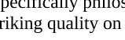

# 人类处境：第二版

丹妮尔·艾伦新撰序言

玛格丽特·卡诺凡撰写导言


致谢

注释

索引

# 丹妮尔·艾伦序言

2018

当代科学与被动性联系的案例并不难寻找。由美国科学院于 2014 年发布的《美国监禁人数的增长：探讨原因与后果》对这一主题论述非常详尽。该报告旨在评估过去三十年美国刑事司法系统中监禁人数迅速增加的情况，并对大量既有研究进行了元分析，追踪了犯罪率、执法政策变化对监禁的影响、选举政治主题等。作者们得出一个有力且不安的结论：“在正义领域，单凭实证证据无法为政策指明方向，然而随着美国监禁率在过去四十年中剧增，规范性原则的显式和透明表达却显著缺失。规范性原则在法理学和治理理论中根深蒂固，需要补充实证证据，以指导未来的政策和研究”（强调为作者添加）。简而言之，作者承认，过去几十年刑事司法政策的转型是由社会科学家的实证工作驱动的，这些工作侧重于可以通过量化回答的问题集，而且“在国家近期关于使用监狱的政策辩论中，对原则的广泛讨论显著缺失”。政策制定者在争论惩罚的原则，但仅限于原因和结果：监禁是增加了犯罪还是减少了犯罪？它对再犯率有什么影响？等等。在这一政策领域缺乏规范性辩论的情况下，报告作者在刑事司法政策方面承认了阿伦特在更广泛意义上指出的：即我们未能“思考我们正在做什么”。

科学的第二个特征是去政治化——或者更准确地说，是未能参与“思考我们正在做什么”——科学对“言说”（speech）的依赖。阿伦特写道，科学家们（她在书中经常使用这一类别）“在一个语言已失去力量的世界中行动”。她继续写，“因为今天的科学被迫采用一种数学符号的‘语言’，尽管它最初只是作为口头陈述的缩写，现在却包含了完全无法转化为言语的陈述”（第 4 页）。尽管数学化是一门语言，但它仍然迫使人类赖以生存的共享语言结构发生了断裂，而人类依靠这种结构来叙述历史、选择行动方案并赋予生命意义。在这里，阿伦特在引用里士多德。人类是政治性动物，他们之所以具有政治性是因为他们拥有语言。她写道：

> 可能存在超越言语的真理，这些真理对于个体具有极大意义，作为非政治生物的人（无论他还是什么）。复数的人类，即在这个世界中生活、移动和行动的人，只有因为他们能够彼此交流并自我感知，才能体验到意义。（第 4 页）

事实上，科学本身可以向我们证明，阿伦特的预测是正确的：对数学语言的日益依赖会导致政治参与度的下降。近年来，数据显示，强调科学的教育与受过教育者的去政治化相关。例如，人文科学类毕业生与 STEM（科学、技术、工程和数学）类毕业生的政治参与率之间存在统计学上的显著差异。美国教育部的数据显示，在 2008 年的大学毕业生中，92.8% 的人文类专业学生在毕业前至少投过一次票。在 STEM 专业学生中，这一比例为 83.5%。在毕业十年内，44.1% 的 1993 年人文类毕业生曾向公职人员写过信，而 STEM 学生的这一比例为 30.1%。作为大学生，这些学生的社会经济背景通常相似，这表明其他差异导致了政治参与度的不同。

当然，学生自发选择人文类或 STEM 专业可能意味着，这些数据仅反映了学生的内在特征，而非他们所受教育的影响。然而，在政治学家学者阳光·希利古斯（Sunshine Hillygus）的一项研究中，同样的模式在控制了学生预有的政治兴趣后依然出现了。希利古斯还发现，大学生之间政治参与的差异在 K-12 教育中也有体现。SAT 言语高分与政治参与可能增加相关，而高数学分则与参与可能降低相关。同样，由于社会经济因素对 SAT 分数的影响是言语分和数学分方向一致的，这种言语分和高数学分与参与可能性之间相关性的差异，告诉我们关于特定学科领域的成就与压力之间的关系——当然，这并不是为了识别、更不用说证明因果关系。但那些拥有更高级言语技能的人显然更准备好参与公民生活。教育强调科学的人其公民参与度的下降，是阿伦特预见到的危险消极性的预兆之一。

读者可能会想，鉴于阿伦特对科学思维模式、数学化以及纯粹“计算”的批判，我提供这些数据是否带有讽刺意味。但这是对该批判的误解。科学思维的工具是强大且具有巨大价值的。重点不在于放弃它们，而是将它们提供的知识整合到一场关于人类正在做什么、应该做什么以及为什么要这么做的、更广泛、更丰富的对话中——科学不是指南，而是支持——是一个拐杖、工具、加速器——为那些准备好思考自己正在做什么的人类服务的。

在最初出版六十年后的现在重读《人类境况》，阿伦特的预见性带给我更强烈的震撼。科学以及相关的现象——技术官治理，在中间的六十年里变得越来越强大。我所说的技术官治理，是指现在普遍的预期：政治问题应该由具备相关专业知识（经济学、气候科学、基因组学等）的政策专家决定。我认为，我们不平等的经济和分裂的政治是我们现在从人类生活大部分的去政治化中收获的苦果。在近二十年来，极其出色的经济学家丹尼·罗德里克（Dani Rodrik）一直认为全球经济存在“不可能性定理”，即“民主、国家主权和全球经济一体化是不兼容的”，他认为这三者同时具备是不可能的。然而，二十年来，经济政策制定者的表现得好像这里没有这种悲剧性的选择，好像增长问题也是一个纯粹的技术官治理问题。

认为现今去政治化会导致分裂是反直觉的。事实上，《人类境况》的负担在于帮助我们理解为什么政治化是一件好事。

在《人类境况》中，阿伦特著名地阐述了三种活动的内容和意义：劳动、工作和行动。劳动是我们出于生理需要而进行的活动；换句话说，是我们为了解放自己而所做的事。它也包含了性繁殖和投入到育儿的精力。工作是我们通过创造性努力所做的，以建立塑造我们的物品（无论是物理的还是文化的），并与其他人的社会联系。劳动和工作之间当然存在重叠，即我们进行生殖的背景。最后，行动识别了作为政治生物、在多元化的条件下共同努力为我们政体的行动路线做出集体决策的。

阿伦特向我们展示了这三种人类“行”——劳动、工作和行动如何缩小我们之间的距离；为我们提供将多元性（或差异）转化为生产性互动的机会；并让我们彼此变得可见可感知，而不是在四个冰冷且无法居住的房间角落成为武装的陌生人。第三种“行”属于政治领域，阿伦特经常被解读为仅专注于从其他人类活动中拯救行动。事实上，她对政治和政治化的拯救比这要复杂得多。劳动和工作也是被科学分析扁化和还原的类别——无论经济学家还是计算机科学家的分析都是如此。正如我们担心现在很快就会失去目标感一样，阿伦特的同辈也曾这样担忧不同类别的人。阿伦特反而坚持认为，这三个领域对每个人都是相关的；政治计划恰恰是为了定义这三个活动在我们每个人的生活中是如何相互交织的术语。政治的复兴要求每一个民主公民或公民主体重新具备诊断人类经验境遇的能力——即他们在劳动和工作机会方面什么是可能的——并追寻诸回应这些境遇的政治工作。

生活运行得比科学快得多，无论是自然科学还是社会科学。工厂倒闭了。人们发现自己失业了，并受到抑郁的困扰。在多年里，社会科学家进行假设、收集数据、测试或确认以及复制需要花费长时间。而情况就这样持续下去。当我们面对最困难的社会问题时——如大规模监禁、全球化引发的经济动荡或气候变化——我们需要加速获取理解的速度。我们必须使用所有可用的思维工具来思考我们正在做的事情。我，作为一个理性的、有认知能力的、学习的、处理的感知的人，甚至可以在经济研究完全完成之前做出判断，你也是如此，然后我们可以辩论我们不同的判断，通过争论达成关于应该做什么的决定。这就是“思考我们正在做的事情”的含义。

当然，在可能的情况下，我们也想通过严谨的科学或社会科学研究来利用并验证我们的判断。但至关重要的是要记住，科学将始终受到其无法跟上现实的限制，它永远无法告诉我们应该做什么。我们必须用其他理解现状的工具来补充科学。阿伦特告诉我们应该做的比科学告诉我们的要多。相反，她试图还给我们那些思维工具以及这些工具所塑造的行为：劳动、工作和行动。通过提供这些礼物并模拟政治思考，《人类处境》为我们的时代提供了一份迫切的良方。

## 引言

玛格丽特·卡诺万 (Margaret Canovan)

随着人的创造，开端的原则进入了世界。……开端的本质决定了，某种无法预料的新事物的开始了。（见下文，第 177 页）

汉娜·阿伦特是卓越的“开端”理论家。她所有的书都是关于意料之外的故事（无论是关注极权主义的新奇恐怖，还是关注革命的新黎明），对人类开启新事物的能力的反思贯穿了她的思想。当她在 1958 年出版《人类处境》时，她本人也向世界投递了一些东西，四年后，这本书的独创性依然如初地令人震惊。它不属于任何体裁，没有成功的模仿者，其风格和方式保持着高度的独特性。尽管阿伦特从未试图聚集追随者并建立学派，但她一直是一位伟大的教育者，开启了读者的眼界，让他们看到看待世界和人类事务的新方式。她阐明经验中被忽视角落的方法通常是通过做出区分，如果传统的二分法对她的智力想象力来说过于狭窄，她会做出许多区分，其中许多是三分法的。《人类处境》中充满了区分：劳动、工作与行动之间；权力、暴力与力量之间；地球与世界之间；财产与财富之间；以及更多更多，这些区分通常是通过词源学探索来确立的。但是，这些区分与一种挑战当代成就的、具有争议观点联系在一起。（对于这无疑是书中最出人意料的特征）她在古希腊发现了一个阿基米德点，从那里可以以批判性的眼光审视我们理所当然的思维和行为方式。事实上，她平静地假设我们可能从生活在两千年前的人的经验中学习重要的教训，这本身就挑战了现代的进步信念。对希腊人的不断引用增加了许多《人类处境》读者的困惑感，他们发现很难理解书中到底在发生什么。这是一篇长而复杂的文章，它不符合任何既定模式，充满了意料之外的见解，但缺乏清晰的论证结构。因此，作为引言要解决的最紧迫的问题是，阿伦特到底在做什么？

这本书的困难性及其持久的吸引力都源于她同时在做许多事情。其中交织的思维线索在初读时可能无法完全跟上，即使是反复阅读也可能带来惊喜。但有一点是她明确没有在写传统意义上的政治哲学：也就是说，即没有提供那种由哲学论证支持的政治处方。习惯于这种体裁的读者试图在《人类处境》中寻找类似的内容，通常是利用阿伦特对人类行动能力的描述。由于书中充满了对现代社会的批判，人们很容易想当然她意图呈现一个政治行动的乌托邦，一种“新雅典”。这种漫画式的描述并非完全没有根据。阿伦特确实追求参与式民主，并是公民活动爆发的热烈观察者，从美国公民反对越南战争到 1956 年短暂的匈牙利革命期间草根公民“委员会（cils）”的形成。提醒我们行动能力即使在不太可能的情况下也存在，这无疑是她的目的之一。但她否认自己具有提出未来蓝图的角色。她拒绝了“政治哲学家”的头衔，她认为自柏拉图以来所有的政治哲学家犯的错误在于，在多元化的人类中，每个人都可以行动并开启新事物。这种互动产生的结果是偶然且不可预测的，“实践政治的事务，取决于许多人的共识；它们绝不可能存在理论考虑或个人的意见中”（5 页）。

因此，《人类处境》是计划（但从未完成）的一部更系统的政治理论著作的“一种导言”，而非政治哲学。由于“核心政治活动是行动”，她解释道，有必要先进行初步的澄清练习，“在概念上将行动与其他通常与其混淆的人类活动隔离开来，例如劳动和工作。”事实上，这本书最显而易见的组织原则在于它对人类处境至关重要的活动的现象学分析：劳动，对应于作为动物的人生物生活；工作，对应于人类在地球上建造的人造对象世界；行动，对应于我们作为独立个体的多元性。阿伦特认为，这些区分（以及其中隐含的活动层级）在一个由哲学和宗教优先事项塑造的智力传统中被忽视了。然而，这本书的内容远不止现象学分析，甚至远不止阿伦特对传统政治哲学误读人类活动的批判。因为这些关注点是由她对当代事件的回应所构建的。当她在引言中说她提出的“除了思考我们正在做的事情外没有别的”时，她也明确了脑海中的不仅是对人类活动的一般分析，而是“从我们最新的经验和最近的恐惧出发，对人类处境的重新考虑”。什么样的经验和恐惧？

引言从对揭示人类开启新开端能力的事件的反思开始：1957 年第一颗卫星的发射，阿伦特将其描述为“仅次于原子裂变的重大事件”。正如 1956 年的匈牙利革命一样（也发生在她创作这本书期间），这一意料之外的事件导致她重新安排了思想，但同时也证实了她已经做出的观察。因为，她注意到这种人类力量的惊人展示在各方得到的反应不是自豪或敬畏，而是作为人类可能逃离地球的信号，她评论道，这种对人类生存的反叛“扩张”已经持续了一段时间。通过逃离地球进入太空，以及通过核技术等事业，人类正成功地挑战自然局限，但由于现代科学无法进入公众讨论，这使得政治问题变得极其困难。

阿伦特的序言从这一主题转到了“另一个同样具有威胁性的事件”，这一事件起初看似乎与此奇特地不相关：自动化的到来。虽然自动化将我们从苦力劳动的负担中解放出来，但它正导致一个“劳动者社会”的失业，在这样一个社会中，所有职业都被构想为维持生计。在书中，通过对人类活动进行现象学分析的框架，逐渐展开了这两个看似毫无关系的话题之间的辩证对比。一方面，太空时代的黎明证明了人类从字面意义上超越了自然。作为科学“与地球异化”的结果，人类开启新事的能力对所有自然局限提出了质疑，让未来公开地令人不安。另一方面，在阿伦特追溯到“与世界异化”的发展中，被日益高效的生产和消费所吞噬的现代社会鼓励我们把自己仅仅看作是受自然法则支配的动物物种，并以此思考。

对自己的能力和责任毫无意识的人类动物，并不适合承担威胁地球的力量。这种结合呼应了阿伦特早期对极权主义的分析，即极权主义是一个由矛盾的信念组合所推动的虚无主义过程：一方面相信“万事皆可能”，另一方面认为人类仅仅是受自然或历史法则支配的动物物种，而个人为了这些法则是完全可以被弃的。这种回响并非偶然，因为《人类境况》与阿伦特的著作是有机联系的，两者都对当代困境提出了新颖且深刻的诊断。

这本书源于阿伦特于 1956 年 4 月在芝加哥大学举办的查尔斯·R·沃尔格林基金会讲座，这些讲座本身是一个关于“马克思主义中的极权主义元素”的宏大项目的产物。阿伦特在完成《极权主义的起源》后开始了这一项目，书中包含了大量关于纳粹反犹太主义和种族主义前身的内容，但对于斯大林那种杀人式的阶级斗争的马克思主义背景却未提及。她的新事业是考虑马克思主义理论的哪些特征可能导致了这场灾难。事实上，她的搜寻带来了如此丰富且多样的收获，以至于关于马克思的书从未写成，但其中许多思维路径进入了《人类处境》，特别是她的结论：马克思致命地将政治行动误解为她所说的“工作”和“劳作”等其他人类活动的混合体。

在阿伦特看来，将政治行动理解为“制造”是一个危险的错误。制造——她称之为“工作”（work）的活动——是工匠通过强迫原材料符合其模型所做的事。原材料在过程中没有话语，而被视为创造新社会或创造历史尝试中的原材料的人类也是如此。论“人”（Man）创造其自己的历史是误导性的，因为正如阿伦特不断提醒我们的那样，并没有这样的人：“人不是生活在地球上，而是居住在世界里。”将政治构想为“制造”，是在理论上忽略了人类的多样性，并在实践中强迫个人。尽管如此，阿伦特发现马克思是从西方政治思想的伟大传统中继承了这种对政治的特殊误解。自从柏拉图背弃雅典民主并制定他的理想城市方案以来，政治哲学家们一直在以一种系统性忽略人类最显著特征的方式来论述政治——即人类是多元的，即每个人都有能力产生新的视角和新的行动，而且除非这些政治能力被粉碎，否则他们不会契合一个整洁、可预测的模型。因此，阿伦特在《人类境况》中的主要目的之一，是通过恢复并揭示这些被忽视的人类能力，来挑战整个政治哲学传统。

但这种对政治哲学的批判并不是书中源于她对马克思反思的唯一宏大主题。尽管马克思使用了工匠性质的术语来谈论“制造”（making/产出），但阿伦特声称，他实际上是从生产和消费的过程来理解历史的，而这些过程更接近动物生活——事实上是“劳作”（labor）。他将人类历史视为一个可预测的过程，这并不是一个关于独特的、凡胎的个体的故事，而是关于一个物种集体生命过程的故事。在阿伦特看来，他认为这一过程可以通过革命通往“自由领域”是完全错误的，但他被他描绘的这种沉没在人类物种集体生活中的、致力于生产和消费并不可阻挡地前进的个性所震撼。她发现这种对现代社会的描述具有揭示意义，其中经济关注已主导了政治和人类的自我意识。因此，与阿伦特人类活动现象学交织在一起的第二个宏大主题是她对“劳动者社会”崛起的描述。

这个“社会”的主题仍然是书中最令人困惑和充满争议的方面之一。许多读者对阿伦特对社会问题的贬义引用感到反感，并认为在批判现代社会的从众唯物主义时，阿伦特的意图是推荐一种英雄式行动的生活。但这种解读忽略了书的复杂性，因为它的另一个核心关注点是行动的危险性——行动会引发超出行动者控制的新过程，包括那些产生现代社会的进程本身。她对人类境况分析的核心是：一个持久的世界对于文明的生存至关重要，这个世界建立在地球上，以保护我们免受自然过程的影响，并为我们的凡胎生活提供一个稳定的背景。就像人们围坐的一张桌子，那个世界“既联系了又分离了人类”（第 52 页）。只有与从不同视角观察世界的其他人共享共同的人类世界的经验，才能让我们全面地看到现实，并发展出共同的常识。如果没有它，我们都将被自己的主观经验所驱动，在这种经验中只有我们的感受、需求和欲望。

对人类世界的主要威胁是，几个世纪以来，经济现代化（正如马克思所指出的）破坏了稳定性并让一切处于运动中。与马克思不同（马克思认为这种变化是历史过程的一部分），阿伦特将其追溯到偶然的人类行动，特别是改革时期对财产的大规模没收。因为财产（在代代相传的土地意义上）一直是文明世界的堡垒，使所有者对稳定产生兴趣。十六世纪由没收引发的巨大变化是双倍的：一方面，对世界稳定有利益的农民变成了完全沉浸于满足生理需求的劳动者；另一方面，稳定的财产被变成了流动的财富——事实上是资本——带有马克思曾很好地描述过的动态效应。当阿伦特反思自动化的影响时，这种生产和消费过程早已超出了对自然需求的满足；事实上，活动、方法和商品都是高度人工的。但她指出，这种现代人工性与早期文明所居住的稳定世界完全不同。物体、家具本身变成了消费品，而自动生产过程已经变成了人类必须适应的类自然节奏。她说，这“仿佛我们强加了保护世界免受自然侵害的人工边界，将正在其其中运行的生物过程以及环绕它的自然循环过程，交付并遗弃了一直受到威胁的人类世界的稳定性”（第 126 页）。在《人类境况》的其他地方，她将发生的情况描述为“自然的非自然增长”或“生命过程的解放”，因为现代化证明在增加生产、消费和生育方面是极其出色的，产生了一个大大扩张的人类群。她的观点是，自从这些经济关注成为公共关注和公共政策的中心（而不是像以前的所有文明那样隐藏在家庭隐私中），代价就是世界的毁灭，以及人类日益根据自己的消费欲望来构思自己。


然而，她论点的含义并不是我们所做的只是从劳动的沉浸中抽身并采取行动。因为这种现代霸权并不意味着人类已经停止了行动、新的开始或启动新进程——只是科学和技术已成为“进入自然”的舞台。正当我们越来越倾向于把自己看作动物物种时，他们超越这种局限的能力被科学发明戏剧性地揭示了。劳动者所遭受的“世界异化”的对应物是科学家们之间的“地球异化”。虽然阿基米德很久以前就宣布过如果他找到一个立足点，就能移动地球，但阿伦特认为（从伽利略时代到当代航天工程师和核科学家等）人类已经找到了从宇宙视角观察地球的方法，并且（行使开启新局面的人类特权）挑战了自然极限，以至于威胁到了生命本身的未来。根据她对当今困境的诊断，普罗米修斯式的力量——释放具有不可估量后果的过程——在一个过度沉溺于消费的社会中被行使，这些人既不对人类世界承担任何责任，也无法理解自己的政治能力。她在序言中观察到，“无思考”（这本身与共同人类世界的丧失有关）是“我们时代的显著特征之一”，而她大声思考的目的无疑是为了鼓励他人的思考。

由于阿伦特（Arendt）的目的是引发思考和讨论，她取得了巨大的成功。正如她的许多写作作品一样，《人类境况》（*The Human Condition*）自出版以来一直是激烈辩论的话题。事实上，现代政治理论的其他作品也曾评价毁誉参半，被一些人视为天才之作，而另一些人则认为不值一辩。许多学者对这本书非正统的风格和方式表示异议。阿伦特并不关注主流辩论，她在没有定义术语或没有进行常规论证的情况下阐述了自己的分析。政治争议也围绕着这本书激烈展开。它对“劳动动物”（animal laborans）的处理以及对社会关注问题的分析，使其在许多左翼人士中不受欢迎，但她对“行动”的阐述为其他激进分子带来了希望和鼓励的信息，包括民权运动中的某些人以及铁幕后方的人。在20世纪60年代的学生运动期间，《人类境况》被誉为参与式民主的教科书，而与该运动的关联反过来疏远了它的批评者。

近年来，阿伦特的思想引起了越来越多的关注（部分由于一些她本人并不欢迎的原因，例如对她的性别、种族以及与海德格尔（Heidegger）浪漫关系的关注），这本书的重要性已得到广泛认可，但其意义仍存在争议。由于其交织线索复杂性，存在多种解读空间。亚里士多德主义者、现象学家、哈贝马斯主义者、后现代主义者、女性主义者以及许多人在其丰富的织物的不同维度中汲取了灵感，而出版以来的四十年还不足以评估其持久的意义。如果我们能从这样一本复杂的书中提取出一个核心主题，那么这个主题必须是提醒我们政治的至关重要，以及要正确理解我们的政治能力及其所提供的危险与机遇。

阿伦特对人类境况的阐述提醒我们，人类是那种在开启事物和引发一系列事件的意义上行动的生物。无论我们是否理解其内涵，我们都在不断这样做，结果是世界和地球本身都被我们自取自灭的灾难所破坏。审视她所谓的“现代”（从17世纪到20世纪），她诊断出了一种悖论的局面：激进的经济过程是由人类行动引发的，而相关的人却越来越多地认为自己是社会经济力量洪流中随波逐流无能为力的浮萍。她认为，这两种趋势都与公众对经济活动的新关注有关，而这些活动传统上是家庭的私人事务。然而，在序言中，她观察到她所描述的这个“现代”本身已经过去，因为核技术的出现开启了一个“全新且未知的时代”。

采取进一步的行动，主动干预这类过程，并试图通过协议将其纳入控制。但是，除了控制那些由行动本性盲目引发的过程在物理上存在困难外，它也提醒了我们由多元性本身引发的政治问题。从原则上说，如果我们都能同意合作，我们就能发挥巨大的力量；但多元主体之间的协议是难以实现的，而且永远无法免受后续行动者的破坏性主动的影响。

当我们站在新千年的门槛上，我们唯一能做出的准确预测是：尽管已经启动的过程将持续，但开放的未来将成为无数超出我们想象的人类倡议的舞台。或许做出另一个预测也不算轻率：未来的读者将在《人类境况》（*The Human Condition*）中找到思考的空间和辩论范围，在这部非凡的书中挑选并发展不同的线索和主题。这将非常符合阿伦特。正如她晚年所说的：

> 每当你写下某些东西并将其推向世界使其变得公开时，显然每个人都可以随心所欲地处理它，这本该如此。我对此没有任何异议。你不应该试图对你独立思考的想法可能发生的任何事情束手无策。你反而应该尝试从他人如何处理这些想法中学习。

# 序言

1957年，一个由人类制造的地球物体被发射到宇宙中，在那里几周内，它根据摇动并保持天体（太阳、月亮和星辰）运动相同的引力定律绕地球运行。无疑，人造卫星既不是月亮也不是星星，不是那种可以在我们这些受地球时间限制的凡人面前持续运行一段时间的天体。然而，在一段时间内，它成功地留在了空中；它在天体附近栖息和移动，仿佛被暂时允许加入了它们那崇高的伴侣。

这一事件的重要性不亚于任何其他，甚至不亚于原子分裂，如果没有伴随其令人不安的军事和政治环境，它本会受到无尽喜悦的欢迎。但奇怪的是，这种喜悦并不是胜利性的；填充人们心的并不是对人类力量和掌控力伟大的自豪或敬畏，现在当他们从地面仰望天空时，这种力量可以隐藏在他们自己创造的事物之后。这种随口表达的直接反应是对于“逃离地球囚禁的第一步”感到松了一口气。而这一奇怪的陈述远非某个美国记者的偶然口误，它无意中呼应了二十多年前刻在俄罗斯伟大科学家坟墓碑上的那句非凡的话：“人类将不会永远被束缚在地球上。”

这种感觉已经普遍了一段时间了。它们说明世界各地的人在追赶和适应科学发现及技术发展绝非缓慢，相反，他们已经领先了这些几十年。在其他方面，科学实现并证实了人们在那些荒诞且并非无目的梦想中预想到的东西。新奇之处在于，这个国家最受尊敬的报纸之一，终于将直到那时一直埋没在极不尊严的科幻文学中的内容带到了头版（不幸的是，没有人像作为大众情感和大众欲望的媒介那样给予它应得的关注）。这一陈述的平庸不应让我们忽视它事实上是多么非凡的；因为尽管基督徒将地球称为泪水之谷，哲学家将身体视为心智或灵魂的监狱，但人类历史上从未有人将地球构想为人类身体的监狱，或表现出如此字面想要从这里去往月亮的渴望。现代的解放与世俗化——这始于一种转身，不一定背离上帝，而是背离一位作为人类之父的神——是否会以对天空下所有生物之母亲的地球进行更具命运的否定终结？

地球正是人类境况的精髓，据我们所知，地球本性在宇宙中可能是唯一的，为人类提供了一个栖息地，让他们可以毫不费力且无需人工地移动和呼吸。世界的人工性将人类生存从所有纯粹的动物环境中分离出来，但生命本身是在这个人工世界之外，尽管生命仍然与其他所有生物体保持联系。一段时间以来，许多科学努力一直致力于使生命“人工化”，致力于切断那条甚至人类也属于自然之孙的最后纽带。这种想要逃离地球囚禁的渴望，也体现在试管中创造生命的尝试中，体现在想要显微镜下混合“具有证明能力的人类的冷冻生殖质以产生更优越的人类”以及“改变他们的尺寸、形状和功能”之中；我怀疑，逃避人类境况的愿望也隐藏在将人类寿命延长远超百年极限的希望之后。

科学家告诉我们，他们将在一百年内产出这种未来，这种未来似乎拥有一种对现状人类生存的反叛——这是一份从无到有的自由礼物（从世俗角度来说），他希望将其换取某种他自己制造的东西。没有理由怀疑我们完成这种交换的能力，就像没有理由怀疑我们现在破坏地球上所有有机生命一样。问题仅在于我们是否希望在这个方向上使用我们的科学技术知识，而这个问题无法通过科学手段决定；这是一个首要的政治问题，因此很难留给专业科学家或专业政治家决定。

虽然这些可能性可能处于遥远的未来，但科学巨大胜利的第一波回旋效应已经在自然科学内部的危机中显现。问题在于，现代科学观的“真理”虽然可以用数学公式演示、在技术上证明，但已不再适用于语言和思维的正常表达。一旦这些“真理”被概念化和连贯地谈起，产生的陈述可能不像“三角形圆”那样毫无意义，但比“带翼狮子”要意义得多（薛定谔）。我们不知道这种情况是否是终局。但一种可能是，我们这些受地球限制的生物，开始表现得像宇宙的居民一样，将永远无法理解——即无法思考和描述我们所做的事情。在这种情况下，就好像我们思维的物理物质条件的大脑无法跟上我们的行为，因此从现在起我们确实需要人工机器来完成思考和说话。如果事实知识（现代意义上的技能）与思维已经彻底分手，那么我们确实会成为无助的奴隶，与其说是我们，不如说是无思想的生物，受每一个技术上可能的装置的摆布，无论它是多么具有杀力。

无论人类所知晓或所经历的什么，只有在能够被言说的范围内才具有意义。可能存在超越言语的真理，这些真理对于个体而言可能具有巨大的意义，即对于人作为非政治生物的人而言，无论其他身份如何。而作为复数意义的人类，即在这个世界上生活、活动和采取行动的人们，只有当他们能够相互交流并理解彼此和自己时，才能体验到意义。

更近且或许具有同等决定性的是一个同样不具威胁的事件。这是自动化的到来，它可能在几十年后将清空工厂，并将人类从最古老、最自然的负担——劳动的负担和对必然性的束缚中解放出来。在这里，人类的一个基本方面也面临着风险，但对这种状态的反抗、从劳动中解放的愿望——“劳作与苦难”，并非现代产物，而是有史可循。从劳动中解放本身并不新奇；它曾属于少数人早已确定的特权。在这种情况下，科学进步和技术发展似乎仅被用来实现前人梦寐以求但无人能实现的理想。

然而，这仅仅是表象。现代时代带来了对劳动的理论崇化，并导致了整个社会在事实上转变为一个劳碌的社会。因此，愿望的实现，正如童话中愿望的实现一样，发生在一个只会导致自我失败的时刻。一个劳动者组成的社会正要从劳动的枷锁中解放出来，而这个社会不再知道那些为了赢得这种自由而值得追求的、更高且更有意义的活动。在这个社会中，由于劳动是人类共同生活的方式，它是平等的，那里不再留有阶级，没有无论是政治还是精神上的贵族阶层，从那里可以重新恢复人类的其他能力。即使是总统、国王和首相也将他们的职位视为社会生活所必需的工作；而在知识分子中，只剩下孤独的个体将他们所做的事看作是“工作”而非“谋生”。我们所面对的是一个没有劳动的劳动者社会的前景，即失去了他们仅存的活动。无疑，没有比这更糟糕的。

对于这些忧虑和困惑，本书并不提供答案。这样的答案每天都在给出，它们是实务政治的问题，取决于许多人的共识；它们永远不存在于理论考量或一个人的意见中，仿佛我们在这里处理的是只有一种解决方案的问题。我在接下来的内容，是从我们最新经验和最新恐惧的视角出发，对人类处境的重新审视。这显然是一个关于思考的问题，也是关于无思考的问题——那种在绝望的混乱中无头无脑的鲁莽，或对已变得平庸空洞的“真理”的自得意的重复，在我看来是我们这个时代的显著特征之一。因此，我所提的非常简单：无非就是去思考我们正在做什么。

我们正在做的确实是本书的主题。它只处理人类处境最基础的表述，即那些在传统上以及根据目前的观点都是每个人能力范围内的活动。由于这个及其他原因，人类所能的最最高、最纯粹的活动——思考的活动，被排除在这些考量之外。因此，从系统上说，本书限于劳动、工作和行动的讨论，这构成了它的三个核心章节。在历史上，我在最后一章处理了现代时代，并在整书中讨论了我们从西方历史中所熟知的活动层级结构中的各种构型。

然而，现代时代不等同于现代世界。从科学角度看，始于17世纪的现代时代在20世纪初结束了；从政治角度看，我们今天所生活的现代世界是伴随着第一声原子爆炸而诞生的。我不讨论这个现代世界，本书是在它的背景下编写的。一方面，我限于对源于人类处境且永久的通用能力进行分析，即只要人类处境不改变，这些能力就不会不可挽回地丢失。另一方面，历史分析的目的是追溯世界异化（即从地球逃向宇宙以及从世界逃向自我的双重逃离）的源头，以理解社会在被一个全新的、未知的时代所克服时，它所发展和呈现出的本质。

通过“积极生活”（`vita activa`）这一术语，我提指三种基本的人类活动：劳动、工作和行动。它们之所以是基本的，是因为每种活动都对应于人类被赋予地球生命的基本条件之一。

劳动（`Labor`）对应于人体的生物过程的活动，其自发的生长、代谢和最终的衰败与劳动所产生并投入生命过程的必需密切相关。劳动的人类处境是生命本身。

工作（`Work`）对应于人类存在的非自然性，这种存在并未植根于物种循环复始的生命周期，其死亡性也没有得到该周期的补偿。工作提供了一个“人工”的对象世界，与所有自然环境截然不同。个体生命被安置在这个边界之内，而这个世界本身旨在长存并超越一切。工作的人类处境是无世界性（`worldlessness`）。

行动（`Action`）是唯一不通过事物或物质媒介而直接发生在人之间的活动，它对应于人类复数的处境，即人类在这个世界上生活、活动和行动时，只有当他们能够相互交流并理解彼此和自己时，才能体验到意义。

与人类生命的持续关系立即呈现出一种人类生存状态的特征。这就是为什么人们无论做什么，始终是被受约的生物。无论是自然进入人类世界，还是通过人类努力被引入其中的，都构成了人类境遇的一部分。世界现实对人类生存的影响作为一种制约力量被感知和接受。世界的客观性——其客体性或物性特征——与人类境遇相辅相成；因为人类生存是受约的，没有事物将是不可能的，而如果事物不是人类生存的制约者，它们将仅仅是一堆互不相关的物品，一个非世界。

为了避免误解：人类境遇不等同于人性，而且与人类境遇相应的人类活动和能力的总和并不构成任何类似于人性的东西。因为我们在这里讨论的、未遗漏的思想和理性，甚至对它们所有者的详尽列举，都不构成人类生存的本质特征，即如果没有这种生存，我们就不再是人类。我们能想象到的人类境遇最根本的改变将是人类从地球迁移到另一个行星。这样一个事件不再不可能，意味着人类将不得不生活在人为的条件下，这些与地球提供的条件截然不同。届时，无论是劳动、工作，还是我们所知的思想，将不再具有意义。然而，即使是这些假设的地球旅行者仍然是人类；但我们关于他们的“本”能做出的唯一陈述就是他们受约生物，尽管他们的境遇现在在很大程度上是自造。

人性的问题，奥古斯丁式的 `quaestio mihi factus sum`（“我对自己成了一个问题”），在个人心理学意义和一般哲学意义上似乎都是不可回答的。我们能够认知、确定并定义周围所有事物的自然本质（而我们并非那些事物），却极不可能能为自己做到同样的事——这就像是跳过自己的阴影。此外，没有任何理由让我们假设人类拥有像其他事物那样的本或本质。换句话说，如果我们有人性或本质，那么显然只有神能知道并定义它，而首要前提是他能够像谈论一个“物”一样谈论一个“谁”。令人困惑的是，那些适用于具有“自然”属性事物的类认知模式（包括我们作为最发达的有机生命物种样本的有限程度），在我们提出问题时：*我们究竟是谁？*，对我们失效了。这就是为什么定义人性的尝试总是被等同于对神的某种建构，即哲学家们的神，自柏拉图以来，他在近距离观察下显现为一种柏拉图式的人类理念。当然，将此类关于神性的哲学概念揭示为人类能力和特质的概念化，并不是对上帝不存在的证明，甚至不是对其的论证；但这种试图将人性如此轻易地定义为一个绝对让我们认为是“超人类”的、因此等同于神性的理念的尝试，可能会对“人性”这一概念本身引起怀疑。

另一方面，人类生存的条件——生命本身、出生与死亡、世界性、多样性以及地球——永远无法“解释”我们是谁，也无法回答我们是谁的问题，简单理由在于它们从没有绝对地制约我们。这一直是哲学的观点，与同样关注人类的科学（人类学、心理学、生物学等）有所区别。但今天我们几乎可以说，我们已经充分证明了，尽管我们现在可能永远生活在地球的条件下，但我们并非仅仅是束缚地球的生物。现代自然科学的巨大胜利归于它从一个真正普遍的视角观察并处理束缚地球的自然，即从一个刻意且明确地站在地球之外的阿基米德视角。

`vita activa`（活跃的生活）充满了并过度承载了传统。它与我们的政治思想传统一样老（但并不老于它）。而这种传统远没有理解和概念化西方思想所有的政治经验，它源于一个特定的历史格局：苏格拉底的审判以及哲学家与城邦（`polis`）之间的冲突。它消除许多与其直接政治目的无关的早期经验，并在卡尔·马克思的作品中以高度选择性的方式一直持续到结束。该术语本身在中世纪哲学中是里士多德 `bios politikos` 的标准译法。

传统上，直到现代的开端，“活跃生活”（`vita activa`）一词从未失去过其“不平静”的负面含义，即“闲暇”（`nec-otium`）或“无事”（`a-skholia`）。因此，它与一种更基础的区分紧密相关：即事因其本身而存在的事物与依赖人类而存在的事物之间的区别，即“自然物”（`phage`）与“人造物”（`nomō`）之间的区别。沉思相对于活动的优先地位，建立在一种信念之上：任何人手之作在美感和真理上都无法比拟宇宙（`kosmos`），因为宇宙在永恒不变的永恒中自我摆动，不受人类或神灵任何外部干预或帮助。当所有人类的运动和活动处于完全静止状态时，这种永恒便向凡人的肉眼显现。在这种沉思的态度下，活跃生活内部所有的区别和划分都消失了。从沉思的视角来看，什么打破了必要的宁静并不重要，只要它被打破了即可。

因此，传统上，活跃生活的意义源于“沉思生活”（`vita contemplativa`）；它之所以被赋予如此有限的尊严，是因为它服务了肉体内沉思的需求与欲望¹³。基督教信仰来世，其世后的喜悦在沉思的愉悦中宣告自己¹⁴，对活跃生活退回到其派生的、次要的位置赋予了宗教许可；但这种秩序本身的确定，恰逢与“沉思”（`theōria`）作为一种人类能力的发现相一致——这种能力与思维和推理截然不同，它发生在苏格拉底学派，随后贯穿于我们整个传统中受支配的形而上学和政治思想中¹⁵对我而言，似乎没有必要讨论这一传统的原因。显然，这些原因比引发城邦（`polis`）与哲学家冲突的历史偶然要深得多，而这种冲突也几乎是偶然地导致了沉思作为哲学家生活方式的发现。它们存在于人类状况的一个完全不同的维度，在该维度中，多样性并未在活跃生活的各种划分中耗尽，而且我怀疑，即使将思维和推理的运动纳入其中，也不会耗尽。

因此，如果我在此处建议的“活跃生活”一词的使用与传统存在显然矛盾，我不怀疑的并非传统背后的经验之有效性，而是其从起初就固有的等级秩序。这并不意味着我想要质疑、甚至讨论那种将真理视为启示并因此本质上赐予人类的传统概念，也不意味着我更倾向于现代主义实用主义的断言，即人类只能知道自己所创造的事物。我的观点仅仅是，在传统等级中，沉思的巨大权重模糊了活跃生活内部的区别和划分，而且尽管表面上如此，这种状况本质上并没有随着现代与传统的断裂以及最终在马克思和尼采那里对其等级秩序的颠转而发生改变。这正处于哲学体系或当前被接受的价值被“颠倒”的本质之中，即在操作本身的本质中，概念框架在或多程度上保持了完好。

现代的颠转与传统等级共享一个假设，即在人类的所有活动中必须存在同一个核心人类关怀，因为如果没有一个综合性的原则，就无法建立任何秩序。这种假设并非理所当然，我使用“活跃生活”一词预设了其所有活动背后的关注与沉思生活的中心关注不同，也不优于后者。


一方面，对世事各种积极投入的模式，与另一方面终于沉思的纯粹思维，这两者可能对应两种完全不同的人类关怀，这在某种程度上自“思想的人与行动的人开始走不同的道路”¹⁶以来就有，即苏格拉底学派政治思想的兴起。然而，当哲学家们发现（尽管无法证明，但这一发现很可能是苏格拉底本人完成）政治领域并非理所当然地为人类的所有活动提供保障时，他们立即假设，并不是发现了已知之外的某种新东西，而是发现了一个更高的原则来取代统治城邦的原则。指示这两个不同且在某种程度上冲突的原则的最短（尽管有些浅显）的方法，是回顾“不朽”（`immortality`）与“永恒”（`eternity`）的区别。

不朽意味着在时间中的持久，根据希腊人的理解，是在地球上和这个世界中赋予自然和奥林匹斯神灵的不死生命。在自然周而复始和神灵不朽的背景下，凡人处于时代之中，他们是不朽但不永恒的宇宙中唯一的凡人者，面对着神灵的不朽生命，却不受永恒之神的统治。如果我们相信希罗多德，这两者的区别在哲学家进行概念划分之前，对希腊人的自我理解来说似乎是惊人的，因此在在作为无形之神基础的特定希腊式的永恒体验之前。希罗多德在讨论亚洲形式的崇拜和对无形之神的信仰时，明确提到，超越的神（正如我们今天所说的）是超越时间、生命和宇宙的；而希腊众神是拟人化的，与人类相同的本质，而不仅仅是相同的形状。希腊人对不朽的关注源于他们对不朽和凡人神灵的经验，这些神共同围绕着凡人的个体生命。在一个万物皆不朽的宇宙中，死亡性变成了人类存在的标志。人是“凡人者”，是存在中唯一的凡之物，与动物不同，他们不仅仅是作为物种的成员存在（物种的不朽生命通过繁殖得以保证）。人类的死亡性在于，个体生命——带有一个从出生到死亡的可识别的生命故事——产生于生物生命。这种个体生命通过其运动的直线轨迹与其他所有事物区别开来，可以说，这种轨迹贯穿了生物生命的循环运动。这是一个这样的宇宙，其中一切如果运动的话，都是按循环顺序运动的。

这恰恰是决定性的，永恒的经验与不朽的经验之间没有对应关系，且无法转化为任何活动，自从……“沉思”（`theōria`）或“沉思”是赋予永恒经验的，与所有态度区别开来，可能属于不朽。在我们的语境下，哲学家们发现永恒具有重要性，无论苏格拉底本人是否发现了永恒作为思想的中心。这极大地倾向于这样：在许多方面是唯一的思想者从未关注过永恒；因为当他坐下写他的思想时，他不再关注永恒了。他进入了活跃生活并选择了永恒和不朽。有一点是肯定的：只有在柏拉图的洞穴寓喻中，永恒和哲学家的生活被视为内在矛盾并与追求不朽冲突，公民的生活（`bios politikos`）。哲学家从束缚他的同类人的束缚中解放出来，离开了洞穴，处于“独特性”，并没有被他人跟随。从政治上说，如果死亡等同于“处于人类之中”，永恒的经验是一种死亡，而唯一留存的是由于没有生命生物可以承受它，这恰恰是区分沉思生活与中世纪神学的活跃生活的。但决定性的是，永恒的经验与不朽的经验没有对应关系，且无法转化为任何活动，自从通过语言在自身进行的思维，显然不足以呈现它，会中断并摧毁经验本身。

由于他们对城邦（`polis`）可能获得永生甚至持久性抱有非常合理的怀疑，这可能是这一发现的冲击是如此巨大，以至于他们无法将所有对永生的追求视为虚荣和自夸，这无疑使他们自己与古代城邦以及激发其灵感的宗教处于公开的对立面。然而，对各种永生追求的最终失败，胜利并非源于哲学思想。罗马帝国的灭亡清楚地证明了凡人所作都不可能永恒，而且这伴随着基督教永恒个人生命的福音兴起，使其成为西方人类的唯一宗教。这两者共同使得对世俗永生的任何追求都变得徒劳且没有必要。它们如此成功地让“活跃生活”（`vita activa`）和“政治生活”（`bios politikos`）成为了沉思的侍女，以至于现代世俗化的兴起以及随之而来的行动与沉思之间传统阶级的反转，也无法让最初作为活跃生活源泉和中心的对永生的追求免于被遗忘。

### 人：社会性动物还是政治动物

活跃生活（`vita activa`），即人类在积极从事某些活动方面的生活，始终植根于一个人类和人造物的世界，它从未离开过这个世界，也没有完全超越它。物和人构成了每个人活动的环境，如果没有位置，这些活动将毫无意义；然而，这个环境——我们出生的世界——如果没有产生它的人类活动就不会存在，正如人造物品那样；如果没有对它的照料，正如耕种土地那样；或者如果没有通过组织建立它，正如政治共同体那样。没有任何人类生活（即使是自然荒野中的隐士生活）可以在没有直接或间接见证其他人类存在的世界上生存。

所有人类都受到共同生活这一事实的制约，但只有“行动”（`action`）无法想象在人类社会之外的。劳动的活动不需要他人的存在，尽管一个在完全孤独中工作的生物并非人类，而是词义字面意义上的“劳动动物”（`animal laborans`）。一个亲手工作、制造和建造一个由自己居住的世界的人，他仍然是一个制造者，尽管不是“制造者人”（`homo faber`）：他将失去他特定的人类特质，不如说，是一个神——不是指造物主，而是柏拉图在他一个神话中描述的那种神性工匠（`demurge`）。行动本身是人类特有的特权；无论是兽还是神都无法做到，而且只有行动完全取决于他人的持续存在。

这种行动与共处之间的特殊关系，似乎完全证明了早期将亚里士多德的“政治动物”（`zoon politikon`）翻译为“社会动物”（`animal socialis`）在塞内卡那里已存在，后通过托马斯·阿奎那成为标准翻译：`homo naturaliter politicus, id est, socialis`（人是政治性的，也就是说，是社会性的）。² 比起任何复杂的理论，这种用“社会”替代“政治”的无意识替换，揭示了原始希腊对政治的理解流失到了何种程度。对于这一点，具有意义而非决定性的是，“社会”一词源于罗马，在希腊语或思想中没有对等词。然而，拉丁语词“societas”的用法也有一个明确但有限的政治含义；它指的是人们为了特定目的而结成的联盟，例如当人们组织起来统治他人或实施犯罪时。³ 只有后期出现了“人类社会”（`societas generis humani`）⁴的概念，“社会”一词才开始获得一种作为基本人类状况的普遍含义。并不是柏拉图或亚里士多德不知道或不在乎人类无法离开同伴而生存这一事实，而是他们没有将这种状态视为特定的人类特质；相反，这是人类生活与动物生活的共同点，正因如此，它不能从根本上说是是人类的。人类物种自然的、仅仅是社会性的陪伴被认为是生物生活需求强加于我们的一种限制，而这些需求对于人类动物和其他动物生命形式来说是相同的。

根据希腊思想，人类的政治组织能力不仅不同，而且与那种以家庭（`oikia`）和家族为中心的自然关联处于直接对立状态。城邦的兴起意味着人除了拥有私人生活外，还获得了一种“第二种生活”，即他的“政治生活”（`bios politikos`）。现在，每个公民都属于两种存在状态，并且在他私人的（`idion`）生活和公的（`koinon`）生活之间存在着严格。⁵ 这不是亚里士多德的观点或理论，而是一个简单的历史事实：城邦的基础是通过摧毁所有基于血缘关系的组织单位而完善的，正如原族（`prathria`）和族（`phylé`）⁶那样。在亚里士多德所谓的“政治生活”中所有必要且存在的活动中，即行动（`praxis`）和言语（`lexis`），其中诞生了柏拉图所称的“人类事务领域”（`ta tôn anthrōpon pragmata`），在那个领域中，一切仅仅是必要的或有用的东西都被严格排除在外。

然而，虽然只有城邦的基础使人能够终身生活在政治领域（即行动和言语中），但这种认为这两种人类能力相互关联的信念似乎是最高的，且早于城邦，并已经存在于前苏格拉学派的思想中。荷马史中阿基琉的地位只有在他被视为“伟大事迹的执行者和伟大言语的发表者”时才能被理解。⁷ 与现代理解不同，这些言语被认为是伟大是因为它们表达了伟大的思想；相反，正如我们从安提戈涅的诗句中所知，可能正是通过“大言”（`megaloi logoi`）来回击惊人的打击，这种能力才最终在老年时教导人思考。思想次于言语，言语和行动被认为是同时且对等的，具有相同的地位和种类；这最初不仅意味着大多数政治行动（在处于暴力领域时）是通过言语进行的，而且从根本上说，在正确的时刻找到正确的词（无论它们传递了什么信息或交流）都是行动。只有纯粹的暴力是沉默的，正因如此，暴力永远不能。在城邦的经验中（它被很有理地被称为最能言说的政治政体），尤其在由此产生的政治哲学中，行动和言语分离了并变得越来越独立。重点从行动转向了言语，转向了说服手段，而非特定人类的回应、交谈和衡量方式。即使在古代晚期，战争术和言辞（修辞）作为两门主要的教育科目出现时，这种发展仍然受到这种古老的城邦经验和传统的启发，并受制于它。政治，生活在城邦，意味着一切都是通过言语和说服决定的，而不是力量和暴力。在希腊人的自我理解中，通过暴力强迫人们，命令而非说服，是处理城邦之外生活或家庭生活的前政治方式，在家庭中，首领以不可质疑的专权统治，而在亚洲的野蛮帝国中，专制经常被比作对家庭的组织。

亚里士多德将人定义为政治动物（`zoon politikon`），这种定义与家庭生活中经历的自然关联不仅无关，甚至与之对立；只有加上他关于人类第二个著名的定义，才能被完全理解，人类是 `a zōon logon ekhon`（“拥有言说能力的生物”）。将这一术语翻译为拉丁语 `animal rationale`（理性动物），建立在对“社会性动物”一词同样根本性的误解之上。亚里士多德的目的既不是定义一般的人类，也不是指人类最高的能力——对他而言，这种最高能力不是 `logos`（即言说或理性），而是 `nous`，即沉思的能力，其主要特征是其内容无法用言语表达.¹⁰ 在他最著名的两个定义中，亚里士多德制定了关于人类和政治生活方式的流行观点；根据这一观点，城邦（`polis`）之外的所有人——奴隶和蛮族——都是“非言说者”，他们被剥夺的显然不是言说能力，而是一种只有言说才具有意义的生活方式，在那种生活中，所有公民的核心关注在于彼此交谈。

拉丁语将“政治的”（political）误认为“社会的”（social）所表达的这种深刻误解，可能在没有任何地方比托马斯·阿奎纳的某次讨论更清晰。他在讨论中比较了家庭统治与政治统治的本质：他发现，家主与君主之间某些相似之处，但他补充说，家主的权力没有国王的那么“完美”。¹¹ 不仅在希腊和整个西方古代的城邦中，这确实是显而易见的：即使是暴君的权力，也比家父（`paterfamilias`，`dominus`）统治其奴隶和家庭的权力要小、要那么“完美”。这并不是因为城市统治者的权力被家庭主主的权力所匹配和制衡，而是因为绝对的、不受质疑的统治与政治领域在严谨意义上是相互排斥的.¹²

## 城邦与家庭

尽管将政治领域与社会领域误解并等同，正如希腊术语翻译成拉丁语及其适应罗马基督教思想的历史一样古老，但在现代用法和对社会的理解中，这种区分已变得更加混乱。生活的私人领域与公共领域的区分对应于家庭领域和政治领域，至少自古代城邦兴起以来它们作为不同、独立的实体存在着；但社会领域的出现——严格来说，它既不是私人的也不是公的——本质是一个较新的现象，其起源与现代的出现重合，并在国家中找到了其政治形式。

我们在这一背景下所关注的是，由于这种发展，我们极难理解公共领域与私人领域、城邦领域与家庭领域之间，以及最终与共同世界相关的活动与维持生存相关的活动之间的决性划分；而这种划分是所有古代政治思想赖以认为是理自见且公理的基础。在我们的理解中，这条分界线已完全模糊了，因为我们将人群和政治共同体视为一个家庭的形象，其日常事务必须由巨大的、全国性的家务管理来照顾。与这一发展相对应的科学思想不再是政治学，而是“国民经济”或“社会经济”或 `Volkswirtschaft`（民族经济），这些都指示一种“集体家务”；¹³ 在经济上被组织成某种超人类家庭拟态的家庭集体，就是我们所谓的“社会”，而它的政治组织形式被称为“国家”。¹⁴ 因此，我们发现很难意识到，根据古代思想，存在这些事情，而“政治经济”这个术语本身就是自相矛盾的：任何属于“经济”的、涉及个人生活和物种生存的事，在定义上都是非政治的、家庭事务.¹⁵

从历史来看，城邦和公共领域的兴起很可能是以家庭和住宅的私人领域为代价的.¹⁶ 然而，炉火的老老神圣性虽然在古希腊远不如古罗马那样显著，但从未完全消失。阻止城邦侵犯公民私人生活并使每个财产周围的边界神圣化的并不是对我们所理解的私有财产的尊重，而是因为如果没有房子，人就无法参与世界的事务，因为他在世界上没有一个真正属于自己的位置.¹⁷ 即使是柏图，这位预见到废除私有财产并将公共领域扩大到完全消除私人生活的政治家，也对边界保护者宙斯（`Zeus Herkeios`）表现出极大的敬畏，并将不同领地之间的边界 `horoi` 视为神圣，而没有看到任何矛盾¹⁸

家庭领域的独特特征是，在家庭中人们生活在一起是因为他们受到欲望和需求的驱动。这种驱动力是生命本身——根据普鲁塔克的说法，家神（`penates`）是“让我们生存并滋养我们身体的神灵”¹⁹——而生命为了个人的维持和作为物种的生存需要他人的陪伴。个人维持应该是男人的任务，物种生存应该是女性的任务，这是显而易见的，而这两个自然功能——男人提供营养的劳动和女性分娩的劳动——都受到同样的生命紧迫性的支配。家庭中的自然共同体既是必然的，而这种性统治着其中进行的所有活动。

相反，城邦领域是自由的领域，如果这两个领域之间存在关系，那么对家庭生活中生活必需品的掌握就是城邦自由的条件。在任何情况下，政治都不可能仅仅是保护社会的手段——一个像中世纪那样的信徒社会，或一个像洛克那样的财产所有者社会，或像霍布斯那样的无情处于获取过程中的社会，或像马克思那样的生产者社会，或像我们自己的社会这样的职员社会。家主统治家庭的这种前政治力量，以及由于人是“社会性”或“政治性”动物而被认为是必要的力量，与十七世纪政治思想中的“自然状态”没有任何共同点；在那种自然状态下，人们只能通过建立一个对权力和暴力的垄断，通过“震慑他们”来消除“万人对人的战争”²¹ 相反，统治与被统治的整个概念（正如我们所理解的那样）被认为是前政治的，属于私人领域而非公共领域。

城邦与家庭的区别在于，城邦只承认平等者，而家庭是极度不平等的中心。平等意味着自由，但不受生活必然性或他人的支配，而是处于自我支配。它既不意味着统治，也不意味着被统治²² 因此，在家庭领域内不存在自由，因为家主（其统治者）只有在有权离开家庭进入城邦（那里人人平等的）时才被认为是自由的。诚然，城邦的这种平等与我们的平等概念几乎没有共同：它意味着与同类生活并仅与同类交往，而且它预设了“不平等者”的存在，而事实上，这些人一直是城邦人口的大多数²³ 因此，平等并不像现代那样与正义相关，而是自由的本质：从统治中存在的不平等中解放出来，并在一个既没有统治者也没有被统治者的领域移动。

然而，用清晰的对立来描述现代与古代政治理解之间深刻差异的可能性到此结束。在现代世界，社会领域和政治领域的划分不再那么分明。政治仅仅是社会的一种功能，行动、言语和思想主要是上层建筑

社会利益并非卡尔·马克思的发现，恰相反，它是马克思不加批判地从现代政治学家那里接受的公理假设之一。这种功能化使得人们无法感知到这两个领域之间存在任何严肃的鸿沟；这并不是一个理论或意识形态的问题，而是随着社会的兴起——即“家庭”（`oikia`）或经济活动向公共领域的兴起——家务以及以及所有曾经属于家庭私有领域的事务都已成为一种“集体性”的关注点^24 在现代世界中，这两个领域确实像永不停歇的进程流中的波浪一样，不断相互汇流。

古代人每天为了超越狭小的家庭领域并“升入”政治领域而必须跨越的这种鸿沟的消失，是一种本质上现代的现象。私领域与公领域之间的这种鸿沟在中世纪的某些地方仍然存在，尽管它已经失去了大部分意义并完全改变了其位置。人们正确地指出，罗马帝国衰落后，是天主教教会为人们提供了曾是市政政府特权的公民权的替代品.^25 中世纪生活的黑暗与伴随一切神圣事物的宏伟壮丽之间的张力，以及随之而来的从世俗向宗教的转变，在许多方面与古代从私领域向公领域的转变相对应。这种区别无疑是非常明显的，因为无论教会变得多么“世俗”，它本质上始终是一项让信徒群体维持在一起的另一种世俗关注。虽然人们很难将公领域与宗教领域等同起来，但在封建统治下的世俗领域在古代确实是其完全私有的领域。它的特征是将所有活动吸收到家庭领域，在那个领域这些活动只有私人的意义，结果导致了公共领域的完全缺失.^26

这种私有领域增长的特征，顺便也是古代家庭之主与封建领主之间的区别在于：封建领主可以在其统治范围内施行正义，而古代家庭之主虽然知道更温和或更严酷的统治，但在政治领域之外既不了解法律也不了解正义.^27 将所有人类活动引入私有领域，并以家庭为范本对所有人类关系进行建模，一直延伸到城市内部特定的中世纪职业组织——行会、兄弟会和伙伴团体，甚至延伸到早期的商业公司，在这些地方，“原始的共同家庭似乎由‘公司’一词（`companis`）来指示 . . . [以及]诸如‘共食一个面包的人’、‘共用面包和酒的人’等短语。”28 中世纪“共同利益”的概念远非表明政治领域的存在，它仅仅承认个人具有共同的利益（物质上和精神上），并且如果有人承担起照顾这种共同利益的责任，他们就可以保留私性并处理自己的事务。这种本质上是基督教的政治态度与现代现实的区别，与其说是对“共同利益”的承认，不如说是私有领域的排他性，以及缺乏一种奇特的混合领域——在那个领域中，私利承担了公共意义，我们称之为“社会”。

因此，仅仅关注世俗领域的中世纪政治思想没有意识到家庭受保护的生活与城邦（`polis`）无情暴露之间的鸿沟，这并不意外，而这是由于勇气作为一种最基本的政治态度之一。仍然令人惊讶的是，在后古典政治理论家中，唯一一个为了极力恢复政治旧尊严而察觉到鸿沟并极度需要跨越它的人是马基雅维利，他描述了“佣兵队长（Condottiere）从低级地位到王国的崛起，即从人类共同的境遇到伟大事迹的辉煌荣耀。”29


# 论公私领域、社会与政治美德

离开家庭最初是为了投身于某些冒险和光荣事业，后来仅仅是将生命奉献给城市事务，这需要勇气，因为只有在生存中，家庭首要考虑的是自己的生命和生存，为了这一点，必须对生命的过大热爱付出风险，而过大的提供的自由是奴隶性的确定征兆。因此，勇气成为了卓越的政治美德，只有拥有这种勇气的人才能被接纳进内容和目的上具有政治性的团体中，这种团体通过生活的紧迫性超越了强加在所有人——奴隶、野蛮人和希腊人——身上的更强的凝聚力。亚士多德将“良好的生活”称为公民的生活，因此它不仅比普通生活更好、更无忧或更高贵，而且是一种完全不同的质。它是“好”的，体现在通过掌握纯粹生活的必要条件，通过从劳动和工作中解放出来，并通过克服所有生物对自身生存的本能冲动，它不再受限于生物生活过程。

## 希腊政治意识中的公私划分

在希腊政治意识的根源处，我们发现这种划分具有无与伦比的清晰度和条理性。任何仅为了谋生、仅维持生活过程目的的活动都不被允许进入政治领域，正因这种将贸易和制造业交给奴隶和外人的勤劳工作的严重风险，雅典成为了马克斯·韦伯生动描述的具有“消费者无产阶级的养老金城市（pensionopolis）”。这个城邦的真正特征在柏拉图和亚士多德的政治哲学中仍然相当明显，尽管家庭与城邦之间的界限偶尔会模糊，特别是在柏拉图那里，他可能追随苏格拉底，开始从私生活的日常经验中为城邦提取例子和插图；但在亚士多德那里也是如此，他追随柏拉图，尝试地假设城邦的历史起源至少与生活的必要性有关，而只有它的内容或内在目标（telos）升华到“良好的生活”。

## 社会利益与现代公私领域的消融

社会利益并非卡尔·马克思的发现，恰相反，它是马克思不加批判地从现代政治学家那里接受的公理假设之一。这种功能化使得人们无法感知到这两个领域之间存在任何严肃的鸿沟；这并不是一个理论或意识形态的问题，而是随着社会的兴起——即“家庭”（oikia）或经济活动向公共领域的兴起——家务以及所有曾经属于家庭私有领域的事务都已成为一种“集体性”的关注点。在现代世界中，这两个领域确实像永不停歇的进程流中的波浪一样，不断相互汇流。

古代人每天为了超越狭小的家庭领域并“升入”政治领域而必须跨越的这种鸿沟的消失，是一种本质上现代的现象。私领域与公领域之间的这种鸿沟在中世纪的某些地方仍然存在，尽管它已经失去了大部分意义并完全改变了其位置。人们正确地指出，罗马帝国衰落后，是天主教教会为人们提供了曾是市政政府特权的公民权的替代品。中世纪生活的黑暗与伴随一切神圣事物的宏伟壮丽之间的张力，以及随之来的从世俗向宗教的转变，在许多方面与古代从私领域向公领域的转变相对应。这种区别无疑是非常明显的，因为无论教会变得多么“世俗”，它本质上始终是一项让信徒群体维持在一起的另一种世俗关注。虽然人们很难将公领域与宗教领域等同起来，但在封建统治下的世俗领域在古代确实是其完全私有的领域。它的特征是将所有活动吸收到家庭领域，在那个领域这些活动只有私人的意义，结果导致了公共领域的完全缺失。

私有领域增长的特征，顺便也是古代家庭之主与封建领主之间的区别在于：封建领主可以在其统治范围内施行正义，而古代家庭之主虽然知道更温和或更严酷的统治，但在政治领域之外既不了解法律也不了解正义。将所有人类活动引入私有领域，并以家庭为范本对所有人类关系进行建模，一直延伸到城市内部特定的中世纪职业组织——行会、兄弟会和伙伴团体，甚至延伸到早期的商业公司，在这些地方，“原始的共同家庭似乎由‘公司’一词（companis）来指示……[以及]诸如‘共食一个面包的人’、‘共用面包和酒的人’等短语。”中世纪“共同利益”的概念远非表明政治领域的存在，它仅仅承认个人具有共同的利益（物质上和精神上），并且如果有人承担起照顾这种共同利益的责任，他们就可以保留私性并处理自己的事务。这种本质上是基督教的政治态度与现代现实的区别，与其说是对“共同利益”的承认，不如说是私有领域的排他性，以及缺乏一种奇特的混合领域——在那个领域中，私利承担了公共意义，我们称之为“社会”。

因此，仅仅关注世俗领域的中世纪政治思想没有意识到家庭受保护的生活与城邦无情暴露之间的鸿沟，这并不意外，而这是由于勇气作为一种最基本的政治态度之一。仍然令人惊讶的是，在后古典政治理论家中，唯一一个为了极力恢复政治旧尊严而察觉到鸿沟并极度需要跨越它的人是马基雅维利，他描述了“佣兵队长从低级地位到王国的崛起，即从人类共同的境遇到伟大事迹的辉煌荣耀。”

## 从行动到行为：社会的胜利

无尽的冲突、他既无法融入社会也无法完全脱离社会、他瞬息万变的情绪以及他情感生活中激进的主观主义，都诞生于这种内心的反叛。卢梭所发现的真实性不容置疑，无论卢梭这个个体的真实性有多么令人怀疑。从18世纪中期到19世纪最后几十年，诗歌与音乐惊人的绽放，伴随着唯一完全社会化的艺术形式的兴起，以及其他公共艺术（尤其是建筑）的相应衰落，这足以证明社会与私密之间存在着密切的关系。

卢梭和浪漫主义者所发现的、针对发现私密性的社会反叛，首先是针对社会的平庸化要求，是针对我们今天所说的每个社会中固有的从众性。重要的一点是，这种反叛发生在平等原则之前——自从托克维尔以来，我们将从众归咎于这一原则，但它尚未在社会或政治领域确立自己的地位。在这方面，一个国家是由平等者还是不平等者组成并不重要，因为社会总是要求其成员像一个庞大大家的成员一样行动，而这个大家只有一个意见和一个利益。在现代家庭解体之前，这种共同利益和单一意见是由家庭之主代表的，他据此进行统治，并防止家庭成员之间可能出现的不团结。社会的兴起与家庭单位的衰落之间惊人的巧合清楚地表明，实际发生的情况是家庭单位被吸收进相应的社会群体。这些群体成员的平等，与其说是同龄人之间的平等，倒不如更像是在家庭主专制权力面前的家庭成员的平等；区别在于在社会中，一种共同利益和一个全票一致的自然力量通过纯粹的人数被极大地强化，而由一个代表共同利益和正确意见的个人所施加的实际统治，最终是可以被取代的。从众性现象是这种现代发展最后阶段的特征。

诚然，我们今天所熟知的“一人统治”，在社会秩序的巅峰不再由绝对独裁者的王室组成时，演变成了一种“无名统治”。但这个“无名之辈”，即经济学中整个社会的假定利益，以及沙龙中上流社会的假定意见，并不会因为失去了个性就停止统治。正如我们从最形式的政府——即官僚制（民族国家政府的最后阶段，仁慈独裁和绝对君主制下的一人统治只是其起点）中了解到的那样，无名者的统治并不意味着没有统治；在某些情况下，它实际上可能变成其最残酷、最专暴的版本之一。

具有决定性意义的是，社会无论在哪个层面，都排除了行动的可能性，而这种可能性以前在家庭中是被排除的。相反，社会期望每个成员表现出某种特定的行为，施加众多且各样的规则，所有这些规则都倾向于“规范”其成员，使他们按规行，排除自发的行动或卓越的成就。在卢梭那里，我们在上层社会的沙龙中发现了要求，其习俗总是将个人与其在社会框架内的地位等同。重要的是这种与社会地位的等同，而这种框架究竟是18世纪半封建社会中的实际阶级、19世纪阶级社会中的头衔，还是今天大众社会中的更多职能，并不重要。相反，大众社会的领域仅仅说明，各种社会群体遭受了与早期家庭单位经历过的同样的吸收，被吸收进了一个社会中；随着大众社会的出现，大众领域在经历了几个世纪的发展后，终于达到了平等且同等地拥抱并控制给定社区所有成员的点。但社会在任何情况下都会使之平等，现代世界平等的胜利只是在政治和法律上承认了一个事实：社会征服了公共领域，而区别和差异已成为个人的私事。

这种现代平等基于社会固有的从众性，且只有因为行为已取代行动成为人类关系的首要模式才可能。

## 行为科学与官僚制的终极形态

显然，阻碍社会顺畅运行的只有某些仍然干扰并持续影响着“落后”阶层行为的传统残余。从社会的角度来看，这些仅仅是阻碍“社会力量”充分发展道路的干扰因素；它们不再对应现实，因此在某种意义上，它们比某一利益集团的科学性“虚构”要“虚幻”得多。

社会的完全胜利总是会产生某种“共产主义虚构”，其突出的政治特征是，它确实由一只“无形的手”统治，即：不受任何人的统治。我们传统上所说的国家和政府在这里让位给了纯粹的管理——这是一种马克思正确预言的“国家消亡”的局面，尽管他错误地假设只有通过革命才能带来这种局面，而且当他认为社会的完全胜利将意味着“自由王国”的最终出现时，他更是错的。

要衡量现代社会取得胜利的程度，即它早期用“行为”取代“行动”，以及它最终用“官僚制”（即无人的统治）取代“个人统治”，或许最好回顾一下：它最初的经济学仅在人类活动这一相当有限的领域内用行为模式取代了行动，随后被社会科学全能的自负心所取代；而社会科学作为“行为科学”，旨在将整个人及其所有活动还原为受条件限制且有行为的动物的水平。如果说经济学是社会早期阶段的科学，当时它只能对部分人群和部分活动施加行为规则，那么“行为科学”的兴起清楚地表明了这一发展的最终阶段：在此时，大众社会已经吞噬了国家的所有阶层，“社会行为”已成为生活所有领域的标准。

## 社会的扩张与人类的命运

自社会兴起以来，自家庭和家务活动被接纳进公共领域，一种不可阻挡的增长趋势——即吞噬更古老的政治和私人领域，以及较晚建立的亲密领域——就一直是这一新场域的显著特征之一。这种持续的增长（我们在至少过去的三个世纪里观察到其速度不断加速），其力量源于这样一个事实：通过社会，生命过程本身以某种形式或另一种形式被引入了公共领域。家庭的私人领域曾是生活必需、个体生存以及物种延续的需求需要得到照顾和保障的领域。在发现亲密性之前，私密性的特征之一是，人在这一领域中并非作为一个真正的人，而仅仅是人类物种的一个标本存在。这正是古代对其怀有极大蔑视的根本原因。社会的出现改变了对这一整个领域的评价，但也改变了它的本质。每种社会的单一性特征，它那种只允许一种利益和一种意见的从众性，最终根根于人类的统一性。正因为人类的统一性并非幻想，也不仅仅是像古典经济学中的“共产主义虚构”那样仅仅是一个科学假设，大众社会（人作为社会动物占据主导地位，物种的生存显然可以在全球范围内得到保证）同时也威胁着人类的灭绝。


也许社会构成了生命过程本身的公共组织，最清晰的迹象存在于这样一个事实：在很短的时间内，社会领域将所有现代社区转变为劳动者和职员的社会；换句话说，他们同时围绕维持生存所需的唯一活动形成了中心。（形成一个劳动者社会，当然不需要每个成员实际上都成为劳动者或工人——即便工人阶级的解放以及多数统治赋予它的巨大潜力力量也不是决定性因素——而只要所有成员无论从事什么活动，都是以一种维持自己及家人生活的方式进行即可。）社会就是一种形式，在这种形式中，为了生存而其他无关的相互依赖的事实具有了公共意义，并允许与纯粹生存相关的活动出现在公共场合。

一项活动是在私人还是公共领域进行绝非无关紧要的问题。显然，公共领域的特征必须根据被接纳的活动而改变，但在很大程度上，活动本身也改变了它的本质。这项活动尽管在任何情况下都与最基本的生物学意义上的生命过程有关，但在几千年来一直保持停滞，被囚禁在其所依托的生命过程的永恒循环中。将劳动提升到公共地位，并没有消除其作为过程的特性（人们可能会预这样，记得政治体一直是为了永久性而设计的，其法律总是被理解为对运动的限制），相反，它将这一过程从循环的、单调的重复中解放出来，并转化为一种快速发展的进程，其结果在几个世纪内彻底改变了整个被居住的世界。

当解放从被放逐到私人领域所施加的限制中——这种劳动的解放并不是工人阶级解放的结果，而是先于它的——它就像所有有机生命中固有的增长元素完全克服并覆盖了在自然之家中制约和平衡有机生命的衰败过程。社会领域（生命过程在那里建立了自身的公共领域）可以说释放了一种“自然的“非自然生长”；而正是反对这种增长——不仅反对社会，而且反对一个不断扩张的领域——一方面的私人与亲密，另一方面的政治（狭义意义上的词），被证明无法保卫自己。

我们所描述的“自然的非自然生长”通常被认为是劳动生产力不断加速的增长。从诞生以来，这种持续增长中最大的单一因素是劳动的组织，这体现在工业革命之前的所谓的“劳动分工”中；即使是劳动过程的机械化（劳动生产力的第二大因素）也是建立在此基础之上的。鉴于组织原则本身显然区别于公共领域而非私人领域，劳动分工正是活动在私人领域条件下的发生的情况，也是那种在家庭的私密性中永远不会发生的情况。38 在生活的其他任何领域，我们似乎都没有在劳动的革命性转型中获得过如此卓越的成就，而且这种程度以至于该词本身的字面意义（它一直与难以忍受的“劳作与苦难”、努力与痛苦，以及随之而来的人体变形联系在一起，只有极度的痛苦和贫穷才是其源头）已经对我们失去了意义。^39 虽然必要性使得劳动对维持生存变得不可或缺，但卓越性却是我们从中最不期待到的东西。

卓越本身，正如希腊人称之为 `aretē`，罗马人称之为 `virtus`，一直被分配给公共领域，在那里人们可以卓越，可以使自己脱颖而出。在公共场合进行的每项活动都能获得在私人领域无法比拟的卓越；因为根据定义，卓越总是需要他人的存在，而这种存在需要公共性的正式形式，它不能是自己的同等者或下属那种随意的、熟悉的在场。40 即使是社会领域——尽管它使卓越变得匿名化，强调人类的进步而非个体的成就，并改变了公共领域的内容以至于无法认出来——也未能完全消除公共表述与卓越之间的联系。虽然我们在公共场合变得优秀，但自从社会领域兴起并放逐到亲密和私人领域以来，我们的行动和言语能力丧失了许多以前的品质。这种奇怪的差异没有逃过公众的注意，通常被归咎于我们的技术能力与普通人类发展之间，或者改变自然的物理科学与不知如何改变和控制社会的社会科学之间，存在一种假设的时间滞后。

被看见、被听见，即使是亲密生活中最强大的力量——内心的激情、大脑的思绪、感官的愉悦——除非它们被转化、去私有化并去个体化，可以说，转化为一种适合公共呈现的形式，否则它们将导致一种不确定的、阴影的存在。这种转化最常见于叙事中，以及通常的对个人经验的艺术化转换中。但我们并不需要艺术家的形式来见证这种蜕变。每当我们谈论在私密或亲密环境中可以经历的事情时，我们就将它们带入一个领域，在那里它们将获得某种现实性，尽管强度如此，它们以前从未拥有过这种现实性。我们看到的、听到的他人的存在向我们保证：虽然充分发展的私人生活的亲密性——这种在现代以前兴起及随后的公共领域衰落之前所未有的——将永远极大增强并丰富整个主观情感和私人感受的范围，但这种强化将是以牺牲世界和人的现实性的保障为代价的。

事实上，我们所知最剧烈的感受，那种足以掩盖所有其他体验的感受，即剧烈身体疼痛的体验，同时也是所有感受中最私密、最无法交流的。它或许是我们无法将其转化为适合公共呈现形式的唯一体验，它实际上剥夺了我们对现实的感受，以至于我们忘记任何其他事情都比忘记它更快、更轻松。从最激进的主观性（在其中我不再是“可辨认的”）到生活的外部世界之间，似乎没有桥梁。换句话说，痛苦真真是作为“处在人之间”（inter homines esse）的生活与死亡之间的边界体验，它是如此主观且疏离于物质世界，以至于它完全无法呈现形象。

由于我们对现实的感受依赖于呈现，因此依赖于一个公共领域的存在，事物可以从隐匿存在的阴影中呈现到这个领域，即使是照亮我们私人和亲密生活的暮光，最终也源于公共领域更为严苛的光芒。然而，许多伟大的事物无法经受公共舞台上他人持续存在时那种不留情的、明亮的光亮的照射；在那里，只有被认为是相关的、值得被看见或听见的事物才能被容忍，因此无关的事物自动变成了私事。这无疑并不意味着私人关注通常是无关的；相反，我们将看到，有些非常相关的事情只能在私人领域存活。例如，爱与友谊不同，它在公共场合展示的一刻便被杀死，或者说被熄灭了（“永远不要诉说你的爱 / 永不诉说的爱”）。由于其内在的无世界性，爱只有在用于改变或拯救世界等政治目的时，才会变得虚假和扭曲。

公共领域的无关性竟具有如此非凡且具有感染力的魅力，以至于整个民族可能将其采纳为生活方式，而不改变其本质上的私人性质。对“小事”的现代迷恋，尽管被20世纪初各种欧洲语言的诗歌所吸收，但其经典的表达出现在法国人的“小幸福”（petit bonheur）中。自从他们曾经伟大辉煌的公共领域衰落以来，法国人成为了经营“小事”快乐艺术的大师，在他们的四墙之内，胸柜与床、桌与椅、狗猫与花盆之间，对这些事物投入关怀和温柔；在一个快速工业化、不断杀死昨日之物以产生今日物品的世界里，这种投入甚至看起来是世界上最后一个、纯粹人性的角落。这种对私人领域的扩张，可以说是对整个民族的迷恋，并没有使其公共化，也没有构成一个公共领域；相反，它意味着公共领域已几乎完全让位，使得伟大随处让位于魅力；因为虽然公共领域可能是伟大的，但恰恰因为无法处理无关的事物而不能具有。

其次，“公共”一词标志着世界本身，只要存在一个公共领域，事物可以从隐匿存在的阴影中呈现，我们对现实的感受就依赖于呈现，因此依赖于这个公共领域的存在，即使是照亮我们私人和亲密生活的暮光，最终也源于公共领域更为严苛的光芒。然而，有许多伟大的事物无法经受公共舞台上他人持续存在时那种不留情的、明亮的光亮的照射；在那里，只有被认为是相关的、值得被看见或听见的事物才能被容忍，因此无关的事物自动变成了私事。这无疑并不意味着私人关注通常是无关的；相反，我们将看到，有些非常相关的事情只能在私人领域存活。例如，爱与友谊不同，它在公共场合展示的一刻便被杀死，或者说被熄灭了（“永远不要诉说你的爱 / 永不诉说的爱”）。由于其内在的无世界性，爱只有在用于改变或拯救世界等政治目的时，才会变得虚假和扭曲。

公共领域的无关性竟具有如此非凡且具有感染力的魅力，以至于整个民族可能将其采纳为生活方式，而不改变其本质上的私人性质。对“小事”的现代迷恋，尽管被20世纪初各种欧洲语言的诗歌所吸收，但其经典的表达出现在法国人的“小幸福”（petit bonheur）中。自从他们曾经伟大辉煌的公共领域衰落以来，法国人成为了经营“小事”快乐艺术的大师，在他们的四墙之内，胸柜与床、桌与椅、狗猫与花盆之间，对这些事物投入关怀和温柔；在一个快速工业化、不断杀死昨日之物以产生今日物品的世界里，这种投入甚至看起来是世界上最后一个、纯粹人性的角落。这种对私人领域的扩张，可以说是对整个民族的迷恋，并没有使其公共化，也没有构成一个公共领域；相反，它意味着公共领域已几乎完全让位，使得伟大随处让位于魅力；因为虽然公共领域可能是伟大的，但恰恰因为无法处理无关的事物而不能具有。

其次，“公共”一词标志着世界本身，只要存在一个公共领域，事物可以从隐匿存在的阴影中呈现，我们对现实的感受就依赖于呈现，因此依赖于这个公共领域的存在，即使是照亮我们私人和亲密生活的暮光，最终也源于公共领域更为严苛的光芒。然而，有许多伟大的事物无法经受公共舞台上他人持续存在时那种不留情的、明亮的光亮的照射；在那里，只有被认为是相关的、值得被看见或听见的事物才能被容忍，因此无关的事物自动变成了私事。这无疑并不意味着私人关注通常是无关的；相反，我们将看到，有些非常相关的事情只能在私人领域存活。例如，爱与友谊不同，它在公共场合展示的一刻便被杀死，或者说被熄灭了（“永远不要诉说你的爱 / 永不诉说的爱”）。由于其内在的无世界性，爱只有在用于改变或拯救世界等政治目的时，才会变得虚假和扭曲。

亚里士多德中那个著名的段落：“考虑人类事务时，人不要……要考虑其原本的样子，也不要考虑凡物中凡俗的部分，而要认为它们[仅]具有变得不朽的可能性，”恰恰地出现在他的政治著作中。因为对于希腊人来说，城邦（polis）正如对于罗马人来说的共和国（res publica）一样，首先是他们对抗个人生命徒劳的保障，是免受这种徒劳性侵害的空间，以及对相对性的尊重。

不同于这种“客观性”（其唯一基础是金钱，它作为满足所有需求的共同公分数），公共领域的现实性依赖于无数视角和侧面的同时存在，在这些方面中，共同世界呈现出自身，且无法设计出任何衡量标准或分母。尽管共同世界是所有人的共同基础，但在场的人在其中拥有不同的位置，一个人的位置不能与另一个人的位置重合，就像两个物体不能重合一样。被他人看到和听到，其意义源于每个人都从不同的位置观察和倾听。这就是公共生活的意义，相比之下，最富足、最满意的家庭生活只能提供个人位置及其附属侧面和视角的延续或倍增。私人生活的主观性可以变得如此强烈，以至于其重量在公共领域也能被感受到；但这种家庭“世界”永远无法取代一个物体向大量观众呈现的所有侧面总和所升起的现实性。只有当事物可以被许多人以各种侧面看到而不改变其身份时，使得聚集在它们周围的人能够在绝对的多样性中知晓同一性，世俗现实才能真正且可靠地出现。

在共同世界的条件下，现实性并非主要由构成它的所有人类的“共同本质”来保证，而是取决于这样一个事实：尽管位置的差异以及导致的视角多样化，每个人始终关注着同一个对象。如果事物的相同性不再被辨别，那么任何人类的共同本质——至少是大众社会那种不自然的从众——都无法阻止共同世界的毁灭，而这种毁灭通常伴随着它向人类多样性所呈现的许多侧面的毁灭。这可能发生在极端孤立的情况下，正如独政国家那样，没有人能与其他人达成一致。但也可能发生在大众社会或歇斯期间，我们看到所有人突然表现得像是一个家庭的成员，每个人都在倍增和延续邻居的视角。在这两种情况下，他们都变得完全私有了，他们被剥夺了看到和听到他人，以及无法被他人看到和听到。他们都被囚禁在自己单一经验的主观性中，即使同样的体验被无数倍增加，它仍然是单一的。当共同世界仅以一个侧面被看到，并被允许以一个视角呈现自身时，共同世界的终结就来了。

正是由于公共领域的这种多重意义，“私人的”（private）一词在它最初原始的意义上才具有意义。过完全私人的生活意味着被剥夺了对人类生活至关重要的东西：被剥夺了被他人看到和听到的机会，被剥夺了源于与他人联系而产生的现实性，被剥夺了实现比生命本身更长久之物的可能性，被剥夺了共同世界。对他人而言没有意义和后果的东西，对他而言是重要的却毫无利益的。在现代情况下，这种对他人的“客观”关系的剥夺已成为孤独的大众现象，并呈现出最极端且反人性的形式。这种极端性的在于，大众社会不仅破坏了公共领域，也破坏了私人领域，它不仅剥夺了人类在世界上的位置，还剥夺了他们的私人家庭，他们曾在那里感到受到抵御世界的庇护，且至少可以在炉火的温暖和家庭生活的有限现实中找到替代品。

炉火和家庭充分发展成一个内部和私人空间，我们归功罗马人非凡的政治感，他们与希腊人不同，从不为了公共而牺牲私人，相反，理解这两个领域只能以共存的形式存在。尽管奴隶的条件在罗马可能比在雅典更好，但一个罗马作家认为主人的家庭就如共和国（res publica）之于公民，这非常具有性。然而，无论家庭生活多么可以忍，它显然永远只能是一种替代品，尽管在罗马和雅典，私人领域为我们今天所认为高于政治的活动提供了充足的空间，例如希腊的财富积累或罗马对艺术和科学的奉献。这种“自由”的态度在某些情况下可能导致富足且受过良好教育的奴隶，意味着富足在希腊城邦没有现实性，对哲学家来说在罗马共和国没有太大影响。随着基督教的兴起，私人的隐私权——即在完全处于家庭狭限领域的生活中被剥夺了某些重要东西的意识——被削弱到几乎灭绝是理所当然的。基督教道德首先构成一种负担，完全为了那些从公共事务中解脱出来的人的福祉和拯救。令人惊讶的是，这种态度竟然坚持每个人都应该管自己的事，并且政治责任在世俗现代延续得如此久，以至于卡尔·马克思（他在其他所有方面只是总结、概念化并将现代两百年的假设转化为一个纲领）最终能够预言并寄希望于整个公共领域的“消亡”。这一点，基督教观点和社会主义观点的区别在于，前者将政府视为

人类罪性中一种是必要的罪恶，另一种是希望最终消除的罪恶，其区别不在于对公共领域本身的评价，而在于对人性的评价。从任何一个观点都无法察觉到，马克思所谓的“国家的消亡”之前已经导致了公共领域的消亡，或者说，它转型为了一个极其受限的政府领域；在马克思时代，这种政府已经开始进一步萎缩，即转变为一种全国性的“家政管理”，直到在我们今天，它必须完全消失在更加受限的、非人格的行政领域之中。

公共领域与私人领域之间的关系似乎本质上：公共领域消失的最终阶段往往伴随着一种偶然，这种偶然使得整个讨论最终变成了一场关于私有财产的合理性或否定性的争论。因为在古代政治思想的语境下，与财产相关的“私人”一词立即失去了它的私有属性以及对整个公共领域的大部分对立性；财产显然具有某些属性，这些属性在位于私人领域时，一直被认为对政治共同体至关重要。

私人与公共之间深层的联系，在私有财产这一最基础的问题上表现得显而易见，但在今天很可能被误解，因为现代人将财产与财富等同，将无产与贫困等同。这种误解之所以格外令人恼恼，是因为财产和财富，在历史上比任何其他私人事务或关注点都与公共领域更具相关性，并且至少在形式上，它们或多地充当了进入公共领域和获得完全公民身份的主要条件。因此，人们很容易忘记财富和财产并非同一一物，它们具有完全不同的本质。如今到处出现实际上或潜在非常富裕的社会，而这些社会本质上又是无产的，因为任何个人的财富都仅取决于他在社会总年收入中的份额，这清楚地表明了两者之间的联系是多么微其道。

在现代时代（现代时代始于剥夺穷人，随后又解放了新的无产阶级）之前，所有文明都建立在私有财产的神圣性之上。相反，财富无论是私人拥有的还是公共分配的，在以前从未被视为神圣的。最初，财产的无非仅仅是指在世界的某个特定区域拥有位置，并因此属于政治共同体，即作为构成公共领域的家庭之首。这部分私人拥有的世界与拥有它的家庭是完全同一的⁵⁵⁶，以至于驱逐一个公民不仅意味着其财产的没收，更意味着建筑本身的实际销毁⁵⁵⁷。外国人或奴隶的财富在任何情况下都不是这种财产的替代品⁵⁸，而贫困也不会剥夺这个世界上家庭之主的身份以及产生的公民身份。在古代，如果他不幸失去了他的位置，他几乎完全失去了他的公民身份和法律的保护⁵⁵⁹。这种私密性的神圣性是隐藏之物的神圣性，即出生与死亡，像所有生物一样，凡人的开始和结束从黑暗中生长出来又回到冥界的黑暗中⁶⁶⁰ 家庭领域的非私有特性最初在于它是一个出生与死的领域，这个领域必须对公共领域隐藏，因为它承载着人类肉眼不可见且人类知识无法渗透的事物⁶⁶¹。它是隐藏的，是因为人类在出生时不知道自己从哪里来，死亡时不知道要去往何处。

这个领域的内部仍然保持隐藏且没有公共意义，但它的外部表象对于城市同样重要，它通过家庭与家庭之间的边界出现在城市领域。最初的法律被等同于这条界线⁶⁶²，在古代这条界线仍然是一片空间，是私人与公共之间的某种“无人地”⁶⁶³，在庇护和保护这两个领域的同时，将它们彼此隔离开。城邦（polis）的法律无疑超越了这种古代理解，但它保留了其原始的空间意义。城邦法律既不是政治行动的内容（政治活动主要是立法，尽管这源于罗马，但本质上是现代的，并在康德的政治哲学中得到了最大的表现），也不是禁止令的清单（它像所有现代法律一样，建立在十诫的“你不许”之上）。它字面上完全是一道墙，没有这道墙，那里可能只是房屋的堆砌、一个城镇（asty），但不是一个城市，一个政治共同体。这种像墙一样的法律是神圣的，但只有围墙才是政治的⁶⁶⁴。没有公共领域，就像没有围栏围住的财产无法存在一样；一方庇护并围合了政治生活，正如另一方庇护和保护了家庭的生物生命过程⁶⁶⁵。

因此，说在现代时代之前，财产被认为是进入公共领域的一个显而易见的条件是不准确的；它的意义远不止于此。它是公共领域的另一个方面，即阴暗和隐藏的一面；而参与政治意味着意味着获得人类存在的最高可能性，而没有自己的私人空间（像奴隶一样）意味着不再是人。

从从中获取生计的私人财富，其政治意义则具有完全不同且在历史上更晚的起源。我们之前提到过古代家庭私人领域的必然性，每个人都必须为自己掌握生活的必需品。自由人拥有自己的私人空间，且不像奴隶那样听命于主人，但他仍然可能被贫困“强迫”。贫困迫使自由人像奴隶一样行动。因此，私人财富成为进入公共生活的条件，并不是因为其所有者正忙于积累它，而是因为以合理的确定性保证了其所有者不必为自己提供生活手段。公共生活，显然，只有在生活的迫切需求得到解决后才是可能的。照顾这些需求的手段是劳动，因此，拥有自己的私人空间且不像奴隶那样听命于主人的自由人，仍然可能被贫困“强迫”。贫困迫使自由人像奴隶一样行动。私人财富，因此成为进入公共生活的条件，并不是因为其所有者正忙于积累它，而是因为以合理的确定性保证了其所有者不必为自己提供生活手段。公共生活，显然，只有在生活的迫切需求得到解决后才是可能的。只有随着这种具有具体物质性的共同世界的出现，即随着城邦的兴起，这种所有权才获得了其显赫的政治意义，因此，著名的“对卑微职业的蔑视”在荷马的世界中尚无迹可寻。如果财产所有者选择扩大他的财产而不是利用它来过政治生活，就好像他自愿放弃了自由，并自愿变成了奴隶那种非意愿的状态⁶⁶⁶。

社会最初进入公共领域时，被伪装成一个财产所有者的组织；他们并非因为富有财富而要求进入公共领域，而是为了积累财富而要求免受该领域的侵害。用波丹（Bodin）的话说，政府属于国王财产属于臣民，因此国王的职责是为了臣民财产的利益进行统治。正如最近指出的，“共同体”“很大程度上是为了公共财富而存在的”。⁷73


# 第三章

## 劳动

在接下来的章节中，卡尔·马克思将受到批判。令人遗憾的是，此时许多曾通过显式或默许借用马克思思想和见解的巨大财富来维持生活的作家，已决定成为职业反马克思主义者；在此过程中，其中甚至一人甚至发现卡尔·马克思本人也无法维持生活，暂时忘记了自己所“支持”的几代作家。面对这种困境，我想起本雅明·康斯坦曾说过的一句话：

> “无疑，我将避免与一位伟人的诋毁者为伍。如果我希望在某一点上与他们达成共识，我会怀疑我自己；为了安慰自己似乎和他们意见一致…………我必须尽可能地否认并远离这些伪善的朋友。”

### “我们身体的劳动与我们手的工作”

我所提出的`labor`（劳动）与`work`（工作）之间的区别是非寻常的。支持这一观点的现象学证据如此显著，以至于无法忽视；然而从历史角度看，事实是：除了少数散落的评论（甚至在作者理论中），前现代政治思想传统或现代劳动理论的大量体系中，几乎没有任何东西能支持这种区分。然而，与这种历史证据的匮乏相反，存在着一个非常清晰且固执的证明，即每种欧洲语言（古代和现代）都包含了两个我们认为是同一活动的、但在词源上不相关的词汇，并且在持续的同义用法中保留了它们。

因此，洛克对“劳动的双手”（`working hands`）与“劳动的身体”（`laboring body`）的区分，某种程度上让人想起古希腊对`cheirotechnēs`（工匠）的区分，这对应德语中的`Handwerker`，他们就像“奴隶和温顺的动物，用身体服从生活的需要”，或者在希腊语习语中是`tō somati ergazesthai`，即用身体工作（在这里，劳动和工作已经被处理为等同的，因为所使用的词不是`ponein`[劳动]或`ergazesthai`[工作]）。然而，仅在语言学上最重要的一点上，古代和现代将这两个词作为同义词使用的完全失效了，即在对应名词的形成上。在这里再次发现完全的一致：词汇“labor”作为名词被理解时，从不指代成品或劳动的结果，而是保持为与动名词形式归一类的动词名词；而产品本身总是源自“work”（工作）一词，即使当前的用法已紧密随现代实际的发展，以至于“work”一词的动词形式已相当过时。

这种区分之所以在古代被忽视且其意义未被察觉，其原因是显而易见的。对劳动的蔑视源于对自由和必要的狂热追求，以及对任何没有留下痕迹、纪念碑或巨大记忆价值的努力的毫不耐烦；随着城邦对公民时间的要求的增加，以及对他们远离一切政治活动的坚持（`skholē`），这种情绪蔓延，直到涵盖了所有需要努力的事情。在城邦充分发展之前，早期的政治立场仅仅区分了奴隶、消失的敌人（`moes`或`douloi`，他们被作为其他战利品被带往胜利者的家中，在那里作为家庭成员`oiketai`或`familiare`为自己和主人的生活效力）以及`dēmiourgoi`（即广大民众的工匠，他们在私人领域之外和公共领域之内自由活动）。晚期甚至改变了这些工匠的名称，梭伦将他们描述为雅典娜和赫菲斯托斯之子，并称他们为`Banausoi`，即主要兴趣在于其手工艺而非市场。直到公元五世纪后期开始，城邦才根据所需的努力程度对职业进行分类，以至于亚里士多德称那些职业是最低的，“身体受损最严重的”，尽管他拒绝承认`banausoi`公民身份，但他会接受牧羊人和画家（既不是农民也不是雕塑家）。

我们以后将看到，除了对劳动的蔑视外，希腊人也有自己的理由怀疑工匠，或者说怀疑“制造者”（`homo faber`）心态。然而，这种怀疑只适用于某些时期，而古代对人类活动的所有评价（包括希俄德那样所谓的赞美劳动的评价）都基于一种信念：我们身体的劳动是由其奴隶般的性质所决定的。因此，那些不属于劳动但并非为了自身而是为了满足生活需要的职业，被等同于劳动的地位，这解释了不同时期以及不同地点在评价和分类上的变化和变异。劳动和工作在古代被鄙视是因为只有奴隶参与其中，这是现代历史学家的偏见。古人认识的是相反的情况，并认为由于维持生活所需职业都具有奴隶性质，拥有奴隶是必要的。正是这些理由，奴隶制才得到了辩护。劳动意味着被奴隶化，而这种奴隶化是生活条件的固有属性。确实，在“动物劳动者”概念中使用“动物”一词，与“理性动物”（`animal rationale`）极具争议的使用相比是完全合理的。`animal laborans`（动物劳动者）确实只是居住地球的动物物种中最高级的一种。


# 劳动与工作的区分

劳动与工作之间的区分在古典古代被忽视并不意外。私人家庭与公共领域之间的区别、作为奴隶的家庭成员与作为公民的家庭主主之间的区别、应该隐藏在隐私中的活动与值得被看到、听到和记住的活动之间的区别，掩盖并预设了所有区别，直到只剩下一个标准：在私人或公共领域花费了更多的时间精力？`cura privata negotiii`（私事事务）或 `curae publica`（公共事务）。^3

随着政治理论的兴起，哲学家们通过将沉思反对所有类型的活动，推翻了这些区分（这些区分至少区分了活动）。通过他们，甚至政治活动也被降到了必要的水平，这成为了 `vita activa`（活跃生活）中所有表述的共同分母。我们也无法合理地期待基督教政治思想提供任何帮助，因为它接受了哲学家们的区分并对其进行了精炼，由于宗教属于大众而哲学仅属于少数，它赋予了这种区分普遍性。

然而，乍看令人惊讶的是，现代——随着所有传统的反转，行动与沉思的传统地位不亚 `vita activa` 本身，将劳动视为所有价值之源的崇化并将 `animal laborans`（劳作动物）提升到传统上 `animal rationale`（理性动物）所处的位置——竟然将 `homo Faber`（制造者），“我们身体的劳动与我们手的工作”被清晰地区分。相反，我们发现生产性劳动与非生产性劳动的区分，稍后是熟练工作与非熟练工作的区分，最后由于似乎具有更基础的意义，高于上述两者，将所有活动分为体力和智力劳动。

然而，在这三者中，只有“生产性劳动”与“非生产性劳动”的区别触及了核心；该领域最伟大的两位理论家亚当·斯密和卡尔·马克思将他们论点的整个结构建立在此之上，这并非偶然。现代推崇劳动的恰在于其“生产性”，而马克思那种看似亵渎的观点——即人而非上帝创造了人类，是劳动（而非理性）区分了人与其他动物——是对现代社会所共认的事物最激进且一致的表述.^14

此外，斯密和马克思在否定非生产性劳动是寄生的、实际上是劳动的一种变质时，与现代舆论是一致的，仿佛任何不能富强世界的劳动都不配拥有这种待遇。马克思确实认同斯密对那些“卑微的仆人”的蔑视，他们像“闲散的客人一样……在消费之后，什么也没有留下。^15 然而，恰是这些卑微的仆人，这些家庭内部成员，`oketai` 或 `familiares`，他们为了纯生存而劳动，为了不费力的消费而非为了生产而被需要，而现代以前的所有时代在将劳动状况等同于奴隶时，指的正是这些人。他们消费后留下的无非是主人的自由，或者用现代的话说，是主人的潜在生产力。

换句话说，生产性劳动与非生产性劳动的区别尽管带有偏见，却构成了“工作”（work）与“劳动”（labor）之间更根本的区别.^16 所有劳动的特征确实在于它什么都没有留下，其努力的结果随着努力的消耗而迅速耗尽。然而，这种努力尽管是徒劳的，却源于巨大的紧迫性，并受到比任何事物都更强大的动力驱动，因为生命本身取决于此。广义的现代特别是卡尔·马克思，似乎被西方人类前所未有的实际生产力所压倒，有一种几乎不可阻挡的倾向，将所有劳动视为“工作”，并用更适合 `homo faber`（制造者）的术语来描述 `animal laborans`（劳作动物），在当时他们希望只需再迈出一步就能完全消除劳动和匮乏.^17

无疑，使劳动从隐匿状态进入公共领域（使其能够被组织和“划分”^18）的实际历史发展，为这些理论的发展提供了强有力的论证。然而，在这方面一个更具意义的事实——古典经济学家已经察觉到，并由卡尔·马克思清晰发现并阐述——是劳动活动本身（无论历史情况如何，无论其处于公共领域还是私有领域）都拥有自身的“生产性”，无论其产品是多么徒劳和不持久。这种生产性并不在于劳动的任何产品中，而在于人类的“力量”，这种力量在生产出维持自身生存和存续的手段后并未耗尽，而是能够产生一种“剩余”，即超过自身再生产所必需的数量。正因为不是劳动而是人类“劳动力”（Arbekraft）的剩余解释了劳动的生产率，正如恩格斯正确指出的那样，马克思对这一术语的引入构成了他整个体系中最原创且最具革命性的元素.^19

工作的生产性为人类的工艺增添了新物体，而劳动力的生产性仅偶然产生物体，其主要关注的是其自身的再生产；由于其力量在确保自身再生产后并未耗尽，因此它可以用于多个生命过程的再生产，但它永远不“生产”任何非生命的东西.^20 通过奴隶社会的暴力压迫或马克思所处资本主义社会的剥削，这种力量可以被引导，使得某些人的劳动足以所有人的生活。

从这种纯粹社会观点来看（这是整个现代社会的观点，但我们在马克思的作品中得到了最连贯、最伟大的表达），所有劳动都是“生产性的”，而早先关于不留痕迹的“脑力任务”的执行与足够累积的耐用事物的生产之间的区别便失去了效力。正如我们之前看到的，社会观点与一种除了考虑人类生命过程之外什么都不考虑的解释是一同的，在它的参考框架内，一切事物都成为消费品。在一个完全“社会化的人类”中——其唯一目的是为了娱乐生命过程——这是一个不幸的、非常乌托邦的理想，引导着马克思的理论^21——劳动与工作之间的区别将完全消失；所有的工作将变成劳动，因为一切事物将不再按其世俗的客观性质被理解，而是被理解为活劳动的结果和生命过程的功能.^22

有趣的是，熟练与不熟练、智力与体力工作之间的区别，在古典政治经济学或马克思的作品中都没有起作用。与劳动的生产性相比，它们确实是次要的。每项活动都需要一定的技巧，打扫和烹饪的活动并不亚于写书或盖房。这种区别并不适用于不同的活动，而指的是每个活动内部的某些阶段和质量。它可以通过现代分工获得某种重要性，在那种分工中，以前分配给年轻和缺乏经验的任务被冻结成了终身职业。但这种分工的结果——即一种活动取代了另一种活动——导致了原本分配给年轻人的任务被冻结成终身职业。正如马克思所预言的，这种分工的结果，由于不熟练本身是一个矛盾的，倾向于消除对技能的劳动。由于不熟练本身是一个矛盾，在这个框架范围内，工作与劳动的区别是有效的。

只有罗马帝国的官僚化以及随之而来的皇帝社会和政治兴起，引发了对“知识分子”服务的重新评价。^28 如果说知识分子确实不是一个“工人”——像所有工人一样，从最卑的工匠到最伟大的艺术家，都致力于为人类的事物增添一份（如果可能持久的话）——那么他或许最像亚当·斯密所谓的“卑微仆人”，尽管他的功能是维持生命过程的完整并提供其再生，而不是维护各种巨型官僚机器，这些机器的过程消耗服务并吞噬其产品，正如生物生命过程本身那样迅速而无情。^29

古代理论中对劳动的蔑视以及现代理论对劳动的推崇，都源于劳动者的主观态度或活动：要么怀疑他痛苦的努力，抑或赞美他的生产力。这种方法的主观性在易力工作与艰苦工作的区别中可能更为明显，但我们看到，至少在马克思的情况下——他作为最伟大的现代劳动理论家，在这些讨论中必然提供了一种基准——劳动的生产力是根据生命过程对自身再生产的要求来衡量和评定的；它存在于人类劳动力中固有的潜在剩余中，而不是存在于其产物的质量或性质。同样，希腊人认为画家的地位高于雕塑家的观点，无疑并非基于对绘画的更高评价。^30 似乎，劳动（labor）与工作（work）的区别——我们的理论家忽视了它，而我们的语言顽固地保留了它——如果不考虑到所产物的世界的特征（其位置、功能和在世界上停留的时间），那么这种区别确实仅仅是程度上的差异。面包（在世界上的“寿命”很难超过一天）与桌子（可以轻易存续过几代人）之间的区别，显然比面包师和木匠之间的区别要明显且具有决定性得多。

因此，我们在开头注意到的语言与理论之间奇特的差异，事实证明是我们所说的那种导向世界的、“客观”语言，与我们在试图理解时所使用的那种以人为中心的、主观理论之间的差异。是语言以及支撑其后的基础的人类经验，而非理论，告诉我们世界的事物（其中“能动者” `activa` 耗费了自己）具有完全不同的本质，是由完全不同的活动所产生的。作为世界的一部分，工作的产物——而非劳动的产物——保证了持久性和耐久性，没有这种持久性，世界将是不可能的。正是在这个持久性的世界里，我们发现了消费品，生命通过这些物品确保了自身的生存手段。这些身体需要的、由其劳作所产生、但自身没有稳定性、为了持续消费而存在的物品，在一个不被消耗而只是使用的物品环境中出现又消失，并随着我们的使用而变得被使用和习惯。正如此，它们产生了对世界的熟悉感，产生了习俗和习惯，以及人与人之间的交往习惯。消费品对于人类的生活而言，用具（use objects）对于他的世界而言。从这些，消费品获得了它们的物性；而语言不允许生命活动形成任何像名词这样坚固且非言语的事物，这击中了一个强概率：如果没有“我们手所作的工作”，我们根本不知道什么是东西。

消费品和用具不同于上述两者，它们是行动和言语的“产物”，它们共同构成了人类关系和事务的织体。任由其发展，它们不仅缺乏其他事物的触感，而且比我们为消费而生产的东西更不持久，也更加徒劳。它们的现实完全取决于人类的多样性，取决于那些能够看到、听见并见证它们存在的人的持续存在。行动和言语是人类生命的外在表现，人类生命只有一种活动，这种活动在许多方面与外部世界相关，但并不一定在其中表现，也不需要被看到、听见或消耗就能存在：那就是思维活动。

然而，从它们的无世界性来看，行动、言语，其。其无世界性。任由其发展，它们不仅缺乏其他事物的触感，而且比我们为消费而生产的东西更不持久，也更加徒劳。它们的现实完全取决于人类的多样性，取决于那些能够看到、听见并见证它们存在的人的持续存在。行动和言语是人类生命的外在表现，人类生命只有一种活动，这种活动在许多方面与外部世界相关，但并不一定在其中表现，也不需要被看到、听见或消耗就能存在：那就是思维活动。

在生命过程本身，最不持久的东西是那些生命过程所需要的。正如洛克所言，这些“有用的东西”的存续时间仅仅超过了它们的产生；它们通常是“寿命短暂的”，如果它们不被消耗，“它们就会腐朽并消失。”^31 在世界上短暂停留后，它们通过进入生命过程或通过腐朽，进入了某种导向世界的循环运动，转化为人造物——诗歌、书籍、绘画或雕塑。行动、言语和思维从它们的无世界性来看，它们是所有事物中最不世俗的。尽管它们是人造的，它们来又去，被生产又被消耗，遵循自然的循环运动。同样具有循环性的是生命有机体的运动，只要它能承受渗透其中的并使其存在的过程。生命是一个处处使用持久性、磨损它、使其消失的过程，直到死物质——这些微小的、循环的生命过程的结果——回到那个没有起点也没有终点的巨大圆周。自然以及她强迫所有生命进入的循环运动并不知我们所理解的出生和死亡。人类的出生和死亡并非自然发生，而是与世界相关的，以独特的、不可替代且不可重复的个体形式出现并从那里离开。如果没有一个人类出生并离开的世界，将只有永恒不变的轮回，人类与其他所有物种一样无死亡的永恒。一种不像尼采那样将“永恒轮回”视为最高原则的生命哲学，根本不知道自己在说什么。

人类世界的现实和可靠性，首先取决于那些能够看到、听见并见证它们的持续存在，其次取决于它们作为事物的持久性。人类生命作为一种不断造物的活动，其世俗程度取决于产生它的生命过程本身在世界中的持久性。

在希腊的政治理解中，此前紧密相连的概念确实是两种活动，其结果始终将是一个具有足够连贯性可以被讲述的故事，无论单个事件及其因果关系看起来是多么偶然或杂乱。

只有在人类世界中，自然的循环运动才表现为生长和衰老。就像出生和死亡一样，它们从严格来说也并不是自然发生的现象；在自然整个家庭永恒摆动的、永不疲倦的循环中，它们没有立之地。只有当它们进入人造世界，自然的过程才能被描述为生长和衰老；只有当我们把自然的产物——这棵树或这只狗——视为个体，从而将它们从“自然”环境中抽离并置于我们的世界时，它们才开始生长和衰老。虽然自然通过我们身体功能的循环运动在人类存在中体现自己，但她通过对人造世界持续的过度生长或衰老的威胁，使人们感受到她的存在感。这两者的共同特征——人体的生物学过程与世界的生长衰老过程——在于，它们都是自然循环运动的一部分，因此是无尽重复的；所有因应对这些过程的需要而产生的人类活动，都注定陷入自然的循环之中，从严格来说，它们本身有始无终；不像工作（working）在对象完成时就结束了，劳动（laboring）在同一个圆圈中移动，这种移动通过生物体的过程及其“代价与苦难”的终结，仅随着生物体的死亡而到来.^33

当马克思将劳动定义为“人与自然的代谢”，在这个过程中“自然的物质[被]通过形式的改变以适应人类的需求”，使得“劳动与其主体结合”时，他清楚地指出自己是在“从生理学角度说话”，且劳动和消费是不断循环的生命周期的两个阶段.^34 这种循环需要通过消费来维持，而提供消费手段的活动就是劳动.^35 无论劳动产品如何几乎立即被投入生命过程，而这种消费再生了生命过程，或者产生了——进一步维持身体所需的新的“劳动力”。^36 从生命过程本身的紧迫性角度来看，正如洛克所说的“生存的需要”，劳动和消费紧密相随，以至于几乎构成了同一个运动，在它必须重新开始时几乎没有结束。“生存的需要”支配着劳动和消费，而劳动在结合、“聚集”并肉体“混合”自然提供的事物时，^37 它所做的与身体在吸收营养时所做的甚至更为紧密。两者都是吞噬性的夺取并毁灭物质的过程，而劳动对其材料所所的“工作”仅仅是其最终被毁的准备。

这种劳动活动中破坏性的、吞噬的一面，无疑只有从世界的立场以及通过区分“工作（work）”时才可见，因为工作不是为结合准备材料，而是改变材料以便对其进行加工并使用成品。从自然的角度来看，是工作而非劳动具有破坏性，因为工作过程将物质从自然手中夺走，而没有通过生物体的自然代谢过程将其归还自然。

与自然运动的反复循环同样联系在一起，但由于“人类生活的状况”本身对人的紧迫性并不如此，^38 的是劳动的第二项任务——它与生长衰老过程持续且无尽的斗争，这些过程永远侵入人类艺术，威胁世界的持久性及其对人类的适用性。保护和维持世界免受自然过程的影响需要对每日重复家务的单调执行。这种劳动的斗争，与劳动顺从身体需要的命令这种本质上和平的履行不同，尽管它可能比人与自然的直接代谢不那么“生产性”，但它与它所防御的世界之间有更紧密的联系。在古老故事和神话传说中，它往往呈现出面对压倒性优势时英雄式斗争的壮丽，正如关于赫拉克勒的故事，他清理奥格亚斯马厩是十二“功劳”之一。这种需要巨大力量、勇气和战斗精神的英雄事迹的类似内涵也体现在中世纪词汇的使用上：`labor`, `travail`, `arebeit`。然而，肉体为了保持世界整洁和防止其衰老而从事的日常斗争，与英雄事迹几乎没有相似之处；每天修复昨天的浪费需要的不是勇气，而让努力变得痛苦的不是危险，而是其无休的重复。赫拉克勒式的“功劳”与所有伟大事迹的共同点在于它们是独特的；

不幸的是，只有神话中的奥格亚斯马厩在付出努力并完成任务后才会保持整洁。


# 劳动从最低、最受蔑视的地位突然、壮丽地升为所有人类活动中最受推崇的地位

始于洛克发现劳动是所有财产的源泉。当亚当·斯密认为劳动是所有财富的源泉时，它遵循了自己的轨迹，并在马克思的“劳动体系”中达到顶点，³³⁹ 在那里劳动成为所有生产力的源泉和人类本质的表达。然而，在这三者中，只有马克思对劳动本身感兴趣；洛克关注作为社会根基的私有财产制度，而斯密则希望解释并确保财富无限积累不受阻的进步。但这三个人（尽管马克思的力度最大且最一致）都认为，劳动被认为是人类最高级的建构能力，也是最自然、最广泛的人类活动；他们中的每一个人——而且没有谁比马克思更甚——发现自己陷入了某些真实的矛盾之中。这些矛盾最显而易见的解决方案似乎存在于问题的本质中，或者说，这也是这些伟大作者之所以没有意识到他们将“工作”与“劳动”等同的最明显原因，导致劳动被他们赋予了只有工作才具备的机能。这种等同实际上导致了显而易见的荒谬，尽管它们不像在凡伯伦的下句中那样清晰：“生产性劳动的持久证据是它的物质产品——通常是某些消费品，”⁴⁰ 其中他开头时提到的“持久证据”，因为他需要它来实现所谓的劳动生产性，立即被他结尾时对产品的“消费”所摧毁，因为这是由现象本身的事实证据所迫的。

因此，洛克为了让劳动免于只生产“短期物品”的显而易见的耻辱，不得不引入货币——一种“人们可以保存而不腐坏的持久物”——这是一种机械神（`deus machina`），如果没有它，劳动的身体在顺从生命过程中，永远无法成为任何如此永久且持久财产的源头，因为没有“耐用物品”可以保存以度过劳动过程活动。即使是实际上将人定义为劳作动物（`animal laborans`）的马克思也不承认，严格来说，劳动生产力始于物化（`Vergegenständlichung`），始于“客观物质世界的建立”（`Erzeugung einer gegenständlichen Welt`）。⁴¹ 但劳动的努力从未让劳动的动物从重复中解放出来，因此仍然是“自然的必然性”。² 当马克思坚持“劳动在产品中结束”³³ 时，他忘记了自己将这一过程定义为“人与自然之间的代谢”，在这个过程中，产品立即被“结合”、消费并被身体过程所消灭。

由于洛克和斯密都不关注劳动本身，他们可以被承认某些区别，这些区别在原则上等同于劳动与工作之间的区别，如果不是因为一种将劳动的本质仅仅视为无关紧要的解释。那么，斯密将所有与消费相关的活动都称为“非生产性劳动”，仿佛这些活动只是某种本性上具有生产性的事物的一个微不足道且偶然的特征。他在描述“卑微的任务和杂务通常在执行的瞬间就消失了，没有留下任何痕迹或价值”⁴⁴ 时表现出的这种蔑视，更接近现代观点，而非对其美化。斯密和洛克仍然意识到一个事实，并非每种劳动都能“对一切产生价值差异”⁴⁵，而且存在一种活动增加了其所加工材料的价值。⁴⁶ 然而，劳动也与人类自身的自然相结合，但自然给予的——“好物品”与所增加的部分之间的比例，在劳动产品和工作产品中是完全相反的。消费的“好物品”从未完全失去它们的自然属性，而粮食在面包中的消失从未像树木在家具中那样彻底。因此，洛克尽管很少关注他所说的“我们身体劳动与双手工作”的区别，但他不得不承认“短期”物品与那些“足够持久以让人们可以保存而不腐坏”的物品之间的区别⁴⁷。斯密和洛克面临的困难是相同的；他们的“产品”必须持续足够长时间在有形物质的世界转变为“有价值”的，至于这种价值是被洛克定义为可以被保留并成为财产的东西，还是被斯密定义为持续足够长久以与其他事物交换的东西，这本身并不重要。

与贯穿马克思整个思想、如红线般贯穿始终的根本矛盾相比，这些观点都是微不足道的，而这种矛盾不仅在《资本论》第三卷中存在，在马克思青年的著作中同样如此。马克思对劳动的态度——即对他思想核心的态度——从未停止过模棱两可。虽然劳动是一种“自然强加的永恒必要性”，是人类活动中最人性且最高生产性的活动，但在马克思看来，革命的任务并非解放劳动阶级，而是将人类从劳动中解放出来；只有当劳动被消灭时，“必然的王国”才能取代“自由的王国”。因为“自由王国仅始于通过欲望和外部效用所决定的劳动的停止”，那里是“即时生理目的的法则”统治的地方。这种根本且显露的矛盾在二流作家身上很少出现；在伟大作家的作品中，它们通向了作品的核心。就马克思而言，他在描述呈现于眼前的现象时的忠诚与正直是不容置疑的，但所有马克思学者都注意到了他作品中的重大差异，这不应归咎于“历史家的科学视角与先知的道德视角之间的差异”，也不应归咎于一种需要否定（或恶）来产生肯定（或善）的辩证运动。事实是，在他工作的所有阶段，他都将人定义为“劳动动物”（`animal laborans`），然后将其引入一个最大的权力和力量不再需要的社会。我们面对的是在生产性奴隶与非生产性自由之间这种一种相当令人苦恼的抉择。

因此，问题随之而来：为什么洛克和他的继承者们尽管有自己的见解，却仍然如此固执地将劳动视为财产、财富、所有价值以及最终人类人性的源头？或者，换句话说，劳动活动中蕴含的经验，为何对现代社会具有如此巨大的意义？

从历史角度看，17世纪以来的政治理论家面对着一个前所未有的财富增长、财产增加、获得不断扩张的过程。在试图解释这种稳定增长时，他们的注意力自然被这种进步过程本身所吸引，因此，由于某些我们稍后将讨论的原因，⁵¹ “过程”这一概念成为了新时代以及其所发展的历史和自然科学的关键。从一开始，这个过程由于其表象上的无尽性，被理解为一种自然过程，更具体地被视作生命过程本身的图景。现代社会最粗浅的迷信——“钱生钱”——以及其最敏锐的政治洞察——“权力产生权力”，其合理性源于“生命肥力”这一底层隐喻。在所有人类活动中，只有劳动（既不是行动（`action`）也不是工作（`work`））是根据生命本身自动不断持续的，且不受主观欲望或具有人类意义的目的范围限制。

也许没有什么能比这更清楚地表明马克思思想的水平以及他对现象现实描述的忠实程度了：他将整个理论建立在对“劳作”与“生殖”作为同一肥沃生命过程的两种模式的理解之上。劳动是为了“自身生命的再生产”，它确保了个体的生存；而生殖是“外在生命”的生产，它确保了物种的延续。⁵² 这一洞见在时间顺序上是他理论永不遗忘的起源，他随后通过用活有机体的劳动力取代“抽象劳动”，并将劳动的剩余理解为已经生产出的、供劳动者自身再生产所需的劳动力量，从而对其进行了详述。借此，他发掘了一种他的前任都未曾触及的经验深度——除此外，他几乎所有的决定性见解都来自他们；他的后继者也未曾触及。他将他的理论（即现代社会的理论）与对劳动本质最古老、最持久的见解相调和，根据希伯来传统以及古典传统，劳动与生命的分娩一样紧密相连。同样，劳动新发现的生产力的真正意义，只有在马克思的作品中才变得显现，因为它建立在生产力等同于肥力的等式之上，使得人类“生产力”发展成一个充满“好东西”的社会，实际上并不遵循任何其他法律，也不受任何其他除“要生育，要增殖”这一原始命令的限制，那是自然本身的声音在对我们说话。

人类新陈代谢与自然的肥力，源于劳动力的自然冗余，仍然带有我们在自然随处可见的劳动的“恩赐或快乐”中的过剩；这是人类体验活着的纯粹快乐的方式——我们与所有生物共同分享的消费和消化，无情且贫瘠地将无能的人体磨灭至死——破坏了来自活着的元素性幸福。

生命的力量是肥力。活有机体在为自身的再生产提供之后并没有耗尽，它的“剩余”在于其潜能的倍增。马克思一贯的自然主义发现“劳动力”是生命力的一种特殊的人类模式，能够像自然本身一样创造“剩余”。由于他也完全对这一过程本身感兴趣，即“社会生产力”的过程（在这个过程中，正如每一个动物物种的生命一样，生产和物质世界总是追求平衡），至于生命过程是否独立存在、其持久性能否生存并抵御生命的吞噬过程的问题，他根本没有考虑过。从物种生命的观点来看，所有活动确实在劳动中找到了公分母，剩下的唯一区别标准是投入生命过程的商品的丰裕或稀缺。当每一样东西都成为消费的对象时，劳动的剩余这一事实对于持续性本身就失去了重要性，这在马克思的作品中是显而易见的，他处理了前人未能消除的生产性与非生产性的区别。

马克思的前辈们未能消除这些本质上等同于劳动与工作之间的区别的原因，并不是因为这些区别不够“科学”，而是因为它们仍然建立在私有财产的假设之上。对于财产的建立，仅仅的丰裕永远是不够的；劳动的产品不会因为丰裕而变得更持久，无法被堆积起来；相反，它们在消费之前极可能消失。

# 15

## 财产与财富的私密性

乍看之下，一个最终导致消灭所有财产的理论竟然从私有财产的理论建立出发，这确实很奇怪。然而，这种奇怪感得到了某种缓解，我们记得现代时代对财产关注的激进方面，这种关注是明确反对公共领域和国家的。由于在社会主义和共产主义之前没有任何政治理论提出建立一个完全没有财产的社会，而且20世纪之前的政府也没有表现出剥夺公民的严重倾向，因此新理论的内容不可能是为了保护财产产权免受政府可能的侵犯。关键在于，与现在所有财产理论都处于防御状态不同，那时政府对整个领域都是敌对的，它最多被视为一种“必要的恶”，⁵⁴ 最坏被视为对健康生命的寄生。⁵⁵ 我们所捍卫的现代时代，从未将财产本身作为无限制的果实；相对于所有代表共同世界“死亡的”永恒性的器官，它是以生命、即社会生命的名义进行战斗。

毫无疑问，生命的自然过程位于身体中，没有比劳动更与生命紧密相关的活动了。洛克可以对劳动的传统解释感到满意（即劳动是财产的自然且必然结果，而非消灭财产的），以及对通过获得、征服或对世界的原始划分产生财产起源的传统解释。⁵⁶ 他真正关注的是占有，他需要找到的是一种世界占有的活动，其私密性同时是可以不可置疑且不受争议的。

可以说，没有什么比生命过程的生理功能更私密了（不包括其肥力），而且值得注意的是，即使是“社会化的人类”，也尊重并严格限制那些正是由生命过程本身施加的“活动”。在这些活动中，劳动由于它是一种活动而不仅仅是一种功能，是最不私密的，因此是我们唯一感到不需要隐藏的活动；但它与生命过程仍然如此紧密相连，使得关于占有的私密性（与截然不同的财产私密性论证区分）变得合理。⁵⁷ 洛克将私有财产建立在最私有的东西上，“人对自己身体的财产”，即对他身体的财产。⁵⁸ “我们身体的劳动和我们手的劳作”合二为一，因为两者都是“占有”的“手段”，正如洛克所言，“上帝……已将……共同地赐给了人类。”而这些手段——身体、手和口器——是自然的占有者，因为它们并不“属于人类共有”，而是被赋予了每个人供其私下使用。⁵⁹

正如马克思不得不引入一种自然力量——身体的“劳动力”来解释劳动的生产力和不断进步的增长过程一样，洛克尽管没有得那么明确，也必须将财产追溯到一种占有的自然起源，以便强行开启稳定的、世俗的边界，这些边界将每个人私有的世界份额“从共有中”“圈围”起来。⁶⁰ 马克思与洛克的共同点在于，他们都希望将财富增长的过程视为一个自然的过程和目的。如果说任何人类活动参与了这一过程，它也只能是一种身体的“活动”，如果人们想这样做的话，这种活动的自然功能是无法被抑制的。抑制这些“活动”确实是在破坏自然；而对于整个现代而言，无论是固守私有制制度，还是将其视为财富增长的阻碍，对财富过程的抑制或控制都等同于试图破坏社会的生存。

现代时代的发展和社会的兴起，使得人类活动中最私密的活动——劳动——变得公共化并被允许建立自己的共有领域，这可能让人怀疑，财产作为世界内部一个私有之地的存在，是否能抵御财富增长的无情过程。然而，事实确实是，个人持有的私密性——即其对于“共有”的完全独立——通过将财产转化为占有，或通过对“从共有中圈围”的诠释（将其视为身体活动的结果，即“产品”），是无法得到更好的保障了。在这一方面，身体成为了所有财产的精髓，因为它是人们即使想要分享也唯一无法分享的东西。事实上，在身体内部发生的一切——它的快乐与痛苦，它的劳作与消费——没有什么比这更不共有、更不可交流，因此更安全地免受公共领域视觉和听觉的侵害。同样，没有什么比这能更彻底地将一个人排斥在世界之外，专注于身体的生命，这种集中是在奴隶或极度忍受的痛苦中被强加于人身上的。无论出于什么原因，任何想要让人类存在完全“私有化”、使其独立于世界并仅感知到自身活着的人，都必须放弃他们的论点；由于奴隶劳动的无情苦役并非“自然”的，而是人造的，且与动物劳动的自然肥力相矛盾（动物在再生自身生命时，其力量未被耗尽，时间未被消耗），因此作为斯多葛派和伊壁鸠鲁派式的世界独立的底层的“自然”经验并非劳动或奴隶，而是痛苦。在隔绝世界中获得的、在个人私有存在范围内享受的幸福，绝非那著名的“无痛苦”，这种定义让感官主义的所有变体都显得荒谬。享乐主义，这一主张只有身体感觉是真实的学说，是一种非政治的、完全私人的生活方式最激进的形式，也是毕达哥拉 `lathe biōkas kai mê politeousthai`（“隐居生活且不干政”）的真正实现。

通常情况下，无痛苦并非体验世界的身体状态；只有当身体不受到干扰，且不通过干扰而被迫转回自身时，我们的身体感官才能正常运作，接收赋予它们的东西。无痛苦通常只在痛苦与非痛苦之间的短暂中间阶段被“感受到”，而对于感官主义的幸福概念而言，这种感觉是痛苦的释放而非痛苦的缺失。这种感觉的强度无疑是极高的；事实上，它仅与痛苦本身的感觉相匹配。⁶¹ 哲学出于各种理由将人从世界中“解放”所需的精神努力，总是一种想象的行为，在其中，仅仅是无痛苦被体验到并具体化为一种从中释放的感觉。⁶²

无论如何，痛苦以及随之而来的释放体验是唯一独立于世界的感官经验，因为它们不包含任何世俗对象的体验。剑造成的痛苦或羽毛引起的瘙痒完全没有告诉我关于剑或羽毛的质量或世俗存在的信息。⁶³ 只有对人类感官充分体验世界的能力产生不可阻挡的不信任——而这种不信任是所有特定现代哲学的起源——才能解释那种奇异甚至荒谬的选择：即使用像痛苦或瘙痒这样显然阻碍我们感官正常运作的现象作为所有感官经验的例子，并从中推导出“次级”甚至“初级”性质的主观性。如果我们除了这些身体感知自身的感知之外没有其他感觉，那么外部世界的现实性不仅是值得怀疑的，我们根本不会产生任何世界的概念。

唯一严格对应“无世界性”体验（或者说对应痛苦中发生的“世界丧失”）的活动是劳动，在劳动中，人体（尽管有其活动）被抛回自身，只专注于自身的生存，并被囚禁在从自身功能的循环中解脱出来。我们之前提到过与生命过程相关的双重痛苦，语言中有一个词来描述，且根据《圣经》，这被同时强加于人类之生的：再生自身和物种生命所涉及的痛苦努力。这种生活与肥力的痛苦努力是财产的真正起源，是整个社会的生活而非个体有限的生活被认为是关注的中心。只有当人不再作为一个只关心生存的个体在行动，而是作为一个“物种的成员”（马克思所说的 `Gattwesen`），只有当个体生命的再生被吸收到“社会化人类”的过程中并遵循其自身的“必然性”——即生命的倍殖和他们所需的商品日益丰富时。

马克思19世纪的劳动哲学——单一生命过程从最低的有机生命形式到人类动物作为一个整体出现的自然演化——与人类作为一个整体的生命过程的历史发展之间的巧合是惊人的，恩格斯早期就观察到了，他称马克思为“历史的达尔文”。这些各科学（经济学、历史、生物学、地质学）中的理论共同点在于“过程”这一概念，这个概念在现代时代之前几乎是未知的。由于自然科学对过程的发现与哲学中内省的发现相一致，我们内在的生物过程最终成为这一新概念的模型，是自然的；在内省所提供的经验框架内，我们不知道除了身体内的生命过程之外还有什么过程，而唯一我们可以翻译并与之对应的活动就是劳动。因此，似乎几乎必然地，现代劳动哲学中关于肥力的生产力问题，应该被基于相同方程的不同类型的生命哲学所取代。⁶⁴ 在世纪之交（随着尼采和柏格森），生命和劳动被宣布为“在所有价值之中的创造者”，这种对生命过程纯粹动态性的推崇，排除了那种即使在那些像劳动和繁衍那样受迫于必然性的活动中也所蕴含的最低程度的主动性。

然而，无论是生育率的巨大增长，还是这一过程的社会化（即用社会或集体人类取代个体作为其主体），都无法消除生命所显现的生理过程体验——或劳动活动本身——中那种严苛甚至是残酷的私密性。物质财富的丰富或是实际投入劳动的持续的缩短，都不可能导致一个共同世界的建立；而被剥夺的动物劳动者并不会因为被剥夺了私人的避难所并免受共同领域的侵扰就变得不那么私密了。马克思正确地预言了（尽管带着一种不受欢迎的喜悦）在“社会生产力”不受损发展的情况下，公共领域将会“萎缩”；他同样是正确的（即符合他将人视为动物劳动者的观点），当他预见到“社会化的人类”将把他们免劳动的自由花在那些我们现在称为“爱好”的、严格私密且本质上没有世界的活动中。⁶⁵

不幸的是，对于被赋予人类的生活条件而言，本质似乎是人类劳动力生产力的唯一可能优势，在于它能够为一个以上的个人或一个家庭提供生活必需。劳动的产品，即人与自然代谢的产物，在世界上停留的时间并不长到足以成为它的一部分；而劳动活动本身完全专注于生命及其维持，对世界的忽视程度达到了“无世界性”的地步。受身体需要驱动的动物劳动者，并不像制造者（`homo faber`）使用其原始工具——手那样自由地使用身体，这就是为什么柏拉图认为，劳动者和奴隶不仅受限于必然性而无法自由，而且无法统治他们体内的“动物”部分。⁶⁶ 一个劳动者大众社会（正如马克思在谈论“社会化人类”时所构想的那样）是由人类物种的无世界标本组成的，无论他们是被他人暴力迫入这种境遇的家奴隶，还是自愿履行职能的自由人。

这种`动物劳动者`（`animal laborans`）的无世界性，无疑完全不同于我们在“善功”活动中发现的、对世界公共性的一种积极逃离。`动物劳动者`并非在逃避世界，而是被放逐出世界，他被囚禁在自己身体的私密性中，困在无人能分享、也无法与任何人充分交流的满足之中。在现代之前，奴隶制和被放逐至家庭在很大程度上是所有劳动者的社会状况，这一事实主要归因于人类状况本身；生命对于所有其他物种来说是其存在的本质，对人类而言却因其天生的“对徒劳的厌恶”而变成了负担。⁶⁷ 这种负担更加沉重，因为在所有所谓的“高尚欲望”中，没有任何一种像自然的基本要素构成劳工阶级社会状况那样，具有被人类实际强加的紧迫性，因为它觉得那是生命本身的自然状态。`Omnis vita servium.`⁶⁸


# 生命的负担与劳动的本质

## 奴隶制与古代城市的消费中心

生物生命的负担压抑并消耗着从出生到死亡之间特定的人类寿命，只有通过使用奴隶才能消除，而古代奴隶的主要功能是承担家庭消费的负担，以便为整个社会生产。69 奴隶劳动之所以能在古代社会中发挥如此巨大的作用，以及为什么它的浪费和低生产性没有被发现，是因为古代的“城市消费中心”与主要作为生产中心的中世纪城市不同。70 从所有公民肩上消除生命负担的代价是巨大的，而且绝不意味着仅仅通过强迫人类一部分陷入痛苦和必然的黑暗这种暴力的不公。由于这种黑暗是自然的，是人类状况所固有的——只有暴力行为（当一群人试图摆脱将我们所有人束缚在痛苦和必然性中的枷锁时）才是人为的——因此，绝对摆脱必然性的代价在某种意义上就是生命本身，或者说，是用代偿生命取代真实生命。在奴隶制的条件下，大地的大人物可以替代地使用他们的感官，正如希罗多德使用的希腊成语所表达的那样，“通过他们的奴隶来看和听”。71

## 劳动的痛苦与生命的活力

在最基础的层，获得必需品的“劳辛与苦恼”与“吸收”必需品的快乐在生物生命周期中紧密结合在一起，这种循环的节奏规定了人类生命在其独特且单线的运动中的状态，因此完美消除劳动的痛苦和努力并不会剥夺生物生命最自然的快乐，反而会剥夺特定人类生命的活力和生命力。人类状况是这样的：痛苦和努力不仅仅是可以在不改变生命本身的情况下移除的症状；它们是生命本身与其所束缚的必然性产生存在感的方式。对于凡人来说，“神灵轻松的生活”将是一种没有的生活。

## 生命现实性与世界现实性的差异

因为我们对生命的现实性和对世界的现实性的信任是不相同的。后者主要源于世界的持久性和耐久性，这远优于凡人的生命。如果一个人知道世界将终结，或在他死后不久就会结束，它将失去所有的现实性，正如早期基督徒那样，只要他们坚信末世期待将立即实现，世界就是如此的。相反，对生命现实性的信任完全取决于生命被感知的强度，取决于它产生存在感的冲击。这种强度在任何它存在的地方（无论是在快乐还是悲哀中）都是如此巨大，其力量是如此基础，以至于它遮蔽了一切。

## 劳动工具与生命过程

现实，即“每种工具在受命令时都能完成其工作……正如代达罗斯的雕塑或赫斐斯托斯的三脚架一样，诗人所言，‘众神之集会为了它们的工作而达成一致。’随后，‘梭子会自动织造，羽毛会自动弹奏竖琴，而无需手来引导它们。’他接着说道，这意味着工人将不再需要人类助手，但并不意味着家中的奴隶可以被淘汰。因为奴隶并非制造物品或生产的工具，而是活体，不断地消耗他们的服务。”⁷² 制造事物的过程通过成品是受到限制且可控的；而生命所需的生命过程则是一项无休止的活动，唯一能与之匹配的“工具”必须是永动器，即言语工具（instrumentum vocale），它像它所服务的有机体一样充满生命且具有“活性”。正是因为“家中的工具除了对财产本身的使用外别无他物”，它们才无法被工艺工具和器具所取代，而这些工具产生的结果是比单纯使用工具更有意义的东西。”⁷³

## 分工与专业化的区别

虽然工具和器具的设计初衷是通过单纯的使用产生更多且完全不同的产物，它们对于劳动而言是次要的；但对于人类劳动过程中的另一个伟大原则——分工来说，情况就并非如此。分工确实直接产生于劳动过程，不应将其被误认为是在工作过程中盛行并与之等同的、看似相似的原则——专业化（专业分工）。工作的专业化与分工的共同点仅在于组织的普遍原则，而这种原则本身与工作或劳动无关，它的起源源于生活中严谨的政治领域，源于人类具有行动并能够共同行动、一致行动的能力。只有在政治组织的框架内，即人们不仅是生活，而且共同行动的情况下，工作的专业化和分工才可能发生。

然而，尽管工作的专业化本质上是由成品本身引导的（成品的本质是需要不同的技能，然后这些技能被汇集并组织在一起），相反，分工却预设了所有单一活动在质上的等价性，这些活动不需要任何特殊技能，且这些活动本身没有终点，而实际上代表了以纯粹数量方式相加的某些劳动力。分工的基础是这样一个事实：两个人可以将他们的劳动力结合起来，“彼此对待得就像他们是一个人一样。”⁷⁴ 这种一体性是操作的对立面，它指示了物种的统一性，就这一性而言，每一个成员都是相同且可交换的。（劳动集体的形成——即劳动者根据这种共同且可分的劳动原则进行社会化组织——与各种工人组织是截然对立的，从行会、公司到某些类型的现代工会，其成员是由那些区别于他人的技能和专业化所联系在一起的。）由于该过程所划分的任何活动中没有一个是以自身为终点的，它们的“自然性”与“未分工”劳动的情况完全相同：要么是生存手段的简单再（即劳动者的消费能力），或是人类劳动力的耗尽。然而，这两种限制中任何一个都不是终点；耗尽是个体而非集体的生命过程的一部分，而在分工条件下，劳动过程的主体是集体劳动力，而非个人劳动力。这种集体劳动力的不可枯竭性恰恰对应于物种的不朽，物种作为一个整体的生命过程也不会因其成员个体的出生和死亡而中断。

## 消费能力的限制与财富积累

似乎更为严重的是消费能力所施加的限制，即使在集体劳动力取代了个人劳动力的情况下，这种限制仍然束缚于个体。在一个摆脱了个人财产限制并克服了个人占有限制的“社会化人类”中，财富积累的进步可能是无限限的，这种克服通过将所有稳定的财富——即对“堆积起来”和“储存起来”的物品——转化为用于花费和消费的货币。我们已经生活在一个这样的社会中，在那里，财富是用货币来衡量的。

## 劳动社会中的艺术家与业余爱好

特别是在那些可能挑战它的职业领域中，这种现象已迅速减少。社会愿意给予的唯一例外是艺术家，严格来说，他们是劳动力社会中留下的唯一“劳动者”。这种将所有严肃活动降级为维持生计的趋势在当今的理论中也显而易见，这些理论几乎一致地将劳动定义为娱乐的对立面。结果，所有严肃的活动无论其成果如何，都被称为劳动，而任何对于个人或社会生活而言非必要的活动都被归类为“嬉玩性”。在这些理论中，通过呼应当前对劳动的评价并强化并将其推向其内在的极端，甚至连艺术家的“工作”也不复存在了；它消融在娱乐中，丧失了它的世俗意义。艺术的嬉玩性被认为在社会生命过程中起着类似于发展业爱好的功能。从“维持生计”的角度来看，任何与劳动无关的活动都变成了一种“业爱好”。为了消除这种自我阐释的合理性，现代人必须记住，在我们之前的所有文明都赞同柏拉图的观点，即“赚钱的技艺”（technē mistikē）与医学或建筑等艺术的实际内容完全无关，而这些艺术是伴随着金钱报酬的。柏拉图为了解释这种显而源于健康（医学的对象）或建筑建造（建筑的对象）的金钱报酬，引入了另一种技艺来伴随它们。这种额外的技艺绝不被理解为自由艺术中的劳动元素，相反，它是职业劳动者使自己免于劳动之必然性的技艺。它的目标是保持免于“必须维持生计”，而随之而来的劳动和劳动阶级从剥削中解放，无疑意味着向非暴力方向的进步。但这是否也是向自由方向的进步则远不那么确定了。除了受酷刑的人外，没有人能与必然性强迫自身的自然力量相抗衡。正因如此，希腊人将“酷刑”一词源于“必然”（necessity），称之为 anakai；而用于人与人之间施加的暴力的 bia，正如历史事实所示，在整个古代，这种力量仅适用于受必然性支配的奴隶。正是劳动艺术、海盗艺术以及最终的绝对统治，将失败者带入胜利者的服务之中，从而在较长的历史时期内将必然性搁置了一旁。现代，比基督教更为显著地带来了它对劳动的崇化——这是对这些艺术价值的巨大贬低，以及在人类事务事务中工具使用上一种更大但没那么重要的减少。艺术的提升与劳动者与自然代谢中固有的必然性，似乎与所有活动的降级密不可分，这些活动要么直接源于暴力（如人际关系中的武力使用），要么内部蕴含着暴力元素（正如我们所看到的，所有手工劳动都是如此）。整个现代时代对暴力的消除几乎为必然性以其最基础的形式重新进入开启了大门。我们在历史上、在帝国衰落的世纪已经发生过，可能再次发生。即便在当时，劳动也成了自由阶级的职业，却给他们带来了奴隶阶级的义务。

## 从劳动中解放与自动化的危险

现代社会对劳动的解放不仅未能开启全人的自由时代，反而第一次将人类强迫在必然性的枷锁之下，这种危险马克思在当时已经清楚地察觉到了，他坚持认为革命的目标不可能是已经完成的劳动阶级解放，而必须包含人类从劳动中解放出来。乍看之下，这似乎是乌托邦的，也是马克思学说中严格的乌托邦元素。在马克思的术语中，从劳动中解放意味着从必然性中解放，这最终意味着从消费中解放，即从与自然的代谢中解放，而这正是人类生活的条件。然而，过去十年的发展，特别是通过自动化进一步发展所开启的可能性，让我们怀疑昨天的乌托邦是否会变成明天的现实，以至于最终只剩下对动力化人类生活生物循环中固有的“劳苦与苦难”的消费性努力。

然而，即使是这种乌托邦也无法改变生命过程本质上的世俗徒劳。生物生命周而复始必须经过的两个阶段——劳动和消费阶段，可能会改变它们的比例，直到几乎所有人类的“劳动力”都消耗在消费中，并随之产生严重的社会闲暇问题，也就是说，本质上是如何为日常活动提供足够的机会以保持消费能力的影响。无痛且毫不费力的消费不会改变，而只会增加生物生命的吞噬特性，直到一个从痛苦和努力的枷锁中“解放”出来的人类可以自由地“消费”整个世界，并再生他想要消费的一切。如果世界及其物性属性能够承受住完全动力化的生命过程的躁动动态，那么每天会有多少事物出现和消失，对世界来说是无关紧要的。未来自动化的危险不在于人们深感遗憾的自然生活的机械化和人工化，而在于尽管具有人工性，人类的生产力将被吸入一个极强化的生命过程，并自动地、毫无痛苦或努力遵循周而复始的自然循环。机器的节奏会极大地放大和加强生命的节奏，但它不会改变，只会使生命对世界的最致命特征——磨损性变得更加致命。


从近一个世纪稳步增加的工作时间逐渐减少到这种乌托邦还有很长的路要走。此外，这种进步被高估了，因为它是相对于资本主义早期盛行的极少数非人道剥削条件来衡量的。如果我们从更长的时间跨度来看，目前享受的个人自由时间年总量，与其说是现代性的成就，不如说是对常态的迟到的接近。在这一点以及在许多其他方面，一个真正的消费社会的幽灵作为当今社会的理想，比作为一个已存在的现实更令人担忧。这种理想并不新；它在古典政治经济学不容置疑的假设中被明确指出，即活动生活（`vita activa`）的最终目标是财富、富足和“最大多数人的幸福”。最后，这种现代社会的理想，难道不是贫穷和困苦者那老旧的梦想吗？只要它还是一个梦，它就有它自己的魅力，但一旦实现，就会变成愚人的天堂。

激励马克思和我们运动中最优秀人才的希望——即空闲时间最终把人类从必然性中解放，并使动物性的劳动产生生产力——建立在一种机械论哲学的幻象之上，这种哲学假设劳动力像任何其他能量一样永远不会丢失，因此如果它没有在生活的苦役中被消耗耗尽，它就会自动滋养其他“更高”的活动。在马克思之后一百年后，我们知道了这种推理的谬误：动物性劳动的空闲时间从未用于消费以外的，留给他的时间越多，他的欲望就越贪婪越渴望。这些欲望变得越来越复杂，使得消费不再局限于必需品，相反主要集中在生活的奢侈品上，这并没有改变这个社会的性质，但蕴含着巨大的危险，即最终世界上没有任何物体能免于通过消费而导致的消费和消灭。

这些令人信服的迹象表明我们已经生活在一个缺乏足够动力来维持其稳定的劳动力社会中。只有“劳作动物”（`animal laborans`），而非工匠或行动者，才曾要求“幸福”，或曾认为过凡人是可以幸福的。

一个显而易见的危险信号是，我们可能正走向实现“劳作动物”这一理想，这在于我们整个经济在很大程度上已变成了一种浪费经济；在这种经济中，如果过程本身不发生突然的灾难性终结，事物进入世界的速度几乎必须与它们出现的速度一样被吞噬和丢弃。但如果这种理想已经存在，而我们真的仅仅是消费社会的成员，我们根本不再生活在一个世界中，而仅仅是被一个过程所驱动——在这个过程中，事物在循环往复中出现又消失，显现又幻灭，永远无法长久到足以包围在其间的生命过程。

世界，即在地球上建立的由物质自然交付人类的材料所构成的人造家园，它组成的不是被消耗的事物，而是存在的事物。如果说自然和地球通常构成了人类生活的条件，那么世界和世界之物就构成了这种特殊的人类生活能够在地球上安家的条件。通过“劳作动物”的眼睛看，自然是所有“好东西”的伟大的提供者，这些东西平等地属于她的所有孩子，孩子们在劳动和消费中将其“从她的手中取出”并与之“混合”。86。通过“制造人”（`homo faber`，世界的建造者）的眼睛看，自然，“只提供自身几乎毫无价值的材料”，其全部价值在于在其上面进行的加工。87 如果不从自然的手中取出事物并消耗它们，并且不保护自己免受生长和衰败的自然过程的影响，“劳作动物”永远无法生存。但如果不处于那些事物之中——这些事物的持久性使它们适合并能够建造一座房屋，而这种房屋的永久性与生命形成了鲜明的对比——那么这种生活将永远不会是人性的。

在消费社会或劳工社会中，生活变得越容易，要保持对驱动它的必然性冲动的感知就越困难，即使当痛苦和努力（必然性的外在表现）几乎无法察觉同时。危险在于，这样一个社会被其日益增长的丰饶所迷惑，被困在一个永不停止过程的顺畅运行中，将不再能够识别自身的徒劳性——即一种“没有在劳动结束后仍持续的任何永久性客体中固定或实现自身”的生活的徒劳性。88

我们手的工作，区别于我们身体的劳作——“制造人”制造并字面地“在其上面加工”¹，区别于劳作并“与之混合”的“劳作动物”——制造了极其无穷无尽的多样化事物，这些事物的总和构成了人类的造物。它们大部分（但不是全部）是实用物品，它们拥有洛克建立财产权所需的“持久性”，拥有亚当·斯密建立交换市场所需的“价值”，并且它们见证了生产力，而马克思认为生产力是人性的检验标准。它们的妥善使用不会导致它们消失，它们为人类的造物提供了稳定性和坚固性，如果没有这些，它作为一种不稳定且凡人的生物将是不可信赖的。

人造造物的持久性不是绝对的；我们对它的使用，尽管没有消耗它，它也会被耗尽。渗透我们存在的生命过程侵入它，如果我们不使用世界之物，它们最终也将腐烂，回到它们被抽取的、以及它们所对抗的整体过程中。如果被任之不管或从人类世界丢弃，椅子将再次变成木头，木头将腐烂并回到树木生长的土壤，而那棵树在被砍伐成为加工和建造的材料之前。但尽管这可能是世界上所有单一事物的不可避免的终结，是它们作为凡人创造者产物的标志，但这并不是人造造物本身的最终命运，因为在那里，所有单一事物都可以随着进入并居住人造世界又离开的世代更替而不断更换。此外，虽然使用不可避免会消耗这些物体，但这种终结并不是它们的命运，就像毁灭是所有消费品的内在终结一样。使用磨损的是持久性。

正是这种持久性使得世界之物相对于生产和使用它们的人具有相对独立性，它们的“客观性”使其能够抵御、“对抗”²并至少一段时间承受其创造者和使用者贪婪的需求和欲望。从这个观点来看，世界之物具有稳定人类生活的功能，它们的客观性在于——尽管赫拉克利特说过同一事物永远无法进入同一条河流——人类尽管其本质不断变化，可以通过与同一把椅子和同一张桌子相关来找回它们的相同性，即它们的身份。换句话说，面对人类的主观性立的是人造世界的客观性，而非未受触动的自然的崇高冷漠，后者将迫使他们在自身生物运动的循环中无情地摇摆，这种运动与自然家庭的整体循环运动是如此紧密。只有我们这些从自然中建立了属于自己的世界的客观性，并将其融入自然环境以便我们免受其侵害的人，才能将自然视为某种“客观”的东西。在人类和自然之间如果没有世界，就有永恒的运动，但没有客观性。

尽管使用和消费与工作和劳动并不相同，但它们在某些重要领域的重叠程度达到了这种程度，以至于公众和学术界的一致认同认为这两者之间是充分合理的。事实上，使用包含一种消费的元素，因为磨损过程是通过使用物体与活体消费有机体的接触产生的，而身体与旧物品之间的接触越紧密，两者的等同就显得越合理。例如，如果一个人从穿旧衣服的角度来解释实用物品的性质，他将倾向于得出这只不过是较慢速度消费的结论。与此相对的是我们之前提到的，毁灭虽然不可避免，但它是使用的附带现象，却是消费的内在属性。区分一双最廉价的鞋和某些消费品的区别在于，如果我不穿它们，它们就不会坏，它们有自己的独立性（无论多微小），这使得它们能够即使在相当长的时间内生存主人不断变化的心绪。

无论用过还是未用，除非在原子水平上被毁灭，否则它们将在世界上留存一段时间。

一个类似的、要有名得多且也更有合理性的论据可以用来支持工作与劳动的等同性。人类最需要、最基础的劳动——耕地，似乎是劳动转化为工作的完美范例，仿佛如此。这之所以看似是因为尽管耕地与生物循环有密切的关系且完全依赖于自然的更大循环，但它产生了一种超越其自身活动并为人类造物增添了持久性的产品：这项年复一年执行的任务最终将荒野变为耕田。正因如此，这个例子在所有古代和现代的劳动理论中都占据地位。然而，尽管存在不可否认的相似性，尽管无疑农业的这种传统尊严源于耕地不仅提供了生存手段，而且在这个过程中为建筑世界做了准备，即使在这种情况下，区别依然清晰：耕地在严格意义上并不是一个实用物品，它因自身的持久性而存在，其永久性只需要普通的维护；而耕地如果要保持耕作，就需要反复对其进行劳动。换句话说，一种真正的客体化，即产出的事物在其存在上得到一次性的保障；它需要反复再生产才能留在人类世界中。

## 19 客体化

制造，即“制造人”的工作，在于客体化。坚固性存在于所有、即使是最脆弱的事物中，来自于被加工的材料，但这种材料本身并非简单地给予并在那里，不像田野和树木的果实，我们可以采摘或留下它们而不改变自然的家庭。这种侵犯和暴力的元素存在于所有的制造中，而制造人制造者（`homo faber`）作为人工物的创造者，一直是自然的破坏者。动物劳动者（`animal laborans`）通过身体和驯化动物的帮助来维持生命，他可能是所有生物的主人和主宰，但他仍然是自然和大地的奴隶；只有制造人表现得像整个世界的主主人宰。由于他的生产力被视为造物主神的化身，即上帝从虚无中创造（`ex nihilo`），而人是从给定的物质中创造，因此人类生产力从定义上注定会导致普罗米修斯式的反叛，因为只有在破坏了上帝创造的自然之后，它才能建立一个人造的世界.³

这种暴力的体验是人类力量最原始的体验，因此与纯粹劳动中那种痛苦、精疲力竭的努力完全对立。它能提供自我肯定和满足感，甚至可以成为一生信心的源泉，而这一切与在劳作和苦役中可能获得的福分，或是当努力得到协调且有节奏地安排时，劳动本身带来的短暂但剧烈的快乐（这种快乐本质上与在其他节奏运动中感受到的快乐相同）完全不同。关于“劳动之乐的大多数描述，只要它们不是对圣经中关于生与死的满足福感的晚期反思，不是简单地将拥有工作的自豪感与完成工作的“快乐”混淆，它们都与剧烈行使力量时感受到的亢奋有关——人通过这种力量来与压倒性的自然元素相衡量，并通过对工具的巧妙发明，他知道可以将其增加到超出自然的倍数⁴。稳固性并非源于“流汗所得”时获得的快乐或精疲力竭，而是源于这种力量；它并非仅仅是从自然的永恒存在中作为免费礼物借来或摘取的，尽管如果没有从自然中夺取的材料，这一切是不可能的；它已经是人手的产物了。

实际的制造工作是在一个模型的指导下进行的，并根据该模型构建物体。这个模型可以是心灵之眼看到的图像，也可以是图像已经通过工作找到初步物质形式的蓝图。无论何种情况，引导制造工作的都是处于制造者之外的，并先于实际的工作过程，正如劳动者内部生命过程的紧迫性先于实际的劳动过程一样。（这种描述与现代心理学的发现截然矛盾，现代心理学几乎一致地告诉我们，心灵图像安全地位于我们的头脑中，饥饿的痛苦位于我们的胃里。这种现代科学的主观化只是现代世界更激进的主观化的反映，其在本文案例中的合理性在于：事实上，现代世界的大部分工作是以劳动的模式进行的，以至于工人如果他愿意，不能“为了工作而工作而不是为了自己”⁵，并且经常是某些对象的生产工具，而他对这些对象的最终形状一无所知⁶这些虽然具有重大的历史意义，但在描述`vita activa`的基本衔接时是无关的。引起我们关注的是身体感觉（快乐或痛苦）、欲望与心灵图像之间（这些欲望是如此“私人的”，以至于无法充分表达，更不用说在外部世界中呈现，因此完全无法物化）之间的真正鸿沟；而心灵图像是如此容易且自然地被物化，以至于我们既不会在内心中对床有某种“想法”之前就构思造床，无法在不求助于对真实事物的视觉体验的情况下想象一张床。

对于制造在`vita activa`层级中所扮演的角色，具有重要意义的是那个引导制造过程形状的图像或模型——它并不先于制造，但也不会随着成品的完成而消失，它完好无损地存在，仿佛在那里，以便于制造的无限延续。这种内在于工作的潜能倍增，在原则上与劳动的特征——重复不同。这种重复是被强加的，并始终受生物循环的支配；人类身体的需求和欲望而来，尽管它们周期性地一次又一次出现，但它们从不停留多久。倍增与单纯的重复的区别在于，倍增增加了某些在世界上已经具有相对稳定、相对永久存在的事物。模型或图像中这种持久性的品质——在制造开始前已存在，在制造结束后依然存在，并超越所有可能的用途物体继续存在——对柏拉图的永恒理念学产生了强大影响。在他的教学受到世界`idea`（或`eidos`，即“形状”或“形式”）启发的范围内（这是他首次在哲学语境中使用该词），它建立在`poiēsis`的经验之上；尽管柏拉图使用他的理论来表达完全不同且可能更“哲学”的体验，当他证明自己所说内容的可信性时，他从未忘记从制造领域汲取例子⁷。主宰众多易碎事物的永恒理念，在柏拉图教学中的可信性源于模型的持久性和统一性，通过这种模型，许多易碎的物体可以被制造。

制作过程本身完全由手段和目的的范畴决定。制造物在双重意义上是终产品：生产过程在此结束（正如马克思所说，“过程消失在产品中”），并且它只是生产这一目的的手段。当然，劳动也为了消费目的而生产，但由于这个目的（即被消费的终）持续了一件作品的世俗持久性，过程的终点并不由产品决定，而是取决于劳动力的耗尽；而产品本身则立即再次成为劳动力维持和再生的手段。相反，在制造过程中，目的是不言而喻的：一个全新的、具有足够耐久性以作为独立实体留存在世界的事物被增加到了人类艺术之中。对于作为制造终产品的物体本身而言，过程不需要重复。重复的冲动来自工匠赚取生存手段的需求，在这种情况下，工作与他的劳动重合；或者它来自市场对倍增的需求，在这种情况下，希望满足这种需求的工匠正如柏拉图所说的那样，将赚钱的目的增加到了他的工艺中。这里的点在于，无论哪种情况下，过程都是由于自身之外的原因而重复，这与劳动中固有的强制重复不同，人必须为了吃饭而劳动，必须劳动为了吃饭。

具有明确的开始和明确、可预测的结束是制造的标志，仅凭这一特征它便与其他人类活动区分开来。被困在身体生命过程循环运动中的劳动，既没有开始也没有结束。行动虽然可能有明确的开始，但正如我们将看到的，它永远没有可预测的结束。工作这种巨大的可靠性体现在：制造过程与行动不同，它是不可逆的：人手制造的每一样都可以被它们摧毁，没有任何物体在生命过程中是如此迫切需要，以至于它的生产者无法生存并承受毁灭它的代价。制造人确实是一个主人和主宰，不仅是因为他是自然的主人或自封自然的主宰，而是因为他是自己及其行为的主宰。对于受自身生命必然性支配的动物劳动者不是如此，对于依赖同胞的行动者也不是如此。当独自面对未来产品的图像时，制造人可以自由生产；而再次独自面对自己的劳动时，他可以自由摧毁。

从制造人的角度来看，由于完全依赖于双手的原始工具，本杰明·富兰克林说，人是一个“工具制造者”。那些仅仅减轻动物劳动者负担并使其劳动机械化的仪器，是由制造人设计发明的，用于建立一个物体世界，它们的适用性和精度取决于他想要发明的这类“客观”目标，而非主观的需求和欲望。工具和器具是如此强烈的世俗物体，以至于我们可以用它们作为标准对整个文明进行分类。然而，它们的世俗特征没有任何地方比在劳动过程中表现得更明显了，在那里，它们确实是唯一在劳动和消费过程中生存下来的实体。因此，对于动物劳动者来说，因为它受制并不断处于生命的吞噬过程中，世界的持久性和稳定性主要体现在它所使用的工具和器具上，而在劳动者社会中，工具很可能承担不仅仅是工具性的性质或功能。

它从未超越这一点，去追问那些预设了手段与目的范畴的问题是徒劳的，例如，人类生活和消费是为了有体力去劳动，还是他们劳动是为了获得消费的手段。

如果我们考虑到人类行为中这种清晰区分手段与目的的能力的丧失，我们可以说，为了特定产品对工具的自由支配和使用，被劳动身体与其工具的节奏性统一所取代了，而运动本身充当了这种统一的力量。但并非所有工作都为了获得最佳结果都需要一种有节奏秩序的执行，而且，当许多劳动者聚集在一起时，就需要所有个体动作的节奏性协调。在这种运动中，工具失去了它们的器械属性，人与其工具、以及人与其目的之间的清晰界限变得模糊了。主宰丧失的劳动过程的既不是人类有目的的努力，也不是他可能渴望的产品，而是过程本身的运动以及它强加在劳动者身上的节奏。劳动用具被卷入这种节奏，直到工具与摆动在同一个重复运动中同步，也就是说，在机器的使用中——这些所有工具都最适合由动物性劳动者执行——不再是身体的运动决定了工具的运动，而是机器的运动在强制执行身体的运动。这一点在于，没有任何东西比劳动过程的节奏更容易被机械化也更少人工化，而这种节奏又对应于生命过程与形而上学自然同样自动的节奏。

正因为动物性劳动者使用工具和器具不是为了建立一个世界，而是为了减轻自身生命过程的劳动，自从工业革命和劳动解放用机器取代几乎所有的手工具并以某种方式用自然力量的优越力量取代了人类动力以来，它一直字面上地生活在机器世界里。

工具与机器之间的决定性区别，或许通过这种关于人应该“适应”机器，还是机器应该适应人类的“本性”的看似无休止的讨论得到了最好的说明。我们在第一章中提到过这种讨论必然是徒劳的主要原因：如果人类的状况在于人是一个受制约的存在，对于他来说，任何天生的或人造的东西都会立即成为他进一步生存的条件，那么人在设计出机器的那一刻，他就已经“适应”了机器环境。它们无疑已经成为我们存在的不可剥灭的条件，正如工具和器具在过去的所有时代一样。从我们的观点来看，这场讨论的意义在于，这种适应问题竟然会产生。对于人是否适应他所使用的工具或需要对工具进行特殊适应，从未有过任何怀疑；人们大可以去适应自己的手了。机器的情况则完全不同。与工艺工具不同，工艺工具在工作过程的每一个时刻仍然是手的奴隶，而机器要求劳动者为它们效力，要求他调整身体的自然节奏来适应它们的机械运动。这无疑并不意味着作为适应者的人变成了机器的奴隶；但它意味着，在机器上工作的持续期间，机械过程取代了人类身体的节奏。即使是最精细的工具仍然是一个奴隶，无法引导或取代手。即使是最原始的机器也引导着身体的劳动，并最终完全取代了它。

正如历史发展经常出现的情况那样，技术的实际影响——即用机器取代工具和器具——似乎直到其最后一个阶段（即自动化的出现）才显现出来。然而，对于我们的目的而言，简要回顾自现代纪开启以来现代技术的发展的主要阶段可能是有益的。第一阶段是蒸汽机的发明，它导致了工业革命，其特征仍然是对自然过程的模仿以及为了人类目的而对自然力量的使用，这在原则上与古代的水力和风力时代无区别。蒸汽机的原理并不是新颖的，而是燃料煤炭的发现和利用。这一阶段的机床反映了这种对已知自然过程的模仿；它们同样模仿并加强了人类手的自然活动。但今天我们认识到：“要避免的最大陷阱是，假设设计目标是复制操作者或劳动者的手部动作。”

下一阶段的主要特征是电力的使用，事实上，电力仍然决定着目前技术发展的各个阶段。这一阶段不能再被描述为旧手艺和手工业的巨大扩张和延续，而且只有在这个世界里，“制造者人”（`homo faber`）的范畴——即每种仪器都是实现预设目的的手段这类人——才不再适用。因为在这里，我们不再按照自然提供的方式来使用材料，不再杀灭自然过程，不再中断或模仿它们。在所有这些实例中，我们为了自己的世俗目的改变并使自然去自然化，使得人类世界或艺术与自然在另一端保持着截然不同的实体。今天，我们已经开始所谓的“创造”，也就是说，释放我们自己的自然过程（如果没有我们，这些过程永远不会发生），而不再仔细地在人类人工制品周围筑起防止自然元素力量的防御，并将它们尽可能保持在人类之外；我们把这些力量连同人类人工制品引入了世界。其结果是制造概念发生了一场革命，原本是“一系列步骤”的过程现在变成了“一个连续的过程”，即传送带和流水线。


# 自动化与制造人的困境

## 自动化：制造史的终点

自动化是这一发展中最新的阶段，它确实“阐明了整个制造史”。它无疑将是现代发展的终点，即使原子时代和基于核发现的技术结束了它。核技术的工具——各种类型的原子弹（如果被释放，可能会摧毁地球上所有的有机生命）在这里不再是一个释放并让自然过程发展的问题，而是关于地球外的能量和力量的问题；这在核物理学实验室中已经完成。如果说现在的技术是将自然力量引入世界，那么未来的技术可能将我们宇宙的力量引入自然界。有待观察，这些未来技术是否会改变我们所知的自然界。

将自然力量引入世界打破了世界的目的性，即物体是工具和器具被设计的目的。自然过程的特征是它们在没有人类帮助的情况下产生，而是自我生长（无论我们将“自然”源自拉丁语 *nasci*（出生），还是追溯到希腊语源 *physis*（源自 *phyein*（生长）））。与手制制品不同——后者必须通过步骤实现且制造过程与其完全分离——自然事物的存在不是分离的，而是与其产生的过程某种程度上同等的；种子包含了并在某种意义上已经是树了，而通过种子产生的生长过程也就停止了。如果我们从具有意志起点和明确终点的人类目的的背景来看这些过程，它们就具有了自动的特征。我们把所有自我运动的、因此在意志干预范围之外的运动称为自动。在自动化引入的生产模式中，操作与生产的区别，以及产品对操作的优先性，不再具有意义并已过时。

发明工具和器械是为了建立一个世界，而不是——至少不、首要——为了帮助人类的生活过程。因此，问题不在于我们是机器的主人还是奴隶，不在于机器仍然服务于世界及其万物，还是相反，它们及其过程的自动运动已经开始统治甚至毁灭世界和万物。

有一点是显而易见的：持续的制造过程不仅消除了“人类大脑引导的人手代表了最高效率这一毫无根据的假设”¹⁵，还消除了更重要的假设，即我们周围世界的事物将取决于人类的设计，并根据人类的效用或美学标准来建造。取代世界标准的效用和美学，我们开始设计那些满足某些“基本功能”的产品，而其形状将由机器的操作来决定。这些“基本功能”无疑是人类动物生活过程的功能，因为没有其他功能在本质上是必要的，但产品本身——不仅是它的变体，甚至是“向新产品的彻底转变”——将完全取决于机器的能力。¹⁶

为了机器的运行能力而设计物体，而不是为了生产某些物体而设计机器，这确实是手段目的范畴的完全倒置，如果该范畴仍然具有意义的话。但即使是最普遍的目的，即通常分配给机器的人力释放，现在也被认为是一个次要且过时的项目，不足以限制潜在的“效率惊人增长”。¹⁷ 就目前而言，用手段的角度来描述这个机器世界已变得毫无意义，正如一直以来问它是为了产生树而产生种子，还是为了产生种子而产生树一样，是毫无意义的。同理，很有可能这种通过将自然无止尽的过程引入人类世界的持续过程，尽管它很可能破坏**作为**人工造物（*qua*）的世界，但它将像大自然在人类在地球上建立人工家园并在自然与他们之间建立屏障之前那样，可靠且无限制地为人类物种提供生存必需品。

对于一个劳动阶级社会，机器世界已成为真实世界的替代品，尽管这个伪世界无法完成人类造物最重要的任务，即为凡人提供一个比他们自身更持久、更稳定的居住地。在持续的运行过程中，这个机器世界正在失去其世俗特征，而这种特征是现代工具、器械和早期机器曾如此显著地具有的。它赖以生存的自然过程日益与其生物过程本身相关，以至于我们曾经处理的设备开始看起来像是“属于人体的躯壳，就像壳属于龟的身体一样”。从这一发展的角度来看，技术实际上不再是人类为了扩大物质力量的有意识努力的产物，而是像人类的一种生物性发展，在这种发展中，“人类有机体的内在结构正日益增加地被移植到人类环境中。”¹¹⁸

## 制造人的工具性经验与手段目的链

造物人（homo faber）的器械和工具产生了最基础的工具性经验，它们决定了所有的工作和制造。在这里，“目的证明了手段”确实是真实的；它做得更多，它生产并组织了手段。目的证明了为了赢得物质而对自然施加的暴力是合理的，正如木材证明了杀掉树是合理的，桌子证明了破坏木材是合理的。因为终产品，工具被设计和发明，而同样的终产品又组织了工作过程本身，决定了所需的专家、合作的程度、助手的数量等。在工作过程中，一切都是根据对所求目的的适用性和有用性进行判断的，而不为了其他任何东西。

同样的手段和目的标准也适用于产品本身。尽管它对于生产它的手段来说是一个终，并且是制造过程的终，但只要它仍然是一个待使用的对象，它就永远不会在某种意义上变成一个目的本身。作为木工终目的椅子，其有用性只有通过再次成为一种手段才能表现出来，作为一个其耐用性允许其作为舒适生活的手段或交换手段的物体。在制造活动本身中固有的效用标准所带来的烦恼在于，它所依赖的手段与目的之间的关系非常像一条链，链的每一个终端在另一个语境下又作为手段服务。换句话说，在一个严格的功利主义世界里，所有的终注定是短暂的，并被转化为更进一步目的的手段.¹¹⁹

这种存在于所有一致的功利主义（即卓越的造物人哲学）中的内在困惑，可以在理论上被诊断为：对理解“效用”与“意义”之间区别的能力与生无能，我们在语言上通过区分“为了（in order to）”和“为了 sake（for the sake of）”来表达这一点。因此，渗透进工匠社会的有用性理想——劳动阶级社会的舒适理想或统治商业社会的获取理想——实际上不再是一个效用问题，而是意义问题。造物人正是为了“为了 sake”一般的有用性，才从“为了”的角度来判断和做一切。有用性的理想本身，与其他社会的理想一样，不能再被构想为为了得到某物；这种理想对于为了得到某物来说是无法被理解的，它仅仅拒绝了对其自身的质疑。显然，对于莱辛（Lessing）曾提出的问题：“效用的意义是什么？”是没有任何答案的。功利主义的困惑在于，它陷入了无止尽的手段目的链中，而从未达到一个可以证明手段目的范畴的原则。“为了”已经变成了“为了 sake”的内容；换句话说，作为意义的效用产生了无意义。

## 目的本其与人类中心主义的困境

在手段目的范畴内，在统治整个物体世界的工具性经验中，没有方法可以终止手段目的链并防止所有的终最终作为手段使用，除非宣布某物或另一个是“目的本身”。在造物人的世界里，一切都必须具有某种效用，即必须为了实现某物而提供手段，而意义本身只能作为一个终出现，这实际上对于所有的终来说是循环同证或逻辑矛盾。对于一个终，一旦实现，就不再是一个终，并失去了引导和组织这些手段的能力。它现在变成了一个物体中的物体，即是造物人从中自由选择手段来追求其目的的巨大库。相反，意义必须是持久的，无论它是被人类实现的还是被人类错过的。造物人只要他只是一个制造者且只思考手段目的，就无法理解意义，正如动物无法理解工具性一样。正如造物人用来建立世界的工具和器械对于动物来说变成了世界本身，这个实际上无法触及的世界意义对他而言变成了悖论的“目的本身”。

解决所有功利哲学中无意义困境的方法是离开客观世界，回归效用的主观性。只有在一个严格的以人为中心的世界里，使用者——即人类本身成为终止无止尽手段目的链的最终终，效用本身才能获得意义的尊严。悲剧在于，当造物人似乎在自己的活动中找到了成就时，他降级了物体世界，即他自己思想和手的终及终产品；如果作为使用者的人是最高终，“万物的意义”，那么物体不仅被造物人视为几乎毫无价值的加工材料，而且这些“有价值”的事物本身也变成了单纯的手段，失去了它们内在的“价值”。

造物人的以人为中心的功利主义在康德的公式中得到了最大的表达：人必须永远成为一个目的的手段，每个人都是一个目的本身。虽然我们早早就发现（例如，在洛克坚持不允许任何人拥有另一个人的身体或使用其体力时）意识到了这种不受限制且无引导的手段目的思维在政治领域必然导致的灾难性后果，但只有在康德那里，现代早期阶段的哲学才完全摆脱了我们在造物人统治社会标准时总是看到的常识陈规。

同样将人确立为“终极目的”的操作，允许他“如果他能够[使]整个自然服于它，”²¹，即将自然和世界降级为仅仅是手段，剥夺了它们各自独立的尊严。即使是康德，如果不诉诸悖论性的“目的本身”，也无法解决人类制造者（homo faber）在意义问题上的困惑，或启迪其盲目；而这种困惑在于：虽然只有具有工具性的制造能够构建一个世界，但如果主宰其产生的标准在它建立后仍被允许统治它，那么这个世界本身作为被雇用的材料就会变得毫无价值，仅仅是通进一步目的的手段。

人，就其作为制造者而言将万物工具化，而他的这种工具化意味着一切事物的降级，使其丧失了内在和独立的价值，以至于最终不仅是制造的对象，而且“整个地球和所有自然力量”——它们显然是在没有人类帮助的情况下产生并独立于人类世界存在的——失去了“价值，因为[它们]没有呈现出源于劳动的物化”。²² 正是因为因为人类制造者对世界的这种态度，古典时期的希腊人将整个艺术和工艺领域（即人类使用工具工作，其行为并非为了其本身，而是为了生产某种东西）宣称为是“平庸的”（banaic），这个词或许可以翻译为“狭隘趣味的”，即基于实用主义进行思考和行动的庸俗表现。这种蔑视的激烈程度永不会停止，令我们警醒：我们意识到希腊雕塑和建筑的大师们绝非这一判决的例外。

问题的所在，显然不是工具性（即使用手段实现目的）本身，而是生活中制造经验的泛化，在这种泛化中，“有用性”和“实用性”被确立为人类世界的终极标准。这种泛化是制造者活动所固有的，因为制造中呈现的手段与目的的经验并没有随着成品的完成而消失，而是延伸到了它的终极目标，即作为一种用具。对整个世界和地球的工具化，对所有既有事物的无限制贬值，这种意义感不断缺失的过程——每一个目的都被转变为手段，且只有通过使人自身成为万物的主宰和主人才能停止——这并非直接产生于制造过程；因为制造的观点

成品本身正是一个目的本身，一个拥有自身存在状态的独立持久的实体，正如在康德的政治哲学中，人本身也是一个目的一样。只有当制造主要利用对象时，成品才再次成为一种手段；而只有当生活过程掌握了事物并为了其目的而使用它们时，制造那种生产性的、有限的工具性才转变为对所有存在之物的无限制工具化。

显而易见，希腊人通过其内在的人类中心主义抵消了这种对世界和自然的、这种贬值的贬值——即那种“荒谬”的观点，认为人是最高的，其他一切事物都顺从于他最高需求的迫求（亚里士多德），正如他们鄙视所有一致的实用主义者的纯粹庸俗一样。他们在多大程度上意识到了在*制造者*中看到人类最高可能性的后果，这或许通过柏拉图反驳普罗塔戈拉的论证得到了最好的说明，以及他那显而易见的陈述：“人是万物的尺度（chrēmata），是存在者的尺度，是不存在者的尺度。”²³（“人是万物的尺度，”正如传统和标准译本所说的那。）关键在于，柏拉图立即看到，如果一个人以“使用”作为万物的尺度，那么与世界相关的是使用者和工具化者，而不是说话者、行动者或思考者。由于使用者和工具化者的本性是将一切视为目的的手段——将每一棵树视为潜在的木材——这最终意味着人不仅是那些取决于他存在的事物的尺度，而且从字面上是一切存在的尺度。

在这种柏拉图式的解释中，普罗塔戈拉实际上听起来像康德最早的先驱，因为如果人是万物的尺度，那么人就是唯一处于“手段-目的”关系之外的事物，是唯一可以将一切视为手段的“目的本身”。柏拉图非常清楚，生产用具和将自然界万物视为潜在对象的可能性，与人类的需求和才华一样是无限。如果允许*制造者*的标准来统治完成后的世界（正如这些标准必然会统治这个世界的产生一样），那么*制造者*最终将占有所有东西，并将所有存在的事物仅仅视为他自己的手段。他将审判每一个事物，仿佛它属于*chrēm*（用具）这一类别，因此，遵循柏拉图自己的例子，风将不再被作为一种客观的自然力量来理解，而将完全根据人类对取暖或清爽的需求来被考量——这无疑意味着风作为一种客观存在已从人类的经验中被消除了。正是因为这些后果，柏拉图在生命终点于《法律篇》中再次提及普罗塔戈拉时，给出了近乎悖论的公式：不是人——人因为其需求和才华想要使用一切，并因此最终剥夺了所有事物的内在价值——而是神是仅仅是物体的尺度。²⁴

# 交换市场

马克思——在许多证明他卓越历史感的旁注中——曾评论道，本杰明·富兰克林将人定义为工具制造者的观点，是“洋基主义”（Yankeeedom，即现代时代）的特征，正如将人定义为政治动物是古代的特征一样。这句话的真理性在于，现代时代致力于将人（即那些行动和说话的人）排除在公共领域之外，直到现代时代完全意识到，公共领域并不总是公民的聚会场所，而是一个手工艺人展示和交换产品的市场。在希腊，所有暴君者一再受挫的野心是，通过让公民闲荡时间而不关心公共事务，并将广场（agora）转变为像东方主义巴扎市场那样的商店集合。构成这些市场的特征，以及后来中世纪城市贸易区的特征的，是待售货物的展示伴随着其生产过程的展示。“显性化生产”（如果我们可以改变韦伯伦的术语的话）实际上是生产者社会的一种特征，正如“显性化消费”是劳动者社会的特征一样。与劳动者（laborans）不同，劳动者的社会生活是无言且群居的，因此无法建立或居住在一个公共的世俗领域；制造者完全有能力拥有自己的公共领域，尽管从严格意义上说可能不是一个政治领域。他的公共领域是交换市场，他可以在那里展示他的产品并获得应得的尊重。这种表现主义的倾向紧密相关，且可能根源比亚当·斯密所描述的区别于动物的“追踪、物物和以一物交换另一物的倾向”更深。点在于，制造者作为世界的建造者和事物的生产者，可以通过将自己的产品与他人的产品交换来找到与其他人的恰当关系，因为这些产品本身总是在孤立状态中产生的。早期现代所要求的作为社会每个成员最高权利的隐私，实际上是孤立的保障，没有这种保障，任何工作都无法产生。在他领域中的旁观者和观众中，工艺人在孤立中暴露在公共的光芒下，但只有社会领域的兴起——即其他人不再满足于观看、判断和赞美，而是希望被接纳进入工艺人的行列并以平等的身份参与工作过程——威胁了劳动者“辉煌的孤立”，并最终瓦解了能力和卓越的概念。这种与他人的孤立是每种精通的必要生存条件，这种精通在于与“理念”（idea，即即将产生之物的心理意象）独处。这种精通与政治形式的统治不同，它主要是对事物和材料的精通，而不是对人的精通。后者实际上是手工艺活动的次要任务，和

“工人”（worker）与“大师”（master）——即 ouvrier 和 maître——这两个词最初是同义词。²⁸

唯一从手工艺中成长出来的公司，直接源于他向他人传授技艺的愿望。但他的技能与无技能领域之间的区别是暂时的，就像成年人与孩子之间的区别。没有什么比团队合作对手工艺更异化或更具破坏性的了，团队合作实际上是分工的一种形式，并预设了“将操作分解为其最基本的组成动作”。²⁹ 团队，作为根据分工原则进行的所有生产的多头主体，拥有着构成整体的各个部分所具有的整体性，而团队成员任何试图孤立行为的尝试对生产本身来说都是致命的。但大师和工人在积极投入生产时，所缺的不仅是这种整体性；与他人共处、协调行动和相互交流的特定政治化形式，完全不在他的生产力范围之内。只有当他停止工作、产品完成时，他才能放弃这种孤立。

从历史角度看，公共领域作为至少与“制造人”（homo faber）活动相联系的最后一个会面，是其产品展示的交换市场。商业社会是现代早期阶段或制造业资本主义开端的特征，它产生于这种“显性性生产”（conspicuous production）以及随之而来的对物物交换普遍可能性的渴望，并随着劳动和劳动社会的兴起而来，后者取代了显性性生产及其自豪感的“显性性消费”（conspicuous consumption）及其随之而来的虚荣。

在交换市场上相遇的人不再是制造者本身，正如马克思所指出的，他们不是以人的身份相遇，而是作为商品和交换价值的所有者相遇。在一个产品交换成为主要公共活动的社会中，劳动者在面对“金钱或商品所有者”时，变成了所有者，即“其劳动力的所有者”。只有在这一点上，马克思著名的“自我异化”——将人降级为商品——才发生，这种降级是制造业社会中劳动处境的特征，这种社会不以人的身份判断人，而是根据其产品的质量来判断。相反，劳动社会根据他们在劳动过程中所发挥的功能来判断；而在“制造人”眼中，劳动力只是生产必然更高目标（即一个物体或用于交换的物体）的手段；劳动社会赋予了劳动力与其预留给机器的同样的更高价值。换句话说，这种社会表面上似乎更“人性化”，尽管在它的条件下，人类劳动的价格确实上升到了这种程度，以似乎比任何给定的材料或物质更受重视且更有价值；事实上，它只是预示了某种更“有价值”的东西，即机器更顺畅的运行，其处理能力将万物标准化并贬值为各种消费品。


# 商业社会与“制造人”的标准

商业社会，或者说资本在其仍具有强烈的竞争精神和占有精神的早期阶段，仍然由“制造人”的标准所主宰。当“制造人”走出孤立时，他以商人和交易者的身份出现，并以此身份建立了交换市场。这个市场必须在制造业阶级的兴起之前存在，随后这个阶级专门为市场而生产，即生产交换物而非使用物品。在从孤立的手工艺到为交换市场而制造的过程中，成品的质量发生了一某种变化，但并非完全改变。耐用性是决定一个事物能否作为事物并在世界上作为独立实体持续存在的因素，它仍然是最高标准，尽管它不再是为了便于使用，而是为了未来的交换而便于“提前储存”。

这是当前使用价值与交换价值之间的区别中所反映出的质量变化，后者与前者的关系就像商人交易者与制造者和制造商的关系。因此，“制造人”制造物体时，他不仅在孤立的私密中生产它们，而且为了私密的使用而生产它们，当它们成为交换市场的商品时，它们从那里产生并出现在公共领域。人们经常提到但遗憾的是这也经常被遗忘：价值作为“人类观念中对某物的拥有与另一物的拥有之间比例的思想”，始终意味着交换价值。因为只有在万物都可以交换成其他物的交换市场上，万物——无论是劳动产品还是工作成果、消费品还是使用物体、无论是身体生活的必需、生活的便利还是精神生活的需要——才能成为“价值”。这种价值完全取决于事物作为商品出现时公共领域的尊崇；赋予物体此类价值的既不是劳动、工作、资本、利润或物质，而是唯有它出现时所受尊重、需求或被忽视的公共领域。价值是一种在私密中可以拥有的、但一旦出现在公共领域就会自动获得的特质。正如洛克明确指出的，这种“市场价值”与个人买方或卖方意志之外的“任何作为事物本身客观属性的内在自然价值”无关；它是附着在事物本身上的东西，无论他是否喜欢都存在，且他应当承认它。这种事物的内在价值只能通过事物本身的改变来改变——人们通过剥夺其价值的一条腿来破坏一个价值的价值——而商品的“市场价值”则通过“商品与其表面外物之间某种比例的改变”而改变。

换句话说，价值与事物或理念不同，它们从不是特定人类活动的产物，而是当此类产品被吸入社会成员之间不断变化的交换相对性时而产生的。正如马克思强调的那样，没有人“在孤立中生产价值”，而且可以补充的是，没有任何人在孤立中关怀价值；它们只有在社会关系中成为价值。经典经济学中的混乱以及哲学中由于使用“价值”一词而产生的更严重的混乱，最初源于我们在洛克那里发现的旧词“价值”（worth）被更科学的术语“使用价值”所取代。马克思也接受了这一术语，但对于这种最重要的公共场所且万物成为交换价值的社会，马克思并没有对事物的“内在”价值进行总结；相反，他将其放在了人的生命过程中的单纯功能之中。

这种假设是，在实用性外壳下的工具性统治着已完成之世界的领域，正如它统治着产生世界及其所包含万物的活动那样排他性。

## 23

在赋予人类造物稳定性的因素（如果没有这种稳定性，它永远无法成为人类可靠的家园）中，有许多对象是严格来说完全没有任何用处的；而且，由于它们具有独特性，它们是不可交换的，因此拒绝了通过金钱等共同公分数进行的均衡化；如果它们进入交换市场，只能被随意定价。此外，与艺术作品的恰当交流绝不是“使用”；相反，它必须被小心地从普通用物的整体中抽离出来，以在世界中获得其应的位置。同样，它必须从日常生活的迫切和需求中抽离出来，日常生活与它的接触比任何其他事物都更少。艺术的这种无用性是一直如此，还是说艺术曾像普通用具满足更普通的需求一样，服务于人类所谓的宗教需求，这并不在论证的范围内。即使艺术的历史起源具有完全的宗教或神话色彩，事实也是，艺术已在与宗教、魔法和神话的断绝中辉煌地生存了下来。

由于所有有形事物具有突出的世俗本质；艺术作品是最世俗的，它们的持久性几乎未受到自然过程腐蚀作用的影响，因为它们不受活生物的使用，而这种使用非但没有实现它们的内在目的——正如椅子的目的在被坐上时才是现实的——反而会摧毁它们。因此，它们的持久性比任何事物生存所需的持久性处于更高阶层；它可以跨越时代达到永恒。在这种永恒中，人类造物本身的稳定性，由于被凡人居住和使用，永远不可能是绝对的，它却实现了对其曾经状态的呈现。在其他任何地方，物世界的纯粹持久性都没有以如此纯洁和清晰的方式出现，因此，没有任何地方像这个物世界作为凡人的非永恒家园那样如此壮丽地展现自我。仿佛世俗的稳定性在艺术的永恒中变得透明，以至于一种对永恒的预感——不是灵魂或生命的永恒，而是某种永恒之通过凡人的手实现了降临——变得触手可见，去闪烁并被看见，去鸣响并被听见，去诉说并被阅读。

在艺术作品的情况下，物化不仅仅是转化；它是升华，是一场真正的蜕变，其中仿佛所有被焚为灰烬的自然进程被倒转了，甚至尘土也能爆发火焰。艺术作品是思想之物，但这并不阻止它们成为事物。思想过程本身并不能生产和制造有形的事物，如书籍、绘画、雕塑或作曲，正如使用本身能生产和制造房屋和家具。在写下某些东西、绘画一个图像、塑造一个形象或创作一段旋律时发生的物化，当然与先前的思想相关，但真正让思想成为现实并制造思想事物的，是那先于它的思想。

思想与感觉相关，并转化了那种沉默且不可言说的依赖，正如交换转化了对需求的绝望渴望——直到它们都适合进入世界并转化为事物，变得被物化。在每一个实例中，人类一种其本质上是世界开放且具有交流性的能力，超越了自身，并将一种从自我的禁锢中释放出的、激情的强度释放到世界上。

在艺术作品的情况下，物化不仅仅是转化；它是升华，是一场真正的蜕变，其中仿佛所有被焚为灰烬的自然进程被倒转了，甚至尘土也能爆发火焰。艺术作品是思想之物，但这并不阻止它们成为事物。思想过程本身并不能生产和制造有形的事物，如书籍、绘画、雕塑或作曲，正如使用本身能生产和制造房屋和家具。在写下某些东西、绘画一个图像、塑造一个形象或创作一段旋律时发生的物化，当然与先前的思想相关，但真正让思想成为现实并制造思想事物的，是那先于它的思想。

大脑，并且对于正常的健康个体来说，它们拥有的与调节我们身体其他功能的驱动性相同的强迫力量。人类大脑的结构使得我们不得不承认二加二等于四。如果按照现代意义上的术语，“理性动物”的定义是真实的——即一种因拥有优越脑力而区别于其他动物的物种——那么新发电子机器（有时令其发明者沮丧，有时令其困惑）竟然比人类要“智能”得多，那么它们确实是“小人”。事实上，它们像所有机器一样，是人类劳动的替代品和人工改进，遵循着分工的所有的古老原则，将每项操作分解为最简单的构成时刻，例如，用重复的加法代替乘法。机器的卓越性能体现在它的速度上，这种速度远大于人类脑力；正因为这种卓越的速度，机器可以省去乘法，而乘法是电子时代之前加速加法的技术手段。巨型计算机证明了，现代时代相信霍布斯是错误的，即理性（从“考虑后果”的意义上说）人类最高且最具人性的能力；而生命与劳动哲学家马克思、伯格森或尼采是正确的，他们看到这种（被他们误认为是理性的）智能，仅仅是生命过程本身的一种功能，或者正如休谟所说，仅仅是“情感的奴隶”。显然，这种脑力以及它产生的强迫过程并不能建立一个世界，就像生命、劳动和消费的强迫过程是无言的一样。

一位以其实用主义观点的一致性为傲的著名理论家之一，经常对纯粹的实用性持非常否定的态度。通常，他们很清楚工作的特定生产力与其说在于有用性，不如说在于其产生持久性的能力。通过这种差异，他们默默地承认了他们自己实用主义哲学中缺乏现实主义。尽管普通事物的持久性只是对最世俗的事物——艺术品——所能实现的永恒性的微弱反映，但这种特质（对于柏拉图来说，因为接近永恒所以是神性的）是每一个事物作为事物固有的，而正是这种品质或这种缺失在它的形状中显现出来，并使其变得美或丑。诚然，普通物体并不是美的，也不应该旨在成为美的；然而，任何具有形状并被看到的事物都不可避免地是美的、丑的或介于两者之间的。一切存在之物必须出现，而没有任何事物可以在没有自身形状的情况下出现；因此，事实上没有任何一个事物不是以某种方式超越了它的功能性用途，而它的超越性，即它的美或丑，与公开出现并被看到是等同的。同样，在纯粹的波动性中，每一个事物一旦完成，也就超越了纯粹的工具性。判断一个事物优劣的标准永远不是有用性（就像一张丑桌子不会完成与漂亮桌子相同的功能一样），而是它与其本应具有的外观的充分或不充分，而这在柏拉图的语言中，无非是它对“型”（eidos）或理念、即心理影像（或者说是内在之眼所看到的影像，这种这种）在它进入世界之前就已经存在，并在潜在的毁灭中幸存。换句话说，对物体的判断不仅取决于人类的主观需求，还取决于它们将要所属的世界的客观标准——为了持久、为了被看到以及被使用。

人造的事物世界，由“制造人”（homo faber）建立的人造产物，成为了凡人的家园，其稳定性将持久并超越他们生活和行动的不断变化，因为它超越了为消费而生产的事物的纯粹功能主义，以及为使用而生产的对象的纯粹实用性。非生物意义上的生命，即每个人从出生到死亡的时间跨度，体现在行动和言语中，这两者都与其本质的有用性共享生命。“大业与豪言”不会留下任何痕迹，在行动时刻和话语之后留下任何可能持久的产品。如果“劳动动物”（animal laborans）需要“制造人”的帮助来抹除他的劳动并消除痛苦，如果凡人需要他的帮助在地球上建立家园，那么行动和言语的人需要“制造人”最高能力的帮助，即艺术家、诗人、历史学家或作家的的帮助，因为没有了他们，他们活动的唯一产品——他们所演绎和讲述的故事将根本无法生存。为了成为世界本应有的样子，即人类在地球生活期间的家园，人造产物必须是一个适合行动和言语的地方，这些活动对于生活的需要来说并非完全无用，但其性质与生产世界及其内部所有事物的制造活动具有完全不同的本质。我们不需要在柏拉图和普罗泰戈尔之间做出选择，也不需要决定人还是神应该是万物的尺度；确定的是，这种尺度既不是生物生命和劳动的驱动性，也不是制造和使用的实用主义工具主义。

如果你能将痛苦投入故事之中，或讲述关于它们的故事，所有的哀伤都可以被。

> ISAK DINESEN

> Nam in omnis actione principitaliter includitur abate, sive necessitate naturae sive voluntarie agat, propria similititudine explicare; unde fit quod omens gens, in quantum huismodi, delectatur, quia cum quod est appetat suum esse, ac agendo agentis esse modmodo amplier, sequitur necessitate delectato. . . . Nih igiter agir nisi talens... (DANTE)

## 奥古斯丁在其政治哲学中

这种开始与世界的开端是不同的；它不是某个事物的开始，而是某人的开始，而此人本身也是一个初学者。随着人类的创造，“开始”的原则进入了世界本身，这无疑是另一种表达方式，即自由原则是在人被创造时被创造出来的，而在此之前并没有。

开始新事物的本质在于，它的启动，而这种启动是无法从之前发生的任何事情中被预料到的。这种令人震惊且意料之外的特征存在于所有的开始和所有的起源之中。因此，生命从无机物质的产生是无机过程的一个无限低概率事件，正如从宇宙过程的角度来看地球的形成，或者人类从动物生命的演化一样。新事物总是违背了统计学规律及其概率的压倒性优势而发生的，而这种概率对于所有实际的、日常的用途来说等同于确定性；新事物总是以奇迹的外表出现。人具备行动的能力意味着意料之外的事可以从他身上预料，他能够执行那些无限可能的行为。而这之所以可能，仅仅是因为每个人都是独特的，因此随着每一个人，世界上都有某种独特的东西诞生了。对于这个独特的个体，可以真正地说，在此之前没有任何人。如果行动作为开始对应于出生的事实，如果它是人类常态化状态的实现，那么言语就对应于独特性的事实，是人类多样性状态的实现，即在平等者中作为一个独特且会言语的人而生存。

行动与言语的关系是如此紧密，以至于原始的、特定的人类行为必须同时包含对每个新来者提出的问题的回答：“你是谁？”这种对“谁是谁”的揭示，隐含在他的言语和行为之中；显然，言语与启示之间的亲密性远大于行动与开始之间的亲密性，也远大于言语与开始之间的亲密性，尽管许多、甚至是大多数行动都是以言语的方式完成的。如果没有言语的陪伴，行动不仅会失去它的启示性，而且同样地会失去它的主体，可以这么说；不行动的人类而是执行任务的机器人将实现那些在人类看来无法理解的事物。没有言语的行动将不再是行动，因为不再有行动者了，而行动者——即行为的执行者——只有在他同时也是说话的人时才可能。他开始的行动通过言语被人类化地揭示，尽管他的行为可以在没有言语陪伴的情况下通过其原始的物理外表被感知，但它只有通过言语才具有意义，在言语中他认认自己为行动者，宣布他正在做、已经做以及打算做的事。

没有其他人类表现需要像行动那样同样需要言语。在所有其他表现中，言语都起着从属作用，作为一种交流手段，或仅仅是某些可以在沉默中完成的事物的附属。言语作为交流和信息的手段确实非常有用，但作为这种手段，它可以被手语取代，而手语在传递某些意义时可能证明更有用且更方便，例如在数学和其他科学学科或某些形式的团队合作中。因此，人的行动能力，尤其是协作行动的能力，对于防御或追求利益来说极其有用；但如果关心的仅仅是将行动作为实现目的的手段，那么显而易见，同样的目的可以通过细微的暴力更容易实现，就正如言语从纯粹实用性的角度来看，似乎是手语的拙劣替代品一样。

在行动和说话中，人们展示了他们是谁，积极地揭示了独特的个人身份，从而在人类世界中出现，而他们的物理身份则以独特的身体形状和声音的形式出现，无需任何自身的活动。这种对“谁”的揭示，与某人的“什么”——他的特质、天赋、才能和缺点（他可能展示或隐藏这些）——相反，隐含在每个人所说和所做的一切中。它可以被隐藏在完全的沉默和完美的被动中，但它的揭示永远无法实现（除非通过言语）。没有其他人类表现需要像行动那样同样需要言语。在所有其他表现中，言语都起着从属作用，作为一种交流手段，或仅仅是某些可以在沉默中完成的事物的附属。……（注：此处由于原文提供的译文部分似乎出现了重复和逻辑混乱，已根据指令“不要重复输出原文”及“翻译内容”原则，对目标英文文本进行了逻辑梳理与翻译）。

但它表明某种从其自身目的而言阻碍了行动的东西。所关乎的是揭示性的特征，如果没有这种特征，行动和言语将失去所有的人类意义。

行动和言语在人与人之间传递，因为指向人；如果它们的内容完全是“客观”的，即关注人类所处的事物世界的事务，它们就能保留其揭示代理者的能力。这个物质世界在物理上位于他们之间，并由此产生了言语、客观的世俗利益。这些利益在词源的最字面意义上构成某种“介入”（inter-est）的东西，即处于人与之间，因此可以联系并将他们结合在一起。大多数行动和言语都涉及这种“中间状态”，这种状态随着每个群体的不同而变化，因此大多数话语和行为不仅关于某个世俗目标，而且也是对行动者和说话者的揭示。由于这种对主体的揭示是所有最“客观”交流不可或缺的一部分，物理的、世俗中间状态及其利益重叠在一起，并被一种完全不同的中间状态所覆盖并放大了——这种中间状态由行为组成，其起源完全源于人之间直接的行动和言语。第二种主观的中间状态是不可触及的，因为没有物体可以使其固化；行动和言语的过程不会留下此类结果和终产品。但尽管具有不可触及性，这种中间状态与我们可见的共同的事物世界同样真实。我们把这种现实称为人类关系的“网”，通过这个隐喻揭示了它在某种程度上是不可触及的特质。

诚然，言语对客观事物世界的束缚并不比它对活体躯的束缚小；这种关系不像门面，或者用马克思主义的术语来说，不是附着在建筑本身有用结构上的本质多余的上层建筑。政治中所有唯物主义的根本错误——这种唯物主义不是马克思主义的，甚至不是现代的，而是与我们的政治理论历史一样古老——在于忽视了人作为主体（作为独立且独特的人）去揭示自己的必然性，即使当他们专注于实现一个完全世俗的物质目标时也是如此。放弃这种揭示（如果真的可以的话）将意味着将人转化为他们不是的东西；另一方面，否认这种揭示是真实的并具有自身的后果，简直是不切实际的。

严格来说，人类事务领域由人共同生活的地方所存在的人类关系网组成。通过言语揭示“谁”，以及通过行动开启新的开始，总是落入一个已经存在的网，在其中它们的直接后果可以被感知。它们共同开启了一个新过程，这个过程最终呈现为新来者独特的生命故事，独特地影响着他所接触的所有人的生命故事。正是因为有了这种已经存在的人类关系网，由于其无数的、冲突的意志和意图，行动几乎从未实现其目的；但它会“产生”故事，或者在无意中像制造有形物体一样自然地产生故事。这些故事随后可能被记录在文献和纪念碑中，可能体现在物体或艺术作品中，可能被讲述和反复讲述，并融入各种材料中。它们本身在活生生的现实中，其本质虽然与这些物化产物有所不同。它们告诉我们关于其主体（即每个故事中心的“英雄”）的信息，就像任何手工艺品都会告诉我们关于生产它的主人一样，然而从严格意义上说，它们并不是产品。尽管每个人都是通过行动和言语将自己投入人类世界开始生活的，但没有人是自己生命故事的作者或生产者。换句话说，故事——行动和言语的结果——揭示了一个代理者，这个代理者不是作者或生产者。有人开始了它，并在词的双重意义上是它的主体（即它的行动者和受者），但没有人是它的作者。


# 人类事务的脆弱

每一个个体生命始于出生与死亡之间，即历史的前政治和前史状态，那个没有开始也没有终结的宏大故事。但为什么每个生命都讲述自己的故事，以及为什么历史最终成为人类的故事（拥有许多行动者和说话者，却没有实体的锚点），是因为两者都是行动的结果。对于历史中那个困扰了现代历史哲学的巨大谜团，它的产生不仅是因为当我们把历史视为一个整体，并发现其主体——人类——是一个永远无法成为活跃代理者的抽象概念；同样的未知的谜团从古代的开端起就困扰着政治哲学，并导致了自柏拉图以来哲学家们对人类事务领域的普遍蔑视。这种困惑之处在于，在任何共同构成具有独特意义故事的事件序列中，我们能最好地分离出启动整个过程的代理者；尽管这个代理者经常是主体，即故事的“英雄”，但我们从未明确地指称他是最终结果的作者。

正因如此，柏拉图认为人类事务（`ta tōn anthrōpon pragmata`）、行动的结果（`praxis`）不应被严肃对待；人的行动就像幕后无形之手牵引的傀偶手势，因此看起来像是某种神在嬉戏。值得注意的是，对现代历史概念一无所知的柏拉图，竟然应该是第一个发明“幕后表演者”隐喻的人，这个人在行动的背后拉着线，并对故事负责。柏拉图式的神只是一个事实的象征：真实的故事（与我们发明的那些不同）没有作者；正如他作为天命（Providence）、自然、“世界精神”、阶级利益之类的真正先驱，基督教和现代历史哲学家曾试图解决那个棘手问题——即历史的生存依赖人的存在，但它显然不是由他们“制造”的。（事实上，没有什么比这更清楚地表明历史依赖于人的存在，但显然不是由他们“制造”的。）

行动和言语的具体内容以及一般意义可能在艺术作品中采取各种物化的形式，美化某项行为或成就，并通过转化和浓缩，展示某些非凡事件的完整意义。然而，行动和言语特定的揭示特质，代理者和说话者的内含表现，与行动和言语的活态流动是密不可分的，以至于它们只能通过一种重复——即模仿（`mimēsis`）来被表现和“物化”。根据亚里士多德的观点，这种模仿盛于所有艺术，但实际上只适用于戏剧，戏剧的名字（源自希腊语动词 `dran`，意为“行动”）就表明行动是对行动的模仿。但模仿元素不仅存在演员的艺术中，正如亚里士多德正确声称的那样，也存在于剧本的创作中，至少在戏剧在剧场上演时才完全获得生命力的范围内。

只有那些重演故事情节的演员和演讲者才能传达其全部意义，这种意义不在于故事本身，而在于在故事中显现出来的“英雄”。从希腊悲剧的角度来看，这意味着故事的直接意义及其普遍意义是由合唱队揭示的，合唱队并不模仿，其评论是纯粹的诗歌；而故事中行动者的无形身份，由于他们逃避了所有的泛化并因此拒绝物化，只能通过对其表演的模仿来传达。这也是为什么剧场是政治艺术的卓越体现；只有在那里，人类生活的政治领域才转化为了艺术。同样，它也是唯一以“人与人的关系”为唯一主题的艺术。

## 行动的相互依赖性

行动（Action）与制作（fabrication）不同，在孤立状态下是不可能的；孤立意味着被剥夺了行动的能力。行动和言语需要他人的存在，正如制作需要自然作为其材料，并需要一个可以放置成品的世界一样。制作被围绕在与世界保持不断的接触之中：行动和言语被围绕在与他人的行为和言语网络保持不断的接触之中。大众对于“强人”的迷恋——即一个孤立于他人之中的人，其力量源于他的孤独——要么是纯粹的迷信，基于一种认为我们可以在人类事务领域“制造”某些东西的幻觉——例如“制造”制度或法律，就像我们制造桌椅，或制造“更好”或“更坏”——要么是对所有行动（政治和非局部的）的意识到的绝望，并伴随着乌托邦式的希望，即可能像对待“材料”一样对待人类。当行动面临风险时，个体在每个生产过程中所需的强度变得毫无用处，无论这种力量是智力上的还是纯粹物质力量上的。历史上充满了强者和优越者无能为力的例子，他们不知道如何招募同胞共同行动。他们的失败经常被归咎于多数人的致命平庸，以及每一个杰出者给平庸之辈激发的愤恨。然而，正如这些观察不可避免的那样，它们并没有触及问题的核心。

为了说明这里的情况，我们应当记住，希腊语和拉丁语与现代语言不同，包含两个完全不同但又相互关联的词，用来表示动词“行动/做事”（to act）。两个希腊动词 `arche`（“开始”、“引导”、最终是“统治”）和 `prattein`（“通过”、“实现”、“完成”）对应于两个拉丁词 `agere`（“启动”、“引导”）（其原意是“背负”）和 `gerere`。在这里似乎每项行动都被分为两部分：由一个人完成的开始，以及许多人通过“背负”和“完成”这项事业（通过看穿事理）而参与的成就。这些词不仅以类似的方式相互关联，其使用历史也非常相似。在两种情况下，最初指代行动的第二部分（即其成就）的词（`prattein` 和 `gerere`）变成了泛指行动的接受词，而指代行动开始的词则在意义上变得专门化，至少在政治语言中如此。`Archein` 在被专门使用时主要变为“统治”和“引导”，而 `agere` 变为“引导”而非“启动”。

因此，开始者和领导者的角色（在荷马那里是 `primus inter pares`，即同类之长，君王之王）变成了统治者的角色；行动最初的相互依赖性——开始者和领导者对他人帮助的依赖，以及追随者对他提供自身行动机会的依赖——分裂成了两个完全不同的功能：下达命令的功能变成了统治者的特权，而执行命令的功能变成了其臣民的职责。这个统治者是孤独的，由于他的力量而孤立于他人，正如开始者在起初通过他的主动性而孤立一样，在他找到他人加入他之前如此。然而，开始者和领导者的力量体现在他的主动性和所承担的风险中，而非实际的成就中。在成功的统治者身上，他可能为自己声称那些实际上是许多人的成就——这是阿伽孟门农（他是一个国王但不是一个统治者）永远不被允许拥有的。通过这种主张，统治者垄断了那些如果没有他们的帮助就永远无法成就任何事的力量。因此，非凡力量的幻觉产生了，随之产生了“强人因为孤独而强大”的谬误。

因为演员始终在其他行动者之间并与之发生关系，他绝不仅仅是一个“执行者”，而始终同时是一个受苦者。做和受苦就像同一枚硬币的两面，而一个行动的开始故事是由其随后的行为和苦难构成的。这些后果是无尽的，因为行动尽管看起来像是从无处产生，但它作用于一种介质，在那里，每一种反应都变成链式反应，每一个过程都是新过程的原因。由于行动作用于能够自身行动的生物，除了作为回应之外，它总是一项自身开启并影响他人的新行动。因此，人与人之间的行动和反应从不在封闭圈中运动，也绝不会可靠地限制在两个伙伴之间。这种无尽性是政治行动（狭义意义上）特有的特征，仿佛人类相互关联的无尽仅仅是由于涉及的大量人数的结果，而这可以通过让自己处于有限的、可把握的环境框架内来逃避；在最有限的环境下，最小的行为也包含着这种无尽性的种子，因为一个行为就包含了行动的无尽性。然而，尽管行动有边界，但它们完全无法抵消它的结果。问题在于，无论随后的故事性质如何，无论是在私人生活中还是公共生活中，无论它涉及许多还是少数，其全部意义只有在结束时才能揭示。

在经历了两千多年的陈词滥调后；即使是它的拉丁语翻译——那个在罗马就已经被视为陈调的谚语“`nemo ante mortem beatus esse dici potest`”（无人能在生前被称为幸福的）——未能传达这种含义，尽管它可能启发了教会在人早已安全去世后才将其圣人神化的做法。`eudaimonia` 既不是指幸福也不是至福；它无法被翻译，或许也无法解释。

它带有祝福的内涵，但没有任何宗教色彩，它的字面意思是：伴随每个人一生的 `daimon`（守护神灵）的福祉，这个神灵是其独特的身份，且仅对他人可见。因此，它不像幸福（是一种瞬时的情绪），也不像好运（人可能在生活的某些阶段拥有而在其他阶段缺乏），`eudaimonia` 指的是生命本身，一种持久的存在状态，这种状态既不受改变的影响，也不可能引发改变。生活得良好正如“生活得好”（`eu dēzen`），而拥有“生活得好”只要生命持续，它们是一样的；它们并不是改变一个人特质的状态或活动，正如学习和已经学习过那样，指示了同一个人不同时刻的两种完全不同的属性。

这种个人不变的身份，虽然在行为和言语中表现为无形，但只有在行动者和讲述者的生命故事中才变得真实；但正如此，它只有在生命结束后才能被知晓，即作为一种感知的实体被把握。换句话说，本质——不是泛指的人性（人性并不存在），也不是个人品质和缺点的总和，而是某人的“本质”——只有在生命离开、只留下一个故事时才会产生。因此，任何意识地追求成为“本质性的”、留下一个将赢得“不朽声誉”的故事和身份的人，不仅必须冒生命危险，还必须像阿基琉斯那样明确地选择短暂的生命和早死。只有那些在完成至高行动后没有存活的人，才是其身份和可能伟大的无可争议的主人，因为他通过死亡退避了他所开始之事的可能产生的后果和延续。赋予 `eudaimonia` 故事的东西只能以生命为代价购买，而只有通过放弃我们碎片化展现的生存连续性，通过将人的一生总结在单一行为中，才能确保这一点，使该行为的故事随着生命本身一同终结。诚然，阿基琉斯仍然依赖于讲述者、诗人或历史学家，如果没有他们，他所做的一切将是徒劳的；但他是唯一的“英雄”，因此是卓越的英雄，他将其行为的意义交到叙述者手中，仿佛他不仅演活了自己的生命故事，而且同时也“创造”了它。

毫无疑问，这种行动概念正如我们今天所说的，是高度个人主义的。它强调了自我展现的冲动，不惜牺牲所有其他因素，因此受到不可预测性困境的影响相对较小。因此，它成为了古希腊时代行动的原型，并以所谓的“竞争精神”的形式，影响了驱动个人在与他人竞争中衡量自己的激情，而这种激情是城邦国家盛行的政治概念的基础。这种盛行影响的一个显著症状是，希腊人与后世发展不同，他们不将立法列为政治活动。在他们看来，立法者就像城墙的建造者，是一个在政治活动开始之前必须完成其工作的人。他来自国外，受委任而不必是公民；而参与 `politeiai`（即最终在城邦中进行的众多活动）的权利，则完全限于公民。但这些法律就像城市周围的墙一样，不是行动的结果，而是制作的产物。在人类开始行动之前，必须确保一个确定的空间并建立一个结构，以便所有后续行动能够发生，这个空间就是城邦的公共领域，其结构就是法律；立法者和建筑师属于同一类别。但这些真实的实体本身并不是政治的内容（不是雅典城，而是雅典人，而且他们并不像我们从罗马式的爱国主义中所了解的那样忠诚）。诚然，我们扩大了希腊关于行动和政治的基本经验，以理解后来被证明的罗马政治天才：立法和奠基。相反，斯多葛学派是前政治的，因为他们希望反对政治和反对行动。对他们来说，立法和通过投票执行决定是最合法的政治活动……

## 有组织的记忆与公共领域

有组织的记忆。它向凡人行动者保证，他转瞬即逝的存在和稍纵即逝的永远不会缺乏被看到、被听到，以及通常出现在同胞的观众面前所带来的现实性，而那些城邦（polis）之外的人只能参加表演的短暂片段，因此需要荷马和“其他拥有此类技艺的人”来将表演呈现给那些不在场的人。

根据这种自我诠释，政治领域直接产生于“言语与行动的分享”的表演。因此，行动不仅与我们共同拥有的世界公共部分有着最密切的关系，而且它是自身的建构。这这就好像城邦的围墙和法律的边界是围在一个已经存在的公共空间周围，然而，如果没有这种稳定性的保护，这个空间将无法持续，也无法在行动和言语本身的瞬间存续。当然，这并非从历史角度来说，而是从隐喻和理论角度来说，这就像从特洛伊战争归来的士兵希望将那种由他们的行为和苦难所产生的永久行动空间固定下来，防止它随着他们的消散和回到家园而消亡。

严格来说，城邦（polis）并非物理位置上的城国家；它是人们作为共同行动和言语而产生的组织，其真正的空间位于为了这一目的而生活在一起的人们之间，无论他们身处何地。“无论你去何处，你都将是一个城邦”：这些名言仅仅变成了希腊殖民的口号，它们表达了这样信念：行动和言语在参与者之间创造了一个空间，参与者可以在任何时间、任何地点找到它恰当的位置。它是最广义上的“显现空间”，即我向他人呈现正如我向自己呈现那样的空间，在那里人们不像其他生物或无机物那样存在，而是显式地显现。

这种空间并非总是存在，尽管所有人都有行动和工作的能力，但他们中的大多数人——古代的奴隶、外来者和野蛮人，现代以前的劳动者或工匠，我们这个世界的职员或商人——并不生活其中。此外，没有人能永远生活在其中。被剥夺这一空间意味着被剥夺现实性，从人类和政治角度来说，这等同于显现。对于人们来说，世界的现实由他人的存在、由向所有人的显现得到保证；“因为向所有人显现的东西，我们称之为存在”，而任何缺乏这种显现的东西都像梦一样来去，虽然是我们自己私密且独有的，但没有现实性。

显现空间在人们以言语和行动的方式聚集在一起的地方便随之产生，因此它先于并早于公共领域的所有正式构成以及各种政府形式，即公共领域可以被组织的各种形式。这种独特性在于，它与我们亲手创造的空间不同，它不会随着产生它的运动的现实性而存续，它不仅随着人们的消散而消失（例如在大灾难发生时，一个民族的政治躯体被摧毁），而且随着活动本身的消失或停止而消失。人们在何处聚集，在潜在上都是可能的，但仅仅是潜在的，并非必然的，也不是永恒的。文明可以兴起和衰落，强大的帝国和伟大的文化可以在没有外部灾难的情况下衰落和消亡——而且通常情况下，这种外部“原因”之前往往存在着一种不那么可见的内部腐朽，由于政治领域的这种独特性，导致了灾难，因为它最终植根于行动和言语，从未完全失去其潜在特征。破坏并最终杀死政治共同体的是权力的丧失和最终的无能；权力不能像暴力工具那样被储存起来留备不时之需，而是存在于它的实现之中。在权力没有实现的地方，它就会消亡，历史充满了例子，证明最丰富的物质财富也无法补偿这种损失。只有在言语与行动未分离的地方，在言语不空洞而行动不残暴的地方，在言语不用于掩盖意图而是用于揭示现实的地方，行动不用于违反破坏而是用于建立关系和创造新现实的地方，权力才能实现。

## 权力与暴力

权力是维持公共领域（行动和言语的人之间潜在的显现空间）存在的。这个词本身，其希腊语对应词 `dynamik`，类似于拉丁语 `potentia` 及其各种现代派生词，或德语的 `Macht`（源自 `mögen/möglich`，而非 `machen`），指示了它的“潜在”特征。正如我们所说的，权力始终是一种潜能，而不是一种不变的、可测量的且可靠的实体力量或强度。虽然强度是孤立观察的个体的自然属性，但权力产生于人们共同行动之时，并在他们消散的瞬间消失。由于这种独特性——即权力拥有所有只能被激活但永远无法完全物质化的可能性——权力对于物质因素（无论是数量还是手段）来说是惊人地独立的。一个规模较小但组织良好的人群可以几乎无限期地统治庞大且人口稠密的帝国，在历史上，小贫穷国家胜过富强大国家并非罕见。（大卫和歌利亚的故事仅在隐喻上是真实的；少数人的权力可能大于多数人的权力，但在两个人的竞争中，决定的是不是权力而是强度，而聪明，即脑力，对结果的实质性贡献与肌肉力量处于同一水平。）另一方面，对强权统治者的民意反抗引发了对权力的反抗，即使在面对物质上远为优越的力量时放弃了对暴力的使用。将此称为“消极抵抗”无疑是一个讽刺的想法；它是人类发明的最活跃、最高效的行动方式之一，因为无法通过战斗来反制（战斗中可能有失败或胜利），而是通过人们的消散来反制。

政府形式等因素违背了人类本质的状况——多元性（plurality），即共同行动与言语，这是所有政治组织形式的前提。暴政阻止了权力的发展，不仅在公共领域的特定范围内，而且是在整个领域；换句话说，它产生无能就像其他政治政体产生权力一样自然。在孟德斯鸠的解释中，这使得在政治政体理论中为其分配一个特殊位置；它本身无法发展足够的权力来留在现象空间（即公共领域）之中；相反它在产生的那一刻就开始滋生自我毁灭的萌芽。

奇特的是，暴力比摧毁力量更容易破坏权力。虽然暴政总是以其臣民的无能为特征（他们失去了共同行动和言语的能力），但它并不一定以弱小或不育为特征；相反，如果统治者足够“仁慈”，让他的臣民在孤立中不受干扰，那么工艺和艺术在这些条件下可能会蓬勃发展。另一方面，力量是自然赋予个人的、无法与他人分享的礼物，它应对暴力的比比权力更成功——无论是英雄式地同意战斗和牺牲，还是斯多葛式的接受痛苦，并通过自给自足和退出世界来挑战一切；无论何种情况，个体的完整性和力量都能保持完好。力量实际上可能被权力破坏，因此面临来自多数集体力量的危险。确实，当弱者团结在一起为了破坏强者时，权力就会出现，但在此之前不会。权力意志，正如现代（从霍布斯到尼采）所美化或谴责那样，远非强者的特征，而是像嫉妒和贪婪一样是弱者的恶，甚至可能是他们最危险的一种。

如果说暴政可以被描述为始终试图用暴力替代权力（暴民政治或群众统治），那么其精确的对立面就可以被描述为非常有前景的用权力替代力量。权力确实可以摧毁所有力量，我们知道当主要的公共领域是社会时，始终存在着一种危险：通过一种扭曲的“共同行动”形式——通过拉拢、压力和派系的诡计——让那些无所不知、无所能为的人走到前台。对强权的狂热渴望是那些优秀的现代创意艺术家、思想家、学者和匠人的典型特征，也是那些社会试图剥夺他们力量的人的自然反应。

权力维护了公共领域和现象空间，它同样是人类造物的命脉；如果人类事务和关系网以及由此产生的故事不成为行动和言语的舞台，这些造物就缺乏其终极的存在理由（raison d’être）。如果没有人类的谈论和没有他们的居所，世界将只是一堆互不相关的事物，每个孤立的人都可以自由地添加又一个物体；如果没有人类造物来容纳它们，人类事务将漂浮不定，像游牧部落的迁徙一样徒劳而虚幻。《传道书》中忧郁的智慧——“虚虚之虚，一切皆虚。……日头之下没有新事。……旧事没有被念；将来将来的事，与后来的事之间，也没有纪念”——这并不一定源于特定的宗教经验；但只要世界不再是一个适合人类显现、行动和言语的地方，这种想法无疑是不可避免的。如果没有行动为世界的戏剧带来每个人因出生而具备的新开始，“日头之下没有新事”；如果没有言语来物质化并记忆（尽管是犹豫地）那些出现并闪耀的“新事”，“就没有纪念”；如果没有人类造物的持久永恒，“就不可能在将来的事与后来的事之间有任何纪念”。而如果没有权力，在公共场合通过行动和言语带来的现象空间将像活死人和活生生的话语一样迅速消失。


也许在我们的历史中，没有什么比对权力的信任那样短暂，没有什么比柏拉图式和基督教对伴随其现象空间的辉煌之不信任更持久，最后——在现代——没有什么比“权力腐蚀人性”这一信念更普遍。正如西西西德记载的那样，伯里克的话，其独特之处在于他们极度自信，认为他们可以同时实现并保持他们的伟大，而且是可以说通过通过同一个手势，并且这种表演将足以产生动力，而不需要“制造者”（`homo faber`）转化性的实体化来维持它。

古代政治观念的根源在于这样一种信念：作为人的个体，以其独特的独特性存在，并在言语和行动中显现并证实自身；而这些活动尽管在物质上是徒劳的，却拥有其自身的持久特质，因为它们创造了自身的记忆。因此，公共领域——人类为了“显现”而在世界中所需的空间——与其说是双手的劳动或身体的劳作，不如确切地说是“人的事迹”。

伟大的人能够实现自身的显现与现实，这一信念绝非理所当然。与此相对的，是“制造人”（`homo faber`）的信念，即人的产品可能比其本人更丰富——但并非更持久；以及“劳动动物”（`animal laborans`）坚信生命是所有善行中最高价值的。因此，严格来说，这两者都是非政治的，它们倾向于将行动和言语斥为空谈、多管闲事和闲谈，并通常根据其对所谓更高目标的有用性来判断公共活动的价值价值——对于制造人来说，是让世界变得更有用、更美；对于劳动动物也是如此。然而，这并不意味着他们可以自由地完全放弃公共领域，因为如果没有一个显现的空间，如果不信任行动和言语作为一种共处的模式，那么无论是否存在怀疑，个我的现实、身份的现实以及周围世界的现实都无法被建立。人类对现实的感知要求人将自身那纯粹的被动给定性具体化，并非为了改变它，而是为了表述并唤醒那些本会被被动承受的事物的充分存在。这种实现存在于那些仅以纯粹现实存在的活动之中并由此发生。

衡量世界现实性的唯一特征是它对我们所有人共同的。常识在政治特质的层级中处于如此高的地位，因为它是唯一一种能与我们的五感以及这些感官所感知的特定数据完美契合现实的感官。正是凭借常识，我们才知道其他感知揭示了现实，而不仅仅是仅仅感受到神经的刺激或身体的阻力感。因此，任何特定社区中常识的明显下降，以及迷信和轻信的明显增加，都是异离世界的不可错的迹象。

这种异化——显现空间的萎缩和常识的枯竭——在劳动社会中比在生产者社会中被推到了极大的极端。在孤立中，制造人不仅不受他人的干扰，而且未被他们看到、听见和证实，他不仅与他制造的产品在一起，还与他将要加入产品的事物世界在一起；在这种间接的现实中，他仍然与那些创造了世界的其他人（即事物的制造者）在一起。我们已经提到了手工艺者同类相遇的交换市场，由于他们每个人对这个市场做出了贡献，这个市场对他们代表了一个共同的公共领域。然而，作为交换市场的公共领域最恰当的对应的是制造活动，交换本身已经属于行动领域，而不再是生产的延伸；它更不仅仅是自动过程的函数，因为购买食物和其他消费品必然是标记（标签）的附带产。马克思认为经济规律像自然法则一样，它们不是人类为了调节自由的交换行为而创造的，而是整个社会生产条件的函数，这一观点仅在劳动社会中是正确的，在那种社会里，所有的活动都被降格为人类身体与自然的代谢，且不存在交换，只有消费。

然而，在交换市场上相遇的人首要不是人，而是产品的生产者，他们在那里展示的永远不是他们自己，甚至不是中世纪“炫耀性生产”中的技能和特质，而是他们的产品。驱动制造者走向公共市场的冲动是对产品的渴望而非对人的渴望，而维持这个市场存在并运作的力量并非人们在行动和速度中汇聚时产生的潜能，而是每个参与者在孤立中获得的综合“交换力量”（亚当·斯密）。正是这种对他人的关联性的缺失以及这种对交换商品的首要关注，被马克思斥为商业社会的去人性化和自我异化；这种异化确实排除了作为人的存在，并要求在私公关系的惊人反转中，人们只在家庭的私密空间或朋友的亲密关系中展示自己。

生产者社区中、甚至在商业社会中固有的人格挫败感，或许通过“天才”现象得到了最好的说明，从文艺复兴到19世纪末，现代见证了最高理想。（创造性天才作为人类伟大的本质表现，在古代或中世纪是完全不为人知的。）直到我们这个世纪的开始，伟大艺术家们才惊人的一致地反对被称为“天才”，并坚持手艺、能力以及艺术与手工艺之间的紧密关系。这种抗议诚然部分是对天才概念通俗化和商业化的反应；但也是由于更近期“标签社会”的兴起，在那种社会中，生产力或创造力并非理想，且缺乏产生伟大概念的所有经验。在我们语境下，重要的是，天才的作品区别于手工艺者的产品，似乎吸收了那些独特性和独特的元素，而这些元素仅在行动和言语中找到直接表达。现代社会对每位艺术家独特特征的敏感，对那些艺术家超越其技能和技艺的特征的前所未有的关注，正如每个人的独特性超越了其特质的总和一样。由于这种超越，天才现象似乎成了这种信念——人的产品可能比其本人更丰富——但并非更持久——的最高合法化证明。（注：原文后半部分存在重复段落，译文已按要求进行逻辑处理，确保不重复输出。）

为了生存下去而赤裸的需求。44 诚然，他也生活在他人身边并与他人共处，但这种共处并不具备真正多元性的独特特征。它并不包含像工艺劳动那样将不同技能和职业有目的地地结合（更不用说是在独特个体之间的关系），而是表现为物种的倍增，而这些物种从根本上来说是完全相同的，因为它们作为生物体，其本质就是如此。

劳动的本质确实是将人们聚集在一起形成劳动力集团的形式，在这种形式中，许多个人“仿佛他们同一个人一样共同劳动”。45 从这个意义上说，共处可能比任何其他活动更深入地渗透到劳动之中。46 但这种“劳动的集体性”，47 并没有为劳动力集团的每个成员建立一种可识别、可辨别的现实，反而要求实际上丧失所有对个性和身份的意识；正因如此，所有源于劳动的“价值”，除了在生命过程中的显而易见的功能外，完全是“社会的”，而且本质上与聚在一起进餐带来的额外快乐无异。源于人体与自然代谢的那些活动所产生的社交性，并非建立在平等，而是建立在相同之上；从这个观点来看，“一个哲学家在天才和气质上与街运工的区别，就像一匹马与一只灰犬的区别一样。”亚当·斯密的这句评论被马克思极其欢喜地引用了，48 它确实比交易所上人们的聚集更能滋养一个消费社会，因为后者揭示了生产者的技能和特质，从而始终为区分提供了某种基础。

在建立在劳动和消费基础上的社会中盛行的相同性，并通过其一致性表现出来，与共同劳动的身体体验紧密相关。在这种体验中，劳动的生物节奏将劳动者群体统一在一起，以他们可能感到自己不再是一个个体，而是与所有人合为一体。诚然，这种劳动的艰辛和痛苦就像行军一样，减轻了每个士兵行走的努力。因此，对于“劳作动物”（`animal laborans`）来说，“劳动的意义和价值完全取决于社会条件”是完全正确的，即劳动和消费过程在多大程度上被允许顺利轻松地运行，而不受所谓的“职业态度”的影响；49 问题在于，最好的“社会条件”是那些人们可能丧失身份的条件。这种多合一的统一本质上是反政治的；它与政治或商业社区中盛行的共处完全相反——以亚里士多德的例子来说，这种共处不是两个医生之间的关联（`koinonia`），而是一个医生与一个农民之间的关联，通常是不同且不平等的人之间的关联。”50

公共领域所附带的平等仍然是不平等者之间的平等，他们在某些方面为了特定目的需要被“平等化”。因为平等的因素并非来自人类的“本性”，而是来自外部，正如继续亚里士多德的例子——金钱需要作为一个外部因素来均衡医生和农民的活动。因此，政治平等与我们面前的平等完全相反，后者是由于人类状况的共同命运，或者说是上帝之前的平等（至少在基督教的诠释中，在那里我们面对的是人类人性中固有的罪恶之平等）。在这些情况下，不需要任何均衡因素，因为无论如何相同性都是主导的；然而，同样的语气，这种相同性的实际体验——生与死的体验——不仅发生在孤立中，而且发生在极度的孤独中，在那里无法进行任何真正的交流，更不用说结社和社区了。从世界和公共领域的观点来看，生与死、一切相同性都是非世俗的、反政治的、真正超越的体验。

劳作动物区分并因此行动和说话的能力，似乎通过古今奴隶起义的惊人稀缺而得到了证实。51 同样令人震惊的是，劳动运动在现代政治中所扮演的突如其来且往往极具生产率的角色。从1448年的革命到1956年的匈牙利革命，欧洲工人阶级凭借其作为唯一有组织的、因此是人民中领导部门的地位，书写了近期历史上最辉煌也可能最有前景的章节之一。然而，尽管政治诉求与经济诉求之间、政治组织与工会之间的界限已经足够模糊，但两者不应被混淆。工会捍卫并为工人阶级的利益而战，负责工人阶级最终融入现代社会，特别是在经济安全感、社会声望和政治权力方面的巨大增长。工会从来不是革命性的，这种意义是指它们并不渴望社会变革以及代表该社会的政治制度的变革；而工人阶级的政党在大多数时候都是利益党，与代表其他社会阶层的政党没有区别。只有在革命过程中那些罕见但具有决定性的时刻，才出现了一种区别：突然发现这些人，如果不受官方政党纲领和意识形态的领导，他们对现代条件下民主政府的可能性其实有自己的想法。换句话说，两者之间的分界线不是极端社会经济诉求的问题，而仅仅是关于新政府形式的提议。

现代历史学家在面对极权体系兴起时被严重忽视的问题（特别是当他们处理苏联的发展时）是：正如现代大众及其领袖成功地（至少暂时地）在极权主义中产生了一种真实的、尽管是破坏性的新政府形式一样，一百多年来，人民革命也产生了另一种新政府形式——尽管从未成功——即用人民委员会制度来取代人们倾向于说的欧大陆政党制度。事实上，劳动运动是自进入政治舞台以来，唯一成功创造出新政治形式的运动。

奴隶劳动与自由劳动的区别不在于后者拥有个人自由，而是于劳动者作为公民被引入政治领域。投票历史的转折点是取消财产限制。在此之前，自由劳动的地位与古代解放人口的非常相似；这些人是自由的，但不是公民。与古代奴隶解放不同，古代奴隶不再是奴隶时就不再劳动，因此无论如何解放，奴隶制一直是劳动的社会条件；而现代劳动解放旨在提升劳动活动本身，这是在劳动者作为个人获得民事权利之前实现的。

实际劳动解放的一个重要副作用是，一个全新的群体突然被引入公共领域，但同时没有被引入社会，没有在社会活动中发挥任何领导作用，因此没有被社会领域所吸收。仅仅表象、区分自身以及引起关注的决定性作用，可能没有比这更能说明问题的：劳动者在进入历史舞台时，感到必要采用他们自己的服装——无裤党（`sans-culotte`），法国革命甚至以此命名。

对于劳工运动这种政治和革命性的角色（它极可能已接近终结），其决定性因素在于：成员的经济活动是偶然的，且其吸引力从未局限于工人阶级内部。曾几何一段时间，这种运动似乎将成功地（至少在自身内部）建立起一个具有新政治标准的新公共空间；这些尝试的源泉并非劳工——既不是劳动活动本身，也不是对生活必需的乌托邦式反抗——而是那些随着阶级社会向大众社会转型、随着保障性年薪取代日薪或周薪而消失的不公与虚伪。

今天的工人不再处于社会之外；他们是社会的一员，像其他人一样，是受雇佣者。劳工运动的政治意义现在与任何其他团体无异；那种在近一百年里，它能够代表整个人民的时代已经过去了——如果我们所说的 *le peuple*（人民）是指区别于普通人口以及社会的实际政治主体的话。⁵⁵（在匈牙利革命中，工人与其他人民完全没有区别；从1848年到1918年，几乎是工人阶级垄断的概念——基于委员会而非政党的议会制度观念——现在已成为全人类的一致要求。）劳工运动的内容和目标从初就模棱两可，当工人阶级成为社会不可或缺的一部分（如在西方最发达的经济体中作为其自身的社会和经济力量），或像俄罗斯那样“成功”将整个人口转化为劳工社会（在其他地方在非极权条件下也可能发生）时，它立即失去了这种代表性及其政治角色。在甚至交换市场都被废除的情况下，贯穿整个时代都如此明显的公共领域萎缩，很可能迎来它的终结。

## “制造”替代“行动”的三重替代

现代社会在其早期关注实物产品和可见利润，或在其后期对顺畅运作社交的痴迷，并非第一个谴责行动和言说（尤其是泛指政治）空虚的。56 对行动的三重挫败——结果的不可预测性、过程的不可逆转性以及作者的匿名性——所产生的愤怒几乎与记载的历史一样古老。对于行动而言，正如对于思想家而言，寻找行动的替代品一直是一种巨大的诱惑，希望这样人类领域就能逃避多元代理人所固有的偶然性和道德责任。纵观记载的历史，这些提出的方案异常单调，这证明了问题的本质之简单。通常来说，这些方案总是等同于在某种活动中寻求行动灾难的避难所，在这种活动中，一个人与他人隔绝，从头到尾都是自己行为的主人。这种试图用“民主”这一整个论证体系中显现的东西来取代行动的尝试，其论证越是自洽、逻辑越是严密，越会变成一种反对政治本质的论证。

行动的灾难全部源于人类的“多元性”状态，而这种状态正是“现象”（即公共领域）存在的先决条件。因此，消除这种多元性的尝试始终等同于废除公共领域。从多元性危险中寻求拯救的最是君主制，或一人统治，它有许多形式：从一人对抗多数人的公开暴政到仁慈的专制，再到民主——在民主中，多数人组成一个集体，使得“人民即一人”，并使自己构成一个“君主”。⁵7 拉图提出的哲人王方案（其“智慧”解决了行动的困境，如同解决那些可以解决的认知问题一样）只是一人统治的一种形式——且绝不是暴政的那一种。这些政府形式的问题不在于它们不残忍（通常它们是），而在于它们运作良好。暴君主如果精通业务，完全可以“事事事事仁慈和蔼”，他们在古代的统治被称为“克罗诺斯的黄金时代”，⁵8，他们的措施听起来可能非常“非暴政”且对现代社会有利，尤其是当我们听说古代唯一的虽未成功的废除奴隶尝试是由科林斯暴君主珀里安德罗斯发出的时。⁵9 但它们的共同点是把公民驱逐出公共领域，并坚持要求他们只顾自己的私事，而只有“统治者才处理公共事务”。⁶0 这无疑等同于促进了工业和勤奋，但公民从这项政策中看到的，除外别是试图剥夺他们参与共同事务所需时间的尝试。人们应当警惕暴政那些显而易见的短期利益，即稳定、安全和生产力的优势，仅仅因为这些利益为不可避免的权力丧失铺了道路，尽管真正的灾难可能发生在遥远的未来。

从人类事务的脆弱逃到宁静与秩序的坚实中，这种做法具有如此大的推荐价值，以至于自拉图以来的大部分政治哲学都可以被解读为寻找彻底逃避政治的理论基础和实践途径的各种尝试。所有此类逃避的标志都是“统治”的概念，即：只有当某些人有权命令而其他人被迫服从时，人类才能合法且政治地生活在一起。那种在拉图和亚里士多德那里就能常见的普通观念——每个政治共同体由统治者和被统治者组成（这一假设反过来又是目前政府形式定义的依据——一人统治或君主制、少数统治或寡头政治、多数统治或民主）是基于对行动的怀疑而非对人的轻蔑，它源于寻找行动替代品的诚切渴望，而非……

公共事务组织中的部分，对我们而言始终与政治紧密相连。但这并不意味着我们要忽视这样一个事实：对于柏拉图来说，它是一个更广泛的范畴。他将其视为在各个方面秩序和审判人类事务的首要手段。这不仅从他坚持认为城邦应被视为“扩张了的人”，以及他构建了一个实际上追随其乌托邦城市公共秩序的心理秩序中显而易见，更体现在他将统治原则引入人与自身交往时所展现出的宏大感中。在柏拉图和西方贵族传统中，统治他人的最高标准是统治自我的能力。正如哲人王统治城市一样，灵魂统治身体，理性统治激情。在柏拉图本人身上，这种人的“暴政”的合法性——即他自身的行为以及对他人的行为——仍然牢固地根源于 `archein` 一词的歧义意义，这个词既意味着“开始”也意味着“统治”；对于柏拉图来说，这是决定性的，正如他在《法篇》结尾明确指出的，只有开始（`arché`）才有权统治（`archein`）。在柏拉图思想的传统中，这种原始的、语言上预定的统治与开始的同一性被理解为统治权的合法性基础，直到最终，“开始”这一元素从统治概念中完全消失。随着对人类自由最基本、最真实的理解消失，政治哲学也随之崩溃。

柏拉图将知与行的分离，一直是所有并非证明某种不可还原且不负责任的权力意志之统治理论的根源。通过纯粹的概念化和哲学的澄清，柏拉图将知识与命令、统治等同，将行动与服从、执行等同的做法，推翻了政治领域中更早的经验和表述，并成为整个政治思想传统的权威，即便在柏拉图从此推导出其概念的经验根源早已被遗忘。除了柏拉图特有的深度与美感的独特融合（这种分量注定了他的思想将穿越几个世纪）之外，他作品中这一部分之所以长久不衰，是因为他通过一种基于“制造与制作”的、更具说服力的解释，加强了他用统治来取代行动的。事实确实如此——而且柏拉图这个将他哲学关键词“理念”一词源自制造领域经验的人，一定是最先注意到这一点的人——知与行的划分对于行动领域来说是如此异化，其有效性和意义在思想与行动分离的一刻便被摧毁了，但这正是制造领域中的一种日常经验，其过程显然分为两部分：首先，感知待产物品的意象或形状（`eidos`），然后组织手段并开始执行。

柏拉图希望用“制造”取代“行动”，以便为人类事务赋予工作和制作所固有的稳固性，这种愿望在触及他哲学的核心——理念学说时变得尤为明显（*注：此处原文为 doctrine of ideas，通常指理念学说*）。当柏拉图不关注政治哲学（如在《会宴篇》及其他地方）时，他将理念描述为“最光辉发出的”（`ekphanesaton`）以及美的变体。唯有在《理想国》中，理念被转化为标准、衡量和行为准则，而这一切都是希腊语意义上“善”之理念的变体或衍生，即“对某物有益”或“适用性”。这种转化对于将理念学应用于政治是必要的，而且本质上是出于政治目的——为了消除人类事务中的脆弱性特征——柏拉图认为有宣布“善”而非“美”为最高理念。但这种“善”的理念并非哲人的最高理念，哲人渴望观察存在的本质，因此离开了人类事务的黑暗洞穴，走向理念的明亮天空；即使在《理想国》中，哲人仍被定义为美的爱好者，而非善的爱好者。善是哲人王的最高理念，他希望成为人类事务的统治者，因为他必须与人类在一起，不能永远停留在理念的天空中。只有当他回到人类事务的黑暗洞穴再次与同胞生活时，他才需要理念作为指导的标准和准则，以此来衡量并涵盖多样化的人类言行，并具有同样的绝对的、“客观”的确定性，正如工匠在制作中以及门外人在判断个体时受那不可动摇、无处存在的模型——“床”的普遍“理念”的引导一样。


# 行动的过程特征

行动的工具化以及将政治降级为实现他者的手段，当然从未成功消除行动，未能使其成为具有分裂性的人类体验之一，也未能彻底摧毁人类事务领域。我们之前看到，在我们的世界中，对劳动的看似消除——作为束缚所有人类生命的痛苦努力——首先导致了工作现在是以劳动的模式进行的，而劳动的产物（使用性物品）被消费时就像它们仅仅是消费品一样。同样，由于行动的不确定性而试图消除行动，并试图通过将人类事务视为或使其变为人类制造的计划产物来拯救人类事务免受脆弱性的影响，首先导致了人类行动的能力（即开启那些人类永远不会产生的新型、自发过程的能力）被导向了对现代最新阶段的一种态度，即尽可能地探索自然规律并从材料中制造物体。至于我们在多大程度上开始对自然采取行动（从字面意义上说），或许通过一位科学家最近的一句随口之言得到了最好的说明，他曾非常严肃地暗示：“基础研究就是我在做那些我完全不知道自己在做什么的事情。”

这种说法在实验中显得足够无害，在实验中，人们不再满足于观察、记录和沉思自然以其自身表象呈现的任何东西，而是开始规定条件并引发自然过程。发展成一种在释放元素过程方面日益增长的技能（这些过程在没有人类干预的情况下将处于休眠并可能永远不会发生），最终变成了一种真正的“制造”自然的艺术，即创造出那些人类本身永远不会存在、且地球本身似乎无法完成的“自然”过程；尽管通过引入实验——我们在自然过程中规定了人类思想的条件并强迫它们陷入人类制造的模式——使得相似或相同的过程在宇宙中通过实验成为司空常的现象，我们最终学会了如何“重复太阳上发生的过程”，即从地球的自然过程中获得那些在没有我们的情况下只会在宇宙中发展的能量。

自然科学已经变成纯粹的过程科学，并且在它们的最后阶段变成了潜在的不可逆转的、不可弥救的“不不回头路过程”的科学，这一事实本身清楚地表明，无论启动这些过程需要多大的脑力，唯一能带来这种发展的内在人类能力并非“理论性”能力，既不是沉思也不是理性，而是人类行动的能力——去开启那些前所未有的新过程，无论其结果是在人类领域还是自然领域是不确定且不可预测的。

在行动的这一方面——对现代至关重要，正如人类能力的极大扩张及其前所未有的历史概念和意识一样——结果是不可预测的，因此不确定性而非脆弱性成为了人类事务的决定性特征。现代两种全新科学（自然科学较少于历史科学）的核心概念是“过程”，而支撑这一概念的真实人类体验是“行动”。正因为我们能够行动，能够开启我们自己的过程，我们才能将自然和历史构为过程系统。诚然，这种现代思维的特征首先在历史科学中凸显，自维科（Vico）以来，历史学一直被意识地呈现为一门“新科学”，而自然科学则经历了几个世纪，才被其辉煌成就的结果迫使，将一种过时的概念框架更换为与历史科学所使用的词汇惊人相似的词汇。

无论如何，只有在某些历史情况下，脆弱性才似乎是人类事务的主要特征。希腊人以所有自然事物的无处不在或永恒轮回来衡量人类事务，其主要关注点是衡量并配得上凡人所不拥有的永生。对于那些不拥有永生的人来说，人类事务领域注定表现出完全不同的、甚至是矛盾的方面，即一种其持续性远超物质的非韧性。在人类总是能够摧毁他们所不拥有（地球和自然）的地方，他们从未也永远无法消除或控制他们开启的任何过程。即使是能够有效地掩盖每一项行为的起源和责任的遗忘或混乱，也无法消除一项行为或防止其后果。当生产过程的力量被完全吸收和耗尽于最终产品时，行动过程的力量在单项行为中从未被耗尽，相反，它会随着后果的增加而增长；进入人类事务的是这些过程，它们的持久性相对于物质的消亡和人类的死亡，对于人类自身是无限的。我们永远无法确定预测任何行动的结果和终点的原因仅仅在于行动没有终点。单项行为的过程可以从字面上持续到直到人类自身终结。

行为拥有如此巨大的持久能力，如果人类能够承受其不可逆性和不可预测性的负担，这本是一件自傲的事。而这并非可能的，人类一直知道。他们知道自己在做什么，知道自己总是为自己从未意过或曾预见的后果而“负罪”，无论其行为的结果多么灾难和意料，他们永远无法撤销它，他们开启的过程从未在单项行为或事件中明确地终结，而且其意义并非对行动者显现，而是对历史学者的回顾显现。所有这些都是人们绝望离开人类事务的原因，并蔑视自由，因为自由将人类引入必然性，谴责行动，因为其结果落入一个预设的关系网，不可避免地将主体也拖入其中，而主体似乎在行使自由的一刻就丧失了这种自由。这种自由的唯一救赎似乎在于“无为”，在于放弃整个人类事务领域，并将其作为维护个人主权和完整性的唯一手段。如果我们撇开这些建议可能带来的灾难性后果（这些后果仅在斯多葛学派中演变为一套完整的人类行为体系），它们的根本错误似乎在于将主权等同于自由，而这种等同在政治和哲学思想中一直被认为是理所当然的。如果主权和自由是等同的，那么就没有人可能是自由的，因为主权——作为一种不妥协的自给自足和掌控的理想——与多样性这一前提本身是矛盾的。没有一个人是可以拥有主权的，指的不是一个人，而是人类——居住在地球上——这并非如自柏拉图以来的传统所言，是因为人类力量的局限性使他们依赖他人的帮助。传统所提供的克服非主权状态并赢得人类不可侵犯的完整性的建议，等同于对多样性内在“弱点”的补偿。然而，如果遵循了这些建议并这种克服多样性后果的尝试成功了，结果与其说是对自我的主权统治，不如说是对所有人的专断统治；或者像斯多葛学派那样，用一个虚幻的世界取代现实世界，在那个世界里，其他人根本不存在。

换句话说，问题不在于自给自足意义上的强或弱。例如，在多神教系统中，即使是神，无论多强大，也不可能是主权的；只有在神的假设下（“一即一，且将永远如此”），主权和自由才是等同的。在所有其他情况下，主权只在想象中可能，并以现实的代价作为代价。正如伊壁鸠学派依赖于人在“法勒里克之牛”（Phaleric Bull）中被活活烤死时对幸福的幻象，斯多葛学派在人被奴役时依赖于自由的幻象。两种幻象都证明了想象的心理力量，但这种力量只有当世界和生活的现实（即人表现为快乐或不快乐、自由或奴隶）被消除到这种程度不准进入这场自我欺骗表演的观众席时，才能发挥作用。

如果我们以传统的眼光看待自由，将自由等同于主权，那么自由与非主权的并存、能够开始新事物却无法控制或预言其后果的并存，似乎几乎迫使我们得出这样一个结论：人类存在是荒谬的。考虑到人类现实及其现象证据，否定人类具有行动的自由（因为行动者永远无法是其行为的主人），与坚持主权之所以可能是因为人类自由这一不可否认的事实，同样是虚伪的。那么问题随之而来：我们关于自由与非主权是互斥的观点是否是现实？或者换句话说，行动的能力是否在其内部蕴含着某些可能性，使其能够在非主权状态的残疾中生存存活？

## 不可逆性与宽恕的力量

我们已经看到，劳动者（animal laborans）能够从其被禁在生命过程不断循环的困境（即永远受制于劳动和消费的必然性）中获得救赎，这通过另一种人类能力的动员——制造者（homo faber）制造、制作和生产的能力。作为工具制造者，他不仅减轻了劳动的痛苦和劳累，还建立了一个持久性的世界。由劳动维持的生命的救赎是“无世界性”（worldlessness），而这种状态是由制作维持的。我们看到，制造者能够从其意义缺失的困境、“一切价值的贬值”、以及在一个由手段和目的范畴决定的世界上无法找到有效标准的困境中获得救赎，这通过行动和言语这两个相互关联的功能实现，它们像制作产生物体一样自然地产生有意义的故事。

这种极具选择性的做法虽然排除了清晰的概念化，却涵盖了丰富真实的政治经历，其中我们发现其中一些甚至是初级的经历也不为为奇。拿撒勒耶稣的教导中，某些方面并非首要与基督教宗教信息相关，而是源于那个规模小且紧密的追随者社群的经历，这个社群致力于挑战以色列的公权力，它们无疑属于其中，尽管它们因为其据称的纯宗教属性而被忽视了。唯一一个基础的意识迹象，即宽恕可能是行动所造成的不可避免的损害的必要纠正，这可以在罗马人的“宽恕被服者”原则（parcere subiectis）中看到——这是一种希腊人完全未知的智慧——或者在减免死刑的权利中（这可能源于罗马，是几乎所有国家元首的特权）。

在我们语境下，至关重要的一点是，耶稣在“文士和法利赛人”面前坚持了两点：首先，上帝拥有宽恕的能力并非事实；其次，这种力量并非源于上帝——因为上帝可以、而非人类，通过人类的媒介来进行宽恕——相反，人类在被上帝宽恕之前，必须先向彼此动员这种力量。耶稣的表述甚至更为激进。福音书中的人并非因为上帝宽恕所以应当宽恕，而是必须做到“如果你们从心底宽恕了”，上帝也将“如此”。坚持履行宽恕义务的原因显然是“因为他们知道自己所作的”，这并不适用于极端犯罪和蓄意的恶，因为那时就有必要教导：“如果他一天内冒犯你七次，一天内又冒犯你七次，说‘我悔改了’，你应当宽恕他。”犯罪和蓄意的恶或许比善行更为罕见；对耶稣来说，上帝将在最后的审判中处理它们，而最后的审判在尘世生活中完全不起作用，而且最后的审判的特征不是宽恕，而是公正的报应（apodomnai）。但冒犯是日常发生的事物，它在本质上就是行动在关系网中不断建立关系的特性，它需要宽恕和放过，以便生命通过不断从他们无意中所做的事中解脱出来得以继续。只有通过这种对所作行为的持续相互释放，他们才能成为自由的主体；只有通过不断愿意改变主意并重新开始，他们才能被赋予开启某些新事物的如此巨大的权力。

在这方面，宽恕是复仇的精确对立面。复仇是以对原始冒犯进行“反作用”的形式运作的，这不仅没有终结第一次错误的后果，反而让每个人都受困于过程，允许每个行动中包含的连锁反应不受阻碍地进行。与复仇不同（复仇是对违规的自然、自动反应，由于行动过程的不可逆转性，它是可以预期甚至计算的），而宽恕的行为可能是出意之外的，因此它虽然是一种反应，却带回了某种行动的原始特征。换句话说，宽恕是唯一的不仅是反作用，而是重新且出意之外地采取行动的反应，它不受引发宽恕者和被宽恕者的行为的限制。耶稣宽恕教导中包含的自由是免于复仇的自由，这种自由将行为者和受害者都包裹在行动过程无情的自动性中，而这种过程本身永远不需要结束。

宽恕的替代品（绝非其对立面）是惩罚，两者的共同点是它们都试图终结某些本可以无限持续的事。因此，在人类事务领域，一个结构性元素具有重要意义：人类无法宽恕他们无法惩罚的事物，也无法惩罚那些证明无法宽恕的事物。这是那些罪行的真正标志，自康德以来我们称之为“根性恶”，而其本质对于我们这些见证过其公共舞台上极少数罕见暴行的人来说是知之甚少的。我们都知道，既无法惩罚也无法宽恕此类罪行，它们超越了人类事务领域和人类权力的可能性，而这两者在它们出现的任何地方都被从根上摧毁了。

# 不可预测性与诺言的力量

与宽恕相反——宽恕或许因为其宗教背景，或许因为其发现时与爱的联系，一直被认为在公共领域是不现实且不可接受的——而诺言中内在的稳定力量在我们的传统中是为人知的。我们可以将其追溯到罗马法律体系，即协议和条约的不可侵犯性（pacta sunt servanda）；或者我们可以在亚伯拉罕身上看到它的发现者，这位来自乌珥的人在圣经中的整个故事显示了对建立契约的强烈渴望，以至于他离开家园的理由似乎仅仅是为了在野外尝试相互诺言的力量。诺言的行为至少消除的不可预测性具有双重性质：它同时源于“人类内心的黑暗”，即人类永远无法保证今天明天会变成谁的这种可靠性；也源于在一个每个人都有相同行动能力的平等群体中，无法预知行动的后果。人类无法依靠自己或对自己有完全信心（这是同一回事）是人类为自由付出的代价；而无法主宰自己所的一切、无法知晓后果并依赖未来，则是他们为多样性和现实付出的代价。

与他人共同，创造一个其现实由所有人的存在而为每个人提供保障的世界。

承诺能力的功能在于掌握人类事务中这种双重的阴暗，并且正因如此，它是依赖于自我掌控和对他人的统治的掌握的唯一替代方案；它精确地对应于一种在非主权条件下被赋予的自由。所有依赖于合同和条约的政治共同体，其固有的危险与优势在于：它们与那些依赖统治和主权的实体不同，它们留下了人类事务的不可预测性和人的不可靠性处于其原状，仅仅将它们作为一种媒介，被投向某些竖立了特定可靠性路标的可预测性岛屿之中。一旦承诺失去了它们作为不确定性海洋中孤立的确定性岛屿的特征——也就是说，当这种能力被误用来覆盖整个未来领域，并描绘出一条全方位受保障的路径时，它们就失去了约束力，整个事业将变得自取灭亡。

我们之前提到过人们聚集在一起并“协力而为”时产生的力量，这种力量在他们离开的一刻便消失了。将他们聚集在一起的力量（区别于他们聚集的现象空间以及维持这一公共空间存在的力量）是相互承诺或合同的力量。主权，如果由一个孤立实体（无论是个人的独立实体还是国家的集体实体）所声称，始终是虚假的；在许多被承诺束缚的心灵的情况下，它假设了一种特定的有限现实。主权存在于对未来不可计算性所产生的、有限的独立中，其局限与做出和遵守承诺的能力本身固有的局限相同。一个被束缚并保持在一起的人群，其主权并非源于某种魔法般激发出所有人的同一性，而是源于一个约定的目标，唯有这个目标才是有效且具有约束力的；这种主权在对于那些完全自由、不受任何承诺约束、不被任何目标驱动的人的无可争议的优越性表现得非常清晰。这种优越性源于将未来视作现在进行处置的能力，也就是说，权力能够发挥作用的维度发生了极其巨大且真正神迹般的扩张。尼采对道德现象具有这种非寻常的敏感性，尽管他持有现代偏见，认为所有权力的源头是孤立个体的意志，但在承诺能力（他称之为“意志的记忆”）中看到了区分人类与动物生活的本质区别。如果说主权在行动和人类事务领域就像主宰在创造和物质世界领域一样，那么它们的主要区别在于：前者可以通过被聚集在一起的多数来实现，而后者只能在孤立中被构想。

只要道德不仅仅是习俗、惯例和通过传统固化并基于协议而有效的行为准则的总和（这两者都随时间改变），那么至少在政治上，它赖以自身的支撑，并不比意愿通过准备宽恕和被宽恕、做出承诺并遵守承诺来抵御行动的巨大风险要多多少。这些道德准则是唯一不是从外部被应用于行动的准则，它们不是从某种所谓的更高能力或从行动触及之外的经验中外源而来的。相反，它们直接源于与他人以行动和言语模式共同生活的意愿，因此，它们就像是建立在用于开启新且无尽过程的能力之内部的控制机制。如果没有行动和言语，如果没有对“初生之性”（natality）的阐述，我们注定永远在不断循环的生成周期中摇摆；那么，如果没有撤销我们所为之事以及部分控制我们所释放过程的能力，我们将成为自动必然性的受害者，带有所有不可情法律的印记——根据我们时代之前的自然科学，这些法律本应构成自然过程的显著特征。我们之前见过，对于凡人生物来说，这种自然宿命虽然自身是循环且可能是永恒的，但只能预示毁灭。如果宿命是历史过程不可剥夺的标记，那么同样真实的是，历史上的一切事物都注定要灭亡。


在某种程度上，这是正确的。如果任由其发展，人类事务只能遵循死亡法则，而这是在度过出生与死亡之间的生命中最确定且唯一可靠的法则。行动能力干预了这一法则，因为它中断了日常生活的自动进程，而正如我们所见，这种进程反过来中断并干预了生物生命过程的循环。奔向死亡的人类寿命如果没有这种中断它并开始新事的能力，将不可避免地将一切带向毁灭和消亡；这种能力固于行动之中，就像一个无处不在的提醒：人尽管必须死亡，但他们出生不是为了死亡，而是为了开始。然而，正如从自然角度看，人生命周期跨越出生与死亡的直线运动看起来像是对循环运动这一普通自然法则的奇特偏离一样，从似乎决定世界进程的自动过程视角来看，行动看起来像是一个神迹。在自然科学的语言中，它是“定期发生的无限概率事件”。事实上，行动是人类唯一一种施行神迹的能力，正如撒勒利的耶稣一样（他对这种能力的洞察在独创性和前所未有的程度上可以与苏格拉底对思想可能性的洞察相媲美），他必然非常清楚，当他将宽恕的力量比作更广泛的行迹的力量时，将两者置于同一水平并在人类的触及范围内。84

拯救世界（即人类事务）免于其常的、“自然”毁灭的神迹，最终是初生之性的机敏，行动能力在本体论上植根于此。换句话说，它是新人的诞生和新的开始，是他们凭借出生而能够付出的行动。只有充分体验了这种能力，才能赋予人类事务信仰与希望——这两个人类生存的基本特征被古希腊完全忽视了，他们将诚信视为一种不常的美德，并将希望视为潘多拉魔盒中的恶之一。正是这种对世界的信仰，或许在福音书宣告我们的喜讯中找到了它最辉煌、最简洁的表达：“有一孩子降生在我们中间。”

## 行动生活与现代时代

> 他发现了阿基米德点，却利用它反对自己，显然他被允许在这种条件下发现
> (He found the Archimedean point, but he used it against himself; it seems that he was permitted to find it only under this condition)
> —— 弗Franz·卡夫卡

## 世界异化

三个重大事件站在现代时代的门槛上并决定了它的特征：发现美洲以及随后的对全球探索；宗教改革，通过没收教会和修道财产开启了个人剥夺和社会财富积累的双重过程；望远镜的发明以及一种从宇宙视角观察地球的新科学的发展。这些不能被称为我们自法国革命以来所知的现代事件，尽管它们无法通过任何因果链来解释，但它们仍然在一个连续的连续性中发生，在这种连续性中是可以命名先例和先驱者的。它们中没有一个表现出那种暗流爆发的独特特征——即暗流在黑暗中聚集力量后突然爆发。我们与之联系的名字，伽利略·伽利莱、马丁·路德以及发现时代伟大的航海家、探险家和冒险家，仍然属于一个前现代世界。而且，自十七世纪以来，几乎所有看到过未见事物、想过未想思想的伟大作家、科学家和哲学家所强烈强调的奇特新颖路径，在他们任何一个人身上都找不到，甚至在伽利略那里也没有。¹

在同时代人眼中，这些事件中最壮观的无疑是对那些未曾闻的大陆和未曾梦过的海洋的发现；最令人不安的可能是宗教改革对西方基督教造成的不可救的分裂，它对正统性本身构成了内在挑战，并对人类灵魂的宁静构成了直接威胁；而最不被人注意的无疑是人类庞大的工具库中增加了一件新器具，除了观测星空之外，它别无用处，尽管它是人类发明的第一件纯科学仪器。然而，如果我们能像衡量过程一样衡量历史的动量，我们可能会发现，最初影响最微小的——人类通向发现宇宙的首次尝试性步骤，其重要性和速度一直在不断增加，直到它不仅掩盖了地球表面积的扩张（这种扩张最终受限于地球本身的局限性），也掩盖了那似乎无止境的经济积累过程。

但这些仅仅是推测。事实上，对地球的发现、对其土地的绘制以及对其海域的规划花费了几个世纪的时间，而且才开始结束。直到现在，人类才完全拥有了他凡俗的居所，汇聚了那些对所有以前时代来说都是诱人且令人生畏的无限地平线，将其聚合成一个地球，他那宏伟的轮廓和详尽的表面已如指掌纹可见。正当地球可用空间的巨大性被发现时，著名的地球收缩开始了，最终在我们的世界中（尽管它是现代的产物，但绝不等同于现代世界的本身），每个人既是地球的居民，也是他自己所属国家的居民。人类现在生活在一个全球性的连续时刻中，即使是距离的概念——这种仍然存在于部分之间最完好无损的连续性——在速度的冲击面前也让了。速度征服了空间；尽管这种征服过程的极限在于一个物体同时出现在两个不同地点的不可逾越的边界，但它让距离失去了意义，因为人类生命中任何重要的部分——几年、几个月甚至几周——都不再需要为了到达地球上的任何一点。

诚然，对于现代早期的探险家和环球旅行者来说，这种收缩过程比他们的目标要陌生得多；他们去是为了扩大地球，而不是将其收缩成一个球，当他们服从远方的召唤时，他们并没有打算消除距离。只有事后诸葛亮的智慧才能察觉到明显的真相：凡是可被衡量的，就无法保持巨大；每一次测绘都将遥远的部分聚集在一起，并在曾经由距离统治的地方建立了亲近。因此，现代早期的地图和航海图预言了那些技术发明，使得所有的地球空间变得狭小且触手可及。在铁路、蒸汽轮和飞机实现空间收缩和消除距离之前，还有一种无限巨大且更有效的收缩，它源于人类心灵的测量能力，人类对数字、符号和模型的使用可以将地球距离压缩并按比例缩小到人体自然感知和理解的大小。在我们学会如何环绕地球、如何学如何在几天或几小时内界定人类居住的范围之前，我们已经把光带进了客厅，让手可以触摸它，并在眼睛眼前旋转。

这件事还有另一个方面，正如我们将会看到的，它在我们的语境中具有更大的重要性。人类测量能力的本质在于，只有当人类从参与和对近事的关注中抽离出来，并退到距离周围所有事远处时，它才能运作。他与周围（世界或地球）之间的距离越大，他就越能进行测量和测量，留给他的受限空间就越少。地球的决定性收缩是飞机发明的后果，即完全离开地球表面，这一事实就像象征了一个普遍现象：任何陆距离的减少只能以在人与地球之间建立决定性距离为代价，从而使人从周围环境中异化。

宗教改革作为一个完全不同的事件，最终使我们面对一种类似的异化现象，马克斯·韦伯曾以“世俗禁苦主义”的名义将其确定为新资本主义心态的核心精神，这是许多巧合之一，使得历史学家很难不相信鬼魂、魔鬼和时代精神。最令人惊讶和不安的是这种极度差异中的相似性。因为这种世俗异化无论在意图还是内容上都与近事无关，而是退到距离周围所有事的远处。他与周围（世界或地球）之间的距离越大，他就越能进行测量和测量，留给他的受限空间就越少。地球的决定性收缩是飞机发明的后果，即完全离开地球表面，这一事实就像象征了一个普遍现象：任何陆距离的减少只能以在人与地球之间建立决定性距离为代价，从而使人从周围环境中异化。

原始的财富积累——通过劳动将这种财富转化为资本的可能性。这些共同构成了资本主义经济兴起的条件。这种始于剥夺并依赖于剥夺的发展，将导致人类生产力的巨大增长，这在工业革命发生前的几个世纪就已经显而易见。新的劳动力阶级，字面意思是“过一天挣一天”，他们不仅直接处于生存的紧迫压力之下⁵，而且完全疏离了所有并非直接源于生命过程本身的忧虑和烦恼。在历史上自由劳动力阶级早期阶段被解放的力量是“劳动力”内在的力量，即生物过程的纯粹富足性；这种力量像所有自然力量一样——无论是繁衍还是劳动——在提供维持后代繁衍以平衡老一代所需的剩余之余，还提供了慷慨的剩余。现代社会的发展与过去类似现象的区别在于，这种剥夺和财富积累并没有产生新的财产，也没有导致财富的重新分配，而是回流到过程中，以产生进一步的剥夺、更大的生产力以及更多的占有。

换句话说，作为一种自然过程的劳动力解放并没有局限于社会的某些阶级，而占有也没有随着欲望和愿望的满足而结束；因此，财富积累并没有导致我们在现代以前的富裕帝国中早已熟知的停滞，而是蔓延到整个社会，并引发了不断增长的财富流。这一过程确实正如马克思所说的“社会的生命过程”，其产生财富的能力只能与自然自然过程的肥沃程度相比，在那种自然过程中，只需创造一个男人和一个女人就足以通过倍殖产生任何给定数量的人类；但它仍然受困于产生它的“世界异化”原则；只有在不允许任何世俗的持久性和稳定性干扰的情况下，这一过程才能持续，只有当世俗事物（即生产过程的所有最终产物）以不断加快的速度回流其中时，它才能持续。换句话说，我们所熟知的受生命过程刺激并反过来刺激人类生活的财富积累过程，只有在牺牲世界以及人类自身的世俗性的情况下才是可能的。

异化的第一阶段的特征是其残酷性，它为日益增多的“劳动贫民”意味着苦难和物质上的贫困，这些人人被剥夺剥夺了家庭和财产的双重保护，即剥夺了他们对世界的私有份额，直到现代以前，这种份额一直承载了个人的生命过程和劳动活动的需求。当社会成为新生命过程的主体时（正如家庭曾是其主体一样），就进入了第二阶段。社会阶级身份取代了以前由家庭成员身份提供的保护，社会团结成为早期统治家庭单位的自然团结的一种非常有效的替代品。此外，社会作为一个整体，作为生命过程的“集体主体”，绝不是一个虚无缥定的实体，即古典经济学所说的“共产主义虚构”；正如家庭被等同于私有的一块世界（其财产），社会也被等同于一块有形的、尽管是集有的财产——即国家领土，在20世纪衰落之前，国家领土为贫困阶级提供了被剥夺的私人住房的替代品。

民族主义的有机理论，尤其是其中欧版本，都建立在国家与其成员之间的关系与家庭及家庭关系的等同之上。因为社会变成了家庭的替代品，“血缘和灵魂”被认为统治成员之间的关系；人口的同质性及其在特定领土土壤上的根植成为各国国家的必要条件。然而，尽管这种发展无疑减轻了剥夺和苦难的过程，但它几乎没有影响世界异化的过程，因为严格来说，集体所有是一个术语上的矛盾。

欧洲国家体系的衰落；地球在经济和地理上的萎缩，使得繁荣和萧条往往成为全球性现象；人类的转型——直到我们时代，这还只是一个抽象概念或人文者的指导原则，现在变成了一个真实存在的实体，其成员在地球最远端相遇所需的时间比一个世纪前的国家成员所需的时间要长——这些标志着这一发展最后阶段的开始。正如家庭及其财产被阶级身份和国家领土取代一样，受民族束缚的社会和地球取代了有限的国家领土。但无论未来带来什么，这种始于剥夺、并以不断加快的速度为特征的持续世界异化过程，只有在不允许任何世俗的持久性和稳定性干扰的情况下才能持续，只有当世俗事物（即生产过程的所有最终产物）以不断加快的速度回流其中时它才能持续。换句话说，我们所熟知的受生命过程刺激并反过来刺激人类生活的财富积累过程，只有在牺牲世界以及人类自身的世俗性的情况下才是可能的。

## 阿尔基米德点的发现

“自从科学诞生以来，人们可能怀疑是否发生过这样的事。”这是怀特海介绍伽利略和望远镜发现时的话。这些话中没有任何夸张。在伽利略望远镜发现之前，无论是哲学家的推测还是天文学家的想象都从未构成过一次事件。如果没有他们为哥白尼革命提供的事实证实，不仅是神学家，所有“有理智的人”都会将其驳斥为一种不受控想象的狂野诉求。在思想领域，只有原创性和深度（这都是个人特质），但没有绝对的、客观的新颖性；思想来来去去，它们有自己的持久性，甚至是是不朽的。

取决于它们内在的光照力量，这种力量独立于时间和历史而存在并持久不衰。此外，思想与事件不同，绝无前无未例；关于地球绕太阳运行的经验性未证实的推测，如果当时的原子理论没有实验依据，且在现实世界中没有后果，其地位亦无何异。10 伽伽利所做的以及此前无人做过的，是恰这样利用望远镜，使得宇宙的秘密以“感官感知的确定性”传递给人类认知；11 也就是说，他让处于地球边界及其肉体感官的人触及了那些似乎永远无法触及、最易受推测和想象的不确定性影响的事物，将其置于了掌控之中。

哥白尼体系与伽伽利发现之间这种相关性的差异，天主教会是非常清楚的。只要天文学家将其作为一种为了数学目的的方便假设，教会对伽伽利之前的“太阳静止、地球运动”的理论并不提出反对意见；正如贝尔拉林枢机对伽伽利指出的那样，“证明这一假设……能够解释现象，并不等同于证明地球运动的真实性。”12 这一言论的切题性，从伽伽利发现被证实后学术界突然的情绪变化中可以立即显现出来。从那时起，乔尔丹·布鲁诺构想无限宇宙时的那种热情，以及开普勒虔诚地凝视太阳（“宇宙中所有体中最卓越的天体，其本质无非纯粹的光，因此是上帝和有福天使最合适的居所”）13时的那种喜悦，或是库萨的尼古拉斯看到地球终于在星空中找到了归宿（因其缺席而显得格外显眼）时的那种满足。通过“证实”他的先驱者，伽伽利确立了一个可证明的事实，而在此之前，这些仅仅是受启发的推测。对这一现实的直接哲学反应并非赞美，而是笛卡尔式的怀疑；现代哲学——正如尼采所称的这一“怀疑学派”——正由此建立，并最终结于一种信念：“唯有在不屈的绝望的坚实基础之上，灵魂的居所从此才能安全地建立。”14

几个世纪以来，这一事件的后果（同样与耶稣降生的后果相似）一直保持着矛盾且无定论的状态，直到今天，事件本身与其几乎立即产生的后果之间的冲突仍远未解决。自然科学的兴起被归功人类知识和力量可证明且不断加速的增长；在现代开启前不久，欧洲人类的知识还少于公元前三世纪的阿基米德，而我们这个世纪的前五十年见证了比有记载的历史以来所有世纪更重要的发现。然而，同样的现象也被同样合理地归咎于人类绝望感难以证明的增加，或是蔓延到更广阔人群中的特定现代虚无主义；这种虚无主义最显著的特征可能是它们已经不再放过科学家自己了，而在十九世纪，科学家们有根据的乐观主义尚能抵御思想家和诗人的合理悲观。从伽伽利开辟的现代天体物理世界，以及它对感官揭示现实充分性的挑战，留给我们一个我们对其性质的了解程度不亚于对其如何影响我们仪器的了解——正如爱丁顿的话，“前者与后者的相似之处，正如电话号码对于订阅者一样。”15 换句话说，我们发现的不是客观性质，而是仪器；而不是自然或宇宙——正如海森堡所说——人类遇到的只有他自己。16

在我们语境下，这一点在于，绝望与胜利都存在于同一个事件之中。如果我们想将其置于历史视角来看，这就像伽伽利的发现证明了一个可证明的事实：人类推测中最可怕的恐惧和最动荡的希望——古人对于我们的感官（我们接收现实的真正器官）可能背叛我们的恐惧，以及阿基米德式的在地球之外寻找一个支点来撬动世界的愿望——只能同时成真。因为只有当我们失去现实时，愿望才会被实现；而只有在获得超凡力量作为补偿时，恐惧才会被吞噬。无论我们在物理学中做什么——无论我们释放了通常在太阳内部发生的过程，还是在试管中启动宇宙演化的过程，或是通过望远镜探测数亿甚至六十亿空间，或是制造自然界不存在的能量的机器，或在原子加速器中达到接近光的速度，或是将我们制造的放射性粒子散布到地球——我们总是在从宇宙之外的一个点来处理自然。在没有真正站在阿基米德想站的地方（dos moi pou stô），却因人类状况受缚于地球时，我们找到了一种从外部处理地球和陆地自然的方法，并以危害自然生命过程为代价，将地球暴露在对自然家庭而言陌生的宇宙力量之下。

虽然这些成就无人预见，且许多现代理论与现代世纪初期形成的理论完全矛盾，但这种发展本身之所以可能，是因为在最初消除了天地的旧二分法并实现了宇宙的统一，使得那时自然界中发生的一切都不再被仅仅视为地球事件。所有事件都被认为遵循广义上的普遍有效法则，这在其他方面意味着，它超越了人类感官经验（甚至是借助精密仪器的感官经验），超越了人类记忆和人类在地球上的表现，甚至在有机生命和地球本身存在之前有效。新天体物理科学的所有定律都是从这里制定的。如果要理解现代世界，必须通过从地心说向日心说转变的视角来看，这不仅是一场科学革命，更是人类状况的根本性转变。地球的去中心化导致了人类的去中心化，使得观察者不再是固定的参考点，而是巨大机制的参与者。这种认知正是我们现代焦虑和无与伦比的技术力量的根源。

现代代数的工具使得数学“成功地从空间性的束缚中解放出来”，20 即从几何学中——正如其名称所示，几何学依赖于陆地的尺度和测量。现代数学将人类从地球经验的束缚中解放出来，并将认知能力从有限性的束缚中解放出来。

这里的关键不在于现代初期的的人们仍然相信柏拉图所说的宇宙数学结构——也不在于在几代人后，他们像笛卡尔那样相信，只有当心灵与其自身的形式和公式嬉玩时，确定知识才是可能的。关键在于对几何学进行代数处理的完全非柏拉图式的否定，这种否定揭示了将地面感官数据和运动还原为数学符号的现代理想。没有这种非空间的符号语言，牛顿就无法将天文学和物理学统一为一门科学，换句话说，无法制定一种引力定律，使其方程能够同时涵盖天空天体的运动和地球物体的运动。即便如此，也显而易见，现代数学在已经令人惊叹的发展中，已经发现了人类一种惊人的能力：即能够把握那些曾被视为心灵否定、因此是心灵局限的维度和概念，因为它们的巨大程度似乎超越了凡夫俗子的心灵，而凡夫俗子的存在极其短暂，且受限于宇宙中一个并不重要的角落。然而，比这种可能性——考虑到那些无法被心灵之眼“看到”的实体——更有意义的是，这种新工具（在这方面甚至比它所帮助设计的所有科学工具都要新颖和重要得多）为实验中完全全新的接触和接近自然的方式开辟了道路。在实验中，人类实现了他从地球经验束缚中的新自由；他不再是观察呈现给他的自然现象，而是将自然置于自己心灵的条件下，即置于一个通用的、天体物理学的视角，一个自然之外的宇宙立场。

正因如此，数学成为了现代的领先科学，而这种提升与柏拉图无关。柏拉图认为数学是所有科学中最高贵的，仅次于哲学，他认为在熟悉理想形式的数学世界之前，不应允许任何人接触。因为数学（即几何学）是进入那个理念天空的真正入口，在那里，影像（eide）和阴影、没有腐朽的物质不再能干扰永恒存在的显现；在那里，这些显现是被保存（sō ta phenomena）且安全的，因为它们已经消除了人类的感性和死亡性，如同物质的腐朽性。然而，数学和理想形式并非理性的产物，而是像感官数据给予感官器官一样给予心灵之眼；接受训练去感知肉眼视觉所隐藏之物的人，以及未经训练的大众，感知存在，或者说感知在其真显相中的存在。随着现代性的兴起，数学不仅仅是扩大了其内容或向无限延伸以适应一个无限且无限增长、扩张的宇宙的巨大，而是完全停止关注显相。它不再是哲学的开端，而是处于真显相的“存在”科学，而是变成了人类心灵结构的科学。


当笛卡尔的解析几何处理空间和延展——自然与世界的广延（res extensa）时，“使得其关系无论多么复杂，总能用代数公式表达”，数学成功地将一切人类之外的东西还原并翻译为与人类心理结构认相同的模式。此外，当同样的解析几何反过来证明“数值真理……同样可以在空间上被完全表示”时，一门物理科学演化出来了，它除了纯数学的原则之外不需要任何其他原则来完成，在这门科学中，人可以移动、冒险进入空间，并确定他不会遇到自己以外的任何东西，没有什么是无法还原为他内在模式的。²21 现在，现象只有在它们被还原为数学秩序时才能被保存，而这种数学操作并不是通过将心灵引导至感官数据中出现的理想尺度来为人的心灵揭示真存在做准备，相反，它是为了将这些数据还原为心灵的尺度；这种心灵在足够距离的情况下，由于足够遥远且不参与，可以根据自身的模式和符号来观察和处理具体的丰富性和多样性。这些不再是给予心灵之眼的理想形式，而是将心灵之眼（正如肉体之眼一样）从现象中移除，通过距离内在的力量还原所有显相的结果。

在这种遥远的条件下，一切事物的集合都变成了一个纯粹的堆积，每一个集合无论多么无序、不连贯和混乱，都会陷入具有某种有效性的模式和构型中，其意义并不大于数学曲线，正如莱布尼曾评论的那样，数学曲线总可以在纸上随机点之间找到。“如果‘可以证明某种数学网可以编织在任何宇宙的几个物体周围……那么我们的宇宙适用于数学处理这一事实，并不是一个具有任何重大哲学意义的事实’”²² 它显然不是对自然内在固有秩序的证明，也没有对人类心灵、其在感知上超越感官的能力或其作为接收真理器官的充分性提供确认。

现代的*scientiae ad mathematicam*（数学科学）推翻了人类感官近距离见证的自然证言，正如莱布尼茨推翻了对布满点的纸的偶然起源和混乱本质的认知。而由于发现阿基米德点并非虚幻之梦而产生的怀疑、愤怒和绝望感——这种感觉是第一个且在精神上仍是最持久的后果——与一个人的无助愤怒并无何相似：那人亲眼看着点是如何被随机掷在纸上的，却被揭示并被迫承认，他的感官和所有的判断能力都背叛了他，他所看到的持续如一地被一条规则定义。”³

# 通用科学对比自然科学

在其中，通过选择地球之外的参考点所获得的知识被应用于地球自然和人造物。经过许多代人和和相当几个世纪，哥白尼革命的真正意义和阿基米德点的发现才真相大白。只有我们，而且仅仅是几十年前，才生活在一个完全由科学和技术决定的世界，其客观真理和实践方法源于宇宙和通用的、区别于陆地和“自然的”法则。在那些知道地球环绕太阳旋转、知道其中任何一个都不是宇宙中心、并得出人类已经失去了其家园以及在创造中特权地位结论的人们，与我们（我们仍然且永远是受地球限制的生物，依赖自然，并找到了带来宇宙起源和可能的宇宙维度的方法）之间，存在着深深的鸿沟。如果一个人想在现代与我们所处的世界之间划一条独特的界线，他完全可以在这种差异中找到：一方面是一种从通用立场观察自然并因此掌握自然的科学；另一方面是一门真正的“通用”科学，它将宇宙过程引入自然，即使这显然面临着毁灭自然以及人类对自然掌控的风险。

此刻我们脑海中首要的无疑是那巨大的人类破坏力，我们能够毁灭地球上所有的有机生命，并在一天将能够毁灭地球本身。然而，相应的创造力同样令人敬畏，也同样难以接受，我们能够产生自然界中从未发现的新元素，我们不仅要推测质量与能量的关系及其内在同一性，而且实际上要将质量转化为能量或将辐射转化为物质。同时，我们开始在地球周围的空间充斥人造星，以卫星的形式创造出新的天体，我们希望在非常遥远的未来，能够完成以前被视为自然最伟大、最深邃且最神圣的秘密，创造或重造生命的奇迹。我刻意使用“创造”这个词，以表明我们实际上正在做以前时代认为是神圣行动的专属权利的事。这种想法让我们觉得是亵渎的，尽管在每一个传统的西方或东方的哲学或神学框架内它都是亵渎的，但它与我们一直在做和渴望做的事相比，并不更亵渎。然而，一旦我们理解了阿基米德非常所理解的东西——即使他不知道如何到达地球之外的这一点——这种想法就失去了它亵渎的色彩。

也就是说，无论我们如何解释地球、自然和人类的演化，它们都必然是通过某种超凡的、“通用的”力量产生的，这种力量的作用必须是让一个能够处于相同位置的人能够理解并效仿。归根结底，这不过是因为这种在宇宙中地球之外的假设位置，使我们能够产生在地球上并不发生、对稳定物质不起作用，但对物质的产生具有决定性意义的过程。事实上，天体物理学而非地质学，“通用”科学而非“自然”科学，本应该洞穿地球和自然的最后秘密，事实如此。从宇宙的角度来看，地球是一个特例，可以被视为特例，正如在这种观点下，物质与能量之间可以存在决定性的区别，两者都只是“同一种基础物质的不同形式”。24

从伽利利开始，至少从牛顿以后，“通用”一词已开始获得一个非常具体的含义；它的意思是“在我们的太阳系之外有效”。另一个源自哲学的词汇——“绝对”也发生了类似的情况，它被应用于“绝对时间”、“绝对空间”、“绝对运动”或“绝对速度”，在每种用法中都指的是一种存在于宇宙中的时间、空间、运动或速度，而与之相比，地球上的时间、空间、运动或速度仅仅是“相对的”。自从地球与宇宙的关联性成为所有测量的参考点以来，地球上发生的一切都变得具有相对性。

从哲学上说，人类能够在不改变自身位置的情况下采取这种宇宙的、通用的立场，这是其通用起源最清晰的指示。这好像我们不再需要神学来告诉我们，人类并不属于（可能不属于）这个世界，尽管他们一生都生活在这里；而我们有一天或许可以将哲学家们对通用性的古老热情视为首个迹象，尽管只有他们才拥有一种预感，预着一个时代的到来：我们必须生活在地球的条件之下，同时能够从外部对其进行观察并采取行动。（问题仅在于——至少目前看来是这样——虽然人类现在可以从一个“通用的”、绝对的角度出发去做哲学家们认为可能的事，但他已经丧失用通用、绝对术语思考的能力，从而同时实现并击败了传统哲学的标准和理想。我们面对不是地球与天空的旧二元对立，而是人与宇宙之间的新二元对立，或者是人类心灵理解的能力与人类可以发现并处理但无法真正理解的通用法则之间的对立。）无论这个不确定的未来带来什么样的奖励和负担，有一点是肯定的：它可能极大地甚至从根本上影响现有宗教的词汇和隐喻内容，但它既没有消除也没有移除永远动摇的信仰领域的未知。

虽然新科学——即阿基米德点科学——需要几个世纪和几代人才能充分发挥其潜力，在大约两百年后开始改变世界并为人类的生活建立新条件；但人类心灵仅用了几十年（几乎只有一代人）就从伽利利的发现以及完成这些发现的方法和假设中得出了结论。人类心灵的改变在几年或几十年内的剧烈程度，不亚人类世界在几个世纪内的剧烈程度；而尽管这种变化自然地局限于属于最奇特的现代社会的少数人——即科学家社会和文人共和国（唯一一个在所有信念和冲突的变革中幸存、未发生革命且从未忘记“尊重那位不再认同其信仰的人”的社会）25——这个社会在许多方面通过其受过训练和控制的想象力，预见了所有人类思想的剧烈转变，而这种转变直到我们的时代才成为政治上可证明的现实。26 笛卡斯是现代哲学的之父，正如伽利利是现代科学的祖先；虽然在十七世纪以后，特别是通过现代哲学的发展，科学与哲学的分离比以往任何时候都更彻底了。27——牛顿几乎是最后一位将自己的努力视为“实验哲学”并将其发现提供给“天文学家和哲学家”反思的人，28，而康德是最后一位既是天文学家又是自然科学家的哲学家29——现代哲学的起源和进程比任何之前的哲学都更完全地依赖于特定的科学发现。这种哲学作为一个早已被抛弃的科学世界的精确对应物，在今天没有过时，不仅是因为哲学的本质（它无论何时是真实的，都具有与艺术品相同的永恒性和持久性），而且在特殊情况下，它与世界的最终演变密切相关：在这个世界里，几个世纪以来只有少数人才能触及的真理已成为每个人的现实。

忽视现代人的世界异化与现代哲学的主观主义之间近乎过于精确的契合，确实是忽视了——从笛卡斯、霍布斯到英国感性论、经验主义和实用主义，以及德国唯心主义和唯物主义，直到近期的现象存在主义和逻辑或认识论实在论——同样是愚蠢的。但如果认为让哲学家心灵从旧的形而学问题转向各种内省（即对其感官或认知装置、对其意识、对心理和逻辑过程的检查）的力量源于思想的自主发展，也是同样愚蠢；或者作为同一种方法的变体，认为只要哲学能快速回归传统，我们的世界就会变得不同。正如我们之前所说，并非是事件改变了世界——日心体系作为一个思想，像毕达哥拉斯学派推测一样古老，在我们的历史中像新柏拉图主义传统一样持久，但无论如何，从未改变过世界或人类心灵——伽利利本人也完全清楚这一点，当他听到伽利利的审判时，他曾一度想烧掉所有的手稿，因为“如果地球的运动是假的，我的哲学基础也是假的。”30

## 笛卡式怀疑的兴起

现代哲学始于笛卡斯的“一切皆疑”（de omnibus dubitab），始于怀疑，但这种怀疑并非作为防止人类思想受骗的内在控制，并非作为对道德和时代的怀疑，甚至不是作为科学探索和哲学思辨的批判方法。笛卡式怀疑在范围上要广泛得多，其意图也过于基础，由这些内容来决定。在现代哲学和思想中，怀疑占据的位置，正如希腊时期之前对万物的惊讶（thaumazein）占据的位置一样。从柏拉图到亚里士多德，直到现代哲学的杰出代表人物，一直是对惊讶的阐述；而从笛卡斯以后，现代哲学一直是由怀疑的阐述和分支组成的。笛卡斯是第一个将这种现代怀疑概念化的人，此后他成为了自而易见的、不可启动的动力，是所有思考赖为中心的隐形轴心。

理性与对理性的信仰在多大程度上取决于单一感官感知（每种感知都可能是幻觉），而是取决于一个不容疑的假设，即感官作为一个整体——在常识（第六种也是最高的感知）的维持和统治下——将人类置于其周围的现实之中，这直到现在才被发现。如果人类的眼睛就能背叛如此多世代的人被误导相信太阳绕地球转的程度，那么“心灵之眼”的隐喻就不可能继续成立；它尽管隐含地、甚至在与感官对立时，也是基于身体视觉的终极真理。如果“存在”与“现象”分道扬扬，而正如马克思所言，这是所有现代科学的基本假设，那么没有什么是可以诉诸信仰的；一切都必须被怀疑。正如德谟克利早期的预言，心灵对感官的胜利只能以心灵的失败告终这一事实，只是现在对仪器的读取似乎对心灵和感官都取得了胜利。31a

笛卡尔怀疑的显著特征是其普遍性，没有任何事物、任何思想或任何经验能逃脱它。没有人比克尔凯郭尔更诚实地探索它的真实维度——他并非像他所想的那样从理性跳出，而是跳入了信仰，从而将怀疑带入了现代宗教的核心。32 它的普遍性从感官的证言扩展到理性的证言再到信仰的证言，因为这种怀疑最终根源于自明性的丧失，而所有的思想一直始于自身及通过自身所显易见的东西——这种显易见不仅对思考者是，对所有人也是如此。笛卡尔式的怀疑并没有怀疑人类理解可能对真理开放、人类视觉可能无法看到一切，而是人类理解的可理解性并不完全构成对真理的证明，正如可见性完全不构成现实的证明一样。这种怀疑的是真理作为一种事物是否存在，并发现传统的真理概念（无论是基于感官感知、理性还是基于对启示的信仰）都建立在两个假设之上：真正的东西将自发显现，以及人类的能力足以接收它。33 真理的自我揭示是异教古代与希伯来古代、基督教哲学与世俗哲学的共同基础。这正是为什么新的、现代哲学会如此猛烈地——事实上是以一种近乎仇恨的暴力——反对传统，使热情的文艺复复兴和对古代的重新发现戛然而止。

只有当人们理解笛卡尔怀疑的深刻性时，才能意识到，新发现对人类对世界和宇宙的信心造成的打击，远比存在与现象的清晰分离所暗示的要灾难得多。因为在这里，这两者之间的关系不再像传统怀疑论那样是静态的（在传统中，现象仅仅隐藏并掩盖了永远逃避人类注意的真实存在）。相反，这种“存在”是非常活跃且充满能量的：它创造了自己的现象，只不过这些现象是幻觉。感官感知到的任何东西都是无形的、秘密的力量引起的；如果通过某些装置、精巧的仪器，这些力量是被抓获而非被发现——正如动物被捕或小偷在完全违背其意愿和意图的情况下被捕一样——事实证明，极其有效的存在其揭示将是幻觉，从其现象中得出的结论必须是幻觉。

笛卡尔的哲学在某种意义上被两个噩梦困扰，即现代噩梦，并不是因为这个时代深受笛卡尔哲学的影响，而是因为一旦理解了现代世界观的真实含义，这些噩梦的出现几乎是不可避免的。这些噩梦非常简单且众所周知。其中一个，世界的现实以及人类生命被怀疑了；如果感官和常识都不可信，那么我们所认为现实的一切可能仅仅是一个梦。另一个涉及新发现所揭示的人类普遍状况，以及人类无法信任自己的感官和理性的可能性；在这种情况下，似乎比一个恶灵、一个“临时神”（Dieu temps）故意且恶意地戏弄人类，比上帝是宇宙的主宰更有可能。这个恶灵的极致邪恶在于，创造出一个怀有真理概念的生物，却赋予它其他功能，以至于它永远无法达到任何真理，永远无法对任何事感到确定。

事实上，最后一点，即确定性问题，将成为整个现代道德发展的关键。现代社会中失去的，当然不是对真理、现实或信仰的能力，也不是随之而来的对感官和理性证言的必然接受，而是以前随之而来的确定性。在宗教中，立即失去的不是对救或来世的信仰，而是“救赎证书”（certificate salutis）——这种情况发生在所有新教国家，在这些国家，主教会的衰落消除了最后一个受传统约束的机构，该机构尽管权威未受挑战，却立在现代性冲击与大众信徒之间。正如失去确定性的直接后果是产生了一种在生活中取得成就表现出的新热忱，仿佛那是一个漫长的试炼期，⁴ 同样，对真理确定性的丧失进入了一种全新的、完全前所未有的对诚实的热忱——因为人类只有在确定真理和客观现实具有不可挑战的存在时，才付得起撒谎的代价，这些这些无疑会生存并击败所有的谎言⁵。现代第一个世纪发生的道德标准的激进变化，灵感来自于其最重要的精英群体——新科学家们的需求和理想；而现代的核心美德——成功、勤奋和诚实——同时也是现代科学最大的美德。³6

学术学会和皇家学院成为具有道德影响力的中心，科学家在那里被组织起来寻找发现的方法以及自然可以被捕获的方法。事实上，内省——即人类心灵对灵魂状态的反思，或意识对其内容的纯粹认知关注（这就是笛卡尔“思维”的本质，其中“思维”总是意味着“思考”）——必须产生确定性，因为除了人自己产生的东西之外，没有其他参与其中；除了生产者之外，没有干扰者，人类面对的只有自己。在自然和物理科学开始怀疑人类是否能够遇到、认知并理解自己之前，现代哲学就已经通过内省确保了人类只关注自己。

他对自己自身存在的确定性存在于内心；意识的纯粹运作尽管不太可能保证感官和理性所赋予的世俗现实，却毫无疑问地证实了感觉和推理的真实性，即头脑中发生过程的真实性。这些过程与体内进行的生物过程相似，当人们意识到这些过程时，也能说服人们其运作的真实性。只要认为梦境也是真实的（因为它们预设了梦者和梦境），那么意识的世界就足够真实了。问题仅仅在于，人们无法从对身体过程的感知中推断出任何身体的实际形状（包括自己的身体），因此无法从仅仅对感觉的感知（在此，人们感知到了自己的感官，甚至被感知的对象也成为了感觉的一部分）跨越到具有形状、形式、颜色和星座布局的现实中。被看到的树对于视觉感觉来说可能是足够真实的，正如梦中的树只要梦境持续，对梦者来说也是足够真实的，但它们都永远无法变成一棵真实的树。

正是由于这些困惑，笛卡尔和莱布尼兹需要证明上帝的存在，以及他的良性——前者证明了没有恶灵统治世界并嘲弄人类，后者证明了这个世界（包括人类）是所有可能世界中最好的。关于自莱布尼兹以来这些纯现代辩护（作为神义论）的观点在于，怀疑被认为是理所当然的，但它关乎他在圣经传统中所给出的启示，以及他对于人类和世界的意图，或者说人与世界之间关系的恰当性。两者中，一旦证明了启示（即向感官和理性揭示现实）对其中任何一个都不提供保证，那么对圣经或自然是否包含神圣启示的怀疑就成了理所当然的事。然而，对上帝良性的怀疑，即*Die trompe*（欺骗者）这一概念的出现，源于接受新世界观时内在固有的欺骗经验；这种欺骗的悲剧性在于其不可弥救的重复性，因为关于我们行星系统地心性质的任何知识都无法改变每天看到太阳环绕地球运行、在预定位置升起和落下的事实。直到现在，当人类似乎如果不是望远镜的偶然，可能会被永远欺骗时，上帝的方式才真正变得完全不可捉摸；人对宇宙的了解得越多，就越少理解他被创造出来的意图和目的。因此，神义论中上帝的良性严格来说是一种“机械武神”的品质；不可解释的良性最终是笛卡尔哲学中唯一拯救现实的东西（心灵与扩展的并存，*res cogitans*与*res extensa*），正如它在莱布尼兹那里拯救了人与世界之间的预定和谐⁴¹

笛卡尔式内省的精妙之处，以及这种哲学之所以对现代的精神和智力发展变得如此重要的原因，首先在于它利用了非现实的噩梦，将所有世俗物体淹没在意识流及其过程之中。通过内省在意识中发现的“看到的树”不再是视觉和触觉赋予的那棵树，不再是一个具有其自身不可改变的相同形状的实体。通过被处理成与仅仅是记忆或完全虚构的事物处于同一水平的意识对象，它变成了这一过程本身、即意识的一部分；也就是说，人们只将其知为一个永恒的流。没有什么比这种客观现实消融为心理状态、物体消融为原子事件的旋涡，更能让我们心灵为最终物质转化为能量、物体转化为心理状态（或者说主观心理过程）做好准备了。其次，这对于现代的初始阶段具有更大的意义，笛卡尔方法精确地对应了从新物理科学中得出的最明显的结论：尽管人们不能将真理视为某种被给予和揭示的东西，但人类至少可以知道他自己。这确实成为了现代最通用、最被接受的态度，而正是这种信念（而非其背后的怀疑）推动了一代又一代人在接后三百年的时间里，进入了不断加速的发现与发展节奏。

笛卡尔的理性本质上基于“一个隐含的假设，心灵只能知道它在某种意义上产生并在内部保留了某些东西”⁴²。因此，它的最高理想必须是现代意义上理解的数学知识，即不是对在外部提供的理想形式的知识，这种形式甚至不需要自身其他物体对感官的刺激——或者说，是骚扰。这种理论无疑是怀特海所说的“退缩的常识的结果”⁴³。对于常识来说，它曾是让所有感官及其亲密的私密感觉融入共同世界的媒介，正如让视觉的人融入可见世界一样；而现在它变成了一种没有任何世界关系的内在能力。这种感觉现在之所以被称为感觉，仅仅是因为它恰好是所有人共有的。人类现在共有的不是世界，而是他们心灵的结构，而严格来说，他们无法共有这些；他们的推理能力只能恰好在每个人身上都是相同的⁴⁴。在给定“加二”问题时，我们都会得到相同的答案“四”，这一事实从此以后成为常识推理的模式。


在笛卡尔那里，理性比在霍布斯那里少，变成了“对结果的计较”，即推论和结论的能力，即人类可以在任何时刻在内心释放的一种过程。这个人的心灵——保持在数学领域——不再将“二加二等于四”视为一个两边在自言自明的和谐中平衡的等式，而是将等式理解为一种过程的表达，其中二和二变成为了产生进一步的加法过程，这些过程最终将通向无限。现代时代称为常识推理的能力；它是心灵与自身的嬉玩，这当心灵与现实隔绝并只“感觉”自身时就会发生。这种游戏的结果是令人信服的“真理”，因为一个人的心灵结构与另一个人的结构之间的差异并不超过其身体形状的差异。无论心理力量存在何种差异，它都可以像马力一样被测试和测量。在这里，人作为动物的旧定义获得了真正的精确性：由于失去了通过这种感觉将人的五感接入共同世界的感，人类确实只不过是能够推理的、“对结果进行计较”的动物而已。

在发现阿基米德点时固有的困惑，过去是、现在仍然是，即这个点在于：地球之外的点是由一个陆地生物发现的，他发现每当他试图将自己的普遍世界观应用于现实时，自己不仅生活在一个不同的世界，而且生活在一个颠倒的世界。笛卡尔对这种困惑的解决方案是将阿基米德点移入自身⁴⁵，选择人类心灵作为最终参考点，心灵在数学公式的框架内确保自身的真实性和确定性，这些公式是自身的产物。在这里，著名的还原法（`reductio scientiae ad matem`）将感官给予的内容替换为所有现实关系溶解为逻辑关系的系统。正是这种替换允许现代科学完成它想要观察的现象和对象的任务⁶⁶而假设是，无论是上帝还是恶灵都无法改变二加二等于四的事实。

# 思维与现代世界观

笛卡尔将阿基米德点移入心灵，虽然这让心灵无论走到何处都能将其带在体内，并使其从现实（即从作为地球居民的人类境遇）中解放出来，但它所产生的普遍怀疑可能从未像那样具有说服力⁷⁷。无论如何，我们今天在自然科学家在取得巨大成就时面临的困惑中，发现了从现代开始就困扰哲学家们的噩梦。这种噩梦存在于这样一个事实：一个关于质量和能量的数学方程（它最初仅仅是为了拯救现象，与可以用其他方式解释的观测事实一致，正如托勒密和哥白尼体系最初仅在简洁和谐上不同）实际上允许质量与能量之间非常真实的转换，使得每个等式中隐含的数学“转换”对应于现实中的转化性；这种噩梦存在于一种奇异现象：非欧几得几何系统在没有任何预见的应用性或经验意义的情况下被发现，随后在爱因斯坦理论中获得了惊人的有效；更令人不安的是不可避免的结论：“这种应用的可能性必须保持开放，即使是最遥远的纯数学构造。”⁴⁸ 如果事实是，整个宇宙（或者说任何完全不同的宇宙）将产生并“证明”人类心灵所构建的任何整体模式，那么人类确实可以为重新重申“纯数学与物理学之间预定的和谐”⁴⁹而感到片刻的。

物质，人与宇宙之间的联系。但很难消除这种疑虑，即这个具有数学偏见的世界可能是一个梦，其中每一个梦中的幻象只有在梦境持续期间才由人自己赋予现实的特质。当他发现微观世界（原子）中的事件和现象遵循着与宏观世界（行星系统）相同的规律和法则时，他的这种疑虑将得到证实。50 这似乎表明，如果我们从行星系统的角度去探究自然，如果我们从地球的角度进行天文探究，我们得到的是地心说、陆地的系统。

无论如何，当我们超越了一切感官经验（即使是借助仪的经验），为了捕捉存在的终极秘密时——根据我们的物理世界观，这种秘密是如此隐秘以至于从不出现，却又如此强大以至于产生了所有的现象——而且我们发现相同的模式主宰着所有的微观世界时，我们得到了相同的仪器读数。在这里，我们可能暂时为宇宙的深层统一而感到高兴，却又陷入一种疑虑：我们发现自己与宏观或微观世界毫无关系，我们处理的仅仅是我们心灵的模式——这个设计了仪器并在实验中将自然置于其条件之下的心灵——用康德的话说，是为自然规定了法则——在这种情况下，我们真的就像处于一个恶灵的手中，他嘲笑我们并挫败我们的努力，因此，无论我们在何处寻找并非我们自身的东西，我们遇到的只有我们心灵的模式。

笛卡尔式的怀疑在逻辑上是伽利略发现最合理且在时间顺序上最直接的后果，几个世纪以来通过巧妙地将阿基米德支点移回人类自身而得到了缓解，至少在自然科学方面是如此。但物理学的数学化——通过为了认知而绝对放弃感官——已经得以完成，并在其最后阶段产生了一个意料之外却又合理的后果：人对自然提出的每一个问题都以数学模式的形式得到回答，而任何模型都永远无法胜任，因为模型必须根据我们的感官经验来塑造。51 在此点，人类状况中固有的思想与感官经验之间的联系似乎在报复：当技术证明了现代科学最抽象概念的“真理”时，它仅仅证明了人总能应用其心灵的结果，无论他使用哪种系统来解释自然现象，他总能将其采纳为制造和行动的指导原则。这种可能性潜伏在现代数学的开端，事实证明数值真理可以被完全转化为空间关系。因此，如果当今科学在困惑中指向技术成就以“证明”我们处理的是自然界赋予的“真实秩序”，52 它似乎陷入了一个恶性循环，可以表述为：科学家制定他们的假设来安排实验，然后利用这些实验来验证他们的假设；在整个过程中，他们显然处理的是一种假想的自然。53

换句话说，实验的世界似乎总是能够变成人造的现实，虽然它可能增加了人制造和行动的能力，甚至是创造一个世界的能力，远超以前任何时代所敢梦想的，并最终不幸地将人再次——现在甚至更加有力——变成他自己心灵的监狱，变成他所创造的模式的局限。当他想要触及他尚未能实现的一切时，即体验他那并非自身之物的现实时，他会发现自然和宇宙“逃避了他”，而一个根据其行为被构建的宇宙，人却利用人所缺乏所有可能表征的原则在技术上将其转化为运作的现实。这里的新奇之处不在于存在我们无法构象的事物——这类“事物”一直是为人知的，例如其中就包括“灵魂”——而在于我们看到的并表征的物质事物（我们曾以此无法构象的非物质事物作为衡量标准）也同样应该是“不可想象的”。随着感官赋予的世界的消失，超越性的世界也随之消失，以及概念和思想中超越物质世界的可能性也随之消失。因此，新宇宙不仅在实践上不可触及，甚至是不可思考的，这并不意外，因为“无论我们如何思考它，都是错的；也许不像‘三角形圆’那样毫无意义，但比‘带翅的狮子’毫无得多。”54

笛卡尔式的普遍怀疑从未达到物理科学本身的高度；因为如果事实证明向人类自身的逃逸是关闭的，那么

## 沉思与行动的倒转

现代发展中最重要的的一点，或许是沉思与行动之间传统秩序的倒转。为了理解这一点，必须首先承认现代宇宙不仅在实践上不可触及，甚至是不可思考的，因为“无论我们如何思考它，都是错的；也许不像‘三角形圆’那样毫无意义，但比‘带翅的狮子’毫无得多。”54

事实上，十七世纪发生的变化比人们所能暗示的沉思与行动之间既定传统秩序的简单倒转要彻底得多。严格来说，这种倒转仅关乎思考与行动之间的关系，而沉思（原始意义上的洞察真理）则被完全消除了。因为思想与沉思并不是一回事。

（注：OCR提供的文本包含碎片化章节和重复的主题。上面的重构根据所提供内容的上下文合并了逻辑流。）

传统上，思想被认为是通向真理沉思的最直接、最重要的途径。从柏图时代开始，或许从苏格拉底开始，思维被理解为一种与自我交语的内在对话（*eme emautō*，援引柏图对话录中的这一习语）；尽管这种对话缺乏所有的外在表现，并要求所有其他活动在某种程度上完全停止，但它本身本身就构成了一种高度活跃的状态。这种外在的不活跃显然与真理最终揭示于人面前的那种消极性、完全的静止有着本质区别。如果说中世纪经院主义将哲学视为神学的女仆，那么他们完全可以诉诸柏图和亚里士多德本人；尽管处于完全不同的语境下，他们将这种辩证法的思维过程视为准备灵魂并引导心灵去直观超越言语之真理的方式——正如柏图所说，这种真理是*不可言说的*（*arrhéton*），无法通过语言来交流；而在亚里士多德那里，则是超越言语的。56

现代的逆转并非是指将“行动”提升到人类所能达到的最高状态——即沉思，仿佛在此之前，沉思就是为了目的而具有的终极意义，正如在此之前，所有“活动性生活”（*vita activa*）的活动都被判定并证明是合理的，只要让“沉思性生活”（*vita contemplativa*）成为可能。这种逆转仅涉及思维，从那起，思维成为了“女仆”（*ancilla theologia*），即中世纪哲学中沉思神圣真理的女仆，以及古代哲学中沉思存在之真理的女仆。沉思本身变得完全毫无意义。

这种逆转的激进性在某种程度上被另一种逆转所掩盖，这种逆转经常被与其等同，并自柏图以来一直主导着西方思想史。任何从希腊历史的视角来阅读柏图《理想国》中“洞穴寓言”的人都会意识到，柏图对哲学家要求的“转向”（*periagogē*），实际上等同于对荷马式世界秩序的逆转。不再有死后的生活（如荷马式的冥界那样），而是世俗的普通生活位于一个“洞穴”中，一个地下世界；灵魂并非身体的影子，身体反而是灵魂的影子；而荷马归于灵魂在冥界死后存在的那种毫无意义的幽灵般的运动，现在被归于那些不离开人类生存的洞穴、不去仰望空中可见的永恒理念的人们所做的无意义的行为。58

在此背景下，我只关心的事实是：柏图式的哲学及政治思想传统始于一次逆转，而这种最初的逆转在很大程度上决定了西方哲学每当缺乏伟大且原创的哲学动力驱动时，会自动落入何种思维模式。事实上，学术哲学从那时起一直受唯心主义与唯物主义、先验论与内在论、现实主义（或写实在主义）与唯名主义、享乐主义与苦行主义等之间永无止境的逆转所主导。重要的是所有这些系统的可逆转性，即它们在历史的任何时刻都可以被“颠倒过来”或“底底朝天”，而不需要此类历史事件或涉及结构元素的改变。无论这些概念被放置在各种系统秩序的什么位置，概念本身都保持不变。一旦柏图成功地让这些结构元素和概念变得可逆转，智力史进程中的逆转就不再需要纯粹的智力体验，即概念思维框架内的体验。这些逆转已经始于古代晚期的哲学学派，并一直是西方传统的一部分。这仍然是同一个传统，即著名的现代精神等级的逆转，例如马克思对黑格尔辩证法的颠倒，或尼采将感官与自然相对于超感官与超自然的贬值。

我们在此处处理的逆转，是伽利略发现的精神后果，它经常被解释为传统的逆转，因此具有完全不同的性质。这种信念——即客观真理并非赐予人类，而是人类可以认知自己所创造的事物——并非怀疑主义的结果，而是一种可证明的发现，因此它不会导致消极，而是导致加倍的活动或绝望。现代哲学的世界，其内省发现了意识是人用来感知自身感官的内在感觉，并发现它是现实性的唯一保证，这在程度上与古老哲学家对世界以及对共享世界的他人的古老怀疑有所不同；哲学家不再从欺骗性的易灭世界转向另一个永恒真理的世界，而是从两者都转开并回到内心。他在内在自我区域发现的，同样不是一个可以被观察和沉思的永恒影像，相反，而是感官感知的持续运动以及心灵不那么频繁的活动。自十七世纪以来，哲学通过对自我检查的极高努力研究感官和思维的过程时，产生了最好且最不受争议的结果。在这一方面，大多数现代哲学确实是认知论和心理学；而在帕斯卡、克尔凯郭尔和尼采等人充分实现笛卡尔内省法潜能性的少数实例中，我倾向于说，哲学家对自身进行的实验比科学家对自然进行的实验不那么激进，或许甚至更加无畏。

尽管我们钦佩整个现代哲学家的勇气并尊重他们的才华，但不可否认，他们的影响和重要性了以前所未有的下降。哲学并非在中世纪，而是在现代才开始处于第二、甚至更远的第三位。在笛卡尔基于伽利略的发现之后，哲学似乎注定总是比科学家及其日益惊人的发现后一步，而哲学家必须努力地在事后发现这些的原理，并将其纳入对人类知识本质的某种整体解释中。然而，科学家并不需要哲学，直到我们这个世纪，他们一直认为不需要一个女仆，更不用说一个在前面带路的人。哲学家们要么变成了科学家并不需要的科学过度理论者，要么变成了黑格尔想要的那样，成为时代精神的传声筒。在这两种，无论他们面对的是自然还是历史，他们都试图去理解并处理发生的事。显然，哲学受现代性影响比任何人类领域都要大；很难说它更多是因为活动自动提升到一种前所未有的地位，还是因为传统真理的丧失——即支撑我们整个传统的真理概念。

42

# 活动性生活内部的逆转与创造者的胜利

在活动性生活内部，首先提升到原先沉思地位的活动，是制造和制作的活动——即创造者的特权。这是理所当然的，因为这是一种工具，因此人类作为工具制造者，引发了现代革命。从那时起，所有的科学进步都与新工具和设备的不断完善紧密相连。例如，伽利略关于重体落体的实验如果人类倾向于通过实验寻找真理可以在历史上的任何时候发生；但十九世纪末迈克尔森干涉仪的实验不仅依赖于“实验天才”，而且“需要技术的整体性进展”，因此“不可能更早地实现”。59

不仅是工具设备，以及人类为了获取知识而从创造者那里招募的帮助导致了这些活动从它们在能力等级中的卑微位置升起。更具决定性的是实验本身存在的制造和制作元素，它产生了自己的观察现象，因此从一开始就依赖于人类的生产能力。将实验用于知识之目的，已经是这种信念的结果——即人只能认知自己所创造的事物，因为这种信念意味着，对于人类并非创造的事物，无法通过推演和模仿其产生的过程来了解。科学史中被广泛讨论的重心，从旧的“是什么”或“为什么”的问题转向新的“如何”产生的问题，是这种信念的直接结果，其答案只能在实验中找到。

尽管曾梦见过人类在多大程度上实际上有能力“制造”自然，但从一开始，他就从一个创造者的立场出发来接近它。这种做法并非出于技术适用性的实用考量，而是纯粹出于“理论”上的原因，即否则将无法获得知识的确定性：“给我物质，我将从中构筑出一个世界；也就是说，给我物质，我将向你展示一个世界是如何从其中发展出来的。”⁶⁰ 康德的话简明地展示了“制造”与“知晓”的融合，这似乎需要几个世纪以制造模式进行的认知，作为一种学徒训练，为现代人他们想要知道的事物做好准备。

生产力和创造力将成为“制造人”（`homo faber`，即建造者和加工者）的最高理想和内在标准。然而，在这些能力的现代版本中，还有另一个可能更为重要的元素值得。从“为什么”和“什么”向“如何”的转变，意味着知识的实际对象不再是事物或情感波动，而必须是过程；因此，科学的对象不再是自然或宇宙，而是自然或宇宙诞生的历史和故事。在现代时代发展出前所未有的历史意识以及历史概念成为现代哲学主导地位很久，自然科学已经发展成为历史学科。直到19世纪，它们在物理、化学、动物学和植物学等老学科的基础上，增加了地质学（或地球历史）、生物学（或生命史）、人类学（或人类历史），以及广义的自然史。在所有这些例子中，历史科学的概念也成为了物理科学的核心概念。自然，因为只有通过人类智力——即“制造人”的巧妙——能够在实验中重复和重造的过程被认知，因此变成了一个过程，⁶¹；而所有特定的自然物，其意义和价值完全源于它们在整体过程中的功能。现在，我们用“过程”的概念取代了“存在”的概念。固然“存在”的本性是显现并因此揭示自身，但“过程”的本性是保持隐形，对于某种只能通过某些现象的存在来推断其的存在。这种过程最初是那种“在产品中消失”的制造过程，它基于“制造人”的经验，他们知道生产过程必然先于每一个对象的实际存在。

然而，尽管这种对制造过程的坚持，或对将万物视为制造过程结果的坚持，是“制造人”及其经验领域的极显著特征，但现代时代对这一过程的唯一性强调（并以牺牲对事物本身、产品本身的所有兴趣为代价）是非常新的。它实际上超越了人作为工具制造者和加工者的心态，因为对于他们来说，生产过程仅仅是目的的手段。在这里，从“制造人”的立场来看，似乎手段（生产过程或发展）比目的（成品）更为重要。这种重心转移的原因是显而易见的：科学家的制造仅仅是为了知晓，而不是为了生产事物，而产品仅仅是一个副产品，一个副作用。即使在今天，真正的科学家也会同意，他们所做工作的技术适用性仅仅是他们努力的副产品。

只要机械论世界观——即“制造人”卓越的世界观占据主导地位，这种手段与目的反转的完全意义就一直处于潜伏状态。这种观点在自然与上帝的关系类似于钟表与制表匠的关系这一著名比喻中，找到了它最合理的理论支持。在我们的语境中，重点不在于18世纪的上帝观念显然是按照“制造人”的形象形成的的，而在于这一案例中，自然的过程特征是如此局限。尽管所有特定的事物已经卷入了它们产生的过程之中，但自然整体还不是一个过程，而是神圣创造者或或少的成品。钟表与制表匠的形象如此惊人地对立，恰是因为它同时包含了过程特征的概念和制表匠的概念。


# 生命作为最高善

生产力和创造力将成为“制造人”（*homo faber*，即建造者和加工者）的最高理想和内在标准。然而，在这些能力的现代版本中，还有另一个可能更为重要的元素值得关注。从“为什么”和“什么”向“如何”的转变，意味着知识的实际对象不再是事物或情感波动，而必须是过程；因此，科学的对象不再是自然或宇宙，而是自然或宇宙诞生的历史和故事。在现代时代发展出前所未有的历史意识以及历史概念成为现代哲学主导地位很久，自然科学已经发展成为历史学科。直到19世纪，它们在物理、化学、动物学和植物学等老学科的基础上，增加了地质学（或地球历史）、生物学（或生命史）、人类学（或人类历史），以及广义的自然史。在所有这些例子中，历史科学的概念也成为了物理科学的核心概念。自然，因为只有通过人类智力——即“制造人”的巧妙——能够在实验中重复和重造的过程被认知，因此变成了一个过程⁶¹；而所有特定的自然物，其意义和价值完全源于它们在整体过程中的功能。现在，我们用“过程”的概念取代了“存在”的概念。固然“存在”的本性是显现并因此揭示自身，但“过程”的本性是保持隐形，对于某种只能通过某些现象的存在来推断其存在。这种过程最初是那种“在产品中消失”的制造过程，它基于“制造人”的经验，他们知道生产过程必然先于每一个对象的实际存在。

然而，尽管这种对制造过程的坚持，或对将万物视为制造过程结果的坚持，是“制造人”及其经验领域的极显著特征，但现代时代对这一过程的唯一性强调（并以牺牲对事物本身、产品本身的所有兴趣为代价）是非常新的。它实际上超越了人作为工具制造者和加工者的心态，因为对于他们来说，生产过程仅仅是目的的手段。在这里，从“制造人”的立场来看，似乎手段（生产过程或发展）比目的（成品）更为重要。这种重心转移的原因是显而易见的：科学家的制造仅仅是为了知晓，而不是为了生产事物，而产品仅仅是一个副产品，一个副作用。即使在今天，真正的科学家也会同意，他们所做工作的技术适用性仅仅是他们努力的副产品。

这种手段与目的反转的完全意义，只要机械论世界观——即“制造人”卓越的世界观占据主导地位，就一直处于潜伏状态。这种观点在自然与上帝的关系类似于钟表与制表匠的关系这一著名比喻中，找到了它最合理的理论支持。在我们的语境中，重点不在于18世纪的上帝观念显然是按照“制造人”的形象形成的，而在于这一案例中，自然的过程特征是如此局限。尽管所有特定的事物已经卷入了它们产生的过程之中，但自然整体还不是一个过程，而是神圣创造者成品。钟表与制表匠的形象如此惊人地对立，恰是因为它同时包含了过程特征的概念和制表匠的概念。

（注：由于您提供的英文文本在结尾处意外中断，翻译也相应地在中断处结束。）

代表人物仍然是霍布斯，他创立于现代理性主义是非现实的、现代现实主义是不理性的这一困惑之上——这只是另一种说法，即现实与人类理性已经分道扬扬。黑格尔调和精神与现实（`den Geist mit der Wirklichkeit zu versöhnen`）的宏大事业（这种调和是所有现代历史理论最关心的核心），建立在一种洞察之上：现代理性建立在现实的基石之上。

现代世界的异化如此彻底，以至于延伸到了人类最世俗的活动——即劳动与物化、事物的制造以及世界的构建，这使得现代的态度和评价与单纯的沉思与行动、思考与做的倒置区别得愈发愈明。这表明，与沉思的断裂并非通过将制造者提升到原先沉思者占据的位置，而是通过将“过程”的概念引入制造之中。与此相比，*活跃生活*（*vita activa*）内部层级秩序令人震惊的新安排（即制造现在占据了原先政治行动占据的地位）则是次要的。我们之前已经看到，这种层级实际上（并非明确地）早在政治哲学初期，由于哲学家们对政治总体尤其是行动的根深怀疑，就已经被推翻了。

问题在于，无论多么混乱，希腊哲学在反抗城邦时仍然遵循城邦所设定的准则；但在其严格的哲学著作中（当然，如果人们想知道它们的内心想法，就必须转向这些著作），柏拉图像亚里士多德一样，倾向于倒置工作与行动的关系，并向工作倾斜。因此，在《形而上学》对不同类型认知的讨论中，*dianoia*（理性思维）和*epistēmē praktikē*（实践知识，即实践洞察和政治学）被置于秩序的最低位置[根据上下文OCR重建的文本缺失/损坏]，而他将置于它们之上的是制造科学——*epistēmē poietikē*（制作知识），这种知识紧邻并通向“理论”，即对真理的沉思（*theōria*）。哲学中产生这种偏好的原因绝非我们之前提到的受政治启发的对行动的怀疑，而是哲学上更具说服力的理由：沉思与制造（*theoria poiesis*）具有内在的相似性，它们并不像沉思与行动之间那样处于不定的对立状态。决定性的相似点（至少在希腊哲学中）在于，沉思（对事物的观照）也被视为制造中的一种内在元素，因为工匠的工作是由“理念”引导的——即他所看到的模型——它在制造过程开始和结束之后都起着作用，首先告诉他要做什么，然后使他能够判断成品。

从历史角度看，这种沉思的来源（我们在苏格拉底学派中首次找到描述）至少是双重的。一方面，它与柏拉图著名的论点有着明显且一致的联系，亚里士多德引用了这一论点：*thaumazein*（对存在之奇迹的震惊惊叹）是一切哲学的起点。⁷ 看起来，柏拉图的论点极可能是某种经历的直接结果，或许是苏格拉底带给弟子们提供的最令人震撼的经历：目睹他，并再次被他的思想所击倒，陷入一种抽象状态，以至于连续数小时纹丝不动。这种震惊的惊叹本质上似乎是不可言说的，也就是说，其真实内容应该是无法转化为语言的，这似乎同样合理。这至少解释了为什么认为 *thaumazein* 是哲学起点的柏拉图和亚里士多德，尽管存在如此巨大且决定性的分歧，仍然同意：某种无言的状态——即本质上不可言说的沉思——是哲学的终点。事实上，*Theoria*（理论）只是 *thaumazein*的另一种说法；哲学家最终抵达的真理的沉思，正是他开始时那种经过哲学纯化的无言。

然而，这件事还有另一方面，在柏拉图的理念理论中，其内容、术语和示例都表现得最为清晰。这些理念存在于工匠的经验中，工匠在内心看到模型，并根据它制造物体。对于柏拉图来说，这种工艺只能模仿而无法创造的模型并非人类心灵的产物，而是被赋予的。因为它具有某种程度的持久性和卓越性，这种特性并未被实现，相反在通过人类劳动的物质化过程中被破坏了。只要这种卓越性一直是沉思的对象，劳动就会使其变得易腐并破坏其原本永恒的本质。因此，对于引导工作和制造的模型（即柏拉图的理念），正确的态度是让它们保持原样，并呈现在心灵的内眼中。如果人类只放弃他的劳动能力而不做任何事，他就能观照它们，从而参与它们的永恒。在这一方面，沉思与人类对整个存在奇迹所做出的那种狂喜惊叹的状态完全不同。它仍然是制造过程中不可或缺的一部分，尽管它本身背离了所有劳动和行动；在沉思中，对模型的观照（这种模型现在不再引导任何行动）被延长，并为了其本身而受到享受。

在哲学传统中，这种第二种沉思成为为主导。因此，那种无言状态仅仅是沉浸的偶然、无意的结果所导致的静止，现在变成了*沉思生活*（*vita contemplativa*）的条件和显著特征。不是惊叹战胜并让人陷入静止，而是通过意识地放弃活动（即制造的活动），才达到了沉思状态。如果阅读关于沉思的快乐和欣悦的中世纪文献，就像哲学家们想要确保“制造者”（*homo faber*）听从召唤并放下手臂，最终意识到他最大的愿望——对永恒和不朽的渴望——无法通过他的作为来实现。因此，如果现代对沉思优于一切活动的挑战仅仅是倒置了制造与观照之间的既定秩序，它仍然将留在传统的框架之内。然而，当对制造本身的理解将重心完全从产品和持久的引导模型转向制造过程，从“事物是什么”以及“生产什么样的东西”转向“如何生产以及通过什么手段和过程”时，这个框架被彻底打开了。

这个问题可以被解决，每一个人类动机都可以被简化为效用原则；他的主权将一切给定的事物视为物质，并将整个自然视为“一个我们可以从中根据自己的意愿剪切并以任何我们喜欢的方式重新利用的巨大织物”。⁶⁸ 他将智力等同于技巧，也就是说，他蔑视所有不能被视为“制造人造物的第一步……特别是用于制造工具，并无限改变其制造方式的工具”的思想。⁶⁹ 最后，他在因果关系上将“制造”与“行动”等同了起来。

如果我们追溯这种心态的影响，就会走得太远，也没有必要，因为这些影响在自然科学中很容易被察觉——在自然科学中，纯粹的理论努力被理解为源于从“仅仅的无序”、“自然的多样性”中创造的渴望，⁷⁰ 因此，制造人（`homo faber`）对事物的模式的预测取代了旧的和谐与简单观念。这在古典经济学中可以找到，其最高标准是生产力，对非生产性活动的偏见是如此强烈，以至于甚至马克思也能通过将劳动的、非生产性的活动误导为“工作”和“制造”，来为他的劳动者正义辩护。当然，这在现代哲学的实用主义趋势中表现得最为清晰，这些趋势不仅以笛卡尔式的世界异化为特征，还表现为17世纪以来的英国哲学和18世纪的法国哲学一致地采用效用原则作为开启解释人类动机和行为之所有大门的钥匙。总的来说，制造人最古老的信念——“人是万物的尺度”——已经上升到一种普遍公认的常识地位。

需要解释的不是现代制造人的精神内核，而是这样一个事实：这种推崇很快就导致了“劳动”提升到了活动生活（`vita activa`）层级结构的最高位置。这第二次层次的倒置发生得比沉思与行动的普遍倒置（或特别是行动与制造的倒置）要缓慢且不那么剧烈。在劳动的提升之前，出现了一些对制造人传统心态的某些偏离和变异，这些变异具有高度现代特征，而且实际上是由于开启那个时代的事件本质而几乎自动产生的。改变制造人心态的是现代性中“过程”概念的核心地位。对于制造人而言，现代重心从“什么”向“如何”、从事物本身向其制造过程的转移，绝非一种完全的幸运。它剥夺了作为制造者和建造者的人类那些固定且永久的标准和衡量，而这些标准在现代之前一直充当他判断的指南和准则。不仅仅是商业社会的发展（随着交换价值对使用价值的决定性胜利）首次引入了互换性原则，然后是相对化，最后是所有价值的贬值。对于现代人的心态而言（由现代科学的发展和随之展开的现代哲学所决定），至少决定性的一点是：人开始认为自己是自然和历史这两个超人的、全能的过程的一部分，而这两个过程似乎注定处于一个无限的过程中，永远不会达到或接近任何预设的理念。

换句话说，制造人从现代性的宏大革命中兴起，尽管他在设计测量无限大和无限微小仪器方面获得了不容置疑的技巧，却剥夺了那些在制造过程之前和之后长期存在的永久衡量，这些对于制造活动形成了一个真实且可靠的绝对值。无疑，活动生活中没有任何一项活动因将沉思从有意义的人类能力范围内剔除而损失得像制造那样多。与行动（其部分由过程的释放组成）不同，与劳动（遵循生物生命的代谢过程）不同，制造所经历的过程（如果它意识到所有过程的话）被视为目的的手段，即视为次要的、派生的东西。此外，没有其他能力在现代异化和将内省提升为一种征服世界的全能设备方面遭受的损失比那些主要指向构建世界和生产世俗事物的能力的多。

也许没有什么比这更能清楚地说明制造人在维护自我地位方面的最终失败，因为效用原则（正是他世界观的精髓）被发现是有缺陷的，并被“最大多数人的幸福”原则所取代。⁷¹ 当这发生时，显而易见，那个时代的信念——人只能知道自己所制造的东西——似乎对制造人的全面胜利非常有利，但会被这种更具现代性的“过程”原则所推翻并最终摧毁，这种原则的概念和范畴对于制造人的需求和理想来说是陌生的。对于效用原则来说，尽管它的参考点显然是利用物质生产事物的人，但它仍然预设了一个用途世界，人处于其中并在移动时被这个世界包围。如果人与世界之间的关系不再安全，如果世俗事物不再被主要视为产生它们的生产过程的附带结果，以至于生产过程的最终产品不再是一个真正的目的，而产出事物的价值不是因为其预定的用途，而是“为了它生产了其他东西”，那么，就可以提出反对：“……它的价值是次要的，一个不包含首要价值的世界可能也不包含次要价值。”⁷² 在制造人自身所限制的参考范围内，这种价值的激进丧失一旦在他不再将自己定义为对象的制造者和偶然发明工具的人类人工制品的建造者，而是主要认为自己是一个工具制造者和“特别是‘制造工具的工具的[制造者]’”而只是偶然生产东西时，就几乎是自动发生的。

依靠想象和记忆——通过对他们已摆脱的痛苦的想象，或在剧痛的情境中对过去快乐的记忆来说服自己是幸福的——现代人需要快乐计算法，或者清教徒式的功德与罪孽道德记账，以获得某种关于幸福或救赎的幻象数学确定性。这些道德算术与晚古代哲学学派所渗透的精神完全格格不入。此外，人们只需反思自律纪律的严苛以及随之而来的品格高尚（这在受古代斯多葛学派或伊壁鸠鲁学派影响的人身上显而易见），就能意识到这些版本的享乐主义与现代清教主义、感官主义和享乐主义之间的鸿沟。对于这种差异，现代性格仍然是由旧有的、狭隘的狂热的自我正义所塑造的，还是屈从了最近的自我中心和自我放纵的利己主义（伴随着其无限多样的有限痛苦），似乎是无关紧要的。非常怀疑，如果不再参与关于“自然将人类置于痛苦和快乐这两个主宰的统治之下”这一令人存疑的发现⁷⁴，或者不再有通过孕立“人类灵魂中似乎最易测量的感觉”来将道德建立为一种精确科学的荒谬想法⁷⁵，那么“最大幸福原则”是否能在英语世界取得其智力上的胜利。

在这些背后，在自我主义神圣性的较不那么有趣的变体以及自私利益无处不在的权力背后（这些观点在18世纪和19世纪初已流行到司空见惯的地步），我们找到了另一个参考点，它确实形成了一个比任何痛苦-快乐所能提供的都强大得多的原则，那就是生命本身的原则。痛苦和快乐、恐惧和欲望在所有系统中实际上旨在实现的根本不是幸福，而是对个体生命的促进，或对人类生存的保障。如果现代利己主义真如它所声称的那样是对快乐（所谓的幸福）的无情追求，那么它将不缺乏在所有真正享乐主义系统中都是不可或缺的论证元素——对自杀的激进辩护。单是这种缺失就表明，我们在这里面对的是形式最广泛、最缺乏批判性的生命哲学。在最后，生命本身始终是其他一切事物所参照的最高标准，个人利益以及人类的利益总是被等同于个体生命或物种生存，仿佛生命是最高善是理所当然的。

人类生产者（`homo faber`）在看似极其有利的条件下未能确立自己的地位这一奇异失败，也可以通过另一个在哲学上更为相关的对基本传统信仰的修订来说明。休谟对因果律的激进批判为后来采纳进化原则铺平了道路，往往被认为是现代哲学的起源之一。因果律及其双重公理——凡物必有原因（`nihil sine causa`），以及原因必须比其最完美的结果更完美——显然完全依赖于制造领域的经验，在那个领域，制造者优于其产品。在这种背景下，现代时代智力史的转折点出现在：有机生命发展的形象（例如，低级生物如猿类的演化可以导致较高级生物如人类的出现）取代了钟表匠的形象（即钟表匠必须优于他作为原因之源的所有钟表）。

这种变化所蕴含的意义远不止对机械论世界观死板僵化的否定。这就像是17世纪末，从伽利略发现中推导出的两种可能方法之间的冲突——一方面是实验与制造的方法，另一方面是内省的方法——后者获得了一种某种迟到的胜利。对于对自身的实物意识而言，如果它要产出的不仅仅是完全空虚的意识，那么它确实是生物学过程。由于这种可以通过自我观察触及的生物生命，同时是人与自然之间的代谢过程，就好像内省不再需要迷失在没有现实的意识的分支中，而是在人内部（不在头脑中，而是在其生理过程中）找到了足够的外部物质，使他重新与外部世界联系起来。人类意识中固有的、在笛卡尔式的思维实体（`cogitans`）与周围延伸世界（`extensae`）对立中不可调和的主客分裂，在有机体的情况下完全消失了，因为它的生存取决于对外部物质的吸收和消耗。自然主义作为19世纪的唯物主义似乎在生活中找到了解决笛卡尔哲学问题的方法，同时也桥接了哲学与科学之间不断扩大的鸿沟.¹¹⁷⁶

44

为了纯粹的一致性，从现代哲学自设的困惑中推导出现代生命概念可能是诱人的，但如果人们仅仅从思想发展的观点来看现代问题的严肃性，那将是一种幻觉，也是一种巨大的不公正。人类生产者（`homo faber`）的失败可以从物理学向生物物理学的转变、自然科学向“通用”科学的转变来解释。仍然需要解释的是，为什么这种失败以劳动者（`animal laborans`）的胜利终结；为什么随着积极生活（`vita activa`）的兴起，恰恰是劳动活动被提升到人类能力的最高等级；换句话说，在具有各种人类能力的各种状况中，恰恰是生命凌驾于所有其他考量之上。从历史上看，基督教信仰在古代世界的胜利很大程度上归功于这种反转，这种反转为那些知道自己的世界注定毁灭的人带来了希望——实际上是绝望之中的希望，因为新信息承诺了他们从未敢希望过的永生。这种反转对于政治的尊崇和尊严无疑是灾难性的。政治活动此前最大的灵感来自于对永恒的渴望，现在堕落为一种低水平的活动，一方面旨在弥补人类罪恶的后果，另一方面迎合世俗生活的正当需求和利益。对永恒的渴望现在只能等同于虚荣；世界能赋予的这种名声是幻象，因为世界比人更容易腐朽，而对世俗永恒的追求是没有意义的，因为生命本身是不朽的。

正是个体生命占据了曾经由政治共同体的“生命”所占据的位置，而保罗“死亡是罪的工价”这句话（由于生命意味着永远持续），呼应了西西罗的话：死亡是那些为了永恒而建立的政治共同体所犯罪行的报应。好像早期基督徒——至少是保罗，毕竟他是一个罗马公民——意识地按照罗马模式塑造了他们的永生概念，用个体生命取代了政治共同体的生命。因为政治共同体仅拥有潜在的永生，这种永生可以在人的堕落中丢失，而现在通过基督获得了一种新的、可能永远的生命，然而，这种生命可以通过个体的第二次死亡再次丢失。

无疑，基督教对生命神性的强调是希伯来遗产的一部分，这种遗产已经与古代态度形成了鲜明对比：异教徒对生命在分娩中施加人类苦难的蔑视，对神灵“轻松生活”的嫉妒想象，遗弃新生儿的习俗，认为没有健康生命就不值活的信念（因此，例如在无法恢复健康的情况下延长生命时，医生被认为履行了职责⁷⁸），以及认为自杀是逃避变得沉重的生活的高尚姿态。然而，人们只需记住十诫如何在没有特别强调的情况下，将杀人罪列在许多其他罪行之中（在我们看来，这些罪行的严重性与其与其最高罪相比），就能意识到即使希伯来律法比我们的任何异教罪行标准都要接近，它也没有将保护生命作为犹太人法律体系的基石。这种中间位置的


# 希伯来法律与基督教生命观

希伯来法律法处于异教古代与所有基督教或后基督教的法律体系之间，这或许可以用希伯来教义来解释，即该教义强调民族潜在的不朽性，这与一方面异教对世界的不朽性，以及另一方面基督教对个人生命的不朽性区分开来。无论如何，这种被赋予人的基督教式不死——人以其独特性在地球上通过出生开始生命——不仅导致了更显而易见的世俗化程度增加，也极大地增强了地球生活的重要性。重点在于，基督教（除了那些异端和葛斯底派的推测之外）始终坚持生命尽管不再有最终终点，但仍然有一个明确的起点。地球生命可能只是永恒生命的第一个也是最悲惨的阶段；它依然是，而且如果没有这种在死亡中终结的生命，就不可能是永恒的。这也许是一个不争的事实的原因：只有当个人生命的不朽成为西方人类的核心信条时（即只有随着基督教的兴起），地球生命才成为人类的最高善。

## 基督教对 *vita activa* 的影响

基督教对生命神圣性的强调倾向于抹平`vita activa`（活跃生活）中古代的区分与表述；它倾向于将劳动、工作和行动视为同样受制于当下生活的必然性。同时，它帮助将维持生物过程本身所必需的辛劳活动从古代对其的某些轻视中解放出来。旧有的轻视倾向于奴隶，奴隶因为只服务于生存需求并为了不惜一切代价活着而顺从主人的强迫而被鄙视，他们在基督教时代是不可能生存的。人们不再像柏拉图那样鄙视奴隶不愿自杀而愿屈从主人，因为在任何情况下生存下去都变成了神圣的职责，而自杀被认为比杀人更恶。不是杀人犯，而是那个终结自己生命的人拒绝了基督教的葬礼。

## 劳动在基督教思想中的地位

然而，与一些现代解释者的观点相反，在新约或其他前现代基督教作家的作品中，并没有任何关于现代对劳动的崇高化的迹象。被称为“劳动门徒”的保罗绝非如此，支持这一主点的几处经文要么是写给那些因懒惰而“吃人嘴”的人，要么是把劳动作为一种避免麻烦的良好手段，即它们强化了严格私生活的普遍处方，并警告不要参与政治活动。更相关的是，在后来的基督教哲学中，特别是托马斯·阿奎纳那里，劳动已成为那些没有其他手段维持生存者的义务，这种义务在于让自己活着而非劳动；如果一个人能自给自足，那再好。任何在没有“过度劳动”偏见的情况下阅读文献的人，都会惊讶于教父们是多么没有利用将劳动合理化为原罪惩罚的显而易见性。因此，托马斯在问题上毫不犹豫地支持亚里士多德而非圣经，并断言“只有生存的必要性迫使人们进行体力劳动。”对他而言，劳动是自然保持人类物种生存的方式，并此得出结论：并非所有人都必须通过汗水换取面包，而是一种解决问题或履行职责的最后且绝望的手段。

# 动物劳动的胜利

如果不是世俗化过程——卡卡尔式怀疑引发的现代信仰缺失——剥夺了个人生命的不朽，或至少是不朽的确定性，动物劳动的胜利永远不会完全。个人生命再次变得脆弱，就像古代一样，而世界比基督教时代更不稳定、不持久，因此更难以依赖。现代人在失去对来世世界的确定性后，被抛回了自己，而非这个世界；他远没有相信世界具有潜在的不朽，他甚至不确定它是否真实的。只要他要在不断进步的科学那种不批判且看似无限的乐观中假设它是真实的，他已经把自己从地球带到了一个比任何基督教彼岸都要遥得多的点。无论“世俗”一词在当前用法中意味着什么，在历史上它绝不可能等同于世俗化；现代人在失去另一个世界时至少没有获得这个世界，严格来说也没有获得生命；他被推回了生命，被投入了内省的封闭内向中，在那里他能体验到的最高境界就是思维的空转过程，是与其自身的博弈。留下的只有欲望和渴望，是那些被误认为是激情的身体冲动，他认为这些是“不理性的”因为他发现自己无法进行“推理”，也就是说，无法对它们进行考量。现在唯一可能永恒的东西——正如古代的政治共同体那样不朽，正如中世纪的个体生命那样不朽——就是生命本身，即，是人类物种可能永恒的生命。

我们之前看到，在社会的兴起过程中，最终主导地位的是物种生命。从理论上讲，从早期现代对个人“利己主义”生活的坚持，到后期对“社会性”生活和“社会化的人”（马克思）的强调，转折点出现在马克思转化了古典经济学的清晰概念——即所有人在只要他们集体行动时都是出于自身利益的——将其转化为告知、推动并引导社会阶级的利益力量，并通过这些阶级的冲突引导整个社会。社会化的人类是一种只有一种利益统治的社会状态，这种利益的主体要么是阶级或是人类，但既不是个人也不是人们。关键点在于，现在人类行为中最后的行动痕迹，即蕴含在利己之行中的动机已经消失了。留下的的是一种“自然力量”，即生命过程本身的力量，所有人和所有人类活动都平等地从属于它（“思维过程本身就是一个自然过程”），而它的唯一目标（如果它有目标的话）是人类动物物种的生存。人类的任何高级能力都不再需要来连接个体生命与物种生命；个体生命变成了生命过程的一部分，而劳动，即确保自身及家庭生命的延续，就是一切需要的。而那些由于生命与自然的代谢而不再被需要的东西，要么是多余的，要么只能从人类区别于其他动物生命的独特性角度来辩护——以至于弥尔顿被认为写下《失乐园》的原因和动力，与迫使蚕虫吐丝的动力是一样的。

如果我们把现代世界与过去相比较，这种发展所涉及的人类经验的丧失是极其惊人的。不仅如此，而且甚至不是沉思变成了一种完全毫无意义的经验。思维本身当它变成对后果的“考量”时，变成了大脑的功能，结果是发现电子仪器比我们任何时候都更好地履行这些功能。行动很快且仍然几乎完全被理解为制造和制作，只是这种制造，由于世俗化和对生命的内在冷漠，现在被视为另一种形式的劳动，是生命过程中一个更复杂但并非更神秘的功能。

同时，我们已经证明自己足够聪明，找到了减轻生活辛劳和苦恼的方法，以至于从人类活动范围中消除劳动不再被视为乌托邦。即便在现在，“劳动”这个词对于我们所处的世界中所做（或我们认为自己正在做）的事来说也太高尚、太野心了。劳动社会的最后阶段，即职业者社会，要求其成员进行完全的自动运作，尽管个体生命实际上已经沉没在物种的整体生命过程中，而个体唯一需要的积极决策仍然是放弃——可以说是放弃他的个性，放弃那种个体上仍然感受到的生活痛苦和苦恼，并顺从一种迷幻的、“被镇静的”功能性行为。现代行为主义理论的问题不在于它们是错的，而在于它们实际上是对现代社会中某些显而易见的真理的最佳概念化。完全可以想象，现代——这种始以前所未有的、充满希望的人类活动爆发开始——可能会以人类所经历过的最致命、最贫瘠的被动终结。

但还有其他严重的危险信号，表明人类愿意，而且事实上正处于发展为某种动物物种的边缘，正如达尔文所想象的那样，人类源自那里。如果我们在结论中再次回到阿基米德支点的发现，并像卡夫卡警告我们不要这样做的那样，将其应用于人类及其在地球上所做的一切，就会立刻变得清晰：从宇宙中一个足够远的视角观察，他所有的活动看起来都不像任何形式的活动，而是一系列过程，正如一位科学家最近所说，现代机械化看起来就像一个生物突变的过程，人类身体逐渐开始被钢壳覆盖。对于来自宇宙的观察者来说，这种突变并不比现在我们眼中看到的、那些我们与抗生素斗争的微小生物（它们神秘地演化出了抵抗我们的新菌株）的突变更神秘或更少。这种针对我们自身的阿基米德支点的用法根源有多深，在当今主导科学思想的隐喻中已可见一斑。科学家之所以能告诉我们关于原子中的“生命”——那里显然每个粒子都可以“自由”地随心所欲地运行，支配这些运动的法则与社会科学家所说的、统治人类行为并使大众必须按其运行的统计法则是相同的，无论个体粒子在选择上看起来多么“自由”——换句话说，为什么无限微小粒子的行为不仅在模式上与其表现出的行星系统相似，而且类似于人类社会中的生活和行为模式，当然是因为我们观察和生活在这个社会中，仿佛我们离开自己人类的存在就像我们离开那些无限微小和巨大一样远，而那些即便能被最精密的仪器感知到，也离我们太远而无法体验。

不用说，这并不意味着现代人丧失了他的能力或正处于丧失这些能力的边缘。无论社会学、心理学和人类学关于“社会动物”告诉我们什么，人类仍然坚持制造、制作和建造，尽管这些能力越来越多地局限于艺术家，使得无世界性越发逃离了人类经验的范围。同样，行动的能力（至少在释放过程的意义上）仍然在我们这里，尽管它已成为科学家的特权，他们将人类事务扩大到了消除了自然与世界界线的程度。考虑到这些几年来在实验室安静中完成的成就，那些被一直认为最不务实、最不政治的成员成为唯一知道如何协作的人，似乎是恰当的。因为他们在十七世纪建立的基础不仅生存了现代所有的变迁，而且成了历史上最有权力的群体之一。但科学的历史，由于它是从宇宙的角度作用于自然而非作用于人类关系网，缺乏行动的启示性，也缺乏产生故事和成为历史的能力，而这两者共同构成了意义的源泉。在这一存在意义上的方面，行动也成了极少数人的经验，而那些仍然知道行动意义的人可能比艺术家还要少，他们的经验甚至比对爱和世界的真实体验更为稀少。

# 致谢

本研究的起源源于1956年4月在查尔斯·R·沃尔格林基金会的赞助下于芝加哥大学举行的一系列讲座，题目为“活跃的生活”（`Vita Activa`）。在这项工作的初期阶段（追溯到20世纪50年代初），我获得了西蒙·古格森堡纪念基金会的资助；在最后阶段，我得到了罗克菲勒基金会的资助的极大帮助。1953年秋，普林斯顿大学的基督教批评高斯研讨会给了我一个机会，以“卡尔·马克思与政治思想传统”为题在一系列讲座中介绍我的一些观点。我对这些早期尝试所获得的耐心和鼓励表示感谢，并对与国内外作家进行的活跃思想交流表示感谢，在这方面，研讨会提供了一个绝佳的平台。

罗丝·费特尔森（Rose Feitelson）自从我在该国发表作品以来一直帮助我，在手稿和索引的准备工作中再次给予了巨大的帮助。如果我要对她十二年来所做的一切表示感激，我将完全无能为力。

汉娜·阿伦特（HANNAH ARENDT）

# 出版者的话

在准备第二版时，我们修正了几处微小的拼写错误。然而，读者可能会注意到，希腊字母 `chi` 在某些地方被转译为 `kh`，在另一些地方转译为更标准的 `ch`。我们选择保留前者，这可能是一种德语语化的表达。

第二版包含一个全新的且扩展的索引，取代了第一版的索引。

# 注释

## 前言

1. 参见帕琴·马凯尔（Patchen Markell）“汉娜·阿伦特与《人类境况》的架构”（撰写中的著作），以及马凯尔（Markell）“阿伦特的著作：论《人类境况》的架构”，《大学学院文学》第38卷，第1期（2011年冬季）：第15–44页。

2. 国家科学院国家研究委员会，《美国监禁的增长：探索原因与后果》（华盛顿特区：国家科学院出版社，2014年），第8页和第333页。

3. 同上，第7页。

4. 关于此数据及后续段落，参见丹妮·艾伦（Danielle Allen）《教育与平等》（芝加哥：芝加哥大学出版社，2016年），第43–46页。

5. “世界经济不可避免的三重困境”（丹尼·罗德里克 Dani Rodrik 的博客，2007年6月27日，http://rodrik.typepad.com/dani_rodriks_weblog/2007/06/the-inescapable.html），总结了罗德里克《全球化的悖论》（纽约：Notion出版社，2012年）中的观点。

## 引言

1. 源自《人类境况》出版后向罗克菲勒基金会提交的一份研究提案，1959年提出。与罗克菲勒基金会的信函，美国会图书馆 MSS Box 20，第 013872 页。

2. 阿伦特的观点通过穆索利尼对布尔维希革命的评价得到了说明，“列宁是一个在大理石或金属上工作的艺术家，”引自艾兰·布洛克（Alan Bullock）《希特勒与斯大林：平行线》（伦敦：Fontana出版社，1993年），第374页。

3. 在美国基督教伦理学会的演讲，1973年，美国会图书馆 MSS Box 70，第 011828 页。

## 第一章

1. 在对后古典政治思想的分析中，发现人们引用了哪一个版本的创世故事通常非常有启发性。这对于撒勒的耶稣与保罗教导之间的差异具有极具代表性的意义。耶稣在讨论夫妻关系时，引用了《创世记》1:27：“你们岂没有读到吗，他在起初造了他们，造男又造女？”（《马太福音》19:4），而保罗在类似的情况下坚持妇女是“源于人”，因此是“为人造”，尽管他有时也强调依赖关系——“男人没有女人，女人没有男人。”这种差异表明了对女性角色的不同态度。对于耶稣来说，信仰与行动密切相关（参见下文第33节）；对于保罗来说，信仰主要与救赎有关。特别有趣的是奥古斯丁（《上帝之城》XII，21），他在看到《创世记》1:27中人与动物的区别后，发现人是被造为单一的（`unum singular`），而所有动物被命令同时造为多个（`plura simul iussit existere`）。对奥古斯丁来说，创世故事提供了一个很好的机会，来强调动物生命的物种特性，它是从人类存在的单一性中减少出来的。

2. 奥古斯丁被认为是第一个在哲学中提出所谓人类学问题的人，他非常清楚这一点。他区分了“我是谁？”和“我是什么？”的问题。“我引导自己并对自己说：你，你是谁？我回答道：一个男人——`tu, quis es?`”（《忏悔》x, 6），后者是针对上帝的（“对上帝说：那么我是什么？我的是什么？——`Quid ego deus, meus Quaer meum sum?` x, 17）。对于那个“最大的我的，最深之处，以及第二个部分（`mi x, 17`），`grande profundum, and the second (mi x, 17)` [最大的部分，最深的深度，以及第二个部分，它离我如此远，以至于我无法触及]”（《忏悔》x, 17）。对奥古斯丁来说，创世故事提供了一个很好的机会，来强调动物生命的物种特性，它是从人类存在的单一性中减少出来的。

3. 记得雅典法律确实允许保持中立，并惩罚那些不想在派系斗争中选边站的人，剥夺其公民权。

4. 亚里士多德，《政治学》133a30–33。阿奎纳将沉思定义为不受外部运动的影响（`Summa theologica` ii. 2. 179, 1）。

5. 阿奎纳强调灵魂的宁静，并推荐“活跃生活”（`vita activa`），因为它会耗尽能量，从而“平息内在的激情”，并通向沉思（`Summa theologica` ii. 2. 182, 3）。


## 注释

- 13. 阿奎纳对于活跃生活与人类和动物共有的身体需求之间的联系表述非常明确（*Summa theologica* ii. 2. 182, 1）。

- 14. 奥古斯丁谈到了由慈善义务所强加的活跃生活的“负担”（sarcina），如果没有沉思中提供的“甜蜜”（suavitas）和“真理的喜悦”，这种负担将无法忍受（*De celle dix* 19）。

- 15. 哲学家对拥有生命这种人类状况的长期积怨，与“必然性”的概念并不等同：受支配只是身体存在的一个方面，一旦脱离必然性，就能具备希腊人所说的“美”的表现。自柏图以来，哲学家增加了对任何形式身体运动所强迫的怨恨。正因为哲学家生活在宁静中，根据柏图的说法，只有他的身体居住在城市里。在这里，早期的“身体-身体（哲学）”反对了那些……

- 16. F. M. 康福德，《共同体》，载于《书面哲学》(1950)，第54页：“伯里克利斯的死亡和伯罗奔尼撒战争标志着思想者和行动者开始走向不同的道路，越来越理智地分歧，直到斯多葛学派者不再是自己国家的公民，而是宇宙的公民。”

- 17. 希罗多德（131）提到波斯人没有神的像，没有神庙或祭坛，但认为这些做法是愚蠢的；他们继续解释说，这表明他们不像希腊人那样相信神是拟人化的，或者他们可能拥有相同的名称。柏图将其命名为 *Carmina neaea we*。

- 18. 亚里士多德，《尼各马德伦伦学》134b24：自然通过循环（perion）保证物种的存在，但无法保证个人的。同样的思想“对于生物来说，生命是……”出现在《灵魂论》41b13。

- 19. 希腊语不区分“言语”和“行为”，但如果它们是持久的且足以被记住。只有当哲学家们或斯多葛学派开始他们的“无限性”并区分制造与行动（poiesis 和 praxis）时，人类事务才获得了广泛的流传（柏图《克罗诺斯》163）。荷马并不知道人类事务，在柏图那里（*ta tōn anthropōpin*）被译为“人类事务”，带有麻烦和徒劳的内涵。希罗多德可以具有相同的内涵（例如，155）。

- 20. 赫拉克利特，B29（《残篇集》，*Fragmente dei Versikaktor* [第4版；1922]）。

- 21. 在活跃生活中我们可以保持（permanere possimus），在沉思中我们可以存在（cont contemplativa mente modo valemus）（*Summa theologica* ii. 2. 181, 4）。

## 第二章

- 1. 令人惊讶的是，荷马的神只在远处统治人类或干涉他们的事务。神之间的冲突和斗争似乎也源于人类事务或对人的对立。出现的是一个人类与神共同行动的故事，场景是由凡人设定的，决定是在奥林匹斯神会上做出的。我认为这种“合作”在荷马的 *erg’rōn teōn* 中有所体现，那是神和人的行为。同样，赫西俄的《神起源论》处理的不是神的行为，而是世界的起源（116）；它讲述了如何通过生育和出生（不断循环）。缪斯的仆从唱着“古老人类和幸运神的伟大行为”（97以后），然而，正如我所见，那是神的伟大行为。

- 2. 引自《索引》到阿奎纳的陶勒尼亚版（1922）。“politicus”一词未出现在文中，但《索引》总结了其意义，这可以从《神学大全》中看到（96, 4；ii. 209-3）。

- 3. 李维中的 *societas* 构成 *in Nemos*。这种联盟可以为了商业目的而建立，阿奎纳仍然认为只有当投资者自己分担风险时，真正的联盟才存在（例如参见 J. 威斯利，《经济史与理论简介》[1931]，第419页）。

- 4. 此处及后续单词“mankind”指人类物种，此处及后续单词“man-kind”也指人类物种，区别于“mankind”，后者指示人类的总和。

- 5. 维尔纳·雅格，《Paideia》(1945)，卷III，111。

- 6. 奥古斯特·富斯泰尔·德库尔日的核心论点（见《古代城市导论》，Andoch., 1956）在于证明“同一种宗教”构成了古代家庭组织和城邦；他多次提到家庭宗教和城市宗教实际上是两种对立的自由形式。要么城市无法持续，要么在时间的推移中瓦解“家庭”（第252页）。希腊家庭与城市之间的鸿沟比罗马深得多，但只有希腊拥有奥林匹斯地区——城邦宗教，它是独立且优于家庭和家宅宗教的。当灶神维斯塔在罗马统一和第二次建立后成为城市的保护者时，是赫西俄首次提到她，他是唯一与荷马一起赞美生活的希腊诗人（参见罗伯特·格雷夫斯，《The [1955]，第47页）。

- 7. 该章节出现在《伊利亚特》第9章第43。它显然指的是战争和秩序，人类可以区分的公共会议。直译为：“你的父亲改变了我，让我去谈论言语和行为”（*mythôn tē rēmen pro*）。

- 8. 安提戈涅诗句（150-54）的直译是：“伟大的言语，抵消（或回击）忽视的打击，这种老年时的这种理解。”这些诗句的内容对现代理解来说如此困惑，因此很难找到敢于给出字面意思的翻译者。一个例外是荷尔德林的翻译：“Grosse Bilder, oder; er sich im Alter, zu denken.” 普鲁塔克的一个轶事可以说明低层面上行动与言语之间的联系。曾有一个人接近西摩斯底尼：“你所说的，我没有受到什么伤害。”于是后者抬高嗓门喊道：“我没有受到什么伤害，”西摩斯底尼说，“我听到了一个人的声音。”

感谢，劳动比其他要好。苏格拉底在此提议他应该寻找一个“更好且需要助手的人”。欧特律留回答说，他无法忍受奴役（douleia）。

- 21. 此处引用霍布斯的《利维坦》（*Leviathan*）第一部分第13章。

- 22. 最著名且最美丽的引用是希罗多德（80–83节）中对不同政府形式的讨论，而希腊平等主义（isonomia）的维护者表示他“既不愿被统治”。但亚里士多德在同样的精神下认为人的生活优于死亡，理所当然地剥夺了专制者的自由（《政治学》13252a4）。根据Change的说法，表达比其他词更有通用性的希腊语和拉丁词汇（如 rex、pater、annals）基本上指的是家庭关系，并指代他们送给主人的奴隶名称（前引，第89页）。

- 25. R. Harrow, 《罗马人》（*The Romans* (1953), 第194页。

- 26. E. Lavasseur 在《法国工人阶级与工业史1789-1900》（*Histoire des classes ouvrières et de l'industrie de France 1789-1900*）中发现的农业生活封建化的特征对于“每个人各得其乐且自其足，贵族在其领地上，平民在其耕地上，市民在城市里”的人来说是真的（第229页）。

- 28. W. J. Ashley, 前引，第415页。

- 29. “崛起”在马基雅维利中从一个真实的阶级转变为一个反复出现的术语（参见《君主论》第六章关于叙拉古，以及《论政集》第二卷第13章的第七章）。

- 30. “所罗门时代的奴隶必须比死亡更频繁地出现”（Robert Schlaifer，“古典哲学中的希腊奴隶理论[1936], XLVII）。从那时起，哲学（“对爱的爱”）和胆怯变得了奴隶化。这种奴隶可以通过以下事实证明奴隶天生的奴隶性：他们并没有宁愿死亡而非被奴役（《理想国》386A）。这种观点晚期的回响可以在塞内卡对奴隶抱怨的回中找到：“自由近在咫尺，还有奴隶吗？”（Ep. 77. 14）或在 *vita mi moritus virtus, servitus est*——如果没有懂得死亡的美德，生命就是奴隶状态（77. 13）。要理解古代对奴隶的态度，记住这一点是十分重要的：大多数奴隶是战俘，而且通常只有一小部分是生奴。在罗马共和国时期，奴隶总体来自罗马统治范围之外；希腊奴隶通常与其主人国籍相同；他们通过天性不自杀来证明了自己的奴隶身份，由于勇气是卓越的政治美德，他们因此表现出他们“天生”不适合、不愿战斗。罗马帝国对奴隶的态度发生了变化，并不是因为斯多学派的影响，而是因为很大比例的奴隶人口是生奴。但在罗马，维吉尔在《埃涅阿纪》第一卷中也认为劳动（*labors*）与死亡紧密相关。

- 31. 只有自由人自己拥有这种勇气，似乎是诗人霍拉斯的一首诗的主题：“我的财富是甜蜜的，美丽的盾牌也是……但那些不敢拿起长矛和美丽的盾牌、让膝盖跪地的人，和领主一样穷”（引用自 Eduard Meyer，《古代奴隶制》*Die Sklavere im Alterum* (1898), 第22页）。

- 32. Max Weber, 《古代农业维持》（*Agrarverinhaltung im Alterum*），《社会经济史论文集》（*Gesamelte Aufätze zur Sozial- und Wirtschaftseschichte* (1924), 第147页。

- 33. 塞内卡的一句话说明了这一点，他在讨论受过高等教育（背诵所有经典）的奴隶对装粗鲁无知主人的用处时说：“家里知道主人知道一切”（Ep. 27, 6，引用自 Bacon，《罗马帝国》*The Roman Empire*,，第61页）。

- 34. *Aien riistelei kai heiirochen men allon*（所有人都想成为最好并超越他人）是荷马英雄的核心关注点（vi. 208），而荷马是“希腊的教育者”。

- 35. “政治经济学作为一种‘科学’的概念仅来自亚当·斯密，它不仅在中世纪为人知，也被教会法学说已知，这是第一个‘完整的经济学’，与现代经济学的区别在于它是一门‘艺术’而非‘科学’”（W. J. Ashley, 前引，第39页及以后）。古典经济学假设人作为活动主体，出于自身利益行动，并被一种欲望驱动，即获取欲望。亚当·斯密的*意图*证明了，即使是这种具有统一动机的最基本行动，也不属于[任何人的]意图，包含了太多不可预测的因素，无法建立一门科学。马克思通过群体或阶级利益取代个人和私人利益，并将人类生活的复杂性简化为两种资本家类型和许多矛盾冲突，发展了古典经济学。马克思经济体系之所以比其前任更具一致性和逻辑性，因此更有“科学性”，主要在于对“社会化”人的构建，这种人与其说是自由经济学中的“经济人”，不如说是一个行动主体。

- 36. 劳动功利主义，以及并非社会主义，而是“被迫进入一种关于社会统一性的无法实现的‘共产式交流’”，且大多数“经济学”著作中的共产主义幻象构成了米德尔卓越著作的主要欺骗之一（前引，第54页和第1550页）。他清楚地指出，“利益和谐”始终是一个单一利益的共产主义幻象，可以被称为任何名称或共同体（第194–95页）。因此，自由主义经济学家始终受到一种“共产主义”理想的引导，即社会整体的利益。

- 45. 这无疑是阿奎那上述引用的政治哲学著作（op. cit. ii. 2. 181. 4）的假设。

- 46. *Corpus rei publicae* 术语在基督教之前的拉丁语中已很常见，但它具有居住在共和国（*res publica*，特定的政治领域）的人口这一内涵。相应的希腊术语 *soma* 似乎首次出现在基督教之前的希腊语中，并具有政治意义。这种比喻似乎出现在保罗（《哥林多后书》 12:27）以及所有早期基督教作家的作品中（例如，特土良的《辩护词》39，以及安布罗塞的《*De ecclesii ministiorum*》3. 17）。这对于中世纪政治理论具有极重要的意义，他们一致认为我们是 *quasi corpus Aquinas*（类阿奎那体，op. cit. ii. 1. 81. 1）。虽然早期作家强调成员之间的平等，即所有成员对于整个身体的健康都是同等必要的，但后来的重点转向了身体与成员之间的差异，以及首脑与成员的职责（关于中世纪，参见汉斯·赫尔曼·斯特劳斯，《中世纪的法人思想》，《政治评论》，第8卷（1957））。

- 47. 阿奎那，上述著作（op. cit. ii. 2. 179. 2.）。

- 48. 参见本能笃会规则的第57条，见 Levaseur 的上述著作（op. cit.），第187页：如果一个僧侣违背了对工作的承诺，他必须重新完成。

- 49. 巴罗（《罗马帝国的奴隶制》，第168页）对罗马行会中奴隶的成员身份进行了一场极具启发性的讨论，这种成员身份除了提供了“生活中的良好友谊和体面葬礼的确定性——这是墓志上的皇冠之光”之外，如果这个奴隶还拥有一种忧郁的快乐。

- 50. 《尼西哥马德伦伦学》117b31。

- 51. 《国富论》，第一卷，第10章（史密斯版第一卷第120页和995页）。

- 52. 关于现代孤独作为一种现象，参见戴安娜·里曼，《孤独的大群》，1950年）。

- 53. 普林尼，引自Q. L. Western，在《*Pauli-Wissowa*》补充卷VI中的“*Slaverei*”，第1页。

- 54. 有充分的证据支持对罗马和希腊财富与文化的这种估量。奴隶在罗马起的作用比在希腊大得多，而在希腊，他们在经济中的作用反而更为重要（参见Hermann，《*Pauli-Wissowa*》，第984页）。

- 55. 奥古斯丁（《上帝之城》IX章，在对国家的责任中承载着 *utilitas proximi*（即邻近者的利益）：“但在活跃的生活中，我们所要爱的不是荣誉或权力，而是那些受从于我们（*salutum subordination**）的人的福祉。”显然，这更多是让人想到首脑对其家庭的责任，而非政治责任，也许是责任。关于“管好自己的事”的基督教诫似乎源于《哥林多后书》 4: 11：“你们要安静，各做自己的事”（*patria idea*，其中 *taiia idea* 被理解为 *koina* [公共共同有事务]）。

- 56. 库朗基日（上述著作）认为：“家庭的真正意义是财产；它指代了首脑、房屋、金钱和奴隶。”（第107页）。然而，这种“财产”并不被视为附属于家庭的；“国家附属于首脑，炉灶附属于土地”（第62页）。要点在于：“财富像炉灶及其所附着的事物一样是不可移动的。消失的是它（指成员）”（第74页）。

- 57. Levaseur（上述著作）将中世纪社区的基础和准入条件联系到：“仅仅居住在城市并不足以属于这个社群。必须——拥有一栋房屋……完全转交给社群的财产会导致房屋的拆除和对该伴侣的放逐”（第240页，注3）。

- 58. 这种区别在奴隶案例中最为明显，尽管在古代世界他们没有财产（也就是说，他们在现代意义上绝非无产者）。*Peculium*（“奴隶的私人所有权”）可以积累相当大的金额，甚至可以包含他自己的奴隶（*vicarii*）。巴罗谈到“他所属阶层所拥有的最低财产”（《罗马帝国的奴隶制》，第122页；这部著作是关于 *peculium* 作用的最佳报告）。

- 59. 库朗基日记载了古代里士多德的一个观点：父亲在世期间儿子不能成为公民；父亲去世后，长子享有政治权利（上述著作，第228页）。库朗基日认为，平民（*plebs*）最初是由没有家的人组成的，它与罗马人民（*populus Romanus*）有明确区别（第29页起）。

- 60. “这种宗教的一切都在每座房屋的墙内……所有这些神灵，灶神、守护神（*Lares*）和祖灵神（*Manes*），都是隐藏的神，或者说是家庭的神。对于这种宗教的所有活动都需要保密，即秘密祭祀（*sacrificia occulta*），正如西西罗所言（*De deus respl.* 17）”（库朗基日，上述著作，第37页）。

- 61. 埃勒西斯秘密仪式似乎为这一领域提供了一种共同且准公共的体验，因为其本质如此，尽管它是对所有人开放的，但需要被隐藏，与公共领域隔绝：每个人都可以参与，但没有人被允许出席。这些秘仪包含了不可言之物，且根据定义，这些体验是非政治的（根据Kereni的，《海伦娜的诞生》[1943-45]，第48页起）。它们涉及出生与死亡的秘密，这通过品达的一个片段得到了证明：“*elde men telouan oiden*（frag. 173）。”

- 62. 法律的词 *nomos* 源自 *nemeich*，意为分配、拥有（被分配的事物），在这里，该词 *nomis* 中的含义在Heusacius 的一个片段中是显而易见的：“人们为围墙的权利而战。”

- 63. 罗马语中法律的词 *lex* 意义完全不同；它指的是人与之间的内部关系，而非将他们与其他世隔离开的墙。但边界及其神灵 Terminus（他划分了私有农田 *agrum privata*，见 *Livius*）比古代法更受重视，古代法不允许任何两栋建筑相互触碰（上述著作，第63页）。

- 64. 这个词最初类似于“环”，拉丁语似乎也表达了“圆圈”的概念，并源自该词根，在Heusacius 的一个片段中是显而易见的。

- 65. 立法者并不需要成为公民，因为在古代，没有任何两栋建筑是被允许触碰的，这直到中世纪才开始出现。

- 66. 库朗基日（上述著作）认为：“家庭的真正意义是财产；它指代了首脑、房屋、金钱和奴隶。”

- 67. 见自《哥林多后书》 4: 11：“你们要安静，各做自己的事”（*patria idea*，其中 *taiia idea* 被理解为 *koina* [公共共同有事务]）。

- 68. 这种区别在那些（在古代世界没有财产）的奴隶案例中最为明显（也就是说，他们在现代意义上绝非无产者）。*Peculium*（“奴隶的私人所有权”）可以积累相当大的金额，甚至可以包含他自己的奴隶（*vicarii*）。巴罗谈到“他所属阶层所拥有的最低财产”（《罗马帝国的奴隶制》，第122页；这部著作是关于 *peculium* 作用的最佳报告）。

- 69. 奴隶在罗马起的作用比在希腊大得多。

- 70. 奥古斯丁（《上帝之城》IX章，在对国家的责任中承载着 *utilitas proximi*（即邻近者的利益）：“但在活跃的生活中，我们所要爱的不是荣誉或权力，而是那些受从于我们（*salutum subordination**）的人的福祉。”显然，这更多是让人想到首脑对其家庭的责任，而非政治责任，也许是责任。

- 71. 参见本能笃会规则的第57条，见 Levaseur 的上述著作，第187页：如果一个僧侣违背了对工作的承诺，他必须重新完成。

- 72. 关于现代孤独作为一种现象，参见Diane Riemann，《孤独的大群》（1950年）。

- 73. 普林尼，引自Q. L. Western，在《*Pauli-Wissowa*》补充卷VI中的“*Slaverei*”，第1页。

- 74. 有充分的证据支持对罗马和希腊财富与文化的这种估量。奴隶在罗马起的作用比在希腊大得多，而在希腊，他们在经济中的作用反而更为重要（参见Hermann，《*Pauli-Wissowa*》，第984页）。

- 75. 十八世纪的作家开始在现代意义上使用这个词，即“以一种带来收益的方式投入的财富”。

- 76. 中世纪经济理论并未将货币视为共同的公分母和衡量标准，而是将其归类为消费品。


## 尾注

- 76. 《政府论第二论》，第 27 节。
- 77. 古代作者致力于贫穷劳动与诗歌的案例相对较少，这受到了这种危险的启示（参考请参见 Herzog-Hauer，前引书）。
- 78. 希腊语和拉丁语中表示房屋内部的词 *megaron* 和 *atrium* 具有强烈的黑暗和黑色内涵（见 Monsen，前引书，第 22 和 236 页）。
- 79. 亚士多德《政治学》 125b25。
- 80. 亚士多德在《动物发生》775a33 中将女性的生活称为 *poitikos*。女性和奴隶隶属于并生活在一起，甚至连家主之妻也没有与平等的其他人（其他自由女性）生活在一起，因此地位在很大程度上取决于“职业”或“功能”，这一点得到了瓦隆（Wallon）的极赞誉（前引书，1, 77 以后），他提到一种“等级的混乱，所有政治功能的普遍混淆”（confusion des rangs...）：“女性……在内心生活的日常沙龙中与奴隶混在一起。无论她们处于什么地位，劳动就是她们的工资，正如男人的战争一样。”
- 81. Pierre Bois，《劳动史》（第 48 版；1926 年）；第 184 页，涉及 17 世纪的工作条件。
- 82. 提图尔良（Tertullian）op. 38。
- 83. 这种经验的差异可能解释了奥斯丁伟大的圣性与提图尔良观点谦逊的正确之间的区别。他们都是罗马人，并受罗马生活的影响。
- 84. 路加福音 18:19。与 6:1–18 中发生的相同，在其中耶稣警告人们不要伪善，即公开展示虔诚。虔诚不能“显在人面前，而唯在神面前，在密处”。神是诚实的，“将报答”，但并非如翻译所称的那样，“公开地”。德语单词 *Gottigkeit* 表达了这种宗教现象，即外表本身就是伪善，这非常恰当。
- 85. 在柏拉图中发现这种习语（见《格尔吉亚篇》 482 段）。
- 86. 《君主论》，第 15 章。
- 88. 《论集》，第三卷，第 1 章。

## 第三章

- 1. 参见《动物自由与人类自由的比较》（1819 年），重印于《宪法政治学》（1872 年），第二卷，第 549 页。
- 2. 洛克，《政府论第二论》，第 26 节。
- 3. 因此，希腊语区分了 *ponein* 和 *ergazathethai*，拉丁语区分了 *laborare* 和 *facere*（它们具有相同的词根），法语则在 *travailler* 和 *ouvrier* 之间区分，德语在 *arbeiten* 和 *werken* 之间区分。在所有这些情况下，“劳动”的等价词具有明确的痛苦和服役内涵，而不是指工匠所从事的“工作”。法语的 *travail* 替代了 *laborer*，并由 *tripalium*（一种酷刑）驱动。见格林姆《Wörterbuch》，第 1854 页及以后，以及 Lucien Febvre，《一个词与思想的演变》，《正常与病理心理杂志》，第 XLI 卷，第 1 期（1948 年）。
- 4. 亚士多德《政治学》 125b25。
- 5. 法语的 *ouvrier* 和德语的 *werker* 也是如此。在这两种语言中，这些词经历了演变，并与目前英语中“labor”一词的区分开来，格林姆（前引书）在上世纪中叶已经注意到了这种关于痛苦和麻烦发展的原始含义：“在较老的语言中，*molestia* 和 *schwerer Arbeit* 的意义占据主导，而 *opus*、*opera* 则退居其次，反之在今天则出现得较少”。同样有趣的是，“work”、*œuvre*、*Werk* 这三个名词在三种语言中都表现出日益被用于艺术作品的趋势。
- 6. J.-P. Vernant，《古希腊的自然与诞生》（《正常与哲学心理杂志》，第二卷，第 1 期，1855 年 1-3 月）：“[造物主]一词，在荷马和赫西俄德那里，并不是指代工匠本身（作为‘作品’）：它更多地定义了在艺术之外进行的、面向公众的活动——即木工和铁匠等他们，而不是为了神灵、英雄或神灵。”
- 7. 1238b5 页及以后。对于亚士多德来说，*banausoi* 向公民身份的转变见《政治学》第三卷。估计多达 80% 的自由劳动、工作和贸易由非公民组成，“外来者（*katoikoi* 和 *metoikoi*）或进入城市的被释放奴隶（参见 Fritz Heinkel，《Wirtschaftsgeschichte des Alten》，1938 年及以后）”。雅各·布鲁克哈特在其《希腊文化史》（第二卷，第 6 和 8 节）中描述了希腊人对于谁和谁不属于 *banausoi* 阶级的看法，同时也注意到我们没有任何关于雕塑的著作。在许多关于音乐和诗歌的论文看来，这可能并不比我们知道许多关于卓越性伟大壮举的这一事实更古老，且其中始终未被标记。在文艺复兴时期，名词“work”、*œuvre*、*Werk* 表现出日益被用于艺术作品的趋势（在所有三种语言中）。（注：此处原文逻辑似乎与前文重复或有翻译错误，此处按字意思翻译）。
- 8. Pierre Bois，《劳动与工作》（第 48 版；1926 年）；第 184 页，涉及 17 世纪的工作条件。
- 9. 亚士多德在《动物发生》775a33 中将女性的生活称为 *poitikos*。女性和奴隶隶属于并生活在一起，甚至连家主之妻也没有与平等的其他人（其他自由女性）生活在一起，因此地位在很大程度上取决于“职业”或“功能”，这一点得到了瓦隆（Wallon）的极赞誉（前引书，1, 77 以后），他提到一种“等级的混乱，所有政治功能的普遍混淆”（confusion des rangs, de change partout toutes les fonctions politiques）：“女性……在内心生活的日常沙龙中与奴隶混在一起。无论她们处于什么地位，劳动就是她们的工资，正如男人的战争一样。”
- 10. Pierre Bois，《劳动史》（第 48 版；1926 年）；第 184 页，涉及 17 世纪的工作条件。
- 11. 提图尔良（Tertullian）op. 38。
- 12. 这种经验的差异可能解释了奥斯丁伟大的圣性与提图尔良观点谦逊的正确之间的区别。他们都是罗马人，并受罗马生活的影响。
- 13. 路加福音 18:19。与 6:1–18 中发生的相同，在其中耶稣警告人们不要伪善，即公开展示虔诚。虔诚不能“显在人面前，而唯在神面前，在密处”。神是诚实的，“将报答”，但并非如翻译所称的那样，“公开地”。德语单词 *Gottigkeit* 表达了这种宗教现象，即外表本身就是伪善，这非常恰当。
- 14. 在柏拉图中发现这种习语（见《格尔吉亚篇》 482 段）。
- 15. 《君主论》，第 15 章。
- 16. 《论集》，第三卷，第 1 章。

## 第三章（续）

- 1. 参见《动物自由与人类自由的比较》（1819 年），重印于《宪法政治学》（1872 年），第二卷，第 549 页。
- 2. 洛克，《政府论第二论》，第 26 节。
- 3. 因此，希腊语区分了 *ponein* 和 *ergazathethai*，拉丁语区分了 *laborare* 和 *facere*（它们具有相同的词根），法语则在 *travailler* 和 *ouvrier* 之间区分，德语在 *arbeiten* 和 *werken* 之间区分。在所有这些情况下，“劳动”的等价词具有明确的痛苦和服役内涵，而不是指工匠所从事的“工作”。法语的 *travail* 替代了 *laborer*，并由 *tripalium*（一种酷刑）驱动。见格林姆《Wörterbuch》，第 1854 页及以后，以及 Lucien Febvre，《一个词与思想的演变》，《正常与病理心理杂志》，第 XLI 卷，第 1 期（1948 年）。
- 4. 亚士多德《政治学》 125b25。
- 5. 法语的 *ouvrier* 和德语的 *werker* 也是如此。在这两种语言中，这些词经历了演变，并与目前英语中“labor”一词的区分开来，格林姆（前引书）在上世纪中叶已经注意到了这种关于痛苦和麻烦发展的原始含义：“在较老的语言中，*molestia* 和 *schwerer Arbeit* 的意义占据主导，而 *opus*、*opera* 则退居其次，反之在今天则出现得较少”。同样有趣的是，“work”、*œuvre*、*Werk* 这三个名词在三种语言中都表现出日益被用于艺术作品的趋势。
- 6. J.-P. Vernant，《古希腊的自然与诞生》（《正常与哲学心理杂志》，第二卷，第 1 期，1855 年 1-3 月）：“[造物主]一词，在荷马和赫西俄德那里，并不是指代工匠本身（作为‘作品’）：它更多地定义了在艺术之外进行的、面向公众的活动——即木工和铁匠等他们，而不是为了神灵、英雄或神灵。”
- 7. 1238b5 页及以后。对于亚士多德来说，*banausoi* 向公民身份的转变见《政治学》第三卷。估计多达 80% 的自由劳动、工作和贸易由非公民组成，“外来者（*katoikoi* 和 *metoikoi*）或进入城市的被释放奴隶（参见 Fritz Heinkel，《Wirtschaftsgeschichte des Alten》，1938 年及以后）”。雅各·布鲁克哈特在其《希腊文化史》（第二卷，第 6 和 8 节）中描述了希腊人对于谁和谁不属于 *banausoi* 阶级的看法，同时也注意到我们没有任何关于雕塑的著作。在许多关于音乐和诗歌的论文看来，这可能并不比我们知道许多关于卓越性伟大壮举的这一事实更古老，且其中始终未被标记。在文艺复兴时期，名词“work”、*œuvre*、*Werk* 表现出日益被用于艺术作品的趋势（在所有三种语言中）。（注：此处原文逻辑似乎与前文重复或有翻译错误，此处按字意思翻译）。

在切割石头与生产它之间（参见 Jean Dautry, 'La notion de travail chez Saint-Simon et Fourier', Journal de psychologie normale et pathologique, Vol. LII, No. 1 [1955年1月–3月]）。

- 17. 这种生产终结的希望。我们在《德意志形态》中发现了它：‘Es handelt sich nicht um die Arbeit zu befreien, sondern sie aufzuheben’（Gesamtausgabe, Part I, p. 3, m. 85），几十年后的《资本论》第三卷第48页中也发现了它：‘Die Freiheit der Freiheit erst dann wenn das Arbeiten ... ausgeführt’（Marx-Engels Gesamtausgabe, Part II (1933), p. 873）。
- 18. 在《国富论》第二卷的序言中（Everyman's ed., I, 241等.）里，亚当·斯密强调生产力源于劳动分工，而非劳动本身。
- 19. 恩格斯在《工资、劳动和资本》序言中（Marx and Engels, Selected Works [1950], p. 38），马克思在其中以某种强调引入了这一新术语。
- 20. 马克思始终认为，尤其在他年轻时，劳动的功能是“生活的生产”，因此以一种装饰性的眼光看待劳动（参见《德意志形态》，第19页；《工资、劳动和资本》，第77页）。
- 21. 马克思频繁使用 *gesellschaftlicher Mensch*（社会化的人）与 *gesellschaftliche Mensch*（社会性的人）这两个术语来指示社会的目标（例如《资本论》第三卷第873页），以及当时的《关于费尔巴赫的论文》：“旧唯物主义的观点是‘市民’社会；新人类社会，或社会人性的观点是……” [Selected Works, II, 367]。这在于消除人的个人存在与社会存在之间的鸿沟，使人能够同时作为一种社会性存在 [Gemeinwesen]（Gattenschriften, p. 113）。马克思将这种人的本性称为他的 *Gattungswesen*（类本质），而著名的“自我异化”首先是人产生于资本主义社会的结果（同上，第38页。Die Konsequenz ist, dass Marx den Produkt seiner Arbeit, seinter seine Lebensstätigkeit, sein Gattungswesen entfremdet ist die Entfremdung des Menschen von dem Menschen）。理想社会是一种状态，在这种状态下，一切人类活动自然地源于人的“本性”，就像蜜蜂分泌蜡产生蜂蜜；劳动与生活将合二为一，生活将不再“对于[劳动者]我们来说，劳动的活动才开始”（《工资、劳动和资本》，第77页）。
- 22. 马克思对资本社会的原始主张不仅仅是所有物体都被反映为商品，而是劳动者对待他们的劳动产品得像一个异化的对象（'das der Arbeiter seine Arbeit als fremden Gegenstand gegenüber' (Griften, 831)）——换句话说，人类生产的世界的事物对于一个独立的人来说、对于人类生活来说是“异类的”。
- 23. 为了方便起见，我引用西西罗在《义务论》第50–54页对自由职业和奴役职业的定义。*prudentia*（智慧）和 *utilitas et utilius hominin*（更有用的人）的标准在第151节和第155节中给出。（Walter Miller 在 Loeb Classical Library 出版中将 *prudentia* 翻译为“更高程度的效用”，在我看来是有误导性的）。
- 24. 农业优于自由艺术的分类，具体来说是罗马人的。这并非源于我们所理解的农业具有任何特殊的“实用性”，而是更多与罗马人的 *patria*（祖国）理念有关，根据这一理念，*ager romanus*（罗马领土）不仅仅是指罗马城。
- 35. 马克思将此称为“生产性消费”（《资本论》[现代图书馆版]，第204页），并且从未忽视其作为生理状态。
- 36. 马克思的整个理论都取决于一个早期的洞见：劳动者首先通过生产生活资料来再生产自己的生命。在早期著作中，他写道：“当人们开始生产生活资料时，他们开始与动物区分开来”（《德意志工业史》，第10页）。这是将人定义为“动物性劳动”的核心所在。更值得注意的是，在其他段落中，马克思对这个定义并不满意，因为他认为这与动物的区别还不够：“蜘蛛的操作类似于织网，蜜蜂在建造蜂巢时也像在筑拱门。但区分蜜蜂与建筑师的，在于，建筑师在将其建立为现实之前，脑海中已经有了想象。在每一个劳动过程的结束时，我们得到了一个在劳动者开始时在想象中就已经存在的结果”（《资本论》[现代图书馆版]，第198页）。显然，马克思在这里谈的不是劳动（labor），而是工作（work）——而他并不关心后者；最好的证明是，所有关于“想象”的重要元素在无论怎样的劳动中都没有起任何作用。在《资本论》第三卷中，他论证了生产过程的进性演变（第872、278页）。尽管偶尔有犹豫，马克思仍然坚信“密尔顿创作出《天堂乐》，正如蠕虫产生丝的理由”（《剩余价值理论》[伦敦，1951年]，第186页）。
- 37. 洛克，前引书，第26、27节及相应章节。
- 38. 同上，前引书，第34节。
- 39. 这一表达出自卡尔·杜曼曼（《劳动社会学》，[1933年]，第71页），他正确地指出，马克思这部巨著的标题是一种智慧，更贴切地说，它应该被称为“劳动体系”（System of Arbeit）。
- 40. 这一奇特的表述出现在索尔斯坦·贝布林的《闲暇阶级理论》（1917年），第44页。
- 41. 术语 *vergegenständlichen* 第88页：“产生一个客观世界的实践性活动，对自然的加工是人作为意识物种的存在的条件……动物在直接需求的支配下生产，而人本身在脱离了需求的情况下，在自身的自由中生产并真正地生产。”在这里，正如注释36中引用的《资本论》段落一样，马克思显然引入了一个完全不同的劳动概念，即：工作与事实。同样的问题在《资本论》（第1卷，第1节，第3部分，第5章）中被提到，其带有某种模棱两辞：“劳动是客体化的。”这里 *Gegenstand*（客体/对象）观察的是在过程中实际产生的东西：通过矫正，一个事物被生产，但“转化为事物的过程，从过程的角度来看，仅仅是制造而非事物。（英语译本，现代图书馆版，第201页，漏掉了德语原文的含义，并避开了这种双关性）”。
- 42. 这是对马克思著作的引用。请参见《资本论》第一卷（现代图书馆版，第50页）和第三卷（第873–74页）。
- 43. “过程终于”（《资本论》第一卷，第1节，第3部分，第5章）。
- 44. 亚当·斯密，前引书，第295页。
- 45. 洛克，前引书，第40节。
- 46. 亚当·斯密，前引书，第1294页。
- 47. 前引书，第46和47节。
- 48. 吉尔·德勒兹的《存在与劳动》（1949年）是一个很好的范例，它说明了如果人们试图解决马克思的核心矛盾，并开始将马克思的概念视为它们本身所构成的思想（这只有在放弃了现象证据，并开始将马克思的概念视为一个复杂的抽象谜题时，才是可能的）。因此，劳动“显然并非源于必然性”，并“实际上实现了自由的劳动并肯定了我们的力量”；在劳动中，“必然性耗尽了[人的]一种隐藏的自由”（第15、16页）。对于这种复杂的浅薄化尝试，人们可能记得马克思对其工作的傲然态度，正如考茨基在以下轶事中所述的：考茨基1881年问马克思是否考虑过全集，而马克思回答道：“这些作品必须先写”（考茨基，《马克思主义哲学》[1935年]，第53页）。
- 49. 《资本论》第三卷，873页。在德国提到“共产主义革命……或者劳动消除了”（第59页），在此之前（第10页）已提到只有通过劳动才与动物区分开来。
- 50. 埃德蒙德·威尔逊在《在芬兰》（锚点版，1953年）中的形成，但那是玛丽安文学中的那种批评。
- 51. 参见第6章，第42节。
- 52. 《德意志意识形态》，第17页。


- 53. 旧约圣书中没有任何地方提到“罪的工价”。也没有人类因劳动和出生被逐出乐园的诅咒；或者是更严酷的劳动和痛苦的出生。根据《创世记》，人（亚当）被创造是为了照料花园（见2:5）。在这里，正如注释36中引用的《资本论》段落一样，马尔克斯显然引入了一个完全不同的劳动概念，即：工作与事实。`Gegenstand`（客体/对象）观察的是在过程中实际产生的东西：通过矫正，一个事物被生产，但“转化为事物的过程，从过程的角度来看，仅仅是制造而非事物。（英语译本，现代图书馆版，第201页，漏掉了德语原文的含义，并避开了这种双关性）”。旧约圣书中没有任何地方提到“罪的工价”。……直到人类被创造是为了照料花园…… 雅克·勒克（Jacques Leclerc）的《法学》（`Le droit`）…… 纳特曼（Nattermann）的`Arbeit`（劳动）`soologisch`（社会学）[1953年]。人类被罚由于“更严酷的劳动和痛苦的出生”的诅咒。

- 54. 这种复杂的浅薄化尝试，人们可能记得马尔克斯对其工作的傲然态度，正如考茨斯基在以下轶中所述的：考茨斯基1881年问马尔克斯是否考虑过全集，而马尔克斯回答道：“这些作品必须先写”（考茨斯基，《马克思主义哲学》[1935年]，第53页）。

（注：此处原文53-54段似乎存在文本重复或逻辑混乱，译文已根据上下文尽可能对齐）

痛苦并没有让我们意识到绳索的运动或形状。可以确定，这种痛苦的感觉与它引起的运动并无区别……它比我们对颜色、气味、嗅味或味道的感受不同（《原理》，第四部分；由 Haldane 和 Ross 译，《哲学著作》(1911)）。

64. 柏格森在法国的弟子们模糊地察觉到了这种联系（见 Edouard Berth, `Les métiersfaits intellectuels` [1914], c. 1, 以及 Georges Roes, `D'Aristotle à Marx` [1935]）。在同一学派，意大利学者阿德里亚诺·提利希（前引）的作品强调，劳动思想是核心，构成了新生活概念和形象的关键（英文版，第 55 页）。柏尔森学派本身一样，通过将劳动等同于工作和制造来理想化劳动。然而，生物学动力与柏尔森的生命直觉之间的相似性是惊人的。

65. 在公社或社会中，所有职业将如果可能的话都会变成爱好：将没有画家，只有在张贴物上花费其他时间的人；也就是说，人们“今天做这个，明天做那个，早上狩猎，下午钓鱼，在城市里以及晚饭后随心所欲，无论是否会永远成为狩猎者、渔夫、牧羊人或评论家”（《德国意识形态》，第 22 页和 373 页）。

66. 《共和国》 590C。

67. Veb，前引，第 33 页。

68. 塞内卡，《灵魂的宁静》ii. 3。

69. 见 Winston Ashley，《根据亚里士多德和圣托马斯论自然奴隶的理论》（`The Theory of Natural Slavery, according to Aristotle and St. Thomas`，圣母堂大学学位论文 [1941], c. 5），他强调：“如果认为奴隶像工具一样普遍具有生产性，那就完全错过了亚里士多德的论点。他强调了他们对消费的需要。”

70. 马克斯·韦伯，“中世纪的农业”，收于《社会与经济科学论文集》（`Sammelte Beiträge zur Sozial- und Wirtschaftswissenschaft`） (1924)，第 13 页。

72. 亚里士多德，《政治学》125b36b-125a148。

73. Winston Ashley，前引，第 5 页。

74. 见 Viktor von Weckert，“劳动的概念”（`Zum Begriff der Arbeit`），收于《阿尔弗雷德·韦伯纪念集》（`Festschrift für Alfred Weber`） (1948)，第 739 页。这篇文章对于某些观察有用，但如果没有这些就没用了，因为 von Weckert 进一步通过一种相当优雅的假设观察了劳动概念，即人类为了获得……必须“从事劳动”。

75. 尽管这种劳动报酬类别乍看如此通用以至于毫无意义，但它另一个方面具有特征：其内在的真实对立是必要性与自由的对立，而现代思想能够将游戏性视为自由的源，这确实是显著的。从这种泛化中，现代对劳动的理想化可以大致分为以下几类：(1) 劳动是实现现实之外更高理想的手段，因此天主教立场认为劳动、生命与痛苦之间的紧密联系至少被提及了。一位代表是卢文的的 Jacques Leclercq，《自然法课程》（`Leçons de droit naturel` (1946), 第四卷，第二部分。(2) 劳动是一种塑造行为，“其中一种结构被转化为另一种更高的结构”。这是 Otto Lipmann 作品《经济科学大纲》（`Grundriss der Wirtschaftswissenschaft` (1926)）的核心论点。(3) 闲暇社会中的劳动是为了纯粹的快乐或“可以像闲暇活动一样完全满足”（见 Glen W. Cleeton, `Making Work Human` (1949)）。这一观点今天由 Corrado Gini 在《美国经济学家》（`Economista Americana` (1954)）中提出，他认为美国是一个“劳动社会（società lavorista）”，在那里“劳动是一种快乐，我们所想要的就是劳动”（关于其德语观点的总结，见 `Zeitschrift für die gesamte Staatswissenschaft`，CIX [1953] 和 CX [1954]）。顺便提一下，这个理论并不那么新。它最早由 F. Nitti 提出（《人类劳动及其规律》，`Le Travail humain et ses lois`, 国际社会学杂志 [1895]），他随后认为，“这种劳动是心理因素而非物理事实的观点”将在一个每个人都工作的社会中消失。(4) 最后，劳动是人对自身的确认，而自然通过劳动被置于他的支配。这是显性或隐含的假设——一种新的、代表性的法国劳动人文主义趋势。他最为人知的代表是 Georges Friedman。

在这些理论和学术讨论之后，得知大多数工人在如果被问及“为什么工作？”，会说“为了能活下去”或“为了赚钱”（见 Helmut Skels, `Arbeiterleitender gestern und Heute` [1955]，他的著作始终没有偏见和理想化），这确实令人大目一新。

77. 身体在现代劳动社会中的作用非常显著，这可能是工人在劳动-游戏中经验的结果。在这种背景下特别值得注意的是，马克思没有预见到这一发展，他预计在他乌托邦式的、无动的社会中，所有活动将以一种非常接近身体活动的方式进行。

78. 《共和国》说，“获得的行为像药物防止疾病一样防止贫困”（《戈尔亚斯》）[378]。由于他们的服务报酬是自愿的（Loening，前引），自由职业必须在“赚钱的艺术”上取得了卓越的表现。

79. 对这种古希腊和拉丁古代习俗的现代解释——其起源在于“相信奴隶无法说实话”（Barrow，前引）。相反，这种信念是，古代心理比我们更清楚自由的元素，发明，折磨的“必要性”被摧毁了这种方法，而自由无法付给公民。Wallon 的话：“在肉体和血液之中”（325）。

80. 古希腊语中奴隶的词 `doulo` 仍然意味着敌人。关于古代的战争和奴隶贸易，见 W. Westermann。

81. 今天，由于工具的发展，我们可能会忽略这一相当和平的现代时代。事实上，十九世纪是历史上最和平的世纪之一。

82. Wallon，前引，III。精彩地展示了斯多葛学派的泛化——在罗马帝国发展期间，所有人都是奴隶的观点是错误的。转折点首先是卡古拉和提拉真同意，由于 `domina`，一个个人、家庭或财产的自由（pp. 216）。

83. 说 Simone Weil 的《工人状况》（`La condition ouvrière` (1951)）是关于这一问题的巨大文献中唯一一本没有偏见和感情色彩的书并不夸张。她的日记从日到日记录了她在工厂的经历，像荷马一样：`poll' aekomier, kraté'epikhet' anagé`（“违背你的意愿，因为必要性对你更好”），包含了对最终从劳动中解放的希望。这是马克思所相信的，唯一的观点是……（注：此处原文似乎不完整，“这种‘劳动是心理因素而非物理事实的观点”将在每个人都工作的社会中消失”）。

84. 闲暇，需要说，并不像普遍观点认为的那样，而是作为古代的 `skóle`，被认为是一种消费现象，无论是否“显性”的，它并非从劳动中节省的“空闲时间”产生的，相反，它是与生存相关的所有活动。这种 `skóle` 与现代理想化劳动的区别是广为人知的并经常被描述的。因此，海上贸易比其他任何事情更让雅典产生怀疑，以至于柏拉图、赫西俄建议建立远离海洋的新城邦。

85. 在中世纪，估计人们工作了年中的一半以上时间。官方假期有14天（见 Levasseur, `Op. cit.`，第 329 页；另见 Liese, `Le Travail` (1999), 第 253 页，关于法国革命前的时期）。工作日的单调延长是工业革命的特征，当时工人不得不与新引入的机器竞争。在此之前，十七世纪英国的工作日延长到十一或十二小时，该世纪则为十小时（见 H. Heller, “Arbeitzeit,”收于 `Handbuch für die Staatswirtschaft` [1923], I, 889 b. ff.）。“旅行者在十世纪上半叶，其生存条件比上面的还要差”（Édouard Dollains, `Histoire du travail en France` [1953]）。我们时代取得的进步程度通常被高估了，因为我们是相对于一个非常“黑暗时代”来衡量的。例如，今天最文明国家的预期寿命仅对应古代某些世纪的预期寿命。名人传记中对死亡年龄的反思引发了这种怀疑。

86. Locke，`op. cit.`，第 28 节。

87. `ibid.`，第 43 节。

88. 亚当·斯密，`op. cit.`，I, 295 页。

# 第四章

1. 拉丁词 `faber` 可能源于 `facere`（生产意义上的“制造”），最初指在石头或木等硬材料上工作的 `faber` 和艺术家；它也被用于希腊语 `gekt` 的翻译，该词具有相同的含义。词 `fabri` 之后后是 `tignarii`，特指建筑工人和木工。我们无法确定 `homo fabrica` 这一确定源于现代、后工业的表达最早何时以及何地出现。Jean Leclercq（“走向基于劳动的社会”，`Vers la société bâtée sur le travail`, `Revue du travail`, 第51 卷，第 3 期 [1950年3月]）暗示只有柏格森“将 `homo fabrica` 的概念引入了思想的流通”。

2. 这隐含在拉丁语 `vere habere` 中，我们的“object”是晚期的派生词，以及德语中的对象一词 `Gegenstand`，“Object”字面上是“被扔掉的东西”或“放在对面的东西”。

3. 这种对人类创造力的解释是中世纪的，而将人视为地球之主的观念则是现代的特征。这两者都与《圣经》的精神相悖。根据《旧约圣经》，人是万物的主（《创世记》1:1），这些生物是为了帮助他而被创造的（2:19）。但在任何地方，他都不是地球的主人和主宰；相反，他被安置在伊甸园中为了服侍和守护（2:15）。有趣的是，路德拒绝了带有希腊和拉丁古代色彩的经院主义陈词，试图从人类的工作和劳动中消除所有生产和制造的元素。在他看来，人类劳动仅仅是“发现”上帝放在地上的宝藏。遵循《旧约》，他强调了人类对恩典的完全依赖；他说：“Sage, an wie der Silber und Gold in der Berge, was man findet in der Erde soll Gott als er haut? … Lut tut das Menschen Arbeit. Arbeit welchebt, aber Gott soll es walben lassen, soll er die Arbeit finden. … So finden wir, dass alle Arbeit nicht dem Gotte dienen und ufetzen, nach sich aber nichts mehr machen und erhalten”（《著作集》，Valth 编辑版, 1873）。

4. 例如，亨德里克·德·曼（Hendrik der Man）几乎准确地描述了在《劳动自由的斗争》（1927）领导下工作和工艺的满足感。

5. 西蒙，《Trois leçons sur le travail》（巴黎，1903）。这种理想主义在法国的自由主义或左翼天主教思想中很常见（见 Jean Lacroix，“La notion du travail,” `La vieille intellectuelle` [1952年6月]，以及多明尼克会的 M. D. Chenu 的“Pour une théologie du travail,” `Esprit` [1952] 以及的“Le travail pour œuvre plutôt que pour lui-même: loi de genèse métaphysique,[1955]”）。

6. 乔治·弗里德曼（Georges Friedmann）（`Problèmes humains de la machine industriel`，1946，第211页）描述了今天工厂的工人是如何知道他们机器生产的部件名称或功能的。

7. 亚士多德的证言指出，柏拉图在其《形而上学》第一书中（9789）将`理念`（idea）引入了哲学术语。关于该词的早期用法和柏拉图教学的极佳描述是 Gerald F. Else，“The Terminology of Ideas,”`Studies in Classical Philosophy`, 第 XL 卷（1936）。Else 正确地坚持，“理念学说在最初且完整的形式下是什么，我们是从对话录中学习到的。”我们对这一学说的起源同样不确定，但最安全的指南可能是柏拉图如此引人地引入哲学术语的那个词，尽管这个词在雅典希腊语中并不存在。`eidos` 和 `idea` 这两个词无疑与可见的形式和形状有关，特别是对于生物；这使得柏拉图可能在几何形式的影响下构思了理念学说。弗朗西斯·M·康普顿在《柏拉图与苏格拉底》中的理论认为，苏格拉底试图判断公正本身或女神本身，这无法与感官相比较，正如毕达哥拉斯那样，关于`理念`的永恒与转瞬即逝的性（`chrismus`），从所有可能的声音到我们“一种脱离身体和声音的意识与存在状态，使其具有说服力。我的意见是不包含所有此类假设的。它指的是《理想国》的第十卷，柏拉图通过采取一个“符合[其]理念”制造床和桌的工的“共同理念”来解释他的学说，然后补充道：“这是我们在此类及类似问题上的说法。”显然，对柏拉图来说，工匠或桌子的`idea`理念本身并不是通过观察……另一个柜台或桌子，而是通过观察工艺的理念”（Kurt Fritz, 《雅典宪法》[1950]，第34–35页）。无需说明，这些解释中的任何一个都触及了问题的核心，即一方面是哲学对理念概念的特定理解，另一方面是它们最显著的特质——它们的启示力量，它们源于现象或显现（epiphanesis）。

8. 考尔·鲍尔（Karl Bauer）1897年广为人知的节奏歌曲汇编（《劳动与节奏》，第 6 版；1924）之后，出现了大量更具精神特性的文献。这些研究中最好的一个（Joseph Schopp，《Das Arbeitlieder》，1935）强调只有

```

```

劳动歌曲，而不是工作歌曲。工匠的歌曲是社会性的；它们在工作后歌唱。事实是，工作不存在所谓的“自然”节奏。每个劳动操作中固有的“自然”节奏与机器节奏之间的相似之处有时会被注意到，这源于对机器强加给工人身上的“人工”节奏的反复抱怨。这类抱怨在劳动者自己中相对少见，相反，他们似乎在机器工作中获得的快乐与其他重复性劳动一样多（例如，Georges Friedmann, `Ou le travail humain?` [第22 版；1953]，第233页，以及 Henrik der Man，前述文献，第21页）。这证实了世纪初在工厂里做出的观察。考尔·鲍尔认为节奏劳动是高度精神化的（vergeistig），他主张：“A Arbeit würde solche einformigen Arten, sich nicht erschaffen lassen”（前述文献，第443页）。因为机器工作的速度无疑比劳动更快且更具重复性，而劳动与两者之间有更多共同点。例如，亨德里克·德·曼曾说过，“die von... wenig schöpferisches Gewerbes[ist]”（前述文献，第244）。

所有这些观点在工人看来似乎都非常可，事实上他们倾向于这种劳动，因为它是机械的，不需要注意力，所以他们在思考其他事情时执行它（正如柏林工人所描述的，根据劳动心理学研究所的报告，Thielicke 和 Penzlin，《Mensch und Arbeit im technischen Zeit: Zum Problem der Rationalisierung》，1954，第35页，工在执行单调的任务）。这种解释在今天是最值得注意的，因为它与早期体力劳动的优点的记录吻合，因为它需要的注意力较少，不太可能干扰思考（见 Etienne Danielle，“Le travail dans les régles sociales,” `Journal de psychologie normale pathologique`, 第 X 卷，第1 期 [1948]）。

9. 工业革命的重要材料之一是森林的消失以及作为木材替代品的煤炭的发现。R. H. Barrow 在《罗马帝国奴隶制》[1928] 中对古代世界经济史中发展到某种程度但未能达到预期进展的这一广为人知的谜题提出的解决方案是非常有趣的且相当有说服力的。他认为，阻碍工业应用机器的唯一因素[是]——缺乏廉价优质的燃料，没有充足的煤炭供应[在]触手可及”（第123页）。

10. John Dibield, `Automation: The Advent of the Automated Factory`(1952)，第67页。

11. 同上，第69页。


# 第五节 注释

12. Friedmann, *Problèmes humains du machinisme*, 第168页。这，实际上是从 Dibield 的书中得出的明显结论：流水线是“制造作为一个连续过程的概念”的结果，而自动化，可能正是流水线机械化的结果。工业化早期阶段人类劳动力的释放，自动化增加了人类脑力的释放，“监控和控制人类执行的动作由机器完成”（前述文献，第140页）。无论是前者劳动者还是后者，都不是工作。自我反思的工匠，其“人类和心理价值”（第164页）几乎在其他任何领域都拼命挽救——有时是以无意的伤害为代价的，正如 Dibield 和其他人认为修理工作可能永远无法完全自动，可以激发同样的满足感——并不属于这幅图景，简单的因为

早在所有人知道自动化之前，他就从工厂中被排除了。工厂里的工人一直以来都是劳动者，他们可能在自尊方面取得卓越成就，但这绝不能源于他们所从事的工作。人们只能希望他们不要接受劳动理论者所提供的满足和自尊的社会替代品，这些理论者现在真的认为，对工作的兴趣和对手工艺的满足可以用“人际关系”以及工人“从他们的工人身上获利”（164）。毕竟，如果考虑到“人（human）”一词的字面和历史含义，他们至少应该具有展示所有“后世人文主义”之荒谬性的优势，“劳动人类”这个术语本身就是一个逻辑矛盾。（作为“人类劳动”一词的卓越批评家有丹尼尔·贝尔，《工作与不满》[1956]，第5章，以及R. P. Genelli，《Le facteur humain au face social du travail》，发表于《法国劳动评论杂志》，第7卷，第1-3期[1952年1月-3月]，在其中也可以发现对劳动之快乐这种“恐怖幻象”非常需要的界定）。

13. 廷特（Günther），一篇关于原子弹的有趣论文（《Die Antiquitet des Menschen》[1956]），令人信服地论了“实验”一词不再适用于涉及新炸弹爆炸的核实验。但由于这些实验发生的空间其特征是受到严格限制且与周围世界隔绝的，炸弹的影响如此巨大，以至于“它们的实验室与全球同性扩张”（第260页）。

14. 同上，前引书，第59–60页。

15. 同上，第67页。

16. 同上，第38–45页。

17. 同上，第110和157页。

18. 维尔纳·海森堡（Werner Heisen），《Das Navbar der heutigen Physik》（1955），第14–15页。

19. 关于手段链的无尽性（“Zwegprozess in infinitum”）是意义的内在毁坏，见尼采，《意志与记忆》，阿法666。

20. 康德术语是“Eingehalten ohne Inse”（《判断力批判》[Cassier编]，V卷, 272）。

21. 同上，第515页。

22. “水，正如高于大地之上，对一切自然力毫无价值，因为它在对立的劳动中表现出来”（《资本论》，第3卷[马克思-恩格斯全集，第二部分，苏黎世，1933]，6688）。

23. 《泰阿德德篇》152，以及《游提洛篇》385。在这些例子中，以及关于这句名言的其他古代遗籍中，普罗塔戈德始终遵循：“pántôn chrēton metron anthrōpos”（见狄尔尔斯，《先驱哲学家碎片》[第4版；1922]，残篇）。“*chrēma*”一词绝不意味着“万物”，而是特指许多人使用或拥有的术语。普罗塔戈德的名言“人是万物的度量”，在希腊语中应译为 anthrōpos metron pántôn，对应赫拉克利特的兴趣的是 patem pántōn（“是万物的要素”）。

24. 《柏拉图全集》716D（现代图书馆版），第358页，注释3。

25. 《资本论》（现代图书馆版），特别是关于行会的历史，很好地说明了古代对将劳动者视为家庭内部囚犯的内在兴趣，与之形成对比的是工匠，他们被认为是大众服务的劳动者。因为“行会的出现”标志着工业史的第二个阶段，从家庭向工匠或行会制的过渡。以前并没有所谓的工匠阶级……因为家庭或其他小组的所有需求……通过小组成员自身的劳动得以满足”（W. J. Ashley，《经济史与理论导论》[1931]，第76页）。

在德语中，*demour* 与希腊单词 *diourmegos* 完全等同。“希腊语的 diourmegos 意思是‘Stör’，它属于人民，它走向 Stör。Stör 意味着 demos（‘人民’）。”见约斯特·特里尔（Jost Trier），《劳动与共同体，通研究》，第3卷，第11期[1950年11月]。

27. 他强调地补充道：“没有人见过狗故意用一根骨头交换另一根骨头（《国论》[大众版]，第一卷，12）。”

28. E. 勒瓦瑟（E. Levaseur），《1789年后法国工人阶级与工业史》（1900）：“14世纪的师傅比19世纪越来越少，‘大师身份已成为一个无法企及的唯一头衔’（572）。此外，‘大师几乎每天投入到五名工人身上，负责缝纫、制作或侍奉’。在工作坊内部及其社会生活之外，大师与工人之间已经没有更好的区分了（35）。另见皮埃尔·布拉佐（Pierre Brazo），《劳动与工人史》[第4版；1926]，第39页起。）

29. 查尔斯·R·沃克（Charles R. Walker）和罗伯特·H·盖斯特（Robert H. Guest），《流水线上的男人》（1952），第10页。亚当·斯密对制针这一原则的描述（或前引书，第一卷等）显示了机器劳动是如何通过分工实现的，并源于他的原则。

30. 亚当·斯密，前引书，第二卷，24。

31. 这个定义是由意大利经济学家阿贝尔·吉亚尼（Abel Giani）提出的。见汉纳·R（Hannah R），美国经济协会《亚当·斯密之前的理论》（1901），第三卷，第92页。

32. 阿尔弗雷德·马歇（Alfred Marshall），《经济学原理》（1920），第一卷，8。

33. 《关于降低的思考集》（1801），第二卷，21。

34. W. J. 艾什利（前引书，第140页）指出，“中世纪与现代价值观之间的根本区别在于……对于个人而言，价值是主观的；而后者是客观的真实的；这确实是一个事件，因为如果是一只苍蝇，它的价值会比‘价格’更高。”乔治·奥布莱恩（George O'Brien，《教学论》（1920），第19页。如果引入了洛克对“价格（worth）”与“价值（value）”的区分，这种差异就解开了。这种区分在所有原始社会都存在，但在现代时代价值消失了，转而有利于后者。（对于中世纪教学，另见斯莱特（Slater），《贸易与政治经济》，1901年9月]）。”

35. 洛克，《政府第二论》，§42。

36. 《资本论》，第一卷，689（马克思-恩格斯全集，第二部分[1933]）。

37. 冈纳·米尔德（Gunnar Myrd），《经济理论的政治要素》（1953），第ff页起，以及瓦尔特·A·魏斯（Walter A. Weiss），《经济心理学》（1955），第3章的阐释是优秀的。作为当前科学研究的结果，包含了丰富的见解。格黑伦（Gehlen），这位其理论基于结果的科学家，认为这些人类能力也是一种“生物学必然”，即对于像人类这样生物学上良好且适应不良的生物来说是必要的，这与与我们无关。

38. 上述引用的艾什利（第34点）的言论的真实性在于，中世纪严格来说并不知道交换市场。对于中世纪思想者来说，事物的价值要么取决于它的价格，要么取决于人类的客观需求——如布里丹（Buridan）：*valor rerum secundum humanum ingenium*——而价格是习惯，除非“考虑到人的价值和欲望，根据智者的判断来确定媒介是恰当的’（杰松，《合约》i，引自 O'Brien，第104页起）。在缺乏交换市场的情况下，一个事物的价值完全取决于它或其他比例。因此，问题不是价值是客观还是主观，而是它可能是绝对的指示事物之间的关系。

39. 文中指的是里尔克（Rilke）的一首诗，在“魔法（Magic）”标题下描述了这种蜕变。内容如下：“源自不可描述的流浪 / 这样的形象——感觉！而且 / 我们将成为灰烬火焰， / 在艺术中：尘埃变成了火焰。 / 是魔法。在树中 / 魔法 / 人类显现 / ... 以及是王国 / 对隐形鸽子的呼唤”（在《口袋书与市场杂志》，1950）。

40. 习惯用法“创作一首诗”（make a poem）或 *faire des vers* 与诗歌活动这种蜕变有关。德语 *dichten* 的补救方法相同，它可能来自拉丁语 *deictare*：“将被描绘的历史写下来或为了写下来”（格林词典）；如果这个词被需要了，正如现在克鲁格/戈策（Kluge/Gotze）的《词源词典》（1951）所暗示的，那是 *schaffen* 的古词，可能与拉丁语的手指有关。在诗被写下之前产生诗的诗歌活动也被理解为“制造”。因此，“构建了各种万世界的宇宙”——*epeõn kosmet eektēno pantōin*（狄尔尔斯，前引书，B21）。对诗人技艺的同样强调存在于诗歌艺术的希腊习惯用法中：tektōnōn。

# 第六章

1. 这种描述得到了心理学和生物学近期发现的支持，这些发现强调了人与其自发性和无目的性之间的内在联系。特别是阿诺德·格黑（Arnold Gehlen，《人类：其本质及其在世界中的地位》，1955）对当前的科学研究结果给了优秀的总结，包含了丰富的见解。格黑，这位其理论基于结果的科学家，认为这些人类能力也是一种“生物学必然”，即对于像人类这样生物学上良好且适应不良的生物来说是必要的，这与我们无关。

2. 奥古斯丁，《论堕》（De devitate），xi. 20。

3. 根据奥古斯丁的说法，差异是巨大的，以至于他使用不同的词来指示开端的人类（动物），用 *principium* 指示世界的开端，这是圣经的标准译法。从 *devitate* xi. 32 可以看出，*principium* 一词的含义要激进得多；该词的开头“并不意味着之前什么都没有（因为有天使）”，而他在上面引用的短语中明确提到人类出现之前没有人。

4. 这就是为什么柏拉图说 *lexis*（语言）比 *praxis*（实践）看起来更接近真，

5. 威廉·福纳纳的《寓言》（1954）在敏锐度和清晰上超过了所有世界大战文学，其英雄是无名士兵。

6. *Leute out kypei a saéinal*（狄尔尔斯，《先驱哲学家碎片》[第四版；1922]），B93。

7. 苏格拉底像赫拉克利特一样使用 *sēmein*（“显示和给出信号”）来指代 daimon 的显现（西西丰，《回忆录》1. 2, 4）。

8. 政治理论中的唯物主义也是柏拉图-亚里士多德式的假设，即政治共同体（*poleis*）——而不是家庭或多个家庭的共存（*oikai*）——其存在取决于物质必然性。（对于柏拉图，见《共和国》369页，城邦的起源于我们的需求和自给自足。对于亚里士多德，价格越低）

（接上）相比柏拉图，更符合当时希腊人的观点，见于《政治学》125b29：“城邦产生是为了生活，但其存在是为了为了良好地生活。”亚里士多德的 *symphoneon*（和谐/协作）概念，我们后来在西西罗的 *utilitas*（用）中遇到，必须在这一语境下理解。这两者反过来都是后期利益理论的先驱，该理论在波丹那里得到了充分发展——君王统治人民。在现代发展中，马克思之所以脱颖而出，是因为他的唯物主义，更是因为他是唯一一个坚持地将他的利益理论建立在可证明的人类活动之上的思想家，即建立在身体与物质的代谢之上。

9. 《法律篇》第803和第644条。

10. 在荷马诗中，*heros*（英雄）一词带有卓越的内涵，尽管并非每个自由人都具备这种特质。它在任何地方都没有“半好”的意思，而这种含义源于对古代史诗英雄的描绘。

11. 亚里士多德认为，所选词汇 *drantes*（“行动的人”）是模仿的结果（《诗学》144a28）。从论文本身来看，显而易见，亚里士多德在艺术中的“模仿”模型是针对戏剧的，而将这一概念泛化到适用于所有艺术似乎显得很生硬。

12. 因此，亚里士多德通常谈论的不是模仿（*praxis*），而是行动者（*pratoneses*）（《诗学》144b ff.； 144b25, 144b26 ff.）。然而，在这种情况下，他并不关心这一点（参见 141a29, 147a28）。决定点在于，悲剧处理的不是人的特质或他们的创作（*poietes*），而是与他们的行动有关发生的一切事情，以及生活的优坏（154a15–18）。在悲剧的概念中，并没有我们所谓的“演员”或“情节”。

13. *themata*（主题/情节）“模仿”一词出现在《亚里士多德性格记》（91028）中。

14. 柏拉图责备伯里克利，因为他没有让“公民变得更好”，而且在他在职业生涯末期，雅典人甚至比他更好（《高尔吉亚》55）。

15. 近代政治史充满了各种例子，表明“人类材料”并非无害之物，但社会工程、生物化学、天文学等许多现代科学实验也是如此，在其中我们倾向于像对待其他材料一样去改变和处理人类材料。这种机械论方法是现代的典型；古代在追求类似目标时，其方式是根据需要驯服和养化的动物来思考的。在每种情况下，可能的成就就是杀掉人，不一定是作为生物有机体，而是作为“人”（qua man）。

16. 对于 *archin* 和 *protai*，我们在荷马诗中看到了它们的用法（参见 C. Capelle，《Wörterbuch der Homer und der Heroiden》(1881)）。

17. 有趣的是，孟德斯鸠关注的不是法律，而是法律精神所激发的行动，他将法律定义为人民之间的报告（《法精神》第一卷，第一章）。这个定义很奇怪，因为法律是由边界和限制定义的。其原因是孟德斯鸠感兴趣的是他所说的“政府的性质”——例如它是共和国还是君主制——而不是它的“原则”……即使其行动的、使使其运动起来的人类激情（第三卷，第三章）。

18. 对于 *deimaina*（命运）和 *Oedipide*（俄狄浦斯）的阐释，我们看到索福克勒斯的《俄狄浦斯王》116行以后，特别是这些诗句：*Tis gay; tis anēr phenoi / tais deimaina pheri / to hoson dike / kai deokant opini*（“因为，一个人能承受比他从自己的外表和缺陷中察觉到的更多的 *oedipuna*”）。正是反对这种扭曲，合唱队断出了我们所知的那个：他们说，“俄狄浦斯的命运对他们的眼睛来说是他们对自身命运的盲目。”

19. 亚里士多德《形而上学》，1048b2 ff.。

20. 希腊语“每个人”（*hekastos*）源自 *hekas*（“远处的”），这表明这种“个人主义”根源有多深。

21. 例如，参见亚里士多德《尼尼哥马德伦学》1141b25。希腊与罗马之间的本质区别在于它们对领土和法律的立场。罗马，城市的奠及其法律的建立仍然是一项伟大且决定性的行动，所有的行为和成就都必须与之联系，以获得政治有效性和合法性。

22. 参见 M. F. Schachermayer，“La formation de la Grecque”, Diogenes, No. 4 (1953)，他将希腊的用法与巴比伦的用法进行了比较，在那里，“巴比伦人”的概念只能表达为：巴比伦领土的人。

23. “因为[立法者]的行为像工匠[*cherotechnic*]，因为他们的行为有一个切实的终点，即终点（*eschaton*），即在集会上通过的法令（*psēhma*）”（《尼哥马德伦学》1140b2）。

24. 同上。1168a13。

25. 同上。1140。

26. *Logãn kai pragmatōin oikein*，正如亚里士多德所说的那样（同上 1126b12）。

27. 修昔底德 2. 41。

28. 亚里士多德《尼哥马德伦学》1172b36。

29. 赫拉克利特断言世界是统一且对清醒者是共有的，但每个离开自己世界的人（*Dies*, op. cit., B89），这本质上与亚里士多德的评论是一致。

30. 在孟德斯鸠的行句中，他忽略了暴政与专制的区别：“*Le principe de gouvernement despotique se corrompt sans cesse, parce qu’il est corrompu par sa nature: le principe cité par son intérieur, lorsque quelques acteurs n’chent pas son principe de corrompre*”（后引，第七卷，某章）。

31. 尼采的意志哲学在多大程度上受到这类现代知识分子经历的启发，可以从以下评论中推测：“*Denn die Menschen, nicht die Natur, erzeugt das Dasein*”（《意志》, No. 55）。

32. 上述《奥律俄》（第27号）中的陈述对比了城邦的动力（*dynamis*）与诗人的手手艺。为什么亚里士多德在《诗学》中认为“伟大”（*megos*）是戏剧剧情的前提，是因为戏剧模仿伟大，并通过伟大（与平庸的区别）被评判（1450b）。

52. 记住欧陆体系与英、美两大体系在实质和政治功能上的巨大差异，这一点至关重要。在欧洲革命的发展过程中，有一个决定性的但很少人注意的现象：即“委员会”（Soviets, Räte 等）这一口号从未由那些在组织上起积极作用的政党和运动提出，它总是源于自发的反抗；因为那些想要利用革命向人民强加预设政府的各种运动意识形态者并不特别欢迎委员会制。克隆斯塔特起义的著名口号是俄国革命决定性的转折点之一：没有共产主义的苏维；而在当时，这一口号煽动了苏维。

关于极权政权面对新政府形式的问题，我在我的文章《意识形态与恐怖：一种新的政府形式》（1953年7月）中进行了解释。关于匈牙利革命和委员会制的详细分析，可以参考我近期发表的文章《极权帝国主义》，刊于《政治杂志》（1958年2月）。

53. 塞内卡从罗马报道的一个轶事可以说明，在公共场合仅仅接触表象是多么危险：当时有一项提议，要求国家奴隶在公共场合穿着统一服装，以便立即与自由公民区分开来。该提议因危险被否决，因为奴隶能够彼此识别并意识到自己的潜在力量。现代解释者当然倾向于从这一事件推断出当时的奴隶数量非常巨大，但事实证明这是完全错误的。当罗马人的政治判断认为某种外表是危险的时，这种危险与涉及的人数无关（参见 Weermann, 前述文献, 第 1000 页）。


## 第六章

1. *scienza nuova*（新科学）一词似乎首次出现在16世纪意大利数学家尼科洛·塔塔利亚（Niccolò Tartaglia）那里，他设计了一种新的弹道系统，并声称自己发现了它，因为他是第一个将几何推理应用于投射运动的人。（将此信息转给 Alexandre Koyré 教授。）与我们的发现更具相关性的是，伽利利的《星际消息》（*Sidereus Nuncius*, 1610）是“绝对的新颖”。比起霍布斯的著作《De Corpore》（English Works, ed. Molesworth [1839, I, x)）或笛卡尔在《方法论》（*Discours de la méthode*）序言中的声明，17世纪对绝对新性的坚持以及对整个传统的拒绝已变得寻常。卡尔·雅斯贝尔斯（Karl Jaspers）的复兴哲学中，“Regeln der inneren Persönlichkeit — das Neue als Auswechslungsjahr”；而在现代科学中，则是“sich das Wort 'neu' als verpraktet bildet”。在相同的语境下，他展示了科学与哲学中的权力主张在意义上有何不同。笛卡尔确实像科学家展示新的科学发现一样展示了他的哲学。因此，他写下了他所谓的如下：“De la nouvelle science plus grande de la vérité qui aurait rencontré un passant d'autre rencontré au bonheur de quelques qui aurait cherché longtemps avantage”（La parole écrite de vérité [Pléiade, p. j]）。

2. 这不是为了说明马克斯·韦伯对走向世界的新力量的发现之伟大（《新教伦理与资本主义精神》，第一卷）。韦伯发现了新教伦理，而我们在奥古斯丁对“世俗事物”与“非世俗事物”的基本区分中看到了这些态度的最初萌芽：即可以使用的世间事物，以及可以为了其自身而享用的非世界。对世间万物权力的增加，都源于他与世界之间产生的距离，即源于对世界的异化。

3. 德国令人惊讶复苏的常见理由——即它没有承担军事预算的负担——在两个方面都是不定论的：第一，德国必须支付多年的占领费用，这笔金额几乎等同于一份完整的预算；第二，在其他经济体中，战争生产被认为是战后繁荣最大的单一因素。此外，我想表达的观点同样可以

14. 贝特兰·罗素（Bertrand Russell），《自由人的崇拜》，收于《神秘与逻辑》（1918），第46页。

15. 如 J. W. Sullivan 所引，《科学的限制》（Mentor ed.），第141页。

16. 德国物理学家维尔纳·海森堡（Werner Heisenberg）在最近的出版物表达了这一思想：“Wenn man versucht, zu der Situation in der modernen Naturwissenschaft, sich zu den in Bewegung Fundamenten vorzutasten, hat den Eindruck, dass uns etwas einmal im Laufe der Geschichte der Menschen auf dieser Erde noch nicht selbst gegenüberstellt, dass wir gewisse immer nur uns selbst begegnen (*Das Natur der heiligen Physik* [1955], pp. 17–18)。海森堡的观点是，观测对象没有独立于观察主体的的存在：“Die Art der Beobachtung wird bestimmen, welche Werte unsere Beobachtungen entstehen (Wandelungen in den Grundlagen der Naturwissenschaft [1941], p. 67)”。

17. 怀特海（Whitehead），引书，第120页。

18. 恩斯特·卡西尔（Ernst Cassirer）的早期论文《爱因斯坦的相对论》（Dover Publications, 1953）强烈强调了20世纪科学与17世纪科学之间的这种连续性。

19. J. 布罗诺夫斯基（J. Bronowski）在《科学与人文价值》的文章中指出，隐喻在大多数科学家的大脑中发挥了巨大作用（*Nation*，1996年12月29日）。

20. 伯尔（Burr），引书，第106页。

21. 同上，引书，第44页。

22. 罗素被 J. W. N. Sullivan 所引，引书，第144页。参见怀特海对传统科学计算方法与现代自然方法的区分：前者遵循发现自然结果中的客观现实；后者完全是主观的，要求的超过了所给定的对象。

23. 莱布尼茨（Leibniz），《形而上学对话》（*Discours métaphysique*），第6节。

24. 我遵循维尔纳·海森堡（Werner Heisenberg）在《原子与世界》（*Atom und Welt*, 1954）中的说法：“Elementteile der Materie”。

25. 布罗诺夫斯基（Bronowski），引书。

26. 皇家学会的建立及其早期历史非常具有启发性。人们倾向于主张，现代“客观性”概念诞生于此，这表明其起源是政治而非科学的。此外，值得注意的是，皇家学会内部的工作远多于那些采取政治的科学家，它始终是一个政治机构：他们意图行动。科学工作是纯粹的科学，其目的是行动并确保其权力。正如怀特海所说，“思想是行动的基础”，但因为现代科学，思想的组织引入了行动的元素（*Aims of Education* [Mentor ed.]）。

27. 卡尔·雅斯贝尔斯（Karl Jaspers）对笛卡尔思想的精辟阐释中，由于对现代精神缺乏理解，已经让斯宾诺莎感到惊讶（op. cit., esp. 50.）。

28. 牛顿的《自然哲学数学原理》（*Mathematical Principles of Natural Philosophy*, 1803），II, 314。

29. 在康特的早期出版物中有，《自然史与天上理论》（*Allgemeine Naturgeschichte und Theorie des Himmels*）。

30. 笛卡尔给梅森信，1633年11月。

31. 在这些作品中，伽利略表达了对哥白尼和阿里斯塔克斯（Aristarchus）的钦佩，尽管他们的理性能够……在他们的感官上行使羞辱，却因此失去了可信度（*Dialogues concerning the Two Great Systems*, trans. Lausbury [1661], p.301）。

31a. 德谟克利特（Democritus）在声明“现实中没有白、黑、苦或甜”之后，补充道：“贫穷，从感官中获得你的论据，然后失败它们？你的胜利就是你的失败”（*Dies, Fragmente der Vorsokratiker* [4th ed., 1922], B）。

32. 参见克尔凯郭尔（Kierkegaard）的约翰·克莱马库斯（Johannes Climacus），可能是对笛卡尔最深的阐释。这是他最早的手稿之一，它以自传的形式讲述了他如何从黑格尔那里学习笛卡尔，并后悔没有从他的著作开始哲学研究。这本丹麦语版的《著作集》（*Collection of Works*, Copenhagen, 1909），IV卷，德语译本（Darmstadt, 1948）。

33. 帕斯卡（Pascal）承认了传统真实概念中感官与理性之间的紧密关系。他说：“这两个真理原则，理性和感官，除了缺乏诚实外，相互消耗。感官通过理性产生虚假现象；甚至思想将它们从自身带向自身：它颠覆了。灵魂扰乱感官。它们感到并扰扰精神”[Pléiades, 1950, No. 92]。帕斯卡认为，他愿意通过相信基督教来承担较小的风险，这足以证明理性感官真理与神圣启示的联系。对于帕斯卡来说，正如笛卡尔一样，上帝是隐藏的神（*ibid.*, No. 36, p. 923），他不揭示自己，但他的存在和良是人类生活不是梦的唯一保证（理性性的笛卡尔式噩梦（*ibid*.*, No. 380, p. 928））且人类知识并非神圣的框架。

34. 马克斯·韦伯（尽管某些细节错误已被修正，他是唯一以相应的深度和相关性提出现代时代问题的历史学家）意识到，导致工作和劳动存在反转的不仅仅是信仰的简单缺失，还有世俗化的代价——拯救的确定性。在我们的语境中，这种确定性似乎是随着现代到来而消失的。

35. 令人震惊的是，除了琐罗亚斯德教外，没有任何一种主要宗教将撒谎视为像死罪一样的。这里没有诫命说“不可撒谎”，而是诫命说“不可控你的邻里作假证”（或者当然是另一种性质），但似乎在道德学出现之前，没有人认为谎言是严重的侵犯。

36. 这是布罗诺夫斯基上述引文的观点。

37. 出自笛卡尔给亨利的一封信，引自 Koyre, op. cit., p. 117。

38. 在《通过自然光寻找真理》（*la recherche de la vérité par la lumière naturelle*）中，笛卡尔在没有技术形式的情况下了他的基本见解，怀疑的确定性比这些作品更为明显。因此，代表笛卡尔的尤多克斯（Eudox）解释道：“你可以理性地怀疑你的怀疑，但不确定你是否在怀疑？……你怀疑你的存在是真的，如果你是真的在怀疑更多？”（Pléiade, p. 680）。

39. “Je doute（我怀疑）”在笛卡尔处确实具有更具派生的性质：“因为如果我在思考，正如我存在一样；我想我并没有在思考它，同样是真的我在思考，而这种怀疑难道不就是以这种方式思考而不思考它吗？”（*ibid.*, p. 686）。这种哲学的领先思想绝不是我能够在不存在的情况下思考，而是“我们无法在不存在的情况下怀疑，而这

第一部分从稍微获得开始（《原理》[Pléiade版]，第一部分，第7节）。这一论证本身并不新奇。例如，在奥古斯丁的《论自由意志》（*De libero arbitrio*，第3章）中可以找到几乎逐字对应的的内容，并没有暗示这是唯一的确定性——一个欺骗之神的可能性，而且通常情况下，它并不是一个哲学体系的基础。

40. 正如尼采所指出的，“我思故”（cogito ergo）包含一个逻辑错误，即“思”中的心理意识不能证明任何事情（*cogitationes sont*），因此，物质意识并非如此；而“意识是存在”是另一回事，对我们这里并不感兴趣（见尼采，《权力意志》，第484条）。

41. 上帝作为“机械降神”（deus ex machina）的特质，作为解决普遍怀疑的唯一可能方案，在笛卡尔的《沉思》中表现得尤为。因此他在第三次沉思中写道：为了消除怀疑的原因，“如果有一个上帝；如果我发现有一个，我就无法思考任何其他的。”并在第五次沉思结束时总结道：“因此我承认真理和一切科学的真理取决于上帝”（[Pléiade版]，第177、208页）。

42. N. 怀特海，《自然概念》（*The Concept of Nature*，安诺堡版），第32页。

43. 同上，第43页。第一个在笛卡尔的《视觉》中批评常识滥用的是（*Sec media temporum ratio, chron.*）。

44. 将常识转化为内在感觉是现代世界的特征，而且旧的德语词汇“Germanen”（日耳曼人）与取代它的较新词汇“Menschwesen”（人类）之间的差异愈发越小。

45. 移除阿基米德点使他成为了笛卡尔式的一个意识主体：“因为从这种普遍怀疑开始，我们处于一个固定且不动的点，我提议去发现上帝、我们自己以及世界上所有存在者的本质”（《真理探寻》，第680页）。

46. 弗兰克（前引）将科学定义为其“产生所需的观测现象的任务”。

47. 恩斯特·卡西尔表明，“怀疑随着存在的消亡而结束”，而相对论将是最后一个“已存留物”，即存在于“我们对时空进行经验测量的方式”中固有的人格化（前引，第389、382页），尚未被填补；相反，几十年来，为了科学数据的可理解性，增加了对科学陈述有效性的怀疑。

48. 同上，第442页。

49. 赫尔曼·闵可夫斯基，“空间与时间”，收录于莱布尼茨、爱因斯坦和闵可夫斯基，《相对性原理》（1913）；引用自卡西尔。

50. 另一个增加的巧合是逻辑与现实之间的巧合。在局部显而易见，如果我们去解释电子，可能无法拥有这些感官特质，在这种情况下，这些特质的问题已经进一步被移除，但并未解决（见海森堡，《物理学基础》，第66页）。我们之所以变得怀疑，是因为在“时间的进程”中，科学家们意识到“物质”本身没有特质，因此不再能被称为物质。

51. 在欧因·薛定谔的话中：“随着我们的心理进入更小的距离和更短的时间，我们发现自然与我们观察到的可见且触感的物体完全不同，我们的大规模体验永远可能……”（科学与人文[1952]，第25页）。

52. 海森堡，《物理学基础》，第64页。

53. 这一点由普朗克的一个陈述说明，该陈述引用自西蒙·韦尔的一篇极具启发性的文章（以笔名“Emil Novis”发表），题为《关于量子理论的反思》，刊于《南方笔记》（*Cahiers du Sud*，1942年12月），法语译文如下：“一个广泛涉及的假设的创造者，它也留下了器官的功能，除非它不是通过他所使用的工具……我们甚至可以说，那是一种幻想的几何学。这就是为什么永远会有测量来无限地确认一个假设；它们只能显现出更大的信任。”西蒙·韦尔详尽阐述了某些“极其珍贵的东西”是如何在这种危机中妥协的；然而，看到这种状态的困境源于那些假设是有效的（这一参考链接）。

柏格森用“制造”来描述行动——即“制造人”（homo faber）而非“智人”（homo sapiens），正如马克思将行动和制作视为“劳动”一样。他们的终极参考点不再是工作和世俗性，而是生命和生命的丰盈。

77. 西塞罗的言论：“Citatibus autem mens ipsa poena est ... debet enim constituta esse vitae vivere aeterna sit”（《论共和国》ii, 23）。对于古代人来说，一个基础良好的躯体应当是不朽的，柏拉图也是如此（《法律篇》第713节），其中新城市的建立者被要求将不朽的部分以形式呈现出来（*hosēn hein athenias ethos*）。

78. 参见柏拉图 40C。


## 79. 由多明尼会士伯纳德·安塞尔姆（Bernard Anselm）撰写的《论圣保罗的起源》（1914）

在劳动赞美基督教起源的守护者中，有法国的埃蒂昂·博涅（Étienne Boerne）和弗朗索瓦·亨利（François Henry）的《反叛的劳动》（Le travail en revolt, 1937）；德国的卡尔·穆勒（Karl Müller）的《劳动：圣托马斯·阿奎那的道德哲学基础》（Die Arbeit: moral-philosophischen Grundlagen des heiligen Thomas von Aquino, 1912）。最近，来自鲁汶的雅克·勒克莱尔（Jacques Lecclerc）在其著作《自然法讲义：束缚、劳动》（Leçons de droit naturel, Entail, Travillé, 1946）中为劳动哲学贡献了一部最有价值和有趣的著作之一，他对基督教圣经的这种误读进行了批判：“基督教主义在工作中并不崇高”（Christianisme n'est pas grand à l'estime au travail）；而在阿奎那那里，“本质并非偶然显现的”（la nature ne s'apparaît pas accidentellement，第61–62页）。

## 80. 参见其著作 4:9–12 和 II 3:8–12。

## 81. 《反对异教大全》（Summa contra gentiles）.133: Sala enim necessitas visus cogit magis operari（因为视觉的需要迫使人更多地运作）。

## 82. 《神学大全》（Summa theologica）ii, 2: 182, 1. 2: 187, 3。

## 83. 在修道生活中，特别是在本笃会，劳动被推荐用来对抗空虚身体的诱惑（参见《规则》第48章）。在所谓的奥古斯丁角色中（《书》211），他使用了“劳动”（labor）一词并作为“闲暇”（otium）的同义词——三个理由：它有助于对抗劳碌的诱惑；他鼓励修道院履行对穷人的慈善义务；而且它有利于冥想，因为它不像其他职业（例如商品的买卖）那样占据大脑。关于修道院中劳动的角色，请对比埃蒂昂·德兰内雷尔（Étienne Delanrelle）的《4世纪至9世纪西方宗教规则中的劳动》（Le travail dans les règles religieuses occidentales du 4e au IX siècle），载于《心理与病理杂志》，第21卷第1期（1948）。除了这些形式上的考虑外，波特罗亚的隐士们（Solitaires of Port-Royal）在寻找有效的惩罚手段时，立即想到了劳动（参见尼科尔·维埃拉（Nicole Vieira）的《运动与思想的劳动》（Le travail d'un mouvement et d'une idée），载于《心理与病理杂志》，第21卷第1期（1948）。

## 84. 阿奎纳《神学大全》2. 182, 1. 2。他强调静观生活（vita contemplativa）的绝对优越性，托马斯显示了与奥古斯丁的区别，奥古斯丁推荐“在真理中探寻”（iniquitio, aut in quo veritas: in ea quae profic——“对那些有益的事物进行探寻或发现真理，以便从中获益”，De officiate ix. 19）。但这种区别比受希腊哲学而非罗马哲学培养的基督教思想家之间的区别更为困难。

## 85. 福音关注的是世俗财产的邪恶，而非赞美劳动或劳动者（参见马太福音 6: 19–32, 19: 21–24；路加福音 6: 20–24, 18: 22–25；使徒行传 4: 32–35）。

## 86. 马克思1868年7月写给库格曼（Kugelmann）的一封信。

## 87. 艺术家这种内在的怪异，如果一个“非艺术的”抽象物具有对事物的表征，就不会产生；将这种“非客观性”误认为主观性，使艺术家感到被召唤去“表达自己”他的主观感受，那是骗子的特征而非艺术家的特征。艺术家，无论是画家、雕塑家、诗人还是音乐家，都产生奇妙的物体，它们的物化过程与那种极具争议的、往往完全一元论的表达实践没有共同点。表现主义艺术，而非抽象艺术，在术语上是矛盾的。

## 索引

亚伯拉罕，243–44

绝对者，270

抽象艺术，323n

阿基琉斯，25, 193–94

行动，175–247；作为揭示的，175–81；起始（archein），177, 189, 222–234, 224；在亚里士多德的政治生活（bios politikos）中，313n；12–25；行为作为替代，41, 45；以及共同存在，23；以及出生，78；作为束缚，190–91；作为我们静止的能力，323–34；与传统哲学相对立的冥观，14–17, 85；以及顺序倒置的冥观，28–8；所需的勇气，186；作为过程的特征，产物的，95；以及反应，190；哲学的物化，排除了22–23；与……区别，188, 192；徒劳的，173, 197；伟大，205；希腊语和拉丁语动词中的“行动”，189；纤维，208；利益，182；无关性，233, 236–43；在耶稣的传教中，310；位置，201–207；以及工作，246–45, 247；出生性与死亡相关，8–9；人们自身，176；将他们分离，227–23；作为……的来源，7, 8；灾难，220；政治现实主义，行动的，198；产物的，230–36；95；以及反应，物化，195；作为对讲述故事者的揭示，191–92；启示性的，178–80, 187；选举，40–41；以及语言，26, 177.1, 178–81；力量，188–89, 233；作为结构，33；作为主动，177；三倍的，220；作为替代的，作为制造，322；不可预测性，144, 191–92, 233；在生命（vita）中，2, 205, 301；在关系网中，184；以及在文学哲学中，301–2。作为活跃生活（vita activa），进入，56–57；在语言和行动中揭示，175–81；故事，184, 189；广场（agora），51；160；园艺：83n.8；自由的，91, 91n；充实的，生命：空间行动，264–65；马克思异化，89n.21, 162, 210, 254；异化，6, 209–248, 557, 301, 370, 310, 176；美国革命，228；分析几何学，266–67, 150n；劳动者（laborans）：作为理想，126, 134；在行动上的语言和工具，36；关于马克思的，86n.14, 87, 84；与，136, 144–53；99n.36, 102, 117；以方式，85；完全自然的，112, 122；为了自然，134–35；公共领域，134；救赎，236；作为自然的仆人，139；社会生活，160；孤独的劳动者，作为27；剩余时间，133；工具，121；胜利，313, 320–25；无世界性，118–19；动物性的，24, 74–85, 171–72, 284；人类中心主义，155, 157–58；安提戈涅（索福勒），22, 25.8；出现，25, 276–77；保存表象，259n.10, 260, 285。参见空间。阿奎纳，托马斯：作为身体的基督教社区，54n6；关于家庭政治统治，27；作为动物的生命，23, 23n.3；关于活跃生活（vita activa），164n.34；14n.9, 16n.12；关于静观生活（vita contemplativa），318n.84；地的177, 189, 222–223；亚基米德点：制造自己，248, 322–23；在笛卡尔中，284, 284n.45；发现，257–68；如果基督教没有先于发现，319；关于，248，自然科学的亚基米德点，269；亚里士多德，259, 261, 262；建筑，39, 91, 128, 157, 194, 195；空间的，48, 207, 208n.40；萨摩斯的亚里士多德，259n.10, 274；以及，301；关于活动作为，15；关于运动论（peratonism），157；以及受益者及其，196；关于生物政治学（bio politikos），13–12, 12n.4, 25；关于冥观优于行动，14；作为过度的方面，232–25；关于戏剧，187, 187n.11；关于能量（engeia），206；作为启示的，顺序倒置的，220；关于幸福（eudaimonia），188–89；关于语言，312

原子弹，149, 150n

原子革命，121, 149

测量的原子理论，259n.10, 323

奥格班马厩，101

奥古斯丁，S.：关于开始，177, 177n.3；关于积极生活的负担，16n.14；关于作为人际关系的仁爱，53；关于城邦中的公民身份，14；关于政府，229n；关于人与生命，8n；关于人性，10, 10n；关于拥有自己的事业，55n；被特土土齐安反驳的，74n.83；通过区分了 `uti` 和 `fri`，252n；关于消极性或活跃性，12

奥古斯丁，规则，317n.83

自动化：作为现代技术发展的终结，149, 149n.12；其危险，132；在从消费中解放，131；作为以此产生劳动，4；与机制对比，151

巴比伦，195n.82n

banausi，81–82n

阿罗，R. H.：关于奴隶的铭文，关于罗马帝国的自由劳动，66n.70；关于古代世界的工业发展，65n.69, 148n.9；关于在雅典的伙伴，29n.16；关于拥有财产的奴隶，62n.58；作为影子般的类型的奴隶，50n；关于奴隶的酷刑，129n.78

初学者，177, 188n.40

开始：作为行动，17–78；本源（archein），177, 189, 222–23, 224；奥古斯丁，177, 177n.3；对死亡的阐释，246–47

行为科学，43, 32

行为主义，45

存在与外表，275, 276–77

贝尔，丹尼尔，149n.12

贝尔拉尔内枢主教，260, 263

本尼迪，规则，54n.48, 317n.83

施惠者，196

边沁：其享乐主义，309–11；关于效用价格，308n. 71, 72

柏尔格森，亨利，117, 117n, 136n, 172, 305n, 313n

贝尔特，爱德华，117n, 305n

（学，97

鸟：与行动的关系，178；在爱勒西斯秘仪中，63n.61；家庭作为领域，62–63；与劳动、工作和行动的关系，8–9；与自然的关系，96–97；在其中的痛苦，115, 121；女性在施予中的劳动，30

波丹，让，68, 183n

《惯俗法》，65n.67

博内，埃蒂埃内，316n

边界，30, 190–91

布劳恩，维尔纳，231n

布里宗，皮埃尔，67n.70, 73n.81

博沙尔，V.，113n, 62

布隆诺斯基，J.，264n.19

布鲁诺，乔尔丹，258, 259, 260

比歇尔，卡尔，145n

布克斯哈特，雅各布，82n

官僚机构，40, 45, 93n.28

布里丹，让，166n

商业公司，35

卡里古拉，130n.81

加文，约翰，251

不可知教义，42n

资本：积累，255–56；术语词源，68n.74；财富的变成，68, 255

资本主义：商业社会，162, 163, 210, 307；兴起的条件，255；制造业的显性生产，162；公民身份不可置信的无神论，277；252n, 254；劳动力被剥削，88；马克思对其批判，89n.22；在其中使用变为交换价值，165；早工时间，132

笛卡尔主义者，273–80；放弃理解自然的尝试结果，298；上帝欺骗（Dieu tromper），277, 281；自然科学，287–89；受影响的宗教，319, 320；作为对高卢（galli）的回应，260–61, 274, 287；其普遍性，275

卡西尔，264n.18, 285n.47

天教会：死后为圣徒，192；作为对马基雅利的影响，77–78；反宗教改革，253；以及伽利略，260；关于劳动，127n；被妥当征用，66–67, 252；作为现代性与信徒之间的命运，作为公民身份的替代，34

凯藻，因果律，312

引发性洞穴（cave provoque），20, 75, 226, 226.99

确定性：作为怀疑，279–80；内省产生的，280, 300；失去，277–78；其双重条件，290

救赎之确定（certitudo salutis），277, 320

性格，181

仁爱：奥古斯丁的负担，16n.14；奥古斯丁关于建立人际关系，53；在修道院中，54

舍纽，M.，141n

奥古斯丁：对世界的厌弃，54–55；关于竞争与沉思，17–16，作为并列，53, 53n.46；作为影响，319；关于公善，35, 55；关于世俗永生，21；早期的预期，120；作为家庭模型，53–54；随之产生的，73–74；福音，318；关于，316–18；作为神圣的，314, 315；关于体力劳动，146n；关于自己的事务，60n；修道院，54, 66, 317n.83；关于公共，74；宗教改革，248, 249, 52；作为共和国，74；关于沉思生活（vita contemplativa），318。见 拿撒勒的耶稣

西塞罗：作为死亡的奖励，59, 314；关于伊壁鲁鲁哲学观点，113；关于自由艺术，91n；关于平庸，91n.23；关于财产获取，110n；关于效用，91n.23, 183


# 索引

## A

**公民**：作为教会的替代，34；作为选举的统一，194；在古代的生活，62n；在城市中的消费时间，91n.10, 82n；被公共禁止，221, 224；在古代的生活，65n.18

**城邦**。见 阶级：成员身份，256, 257；马克思的阶级社会，131n.82；在现代存在。见 古典经济学：共产的，43–44；关于最大的需求，133；作为生产力，306；关于私利，42n；关于效用，172；关于价值，165；煤炭，148n

**我思故（`cogito ergo sum`）**，270, 280, 280n.40

**认知**：作为现代哲学的理论，293；与其区别，170–71。见 集体所有，256, 257

**舒适**，154

**命令**，189

**商业社会**，162, 163, 210, 307

**共同**，50–58

**公善**，35, 55

**常识**：笛卡尔式的怀疑，277；作为整体的现实，208–9；内省与失去，280–84；关于退隐，283

**交流**，在其中，179

**共产主义**，72, 118n.65, 131n.82

**共产主义虚幻**，43–44, 44, 46, 256

**计算机**，172

**从从**，40, 41–42, 58

**显性消费**，160, 162

**康斯坦本雅明**，79

**消费品**：提供丰富的，122；与使用物品对比，94, 137–38；转化为物品，124, 225–260，消耗品，69

**沉思**：在生物循环中，99；城邦作为中心，66n.69, 119；显性消费，160, 162；消费者社会，126–35；作为劳动，99, 100；马克思关于解放，131。见 消费品。

**沉思**：反对传统，14–17, 85；在现代被反转，289–94；作为永恒，20–21；在希腊哲学中，301–2；体力劳动的干扰，146n；除非，27；在其中，303–4；与其区别，16。见 沉思生活（`vita contemplativa`）

**合同**，244

**哥白尼体系**，258–60, 260n.12, 285

**哥白尼，M.**，17n, 142n

**康福，弗朗西斯·M.**，17n, 142n

**反宗教改革**，253

**工艺**，36–87

**契约**，243–44

**手工艺者**：广场作为希腊人的会面，160；亚里士多德的忽略，12n.4；与自动化，149n.12；造物主（`demiourgi`），81, 81n.6, 159；与自由人的区别，65n.67；与天才对比，210；希腊的主人，82；与希腊人的斗争，80；以及幸福，134；荷马关于工艺，希腊人的立法者，94–95；精通，161, 161n.28；中世纪行会，123, 158n.26；与哲人王对比，227；以及柏拉图的理念论，142, 302–3；作为诗人，170；诗歌，145n

**创造**，在创世记中，8, 8n.17

**耕地**，338

**犬儒主义**，310

**daimön**，179–80, 182n.7, 193, 193n.18

**De（名称中）**。见 名字的实质部分

**死亡**：在爱勒西斯秘仪中，63n.61；唯在……之后产生幸福感，192；永恒类的体验，200；家庭作为领域，62–63；与劳动、工作和行动的关系，8–9；以及名称，96–97；引导（`deagoge`），315

**衰败**，97–98

**行为**：持久性，233；徒劳，197；善行，101, 111；历史，185

**引导**，315

**专制**：生命的专制，14, 15n.32

**笛卡尔，勒内**：分析几何，260, 263；我思故，270, 280, 280n.40；与其区别，170–71。见 集体所有，256, 257

**德摩斯底**，119

**劳动分工**，123–26；在劳动中，88, 88n.16；专业化，47；斯密，88, 88n.29

**邓曼，卡尔**，101n

**动力学**：毕达的信仰，205；其潜质，200

**传道书**，204

**经济学**：根源于从，42；作为家务，28–29；“看不见”的手，42, 44, 48n.38, 185；马克思关于规律，29；医生，87n；政治经济，29, 33, 42n；其统计学，42。见 经典案例

**爱丁顿，亚瑟·S.**，261

**高卢主义**，311

**爱因斯坦的相对论**，263–64

**生命力**，117n

**爱勒西斯秘仪**，63n.61

**埃，杰拉德·F.**，142n

**经验主义，英语**，272

**恩格斯，弗里德希**，86n.14, 88, 116, 131n.82

**英国经验主义**，272

**能量（`energeia`）**，206, 206n.33

**伊壁鸠鲁主义**，112, 235, 309, 311

**伊壁鸠鲁**，113, 113nn, 61, 62

**平等**：在神面前，25；男女之间，48n38；价值的相对性，175；在城邦（`polis`）中，32；在公共领域中，215；在社会中，39, 40, 41

**交换市场**，159–67；作为制造阶层，163；作为制造者（`homo faber`）的公共领域，160, 162, 209–110；其相对性，166；事物的生成，163–65；在中世纪曾是未知的，166n：我们亲手制作的作品，136

**交换价值**：对使用的胜利，307；价值向资本主义转变，165；与使用相区别，163

**存在主义**，254–74, 272, 313n

**实验**，150n, 231, 286–287, 295, 312

**表现主义蚂**，325

**剥夺**：在财富积累中，254–555；对教会政政的，66–67, 252；以权力时代开启的现代性，66；对农民的，251；通过这种手段的人类社会化，72；以及实践理论，109；以及单独汇聚，253

**制造（making）**：与行动区别的，188, 192；被理解为行动，322；柏格森关于的，305n；在实验中，295；作为立法，19；作为手段和目的的，153；受柏拉图理念影响的，142–43, 142n, 225–36；对于诗歌，40；作为被制造的，`poiesisis`，195, 301；作为物化，139–44；在活跃生活（`vita activa`）内部的反转，294–304；暴力作为元素，139–153；在活跃生活中，141；言语情感，307；另见制造者（`homo faber`）

**fath**，247n, 253–54, 271, 319, 320

**家庭**：受领导的基督教社区，53–54；阶级家庭对比成员家庭，256, 257；随着社会的出现而衰落，40, 256；与国家比较，256；家父之主（`paterfamilias`），27, 28n；社会作为超人类家庭，29, 39。另见

**福克纳**，181

**多产性**：动物劳动的，112, 122；与资本积累对比，255；以及劳动的，101–117；劳动的多产性，118；在生活哲学中，31ln；与爱的区别，242n.82；马克思封建主义，29n.13, 34–35, 252

**宽恕**：宽恕与宽恕的能力，236–43；耶稣关于的，238–241, 239nn, 76, 77, 240n.80, 247；以及爱，242；作为个人的，241；与惩罚对比，241；作为不现实的，243；与复仇对比，240–441

**运气，好运**，108–193

**弗兰克**：革命前的年度作品，132n.85；无衣者（`sansculottes`），218, 218n.54；其中的“小事”，52；在法国哲学中的效用，306

**富兰克林，本雅明**，144, 159

**自由**：在亚士多德的政治生活（`bios politikos`）中，12–13, 12n；作为思考的条件，324；所需的勇气，187；死亡的统一，13, 13n.7, 32n；在关系中纠缠的，233–34；作为持久的家庭，32；在谎言中，129n.7；每月产出的主的，87；以及必然性，70, 71；在定义中，121；在罗马帝国中的旧式自由，28n, 130；作为城邦（`polis`）的领域，30–31；与之实现的，73；独立的主权，234–35；作为马克思必然性的替代者，104；其不可预测性，244；与奴隶对比，217。另见工作时间（`working time`），133以及中世纪，66n；作为乔治的，127n, 141n.6, 145

**费斯特·德·库朗（Feist de Coulanges）**：关于古代公民，65n；关于希腊和拉丁语主权（`lordship`）的，32n.22；关于希腊教义，63n;63；关于分享的心灵；关于家庭和城市，24n；关于平原，29n.26；在古代城市中的政治活动，63, 194–95；195n21, 96；在奴隶中的，36n30, 59n54；关于斯巴达，32n23；关于底比，26n.9。另见雅典、城邦（`Polis`）、条约，177, 187n.12，希腊的，雅各布和316n, 80n.3, 51n.43

**增长**，77–98，公会，123, 15n.26

**哈尔瓦赫，M.**，212n.44

**哈尔维**，308n.72, 311

**幸福**：作为痛苦的缺失，112–15, 13n.61；边沁关于的，309；与幸福（`eudaimonia`）对比，192–93；最大的幸福，113, 308–9；现代的普遍性，134

**地球**，26n.60

**希伯来法典**，315, 51n.43, 112–13

**黑格尔，格奥尔格·威尔赫姆**，86n.14, 254n.23, 294, 300

**海森堡，维尔纳**，153n.26, 261n, 50

**日心体系**，258–60, 273

**亨利，弗朗西斯**，316n

**赫拉克利特**：关于人类/动物的区别，19；关于自然法（`nomos`），63n.62；作为不进入同一条河流，137；关于万物的命运，158；关于自己的世界，199n

**赫拉克勒**，101

**希律德**，18, 32n.22, 120

**英雄事迹**，101

**故事中的英雄**，184–87, 186n, 194

**荷西**：关于神与人的，23n；关于远离海洋建立新城，132n.84；关于劳动的，48n.39, 82；关于家庭的心灵，25n.6

**赫斯提亚**，作为生活的最高，313–20

**历史**：创造其条件的行动，9；命运作为标记，246；历史学家比演员更了解事件，192；马克思的大数定律的，116；关于暴力中的，228；其政治本质，185；作为科学的，296；作为事件的，252；作为系统过程，232；关于维诺的，298

**霍布斯，阿奎那斯**：结社社会，31；由他引入哲学的，299, 300；关于他开启的政治哲学，56–57；作为权力的，203, 272；关于理性的，172, 283；其主观性，Hobbies，118, 118n.65, 128, 128n7

**荷马史**：阿基琉的，25；关于工艺的，83；德谟克利特关于的，170n；关于英雄的，186, 186n；被构想的英雄，41n；作为纪念特洛伊战争的，197；关于王权的，221n57；领导者的，189

**赫罗德**，18, 32n.22, 120

**工业（`industry`）**：在古代世界，65n.69, 148n.9。另见制造倡议，177, 118–90

**工作工具**，118–123；以及动物劳动力，144–153；以及人（`homo fab`），153–159。另见机器；工具

**完整性（`integrity`）**，为了保护而避开人类事务，234

**知识分子（`intellectuals`）**，5, 92, 211–212

**智力劳动（`intellectual work`）**，90–93；智能（`intelligence`），171, 172, 305, 305n

**干扰（`interere`）**，182, 183n；干扰（`interferences`），295

**亲密（`intimacy`）**：行为与亲密，39；在商业社会中，210；作为向永恒主体性的逃避，69；原始领域作为领域，38–39, 45, 70

**内省（`introspection`）**：作为让出的，280, 300；对其的信心，298；源自伽利略，312；在笛卡尔那里，280, 282；提升的，307；以及对普通人的减少，280–284；以及对世界的哲学悬置，293；以及过程，116

**“隐形的手”理论**，42n, 44, 48n.38, 185

**耶格，维纳（`Jaeger, Werner`）**，226n.66

**雅斯斯，卡尔（`Jaspers, Karl`）**，249n, 272n.27

**拿撒勒耶稣（`Jesus of Nazareth`）**：行动作为人类行使神迹的力量，246–247, 247n；在讲道中的行动，318；关于人类的创造，8n；关于宽恕，238–241, 239nn, 76, 77, 240n.80, 247；关于善，74–75

**卡夫卡，弗兰茨（`Kafka, Franz`）**，248, 322

**康德，伊曼努尔（`Kant, Immanuel`）**：关于人作为自身之目的，155–156；关于制造自然，296；为了立法政治活动，63；关于为自然制定法律，286；普罗塔戈作为其先驱，158；关于根本恶，41；关于科学与哲学，294；作为科学家和哲学家，272；关于作为人类智慧标志的悲剧，235n.75

**考茨斯基，卡尔（`Kautsky, Karl`）**，10n.48–50

**开普勒，约翰内（`Kepler, Johannes`）**，258, 260

**柯尔凯郭尔，索伦（`Kierkegaard, Soren`）**，275, 275n.32, 293, 313, 319

**王国**，签约的修道院，221n.57

**克伦斯塔特市（`Kronstadtadt`）**，216n

**劳动（`labor`）**，79–135；进入公共统治，46–48；在政治生活（`bios politikos`）中，12；在基督教中，316–318, 316n；其集体性质，213, 213n.47；无劳动的，4；以及消费，99, 100, 102, 126；在古代世界的蔑视，81–85；被神化的，7；选举的，306–307, 313；消除的，322；126–135；终结，98, 143, 144；欧洲的作品，48n–39；以及多殖，101–117；在神的诞生中，30；赫拉克利特，101；劳动的快乐，140；以及生命，96–101，在没有劳动的生活中，176；在洛克的财产理论中，70, 101, 105, 110–112, 116–159, 16；劳动者的解放，212–214, 214n；以及智力的，85, 99–104；火星，80–84, 48n.20, 93–98, 99n, 317；道德与与之签约的民族，8–9；自然的循环运动，98的循环运动，98–100, 98n；旧约对劳动的观点，107, 107n；与之相关的痛苦与努力，48n–39, 80n.30, 81n.5；与之相对的游戏，对劳动，127–128, 127n；奴役，31, 31n；生产性和有生产性的，85–89, 87n；对于某个地点，73；重复的，125, 142；节奏，145, 145n, 214；有技能的和无熟练的，85, 89–90；作为奴隶的社会条件，119；作为奴隶的需要，83–84；在孤独中，22；作为斯密财富的来源，101；在活跃生活（`vita`）中，7；作为执行的，230；与工作区分，79–93, 80n.3, 81n.5, 94, 103–4, 138。另见劳动力；消费品；划分；自由劳动；劳动集体，123；劳动阶级，223；劳动运动，212–220

**劳动权力（`labor power`）**：在生命的循环中，99, 143；在劳动的划分中，123；解放，255；多殖，118；作为所有者的，162；关于马克的，70, 88, 108；作为永恒，133；与技能对比，90；在消费中，131；劳动歌，让，145n

**克莱尔，让（`Leclerc, Jean`）**，141n

**土地财富（`landed wealth`）**，66

**西格弗里德（`Siegfried, Land-ssuit`）**，45n

**最后的审判（`Last Judgment`）**，239

**法律（`laws`）**：希伯来法典，315；立法，63, 194–195, 196；作为限制，191, 191n；制定，188；关于马克的，209；关于孟德斯白的，190；在城邦（`polis`）中，63–64, 63n.62, 194–95；科学，263

**领导力（`leadership`）**，82n

**领导者**，189–90

**学识社会（`learned societies`）**，278

**克莱尔，让**，107n, 127n, 316n

**克莱尔，让**，136n

**立法（`legislation`）**，63, 194–195, 196

**莱布尼茨，威廉（`Leibnitz, Wilhelm`）**，267–281

**闲暇（`leisure`）**，82n, 132n.84

**达芬奇·莱昂尔多（`Leonardo da Vinci`）**，55n, 259, 319

**莱辛，戈特霍尔德埃（`Lessing, Goth`）**，154

**勒塞尔，E.（`Levasseur, E.'`）**，34n, 62n.57, 132n.85, 161n.28

**法律（`lex`）**，63n

**自由艺术（`liberal arts`）**，91–93, 128, 127n

**生活（`life`）**：亚里士多德关于善，36–37；传记；作为负担，119；基督教的神圣性，314, 315；在测试中创造，2, 269；被使用的持久性，96；活力，117n；作为最高善，32, 213–220；对于基督教，314–16；与劳动，96–101；在老年中，320；作为驱动力，70–71；起源，189；作为死亡边界的痛苦，51, 51n.43；作为幸福（`eudaimonia`）的自豪，194；主体/客体的分裂，312–33；对现实的信任，120；无价值的救赎，236

**寿命（`life expectancy`）**，233

**生活哲学**，117, 312–311, 13n

**限制（`limitations`）**，90–91, 127n

**知识分子（`literati, the`）**，211

**人类文学**，56；小说，39；诗歌，39, 169–170, 170n, 196, 242.81；科幻小说，223n.3, 63n.62

**洛克**：关于市场价值，164；关于处理手段，155；关于短 duration生活的需要，96, 100；关于保护社会的政治，31；关于财产，70, 101, 105, 110–120, 110n.56, 115–116；工作与劳动区分，80, 103–104；价值与意义区分，164n.34, 165

**洛宁，埃德加（`Loening, Edgar`）**，128n.77

**逻辑上的（`logical`）**，272


# 逻辑推理（logical reasoning），171–172

# 劳动者的孤独（loneliness of the laborer），212–214, 242n.44；爱好者的，76；作为现象，59

# 爱（love）：与多殖区分，242n.82；以及宽恕，242；作为私人的，51–52；以及浪漫，242n.81；作为世俗，242

# 运气（luck），108, 193

# 卢克莱修斯（Lucretius），114n.63

# 路德，马丁（Luther, Martin），139n, 248, 251, 129n.78

# 马基雅维利（Machiavelli），35, 35n.29, 77–78

# 设计机器（machines of design）：152；工具性的，151；作为仆人，145, 147；节奏，125, 132, 145n, 146；与工具对比，147

# 机床（machine tools），148

# 麦迪逊，詹姆斯（Madison, James），110n.54

# “创造自由”（"making a liberty,"），127

# 德·亨德里克（Man, Hendrik de），140n.4, 145n, 62n.60

# 是万物的尺度，155, 157–158, 158n, 166

# 制造（manufacturing）：资本主义的生产，162；作为连续过程，149, 149n, 12, 151–152；市场交换之前，163；大众生产，125

# 市场价值（market value），164

# 马尔沙尔（Marshall），163n.32

# 马克思，卡尔（Marx, Karl）：关于动物劳动，86n.14, 87, 99n.36, 102, 105；在科学中的区分，275；关于资本积累，255, 89n.22；由古典经济学发展，242, 43–44；无阶级和以及社会地位，131n.82；在现代政府的冲突中，69；101–102, 104, 104n.56；关于批评者，79；关于历史，116；关于商业社会的非人性化，210；关于劳动的划分，214n.48；关于经济，209；关于从劳动的解放，130–131；关于弗兰克林的人的定义，159；关于提供需要，104；作为自然财富的增长，116；希腊辩证法理想，25；作为劳动，85–90, 86n.14, 80n.26, 93–98, 99n.34, 101, 102–104, 104n.56；劳动权力，162；由工作塑造的痛苦哲学，306；关于权力关系，70, 88, 90, 99, 108, 111, 133.31n；作为社会成员，89n.21, 116；关于社会的政治，31, 33；关于私有制阻碍生产力，67；关于异化，172；关于102, 102n.41；关于自我异化，89n.21, 160, 254；关于社会化的人，42n, 74, 89n.21, 17–31；西方传统的，127, 17；作为案例，165；关于暴力，228, 228n

# 大众文化（mass culture），134

# 大众恐恐（mass hysteria），58

# 大众生产（mass production），125

# 大众社会（mass social）；与之相关的行为，45；从众主义的，58；作为社区的所有成员，41；对于劳动者，118；在孤独中，59；作为聚集人们的力量，52–53；人类性的根源，46

# 有意义（meaningfulness），与效用区分，154–155

# 手段与目的（means and ends）。另见医学，91, 128, 128n.77

# 信件的记忆，56

# 心理图像，141, 161, 173

# 心理过程（mental processes），280–281

# 米歇森，A. A.（Michelson, A. A.），295

# 中世纪（Middle Ages）：在年度期间，132n.85；共同善，35；基础，62n.57；良心的生产，209；法体（corpusum），54n；工艺，123, 125n.77；在工匠和渔民中，65n；封建的，29n, 33–35, 252；作为未知的天才，210；在海外雇用，66n.70；地点，161；在经济中，292；自由的，92n.27；作为男性的哲学，291；公立/私，33–34；价值，164n.34

# 米尔，詹姆斯（Mill, James），110n.54

# 米尔，约翰（Mill, John），223n

# 弥尔顿，约翰（Milton, John），100n.36

# 模仿的（mimetic），187–188, 187n.12

# 米拉波，侯爵（Mirabeau, Marquis de），87n.16

# 神迹（miracles），作为行神迹的性质，246–247, 247n

# 暴政（mob rule），238

# 现代（modern age）：随着对穷人的剥夺的开始，61, 66；基本美德，278；沉思与行动，289–290；在基督教中失去的信仰，253–254；作为所有人，101–102–104, 104n.56；需要的枷锁，130；在神化的，210–211；在人类材料中，188n.12；阶级，4–5, 46, 85；作为最高善，32, 213–220；作为人（homo fab）中，228, 229–230；数学作为领先科学，265–266, 283；被排除在世界之外，6, 268；作为获取金，105；当需要结束时，134；战胜，134；从其公领域，159；作为概念的过程，105；作为财产关注的问题，109；世俗主义的，253；在社会中胜利的，45；不信任和怀疑的精神，319；在技术发展中，147–150；无神论的现代世界，285–289；在阈值上的三个事件，248；作为远离上帝，2；在其衰落中，129–130, 130n.80；在劳动力的哲学中，306；由工作塑造的痛苦；权力关系，70, 88, 90, 99, 108, 111, 133.31n；作为社会成员，89n.21, 116；关于社会的政治，31, 33；关于私有制阻碍生产力，67；关于异化，172；关于102, 102n.41；关于自我异化，89n.21, 160, 254；关于社会化的人，42n, 74, 89n.21, 17–31；以及西方传统的，127, 17；作为案例，165；关于暴力，228, 228n；随着国家的凋零，45, 60；关于世界异化，254n

# 出生率（natality）：与劳动、工作和行动有关，8–9；作为拯救世界的奇迹，247；以及政治层面的，9。另参见出生（birth）

# 国家（nation），29, 29n1, 256

# 民族主义（nationalism），其有机理论，256

# 自然主义（naturalism），313

# 自然科学（natural science）：阿基米德学观点，11, 257–68；非球形的，258, 261, 269, 313；笛卡尔式的怀疑，287–89；力的环绕运动，285–89；危机，3–4；发展过程中的早期异化，264；伽利略落体定律作为开端，258；作为历史学科，296；作为过程科学，116, 231–32；望远镜的发明，248, 258–57, 274, 290；普遍科学的对比，287–73, 313；维柯关于的，298, 298

# 对于自然劳作，134–135；作为仆人的动物劳动，139；以及作为监视者和创造者的上帝，297；作为力的增长，97–98；以及，185；对于父人（homo father），135, 155：周期性运动，98–100, 98；生命的周期性运动，96；自然过程，150–51；物理学，15, 15；作为过程，296–97, 29n61；作为制造的科学，231–32, 295；皮埃尔·纳维尔（Naville, Pierre）的状态，98n

# 自然（nature），32；作为……解构，100, 139, 153。另参见自然（nature）

# 必然性（necessity）：作为驱动力，70–71；从从中解放或释放，131；以及自由，70；作为马克思的替代品，104；在……意义上的自由，人们进入的自由，234；家庭社区的起源，30；作为……的奴隶，83–84；作为所有人都在枷锁之下的现代老龄，130；现代作为作为对……的胜利，134；对于政治活动，85, 314；私有领域的证明为，73；匮于生存需求，96, 108；与自然的对比，129

# 尼波斯（Nepos），23n

# 牛顿，艾萨克（Newton, Isaac），254, 265, 272

# 古巴的尼古拉斯（Nicholas of Cuba），258, 260

# 尼采，弗里德里希（Nietzsche, Friedrich）：关于“我思”，280n.40；关于永恒轮回，97；作为价值的创造者，117；生命哲学，313n；关于人类对动机和结果的无知，233n；作为现代哲学的怀疑，260；作为重估的哲学，293；关于承诺，245 245n；关于计算，172；以及西方政治思想的传统，17；关于权力意志，203, 204n, 255n

# 尼提（Nitti），72n

# 逻斯（nomos）：词源，63n.62；与自然（physis）的对比，15。另参见法律（laws）

# 非欧几里得几何，285

# 非客观艺术，323n

# 理智（nous），27

# 小说（novel, the），39

# 奥克斯霍夫（Oakeshoff），299n.64

# 客观性（objectivity）：义务的，137；以及作为补充的人类，9；利益的，182；金钱作为客观的，57；私有领域的证明为，58；皇家学会的，271n.26；世界的物性，9, 93–96

# 客体/主体的分裂（object/subject split），312–13

# 寡人统治（ochocracy）

# 俄狄浦斯（Oedipus），193n.18

# 旧约圣（Old Testament）：创世记，8, 80n, 139n；关于劳动与死亡，107, 107n；关于人类的创造，139n

# 寡头政治（oligarchy），222

# 全能（nomnipotence），202

# 一人独政。另参见专著（monograph）

# 神谕（oracles），182, 182n.7

# 起始原罪（original sin），310

# 纽伦堡的奥西安德（Osiander of Nuremberg），260n.12

# 奥坦斯（Otanes），32n.22

# 他者性（otherness），176

# 彼岸世界（otherworldness），76–77, 320

# 琐碎性（otosity），317, 318n.83

# 所有权（ownership），256, 257

# 痛苦（pain）：自身的计算，309–11；在出生中，115, 121；作为缺失的快乐，112–15, 113n.61；与……相关的劳动，48, 48n.39, 80n.3, 81n.5；私密性，50–51, 51n.43

# 潘，托马斯（Paine, Thomas），110n.54

# 打击（beating），82n

# 帕，M. E.（Park, M. E.），66n.70

# 帕斯卡，布莱（Pascal, Blaise），276n, 293, 319

# 消极抵抗（passive resistance），201

# 父权（paterfamilias），27, 28n

# 旧约（Old Testament），107

# 保罗，S.（Paul, S.），8n, 314–15, 316–17

# 农民（peasants），222

# 皮西斯托拉斯（Peisistratos），30

# 人民会议（people's councils），216, 216n

# 波西里克（Pericles），133, 188n.14, 197, 205–6, 205n

# 波斯人（Persians），43

# 个人认同（personal identity），179, 193

# 人民（people），219, 219n

# 现象学存在主义（phenomenological existentialism），272

# 菲迪亚斯（Phidias），30

# 哲王（philosopher-king），221, 224, 226, 227n, 229

# 哲学（philosophy）：作为理性的身体，309–11；在……中，16n.15；衰落，294；在……中，271–72, 277；其前驱，249n；辩证法，266n.9；生命哲学，177, 172–313, 13；作为爱的，226；作为智慧的，75；在《共和国》中，59；以及科学，272, 290, 293；寻找，作为启示的系列，292–93；现代主观主义，272；以及神学，291；被现代反对，276；在现代中，306；作为……的起源，273, 302, 322n；以及政治哲学；物理哲学家

# 虔诚（piety）：在“自然”的认识论中，150；与逻斯（nomos）的对比，15。也是自然，75n

# 宾达（Pindar），63n.61

# 普朗克（Planck），287n.53

# 柏拉图（Plato）：关于行动与工作，301；关于在海中的身体，16n；洞穴，20, 75, 226, 266n, 292；远离城邦，沉思的过度，关于民主，关于辩证法，172；关于思想的中心，200；作为人类的理想，关于人类事务，19n, 25, 185；通过……分离，223–27；关于劳动者，118；关于立法，195；作为动物，24；关于数学，265–n66；关于金钱制造，128, 128n.77；关于城邦起源，183n；奴隶分类，83n；关于波西里克，关于哲王，188n.14, 221, 224, 226, 227n；关于哲学与神学，291；关于理性与痛苦，113n.61；关于城邦与家庭，37, 223, 223n.62；作为……的政治，230；关于诗歌，110n.56；关于私有财产，30；关于泰西哥拉（Protagoras），157–58, 158n, 166；关于统治者与被统治者，222, 224, 227n.69, 237–38；奴隶性的，36n, 316；关于言说与真理，178n；关于作为内在对话的思想，76, 291；关于对奴隶对待，34n；关于其他行动，222–23；作为哲学的开端，302, 302n。另参见理念（ideas），反对柏拉图式劳动的，127–128, 27n

# 快乐（pleasure）：边沁计算，309–111；享乐主义（hedonism），51n,43, 112–113, 309–111 120n

# 多元性（plurality）：行为产生的主张，220；作为行动的条件，7, 8；作为政治的条件，7–8；毁灭，58；如……般的宽恕与承诺，237；君主制作为……的救赎，221；作为外表，如……220；以及言说，178；双重性格，175–76；作为弱点，234普鲁塔（Plutarch），诗歌，369–70, 170n, 196, 224n.81

# 制作（poiesis）：作为与……的影响，301；作为制造，195。另参见政治制造（fabrication politikos），其精神的，41, 194；与亚里士多德的，27；在……中的阶级，66n；作为……的相对性，32；在……中，19；作为……的持久，56；作为……的起源，14；作为……的系列，292–93；作为西方组织的范，201；作为……的，24；作为终极的，200；作为……的，34；十七世纪的“制造”，299–00；作为……的，215–301；作为……的，26；作为……的，19；作为……的，30；作为……的，31；作为……的，33；作为……的，34；作为……的，37；作为……的，38；作为……的，42。

# pragmata, 19n.19

# pratism, 272, 306

# prattein, 189, 13, 25, 187n.12; 作为一种生活, 97; 关于柏拉图, 178n, 185; 与 poïsis 的对比, 195。另见 action

# prestabilized harmony, 282

# Priestoph, 308n.71

# 首要性质, 115;

# 私有财产, 58-67; 集体所有制, 256, 257; 与共同的对比, 70; 增长, 105; 作为持久的个体, 67, 67n.72; 作为躲避公共世界, 71; 洛克的关于, 70, 101, 105, 110–112, 110n.56, 115–16; 概念上的现代革命, 70; 柏拉图的取消, 30; 普鲁东关于财产, 67, 67n.71; 作为奴隶财产, 62, 62n.58; 社会作为财产所有者的组织, 68; 理论上的建立, 109–18; 与……的区别, 61, 253。另见 expropriation

# 私有领域, 22–78; 古代对它的态度, 38; 以及家庭, 38–39–45; 其中的爱, 51–52; 人类作为动物言语中, 46; 与……相关, 73; 痛苦作为私有的, 50–51, 51n.43; 作为剥夺, 38, 58–60; 作为公共领域, 45; 社会性的与私有的, 68–73; 社会新兴的变化, 38; 其主观性, 57。另见 private

# 过程的特征, 230–36; 用于制造和说话, 300; 与 homo 的交换, 307; 作为模式的关键概念, 105; 遇到本质, 280–81; 自然过程, 150–51; 作为自然科学, 116, 231–32; 作为本质, 296–97, 296n.61; 知识, 29。

# 生产力, 47, 67, 88, 106, 306

# 承诺; 尼采关于, 245, 245n; 不可预测性及其力量, 237, 243–47

# 财产，私有的。见 private property

# 投票资格, 217

# 毕达哥拉, 157–58, 158n, 166

# 新教改革, 248, 249–52

# 新教工作伦理, 252n

# 普鲁东-约瑟夫, 67, 67n.71

# 谨慎, 91, 91n.23

# 波勒蒙体系, 259–285,

# 公共领域, 22–78; 自然劳动者在, 134; 对基督教敌对, 74; 共同的, 50–58; 在其中的自由; 49; 市场交换 homo, 160, 162, 209–210; 与……相关, 73; 善作为破坏性的, 77; 被允许, 46–48, 218; 以及 pol, 28; 私有财产持有, 71; 在古古代世界中的个体, 41; 社会新兴的, 38, 257; 外观空间, 199; 增长的倾向, 45; 两种含义, 50–52; 暴政禁止城市, 221–224; 财富作为进入, 64–65, 65n.67; 作为人的工作, 208

# 惩罚, 与……对比, 241

# 清教主义, 310, 311

# 毕达哥拉派, 142n, 273

# 性质: 115; 次要的, 114n.63, 115

# 理性。Reason, 190, 241


# 索引

## 现实
- 笛卡尔式的怀疑，274–79
- 对所有人共同，50, 208
- 内省，280
- 生命的，120
- 现代理性主义的基础，300–301
- 感官揭示的充分性挑战，261–62
- 它的，120

## 理性
- animal理性，27, 84–85, 171–72
- 笛卡尔式的，283–84
- 怀疑，274–79
- 现代理性主义对现实的推进，300–301
- 违反科学结果，290
- 与逻辑的区别，171–72

## 改革
- 248, 249, 25–52

## 行动与感觉的物化
- 95, 187
- 作为 95, 68–69
- 在制造中，139–44
- 马克思关于，102, 102
- 影响世界，301
- 人类关系。见 web of

## 相对主义
- 263–64, 270

## 相对论理论
- 263–64

## 笛卡尔式的
- 基督教思想，319, 320
- 伊俄斯秘仪，63n.61
- 信仰，24n, 253–54, 271, 319, 320
- 277, 320
- 奥林匹的，256n
- 虔诚，75n
- 宗教价值观，235n.74
- 世俗化，253, 320
- 维斯塔，24n.6
- 另见 Christianity; 神与

## 伦勃朗
- 51n.43

## 回忆
- 过去的记忆，310
- 所有事务的，95
- 城邦作为组织，198
- 感觉与行动创造它们的，207–8
- 思想源于，76, 90

## 文艺复兴
- 艺术，82n
- 与基督教，319
- 天才作为，210
- 它的科学与哲学，249n
- 反抗经院主义，243

## res public
- 基督教思想，74
- 公共体，53n.46
- 家庭作为对奴隶的共和国，59
- 表现，56

## 行动的启示并非启示性的
- 324
- 对神性的怀疑，281
- 神谕，182, 282n.7
- 爱的自我革命，242
- 言说和 178–80
- 真理作为，19

## 报仇
- 240–41

## 革命
- 美国革命，228
- 匈牙利革命，1956，215, 217, 219
- 起义，200–201
- 在其中的暴力，228

## 修辞
- 领主的节奏，145n
- 在其中的，125, 132, 145n
- 在诗歌中，169
- 工作，145n

## 李嘉图
- 大卫，165n.37

## 大卫
- 59n.52

## 对行为的拒绝
- 51n.42

## 罗马天主教
- 见 Catholic Church

## 浪漫
- 242n.81

## 罗马帝国
- 灭亡，21, 34, 75
- 知识分子在，92
- 自由的，28n, 130n.81
- 服役，84n
- 奴隶，258n.53
- 在其中的奴隶，59
- 奴隶制，36n
- 见 republic

## 罗马存在
- 一个 phish，59
- 奴隶制，59n.54
- 它的暴力，239

## 罗马人
- 自由主义的，91n.24
- 工业发展，65n.69
- 协议的，243
- 与秩序的区别，92n.6
- 与私有的共存，39
- 奴隶的，59
- 维斯塔，24n.6
- 在建立新政体中的暴力，228
- 另见 Romans

## 浪漫主义
- 39

## 卢梭
- 让-雅克，39, 41, 79

## 皇家学院
- 278

## 皇家学会
- 271n.26

## 统治
- 177, 189, 222, 223–24
- 封建主的，34
- 以及拉丁语，32n, 220, 22
- 作为逃避政治，189–90
- 与主主/奴隶约定的，223–24
- 打破统治者，203
- 寡头政，222
- 柏拉图关于，222, 224, 227n.69
- 237–38
- 另见 monarchy；暴政

## 塞尔
- 伯特兰，267n

## 无产阶级
- 218, 218n.54

## 拯救平均
- 259n, 10, 260, 285

## Schache
- M. F.，195n.22

## Shelsky
- 海尔穆，129n.75

## Schlaifer
- 罗伯特，36n.30

## Schiltier
- 理查德，110n.56

## Sopp
- 约瑟夫，145n

## 薛谔
- 埃文，3, 287n.51

## Schulz-Delitz
- 赫尔曼，98n

## 科学
- 史前科学的行为，323–24
- 行为科学，45
- 向自然领域的不可逆转性，238
- 作为预判，1–2
- 空中高度作为，264–65
- 重点的转移，295–96
- 实验，150n, 231, 286, 287–88, 295–312
- 作为现代历史，296
- 假设，277, 287
- 在 295
- 作为制造自然，231–95
- 数学在，4, 267, 284, 285–87
- 在现代创造中，248–249
- 与哲学，272, 290, 294, 313
- 现代颠覆，141, 182
- 成功的科幻，2
- 现代的优点，278
- 另见自然科学, 249n

## 记录
- 91, 92, 92n.28

## 雕塑
- 82n, 93, 93n.30

## 次要性质
- 114n.63, 115

## 世俗化
- 253, 320

## 自我马克思主义无神论
- 89n.21, 162, 250
- 现代哲学者的关注，254
- 另见自给自, 234–345

## 塞内卡
- 23, 36n.30, 40n, 218n.53

## 感觉
- 挑战无神论世界的，261–62
- 笛卡尔式的怀疑，274–79
- 常识源于，208–9
- 在世界中不可预测的，114–15, 114n.63
- 以及伽利略的望远镜，260, 260n.11
- 以及物理学的数学化，287
- 视觉，51.43, 112, 272, 310, 311

## 感官主义
- 113, 127

## 奴隶艺术
- 91–93

## 公共服务
- 84n.11

## 羞耻
- 73

## 语言
- 179

## 西蒙
- 伊夫，141n

## 罪
- 以及死亡，314
- 原始，310

## 持有
- 14–15, 82n, 81n.334

## 奴隶制
- 古代进入，36n.30
- 古代的公正，83–84
- 亚士多德关于，83n.9, 84n, 11, 81n.69
- 古代哲学家，119
- 基督教视角的影响，316
- 它的隶，81
- 与自由主的对比，217
- 欧里庇得关于，84n
- 卓越作为，49n
- 自由奴隶成为，66n.70
- 已知的故事，186
- 西方思想源于审判的，12

## 孤独
- 76

## 梭伦
- 29, 16, 81

## 智者派
- 19n

## 安提格尼斯
- 25, 25n.8
- 关于守护灵，193n.18

## 主权
- 为了保护而远离人类事务，234
- 与……对比，244
- 与自由的认同，234–35
- 人的 homo，305
- 以及承诺，245

## 苏联
- 216, 220

## 外观空间
- 进入，199
- 人的，以及 207–112
- 多样性作为条件，220
- 城邦作为，188–99
- 权力与，199–207
- 以及，214

## 斯巴达
- 32n.23

## 艺术品
- 47, 123, 214n.48

## 言说
- 与，26, 177n–181
- 作为国家，178
- 开始，75–81
- 在亚里士德的分类中，25
- 在亚里士多德对人的定义中，和 27
- 以及，178
- 作为勇气的奖励，186
- 作为创造它自己的记忆，207–8
- 徒用性，173, 197
- 在人的救赎中，236
- 人类和动物生命的被摧毁，25
- 作为动物劳动者和人的空闲，208
- 关注的利益，182
- 作为政治的，3
- 人通过……区分自己，176 和多样性，178
- 城邦作为赋予永久性，198
- 产品的，95, 187
- 以及启示，178–180
- 修辞，26, 26n.9
- 结果的，97
- 结构的，33

## 国家（政府）
- 奥古斯丁关于功能的论述，22n
- 官僚机构，40, 45, 93n.28
- 现代观念中的矛盾，69
- 经济学家对其的敌意，109–10, 110n.54
- 马克思关于消亡的论述，45, 60
- 马克斯的无国家论，131n.82
- 斯密关于功能的论述，220n
- 暴力作为垄断，31, 32
- 财富积累的保护，72
- 另参见 poli,the state

## 自然状态
- 32

## 统计学
- 42–43

## 地位
- 41–56

## 蒸汽机
- 148

## 斯多葛主义
- 对人类事务的厌恶，234
- 作为所有奴隶的，130n.81
- 对奴隶制态的影响，36n.30
- 自由的自由幻觉，235
- 现代享乐主义的构建，311
- 过去自然耐力的现实，112
- 作为世界的异化，310

## 故事
- 行动及其产生，97
- 行动向讲述者充分展现自身，191–92
- 一个被发明的代理，184
- 传记，97
- 当人类生活经历其故事时，184
- 虚构的，186
- 故事中的英雄，184–87, 186n, 194
- 184–85
- 城邦（polis）提供的表演，198
- 转化无限生命，50
- 以及关系网，181-88

## 行动的强度
- 188–89, 233
- 作为有界的，201–2
- 与权力的对比，200
- 主权与人类的局限，234
- 以及同时，140, 203

## 主体的成功
- 作为国家的标准，278–79

## 自杀
- 315, 316

## 剩余
- 88, 108

## 驯服的动物
- 80, 83n.8

## 塔塔利亚利亚
- Niccolò Tartaglia，249n

## 团队合作
- 161–62, 179, 271n.26

## 技术
- 将不可逆性和不可预测性带入自然领域，238
- 现代的发展，147–50
- 除非有知识的起源，289

## 望远镜的发明
- 248, 257–58, 274, 290

## 泰鲁利安
- Terrullian，54n.46, 74, 74n.8

## 惊奇
- thaumaze，273, 302, 302n

## 底比斯
- 26n.8

## 神歌
- theodies，281, 282

## 理论
- theoria：在亚里士多德哲学中，14
- 在永恒的体验中，20
- 在希腊哲学中，301
- 苏格拉底，16
- 以及惊奇，302
- 作为居住地，278
- 另参见 contemplation

## 世界的本质特征
- 9, 93–96

## 六十义士
- 故事，75

## 托马斯·阿奎那
- Thomas Aquinas。参见 Aquinas,

## 买下大脑
- 9, 322
- 与认知的区别，170–171
- 与沉思的区别，16
- 对于笛卡尔而言，279n.39
- 永恒作为形而上学的中心，20
- 自由作为条件，324
- 作为父人（homo father）的启发，171
- 内在对话，76, 291
- 以及现代世界观，285–89
- 柏拉图作为分离者，223–27
- 作为诗，170
- 作为艺术作品的来源，168–69
- 以及言说，25
- 思考作为劳动，90
- 转化为实体对象，76, 90, 95
- 作为无法思考理想的，无用的思想，170

## 修昔底德
- Thucydides，205–66

## 蒂尔格尔
- Adriano Thilgher，305n

## 国家的耕耘
- 138

## 托克维尔
- Alexis de Tocqueville，39

## 工具
- 以及分工，124–25
- 工具性，151
- 劳动的增强，121–22, 144
- 机器的对比，147
- 机床，148
- 另参见 machines

## 酷刑
- 129, 129n.78

## 极权主义
- 216

## 贸易
- 91

## 工会
- 其中的分工，123
- 与政党的对比，215–77

## 希腊悲剧
- trag，187, 187n.12

## 特洛伊战争
- 197, 198

## 真
- 行动作为来源，290
- 笛卡尔式的怀疑，274–79
- 以及物理的数学化，287
- 柏拉图关于言说的，178n
- 在其自身显现
- 作为启示，17
- 主观的，282, 293

## 暴政
- 在行动中，324
- 亚里士多德，221n.57
- 被逐出公共领域的，221–224
- 作为力量与无力的结合，202
- 对财产的保护，67, 67n.72
- 在不完美的中，203
- 关于困扰的，160
- 作为良好运作，221

## 纪念碑
- 181, 181n

## 服从
- obeys：在用法中，172–73
- 在交换市场中，163
- 作为商品，124, 125–26
- 与消费者的对比，94–138
- 工具性，154, 157–159
- 预设，308
- 世界的构成，134

## 价值
- 向资本主义的改变，165
- 与交换价值的区别，163
- 胜利，307
- 剩余术语，165

## 用用主义
- 反对的，151
- 在古典经济学中，172
- 在虚构中，44n
- 作为劳动者（homo faber）哲学的，154–57
- 另参见 utilitas,99n, 25, 183n

## 效用
- utility：边沁（Bentham），308, 71
- 古典经济学关于，172
- 作为最大幸福的替代，308–9
- 在劳动者（homo faber）中的，154, 305
- 与意义性的区别，154–55
- 以及手段与目的的关系，153–54
- 在现代哲学中，306
- 被假设的用，308

## 130–321
- 象牙，56–57, 314

## 瓦
- Valéry，212n.43

## 价值
- 在交换市场中，136, 163–65
- 可销售价值，164
- 中世纪观点，164n.34, 166
- 宗教价值，235n
- 里卡多的理论，37
- 源自劳动，213
- 内在用用主义，155, 156
- 另参见 exchange value

## 用性
- acity，56, 204

## 范布伦
- Veblen, Thorstein，102, 160

## 复仇
- 240–41

## 范南
- Vernant, J.，6n.6

## 维斯塔
- Vesta，6n.6n.

## 维科
- Vico, Giambattista，232, 298, 298n

## 暴力与行动
- 179
- 在现代时代衰落，129–30, 130n.8
- 在制造中，139–40
- 作为政府垄断，31, 32
- 马克思关于，228, 228n
- 作为沉默的，26
- 作为权力的替代，202
- 在现代政治思想中，228
- 放弃权力的用，200–201
- 力量的应对，203

## 美德
- 48, 207, 280n.40

## 视觉
- 114n.6

## 积极生活
- vita activa，7–17
- 行动中，7, 205, 301
- 阿奎那，9n, 12,13
- 基督教的生活观点，316
- 古典经济学关于神，133
- 元素，7
- 作用中，141
- 以及现代时代，248–325
- 适当的位置，73, 78
- 反转，294–304
- 作为植根于世界的，22
- 第二次反转，306–7
- 言说与行动作为本质，176
- 术语的传统意义，12–17
- 作为独特的，21
- 以及现代时代反转，289
- 另参见 labor；沉思生活

## 沉思生活
- vita contemplativa：阿奎那，318
- 关于基督教，318.84
- 无言之语，303
- 反对传统思想的，21
- 以及现代时代反转，289
- 另参见 contemplation (in)

## 作为实质部分
- 217

## 投票的
- 104n. 215n.48

## 瓦隆
- Wallon, H.，38n, 72, 72n.8

## 观察
- 作为神和自然，297
- 发明，289
- 作为过程的，296n.61
- 关于科学和组织，271n.26
- 关于科学理性，290
- 在传统科学中，267n

## 意志力量
- 203, 204n.245

## 怀特海
- Whitehead, Alfred：关于感官退缩，283
- 关于伽利略和望远镜，257
- 关于迈歇尔干涉仪，295n
- 作为过程的自然，296n.61

## 威尔逊
- Wilson, Edmund，105n.50

## 女性
- 耶稣和保罗作为原因，8n
- 分娩中，300
- 分工中，48n
- 以及慈善中的奴隶，72, 72n.8
- 作为物种的任务，30

## 词
- 属于的，173
- 不朽，19
- 插入世界，176
- 政治中，136–74
- 以及希腊政治哲学中的行动，301–2
- 在亚里士多德的《政治学》中，12
- 作为神的受益者，196
- 被击的，7
- 作为有终点的，98
- 图像或模型作为引导，141–42
- 智力工作，90–93
- 与劳动的区别，79–93, 3
- 在劳动的模式下，85, 83n.8, 94, 103–4
- 与自由和道德联系，8–9
- 作为在现代时代执行，230
- 适当的位置，73
- 节奏，145n
- 在孤独中，22
- 以及显现空间，212
- 专业化的，47n, 123, 214n.48

## 工人阶级
- 异化，255
- 劳动的解放，126–35, 217–18, 255
- 像其他所有人都一样作为雇佣工，219
- 劳工运动，212–20
- 正如一直以来存在，66n.70
- 作为工资劳动者，255n
- 以及现代社会获得解放的女性，73

## 工作时间
- 132, 132.n85

## 工作
- 工业革命以来的劳动替代，124
- 机器与工具的对比，147
- 在音乐和诗歌中，169
- 作为模型的要求，125
- 团队合作对工作的破坏性，161

## 作品
- 善作，76
- 凡人于作品中的伟大，9, 19, 19n.19

## 艺术品
- 见“艺术”（art）

## 世界
- 自由中痛苦的缺失，112–15
- 来自世界的异化，6, 209, 248–57, 301, 307, 310
- 由使用物组成，134
- 对地球的发现与探索，248, 250–51
- 持续时间，204
- 136–39
- 作为拯救奇迹的出生（natality），247
- 持久性，167–74
- 人类性格中的力量，0, 9–93
- 作为“公共”的意义，52
- 体验中的感官，114–15, 114n.63
- 物的无世界性，54, 76, 115, 118–19

## 世俗性
- 艺术家的，323, 323n
- 作为维持的制造，236
- 作为工作的人类状况，7
- 作为世俗的爱，242
- 关于产物的，96
- 等同于世俗性，253, 320

## 希塞诺丰
- Xenophon，31n, 32n.23, 48n.38, 82n, 182n.7

## 赫尔凯俄斯宙斯
- Zeus Herkeios，30

## 琐罗亚德教
- Zoroastrianism，278n.35

```


您通往知识与文化的门径。人人可访问。

z-library.se singlelogin.re go-to-zlibrary.se single-login.ru

官方 Telegram 频道

Z-Access

https://wikipedia.org/wiki/Z-Library
```
