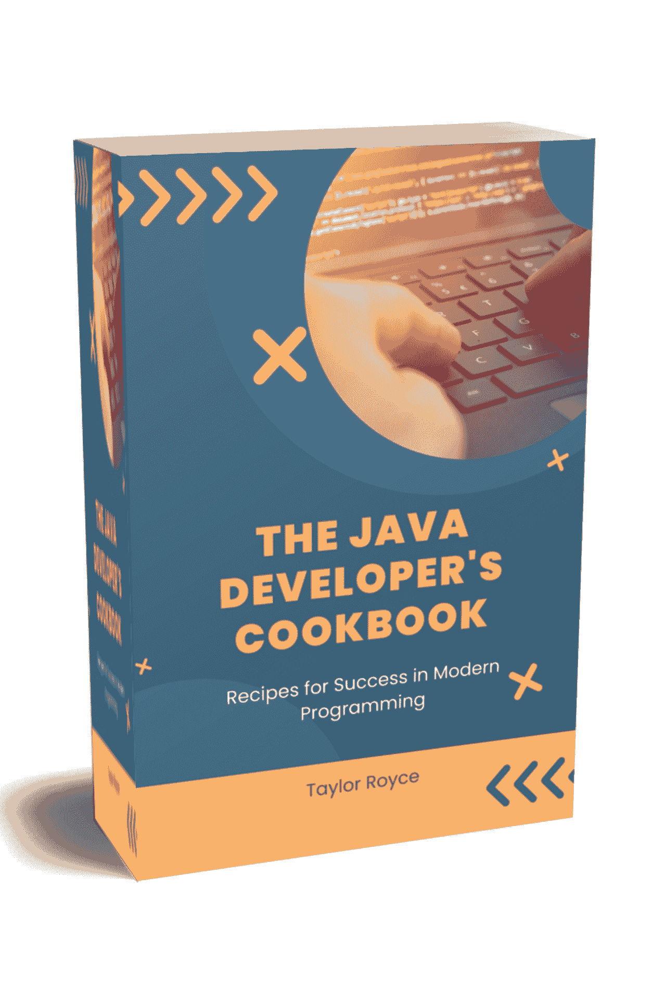

# Java 开发者秘籍：现代编程成功食谱



## 献辞

献给所有热情的程序员和坚定不移的故障排除者，你们推动了技术的进步，让不可能变为可能。这本书献给你们，感谢你们为我们的行业带去热情、创造力和好奇心。

当你们在 Java 编程领域不断学习、成长并取得成功时，希望这些页面能成为你们灵感的来源和指导。你们自我发现与成就的道路证明了终身学习的价值以及未来面前的无限机遇。

## 免责声明

《Java 开发者食谱指南：现代编程的成功秘籍》包含仅用于教学和信息传递的内容。尽管作者和出版者已尽力确保内容的准确性和完整性，但对书中包含内容的准确性、可靠性和完整性不作任何保证或陈述。

书中提供的方法、步骤和插图均基于作者出版时的专业知识和理解。由于软件开发的最佳实践和技术始终不断变化，书中的信息最终可能会过时。建议读者确认信息的当前适用性，并根据需要向专业人士和其他资源寻求建议。

使用书中的材料可能会导致直接、间接或后果性的损害，作者和出版者对此不承担任何责任。读者对实施这些食谱和流程承担所有责任，并必须确保其使用符合所有相关法律、法规和行业标准。

使用本书表示您接受并认可此免责声明。

### 关于作者

最后，我想感谢整个出版团队为本书的诞生所付出的努力和承诺。你们的奉献精神和专业水平对于项目的圆满完成至关重要。

感谢每个人的贡献与支持。

## 第 1 章

### 保持你的专业水平

在瞬息变化的软件开发领域，跟上最新进展并不断磨练你的技艺对于保持竞争优势和促进职业发展至关重要。本章探讨了保持灵活高效的开发者身份的方法，包括接受新技术、使用最佳实践以及扩展专业知识。本章提供了一份在职业领域保持领先的全面计划，涵盖了从利用现代集成开发环境（IDE）到学习新语言以及拥持续学习的所有方面。

#### 1.1 使用 IDE 支持接受新 Java 版本

跟上最新的 Java 升级是非常重要的，因为语言正在不断演进，每个新版本都带来了改进和优化。`IntelliJ IDEA`、`Eclipse` 和 `Visual Studio Code` 等 IDE 为这些新版本提供了有力支持，有助于实现更加无缝且有效的过渡。

##### 1.1.1 利用 IDE 特性鼓励采用语言特性

如今的 IDE 是强大的工具，可以加速新 Java 特性的采用。集成开发环境（IDE）通过整合代码建议、自动重构和实时错误检查等尖端功能，促进了开发者采用新语言特性，并推广了优秀的编码实践。

- **代码建议**：许多 IDE 针对使用 lambda 表达式（lambda 表达式）和 `var` 类型推断等新 Java 特性提供即时建议。
- **自动重构**：在采用新语法和实践时，可以使用自动重构工具重新组织代码以符合当前标准。
- **实时错误检测**：切换到新的 Java 版本时，IDE 会持续检查你的代码并突出显示任何兼容性问题或已弃特性。

通过降低新版本的学习曲线，这些工具有助于将复杂的语言特性集成到日常工作中。

##### 1.1.2 跟上现代 Java 的改进

跟上 Java 的快速进展需要主动接触新版本。每个 Java 版本都提供了构建更有组织、高效且可管理代码的工具，从 `Java 8` 引入 `streams` 和 `lambdas` 到 `Java 17` 的 `sealed classes`（密封类）和 `pattern matching`（模式匹配）。跟上时代确保了你正在积极地为旧代码的现代化做出贡献，而不仅仅是维护它们。

- **订阅 Java 发布说明**：清晰了解每个版本包含的更新，使你能够充满心地升级并重构你的项目。
- **在安全环境中实验**：通过利用虚拟环境或本地沙箱等 IDE 工具，你可以在不危及生产代码的情况下测试新功能。
- **参与社区讨论**：通过参加开发者论坛、参加致力于 `Java` 的会议或阅读知名的 Java 博客，你可以了解最佳实践和常见问题。

通过不断尝试新特性并理解它们的实际影响，你可以改进自己的开发流程并使你的技能储备面向未来。

#### 1.2 学习其他语言的知识：超越 Kotlin

尽管许多开发者只使用 Java，但学习其他编程语言可能会让你对处理问题的不同思路和方法开阔。对于许多 Java 开发者来说，`Kotlin` 由于其目前的语言特性和与 `Java` 的平滑交互，作为替代方案而日益受欢迎。

##### 1.2.1 使用 Kotlin 扩展你的视野

除了 `Java` 之外，`Kotlin` 作为针对 Java 虚拟机（`JVM`）的静态类型语言也有许多优势。它简洁的语法、对函数式编程的支持以及空安全特性可以改进你的 Java 应用并减少样板代码。

- **简洁语法**：与 `Java` 相比，`Kotlin` 的语法更加简化，要求开发者编写更少的代码来实现相同的功能。
- **空安全**：`Kotlin` 最显著的特征之一是它的空安全，这极地减少了空指针异常的风险，这是 Java 开发中的常见问题。
- **互操作性**：由于 `Kotlin` 能够与 `Java` 库和框架连接，它可以逐渐引入现有的 `Java` 项目，而无需完全重写代码库。

获取 `Kotlin` 知识可以帮助你成为一个更全能的开发者，并开启增加产的新工具。

##### 1.2.2 通过语言浸入培养新观点

将编程技能扩展到 `Kotlin` 以外的语言（如 `Python`、`Rust` 或 `Scala`）可以帮助你更有效地解决问题。每种语言都有解决软件问题的不同视角和策略。

- **Python**：由于其可读性和简单性，`Python` 是一种用于脚本、自动化和数据科学应用的极佳语言。
- **Rust**：`Rust` 以其内存安全和效率闻名，作为一种系统级编程语言正变得越来越流行。
- **Scala**：`Scala` 结合了面向对象编程和函数式编程的范式，是可扩展并发应用程序的完美语言。

学习这些语言可以让你接触到各种开发哲学，如动态类型、内存管理和函数式编程，这可能会激励你在 Java 项目中使用更具创新且更有效的解决方案。

#### 1.3 通过挑战进行持续教育

开发者需要不断推自己一把以提高技能，从而保持竞争力。持续学习——无论是通过正式培训、编码挑战，还是接手具有挑战性的项目——对于对于职业发展和灵活性都是至关重要的。

##### 1.3.1 弥补技术栈的知识鸿沟

没有任何开发者能完全掌握他们遇到的每一个工具或框架。识别并填补知识缺口对于作为开发者的成长至关重要。这可能是学习新框架、提高对数据库的知识，或提高对云服务的熟练程度。

- **识别弱点**：检查你项目的技术栈，看看你在哪些方面缺乏深度专业知识，然后定期评估你的知识缺口。
- **实践与应用**：为了更深入地理解新技术，利用在线课程、文档和编码平台等资源。
- **与同事合作**：通过参与结对编程或代码审查，你可以从别人的方法和经验中学习，这能让你理解他人是如何应对困难的。

你可以承担更广泛的挑战，并在职业中发展出更大的通用性。

##### 1.3.2 接受挑战以创新和成长

走出舒适区是开发者成长的之路。承担挑战性任务、参加黑客松或为开源项目做出贡献都能鼓励创新和创造性思维。

- **承担困难任务**：承担具有挑战性的任务会迫使你精进能力，无论是创建一个新功能还是修复性能问题。
- **参加竞赛**：通过参加 `LeetCode`、`Codeforces` 或黑客松等编码挑战，你可以学习新鲜视角并磨练你的编码能力。
- **贡献开源项目**：参与开源项目可以让你学习团队合作的最佳实践，并让你接触到协作开发环境。
- **接受挑战**：有助于你在技术上进步，同时还能培养创造力和解决问题的能力，这些将帮助你在职场中脱颖而出。

保持精通要求你不断推自己自己，接受新的工具和技术，并学习比母语言更多的内容。为了作为一名开发者保持前瞻性、创造力和高效，你必须主动寻求挑战，学习如 `Kotlin` 等语言，并使用 `IDEs` 来采用新的 `Java` 能力。

## 第 2 章：综合考试与框架开发

为了在现代软件开发领域保持领先，人们必须深入研究尖端框架、复杂的编程范式以及功能开发。要成为你领域的专家，你必须掌握并发的基础知识，最大限度地利用手头的教育资源，并深深对框架的理解。本章将详细探讨这些主题，重点关注如何最大化利用 `Groovy` 和 `Scala` 等替代语言以及动态 `Java` 环境。

### 2.1 使用 Loom 和结构化并发来解构并发编程

在当今性能驱动的环境中，并发是编程中最棘手但最重要的部分之一。`Java` 通过在 `JDK 21` 和 `Java Project Loom` 中引入结构化并发，试图简化并提高并发编程的直观性和效率。

#### 2.1.1 Loom 概述：Java 的根本性变化

Project Loom 标志着 `Java` 并发处理的巨大变化。`Java` 传统的并发是复杂且消耗资源的，它依赖于与操作系统资源连接的线程。随着 `Loom` 中引入虚拟线程（virtual threads），开发者现在可以构建数千个线程而不会消耗过多的系统资源。这些是由 `JVM` 而非 `OS` 控制的轻量级线程。

- **传统线程**：现有架构对于高并发应用是非高效的，因为每个线程都连接到一个 OS 线程，并消耗大量的内存和 CPU 资源。
- **虚拟线程**：通过提供大规模的每个任务一个线程的并发，克服了这一限制，并极大提高了 Web 服务器和高吞吐系统等需要同时执行任务的应用程序性能。

`Loom` 通过提供更直接的并发模型，使开发者能够创建高并发应用程序，而无需面对通常的线程管理和同步问题。

#### 2.1.2 JDK 21 的结构化并发：概述

`Java` 并发编程通过在 `JDK 21` 中引入的结构化并发得到了进一步革命，它强制了一种更具预测性和可控制性的并发架构。其思想是将并发作业组织成工作单元，这些单元同时开始和结束，以确保资源得到一致管理，并尽早发现错误。

- **可预测的资源管理**：结构化并发通过分组任务来确保所有线程在方法返回之前已合并（完成），从而避免了资源泄漏和未处理的错误。
- **错误传播**：与可能导致异常丢失的传统线程池不同，并发作业中的错误直接通信给父任务。
- **简化调试**：组织化的并发使得线程生命周期的管理变得简单得多，降低了并发编程调试的复杂性。

这种范式对于处理高性能系统的开发者来说是一个必不可少的工具，因为它更容易构建出更安全、更易读且更高效的并发程序。

#### 2.1.3 检查虚拟线程及其优势

随着 Project Loom 的引入，被称为虚拟线程的轻量级线程允许开发者在无开销的情况下创建许多并发线程。这一功能通过解决传统的“每个任务一个线程”范式的缺点，实现了更具扩展性的并发管理方法。

- **可扩展性**：得益于虚拟线程，应用程序可以并行运行数百万线程，这显著减少了内存占用，非常适合处理响应 Web 请求和数据库查询等 I/O 密集型任务。
- **易用性**：虚拟线程通过允许开发者将每个任务处理作为一个独立的线程，简化了并发，增强了代码的可读性和维护性。这与传统 `Java` 程序中对线程池的繁琐管理形成对比。
- **增强的资源利用**：`JVM` 管理虚拟线程，导致系统资源的更有效利用。这通过为其他任务释放 CPU 和内存，提升了整体性能。

在没有手动线程管理烦恼的情况下，开发者可以使用虚拟线程创建响应极快且可扩展的应用程序。

### 2.2 利用资源保持更新，例如 Oracle 的 Java Day 演讲

在软件开发这样一个充满活力的行业中，通过不断学习来跟上最新功能和实践至关重要。对于想要保持领先的开发者，`Oracle` 提供了多种资源，包括来自其 `Java Day` 大会的演讲。

#### 2.2.1 利用 Oracle 资源提高对新功能的认知

可以在 `Oracle Java Day` 演讲和在线资源中找到丰富的知识，它们为开发者详尽地介绍了所有最新和计划中的 `Java` 功能、性能增强和最佳实践。

- **Java Day 演讲**：这些演讲经常详细介绍最新的 `JDK` 版本，深入探讨了如 `G1` 垃圾收集器等特定功能，并提供了 Project Panama（外存内存访问）等尖端工具的概述。
- **文档和博客**：`Oracle` 提供了大量的官方文档和博客文章，解释了如何在真实世界场景中使用新功能，这使得开发者无需等待漫长的发布周期就能轻松保持更新。
- **网络研讨会和培训**：`Oracle` 提供了互动式网络研讨会和培训课程，让参与者对 `Java` 功能、工具和升级有第一手。这些程序通常包含代码示例和教程。

通过经常与这些网站互动，开发者可以保持敏锐，并在新功能一发布就准备好进行集成。

#### 2.2.2 评估相关性并利用新理解

由于 `Java` 更新定期发布，开发者必须仔细评估哪些新功能和升级与他们的项目相关。虽然并非每个新版本都适用于每个用例，但通过了解每个更新的背景，开发者可以决定是否采用某些功能。

- **兼容性评估**：在实施新功能或升级之前，确定其是否与当前代码库兼容至关重要。这可能需要对某些更新的功能进行重构或弃用。
- **长期影响**：考虑实施新技术对未来可能产生的影响。虽然像 `Loom` 虚拟线程这样的功能可能立即帮助扩展性，但要有效使用它们需要对结构化并发原则有掌握。
- **实际应用**：在集成到生产环境之前，应在独立的上下文中新功能。这确保了完全理解其影响，包括功能和性能方面。

评估更新和新功能的适用性将帮助开发者避免不必要的复杂性，并确保他们的实现能为项目带来显著收益。

### 2.3 使用 Groovy 和 Scala 增强你的框架知识

探索其他框架（如 `Scala` 和 `Groovy`）可以通过提供新的功能和范式来增强 `Java` 的优势，从而大幅提升你的开发技能。

#### 2.3.1 检查 Groovy 以增强能力

`Groovy` 是一种运行在 Java 虚拟机（`JVM`）上的动态语言，它改进了 `Java`。其增强的领域特定语言（DSL）特性、精简的语法和脚本能力使其成为极佳的工具。由于它与 `Java` 的无缝集成，开发者能够在一个项目中结合使用这两种语言。

- **精简的语法**：`Groovy` 通过减少样板代码，帮助开发者编写出更易读、更简洁的代码。例如，`Groovy` 消除了分号，提供了内置的闭包（closures），并让集合操作变得更加简单。
- **脚本能力**：`Groovy` 非常适合编写脚本化任务，例如测试或构建自动化。开发者可以通过使用像 `Gradle`（使用 `Groovy` 语法）这样的工具，构建更易理解和管理的脚本。
- **DSL 支持**：可以使用 `Groovy` 创建领域特定语言（DSL），以简化复杂的业务逻辑或构建更用户友好的 API。

`Groovy` 是任何开发者工具箱的有用补充，因为它为寻求扩展工具包的 `Java` 开发者提供了灵性和易用性。

#### 2.3.2 暴露 Scala 的优缺点

`Scala` 是另一种 `JVM` 语言，它结合了函数式编程和面向对象编程的概念。由于其拥有强大的特性——如模式匹配、高阶函数和不可变性——它是开发并发、可扩展系统的完美选择。

- **函数式编程**：`Scala` 倡了一种更加声明式且无副作用的编码方法，这可以导致更少的错误更简单的维护。它通过提供不可变性和一等函数来实现这一点。
- **并发**：`Scala` 是后端系统的流行选择，得益于 `Akka` 等框架，它擅长创建可以在分布式系统中进行扩展的高并发应用程序。
- **权衡**：尽管 `Scala` 拥有许多复杂的功能，但不熟悉函数式编程的开发者可能会因为其复杂性而难以掌握。此外，`Scala` 的构建时间比 `Java` 长，这可能会导致开发周期滞后。

要确定何时 `Scala` 的高级特性值得投入成本，以及何时更简单的选项可能更有用，需要对该语言的能力和权衡有深入。

### 2.4 作为参考资源的 Java 特性精选列表

精选的参考资料是在跟上 `Java` 不断变化的特性集的同时，保持信息灵通和组织良好的良好方法。[Advanced Web](https://advancedweb.hu/) 就是此类资源之一，它提供了详尽的 `Java` 能力列表，并根据功能和版本进行了分类。

- **特性列表**：这些网站包含了对最近添加的 `Java` 特性的详尽分析，以及代码片段、可能的应用场景和兼容性问题。
- **历史参考**：在更新旧留系统或保持与之前项目的兼容性时，开发者可以从通过精选列表观察 `Java` 如何随时间推而演变中获益。
- **对比分析**：参考网站上经常包含各种 `Java` 特性之间的性能基准测试和特性对比，这有助于就哪些工具和优化最适合你的项目做出决策。

开发者通过将这些参考资源尽在手手，可以轻松访问最新的 `Java` 特性，并确保在采用新版本时做出明智的决策。

因此，精通并发编程、探索新颖框架以及关注可靠来源，对于在软件开发这一动态领域取得成功至关重要。在 `Groovy` 和 `Scala` 等灵活语言以及 `Java` 创新的帮助下，开发者可以创建高性能、可扩展且易于维护的应用程序。使用这些资源不仅可以提高你的熟练度，还能确保你的能力在竞争激烈的市场中保持竞争力。

## 第 3 章

### 开发稳健且高效的应用程序

在如今竞争激烈的开发环境中，构建可靠且高效的应用程序不仅仅是编写代码；还需要拥有一种优先考虑高性能架构、持续改进和实践学习的心态。本章将探讨实现这些目标所需的方法和资源，强调了使用 `Ktor` 创建高性能微服务、持续的反馈循环以及将侧项目作为磨练技艺的手段。

#### 3.1 贯穿开发周期的持续反馈实践

持续反馈在当今的软件开发中至关重要，以确保程序是高效、可扩展、可维护且运行良好的。通过在开发周期的每个阶段引入反馈循环，开发者可以尽早发现问题，改进他们的设计选择，并轻松适应变化的需求。

##### 3.1.1 结合数据收集尽早识别问题

无论是缺陷、性能瓶颈还是安全漏洞，尽早发现问题都可以显著减少在开发过程后期修复它们所需的时间和成本。来自自动化系统的实时分析和持续数据收集有助于在问题变得严重之前识别它们。

- **实时监控**：通过 `Prometheus` 和 `Grafana` 等工具，开发者可以监控 CPU 负载、内存利用率和响应时间等应用指标。团队可以通过设置异常通知来防止性能问题的升级。
- **自动代码扫描**：通过在开发流水线中集成 `SonarQube` 或 `Snyk` 等工具自动搜索代码漏洞，可以在过程早期发现并修复安全漏洞。


用户反馈：通过功能标记（feature flags）或 A/B 测试（使用`LaunchDarkly`等工具）收集用户输入，开发者可以立即确定新功能在真实世界中的运行情况，从而做出明智的更新。

通过开发周期的各个阶段收集相关数据，开发者可以提高产品的质量。这使他们能够获得重要的见解，并频繁地调整方法。

### 3.1.2 利用测试结果做出明智的设计

测试是改进设计选择并确保应用程序架构既可扩展又可维护的关键反馈机制。它不仅仅是确认代码运行。通过定期评估测试结果，开发者可以就重构、性能优化和工作流修改做出明智决策。

- 单元测试与测试驱动开发：使用`TDD`技术（即在开发前编写单元测试）可以确保架构是模块化的具有清晰的输入输出。此外，它有助于开发者避免过度设计，专注于提供通过测试所需的功能。

- 集成测试：这些测试确保系统的各个部分按预期方式协同工作。当集成测试失败时，它们会暴露服务通信中的间隙，允许开发者在问题变成系统性问题之前进行修复。

- 性能测试：如`JMeter`或`Gatling`等程序会对应用程序进行压力测试并模拟用户负载，以提供系统在高流量情况下的运行状况信息。开发者可以通过检查这些数据，确定是否需要对数据库查询、缓存技术或 API 响应时间等进行进一步优化。

开发者可以根据测试结果做出提高性能、可靠性和维护性的架构决策，从而产生更健壮的最终产物。

## 3.2 基于 Ktor 的高性能微服务

在微服务时代，性能、可维护性和简单性对于保证分布式系统的流畅运行至关重要。使用基于`Kotlin`的框架`Ktor`构建异步服务器和客户端，为创建高性能微服务提供了多项优势。

### 3.2.1 Ktor 的优势：简化升级和增强代码清晰度

使用`Ktor`有许多优势，其中两个是其内置的代码清晰度和简化的更新流程。与`Spring Boot`等更复杂的框架相比，`Ktor`轻量、灵活且适应性强，开发者可以使用`Ktor`采用“恰足够”的架构。

- 简化的依赖管理：由于`Ktor`的模块化架构，开发者可以仅包含必要的依赖，这使得升级变得不复杂。相比之下，在使用像`Spring`较大的框架时，不必要的依赖在版本升级期间可能会带来风险。

- 代码清晰度：`Ktor`利用以可读性和简洁著称的语言`Kotlin`创建更易于维护的代码库。通过这种方式，团队可以更好地理解系统行为，而无需过滤层层抽象，并降低产生“意大利面条代码”的可能性。

通过使用`Ktor`，开发者可以避开与单体框架相关的典型陷阱，并确保他们的微服务持续保持可维护性和高性能。

### 3.2.2 较简单的代码结构防止调试噩梦

微服务经常具有过度复杂性，这使得调试变得极其困难。开发者可以通过`Ktor`对异步编程的强调及其简单性避免这些问题。

- 异步非阻塞 I/O：得益于`Ktor`对异步请求的有效处理，应用程序并发处理海量数据而不会引起线程阻塞。这一特性提高了响应速度并降低了延迟。由于代码执行流没有改变，调试也变得更加简单。

- 极简设置：由于`Ktor`是极简主义的，开发者不需要担心意外的副作用或在多个设置层之间权衡。更少的抽象和简单的架构使得问题跟踪更高效、更快速。

维护基础代码结构有助于通过降低过程中的认知负担，帮助工程师更快、更高效地进行调试。

### 3.2.3 Ktor 相比 Spring Kafka 的性能优势

尽管`Spring Kafka`是创建事件驱动系统的流行工具，但在需要高吞吐量和低延迟的微服务应用中，`Ktor`的表现更好。

- 轻量基础：在某些高性能应用中，特别是那些要求快速响应和低开销的应用，由于其轻量级基础和`Kotlin`的性能增强，`Ktor`的表现优于`Spring Kafka`。

- 定制化与灵活性：与主要依赖配置和外部集成的`Spring Kafka`相比，`Ktor`提供了一种更直接、灵活的微服务管理方法。这种活性为实时数据流应用带来了更快的处理速度和更强的扩展性。

对于需要高速度的应用，`Ktor`是`Spring Kafka`更有效的替代方案。这让开发者能够专注于优化应用程序架构，而不是处理复杂的设置。

### 3.2.4 高效的启动时间和依赖管理

`Ktor`对依赖的有效管理及其极快的启动时间是其两个主要优势；两者对于现代云原生应用都至关重要。

- 最少依赖：仅使用所需的模块，`Ktor`创建了比`Spring Boot`等更传统框架更精简的应用程序，启动速度快得多。这在容器容器的情况下尤为关键，因为快速部署是必不可少的。

- 冷启动优化：`Ktor`的快速启动时间允许应用更迅速启动，从而在需要快速扩展的无服务器架构或云环境中改进了资源利用并降低了运营成本。

`Ktor`允许开发者在动态情况下部署高性能应用，而没有与大型框架相关的典型开销。这是通过最小化启动时间和更有效地管理依赖实现的。

## 3.3 利用侧项目开发你的技能

开发者可以通过开展侧项目，在正常工作范围之外尝试新工具、语言和架构。开展侧项目鼓励创造力，让开发者接触现实问题，并帮助他们培养实践技能。

### 3.3.1 选择具有意义的项目以提高实践技能

承担侧项目是拓宽知识和开发能力的极佳方法。但为了获得最大的回报，选择具有现实挑战的有价值项目至关重要。

- 开源贡献：通过在`GitHub`等网站上的开源项目做出贡献，使得在真实的代码库工作以及与其他专家协作成为可能。除了磨练编码能力，这还让开发者接触到大规模版本控制、文档和代码审查流程。

- 编码任务：如 [Coding Challenges](https://codingchallenges.fyi/) 等网站上提供了各种编程任务，有助于开发者磨练解决问题的能力，并在数据结构和算法方面获得实践经验。

- 个人项目：开发自己的项目（如 Web 服务、自动化工具或移动应用）提供了一个低风险的环境，用于应用新学的原理。为了更深入地了解这些复杂主题，可以尝试使用`Ktor`从零构建微服务架构，或在`Loom`中尝试结构化并发。

通过承担相关的侧项目，开发者可以跟上最新趋势，磨练技能，并在现实情况下应用他们的知识。

最后，需要注意的是，创建可靠高效的应用是一个迭代过程，需要不断的反馈、对高性能架构的强调以及对现实学习机会的追求。为了软件开发者的长期成功，他们必须积极参与侧项目，整合结构化反馈循环，并利用`Ktor`等工具进行微服务开发。

# 第 4 章

# 掌握应用健康的观测性

现代软件开发的一个关键组件是可观测性（observability），它确保程序在各种情况下都能按预期运行，并保持其性能、可扩展性和可靠性。掌握可观测性让开发者能够理解应用程序行为、实时识别问题，并做出明智决策以增强系统健康状况。本章将探索深入理解应用程序所需的方法、资源和工具，包括追踪（tracing）、调试（debugging）、性能分析（profiling）和监控（monitoring）。我们还将讨论对于专业开发者来说，关注影响力和博客以跟行业趋势并保持社区意识有多重要。

## 4.1 认真对待可观测性：资源与方法

在现代软件系统中，特别是那些依赖于微服务或无服务器函数等分布式设计的系统，可观测性不是可选项，而是刚需。开发者必须定期监控他们的应用程序，并在出现问题时及时采取行动，以确保系统的健康和可靠性。通过认真对待可观测性，你可以监控性能、发现瓶颈，并在问题影响用户体验之前修复这些问题。

### 4.1.1 理解调试、性能分析、监控和追踪

为了正确监控应用程序的健康，理解性能分析、监控、追踪和调试之间许多但相互相关的角色至关重要。

性能分析（Profiling）：开发者可以使用性能分析工具学习`CPU`、内存和`I/O`等资源是如何被使用的。它们有助于定位资源瓶颈、突出低效代码并识别性能瓶颈。在开发或测试环境中，通常进行性能分析是为了在发布前提高代码质量。

- 用例：使用`JVisualVM`等性能分析器跟踪哪些对象没有被垃圾回收，定位`Java`应用程序中的内存泄漏。

监控（Monitoring）：通过从活动应用程序中收集指标和日志，监控解决方案提供了可用性、性能和使用趋势的最新信息。`CPU`使用率、内存占用、错误率和响应时间都是重要指标。监控对于发现真实环境中的缺陷本质重要，通常与告警系统配合使用以通知工程师严重问题。

- 用例：配置`Grafana`和`Prometheus`来追踪`CPU`利用率，并在系统接近关键阈值时发送通知。

追踪（Tracing）：在微服务设计中，分布式追踪工具跟踪请求在不同服务之间的移动，允许工程师观察数据在整个系统中流动。这对于识别故障或性能问题的确切位置非常有用，特别是在复杂的异步系统中。

- 用例：使用`OpenTelemetry`追踪跨越多个微服务的用户请求，以确定是哪一个变慢了。

调试（Debugging）：调试工具允许程序员检查变量、遍历代码执行并理解应用程序的内部状态。尽管调试通常在开发期间使用，但它对于诊断生产系统中的关键错误至关重要。

- 用例：将调试器连接到实时系统，以诊断间歇性的`NullPointerException`。

通过了解如何使用这些工具和方法，开发者可以充分了解应用程序的状态，确保性能的提升、无无缝运行以及对问题的更快速响应。

### 4.1.2 检查诸如 JProfiler、VisualVM 和持续反馈等资源

利用适当工具对于应用上述可观测性概念至关重要。`Java`开发者拥有丰富的可观测性工具生态系统，使他们追踪、调试和监控自己的程序。

JVisualVM：`JVisualVM`是`JDK`包含的一个工具，提供了`Java`应用程序的性能分析、监控和诊断功能。它提供了一个图形化用户界面来分析垃圾回收、内存使用和线程活动数据。对于在开发早期识别性能问题，`JVisualVM`是完美的选择。

- 示例：在开发环境中监控对象分配，并通过查看堆转储（heap dumps）来分析内存泄漏。

JProfiler：这款商业产品以其复杂的性能分析功能而闻名。它在内存管理、线程分析和性能调优方面表现出色。它提供了关于浪费代码路径和瓶颈的详尽报告。寻求为大规模生产环境优化应用程序的团队会发现`JProfiler`特别有帮助。

- 示例：开发者可以使用`JProfiler`的`CPU`性能分析来识别消耗过度处理能力的方法，从而优化性能关键代码。

持续反馈系统（Continuous Feedback Systems）：在生产环境中，`Dynatrace`、`New Relic`和`Datadog`等工具提供了持续监控和反馈。通过使用这些来自应用程序实时数据收集工具，开发者可以关注性能并在发生问题时获得告警。

- 示例：配置`Datadog`追踪生产环境 API 的平均响应时间，并在响应时间超过预设阈值时发送通知。

通过将这些技术集成到开发和部署流水线中，开发者可以确保对应用程序的持续可见性。这将实现更快的问题诊断和更有效的问题解决。

## 4.2 通过社区支持获得自信

要精通可观测性和应用程序健康管理，不仅仅需要工具和策略；你还需要与其他开发者保持社区互动。开发者通过分享最佳实践、交流专业知识和跟上新兴趋势来获得信心是很常见的。从这个意义上说，社区支持至关重要，与行业人士的互动可以帮助开发者更好地理解复杂主题并更快地解决问题。

### 4.2.1 与区域 Java 用户组（JUGs）建立联系

被称为`Java User Groups`（`JUGs`）的社区驱动小组为`Java`开发者提供了一个互动、交流知识以及从领域专家那里获得建议的地方。参与本地`Java User Groups`（`JUGs`）是学习语言最新进展、听其他开发者的一手报告以及在友好的环境中提问题的绝佳机会。

- 人脉：加入`JUGs`是与志同道合的人建立联系的极佳机会，他们可以在职业机会、指导或建议方面提供帮助。与其他资深开发者建立联系，可以从遇到过类似困难的人那里获得知识。

- 研讨会和演示：许多`JUG`定期举办由领域专家提供的演示、研讨会和编码活动。这些活动为开发者提供了实践学习机会，可以增强他们在应用程序监控、追踪和性能分析方面的能力。

- 示例：参加使用`OpenTelemetry`框架进行微服务分布式追踪的工作坊。

- 协作：`JUG`成员经常合作开源项目或为社区项目提供支持。结果，开发者可以在协作氛围中精进技艺并为`Java`生态系统做出贡献。

通过参与`JUGs`，开发者可以获得所需的社区支持和自信，以应对不断变化的`Java`生态系统。

在快速迭代的软件开发领域，了解最新的工具、方法和最佳实践至关重要。关注由资深开发者编写的影响人物和他们撰写的博客是实现这一目标的一种高效方法。这些网站可以提供经过精选的内容，让开发者能够跟上行业的快速变化。

### 4.3.1 遵循行业先驱和精选阅读列表

行业内的影响力人物经常提供关于软件开发最新进展的见解、教程和评论，特别是在可观测性、性能优化和微服务架构领域。通过关注这些专业人士，开发者可以保持与时同步，并对他们遇到的挑战获得新的见解。

开发者博客：对软件架构、分布式系统和最佳编码技术等主题进行深度讨论的知名博客包括 [Martin Fowler](https://martinfowler.com)、[Baeldung](https://baeldung.com) 和“The Pragmatic Engineer”。他们为`JVisualVM`、`JProfiler`以及其他可观测解决方案的实践提供了非常有帮助的手。

- 示例：研究`Baeldung`的微服务可观测性系列，学习如何在分布式环境中设置高效的日志记录和追踪。

影响力人物和思想领袖：通过社交媒体、博客文章和视频教程，`Venkat Subramaniam`和`Adam Bien`等开发者经常分享他们的专业知识。他们就如何处理可观测性、性能和软件架构中的挑战性问题提供了大量信息。

- 示例：从`Venkat Subramaniam`关于响应式编程及其如何提高分布式系统可观测性的演讲中，可以处理实时数据流的策略。

精选阅读列表：通过订阅新闻邮件或精选阅读列表（如`Java Weekly`或“Java 日报/Morning Cup of Java”），开发者可以确保始终能够获取最新的文章、指南和资源。

- 示例：为了了解`JDK`的改进、性能优化方法以及如`JVisualVM`和`JProfiler`等分析工具，请订阅`Java Weekly`。

通过订阅这些博客和影响力人物，开发者可以保持对 Java 开发最新进展和可观测性最佳实践的关注。

总之，任何想要创建可靠、可扩展且高效应用的开发者都必须成为可观测性专家。通过掌握性能剖析、监控、追踪和调试的基础知识，并利用`JVisualVM`和`JProfiler`等工具，开发者可以保持对系统的控制。此外，通过`JUGs`参与社区以及从领域专家那里接受持续教育，可以增强在动态软件开发领域应对挑战性问题所需的知识。

# 第 5 章

# 特定方法的详细检查

在软件开发中熟练掌握特定方法可以提高提高应用的质量、性能和可维护性。为了优化其影响，本章将对每个开发者都应该熟悉的若干项核心技术进行详细解释、用例、实现方法和高级实践。无论你是在构建微服务还是大型业务应用，这些策略都能帮助确保你开发过程的健壮性和速度。

## 5.1 重构：详细描述与应用

重构是在不改变外部功能的情况下重新组织现有代码的行为。它是软件开发中最重要的方法之一，因为它有助于提高代码可读性、结构和可维护性的长期性。通过重构，开发者可以简化并提高代码库的可读性，从而便于新功能的实现和错误的纠正。

### 重构的主要优势：

- 增强代码可读性：编写良好的代码更容易被理解、排除故障和扩展。重构让复杂的逻辑变得简单，消除了不必要的复杂性。

- 提高可维护性：组织良好的代码更容易更新。这涵盖了功能增强、问题解决和性能调优。

- 更好的性能：重构通常涉及优化数据结构或算法以实现更有效的执行。

### 常用的重构方法：

提取方法 (Extract Method)：如果一段代码过大或执行了多个任务，你可以将代码提取到不同的方法中。这有助于代码复用并增加可读性。

- 用例：如果一个类的方法变得难以管理，可以通过将其拆分为更小、更有针对性的方法来修改它。这样，每个方法都完成特定任务，增加了整体逻辑的模块化和可读性。

重命名变量/方法 (Rename Variable/Method)：缩写非常重要。重命名变量或方法可以提高可读性，让其他人更容易理解代码。

- 用例：为了让程序中变量的更清晰，可以将`tempData`重命名为`userData`。

简化条件表达式 (Simplify Conditional Expressions)：守卫语句（guard clauses）和多态等技术经常可以用于将复杂的 if-else 链和深层逻辑简化为更简单的结构。

- 用例：通过使用提前返回或策略模式替换嵌套条件判断，重构一个执行复杂决策过程的函数。

消除重复 (Get Rid of Duplication)：重复代码更难维护，且往往隐藏着错误。通过将冗余代码合并为可复用的方法或类可以减少冗余。

- 用例：当代码库中的两个不同区域执行相同任务时，你可以将公共功能重构为单个方法或工具类。

重构是一项持续活动，特别是对于寿命较长的项目。开发者不应该等到需要重大重新设计，而应该将其视为开发过程的常规部分。当重构正确时，团队可以用较小的风险扩展程序，并产生更清洁、更维护的代码。

## 5.2 测试驱动开发 (TDD)：全面检查与执行技术

测试驱动开发 (TDD) 是一种程序员在编写任何代码之前先为代码编写测试的方法。通过自动化测试，这种方法专注于验证短代码段的功能，并为开发者提供关于代码是否达到预期结果的及时反馈。TDD 除了测试，还专注于增强代码设计和可维护性。

### TDD 循环的步骤：

1. 编写测试：在创建任何代码之前，编写一个单元测试来概述功能或函数的预期行为。由于代码尚未实现，该测试最初将失败。


2. **编写程序：** 创建通过测试所需的最少代码。在这一阶段，满足功能需求优于优化或优雅性。

3. **重构：** 在测试成功后，重新组织代码以在不影响其功能的情况下加强其组织结构。这一阶段在保持测试通过的同时，提高了可读性、性能或可扩展性。

4. **重复：** 为了确保代码整洁且运行正常，通过为新功能构建新测试并遵循相同的步骤来继续此循环。

### TDD 的优势：

- **更少的 Bug：** 通过在开发之前编写测试，可以确保每项功能都经过测试。这减少了后期添加 Bug 的可能性。

- **更好的代码设计：** 因为 TDD 要求编写易于测试的代码，它促进了模块化和松耦合编程。它迫使你将功能划分为更易管理、更易测试的块。

- **重构的信心**：开发者可以放心地进行重构，而无须破坏现有的功能，因为程序的每个方面都配备了测试。

### 实现策略

- **从小处开始**：先为离散的、小规模的功能组件编写单元测试。将端到端测试推迟到以后。专注于特定的技术或课程。

- **示例**：为一个计算数组和的函数创建测试，以验证不同的场景，包括空数组、单元素数组或大型整数数组。

- **使用 Mock 对象（Mocks）和存桩（Stubs）**：在日益复杂的应用程序中，测试每一个依赖可能是不可行的。为了关注被测试单元的行为，请使用存桩和 mock 来模拟复杂的对象或外部系统。

- **示例**：在测试与数据库通信的服务时，使用 mock 数据库层来模拟交互，而不是依赖真实的数据库连接。

- **持续测试**：确保构建流水线包含了你的测试。当更改被推送到代码库时，使用如 `CircleCI`、`Travis CI` 或 `Jenkins` 等持续集成（CI）解决方案来自动执行你的测试。

通过 `TDD`，你可以构建出随时间推移更易维护、设计更好且故障更少的应用程序。这在代码质量和系统稳定性方面是有回报的，但它需要一致性和纪律。

## 5.3 依赖注入 (DI)：高级方法与理想方案

在名为依赖注入（DI）的设计模式下，依赖是由对象从外部源获取的，而不是由对象本身创建。DI 使得更具活性、可测试且易于维护的代码成为可能，特别是在手动处理依赖可能会变得疲惫的大型应用程序中。

DI 的核心思想如下：

- **控制反转 (IoC)**：由外部实体（通常是框架或容器）控制依赖的生命周期和提供，而不是由对象管理其自己的依赖。

- **松耦合**：由于类没有紧密连接其依赖的特定实现，DI 促进了对象之间的松耦合。结果是系统更容易管理且更具通用性。

### 依赖注入类型

- **构造函数注入**：类通过其构造函数接收依赖。由于它保证了在对象生成时所有所需的依赖都存在，因此这是最流行且推荐的依赖注入类型。

- **示例**：接收来自数据库仓库的对象的服务类，其构造函数传递了该仓库。

- **Setter 注入**：使用 setter 方法来提供依赖。在对象创建后，可以使用此方法将需求设置为可选或可自定义。

- **示例**：通过使用 setter 方法向对象注入日志服务，可以使对象在缺少日志功能的情况下也能运行，然而，对象的功能可能会受到损害。

- **字段注入**：通常使用基于反射的注解或框架将依赖直接注入到类的字段中。字段注入很方便，但因为它隐藏了依赖并增加了测试的复杂性，通常会被避免。

### 最佳方法

- **采用构造函数注入**：它保证了依赖的不可变性，并确保在满足所有依赖之前，该类无法被使用。

- **避免过度注入**：向单个类中注入过多的依赖可能会导致代码难以理解和维护。为了管理复杂性，考虑分解巨大的类或利用 `Facade` 或 `Factory` 设计模式。

- **利用 DI 框架**：为了自动处理依赖注入，请利用 `Spring`、`Guice` 或 `Dagger` 等框架。特别是在大型系统中，这些框架使得注入和自定义依赖的过程变得更简单。

- **示例**：为了允许框架管理依赖注入，你可以在 `Spring` 应用中使用如 `@Autowired` 的注解。结果是减少了样板代码，并实现了更灵活的应用程序架构。

通过有效整合 DI，开发者可以设计出更容易测试、扩展和管理的应用程序。依赖注入增强了整体代码的灵活性，鼓励了单一责任原则并解耦了类。

## 5.4 缓存方法：进一步的方法研究

缓存是一种优化策略，通过将频繁请求的内容存储在内存中来缩短检索所需的时间。应用程序可以减少数据库调用并提高性能，特别是在流量巨大的系统中。

### 缓存类型

- **内存缓存**：信息保留在 RAM 中以便快速访问。为此，经常使用 `Redis` 和 `Memcached` 等程序。

- **用例**：为了防止持续查询数据库，可以缓存被频繁请求的数据库查询，例如用户配置文件或产品目录。

- **分布式缓存**：在大规模的分布式系统中，缓存必须由应用程序的多个实例共享。分布式缓存为机器集群提供一致的数据。

- **用例**：在微服务架构中，将会话数据存储在如 `Redis` 等分布式缓存中，以便每个实例都能访问相同的缓存数据。

### 最佳方法

- **缓存验证**：确保制定了缓存失效策略。缓存中的损坏数据可能导致缓存与真实数据源之间出现不一致。

- **缓存昂贵的内容**：注意缓存获取或产生成本昂贵的计算或数据，包括复杂的数据库查询或外部 API 调用的结果。

- **监控缓存性能**：时刻关注缓存性能，以防止缓存抖动（thrashing）或内存过度占用等问题，这些问题会损害系统的性能。

当正确使用时，缓存是一种强大的策略，可以在提高响应时间和扩展性的同时减轻数据库和外部服务的负载。

# 第 6 章：编写安全且易于维护的代码

开发既安全又易于维护的代码对于任何软件项目的成功至关重要。糟糕的代码组织和安全缺陷可能导致严重的问题，如无法逾越的技术债、性能问题和数据泄露。本章将涵盖编写安全、可维护且可扩展代码的关键原则。我们将讨论如何使用安全编码、遵循清洁代码指南以及使用高效的单元测试方法。

## 6.1 安全编码技术的实践

在每个开发项目中，安全性应该是首要考虑的问题。单一漏洞可能导致严重后果，如系统被破坏、非法入侵或机密信息泄露。应用安全编码技术可以缩小攻击面，通过保护应用程序免受常见漏洞和利用（CVE），使攻击者难以渗透。

### 6.1.1 常见漏洞和利用 (CVE) 的缓解

- **SQL 注入 (SQLi)**：通过向输入字段中注入恶意代码，攻击者可以修改 SQL 查询并更改或提取敏感数据。为了减轻 SQL 注入的影响：

- 使用预处理语句或参数化查询，避免将用户输入直接解释为 SQL 指令。

- 避免通过拼接用户输入来动态创建 SQL 查询语句。

- 使用 ORM（对象关系映射）来抽象数据库交互，例如 `SQLAlchemy` 或 `Hibernate`。

### 跨站脚本攻击 (XSS)

XSS 漏洞允许攻击者在其他用户的网页中插入恶意脚本，使其获得控制用户会话、更改网站或重定向用户的能力。为了减少 XSS：

- 对输出进行转义，以确保在网站上显示用户输入时，生成的是格式的文本而非可执行代码。

- 使用 `Content Security Policy (CSP)` 头部来防止未经授权的脚本运行。

- 验证并清理每个用户输入，以确保只接受预期的值。

### 跨站请求伪造 (CSRF)

在 CSRF 攻击中，黑客会欺骗受害者执行不希望执行的操作，例如更改账户设置或进行购买。

- 为了减少跨站请求伪造 (CSRF)，请在表单中包含反 CSRF 令牌，并在服务器端验证这些令牌，以确保请求来自可靠源。

- 为了防止 Cookie 在跨源请求中被发送，请使用 `SameSite` Cookie 属性。

### 不安全的身份验证与授权

如果身份验证措施薄弱或设置错误，攻击者可能会获得未经授权的访问。为了减少不可靠的身份验证：

- 为了安全存储密码，请使用强大的密码哈希算法，如 `bcrypt` 或 `Argon2`。

- 使用多因素身份验证 (MFA) 来进一步增强安全性。

- 确保根据用户角色通过角色的访问控制 (RBAC) 对敏感操作进行适当限制。

### 不安全的反序列化

反序列化不可信数据可能会导致数据操作或任意代码执行。为了减少不安全序列化的影响，除非绝对必要，否则避免反序列化来自不可靠源的数据。

- 对序列化数据格式采用严格的白名单和输入验证程序。

- 对于 JSON 处理，使用内置安全性的库，如 `Jackson` 或 `Gson`。

通过主动修复这些常见漏洞，开发者可以降低被利用概率，创建更安全的应用程序并保护敏感数据。

## 6.2 遵循设计模式和清洁代码原则

创建清晰、可重用且可维护的代码对于任何项目的长期成功至关重要。组织不当的代码可能难以理解、扩展和排错，这会增加开发成本并累积技术债。通过遵循清洁代码原则并利用设计模式，程序员可以编写出功能强大、可扩展且易于维护的代码。

### 6.2.1 编写可读、可维护且重用的代码

协作和长期成功取决于可读和可维护的编程。清晰的代码易于阅读和理解，这降低了新开发者进入项目的学习曲线，并降低了后期版本中引入漏洞的可能性。

### 编写清洁代码的重要指南：

**有意义的命名规范：** 为变量、方法和类赋予有意义且描述性的名称。避免使用可能导致代码难以理解的晦名称或缩写。

- 示例：为了让变量的功能清晰，请使用 `userAge` 或 `orderTotal` 等名称，而不是将其标记为 `x` 或 `temp`。

**单一职责原则 (SRP)：** 每个函数或类应该只有一个职责。在编写方法时应避免处理多个任务，因为这会让代码更难以测试和维护。

- 示例：从一个管理数据库插入和数据验证的方法中，应该创建两个不同的方法，每个方法都专注于单一任务。

**避免代码重复：** 尽可能重用代码，而不是复制和粘贴相关的代码块。重复的代码更难管理，并且经常会导致代码不一致。

- 示例：将重复的逻辑合并到类或可在项目范围内访问的重用实用函数中。

**明智地注释：** 在注释中，要说明代码的“为什么”而不是“是什么”。具有自解释且清晰的代码通常可以减少对长注释的需求。注释应当阐明复杂的推理过程或选择。

- 示例：注意代码特定部分计数器增加的原因，例如 `// tracking number of user logins for analytics`，而不是写像 `// increments counter` 这样的备注。

**一致的格式化：** 在对代码进行格式化时，请遵循标准的样式指南（例如 Python 的 `PEP 8` 或 `Google Java Style Guide`）。在团队内部，如果代码格式一致，将更易于阅读和理解。

通过遵循这些指南并产生更易理解、调试和扩展的代码库，开发者可以加快开发速度并降低错误率。

### 6.2.2 利用设计模式提供灵活且有效的解决方案

设计模式为典型的软件开发问题提供了成熟的解决方案。通过使用设计模式，程序员可以以可扩展、灵活且高效的方式组织代码，鼓励重用并消除重复。

### 典型设计模式及其应用：

**单例模式 (Singleton Pattern)：** 单例模式保证一个类只有一个实例，同时也为该实例提供了一个全局访问点。

- 用例：适用于处理共享资源，在这些情况下，拥有多个实例会导致冲突或不必要的开销，例如配置管理器或数据库连接池。

**工厂模式 (Factory Pattern)：** 提供了一种对象创建接口，允许子类选择要创建的对象类型。

- 用例：非常适用于根据用户输入或外部配置生成对象的情况，在这种情况下，构建的对象类型在运行时是未知的。

**观察者模式 (Observer Pattern)：** 在对象之间建立一种一对多的依赖关系，使得当一个对象的状态改变时，所有它的依赖项都会自动更新并接收通知。

- 用例：经常用于事件驱动系统或图形用户界面 (GUI)，在这些系统中，对一个元素的修改（如点击按钮）应该更新多个元素（如显示面板）。

**装饰器模式 (Decorator Pattern)：** 该模式允许向特定对象动态添加行为，而不影响同类中其他对象的行为。

- 用例：有助于在不改变方法基本行为的情况下为方法添加日志或验证逻辑，或者在运行时扩展对象的能力。

**策略模式 (Strategy Pattern)：** 允许对一组算法进行定义和交互。这使得客户端能够动态地选择要采用的算法。

- 用例：经常用于根据某些规范选择各种算法的情况，例如各种排序策略或支付处理程序。

通过采用这些设计模式，程序员可以创建更易测试、更模块化且对变化更敏感的代码。

## 6.3 单元测试的实用技术

单元测试是软件质量保证的关键组件。通过单独测试代码库的各个组件，你可以确保应用程序的每个组件都按预期运行。良好的单元测试可以增加代码的可靠性，有助于尽早发现缺陷，并作为测试安全网使重构变得更加容易。

单元测试的优势：

- **早期缺陷检测**：单元测试在问题影响生产环境之前识别它们，从而降低修复缺陷的成本并防止可能发生的故障。

- **支持重构**：有了完备的单元测试集，开发者可以放心地重构代码，因为他们知道测试会识别并解决重构带来的任何新问题。

- **增强代码文档**：单元测试充当了“活文档”，展示了特定方法或类在各种条件下的意图行为。

### 6.3.1 编写单元测试的最佳方法

**检查每个孤立单元**：一次处理一个微功能，专注于对其进行测试。为了保持测试集中在被测试的单元上，请使用模拟（mocks）和存根（stubs）来模拟数据库或网络查询等外部依赖。

- **示例**：在测试从 `API` 获取数据的服务时，模拟 API 响应而不是发送真实的网络调用。

**使用具有描述性的测试名称**：创建准确反映被测试特性的术语。这有助于在问题发生时进行调试，并帮助理解每个测试的目标。

- **示例**：将测试命名为 `testUserCreationFailsWithInvalidEmail`，而不是 `testUserFunction`。

**追求高代码覆盖率**：确保单元测试覆盖了代码库的相当比例。追求高覆盖率可以保证代码中的大多数关键路径都经过测试，尽管 100% 的覆盖率并不总是可行或必要的。

**测试边界情况**：除了预期行为外，还要创建处理失败情况和边界的测试，例如错误的输入、边界值或意外状态。

- **示例**：在测试 `login function` 时，测试无效密码、空输入和过期会话令牌等场景。

**自动化单元测试**：通过将单元测试集成到持续集成（CI）工作流中，确保每次提交新代码时都会自动启动测试。这随着时间的推移维护代码质量并有助于早期发现问题。

通过实施高效的单元测试技术，你可以确保代码保持可靠、可维护且无 Bug 的。构建安全且可扩展的软件系统需要大量的测试。创建既安全又可维护的代码需要良好的测试技术、设计模式、清洁代码标准和安全最佳实践的结合。遵循这些最佳实践，开发者可以产生持久、安全且可扩展的应用。

# 第 7 章 性能优化

软件必须经过性能优化才能良好运行、快速响应并在接受的时间范围内使用资源。随着应用程序变得日益复杂，应用性能优化变得更加重要，以避免扩展性问题、内存泄漏和运行缓慢。本章将涵盖多种增强软件性能的方法，例如使用复杂的并发编程技术、优化内存消耗、增强数据库交互以及寻找瓶颈的性能分析（profiling）。

## 7.1 通过性能分析方法识别性能瓶颈

在尝试优化代码之前，找到导致性能不佳的区域至关重要。性能分析实践涉及计算应用的性能指标（如 CPU、内存和执行时间），以识别任何瓶颈。

重要的性能分析工具和方法：

- **CPU 分析**：计算代码运行在 CPU 上花费的时间。这有助于识别消耗过多 CPU 资源的进程，使你能够将优化精力集中在最需要的地方。

- **工具**：可以使用 `gprof` (GNU-profiler)、`perf` (Linux) 和 `VisualVM` (Java) 等性能分析工具检查 CPU 性能。

- **模型利用**：如 CPU 分析器所示，排序算法可能是数据处理应用程序中瓶颈的主要原因。从低效率的排序算法改为更优化的算法（例如从 `bubble sort` 变为 `quicksort`）可能会带来巨大的性能收益。

- **内存分析**：协助定位导致过度内存占用或内存泄漏的代码段。高内存消耗可能导致垃圾回收频率增加和整体性能恶化。

- **工具**：开发者可以使用 `Valgrind`、`Heapster` 或 `Memory Profiler` (Python) 等程序检查内存使用趋势。

- **模型利用**：内存分析器可能会揭示在需要之后仍长时间保留在内存中的大型数据结构。通过尽早释放或重用内存来减少应用程序内存占用，可以提高性能和扩展性。

- **I/O 分析**：程序中最耗时的部分通常是 I/O 活动，例如从磁盘或网络资源读取或写入。通过对这些活动创建分析，可以使其变得更高效。

- **工具**：`DTrace` (macOS, Solaris) 和 `strace` (Linux) 等工具可以了与文件系统或网络相关的 I/O 活动。

- **示例案例**：如果应用程序执行了过多磁盘写入，I/O 分析可能会显示这一点。通过批量处理或缓存 I/O 操作，可以显著减少等待磁盘访问的时间。

- **应用级分析**：与其关注特定组件，某些性能瓶颈只能通过分析整个应用程序找到。这通常包括分析用户交互、数据库查询性能和网络延迟。

- **工具**：可以使用 `New Relic`、`Dynatrace` 和 `AppDynamics` 等工具从头到端监控应用的性能。

- **模型利用**：应用分析可能揭示某些 `API call` 频繁遇到网络延迟。通过激活 `HTTP/2` 或使用更有效的数据序列化等方法增强通信层，有助于缩短应用程序的整体响应时间。

由于分析识别了可以最大收益的区域，因此它是性能优化的关键初始步骤。如果不进行分析，开发者可能会浪费时间去优化对整体性能没有显著影响的程序。

## 7.2 内存使用与垃圾回收优化

内存管理是性能提升的核心部分。内存溢出问题、垃圾回收（GC）暂停和过度内存占用均由内存使用不当导致。内存优化可以减少垃圾回收事件的频率，同时提高程序的响应速度。

内存优化技术：

- **减少对象创建**：频繁创建和删除对象引起的内存波动会导致 GC 活动增加。通过消除无意义的对象创建并尽可能重用对象，可以减轻内存压力。

- **示例**：在处理海量数据的实时分析系统中，考虑利用对象池或可变数据结构来重用对象，而不是为每个数据点生成新对象。


- **使用适当的数据结构**：性能和内存管理取决于选择合适的数据结构。对于简单任务，使用笨重或无效的数据结构会导致内存浪费和效率下降。
- **示例**：如果你只需要保留有限的唯一数据，与其使用较大的`TreeMap`或`HashMap`，不如采用`HashSet`或`Bloom Filter`。选择最简单有效的结构可以减少处理开销和内存占用。

# 有效字符串管理

字符串会消耗大量内存，特别是在处理大量文本的程序中。通过优化字符串管理，可以显著减少内存占用。

- **示例**：避免在`Java`循环中进行字符串拼接（`s = s + value;`）。与其构建大量的中间对象，不如使用`StringBuilder`。同样，在处理大文件时，不要将整个文本文件加载到内存中，而是考虑使用流式数据。

### 调整垃圾回收 (GC)

虽然`Java`和`C#`等编程语言需要垃圾回收来进行内存管理，但不当的调整会导致性能开销。

### GC 调整方法

- **减少 GC 停顿**：为了减少垃圾回收期间应用的停顿时间，可以使用并发或低停顿垃圾回收器，如`Java`中的`G1GC`或`ZGC`。
- **优化堆大小**：提供足够的堆容量防止内存溢出问题并避免频繁的垃圾回收循环。
- **监控并调整 GC 参数**：使用`JVisualVM`或`GCViewer`等剖析工具检查 GC 性能，并根据特定应用程序的需求细调参数。

通过垃圾回收调优和内存优化，开发者可以确保应用在使用内存时不会崩溃或卡顿。

## 7.3 有效数据库交互的技术

数据库交互是大多数应用程序性能瓶颈的主要原因。通过有效管理数据库查询、索引和连接池，可以显著提高应用程序运行速度，特别是在使用大量数据的系统中。

### 优化数据库查询

- **最小化高开销查询**：避免使用未优化连接条件或执行全表扫描的查询。相反，应通过减少获取的数据量和利用索引来专注于查询优化。
  - **示例**：当只需要几列时，将`SELECT *`搜索替换为特定的列选择，以减少从数据库传输的数据量。
- **索引策略**：快速执行执行依赖于适当的索引。当数据库没有索引时，它必须搜索整个表查找相关记录，这对于大数据集非常耗时。
  - **示例**：在经常用于查询表格的列（例如`WHERE status = 'active'`）上创建索引可以极大提高查询性能。
  - **复合索引**：在涉及多个列的查询（如`WHERE age > 30 AND city = 'New York'`）中为列添加复合索引，可以缩短执行查询的时间。
- **使用查询缓存**：通过使用查询缓存，可以防止相同的查询重复执行。缓存频繁使用的查询结果可以显著降低数据库负载并加快响应速度。
  - **示例**：电子商务网站上经常请求的产品信息或用户偏好可以缓存，从而避免重复数据库查询。
- **批量处理**：在执行许多数据库操作（如添加或更改记录）时，批量处理可以最小化数据库往返次数并增强性能。
  - **示例**：使用批量插入在单次查询中传输多条记录，而不是在循环中逐条插入记录。这样可以减少由多个连接和事务带来的开销。

### 优化数据库连接

- **连接池**：打开和关闭数据库连接会消耗时间和资源。应用程序可以通过连接池复用当前连接，从而减少创建新连接的开销。
  - **认可**：通过如`HikariCP` (`Java`) 和`Psycopg2`的连接池 (`Python`) 等连接池库，可以实现高效的数据库连接管理，特别是在流量巨大的应用程序中。
- **数据库分区与分片**：随着数据量的增加，即使是优化良好的查询也可能变得缓慢。通过将数据分片到多个服务器或对数据库分区可以提高性能，这涉及到根据日期范围等参数将表分为较小的部分。
  - **示例**：为了最小化每个查询必须处理的数据量，可以将大型用户数据库根据位置或用户创建日期划分。

通过使用高效的数据库交互，可以大大减轻数据库服务器和应用程序的压力，确保程序在高流量情况下也能正常运行。

## 7.4 高效并发编程的复杂方法

使用并发编程的应用程序可以同时执行多个任务，提高吞吐量和响应能力。然而，并发编程会引入复杂性和性能问题，包括竞争、死锁和竞态条件。通过使用复杂的并发算法，开发者可以在保持线程安全的同时避免潜在问题。

### 重要的并发编程技术

- **线程池**：为每个任务启动新线程代价很高并会导致频繁的上下文切换。通过减少与线程生成和销毁相关的开销，线程池实现了高效的线程复用。
  - **认可**：如`Python`中的`ThreadPoolExecutor`和`Java`中的`Executors`等库实现了高效的线程管理。
  - **实例**：在 Web 服务器中使用固定线程池允许一定数量的线程管理大量入站请求，而不会过度消耗系统容量。
- **非阻塞 I/O**：在传统的 I/O 操作期间，线程可能会等待 I/O（如磁盘或网络）完成而被阻塞。非阻塞 I/O 允许线程在等待输入的同时执行其他操作，提高整个应用程序的吞吐量。
  - **认可**：`NIO` (`Java`) 和`asyncio` (`Python`) 是非阻塞 I/O 库的示例，允许开发者同时管理多个 I/O 操作而不产生阻塞。
  - **示例**：非阻塞 I/O 允许同时处理数个网络请求的服务器有效地管理大量连接，而无需为每个连接启动新线程。
- **无锁数据结构**：使用`synchronized`或`mutex`等传统锁机制时，并发代码的运行可能会较慢。无锁数据结构通过允许无锁并发访问来增强多线程程序的性能。
  - **工具：无锁库**：在`Python`中，`java.util.concurrent`和`concurrent.futures`等库提供了传统锁方法的有效且安全的替代方案。
  - **示例**：实时分析系统可以使用无锁队列从多个线程中汇总结果，而无需加锁的开销。
- **异步编程**：通过使用`promises`和`futures`等异步编程模型，开发者可以在无需手动管理线程烦恼的情况下，创建提高并发性和性能的非阻塞代码。
  - **认可**：开发者通过使用`CompletableFuture` (`Java`)、`async/await` (`JavaScript`) 或`asyncio` (`Python`) 等异步框架，可以有效处理并发。
  - **示例**：在微服务架构的服务之间使用异步请求，允许应用程序同时处理多个服务调用，从而获得更快的响应时间。

通过使用高级并发技术优化分布式和多线程系统的性能，开发者可以确保应用程序即使在重负载下也能有效扩展。

性能优化需要一种全面的策略，包括识别瓶颈、最大化内存利用、增强数据库交互以及利用复杂的并发编程方法。开发者通过学习这些策略，可以确保即使在复杂性和使用量增加的情况下，应用程序也能保持可扩展性、响应性和快速。

# 第 8 章

# 复杂的 Java 主题

Java 是一种复杂且灵活的语言，拥有庞大且活跃的社区。掌握复杂的 Java 主题可以极大提高你创建可扩展、可维护和高性能程序的能力。本章将涵盖多个复杂的 Java 主题，并对其提供深入的解释、现实应用、权衡分析以及推荐实践。

## 8.1 使用 Java Streams 进行函数式编程：全面概述与实用示例

Java 8 引入的 Java Streams 和函数式编程能力为集合的声明式数据处理提供了强大的工具。这些特性可以提高代码的可读性、简化代码并提升效率，特别是在处理大数据时。

### Java Streams：

概述：流（Stream）是元素的集合，用于执行不同的计算。流为处理元素序列提供了高级抽象，使程序员能够简洁地表示复杂的操作。

### 主要操作：

- **中间操作 (Middle Operations)**：`filter()`、`map()`和`sorted()`将流转换为另一种流。由于它们是惰性的（lazy），这些操作在调用终端操作之前不会开始。
- **终端操作 (Terminal Operations)**：如`collect()`、`forEach()`和`reduce()`等函数会生成结果或副产品，并启动流流水线的处理。

### 实用用途：

**数据转换与聚合**：对于数据转换和聚合等任务，流是完美的。可以使用流快速高效地完成任务，如计算统计数据（如平均值和和）或将对象列表转换为不同的格式。

- **示例**：你可能使用以下代码来计算员工列表的平均年龄：

```java
double averageAge = employees.stream()
    .mapToInt(Employee::getAge)
    .average()
    .orElse(0);
```

**并行处理**：通过利用多核处理器，`parallelStream()`技术允许流支持并行执行，从而增强性能。

- **示例**：利用并行处理加速大型数据集的计算：

代码看起来如下：

```java
List<String> results = largeList.parallelStream()
    .filter(s -> s.startsWith("A"))
    .collect(Collectors.toList());
```

利用 Java Streams 和函数式编程，开发者可以编写更具表达力、简洁且易于阅读和维护的代码。他们还可以利用并行性潜在提高性能。

## 8.2 Java 内存管理与垃圾回收：详细检查与平衡决策

应用程序的性能和稳定性取决于 Java 的垃圾回收（GC）和内存管理功能。理解这些概念有助于应用程序优化和解决内存相关问题。

### 内存管理：

- **堆内存 (Heap and Stack Memory)**：堆用于动态内存分配，栈用于方法调用和局部变量，它们是 Java 中两个主要的内存管理区域。优化性能和最小化内存泄漏需要对这些区域进行适当管理。
- **堆内存 (Heap Memory)**：Java 对象分配在堆上。确保程序不会耗尽内存需要控制堆的大小并理解 GC 行为。
- **栈内存 (Stack Memory)**：栈是存储局部变量和执行方法的地方。过度使用栈（例如深度递归）会导致`StackOverflowError`。

### 垃圾回收：

**垃圾回收器 (Trash Collectors)**：Java 带有多个垃圾回收器，每种都有自己的缺点。

- **Serial GC（串行回收）**：这种垃圾回收方法会暂停所有应用程序线程，适用于单线程应用程序。
- **Parallel GC（并行回收）**：通过使用多个线程执行垃圾回收，减少多线程程序的暂停时间并增加吞吐量。
- **G1 GC（垃圾优先）**：该方法将堆划分为多个区域并执行增量式收集以缩短暂停时间；它针对拥有巨大堆的应用。
- **ZGC (Z Garbage Collector)**：使用并发和并行方法，提供极短的暂停时间，专低延迟应用设计。

**权衡：GC 暂停时间 vs 吞吐量**：最大化吞吐量与最小化暂停时间之间的权衡在不同的垃圾回收器之间。应用程序的延迟性能需求决定了哪种 GC 是最优的。

- **示例**：尽管存在开销，对于少量暂停的实时应用可能会选择`ZGC`。由于其吞吐量更快，`Parallel GC`可能适用于涉及批处理的应用程序。

理解并建立垃圾回收机制对于提高效率和确保程序无缝运行而不遇到内存相关问题至关重要。

## 8.3 Java 并发与并行性的高级方法与最佳实践

为了创建有效利用多核计算机的高性能程序，并发和并行是关重要的。Java 提供了许多框架和工具来高效管理并行和并发。

### 高级技术：

**并发集合 (Concurrent Collections)**：Java 提供了如`CopyOnWriteArrayList`和`ConcurrentHashMap`等线程安全的集合，使得并发编程更容易，且不需要显式同步。

- **实例**：将`ConcurrentHashMap`应用于线程安全高性能的操作：

Java 代码如下：

```java
ConcurrentHashMap<String, Integer> map = new ConcurrentHashMap<>();
map.put("key1", 1);
map.computeIfAbsent("key2", key -> 2);
```

**Executor 框架 (Executor Framework)**：`Executor`框架为任务调度和线程池管理与控制提供了高级 API。

- **实例**：利用`ThreadPoolExecutor`监控工作线程池：

```java
ExecutorService executor = Executors.newFixedThreadPool(10);
executor.submit(() -> {
    // Task implementation
});
executor.shutdown();
```

**CompletableFuture**：与传统的回调相比，`CompletableFuture`类提供了一种更易管理、异步且非阻塞的代码编写方法。

- **实例**：使用`CompletableFuture`进行异步任务链：

```java
CompletableFuture.supplyAsync(() -> "Task 1")
    .thenApply(result -> result + " -> Task 2")
    .thenAccept(System.out::println);
```

### 最佳实践：

- **防止死锁 (Deadlocks)**：当两个或多个线程无限等待对方释放资源时，就会发生死锁。为了防止僵局：
  - **顺序加锁**：为了避免循环依赖，始终按照预定的、一致的顺序获取锁。
  - **超时与尝试锁 (Timeouts and Try-Locks)**：尝试锁和超时可以帮助你避免永久等待。
- **最小化锁竞争**：过度锁定会损害性能。使用无锁数据结构、细粒度锁，并避免长时间持有锁。
- **线程安全与不可变对象**：使用同步访问或不可变对象（它们从本质上防止了并发修改问题），以确保共享可变数据被安全访问。

通过使用这些高级并发技术和最佳实践，开发者可以创建有效利用多核处理器、保持响应性并优雅地处理高并发的程序。

自 Java 9 引入以来，Java 模块系统通过实现应用程序模块化改进了依赖管理和封装。检查模块结构可能帮助你更好地理解如何组织复杂应用程序以及处理依赖关系。

### 重要特性：

- **依赖关系与模块**：模块管理对其他模块的依赖关系，并定义了一组关联的包。这种模块化使得大型代码库变得更简单，并增强了封装。
- **实例**：在`module-info.java`中，模块的定义如下：

```java
module com.example.module {
    requires java.sql;
    exports com.example.package;
}
```

- **封装**：通过允许你选择其他模块可以访问哪些包，模块改进了封装并降低了意外交互的可能性。
- **示例**：通过不导出某些包来隐藏实现细节：

```java
module com.example.internal {
    exports com.example.api;
    // com.example.impl 未被导出
}
```

- **模块路径**：模块路径专门为模块化应用程序创建，用于定位和加载模块。它的功能与类路径（class path）类似。
- **实例**：启动基于模块的应用程序：

```bash
java --module-path mods -m com.example.module/com.example.Main
```

### 权衡：

- **收益与复杂性**：使用模块系统时，构建和部署过程变得更加复杂，即使它在封装和依赖管理方面提供了巨大的收益。请判断模块化对你的项目的收益是否大于带来的额外复杂性。

借助 Java 模块系统的帮助，大型程序可以被有效地组织和管理，这还可以提高模块化可维护性。

通过学习并发与并行、内存管理与垃圾回收、流与函数式编程以及 Java 模块系统等高级 Java 概念，你可以极大提高创建高性能、可扩展和可维护系统的能力。通过理解并将这些复杂的理念付实践，你可以化 Java 生态系统的功能并改进你的 Java 应用程序。

# 第 9 章

# 新进展与展望

随着技术的发展，新的范式和工具不断涌现，这些发展有望彻底改变应用程序的设计、开发和维护。本章探讨了软件行业的一些创新性进展，特别关注了无服务器架构（serverless architectures）、响应式编程，以及将机器学习（ML）和人工智能（AI）集成到 Java 应用程序中。

## 9.1 探讨函数即服务（FaaS）与无服务器架构

无服务器计算和函数即服务（FaaS）提供了可扩展性、灵性和成本效益，它们标志着应用程序开发和实现方式的变化。本节为 Java 开发者提供了关于无服务器架构优势、缺点和应用的深度讨论。

### 9.1.1 无服务器计算的优势与思考

### 优势：

- **可扩展性**：无服务器解决方案会自动调整资源以满足需求，允许应用程序管理波动的负载而无需用户干预。因此，不再需要配置和管理服务器。
  - **示例**：无服务器函数可以自动扩展，以适应促销期间流量突然激增的电子商务网站。
- **成本效益**：使用无服务器模式时，你仅需为函数所使用的计算时间付费。与传统的服务器基础设施（无论消耗如何都为固定资源付费）相比，这种按需付费模式可以节省大量资金。
  - **示例**：执行偶然性数据处理任务的初创公司只需为正在使用的函数付费，而不是维护一台专用服务器。
- **减少运维开销**：通过抽象底层基础设施，无服务器计算将开发者从管理、补补和扩展服务器的负担中解放出来；相反，他们专注于开发和交付代码。
  - **示例**：通过利用无服务器平台管理基础设施问题，开发者可以快速发布应用并专注于功能开发。

### 思考：

- **冷启动**：当无服务器函数在一段时间未被调用后，可能会因为冷启动而遇到延迟。这种延迟可能会影响性能，特别是在对延迟敏感的情况下。


- **缓解措施**：为了降低冷启动延迟，可以使用提供的并发实例（provided concurrency）或定期调用函数以保持其“热”状态。

- **状态管理**：由于无服务器函数缺乏状态，在函数调用之间维持状态可能很困难。在处理状态时，开发者经常需要利用外部存储解决方案。

  - **解决方案**：为了保留状态数据，请使用分布式缓存、对象存储或托管数据库。

- **供应商锁定**：由于无服务器系统使用专有的 API 和服务，可能会导致供应商锁定。这可能导致应用程序难以迁移到不同的云供应商。

  - **缓解措施**：通过利用抽象层和开放标准，减少对特定厂商功能的依赖。

### 9.1.2 利用 Java 框架开发无服务器应用

Java 开发者可以使用多种框架和工具高效地创建无服务器应用，包括：

- **结合 Java 的 AWS Lambda**：通过将 AWS Lambda 作为 Java 的运行时环境，开发者可以构建 Java 函数并使用 AWS 的无服务器架构。

  - **示例**：使用 AWS Lambda 和 Java SDK 管理 HTTP 请求、处理数据并与其他 AWS 服务交互。

- **Spring Boot 与 Spring Cloud Function**：Spring Boot 和 Spring Cloud Function 协作创建一个用于无服务器开发的框架。它允许开发者创建运行在不同无服务器系统上的函数。

  - **示例**：使用 Spring Boot 和 Spring Cloud Function 创建可以部署到 Google Cloud Functions、Azure Functions 或 AWS Lambda 的函数。

- **结合 Java 的 Azure Functions**：开发者可以通过 Azure Functions 创建利用 Azure 生态系统的无服务器函数。这种连接使得与 Azure 服务交互变得简单。

  - **示例**：编写 Java 无服务器方法与 Azure Event Hubs 或 Azure Cosmos DB 通信。

通过利用这些框架，Java 开发者可以减少相关的困难并最大化无服务器计算的优势。

## 9.2 响应式编程及其应用全面指南

响应式编程是一种帮助开发者创建可扩展、响应迅速且健壮程序的概念。事件驱动编程和管理异步数据流是其核心领域，使其非常适用于需要高响应和高扩展性的现代应用程序。

### 9.2.1 响应式编程：原理与优势

**概念：**

- **异步数据流**：可观察和响应的数据流概念是响应式编程的核心。这些流是可以按异步方式处理的数据集合。

  - **示例**：一个实时聊天程序，通过处理数据流来响应输入的消息并修改界面。

- **背压（Backpressure）**：响应式编程使用背压来处理数据产生超过数据消耗的情况。这种方法防止了过载并确保系统保持响应。

  - **示例**：在数据摄取管道中使用背压来处理大量涌入数据而不导致系统过载。

**事件驱动**

响应式编程从本质上是事件驱动的，组件对系统事件或修改做出响应，而不是持续检查更新。这种方法提高了响应能力和效率。

- **示例**：一个实时股票交易程序，它能够根据市场波动调整用户的投资组合。

**优势**

- **响应能力**：通过有效管理异步数据流和处理事件，响应式编程使得应用程序即使在负载下也能保持响应能力。

  - **示例**：一个在线游戏程序，它通过异步处理用户输入和游戏状态更新，以保持最低的延迟和响应速度。

- **可扩展性**：响应式应用设计为易于扩展，因为它们可以在使用少量资源的同时同时大量的连接和请求。

  - **实例**：使用微服务构建的应用，可以水平扩展以容纳更多用户和流量。

- **韧性**：响应式系统被设计为能够从错误中恢复而不影响整个系统，并能够优雅地处理故障。这提高了系统的整体健壮性和可靠性。

  - **示例**：为了管理服务故障并维护系统稳定性，在响应式微服务架构中实现断路器和回退方法。

### 9.2.2 使用框架和响应式流 API

Java 提供了各种工具和框架来管理异步数据流和实现响应式编程，包括：

- **Reactive Streams API**：最初在 Java 9 中发布，该标准为异步流处理提供了非阻塞背压（backpressure）。它为 Java 的响应式编程提供了框架。

  - **示例**：借助`Publisher`、`Subscriber`和`Subscription`接口实现响应式数据处理管道。

- **Project Reactor**：Reactor 是广受欢迎的 Java 响应式编程库，为创建响应式应用提供了丰富的 API。它对复杂的响应式编程模式和响应式流提供了支持。

  - **实例**：使用 Reactor 的`Flux`和`Mono`类构建分别处理多个和单个数据组件的响应式应用：

```java
Flux<String> flux = Flux.just("Hello", "World");

flux.subscribe(System.out::println);
```

- **RxJava**：另一个流行的响应式编程库，RxJava 为管理异步数据流增加了更多操作符和实用程序，同时扩展了响应式流的概念。

  - **示例**：使用`map`、`flatMap`和`merge`等操作符，用 RxJava 构建一系列异步操作：

```java
Observable<String> observable = Observable.fromArray("One", "Two", "Three");

observable.subscribe(System.out::println);
```

通过使用这些库和响应式编程，开发者可以创建出健壮、可扩展且响应迅速的应用程序，即使在处理异步数据和事件也是如此。

## 9.3 Java 中机器学习与人工智能的发展

由于能够启用智能功能和洞察力，人工智能（AI）和机器学习（ML）正迅速成为现代应用程序必不可的一部分。Java 程序员可以使用各种工具和框架将 AI 和 ML 特性引入他们的应用程序中。

### 9.3.1 包含 AI 和 ML 的库和框架

**库和框架：**

- **Deeplearning4j**：一个强大的、免费且开源的 Java 深度学习库，支持前馈、卷积和循环神经网络架构。通过与`Hadoop`和`Spark`集成，实现了可扩展的训练。

  - **示例**：使用`Deeplearning4j`创建一个用于图片分类的深度学习模型

```java
MultiLayerNetwork model = new MultiLayerNetwork(configuration);

model.init();

model.fit(trainingData);
```

- **Weka**：一个广受欢迎的基于 Java 的数据挖掘和机器学习工具集。`Weka`提供了许多用于关联规则挖掘、回归、聚类和分类的算法。

  - **实例**：使用`Weka`构建并评估分类模型：

```java
Instances data = ...; // 加载数据

Classifier classifier = new RandomForest();

classifier.buildClassifier(data);
```

- **Apache Mahout**：一个可扩展机器学习技术的库，适用于处理海量数据。`Mahout`提供了推荐、分组和分类的方法，并与`Hadoop`接口进行分布式计算。

  - **示例**：使用`Mahout`为推荐系统提供协同过滤

```java
ItemSimilarity similarity = new GenericItemSimilarity(dataModel);
```

- **TensorFlow for Java**：`TensorFlow`为机器人智能模型的开发和实现提供了 Java 绑定。它让 Java 开发者能够在 Java 程序中使用`TensorFlow`强大的机器学习能力。

  - **示例**：使用`TensorFlow for Java`加载并运行预训练模型：

```java
SavedModelBundle model = SavedModelBundle.load("path/to/model", "serve");
```

### 9.3.2 开发感知型 Java 应用

仅仅利用框架将 AI 和 ML 集成到 Java 应用是不够的；相反需要利用机器学习算法和模型的智能功能：

- **预测分析**：创建根据过去数据预测未来事件的程序。例如，预测消费者行为的营销工具或预测股票价格的金融程序。

  - **示例**：使用时间序列预测模型预测销售模式。

- **自然语言处理 (NLP)**：创建如机器人、情感分析工具或文档分类系统等能够理解和处理自然语言的软件。

  - **示例**：使用`NLP`方法从客户反馈中分析并得出结论。

- **计算机视觉**：开发用于解释和分析来自或视频视觉数据的软件。人脸识别、目标检测和图像分类是一些应用示例。

  - **示例**：使用计算机视觉库和预训练模型实现人脸识别系统。

通过在 Java 程序中结合 AI 和 ML 能力，开发者可以创建出更智能、数据驱动且响应迅速的应用程序，满足现代消费者和市场的需求。

# 第 10 章 总结与延伸阅读

在我们对高级 Java 主题、性能优化和开发趋势的详尽研究之际，总结所学的最重要教训、强调持续学习的必要性并为进一步开发提供资源至关重要。本章总结了讨论的核心观点，并就如何跟上瞬息变化的软件开发行业提供了建议。

## 10.1 关键建议与最佳实践概述

1. **采用新实践和新技术**：

   - **保持更新**：频繁更新您的知识库，以包含 Java 最新的功能和进展，包括新的工具、框架和语言结构。

     - **实例**：使用最新 Java 版本中包含的新语言特性来提高代码的可读性和有效性。

   - **利用框架和库**：利用如`Project Reactor`用于响应式编程、`Ktor`用于高性能微服务以及`Spring Boot`用于服务器端开发等框架来加速开发并增强应用程序性能。

     - **示例**：为了使应用程序的设置和管理，利用`Spring Boot`的自动配置和依赖注入功能。

2. **实施稳固的安全程序**：

   - **安全编码**：为了减少 SQL 注入和跨站脚本 (XSS) 等常见漏洞，请遵循标准实践。频繁审查您的代码库以修复已知的安全漏洞。

     - **示例**：为了防止 SQL 注入攻击，请使用参数化查询。

   - **设计模式**：使用`observable`、`factory`和`singleton`设计模式来构建可扩展和可维护的代码结构。

     - **示例**：为了控制对象的生成并确保整个应用程序中的实例化一致性，请使用`Factory`模式。

3. **提高效率**：

   - **性能分析与监控**：利用`JVisualVM`和`JProfiler`等工具来检测并解决性能瓶颈。优化垃圾回收和内存使用，以确保程序的无缝运行。

     - **示例**：要查找内存泄漏并提高代码性能，请使用性能分析工具。

   - **高效数据管理**：为了提高应用程序的响应速度，实践有效的数据库交互技术，例如连接池和优化查询。

     - **示例**：减少数据库负载并加快响应时间。

4. **采用现代范式**：

   - **响应式编程**：使用`reactive programming`构建可扩展、具韧性的应用程序。

   - **无服务器架构**：研究`serverless computing`以管理开销。

## 10.2 促进持续教育与社区参与

**终身学习**：

- **保持好奇心**：技术世界在不断变化。养成学习新事物的习惯。

- **实验与创新**：对技术充满热情，这种热情是他在计算机科学学习期间培养的。为了拓宽你的技能树，请参与侧边项目并学习。

**参与社区**：

- **加入用户组和论坛**：参加本地的`User Groups`（`JUGs`）以与他人交流。

- **参与开源**：为了提高你的能力，请贡献`code`。

## 10.3 持续改进的建议来源

**书籍与出版物**：

- Joshua Bloch 的《Effective Java》是开发者必读的著作。

- Brian Goetz 的《Java Concurrency in Practice》：让你对`Java`的并发和多线程有深入的理解。

**在线教程与课程**：

- `Coursera`：提供关于软件工程概念的课程。

- `Udemy`：提供大量的教程选择。

**行业网站与博客**：

- `InfoQ`：讨论最新的进展和行业最佳实践。

- `DZone`：提供教程、文章和分析。

**社区平台**：

- `Stack Overflow`：向巨大的开发者社区提问的绝佳场所。

- `Reddit`（`r/java`）：讨论主题和交换新闻的地方。

# 关于作者

IT 领域的作者和思想领袖 Taylor Royce 广为人知。他拥有二十年的职业生涯，是技术趋势分析和预测方面的专家。

Royce 对 IT 行业的深度参与源于他在计算机科学学习期间培养的科技热情。由于他在软件开发和战略咨询方面的经验，他对该行业拥有丰富的知识。

他以研究深入、逻辑清晰著称，撰写过多本畅销书，并为声誉的技术期刊做过贡献。全球范围内 Royce 书籍的证明了他的影响力。

Royce 是新兴技术及其社会影响的知名权威，经常受邀在国际会议上演讲并在技术播客中担任嘉宾。他推动伦理技术的发展，强调了数据隐私和数字鸿沟等问题。
