# Java EE 7 入门指南 1


主要作者：Eric Jerindond, Ricardo Cervera-Navarro, Ian Evans, Devika Gallapudi, Kim Haase, William Markit, Chinmayee Srivastava

贡献者：

- 6.6 关于 Web 应用的更多信息 ... 6-15
- 10.2.6 使用 `h:graphicImage` 标签添加图形和图像 10-13
- 12.12 关于 JavaScript Faces 技术中 Ajax 的更多信息 ................... 13
- 17.5 编写服务方法 17-5
- 38.1.2.2 复合主键 ............... 38-5
- 38.1.3 映射到多个数据库表的实体 38-7
- 38.1.4 订单应用程序中的级联操作 38-7
- 38.1.5 订单应用程序中的 BLOB 和 CLOB 数据库类型 38-8
- 38.1.6 订单应用程序中的时间类型... 38-8
- 38.1.7 管理订单应用程序的实体 38-9
- 38.1.7.1 创建实体 ............... 38-9
- 38.1.7.2 查找实体 ................ 38-9
- 38.1.7.3 设置关系................................................................ 38-9
- 38.1.7.4 使用查询................................................................................ 38-10
- 38.1.7.5 移除实体.............................................................................. 38-10
- 38.1.7.6 运行示例............................................................................... 38-10
- 38.1.8.1 使用 NetBeans 运行示例........................................................... 38-11
- 38.1.8.2 使用 Maven 运行示例........................................................... 38-11
- 38.2 烘焙应用程序 (The roaster Application).................................................................... 38-11
- 38.2.1 烘焙应用程序中的关系......................................................... 38-12
- 38.2.1.1 烘焙应用程序中的多对多关系............................................... 38-12
- 38.2.2 烘焙应用程序中的继承................................................................ 38-13
- 38.2.3 烘焙应用程序中的查询............................................... 38-14
- 38.2.3.1 烘焙应用程序中的元模型类 (Metamodel Classes)...................................... 38-14
- 38.2.3.2 获取 RequestBean 中的 CriteriaBuilder 实例.............................. 38-15
- 38.2.3.3 在 RequestBean 中创建查询................................................ 38-15
- 38.2.4 烘焙应用程序中的自动表生成......................................... 38-16
- 38.2.5 运行示例...................................................................... 38-16
- 38.2.5.1 使用 NetBeans IDE 运行示例.................................. 38-16
- 38.2.5.2 使用 Maven 运行示例........................................... 38-17
- 38.3 地址簿应用程序 (The address-book)...................................................................... 38-18
- 38.3.1 地址簿中的中的约束 (Bean Constraints)................................................ 38-19
- 38.3.2 地址簿应用程序的错误消息........................................ 38-19
- 38.3.3 Java Faces 中的输入验证......................................... 38-19
- 38.3.4 运行地址簿示例........................................ 38-20
- 38.3.4.1 使用 NetBeans IDE 运行地址簿示例................................................ 38-20
- 38.3.4.2 使用 Maven 运行地址簿示例........................................... 38-20

# 39 Java 持久化语言 (Java Persistence Language)

## 39.1 查询术语.................................................. 39-1

## 39.2 使用 Java 持久化语言创建查询.... 39-2

### 39.2.1 查询中的命名参数...................................... 39-2

### 39.2.2 查询中的位置参数........................................ 39-3

## 39.3 简化查询语法............................................... 39-3

### 39.3.1 Select 语句...................................................................... 39-3

### 39.3.2 Update 和 Delete 语句............................................... 39-4

## 39.4 示例查询.................................................. 39-4

### 39.4.1 简单查询...................................................................... 39-4

#### 39.4.1.1 一个 Select 查询....................................................... 39-4

#### 39.4.1.2 去重值............................................... 39-4

#### 39.4.1.3 使用命名参数............................... 39-5

### 39.4.2 导航到相关实体的查询......................... 39-5

#### 39.4.2.1 带有关系的简单查询.................................. 39-5

#### 39.4.2.2 导航到单值关系字段.................. 39-5

#### 39.4.2.3 使用输入参数遍历关系.................. 39-5

#### 39.4.2.4 遍历多个关系............................................... 39-6

#### 39.4.2.5 导航到相关字段......................... 39-6

### 39.4.3 带有其他条件的查询.................. 39-6

#### 39.4.3.1 LIKE 表达式.................................. 39-6

#### 39.4.3.2 NULL 表达式.................................................. 39-7

#### 39.4.3.3 EMPTY 表达式............................................................... 39-7

#### 39.4.3.4 BETWEEN 表达式.............................................................. 39-7

#### 39.4.3.5 比较运算符...................................................... 39-7

### 39.4.4 批量更新和删除 ..................................... 39-8

#### 39.4.4.1 更新查询 ................................................. 39-8

#### 39.4.4.2 删除查询 ................................................. 39-8

## 39.5 完整查询语言语法 ...................................... 39-8

### 39.5.1 BNF 符号 ................................................................. 39-8

### 39.5.2 Java 持久化语言的 BNF 语法.................................. 39-9

### 39.5.3 FROM 子句 ................................................ 39-12

#### 39.5.3.1 标识符................................................................ 39-12

#### 39.5.3.2 变量........................................ 39-14

#### 39.5.3.3 声明..................................... 39-15

#### 39.5.3.4 集合声明................................................ 39-15

#### 39.5.3.5 连接 (Joins) ................................................. 39-15

### 39.5.4 路径表达式...................................................... 39-16

#### 39.5.4.1 路径示例............................................... 39-16

#### 39.5.4.2 表达式类型.............................................. 39-17

#### 39.5.4.3 导航................................................................ 39-17

### 39.5.5 WHERE 子句 ...................................................... 39-17

#### 39.5.5.1 字面量................................................................................ 39-18

#### 39.5.5.2 输入参数.......................................... 39-18

#### 39.5.5.3 条件表达式........................................... 39-19

#### 39.5.5.4 运算符及其优先级................................................ 39-19

#### 39.5.5.5 BETWEEN 表达式................................................ 39-19

#### 39.5.5.6 IN 表达式.......................................... 39-19

#### 39.5.5.7 LIKE 表达式................................................ 39-19

#### 39.5.5.8 NULL 比较................................................ 39-20

#### 39.5.5.9 空集合表达式............................................... 39-20

#### 39.5.5.10 集合成员表达式.................................. 39-21

#### 39.5.5.11 子查询........................................................... 39-21

#### 39.5.5.12 函数表达式..................................................... 39-22

#### 39.5.5.13 Case 表达式................................................ 39-23

#### 39.5.5.14 NULL 值................................................ 39-24

#### 39.5.5.15 等等语义................................................ 39-24

### 39.5.6 SELECT 子句 ............................................................ 39-25

#### 39.5.6.1 返回类型....................................................... 39-25

#### 39.5.6.2 DISTINCT 关键字........................................................ 39-26

#### 39.5.6.3 构造函数表达式...................................... 39-26

### 39.5.7 ORDER BY 子句..................................................... 39-27

### 39.5.8 GROUP BY AND HAVING 子句.................................. 39-27

# 40 使用 Criteria API 创建元模型 API

## 40.1 Criteria 和元模型 API 概述 ................... 40-1

## 40.2 使用 Metamodel API 建模实体类 ................ 40-2

### 40.2.1 使用元模型类 ........................................ 40-3

## 40.3 使用 Criteria API 和 Metamodel API 创建基础类型安全查询 ............ 40-4

### 40.3.1 创建 Criteria 查询 ................................................................................ 40-4

### 40.3.2 查询根 (Query Roots) ................................................................................ 40-5

### 40.3.3 使用连接 (Joins) 查询关系 ................................................................ 40-5

### 40.3.4 Criteria 查询中的路径导航 ................................................................ 40-6

### 40.3.5 限制 Criteria 查询结果........................................................... 40-6

#### 40.3.5.1 Expression 接口方法................................................................ 40-6


# 40.3.5.2 CriteriaBuilder 接口中的 Expression 方法

# 40.3.6 管理 Criteria 查询结果

## 40.3.6.1 结果排序

## 40.3.6.2 结果分组

# 40.3.7 执行查询

## 40.3.7.1 单值查询结果

## 40.3.7.2 集合值查询结果

# 41 创建和使用基于字符串的 Criteria 查询

## 41.1 基于字符串的 Criteria API 查询概述

### 41.1.1 创建基于字符串的查询

### 41.1.2 执行基于字符串的查询

# 42 使用锁控制对实体数据的并发访问

## 42.1 实体锁与并发概述

### 42.1.1 使用乐观锁

## 42.2 锁模式

### 42.2.1 设置锁模式

### 42.2.2 使用悲观锁

#### 42.2.2.1 悲观锁超时

# 43 使用实体图创建抓取计划

## 43.1 实体图基础

### 43.1.1 默认实体图

### 43.1.2 在持久化操作中使用实体图

#### 43.1.2.1 抓取差距

#### 43.1.2.2 加载图

## 43.2 使用命名实体图

### 43.2.1 在实体类上应用命名实体图注解

#### 43.2.1.1 从命名实体图获取 EntityGraph 实例

## 43.3 在查询操作中使用实体图

# 44 在 Java Persistence API 应用程序中使用二级缓存

## 44.1 二级缓存概述

### 44.1.1 控制实体是否可以被缓存

## 44.2 指定缓存模式设置以提高性能

### 44.2.1 设置缓存检索和存储模式

#### 44.2.1.1 缓存检索模式

#### 44.2.1.2 缓存存储模式

#### 44.2.1.3 设置缓存检索或存储模式

### 44.2.2 通过编程方式控制二级缓存

#### 44.2.2.1 检查实体数据是否已缓存

#### 44.2.2.2 从缓存中移除实体

#### 44.2.2.3 从缓存中移除所有数据

# IX 消息传递

# 45 Java Message Service (JMS) 概念

## 45.1 JMS API 概述

### 45.1.1 什么是消息传递？

### 45.1.2 什么是 JMS API？

### 45.1.3 什么时候可以使用 JMS API？

### 45.1.4 JMS API 如何与 EE 平台协作？

## 45.2 基础 JMS 概念

### 45.2.1 JMS API 架构

### 45.2.2 消息样式

#### 45.2.2.1 点对点消息

#### 45.2.2.2 发布/订阅消息

### 45.2.3 消息消费

## 45.3 JMS 编程模型

### 45.3.1 管理对象

#### 45.3.1.1 连接工厂

#### 45.3.1.2 目的地

### 45.3.2 连接

### 45.3.3 会话

### 45.3.4 上下文对象

### 45.3.5 生产者

### 45.3.6 消费者

#### 45.3.6.1 监听器

#### 45.3.6.2 选择器

#### 45.3.6.3 从主题中消费持久性订阅

#### 45.3.6.4 创建持久性订阅

#### 45.3.6.5 创建共享订阅

### 45.3.7 JMS 消息

#### 45.3.7.1 消息头

#### 45.3.7.2 消息属性

#### 45.3.7.3 消息体

### 45.3.8 队列浏览器

### 45.3.9 JMS 异常处理

## 45.4 使用高级 JMS 特性

### 45.4.1 控制消息确认

### 45.4.2 指定发送消息的选项

#### 45.4.2.1 指定消息持久化

#### 45.4.2.2 设置消息优先级级别

#### 45.4.2.3 允许消息过期

#### 45.4.2.4 指定交付延迟

#### 45.4.2.5 使用 JMSProducer 方法链式

### 45.4.3 创建临时目的地

### 45.4.4 使用 JMS 本地事务

### 45.4.5 异步发送消息

## 45.5 在 Java 应用程序中使用 JMS API

### 45.5.1 为 Java EE 应用创建资源

### 45.5.2 在企业 Bean 或 Web 组件中使用资源注入

#### 45.5.2.1 注入 ConnectionFactory、Topic 或 Queue

#### 45.5.2.2 注入 JMSContext 对象

### 45.5.3 使用 Java EE 组件生成并同步接收消息

#### 45.5.3.1 在 Bean 和 EJB 组件中管理 JMS 资源

#### 45.5.3.2 在 Session Beans 中管理事务

### 45.5.4 使用消息驱动 Bean 异步接收消息

### 45.5.5 管理 JTA 事务

## 45.6 关于 JMS 的更多信息

# 46 Java 消息服务示例

## 46.1 JMS 消息概述

## 46.2 编写 JMS 应用程序

### 46.2.1 启动 JMS 提供程序

### 46.2.2 创建 JMS 管理对象

#### 46.2.2.1 为简单示例创建资源

### 46.2.3 构建所有简单示例

#### 46.2.3.1 使用 NetBeans IDE 构建所有简单示例

#### 46.2.3.2 在命令行上构建所有简单示例

### 46.2.4 发送消息

#### 46.2.4.1 生产者，java 客户端

#### 46.2.4.2 运行生产者，java 客户端

### 46.2.5 同步接收消息

#### 46.2.5.1 SynConsumer，java 客户端

#### 46.2.5.2 运行 SynConsumer 和生产者客户端

### 46.2.6 使用监听器进行异步消息交付


# 第 X 部分 安全

# 47 Java EE 平台安全简介

- 47.1 Java EE 安全概述
  - 47.1.1 简单应用程序安全流程演示
    - 47.1.1.1 第 1 步：初始请求
    - 47.1.1.2 第 2 步：初始身份验证
    - 47.1.1.3 第 3 步：URL 授权
    - 47.1.1.4 第 4 步：完成原始请求
    - 47.1.1.5 第 5 步：调用企业 Bean 方法
  - 47.1.2 安全机制的特性
  - 47.1.3 应用程序安全的特征
- 47.2 安全机制
  - 47.2.1 Java SE 安全机制
  - 47.2.2 Java EE 安全机制
    - 47.2.2.1 应用层安全
    - 47.2.2.2 传输层安全
    - 47.2.2.3 消息层安全
- 47.3 容器安全
  - 47.3.1 使用注解处理安全信息
  - 47.3.2 使用部署实现声明式安全
  - 47.3.3 使用程序化安全
- 47.4 加固 GlassFish 服务器
- 47.5 领域、用户、组和角色操作
  - 47.5.1 什么是领域、用户、组和角色？
    - 47.5.1.1 什么是领域 (Realm)？
    - 47.5.1.2 什么是用户？
    - 47.5.1.3 什么是组？
    - 47.5.1.4 什么是角色？
    - 47.5.1.5 其他术语
  - 47.5.2 在 GlassFish 服务器上管理用户和组
    - 47.5.2.1 向 GlassFish 服务器添加用户
  - 47.5.3 设置安全角色
  - 47.5.4 将角色映射到用户和组
- 47.6 使用 SSL 建立安全连接
  - 47.6.1 验证和配置 SSL 支持
- 47.7 关于安全的更多信息

# 48 启动安全的 Web 应用程序

- 48.1 Web 应用程序安全概述
- 48.2 Web 应用程序安全
  - 48.2.1 指定安全约束
    - 48.2.1.1 指定 Web 资源集合
    - 48.2.1.2 指定授权约束
    - 48.2.1.3 指定安全连接
    - 48.2.1.4 为资源指定安全约束
  - 48.2.2 指定身份验证机制
    - 48.2.2.1 HTTP 基础认证
    - 48.2.2.2 基于表单的认证
    - 48.2.2.3 摘要认证
  - 48.2.3 在部署描述符中指定身份验证机制
  - 48.2.4 声明安全角色
- 48.3 在 Web 应用程序中使用程序化安全
  - 48.3.1 程序化身份验证用户


# 48.3.2 程序化检查调用者身份

# 48.3.3 程序化安全的示例代码

# 48.3.4 声明角色引用

# 48.4 示例：加固 Web 应用程序

## 48.4.1 设置您的系统

## 48.4.2 hello2-basicExample：使用 Servlet 的基础认证

### 48.4.2.1 使用注解指定安全

### 48.4.2.2 使用 NetBeans 构建、打包并部署 hello2-basicExample

### 48.4.2.3 使用 Maven 构建、打包并部署 hello2-basicExample

### 48.4.2.4 运行 hello2-basicExample

## 48.4.3 hello1-formauth 示例：使用 Java Pages 的基于表单的认证

### 48.4.3.1 创建登录表单和错误页面

### 48.4.3.2 为基于表单的认证指定安全

### 48.4.3.3 使用 NetBeans 构建、打包并部署 hello1-formauth 示例

### 48.4.3.4 使用 Maven 和 asadmin 命令构建、打包并部署 hello1-formauth 示例

### 48.4.3.5 运行 hello1-formauth 示例

# 49 安全企业级应用程序

## 49.1 企业级应用程序的基础任务

## 49.2 企业 Bean

### 49.2.1 使用声明式安全加固企业 Bean

#### 49.2.1.1 通过声明安全角色指定授权用户

#### 49.2.1.2 指定身份验证机制和安全连接

### 49.2.2 程序化加固企业 Bean

#### 49.2.2.1 访问企业 Bean 调用者服务器上下文

### 49.2.3 传递安全身份 (Run-As)

#### 49.2.3.1 配置组件的传递安全身份

#### 49.2.3.2 容器之间的信任

### 49.2.4 部署安全企业 Bean

## 49.3 示例：加固企业 Bean

### 49.3.1 cart-secure 示例：使用声明式安全加固企业 Bean

#### 49.3.1.1 为 Bean 使用注解

#### 49.3.1.2 使用 NetBeans IDE 运行 cart-secure 示例

#### 49.3.1.3 使用 Maven 运行 cart-secure 示例

### 49.3.2 converter-secure 示例：使用程序化安全保护企业 Bean

#### 49.3.2.1 修改 ConverterBean

#### 49.3.2.2 修改 ConverterServlet

#### 49.3.2.3 使用 NetBeans IDE 运行 converter-secure 示例

#### 49.3.2.4 使用 Maven 运行 converter-secure 示例

#### 49.3.2.5 运行 converter-secure 示例

# 50 Java EE 安全：高级主题

## 50.1 使用数字证书

### 50.1.1 创建服务器证书

#### 50.1.1.1 使用 Keytool 创建服务器证书

### 50.1.2 向证书域添加用户

### 50.1.3 在 GlassFish 服务器上使用不同的证书

#### 50.1.3.1 指定不同的服务器证书

## 50.2 认证机制

### 50.2.1 客户端认证

### 50.2.2 双向认证

#### 50.2.2.1 在 SSL 上启用双向认证

#### 50.2.2.2 为双向认证创建证书

## 50.3 在 JavaServer Faces Web 中使用基于表单的登录

### 50.3.1 在 JavaServer Faces 表单中使用 jsecurity_check

### 50.3.2 在 JavaServer Faces 中使用 Managed Bean 进行认证

## 50.4 使用 JDBC 认证进行用户认证

### 50.4.1 配置 JDBC 认证域

## 50.5 保护 HTTP 资源

## 50.6 保护应用程序客户端

### 50.6.1 使用登录客户端

### 50.6.2 使用程序化登录

## 50.7 保护企业信息系统应用程序

### 50.7.1 容器管理的登录

### 50.7.2 组件管理的登录

### 50.7.3 配置路由器安全

### 50.7.4 将应用程序主体映射到 EIS 主体 Principal

## 50.8 使用部署描述符配置安全

### 50.8.1 在部署描述符中指定基本认证的安全性

### 50.8.2 在部署描述符中指定非默认的主体到角色映射

## 50.9 关于安全的更多信息

## 第 XI 部分 Java EE 支持技术

# 51 事务

## 51.1 Java EE 中的事务

## 51.2 什么是事务？

## 51.3 容器事务事务

### 51.3.1 事务属性

#### 51.3.1.1 Required 属性

#### 51.3.1.2 RequiresNew 属性

#### 51.3.1.3 Mandatory 属性

#### 51.3.1.4 NotSupported 属性

#### 51.3.1.5 Supports 属性

#### 51.3.1.6 Never 属性

#### 51.3.1.7 事务属性总结

#### 51.3.1.8 设置事务属性

### 51.3.2 回滚容器管理事务

### 51.3.3 同步 Bean 实例

### 51.3.4 容器管理事务中不允许的方法

## 51.4 Bean 事务

### 51.4.1 JTA 事务

### 51.4.2 剩余提交

### 51.4.3 Bean 事务中不允许的方法

## 51.5 事务超时

### 51.5.1 设置事务超时

## 51.6 更新多个数据库

## 51.7 Web 组件中的事务

## 51.8 关于事务的更多信息

# 52 资源适配器与合约

## 52.1 什么是资源适配器？

### 52.1.1 管理合约

#### 52.1.1.1 生命周期管理

#### 52.1.1.2 工作管理

### 52.1.2 通用上下文

### 52.1.3 出站和入站合约

## 52.2 元数据注解

## 52.3 通用接口

## 52.4 使用资源适配器 (Java EE)

## 52.5 关于资源适配器的更多信息

# 53 资源适配器示例

## 53.1 资源适配器示例

### 53.1.1 使用出站适配器

### 53.1.2 实现入站适配器

### 53.1.3 运行资源适配器示例

#### 53.1.3.1 使用 NetBeans 运行资源适配器示例

#### 53.1.3.2 使用 Maven 运行资源适配器示例

## 53.2 资源适配器示例

### 53.2.1 使用入站适配器

### 53.2.2 实现出站适配器

### 53.2.3 运行资源适配器示例

#### 53.2.3.1 使用 NetBeans 运行资源适配器示例

#### 53.2.3.2 使用 Maven 运行资源适配器示例

# 54 使用 Java EE 拦截器

## 54.1 拦截器概述

### 54.1.1 拦截器类

### 54.1.2 拦截器生命周期

## 54.2 使用拦截器

### 54.2.1 拦截器调用

### 54.2.2 拦截器参数

#### 54.2.2.1 获取目标拦截器的参数

#### 54.2.2.2 拦截器生命回调

### 54.2.3 拦截器超时

### 54.2.4 绑定拦截器

#### 54.2.4.1 在拦截器类上声明拦截器绑定


# 54 拦截器

- 54.2.4.2 将组件绑定到拦截器
- 54.2.5 拦截器排序
- 54.3 拦截器示例应用程序
- 54.3.1 运行拦截器示例应用程序
- 54.3.1.1 使用 NetBeans 运行拦截器示例应用程序
- 54.3.1.2 使用 Maven 运行拦截器示例应用程序

# 55 批处理

- 55.1 批处理简介
- 55.1.1 批作业中的步骤
- 55.1.2 状态和决策元素
- 55.1.3 并行处理
- 55.1.4 批处理框架功能
- 55.2 Java EE 中的批处理
- 55.2.1 批处理框架
- 55.2.2 创建批处理应用程序
- 55.2.3 批作业的元素
- 55.2.4 属性和参数
- 55.2.5 作业实例和批执行
- 55.2.6 批处理和退出状态
- 55.3 简单用例
- 55.3.1 Chunk 步骤
- 55.3.2 Task 步骤
- 55.4 使用作业规范语言
- 55.4.1 job 元素
- 55.4.2 step 元素
- 55.4.2.1 chunk 元素
- 55.4.2.2 batchlet 元素
- 55.4.2.3 分区元素
- 55.4.3 流元素
- 55.4.4 拆分元素
- 55.4.5 决策元素
- 55.5 创建批处理制品
- 55.5.1 批处理制品
- 55.5.2 批处理制品中的依赖注入
- 55.5.3 使用批处理运行时的上下文对象
- 55.5.4 将作业提交到批处理运行时
- 55.6.1 启动一个作业
- 55.6.2 检查作业状态
- 55.6.3 在你的应用程序中调用批处理运行时
- 55.7 封装批处理制品
- 55.8 webserver 示例应用程序
- 55.8.1 webserver 示例应用程序的架构
- 55.8.1.1 作业定义文件
- 55.8.1.2 LogLine 和 LogFiltered 项
- 55.8.1.3 Chunk 批处理制品
- 55.8.1.4 监听器批处理制品
- 55.8.1.5 任务步骤批处理制品
- 55.8.1.6 Java Faces 页面
- 55.8.1.7 Session Bean
- 55.8.2 运行 webserver 示例应用程序
- 55.8.2.1 使用 NetBeans IDE 运行 webserver 示例应用程序
- 55.8.2.2 使用 Maven 运行 webserver 示例应用程序
- 55.9 phoneobilling 示例应用程序
- 55.9.1 phoneobilling 示例应用程序的架构
- 55.9.1.1 作业定义文件
- 55.9.1.2 CallRecord 和 PhoneBill 实体
- 55.9.1.3 数据记录和 Chunk 步骤
- 55.9.1.4 电话账单 Chunk 步骤
- 55.9.1.5 Java Faces 页面
- 55.9.1.6 Session Bean
- 55.9.2 运行 phoneobilling 示例应用程序
- 55.9.2.1 使用 NetBeans IDE 运行 phoneobilling 示例应用程序
- 55.9.2.2 使用 Maven 运行 phoneobilling 示例应用程序
- 55.10 关于批处理的进一步信息

# 56 并发工具

- 56.1 并发基础
- 56.1.1 线程与进程
- 56.2 并发工具的主要组件
- 56.3 并发与事务
- 56.4 并发与安全
- 56.5 jobs 并发示例
- 56.5.1 运行 jobs 示例
- 56.5.1.1 为基础并发示例配置 GlassFish 服务器
- 56.5.1.2 使用 NetBeans IDE 构建、打包并部署 jobs 示例
- 56.5.1.3 使用 Maven 构建、打包并部署 jobs 示例
- 56.5.1.4 以低优先级运行并提交 jobs
- 56.5.1.5 以高优先级运行并提交 jobs

# XII 部分案例研究

## 57 Duke's Bookstore 案例

- 57.1 Duke's Bookstore 的设计
- 57.2 Duke's Bookstore 接口
- 57.2.1 Java Persistence API 实体
- 57.2.2 Duke's Bookstore 中使用的 Enterprise Beans
- 57.2.3 Duke's Bookstore 中使用的 Facets Pages 和 Managed Beans
- 57.2.4 Duke's Bookstore 中使用的自定义组件和对象
- 57.2.5 Duke's Bookstore 中的属性文件
- 57.2.6 Duke's Bookstore 中的部署描述符
- 57.3 Duke's Bookstore 应用程序
- 57.3.1 使用 NetBeans IDE 构建 Duke's Bookstore
- 57.3.2 使用 Maven 构建 Duke's Bookstore
- 57.3.3 运行 Duke's Bookstore

## 58 Duke's Tutoring 案例

- 58.1 Duke's Tutoring 的设计
- 58.2 接口
- 58.2.1 接口中使用的 Java Persistence API 实体
- 58.2.2 接口中使用的 Enterprise Beans
- 58.2.3 接口中的 WebSocket 端点
- 58.2.4 接口中使用的 Facets Files
- 58.2.5 接口中使用的 Helper 类
- 58.2.6 属性文件
- 58.2.7 Duke's Tutoring 中的部署描述符
- 58.3 管理接口
- 58.3.1 管理接口中使用的 Enterprise Beans
- 58.3.2 管理接口中使用的 Facets Files
- 58.4 Duke's Tutoring 应用程序
- 58.4.1 运行 Duke's Tutoring
- 58.4.1.1 使用 NetBeans IDE 构建并部署 Duke's Tutoring
- 58.4.1.2 使用 Maven 构建并部署 Duke's Tutoring
- 58.4.1.3 使用 Duke's Tutoring

## 59 Duke's Forest 案例

- 59.1 Duke's Forest 的设计与架构
- 59.1.1 事件 项目
- 59.1.2 实体项目
- 59.1.3 dukes-payment 项目
- 59.1.4 dukes-resources 项目
- 59.1.5 Duke's Store 项目
- 59.1.5.1 Duke's Store 中使用的 Enterprise Beans
- 59.1.5.2 Duke's Store 主接口中的 Facelets
- 59.1.5.3 Duke's Store 管理接口中的 Facelets
- 59.1.5.4 Duke's Store 中使用的 ManagedBeans
- 59.1.5.5 Duke's Store 中使用的 Helper 类
- 59.1.5.6 Duke's Store 中使用的 Qualifiers
- 59.1.5.7 Duke's Store 中使用的事件处理器
- 59.1.5.8 Duke's Store 中使用的部署描述符
- 59.1.6 Duke's Shipment 项目
- 59.1.6.1 Duke's Shipment 中使用的 Enterprise Beans
- 59.1.6.2 Duke's Shipment 中使用的 Facelets
- 59.1.6.3 Duke's Shipment 中使用的 ManagedBeans
- 59.1.6.4 Duke's Shipment 中使用的 Helper 类
- 59.1.6.5 Duke's Shipment 中使用的 Qualifier
- 59.1.6.6 Duke's Shipment 中使用的部署描述符
- 59.2 构建并部署 Duke's Forest 案例应用程序
- 59.2.1 使用 NetBeans IDE 构建并部署 Duke's Forest 应用程序
- 59.2.2 使用 Maven 构建并部署 Duke's Forest 应用程序
- 59.3 运行 Duke's Forest 应用程序
- 59.3.1 注册成为 Duke's Store 客户
- 59.3.2 购买产品
- 59.3.3 批准产品出货
- 59.3.4 创建新产品

# 前言

本教程旨在指导如何使用 GlassFish 开源版为 Java 平台企业版 7 (Java EE 7) 开发企业级应用。Oracle GlassFish Server 是一款兼容 Java EE 的应用程序服务器，它基于 GlassFish 开源版构建，该源版是构建和部署下一代应用程序和服务的领先开源及开放社区平台。GlassFish Server 开源版由位于 `https://glassfish.java.net/` 的 GlassFish 项目社区开发，是首个兼容 Java EE 7 规范的实现。这个轻量级、灵活且开源的应用程序服务器不仅让组织能够利用 Java EE 7 规范中引入的新功能，还能通过更快、更精简的开发和部署周期增强其能力。Oracle GlassFish Server（产品版本）和 GlassFish Server Source Edition（开源版本）以下称为 GlassFish Server。

- 本处涵盖了以下主题：
- 读者群体
- 文档可访问性
- 阅读本书之前
- 相关文档
- 约定
- 默认路径和文件名

# 读者群体


本教程面向对开发和部署 Java EE 7 应用感兴趣的程序员。它涵盖了组成 Java EE 平台的技术，并描述了如何开发 Java EE 组件以及在 Java EE 软件开发包 (SDK) 上部署它们。

# 文档可访问性

有关 Oracle 对可访问性承诺的信息，请访问 Oracle 可访问性计划网站：`http://www.oracle.com/pls/topic/lookup?ctx=acc&id=docacc`。

# 访问 Oracle 支持

Oracle 客户可以通过 My Oracle Support 访问电子支持。有关信息，请访问 `http://www.oracle.com/pls/topic/lookup?ctx=acc&id=info`；如果您有听力障碍，请访问 `http://www.oracle.com/pls/topic/lookup?ctx=acc&id=trs`。

# 阅读本书之前

在继续本教程之前，您应该具备 Java 编程语言的良好知识。达到这一水平的一个良好方法是完成 Java 教程 (`http://docs.oracle.com/javase/tutorial/index.html`)。

# 相关文档

GlassFish Server 文档描述了部署计划和系统安装。要获取 GlassFish Server 开源版的文档，请访问 `https://glassfish.java.net/docs/`。

Java EE 7 API 规范可以在 `http://docs.oracle.com/javaee/7/api/` 查看，并提供在 Java EE 7 SDK 中。

此外，位于 `http://www.oracle.com/technwork/java/javaee/tech/index.html` 的 Java EE 规范可能有用。

有关在 NetBeans 集成开发环境 (IDE) 中创建应用的信息，请参见 `http://www.netbeans.org/kb/`。

有关用于 GlassFish Server 的 Java DB 数据库的信息，请参见 `http://www.oracle.com/technwork/java/javadbd/overview.htm`。

GlassFish Samples 项目是示例应用程序集合，展示了广泛的 Java EE 技术。GlassFish Samples 与 EE 软件开发包 (SDK) 捆绑，也可以从 GlassFish Samples 项目 (`https://glassfish-samples.java.net/`) 获取。

# 约定

下表描述了书中使用的排版约定。

| 约定 | 含义 | 示例 |
| --- | --- | --- |
| **粗体 (Boldface)** | 粗体表示与操作相关的图形用户界面元素，或词表中定义的术语。 | 从 **File**（文件）菜单中选择 **Open Project**（打开项目）。`Cache` 是本地存储的缓存。 |
| *等宽字体 (Monospace)* | 等宽字体识别文件和目录名称、段落中的命令、URL、示例中的代码、屏幕上显示的文本或您输入的文本。 | 编辑 `.login` 文件。使用 `-a` 列出所有文件。使用 `machine_name%` 发邮件。 |

# 默认路径和文件名

下表描述了书中使用的默认路径和文件名。

| 占位符 | 描述 | 默认值 |
| --- | --- | --- |
| `as-install` | 代表 GlassFish Server 或 GlassFish Server 所属 SDK 的基础安装目录。 | Solaris 操作系统、Linux 操作系统和 Mac 操作系统上的安装：<br>`user's-home-directory/glassfish4/glassfish`<br>Windows 所有安装：<br>`SystemDrive:\glassfish4\glassfish` |
| `as-install-parent` | 代表 GlassFish Server 基础安装目录的父目录。 | Solaris 操作系统、Linux 操作系统和 Mac 操作系统上的安装：<br>`user's-home-directory/glassfish4/glassfish`<br>Windows 所有安装：<br>`SystemDrive:\glassfish4\glassfish` |
| `tut-install` | 代表安装 GlassFish Server 后 Java 教程的目录。 | `as-install-parent/docs/javaee-tutorial` |
| `domain-dir` | 代表存储域配置的目录。 | `as-install/domains/domain1` |

# 第一部分 引言

第一部分介绍了平台、教程和示例。本部分包含以下章节：

- 第 1 章，“概述”
- 第 2 章，“使用示例”

# 概述

本章向你介绍 Java EE 应用开发。在这里，你将回顾开发基础，了解 Java EE 架构和 API，熟悉重要的术语和概念，并学习如何汇和和部署。

开发者越来越需要利用服务器端技术的快速、安全可靠性的分布式、事务性和可移植应用程序。企业应用提供了企业的业务逻辑。它们是集中管理的，并与其他企业软件交互。在信息技术领域，企业应用必须以更低的成本、更快的速度所需的资源进行设计、构建和生产。

凭借 Java 平台企业版 (Java EE)，企业应用的开发从未如此地简单和快速。Java EE 平台的目标是为开发者提供强大的 API set，同时缩短开发时间、减少应用复杂性并提高应用性能。

Java EE 通过 Java 社区 (JCP) 开发，它负责所有的 Java 技术。由利益相关方组成的专家小组创建了 Java 规范请求 (JSR) 来定义各种 Java EE 技术。JCP 计划下 Java 社区的工作有助于确保 Java 技术的稳定性和跨兼容性。

## Java EE 7 平台亮点

- Java EE 应用模型
- 分布式体系应用
- Java EE 容器
- Web 服务支持
- Java EE 应用组装与部署
- 开发角色
- Java EE 7 API
- Java 平台标准版（SE）7 中的 Java EE 7 API
- GlassFish 服务器工具

## 1.1 Java EE 7 平台亮点

Java EE 7 平台最重要的目标是通过为 Java EE 平台中的各种组件提供一个共同基础来简化开发工作。开发者受益于更多的注解和 XML 配置、简单的旧 Java 对象（POJOs）以及简化的打包方式带来的生产力提升。Java EE 7 平台包含以下特性：

- 新技术：
  - 适用于 Java 平台的批处理应用程序 (Batch Applications for the Java Platform)
  - Java EE 并发工具类 (Concurrency Utilities for Java EE)
  - JSON 处理 Java API (JSON-P)
  - WebSocket Java API
- 针对 Enterprise JavaBeans (EJB) 组件的新特性（详情请参 Enterprise JavaBeans 技术）
- 针对服务的新特性（详情请参 Java Servlet 技术）
- 针对 JavaFaces 组件的新特性（详情请参 Java Faces 技术）
- 针对 Java Message Service (JMS) 的新特性（详情请参 Java Message Service API）

## 1.2 Java EE 应用模型

Java EE 应用模型始于编程语言和 Java 虚拟机。经过证明的移植性、安全性和生产力提供了应用模型的形式。Java EE 的设计旨在支持为客户、员工、供应商、合作伙伴以及其他对企业有需求或有贡献的人实现企业服务的应用程序。此类应用程序本身具有复杂性，可能会从各种源访问数据，并将应用程序分发给数百万客户端。

为了更好地控制和管理这些应用程序，支持这些各种用户的业务功能在中间层执行。中间层代表了一个由企业 IT 部门严密控制的环境。中间层通常运行在专用服务器硬件上，并可以访问企业的全部服务。

Java EE 应用模型定义了一种架构，将服务实现为多层应用，从而提供企业级应用所需的扩展性、可访问性和可管理性。该模型将实现多层服务所需的工作划分为以下几个部分：

- 由开发者实现的业务逻辑和表示逻辑
- 由 Java EE 平台提供的标准系统服务

开发者可以依靠平台为开发多层服务中的困难系统级问题提供解决方案。

## 1.3 分布式多层应用

Java EE 平台对企业应用使用分布式多层应用模型。应用程序逻辑根据功能划分为组件，构成 Java EE 应用的组件安装在不同的机器上，具体取决于该应用组件所属的多层 EE 环境中的层级。

图 1–1 显示了分为列表所示层次的两个 Java EE 应用。图 I–1 显示的 Java EE 应用部分以 Java EE 组件的形式呈现。

- 客户端层组件运行在客户端机器上。
- Web 层组件运行在 Java EE 服务器上。
- 业务层组件运行在 Java EE 服务器上。
- 企业信息系统 (EIS) 层软件运行在 EIS 服务器上。

尽管一个 Java EE 应用程序可以包含图 1-1 中的所有层级，但 Java EE 多层应用通常被认为是三层应用，因为它们分布在三个位置：客户端机器、Java EE 服务器机器以及后端的数据库或遗留机器。以这种方式运行的三层应用通过在客户端应用程序和后端存储之间放置一个多线程应用程序服务器，扩展了标准的二层客户端-服务器模型。

### 图 1–1 多层应用

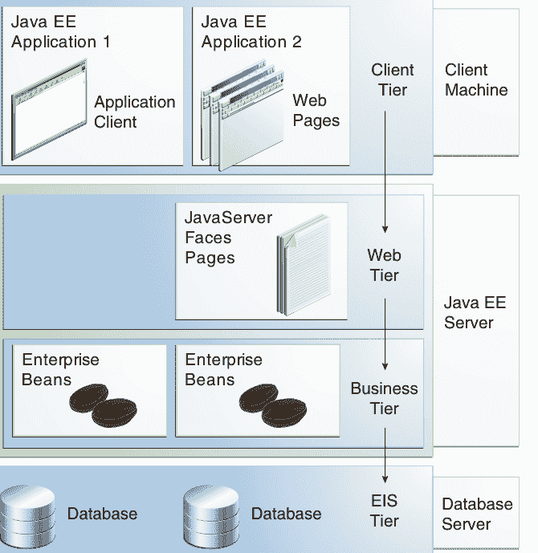

### 1.3.1 安全

虽然其他企业应用模型要求在每个应用程序中采用特定平台的安全措施，但 Java EE 安全环境允许在部署时定义安全约束。Java EE 通过屏蔽应用程序开发者无需实现安全功能的复杂性，使应用程序能够移植到各种安全实现。

Java EE 提供了标准的声明式访问控制规则，这些规则由开发者定义并在应用程序部署到服务器上时进行解释。Java EE 还提供了标准的登录机制，因此应用程序开发者无需在其应用程序中实现这些机制。同一个应用程序可以在不更改源代码的情况下，在各种安全环境中工作。

### 1.3.2 Java EE 组件

Java EE 应用由组件组成。一个 Java EE 组件是一个自包含的功能性软件单元，它与其相关的类组装成一个 Java EE 应用，并与其他组件进行通信。

Java EE 规范定义了以下 Java EE 组件：

- 客户端（Application clients）和小程序（Applets）是运行在客户端的组件。
- Java Servlet、JavaBeans Faces 和服务器页面（JSP）技术组件是运行在服务器上的 Web 组件。
- Enterprise JavaBeans (EJB) 组件（企业级豆）是运行在服务器上的业务组件。

Java EE 组件用 Java 编程语言编写，并以与语言中任何程序相同的方式进行编译。Java EE 组件与“标准”Java 类的区别在于，Java EE 组件被组装成一个 Java EE 应用，它们经过验证为格式良好且符合 Java EE 规范，并被部署到生产环境中，由 Java EE 服务器进行运行和管理。

### 1.3.3 Java EE 客户端

Java EE 客户端通常是 Web 客户端或应用程序客户端。

#### 1.3.3.1 Web 客户端

Web 客户端由两部分组成：

- 包含各种类型标记语言（HTML、XML 等）的动态网页，这些页面由运行在 Web 服务器上的 Web 组件生成
- Web 浏览器，用于渲染从服务器接收到的页面

Web 客户端有时被称为 `thin client`（瘦客户端）。瘦客户端不查询数据库、不执行复杂的业务规则也不连接到遗留应用程序。当你使用瘦客户端时，此类沉重操作会被卸载到在 Java EE 服务器上执行的企业豆中，在那里它们可以利用 Java EE 服务器端技术的安全性、速度、服务可靠性。

#### 1.3.3.2 应用程序客户端

应用程序客户端运行在客户端机器上，为用户提供了一种处理比标记语言提供的更丰富用户界面任务的方法。应用程序客户端通常具有使用 Swing 或抽象窗口工具包（AWT）API 创建的图形用户界面（GUI），但命令行界面也是可能的。

应用程序客户端直接访问业务层中的企业豆。然而，如果需求需要，应用程序客户端可以打开 HTTP 连接以与 Web 层中的 servlet 建立通信。用非 Java 语言编写的应用程序客户端可以与 Java EE 服务器交互，使 Java EE 平台能够与遗留系统以及非 Java 语言实现互操作性。

#### 1.3.3.3 小程序 (Applets)

从 Web 层接收的页面可以包含一个嵌入的小程序。`applet` 是运行在安装在 Web 浏览器中的 Java 虚拟机中的小型客户端应用程序。然而，客户端系统可能需要插件以及可能的安全策略以便能够在 Web 浏览器中成功执行。

Web 组件是创建 Web 客户端的首选 API，因为客户端系统不需要插件或安全策略。此外，Web 组件实现了更整洁、更模块化的应用程序设计，因为它们提供将应用程序编程与网页设计分离的方法。因此，参与网页设计的人员不需要理解 Java 语言语法即可完成工作。

#### 1.3.3.4 JavaBeans 组件架构

服务器端和客户端也可能包含基于 JavaBeans 组件架构（JavaBeans 组件）的组件，用于管理以下两者之间的数据流：

- 运行在 Java EE 服务器上的应用程序客户端或警告组件
- 服务器组件和数据库

根据 Java EE 规范，JavaBeans 组件不视为 Java EE 组件。

JavaBeans 组件具有属性，并有用于访问属性的 `get` 和 `set` 方法。以这种方式使用的 JavaBeans 组件通常处于设计和实现阶段，但应符合 JavaBeans 组件架构中概述的命名和设计规范。

#### 1.3.3.5 Java EE 服务器通信

图 1–2 显示了构成客户端层的各种元素。客户端直接与 Java EE 服务器上的业务层进行通信，或者在客户端在浏览器中运行的情况下，通过运行在 Web 层的 Web 页面或 `servlets` 进行通信。

### 图 1–2 服务器、客户端与通信

| 应用程序客户端和可选的 JavaBeans 组件 | 浏览器、Web页面、Applet 和可选的 JavaBeans 组件 | 客户端层 |
|---|---|---|

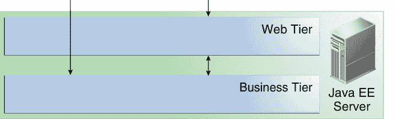

### 1.3.4 Web 组件

Java EE Web 组件是 `servlets` 或使用 JavaFaces 技术和/或 JSP 技术（JSP 页面）创建的 Web 页面。`Servlets` 是 Java 编程语言的类，用于动态处理请求并构建响应。JSP 页面是基于文本的文档，以 `servlets` 形式执行，但允许以更自然的方式创建静态内容。JavaServer 技术构建在 `servlets` 和 JSP 技术之上，为 Web 应用程序提供用户界面组件框架。

静态 HTML 页面和 applet 在应用程序组装时与 Web 组件打包在一起，但根据 Java EE 规范并不被视为 Web 组件。服务器端实用类也可以与 Web 组件打包在一起，并且像 HTML 页面一样，不被视为 Web 组件。

如图 1–3 所示，Web 层像客户端层一样，可能包含 JavaBeans 组件来管理用户输入并将其发送到运行在业务层的企业豆（enterprise beans）进行处理。

### 图 1–3 Web 层与 Java EE 应用程序

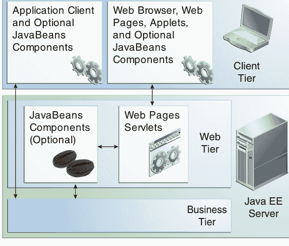

### 1.3.5 业务组件

业务代码是指解决或满足特定业务领域（如银行、零售或金融）需求的逻辑，由运行在业务层或 Web 层的企业豆处理。图 1–4 显示了企业豆如何接收来自客户端程序的数据，对其进行处理（如有必要），并发送到企业信息系统（EIS）层进行存储。企业豆还从存储中检索数据，对其进行处理（如有必要），并传回客户端程序。

### 图 1–4 业务层与 EIS 层

| 应用程序客户端和可选的 JavaBeans 组件 | 浏览器、Web页面、Applet 和可选的 JavaBeans 组件 | 客户端层 |
|---|---|---|
| JavaBeans 组件（可选） | Web 页面、Servlets | Web 层 |
| Java 持久化实体、Session Bean、消息驱动 Bean | 业务层 | Java EE 服务器 |
| 数据库和遗留系统 | EIS 层 | |

### 1.3.6 企业信息系统层

信息系统层处理 EIS 软件，并包括企业基础设施系统，例如企业资源计划（ERP）、大型机事务处理、数据库系统和其他遗留信息系统。例如，Java EE 组件可能需要访问企业信息系统以进行数据库连接。

## 1.4 Java EE 容器

通常，轻量客户端多层应用程序很难编写，因为它们涉及许多行复杂的代码来处理事务和状态管理、多线程、资源池和其他复杂的低级细节。基于组件且平台无关的 Java EE 架构使得编写变得简单，因为业务逻辑被组织成可重用的组件。此外，Java EE 服务器以容器的形式为每种组件类型提供底层服务。由于你不需要自己开发这些服务，你可以自由地继续解决手头的问题。

### 1.4.1 容器服务

容器是组件与支持该组件的底层特定平台功能之间的接口。在执行之前，Web 组件、企业豆或应用程序客户端组件必须组装成 Java EE 模块并部署到其容器中。

组装过程涉及为 Java EE 应用程序中的每个组件以及 Java EE 应用程序本身指定容器设置。容器设置自定义了 Java EE 服务器提供的底层支持，包括安全性、事务管理、Java 命名和目录接口（JNDI）API 以及远程连接。以下是其中的一些亮点。


- Java EE 安全模型允许你配置组件或企业豆，使得只有授权用户才能访问系统资源。
- Java EE 事务模型允许你指定构成单个事务的方法之间的关系，以便一个事务中的所有方法被视为一个单一单元。
- `JNDI` 查找服务为企业中的多个命名和目录服务提供统一接口，应用程序组件可以访问这些服务。
- Java EE 远程连接模型管理客户端与企业豆之间的低级通信。在创建企业豆后，客户端调用方法就像它们在同一个虚拟机中一样。

由于 Java EE 架构提供了可配置的服务，同一个 Java EE 应用程序中的应用程序组件会根据其部署的位置表现出不同的行为。例如，企业豆可以具有安全设置，允许它在一个生产环境中对数据库数据具有特定级别的访问权限，而在另一个环境中具有另一个数据库访问权限。

容器还管理不可配置的服务，例如企业豆和 servlet 的生命周期、数据库连接池、数据持久化以及对 Java EE 平台的访问。

## 1.4.2 容器类型

部署过程如图 1–5 所示将 Java EE 组件安装在 Java EE 容器中。

## 图 1-5 Java EE 服务器与容器

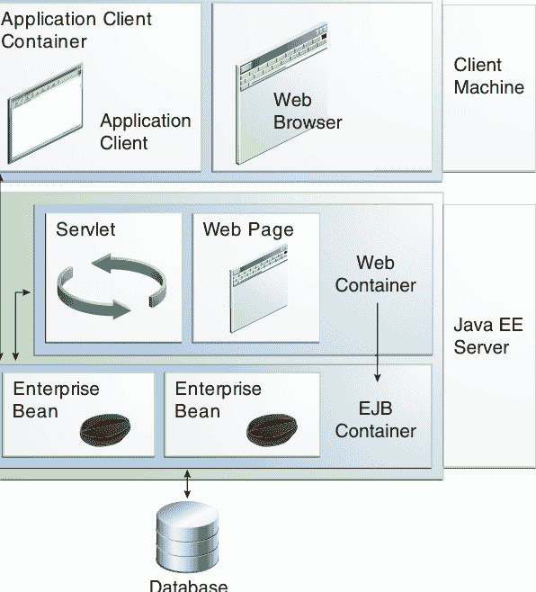

- **Java EE 服务器**：Java EE 运行时部分。Java EE 服务器提供 EJB 和 Web 容器。
- **企业豆 (EJB) 容器**：管理 Java EE 应用程序企业豆的执行。企业豆及其容器运行在 Java EE 服务器上。
- **Web 容器**：管理 Java EE 应用程序 Web 页面、servlet 和某些 EJB 组件的执行。Web 组件及其容器运行在 Java EE 服务器上。
- **应用程序客户端容器**：管理应用程序客户端组件的执行。应用程序客户端及其容器运行在客户端。
- **Applet 容器**：管理 applet 的执行。由客户端上的浏览器和 Java 插件组成。

面向文档的 Web 服务允许你来回发送包含服务数据的文档。这不需要低级编程，因为 `XML` API 实现了应用程序与基于 `XML` 的数据流之间的转换工作，而这些数据流是通过标准化的基于 `XML` 的传输协议发送的。这些基于 `XML` 的标准和协议将在后续章节中介绍。

标准化的 `XML` 数据流的转换使得 Web 服务和使用 `Java XML API` 的客户端具有完全的互操作性。这并不意味着传输的数据一定包含 `XML` 标签，例如，传输的数据可以是纯文本、`XML` 数据或任何类型的二进制数据，如音频、视频、地图文件、计算机辅助设计 (CAD) 文档等。下一节将介绍 `XML` 并解释业务相关方如何使用 `XML` 标签和架构（schemas）以有意义的方式交换数据。

## 1.5.1 XML

可扩展标记语言 (`XML`) 是一种用于表示数据的跨平台、基于文本的标准。交换 `XML` 数据的双方可以创建自己的标签来描述数据，设置在特定类型 `XML` 文档中使用的标签的架构（schemas），并使用 `XML` 样式表来管理数据的显示和处理。

例如，Web 服务可以使用 `XML`，而接收价格列表和架构的公司可以拥有自己的样式表以符合其需求的方式处理数据。以下是示例：

- 一家公司可能通过程序将 `XML` 价格信息转换为 `HTML`，以便将其价格列表发布到其内网中。
- 合作伙伴可能通过工具处理 `XML` 价格信息以创建营销演示文稿。
- 另一家公司可能将 `XML` 价格信息读取到应用程序中处理。

## 1.5.2 SOAP 传输协议

客户端请求和 Web 服务响应通过 `HTTP` 传输为简单访问协议 (`SOAP`) 消息，以便在运行于不同平台和互联网不同位置的客户端与 Web 服务之间实现完全互操作的交换。`HTTP` 是一种用于在互联网上发送消息的熟悉的请求-响应标准，而 `SOAP` 是一种遵循 `HTTP` 请求-响应模型的基于 `XML` 的协议。

传输消息中的 `SOAP` 部分执行以下操作：

- 定义一个基于 `XML` 的封包，用于描述消息中的内容并解释如何处理消息
- 包含基于 `XML` 的编码规则，用于表示消息中应用程序定义数据类型的实例
- 定义一个基于 `XML` 的约定，用于表示对远程服务的请求以及生成的响应

## 1.5.3 WSDL 标准格式

Web 服务描述语言 (`WSDL`) 是一种用于描述网络服务的标准 `XML` 格式。描述包括服务的名称、服务的位置以及与服务通信的方法。`WSDL` 服务描述可以发布在 Web 上。GlassFish 服务器提供了一个工具，用于为使用远程过程调用客户端的 Web 服务生成 `WSDL` 规范。

## 1.6 Java EE 应用程序组装与部署

Java EE 应用程序被封装在一个或多个标准单元中，部署到任何符合 Java EE 标准的系统中。每个单元包含

- 一个或多个功能组件，例如企业豆 (enterprise bean)、网页、servlet 或应用程序小程序 (applet)
- 一个可选的部署描述符，用于描述其内容

一旦生成 Java EE 单元，即可进行部署。部署通常涉及使用平台的部署工具来指定特定位置的信息，例如可以访问它的本地用户列表和本地数据的名称。一旦部署在本地平台上，应用程序即可运行。

## 1.7 开发角色

可重用模块使得应用程序开发和部署过程划分为不同的角色成为可能，以便不同的人或公司执行过程的不同部分。

前两个角色——Java EE 产品提供者和工具提供者涉及购买和安装 Java EE 产品和工具。购买并安装软件后，应用程序提供者可以开发 Java EE 组件，应用程序开发人员可以组装它们，应用程序开发人员可以部署它们。在大型组织中，这些每个角色都可能由个人或团队执行。这种分工使得每个早期角色都输出一个可迁移文件，作为后续角色的输入。例如，在应用程序组件开发阶段，企业豆软件开发人员交付 `EJB JAR` 文件。在应用程序组装角色中，另一位开发人员可以将这些 `EJB JAR` 文件合并成 Java EE 应用程序并保存为 `EAR` 文件。在应用程序部署角色中，客户现场的系统管理员使用 `EAR` 文件将 Java EE 应用程序安装到 Java EE 服务器中。

角色并不总是由不同的人执行。如果你在一家小公司工作，或者你正在原型示例应用程序，你可能执行每个阶段的任务。

## 1.7.1 Java EE 产品提供者

Java EE 产品提供者是设计并提供购买 Java EE 规范中定义的 Java EE 平台 API 及其他功能的公司。产品提供者通常是应用服务器供应商，根据 Java EE 7 平台规范实现 Java EE 平台。

## 1.7.2 工具提供者

工具提供者是为组件提供者、组装者和部署者创建开发、组装和打包工具的公司或个人。

## 1.7.3 应用程序组件提供者

应用程序组件提供者是为 Java EE 应用程序创建 Web 组件、企业豆、小程序或应用程序客户端的公司或个人。

### 1.7.3.1 企业豆开发者

企业豆开发者执行以下任务以交付包含一个或多个企业豆的 `EJB JAR` 文件：

- 编写代码
- 指定描述符
- 将类文件打包成 `EJB JAR` 文件

### 1.7.3.2 Web 组件开发人员

Web 组件开发人员执行以下任务以交付包含多个组件的 `WAR` 文件：

- 编写 servlet 代码
- 编写 `JavaServer Faces`、`JSP` 和 `HTML` 文件
- 指定描述符
- 将类文件、`JSP` 和 `HTML` 文件打包成 `WAR` 文件

### 1.7.3.3 应用程序客户端开发人员

客户端开发者执行以下任务以交付包含应用程序客户端的 `JAR` 文件：

- 编写代码
- 指定描述符
- 将类文件和描述符打包成 `JAR` 文件

## 1.7.4 应用程序组装者

组装者是从组件提供者处接收应用程序模块并将其组装成 Java EE 应用程序 `EAR` 文件的公司或个人。组装者或部署者可以直接使用描述符，也可以使用工具在交互会话周围添加 `XML` 标签。

软件开发人员执行以下任务交付 `EAR` 文件：

- 将之前阶段的 `EJB JAR` 和 `WAR` 文件组装成 Java EE 应用程序 (`EAR`) 文件
- 为 Java EE 应用程序指定描述符
- 验证 `EAR` 文件格式正确并符合 Java EE 规范

## 1.7.5 应用程序部署者与管理员

应用程序部署者和管理员是配置并部署应用程序客户端、Web 应用程序、企业豆组件以及 Java EE 应用程序的公司或个人，管理运行 Java EE 组件和应用程序的计算和网络基础设施，并监督运行时环境。职责包括设置事务控制和安全属性。

配置期间，部署者按照组件提供者提供的说明解析外部依赖，指定安全设置并分配事务属性。安装期间，部署者将应用程序组件移动到服务器并生成特定的类和接口。

部署者或系统管理员执行以下任务安装并配置 Java EE 应用程序或组件：

- 为运行环境配置 Java EE 应用程序或组件
- 验证 `EAR`、`JAR` 和/或 `WAR` 文件格式正确并符合 Java EE 规范
- 将 Java EE 应用程序或组件部署（安装）到 Java EE 服务器中

## 1.8 Java EE 7 APIs

图 1–6 显示了 Java EE 容器之间的关系。

## 图 1–6 Java EE 容器

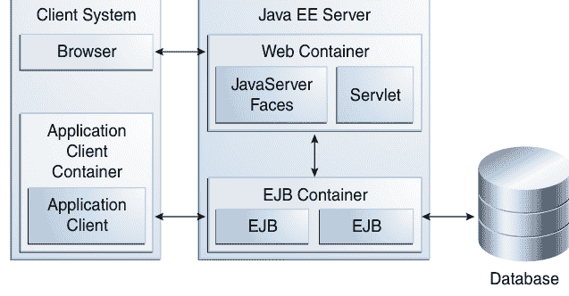

图 1–7 显示了 Java EE 7 API 在 Web 容器中的可用性。

## 图 1–7 Web 容器中的 Java EE API

| Web 容器 | WebSocket | Java SE |
|---|---|---|
| | 并发工具类 | |
| | 批量处理 | |
| | `JSON-P` | |
| | Bean Validation | |
| | EJB Lite | |
| | `EL` | |
| Servlet | `JavaMail` | |
| | `JSP` | Connectors |
| `JavaServer Faces` | Java Persistence | |
| | `JMS` | |
| | Management | |
| | `WS Metadata` | |
| | Web Services | |
| | `JACC` | |
| | `JASPIC` | |
| | `JAX-RS` | |
| | `JAX-WS` | |
| | `JSTL` | |
| | `JTA` | |
| | `CDI` | 依赖注入 |

图 1–8 显示了在 EJB 容器中 Java EE 7 API 的可用性。

## 图 1–8 EJB 容器中的 Java EE API

| EJB 容器 | 并发工具类 | Java SE |
|---|---|---|
| | 批量处理 | |
| | `JSON-P` | |
| | `CDI` | |
| | 依赖注入 | |
| | `JavaMail` | |
| | Java Persistence | |
| | `JTA` | |
| | Connectors | |
| | `JMS` | |
| `EJB` | Management | |
| | `WS Metadata` | |
| | Web Services | |
| | `JACC` | |
| | `JASPIC` | |
| | Bean Validation | |
| | `JAX-RS` | |
| | `JAX-WS` | |

Java EE 7 中的新特性

图 1–9 显示了在应用客户端容器中 Java EE 7 API 的可用性。

## 图 1–9 应用客户端容器中的 Java EE API

| 应用容器 | Java 持久化管理 | Java SE |
| --- | --- | --- |
| 应用客户端 | `WS Metadata` | |
| | Web Services | |
| | `JSON-P` | |
| | `JMS` | |
| | `JAX-WS` | |
| | Bean Validation | |
| | `JavaMail` | |
| | `CDI` | |
| | 依赖注入 | Java EE 7 新特性 |

以下章节简要概述了 Java EE 平台所需的技术以及 Java EE 应用使用的 API。

## 1.8.1 Enterprise JavaBeans 技术

`Enterprise JavaBeans` (`EJB`) 组件，或企业豆（enterprise bean），是一组具有字段和方法用于实现业务逻辑模块的代码体。你可以将企业 bean 视为一个构建块，它可以单独使用，也可以与其他企业 bean 配合，在 Java EE 服务器上执行业务逻辑。

企业 bean 是会话 bean（session beans）或消息驱动 bean（message-driven beans）。

- **会话 bean** 代表与客户端的瞬时对话。当客户端完成执行时，会话 bean 及其数据就会消失。
- **消息驱动 bean** 包含了会话 bean 和消息监听器的特性，允许业务组件异步接收消息。通常，这些消息是 `Java 消息服务` (`JMS`) 消息。

在 Java EE 7 平台中，新的企业 bean 特性包括：

- `EJB Lite` 中的异步本地会话 bean
- `EJB Lite` 中的非持久化项

Java EE 7 平台需要 `Enterprise JavaBeans 3.2` 和拦截器（`Interceptors`）1.2。拦截器规范是 `EJB` 规范的一部分。

## 1.8.2 Servlet 技术

`Java Servlet` 技术允许你定义 `HTTP-servlet` 类。Servlet 扩展了服务器的能力，这些服务器通过请求-响应编程模型来托管应用程序。虽然 servlet 可以响应任何类型的请求，但它们通常用于扩展由 Web 服务器托管的应用程序。

在 Java EE 7 平台中，新的 `Java Servlet` 技术特性包括：

- 非阻塞 I/O
- `HTTP` 协议升级

Java EE 7 平台需要 `Servlet 3.1`。

## 1.8.3 JavaFaces 技术

`JavaServer Faces` 技术是一种用于 Web 应用程序的用户界面框架。`JavaServer Faces` 技术的主要组件如下：

- 一个 GUI 组件框架。
- 一个灵活的模型，用于在不同类型的 `HTML` 或不同的标记语言和技术渲染组件。`渲染器`（`Renderer`）生成标记，并将存储在模型对象中的数据转换为可以在视图中表示的类型。
- 用于生成 `HTML/4.01` 标记的标准`渲染工具包`（`RenderKit`）

以下功能支持 GUI 组件：

- 输入验证
- 事件处理
- 模型对象与组件之间的数据转换
- 管理的模型对象创建
- 页面导航配置
- 表达式语言 (`EL`)

所有功能都可以使用标准的 `Java API` 和基于 `XML` 的配置文件实现。

在 Java EE 7 平台中，`JavaServer Faces` 技术的新特性包括：

- `HTML 5` 流
- Faces
- 资源库合约

Java EE 7 平台需要 `JavaFaces 2.2` 和表达式语言 3.0。

## 1.8.4 JavaServer Pages 技术

`JavaServer Pages` (`JSP`) 技术允许你将 servlet 代码段直接放入文本文档中。`JSP` 页面是包含两种文本的文本文档：

- 静态数据，可以用任何文本格式表示
- `JSP` 元素，决定页面如何构建动态内容

有关 `JSP` 技术的信息，请参阅 *The Java EE 5 Tutorial* http://docs.oracle.com/javaes/5/tutorial/。

Java EE 7 平台需要 `JavaPages 2.3` 以兼容早期版本。

## 1.8.5 JavaServer Pages 标签库技术

`JavaServer Pages` 标签库 (`JSTL`) 封装了 `JSP` 中的常用功能。与其将代码和标记混合，不如使用一组标准化的标签。

Java EE 7 平台需要 `JSTL 1.2`。

## 1.8.6 Java Persistence API

`Java 持久化 API` (`JPA`) 提供了对象映射的标准。它允许开发者使用面向对象模型而不是 `SQL` 与数据库交互。

- `Java 持久化 API`
- 查询语言

Java EE 7 平台需要 `JPA 2.1`。

## 1.8.7 Transaction API

事务 API (`JTA`) 为 Java EE 中的事务管理提供了标准接口。

Java EE 7 平台需要 `JTA 1.2`。

## 1.8.8 Java API for RESTful Services

`RESTful Services` (`JAX-RS`) 定义了使用表述状态转移（`REST`）架构开发 Web 服务的标准。

Java EE 7 平台需要 `JAX-RS 2.0`。

## 1.8.9 Managed Beans

`Managed Beans` 是容器管理的轻级对象 (`POJO`)。

Java EE 7 平台需要 `Managed Beans 1.0`。

## 1.8.10 Contexts and Dependency Injection for Java

上下文和依赖注入 (`CDI`) 为 Java EE 中的依赖注入提供了标准。

Java EE 7 平台需要 `CDI 1.1`。

## 1.8.11 Dependency Injection for Java

`Java 依赖注入` 定义了用于注入类的标准注解集。

Java EE 7 平台需要 `Dependency Injection for Java 1.0`。

## 1.8.12 Bean Validation

`Bean Validation` 规范定义了验证 `JavaBeans` 中数据的元数据模型和 API。

Java EE 7 平台需要 `Bean Validation 1.1`。

## 1.8.13 Java Message Service API

`Java 消息服务` (`JMS`) API 是 Java EE 中消息的标准。

Java EE 7 平台需要 `JMS 2.0`。

## 1.8.14 Java EE Connector Architecture

`EE 连接器架构` 被供应商和系统集成商用于创建资源适配器，以支持对企业信息系统的访问。


Java EE 连接架构（Java EE Connector Architecture）提供了一种面向性能、安全、可扩展且基于消息的事务集成方案，可以将基于 Java EE 的 Web 服务与现有企业信息系统（EIS）进行集成，这些集成可以是同步或异步的。集成到 Java EE 连接架构以及 Java EE 平台的现有应用程序和 EIS 可以通过 JAX-WS 和 Java EE 组件模型暴露为基于 XML 的 Web 服务。JAX-WS 和 Java EE 连接架构是企业应用集成（EAI）和端到端业务集成的互补技术。

Java EE 7 平台需要 Java EE 连接架构 1.7。

## 1.8.5 JavaMail API

Java EE 使用 JavaMail API 发送电子邮件通知。JavaMail API 包含两个部分：

- 应用程序组件用于发送邮件的应用程序级接口
- 一个服务提供者接口（SPI）

Java EE 平台包含了 JavaMail API，并带有一个服务提供者，允许应用程序组件发送互联网电子邮件。

Java EE 7 平台需要 JavaMail API 1.5。

## 1.8.16 容器 Java 授权合约（Java Authorization Contract for Containers）

容器 Java 授权合约（JACC）规范定义了 Java EE 应用服务器与授权策略提供者之间的合约。所有的 Java EE 容器都支持此合约。

JACC 规范定义了满足 Java EE 授权模型的 `java.security.Permission` 类。该规范定义了容器访问决策与这些权限类实例操作之间的绑定。它定义了策略提供者的语义，这些策略提供者使用新的权限类来解决 Java EE 平台的去中心化需求，包括角色的定义和使用。

Java EE 7 平台需要 JACC 1.5。

## 1.8.17 容器 Java 认证服务提供者接口（Authentication Service Provider Interface for Containers）

容器 Java 认证服务提供者接口（JASPIC）指定了一个服务提供者接口（SPI），通过该接口，实现消息认证机制的身份提供者可以集成到客户端或服务器的消息处理容器或运行时。通过此接口集成的身份提供者对其容器提供的网络消息进行操作。身份提供者对任何消息的发送源可以由接收容器进行验证，而消息的接收者可以由消息发送者进行验证。身份提供者验证所有入站消息，并将根据消息认证建立的身份返回给其调用容器。

Java EE 7 平台需要 JASPIC 1.1。

## 1.8.18 WebSocket Java API（Java API for WebSocket）

WebSocket 是一种应用程序协议，通过 TCP 提供两个对端之间的全双工通信。WebSocket Java API 允许 Java EE 应用程序使用注解创建端点，注解指定了端点的配置参数并其生命周期回调方法。

WebSocket API 是 Java EE 7 平台的新特性。Java EE 7 平台需要 Java API for Websocket 1.0。

## 1.8.19 JSON 处理 Java API（Java API for JSON Processing）

JSON 是一种源自 JavaScript 的文本数据交换格式，用于 Web 服务和其他连接应用程序。JSON 处理 Java API（JSON-P）允许 Java EE 应用程序使用对象模型或流式模型解析、转换和查询 JSON 数据。

JSON-P 是 Java EE 7 平台的新特性。Java EE 7 平台需要 JSON-P 1.0。

## 1.8.20 Java EE 并发工具类（Concurrency Utilities for Java EE）

Java EE 并发工具类是一项标准 API，通过以下类型的对象为 Java EE 应用程序组件提供异步能力：托管执行器、调度执行器服务、托管线程工厂和上下文服务。

Java EE 并发工具类是 Java EE 7 平台的新特性。Java EE 7 平台需要 Concurrency Utilities for Java EE 1.0。

## 1.8.21 Java 平台批处理应用程序（Batch Applications for the Java Platform）

无需用户交互即可执行的批处理作业。Java 平台批处理应用程序规范是一个批处理框架，支持在 Java 应用程序中创建和运行批处理作业。该框架由批处理运行时、基于 XML 的作业规范语言、与批处理运行时交互的 Java API 以及用于实现批处理产物的 Java API 组成。

Java 平台批处理应用程序是 Java EE 7 平台的新特性。Java EE 7 平台需要 Batch Applications for the Java Platform 1.0。

## 1.9 Java 平台 Java EE API（Java APIs in the Java Platform）

Java 平台 Java EE API 包含在 Java SE 7 中。

### 1.9.1 Java 数据库连接（Java Database Connectivity）

Java 数据库连接（JDBC）API 允许 bean 调用 SQL 命令。JDBC 包含两个部分：

- 应用程序用于访问数据库的应用程序级接口
- 用于附加数据库驱动的服务提供者接口

Java EE 7 平台需要 JDBC 4.1。

### 1.9.2 Java 命名与目录接口（Java Naming and Directory Interface）

Java 命名与目录接口（JNDI）提供了命名功能，能够访问 LDAP、DNS 和 NIS 等多种命名和服务。JNDI API 提供了关联属性以及使用属性搜索对象的方法。在 JNDI 下，Java 应用可以与许多遗留系统共存。

Java EE 组件可以使用 JNDI 接口定位命名环境。组件可以在 `java:comp/env` 下创建 `java.naming.InitialContext` 对象。

Java EE 组件可以访问系统提供的对象和自定义对象。系统提供的对象（如 `ITATransaction` 对象）存储在命名环境中。Java 平台允许组件命名自定义对象，例如企业 bean、环境条和 JDBC 连接。对象应根据类型命名在命名环境的子文中。例如，企业 bean 命名在 `java:comp/env/ejb` 中，JDBC DataSource 命名在 `java:comp/env/jdbc` 中。

### 1.9.3 JavaBeans 激活框架（JavaBeans Activation Framework）

JavaBeans 激活框架（JAF）由 JavaMail API 提供。它提供了标准服务来确定任意数据的类型、封装对其访问、发现可用操作并创建合适的 JavaBeans 组件来执行这些操作。

### 1.9.4 XML 处理 Java API（Java API for XML Processing）

XML 处理 API（JAXP）是 Java SE 平台的一部分，支持使用文档对象模型（DOM）、简单 XML API（SAX）和可扩展样式语言转换（XSLT）处理 XML 文。JAXP 允许应用程序独立于特定的 XML 实现来解析和转换 XML 文。

JAXP 提供了命名空间支持，适用于可能存在命名冲突的架构。JAXP 设计灵活，允许你在应用程序中使用任何符合 XML 标准的解析器或 XSL 处理器，并支持万网联盟（W3C）架构。你可以在此 URL 获取更多信息：http://www.w3.org/XML/Schema。

### 1.9.5 XML 绑定架构（Architecture for XML Binding）

Java XML 绑定架构（JAXB）提供了一种将 XML 架构绑定到 Java 语言程序表示的便捷方法。JAXB 可以独立使用，也可以与 JAX-WS 结合使用，其中它提供标准数据绑定。

Web 服务消息的绑定。所有 Java EE 应用容器、Web 容器和 EJB 容器都支持 JAXB API。

Java EE 7 平台需要 JAXB 2.2。

### 1.9.6 用于 XML Web 服务的 API

XML 服务的 Java API (JAX-WS) 规范为使用 JAXB API 将 XML 数据绑定到 Java 对象的 Web 服务提供了支持。JAX-WS 规范定义了用于访问 Web 服务的客户端 API 以及实现 Web 端点（endpoints）的技术。《企业级 Web 服务实现》规范描述了基于 JAX 的服务和客户端的部署。EJB 和 Servlet 规范也描述了此类部署的方面。基于 JAX-WS 的应用程序依赖于这些部署模型。

JAX-WS 规范描述了对能够处理消息请求和响应的消息处理器（message handlers）的支持。通常，这些消息处理器在相同的容器中执行，并具有与与其关联的 JAX-WS 客户端或端点组件相同的权限和执行上下文。这些消息处理器可以访问与其关联组件相同的 JNDI `java:comp/env` 命名空间。如果支持，自定义的序列化器和反序列化器将以相同的方式处理。

Java EE 7 平台需要 JAX-WS 2.2。

### 1.9.7 Java 的带附件的 SOAP

Java 的带附件的 SOAP (SAAJ) 是 JAX-WS 依赖的低级 API。SAAJ 能够生成和消费符合 SOAP 1.1 和 1.2 规范以及 SOAP 附件说明的消息。大多数开发者并不使用 SAAJ API，而是使用更高级的 JAX-WS API。

### 1.9.8 Java 认证和授权服务

Java 认证和授权服务 (JAAS) 为 Java EE 提供了一种方法，对特定用户或用户组进行认证和授权以运行程序。

JAAS 是标准可插认证模块 (PAM) 框架的 Java 语言版本，它扩展了 Java 安全体系以支持基于用户的授权。

### 1.9.9 Java 平台的通用注解

注解（Annotations）使 Java 平台支持声明式编程风格。

Java EE 7 平台需要 Java 平台通用注解 1.2。

## 1.10 GlassFish 服务器工具

GlassFish 服务器是 Java EE 7 平台的规范实现。除了支持前面的节中描述的所有 API 之外，GlassFish 服务器还包含了若干 EE 工具，这些工具并不是 Java EE 7 平台的一部分，而是作为为开发者提供的便利工具。

本节总结了构成 GlassFish 服务器的工具。启动和停止 GlassFish 服务器、启动管理控制以及停止 Java DB 服务器的说明请参阅第 2 章“使用教程示例”。

GlassFish 服务器包含表 1–1 中列出的工具。许多工具的基本用法信息将贯穿整个教程。欲了解详细信息，请参阅 GUI 工具中的在线帮助。

### 表 1–1 GlassFish 服务器工具

| 工具 | 描述 |
|---|---|
| 管理控制 (Administration Console) | 一种基于 Web 的 GUI GlassFish 服务器管理实用。用于停止 GlassFish 服务器并管理用户、资源和应用程序。 |
| asadmin | 命令行 GlassFish 服务器管理工具。用于启动和停止 GlassFish 服务器并管理用户、资源和应用程序。 |
| appclient | 一种命令行工具，用于启动应用程序客户端容器并调用封装在 application client JAR 文件中的客户端应用程序。 |
| capture-schema | 命令行工具，用于从数据库中提取信息，生成 GlassFish 服务器可用于容器托管持久化的模式文件（schema file）。 |
| package-appclient | 命令行工具，用于打包应用程序容器库和 JAR 文件。 |
| Java DB 数据库 | Java DB 服务器的副本。 |
| xjc | 命令行工具，用于将源 XML 架构转换、绑定或生成 Java 语言的一组 JAXB 内容类。 |
| java2ws | 命令行工具，用于从 Java 类生成 JAXB 注解。 |
| b2x | 命令行工具，用于从 XML 架构生成 JAXB 绑定。 |
| wsimport | 命令行工具，用于从 WSDL 生成 JAX-WS 类。 |
| wsgen | 命令行工具，用于根据 WSDL 生成架构。 |

安装后，Java EE 7 教程将出现在已安装组件列表中。该工具安装在 `as-parent-install/docs/javaee-tutorial` 目录下，在教程中称为 `tut-install`。此目录包含两个子目录：`docs` 和 `examples`。`examples` 目录包含教程中讨论的每种技术的子目录。

## 下一步

Java EE 7 教程会定期发布更新。有关获取这些更新的详细信息，请参见“获取教程最新更新”。

## 2.4 NetBeans IDE

NetBeans 集成开发环境（IDE）是一个用于开发 Java 应用程序的免费开源 IDE，NetBeans IDE 支持 Java EE 平台。你可以在 NetBeans IDE 内部构建、打包、部署和运行教程示例。

要运行示例，你可以使用最新版本的 NetBeans IDE。你可以从 https://www.netbeans.org/downloads/index.html 下载 NetBeans IDE。确保你下载了 Java EE 软件包。

### 2.4.1 安装不带 GlassFish Server 的 NetBeans IDE

当安装 NetBeans IDE 时，请不要安装与 NetBeans IDE 一带的 GlassFish Server 版本。要跳过 GlassFish Server 的安装，请遵循以下步骤。

1. 在 NetBeans IDE 安装向导的第一页上，勾选 GlassFish Server 复选框并点击 OK。
2. 接受许可协议和 Junit 许可协议。
   教程中的几个示例使用了 JUnit 库，因此你应该安装它。
3. 继续安装 NetBeans IDE。

### 2.4.2 将 GlassFish Server 作为服务器添加到 NetBeans IDE

若要在 NetBeans IDE 中运行示例，你必须将你的 GlassFish Server 作为服务器添加到 NetBeans IDE 中。请按照这些说明将 GlassFish Server 添加到 NetBeans IDE。

1. 从“工具 (Tools)”菜单中选择“服务器 (Servers)”。
2. 在“服务器”向导中，点击“添加服务器 (Add Server)”。
3. 在“选择服务器 (Choose Server)”下，选择 GlassFish Server 并点击“下一步 (Next)”。
4. 在“服务器位置 (Server Location)”下，浏览到 Java EE 7 SDK 的位置并点击“下一步 (Next)”。
5. 在“域位置 (Domain Location)”下，选择“注册本地域 (Register Local Domain)”。
6. 点击“完成 (Finish)”。

## 2.1.5 Apache Maven

Maven 是一种基于 Java 的构建工具，由 Apache 软件基金会开发，用于构建、打包和部署教程示例。从命令行运行教程示例，你需要 Maven 3.0 或更高版本。如果你还没有 Maven，可以从以下处进行安装：

```
http://maven.apache.org
```

确保将 `maven-install/bin` 目录添加到你的路径（path）中。

如果你使用 NetBeans IDE 构建和运行示例，它包含了 Maven 的副本。

## 2.2 启动和停止 GlassFish Server

你可以使用 NetBeans IDE 或命令行启动和停止 GlassFish Server。

### 2.2.1 使用 NetBeans IDE 启动 GlassFish Server

1. 点击“服务 (Services)”选项卡。
2. 展开“服务器 (Servers)”。
3. 右键点击 GlassFish Server 实例并选择“启动 (Start)”。

### 2.2.2 使用 NetBeans IDE 停止 GlassFish Server

要使用 NetBeans IDE 停止 GlassFish Server，右键点击 GlassFish 实例并选择“停止 (Stop)”。

### 2.2.3 从命令行启动 GlassFish Server

要从命令行启动 GlassFish Server，打开终端窗口或命令提示符并执行以下操作：

```
asadmin start-domain --verbose
```

域（domain）是由一个管理服务器管理的一组或多个 GlassFish Server 实例。与域关联的有：

- GlassFish Server 的端口号。默认是 8080。
- 管理服务器的端口号。默认是 4848。
- 管理员用户名和密码。默认用户名为 admin，不需要密码。

你在安装 GlassFish Server 时指定这些值。本教程中的示例假设你选择了默认端口以及默认用户名且无密码。

在不带参数的情况下，`start-domain` 命令会启动默认域，即 `domain1`。`--verbose` 标志会将所有日志和调试输出显示在终端窗口或命令提示符上。输出也会进入服务器日志，其位于 `domain-dir/logs/server.log`。

或者，在 Windows 上，从“开始”菜单中选择“所有程序”，然后选择“Java EE 7 SDK”，最后选择“启动应用程序服务器”。

### 2.2.4 从命令行停止 GlassFish Server

要停止 GlassFish Server，打开终端窗口或命令提示符并执行：

```
asadmin stop-domain domain
```


或者，在 Windows 上，从“开始”菜单中选择“所有程序”，然后选择“Java EE 7 SDK”，最后选择“停止应用程序服务器”。

## 启动控制台

要管理 GlassFish Server 并管理用户、资源和 Java EE 应用程序，请使用控制台（Administration Console）工具。在调用控制台之前，GlassFish Server 必须正在运行。要启动控制台，请在浏览器打开 `http://localhost:4848`。

或者，在 Windows 上，从“开始”菜单中选择“所有程序”，然后选择“Java EE 7 SDK”，最后选择“控制台”。

### 2.3.1 在 NetBeans IDE 中启动控制台

1. 点击“服务 (Services)”选项卡。
2. 展开“服务器 (Servers)”。
3. 右键点击 GlassFish Server 实例并选择“查看域控制台 (View Domain Admin Console)”。

> 注意：NetBeans IDE 使用你的默认网络浏览器打开控制台。

## 2.4 启动和停止 Java DB 服务器

GlassFish Server 包含了 Java DB 数据库服务器。

从命令行启动 Java DB 服务器，执行：

```
asadmin start-database
```

从命令行停止 Java DB 服务器，执行：

```
asadmin stop-database
```

有关 GlassFish Server 包含的 Java DB 的信息，请参见 `http://www.oracle.com/technetwork/javadb/overview/index.htm`。

## 2.4.1 使用 NetBeans IDE 启动数据库

当你使用 NetBeans IDE 启动 GlassFish Server 时，数据库会自动启动。如果你需要手动启动数据库，请遵循以下步骤。

1. 点击“服务 (Services)”选项卡。
2. 展开“数据库 (Databases)”。
3. 右键点击 Java DB 并选择“启动 (Start)”。

下一步：使用 NetBeans IDE 停止数据库，右键点击 Java DB 并选择“停止 (Stop)”。

## 2.5 构建示例

教程示例带有适用于 NetBeans IDE 或 Maven 的配置文件。可以使用 NetBeans IDE 或 Maven 构建、打包、部署和运行示例。构建的说明将在每个章节中提供。

## 2.6 示例目录结构

为了便于迭代开发并将源码与编译文件分离，示例使用了 Maven 目录结构：

- `pom.xml`: Maven 构建文件
- `src/main/java`: 模块的 Java 源码
- `src/main/resources`: 模块的配置文件
- `src/main/webapp`: Web 页面、样式表、标签和图像（仅限 Web）
- `src/main/webapp/WEB-INF`: Web 应用程序配置文件（仅限 Web）

当示例将多个应用程序模块打包为 EAR 文件时，其子模块使用以下约定：

- `example-name-app-client`: 客户端
- `example-name-ejb`: 企业 Bean JAR 文件
- `example-name-war`: Web 应用程序
- `example-name-ear`: 企业应用程序
- `example-name-common`: 其他模块使用的组件、类和文件的库 JAR

Maven 构建文件 (`pom.xml`) 包含编译并汇聚应用程序到目标目录以及部署到 GlassFish Server 的目标。

## 2.7 教程中的 Java EE 7 Archetypes

某些章节提供了如何使用 Maven Archetypes 构建示例应用程序的说明。Archetypes 是生成特定 Maven 项目的模板。教程包含了生成 Java EE 7 项目的 Maven Archetypes。

### 2.7.1 安装教程 Archetypes

在基于 Archetypes 创建新项目之前，你需要将包含的 Archetypes 安装到本地 Maven 仓库中。你可以使用 NetBeans IDE 或 Maven 安装 Archetypes。

### 2.7.1.1 从 NetBeans IDE 安装教程 Archetypes

1. 从“文件 (File)”选择“打开项目 (Open Project)”。
2. 导航到 `tut-install/examples/`，选择 `archetypes` 并选择“打开项目”。
3. 在“项目 (Projects)”面板中右键点击 `archetypes` 并选择“构建 (Build)”。

### 2.7.1.2 使用 Maven 安装教程原型

1. 在终端窗口中，导航到 `tut-install/examples/archetypes`。
2. 输入以下命令：

```
mvn install
```

## 2.8 获取教程的最新更新

使用 Java EE 7 SDK 自带的更新工具（Update Tool）检查教程是否有更新。

### 2.8.1 使用命令行更新教程

1. 打开终端窗口并输入以下命令显示更新工具：

```
updatedatetool
```

2. 在树形结构中选择“Available Updates”（可用更新）以显示更新包的列表。
3. 寻找 Java EE 7 教程 (javaee-tutorial) 包的更新。
4. 如果有更新版本的教程，选择 Java EE 7 教程 (javaee-tutorial) 并点击“Install”（安装）。

### 2.8.2 使用 NetBeans IDE 更新教程

1. 在 NetBeans IDE 中打开“Services”（服务）选项卡并展开“Servers”（服务器）。
2. 右键点击 GlassFish Server 实例并选择“View Domain Update”（查看域更新）以显示更新工具。
3. 在树形结构中选择“Available Updates”（可用更新）以显示更新包的列表。
4. 寻找 Java EE 7 教程 (javaee-tutorial) 包的更新。
5. 如果有更新版本的教程，选择 Java EE 7 教程 (javaee-tutorial) 并点击“Install”（安装）。

## 2.9 调试 Java EE 应用程序

本节介绍了如何确定导致应用程序部署或执行错误的原因。

### 2.9.1 使用服务器日志

调试应用程序的方法是查看 `domain-dir/logs/server.log` 中的服务器日志。该日志包含了来自 GlassFish 服务器和你的应用程序的消息。这些来自应用程序中任何使用 `System.out.println` 和 Java Logging API（文档详见 `http://docs.oracle.com/javaase/7/doc/notes/logging/dex.html`）的 Java 类，以及带有 `ServletContext` 方法的 Web 组件。

如果你使用 NetBeans IDE，日志输出将出现在“Output”（输出）窗口以及服务器日志中。

如果你使用 `--verbose` 标志启动 GlassFish 服务器，所有的日志和调试输出将出现在终端窗口或命令提示符中，并提示服务器。如果你在后台启动 GlassFish 服务器，调试信息仅在日志可用。你可以使用文本编辑器或管理控制台（Administration Console）日志查看器查看服务器日志。

#### 2.9.1.1 使用管理控制台日志查看器

1. 选择 GlassFish Server 节点。
2. 点击“View Log Files”（查看日志文件）。日志查看器将打开并显示最后 40 条目。
3. 按照以下步骤显示其他条目：
    a. 点击“Search”。
    b. 为你想查看条目指定任何约束。
    c. 点击日志查看器顶部的“Search”。

### 2.9.2 使用调试器

GlassFish 服务器支持 Java 平台调试体系 (JPDA)。通过 JPDA，你可以配置 GlassFish 服务器使用套接字通信调试信息。

### 2.9.2.1 使用调试器调试应用程序

1. 使用管理控制台在 GlassFish 服务器中启用调试：
    a. 展开“Configurations”（配置）节点，然后展开“server-config”节点。
    b. 选择“JVM Settings”（JVM 设置）。默认调试选项设置为：
       `-agentlib:jdwptrans=dt_socket,server=y,suspend=n,address=9009`
    如你所见，默认调试套接字端口为 9009。你可以将其更改为 GlassFish 服务器或其他服务未使用的端口。
    c. 勾选“Debug Enabled”（启用调试）复选框。
    d. 点击“Save”（保存）。
2. 停止 GlassFish 服务器并重启。

# 第二部分：平台基础

第二部分介绍了平台基础。此部分包含以下章节：

- 第 3 章，“资源创建”（Resource Creation）
- 第 4 章，“注入”（Injection）
- 第 5 章，“打包”（Packaging）

## 3 资源创建

资源是提供到数据库服务器和消息系统等系统连接的程序对象。Java EE 组件可以访问各种资源，包括数据库、邮件会话、Java 消息服务（JMS）对象和 URL。Java EE 7 平台提供了允许你以类似方式访问所有这些资源的机制。本章检查了多种类型的资源并解释了如何创建它们。

此处处理了以下主题：

- 资源与 JNDI 命名
- DataSource 对象与连接池
- 通过管理方式创建资源

### 3.1 资源与 JNDI 命名

在分布式应用程序中，组件需要访问其他组件和资源，例如数据库。例如，servlet 可能会调用企业豆（enterprise bean）上的远程方法，该方法从数据库中检索信息。在 Java EE 平台中，命名和目录接口（JNDI）命名服务允许组件定位其他组件和资源。

**资源是一个提供到系统（如数据库服务器和消息系统）连接的程序对象。（Java 数据库连接资源）** 每个资源对象都由一个唯一的、易于人类理解的名称标识，称为 JNDI 名称。例如，与 GlassFish 服务器一起分发的 Java DB 预配置 JDBC 资源的其 JNDI 名称为 `java:comp/DefaultDataSource`。

管理员在 JNDI 命名空间中创建资源。在 GlassFish 服务器中，你可以使用管理控制台或 `asadmin` 命令来创建资源。应用程序使用注解来注入资源。如果应用程序使用资源注入。

### 3.2 DataSource 对象与连接池

在分布式应用程序中，组件需要访问其他组件和资源，例如数据库。例如，一个 servlet 可能会调用企业豆上的远程方法，该方法从数据库中检索信息。在 Java EE 平台中，命名和目录接口（JNDI）命名服务允许组件定位其他组件和资源。

**资源是一个提供到系统（如数据库服务器和消息系统）连接的程序对象。（Java 数据库连接资源）** 每个资源对象都由一个唯一的、易于人类理解的名称标识，称为 JNDI 名称。例如，与 GlassFish 服务器一起分发的 Java DB 预配置 JDBC 资源的其 JNDI 名称为 `java:comp/DefaultDataSource`。

管理员在 JNDI 命名空间中创建资源。在 GlassFish 服务器中，你可以使用管理控制台或 `asadmin` 命令来创建资源。应用程序使用注解来注入资源。如果应用程序使用资源注入。

### 3.3 通过管理方式创建资源

在部署或运行许多应用程序之前，你可能需要为它们创建资源。应用程序可以包含一个 `glassfish-resources.xml` 文件，该文件可用于定义该应用程序和其他资源。然后你可以使用 `asadmin` 命令，通过指定名为 `glassfish-resources.xml` 的文件作为参数，以管理方式创建资源。

```
asadmin create-resources glassfish-resources.xml
```

`glassfish-resources.xml` 文件可以在任何使用 NetBeans IDE 的项目中创建，也可以手动创建。一些 JMS 示例使用了这种资源创建方法。用于创建 JMS 简单生产者示例所需的资源的文件，可以在 `jms/simple/producer/src/main/setup` 目录下找到。

你也可以使用 `asadmin create-jms-resource` 命令为此示例创建资源。当你完成资源的使用后，将使用 `asadmin list-jms-resources` 命令显示它们的名称，并使用 `asadmin delete-jms-resource` 命令将其删除，无论你是通过什么方式创建的。

# 4 注入

本章概述了 Java EE 中的注入（injection），并描述了平台提供的两种注入机制：资源注入和依赖注入。

Java EE 提供了注入机制，使你的对象能够获取资源和其他依赖项的引用，而无需直接实例化它们。你通过在类中对字段或方法使用一个将字段标记为注入点的注解，来声明所需的资源和其他依赖项。容器随后会在运行时提供所需的实例。注入简化了你的代码，并使其与依赖项的实现解耦。

本节将介绍以下主题：

- 资源注入
- 依赖注入
- 资源注入与依赖注入的主要区别

## 4.1 资源注入

资源注入允许你将 JNDI 命名空间中的任何可用资源注入到任何容器托管对象中，例如 servlet、企业豆（enterprise bean）或托管豆（managed bean）。例如，你可以使用资源注入来注入 JNDI 命名空间中可用的数据源、连接器或自定义资源。

你用于注入实例引用的类型是一个接口，这使得你的代码与资源的实现解耦。

例如，以下代码注入了一个数据源对象，该对象连接到 GlassFish 服务器的默认 Java DB 数据库：

```java
public class MyServlet extends HttpServlet {
    @Resource(name="java:comp/DefaultDataSource")
    private javax.sql.DataSource dsc;
...
}
```

除了上一个示例中的基于字段的注入外，你还可以使用基于方法的注入来注入资源：

```java
public class MyServlet extends HttpServlet {
    private javax.sql.DataSource dsc;
...
    @Resource(name="java:comp/DefaultDataSource")
    public void setDsc(javax.sql.DataSource dsc) {
        this.dsc = dsc;
    }
}
```

要使用基于方法的注入，setter 方法必须遵循 JavaBeans 的属性命名约定：方法名必须以 `set` 开头，返回类型为 `void` 且只有一个参数。

`Resource` 注解位于 `javax.annotation` 包中，定义在 JSR-250 中。注入简化了代码，并使其与依赖项的实现解耦。

## 4.2 依赖注入

依赖注入允许你将 JNDI 命名空间中的任何可用资源注入到任何容器托管对象中，例如 servlet、企业豆或托管豆。例如，你可以使用依赖注入来注入 JNDI 命名空间中可用的数据源、连接器或自定义资源。

你用于注入实例引用的类型是一个接口，这使得你的代码与资源的实现解耦。

例如，以下代码注入了一个数据源对象，该对象连接到 GlassFish 服务器的默认 Java DB 数据库：

```java
public class MyServlet extends HttpServlet {
    @Resource(name="java:comp/DefaultDataSource")
    private javax.sql.DataSource dsc;
...
}
```

## 4.3 资源注入与依赖注入的主要区别

表 4-1 列出了资源注入与依赖注入的主要区别。

| 注入机制 | 能否直接注入资源 | 能否直接注入类 | 解析方式 | 类型安全 |
| :--- | :--- | :--- | :--- | :--- |
| 资源注入 | 是 | 否 | 名字 | 否 |
| 依赖注入 | 否 | 是 | 类型 | 是 |

# 5 打包

本章描述了打包。Java EE 应用被打包在一个或多个单元中，每个单元包含描述部署设置的 Java EE 单元。

## 5.2 打包企业豆 (Enterprise Beans)

本节解释了如何将企业豆打包在 EJB JAR 或 WAR 模块中。

### 5.2.1 在 EJB JAR 模块中打包企业豆

EJB JAR 文件是可移植的，可以用于各种应用程序。

要组装 Java EE 应用程序，可以将一个或多个模块（例如 EJB JAR 文件）打包成 EAR 文件，EAR 是包含应用程序的归档文件。部署包含企业豆 EJB JAR 文件的 EAR 文件时，你也将把企业豆部署到 GlassFish 服务器上。你也可以部署未包含在 EAR 文件中的 EJB JAR。图 5–2 显示了 EJB JAR 文件的内容。

图 5–2 企业豆 JAR 结构

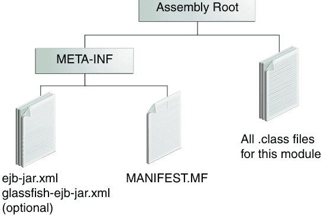

### 5.2.2 在 WAR 模块中打包企业豆


# 企业豆打包

企业豆通常提供 Web 程序的业务逻辑。在这种情况下，将企业豆封装在 Web 应用程序的 WAR 模块中可以简化部署和程序组织。企业豆可以作为 Java 编程类文件打包在 WAR 模块中，也可以打包在 WAR 模块内部的 JAR 文件中。

若要在 WAR 模块中包含企业豆类文件，类文件应位于 `WEB-INF/classes` 目录。

若要在 WAR 模块中包含含有企业豆的 JAR 文件，请将该 JAR 添加到 WAR 模块的 `WEB-INF/lib` 。

包含企业豆的 WAR 模块不需要 `ejb-jar.xml` 部署描述。如果应用程序使用了 `ejb-jar.xml`，它必须位于 WAR 模块的 `WEB-INF` 目录。

封装在 WAR 内部包含企业豆类的 JAR 文件不被视为 EJB JAR 文件，即使封装的 JAR 文件符合 EJB JAR 文件的格式。JAR 文件中包含的企业豆在语义上等于位于 WAR 模块 `WEB-INF/classes` 目录下的企业豆，且所有企业豆的环境命名空间都被限制在 WAR 模块范围内。

例如，假设一个 Web 应用程序由一个购物车企业豆、一个信用卡处理企业豆和一个 Java Servlet 前端组成。购物车豆暴露了一个本地的无接口视图，并定义如下：

```
package com.example.cart;
```

```
@Stateless
class CartBean { }
```

信用卡豆封装在它自己的 JAR 文件 `cc.jar` 中，暴露了一个本地的无接口视图，并定义如下：

```
package com.example.cc;
```

```
@Stateless
class CreditCardBean { }
```

Servlet `com.example.web.StoreServlet` 处理 Web 前端并使用了 `CartBean` 和 `CreditCardBean`。该应用程序的 WAR 模块如下：

```
WEB-INF/classes/com/example/cart/CartBean.class
WEB-INF/classes/com/example/web/StoreServlet
WEB-INF/cc.jar
WEB-INF/ejb-jar.xml
WEB-INF/web.xml
```

## 5.3 打包 Web 归档 (Web Archives)

在 Java EE 架构中，Web 模块是 Web 资源的最小部署单元。Web 模块包含 Web 组件和静态 Web 内容文件（如称为 Web 资源的图片）。Java EE Web 模块对应于 Java Servlet 规范定义的 Web 应用程序。

除了 Web 组件和 Web 资源，Web 模块还可以包含其他文件：

- 服务端工具类（例如购物车）
- 客户端类（例如工具类）

Web 模块具有特定的结构。Web 模块的顶层目录是文档根。文档根是存储 XHTML 文件、客户端类、归档文件以及图片等静态 Web 资源的地方。

文档根包含一个名为 `WEB-INF` 的子目录，其中可以包含以下文件和目录：

- `classes`：一个包含服务端类的目录：包括 servlets、企业豆类文件、工具类和 JavaBeans 组件
- `lib`：一个包含含有企业豆的 JAR 文件以及服务端类调用的库 JAR 归档的目录
- 部署描述符，例如 `web.xml`（Web 应用程序部署符）和 `ejb-jar.xml`（EJB 部署描述符）

如果 Web 模块使用了 JavaFaces 技术、必须指定某些安全信息，或者你想通过组件注解覆盖信息，则 Web 模块需要一个 `web.xml` 文件。

你也可以在根目录或 `WEB_INF/classes/` 目录中创建应用程序特定的子目录（即包目录）。

Web 模块可以以解压缩的文件结构部署，也可以封装在名为 Web Archive (WAR) 的 JAR 文件中。由于 WAR 文件的内容和用途与 JAR 文件不同，因此 WAR 文件使用 `.war` 后缀。Web 模块是可移植的：你可以将其部署到任何符合 Java Servlet 规范的 Web 容器。

要在 GlassFish 服务器上部署 WAR，Web 模块必须包含运行时部署描述符。运行时 DD 是一个 XML 文件，包含了 Web 应用程序的上下文根（context root）以及应用程序资源迁移名称到 GlassFish 服务器资源的映射等信息。GlassFish 服务器的运行时 DD 名为 `glassfish-web.xml`，位于 `WEB-INF` 目录（极少使用）。可在 GlassFish 服务器上部署的 Web 模块结构如图 5–3 所示。

### 图 5–3 Web 模块结构


## 5.4 打包资源归档 (Resource Archives)

资源归档（RAR）是包含资源适配器的归档文件。RAR 包含：

- 资源适配器实现
- 资源适配器类（实现代码）
- 部署描述
- 其他文件，如配置文件

RAR 文件是可移植的，可以部署在任何支持 Java 架构（JCA）的应用程序服务器。

# 第三部分 Web 层

第三部分探索 Web 层。包含以下章节：

- 第 6 章 Web 应用程序
- 第 7 章 Java Faces 技术
- 第 8 章 Facelets 简介
- 第 9 章 表达式语言
- 第 10 章 在网页中使用 Faces 技术
- 第 11 章 转换器、监听器和验证器
- 第 12 章 使用 Faces 技术进行开发
- 第 13 章 在 Faces 技术中使用 Ajax
- 第 14 章 复合组件：高级主题
- 第 15 章 创建自定义组件和其他
- 第 16 章 配置 Faces 应用程序
- 第 17 章 Java Servlet 技术
- 第 18 章 WebSocket API
- 第 19 章 JSON 处理
- 第 20 章 Web 应用程序的国际化与本地化

## Web 应用程序

本章介绍了 Web 应用程序，它们通常使用 Faces 技术和 Servlet 技术。**Web 应用程序**是 Web 服务器的动态扩展。Web 应用程序有以下类型：

- **面向演示的**：*面向演示的 Web 应用程序*根据请求生成各种类型的标记语言（HTML、XML 等）和动态内容。面向演示的应用程序的开发见第 7 章（Java Faces 技术）到第 17 章（Java Servlet 技术）。
- **面向服务的**：*面向服务的 Web 应用程序*实现 Web 服务的端点。面向演示的应用程序是面向服务的客户端。面向服务的应用程序的开发见第六部分“Web 服务”中的第 28 章（使用 JAX-WS 构建 Web 服务）和第 29 章（使用 JAX-RS 构建 REST 服务）。

本文介绍了以下主题：

- Web 应用程序
- Web 应用程序生命周期
- 使用 Faces 技术的示例：hello1
- 使用 Servlet 技术的示例：hello2
- 配置 Web 应用程序
- 关于 Web 应用程序的更多

在 Java EE 平台中，**Web 组件**为 Web 服务器提供了扩展能力。Web 组件可以是 servlet、使用 Faces 技术的网页、Web 端点或 JSP 页面。图 6-1 展示了 Web 客户端与使用 servlet 的应用程序之间的交互。客户端向 Web 服务器发送 HTTP 请求。实现 Java Servlet 和 JSP 技术的 Web 服务器将请求转换为 `HttpServletRequest` 对象。该对象是一个 Web 组件，它可以与 JavaBeans 组件或数据库交互以生成动态内容。Web 组件随后可以生成 `HttpServletResponse` 对象，也可以将请求传递给另一个 Web 组件。

### 图 6-1 Java Web 应用请求处理

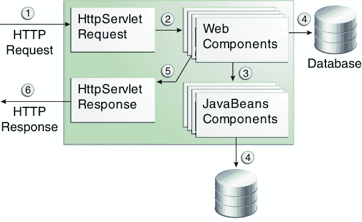

Servlets 是 Java 编程语言类，用于动态处理请求并构建响应。Java 技术（如 JavaFaces 和 Facets）被用于构建交互式 Web 应用。（框架也可以用于此目的。）虽然 servlets 和 JavaFaces Facets 可以完成相似的任务，但它们各有优劣。Servlets 最适用于面向服务型的应用程序（Web 端点可以实现为 servlets）以及面向表现层型应用程序的控制功能，例如分发请求和处理非文本数据。JavaServer Faces 和 Facets 页面更适合生成基于文本的标记（如 XHTML），通常用于面向表现层的应用程序。

Web 组件由一个名为 Web 容器（web container）的运行时平台支持。Web 容器提供分发、安全、并发和生命周期管理等服务。Web 容器允许 Web 组件访问命名、事务和电子邮件等 API。

当应用程序安装或部署到 Web 容器时，可以配置 Web 应用行为的某些方面。可以使用 Java EE 注解或 XML 格式（称为 Web 应用部署描述符，DD）来指定配置信息。Web 应用 DD 必须符合规范中描述的架构。

本章简要介绍了开发 Web 应用涉及的活动。它总结了 Web 应用的生命周期，并解释了如何在 GlassFish 服务器上打包和部署简单的 Web 应用。本章将介绍配置 Web 应用，并讨论如何指定最常用的配置参数。

## 6.2 Web 应用生命周期

Web 应用由 Web 组件、资源文件（如图像和层样式表 CSS）以及辅助类和库组成。Web 容器提供支持服务，增强 Web 组件的能力并使其更易开发。然而，由于 Web 应用可能会考虑到这些服务，创建和运行 Web 应用的过程与传统的独立 Java 类不同。

## 使用 JavaFaces 技术的 Web：hello1 示例

创建、部署和执行 Web 应用的过程可以总结如下：

1. 开发 Web 组件代码。
2. 如果必要，开发 Web 应用部署描述符。
3. 编译 Web 应用组件以及组件引用的辅助类。
4. 可选：将应用程序打包成可部署的单元。
5. 将应用程序部署到 Web 容器中。
6. 访问引用后续章节的 URL。步骤 2 到 4 在后续章节中详细说明，并以“Hello, World”风格的表现层方法进行演示。此应用程序允许用户在 HTML 表单中输入名称，并在提交后显示问候。

Hello 应用包含两个生成问候和响应的组件。本章将讨论以下简单应用：

- hello1，基于 JavaServer Faces 的应用，使用两个 XHTML 页面和一个托管豆（managed bean）
- hello2，基于 servlet 的应用，其中组件由两个 servlet 类实现

这些应用程序用于说明包含 Web 组件的应用程序在打包、部署、配置和运行的任务。

## 6.3 使用 JavaFaces 技术的 Web：hello1 示例

hello 应用是一个使用 JavaServer Faces 技术显示问候和响应的 Web 模块。你可以使用文本编辑器查看应用程序文件，也可以使用 NetBeans IDE。

该应用程序的源代码位于 `tut-install/examples/web/jsf/hello1/` 目录。

### 6.3.1 使用 NetBeans IDE 查看 hello1 Web 模块

1. 从 File（文件）菜单中选择 Project（项目）。
2. 在 Project（项目）对话框中，导航到 `tut-install/examples/web/jsf`。
3. 选择 hello 文件夹并点击 Project（项目）。
4. 展开 Web Pages（Web 页面）节点并双击 index.xml 文件在编辑器中查看。

index.xml 文件是 Facelets 应用的默认落地页。在典型的 Facelets 应用中，Web 页面是在 XML 中创建的。对于此应用程序，页面使用标签标记来显示包含图形图像、标题、字段和两个命令的表单：

```xml
<?xml version='1.0' encoding='UTF-8' ?>
<!DOCTYPE html PUBLIC "-//W3C//DTD HTML 1.0 Transitional//EN>
```

Web 应用入门 6-3

## 使用 JavaServer 技术的 Web：hello! 示例

```xml
<html xmlns="http://www.w3.org/TR/xhtml/DTD/xhtml1-transitional.dtd" lang="en"
  xmlns:x="http://www.w3.org/1999/xhtml"
  xmlns:h="http://xmlns.jsp.org/jsf/html">
  <head>
    <title>Facelets Hello Greeting</title>
  </head>
  <body>
    <form>
      <h:graphicImage url="#{resource['images:duke.waving.gif']}" 
          alt="Duke waving his hand"/>
      <h2>Hello, my name is Duke. What's yours?</h2>
      <h:inputText id="username"
          value="#{hello.name}"
          required="true"
          requiredMessage="Error: A name is required."
          maxlength="25" />
      <p></p>
      <h:commandButton id="submit" value="Submit" action="response"/>
      <h:commandButton id="reset" value="Reset" action="reset"/>
    </form>
  </body>
</html>
```

The index.xml 文件是 Facelets 应用的默认落地页。在典型的 Facelets 应用中，Web 页面是在 XML 中创建的。对于此应用程序，页面使用标签标记来显示包含图形图像、标题、字段和两个命令的表单：

（此处省略重复的段落翻译，遵循要求不重复输出原文）

index.xml

# 使用 JavaServer Web 模块：hello1

```xml
</context-param>
```

上下文参数（context parameter）提供了 Web 应用程序所需的配置信息。应用程序可以定义自己的上下文参数。此外，JavaServer Faces (JSF) 技术和 Java Servlet 定义了应用程序可以使用的上下文参数。

- 一个 servlet 元素及其指定 FacesServlet 的 servlet-mapping 元素。所有以 .xml 后缀的文件都将被匹配：

```xml
<servlet>
  <servlet-name>Faces Servlet</servlet-name>
  <servlet-class>javax.faces.webapp.FacesServlet</servlet-class>
  <load-on-startup>1</load-on-startup>
</servlet>
<servlet-mapping>
  <servlet-name>Faces Servlet</servlet-name>
  <url-pattern>*.xml</url-pattern>
</servlet-mapping>
```

- 指定欢迎页的 welcome-file-list：

```xml
<welcome-file-list>
  <welcome-file>index.xhtml</welcome-file>
</welcome-file-list>
```

## 6.3 作用域简介

作用域（Scopes）决定了 Bean 对象的生命周期。

- **请求作用域（Request Scope）**：数据在单个 HTTP 请求处理期间有效。
- **会话作用域（Session Scope）**：数据在用户的多个会话请求之间有效。
- **应用作用域（Application Scope）**：数据在整个 应用程序运行期间有效。

### 6.3.1 请求作用域 (Request Scope)

请求作用域的 Bean 仅在一次 HTTP 请求中有效。一旦请求完成，该 Bean 就会被销毁。通常用于处理表单提交或简单的查询结果显示。

### 6.3.2 会话作用域 (Session Scope)

会话作用域的 Bean 在用户同一个会话的多个请求中有效。常用于存储用户的登录信息、购物车内容或个人设置。

### 6.3.3 应用作用域 (Application Scope)

应用作用域的 Bean 在整个 Web 应用程序运行期间都有效。它用于存储全局配置信息或所有用户共享的数据。

# 使用 Java Servlet Web 模块：hello2 示例

使用 `@WebServlet` 注解指定相对于上下文根目录的 URL 路径：


```java
@WebServlet("greeting")
public class GreetingServlet extends HttpServlet {

    @Override
    public void doGet(HttpServletRequest request,
        HttpServletResponse response)
            throws ServletException, IOException {

        response.setContentType("text/html");
        response.setBufferSize(1992);
        PrintWriter out = response.getWriter();

        // 写入响应数据
        out.println("<html lang=\"en\">\n            <title>Servlet Hello</title></head>\n");

        // 写入响应数据
        out.println("<body bgcolor=\"#ffffff\">\n            
            <a href=\"duke.html\">Duke, (waving his hand)</a>
            <form method=\"get\">\n                <h2>Hello, my name is Duke. What's yours?</h2>\n
                <input type=\"text\" name=\"My name is:\" type=\"text\" />
                <input type=\"text\" name=\"username\" size=\"25\" />
                <p></p>\n                <input type=\"submit\" value=\"Submit\" />
                <input type=\"reset\" value=\"Reset\" />
            </form>\n        </body></html>");
}
```

```java
String username = request.getParameter("username");
if (username == null || username.length() > 0) {
    RequestDispatcher dispatcher = request.getContext().getRequestDispatcher("/response");
```

```java
if (dispatcher != null) {
    dispatcher.include(request, response);
}
```

```java
out.println("</body></html>");
out.close();
```

检查 `ResponseServlet.java` 文件以查看。

该 servlet 还重载了 `doGet` 方法，仅显示响应。除了指定相对于上下文根目录的 URL 路径的 `@WebServlet` 注解外，其余部分均相同：

```java
@WebServlet("/response")
public class ResponseServlet extends HttpServlet {

    @Override
    public void doGet(HttpServletRequest request,
        HttpServletResponse response)
            throws ServletException, IOException {
        PrintWriter out = response.getWriter();

// 然后写入响应数据
String username = request.getParameter("username");
if (username != null && username.length() > 0) {
    out.println("<h2>Hello, " + username + "!</h2>");
}
```

## 6.4.3 运行 hello2 示例

你可以使用 NetBeans IDE 或 Maven 来构建、打包、部署和运行 hello2 示例。

### 6.4.3.1 使用 NetBeans IDE 运行 hello2 示例

1. 如果尚未启动，请按照“在 NetBeans IDE 中启动 GlassFish 服务器”的描述启动 GlassFish 服务器。

2. 从 File（文件）菜单选择 Open Project（打开项目）。

3. 在 Open Project 对话框中导航到：

`tut-install/examples/web/servlet`

4. 选择 hello2 文件夹。

5. 点击 Open Project（打开项目）。

6. 在 Projects（项目）选项卡中，右键点击 hello2 项目并选择 Build（构建）以打包并部署项目。

7. 在浏览器中，指定 URL http://localhost:8080/hello2/greeting。

该 URL 指定了上下文根目录，随后是 URL 模式。

应用程序看起来与 hello1 应用程序相似。主要区别在于，点击 Submit（提交）后，响应出现在问候下方，而不是单独的页面上。

### 6.4.3.2 使用 Maven 运行 hello2 示例

1. 如果尚未启动，请按照“从命令行启动 GlassFish 服务器”的描述启动 GlassFish 服务器。

2. 在终端窗口中，进入：

`tut-install/examples/web/servlet/hello2/`

3. 输入以下命令：

`mvn install`

该目标会构建 WAR 文件，将其复制到 `tut-install/examples/web/hello2/target/` 目录并进行部署。

4. 在 Web浏览器中，打开 URL http://localhost:8080/hello2/greeting。

该 URL 指定了上下文根目录，随后是 URL 模式。

应用程序看起来与 hello1 应用程序相似。主要区别在于，点击 Submit（提交）后，响应出现在问候下方，而不是单独的页面上。

## 配置 Web 应用程序

本节描述了配置 Web 应用程序涉及的任务：

- 设置上下文参数
- 声明欢迎文件
- 将错误映射到错误页面
- 声明资源引用

## 6.5.1 设置上下文参数

Web 模块中的组件共享一个代表其应用程序上下文的对象。你可以将上下文参数传递给上下文，或将初始化参数传递给 servlet。上下文参数适用于整个应用程序。有关初始化参数的信息，请参见“创建和初始化 Servlet”。

### 6.5.1.1 使用 NetBeans IDE 添加上下文参数

这些步骤适用于 Web 应用程序，但不专门适用于本章中的示例。

1. 打开项目。
2. 在 Projects 树中展开项目。
3. 展开 Web Pages 节点，然后展开 WEB-INF 节点。
4. 双击 `web.xml`。
5. 点击编辑器顶部的 General（常规）。
6. 展开 Context Parameters（上下文参数）节点。
7. 点击 Add（添加）。
8. 在 Add Context Parameter 对话框中，在 Parameter Name（参数名称）字段输入指定上下文的名称。
9. 在 Parameter Value（参数值）字段输入要传递给上下文的参数。
10. 点击 OK。

如果项目没有 `web.xml` 文件，请按照“在 NetBeans IDE 中创建 web.xml”的步骤操作。

### 6.5.1.2 使用 NetBeans IDE 创建 web.xml

1. 从 File 菜单选择 New File（新建文件）。
2. 在 New 向导中，选择 Web 类别，然后选择 Deployment Descriptor（部署描述）。
3. 点击 Next（下一步）。
4. 点击 Finish（完成）。

基础 `web.xml` 文件出现在 `web/WEB-INF/`。

## 6.5.2 声明欢迎文件

欢迎文件机制允许你指定一组用于处理未映射到 servlet 的请求（称为有效请求）。例如，假设你定义了 `welcome.html`。当客户端请求如 `host:port/directory` 且 directory 未映射时，将返回 `host:port/directory/welcome.html`。

如果容器包含有效请求，Web 容器将检查欢迎文件。如果没有欢迎文件，GlassFish 服务器将使用 `index.html` 作为默认欢迎文件。如果没有欢迎文件且没有 `index.html`，GlassFish 服务器返回目录列表。

你在 `web.xml` 文件中指定欢迎文件。示例的欢迎配置如下：

```xml
<welcome-file-list>
    <welcome-file>index.html</welcome-file>
</welcome-file-list>
```

指定的欢迎文件不能包含开头或结尾斜杠（`/`）。

hello2 示例没有指定欢迎文件，因为请求通过 URL 模式 `/greeting` 映射到了 `GreetingServlet` Web 组件。

## 6.5.3 将错误映射到错误页面

当执行 Web 应用程序发生错误时，应用程序根据错误类型显示特定的错误页面。特别是，你可以通过 HTTP 响应返回的状态码或任何 Web 组件返回的 Java 异常来指定映射。

你可以在部署描述中拥有多个 `error-page` 元素。每个元素识别一个导致错误的错误。此错误页面可以供任意 `error-page` 元素共享。

### 6.5.3.1 使用 NetBeans IDE 设置错误映射

1. 打开项目。
2. 在 Projects 选项卡中展开项目节点。
3. 展开 Web Pages 以及 WEB-INF 节点。
4. 双击 `web.xml`。

如果项目没有 `web.xml` 文件，请按照“在 NetBeans IDE 中创建 web.xml”的步骤操作。

5. 点击编辑器顶部的 Pages（页面）。
6. 展开 Error Pages 节点。
7. 点击 Add（添加）。
8. 在 Add Error Page 对话框中，点击 Browse（浏览）找到要作为错误页面的页面。
9. 指定错误码或异常类型：
   - 若要指定错误代码，请在 `Error Code` 字段中输入将导致打开错误面的 HTTP 状态码，或留空该字段以包含所有错误代码。
   - 若要指定异常类型，请在 `Exception Type` 字段中输入将导致错误页面加载的异常。若要指定所有可抛出的错误和异常，请输入 `java.lang.Throwable`。
10. 点击确定。

## 6.5.4 声明资源引用

如果您的 Web 组件使用对象作为企业豆（enterprise beans）、数据源或 Web 服务，请使用 Java EE 注解将这些资源 注入到您的应用程序中。注解消除了以前版本的 Java EE 所需的所有样板查找代码和配置元素。

虽然使用注解对开发者来说更加方便，但在 Web 应用程序中使用它们存在某些限制。首先，您只能注入到容器管理的对象中，因为容器必须对组件的创建具有控制权，以便对组件进行注入。然而，未受容器管理的 bean 将无法接受资源注入。

表 6–1 列出了接受资源注入的组件。

本节解释了如何使用 Web 容器支持的注解来注入资源。[第 38 章，运行持久化示例](#)解释了 Web 应用程序如何使用 Java 持久化 API 支持的注解。[第 48 章，开始保护 Web 应用程序](#) 解释了如何使用注解来指定有关 Web 应用程序的安全信息。[第 52 章，资源适配器与合约](#)提供了有关资源的更多信息。

**表 6–1** 接受资源注入的 Web 组件

| 组件 | 接口/类 |
| --- | :--- |
| Servlets | `javax.servlet.Servlet` |
| Servlet 过滤器 | `javax.servlet.ServletFilter` |
| 事件监听器 | `javax.servlet.ServletContextListener`<br>`javax.servlet.ServletContextAttributeListener`<br>`javax.servlet.RequestListener`<br>`javax.servlet.ServletRequestListener`<br>`javax.http.HttpSessionListener`<br>`javax.http.HttpSessionAttributeListener`<br>`javax.servlet.HttpSessionBindingListener` |
| 托管 bean | 纯 Java 对象 (POJOs) |

### 6.5.4.1 声明对资源的引用

`@Resource` 注解用于声明对资源的引用，例如数据源、企业豆或环境资源。

`@Resource` 注解指定在类、方法或字段上。容器负责注入由 `@Resource` 注解声明的资源引用，并将其映射到正确的 JNDI 资源。

在接下来的示例中，使用 `@Resource` 注解将数据源注入到需要与数据源连接的组件中，就像使用 JDBC 技术访问关系型数据库一样：

```java
@Resource javax.sql.DataSource catalogDS;
public void getProductsByCategory() {
    // 获取连接并执行查询
    Connection conn = catalogDS.getConnection();
}
```

容器在组件对应用程序可用之前提供了该数据源。数据源的 JNDI 映射是从字段名 `catalogDS` 和类型 `javax.sql.DataSource` 推断出的。

如果您有多个资源需要注入到一个对象中，则您需要使用 `@Resources` 注解来包含它们，如下例所示：

```java
@Resources {
    @Resource(name="myDB" type=javax.sql.DataSource.class)
    @Resource(name="myQ" type=javax.jms.ConnectionFactory.class)
}
```

本教程中的 Web 应用程序使用 Java 持久化 API 访问关系型数据库。该 API 不需要您使用 `@Resource` 注解来创建数据源。因此，示例使用 `@PersistenceUnit` 和 `@PersistenceContext` 注解分别注入 `EntityManagerFactory` 和 `EntityManager` 实例。第 38 章“运行持久化示例”描述了这些注解以及 Web 应用程序中使用 Java 持久化 API。

## 6.5.4 声明对 Web服务的引用

`@WebService` 注解提供了对 Web 服务的引用。下面的示例使用 `@WebServiceRef` 注解声明对 Web 服务的引用。WebService 使用 `wsdlLocation` 元素指定部署服务的 WSDL 文件的 URI：

```java
import javax.xml.ws.WebService;

public class ResponseServlet extends HttpServlet {
    @WebServiceRef(wsdlLocation="http://localhost:8080/helloservice/hello?wsdl")
    static HelloService service;
}
```

## 6.6 关于 Web 应用程序的更多信息

有关 Web 应用程序的更多信息，请参：

- JavaFaces 2 规范：
  http://jcp.org/en/jsr/detail?id=344
- JavaFaces 技术网站：
  http://www.oracle.com/technet/java/javaee/jserverfaces-139861.html
- Java Servlet 3.1 规范：
  http://jcp.org/en/jsr/detail?id=340
- Java Servlet 网站：
  http://www.oracle.com/technetwork/java/index-jsp-135475.html

# 7 JavaServer Faces 技术

JavaServer Faces 技术是一种用于构建基于  的 Web 应用程序的服务器端组件框架。JavaServer Faces 技术由以下部分组成：

- 用于表示组件和管理其状态的 API；处理事件、服务器端验证和数据转换。

JavaServer Faces 技术提供了一个定义的编程模型和各种标签库。只需少少努力，您就可以完成：

- 创建 Web 页面。
- 使用标签库向页面上添加组件。
- 将组件绑定到服务器端数据。
- 将组件生成的事件连接到服务器端代码。
- 保存和恢复应用程序状态。
- 通过自定义扩展组件。

本章提供了 Java Faces 技术的概述。在解释了什么是 Java Faces 应用程序并回顾了其主要优势后，本章描述了创建简单的 Java Faces 应用程序的过程。涉及以下主题：

- 什么是 Java Faces 应用程序？
- Java Faces 优势
- 简单的 Java Faces 应用程序
- 用户界面模型
- 导航模型
- Java Faces 应用程序的生命周期


## 7.1 什么是 Java Faces 应用程序？

Java Faces 应用程序的功能类似于任何 Web 应用程序。典型的 Java Faces 应用程序包含以下部分：

- 用于布局的 Web 页面
- 添加组件的标签集
- 托管 bean（托管 Java 对象）。在 Java Faces 应用程序中，托管 bean 作为后台 bean，定义页面 UI 组件的属性和功能。
- 部署描述（`web.xml` 文件）
- 可选的一个或多个应用程序配置资源文件，例如 `faces-config.xml` 文件，用于定义页面导航规则和配置自定义对象
- 可选的自定义对象，可以是应用程序开发人员创建的组件、验证器或监听器
- 可选的用于在页面表示自定义对象的标签

图 7–1 显示了典型 Java Faces 应用程序客户端与服务器之间的交互。为了响应客户端请求，实现 Java Faces 技术的容器会渲染 Web 页面。

> 图 7–1 响应 JavaServer Faces 页面的请求

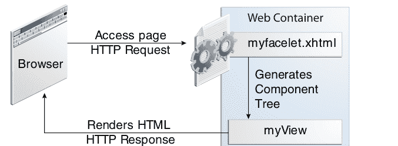

Web 页面 `myfacelet.xhtml` 使用 JavaFaces 组件标签构建视图（图中 `myView` 表示页面的服务器端表示）。除了组件外，Web 页面还可以引用对象，例如：

- 注册在组件上的任何事件监听器、验证器和转换器
- 用于捕获数据并处理组件特定功能的 JavaBeans 组件

## JavaServer Faces 技术优势

根据客户端的请求，视图被渲染为响应。渲染是一个过程，即基于服务器端视图，Web 生成输出（如 HTML 或 XHTML），客户端（如浏览器）读取这些输出。

## 7.2 JavaServer Faces 技术优势

JavaServer Faces 技术最大的优势之一是，它为 Web 应用程序提供了行为与呈现之间的整洁分离。JavaServer Faces 可以将 HTTP 请求映射到特定组件的事件处理，并在服务器上管理状态对象。JavaServer Faces 技术允许你通过客户端架构构建 Web 应用程序，从而实现行为与呈现的细粒度分离。

逻辑与呈现的分离还允许 Web 应用程序团队的每个成员专注于开发过程中的某一个部分，并提供了一个简单的编程模型来连接这些部分。例如，没有编程专知识的作者可以在网页中使用 JavaServer Faces 标签来链接到服务器端对象，而无需编写任何脚本。

JavaServer Faces 技术的另一个重要目标是利用熟悉的组件级概念，而不会将你限制在特定的脚本技术或标记语言上。JavaServer Faces 技术 API 直接构建在 Servlet API 之上，如图 7-2 所示。

图 7-2 Java Web 应用程序技术

| JavaServer Faces | JavaServer Pages 标准标签库 |
|---|---|
| JavaServer Servlet | JavaServer Pages |

这种 API 的分层使得几个重要的应用用例成为可能，例如使用不同的呈现技术、直接从组件类创建自己的组件，以及为各种客户端设备生成输出。

Facets 技术作为 JavaServer Faces 技术的一部分，是构建基于 JavaServer Faces 技术 Web 应用程序的首选呈现技术。有关 Facets 技术的更多信息，请参阅第 8 章“Facets 简介”。

Facets 技术提供了若干优势：

- 可以通过模板和复合组件功能对组件进行使用和复用。
- 你可以使用注解自动将托管豆（managed bean）注册为 JavaServer Faces 应用程序可用的资源。此外，隐式导航允许开发者快速配置页面导航（参见导航模型详细信息）。这些特性减少了应用程序的手动配置过程。
- 最重要的是，JavaServer Faces 技术提供了一个丰富的架构，用于管理组件状态、处理组件数据、验证用户输入以及处理事件。

JavaServer Faces Faces 技术 7-3

### 7.3 简单的 JavaServer 应用程序

JavaFaces 技术为创建 Web 应用程序提供了一个简单且用户友好的过程。开发简单的 JavaFaces 应用程序通常需要以下任务，这些任务在“使用 JavaFaces 技术的 Web 模块：hello 示例”中已描述过：

- 使用组件标签创建页面
- 开发托管豆
- 映射 `FacesServlet` 实例

hello 示例包含一个托管豆和两个 Facets 页面。当客户端访问时，第一个网页向用户询问其姓名，第二个页面则提供默认响应。

有关 Facets 的详细信息，请参阅第 8 章“Facets 简介”。有关 EL 表达式的详细信息，请参阅第 9 章“表达式语言”。有关 JavaFaces 编程模型和使用 JavaFaces 技术构建网页的详细信息，请参阅第 10 章“在网页中使用 JavaFaces 技术”。

每个 Web 应用程序都有生命周期。常见任务，如处理请求、解码参数、修改和保存状态以及将网页渲染到浏览器，都在 Web 应用程序生命周期期间执行。某些 Web 框架会为你处理生命周期的细节，而另一些则要求你手动管理。

默认情况下，JavaFaces 会为你管理请求的生命周期。然而，它也暴露了请求生命周期的阶段，以便在应用程序需要时你可以修改或执行操作。

JavaFaces 应用程序的生命周期开始并结束于以下活动：客户端请求网页，服务器响应页面。生命周期由两个主要阶段组成：执行（execute）和渲染（render）。

在**执行阶段**，可能会发生几项操作：

- 构建或恢复视图。
- 应用请求参数值。
- 对组件值进行转换和验证。
- 使用组件值更新托管豆。
- 调用应用程序逻辑。

对于首次（初始）请求，只构建视图。对于随后的（回传/postback）请求，可能会发生部分或全部操作。

在**渲染阶段**，请求的视图被渲染为客户端的响应。渲染通常是生成输出（如 HTML 或 XHTML）的过程，供客户端（通常是浏览器）读取。

以下对示例 JavaFaces 应用程序通过其生命周期的简短描述总结了后台发生的活动。

hello 示例在部署到 GlassFish 服务器上时会经历以下阶段：

1. 当 hello 应用程序在 GlassFish 服务器上构建并部署时，应用程序处于未启动状态。
2. 当客户端对 `index.xhtml` 网页发出初始请求时，hello Facelets 应用程序被编译。
3. 执行编译后的 Facelets 应用程序，并为 hello 应用程序构建一个新组件，将其放入 `FacesContext` 中。
4. 组件树被组件及其托管豆属性填充，该属性由 EL 表达式 `hello.name` 表示。
5. 通过组件树构建一个新的视图。
6. 将视图作为响应渲染到请求的客户端。
7. 组件树被自动销毁。
8. 在随后的（回传）请求中，组件树被重建，并应用保存的状态。

有关生命周期的完整细节，请参阅“JavaFaces 应用程序的生命周期”。

## 7.4 用户界面组件模型

除了生命周期描述外，JavaFaces 架构概览有助于更好地理解该技术。

JavaFaces 组件是 JavaFaces 视图的构建块。组件可以是用户界面 (UI) 组件，也可以是非 UI 组件。

JavaFaces UI 组件是可配置的、可复用的元素，用于 JavaFaces 应用程序的用户界面。组件可以是简单的（例如按钮），也可以是复合的（例如，由多个组件组成的表格）。

JavaFaces 技术提供了丰富、灵活的组件架构，包括：

- 一组 `javax.faces.component.UIComponent` 类，用于指定 UI 组件的状态和行为
- 一个定义了如何以各种方式渲染组件的渲染模型
- 一个定义了如何将数据转换器注册到组件上的转换模型
- 一个事件监听器模型，定义了如何处理组件事件
- 一个验证模型，定义了如何向组件注册验证器

本节简要描述了组件架构的这些每一个部分。

### 7.4.1 用户界面组件类

JavaFaces 技术提供了一组 UI 组件类和相关的行为特征，它们指定了所有的 UI 组件功能，例如持有组件状态、维护对对象的引用以及驱动一组标准组件的事件处理和渲染。

组件类是完全可扩展的，允许开发者创建自己的自定义组件。更多信息请参阅第 15 章“创建 UI 组件和其他自定义对象”。

所有组件的抽象父类是 `javax.faces.component.UIComponent`。JavaFaces UI 组件扩展自 `UIComponentBase`（`UIComponent` 的子类），它定义了组件的默认状态和行为。JavaFaces 技术包含以下组件类：

#### 用户界面模型

- `UIColumn`: 代表 `UIData` 组件中的单列数据。
- `UICommand`: 代表一个在激活时触发动作的控件。
- `UIData`: 代表对由 `javax.faces.model.DataModel` 实例表示的数据集合的数据绑定。
- `UIForm`: 代表要呈现给用户的输入表单。其子组件代表在提交表单时要包含的输入字段（其他内容）。这比比 HTML 中的 `form` 标签。
- `UIImage`: 显示图像。
- `UIInput`: 接收用户的输入。它是 `UIOutput` 的子类。
- `UIMessage`: 显示本地化的错误消息。
- `UIMessages`: 显示一组本地化的错误消息。
- `UIOutputTarget`: 以链接或按钮的形式显示链接。
- `UIOutput`: 在页面上显示数据。
- `UIPanel`: 管理其子组件的布局。
- `UIParameter`: 代表替换参数。
- `UISelectBoolean`: 允许用户通过选择或取消选择来在控件上选择布尔值。该类是 `UIInput` 的子类。
- `UISelectItem`: 代表一组项目中的单个项目。
- `UIItems`: 代表整个项目集。
- `UISelectMany`: 允许用户从一组项目中选择多个项目。该类是 `UIInput` 类的子类。
- `UISelectOne`: 允许用户从一组项目中选择一个项目。该类是 `UIInput` 类的子类。
- `UIViewParameter`: 代表请求中的查询参数。该类是 `UIInput` 类的子类。
- `UIViewRoot`: 代表组件树的根。

除了扩展 `Component` 外，组件类还实现了一个或多个行为接口，每个接口都为实现接口的组件集定义了某些行为。

这些行为接口（另有说明外，均定义在 `javax.faces.component` 包中）如下：

- `ActionSource`: 表明组件可以触发动作事件。这旨在用于基于 JavaFaces 技术 1.1_01 及更早版本的组件。它在 JavaFaces 2 中已弃用。
- `ActionSource2`: 扩展自 `ActionSource`，因此相同相同，但允许组件在引用处理动作事件的方法时使用表达式语言 (EL)。
- `EditableValueHolder`: 扩展自 `ValueHolder` 并为可编辑组件提供特定功能，例如验证和发出值变化事件。
- `NamingContainer`: 强制要求每个组件具有唯一的 ID。
- `StateHolder`: 表明组件具有必须在请求之间保存的状态。
- `ValueHolder`: 表明组件维护本地值，并具有访问模型层中数据的选项。
- `javax.faces.event.SystemEventListener`: 为该类定义的每种 `javax.faces.event.SystemEvent` 类型维护一个 `javax.faces.event.SystemEventListener` 实例列表。
- `javax.faces.component.behavior.ClientBehaviorHolder`: 增加了附加 `javax.faces.component.behavior.ClientBehavior` 实例（如可重用脚本）的能力。

`UIComponent` 的 `elementsSource` 和 `StateHolder`。`UIOutput` 和扩展 `UIOutput` 的类实现 `StateHolder` 和 `ValueHolder`。`UIInput` 和扩展 `UIInput` 的类实现 `EditableValueHolder`、`StateHolder` 和 `ValueHolder`。`UIComponentBase` 实现 `StateHolder`。

只有组件需要直接使用组件类和行为。页面作者和应用程序开发者将通过在页面上代表它的标签来使用标准组件。大多数组件可以在页面上以不同的方式渲染。例如，`UIComponent` 可以被渲染为缓冲区或链接。

下一节将解释渲染模型如何工作，以及页面作者如何通过选择适当的属性来渲染组件。

### 7.4.2 组件渲染模型

Java Faces 组件架构的设计使得组件的功能由组件类定义，而渲染可以由单独的渲染器（renderer）类定义。这种设计有几个优点，包括：

- 组件编写者可以定义组件的行为，但创建多个渲染器，每个渲染器都定义了将组件渲染到相同客户端或不同客户端的不同方式。
- 页面作者和应用程序开发者可以通过选择代表组件和渲染器组合的标签来更改组件的外观。

渲染套件（render kit）定义了如何映射到适用于特定客户端的组件标签。JavaFaces 实现包含一个标准的 HTML 渲染套件，用于渲染到 HTML 客户端。

渲染套件为其支持的每个组件定义一组 `javax.faces.render.Renderer` 类。每个 `Renderer` 类定义了将特定组件渲染到渲染器所定义的输出的不同方式。例如，其中一个将组件渲染为一组其他组件。另一个将组件渲染为组合框。`UIComponent` 可以使用 `h:commandButton` 或 `h:commandLink` 标签渲染为缓冲区或链接。每个标签的 `command` 对应于 `UIClass`，指定了功能即触发动作。每个标签的 `Button` 或 `Link` 对应于单独 `Renderer` 类，该类定义了组件在页面上的外观。

标准 HTML 渲染套件定义的每个自定义标签由组件功能（由 `UIComponent` 类定义）和渲染属性（由 `Renderer` 类定义）组成。

### 7.4.3 转换模型

JavaFaces 应用程序可以选择地将组件与服务器端对象数据关联。这是一个 JavaBeans 组件，作为一个受托管的（managed bean）。应用程序通过调用该组件的适当对象属性来获取和设置组件的数据。

当一个组件绑定到对象时，应用程序拥有组件数据的两种视图：

- 模型视图：在视图中，数据被表示为数据类型，如 `int` 或 `long`。
- 视图：在视图中，数据以用户可以读取或修改的方式表示。例如，`java.util.Date` 可能以 `mm/dd/yy` 格式的字符串表示。

当关联属性是组件数据支持的类型时，JavaFaces 实现在这两个视图之间自动转换组件数据。例如，如果 `UISelectBoolean` 组件关联到类型为 `Boolean` 的 bean 属性，JavaFaces 实现将从 `String` 转换为 `Boolean`。此外，某些组件数据必须绑定到特定类型。例如，`UISelectBoolean` 组件必须绑定到 `boolean` 或 `java.lang.Boolean` 类型。

有时你可能想将组件数据转换为标准类型以外的类型，或者可能想转换数据的格式。为了方便，JavaFaces 技术提供了 UI 组件以及扩展 `UIOutput` 类的组件。如果你在组件上注册 `Converter` 实现，则由 `Converter` 实现在两个视图之间转换组件数据。

你可以使用 JavaFaces 实现提供的标准转换器，也可以创建你自己的自定义转换器。转换器的创建见第 15 节，“创建 UI 组件和其他自定义对象”。

### 7.4.4 事件和监听器模型

JavaFaces 事件和监听器模型与 JavaBeans 事件模型相似，在于它们具有强类型事件和接口，应用程序可以使用它们来处理由组件生成的事件。

JavaFaces 规范定义了三种事件：应用程序事件、系统事件和数据模型事件。

应用程序事件与特定的应用程序绑定，并由 `UI` 生成。它们代表了旧版本 JavaFaces 技术中提供的标准事件。

事件对象标识生成事件的组件并存储有关事件的信息。为了接收事件通知，应用程序必须提供监听器类的实现并将其注册到生成事件的组件上。当用户激活组件时，例如点击按钮时，会触发一个事件。这会导致 JavaServer Faces 实现调用处理该事件的监听器方法。

JavaFaces 支持两种应用程序事件：动作事件和值变更事件。

动作事件（类 `javax.faces.event.ActionEvent`）在用户激活实现 `ActionSource` 的组件时发生。这些组件包括按钮和链接。

值变更事件（类 `javax.faces.event.ChangeEvent`）在用户更改由 `UIComponent` 或其子类表示的组件的值时发生。例如，勾选复选框，导致组件的值变为 `true`。生成此类事件的组件类型包括 `UIInput`、`UISelectOne`、`UISelectMany` 和 `UISelectBoolean`。只有在未检测到验证错误时，才会触发值变更事件。

根据触发事件的组件 `immediate` 属性的值，动作事件可以在应用阶段（invoke application phase）或请求值阶段（request values phase）处理，而值变更事件可以在验证阶段（validation phase）或请求值阶段处理。

系统事件是由 `Object` 而不是 `UIComponent` 生成的。它们在预定义时间、整个应用程序执行期间生成。它们适用于每一个应用程序，而不是特定的组件。

当选择 `UData` 组件的某行时，会发生数据模型事件（Data-model event）。

有两种方法可以让您的应用程序对标准组件发射的动作事件或值变更产生响应：


- 实现一个事件监听器来处理事件，并通过在组件标签内嵌套 `f:valueChangeListener` 或 `f:actionListener` 标签将监听器注册到组件上。
- 实现一个托管豆（managed bean）的方法来处理事件，并从组件标签的相应属性通过方法表达式引用该方法。

参阅“实现事件监听器”（Implementing an Event Listener）获取有关如何实现事件监听器。参阅“在组件上注册监听器”（Registering Listeners on Components）获取有关如何在组件上注册监听器。

参阅“编写处理动作事件的方法”（Writing a Method to Handle an Action Event）和“编写处理值变更事件的方法”（Writing a Method to Handle a Value-Change Event）获取有关实现处理这些事件的托管豆方法的信息。

参阅“引用托管豆方法”（Referencing a Managed Bean Method）获取有关如何从组件标签引用托管豆的信息。

从自定义组件发射事件时，除了实现处理事件的事件监听器或托管豆方法外，您必须实现相应的事件类并手动调用组件。“为自定义组件处理事件”（Handling Events for Custom Components）解释了如何进行操作。

## 7.4.5 验证模型

JavaServer Faces 技术支持一种验证可编辑组件（如文本字段）本地数据的机制。这种验证发生在相应的豆数据更新以匹配本地值之前。

## 导航模型

与转换模型类似，验证模型定义了一组标准类，用于执行常见的数据验证检查。JavaFaces 核心标签库定义了一组标签，这些标签与标准的 `java.faces.validator.Validator` 实现相对应。参阅“标准验证器”（Standard Validators）获取所有标准验证类及对应标签的列表。

大多数标签都有一组属性用于配置验证器的属性，例如组件数据的允许最小值和最大值。页面作者通过将验证器嵌套在组件的标签内，将验证器注册到组件上。

除了在应用程序中的所有 UI 组件上注册验证器外，您还可以通过在所有组件上注册一个验证器来声明一个默认验证器。有关默认验证器的更多信息，请参阅“使用默认验证器”（Using Default Validators）。

### 验证模型还允许您创建自定义验证器和相应的标签来执行自定义验证。验证模型提供了两种实现自定义验证的方法：

- 实现一个执行验证的 `Validator`。
- 实现一个执行验证的托管豆方法。

如果您正在实现 `Validator` 接口，你还必须：

- 向应用程序注册该验证器实现。
- 创建自定义标签或使用 `f:validator` 标签将验证器注册到组件上。

在之前描述的标准验证模型中，验证器是为页面上的每个输入组件定义的。Bean 模型允许验证器应用于页面上的所有字段。有关 Bean 组件的更多信息，请参阅第 21 章“Bean 验证简介”（Introduction to Bean Validation）和第 22 章“Bean 验证：高级主题”（Bean Validation: Advanced Topics）。

## 7.5 导航模型

JavaFaces 导航模型可以轻松定义页面导航，并处理选择加载哪些页面时所需的任何额外处理。

在 JavaFaces 技术中，导航是一组在动作之后（例如点击按钮或链接时）选择要显示的下一个页面或视图的规则。

导航可以是隐式的，也可以是用户定义的。当应用程序配置资源文件中没有配置用户定义的导航规则时，就会采用隐式导航。

当您向 Faceslet 页面添加如 `commandButton` 等组件并将另一个值作为 `action` 属性传递时，默认导航处理器将尝试匹配应用程序中合适的页面。在以下示例中，默认导航处理器将尝试在应用程序中查找名为 `response.xml` 的页面并导航到：

```xml
<h:commandButton value="submit" action="response">
```

用户定义的导航规则在零或多个应用程序配置资源文件（如 `faces-config.xml`）中使用一组 XML 元素声明。导航规则的默认结构如下：

```xml
<navigation-rule>
<description></description>
<from-view-id></from-view-id>
<navigation-case>
<from-action></from-action>
<from-outcome></from-outcome>
<if></if>
<to-view-id></to-view-id>
</navigation-case>
</navigation-rule>
```

用户定义的导航处理方式如下：

- 在应用程序配置资源文件中定义规则。
- 从按钮或链接的 `action` 属性引用结果字符串（outcome String）。JavaFaces 实现使用此结果字符串来选择导航规则。

这是一个导航规则示例：

```xml
<navigation-rule>
<from-view-id>greeting.xhtml</from-view-id>
<navigation-case>
<from-outcome>success</from-outcome>
<to-view-id>response.xhtml</to-view-id>
</navigation-case>
</navigation-rule>
```

该规则规定，当 greeting.xhtml 上的命令组件（如 `h:commandButton` 或 `h:commandLink`）被激活时，如果引用的结果为 `success`，应用程序将从 greeting.xhtml 页面导航到 response.xhtml 页面。这里是指定逻辑结果为 `success` 的 greeting.xhtml 中的 h:commandButton：

```xml
<h:commandButton id="submit" value="Submit" action="success"/>
```

示例所示，`navigation-rule` 元素定义了从一个页面（`from-view-id` 元素）到应用程序其他页面的方法。`navigation-rule` 可以包含任意数量的 `navigation-case` 元素，每个根据逻辑结果（`from-outcome`）定义要打开的下一个页面（`to-view-id`）。

在更复杂的应用程序中，逻辑结果还可以返回托管豆中动作方法的返回值。该方法对用户在页面上输入的某些内容进行处理。例如，方法可以检查密码是否匹配；否则它可能返回 `failure`。方法可能会返回 `success`。`failure` 结果可能会导致页面重新加载。`success` 结果可能会打开显示用户信用卡活动的页面。如果您希望结果由方法返回，您必须在 `action` 属性中使用表达式引用该方法，如下所示：

```xml
<h:commandButton id="submit" value="Submit" action="#{cashBean.submit}" />
```

监听器传递了逻辑结果（outcome）以及产生默认 `java.faces.application.NavigationHandler` 的动作方法引用。`NavigationHandler` 通过以下过程匹配动作方法引用或应用程序配置资源来选择下一个显示的页面：

1. `NavigationHandler` 选择与当前显示页面匹配的导航规则。
2. 它将默认 `java.faces.event.ActionListener` 定义的结果与导航案例（navigation cases）中定义的结果进行结果或动作（action）进行匹配。
3. 它尝试将方法引用和结果同时与同一个导航案例进行匹配。
4. 如果上述步骤失败，导航处理器将尝试匹配结果。
5. 最后，如果前两次尝试均失败，导航处理器尝试匹配动作方法引用。
6. 如果没有匹配到导航案例，它将再次显示相同的视图。

当 `NavigationHandler` 实现匹配时，渲染器响应阶段（renderer response phase）开始。在此阶段，由 `NavigationHandler` 选择的页面将被渲染。

Duke 教程案例示例在处理创建、编辑和删除应用程序用户的业务方法使用了应用规则。例如，创建学生的表单具有 `h:commandButton` 标签：

```xml
<h:commandButton id="student"
action="#{adminBean.createStudent(studentManager.newStudent)}"
value="#{bundle.action.student}"/>
```

动作事件调用了 `dukestructuring.ejb.AdminBean.createStudent` 方法：

```java
public String createStudent(Student student) {
  em.persist(student);
  return "createdStudent";
}
```

`createStudent` 的返回值在 `faces-config.xml` 配置文件中有一个对应的导航案例：

```xml
<navigation-rule>
  <from-view>/admin/student/createStudent.xhtml</from-view>
  <navigation-case>
    <from-outcome>createdStudent</from-outcome>
    <to-view>/admin/index.xhtml</to-view>
  </navigation-case>
</navigation-rule>
```

在创建学生后，用户被返回到 Admin 索引页。

有关如何定义导航规则的更多信息，请参阅[配置导航规则]。

有关如何实现动作方法来处理导航的更多信息，请参阅[编写处理动作事件的方法]。

有关如何从组件标签引用结果或动作方法的更多信息，请参阅[引用执行导航的方法]。

## 7.6 JavaFaces 应用程序的生命周期

Faces 应用程序的生命周期指的是该应用程序从启动到结束的各个处理阶段。所有应用程序都有生命周期。在 Web 应用程序生命期间，会执行以下常见任务：

- 处理传入的请求
- 解码参数
- 修改并保存状态
- 将 Web 页面渲染到浏览器

JavaServer Web 应用程序框架自动管理简单应用程序的生命阶段，或根据需要为复杂的应用程序允许你手动管理。

使用高级特性的 JavaFaces 应用程序可以在某些阶段与生命周期交互。例如，Ajax 应用程序使用生命周期的部分处理功能（部分处理和部分渲染）。更清晰地理解生命周期阶段是创建良好组件的关键。

《简单的 JavaServer Faces 应用程序》介绍了 JavaServer Faces 生命期的简化视图，它由 JavaServer Faces Web 应用程序的两个主要阶段组成。本节将详细检查 JavaServer 生命周期。

### 7.6.1 JavaServer Faces 生命周期概述

JavaServer Faces 应用程序的生命始于客户端对页面发出 HTTP 请求，结束于服务器响应翻译为 HTML 的页面。

生命周期可以分为两个主要阶段：执行（execute）和渲染（render）。执行阶段进一步细分为子阶段，以支持复杂的组件树。这种结构要求对组件数据进行验证和转换，处理组件事件，并按顺序将组件数据传播到 bean 中。

JavaFaces 页面由组件树表示，称为视图（view）。JavaServer Faces 实现必须考虑从页面的上提交中保存的状态来构建视图。当客户端请求页面时，JavaServer Faces 实现会执行多项任务，例如验证视图中组件的数据输入，并将输入数据转换为服务器端指定的类型。

JavaServer Faces 实现通过 JavaServer Faces 请求-响应生命周期中的一系列步骤来执行所有这些任务。图 7–3 所示了这些步骤。

## JavaServer Faces 应用程序的生命周期

图 7–3 JavaServer Faces 标准请求-响应生命周期

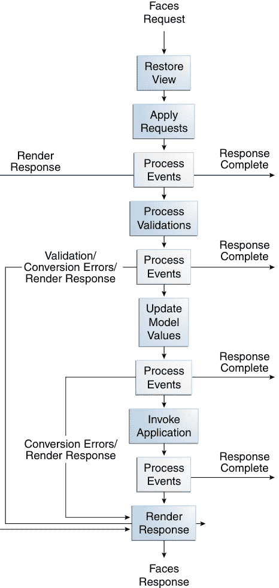

请求-响应生命周期处理两种请求：初始请求（initial requests）和回传（postbacks）。当用户首次请求某个页面时，发生初始请求。当用户提交页面上的表单（该页面之前由于执行初始请求已加载到浏览器中），发生回传请求。

当生命周期处理初始请求时，它执行恢复视图（Restore View）和渲染响应（Render Response）阶段，因为没有需要处理的用户输入或动作。相反，当生命周期处理回传时，它会执行所有阶段。

通常，JavaServer Faces 页面的第一个请求来自客户端，由于点击了 JavaServer Faces 页面上的链接或按钮组件。为了渲染另一个 JavaServer Faces 页面的响应，应用程序创建一个新视图并将其存储在 `java.faces.context.FacesContext` 实例中，该实例代表与传入请求相关的所有创建响应的信息。应用程序获取视图所需的对象引用并调用 `FacesContext.render` 方法，该方法通过跳转到生命周期的渲染响应阶段来强制渲染视图。

有时，应用程序可能需要重定向到不同的 Web 应用程序资源，例如不包含 JavaFaces 组件的 Web 服务器。在这种情况下，开发者必须调用 `FacesContext.responseComplete` 方法跳过渲染阶段。这种情况也显示在图中标记为 Render Complete 的箭头。

最常见的情况是 JavaServer Faces 组件提交另一个 JavaServer Faces 页面的请求。在这种情况下，JavaServer Faces 实现处理请求并自动通过生命周期中的阶段来执行任何转换、验证并更改响应。

本节描述的生命周期有一个例外。当组件的 `immediate` 阶段设置为 `true` 时，与这些组件相关的验证、转换和事件将在应用值阶段（Apply Request Values Phase）处理，而不是在后续阶段。

后续章节解释的生命周期细节主要面向需要了解验证、转换通常如何以及何时处理信息的开发者。有关每个生命周期阶段的更多信息，请从 http://jcp.org/en/jsr/detail?id=344 下载 JavaServer Faces 规范。

JavaServer Faces 生命周期执行阶段包含以下阶段：

- 恢复视图阶段（Restore View Phase）
- 应用值阶段（Apply Request Values Phase）
- 处理验证阶段（Process Validations Phase）
- 更新模型值阶段（Update Model Values Phase）
- 调用应用阶段（Invoke Application Phase）
- 渲染响应阶段（Render Response Phase）

### 7.6.2 恢复视图阶段

当对 JavaFaces 页面提出请求时（通常通过点击链接或按钮），JavaFaces 实现 开始恢复视图阶段。

在此阶段，JavaServer Faces 实现构建页面视图，将事件处理器和验证器绑定到视图中的组件，并将视图保存在 `FacesContext` 实例中，该实例包含处理单个请求所需的所有信息。应用程序的所有组件、事件处理器、转换器和验证器都可以访问 FacesContext 实例。

如果页面请求是初始请求，JavaServer Faces 实现为该阶段创建一个空视图，生命周期将进入渲染响应阶段，在此期间，空视图将被页面标签引用的组件所填充。

# JavaFaces 的生命周期

如果页面请求是回传（postback），则 FacesContext 实例中已经存在与该页面对应的视图。在此阶段，JavaFaces 实现通过使用保存在客户端或服务器端的状态来恢复视图。

## 7.6.3 应用请求值阶段 (Apply Request Values Phase)

在回传请求期间恢复组件树后，树中的每个组件都会通过其 `decode(process)` 方法从请求参数中提取其新值。然后，该值会在每个组件上进行本地解码。

如果任何 `decode` 方法或事件监听器调用了当前 FacesContext 实例的 `renderResponse` 方法，则 JavaFaces 实现将跳到响应阶段（Response phase）。

如果在此阶段期间队列了任何事件，JavaFaces 实现会将这些事件广播给感兴趣的监听器。

如果页面上的某些组件的 `immediate` 属性（即 `immediateAttribute`）设置为 `true`，则与这些组件相关的验证、转换和事件将在此阶段进行处理。如果任何转换失败，将生成与组件相关的错误消息并将其队列到 FacesContext 中。此消息将在响应阶段显示，连同来自处理阶段（Process phase）的任何验证错误一起显示。

此时，如果应用程序需要重定向到不同的 Web 应用程序资源或生成不包含任何 JavaFaces 组件的响应，它可以调用 `FacesContext.responseComplete` 方法。

在此阶段结束时，组件被设置为其新值，并且消息和事件已经队列。

如果当前请求被识别为部分请求（partial request），则从 FacesContext 中获取部分上下文，并应用部分处理方法。

## 7.6.4 处理验证阶段 (Process Validations Phase)

在此阶段，JavaFaces 实现通过其 `validate(processValidators)` 方法处理树上注册的所有验证器。它会检查指定验证规则的组件属性，并将这些规则与存储在组件本地的本地值进行比较。JavaFaces 实现将完成那些未将 `immediate` 属性设置为 `true` 的输入组件的验证。


如果值无效，或任何转换失败，JavaFaces 实现将向 `FacesContext` 实例添加错误消息，并且生命周期将直接推进到响应阶段，以便在显示错误消息时重新渲染页面。如果请求值阶段存在错误，这些错误的消息也会被显示。

如果任何 `validate` 方法或事件监听器调用了当前 Faces 的 `renderResponse` 方法，则 JavaFaces 实现将跳到响应阶段。

此时，如果应用程序需要重定向到不同的 Web 资源或生成不包含任何 JavaServer Faces 组件的响应，它可以调用 `FacesContext.responseComplete` 方法。

如果在此阶段期间队列了任何事件，JavaFaces 实现会将它们广播给感兴趣的监听器。

## 7.6.5 更新模型值阶段 (Update Model Values Phase)

在 JavaServer Faces 实现确定数据有效后，它会遍历组件树并将相应的服务器端对象属性设置为组件的本地值。JavaServer Faces 实现仅更新输入组件的 `value` 所指向的 Bean 属性。如果本地数据无法转换为 Bean 属性指定的类型，则生命周期将直接推进到渲染响应阶段（Render Response phase），以便在显示错误时重新渲染页面。这与验证错误发生的情况类似。

如果任何 `update` 方法或监听器调用了当前 `FacesContext` 实例的 `RenderResponse` 方法，JavaServer Faces 实现将跳到响应阶段。

此时，如果应用程序需要重定向到不同的 Web 资源或生成不包含任何 JavaServer Faces 组件的响应，它可以调用 `FacesContext.responseComplete` 方法。

如果在此阶段期间队列了任何事件，JavaServer Faces 实现会将它们广播给感兴趣的监听器。

如果当前请求被识别为部分请求，则从 `FacesContext` 中获取部分上下文，并应用部分处理方法。

## 7.6.6 调用应用程序阶段 (Invoke Application Phase)

在此阶段，JavaServer Faces 实现处理任何应用程序级事件，例如提交表单或链接到另一个页面。

此时，如果应用程序需要重定向到不同的 Web 资源或生成不包含任何 JavaServer Faces 组件的响应，它可以调用 `FacesContext.responseComplete` 方法。

如果正在查看的视图是从之前请求的状态重建的，或者某个组件触发了事件，则这些事件将广播给感兴趣的监听器。

最后，JavaServer Faces 实现将控制权移交给渲染响应阶段。

## 7.6.7 渲染响应阶段 (Render Response Phase)

在此阶段，JavaServer Faces 构建视图并将渲染页面的权限委托给适当的资源。

如果这是一个初始请求，页面上表示的组件将添加到组件树中。如果不是初始请求，则组件已添加到树中，因此无需再次添加。

如果请求是回传的且在请求值阶段、处理验证阶段或更新模型值阶段遇到了错误，则在此阶段渲染原始页面。如果页面包含标签、`h:message` 或 `h:messages` 标签，任何队列中的错误消息将显示在页面上。

在视图内容渲染之后，响应的状态将被保存，以便后续请求可以访问它。保存的状态在恢复视图阶段（Restore View phase）可用。

## 7.7 部分处理与部分渲染 (Partial Processing and Partial Rendering)

JavaServer Faces 生命周期跨越了应用程序的所有执行和渲染过程。也可以只处理和渲染应用程序的一部分，例如单个组件。例如，JavaServer Faces Ajax 框架可以生成包含有关哪些特定组件可以被处理并渲染回客户端的请求。

一旦此类部分请求进入 JavaServer Faces 生命周期，该信息将由 `javax.faces.context.PartialViewContext` 对象识别并处理。JavaServer Faces 生命周期仍然感知此类 Ajax 请求，并相应地修改组件树。

`f:ajax` 标签的 `execute` 和 `render` 属性用于识别哪些组件可以被执行和渲染。有关这些属性的更多信息，请参阅第 13 章“在 JavaServer Faces 中使用 Ajax”。

## 7.8 JavaServer Faces 技术的更多信息

有关 JavaServer Faces 更多信息，请参考：

- JavaServer Faces 2.2 规范：
  http://jcp.org/en/jsr/detail?id=344

- JavaServer Faces 项目网站：
  https://javafaces.net/

# Facelets 简介 (Introduction to Facelets)

Facelets 一词是指 JavaServer 技术的视图声明语言。Facelets 是 JavaServer Faces 规范的一部分，也是构建基于 JavaServer Faces 应用程序的首选呈现技术。JavaServer Pages (JSP) 技术曾用作 JavaServer Faces 的呈现技术，它不支持 Java EE 7 平台中 JavaServer Faces 可用的所有新功能。JSP 技术被认为是过时的技术。

本文介绍了以下主题：

- 什么是 Facelets？
- Facelets 应用的生命周期
- 开发简单的 Facelets 应用：guessnumber-jsf 示例
- 使用 Facelets 模板
- 组合组件 (Composite Components)
- Web 资源
- 可重定位资源
- 资源库合约
- HTML5 友好标记

## 8.1 什么是 Facelets？

Facelets 是一种强大但轻量级的页面声明语言，用于使用 HTML 模板构建 JavaServer Faces 视图并构建组件树。Facelets 的特性包括：

- 使用 XHTML 创建网页
- 除了 JavaServer Faces 和 JSTL 标签库外，还支持 Facelets 标签库
- 支持表达式语言 (EL)

Facelets 对于大型开发项目的优势包括：

- 通过模板和组合组件支持代码复用
- 通过自定义实现组件及其他服务器端对象的功能扩展性
- 更快的编译时间
- 编译时 EL 验证
- 高性能渲染

简而言之，使用 Facelets 可以减少开发和部署上花费的时间和精力。

Facelets 视图通常创建为 XHTML 页面。JavaServer Faces 实现支持符合 XHTML 过渡文档类型定义（DTD）创建的 XHTML 页面，详见 http://www.w3.org/TR/XHTML/#a_dtd_XHTML-1.0-Transitional。按照惯例，使用 XHTML 构建的页面具有 `.xhtml` 扩展名。

JavaServer Faces 技术支持各种标签库向 Web 添加组件。为了支持 JavaServer Faces 标签库机制，Faces 使用 XML 命名空间声明。表 8–1 列出了 Facelets 支持的标签库。

| 标签库 | URI | 前缀 | 示例 | 内容 |
|---|---|---|---|---|
| JavaServer Faces 标签库 | http://xmlns.jcp.org/js/facelets | ui: | ui:component<br>ui:insert | 用于模板的标签 |
| JavaServer Faces HTML 标签库 | http://xmlns.jcp.org/js/html | h: | h:head<br>h:body<br>h:outputText<br>h:inputText | 用于所有 UIComponent 对象的 JavaServer Faces 组件标签 |
| JavaServer Faces 核心标签库 | http://xmlns.jcp.org/js/core | f: | f:actionListener<br>f:attribute | 独立于特定渲染套件的 JavaServer Faces 自定义动作标签 |
| 透传元素标签库 | http://xmlns.jcp.org/js | p: | p:type | 支持 HTML5 友好标记的标签 |
| 透传属性标签库 | http://xmlns.jcp.org/js/passthrough | jsf: | jsf:id | 支持 HTML5 友好标记的标签 |
| JSTL 核心标签库 | http://xmlns.jcp.org/jsp/jst/core | c: | c:forEach<br>c:catch | JSTL 1.2 核心标签 |
| JSTL 函数标签库 | http://xmlns.jcp.org/jsp/jst/functions | fn: | fn:toUpperCase<br>fn:toLowerCase | JSTL 1.2 函数标签 |

此外，Facelets 支持复合组件的标签，你可以为这些组件声明复合前缀。关于复合组件的更多信息，请参见 Facelets 组件。

Facelets 提供了两个命名空间来支持 HTML5 标记。详情请参见 HTML5 友好标记。

基于 JavaFaces 对表达式语言（EL）语法的支持，Facelets 使用 EL 来引用托管豆（managed beans）的属性和方法。EL 表达式可以将组件对象或值绑定到作为后端豆（backing beans）的属性或托管豆。关于使用表达式的更多信息，请参见使用 EL 引用托管豆。

## 8.2 Facelets 应用程序的生命周期

JavaServer Faces 规范定义了 Java Faces 应用的生命周期。更多信息请参见 Java Faces 应用的生命周期。以下步骤描述了适用于基于 Facelets 应用程序的过程：

1. 当客户端（浏览器）对使用 Facelets 创建的页面发送新请求时，会创建一个新的 `UIViewRoot` 并将其放入 `FacesContext` 中。
2. `UIViewRoot` 被添加到 Facelets 中，并填充用于渲染的视图组件。
3. 新视图被渲染并作为响应返回客户端。
4. 渲染时，该视图的状态被存储以供下一次请求使用。输入组件的状态也会存储。
5. 客户端可能与视图进行交互并请求另一个视图。此时，保存的视图将从存储的状态中恢复。
6. 恢复的视图再次通过 Faces 生命周期，如果存在验证问题，它最终将生成新视图。
7. 如果请求相同的视图，则该视图将再次渲染。
8. 如果请求新视图，则继续过程。
9. 新视图被渲染并作为响应。

## 8.3 开发简单的 Facelets 应用程序：guessnumber-jsf 示例应用程序

本节描述了开发 Java Faces 涉及的通用步骤。需要完成以下任务：

- 开发托管豆
- 使用组件标签创建页面
- 定义页面导航
- 映射 Faces 实例
- 添加托管豆声明

### 8.3.1 创建 Facelets 应用程序

本教程使用的示例程序是 `guessnumber-jsf` 应用程序。该程序向你展示一个页面，要求你猜一个 0 到 10 之间的数字，根据随机数验证你的输入，并返回另一个页面告知你猜得正确还是错误。该程序的源码位于 `examples/web/jsf/guessnumber-jsf`。

### 8.3.1.1 开发托管豆

在典型的 JavaServer Faces 应用程序中，应用程序的每个页面都连接到一个作为后端豆的托管豆。后端豆定义了与组件关联的方法和属性。在本示例中，两个页面都使用同一个后端豆。以下托管豆类 `UserBean.java` 会生成一个 0 到 10 之间的随机数：

```java
package util.guessnumber;

import java.io.Serializable;
import java.util.Random;
import javax.enterprise.context.SessionScoped;
import javax.inject.Named;

@Named
@SessionScoped
public class UserBean implements Serializable {

    private static final long serialVersionUID = 5443351539686724L;
    Integer randomInt = null;
    Integer userNumber = null;
    String response = null;
    private int maximum = 10;
    private int minimum = 0;

    public UserBean() {
        Random randomGR = new Random();
        randomInt = new Integer(randomGR.nextInt(maximum + 1));
        // Print number to server log
        System.out.println("Duke's number: " + randomInt);
    }

    public void setUserNumber(Integer user_number) {
        userNumber = user_number;
    }

    public Integer getUserNumber() {
        return userNumber;
    }

    public String getResponse() {
        if ((userNumber == null) || (userNumber.compareTo(randomInt) != 0)) {
            return "Sorry, " + userNumber + " is incorrect.";
        } else {
            return "Yay! You got it!";
        }
    }

    public int getMaximum() {
        return (this.maximum);
    }

    public void setMaximum(int maximum) {
        this.maximum = maximum;
    }

    public int getMinimum() {
        return (this.minimum);
    }

    public void setMinimum(int minimum) {
        this.minimum = minimum;
    }
}
```

注意 `@Named` 注解，它使得托管豆可以通过 EL 访问。`@SessionScoped` 注解将豆的作用范围注册为会话，以便你在运行应用程序时进行多次猜测。

### 8.3.1.2 创建 Facelets 视图

要创建页面或视图，请将组件添加到页面中，将组件连接到后端豆的值和属性，并在组件上注册转换器、验证器或监听器。

示例中，XHTML 页面作为前端。示例应用程序的第一个页面是名为 `greeting.xhtml` 的页面。详细查看此网页的各个部分可以获得更多信息。

网页的第一部分声明了页面的内容类型为 HTML：

```html
<!DOCTYPE html PUBLIC "//W3C//DTD HTML 1.0 Transitional//EN"
   "http://www.w3.org/TR/html-transitional.dtd">
```

下一部分指定了 XHTML 页面的语言，声明了网页用库的 XML 命名空间：

下一部分使用各种标签将组件插入网页中：

```xml
<head>
   <link stylesheet="css" name="default.css"/>
   <title>Guess Number Faclets Application</title>
</head>
<body>
   <form>
      <h:graphicImage value="#{resource[images:wave.med.gif]}"
           alt="Duke waving his hand"/>
      <h2>
      Hi, 我的名字叫 Duke。我正在想一个从
      #{userNumberBean.minimum} 到 #{userBean.maximum} 之间的数字。
      你能猜到吗？
      </h2>
      <p><h:inputText id
```

## 开发简单的 Facelets 应用：guessnumber-jsf 示例应用


# 开发简单的 Facelets 应用：guessnumber-jsf 示例应用

```xml
<h:inputText type="Type a number from 0 to 10"
             value="#{userBean.userNumber}">
    <f:validateLongRange minimum="#{userBean.minimum}"
                         maximum="#{userBean.maximum}"/>
</h:inputText>
<h:commandButton id="submit" value="Submit" action="response"/>
<h:message showSummary="true" showDetail="false"
           style="color:#D20005; font-family:New Century Schoolbook, serif; font-style:oblique; text-decoration:overline"
           id="errs1" for="userNo"/>
```

请注意以下标签的使用：

- Facelets HTML 标签（以 `h:` 开头的标签），用于添加组件
- Facelets 核心标签 `f:validateLongRange`，用于验证用户输入

`h:inputText` 标签接受用户输入，并使用 EL 表达式 `#{userBean.userNumber}` 获取托管豆属性 `number` 的值。输入值将通过 JavaServer 标准验证器标签 `f:validateLongRange` 进行数值范围验证。

图像文件 `wave_med.gif` 已添加到资源中；样式表也是如此。关于资源设施的更多细节，请参阅 Web Resources。

带有 ID `submit` 的 `h:commandButton` 标签在用户点击按钮时会启动数据验证。通过隐式导航，该标签将客户端重定向到另一个页面 `response.xhtml`，该页面显示对你输入的响应。该页面仅指定了 `response`，这默认会导致服务器查找 `response.xhtml`。

现在你创建第二个页面，内容如下：

```xml
<!DOCTYPE html PUBLIC "-//W3C//DTD HTML 1.0 Transitional//EN"
"http://www.w3.org/TR/xhtml1/DTD/xhtml1-transitional.dtd">
<html lang="en"
      xmlns="http://www.w3.org/1999/xhtml"
      xmlns:h="http://xmlns.jcp.org/jsf/html">
<head>
    <h:outputStylesheet library="css" name="default.css"/>
    <title>Guess Number Facelets Application</title>
</head>
<body>
    <h:form>
        <h:graphicImage value="#{resource['images:wave_med.gif']}" alt="Duke making his hand"/>
        <h2></h2>
        <h:inputText id="result" value="#{userBean.response}"/>
        <h:commandButton id="back" value="Back" action="greeting"/>
    </h:form>
</body>
</html>
```

此页面也使用了隐式导航，通过设置“返回”按钮的 `action` 属性，将用户发送到 `greeting.xhtml` 页面。

## 8.3.2 配置应用程序

配置 JavaServer Facelets 应用涉及在 Web 部署文件（如 `web.xml` 文件）中映射 Faces Servlet，并可能在应用配置文件 `faces-config.xml` 中添加 bean 声明、导航规则和资源包声明。

如果你正在使用 NetBeans IDE，系统会自动为你创建一个 Web 部署文件。你可以使用 IDE 创建的 `web.xml` 文件来更改默认的欢迎页，将其从 `index.xhtml` 更改为 `greeting.xhtml`。这里有一个 `web.xml` 示例，详细展示了这一更改。

```xml
<?xml version="1.0" encoding="UTF-8"?>
<web-app version="3.1" xmlns="http://xmlns.jcp.org/xml/ns/javaee"
         xmlns:xsi="http://www.w3.org/2001/XMLSchema-instance"
         xsi:schemaLocation="http://xmlns.jcp.org/xml/ns/javaee http://xmlns.jcp.org/xml/ns/javaee/web-app-3.1.xsd">
    <context-param>
        <param-name>javax.faces.PROJECT_STAGE</param-name>
        <param-value>Development</param-value>
    </context-param>
    <servlet>
        <servlet-name>Faces Servlet</servlet-name>
        <servlet-class>javax.faces.webapp.FacesServlet</servlet-class>
        <load-on-startup>1</load-on-startup>
    </servlet>
    <servlet-mapping>
        <servlet-name>Faces Servlet</servlet-name>
        <url-pattern>*.xhtml</url-pattern>
    </servlet-mapping>
    <session-config>
        <session-timeout>30</session-timeout>
    </session-config>
    <welcome-file-list>
        <welcome-file>greeting.xhtml</welcome-file>
    </welcome-file-list>
</web-app>
```

注意 `PROJECT_STAGE` 的使用，它标识了 Facelets 应用的状态。如果定义为 `Development`，则会生成调试信息。

## 8.3.3 运行 guessnumber-jsf

你可以使用 NetBeans IDE 或 Maven 来构建、部署并运行 guessnumber-jsf。

### 8.3.3.1 使用 NetBeans IDE 构建、打包并部署

- 确保 GlassFish 已启动。
- 从菜单中选择“文件” > “打开项目”。
- 在 Projects 选项卡中导航到 `tut/examples/web/facelets`。
- 右键点击项目并选择“运行”。

### 8.3.3.2 使用 Maven 构建、打包并部署

- 打开终端。
- 输入命令：

```bash
mvn install
```

- 这会将应用程序打包成 WAR 文件并在 `target` 目录中生成。

### 8.3.3.3 运行应用

- 打开浏览器。
- 输入 URL：

```
http://localhost:8080/facelets
```

- 在字段中输入数字。

## 8.4 使用 Facelets 模板

Facelets 技术提供了易于扩展的用户界面。通过使用模板，你可以重用代码并避免重复造轮子。模板有助于具有大量页面的应用程序保持外观一致。

| Facelets 标签 | 功能 |
| :--- | :--- |
| `ui:component` | 添加到组件树的组件。 |
| `ui:composition` | 使用模板的页面。此标签之外的内容会被忽略。 |
| `ui:debug` | 添加到组件树的调试组件。 |
| `ui:decorate` | 插入模板中的内容。 |
| `ui:define` | 定义插入到模板的内容。 |
| `ui:fragment` | 用于页面的片段。 |
| `ui:include` | 为多个页面封装并重用内容。 |
| `ui:insert` | 向模板中插入内容。 |
| `ui:param` | 用于循环标签（如 `c:forEach` 或 `h:dataTable`）的参数。 |
| `ui:repeat` | 循环标签的替代方案。 |
| `ui:remove` | 从页面移除内容。 |

Facelets 库包含了主要的模板化标签 `ui:insert`。使用此标签创建模板页面可以定义页面结构。模板页面通常作为其他页面的模板。

以下是保存为 `template.xhtml` 的模板示例：

```xml
<!DOCTYPE html PUBLIC "-//W3C//DTD HTML 1.0 Transitional//EN"
"http://www.w3.org/TR/html1-transitional.dtd">
<html xmlns="http://www.w3.org/1999/xhtml"
      xmlns:ui="http://xmlns.jcp.org/jsf/facelets"
      xmlns:h="http://xmlns.jcp.org/jsf/html">
<head>
    <meta http-equiv="Content-Type" content="text/html; charset=UTF-8" />
    <h:outputStylesheet library="css" name="default.css"/>
    <h:outputStylesheet library="css" name="cssLayout.css"/>
    <title>Facelets Template</title>
</head>
<body>
    <div id="top" class="top">
        <ui:insert name="top">Top Section</ui:insert>
    </div>
    <div id="left">
        <ui:insert name="left">Left Section</ui:insert>
    </div>
    <div id="content" class="left_content">
        <ui:insert name="content"></ui:insert>
    </div>
</body>
</html>
```

示例页面定义了一个 XHTML 页面，该页面分为三个部分：顶部部分、左侧部分和主部分。这些部分都有关联的样式表。相同的结构可以重用于应用程序的其他页面。

客户端页面通过使用 `ui:composition` 标签调用模板。以下示例中名为 `templateclient.xhtml` 的客户端页面调用了名为 `template.xhtml` 的模板页面。客户端页的内容通过 `ui:define` 标签进行插入。

```xml
<!DOCTYPE html PUBLIC "-//W3C//DTD HTML 1.0 Transitional//EN"
"http://www.w3.org/TR/xhtml1/DTD/xhtml1-transitional.dtd">
<html xmlns="http://www.w3.org/1999/xhtml"
      xmlns:ui="http://xmlns.jcp.org/jsf/facelets"
      xmlns:h="http://xmlns.jcp.org/jsf/html">
<body>
    <ui:composition template="template.xhtml">
        <ui:define name="top">
            Welcome to Template Client Page
        </ui:define>

        <ui:define name="left">
            <h:outputLabel value="You are in the Left Section" />
        </ui:define>

        <ui:define name="content">
            <h:graphicImage value="#{resource['images:wave_med.gif']}"/>
            <h:outputText value="You are in the Main Content Section" />
        </ui:define>
    </ui:composition>
</body>
</html>
```

你可以使用 NetBeans 创建切面和客户端页面。有关创建这些页面的更多信息，请访问 <https://netbeans.org/kb/docs/web/jsf20-intro.html>。

## 8.5 复合组件

Java Faces 技术提供了带有切面的复合组件概念。复合组件是一种充当组件的特殊模板类型。

任何组件本质上都是以特定方式运行的可重用代码。例如，输入组件接受用户输入。组件还可以附加验证器、转换器和监听器以执行定义的动作。

复合组件由一组标记标签和其他现有组件组成。这种可重用的用户创建的组件具有自定义的定义功能，并像任何其他组件一样附加了验证器、转换器和监听器。

通过切面，任何包含标记标签和其他组件的 XHTML 页面都可以转换为复合组件。使用资源设施，复合组件可以存储在库中，应用程序可以从定义的资源位置访问该库。

表 8–3 显示了最常用的复合标签及其功能。

### 表 8–3 复合组件标签

| 标签 | 功能 |
| --- | --- |
| `composite:interface` | 声明复合组件的使用合约。复合组件可以作为单个组件使用，其功能是使用合约中声明的功能并集。 |
| `composite:implementation` | 定义复合组件的实现。如果出现了 `composite:interface` 元素，则必须有一个对应的 `composite:implementation`。 |
| `composite:attribute` | 声明一个可能赋给该标签所在组件实例的属性。 |
| `composite:getChildren` | 使用页面中复合标签内的任何子元素或模板文本将重新父化到组件中，位置由 `composite:implementation` 部分中该标签放置的位置决定。 |
| `composite:valueHolder` | 声明复合组件，其合约由嵌套该元素的 `composite:interface` 声明，该元素包含一个适用于使用页面中附加对象的 `ValueHolder` 实现。 |
| `composite:editableValue` | 声明复合组件，其合约由嵌套该元素的 `composite:interface` 声明，该元素包含一个适用于使用页面中附加对象的 `EditableValue` 实现。 |
| `composite:actionSource` | 声明复合组件，其合约由嵌套该元素的 `composite:interface` 声明，该元素包含一个适用于使用页面中附加对象的 `ActionSource` 实现。 |

欲需更多信息和 Facelets 复合标签列表，请参阅文档 <http://docs.oracle.com/javaee/7/javaserverfaces/2.2/docs/vdldocs/facelets/>。

接下来的示例展示了复合组件如何接受电子邮件地址作为输入：

```xml
<!DOCTYPE html PUBLIC "-//W3C//DTD XHTML 1.0 Transitional//EN"
"http://www.w3.org/TR/xhtml1/DTD/xhtml1-transitional.dtd">
<html xmlns="http://www.w3.org/1999/xhtml"
      xmlns:h="http://xmlns.jcp.org/jsf/html"
      xmlns:composite="http://xmlns.jcp.org/jsf/composite">
<head>
    <title>This content will not be displayed</title>
</head>
<body>
    <composite:interface>
        <composite:attribute name="value" required="false"/>
    </composite:interface>
    <composite:implementation>
        <h:outputLabel value="Email id:"/>
        <h:inputText value="#{cc.attrs.value}"/>
    </composite:implementation>
</body>
</html>
```

在定义 `inputText` 组件的值时使用了 `cc.attrs.value`。JavaFaces 中的 `cc` 是复合组件的保留字。`#{cc.attrs.attribute-name}` 表达式用于访问组件接口定义的属性，在这种情况下属性恰好是 `value`。

前述示例内容存储在应用程序根目录下的文件 `resources/emcomp.xhtml` 中。Java Faces 将此目录视为一个库，可以从此类库访问组件。欲需更多信息，请参阅 Web Resources。

使用此组件的页面通常称为使用页面。使用页面在 XML 命名空间声明中包含了复合组件的引用：


```html
<!DOCTYPE HTML PUBLIC "-//W3C//DTD HTML 1.0 Transitional//EN"
"http://www.w3.org/TR/1999/DTD/html-transitional.dtd">
<html xmlns="http://www.w3.org/1999/xhtml"
xmlns:jsp="http://xmlns.jcp.org/jsf/html"
xmlns:em="http://xmlns.jcp.org/jsf/composite/emcomp">

<head>
  <title>Using a composite component</title>
</head>
<body>
  <em:inputText value="Enter your email" />
</body>
</html>
```

## 8.8 资源库合约

资源库合约允许你为一个或多个应用程序的不同部分定义不同的外观，而无需在所有部分都使用相同的外观，也无需逐页地指定不同的外观。

要实现这一点，你需要在 Web 应用程序创建一个 `contracts`（合约）部分。在 `contracts` 部分中，你可以指定任意数量的命名区域，每个区域被称为一个 `contract`（合约）。在每个合约内部，你可以指定资源，如模板文件、样式表、JavaScript 文件和图像。

例如，你可以指定两个合约 `c1` 和 `c2`，每个使用一个模板和其他文件：

```
src/main/webapp
WEB-INF/
  contracts
  c1
    template.xhtml
    style.css
    myImg.gif
    myJS.js
  c2
    template.xhtml
    style2.css
    img2.gif
    js2.js
index.xhtml
```

应用程序的一个部分可以使用 `c1`，而另一部分可以使用 `c2`。

使用合约的另一种方法是指定一个包含多个模板的单一合约：

```
src/main/webapp
  contracts
  myContract
    template1.xhtml
    template2.xhtml
    style.css
    img.png
    img2.png
```

你可以将资源库合约封装成 JAR 文件，以便在不同的应用程序中重用。如果你这样做了，合约必须位于 `META-INF/contracts` 目录下。然后你可以将 JAR 文件放置在应用程序的 `WEB-INF/lib` 目录。这意味着应用程序的结构将如下：

```
src/main/webapp/
  WEB-INF/lib/myContract.jar
  ...
```

你可以在应用程序的 `faces-config.xml` 文件中、`resource-library-contracts` 元素下指定合约的使用。然而，只有当你的应用程序使用多一个合约时，才需要使用此元素。

### 8.8.1 hello1-rlc 示例应用程序

`hello1-rlc` 修改了《A Web Module Uses Java Faces Technology: The hello1 Example》中的简单 hello 示例，使其使用两个资源库合约。应用程序中的每个页面都使用不同的合约。

`hello1-rlc.Hello.java` 的托管豆 与 `hello1` 的相同（除了它将 `@Named` 和 `@RequestScoped` 注解替换为 `@Model`）。

该应用程序的源代码位于 `tut-install/examples/web/jsf/hello-rlc/` 目录。

### 8.8.1.1 配置 hello1-rlc 示例

`hello1-rlc` 示例的 `faces-config.xml` 文件包含以下元素：

```
<resource-library-contracts>
  <contract-mapping>
    <url-pattern>/reply/*</url-pattern>
    <contracts>reply</contracts>
  </contract-mapping>
  <contract-mapping>
    <url-pattern>/*</url-pattern>
    <contracts>hello</contracts>
  </contract-mapping>
</resource-library-contracts>
```

`resource-library-contracts` 元素内的 `contract-mapping` 元素将每个合约映射到应用程序中不同的页面集。名为 `reply` 的合约用于应用程序 `reply` 区域下的所有页面 (`/reply/*`)。另一个合约 `hello` 则用于应用程序中的所有其他页面 (`*`)。

应用程序的结构如下：

- hello-rlc
  - pom.xml
  - src/main/java/javaaeetutorial/hellorlc/Hello.java
  - src/main/webapp
    - WEB-INF
      - faces-config.xml
      - web.xml
    - contracts
      - hello
        - default.css
        - duke.handsOnHips.gif
        - template.xhtml
      - reply
        - default.css
        - duke.thumbs.gif
        - template.xhtml
    - response.xhtml
    - greeting.xhtml

`web.xml` 文件指定 `greeting.xhtml` 为欢迎文件。由于它不在 `src/main/webapp/reply` 下，它使用了 `hello` 合约，而 `src/main/webapp/reply/response.xhtml` 使用了 `reply` 合约。

### 8.8.1.2 hello1-rlc 示例的 Facelets 页面

`greeting.xhtml` 和 `response.xhtml` 页面在调用模板时的代码是相同的：

```xml
<ui:composition template="/template.xhtml">
```

`hello` 和 `reply` 合约中的 `template.xhtml` 文件在两个方面上有所不同：标题元素的占位符文本（"Hello Template" 和 "Reply Template"）以及它们各自指定的图形。

两个合约的 `default.css` 样式表仅在一个方面上不同：为 `body` 元素指定的背景颜色。

### 8.8.1.3 使用 NetBeans IDE 构建、打包和部署 hello1-rlc 示例

1. 确保 GlassFish 服务器已启动（参见 Starting and Stopping the GlassFish Server）。
2. 从 `File` 菜单中选择 `Open Project`。
3. 在 `Project` 对话框中，导航到：
   `t-install/examples/web/jsf/hello1-rlc`
4. 选择 `hello1-rlc` 文件夹。
5. 点击 `Open Project`。
6. 在 `Projects` 选项卡中，右键点击 `hello1-rlc` 项目并选择 `Build`。

此选项将构建示例应用程序并将其部署到你的 GlassFish 服务器实例中。

### 8.8.1.4 使用 Maven 构建、打包和部署 hello1-rlc 示例

1. 确保 GlassFish 服务器已启动（参见 Starting and Stopping the GlassFish Server）。
2. 在终端中，进入：
   `t-install/examples/web/jsf/hello1-rlc`
3. 输入命令：
   `mvn install`

该命令将应用程序构建并打包成 WAR 文件。然后将其部署到你的 GlassFish 实例中。

### 8.8.1.5 运行 hello1-rlc 示例

1. 在浏览器中输入 URL：
   `http://localhost:8080/hello1-rlc`
2. `greeting.xhtml` 页面看起来像 `hello` 示例。
3. 在文本字段中输入你的名字并点击 `Submit`。
4. `response` 页面看起来也像 `hello` 示例。

## 8.9 HTML5 标记

当我们想要为 HTML5 生成其自身元素的用户界面功能时，可以创建一个 Java Faces 组件并将其插入 facets 页面中。这种机制可以让简单的元素创建复杂的 Web 代码。然而，创建此类组件是一项巨大的任务。JavaFaces 提供了：

- 透传元素
- 透传属性

HTML5 标记功能的效果是为页面作者提供对渲染输出的几乎完全控制，而不是将其传递给组件作者。你可以根据需要混合使用 JavaServer Faces 和 HTML5 元素。

### 8.9.1 使用透传元素

透传元素允许你使用 HTML5 标签和属性，将其视为等同于 JSF 组件，并与服务器端的 `UIComponent` 实例关联。

要使非 Java Faces facet 元素生效，请使用命名空间指定其至少一个属性。例如，以下代码使用短名 `jsf` 解码命名空间：

```html
<html ... xmlns:jsf="http://xmlns.jcp.org/jsf">

<input type="email" jsf:id="email" value="${reservationBean.email}" required="required"/>
```

在这里，`jsf` 前缀放置在 `id` 属性上，使得 HTML5 标签属性被视为 facets 页面的一部分。这意味着，例如，可以使用 EL 表达式来获取托管属性。

## 表 8–4（续）Facelets 如何渲染 HTML5 元素

| HTML5 元素名称 | 标识属性 | Facelets 标签 |
| --- | --- | --- |
| body | | `h:body` |
| button | | `h:commandButton` |
| button | `jsf:outcome` | `h:button` |
| form | | `h:form` |
| head | | `h:head` |
| img | | `h:graphicImage` |
| input | `type="button"` | `h:commandButton` |
| input | `type="checkbox"` | `h:selectBooleanCheckbox` |
| input | `type="color"` | `h:inputText` |
| input | `type="date"` | `h:inputText` |
| input | `type="datetime"` | `h:inputText` |
| input | `type="datetime-local"` | `h:inputText` |
| input | `type="email"` | `h:inputText` |
| input | `type="month"` | `h:inputText` |
| input | `type="number"` | `h:inputText` |
| input | `type="range"` | `h:inputText` |
| input | `type="search"` | `h:inputText` |
| input | `type="time"` | `h:inputText` |
| input | `type="url"` | `h:inputText` |
| input | `type="week"` | `h:inputText` |
| input | `type="file"` | `h:inputFile` |
| input | `type="hidden"` | `h:inputHidden` |
| input | `type="password"` | `h:inputSecret` |
| input | `type="reset"` | `h:commandButton` |
| input | `type="submit"` | `h:commandButton` |
| input | `type="*"` | `h:inputText` |
| label | | `h:outputLabel` |
| link | | `h:outputStylesheet` |
| script | | `h:outputScript` |
| select | `multiple="*"` | `h:selectManyListbox` |
| select | | `h:selectOneList` |
| textarea | | `h:inputArea` |

### 8.9.2 使用透传属性

透传属性是透传元素的逆过程。它们允许你将非 JavaFaces 属性不经过解释直接传递给浏览器。如果你在 Java Faces `UIComponent` 中指定了透传属性，该属性名称和值将直接传递给浏览器，而不经过 JavaServer Faces 组件或渲染器的解析。指定透传属性有以下几种方法：

- 使用 JavaServer Faces 命名空间处理透传属性，以便为 JavaServer Faces 组件内部的属性添加名前缀。例如，以下代码使用短名称 `f` 声明命名空间，然后将 `type`、`min`、`max`、`required` 和 `title` 属性传递给 HTML5 输入组件：

```xml
<html xmlns:f="http://xmlns.jcp.org/jsf/passthrough">

<h:form prepended="false">
<h:inputText id="nights" type="number" value="#{bean.nights}"
min="1" max="30" required="required">
<h:title>输入 1 到 30 之间的数字。</h:title>
</h:form>
```

这将导致渲染以下标记（假设 `bean.nights` 的默认值设置为 1）：

```
<input id="nights" type="number" value="1" min="1" max="30"
required="required">
<title>输入 1 到 30 之间的数字。</title>
```

- 要传递单个属性，请在组件标签内嵌套 `f:passThroughAttribute` 标签。例如：

```xml
<h:inputText value="#{user.email}">
<f:passThroughAttribute name="type" value="email" />
</h:inputText>
```

此代码的渲染结果与下例类似：

- 要传递一组属性，请在组件标签内嵌套 `f:passThroughAttributes` 标签，并指定一个必须求值为 `Map<String, Object>` 的 EL 表达式。例如：

```xml
<h:inputText value="#{bean.nights}">
<f:passThroughAttributes value="#{bean.nameValuePairs}" />
</h:inputText>
```

如果该 bean 使用了 `Map` 声明并在构造函数中如下初始化了 map，则生成的标记将与使用透传命名空间的代码输出相似。

```java
private Map<String, Object> nameValuePairs;

public Bean() {
this.nameValuePairs = new HashMap<>();
this.nameValuePairs.put("type", "number");
this.nameValuePairs.put("min", "1");
this.nameValuePairs.put("max", "30");
this.nameValuePairs.put("required", "required");
this.nameValuePairs.put("title", 
"输入 1 到 4 之间的数字.");
}
```

## 8.9.3 预订应用

预订示例应用程序提供了各种类型的 HTML5 输入元素，用于模拟购买戏剧活动门票。它由两个 Facelets 页面（`reservation.xml` 和 `confirmation.xml`）以及一个后端 bean（`ReservationBean.java`）组成。这些页面同时使用了透传属性和透传元素。

该应用程序的源代码位于 `tut-install/examples/web/jsf/reservation/`。

### 8.9.3.1 预订应用的 Facelets 页面

预订应用 Facelets 页面的第一个重要特性是 DOCTYPE 头。JavaServer Faces 中的大多数 Facelets 页面引用 XHTML DTD。该应用的 Facelets 页面如下：

```xml
<!DOCTYPE html PUBLIC "-//W3C//DTD XHTML 1.0 Strict//EN" "http://www.w3.org/TR/xhtml1/DTD/xhtml1-strict.dtd">
<html xmlns:f="http://xmlns.jcp.org/jsf/passthrough" xmlns:h="http://xmlns.jcp.org/xml/jsf">
```

`reservation.xml` 页面使用了透传属性和透传元素。例如，日期输入：


```xml
<h:inputText id="date" type="date" value="#{bean.date}">
    <f:passThroughAttribute name="min" value="2023-01-01" />
    <f:passThroughAttribute name="max" value="2023-12-31" />
</h:inputText>
```

`confirmation.xml` 页面显示用户输入的值，并提供了一个返回预订页面的按钮。

此命令将应用程序构建并打包成 WAR 文件 `reservation.war`，该文件位于 `target` 目录。它将部署到你的 GlassFish 服务器实例中。

## 8.9.3 运行 reservation 示例

在本教程发布时，最完整实现 HTML5 的浏览器是 Google Chrome，建议使用它来运行此示例。不过，其他浏览器也在追赶，在你读到此内容时，它们可能运行同样良好。

1. 在网络浏览器中输入以下 URL：

```
http://localhost:8080/reservation
```

2. 在 `reservation.xhtml` 页面的字段中输入信息。

Performance Date（演出日期）字段具有带有上下箭头的日期字段，允许你增加或减少月份、日期和年份，此外还有一个较大的向下箭头，它可以弹出日历形式的日期编辑器。

Number of Tickets（门票数量）和 Ticket Price（票价）字段也有上下箭头，允许你在允许范围和步长内增加或减少值。当你更改这两个字段中的任何一个时，Estimated Total（预估总额）会变化。

电子邮件地址和日期会进行格式检查，但不会进行有效性检查（例如，你可以为过去的日期预订）。

3. 点击 Make Reservation（预订）完成预订，或点击 Clear（清除）将字段恢复到默认值。

4. 如果你点击 Make Reservation，会出现 `confirmation.xhtml` 页面，显示提交的值。

点击 Back（返回）回到 `reservation.xhtml` 页面。

## 9 表达式语言

本章介绍表达式语言（也称为 EL），它提供了一种重要的机制，使表现层（网页）能够与应用程序逻辑（托管豆/managed beans）进行通信，适用于 JavaServer Faces 技术和 JavaServer Pages (JSP) 技术。EL 代表了 JavaServer Faces 技术和 JSP 技术提供的表达式语言的并集。

此处将涵盖以下主题：

- EL 概述
- 立即求和延迟求值语法
- 表达式和方法表达式
- 字面量表达式
- 集合对象上的操作
- 运算符
- 预留字
- EL 表达式示例

## 9.1 EL 概述

EL 允许页面作者使用简单的表达式从 JavaBeans 组件中动态访问数据。以下条件标签的 `test` 属性提供了一个 EL 表达式，用于比较 0 与名为 `cart` 的会话范围豆中的项目数量。

```
<c:if test="${sessionScope.cart.numberOfItems > 0}">
</c:if>
```

JavaServer Faces 技术将 EL 用于以下功能：

- 表达式的延迟求值和立即求值
- 设置以及获取数据的能力
- 调用方法的能力

参见《Using the EL to Reference Managed Beans》获取更多关于如何在 JavaServer Faces 应用程序中使用 EL 的信息。

总结，EL 提供了一种使用简单表达式执行以下任务的方法：

- 动态读取存储在 JavaBeans 组件、各种数据结构和隐式对象中的应用程序数据
- 将数据（作为表单输入）动态写入 JavaBeans 组件
- 调用任意的静态和公共方法
- 动态执行算术运算

EL 还用于指定自定义标签将接受的以下类型的表达式：

- 立即求值表达式或延迟求值表达式。立即求值表达式由底层技术（如 JSFaces）立即求值。延迟表达式可以由底层技术使用 EL 在后求值。
- 值表达式或方法表达式。值表达式引用数据，而方法表达式调用方法。
- R值表达式或 L值表达式。R值表达式只能读取值，而 L值表达式既可以读取也可以将该值写入外部对象。

最后，EL 提供了一个可插拔的 API 来解析表达式，因此可以实现自定义解析器来处理 EL 尚未支持的表达式。

## 9.2 立即和延迟求值语法

EL 支持表达式的立即求值和延迟求值。立即求值意味着表达式在页面首次渲染时就会进行求值并返回结果。延迟求值意味着该技术稍后可以使用 EL 对表达式进行求值。

由于生命周期的问题，JSFaces 技术在页面首次渲染时立即求值表达式并返回结果。使用 `${}` 语法的表达式被立即求值。使用 `#{}` 语法的表达式被延迟求值。

由于生命周期的原因，EL 在不同阶段延迟求值表达式。JSFaces 技术必须在生命周期的合适点延迟求值表达式。

### 9.2.1 立即求值

所有使用 `${}` 语法的表达式都是立即求值的。这些表达式只能作为标签属性的值。

以下示例显示了一个立即求值表达式，它从名为 `catalog` 的豆中获取数量：

```
<h:outputText value="${catalog.bookQuantity}"/>
```

JSFaces 实现了 `${catalog.bookQuantity}` 表达式，将其转换并将结果传递给标签。立即求值表达式是只读的。之前的表达式无法设置数量，只能从 `catalog` 豆获取数量。

### 9.2.2 延迟求值

使用 `#{}` 语法的表达式可以在生命周期的其他阶段进行求值，取决于表达式在页面中如何使用。

以下示例显示了一个 JavaFaces `h:inputText` 标签，它代表一个用户可以在其中输入值的组件。`h:inputText` 的 `value` 属性引用一个指向 `customer` 属性的延迟求值表达式：

```
<h:inputText id="name" value="#{customer.name}"/>
```

对于该页面的初始请求，JavaFaces 实现在生命周期的渲染阶段求值 `#{customer.name}` 表达式。在此阶段，表达式仅仅访问豆中的 `name` 值，正如立即求值中所样。

对于回传（postback），JavaFaces 实现在生命周期的不同阶段求值表达式，期间值从请求中检索、验证并传播到 `customer` 豆。

如示例所示，延迟求值表达式可以是：

- 可同时用于读取和写入数据的表达式
- 方法表达式

值表达式（立即和延迟）以及方法表达式将在下一节中解释。

## 9.3 值表达式与方法表达式

EL 定义了两种表达式：值表达式和方法表达式。值表达式可以产生值也可以设置值。方法表达式引用可以被调用并返回的方法。

### 9.3.1 值表达式

值表达式可以进一步分为 R值表达式和 L值表达式。R值表达式读取数据但不能写入。

所有使用 `${}` 分隔符进行立即求值的表达式都是 R值表达式。使用 `#{}` 分隔符延迟求值的表达式可以充当 R值和 L值表达式。考虑以下两个值表达式：

```
${customer.name}
```

```
#{customer.name}
```

前者使用立即求值语法，而后者使用延迟求值语法。前者访问 `name` 属性，获取其值，添加作为响应的值，并渲染在页面上。第二个表达式也可以发生这种情况。然而，如果该技术允许，标签处理程序可以将此表达式的评估推到页面生命周期中的更后阶段。

在 JavaFaces 技术中，后一个标签的表达式在页面初始请求期间立即求值。在这种情况下，该表达式作为值表达式。在回传（postback）请求期间，此表达式可以使用用户输入设置 `name` 属性的值。在这种情况下，该表达式充当 L值表达式。

#### 9.3.1.1 使用值表达式引用对象

值表达式和 L值表达式都可以引用以下对象及其属性：

- JavaBeans 组件
- 集合（Collections）
- Java SE 枚举类型
- 隐式对象

要引用这些对象，您使用对象名称作为变量来编写表达式。以下表达式引用了一个名为 `customer` 的托管 bean：

```
${customer}
```

Web 容器通过根据 `PageContext.findAttribute(String)` 的行为查找表达式中变量的值，其中 `String` 是变量的名称。例如，在评估表达式 `${customer}` 时，容器将在页面、请求、会话和应用作用域中查找 `customer` 并返回其值。如果未找到 `customer`，则返回空值。

您可以使用 EL 解析器来解析可能出现的变量。例如，您可以提供一个拦截名为 `customer` 对象的 EL 解析器，以便 `${customer}` 在 EL 解析器中返回一个值。

要使用表达式引用枚举常量，请使用字符串字面量。例如，考虑此 Enum 类：

```java
public enum Suit {hearts, spades, diamonds, clubs}
```

要使用表达式引用 `Suit.hearts`，请使用字符串字面量 `"hearts"`。根据上下文，字符串字面量会被转换为枚举常量。例如，在以下表达式中，`my` 是 `Suit` 的一个实例，`"hearts"` 在与实例比较之前会转换为 `Suit.hearts`：

```
${my == 'hearts'}
```

#### 9.3.1.2 使用值表达式引用对象属性

要引用 bean 或枚举实例的属性、集合项或隐式对象的属性，请使用 `.` 或 `[]` 符号。

要引用 `customer` bean 的 `name` 属性，请使用表达式 `${customer.name}` 或表达式 `${customer['name']}`。括号内部部分是作为引用属性名称的字符串字面量。

您可以使用双引号或单引号作为字符串字面量。您还可以结合 `[]` 和 `.` 符号，如下所示：

```
${customer.address["street"]}
```

在此处可以引用枚举常量的属性。然而，与 JavaBeans 组件一样，Enum 类的属性必须遵循 JavaBeans 命名规范。这意味着一个属性必须至少有一个名为 `getProperty` 的方法，其中 `Property` 是可以被表达式引用的属性名称。

例如，考虑一个封装了我们银系行星名称以及一个获取行星质量方法的 Enum 类。您可以使用以下表达式来引用该 Enum 类的 `getMass` 方法：

```
${myPlanet.mass}
```

如果您正在访问数组或列表中的 `int`，你必须使用可以转换为 `int` 的字面量或（带有 `int` 且不带引号的）符号表示。假设 `socks` 可以转换为 `int`，以下示例可以解析为列表或数组中的同一项：

- `${customer.orders[1]}`
- `${customer.orders.socks}`

相比之下，Map 中的 `int` 可以使用字符串字面量访问；不需要强制转换：

```
${customer.orders["socks"]}
```

值表达式还直接引用非对象的值，例如算术操作的结果和字面量，如这些示例所示：

- `"literal"`
- `${customer.age + 20}`
- `${true}`
- `${57}`

EL 定义了以下字面量：

- 布尔：`true` 和 `false`
- 整数：与 Java 相同
- 浮点：与 Java 相同
- 字符串：使用单引号和双引号；`"` 被转义为 `\"`，`'` 被转义为 `\'`，`\` 被转义为 `\\`
- 空：`null`

您还可以编写对枚举常量执行操作的表达式。例如，考虑以下 Enum 类：

```java
public enum Suit {club, diamond, heart, spade}
```

在声明名为 `mySuit` 的枚举常量后，您可以编写以下表达式来测试 `mySuit` 是否为 `spade`。

```
${mySuit == "spade"}
```

当解析此表达式时，EL 解析机制将调用带有 `Suit` 类和 `spade` 类型的 Enum 类的 `valueOf` 方法，如下所示：

```
mySuit.valueOf(Suit.class, "spade")
```

#### 9.3.1.3 值表达式可以使用的地方

使用 `${}` 分隔符的值表达式可以用于：

- 静态文本
- 任何可以接受表达式的标准或自定义标签属性

静态文本中表达式的值会被计算并插入到当前输出中。以下是嵌入在静态文本中的表达式示例：

```xml
<some:tag>
some text ${expr} some text
</some:tag>
```

如果静态文本是标签体，请注意，如果正体被声明为标签相关的（tagdependent），则表达式将不会被评估。

L值表达式只能在可以接受 L值表达式的标签属性中使用。

使用 R值或 L值表达式的标签属性值可以通过以下方式设置：

- 使用单个表达式：

  ```
  <some:tag value="${expr}"/>
  <another:tag value="#{expr}"/>
  ```

  这些表达式会被求值，结果被转换为属性的预期类型。

- 使用一个或多个被文本分隔或包围的表达式：

  ```
  <some:tag value="${expr}${expr}text${expr}"/>
  <another:tag value="#{expr}#{expr}text#{expr}"/>
  ```

  这类表达式被称为复合表达式（composite expressions），它们从左到右求值。嵌入在复合表达式中的每个表达式都会转换为字符串，并与任何中间文本拼接。生成的字符串被转换为属性的预期类型。

- 仅使用文本：

  ```
  <some:tag value="sometext"/>
  ```

  此表达式是一个字面量表达式。在这种情况下，属性的字符串值被转换为属性的预期值。字面量表达式有特殊的语法规则。当标签具有枚举类型时，属性必须使用字面量表达式。例如，标签属性可以使用表达式 `"hearts"` 来表示 `Suit.hearts`。该字面量被转换为 `Suit`，属性获得值 `Suit.hearts`。

您可以使用连接操作符 `+=` 将原本是复合表达式的内容组合成单个表达式。例如，您可以将复合表达式

```xml
<some:tag value="${mtext} moretext"/>
```

变为

```
<some:tag value="${mtext += moretext}"/>
```

所有作为属性值的表达式都会在预期类型的范围内求值。如果表达式的结果与预期类型不完全匹配，将执行类型转换。例如，作为 `float` 类型属性值的 `${1.2E4}` 将导致以下转换：

```java
Float.valueOf("1.2E4").floatValue();
```

请参阅 JavaServer Pages 3.0 规范（http://jcp.org/en/jar/detail?id=341）获取完整的类型转换规则。

## 9.3.2 方法表达式

另一个功能是支持方法表达式。方法表达式用于调用 bean 的任意方法，并可以返回结果。
在 JavaFaces 技术中，组件标签表示页面上的组件。组件标签使用方法表达式调用处理组件的方法。这些方法对于处理组件生成的事件和验证数据是必要的，如下所示：

```xml
<form>
  <h:inputText id="name"
      value="#{customer.name}"
      validator="#{customer.validateName}"/>
  <h:commandButton id="submit"
      action="#{customer.submit}"/>
</form>
```


`h:inputText` 标签显示为一个字段。该 `h:inputText` 的 `validator` 属性引用了 `customer` bean 中的 `validateName` 方法。
由于方法可以在生命周期的不同阶段被调用，方法表达式必须使用延迟评估语法。

与值表达式一样，方法表达式可以使用 `.` 和 `[]` 符号。例如 `#{object.method}` 等于 `#{object["method"]}`。字面量 `[]` 被转换为字符串并用于查找匹配的方法名称。一旦找到方法，就会调用它或返回方法信息。
方法表达式只能在标签属性中使用，且仅限于以下方式：

- 使用单个表达式，其中 bean 指 JavaBeans 组件，method 指该 JavaBeans 组件的方法：
  ```
  <some:tag value="#{bean.method}"/>
  ```
  表达式被求值为方法表达式，并传递给标签处理程序。随后可以调用方法表达式表示的方法。
- 仅使用文本：
  ```
  <some:tag value="sometext"/>
  ```

# 值和方法表达式

方法表达式支持字面量，主要是为了支持 JavaServer Faces 技术中的操作属性。当调用由此方法表达式引用的方法时，该方法将返回字符串字面量，然后该字面量将被转换为在标签库描述符中定义的返回类型。

## 9.3.2.1 带参数的方法调用

EL（表达式语言）支持带参数的方法调用。方法调用可以使用参数，而无需使用静态 EL 函数。

`.` 和 `[]` 运算符均可用于带参数的方法调用，如下面的表达式语法所示：

- `expr-a[expr-b (parameters)]`
- `expr-a.identifier-b (parameters)`

在第一种表达式语法中，`expr-a` 被求值表示一个 bean 对象。`expression-b` 被求值并强制转换为字符串，表示 `expr-a` 所代表的 bean 中的一个方法。在第二种语法中，`expr-a` 被求值表示一个 bean 对象，而 `identifier-b` 是一个表示该 bean 对象中某个标识的字符串。括号中的参数用于方法调用。参数可以是零个或多个值，用逗号分隔。

值表达式和方法表达式都支持参数。在下面的示例中（该示例由 guessnumber 应用程序修改），一个随机数作为参数从用户输入传递给方法调用：

```xml
<h:input value="#{numberBean.userNumber('5')}"/>
```

上面的示例使用了值表达式。

考虑以下使用方法表达式的 JavaServer 组件示例：

```xml
<h:commandButton action="#{trader.buy}" value="buy"/>
```

EL 表达式 `trader.buy` 调用了 trader 的 buy 方法。你可以修改标签以传递参数：这里是带有参数的结果的结果：

```xml
<h:commandButton action="#{trader.buy('SOMESTOCK')}" value="buy"/>
```

在前面的示例中，你正将字符串 `'SOMESTOCK'`（一个股票代码）作为参数传递给 buy 方法。

## 9.3.3 Lambda 表达式

Lambda 表达式是带有参数的值表达式。其语法与 Java 编程语言中的 lambda 表达式相似，不同之处在于 EL 中，lambda 表达式的体是一个 EL 表达式。

关于 lambda 表达式的基本信息，请参阅：

`http://docs.oracle.com/javase/tutorial/java/java00/lambdaexpressions.html.`

注意：Lambda 表达式是 Java SE 8 的一部分，但你可以在 Java SE 7（与 Java EE 7 相关的 Java 版本）的 EL 表达式中使用它们。

## 字面量表达式

Lambda 表达式使用箭头运算符 (`->`)。运算符左侧的标识符称为 lambda 参数。运算符右侧的体必须是一个 EL 表达式。lambda 参数括在括号中；如果只有一个参数，可以省略括号。以下是一些示例：

```
x -> x+1
(x, y) -> x + y
() -> 64
```

Lambda 表达式的行为类似于一个函数。它可以被立即调用。例如，下面的调用求值结果为 7：

```
(x, y) -> x + y; v(3, 4)
```

你可以结合赋值和分号使用 lambda 表达式。例如，下面的代码将之前的 lambda 表达式赋值给变量，然后调用它。结果为 7：

```
v = (x, y) -> x + y; v(3, 4)
```

Lambda 表达式还可以作为参数传递给方法，并在[方法中]被调用。它可以嵌套在另一个 lambda 表达式中。

## 9.4 字面量表达式

字面量被求值为表达式的类型，该类型为 String。字面量表达式不使用 `${}` 或 `#{}` 分隔符。

如果你有一个包含保留的 `${}` 或 `#{}` 语法的字面量，你需要按照如下方式转义这些字符：

- 通过创建所示的复合表达式：
  `$${('')}exprA`
  `##{('')}exprB`
  生成的值将是字符串 `${exprA}` 和 `#{exprB}`。

- 使用转义字符 `\$` 和 `\#` 来转义原本会被视为 el 表达式的内容：

```
\${exprA}
\#{exprB}
```

生成的值将再次是字符串 `${exprA}` 和 `#{exprB}`。

当字面量表达式被求值时，它可以转换为另一种类型。表 9–1 显示了各种字面量表达式及其预期类型和结果示例。

### 表 9–1 字面量表达式

| 表达式 | 预期类型 | 结果 |
|---|---|---|
| Hi | String | Hi |
| true | Boolean | Boolean.TRUE |
| 42 | Int | 42 |

## 9.5 集合对象的操作

（注：此处原文文本似乎存在重复段落错误，根据指令要求已跳过重复内容，以下为 9.5 的后续逻辑内容：）

...（由于原文文本中存在大量重复段落，已严格遵循“不要重复输出原文”的原则进行翻译处理）

## 9.6 运算符

除了在方法表达式中讨论的 `.` 和 `[]` 运算符外，EL 还提供了以下运算符，它们只能用于值表达式：

- 算术运算符：`+`, `-` (二元), `*`, `/` and `div`, `%` and `mod`, `-` (一元)
- 字符串连接：`:=`
- 逻辑运算符：`and`, `&&`, `or`, `||`, `!=`, `not!`
- 关系运算符：`==`, `!=`, `<`, `>`, `gt`, `>=`, `le`。可以与其他布尔、字符串、整数、浮点字面量进行比较。
- 空：`empty` 运算符是一个前缀操作，用于判断值是否为空或无效。
- 条件运算符：`A ? B : C`。根据 A 的求值结果评估 B 或 C。
- Lambda 表达式：`->`，箭头运算符
- 赋值：`=`
- 分号：`;`

运算符从高到低、从左到右的优先级如下：

- `[]`
- `()` (用于更改运算符的优先级)
- `-` (一元) `not` `!` `empty`
- `*` `/` `div` `%` `mod`

# 保留字

- `+ - +` (二进制)
- `+=`
- `<> <= lt gt le`
- `== ! eq ne`
- `&& and`
- `|| or`
- `? :`
- `-`
- `=`
- `;`

## 9.7 保留字

以下单词为 EL 的保留字，不应将其作为标识符使用：

`and`
`or`
`not`
`eq` (原文 `eqq` 疑为笔误)
`lt`
`gt` (原文 `ggt` 疑为笔误)
`le`
`ge`
`true`
`false`
`null`
`instanceof`
`empty`
`div`
`mod`

## 9.8 EL 表达式示例

表 9-2 包含了 EL 表达式示例及其求值结果。

### 表 9-2 示例表达式

| EL 表达式 | 结果 |
|---|---|
| `${1/2}` | false |
| `${4.0>=3}` | true |
| `${100.0 == 100}` | true |
| `${(10*10) ne 100}` | false |
| `${'a' > 'b'}` | false |
| `${'hip' lt 'hit'}` | true |
| `${4>3}` | true |
| `${1.2E4 + 1.4}` | 12001.4 |

### 表 9–2（续）示例表达式

| EL 表达式 | 结果 |
|---|---|
| `${3 div 4}` | 0.75 |
| `${10 mod 4}` | 2 |
| `${(x, y) -> x + y (3, 5.5)}` | 8.5 |
| `${[1,2,3,4].stream().sum()}` | 10 |
| `${[1,3,5].stream().sorted().toList()}` | [1, 2, 3, 5] |
| `${!empty param.Add}` | 如果请求参数 Add 为空或空字符串，则为 False。 |
| `${pageContext.request.contextPath}` | 上下文路径。 |
| `${sessionScope.cart.numberOfItems}` | 名为 cart 的会话范围属性的 numberOfItems 属性的值。 |
| `${param['mycom.productId']}` | 请求名为 mycom.productId 的参数的值。 |
| `${header['host']}` | 主机。 |
| `${departments[deptName]}` | departments 映射中条目 deptName 的值。 |
| `${requestScope['javax.servlet.forward.servlet_path']}` | 请求范围属性 javax.servlet.forward.servlet_path 的值。 |
| `#{customer.lName}` | 在初始请求期间从 customer bean 获取属性 lName 的值。在回传（postback）期间设置 lName 的值。 |
| `#{customer.calcTotal}` | customer bean 中方法 calcTotal 的返回值。 |

# 在网页中使用 JavaServer Faces 技术

网页（在大多数情况下为 Facelets 页面）代表 Web 应用程序的表示层。为 JavaServer Faces 创建网页的创建包括使用组件标签向页面添加组件，并将它们写入与页面相关的支持豆、验证器、转换器、监听器和其他服务器端对象。

本章解释了如何使用各种类型的组件标签和核心标签创建网页。在下一章中，你将学习如何向组件标签添加转换器、验证器和监听器，为组件提供额外功能。

本章中的许多示例取自第 57 章“Duke 的书店案例示例”。

此处处理了以下主题：

- 设置页面
- 使用 HTML 标签库标签向页面添加组件
- 使用核心标签

## 10.1 设置页面

典型的 JavaServer Faces 网页包含以下元素：

- 一组声明 JavaServer Faces 标签库的命名空间声明
- 可选的 HTML head (`h:head`) 和 body (`h:body`) 标签
- 表示输入组件的表单标签 (`h:form`)

要向你的网页添加 JavaServer Faces 组件，你需要为两个标准标签库提供页面访问：JavaServer Faces HTML 标签库和 JavaServer Faces 核心标签库。JavaServer Faces 标准标签库定义了表示常用用户界面组件的标签。该库与 `http://docs.oracle.com/javaee/7/jserverfaces/2.2/renderkitdoc/` 中的 HTML 渲染器套链接。JavaServer Faces 核心标签库定义了执行核心操作且独立于特定渲染套的标签。

有关 JavaServer Faces Facelets 标签及其属性的完整列表，请参阅 `http://docs.oracle.com/javaee/7/jserverfaces/2.2/vldocs/facelets/` 中的文档。

## 使用 HTML 标签库向页面添加组件

要使用任何 JavaServer Faces 标签，你需要在每个页面的顶部包含指定标签库的适当指令。

对于 Facelets 应用，XML 命名空间指令唯一标识了标签库 URI 和标签前缀。

例如，当创建一个 Faces XHTML 页面时，包含如下命名空间指令：

```xml
<xml xmlns="http://www.w3.org/1999/xhtml"
     xmlns:h="http://xmlns.sun.com/jsf/html"
     xmlns:f="http://xmlns.sun.com/jsf/face/core">
```


命名空间标识标签库的位置，前缀值用于区分属于该标签库的标签。你可以使用

## 10.2 使用 HTML 库向页面添加组件

| 标签 | 功能 | 渲染为 | 外观 |
|---|---|---|---|
| `h:column` | 表示列 | HTML | |
| `h:commandButton` | 提交表单 | HTML | 按钮 |
| `h:commandLink` | 链接到另一个页面 | HTML 元素 | 链接 |
| `h:dataTable` | 显示表格 | HTML `<table>` | 表格 |
| `h:form` | 表示输入 | HTML `<form>` 元素 | |
| `h:graphicImage` | 显示图像 | HTML | 图像 |

### 表 10–1（续）组件标签

| 标签 | 功能 | 渲染为 | 外观 |
| --- | --- | --- | --- |
| `h:inputFile` | 允许用户上传文件 | HTML `<input type='file'>` 元素 | 带有浏览...按钮 |
| `h:inputHidden` | 允许在页面包含隐藏变量 | HTML `<input type='hidden'>` 元素 | |
| `h:inputSecret` | 允许用户输入字符串不在字段中显示字符串 | HTML `<input type='password'>` 元素 | 字段，显示字符而非实际字符串 |
| `h:inputText` | 允许用户输入字符串 | HTML `<input type='text'>` 元素 | 字段 |
| `h:inputTextarea` | 允许用户输入多行字符串 | HTML `<textarea>` 元素 | 多行字段 |
| `h:message` | 显示本地化消息 | 使用样式时为 `<span>` 标签 | 字符串 |
| `h:messages` | 显示本地化消息 | 使用样式时为一组 `<span>` 标签 | 字符串 |
| `h:outputFormat` | 显示格式化消息 | 纯文本 | 纯文本 |
| `h:outputLabel` | 显示嵌套组件作为指定输入字段的标签 | HTML `<label>` 元素 | 纯文本 |
| `h:outputLink` | 链接到另一个页面或位置而不产生操作事件 | HTML `<a>` 元素 | 链接 |
| `h:outputText` | 显示一行文本 | 纯文本 | 纯文本 |
| `h:panelGrid` | 显示表格 | 带有 `<tr>` 和 `<td>` 的 HTML `<table>` | 表格 |
| `h:panelGroup` | 将一组组件分组在一个父元素下 | `<div>` `<span>` 元素 | 表格行 |
| `h:selectBooleanCheckbox` | 允许更改布尔复选框的值 | HTML `<input type='checkbox'>` 元素 | 复选框 |
| `h:selectManyCheckbox` | 显示一组用户可以从中选择多个值的复选框 | 一组 HTML `<input>` 元素（类型为 checkbox） | 复选框组 |
| `h:selectManyListBox` | 允许用户从一次显示的所有项中选择多个项 | HTML `<select>` 元素 | 框 |
| `h:selectManyMenu` | 允许用户从一组项中选择多个项 | HTML `<select>` 元素 | 菜单 |

## 使用 HTML 标签库标签向页面添加组件

表 10-1（续）组件标签
| 标签 | 功能 | 渲染为 | 外观 |
|---|---|---|--|
| `h:selectListBox` | 允许用户从一组项目中选择一个项目，并一次性显示所有项目 | 一个 HTML `<select>` 元素 | 一个选择框 |
| `h:selectOneMenu` | 允许用户从一组项目中选择一个项目 | 一个 HTML `<select>` 元素 | 一个菜单 |
| `h:selectOneRadio` | 允许用户从一组项目中选择一个项目 | 一个 HTML `<input type="radio">` 元素 | 一组选项 |

这些组件对应于 `java.faces` 包中的组件。第 12 节“使用 JavaServer Faces 进行开发”将更详细地讨论这些组件。

下一节将解释绝大多数常用组件标签的重要属性。对于后续章节中讨论的每个组件，“写入 Bean 属性”部分解释了如何将 Bean 属性写入特定的组件或其值。

有关这些标签及其属性的参考信息，请参阅 http://docs.oracle.com/javaee/7/jsavasverfaces/2.2/vldocs/facelets 中的 Facets 库 API 文档。

## 10.2 常用组件属性

大多数组件标签支持表 10-2 所示的属性。

表 10-2 常用组件属性
| 属性 | 说明 |
|---|--|
| `binding` | 标识 Bean 属性并将组件实例绑定对其 |
| `id` | 唯一标识组件 |
| `immediate` | 如果设置为 `true`，表示与组件相关的任何事件、验证和转换都应该在应用参数值时发生 |
| `rendered` | 指定应该渲染组件的条件。如果不满足条件，则组件将不被渲染 |
| `style` | 为标签指定级联样式表 (CSS) 样式 |
| `styleClass` | 指定包含样式定义的 CSS 类 |
| `value` | 以值表达式的形式指定组件的值 |

除了 `id` 之外，所有属性都可以接受由表达式语言（EL）中定义的表达式。

诸如 `rendered` 或 `value` 之类的属性可以在页面上设置，并通过页面后端 Bean（backing bean）进行修改。

### 10.2.1.1 id 属性

组件标签通常不需要 `id` 属性，当另一个组件或服务器端类必须引用该组件时，可以使用它。如果你不包含 `id` 属性，JavaServer Faces 实现将自动生成组件 ID。与其他 JavaServer 标签不同，`id` 属性仅通过“立即评估”中描述的评估语法接受表达式，该语法使用 `$()` 分隔符。有关表达式语法的更多信息，请参见“值表达式”。

### 10.2.1.2 immediate 属性

输入组件和命令组件（实现 `ActionSource` 接口的组件，如按钮和链接）可以将 `immediate` 属性设置为 `true`，以便在处理请求参数值时处理事件、验证和转换。

你需要考虑输入组件的 `immediate` 值与命令组件的 `immediate` 值组合如何决定当命令组件激活时会发生什么。

如果按钮的 `immediate` 属性为 `true` 但字段的 `immediate` 为 `false`，则处理与按钮相关的事件，而不会将字段的本地值更新到模型层。原因是与字段相关的任何事件、转换和验证都发生在应用参数值之后。

Duke's Bookstore 案例的 `bookstore.xhtml` 页面显示了使用 `immediate` 属性控制在点击特定按钮时更新哪个组件状态的组件示例。每本书书的数量字段字段没有设置 `immediate` 属性，因此其值为 `false`（默认值）。

```xml
<h:inputText id="quantity"
  size="4"
  value="#{item.quantity}"
  title="#{item.Quantity}"
  <f:validateLongRange minimum="0"/>
</h:inputText>
```

Continuous Shopping 超链接的 `immediate` 属性设置为 `true`，而 Update 属性超链接的 `immediate` 属性设置为 `false`：

```xml
<h:commandLink id="continue"
  action="bookcatalog"
  immediate="true">
  <h:outputText value="#{bundle.ContinuousShopping}"/>
</h:commandLink>
```

```xml
<h:commandLink id="update"
  action="#{showcart.update}"
  immediate="false">
  <h:outputText value="#{bundle.UpdateQuantities}"/>
</h:commandLink>
```

## 使用 HTML 标签库向页面添加组件

如果你点击“继续购物”（Continue Shopping）链接，输入到数量输入字段中的任何更改都不会被持久。如果你点击“更新数量”（Update Quantities）链接，数量字段中的值将在购物车中更新。

### 10.2.1.3 rendered 属性

组件使用布尔 EL 表达式来确定该组件是否会被渲染。例如，页面中后续部分的 `commandLink` 组件如果购物车不包含任何项目，则不会被渲染：

```xml
<h:commandLink id="check"
  rendered="${cart.numberOfItems > 0}"
  <h:outputText>
```

> 注意：如果购物车不包含项目，则页面中后续部分的 `commandLink` 组件将不会渲染。

### 10.2.1.4 style 和 styleClass 属性

`style` 属性为标签指定级联样式表 (CSS) 样式。

`styleClass` 属性指定一个包含样式定义的 CSS 类。以下示例显示了带有样式的 `dataTable`：

```xml
<h:items"
  var="book"
  styleClass="list-background">
```

该类定义的样式表 `stylesheet.css` 将包含在应用程序中。有关定义样式的更多信息，参见级联样式。

### 10.2.1.5 value 和 binding 属性

`value` 属性以值表达式的形式指定组件的值。

`binding` 属性标识 Bean 属性并将组件实例绑定对其。`value` 属性比 `binding` 属性更常用。有关这些的示例，请参见创建托管 Bean、绑定到值和绑定到实例。

## 10.2.2 添加 head 和 body 标签

HTML head (`h:head`) 和 body (`h:body`) 标签为 JavaServer Faces 页面添加 HTML 结构。

- `h:head` 标签代表 HTML 的 head 元素
- `h:body` 标签代表 HTML 的 body 元素

以下是使用常规 head 和 body 标记的 XHTML 页面示例：

```html
<!DOCTYPE html PUBLIC "-//W3C//DTD HTML 1.0 Transitional//EN"
   "http://www.w3.org/TR/DTD/html-transitional.dtd">
<html xmlns="http://www.w3.org/1999/xhtml">
<head>
  <title>Add a title</title>
</head>
<body>
  Add Content
</body>
</html>
```

以下是使用 `h:head` 和 `h:body` 标签的 XHTML 页面示例：

```html
<!DOCTYPE html PUBLIC "-//W3C//DTD HTML 1.0 Transitional//EN"
   "http://www.w3.org/TR/DTD/html-transitional.dtd">
<html xmlns="http://www.w3.org/1999/xhtml"
   xmlns:h="http://xmlns.jcp.org/jsf/html">
<h:head>
  <h:title>Add a title</h:title>
</h:head>
<h:body>
  <h:outputText>Add Content</h:outputText>
</h:body>
</html>
```

上述两个代码段都渲染相同的 HTML 元素。head 和 body 标签对于资源重定位非常有用。有关这些，请参见使用 `h:outputScript` 和 `h:outputStylesheet` 标签进行资源重定位。

### 10.2.3 添加表单组件

`h:form` 标签代表表单，它包含子组件，这些组件可以包含向用户展示或随表单提交的数据。图 10-1 显示了一个典型的登录表单，用户在其中输入用户名和密码，然后点击“登录”按钮提交表单。

**图 10-1** 典型的表单

| 用户名 | Duke |
| --- | --- |
| 密码 | ******** |

## 使用 HTML 标签库向页面添加组件

`h:form` 标签代表页面上的表单，并封装了所有显示或从用户处收集数据的组件，所示：

```html
<h:form>
  other JavaScript Faces and other content...
</h:form>
```

`h:form` 标签还可以包含 HTML 标记，用于在页面上布局组件。请注意，`h:form` 标签本身不执行任何布局；它的目的是收集数据，并声明可供表单中其他组件使用的属性。

页面可以包含多个 `h:form` 标签，但只有用户提交的表单中的值会被包含在回传（postback）请求中。

## 10.2.4 使用文本组件

文本组件允许用户在 Web 应用中查看和编辑文本。文本组件的基本类型如下：

- 标签（Label），显示只读文本
- 字段（Field），允许用户输入文本（一行或多行），通常作为表单的一部分进行提交
- 密码字段（Password field），字段的一种类型，显示显示一组字符（如星号），而不是用户输入的密码文本

*图 10–2* 这些文本组件的示例。

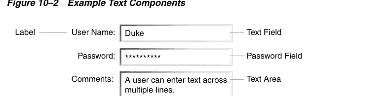

文本组件可以分类为输入或输出。JavaScript Faces 输出组件（如标签）被渲染为只读文本。JavaScript Faces 输入组件（如字段）被渲染为可编辑文本。

输入组件和输出组件可以通过多种方式进行渲染，以显示更专门的文本。

*表 10–3* 列出了代表输入组件的标签。

| 标签 | 功能 |
|---|---|
| `h:inputHidden` | 允许页面作者在页面中包含一个隐藏变量 |
| `h:inputSecret` | 标准密码字段：接受一行不带空格的文本，并在输入时将其显示为一组星号 |
| `h:inputText` | 标准字段：接受单行文本字符串 |
| `h:inputTextArea` | 标准多行字段：接受多行文本 |

## 使用 HTML 标签库标签向页面添加组件

输入标签除了“通用组件标签属性”中描述的属性外，还支持表 10-4 所示的标签属性。请注意，表格未包含输入标签支持的所有属性，仅包含了最常用的属性。属性的完整列表，请参阅 http://docs.oracle.com/javae/7/jserverfaces/2.2/vldocs/facelets 的文档。

表 10-4 输入属性

表 10-5 列出了代表输出组件的标签。

表 10-5 输出标签

输出标签除了“通用组件标签属性”中列出的属性外，还支持转换器（converter）标签属性。

# 使用 HTML 标签库向页面添加组件

本节其余部分解释了如何使用表 10–3 和输出标签中列出的某些标签。其他标签以类似的方式编写。

## 10.2.4.1 使用 h:inputText 标签渲染字段

`h:inputText` 标签用于显示字段。一个类似的标签 `h:outputText` 标签显示只读的单行字符串。本节展示了如何使用 `h:inputText` 标签。`h:outputText` 标签的编写方式类似。

以下是 `h:inputText` 标签的示例：

```html
<h:inputText id="name"
    label="Customer Name"
    size="30"
    value="${cashierBean.name}"
    required="true"
    requiredMessage="${bundle.customerName}">
<f:valueChangeListener="customerListener"
    type="javasetext.dukesbookstore.listeners.NameChanged" />
</h:inputText>
```


label 属性指定了一个用户友好的名称，该名称将用于替换此组件的错误消息。

value 属性引用受托管 Bean `CashierBean` 的 `name` 属性。该属性持有名称组件的数据。在用户提交表单后，`CashierBean` 中的 `name` 属性将被设置为与此标签对应的字段中输入的文本。

如果用户未在 name 字段中输入值，required 属性会导致页面重新加载并显示错误。JavaServer Faces 实现会检查组件的值是否为 null 或空字符串。

如果您的组件具有非空值或长度至少为一个字符的字符串值，应该添加 `required` 属性将其值设置为 `true`。如果您的标签的 `required` 属性设置为 `true` 且值为 null 或零长度字符串，则不会调用标签上的其他验证器；但所有注册在标签上的验证器都必须处理处理 null 或零长度字符串的可能性。有关更多信息，请参见验证 Null 和空字符串。

## 10.2.4.2 使用 h:inputSecret 标签渲染密码字段

`h:inputSecret` 渲染一个 `<input type="password">` HTML 标签。当用户使用字符串插入时，将显示一行星号而不是用户输入的文本。示例如下：

```html
<h:inputSecret redisplay="false"
    value="#{loginBean.password}" />
```

在此示例中，`redisplay` 属性设置为 `false`。这将防止密码显示在查询字符串或生成的 HTML 页面的源文件中。

## 10.2.4.3 使用 h:outputLabel 标签渲染标签

`h:outputLabel` 标签用于为指定的输入字段附加一个标签，以提高其可访问性。以下页面使用 `h:outputLabel` 标签来渲染复选框的标签：

```html
<h:selectBooleanCheckbox id="fanClub"
    rendered="false"
    binding="#{cashierBean.specialOffer}" />
<h:outputLabel for="fanClub"
    rendered="false"
    binding="#{cashierBean.specialOfferText}">
    <h:outputText id="fanClubLabel"
        value="#{bundle.DukeFanClub}" />
</h:outputLabel>
```

`h:selectBooleanCheckbox` 标签和 `h:outputText` 标签具有某些在页面上设置的渲染属性，但在某些情况下会被设置为 Cashier Bean。`h:outputLabel` 标签的 `for` 属性映射到所使用的输入字段的 `id`。嵌套在 `h:outputLabel` 内部的 `h:outputText` 标签输出标签除了“通用组件标签属性”中列出的属性外，还支持转换器标签属性。

`h:outputLabel` 标签用于为指定的输入字段附加一个标签，以提高其可访问性。对于具有多个参数的 `f:param` 标签，示例如下：

```html
<f:param value="#{hello.name}"/>
<f:param value="#{bean.numVisitor}"/>
</outputFormat>
```

(1) 的值将被参数替换。该参数是 EL 表达式 `bean.numVisitor`，其中托管 Bean 的 `numVisitor` 属性跟踪访问人数。这是一个接受 EL 表达式的标签示例。页面上显示的消息如下：

Hello, Bill! You are visitor 10 to the page.

## 10.2.5 使用命令标签执行操作和导航

在 JavaFaces 应用中，按钮和链接组件用于执行操作（提交表单）以及导航到另一个页面。这些标签被称为命令组件，因为它们在激活时会执行操作。

`h:commandButton` 被渲染为按钮。`h:commandLink` 被渲染为链接。

除了“通用组件标签属性”中的属性外，`h:commandLink` 标签可以使用以下属性：

- `action`：字面量或指向返回逻辑字符串的 Bean 方法表达式。在任何情况下，逻辑字符串都用于确定当命令组件激活时访问的页面。
- `actionListener`：指向执行命令标签触发的操作事件的 Bean 方法表达式。

有关 `action` 属性的更多信息，请参见“执行导航的方法”。有关使用 `actionListener` 属性的详情，请参见“处理操作事件的方法”。

## 10.2.5.1 使用 h:commandButton 标签渲染按钮

如果您使用 `h:commandButton` 组件标签，当用户点击按钮时，将处理当前页的数据并打开后续。以下是 `h:commandButton` 标签的示例：

```html
<h:commandButton value="Submit"
    action="#{cashierBean.submit}"/>
```

点击按钮将使用 `CashierBean` 的方法，因为 `action` 属性引用了该方法。该方法执行某些处理并返回逻辑结果。

示例 `h:commandButton` 的 `value` 属性引用了按钮的标签。关于如何使用 `action` 属性的信息，请参阅《执行导航的方法引用》。

## 10.2.5.2 使用 h:commandLink 标签渲染链接

`h:commandLink` 标签表示一个 HTML 链接，并被渲染为 `<a>` 元素。

`h:commandLink` 必须包含一个嵌套的 `h:outputText` 标签，该标签代表用户点击以生成事件的文本。这是一个示例：

```html
<h:commandLink id="Duke" action="bookstore">
  <f:event type="marlara.jsfjs.duukeboxstore.listeners.LinkChangeListener" />
  <h:outputText value="#{bundle.Book2021}" />
</h:commandLink>
```

该标签将渲染类似于所示的内容：

```html
<a id="j_id16:Duke" href="#"
onclick="marlara.jsfjs(document.getElementById('j_id16'));
('j_id16:Duke', 'j_id16:Duke\');
return false;">My Early Years: Growing Up by Star7, by</a>
```

> 注意：`h:commandLink` 标签将渲染 JavaScript 脚本语言。如果您使用此标签，请确保您的浏览器已启用 JavaScript 技术。

## 10.2.6 使用 h:graphicImage 标签添加图形和图像

在 Java Server Faces 应用程序中，使用 `h:graphicImage` 标签在页面上渲染图像：

```html
<h:graphicImage id="mapImage" url="resources/book_all.jpg" />
```

在此示例中，`url` 属性指定了图像的路径。URL 以斜杠 (`/`) 开头，这将 Web 应用程序的上下文添加到图像路径的开头。

或者，您可以使用“Web Resources”中描述的功能来指向图像位置。这里有两个示例：

```html
<h:graphicImage id="mapImage"
    name="book_all.jpg"
    library="images"
    alt="#{bundle.ChooseBook}"
    usemap="#bookmap" />
```

```html
<h:graphicImage value="#{resource['images:wave.med.gif']}" />
```

您可以使用类似的语法来引用样式表中的图像。样式表中的以下语法指定了图像位于：

```css
header {
    position: relative;
    height: 150px;
    background: #fff url('#{resource['img:top-background.jpg']}') repeat-x;
}
```

## 10.2.7 使用 h:panelGrid 和 h:panelGroup 标签布局组件

在 JavaServer Faces 应用程序中，您使用面板（panel）作为一组其他组件的布局容器。面板被渲染为 HTML 表格。表格 10-6 列出了用于创建面板的标签。

| 标签 | 属性 | 功能 |
| --- | --- | --- |
| h:panelGrid | columns, columnClasses, footerClass, headerClass, panelClass, rowClasses, role | 显示表格 |
| h:panelGroup | layout | 将一组组件分组到一个面板下 |

`h:panelGrid` 标签用于表示整个表格。`h:panelGroup` 标签用于表示行。其他标签用于表示行中的单个单元格。

`columns` 属性定义了如何分组表格中的数据，因此如果您需要超过一列，则该属性是必须的。`h:panelGrid` 还有一组指定 CSS 类的属性：`columnClasses`、`footerClass`、`headerClass` 和 `rowClasses`。`role` 属性的值可以是 "presentation"，表示格式的目的是显示数据而不是展示数据。

如果指定了 `header` 属性值，则 `h:panelGrid` 标签必须将 header 作为第一个子元素。同样，如果指定了 `footer` 属性值，则 `h:panelGrid` 标签必须将 footer 作为最后一个子元素。

这是一个示例：

```html
<h:panelGrid columns="2"
    headerClass="list-header"
    style="list-background"
    rowClasses="list-row-even, list-row-odd"
    summary="#{bundle.CustomerInfo}"
    title="presentation">
    <f:facet name="header">
        <h:outputText value="#{bundle.Checkout}" />
    </f:facet>
    <h:outputLabel for="name" value="#{bundle.Name}" />
    <h:inputText id="name" size="30"
        value="#{cashierBean.name}"
        required="true"
        requiredMessage="#{bundle.ReqName}">
        <f:valueChangeListener listener="#{bookstore.listeners.NameChanged}" />
    </h:inputText>
    <h:message style="error-message" for="name" />
    <h:outputLabel for="ccno" value="#{bundle.CCNumber}" />
    <h:inputText id="ccno"
        size="19"
        converterMessage="#{bundle.CreditMessage}"
        required="true"
        requiredMessage="#{bundle.ReqCard}"/>
    <f:converter converterId="ccno" />
</h:panelGrid>
```

（注：上述代码块中的 OCR 文本包含严重的损坏/交叉；逻辑已根据标准的 JSF 模式和上下文进行了重构。）

## 10.2.8 选择用于值的组件

另一个允许用户选择一个值的常用组件是，无论它是唯一可用值还是选择。此类组件常用的标签如下：

- `h:selectBooleanCheckbox`，作为复选框表示布尔状态
- `h:selectOneRadio`，作为一组选项
- `h:selectOneMenu`，作为可滚动列表
- `h:selectOneListbox`，作为不可滚动列表显示。

### 10.2.8.1 使用 h:selectBooleanCheckbox 标签显示复选框

`h:selectBooleanCheckbox` 标签是表示布尔状态的标签。

以下是使用 `h:selectBooleanCheckbox` 标签的示例：

```html
<h:selectBooleanCheckbox id="fanclub"
    rendered="false"
    binding="#{cashierBean.specialOffer}" />
<h:outputLabel for="fanclub"
    rendered="false"
    binding="#{cashierBean.specialOfferText}"
    value="#{bundle.DukeFanClub}" />
```

`h:selectBooleanCheckbox` 标签和 `h:outputLabel` 具有 `rendered` 属性，在页面上设置为 false，但在 Cashier Bean 某些情况下设置为 true。当 `h:selectBooleanCheckbox` 渲染时，它会显示一个复选框，允许用户选择是否加入粉丝俱乐部。当 `h:outputLabel` 渲染时，它显示复选框的标签。标签文本由 `value` 属性渲染。

### 10.2.8.2 使用 h:selectOneMenu 标签显示菜单

允许用户从一组值中选择一个值的组件可以渲染为框或选项列表。本节介绍 `h:selectOneMenu` 标签。`h:selectOneRadio` 和 `h:selectOneListbox` 标签以类似的方式使用。`h:selectOneListbox` 标签与 `h:selectOneMenu` 标签相似，但 `h:selectOneListbox` 定义的 `size` 属性决定了显示多少项。

`h:selectOneMenu` 标签表示包含列表的组件，用户从中选择一个项目。此组件有时被称为下拉列表或组合框。以下代码片段显示了如何使用 `h:selectOneMenu` 允许用户选择运输方式：

```html
<h:selectOneMenu id="shippingOption"
    required="true"
    value="#{cashierBean.shippingOption}">
    <f:selectItem value="2"
        itemLabel="#{bundle.QuickShip}" />
    <f:selectItem value="5"
        itemLabel="#{bundle.NormalShip}" />
    <f:selectItem value="7"
        itemLabel="#{bundle.SaveShip}" />
</h:selectOneMenu>
```


# 使用 HTML 标签库向页面添加组件

`h:selectMenu` 标签的 `value` 属性映射到持有当前选中项值的属性。在这种情况下，该值由托管豆（backing bean）设置。你不需要为当前选中的项提供值。如果你不提供值，浏览器将决定哪一个被选中。

与 `h:selectRadio` 标签一样，`h:selectOneMenu` 必须包含一个 `f:selectItems` 标签或一组代表列表项目的 `f:selectItems` 标签。在“使用 `f:selectItems` 和 `f:selectItems` 标签”的章节中详细描述了这些标签。

## 10.2.9 显示用于选择多个值的组件

在某些情况下，你可能允许用户从选项列表中选择多个值，而不仅仅是一个值。你可以使用以下组件标签之一来实现这一点：

- `h:selectManyCheckbox` 标签，显示为一组复选框。
- `h:selectManyMenu` 标签，显示为菜单。
- `h:selectManyListbox` 标签，显示为一个框。

图 10-4 显示了这些组件的示例。

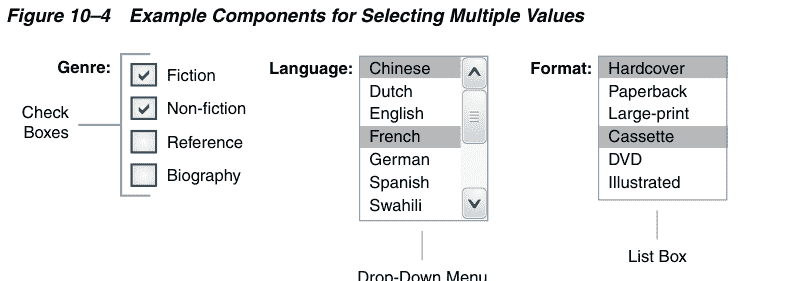

| | 语言: | 格式: |
|---|---|---|
| 复选框 | [ ] 小说 | 硬壳装 |
| | [ ] 非虚构类 | 荷兰语平装 |
| | [ ] | 英语大字版 |
| | [ ] | 法语磁带 |
| | 自传 | 德语 DVD |
| | | 西班牙语 |
| | | 斯瓦希语图解 |
| | | 下拉菜单 | 列表框 |

这些标签允许用户从一组值中选择零或多个值。本节介绍了 `h:selectManyCheckbox` 标签。`h:selectManyListbox` 和 `h:selectManyMenu` 标签的使用方式与之类似。

与菜单不同，列表在框中显示一组项目；当用户未选择菜单时，菜单每次只显示一个项目。`h:selectManyListbox` 的 `size` 属性包含一个滚动条，用于滚动查看列表中的任何剩余项目。

`h:selectManyCheckbox` 标签渲染一组复选框，每个复选框代表一个可以选中的值：

```
<h:selectManyCheckbox id="newsletters"
    layout="pageDirection"
    value="${cashierBean.newsletters}">
  <f:selectItems value="${cashierBean.newsletterItems}"/>
</h:selectManyCheckbox>
```

`h:selectManyCheckbox` 标签的 `value` 属性标识 `CashierBean` 托管豆的 `newsletters` 属性。该属性持有来自复选框集中当前选中项的值。你不需要为当前选中的项提供值。如果你不提供值，默认选中列表中的第一个项目。在 `CashierBean` 托管豆中，此值被实例化为 0，因此默认不选中任何项目。

`layout` 指示了复选框组在页面上的排列方式。由于 `layout` 设置为 `pageDirection`，复选框垂直排列。默认值是 `lineDirection`，它使复选框水平对齐。

`h:selectCheckbox` 标签也必须包含代表一组复选框的标签或标签集。要表示一组项目，你使用 `f:selectItems` 标签。要单独表示每个项目，你使用 `f:selectItem` 标签。接下来的章节将详细解释这些标签。

## 10.2.10 使用 f:selectItem 和 f:selectItems 标签

`f:selectItem` 和 `f:selectItems` 标签代表可以嵌套在允许你选择一个或多个项目的组件内部的组件。`f:selectItem` 标签包含单个项目的值、标签和描述。`f:selectItems` 标签包含整个项目列表的值、标签和描述。

你可以在你的组件标签中使用一组 `f:selectItems` 标签，也可以单个 `f:selectItem` 标签。

使用 `f:selectItems` 标签的优势如下：

- 项目可以使用不同的数据结构表示，包括 `Array`、`Map` 和 `Collection`。`f:selectItems` 标签的值可以表示通用 POJO 集合。
- 不同的列表可以合并到一个组件中，且列表在组件内分组。
- 值可以在运行时生成。

使用 `f:selectItem` 的优势如下：

- 列表中的项目可以从 `f:selectItem` 托管豆中定义。
- `f:selectItem` 标签所需的托管豆代码更少。

本节其余部分将向你展示如何使用 `f:selectItems` 和 `f:selectItem` 标签。

### 10.2.10.1 使用 f:selectItems 标签

“显示多个值的组件”中的以下示例显示了如何使用 `h:selectManyCheckbox` 标签：

```
<h:selectManyCheckbox id="newslettercheckbox"
    layout="pageDirection"
    value="#{cashierBean.newsletters}">
<f:selectItems value="#{cashierBean.newsletters}"/>
</h:selectManyCheckbox>
```

`f:selectItems` 标签的 `value` 属性绑定到 `cashierBean.newsletters`。单个 `SelectItem` 对象在托管豆中通过程序创建。请参见 SelectItems 属性了解如何为这些标签编写托管豆属性。

### 10.2.10.2 使用 f:selectItem 标签

`selectItem` 表示列表中的单个项目。这里是使用 `h:selectOneMenu` 标签显示的示例：

```
<h:selectOneMenu id="shippingOption"
    required="true"
    value="#{cashierBean.shippingOption}">
  <f:selectItem itemView="2" itemLabel="#{bundle.QuickShip}"/>
  <f:selectItem itemView="5" itemLabel="#{bundle.NormalShip}"/>
  <f:selectItem itemView="7" itemLabel="#{bundle.SaverShip}"/>
</h:selectOneMenu>
```

`itemValue` 属性代表 `f:selectItem` 标签的值。`itemLabel` 属性代表列表中出现的字符串。`itemValue` 和 `itemLabel` 属性是值绑定，这意味着可以使用值绑定引用外部对象。属性也可以像 `h:selectOneMenu` 标签所示定义字面值。

## 11 显示选择结果

如果你显示了允许用户选择值的组件，你可能还想显示选择的结果。例如，你可能想感谢选择复选框的用户。由于复选框绑定到 `CashierBean` 的 `specialOrder` 属性，你可以使用 `isSelected()` 方法确定是否渲染感谢消息：

```
<h:outputText value="#{cashierBean.specialOrder}"
    rendered="#{cashierBean.isSelected()}"/>
```

同样，你可能想通过 select 标签确认用户订阅了 newsletters。为此，你可以获取持有选中项目的 `newsletters` 数组的值：

```
<h:outputText value="#{cashierBean.newsletters}"
    rendered="#{empty cashierBean.newsletters}"/>
<ul>
  <ui:repeat value="#{cashierBean.newsletters}" var="n">
    <li><h:outputText value="#{n}"/></li>
  </ui:repeat>
</ul>
```

只有当 `newsletters` 数组不为空时，才会显示介绍性的感谢消息。使用 `ui:repeat` 在列表中显示值，显示选中项目的内容（此任务见表 8-2）。

## 10.2.12 使用数据绑定表格

数据绑定表格组件以表格格式显示关系数据。在 Faces 应用中，`h:dataTable` 组件支持绑定数据对象集合并以 HTML 表格显示数据。`h:column` 属性表示表格中的数据列，遍历数据源中的每条记录，示例所示：

```
<h:dataTable id="items"
    captionClass="list-caption"
    columnClasses="list-column-center, list-column-left,
    list-column-right, list-column-center"
    footerClass="list-header"
    headerClass="list-header"
    rowClasses="list-row-even,list-row-odd"
    styleClass="list-background"
    summary="#{bundle.ShoppingCart}"
    value="#{cart.items}"
    border="*"
    var="item">
  <h:column>
    <f:facet name="header">
      <h:outputText value="#{bundle.ItemQuantity}" />
    </f:facet>
    <h:inputText id="quantity"
      size=""
      value="#{item.quantity}">
      <f:validateRange min="1" />
      <f:ChangeListener type="javax.dukesstore.listeners.Quantity" />
    </h:inputText>
    <h:message for="quantity" />
  </h:column>
  <h:column>
    <f:facet name="header">
      <h:outputText value="#{bundle.ItemTitle}" />
    </f:facet>
    <h:commandLink action="#{showcart.details}">
      <h:outputText value="#{item.item.title}" />
    </h:commandLink>
  </h:column>
  <f:facet name="footer">
    <h:panelGroup>
      <h:outputText value="#{bundle.Subtotal}" />
      <h:outputText value="#{cart.total}" />
      <f:convertNumber currencySymbol="$" type="currency" />
      </h:outputText>
    </h:panelGroup>
  </f:facet>
  <f:facet name="caption">
    <h:outputText value="#{bundle.Caption}" />
  </f:facet>
</h:dataTable>
```

示例 `h:dataTable` 显示购物车中的项目，以及购物车中每个项目的数量、价格和一组用户可以点击从购物车中移除项目的按钮。

`h:column` 表示表格中的数据列。当数据组件遍历数据源中的每个记录时，它会处理与每个 `h:column` 标签关联的列组件。

`h:dataTable` 和 `h:column` 使用 facet（部分）来表示表格中不重复或更新的部分。这些部分包括页眉、页脚和标题。

# 使用 HTML 标签标签向页面添加组件

在前面的示例中，`h:column` 标签包含了用于表示列表头或页脚的 `f:facet`。`h:column` 标签允许你通过使用 `headerClass` 和 `footerClass` 属性来控制这些表头和页脚的样式。这些属性接受由空格分隔的 CSS 类列表，这些类将应用于渲染输出中列的表头和单元格。

facet（切面）只能有一个子元素，因此如果你想在一个 `f:facet` 中对多个组件进行分组，就需要 `h:panelGroup` 标签。对于代表多个标签的 facet 标签，需要 `h:panelGroup` 标签来对这些标签进行分组。最后，`h:dataTable` 标签包含一个 `f:facet` 标签，其 `name` 属性设置为 `caption`，从而允许在表格上方渲染标题。

这是数据组件的一个经典用例，因为在开发应用时，应用开发者或页面作者可能不知道书籍的数量。数据组件可以动态调整表格行数以适应底层数据。

`h:dataTable` 标签的 `value` 属性引用要包含在表格中的数据。这些数据可以采取以下任何形式：

- Bean 列表
- Bean 数组
- 单个 Bean
- `javax.faces.model.DataModel` 对象
- `java.sql.ResultSet` 对象
- `java.servlet.jsp.sql.Result` 对象
- `java.sql.RowSet` 对象

所有数据组件的数据源都有一个 `DataModel` 包装器。除非你显式地构造 `DataModel` 包装器，否则 JavaServer Faces 实现将为任何其他接受类型的数据创建一个包装器。编写用于与数据组件配合使用的属性的 Bean 属性。

`var` 属性指定一个名称，`h:dataTable` 标签内部的组件使用该名称作为对 `h:dataTable` 属性中引用值的别名。

在示例的 `h:dataTable` 标签中，`value` 属性指向书籍列表。`h:dataTable` 标签遍历该列表，每个对 `item` 的引用都指向列表中的当前书籍。

`h:dataTable` 标签还具有显示底层数据子集的能力。此功能在前面的示例中没有显示。要显示数据的子集，你使用 `first` 和 `rows` 属性。

`first` 属性指定要显示的第一行。`rows` 属性指定从第一行开始要显示的行数。例如，如果你想显示底层数据的第 2 到第 10 条记录，你将 `first` 设置为 2，`rows` 设置为 9。当你在页面中显示数据的子集时，你可能希望考虑一个链接或按钮，在点击时显示后续的行。默认情况下，`first` 和 `rows` 设置为 0，这会导致显示底层数据的所有行。

表 10-7 显示了 `h:dataTable` 标签的最优属性。

表 10–7 `h:dataTable` 标签的可选属性

| 属性 | 定义样式的对象 |
|---|---|
| captionClass | 表格标题 |
| columnClasses | 所有列 |
| footerClass | 页脚 |
| headerClass | 表头 |
| rowClasses | 行 |
| styleClass | 整个表格 |

表 10–7 中的每个属性都可以指定多个样式。如果 `columnClasses` 或 `rowClasses` 指定了多个样式，这些样式将应用于属性中的列或行。例如，如果表格有两列，且 `columnClasses` 指定了 `list-column-center` 和 `list-column-right`，则第一列将具有样式 `list-column-center`，第二列将具有样式 `list-column-right`。

如果 `style` 属性指定的样式比列或行多，剩余的样式将从第一列或第一行开始分配给列或行。同样，如果 `style` 属性指定的样式比列或行少，剩余的列或行将从第一个样式开始。

# 10.2.3 使用 h:message 和 h:messages 标签显示错误消息

`h:message` 和 `h:messages` 标签用于在转换或验证失败时显示错误消息。`h:message` 标签显示与特定组件相关的错误消息，而 `h:messages` 标签则显示整个页面的错误消息。

以下是来自 guesswork 应用中的一个 `h:message` 标签：

```
<h:inputText id="userNo"
      title="Type a number from 0 to 10"
      value="#{userBean.userNumber}">
  <f:validateLongRange minimum="#{userBean.minimum}"
      maximum="#{userBean.maximum}"/>
</h:inputText>
<h:commandButton id="submit"
      action="response"/>
<h:message summary="true" showDetail="false"
      style="color: #D20000; font-family:'New Century Schoolbook', serif;
      font-style:oblique;
      text-decoration:overline"
      id="error1"
      for="userNo/" />
```


`for` 属性引用生成错误消息的组件的 ID。错误消息显示在 `h:message` 标签出现在页面上的相同位置。即在提交按钮之后。

`style` 属性允许你指定消息文本的样式。在本节的示例中，文本将是红色，New Century Schoolbook 衬线字体族，斜体样式，并且文本上方会出现一条下划线。`message` 和 `messages` 标签支持许多其他用于定义样式的属性。有关这些属性的更多信息，请参阅 `http://docs.oracle.com/javaee/jservfaces/2.2/vldocs/faces/` 的文档。

`h:messages` 标签支持的另一个属性是 `layout`。它的默认值是 `list`，这意味着使用 HTML `<ul>` 和 `<li>` 元素显示列表。如果你将属性值设置为 `table`，则消息将使用 HTML `<table>` 元素渲染。

前面的示例显示了一个注册在输入组件上的标准验证器。`message` 标签在验证器无法验证输入组件的值时显示错误消息。通常，当你在组件上注册转换器或验证器时，你生成了与该组件相关的错误。`h:message` 和 `h:messages` 标签在转换器或验证器未能转换或验证组件的值时显示相应的错误消息。转换器和验证器提供了标准的错误消息。应用程序可以通过注册自定义错误消息来覆盖这些标准消息，并为自定义转换器和验证器提供错误消息。

# 1 使用 h:button 和 h:link 标签创建书签 URL

创建书签 URL 是指根据指定的输出和组件参数生成链接。

在 HTTP 中，大多数浏览器默认使用 GET 请求检索 URL，使用 POST 请求处理数据。GET 请求可以带有查询参数并被缓存，而发送数据的 POST 请求则不能。生成链接的 Java Faces 标签使用简单的 GET 请求（如 `h:link` 所示）或 POST 请求（如 `h:commandLink` 或 `h:commandButton` 所示）。带有查询参数的 GET 请求为 URL 字符串提供了更精细的粒度。这些 URL 在简单 URL 之后通过 `?` 或 `&` 附加多个 `name=value` 参数创建。要创建书签 URL，请使用 `h:link` 或 `h:button` 标签。这两个标签都可以根据组件的 output 属性生成链接。例如：

```xml
<link outcome="some" value="Message" />
```

`h:link` 将生成指向相同服务器上 `somepage.xml` 文件的链接。以下示例 HTML 由前面的分页生成，假设应用程序名称是可书签的：

```xml
<a href="/simplebookmark/somepage.xml">Message</a>
```

这是一个简单的 GET 请求，无法在页面之间传递任何数据。要创建更复杂的 GET 请求并利用 `h:link` 标签的完整功能，请使用参数。

# 10.2.15 使用视图参数配置书签 URL

要将参数从一个页面传递到另一个页面，请在 `h:link` 标签中使用 `includeParams` 属性，并使用 `f:param` 标签来指定名称和值。

# 使用 HTML 标签库向页面添加组件

被传递。`h:link` 标签将结果页面指定为 `personal.xhtml` 并提供一个参数 `result`，其值为一个受托管的 bean 属性：

```xml
<body>
  <form>
    <h:graphicImage url="#{resource['images:duke.waving.gif']}"
         alt="Duke waving his hand"/>
    <h2>Hello, #{hello.name}</h2>
    <p>I've made your</p>
    <h:link outcome="personal" value="personal greeting!"
         includeViewParams="true"/>
    <f:param name="Result" value="#{hello.name}"/>
    </h:link>
    <h:commandButton id="back" value="Back" action="index" />
  </form>
</body>
```

如果对组件上设置了 `include-view-params` 属性，则视图参数将添加到页头中。因此，如果 `hello.name` 的值为 "Timmy"，则生成的 URL 将看起来如下所示：

```
http://localhost:8080/bookmarks/personal.xhtml?Result=Timmy
```

在结果页面上，指定核心标签 `f:metadata` 和 `f:viewparam` 作为配置 URL 的参数。视图参数声明为页面 `f:metadata` 的一部分，如下例：

```xml
<f:metadata>
  <f:viewparam name="Result" value="#{hello.name}"/>
</f:metadata>
```

这允许你在页面上指定 bean 属性值：

```xml
<h:outputText value="Howdy, #{hello.name}!" />
```

作为参数，该名称也会出现在页面的 URL 中。如果你编辑了 URL，就会更改页面上的输出内容。

由于 URL 可以是各种参数值的结果，因此 URL 的创建顺序是预先定义的。读取各种参数值的顺序如下：

1. 组件
2. 导航案例（Navigation-case）参数
3. 视图参数（View parameters）

## 10.2.16 书签示例应用程序

书签应用程序修改了 *A Web Module That Uses Java Faces Technology: Hello* 中描述的 hello 应用，使其使用带有视图参数的可书签 URL。

与 hello 类似，该应用程序包含了 `Hello.java` 托管 bean、`index.xhtml` 页面和 `response.xhtml` 页面。此外，它还包含一个 `personal.xhtml` 页面，根据 *Using View Parameters to Configure Bookmarkable URLs* 的描述，从 `response.xhtml` 页面传递可书签 URL 和视图参数。

你可以使用 NetBeans IDE 或 Maven 来构建、打包、部署和运行书签示例。该示例的源代码位于 `tut-install/examples/web/jsf/bookmarks/`。

### 10.2.16.1 使用 NetBeans IDE 构建、打包和部署书签示例

1. 确保 GlassFish 服务器已启动（Starting and Stopping the GlassFish Server）。
2. 从 File（文件）菜单中选择 Open Project（打开项目）。
3. 在 Open Project 对话框中，导航到：`tut-install/examples/web/jsf`
4. 选择 `bookmarks` 文件夹。
5. 点击 Open Project。
6. 在 Projects（项目）选项卡中，右键点击 `bookmarks` 项目并选择 Build（构建）。
此选项将构建示例应用程序并将其部署到你的 GlassFish 服务器实例上。

### 10.2.16.2 使用 Maven 构建、打包和部署书签示例

1. 确保 GlassFish 服务器已启动（Starting and Stopping the GlassFish Server）。
2. 在终端窗口中，进入：`tut-install/examples/web/jsf/bookmarks/`
3. 输入以下命令：
`mvn install`

此命令将应用程序构建并打包成位于目标目录下的 WAR 文件 `bookmarks.war`。它将其部署到你的 GlassFish 服务器实例上。

### 10.2.16.3 运行书签示例

1. 在浏览器中打开 `http://localhost:8080/bookmarks/`
2. 在 URL 后面添加 `Result=Timmy` 并回车。
3. 观察页面上的输出。
4. 修改 URL 中的 `Result` 值，观察页面输出随发生的变化。

# 表 10–9（续）数据转换核心标签

| 标签 | 功能 |
|---|---|
| `f:convertDateTime` | 向父组件添加一个 `DateTimeConverter` 实例 |
| `f:convertNumber` | 向父组件添加一个 `NumberConverter` 实例 |

# 表 10–10 分面核心标签

| 标签 | 功能 |
|---|---|
| `f:facet` | 添加一个与它的包含标签有特殊关系的嵌套组件 |
| `f:metadata` | 在父组件上注册一个分面 |

# 表 10–11 表示列表项的核心标签

| 标签 | 功能 |
|---|---|
| `f:selectItem` | 代表项目列表中的某一项 |
| `f:selectItems` | 代表一组项目 |

# 表 10–12 验证器核心标签

| 标签 | 功能 |
|---|---|
| `f:validateDoubleRange` | 向组件添加一个 `DoubleValidator` |
| `f:validateLength` | 向组件添加一个 `LengthValidator` |
| `f:validateLongRange` | 向组件添加一个 `LongRangeValidator` |
| `f:validator` | 向组件添加一个自定义验证器 |
| `f:validateRegEx` | 向组件添加一个 `RegexValidator` |
| `f:validateBean` | 将本地值的验证委托给 `BeanValidator` |
| `f:validateRequired` | 强制要求组件中必须存在值 |

# 表 10–13 杂项核心标签

| 标签类别 | 标签 | 功能 |
|---|---|---|
| 属性配置 | `f:attribute` | 向父组件添加可配置的属性 |
| 本地化 | `f:loadBundle` | 指定一个作为 Map 形式暴露的 `ResourceBundle` |
| 参数替换 | `f:param` | 在 `MessageFormat` 实例中替换参数，并向 URL 添加查询字符串键值对 |

# 表 10–13（续）杂项核心标签

| 标签类别 | 标签 | 功能 |
|---|---|---|
| Ajax | `f:ajax` | 根据位置将操作与单个组件或一组组件关联 |
| 事件 | `f:event` | 允许在组件上安装 `ComponentSystemEventListener` |

这些标签与组件标签结合使用，其用法将在本教程的其他章节中解释。表 10–14 列出了解释如何使用特定核心标签的章节。

# 表 10–14 核心标签的解释位置

| 标签 | 解释位置 |
|---|---|
| 事件处理标签 | 在组件上注册监听器 |
| 数据转换标签 | 使用标准转换器 |
| `f:facet` | 使用数据绑定的表格组件以及带有 `hpanelGrid` 和 `hpanelGroup` 标签的布局组件 |
| `f:loadBundle` | 设置资源包（Resource Bundle） |
| `f:metadata` | 使用视图参数配置可书签的 URL |
| `f:param` | 使用 `h:outputFormat` 标签显示格式化消息 |
| `f:selectItem` 和 `f:selectItems` | 使用 `f:selectItem` 和 `f:selectItems` 标签 |
| 验证器标签 | 使用标准验证器 |
| `f:ajax` | 第 13 章，“使用 JavaServer Faces 技术使用 Ajax” |

# 使用转换器、监听器和验证器

上一章描述了组件并解释了如何将它们添加到网页中。本章提供了如何通过转换器、监听器和验证器为组件添加更多功能的信息。

- 转换器（Converters）用于转换从输入组件接收的数据。
- 监听器（Listeners）用于监听页面发生的事件并执行定义的操作。
- 验证器（Validators）用于验证从输入组件接收的数据。

此处将介绍以下主题：

- 使用标准转换器
- 在组件上注册监听器
- 使用标准验证器
- 引用托管豆（Managed Bean）方法

## 11.1 使用标准转换器

JavaFaces 实现提供了一套转换器实现，你可以使用它们来转换组件数据。有关转换模型概念细节的更多信息，请参见“转换模型”（Conversion Model）。位于 `javax.faces.convert` 包中的标准转换器实现如下：

- `BigDecimalConverter`
- `BigIntegerConverter`
- `BooleanConverter`
- `Converter`
- `CharacterConverter`
- `DateTimeConverter`
- `DoubleConverter`
- `EnumConverter`
- `FloatConverter`
- `IntegerConverter`
- `LongConverter`
- `NumberConverter`
- `ShortConverter`

每个这些转换器都关联有一个标准错误消息。如果你在页面组件上注册了其中一个转换器，且转换器无法转换组件的值，则转换器的错误消息将显示在页面上。例如，如果出现以下错误消息：

`BigIntegerConverter fails to convert a value:`

(0) must be consisting of one or more digits

在这种情况下，替换参数 (0) 将被注册该转换器的输入组件名称。

两个标准转换器（`DateTimeConverter` 和 `NumberConverter`）有自己的标签，允许你使用标签属性配置数据的格式。有关使用 `DateTimeConverter` 的更多信息，请参见“使用 DateTimeConverter”。有关使用 `NumberConverter` 的更多信息，请参见“使用 NumberConverter”。下一节解释了如何转换组件的值，包括如何向组件注册标准转换器。

### 11.1.1 转换转换器的值

要使用转换器来转换值，你需要将转换器注册到组件上。你可以通过以下方式之一注册任何标准转换器：

- 在组件标签内嵌套其中一个标准转换器标签。这些标签分别在“使用 DateTimeConverter”和“使用 NumberConverter”中描述。
- 将组件的值绑定到与转换器类型相同的托管豆。
- 从组件的 `converter` 属性引用转换器。
- 在组件标签内嵌套 `f:converter` 标签，并使用 `f:converter` 的 `converterId` 属性或其绑定属性来引用转换器。

将组件的值绑定到与转换器类型相同的托管豆时，请确保绑定的托管豆属性是 `java.util.Date` 类型。

```java
Integer age = 0;

public Integer getAge(){ return age; }

public void setAge(Integer age) { this.age = age; }
```

与其使用 `converterId`，`f:converter` 标签可以使用绑定属性。绑定属性必须解析为返回 `Converter` 实例的豆属性。

### 11.1.2 使用 DateTimeConverter

你可以通过在组件标签内嵌套 `convertDateTime` 标签将组件数据转换为 `java.util.Date`。`convertDateTime` 具有多个属性，允许你指定数据的格式和类型。表 11–1 列出了这些属性。

以下是 `convertDateTime` 标签的简单示例：

```xml
<h:outputText value="#{cashier.shipDate}">
    <f:convertDateTime type="date" style="full" />
</h:outputText>
```

示例标签可以显示以下输出：

Saturday, September 21, 2013

你也可以通过以下指定格式的标签显示相同的日期和时间：

```xml
<h:outputText value="#{cashier.shipDate}">
    <f:convertDateTime pattern="EEEEEE, MMMM dd, yyyy" />
</h:outputText>
```

如果你想用西班牙语显示日期，可以使用 `locale` 属性：

```xml
<h:outputText value="#{cashier.shipDate}">
    <f:convertDateTime style="full" locale="es" timeStyle="long" type="both" />
</h:outputText>
```


该标签将显示以下输出：

jueves, 24 de octubre de 2013 15:07:04 GMT

有关使用 `convertDateTime` 标签的 `pattern` 属性格式化输出的更多信息，请参考 Java 教程中的“自定义表单”（Customizing Forms）课程：http://docs.oracle.com/javase/tutorial/i18n/format/simpleDateFormat.html。

## 表 11–1 f:dateTime 标签属性

| 属性 | 类型 | 说明 |
| --- | --- | --- |
| binding | DateTimeConverter | 用于将转换器绑定到托管豆（managed bean）。 |
| dateStyle | String | 定义日期或日期字符串中日期部分的格式，格式遵循 java.text.DateFormat 规范。仅当 type 为 date 或在未定义 pattern 时（两者均适用）时生效。有效值为：default, short, medium, long, and。如果未指定值，则使用默认值。 |
| for | String | 用于复合组件。引用该标签嵌套的组件内部的某个对象。 |
| locale | String or Locale | 在使用格式化或解析时，Locale 对日期和时间有预定义的样式。如果未指定，将使用由 FacesContext.getContext() 返回的 Locale。 |
| pattern | String | 自定义格式，用于确定日期/时间字符串的格式化和解析方式。如果指定了该属性，将忽略 dateStyle、time 和 type 属性。 |
| timestamp | String | 定义时间或日期字符串中时间部分的格式，格式遵循 java.text.DateFormat 规范。仅当 type 为 time 且未定义 pattern 时生效。有效值为：default, short, medium, long, and。如果未指定值，则使用默认值。 |
| timezone | String or TimeZone | 解释日期字符串中任何信息的时区。 |
| type | String | 指定字符串值是包含日期还是时间。有效值为 date、time 或两者。如果未指定值，则默认使用 date。 |

### 1.1.3 使用转换器

你可以通过在组件内部嵌套 `convertNumber` 标签将组件的数据转换为 `java.lang.Number`。`convertNumber` 标签具有多个属性，允许你指定数据的格式和类型。表 11–2 列出了这些属性。以下示例使用 `convertNumber` 标签显示购物车内内容的总价格：

```xml
<h:outputText value="#{cart.total}">
    <f:convertNumber currencySymbol="$" type="currency"/>
</h:outputText>
```

在将 ConverterConverter 绑定到组件时，请确保组件绑定的托管豆属性是基本类型或 java.lang.Number。在先前的示例中，`cart.total` 是 double 类型。以下是该标签可以显示内容的示例：也可以使用以下代码显示该结果，其中指定了 pattern：

```xml
<h:outputText id="cartTotal" value="#{cart.total}">
    <f:convertNumber pattern="#####" />
</h:outputText>
```

请参阅 http://docs.oracle.com/javase/tutorial/format.html 上 Java 教程中的“自定义格式”章节，以获取更多关于如何使用 `convertNumber` 标签的 `pattern` 属性格式化输出的信息。

## 表 11-2 f:convertNumber 标签属性

| 属性 | 类型 | 说明 |
| --- | --- | --- |
| binding | NumberConverter | 用于将转换器绑定到托管豆属性。 |
| currencyCode | String | ISO 代码，仅在格式化货币时使用。 |
| currencySymbol | String | 货币符号，格式化货币时使用。 |
| for | String | 用于复合组件。引用该标签嵌套的组件内部的某个对象。 |
| grouping | Boolean | 指定格式化输出是否包含分隔符。 |
| integerOnly | Boolean | 指定是否仅解析值的整数部分。 |
| locale | String or Locale | 用于格式化或解析数据的 Locale。 |
| maxFractionDigits | int | 输出中小数部分格式化的最大位数。 |
| maxIntegerDigits | int | 输出中整数部分格式化的最大位数。 |
| minFractionDigits | int | 输出中小数部分格式化的最小位数。 |
| minIntegerDigits | int | 输出中整数部分格式化的最小位数。 |
| pattern | String | 自定义格式模式，决定字符串的格式化方式。 |
| type | String | 指定字符串值是被解析并格式化为数字、货币还是百分比。如果未指定，则默认使用 number。 |

## 1.2 在组件上注册监听器

开发者可以以类或托管豆的形式实现监听器。如果监听器是托管豆，页面作者从组件的 `valueChangeListener` 属性或其 `actionListener` 属性引用该方法。如果监听器是一个类，页面作者可以通过 `f:valueChangeListener` 或 `f:actionListener` 引用监听器，并将标签嵌套在组件内部，以便在组件上注册监听器。

“引用处理动作事件的方法”和“引用处理值变更事件的方法”解释了页面作者如何使用 `valueChangeListener` 和 `actionListener` 属性来引用处理事件的托管豆方法。本节解释了如何在组件上注册 NameChanged 监听器和 BookChange 动作监听器实现。Duke's Bookstore 案例研究包含了这两种监听器。

### 1.2.1 在组件上注册 ValueChangeListener

作者可以通过通过在页面上的组件标签内嵌套 `f:ValueChangeListener`，在实现了 `EditableValueHolder` 的组件上注册 `ValueChangeListener` 实现。`f:valueChangeListener` 标签支持表 11-3 所示的属性，必须使用其中之一。

#### f:ValueChangeListener 标签属性

| 属性 | 说明 |
| --- | --- |
| type | 引用 `ValueChangeListener` 实现类的完全限定类名。可以接受字面量值或值表达式。 |
| binding | 引用实现 `ValueChangeListener` 的对象。仅接受值表达式，该表达式必须指向一个托管豆属性并返回一个 `ValueChangeListener` 实现。 |

以下示例展示了在组件上注册的值变更监听器：

```xml
<h:inputText id="name"
      size="30"
      required="true"
      message="#{bundle.ReqCustomerName}">
    <f:valueChangeListener
        type="javatutorial.dukesookstore.listeners.NameChanged" />
</h:inputText>
```

在示例中，`type` 属性指定了自定义监听器作为注册在 name 组件上的 `ValueChangeListener` 实现。当此组件标签被处理并验证了本地值后，其对应的组件实例将使用带有指定 `ValueChangeListener` 的 `ValueChangeEvent`。

`binding` 属性用于将 `ValueChangeListener` 实现绑定到托管豆属性。该属性的工作原理与标准转换标签支持的 `binding` 属性类似。更多信息请参阅“将组件值和实例绑定到托管豆属性”。

### 1.2.2 在组件上注册 ActionListener

作者可以通过在页面上的组件标签内嵌套 `f:actionListener` 标签，在命令（command）上注册 `ActionListener` 实现。与 `f:valueChangeListener` 标签类似，`f:actionListener` 标签支持 `type` 和 `binding` 属性。必须使用其中之一。`f:actionListener` 的 `type` 属性指定 `ActionListener` 实现类的完全限定类名。与 `f:valueChangeListener` 标签类似，`f:actionListener` 也支持 `binding` 属性。以下是引用 `ActionListener` 的 `actionLink` 示例：

```xml
<h:commandLink id="book" action="#{bookstore.details}">
    <f:actionListener type="javatutorial.dukesookstore.listeners.BookChangeListener" />
</h:commandLink>
```

在前面的示例中，`f:setPropertyActionListener` 标签的 `value` 属性引用了书籍对象。`f:setPropertyActionListener` 标签的属性引用值表达式 `requestScope.book`，当 `commandButton` 被激活时，`value` 属性引用的书籍存储的位置。

## 13.3 使用标准验证器

JavaFaces 技术提供了一系列标准类和关联标签，页面作者和应用程序开发者可以使用它们来验证组件的数据。表 11-4 列出了所有标准验证器类以及允许你在页面中使用这些验证器的标签。

### 表 11–4 验证器类

| 验证器类 | 标签 | 功能 |
| --- | --- | --- |
| BeanValidator | validateBean | 为组件注册一个 bean。 |
| DoubleRangeValidator | validateDoubleRange | 检查组件的本地值是否在范围内。该值必须是浮点或可转换为浮点。 |
| LengthValidator | validateLength | 检查组件本地值的长度是否在范围内。该值必须是 java.lang.String。 |
| LongRangeValidator | validateLongRange | 检查组件的本地值是否在范围内。该值必须是任何数值类型或可转换为 long 的 String。 |
| RegexValidator | validateRegex | 检查组件的本地值是否匹配 java.util.regex 包中的正则表达式。 |
| RequiredValidator | validateRequired | 确保 EditableHolder 组件上的本地值不为空。 |

所有这些验证器都实现了 `Validator` 接口。组件编写者和应用程序开发者也可以实现此接口，以为组件的值定义他们自己的约束集。

与标准转换器类似，如果你在页面的组件上注册了这些验证器之一，且验证器无法验证组件的值，则验证器的错误消息将显示在页面上。例如，当组件的值超过 `LongRangeValidator` 允许的最大值时，错误消息如下：

> (I): Validation Error: Value is greater than allowable maximum of "0*"

在这种情况下，`(1)` 替换参数将被替换为组件的标签或 ID，而 `(0)` 替换参数将被替换为验证器允许的最大值。

请参见“使用 h:message 和 h:messages 标签显示错误消息”，获取有关在验证失败并在页面上显示验证错误消息的信息。

## 使用标准验证器

你可以使用 Bean Validation 来验证数据，而不是使用标准验证器。如果你在托管 bean 属性上指定了 bean 约束，这些约束将自动应用于应用程序页面的相应字段上。请参见第 21 章“Bean Validation 简介”获取更多信息。使用 Bean Validation 不需要指定 `validateBean` 标签，但该标签允许你使用更高级的 Bean Validation 功能。例如，你可以使用 `validationGroups` 属性来指定约束组。

### 13.3.1 验证组件的值

要使用特定的验证器验证组件的值，你需要在组件上注册该验证器。你可以通过以下方式之一实现：

- 在组件标签内部嵌套相应的标签（如表 11–4 所示）。“使用验证器标签”部分解释了如何使用 `validateLongRange` 标签。你可以以相同的方式使用其他标准标签。
- 从组件的 `validator` 属性引用一个执行验证的方法。
- 在组件标签内部嵌套验证器标签，并使用 `validatorId` 属性或其绑定属性（binding）来引用验证器。

请参见“引用执行验证的方法”获取有关使用验证器的更多信息。`validatorId` 属性的工作方式类似于“转换组件的值”中所描述的转换器标签的 `converter` 属性。

记住，验证仅对实现了 `EditableValueHolder` 的组件执行，因为这些组件是可以被验证的。

## 13.2 使用验证器标签

以下示例了如何在名为 `quantity` 的输入组件上使用 `f:validateLongRange` 验证器标签：

```xml
<input id="quantity" size="4" value="#{item.quantity}">
<f:validateLongRange minimum="1"/>
</input>
<h:message for="quantity"/>
```

这要求用户插入数字至少为 1。`validateLongRange` 还有一个 `maximum` 属性，用于为输入设置最大值。
所有标准验证器标签的属性都接受 EL 表达式。这意味着属性可以引用托管 bean 属性而不是字面值。例如，前面示例中的 `f:validateLongRange` 标签可以引用名为 `minimum` 和 `maximum` 的托管 bean 属性，以获取验证器接受的最小值和最大值，如下 guessnumber-js 代码所示：

```xml
<input id="userNo"
title="Type a number from 0 to 10:"
value="#{userBean.userNumber}"
<f:validateLongRange minimum="#{userBean.minimum}"
maximum="#{userBean.maximum}"/>
</input>
```

使用转换器、监听器和验证器 11-9

## 引用托管 bean 方法

以下 `f:validateRegex` 标签显示了如何确保密码长度在 4 到 10 个字符之间，并且包含至少一个数字、一个小写字母和一个大大写字母：

```xml
<f:validateRegex pattern="?=.*\d)(?=.*[a-z])(?=.*[A-Z]).{4,10}" password="passwordVal"/>
```

组件标签有一组属性，用于引用为该标签关联组件执行特定功能的托管 bean。这些属性总结在表 11-5 中。

### 表 11-5 引用托管 bean 的组件属性

| 属性 | 功能 |
| --- | --- |
| action | 引用一个返回逻辑结果的托管 bean |
| actionListener | 引用处理事件的托管 bean |
| validator | 引用执行验证的托管 bean |
| valueChangeListener | 引用处理值变更事件的托管 bean |

只有实现了 `EditableValueHolder` 的组件才能使用 `action` 和 `valueChangeListener` 属性。下面的示例显示了如何使用 `validator` 属性：

```java
void validate(javax.faces.context.FacesContext, javax.faces.component.UIComponent, java.lang.Object)
```


# 使用 JavaServer Faces 技术开发

本章概述了托管豆以及如何编写供 JavaServer Faces 应用使用的托管豆的方法和属性。本章还介绍了 Bean 验证功能。

第 10 章“在网页中使用 JavaServer Faces 技术”和第 11 章“使用转换器、监听器和验证器”展示了如何使用组件标签和核心标签将组件添加到页面，并将其连接到服务器端对象，以及如何通过转换器、监听器和验证器提供额外功能。开发 JavaServer Faces 应用还涉及对服务器端对象的编程任务：托管豆、转换器、事件处理器和验证器。

本节讨论了以下主题：

- JavaServer Faces 技术中的托管豆
- 编写 Bean 属性
- 编写托管豆方法

## 12.1 JavaServer Faces 技术中的托管豆

典型的 JavaServer Faces 应用包含一个或多个托管豆，每个托管豆都可以与特定页面使用的组件相关联。本节介绍了在应用中创建、配置和使用托管豆的基本概念。

### 12.1.1 创建托管豆

托管豆的创建是通过一个不带参数的构造函数、一组属性以及一组为组件执行功能的方法来完成的。每个托管豆属性都可以绑定到以下项之一：

- 组件值
- 组件实例
- 转换器实例
- 监听器实例
- 验证器实例

托管豆方法执行的最常见功能包括以下：

- 验证组件数据
- 处理由组件触发的事件
- 执行处理以确定应用要导航到的下一个页面

与所有的 JavaBeans 一样，属性由一个私有数据字段和一组访问器方法组成，如此代码所示：

```java
private Integer userNumber = null;

public void setUserNumber(Integer user_number) {
    userNumber = user_number;
}

public Integer getUserNumber() {
    return userNumber;
}
```

当绑定到组件的值时，豆属性可以是任何基本原始类型、数值类型，或者是应用程序有权访问适当转换器的任何 Java 对象。例如，如果应用程序可以访问可以将 `Date` 类型转换为 `String` 并反向转换的转换器，则属性类型可以是 `java.util.Date`。关于组件标签接受哪些类型的编写 Bean 属性。

当属性绑定到组件实例时，该属性必须与组件对象相同。例如，如果 `faces.component.UISelectBoolean` 组件绑定到该属性，则该属性必须接受并返回 `UISelectBoolean` 豆。同样，如果属性绑定到转换器、验证器或监听器实例，则属性必须是相应的转换器、验证器或监听器类型。

有关编写豆及其属性的更多信息，请参见“编写 Bean 属性”。

### 12.1.2 使用 EL 引用托管豆

为了将组件和对象绑定到托管豆属性，或从组件标签中引用托管豆，页面作者使用表达式语言（EL）语法。如《EL 概述》所述，以下是 EL 提供的功能：

- 表达式的延迟求值
- 使用值表达式读写数据的能力
- 方法表达式

表达式的延迟求值是非常重要的，因为当事件处理、数据转换与验证以及数据向外部对象的传播都以有序的方式执行时，JavaServer Faces 生命周期被分为两个阶段。实现必须能够推迟表达式的求值，直到到达生命周期的适当阶段。因此，实现类的属性允许延迟求值语法，该语法通过 `#{}` 区分。

为了在外部对象中存储数据，几乎所有的 JavaServer Faces 标签属性都使用 `value` 表达式，即允许在外部对象上获取和设置数据的表达式。

最后，某些组件标签属性接受引用处理组件事件或验证或转换组件数据方法的表达式。

为了说明 JavaServer Faces 使用 EL，以下标签引用了一个验证用户输入的方法：

```xml
<h:inputText id="inputText"
    value="#{userNumber.userNumber}"
    required="true" size="3"
    disabled="#{userNumber}"/>
```

## 12.2 编写 Bean 属性

### 12.2.1 UIInput 和 UIOutput 属性

`UIInput` 和 `UIOutput` 组件类分别由以 `h:input` 和 `h:output` 开头的组件标签表示（例如，`h:inputText` 和 `h:outputText`）。

在下面的示例中，`h:inputText` 标签将名称组件绑定到托管 bean `CashierBean` 的 `name` 属性上。

```xml
<h:inputText id="name"
    size="30"
    value="#{cashierBean.name}"/>
```

以下代码段显示了前述组件标签所绑定的托管 bean `CashierBean` 属性类型：

```java
protected String name = null;

public void setName(String name) {
    this.name = name;
}

public String getName() {
    return this.name;
}
```

正如“使用标准转换器”中所述，要转换输入或输出组件的值，你可以应用转换器，也可以创建一个与组件类型匹配的绑定到组件的 bean 属性。这里是使用 `DateConverter` 的示例标签，它用于显示发货日期。

```xml
<h:outputText value="#{cashierBean.shipDate}">
    <f:convertDateTime type="date" style="full" />
</h:outputText>
```

此标签表示的 bean 必须类型为 `java.util.Date`。以下代码段显示了托管 bean `CashierBean` 中的 `shipDate` 属性，该属性在后续示例中被标签绑定：

```java
private Date shipDate;

public Date getShipDate() {
    return this.shipDate;
}

public void setShipDate(Date shipDate) {
    this.shipDate = shipDate;
}
```

### 12.2.2 UIData 属性

`UIData` 组件类由 `h:dataTable` 组件表示。

`UIData` 组件必须绑定到表 12-1 中列出的 bean 属性类型之一。在“使用数据绑定的表格组件”中讨论了这些组件。以下是该章节中 `dataTable` 起始标签的开头：

```xml
<h:dataTable id="items"
    ...
    value="#{cart.items}"
    ...
    var="item">
```

值表达式指向名为 `cart` 的购物车 bean 的 `items` 属性。`cart` 维护一个 `ShoppingCartItems` 映射。

来自 `cart` bean 的 `getItems` 方法填充了一个包含 `ShoppingCartItem` 实例的 `List`，当客户向购物车添加 bean 时，这些实例会被保存到映射中，如下代码所示：

```java
public synchronized List<ShoppingCartItem> getItems() {
    List<ShoppingCartItem> results = new ArrayList<ShoppingCartItem>();
    results.addAll(items.values());
    return results;
}
```

所有的 `UIData` 组件都绑定到绑定整个 `UIData` 组件的 `cart` bean 的属性上。例如，这里有一个显示表格中 bean 标题的 `h:outputText` 标签：

```xml
<h:commandLink action="#{cart.details}">
    <h:outputText value="#{item.title}"/>
</h:commandLink>
```

标题实际上是指向 `bookDetails` 的链接。表达式 `#{item.title}` 将其 UI 组件绑定到 `Book` 实体的 `title` 属性。表达式中的第一个项是 `h:dataTable` 在渲染当前行时引用的 `ShoppingCartItem`。表达式中的第二个项引用 `ShoppingCartItem` 的 `item` 属性，它返回一个 `Object`（在本例中为 `Book`）。表达式的 `title` 部分引用 `Book` 的 `title` 属性。对应于此标签的 `title` UI 组件的值绑定到 `Book` 实体的 `title` 属性：

```java
private String title;

public String getTitle() {
    return title;
}

public void setTitle(String title) {
    this.title = title;
}
```

### 12.2.3 UISelectBoolean 属性

`UISelectBoolean` 组件类由组件标签 `h:selectBooleanCheckbox` 表示。

持有值的托管属性类型为 `boolean` 或 `Boolean` 类型。“选择一个值”章节中的示例 `selectBooleanCheckbox` 标签将组件绑定到属性。接下来的示例显示了一个将组件值绑定到 `boolean` 属性的标签：

```xml
<h:selectBooleanCheckbox value="#{customForm.receiveEmails}"/>
<h:outputText value="#{bundle.receiveEmails}"/>
```

以下是可以绑定到示例所示组件的属性示例：

```java
private boolean receiveEmails = false;

public void setReceiveEmails(boolean receiveEmails) {
    this.receiveEmails = receiveEmails;
}

public boolean getReceiveEmails() {
    return receiveEmails;
}
```

### 12.2.4 UISelectMany 属性

`UISelectMany` 组件类由以 `h:selectManyCheckbox` 开头的组件标签表示（例如，`h:selectManyCheckbox` 和 `h:selectManyListbox`）。

由于 `UISelectMany` 组件允许用户从项目列表中选择一个或多个项目，此组件必须映射到 `List` 或数组类型的 bean 属性。该 bean 属性代表从可用项目中当前选择的项目集。

`selectManyCheckbox` 标签的示例来自“选择多个值的组件”：

```xml
<h:selectManyCheckbox id="newslettercheckbox"
    layout="pageDirection"
    value="#{cashierBean.newsletters}">
    <f:selectItems value="#{cashierBean.newsletterItems}"/>
</h:selectManyCheckbox>
```

### 12.2.5 UISelectOne 属性

`UISelectOne` 组件类由以 `h:selectOne` 开头的组件标签表示（例如，`h:selectOneRadio` 和 `h:selectOneListbox`）。

`UISelectOne` 属性接受与 `UIInput` 和 `UIOutput` 属性相同的类型，因为 `UISelectOne` 组件代表项目集中单个被选项目。

### 12.2.6 UISelectItem 属性

`UISelectItem` 组件类由 `f:selectItem` 标签表示。

`UISelectItem` 属性接受 `SelectItem` 类型。`SelectItem` 类有几个构造函数；在示例中，第一个参数是代表项目值的 `String`，第二个参数是代表页面上 `UISelectMany` 组件中显示的标签的 `String`。

```java
new SelectItem("Random Ramblings")
...
public void setNewsletters(String newsletters) {
    this.newsletters = newsletters;
}

public String getNewsletters() {
    return this.newsletters;
}

public SelectItem getNewsletterItems() {
    return newsletterItems;
}
```

在这里，`newsletters` 属性代表 `SelectItem` 对象，而 `newsletterItems` 属性代表 `SelectItem` 对象的静态数组。

### 12.2.7 编写绑定到组件实例的属性

绑定到组件实例的属性返回并接受组件实例，而不是组件值。以下组件将组件实例绑定到受托管 bean：

```xml
<h:selectBooleanCheckbox id="fanClub"
    rendered="false">
    <h:outputLabel for="fanClub"
        rendered="false"
        binding="#{cashierBean.specialOfferText}"
        value="#{bundle.dukeFanClub}"/>
</h:selectBooleanCheckbox>
```

`h:selectBooleanCheckbox` 渲染一个复选框并将 `fanClub` `UISelectBoolean` 属性绑定到 `value` 属性的值（该值代表复选框的标签），`h:outputLabel` 将 `value` 属性绑定到 `CashierBean` 的 `specialOfferText` 属性。如果用户订单金额超过 100 美元并点击 `CashierBean` 的提交方法，将把两个组件的 `rendered` 属性都设置为 `true`，导致页面在重新渲染时显示复选框和标签。

由于对应相同标签的组件绑定到受托管 bean 属性，`specialOfferText` 属性必须是 `UIOutput` 类型，且 `specialOffer` 属性必须是 `UISelectBoolean` 类型：

```java
UIOutput specialOfferText = null;
UISelectBoolean specialOffer = null;

public UIOutput getSpecialOfferText() {
    return this.specialOfferText;
}

public void setSpecialOfferText(UIOutput specialOfferText) {
    this.specialOfferText = specialOfferText;
}

public UISelectBoolean getSpecialOffer() {
    return this.specialOffer;
}

public void setSpecialOffer(UISelectBoolean specialOffer) {
    this.specialOffer = specialOffer;
}
```

有关组件构建的更多信息，请参阅 JavaServer Faces 技术中的托管豆。

有关编写在点击按钮时执行导航的受托管 bean 方法，请参阅“引用执行导航的方法”。

有关编写处理导航的受托管 bean 方法，请参阅“编写处理导航的方法”。

### 12.2.8 编写绑定到转换器、监听器和验证器的属性

JavaServer Faces 技术中包含的所有标准转换器、监听器和验证器标签都支持某些属性，你可以将转换器、监听器或验证器实现绑定到受托管 bean 属性。

示例展示了一个标准的 `f:convertDateTime` 标签，使用其值表达式将 `javax.faces.convert.DateTimeConverter` 实例绑定到 `LoginBean` 的 `convertDate` 属性：

```xml
<h:inputText value="#{loginBean.birthDate}">
    <f:convertDateTime binding="#{loginBean.convertDate}" />
</h:inputText>
```

因此，`convertDate` 属性必须接受并返回一个 `DateTimeConverter` 对象，如下所示：

```java
private DateTimeConverter convertDate;

public DateTimeConverter getConvertDate() {
    return convertDate;
}

public void setConvertDate(DateTimeConverter convertDate) {
    convertDate.setPattern("EEEEEEE, MMM dd, yyyy");
    this.convertDate = convertDate;
}
```


由于转换器绑定到受托管 bean，受托管 bean 属性可以修改转换器的属性或向其添加新功能。在前面的示例中，该属性设置了转换器用于将用户输入解析为 `Date` 对象时使用的日期格式。

绑定到验证器或监听器实现的受托管 bean 属性编写方式相同，具有相同的通用目的。

## 12.3 编写受托管 bean 方法

受托管 bean 方法可以为页面上的组件执行多个特定的应用程序功能。这些功能包括：

- 执行与导航相关的处理
- 处理动作事件
- 对组件的值进行验证
- 处理值改变事件

通过使用受托管 bean 来执行这些功能，你就不再需要实现 `javax.faces.validator.Validator` 接口来处理验证，或实现其中一个监听器接口来处理事件。此外，通过使用受托管 bean 代替 `Validator` 实现来进行验证，你就不再需要为 `Validator` 实现创建自定义标签。

通常，良好的做法是将这些方法包含在定义引用这些方法的属性的同一个受托管 bean 中。这样做的原因是，这些方法可能需要访问组件的数据以确定如何处理事件或对组件进行验证。

接下来的章节将解释如何编写各种类型的受托管 bean 方法。

### 12.3.1 编写处理导航的方法

动作方法（action method）即处理导航处理的受托管 bean，必须是一个无参数且返回 `Object` 的公共方法，该 `Object` 是导航系统用于确定下一个显示页面的逻辑结果。通过组件标签的 `action` 属性引用此方法。

以下动作方法来自受托管的 `CashierBean`，当用户点击提交（Submit）按钮时被调用。如果用户订购的书籍超过 100 美元，此方法将 `fanClub` 组件的 `rendered` 属性设置为 true，导致页面在重新渲染时显示复选框和标签。

```java
public String submit() {
    if (cart.getTotal() > 100) {
        specialOffer.setRendered(true);
        return "success";
    } else {
        specialOffer.setRendered(false);
        return "receipt";
    }
}
```

通常，动作方法会返回一个 String 结果，如之前的示例所示。或者，你可以定义一个封装所有可能结果的 Enum 类：

```java
public enum Navigation {
    main, accountHist, accountList, atm, transferFunds, error
}
```

此时，动作方法使用点语法从 Enum 类返回结果：

```java
public Object submit() {
    return Navigation.accountHist;
}
```

[引用执行导航的方法](Referencing a Method That Performs Navigation)章节解释了组件标签如何引用此方法。[绑定到组件实例的属性](Writing Properties Bound to Component Instances)解释了如何编写组件绑定的 bean 属性。

### 12.3.2 编写动作事件的方法

处理动作事件的受托管 bean 必须接受动作事件并返回 `void` 的公共方法。通过组件标签的 `action` 属性引用此方法。`javax.faces.component.ActionSource` 可以引用此方法。

在示例中，来自 `ActionBean` 的受托管 bean 方法在用户点击其中一个链接时处理事件：

```java
public void codeBookFromLink(ActionEvent event) {
    String current = event.getComponent().getId();
    FacesContext context = FacesContext.getCurrentInstance();
    String bookId = book.get(current);
    context.getExternalContext().put("bookId", bookId);
}
```

此方法获取事件对象的组件；然后获取组件的 ID，该 ID 是书籍的代码。方法与包含书籍代码和对应书籍 ID 值的 HashMap 对象进行匹配。最后，方法使用 HashMap 中的选定值设置 ID。

[处理动作事件的方法](Writing a Method to Handle Action Event)章节提供了说明。

### 12.3.3 编写执行验证的方法

与其使用 `java.faces.validator.Validator` 接口来执行组件验证，你可以在受托管 bean 中包含一个方法来处理组件输入的验证。执行验证的受托管 bean 方法必须接受 `javax.faces.context.FacesContext`、组件数据以及待验证的数据，正如同 `Validator` 接口的 `validate` 方法一样。组件通过使用其 `validator` 属性引用受托管 bean。只有 `UIInput` 组件的值或扩展 `UIInput` 的组件的值可以被验证。

这是一个验证用户输入的受托管 Bean 示例，来自《The guessnumber-cdi CDI Example》：

```java
public void validateNumberRange(FacesContext context,
    UIComponent toValidate,
    Object value) {
    if (remainingGuesses <= 0) {
        ((UIComponent) toValidate).setValid(false);
        FacesMessage message = new FacesMessage("No guesses left!");
        context.addMessage(toValidate.getClient(context), message);
        return;
    }
    int input = (Integer) value;
    if (input < minimum || input > maximum) {
        ((UIComponent) toValidate).setValid(false);
        FacesMessage message = new FacesMessage("Invalid guess");
        context.addMessage(toValidate.getClient(context), message);
    }
}
```

`validateNumberRange` 方法执行两种验证：

- 如果用户已用完次数，该方法将 UIComponent 的 `valid` 属性设置为 `false`。然后它在 `FacesContext` 实例上队列一个消息，并与组件 ID 关联，然后返回。
- 如果用户还有剩余次数，该方法获取组件的值。如果输入值在允许范围之外，它将 UIComponent 的 `valid` 属性设置为 `false`，在 `FacesContext` 实例上队列另一个不同的消息，然后返回。

参阅[引用执行验证的方法](Referencing a Method That Performs Validation) 获取有关组件标签如何引用此方法的信息。

### 12.3.4 编写处理值变化事件的方法

处理值变化事件的受托管 Bean 可以使用接受值变化事件并返回 `void` 的公共方法。该方法通过组件的 `valueChangeListener` 属性引用。本节解释了如何使用受托管 Bean 来替换 `javax.faces.event.ChangeListener` 的实现。

以下示例来自《在组件上注册值变化监听器》，其中带有 `id` 的 `h:inputTag` 注册了一个 `ValueChangeListener` 实例。当用户输入一个值时，会生成一个值变化事件，并调用 `ValueChangeListener` 类的 `processValues(ValueChangeEvent)` 方法或 `process(ValueChangeEvent)` 方法。

```xml
<h:inputText id="name"
      size="30"
      value="#{customerBean.name}"
      required="true"
      renderedMessage="#{bundle.reqCustomerName}">
<f:eventListener type="java.tutorial.dukesbookstore.listeners.Changed" />
</h:inputText>
```

## 编写受托管 Bean 方法

与其实现 `ViewController`，你可以编写一个受托管 Bean 方法来处理此事件。要做到，你需要将 `ValueChangeListener` 类中名为 `NameChanged` 的 `processValue(ValueChangeEvent)` 方法移动到你的受托管 Bean 中。

以下是处理页面名称字段输入值事件的受托管 Bean 方法：

```java
public void processValueChange(ValueChangeEvent event) throws AbortProcessingException {
    if (null != event.getNewValue()) {
        FacesContext.getCurrentInstance().getExternalContext()
            .getSessionMap().put("name", event.getNewValue());
    }
}
```

要使此方法处理由输入组件生成的 `ValueChangeEvent`，请从组件标签的 `valueChangeListener` 属性引用此方法。参阅[处理值变化事件的方法](Referencing a Method That Handles a Value-Change Event) 获取更多信息。

## 13 在 JavaServer Faces 技术中使用 Ajax

Ajax 是异步 JavaScript 和 XML（Asynchronous JavaScript and XML）的缩写，是一组能够创建动态且高响应 Web 应用程序的技术。使用 Ajax，应用程序可以从服务器检索内容，而不会影响客户端的显示。在 Java EE 7 平台中，JavaFaces 技术提供了对 Ajax 的内置支持。

早期的 Web 应用程序大多作为静态网页创建。当静态网页被客户端更新时，整个页面必须重新加载以反映更新。实际上，每次更新都需要加载页面来反映变化。重复的页面加载会导致过度的网络访问，并可能影响应用程序性能。像 Ajax 技术的创建是为了克服这些缺陷。

本章介绍了 JavaServer Faces 中的 Ajax 功能。将涵盖以下主题：

- Ajax 概述
- JavaServer Faces 中的 Ajax 功能
- 在 Facelets 中使用 Ajax
- Ajax 请求
- 客户端的 Ajax 事件
- Ajax 响应
- Ajax 请求的生命周期
- 组件的组类
- 使用 JavaScript 的 Ajax
- 关于 JavaServer Ajax 示例

### 13.1 Ajax 概述

Ajax 是异步 JavaScript 和 XML 的缩写，是一组能够创建动态且高响应 Web 应用程序的技术。使用 Ajax，应用程序可以从服务器检索内容，而不会影响客户端的显示。在 Java EE 7 平台中，JavaFaces 技术提供了对 Ajax 的内置支持。

早期的 Web 应用程序大多作为静态网页创建。当静态网页被客户端更新时，整个页面必须重新加载以反映更新。实际上，每次更新都需要加载页面来反映变化。重复的页面加载会导致过度的网络访问，并可能影响应用程序性能。像 Ajax 技术的创建是为了克服这些缺陷。

### 13.2 在 JavaServer 技术中使用 Ajax 功能

Ajax 是异步 JavaScript 和 XML 的缩写，是一组能够创建动态且高响应 Web 应用程序的技术。使用 Ajax，应用程序可以从服务器检索内容，而不会影响客户端的显示。在 Java EE 7 平台中，JavaFaces 技术提供了对 Ajax 的内置支持。

- 事件：标识事件的类型。如果指定，它必须是组件支持的事件之一。如果未指定，默认事件（触发 Ajax 请求的事件）将由组件确定。
- 执行：标识一个要在服务器上执行执行的组件列表。如果指定了字面量，它必须是空格分隔的组件标识字符串或关键字。如果指定了 `ValueExpression`，它必须引用一个返回字符串集合的属性。如果未指定，默认值为 `null`。

### 13.3 在 Facelets 中使用 Ajax

如前节所述，JavaServer Faces 通过以下支持 Ajax

### 13.3.1 使用 f:ajax 标签

`f:ajax` 标签是一个 Faces 核心标签，当与任何组件配合使用时提供 Ajax 功能。在以下示例中，通过使用 `f:ajax` 为输入组件添加了 Ajax 行为：

```xml
<h:inputText value="#{bean.message}">
<f:ajax />
</h:inputText>
```


在此示例中，虽然启用了 Ajax，但没有定义 `f:ajax` 的其他属性。如果定义了事件，将执行相应的操作。对于输入组件，未指定事件属性时，默认事件是 `valueChange`。表 13-1 列出了 `f:ajax` 标签的属性及其默认操作。

### 表 13-1 f:ajax 标签属性
| 属性名称 | 类型 | 描述 |
|---|---|---|
| disabled | 布尔值 | 表示 Ajax 状态的布尔值。`true` 表示不应该渲染 Ajax 行为。`false` 表示应该渲染 Ajax 行为。默认值为 `false`。 |
| event | 字符串 | 标识事件类型的字符串。如果指定，它必须是组件支持的事件之一。如果未指定，默认事件（触发 Ajax 请求的事件）将由组件确定。 |
| execute | 对象 | 标识一个要在服务器上执行的组件列表。如果指定了字面量，它必须是空格分隔的组件标识字符串或关键字。如果指定了 `ValueExpression`，它必须引用一个返回字符串集合的属性。如果未指定，默认值为 `null`。 |

## 发送 Ajax 请求

### 表 13–1 (续) f:ajax 标签的属性
| 名称 | 类型 | 描述 |
| :--- | :--- | :--- |
| immediate | 结果为布尔值的 `javax.el.ValueExpression` | 一个布尔值，指示输入是否在生命周期的早期进行处理。如果为 true，由此行为生成的行为事件将在请求值阶段（Request Values phase）广播。否则，事件将在调用应用程序阶段（Invoke Application phase）广播。 |
| listener | `javax.el.MethodExpression` | 当 `javax.faces.AjaxBehaviorEvent` 广播时调用的监听器方法名称。 |
| onvent | 结果为字符串的 `javax.el.ValueExpression` | 处理 UI 事件的 JavaScript 函数名称。 |
| onerror | 结果为字符串的 `javax.el.ValueExpression` | 处理错误的 JavaScript 函数名称。 |
| render | 结果为对象的 `javax.el.ValueExpression` | 一个集合（Collection），用于标识要在客户端上渲染的组件列表。如果指定了字面量，它必须是一个以空格分隔的字符串和/或关键字之一。如果指定了 `ValueExpression`，它必须引用一个返回 `String` 对象集合的属性。如果未指定，默认值为 none。 |

表 13–2 列出的关键字可以与 `f:ajax` 标签的 `execute` 和 `render` 属性一起使用。

### 表 13–2 Execute 和 Render 关键字
| 关键字 | 描述 |
| :--- | :--- |
| @all | 所有组件标识 |
| @form | 包含组件的表单 |
| @none | 无组件标识 |
| @this | 触发请求的元素 |

注意，当你在 Faceslet 页面中使用 `f:ajax` 标签时，JavaScript 资源会被隐含加载。该资源库也可以按照“作为资源加载 JavaScript”所述进行显式加载。

## 13.4 发送 Ajax 请求

要激活 Ajax 功能，Web 必须创建一个 Ajax 请求并发送到服务器。服务器处理该请求。

应用程序使用表 13–1 中列出的 `f:ajax` 标签属性来创建 Ajax 请求。本节解释了使用其中一些属性创建和发送 Ajax 请求的过程。

> 注意：在后台，JavaScript 资源库的 `jsf.ajax.request()` 方法收集 `f:ajax` 标签提供的数据，并将请求提交给 JavaServer Faces。

### 13.4.1 使用 event 属性

`event` 属性定义了触发 Ajax 操作的事件。该属性的可能值包括 `click`、`keyup`、`mouseover`、`focus` 和 `blur`。

如果未指定，将应用基于父级组件的默认事件。对于作为 `commandButton` 的 `javax.faces.component.ActionSource` 组件，其默认事件操作是 `click`；对于作为 `inputText` 的 `javax.faces.component.EditableValueHolder` 组件，其默认事件操作是 `valueChange`。在接下来的示例中，Ajax 标签与命令按钮组件关联，触发 Ajax 操作的事件是鼠标点击（`click`）。

```xml
<h:commandButton id="submit" value="Submit">
  <f:ajax event="click" />
</h:commandButton>
<h:outputText id="result" value="#{jobNumber.response}" />
```

> 注意：你可能注意到列出的事件与 JavaScript 事件非常相似。事实上，它们基于 JavaScript 事件，但没有前缀。

对于命令按钮，默认事件是 `click`，因此你实际上不需要指定 `event="click"` 即可获得所需的行为。

### 13.4.2 使用 execute 属性

`execute` 属性定义了要在服务器上执行的组件或组件。组件通过其 `id` 属性标识。你可以指定多个可执行组件。如果需要执行多个组件，请指定以空格分隔的组件列表。

当执行一个组件时，它将参与请求生命周期的所有阶段，除了渲染阶段（Render phase）。

`execute` 属性也可以是关键字，如 `@all`、`@none`、`@this` 或 `@form`。默认值为 `@this`，即嵌套 `f:ajax` 标签的组件。

以下代码指定当点击按钮时，执行 `id` 为 `userNo` 的 `inputText` 组件：

```xml
<h:inputText id="userNo" title="Type a number from 0 to 10" value="#{jobNumber.number}" />
<h:commandButton id="submit" value="Submit">
  <f:ajax execute="userNo" />
</h:commandButton>
```

### 13.4.3 使用 immediate 属性

`immediate` 属性指示输入是否在生命周期的早期进行处理。如果为 `true`，由此行为生成的事件将在请求值阶段广播。否则，事件将在调用应用程序阶段广播。

### 13.4.4 使用 listener 属性

`listener` 属性引用当 `javax.faces.AjaxBehaviorEvent` 广播时调用的监听器方法。

## 13.5 在客户端监控事件

要监控 Ajax 事件，请使用 `onvent` 属性。数据对象包含表 13-3 所示的属性。

### 表 13-3 数据对象的属性
| 属性 | 描述 |
| :--- | :--- |
| responseXML | XML 格式的响应 |
| responseText | 文本格式的响应 |
| responseCode | 数字格式的响应 |
| source | Ajax 事件源 |
| status | Ajax 事件状态 |
| type | Ajax 类型 |

## 13.6 处理错误

JavaScript Faces 通过使用 `onerror` 属性处理错误。该属性的值是 JavaScript 函数的名称。当发生错误时，数据对象包含表 13-4 所示的属性。

### 表 13-4 status 属性的有效值
| 值 | 描述 |
| :--- | :--- |
| emptyResponse | 服务器没有 Ajax 响应。 |
| httpError | 无效的 HTTP 错误之一：`request.status=null` 或 `request.status=undefined` 或 `request.status=200` 或 `request.status=300` |
| malformedXML | Ajax 响应格式不正确。 |

## 13.7 接收 Ajax 响应

应用程序发送 Ajax 请求后，将在服务器端进行处理，并将响应返回给客户端。响应的处理由 `f:ajax` 标签的 `render` 属性定义。

## 13.8 Ajax 请求生命周期

Ajax 请求与其他 JavaServer Faces 请求不同，其处理方式也由 JavaServer Faces 生命周期以不同方式处理。

正如“部分处理与部分渲染”（Partial Processing and Partial Rendering）所述，当接收到 Ajax 请求时，与该请求关联的状态会被 `javax.faces.context.PartialViewController` 获取。该对象提供了关于哪些组件用于处理/渲染的信息。`PartialViewController` 的 `processMethod` 使用这些信息执行部分组件树的处理和渲染。

`f:ajax` 标签的 `execute` 属性标识了服务器端组件树的哪些部分应该被处理。由于组件在 Java Faces 组件树中可以被唯一标识，因此识别并处理单个组件、几个组件或整个树都是可能的。这是通过 `UIComponent` 类的 `visitTree` 方法实现的。被识别的组件将通过 Java Faces 生命周期的各个阶段。

与 `execute` 属性类似，`render` 属性标识了在渲染响应阶段（render response phase）需要渲染 Java Faces 组件树的部分。

在渲染响应阶段，会检查 `render` 属性。找到识别出的组件并要求它们自身及其子组件进行渲染。然后这些组件将被打包并作为响应发送回客户端。

## 13.9 组件的分组

之前的章节描述了如何将单个 UI 组件与 Ajax 功能关联。你也可以通过在页面上将它们分组，一次性将 Ajax 与多个组件关联。以下示例显示了如何使用 `f:ajax` 标签对多个组件分组。

```xml
<f:ajax>
<h:form>
  <h:inputText id="input1" value="${user.name}"/>
  <h:commandButton id="Submit"/>
</h:form>
</f:ajax>
```

在示例中，这两个组件都未与 Ajax 事件或 `render` 属性关联。然而，在用户输入时将不会发生任何操作。你可以按照如下方式将上述组件与事件和 `render` 属性关联：

```xml
<f:ajax event="click" render="all">
<h:form>
  <h:inputText id="input1" value="${user.name}"/>
  <h:commandButton id="Submit"/>
</h:form>
</f:ajax>
```

在更新后的示例中，当用户点击每个组件时，所有组件都会显示更新后的结果。你可以通过为每个组件添加特定事件来进一步调优操作，在这种情况下，Ajax 功能将是累积的。考虑以下示例：

```xml
<f:ajax event="click" render="all">
  <h:commandButton id="Submit">
    ...
    <f:ajax event="mouseover"/>
  </h:commandButton>
</f:ajax>
```

## 作为资源加载 JavaScript

与 JavaServer Faces 技术捆绑的 JavaScript 资源文件名为 `jsf.js`，位于 `javax.faces` 库。该资源库支持 JavaServer Faces 应用程序 Ajax 功能。

如果你在页面上使用 `f:ajax` 标签，`jsf` 资源会自动传递给客户端。没有必要使用 `h:outputScript` 标签来指定此资源。你可能希望使用 `h:outputScript` 标签来指定其他的 JavaScript 库。

为了配合 `UIComponent` 直接使用 JavaScript 资源，你必须通过以下方式之一显式加载资源：

- 在 Faclets 页面中直接使用 `outputScript` 标签
- 在 `UIComponent` 类上使用 `javax.faces.application.ResourceDependency` 注解

## 13.10.1 在 Facelets 中使用 JavaScript API

要在 Web 应用程序（如 Facelets 页面）中直接使用捆绑的 JavaScript API，必须首先通过 `h:outputScript` 标签标识页面的默认 JavaScript 资源。例如，考虑以下 Facelets 页面的部分：

```xml
<form>
  <h:outputScript name="jsf.js" library="javax.faces" target="head"/>
</form>
```

将 `target` 指定为 `head` 会导致脚本资源在 HTML 页面的 `head` 元素内渲染。

下一步，识别你想附加 Ajax 功能的组件。使用 JavaScript API 将 Ajax 功能添加到该组件中。例如，考虑以下内容：

```xml
<form>
  <h:outputScript name="jsf.js" library="javax.faces" target="head"/>
  <h:inputText id="outputName" value="#{user.name}" />
  <h:commandButton id="submit" value="#{user.name}" 
    onclick="jsf.ajax.request(this, execute:'inputName', render:'outputName'); return false;" />
</form>
```

`jsf.ajax.request` 方法最多接收三个参数，指定源（source）、事件（event）和选项（options）。`source` 参数标识触发 Ajax 请求的 DOM 元素。可选的 `event` 参数标识触发此请求的 DOM 事件。可选的 `options` 参数包含来自表 13-5 的一组键/值对。

### 表 13–5 Options 参数的可能值
| 名称 | 值 |
| :--- | :--- |
| execute | 用空格分隔的客户端标识符列表，或表 13–2 中列出的关键字之一。这些标识符引用了生命周期 execute 阶段将处理的组件。 |
| render | 用空格分隔的客户端标识符列表，或表 13–2 中列出的关键字之一。这些标识符引用了生命周期 render 阶段将处理的组件。 |
| onevent | 字符串，是事件发生时要调用的 JavaScript 函数名称。 |
| onerror | 字符串，是发生错误时要调用的 JavaScript 函数名称。 |
| params | 可能包含额外参数的对象。 |

## 13.10 在 Bean 类中使用 @ResourceDependency 注解

为了演示 Ajax 的优势，请回顾第 8 章的示例。如果你将其修改为使用 Ajax，结果将显示在组件中。以下示例显示了如何使用 bean 类：

```java
@ResourceDependency(name="jsf.js", library="javax.faces", target="head")
```

## 13.11 ajaxguessnumber 示例应用程序

guessnumber 应用程序的更改发生在源文件中。使用 `jsf.js.request` 方法加载 `jsf.js` 和 `library=javax.faces`。

### 13.11.1 agreeing.xhtml Facets 页面

```xml
<head>
  <h:outputScript name="default.css" library="css" target="head"/>
  <title>Ajax Guess Number Facets Application</title>
</head>
<body>
<h:form id="AjaxGuess">
  <h:graphicImage value="#{resource[images:wave.gif]}" alt="Duke waving his hand" />
  <h2>
    我的名字是 Duke. 我正在想一个从
    #{dukesNumberBean.minimum} 到 #{dukesNumberBean.maximum} 之间的数字。
    你能试一下吗？
  </h2>
  <p>
    <h:inputText id="userNo" title="输入数字：" value="#{userBean.userNumber}">
    <f:validateRange minimum="#{dukesNumberBean.minimum}" maximum="#{dukesNumberBean.maximum}" />
    </h:inputText>
    <h:commandButton id="submit" value="提交">
      <f:ajax execute="userNo" render="outputGroup" />
    </h:commandButton>
  </p>
  <h:panelGroup layout="block" id="outputGroup">
    <h:inputText id="userNo" style="color:blue" value="#{userBean.userNumber}" render="#{facesContext.validationFailed}" />
```


<h:message id="error" showSummary="true" showDetail="false" style="color: #cd0000; font-family: New Century Schoolbook, serif; font-style:italic; text-decoration:overline" for="userNo" />

</h:panelGroup>

</h:form>

</body>

最重要的更改位于 `h:commandButton` 标签。删除了标签中的 `action` 属性，并使用 `f:ajax` 指定当点击按钮时执行 ID 为 `userNo` 的 `h:inputText` 组件。渲染 `outputGroup` 内的组件。如果发生验证错误，托管 bean 不执行，验证消息将显示在消息页面上。否则，猜测的结果将渲染在组件中。

### 13.11.1.2 NumberBean 后接 Bean

NumberBean 代码也进行了小幅修改，使得输出组件不会为 `response` 属性的默认值（null）显示任何消息。以下是修改后的 Bean 代码：

```java
public String getResponse() {
  if (userNumber == null)
    && (userNumber.compareTo(dukesNumberBean.getRandomInt()) == 0)
    return "Yay! 你对了！";
  if (userNumber == null)
    return null;
}
```

# ajaxguessnumber 示例应用程序

```java
} else {
  return "Sorry, " + accountNumber + " is incorrect.";
}
```

## 13.11.1.3 DukesNumber CDI Managed Bean

DukesNumber 会话作用域的 Managed Bean 存储了可猜测数字的范围以及从该范围内随机选择的数字。它通过 CDI `@Inject` 注解注入到 UserBean 中，以便可以将随机数的值与用户提交的值进行比较。

```java
@Inject
DukesNumber dukesNumberBean;
```

你将在第 23 节“Java EE 上文与依赖注入简介”中学习更多关于 CDI 的知识

## 13.11.2 运行 ajaxguessnumber 示例

你可以使用 IDE 或 Maven 来构建、打包、部署和运行 ajaxguessnumber 应用程序。

### 13.11.2.1 使用 NetBeans IDE 构建、打包和部署 ajaxguessnumber 示例

1. 确保 GlassFish 服务器已启动（参见“启动和停止 GlassFish 服务器”）。

2. 从“文件（File）”菜单中选择“打开项目（Open Project）”。

3. 在项目对话框中，导航到：

   `tut-install/examples/web/jsf`

4. 选择 ajaxguessnumber 文件夹。

5. 点击“打开项目（Open Project）”。

6. 在“项目（Projects）”选项卡中，右键点击 ajaxguessnumber 项目并选择“构建（Build）”。此命令会构建并部署项目。

### 13.11.2.2 使用 Maven 构建、打包和部署 ajaxguessnumber 示例

1. 确保 GlassFish 服务器已启动（参见“启动和停止 GlassFish 服务器”）。

2. 在终端窗口中，进入：

   `tut-install/examples/web/jsf/ajaxguessnumber/`

3. 输入以下命令：

   `mvn install`

此命令将应用程序构建并打包成 WAR 文件 `ajaxguessnumber.war`，该文件位于 target 目录下。然后它会部署该应用程序。

## 13.11.2.3 运行 ajaxguessnumber 示例

1. 在浏览器浏览器，输入以下 URL：

   `http://localhost:8080/ajaxguessnumber`

2. 在字段中输入一个值并点击提交（Submit）。

如果该值在 0 到 10 之间，消息将显示猜测正确或错误。如果该值在该范围之外，或者该值不是数字，则会显示红色错误消息。

## 13.12 关于 JavaServer Faces 技术中 Ajax 的更多信息

有关 JavaServer Faces 技术中 Ajax 的更多信息，请参：

- JavaServer Faces 项目网站：

  https://jserverfaces.java.net/

- JavaServer Faces JavaScript Library APIs：

  http://docs.oracle.com/javaee/7/jserverfaces/2.2/jsdocs/symbol/jsf.ajax.html

# 14 复合组件：高级主题与示例

本章描述了 JavaServer Faces 技术中复合组件的高级特性。

复合组件是一种作为组件使用的特殊 Java Faces 模板。如果你是复合组件的新手，请在继续阅读本章之前查看“复合组件”。

本章将介绍以下主题：

- 复合组件的属性

- 调用 Managed Bean

- 验证复合组件的值

- compositecomponentexample 示例应用程序

## 14.1 复合组件的属性

你通过 `composite:attribute` 标签定义复合组件的属性。表 14–1 列出了该标签的常用属性。

| 表 14–1 composite:attribute 标签的常用属性 |
| --- | --- |
| 属性 | 说明 |
| name | 指定在使用的 页面中复合属性的名称。或者，name 属性也可以指定事件处理器，如 action、actionListener 和 managed bean。 |
| default | 指定复合组件属性的默认值。 |
| required | 指定是否必须为该属性提供值。 |
| method-signature | 指定 java.lang.Object 的子类作为组件属性的类型。method-signature 元素声明该组件属性为方法表达式。type 属性和 method-signature 属性是互斥的。如果你同时指定了两者，将忽略 method-signature。属性的默认类型为 java.lang.Object。 |

注意：方法表达式（Method expressions）类似于值表达式（value expressions），但它们支持的不是属性的动态检索和设置，而是支持调用任意对象的方法，并传递一组指定的参数，然后返回被调用方法的结果（如果有）。

### 调用 Managed Bean

| 表 14-1（续）composite:attribute 标签的常用属性 |
| --- | --- |
| 属性 | 说明 |
| type | 指定一个完全限定类名作为属性的类型。type 属性和 method-signature 属性是互斥的。如果你同时指定了两者，将忽略 method-signature。属性的默认类型为 java.lang.Object。 |

以下代码片段定义了一个复合组件并分配了默认值：

```xml
<composite:attribute name="username" default="admin"/>
```

以下代码片段使用了 method-signature 元素：

```xml
<composite:attribute name="myaction"
    method-signature="java.lang.String action()"/>
```

以下代码片段使用了 type 元素：

```xml
<composite:attribute name="dateofjoining" type="java.util.Date"/>
```

## 14.2 调用 Managed Bean

为了使复合组件能够处理服务器端数据，你可以通过以下方式之一调用 managed bean：

- 将 managed bean 的引用传递给组件。
- 直接使用 managed bean 的属性。

示例应用程序展示了如何通过将引用传递给组件来使用 managed bean。

## 14.3 验证复合组件的值

JavaFaces 提供了以下用于验证输入的标签。这些标签可以与 `composite:valueHolder` 或 `composite:value` 标签配合使用。表 14-2 是常用标签。

| 表 14-2 验证器标签 |
| --- | --- |
| 标签 | 说明 |
| f:validateBean | 将验证委托给 Bean API。 |
| f:validateRegex | 使用模式验证组件。如果匹配，则有效。 |
| f:validateRequired | 强制要求值的存在。这与将属性设置为 true 的效果相同。 |

## 14.4 compositeexample 示例应用程序

compositeexample 应用程序创建一个接受名称（或其他任何字符串）的复合组件。该组件与 managed bean 交互，计算字母和并报告其是否为质数。该应用程序包含复合组件文件、页面和一个 managed bean。

该应用程序的源代码位于 `tut-install/examples/web/jsf/compositeexample/`。

### 14.4.1 组件文件

组件文件是一个 XHTML 文件，`/web/resources/ezcomp/PrimePanel.xhtml`。它有一个 `composite:interface` 部分，用于声明名称标签和命令按钮。它还声明了一个 managed bean，用于定义名称属性。

```xml
<composite:interface>
<composite:attribute name="namePrompt"
    default="Name, word, or phrase:" />
<composite:attribute name="calculationText" default="Calculate" />
<composite:attribute name="callAction"
    method-signature="java.lang.String()"/>
<composite:attribute name="primeBean" />
<composite:editableHolder name="nameVal" targets="form:name" />
</composite:interface>
```

组件实现接受 managed bean 名称属性的输入值。`h:outputText` 标签指定样式表资源。然后实现使用 managed bean 的属性以及错误消息的格式进行输出。只有在计算后才会渲染和，并且在输入值有效时才会渲染是否为质数的报告。

```xml
<composite:implementation>
<h:form id="form">
<h:outputText library="css" name="default.css"
    target="head" />
<h:panelGrid columns="2" role="presentation">
  <h:outputLabel for="name"
    value="#{cc.attrs.namePrompt}" />
  <h:inputText id="name"
    size="45"
    value="#{cc.attrs.primeBean.name}"
    required="true" />
</h:panelGrid>
<p>
  <h:commandButton id="callButton"
    value="#{cc.attrs.callButtonText}"
    action="#{cc.attrs.callAction}" />
  <f:ajax execute="name" render="outputGroup" />
</h:commandButton>
</p>
<h:panelGroup id='outputGroup' layout="block">
</h:panelGroup>
</h:form>
</composite:implementation>
```

# compositecomponent 示例

```xml
<h:outputText id="result" style="color:blue"
  rendered="#{cc.attrs.primeBean.totalSum gt 0}"
  value="Sum is #{cc.attrs.primeBean.totalSum}"/>

<p>
  <h:outputText id="response" style="color:blue"
    value="#{cc.attrs.primeBean.response}"
    rendered="#{facesContext.validationFailed}"/>
  <h:message id="error"
    showSummary="true"
    showDetail="false"
    style="color: #d20005;
    font-family: 'New Century Schoolbook', serif;
    font-style: oblique;
    text-decoration: underline;"
    for="name"/>
</p>
</h:panelGroup>
</form>
<composite:implementation>
```

# 14.4.2 使用页面

该示例应用程序中的页面 web/index.xhtml 是一个 XHTML 文件，它连同托管豆（managed bean）调用 PrimePanel.xhtml 复合文件。它会验证用户的输入。

```xml
<div id="compositecomponent">
  <p:PrimePanel primeBean="#{primeBean}"
    calcAction="#{primeBean.calculate}"/>
  </p:PrimePanel>
</div>
```

# 14.4.3 托管豆

托管豆 PrimeBean.java 定义了一个名为 `calculate` 的方法，该方法对输入字符串进行计算并相应地设置属性。该豆创建了一个质数数组。它计算字符串中字母的总和（其中 'a' 等于 1，z' 等于 26），并判断该值是否可以在质数数组中找到。字符串中的大写字母与其对应的小写字母值相同。

该豆指定了名称字符串的最小和最大长度，这通过 Bean Validation @Size 约束强制执行。该豆使用了 @Model 注解，它是 @Named 和 @RequestScoped 的快捷方式，正如“查看 hello Web Module NetBeans IDE”的第 7 节中描述的那样。

```java
@Model
public class PrimeBean implements Serializable {
  ...
  @Size(min=1,max=45)
  private String name;
  ...
  public String calculate() {
    ...
  }
}
```

14-4 Java EE 7 教程

# 14.4.4 运行 compositecomponentexample 示例

你可以使用 NetBeans IDE 或 Maven 来构建、打包、部署和运行 compositecomponentexample 示例。

### 14.4.4.1 使用 NetBeans IDE 构建、打包并部署 compositecomponentexample 示例

1. 确保 GlassFish 服务器已启动（参见“启动和停止 GlassFish 服务器”）。

2. 从文件（File）菜单中选择打开项目（Open Project）。

3. 在项目对话框中，导航到：

   `tut-install/examples/web/jsf`

4. 选择 compositecomponentexample 文件夹。

5. 点击打开项目。

6. 在项目（Projects）选项卡中，右键点击 compositecomponentexample 并选择生成（Build）。此命令会构建并部署该应用。

### 14.4.4.2 使用 Maven 构建、打包并部署 compositecomponentexample 示例

1. 确保 GlassFish 服务器已启动（参见“启动和停止 GlassFish 服务器”）。

2. 在终端窗口中进入：

   `tut-install/examples/web/jsf/compositecomponentexample`

3. 输入以下命令来构建并部署应用：

   `mvn install`

### 14.4.4.3 运行 compositecomponentexample 示例

1. 在浏览器中，输入以下 URL：

   `http://localhost:8080/compositecomponentexample`

2. 在出现的页面上，在 Name、word 或 phrase 字段中输入字符串，然后点击 Calculate（计算）。

页面将报告字母的总和以及该和是否为质数。如果没有输入任何值或字符串包含超过 45 个字符，则会报告验证错误。

# 创建自定义 UI 组件和其他自定义对象


# JavaServer Faces 自定义组件与渲染器

JavaServer Faces 技术提供了一套基础的标准、可复用 UI 组件，能够为 Web 应用程序快速方便地构建用户界面。这些组件大多与 HTML4 中的元素呈一对一对应关系。但应用程序通常需要具有特定功能的组件，或者需要一个完全全新的组件。JavaServer Faces 技术允许扩展标准组件以增强其功能，或创建自定义组件。基于此能力构建了丰富的第三方组件库生态系统，但研究这些内容超出了本教程的范围。搜索“JSF Component Libraries”是学习使用 JavaServer Faces 技术这一重要方面的良好起点。

在扩展标准组件的功能时，组件编写者可能希望赋予页面作者更改组件在页面上外观的能力，或者更改监听器的行为。或者，组件编写者可能希望将组件渲染到不同类型的客户端上，例如智能手机或平板电脑而不是桌面电脑。得益于灵活的 JavaServer Faces 架构，组件编写者可以通过将组件的渲染委托给单独渲染器（renderer），从而将组件的定义与其外观分离。通过这种方式，组件编写者可以定义一次自定义组件的行为，但创建多个渲染器，以定义向特定类型客户端设备渲染组件的不同方式。

`javax.faces.component.Component` 是一个 Java 类，负责在请求处理生命周期期间代表用户界面的一个自包含部分。它旨在表示用户界面的含义。

## 何时需要自定义组件

在以下情况下，您需要自定义组件：

- 您需要为标准组件添加新行为，例如生成一种额外的事件（例如，通知页面的其他部分，由于用户交互导致该组件发生了某些变化）。
- 在处理组件取值的请求时，您需要执行的操作与任何现有标准组件所能提供的操作不同。
- 您想利用目标浏览器提供的 HTML 功能，但没有任何标准的 `JavaScriptServer` 组件能以您想要的方式利用该功能。如果当前版本没有包含复杂 HTML 组件（如框架 frames）的标准组件，由于组件架构的可扩展性，您可以使用 JavaFaces 技术来创建自定义组件。Duke's Beans 研究创建了对应于 HTML 映射（map）和区域（areas）的自定义组件。
- 您需要渲染一个非 HTML 客户端，该客户端需要 HTML 不支持的额外组件。最终，标准的 HTML 渲染包将提供所有 HTML 组件的支持。然而，如果您正在渲染到不同的客户端（例如手机），您可能需要创建自定义组件来表示该客户端唯一支持的控件。例如，无线客户端的组件架构可以支持滚动条（tickers）和进度条，而这些在 HTML 客户端上不可用。您可能还需要为组件配备一个自定义渲染器；或者您可能只需要一个自定义渲染器。

## 何时不需要自定义组件

在以下情况下，您不需要创建自定义组件：

- 您需要聚合组件以创建一个具有自身独特行为的新组件。在这种情况下，您可以使用复合组件（composite component）来组合现有的标准组件。有关复合组件的更多信息，请参阅“复合组件”和第 14 章“复合组件：高级主题与示例”。
- 您仅需要操作组件上的数据或为其添加特定的应用程序功能。在这种情况下，您应该为此目的创建一个托管豆（bean），而不是创建一个自定义组件。有关托管豆的更多信息，请参阅 JavaFaces 技术中的“托管豆”。
- 您需要将组件的数据转换为其渲染器不支持的类型。请参阅“使用标准转换器”以获取有关转换组件数据的更多信息。可以通过在页面使用 `validator` 标签为组件添加标准和自定义验证器。请参阅“使用标准验证器”和“创建自定义验证器”以获取有关验证组件数据的更多信息。
- 您需要在组件上注册事件监听器。您可以使用 `f:valueChangeListener` 和 `f:actionListener` 标签在组件上注册事件监听器，也可以通过组件的 `actionListener` 或 `valueChangeListener` 属性指向托管豆上的事件处理方法。请参阅“实现事件监听器”和“编写托管豆方法”以获取更多信息。

## 15.1.2 何时使用自定义渲染器

渲染器负责生成在网页上显示组件的标记语言，它允许您将组件的语义与其外观分离开来。通过保持这种分离，您可以使用相同的编写体验支持不同类型的客户端设备。您可以将渲染器视为一个“客户端适配器”：为客户端的消费和显示产生输出，并在您与该组件交互时接受来自客户端的输入。

如果您正在创建一个自定义组件，您需要确保您的组件类执行了这些对渲染组件核心的操作：

- **解码（Decoding）**：将传入的请求参数转换为组件的本地值。
- **编码（Encoding）**：将组件的本地值转换为响应中表示它的对应标记。

JavaServer Faces 规范支持处理编码和解码两种编程模型：

- **直接实现（Direct implementation）**：组件类本身实现解码和编码。
- **委托实现（Delegated implementation）**：组件类将编码和解码的实现委托给单独的渲染器。

通过委托给渲染器，可以选择将您的自定义组件与不同的渲染器关联，以便在不同的客户端上渲染该组件。如果您不需要在不同的客户端上渲染特定组件，让组件类处理渲染可能会更简单。然而，单独的渲染器能够让您保留语义与外观的分离。Duke's Bookstore 将渲染器与组件分离，尽管它将其渲染到 HTML 4 Web 浏览器中。

如果您不确定自己是否需要单独渲染器所提供的灵活性，但又想使用更简单的直接实现方法，您实际上可以使用这两种模型。您的组件类可以包含一些默认渲染代码，但如果存在渲染器，则可以将渲染委托给渲染器。

### 15.1.3 组件、渲染器和标签的组合

当您创建一个自定义组件时，可以创建一个与之对应的自定义渲染器。为了将组件与渲染器关联，并从页面引用组件，您还需要一个自定义标签。

尽管您需要编写自定义组件和渲染器，但不需要为自定义标签（称为标签处理器）编写代码。如果您指定了组件和渲染器的组合，Faclets 会自动创建标签处理器。

在少数情况下，您可能会对标准组件使用自定义标签而不是自定义组件。或者，您可能会在没有渲染器或自定义组件的情况下使用自定义标签。本节提供了这些情况的示例，并总结了自定义组件、渲染器和标签所需的内容。

如果您想对标准组件添加某些客户端验证，则会在没有自定义组件的情况下使用自定义渲染器。您将使用客户端脚本语言（如 JavaScript）实现验证代码，然后用自定义渲染器渲染 JavaScript。在这种情况下，您需要一个与渲染器配套的自定义标签，以便其标签处理器可以将渲染器渲染到标准组件上。

自定义组件以及自定义渲染器都需要自定义标签。然而，您可以拥有一个没有渲染器或自定义组件的自定义标签。例如，假设您需要创建一个在标签上需要额外属性的自定义验证器。在这种情况下，标签对应于自定义验证器，而不是自定义组件或渲染器。在任何情况下，您仍然需要将标签与服务器端对象关联。

表 15–1 总结了自定义组件、渲染器和标签所需的内容。

| 自定义项 | 必须具有 | 可以具有 |
| --- | --- | --- |
| 自定义组件 | 自定义标签 | 自定义渲染器或标准渲染器 |
| 自定义渲染器 | | 自定义组件或标准组件 |
| 自定义标签 | 某些服务器端对象，如自定义渲染器或自定义验证器 | |

## 15.2 理解地图示例

Duke's Bookstore 在 `index.xhtml` 页面包含一个自定义地图组件。该地图显示了一系列书籍标题。当用户点击地图中的其中一个书籍标题时，应用程序将进入显示所选书籍标题以及特色书籍信息的页面。该页面允许用户将其中一本书（或都不加）加入购物车。

### 15.2.1 为什么使用 JavaScript Faces 技术来实现？

JavaScript Faces 技术是使用此类地图的理想框架，因为它可以在服务器端地图上执行工作。

通常情况下，由于多个原因，客户端地图优于服务器端地图。一个原因是客户端地图允许浏览器在用户将鼠标悬停在热点上时提供即时反馈。另一个原因是客户端地图的性能更好，因为它们不需要与服务器往返。然而，在某些情况下，您的地图可能需要访问服务器以获取表单控件的外观，这是客户端地图无法完成的任务。

由于图像自定义组件使用 JavaScript Faces 技术，它兼具了两种地图的优点：它可以处理需要在服务器执行的应用程序部分，同时允许应用程序的其他部分在客户端执行。

### 15.2.2 理解渲染后的 HTML

以下是应用程序需要渲染的 HTML 页面表单部分的简略版本：

```xml
<form id="j_idt13" name="j_idt13" method="post"
      action="/dukesbookstore/index.xhtml" ...>
  ...
  

  <map name="bookMap">
    <area alt="Duke"
          coords="67,23,212,268"
          shape="rect"
          onmouseout="document.forms[0]['j_idt13:mapImage'].src='resources/images/book_201.jpg'"
          onmouseover="document.forms[0]['j_idt13:mapImage'].src='resources/images/book_201.jpg'"
          onclick="document.forms[0]['bookMap_current'].value='Duke'; document.forms[0].submit()" />
  </map>

  <input type="hidden" name="bookMap_current" />
</form>
```

`img` 标签将图像（book_all.jpg）与 `usemap` 属性中引用的地图关联。

`map` 标签指定图像地图，并包含一组 `area` 标签。

每个 `area` 标签指定地图图像的一个区域。`onmouseover`、`onmouseout` 和 `onclick` 定义了当这些事件发生时执行的 JavaScript 代码。当用户将鼠标移动到某个区域时，与该区域相关的 `onmouseover` 函数将显示突出该区域的地图。当用户鼠标移出某个区域时，`onmouseout` 函数将重新显示原始图像。当用户点击某个区域时，`onclick` 函数会将 `input` 标签的值设置为所选区域的 ID 并提交页面。

`input` 标签表示一个隐藏控件，用于在客户端和服务器之间存储当前所选区域的值，以便服务器端组件类可以获取该值。

服务器端对象获取 `bookMap_current` 的值，并将 `javax.faces.context.FacesContext` 实例中的区域（locale）设置为所选的区域。

### 15.2.3 理解分类页（Facets Page）

以下是分类页的简要摘要，地图组件使用该页来生成上一节所示的 HTML 页面。它使用了自定义 `bookstore:map` 和 `bookstore:area` 标签来表示组件：

```xml
<h:form>
  ...
  <h:graphicImage id="mapImage"
       name="book_all.jpg"
       library="images"
       alt="#{bundle.ChooseBook}"
       usemap="#bookMap" />
  <bookstore:map id="bookMap"
                current="map1"
                immediate="true"
                action="#bookStore" />
  <f:actionListener
       type="dukesbookstore.listeners.MapChangeListener" />

  <bookstore:area id="map1" value="#{Book201}"
       onmouseover="resources/images/book_201.jpg"
       onmouseout="resources/images/book_all.jpg"
       targetImage="mapImage" />

  <bookstore:area id="map2" value="#{Book202}"
       onmouseover="resources/images/book_202.jpg"
       onmouseout="resources/images/book_all.jpg"
       targetImage="mapImage" />

  </bookstore:map>

</h:form>
```

`bookstore:map` 标签中的 `actionListener` 属性监听器指向用于动作事件的监听器类。监听器的 `processAction` 方法将所选地图区域的图书 ID 放入 map 部分。关于这种处理方式在“处理自定义组件的事件”中有更详细解释。

#### 处理自定义组件的事件

`bookstore:map` 的 `action` 属性指定了一个唯一的字符串 "bookstore"，根据隐式导航规则，这将引导 `bookstore.xhtml` 页面。有关导航的更多信息，请参阅“配置导航规则”。

`bookstore:map` 的 `immediate` 属性设置为 `true`，这表示默认的 `java.event.ActionListener` 实现应该在请求处理逻辑的“应用请求值”（Apply Request Values）阶段执行，而不是等待“调用应用程序”（Invoke Application）阶段。由于点击地图产生的请求不需要任何验证、数据转换或服务器端更新，因此直接跳到“调用应用程序”阶段是合理的。

`bookstore:map` 的 `current` 属性设置为默认区域，即 `map1`（由 Star, duke 写的书 *My Early Years: Growing Up*）。

注意，`bookstore:area` 标签并不包含任何显示在 HTML 页面上的形状（shape）或数据。JavaScript 是由 `dukesbookstore.renderers.AreaRenderer` 生成的。`onmouseover` 和 `onmouseout` 属性值指示了当这些事件发生时要加载的图像。关于 JavaScript 如何实现在“执行编码”中有更详细解释。

#### 执行编码

坐标、形状和备用文本数据通过 `value` 属性获取，其值引用了应用作用范围内的一个属性。该属性的值是一个豆（bean），它存储了 `coords`、`shape` 和 `alt` 数据。关于这些 bean 如何存储在应用作用范围中，将在下一节中进行详细解释。

### 15.2.4 配置模型数据

在 JavaServer Faces 应用中，如图像热点的坐标等数据是通过 bean 从 `value` 属性获取的。然而，热点的形状和坐标应该定义在一起，因为根据形状的不同，坐标的解释方式也不同。由于组件的值只能绑定到一个属性，因此 `value` 属性不能同时引用形状和坐标。

为了解决这个问题，应用程序将所有信息封装在一组 `ImageArea` 对象中。这些对象在...

## 组件类的行为定义

类型、标识符和本地值。由组件类定义的行为包括以下内容：

- 解码（将请求参数转换为组件的本地值）
- 编码（将本地值转换为对应的标记）
- 保存组件的状态
- 使用本地值更新 bean 的值
- 对本地值进行验证处理
- 队列事件

`javax.faces.UIComponentBase` 定义了直接或扩展组件类的默认行为。所有表示标准组件的类都继承自 `UIComponentBase`。这些类添加了它们自己的行为定义，就像你的自定义类一样。

你的自定义组件类必须扩展 `UIComponentBase` 或扩展一个表示标准组件之一的类。这些类位于 `javax.faces.component` 包中，并以 `UI` 开头。

如果你的自定义组件与标准组件具有相同的功能，你应该扩展标准组件而不是直接扩展 `UIComponentBase`。例如，如果你想创建一个可编辑的菜单组件，让此组件扩展 `UISelect` 比直接扩展 `UIComponentBase` 更有意义，因为你可以避免在 `UISelect` 中定义的行为。你唯一定义的新函数是让菜单变得可编辑。

无论你决定扩展 `UIComponentBase` 还是标准组件，你可能还希望你的组件实现 `javax.faces.component` 包中的一个或多个行为接口：

- `ActionSource`：表示组件可以触发 `javax.faces.event.ActionEvent`。
- `ActionSource2`：扩展 `ActionSource` 并允许处理事件的组件引用方法使用由 EL 定义的方法表达式。
- `EditableValueHolder`：扩展 `ValueHolder` 并为可编辑组件指定额外的功能，如验证和值更改事件。
- `NamingContainer`：强制要求每个以此组件为根的组件都具有唯一的 ID。
- `StateHolder`：表示组件具有一个必须在请求之间保存的状态。
- `ValueHolder`：表示组件维护一个本地值，并具有访问模型层中数据的选项。


如果你的组件扩展了 `UIComponentBase`，它会自动只实现 `StateHolder`。由于所有组件直接或间接地扩展了 `UIComponentBase`，它们都实现了 `StateHolder`。任何实现 `StateHolder` 接口的组件都扩展了 `StateHolder` 并定义了一个类似于 Map 的合约，使得组件易于保存和恢复部分视图状态。

如果你的组件扩展了其中一个标准组件，它可能除了 `StateHolder` 之外还实现了其他行为接口。如果你的组件扩展了 `UI`，它会自动实现 `ActionSource2`。如果你的组件扩展了 `UI` 或扩展了 `UI` 的组件之一，会自动实现 `ValueHolder`。如果你的组件扩展了 `UI`，则会自动实现 `EditableValueHolder` 和 `ValueHolder`。请查看 JavaFaces API 文档了解其他组件实现了什么。

你可以让你的组件显式地实现它尚未通过扩展标准组件而具备的行为接口。例如，如果你有一个扩展了 `UI` 的组件并想让它触发动作事件，你必须让它显式实现 `ActionSource`，因为 `UIComponent` 不会自动实现此项。

杜克书店（Duke's Bookstore）的图像地图有两个组件：`AreaComponent` 和 `MapComponent`。`MapComponent` 扩展了 `UIComponent`，因此当用户点击地图时，它可以触发动作事件。`AreaComponent` 类扩展了标准组件 `UIOutput`。`@Faces` 注解注册了 JavaFaces 实现的组件：

```java
@Faces("DemoMap")
public class MapComponent extends UIComponent (...)

@Faces("DemoArea")
public class AreaComponent extends UIOutput (...)
```

`MapComponent` 类表示对应 `bookstore:map` 标签的组件：

```xml
<bookstore:map id="map"
current="map"
immediate="true"
action="bookstore">

</bookstore:map>
```

`AreaComponent` 类表示对应 `bookstore:area` 标签的组件：

```xml
<bookstore:area id="map" value="#{Book201}"
omouseover="resources/images/book_201.jpg"
omouseout="resources/images/book_all.jpg"
targetImage="mapImage"/>
```

`MapComponent` 有一个或多个 `AreaComponent` 实例作为子节点。它的行为包括：

- 获取当前选定区域的值
- 定义与组件值对应的属性
- 当用户点击图像地图时生成事件
- 队列事件
- 保存其状态
- 渲染 HTML map 标签和 HTML input 标签

`MapComponent` 将 HTML map 和 input 标签的渲染委托给 `MapRenderer` 类。

`AreaComponent` 绑定到一个共享图像地图形状和坐标的 bean。你将在《创建渲染器类：自定义 UI 组件和其他其他自定义对象 15-11》中看到如何通过值表达式访问所有这些数据。

## 创建自定义组件类

`AreaComponent` 的行为包括以下内容：

- 从 bean 中获取状态和坐标数据
- 将隐藏标签的值设置为此组件的 id
- 渲染区域标签，包括用于 mouseover、mouseout 和 onclick 函数的 JavaScript

尽管这些任务实际上是由 `AreaRenderer` 执行的，但 `AreaComponent` 必须将任务委托给 `AreaRenderer`。更多信息请参阅“将渲染委托给渲染器”。

该部分的其余内容描述了 `MapComponent` 的执行情况，以及它委托给 `MapComponent` 的编码和解码。“自定义组件的事件处理”详细说明了 `MapComponent` 如何处理事件。

## 15.4.1 指定组件族

如果你自定义了 `UIComponent` 来委托渲染，它需要重写 `UIComponent` 的 `getFamily` 方法，该方法用于识别可以由渲染器或一组渲染器渲染的组件或组件集。组件族与渲染器类型一起使用，用于查找可以渲染该组件的渲染器：

```java
public String getFamily() {
    return ("Map");
}
```

族标识符 `Map` 必须与应用配置资源文件中组件和渲染器配置中 `component-family` 元素定义的标识相匹配。“在渲染器套件中注册自定义渲染器”解释了如何在渲染器配置中定义组件族。“注册自定义组件”解释了如何在组件配置中定义组件族。

## 15.4.2 执行编码

在响应阶段（Response phase），`JavaServer` 实现会处理视图中所有组件及其关联渲染器的编码方法。编码方法将组件的当前本地值转换为响应中表示它的对应标记。

`UIComponentBase` 定义了一组用于渲染标记的方法：`encodeBegin`、`encodeChildren` 和 `encodeEnd`。如果组件有子节点，你可能需要使用多个方法来渲染组件；否则，所有渲染都应在 `encodeEnd` 中完成。或者，你使用 `encodeALL` 方法，它涵盖了所有组件。

由于 `MapComponent` 是 `AreaComponent` 的一个组件，区域标签必须在起始 map 标签之后、结束 map 标签之前渲染。为了实现这一点，`MapComponent` 渲染起始 map 标签和结束 map 标签。`JavaServer` 实现调用 `AreaComponent` 的 `encodeChildren` 方法。以下是 `MapComponent` 的 `encodeBegin` 和 `encodeEnd` 方法：

```java
@Override
public void encodeBegin(FacesContext context, UIComponent component)
throws IOException {
    if ((context == null) || (component == null)) {
        throw new NullPointerException();
    }
    Map map = (Map) component;
    ResponseWriter writer = context.getResponseWriter();
    writer.startElement("map", map);
    writer.writeAttribute("name", map.getId(), "id");
}
```

```java
@Override
public void encodeEnd(FacesContext context, UIComponent component)
throws IOException {
    if ((context == null) || (component == null)) {
        throw new NullPointerException();
    }
    Map map = (Map) component;
    ResponseWriter writer = context.getResponseWriter();
    writer.startElement("input", map);
    writer.writeAttribute("type", "hidden", null);
    writer.writeAttribute("name", getName(context,map), "clientId");
    writer.endElement("input");
    writer.endElement("map");
}
```

注意 `encodeBegin` 仅渲染起始 map 标签。`encodeEnd` 方法渲染标签和结束 map 标签。

编码方法使用 `UIComponent` 参数和 `javax.faces.context` 参数，后者包含了与当前请求相关的信息。`UIComponent` 参数是需要渲染的组件。

你可以让你的组件显式地实现它尚未通过扩展标准组件而具备的行为接口。例如，如果你有一个扩展了 `UI` 的组件并想让它触发动作事件，你必须让它显式实现 `ActionSource`，因为 `UIComponent` 不会自动实现此项。

```java
super.encodeEnd(context);
return;
```

如果可用渲染器，此方法将调用父类的 `encodeEnd` 方法，该方法负责查找渲染器的工作。`MapComponent` 类将渲染委托给 `MapRenderer`，因此它不需要检查可用的渲染器。

在某些扩展标准组件的自定义类中，你可能需要实现 `encodeEnd` 之外的其他方法。例如，如果你需要从请求参数中获取组件的值，则还必须实现 `decode` 方法。

## 15.4.3 执行解码

在“应用请求”（Apply Request）阶段，JavaServer 实现会处理树中所有组件的 `decode` 方法。`decode` 方法从传入的请求参数中提取一个本地值，并使用 `javax.faces.Converter` 的实现将该值转换为组件类接受的类型。

只有当自定义组件类或其渲染器需要获取本地值或需要队列事件时，才必须实现 `decode` 方法。组件通过调用 `queueEvent` 来队列事件。

以下是 `MapRenderer` 的 `decode` 方法：

```java
@Override
public void decode(FacesContext context, UIComponent component) {
    if (context == null || (component == null)) {
        throw new NullPointerException();
    }
    MapComponent map = (MapComponent) component;
    String key = getName(context, map);
    String value = ((String) context.getExternalContext().
        getRequestMap().get(key));
    if (value != null) {
        map.setCurrentValue(value);
    }
}
```

`decode` 方法通过调用 `getName(FacesContext, UIComponent)` 获取隐藏输入字段的名称。它使用该名称作为请求参数映射的键（key），以检索输入字段的当前值。最后，它将 `MapComponent` 类属性的值设置为输入字段的值。

## 15.4.4 使组件属性接受表达式

标准 JavaFaces 标签几乎所有的属性都接受表达式，无论是值表达式（value expressions）还是方法表达式（method expressions）。建议也让你的组件属性接受表达式，因为这在你使用 Facelets 页面时会带给你更大的灵活性。

要让属性接受表达式，组件类必须为这些属性实现 getter 和 setter 方法。这些方法可以使用 `StateHelper` 接口提供的功能，不仅存储和检索这些属性的值，还可以存储组件跨多次请求的状态。

由于 `MapComponent` 扩展了 `UICommand`，因此 `UICommand` 类已经完成了获取与它支持的每个属性相关的 `ValueExpression` 和 `MethodExpression` 实例的工作。同样，`UIOutput` 类 `AreaComponent` 获取了其支持属性的 `ValueExpression` 实例。对于组件，简单的 getter 和 setter 方法负责存储和检索属性的键值和状态，如 `AreaComponent` 中的这段代码片段所示：

```java
enum PropertyKeys {
    alt, coords, shape, targetImage;
}

public String getAlt() {
    return (getStateHelper()).eval(PropertyKeys.alt, null);
}

public void setAlt(String alt) {
    getStateHelper().put(PropertyKeys.alt, alt);
}
```

然而，如果你有一个扩展了 `UIComponentBase` 的自定义组件类，你将需要实现与那些启用接受表达式的属性相关的 `ValueExpression` 和 `MethodExpression` 实例的方法。例如，你可以包含一个获取 `immediate` 属性 `ValueExpression` 实例的方法：

```java
public boolean isImmediate() {
    if (this.isImmediateSet) {
        return this.immediate;
    }

    ValueExpression ve = getValue("immediate");
    if (ve != null) {
        Boolean value = (Boolean) ve.getValue({
            getFacesContext().getELContext();
            return (value.booleanValue());
        });
    } else {
        return this.immediate;
    }
}
```

对应方法表达式的组件属性必须接受并返回 `MethodExpression` 对象。例如，如果 `MapComponent` 扩展的是 `UIComponent` 而不是 `UICommand`，它将需要提供一个返回并接受 `MethodExpression` 对象的 `action` 属性：

```java
public MethodExpression getAction() {
    return this.action;
}

public void setAction(MethodExpression action) {
    this.action = action;
}
```

## 15.4.5 保存和恢复状态

正如“使组件属性接受表达式”所述，使用 `StateHelper` 接口允许你在检索属性的同时保存组件的状态。`StateHelper` 实现允许部分状态保存；它只保存自初始请求以来的状态变化，而不是整个状态，因为完整状态可以在“恢复”（Restore）阶段恢复。

实现 `StateHolder` 的类可能倾向于实现 `saveState(FacesContext)` 和 `restoreState(FacesContext, Object)` 方法，以帮助 JavaFaces 实现跨多次请求的组件状态保存和恢复。

保存一组值，你可以实现 `saveState(FacesContext)` 方法。该方法在“渲染响应”（Render Response）阶段被调用，在此期间，响应的状态会被保存以处理后续请求。这里有一个来自 `MapComponent` 的假设方法，它只有一个属性 `current`：

```java
@Override
public void saveState(FacesContext context) {
    Object values[] = new Object[2];
    values[0] = super.saveState(context);
    values[1] = current;
    return (values);
}
```

实现 `StateHolder` 的组件还可以为 `restoreState(FacesContext, Object)` 提供实现，将组件状态恢复到使用 `saveState(FacesContext, Object)` 方法保存的状态。

`restoreState(FacesContext, Object)` 方法在“恢复视图”（Restore View）阶段被调用，在此阶段，JavaFaces 实现会检查在上一个“渲染响应”阶段保存的状态是否有需要恢复，以便为下一个阶段做准备。

以下是来自 `MapComponent` 的假设 `restoreState(FacesContext, Object)` 方法：

```java
public void restoreState(FacesContext context, Object state) {
    Object values[] = (Object[]) state;
    super.restoreState(context, values[0]);
    current = (String) values[1];
}
```

此方法接收一个 `FacesContext` 和一个 `Object` 实例，代表持有组件状态的数组。该方法将组件的属性设置为对象数组中保存的值。

无论你是否在组件类中实现这些方法，你都可以使用 `javax.STATE_SAVING_METHOD` 上文参数在部署描述符中指定你希望保存状态的位置：客户端或服务器。如果状态保存在客户端，则每个视图的状态都会渲染到页面上的隐藏字段中。默认情况下，状态保存在服务器上。

## 15.5 将渲染委托给渲染器


`MapComponent` 和 `AreaComponent` 都将它们的渲染委托给渲染器。本节详细解释了委托渲染的过程。要委托渲染，你需要执行以下任务：

- 创建渲染器类。
- 使用 `FacesRenderer` 注解注册渲染器（参见“注册自定义渲染器”）。
- 在 `FacesRenderer` 注解中标识渲染器类型。

### 15.5.1 创建渲染器类

将渲染委托给渲染器时，你可以将所有的编码和解码委托给渲染器，也可以选择在组件类中处理部分内容。`AreaComponent` 类委托编码。从 `@FacesRenderer` 注解开始：

```java
@FacesRenderer(componentFamily='Area', rendererType='DemoArea')
public class AreaRenderer extends Renderer
```

`@FacesRenderer` 注解使用 JavaFaces 实现注册该渲染器类。该注解识别了组件族以及渲染器类型。

为了为 `AreaComponent` 执行渲染，`AreaRenderer` 必须实现 `encodeEnd` 方法。`AreaRenderer` 从绑定到 `AreaComponent` 的 `ImageArea` bean 中检索形状、坐标和替代文本值。假设 `area` 标签 `book203` 已经渲染为 `value` 属性。`encodeEnd` 的以下行获取了 `book203` 的值：

```java
ImageArea ia = (ImageArea)getValue();
```

属性值是 `ImageArea` bean，它包含了与 `book203 AreaComponent` 实例相关的形状、坐标和值。模型数据描述了应用程序如何存储这些值。

获取 `ImageArea` 对象后，该方法通过简单调用关联的访问器方法并将结果返回 `ResponseWriter` 来返回值，如下代码所示输出了形状和坐标：

```java
writer.writeStart('area', area);
writer.writeAttribute('alt', ia.getAlt(), 'alt');
writer.writeAttribute('coords', ia.getCoords(), 'coords');
writer.writeAttribute('shape', ia.getShape(), 'shape');
```

`encodeEnd` 方法还注册了 `mouseout`、`mouseover` 和 `click` 事件的 JavaScript。Faclets 页面仅提供由 `mouseover` 或 `mouseout` 操作加载的图像路径：

```xml
<bookstore area id="map" value="book203"
mouseover="resources/images/book_203.jpg"
mouseout="resources/images/book_all.jpg"
targetImage="mapImage" />
```

`AreaRenderer` 类负责生成这些操作的 JavaScript，如下 `encodeEnd` 中的代码所示。

```java
sb = new StringBuilder(document.forms[0]['*'].append(imageId)
append("').src='"));
sb.append("("
getURI(context);
(String) area.getAttribute().get("onmouseover"));"));
sb.append("*");
writer.setAttribute("onmouseout", sb.toString(), "onmouseout");
sb = new StringBuilder(document.forms[0]['*'].append(imageId)
append("').src='"));
sb.append("("
getURI(context);
(String) area.getAttribute().get("onmouseover"));"));
writer.setAttribute("onmouseout", sb.toString(), "onmouseout");
sb = new StringBuilder(document.forms[0]['*']);
sb.append(".value=");
sb.append(area.getAll());
sb.append("document.forms[0].submit();");
writer.setAttribute("onclick", sb.toString(), "value");
writer.element("area");
```

通过提交页面，此代码会导致 JavaServer Faces 周期返回恢复视图（Restore View）。此阶段保存任何状态信息（包括隐藏字段的值），以便构建新的请求组件树。此值将由 `MapComponent` 类的 `decode` 方法检索。该方法由 JavaServer Faces 实现在应用请求值（Apply Request Values）阶段调用，该阶段会恢复视图阶段。

除了 `encodeEnd` 之外，`AreaRenderer` 还包含一个空构造函数。这用于创建 `AreaRenderer` 的实例，以便将其添加到渲染器套件中。

`@Renderer` 注解将渲染器类注册到 JavaServer Faces 实现中，作为渲染器类。该注解标识了组件族以及渲染器类型。

### 15.5.2 识别渲染器类型

在响应阶段（Response phase），JavaServer Faces 实现会调用组件标签的 `getRenderer` 方法来确定要调用哪个渲染器（如果存在）。

你可以在 `AreaRenderer` 的 `@Renderer` 注解的 `renderer` 元素中，以及标签库描述符的 `renderer-type` 元素中识别与渲染器关联的类型。

### 15.6 实现事件监听器

JavaServer Faces 技术支持组件的动作事件（action events）和值改变事件（value-change events）。

当用户激活实现了 `javax.faces.component.ActionSource` 的组件时，会发生动作事件。这些事件由 `javax.faces.event.ActionEvent` 类表示。

当用户更改实现了 `javax.faces.component.EditableValueHolder` 的组件的值时，会发生值改变事件。这些事件由 `javax.faces.event.ChangeEvent` 类表示。

处理事件的一种方法是实现监听器类。处理应用程序中动作事件的监听器类必须实现 `javax.faces.event.ActionListener` 接口。同样，处理值改变事件的监听器必须实现 `javax.faces.event.ValueChangeListener` 接口。

本节解释了如何实现自定义组件生成的事件，你必须实现一个监听器和一个事件处理器，并在组件上手动将事件放入队列。欲更多信息，请参阅“自定义组件的事件处理”。

> 注意：对于导致页面跳转且不执行任何其他特定特定处理的事件，你不需要 `ActionListener` 的实现。请参阅“编写处理导航的方法”以获取如何管理页面导航的信息。

### 15.6.1 实现值改变监听器

`javax.faces.event.ValueChangeListener` 的实现必须包含一个 `processValueChange(ValueChangeEvent)` 方法。该方法处理指定的值和发生的事件。`ValueChangeEvent` 实例存储了值事件发生的时间、触发组件的旧值和新值。

在 Duke's Bookstore 案例中，`NamedChanged` 监听器实现注册在 `bookcashier.xml` 页面上的 name UI 组件上。该监听器将 name 作用域存储到对应 name 组件字段的 name 作用域中。

随后，`bookreceipt.xml` 会从 name 作用域中检索名称：

```xml
<outputFormat title="${bundle.ThankYouParam}">
  <f:param value="#{sessionScope.name}"/>
</outputFormat>
```

当 `bookreceipt.xml` 页面加载时，它会在消息中显示名称：

“感谢你，{0} 从我们这里购买书籍。”

这里是 `NamedChanged` 监听器的实现部分：

```java
public class NamedChanged extends Object implements ValueChangeListener {

  @Override
  public void processValueChange(ValueChangeEvent event)
    throws AbortProcessingException {

    if (null != event.getNewValue()) {
      FacesContext.getCurrentInstance().getExternalContext()
        .getSessionMap().put("name", event.getNewValue());
    }
  }
}
```

### 自定义组件的事件处理

当用户在字段中输入名称时，会生成值改变事件，并调用 `ChangedListener` 的 `processValueChange(ChangeEvent)` 方法。该方法首先从 `ValueChangeEvent` 对象获取触发事件的组件 ID，并将值以及属性名称放入 `FacesContext` 实例的会话 map中。

在组件上注册值改变监听器解释了如何将此监听器注册到组件上。

### 15.6.2 实现动作监听器

`javax.faces.event.ActionListener` 的实现必须包含一个处理指定事件的 `processAction(ActionEvent)` 方法。当 `ActionEvent` 发生时，JavaServer Faces 会调用 `processAction(ActionEvent)` 方法。

Duke's Bookstore 案例使用了两个监听器：`LinkChangeListener` 和 `MapChangeListener`。关于 `MapChangeListener` 的详情，请参阅“自定义组件的事件处理”。

在组件上注册动作监听器解释了如何将此监听器注册到组件上。

### 15.7 自定义组件的事件处理

当用户在字段中输入名称时，会生成值改变事件，并调用 `ChangedListener` 的 `processValueChange(ChangeEvent)` 方法。该方法首先从 `ValueChangeEvent` 对象获取触发事件的组件 ID，并将值以及属性名称放入 `FacesContext` 实例的会话 map 中。

在组件上注册值改变监听器解释了如何将此监听器注册到组件上。

JavaServer Faces 技术支持组件的动作事件和值改变事件。

当用户激活 `javax.faces.component.ActionSource` 的组件时，会发生动作事件。这些事件由 `javax.faces.event.ActionEvent` 类表示。

当用户更改实现了 `javax.faces.component.EditableValueHolder` 的组件的值时，会发生值改变事件。这些事件由 `javax.faces.event.ChangeEvent` 类表示。

处理事件的一种方法是实现监听器类。处理应用程序动作事件的监听器类必须实现 `javax.faces.event.ActionListener` 接口。同样，处理值改变事件的监听器必须实现 `javax.faces.event.ValueChangeListener` 接口。

本节解释了如何实现自定义组件生成的事件，你必须实现一个监听器和一个事件处理器，并在组件上手动将事件放入队列。欲更多信息，请参阅“自定义组件的事件处理”。

> 注意：对于导致页面跳转且不执行任何其他特定特定处理的事件，你不需要 `ActionListener` 的实现。请参阅“编写处理导航的方法”以获取如何管理页面导航的信息。

### 15.6.1 实现值改变监听器

`javax.faces.event.ValueChangeListener` 的实现必须包含一个 `processValueChange(ValueChangeEvent)` 方法。该方法处理指定的值和发生的事件。`ValueChangeEvent` 实例存储了值发生发生、触发组件的旧值和新值。

在 Duke's Bookstore 案例中，`NamedChanged` 监听器实现注册在 `bookcashier.xml` 页面上的 name UI 组件上。该监听器将 name 作用域存储到对应 name 组件字段的 name 作用域中。

随后，`bookreceipt.xml` 从 name 作用域中检索名称：

```xml
<outputFormat title="${bundle.ThankYouParam}">
  <f:param value="#{sessionScope.name}"/>
</outputFormat>
```

当 `bookreceipt.xml` 页面加载时，它会在消息中显示名称：

“感谢你，{0} 从我们这里购买书籍。”

这里是 `NamedChanged` 监听器的实现部分：

```java
public class NamedChanged extends Object implements ValueChangeListener {

  @Override
  public void processValueChange(ValueChangeEvent event)
    throws AbortProcessingException {

    if (null != event.getNewValue()) {
      FacesContext.getCurrentInstance().getExternalContext()
        getSessionMap().put("name", event.getNewValue());
    }
  }
}
```

### 自定义组件的事件处理

当用户在字段中输入名称时，会生成值改变事件，并调用 `ChangedListener` 的 `processValueChange(ChangeEvent)` 方法。该方法首先从 `ValueChangeEvent` 对象获取触发事件的组件 ID，并将值以及属性名称放入 `FacesContext` 实例的会话 map 中。

在组件上注册值改变监听器解释了如何将此监听器注册到组件上。

### 15.6.2 实现动作监听器

`javax.faces.event.ActionListener` 的实现必须包含一个处理指定事件的 `processAction(ActionEvent)` 方法。当 `ActionEvent` 发生时，JavaServer Faces 会调用 `processAction(ActionEvent)` 方法。

Duke's Bookstore 案例使用了两个监听器：`LinkChangeListener` 和 `MapChangeListener`。关于 `MapChangeListener` 的详情，请参阅“自定义组件的事件处理”。

在组件上注册动作监听器解释了如何将此监听器注册到组件上。

### 15.7 自定义组件的事件处理

当用户在字段中输入名称时，会生成值改变事件，并调用 `ChangedListener` 的 `processValueChange(ChangeEvent)` 方法。该方法首先从 `ValueChangeEvent` 对象获取触发事件的组件 ID，并将值以及属性名称放入 `FacesContext` 实例的会话 map 中。

在组件上注册值改变监听器解释了如何将此监听器注册到组件上。

JavaServer Faces 技术支持组件的动作事件和值改变事件。

当用户激活 `javax.faces.component.ActionSource` 的组件时，会发生动作事件。这些事件由 `javax.faces.event.ActionEvent` 类表示。

当用户更改实现了 `javax.faces.component.EditableValueHolder` 的组件的值时，会发生值改变事件。这些事件由 `javax.faces.event.ChangeEvent` 类表示。

处理事件的一种方法是实现监听器类。处理应用程序动作事件的监听器类必须实现 `javax.faces.event.ActionListener` 接口。同样，处理值改变事件的监听器必须实现 `javax.faces.event.ValueChangeListener` 接口。

本节解释了如何实现自定义组件生成的事件，你必须实现一个监听器和一个事件处理器，并在组件上手动将事件放入队列。欲更多信息，请参阅“自定义组件的事件处理”。

> 注意：对于导致页面跳转且不执行任何其他特定特定处理的事件，你不需要 `ActionListener` 的实现。请参阅“编写处理导航的方法”以获取如何管理页面导航的信息。

### 15.6.1 实现值改变监听器

`javax.faces.event.ValueChangeListener` 的实现必须包含一个 `processValueChange(ValueChangeEvent)` 方法。该方法处理指定的值和发生的事件。`ValueChangeEvent` 实例存储了值发生发生、触发组件的旧值和新值。


在 Duke's Bookstore 案例中，`NamedChanged` 监听器实现注册在 `bookcashier.xml` 页面上的 name UI 组件上。该监听器将 name 作用域存储到对应 name 组件字段的 name 作用域中。

随后，`bookreceipt.xml` 从 name 作用域中检索名称：

```xml
<outputFormat title="${bundle.ThankYouParam}">
  <f:param value="#{sessionScope.name}"/>
</outputFormat>
```

当 `bookreceipt.xml` 页面加载时，它会在消息中显示名称：

“感谢你，{0} 从我们这里购买书籍。”

这里是 `NamedChanged` 监听器的实现部分：

```java
public class NamedChanged extends Object implements ValueChangeListener {

  @Override
  public void processValueChange(ValueChangeEvent event)
    throws AbortProcessingException {

    if (null != event.getNewValue()) {
      FacesContext.getCurrentInstance().getExternalContext()
        getSessionMap().put("name", event.getNewValue());
    }
  }
}
```

# 15.8 在标签库描述符中定义自定义组件标签

要使用自定义，需要在标签库描述符（TLD）中进行声明。TLD 定义了自定义标签在 JavaServer Faces 中的用法。容器使用 TLD 来验证标签。HTML 渲染器的标签集在 HTML_BASIC_TLD 中定义，地址为 http://docs.oracle.com/javaee/javasfaces/2.2/renderdoc/s。

TLD 文件必须以 `taglib.xml` 结尾。在 Duke's Bookstore 案例中，自定义标签 area 和 map 定义在 `WEB-INF/taglib.xml` 中。

所有标签定义必须嵌套在 TLD 的 `facet-taglib` 元素内。每个标签由 `tag` 元素定义。这里是 area 和 map 组件的标签：

```xml
<facet-taglib xmlns="http://xmlns.jcp.org/ns/javaee">
  <namespace>http://dukesbookstore/namespace</namespace>
  <tag>
    <tag-name>area</tag-name>
    <component>
      <component-type>DemoArea</component-type>
      <renderer-type>DemoArea</renderer-type>
    </component>
  </tag>
  <tag>
    <tag-name>map</tag-name>
    <component>
      <component-type>DemoMap</component-type>
      <renderer-type>DemoMap</renderer-type>
    </component>
  </tag>
</facet-taglib>
```

`component-type` 元素指定了 `@FacesComponent` 注解中定义的名称，`renderer-type` 元素指定了 `@FacesRenderer` 注解中定义的 `rendererType`。

`facet-taglib` 元素还必须包含 `namespace` 元素，它定义了在使用自定义组件的页面中指定的命名空间。使用自定义组件以获取在页面中指定命名空间的信息。

TLD 文件位于 `WEB-INF` 目录；此外，web 部署描述符 (`web.xml`) 中包含一个项，用于标识自定义标签库描述符文件，如下：

```xml
<context-param>
  <param-name>javax.faces.FACETS_LIBRARIES</param-name>
  <param-value>WEB-INF/bookstore.taglib.xml</param-value>
</context-param>
```

## 15.9 使用自定义组件

若要在页面中使用组件，您需要按照标签库描述符（Tag Library Descriptor）中的标记，添加自定义标签。

正如在“在标签库描述符中定义自定义组件标签”中所解释的，如果您打算在页面中使用标签，则必须确保 TLD 定义的任何自定义标签都已封装在应用程序中。TLD 文件存储在 WAR 文件的 `WEB-INF` 目录或子目录中，或者存储在封装在 JAR 文件中的标签库的 `META-INF` 目录或子目录下。

您还需要在页面中包含命名空间声明，以便页面能够访问这些标签。Duke's Bookstore 案例研究中的自定义标签定义在 `bookstore.taglib.xml` 中。`index.xml` 的 `ui:composition` 标签声明了标签中定义的命名空间：

```xml
<ui:composition xmlns="http://www.w3.org/1999/xml"
  xmlns:ui="http://xmlns.jcp.org/js/facets"
  xmlns:h="http://xmlns.jcp.org/js/html"
  xmlns:f="http://xmlns.jcp.org/js/core"
  xmlns:bookstore="http://dukesbookstore"
  template="/bookstoreTemplate.xml">
```

最后，若要在页面中使用组件，您需要将组件的标签添加到页面中。

Duke's Bookstore 案例研究在 `index.xml` 中包含一个自定义地图组件。该组件允许您通过点击图像的区域来选择书籍：

```xml
<h:graphicImage id="mapImage"
  name="book_all.jpg"
  library="images"
  alt="#{bundle.chooseLocale}"
  usemap="#BookMap" />
<bookstore:map id="bookMap"
  current="#{current}"
  immediate="true"
  action="bookstore">
<f:actionlistener
  type="javaeetutorial.dukesbookstore.listeners.MapChangeListener" />
<bookstore:area id="map1" value="#{Book201}"
  onmouseover="resources/images/book_201.jpg"
  onmouseout="resources/images/book_all.jpg"
  targetImage="mapImage" />
<bookstore:area id="map6" value="#{Book207}"
  onmouseover="resources/images/book_207.jpg"
  onmouseout="resources/images/book_all.jpg"
  targetImage="mapImage" />
</bookstore:map>
```

标准的 `graphicImage` 标签将图像（book_all.jpg）与 `usemap` 属性中引用的图像映射关联。

自定义的 `bookstore:map` 标签代表自定义组件 `MapComponent`，指定了图像映射以及一组 `bookstore:areas`。每个 `bookstore:area` 代表一个 `AreaComponent` 并指定了图像映射的区域。

在页面上，`mouseover` 和 `mousedownout` 属性指定了用户执行这些属性描述的操作时显示的图像。自定义渲染器会渲染一个 `onclick` 属性。

在渲染的 HTML 页面中，`mouseover`、`mousedownout` 和 `onclick` 属性定义了当事件发生时执行哪些 JavaScript。当用户将鼠标移过某个区域时，与该区域相关的 `mouseover` 函数将显示突出该区域的地图。当用户移出区域时，`mousedownout` 函数将重绘原始图像。当用户点击区域时，`onclick` 函数会将输入标签的值设置为所选区域的 ID 并提交页面。

当自定义渲染器在 HTML 中渲染这些属性时，它还会渲染 JavaScript 代码。自定义渲染器还会渲染整个 `onclick` 属性，而不是由页面作者设置。

自定义渲染器渲染 HTML `map` 标签的同时，还会渲染一个持有当前区域的隐藏组件。服务器端对象获取隐藏字段的值，并将所选区域设置到 `FacesContext` 实例中的区域（locale）。

## 15.10 创建和使用自定义转换器

JavaFaces 转换器根据需要将字符串转换为对象，或将对象转换为字符串。JavaServer Faces 为此目的提供了几个标准转换器。有关这些转换器的更多信息，请参阅“使用标准转换器”。

正如“转换模型”中所解释的，如果 JavaFaces 自带的标准转换器无法执行您需要的数据转换，您可以创建一个自定义转换器来执行这种专门的转换。此实现必须定义如何在转换模型中描述的这两种数据视图之间进行数据转换。

所有自定义转换器都必须实现 `javax.faces.converter.Converter` 接口。本节解释了如何实现该接口以执行自定义数据转换。

Duke’s Bookstore 案例研究使用了自定义转换器（位于 `tut-install/examples/case-studies/dukes-bookstore/src/java/dukesbookstore/Converter.java`），用于转换从 `bookstore:xml` 页面在信用卡号中输入的数据。它去除空格并格式化字符串，使得每四个字符之间用空格分隔。

自定义转换器的另一个常见用途是在列表中 `now` 对象类型。在 Duke’s Tutoring 案例研究中，`Student` 和 `Guardian` 实体需要自定义转换器以便它们能够

### 创建自定义转换器

`CreditCardConverter` 的创建方式如下：

```java
@FacesConverter("ccno")
public class CreditCardConverter implements Converter {
```

`@FacesConverter` 注解将转换器注册到 Java Faces。或者，为了定义从模型到视图的转换，必须实现 `getAsString`。以下是实现：

```java
@Override
public String getAsString(FacesContext context, UIComponent component, Object value) throws ConverterException {

    String inputFile = null;
    if (value == null) return null;
    // value 必须是可以转换为 String 的类型
    try {
        inputFile = (String)value;
    } catch (ClassCastException ce) {
        FacesMessage errMsg = new FacesMessage(CONVERSION_ERROR_MESSAGE);
        FacesContext.getCurrentInstance().addMessage(null, errMsg);
        throw new ConverterException(errMsg.getSummary());
    }
    // 为了提高可读性，每四个字符插入空格
    // 如果它们不存在。
    char[] input = inputFile.toCharArray();
    StringBuilder builder = new StringBuilder(input.length + 3);
    for (int i = 0; i < input.length; i++) {
        if (i % 4 == 0 && (input[i] != ' ')) {
            if (input[i] != '-') {
                builder.append(" ");
            }
            // 将任何 "-" 转换为空格。
        } else if (input[i] == '-') {
            builder.append(" ");
        }
        builder.append(input[i]);
    }
    String convertedValue = builder.toString();
    return convertedValue;
}
```

在应用请求阶段，当组件的 `decode` 方法被调用时，JavaServer 实现调用 `decodeAsString`。在响应阶段（即组件被编码时），JavaServer 实现调用 `getAsString` 方法以生成输出。JavaServer 实现调用此方法，并传递 `FacesContext`、需要转换值的 `UIComponent` 以及需要转换的 bean 值。因为此转换器执行字符串到字符串的转换，所以此方法可以将 bean 值转换为 String。

JavaFaces 托管 bean 的子类，正如地址簿持久化示例所示，其中转换器使用注入到托管 bean 类中的企业 bean（enterprise bean）。

## 15.10.2 使用自定义转换器

将自定义转换器执行的数据转换应用于特定组件的属性，你必须执行以下操作之一：

-   从组件标签的 `converter` 属性中引用转换器。

-   在组件标签内部嵌套 `f:converter`，并从 `f:converter` 标签的某个属性中引用自定义转换器。

如果你使用 `converter` 属性，该属性必须引用 `Converter` 实现的标识符或转换器的全限定类名。《创建和使用自定义转换器》阐述了如何实现自定义转换器。

信用卡转换器类的标识符为 `ccno`，即在 `@FacesConverter('ccno')` 注解中指定的值：

```java
@FacesConverter('ccno')
public class CreditCardConverter implements Converter {
  ...
}
```

因此，`CreditCardConverter` 实例通过 `ccno` 组件注册，如下所示：

```xml
<h:inputText id="ccno"
  size="19"
  converter="ccno"
  value="#{cashierBean.creditCardNumber}"
  required="true"
  requiredMessage="#{bundle.RegCreditCard}">
</h:inputText>
```

通过将组件标签的 `converter` 属性设置为转换器的标识符或其名称，你可以使该组件的值根据 `Converter` 实现中指定的规则进行自动转换。

与其从标签属性中引用转换器，你可以使用嵌套在组件标签内部的 `f:converter` 标签来引用转换器。使用 `f:converter` 标签引用自定义转换器，你需要执行以下操作之一：

-   将 `f:converter` 标签的 `converterId` 属性设置为在 `@FacesConverter` 注解或应用配置资源文件中定义的 `Converter` 实现的标识符。该方法在 `bookcashier.xml` 中所示所示：

```xml
<h:inputText id="ccno"
  size="19"
  value="#{cashierBean.creditCardNumber}"
  required="true"
  requiredMessage="#{bundle.RegCreditCard}">
  <f:converter converterId="ccno"/>
  <f:validateRegex pattern="\d(4) \d(4) \d(4) \d(4)-\d(4)-\d(4)-\d(4)"/>
</h:inputText>
```

## 创建和使用自定义校验器

-   使用 `f:converter` 标签的 `binding` 属性将 `Converter` 实现绑定到托管 bean 属性，如《将转换器、监听器和校验器绑定到托管 bean 属性》中所描述的。

JavaServer 实现调用转换器的 `getObject` 方法来去除输入值中的空格。当 `bookcashier.xhtml` 页面被重新发现时，会调用 `getAsString` 方法，这发生在用户订购价值超过 $100 的商品时。

在 Duke's Turning 案例中，每个转换器都被注册为特定类的转换器。每当该类通过一个组件的 `value` 属性指定时，转换器就会被自动调用。例如，`itemValue` 属性调用了 guardian 类的转换器：


```xml
<h:manyListBox id="selectGuardiansMenu"
    selection="#{(action.add,guardian.guardian)}"
    value="#{guardianManager.selectedGuardians}"
    size="5">
    <f:selectItems value="#{guardianManager.allGuardians}"
                   var="selectedGuardian"
                   itemLabel="#{selectedGuardian.name}"
                   itemValue="#{selectedGuardian}" />
</h:manyListBox>
```

## 15.1 创建和使用自定义校验器

如果标准校验器或 Bean Validation 未能执行你所需的校验检查，你可以创建一个自定义校验器来验证用户输入。如《校验模型》所解释，实现校验代码有两种方法：

- 实现一个执行校验的托管 bean 方法。
- 提供一个实现类。

《实现一个执行校验的托管 bean 方法》阐述了如何实现校验。如果你实现 `Validator` 接口而不是实现一个执行校验的托管 bean 方法，你需要：实现一个执行校验的托管 bean 方法。如果你选择实现 `Validator` 接口并希望对页面配置校验器，你需要使用 `f:converter` 标签的 `binding` 属性将 `Converter` 实现绑定到托管 bean 属性，如《将转换器、监听器和校验器绑定到托管 bean 属性》中所描述。通常在自定义校验器时，你希望这些消息存储在资源包中。在创建资源包后，你有两种方法让消息对应用程序可用。你可以通过编程在 `FacesContext` 中队列消息，也可以在应用程序配置文件中注册消息，如《注册应用程序消息》所示。

## 创建和使用自定义校验器

例如，一个电子商务应用程序可能会使用名为 `FormatValidator.java` 的通用自定义校验器根据校验器标签指定的格式验证输入。该校验器将用于页面上的信用卡字段。以下是自定义校验器标签：

```xml
<mystore:formatValidator
formatPatterns="9999"/>
```

`@FacesValidator` 注解将 `FormatValidator` 类注册为校验器。`validate` 方法接收 `FacesContext`、组件以及需要校验的值。以下是 `validate` 方法的实现：

```java
@FacesValidator
public class FormatValidator implements Validator {

  public void validate(FacesContext context, UIComponent component, Object toValidate) {
    if (!(component instanceof UIInput)) {
      return;
    }
    if (null == formatPatterns || null == toValidate) {
        return;
    }
    String value = toValidate.toString();
    boolean valid = false;
    Iterator patternIt = formatPatterns.iterator();
    while (patternIt.hasNext()) {
        valid = isPatternValid(
            ((String)patternIt.next()),
            value
        );
        if (valid) {
            break;
        }
    }
    if (!valid) {
        FacesMessage errMsg =
            new FacesMessage(FORMAT_INVALID_ID);
        FacesContext.getCurrentInstance().addMessage(null, errMsg);
        throw new ValidatorException(errMsg);
    }
  }

  public static final String FORMAT_INVALID_ID = "FormatInvalid";

  private List<String> formatPatterns;

  public List<String> getFormatPatterns() {
    return formatPatterns;
  }

  public void setFormatPatterns(List<String> formatPatterns) {
    this.formatPatterns = formatPatterns;
  }

  private boolean isPatternValid(String pattern, String value) {
    return value.matches(pattern);
  }
}
```

当显示错误消息时，格式模式将替换错误消息中的 `{0}`，其英文内容如下：

输入必须匹配以下模式之一：(0)

## 15.1.2 指定自定义标签

如果你实现的是 `Validator` 接口而不是实现一个执行校验的托管 bean 方法，你需要执行以下操作之一：

## 创建和使用自定义验证器

- 允许作者通过 `f:validator` 标签指定要使用的验证器实现。在这种情况下，验证器实现必须定义其自己的属性。“使用自定义验证器”解释了如何使用 `f:validator` 标签。
- 指定一个自定义标签，提供从页面配置验证器属性的属性。

要创建一个自定义标签，你需要将该标签添加到应用程序库描述符 `bookstore.taglib.xml` 中。

```xml
<tag>
  <tag-name>validator</tag-name>
  <validator>
    <validator-id>formatValidator</validator-id>
    <validator-class>
      dukesstore.validators.FormatValidator
    </validator-class>
  </validator>
</tag>
```

`tag-name` 元素定义了标签在 Facelets 页面中必须使用的名称。`validator-id` 元素标识自定义验证器。`validator-class` 元素将自定义标签映射到实现类。

“使用自定义验证器”解释了如何在页面上使用自定义验证器标签。

## 15.11.3 使用自定义验证器

要在组件上注册自定义验证器，必须执行以下操作之一：

- 将标准的 `f:validator` 标签嵌套在组件标签内部，并在 `f:validator` 标签中引用自定义验证器实现。

以下是一个嵌套在 `h:inputText` 标签内的信用卡号字段的假设自定义 `formatValidator` 标签：

```xml
<h:inputText id="ccno" size="19"
  required="true">
  <f:validator formatPatterns="9999999999999999|9999 9999 9999|9999-9999-9999-9999"/>
  <f:message class="validationMessage" for="ccno"/>
</h:inputText>
```

该标签根据作者在 `formatPatterns` 属性中定义的模式验证 `ccno` 字段。

你可以通过将自定义验证器标签嵌套在组件标签中，对任何简单组件使用该自定义验证器。

如果创建自定义验证器的应用开发者倾向于在验证器实现中配置属性，而不是允许作者从页面配置属性，则开发者不会为该验证器创建自定义标签。

在这种情况下，页面作者必须将 `f:validator` 标签嵌套在需要验证其数据的组件标签内部。页面作者需要执行以下操作之一：

- 将 `f:validator` 标签的 `validatorId` 属性设置为配置资源文件中定义的验证器 ID。
- 使用 `f:validator` 标签的 `binding` 属性将自定义验证器实现绑定到托管豆，如“将转换器、监听器和验证器绑定到托管豆属性”中所述。

以下标签使用 `f:validator` 标签在组件上注册了一个假设的验证器并引用了验证器的 ID：

```xml
<h:inputText id="name" value="#{Customer.name}" size="10">
  <f:validator validatorId="customValidator" />
</h:inputText>
```

## 15.12 将组件值和实例绑定到托管豆属性

组件可以通过以下方法之一将其数据写入托管豆：

- 将其组件的值绑定到豆属性
- 将其组件的实例绑定到豆属性

要将组件的值绑定到托管豆，组件标签的 `value` 属性使用 EL 值。要将组件实例绑定到豆属性，组件的 `binding` 属性使用值表达式。

当组件实例绑定到豆属性时，该属性持有组件的本地值。相反，当组件的值绑定到托管豆属性时，该属性持有在托管豆中的值。该值在生命周期的更新模型（Update Model）阶段通过本地值更新。这两种方法都有其优势。

将组件实例绑定到豆属性具有以下优势：

- 托管豆可以通过编程方式修改组件属性。
- 托管豆可以实例化组件，而不是由页面作者完成。

将组件的值绑定到豆属性具有以下优势：

- 页面作者对 JavaFaces API（如组件类）没有依赖，实现了表示层与模型层之间更好的分离。
- JavaScript 实现可以根据豆属性的类型对数据进行转换

在大多数情况下，将组件的值绑定到豆属性是更优的。这允许视图与特定的实现保持解耦。

从其他隐式对象获取值的方法与本节所示示例类似。表 15–4 列出了值可以引用的隐式对象。除了作用域对象外，所有的隐式对象都是只读的，不应用作 `UIComponent` 的值。

## 表 15–4 隐式对象

| 隐式对象 | 描述 |
| --- | --- |
| applicationScope | 应用程序属性值的 Map，以属性名为键 |
| cookie | 当前请求的值的 Map，以 cookie 名为键 |
| facesContext | 当前请求的 `FacesContext` 实例 |
| header | 当前请求的 HTTP 头部值的 Map，以 header 名为键 |
| headerValues | 包含数组的字符串，包含当前请求中所有 HTTP 头部的值，以 header 名为键 |
| initParam | 此 Web 应用程序的上下文初始化参数的 Map |
| param | 当前请求的参数的 Map，以参数名为键 |
| paramValues | 包含数组的字符串，包含当前请求中所有请求的参数值，以参数名为键 |
| requestScope | 当前请求的属性的 Map，以属性名为键 |
| sessionScope | 当前请求的会话属性的 Map，以属性名为键 |
| view | 存储在当前请求 `FacesRequest` 中的组件树根 `UIComponent` |

## 15.123 将组件实例绑定到 Bean 属性

可以使用组件标签的 `binding` 属性，通过值表达式将组件绑定到 Bean 属性。如果 Bean 可以动态更改组件的属性，则你通常会绑定组件实例而非其值属性。

以下是来自 `bookcashier.xml` 页面的两个将组件绑定到 Bean 属性的标签：

```xml
<h:BooleanCheckbox id="fanclub"
  rendered="false"
  binding="#{cashierBean.specialOffer}" />

<h:outputLabel for="fanclub"
  rendered="false"
  binding="#{cashierBean.specialOfferText}"
  value="#{bean.fanclub}" />
```

`h:BooleanCheckbox` 渲染一个复选框并将 fanclub UI 组件绑定到 `cashierBean` 的 `specialOffer` 属性。`h:outputLabel` 标签将代表复选框标签的组件标记为 `cashierBean` 的 `specialOfferText`。如果应用程序的本地语言为英语，`h:outputLabel` 将渲染为：

I'd like to join the Duke Fan Club, with my purchase of over $100

这两个标签的 `rendered` 属性都被设置为 `false`，以防止复选框和标签被渲染。如果客户下了一个大订单并点击提交按钮，`CashierBean` 的 `submit` 方法会将两个组件的 `rendered` 属性都设置为 `true`，从而使复选框及其标签被渲染。

这些标签使用了组件绑定而非值绑定，托管 Bean 动态地设置组件 `rendered` 属性的值。

如果标签使用值绑定而非组件绑定，则托管 Bean 将无法直接访问组件，因此需要额外的代码从 `FacesContext` 实例访问组件以更改组件的 `rendered` 属性。

《编写绑定到组件实例的属性》节解释了如何编写绑定到示例组件的 Bean 属性。

## 15.13 将转换器、监听器和验证器绑定到托管 Bean 属性

正如《使用 HTML 标签库向页面添加组件》中所描述的，页面作者可以使用用于在组件上注册实现的标签的 `binding` 属性，将转换器、监听器和验证器的实现绑定到托管 Bean 属性。

这种技术与将组件实例绑定到托管 Bean 属性有相似之处，正如《将组件值和实例绑定到托管 Bean 属性》所述。特别是将转换器、监听器或验证器的实现绑定到属性可以带来以下好处：

- 托管 Bean 可以实例化该实现，从而允许页面作者进行操作。
- 托管 Bean 可以通过程序修改修改的属性。对于自定义实现，在实现类外部修改属性的唯一方法是为它创建一个自定义标签，并要求页面作者从页面设置属性值。

无论你是将转换器、监听器还是验证器绑定到托管 Bean 属性，对于任何实现，过程都是相同的：

- 嵌套转换器，托管 Bean 拥有一个可以接收并返回你想绑定到属性的转换器、监听器或验证器实现类的属性。
- 确保托管 Bean 有一个可以接收并返回转换器、监听器或验证器标签的 `binding` 属性的属性。

例如，你想将标准的 DateTime 转换器绑定到托管 Bean 属性，因为你想在托管 Bean 中而非 Faces 页面设置用户输入的格式模式。首先，页面通过将 `f:convertDateTime` 标签嵌套在组件标签内将转换器注册到组件 Bean，然后页面通过 `f:convertDateTime` 标签的属性注册转换器：

```xml
<h:inputText value="#{loginBean.birthDate}">
<f:convertDateTime binding="#{loginBean.birthDate}" />
</h:inputText>
```

`convert` 属性看起来像这样：

创建自定义 UI 组件和其他其他自定义对象 15-35

```java
private DateTimeConverter convertDate;
public DateTimeConverter getConvertDate() {
  ...
  return convertDate;
}
public void setConvertDate(DateTimeConverter convertDate) {
  this.convertDate.setPattern("EEEEEE, MMMM dd, yyyy");
  this.convertDate = convertDate;
}
```

请参见《编写绑定到转换器、监听器或验证器的属性》获取更多关于为转换器、监听器和验证器实现编写托管 Bean 属性的信息。

## 配置 JavaServer Faces 应用程序

构建 JavaServer Faces 应用程序的过程在之前的章节中有所描述。然而，当你创建复杂的应用程序时，需要额外的任务。这些任务包括：

- 托管 Bean，以便应用程序的所有部分都能访问
- 配置托管 Bean，以便它们在多个 HTTP 请求期间有效
- 在会话中注册托管 Bean，以便它们在页面需要时被实例化

这里讨论了以下主题：

字体 使用注解配置托管 Bean

- 应用程序资源
- 使用 Flows
- 配置托管 Bean
- 应用程序消息
- 使用默认验证器
- 配置自定义验证器
- 配置自定义转换器
- 配置自定义渲染器
- 自定义组件
- JavaServer 应用程序的基础

## 16.1 使用注解配置托管 Bean

Server Faces 对注解的支持在第 7 节《JavaServer 技术》中介绍。Bean 注解可用于配置 JavaServer 应用程序。

### 使用注解配置托管 Bean

`@Named` 注解结合作用域注解，可以将该类注册为 CDI 托管 Bean。以下显示了在类中使用 `@Named` 和 `@SessionScoped` 注解：


```java
@Named("cart")
@SessionScoped
public class ShoppingCart { ... }
```

上述代码段显示了一个由 Faces 管理并在会话期间可用的 Bean。

你可以使用下一节《Bean 范围》中列出的任何范围来注解 Bean。

注解也适用于其他构件，如组件、转换器、验证器和渲染器，以替换注册项。这些将在第 15 节《创建 UI 组件和其他自定义对象》结合监听器一起讨论。

### 托管 Bean

你可以注解 Bean 的存储范围。你可以为 Bean 类指定以下范围之一：

- **Application** (`javax.enterprise.context.ApplicationScoped`)：应用程序范围跨越所有用户与 Bean 的交互。
- **Session** (`javax.enterprise.context.SessionScoped`)：会话范围跨越 Web 应用程序中的多个 HTTP 请求。
- **Flow** (`javax.faces.flows.FlowScoped`)：流范围持续用户与 Web 应用程序特定流的交互。更多信息请参考 Faces。
- **Request** (`javax.enterprise.context.RequestScoped`)：请求范围持续单个 HTTP 请求。
- **Dependent** (`javax.enterprise.context.Dependent`)：表示 Bean 依赖于其他 Bean。

当托管 Bean 引用另一个托管 Bean 时，可能希望使用 `@Dependent`。如果另一个 Bean 需要在使用时才创建，则它不应处于作用范围内。如果你将 Bean 定义为 `@Dependent`，则每次引用它时都会实例化 Bean，因此它不会保存在作用域中。

## 16.2 应用配置资源文件

JavaServer Faces 技术提供了一种可移植的配置格式（作为 XML 文档），用于配置应用程序资源。一个或多个 XML 文档（称为应用配置资源文件）使用此格式来注册和配置对象与资源，并为应用程序定义导航规则。应用配置资源文件通常命名为 `faces-config.xml`。

在以下情况下，你需要应用配置资源文件：

- 为应用程序指定配置元素，这些元素无法通过托管豆注解提供，例如本地化消息和导航规则。
- 在应用部署时覆盖托管豆的注解。

应用配置资源文件必须符合 `http://xmlns.jcp.org/ns/javaee/web-faces-config_2.xsd` 处的 XML 架构定义。

此外，每个文件必须按照以下顺序包含以下信息：

- XML 版本号，除非带有编码属性：

```xml
<?xml version="1.0" encoding="UTF-8"?>
```

- 一个 `faces-config` 标签，将所有其他声明都包含在它之后：

```xml
<faces-config version="2.2" xmlns="http://xmlns.jcp.org/ns/javaee"
     xmlns:xsi="http://www.w3.org/2001/XMLSchema-instance"
     xsi:schemaLocation="http://xmlns.jcp.org/ns/javaee/web-faces-config_2.xsd">
</faces-config>
```

一个应用程序可以有一个应用配置资源文件。JavaServer Faces 实现通过查找以下内容来寻找配置文件：

- 在 Web 应用程序的 `WEB-INF/lib/` 目录和类目录的任何 JAR 文件中查找名为 `/META-INF/faces-config.xml` 的资源。如果存在此命名的资源，它将作为配置资源被加载。这种方法对于包含组件和渲染器的打包库是非常实用的。此外，任何以 `faces-config.xml` 结尾的文件也被视为配置资源并被如此加载。
- 在你的 Web 部署描述符中的上下文初始化参数 `javax.faces.application.CONFIG_FILES` 指定了 Web 应用程序的一个或多个（逗号分隔的）配置文件路径。这种方法通常用于企业级应用程序，将大型应用程序每个部分的文件的维护责任委托给不同的组。
- 在应用程序的 `WEB-INF/` 目录下查找名为 `faces-config.xml` 的资源。简单的 Web 应用程序通过这种方式提供其配置文件。

要访问与应用程序注册的资源，应用程序开发者可以使用 `javax.faces.application.Application` 类的实例，该实例为每个应用程序自动创建。`Application` 实例充当 XML 文件中定义资源的集中式工厂。

当应用程序启动时，JavaFaces 实现会创建一个 `Application` 类的单例，并根据应用配置资源文件中提供的信息对其进行配置。

## 16.2.1 配置预加载的应用程序作用域托管豆

JavaFaces 托管豆（无论是在 `faces-config.xml` 文件中指定，还是使用 `javax.faces.ManagedBean` 注解标记）都是懒实例化的，也就是说，它们在应用程序发出请求时才被实例化。

为了强制应用程序作用域的豆被实例化并放置在应用程序作用域中，以便在应用程序启动且在任何请求发出之前，应将托管豆的 `eager` 属性设置为 `true`，如下例所示：

`faces-config.xml` 文件的声明如下：

```xml
<ManagedBean eager="true">
```

注解如下：

```java
@ManagedBean(eager=true)
@ApplicationScoped
```

## 16.2.2 应用配置资源文件的顺序

由于 JavaFaces 技术允许使用存储在不同位置的多个应用程序资源文件，在某些情况下实现加载它们的顺序变得非常重要（例如在使用应用程序级对象时）。此顺序可以通过应用配置资源文件本身的 `ordering` 元素及其子元素来定义。应用配置资源文件的顺序可以是绝对的或相对的。

绝对顺序是由文件中的 `absolute-ordering` 元素及其子元素定义的。以下示例显示了绝对顺序：

```xml
<faces-config>
  <absolute-ordering>
    <name>A</name>
    <name>B</name>
    <name>C</name>
  </absolute-ordering>
</faces-config>
```

相对顺序是通过文件的 `relative-ordering` 元素定义的。以下示例显示了相对顺序：

```xml
<faces-config>
  <name>myF</name>
  <relative-ordering>
    <name>A</name>
  </relative-ordering>
</faces-config>
```

## 16.3 使用 Faces Flow

Faces 技术允许你创建一个范围大于请求作用域但小于会话作用域的集合。例如，你可能想为一个流程创建一个一系列页面。Faces 在以下方面与过程编程中的子程序类似：

- 像子程序一样，Flow 有定义的入口、参数列表和返回值。然而，与子程序不同，Flow 可以在调用期间返回多个值。
- 像子程序一样，Flow 可以调用其他 Flow。Flow 的调用在栈中维护：新的 Flow 导致入栈，返回导致出栈。

应用程序可以拥有任意数量的 Flow。每个 Flow 通常包含一组页面以及属于该 Flow 的托管豆。每个 Flow 都有一个起点（起始节点）和一个出口点（称为返回节点）。

Flow 中的数据作用于该 Flow，但你可以通过指定参数并调用另一个 Flow 在 Flow 之间传递数据。

Flow 可以被嵌套，因此如果你从一个 Flow 调用另一个 Flow 并退出第二个 Flow，将返回到调用者，而不是第二个 Flow 的返回节点。

你可以通过编程方式配置 Flow（通过创建带有 `@Definition` 注解的类），也可以通过使用配置文件配置 Flow。配置文件可以限制一个 Flow，如果你的应用程序中有许多 Flow，可以使用 `faces-config.xml` 文件将所有 Flow 放在一起。编程配置将代码放在 Flow 其他代码附近，并允许你对 Flow 进行模块化。

图 16-1 显示了 Flow 并说明了它们是如何交互的。

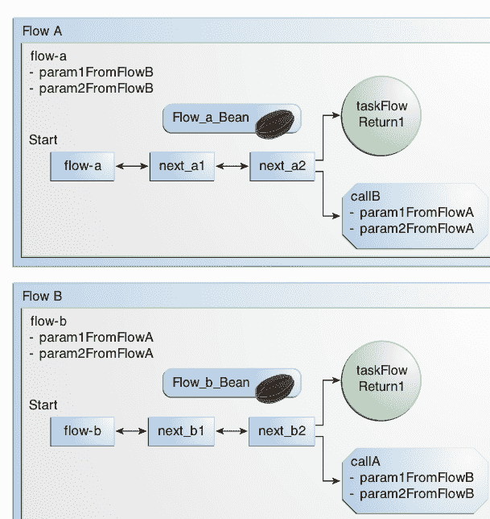

图中，Flow A 有一个起始节点 `flow-a` 和两个额外页面 `next_a1`, `next_a2`。在 `next_a2` 中，用户可以使用定义的返回节点 `taskFlowReturn1` 退出 Flow，或者调用 Flow B 并传递两个参数。Flow A 定义了它可以从 Flow B 接收的两个输入参数。Flow B 与 Flow A 相同，除了 Flow 和文件的名称外。每个 Flow 还有一个关联的托管豆；这些豆是 `Flow_a_Bean` 和 `Flow_b_Bean`。

## 16.3.1 应用中的流打包

通常，你使用模块化流的目录结构在 Web 应用程序中对流打包。例如，在 Maven 项目的 `src/main/webapp` 目录中，你会像通常一样将流之外的 Facelets 文件放在顶层。然后，每个流的 webapp 文件将位于单独的目录，而 Java 文件位于 `src/main/java` 下。例如，图 16-1 所示应用程序的文件结构可能如下所示：

```
src/webapp/
index.xhtml
return.xhtml
WEB_INF/
beans.xml
web.xml
flow-a/
flow-a.xhtml
next_a1.xhtml
next_a2.xhtml
flow-b/
flow-b.xml
next_b1.xml
next_b2.xml
src/main/java/jsweutorial/flowexample
FlowA.java
Flow_A.Bean.java
Flow_B.Bean.java
```

在这个示例中，`flow-a` 在 `FlowA.java` 中通过程序化定义，而 `flow-b` 则通过配置文件 `flow-b.xml` 定义。

## 16.3.2 最简单的流：simple-flow 示例应用程序

`simple-flow` 示例演示了 Faces 应用最基础的构建块，并说明了一些让你易于使用流进行迭代开发的约定俗成。你可能想从像这样的简单示例开始并在此基础上构建。

此示例通过包含任何配置文件提供了一个隐式流定义。包含内容的配置文件或标记了 `@Flow` 注解的类提供了显式流定义。

该应用程序的源代码位于 `tut-install/examples/web/jsf/simple-flow/` 目录。

`simple-flow` 示例的文件布局如下：

```
src/webapp/
index.xhtml
simple-flow-return.xhtml
WEB_INF/
web.xml
simple-flow/
simple-flow-flow.xml
simple-flow.xhtml
simple-flow-page2.xhtml
```

`simple-flow` 示例有一个空配置文件，按照约定命名为 `flow-name-flow.xml`。由于以下原因，该流不需要任何配置：

### 使用 Faces Flows

- 该流没有调用另一个流，也没有向另一个流传递参数。
- 该流对流的第一页 `flow-name.xhtml` 和返回页 `flow-name-return.xhtml` 使用默认名称。
- 此示例有四个分面：

  - `index.xhtml`，起始页，除了包含一个导航到流的第一页的按钮外空无一物：
    ```xml
    <h:commandButton value="Enter Flow" action="simple-flow/"/>
    ```

  - `simple-flow.xhtml` 和 `simple-flow-page2.xhtml`，是流本身的两个页面。在缺少显式流定义的情况下，页面名称与流名称相同的假设为该用例的起始节点，流被命名为 `simple-flow`，名为 `simple-flow.xhtml` 的页面被假设为流的起始节点。导航到起始节点即可进入流。它可以被视为流的首页：
    `simple-flow.xhtml` 页面要求你输入一个流作用域的值，并提供了一个导航到流的下一页的按钮：
    ```xml
    <h:inputText id="flowScope" value="#{flowScope.value}"/>
    <h:commandButton value="Next" action="simple-flow-page2/"/>
    ```

  - 第二页（可以有任何名称）显示流作用域的值，并提供了一个导航到返回页的按钮：
    ```xml
    #{flowScope.value}
    <h:commandButton value="Return" action="simple-return/"/>
    ```

  - `simple-flow-return.xhtml`，返回页。按照约定命名为 `flow-name-return.xhtml` 的返回页必须位于流之外。此页面显示流作用域的值，以它在流之外没有值，并提供了一个导航到 `index.xhtml` 页面的链接：
    ```xml
    <h:inputText id="output" value="#{flowScope.value}"/>
    <h:link outcome="index" value="Back to Start" />
    ```

分面页面仅使用流作用域数据，因此示例不需要托管豆。

### 16.3.2.1 使用 NetBeans IDE 构建、打包并部署 simple-flow 示例

- 确保 GlassFish 服务器已启动（参见启动和停止 GlassFish 服务器）。
- 从 File（文件）菜单中选择 Open Project（打开项目）。
- 在 Project 对话框中，导航到：
  `tut-install/examples/web/jsf`
- 选择 `simple-flow` 文件夹。
- 点击 Open Project（打开项目）。
- 在 Projects（项目）标签页中，右键点击 `simple-flow` 项目并选择 Build（构建）。

此选项将示例应用程序构建并部署到你的 GlassFish 服务器实例中。

### 16.3.2.2 使用 Maven 构建、打包并部署 simple-flow 示例

1. 确保 GlassFish 服务器已启动（参见启动和停止 GlassFish 服务器）。
2. 在终端窗口中，进入：
   ```
   tut-install/examples/web/jsf/simple-flow/
   ```
3. 输入以下命令：
   ```
   mvn install
   ```
   此命令将应用程序构建并打包成 WAR 文件 `simple-flow.war`，该文件位于 `target` 目录。它会将应用程序部署到服务器。

### 16.3.2.3 运行 simple-flow 示例

1. 在浏览器中输入 URL：
   ```
   http://localhost:8080/simple-flow
   ```
2. 在 `index.xhtml` 页面上，点击 Enter Flow。
3. 在流的第一页，在 Value 字段中输入任何字符串，然后点击 Next。
4. 在流的第二页，你可以看到你输入的值。点击 Return。
5. 在返回页上，一对空引号包围了无法访问的值。点击 Back to Start 返回 `index.xhtml` 页面。

## 16.3.3 checkout-module 示例应用程序

`checkout-module` 示例应用程序比 `simple-flow` 复杂得多。它展示了你如何使用 Faces Flows 为在线服务实现结账模块。


# `checkout-module` 示例应用程序

`checkout-module` 示例应用程序比 `simple-flow` 复杂得多。它展示了你如何使用 Faces Flows 为在线服务实现结账模块。

该应用程序的源代码位于 `tut-install/examples/web/jsf/checkout-module/` 目录。

`checkout-module` 示例的文件布局如下：

```
src/webapp/
index.xhtml
WEB_INF/
beans.xml
web.xml
resources/
checkout/
checkout-flow.xml
checkout.xhtml
checkout2.xhtml
checkout3.xhtml
checkout4.xhtml
join/
join-flow.xml
join.xhtml
join2.xhtml
join3.xhtml
```

## `checkout-module` 示例的分面

示例的起始页 `index.xhtml` 总结了虚拟购物车的内容。它允许用户点击两个按钮之一来进入其中一个流：

- `<h:commandButton value="Check Out" action="checkout/"></p>`
- `<h:commandButton value="Join" action="join/"></p>`

此页面也是 checkout 的返回节点。

分面页面 `exitome.xhtml` 是 join 流的返回节点。此页面有一个按钮允许你返回 `index.xhtml` 页面。

分面页面仅使用流作用域数据，因此示例不需要托管豆。

```xml
<p><h:commandButton value="Join" action="calljoin"/></p>
<p><h:commandButton value="Exit Flow" action="returnFromCheckoutFlow"/></p>
```

join 动作也定义在配置源码 `CheckoutFlow.java` 中。该动作进入 join 流，并从 checkout 流传递两个参数。

join 流中的两个页面 `joinflow.xml` 和 `join2.xml` 与 checkout 流中的页面相似。第二个页面有一个按钮，可以调用 checkout 流，也可以退出 join 流：

```xml
<h:commandButton value="Check Out" action="callcheckoutFlow"/></p>
<h:commandButton value="Exit Flow" action="returnFromJoinFlow"/></p>
```

对于此动作，`callcheckoutFlow` 和 `returnFromJoinFlow` 定义在配置文件 `joinflow-flow.xml` 中。

## 使用配置文件配置流

如果你使用应用程序资源文件来配置流，它必须命名为 `flowName-flow.xml`。在本示例中，join 流使用了一个名为 `joinFlow-flow.xml` 的配置文件。该文件是一个指定 `flow-definition` 元素的配置文件。该元素必须使用 `id` 属性定义流的名称。在 `flow-definition` 元素下必须有一个 `flow-return` 元素，用于指定流的返回点。任何输入参数都通过 `inbound-parameter` 元素指定。如果流调用另一个流，`flow-element` 必须使用 `flow-reference` 元素来调用流，并可以使用 `outbound-parameter` 元素指定任何参数。

join 流的配置文件如下：

```xml
<faces-config version="2.2" xmlns="http://xmlns.jcp.org/xml/ns/javaee"
xmlns:xsi="http://www.w3.org/2001/XMLSchema-instance"
xsi:schemaLocation="http://xmlns.jcp.org/xml/ns/javaee http://xmlns.jcp.org/xml/ns/javaee/web-facesconfig_2_2.xsd">
<flow-definition id="joinFlow">
  <flow-return id="returnFromJoinFlow">
    <out-outcome>#{joinBean.returnValue}</out-outcome>
  </flow-return>

  <inbound-parameter>
    <name>paramFromCheckout</name>
    <value>#{flowScope.param1Value}</value>
  </inbound-parameter>
  <inbound-parameter>
    <name>param2FromCheckout</name>
    <value>#{flowScope.param2Value}</value>
  </inbound-parameter>

  <flow-call id="callcheckoutFlow">
    <flow-id>checkoutFlow</flow-id>
  </flow-reference>
  <outbound-parameter>
    <name>param1FromJoin</name>
    <value>param1 joinFlowValue</value>
  </outbound-parameter>
  <outbound-parameter>
    <name>param2FromJoinFlow</name>
    <value>param2 joinFlowValue</value>
  </outbound-parameter>
</flow-call>
</flow-definition>
</faces-config>
```

`flow-definition` 元素的 `id` 属性定义了流的名称为 `joinFlow`。`flow-return` 元素的 `id` 属性值标识了返回节点的名称，其值在 `from-outcome` 元素中定义，对应 `joinFlow` 作用域 Bean 的 `returnValue` 属性。

名称和输入参数根据在 checkout 配置流中的定义方式，顺序从流作用域中获取（`flow.scope.param1Value, flowscope.param2Value`）。

`flow-element` 定义了流如何调用 checkout 流。该元素的 `id` 属性 `checkoutFlow` 定义了调用流的动作。在 `flow-element` 内部，`flow-reference` 元素定义了要调用的流的实际名称 `checkoutFlow`。`outbound-parameter` 元素定义了运行时传递的任何参数。

## 使用 Java 类配置流

如果你使用 Java 类来配置流，该类必须具有流的名称。checkout 流的类名为 `CheckoutFlow.java`。

```java
import java.io.Serializable;
import javax.enterprise.inject.Produces;
import javax.faces.flow.Flow;
import javax.faces.flow.builder.FlowBuilder;
import javax.faces.flow.builder.FlowBuilderParameter;
import javax.faces.flow.builder.FlowDefinition;

class CheckoutFlow implements Serializable {

    private static long serialVersionUID = 1L;

    @Produces
    @FlowDefinition
    public Flow defineFlow(@FlowBuilderParameter FlowBuilder builder) {

        String flowId = "checkoutFlow";
        builder.id(flowId);
        builder.viewName(flowId, "#" + flowId + ".xhtml");
        builder.markStartNode();

        builder.returnNode("returnFromCheckout", "#{checkoutBean.returnValue}");

        builder.inboundParameter("param1FromJoin", "#{flowScope.param1Value}");
        builder.inboundParameter("param2FromJoin", "#{flowScope.param2Value}");

        builder.callNode("calljoin", builder.flowReference("joinFlow"))
            .outboundParameter("param1FromCheckout", "#{checkoutBean.name}")
            .outboundParameter("param2FromCheckout", "#{checkoutBean.someValue}");

        return builder.getFlow();
    }
}
```

该类执行的动作与配置文件 `joinflow-flow.xml` 执行的动作相同。它包含一个带有 `@FlowDefinition` 标识符的生产者方法 `defineFlow`，该方法接收一个带有 `@FlowBuilderParameter` 标识符的 `FlowBuilder` 参数，这是 JavaServer Faces 的实现。该方法随后调用 `FlowBuilder` 类的方法来配置流。

首先，该方法将流 ID 定义为 `checkoutFlow`。显式定义了流的起始节点。默认情况下，这是带有 `.xhtml` 后缀的流名称。

该方法以类似于配置文件的方式定义返回节点。`returnNode` 方法将返回节点设置为 `returnFromCheckout`，并将其设置为流作用域 Bean 的 `returnValue` 属性。

`inboundParameter` 方法设置了 join 流的输入参数名称和值，这些值是从流作用域（`flowScope.param1Value, flowScope.param2Value`）根据配置定义获取的。

`callNode` 方法定义了 checkout 流如何调用 join 流。参数 `calljoin` 指定了要调用的流实际名称 `joinFlow`，`outboundParameter` 方法定义了调用 `joinFlow` 时传递的参数。这些值来自托管 Bean `checkoutBean`。

最后，`defineFlow` 方法调用 `getFlow` 并返回结果。


### 流作用域 Bean

两个流中的每个流都有一个定义流内页面属性的 Bean。例如，`CheckoutBean` 定义了用户在 `CheckoutBean.xml` 和 `checkoutFlow.xml` 页面上输入的属性。

每个托管 Bean 都有一个 `getReturnValue()` 方法设置返回节点的值。对于 `CheckoutBean`，返回节点是使用隐式导航指定的 `index` 页面：

```java
public String getReturnValue() {
  return "index";
}
```

对于 `JoinBean`，返回节点是 `index.xhtml` 页面。

### 使用 NetBeans IDE 构建、打包并部署 checkout-module

- 确保 GlassFish Server 已启动（参见启动和停止 GlassFish Server）。
- 从文件（File）菜单选择打开项目（Open Project）。
- 在打开项目对话框中，导航到：`tut-install/examples/web/jsf`
- 选择 `checkout-module` 文件夹。
- 点击打开项目。
- 在项目（Projects）选项卡中，右键点击 `checkout-module` 项目并选择运行（Run）。

此选项会将应用程序构建并部署到你的 GlassFish Server 实例中，然后在默认浏览器中打开它。

### 使用 Maven 构建、打包并部署 checkout-module

- 确保 GlassFish Server 已启动（启动和停止 GlassFish Server）。
- 在终端中，进入：`tut-install/examples/web/jsf/checkout-module/`
- 输入以下命令：`mvn install`

此命令将应用程序构建并打包成 WAR 文件 `checkout-module.war`，该文件位于 `target` 目录下。然后它将应用程序部署到服务器。

### 运行 checkout-module 示例

- 在浏览器中输入以下 URL：`http://localhost:8080/checkout-module`
- `index.xml` 页面展示了购物的假设结果。点击每个 Check Out 或 Join 进入两个流之一。
- 按照流进行操作，根据需要提供输入，并选择继续、返回或退出流。在 checkout 流中，只有一个输入项通过了验证（信用卡期望 16 位数字），因此你可以输入任何你喜欢的值。join 流不要求你在复选框菜单中勾选任何框。
- 在流的最后一页，选择通往另一个流的选项。这允许你查看来自上一个流的输入参数。
- 由于流是嵌套的，如果你从被调用的流中退出，你将返回到调用流的第一页（你可能会看到一个警告，可以忽略它）。

# 配置托管 Bean

使用 `managed-bean` XML 元素配置资源文件来定义每个 bean。此文件在应用程序启动时进行处理。有关使用此功能的信息，请参阅“使用 `managed-bean` 元素”。

在应用程序配置资源文件中创建的托管 bean 是 JavaServer Faces bean，而不是 CDI 托管 bean。

通过托管 bean 创建功能，你可以：

- 在整个应用程序都可用的中心化文件中创建 bean，而不是在整个应用程序中不断地实例化 bean
- 在无需任何额外代码的情况下自定义 bean 的属性
- 直接从配置文件自定义 bean 的属性值，使其在被创建时使用这些值进行初始化
- 使用 `value` 元素，将一个托管 bean 的属性设置为另一个值表达式求值的结果

本节向你展示如何使用托管 bean 创建功能初始化 bean。有关编程 bean 的信息，请参阅“编写 Bean 属性”和“编写托管 Bean 方法”。

## 16.4.1 使用 `managed-bean` 元素

托管 bean 在应用程序配置资源文件中通过 `managed-bean` 元素进行初始化，该元素代表了应用程序中必须存在的 bean 类实例。在运行时，JavaServer Faces 实现会处理 `managed-bean`。如果页面引用了该 bean 但不存在 bean 实例，JavaServer Faces 实现将按照配置实例化该 bean。

以下是 Duke's Bookstore 案例中的托管 bean 配置示例：

```xml
<managed-bean eager="true">
  <managed-bean-name>Book201</managed-bean-name>
  <managed-bean-class>dukesstore.model.ImageArea</managed-bean-class>
  <managed-bean-scope>application</managed-bean-scope>
  <managed-property>
    <property-name>shape</property-name>
    <value>rect</value>
  </managed-property>
  <managed-property>
    <property-name>alt</property-name>
    <value>Duke</value>
  </managed-property>
  <managed-property>
    <property-name>coords</property-name>
    <value>67,23,212,268</value>
  </managed-property>
</managed-bean>
```

使用 NetBeans IDE，你可以通过以下步骤添加托管 bean 声明：

1. 在 NetBeans IDE 中打开项目后，展开 Projects 选项页中的项目节点。
2. 展开项目中的 Web Pages 和 WEB-INF，并如下方式创建一个：
   - 如果项目中没有 `faces-config.xml`，则创建一个：
     a. 从 File 菜单中选择 New File。
     b. 在 New File 向导中，选择 JavaFaces 类别，选择 JS Faces Configuration 并点击 Next。
     c. 在 Name and Location 页面，如有需要更改文件的名称和位置。默认文件名为 `faces-config.xml`。
     d. 点击 Finish。
3. 如果 `faces-config.xml` 文件未打开，双击它。
4. 在 `faces-config.xml` 编辑器窗口中打开后，在子标签选项中选择 XML。
5. 在编辑器窗口中右键点击。
6. 从 Insert 菜单中选择 Managed Bean。
7. 在 Add Managed Bean 对话框中：
   a. 在 Bean Name 字段中输入 bean 的显示名称。
   b. 浏览并定位 bean 的类。
8. 在 Browse Class 对话框中：
   a. 在 Class name 字段中开始输入你要查找的类名。在你输入时，对话框将显示匹配的类。
   b. 从 Matching Classes 列表中选择该类。
   c. 点击 OK。
9. 在 Add Managed Bean 对话框中：
   a. 从 Scope 菜单中选择 bean 的作用域。
   b. 点击 Add。

上述步骤将添加 `managed-bean-name` 元素、`managed-bean-class` 元素以及 `managed-bean-scope` 元素。你需要编辑 XML 文件进一步配置此 bean。`managed-bean-scope` 元素定义了 bean 存储的作用域键。为了使组件的值映射到此 bean，组件标签的值必须与 `managed-bean-name` 匹配。`managed-bean` 元素可以包含零或多个 `managed-property` 元素，每个元素对应 bean 中定义的一个属性。这些元素用于初始化 bean 的值。如果 bean 在实例化时某个属性没有特定值，请在应用程序配置中包含其 `managed-property` 定义。

如果 `managed-bean` 元素不包含其他 `managed-bean` 元素，它可以包含一个 `map-entries` 元素或 `list-entries` 元素。`map-entries` 元素配置 `Map` 实例集合。`list-entries` 元素配置 `List` 实例集合。在接下来的示例中，代表 UISelectItem 组件的 `newsletters` bean 被配置为代表 `SelectItem` 对象集合的 `ArrayList`。每个对象转配置为具有属性的托管 bean：

```xml
<managed-bean>
  <managed-bean-name>newsletters</managed-bean-name>
  <managed-bean-class>java.util.ArrayList</managed-bean-class>
  <managed-bean-scope>application</managed-bean-scope>
  <list-entries>
    <class>javax.faces.model.SelectItem</class>
    <value>#{newsletter0}</value>
    <value>#{newsletter1}</value>
    <value>#{newsletter2}</value>
    <value>#{newsletter3}</value>
  </list-entries>
</managed-bean>
<managed-bean>
  <managed-bean-name>newsletter0</managed-bean-name>
  <managed-bean-class>javax.faces.model.SelectItem</managed-bean-class>
  <managed-bean-scope>none</managed-bean-scope>
  <managed-property>
    <property-name>label</property-name>
    <value>Duke's Quarterly</value>
  </managed-property>
  <managed-property>
    <property-name>value</property-name>
    <value>20</value>
  </managed-property>
</managed-bean>
```

这种方法可能用于在开发团队有时间从数据库创建选择列表之前，快速创建。请注意，如果单个 `newsletter` bean 的作用域设置为 `none`，它们将不会被放入任何作用域中。关于配置集合的初始化。

要映射由 `managed-property` 定义的属性，必须确保组件的值表达式与 `managed-property` 的 `property-name` 匹配。在早期的示例中，最大属性被初始化为 `10`。“使用 `managed-property` 元素初始化属性”详细解释了如何使用 `managed-property` 元素。

## 16.4.2 使用 `managed-property` 元素初始化属性

`managed-property` 必须包含一个 `property-name` 元素，其必须与 bean 中对应的属性名称匹配。`managed-property` 元素还包含定义属性值的元素之一。此值必须与对应 bean 中属性的类型相同。表 16–1 列出了所有用于初始化值的元素。

| 元素 | 定义属性值的 `managed-property` 子元素 |
| :--- | :--- |
| list-entries | 定义列表中的值 |
| map-entries | 定义 map 的值 |

### 表 16–1（续）定义属性的 `managed-property` 子元素

| 元素 | 它定义的值 |
| :--- | :--- |
| null-value | 显式将属性设为 null |
| value | 定义单个值，例如 String 或 JavaFaces EL 表达式 |

使用 `managed-bean` 元素包含一个使用值子集初始化 `int` 属性（原始类型）的示例。你还使用值子集初始化 String 和其他引用。本节其余部分描述了如何使用值子集和其他元素初始化 Java Enum 类型、Map 和 Collection，以及初始化参数。

### 16.4.2.1 引用 Java Enum

托管属性也可以是 Java Enum 类型（参见 http://docs.oracle.com/javase/7/api/java/lang/Enum.html）。在这种情况下，`managed-property` 元素的值必须是匹配 Enum 的某一个 String 常量的字符串。换句话说，该 String 必须是在对 enum 类调用 `valueOf(Class, String)` 时返回的值之一，其中 `Class` 是 Enum 类，而 `String` 是值子元素。例如，假设托管属性如下：

```java
public enum Suit {Hearts, Spades, Diamonds, Clubs}

public Suit getSuit() { return Suit.Hearts; }
```

假设你想在应用程序配置资源文件中配置此属性，对应的 `managed-property` 元素如下所示：

```xml
<managed-property>
  <property-name>Suit</property-name>
  <value>Hearts</value>
</managed-property>
```

当系统遇到此属性时，它会遍历 enum 的每个成员，并对每个成员调用 `toString()`，直到找到一个与 `value` 元素值完全相等的成员。

### 16.4.2.2 引用上下文初始化参数

托管 bean 创建功能的另一个强大特性是能够从托管 bean 中引用对象。

假设你有一个页面接收客户的数据，包括客户的地址。假设你的大多数客户住在特定的邮政编码。你可以让邮政编码组件成为此 bean 读取器，通过将其保存并在页面渲染时引用它。

你可以通过向 Web 应用程序添加参数并在部署描述中设置其值，在隐式上下文初始化参数中保存邮政编码作为初始默认值。例如，要将上下文参数 `defaultAreaCode` 设置为 `650`，请在部署描述中添加 `context-param` 元素，并赋予参数名称 `defaultAreaCode` 和值 `650`。

接下来，编写一个托管 bean 声明来配置引用该参数的属性：

```xml
<managed-bean>
  <managed-bean-name>customer</managed-bean-name>
  <managed-bean-class>CustomerBean</managed-bean-class>
  <managed-bean-scope>request</managed-bean-scope>
  <managed-property>
    <property-name>areaCode</property-name>
    <value>#{initParam.defaultAreaCode}</value>
  </managed-property>
</managed-bean>
```

若要在页面渲染时访问代码，请引用区域组件标签的 `value` 属性值：`<inputText value="#{customer.areaCode}">`

值以类似的方式从隐式对象中检索。

### 16.4.2.3 初始化 Map 属性

如果 `map-entries` 元素位于 `managed-property` 元素内部，则它用于初始化类型为 Map 的 bean 属性值。`map-entries` 元素包含一个可选的 `key-element`、一个可选的 `value-element` 以及零或多个 `map-entries` 元素。

每个 `map-entries` 元素必须包含一个 `key-element` 以及一个 `null-value` 或 `value-element`。以下是一个使用 `map-entries` 元素的示例：

```xml
<managed-bean>
  <managed-property>
    <property-name>prices</property-name>
    <map-entries>
      <map-entry>
        <key>My Early Years: Growing Up on *</key>
        <value>30.75</value>
      </map-entry>
      <map-entry>
        <key>Web Servers for Fun and Profit</key>
        <value>40.75</value>
      </map-entry>
    </map-entries>
  </managed-property>
</managed-bean>
```

由此 `map-entries` 标签创建的 map 两个条目。默认情况下，键值会被转换为 String。如果你想为 map 中的键指定不同的类型，请在 `map-entries` 元素内部嵌入 `key-class` 元素：

```xml
<map-entries>
  <key-class>java.math.BigDecimal</key-class>
</map-entries>
```


此声明将所有键转换为 `java.math.BigDecimal`。当然，你必须确保键可以转换为你指定的类型。本节示例中的键无法转换为 `BigDecimal`，因为它是一个 String。

如果你想为 map 中所有的值指定不同的类型，请在 `key-class` 元素之后包含 `value-class` 元素：

```xml
<map-entries>
  <key-class>int</key-class>
</map-entries>
```

```xml
<value-class>java.math.BigDecimal</value-class>
...
</map-entries>
```

注意，该标签仅设置了所有值子元素的类型。

前述示例中的每个 `map-entry` 都包含一个定义单个值的 `value` 子元素，该值将被转换为 bean 中指定的类型。

除了使用 `map-entries` 元素外，还可以使用指定了 map 类型表达式的 `value` 元素来分配整个 map。

## 16.4.2.4 初始化数组和 List 属性

`list-entries` 元素用于初始化数组或 List 属性的值。数组或 List 的每个单独值都使用 `value` 或 `null-value` 元素初始化。以下是一个示例：

```xml
<managed-bean>
  <managed-property>
    <property-name>books</property-name>
    <list-entries>
      <value-class>java.lang.String</value-class>
      <value>myBooks.bookid[3]</value>
      <null-value></null-value>
    </list-entries>
  </managed-property>
</managed-bean>
```

此示例初始化了一个数组或 List。相应属性的类型决定了创建什么数据结构。`list-entries` 元素定义了数组或 List 中的值列表。`value` 元素指定数组或 List 中的单个值，并可以引用另一个 bean 中的属性。`null-value` 元素将导致带有 `null` 参数调用 `setBooks` 方法。对于类型为 Java 原始类型（如 `int` 或 `boolean`）的属性，无法指定空元素。

## 16.4.2.5 已初始化 Bean 属性

有时，你希望创建一个引用其他 bean 的 bean，这样你就可以构建一个 bean 图形或树形结构。假设你想创建一个代表客户信息的 bean，包括邮政地址和街道地址，每一个地址也是一个 bean。`managed-bean` 声明创建了一个 `CustomerBean` 实例，它有两个 `AddressBean` 属性：一个代表邮政地址，另一个代表街道地址。此声明导致了一个以 `CustomerBean` 为根、两个 `AddressBean` 对象为子节点的 bean 树。

```xml
<managed-bean>
  <managed-bean-name>customer</managed-bean-name>
  <managed-bean-class>
    com.example.CustomerBean
  </managed-bean-class>
  <managed-bean-scope>request</managed-bean-scope>
  <managed-property>
    <property-name>mailingAddress</property-name>
    <value>${addressBean}</value>
  </managed-property>
  <managed-property>
    <property-name>streetAddress</property-name>
    <value>${addressBean}</value>
  </managed-property>
  <managed-property>
    <property-name>customerType</property-name>
    <value>New</value>
  </managed-property>
</managed-bean>
```

```xml
<managed-bean>
  <managed-bean-name>addressBean</managed-bean-name>
  <managed-bean-class>com.example.AddressBean</managed-bean-class>
  <managed-bean-scope>request</managed-bean-scope>
  <managed-property>
    <property-name>streetAddress</property-name>
    <null-value/>
  </managed-property>
</managed-bean>
```

第一个 `managed-bean` 声明创建了一个 `CustomerBean` 实例，它有两个 `AddressBean` 属性：一个代表邮政地址，另一个代表街道地址。此声明导致了一个以 `CustomerBean` 为根、两个 `AddressBean` 对象为子节点的 bean 树。

第二个 `managed-bean` 声明允许系统根据浏览器的语言设置找到正确的区域语言（locale）。

### 表 16-2 作用范围之间允许的连接

| 此作用范围的对象 | 可以指向此作用范围的对象 |
| :--- | :--- |
| none | none |
| application | application |
| session | application |
| request | application, session |
| view | application, session |

## 16.4.3 初始化 Maps 和 Lists

除了配置 Map 和 List 属性外，你还可以配置 Map 和 List，以便通过标签引用它们，而不是引用属性。

## 16.5 注册应用程序消息

应用程序消息可以包括给用户的任何字符串，以及转换器和验证器通过消息标签显示的自定义错误消息。为了使消息在启动时生效，请执行以下操作之一：

- 程序地向 `java.faces.context.FacesContext` 实例队列单个消息
- 使用应用程序配置注册所有消息

以下是注册 Duke 案例 `faces-config.xml` 部分：

```xml
<application>
  <resource-bundle>
    <base-name>dukesbookstore.web.Messages</base-name>
    <var>bundle</var>
  </resource-bundle>
  <local-config>
    <default-locale>en</default-locale>
    <supported-locale>es</supported-locale>
    <supported-locale>de</supported-locale>
    <supported-locale>fr</supported-locale>
  </local-config>
</application>
```

这组元素导致应用程序填充了 resource bundle 中包含的消息。

`resource-bundle` 元素代表一组本地化消息。它必须包含包含本地化消息的 resource bundle 全限定路径（在本例中为 `dukesbookstore.web.messages`）。`var` 元素定义了作者引用 resource bundle 的 EL 名称。

`local-config` 元素列出了默认区域语言和其他支持的区域语言。`local-config` 元素允许系统根据浏览器的语言设置找到正确的区域语言。

`supported-locale` 和 `default-locale` 标签接受由 ISO-639-1 定义的小写双字符代码（请参阅 http://www.loc.gov/standards/iso639-2/php/English_list.php）。确保你的 resource bundle 实际上包含了通过这些标签指定的区域语言的消息。

要访问本地化消息，应用程序开发者引用 resource bundle 的键。

你可以将本地化文本提取到图像的 `alt` 标签中，如下所示：

```xml
<h:graphicImage id="mapImage" name="book_all.jpg"
      library="images"
      alt="#{bundle.ChooseBook}"
      usemap="#bookMap" />
```

`alt` 属性可以接受表达式。在这种情况下，`alt` 属性指向本地化文本，该文本将被包含由此标签渲染的图像替代文本中。

## 16.5.1 使用 FacesMessage 创建消息

与其在应用程序配置资源文件中注册消息，你可以直接从托管 bean 代码中访问 `java.util.ResourceBundle`。下面的代码段加载了一个错误消息：

```java
String message = "";
message = ExampleBean.loadErrorMessage(context,
    ExampleBean.EK_RESOURCE_BUNDLE_NAME,
    "EmailError");
context.addMessage(validate.getClient(context),
    new FacesMessage(message));
```

以下行调用了 `loadErrorMessage` 方法从 `ResourceBundle` 获取消息。这里是 `loadErrorMessage` 方法：

```java
public String loadErrorMessage(FacesContext context,
    String basename, String key) {
  if (bundle == null) {
    try {
      bundle = ResourceBundle.getBundle(basename,
          context.getViewRoot().getLocale());
    } catch (Exception e) {
      return null;
    }
  }
  return bundle.getString(key);
}
```

## 16.5.2 引用错误消息

JavaServer Page 使用 `message` 或 `messages` 标签来访问错误消息，正如“使用 h:message 和 h:messages 标签显示错误消息”中所解释的那样。

这些标签访问的错误消息包括：

- 与 API 标准转换器和验证器随带的标准错误消息。完整消息列表请参阅 JavaFaces 规范的第 2.5.2.4 节。
- 通过在配置文件中使用 `resource-bundle` 元素注册到应用程序架构的资源包包含的自定义错误消息。

当在输入组件上注册了转换器或验证器时，相应的错误消息会自动排队在该组件的队列中。

页面作者可以使用组件标签的以下属性来覆盖排在组件队列上的错误消息：

### 使用默认验证器

- `converterMessage`：引用当包围组件上的数据无法通过注册在该组件上的转换器进行转换时，要显示的错误消息。
- `requiredMessage`：引用当包围组件中未输入任何值时，要显示的错误消息。
- `validatorMessage`：引用当包围组件上的数据无法通过注册在该组件上的验证器进行验证时，要显示的错误消息。

所有三个属性都启用以接受字面量和值表达式。如果属性使用值表达式，则该表达式引用资源包中的错误消息。该资源包必须通过以下方式之一供应用程序可用：

- 通过应用程序架构在配置文件中使用 `resource-bundle` 元素
- 通过页面作者使用 `f:loadBundle` 标签

相反，必须使用 `resource-bundle` 元素来为应用程序提供包含自定义错误消息的资源包，这些消息是因为在组件上注册了自定义转换器或验证器而排在组件队列中的。

以下标签展示了如何使用值表达式指定 `requiredMessage` 属性以引用错误消息：

```xml
<h:inputText id="cno" size="19"
      required="true"
      requiredMessage="#{customMessages.RedMessage}">
</h:inputText>
<h:message class="error-message" for="cno"/>
```

示例中 `requiredMessage` 使用的值表达式引用了资源包 `customMessages` 中带有 `RedMessage` 的错误消息。

此消息将替换组件上队列中的对应消息，并在页面放置 `message` 或 `messages` 标签的地方显示。

## 16.6 使用默认验证器

除了你为组件声明的内容外，你还可以在应用程序配置资源文件中指定零或多个默认验证器。默认验证器适用于视图或组件树中的所有 `javax.faces.component.UIInput` 实例，并附加在定义的验证器之后。以下是一个在应用程序配置资源文件中注册的默认验证器示例：

```xml
<faces-config>
  <application>
    <default-validators>
      <validator-id>javax.faces.Bean</validator-id>
    </default-validators>
  </application>
</faces-config>
```

## 16.7 注册自定义验证器

如果应用程序开发者提供了 `javax.faces.validator` 接口的实现以执行验证，你必须按照“实现验证器接口”中所述，使用 `@FacesValidator` 注解来注册此自定义验证器，或者使用应用程序配置资源文件：

```xml
<validator>
  <validator-id>FormatValidator</validator-id>
  <validator-class>dukesstore.FormatValidator</validator-class>
  <attribute>
    <attribute-name>formatPatterns</attribute-name>
    <attribute-class>java.String</attribute-class>
  </attribute>
</validator>
```

## 16.8 注册自定义转换器

与验证器一样，如果应用程序开发者创建了自定义转换器，你必须按照“创建转换器”中所述使用 `@FacesConverter` 注解注册它，或者使用应用程序配置资源文件中的 `converter` 元素。这是一个针对内容的假设转换器：

```xml
<converter>
  <description>用于归一信用卡输入的转换器</description>
  <converter-id>CreditCardConverter</converter-id>
  <converter-class>dukesstore.converters.CreditCardConverter</converter-class>
</converter>
```

## 16.9 配置导航规则

Java 应用不同页面之间的导航（例如在点击按钮或链接后选择下一页）是由一组规则定义的。导航规则可以是隐式的，也可以显式地定义在应用程序配置资源文件中。关于导航规则的更多信息，请参阅“导航模型”。

每个导航规则指定了如何从一个页面导航到另一个或一组页面。Java Faces 实现根据当前显示的页面选择正确的导航规则。

在选择正确的导航规则后，从当前页面访问的页面取决于两个因素：

- 点击组件时调用的动作方法
- 组件标签引用或动作方法返回的逻辑结果

结果可以是开发者选择的任何内容，但表 16-3 列出了 Web 应用中常用的结果。

通常，动作方法会对当前页的数据执行某些处理。例如，该方法可能会检查文件中的用户名和密码。如果匹配，方法返回 `success` 结果；否则，返回 `failure` 结果。正如此示例所示，处理动作的方法和返回的结果对于确定访问页面是必要的。

### 表 16-3 常用结果字符串

| 结果 | 含义 |
| :--- | :--- |
| success | 执行成功。进入下一页。 |
| failure | 出现问题。进入错误页面。 |
| login | 用户需要先登录。进入登录页面。 |
| no results | 未找到任何结果。再次访问搜索页。 |

```xml
<navigation-rule>
  <from-view-id>login.xhtml</from-view-id>
  <navigation-case>
    <from-action>#{LoginForm.login}</from-action>
    <from-outcome>success</from-outcome>
    <to-view-id>storefront.xhtml</to-view-id>
  </navigation-case>
  <navigation-case>
    <from-action>#{LoginForm.login}</from-action>
    <from-outcome>failure</from-outcome>
    <to-view-id>login.xhtml</to-view-id>
  </navigation-case>
</navigation-rule>
```


此导航规则定义了从 `login.xhtml` 导航的方法。每个 `navigation-case` 定义了从 `login.xhtml` 出的一条可能的导航路径。第一个 `navigation-case` 表示，如果 `LoginForm` 返回的结果为 `success`，则将访问 `storefront.xhtml`。第二个 `navigation-case` 表示，如果 `LoginForm` 返回 `failure`，将重新渲染 `login.xhtml`。

应用程序的页面流配置由一组导航规则组成。每个规则由 `faces-config.xml` 文件中的 `navigation-rule` 元素定义。

每个 `navigation-rule` 元素对应于由可选的 `from-view-id` 元素定义的树标识符。这意味着每个规则都定义了从应用程序中特定页面导航的所有可能方式。如果没有 `from-view-id`，则在 `navigation-rule` 中定义的导航规则将适用于应用程序中的所有页面。`from-view` 元素还允许通配符模式。例如，此 `from-view` 元素表示导航规则适用于 `books` 目录下的所有页面：

```
<from-view-id>/books/*</from-view-id>
```

`navigation-rule` 元素可以包含零或多个 `navigation-case` 元素。当满足这些标准时，应用程序将导航到由同一 `navigation-case` 元素中的 `to-view-id` 定义的页面。

导航标准由可选的 `from-outcome` 和 `from-action` 元素定义。`from-outcome` 定义了一个逻辑结果（例如 `success`）。`from-action` 元素使用方法表达式来引用返回 `String` 的动作方法，该字符串即逻辑结果。该方法执行某些逻辑以确定结果并返回该结果。

`navigation-case` 元素会根据以下情况对结果和方法表达式进行检查：

- 同时指定了 `from-outcome` 值和 `from-action` 值的用。如果动作方法根据其处理结果返回不同的结果，则这两个元素都可以被使用。
- 仅指定了 `from-outcome` 值的用。`from-outcome` 元素必须与 `java.faces.component.UICommand` 组件的 `action` 属性定义的输出匹配，或者与引用的 `UICommand` 命令的方法返回的结果匹配。
- 仅指定了 `from-action` 值的用。此值必须与组件标签指定的动作表达式（action expression）匹配。

当匹配到任一情况时，将选择由 `to-view-id` 元素定义的组件树进行渲染。

## 在渲染器集中注册自定义渲染器

## 16.9.1 配置导航规则

使用 NetBeans IDE，您可以通过以下步骤配置导航规则：

1. 在 NetBeans IDE 中打开项目后，展开 Projects（项目）选项卡中的项目节点。
2. 展开项目节点下的 Web Pages 节点 WEB-INF 节点。
3. 双击 `faces-config.xml`。
4. 当 `faces-config.xml` 在编辑器窗口中打开后，在编辑器窗口中点击右键。
5. 从 Insert（插入）菜单选择 Navigation Rule（导航规则）。
6. 在 Add Navigation Rule（添加导航规则）对话框中：
   a. 输入或浏览代表您的导航规则起始视图的页面。
   b. 点击 Add（添加）。
7. 再次在编辑器窗口中点击右键。
8. 从 Insert（插入）菜单选择 Navigation Case（导航用例）。
9. 在 Add Navigation Case（添加导航用例）对话框中：
   a. 从 View（视图）菜单，选择代表您的导航规则起始视图的页面（来自步骤 6a）。
   b. （可选）在 Action（动作）字段中，输入触发导航的组件被激活时所调用的动作。
   c. （可选）在 Outcome（结果）字段中，输入激活的组件从其 `action` 属性引用的逻辑字符串。
   d. 从 To（到）菜单，选择或浏览如果此导航用例被导航系统选中时将打开的页面。
   e. 点击 Add（添加）。

“引用执行导航的方法” 解释了如何使用组件标签的属性指向动作方法。“编写用于处理导航的方法” 解释了如何编写一个动作方法。

## 16.10 在渲染器集中注册自定义渲染器

当应用程序创建自定义渲染器（即“将渲染委托给渲染器”）时，您必须使用相应的渲染器集对其进行注册。由于 HTML 渲染器实现了 `RenderKit` 接口，因此应该使用 HTML 渲染器集注册 Bookstore 用例。

您可以通过使用 `@Faces` 注解（如在“创建渲染器类”中所描述）或使用应用程序配置中的 `renderer-kit` 元素来注册渲染器。以下是 `AreaRenderer` 的假设性配置：

```
<renderer-kit>
  <renderer>
    <component-family>Area</component-family>
    <renderer-type>DemoArea</renderer-type>
    <renderer-class>dukesbookstore.renderers.AreaRenderer</renderer-class>
    <attribute>
      <attribute-name>onmouseout</attribute-name>
      <attribute-class>java.lang.String</attribute-class>
    </attribute>
    <attribute>
      <attribute-name>mouseover</attribute-name>
      <attribute-class>java.lang.String</attribute-class>
    </attribute>
    <attribute>
      <attribute-name>styleClass</attribute-name>
      <attribute-class>java.lang.String</attribute-class>
    </attribute>
    ...
  </renderer>
```

在渲染器中指定的属性可能会覆盖 `@FacesRenderer` 注解中的任何设置。`renderer-kit` 元素代表 `javax.faces.render.RenderKit` 的实现。如果没有指定 `renderer-kit-id`，则假设使用默认渲染器集。`renderer` 元素代表 `javax.faces.render.Renderer` 的实现。通过将 `renderer` 元素嵌套在 `renderer-kit` 元素内部，您正在注册与 `renderer-kit` 元素关联的渲染器实现。

`renderer-class` 是渲染器的全限定名。`component-family` 元素用于查找可以渲染它的渲染器。组件族标识符必须与组件的 `getFamily` 方法返回的结果匹配。组件族表示特定渲染器可以渲染的组件或一组组件。`renderer-type` 必须与标签处理器类的 `getRendererType` 方法返回的结果匹配。

通过使用组件族和渲染器类型（`renderer-type`）查找查找组件渲染器，Faces 允许一个组件被多个渲染器渲染，并允许一个渲染器渲染多个组件。

每个 `attribute` 标签都指定了依赖于渲染器的属性及其类型。`attribute` 元素不会影响应用程序的运行时执行。然而，它为工具提供了有关其所支持的属性的信息。

负责渲染组件的对象（无论是组件本身，还是组件委托渲染的渲染器）都可以使用面元素（facets）来辅助渲染过程。这些面元素允许组件开发者控制渲染组件的某些方面。考虑以下这个自定义组件示例：

```
<dataScroll>
  <facet name="header">
    <h:panelGroup>
      <outputText value="Account ID"/>
      <outputText value="Customer Name"/>
      <outputText value="Total Sales"/>
    </h:panelGroup>
  </facet>
  <facet name="next">
    <h:panelGroup>
      <outputText value="Next"/>
      <h:graphicImage url="images/right.gif" />
    </h:panelGroup>
  </facet>
</dataScroll>
```

`dataScroll` 组件包含一个用于渲染表头的组件和一个用于渲染 Next 按钮的组件。如果与组件相关的渲染器渲染面，您可以在渲染器元素中包含以下面元素：

```
<f:facet>
  <description>此面作为表格的表头。它应该是与数据列数相同的 panelGroup。</description>
  <display-name>header</display-name>
  <facet-name>header</facet-name>
</f:facet>
<f:facet>
  <description>此面作为滚动器中 'next' 按钮的内容。它应该是一个包含文本 "Next" 的 outputText 标签和一个向右箭头图标的 panelGroup。</description>
  <display-name>Next</display-name>
  <facet-name>next</facet-name>
</f:facet>
```

如果支持面的组件提供了自己的渲染，且您希望在应用程序配置文件中包含面，则需要将它们放在组件配置中而不是渲染器配置中。

## 16.11 注册自定义组件

除了注册渲染器（如前面的节所述），您还还注册通常与自定义渲染器关联的自定义组件。您可以使用 `@FacesComponent` 注解，或者如“创建自定义组件类”中所述，使用应用程序配置文件的 `component` 元素。

以下是应用程序配置文件中注册 `AreaComponent` 的假设性组件元素：

```xml
<component>
  <component-type>DemoArea</component-type>
  <component-class>
    dukesbookstore.components.AreaComponent
  </component-class>
  <property>
    <property-name>alt</property-name>
    <property-class>java.lang.String</property-class>
  </property>
  <property>
    <property-name>coords</property-name>
    <property-class>java.lang.String</property-class>
  </property>
  <property>
    <property-name>shape</property-name>
    <property-class>java.lang.String</property-class>
  </property>
</component>
```

组件标签中指定的属性将覆盖 `@FacesComponent` 注解中的任何设置。

`component-type` 元素标识注册组件时的名称。其他引用此名称的对象将使用该名称。例如，`AreaComponent` 配置中的 `component-type` 元素定义了值 `DemoArea`，这与 `AreaTag` 类的 `getComponentType` 方法返回的值相。

`component-class` 元素标识组件的全限定类名。`property` 元素标识组件属性及其类型。如果自定义组件可以包含面（facets），你可以在组件配置中使用 `facet` 元素来配置这些面，这些元素允许位于 `component-class` 元素之后。有关配置面的更多细节，请参阅“为渲染套件注册自定义渲染器”。

## 12.12 JavaServer Faces 应用程序的基本要求

除了配置应用程序外，你必须满足 JavaServer Faces 应用程序的其他要求，包括正确打包所有必要文件并提供部署描述。本节描述了如何执行管理任务。

JavaServer Faces 应用程序可以打包在 WAR 文件中，该文件必须符合特定要求以便在不同的容器中执行。至少，JavaServer Faces 应用程序的 WAR 文件可能包含以下内容：

- 部署描述符，称为 `web.xml`，用于配置 Web 应用程序所需的资源（必需）
- 一组包含核心类的 JAR 文件（可选）
- 一组应用程序类、JavaServer Faces 页面以及其他资源（如图像文件）

WAR 文件可能还包含：

- 配置资源文件，用于配置应用程序资源
- 一组标签库描述符文件（TLD）

例如，使用 Faclets 的 JavaServer Faces 应用程序 WAR 文件通常具有以下目录结构：

```
$PROJECT_DIR
[Web Pages]
++ /xml or html documents
++ /resources
++ /WEB-INF
++ /web.xml
++ /beans.xml (optional)
++ /classes (optional)
++ /lib (optional)
++ /faces-config.xml (optional)
++ /.taglib.xml (optional)
++ /glassfish-web.xml (optional)
```

`web.xml` 文件（或 Web 部署描述符）、JAR 文件集以及应用程序文件必须包含在 WAR 文件的 `WEB-INF` 目录中。

## 16.12.1 使用 Web 部署描述符配置应用程序

Web 应用程序通常使用 Web 应用程序部署描述符 `web.xml` 中包含元素进行配置。JavaServer Faces 应用程序的部署描述符必须指定某些配置，包括：

- 用于处理 JavaServer Faces 请求的 servlet
- 处理该 servlet 的 servlet 映射
- 配置资源文件的路径（如果该文件存在且未位于默认位置）

部署描述符还可以包含其他可选配置，例如：

- 指定组件状态的保存位置
- 加密存储在客户端的状态
- 压缩存储在客户端的状态
- 限制对包含 Java Faces 标签的页面的访问
- 开启 XML 验证
- 指定项目阶段阶段（Project Stage）
- 验证自定义对象

本节提供了关于这些配置的更多细节。在适当的情况下，它还描述了你如何使用 NetBeans IDE 进行这些配置。

### 16.12.1.1 识别生命周期处理的 Servlet

JavaServer Faces 应用程序的一个要求是，所有指向查看过的 JavaServer Faces 组件的请求必须通过 `javax.faces.webapp.FacesServlet` 实例，该实例管理 Web 应用程序的处理生命周期，并初始化 JavaServer Faces 技术所需的资源。

在 JavaServer Faces 应用程序启动其第一个页面之前，Web 容器必须调用 JavaServer Faces 应用程序的生命周期以启动生命周期过程。请参阅更多信息。

以下示例显示了 `FacesServlet` 的配置：

```
<servlet>
  <servlet-name>Faces Servlet</servlet-name>
  <servlet-class>javax.faces.webapp.FacesServlet</servlet-class>
</servlet>
```

你提供一个映射项以确保 `FacesServlet` 实例被调用。到 `FacesServlet` 的映射可以是前缀映射（例如 `/*`）或扩展映射（例如 `*.xhtml`）。映射用于识别页面是否具有 Java Faces 内容。由于此，应用程序第一个页面的 URL 必须包含该 URL 模式。

以下元素指定前缀映射：

```
<servlet-mapping>
  <servlet-name>Faces Servlet</servlet-name>
  <url-pattern>/*</url-pattern>
</servlet-mapping>

<welcome-file>
  index.html
</welcome-file>
```

```
<servlet-mapping>
  <servlet-name>Faces Servlet</servlet-name>
  <url-pattern>*.xhtml</url-pattern>
</servlet-mapping>

<welcome-file>
  index.html
</welcome-file>
```

`web.xml` 文件（或 Web 部署描述符）、JAR 文件集以及应用程序文件必须包含在 WAR 文件的 `WEB-INF` 目录中。

### 16.12.2 指定配置文件的路径

正如“应用程序资源”部分解释的那样，应用程序可以有多个配置文件。你需要在部署描述符中指定这一点。

### 16.12.3 指定状态保存位置

对于 Web 应用程序中的所有组件，你可以在部署描述符中指定你希望将状态保在客户端还是服务器上。这通过在部署描述符中设置上下文参数来实现。

- `faces-config.xml` 文件和 `web.xml` 文件被封装在 `WEB-INF` 目录下。
- 所有包都存储在 `WEB-INF/classes/` 目录下。


- 所有应用程序 JAR 文件都封装在 `WEB-INF/lib/` 目录下。
- 所有的资源文件位于 Web 应用程序根目录下的 `/resources` 目录，或者应用/classpath，`META-INF/resources/resourceidentifier` 目录下。有关资源的更多信息，请参阅“Web Resources”。

在打包自己的应用程序时，可以使用 NetBeans IDE 或使用如为 Maven 创建的类的 XML 文件。你可以修改 XML 文件以适应你的情况。但是，你可以继续使用本节描述的目录结构来打包 WAR 文件，因为这种技术符合广泛的 Web 应用程序打包惯例。

# 17 Java Servlet 技术

Java Servlet 技术通过请求-响应编程模型，为 Web 应用程序提供动态的、面向用户的内容。

本文涵盖了以下主题：

- 什么是 Servlet？
- Servlet 周期
- 共享信息
- 创建和初始化 Servlet
- 编写服务方法
- 过滤请求和响应
- 调用其他资源
- 访问 Web Context
- 维护客户端状态
- 结束 Servlet
- 使用 Java Servlet 技术上传文件
- 异步处理
- 非阻塞 I/O
- 协议升级处理
- mood 示例应用程序
- fileupload 示例应用程序
- dukeet 示例应用程序
- 关于 Java Servlet 技术的更多信息

## 17.1 什么是 Servlet？

Servlet 是一个 Java 编程语言类，用于扩展服务器的能力，这些服务器托管通过请求-响应编程模型访问的应用程序。虽然 Servlet 可以响应任何类型的请求，但它们通常被用于扩展托管在 Web 服务器上的应用程序。对于此类应用程序，Java Servlet 技术定义了特定于 HTTP 的 Servlet 类。

`java.servlet` 和 `javax.http` 包提供了用于编写 Servlet 的接口和类。所有 Servlet 必须实现 `Servlet` 接口，该接口定义了生命周期方法。在实现通用服务时，你可以使用或扩展 Java Servlet API 提供的 `GenericServlet` 类。`HttpServlet` 类提供了如 `doGet` 和 `doPost` 等方法，用于处理 HTTP 特有的方法。

## 17.2 Servlet 生命周期

Servlet 的生命周期由部署该 Servlet 的容器控制。当请求映射到 Servlet 时，容器会执行以下步骤。

1. 如果 Servlet 实例不存在，Web 容器将：
   a. 加载 Servlet 类。
   b. 创建 Servlet 类的实例。
   c. 通过调用 `init` 方法初始化 Servlet 实例。初始化在“创建和初始化 Servlet”中介绍。
2. 调用 `service` 方法，传递请求和响应对象。服务方法在“编写服务方法”中讨论。

如果需要移除 Servlet，容器将通过调用 Servlet 的 `destroy` 方法来结束 Servlet 的工作。有关更多信息，请参阅“结束 Servlet”。

### 17.2.1 处理 Servlet 生命周期事件

你可以通过定义监听器对象来监控并响应 Servlet 生命周期中的事件，这些对象的方法会在事件发生时被调用。要使用这些监听器对象，你必须定义并指定监听器类。

#### 17.2.1.1 定义监听器类

你定义一个类作为监听器接口的实现。表 17–1 列出了可以监控的事件以及必须实现的相应接口。当监听器被调用时，它将接收一个包含事件信息的事件。例如，`HttpServletListener` 接口中的方法将接收一个 `HttpSessionEvent`，其中包含一个 `HttpSession`。

| 表 17-1 Servlet 生命周期事件 |
| --- | --- | --- |
| 对象 | 事件 | 监听器接口和事件类 |
| Web context | 初始化和销毁 | `javax.servlet.ServletContextListener` 和 `ServletEvent` |
| Web context | 属性的添加、移除或替换 | `javax.servlet.ServletContextAttributeListener` 和 `ServletContextAttributeListener` |
| Session | 创建、失效、激活、钝化和超时 | `javax.servlet.http.HttpSessionListener`、`javax.servlet.http.HttpSessionActivationListener` 以及 `HttpSessionEvent` |
| Session | 属性的添加、移除或替换 | `javax.servlet.http.HttpSessionAttributeListener` 和 `HttpSessionBindingEvent` |
| Request | Web 组件已开始处理一个 Servlet 请求 | `javax.servlet.ServletRequestListener` 和 `ServletRequestEvent` |
| Request | 属性的添加、移除或替换 | `javax.servlet.AttributeListener` 和 `ServletRequestAttributeEvent` |

使用 `@WebListener` 注解来定义针对特定 Web 应用程序上下文事件操作的监听器。带有 `@WebListener` 注解的类必须实现以下接口之一：

- `javax.servlet.ServletContextListener`
- `javax.servlet.ServletRequestListener`
- `javax.servlet.ServletRequestAttributeListener`
- `javax.servlet.http.HttpSessionListener`
- `javax.servlet.http.HttpSessionAttributeListener`
- 以及 `ServletContextListener`

例如，以下代码段获取了一个实现了这些接口中两个的监听器：

```java
import javax.servlet.ServletContextAttributeListener;
import javax.servlet.ServletContextListener;
import javax.servlet.annotation.WebListener;

@WebListener()
public class SimpleServletListener implements ServletContextListener,
    ServletContextAttributeListener {
    ...
```

### 17.2.2 处理 Servlet 错误

Servlet 执行时可能会发生任何数量的异常。当发生异常时，Web 容器会生成一个包含以下消息的默认页面：

Servlet Exception

但你也可以指定容器为特定的异常返回特定的页面。

## 17.3 共享信息

Web 组件像大多数对象一样，通常与其他对象协作以完成其任务。Web 组件可以通过以下方式实现：

- 使用私有辅助对象（例如，JavaBeans）。
- 共享作为范围属性的对象。
- 使用数据库。允许 Web 组件调用其他资源的 Java Servlet 技术机制在“调用其他资源”中描述。

### 17.3.1 使用范围对象

协作的 Web 组件通过维护为四个范围对象属性的对象来共享信息。你通过代表范围的类的 `getAttribute` 和 `setAttribute` 方法访问这些属性。表 17-2 列出了这些范围对象。

| 表 17-2 范围对象 |
| --- | --- | --- |
| 范围对象 | 类 | 可访问范围 |
| Web context | `javax.servlet.ServletContext` | Web context 内的 Web 组件。访问 Web Context。 |
| Session | `javax.servlet.http.HttpSession` | 处理持续整个 Session 请求的 Web 组件。维护客户端状态。 |
| Request | `javax.servlet.ServletRequest` 的子类型 | 处理请求的 Web 组件。 |
| Page | `javax.servlet.JspPage` | 创建对象的 JSP 页面。 |

### 17.3.2 控制对共享资源的访问

在多线程服务器中，共享资源可能会被并发访问。除了范围对象属性外，共享资源还包括内存数据（如实例变量）和外部对象（如文件、数据库连接和网络连接）。并发访问出现在几种情况：

- 多个 Web 组件访问 Web context 中的对象。
- 多个 Web 组件访问存储在 Session 中的对象。
- Web 组件内部的多个线程访问实例变量。容器通常为每个请求创建一个线程。为了确保 Servlet 实例每次处理一个请求，Servlet 可以实现 `SingleThreadModel` 接口或 Servlet 的 `service` 方法。Web 容器可以通过同步访问 Servlet 实例或管理 Web 组件池并将新请求调度给空闲实例来实现。这不能防止由于 Web 组件访问共享资源（如静态变量或外部对象）而引起的同步问题。

当资源被并发访问时，可能会以不一致的方式使用。你可以通过使用同步技术控制访问来防止这种情况。

## 17.4 创建和初始化 Servlet

`@WebServlet` 注解在 Web 应用程序中定义一个 Servlet 组件。该注解指定在类上，并包含关于所声明 Servlet 的元数据。

当注解上的唯一属性是 URL 模式时，使用 `value` 属性；当同时使用了其他属性时，使用 `urlPatterns` 属性。

标记了 `@WebServlet` 的类必须继承 `javax.servlet.http.HttpServlet` 类。例如，以下代码段定义了一个 URL 模式为 `/report` 的 servlet：

```java
import javax.servlet.annotation.WebServlet;
import javax.servlet.http.HttpServlet;

@WebServlet("/report")
public class MyServlet extends HttpServlet {
    
```

容器在加载和实例化 servlet 类之后、在向客户端交付请求之前会初始化 servlet。为了自定义此过程以允许 servlet 读取持久化配置数据、初始化资源并执行任何其他活动，你可以重写 Servlet 接口的 `init` 方法，或者使用 `@WebServlet` 注解的 `initParams` 属性。`initParams` 属性包含一个 `@WebInitParam` 注解。如果无法完成初始化过程，servlet 将抛出 `UnavailableException`。

使用初始化参数为特定的 servlet 提供数据。相比之下，上下文参数（context parameter）为 Web 应用程序的所有组件提供数据。

## 17.5 编写服务方法

Servlet 提供的服务实现在 `GenericServlet` 的 `service` 方法中、在 `HttpServlet` 对象的 `doGet` 方法中（其中 Method 可以取 Get, Delete, Options, Post, Put 或 Trace），或者在实现 `Servlet` 接口的类定义的任何其他特定协议的方法中。`method` 一词用于 servlet 类中任何为客户端提供服务的方法。

服务方法的通用模式是从请求中提取信息、访问外部资源，然后根据这些信息填充响应。对于 HTTP 服务，servlet 填充响应的正确做法是执行以下操作：

1. 从响应中获取输出。
2. 填充响应头。
3. 将任何正文内容写入输出流。

响应头必须始终在响应提交（committed）之前设置。Web 容器将忽略在响应提交后任何设置或添加头部的尝试。接下来的两个部分描述了如何从请求中获取信息并生成响应。

### 17.5.1 从请求中获取信息

请求包含了客户端和 servlet 之间传递的数据。所有请求都实现了 `ServletRequest` 接口。该接口定义了访问以下信息的方法：

- 参数（Parameters），通常用于在客户端和 servlet 之间传递信息
- 对象值属性（Object-valued attributes），通常用于在 Web 容器和 servlet 之间或协作的 servlet 之间传递信息
- 关于用于通信请求的协议的信息以及参与请求的客户端和服务器的信息
- 与本地化相关的信息

你也可以从请求中获取输入流并手动解析数据。要读取字符数据，请使用请求的 `getReader` 方法返回的 `BufferedReader` 对象。对于二进制数据，使用 `getInputStream()` 返回的 `ServletInputStream`。

HTTP 请求以 HTTP 请求对象 `HttpServletRequest` 的形式传递，该对象包含了请求 URL、HTTP 头、查询字符串等。HTTP 请求 URL 包含以下部分：

```
http://[host]:[port]/[request-path]?[query-string]
```

请求路径进一步由以下元素组成：

- 上下文路径（Context path）：斜杠（/）与 servlet Web 应用程序根路径（context root）的拼接。
- Servlet 路径（Servlet path）：对应激活此请求的组件别名的路径部分。该路径以斜杠开头。
- 路径信息（Path info）：请求路径中不属于上下文路径或 servlet 路径的部分。

你可以使用 `HttpServletRequest` 接口的 `getPath`、`getServletPath` 和 `getInfo` 方法来访问这些信息。除了 URI 和路径部分之间的 URL 编码外，请求 URI 始终由上下文路径加上 servlet 路径加上路径信息组成。

查询字符串由一组参数值组成。通过使用 `getParameter` 方法从请求获取单个参数。生成查询字符串有两种方式：

- 查询字符串可以显式地附加到网页上。
- 当提交表单 GET HTTP 方法时，查询字符串会被附加到 URL 中。

### 17.5.2 构建响应

响应包含了服务器和客户端之间传递的数据。所有响应都实现了 `HttpServletResponse` 接口。该接口定义的方法允许你：

- 获取输出流以向客户端发送数据。要发送字符数据，请使用响应的 `getWriter` 方法返回的 `PrintWriter`。对于多部分互联网邮件扩展（MIME）正文响应中的二进制数据，使用 `getOutputStream()` 返回的 `ServletOutputStream`。若要混合二进制和文本数据，请使用 `ServletOutputStream` 并手动管理字符部分。
- 使用 `setContentType(String)` 方法指明响应返回的内容类型（例如，text/html）。此方法必须在响应提交之前调用。互联网分配号码机构（IANA）在 http://www.iana.org/assignments/media-types 维护内容类型名称注册表。
- 使用 `setBufferSize(int)` 方法指明是否使用缓冲区输出。默认情况下，写入输出流的任何内容都会立即发送给客户端。缓冲允许向客户端返回任何内容之前写入内容，为 servlet 留出设置适当状态码和头部或转发到其他 Web 资源的时间。方法必须在写入任何内容之前或响应提交之前调用。
- 设置本地化信息，例如区域（locale）和字符编码。详情见第 20 章“Web 应用程序国际化与本地化（Internationalizing and Localizing Web Applications）”。

HTTP 响应 `javax.servlet.http.HttpServletResponse` 具有表示 HTTP 头的字段，如下：

- 状态码（Status codes），用于指示请求未被满足的原因或请求已重定向。
- Cookies，用于在客户端存储特定应用程序的信息。有时，Cookies 用于维护跟踪会话的标识符。

## 17.6 过滤请求和响应

当注解上的唯一属性是 URL 模式时，使用 `value` 属性；当同时使用了其他属性时，使用 `urlPatterns` 属性。

带有 `@WebFilter` 注解的类必须实现 `javax.servlet.Filter` 接口。

要向过滤器添加配置数据，请使用 `@WebFilter` 注解的 `initParams` 属性。`initParams` 属性包含一个 `@WebInitParam` 注解。下面的代码段定义了一个过滤器，并指定了一个初始化参数：

```java
import javax.servlet.Filter;
import javax.servlet.annotation.WebFilter;
import javax.servlet.annotation.WebInitParam;

@WebFilter(filterName = "OfDayFilter",
           urlPatterns = {/*"},
           initParams = {
               @WebInitParam(name = "mood", value = "awake")})
public class TimeOfDayFilter implements Filter {
```


# Filter 接口中最重要的方法是 doFilter

Filter 接口中最重要的方法是 `doFilter`，它接收请求、响应和过滤器链对象。该方法可以执行以下操作：

- 检查请求头。
- 如果过滤器希望修改请求头或数据，则对请求对象进行自定义处理。
- 如果过滤器希望修改响应头或数据，则对响应对象进行自定义处理。
- 调用过滤器链中的下一个实体。如果当前过滤器是到目标对象或静态资源结尾的链中的最后一个，则下一个实体是链的末尾的资源；否则，它是在 WAR 中配置的下一个过滤器。过滤器将它接收到的请求和响应以其可能创建的包装版本进行传递。或者，过滤器也可以选择通过不调用下一个实体来阻塞响应。在后一种情况下，过滤器负责填充响应。
- 在调用链中的下一个过滤器后，检查响应头。
- 抛出异常以表示处理过程中出错。

除了 `doFilter` 之外，你必须实现 `init` 和 `destroy` 方法。当过滤器被实例化时，容器会调用 `init` 方法。如果你想将初始化参数传递给过滤器，可以从 `FilterConfig` 对象中获取这些参数。

## 17.6.2 编写自定义请求和响应

过滤器有许多方法可以修改请求或响应。例如，过滤器可以向请求添加属性，或向响应中插入数据。

修改响应的过滤器通常必须在响应返回给客户端之前捕获它。要做到这一点，你向生成响应的 servlet 传递一个占位流（stand-stream）。该占位流防止 servlet 关闭，并允许过滤器修改 servlet 的响应。

为了将此占位流传递给 servlet，过滤器创建一个响应包装器（response wrapper），重写 `getWriter` 或 `getOutputStream` 方法以返回此占位流。该包装器被传递给过滤器链的 `doFilter` 方法。包装器方法默认调用被封装的请求或响应对象。

要重写请求方法，你需要将请求封装在扩展自 `HttpServletWrapper` 或 `HttpServletRequestWrapper` 的对象中。要重写响应方法，你需要将响应封装在扩展自 `HttpServletResponseWrapper` 的对象中。

## 17.6.3 指定过滤器映射

容器使用过滤器映射（filter mappings）决定如何将过滤器应用于 Web 资源。过滤器映射通过名称将过滤器与 Web 组件匹配，或通过 URL 模式将过滤器与资源匹配。过滤器的调用顺序与过滤器映射在过滤器映射列表中出现的顺序相同。你可以使用 NetBeans IDE 或手动编写列表，在 WAR 的部署描述文件中指定过滤器映射列表。

如果你想记录到 Web 程序的每一个请求，可以将访问计数器映射到 URL 模式。

你可以将一个过滤器映射到一个或多个 Web 资源，也可以将多个过滤器映射到一个 Web 资源。这在图 17–1 中所示，其中过滤器 F1 映射到 servlets S1、S2 和 S3；过滤器 F2 映射到 servlet S2；而过滤器 F3 映射到 servlets S1 和 S2。

### 图 17–1 过滤器到 servlet 映射

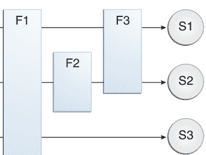

记住，过滤器链（filter chain）是传递给过滤器 `doFilter` 方法的对象之一。该链通过过滤器映射间接形成。链中过滤器的顺序与过滤器映射在 Web 应用部署描述文件中出现的顺序相同。

当过滤器被映射到 servlet S1 时，Web 容器会调用 F1 的 `doFilter` 方法。S1 过滤器链中每个过滤器的 `doFilter` 方法都是由链中的前一个过滤器通过 `chain.doFilter` 方法调用的。由于 S1 的过滤器链包含过滤器 F1 和 F3，因此 F1 对 `chain.doFilter` 的调用会触发 F3 的 `doFilter` 方法。当 F3 的 `doFilter` 方法完成后，控制权返回到 F1 的 `doFilter` 方法。

### 17.6.3.1 使用 NetBeans IDE 指定过滤器映射

1. 在 Project（项目）选项卡中，展开应用程序的项目节点。
2. 展开项目节点下的 Web Pages 和 WEB-INF 节点。
3. 双击 `web.xml`。
4. 点击编辑器窗口顶部的 Filters。
5. 展开编辑器窗口中的 Servlet Filters。
6. 点击 Add Filter Element，通过名称或 URL 模式将过滤器映射到 Web 资源。
7. 在 Servlet Filter 对话框中，在 Filter Name 字段中输入过滤器的名称。
8. 点击 Browse 浏览到过滤器所应用的的 servlet 类。
9. 点击 OK。
10. 要指定过滤器映射，请按照以下步骤操作：
    a. 展开 filter mappings 节点。
    b. 选择过滤器映射。
    c. 点击 Add。
    d. 在过滤器 mapping 对话框中，选择以下调度器类型：
        - REQUEST：当请求来自客户端时
        - ASYNC：当请求是异步的时
        - FORWARD：当请求已转发时（见 Transferring Control Another Component）
        - INCLUDE：当请求被包含时（见 Including Resources the Response）
        - ERROR：当请求是错误时（见 Handling Errors）

## 17.7 调用其他资源

Web 组件既间接也直接调用其他资源。要调用资源，你必须使用 `getRequestDispatcher(URL)` 方法获取 `RequestDispatcher` 对象。该方法接受资源路径作为参数。URL 可以是相对路径（即不以 / 开头），也可以包含绝对路径。如果资源不可用或服务器未实现，则返回 null。

### 17.7.1 在响应中包含资源

在响应中包含另一个资源（例如横幅内容或版权信息）通常很有用。要包含资源，调用 RequestDispatcher 的 `include` 方法：

```java
include(request, response);
```

如果资源是静态的，`include` 方法启用服务器包含。如果资源是 Web 组件，方法的效果是将请求发送到该组件，执行该组件，并将执行结果包含在响应中。被包含的组件可以访问请求对象，但对响应的操作受到限制：

- 它可以写入响应正文并提交响应。
- 它不能设置头或任何影响响应头的方法。

### 17.7.2 将控制权转移到另一个组件

在某些应用程序中，你可能希望一个 Web 组件对请求进行初步处理，并让另一个组件生成响应。例如，你可能根据请求的性质处理请求，然后转移到另一个组件。

要将控制权转移到另一个组件，调用 RequestDispatcher 的 `forward` 方法。当请求被转发时，URL 被设置为转发路径。原始 URL 及其部分被保存为请求属性：`javax.servlet.forward.[request-uri][context-path][servlet-path][path-info][query-string]`。

`forward` 方法用于让另一个资源回复用户。如果你已经在 servlet 中访问了 `ServletOutputStream` 或 `PrintWriter`，则无法使用此方法；这样做会抛出 `IllegalStateException`。

## 17.9 维护客户端状态

许多应用程序需要将客户端的一系列请求相互关联。例如，Web 应用程序可以跨请求保存用户购物车的状态。由于 HTTP 是无状态的，基于 Web 的应用程序负责维护这种状态，这种状态被称为会话（session）。为了支持需要维护状态的应用程序，Java Servlet 技术提供了管理会话的 API 以及实现会话的若干种机制。

### 17.9.1 访问会话

会话由 `HttpSession` 对象表示。你通过调用请求对象的 `getSession` 方法来访问会话。该方法返回与此请求关联的当前会话；如果请求没有会话，该方法将创建一个会话。

### 17.9.2 将对象与会话关联

可以通过名称将对象值属性与会话关联。任何属于同一个 Web `context`（上下文）且正在处理属于同一会话的请求的 Web 组件都可以访问这些属性。

回想一下，你可以通知 Web 上下文监听器和会话监听器对象关于 Servlet 生命周期周期的事件（处理 Servlet 生命周期周期事件）。你还可以通过以下机制通知对象与其与会话相关的某些事件：

- 当对象被添加到会话或被移除时。要接收此通知，你的对象必须实现 `javax.servlet.http.HttpSessionBindingListener` 接口。
- 当传递或激活该对象的会话时。当会话在虚拟机之间移动或保存到/从持久化存储恢复时，会话会被传递或激活。要接收此通知，你的对象必须实现 `javax.servlet.http.HttpSessionActivationListener` 接口。

### 17.9.3 会话管理

由于 HTTP 客户端无法信号它不再需要会话，因此每个会话都有关联的超时时间，以便回收资源。可以使用会话的 `getMaxInactiveInterval` 和 `setMaxInactiveInterval` 方法设置超时时间。

- 为了确保活动会话不超时，你应该定期使用服务方法访问会话，因为这将重置会话的生存计数器。
- 当特定的客户端交互结束时，你使用会话的 `invalidate` 方法在服务器端失效会话并移除任何会话数据。

#### 17.9.3.1 使用 NetBeans IDE 设置超时时间

要使用 NetBeans IDE 在部署描述符中设置超时时间，请遵循以下步骤。

1. 如果尚未打开项目，请打开项目。
2. 在 `Projects` 选项卡中展开项目节点。
3. 展开项目节点下的 `Pages` 和 `WEB-INF` 节点。
4. 双击 `web.xml`。
5. 点击编辑器顶部的 General（常规）选项卡。
6. 在 Session Timeout（会话超时）字段中输入一个整数值。

该整数值表示会话超时之前必须经过的空闲分钟数。

### 17.9.4 会话跟踪

为了将会话与用户关联，Web 容器可以使用多种方法，所有方法都涉及客户端和服务器之间的标识符。该标识符可以作为 cookie 维护在客户端上，或者 Web 组件可以将标识符包含在返回给客户端的每个 URL 中。

如果你的应用程序使用会话，请确保在客户端关闭 Cookie 时通过应用程序重写 URL 来启用跟踪。你通过对 servlet 返回的所有 URL 调用响应的 `encodeURL(URL)` 方法来实现这一点。该方法仅在禁用 Cookie 时将会话 ID 包含在 URL 中；否则，该方法将保持 URL 不变。

## 17.10 完成 Servlet

Web 容器可能认为应该从服务中移除 Servlet（例如，当容器想要回收内存资源或关闭时）。在这种情况下，容器会调用 Servlet 接口的 `destroy` 方法。在此方法中，你释放正在使用的资源并保存任何持久状态。`destroy` 方法会释放在 `init` 方法中创建的数据库对象。

当 Servlet 被移除时，其服务方法应全部完成。服务器尝试在所有服务请求返回后或服务器特定的宽限期后（以先到者为准）调用 `destroy` 方法来实现这一点。如果你的 Servlet 有运行时间超过服务周期的操作，那么在调用 `destroy` 时这些操作可能仍在运行。你必须确保任何仍在处理客户端请求的线程均完成。

本文其余部分解释如何执行以下操作：

- 跟踪当前运行服务方法的线程数量。
- 通过让 `destroy` 方法通知长时间运行的线程关闭并等待它们完成来提供整洁的关闭。
- 让长时间运行的方法定期检查关闭状态，并在必要时停止工作、清理并返回。

### 17.10.1 跟踪服务请求

要跟踪服务请求，请在 servlet 类中包含一个字段，用于计算正在运行的服务方法的数量。该字段应具有同步访问权限，以便递增、减少和返回其值：

```java
public class ShutdownExample extends HttpServlet {
    private int serviceCounter = 0;

    // 对 serviceCounter 的访问方法
    protected synchronized void enteringServiceMethod() {
        serviceCounter++;
    }
}
```

```java
protected synchronized void leavingServiceMethod() {
    serviceCounter--;
}
protected synchronized int numServices() {
    return serviceCounter;
}
```

服务方法在每次返回时都应该增加计数器。这是你的 `HttpServlet` 子类中少数几次之一：

```java
protected void service(HttpServletRequest req, HttpServletResponse resp) throws ServletException, IOException {
    enteringServiceMethod();
    try {
        super.service(req, resp);
    } finally {
        leavingServiceMethod();
    }
}
```

### 通知方法关闭

为了确保整洁的关闭，`destroy` 方法应该通知长时间运行的线程关闭并等待它们完成。这是一个使用这些字段的 `destroy` 方法示例：

```java
public class ShutdownExample extends HttpServlet {
    private boolean shuttingDown;

    // 用于 shuttingDown 的方法
    protected synchronized void setShuttingDown(boolean flag) {
        shuttingDown = flag;
    }
    protected synchronized boolean isShuttingDown() {
        return shuttingDown;
    }

    public void destroy() {
        /* 检查是否仍在运行 */
        if (numServices() > 0) {
            setShuttingDown(true);
        }

        /* 等待服务方法停止 */
        while (numServices() > 0) {
            try {
                Thread.sleep(interval);
            } catch (InterruptedException e) {
            }
        }
    }
}
```

### 创建礼貌的长运行方法

提供整洁关闭的最后一步是让任何长时间运行的方法表现得礼貌。可能运行很长时间的方法应该检查通知关闭的字段值，并在必要时中断工作、清理并返回：

```java
public void doPost(...) {
    for (int i = 0; i < lotsToDo; i++) {
        if (isShuttingDown()) {
            // 清理并返回
            return;
        }
        partOfRunningOperation(i);
    }
}
```

### 使用 Java Servlet 技术上传文件

支持文件上传是许多应用程序非常基础且常见的需求。在 Servlet 规范之前的版本中，实现文件上传需要使用外部库或复杂的输入处理。Java Servlet 规范现在以通用且可移植的方法提供了解决方案：Java Servlet 技术原生支持文件上传。

一个新的注解 `javax.servlet.annotation.MultipartConfig` 用于指示声明它的 servlet 期望请求为 multipart/form-data MIME 类型。每个标记了 `@MultipartConfig` 的 servlet 都可以通过调用 `request.getPart(String name)` 或 `request.getParts()` 获取给定 multipart/form-data 请求的 Part 组件。

#### MultipartConfig 注解

`@MultipartConfig` 注解支持以下选项：

- location: 文件系统中目录的绝对路径。location属性不支持相对于应用程序上下文的路径。该位置用于在处理部分期间或文件大小超过 `fileSizeThreshold` 时临时存储文件。默认位置为 "/"。
- fileSize: 存储到磁盘的文件大小（字节）。默认大小为 0 字节。
- maxSize: 允许的文件的最大大小（字节）。如果任何上传文件的大小大于此值，Web 容器将抛出异常（`IllegalStateException`）。默认大小为无限。
- requestSize: 允许的 multipart/form-data 请求的最大大小（字节）。如果上传文件的总大小超过此阈值，Web 容器将抛出异常。默认大小为无限。

## 异步处理

```java
@MultipartConfig(location="tmp", fileSizeThreshold=1024*1024, maxFileSize=1024*1024*5, maxRequestSize=1024*1024*5)
```

与其在文件上传中使用 `@MultipartConfig` 注解来硬编码这些属性，不如你可以在 `web.xml` 文件中将以下内容作为 `servlet` 配置元素的元素的子元素添加：


```xml
<multipart-config>
  <location>/tmp/</location>
  <max-file-size>20488820</max-file-size>
  <max-request-size>41941864</max-request-size>
  <file-size-threshold>1048576</file-size-threshold>
</multipart-config>
```

## 17.11 getParts 和 getPart 方法

Servlet 规范支持两个 `HttpServletRequest` 方法：

- `Collection<Part> getParts()`
- `Part getPart(String name)`

`request.getParts()` 方法返回所有 `Part` 对象的集合。如果你有多个类型的文件部分，则会返回多个 `Part` 对象。由于 `Part` 对象是有命名的，可以使用 `getPart(String name)` 来访问特定的 `Part`。或者，可以使用返回 `Iterable<Part>` 的 `getParts()` 方法配合遍历所有 `Part` 的 `Iterator` 来使用。

`javax.servlet.http.Part` 是一个简单的对象，提供了允许对每个 `Part` 进行内省的方法。这些方法执行以下操作：

- 获取 `Part` 的名称、大小和内容类型（content-type）
- 查询随 `Part` 提交的标头
- 将 `Part` 删除到磁盘
- 将 `Part` 写入磁盘

例如，`Part` 接口提供了 `write(String filename)` 方法来写入具有指定名称的文件。文件可以保存到 `@MultipartConfig` 注解中 `location` 属性指定的目录中，或者保存到文件上传位置（即表单中 `Destination` 字段指定的 location）。

## 17.12 异步处理

异步服务器中的 Web 容器为每个客户端请求使用一个服务器线程。在重负载条件下，容器需要大量线程来处理所有客户端请求。可扩展性限制包括内存耗尽或容器线程池耗尽。为了创建可扩展的 Web 应用程序，你必须确保没有与请求关联的线程处于空闲状态，以便容器可以使用它们来处理新请求。

与请求关联的线程处于空闲状态通常有两种常见场景：

- 线程在构建响应之前需要等待资源可用或处理数据。例如，应用程序在生成响应之前需要查询数据库或从远程 Web 服务访问数据。
- 线程在生成响应之前需要等待某个事件。例如，应用程序可能在生成响应之前需要等待 JMS 消息、来自另一个客户端的新信息或队列中可用的新数据。

这些场景代表了限制 Web 应用程序可扩展性的阻塞操作。异步处理是指将这些阻塞操作分配给新线程，并立即将与请求关联的线程返回给容器。

### 17.12.1 Servlet 中的异步处理

Java EE 为 servlet 和过滤器提供了异步处理支持。如果 servlet 或过滤器在处理请求时遇到潜在的阻塞操作，它可以将该操作分配给异步执行上下文，并立即将与请求关联的线程返回给容器而不生成响应。阻塞操作在另一个线程中完成异步执行上下文，该线程可以生成响应或将请求分派到另一个 servlet。

要启用 servlet 异步处理，请在 `@WebServlet` 注解上将 `asyncSupported` 参数设置为 `true`，如下：

```java
@WebServlet(urlPatterns="/asyncservlet", asyncSupported=true)
public class AsyncServlet extends HttpServlet { ... }
```

`javax.servlet.AsyncContext` 提供了在方法内部执行异步处理所需的功能。获取 `AsyncContext` 实例，请调用服务方法对象上的 `startAsync()` 方法；例如：

```java
public void doGet(HttpServletRequest req, HttpServletResponse response) {
  AsyncContext context = req.startAsync();
  ...
}
```

这会将请求放入异步模式，并确保在退出服务方法后不会提交响应。你必须在阻塞操作完成后在异步上下文中生成响应，或将请求分派到另一个 servlet。

表 17-3 描述了 `AsyncContext` 类提供的基本功能。

| 方法签名 | 描述 |
| :--- | :--- |
| `void start(Runnable run)` | 容器提供一个不同的线程，在其中可以处理阻塞操作。你提供一个实现 `Runnable` 接口的类作为阻塞操作的代码。你可以在调用 `start` 方法时提供此类的内部类，或其他机制将 `AsyncContext` 实例传递给你的类。 |
| `ServletRequest getRequest()` | 返回用于初始化此异步上下文的请求。在上面的示例中，请求与服务方法中的请求相同。你可以在异步上下文中使用此方法从请求中获取参数。 |

#### 表 17–3（续）AsyncContext 类提供的功能

| 方法签名 | 描述 |
| :--- | :--- |
| `ServletResponse getResponse()` | 返回用于初始化此异步上下文的响应。在上面的示例中，响应与服务方法中的响应相同。你可以在异步上下文中使用此方法将阻塞操作的结果写入响应。 |
| `void complete()` | 完成异步执行并将其发送给客户端。 |
| `void dispatch(String path)` | 将请求和响应分派给指定的路径。 |

### 17.12.2 等待资源

本节演示了如何使用 `AsyncContext` 处理以下情况：

1. servlet 接收到一个参数。
2. servlet 使用资源（如数据库）根据参数检索信息。
3. servlet 生成响应。

以下代码显示了一个没有使用异步处理的 servlet：

```java
@WebServlet(urlPatterns="/syncservlet")
public class SyncServlet extends HttpServlet {
    private Resource resource;
    @Override
    public void init(ServletConfig config) {
        resource = new Resource();
    }

    @Override
    public void doGet(HttpServletRequest request, HttpServletResponse response) {
        String param = request.getParameter("param");
        String result = resource.process(param);
        // ... 
    }
}
```

以下代码显示了使用异步处理的同一个 servlet：

```java
@WebServlet(urlPatterns="/asyncservlet", asyncSupported=true)
public class AsyncServlet extends HttpServlet {
    private Resource resource;
    @Override
    public void init(ServletConfig config) {
        resource = new Resource();
    }

    @Override
    public void doGet(HttpServletRequest request, HttpServletResponse response) {
        AsyncContext context = request.startAsync();
        context.start(new Runnable() {
            public void run() {
                String param = context.getRequest().getParameter("param");
                String result = resource.process(param);
                // ... 
                context.complete();
            }
        });
    }
}
```

## 17.13 非阻塞 I/O

本节演示了如何使用 `AsyncContext` 处理以下情况：

1. servlet 接收到一个参数。
2. servlet 使用资源（如数据库）根据参数检索信息。
3. servlet 异步生成响应。

以下代码显示了一个没有使用非阻塞 I/O 的 servlet：

```java
@WebServlet(urlPatterns="/syncio")
public class SyncIOServlet extends HttpServlet {
    @Override
    public void doGet(HttpServletRequest request, HttpServletResponse response) {
        String param = request.getParameter("param");
        // ...
    }
}
```

以下代码显示了使用非阻塞 I/O 的同一个 servlet：

```java
@WebServlet(urlPatterns="/asyncio", asyncSupported=true)
public class AsyncIOServlet extends HttpServlet {
    @Override
    public void doGet(HttpServletRequest request, HttpServletResponse response) {
        response.setContentType("text/html;UTF-8");
        final AsyncContext context = request.startAsync();
        context.start(new Runnable() {
            public void run() {
                String param = context.getRequest().getParameter("param");
                // ...
                context.complete();
            }
        });
    }
}
```

表 17-4 和表 17-5 描述了 servlet 输入和输出流中用于非阻塞 I/O 支持的方法。表 17-6 描述了读/写监听器的接口。

### 表 17-4 javax.servlet.ServletInputStream 中的非阻塞 I/O 支持

| 方法 | 描述 |
| --- | --- |
| `void setListener(ReadListener rl)` | 将此输入流与监听器对象关联，该对象包含用于异步读取数据的回调方法。你通过匿名内部类提供监听器对象，或使用另一种机制将输入流传递给读取监听器。 |
| `boolean isReady()` | 如果可以在不阻塞的情况下读取数据，则返回 true。 |
| `boolean isFinished()` | 当所有数据都已读取时，返回 true。 |

### 表 17-5 javax.servlet.ServletOutputStream 中的非阻塞 I/O 支持

| 方法 | 描述 |
| --- | --- |
| `void setListener(WriteListener wl)` | 将此输出流与监听器对象关联，该对象包含用于异步写入数据的回调方法。你通过匿名内部类提供监听器对象，或使用另一种机制将输出流传递给写入监听器。 |
| `boolean isReady()` | 如果可以在不阻塞的情况下写入数据，则返回 true。 |

> `ServletInputStream` 实例在有可用数据可读、所有数据已读或发生错误时，会调用其监听器上的方法。
>
> `ServletOutputStream` 实例在可以写入数据或发生错误时，会调用监听器上的方法。

## 17.13.1 使用非阻塞 I/O 读取大型 HTTP POST 请求

本节代码展示了如何通过将请求置于异步模式（如“异步处理”部分所述）并使用表 17-4 和表 17-6 中的非阻塞 I/O 功能，用 servlet 读取大型 HTTP POST 请求。

```java
@WebServlet(urlPatterns="/asyncuserservlet", asyncSupported=true)
public class AsyncIOSServlet extends HttpServlet {
    @Override
    public void doPost(HttpServletRequest request,
            HttpServletResponse response)
            throws IOException {
        final AsyncContext acontext = request.startAsync();
```

## 协议升级处理

```java
final ServletInput input = request.getInputStream();

input.setReadListener(new ReadListener() {
    byte buffer[] = new byte[4*1024];
    StringBuilder builder = new StringBuilder();
    @Override
    public void onDataAvailable() {
        try {
                int length = input.read(buffer);
                builder.append(new String(buffer, 0, length));
            } while (input.isReady());
        } catch (IOException ex) { }
    }
    @Override
    public void onAllDataRead() {
        try {
            context.getResponse().getWriter()
                .write("the response...");
        } catch (IOException ex) { }
        context.complete();
    }
    @Override
    public void onError(Throwable t) { }
}});
```

此示例使用 `@WebServlet` 注解 `asyncSupported=true` 声明了一个支持异步的 web servlet。服务方法首先通过调用请求对象的 `startAsync()` 方法将请求置于异步模式，这是使用非阻塞 I/O 的必须。然后，服务方法从请求中获取输入流，并分配一个定义为内部类的读取监听器。监听器在请求部分可用时读取它们，并在完成请求后向客户端写入一些响应。

## 17.14 协议升级处理

在 HTTP/1.1 中，客户端可以使用 Upgrade 头部字段请求在当前连接上切换到不同的协议。如果服务器接受切换到客户端指定的协议请求，它将生成一个状态码为 101（切换协议）的 HTTP 响应。交换完成后，客户端和服务器将使用新协议进行通信。

例如，客户端可以如下发起 HTTP 请求切换到 XYZ 协议：

```http
GET /xyzresource HTTP/1.1
Host: localhost:8080
Accept: text/html
Upgrade: XYZ
Connection: Upgrade
OtherHeader: Value
```

客户端可以使用 HTTP Header 为新协议指定参数。服务器可以接受请求并生成如下响应：

```http
HTTP/1.1 101 Switching Protocols
Upgrade: XYZP
Connection: Upgrade
OtherHeaderB: Value

(XYZP 数据)
```

Java EE 支持如表 17-7 描述的 servlet 中的 HTTP 协议功能。

| 类或接口 | 方法 | 描述 |
| --- | --- | --- |
| `HttpUpgradeRequest` | `HttpUpgradeHandler upgrade(Class handler)` | `upgrade` 方法启动协议升级处理。该方法实例化实现 `HttpUpgradeHandler` 接口的类，并将连接委托给它。 |
| `HttpUpgradeHandler` | `void init(WebConnection wc)` | 当 servlet 接受切换协议请求时调用此方法。你实现此方法并从 `WebConnection` 对象获取输入流和输出流来实现新协议。 |
| `HttpUpgradeHandler` | `void destroy()` | 当客户端断开连接时调用 `destroy`。你实现此方法并释放与处理协议相关的任何资源。 |


| WebConnection | ServletInputStream getInputStream() | InputStream 提供了对连接输入流的访问。你可以对返回的流使用非阻塞 I/O 实现新协议。 |
| WebConnection | ServletOutputStream getOutputStream() | getOutputStream 方法提供了对连接输出流的访问。你可以对返回的流使用非阻塞 I/O 实现新协议。 |

以下代码演示了如何接受客户端的 HTTP 协议升级请求：

```java
@WebServlet(urlPatterns="/xyzpressure")
public class XYZPUpgradeServlet extends HttpServlet {
    @Override
    public void doGet(HttpServletRequest request,
        HttpServletResponse response) {
        if ("XYZP".equals(request.getHeader("Upgrade"))) {
            /* 接受升级请求 */
            response.setStatus(101);
            response.setHeader("Upgrade", "Upgrade");
            response.setHeader("Connection", "Upgrade");
            response.setHeader("OtherHeaderB", "Value");
            /* 将连接委托给升级处理器 */
            XYZPUpgradeHandler handler = request.upgrade(XYZPUpgradeHandler.class);
            /* 服务方法直接返回 */
        } else {
            /* 写入错误响应 */
        }
    }
}
```

`XYZPUpgradeHandler` 类处理连接：

```java
public class XYZPUpgradeHandler implements HttpUpgradeHandler {
    @Override
    public void init(WebConnection wc) {
        ServletInputStream input = wc.getInputStream();
        ServletOutputStream output = wc.getOutputStream();
        /* 使用这些流实现 XYZP（协议特定） */
    }
    @Override
    public void destroy() { }
}
```

实现 `HttpUpgradeHandler` 的类使用连接的流通过新协议与客户端通信。关于协议升级支持的详情参见 Servlet 3.1 规范。

## 17.15 mood 示例应用程序

`mood` 示例位于 `tut-install/examples/web/servlet/mood/` 目录，是一个在不同时间显示 Duke 心情的简单示例。该示例展示了如何使用 `@WebServlet`、`@WebFilter` 和 `@WebListener` 注解创建监听器、servlet 和过滤器。

### 17.15.1 mood 应用的组件

`mood` 应用由三个组件组成：`mood.web.MoodServlet`、`mood.web.TimeOfDayFilter` 和 `mood.web.SimpleServletListener`。

`MoodServlet` 是应用程序的表示层，根据一天中的时间显示 Duke 的心情。`@WebServlet` 指定了 URL 模式：

```java
@WebServlet("/report")
public class MoodServlet extends HttpServlet {
```

`TimeOfDayFilter` 设置了一个初始化参数表示 Duke 醒着：

```java
@WebFilter(filterName = "TimeOfDayFilter",
    urlPatterns = {"/*"},
    initParams = {
        @WebInitParam(name = "mood", value = "awake")
    })
public class TimeOfDayFilter implements Filter {
    ...}
```

过滤器调用 `doGet` 方法，该方法包含一个 `switch` 语句，根据当前时间设置 Duke 的心情。

`SimpleServletListener` 记录 servlet 生命周期的变化。服务器日志中的条目。

### 17.15.2 运行 mood 示例

你可以使用 NetBeans IDE 或 Maven 来构建、打包、部署和运行 `mood` 示例。

#### 17.15.2.1 使用 NetBeans IDE 运行 mood 示例

1. 确保 GlassFish 服务器已启动（参见“启动和停止 GlassFish 服务器”）。
2. 从 File（文件）菜单中，选择 Open Project（打开项目）。
3. 在 Project 对话框中，导航到：
```
tut-install/examples/web/servlet/
```
4. 选择 `mood` 文件夹。
5. 点击 Open Project（打开项目）。
6. 在 Projects（项目）选项卡中，右键点击 `mood` 项目并选择 Build（构建）。
7. 在浏览器中，打开 URL `http://localhost:8080/mood/report`。

该 URL 指定了上下文根（context root），随后是 URL 模式。

随后会出现一个标题为“Servlet MoodServlet at /mood”的页面、一个描述 Duke 情绪的文本字符串以及一张插图。

#### 17.15.2.2 使用 Maven 运行 mood 示例

1. 确保 GlassFish 服务器已启动（参见“启动和停止 GlassFish 服务器”）。
2. 在终端窗口中，进入：
```
tut-install/examples/web/servlet/
```
3. 输入以下命令来部署应用程序：
```bash
mvn install
```
4. 在浏览器中，打开 URL `http://localhost:8080/mood/report`。

该 URL 指定了上下文根，随后是 URL 模式。

随后会出现一个标题为“Servlet MoodServlet at /mood”的页面、一个描述 Duke 情绪的文本字符串以及一张插图。

## 17.16 fileupload 示例应用程序

`fileupload` 示例程序位于 `tut-install/examples/web/servlet/fileupload/` 目录下，它演示了如何实现和使用文件上传功能。

Duke 的案例研究提供了一个更复杂的示例，可以上传图像文件将其内容存储在数据库中。

### 17.16.1 fileupload 示例程序的架构

`fileupload` 示例应用程序由单个 servlet 和一个 HTML 表单组成，该表单向 servlet 发起文件上传请求。

该示例包含一个非常简单的 HTML 表单，带有两个字段：File（文件）和 Destination（目标）。输入类型 `file` 允许用户浏览本地文件系统以选择文件。当文件被选定后时，它将作为 POST 请求的一部分发送到服务器。在此过程中，对输入类型为 `file` 的表单应用了两个强制性限制：

- `enctype` 属性必须设置为 `multipart/form-data`。
- 它的 `method` 必须是 `POST`。

当以这种方式指定表单时，整个请求将以编码格式发送到服务器。servlet 使用自己的名称来处理请求，以处理传入的文件数据并从流中提取文件。目标（destination）是计算机上保存文件位置的路径。点击表单底部的 Upload（上传）按钮会将数据发送到服务器，服务器会将文件保存到指定的位置。

`index.html` 中的 HTML 表单如下：

```html
<!DOCTYPE html>
<html lang="en">
<head>
  <title>File Upload</title>
  <meta http-equiv="Content-Type" content="text/html; charset=UTF-8">
</head>
<body>
  <form method="POST" action="upload" enctype="multipart/form-data">
    File:
    <input type="file" name="file" id="file" />
    Destination:
    <input type="text" value="tmp" name="destination"/>
    <br>
    <input type="submit" value="Upload" name="upload" />
  </form>
</body>
</html>
```

当客户端需要将数据作为请求的一部分发送到服务器时，会使用 POST 请求，例如上传文件或提交完成的表单。相比之下，GET 方法仅向服务器发送 URL 和标头，而 POST 请求还包含消息体。这允许向服务器发送任意长度的数据。POST 请求中的标头字段通常指示数据的媒体类型。

在提交表单时，浏览器会流式传输内容并合并所有部分，每个部分代表表单的一个字段。部分根据输入元素命名，并使用命名为 `boundary` 的字符串相互隔开。

提交的数据看起来如下：

```
POST /upload HTTP/1.1
Host: localhost:8080
Content-Type: multipart/form-data; boundary=----WebKitBoundaryMA4WTr0g

----WebKitBoundaryMA4WTr0g
Content-Disposition: form-data; name="file"; filename="sample.txt"

----WebKitBoundaryMA4WTr0g
Content-Disposition: form-data; name="destination"

tmp
----WebKitBoundaryMA4WTr0g--
```

输入以下命令来部署应用程序：

```bash
mvn install
```

### 17.16.2 运行 fileupload 示例

1. 在浏览器中输入以下 URL：
`http://localhost:8080/fileupload/`
2. 在 File Upload 页面，点击 **Choose File**（选择文件）显示文件浏览器。
3. 选择一个文件进行上传并点击 **Open**（打开）。

您选择的文件名称将显示在 **File**（文件）字段中。如果您没有选择文件，将抛出异常。

4. 在 **Destination**（目标）字段中，输入目录名称。

该目录必须已经创建并且是可写的。如果您没有输入目录名称，或者输入了不存在或受保护的目录名称，将抛出异常。

5. 点击 **Upload**（上传）将指定的文件上传到您指定的目录中。

消息报告文件已在您指定的目录中创建。

6. 转到在 **Destination** 字段中指定的目录，并验证上传的文件是否存在。

## 17.17 dukeef 示例应用程序

`dukeef` 应用程序位于 `tut-install/examples/web/dukeef/` 目录下，演示了如何在 servlet 中使用异步处理为 Web 客户端提供数据更新。该示例启用了一个服务，可以提供电子交易基金（ETF）价格和成交量的定期更新。

- servlet 进入异步模式，将它们存储在队列中，当新的价格和成交量数据可用时写入响应。
- bean 每秒更新一次价格和量信息。
- HTML 页面使用 JavaScript 向 servlet 请求新数据，解析来自 servlet 的响应并在不刷新页面的情况下更新价格和量信息。

`dukeef` 示例应用程序使用一种名为 **长轮询**（long polling）的编程模型。由一个 servlet、一个企业 bean 和一个 HTML 页面组成。在传统的 HTTP 请求响应模型中，用户必须发出显式请求（例如点击链接或提交表单）才能从服务器获取任何新信息，并且必须刷新页面。长轮询为 Web 应用提供了一种机制，无需用户显式请求通过 HTTP 向客户端推送更新。服务器异步处理连接，客户端使用 JavaScript 创建新连接。在这种模型中，客户端在接收到新数据后立即发送新请求，服务器在数据可用之前保持连接开启。

### 17.17.1.1 Servlet

`DukeETFServlet` 类使用了异步处理：

```java
@WebServlet(urlPatterns={"/dukeef"}, asyncSupported=true)
public class DukeETFServlet extends HttpServlet
{}
```

在下面的代码示例中，`init` 方法初始化一个队列来持有客户端请求并启动一个新线程。该线程每秒随机增量更新价格和成交量，并将新值作为纯文本发送给所有已连接客户端：

```java
@Override
public void init(ServletConfig config) {
  /* 请求队列 */
  requestQueue = new ConcurrentLinkedQueue<AsyncContext>();
  /* 定期设置价格和量。 */
  /* 将信息发送给所有已连接客户端。 */
  Executors.newSingleThreadExecutor().execute(new Runnable() {
    public void run() {
      Random random = new Random();
      while (true) {
        /* 设置价格和量 */
        price = (1.0 * random.nextInt(100) - 50) / 100.0;
        volume += random.nextInt(5000) - 2500;
        /* 向所有客户端发送信息 */
        for (AsyncContext context : requestQueue) {
          try {
            PrintWriter writer = context.getResponse()
              .getWriter();
            writer.printf("%.2f, %d", price, volume);
            context.complete();
          } catch (IOException exception) {}
        }
        /* 等待 */
        try { Thread.sleep(DELAY_MS); } catch (Exception e) {}
      }
    }
  });
}
```

上述代码在此示例中不需要企业 bean，但它包含了若干项实践：

- servlet 包含了业务逻辑（更新价格和量信息）。通常情况下您应该使用企业 bean 来实现业务逻辑。
- servlet 创建了一个新线程。您应该始终使用容器提供的线程，而不是手动创建新线程。
- servlet 在 `while` 循环中调用 `Thread.sleep` 来模拟定期事件。您应该使用企业 Java Bean (EJB) 容器的定时器服务来调度定期通知。

以下代码替换了 `init` 方法并添加了 `send` 方法：

```java
@Override
public void init(ServletConfig config) {
  /* 请求队列 */
  requestQueue = new ConcurrentLinkedQueue<>();
  /* 注册提供价格/量更新的企业 bean */
  pvbean.registerServlet(this);
}

/* PriceVolumeBean 每秒调用此方法发送更新 */
public void send(double price, int volume) {
    /* 向所有已连接客户端发送更新 */
    for (AsyncContext context : requestQueue) {
        try {
            PrintWriter writer = context.getResponse()
              .getWriter();
            writer.printf("%.2f, %d", price, volume);
            context.complete();
        } catch (IOException exception) {}
    }
}
```

### 17.17.1.2 Enterprise Bean

`PriceVolumeBean` 类使用定时服务来更新价格和量：


```java
@Startup
@Singleton
public class PriceVolumeBean {
    /* 使用定时服务 */
    @Resource TimerService tservice;
    private DukeETFServlet servlet;
    private double price;
    private int volume;

    @PostConstruct
    public void init() {
        /* 初始化 EJB 并创建定时器 */
        random = new Random();
        servlet = null;
        tservice.createIntervalTimer(1000, 1000, new TimerConfig());
    }

    public void registerServlet(DukeETFServlet servlet) {
        /* servlet 以发送更新 */
        this.servlet = servlet;
    }

    @Timeout
    public void timeout() {
        /* 价格并发送更新 */
        price = 1.0*random.nextInt(100)-50)/100.0;
        volume = random.nextInt(5000) - 2500;
        if (servlet != null)
            servlet.send(price, volume);
    }
}
```

## 17.17.1.3 HTML 页面

HTML 页面由表格和一些 JavaScript 代码组成。表格包含 JavaScript 代码引用的两个字段：

```html
<html xmlns="http://www.w3.org/1999/xhtml">
<head>
</head>
<body onload="makeAjaxRequest();">
...
<table>
...
<td id="price">--,--</td>
...
<td id="volume">--,--</td>
...
</table>
</body>
</html>
```

JavaScript 代码使用 `XMLHttpRequest` API，它提供了在客户端和服务器之间传输数据的功能。脚本向服务器发送异步请求并指定了一个回调方法。当服务器提供响应时，回调方法更新表格中的字段并发送新请求。JavaScript 代码如下：

```javascript
var ajaxRequest;
function makeAjaxRequest() {
    ajaxRequest = new XMLHttpRequest();
    ajaxRequest.open("GET", "http://localhost:8080/dukeef", true);
    ajaxRequest.onreadystatechange = updatePage;
    ajaxRequest.send();
}
function updatePage() {
    if (ajaxRequest.readyState == 4) {
        var arrayvp = ajaxRequest.response.split(":");
        document.getElementById("price").innerHTML = arrayvp[0];
        document.getElementById("volume").innerHTML = arrayvp[1];
        makeAjaxRequest();
    }
}
```

# dukeef 示例应用程序

```javascript
function makeAjaxRequest() {
  ajaxRequest = new XMLHttpRequest();
  ajaxRequest.onreadystatechange = updatePage;
  ajaxRequest.open("GET", "http://localhost:8080/dukeef/dukeef", true);
  ajaxRequest.send(null);
}
```

大多数现代浏览器都支持 `XMLHttpRequest`，它被广泛用于 AJAX Web 客户端（异步 JavaScript 和 XML）开发。

请参见第 18 章“Java API for WebSocket”中的 dukeef 示例应用程序，获取使用 WebSocket 端点实现的等效示例。

## 17.17.2 运行 dukeef 示例应用程序

本节描述了如何使用 NetBeans IDE 和从命令行运行 dukeef 示例应用程序。

### 17.17.2.1 使用 Net IDE 运行 dukeef 示例

1. 确保 GlassFish 服务器已启动（参见“启动和停止 GlassFish 服务器”）。
2. 从文件（File）菜单选择打开项目（Open Project）。
3. 在项目（Project）对话框中，导航到：`tut-install/examples/web/servlet/dukeef` 文件夹。
4. 选择该项目。
5. 点击打开项目（Open Project）。
6. 在项目（Projects）选项卡中，右键点击 dukeef 项目并选择运行（Run）。

此命令将构建并将应用程序打包成 WAR 文件（`dukeef.war`），该文件位于 `target/` 目录下，将其部署到服务器，并启动带有以下 URL 的浏览器窗口：

http://localhost:8080/dukeef/

在不同的浏览器上打开相同的 URL，查看两个页面如何同时更新价格和成交量（成交量）。

## 17.17.2.2 使用 Maven 运行 dukeef 示例应用程序

1. 确保 GlassFish 服务器已启动（参见“启动和停止 GlassFish 服务器”）。
2. 在终端窗口中，进入：`tut-install/examples/web/servlet/dukeef`
3. 输入以下命令部署应用程序：

`mvn install`

4. 打开浏览器窗口，并输入以下地址：

http://localhost:8080/dukeef/

在不同的浏览器上打开相同的 URL，查看两个页面如何同时获取价格和成交量的更新。

## 17.18 Java Servlet 技术的更多信息

有关 Java Servlet 技术的更多信息，请参见：

- Java Servlet 3.1 规范：
  http://jcp.org/en/jsr/detail?id=340
- Java Servlet 网站：
  http://www.oracle.com/technetwork/java/index-jsp-135475.html

# 18 Java API for WebSocket

本章介绍了 WebSocket Java API (JSR-356)，它为创建 WebSocket 提供了支持。WebSocket 是一种应用协议，通过 TCP 协议在两个节点之间提供全双工通信。

在 HTTP 使用的传统请求响应模型中，客户端请求资源，服务器提供响应。交换始终由客户端发起；如果客户端不先请求，服务器无法发送任何数据。当客户端偶尔请求不频繁变化的文档时，这种模型对于万维网运行良好，但随着今天用户期望在 Web 上获得更具性的体验，这种方法的局限性变得日益突出。WebSocket 协议通过在客户端和服务器之间提供全双工通信通道解决了这些局限性。结合 JavaScript 和 HTML5 等其他技术，WebSocket 允许应用程序提供更丰富的用户体验。

此处涵盖了以下主题：

- WebSocket 简介
- 在 Java EE 中创建 WebSocket 应用程序
- 程序端点
- 注解端点
- 发送和接收消息
- 维护客户端状态
- 使用编码器和解码器
- 路径参数
- 错误处理
- 指定端点配置类
- dukeet2 示例应用程序
- websocketbot 示例应用程序
- 关于 WebSocket 的更多信息

## 18.1 WebSocket 简介

在 WebSocket 应用程序中，服务器发布 WebSocket 端点，客户端使用端点的 URI 连接到服务器。连接建立后，WebSocket 协议是对称的：在连接开启期间，客户端和服务器可以随时互相发送消息，并且可以随时关闭连接。客户端只连接到一个服务器，而服务器接受多个客户端的连接。

WebSocket 协议包含两个部分：握手和数据传输。客户端通过其 URI 向 WebSocket 端点发送请求来发起握手。握手与现有的基于 HTTP 的基础设施兼容：Web 服务器将其解释为 HTTP 连接升级请求。客户端的握手示例如下：

```
GET /path/to/websocket/endpoint HTTP/1.1
Host: localhost
Upgrade: websocket
Connection: Upgrade
Sec-WebSocket-Key: qj3RmZbZyRINnEF1kg=
Origin: http://localhost
Sec-WebSocket-Version: 13
```

服务器响应客户端的握手示例如下：

```
HTTP/1.1 101 Switching Protocols
Upgrade: websocket
Connection: Upgrade
Sec-WebSocket-Accept: kTJDdLooIG/McpvFB3y3FE=
```

服务器提供了一个选项来验证 `Sec-WebSocket-Key` 头部的值，以生成 `Sec-WebSocket-Accept` 头部的值。客户端对 `Sec-WebSocket-Key` 头部的值应用该操作，如果结果与从服务器接收的值匹配，则连接成功建立。握手成功后，客户端和服务器互相发送消息。

WebSocket 支持文本消息（编码为 UTF-8）和二进制消息。控制帧包括关闭（close）、ping 和 pong（对 ping 的响应）。ping 和 pong 帧可能包含数据。

端点表示为以下形式：

```
ws://主机:端口/查询
wss://主机:端口/查询
```

`ws` 方案表示非加密连接，`wss` 方案表示加密连接。端口部分是可选的；默认端口号非加密连接为 80，加密连接为 443。

## 18.2 在 Java EE 中创建 WebSocket 应用程序

EE 平台包含了 WebSocket Java API (JSR-356)，它提供了创建 WebSocket 应用程序的支持。该 API 允许访问远程端点。该 API 包含以下包：

- `javax.websocket.server`：包含创建和配置服务器端点的注解、类和接口。
- `javax.websocket`：包含客户端和服务器通用的注解、类、接口和异常。

WebSocket 端点是 `javax.websocket.Endpoint` 的实例。WebSocket 允许创建两种端点：程序端点和注解端点。创建程序端点时，扩展 `Endpoint` 类并重写其方法。创建注解端点时，使用提供的注解装饰 Java 类及其方法。在创建注解端点后，将其部署到特定的 URI。

> 注意：大多数情况下，创建注解端点比创建程序端点更简单。本章提供了程序端点的简单示例，但重点是注解端点。

创建和部署 WebSocket 端点的流程如下：

- 创建端点类。
- 实现端点的生命周期方法。
- 在端点中添加业务逻辑。
- 将端点部署到 Web 应用程序。

程序端点和注解端点的流程略有不同，将在后续章节详细介绍。

> 注意：与 Servlet 不同，WebSocket 端点是多次实例化的。容器为每个连接创建一个端点实例。每个实例与一个且仅一个连接关联。这有助于维护每个连接的用户状态，并简化了开发，因为任何时候只有一个线程执行端点实例的代码。

## 18.3 程序端点

以下示例展示了如何通过扩展 `Endpoint` 类创建端点：

```java
public class EchoEndpoint extends Endpoint {
    @Override
    public void onOpen(Session session, EndpointConfig config) {
        session.addMessageHandler(new MessageHandler.Whole<String>() {
            @Override
            public void onMessage(String msg) {
                try {
                    session.getBasicRemote().sendText(msg);
                } catch (IOException e) { ... }
            }
        });
    }
}
```

该端点会回显收到的每个消息。`Endpoint` 类定义了三个生命周期方法：`onOpen`、`onClose` 和 `onError`。`EchoEndpoint` 类实现了 `onOpen` 方法，它是 `Endpoint` 类中唯一的抽象方法。

`Session` 参数表示此端点与远程端点之间的对话。`addMessageHandler` 方法注册消息处理程序，而 `getBasicRemote` 方法返回一个表示远程端点的对象。本章剩余部分将介绍 `Session` 接口。

消息处理程序被实现为一个匿名内部类。当端点接收到文本消息时，消息处理程序的 `onMessage` 方法会被调用。

要部署此程序化端点，请在您的 Java EE 应用程序中使用以下代码：

```java
ServerEndpointConfig.Builder.create(EchoEndpoint.class, "/echo").build();
```

当您部署应用程序时，可以通过以下地址访问：

`ws://<host>:<port>/<application>/echo`；例如，

`ws://localhost:8080/echoapp`。

## 18.4 注解的端点

以下示例展示了如何使用引入的注解从程序化端点创建相同的端点：

```java
@ServerEndpoint("/echo")
public class EchoEndpoint {
    @OnMessage
    public void onMessage(Session session, String msg) {
        try {
            session.getBasicRemote().sendText(msg);
        } catch (IOException e) { ... }
    }
}
```

注解方式比等效的程序化端点更简单，它会根据 `ServerEndpoint` 注解中定义的相对路径随应用程序自动部署。此示例无需为消息处理程序创建额外的类，而是使用 `OnMessage` 注解来指定处理消息的调用方法。

表 18-1 列出了 `javax.websocket` 包中用于指定处理生命周期事件方法的注解。表中的示例列出了这些方法最常用的参数。请参阅 API 参考以了解每种情况下允许的参数组合的详情。

| 表 18-1 WebSocket 端点生命周期注解 |
| :--- |
| **注解** | **事件** | **示例** |
| `OnOpen` | 连接打开。 | `@OnOpen public void open(Session session, EndpointConfig config) { }` |
| `OnMessage` | 接收消息。 | `@OnMessage public void message(Session session, String msg) { }` |
| `OnError` | 连接错误。 | `@OnError public void error(Session session, Throwable error) { }` |
| `OnClose` | 连接关闭。 | `@OnClose public void close(Session session, CloseReason reason) { }` |

## 18.5 发送和接收消息

WebSocket 端点可以发送和接收文本及二进制消息。此外，它们还可以发送 ping 帧并接收 pong 帧。本节描述了如何使用 `Session` 和 `RemoteEndpoint` 接口向连接的对方发送消息，以及如何使用 `OnMessage` 注解从对方接收消息。

### 18.5.1 发送消息

按照以下步骤在端点发送消息：

1. 从连接中获取 `Session` 对象。

`Session` 对象作为端点注解生命周期方法的参数可用，如表 18-1 所示。当您的消息是对方的响应时，您可以在接收消息的方法内部（标记了 `@OnMessage` 的方法）获取 `Session` 对象。如果您必须发送不是响应的消息，请在标记了 `@OnOpen` 的方法中将 `Session` 对象存储为端点类的实例变量，以便您可以通过其他方法访问它。

2. 使用 `RemoteEndpoint` 对象获取一个 `RemoteEndpoint` 对象。

`Session.getBasicRemote()` 和 `Session.getAsyncRemote()` 方法分别返回 `RemoteEndpoint.Basic` 和 `RemoteEndpoint.Async` 实例。`RemoteEndpoint.Basic` 提供了发送消息的阻塞方法；`RemoteEndpoint.Async` 接口提供了非阻塞方法。

3. 使用 `RemoteEndpoint` 对象向对方发送消息。

以下列表显示了您可以使用向对方发送消息的一些方法：


- `void RemoteEndpoint.Basic.sendText(String text)`

向对方发送消息。此方法会阻塞，直到整个消息传输完毕。

- `void RemoteEndpoint.Basic.sendBinary(ByteBuffer data)`

向对方发送二进制消息。此方法会阻塞，直到整个消息传输完毕。

- `void RemoteEndpoint.sendPing(ByteBuffer data)`

向对方发送 ping 帧。

- `void RemoteEndpoint.sendPong(ByteBuffer data)`

向对方发送 pong 帧。

“注解的端点”中的示例演示了如何使用此过程接收每个入站的文本消息。

# 18.5.1.1 向连接到端点的所有对方发送消息

端点类的每个实例都与且仅与连接关联；某些情况下，端点需要向所有连接的对方发送消息。例如聊天应用程序和在线拍卖。`Session` 接口提供了 `getSessions` 方法用于此目的。以下示例演示了如何使用该方法将入站消息转发到所有连接的对方：

```java
@ServerEndpoint("/echoall")
public class EchoAllEndpoint {
  @OnMessage
  public void onMessage(Session session, String msg) {
    try {
      for (Session sess : session.getSessions()) {
        if (sess.isOpen()) {
          sess.getBasicRemote().sendText(msg);
        }
      }
    } catch (IOException e) { ... }
  }
}
```

# 18.5.2 接收消息

`OnMessage` 注解指定处理入站消息的方法。在端点中，每种消息类型（文本、二进制和 pong）最多有三个标记了 `@OnMessage` 的方法。以下示例演示了如何设计方法接收这三种类型的消息：

```java
@ServerEndpoint("/receive")
public class ReceiveEndpoint {
  @OnMessage
  public void text(Session session, String msg) {
    System.out.println("Text message: " + msg);
  }
  @OnMessage
  public void binaryMessage(Session session, ByteBuffer msg) {
    System.out.println("Binary message: " + msg.toString());
  }
  @OnMessage
  public void pongMessage(Session session, PongMessage msg) {
    System.out.println("Pong message: " + msg.getApplication().toString());
  }
}
```

# 18.6 维护客户端状态

由于客户端为每个连接创建一个端点的实例，因此您可以定义并使用变量来存储客户端状态信息。此外，`Session.getUserProperties` 方法提供了一个可修改的 map 来存储用户属性。例如，以下端点用每个客户端上一个消息的内容回复入站消息：

```java
@ServerEndpoint("/delayedecho")
public class DelayedEchoEndpoint {
  @OnOpen
  public void open(Session session) {
    session.getUserProperties().put("previousMsg", "");
  }
  @OnMessage
  public void message(Session session, String msg) {
    String prev = (String) session.getUserProperties().get("previousMsg");
    session.getUserProperties().put("previousMsg", msg);
    try {
      session.getBasicRemote().sendText(prev);
    } catch (IOException e) { ... }
  }
}
```

为了存储所有连接客户端的公共信息，可以使用类（静态）变量；但您负责确保对这些变量是安全的。

# 18.7 使用编码器和解码器

WebSocket Java API 提供使用编码器和解码器转换 WebSocket 消息的支持。编码器获取 Java 对象并产生可以作为 WebSocket 消息发送的表示；例如，编码器通常产生 JSON、XML 或二进制表示。解码器执行相反的操作：读取 WebSocket 消息并创建 Java 对象。

这种机制简化了 WebSocket 应用，并将业务逻辑与对象的序列化和反序列化解耦。

## 18.7.1 实现编码器将 Java 对象转换为 WebSocket

在端点中实现和使用编码器的过程如下：

1. 实现以下接口：
   - 用于文本消息的 `Encoder.Text<T>`
   - 用于二进制消息的 `Encoder.Binary<T>`

这些接口指定了 `encode` 方法。为想要作为 WebSocket 消息发送的自定义类型实现编码器类。

2. 将编码器实现类的名称添加到 `ServerEndpoint` 注解的可选参数 `encoders` 中。

3. 使用 `RemoteEndpoint.Basic` 或 `RemoteEndpoint.Async` 接口的 `setObject(Object data)` 方法将您的对象作为消息发送。容器会查找匹配类型的编码器并使用它将其转换为 WebSocket 消息。

例如，如果您有两个类型（`MessageA` 和 `MessageB`）想要作为消息发送，请如下所示实现 `Encoder.Text<MessageA>` 和 `Encoder.Text<MessageB>`：

```java
public class MessageTextEncoder implements Encoder.Text<MessageA> {
    @Override
    public void init(EndpointConfig ec) {}
    @Override
    public void destroy() {}
    @Override
    public String encode(MessageA msg) throws EncodeException {
        // 访问 msg 的属性并转换为 JSON 文本...
        return jsonString;
    }
}
```

对于 `Encoder.Text<MessageB>` 也是如此。然后，如下将 `encoders` 参数添加到 `ServerEndpoint` 注解中：

```java
@ServerEndpoint(
    value = "myendpoint",
    encoders = { MessageATextEncoder.class, MessageBTextEncoder.class }
)
public class EncEndPoint { ... }
```

现在，你可以像下面使用 `sendObject` 方法将 `MessageA` 和 `MessageB` 对象作为 WebSocket 消息发送：

```java
MessageA msgA = new MessageA(...);
MessageB msgB = new MessageB(...);
session.getBasicRemote().sendObject(msgA);
session.getBasicRemote().sendObject(msgB);
```

在此示例中，你可以为文本消息拥有多个编码器，为二进制消息拥有多个解码器。与端点一样，编码器实例仅关联到一个 WebSocket 连接和对端，因此在任何给定时刻，只有一个线程在执行编码器实例的代码。

## 18.7.2 实现解码器将 WebSocket 消息转换为 Java 对象

在端点中实现和使用解码器的步骤如下：

1. 实现以下接口之一：
   - 针对文本消息的 `Decoder.Text<T>`
   - 针对二进制消息的 `Decoder.Binary<T>`

这些接口指定了 `willDecode` 和 `decode` 方法。

> 注意：与编码器不同，你最多为二进制消息指定一个解码器，为文本消息指定一个解码器。

2. 将你的解码器名称添加到 `ServerEndpoint` 注解的 `decoders` 可选参数中。

3. 在端点中使用 `@OnMessage` 注解指定一个以你的自定义 Java 类型为参数的方法。当端点接收到可以由你指定的解码器之一解码的消息时，如果该方法存在，容器将调用标记有 `@OnMessage` 且以你的自定义 Java 类型为参数的方法。

例如，如果你有两个 Java 类型 `MessageA` 和 `MessageB` 想要将其作为文本消息发送和接收，请定义它们使其继承自一个公共类（`Message`）。由于你只能为文本消息定义一个解码器，请按如下方式为 `Message` 类实现一个解码器：

```java
public class MessageDecoder implements Decoder.Text<Message> {
    @Override
    public void init(EndpointConfig ec) { }
    @Override
    public void destroy() { }
    @Override
    public Message decode(String message) throws DecodeException {
        // 读取消息...
        if (/* message is an A message */) {
            return new MessageA(...);
        } else if (/* message is a B message */) {
            return new MessageB(...);
        }
    }

    @Override
    public boolean willDecode(String string) {
        // 确定消息是否可以转换为
        // MessageA 对象或 MessageB 对象...
        return canDecode;
    }
}
```

然后，按如下方式为 `ServerEndpoint` 注解指定解码器参数：

```java
@ServerEndpoint(
    value = "myendpoint",
    encoders = { MessageATextEncoder.class, MessageBTextEncoder.class },
    decoders = { MessageDecoder.class }
)
public class EncDecEndPoint { ... }
```

现在在端点类中定义一个接收 `MessageA` 和 `MessageB` 对象的方法如下：

```java
@OnMessage
public void message(Session session, Message msg) {
    if (msg instanceof MessageA) {
        // 我们接收到了 MessageA 对象...
    } else if (msg instanceof MessageB) {
        // 我们接收到了 MessageB 对象...
    }
}
```

与端点一样，解码器关联且仅关联一个 WebSocket 连接和对端，因此在任何给定时刻，只有一个线程在执行解码器实例。

## 18.8 路径参数

`ServerEndpoint` 注解允许你使用 URI 模板将端点部署 URI 的部分作为应用程序参数。例如，考虑此端点：

```java
@ServerEndpoint("/chatrooms/{room-name}")
public class ChatEndpoint {
    ...
}
```

如果端点部署在位于 8080 端口的本地 Java EE 服务器的 `chatapp` Web 应用程序中，客户端可以使用以下 URI 之一连接到该端点：

- http://localhost:8080/chatapp/chatrooms/currentnews
- http://localhost:8080/chatapp/chatrooms/music
- http://localhost:8080/chatapp/chatrooms/cars
- http://localhost:8080/chatapp/chatrooms/technology

带有注解的端点可以将路径参数作为参数传递给标记有 `@OnOpen`、`@OnMessage` 和 `@OnClose` 的方法中。在此示例中，端点使用 `@OnMessage` 方法中的参数来确定客户端想要加入哪个聊天室：

```java
@ServerEndpoint("/chatrooms/{room-name}")
public class ChatEndpoint {
    @OnOpen
    public void open(Session session,
        EndpointConfig c,
        @PathParam("room-name") String roomName) {
        // 将客户端添加到他们选择的聊天室 ...
    }
}
```

在这些方法中使用的路径参数是字符串、原始类型或它们的装箱版本。

## 18.9 处理错误

为了在带有注解的 WebSocket 端点中指定一个处理错误的方法，请用 `@OnError` 装饰它：

```java
@ServerEndpoint("/testendpoint")
public class TestEndpoint {
    
    @OnError
    public void error(Session session, Throwable t) {
        t.printStackTrace();
    }
}
```

当出现连接问题、来自消息处理程序的运行时错误或解码消息时的转换错误时，将调用此方法。

## 18.10 指定端点配置器

WebSocket 的 API 允许你配置容器如何创建端点实例。你可以提供自定义配置逻辑来：

- 访问 HTTP 请求的细节
- 对 Origin 头部进行检查
- 修改握手响应
- 选择客户端请求的 WebSocket 子协议
- 控制实例的实例化和初始化

要提供自定义配置逻辑，请扩展 `EndpointConfig.Configurator` 并重写其方法。在端点类中，指定该配置器。例如，以下配置器类使握手对象对端点可用：

```java
public class CustomConfigurator extends EndpointConfig.Configurator {

    @Override
    public void modifyHandshake(ServerEndpointConfig conf,
        HandshakeRequest req,
        HandshakeResponse resp) {

        conf.getUserProperties().put("handshakereq", req);
    }
}
```

以下端点类使用配置器配置端点，使其能够访问握手请求：

```java
@ServerEndpoint(
    value = "myendpoint",
    configurator = CustomConfigurator.class
)
public class MyEndpoint {
    @OnOpen
    public void open(Session s, EndpointConfig conf) {
        HandshakeRequest req = (HandshakeRequest) conf.getUserProperties().get("handshakereq");
        Map<String, List<String>> headers = req.getHeaders();
    }
}
```

端点类可以使用握手请求来访问其细节，例如头部或 `HttpSession` 对象。有关端点配置的信息，请参考 `ServerEndpointConfig` 类的 API。

## 18.1 dukeet2 示例应用程序

dukeet2 示例应用程序位于 `test-install/examples/web/websocket/dukeet2/` 目录，演示了如何使用 WebSocket 端点提供数据更新。该示例类似于一个提供 ETF 价格和成交量定期更新的服务。

### 18.1.1 dukeet2 示例架构

dukeet2 示例应用程序由 WebSocket 端点、企业和 HTML 页面组成：

- 端点接受客户端连接并在新的量数据可用时发送更新。
- 企业豆每秒更新一次价格和量。
- HTML 页面使用 JavaScript 代码连接到 WebSocket 端点，解析接收的消息并在无需刷新页的情况下更新价格和量。

### 18.1.1.1 端点

WebSocket 端点在 `ETFEndpoint` 类中实现，该类将所有连接的会话存储在队列中并提供一个企业豆在有新信息可用时调用的方法：


```java
@ServerEndpoint("/dukeet2")
public class ETFEndpoint {
    private static final Logger Logger = Logger.getLogger("ETFEndpoint");
    /* 所有打开的 WebSocket 会话的队列 */
    static Queue<Session> queue = new ConcurrentLinkedQueue<>();
}
```

# dukeet2 示例应用程序

```java
/* PriceVolumeBean calls this method to send updates */
public static void send(double price, int volume) {
  String msg = String.format("%.2f, %d", price, volume);
  try {
    /* Send updates to all WebSocket sessions */
    for (Session session : queue) {
      session.getBasicRemote().sendText(msg);
      logger.log(Level.INFO, "Sent: (%s)", msg);
    }
  } catch (IOException e) {
    logger.log(Level.INFO, e.toString());
  }
}
```

端点的生命周期通过向队列中添加和移除会话来管理：

```java
@ServerEndpoint("/dukeet/")
public class DukeetEndpoint {
  @OnOpen
  public void openConnection(Session session) {
    /* Register this connection in the queue */
    queue.add(session);
    logger.log(Level.INFO, "Connection opened.");
  }

  @OnClose
  public void closedConnection(Session session) {
    /* Remove this connection from the queue */
    queue.remove(session);
  }

  @OnError
  public void onError(Session session, Throwable t) {
    /* Remove this connection from the queue */
    queue.remove(session);
    logger.log(Level.INFO, "Connection error.");
  }
}
```

# 18.11.1.2 Enterprise Bean

Enterprise Bean 使用定时服务每秒生成新的价格和成交信息：

```java
@Startup
@Singleton
public class PriceVolumeBean {
  /* Use the container's timer service */
  @Resource TimerService tservice;
  private Random random;
  private volatile double price = 100.0;
  private volatile int volume = 300000;
  private static final Logger logger = Logger.getLogger("PriceVolumeBean");

  @PostConstruct
  public void init() {
    /* Initialize the EJB and create a timer */
    logger.log(Level.INFO, "Initializing EJB.");
    random = new Random();
    service.createIntervalTimer(1000, 1000, new TimerConfig());
  }

  @Timeout
  public void timeout() {
    /* Adjust price and value and send updates */
    price = 1.0*(random.nextInt(100)-50)/100.0;
    volume = random.nextInt(5000) - 2500;
    ETFEndpoint.send(price, volume);
  }
}
```

enterprise bean 在 `timeout` 方法中调用了 `DukeEndpoint` 的 `send` 方法。关于定时服务的更多信息，请参阅第 34 章“运行 Enterprise Bean 示例”。

# 18.11.3 HTML 页面

HTML 页面由一个表格和一些 JavaScript 代码组成。表格包含两个从 JavaScript 代码引用的字段：

```html
<html xmlns="http://www.w3.org/1999/xhtml">
<head>...</head>
<body onload="makeAjaxRequest();">
<table>
...
<td id="price">--</td>
...
<td id="value">--</td>
</table>
</body>
</html>
```

JavaScript 代码使用 WebSocket API 连接到服务器端点，并为传入的消息指定回调方法。回调方法用新信息更新页面。

```javascript
var websocket;
function connect() {
    websocket = new WebSocket("ws://localhost:8080/dukeet2/dukeet2");
    websocket.onmessage = onmessage;
}
function onmessage(evt) {
    var arrayvp = evt.data.split(",");
    document.getElementById("price").innerHTML = arrayvp[0];
    document.getElementById("volume").innerHTML = arrayvp[1];
}
window.addEventListener("load", connect, false);
```

大多数现代浏览器都支持 WebSocket API，它被广泛应用于 HTML5 Web 客户端开发。

# 18.11.2 运行 dukeet2 示例应用程序

本节介绍了如何使用 NetBeans IDE 和通过命令行运行 dukeet2 示例应用程序。

## 18.11.2.1 使用 NetBeans IDE 运行 dukeet2 示例应用程序

1. 从 File（文件）菜单中选择 Open Project（打开项目）。

2. 在 Project（项目）对话框中，导航到：

   `tut-install/examples/web/websocket`

3. 选择 `dukeet2` 文件夹。

4. 点击 Open Project（打开项目）。

5. 在 Projects（项目）选项卡中，右键点击 `dukeet2` 项目并选择 Run（运行）。

此命令将应用程序构建并打包成 WAR 文件（`dukeet2.war`），位于 `target/` 目录，将其部署到服务器，并启动带有以下 URL 的 浏览器：

`http://localhost:8080/dukeet2/`

在不同的浏览器标签页或窗口中打开相同的 URL，即可同时查看页面的价格和成交量更新。

## 18.11.2.2 使用 Maven 运行 dukeet2 示例应用程序

1. 确保 GlassFish 服务器正在运行。更多信息请参阅第 2 章“使用教程示例”。

2. 在终端窗口中，进入：

   `tut-install/examples/web/websocket/dukeet2/`

3. 输入部署应用程序的命令：

   `mvn install`

4. 打开 浏览器窗口并输入以下内容：

   `http://localhost:8080/dukeet2/`

在不同的浏览器标签页或窗口中打开相同的 URL，即可同时查看页面的价格和成交量更新。

# 18.12 websocketbot 示例应用程序

websocketbot 示例应用程序位于 `tut-install/examples/web/websocketbot/` 目录，演示了如何使用 WebSocket 端点实现聊天。该示例代表了一个许多用户加入并对话的聊天室。用户可以向始终存在的机器人代理提问。

# 18.12.1 websocketbot 示例应用程序的架构

websocketbot 示例应用程序包含以下元素：

- CDI bean（`BotBean`），包含机器人回复消息的逻辑。
- WebSocket 端点（`BotEndpoint`），实现聊天室。
- 一组类（`Message`、`Chat`、`InfoMessage`、`JoinMessage` 和 `UserMessage`），表示应用程序消息。
- 一组类（`ChatMessageEncoder`、`InfoMessageEncoder`、`JoinMessageEncoder` 和 `UserMessageEncoder`）将应用程序消息编码为 WebSocket 文本 JSON 数据。
- 类（`MessageDecoder`）解析 WebSocket 文本消息并解码为 `JoinMessage` 或 `Chat` 对象。
- 一个 HTML 页面（`index.html`），使用 JavaScript 代码实现聊天室中的客户端。

# 18.12.2 CDI Bean

CDI bean（`BotBean`）是一个包含 `respond` 方法的 Java 类。该方法将传入的聊天消息与预定义的问题进行比较并返回聊天响应。

```java
@Named
public class BotBean {
    public String respond(String msg) { ... }
}
```

# 18.12.3 WebSocket 端点

WebSocket 端点（`BotEndpoint`）是一个注解的端点，执行以下功能：

- 接收客户端的消息
- 向客户端转发消息
- 维护连接客户端列表
- 调用机器人代理功能

端点部署其部署 URI 以及消息编码器和...

被多个线程访问的方法是安全的。在此示例中，`BotBean` 中的代码是安全的，并且 `Endpoint.sendAll` 方法已声明为 `synchronized`（同步）。

有关受托管执行器服务和 Java EE 并发工具的更多信息，请参阅第 5 章“并发工具”。

## 18.12.1.3 应用消息

表示应用消息的类（`Message`、`ChatMessage`、`InfoMessage`、`JoinMessage` 和 `UserMessage`）仅包含一些属性以及 getter 和 setter 方法。例如，`ChatMessage` 类如下：

```java
public class ChatMessage extends Message {
    private String name;
    private String target;
    private String message;
    /* Constructor, getters and setters ... }
}
```

## 18.12.1.4 编码器类

编码器类使用 Java 的 JSON 接口（Java API for JSON）将应用消息转换为 JSON 文本。例如，`ChatMessageEncoder` 的实现方式如下：

- 将 `ChatMessage` 编码为 JSON。
- 例如，`new ChatMessage("Peter", "Duke", "How are you?")`
- 它被编码为：
- `{"type":"chat","target":"Duke","message":"How are you?" }`

```java
public class ChatMessageEncoder implements TextEncoder {
    @Override
    public void init(EndpointConfig ec) { }
    @Override
    public void destroy() { }
    public String encode(ChatMessage chatMessage) throws EncodeException {
        // Access properties in chatMessage and write JSON text...
    }
}
```

有关 Java 的 JSON 处理接口，请参阅第 19 章“JSON 处理”。

## 18.12.1.5 解码器类

解码器（`MessageDecoder`）类通过解析 JSON 文本将 WebSocket 文本消息转换为应用消息。其实现如下：

- 将 JSON 消息解码为 `JoinMessage` 或 `ChatMessage`。
- 例如，传入的消息：
- `{"type":"chat","name":"Peter","Duke","message":"How are you?"}`
- 它被解码为 `new ChatMessage("Peter", "Duke", "How are you?")`

```java
public class MessageDecoder implements Decoder<Message> {
    /* 将 JSON 消息中的键值对存储为 Map */
    private Map<String,String> messageMap;

    @Override
    public void init(EndpointConfig ec) { }
    @Override
    public void destroy() { }
}
```

```java
/* 创建一个新的 Message 对象，供消息解码 */
@Override
public Message decode(string string) throws DecodeException {
  Message msg = null;
  if (willDecode(messageMap.get("type"))) {
    switch (messageMap.get("type")) {
      case "join":
        msg = new JoinMessage(messageMap.get("name"));
        break;
      case "chat":
        msg = new ChatMessage(messageMap.get("name"),
          messageMap.get("target"),
          messageMap.get("message"));
        break;
    }
  } else {
    throw new DecodeException(string, "[Message] Can't decode.");
  }
  return msg;
}
```

```java
/* 将 JSON 解码为 Map 并检查其是否包含
* 根据其类型的所有必需字段。 */
@Override
public boolean willDecode(string string) {
  // 将消息中的 JSON 数据转换为键值映射表...
  // 检查消息是否包含该消息类型的所有字段...
}
```

## 18.12.6 HTML 页面

HTML 页面（`index.html`）包含一个用户名的字段。用户输入名称并点击 Join（加入）后，将有三个文本区域可用：一个用于输入和发送消息，用于聊天室，另一个显示用户列表。页面还包含一个 WebSocket 控制台，以 JSON 格式显示发送和接收的消息。页面上的 JavaScript 使用 WebSocket API 连接到端点、发送消息并指定回调方法。大多数现代浏览器都支持 WebSocket API，并很好地用于 HTML5 的 Web 开发。

## 18.12.2 运行 websocketbot 示例应用程序

本节描述了如何使用 NetBeans IDE 和从命令行运行 websocketbot 示例应用程序。

## 18.12.2.1 使用 NetBeans IDE 运行 websocketbot 示例应用程序

1. 从 File（文件）菜单中，选择 Open Project（打开项目）。

2. 在 Project（项目）对话框中，导航到：

   `tut-install/examples/web/websocket`

3. 选择 `websocketbot` 文件夹。

4. 点击 Open Project（打开项目）。

5. 在 Projects（项目）选项卡中，右键点击 `websocketbot` 项目并选择 Run（运行）。

此命令将构建并将应用程序打包成 WAR 文件 `websocketbot.war`（该文件位于 `target` 目录），将其部署到服务器，并启动带有以下 URL 的新浏览器窗口：

`http://localhost:8080/websocketbot/`

## 18.12.2.2 使用 Maven 运行 websocketbot 示例应用程序

1. 确保 GlassFish 服务器正在运行。更多信息，请参阅“Tutorial（教程）”。

2. 在终端窗口中，进入目录：


`tut-install/examples/web/websocketbot`

3. 输入以下命令部署应用程序：

   `mvn install`

4. 打开浏览器并输入以下地址：

   http://localhost:8080/websocketbot/

## 18.12.2.3 测试 websocketbot 示例应用程序

1. 在主页上，在第一个字段中输入您的名称并按回车。右侧会出现已连接用户列表。左侧的文本区域是聊天室。

2. 在 join 按钮下文本区域中输入消息。例如，输入**粗体**的消息：

- `{"type":"chat","target":"Duke","message":"How are you?"}`

- `{"type":"chat","target":"Duke","message":"I'm doing great!"}`

- `{"type":"chat","target":"Duke","message":"When is your birthday?"}`

- `{"type":"chat","target":"Duke","message":"My birthday is in May"}`

3. 在控制台中查看以 JSON 格式显示的发送和接收的消息。

针对不同的编程语言和环境，提供了 JSON 生成器和解析器。Java EE 平台中的 JSON 处理描述了 Java JSON 处理 API（Java API for JSON Processing，JSR-353）的功能。

## 19.2 Java EE 平台中的 JSON 处理

Java EE 包含了对 JSR-353 的支持，它提供了 API，可以使用“生成和解析 JSON 数据”中描述的对象模型或流式模型来解析、转换和查询 JSON 数据。Java JSON 处理 API 包含以下包：

- `javax.json` 包包含一个用于对象模型的读取器接口、写入接口和模型构建器接口。该包还包含其他用于 JSON 元素的实用类和类型。

- `javax.json.stream` 包包含一个用于流式模型的解析器接口和生成器接口。

### 表 19-1 javax.json 中的主要类和接口

| 类或接口 | 描述 |
| --- | --- |
| `Json` | 包含用于创建 JSON 解析器、构建器和生成器实例的静态方法。该类还包含创建解析器、构建器和生成器工厂对象的方法。 |
| `JsonReader` | 从流中读取 JSON 数据并在内存中创建对象模型。 |
| `JsonObjectBuilder` | 通过从应用代码中添加元素，在内存中创建对象或数组。 |
| `JsonWriter` | 将内存中的对象写入流中。 |
| `JsonValue` | 代表 JSON 数据中的一个元素（例如对象、数组或值）。 |
| `JsonStructure` | 代表 JSON 数据中的对象或数组。此接口是 `JsonValue` 的子类型。 |
| `JsonObject` | 表示 JSON 数据中的对象或数组。这两个接口都是 `JsonStructure` 的子类型。 |
| `JsonString` | 表示 JSON 数据中元素的数据类型。这两个接口都是 `JsonValue` 的子类型。 |
| `JsonException` | 表示在 JSON 处理过程中发生问题 |

### 表 19-2 javax.json.stream 中的主要类和接口

| 类或接口 | 描述 |
| --- | --- |
| `JsonParser` | 代表基于事件的解析器，可以从流或从对象模型读取 JSON 数据。 |
| `JsonGenerator` | 一次一个元素地将 JSON 数据写入流中。 |

## 19.3 使用对象模型 API

本节描述了对象模型 API 的四种情况：从 JSON 数据创建对象、从应用代码创建对象模型、导航对象模型以及将对象模型写入流中。

### 19.3.1 从 JSON 数据创建对象

以下代码演示了如何从文本文件中的 JSON 数据创建对象模型：

```java
import java.io.FileReader;
import javax.json.Json;
import javax.json.JsonObject;
import javax.json.JsonStructure;
...
JsonReader reader = Json.createReader(new FileReader("jsondata.txt"));
JsonStructure jsonst = reader.read();
```

对象引用可以是 `JsonObject` 类型或 `JsonArray` 类型，取决于文件的内容。`JsonObject` 和 `JsonArray` 都是 `JsonStructure` 的子类型。此引用代表树的顶端，可以用于导航树或将其作为 JSON 数据写入流中。

### 19.3.2 从应用代码创建对象模型

以下代码演示了如何从应用代码创建对象模型：

```java
import javax.json.Json;
import javax.json.JsonObject;
...
JsonObject model = Json.createObjectBuilder()
  .add("name", "Duke")
  .add("lastName", "Java")
  .add("age", 18)
  .add("address", "100 Internet Dr")
  .add("city", "JavaTown")
  .add("state", "VA")
  .add("postalCode", "12345")
  .add("phoneNumbers", Json.createArrayBuilder()
    .add("type", "mobile")
    .add("number", "111-111-1111")
    .add(Json.createObjectBuilder()
      .add("type", "home")
      .add("number", "222-222-2222"))
  ))
  .build();
```

对象引用代表树的顶端，通过嵌套调用方法创建并通过调用构建。`JsonObjectBuilder` 类包含以下方法：

```
JsonObjectBuilder.add(String name, BigDecimal value)
JsonObjectBuilder.add(String name, Integer value)
JsonObjectBuilder.add(String name, boolean value)
JsonObjectBuilder.add(String name, double value)
JsonObjectBuilder.add(String name, int value)
JsonObjectBuilder.add(String name, JsonArrayBuilder builder)
JsonObjectBuilder.add(String name, JsonObjectBuilder builder)
JsonObjectBuilder.add(String name, JsonValue value)
JsonObjectBuilder.add(String name, long value)
JsonObjectBuilder.add(String name, String value)
JsonObjectBuilder.addNull(String name)
```

`JsonArray` 类包含类似的、没有名称（键）的方法。你可以通过向相应的 `add` 方法传递一个新的新的 `JsonArrayBuilder` 或新的 `JSONObject` 对象来嵌套数组和对象，如此例所示。

生成的树代表了来自 JSON 语法的 JSON 数据。

### 19.3.3 导航对象模型

以下代码演示了导航对象模型的简单方法：

```java
import java.json.Json;
import java.json.JSONObject;
import java.json.JSONArray;
import java.json.Number;
import java.json.Json;

public static void navigateTree(JsonValue tree, String key) {
    switch (tree.getType()) {
        case OBJECT:
            System.out.println("OBJECT");
            JSONObject object = (JSONObject) tree;
            for (String name : object.keySet()) {
                System.out.println(name + ": " + object.get(name));
            }
            break;
        case ARRAY:
            System.out.println("ARRAY");
            JSONArray array = (JSONArray) tree;
            for (JsonValue val : array) {
                navigateTree(val, null);
            }
            break;
        case STRING:
            System.out.println("STRING");
            JsonString st = (JsonString) tree;
            System.out.println(key + ": " + st.getString());
            break;
        case NUMBER:
            System.out.println("NUMBER");
            Number num = (Number) tree;
            System.out.println(key + ": " + num.toString());
            break;
        case TRUE:
        case FALSE:
        case NULL:
            System.out.println(key + ": " + tree.getType());
            break;
    }
}
```

`navigateTree` 方法可以用于“从 JSON 数据创建对象”和“从应用代码创建对象模型”中的模型，如下所示：

对于在“从应用代码创建对象模型”中构建的模型，`navigateTree` 输出以下内容：

```
OBJECT
name: Duke
lastName: Java
age: 18
address: 100 Internet Dr
city: JavaTown
state: VA
postalCode: 12345
phoneNumbers: ARRAY
OBJECT
type: mobile
number: 111-111-1111
OBJECT
type: home
number: 222-222-2222
```

### 19.3.4 将对象模型写入流

在“从 JSON 数据创建对象”和“从应用代码创建对象模型”中创建的对象可以使用 `JsonWriter` 类写入流，如下：

```java
import java.io.StringWriter;
import javax.json.JsonWriter;
...
StringWriter stWriter = new StringWriter();
JsonWriter jsonWriter = Json.createWriter(stWriter);
jsonWriter.writeObject(model);
jsonWriter.close();

String jsonData = stWriter.toString();
System.out.println(jsonData);
```

`.create` 方法接收一个输出流作为参数。`JsonWriter.writeObject` 方法将对象写入流中。`JsonWriter.close` 方法关闭底层的输出流。

以下示例使用了 try-with-resources 来自动关闭 JSON 写入器：

```java
StringWriter stWriter = new StringWriter();
try (JsonWriter jsonWriter = Json.createWriter(stWriter)) {
    jsonWriter.writeObject(model);
}

String jsonData = stWriter.toString();
System.out.println(jsonData);
```

## 19.4 使用流式 API

本节描述了流式 API 的两种用例：

- 使用解析器读取 JSON 数据
- 使用生成器写入 JSON 数据

### 19.4.1 使用解析器读取 JSON 数据

流式 API 是解析 JSON 文本最高效的方法。以下代码演示了如何创建一个 `JsonParser` 对象以及如何使用事件解析 JSON 数据：

```java
import javax.json.Json;
import javax.json.stream.JsonParser;

JsonParser parser = Json.createParser(new String(jsonData));
while (parser.hasNext()) {
    JsonParser.Event event = parser.next();
    switch(event) {
        case START_ARRAY:
        case END_ARRAY:
        case START_OBJECT:
        case END_OBJECT:
        case VALUE_FALSE:
        case VALUE_NULL:
        case VALUE_TRUE:
            System.out.println(event.toString());
            break;
        case KEY_NAME:
            System.out.print(event.toString() + " * " + " * " +
            parser.getString() + " * - ");
```

此示例包含三个步骤：

1. 通过调用 `Json.createParser` 静态方法获取解析器实例。
2. 使用 `JsonParser.hasNext()` 和 `JsonParser.next()` 方法迭代解析器事件。
3. 对每个元素进行本地处理。

该示例展示了解析器可能出现的事件类型。解析器的 `next()` 方法将其移动到下一个事件。对于 `KEY_NAME`、`VALUE_STRING` 和 `VALUE_NUMBER` 事件类型，你可以通过调用 `JsonParser.getString()` 获取元素的内容。对于 `VALUE_NUMBER` 事件，你还可以使用以下方法：

- `JsonParser.isIntegralNumber()`
- `JsonParser.getInt()`
- `JsonParser.getLong()`
- `JsonParser.getBigDecimal()`

请参阅 Java EE 7 API 参考中的 `javax.json.stream.JsonParser` 接口以获取更多信息。

此示例的输出如下：

```
START_OBJECT
KEY_NAME firstName = VALUE_STRING Duke
KEY_NAME lastName = VALUE_STRING Java
KEY_NAME age = VALUE_NUMBER 18
KEY_NAME streetAddress = VALUE_STRING 100 Internet Dr
KEY_NAME city = VALUE_STRING JavaTown
KEY_NAME state = VALUE_STRING JA
KEY_NAME postalCode = VALUE_STRING 12345
KEY_NAME phoneNumbers = START_ARRAY
START_OBJECT
KEY_NAME type = VALUE_STRING mobile
KEY_NAME number = VALUE_STRING 111-111-1111
END_OBJECT
START_OBJECT
KEY_NAME type = VALUE_STRING home
KEY_NAME number = VALUE_STRING 222-222-2222
END_OBJECT
END_ARRAY
END_OBJECT
```

### 19.4.2 使用生成器写入 JSON 数据

以下代码演示了如何使用流式 API 将 JSON 数据写入文件：


```java
FileWriter writer = new FileWriter("test.txt");
JsonGenerator gen = Json.createGenerator(writer);
writer.startObject();
writer.write("firstName", "Duke");
writer.write("lastName", "Java");
writer.write("age", 18);
writer.write("streetAddress", "100 Internet Dr");
writer.write("city", "JavaTown");
writer.write("state", "JA");
writer.write("postalCode", "12345");
writer.startArray("phoneNumbers");
writer.startObject();
writer.write("type", "mobile");
writer.write("number", "111-111-1111");
writer.endObject();
writer.startObject();
writer.write("type", "home");
writer.write("number", "222-222-2222");
writer.endObject();
writer.endArray();
writer.end();
gen.close();
```

此示例通过将写入器或输出流作为参数来使用 JSON 生成器。该示例通过嵌套调用 `writer`、`writeStartArray` 和 `writeEnd` 方法将 JSON 数据写入 `test.txt` 文件。`JsonGenerator.close` 方法会关闭底层的写入器或输出流。

## 19-8 Java EE 7 教程

## jsonmodel 示例应用程序

## 19.5 Java EE RESTful Web 服务中的 JSON

本节解释了 JSON 处理 Java API（JSON-P）如何与其他 Java EE 包的关系。有关 RESTful 服务的更多信息，请参阅第 29 章“使用 JAX-RS 构建 RESTful Web 服务”。

Jersey 是 GlassFish Server 中 JAX-RS (JSR-311) 的参考实现，它提供了使用 JAXB 将 RESTful 资源的 JSON 数据绑定到对象的支持，正如第 31 章“JAX-RS：高级主题与示例”中的“在 JAX-RS 中使用 JAXB”部分所述。然而，JSON 支持并不是 JAX-RS (JSR-311) 或 JEE 的，因此该过程对于 GlassFish 之外的 Java EE 实现可能无法工作。

JSON 处理 Java API (JSR-353) 没有显式支持 Java 中的 JSON 绑定。未来正在考虑一个类似于 XML 中 JAXB 的未来 JSR（JSON 绑定），供未来 Java EE 使用。

你仍然可以使用 JSON 处理 Java API 与 JSON 处理 Java API。更多信息，请参阅 Java EE 7。

## 19.6 jsonmodel 示例应用程序

本节描述了如何使用 JSON 处理 Java API 构建并运行 jsonmodel 。

### 19.6.1 jsonmodel 应用程序的组件

jsonmodel 应用程序包含以下文件：

- `index.xml`：收集信息的页面。
- `created.xml`：显示 JSON 的页面。
- `parse.xml`：显示 JSON 数据的页面。
- `ObjectBean.java`：存储数据的托管 Bean。

### 19.6.2 运行 jsonmodel 示例应用程序

本节描述了如何使用 NetBeans IDE 和命令行运行 jsonmodel 。

#### 19.6.2.1 使用 NetBeans IDE 运行 jsonmodel 应用程序

1. 从 File（文件）菜单中选择 Open Project（打开项目）。
2. 在 Open Project 对话框中，导航到 `tut-install/examples/web/jsonp/`。
3. 选择 jsonmodel 文件夹。
4. 点击 Open Project。
5. 在 Projects（项目）选项卡中，右键点击 jsonmodel 项目并选择 Run（运行）。

此命令将应用程序构建并打包为 WAR 文件（`jsonmodel.war`），位于 `target/` 目录，将其部署到服务器，并打开带有以下 URL 的浏览器窗口：`http://localhost:8080/jsonmodel/`。

6. 编辑页面上的数据并点击 Create JSON Object（创建 JSON 对象）提交表单。后续页面显示包含表单数据的 JSON 对象。
7. 点击 Parse JSON（解析 JSON）。后续页面包含一个对象模型树节点的表格。

#### 19.6.2.2 使用 Maven 运行 jsonmodel 应用程序

1. 确保 GlassFish 服务器正在运行。更多信息，请参阅第 2 章“使用教程示例”。
2. 在终端中，进入 `tut-install/examples/web/jsonp/jsonmodel`。
3. 输入部署应用程序的命令：`mvn install`。
4. 打开浏览器窗口并输入地址：`http://localhost:8080/jsonmodel/`。
5. 编辑页面上的数据并点击 Create JSON Object 提交表单。后续页面显示包含表单数据的 JSON 对象。
6. 点击 Parse JSON。后续页面包含一个对象模型树节点的表格。

## 19.7 jsonstreaming 示例应用程序

本节描述了如何构建并运行 jsonstreaming 示例应用程序。该示例是一个 Web 应用程序，演示了如何从表单数据创建 JSON 数据、如何解析 JSON 数据以及如何使用流式 API JSON 输出。

教程示例（Tutorial Examples），提供了关于构建和运行示例应用程序的基本信息。

## 19.7.1 jsonstreaming 示例应用的组件

jsonstreaming 示例应用程序包含以下内容：

- 三个 JavaServer Pages：
  - `index.xhtml` 页面包含一个用于收集信息的表单。
  - `filewritten.xhtml` 页面包含一个显示 JSON 数据的区域。
  - `parsed.xhtml` 页面包含一个列出解析器事件的表格。
- `StreamingBean.java` 托管豆，这是一个由 solace 管理的豆，用于存储表单数据并引导 Facelets 页面之间的导航。该文件还包含使用 JSON 流式 API 的代码。

`StreamingBean.java` 中用于将 JSON 数据写入文件的代码与“使用生成器写入 JSON 数据”中的示例相似。从文件解析 JSON 数据的代码与“使用解析器读取 JSON 数据”相似。

## 19.7.2 运行 jsonstreaming 示例应用程序

本节描述了如何使用 NetBeans IDE 从命令行运行 jsonstreaming 示例应用程序。

### 19.7.2.1 使用 NetBeans IDE 运行 jsonstreaming 示例应用程序

1. 从“文件（File）”菜单中选择“打开项目（Open Project）”。
2. 在“打开项目”对话框中，导航到：`tut-install/examples/web/jsonp/`
3. 选择 jsonstreaming 文件夹。
4. 点击“打开项目”。
5. 在“项目（Projects）”选项卡中，右键点击 jsonstreaming 项目并选择“运行（Run）”。此命令将构建并将应用程序打包为 WAR 文件（`jsonstreaming.war`），该文件位于 `target/` 目录，将其部署到服务器，并打开 浏览器访问 URL：`http://localhost:8080/jsonstreaming/`
6. 编辑页面上的数据并点击“将 JSON 对象写入文件（Write JSON Object to File）”提交表单并将 JSON 对象写入文本文件。接下来的页面将显示文本的内容。
7. 点击“从文件解析 JSON（Parse JSON from File）”。接下来的页面包含一个表格，列出了文本文件中 JSON 数据的解析器事件。

### 19.7.2.2 使用 Maven 运行 jsonstreaming 示例应用程序

1. 确保 GlassFish 服务器正在运行。更多信息，请参阅第 2 章“使用教程示例”。
2. 在终端窗口中，进入：`tut-install/examples/web/jsonp/jsonstreaming`
3. 输入以下命令部署应用程序：`mvn install`
4. 打开浏览器并输入以下地址：`http://localhost:8080/jsonstreaming/`
5. 编辑页面上的数据并点击“将 JSON 对象写入文件（Write JSON Object to File）”提交表单并将 JSON 对象写入文本文件。接下来的页面将显示文本的内容。
6. 点击“从文件解析 JSON（Parse JSON from File）”。接下来的页面包含一个表格，列出了文本文件中 JSON 数据的解析器事件。

## 19.8 关于 Java JSON 处理 API 的更多信息

有关 Java EE 中进行 JSON 处理的更多信息，请参阅 Java JSON 处理 API 规范：`http://www.jcp.org/en/jsr353`

# Web 应用程序的国际化与本地化

准备应用程序以支持多种语言和数据格式的过程被称为国际化。**本地化（Localization）**是将国际化应用程序进行适配以支持特定区域或语言的过程。依赖区域的信息示例包括消息和用户界面标签、字符集和编码以及货币格式。虽然所有客户端界面都应该经过国际化和本地化，但由于 Web 的全球性，这对 Web 应用程序尤为重要。

本文涉及以下主题：

- Java 平台类
- 提供本地化消息
- 日期和数字格式
- 字符集和编码

## 20.1 Java 平台类

在 Java 平台上，`java.util.Locale` (http://docs.oracle.com/javase/7/docs/api/util/Locale.html) 代表地理、政治或文化区域。区域的字符串表示由语言的国际标准双字符缩写以及任何用下划线 (`_`) 分隔的可选变体组成。区域的示例包括 `fr`（法语）、`de_CH`（瑞士德语）和 `en_US_POSIX`（POSIX 兼容平台）。区域敏感数据存储在 `java.util.ResourceBundle` (http://docs.oracle.com/javase/7/docs/api/util/ResourceBundle.html) 中。资源包包含键值对，其中键标识特定区域的对象。资源包可以由文本文件（属性包）或类（豆包）作为支持。你可以通过在基元名称后附加区域字符串来构造资源包实例。Duke's Bookstore 包含基元名为 `messages.properties` 的资源包，分别对应 `de`（德语）、`es`（西班牙语）和 `fr`（法语）区域。在 `faces-config.xml` 文件指定的默认区域 `en`（英语）使用基元名为 `messages.properties` 的资源包。有关 Java 平台中国际化和本地化的更多详细信息，请参阅 http://docs.oracle.com/javase/7/tutorial/i18n/index.html。

## 20.2 提供本地化消息和标签

消息和标签应该根据用户语言和区域的习惯进行定制。提供本地化消息有两种方法：

- 这种方法适用于 Web 应用程序需要国际化和本地化的大量数据，通过 `getLocale` 方法根据浏览器偏好从请求中获取区域设置设置。
- 这种方法将页面上的区域敏感数据隔离到资源包中，通过在代码中创建资源包来自动获取翻译的资源包。

Duke's Bookstore 遵循第二种方法。以下是 `messages.properties` 资源包中的几行内容：

- 购物车
- 收据
- 目录
- 收银员
- 描述
- 访问者
- 我们正在阅读
- 游客

### 20.2.1 建立区域

使用 `fmt:setLocale` 标签显式选择区域。`locale-config` 元素注册默认区域，并指示德语、法语和西班牙语是支持的区域。

```xml
<locale-config>
  <default-locale>en</default-locale>
  <supported-locale>de</supported-locale>
  <supported-locale>fr</supported-locale>
  <supported-locale>es</supported-locale>
</locale-config>
```

Duke's Bookstore 中的 LocalBean 使用 `getLocale` 方法获取区域。

```java
public class LocalBean {

  private FacesContext ctx = FacesContext.getCurrentInstance();
  private Locale locale = ctx.getViewRoot().getLocale();

}
```

### 20.2.2 设置资源包

通过配置文件中的 `resource-bundle` 元素设置资源包。Duke's Bookstore 的设置如下：

```xml
<resource-bundle>
  <base-name>javautorial.dukesbookstore.web.messages.Messages</base-name>
  <var-bundle>var</var-bundle>
</resource-bundle>
```

区域设置后，Web 应用程序控制器可以获取该区域的资源包并将其保存为会话属性（与会话关联），供其他组件使用，或使用它检索所选区域的字符串：

```java
public String toString(Locale locale) {
  ResourceBundle res = new ResourceBundle("javautorial.dukesbookstore.web.messages.Messages", locale);
  return res.getString(name) + ".string");
}
```

或者，应用程序可以使用 `f:loadBundle` 设置资源包。根据存储在 FacesContext 中的区域加载正确的资源包。

```xml
<f:loadBundle basename="javautorial.dukesbookstore.web.messages.Messages" var="bundle"/>
```

在 JavaFaces 标签属性中显式引用的资源包，需要使用配置文件的 `resource-bundle` 元素进行注册。有关该元素的更多信息，请参见注册应用程序消息。

### 20.2.3 获取本地化消息

用 Java 语言编写的 Web 组件从会话中检索资源包：

```java
ResourceBundle messages = (ResourceBundle)session.getAttribute("messages");
```

然后按如下查找与键 `person.lastName` 关联的字符串：

```java
messages.getString("person.lastName");
```

未在组件上排队因此不会自动加载的消息是通过值表达式来引用的。你可以从任何 JavaServer Faces 标签属性中引用本地化消息。

无论你是加载了 `resourceBundle` 标签，还是在配置文件中通过 `resource-bundle` 元素注册了它，引用消息的值表达式（value expression）表示法都是相同的。

值表达式的表示法为 `var.message`，其中 `var` 匹配 `loadBundle` 标签的 `value` 属性或配置文件中 `resource-bundle` 元素中定义的元素，而 `message` 匹配由 `var` 属性引用的资源包中所包含的消息的键（key）。

以下是 Duke 书店中的 `bookcashier.xhtml` 示例：

```xml
<outputLabel for="name" value="#{bundle.Name}" />
```

请注意 `bundle` 匹配配置文件中的 `var` 元素，而 `Name` 匹配资源包中的键。

## 20.3 日期和数字编码

Java 程序使用 `DateFormat.getInstance(int, locale)` 以以本地化敏感的方式解析和格式化日期。Java 程序使用 `NumberFormat.getInstance(locale)` 方法，其中 `XXX` 可以是货币（Currency）、数字（Number）或百分比（Percent），以以本地化敏感的方式解析数值。

```xml
<outputText value="#{cashier.shipdate}">
  <f:convertDateTime dateTime="full"/>
</outputText>
```

有关 JavaServer Faces 转换器的信息，请参阅标准转换器（Standard Converters）。

## 20.4 字符集与编码

以下章节描述了字符集和字符编码。

### 20.4.1 字符集

- 字符集是文本和图形符号集，每个符号映射一组非负整数。

第一个使用的字符集是 US-ASCII。它的局限性在于只能表示美国英语。US-ASCII 包含大写和小写拉丁字母、数字、标点符号、一组控制代码以及少量杂杂符号。


# Unicode 定义了一个标准的通用字符集

Unicode 定义了一个标准的通用字符集，可以扩展以容纳新增内容。当 Java 程序源文件编码不支持 Unicode 时，可以使用 `\uXXXX` 表示法将 Unicode 字符表示为转义序列，其中 `XXXX` 是该字符的十六进制 16 位表示。例如，文件的西班牙语版本可以使用 Unicode 处理非 ASCII 字符，如下：

```
admin.nav:main=P\u00e1gina principal de administraci\u00f3n
```

## 20.4.2 字符编码

字符编码将字符集映射到特定宽度的单元，并定义了字节序列化和排序规则。许多字符集有多种编码。例如，Java 程序可以使用 `EUC-JP` 或 `Shift-JIS` 等表示日语字符集。每种编码都有表示和序列化字符集的规则。

ISO 8859 系列定义了 13 种可以表示几十种语言文本的字符编码。每个 ISO 8859 字符编码最多包含 256 个字符。ISO-8859-1 (Latin-1)  ASCII 字符集、带有变音符号的字符（重音、分音符号、软音、扬符和附加符号）。

UTF-8（Unicode 转换格式，8 位形式）是一种变长度字符编码，它将 16 位 Unicode 字符编码为一到四个字节。如果 UTF-8 中的字节高位位为零，则该字节等于 ASCII；否则，该字符由变长度的字节组成。

UTF-8 与大多数现有网络内容兼容，并提供了对 Unicode 字符集的访问。当前版本的浏览器和电子邮件客户端支持 UTF-8。此外，许多新的网络标准指定 UTF-8 为其字符编码。例如，UTF-8 是 XML 文档两种编码之一（另一种是 UTF-16）。

Web 组件通常使用 `PrintWriter` 生成响应；`PrintWriter` 自动使用 ISO-8859-1 编码字符。Servlet 也可以使用 `OutputStream` 类输出二进制数据，它不执行编码。使用无法使用默认字符集的应用程序必须显式设置不同的编码。

# 第四部分：Bean Validation

第四部分探讨了 JavaBean 验证（“Bean Validation”）。本部分包含以下章节：

- 第 21 节，“Bean Validation 简介”
- 第 22 节，“Bean Validation：高级主题”

# Bean Validation 简介

验证从用户接收输入以维护数据完整性是应用逻辑的重要部分。即使在最简单的应用程序中，数据验证也可以在不同层进行，如“开发简单的 Facets ：guessnumber-jsf 示例应用程序”所示。guessnumber-jsf 示例应用程序在表示层验证对象、对象成员（`h:inputText` 标签中）的数值数据，并在业务层验证有效的数字范围。

Bean Validation 的 Java API（“Bean Validation”）提供了一种用于验证对象、对象成员、方法和构造函数的机制。在 Java EE 环境中，Bean Validation 与 Java EE 容器和服务集成，允许开发者轻松地定义并强制执行验证约束。Bean Validation 是 Java EE 7 平台的一部分。

- 使用 Bean Validation 约束
- 验证空值和空字符串
- 验证构造函数和方法

## 21.1 使用 Bean Validation 约束

Bean Validation 模型通过注解格式的约束得到支持，这些注解被放置在用户定义的字段、方法或类上。

约束可以是内置的或由用户定义的。用户定义的约束是自定义约束。`java.validation.constraints` 包中提供了几种内置约束。表 21-1 列出了所有内置约束。有关创建自定义约束的信息，请参见第 22.1 节“创建自定义约束”。

### 表 21–1 内置 Bean Validation 约束

| 约束 | 描述 | 示例 |
|---|---|---|
| `@AssertFalse` | 字段或属性必须为假。 | `@AssertFalse boolean isUnsupported;` |
| `@AssertTrue` | 字段或属性必须为真。 | `@AssertTrue boolean isActive;` |
| `@DecimalMax` | 字段或属性必须小于或等于元素中的值。 | `@DecimalMax("30.00") discount;` |
| `@DecimalMin` | 字段或属性必须大于或等于元素中的值。 | `@DecimalMin("5.00") discount;` |
| `@Digits` | 字段或属性必须是指定范围内的数字。`integer` 元素指定整数位数，`fraction` 元素指定小数。 | `@Digits(integer=6, fraction=2) BigDecimal;` |
| `@Future` | 字段或属性必须是未来的日期。 | `@Future eventDate;` |
| `@Max` | 字段或属性必须小于或等于元素中的整数。 | `@Max(10) int quantity;` |
| `@Min` | 字段或属性必须大于或等于元素中的整数。 | `@Min(5) int quantity;` |
| `@NotNull` | 字段或属性不能为空。 | `@NotNull String username;` |
| `@Null` | 字段或属性必须为空。 | `@Null unusedString;` |
| `@Past` | 字段或属性必须是过去的日期。 | `@Past birthday;` |
| `@Pattern` | 字段或属性必须匹配 `regexp` 元素中定义的正则表达式。 | `@Pattern(regexp="\\(\\d{3}\\)\\d{3}-\\d{4}") phoneNumber;` |

在下面的示例中，使用内置的 `@NotNull` 在字段上放置约束：

```java
public class Name {
    @NotNull
    private String firstName;

    @NotNull
    private String lastname;
}
```

你可以在单个 JavaBeans 组件对象上放置多个约束。例如，你可以为 `firstname` 和 `lastname` 字段添加额外的约束：

```java
public class Name {
    @NotNull
    @Size(min=1, max=16)
    private String firstName;

    @NotNull
    @Size(min=1, max=16)
    private String lastname;
}
```

下面的示例展示了一个带有自定义约束的方法，该约束会检查预定义的电子邮件地址模式，例如公司电子邮件地址：

```java
@ValidEmail
public String getEmailAddress() {
    return emailAddress;
}
```

对于内置约束，提供了默认实现。用户定义的或自定义约束需要验证实现。在上面的示例中，`@ValidEmail` 自定义约束需要一个实现类。

任何验证失败都会被妥善处理，并可以通过 `h:messages` 标签显示。

任何包含 Bean Validation 注解的托管 bean 都会在 Java Faces 应用程序的字段上自动应用验证约束。

有关使用验证约束的更多信息，请参阅“验证持久化字段和属性”、“使用 Bean Validation 验证资源数据”以及第 22 章“Bean Validation：高级主题”。

## 21.2 验证空值和空字符串

Java 编程语言区分了 `null` 和空字符串。空字符串是一个长度为 0 的实例，而 `null` 字符串没有任何值。

空字符串表示为 `""`。它是一个长度为零的字符序列。`null` 字符串由 `null` 表示。它可以描述为字符串实例的缺失。

JavaFaces 实现会将作为 JavaFaces 组件的托管 bean（如 `inputText`）初始化为空空字符串的值。这些字符串可以作为非必填字段的用户输入。考虑以下示例，`testString` bean 变量将被设置为用户的输入。在这种情况下，该字段的用户输入不是必须的。

```java
if (testString == null) {
    doSomething();
} else {
    doAnother();
}
```

默认情况下，当用户输入数据时会调用 `doAnother` 方法，因为 `testString` 元素已初始化为空字符串的值。

为了让 Bean Validation 模型按预期工作，你必须在 Web 部署符 `web.xml` 中将上下文参数 `javax.faces.INTERPRET_EMPTY_STRING_SUBMITTED_VALUES_AS_NULL` 设置为 `true`。

```xml
<context-param>
  <param-name>
    javax.faces.INTERPRET_EMPTY_STRING_SUBMITTED_VALUES_AS_NULL
  </param-name>
  <param-value>true</param-value>
</context-param>
```

该参数允许 JavaFaces 实现将空字符串视为 `null`。

相反，假设你在元素上设置了 `@NotNull` 约束，这意味着输入是必须的。在这种情况下，空字符串将通过此验证约束。但是，如果你将上下文参数 `javax.faces.INTERPRET_EMPTY_STRING_SUBMITTED_VALUES_AS_NULL` 设置为 `true`，托管 bean 的值将作为 `null` 值传递给 Bean Validation 运行时，导致 `@NotNull` 约束失败。

## 21.3 验证构造函数和方法

Bean Validation 约束可以放置在非静态方法和构造函数的参数，以及非静态方法的返回值上。静态方法和构造函数将不会被验证。

```java
public class Employee {

    public Employee(@NotNull String name) { ... }

    public void setSalary(
        @NotNull
        @Digits(integer=6, fraction=2) BigDecimal salary,
        @Valid
        String currencyType) {
        ...
    }
}
```

在此示例中，`Employee` 类有一个需要名称的构造函数，以及两组参数约束。工资金额不能为 `null`，小数点左侧不能超过 6 位，小数点右侧不能超过 2 位。货币类型不能为 `null`，并使用使用自定义约束进行验证。

如果你在对象层次结构中的类中添加方法约束，必须特别小心，以避免子类出现意外行为。更多信息请参阅第 22.4 节“在层次结构中使用方法约束”。

### 21.3.1 跨参数约束

应用于多个参数的约束被称为跨参数约束，可以应用于方法或构造函数级别。

```java
@ConsistentPhone
@NotNull
public Employee(String name, String officePhone, String mobilePhone) {
    ...
}
```

在此示例中，自定义跨参数约束 `@ConsistentPhone` 验证了传递给构造函数的号码格式。`@NotNull` 约束应用于构造函数中的所有参数。

### 21.3.2 识别参数约束违反

当方法执行发生 `ConstraintViolation` 时，Bean Validation 会返回一个参数索引以标识是哪个参数导致了约束。参数索引的形式为 `arg_INDEX`，其中 `PARAMETER_INDEX` 是一个整数，从方法或构造函数的第一个参数从 0 开始计数。

### 21.3.3 为方法返回值添加约束

可以通过直接在方法或构造函数声明上应用约束来对方法的返回值进行验证。

```java
@NotNull
public Employee getEmployees() { ... }
```

跨参数约束也应用于方法级别。可以同时应用于返回值和方法参数的自定义约束具有歧义的目标。为了避免这种歧义，必须将约束注解定义中的 `validationAppliesTo` 元素设置为 `ConstraintTarget.RETURN_VALUE` 或 `ConstraintTarget.PARAMETERS`，以显式设置验证约束的目标。

```java
@Manager(validationAppliesTo = ConstraintTarget.RETURN_VALUE)
public Employee getManager(Employee employee) { ... }
```

参阅第 22.1.2 节“消除约束目标的歧义”获取信息。

# Bean Validation：高级主题

本章介绍了如何使用 JavaBeans Validation (Bean Validation) Java API 创建自定义约束、自定义验证器消息和约束组。

此处涵盖了以下主题：

- 创建约束
- 自定义化验证器消息
- 约束分组
- 在层次结构中使用方法约束

## 22.1 创建约束

Bean Validation 定义了注解、接口和类，允许开发者创建自定义约束。

### 22.1.1 使用内置约束创建新约束

Bean Validation 包含了几个内置约束，可以组合它们创建新的、可重用的约束。这允许开发者定义由内置约束组成的自定义约束，从而简化了约束的定义。

## 22.3 约束分组

约束可以被添加到一个或多个组中。约束组用于创建约束的子集，以便对特定对象仅对某些约束进行验证。默认情况下，所有约束都包含在 `Default`（默认）约束组中。

约束组由接口表示。

约束组可以继承自其他组。

当约束被添加到元素上时，该约束通过在约束的 `groups` 元素中指定组接口名称的类名来声明它所属的组。

```java
@NonNull(groups = Employee.class)
Phone phone;
```

通过将 `groups` 包围在大括号中（`{` 和 `}`）并用逗号分隔组的类名，可以声明多个组。

```java
@NonNull(groups = {Employee.class, Contractor.class})
Phone phone;
```

如果一个组继承自另一个组，验证该组将导致验证所有声明为父组的一部分的内容。例如，在验证 `workPhone` 字段的 `Manager` 组时，`Employee` 是 `Manager` 的子接口。

### 22.3.1 自定义组验证顺序

默认情况下，约束组按特定顺序进行验证。在某些情况下，某些组应该在其他组之前验证。例如，在特定情况下，基础数据应该在更高级的数据之前进行验证。

要设置组的验证顺序，请在接口定义上添加 `javax.validation.GroupSequence` 注解，锁定组验证的顺序。

```java
@GroupSequence({Default.class, ExpensiveValidationGroup.class})
public interface FullValidationGroup {}
```

在验证 `FullValidationGroup` 时，首先验证 `Default`。如果所有数据都通过，然后验证 `ExpensiveValidationGroup`。如果一个约束同时属于 `Default` 和 `ExpensiveValidationGroup` 组，它将在作为 `Default` 组的一部分进行验证，而不会在随后的 `ExpensiveValidationGroup` 验证通过中再次验证。

## 22.4 在类型层次结构中使用方法约束

如果在继承层次结构中的对象上添加验证约束，必须特别小心，以避免在使用子类型时出现意外错误。

对于给定的类型，子类型应该能够替换而不遇到错误。例如，如果你有一个 `Person` 类和一个扩展自 `Person` 的 `Employee` 子类，你可以在任何使用 `Person` 实例的地方使用 `Employee` 实例。如果 `Employee` 通过添加方法参数约束来重写 `Person` 中的方法，那么对 `Person` 对象正常工作的代码在 `Employee` 对象上可能会抛出验证异常。

以下代码显示了在类层次结构中错误使用方法参数约束的情况。

```java
public class Person {

    public void setEmail(String email) { ... }
}

public class Employee extends Person {

    @Override
    public void setEmail(@Verified String email) { ... }
}
```

通过向 `Employee.setEmail` 添加 `@Verified` 约束，原本在 `Person.setEmail` 中有效的参数将变得无效。这被称为加强了子类方法的先决条件（即方法参数）。你不能加强子类方法的先决条件。

同样地，方法调用的返回值不应在子类中被削弱。以下代码显示了在类层次结构中对方法返回值约束的错误用法。

```java
public class Person {

    @Verified
    public Email getEmail() { ... }
}

public class Employee extends Person {

    @Override
    public Email getEmail() { ... }
}
```


在本例中，`Employee.getEmail` 移除了返回值上的 `@Verified` 约束。调用 `Person.getEmail` 时有效的返回值在调用 `Employee.getEmail` 时也是允许的。这被称为削弱了子类的后置条件（即返回值）。你不能削弱子类方法的后置条件。

如果你的类型层次结构加强了子类方法的先决条件或削弱了后置条件，Bean Validation 运行时将抛出 `java.validation.ConstraintDeclarationException`。

实现多个具有相同方法签名的接口（称为并行类型）的类需要注意它们所实现的接口上应用的约束，以避免加强先决条件。例如：

```java
public interface PaymentService {
    void processOrder(Order);
}

public interface CreditCardService {
    void processOrder(@NotNull Order);
}
```

```java
public class MyService implements PaymentService, CreditCardService {

    @Override
    public void processOrder(Order order) {
        // ...
    }
}
```

在上面的例子，`MyService` 必须遵循 `CreditCardService` 中的 `@NotNull` 约束，否则会违反不加强先决条件的规则。

## 23. 依赖注入 (CDI)

依赖注入（Dependency Injection）是 Java EE 和 Jakarta EE 中的一项核心技术。它允许容器将所需的资源注入到类中，而不是由手动创建。

## 23.1 入门

CDI（Contexts and Dependency Injection）是 Java EE 的一个强大框架，它允许你管理对象的生命周期以及在它们之间进行通信。

通过 CDI，你不需要手动使用 `new` 来创建对象，而是由容器来负责创建。例如，我们可以定义一个简单的 Bean：

```java
public interface GreetingService {
    String sayHello();
}

@RequestScoped
public class HelloGreeting implements GreetingService {
    @Override
    public String sayHello() {
        return "Hello, World!";
    }
}
```

现在，我们在另一个 Bean 中注入 `GreetingService`：

```java
@Named
public class MyController {

    @Inject
    private GreetingService greetingService;

    public void printGreeting() {
        System.out.println(greetingService.sayHello());
    }
}
```

CDI 容器会自动发现 `HelloGreeting` 实现了 `GreetingService`，并在需要 `MyController` 时将其注入。

## 23.2 CDI 概述

```java
@RequestScoped
public class MessageB implements Message { ... }
```

有关作用的更多信息，请参阅[使用作用](Using Scopes)。

Message 类是一个 CDI bean。CDI bean 是可以实例化、管理并自动满足其他对象依赖的类。任何 Java 类都可以由 CDI 管理和注入。更多信息请参阅[Beans]。包含 CDI bean 的 JAR 或 WAR 文件是一个 bean 存档。有关如何打包 bean 存档的更多信息，请参阅本章的[配置 CDI 应用](Configuring a CDI Application) 以及第 25 章的[打包 CDI 应用](Packaging CDI Applications) 章节。

在本示例中，Message 是实现该接口的唯一类。如果一个应用对一个接口有多个实现，CDI 提供了你可以使用的机制，用来选择要注入哪种实现。更多信息请参阅本章的[使用限定符](Using Qualifiers) 以及第 25 章的[在 CDI 中使用备用方案](Using Alternatives in CDI) 章节。

CDI 提供的最基础的服务如下：

- 作用 (Contexts)：此服务允许你将状态化组件的生命周期和交互绑定到定义良好且可扩展范围内。
- 依赖注入 (Dependency injection)：此服务允许你以类型安全的方式将组件注入到应用中，并在部署时选择注入特定接口的哪种实现。

此外，CDI 还提供了以下服务：

- 与表达式语言 (EL) 集成，允许任何组件直接用于 JavaServer Faces 页面或 JavaServer Pages 页面
- 对注入的组件进行装饰（decorate）的能力
- 对使用类型安全拦截器绑定的组件激活拦截器的能力
- 事件通知模型
- 除了 Java Servlet 规范定义的三个标准作用域（request、session 和 application）之外，还有一个 Web 会话作用域（web conversation scope）
- 完整的服务提供者接口 (SPI)，允许第三方框架清晰地集成到 Java EE 7 环境中

CDI 的核心主题是松耦合，CDI 实现了以下功能：

- 通过定义良好的类型和限定符将服务器和客户端解耦，使得服务器实现可以发生变化
- 通过以下方式解耦协作组件的生命周期：
    - 使组件具有上下文性，并具有自动生命周期管理
    - 允许状态化组件像服务一样通过纯粹的消息传递进行交互
    - 通过事件将消息生产者与消费者完全解耦
- 通过 Java EE 拦截器解耦正交关注点（orthogonal concerns）

## 关于 Beans

除了松耦合外，CDI 还通过以下方式提供强类型支持：

- 消除了使用基于字符串名称进行接线和关联的查找，这样编译器就能检测类型错误
- 允许使用声明式 Java 注解来指定一切，在很大程度上消除了对 XML 部署描述符的需求，并便于提供工具在开发期间检查代码并理解依赖结构

## 23.3 关于 Beans

CDI 对 bean 的概念定义超越了其在其他 Java 技术（如 JavaBeans 和 Enterprise JavaBeans (EJB) 技术）之外的使用。在 CDI 中，bean 是上下文对象的源，定义了状态和/或逻辑。如果一个 Java EE 组件的实例生命周期根据 CDI 规范中定义的生命周期模型由容器管理，那么该组件就是一个 bean。

更具体地说，一个 bean 具有以下属性：

- 一组（非空的）bean 类型
- 一组（非空）的限定符（参见[使用限定符]）
- 一个作用域（参见[使用作用]）
- 可选的，一个 bean EL 名称（参见[为 bean 指定 EL 名称]）
- 一组拦截器绑定
- 一个 bean 实现

bean 类型定义了客户端可见的 bean 类型。几乎任何 Java 类型都可以是该类型的 bean。

- 一个 bean 类型可以是接口、具体类或抽象类，并且可以声明为 final 或拥有 final 方法。
- bean 类型可以是带有类型参数和类型变量的参数化类型。
- bean 类型可以是数组类型。只有当元素是相同的时，两个数组类型才是相同的。
- bean 类型可以是原始类型。

## 23.4 关于 Managed Beans

bean 由 Java 类实现，被称为 bean 类。如果一个 Java 类满足以下条件，它就是一个由其他技术（如 Java 规范）管理的 bean：

- 它不是接口。
- 它不是抽象类。
- 它没有声明为 final。
- 它没有 final 方法。
- 它不是参数化类型。
- 它不是数组类型。

## 23.5 可注入 Beans

注入的概念已经存在一段时间了。Java EE 5 引入了注解使其成为可能。例如，假设你创建一个返回字符串的简单 bean：

```java
package greetings;

public class Greeting {
    public String greet(String name) {
        return "Hello, " + name + ".";
    }
}
```

## 23.6 使用限定符

可以使用限定符为特定的 bean 提供不同的实现。限定符是你应用于 bean 的注解。例如，为了声明此限定符，你会使用以下代码：

```java
package greetings;

import java.lang.annotation.ElementType;
import java.lang.annotation.Retention;
import java.lang.annotation.RetentionPolicy;
import java.lang.annotation.Target;

import javax.inject.Qualifier;

@Qualifier
@Retention(RUNTIME)
@Target({TYPE, METHOD, FIELD, PARAMETER})
public interface Informal {
}
```

你可以定义一个扩展 `Greeting` 并使用此限定符的 bean 类：

```java
package greetings;

@Informal
public class InformalGreeting extends Greeting {
    public String greet(String name) {
        return "Hi, " + name + " !!";
    }
}
```

如果你定义的 bean 没有限定符，则该 bean 自动具有 `@Default`。未加注解的 `Greeting` 类可以声明如下：

```java
package greetings;

import javax.enterprise.inject.Default;

@Default
public class Greeting {
    public String greet(String name) {
        return "Hello, " + name + ".";
    }
}
```

## 23.7 注入 Beans

为了使用创建的 bean，将它们注入到另一个可以被应用使用的 bean 中，例如 JavaFaces 应用。例如，你可能会创建一个 bean `Printer`，向其中注入其中一个 `Greeting` bean：

```java
import javax.inject.Inject;
```

```java
public class Printer {
    @Inject Greeting greeting;
    ...
}
```

这段代码将 `@Default Greeting` 实现注入到 bean 中。以下代码注入 `@Informal` 实现：

```java
public class Printer {

  @Inject @Informal Greeting greeting;
  ..
```

要完整了解这个 bean 的情况，还需要更多信息。需要理解它的作用域（scope）。此外，对于 JavaServer Faces 应用，该 bean 需要能够通过 EL 访问。

## 23.8 使用作用域

为了让 Web 应用程序使用一个注入了另一个 bean 的 bean，该 bean 必须能够在用户与应用程序交互期间持有状态。定义这种状态的方法是为 bean 分配一个作用域。根据你的使用方式，可以为表 23-1 中描述的任何作用域对象分配作用域。

| 作用域 | 注解 | 持续时间 |
|---|---|---|
| Request | `@RequestScoped` | 用户在单个 HTTP 请求中与 Web 应用程序的交互。 |
| Session | `@SessionScoped` | 用户跨多个 HTTP 请求与 Web 应用程序的交互。 |
| Application | `@ApplicationScoped` | 所有用户与 Web 应用程序的交互之间共享。 |
| Dependent | `@Dependent` | 如果未指定，默认作用域为无；意味着对象仅存在于一个客户端（bean），且其生命周期与该客户端（bean）相同。 |
| Conversation | `@ConversationScoped` | 用户与 servlet 的交互，包括 JavaServer Faces 应用。会话作用域存在于开发者控制的边界内，将其跨请求扩展到长时间运行的会话。所有长时间运行的会话都限于特定的 HTTP 会话，并且可能不会跨越边界 |

前三个作用域由 JSR 346 和 JavaServer Faces API 定义。最后两个由 JSR 346 定义。

除了 `@Dependent` 之外，所有预定义的作用域都是上下文作用域（contextual scopes）。在上下文生命周期中处于上下文的 CDI bean 是由 Java EE 规范定义的。例如，一个作用域及其 bean 具有上下文感知能力。注入到 bean 中的引用在 HTTP 会话的生命周期内是激活的。CDI 容器确保对象根据为这些对象指定的作用域，在正确的时间被创建和销毁。

你也可以定义并实现自定义作用域，但那是一个高级主题：自定义作用域可能会被那些实现和扩展 CDI 规范的人使用。

作用域为对象提供了定义良好的生命周期。作用域对象可以在需要时自动创建，并在创建它的上下文结束时自动销毁。此外，它的状态会被任何在相同上下文执行的客户端自动共享。

Java EE 组件（如 servlet 和企业 bean）以及 JavaBeans 组件根据定义已经具有定义良好的作用域。这些组件是以下之一：

- 单例（Singletons），例如 Enterprise JavaBeans 单例 bean，其状态在所有客户端之间共享
- 无状态对象，例如 servlet 和无状态 bean，它们不包含客户端可见的状态
- 必须由客户端显式创建和销毁的对象，例如 JavaBeans 组件和有状态会话 bean，其状态通过客户端之间的显式引用进行共享

然而，如果一个 Java EE 组件是一个托管 bean，它就会变成一个作用域对象，存在于一个定义良好的生命周期上下文中。

Printer 的 Web 应用程序将使用简单的请求-响应机制，因此托管 bean 可以被注解如下：

```java
import javax.inject.Inject;
import javax.enterprise.context.RequestScoped;

@RequestScoped
public class Printer {

    @Inject @Informal Greeting greeting;

...
```

使用 session、application 或 conversation 作用域的 bean 必须是序列化的，而使用 request 作用域的 bean 不需要序列化。

## 23.9 为 Bean 分配 EL 名称

为了能够通过 EL 访问 bean，请使用内置的 `@Named` 限定符：

```java
import javax.inject.Inject;
import javax.enterprise.context.RequestScoped;
import javax.inject.Named;

@Named
@RequestScoped
public class Printer {

    @Inject @Informal Greeting greeting;

...
```

`@Named` 限定符允许你通过 bean 名称（首字母小写）访问 bean。例如，Facade 会通过 bean 名称访问。

你可以通过指定 `@Named` 属性来引用 bean：

```java
@Named("MyPrinter")
```

## 23.10 添加 Setter 和 Getter 方法

为了让 bean 能够被访问，需要为其添加 setter 和 getter 方法。作用域对象在 Facelets 页面中被调用方法并显示结果。一旦添加了 setter 和 getter 方法，代码如下：


```java
package greetings;

import javax.inject.Inject;
import javax.enterprise.context.RequestScoped;
import javax.inject.Named;

@Named
@RequestScoped
public class Printer {

    @Inject @Informal Greeting greeting;

    private String name;
    private String salutation;

    public String getSalutation() {
        return salutation;
    }

    public void setSalutation(String salutation) {
        this.salutation = salutation;
    }

    public String getName() {
        return name;
    }

    public void setName(String name) {
        this.name = name;
    }
}
```

## 23.11 在 Facelets 页面中使用托管 bean

要在 Facelets 页面中使用托管 bean，通常创建一个表单，使用界面元素调用并显示其结果。

```xml
<h:form id="greet">
    <p>输入姓名：<h:inputText id="name" value="#{printer.name}" /></p>
    <p><h:commandButton value="你好" action="#{printer.createSalutation}" /></p>
    <p><h:outputText value="#{printer.salutation}"/></p>
</h:form>
```

## 23.12 使用生产者方法注入对象

生产者方法提供了注入非 bean、运行时值变化的对象以及需要自定义的对象的方法。例如，如果你想通过限定的 `@MaxNumber` 初始化数值，可以在托管 bean 中定义该值：

```java
private int maxNumber = 100;

...

@Produces @MaxNumber int getMaxNumber() {
    return maxNumber;
}
```

当你在另一个托管 bean 中注入对象时，容器会自动调用生产者方法，将其初始化为 100：
`@Inject @MaxNumber int maxNumber;`

如果值可以在运行时变化，过程稍有不同。例如，以下代码定义了一个通过限定 `@Random` 生成随机数的生产者方法：

```java
private java.util.Random random = new java.util.Random(System.currentTimeMillis());

java.util.Random getRandom() {
    return random;
}

@Produces @Random int next() {
    return getRandom().nextInt(maxNumber);
}
```

当你在另一个托管 bean 中注入此对象时，你需要声明对象的上下文实例：
`@Inject @Random Instance<Integer> randomInt;`

然后调用 `Instance` 的 `get` 方法：
`this.number = randomInt.get();`

## 23.13 配置 CDI 应用

当 bean 被注解为作用域类型时，服务器会将应用程序识别为 bean 归档，不需要额外的配置。CDI bean 的可能作用域列在“使用作用域”中。

CDI 使用可选的部署描述符 `beans.xml`。与其他 EE 部署描述符一样，`beans.xml` 中的配置设置与 CDI 类中的注解设置共同使用。如果发生冲突，`beans.xml` 中的设置具有优先级。对于 Web 应用程序，`beans.xml` 部署描述符如果存在，必须位于 `WEB-INF` 目录中。对于 EJB 模块或 JAR 文件，`beans.xml` 部署描述符必须位于 `META-INF` 目录中。

## 23.14 在 CDI Managed Bean 类中使用 `@PostConstruct` 和 `@PreDestroy` 注解

CDI Managed Bean 及其子类支持用于初始化 Bean 和为销毁准备准备的注解。这些注解定义在 JSR 250：Java 平台通用注解（http://jcp.org/en/jsr/detail?id=250）。

### 23.14.1 使用 `@PostConstruct` 注解初始化托管 Bean

初始化托管 Bean 是指定了 CDI 框架在注入之后、Bean 投入使用之前应该调用的生命周期回调。

1. 在托管 Bean 类或其任何子类中，定义一个执行你所需的初始化操作的方法。
2. 使用 `javax.annotation.PostConstruct` 注解对该方法的声明进行标注。

当托管 Bean 注入到组件中时，CDI 会在注入发生且所有初始化器都已调用之后调用该方法。

> 注意：与 JSR 250 一样，如果带注解的方法在父类中，则会调用该方法，除非声明类的子类重写了该方法。

`Guessnumber-cdi` CDI 示例中的 `UserNumber` 托管 Bean 使用 `@PostConstruct` 标注关联所有字段的方法：

```java
@PostConstruct
void reset() {
    this.minimum = 0;
    this.userName = 0;
    this.remainingGesses = 0;
    this.maximum = maxNumber;
    this.number = random.nextInt();
}
```

### 23.14.2 使用 `@PreDestroy` 注解准备托管 Bean 的销毁

为托管 Bean 的销毁准备是指定生命周期回调方法，该方法信号应用组件即将被容器销毁。

1. 在托管 Bean 类或其任何子类中，为托管 Bean 的销毁做准备。

在此方法中，在 Bean 销毁之前执行任何所需的清理工作，例如释放 Bean 一直持有资源。
2. 使用 `javax.annotation.PreDestroy` 注解对该方法的声明进行标注。CDI 在开始销毁 Bean 之前调用此方法。

## 23.15 关于 CDI 的更多信息

关于 Java EE 规范中 CDI 注入的更多信息，请参阅：

- Java EE 上下文与依赖注入规范： http://jcp.org/en/jsr/detail?id=346
- Java 上下文与依赖注入简介： http://docs.jboss.org/weld/reference/latest/en-US/html/
- Java 规范中的依赖注入： http://jcp.org/en/jsr/detail?id=330
- 托管 Bean 规范（Java 平台企业版 7 (Java EE 7 规范的一部分）： http://jcp.org/en/jsr/detail?id=342

源文件位于 `tut-install/examples/cdi/simplegreeting/src/main/java/javaetutorial/simplegreeting` 目录。

## 24.1.2 Facelets 模板页面

要在简单的 Faces 应用中使用托管 Bean，你可以使用非常简单的模板和 `index.xhtml` 页面。模板页面 `template.xhtml` 如下所示：

```xml
<?xml version="1.0" encoding="UTF-8" ?>
<!DOCTYPE html PUBLIC "-//W3C//DTD XHTML 1.0 Transitional//EN">
<html lang="en"
    xmlns="http://www.w3.org/1999/xhtml"
    xmlns:h="http://xmlns.jcp.org/jsf/html"
    xmlns:ui="http://xmlns.jcp.org/jsf/facets">
    <head>
        <meta http-equiv="Content-Type" content="text/html; charset=UTF-8"/>
        <h:outputStylesheet library="css" name="default.css"/>
        <title>
            <ui:insert name="title">Default Title</ui:insert>
        </title>
    </head>
    <body>
        <div id="container">
            <div id="header">
                <h2><ui:insert name="head">Head</ui:insert></h2>
            </div>
            <div id="space">
                <p></p>
            </div>
            <div id="content">
                <ui:insert name="content"/>
            </div>
        </div>
    </body>
</html>
```

要创建 Faces 页面，你可以重新定义标题和头部，然后在内容中添加一个小型表单：

```xml
<?xml version="1.0" encoding="UTF-8" ?>
<!DOCTYPE html PUBLIC "-//W3C//DTD XHTML 1.0 Transitional//EN">
<html lang="en"
    xmlns="http://www.w3.org/1999/xhtml"
    xmlns:ui="http://xmlns.jcp.org/jsf/facets"
    xmlns:h="http://xmlns.jcp.org/jsf/html"
    xmlns:composition="template.xhtml">
    <ui:define name="title">Simple Greeting</ui:define>
    <ui:define name="head">Simple Greeting</ui:define>
    <ui:define name="content">
        <h:form id="greet">
        </h:form>
    </ui:define>
</html>
```

## 24.2 guessnumber-cdi CDI 示例

`guessnumber-cdi` 示例比 `simplegreeting` 示例稍微复杂，展示了生产者方法（producer methods）以及会话和应用作用域的使用。该示例是一个尝试在十次内猜出一个数字的游戏。它与第 8 章“Faces 简介”中描述的 `guessnumber` 示例相似，不同在于你需要一直猜到正确答案或用完十次机会。

该示例包含了四个源文件、一个 Faces 页面和模板以及配置文件。配置文件和模板与 `simplegreeting` 示例使用的相同。

## 24.2.1 guessnumber-cdi 源文件

`guessnumber-cdi` 示例的四个源文件为：

- `@MaxNumber` 限定符接口
- `@Random` 限定符接口
- 定义了生产者方法（producer methods）的 `Generator` 托管 bean
- `UserNumber` 管理 bean

源文件位于 `tut-install/examples/cdi/guessnumber-cdi/src/main/java/javaeutorial/guessnumber` 目录下。

## 24.2.1.1 `@MaxNumber` 和 `@Random` 限定符接口

`@MaxNumber` 限定符接口定义如下：

```java
package guessnumber;

import static java.lang.annotation.ElementType.FIELD;
import static java.lang.annotation.ElementType.METHOD;
import static java.lang.annotation.ElementType.PARAMETER;
import static java.lang.annotation.ElementType.TYPE;
import static java.lang.annotation.RetentionPolicy.RUNTIME;
import java.lang.annotation.Documented;
import java.lang.annotation.Retention;
import java.lang.annotation.Target;
import javax.inject.Qualifier;

@Target({ TYPE, METHOD, PARAMETER, FIELD })
@Retention(RUNTIME)
@Documented
@Qualifier
public interface MaxNumber {
}
```

`@Random` 限定符接口定义如下：

```java
package guessnumber;

import static java.lang.annotation.ElementType.FIELD;
import static java.lang.annotation.ElementType.METHOD;
import static java.lang.annotation.ElementType.PARAMETER;
import static java.lang.annotation.ElementType.TYPE;
import static java.lang.annotation.RetentionPolicy.RUNTIME;
import java.lang.annotation.Documented;
import java.lang.annotation.Retention;
import java.lang.annotation.Target;
import javax.inject.Qualifier;

@Target({ TYPE, METHOD, PARAMETER, FIELD })
@Retention(RUNTIME)
@Documented
@Qualifier
public interface Random {
}
```

## 24.2.1.2 `Generator` 托管 bean

`Generator` 托管 bean 包含了应用的两个生产者方法。该 bean 使用 `@ApplicationScoped` 注解，指定其作用范围在用户与应用程序交互的持续期间：

```java
package guessnumber;

import java.io.Serializable;
import javax.enterprise.context.ApplicationScoped;
import javax.enterprise.inject.Produces;

@ApplicationScoped
public class Generator implements Serializable {

    private static final long serialVersionUID = -7213673465118041882L;

    private java.util.Random random = new java.util.Random(System.currentTimeMillis());

    private int maxNumber = 100;

    java.util.Random getRandom() {
        return random;
    }

    @Produces @Random int next() {
        return getRandom().nextInt(maxNumber + 1);
    }

    @Produces @MaxNumber int getMaxNumber() {
        return maxNumber;
    }
}
```

## 24.2.1.3 `UserBean` 托管 bean

`UserBean` 托管 bean 是 JavaServer Faces 应用的托管 bean，提供了游戏的基本逻辑。该 bean 执行以下操作：

- 为 bean 字段实现 setter 和 getter 方法
- 注入两个限定符对象
- 提供一个 `reset` 方法，允许你在完成后开始新游戏
- 提供一个 `check` 方法，判断用户是否已猜中数字
- 提供一个 `validateRange` 方法，判断用户的输入是否正确

该 bean 定义如下：

```java
package guessnumber;

import java.io.Serializable;
import javax.annotation.PostConstruct;
import javax.enterprise.context.SessionScoped;
```


```java
import javax.enterprise.inject.Instance;
import javax.inject.Inject;
import javax.inject.Named;
import javax.faces.application.FacesMessage;
import javax.faces.component.UIComponent;
import javax.faces.component.UIInput;
import javax.faces.context.FacesContext;

@Named
@SessionScoped
public class UserNumberBean implements Serializable {

    private static final long serialVersionUID = -76985032916019476L;

    private Integer number;
    private Integer userNumber;
    private int minimum;
    private int remainingGuesses;

    @MaxNumber
    @Inject
    private int maxNumber;

    private int maximum;

    @Random
    @Inject
    Instance<Integer> randomInt;

    public UserNumberBean() {
    }

    public Integer getNumber() {
        return number;
    }

    public void setUserNumber(Integer userNumber) {
        this.userNumber = userNumber;
    }

    public Integer getUserNumber() {
        return userNumber;
    }

    public Integer getMaximum() {
        return maximum;
    }

    public void setMaximum(int maximum) {
        this.maximum = maximum;
    }

    public Integer getMinimum() {
        return minimum;
    }

    public void setMinimum(int minimum) {
        this.minimum = minimum;
    }

    public Integer getRemainingGuesses() {
        return remainingGuesses;
    }

    public String check() {
        if (userNumber > number) {
            maximum = userNumber - 1;
        }
        if (userNumber < number) {
            minimum = userNumber + 1;
        }
        if (userNumber == number) {
            FacesContext.getCurrentInstance().addMessage(null, new FacesMessage("Correct!"));
        }
        remainingGuesses--;
        return null;
    }

    @PostConstruct
    public void reset() {
        this.minimum = 0;
        this.userNumber = 0;
        this.remainingGuesses = maxNumber;
        this.number = randomInt.get();
    }

    public void validateRange(FacesContext context, UIComponent toValidate, Object value) {
        if (remainingGuesses < 0) {
            ((UIInput) toValidate).setValid(false);
            context.addMessage(toValidate, new FacesMessage("No guesses left!"));
            return;
        }
        int input = (Integer) value;
        if (input < minimum || input > maximum) {
            ((UIInput) toValidate).setValid(false);
            context.addMessage(toValidate, new FacesMessage("Invalid guess!"));
        }
    }
}
```

## 24.2.2 Facelets

此示例使用了简单示例中的模板。然而，`index.xhtml` 文件的编码为 'UTF-8'。

```xml
<?xml version='1.0' encoding='UTF-8' ?>
<!DOCTYPE html PUBLIC "-//W3C//DTD HTML 1.0//EN" "http://www.w3.org/TR/xhtml1/DTD/xhtml1.dtd">
<html lang="en"
    xmlns="http://www.w3.org/1999/xhtml"
    xmlns:ui="http://xmlns.jcp.org/jsf/facelets"
    xmlns:h="http://xmlns.jcp.org/jsf/html">
```

```xml
<ui:composition template="template.xhtml">
    <ui:define name="title">猜数字</ui:define>
    <ui:define name="head">猜数字</ui:define>
    <ui:define name="content">
        <form id="GuessBean">
            <div style="color: black; font-size: 24px;">
                <p>我正在想一个数字</p>
                <span style="color: blue;">${userBean.minimum}</span>
                到
                <span style="color: blue;">${userBean.maximum}</span>
                你有
                <span style="color: blue;">${userBean.remainingGuesses}</span>
                <span>次机会。</span>
            </div>
            <h:panelGrid border="0" columns="5" style="font-size: 18px;">
                <h:outputLabel for="inputGuess">数字:</h:outputLabel>
                <h:inputText id="inputGuess" value="#{userBean.number}" required="true" size="3" disabled="#{userBean.number eq userBean.number or userBean.remainingGuesses <= 0}">
                    <f:validator range="#{userBean.number.validateRange}" />
                </h:inputText>
                <h:commandButton id="GuessButton" value="猜" action="#{userBean.check}" disabled="#{userBean.number eq userBean.number or userBean.remainingGuesses <= 0}" />
                <h:commandButton id="RestartButton" value="重置" action="#{userBean.reset}" immediate="true" />
                <h:outputText id="Higher" value="大了!" rendered="#{userBean.number gt userBean.maximum}" style="color: #d20005;" />
                <h:outputText id="Lower" value="小了!" rendered="#{userBean.number lt userBean.number}" style="color: #d20005;" />
            </h:panelGrid>
            <div style="color: #d20005; font-size: 14px;">
                <h:messages id="messages" globalOnly="false" />
            </div>
        </form>
    </ui:define>
</ui:composition>
```

## 24.2.3 运行 guesswork-cdi 示例

你可以使用 NetBeans IDE 或 Maven 来构建、打包、部署和运行 `guesswork-cdi` 应用。

### 24.2.3.1 使用 NetBeans IDE 构建、打包并部署 guesswork-cdi 示例

此过程将构建应用程序并将其部署到 GlassFish 服务器。

- 确保 GlassFish 服务器已启动（参见“启动和停止 GlassFish 服务器”）。
- 从 **File**（文件）菜单中选择 **Open Project**（打开项目）。
- 在 **Project**（项目）对话框中，导航到：
```
`tut-install/examples/cdi/`
```
- 选择 `guesswork-cdi` 文件夹。
- 点击 **Open Project**（打开项目）。
- 在 **Projects**（项目）选项卡中，右键点击 `guesswork-cdi` 项目并选择 **Build**（构建）。

此命令将应用程序构建并打包成名为 `guesswork-cdi.war` 的 WAR 文件，位于 `target` 目录下，然后将其部署到 GlassFish 服务器。

### 24.2.3.2 使用 Maven 构建、打包并部署 guesswork-cdi 示例

- 确保 GlassFish 服务器已启动（参见“启动和停止 GlassFish 服务器”）。
- 在终端窗口中，进入目录：
```
`tut-install/examples/cdi/guesswork-cdi/`
```
- 输入以下命令部署应用程序：
```
`mvn install`
```

此命令将应用程序构建并打包成名为 `guesswork-cdi.war` 的 WAR 文件，位于 `target` 目录下，然后将其部署到 GlassFish 服务器。

### 24.2.3.3 运行 guesswork-cdi 示例

- 在 Web 浏览器中，输入以下 URL：`http://localhost:8080/guesswork-cdi` 打开 Guess My Number（猜数字）页面。
- 在 Guess My Number 页面上，在 **Number**（数字）字段中输入一个数字并点击 **Guess**（猜）。最小值和最大值会被修改，同时剩余的猜测次数也会相应更新。
- 继续猜数字，直到得到正确答案或用完次数。如果你获得了正确答案，输入字段和 **Guess** 按钮将变灰。
- 点击 **Reset**（重置）使用新的随机数重新开始游戏。

# 25 Java EE 上下文与依赖注入：高级主题

本章描述了 Java EE 上下文与依赖注入（CDI）的高级特性。具体而言，它涵盖了 CDI 用于实现组件间强类型松耦合的额外功能，这些功能是对 CDI 概述中描述内容的额外补充。

此处将涵盖以下主题：

- 打包 CDI 应用
- 在 CDI 应用中使用替代方案（Alternatives）
- 在 CDI 应用中使用生产者方法（Producer Methods）、生产者字段和析构方法（Disposer Methods）
- 在 CDI 应用中使用定义 Bean（Predefined Beans）
- 在 CDI 应用中使用事件（Events）
- 在 CDI 应用中使用拦截器（Interceptors）
- 在 CDI 应用中使用装饰器（Decorators）
- 在 CDI 应用中使用原型（Stereotypes）

## 25.1 打包 CDI 应用

当你部署 Java EE 应用时，CDI 会在 bean 存档中查找 bean。bean 存档是任何包含供 CDI 运行时管理和注入的 bean 的模块。bean 存档有两种类型：显式 bean 存档和隐式 bean 存档。

显式 bean 存档是任何包含 `beans.xml` 描述文件的存档，该文件可以是空文件，可以包含版本号，也可以包含 `bean-discovery-mode` 属性设置为 `all` 的 1.1 版本。例如：

```xml
<?xml version="1.0" encoding="UTF-8"?>
<beans xmlns="http://xmlns.jcp.org/xml/ns/javaee"
     xmlns:xsi="http://www.w3.org/2001/XMLSchema-instance"
     xsi:schemaLocation="http://xmlns.jcp.org/xml/ns/javaee http://xmlns.jcp.org/xml/ns/javaee/beans_1_1.xsd"
     version="1.1" bean-discovery-mode="all">
</beans>
```


# CDI 可以管理和注入显式存档中的任何 bean，但带有 `@Vetoed` 注解的 bean 除外

## 在 CDI 应用中使用替代方案（Alternatives）

隐式 bean 存档是指包含某些带有范围类型（scope type）注解的 bean、但不包含 `beans.xml` 部署描述文件的存档，或者包含 `bean-discovery-mode` 属性设置为 `annotated` 的 `beans.xml` 部署描述文件的存档。CDI 只能管理和注入隐式存档中带有范围类型注解的 bean。

对于 Web 应用，`beans.xml` 部署描述文件如果存在，必须位于 `WEB-INF` 目录下。EJB 模块或 JAR 文件的 `beans.xml` 部署描述文件如果存在，必须位于 `META-INF` 目录下。

## 25.2 在 CDI 应用中使用替代方案

当你有多个版本可用于不同目的 bean 时，你可以在开发阶段通过注入其中一个或另一个之间进行选择，正如 Simplegreeting CDI 示例所示。

你不需要更改应用程序的源代码，而是可以使用替代方案（Alternatives）在部署时进行选择。

替代方案通常用于以下目的：

- 处理运行时确定的特定客户端业务逻辑
- 指定适用于特定部署场景的 bean（例如，当特定国家的法律需要特定国家的销售税逻辑时）
- 创建用于测试的 bean 虚拟（mock）版本

要使用此机制使 bean 可供查找、注入或 EL 解析，你需要定义一个 `javax.enterprise.inject.Alternative` 注解，然后使用 `alternatives` 元素来指定这些替代方案。

### 25.2.1 使用专门化（Specialization）

通常，标记了 `@Specializes` 注解的 bean 也是一个替代方案，并在 `beans.xml` 文件中声明为备选方案（alternative）。此类 bean 旨在替换默认实现，且备选方案会自动继承所有的默认实现以及其 EL 名称（如果有的话）。

## 25.3 在 CDI 应用中使用生产者方法、生产者字段和析构器方法

生产者方法用于生成一个可以被注入的对象。通常，你会在以下情况下使用生产者方法：

- 当你想要注入一个本身不是 bean 的对象时
- 当要注入对象的具体类型在运行时可能会变化时
- 当对象需要 bean 构造函数未执行的某些自定义初始化时

有关生产者方法的信息，请参阅[通过使用生产者方法注入对象](Injecting Objects by Using Producer Methods)。

生产者字段是生产者方法的一种更简单的替代方案；它是用于生成对象的 bean 字段。它可以替代简单的 getter 方法。生产者字段在将 Java EE 资源声明为数据源、JMS 资源和 Web 服务资源时特别有用。

生产者方法或字段使用 `javax.enterprise.inject.Produces` 注解进行标记。

### 25.3.1 使用生产者方法

生产者方法允许你在运行时选择 bean 实现，而不是在开发时或部署时。例如，在[生产者方法：使用生产者方法选择 bean 实现](The producersmethod: Using Producer Method To Choose a Bean Implementation) 的示例中，托管 bean 定义了以下生产者方法：

```java
@Produces
@Chosen
@RequestScoped
public C getCoder(coderType) {
  switch (coderType) {
    case TEST:
      return new TestCoderImpl();
    case SHIFT:
      return new CoderImpl();
    default:
      return null;
  }
}
```

在这里，`getCoder` 变成了一个 getter 方法，当 `coder` 属性使用与方法相同的限定符（qualifier）和其他注解注入时，将使用选定的接口。

```java
@Inject
@Chosen
@RequestScoped
Coder coder;
```

指定限定符是关键的：它告诉 CDI 要注入哪一个。如果没有它，CDI 实现将无法在 `CoderImpl`、`TestCoderImpl` 和 `getCoder` 返回的对象之间进行选择，从而取消部署并通知用户存在冲突依赖。

### 25.3.2 使用生产者字段生成资源

生产者字段的一个常见用途是生成对象，例如 JDBC `DataSource` 或 Java Persistence API `EntityManager`（更多信息请参阅第 37 章“Java Persistence API 简介”）。该对象随后可以由容器管理。例如，你可以创建一个 `@UserDatabase` 限定符，然后如下为实体管理器声明一个生产者字段：

```java
@Produces
@UserDatabase
@PersistenceContext
private EntityManager em;
```

当将该对象注入到应用程序其他部分的 bean `RequestBean` 时，可以使用 `@UserDatabase` 限定符：

```java
@Inject
@UserDatabase
EntityManager em;
```

[生产者字段示例：使用生产者字段生成资源](producerfields Example: Using Producer Fields to Generate Resources) 显示了如何使用生产者字段来处理实体管理器。你可以使用类似的机制来注入 `@Resource`、`@EJB` 或 `@WebServiceRef` 对象。

为了尽量减少对资源注入的依赖，请在应用程序相应的位置为资源指定生产者字段，然后在程序需要的地方注入该对象。

### 25.3.3 使用析构器方法

你可以使用生产者方法或生产者字段来生成一个在工作完成后需要移除的对象。如果这样做了，你需要一个标记了 `@Disposes` 注解的相应析构器方法。例如，你可以如下关闭实体管理器：

```java
public void close(@Disposes @UserDatabase EntityManager em) {
  em.close();
}
```

析构器方法会在上下文结束时自动调用（在这种情况下，在对话结束时，`RequestBean` 具有对话作用域），`close` 方法中的参数将接收由生产者字段生成的对象。

## 25.4 在 CDI 应用中使用预定义 bean

Java EE 提供了实现以下接口的预定义 bean：

- `javax.transaction.UserTransaction`：Java Transaction API (JTA) 用户事务。
- `java.security.Principal`：主体（principal）的抽象概念，代表任何实体，例如个人、公司或登录 ID。每当访问注入的主体，它始终代表当前调用者的身份。例如，主体在初始化时被注入到字段中。使用注入的主体的方法会在注入主体的对象上被调用。在这种情况下，注入的主体代表方法执行时调用者的身份。
- `javax.validation.Validator`：bean 实例的验证器。实现此接口的 bean 允许默认 bean 验证 `ValidatorFactory` 注入 `Validator` 对象。
- `javax.validation.ValidatorFactory`：返回已初始化 `Validator` 实例的工厂类。实现此接口的 bean 允许注入默认 bean 验证 `ValidatorFactory` 对象。
- `javax.servlet.http.HttpServletRequest`：来自客户端的 HTTP 请求。实现此接口的 bean 允许 servlet 获取请求的所有细节。
- `javax.servlet.http.HttpSession`：客户端与服务器之间的 HTTP 会话。实现此接口的 bean 允许 servlet 访问会话信息并将对象绑定到会话。
- `javax.servlet.ServletContext`：servlet 用于与 servlet 容器通信的上下文对象。

要注入 bean，请创建一个注入点，并使用 `javax.annotation.Resource` 注解（用于资源）或 `javax.inject.Inject` 注解（用于 CDI bean）来获取 bean 实例。对于 bean 类型，请指定其所实现的 bean 的类名。

预定义 bean 以依赖作用域（dependent scope）和预定义限定符 `@Default` 注入。

有关注入资源的更多信息，请参阅[资源注入](Resource Injection)。

以下代码片段显示了如何使用 `@Resource` 和 `@Inject` 注解注入预定义 bean。该代码片段将用户事务和上下文对象注入到 servlet 类 `TransactionServlet` 中。用户事务是实现 `javax.transaction.UserTransaction` 接口的预定义 bean 实例。上下文对象是实现 `javax.servlet.ServletContext` 接口的预定义 bean 实例。

```java
import javax.annotation.Resource;
import javax.inject.Inject;
import javax.servlet.http.HttpServlet;
import javax.transaction.UserTransaction;
...
public class TransactionServlet extends HttpServlet {
    @Resource UserTransaction transaction;
    @Inject ServletContext context;
}
```

## 25.5 在 CDI 应用中使用事件

事件允许 bean 在没有任何编译依赖的情况下进行通信。一个 bean 可以定义事件，另一个 bean 可以触发事件，而另一个 bean 可以处理事件。这些 bean 可以位于不同的包和应用程序的不同层中。

### 25.5.1 定义事件

事件由以下部分组成：

- 事件对象，一个 Java 对象
- 零或多个限定符类型，事件限定符

例如，在[账单支付示例：使用事件和拦截器](The billpayment Example: Using Events and Interceptors) 中描述的 billpayment 示例中，`PaymentEvent` 使用三个带有 setter 和 getter 方法的属性定义事件：

```java
public String paymentType;
public BigDecimal value;
public Date datetime;
public PaymentEvent() {
}
```

示例还定义了限定符来区分两种 `PaymentEvent`。每个事件都有默认限定符 `@Any`。

### 25.5.2 使用观察者方法处理事件

事件处理器使用观察者（observer）来消费事件。

每个观察者方法将特定事件类型的事件作为参数，该事件标记有 `@Observes` 注解以及该事件类型的任何限定符。如果事件对象与事件类型匹配，且事件的所有限定符与观察者方法的限定符匹配，则会通知观察者方法。

除了事件参数外，观察者方法还可以接收其他参数。这些额外参数是注入点并可以声明限定符。

billpayment 示例的事件处理器 `PaymentHandler` 为每个 `PaymentEvent` 类型定义了观察者方法：

```java
public void creditPayment(@Observes @Credit PaymentEvent event) {
...
```

```java
public void debitPayment(@Observes @Debit PaymentEvent event) {
    ...
}
```

观察者方法也可以是条件性的或事务性的：

- 条件观察者方法只有在定义了该观察者方法的 Bean 实例已存在于当前上下文时，才会接收事件通知。要声明条件观察者方法，请在 `@Observes` 的参数中指定 `notifyObserver=IF_EXISTS`：`@Observes(notifyObserver=IF_EXISTS)`。若要获取非期望的行为，可以指定 `@Observes(notifyObserver=ALWAYS)`。
- 事务性观察者方法会在触发事件的事务的完成前（before-completion）或完成后（after-completion）阶段接收事件通知。你还可以指定通知仅在事务成功完成或失败完成后发生。要指定事务性观察者方法，请使用以下 `@Observes` 的任一参数：
  - `@Observes(during=BEFORE_COMPLETION)`
  - `@Observes(during=AFTER_COMPLETION)`
  - `@Observes(during=AFTER_SUCCESS)`
  - `@Observes(during=AFTER_FAILURE)`
  若要获取默认的非事务行为，请指定 `@Observes(during=IN_PROGRESS)`。

在事务完成前调用的观察者方法可以调用事务实例上的 `setRollbackOnly` 方法来强制事务回滚。

观察者方法可能会抛出异常。如果事务观察者抛出异常，该异常会被容器捕获。如果观察者方法是非事务性的，容器将终止处理事件，并且不再调用该事件的其他观察者方法。

### 25.5.3 触发事件

要激活事件，请调用 `javax.enterprise.event.Event.fire` 方法。该方法会触发事件并通知所有观察者方法。

在 billpayment 示例中，托管 Bean `PaymentBean` 通过接收来自用户界输入触发相应的事件。实际上有四个事件 Bean，两个用于事件对象，两个用于有效负载（payload）。托管 Bean 触发事件。`pay` 方法使用 `switch` 语句来选择触发哪个事件，并使用 `new` 创建有效负载。

```java
@Inject
@Credit
Event<PaymentEvent> creditEvent;

@Inject
@Debit
Event<PaymentEvent> debitEvent;

private static final int DEBIT = 1;
private static final int CREDIT = 2;
private int paymentOption = DEBIT;
...
```

```java
@Logged
public String pay() {
    switch (paymentOption) {
        case DEBIT:
            PaymentEvent debitPayload = new PaymentEvent();
            // payment payload
            debitEvent.fire(debitPayload);
            break;
        case CREDIT:
            PaymentEvent creditPayload = new PaymentEvent();
            // payment payload
            creditEvent.fire(creditPayload);
            break;
        default:
            logger.severe("Invalid payment option!");
    }
}
```

## 25.6 在 CDI 应用中使用拦截器


`fire` 的参数是一个包含有效负载的 `PaymentEvent`。触发的事件随后由观察者方法消费。

## 25.6 在 CDI 应用中使用拦截器

拦截器是一个用于拦截关联类中发生的方法调用或生命周期事件的类。拦截器执行任务（例如记录或审计），这些任务与应用程序的业务逻辑分离并且频繁出现。此类任务被称为跨切任务。拦截器允许你在每次维护时在一个地方为这些情况指定代码。当拦截器首次引入 Java EE 平台时，它们专门用于企业 Bean。在 Java EE 7 平台上，你可以将它们用于所有类型的 Java 托管对象，包括托管 Bean。

有关详细信息，请参阅第 54 章“使用 Java EE 拦截器”。

拦截器类通常包含一个带有 `@AroundInvoke` 注解的方法，该方法指定了拦截器在方法被调用时将执行的逻辑。它还可以包含带有 `@PostConstruct`、`@PreDestroy`、`@PrePassivate` 或 `@PostTimeout` 注解的方法，用于指定生命周期回调拦截。拦截器类可以包含多个拦截方法，但每种类型的方法不能超过一个。

除了拦截器，注解定义了一个或多个拦截器绑定类型，它们指向 Bean 或方法。例如，billpayment 示例包含一个名为 `@Logged` 的拦截器绑定类型和一个名为 `LoggedInterceptor` 的拦截器。绑定类型的声明看起来类似于限定符声明，但它被标记了 `javax.interceptor.InterceptorBinding` 注解：

```java
@Inherited
@InterceptorBinding
@Retention(RUNTIME)
@Target({METHOD, TYPE})
public @interface Logged {
}
```

拦截器绑定还有 `java.lang.annotation.Inherited` 注解，用于指定该注解可以从父类继承。`@Inherited` 注解适用于自定义作用域（本教程未讨论），但并不适用于限定符。

拦截器绑定类型可以声明其他的拦截器绑定。

拦截器类既标记了拦截器绑定，也标记了 `@Interceptor` 注解。示例见 `LoggedInterceptor` 类。

每个 `@AroundInvoke` 方法都接收一个 `javax.interceptor.InvocationContext` 参数，返回一个 `java.lang.Object`，并抛出一个 `Exception`。它可以调用 `InvocationContext` 方法。`@AroundInvoke` 方法必须继续被调用的目标类。

一旦定义了拦截器和绑定类型，你可以在 Bean 和单个方法上标记该绑定，以指定调用拦截器。

```java
@Logged
@SessionScoped
public class PaymentHandler implements Serializable {
}
```

```java
@Logged
public void pay() {...}

@Logged
public void reset() {...}
```

为了在 CDI 应用中调用拦截器，它必须像替代方案一样，在 `beans.xml` 文件中指定。例如，`LoggedInterceptor` 的指定方式如下：

```xml
<interceptors>
    <class>billpayment.interceptors.LoggedInterceptor</class>
</interceptors>
```

如果应用程序使用多个拦截器，拦截器将按照 `beans.xml` 文件中指定的顺序被调用。使用 `@Priority` 注解来全局指定拦截器：

```java
@Logged
@Interceptor
@Priority(Interceptor.APPLICATION)
public class LoggedInterceptor implements Serializable { }
```

## 25.7 在 CDI 应用中使用装饰器

装饰器是一个标记了 `javax.decorator.Decorator` 注解的 Java 类，并且 `beans.xml` 文件中有对应的装饰器配置。Bean 类还必须有一个委托注入点，该点被标记为 `javax.decorator.Delegate`。该注入点可以是字段、构造函数参数或初始化方法。装饰器在外部上与拦截器相似。然而，它们实际上执行的是与拦截器执行的任务互补的任务。拦截器执行与方法调用和 Bean 生命周期相关的跨切任务，但它们不能执行任何业务逻辑。相反，装饰器像拦截器一样为不同类型的应用程序执行业务逻辑，它们的逻辑针对特定的应用程序。

例如，对于使用替代方案 `CodeImpl` 类作为编码器，你可以如下所示创建一个装饰器：

```java
@Decorator
public abstract class CodeDecorator implements Code {

    @Inject
    @Delegate
    @Any
    Code code;

    public String codeString(String s, int tval) {
        int len = s.length();
        return "*" + s + " * *" + code.codeString(s, tval)
               + " * *" + len + " characters in length";
    }
}
```

这个简单的装饰器比 `CodeImpl.codeString` 方法返回的编码字符串更详细。更复杂的装饰器可以在数据库中存储信息或执行其他业务逻辑。

装饰器可以声明为抽象类，这样它就不必实现接口的所有业务方法。

为了在 CDI 应用中调用装饰器，它可以像拦截器或替代方案一样，在 `beans.xml` 文件中指定。例如，`CodeDecorator` 类的指定方式如下：

```xml
<decorators>
    <class>decorators.CodeDecorator</class>
</decorators>
```

如果应用程序使用多个装饰器，装饰器将按照它们在 `beans.xml` 文件中指定的顺序被调用。

如果应用程序同时拥有拦截器和装饰器，则拦截器会被先调用。这意味着，你无法拦截装饰器。

你在 `beans.xml` 文件中使用的装饰器仅适用于同一归档包中的类。对于由多个模块组成的应用程序，请使用 `@Priority` 注解来全局指定装饰器，如下例所示：

```java
@Decorator
@Priority(Interceptor.Priority.APPLICATION)
public abstract class CodeDecorator implements Coder { ... }
```

优先级值越小的装饰器越先调用。在使用 `@Priority` 注解时，不需要在 `beans.xml` 中指定装饰器。

## 25.8 在 CDI 应用中使用原型类型

原型类型是一种注解，它结合了其他注解。在大型应用程序中，如果你有许多执行相似功能的 bean，原型类型会特别有用。原型类型是一种指定以下内容的注解：

- 默认作用范围
- 零或多个拦截器绑定器
- 可选的 `@Named` 注解，保证默认的 EL 命名
- 或者 `@Alternative` 注解，指定所有带有该原型类型的 bean 都是备选方案

带有特定原型类型的 bean 始终将具有指定的注解，因此你不需要在许多 bean 上应用相同的注解。

例如，你可以使用 `javax.enterprise.inject.Stereotype` 注解创建一个名为 `Action` 的原型类型：

```java
@Stereotype
@Target({TYPE, METHOD, FIELD})
@Retention(RUNTIME)
@RequestScoped
@Transactional
@Secure
@Named
public @interface Action {}
```

所有标记为 `@Action` 的 bean 都将具有请求作用范围，使用默认的 EL 命名，并具有拦截器绑定器 `@Transactional` 和 `@Secure`。

你也可以创建一个名为 `Mock` 的原型类型：

```java
@Stereotype
@Target({TYPE, METHOD, FIELD})
@Retention(RUNTIME)
@Alternative
public @interface Mock {}
```

所有带有此注解的 bean 都是备选方案。
可以将多个原型类型应用到同一个 bean 上，因此你可以按如下方式标记 bean：

```java
@Action
@Mock
public class MockLoginAction extends LoginAction { ... }
```

你也可以通过简单为 bean 指定不同的作用范围来覆盖原型类型所指定的范围。以下声明为 `MockLoginAction` bean 赋予了会话作用范围而不是请求作用范围：

```java
@SessionScoped
@Action
@Mock
public class MockLoginAction extends LoginAction { ... }
```

CDI 提供了一个名为 `Model` 的内置原型类型，旨在用于定义模型-视图-控制器（MVC）应用架构模型层的 bean。该原型类型指定 bean 同时是 `@Named` 又是 `@RequestScoped`：

```java
@Named
@RequestScoped
@Stereotype
@Target({TYPE, METHOD, FIELD})
@Retention(RUNTIME)
public @interface Model {}
```

# 运行高级上下文和依赖注入示例

本书详细描述了如何使用 CDI 构建和运行多个高级示例。示例位于 `tut-install/examples/cdi/` 目录下。
要构建并运行示例，你将执行以下操作：

- 使用 NetBeans IDE 或 Maven 工具编译、打包并部署示例。
- 在浏览器中运行示例。

请参阅第 2 章“使用教程示例”，以获取关于安装、构建和运行示例的基本信息。
此处处理了以下主题：

- encoder 示例：使用备选方案
- producermethods 示例：使用生产者方法选择实现
- producerfields 示例：使用生产者字段生成资源
- billpayment 示例：使用事件和拦截器
- decorators 示例：对 bean 进行装饰

## 26.1 encoder 示例：使用备选方案

encoder 示例展示了如何使用备选方案在部署时在两个 bean 之间进行选择，正如“在 CDI 应用中使用备选方案”所示。该示例包含一个接口及其两个实现类、一个托管 bean、一个 Facelets 页面和配置文件。

### 26.1.1 Coder 接口及其实现

`Coder` 接口包含一个方法 `codeString`，它接受两个参数：一个字符串和一个指定字符串中字母如何位移的整数值。

```java
public interface Coder {
    public String codeString(String s, int tval);
}
```

该接口有两个实现类：`CodeImpl` 和 `TestCoderImpl`。`CodeImpl` 的 `codeString` 实现根据第二个参数指定的字母数将字符串参数在字母表中向前位移；任何非字母字符保持不变（这种简单的位移代码被称为凯撒密码，源于尤利乌斯·凯撒，他用它与将军通信）。`TestCoderImpl` 的实现仅显示参数的值。`TestCoderImpl` 被标记为 `@Alternative`。

```java
import javax.enterprise.inject.Alternative;

@Alternative
public class TestCoderImpl implements Coder {
    public String codeString(String s, int tval) {
        return ("input is " + s + ", shift value is " + tval);
    }
}
```

encoder 示例的 `beans.xml` 包含 `TestCoderImpl` 类的 `alternatives` 元素，但该元素被注释掉了：

```xml
<beans>
<!--<alternatives>
<class>encoder.TestCoderImpl</class>
</alternatives>-->
</beans>
```

这意味着标记为 `@Alternative` 的 `TestCoderImpl` 类将不会被使用。相反，将使用 `CodeImpl`。

### 26.1.2 encoder Facelets 和托管 bean

encoder 示例的简单 Facelets 页面 `index.xhtml` 请求用户输入字符串和整数，并将它们传递给托管 bean `CoderBean`，通过 `coderBean.inputString` 和 `coderBean.transVal`：

```xml
<html lang="en" xmlns="http://www.w3.org/1999/xhtml" xmlns:h="http://java.sun.com/jsf/html">
<head>
<title>Encoder</title>
</head>
<body>
<form id="encoderId">
<h:outputLabel value="Type a string: " for="inputString"/>
<h:inputText value="#{coderBean.inputString}"/>
<h:outputLabel value="the number of letters to shift by: " for="transVal"/>
<h:inputText value="#{coderBean.transVal}"/>
<h:commandButton value="Encode" action="#{coderBean.encodeString()}"/>
<h:outputText value="#{coderBean.codedString}" style="color:blue" />
<h:commandButton value="Reset" action="#{coderBean.reset}"/>
</form>
</body>
</html>
```

当用户点击 Encode 按钮时，页面调用托管 bean 的 `encodeString` 方法并显示结果 `coderBean.codedString`。页面还有一个 Reset 按钮可以清除字段。

托管 bean `CoderBean` 是一个 `@RequestScoped` bean，它声明了输入和输出属性。`transVal` 属性具有限制整数的验证约束，因此如果用户输入无效值，Facelets 页面上会出现默认错误消息。该 bean 还注入了 `Coder` 接口的实例：

```java
@RequestScoped
public class CoderBean {
    private String inputString;
    private String codedString;

    @Max(26)
    @Min(0)
    @NotNull
    private int transVal;

    @Inject
    Coder coder;
    ..
}
```

除了三个属性的简单 getter 和 setter 方法外，bean 还定义了 Facelets 页面调用的 `encodeString` 操作。该方法通过调用 `Coder` 实现 `codeString` 方法的返回值设置 `codedString` 属性：

```java
public void encodeString() {
    setCodedString(coder.codeString(inputString, transVal));
}
```

最后，bean 定义了 `reset` 方法来清空 Facelets 页面的字段：

```java
public void reset() {
    setInputString("");
    setTransVal(0);
}
```

### 26.1.3 运行 encoder 示例

你可以使用 NetBeans IDE 或 Maven 构建、打包、部署并运行 encoder。

#### 26.1.3.1 使用 NetBeans IDE 构建、打包并部署 encoder 示例

1. 从 File 菜单选择 Open Project。
2. 在文件选择器中，导航至：`tut-install/examples/cdi/`
3. 选择 encoder 文件夹。
4. 点击 Open Project。
5. 在 Projects 选项卡中，右键点击 encoder 项目并选择 Run。
该命令部署应用程序并在默认浏览器中打开它。

#### 26.1.3.2 使用 NetBeans IDE 运行 encoder 示例

1. 在浏览器中，输入以下 URL：
```http
http://localhost:8080/encoder
```


## 26.1.3.3 使用 Maven 构建、打包并部署 encoder 示例

1. 确保 GlassFish 服务器正在运行。欲需更多信息，请参阅第 2 章“使用教程示例”。
2. 在终端窗口中，进入：
   ```
   cd tut-install/examples/cdi/encoder/
   ```
3. 输入以下命令部署应用程序：
   ```bash
   mvn install
   ```
   该命令将应用程序构建并打包成 WAR 文件（`encoder.war`），位于 `target` 目录，并将其部署到 GlassFish 服务器。

## 2.6.1.3.4 使用 Maven 运行 encoder 示例

1. 在浏览器中，输入以下 URL：`http://localhost:8080/encoder/`
2. 打开 String Encoder 页面。
3. 输入一个字符串和位移的字母数量，然后点击 Encode。编码后的字符串显示在 Result 行中。如果你输入 Java 和 4，结果是 Neze。
4. 现在，编辑 `beans.xml` 文件以启用 Coder 的另一种实现，打开文件：`tut-install/examples/cdi/encoder/web/WEB-INF/beans.xml`。移除围绕 `alternatives` 元素的注释字符，使其看起来如下：
   ```xml
   <alternatives>
     <class>encoder.TestCoder</class>
   </alternatives>
   ```
   保存并关闭文件。
5. 输入以下命令：
   ```bash
   mvn clean install
   ```
6. 在浏览器中，重新输入 URL 以显示重新部署的项目的 String Encoder 页面：`http://localhost:8080/encoder`
7. 输入一个字符串和位移的字母数量，然后点击 Encode。此 Result 行显示你的参数。例如，如果你输入 Java 和 4，结果是：`Result: input string is Java, shift value is 4`

## 2.6 producermethods 示例：使用生产者方法选择 Bean 实现

`producermethods` 示例展示了如何使用生产者方法在运行时 bean 之间进行选择，正如“在 CDI 中使用生产者、生产者字段和依赖方法”中所述。它与“Encoder 示例：使用 Alternatives”中描述的 `encoder` 示例非常相似。该示例包含相同的接口及其两个实现、一个托管 bean、一个 Facelet 页面以及配置文件。它还包含一个限定符类型。当你运行它时，不需要编辑 `beans.xml` 文件并重新部署应用程序来更改其行为。

## 26.2.1 producermethods 示例的组件

`producermethods` 的组件与 `encoder` 的非常相似，但存在一些显著差异。

`Coder` bean 的两种实现都没有使用 `@Alternative` 注解，而且由于不需要，因此没有 `beans.xml` 文件。

Facets 页面和托管 bean `CoderBean` 有一个额外的属性 `coderType`，允许用户指定要使用哪种实现。此外，托管 bean 具有一个生产者方法，使用限定符 `@Chosen` 指定实现。

该 bean 声明了两个常量，用于指定 coder 类型是测试实现还是实际位移：

```java
private final int TEST = 1;
private final int SHIFT = 2;
private int coderType; // 默认值
```

生产者方法标记有 `@Produces`、`@Chosen` 以及 `@RequestScoped` 注解（因此它仅持续单个请求和响应的持续），并根据用户提供的 `coderType` 返回两种实现中的一种。

```java
@Produces
@Chosen
@RequestScoped
public Coder getCoder() {
  switch (coderType) {
    case TEST:
      return new TestCoder();
    case SHIFT:
      return new CoderImpl();
    default:
      return null;
  }
}
```

最后，托管 bean 注入所选的实现，并指定限定符：

```java
@Inject
@Chosen
@RequestScoped
Coder coder;
```

Facets 页面包含了两个常量，用于指定 coder 类型是测试实现还是实际位移：

```html
<h2>Encoder</h2>
<p>选择 Test 或 Shift，输入一个字符串</p>
<select name="coderType">
  <option value="1">Test</option>
  <option value="2">Shift</option>
</select>
<p>如果你选择 Test，TestCoder 将返回字符串。</p>
<p>如果你选择 Shift，CoderImpl 将位移字符串。</p>
```

## 26.2.2 producermethods 示例

可以使用 IDE 或 Maven 构建、打包、部署并运行 `producermethods`。

### 26.2.2.1 使用 NetBeans IDE 构建、打包并部署 示例

1. 从菜单中选择 Open Project。
2. 在 Open Project 对话框中，导航到：`tut-install/examples/cdi/`
3. 选择 `encoder` 文件夹。
4. 在 Projects 选项卡中，右键点击 `encoder` 项目并选择 Run。该命令部署应用程序并在默认浏览器中打开它。

### 26.2.2.2 使用 Maven 构建、打包并部署 示例

1. 确保 GlassFish 服务器正在运行。欲需更多信息，请参阅第 2 章“使用教程示例”。
2. 在终端窗口中，进入：
   ```
   cd tut-install/examples/cdi/encoder/
   ```
3. 输入以下命令部署应用程序：
   ```bash
   mvn install
   ```
   该命令将应用程序构建并打包成 WAR 文件（`encoder.war`），位于 `target` 目录，并将其部署到 GlassFish 服务器。

### 26.2.2.3 运行 示例

1. 在浏览器中，输入以下 URL：`http://localhost:8080/encoder`
2. 在 String Encoder 页面上，选择 Test 或 Shift，输入一个字符串和位移的字母数量，然后点击 Encode。根据你的选择，Result 行将显示编码后的字符串。位移值在 1 或 2。

## 26.3 producerfields 示例：使用生产者字段生成资源

`producerfields` 示例允许你创建一个待办列表，展示了如何使用生产者字段生成可以由容器管理的对象。例如 JDBC 连接和数据源也可以通过这种方式生成。

`producerfields` 示例是最简单的实体。它还包含一个限定符和一个生成实体管理器的类。它还包含单个实体、一个无状态会话 bean、一个 Facets 页面和一个托管 bean。

## 26.3.1 producerfields 示例的生产者字段

`producerfields` 示例最重要的组件是类 `db.UserDatabaseEntityManager`，它隔离了实体管理器的生成，供应用程序中的其他组件使用。该类使用生产者字段注入带有 `@UserDatabase` 限定符的实体管理器，该限定符定义在 `db` 包中：

```java
@Singleton
public class UserDatabaseEntityManager {
    @Produces
    @PersistenceContext
    @UserDatabase
    private EntityManager em;
}
```

该类没有明确产生持久化单元，但应用程序有一个指定持久化单元的 `persistence.xml` 文件。`javax.inject.Singleton` 指定注入器仅实例化一次。

`db.UserDatabaseEntityManager` 类包含了注释的代码，使用 `create` 和 `close` 方法生成并移除生产者字段：

```java
/* @PersistenceContext
    private EntityManager em;
    @Produces
    @UserDatabase
    public EntityManager create() {
        return em;
    }
    public void close(@Disposes @UserDatabase EntityManager em) {
        em.close();
    }
*/
```

你可以移除这些代码的注释指示符，并将其放置在字段声明周围，以测试这些方法如何工作。对于任何一种方法，应用程序的行为都是相同的。

在单独类中产生 `EntityManager` 而不是简单地注入实体 bean 中的优势是该对象可以以类型安全的方式重用。此外，更复杂的应用程序可以使用多个持久化单元创建多个实体管理器，这样可以隔离这些代码以便维护，如下例所示：

```java
@Singleton
public class JPARourceProducer {
    @Produces
    @PersistenceUnit(unitName="pu3")
    @TestDatabase
    EntityManagerFactory customerDatabasePersistenceUnit;
    @Produces
    @PersistenceContext(unitName="pu3")
    @TestDatabase
    EntityManager customerDatabasePersistence;
    @Produces
    @PersistenceUnit(unitName="pu4")
    @Documents
    EntityManagerFactory customerDatabasePersistenceUnit;
    @Produces
    @PersistenceContext(unitName="pu4")
    @Documents
    EntityManager docDatabaseEntityManager;
}
```

`EntityManagerFactory` 的声明也允许使用应用程序管理的实体管理器的选项。

## 26.3.2 producerfields 示例和 Session Bean

`producerfields` 示例包含一个简单的实体类 `entity.ToDo` 和一个使用它的有状态会话 bean `ejb.RequestBean`。

该实体类包含三个字段：一个自动生成的 `id` 字段、一个指定任务的字符串和一个时间戳。时间戳字段 `timeCreated` 使用了 `@Temporal` 注解，这是持久化 `Date` 字段所要求的。

```java
@Entity
public class ToDo implements Serializable {
    ...
    @Id
    @GeneratedValue(strategy = GenerationType.AUTO)
    private Long id;
    protected String taskText;
    @Temporal(TIMESTAMP)
    protected Date timeCreated;
    public ToDo() {
    }
    public ToDo(Long id, String taskText, Date timeCreated) {
        this.id = id;
        this.taskText = taskText;
        this.timeCreated = timeCreated;
    }
    ...
}
```

`ToDo` 类的其余部分包含常用的 getter、setter 以及任何其他实体方法。

`RequestBean` 类注入了生产者方法生成的 `EntityManager`，该方法带有 `@UserDatabase` 限定符注解：

```java
@ConversationScoped
@Stateful
public class RequestBean {
    @Inject
    @UserDatabase
    EntityManager em;
    ...
}
```

它定义了两个方法：一个用于创建并持久化单个 Todo 条目列表，另一个通过创建查询来检索到目前创建的所有 Todo 条目：

```java
public Todo createToDo(String inputString) {
    Todo todo = null;
    Date currentTime = Calendar.getInstance().getTime();
    try {
        todo = new Todo();
        todo.setTaskText(inputString);
        todo.setTaskCreated(currentTime);
        em.persist(todo);
        return todo;
    } catch (Exception e) {
        throw new EJBException(e.getMessage());
    }
}
```

```java
public List<Todo> getTodos() {
    try {
        List<Todo> todos = em.createQuery(
            "SELECT t FROM Todo t ORDER BY t.taskCreated").getResultList();
        return todos;
    } catch (Exception e) {
        throw new EJBException(e.getMessage());
    }
}
```

## 26.3.3 producerfields Faces 页面和 Managed Bean

`producerfields` 示例有两个 Faces 页面：`index.xml` 和 `todolist.xml`。`index.xml` 页面上的简单表单向用户询问任务。当用户点击 Submit（提交）按钮时，会调用 `listBean.createTask` 方法。当用户点击 Show Items（显示项目）按钮时，该操作指定显示 `todolist.xml` 文件：

```xml
<body>
  <h2>To List</h2>
  <p>Type a task to be completed.</p>
  <form id="todolist">
    <h:outputLabel value="Type a string: *" for="inputString"/>
    <h:inputText id="inputString" value="#{listBean.inputString}" />
    <p><h:commandButton value="Submit" /></p>
    <p><h:commandButton value="Show Items" action="todolist"/></p>
  </form>
</body>
```


managed bean `web.ListBean` 注入了 session bean `ejb.RequestBean`。它声明了实体 `ToDo` 以及传递给 session bean 的字符串。`inputString` 带有 `@NotNull` 注解：

```java
@Named
@ConversationScoped
public class ListBean implements Serializable {

    @EJB
    private RequestBean request;

    @NotNull
    private String inputString;

    private ToDo todo;

    private List<ToDo> todos;
}
```

由 Submit 按钮调用的 `createTask` 方法调用 `RequestBean` 的 `createToDo` 方法：

```java
public void createTask() {
    this.todo = request.createToDo(inputString);
}
```

由 `todolist.xhtml` 页面调用的 `getToDo` 方法调用 `RequestBean` 的 `getTodos` 方法：

```java
public List<ToDo> getToDo() {
    return request.getTodos();
}
```

为了强制 Faces 将空字符串识别为 null 并返回错误，`index.xml` 文件将上下文参数 `javax.faces.EMPTY_SUBMITTED_VALUES_NULL` 设置为 `true`：

```xml
<context-param>
  <param-name>javax.faces.EMPTY_SUBMITTED_VALUES_NULL</param-name>
  <param-value>true</param-value>
</context-param>
```

`todolist.xhtml` 页面比 `index.html` 页面稍微复杂。它包含一个显示 `ToDo` 实体内容的 `DataTable`。页面如下：

```xml
<body>
  <h2>ToDo List</h2>
  <form id="showlist">
    <h:dataTable value="#{listBean.todos}"
      var="all"
      border="1"
      cellpadding="5">
      <h:column>
        <f:facet name="header">
          <h:outputText value="Time Stamp" />
        </f:facet>
        <f:facet>
        <h:outputText value="#{all.timeCreated}" />
        </f:facet>
      </h:column>
      <h:column>
        <f:facet name="header">
          <h:outputText value="Task" />
        </f:facet>
        <f:facet>
        <h:outputText value="#{all.taskText}" />
        </f:facet>
      </h:column>
    </h:dataTable>
    <p><h:commandButton id="back" value="Back" action="index" /></p>
  </form>
</body>
```

# 运行高级上下文和依赖注入示例 26-11

## 26.3.4 运行 producerfields 示例

你可以使用 NetBeans IDE 或 Maven 来构建、打包、部署并运行 `producerfields` 。

### 26.3.4.1 使用 NetBeans IDE 构建、打包并部署 producerfields 示例

- 如果数据库服务器尚未运行，请按照 Starting and Stopping the Java Server 中的说明启动它。
- 从 File（文件）菜单选择 Open Project（打开项目）。
- 在 Open Project 对话框中，导航到 `tut-install/examples/cdi/`。
- 选择 `producerfields` 文件夹。
- 点击 Open Project。
- 在 Projects 标签中，右键点击 `producerfields` 项目并选择 Run（运行）。此命令将部署应用并在默认浏览器中打开它。

### 26.3.4.2 使用 Maven 构建、打包并部署 producerfields 示例

- 确保 GlassFish 服务器和 Java 服务器正在运行。更多信息请参阅第 2 章“Using the Tutorial Examples”。
- 在终端窗口中，进入 `tut-install/examples/cdi/`。
- 输入以下命令部署应用：

```bash
mvn install
```

此命令将应用构建并打包成位于 `target` 目录下的 WAR 文件 `producerfields.war`，然后将其部署到 GlassFish 服务器。

### 26.3.4.3 运行 producerfields 示例

1. 在浏览器中，输入以下 URL：`http://localhost:8080/producerfields`
2. 在 Create List 页面，在字段中输入字符串并点击 **Submit**。你可以输入额外的字符串并点击 **Submit** 来创建一个包含多个条目的任务列表。
3. 点击 **Show Items**。打开 To Do List 页面，显示你创建的每个项目的时间戳和文本。
4. 点击 **Back** 返回 Create List 页面。在该页面上，你可以在列表中输入更多项目。

## 26.4 billpayment 示例：使用事件和拦截器

`billpayment` 示例展示了如何使用事件和拦截器。
该示例模拟了使用借记卡或信用卡支付金额。当用户选择支付方式时，managed bean 创建适当的事件，提供其载荷并触发它。一个简单的监听器处理事件观察方法。
该示例还定义了一个拦截器，它设置在一个类上以及另一个类的两个方法上。

## 26.4.1 PaymentEvent 类

事件类 `event.PaymentEvent` 是一个简单的 bean 类，包含一个无参数构造函数。它还有一个 `toString` 方法以及用于载荷组件的 getter 和 setter 方法：用于支付类型的 String、用于支付金额的 BigDecimal 以及用于时间戳的 Date。

```java
public class PaymentEvent implements Serializable {

    public String paymentType;

    public BigDecimal value;

    public Date datetime;

    public PaymentEvent() {
    }

    @Override
    public String toString() {
        return "$ = $" + this.value.toString() +
               + at at " + this.datetime.toString();
    }
}
```

该事件是由 managed bean 使用 `new` 实例化并填充的简单 bean。由于此原因，CDI 容器无法拦截 bean 的创建，因此无法允许对其 getter 和 setter 方法进行拦截。

## 26.4.2 PaymentHandler 监听器

事件监听器 `listener.PaymentHandler` 包含两个观察者方法，对应两种类型中的一种：

```java
@Logged
@SessionScoped
public class PaymentHandler implements Serializable {

    public void creditPayment(@Observes @CreditPayment event) {
        logger.log(Level.INFO, "PaymentHandler - Credit Handler: (0)",
            event.toString());
    }

    // 调用特定的贷款处理类...
    public void debitPayment(@Observes @DebitPayment event) {
        logger.log(Level.INFO, "PaymentHandler - Debit Handler: (0)",
            event.toString());
    }

    // 调用特定的借款处理类...
}
```

每个方法都接收一个事件作为参数，该事件标有 `@Observes` 注解，并带有对应支付类型的限定符。在实际应用中，观察者方法会将事件信息传递给另一个组件，该组件将对支付执行业务逻辑。

限定符定义在 payment 包中，详见“The billpayment Facets and Managed Bean”。

与 PaymentEvent 一样，PaymentHandler 也被标记了 `@Logged` 注解，因此其所有方法都可以被拦截。

## 26.4.3 billpayment Facets 页面和 Managed Bean

billpayment 两个 Facets 页面：index.xhtml 和简单的 resource.xhtml。

```xml
<html>
  <h3>账单支付选项</h3>
  <p>输入金额，选择借记卡或信用卡，然后点击支付（Pay）。</p>
  <form>
    <h:outputLabel value="$" for="amt" />
    <h:inputText id="amt" value="#{paymentBean.amount}" required="true"
        requiredMessage="必须输入金额。"
        maxlength="15" />
    <h:outputLabel value="Options: " for="opt" />
    <h:selectOneRadio id="opt" value="#{paymentBean.paymentOption}">
      <f:selectItem id="debit" label="Debit Card" value="1" />
      <f:selectItem id="credit" label="Credit Card" value="2" />
    </h:selectOneRadio>
    <p><h:commandButton id="submit" value="Pay"
        action="#{paymentBean.pay}" /></p>
    <p><h:commandButton value="Reset" action="#{paymentBean.reset}" /></p>
  </form>
</html>
```

输入字段接收支付金额并将其传递给 `paymentBean.value`。两个选项要求用户选择借记卡或信用卡支付，并将整数值传递给 `paymentBean.paymentOption`。最后，Pay 按钮的 action 被设置为 `paymentBean.pay` 方法，而 Reset 按钮的 action 设置 `paymentBean.reset` 方法。

`payment.PaymentBean` 托管豆（managed beans）限定符用于区分两种类型的支付事件：

```java
@Named
@SessionScoped
public class PaymentBean implements Serializable {

  ...

  @Inject
  @Credit
  Event<PaymentEvent> creditEvent;

  @Inject
  @Debit
  Event<PaymentEvent> debitEvent;
}
```

限定符 `@Credit` 和 `@Debit` 在 payment 包中与 PaymentBean 一起定义。

接下来，PaymentBean 定义了它从 Facets 页面获取并传递给事件的属性：

```java
public static final int DEBIT = 1;
public static final int CREDIT = 2;

private int paymentOption = DEBIT;

@Digits(integer = 10, fraction = 2, message = "无效值")
private BigDecimal value;

private Date datetime;
```

`paymentOption` 的值是从选项组件传递的整数；默认值是 `BigDecimal`，并带有 Bean Validation 约束，以执行最大位数限制。事件的时间戳是在调用 `pay` 方法时初始化的 Date 对象。

该 bean 的 `pay` 方法首先设置此支付事件的时间戳。它使用 `PaymentEvent` 的构造函数创建并填充负载，并使用 bean 属性作为参数调用事件的 setter 方法。最后触发事件。

```java
@Logged
public String pay() {
  this.datetime(Calendar.getInstance().getTime());

  switch (paymentOption) {
    case DEBIT:
      PaymentEvent debitPayload = new PaymentEvent();
      debitPayload.setPayload("Debit");
      debitPayload.setValue(value);
      debitPayload.setDatetime(datetime);
      debitEvent.fire(debitPayload);
      break;
    case CREDIT:
      PaymentEvent creditPayload = new PaymentEvent();
      creditPayload.setPaymentType("Credit");
      creditPayload.setValue(value);
      creditPayload.setDatetime(datetime);
      creditEvent.fire(creditPayload);
      break;
    default:
        logger.severe("Invalid payment option!");
  }

  return "/response.xhtml";
}
```

`pay` 方法返回 action 重定向到的页面 response.xhtml。
PaymentBean 类还包含一个 `reset` 方法，它会清空 index.xhtml 页面上的值字段并将支付选项设为默认值：

```java
@Logged
public void reset() {
    setPaymentOption(DEBIT);
    setValue(BigDecimal.ZERO);
}
```

在这个 bean 中，`pay` 和 `reset` 方法被拦截了。
response.xhtml 页面显示了金额：

```xml
<body>
  <form>
    <h2>Result</h2>
    <outputText>Paid with </outputText>
    <f:convertNumber type="currency"/>
    <outputText value="#{paymentBean.value}" />
    <p><h:commandButton id="back" value="Back" action="index" /></p>
  </form>
</body>
```

## 26.4.4 LoggedInterceptor

拦截器类 `LoggedInterceptor` 及其拦截器绑定 `Logged` 定义在 interceptor 包中。`Logged` 拦截器绑定如下：

```java
@Inherited
@InterceptorBinding
@Retention(RUNTIME)
@Target({METHOD, TYPE})
public interface Logged {
}
```

`LoggedInterceptor` 如下：

```java
@Logged
@Interceptor
public class LoggedInterceptor implements Serializable {

  public LoggedInterceptor() {
  }

  @AroundInvoke
```


```java
public Object logMethodEntry(InvocationContext invocationContext)
    throws Exception {
    System.out.println("Entering method: "
        + invocationContext.getMethod().getName() + " in class "
        + invocationContext.getDeclaringClass().getName());
    return invocationContext.proceed();
}
```

要启用它，`beans.xml` 文件定义如下：

```xml
<interceptors>
  <class>billpayment.interceptor.LoggedInterceptor</class>
</interceptors>
```

## 26.4.5 运行 billpayment 示例

你可以使用 NetBeans IDE 或 Maven 构建、打包、部署并运行 billpayment 应用。

### 26.4.5.1 使用 NetBeans IDE 构建、打包并部署 billpayment 示例

1. 从菜单栏选择 Open Project。
2. 在 Open Project 对话框中，导航到：
   `tut-install/examples/cdi/`
3. 选择 billpayment 文件夹。
4. 点击 Open Project。
5. 在 Projects 标签页中，右键点击 billpayment 并选择 Run。
此命令将部署应用并在默认浏览器中打开。

### 26.4.5.2 使用 Maven 构建、打包并部署 billpayment 示例

1. 确保 GlassFish Server 正在运行。更多信息请参见第 2 章“Using the Tutorial Examples”。
2. 在终端窗口中，进入：
   `tut-install/examples/cdi/`
3. 输入以下命令部署应用程序：
   ```
   mvn install
   ```
   此命令将应用程序构建并打包成 WAR 文件 `billpayment.war`，该文件位于 `target` ，然后将其部署到 GlassFish 服务器。

### 26.4.5.3 运行 billpayment 示例

1. 在浏览器中，输入以下 URL：
   ```
   http://localhost:8080/billpayment
   ```
2. 在账单选项（Bill Payment Options）页面上，在金额（Amount）字段中输入值。
   金额最多包含 10 位数字，并允许 2 位小数。例如：`9876.54`
3. 选择借记卡（Debit Card）或信用卡（Credit Card）并点击支付（Pay）。
   打开账单支付结果（Bill Payment: Result）页面，显示支付金额和支付方式：
   使用信用卡支付的金额：$9,876.34
4. 点击返回（Back）回到账单支付选项页面。
   你也可以使用重置（Reset）返回初始页面值。
5. 检查服务器日志。
   在 NetBeans IDE 中，输出可以在 GlassFish Server Output 标签页查看。否则，请使用 `domain-dir/logs/server.log`。
   每个拦截器的输出都会显示在日志中，随后是根据构造函数和方法定义的额外输出：
   ```
   INFO: Entering method: pay in class billpayment.payment.Bean
   INFO: PaymentHandler created.
   INFO: Entering method: DebitPayment in class billpayment.listener.PaymentHandler
   INFO: PaymentHandler - Debit Handler: Debit = $1234.56 at Tue Dec 14 14:50:28 EST 2010
   ```

## 26.5 装饰器示例：为 Bean 添加装饰器

装饰器示例是编码器（encoder）示例的另一种变体，展示了如何使用装饰器为 Bean 实现额外的业务逻辑。它不是让用户在部署或运行时在接口的两种替代实现之间进行选择，而是为接口的单一实现添加一些额外的逻辑。

该示例包含一个接口、它的实现、一个装饰器、一个拦截器、一个托管 Bean、一个 Faceslet 页面以及配置文件。

### 26.5.1 装饰器示例的组件

装饰器示例与“编码器示例：使用备”中描述的编码器示例非常相似。然而，此示例没有提供 `Coder` 接口两个实现，只提供了 `CoderImpl` 类。装饰器类 `CDecorator` 不仅仅返回编码后的字符串，还会显示输入和输出字符串的值及其长度。

`CDecorator` 与 `CoderImpl` 一样实现了 `Coder` 接口的业务方法 `codeString`：

```java
@Decorator
public abstract class CDecorator implements Coder {
    @Inject
    @Delegate
    @Any
    Coder coder;

    public String codeString(String s, int tval) {
        int len = s.length();
        return "*" + s + " * " + coder.codeString(s, tval)
               + " * " + len + " characters in length";
    }
}
```

装饰器的 `codeString` 方法调用委托对象的 `codeString` 方法来执行实际编码。
装饰器示例包含了来自 `billpayment` 示例的拦截器绑定和 `LoggedInterceptor` 类。例如，拦截器被设置在 `CodeBean.encodeString` 方法和 `CoderImpl.codeString` 方法上。拦截器保持不变；拦截器通常可以在不同的应用程序中复用。

除了拦截器注解外，`CodeBean` 和 `CoderImpl` 类与编码器示例中的版本完全相同。
`beans.xml` 文件指定了装饰器和拦截器：

```xml
<decorators>
    <class>decorators.CDecorator</class>
</decorators>
<interceptors>
    <class>decorators.LoggedInterceptor</class>
</interceptors>
```

## 26.5.2 运行装饰器示例

你可以使用 NetBeans IDE 或 Maven 来构建、部署和运行装饰器应用程序。

### 26.5.2.1 使用 NetBeans IDE 构建、部署并运行装饰器示例

1. 从文件（File）菜单中，选择打开项目（Open Project）。
2. 在项目对话框中，导航到 `tut-install/examples/cdi/`。
3. 选择 `decorators` 文件夹。
4. 点击项目（Open Project）。
5. 在项目标签页中，右键点击 `decorators` 项目并选择运行（Run）。
   此命令部署应用程序并在默认浏览器中打开它。

### 26.5.2.2 使用 Maven 构建、打包并部署装饰器示例

1. 确保 GlassFish 服务器正在运行。更多信息请参见第二章“使用备用”。
2. 在终端窗口中进入：
   `tut-install/examples/cdi/decorators/`
3. 输入以下命令部署应用程序：
   ```
   mvn install
   ```
   此命令将应用程序构建并打包成位于 `target` 目录下的 `decorators.war`，然后将其部署到 GlassFish 服务器。

### 26.5.2.3 运行装饰器示例

1. 在浏览器中，输入 URL：
   `http://localhost:8080/decorators`
2. 在 Decorator 页面上，输入字符串和偏移数字，然后点击编码（Encode）。
   装饰器方法的输出出现在结果行上。例如，如果你输入了 Java 和 4，“Java”将变成“Neze”，长度为 4 个字符。
3. 检查服务器日志。
   在 NetBeans IDE 中，输出可以在 GlassFish Server Output 标签页查看。否则，使用 `domain-dir/logs/server.log`。
   拦截器的输出如下：
   ```
   INFO: Entering method: encode in class decorators.CoderBean
   INFO: Entering method: codeString in class decorators.CoderImpl
   ```


# Web 服务

本部分探索 Web 服务。包含以下章节：

- 第 27 章，“Web 服务简介”
- 第 28 章，“使用 JAX-WS 构建 Web 服务”
- 第 29 章，“使用 JAX-RS 构建 RESTful 服务”
- 第 30 章，“使用 JAX-RS 访问 REST 资源”
- 第 31 章，“JAX-RS：高级主题与示例”

## 27 Web 服务简介

教程的此部分讨论了 Java EE 7 服务。这些技术包括服务 API (`JAX-WS`) 和 RESTful 服务 API (`JAX-RS`)。

本文在此处理了以下主题：

- 什么是 Web 服务？
- Web 服务类型
- 决定使用哪种 Web 服务

### 27.1 什么是 Web 服务？

Web 服务是通过万维网（WWW）的超文本传输协议（HTTP）通信的客户端和服务器应用程序。正如万维网联盟（W3C）描述的，Web 服务为运行在各种平台和框架上的应用程序提供了标准的互操作性。由于对 XML 的使用，Web 服务的特点是良好的互操作性和扩展性，以及机器可处理的描述。Web 服务可以以松耦合的方式组合以实现复杂操作。提供服务的程序相互交互以交付附加值的服务。

### 27.2 Web 服务类型

在概念层面，服务是通过网络可访问端点提供的软件组件。服务消费者和提供者使用自包含文档交换调用请求和响应信息，这些文档对接收者的技术能力假设很少。

在技术层面，Web 服务可以通过多种方式实现。本节讨论的两种 Web 服务可以分为“大型”Web 服务和“RESTful”服务。

#### 27.2.1 “大型”Web 服务

在 Java EE 7 中，`JAX-WS` 为“大型”Web 服务提供了功能，见第 28 章“使用 JAX-WS 构建 Web 服务”。大型 Web 服务使用遵循简单对象访问协议（SOAP）标准的 XML 消息，XML 是定义消息架构和消息格式的语言。此类系统通常包含用 Web 服务描述语言（WSDL）编写的服务操作的可读描述，WSDL 是一种用于语法定义接口的 XML 语言。

SOAP 消息格式和 WSDL 接口定义语言已被广泛采用。许多开发工具（如 NetBeans IDE）可以降低开发 Web 服务应用的复杂性。

基于 SOAP 的设计包含以下元素：

- 必须建立正式合同来描述接口。WSDL 可描述合同细节，可能包括消息、操作、绑定和 Web 服务的位置。你也可以在不发布 WSDL 的情况下在 `JAX-WS` 服务中处理 SOAP 消息。
- 架构必须处理复杂的非功能需求。许多 Web 服务应用程序处理此类需求并为它们建立通用词汇。示例包括事务、安全、地址、信任、协调等。
- 架构需要处理异步处理和调用。在某些情况下，可以利用标准（如 Web 服务可靠消息 `WSRM`）和 API（如带有客户端异步调用的 `JAX-WS`）提供的基础设施。

#### 27.2.2 RESTful Web 服务

在 Java EE 7 中，`JAX-RS` 为表述状态转移（RESTful）服务提供了功能。REST 非常适用于基本的、即时的集成场景。RESTful 服务通常与 HTTP 集成而非基于 SOAP 的服务，不需要 XML 消息或 WSDL 服务定义。

Project Jersey 是 `JAX-RS` 规范的生产级参考实现。Jersey 实现了 `JAX-RS` 规范定义的注解，开发人员可以使用 Java 和 Java 虚拟机（JVM）构建 RESTful 服务。

当满足以下条件时，REST 设计可能是合适的：

- Web 服务是完全无状态的。一个很好的测试是考虑交互能否通过服务器重启。
- 可以利用缓存基础设施进行优化。如果 Web 服务返回的数据不是动态生成的且可以缓存，则可以利用 Web 服务和其他中间件固有的缓存基础设施来提高性能。然而，开发者必须注意，因为缓存限于服务的 HTTP 方法。

### 27.3 决定使用哪种类型的 Web 服务

RESTful 实现也向开发者分发所谓的增值工具包，用于用流行的编程语言向开发者描述接口。

- **带宽** 特别重要且需要被限制。REST 对于配置受限的设备（如 PDA 和手机）特别有用，这些设备必须限制头部开销以及 XML 负载上额外 SOAP 元素层的开销。
- 可以 RESTful 风格实现 Web 服务的交付或将其集成到网站中。开发者可以使用 `JAX-RS`、异步 JavaScript 与 XML (`AJAX`) 等技术以及 Web 远程调用 (`DWR`) 等工具包在他们的 Web 应用程序中消费这些服务。无需从零开始，可以通过 HTML 页面暴露服务，而无需显著重构网站架构。现有的开发人员将会有更高的效率，因为他们是在自己已经熟悉的基础上进行扩展，而不是必须从零开始使用新技术进行工作。

RESTful 服务将在第 29 章“使用 JAX-RS 构建 RESTful Web 服务”中进行讨论。本章包含有关如何使用 NetBeans IDE 和 Maven 项目工具生成 RESTful 服务骨架的信息。

### 27.4 使用哪种类型的 Web 服务

基本上，你可能希望使用 RESTful 服务进行 Web 集成，并在具有高级服务质量（QoS）要求的企业级应用集成场景中使用 Web 服务。

- `JAX-WS`：解决企业级计算中常见的 QoS 要求。与 `JAX-RS` 相比，`JAX-WS` 更容易支持 `WS-*` 协议集，该协议集为安全性和可靠性等提供了标准，并能与其他符合 `WS-*` 的客户端和服务器进行互操作。
- `JAX-RS`：让编写满足 REST 风格某些或全部约束的 Web 应用程序变得更容易，从而在应用程序中产生理想的属性，例如松耦合（演进服务器更容易且不会破坏现有客户端）、可扩展性（启动和增长）以及架构简单性（使用现成的组件，如代理或 HTTP 路由器）。你会选择使用 `JAX-RS` 用于你的 Web 应用程序，因为对于许多类型的客户来说，消费 RESTful 服务更容易，同时允许服务器进行演进和扩展。客户端可以消费服务的某些或全部方面，并将其映射到基于 Web 的服务上。

> **注意**：关于这篇对该问题提供更深入分析的文章，请参考 Cesare Pautasso, Olaf Zimmermann 和 Frank Lehmann 撰写的 "RESTful Web Services vs. 'Big' Web Services: Making the Right Architectural Decision"，出自 WWW '08: Proceedings of the 17th International Conference on the World Wide Web (2008)，第 805-814 页 (http://www.w2008.org/papers/pdf/p805-pautassoA.pdf)。

## 28 使用 JAX-WS 构建 Web 服务

Java API for XML Web Services (`JAX-WS`) 是一种用于构建使用 XML 通信的 Web 服务客户端的技术。`JAX-WS` 允许开发者编写面向消息以及面向远程过程调用（RPC 面向）的 Web 服务。

在 `JAX-WS` 中，Web 操作调用由基于 XML 的协议表示。`SOAP` 规范定义了表示 Web 服务调用的封装结构、编码规则和约定。这些调用和响应作为 `SOAP` 消息（XML 文件）通过 HTTP 传输。

尽管 `SOAP` 消息很复杂，但 `JAX-WS` API 为应用程序开发者隐藏了这种复杂性。在服务器端，开发者通过在用 Java 语言编写的接口中定义方法来指定 Web 服务操作。开发者创建一个或多个实现这些方法的类。客户端的编写也很容易。客户端创建一个代理（代表服务的本地对象），然后调用代理上的方法。通过 `JAX-WS`，开发者不需要生成或解析 `SOAP` 消息。`JAX-WS` 运行时会转换 API 调用并响应 `SOAP` 消息。

通过 `JAX-WS`，客户端和 Web 服务具有一个巨大的优势：Java 编程语言的独立性。此外，`JAX-WS` 是不受限制的：`JAX-WS` 客户端可以访问运行在 Java 平台上的 Web 服务，反之亦然。这种灵活性是因为 `JAX-WS` 使用了 W3C 定义的技术：HTTP、`SOAP` 和 `WSDL`。`WSDL` 定义了作为一组操作消息的服务格式。

> **注意**：`JAX-WS` 示例依赖于。

涵盖以下主题：
- 使用 `JAX-WS` 创建简单服务
- `JAX-WS` 类型

### 28.1 使用 JAX-WS 创建简单服务

本节介绍了如何构建和部署 Web 服务。创建 Web 服务的基本步骤如下：

1. 编写实现类。
2. 编译实现类。
3. 将文件封装成 WAR 文件。
4. 部署 WAR 文件。
5. 编写客户端类。
6. 使用 `wsimport` 生成服务。
7. 编译客户端类。
8. 运行客户端。

#### 28.1.1 JAX-WS 的要求

`JAX-WS` 端点遵循以下条件：

- 实现类必须带有 `javax.jws.WebServiceProvider` 或 `javax.jws.WebService` 注解。
- 实现类的业务方法必须是公共的，且不能声明为静态或 final。
- 暴露给 Web 服务客户端的业务方法必须带有 `javax.jws.WebMethod` 注解。
- 暴露给 Web 服务客户端的业务方法必须具有兼容 `JAXB` 的参数和返回值。

#### 28.1.2 编写服务实现类

在此示例中，实现类 `Hello` 使用 `@WebService` 注解标记为 Web 服务端点。`Hello` 声明了一个名为 `sayHello` 的单一方法，并使用 `@WebMethod` 注解将该方法暴露给 Web 服务客户端。`sayHello` 方法返回一个问候，使用传入的名称进行组合。实现类还必须定义一个默认的、公共无参构造函数。

```java
package helloservice.endpoint;

import javax.jws.WebService;
import javax.jws.WebMethod;

@WebService
public class Hello {

    private String message = new String("Hello, ");

    public Hello() {
    }

    @WebMethod
    public String sayHello(String name) {
        return message + name + ".";
    }
}
```

#### 28.1.3 构建、打包和部署服务

你可以使用 NetBeans IDE 或 Maven 来构建、打包和部署 `helloservice-war` 应用。

##### 28.1.3.1 使用 NetBeans IDE 构建、打包和部署服务

1. 从“文件”菜单中，选择“打开项目”。
2. 在“项目”对话框中，导航到：
   `tut-install/examples/jaxws/`
3. 选择 `helloservice-war` 文件夹。
4. 点击“打开项目”。
5. 在“项目”选项卡中，右键点击 `helloservice-war` 项目并选择“运行”。
   此命令将应用程序构建并打包为 `helloservice-war`，存位于 `tut-install/examples/jaxws/helloservice-war/target/`，并将此 WAR 包部署到 GlassFish 服务器。

**后续步骤**
你可以通过在 Web 浏览器中请求 URL `http://localhost:8080/helloservice-war/HelloService?wsdl` 来查看已部署服务的 WSDL 文件。
现在你已经准备好创建一个访问此服务的客户端了。

##### 28.1.3.2 使用 Maven 构建、打包和部署服务

1. 在终端窗口中，进入：
   `tut-install/examples/jaxws/helloservice-war/`
2. 输入以下命令：
   ```bash
   mvn install
   ```
   此命令将应用程序构建并打包为 WAR 文件 `helloservice-war.war`，存位于 `target` 目录，然后将该 WAR 包部署到你的 GlassFish 服务器实例中。

**后续步骤**
你可以通过在 Web 浏览器中请求 URL `http://localhost:8080/helloservice-war/HelloService?wsdl` 来查看已部署服务的 WSDL 文件。
现在你已经准备好创建一个访问此服务的客户端了。

#### 28.1.4 测试 Web 服务端点的方法

GlassFish 服务器允许你测试 Web 服务端点的方法。

##### 28.1.4.1 在无客户端的情况下测试服务

要测试 `HelloService` 的 `sayHello` 方法，请遵循以下步骤。

1. 在浏览器中输入以下 URL 以打开 Web 服务测试界面：
   `http://localhost:8080/helloservice-war/HelloService?Tester`
2. 在“方法”下，输入一个名称作为 `sayHello` 方法的参数。
3. 点击 `sayHello`。

这将带你进入 `sayHello` 的调用页面。
在“返回的方法”下，你将看到来自端点的响应。

#### 28.1.5 一个简单的 JAX-WS 应用客户端

`HelloAppContext` 类是一个独立的应用程序客户端，它用于访问 `HelloService` 的 `sayHello` 方法。此调用通过一个端口完成，该端口是一个作为远程服务代理的本地对象。端口是在开发期间通过 `wsimport` Maven 目标创建的，该目标根据 WSDL 文件生成 `JAX-WS` 可移植构件。

##### 28.1.5.1 编写应用程序客户端代码

当在端口上调用远程方法时，客户端执行以下步骤：

1. 使用生成的 `helloservice.endpoint.HelloService` 类，该类代表位于部署服务的 WSDL 所在 URI 的服务：
   ```java
   import helloservice.endpoint.HelloService;
   import javax.xml.ws.WebServiceRef;

   public class HelloAppContext {
       @WebServiceRef(wsdlLocation = 
           "META-INF/wsdl/localhost_8080/helloservice/HelloService.wsdl")
       private static HelloService service;
   }
   ```
2. 通过调用服务上的 `getHelloPort` 获取服务的代理（也称为端口）：
   ```java
   helloservice.endpoint.HelloPort port = service.getHelloPort();
   ```
   它实现了由服务定义的 SEI（服务端点接口）。
3. 调用 `sayHello` 方法，并向服务传递一个字符串：
   ```java
   return port.sayHello(args);
   ```

这里是 `HelloAppContext` 的完整源代码，位于 `tut-install/examples/jaxws/hello-appclient/src/main/java/appclient/`：
```java
package appclient;

import helloservice.endpoint.HelloService;
import javax.xml.ws.WebServiceRef;

public class HelloAppContext {

    @WebServiceRef(wsdlLocation = 
        "META-INF/wsdl/localhost_8080/helloservice/HelloService.wsdl")
    private static HelloService service;

    /**
     * @param args 命令行参数
     */
    public static void main(String[] args) {
        System.out.println(sayHello("world"));
    }

    private static String sayHello(java.lang.String args) {
        helloservice.endpoint.HelloPort port = service.getHelloPort();
        return port.sayHello(args);
    }
}
```

##### 28.1.5.2 运行应用程序客户端

你可以使用 NetBeans IDE 或 Maven 来构建、打包、部署并运行 `hello-appclient` 应用。要构建客户端，你必须先部署 `helloservice-war`，如“构建、打包和部署服务”部分所述。

###### 使用 NetBeans IDE 运行客户端

1. 从“文件”菜单中，选择“打开项目”。
2. 在“项目”对话框中，导航到：
   `tut-install/examples/jaxws/`
3. 选择 `hello-appclient` 文件夹。
4. 点击“打开项目”。
5. 在“项目”选项卡中，右键点击 `hello-appclient` 项目并选择“运行”。
   你将看到输出。

###### 使用 Maven 运行客户端

1. 在终端窗口中，进入：
   `tut-install/examples/jaxws/hello-appclient/`
2. 输入以下命令：
   ```bash
   mvn install
   ```


此命令运行 `install` 目标，然后构建、打包并部署 `hello`。

## 28.1.6 一个简单的 JAX-WS Servlet

`HelloServlet` 是一个 Servlet。

1. 在终端窗口中，进入：
   `tut-install/examples/jaxws/hello-client/`
2. 输入以下命令：
   ```
   mvn install
   ```
此命令运行 `install` 目标，然后构建、打包并运行客户端。

## 28.1.6 一个简单的 JAX-WS Servlet

`HelloServlet` 是一个 Servlet，它通过端口调用 `sayHello` 方法。

### 28.1.6.1 编写 Servlet 代码

当在端口上调用远程方法时，客户端执行以下步骤：

1. 导入 `HelloService` 和 `WebServiceRef` 注解。
2. 使用 `@WebServiceRef` 注解指定 WSDL 位置。
3. 设置内容类型为 `text/html;charset=UTF-8`。
4. 获取 `PrintWriter` 写入器。
5. 在 `try-finally` 块中输出 HTML 结构。
6. 定义 `sayHello` 方法，它通过端口调用服务。
7. 实现 `doGet` 和 `doPost` 方法，它们调用 `processRequest`。

位于 `tut-install/examples/jaxws/hello-client/src/main/java/appclient/` 的代码如下：

```java
package webclient;

import helloservice.endpoint.HelloService;

import javax.xml.ws.WebServiceRef;

@WebServlet("HelloServlet")
public class HelloServlet {

    @WebServiceRef(wsdlLocation = 
        "META-INF/wsdl/localhost_8080/helloservice/HelloService.wsdl")
    private static HelloService service;

    protected void processRequest(HttpServletRequest request, HttpServletResponse response)
            throws ServletException, IOException {

        response.setContentType("text/html;charset=UTF-8");
        PrintWriter out = response.getWriter();

        try {
            out.println("<html lang=\"en\">");
            out.println("<head>");
            out.println("<title>HelloServlet</title>");
            out.println("</head>");
            out.println("<body>");
            out.println("<h1>HelloServlet at " + request.getContextPath() + "</h1>");
            out.println("<p>" + sayHello("world") + "</p>");
            out.println("</body>");
            out.println("</html>");
        } finally {
            out.close();
        }
    }

    protected void doGet(HttpServletRequest request, HttpServletResponse response)
            throws ServletException, IOException {
        processRequest(request, response);
    }

    protected void doPost(HttpServletRequest request, HttpServletResponse response)
            throws ServletException, IOException {
        processRequest(request, response);
    }

    private String sayHello(String arg) {
        helloservice.endpoint.HelloPort port = service.getHelloPort();
        return port.sayHello(arg);
    }
}
```

### 28.1.6.2 运行客户端

你可以使用 NetBeans IDE 或 Maven 来构建、打包、部署并运行 `hello-client` 应用。要构建客户端，你必须先部署 `helloservice-war`，如“构建、打包和部署服务”部分所述。

#### 使用 NetBeans IDE 运行客户端

1. 从“文件”（File）菜单中，选择“打开项目”（Open Project）。
2. 在“项目”（Project）对话框中，导航到：
   `tut-install/examples/jaxws/`
3. 选择 `hello-client` 文件夹。
4. 点击“打开项目”（Open Project）。
5. 在“项目”（Projects）选项卡中，右键点击 `hello-client` 项目并选择“运行”（Run）。
你将在 `Output` 选项卡中看到输出内容。

#### 使用 Maven 运行客户端

1. 在终端窗口中，进入：
   `tut-install/examples/jaxws/hello-client/`
2. 输入以下命令：
   ```
   mvn install
   ```


此命令运行 `install` 目标，然后构建、打包并部署到你的 GlassFish 服务器。

3. 在 Web 浏览器中，访问以下 URL：
`http://localhost:8080/hello-client/HelloServlet`

你将看到 `sayHello` 方法的输出。

这些映射，但应注意，Java 语言中的每个类都可以用作 JAX-WS 中的方法参数或返回类型。

接下来的章节将解释默认的 schema-Java 和 Java-to-schema 数据类型绑定。

## 28.2.1 Schema 到 Java 的映射

Java 语言提供了一套比 XML schema 丰富的数据类型集合。表 28–1 列出了 JAXB 中 XML 数据类型到 Java 数据类型的映射。

### 表 28–1 JAXB 对 XML Schema 内置数据类型的映射

| XML Schema 类型 | Java 数据类型 |
|---|---|
| `xsd:string` | `java.lang.String` |
| `xsd:integer` | `java.math.BigInteger` |
| `xsd:int` | `int` |
| `xsd:long` | `long` |
| `xsd:short` | `short` |
| `xsd:decimal` | `java.math.BigDecimal` |
| `xsd:float` | `float` |
| `xsd:double` | `double` |
| `xsd:boolean` | `boolean` |
| `xsd:byte` | `byte` |
| `xsd:QName` | `javax.xml.namespace.QName` |
| `xsd:dateTime` | `java.xml.datatype.XMLGregorianCalendar` |
| `xsd:base64Binary` | `byte[]` |
| `xsd:hexBinary` | `byte[]` |
| `xsd:unsignedInt` | `long` |
| `xsd:unsignedShort` | `int` |
| `xsd:unsignedByte` | `short` |
| `xsd:time` | `java.xml.datatype.XMLGregorianCalendar` |
| `xsd:date` | `java.xml.datatype.XMLGregorianCalendar` |
| `xsd:g` | `java.xml.datatype.XMLGregorianCalendar` |
| `xsd:anySimpleType` | `java.lang.Object` |
| `xsd:anyType` | `java.lang.String` |
| `xsd:duration` | `java.xml.datatype.Duration` |
| `xsd:NOTATION` | `javax.xml.namespace.QName` |

## 28.2.2 Java 到 Schema 的映射

表 28–2 显示了 Java 类到 XML 数据类型的默认映射。

### 表 28–2 JAXB 将 Java 类映射到 XML 数据类型

| Java 类 | XML 数据类型 |
|---|---|
| `java.lang.String` | `xs:string` |
| `java.math.BigInteger` | `xs:integer` |
| `java.math.BigDecimal` | `xs:decimal` |
| `java.util.Calendar` | `xs:dateTime` |
| `java.util.Date` | `xs:dateTime` |
| `javax.xml.namespace.Name` | `xs:QName` |
| `java.net.URI` | `xs:string` |
| `javax.xml.datatype.XMLGregorianCalendar` | `xs:anySimpleType` |
| `javax.xml.datatype.Duration` | `xs:duration` |
| `java.lang.Object` | `xs:anyType` |
| `java.awt.Image` | `xs:base64Binary` |
| `javax.xml.activation.DataHandler` | `xs:base64Binary` |
| `javax.xml.transform.Source` | `xs:base64Binary` |
| `java.util.UUID` | `xs:string` |

## 28.3 Web 服务互操作性与 JAX-WS

JAX-WS 支持 Web 服务互操作性 (WS-I) Basic Profile 版本 1.1。WS-I Basic Profile 是一份文档，它阐明了 SOAP 1.1 和 WSDL 1.1 规范以促进 SOAP 互操作性。有关 WS-I 的链接，请参见[关于 JAX-WS 的更多信息]。

为了支持 WS-I Basic Profile 版本 1.1，JAX-WS 运行时支持静态服务、动态代理和动态调用接口 (DII) 的 `doc/literal` 和 `rpc/literal` 编码。

## 28.4 关于 JAX-WS 的更多信息

有关 JAX-WS 和相关技术的更多信息，请参见：

- Java API for XML, Web Services 2.2 规范：
  `http://jcp.org/aboutJava/communityprocess/mrel/jsr224/index.html`
- JAX-WS ：
  `https://jax-ws.java.net/`
- Simple Object Access Protocol (SOAP) 1.2 W3C：
  `http://www.w3.org/TR/soap/`
- Web Services Description Language (WSDL) 1.1 W3C：
  `http://www.w3.org/TR/wsdl`
- WS-I Basic Profile 1.1：
  `http://www.ws-i.org`

# 使用 JAX-RS 构建 RESTful Web 服务

本章描述了 REST 架构、RESTful Web 服务以及 RESTful 服务的 Java API（JAX-RS，定义在 JSR 339 中）。

JAX-RS 使开发者能够使用 Java 语言轻松构建 RESTful Web 服务。

本文介绍了以下主题：

- 什么是 RESTful Web 服务？
- 创建 RESTful 根类
- JAX-RS 示例应用程序
- 关于 JAX-RS 的更多信息

## 2.1 什么是 RESTful Web 服务？

RESTful Web 服务是松耦合、轻量级的 Web 服务，非常适合为遍布的客户端创建 API。表述状态转换 (REST) 是一种客户端-服务器架构风格，核心在于**通过请求和响应传输资源的表示**。在 REST 架构风格中，数据和功能被视为资源，并使用**统一资源标识符**进行访问。

以下原则促使 RESTful 保持简单：

- **通过 URI 识别资源**：RESTful Web 服务通过 URI 识别目标。请参见 `@Path` 注解和 URI 模板。
- **统一接口**：使用一组操作来操作资源：`GET`、`POST`、`PUT`、`DELETE`。
- **自描述性消息**：消息与其表示分离，因此其内容可以包含在多种格式中，如 HTML、XML、文本、PDF、JSON。请参见 HTTP 方法和请求。
- **通过链接实现无状态**：与资源的交互都是无状态的；也就是说，请求是自包含的。状态可以嵌入响应消息中指向有效状态。请参见链接。

## 2.2 创建 RESTful 根类

根类是标记了 `@Path` 或至少有一个带有标识注解（如 `@GET`、`@POST` 或 `@DELETE`）的方法的“旧 Java 对象”(POJO)。资源方法是带有标识注解的资源类的方法。本节解释了如何使用 JAX-RS 来标记类。

## 29.1 使用 JAX-RS 开发 RESTful Web 服务

JAX-RS 是一种 Java 编程 API，旨在方便开发使用 REST 架构的应用程序。JAX-RS 使用 Java 编程简化了 RESTful Web 服务的开发。开发者创建带有 JAX-RS 注解的 Java 程序类来定义资源以及对它们执行的操作。JAX-RS 注解是运行时注解；因此，反射将为资源生成类和构件。包含 JAX-RS 资源类的 Java 应用程序包在部署到 EE 服务器时，将配置资源、生成辅助类和构件并暴露资源。

表 29-1 列出了由 JAX-RS 定义的一些 Java 注解，并描述了每个注解用法。有关 JAX-RS API 的更多信息可以访问 `http://docs.oracle.com/javaee/7/api/`。

### 表 29-1 JAX-RS 注解总结

| 注解 | 描述 |
|---|---|
| `@Path` | `@Path` 注解的值是相对 URI 路径，指示 Java 类的托管位置：例如 `/helloworld`。你还可以在 URI 中嵌入变量以制作 URI 模板。例如，你可以请求用户名并将其作为 URI 中的变量传递给应用程序：`/helloworld/{username}` |
| `@GET` | `@GET` 注解是一个请求方法标识符，与同名的 HTTP 方法对应。使用此请求方法标识符标记的 Java 方法将处理 HTTP GET 请求。资源的行为取决于该资源所响应的 HTTP 方法。 |
| `@POST` | `@POST` 注解是一个请求方法标识符，与同名的 HTTP 方法对应。使用此请求方法标识符标记的 Java 方法将处理 HTTP POST 请求。资源的行为取决于该资源所响应的 HTTP 方法。 |
| `@PUT` | `@PUT` 注解是一个请求方法标识符，与同名的 HTTP 方法对应。使用此请求方法标识符标记的 Java 方法将处理 PUT 请求。资源的行为取决于该资源所响应的 HTTP 方法。 |
| `@DELETE` | `@DELETE` 注解是一个请求方法标识符，与同名的 HTTP 方法对应。使用此请求方法标识符标记的 Java 方法将处理 DELETE 请求。资源的行为取决于该资源所响应的 HTTP 方法。 |
| `@HEAD` | `@HEAD` 注解是一个请求方法标识符，与同名的 HTTP 方法对应。使用此请求方法标识符标记的 Java 方法将处理 HEAD 请求。资源的行为取决于该资源所响应的 HTTP 方法。 |
| `@PathParam` | `@PathParam` 注解是一种你可以从资源类中提取的参数类型。URI 路径参数从请求 URI 中提取，参数名称对应于 `@Path` 类级注解中的 URI 路径模板变量名。 |
| `@QueryParam` | `@QueryParam` 注解是一种你可以提取并用于资源类的参数类型。查询参数从请求查询字符串中提取。 |
| `@Consumes` | `@Consumes` 注解用于指定资源可以消耗的客户端发送的表示形式的 MIME 类型。 |
| `@Produces` | `@Produces` 注解用于指定资源可以产生并发送回客户端的表示形式的 MIME 类型：例如 `"text/plain"`。 |
| `@Provider` | `@Provider` 注解用于 JAX-RS 运行时感兴趣的所有内容，例如 `MessageReader` 和 `MessageBodyWriter`。对于 HTTP 请求，`MessageReader` 用于将 HTTP 实体体映射到参数。在响应端，使用 `MessageBodyWriter` 将值映射到 HTTP 实体体。如果应用需要提供额外的元数据（如 HTTP 请求头）或不同的状态码，方法可以返回 `Response` 或 `ResponseBuilder`。 |
| `@ApplicationPath` | `@ApplicationPath` 注解用于定义应用的 URL 映射。`@ApplicationPath` 指定的路径是资源类中通过 `@Path` 注解指定的所有资源 URI 的基础 URI。你只能将 `@ApplicationPath` 应用于 `javax.ws.rs.core.Application` 的子类。 |

## 29.2 JAX-RS 应用概述

下面的代码示例是一个使用 JAX-RS 注解的资源类的非常简单的示例：

### 创建 RESTful 根类

```java
package javaaeetorial.hello;

import javax.ws.rs.Consumes;
import javax.ws.rs.GET;
import javax.ws.rs.PUT;
import javax.ws.rs.Path;
import javax.ws.rs.Produces;
import javax.ws.rs.core.Context;
import javax.ws.rs.core.UriInfo;

/**
 * 根资源（暴露在 "helloworld" 下）
 */
@Path("helloworld")
public class HelloWorld {

    @Context
    private UriInfo context;

    /**
     * 创建 HelloWorld 的新实例
     */
    public HelloWorld() {
    }

    /**
     * 获取 helloworld.HelloWorld 实例的表示
     * @return java.String 实例
     */
    @GET
    @Produces("text/html")
    public String get() {
        return "<html><body>Hello, World!</body></html>";
    }
}
```

以下章节描述了在示例中使用的注解。

### 29.2.3 @Path 注解与模板

URI 路径模板是带有变量的 URI。变量由大括号 (`{}`) 表示。例如，查看 `@Path`：

```java
@Path("/users/{username}")
```

在这种示例中，为了获取名称的值，可以在请求方法的参数上使用 `@PathParam` 注解，如下所示：

```java
@Path("/users/{username}")
public class UserResource {

    @GET
    @Produces("text/*")
    public String getUser(@PathParam("username") String username) {
    }
}
```

默认情况下，URI 变量必须匹配正则表达式 `"[^/]+"`。可以通过在变量名后指定不同的正则表达式来自定义变量。例如，如果用户名必须仅包含字母，则在变量定义中覆盖默认正则表达式：

```java
@Path("/users/{username:[a-zA-Z][a-zA-Z0-9]*}")
```

例如，如果你想部署一个响应 URI 模板 `http://example.com/myContextRoot/resources/{name}/{name2}` 的资源，你必须将应用程序部署到能够响应 `http://example.com/myContextRoot` URI 请求的 Java EE 服务器上，然后用 `@Path` 注解来装饰你的资源：

```java
@Path("{name}/{name2}")
public class SomeResource {
}
```

在这个示例中，JAX-RS servlet 助手的 URL 模式使用在 `web.xml` 中或默认配置中：

```xml
<servlet-mapping>
  <servlet-name>jax.ws.core.Application</servlet-name>
  <url-pattern>/resources/*</url-pattern>
</servlet-mapping>
```


变量名可以在 URI 模板中使用多次。如果变量值中的某个字符与 URI 的保留字符冲突，则应将冲突的字符替换为百分比编码（percent encoding）。例如，变量值中的空格应替换为 `%20`。在定义 URI 路径模板时，请注意替换后生成的 URI 是有效的。

表 29–2 列出了了一些 URI 路径模板的示例以及 URI 在替换后的解析方式。后续使用了以下变量名和值：

- `name1`: gatz
- `name2`: gatz
- `name3`: (空字符串)
- `location`: Main%20Street
- `question`: why

> 注意：`name3` 变量名是一个空字符串。

表 29–2 URI 路径模板示例
| URI 路径模板 | 替换后的 URI |
| :--- | :--- |
| `http://example.com/{name1}/{name2}/` | `http://example.com/james/gatz/` |
| `http://example.com/{question}/{question}/` | `http://example.com/why/why/why/` |
| `http://example.com/maps/{location}` | `http://example.com/maps/Main%20Street` |
| `http://example.com/{name3}/home/` | `http://example.com/home/` |

## 29.2.4 响应 HTTP 方法和请求

资源的行为由资源所响应的 HTTP 方法（通常为 `GET`、`POST`、`DELETE`）决定。

### 29.2.4.1 请求指示器注解 (Request Designator Annotations)

请求指示器注解是运行时注解，它们与同名的 HTTP 方法对应。在资源类文件中，使用请求指示器注解将 HTTP 方法映射到 Java 编程语言方法。资源的行为取决于资源正在响应哪种 HTTP 方法。JAX-RS 为常见的 HTTP 方法 `@GET`、`@POST`、`@PUT`、`@DELETE` 和 `@HEAD` 定义了一组请求指示器；你也可以创建自定义的请求方法指示器。创建自定义的请求方法指示器不在本文档的范围之内。

以下示例是存储资源（storage resource）的片段，展示了如何使用 `PUT` 方法来创建或更新存储容器：

```java
@PUT
public Response putContainer() {
    System.out.println("PUT CONTAINER " + container);
    URI uri = uriInfo.getAbsolutePath();
    Container c = new Container(container, uri.toString());
    Response r;
    if (MemoryStore.MS.hasContainer(c)) {
        r = Response.created(uri).build();
    } else {
        r = Response.noContent().build();
    }
    MemoryStore.MS.createContainer(c);
    return r;
}
```

通过 JAX-RS 运行时，如果没有显式实现，将自动支持这些方法和 `OPTIONS`。对于 `HEAD`，如果存在实现的 `GET` 方法，运行时将调用该方法并忽略已设置的响应实体（response entity）。对于 `OPTIONS`，`Allow` 响应头将被设置为资源支持的 HTTP 方法类型。此外，JAX-RS 运行时将返回 Web 应用程序语言（WADL）。

## 29.2.5.1 @Produces 注解

`getPlainText` 方法默认使用类级别 `@Produces` 注解的 MIME 类型。`getAsHtml` 方法的 `@Produces` 注解会覆盖类级别的 `@Produces` 设置，并指定该方法可以产生 HTML 而不是纯文本。

```java
public String getAsHtml() {
}
```

`@Produces` 也可以使用 `javax.ws.rs.core.MediaType` 类定义的常量来指定媒体类型。例如，指定 `MediaType.APPLICATION_XML` 等于指定 `"application/xml"`。

```java
@Produces(MediaType.APPLICATION_XML)
@GET
public Customer getCustomer() { ... }
```

如果一个资源能够产生多个 MIME 类型，则资源方法将对应于客户端声明的最可接受媒体类型。具体来说，HTTP 请求的 `Accept` 头部声明了哪些是可以接受的。例如，如果 `Accept` 头部为 `text/plain`，将调用 `getPlainText` 方法。或者，如果 `Accept` 头部为 `text/html;q=0.9`（声明客户端可以接受 `text/plain` 和 `text/html` 媒体类型，但更偏好后者），将调用 `getAsHtml` 方法。

同一个 `@Produces` 声明中可以声明多个类型。下面的示例显示了如何实现：

```java
@Produces("application/xml", "application/json")
public String getAsXmlJson() {
}
```

如果 `application/xml` 和 `application/json` 任何一个媒体类型是可以接受的，将调用 `getAsXmlJson` 方法。如果两者同等接受，将选择前者，因为它先出现。前面的示例为了清晰起见使用了 MIME 媒体类型。可以引用常量值，这可以减少拼写错误。更多信息请参见 `javax.ws.rs.core.MediaType` 字段值的 API 文档。

## 29.2.5.2 @Consumes 注解

`@Consumes` 注解用于指定资源可以接受从客户端的表示 MIME 类型。如果 `@Consumes` 应用于类级别，则所有响应方法默认都接受指定的 MIME 类型。如果应用于方法级别，`@Consumes` 将覆盖类级别的任何 `@Consumes` 注解。

如果资源无法消耗客户端请求的 MIME 类型，JAX-RS 运行时将发送 HTTP 415 ("Unsupported Media Type") 错误。

`@Consumes` 的值是一个接受的 MIME 字符串数组，或者是逗号分隔的 `MediaType` 常量列表。例如：

```java
@Consumes("text/plain, text/html")
```

这等同于：

```java
@Consumes(MediaType.TEXT_PLAIN, MediaType.TEXT_HTML)
```

下面的示例显示了如何在类级别和方法级别应用 `@Consumes`：

```java
@Path("/myResource")
@Consumes("multipart/related")
public class SomeResource {
    @POST
    public String doPost(MimeMultipart mimeMultipartData) {
        ...
    }

    @POST
    @Consumes("application/x-www-form-urlencoded")
    public String doPost2(FormURLEncodedProperties formData) {
    }
}
```

`doPost` 方法默认使用类级别 `@Consumes` 注解的 MIME 媒体类型。`doPost2` 方法覆盖了类级别，以确保它可以接受 URL 编码的数据。

如果没有资源响应请求的 MIME 类型，将向客户端返回 HTTP 415 ("Unsupported Media Type") 错误。

在本节之前讨论过的 HelloWorld 示例可以修改为使用 `@Consumes` 来设置方法，如下面的代码所示：

```java
@POST
@Consumes("text/plain")
public void postCClickedMessage(String message) {
    // Store the message
}
```

在这个示例中，Java 方法将消耗由 MIME 媒体类型 `text/plain` 标识的表示。注意资源方法返回 `void`。不返回任何表示，并将返回状态码为 HTTP 204 ("No Content") 的响应。

## 29.2.6 提取请求参数

资源方法的参数可以使用基于参数的注解标记，以从请求中提取信息。之前的示例演示了如何使用 `@PathParam` 从请求 URL 的路径组件中提取路径参数，该参数与 `@Path` 中声明的路径相匹配。

你可以提取以下类型的参数并在你的资源类中使用：

- 查询 (Query)
- URI 路径 (URI path)
- 表单 (Form)
- Cookie
- 标头 (Header)
- 矩阵 (Matrix)

查询参数从请求 URI 的查询参数中提取，并在方法参数中使用 `javax.ws.rs.QueryParam` 注解指定。

下面的示例来自 sparklines 示例应用程序，演示了如何使用 `@QueryParam` 从请求 URL 的 Query 组件中提取查询参数：

如果查询参数存在请求 URI 的查询组件中，则 `step` 的值将被提取为 32 位有符号整数并分配给 `step` 方法。如果 `step` 不存在，则将 `@DefaultValue` 注解中声明的默认值 2 赋值给 `step` 参数。如果 `step` 值无法解析为 32 位有符号整数，将返回 HTTP 400 ("Client Error") 响应。

用户定义的 Java 编程类型可以作为查询参数。下面的代码示例显示了在查询参数示例中使用的 `ColorParam` 类：

```java
public class ColorParam extends Color {
    public ColorParam(String s) {
        super(getRGB(s));
    }

    private static int getRGB(String s) {
        if (s.charAt(0) == '#') {
            try {
                return Integer.decode(s);
            } catch (NumberFormatException e) {
                throw new WebApplicationException(400);
            }
        } else {
            try {
                return Integer.parseInt(s);
            } catch (NumberFormatException e) {
                throw new WebApplicationException(400);
            }
        }
    }
}
```


## ColorParam 类实现

```java
public class ColorParam extends Color {

    public ColorParam(String s) {
        super(getRGB(s));
    }

    private static int getRGB(String s) {
        if (s.charAt(0) == '#') {
            try {
                return Integer.decode(s);
            } catch (FormatException e) {
                throw new WebApplicationException(400);
            }
        } else {
            try {
                return Integer.parseInt(s);
            } catch (NumberFormatException e) {
                throw new WebApplicationException(400);
            }
        }
    }
}
```

## 创建 RESTful 根资源类

```java
public String getAsHtml() {

}
```

`getPlainText` 方法默认使用类级别 `@Produces` 注解的 MIME 类型。`getAsHtml` 方法的 `@Produces` 注解会覆盖类级别的 `@Produces` 设置，并指定该方法可以产生 HTML 而不是纯文本。

`@Produces` 也可以使用 `javax.ws.rs.core.MediaType` 类定义的常量来指定媒体类型。例如，指定 `MediaType.APPLICATION_XML` 等于指定 "application/xml"。

```java
@Produces(MediaType.APPLICATION_XML)
@GET
public Customer getCustomer() { ... }
```

如果一个资源能够产生多个 MIME 类型，则资源方法将对应于客户端声明的最可接受媒体类型。具体来说，HTTP 请求的 `Accept` 头部声明了哪些是可以接受的。例如，如果 `Accept` 头部为 `text/plain`，将调用 `getPlainText` 方法。或者，如果 `Accept` 头部为 `text/html;q=0.9`（声明客户端可以接受 `text/plain` 和 `text/html` 媒体类型，但更偏好后者），将调用 `getAsHtml` 方法。

同一个 `@Produces` 声明中可以声明多个类型。下面的示例显示了如何实现：

```java
@Produces("application/xml", "application/json")
public String getAsXmlJson() {

}
```

如果 `application/xml` 和 `application/json` 任何一个媒体类型是可以接受的，将调用 `getAsXmlJson` 方法。如果两者同等接受，将选择前者，因为它先出现。前面的示例为了清晰起见使用了 MIME 媒体类型。可以引用常量值，这可以减少拼写错误。更多信息请参见 `javax.ws.rs.core.MediaType` 字段值的 API 文档。

## 29.2.5.2 @Consumes 注解

`@Consumes` 注解用于指定资源可以接受从客户端的表示 MIME 类型。如果 `@Consumes` 应用于类级别，则所有响应方法默认都接受指定的 MIME 类型。如果应用于方法级别，`@Consumes` 将覆盖类级别的任何 `@Consumes` 注解。

如果资源无法消耗客户端请求的 MIME 类型，JAX-RS 运行时将发送 HTTP 415 ("Unsupported Media Type") 错误。

`@Consumes` 的值是一个接受的 MIME 字符串数组，或者是逗号分隔的 `MediaType` 常量列表。例如：

```java
@Consumes("text/plain, text/html")
```

这等同于：

```java
@Consumes(MediaType.TEXT_PLAIN, MediaType.TEXT_HTML)
```

下面的示例显示了如何在类级别和方法级别应用 `@Consumes`：

```java
@Path("/myResource")
@Consumes("multipart/related")
public class SomeResource {

    @POST
    public String doPost(MimeMultipart mimeMultipartData) {
        ...
    }

    @POST
    @Consumes("application/x-www-form-urlencoded")
    public String doPost2(FormURLEncodedProperties formData) {

    }
}
```

`doPost` 方法默认使用类级别 `@Consumes` 注解的 MIME 媒体类型。`doPost2` 方法覆盖了类级别，以确保它可以接受 URL 编码的数据。

如果没有资源响应请求的 MIME 类型，将向客户端返回 HTTP 415 ("Unsupported Media Type") 错误。

在本节之前讨论过的 HelloWorld 示例可以修改为使用 `@Consumes` 来设置方法，如下面的代码所示：

```java
@POST
@Consumes("text/plain")
public void postCClickedMessage(String message) {
    // Store the message
}
```

在这个示例中，Java 方法将消耗由 MIME 媒体类型 `text/plain` 标识的表示。注意资源方法返回 `void`。不返回任何表示，并将返回状态码为 HTTP 204 ("No Content") 的响应。

## 29.2.6 提取请求参数

资源方法的参数可以使用基于参数的注解标记，以从请求中提取信息。之前的示例演示了如何使用 `@PathParam` 从请求 URL 的路径组件中提取路径参数，该参数与 `@Path` 中声明的路径相匹配。

你可以提取以下类型的参数并在你的资源类中使用：

- 查询 (Query)
- URI 路径 (URI path)
- 表单 (Form)
- Cookie
- 标头 (Header)
- 矩阵 (Matrix)

查询参数从请求 URI 的查询参数中提取，并在方法参数中使用 `javax.ws.rs.QueryParam` 注解指定。

下面的示例来自 sparklines 示例应用程序，演示了如何使用 `@QueryParam` 从请求 URL 的 Query 组件中提取查询参数：

如果查询参数存在请求 URI 的查询组件中，则 `step` 的值将被提取为 32 位有符号整数并分配给 `step` 方法。如果 `step` 不存在，则将 `@DefaultValue` 注解中声明的默认值 2 赋值给 `step` 参数。如果 `step` 值无法解析为 32 位有符号整数，将返回 HTTP 400 ("Client Error") 响应。

用户定义的 Java 编程类型可以作为查询参数。下面的代码示例显示了在查询参数示例中使用的 `ColorParam` 类：

```java
public class ColorParam extends Color {

    public ColorParam(String s) {
        super(getRGB(s));
    }

    private static int getRGB(String s) {
        if (s.charAt(0) == '#') {
            try {
                return Integer.decode(s);
            } catch (FormatException e) {
                throw new WebApplicationException(400);
            }
        } else {
            try {
                return Integer.parseInt(s);
            } catch (NumberFormatException e) {
                throw new WebApplicationException(400);
            }
        }
    }
}
```


如果一个资源能够产生多个 MIME 类型，则资源方法将对应于客户端声明的最可接受媒体类型。具体来说，HTTP 请求的 `Accept` 头部声明了哪些是可以接受的。例如，如果 `Accept` 头部为 `text/plain`，将调用 `getPlainText` 方法。或者，如果 `Accept` 头部为 `text/q=0.9`（声明客户端可以接受 `text/plain` 和 `text/html` 媒体类型，但更偏好后者），将调用 `getAsHtml` 方法。

同一个 `@Produces` 声明中可以声明多个类型。下面的示例显示了如何实现：

```java
@Produces("application/xml", "application/json")
public String getAsXmlJson() {
}
```

如果 `application/xml` 和 `application/json` 任何一个媒体类型是可以接受的，将调用 `getAsXmlJson` 方法。如果两者同等接受，将选择前者，因为它先出现。前面的示例为了清晰起见使用了 MIME 媒体类型。可以引用常量值，这可以减少拼写错误。更多信息请参见 `javax.ws.rs.core.MediaType` 字段值的 API 文档。

## 29.2.5.2 @Consumes 注解

`@Consumes` 注解用于指定资源可以接受从客户端的表示 MIME 类型。如果 `@Consumes` 应用于类级别，则所有响应方法默认都接受指定的 MIME 类型。如果应用于方法级别，`@Consumes` 将覆盖类级别的任何 `@Consumes` 注解。

如果资源无法消耗客户端请求的 MIME 类型，JAX-RS 运行时将发送 HTTP 415 ("Unsupported Media Type") 错误。

`@Consumes` 的值是一个接受的 MIME 字符串数组，或者是逗号分隔的 `MediaType` 常量列表。例如：

```java
@Consumes("text/plain, text/html")
```

这等同于：

```java
@Consumes(MediaType.TEXT_PLAIN, MediaType.TEXT_HTML)
```

下面的示例显示了如何在类级别和方法级别应用 `@Consumes`：

```java
@Path("/myResource")
@Consumes("multipart/related")
public class SomeResource {

    @POST
    public String doPost(MimeMultipart mimeMultipartData) {
        ...
    }

    @POST
    @Consumes("application/x-www-form-urlencoded")
    public String doPost2(FormURLEncodedProperties formData) {
    }
}
```

`doPost` 方法默认使用类级别 `@Consumes` 注解的 MIME 媒体类型。`doPost2` 方法覆盖了类级别，以确保它可以接受 URL 编码的数据。

如果没有资源响应请求的 MIME 类型，将向客户端返回 HTTP 415 ("Unsupported Media Type") 错误。

在本节之前讨论过的 HelloWorld 示例可以修改为使用 `@Consumes` 来设置方法，如下面的代码所示：

```java
@POST
@Consumes("text/plain")
public void postCClickedMessage(String message) {
    // Store the message
}
```

在这个示例中，Java 方法将消耗由 MIME 媒体类型 `/plain/` 标识的表示。注意资源方法返回 `void`。不返回任何表示，并将返回状态码为 HTTP 204 ("No Content") 的响应。

## 29.2.6 提取请求参数

资源方法的参数可以使用基于参数的注解标记，以从请求中提取信息。之前的示例演示了如何使用 `@PathParam` 从请求 URL 的路径组件中提取路径参数，该参数与 `@Path` 中声明的路径相匹配。

你可以提取以下类型的参数并在你的资源类中使用：

- 查询 (Query)
- URI 路径 (URI path)
- 表单 (Form)
- Cookie
- 标头 (Header)
- 矩阵 (Matrix)

查询参数从请求 URI 的查询参数中提取，并在方法参数中使用 `javax.ws.rs.QueryParam` 注解指定。

下面的示例来自 sparklines 示例应用程序，演示了如何使用 `@QueryParams` 从请求 URL 的 Query 组件中提取查询参数：

如果查询参数存在请求 URI 的查询组件中，则 `step` 的值将被提取为 32 位有符号整数并分配给 `step` 方法。如果 `step` 不存在，则将 `@Default` 注解中声明的默认值 2 赋值给 `step` 参数。如果 `step` 值无法解析为 32 位有符号整数，将返回 HTTP 400 ("Client Error") 响应。

用户定义的 Java 编程类型可以作为查询参数。下面的代码示例显示了在查询参数示例中使用的 `ColorParam` 类：

```java
public class ColorParam extends Color {

    public ColorParam(String s) {
        super(getRGB());
    }

    private static int getRGB(String s) {
        if (s.charAt(0) == '#') {
            try {
                return Integer.decode(s);
            } catch (FormatException e) {
                throw new WebApplicationException(400);
            }
        } else {
            try {
                return Integer.parseInt(s);
            } catch (NumberFormatException e) {
                throw new WebApplicationException(400);
            }
        }
    }
}
```

（注：由于原文中存在大量重复段落，译文已按要求去重，确保不重复输出。）

# 创建 RESTful 根资源类

要获取查询参数和路径参数名称及其值的通用映射，请使用以下代码：

```java
@GET
public String get(@Context UriInfo ui) {
    MultivaluedMap<String, String> queryParams = ui.getQueryParameters();
    MultivaluedMap<String, String> pathParams = ui.getPathParameters();
}
```

以下方法将头部和 Cookie 参数名称及值提取到映射中：

```java
@GET
public String get(@Context HttpHeaders hh) {
    MultivaluedMap<String, String> headerParams = hh.getRequestHeaders();
    Map<String, Cookie> pathParams = hh.getCookies();
}
```

通常情况下，可以使用 `@Context` 来获取与请求或响应相关的上下文 Java 类型。

对于参数，可以定义如下内容：

```java
@POST
@Consumes("application/x-www-form-urlencoded")
public void post(MultivaluedMap<String, String> formParams) {
    // 在此处存储参数
}
```

# 29.2.7 配置 JAX-RS

一个 JAX-RS 应用由至少一个封装在 WAR 文件中的资源类组成。应用程序响应请求的基 URI 有两种设置方法：

- 在封装在 WAR 包中的 `javax.ws.rs.core.Application` 子类中使用 `@Path` 注解。
- 在 WAR 的 `web.xml` 部署描述符中使用 `servlet-mapping` 标签。

## 29.2.7.1 使用 Application 子类配置 JAX-RS 应用

创建 `javax.ws.rs.core.Application` 的子类，以手动配置资源类中定义的 REST 资源所在的环境，包括用于设置基础 URL 的基础级 `@Path` 注解。

```java
@Path("/webapi")
public class MyExtension extends Application { ... }
```

在示例中，基 URI 被设置为 `/webapi`，这意味着应用程序中定义的所有资源都相对于 `/webapi`。

默认情况下，存档中的所有类都将被视为资源处理。重写 `getClasses` 方法以在 JAX-RS 运行时手动在应用程序中注册资源类。

```java
@Override
public Set<Class<?>> getClasses() {
    final Set<Class<?>> classes = new HashSet<>();
    // 注册根资源
    classes.add(MyResource.class);
    return classes;
}
```

## 29.2.7.2 在 web.xml 中配置基 URI

可以使用 `web.xml` 部署器中的 `servlet-mapping` 标签设置 JAX-RS 应用的基 URI，并将 Application 类名作为 servlet。

```xml
<servlet-mapping>
  <servlet-name>jax.ws.rs.Application</servlet-name>
  <url-pattern>/webapi/*</url-pattern>
</servlet-mapping>
```

在使用 Application 子类时，此设置将覆盖由 `@Path` 定义的路径集。

```xml
<servlet-mapping>
  <servlet-name>com.example.rest.MyApplication</servlet-name>
  <url-pattern>/services/*</url-pattern>
</servlet-mapping>
```

# 29. JAX-RS 示例

本节介绍了如何创建、部署和运行你自己的 JAX-RS 应用。本节演示了创建、构建、部署和测试使用 JAX-RS 注解的简单 Web 应用所需的步骤。

## 29.3 创建简单的 RESTful Web 服务

本节解释了如何使用 NetBeans IDE 通过 Maven 项目创建 RESTful Web 服务。架构类型（archetype）会生成应用程序的骨架，你只需要实现相应的方法。

你可以在 `tu-install/examples/jaxrs/hello/` 找到此应用版本。

### 29.3.1 使用 NetBeans IDE 创建 RESTful Web 服务

1. 在 NetBeans IDE 中，使用 `jaxrs-service-archetype` Maven 架构类型创建一个简单的 Web 应用。该架构类型创建一个非常简单的“Hello, World”应用。

   a. 从 **File**（文件）菜单选择 **New Project**（新建项目）。

   b. 从 **Categories**（分类）选择 **Maven**。从 **Projects**（项目）选择 **Project From Archetype**（从架构类型创建项目）。点击 **Next**（下一步）。

   c. 在 **Search**（搜索）下输入 `jaxrs-service`，选择 `jaxrs-service-archetype`，点击 **Next**。

   d. 在 **Project Name**（项目名称）下输入 `HelloWorldApplication`，并将 **Package**（包）名称设置为 `javaeetutorial.hello`，点击 **Next**。

   e. 点击 **Finish**（完成）。

项目已创建。

2. 在 `HelloWorld.java` 中，找到 `getHtml()` 方法。将 `//TODO` 注释和异常替换为以下文本，使完成的结果代表如下方法。

> 注意：由于产生的 MIME 类型是 HTML，你可以在返回语句中使用 HTML 标签。

```java
@GET
@Produces("text/html")
public String getHtml() {
    return "<html lang='en'><body>Hello, World!</p></body></html>";
}
```

3. 在 Projects（项目）中右键点击要构建的项目并选择 **Build**（构建）。

   这将构建并将应用程序部署到 GlassFish 服务器。

4. 在浏览器中，打开 `http://localhost:8080/hello`。

浏览器窗口将打开并显示该应用程序。

# 关于 JAX-RS 的更多信息

7. 点击表格“状态”（Status）列中一个受邀请者的当前响应，选择一个新的响应，并点击“更新你的状态”（Update your status）。

邀请者的新状态应显示在邀请者及其响应状态的中。

# 使用 Maven 运行示例应用程序

运行 rsvp 之前，你必须已启动 Java 数据库。

1. 在终端窗口中，进入：

```
tur-install/examples/jaxrs/rsvp/
```

2. 输入以下命令：

```
mvn install
```

此命令构建、组装并将 rsvp 部署到 GlassFish 服务器。

3. 打开浏览器窗口访问 `http://localhost:8080/rvsp/index.html`。

4. 在浏览器窗口中，点击“公爵生日”（Duke's Birthday）事件的“活动状态”链接。

你将看到邀请者及其响应。

5. 点击表格“状态”（Status）列中一个受邀请者的当前响应，选择一个新的响应，并点击“更新你的状态”。

邀请者的新状态应显示在邀请者及其响应状态的中。

# 29.3.3 真实示例

大多数网站使用 REST Web 服务。这些网站涉及下载 RSS 或 Atom 格式的 XML 文件，这些文件包含指向其他资源的链接列表。其他网站和应用程序使用类 REST 接口与 Twitter 和 Amazon S3（简单存储服务）交互。对于 Amazon S3，可以使用 REST 风格 HTTP 请求或 SOAP 接口创建、列出和检索桶与对象。接口随 带有 RESTful 接口的存储服务示例发生了变化。

`https://netbeans.org/kb/docs/websvc/twitter-swing.html`

使用 NetBeans IDE 创建一个简单的基于 REST 的图形客户端，它可以显示 Twitter 公共时间线消息，并让你查看和更新你的 Twitter 状态。

# 29.4 关于 JAX-RS 的更多信息

更多关于 RESTful Web 服务和 JAX-RS 的信息，请参阅

`http://www.2008.org/papers/pdf/p805-pautassoA.pdf`

- Fielding 论文：第 5 章：表述状态转移 (REST)：

`http://www.ics.uci.edu/~fielding/pubs/dissertation/rest_arch_style.htm`

- Leonard Richardson 和 Sam Ruby 编写的《RESTful Web Services》，可在 O'Reilly Media 购买：

`http://shop.oreilly.com/product/978059629260.0`

- JSR 339: JAX-RS: 用于 RESTful Web 服务的 Java API:

`http://jcp.org/en/jsr/detail?id=339`

- Jersey 项目：

`https://jersey.java.net/`

# 使用 JAX-RS Client API 访问 REST 资源

本章介绍了 JAX-RS Client API，并提供了如何使用 Java 编程语言访问 REST 资源的示例。

JAX-RS 提供了一个客户端 API，用于从其他 Java 访问 REST 资源。

这里介绍了以下主题：

- Client API 概述
- 在 JAX-RS 示例应用程序中使用 Client API
- Client API 的高级特性

# 30.1 Client API 概述

JAX-RS Client API 提供了一个访问任何 REST 资源的高级 API，而不仅仅是 JAX-RS 服务。Client API 定义在 `javax.ws.rs.client` 包中。

# 30.1.1 使用 Client API 创建基础客户端请求

使用 Client API 访问 REST 资源需要四个步骤：

1. 获取 `javax.ws.rs.client.Client` 接口的实例。


## 2. 配置带有目标（target）的 Client

## 3. 基于目标创建请求

## 4. 调用请求

Client API 设计为流式（fluent），通过链式方法调用，只需几行代码即可配置并提交对 REST 资源的请求。

### 示例 30–1 简单的客户端请求

```java
Client client = ClientBuilder.newClient();

String name = client.target("http://example.com/webapi/hello")
    .request(MediaType.TEXT_PLAIN)
    .get(String.class);
```

在此示例中，客户端通过调用 `javax.ws.rs.client.ClientBuilder.newClient` 方法创建。然后通过在一行代码中链式方法调用来配置并调用请求。`Client.target` 方法通过 URI 设置目标基础。`javax.ws.rs.client.WebTarget.request` 方法设置返回实体的媒体类型。`javax.ws.rs.client.Invocation.Builder` 方法使用 HTTP GET 请求调用服务，并将返回实体的类型设置为 String。

# 30.1.1 获取 Client 实例

Client 接口定义了消费 Restful Web 服务所需的的操作。Client 实例通过链式调用 `ClientBuilder.newClient` 方法获取。

```java
Client client = ClientBuilder.newClient();
```

执行对目标资源的所有调用后，应关闭 Client 实例。

## 在 JAX-RS 应用中使用 Client API

```java
.request(MediaType.APPLICATION_XML)
    .get(new GenericType<List<StoreOrder>>());
```

上一个示例展示了 Client API 中如何通过链式调用方法来简化请求的配置和调用方式。

## 30.2 在 JAX-RS 示例应用程序中使用 Client API

rsvp 和 customer 示例使用 Client API 来调用 JAX-RS 服务。本节描述了每个示例应用程序如何使用 Client API。

### 30.2.1 rsvp 示例应用程序中的 Client API

rsvp 应用允许用户使用 JAX-RS 资源对活动邀请做出响应，正如第 29.3.2 节“rsvp 示例应用程序”所解释。该 Web 应用在 CDI 后端 bean 中使用 Client API 与服务资源交互，并由 Facets Web 界面显示结果。

StatusManager CDI bean 保留了系统中的所有事件。后端 bean 中的客户端实例在构造函数中获取：

```java
public StatusManager() {
    this.client = ClientBuilder.newClient();
}
```

### 示例 30–2 StatusManager.getEvents 方法

StatusManager.getEvents 通过调用 `http://localhost:8080/rsvp/webapi/status/all` 资源返回系统中所有当前事件的集合，该资源返回一个包含每个事件条目的 XML 文档。Client API 将 XML 反序列化并创建一个 `List<Event>` 实例。

```java
public List<Event> getEvents() {
    List<Event> returnedEvents = null;

    try {
        returnedEvents = client.target(baseUri)
            .path("all")
            .request(MediaType.APPLICATION_XML)
            .get(new GenericType<List<Event>>());

        if (returnedEvents == null) {
            logger.log(Level.INFO, "Returned events null.");
        } else {
            logger.log(Level.INFO, "Events have been returned.");
        }
    } catch (WebApplicationException ex) {
        throw new WebApplicationException(Response.Status.NOT_FOUND);
    }

    return returnedEvents;
}
```

### 示例 30-3 StatusManager.changeStatus 方法

StatusManager.changeStatus 方法用于更新参与者的响应。它创建一个指向服务的 HTTP POST 请求，并带有新的响应。请求体是一个 XML 文档。

### 30.2.2 customer 示例应用程序中的 Client API

customer 示例应用程序将客户数据存储在数据库中并以 XML 形式暴露资源，正如第 31.8 节“customer 示例应用程序”所解释。服务资源暴露了创建客户和检索所有客户的方法。Facets Web 作为该服务的资源的客户端，包含一个创建客户的表单并在表格中显示客户列表。

### 示例 30-4 CustomerBean.createCustomer 方法

CustomerBean 无状态 bean 使用 JAX-RS Client API 与服务资源接口。CustomerBean.createCustomer 方法接收由 Facets 表单创建的 Customer 实体并对服务 URL 发起 POST 调用。

```java
public String createCustomer(Customer customer) {
    if (customer == null) {
        logger.log(Level.WARNING, "customer is null.");
        return "customerError";
    }

    String navigation;
    Response response = client.target("http://localhost:8080/customer/webapi/Customer")
        .request(MediaType.APPLICATION_XML)
        .post(Entity.xml(customer, MediaType.APPLICATION_XML));

    Response class_ = response;

    if (response.getStatus() == Status.CREATED.getStatusCode()) {
        navigation = "customerCreated";
    } else {
        logger.log(Level.WARNING,
            "couldn't create customer with id (0). Status returned was (1)",
            new Object[]{customer.getId(), response.getStatus()});

        FacesContext context = FacesContext.getCurrentInstance();
        context.showMessage("Could not create customer.");
        navigation = "customerError";
        return navigation;
    }
}
```

XML 请求实体是通过调用 `Invocation.Builder.post` 方法并传入来自 Customer 实例的 New Entity，同时指定媒体类型为 `MediaType.APPLICATION_XML` 创建的。

### 示例 30-5 CustomerBean.retrieveCustomer 方法

CustomerBean.retrieveCustomer 通过将客户 ID 附加到服务 URI 来从服务中检索 Customer 实例。

```java
public String retrieveCustomer(String id) {
    String navigation;

    Customer customer = client.target("http://localhost:8080/customer/webapi/Customer")
        .path(id)
        .request(MediaType.APPLICATION_XML)
        .get(Customer.class);

    if (customer == null) {
        navigation = "customerError";
    } else {
        navigation = "customerRetrieved";
    }

    return navigation;
}
```

### 示例 30-6 CustomerBean.retrieveAllCustomers 方法

CustomerBean.retrieveAllCustomers 方法以 `List<Customer>` 实例的形式检索客户集合。此列表在 Faceslet 应用中以表格的形式显示。

```java
public List<Customer> retrieveAllCustomers() {
    List<Customer> customers = client.target("http://localhost:8080/customer/webapi/Customer")
        .path("all")
        .request(MediaType.APPLICATION_XML)
        .get(new GenericType<List<Customer>>());

    return customers;
}
```

由于响应类型是集合，`Invocation.Builder.get` 方法通过传入 `new GenericType<List<Customer>>()` 来调用。

## 30.3 Client API 的高级功能

本节描述了 JAX-RS Client API 的高级功能。

### 30.3.1 配置请求

在创建请求后，可以添加额外的配置选项。

#### 30.3.1.1 在请求中设置 Header

通过调用 `Invocation.Builder.header` 方法在请求上设置 HTTP Header。

```java
Client client = ClientBuilder.newClient();
WebTarget myResource = client.target("http://localhost:8080/webapi/read");
String response = myResource.request(MediaType.TEXT_PLAIN)
    .header("header", "The header value")
    .get(String.class);
```

如果需要在请求上设置多个 Header，请调用 `headers` 方法并传入带有 Header 的 `javax.ws.rs.core.MultivaluedMap` 实例。调用 headers 会用 MultivaluedMap 实例中提供的 Header 替换所有现有 Header。

```java
Client client = ClientBuilder.newClient();
WebTarget myResource = client.target("http://localhost:8080/webapi/read");
MultivaluedMap<String, Object> myHeaders = new MultivaluedHashMap<>();
myHeaders.add("header", " value");
String response = myResource.request(MediaType.TEXT_PLAIN)
    .headers(myHeaders)
    .get(String.class);
```

`MultivaluedMap` 接口允许你为给定的键指定多个值。

```java
MultivaluedMap<String, Object> myHeaders = new MultivaluedHashMap<>();
List<String> values = new ArrayList<>();
values.add("...");
myHeaders.add("header", values);
```

#### 30.3.1.2 在请求中设置 Cookie

通过调用 `Invocation.Builder.cookie` 方法向请求中添加 HTTP Cookie，该方法接受键值对作为参数。

```java
Client client = ClientBuilder.newClient();
WebTarget myResource = client.target("http://localhost:8080/webapi/read");
String response = myResource.request(MediaType.TEXT_PLAIN)
    .cookie("cookie", "The cookie value")
    .get(String.class);
```

`javax.ws.rs.core.Cookie` 类封装了 HTTP Cookie 的属性，包括名称、值、路径、域名和 RFC 规范版本。在接下来的示例中，Cookie 对象通过键值对、路径和域名进行了配置。

```java
Client client = ClientBuilder.newClient();
WebTarget myResource = client.target("http://localhost:8080/webapi/read");
Cookie myCookie = new Cookie("myCookie", "The cookie value", "/webapi", "example.com");
String response = myResource.request(MediaType.TEXT_PLAIN)
    .cookie(myCookie)
    .get(String.class);
```

#### 30.3.1.3 为客户端添加过滤器

自定义过滤器可以注册到客户端请求或从目标资源接收到的响应上。在调用 `ClientBuilder.newClient` 创建 Client 实例时，可以注册过滤器类。

```java
Client client = ClientBuilder.newClient().register(MyLoggingFilter.class);
```

在示例中，所有使用该 Client 实例的调用都注册了 `MyLoggingFilter`。

也可以通过调用 `WebTarget.register` 将过滤器注册到目标上。

```java
Client client = ClientBuilder.newClient().register(MyLoggingFilter.class);
WebTarget target = client.target("http://example.com/webapi/secure/")
    .register(MyAuthenticationFilter.class);
```

在示例中，MyLoggingFilter 和 MyAuthenticationFilter 过滤器都附加到了调用上。

请求和响应过滤器类分别实现 `javax.ws.rs.client.ClientRequestFilter` 和 `javax.ws.rs.client.ClientResponseFilter` 接口。这两个接口都定义了一个单一方法 `filter`。所有过滤器都必须带有 `javax.ws.rs.ext.Provider` 注解。

### 示例 30–7 自定义客户端过滤器

以下类是一个用于记录客户端请求和响应的日志过滤器。

```java
@Provider
public class MyLoggingFilter implements ClientRequestFilter, ClientResponseFilter {
    static final Logger logger = Logger.getLogger(...);

    // 实现 ClientRequestFilter.filter 方法
    @Override
    public void filter(ClientRequestContext requestContext) throws IOException {
        logger.log(...);
    }

    // 实现 ClientResponseFilter.filter 方法
    @Override
    public void filter(ClientResponseContext responseContext) throws IOException {
        logger.log(...);
    }
}
```


```java
public void filter(ClientRequestContext requestContext,
        ClientResponseContext responseContext) throws IOException {
    logger.log(...);
}
```

如果在过滤器激活状态时必须停止调用，请调用上下文对象的 `abort` 方法，并在过滤器内部传递一个 `javax.ws.core.Response` 实例。

```java
@Override
public void filter(ClientRequestContext requestContext) throws IOException {
    ...
    Response response = new Response();
    response.status(500);
    requestContext.abortWith(response);
}
```

## 30.3.2 Client API 中的异步调用

在网络应用程序中，网络问题会影响应用程序的感知性能，特别是在长时间运行或复杂的网络调用中。异步处理有助于防止阻塞并更好地利用应用程序的资源。

在 JAX-RS Client API 中，在构建客户端请求时使用 `Invocation.Builder.async` 方法来表示服务应异步执行。异步调用会立即将控制权返回给调用者，返回类型为 `java.util.concurrent.Future<T>`（SE 并发 API 的一部分），类型设置为服务调用的返回类型。`Future<T>` 对象拥有以下方法：检查异步调用是否已完成、获取最终结果、取消调用以及检查调用是否已取消。

### 示例 30-8 创建并执行异步调用

以下示例展示了如何在资源上调用异步请求。

```java
Client client = ClientBuilder.newClient();
WebTarget myResource = client.target("http://example.com/webapi/read/");
Future<String> response = myResource.request(MediaType.TEXT_PLAIN)
    .async()
    .get(String.class);
```

### 30.3.2.1 在异步调用中使用自定义回调

`InvocationCallback` 接口定义了两个方法：`completed` 和 `failed`，它们分别在异步调用成功或失败时被调用。您可以通过创建一个指定请求方法的新实例，在您的请求上注册一个 `InvocationCallback` 实例。

### 示例 30-9 在异步调用上注册回调对象

以下示例展示了如何在异步调用上注册回调对象。

```java
Client client = ClientBuilder.newClient();
WebTarget myResource = client.target("http://example.com/webapi/read/");
Future<Customer> customer = myResource.request(MediaType.TEXT_PLAIN)
    .async()
    .new InvocationCallback<Customer>() {
        @Override
        public void completed(Customer customer) {
            // 对 customer 对象进行某些操作
        }

        @Override
        public void failed(Throwable throwable) {
            // 处理错误
        }
    };
```

# 31 JAX-RS：高级主题与示例

RESTful Web Services 的 Java API（JAX-RS，定义在 JSR 339 中）旨在方便地开发使用 REST 架构的应用程序。本章描述了 JAX-RS 的高级特性。如果您是 JAX-RS 的新手，请在继续本章之前阅读第 29 章“使用 JAX-RS 构建 RESTful Web Services”。

JAX-RS 与 Java EE 的上下文与依赖注入 (CDI)、企业级 Bean (EJB) 技术以及 Java Servlet 技术集成。

此处阐述了以下主题：

- 用于资源类字段和 Bean 属性的注解
- 使用 Bean Validation 验证资源数据
- 子资源和运行时资源解析
- JAX-RS 与 EJB 技术和 CDI 的集成
- 条件 HTTP 请求
- 运行时内容协商
- 使用 JAXB 使用 JAX-RS
- 客户应用程序

## 31.1 资源类字段和 Bean 属性的注解

用于资源类的 JAX-RS 注解允许您从资源标识符 (URI) 或请求头中提取特定部分或值。JAX-RS 提供了表 31-1 所示的注解。

表 31-1 高级 JAX-RS 注解

| 注解 | 描述 |
|---|---|
| `@Context` | 注入类字段、bean属性或方法参数 |
| `@Cookie` | 从 Cookie 中提取信息 |
| `@PathParam` | 从 URI 模板参数提取 |
| `@HeaderParam` | 从请求头中提取 |
| `@MatrixParam` | 从矩阵参数提取 |

### 31.1.1 提取路径参数

URI 路径模板是嵌入了变量的 URI。`@PathParam` 注解允许您在调用方法时使用路径片段。

以下代码片段展示了当提供员工地址时提取员工的姓：

```java
@Path("/employees/{lastname}@{domain.com}")
public class EmpResource {
    @GET
    @Produces("text/xml")
    public String getEmployee(@PathParam("lastname") String lastName) {
        ...
    }
}
```

在示例中，`@Path` 定义了 URI 变量（或路径参数）（lastname) 和 (domain)。方法参数中的 `@PathParam` 从电子邮件地址中提取姓。

如果您的 HTTP 请求是 `GET /employees/john.doe@example.com`，值 "doe" 被注入到 (lastname)。

您可以在一个 URI 中指定多个路径参数。

您可以为 URI 变量声明正则表达式。例如，如果姓必须由大小写字母组成，您可以声明以下正则表达式：

```java
@Path("/employees/{firstname}.{lastname(a-zA-Z]*)@{domain.com}")
```

如果姓不匹配正则表达式，将返回 404 响应。

### 31.1.2 提取查询参数

使用 `@QueryParam` 注解从请求 URI 的查询部分提取查询参数。

例如，为了查询在特定年份范围内入职的所有员工，使用如下所示的方法签名：

```java
@Path("/employees/")
@GET
public Response getEmployees(@QueryParam("minyear") int minyear,
    @DefaultValue("2002") @QueryParam("maxyear") int maxyear) {
    ...
}
```

此片段定义了两个查询参数，minyear 和 maxyear。以下 HTTP 请求将查询在 1999 年到 2009 年之间入职的所有员工：

```
GET /employees?maxyear=2009&minyear=1999
```

`@DefaultValue` 注解定义了一个默认值，当未为查询参数提供值时将使用该值。默认情况下，JAX-RS 为 Object 类型分配 `null`，为基本数据类型分配 0。你可以使用 `@DefaultValue` 注解来消除空值或零，并为参数定义自己的默认值。

### 31.1.3 提取表单数据

使用 `@FormParam` 注解从 HTML 表单中提取参数。例如，以下表单接受员工的姓名、地址和经理姓名：

```html
<form action="http://example.com/employees/" method="post">
  <fieldset>
  Employee name: <INPUT type="text" name="ename" tabindex="1">
  Employee address: <INPUT type="text" name="empaddress" tabindex="2">
  Manager name: <INPUT type="text" name="managername" tabindex="3">
  </fieldset>
</form>
```

使用以下代码片段从此 HTML 表单中提取经理姓名：

```java
@POST
@Consumes("application/x-www-form-urlencoded")
public void post(@FormParam('managername') String managername) {
  // 存储值
}
```

要获取参数名到值的映射，使用类似下面的代码片段：

```java
@POST
@Consumes("application/x-www-form-urlencoded")
public void post(MultivaluedMap<String, String> formParams) {
  // 存储消息
}
```

### 31.1.4 提取请求或响应的 Java 类型

`javax.ws.rs.core.Context` 注解检索与请求或响应相关的 Java 类型。

`javax.ws.rs.core.UriInfo` 接口提供有关请求 URL 组件的信息。以下代码片段显示了如何获取查询参数和路径参数到值的映射：

```java
@GET
public String getParams(@Context UriInfo ui) {
  MultivaluedMap<String, String> queryParams = ui.getQueryParameters();
  MultivaluedMap<String, String> pathParams = ui.getPathParameters();
}
```

`javax.ws.rs.core.HttpHeaders` 接口提供有关请求头和 cookie 的信息。以下代码片段显示了如何获取头和 cookie 参数到值的映射：

```java
@GET
public String getHeaders(@Context HttpHeaders hh) {
    MultivaluedMap<String, String> headerParams = hh.getRequestHeaders();
    MultivaluedMap<String, Cookie> pathParams = hh.getCookies();
}
```

## 31.2 使用 Bean Validation 验证资源数据

JAX-RS 支持 Bean Validation 来验证 JAX-RS 资源类。该支持包括：

- 向资源方法参数添加注解。
- 确保当实体作为参数传递时数据是合的。

### 31.2.1 资源方法上的约束注解

Bean Validation 注解可以应用于资源的参数。服务器将验证参数，并选择通过或抛出 `javax.validation.ValidationException`。

在上面的示例中，内置的 `@NotNull` 应用于 username、firstName 和 lastName 字段。用户定义的 `@Email` 约束验证了 email 字段提供的地址格式是否正确。

约束也可以应用于资源类中的字段。

```java
@Path("/createUser")
public class CreateUserResource {
    @NotNull
    @PathParam("username")
    private String username;
}
```

在上面的示例中，上一个示例应用于方法参数的相同约束被应用于类字段。两个示例中的行为是相同的。

约束也可以通过向 getter 方法添加约束注解来应用于资源类的 Java 属性。

```java
@Path("/createUser")
public class CreateUserResource {
    private String username;

    @PathParam("username")
    public void setUser(String username) {
        this.username = username;
    }

    @NotNull
    public String getUsername() {
        return username;
    }
}
```

约束也可以应用于资源级别。在接下来的示例中，`@Required` 是用户定义的约束，确保用户至少输入一个电话号码。也就是说，homePhone 或 mobilePhone 可以为 null，但两者不能都为 null。

```java
@Path("/createUser")
@Required
public class CreateUserResource {
    @PathParam("homePhone")
    private Phone homePhone;

    @PathParam("mobilePhone")
    private Phone mobilePhone;
}
```

### 31.2.2 验证实体数据

包含验证约束注解的类可以用于资源类的方法参数中。要验证这些实体类，请在方法参数上使用 `@Valid` 注解。例如，下面的类是一个包含标准验证约束和用户定义验证约束的用户定义类。

```java
@Required
public class User {
    @NotNull
    private String username;
    private Phone homePhone;
    private Phone mobilePhone;
}
```

该实体类被用作资源方法的参数。

```java
@Path("/createUser")
public class CreateUserResource {
    @POST
    @Consumes(MediaType.APPLICATION_XML)
    public void createUser(@Valid User user) {
    }
}
```

`@Valid` 注解确保实体类在运行时进行验证。

### 31.2.3 验证异常处理与资源码

如果抛出了 `javax.validation.ValidationException` 或 `ValidationException` 的子类，JAX-RS 运行时将用状态码响应客户端。

如果抛出了 `ConstraintValidationException`，JAX-RS 运行时将使用以下状态码之一响应：

- 500 (内部服务器错误)，如果在验证方法返回类型时抛出异常。
- 400 (错误请求)，在所有其他情况下。

## 31.3 子资源与运行时解析

你可以使用资源类来处理 URI 的一部分。根资源可以实现子资源来处理 URI 的剩余部分。

带有 `@Path` 注解的资源类方法是子资源方法或子资源定位器：

- 子资源方法用于处理子资源。
- 子资源定位器用于定位子资源。

### 31.3.1 子资源方法

子资源方法直接处理 HTTP 请求。该方法除了 `@Path` 之外，还带有请求方法设计器（如 `@GET` 或 `@POST`）。该方法映射通过拼接资源类的 URI 模板和方法的 URI 模板创建的请求 URI。

以下代码片段显示了如何使用子资源方法在提供员工地址时提取用户姓：

```java
@Path("/employeeinfo")
public class EmployeeInfo {
    public EmployeeInfo() {
    @GET
    @Path("/employees/{firstname}.{lastname}@{domain}.com")
    @Produces("text/xml")
}
```


## 13.3.2 子资源定位器

子资源定位器返回一个处理 HTTP 请求的对象。该方法没有带有请求方法设计器。你必须在子资源类中声明子资源定位器，并且子资源定位器用于运行时资源解析。

以下代码片段显示了一个子资源定位器：

```java
// 根类
@Path("/employeeinfo")
public class EmployeeInfo {

    // 子资源定位器：从路径 /employeeinfo/employees/{id} 获取子资源 Employee
    @Path("/employees/{id}")
    public Employee getEmployee(@PathParam("id") String id) {
        // 根据 id 路径参数查找 Employee
        Employee emp = ...;
        ...
        return emp;
    }
}

// 子资源类 Employee
public class Employee {
    // 子资源方法：返回员工的姓氏
    @GET
    @Path("/lastname")
    public String getEmployeeLastName() {
        return lastname;
    }
}
```

在这段代码段中，`getEmployee` 方法是子资源定位器，它提供 `Employee` 对象并为 `lastname` 服务。如果你的 HTTP 请求是 `GET /employeeinfo/employees/as209/`，`getEmployee` 方法将返回一个 id 为 `as209` 的 `Employee` 对象。在运行时，JAX-RS 会将 `GET /employeeinfo/employees/as209/lastname` 请求发送给 `getEmployeeLastName`。`getEmployeeLastName` 方法将检索并返回 id 为 as209 的员工的姓氏。

## 31.4 结合 EJB 技术和 CDI 的 JAX-RS

JAX-RS 与 Enterprise JavaBeans 技术（企业豆）以及 Java EE 的上下文和依赖注入（CDI）配合工作。通常情况下，为了让 JAX-RS 与企业豆协作，你需要在豆类上使用 `@Path` 注解将其转换为资源类。你可以对无状态豆（stateless beans）和单例 POJO 豆使用 `@Path` 注解。以下代码段展示了已转换为 JAX-RS 根资源类的无状态豆和单例豆。

```java
@Stateless
@Path("stateless-bean")
public class StatelessResource (...)

@Singleton
@Path("singleton-bean")
public class SingletonResource (...)
```

会话豆（Session beans）也可以用于资源。JAX-RS 和 CDI 拥有略有不同的组件模型。默认情况下，JAX-RS 根资源在请求范围（request scope）中管理，不需要注解来指定范围。标记了 `@RequestScoped` 或 `@ApplicationScoped` 注解的 CDI 管理豆可以转换为 JAX-RS 资源类。以下代码段展示了一个 JAX-RS 资源类。

```java
@Path("/employee/{id}")
public class Employee {
    public Employee(@PathParam("id") String id) {...}
}

@Path("{lastname}")
public final class EmpDetails {...}
```

以下代码段展示将此 JAX-RS 资源类转换为 CDI 豆。豆必须是可代理的（proxable），因此 `Employee` 类需要一个无参数的非有构造函数，且 `EmpDetails` 类不能是 `final` 的。

```java
@Path("/employee/{id}")
@RequestScoped
public class Employee {
    public Employee (...);
    @Inject
    public Employee(@PathParam("id") String id) {...}
}

@Path("{lastname}")
@RequestScoped
public class EmpDetails {...}
```

## 31.5 条件 HTTP 请求

JAX-RS 支持条件 GET 和 PUT HTTP 请求。条件 GET 请求通过提高客户端处理效率来帮助节省带宽。

如果表示自上一次请求以来没有发生变化，GET 请求可以返回未修改（304）响应。例如，网站可以对其所有自上一次请求以来未改变的静态图像返回 304 响应。

如果表示自上一次请求以来已修改，PUT 请求可以返回预条件失败（412）响应。条件 PUT 有助于避免丢失更新问题。

条件 HTTP 请求可以配合 `Last-Modified` 和 `ETag` 头部使用。`Last-Modified` 包含粒度为一秒的日期。

```java
@Path("/employee/{joiningdate}")
public class Employee {
    Date joiningdate;

    @GET
    @Produces("application/xml")
    public Employee(@PathParam("joiningdate") Date joiningdate) {
        @Context Request req;
        @Context UriInfo ui;
        this.joiningdate = joiningdate;
        this.tag = computeEntityTag(ui.getRequestUri());

        if (req.getMethod().equals("GET")) {
            Response.Builder rb = req.evaluatePreconditions(tag);
            if (rb != null) {
                throw new WebApplicationException(rb.build());
            }
        }
    }
}
```

在此代码段中，`Employee` 类的构造函数从请求 URI 计算实体标记（entity tag），并使用该标记调用 `request.evaluatePreconditions` 方法。如果客户端请求返回的 `If-none-match` 值与计算出的实体标记相同，`evaluate.Preconditions` 将返回一个预填充的 304 状态码响应以及一个可能构建并返回的实体标记。

## 31.6 运行时内容协商

`@Produces` 和 `@Consumes` 注解处理 JAX-RS 中的静态内容协商。这些注解指定了服务器的内容偏好。`Accept`、`Content-Type` 和 `Accept-Language` 等 HTTP 头部定义了客户端的内容协商偏好。

有关内容协商的 HTTP 部的更多详情，请参阅 HTTP /1.1 - Content Negotiation (http://www.w3.org/Protocols/rfc2616/rfc2616-sec12.html)。

以下代码段展示了服务器的内容偏好：

```java
@Produces("text/plain")
@Path("/employee")
public class Employee {
    @GET
    public String getEmployeeText(String address) { ... }

    @Produces("text/xml")
    @GET
    public String getEmployeeAddressXml(Address address) { ... }
}
```

当发生如下 HTTP 请求时，会调用 `getEmployeeText` 方法：

```
GET /employee
Accept: text/plain
```

这将产生响应：
500 Oracle Parkway, Redwood Shores, CA

当发生如下 HTTP 请求时，会调用 `getEmployeeAddressXml` 方法：

```
GET /employee
Accept: text/xml
```

这将产生响应：
500 Oracle Parkway, Redwood Shores, CA

## 在 JAX-RS 中使用 JAXB

- 你可以从 XML 架构定义 (XSD) 开始，并使用 JAXB 架构编译器 `xjc` 来创建一组带有 JAXB 注解的 Java 类，这些类映射到 XSD 架构中定义的元素和类型。
- 你可以从一组 Java 类开始，并使用 JAXB 架构生成工具 `schemagen` 来生成 XML 架构。
- 一旦在 XML 架构和 Java 类之间存在映射关系，你就可以使用 JAXB 绑定运行时将 XML 文档反序列化为 Java 对象，并使用生成的 JAXB 类来组装 Web 服务应用程序。

XML 是 RESTful 服务消费和产生的常用媒体格式。为了对 XML 进行序列化反序列化，你可以通过带有 JAX-RS 注解的对象来表示请求和响应。你的 JAX-RS 应用程序可以使用 JAXB 对象来操作 XML 数据。JAXB 对象可以作为请求实体参数和响应实体。JAX-RS 运行时环境包含了标准的 `MessageBodyReader` 和 `MessageBodyWriter` 接口，用于读取和写入 JAXB 对象实体。

通过 JAX-RS，你可以通过发布资源来实现对资源的访问。资源仅仅是带有额外 JAX-RS 注解的 Java 类。这些注解暴露了以下内容：

- 资源的路径（你访问时使用的 URL）
- 你调用方法时使用的 HTTP 方法（例如 GET 或 POST 方法）
- 方法接受或响应的 MIME 类型

当你为应用程序定义资源时，请考虑你想要暴露的数据类型。你可能有一个包含信息的关系型数据库，或者是不存储在数据库中但需要作为资源发布的静态内容。使用 JAX-RS，你可以从多个源分发内容。RESTful Web 服务可以使用不同的输入/输出格式用于请求和响应。在客户示例应用程序（Example Application）中，客户使用了 XML。

资源拥有表示（Representations）。资源表示是使用 URL 发送到资源或从资源返回的 HTTP 消息内容。每个表示都支持一种相应的媒体类型。例如，如果资源要返回格式化为 XML 的内容，你可以使用 `application/xml` 作为关联媒体类型。根据应用程序的需求，资源可以返回首选的单一格式或多种格式。JAX-RS 使用 `@Consumes` 和 `@Produces` 注解来声明媒体类型。

JAX-RS 还通过提供者（Providers）将类型映射到表示。`MessageBodyReader` 实体读取请求实体并将实体反序列化为 Java 类型。`MessageBodyWriter` 实体提供者从 Java 类序列化为响应实体。例如，如果使用 `String` 作为请求实体参数，`MessageBodyReader` 实体会将体反序列化为新的 `String`。如果使用 JAXB 类型在资源方法上返回，`MessageBodyWriter` 实体将利用 JAXB 对象生成响应体。

默认情况下，JAX-RS 运行时环境尝试为 JAXB 类创建并使用默认的 `JAXBContext` 类。但是，如果默认的 `JAXBContext` 类不适用，你可以使用 JAX-RS ContentResolver 提供者为应用程序提供 `JAXBContext` 类。

接下来的章节将解释如何在 JAX-RS 资源方法中使用 JAXB。

## 31.7.1 使用 JAXB 对象为你的数据进行建模

如果你没有想要暴露的数据的 XML 架构定义，你可以将数据建模为 Java 类，为这些类添加 JAXB 注解，并使用 JAXB 为它们生成 XML 架构。例如，如果你想要暴露的数据是一组产品，且每个产品都有 ID、名称、描述和价格，你可以将其建模为如下 Java 类：

```java
@XmlRootElement(name="product")
@XmlAccessorType(AccessType.FIELD)
public class Product {
    @XmlElement(required=true)
    protected int id;

    @XmlElement(required=true)
    protected String name;

    @XmlElement(required=true)
    protected String description;

    @XmlElement(required=true)
    protected int price;

    public Product() {
    }

    // Getter and setter methods
    // ...
}
```

在命令行上运行 JAXB 架构生成器以生成对应的 XML 架构定义：
`schemagen Product.java`

此命令产生 .xsd 文件的 XML 架构：

```xml
<?xml version="1.0" encoding="UTF-8" standalone="yes"?>
<xs:schema version="1.0" xmlns:xs="http://www.w3.org/2001/XMLSchema">
  <xs:element name="product" type="product">
    <xs:complexType name="product">
      <xs:sequence>
        <xs:element name="id" type="xs:int"/>
        <xs:element name="name" type="xs:string"/>
        <xs:element name="description" type="xs:string"/>
        <xs:element name="price" type="xs:int"/>
      </xs:sequence>
    </xs:complexType>
  </xs:element>
</xs:schema>
```

一旦拥有了这种映射，你就可以在应用程序中创建 Product，返回它们，并将它们作为 JAX-RS 资源方法的参数。JAX-RS 运行时使用 JAXB 将请求的 XML 数据转换为 Product 对象，并将 Product 对象转换为响应的 XML 数据。以下是简单的示例：

```java
@Path("/product")
public class ProductService {
    @GET
    @Path("/get")
    @Produces("application/xml")
    public JAXBElement<Product> getProduct() {
        Product prod = new Product();
        prod.setId(1);
        prod.setName("Mattress");
        prod.setDescription("Queen size mattress");
        prod.setPrice(500);
        return new ObjectFactory().createProduct(prod);
    }
}

@Consumes("application/xml")
public Response createProduct(Product prod) {
    // 处理或存储产品并返回响应文（response）
    ...
}
```

## 31.7.3 在 JAX-RS 和 JAXB 中使用 JSON

JAX-RS 可以使用 JAXB 自动读写 XML，但也可以与 JSON 数据一起工作。JSON 是一种源自 JavaScript 的简单文本数据交换格式。对于上面的示例，产品的 XML 表示形式如下：

```xml
<?xml version="1.0" encoding="UTF-8"?>
<product>
  <id>1</id>
  <name>Mattress</name>
  <description>Queen size mattress</description>
  <price>500</price>
</product>
```

等效的 JSON 表示为：

```json
{
  "id":"1",
  "name":"Mattress",
  "description":"Queen size mattress",
  "price":500
}
```


你可以在资源方法的 `@Produces` 注解中添加格式 `application/json` 或 `MediaType.APPLICATION_JSON`，以生成带有 JSON 数据的响应：

```java
GET
@Path("/get")
@Produces({"application/xml","application/json"})
public Product getProduct() { ... }
```

在此示例中，默认响应是 XML，但如果客户端发送包含此标头的 GET 请求，则响应将是一个 JSON 对象：

`Accept: application/json`

资源方法还可以为带有 JAXB 注解的类接受 JSON 数据：

```java
POST
@Path("/create")
@Consumes({"application/xml","application/json"})
public Response createProduct(Product prod) { ... }
```

客户端在通过 POST 请求提交 JSON 时应包含以下标头：

`Content-Type: application/json`

## 31.8 客户示例应用程序

本节描述了如何构建和运行客户示例应用程序。该应用程序是一个 RESTful Web 服务，它使用 JAXB 对特定实体执行创建、读取、更新、删除（CRUD）操作。

客户示例应用程序位于 `tut-install/examples/jaxrs/customer/direct`。关于构建和运行示例应用程序的基本信息，请参阅第 2 章“使用教程示例”。

### 31.8.1 客户示例应用程序概述

源文件位于 `tut-install/examples/jaxrs/customer/src/main/java/`。该应用程序包含三个部分：

- `Customer` 和 `Address` 类。这些类对应用程序建模并包含了 JAXB 注解。
- `CustomerService` 资源类。该类包含 JAX-RS 资源方法，用于使用 JAXB 对表示为 XML 或 JSON 数据的 `Customer` 实例执行操作。详情见 `Customer` 类。
- `CustomerBean` Session Bean，作为 Web 客户端的后端。`CustomerBean` 使用 JAX-RS API 调用 `CustomerService` 的方法。

客户示例应用程序展示了如何使用带有 JAXB 注解的 Java 类建模你的数据实体。

### 31.8.2 Customer 和 Address 实体类

以下类表示客户的地址：

```java
@Entity
@Table(name="CUSTOMER_ADDRESS")
@XmlRootElement(name="address")
@XmlAccessorType(XmlAccessType.FIELD)
public class Address {

  @Id
  @GeneratedValue(strategy = GenerationType.AUTO)
  private Long id;

  @XmlElement(required=true)
  protected int number;

  @XmlElement(required=true)
  protected String street;

  @XmlElement(required=true)
  protected String city;

  @XmlElement(required=true)
  protected String state;

  @XmlElement(required=true)
  protected String zip;

  @XmlElement(required=true)
  protected String country;

  public Address() { }

  // Getter 和 setter 方法
  // ...
}
```

`@XmlRootElement(name="address")` 注解将此类映射到 XML 元素。`@XmlAccessorType(XmlAccessType.FIELD)` 注解指定此类的所有字段默认绑定到 XML。`@XmlElement(required=true)` 注解指定 XML 表示中必须存在该元素。

以下类表示一个客户：

```java
@Entity
@Table(name="CUSTOMER_CUSTOMER")
@NamedQuery(
    name="findAllCustomers",
    query="SELECT c * FROM Customer c " + \
    "ORDER BY c.id"
)
@XmlRootElement(name="customer")
@XmlAccessorType(XmlAccessType.FIELD)
public class Customer {

    @Id
    @GeneratedValue(strategy = GenerationType.AUTO)
    @XmlAttribute(required=true)
    protected int id;

    @XmlAttribute(required=true)
    protected int id; // 重复

    @XmlElement(required=true)
    protected String firstName;

    @XmlElement(required=true)
    protected String lastName;

    @XmlElement(required=true)
    protected Address address;

    @XmlElement(required=true)
    protected String email;

    @XmlElement(required=true)
    protected String phone;

    public Customer() { }

    // Getter 和 setter 方法
    // ...
}
```

`Customer` 类包含了与上一个类相同的 JAXB 注解，但 `@XmlElement(required=true)` 注解除外，该注解将属性映射到表示该类的 XML 元素的属性。

`Customer` 类包含一个类型为另一个实体的属性，即 `Address` 类。

## 31.8.3 CustomerService 类

```java
@Path("/Customer")
@Stateless
public class CustomerService {

    public static final Logger logger = Logger.getLogger(CustomerService.class.getName());

    @PersistenceContext
    private EntityManager em;

    private CriteriaBuilder cb;

    @PostConstruct
    void init() {
        cb = em.getCriteriaBuilder();
    }

    @POST
    @Consumes({MediaType.APPLICATION_XML, MediaType.APPLICATION_JSON})
    public Response createCustomer(Customer customer) {
        try {
            long customerId = persist(customer);
            return Response.created(URI.create("" + customerId)).build();
        } catch (Exception e) {
            logger.log(Level.SEVERE, "Error creating customer {0}. {1}",
                new Object[] {customerId, e.getMessage()});
            throw new WebApplicationException(e, Response.Status.INTERNAL_SERVER_ERROR);
        }
    }

    private long persist(Customer customer) {
        try {
            Address address = customer.getAddress();
            em.persist(address);
            em.persist(customer);
        } catch (Exception ex) {
            logger.warning("持久化客户时出现问题");
        }
        return customer.getId();
    }
}
```

返回给客户端的响应包含新创建资源的 URI。返回类型根据 `RuntimeException` 的状态码进行映射，该错误码可能是 404、406、415 或 500。

下面的代码片段展示了 `getCustomer` 和 `findById` 方法的实现。`getCustomer` 方法使用 `@Produces` 注解并返回 `Customer` 对象，该对象根据客户端指定的 `Accept` 标头转换为 XML 或 JSON 表示。

```java
@GET
@Path("id")
@Produces(MediaType.APPLICATION_XML, MediaType.APPLICATION_JSON)
public Customer getCustomer(@PathParam("id") String customerId) {
    Customer customer = null;
    try {
        customer = findById(customerId);
    } catch (Exception ex) {
        logger.log(Level.SEVERE, "调用 findCustomer(0). {1}",
            new Object[] {customerId, ex.getMessage()});
    }
    return customer;
}
```

```java
private Customer findById(String customerId) {
    Customer customer = null;
    try {
        customer = em.find(Customer.class, customerId);
        return customer;
    } catch (Exception ex) {
        logger.log(Level.WARNING, "找不到 ID 为 (0) 的客户", customerId);
    }
    return customer;
}
```

## 31.8.4 在 CustomerClasses 中使用 JAX-RS Client

使用 JAX-RS Client API 为客户示例应用程序编写一个客户端。`CustomerBean` 企业级 Bean 类调用 JAX-RS Client API 来测试 `CustomerService` Web 服务。

```java
@Named
@Stateless
public class CustomerBean {

    protected Client client;

    private static final Logger logger =
    Logger.getLogger(CustomerBean.class.getName());

    @PostConstruct
    private void init() {
        client = ClientBuilder.newClient();
    }
}
```

```java
public String createCustomer(Customer customer) {
    if (customer == null) {
        logger.log(Level.WARNING, "customer is null.");
        return "customerError";
    }

    String navigation;
    Response response =
    client.target("http://localhost:8080/customer/webapi/Customer")
        .request(MediaType.APPLICATION_XML)
        .post(Entity.entity(customer, MediaType.APPLICATION_XML));

    if (response.getStatus() == Status.CREATED) {
        navigation = "customerCreated";
    } else {
        logger.log(Level.WARNING, "couldn't create customer with id {0}",
        new Object[] {customer.getId(), response.getStatus()});
        navigation = "customerError";
    }
    return navigation;
}
```

```java
public String retrieveCustomer(String id) {
    String navigation;
    Customer customer =
    client.target("http://localhost:8080/customer/webapi/Customer")
        .path(id)
        .request(MediaType.APPLICATION_XML)
        .get(Customer.class);

    if (customer == null) {
        navigation = "customerError";
    } else {
        navigation = "customerRetrieved";
    }
    return navigation;
}
```

```java
public List<Customer> retrieveAllCustomers() {
    List<Customer> customers =
    client.target("http://localhost:8080/customer/webapi/customer")
        .request(MediaType.APPLICATION_XML)
        .get(new GenericType<List<Customer>>());
    return customers;
}
```


此客户端使用了 `POST` 和 `GET` 方法。

所有这些 HTTP 状态码均成功：`201` 用于 `POST`，`200` 用于 `GET`，`204` 用于 `DELETE`。有关 HTTP 状态码方法的详情信息，请访问：`http://www.w3.org/Protocols/rfc2616/rfc2616-sec10.html`。

## 31.8.5 运行客户示例

你可以使用 NetBeans IDE 或 Maven 来构建、打包、部署和运行客户应用程序。

### 31.8.5.1 使用 NetBeans 构建、打包和部署客户示例

此过程将应用程序构建到 `tut-install/examples/jax-rs/customer/target/` 目录。其中的内容将部署到 GlassFish 服务器。

1. 从文件（File）菜单中，选择打开项目（Open Project）。
2. 在打开项目对话框中，导航到：
   `tut-install/examples/jaxrs/`
3. 选择 `customer` 文件夹。
4. 点击打开项目（Open Project）。
5. 在项目（Projects）选项卡中，右键点击 `customer` 项目并选择构建（Build）。
6. 在浏览器中通过以下 URL 打开 Web 客户端：
   `http://localhost:8080/customer/`

Web 客户端允许你创建和查看客户。

### 31.8.5.2 使用 Maven 构建、打包和部署客户示例

1. 在终端窗口中，进入：
   `tut-install/examples/jaxrs/`
2. 输入以下命令：
   `mvn install`

此命令将应用程序构建并打包到 `target` 目录下的 `customer.war`。该文件将部署到 GlassFish 服务器。
3. 在浏览器中打开 Web 客户端：
   `http://localhost:8080/customer/`

Web 客户端允许你创建和查看客户。

# 第 VII 部分 Enterprise Bean

本部分包含章节：

- 第 32 章，Enterprise Bean
- 第 33 章，开始使用 Enterprise Bean
- 第 34 章，运行 Enterprise Bean 
- 第 35 章，使用 Enterprise Bean
- 第 36 章，异步方法调用 Enterprise Bean

# Enterprise Bean

Enterprise JavaBeans (EJB) 是运行在 EJB 容器中的组件。EJB 容器为这些 Bean 提供事务和安全等服务。本部分涵盖了：

- 什么是 Enterprise Bean？
- 什么是 Session Bean？
- 什么是 Message-Driven Bean？
- 使用 Enterprise Bean
- Enterprise Bean 的内容
- Enterprise Bean 的命名规范
- Enterprise Bean 的生命周期
- 关于 Enterprise Bean 的更多信息

## 3.1 什么是 Enterprise Bean？

在 Java 语言中，Enterprise Bean 是封装了业务逻辑的服务器端组件。在库存应用程序中，Enterprise Bean 可能实现 `checkInventory` 和 `orderProduct` 等方法。这些方法对客户端透明。

### 3.1.1 Enterprise Bean 的优势

由于以下原因，Enterprise Bean 简化了分布式应用程序的开发。首先，由于 EJB 容器为 Enterprise Bean 提供系统级服务（如事务管理），开发者可以专注于业务问题。其次，由于业务逻辑位于 Bean 而非客户端，客户端开发者可以专注于界面的呈现。第三，由于 Enterprise Bean 是可移植的组件，开发者可以使用现有的 Bean 构建新应用程序。只要使用标准 API，它们就可以运行在任何 Java EE 服务器上。

## 3.1.2 何时使用 Enterprise Bean

如果你的应用程序具有以下任何需求，应考虑使用 Enterprise Bean：

- 应用程序必须是可扩展的。为了适应增加的用户，你可能需要将应用程序组件分布在不同的机器上。不仅 Bean 运行在不同机器上，而且其位置对客户端透明。
- 事务必须确保数据完整性。Enterprise Bean 支持管理共享对象并发访问的事务。
- 应用程序拥有多种客户端。只需几行代码即可轻松定位 Enterprise Bean。

## 3.1.3 Enterprise Bean 的类型

表 32-1 总结了 Enterprise Bean 的类型。后续章节将详细讨论每个类型。

| Enterprise Bean 类型 | 目的 |
| --- | --- |
| Session | 为客户端执行任务；可选实现 Web 服务 |
| Message-Driven | 作为特定消息类型（如 Java Message Service API）的监听器 |

## 3.2 什么是 Session Bean？

Session Bean 封装了可以由远程客户端或 Web 会话客户端调用的业务逻辑。为了访问部署在服务器上的应用程序，Session Bean 为客户端工作，通过在服务器内部执行任务来屏蔽复杂性。

Session Bean 不是持久化的（即数据不会保存到数据库中）。

代码示例请参见第 34 章，“运行 Enterprise Bean 示例”。

### 3.2.1 Session Bean 的类型

Session Bean 有三种类型：有状态、无状态和单例。

#### 3.2.1.1 有状态 Session Bean

对象的状态由实例变量的值组成。在有状态 Session Bean 中，实例变量代表了唯一的客户端/Bean 会话的状态。由于客户端与其 Bean 交互，这通常被称为会话状态。

正如其名称所示，会话 Bean 类似于交互式会话。会话 Bean 不是共享的；它只能有一个客户端，就像交互式会话只能有一个用户一样。当客户端终止时，其会话 Bean 也随之终止，不再与客户端关联。

状态在客户端/Bean 会话持续期间会被保留。如果客户端删除了该 Bean，会话将结束，状态也会消失。然而，这种状态的瞬态性并不是问题，因为当客户端与 Bean 之间的对话结束时，不需要保留该状态。

#### 3.2.1.2 无状态 Session Bean

无状态 Session Bean 不与客户端维持对话状态。当客户端调用无状态 Bean 方法时，Bean 的实例变量可能包含特定于该客户端的状态，但该状态仅持续到调用期间。方法完成后，不应保留客户端特定的状态。客户端可能会更改池化无状态 Bean 中实例变量的状态，并且这种状态将一直持续到该池化无状态 Bean 的下一次调用。除调用期间外，无状态 Bean 的所有实例都是等价的，EJB 容器为任何客户端分配一个实例。也就是说，无状态 Session Bean 的状态应适用于所有客户端。

由于它们可以支持多个客户端，无状态 Bean 为需要大量客户端的应用程序提供了更好的扩展性。通常，支持相同数量的客户端所需的无状态 Bean 比有状态 Bean 少。

有状态 Session Bean 可以实现 Web 服务，但无状态 Session Bean 不能。

#### 3.2.1.3 单例 Session Bean

单例 Session Bean 每个应用程序实例化一次，并在应用程序生命周期内存在。单例 Session Bean 设计用于单个企业 Bean 实例被客户端共享并访问的情况。

单例 Session Bean 提供了与无状态 Session Bean 类似的功能，但不同之处在于每个应用程序只有一个 Session Bean，而不是无状态 Session Bean 池（池中的任何一个都可以响应客户端请求）。像无状态 Session Bean 一样，单例 Session Bean 可以实现 Web 服务端点。

单例 Session Bean 在客户端调用之间维持状态，但不需要在服务器崩溃或关闭时维持状态。

使用单例 Session Bean 的应用程序可以指定在应用程序启动时实例化单例，这允许为应用程序执行初始化任务。单例还可以对应用程序执行清理任务，因为单例将在整个应用程序生命周期内运行。

### 3.2.2 何时使用 Session Bean

如果满足以下任何条件，则有状态 Session Bean 是合适的：

- Bean 的状态代表 Bean 与特定客户端之间的交互。
- Bean 需要在跨方法调用时保留有关客户端的信息。
- Bean 在客户端和应用程序其他组件之间进行调解，为客户端提供简化的视图。

为了提高性能，如果无状态 Session Bean 具有以下任何特征，你可能会选择它：

- Bean 的状态不包含针对特定客户端的数据。
- 在单次调用中，Bean 为所有客户端执行通用任务。例如，你可能使用无状态 Session Bean 发送一封确认你在线订单的电子邮件。
- Bean 实现了 Web 服务。

单例 Session Bean 在以下情况下是合适的：

- 状态需要在应用程序中共享。
- 单个企业 Bean 需要被多个线程并发访问。
- 应用程序需要企业 Bean 在应用程序启动和关闭时执行任务。
- Bean 实现了 Web 服务。

## 3.3 什么是 Message-Driven Bean？

消息驱动 Bean 是一种企业 Bean，允许 Java EE 应用程序异步处理消息。这种类型的 Bean 充当监听器，类似于事件监听器，但接收的是事件的 JMS 消息。消息可以由任何 Java EE 组件（应用程序客户端、另一个 Bean 或一个组件）发送，也可以由未使用 EE 技术的 JMS 应用程序或系统发送。消息驱动 Bean 可以处理 JMS 消息或其他类型的消息。

### 3.3.1 消息驱动 Bean 与 Session Bean 有什么不同？

消息驱动 Bean 和 Session Bean 之间最显著的区别是客户端不通过接口访问消息驱动 Bean。接口在“访问企业 Bean”章节中进行了描述。与 Session Bean 不同，消息驱动 Bean 只有一个 Bean 类。

- 消息驱动 Bean 的实例不为特定客户端保留任何数据或对话状态。
- 消息驱动 Bean 的所有实例都是等价的，EJB 容器可以将消息分配给任何消息驱动 Bean 实例。容器可以池化这些实例，以允许并发处理消息流。
- 单个消息驱动 Bean 可以处理来自多个客户端的消息。

消息驱动 Bean 的实例可以在处理客户端消息期间包含某些状态，例如 JMS API 连接、打开的数据库连接或指向企业 Bean 对象的对象引用。
客户端组件不定位消息驱动 Bean 并直接在上面调用方法。相反，客户端通过（例如）向消息驱动 Bean 类的消息目标发送 JMS 消息来访问消息驱动 Bean。使用 GlassFish 服务器资源部署消息驱动 Bean。消息驱动 Bean 具有以下特征：

- 它们在接收消息时执行。
- 它们是异步调用的。
- 它们是短暂的。
- 它们不直接代表数据库数据，但可以访问并更新这些数据。
- 它们感知事务。
- 它们是无状态的。

当消息到达时，容器调用消息驱动 Bean 的 `onMessage` 方法来处理消息。该方法规范化消息类型并根据应用程序的业务逻辑进行处理。`onMessage` 方法可以帮助将信息存入数据库。

消息在事务上下文中传递给消息驱动 Bean，因此 `onMessage` 方法中的所有操作都属于单个事务。如果处理回滚，Bean 将重新投递。更多信息请参阅第 51 章，“事务”。

### 3.3.2 何时使用 Message-Driven Bean

Session Bean 允许你发送 JMS 消息并同步接收，但不能异步接收。为了避免消耗服务器资源，不要在服务器端组件中使用阻塞同步接收器，通常不应异步发送 JMS 消息。要异步接收消息，请使用消息驱动 Bean。

## 3.4 访问企业 Bean

本节内容仅适用于 Session Bean，不适用于 Message-Driven Bean。由于编程模型不同，消息驱动 Bean 没有定义客户端访问的接口或无接口视图。

客户端通过无接口视图或业务接口访问企业 Bean。**无接口视图**将企业 Bean 实现的公共方法暴露给客户端。使用企业 Bean 无接口视图的客户端可以调用企业 Bean 实现类中的任何公共方法。**业务接口**是包含企业 Bean 业务方法的标准 Java 语言接口。

客户端只能通过 Session Bean 的业务接口或具有无接口视图的企业 Bean 的公共方法访问 Session Bean。企业 Bean 的所有其他方面（方法实现和部署设置）对客户端都是隐藏的。

这允许企业 Bean 在不影响客户端的情况下进行内部更改。例如，如果你更改了 Session Bean 业务方法的实现，你将不需要更改客户端代码。如果你更改了接口中的方法定义，你可能需要修改客户端代码。因此，仔细设计接口和无接口视图以隔离客户端与企业 Bean 变化之间的影响至关重要。

Session Bean 可以拥有多个业务接口。Session Bean 应该（但不是必须）实现其业务接口。

### 3.4.1 在客户端中使用企业 Bean

企业 Bean 的客户端需要通过依赖注入（使用 Java 编程语言注解）或 JNDI 查找（使用 Java 命名和目录接口语法来查找企业 Bean）来获取对企业 Bean 实例的引用。

依赖注入是获取企业 Bean 引用的最简单的方法。运行在 Java EE 管理环境、JavaServer Faces 应用、JAX-RS Web 服务、其他企业 Bean 或 Java EE 应用客户端中的客户端支持使用 `javax.ejb.EJB` 注解进行依赖注入。

运行在 Java EE 服务器管理环境之外的应用程序（例如 Java SE 应用）必须执行显式查找。JNDI 支持一种用于识别 Java EE 组件的全局语法，以简化这种显式查找。

#### 3.4.1.1 可移植 JNDI 语法

使用了三个 JNDI 命名空间用于可移植 JNDI 查找：`java:global`、`java:module` 和 `java:app`。

- `java:global` JNDI 命名空间是通过 JNDI 查找查找远程企业 Bean 的可移植方式。JNDI 地址的格式如下：
  `java:global[/application name]/module name/enterprise bean name[/interface name]`

  应用程序名称和模块名称默认为应用程序名称以及减去文件扩展后的名称。只有当应用程序被封装在 EAR 中时，才需要应用程序名称。只有当企业 Bean 实现了多个业务接口时，才需要接口名称。

- `java:module` 命名空间用于查找同一模块内的本地企业 Bean。使用 `java:module` 命名空间的 JNDI 地址格式如下：
  `java:module/enterprise bean name[/interface name]`

  只有当企业 Bean 实现了多个业务接口时，才需要接口名称。

- `java:app` 命名空间用于查找封装在同一应用程序内的本地企业 Bean。也就是说，该企业 Bean 被封装在一个包含多个 Java EE 模块的 EAR 文件中。使用 `java:app` 命名空间的 JNDI 地址格式如下：
  `java:app[/module name]/enterprise bean name[/interface name]`

  模块名称是可选的。只有当企业 Bean 实现了多个业务接口时，才需要接口名称。

### 3.4.1.2 访问企业 Bean 示例

例如，一个企业 Bean `MyBean` 被封装在 Web 存档 `MyApp.war` 中，模块名称为 `MyApp`。可移植 JNDI 名称为 `java:module/MyBean`。使用 `java:global` 命名空间的 JNDI 名称为 `java:global/MyApp/MyBean`。

## 3.4.2 决定远程或本地访问

当你设计 Java EE 应用时，你所做的早期决策之一是企业 Bean 允许的访问类型：远程、本地或 Web 服务。是否允许本地或远程访问取决于以下因素。

- **相关 Bean 的紧耦合或松散耦合：** 紧耦合的 Bean 相互依赖。如果一个处理销售调用的 Session Bean 调用另一个向客户发送确认邮件的 Session Bean，这些 Bean 就是紧耦合的。紧耦合的 Bean 是本地访问的理想候选者。因为它们符合一个本地单元，频繁相互调用将从本地访问带来的性能提升中受益。
- **客户端类型：** 如果企业 Bean 被应用程序客户端访问，它应该允许远程访问。在生产环境中，这些客户端始终运行在 GlassFish Server 运行之外的其他机器上。如果你的企业 Bean 是 Web 组件或其他企业 Bean，则访问类型取决于你想要如何分发组件。
- **组件分布：** Java EE 应用是可扩展的，因为它们的服务器端组件可以分布在多台机器上。例如，在分布式应用程序中，运行 Web 组件的服务器可能不是部署这些企业 Bean 的那台服务器。在这种分布式场景下，企业 Bean 应该允许远程访问。
- **性能：** 由于网络延迟等因素，远程调用可能比本地调用慢。另一方面，如果你在不同的服务器之间分发组件，可能会提高应用程序的整体性能。这两个表述都是概括性的；性能在不同的运行环境中可能会有所不同。尽管如此，你应该记住你的应用程序设计可能会影响性能。

如果你不确定企业 Bean 应该具有何种访问类型，请选择远程访问。这个决定给了你更大的灵活性。在未来，你可以分发组件以适应应用程序日益增长的需求。

虽然不常见，但企业 Bean 也可以同时允许远程和本地访问。如果是这样，该 Bean 的接口必须显式指定为带有 `@Remote` 或 `@Local` 注解装饰的业务接口，或者 Bean 类必须通过 `@Remote` 和 `@Local` 注解显式指定业务接口。同一个业务接口不能既是本地接口又是远程业务接口。

## 3.4.3 本地客户端

本地客户端具有以下特征。

- 它必须在与它访问的企业 Bean 相同的应用程序中运行。
- 它可以是 Web 组件或其他企业 Bean。
- 对于本地客户端而言，它所访问的企业 Bean 的位置是不透明的。

企业 Bean 的无接口视图是一个本地视图。企业 Bean 实现类的公共方法将暴露给访问该企业 Bean 无接口视图的本地客户端。使用无接口视图的企业 Bean 没有业务接口。

本地业务接口定义了 Bean 的业务和生命周期方法。如果 Bean 的业务接口没有被 `@Local` 或 `@Remote` 注解，且 Bean 类没有使用 `@Local` 或 `@Remote` 指定接口，则该业务接口默认是本地接口。

要构建一个仅允许本地访问的企业 Bean，你可能（但不是必须）执行以下操作之一：

- 创建一个没有实现业务接口的企业 Bean 实现类，表示该 Bean 向客户端暴露了无接口视图。例如：

```java
@Stateless
public class MyBean {
}
```

- 将企业 Bean 的业务接口注解为 `@Local` 接口。例如：

```java
@Local
public interface InterfaceName { }
```

- 通过在 Bean 类上装饰 `@Local` 并指定接口名称来指定该接口。

```java
@Local(InterfaceName.class)
public class BeanName implements InterfaceName { }
```


### 32.4.3.1 使用无接口视图访问本地企业豆

客户端对暴露本地无接口视图的企业豆的访问通过依赖注入或 JNDI 查找来实现。

- 通过依赖注入获取企业豆无接口视图的引用，使用 `javax.ejb.EJB` 注解并指定豆的实现类。

```java
@EJB
ExampleBean exampleBean;
```

- 通过 JNDI 查找获取企业豆无接口视图的引用，使用 `javax.naming.InitialContext` 接口的 `lookup` 方法：

```java
ExampleBean exampleBean = (ExampleBean) InitialContext.lookup("java:module/ExampleBean");
```

客户端不使用 `new` 运算符来获取使用无接口视图的企业豆的实例。

### 32.4.3.2 访问实现业务接口的本地企业豆

访问实现本地业务接口的企业豆通过依赖注入或 JNDI 查找来实现。

- 通过依赖注入获取企业豆本地业务接口的引用，使用 `javax.ejb.EJB` 注解并指定豆的本地业务接口名称：

```java
@EJB
Example example;
```

- 要通过 JNDI 查找获取企业 bean 本地接口的引用，请使用 `javax.naming.InitialContext` 接口的 `lookup` 方法：

```java
ExampleLocal example = (ExampleLocal) InitialContext.lookup("java:module/ExampleLocal");
```

## 32.4.4 远程客户端

企业 bean 的远程客户端具有以下特性：

- 它可以运行在访问该企业 bean 的不同机器和不同 JVM 上。（并不要求运行在不同的 JVM 上。）
- 它可以是一个 Web 组件、应用程序客户端或另一个企业 bean。
- 对于远程客户端而言，企业 bean 的位置是透明的。你可能无法通过无接口视图（no-interface view）访问企业 bean。
- 企业 bean 必须实现一个业务接口。也就是说，远程客户端实现了远程访问。

要创建一个允许远程访问的企业 bean，你必须：

- 使用 `@Remote` 注解对企业 bean 的业务接口进行装饰：

```java
@Remote
public interface InterfaceName { ... }
```

- 在 bean 类上使用 `@Remote`，并指定业务接口或多个接口：

```java
@Remote(InterfaceName.class)
public class Bean implements InterfaceName { ... }
```

远程接口定义了特定于该 bean 的业务和周期方法。例如，名为 `AccountBean` 的 bean 的远程接口可能包含 `deposit` 和 `credit` 业务方法。图 32-1 显示了接口如何控制企业 bean 的视图。

**图 32–1 具有远程访问的企业 bean 接口**

| 远程客户端 | 远程接口 | AccountBean |
| --- | --- | --- |
| | `deposit()` | `credit()` |

客户端访问实现了远程业务接口的企业 bean，可以通过依赖注入或 JNDI 查找来实现。

- 要通过依赖注入获取企业 bean 远程业务接口的引用，请使用 `javax.ejb.EJB` 注解并指定 bean 的远程业务接口名称：

```java
@EJB
Example example;
```

- 要通过 JNDI 查找获取企业 bean 远程业务接口的引用，请使用 `javax.naming.InitialContext` 接口的 `lookup` 方法：

```java
ExampleRemote example = (ExampleRemote) InitialContext.lookup("java:global/myApp/ExampleRemote");
```

## 32.4.5 Web 服务客户端

Web 服务客户端可以通过两种方式访问 Java EE。首先，客户端可以访问通过 JAX-WS 创建的 Web 服务。（有关 JAX-WS 的更多信息，请参阅第 28 章“使用 JAX-WS 构建 Web 服务”）。其次，Web 服务客户端可以调用无状态会话 bean 的业务方法。Web 服务客户端无法访问 bean 消息。

只要使用正确的协议（SOAP、HTTP、WSDL），任何 Web 服务客户端都可以访问无状态 bean，无论客户端是否是用 Java 语言编写的。客户端并“不知道”是由什么技术实现了无状态会话 bean、JAX-WS 还是其他技术。此外，企业 bean 和 Web 组件可以作为 Web 服务的一部分。这种灵活性让你能够将 Java EE 应用与 Web 服务集成。

Web 服务客户端通过 Web 服务端点实现类访问无状态 bean。默认情况下，bean 类中的所有公共方法对 Web 服务客户端都是可见的。可以使用 `@WebMethod` 注解来定制 Web 服务方法的行为。如果使用 `@WebMethod` 注解装饰 bean 的类方法，则只有被 `@WebMethod` 装饰的方法才会暴露给 Web 服务客户端。

有关代码示例，请参阅“Web 服务示例：helloservice”。

## 32.4.6 方法参数与访问

访问类型会影响客户端调用的方法参数。以下章节不仅适用于方法参数，也适用于方法的返回值。

### 32.4.6.1 隔离

远程调用的参数比本地调用参数更具隔离性。在远程调用中，客户端和 bean 操作的是参数对象的不同副本。如果客户端更改了对象的值，bean 中的值不会发生变化。这种隔离层有助于在 bean 意外修改数据时保护该 bean。

在本地调用中，客户端和 bean 都可以修改同一个参数对象。通常情况下，你不应该依赖本地调用的这种副作用。也许某天你想要分发你的组件，将本地调用替换为远程调用。

## 32.7.3 单例会话 Bean（Singleton Session Bean）的生命周期

与无状态会话 Bean 类似，单例会话 Bean 永远不会被钝化（passivated），只有两个阶段：不存在和准备调用业务方法，如图 32–4 所示。

**图 32–4 单例会话 Bean 的生命周期**

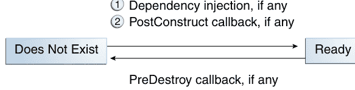

EJB 容器通过创建单例实例来初始化单例会话 Bean。如果单例标记有 `@Startup` 注解，则这会在部署时发生。容器会执行任何依赖注入，并调用带有 `@PostConstruct` 注解的方法（如果存在）。单例会话 Bean 现在准备好让容器调用其方法。

在生命周期结束时，EJB 容器会调用带有 `@PreDestroy` 注解的方法（如果存在）。单例会话 Bean 现在准备好进行垃圾回收。

## 32.7.4 消息驱动 Bean（Message-Driven Bean）的生命周期

图 32–5 阐释了消息驱动 Bean 生命周期中的阶段。

**图 32–5 消息驱动 Bean 的生命周期**

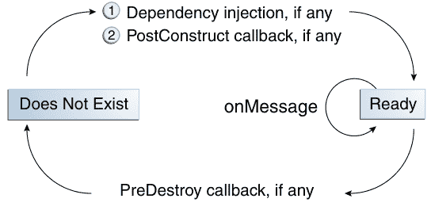

EJB 容器通常维护一个消息驱动 Bean 实例池。对于每个实例，EJB 容器会执行以下任务：

- 如果消息驱动 Bean 使用依赖注入，容器会在实例化之前注入这些引用。
- 容器会调用带有 `@PostConstruct` 注解的方法（如果有）。

与无状态会话 Bean 类似，消息驱动 Bean 永远不会被钝化，只有两个状态：不存在和准备接收消息。

在生命周期结束时，容器会调用带有 `@PreDestroy` 注解的方法（如果有）。该 Bean 实例随后准备好进行垃圾回收。

## 32.8 关于企业 Bean（Enterprise Beans）的更多信息

有关 Enterprise JavaBeans 技术的更多信息，请参见：

- Enterprise JavaBeans 3.2 规范： http://www.jcp.org/en/jsr/detail?id=345
- Enterprise JavaBeans 网站： http://www.oracle.com/technwork/java/ejb-141389.html
- Enterprise JavaBeans 3.2 规范项目： https://java.net/projects/ejb-spec/

## 开始使用企业 Bean

本章展示了如何开发、部署和运行一个名为 `converter` 的 Java EE 应用，该应用使用 EJB 处理业务逻辑。`converter` 的目的是计算日元和欧元美元之间的货币换率。`converter` 应用由一个执行计算的企业 Bean 和一个 Web 客户端组成。

以下是本章中将遵循的步骤概述：

1. 创建 Web Bean：`ConverterBean`。
2. 创建 Web 客户端。
3. 将 `converter` 部署到服务器。
4. 使用浏览器运行 Web 客户端。

在继续之前，请确保你已经完成了以下操作：

- 阅读了第 1 章“概述”
- 熟悉企业 Bean（参见第 32 章“企业 Bean”）
- 已经启动了服务器（参见“启动和停止 GlassFish 服务器”)

此处处理了以下主题：

- 创建企业 Bean
- 修改 Java EE 应用

## 33. 创建企业 Bean

我们示例中的企业 Bean 是一个名为 `ConverterBean` 的无状态 Bean。`ConverterBean` 的源代码位于 `tut-install/ejb/converter/src/main/java/` 目录下。

创建 `ConverterBean` 需要以下步骤：

1. 编写 Bean 的实现类（已提供源代码）
2. 编译源代码

### 33.1.1 编写企业 Bean 类

该类的企业 Bean 是示例类 `ConverterBean`。此类实现了两个业务方法：`dollarToYen` 和 `yenToEuro`。由于企业 Bean 类没有实现业务接口，因此该企业 Bean 暴露了一个本地的无接口视图（no-interface view）。企业 Bean 中的公共方法可供客户端获取 `ConverterBean` 的引用。`ConverterBean` 类的源代码如下：

```java
package converter.ejb;

import java.math.BigDecimal;

import javax.servlet.*;

@Stateless
public class ConverterBean {

    private BigDecimal yen = new BigDecimal("83.0602");

    private BigDecimal euroRate = new BigDecimal("0.00930166");

    public BigDecimal dollarToYen(BigDecimal dollars) {

        BigDecimal result = dollars.multiply(yen);

        return result.setScale(2, BigDecimal.ROUND_UP);

    }

    public BigDecimal yenToEuro(BigDecimal yen) {

        BigDecimal result = yen.multiply(euroRate);

        return result.setScale(2, BigDecimal.ROUND_UP);

    }

}
```

`@Stateless` 注解装饰了企业 Bean 类。该注解让容器知道 `ConverterBean` 是一个无状态 Bean。

### 33.1.2 创建 converter Web 客户端

Web 客户端包含以下 Servlet 类中：

`tut-install/examples/ejb/converter/src/main/java/converter/web/ConverterServlet.java`

Servlet 是一种使用依赖注入来获取 HTTP 请求引用的 Web 组件。

`Converter` 类使用依赖注入来添加私有成员变量 `converter` 的声明。`javax.ejb.EJB` 注解被添加到类型为 `ConverterBean` 的私有变量 `converter`。由于 `ConverterBean` 暴露了本地的无接口视图，因此企业 Bean 实现类即为变量类型：

```java
@WebServlet
public class ConverterServlet {

    @EJB
    private ConverterBean converter;
}
```

# 运行企业 Bean 示例

本章介绍了 EJB 示例。会话 Bean（Session beans）提供了一种在应用程序内部封装业务逻辑的简单而强大的方法。它们可以通过远程 Java 客户端、Web 服务客户端以及在服务器上运行的组件进行访问。

在第 33 章“入门使用企业 Bean”中，本章检查了另外四个名为 ConverterBean 的 Bean 的源码。ConverterBean 是无状态会话 Bean。

- `CounterBean`：一个被远程客户端访问的无状态会话 Bean
- `CounterBean`：一个单例会话 Bean（singleton）
- `HelloServiceBean`：一个实现 Web 服务的无状态会话 Bean
- `TimerSessionBean`：一个设置定时器的无状态会话 Bean

此处介绍了以下主题：

- Cart 示例（购物车示例）
- 单例会话 Bean 示例：counter
- Web 服务示例：helloservice
- 使用定时器（Timer Service）
- 异常处理

## 34.1 Cart 示例

Cart 代表在线书店中的购物车，并使用状态会话 Bean（stateful session bean）来管理购物车的操作。Bean 的客户端可以向购物车添加书籍、移除书籍或检索购物车的内容。要组装购物车，你需要以下代码：

- 会话 Bean (`CartBean`)
- 远程业务接口 (`Cart`)

所有会话 Bean 都需要会话 Bean 类。所有允许远程访问的企业 Bean 都有一个远程业务接口。为了满足特定应用程序的需求，企业 Bean 可能还需要一些辅助类。Cart 会话 Bean 使用了两个辅助类：`BookException` 和 `IdVerifier`，它们将在“辅助类”（Helper Classes）部分进行讨论。

该示例的源码位于 `tut-install/examples/ejb/cart/` 目录。

### 34.1.1 业务接口

Cart 业务接口是一个普通的 Java 接口，定义了 Bean 类中实现的业务方法。Bean 类实现一个接口，该接口被假设为业务接口。除非标记了 `javax.ejb.Remote` 注解，否则业务接口是本地接口；在这种情况下，`javax.ejb.Local` 注解是可选的。

Bean 可能会实现多个接口。在这种情况下，业务接口必须显式地标记 `@Local` 或 `@Remote`，或者通过在 Bean 类上装饰 `@Local` 或 `@Remote` 来指定。然而，在确定 Bean 类是否实现了一个多个接口时，以下接口被排除在外：

- `java.io.Serializable`
- `java.io.Externalizable`
- `javax.ejb` 包中定义的任何接口

Cart 业务接口的源码如下：

```java
import cart.util.BookException;

import java.util.List;

import javax.ejb.Remote;

@Remote
public interface Cart {

    public void initialize(String person) throws BookException;

    public void initialize(String person, String id);

    public void addBook(String title);

    public void removeBook(String title) throws BookException;

    public List<String> getContents();

    public void remove();

}
```

### 34.1.2 会话 Bean 类

此示例的会话类名为 `CartBean`。像任何有状态 Bean（stateful bean）一样，`CartBean` 类必须满足以下要求：

- 该类被标记为 `@Stateful`。
- 类还实现了业务接口中定义的业务方法。
- 实现业务接口（这是一个普通的 Java 接口）。实现 Bean 的业务接口是一个良好的实践。
- 实现任何可选的生命周期回调方法，标记为 `@PostConstruct`、`@PreDestroy`、`@PostActivate` 和 `@PrePassivate`。
- 实现任何标记为 `@Remove` 的可选类方法。

有状态 Bean 也可能。

`CartBean` 类的源码如下：

```java
import cart.util.BookException;

import cart.util.IdVerifier;

import java.util.ArrayList;

import java.util.List;

import javax.ejb.Remove;

import javax.ejb.Stateful;

@Stateful
public class CartBean implements Cart {
```


## 会话 Bean 示例：Cart

### CartBean 类实现

```java
String customerName;

String customerId;

List<String> contents;

public void initialize(String person) throws BookException {

    if (person == null) {

        throw new BookException("Null person not allowed.");

    } else {

        customerName = person;

    }

    customerId = "0";

    contents = new ArrayList<String>();

}

public void initialize(String person, String id) {

    if (person == null) {

        throw new BookException("Null person not allowed.");

    } else {

        customerName = person;

    }

    IdVerifier idChecker = new IdVerifier();

    if (idChecker.validate(id)) {

        customerId = id;

    } else {

        throw new BookException("Invalid id: " + id);

    }

    contents = new ArrayList<String>();

}

public void addBook(String title) {

    contents.add(title);

}

public void removeBook(String title) throws BookException {

    boolean result = contents.remove(title);

    if (result == false) {

        throw new BookException(title + " * not in cart.");

    }

}

public List<String> getContents() {

    return contents;

}

@Remove

public void remove() {

    contents = null;

}

}
```

### 34.1.2 生命周期回调方法

会话 Bean 类可以通过使用以下注解标记方法来实现生命周期回调方法：

- `@PostConstruct`：在 Bean 首次初始化后调用。
- `@PreDestroy`：在 Bean 销毁之前调用。
- `@PostActivate`：在 Bean 被激活后调用。
- `@PrePassivate`：在 Bean 被钝化之前调用。
- `@Remove`：在 Bean 被移除时调用。

### 34.1.3 业务方法

`throws` 子句可以包含为应用程序定义的异常。例如，`removeBook` 方法在书籍不在购物车时会抛出 `BookException`。为了指示系统级问题（例如无法连接数据库），业务方法应该抛出 `javax.ejb.EJBException`。容器会包装应用程序异常（如 `BookException`）。由于 `EJBException` 是 `RuntimeException` 的子类，你不需要在方法的 `throws` 子句中包含它。

### 34.1.4 @Remove 方法

会话 Bean 类中标记为 `javax.ejb.Remove` 的业务方法可以由企业 Bean 客户端调用以移除 Bean 实例。`@Remove` 方法完成（无论正常还是异常）后，容器将移除该 Bean。

在 CartBean 中，`remove` 方法是一个 `@Remove` 方法：

```java
@Remove
public void remove() {
    contents = null;
}
```

### 34.1.5 辅助类

CartBean 会话 Bean 有两个辅助类：`BookException` 和 `IdVerifier`。`BookException` 由 `removeBook` 方法抛出，而 `IdVerifier` 在 `create` 方法中验证 `customerId`。辅助类可以位于包含企业 Bean 类的 EJB JAR 文件中；如果企业 Bean 封装在 WAR 文件中，则位于包含 EJB JAR、WAR 文件或独立库 JAR 文件的 EAR 文件中。在 `cart` 中，辅助类被包含在应用程序客户端和 EJB JAR 使用的库 JAR 中。

### 34.1.6 运行 Cart 示例

现在你准备好编译远程接口 (`Cart.java`)、企业 Bean 类 (`CartBean.java`)、客户端类 (`CartClient.java`) 以及辅助类（`BookException.java` 和 `IdVerifier.java`）了。

你可以使用 NetBeans IDE 或 Maven 来构建、打包、部署和运行 cart 应用。

#### 34.1.6.1 使用 NetBeans IDE 运行 cart 示例

1. 从 File（文件）菜单中选择 Open Project（打开项目）。
2. 在 Open Project 对话框中，导航到：
   `tut-install/examples/ejb/`
3. 选择 cart 文件夹。
4. 勾选 Open Projects 复选框。
5. 点击 Open Project（打开项目）。
6. 在 Projects（项目）选项卡中，右键点击 cart-ear 项目并选择 Build（构建）。

这会将应用程序构建并打包为 cart.ear，位于 `tut-install/examples/ejb/cart/cart-ear/target/`，并将此 EAR 文件部署到你的 GlassFish Server 实例。

你将在 Output（输出）选项卡中看到 cart-app-client 客户端的输出：

```
Retrieving book title from cart: Infinite Jest
Retrieving book title from cart: Bel Canto
Retrieving book title from cart: Kafka on the Shore
Removing "Gravity's Rainbow": Exception: 'Gravity's Rainbow' not in cart.
```

#### 34.1.6.2 使用 Maven 运行 cart 示例

1. 在终端中，进入：
   `tut-install/examples/ejb/cart/`
2. 输入以下命令：
   `mvn install`

此命令将编译并将应用程序打包为 EAR 文件（cart.ear，位于 target 目录），并将 EAR 部署到你的 GlassFish Server 实例。

然后，系统会获取并运行客户端。这等同于运行以下命令：
`appclient -client cart-ear/target/cart-ear-Client.jar`

客户端 JAR 文件 `cart-earClient.jar` 包含了应用程序客户端类、辅助类 `Exception` 以及 `Cart` 业务接口。

当你运行客户端时，应用程序客户端容器会注入应用程序客户端类中声明的任何组件引用，在本例中，是对 Cart bean 的引用。

你将在终端窗口中看到 cart-app-client 客户端的输出：

```
Retrieving book title from cart: Infinite Jest
Retrieving book title from cart: Bel Canto
Retrieving book title from cart: Kafka on the Shore
Removing 'Gravity's Rainbow' from cart.
Caught a BookException: 'Gravity's Rainbow' not in cart.
```

## 34.2 单例会话 Bean 示例：counter

counter 示例演示了如何创建一个单例会话 Bean（Singleton Session Bean）。

### 34.2.1 创建单例会话 Bean

`javax.ejb.Singleton` 注解用于指定企业实现类为单例会话 Bean：

```java
@Singleton
public class SingletonBean { ... }
```

#### 34.2.1.1 初始化单例会话 Bean

EJB 容器负责决定初始化单例会话 Bean，除非会话 Bean 实现类标记了 `javax.ejb.Startup` 注解。在这种情况下（有时称为积极初始化），EJB 容器必须在应用程序启动时初始化会话 Bean。单例会话 Bean 在 EJB 容器将客户端请求交付给应用程序中的任何企业 Bean 之前完成初始化。这允许单例会话 Bean 执行例如应用程序启动任务。

以下单例会话 Bean 存储应用程序的状态并是积极初始化的：

```java
@Startup
@Singleton
public class StatusBean {

    private String status;

    @PostConstruct
    void init() {
        status = "Ready";
    }

}
```

有时会使用多个单例会话 Bean 为应用程序初始化数据，并且必须按照特定顺序初始化。在这种情况下，使用 `javax.ejb.DependsOn` 注解来声明单例会话 Bean 的启动依赖。`@DependsOn` 的值属性是一个或多个字符串，指定目标会话 Bean 的名称。如果 `@DependsOn` 中指定了多个依赖 Bean，它们列出的顺序并不一定是 EJB 容器初始化目标单例会话 Bean 的顺序。

以下单例会话 Bean `PrimaryBean` 应该首先启动：

```java
@Singleton
public class PrimaryBean { ... }
```

`SecondaryBean` 依赖 `PrimaryBean`：

```java
@Singleton
@DependsOn("PrimaryBean")
public class SecondaryBean { ... }
```

这保证了 EJB 容器将先初始化 `PrimaryBean`，后初始化 `SecondaryBean`。

#### 34.2.1.2 管理并发访问

单例会话 Bean 设计用于并发访问。EJB 容器提供两种管理并发的方式：容器管理的并发和 Bean 管理的并发。

##### 容器管理的并发

如果单例使用容器管理的并发，EJB 容器控制客户端对单例业务方法的并发访问。`javax.ejb.Lock` 注解和 `javax.ejb.LockType` 枚举类型用于指定单例的业务方法或 `@Timeout` 方法的访问级别。

- `@Lock(LockType.READ)`：允许并发访问。适用于不修改单例状态的方法（读取器）。
- `@Lock(LockType.WRITE)`：独占访问。适用于修改单例状态的方法（写入器）。这是默认值。

以下单例使用 `@Lock(LockType.READ)` 标记 `getState` 方法，使用 `@Lock(LockType.WRITE)` 标记 `setState` 方法：

```java
@Singleton
public class SingletonBean {

    private String state;

    @Lock(LockType.READ)
    public String getState() {
        return state;
    }

    @Lock(LockType.WRITE)
    public void setState(String state) {
        this.state = state;
    }

}
```

##### 访问超时

`javax.ejb.AccessTimeout` 注解用于指定在发生访问超时之前的毫秒数。如果位于单例的类级别，`@AccessTimeout` 将指定该单例中所有方法的访问超时值，除非某个方法显式地使用 `@AccessTimeout` 注解覆盖了默认值。

`@AccessTimeout` 注解可以应用于 `@Lock(LockType.READ)` 和 `@Lock(LockType.WRITE)`。`@AccessTimeout` 注解有一个必需元素 `value` 和一个可选元素 `unit`。默认情况下，`value` 以毫秒为单位。要更改单位，可以使用 `java.util.concurrent.TimeUnit` 常量之一：`NANOSECONDS`、`MICROSECONDS`、`MILLISECONDS` 或 `SECONDS`。

以下单例具有默认 120,000 毫秒的默认访问超时值，而 `doTediousOperation` 方法覆盖了默认访问超时，并将值设置为 360000 毫秒（即 6 分钟）。

```java
@Singleton
@AccessTimeout(value=120000)
public class SingletonBean {

    private String status;

    @Lock(LockType.WRITE)
    public void setStatus(String status) {
        this.status = status;
    }

    @Lock(LockType.WRITE)
    @AccessTimeout(value=360000)
    public void doTediousOperation() {
    }

}
```

以下单例具有 60 秒的默认访问超时值，使用 `TimeUnit.SECONDS` 常量指定：

```java
@Singleton
@AccessTimeout(value=60, unit=TimeUnit.SECONDS)
public class StatusSingletonBean { ... }
```

##### Bean 管理的并发

使用 Bean 管理的并发的单例允许对单例中的所有业务方法和超时方法进行完全并发访问。单例的开发者负责确保状态在所有客户端之间保持同步。创建具有 Bean 管理并发单例的开发者允许使用 Java 编程语言的同步原语（如 `synchronization` 和 `volatile`），以防止并发访问期间发生错误。

在单例的类级别添加类型设置为 `ConcurrencyManagementType.BEAN` 的 `@ConcurrencyManagement` 注解，以指定使用 Bean 管理的并发：

```java
@ConcurrencyManagement(ConcurrencyManagementType.BEAN)
@Singleton
public class AnotherSingletonBean { ... }
```

#### 34.2.1.3 单例会话 Bean 中的错误处理

如果单例会话 Bean 在由 EJB 容器初始化时遇到错误，该单例实例将被破坏。

与其他企业 Bean 不同，单例会话 Bean 一旦初始化，即使单例 Bean 的业务或生命周期方法导致系统异常，它也不会被销毁。这确保了在整个应用程序周期内使用同一个单例实例。

### 34.2.2 counter 示例的架构

counter 示例由一个单例会话 Bean `CounterBean` 和 JavaServer Faces 前端组成。

`CounterBean` 是一个简单的单例，包含一个方法 `getHits`，该方法返回一个表示网页访问次数的整数。以下是 `CounterBean` 的代码：

```java
package counter.ejb;

import javax.ejb.Singleton;

/**
 * CounterBean 是一个简单的单例会话 Bean，用于记录
 * 网页的访问次数。
 */
@Singleton
public class CounterBean {

    private int hits = 0;

    // 增加并返回访问次数
    public int getHits() {
        return hits++;
    }

}
```

`@Singleton` 注解将 `CounterBean` 标记为单例会话 Bean。`CounterBean` 使用本地的无接口视图。

`CounterBean` 使用 EJB 容器默认单例元数据值来简化单例实现类的代码。类上没有 `@ConcurrencyManagement` 注解，因此应用了默认的容器管理并发。类或业务方法上没有 `@Lock` 注解，因此默认的 `@Lock(WRITE)` 应用于唯一的业务方法 `getHits`。

以下版本的 `CounterBean` 在功能上与前一个版本等效：

```java
package counter.ejb;

import javax.ejb.Singleton;
import javax.ejb.ConcurrencyManagement;
import static javax.ejb.ConcurrencyManagementType.CONTAINER;
import javax.ejb.Lock;
import javax.ejb.LockType;

/**
 * CounterBean 是一个简单的单例会话 Bean，用于记录
 * 网页的访问次数。
 */
@Singleton
@ConcurrencyManagement(CONTAINER)
public class CounterBean {

    private int hits = 0;

    // 增加并返回访问次数
    @Lock(LockType.WRITE)
    public int getHits() {
        return hits++;
    }

}
```


counter 的 Web 前端由 JavaFaces 管理 Bean `Count.java` 组成，该文件被 Facelets XHTML 模板 `template.xhtml` 和 `index.xhtml` 使用。Count JavaFaces Bean 通过依赖注入获取 `CounterBean` 的引用。Count 定义了一个 `hitCount` JavaBeans 属性。当从 XHTML 文件中调用 `hitCount` getter 方法时，会调用 `CounterBean` 的 `getHits` 方法来返回当前的页面访问次数。

这里是 Count Bean 类：

```java
@Named
@ConversationScoped
public class Count implements Serializable {

    @EJB
    private CounterBean counterBean;

    private int hitCount;

    public Count() {
        this.hitCount = 0;
    }

    public int getHitCount() {
        hitCount = counterBean.getHits();
        return hitCount;
    }

    public void setHitCount(int newHits) {
        this.hitCount = newHits;
    }
}
```

```java
private String message = "Hello, ";

public void HelloServiceBean() {

    @WebMethod
    public String sayHello(String name) {
        return message + name + ".";
    }
}
```

## 34.3.3 运行 helloservice 示例

你可以使用 NetBeans IDE 或 Maven 来构建、打包和部署 helloservice 示例。然后你可以使用管理控制台测试服务端点方法。

### 34.3.3.1 使用 NetBeans IDE 构建、打包并部署 helloservice 示例

- 从 File（文件）菜单中选择 Open Project（打开项目）。
- 在 Open Project 对话框中，导航到：
  `tut-install/examples/ejb/`
- 选择 helloservice 文件夹。
- 点击 Open Project（打开项目）。
- 在 Projects（项目）选项卡中，右键点击 helloservice 项目并选择 Build（构建）。

这会将应用程序构建并打包为 `helloservice.ear`，存位于 `tut-install/examples/ejb/helloservice/target/`，并将此 EAR 文件部署到 GlassFish 服务器。

### 34.3.3.2 使用 Maven 构建、打包并部署 helloservice 示例

- 在终端窗口中，进入目录：
  `tut-install/examples/ejb/helloservice/`
- 输入以下命令：
  `mvn install`

这会编译源文件并将应用程序打包为 EJB JAR 文件，存位于 `tut-install/examples/ejb/helloservice/target/helloservice.jar`。然后，该 EJB JAR 文件将被部署到 GlassFish 服务器。

部署完成后，GlassFish 服务器会生成 Web 服务调用所需的额外构件，包括 WSDL 文件。

### 34.3.3.3 无客户端的情况下测试服务

GlassFish 服务器管理控制台允许你测试 Web 服务端点的方法。要测试 `HelloServiceBean` 的 `sayHello` 方法，请按照以下步骤操作。

- 在浏览器中打开以下 URL 打开管理控制台：
  `http://localhost:4048/`

运行企业 Bean 示例 34-15

## 使用定时器服务

- 2. 在导航树中，选择 **Applications**（应用程序）节点。
- 3. 在 **Applications**（应用程序）表格中，点击 `helloservice` 链接。
- 4. 在 **Modules and Components**（模块与组件）表格中，点击 **View Endpoint**（查看端点）链接。
- 5. 在 Web Service Endpoint 信息页面上，点击 **Tester**（测试器）链接：
  `/HelloServiceBeanService/HelloServiceBean?tester`
- 6. 在 HelloServiceBean Web Service Tester 页面，点击非安全链接（指定端口 8080 的那个）。
- 7. 在 HelloServiceBean Web Service Tester 页面上，在 **Methods** 下，输入一个名称作为 `sayHello` 方法的参数。
- 8. 点击 **sayHello**。

打开 `sayHello` 调用页面。在 **Method returned**（返回的方法）下，你将看到来自端点的响应。

## 34.4 使用定时器服务

对业务流进行建模的应用程序通常依赖于定时通知。企业 Bean 容器的定时器服务允许你为除有状态会话 Bean 之外的所有类型的企业 Bean 通知。你可以根据日历计划、特定时间、持续时间或定时间隔来调度定时器。例如，你可以设置定时器在 5 月 23 日上午 10:30 触发或每 12 小时触发一次。

企业 Bean 分为编程定时或自动定时器。**编程定时器**通过显式调用 `TimerService` 接口的一个定时器方法来设置。**自动定时器**在包含带有 `javax.ejb.Schedule` 或 `javax.ejb.Schedules` 注解方法的企业 Bean 成功部署后会随之创建。

### 34.4.1 创建基于日历的定时器表达式

定时器可以根据日历计划设置，使用类似于 UNIX `cron` 工具的语法表示。编程定时器和自动定时器都可以使用基于日历的定时器。表 34-1 显示了基于日历的属性。

| 表 34-1 基于日历的定时器属性 |
| :--- | :--- | :--- | :--- |
| 属性 | 说明 | 默认值 | 允许的值及示例 |
| second (秒) | 分钟内的秒数 | 0 | 0 到 59。例如：`second="30"` |
| minute (分钟) | 小时内的分钟数 | 0 | 0 到 59。 |
| hour (小时) | 天内的小时数 | 0 | 0 到 23。 |

| 表 34-1 基于日历的定时器属性（续表） |
| :--- | :--- | :--- | :--- |
| 属性 | 说明 | 默认值 | 允许的值及示例 |
| dayOfWeek (星期几) | 周内的天数 | 0 | 0 到 6。 |
| dayOfMonth (日期) | 月内的天数 | 1 | 1 到 31。 |
| month (月份) | 年内的月份 | 1 | 1 到 12。 |
| year (年份) | 特定年份 | 2000 | |

### 34.4.2.2 创建程序化定时器

要创建定时器，Bean 会调用 `TimerService` 接口的创建方法之一。这些方法允许创建单次动作、间隔或基于日历的定时器。

对于单次动作或间隔定时器，定时器的到期可以表示为持续时间或绝对时间。持续时间表示为触发超时前的毫秒数。若要指定绝对时间，则将 `java.util.Date` 对象传递给 `TimerService.createSingleActionTimer` 或 `TimerService.createTimer` 方法。

以下代码设置了一个将在 1 分钟（60,000 毫秒）后到期的程序化定时器：

```java
long duration = 60000;
Timer timer = timerService.createSingleActionTimer(duration, new TimerConfig());
```

以下代码设置了一个将在 2010 年 5 月 1 日下午 12:05 到期的定时器，由一个 `java.util.Date` 对象指定：

```java
SimpleDateFormat formatter = new SimpleDateFormat("MM/dd/yyyy 'at' HH:mm");
Date date = formatter.parse("05/01/2010 at 12:05");
Timer timer = timerService.createCalendarTimer(date, new TimerConfig());
```

对于基于日历的定时器，定时器的到期表示为 `javax.ScheduleExpression` 对象，作为参数传递给 `TimerService.createCalendarTimer`。`ScheduleExpression` 类表示基于日历的表达式，其方法与“创建基于日历的定时器表达式”中描述属性对应。

以下代码使用 `ScheduleExpression` 辅助类创建了一个程序化定时器：

```java
ScheduleExpression schedule = new ScheduleExpression();
schedule.dayOfWeek("Mon");
schedule.hour("12-17, 23");
Timer timer = timerService.createCalendarTimer(schedule);
```

有关方法签的详细信息，请参见 `http://docs.oracle.com/java/7/api/javax/ejb/TimerService.html` 上的 TimerService API 文档。

`TimSession` 示例中的 Bean 如下所示创建定时器：

```java
Timer timer = timerService.createTimer(intervalDuration, "Created new programmatic timer");
```

在示例中，`createTimer` 在业务方法中被调用，而该方法由客户端调用。

定时器默认是持久化的。如果服务器关闭或崩溃，持久化定时器将被保存，并在服务器重启时重新激活。如果持久化定时器在服务器关机期间到期，容器将在服务器重启时调用 `@Timeout` 方法。

非持久化定时器通过调用 `TimerConfig.setPersistent(false)` 并将 `TimerConfig` 对象传递给一个定时器创建方法来创建。

`createTimer` 的 `Date` 和 `long` 参数表示解析为毫秒的方法。然而，定时器服务并非为实时应用程序设计，对 `@Timeout` 方法的回调可能不会以毫秒级的精度发生。定时器服务用于业务应用程序，这类程序通常以小时、天或更长的持续时间衡量时间。

## 34.4.3 自动定时器

当包含标有 `@Schedule` 或 `@Schedules` 注解的方法的企业级 Bean 部署时，EJB 容器会创建自动定时器。企业级 Bean 可以有多个自动超时方法，这与程序化定时器不同，后者在企业级 Bean 类中仅允许一个方法被 `@Timeout` 注解标记。

自动定时器可以通过注解或 `ejb-jar.xml` 部署描述符进行配置。

在企业级 Bean 上添加 `@Schedule` 注解将根据 `@Schedule` 属性中的日历调度将其标记为超时方法。

`@Schedule` 注解具有对应于“创建基于日历的定时器表达式”中详细说明的日历表达式以及 `persistent`、`info` 和 `timezone` 元素。

可选的 `persistent` 元素接受一个布尔值，用于指定自动定时器是否在服务器重启或崩溃生存。默认情况下，所有定时器都是持久化的。

可选的 `timezone` 元素用于指定自动定时器与特定时区关联。如果设置，此元素将相对于指定的时区评估所有表达式，无论 EJB 容器运行的时区如何。默认情况下，所有定时器都相对于服务器的默认时区设置。

可选的 `info` 元素用于设置定时器的信息性描述。可以通过 `Timer.getInfo()` 获取定时器信息。

以下超时方法使用 `@Schedule` 设置了一个每周日午夜到期的定时器：

```java
@Schedule(dayOfWeek="Sun", hour='0')
public void cleanupData() {  }
```

`@Schedules` 注解用于为给定的超时指定多个基于日历的定时器。第一个表达式设置定时器在每月最后一天到期。第二个表达式设置定时器在每个周五晚上 11:00 到期。

```java
@Schedules ({
  @Schedule(dayOfMonth="Last"),
  @Schedule(dayOfWeek="Fri", hour="23")
})
public void doPeriodicCleanup() {   }
```

## 34.4.4 取消和保存定时器

定时器可以通过以下事件被取消：

- 当单次动作定时器到期时，容器会取消定时器。
- 当 Bean 调用 `Timer` 接口的 `cancel` 方法时。

如果在一个已取消的定时器上调用方法，容器将抛出 `javax.ejb.NoSuchObjectException`。

为了以后参考保存定时器，调用其 `getHandle` 方法并将 `TimerHandle` 存储在数据库中。要恢复定时器，从数据库检索句柄并对定时器调用 `createTimer`。（注意：`TimerHandle` 是可序列化的；远程客户端无法访问，但本地客户端没有此限制。）

## 34.4.5 获取定时器信息

在定义 `cancel` 和 `getHandle` 方法时，`Timer` 接口定义了获取定时器信息的方法：

```java
public long getTimerRemaining();
public java.util.Date getNextTimeout();
public java.io.Serializable getInfo();
```

`getInfo` 返回 `createTimer` 调用时的参数。例如，在前节的 `createTimer` 代码段中，返回的信息是一个字符串。

要检索 Bean 的活跃定时器，调用 `TimerService` 接口的 `getTimers` 方法。`getTimers` 方法返回定时器对象的集合。

## 34.4.6 事务与定时器

企业级 Bean 通常在事务中创建定时器。如果事务回滚，定时器的创建也会回滚。同样，如果 Bean 在回滚的事务中取消定时器，在这种情况下，定时器的持续时间将重置。

在使用容器管理事务的 Bean 中，`@timeout` 方法通常具有 `Required` 或 `New` 事务属性。通过这些属性，EJB 容器会在调用 `@timeout` 方法之前加入事务。如果方法回滚，容器将至少再次调用 `@timeout` 方法。

## 34.4.7 TimerSession 示例

此示例的源代码位于 `tut-install/examples/ejb/timersession/src/main/java/` 目录。

`TimerSessionBean` 是一个单例 Bean，展示了如何设置自动定时器和程序化定时器。在下面的 `TimerSessionBean` 源码中，使用 `setTimeout` 和 `@timeout` 方法设置程序化定时器。`TimerService` 在 Bean 创建时由容器注入。由于它是业务方法，`setTimeout` 由 Bean 的客户端端接口调用。在本示例中，客户端调用 `setTimeout` 并指定的间隔为 8000 毫秒（即 8 秒）。`setTimeout` 方法通过调用 `TimerService` 的 `createTimer` 方法创建一个新定时器。现在定时器已设置，当定时器到期时（约 8 秒后），EJB 将调用 `TimerSessionBean` 的 `programmaticTimeout` 方法。

```java
public void setTimer(long intervalDuration) {
    logger.info("Setting a programmatic timeout for " +
        intervalDuration + " milliseconds from now.");
    Timer timer = timerService.createTimer(intervalDuration,
        "Created new programmatic timer");
}
```

```java
@Timeout
public void programmaticTimeout(Timer timer) {
    this.setLastProgrammaticTimeout(new Date());
    logger.info("Programmatic timeout occurred.");
}
```


## TimerSessionBean 示例

`TimerSessionBean` 还有一个自动定时器和超时方法，自动定时器设置为每 1 分钟过期一次，通过在 `@Schedule` 注解中使用基于历日的定时器表达式设置：

```java
@Schedule(minute="*", hour="*")
public void automaticTimeout() {
    this.setLastAutomaticTimeout(new Date());
    logger.info("Automatic timeout occurred.");
}
```

`TimerSessionBean` 两个方法：`getLastProgrammaticTimeout` 和 `getLastAutomaticTimeout`。客户端调用这些方法分别获取编程定时器和自动定时器上一次超时的日期和时间。

以下是 `TimerSessionBean` 类的代码：

```java
package timersession.ejb;

import java.util.Date;
import java.util.logging.Logger;
import javax.annotation.Resource;
import javax.ejb.Schedule;
import javax.ejb.Singleton;
import javax.ejb.Stateless;
import javax.ejb.Timeout;
import javax.ejb.Timer;
import javax.ejb.TimerService;

@Singleton
public class TimerSessionBean {

    @Resource
    TimerService timerService;

    private Date lastProgrammaticTimeout;
    private Date lastAutomaticTimeout;
    private Logger logger = Logger.getLogger(
        "com.sun.tidal.javaee.ejb.timersession.TimerSessionBean");

    public void setTimer(long intervalDuration) {
        logger.info("Setting a programmatic timeout for " +
            intervalDuration + " milliseconds from now.");
        Timer timer = timerService.createTimer(intervalDuration,
            "Created new programmatic timer");
    }

    @Timeout
    public void programmaticTimeout(Timer timer) {
        this.setLastProgrammaticTimeout(new Date());
        logger.info("Programmatic timeout occurred.");
    }

    @Schedule(minute="*/1", hour="*")
    public void lastAutomaticTimeout() {
        this.setLastAutomaticTimeout(new Date());
        logger.info("Automatic timeout occured.");
    }

    public String getLastProgrammaticTimeout() {
        if (lastProgrammaticTimeout != null) {
            return lastProgrammaticTimeout.toString();
        } else {
            return "never";
        }
    }

    public void setLastProgrammaticTimeout(Date lastTimeout) {
        this.lastProgrammaticTimeout = lastTimeout;
    }

    public String getLastAutomaticTimeout() {
        if (lastAutomaticTimeout != null) {
            return lastAutomaticTimeout.toString();
        } else {
            return "never";
        }
    }

    public void setLastAutomaticTimeout(Date lastAutomaticTimeout) {
        this.lastAutomaticTimeout = lastAutomaticTimeout;
    }
}
```

> **注意**：GlassFish Server 有默认的最小超时值为 1000 毫秒，即 1 秒。如果您需要将超时值设置低于 1000 毫秒，请在管理控制台中更改最小交付间隔的值。要修改超时值，请在管理控制台中展开 `server-config`，展开 `EJB Container`，并点击 `EJB Timer Service` 标签页。在 `Minimum Delivery Interval` 下输入新的超时值并点击 `Save`。由于虚拟机的限制，`minimum-delivery-interval-in-millis` 的最小实际值约为 100 毫秒。

### 34.4.8 运行 timersession 示例

您可以使用 NetBeans IDE 或 Maven 来构建、打包、部署和运行 timersession 示例。

#### 34.4.8.1 使用 NetBeans IDE 运行 timersession 示例

1. 从 `File`（文件）菜单中，选择 `Open Project`（打开项目）。
2. 在 `Open Project` 对话框中，导航到：
   `tut-install/examples/ejb/`
3. 选择 `timersession` 文件夹。
4. 点击 `Open Project`（打开项目）。
5. 从 `Run`（运行）菜单中，选择 `Run Project`（运行项目）。

这将应用程序编译为 `timersession.war`，位于 `tut-install/examples/ejb/target/`，并将此 WAR 文件部署到您的 GlassFish Server 实例中，然后运行 Web 客户端。

#### 34.4.8.2 使用 Maven 构建、打包和部署 timersession 示例

1. 在终端窗口中，进入目录：
   `tut-install/examples/ejb/`
2. 输入以下命令：
   ```bash
   mvn install
   ```
   这将编译源文件并将应用程序打包为位于 `tut-install/examples/ejb/target/timersession.war` 的 WAR 包，并将其部署到您的 GlassFish 实例中。

#### 34.4.8.3 运行 Web 客户端

1. 打开浏览器并访问 `http://localhost:8080/timersession`。
2. 点击 `Set Timer to programmatic timer`（设置编程定时器）。
3. 等待一段时间并点击浏览器的刷新按钮。

您将看到上一次编程定时和自动定时器超时的日期和时间。要查看超时发生时记录的日志，请使用 `domain/server/logs` 下的 `server.log`。

## 34.5 处理异常

抛出的异常分为两类：系统异常和应用程序异常。

**系统异常** 表示支持您的服务出现问题。例如，无法建立与外部资源的连接，或者找不到注入的资源。

**应用程序异常** 表示业务逻辑中出现错误。应用程序异常通常是您自行编写的、由 EJB 容器接收的异常。当企业 Bean 抛出应用程序异常，容器将其封装。如果在事务中抛出应用程序异常，容器不会回滚事务。企业 Bean 能够处理由容器抛出的应用程序异常。

| 表 35-1 | 企业 Bean 功能 | 说明 |
| :--- | :--- | :--- |
| 会话 Bean | 无状态、单例会话 Bean。同步访问。 |
| 事务 | 容器管理的 Bean 事务。 |
| 安全 | 声明式和编程式安全。 |
| 拦截器 | 类级和方法级拦截器。 |

| 表 35-1 (续) | 企业 Bean 功能 | 说明 |
| :--- | :--- | :--- |
| 部署描述符 | 可选的 `ejb-jar.xml` 部署描述符。 |

## 开发嵌入式企业 Bean 应用程序

容器提供程序支持企业 Bean 的完整功能，但如果应用程序使用了表 35-1 中列出的企业 Bean 功能（如定时器服务、Web 端点或远程接口）。

### 35.2.1 运行嵌入式应用程序

嵌入容器、企业 Bean 组件和客户端都在相同的虚拟机中执行。因此，开发者可以像运行典型的 Java 程序一样使用类路径运行应用程序：

```bash
java -classpath mySession.jar:containerProvider.jar:myClient.jar com.example.client.Main
```

在示例中，`mySession.jar` 是包含无状态会话 Bean，`containerProvider.jar` 是企业 Bean 提供者提供的包含嵌入容器所需类的 JAR 包，`myClient.jar` 是通过嵌入容器调用业务方法的 JAR 包。

在 GlassFish 服务器中，包含嵌入容器类的运行时 JAR 是 `glassfish-embedded-all.jar`。

### 35.2.2 创建企业 Bean 容器

`javax.ejb.EJBContainer` 抽象类代表企业 Bean 容器的实例，并包含了创建实例的方法。`EJBContainer.createContainer` 方法用于创建并初始化嵌入容器实例。

以下代码片段显示了如何使用容器提供者的默认设置创建一个嵌入容器：

```java
EJBContainer ec = EJBContainer.createContainer();
```

默认情况下，容器会在虚拟类路径中搜索企业 Bean 模块：包含 `META-INF/ejb-jar.xml` 描述的目录、包含企业 Bean 组件注解（如 `@Stateless`）文件的目录，或包含 `ejb-jar.xml` 部署描述或企业 Bean 类的 JAR 文件。任何匹配项都被视为同一应用程序中的企业 Bean 模块。一旦在类路径中找到所有企业 Bean 模块，容器将开始初始化。`createContainer` 方法成功返回后，应用程序可以获取找到的任何企业 Bean 模块的客户端引用。

`EJBContainer.createContainer` 方法的另一种版本接受属性和设置的 `Map`，用于自定义嵌入式容器实例：

```java
Properties props = new Properties();
props.setProperty(...);
...
EJBContainer ec = EJBContainer.createEJBContainer(props);
```

#### 35.2.2.1 显式指定要初始化的企业模块

开发者可以精确指定嵌入式容器初始化哪些企业模块。要显式指定由嵌入式容器初始化的模块，请设置 `EJBContainer.MODULES` 属性。

这些模块可能位于嵌入式容器和客户端代码运行虚拟机类路径中，也可以位于虚拟机类路径之外。

要指定单个模块名称或包含模块名称的字符串数组，将 `EJBContainer.MODULES` 设置为 `String` 或 `String` 数组。嵌入式容器会在虚拟机类路径中搜索与指定名称匹配的模块。

```java
Properties props = new Properties();
props.setProperty(EJBContainer.MODULES, "MySessionBean");
EJBContainer ec = EJBContainer.createEJBContainer(props);
```

要指定虚拟机类路径之外的 Bean 模块，将 `EJBContainer.MODULES` 设置为 `java.io.File` 或 `File` 数组。每个 `File` 指向一个 EJB JAR 文件或包含展开后的 EJB JAR 的目录。

```java
Properties props = new Properties();
File ejbJarFile = new File(...);
props.setProperty(EJBContainer.MODULES, ejbJarFile);
EJBContainer ec = EJBContainer.createEJBContainer(props);
```

### 35.2.3 查找会话 Bean 引用

在运行嵌入式容器的应用中查找会话 Bean 引用，使用 `EJBContainer.getContext` 实例来获取 `javax.naming.Context` 对象。调用 `EJBContainer.getContext` 来获取 `Context` 对象。

```java
EJBContainer ec = EJBContainer.createEJBContainer();
Context ctx = ec.getContext();
```

可以使用可移植 JNDI 语法获取会话 Bean 引用。例如，要获取具有本地视图的 `MySessionBean` 会话 Bean 引用，请使用以下代码：

```java
MySessionBean msb = (MySessionBean) ctx.lookup("java:global/MySessionBean/SessionBean");
```

### 35.2.4 关闭企业 Bean 容器

从客户端调用 `EJBContainer` 实例的 `close` 方法来关闭嵌入式容器。

```java
EJBContainer ec = EJBContainer.createEJBContainer();
...
ec.close();
```

虽然客户端不需要关闭 `EJBContainer` 实例，但这样做可以释放嵌入式容器消耗的资源。当运行客户端应用的虚拟机生命周期更长时，这一点尤为重要。

## 35.3 示例应用程序

示例应用程序演示了如何在测试类中创建嵌入式企业 Bean 实例并调用会话 Bean 方法。在单元测试中测试企业 Bean 方法允许开发者独立于应用层（如表现层）执行业务逻辑，而无需将应用部署到 Java EE 服务器。

示例包含两个组件：`StandaloneBean`（一个无状态会话 Bean，暴露了一个单一业务方法 `returnMessage`，该方法返回字符串 "Greetings!"）和 `StandaloneBeanTest`（一个作为 `StandaloneBean` 客户端运行的 JUnit 测试）。

```java
@Stateless
public class StandaloneBean {
    private static final String message = "Greetings!";
    public String returnMessage() {
        return message;
    }
}
```

`StandaloneBeanTest` 调用 `StandaloneBean.returnMessage` 并测试返回的消息是否正确。首先，在带有 `@org.junit.Before` 注解的 `setUp` 方法中创建嵌入式容器实例和初始上下文。

```java
@Before
public void setUp() {
    ec = EJBContainer.createEJBContainer();
    ctx = ec.getContext();
}
```

`returnMessage` 方法包含单元测试，通过 `Context` 实例拥有 `StandaloneBean` 的引用并调用其 `returnMessage` 方法。使用 JUnit 断言 `assertEquals` 将结果与预期结果进行比较。如果 `StandaloneBean.returnMessage` 的字符串等于 "Greetings!"，则测试通过。

```java
@Test
public void returnMessage() throws Exception {
    logger.info("Testing standalone.ejb.StandaloneBean.returnMessage()");
    StandaloneBean instance = (StandaloneBean) ctx.lookup("java:global/classes/StandaloneBean");
    String expResult = "Greetings!";
    String result = instance.returnMessage();
    assertEquals(expResult, result);
}
```


最后，带有 `@org.junit.After` 注解的 `tearDown` 方法在所有单元测试运行后执行，用于关闭嵌入式容器实例。

```java
@After
public void tearDown() {
  if (ec != null) {
    ec.close();
  }
}
```

## 35.3.1 在 NetBeans IDE 中运行示例应用程序

按照以下步骤在 NetBeans IDE 中运行示例应用程序：

1. 从“文件”（File）菜单中选择“打开项目”（Open Project）。
2. 在“项目”对话框中，导航到：`tut-install/examples/ejb/`
3. 选择 `standalone` 文件夹并点击“打开项目”。
4. 在“项目”选项卡中，右键点击 `StandaloneBeanTest` 并选择“测试”（Test）。

这将执行 `StandaloneBeanTest` JUnit 类。输出选项卡将显示测试进度和输出日志。

## 35.3.2 使用 Maven 运行示例应用程序

按照以下步骤使用 Maven 在命令行运行示例应用程序：

1. 在终端窗口中，进入：`tut-install/examples/ejb/standalone/`
2. 输入以下命令：`mvn install`

该命令编译并将应用打包成 JAR 文件，并执行 `StandaloneBeanTest` JUnit 类。

## 在会话豆中使用异步方法调用

本章讨论了如何在豆中实现异步业务方法，并从企业豆客户端调用它们。

此处涵盖了以下主题：

- 异步方法调用
- 异步示例应用程序

### 3.1 异步方法调用

会话豆可以实现异步方法，即在会话豆上调用方法之前，由企业豆将控制权返回给客户端的业务方法。可以使用 Java SE 并发 API 来获取结果、取消调用并处理异常。异步方法通常用于耗时操作、处理器密集型任务、后台任务、增加应用吞吐量，或在不需要等待方法执行时提高响应时间。

当会话豆调用典型的非异步业务方法时，在方法完成之前控制权不会返回给客户端。然而，调用异步方法的客户端会立即从企业豆容器处获得控制权。这允许客户端在方法调用完成的同时执行其他任务。如果方法返回结果，则实现 `java.util.concurrent.Future<V>` 接口，其中 "V" 是结果值类型。`Future<V>` 接口定义了客户端可以使用的方法，用于检查计算是否完成、等待调用完成、获取最终结果以及取消调用。

#### 3.1.1 创建异步业务方法

使用 `javax.ejb.Asynchronous` 注解业务方法以将其方法标记为异步方法，或在类级别应用 `@Asynchronous` 以将会话豆的所有业务方法标记为异步方法。暴露 Web 会话豆方法不能是异步。

异步方法必须返回 `void` 或 `Future<V>` 接口的实现。返回 `void` 的异步方法不能声明异常，但如果它们返回 `Future<V>`，则可以声明异常。例如：

```java
@Asynchronous
public Future<String> processPayment(Order order) throws PaymentException { ... }
```

此方法将尝试处理订单支付，并以 String 形式返回状态。即使支付处理器需要很长时间，客户端也可以继续工作，并在处理最终完成时获取结果。

`javax.ejb.AsyncResult<V>` 类是 `Future<V>` 接口的具体实现，作为返回异步结果的辅助类提供。`AsyncResult` 有一个以结果作为参数的构造函数，方便创建 `Future<V>` 实现。例如，`processPayment` 方法将返回状态 String 的 `AsyncResult`：

```java
@Asynchronous
public Future<String> processPayment(Order order) throws Exception {
    String status = ...;
    return new AsyncResult<String>(status);
}
```

结果被返回给企业豆（Enterprise Bean），而不是直接返回给客户端，企业豆容器可以通过取消 `javax.ejb.SessionContext.wasCancelled` 方法来检查客户端是否请求取消调用。例如：

```java
@Asynchronous
public Future<String> processPayment(Order order) throws Exception {
    if (SessionContext.wasCancelled()) {
        // 清理工作
    } else {
        // 处理支付
    }
}
```

#### 3.1.2 从企业豆客户端调用异步方法

Session Bean 调用异步方法的方式与调用非异步业务方法相同。如果异步方法在被调用时立即返回一个 `Future<V>` 实例，该实例可以用于获取最终结果、取消调用、检查调用是否完成、检查处理过程中是否抛出异常，以及检查调用是否被取消。

##### 3.1.2.1 从异步方法调用中获取最终结果

客户端可以使用 `Future<V>` 方法之一来获取结果。如果处理的 Session Bean 尚未完成，调用其中一个 `get` 方法将导致客户端阻塞直到调用完成。在调用任何 `get` 方法之前，请使用 `Future<V>.isDone` 来判断处理是否完成。

`get()` 方法返回 `Future<V>` 实例中 `type` 值所指定的类型的结果。例如，调用 `Future<String>.get()` 将返回一个 String 对象。如果方法调用被取消，调用 `get()` 将导致抛出 `java.util.concurrent.CancellationException`。如果调用在 Session Bean 处理期间导致异常，调用 `get()` 将导致抛出 `java.util.concurrent.ExecutionException`。异常的原因可以通过调用 `Exception.getCause` 方法获取 `ExecutionException`。

`get(long timeout, java.util.concurrent.TimeUnit unit)` 方法与 `get()` 方法类似，但允许客户端设置超时值。如果超过超时，将抛出 `java.util.concurrent.TimeoutException`。请参阅 `TimeUnit` 的 Javadoc 以获取指定超时值的可用时间单位。

##### 3.1.2.2 取消异步方法调用

在 `Future<V>` 实例上调用 `cancel(boolean mayInterruptIfRunning)` 方法来尝试取消方法调用。如果取消成功，返回 `true`；如果方法调用无法取消，返回 `false`。当调用无法取消时，`mayInterruptIfRunning` 参数用于通知正在运行该方法调用的 Session Bean 客户端尝试了调用。如果 `mayInterruptIfRunning` 设置为 `true`，Session Bean 实例调用的 `SessionContext.wasCancelled` 将返回 `true`。如果 `mayInterruptIfRunning` 设置为 `false`，Session Bean 调用的 `SessionContext.wasCancelled` 将返回 `false`。

`Future<V>.isCancelled` 方法用于检查在调用 `Future<V>.cancel` 完成异步方法调用之前，方法调用是否被取消。如果调用已被取消，`isCancelled` 方法返回 `true`。

##### 3.1.2.3 检查异步方法调用的状态

如果 Session Bean 实例正在处理方法调用，`Future.isDone` 返回 `true`。如果异步方法调用正常完成、被取消或导致异常，`isDone` 方法返回 `true`。也就是说，`isDone` 仅指示 Session Bean 是否完成了调用的处理。

## 36.2 异步示例应用程序

异步示例演示了如何在 Session Bean 上定义异步业务方法并从客户端调用它。`MailBean` 无状态 Session Bean 定义了一个异步方法 `sendMessage`，它使用 JavaMail API 向指定的电子邮件地址发送电子邮件。

注意：此示例在正确运行之前需要进行配置，并且需要访问 SMTP 服务器。邮件的状态在最终发送时会进行更新。

### 36.2.1 异步示例应用程序的架构

异步应用程序由单个无状态 Session Bean (`MailBean`) 和一个 JavaServer Web 前端组成，该前端使用 XML 文件中的 Facets 来显示表单，供用户输入收件人的电子邮件地址。邮件的状态在最终发送时会更新。

`MailBean` Session Bean 注入了一个 JavaMail 资源，用于向用户指定的地址发送电子邮件。消息使用 JavaMail API 创建、修改和发送。注入的 JavaMail 资源通过 GlassFish 服务器管理控制台或与应用程序一起的资源配置文件进行配置。GlassFish 服务器管理员可以在运行时修改资源配置，使用不同的邮件服务器或传输协议。

```java
@Asynchronous
public Future<String> sendMessage(String email) {
    String status;
    try {
        Message message = new MimeMessage(session);
        message.setFrom();
        message.setRecipients(Message.RecipientType.TO, InternetAddress.parse(email, false));
        message.setSubject("Test message from async example");
        message.setHeader("X-Mailer", "JavaMail");
        DateFormat dateFormat = new DateFormat(DateFormat.LONG, DateFormat.SHORT);
        Date timestamp = new Date();
        String messageBody = "This is a message from the async example "
            + "of the EE Tutorial. It was sent on "
            + dateFormat.format(timestamp);
        message.setText(messageBody);
        message.setSentDate(timestamp);
        Transport.send(message);
        status = "Sent";
        logger.log("Mail sent to (0)", email);
    } catch (MessagingException ex) {
        logger.error("Error in sending message.", ex);
        status = "Encountered an error";
        logger.error(ex.getMessage() + ex.getNextException().getMessage());
        logger.error(ex.getCause(), ex.getCause());
    }
    return new AsyncResult(status);
}
```

Web 客户端包含 Faclets 模板 `template.xhtml`、两个 Faclets 客户端 `index.xml` 和 `response.xml` 以及一个 JavaFaces Managed Bean `MailerManagedBean`。`index.xml` 文件包含目标电子邮件地址。当用户提交表单时，会调用 `MailerManagedBean.send` 方法。该方法使用注入的 `MailerBean` Session 实例调用 `MailerBean.send`。结果被发送到 `response.xhtml` Faclets 视图。

### 36.2.2 运行异步示例

你可以使用 NetBeans IDE 或 Maven 构建、打包、部署并运行异步示例。首先，你必须配置密钥库和信任库。

#### 36.2.2.1 在 GlassFish 服务器中配置密钥库和信任库

GlassFish 服务器域需要配置服务器密码以访问密钥库和信任库，以便使用 SMTPS 协议启动安全通信。

1. 在浏览器中打开 http://localhost:4848 的 GlassFish 服务器管理控制台。
2. 展开 Configurations，展开 server-config，找到 JVM Settings。
3. 点击 JVM Options 选项卡，点击 Add JVM Option，并输入 `-Djavax.net.ssl.keyStorePassword=master-password`，将 `master-password` 替换为密钥库密码。默认主密码已更改。

#### 36.2.2.2 使用 NetBeans IDE 运行 async

**准备工作**

在运行此示例之前，请配置您的 GlassFish Server 实例以创建到 SMTPS 服务器的安全连接。

1. 从 File（文件）菜单中选择 Project（项目）。
2. 在 Open Project（打开项目）对话框中，导航到：`tutorial-install/ejb/async`。
3. 选择 async 文件夹并点击 Open Project（打开项目）。
4. 在 Projects（项目）选项卡下的 async 下展开 Sources（源码），然后双击 glassfish-resources.xml。
5. 在 glassfish-resources.xml 中输入您的 SMTPS 服务器的配置设置。SMTPS 服务器主机设置在 `host` 属性中；您希望发送消息的电子邮件地址设置在 `from` 属性中；用户名设置在 `user` 属性中。将 `mail-smtps-password` 的值设置为 SMTPS 服务器的密码。下面的代码片段显示了资源配置示例。需要修改相关行。

```xml
<resources>
  <mail-resource debug="false"
    enabled="true"
    from="user@example.com"
    host="smtp.example.com"
    jndi="mail/exampleSession"
    object-type="user"
    store-protocol="imap"
    store-protocol-class="com.sun.mail.imap.IMAPStore"
    transport-protocol="smtps"
    transport-protocol-class="com.sun.mail.smtp.SMTPSTransport"
    user="user@example.com">
    <property name="mail-smtps-auth" value="true"/>
    <property name="mail-smtps-password" value="mypassword"/>
  </mail-resource>
</resources>
```

6. 右键点击 Projects 选项卡中的 async 并选择 Run（运行）。这将编译、汇并部署应用程序，并在浏览器中打开 URL：http://localhost:8080/async。
7. 在浏览器窗口中，输入您想要接收测试消息的电子邮件地址并点击 Send email（发送电子邮件）。

如果您的配置设置正确，将发送测试电子邮件，Web 客户端中的状态消息将显示 Sent（已发送）。测试消息应该很快出现在收件者的收件箱中。

如果发生错误，状态将显示 Encountered an error（遇到错误）。检查您的域的 server.log 文件以查找错误原因。

#### 36.2.2.3 使用 Maven 运行 async

1. 在终端窗口中，导航到 `tutorial-install/ejb/async/`。
2. 在文本编辑器中，打开 `src/main/setup/glassfish-resources.xml` 并输入您的 SMTPS 服务器的配置设置。SMTPS 服务器主机设置在 `host` 属性中；您希望发送消息的电子邮件地址设置在 `from` 属性中；用户名设置在 `user` 属性中。将 `mail-smtps-password` 属性值设置为 SPS 服务器用户的密码。下面的代码片段显示了配置示例。需要修改相关行。

```xml
<resources>
  <mail-resource debug="false"
    enabled="true"
    from="user@example.com"
    host="smtp.example.com"
    jndi-name="mail/exampleSession"
    object-type="user"
    store-protocol="imap"
```


## 配置示例

```xml
store-protocol-class="com.sun.mail.imap.IMAPStore"
transport-protocol="smtps"
transport-protocol-class="com.sun.mail.smtp.SMTPSTransport"
user="user@example.com">
<property name="mail-smtps-auth" value="true"/>
<property name="mail-smtps-password" value="mypassword"/>
</mail-resource>
</resources>
```

## 构建与运行步骤

3. 输入以下命令：
   `mvn install`

4. 这将编译、汇并部署应用程序，并在浏览器中打开 URL：`http://localhost:8080/async`。

5. 在浏览器窗口中，输入您想要接收测试消息的电子邮件地址并点击 **Send email**（发送电子邮件）。

如果配置设置正确，将发送测试电子邮件，Web 客户端中的状态消息将显示 **Sent**（已发送）。测试消息应该很快出现在收件者的收件箱中。如果发生错误，状态将显示 **Encountered an error**（遇到错误）。检查您的域的 `server.log` 文件以查找错误原因。

## 第八部分：持久化

第八部分探讨了 Java Persistence API（JPA）。本部分包含以下章节：

- 第 37 章，“Java Persistence API 简介”
- 第 38 章，“运行持久化示例”
- 第 39 章，“Java 持久查询语言 (JPQL)”
- 第 40 章，“使用 Criteria API 创建查询”
- 第 41 章，“使用基于字符串的 Criteria 查询”
- 第 42 章，“使用锁控制实体数据的并发访问”
- 第 43 章，“使用实体图创建获取计划”
- 第 44 章，“在持久化应用程序中使用二级缓存”

## 37.1.2.2 持久化属性

如果实体使用持久化属性，则实体必须遵循 JavaBeans 风格属性的方法约定：使用 getter 和 setter 方法，这些方法通常以实体类的实例变量命名。对于每个类型为 `Type` 的持久化属性，都有一个 `getProperty` 方法和一个 `setProperty` 方法。如果该属性是布尔类型，可以使用 `isProperty` 代替 `getProperty`。例如，如果 `Customer` 使用了持久化属性以及一个名为 `firstName` 的私有实例变量，则该类定义了 `getFirstName` 和 `setFirstName` 来获取和设置实体实例变量的状态。

单值持久化属性的方法如下：

```java
Type getProperty()
void setProperty(Type type)
```

用于持久化属性的对象/关系映射注解必须应用于 getter 方法。映射注解不能应用于被标记了 `@Transient` 注解或标记为 `transient` 的字段或属性。

## 37.1.2.3 在实体字段和属性中使用集合

集合值字段和属性必须使用支持的 Java 集合接口，无论实体是否使用持久化字段或属性。可以使用以下集合接口：

- `java.util.Collection`
- `java.util.Set`
- `java.util.List`
- `java.util.Map`

如果实体使用持久化字段，则上述方法签名中的类型必须是这些集合类型之一。也可以使用这些集合类型的泛型变体。例如，如果有一个包含电话号码集合的持久化属性，则 `Customer` 实体将拥有以下方法：

```java
Set<PhoneNumber> getPhoneNumbers() { ... }
void setPhoneNumbers(Set<PhoneNumber> numbers) { ... }
```

如果实体的字段或属性由类型或嵌入类的集合组成，请在字段或属性上使用 `javax.persistence.ElementCollection` 注解。

`@ElementCollection` 有两个属性 `targetClass` 和 `fetch`。`targetClass` 指定基本类或嵌入类的类名，如果字段或属性使用语言泛型定义，该属性是可选的。`fetch` 属性用于指定集合应该是懒性加载还是尽早加载，分别使用 `java.persistence.FetchType` 常量的 `LAZY` 或 `EAGER`。默认情况下，集合将是懒性加载的。

以下实体 `Person` 有一个持久化字段 `nicknames`，它是一个 `String` 类集合，并将被尽早加载。`targetClass` 元素是不需要的，因为它使用了泛型来定义字段。

```java
@Entity
public class Person {
    @ElementCollection(fetch=EAGER)
    protected Set<String> nicknames = new HashSet();
}
```

## 实体中的 Map 集合

实体元素的集合和关系可以使用 `java.util.Map` 集合表示。一个 `Map` 由一个键（key）和一个值（value）组成。

使用 Map 元素或关系时，适用以下规则：

- 键或可以是 Java 编程语言基本类型、嵌入类或实体。
- 当 Map 是嵌入类或基本类型时，使用 `@ElementCollection` 注解。
- 当 Map 是实体时，使用 `@OneToMany` 或 `@ManyToMany` 注解。
- 仅在双向关系的一侧使用 Map。

如果 Map 的类型是 Java 编程语言基本类型，使用 `javax.persistence.MapKey` 注解来设置键的列映射。默认情况下，`MapKeyColumn` 的 `name` 属性格式为 `RELATIONSHIP-FIELD/PROPERTY-NAME_KEY`。例如，如果引用字段名为 `image`，则默认名称为 `IMAGE_KEY`。

如果 Map 的类型是实体，使用 `javax.persistence.MapJoinColumn` 注解。如果需要多个列来设置映射，使用 `javax.persistence.MapKeyColumns` 注解包含多个 `@MapJoinColumn` 注解。如果没有 `@MapJoinColumn`，则映射列名默认设置为 `RELATIONSHIP-FIELD/PROPERTY-NAME_KEY`。例如，如果引用字段名为 `employee`，则默认名称为 `EMPLOYEE_KEY`。

如果在关系字段或属性中未使用编程语言泛型类型，则必须通过使用 `javax.persistence.MapKey` 注解显式指定键。

如果 Map 是实体的主键或作为 Map 值的持久化字段，请使用 `javax.persistence.MapKey` 注解。`@MapKey` 和 `@mapKey` 注解不能在同一个字段或属性上使用。

如果 Map 是 Java 编程语言基本类型或嵌入类，它将被映射为底层数据库中的集合表。如果没有使用泛型，`@ElementCollection` 注解的 `targetAttribute` 必须设置为 Map 值的类型。

如果 Map 是实体并且是多对多或一对一单向关系的一部分，它将被映射为底层数据库中的连接表。到 Map 的单向对多关系也可以使用 `@JoinColumn` 注解进行映射。

如果实体是一对多/多对一双向关系的一部分，它将映射在表示 Map 值的实体表中。如果没有使用泛型类型，`@OneToMany` 和 `@ManyToMany` 注解的 `targetEntity` 属性必须设置为 Map 值的类型。

## 37.1.2.4 验证字段和属性

JavaBeans Validation（Bean Validation）Java API 提供了一种验证应用程序数据的机制。Bean Validation 集成在 Java EE 容器中，允许在企业级应用的任何层级中使用相同的验证逻辑。

Bean Validation 约束可以应用于持久化实体类、嵌入类、映射超类。默认情况下，持久化程序将在 `PrePersist`、`PreUpdate` 和 `PreRemove` 生命周期事件期间，自动对带有 Bean Validation 约束注解的具有持久化字段或属性的实体进行验证。

Bean Validation 约束注解在 Java 编程语言类的字段或属性上。Bean Validation 提供了一组约束以及一个用于定义自定义约束的 API。自定义约束可以是默认约束的组合，也可以是新的约束。每个约束都至少带有一个验证器，用于验证受约束字段或属性的值。自定义约束开发人员还必须为约束提供一个验证器。

Bean Validation 约束应用于持久化类的持久化字段或属性。当使用 Bean Validation 时，请与持久化类使用相同的访问策略。也就是说，如果持久化类使用字段访问，则在类的字段上应用 Bean Validation 约束。如果类使用属性访问，则将约束应用于 getter 方法。

表 21-1 列出了 `javax.validation.constraints` 包中的 Bean Validation 内置约束。

所有内置约束都列在表 21-1 中，用于对同一字段或属性进行分组分组。例如，以下持久化实体有两个 `@Pattern` 约束：

```java
@Pattern.List(
  @Pattern(regexp=".**"),
  @Pattern(regexp=".**")
)
```

以下实体类 `Contact` 在持久化字段上应用了 Bean Validation 约束。

```java
@Entity
public class Contact implements Serializable {
  @Id
  @GeneratedValue(strategy = GenerationType.AUTO)
  private Long id;

  @NotNull
  protected String firstName;

  @NotNull
  protected String lastName;

  @Pattern(regexp="[a-z0-9#\\$%&'*\\/\\.\\=?^_`{|}~]+\\+(?:\\.[a-z0-9#\\$%&'*\\/\\.\\=?^_`{|}~]+)*@(?:[a-z0-9](?:[a-z0-9-]*[a-z0-9])?\\.)+[a-z0-9](?:[a-z0-9-]{2,})", message="invalid.email")
  protected String email;

  @Pattern(regexp="\\(\\d{3}\\)?\\s*\\d{3}-\\d{4}$", message="invalid.phoneNumber")
  protected String mobilePhone;

  @Pattern(regexp="\\(\\d{3}\\)?\\s*\\d{3}-\\d{4}$", message="invalid.phoneNumber")
  protected String homePhone;

  @Temporal(java.persistence.Temporal.DATE)
  @Past
  protected Date birthday;
}
```

`firstName` 和 `lastName` 字段上的 `@NotNull` 注解指定这些字段现在是必须的。如果创建了一个 `firstName` 和 `lastName` 未初始化的新 `Contact` 实例，Bean Validation 将抛出验证错误。同样，如果之前创建的 `Contact` 实例被修改导致 `firstName` 或 `lastName` 为 `null`，则将抛出验证错误。

`email` 字段应用了 `@Pattern` 约束，其包含一个复杂的正则表达式，必须匹配有效的电子邮件地址。如果 `email` 的值不匹配此正则表达式，将抛出验证错误。

`homePhone` 和 `mobilePhone` 字段具有相同的 `@Pattern` 约束。该正则表达式匹配美国和加拿大格式为 `(xxx) xxx-xxxx` 的 10 位电话号码。

`birthday` 字段标有 `@Past` 注解，这确保了 `birthday` 的值必须在过去。

## 37.1.3 实体中的主键

每个实体都有一个唯一的对象标识符。例如，客户实体可以通过客户编号来识别。唯一标识符（或主键）允许客户端定位特定的实体实例。每个实体都必须有一个主键。实体可以有一个简单主键或复合键。

简单主键使用 `javax.persistence.Id` 注解来表示主键或字段。

当主键由多个属性组成时，使用复合键，这对应于一组单一属性或字段。复合主键必须在一个主键类中定义。复合主键使用 `javax.persistence.EmbeddedId` 和 `javax.persistence.Id` 注解表示。

主键（或主键的属性或字段）必须是以下 Java 语言类型之一：

- Java 原始类型
- Java 原始类型包装类
- `java.lang.String`
- `java.util.Date`（时间类型应为 `DATE`）
- `java.sql.Date`
- `java.math.BigDecimal`
- `java.math.BigInteger`

主键不应使用浮点类型。如果你使用生成的主键，只有整数类型是可移植的。

主键类必须满足这些要求：

- 类的访问修饰符必须是 `public`。
- 如果使用基于属性的访问，则主键类的属性必须是 `public` 或 `protected`。
- 该类必须有一个 `public` 的默认构造函数。
- 该类必须实现 `hashCode()` 和 `equals(Object other)` 方法。
- 该类必须是可序列化的。
- 复合主键必须表示并映射到实体类的多个字段或属性，或者必须表示并映射为一个可嵌入的类。
- 如果该类映射到实体类的多个字段或属性，则主键类中主键字段或属性的名称和类型必须与实体类匹配。

下面的主键类是一个复合键，`orderId` 和 `itemId` 字段共同唯一标识一个实体：

```java
public final class LineItemKey implements Serializable {
    public Integer orderId;
    public int itemId;

    public LineItemKey() {}

    public LineItemKey(Integer orderId, int itemId) {
        this.orderId = orderId;
        this.itemId = itemId;
    }

    public boolean equals(Object otherOb) {
        if (this == otherOb) {
            return true;
        }
        if (!(otherOb instanceof LineItemKey)) {
            return false;
        }
        LineItemKey other = (LineItemKey) otherOb;
        return (
            (orderId == null ? other.orderId == null : orderId.equals(other.orderId))
            &&
            (itemId == other.itemId)
        );
    }

    public int hashCode() {
        return (
            (orderId == null ? 0 : orderId.hashCode())
            ^ ((int) itemId)
        );
    }

    public String toString() {
        return "*" + orderId + "-*-" + itemId;
    }
}
```


## 37.1.4 实体关系中的多重性

多重性有以下类型：一对一、一对多、多对一和多对多：

- **一对一**：每个实体实例都与另一个实体的单个实例相关。例如，为了建模一个物理仓库，其中每个存储箱包含一个小部件，`StorageBin` 和 `Widget` 将具有一对一的关系。
- **一对多**：一个实体实例可以与另一个的多个实例相关。
- **多对一**：多个实体实例与另一个实体的单个实例相关。
- **多对多**：多个实体实例可以与另一个实体的多个实例相关。

## 37.1.5 实体关系中的方向

### 37.1.5.1 单向关系

在单向关系中，只有一个实体拥有引用另一个实体的关系字段。例如，`LineItem` 会与 `Product` 有关系，但 `Product` 并不知道哪些 `LineItem` 引用了它。

### 37.1.5.2 双向关系

在双向关系中，每个实体都有一个引用另一个实体的关系字段。例如，`LineItem` 与 `Product`。双向关系必须遵循以下规则：

- `mappedBy` 元素指定所有者。
- 对于一对一关系，反向端是所有端。
- 对于多对多关系，任何一方都可以是所有端。

### 37.1.5.3 查询和 Criteria 方向

Java 持久化查询语言和 Criteria API 经常跨关系导航。关系的方向决定了查询是否可以从一个实体导航到另一个实体。例如，查询可以从 `LineItem` 导航到 `Product`，但不能反向。对于 `Order` 和 `LineItem`，查询可以在两个方向上导航，因为这两个实体具有双向关系。

### 37.1.5.4 级联操作和关系

实体依赖于关系中另一个实体的存在。例如，行项目是订单的一部分；如果订单被删除，行项目也应该被删除。这被称为级联删除关系。

`javax.persistence.CascadeType` 枚举类型定义了应用于关系注解中 `cascade` 元素的级联操作。表 37–1 列出了：

| 级联操作 | 说明 |
| :--- | :--- |
| `ALL` | 所有操作将应用于父实体的相关实体。`ALL` 等于指定 `cascade=(DETACH, MERGE, PERSIST, REFRESH, REMOVE)` |
| `DETACH` | 如果实体从持久文中脱离，相关的实体也将脱离。 |
| `MERGE` | 如果实体合并到持久文中，相关的实体也将被合并。 |
| `PERSIST` | 如果实体被持久化到持久文中，相关的实体也将被持久化。 |
| `REFRESH` | 如果实体在当前持久文中刷新，相关的实体也将被刷新。 |
| `REMOVE` | 如果实体从持久文中移除，相关的实体也将被移除。 |

级联删除关系使用 `@OneToOne` 和 `@OneToMany` 关系中的 `cascade=REMOVE` 元素指定。例如：

```java
@OneToMany(cascade=REMOVE, mappedBy="customer")
public Set<Order> getOrders() { return orders; }
```

### 37.1.5.5 关系中的孤儿移除

当一对一或一对多中的目标实体从关系中移除时，通常希望将删除操作级联到它。这些目标实体被视为“孤儿”，`orphanRemoval` 属性用于指定应移除孤儿实体。例如，如果一个订单有多个行项目，且其中一个被从订单中移除，则被移除的行项目被视为孤儿实体。如果 `orphanRemoval` 设置为 `true`，当行项目从订单中移除时，该行实体将被删除。

`@OneToMany` 和 `@OneToOne` 中的 `orphanRemoval` 属性接受一个布尔值，默认值为 `false`。

以下示例将在删除客户时，将删除操作级联到孤儿订单：

```java
@OneToMany(mappedBy="customer", orphanRemoval=true)
public List<Order> getOrders() { }
```

## 37.1.6 实体中的嵌入类

嵌入类用于表示实体的状态，但与实体类不同，它们没有自己的持久化标识符。嵌入类的实例与拥有它的实体共享标识符。嵌入类仅作为另一个实体的状态存在。实体可以拥有单值或集合值的嵌入类属性。

嵌入类遵循与实体类相同的规则，但使用的是 `javax.persistence.Embeddable` 注解，而不是 `@Entity`。

以下嵌入类 `ZipCode` 拥有 `zip` 和 `plusFour` 字段：

```java
@Embeddable
public class ZipCode {
    String zip;
    String plusFour;
}
```

该嵌入类被 `Address` 实体使用：

```java
@Entity
public class Address {
    @Id
    protected long id;
    String street1;
    String street2;
    String city;
    String province;
    @Embedded
    ZipCode zipCode;
    String country;
}
```

拥有嵌入类作为其持久化状态部分的实体可以在该字段或属性上使用 `javax.persistence.Embedded` 注解，但并非强制要求。

嵌入类可以使用其他嵌入类来表示其状态。它们还可能包含基本 Java 语言类型的集合或其他嵌入类的集合。嵌入类还包含与其他实体的关系或与实体集合的关系。如果嵌入类具有此类关系，则该关系是从目标实体或实体集合到拥有该嵌入类的实体的。

## 37.2 实体继承

实体支持类继承、多态关联和多态查询。
实体类继承非实体类，而非实体类可以继承实体类。实体类既可以是抽象的，也可以是具体的。

roster 示例演示了实体继承，如《roster 应用中的实体继承》所述。

### 37.2.1 抽象实体

可以通过为类装饰 `@Entity` 注解来将抽象类声明为实体。
抽象实体类似于具体实体，但不能实例化。

抽象实体可以像具体实体一样被查询。如果一个实体是查询的目标，查询将在该抽象实体的所有具体子类上操作：

```java
@Entity
public abstract class Employee {
    @Id
    protected Integer employeeId;
}

@Entity
public class FullTimeEmployee extends Employee {
    protected Integer salary;
}

@Entity
public class PartTimeEmployee extends Employee {
    protected Float hourlyWage;
}
```

### 37.2.2 映射父类

实体可以继承包含持久化状态和映射信息但不是实体的父类。也就是说，父类没有被 `@Entity` 注解装饰，也没有被 Java 持久化提供程序映射为实体。当你有多个实体类共有的状态和映射信息时，通常会使用这些父类。

映射父类通过为类装饰 `javax.persistence.MappedSuperclass` 注解来指定：

```java
@MappedSuperclass
public class Employee {
    @Id
    protected Integer employeeId;
}

@Entity
public class FullTimeEmployee extends Employee {
    protected Integer salary;
}

@Entity
public class PartTimeEmployee extends Employee {
    protected Float hourlyWage;
}
```

映射父类无法被查询，也无法在 `EntityManager` 或查询操作中使用。你必须在 `EntityManager` 或查询操作中使用映射父类的实体子类。映射父类不能作为实体关系的目标。映射父类的子类可以是抽象的或具体的。

映射父类在底层数据存储中没有对应的表。继承自映射父类的实体定义了表映射。例如，在前面的代码示例中，底层表将是 `FULLEMPLOYEE` 和 `PARTTIMEEMPLOYEE`，但没有 `EMPLOYEE` 表。

### 37.2.3 非实体父类

实体可以拥有非实体父类，这些父类可以是抽象的或具体的。非实体父类的状态是非持久化的，且实体类从非实体父类继承的任何状态都是非持久化的。非实体父类不能在 `EntityManager` 或查询操作中使用。非实体父类中的映射或关系关联将被忽略。

### 37.2.4 实体继承映射策略

你可以通过为层次结构的根类装饰 `javax.persistence.Inheritance` 注解，来配置 Java 持久化提供程序如何将继承的实体映射到底层数据存储。以下映射策略用于将实体数据映射到底层数据库：

- 每个类层次结构单张表
- 每个实体类一个表
- 联合策略，其中特定子类的字段或属性被映射到与父类公共字段或属性不同的表中

该策略通过将 `@Inheritance` 的 `strategy` 元素设置为 `javax.persistence.InheritanceType` 枚举类型中定义的选项之一来配置：

```java
enum InheritanceType {
    SINGLE_TABLE,
    JOINED,
    TABLE_PER_CLASS
}
```

如果实体层次结构根部没有出现 `@Inheritance` 注解，则使用 `javax.persistence.InheritanceType.SINGLE_TABLE` 默认策略。

#### 37.2.4.1 单表每层次结构策略

在该策略下（对应 `InheritanceType.SINGLE_TABLE`），层次结构中的所有类都映射到数据库中的单张表中。该表有一个鉴别列，用于标识行所属的子类。

鉴别列元素如表 37–2 所示，可以在实体根类上通过 `javax.persistence.DiscriminatorColumn` 注解进行指定：

| 类型 | 名称 | 说明 |
| :--- | :--- | :--- |
| `String` | `name` | 鉴别列的名称。默认值为 `DTYPE`。可选。 |
| `DiscriminatorType` | `discriminatorType` | 鉴别列的类型。默认值为 `DiscriminatorType.STRING`。可选。 |
| `String` | `columnDefinition` | 使用鉴别列的 SQL 片段。默认由持久化提供程序生成并取决于具体实现。可选。 |
| `String` | `length` | 字符串鉴别类型的长度。该元素对于非字符串鉴别类型会被忽略。默认值为 `31`。可选。 |

`javax.persistence.DiscriminatorType` 枚举类型用于通过将 `@DiscriminatorColumn` 设置为定义的类型之一来设置数据库中的鉴别列。`DiscriminatorType` 定义如下：

```java
public enum DiscriminatorType {
    STRING,
    CHAR,
    INTEGER
}
```

如果实体层次结构上没有指定 `@DiscriminatorColumn` 且需要鉴别列，持久化提供程序假设默认列名为 `DTYPE`，列类型为 `DiscriminatorType.STRING`。

`javax.persistence.DiscriminatorValue` 注解用于设置类层次结构中每个实体在鉴别列中输入的值。你可以只对实体类装饰 `@DiscriminatorValue`。

如果使用鉴别列的类层次结构实体未指定 `@DiscriminatorValue`，持久化提供程序将提供一个默认的取决于实现的值。`@DiscriminatorColumn` 的 `discriminatorType` 元素为 `DiscriminatorType.STRING`，默认值为实体名称。

该策略支持实体之间的多态关系以及覆盖整个实体层次结构的查询。然而，该策略要求包含子类状态的列允许为空。

#### 37.2.4.2 每个具体类一表策略

该策略对多态关系的支持较差，对于覆盖整个实体层次结构的查询，通常需要 SQL UNION 查询或为每个子类执行单独的 SQL 查询。

对该策略的支持是可选的，并不是所有的 Java Persistence API 提供者都支持它。GlassFish 服务器中默认的 Java Persistence API 提供者不支持此策略。

#### 37.2.4.3 联合子类策略

在该策略中（对应于 `InheritanceType.JOINED`），类层次结构的根由单个表表示，每个子类都有单独的表，仅包含该子类特定的字段。也就是说，子类表不包含继承的字段或属性的列。子类表还有一个列或多个列来表示其主键，该键是指向父类主键的外键。

该策略对多态关系提供了良好的支持，但在实例化实体子类时，需要执行一个或多个连接操作。这可能导致复杂的类层次结构出现性能下降。同样，涵盖整个类层次结构的查询会涉及子类表之间的连接操作，导致性能降低。

某些 Persistence API 提供者（包括 GlassFish 服务器的默认提供者）在使用联合子类策略时，需要一个对应根实体的鉴别列。如果你在应用程序中没有使用自动建表，请确保数据库已为鉴别列正确设置，或者使用 `@DiscriminatorColumn` 注解。有关鉴别列的信息，请参见“单表每层次结构策略”。

## 37.3 管理实体

实体由实体管理器管理，由 `javax.persistence.EntityManager` 实例表示。每个 `EntityManager` 实例与一个持久上下文关联：一组存在于特定数据存储中的托管实体实例。持久上下文定义了特定实体创建、持久化和删除的范围。`EntityManager` 接口定义了与持久上下文交互的方法。

### 37.3.1 EntityManager 接口

`EntityManager` 创建和删除实体实例，通过主键查找实体，并允许在实体上运行查询。

#### 37.3.1.1 容器管理的 EntityManager

对于容器管理的 `EntityManager`，`EntityManager` 实例的持久上下文会自动由容器传播到单个 Java Transaction API (JTA) 事务中使用该 `EntityManager` 实例的所有应用程序组件中。

JTA 事务通常涉及跨应用程序组件的调用。为了完成一个 JTA 事务，这些组件通常需要访问同一个持久上下文。当 `EntityManager` 通过 `javax.persistence.PersistenceContext` 注解注入到应用程序组件时，就会发生这种情况。持久上下文会随当前 JTA 事务自动传播，`EntityManager` 引用将映射到该事务内访问同一持久化单元的持久上下文。通过自动传播持久上下文，应用程序组件不需要向彼此传递 `EntityManager` 实例的引用即可在单个事务内进行更改。Java EE 容器管理容器管理的 `EntityManager` 的生命周期。

要获取 `EntityManager` 实例，请将实体管理器注入到组件中：

```java
@PersistenceContext
EntityManager em;
```

#### 37.3.1.2 应用管理的 EntityManager

另一方面，对于应用管理的 `EntityManager`，持久上下文不会传播到应用程序组件，且 `EntityManager` 实例的生命周期由应用程序管理。

当需要访问在特定持久化单元中跨 JTA 事务传播的持久上下文时，使用应用管理的 `EntityManager`。在这种情况下，`EntityManager` 会创建一个新的、隔离的持久上下文。`EntityManager` 及其关联上下文由应用程序显式地创建和销毁。当 `EntityManager` 实例不是线程安全的无法直接注入 `EntityManager` 实例时，也会使用它们。

在这种情况下，应用程序通过使用 `javax.persistence.EntityManagerFactory` 的 `createEntityManager` 方法创建 `EntityManager` 实例。

要获取 `EntityManager` 实例，必须首先通过 `javax.persistence.PersistenceUnit` 注解将 `EntityManagerFactory` 注入到应用程序组件中：

```java
@PersistenceUnit
EntityManagerFactory emf;
```

然后从 `EntityManagerFactory` 实例中获取 `EntityManager`：

```java
EntityManager em = emf.createEntityManager();
```

应用管理的 `EntityManager` 不会自动传播 JTA 事务上下文。此类应用程序在执行实体操作时需要手动访问 JTA 事务管理器并添加事务信息。

```xml
<persistence>
  <persistence-unit name="OrderManagement">
```


<description>该单元管理订单和客户。

它不依赖任何特定供应商的特性，因此

可以部署到任何持久化提供程序。

</description>

<data-source>jdbc:MyOrderDB/jar-data-source</data-source>

<jar-file>OrderApp.jar/jar-file>

<class>com.widgets.Order</class>

<class>com.widgets.Customer</class>

</persistence-unit>

</persistence>

```

此文件定义了一个名为 `OrderManagement` 的持久化单元，它使用了 JTA 感知的数据源：`jdbc:MyOrderDB`。指定的 `jar-file` 和 `class` 元素用于管理受持久化类：实体类、嵌入类和映射类。`jar-file` 元素对包含受持久化类的持久化单元可见，而 `class` 元素则显式地命名了受持久化类。

`jta-data-source`（用于 JTA 感知的数据源）和 `non-jta-data-source`（用于非 JTA 感知的数据源）元素指定了容器要使用的数据源的 JNDI 名称。

JAR 或目录下的 `META-INF` 目录包含 `persistence.xml`，它被称为持久化单元的根。持久化单元的范围由该持久化单元的根决定。每个持久化单元必须用在该持久化单元范围内唯一的名称来标识。

持久化单元可以封装为 WAR 或 EIB JAR 文件的单元，也可以封装为可以包含在 WAR 或 EAR 文件中的 JAR 文件。

- 如果你将持久化单元封装为 EIB JAR 文件中的一组类，则 `persistence.xml` 应该存放在 EIB JAR 的 `META-INF` 目录中。
- 如果你将持久化单元封装为 WAR 文件中的一组类，则 `persistence.xml` 应该位于 WAR 文件的 `WEB-INF/classes/META-INF` 目录下。
- 如果你将持久化单元封装在将包含在 WAR 或 EAR 文件中的 JAR 文件中，则该 JAR 文件应该位于以下位置之一：
    - WAR 的 `WEB-INF/lib` 目录
    - EAR 文件的库目录

> 注意：在 Java Persistence API 1.0 中，JAR 文件可以位于 EAR 文件的根部作为持久化单元的根。这种做法不再被支持。可迁移应用程序应该使用 EAR 文件的库目录作为持久化单元的根。

# 37.4 查询实体

Java Persistence API 提供了以下方法来查询实体。

- Java 持久化查询 (JPQL) 是一种简单的、基于字符串的语言，类似于 SQL，用于查询实体及其关系。更多信息请参阅第 39 章“Java 持久化查询语言”。
- Criteria API 用于使用 Java 编程语言 API 为实体及其关系创建类型安全的查询。更多信息，请参阅第 40 章“使用 Criteria API 创建查询”。

JQL 和 Criteria API 均有其优缺点。

JPQL 查询通常只有几行长，并且比 Criteria 查询更简洁、更具可读性。熟悉 SQL 的开发者会发现学习 JPQL 语法很容易。命名查询可以在实体类中使用 Java 编程注解定义，也可以在应用程序的部署描述符中定义。JPQL 查询不是类型安全的，在从结果实体管理器中检索查询时需要进行强制转换。许多类型转换错误可能无法在编译时捕获。JPQL 查询不支持开放式参数。

Criteria 查询允许你在应用程序的业务逻辑层定义查询。虽然使用 JPQL 动态查询也可以实现这一点，但 Criteria 查询提供了更好的性能，因为 JPQL 动态查询在每次调用时都必须解析。Criteria 查询是类型安全的，因此不需要强制转换，因为 Criteria 只是另一种 Java 编程语言 API，不需要开发者学习任何其他查询语言语法。Criteria 查询通常比 JPQL 查询更冗长。

# 37.5 数据库架构

持久化提供程序可以配置为使用提供的脚本创建数据库表，并在部署时加载数据。以下是 `persistence.xml` 部署描述符的示例：

```xml
<?xml version="1.0" encoding="UTF-8"?>
<persistence xmlns="http://xmlns.jcp.org/xml/ns/persistence" xmlns:xsi="http://www.w3.org/2001/XMLSchema-instance" xsi:schemaLocation="http://xmlns.jcp.org/xml/ns/persistence http://xmlns.jcp.org/xml/ns/persistence/persistence_2_1.xsd" version="2.1">
  <persistence-unit name="OrderManagement" transaction-type="JTA">
    <data-source>jdbc:MyOrderDB</data-source>
    <properties>
      <property name="javax.persistence.schema-generation.database.action" value="drop-and-create"/>
      <property name="javax.persistence.schema-generation.create-source" value="script"/>
      <property name="javax.persistence.schema-generation.create-script-source" value="META-INF/create.sql" />
      <property name="javax.persistence.schema-generation.load-script-source" value="META-INF/data.sql" />
      <property name="javax.persistence.schema-generation.drop-source" value="script"/>
      <property name="javax.persistence.schema-generation.drop-script-source" value="META-INF/drop.sql" />
    </properties>
  </persistence-unit>
</persistence>
```

这是一个 `persistence.xml` 部署符示例，它指定持久化提供程序使用提供的脚本删除所有数据库架构，并使用提供的脚本创建架构。

# 数据库架构创建

## 37.5.1 配置 javax.persistence.schema-generation.database.action

`javax.persistence.schema-generation.database.action` 属性用于指定持久化提供程序在应用程序部署时的操作。如果设置该属性，持久化提供程序将不会创建或删除任何架构。

表 37-3 架构创建动作
| 设置 | 描述 |
|---|---|
| none | 不进行架构创建或删除。 |
| create | 提供程序在部署时创建架构。部署后保持不变。 |
| drop-and-create | 删除数据库中的架构，并由提供程序创建架构。 |
| drop | 在部署时删除数据库中的架构。 |

```xml
<property name="javax.persistence.schema-generation.database.action" value="drop-and-create"/>
```

在此示例中，持久化提供程序会在应用程序部署时删除数据库架构并创建架构。

默认情况下，使用持久化单元中的对象/关系元数据来创建数据库架构。你也可以提供用于创建和删除数据库架构的脚本。`create-source` 和 `drop-source` 属性控制提供程序如何创建或删除数据库架构。

表 37-4 创建和删除属性设置
| 设置 | 描述 |
|---|---|
| metadata | 使用应用程序中的对象/关系元数据来创建或删除数据库架构。 |
| script | 使用提供的脚本来创建或删除数据库架构。 |
| metadata-then-script | 先使用对象/关系元数据，然后使用用户提供的脚本创建或删除数据库架构。 |
| script-then-metadata | 先使用用户提供的脚本，然后使用对象/关系元数据来创建或删除数据库架构。 |

```xml
<property name="javax.persistence.schema-generation.create-source" value="script"/>
```

在此示例中，持久化提供程序将使用封装在应用程序内的脚本来创建数据库架构。

如果在 `create-source` 或 `drop-source` 中指定了脚本，请使用 `javax.persistence.schema-generation.create-script-source` 或 `javax.persistence.schema-generation.drop-script-source` 属性指定脚本的位置。脚本的位置相对于持久化单元的根目录。

```xml
<property name="javax.persistence.schema-generation.create-script-source" value="META-INF/sql/create.sql" />
```

在示例中，`create-script-source` 被设置为相对于持久化单元根目录 `META-INF/sql` 目录下名为 `create.sql` 的 SQL 文件。

## 37.5.2 使用 SQL 脚本加载数据

如果你想在应用程序加载之前为数据库表表填充数据，请在 `javax.persistence.sql-load-script-source` 属性中指定加载脚本的位置。该属性中指定的位置相对于持久化单元的根目录。

在此示例中，加载脚本是相对于持久化单元根目录 `META-INF/sql` 目录下名为 `data.sql` 的文件。

```xml
<property name="javax.persistence.sql-load-script-source" value="META-INF/sql/data.sql" />
```

## 37.6 关于持久化的更多信息

有关 Java Persistence API（JPA）的更多信息，请参考：

- Java Persistence 2.1 API 规范：
  - http://jcp.org/en/js/jsr/detail?id=338
- GlassFish Server 中的 Java Persistence API 实现 EclipseLink：
  - http://www.eclipse.org/eclipselink/jpa.php
- EclipseLink 博客：
  - http://eclipselink.blogspot.com/
- EclipseLink wiki 文档：
  - http://wiki.eclipse.org/EclipseLink

# 运行持久化示例

本章解释了如何使用 Java Persistence API。这里的材料重点关注三个示例的源代码和设置。第一个示例 `order`（订单）是一个使用有状态会话 bean（stateful session bean）来管理订单系统相关实体应用程序。第二个示例 `roster`（名单）是一个管理社区系统的应用程序。第三个示例 `address-book`（通讯录）是一个存储联系数据的 Web 应用程序。本章假设你熟悉第 37 章“Java Persistence API 简介”中详细介绍的概念。

此处涵盖了以下主题：

- order 应用程序
- roster 应用程序
- address-book 应用程序

## 38.1 order 应用程序

order 应用程序是一个简单的库存和订单应用程序，用于维护零件目录并对这些零件下达订单。该应用程序拥有代表零件、供应商、订单和行项目的实体。这些实体通过有状态会话 bean 进行访问，该 bean 持有应用程序的业务逻辑。一个单例会话 bean（singleton session bean）在应用程序部署时创建初始实体。一个 Facelets Web 应用程序处理并显示来自目录的数据。

订单中的信息可以分为若干元素。订单号是什么什么？订单中包含哪些零件？哪些零件组成了该零件？零件是谁制造的？零件的规格是什么？该零件是否有任何语义？order 应用程序是包含所有这些元素的订单系统的简化版本。

order 应用程序由单个 WAR 模块组成，该模块包含企业 bean 类、实体、支持类以及 Facelets XHTML 和类文件。

Java DB 数据库中 order 的数据库架构如图 38–1 所示。

### order 应用程序

图 38-1 order 应用程序的数据库架构

| ORDER | | | LINEITEM | | | |
| --- | --- | --- | --- | --- | --- | --- |
| ORDERID | INT | | ITEMID | INT | | |
| DISCOUNT | INT | | ORDERID | INT | | |
| LASTUPDATE | TIMESTAMP | | QUANTITY | INT | | |
| SHIPMENTINFO | VARCHAR(255) | | VENDORNUMBER | BIGINT | | |
| STATUS | CHAR(1) | | | | | |

| VENDOR_PART | | | VENDOR | | | |
| --- | --- | --- | --- | --- | --- | --- |
| VENDORNUMBER | | | VENDORID | | | |
| DESCRIPTION | VARCHAR(255) | | ADDRESS | VARCHAR(255) | | |
| PRICE | DOUBLE(52,0) | | CONTACT | VARCHAR(255) | | |
| VENDORID | | | NAME | VARCHAR(255) | | |
| PARTNUMBER | VARCHAR(255) | | PHONE | VARCHAR(255) | | |
| PARTREVISION | INT | | | | | |

| PART | | | | | | |
| --- | --- | --- | --- | --- | --- | --- |
| REVISION | INT | | PARTNUMBER | VARCHAR(255) | | |
| PARTNUMBER | VARCHAR(255) | | REVISION | INT | | |
| DESCRIPTION | VARCHAR(255) | | DRAWING | BLOB | | |
| DATE | DATE | | SPECIFICATION | BLOB | | |
| BOMREVISION | | | | | | |
| BOMPARTNUMBER | VARCHAR(255) | | | | | |
| - 主键 | | | - 外键 | | | |

注意：在图中，为了简单起见，省略了 PERSISTENCE_ORDER 前缀。

## 38.1.1 order 应用程序中的实体关系

order 应用程序演示了多种类型的实体关系：自引用、一对一、一对多、多对一以及单向关系。

### 38.1.1.1 自引用关系

自引用关系发生在同一个实体的字段之间。Part 有一个 `bomPart` 字段，它与 `parts` 字段是一对多关系，而 `parts` 由多个 Part 组成，且每个部分恰对应一个。Part 的主键是由 `partnumber` 和 `revision` 字段组成的复合主键。该键映射到 `PERSISTENCE_ORDER_PART` 表中的 `PARTNUMBER` 和 `REVISION` 列：

```java
@ManyToOne
@JoinColumns({
    @JoinColumn(name="BOMPARTNUMBER", referencedName="PARTNUMBER"),
    @JoinColumn(name="BOMREVISION", referencedName="REVISION")
})
public Part getBomPart() {
    return bomPart;
}

@OneToMany(mappedBy="bomPart")
public Collection<Part> getParts() {
    return parts;
}
```

### 38.1.1.2 一对一关系

Part 有一个 `vendorPart` 字段，它与 VendorPart 是一对一关系。也就是说，每个零件恰好有一个供应商，反之亦然。Part 中的映射关系如下：

```java
@OneToOne(mappedBy="part")
public VendorPart getVendorPart() {
    return vendorPart;
}
```

VendorPart 中的映射关系如下：

```java
@JoinColumns({
    @JoinColumn(name="PARTNUMBER", referencedName="PARTNUMBER"),
    @JoinColumn(name="PARTREVISION", referencedName="REVISION")
})
public Part getBomPart() {
```


```java
return bomPart;
}
```

注意：由于 Part 使用了复合主键，`@JoinColumns` 注解用于将 `PERSISTENCE_ORDER_VENDOR_PART` 表的列映射到 `PERSISTENCE_ORDER_PART` 表的 `REVISION` 列。

### 38.1.1.3 主外键交叉的一对多关系

Order 有一个 `lineItems` 字段，它与 LineItem 的字段是一对多关系。也就是说，每个订单有一个或多个行项目。LineItem 使用由 `orderID` 和 `itemID` 字段组成的主键。该复合主键映射到 `PERSISTENCE_ORDER_LINEITEM` 表中的 `ORDERID` 和 `itemID` 列。`ORDERID` 是 `PERSISTENCE_ORDER_ORDER` 表中 `ORDERID` 列的外键。这意味着 `ORDERID` 被映射了两次：一次作为主键字段 `orderID`，再次作为关系字段 `order`。

Order 中的映射关系如下：

```java
@OneToMany(cascade=ALL, mappedBy="order")
public Collection<LineItem> getLineItems() {
    return lineItems;
}
```

LineItem 中的关系映射如下：

```java
@ManyToOne
public Order getOrder() {
    return order;
}
```

### 38.1.1.4 单向关系

LineItem 有一个 `vendorPart` 字段，它与 VendorPart 是单向多对一关系。在该关系中，目标实体中没有对应的字段：

```java
@ManyToOne
public VendorPart getVendorPart() {
    return vendorPart;
}
```

## 38.1.2 order 应用程序中的主键

order 应用程序使用了多种主键：单值主键、复合主键和生成的主键。

### 38.1.2.1 生成的主键

VendorPart 使用生成的主键值。也就是说，应用程序不为实体分配键值，而是依赖持久化提供者来生成主键值。`@GeneratedValue` 注解用于指定实体将使用生成的主键。

在 VendorPart 中，以下代码指定了生成主键值的设置：

```java
@TableGenerator(
    name="vendorPartGen",
    table="PERSISTENCE_ORDER_SEQUENCE_GENERATOR",
    pkColumnName="GEN_KEY",
    valueColumnName="GEN_VALUE",
    pkColumnValue="VENDOR_PART_ID",
    allocationSize=10
)
@GeneratedValue(strategy=GenerationType.TABLE, generator="vendorPartGen")
public Long getVendorPartNumber() {
    return vendorPartNumber;
}
```

`@GeneratedValue` 注解与 `@GeneratedValue strategy=TABLE` 元素结合使用。也就是说，生成主键的策略是使用数据库表。`@TableGenerator` 注解用于配置生成器表的设置。`name` 元素设置了生成器的名称，在 VendorPart 中为 `vendorPartGen`。

`PERSISTENCE_ORDER_SEQUENCE_GENERATOR` 表（其两个列名为 `GEN_KEY` 和 `GEN_VALUE`）将存储生成的主键值。该表可以用于生成其他实体的主键，因此 `pkColumnName` 元素设置为 `VENDOR_PART_ID` 用于将此实体生成的主键与其他实体生成的主键区分开。`allocationSize` 元素指定了分配主键值时的递增量。在每个情况下，VendorPart 的主键将增加 10。

主键 `vendorPartNumber` 的类型为 `Long`，因为生成的主键...

### 38.1.2.2 复合主键

复合主键由多个字段组成，并遵循“实体中的主键”部分中描述的要求。要使用复合主键，你必须创建一个包装类。

有两个实体使用了复合主键：Part 和 LineItem。

- Part 使用 `PartKey` 包装类。Part 的主键是部件号和修订号的组合。`PartKey` 封装了此主键。
- LineItem 使用 `LineItemKey` 类。LineItem 的主键是订单号和项目号的组合。`LineItemKey` 封装了此主键。

这是 `LineItemKey` 复合主键包装类：

```java
package order.entity;

public final class LineItemKey implements java.io.Serializable {

    private Integer orderId;
    private int itemId;

    public int hashCode() {
        return ((this.getOrderId() == null
            ? 0 : this.getOrderId().hashCode())
            ^ ((int) this.getItemId()));
    }

    public boolean equals(Object otherOb) {
        if (this == otherOb) {
            return true;
        }
        if (!(otherOb instanceof LineItemKey)) {
            return false;
        }
        LineItemKey other = (LineItemKey) otherOb;
        return ((this.getOrderId() == null
            ? other.orderId == null : this.getOrderId().equals(other.orderId))
            && (this.getItemId() == other.itemId));
    }

    public String toString() {
        return "*" + orderId + "-*" + itemId;
    }
}
```

`@IdClass` 注解用于指定实体类中的主键类。在 LineItem 中，`@IdClass` 的用法如下：

```java
@IdClass(order.entity.LineItemKey.class)
@Entity
public class LineItem {
    ...
}
```

LineItem 中的两个字段都标记了 `@Id` 注解，以标记这些字段作为复合主键的一部分：

```java
@Id
public int getItemId() {
    return itemId;
}

@Column(name="ORDERID", nullable=false, insertable=false, updatable=false)
public Integer getOrderId() {
    return orderId;
}
```

对于 `orderId`，你还使用 `@Column` 注解来指定在表中的名称以及它不应被插入或更新，因为它是一个指向 `PERSISTENCE_ORDER_ORDER` 表 `ORDERID` 列的重叠外键（参见“映射到重叠主键和外键的一多关系”）。也就是说，`orderId` 是由 Order 实体设置的。

在 LineItem 的构造函数中，项目号（`LineItem.itemId`）使用 `Order.getNextId` 方法设置：

```java
public LineItem(Order order, int quantity, VendorPart vendorPart) {
    this.vendorPart = vendorPart;
    this.order = order;
    this.itemId = order.getNextId();
    this.orderId = order.getOrderId();
    this.quantity = quantity;
    this.vendorPart = vendorPart;
}
```

`Order.getNextId()` 统计当前行项目的数量，加 1 并返回数字：

```java
public int getNextId() {
    return this.lineItems.size() + 1;
}
```

Part 组成 Part 主键的两个字段不需要 `@Column` 注解，因为 Part 的主键不是重叠的主键/外键：

```java
@IdClass(order.entity.PartKey.class)
@Entity
public class Part {
    ...
    @Id
    public String getPartNumber() {
        return partNumber;
    }

    @Id
    public int getRevision() {
        return revision;
    }
}
```

## 38.1.3 映射到多个数据库表

Part 的字段映射到多个数据库表：`PERSISTENCE_ORDER_PART` 和 `PERSISTENCE_ORDER_DETAIL`。`PERSISTENCE_ORDER_DETAIL` 表持有部件的规格和图纸。`@SecondaryTable` 注解用于指定辅助表。

```java
@Entity
@Table(name="PERSISTENCE_ORDER_PART")
@SecondaryTable(name="PERSISTENCE_ORDER_DETAIL", pkJoinColumns={
    @PrimaryKeyJoinColumn(name="PARTNUMBER", referencedColumnName="PARTNUMBER"),
    @PrimaryKeyJoinColumn(name="REVISION", referencedColumnName="REVISION")
})
public class Part {
    ...
}
```

`PERSISTENCE_ORDER_DETAIL` 和 `PERSISTENCE_ORDER_PART` 共享主键。`@SecondaryTable` 的 `pkJoinColumns` 元素指定了辅助表的主键是 `PERSISTENCE_ORDER_PART` 的外键。`@PrimaryKeyJoinColumn` 注解设置了表中的主键列。在这种情况下，`PERSISTENCE_ORDER_DETAIL` 和 `PERSISTENCE_ORDER_PART` 的主键列相同：`PARTNUMBER` 和 `REVISION`。

## 38.1.4 order Application 中的级联操作

与其他实体有关系的实体通常依赖于关系中实体的存在。例如，行项目是订单的一部分；如果订单被删除，行项目也应该被删除。这被称为级联删除关系。

在 order 中，实体关系中有级联删除依赖。如果 Order 与 LineItem 相关，则 LineItem 应该被删除。如果 Order 与 VendorPart 相关，则 VendorPart 也应该被删除。

通过在关系的（非所有）端设置 `cascade` 元素来指定实体关系的级联操作。在 `Order.lineItems` 的情况下，`cascade` 元素设置为 `ALL`，意味着所有的持久化操作（删除、更新等）都会从 order 级联到 items。

这是 Order 中的映射：

```java
@OneToMany(cascade=ALL, mappedBy="order")
public Collection<LineItem> getLineItems() {
    return lineItems;
}
```

这是 LineItem 中的关系映射：

```java
@ManyToOne
public Order getOrder() {
    return order;
}
```

## 38.1.5 order Application 中的 BLOB 和 CLOB 类型

数据库中的 `PART` 表有一个类型为 BLOB 的 `DRAWING` 列。BLOB 代表二进制大对象，用于存储二进制数据（如图像）。`DRAWING` 列映射到类型为 `java.io.Serializable` 的 `Part.drawing` 字段。`@Lob` 注解用于表示该字段是大对象。

```java
@Column(table="PERSISTENCE_ORDER_DETAIL")
@Lob
public Serializable getDrawing() {
    return drawing;
}
```

`PERSISTENCE_ORDER_DETAIL` 还有一个类型为 CLOB 的 `SPECIFICATION` 列。CLOB 代表字符大对象，用于存储 varchar 列无法存储的大型字符串数据。`SPECIFICATION` 映射到类型为 `java.lang.String` 的 `Part.specification` 字段。`@Lob` 注解也用于表示该字段是大对象。

```java
@Column(table="PERSISTENCE_ORDER_DETAIL")
@Lob
public String getSpecification() {
    return specification;
}
```

这两个字段都使用了 `@Column` 注解并将 `table` 元素设置为辅助表。

## 38.1.6 order Application 中的时间类型

`Order.lastUpdate` 持久属性类型为 `java.util.Date`，它映射到 `PERSISTENCE_ORDER_ORDER` 数据库字段，其 SQL 类型为 `TIMESTAMP`。为了确保这些类型之间的正确映射，你必须使用 `@Temporal` 注解并在其中指定正确的时间类型。`Temporal` 的元素类型为 `javax.persistence.TemporalType`。可能的值有：

- `DATE`，映射到 `java.sql.Date`
- `TIME`，映射到 `java.sql.Time`
- `TIMESTAMP`，映射到 `java.sql.Timestamp`

以下是 Order 的相关部分：

```java
@Temporal(TemporalType.TIMESTAMP)
public Date getLastUpdate() {
    return lastUpdate;
}
```

## 38.1.7 管理 order Application 的实体

`RequestBean` 有状态会话 Bean 包含业务逻辑并管理 order 的实体。`RequestBean` 使用 `@PersistenceContext` 注解来检索实体管理器，用于管理 order 的实体。

```java
@PersistenceContext
private EntityManager em;
```

此 `EntityManager` 实例是容器管理的实体管理器，因此容器负责处理管理 order 实体涉及的所有事务。

### 38.1.7.1 创建实体

`RequestBean.createPart` 方法创建一个新的 `Part` 实体。使用 `EntityManager.persist` 方法将新创建的实体持久化到数据库。

```java
Part part = new Part(partNumber,
    revision,
    description,
    revisionDate,
    specification,
    drawing);
em.persist(part);
```

`ConfigBean` 会话 Bean 用于初始化 order 中的数据。`ConfigBean` 标记了 `@Startup` 注解，这表示 EJB 容器在 order 部署时创建 `ConfigBean`。`createData` 方法标记了 `@PostConstruct`，并通过调用 RequestBean 的方法创建 order 使用的实体。

### 38.1.7.2 查找实体

`RequestBean.getOrderPrice` 业务方法根据 `orderId` 返回指定订单的价格。使用 `EntityManager.find` 方法从数据库检索实体。

```java
Order order = em.find(Order.class, orderId);
```

`EntityManager.find` 的第一个参数是实体类，第二个是主键。

### 38.1.7.3 设置实体关系

`RequestBean.createVendorPart` 方法创建一个与特定 Vendor 关联的 VendorPart。使用 `EntityManager.persist` 方法将新创建的 VendorPart 实体持久化到数据库，并使用 `VendorPart.setVendor` 和 `VendorPart.setPart` 方法将 VendorPart 与 Vendor 关联。


```java
PartKey pkey = new PartKey(1);
pkey.number = partNumber;
pkey.revision = revision;
```

```java
Part part = em.find(Part.class, pkey);
VendorPart vendorPart = new VendorPart(description, price, part);
em.persist(vendorPart);
```

```java
Vendor vendor = em.find(Vendor.class, vendorId);
```

```java
vendor.addVendorPart(vendorPart);
vendorPart.setVendor(vendor);
```

## 38.1.7.4 使用查询

`RequestBean.adjustOrderDiscount` 业务方法更新应用于所有订单的折扣。该方法使用了在 `Order` 中定义的 `findOrders` 命名查询：

```java
@NamedQuery(
    name = "findAllOrders",
    query = "SELECT FROM Order o"
)
```

使用 `EntityManager.createNamedQuery` 方法执行查询。查询返回所有订单的列表，使用了 `Query.getResultList` 方法。

```java
List orders = em.createNamedQuery("findAllOrders").getResultList();
```

`RequestBean.getTotalPriceVendor` 业务方法返回特定供应商所有部件的返回价格。该方法使用了在 `VendorPart` 中定义的命名查询 `findTotalVendorPricePerVendor` 中定义的命名参数 `id`。

```java
@NamedQuery(
    name = "findTotalVendorPricePerVendor",
    query = "SELECT SUM(vp.price) + +" +
            "FROM VendorPart vp " +
            "WHERE vp.vendor.vendorId = :id"
)
```

在运行查询时，使用 `Query.setParameter` 方法将命名参数 `id` 设置为 `vendorId` 的值，该参数对应 `RequestBean.getTotalPricePerVendor`：

```java
return (Double) em.createNamedQuery("findTotalVendorPricePerVendor")
        .setParameter("id", vendorId)
        .getSingleResult();
```

由于查询返回单个值，所以此查询使用了 `Query.getSingleResult` 方法。

## 38.1.7.5 删除实体

`RequestBean.removeOrder` 业务方法从数据库中删除给定的订单。该方法使用 `EntityManager.remove` 方法从数据库删除实体。

```java
Order order = em.find(Order.class, orderId);
em.remove(order);
```

## 38.1.8 运行 order 示例

你可以使用 NetBeans IDE 或 Maven 来构建、打包、部署和运行订单应用程序。首先，你将在 Java DB 服务器中创建数据库表。

### 38.1.8.1 使用 NetBeans IDE 运行 order 示例

1. 从“File（文件）”菜单选择“Open Project（打开项目）”。
2. 在“Open Project”对话框中，导航到：
   `tut-install/examples/persistence/`
3. 选择 order 文件夹。
4. 点击“Open Project”。
5. 在“Projects（项目）”选项卡中，右键点击 order 项目并选择“Run（运行）”。

NetBeans IDE 将打开浏览器访问 `http://localhost:8080/order/`。

### 38.1.8.2 使用 Maven 运行 order 示例

1. 在终端中，进入：
   `tut-install/examples/persistence/order/`
2. 输入以下命令：
   ```bash
   mvn install
   ```
   这会编译源文件并将应用程序打包成位于 `tut-install/examples/persistence/order/target/order.war` 的 WAR 文件。该 WAR 文件将部署到你的 GlassFish Server 实例中。
3. 打开浏览器访问 `http://localhost:8080/order/` 以创建和更新订单数据。

## 38.2 The roster 应用程序

roster 应用程序维护娱乐运动联赛球员的球队名单。该应用程序有四个组件：Java Persistence API 实体（`Player`、`Team` 和 `League`）、一个有状态 bean（`RequestBean`）、一个应用程序客户端以及三个辅助类（`PlayerDetails`、`TeamDetails` 和 `LeagueDetails`）。

在功能上，roster 与 order 应用程序类似，但具有 order 不具备的三个新特性：多对多关系、实体继承以及部署时的自动表创建。

roster 应用程序在 Java DB 数据库中的数据库架构如图 38–2 所示。

### 图 38-2 roster 应用程序的数据库架构

| TEAM_PLAYER | PLAYER |
| --- | --- |
| PLAYER_ID VARCHAR(255) | ID VARCHAR(255) |
| TEAM_ID VARCHAR(255) | NAME VARCHAR(255) |
| | POSITION VARCHAR(255) |
| | SALARY DOUBLE(52,0) |

| TEAM |
| --- |
| ID VARCHAR(255) |
| CITY VARCHAR(255) |
| NAME VARCHAR(255) |
| LEAGUE_ID VARCHAR(255) |

| LEAGUE |
| --- |
| ID VARCHAR(255) |
| DTYPE VARCHAR(31) |
| NAME VARCHAR(255) |
| SPORT VARCHAR(255) |

- 主键（PRIMARY key）
- 外键（Foreign key）
- 字段（Field）

> 注意：在此图中，为了简单起见，`PERSISTENCE_ROSTER_` 进行了偏移。

### 38.2.1 roster 应用程序中的关系

娱乐运动系统具有以下关系：

- 一个球员可以属于多个球队。
- 一个球队可以有很多球员。
- 一个球队恰好属于一个联赛。
- 一个联赛有很多球队。

在 roster 中，这些关系体现在 `Player`、`Team` 和 `League` 实体之间的关系：

- `Player` 和 `Team` 之间是多对多关系。
- `Team` 和 `League` 之间是多对一关系。

### 38.2.2 roster 中的多对多关系

`Player` 和 `Team` 之间的多对多关系通过 `@ManyToMany` 注解指定。在 Java 中，`@ManyToMany` 修饰了该方法：

```java
@ManyToMany
@JoinTable(name = "TEAM_PLAYER",
    joinColumns = @JoinColumn(name = "PLAYER_ID"),
    inverseJoinColumns = @JoinColumn(name = "TEAM_ID"))
public Collection<Team> getTeams() {
    return teams;
}
```

### 38.2.3 roster 应用程序中的实体继承

roster 应用程序展示了如何使用实体继承。roster 中的 `League` 实体是抽象的，无法实例化。

```java
@Entity
@Table(name = "EJB_ROSTER_LEAVE")
public abstract class League implements java.Serializable {
}
```

在创建联赛时，`SummerLeague` 和 `WinterLeague` 继承自 `League` 中定义的属性。例如，这里是 `SummerLeague`：

```java
@Entity
public class SummerLeague extends League {
}
```

```java
/**
 * 创建 SummerLeague 的实例 */
public SummerLeague(String id, String name, String sport) throws IncorrectException {
    this.id = id;
    this.name = name;
    if (sport.equalsIgnoreCase("swimming") ||
        sport.equalsIgnoreCase("soccer") ||
        sport.equalsIgnoreCase("basketball") ||
        sport.equalsIgnoreCase("baseball")) {
        this.sport = sport;
    } else {
        throw new IncorrectException("该运动不是夏季运动。");
    }
}
```

# roster 应用程序

```java
public static volatile SingularAttribute<Player, Double> salary;
public static volatile CollectionAttribute<Player, Team> teams;
```

## 38.2.3.2 在 RequestBean 中获取 CriteriaBuilder 实例

`CriteriaBuilder` 接口定义了创建条件查询对象以及创建用于修改这些查询对象的表达式的方法。`RequestBean` 通过使用 `@PostConstruct` 方法 `init()` 来创建 `CriteriaBuilder` 实例：

```java
@PersistenceContext
private EntityManager em;
private CriteriaBuilder cb;

@PostConstruct
private void init() {
    cb = em.getCriteriaBuilder();
}
```

`EntityManager` 对象在运行时被注入，然后通过调用 `getCriteriaBuilder()` 使用它来创建 `CriteriaBuilder` 实例。`CriteriaBuilder` 实例是在 `@PostConstruct` 方法中创建的，以确保 `EntityManager` 实例已经由企业级 Bean 注入。

## 38.2.3.3 在 RequestBean 的业务方法中创建 Criteria 查询

`RequestBean` 中的许多方法都定义了 Criteria 查询。其中业务方法 `getPlayersByPosition()` 返回一个在特定位置上的球员列表：

```java
List<PlayerDetails> getPlayersByPosition(String position) {
    logger.info("getPlayersByPosition");
    List<Player> players = null;

    try {
        CriteriaQuery<Player> cq = cb.createQuery(Player.class);
        Root<Player> player = cq.from(Player.class);

        // 设置 where 子句
        cq.where(cb.equal(player.get(Player_.position), position));
        cq.select(player);
        TypedQuery<Player> q = em.createQuery(cq);
        players = q.getResultList();

        return copyPlayersToDetails(players);
    } catch (Exception ex) {
        throw new ELException(ex);
    }
}
```

通过调用 `CriteriaBuilder` 对象的 `createQuery()` 方法创建查询对象，类型设置为 `Player`，因为该查询将返回球员列表。

查询根（query root），即查询将导航至其以查找实体属性和相关实体的基实体，是通过调用查询对象的 `from()` 方法创建的。这设置了查询的 FROM 子句。

运行持久化示例 38-15

# roster 应用程序

通过调用查询对象的 `where()` 方法，WHERE 子句将查询结果限制为等于表达式的条件。`CriteriaBuilder.equal()` 方法比较两个表达式。在 `getPlayersByPosition()` 中，通过调用查询根的 `get()` 方法访问 `Player_` 类的 `position` 属性与传递给 `getPlayersByPosition()` 的 `position` 参数进行比较。

查询的 SELECT 子句通过调用查询对象的 `select()` 方法设置。查询返回 `Player` 实体，因此查询根对象作为参数传递给 `select()`。

通过调用 `EntityManager.createQuery()` 准备执行查询，该方法返回一个带有查询类型的 `TypedQuery<T>` 对象，在本例中为 `Player`。此强类型对象用于执行查询，执行在调用 `getResultList()` 时发生，并返回一个 `List<Player>` 集合。

## 38.2.4 roster 应用程序中的自动表生成

在部署时，GlassFish 服务器将使用 `persistence.xml` 中的 `roster.persistence.schema-generation.database.action` 属性 `drop-and-create` 自动删除并创建数据库表。

```xml
<?xml version="1.0" encoding="UTF-8"?>
<persistence xmlns="http://xmlns.jcp.org/xml/ns/persistence"
    xmlns:xsi="http://www.w3.org/2001/XMLSchema-instance"
    xsi:schemaLocation="http://xmlns.jcp.org/xml/ns/persistence/persistence_2_1.xsd">
    <persistence-unit name="unit" transaction-type="JTA">
        <jta-data-source>java:comp/DefaultDataSource</jta-data-source>
        <properties>
            <property name="javax.persistence.schema-generation.database.action" value="drop-and-create"/>
        </properties>
    </persistence-unit>
</persistence>
```

## 38.2.5 运行 roster 示例

你可以使用 NetBeans IDE 或 Maven 来构建、打包、部署和运行 roster 应用程序。

### 38.2.5.1 使用 NetBeans IDE 运行 roster 示例

1. 从 File（文件）菜单中选择 Open Project（打开项目）。
2. 在 Open Project 对话框中，导航到：`tut-install/examples/persistence/`
3. 选择 roster 文件夹。
4. 选择 Open Projects（打开项目）框。
5. 点击 Open Project。
6. 在 Projects（项目）选项卡中，右键点击 roster 项目并选择 Build（构建）。

这将编译、打包并把 EAR 部署到 GlassFish 服务器。

你将在 Output（输出）选项卡中看到客户端的以下部分输出：

- 列出球队 T2 中的球员：
  - P06 Ian Carlyle 555.0
  - P07 Rebecca Struthers 777.0
  - P08 Anne forward 65.0
  - P09 Jan Wesley defender 100.0
  - P10 Terry Smith midfielder 100.0
- 列出联盟 L1 中的球队：
  - T01 Honey Bees Visalia
  - T02 Gophers Manteca
  - T05 Crows Orland
- 列出后卫：
  - P02 Alice defender 505.0
  - P05 Barney Bold 100.0
  - P09 Jan Wesley defender 100.0
  - P22 Janice Walker 857.0
  - P25 Frank Fletcher 399.0

### 38.2.5.2 使用 Maven 运行 roster 示例

1. 在终端进入：`tut-install/examples/persistence/roster`
2. 输入命令：`mvn install`


这将编译源文件并将应用程序打包到 `tut-install/examples/persistence/roster.ear`。随后将 EAR 部署到 GlassFish 服务器。GlassFish 服务器随后将删除并创建数据库表。你将看到如下输出：

- 列出球队 T2 中的球员：
- P06 Ian Carlyle 555.0
- P07 Rebecca Struthers 777.0
- P08 Anne forward 65.0
- P09 Jan Wesley defender 100.0
- P10 Terry Smith midfielder 100.0
- 列出联盟 L1 中的球队：
- T01 Honey Bees Visalia
- T02 Gophers Manteca
- T05 Crows Orland
- 列出后卫：
- P02 Alice defender 505.0
- P05 Barney Bold 100.0
- P09 Jan Wesley defender 100.0
- P22 Janice Walker 857.0
- P25 Frank Fletcher 399.0

## 38.3 address-book 应用程序

address-book 示例是一个存储数据的简单 Web 应用程序。它使用单个实体类 `Contact`，使用 Java JavaBeans Validation API（Bean Validation）来验证存储在属性中的数据，正如“验证字段和属性”章节所述。

### 38.3.1 address-book 中的 Bean Validation 约束

实体对持久化属性使用了 `@NotNull`、`@Pattern` 和 `@Past` 约束。

`@NotNull` 约束将属性标记为必填字段。在实体持久化之前，该属性必须不能为空。如果实体持久化，Bean Validation 将抛出验证错误。

`@Pattern` 约束定义了属性在持久化之前必须匹配的正则表达式。该约束在 address-book 中有两种不同的用法：

- `email` 字段上的 `@Pattern` 注解声明的正则表达式匹配 `name@domain.top` 格式的电子邮件地址，仅允许电子邮件的有效字符。例如，`example@example.com` 将通过验证。然而，在本地名称中包含逗号的 `firstname.lastname@example.com` 将失败。
- `mobilePhone` 和 `home` 字段带有 `@Pattern` 约束，该约束定义了匹配 `(xxx) xxx` 格式的号码。

`@Past` 约束应用于 `birthday` 字段，该字段必须是过去的 `java.util.Date`。

以下是 `Contact` 实体类的相关部分：

```java
@Entity
public class Contact implements Serializable {
    private static final long versionID = 1L;
    @Id
    @GeneratedValue(strategy = GenerationType.AUTO)
    private Long id;
    @NotNull
    protected String firstName;
    @NotNull
    protected String lastName;
    @Pattern(regexp="[a-z0-9!#$%&'*+\+/=?^_`|}~\-]+\\-+[\\.\\:]+\*[a-z0-9!#$%&'*+\+/=?^_`|}~\-]+")")
    @Pattern(regexp="^([a-z0-9]([a-z0-9]*[a-z0-9])?(\.[a-z0-9]([a-z0-9]*[a-z0-9])?)*$", message="invalid.email")
    protected String email;
    @Pattern(regexp="\\((\d{3}))\\\-?\\(\\d{3})\\-?\\(\\d{4})$", message="invalid.phonenumber")
    protected String mobilePhone;
    protected String homePhone;
    @Past
    protected java.util.Date birthday;
}
```

### 38.3.2 为 address-book 中的约束指定错误消息

`Contact` 实体中的某些约束指定了可选消息：

```java
@Pattern(regex="\\?(\\d(3))[\- ]?(\\d(3))[\- ]?(\\d(4))$",
message="invalid.phonenumber")
protected String homePhone;
```

`@Pattern` 约束中的可选 `message` 元素会覆盖默认的验证消息。可以直接指定消息：

```java
@Pattern(regex="\\?(\\d(3))[\- ]?(\\d(3))[\- ]?(\\d(4))$",
message="Invalid phone number")
protected String homePhone;
```

然而，`Contact` 中的约束位于资源包 `htm-install:/examples/persistence/address-book/src/java/ValidationMessages.properties` 中。这允许验证消息位于单个属性文件中，并便于对消息进行本地化。被覆盖的验证消息必须放在默认包中名为 `ValidationMessages.properties` 的资源包文件中，并带有如 `ValidationMessages_locale-prefix.properties` 等本地化资源包。例如，`ValidationMessages_es.properties` 是西班牙语地区的资源包。

### 38.3.3 验证来自 JavaServer Faces 程序的输入

address-book 使用 JavaServer Faces Web 前端允许用户输入联系人。虽然 JavaServer Faces 有使用 Faclets XHTML XML 文件标签的表单验证机制，但 address-book 没有使用这些验证标签。JavaServer Faces 管理 Bean 中的 Bean 约束以及 `Contact` 实体中的约束会在提交表单时原子地触发验证。

以下来自 `Create.xhtml` Facelet 的片段显示了创建新实例的一些输入格式：

```xml
<form>
  <table columns="3" role="presentation">
    <tr>
      <td><h:outputLabel value="#{bundle.CreateContactLabel_firstName}" for="firstName" /></td>
      <td><h:inputText id="firstName" value="#{contactController.selectedFirstName}" title="#{bundle.CreateContactTitle_firstName}" /></td>
      <td><h:message for="firstName" /></td>
    </tr>
    <tr>
      <td><h:outputLabel value="#{bundle.CreateContactLabel_lastName}" for="lastName" /></td>
      <td><h:inputText id="lastName" value="${contactController.selected.lastName}" title="#{bundle.createContactTitle.lastName}" /></td>
      <td><h:message for="lastName"></h:message></td>
    </tr>
    ...
  </table>
</form>
```

`<h:inputText>` 标签 `firstName` 和 `lastName` 绑定到在 `ContactController` 无状态会话中选中的 `Contact` 实体实例的属性上。每个 `<h:inputText>` 标签都有一个 `<h:message>` 标签，用于显示验证错误消息。表单不需要任何 Facelets 验证标签。

### 38.3.4 运行 address-book 示例

你可以使用 NetBeans IDE 或 Maven 来构建、打包、部署和运行 address-book 程序。

#### 38.3.4.1 使用 NetBeans IDE 运行 address-book 示例

1. 从 File 菜单中选择 Open Project（打开项目）。
2. 在 Project 对话框中，导航到：
   `tut-install/examples/persistence/`
3. 选择 address-book 文件夹。
4. 点击 Open Project（打开项目）。
5. 在 Projects 选项中，右键点击 address-book 项目并选择 Run（运行）。

程序部署后，浏览器窗口将在以下 URL 出现：

```
http://localhost:8080/address-book/
```

6. 点击 Show All Contact Items（显示所有联系人项目）、Create New Contact（新建联系人）。在字段中输入值；然后点击 Save（保存）。

如果任何值违反了 `Contact` 中的约束，错误消息将出现在带有错误值的字段旁边。

#### 38.3.4.2 使用 Maven 运行 address-book 示例

1. 在终端窗口中，进入到：
   `tut-install/examples/persistence/address-book/`
2. 输入以下命令：
   `mvn install`

这将编译并将 address-book 程序组造成 WAR 文件。然后将 WAR 文件部署到 GlassFish 服务器。

3. 打开浏览器窗口并输入以下 URL：
```
http://localhost:8080/address-book/
```

4. 点击 **Show All Contact Items**（显示所有联系人项目），然后点击 **Create New Contact**（新建联系人）。在字段中输入值；然后点击 **Save**（保存）。

如果输入的任何值违反了 `Contact` 中的约束，错误消息将出现在对应的字段旁边。

## Java 持久查询语言 (JPQL)

Java 持久查询语言为实体及其持久状态定义查询。该语言允许你编写与底层存储无关的可移植查询。

查询语言使用实体的抽象模式及其关系作为其数据模型，并基于此模型定义运算符和表达式。查询范围跨越同一持久化单元的抽象模式。本章依赖实体。概念信息请参见第 37 章“持久化简介”。本文涵盖了以下主题：

- 查询语言术语
- 创建查询
- Backus-Naur 式 (BNF)
- 导航

### 39.1 查询语言术语

以下定义了本章提到的某些术语：

- **抽象模式 (Abstract schema)**：查询操作的模式。
- **抽象模式类型 (Abstract schema type)**：实体映射的类型。
- **Backus-Naur 范式 (BNF)**：描述高级语言语法的表示法。
- **导航 (Navigation)**：对关系的遍历。

### 39.2 使用持久语言创建查询

`EntityManager.createQuery` 和 `EntityManager.createNamedQuery` 方法用于查询数据库。`createQuery` 方法用于创建动态查询，这些直接定义在应用程序的业务逻辑中。

`NamedQuery` 方法用于创建静态查询或使用 `jakarta.persistence.NamedQuery` 注解在元数据中定义的查询。

`@NamedQuery` 示例：

```java
@NamedQuery(
    name="findAllCustomersWithName",
    query="SELECT c FROM Customer c WHERE c.name LIKE :custName"
)
```

使用 `@PersistenceContext` 的 `NamedQuery` 示例：

```java
@PersistenceContext
public EntityManager em;

customers = em.createNamedQuery('findAllCustomersWithName')
    .setParameter("custName", "Smith")
    .getResultList();
```

#### 39.2.1 查询中的命名参数

命名参数是以冒号 (`:`) 为前缀的查询参数。查询中的命名参数通过以下方法绑定到参数：

`javax.persistence.Query.setParameter(String name, Object value)`

在以下示例中，`findWithName` 业务方法的 `name` 参数通过调用 `Query.setParameter` 绑定到查询中的 `:custName` 参数：

命名参数对大小写敏感，并且可用于动态和静态查询。

#### 39.2.2 查询中的位置参数

你可以在查询中使用位置参数代替命名参数。位置参数以问号 (`?`) 为前缀，后紧跟该参数在查询中的数字位置。使用 `Query.setParameter(integer position, Object value)` 方法来设置参数值。

在接下来的示例中，`findWithName` 业务方法被重写为使用输入参数：

```java
public List findWithName(String name) {
    return em.createQuery(
        "SELECT c FROM Customer c WHERE c.name LIKE ?")
    .setParameter(1, name)
    .getResultList();
}
```

输入参数从 1 开始编号。输入参数对大小写敏感，并且可用于动态和静态查询。

### 39.3 简化查询语言语法

本节简要描述了查询语言的语法，以便你快速进入示例查询。当你准备好更详细地学习语法时：

#### 39.3.1 Select 语句

一个查询包含六子句：SELECT, FROM, WHERE, GROUP BY, HAVING 和 ORDER。SELECT 和 FROM 子句是必须的，但 WHERE, GROUP BY, HAVING 和 ORDER 子句是可选的。以下是查询语言 select 的高层 BNF 语法：

```
QL_statement ::= select_clause from_clause
[where_clause][group_clause][having_clause][order_clause]
```

- SELECT 子句定义了查询返回的对象或值的类型。
- FROM 子句通过声明一个或多个标识变量来定义查询的范围，这些变量可以在 SELECT 和 WHERE 子句中引用。标识变量代表以下元素之一：
    - 实体的抽象模式名称（schema name）
    - 集合关系中的元素
    - 单值关系中的元素
    - 一对多关系中作为“多”的一的集合成员
- WHERE 子句是一个条件表达式，用于限制查询检索的对象或值。虽然该子句是可选的，但大多数查询都带有 WHERE 子句。
- GROUP BY 子句根据一组属性对查询结果进行分组。
- HAVING 子句配合 GROUP BY 子句使用，根据条件表达式进一步限制结果。
- ORDER BY 子句将查询返回的对象或值按指定顺序排序。

#### 39.3.2 更新和删除

update 和 delete 语句对实体集执行批量操作。这些语句具有以下语法：

```
update_statement ::= update_clause [where_clause]
delete_statement ::= delete_clause [where_clause]
```

update 和 delete 子句确定了要更新或删除的实体类型。WHERE 子句可用于限制更新或删除操作的范围。

### 39.4 示例查询

以下查询来自花名单应用程序的 `Player` 实体，该应用程序记录在《The roster Application》中。

#### 39.4.1 简单查询

如果你不熟悉查询语言，这些简单查询是一个很好的开始点。

##### 39.4.1.1 基础 Select 查询

```
SELECT p
FROM Player p
```

- 检索到的数据：所有玩家。
- 描述：FROM 子句声明了一个标识变量 p，省略了可选的关键字 AS。如果包含了 AS 关键字，该子句将写如下：
```
FROM Player AS p
```
`Player` 元素是 `Player` 实体的抽象模式名称。
- 另请参：标识变量（Identification Variables）。

##### 39.4.1.2 消除重复值


```
SELECT DISTINCT p
FROM Player p
WHERE p.position = ?1
```

- 检索到的数据：符合查询参数指定位置的玩家。

- 描述：`WHERE` 子句通过检查位置（`Player` 实体的一个持久化字段）来限制检索的玩家。`?1` 元素表示查询的输入参数。

- 另请参阅：输入参数（Input Parameters）和 `DISTINCT` 关键字。

### 39.4.1.3 使用命名参数

```
SELECT DISTINCT p
FROM Player p
WHERE p.position = :position AND p.name = :name
```

检索结果：具有指定位置和名称的玩家。

- **描述：** 位置和名称元素是 `Player` 实体的持久化字段。`WHERE` 子句使用 `Query.setNamedParameter` 方法将这些字段的值与查询的命名参数进行比较。查询语言使用冒号 (`:`) 后标识符表示命名输入参数。第一个输入参数是 `:position`，第二个是 `:name`。

## 39.4.2 导航到相关实体的查询

在查询语言中，表达式可以遍历或导航到相关实体。这些表达式是 Java 持久化查询语言与 SQL 之间的主要区别。查询导航到相关实体，而 SQL 是连接表（joins）。

### 39.4.2.1 带有关系的简单查询

```
SELECT DISTINCT p
FROM Player p, IN(p.teams) t
```

- **检索结果：** 所有属于球队的玩家。

- **描述：** 该子句声明了两个变量：`p` 和 `t`。变量 `p` 代表 `Player` 实体，变量 `t` 代表相关的 `Team` 实体。`t` 的声明引用了之前声明的 `p`。`IN` 关键字表示 `teams` 是相关实体的集合。`p.teams` 表达式从 `Player` 导航到其相关的 `Team`。`p.teams` 表达式中的点是导航运算符。

你也可以使用 `JOIN` 来编写相同的查询：

```
SELECT DISTINCT p
FROM Player p JOIN p.teams
```

此查询也可以重写为：

```
SELECT DISTINCT p
FROM Player p
WHERE p.teams IS EMPTY
```

### 39.4.2.2 导航到单值关系

使用 `JOIN` 子句导航到单值关系：

```
SELECT t
FROM Team t JOIN t.league l
WHERE l.sport = 'soccer' OR l.sport = 'football'
```

在此示例中，查询将返回所有足球或篮球联赛的球队。

### 39.4.2.3 使用输入参数遍历关系

```
SELECT DISTINCT p
FROM Player p, IN(p.teams) t
WHERE t.city = :city
```

- 检索结果：属于指定城市的玩家。

- 描述：此查询与之前的示例类似，但增加了输入参数。`FROM` 子句中的 `AS` 关键字是可选的。在 `WHERE` 子句中，`city` 之前的点是分隔符而不是导航运算符。严格来说，表达式可以导航到字段（相关实体），但不能导航到持久化字段。

表达式无法越过集合的字段。在表达式语法中，`teams` 字段是一个集合，`WHERE` 子句无法指定 `p.teams.city`（非法表达式）。

- 另请参：路径表达式（Path Expressions）。

### 39.4.2.4 遍历多个关系

```
SELECT DISTINCT p
FROM Player p, IN (p.teams) t
WHERE t.league = :league
```

- 检索结果：属于指定联赛的玩家。

在其他示例中，输入参数是 `String` 对象；在此示例中，参数的类型是 `League`。该类型与 `WHERE` 子句比较表达式中的 `league` 字段匹配。

### 39.4.2.5 导航到相关字段

```
SELECT DISTINCT p
FROM Player p, IN (p.teams) t
WHERE t.league.sport = :sport
```

- 检索结果：参加指定运动的玩家。

- 描述：`sport` 持久字段属于 `League` 实体。为了访问 `sport` 字段，查询必须从 `Player` 实体导航到 `Team` (`p.teams`)，然后从 `Team` 导航到 `League` 实体 (`t.league`)。因为它不是集合，`league` 关系字段可以跟随 `sport` 持久字段。

## 39.4.3 使用其他条件条件的查询

每个子句必须指定一个条件表达式，有很多种类。在之前的示例中，条件表达式是比较表达式。以下示例演示了其他类型的条件表达式。所有条件表达式描述请参见 `WHERE` 子句。

### 39.4.3.1 LIKE 表达式

```
SELECT p
FROM Player p
WHERE p.name LIKE 'Mich%'
```

- 检索到的数据：所有名字以 "Mich" 开头的玩家。

描述：`LIKE` 表达式使用通配符来搜索匹配通配符模式的字符串。在这种情况下，查询使用 `LIKE` 表达式和 `%` 来查找所有名称以字符串“Mich”开头的玩家。例如，“Michael”和“Michelle”都匹配该通配符模式。

另请：LIKE Expressions。

## 39.4.3.2 IS NULL 表达式

```
SELECT t
FROM Team t
WHERE t.league IS NULL
```

- 获取的数据：所有未关联联赛的团队。

- 描述：`IS NULL` 表达式可以检查实体之间是否建立了关系。在这种情况下，查询检查与任何联赛关联的团队，并返回没有联赛的团队。

- 另请：NULL 比较表达式和 NULL 值。

## 39.4.3.3 IS EMPTY 表达式

```
SELECT p
FROM Player p
WHERE p.teams IS EMPTY
```

- 获取的数据：所有不属于某个团队的玩家。

- 描述：`Player` 实体的 `teams` 字段是一个集合。如果玩家不属于某个团队，则 `teams` 集合为空，且比较表达式为 `TRUE`。

- 另请：空集合比较表达式。

## 39.4.3.4 BETWEEN 表达式

```
SELECT DISTINCT p
FROM Player p
WHERE p.salary BETWEEN :lowerSalary AND :higherSalary
```

- 获取的数据：薪落在指定薪资和两个输入参数（`:lowerSalary` 和 `:higherSalary`）范围内的玩家。以下表达式与 `BETWEEN` 表达式等价：

`BETWEEN` 表达式包含三个算术运算符：一个持久字段 (`p.salary`) 和两个参数（`:lowerSalary` 和 `:higherSalary`）。以下表达式与 `BETWEEN` 表达式等价：`p.salary >= :lowerSalary AND p.salary <= :higherSalary`

- 另请：BETWEEN 表达式。

## 39.4.3.5 比较运算符

```
SELECT DISTINCT p1
FROM Player p1, Player p2
WHERE p1.salary > p2.salary AND p2.name = :name
```

- 获取的数据：所有薪资高于指定名称玩家薪资的玩家。

### 完全查询语法

描述：`FROM` 子句声明了两个相同类型（`Player`）的标识变量（`p1` 和 `p2`）。需要两个标识变量是因为 `WHERE` 子句将一个玩家 (`p2`) 的薪资与其他玩家的薪资进行比较。

- 另请：标识变量。

## 39.4.4 批量更新和删除

以下示例展示了如何在查询中使用 `UPDATE` 和 `DELETE` 表达式。`UPDATE` 和 `DELETE` 根据 `WHERE` 子句设置的条件对多个实体进行操作。`UPDATE` 和 `DELETE` 查询中的 `WHERE` 子句遵循与 `SELECT` 查询相同的规则。

### 39.4.4.1 更新查询

```
UPDATE Player p
SET p.status = 'inactive'
WHERE p.lastPlayed < :inactiveThreshold
```

- 描述：如果玩家的最后一次比赛日期于 `inactiveThreshold` 中指定的日期，则该查询将一组玩家的状态设置为非活跃（inactive）。

### 39.4.4.2 删除查询

```
DELETE
FROM Player p
WHERE p.status = 'inactive'
AND p.teams IS EMPTY
```

- 描述：该查询删除所有不属于任何团队的非活跃玩家。

## 39.5 完全查询语言语法

本文讨论了查询语言语法，其定义可见 Java Persistence API 2.0 规范中，地址为 http://jcp.org/en/jsr/detail?id=317。以下的大部分内容是对规范的转述或直接引用。

### 39.5.1 BNF 符号

表 39–1 描述了本章使用的 BNF 符号。

| 表 39–1 BNF 符号摘要 |
| --- | --- |
| `::=` | 符号左侧的元素由右侧的结构定义。 |
| `*` | 前面的结构可以出现零次或多次。 |
| `(...)` | 括号内的结构被分组。 |
| `[...]` | 方括号内的结构是可选的。 |
| `\|` | 备选方案。 |
| **粗体** | 关键字；尽管在图中，关键字是不区分大小写的。 |
| ` ` (空格) | 空格。 |
| ` ` (空格) | 空格可以是空格、制表符或换行符。 |

### 39.5.2 Java Persistence 查询语言的 BNF 语法

以下是 Java Persistence Query Language 查询语言的 BNF 语法：

...（其余 BNF 语法遵循原始源的内容） ...

```sql
string_expression |
datetime_expression [NOT] BETWEEN
datetime_expression AND datetime_expression
in_expression ::=
state_field_path_expression [NOT] IN (in_item, in_item)*
subquery)
in_item ::= literal | input_parameter
like_expression ::=
string_expression [NOT] pattern_value [ESCAPE
escape_character]
null_comparison_expression ::=
(simple_value_path_expression | input_parameter) IS [NOT]
NULL
empty_comparison_expression ::=
collection_valued_path_expression IS [EMPTY]
collection_member_expression ::= entity_expression
[NOT] MEMBER [OF] collection_valued_path_expression
exists_expression ::= [NOT] EXISTS (subquery)
all_or_any ::= (ALL | ANY | SOME)
comparison_expression ::=
string_expression comparison_operator (string_expression |
all_or_expression)
boolean ::= (<) (boolean_expression |
all_or_any_expression)
enum_expression ::= (<) (enum_expression |
all_or_any_expression)
datetime_expression comparison_operator
(datetime_expression | all_or_any_expression)
entity_expression ::= [=] (entity_expression |
all_or_any_expression)
arithmetic_expression comparison_operator
(arithmetic_expression | all_or_any_expression)
comparison_operator ::= |= | > | <= | < |
subquery
simple_arithmetic_expression ::=
arithmetic_term | simple_arithmetic_expression (+ | -)
arithmetic_term
arithmetic_term ::= arithmetic_factor | arithmetic_term (* | /)
arithmetic_factor ::= [(+ | -)] arithmetic_primary
arithmetic_primary ::=
state_field_path_expression |
numeric_literal |
(simple_arithmetic_expression) |
input_parameter |
functions_returning_numerics |
aggregate_expression
string_expression ::= string_primary (subquery)
string_primary ::=
state_field_path_expression |
string_literal |
input_parameters |
functions_returning_strings |
aggregate_expression
datetime_expression ::= datetime_primary (subquery)
datetime_primary ::=
state_field_path_expression |
input_parameter |
functions_returning_datetime |
aggregate_expression
boolean_expression ::= boolean_primary | (subquery)
boolean_primary ::=
    state_field_path_expression |
    boolean_literal |
    input_parameter
enum_expression ::= enum_primary | (subquery)
enum_primary ::=
    state_field_path_expression |
    enum_literal |
    input_parameter
entity_expression ::=
    simple_valued_association_path_expression |
    simple_entity_expression
simple_entity_expression ::=
    identification_variable |
    input_parameter
functions_returning_numerics ::=
    LENGTH(string_primary)
    LOCATE(string_primary, string_primary,
    simple_arithmetic_expression)
    ABS(simple_arithmetic_expression)
    SQRT(simple_arithmetic_expression)
    MOD(simple_arithmetic_expression,
    simple_arithmetic_expression)
    SIZE(collection,valued_path_expression)
functions_returning_datetime ::=
    CURRENT_DATE
    CURRENT_TIME
    CURRENT_TIMESTAMP
functions_returning_strings ::=
    CONCAT(string_primary, string_primary)
    SUBSTRING(string_primary,
    simple_arithmetic_expression,
    simple_arithmetic_expression)
    TRIM([[specification] [character] FROM
    string_primary])
    LOWER(string_primary)
UPPER(string_primary)
trim_specification ::= LEADING TRAILING BOTH
```

## 39.5.3 FROM 子句

`FROM` 子句通过声明变量来定义查询的作用域。

### 39.5.3.1 标识符

标识符是一个或多个字符的序列。第一个字符必须是 Java 编程语言标识符中的有效字符（字母、美元 `$`、下划线 `_`），本章后续简称为“Java”。序列中的每个后续字符必须是 Java 标识符中的有效字符（字母、数字、美元 `$`、下划线 `_`）（详细信息请参阅 `Character` 类中 `isJavaIdentifierStart` 方法的 SE API 文档）。问号（`?`）是查询语言中的保留字符且区分大小写，不能用作标识符。

查询语言标识符除以下两种情况外都是：

- 关键字
- 标识变量

标识符不能与查询语言关键字相同。以下是查询语言关键字列表：

- `ABS`
- `ALL`
- `AND`
- `ANY`
- `AS`
- `ASC`
- `AVG`
- `BETWEEN`
- `BIT_LENGTH`
- `BOTH`
- `BY`
- `CASE`
- `CHAR_LENGTH`
- `CHARACTER_LENGTH`
- `CLASS`
- `COALESCE`


# SQL 关键字

- `CONCAT`
- `COUNT`
- `CURRENT_DATE`
- `CURRENT_TIMESTAMP`
- `DELETE`
- `DESC`
- `DISTINCT`
- `ELSE`
- `EMPTY`
- `END`
- `ENTRY`
- `ESCAPE`
- `EXISTS`
- `FALSE`
- `FETCH`
- `FROM`
- `GROUP`
- `HAVING`
- `IN`
- `INDEX`
- `INNER`
- `IS`
- `JOIN`
- `KEY`
- `LEADING`
- `LEFT`
- `LENGTH`
- `LIKE`
- `LOCATE`
- `LOWER`
- `MAX`
- `MEMBER`
- `MIN`
- `MOD`
- `NEW`
- `NOT`
- `NULL`
- `NULLIF`
- `OBJECT`
- `OF`
- `OR`
- `ORDER`
- `OUTER`
- `POSITION`
- `SELECT`
- `SET`
- `SIZE`
- `SOME`
- `SQRT`
- `SUBSTRING`
- `SUM`
- `THEN`
- `TRAILING`
- `TRIM`
- `TRUE`
- `TYPE`
- `UNKNOWN`
- `UPDATE`
- `UPPER`
- `VALUE`
- `WHEN`
- `WHERE`

不建议将 SQL 关键字作为标识符，因为关键字列表未来可能会包含其他 SQL 查询。

## 39.5.3.2 标识变量

标识变量是在 `FROM` 子句中声明的标识符。虽然可以引用标识变量，但 `SELECT` 和 `WHERE` 子句不能声明它们。所有的标识变量必须在 `FROM` 子句中声明。

由于它是标识符，标识变量具有与标识符相同的命名规范和限制，不同之处在于不区分大小写。例如，标识变量不能与查询语言关键字相同。（更多命名规则请见上一节。）此外，在给定的持久化状态内，标识变量名称不能与任何实体或抽象模式匹配。

`FROM` 子句可以包含多个声明，用逗号分隔。一个声明可以引用另一个标识变量。在以下示例中，变量 `t` 引用了之前定义的 `p`：

```sql
FROM p, IN (p.teams) AS t
```

即使没有在 `WHERE` 子句中使用，标识变量也会影响结果。例如，以下查询返回所有属于团队的玩家：

```sql
SELECT p
FROM Player p
WHERE p.teams IS NOT EMPTY
```

## 完整查询语法

在以下示例中，查询通过客户和订单之间的关系进行连接：

```sql
SELECT c
FROM Customer c JOIN c.orders o
WHERE c.status = 1 AND o.totalPrice > 10000
```

`INNER` 键是可选的：

```sql
SELECT c
FROM Customer c INNER JOIN c.orders o
WHERE c.status = 1 AND o.totalPrice > 10000
```

这些示例等同于以下查询，它使用了 `IN` 运算符：

```sql
SELECT c
FROM Customer c, IN(c.orders) o
WHERE c.status = 1 AND o.totalPrice > 10000
```

你也可以连接单值关系：

```sql
SELECT t
FROM Team t JOIN t.league l
WHERE l.sport = :sport
```

`LEFT JOIN` 或 `OUTER JOIN` 获取一组实体，这些实体在连接条件中的匹配值可能不存在。`OUTER` 键是可选的：

```sql
SELECT c.name, o.totalPrice
FROM Order o LEFT JOIN o.customer c
```

`FETCH JOIN` 是一种连接操作，它在执行查询的副作用中返回关联实体。在以下示例中，查询返回了一个部门集合，作为副作用，返回了部门关联员工，尽管这些员工没有被 `SELECT` 子句显式检索。

```sql
SELECT d
FROM Department d LEFT JOIN FETCH d.employees
WHERE d.deptno = 1
```

## 39.5.4 路径表达式

路径表达式是查询语言语法中重要的结构，原因有几点。首先，路径表达式定义了通过抽象架构中关系导航的路径。其次，路径表达式可以出现在查询的任何主句中（`SELECT`, `DELETE`, `HAVING`, `UPDATE`, `WHERE`, `FROM`, `GROUP BY`, `ORDER BY`）。最后，尽管查询语言的大部分是 SQL 的子集，但路径表达式是 SQL 中没有的扩展。

### 39.5.4.1 路径表达式示例

在这里，`WHERE` 子句包含一个单值路径表达式；`p` 是一个标识变量，`salary` 是 `Player` 的持久化字段：

```sql
SELECT DISTINCT p
FROM Player p
WHERE p.salary BETWEEN :lowerSalary AND :higherSalary
```

在这里，`WHERE` 子句也包含一个单值路径表达式；`t` 是一个标识变量，`league` 是单值关系字段，`sport` 是 `league` 的持久化字段：

```sql
SELECT DISTINCT p
FROM Player p, IN (p.teams) t
WHERE t.league.sport = :sport
```

在这里，`WHERE` 子句包含一个集合值路径表达式；`p` 是一个标识变量，`teams` 指定一个集合值关系字段：

```sql
SELECT DISTINCT p
FROM Player p
WHERE p.teams IS EMPTY
```

### 39.5.4.2 表达式类型

路径表达式的类型是终止元素所代表的对象的类型，可以是以下类型之一：

- 持久化字段
- 单值关系字段
- 集合值关系字段

例如，表达式 `p.salary` 的类型是 `double`，因为终止的持久化字段（`salary`）是 `double` 类型。

在表达式 `p.teams` 中，终止元素是集合值关系字段（`teams`）。该表达式的查询是名为 `Team` 的抽象架构集合。`Team` 是 `Team` 实体的抽象架构，它映射到实体。关于抽象架构类型映射的更多信息，请参见“返回类型”。

### 39.5.4.3 导航

路径表达式允许查询导航到相关实体。表达式的终止元素决定是否允许导航。如果表达式包含单值关系字段，导航可以继续到与其相关的对象。然而，表达式无法跨越持久化字段或集合值关系字段。例如，`p.teams.league.sport` 是非法的，因为 `FROM` 子句可以为 `teams` 字段定义标识变量 `t`：

```sql
FROM Player AS p, IN (p.teams) t
WHERE t.league.sport = 'soccer'
```

## 39.5.5 WHERE 子句

`WHERE` 子句指定一个条件表达式，用于限制查询返回的值。查询返回数据存储中所有使条件表达式为 `TRUE` 的对应值。尽管通常会指定，但 `WHERE` 子句是可选的。如果省略 `WHERE` 子句，查询将返回所有值。`WHERE` 子句的高级语法为：

```
where_clause ::= conditional_expression
```

### 39.5.5.1 字面量

字面量有四种：字符串、数值、布尔和枚举。

- **字符串字面量**：字符串字面量用单引号括起来：`'Duke'`。如果字符串字面量包含单引号，你用两个单引号表示它：`''Duke'' = 's'`。与 `String` 类似，查询语言中的字面量使用 Unicode 编码。

- **数值字面量**：有两种数值字面量：精确和近似。精确数值字面量是不带小数点的数值值，例如 `65`、`-23` 和 `12`。近似数值字面量是带小数点的数值值，例如 `3.14`。

- **布尔字面量**：布尔字面量为 `TRUE` 或 `FALSE`。

- **枚举字面量**：枚举字面量必须指定。

### 39.5.5.2 输入参数

输入参数允许在查询运行时动态提供值。它们以冒号（`:`）开头。

- **命名参数**：例如 `:sport`。
- **位置参数**：使用 `?` 符号。

### 39.5.5.3 条件表达式

`WHERE` 子句指定一个条件表达式，用于限制查询返回的值。查询返回数据存储中所有使条件表达式为 `TRUE` 的对应值。

### 39.5.5.4 运算符

表 39-2 列出了运算符的优先级：

| 优先级 | 运算符 |
| :--- | :--- |
| 逻辑 | `AND`, `OR`, `NOT` |
| 比较 | `=`, `<>`, `>`, `>=`, `<=`, `<` |
| 范围 | `IN`, `BETWEEN`, `IS NULL`, `IS NOT NULL`, `IS EMPTY`, `IS NOT EMPTY` |

### 39.5.5.5 BETWEEN 表达式

`BETWEEN` 表达式确定一个范围内的值。以下两个表达式等同：

```sql
p.age BETWEEN 10 AND 20
```

```sql
p.age >= 10 AND p.age <= 20
```

### 39.5.5.6 IN 表达式

`IN` 表达式确定一个值是否在集合中。以下两个查询等同：

```sql
p.status IN (1, 2, 3)
```

```sql
p.status = 1 OR p.status = 2 OR p.status = 3
```

### 39.5.5.7 LIKE 表达式

`LIKE` 表达式确定模式是否匹配字符串。表 39-3 显示了一些 `LIKE` 表达式：

| 表达式 | TRUE | FALSE |
| :--- | :--- | :--- |
| `name LIKE 'A%'` | 'Alice' | 'Bob' |
| `name LIKE '%son'` | 'John' | 'Alice' |
| `name LIKE '_a%n'` | 'Alan' | 'Bob' |

### 39.5.5.8 NULL 比较

`NULL` 比较用于测试单值路径表达式或输入参数是否为 `NULL` 值。通常使用 `IS NULL` 或 `IS NOT NULL` 来测试单值关系是否设置。

### 39.5.5.9 空集合表达式

`IS EMPTY` 或 `IS NOT EMPTY` 比较表达式用于测试集合值路径表达式是否包含元素。也就是说，它们测试集合值关系是否设置。

```sql
SELECT o
FROM Order o
WHERE o.lineItems IS EMPTY
```

### 39.5.5.10 集合成员表达式

`[NOT] MEMBER [OF]` 集合成员表达式确定一个值是否为集合的成员。该值与集合成员必须具有相同的类型。

如果集合值表达式或单值表达式中的任意一个为未知，则集合成员表达式为未知。如果集合值路径表达式指定了一个空集合，则集合成员表达式的结果为 `FALSE`。

`OF` 关键字是可选的。

以下示例测试了某行是否是某个订单的一部分：

```sql
SELECT o
FROM Order o
WHERE :lineItem MEMBER OF o.lineItems
```

### 39.5.5.11 子查询

子查询可以用于查询的 `WHERE` 或 `HAVING` 子句。子查询必须包含在括号内。

以下示例查找所有订单数量超过十位的客户：

```sql
SELECT c
FROM Customer c
WHERE (SELECT COUNT(o) FROM c.orders o) > 10
```

子查询可以包含 `EXISTS`、`ALL` 和 `ANY` 表达式。

- **EXISTS 表达式**：`[NOT] EXISTS` 表达式与子查询一起使用，仅当子查询的结果包含一个或多个值时为真，否则为假。

以下示例查找所有配偶也是员工的员工：

```sql
SELECT DISTINCT emp
FROM Employee emp
WHERE EXISTS (
  SELECT spouseEmp
  FROM Employee spouseEmp
  WHERE spouseEmp.emp = emp.spouse)
```

- **ALL AND ANY 表达式**：`ALL` 表达式与子查询一起使用，如果子查询返回的所有值都为真或者子查询为空，则该表达式为真。

`ANY` 表达式与子查询一起使用，如果子查询返回的值中任何一个为真，则结果为真。如果子查询为空或返回的所有值均为假，则 `ANY` 表达式为假。`SOME` 关键字与 `ANY` 同义。

`ALL` 和 `ANY` 表达式与 `=`, `<`, `>`, `<=`, `>=`, `<>` 比较运算符配合。

以下示例查找所有工资高于所在部门经理工资的员工：

```sql
SELECT emp
FROM Employee emp
WHERE emp.salary > ALL (
  SELECT m.salary
  FROM Manager m
  WHERE m.department = emp.department)
```

## 39.5.12 函数表达式

查询语言包含了多种字符串、算术和日期/时间函数，可以用于查询的 `SELECT`、`WHERE` 或 `HAVING` 子句。这些函数列在表 39–4、表 39–5 和表 39–6 中。

在表 39–4 中，起始和长度参数类型为 `int`，指定 `String` 参数中的位置。字符串中的第一个位置被指定为 1。

### 表 39–4 字符串表达式

| 函数语法 | 返回类型 |
| --- | --- |
| `CONCAT(String, String)` | `String` |
| `LENGTH(String)` | `int` |
| `LOCATE(String, String, [start])` | `int` |
| `SUBSTRING(String, start, length)` | `String` |
| `TRIM([[LEADING | TRAILING | BOTH] char] FROM String)` | `String` |
| `LOWER(String)` | `String` |
| `UPPER(String)` | `String` |

- `CONCAT` 函数将两个字符串合并为一个字符串。
- `LENGTH` 函数以整数形式返回字符串的字符长度。
- `LOCATE` 函数以整数形式返回字符串所在的位置。该函数返回找到字符串的第一个位置。第一个参数是要查找的字符串。第二个参数是要搜索的字符串。第三个参数是表示起始字符串位置的整数。默认情况下，`LOCATE` 从字符串开头开始。字符串的起始位置是 1。如果无法找到字符串，`LOCATE` 返回 0。
- `SUBSTRING` 函数根据起始位置和长度返回第一个参数的子字符串。
- `TRIM` 函数从字符串的开头和/或结尾修剪指定的字符。如果不使用任何字符，`TRIM` 会移除字符串中的空格或空白符。如果使用了可选的 `LEADING` 规范，`TRIM` 只移除字符串开头的字符。如果使用了可选的 `TRAILING` 规范，`TRIM` 只移除字符串末尾的字符。默认是 `BOTH`，它会移除字符串开头和末尾的字符。
- `LOWER` 和 `UPPER` 函数分别将字符串转换为小写或大写。

在表 39–5 中，数字可以是 `int`、`float` 或 `double`。

### 表 39–5 算术表达式

| 函数语法 | 返回类型 |
| --- | --- |
| `ABS(number)` | `int`, `float`, or `double` |
| `MOD(int, int)` | `int` |
| `SQRT(double)` | `double` |
| `SIZE(Collection)` | `int` |

- `ABS` 函数接收一个算术表达式并返回与参数相同类型的数字。
- `MOD` 函数返回第一个参数除以第二个参数的余数。
- `SQRT` 函数返回数字的平方根。
- `SIZE` 函数返回给定集合中元素数量的整数。

在表 39–6 中，日期/时间函数返回数据库服务器上的日期、时间或标记。

### 表 39–6 日期/时间表达式

| 函数语法 | 返回类型 |
| --- | --- |
| `CURRENT_DATE` | `java.sql.Date` |
| `CURRENT_TIME` | `java.sql.Time` |
| `CURRENT_TIMESTAMP` | `java.sql.Timestamp` |

## 39.5.13 Case 表达式

Case 表达式根据条件发生变化。以下查询为不同类型的客户设置折扣：Gold 客户为 20%，Silver 客户为 15%，其他为 5%。

```sql
UPDATE Customer c
SET c.discount = CASE c.level
  WHEN 'Gold' THEN 20
  WHEN 'Silver' THEN 15
  ELSE 5
END
```

### NULL 值

如果引用不是在，则目标为 `NULL`。对于包含 `NULL` 的条件表达式，查询语言使用 SQL92 定义的语义。简述这些语义如下：

- 如果比较或算术运算具有未知值，则产生 `NULL` 值。
- 两个 `NULL` 值不等。比较两个 `NULL` 值产生未知值。
- `IS NULL` 测试将 `NULL` 字段或单值关系转换为 `TRUE`。`IS NOT NULL` 将其转换为 `FALSE`。
- 布尔运算和条件测试使用表 39–7 和表 39–8 定义的三值逻辑。（在这些表中，T 表示真，F 假，U 表示未知。）

#### 表 39–7 AND 运算符逻辑

| AND | T | F | U |
| :--- | :--- | :--- | :--- |
| T | T | F | U |
| F | F | F | F |
| U | U | F | U |

#### 表 39–8 OR 运算符逻辑

| OR | T | F | U |
| :--- | :--- | :--- | :--- |
| T | T | T | T |
| F | T | F | U |
| U | T | U | U |


|---|---|---|---|

| OR | T | F | U |

| T | T | T | T |

| F | T | F | U |

| U | T | U | U |

在查询语言中，只有相同类型的值才能比较。然而，这条规则有一个例外：精确和近似数值值可以进行比较。在这种比较中，所需的类型转换遵循 Java 提升规则。

查询语言处理比较的值就像它们是 Java 类型一样，而不是它们在底层数据存储中是如何表示的。例如，一个可能是整数或 NULL 的持久化字段必须指定为 `Integer` 对象而不是 `int` 原始类型。这种指定是必要的，因为 Java 对象可以是 NULL，而原始类型不能。

两个字符串只有当它们包含相同的字符序列时才相等。空白是重要的；例如，字符串 `'abc'` 和 `'abc '` 不相等。

相同抽象模式类型的两个实体仅当它们的主键具有相同值时相等。表 39–9 显示了否定运算符的逻辑，表 39–10 显示了条件测试的真值。

39–24 Java EE 7 教程

# 完整查询语言语法

## 表 39–9 NOT 运算符逻辑

| NOT Value | Value |
| :--- | :--- |
| T | F |
| F | T |
| U | U |

## 表 39–10 条件测试

| 条件测试 | T | F | U |
| :--- | :--- | :--- | :--- |
| Expression IS TRUE | T | F | F |
| Expression IS FALSE | F | T | F |
| Expression 为未知 | F | F | T |

## 39.5.6 SELECT 子句

SELECT 子句定义了查询返回的对象的或值的类型。

### 39.5.6.1 返回类型

SELECT 子句的返回类型由其包含的选择表达式的结果类型定义。如果使用了多个表达式，查询结果为 `Object[]`，数组中的元素对应于 SELECT 子句中表达式的顺序，并类型于每个表达式的结果类型。

SELECT 子句不能指定集合值表达式。例如，SELECT 子句 `p.teams` 是无效的，因为 `teams` 是一个集合。然而，以下查询中的子句是有效的，因为 `t` 是 `teams` 集合中的单个元素：

```
SELECT t
FROM Player p, IN (p.teams) t
```

以下查询是 SELECT 子句中包含多个表达式的查询示例：

```
SELECT c.name, c.country.name
FROM customer c
WHERE c.lastname = 'Coss' and c.firstname = 'Roxane'
```

此查询返回一个 `Object[]` 元素列表，第一个数组元素是表示客户名称的字符串，第二个数组元素是表示客户国家名称的字符串。

查询的结果可能是聚合函数的结果，列如表 39–11 所示。

## 表 39–11 Select 语句中的聚合函数

| 名称 | 返回类型 | 说明 |
| :--- | :--- | :--- |
| AVG | Double | 返回字段的平均值 |
| COUNT | Long | 返回结果的总数 |
| MAX | 字段的类型 | 返回结果集中最大值 |

Java 持久化查询语言 39–25

## 表 39–11（续）Select 语句中的聚合函数

| 名称 | 返回类型 | 说明 |
| :--- | :--- | :--- |
| MIN | 字段的类型 | 返回结果集中最小值 |
| SUM | Long（用于整数字段）<br>Double（用于浮点字段）<br>BigInteger（用于 BigInteger 字段）<br>BigDecimal（用于 BigDecimal 字段） | 返回结果集中所有值的和 |

对于 SELECT 子句中带有聚合函数（AVG, COUNT, MAX, MIN 或 SUM）的 select 方法查询，适用以下规则：

- 如果没有可应用于该函数的值，AVG、MAX、MIN 和 SUM 函数返回 `null`。
- 如果没有可应用于该函数的值，COUNT 函数返回 `0`。

以下示例返回平均订单数量：

```
SELECT AVG(o.quantity)
FROM Order o
```

以下示例返回 Roxane 订购项目的总和：

```
SELECT SUM(l.price)
FROM Order o.lineItems l JOIN o.customer c
WHERE c.lastname = 'Roxane' AND c.firstname = 'Roxane'
```

以下示例返回订单总数：

```
SELECT COUNT(o)
FROM Order o
```

以下示例返回 Hal Incanzenda 具有价格的项目总数：

```
SELECT COUNT(l.price)
FROM Order o.lineItems l JOIN o.customer c
WHERE c.lastname = 'Incanzenda' AND c.firstname = 'Hal'
```

## 39.5.6.2 DISTINCT 关键字

DISTINCT 关键字消除了重复的返回值。如果查询返回允许重复的 `java.util.Collection`，你必须指定 DISTINCT 关键字来消除重复。

### 顾其名所示，

ASC 关键字指定顺序（默认值），DESC 关键字表示降序。

使用 ORDER BY 时，SELECT 子句必须返回一个可排序的对象的或值的集合。你不能对 SELECT 子句未返回的值或对象进行排序。例如，以下查询是有效的，因为 ORDER BY 子句使用了 SELECT 子句返回的对象：

```
SELECT o
FROM Customer c JOIN c.orders JOIN c.address a
WHERE a.state = 'CA'
ORDER BY o.quantity, o.totalcost
```

以下示例是无效的，因为 ORDER BY 子句使用了 SELECT 子句未返回的值：

```
SELECT p.product_name
FROM Order o,(o.lineItems) l JOIN o.customer c
WHERE c.lastname = 'Roxane' AND c.firstname = 'Roxane'
```

## 39.5.6.8 GROUP BY HAVING 子句

GROUP BY 子句允许你对结果进行分组。HAVING 子句用于过滤分组操作的结果。

以下示例演示了 GROUP BY 和 HAVING 子句：

```
SELECT c.country, COUNT(o)
FROM Order o
GROUP BY c.country
HAVING COUNT(o) > 5
```

构造函数表达式允许你返回 Java 实例作为查询结果元素，而不是 `Object[]`。

以下查询为每个匹配 WHERE 子句的 Customer 返回一个 `CustomerDetail` 实例。CustomerDetail 存储了客户名称和客户国家名称。因此，查询返回一个 `CustomerDetail` 实例的列表：

```
SELECT NEW c.CustomerDetail(c.name, c.country)
FROM Customer c
WHERE c.lastname = 'Roxane' AND c.firstname = 'Roxane'
```

查询对象现在用于创建一个 `TypedQuery<T>` 对象，该对象可以在数据存储器上执行。查询的修改将被捕获以创建一个准备就绪执行的查询。

```java
@Id
protected Long id;
protected String name;
protected String color;
@ManyToOne
protected Set<Person> owners;
}
```

对应的元模型（Metamodel）类为：

package com.example;

```java
@Static Metamodel(Pet.class)
public class Pet_ {
public static volatile SingularAttribute<Pet, Long> id;
public static volatile SingularAttribute<Pet, String> name;
public static volatile SingularAttribute<Pet, String> color;
public static volatile SetAttribute<Pet, Person> owners;
}
```

元模型及其属性用于 Criteria 查询，用以引用实体类及其持久化关系。

## 40.2.1 使用元模型类

元模型对应于以下类型的实体类：

`javax.persistence.EntityTypeType<T>`

元模型通常由注解处理器（annotation processors）在开发期间或运行时生成。使用 Criteria 查询的应用程序开发者可以使用持久化提供者的注解处理器生成静态元模型类，也可以通过调用查询根对象上的 `getModel` 方法来获取元模型类，或者通过获取 Metamodel 接口的实例并将实体类型传递给实体的方法来获取元模型类。

以下代码段展示了如何通过 `Root<Pet>.getModel()` 获取 Pet 实体的元模型类：

```java
EntityManager em = ...;
CriteriaBuilder cb = em.getCriteriaBuilder();
CriteriaQuery cq = cb.createQuery(Pet.class);
Root<Pet> pet = cq.from(Pet.class);
EntityType<Pet> Pet_ = pet.getModel();
```

以下代码段展示了如何先通过 `EntityManager.getMetamodel` 获取元模型实例，然后在元模型实例上调用实体方法来获取 Pet 实体的元模型类：

```java
EntityManager em = ...;
Metamodel m = em.getMetamodel();
EntityType<Pet> Pet_ = m.entity(Pet.class);
```

## 使用 Criteria API 和 Metamodel API 创建基础类型安全查询

> **注意：** 最常见的用例是在开发阶段生成类型安全的静态元模型类。动态地通过调用 `Root<>.getModel` 或 `EntityManager.getMetamodel` 然后调用实体方法，无法保证类型安全，并且会阻止应用程序在元模型类上调用持久化字段或属性名。

## 40.3 使用 Criteria API 和 Metamodel API 创建基础类型安全查询

Criteria 查询的语义由 `SELECT` 子句、`FROM` 子句和可选的 `WHERE` 子句组成，类似于 JPQL。Criteria 查询通过 Java 编程语言对象设置这些内容，可以以类型安全的方式创建。

### 40.3.1 创建 Criteria 查询

`java.persistence.criteria.CriteriaBuilder` 接口用于构建：

- Criteria
- 选择（Selections）
- 表达式（Expressions）
- 谓词（Predicates）
- 排序（Ordering）

要获取 `CriteriaBuilder` 接口的实例，可以在 `EntityManager` 或 `EntityManagerFactory` 实例上调用 `getCriteriaBuilder` 方法。

以下代码显示了如何使用 `EntityManager.getCriteriaBuilder` 方法获取 `CriteriaBuilder` 实例。

```java
EntityManager em = ...;
CriteriaBuilder cb = em.getCriteriaBuilder();
```

Criteria 查询通过获取以下实例来构建：

`java.persistence.criteria.CriteriaQuery` 定义了一个可以在一个或多个实体上查询。通过调用 `CriteriaBuilder.createQuery` 的任意一个方法创建 `CriteriaQuery` 实例。要创建类型安全的查询，请如下所示调用 `CriteriaBuilder.createQuery` 方法：

```java
CriteriaQuery<Pet> cq = cb.createQuery(Pet.class);
```

`CriteriaQuery` 对象的类型应设置为查询的预期结果类型。在前面的代码中，对象的类型被设置为 `CriteriaQuery<Pet>`，用于查找 pet 实例的查询。

在接下来的代码段中，为返回 `String` 的查询创建了一个 `CriteriaQuery` 对象：

```java
CriteriaQuery<String> cq = cb.createQuery(String.class);
```

## 40.3.2 查询根（Query Roots）

对于特定的 `CriteriaQuery` 对象，查询的根实体（所有导航的起点）称为查询根（query root）。它类似于 JPQL 中的 `FROM` 子句。

通过在 `CriteriaQuery` 实例上调用方法来创建查询根。该方法的参数可以是实体类或该实体的 `EntityType<T>` 实例。

以下代码将查询根设置为 Pet 实体：

```java
CriteriaQuery<Pet> cq = cq.createQuery(Pet.class);
Root<Pet> pet = cq.from(Pet.class);
```

以下代码使用 `EntityType<T>` 将查询根设置为 Pet 类：

```java
EntityManager em = ...;
Metamodel m = em.getMetamodel();
EntityType<Pet> Pet_ = m.entity(Pet.class);
Root<Pet> pet = cq.from(Pet_);
```

Criteria 查询可以有多个查询根。这通常发生在查询从多个实体进行导航时。

以下代码有两个 `Root` 实例：

```java
CriteriaQuery<Pet> cq = cb.createQuery(Pet.class);
Root<Pet> pet1 = cq.from(Pet.class);
Root<Pet> pet2 = cq.from(Pet_);
```

## 40.3.3 使用连接（Joining）查询关系

对于导航到相关实体类的查询，必须通过在查询根对象或另一个连接上调用 `join` 方法来定义到相关实体的连接。`join` 方法类似于 JPQL 中的 `JOIN` 关键字。

连接的目标使用元模型类指定 `EntityType<T>`，以指定被连接实体的持久化字段或属性。

`join` 方法返回一个 `Join<X, Y>` 类型的对象，其中 `X` 是源实体，`Y` 是查询的目标。在以下代码段中，`Pet` 是源实体，`Owner` 是目标，`Pet_` 是静态生成的元模型类：

```java
CriteriaQuery<Pet> cq = cb.createQuery(Pet.class);
Root<Pet> pet = cq.from(Pet.class);
Join<Pet, Owner> owner = pet.join(Pet_.owners);
```

连接可以链式调用以导航到目标实体的相关实体，而无需为每个连接创建 `Join<X, Y>` 实例：

```java
CriteriaQuery<Pet> cq = cb.createQuery(Pet.class);
Root<Pet> pet = cq.from(Pet.class);
Join<Owner, Address> address = cq.join(Pet_.owners).join(Owner_.addresses);
```

## 40.3.4 Criteria 查询中的路径导航（Path Navigation）

Path 对象用于 Criteria 查询的 `SELECT` 和 `WHERE` 子句，可以查询实体、连接实体或其他 `Path` 对象。`Path.get` 方法用于导航到实体的属性。

`get` 方法的参数是实体的属性。该属性可以是单值属性（由 `@SingularAttribute` 指定）或集合属性（由 `@CollectionAttribute`、`@SetAttribute`、`@ListAttribute` 或 `@MapAttribute` 指定）。

以下查询返回数据存储中的所有宠物。`get` 方法作用于查询根，并将 Pet 实体的元模型类 `Pet_` 作为参数：

```java
CriteriaQuery<String> cq = cb.createQuery(String.class);
Root<Pet> pet = cq.from(Pet.class);
cq.select(pet.get(Pet_.name));
```

### 40.3.5 限制 Criteria 查询结果

可以通过 `CriteriaQuery` 对象根据 Criteria 设置的条件限制查询结果。`where` 方法类似于 JPQL 查询中的 `WHERE` 子句。

`where` 方法需要 `Expression` 接口的实例来根据表达式条件限制结果。`Expression` 实例通过 `CriteriaBuilder` 的方法创建。


### 40.3.5.1 Expression 接口方法

`Expression` 对象用于查询的 `SELECT`、`WHERE` 或 `HAVING` 子句。表 40–1 显示了可以与 `Expression` 对象使用的条件方法。

| 方法 | 描述 |
| --- | --- |
| isNull | 测试表达式是否为空 |
| isNotNull | 测试表达式是否不为空 |
| in | 测试表达式是否在值列表中 |

以下查询使用 `Expression.isNull` 方法查找所有颜色属性为空的宠物：

```java
CriteriaQuery<Pet> cq = cb.createQuery(Pet.class);
Root<Pet> pet = cq.from(Pet.class);
cq.where(pet.get(Pet_.color).isNull());
```

以下查询使用 `Expression.in` 方法查找所有棕色或黑色宠物：

```java
CriteriaQuery<Pet> cq = cb.createQuery(Pet.class);
Root<Pet> pet = cq.from(Pet.class);
cq.where(pet.get(Pet_.color).in("brown", "black"));
```

`in` 方法还可以检查属性是否为某个类的成员。

### 40.3.5.2 CriteriaBuilder 接口中的表达式方法

`CriteriaBuilder` 接口定义了用于创建表达式的额外方法。这些方法对应于 JPQL 中的算术、字符串、日期、时间和 case 运算符。表 40-2 显示了你可以与 `CriteriaBuilder` 对象一起使用的条件方法。

| 条件方法 | 描述 |
| :--- | :--- |
| equal | 测试两个表达式是否相等 |
| notEqual | 测试两个表达式是否不等 |
| gt | 测试第一个数值表达式是否大于第二个数值表达式 |
| ge | 测试第一个数值表达式是否大于或等于第二个数值表达式 |
| lt | 测试第一个数值表达式是否小于第二个数值表达式 |
| le | 测试第一个数值表达式是否小于或等于第二个数值表达式 |
| between | 测试第一个表达式是否在第二个和第三个表达式的值之间 |
| like | 测试表达式是否匹配给定的模式 |

以下代码使用了 `CriteriaBuilder.equal` 方法：

```java
CriteriaQuery<Pet> cq = cb.createQuery(Pet.class);
Root<Pet> pet = cq.from(Pet.class);
cq.where(cb.equal(pet.get(Pet_.name), "Fido"));
```

以下代码使用了 `CriteriaBuilder.gt` 方法：

```java
CriteriaQuery<Pet> cq = cb.createQuery(Pet.class);
Root<Pet> pet = cq.from(Pet.class);
Date someDate = new Date(...);
cq.where(cb.gt(pet.get(Pet_.birthday), someDate));
```

以下代码使用了 `CriteriaBuilder.like` 方法：

```java
CriteriaQuery<Pet> cq = cb.createQuery(Pet.class);
Root<Pet> pet = cq.from(Pet.class);
cq.where(cb.like(pet.get(Pet_.name), "%do"));
```

通过使用 `CriteriaBuilder` 接口的复合谓词方法可以指定多个谓词，如表 40-3 所示。

| 方法 | 描述 |
| :--- | :--- |
| and | 两个布尔表达式的逻辑与 |
| or | 两个布尔表达式的逻辑或 |
| not | 给定布尔表达式的逻辑非 |

以下代码展示了在查询中使用复合谓词的方法：

```java
CriteriaQuery<Pet> cq = cb.createQuery(Pet.class);
Root<Pet> pet = cq.from(Pet.class);
cq.where(cb.equal(pet.get("name"), "Fido")
  .and(cb.equal(pet.get("color"), "brown")));
```

### 40.6 管理 Criteria 查询结果

对于返回多个结果的查询，组织这些结果通常很有帮助。`CriteriaQuery` 接口定义了 `orderBy` 方法，根据实体的属性对查询结果进行排序。`CriteriaQuery` 接口还定义了 `groupBy` 方法，根据实体的属性对查询结果分组，并定义了 `having` 方法通过条件来限制这些组。

#### 40.6.1 结果排序

可以通过调用 `CriteriaQuery.orderBy` 方法并传入一个 `Order` 对象来设置结果顺序。`Order` 对象通过调用 `CriteriaBuilder.asc` 或 `CriteriaBuilder.desc` 方法创建。`asc` 方法用于根据传入参数的升序值对结果排序。`desc` 方法用于根据传入参数的降序值对结果排序。以下查询展示了 `desc` 方法的使用：

```java
CriteriaQuery<Pet> cq = cb.createQuery(Pet.class);
Root<Pet> pet = cq.from(Pet.class);
cq.select(pet);
cq.orderBy(cb.desc(pet.get("birthday")));
```

在此查询中，结果将按照宠物的生日从高到低排序。也就是说，12 月的宠物将出现在 5 月的宠物之前。

以下查询展示了 `asc` 方法的使用：

```java
CriteriaQuery<Pet> cq = cb.createQuery(Pet.class);
Root<Pet> pet = cq.from(Pet.class);
Join<Owner, Address> address = cq.join("owners").join(Owner.address);
cq.select(pet);
cq.orderBy(cb.asc(address.get("postalCode")));
```

在此查询中，结果将按照宠物所有者的邮政编码从低到高排序。也就是说，居住在 1001 邮政编码的所有者的宠物将出现在居住在 9100 邮政编码的所有者的宠物之前。

如果向 `orderBy` 传递了多个 `Order` 对象，优先级由它们在 `orderBy` 参数列表中的出现顺序决定。第一个 `Order` 对象具有优先级。

以下代码通过多个标准对结果排序：

```java
CriteriaQuery<Pet> cq = cb.createQuery(Pet.class);
Root<Pet> pet = cq.from(Pet.class);
Join<Pet, Owner> owner = cq.join(pet.owner);
cq.select(pet);
cq.orderBy(cb.asc(owner.get(Owner_.lastName)), owner.get(Owner_.firstName));
```

此查询的结果将按照宠物的姓、然后名按字母顺序排序。

#### 40.6.2 结果分组

`CriteriaQuery.groupBy` 方法将查询划分为组。这些组通过使用表达式进行分组来设置：

```java
CriteriaQuery<Pet> cq = cb.createQuery(Pet.class);
Root<Pet> pet = cq.from(Pet.class);
cq.groupBy(pet.get("color"));
```

此查询按宠物的颜色对结果进行分组。

### 40.7 执行查询

为了准备执行查询，请创建一个 `TypedQuery<T>` 对象。通过 `getSingleResult` 或 `getResultList` 执行查询。

#### 40.7.1 单值查询结果

`TypedQuery<T>.getSingleResult` 方法用于执行返回单个结果的查询：

```java
CriteriaQuery<Pet> cq = cb.createQuery(Pet.class);
TypedQuery<Pet> q = em.createQuery(cq);
Pet result = q.getSingleResult();
```

#### 40.7.2 集合查询结果

`TypedQuery<T>.getResultList` 方法用于执行返回对象集合的查询：

```java
CriteriaQuery<Pet> cq = cb.createQuery(Pet.class);
TypedQuery<Pet> q = em.createQuery(cq);
List<Pet> results = q.getResultList();
```

### 基于字符串的 Criteria API 查询概述

> 注意：基于字符串的查询中的类型不匹配错误在代码运行时才会出现，而上述元模型查询不同，不匹配可能在编译时被发现。

连接以相同的方式指定：

```java
CriteriaQuery<Pet> cq = cb.createQuery(Pet.class);
Root<Pet> pet = cq.from(Pet.class);
Join<Owner, Address> address = pet.join("owners").join("addresses");
...
```

元模型查询中使用的条件表达式、方法表达式、路径导航方法和限制方法都可以用于基于字符串的查询。在每种情况下，属性都是使用字符串指定的。例如，这里有一个使用该表达式的字符串查询：

```java
CriteriaQuery<Pet> cq = cb.createQuery(Pet.class);
Root<Pet> pet = cq.from(Pet.class);
cq.where(pet.get("color")).in("brown", "black");
```

以下是一个按日期降序排列结果的字符串查询：

```java
CriteriaQuery<Pet> cq = cb.createQuery(Pet.class);
Root<Pet> pet = cq.from(Pet.class);
cq.select(pet);
cq.orderBy(cb.desc(pet.get("birthday")));
```

#### 41.1.2 执行基于字符串的查询

基于字符串的查询执行方式与强类型 Criteria 查询类似。首先，通过将 criteria 查询对象传递给 `EntityManager.createQuery` 方法来创建一个 `jakarta.persistence.TypedQuery` 对象，然后在查询对象上调用 `getSingleResult` 或 `getResultList` 来执行查询。

```java
CriteriaQuery<Pet> cq = cb.createQuery(Pet.class);
Root<Pet> pet = cq.from(Pet.class);
cq.where(cb.equal(pet.get("name"), "Fido"));
TypedQuery<Pet> q = em.createQuery(cq);
List<Pet> results = q.getResultList();
```

---

# 使用锁定并发访问实体数据

本章详细介绍了如何处理实体数据的并发访问，以及 Java Persistence API 开发者可用的锁定策略。

此处涵盖了以下主题：

- 实体锁定与并发概述
- 锁定模式

## 42.1 实体锁定与并发概述

如果多个应用程序同时访问数据源，则会对实体数据进行并发访问。必须特别注意，以确保在并发访问时保持底层数据的完整性。

当在事务中更新数据库表中的数据时，持久化提供者假设数据库管理系统将持有短期读锁和长期写锁以维护数据完整性。悲观提供者将执行写入操作直到事务结束，此时应用程序会显式调用刷新（即应用程序调用 `EntityManager.flush` 方法或执行将 `flush` 模式设为 `AUTO` 的查询）。

默认情况下，持久化提供者使用乐观锁定，在提交更改到数据之前，持久化提供者会检查自数据读取以来，没有其他事务修改或删除过该数据。这是通过数据库表中的版本列以及实体类中对应的版本属性来实现的。当某行被更新时，该值会增加。事务会检查版本属性，如果数据已被另一个事务修改，则会抛出 `persistence.OptimisticLockException` 并回滚原始事务。当应用程序应用乐观锁定模式时，如果实体数据未被修改，持久化提供者会验证特定实体自从数据库读取以来是否没有发生变化。

悲观锁定比乐观锁定更进一步。在悲观锁定中，持久化提供者会创建一个事务，获取对数据的长期锁定直到事务完成，这防止了其他事务在锁定结束前修改或删除该数据。当底层数据被许多事务频繁访问和修改时，悲观锁定是乐观锁定更好的策略。

### 42.1.1 使用乐观锁定

> 注意：在不频繁修改的实体上使用悲观锁可能会导致应用程序性能下降。

`javax.persistence.Version` 注解用于将持久化字段或属性作为实体的版本属性。通过添加版本属性，可以启用实体的乐观并发控制。当实体实例在事务期间被修改时，持久化提供者会读取并更新版本属性。

> 注意：某些持久化提供者可能支持没有版本属性的实体的乐观锁定，可移植应用程序在使用乐观锁定时应始终使用版本属性。如果应用程序尝试锁定没有版本属性的实体，且持久化提供者不支持非版本实体的乐观锁定，则会抛出 `PersistenceException`。

`@Version` 注解具有以下要求：

- 每个实体只能定义一个 `@Version` 属性。
- 对于映射到多个表的实体，`@Version` 属性必须位于主表中。
- `@Version` 属性的类型必须是以下之一：`int`、`Integer`、`long`、`Long`、`Short` 或 `java.sql.Timestamp`。

以下代码段显示了如何在具有持久化字段的实体中定义版本属性：

```java
@Version
protected int version;
```

以下代码段显示了如何在具有持久化属性的实体中定义版本属性：

```java
@Version
protected Short getVersion() { ... }
```

## 42.2 锁定模式

应用程序可以通过指定使用锁定模式来增加实体的锁定级别。可以指定锁定模式以增加乐观锁定的级别或请求使用悲观锁。

使用乐观锁定模式会导致持久化提供者检查事务期间被读取（但未修改）的实体以及已更新的实体检查版本属性。

使用悲观锁定模式指定持久化提供者应立即为与状态对应的数据获取长期的读锁或写锁。

可以通过指定 `jakarta.persistence.LockModeType` 枚举类型中定义的锁定模式之一来设置实体操作的锁定模式，列于表 42–1。

### 表 42–1 并发实体访问的锁定模式

| 锁定模式 | 描述 |
| :--- | :--- |
| OPTIMISTIC | 为所有具有版本属性的实体获取乐观锁。 |
| OPTIMISTIC_FORCE_INCREMENT | 为所有具有版本属性的实体获取乐观锁并增加版本属性。 |
| PESSIMISTIC_READ | 立即获取数据的长期读锁，以防止数据被修改或删除。在保持锁定期间，其他事务可以读取数据，但不能修改或删除数据。允许持久化提供者在请求读锁时获取数据库写锁，但反之则不然。 |
| PESSIMISTIC_WRITE | 立即获取数据的长期写锁，以防止数据被读取、修改或删除。 |
| PESSIMISTIC_FORCE_INCREMENT | 立即获取数据的长期锁定以防止数据被修改或删除，并增加版本实体的版本属性。 |
| READ | `OPTIMISTIC` 的同义词。新应用程序应优先使用 `LockModeType.OPTIMISTIC`。 |
| WRITE | `OPTIMISTIC_FORCE_INCREMENT` 的同义词。新应用程序应优先使用 `LockModeType.OPTIMISTIC_FORCE_INCREMENT`。 |
| NONE | 对数据库中的数据不会发生额外的锁定。 |

### 42.2.1 设置锁定模式

可以通过以下技术之一指定锁定模式：

- 调用 `EntityManager.lock` 并传入一种锁定模式：

```java
EntityManager em = ...;
Person person = ...;
em.lock(person, LockModeType.OPTIMISTIC);
```

- 调用带有锁定模式作为参数的 `EntityManager.find` 方法：

```java
EntityManager em = ...;
String personPK = ...;
Person person = em.find(Person.class, personPK, LockModeType.PESSIMISTIC_WRITE);
```

- 调用带有锁定模式作为参数的 `EntityManager.refresh` 方法：


```java
EntityManager em = ...;
String personPK = ...;
Person person = em.find(Person.class, personPK);
...
em.refresh(person, LockMode.OPTIMISTIC_FORCE_INCREMENT);
```

- 调用 `Query.setLockMode` 或 `TypedQuery.setLockMode`，并将锁模式作为参数传递：

```java
Query q = em.createQuery(...);
q.setLockMode(LockMode.PESSIMISTIC_FORCE_INCREMENT);
```

- 在 `@NamedQuery` 注解中添加 `lockMode`：

```java
@NamedQuery(name="lockPersonQuery",
query="SELECT p FROM Person p WHERE p.name LIKE :name",
lockMode=PESSIMISTIC_READ);
```

### 42.2.2 使用悲观锁

带有版本属性的实体以及所有不具备版本属性的实体都将采用悲观锁。

要进行悲观锁，请将锁模式设置为 `PESSIMISTIC_READ`、`PESSIMISTIC_WRITE` 或 `PESSIMISTIC_FORCE_INCREMENT`。

如果在数据库行上无法获取悲观锁，且无法获取数据锁会导致事务回滚，则抛出 `PessimisticLockException`。如果无法获取悲观锁，但锁定不会导致事务回滚，则抛出 `LockTimeoutException`。

使用 `PESSIMISTIC_FORCE_INCREMENT` 对带版本的实体进行悲观锁，即使实体数据未被修改，版本属性也会增加。在悲观锁一个带版本的实体时，持久化提供程序将执行乐观锁期间的版本检查，如果检查失败，将抛出 `OptimisticLockException`。尝试使用 `PESSIMISTIC_FORCE_INCREMENT` 锁定非版本实体时，如果持久化提供程序不支持非版本实体的乐观锁，可能会导致 `PersistenceException`。使用 `PESSIMISTIC_WRITE` 对带版本的实体进行悲观锁，如果事务成功完成，版本属性将增加。

### 42.2.2.1 悲观锁超时

可以使用 `javax.persistence.lock.timeout` 属性指定持久化提供者等待获取数据库锁的时间。如果获取锁的时间超过了该属性的值，将抛出 `LockTimeoutException`，且当前事务不会被标记为回滚。如果该属性为 0，则持久化提供程序在无法立即获取锁时抛出 `LockTimeoutException`。

> 注意：可移植应用程序不应依赖 `javax.persistence.lock.timeout` 的设置，因为锁定策略和底层数据库可能导致超时值无效。`javax.persistence.lock.timeout` 的值是一个提示，而非约定。

该属性可以通过将其传递给允许指定锁模式的 `EntityManager` 方法、`Query.setLockMode` 方法、`@NamedQuery` 注解以及作为 `Persistence.createEntityManagerFactory` 方法的属性来程序化设置。它也可以作为属性设置在 `persistence.xml` 部署描述符中。

如果在多个处设置了 `javax.persistence.lock.timeout`，将按照以下顺序确定值：

1. 某个 `EntityManager` 或 `Query` 方法的参数。
2. `@NamedQuery` 注解中的设置。
3. `Persistence.createEntityManagerFactory` 方法的参数。
4. `persistence.xml` 部署描述符中的值。

## 使用实体图创建获取计划

本章阐述了如何使用实体图（entity graphs）为 Java Persistence API 操作和查询创建获取计划（fetch plans）。

实体图是特定持久化查询或操作的模板。它们用于创建获取计划，即同时检索的一组持久化字段。应用程序开发人员使用获取计划将相关的持久化字段分组，以提高运行时性能。

默认情况下，实体字段或属性是延迟加载（lazily）的。开发者将字段或属性作为获取计划的一部分指定，提供程序将对其进行预加载（eagerly）。

例如，一个将消息存储为 `EmailMessage` 的应用程序优先获取某些字段而非其他字段。发送者、主题和日期在邮箱视图和消息显示时查看频率最高。`EmailMessage` 实体有一个相关 `EmailAttachment` 实体的集合。出于性能考虑，在需要之前不应获取附件详情，但附件的文件名是重要的。开发此应用程序的开发者可能会创建一个获取计划，尽早加载 `EmailMessage` 和 `EmailAttachment` 中的重要字段，同时延迟地加载较低优先级的字段。

此处涵盖了以下主题：

- 实体图基础
- 使用命名图（Named Graphs）
- 使用实体操作

### 实体图基础

实体图可以使用注解或 XML 静态地创建，也可以使用 Criteria API 动态创建。实体图与 `EntityManager.find` 或作为 JPQL 的一部分使用。实体图指定在 `persistence.xml` 部署描述符中。

### 默认实体图

默认情况下，除非实体图设置为 `EAGER`，否则实体字段或属性都是延迟加载的。例如，下面的示例显示了如何预先加载字段：

```java
@Entity
public class EmailMessage {
  @Id
  String messageId;
  @Basic(fetch=FetchType.EAGER)
  String subject;
  @Basic(fetch=FetchType.EAGER)
  String body;
  @Basic(fetch=FetchType.EAGER)
  String sender;
  @OneToMany(fetch=FetchType.LAZY)
  Set<EmailAttachment> attachments;
}
```

### 使用命名图

命名实体图通过应用于实体类的注解或应用程序部署描述符中的 `named-graph` 元素创建。持久化提供程序将扫描应用程序内通过注解和 XML 定义的所有命名实体图。

#### 将命名图注解应用于实体类

`javax.persistence.NamedEntityGraph` 注解定义了一个单一实体图，并应用于类级别。可以通过将它们添加到 `javax.persistence.NamedEntityGraphs` 注解中为一个类定义多个 `@NamedEntityGraph` 注解。

`NamedEntityGraph` 注解必须应用于实体图的根节点。也就是说，如果 `EntityManager.find` 或查询操作以某个实体作为根实体，那么在操作中使用的命名实体图必须在 `EmailMessage` 类中定义。

```java
@NamedEntityGraph
@Entity
public class EmailMessage {
  @Id
  String messageId;
  String subject;
  String body;
  String sender;
}
```

在此示例中，`EmailMessage` 类有一个 `@NamedEntityGraph` 注解来定义一个命名实体图，其名称默认为类名 `EmailMessage`。`@NamedEntityGraph` 中未包含任何字段作为属性节点，且字段没有使用设置获取类型的元数据进行注解，因此在加载图或获取图中，唯一被预加载的字段将是 `messageId`。

命名实体图的属性是应该包含在图中的实体字段。通过在 `@NamedEntityGraph` 的 `attributeNodes` 元素中指定 `javax.persistence.NamedAttributeNode` 将字段添加到图中。

```java
@NamedEntityGraph(name="entityGraph", attributeNodes={
  @NamedAttributeNode("subject"),
  @NamedAttributeNode("sender")
})
@Entity
public class EmailMessage { ... }
```

在此示例中，命名实体图的名称为 `entityGraph`，包含了主题和发送者字段。

#### 使用命名实体图

```java
eg.addAttributeNodes("body");

Properties props = new Properties();
props.put("javax.persistence.loadgraph", eg);
EmailMessage message = em.find(EmailMessage.class, id, props);
```

### 在查询操作中使用实体图

可以通过 `@NamedEntityGraphs` 注解将多个 `@NamedEntityGraph` 定义组合在一起，并应用于一个类上。

在以下示例中，在 `EmailMessage` 类上定义了两个实体图。一个用于预览面板，它只获取消息的发送者、主题和正文。另一个用于实体图的完整视图，包括任何消息附件。

```java
@NamedEntityGraph(
  name="previewEmailEntityGraph"
)
```

#### 4.3.2.1 使用来自命名实体图的实体图实例

使用 `EntityManager.getEntityGraph` 方法并传递命名实体图的名称，以获取命名实体图的 `EntityGraph` 实例。

```java
EntityGraph eg = em.getEntityGraph("emailEntityGraph");
```

### 4.3 在查询操作中使用实体图

通过在查询对象上调用 `setHint` 方法，并使用 `javax.persistence.loadgraph` 或 `javax.persistence.fetchgraph` 作为属性名并将 `EntityGraph` 实例作为值，可以将实体图用于强类型查询和无类型查询。

```java
EntityGraph eg = em.getEntityGraph("previewEmailEntityGraph");
List<EmailMessage> messages = em.createQuery("findAllEmailMessages")
  .setParameter("mailbox", "inbox")
  .setHint("javax.persistence.loadgraph", eg)
  .getResultList();
```

在此示例中，`previewEmailEntityGraph` 被用于 `findAllMessages` 命名查询。

强类型查询也使用相同的技术。

```java
EntityGraph eg = em.getEntityGraph("previewEmailEntityGraph");
CriteriaQuery<EmailMessage> cq = cb.createQuery(EmailMessage.class);
Root<EmailMessage> message = cq.from(EmailMessage.class);
TypedQuery<EmailMessage> q = em.createQuery(cq);
q.setHint("javax.persistence.loadgraph", eg);
List<EmailMessage> messages = q.getResultList();
```

# 在 Java Persistence API 应用程序中使用二级缓存

本章解释了如何修改二级缓存模式设置，以提高使用 Java Persistence API 应用程序的性能。

这里将介绍以下主题：

- 二级缓存概述
- 指定缓存模式设置以提高性能

## 44.1 二级缓存概述

二级缓存是由持久化提供者（persistence provider）管理的实体数据的本地存储，用于提高应用程序的性能。二级缓存通过避免昂贵的数据库调用、将实体数据保留在应用程序本地来帮助提高性能。二级缓存通常对应用程序是透明的，因为它由持久化提供者管理，并作为应用程序持久化上下文的基础。因此，应用程序通过标准的实体操作读取和提交数据，而无需感知缓存的存在。

> 注意：持久化提供者不强制支持二级缓存。可迁移应用程序不应依赖持久化提供者对二级缓存的支持。

持久化单元（persistence unit）的二级缓存可以配置为几种缓存模式之一。Java Persistence API 定义了以下缓存模式设置。

### 表 44-1 二级缓存缓存模式设置

| 缓存模式设置 | 说明 |
| :--- | :--- |
| ALL | 所有实体数据都存储在此持久化单元的二级缓存中。 |
| NONE | 持久化单元不缓存任何数据。持久化提供者不得缓存任何数据。 |
| ENABLE_SELECTIVE | 对显式设置了 `@Cacheable` 注解的实体启用缓存。 |
| DISABLE_SELECTIVE | 对所有实体启用缓存，但显式设置了 `@Cacheable(false)` 注解的实体除外。 |
| UNSPECIFIED | 持久化单元的缓存行为未定义。使用持久化提供者的默认缓存。 |

### 缓存检索模式与存储模式

- **USE**：当从数据库读取或提交数据到数据库时，会创建或更新缓存数据。如果数据已存在于缓存中，将存储模式设置为 USE 则在从数据库读取数据时，不会强制进行刷新。
- **BYPASS**：当存储模式设置为 BYPASS 时，从数据库读取或提交到数据库的数据将不会被插入或更新到缓存中。也就是说，缓存保持不变。
- **REFRESH**：当存储模式设置为 REFRESH 时，当从数据库读取或提交数据到数据库时，会创建或更新缓存数据，并且在从数据库读取时会强制对缓存进行刷新。

## 44.2.1 设置缓存检索或存储模式

要为持久化上下文（persistence context）设置检索或存储模式，请调用 `EntityManager.setProperty` 方法并传入属性名和值：

```java
EntityManager em = ...;
em.setProperty("javax.persistence.cache.storeMode", "USE");
```

若要在调用 `EntityManager.find` 或 `EntityManager.refresh` 方法时设置检索或存储模式，请创建一个 `Map<String, Object>` 实例并按照如下方式添加名称/值对：

```java
EntityManager em = ...;
Map<String, Object> props = new HashMap<>();
props.put("javax.persistence.cache.retrievalMode", "BYPASS");
String personPK = ...;
Person person = em.find(Person.class, personPK, props);
```

> 注意：在调用 `EntityManager.refresh` 方法时，检索模式会被忽略，因为调用刷新始终会产生来自数据库而非缓存的数据。

若要使用查询设置检索或存储模式，请根据查询类型调用 `Query.setHint` 或 `TypedQuery.setHint` 方法：

```java
EntityManager em = ...;
CriteriaQuery<Person> cq = ...;
TypedQuery<Person> q = em.createQuery(cq);
q.setHint("javax.persistence.cache.storeMode", "REFRESH");
```

在查询中或调用 `EntityManager.find` / `EntityManager.refresh` 时设置存储或检索模式，将覆盖实体管理器（entity manager）的设置。

### 44.2.2 通过编程方式控制二级缓存

`javax.persistence.Cache` 接口定义了通过编程方式与二级缓存交互的方法。`Cache` 接口定义了用于检查特定实体是否有已缓存数据、从缓存中移除特定实体、从缓存中移除某个实体类的所有实例（及其子类实例）以及清除所有实体数据的方法。

> 注意：如果二级缓存已禁用，则对 `Cache` 接口方法的调用将不起作用，`contains` 方法除外，该方法将始终返回 `false`。

### 44.2.2.1 检查实体数据是否已缓存

调用 `Cache.contains` 方法来确定给定实体当前是否在二级缓存中。如果实体数据已缓存，`contains` 方法返回 `true`；如果数据不在缓存中，则返回 `false`。

```java
EntityManager em = ...;
Cache cache = em.getEntityManagerFactory().getCache();
String personPK = ...;
if (cache.contains(Person.class, personPK)) {
    // 数据已缓存
} else {
    // 数据未被缓存
}
```

### 44.2.2.2 从缓存中移除

调用 `Cache.evict` 方法之一，可以从二级缓存中移除特定实体或给定类型的所有实体。要从缓存中移除特定实体，请调用 `evict` 方法并指定实体类和实体的主键：


```
EntityManager em = ...;
Cache cache = em.getEntityManagerFactory().getCache();
String personPK = ...;
cache.evict(Person.class, personPK);
```

要移除特定实体类的所有实例（包括子类），请调用 `evict` 方法并指定实体类：

```
EntityManager em = ...;
Cache cache = em.getEntityManagerFactory().getCache();
cache.evict(Person.class);
```

所有 `Person` 实体类的实例都将从缓存中移除。如果 `Person` 实体有一个子类 `Student`，则调用上述方法也将从缓存中移除所有实例。

### 44.2.2.3 从缓存中移除所有数据

调用 `Cache.evictAll` 方法可以完全清除二级缓存：

```
EntityManager em = ...;
Cache cache = em.getEntityManagerFactory().getCache();
cache.evictAll();
```

# 第 IX 部分 消息传递

第 IX 部分介绍了消息传递。该部分包含以下章节：

- 第 45 章，“Java Message Service 概念”
- 第 46 章，“Java Message Service 示例”

# 第 45 章 Java Message Service 概念

本章介绍 Java Message Service (JMS) API，这是一种允许应用程序使用可靠的、异步的、松耦合的通信来创建、发送、接收和读取消息的 Java API。它涵盖了以下主题：

- JMS API 概述
- 基础 JMS API 概念
- JMS API 编程模型
- 使用高级 JMS 特性
- 在 Java EE 中使用 JMS API
- 关于 JMS 的更多信息

## 45.1 JMS API 概述

本概述定义了消息传递的概念，描述了 JMS API 及其适用场景，并解释了 JMS API 在 Java EE 平台内部的工作原理。

### 45.1.1 什么是消息传递？

消息传递是一种通信方法。消息系统允许客户端将消息发送到目的地。接收客户端可以从该地检索消息。消息传递实现了松耦合的通信，即发送者和接收者不需要同时在线。在这方面，消息传递不同于紧耦合的技术（如远程方法调用 `RMI`）。消息传递也不同于电子邮件（email），后者是人与人之间的通信方式。

### 45.1.2 什么是 JMS API？

Java Message Service 是一种允许应用程序创建、发送和读取消息的 Java API。JMS 定义了一套公共接口和语义，允许用 Java 语言编写的程序与消息实现进行交互。JMS API 减少了程序员使用消息需要学习的概念，同时也提供了支持消息应用程序的功能。

JMS 实现了以下松耦合：

- **异步**：接收客户端不需要在发送客户端发送消息的同时接收它们。发送客户端发送后可以继续执行任务；接收客户端可以以后接收。
- **可靠**：实现 JMS API 的消息提供者可以确保消息只传递一次。对于能够丢失消息或接收重复消息的应用，提供了较低的可靠性级别。

JMS 规范当前版本为 2.0。你可以从 Java 社区网站下载规范：http://www.jcp.org/en/jsr/detail?id=343。

### 45.1.3 何时可以使用 JMS API？

在以下情况下，企业提供者可能会选择消息 API 而非紧耦合 API（如远程过程调用 `RPC`）：

- 提供者希望组件不依赖于其他组件的接口，以便于更换组件。
- 提供者希望应用程序在并非所有组件都运行的情况下也能运行。
- 应用模型允许组件在向另一个组件发送信息后继续操作，而无需即时响应。

例如，汽车制造商的企业级应用程序可以在以下场景使用 JMS API：

- 当产品库存水平低于某个值时，库存组件可以向工厂组件发送消息，以便工厂生产更多产品。
- 工厂可以向零件组件发送消息，以便组装所需的零件。
- 零件组件反过来可以向它们自己的库存组件发送消息，以更新库存并向供应商订购新零件。
- 工厂和零件组件都可以向会计组件发送消息，以更新预算数字。
- 业务可以向销售团队发布更新后的目录项。

使用消息传递处理这些任务允许各个组件高效地相互交互，而不会占用网络或其他资源。图 45–1 展示了这个简单示例的工作原理。

### 图 45–1 企业应用中的消息传递

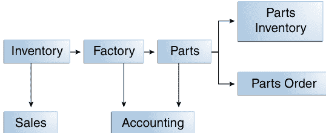

制造业只是企业使用 JMS API 的一个示例。零售应用、金融服务应用、健康服务应用以及许多其他都可以利用消息传递。

### 45.1.4 JMS API 如何与 Java EE 平台协同工作？

当 JMS API 首次引入时，它最重要的目的是允许 JMS 应用程序访问现有的面向消息的中间件（MOM）系统。当时，许多供应商已经采用并实现了 JMS API，因此 JMS 产品现在可以为企业提供完整的消息传递能力。

JMS API 是 Java EE 平台不可或缺的一部分，应用程序开发者可以使用 JMS EE 组件进行消息传递。JMS 2.0 是 Java EE 7 发布的一部分。

Java EE 平台中的 JMS API 具有以下特性：

- 应用程序客户端、企业豆 (`EJB`) 豆和 Web 组件可以发送或异步接收 JMS 消息。应用程序客户端还可以设置消息监听器，允许在消息可用时通过通知将其异步传递给它们。
- 消息驱动豆（企业豆的一种）允许在 EJB 容器中异步消费消息。应用程序服务器通常会对消息驱动豆进行池化，以实现消息的并发处理。
- 消息发送和接收操作可以参与 Java Transaction API (`JTA`) 事务，允许 JMS 操作和数据库访问在单个事务中进行。

JMS API 通过简化企业开发增强了 Java EE 平台的其他部分，允许 Java EE 组件与具备消息传递能力的旧系统之间进行松耦合的异步交互。开发者可以通过添加新的消息驱动豆来处理特定的业务事件，从而为 Java EE 应用程序添加新行为。此外，Java EE 平台通过提供对 JTA 事务的支持并允许并发消费消息增强了 JMS API。更多信息请参见《Enterprise JavaBeans 规范，v3.2》。

JMS 提供者可以使用 Java EE Connector 架构与应用程序服务器集成。通过资源适配器访问 JMS 提供者。这种能力允许供应商创建可以插入多个应用程序服务器的 JMS 提供者，并允许应用程序服务器支持多个 JMS 提供者。更多信息请参见《Java EE Connector 架构规范 v1.7》。

## 45.2 基本 JMS API 概念

本节介绍了最基本的 JMS API 概念，即你入门时需要了解的概念。简单的应用程序客户端使用 JMS API。下一节介绍了 JMS API 编程模型。后续章节将涵盖更高级的概念，包括编写使用消息驱动豆的应用程序时所需的概念。

### 45.2.1 JMS API 架构

一个 JMS 应用程序可以是以下部分之一：

- **JMS 提供者**：一个实现 JMS 接口并提供管理和控制功能的消息系统。Java EE 平台的完整配置实现都包含一个 JMS 提供者。
- **JMS 客户端**：用 Java 编程语言编写的产生和消费消息的程序或组件。任何 Java EE 应用程序都可以作为 JMS 客户端。Java SE 应用程序也作为 JMS 客户端；GlassFish 服务器文档中的《Java 消息队列开发者指南》（https://glassfish.java.net/docs/）解释了如何实现这一功能。
- **消息**：用于 JMS 客户端之间通信信息的对象。
- **管理对象**：为客户端使用配置的 JMS 对象。两种管理对象是目的地（destinations）和连接工厂（connection factories），在《JMS Administered Objects》中进行了描述。管理员可以创建在特定 GlassFish 服务器安装下的所有应用程序可用的对象；否则，开发者可以使用注解创建特定于某个应用程序的对象。

图 45-2 展示了这些部分如何交互。管理工具或注解允许你将目的地和连接工厂绑定到 JNDI 命名空间中。JMS 客户端随后可以使用资源注入来访问命名空间中的管理对象并建立逻辑连接。

### 图 45-2 JMS 架构

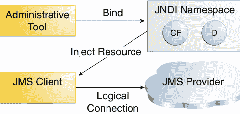

### 45.2.2 消息样式

在 JMS API 出现之前，大多数消息支持点对点（PTP）或发布/订阅（pub/sub）样式。JMS API 定义了每种样式。JMS 提供者必须实现这两种样式。消息的传递方式取决于你使用的是点对点还是发布/订阅样式。JMS API 对这两种样式都是通用的，但以下子节将详细介绍这些消息的传递方式。

#### 45.2.2.1 点对点消息样式

点对点（PTP）消息产品或应用程序基于发送者和接收者的概念。队列保留消息直到其被消费或过期。如图 45-3 所示，PTP 消息具有：

- 每条消息只有一个消费者。
- 接收者必须处于激活状态才能消费消息。

### 图 45-3 点对点消息

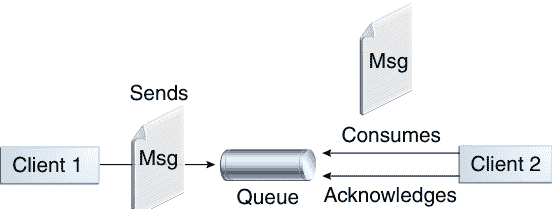

当每条消息必须由一个消费者处理时，使用 PTP。

#### 45.2.2.2 发布/订阅消息样式

发布/订阅（pub/sub）产品或应用程序将消息指向主题，主题就像公告板。发布者和订阅者可以动态地发布或订阅主题。系统负责向他们分发消息。通常情况下，一个主题只有一个订阅。但是：

- 每条消息可以有多个消费者。
- 订阅者必须处于激活状态才能消费消息。

JMS API 在某种程度上放了这一限制，允许应用程序创建持久订阅，在消费者未激活时接收消息。持久订阅提供了队列的灵活性和可靠性，但允许向多个接收者发送消息。有关持久订阅的更多信息，请参见《创建持久订阅》。

当每条消息可以被任意数量的消费者处理时，使用发布/订阅。图 45-4 展示了发布/订阅消息。

### 图 45-4 发布/订阅消息

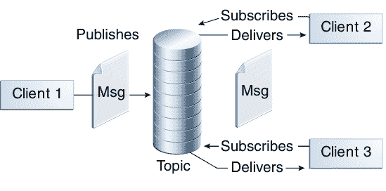

### 45.2.3 消息消费

消息产品本质上是异步的：消息的产生和消费之间没有根本依赖。然而，JMS 规范在更精确的意义上使用该术语。可以通过两种消费消息：

- **同步**：消费者通过调用 `receive` 方法从目的地获取消息。`receive` 方法将阻塞直到消息到达或在指定的时间限制内未到达。
- **异步**：应用程序客户端或 Java SE 客户端可以在消费者处注册消息监听器。消息监听器类似于事件监听器。当消息到达目的地时，JMS 提供者通过调用监听器的 `onMessage` 方法来传递消息，该方法对消息内容进行操作。在 Java EE 应用程序中，消息驱动豆充当消息监听器（它也有 `onMessage` 方法），但客户端不需要在消费者处注册它。

## 45.3 JMS API 编程模型

JMS 应用程序的基本构建块是：

- 管理对象：连接工厂和目的地
- 连接
- 会话
- `JMSContext` 对象，它将连接和会话合并到一个对象中
- 消息生产者
- 消息消费者
- 消息

图 45-5 显示了所有对象在 JMS 客户端应用程序中是如何组合的。

### 图 45-5 JMS API 编程模型

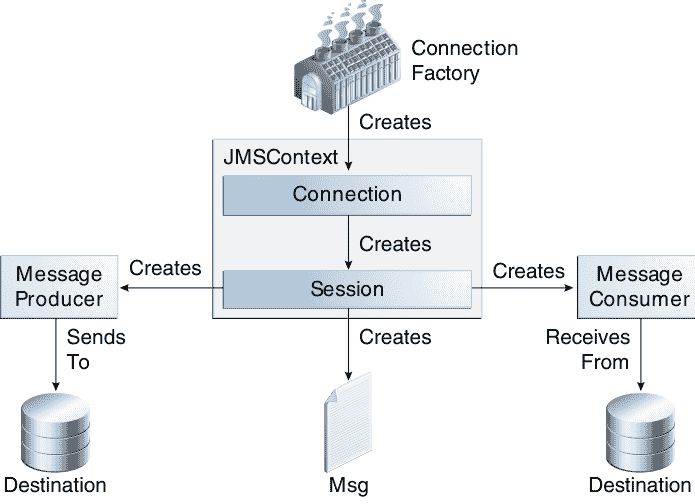

本节简要描述了所有对象，并提供了如何创建和使用这些对象的示例命令和代码段。最后一个小节描述了 JMS API 异常处理。

在应用程序中组合所有这些对象的示例出现在第 46 章“Java 消息服务示例”，从“编写 JMS 应用程序”开始。更多细节，请参阅 JMS API 文档或 Java EE API 文档。

### 45.3.1 JMS 管理对象

JMS 应用程序的两个部分——目的地（destinations）和连接工厂（connection factories）通常通过管理方式而非编程方式维护。这些对象的底层技术在不同的 JMS API 实现之间可能会非常不同。因此，这些对象的管理属于随提供者而异的其他管理任务。

JMS 客户端通过接口访问管理对象，因此客户端可以在多个 JMS API 实现上运行，而无需更改。通常情况下，管理员在 JNDI 命名空间中配置管理对象，JMS 客户端通过使用资源注入访问它们。

使用 GlassFish Server，你可以使用 `asadmin create-jms-resource` 命令或管理控制台创建连接器资源形式的 JMS 管理对象。你也可以在名为 `glassfish-resources.xml` 的文件中指定资源，并将其与应用程序一起打包。

NetBeans IDE 提供了一个向导，允许你为 GlassFish Server 创建 JMS 资源。详情请参阅“创建 JMS 管理对象”。

EE 平台规范允许开发者使用注解或部署描述符元素创建管理对象。以这种方式创建的对象特定于创建它的应用程序。详情请参阅“为 Java EE 应用程序创建资源”。部署程序中的定义将覆盖注解指定的定义。

#### 45.3.1.1 JMS 连接工厂

连接工厂是用于创建到提供者连接的对象。连接工厂封装了一组由管理员定义的连接参数。每个连接工厂都是 `ConnectionFactory`、`QueueConnectionFactory` 或 `TopicConnectionFactory` 接口的实例。要学习如何创建连接工厂，请参阅“JMS 管理对象”。

在 JMS 客户端启动时，你通常会将连接工厂资源注入到 `ConnectionFactory` 对象中。EE 服务器提供一个 JNDI 名称为 `java:/DefaultJMSConnectionFactory` 的 JMS 连接工厂。实际的 JNDI 名称取决于具体实现。

例如，以下代码查找 JMS 连接工厂并将其分配给 `ConnectionFactory` 对象：

```java
@Resource(lookup = "java:/DefaultJMSConnectionFactory")
private static ConnectionFactory connectionFactory;
```

#### 45.3.1.2 JMS 目的地

目的地是用于指定其产生的消息目标以及消费的消息来源的对象。在发布/订阅（pub/sub）消息模式中，目的地被称为队列（queues）。JMS 应用程序可以使用多个队列或主题（topics）（或两者都有）。要学习如何创建目的地资源，请参阅“创建管理对象”。

使用 GlassFish Server 创建目的地，你需要创建一个符合目的地 JNDI 名称的 JMS 目的地。

在 GlassFish Server 实现中，每个目的地都引用一个物理目的地。你可以创建一个物理目的地，但如果不创建，应用程序服务器会在需要时创建它，并在删除目的地资源时将其删除。

除了向客户端程序注入连接工厂资源外，你通常还会注入目的地资源。与连接工厂不同，目的地特定于主题模式或发布/订阅消息模式。要创建一个允许对主题和队列使用相同代码的应用程序，你需要将目的地分配给 `Destination` 对象。

以下代码指定了两个资源，一个队列和一个主题。资源名称映射到 JNDI 命名空间中创建的目的地资源。

```java
@Resource(lookup = "jms/MyQueue")
private static Queue queue;
```

```java
@Resource(lookup = "jms/MyTopic")
private static Topic topic;
```

在 Java EE 应用程序中，JMS 管理对象通常放置在 JMS 命名子上下。

通过通用接口，你可以进行混合匹配。通常情况下，管理员在 JNDI 命名空间中配置管理对象，JMS 客户端通过使用资源注入访问它们。

### 45.3.2 连接

连接代表应用程序与 JMS 提供者之间的活动链接。连接用于创建会话（sessions）。会话用于产生和消费消息。会话是产生和消费消息的工作单元。

### 45.3.3 会话

会话是产生和消费消息的工作单元。会话用于产生和消费消息。会话用于创建消息生产者和消费者。

### 45.3.4 JMSContext 对象

`JMSContext` 提供了与 JMS 提供者交互的简化接口。它用于创建会话。`JMSContext` 提供了对以下对象的访问：

- 消息消费者
- 消息
- 队列浏览器
- 主题

### 45.3.5 JMS 生产者

消息生产者是由 `JMSContext` 或会话创建的用于向目的地发送消息的对象。由 `JMSContext` 创建的消息生产者实现了 `JMSProducer` 接口。

### 45.3.6 JMS 消息消费者

消息消费者是由 `JMSContext` 或会话创建的用于接收发送到目的地消息的对象。由 `JMSContext` 创建的消息消费者实现了 `JMSConsumer` 接口。

消息消费者允许 JMS 客户端在 JMS 提供者处注册一个目的地。JMS 提供者管理从目的地到该目的地注册消费者的消息投递。

当你使用 `JMSContext` 创建消息消费者时，一旦创建了消费者，消息投递就会开始。你可以通过在创建 `JMSContext` 时调用 `setToStart(false)` 来控制此行为，然后显式地调用 `start` 方法来开始消息投递。如果你想在不关闭连接的情况下停止消息投递，可以调用 `stop` 方法；重启消息投递，调用 `start`。

你使用 `receive` 方法同步消费消息。你可以在创建消费者的任何时候使用此方法。

如果你不指定任何参数或指定参数 0，该方法将无限阻塞直到消息到达：

```java
Message m = consumer.receive();
Message m = consumer.receive(0);
```


对于简单用例，这可能并不重要。但如果消息可能不可用，可以使用带有超时的同步接收：调用超时时间大于 0 的 `receive` 方法。一秒是一个推荐的超时值：

```java
Message m = consumer.receive(1000); // 一秒后超时
```

要启用从应用程序或 Java SE 客户端的异步消息投递，你需要使用消息监听器，它将在下一节中描述。

你使用 `JMSContext.createDurableConsumer` 创建持久订阅。这仅在你使用主题（topic）时有效。详情请参阅[创建持久订阅](#Creating Durable Subscriptions)。对于主题，你还可以创建共享消费者；请参阅[创建共享订阅](#Creating Shared Subscriptions)。

# 45.3.6.1 JMS 消息监听器

消息监听器是一个作为消息事件处理器的对象。它实现了 `MessageListener` 接口，该接口包含一个方法 `onMessage`。你定义了消息到达时要执行的操作。

从应用程序或 Java SE 客户端，通过使用 `setMessageListener` 向特定消费者注册消息监听器。例如，如果你定义了一个实现 `MessageListener` 接口的 `Listener` 类，你可以如下注册监听器：

```java
Listener listener = new Listener();
consumer.setMessageListener(listener);
```

当消息投递开始时，JMS 提供者会在消息投递时自动调用监听器的 `onMessage` 方法。`onMessage` 方法接受一个 `Message` 类型的参数，你的方法实现可以将其强制转换为另一种消息子类型（见[消息体](#Message Bodies)）。

在 Java EE 或 EJB 容器中，使用消息驱动豆（message-driven beans）进行异步消息投递。消息驱动豆实现了 `MessageListener` 接口并包含一个 `onMessage` 方法。详情请参阅[使用消息驱动豆异步接收消息](#Using Message-Driven Beans to Receive Messages Asynchronously)。

Java 消息服务概念 45-11

`onMessage` 方法应该处理所有异常。抛出 `RuntimeException` 被认为是一个编程错误。

关于消息监听器使用的简单示例，请参考《使用消息监听器进行异步消息投递》。第 46 章“Java 服务示例”中包含了多个消息监听器和消息驱动豆的示例。

# 45.6.2 JMS 消息选择器

如果你的消息应用程序需要过滤接收到的消息，你可以使用 JMS 消息选择器，它允许目的地的消费者满足其感兴趣的消息。消息选择器将过滤消息的工作分配给 JMS 提供者而不是应用程序。关于使用消息选择器的应用程序示例，请参阅从 Session Bean 向 MDB 发送消息。

消息选择器是一个包含表达式的字符串。表达式的语法基于 SQL92 条件表达式。消息选择器选择每个 `NewType` 属性被设置为 'Sports' 或 'Opinion' 的消息。

```sql
NewType = 'Sports' or NewType = 'Opinion'
```

`createConsumer` 和 `createDurableConsumer` 方法，以及创建共享消费者的方法，允许你在创建消息消费者时将消息选择器作为参数指定。

消息消费者仅接收标头和属性匹配的消息。（消息头和消息属性。）

# 45.6.3 从主题消费消息

从主题消费消息的语义比从队列消费消息更复杂。

应用程序通过在主题上创建一个订阅来从主题消费消息。订阅可以是持久的或非持久的。

持久订阅可以被视为 JMS 提供者内部的一个实体。

订阅将接收发送到主题的每条消息，除非指定了消息选择器。如果指定了消息选择器，只有匹配选择器的消息会被投递到订阅。

某些订阅被限制为单个消费者。在这种情况下，所有将投递到该消费者。

非持久订阅仅在活跃消费者存在时存在。

非持久订阅可以是共享的或非共享的：

非共享非持久订阅由名称标识，并可能与单个消费者相关联。它在消费者创建时自动创建。在消费者关闭时自动删除。

使用 `JMSContext.createConsumer` 方法在主题上为非共享非持久订阅创建消费者。

共享非持久订阅由名称和可选的客户端标识标识，并可能有多个消费者从中消费消息。它在第一个消费者创建时自动创建。在最后一个消费者关闭时自动删除。更多信息请参阅共享订阅。

以更高的开销为代价，订阅是持久的。持久订阅即使在没有消费者消费的情况下也会持续存在并累积消息，直到被显式删除。详情请参阅持久订阅。

# JMS API 模型

```java
String subName = "MySub";
JMSConsumer consumer = context.createDurableConsumer(myTopic, subName);
```

在创建接收者后，订阅将变为激活状态。之后，你可能会选择 `consumer.close()`。

JMS 供应商程序会存储发送到主题的消息，就像存储发送到队列的消息一样。使用相同的连接工厂和其客户端 ID、相同的主题以及相同的订阅名称，该订阅将复活，JMS 供应商程序会交付在订阅非活动期间发送的所有消息。

要删除持久性订阅，首先关闭接收者，然后以订阅名称为参数调用 `unsubscribe` 方法：

```java
consumer.close();
context.unsubscribe(subName);
```

`unsubscribe` 方法会删除提供程序为该订阅维护的状态。

图 [45-6] 和 [45-7] 显示了非持久性订阅和持久性订阅之间的区别。对于普通的非持久性订阅，接收者和订阅在同一点开始并结束，实际上它们是同一个。当接收者关闭时，订阅也会结束。在这里，`create` 代表对 `JMSContext.createConsumer` 带 Topic 的调用，而 `close` 代表对 `JMSConsumer` 的调用。在第一次 `close` 之后和第二次 `create` 之前发送到主题的任何消息都不会被添加到任何订阅中。在图 45-6 中，接收者接收了消息 M1、M2、M5 和 M6，但它们没有接收消息 M3 和 M4。

# 图 45-6 非持久性订阅与接收者

| M1 | M2 | M3 | M4 | M5 | M6 |
|---|---|---|---|---|---|
| | | | | | |
| 订阅 | | | | | |

对于持久性订阅，接收者可以关闭并重新创建，但订阅将继续存在并持有消息，直到应用程序调用 `unsubscribe` 方法。在图 45-7 中，`create` 代表对 `JMSContext.createDurableConsumer` 的调用，`close` 代表对 `JMSConsumer.close` 的调用，`unsubscribe` 代表对 `JMSContext.unsubscribe` 的调用。在第一个接收者关闭到第二个接收者（在同一个持久性订阅上）创建期间发送的消息，即使消息 M2、M4 和 M5 在没有接收者时到达，它们也不会丢失。

# 图 45–7 持久性订阅上的接收者

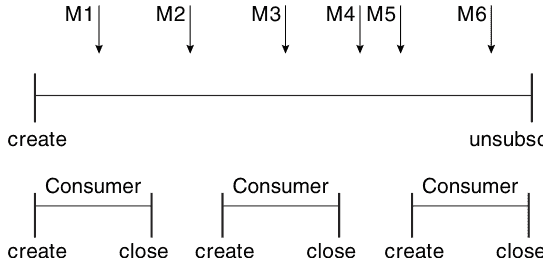

共享持久性订阅允许你使用多个接收者从持久性订阅中接收消息。如果你使用共享持久性订阅，连接工厂不需要有客户端。要创建持久性订阅，请调用 `JMSContext.createSharedDurableConsumer` 方法，并指定主题和订阅：

```java
JMSConsumer consumer = context.createSharedDurableConsumer(topic, "MakeItLast");
```

请参阅[确认消息”、“使用持久性订阅”、“使用持久性订阅以及[从 Session Bean 向 MDB 发送消息]以获取使用持久性订阅的 Java EE 示例。

# 45.3.6.5 创建共享订阅

由 `createConsumer` 或 `createDurableConsumer` 方法创建的主题订阅只能有一个接收者（尽管一个主题可以有很多）。多个客户端从同一个主题消费，根据定义，这意味着该主题有多个订阅，且所有客户端都会接收发送到主题的所有消息（除非它们使用消息选择器进行过滤）。

然而，通过使用 `createSharedConsumer` 方法不仅指定目标，还指定一个可以为主题创建一个持久性共享订阅：

```java
consumer = context.createSharedConsumer(topicName, "SubName");
```

对于共享订阅，消息将分布在多个使用相同主题和订阅名称的消费者之间。发送到主题的每条消息都会到达每个订阅（取决于消息选择器），但添加到订阅的每条消息仅交付给该订阅上的接收者之一，它仅会被其中一个客户端接收。共享订阅可用于在每条消息上跨多个接收者平衡负载。这可以提高 Java EE 客户端和 SE 应用程序的可扩展性（消息驱动豆在多个线程之间分担处理来自主题的消息的工作）。

请参阅[使用非持久性订阅]以获取使用共享非持久性接收者的简单示例。

你还可以通过 `JMSContext.createSharedDurableConsumer` 方法创建共享持久性订阅。详情请参阅[创建持久性订阅]。

# 45.3.7 JMS 消息

JMS 应用程序的最终目的是产生和消费可供其他软件应用程序的消息。JMS 消息具有一种简单但高度灵活的基本格式，允许你使用异构平台上的非 JMS 应用程序创建匹配格式的消息。

一个 JMS 消息可以包含三个部分：头部、属性和正文。仅头部是必需。以下章节描述了这些部分。

有关消息头部、属性和正文的完整文档，请参考 API 文档中的 `Message` 接口文档。有关可能类型的列表，请参阅[消息正文]。

# 45.3.1 消息头部

JMS 消息头部包含许多定义字段，这些字段包含客户端和提供者用于识别和路由消息的值。表 45–1 列出并描述了 JMS 消息头部字段及其值的设置方法。例如，每条消息都有一个唯一标识符，在头部字段 `JMSMessageID` 中表示。另一个头部字段 `JMSDestination` 的值是目标。

表 45–1 JMS 消息头部值：

| 头部字段 | 说明 | 设置者 |
|---|---|---|
| JMSDestination | 消息所在的目标 | JMS 供应商 |
| JMSMode | 交付模式 | JMS 供应商 |
| JMSTime | 发送时间 | JMS 供应商 |
| JMSExpiration | 消息过期时间 | JMS 供应商 |
| JMSPriority | 消息优先级 | JMS 供应商 |
| JMSMessageID | 唯一标识每条消息的值 | 客户端 |
| JMSTimestamp | 交付时间 | JMS 供应商 |
| CorrelationID | 将一个消息链接到另一个消息的值 | 客户端 |
| ReplyTo | 应发送回复的目标 | 客户端 |
| JMSType | 客户端提供的类型标识 | 客户端 |
| JMSDelivered | 消息是否重传 | JMS 供应商 |

45.3.2 消息属性

如果你需要头部之外的值，可以为消息创建并设置属性。你可以使用属性创建选择器（参阅[消息选择器]）。有关作为选择器的属性设置示例，请参阅[从 Session Bean 向 MDB 发送消息]。

JMS API 提供了一些预定义属性。JMS 供应商只需实现以下一个：`JMSCount`（指定消息交付的次数）；其余均为可选。使用这些属性是可选的。

# 45.3.3 消息正文

JMS API 定义了六种消息类型。每种消息类型对应不同的正文。这些消息类型允许你以不同的格式发送接收数据。表 45-2 描述了这些类型。

# 表 45–2 消息类型

| 消息类型 | 正文内容 |
|---|---|
| TextMessage | java.lang.String 对象（例如 XML 文件的内容）。 |
| MapMessage | 键值对集合，使用 String 和 Java 语言中的原始类型。可以通过迭代器顺序或随机访问。条目顺序未定义。 |
| BytesMessage | 未解释的字节流。此消息类型用于字面编码以匹配格式。 |
| StreamMessage | Java 语言中的原始值流，按顺序填充和读取。 |
| ObjectMessage | Java 语言中的序列化对象。 |
| Message | 无。仅由头部字段和属性组成。当不需要消息正文时此消息类型非常有用。 |

JMS API 提供创建每类型消息并填充内容的方法。例如，为了创建并设置 TextMessage，可能使用以下语句：

```java
TextMessage message = context.createTextMessage();
message.setText(msg_text); // msg_text 是一个 String
context.createProducer().send(message);
```

在接收端，消息作为通用的 `Message` 对象到达。然后你可以将该对象转换为适当的消息类型，并使用特定方法访问正文并提取消息内容（如果需要，其头部和属性）。例如，你可能使用 BytesMessage 的流式方法。你必须转换为适当的消息类型以检索 StreamMessage 的正文。

# JMS API 模型

你不需要将消息强制转换为消息类型，而是可以在 `Message` 上调用 `getBody` 方法，并将消息类型作为参数指定。例如，你可以将 `TextMessage` 检索为 `String`。以下代码段使用了 `getBody` 方法：

```java
Message m = consumer.receive();
if (m instanceof TextMessage) {
    String message = m.getBody(String.class);
    System.out.println("Reading message: " + message);
} else {
    // 处理错误或处理另一种消息类型
}
```

JMS API 提供了创建和接收 `TextMessage`、`BytesMessage`、`MapMessage` 或 `ObjectMessage` 的快捷方法。例如，你不需要将字符串封装在 `TextMessage` 中；而是可以直接发送和接收字符串。例如，你可以如下所示发送消息：

```java
String message = "This is a message";
context.createProducer().send(dest, message);
```

你可以使用 `receiveBody` 方法来接收消息：

```java
String message = receiver.receiveBody(String.class);
```

只要消息可以分配给特定类型，你就可以使用 `receiveBody` 方法接收除 `StreamMessage` 之外的任何类型的消息。

如果你想发送一个作为应用程序信号的消息，那么空消息可能很有用。第 46 节“Java Message Service Examples”中的某些示例在发送系列文本消息后会发送一个空消息。

```java
context.createProducer().send(dest, context.createMessage());
```

消费者随后可以将非文本消息解释为所有消息已收到的信号。

第 46 节“Java Message Service Examples”中的示例使用了 `TextMessage`、`MapMessage` 和 `Message` 类型的消息。

# 45.3.8 JMS 队列浏览器

发送到队列的消息将留在队列中，直到其消息消费者对其消费。JMS API 提供了一个 `QueueBrowser` 对象，允许你浏览队列中的消息并显示每条消息的头部。要创建 `QueueBrowser` 对象，请使用 `JMSContext.createQueueBrowser`。例如：

```java
QueueBrowser browser = context.createQueueBrowser(queue);
```

参见“在队列上浏览消息”使用 `QueueBrowser` 对象的示例。

`createBrowser` 方法允许你在创建 `QueueBrowser` 时将消息选择器作为第二个参数指定。有关消息选择器的信息，请参见“JMS 消息选择器”。

JMS API 不提供浏览主题的机制。消息一旦出现在主题中通常就会消失。如果没有消费者来消费它们，JMS 提供程序将将其删除。虽然持久性订阅（durable subscriptions）允许消息在消息消费者未激活时留在主题上，但 JMS 未定义任何检查这些的设施。

# 使用高级 JMS 特性

# 45.3.9 JMS 异常处理

JMS API 中所有检查异常的根类是 `JMSException`。JMS API 中所有未检查异常的根源是 `JMSRuntimeException`。

捕获 `JMSException` 和 `JMSRuntimeException` 提供了一种处理与 JMS API 相关的所有异常的通用方法。

`JMSException` 和 `JMSRuntimeException` 类包含以下子类，API 文档中对其进行了描述：

- `IllegalStateException`, `IllegalStateRuntimeException`
- `InvalidClientIDException`, `InvalidClientIDRuntimeException`
- `InvalidDestinationException`, `InvalidDestinationRuntimeException`
- `InvalidSelectorException`, `InvalidSelectorRuntimeException`


- `JMSException`, `JMSRuntimeException`
- `MessageFormatException`, `MessageFormatRuntimeException`
- `MessageNotException`
- `MessageNotWritableException`, `MessageNotWriteableRuntimeException`
- `ResourceAllocationException`, `ResourceAllocationRuntimeException`
- `TransactionInProgressException`, `TransactionInProgressRuntimeException`
- `TransactionRolledBackException`, `TransactionRolledBackRuntimeException`

教程中的所有示例都可以在适当处理 `JMSException` 或 `JMSRuntimeException`。

# 45.4 使用高级特性

本节解释了如何使用 JMS API 的特性来实现你的应用程序所需的可靠性和性能。许多人在应用程序中使用 JMS，是因为他们无法容忍重复消息，并且他们要求每条消息必须且仅接收一次。JMS API 提供了此功能。

产生消息最可靠的方法是发送 `PERSISTENT`（持久）消息，它在 JMS 提供程序故障的情况下不会丢失。

JMS 消息默认是 `PERSISTENT` 的。详情请参“指定消息持久性”。

事务允许在原子操作中发送或接收多个消息。在 Java EE 平台中，它们允许消息发送与数据库读写结合在原子事务中。事务是一个工作单元，你可以在其中分组一系列操作（如消息发送和接收），使得这些操作要么成功要么全部失败。详情请参“使用 JMS 本地事务”。

消费消息最可靠的方法是在事务内进行，从队列或主题的持久性订阅。详情请参“创建临时目的地”、“创建持久性订阅”和“使用 JMS 事务”。

某些特性主要允许应用程序提高性能。例如，你可以设置消息在一段时间后过期（参见“允许消息过期”），这样消费者就不会接收不必要的过时信息。你可以异步发送消息；参见“异步发送消息”。

你还可以对消息确认指定控制级别；参见“控制消息确认”。

其他特性可以提供与可靠性无关的有用功能。例如，你可以创建仅在创建连接期间持续的临时目的地。创建临时目的地

以下章节描述了这些特性应用于应用程序客户端或 Java SE 客户端。某些特性在 Java Web 或 EJB 容器中的工作方式不同；这些差异在此处注明，并在“在 Java 应用程序中使用 API”中详细说明。

## 45.4.1 控制消息确认

在 JMS 消息被确认之前，它不被认为成功消费。消息的成功消费通常分三个阶段：

1. 客户端接收消息。
2. 客户端处理消息。
3. 消息被确认。

确认由 JMS 提供程序或客户端发起，取决于会话确认模式。

在本地事务会话中（参见“使用 JMS 本地事务”），消息在会话提交时被确认。如果事务回滚，所有已消费的消息都将重新投递。

在 JTA 事务中（在 Java EE 或 EJB 容器中），消息在事务提交时被确认。

在非事务会话中，消息如何被确认取决于可能指定为 `createContext` 方法参数的值。可能的值如下：

- `JMSContext.AUTO_ACKNOWLEDGNOWLEDGE`：此设置是应用程序客户端和 Java SE 客户端的默认设置。当客户端成功从 `receive` 调用返回，或 `MessageListener` 成功返回消息时，`JMSContext` 会自动确认客户端接收消息。

在配置为使用自动确认的 `JMSContext` 中同步接收是消息消费遵循前述三阶段过程的唯一例外。在这种情况下，接收和确认在一个步骤中完成，随后是处理消息。

- `JMSContext.CLIENT_ACKNOWLEDGMENT`：客户端通过调用消息的 `acknowledge` 方法来确认消息。在此模式下，确认在会话级别进行：确认已消费的消息会自动确认其会话已消费的所有消息。例如，如果一个消息消费者消费了十条消息，然后确认了交付的第五条消息，则十条消息都被确认了。

> **注意**：在 Java EE 平台中，`JMSContext.CLIENT_ACKNOWLEDGE` 设置只能在应用程序客户端中使用，不能用于 Web 组件或企业豆。

- `JMSContext.DUPS_OK_ACKNOWLEDGE`：此选项指示 `JMSContext` 延迟确认消息的交付。如果 JMS 提供者发生故障，可能会导致某些重复消息的交付，因此它应该由容忍重复消息的消费者使用。（如果 JMS 提供者交付了消息，它必须将 `JMSRedelivered` 消息头的值设置为 `true`。）此选项通过尽量减少防止重复所做的工作来减少会话开销。

如果在关闭 `JMSContext` 时，已从队列接收了消息但未确认，则 JMS 提供者将保留这些消息并在消费者下次访问队列时交付它们。如果应用程序关闭了正在从持久性订阅接收消息的 `JMSContext`，提供者也会保留未确认的消息。（参见[创建持久性订阅]。）从非持久性订阅接收到的未确认消息在 `JMSContext` 关闭时将被丢弃。

如果你使用持久性订阅，可以使用 `JMSContext.recover` 方法停止非事务性 `JMSContext` 并从其第一个未确认的消息开始重启。实际上，如果消息已过期或到达了更高优先级的消息，`JMSContext` 的一系列交付的消息可能与最初交付的那些有所不同。对于非持久性订阅的消费者，当调用 `JMSContext.recover` 方法时，提供者可能会丢弃未确认的消息。

“确认消息（Acknowledging Messages）”中的示例程序演示了两种确保消息在处理完成之前不会被确认的方法。

## 45.4.2 为发送消息指定选项

当你发送消息时，可以从这些选项中选择其一个。这些选项允许你执行以下任务：

- 指定消息为持久性，这意味着在提供者发生故障时，它们将不会丢失（[指定消息持久性]）
- 为消息设置优先级级别，这会影响消息交付的顺序（[设置消息优先级级别]）
- 为消息指定过期时间，这样如果消息过时则将不会被交付（[允许消息过期]）
- 为消息指定交付延迟，以便它们在指定时间过去之前不会被交付（[指定交付延迟]）

方法链式调用允许你在创建生产者并调用 `send` 方法时指定这些选项中的多个选项；[使用 JMSProducer 方法链式调用]。

### 45.4.2.1 指定消息持久性

JMS API 支持两种交付模式，用于指定当 JMS 提供者发生故障时消息是否会丢失。这些交付模式是 `DeliveryMode` 接口的字段。

默认交付模式 `PERSISTENT`（持久性）指示 JMS 提供者格外小心确保消息在传输或 JMS 提供者故障期间不会丢失。使用此交付模式发送的消息在发送时会被记录到稳定存储中。

`NON_PERSISTENT`（非持久性）交付模式不需要 JMS 提供者存储消息，也不保证在提供者故障时消息不会丢失。

要指定交付模式，请使用 `JMSProducer` 接口的 `setDeliveryMode` 方法为该生产者发送的所有消息设置交付模式。

你可以在创建生产者并发送消息时更改交付模式。以下调用创建了一个具有 `NON_PERSISTENT` 交付模式的生产者并使用它发送消息：

```
context.createProducer().setDeliveryMode(DeliveryMode.NON_PERSISTENT).send(dest, msg);
```

如果你不指定交付模式，默认为 `PERSISTENT`。使用 `NON_PERSISTENT` 模式可能会提高性能并减少存储开销，但只有在你的应用程序可以承受丢失消息的情况下才应该使用它。

### 45.4.2.2 设置消息优先级级别

你可以使用消息优先级来指示 JMS 提供者交付紧急消息。使用 `JMSProducer` 接口的 `setPriority` 方法为该生产者发送的所有消息设置优先级。

你可以在创建生产者并发送消息时使用链式调用来设置优先级级别。以下示例为生产者设置了 7 的优先级，然后发送了一条消息：

```
context.createProducer().setPriority(7).send(dest, msg);
```

十个优先级级别从 0（最低）到 9（最高）。如果你不指定优先级级别，默认为 4。JMS 提供者尝试在交付低优先级消息之前交付高优先级消息，但不必按照精确的顺序交付消息。

### 45.4.2.3 允许消息过期

消息永远不会过期。如果消息在一段时间后变得过时，你可能希望设置一个过期时间。使用 `JMSProducer` 接口的 `setTimeToLive` 方法为该生产者发送的所有消息设置默认过期时间。

例如，包含股票价格等快速变化数据的消息在几分钟后就会变得过时，你可以配置消息在那个时间后过期。

你可以在创建生产者并发送消息时使用链式调用来设置时间。例如，以下调用为生产者设置了五分钟的时间，然后发送了一条消息：

```
context.createProducer().setTimeToLive(300000).send(dest, msg);
```

如果指定的 `timeToLive` 为 0，则消息永远不会过期。当消息发送时，指定的 `timeToLive` 会加到当前时间以产生过期时间。销毁过期的消息可以存储和计算资源。

### 45.4.2.4 指定交付延迟

你可以指定在消息发送后必须经过的时间，JMS 提供者才能交付该消息。使用 `JMSProducer` 接口的 `setDeliveryDelay` 方法为该生产者的所有消息设置交付延迟。

你可以在创建生产者并发送消息时使用链式调用来设置交付延迟。例如，以下调用为生产者设置了 3 秒的交付延迟，然后发送了消息：

```
context.createProducer().setDeliveryDelay(3000).send(dest, msg);
```

### 45.4.2.5 使用 JMSProducer 方法链式调用

`JMSProducer` 接口上的 setter 方法返回 `JMSProducer` 对象，因此你可以使用链式调用创建生产者、设置多个属性并发送消息。例如，以下链式方法创建一个生产者，设置自定义属性、过期时间、交付模式和优先级，然后将消息发送到队列：

```
context.createProducer()
    .setProperty("MyProperty", "MyValue")
    .setTimeToLive(10000)
    .setDeliveryMode(DeliveryMode.NON_PERSISTENT)
    .setPriority(2)
    .send(queue, body);
```

你也可以调用 `JMSProducer` 方法设置消息属性，然后在单独的 `send` 方法中发送。你也可以直接在消息上设置属性。

## 45.4.3 创建临时目的地

JMS API 允许你创建目的地（`TemporaryQueue` 和 `TemporaryTopic` 对象），这些对象仅在创建它们的连接持续期间有效。你可以使用 `JMSContext.createTemporaryQueue` 和 `JMSContext.createTemporaryTopic` 动态创建这些目的地，如下所示：

```
TemporaryTopic topic = context.createTemporaryTopic();
```

只有由创建临时目的地的相同连接创建的消费者才能从该目的地消费。任何消息生产者都可以向该目的地发送消息。如果你关闭目的地所属的连接，目的地将被关闭且内容也将丢失。

你可以使用临时目的地来实现简单的请求/响应机制。如果你创建了一个临时目的地并在发送消息时将其指定为 `JMSReplyTo` 头部字段，消息的消费者可以使用 `JMSReplyTo` 字段的值作为其发送回复的地方。消费者还可以通过将回复的 `JMSCorrelationID` 头部字段设置为请求的 `JMSMessageID` 头部字段的值来使用原始请求。例如，一个 `onMessage` 处理器可以创建一个 `JMSContext`，以便向其收到的消息发送回复。它可以使用如下代码：

```
replyMsg = context.createTextMessage("Consumer processed message: " + msg.getText());
replyMsg.setJMSCorrelationID(msg.getJMSMessageID());
context.createProducer().send((Topic) msg.getJMSReplyTo(), replyMsg);
```

例如，使用实体连接来自两个数据库的消息。

## 45.4.4 使用 JMS 本地事务

事务将一系列操作组组成一个原子工作单元。如果任何操作失败，事务都可以回滚，并且可以从头重新尝试这些操作。如果所有操作都成功，则可以提交事务。

在应用程序客户端或 Java SE 客户端中，你可以使用本地事务来对消息的发送和接收进行分组。你使用 `JMSContext.commit` 方法来提交事务。你可以在事务中发送多条消息，在消息提交前不会添加到队列或主题。如果你在事务中接收了多条消息，在事务提交之前它们不会被确认。

你可以使用 `JMSContext.rollback` 来回滚事务。事务回滚意味着所有产生的消息都会被销毁，已消耗的消息将被重新投递，除非它们已经过期（允许消息过期）。

事务会话总是参与事务的。要创建一个事务会话，如下调用 `createContext`：

```
JMSContext context = connectionFactory.createContext(JMSContext.SESSION_TRANSACTED);
```

一旦调用了 `commit` 或 `rollback` 方法，一个事务就会结束，另一个事务就会开始。关闭事务会话会回滚其正在进行的事务，包括任何发送和接收。

在 Java EE 或 EJB 容器中的应用程序中，你不能使用本地事务。相反，请使用 JTA 事务，该部分在“为 EE 应用程序使用 JMS API”中有详细描述。

你可以在单个 JMS 本地事务中结合多个发送和接收操作，只要它们都是使用同一个 `JMSContext` 执行的。

如果你使用请求/响应机制（即发送一条消息并接收对该消息的响应），请**不要**使用事务。如果你尝试使用事务，程序将失败，因为发送操作无法等待事务提交。以下代码片段说明了该问题：

```
// 不要这样做！
outMsg.setJMSReplyTo(outQueue);
context.createProducer().send(outQueue, outMsg);
consumer = context.createConsumer(replyQueue);
inMsg = consumer.receive(replyQueue);
context.commit();
```

由于在事务期间发送的消息在事务提交之前实际上并没有被发送，因此事务不能包含任何依赖于该消息已发送的接收操作。

消息的生产和消费不能同时属于同一个事务。原因是事务发生在客户端和 JMS 提供者之间，而 JMS 提供者在消息的生产和消费之间干预。图 45-8 展示了这种交互。

### 图 45-8 使用 JMS 本地事务

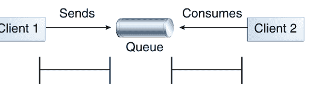

客户端 1 向一个或多个目的地发送一条或多条消息可以形成一个事务，因为它们使用单个 `JMSContext` 与 JMS 提供者形成了一组交互。同样，客户端 2 从一个或多个目的地接收一条或多条消息也使用单个 `JMSContext` 形成一个事务。由于两个客户端之间没有直接交互且使用的是不同的 `JMSContext` 对象，因此它们之间不会发生任何事务。

另一种表达方式是，事务是客户端与 JMS 提供者之间的契约，定义了消息是否发送到目的地或是否从目的地接收消息。它不是发送客户端与接收客户端之间的契约。

这是消息传递与同步处理之间的根本区别。JMS 不是将消息的发送者和接收者紧密耦合，而是将消息的发送者与目的地耦合，并单独将目的地与消息的接收者耦合。因此，虽然发送和接收各自都与 JMS 提供者有紧密耦合，但它们之间没有任何耦合。

当你创建一个 `JMSContext` 时，你可以通过向 `createContext` 方法传递 `JMSContext.SESSION_TRANSACTED` 参数来指定它是否为事务支持的。例如：

```
try (JMSContext context = connectionFactory.createContext(JMSContext.SESSION_TRANSACTED)) {
    // ...
}
```

本地事务的 `commit` 和 `rollback` 方法与使用 `JMSContext` 的会话相关。你可以在同一个 `JMSContext` 中结合对多个队列或主题的操作，以便从队列接收消息并发送到主题。“使用本地事务”示例中的示例展示了如何使用本地事务。

# 45.5 异步发送消息

通常，当你发送持久性消息时，发送操作会阻塞，直到 JMS 提供者确认消息已发送。异步机制允许你的应用程序在发送消息的同时继续工作，同时等待完成。此功能仅适用于应用程序上下文和 Java SE 客户端。

异步发送消息涉及提供一个回调对象。你指定一个带有 `onCompletion` 方法的 `CompletionListener`。例如：

```
CompletionListener listener = new CompletionListener();
context.createProducer().setAsync(listener).send(dest, message);
```


`CompletionListener` 类必须实现两个方法：`onCompletion` 和 `onException`。如果成功，则调用 `onCompletion` 方法；如果失败，则调用 `onException` 方法。这些方法的简单实现如下：

```java
@Override
public void onCompletion(Message message) {
    System.out.println("onCompletion method: Send has completed.");
}

@Override
public void onError(Message message, Exception e) {
    System.out.println("onException method: send failed: " + e.toString());
    System.out.println("未发送的消息是: \n" + message);
}
```

# 45.5 在 Java EE 中使用 JMS API

在企业 Bean 或 Web 应用中使用 JMS API 的方法与应用程序客户端不同。

Java EE 平台的通用规则适用于 EJB 或 Web 容器内使用 JMS API 的 Java EE 组件。Web 和 EJB 容器中的应用程序组件不得尝试每个连接创建多个活动 Session 对象。但允许多个 `JMSContext` 对象，因为它们结合了一个会话。

此规则不适用于应用程序客户端。客户端容器支持为每个连接创建多个会话。

## 45.5.1 为 EE 应用程序创建资源

你可以使用注解为 Java EE 企业 Bean 或 Web 组件创建特定的连接工厂和目的地。通过这种方式创建的资源仅对创建它们的应用程序可见。

你也可以使用部署描述元素创建这些资源。部署描述中指定的元素将覆盖注解。应用程序客户端必须使用部署描述来创建特定的资源。

要创建目的地，请在类上使用 `@JMSDestinationDefinition` 注解，如下：

```java
@JMSDestinationDefinition(
  name = "java:app/jms/myTopic",
  interfaceName = "javax.Topic",
  destinationName = "MyPhysicalAppTopic"
)
```

`name`、`interfaceName` 和 `destinationName` 是必填的。你可以可选地指定 `description` 元素。要创建多个目的地，将它们包含在 `@JMSDestinationDefinitions` 注解中并用逗号隔开。

```java
@JMSConnectionFactoryDefinition(
name="java:app/jms/MyConnectionFactory"
)
```

`name` 元素是必需的。你可以可选地指定其他元素，例如如果你想将连接工厂用于数据订阅，可以使用 `clientId`，或者 `description`。如果不指定 `interfaceName` 元素，默认接口是 `javax.jms.ConnectionFactory`。要创建多个连接工厂，请将它们封装在 `@JMSConnectionFactoryDefinitions` 注解中，并用逗号隔开。

你只需要在给定的应用程序的任何一个组件中指定一次该注解。

> 注意：如果你的应用程序包含一个或多个消息驱动豆（MDBs），你可能希望将注解放置在其中一个消息驱动豆上。如果你将注解放置在如应用程序客户端之类的组件上，你将需要指定 `mappedName` 元素来查找主题，而不是使用激活配置规范的 `destinationLookup` 属性。

当你向组件中注入资源时，请使用定义注解中 `name` 元素的值作为 `@Resource` 注解中 `lookup` 元素的值：

```java
@Resource(lookup = "java:app/jms/myappTopic*")
private Topic topic;
```

提供了可折叠的 JNDI 命名空间。你可以使用哪些取决于你的应用程序是如何打包的。

- `java-global`：使资源对所有部署的应用程序可用
- `java:app`：使资源对单个应用程序中所有模块中的所有组件可用
- `java:module`：使资源对给定模块内的所有组件可用（例如，EJB 模块中的所有企业豆）
- `java:comp`：使资源对单个组件可用（Web 应用程序除外，此时等同于 `java:module`）

请参 API 文档获取有关这些注解的详细信息。“使用简单的 Web 应用程序进行发送和接收消息”、“从 Session Bean 向 MDB 发送消息”以及“使用实体连接接来自两个 MDB 的消息”中的示例都使用了 `@DestinationDefinition` 注解。其他 JMS 示例没有使用这些注解。仅由应用程序客户端组成的示例不会部署在应用程序服务器中，并且它们必须使用存在于单个应用程序之外的管理员创建的资源进行相互通信。

## 45.5.2 企业级 Bean 或 Web 组件中的资源注入

在 Java EE 应用程序中，你可以使用资源注入来注入管理对象和 `JMSContext` 对象。

### 45.5.2.1 注入 ConnectionFactory、Topic 或 Queue

通常，你使用 `@Resource` 注解向 Java EE 应用程序中注入 `ConnectionFactory`、`Queue` 或 `Topic`。这些对象在部署应用程序之前必须通过管理方式创建。你可能想要使用默认的连接工厂，其 JNDI 名称为 `java:comp/DefaultJMSConnectionFactory`。

当你在应用程序客户端组件中使用资源时，通常将 JMS 资源声明为静态：

```java
@Resource(lookup = "java:comp/DefaultJMSConnectionFactory")
private static ConnectionFactory connectionFactory;
```

```java
@Resource(lookup = "jms/MyQueue")
private static Queue queue;
```

然而，当你在 Session Bean、消息驱动豆或 Web 组件中使用此注解时，请不要将资源声明为静态：

```java
@Resource(lookup = "java:comp/DefaultJMSConnectionFactory")
private ConnectionFactory connectionFactory;
```

```java
@Resource(lookup = "jms/MyTopic")
private Topic topic;
```

如果你在这些组件中将资源声明为静态，将导致运行时错误。

### 45.5.2.2 注入 JMSContext 对象

为了在企业级 Bean 或 Web Bean 中访问 `JMSContext`，与其注入 `ConnectionFactory` 资源然后创建 `JMSContext`，你可以使用 `@Inject` 和 `@JMSConnectionFactory` 注解来注入 `JMSContext`。要使用默认连接工厂，请使用如下代码：

```java
@Inject
private JMSContext context;
```

要使用你的连接工厂，请使用如下代码：

```java
@Inject
@JMSConnectionFactory("jms/MyConnectionFactory")
private JMSContext context;
```

## 45.5.3 使用 Java EE 组件产生并同步接收消息

处理消息或同步接收消息的应用程序可以使用 Java Web 组件或 EJB 组件（作为托管 Bean、Servlet 或 Session Bean）来执行这些操作。“从 Session Bean 向 MDB 发送消息”中的示例使用了无状态 Session Bean 向主题发送消息。“使用简单的 Web 应用程序进行发送和接收消息”中的示例管理了 Bean 以产生和消费消息。

由于没有指定超时的同步接收会占用服务器资源，这种机制不是 Web 或 EJB 组件的最佳应用程序设计。相反，使用指定了超时的同步接收，或者使用消息驱动豆来异步接收消息。有关同步接收的详细信息，请参阅 JMS 消息消费者。

在 Java EE 组件中使用 JMS API 在许多方面与在应用程序客户端中使用它相似。主要区别在于资源管理和事务领域。

### 45.5.3.1 在 Web 和 EJB 组件中管理 JMS 资源

JMS 资源包含连接和会话，通常组合在 `JMSContext` 对象中。在 JMS 资源不再使用时释放它们是非常重要的。以下是一些可以遵循的良好实践：

- 如果你想在业务方法的生命周期内维护 JMS 资源，请使用 `try-with-resources` 语句创建 `JMSContext`，以便它在 `try` 块结束时自动关闭。
- 为了在事务或请求期间维护 JMS 资源，请按照“注入 JMSContext”中的描述注入 JMS 资源。这也会导致资源在不再需要时被释放。
- 如果你想在企业级豆的生命周期内维护 JMS 资源，可以使用 `@PostConstruct` 方法创建资源，并在 `@PreDestroy` 方法关闭它。然而，通常不需要这样做，因为容器维护了连接池。如果你使用的是有状态 Bean 并希望维护缓存状态，你应该在 `@PreActivate` 方法中关闭资源并将其置为 `null`，然后在 `@PostActivate` 方法中重新创建它。

### 45.5.3.2 在 Session Bean 中管理事务

与其使用本地事务，不如使用 JTA 事务。你可以使用容器事务或 Bean 事务。通常，你使用容器管理的 Bean 方法执行发送或接收，让 EJB 容器处理事务边界。因为容器管理的事务是声明式的，你不需要手动指定它们。

你可以使用 Bean 事务和 `javax.transaction.UserTransaction` 接口，但只有当你的应用程序有特殊需求且你是事务专家时才这样做。通常，容器管理的事务能产生最高且正确的行为。本教程没有提供 Bean 事务的示例。

## 45.5.4 使用消息驱动豆异步接收消息

“什么是消息驱动豆？”和“Java EE 平台？”章节描述了 Java EE 平台如何支持一种特殊的企业豆——消息驱动豆，它允许 Java EE Web 和 EJB 组件异步处理消息。否则，你发送和接收消息都是同步的。

消息驱动豆是来自队列或主题消息的监听器。消息可以由任何 Java EE 组件（来自应用程序客户端、另一个企业豆或 Web 组件）发送，也可以来自不使用 Java EE 技术的应用程序或系统。

消息驱动豆具有以下要求：

- 如果不使用部署描述符，必须带有 `@MessageDriven` 注解。
- 类必须定义为 `public`，但不能是 `abstract` 或 `final`。
- 它必须包含一个无参数的公共构造函数。

建议（并非强制）消息驱动 bean（message-driven bean）类为其支持的消息类型实现消息监听器接口。支持 JMS API 的 bean 实现 `javax.jms.MessageListener` 接口，这意味着它必须提供具有以下签名的 `onMessage` 方法：

```java
void onMessage(Message inMessage)
```

当消息到达并供 bean 服务时，容器会调用该 `onMessage` 方法。该方法包含了处理消息的逻辑。解析消息并执行必要的业务逻辑是消息驱动 bean 的责任。

消息驱动 bean 与应用程序客户端的消息监听器有以下不同之处：

- 在应用程序客户端中，你必须创建一个 `JMSContext`，然后创建一个 `JMSConsumer`，再调用 `setMessageListener` 来激活监听器。对于消息驱动 bean，你只需要定义类，EJB 容器就会为你创建它。
- 该 bean 使用 `@MessageDriven` 注解，该注解通常包含一个 `activationConfig` 元素，其中包含 `@ActivationConfigProperty` 注解，用于指定 bean 或连接工厂使用的属性。这些属性可以包括连接工厂、目标类型、持久性订阅、消息选择器或确认模式。第 46 章“Java 服务示例”中的某些示例设置了这些属性。你也可以在部署描述中设置这些属性。
- 应用程序客户端只有一个 `MessageListener` 实例，且一次仅在单个线程中调用。然而，消息驱动 bean 可能有多个实例，并由多个线程并发配置（尽管每个实例一次由一个线程调用）。消息驱动 bean 可以允许更快的消息监听器处理。
- 除非你使用 bean 管理的事务，否则不需要指定消息确认模式。消息是在调用 `onMessage` 方法的事务中被消费的。

### 表 45-3 消息驱动 bean 的 @ActivationConfigProperty 设置

| 属性名称 | 描述 |
| --- | --- |
| acknowledgeMode | 确认模式，用于 bean 管理的事务；默认是自动确认（Auto-acknowledge），也允许确认时重复（Dups-on-acknowledge） |
| destinationLookup | bean 接收消息的队列或主题的查找名称 |
| destinationType | `javax.jms.Queue` 或 `javax.jms.Topic` |
| subscriptionDurability | 对于订阅，将值设为 Durable（持久）；请参阅“创建持久性订阅”获取更多信息 |
| clientID | 对于订阅，连接的客户端 ID（可选） |
| subscriptionName | 对于订阅，订阅的名称 |

### 表 45–3（续）消息驱动 bean 的 @ActivationConfigProperty 设置

| 属性名称 | 描述 |
| --- | --- |
| messageSelector | 用于过滤消息的字符串；更多信息请参阅“JMS 消息选择器” |
| connectionFactoryLookup | bean 用于连接到 JMS 供应商者以接收消息的连接工厂查找名称 |

例如，以下是用于“使用消息驱动 bean 异步接收消息”示例中的消息驱动 bean：

```java
@MessageDriven(activationConfig = {
    @ActivationConfigProperty(propertyName = "destinationLookup",
    propertyValue = "Jms/MyQueue"),
    @ActivationConfigProperty(propertyName = "destinationType",
    propertyValue = "javax.jms.Queue")
})
public class SimpleMessageBean implements MessageListener {
    @Resource
    private MessageDrivenContext mdc;
    static final Logger logger = Logger.getLogger("SimpleMessageBean");

    public SimpleMessageBean() {
    }

    @Override
    public void onMessage(Message message) {
        try {
            if (message instanceof TextMessage) {
                logger.log(Level.INFO, 
                    "MESSAGE BEAN: Message received: %",
                    message.getBody(String.class));
            } else {
                logger.log(Level.WARNING, 
                    "Message of wrong type: %",
                    message.getClass());
            }
        } catch (JMSException e) {
            logger.log(Level.SEVERE, 
                "SimpleMessageBean.onMessage: JMSException: %",
                e.toString());
            mdc.setRollbackOnly();
        }
    }
}
```

如果 JMS 使用资源适配器（resource adapter）集成到应用程序服务器中，则 JMS 资源适配器将为 EJB 容器处理这些任务。

bean 通常会注入 `MessageDrivenContext` 资源，它提供了一些你可以用于事务管理的额外方法（例如 `setRollbackOnly`）：

```java
@Resource
private MessageDrivenContext mdc;
```

消息驱动 bean 永远没有本地或远程接口。相反，它只有一个 bean 类。

消息驱动 bean 在某些方面与无状态会 bean（stateless session bean）相似：它的实例寿命较短，并且不为特定客户端保留状态。消息驱动 bean 的实例变量可以在处理客户端消息期间包含某些状态；例如打开的数据库连接，或指向企业 bean 对象的引用。


与无状态会话 bean 类似，消息驱动 bean 可以同时运行许多可交换的实例。容器可以池化这些消息实例进行并发处理。在不会影响消息处理并发性的情况下，容器会尝试按时间顺序交付消息，但对于交付到消息驱动 bean 类实例的消息顺序不作保证。如果消息顺序对你的应用程序至关重要，你可以配置应用程序服务器只使用一个消息驱动 bean 实例。

关于消息驱动 bean 生命周期的详情，请参阅“消息驱动的生命周期”。

## 45.5.5 管理 JTA 事务

Java EE 客户端和 SE 客户端使用 JMS 本地事务（“使用本地事务”中描述），这允许在特定的 JMS 会话中对发送和接收进行分组。运行在 Web 或 EJB 容器上的 Java 应用通常使用 JTA 事务来确保外部资源的完整性。JTA 事务与 JMS 本地事务的区别在于，JTA 事务是由应用程序服务器的事务管理器控制的。JTA 事务可以是分布式的，这意味着它们可以在同一个事务中包含多个资源，例如 JMS 供应商和数据库。

例如，分布式事务允许多个应用程序对数据库执行原子更新，并允许单个应用程序对多个数据库执行原子更新。在使用 JMS API 的 Java 应用程序中，你可以使用事务将消息发送或接收与数据库更新和其他资源管理器操作结合。你可以在单个事务中从多个应用程序组件访问资源。例如，一个 servlet 可以启动事务、访问多个数据库、调用发送 JMS 消息的企业 bean、调用使用连接架构的另一个企业 bean，并提交事务。然而，你的应用程序无法在同一个事务中既发送 JMS 消息又对其进行响应。

EJB 和容器内的 JTA 事务有两种类型：

- 容器管理的事务：容器控制你事务的完整性，无需你调用 `commit` 或 `rollback`。容器管理的事务比 bean 管理的事务更容易使用。你可以为你的企业 bean 指定适当的事务属性。

  使用 `Required` 事务属性（默认值）来确保方法始终属于事务。如果在调用方法时正在进行事务，则该方法将是该事务的一部分；否则，在调用方法之前将启动一个新事务，并在方法返回时提交。更多信息请参阅“事务属性”。

- Bean 管理的事务：你可以结合 `javax.transaction.UserTransaction` 接口使用它们，该接口提供了自己的 `commit` 方法以及你可以用于划分边界的 `rollback` 方法。

  Bean 管理的事务仅推荐给具有事务编程经验的人员使用。

对于消息驱动 bean，你可以使用容器管理事务或 Bean 管理的事务。为了确保所有消息都在事务上下文中接收并处理，请对 `onMessage` 方法使用容器管理事务和 `Required` 事务属性（该属性默认值）。

当你使用容器管理事务时，可以调用以下 `MessageDrivenContext` 方法：

- `setRollback()`: 使用此方法进行错误处理。如果发生异常，调用 `setRollback()` 会标记当前事务，使得事务的唯一可能结果是回滚。

- `getRollback()`: 使用此方法测试当前事务是否已标记为回滚。

如果你使用 Bean 管理的事务，消息向 `onMessage` 方法的投递是在 JTA 事务上下文之外进行的。事务在你在 `onMessage` 方法中调用 `UserTransaction.begin` 方法时开始，并在调用 `UserTransaction.commit()` 或 `UserTransaction.rollback()` 时结束。对 `Connection.createSession` 方法的任何调用都必须在事务内进行。

使用 Bean 管理的事务允许你通过多个事务处理消息，或者让消息的部分处理在事务上下文之外执行。然而，如果你使用容器管理事务，消息将由 MDB 接收并在同一个事务中通过 `onMessage` 方法进行处理。使用 Bean 管理的事务无法实现这种行为。

当你在 JTA 事务（Web 或 EJB 容器）中创建 `JMSContext` 时，容器会忽略你指定的任何参数，因为它管理了所有的事务属性。当你在 Web 或 EJB 容器中使用 `JMSContext` 且没有 JTA 事务时，传递给 `createContext` 方法的值（如果有）应该是 `JMSContext.AUTO_ACKNOWLEDGMENT` 或 `JMSContext.DUPS_OK_ACKNOWLEDGE`。

当你使用容器管理事务时，你可以对企业 bean 的方法使用 `Required` 事务属性（默认值）。

在创建使用容器管理事务的消息驱动 bean 时，你不需要指定激活配置属性 `acknowledgeMode`。容器会在事务提交时自动确认。

如果消息驱动 bean 使用 Bean 管理的事务，则消息接收不能是 Bean 管理事务的一部分。你可以将激活配置属性 `acknowledgeMode` 设置为 `Auto-acknowledge` 或 `Dups-ok-acknowledge`，以指定你希望消息驱动 bean 如何确认接收到的消息。

如果 `onMessage` 方法抛出 `RuntimeException`，容器不会确认消息的已处理。在这种情况下，JMS 提供程序将在未来重新投递未确认的消息。

# 45.6 关于 JMS 的更多信息

有关 JMS 的更多信息，请参阅：

- Java Message Service 网站：
  http://www.oracle.com/technet/java/index-jsp-142945.html

- Java Message Service 规范，版本 2.0，可通过此处获取：
  http://jcp.org/en/jsr/detail?id=343

# 46 Java Message Service 示例

本章提供了展示如何在各种 Java EE 应用程序中使用 JMS API 的示例。它涵盖了以下主题：

- JMS 示例概述
- 编写简单的 JMS 应用
- 编写高级 JMS 应用
- 编写高性能且可扩展的 JMS 应用
- 使用简单的 Web 应用程序发送和接收消息
- 使用消息驱动 bean 异步接收消息
- 从 Session Bean 向 MDB 发送消息
- 使用实体合并来自两个 MDB 的消息
- 使用 NetBeans IDE 创建 JMS 资源

最后一节涵盖“使用 NetBeans IDE 创建 JMS 资源”。

示例位于 `tut-install/examples/jms/` 目录下。

构建和运行每个示例的步骤如下：

1. 使用 NetBeans IDE 或 Maven 或 `appclient` 来编译、打包，并在某些情况下部署客户端。
2. 使用 NetBeans IDE、Maven 或 `appclient` 命令运行应用程序，或使用浏览器运行 Web 应用程序示例。

在部署或运行示例之前，你需要为它们创建资源。某些示例包含一个 `glassfish-resources.xml` 文件，用于创建该示例和其他示例的资源。你使用 `asadmin` 命令来创建资源。

要使用 `asadmin` 和 `appclient` 命令，你需要将 GlassFish 服务器的 `bin` 目录放入你的命令行路径中，如 SDK 安装提示中所述。

# 46.1 JMS 示例概述

下表列出了本章使用的示例，描述了它们的功能，并链接到完整描述这些示例的章节。每个示例的目录相对于 `tut-install/examples/jms/` 目录。

## 编写简单的 JMS 应用

### 表格 46–1 展示 Java EE 应用程序客户端的 JMS 示例

| 示例目录 | 描述 |
|---|---|
| simple/producer | 使用应用程序客户端发送消息；查看“发送消息” |
| simple/synconsumer | 使用应用程序客户端同步接收消息；查看“同步接收消息” |
| simple/asyncconsumer | 使用应用程序客户端异步接收消息；查看“使用消息监听器进行异步消息传递” |
| simple/messagebrowser | 使用应用程序客户端使用队列进行浏览；查看“在队列上浏览消息” |
| simple/ackconsumer | 使用应用程序客户端同步确认消息；查看“确认消息” |
| durablesubscriptionexample | 使用应用程序客户端在主题上创建持久订阅；查看“使用持久订阅” |
| transactedeeexample | 使用应用程序客户端在本地事务中发送和接收消息，同时也请求-响应 |
| shared/sharedconsumer | 使用应用程序客户端创建非持久订阅；查看“非持久订阅” |
| shared/durableconsumer | 使用应用程序客户端创建持久订阅；查看“持久订阅” |

### 表格 46–2 展示使用 Web 和 EJB 组件的 JMS 示例

| 示例目录 | 描述 |
|---|---|
| websimplemessage | 用于发送消息的管理 bean；查看“发送消息” |
| simplemessage | 消息驱动 bean 接收消息；查看“使用消息驱动 bean 异步接收消息” |
| clientsessionmdb | 用于接收消息的 Session Bean；查看“从 Session Bean 向 MDB 发送消息” |
| clientmdbentity | 用于合并来自两个 MDB 消息的持久化实体 |

# 46.2 编写简单的 JMS 应用

本节展示了如何创建、打包并运行作为应用程序客户端的简单 JMS 应用。客户端演示了应用程序执行的基本任务：

- 创建 `JMSContext`
- 创建生产者和消费者
- 发送和接收消息

每个示例使用两个客户端：一个发送消息，一个接收消息。你可以在两个终端窗口运行它们。

当你为企业级应用编写 JMS 时，可以使用与应用程序客户端相同的序列。然而，存在一些显著差异。“在 Java 中使用 JMS API”描述了这些差异，本章提供了说明这些差异的示例。

本节的示例位于 `tut-install/examples/jms/` 目录，位于子目录下：

- producer
- synconsumer
- asyncconsumer
- messagebrowser
- ackconsumer

在运行示例之前，你需要启动 GlassFish 服务器并创建对象。

## 46.2.1 启动 JMS 提供程序

当你使用 GlassFish 服务器时，你的 JMS 提供程序就是 GlassFish 服务器。按照“启动和停止 GlassFish 服务器”启动服务器。

## 46.2.2 创建管理对象

此示例使用了以下对象：

- 连接工厂
- 两个目标资源：一个主题和一个队列

在运行应用程序之前，你可以使用 `asadmin add-resources` 命令创建所需的 JMS 资源，指定名为 `glassfish-resources.xml` 的文件。此文件可以在任何使用 NetBeans IDE 的项目中创建，也可以手动创建。所需的资源位于 `jms/producer/src/main/setup` 目录。

JMS 使用逻辑 JNDI 查找名称 `java:DefaultJMSConnectionFactory` 的连接工厂，它在 GlassFish 服务器上已预配置。

你也可以使用 `asadmin create-jms-resources` 命令创建资源，使用 `asadmin list-jms-resources` 显示它们的名称，并使用 `asadmin delete-jms-resource` 命令删除它们。

### 46.2.2.1 为简单示例创建资源

其中一个 Maven 项目中的 `glassfish-resources.xml` 文件可以创建所有简单示例所需的资源。

1. 在命令行窗口中，进入 Producer 示例。

```
cd tut-install/jms/simple/producer
```

2. 使用 `asadmin add-resources` 命令创建资源：

```
asadmin add-resources src/main/setup/glassfish-resources.xml
```

3. 验证资源的创建：

```
asadmin list-jms-resources
```

# 编写 JMS

该命令列出了平台默认连接工厂之外的 `glassfish-resources.xml` 文件中指定的两个目标节点和一个连接工厂：

```
jms/MyQueue
jms/MyTopic
jms/defaultJmsConnectionFactory
```

命令 `list-jms-resources` 执行成功。

在 GlassFish 服务器上，Java EE `java:comp/DefaultJMSConnectionFactory` 被映射到名为 `jms/defaultConnectionFactory` 的连接工厂。

## 46.2.3 构建所有示例

要使用 GlassFish 服务器运行这些示例，请将每个示例打包成应用程序客户端 JAR 文件。应用程序客户端 JAR 文件需要一个清单文件，以及每个示例的 `src/main/java/META-INF` 目录和 `.class` 文件。

每个示例的 `pom.xml` 文件指定了一个创建应用程序客户端 JAR 文件的插件。你可以使用 NetBeans IDE 或 Maven 构建这些示例。

### 46.2.3.1 使用 NetBeans IDE 构建所有示例

1. 从文件（File）菜单中，选择打开项目（Open Project）。
2. 在项目（Project）对话框中，导航到：
   `tut-install/examples/jms/`
3. 展开 jms 节点并选择 simple 文件夹。
4. 点击打开项目（Open Project），右键点击 simple 项目并选择生成（Build）以构建所有示例。
5. 在项目（Projects）选项卡中，右键点击 simple 项目并选择生成（Build）以构建所有示例。

此命令将应用程序客户端 JAR 文件放置在示例的 target 目录中。

### 46.2.3.2 在命令行上构建所有示例

1. 在终端中，进入 simple 目录：

```
cd tut-install/jms/simple
```

2. 输入以下命令来构建所有项目：

```
mvn install
```

此命令将应用程序客户端 JAR 文件放置在示例的 target 目录中。

## 46.2.4 发送消息

本节描述了如何使用客户端发送消息。`Producer.java` 客户端将在所有示例中发送消息。

此示例执行的一般步骤如下：

1. 为示例使用的管理对象注入资源。
2. 接收并验证命令行参数。你可以使用此示例向队列或主题发送任意数量的消息，因此你在运行程序时在命令行上指定目标和消息数量。
3. 创建一个 `JMSContext`，然后按照“消息体”中的描述，以字符串形式发送指定数量的文本消息。
4. 发送类型为 `Message` 的最终消息，以指示消费者不应再期待消息。
5. 捕获任何异常。

### 46.2.4.1 Producer.java 客户端

发送客户端 `Producer.java` 执行以下步骤：

1. 为连接工厂、队列和主题注入资源：

```java
@Resource(lookup = "java:comp/DefaultJMSConnectionFactory")
private static ConnectionFactory connectionFactory;
@Resource(lookup = "jms/MyQueue")
private static Queue queue;
@Resource(lookup = "jms/MyTopic")
private static Topic topic;
```

2. 获取并验证指定目标类型和参数数量的命令行参数。
3. 根据目标类型将队列或主题分配给目标对象：

```java
Destination dest = null;
try {
    if (destType.equals("queue")) {
        dest = (Destination) queue;
    } else {
        dest = (Destination) topic;
    }
} catch (Exception e) {
    System.err.println("设置目标错误: " + e.toString());
    System.exit(1);
}
```

4. 在 try-with-resources 块中创建一个 `JMSContext`：

```java
try (JMSContext context = connectionFactory.createContext()) {
```

   将消息计数置零，创建一个 `JMSProducer` 并向目标发送一条或多条消息，增加计数。字符串形式的消息是 `TextMessage` 类型：

```java
int count = 0;
for (int i = 0; i < NUM_MSGS; i++) {
    String message = "This is message " + (i + 1)
    + " from producer";
    // 注释掉下面行以发送多条消息
    // System.out.println("Sending message: " + message);
    context.createProducer().send(dest, message);
    count++;
}

System.out.println("Text messages sent: " + count);
```

   发送一个空消息表示消息流的结束：

```java
context.createProducer().send(dest, context.createMessage());
```

   发送无指定类型的消息是应用程序指示消费者最终消息已到达的一种方便方法。


捕获任何异常。`try-with-resources` 块的结束会自动导致 `JMSContext` 的关闭。

```java
} catch (Exception e) {
    System.out.println("发生异常: " + e.toString());
    System.exit(1);
}
System.exit(0);
```

## 46.2.4 运行 Producer 客户端

你可以使用 `appclient` 命令运行客户端。Producer 客户端接受一个或两个命令行参数：目标类型和可选的消息数量。如果你不指定消息数量，客户端将向队列发送三条消息。

你将使用该客户端向队列发送三条消息：

1. 确保 GlassFish 服务器正在运行（启动和停止 GlassFish 服务器），并且你已经创建了资源并构建了示例。
2. 在终端中，进入 producer 目录：

```bash
cd producer
```

3. 运行程序，向队列发送三条消息：

```bash
appclient -client target/producer.jar queue 3
```

程序的输出如下（带有一些额外输出）：

```
Destination type is queue
Sending message: This is message 1 from producer
Sending message: This is message 2 from producer
Sending message: This is message 3 from producer
Text messages sent: 3
```

消息现在在队列中等待接收。

你可以使用 `appclient` 命令运行客户端。SynchConsumer 客户端接收一个命令行参数：目标类型。

这些步骤展示了如何同步使用队列和主题接收消息。这些步骤假设你已经运行了 Producer 客户端并且队列中已有三条消息。

## 编写 JMS 应用程序

1. 在运行 Producer 的同一个终端中，进入 synchconsumer 目录：

```bash
cd synchconsumer
```

2. 指定队列运行 SynchConsumer 客户端：

```bash
appclient -client target/synchconsumer.jar queue
```

客户端的输出如下（带有一些额外输出）：

```
Destination type is queue
Reading message: This is message 1 from producer
Reading message: This is message 2 from producer
Reading message: This is message 3 from producer
Messages received: 3
```

3. 现在尝试反向运行客户端。运行 SynchConsumer 客户端：

```bash
appclient -client target/synchconsumer.jar queue
```

显示目标类型并等待消息。

4. 打开一个新的终端窗口并运行 Producer 客户端：

```bash
cd tur-install/jms/simple/producer
appclient -client target/producer.jar queue 3
```

当消息发送后，SynchConsumer 客户端将接收它们并退出。

5. 现在使用主题运行 Producer 客户端：

```bash
appclient -client target/producer.jar topic 3
```

程序的输出如下（带有一些额外输出）：

```
Destination type is topic
Sending message: This is message 1 from producer
Sending message: This is message 2 from producer
Sending message: This is message 3 from producer
Text messages: 3
```

6. 现在，在另一个终端窗口中使用主题运行 SynchConsumer 客户端：

```bash
appclient -client target/synchconsumer.jar topic
```

结果是不同的。因为你在主题上使用了订阅，你在创建订阅之前发送的消息将不会添加到订阅中，也不会传递给消费者。（参见发布/订阅消息样式和从主题接收消息而不是接收消息，客户端会等待消息到达。）

7. 保持 SynchConsumer 客户端运行并再次运行 Producer 客户端：

```bash
appclient -client target/producer.jar topic 3
```

现在 SynchConsumer 客户端接收了消息：

```
Destination type is topic
Reading message: This is message 1 from producer
Reading message: This is message 2 from producer
Reading message: This is message 3 from producer
Messages received: 3
```

由于这些消息是在消费者启动后发送的，因此由客户端接收了它们。

## 46.2.6 使用消息监听器进行异步消息传递

本节描述了一个示例中的接收客户端，该示例使用消息监听器进行异步消息传递。本节将解释如何使用 GlassFish 服务器编译并运行这些客户端。

> **注意：** 在 Java EE 平台中，消息监听器只能在应用程序客户端（如本示例所示）中使用。若要在 Web 或企业 Bean 应用程序中使用异步消息传递，您需要使用消息驱动豆（message-driven bean），它将在本章稍后的部分显示。

## 46.2.6.1 编写 AsyncConsumer.java 和 TextListener.java

发送客户端是 `Producer.java`，它与“发送消息”和“同步接收消息”中使用的客户端相同。

异步消费者通常会无限运行。它将一直运行，直到用户输入字符 q 或 Q 来停止客户端。

客户端 `AsyncConsumer.java` 执行了以下步骤：

1. 注入连接工厂、队列和主题的资源。
2. 根据指定的目的地类型，将队列或主题分配给目的地对象。
3. 创建一个 `JMSConsumer`。
4. 创建 `TextListener` 类的实例，并将其注册为 `JMSConsumer` 的消息监听器：

```java
listener = new TextListener();
consumer.setMessageListener(listener);
```

5. 监听发送到目的地的消息，当用户输入字符 q 或 Q 时停止（它使用 `java.io.InputStream` 实现此操作）。
6. 捕获并处理任何异常。`try-with-resources` 块的结束会自动关闭需要关闭的 `JMSContext`，停止消息监听器的传递。

消息监听器 `TextListener.java` 遵循以下步骤：

1. 当消息到达时，会自动调用 `onMessage` 方法。
2. 如果消息是 `TextMessage`，`onMessage` 方法将将其内容作为字符串值显示。如果消息不是文本消息，则报告此内容：

```java
public void onMessage(Message m) {
    if (m instanceof TextMessage) {
        System.out.println(" Reading message: * " + m.getBody(String.class));
    } else {
        System.out.println("Message is not a TextMessage");
    }
}
```

## 编写 JMS

```java
} catch (JMSRuntimeException e) {
    System.err.println("*JMSException in onMessage(): *" + e.toString());
}
```

对于此示例，您将使用在“为简单示例创建资源”中创建的连接工厂和目的地。

这些步骤假设您已经使用 NetBeans IDE 或 Maven 构建并打包了所有示例。

## 46.2.6.2 运行 AsyncConsumer 和 Producer 客户端

打开两个终端窗口，就像在“同步接收消息”中执行一样。

1. 在运行 `SyncConsumer` 客户端的终端窗口中，进入 `asynchconsumer` 目录。

```bash
cd tut-install/jms/simple/asynchconsumer
```

2. 运行 `AsyncConsumer` 客户端，指定主题目的地类型。

```bash
appclient -client target/asynchconsumer.jar topic
```

客户端显示以下行（带有额外的输出），然后等待消息：

```
Destination type is topic
To program, enter Q or q, then <return>
```

3. 在之前运行 `Producer` 客户端的终端窗口中，再次运行客户端并发送三条消息。

```bash
appclient -client target/producer.jar topic 3
```

客户端的输出如下（带有额外的输出）：

```
Destination type is topic
Sending message: This is message 1 from producer
Sending message: This is message 2 from producer
Sending message: This is message 3 from producer
Text messages sent: 3
```

在另一个窗口中，`AsyncConsumer` 客户端显示以下内容（带有一些输出）：

```
Destination type is topic
To program, enter Q or q, then <return>
Reading message: This is message 1 from producer
Reading message: This is message 2 from producer
Reading message: This is message 3 from producer
Message is not a TextMessage
```

最后一行出现是因为客户端接收到了 `Producer` 客户端发送的非文本控制消息。

4. 输入 Q 或 q 并按回车键停止 `AsyncConsumer` 客户端。

5. 现在使用队列运行客户端。

在这种情况下，与同步示例一样，您可以先运行 `Producer` 客户端，因为发送者和接收者之间没有时间依赖：

```bash
appclient -client target/producer.jar queue 3
```

客户端的输出如下：

```
Destination type is queue
Sending message: This is message 1 from producer
Sending message: This is message 2 from producer
Sending message: This is message 3 from producer
Text messages sent: 3
```

6. 在另一个窗口中，运行 `AsyncConsumer` 客户端：

```bash
appclient -client target/asynchconsumer.jar queue
```

客户端的输出如下（带有额外的输出）：

```
Destination type is queue
To program, enter Q or q, then <return>
Reading message: This is message 1 from producer
Reading message: This is message 2 from producer
Reading message: This is message 3 from producer
Reading message is not a TextMessage
```

7. 输入 Q 或 q 按回车键停止客户端。

## 46.2.7 浏览队列上的消息

本节描述了一个使用 `Queue` 对象检查队列消息的示例。本节将解释如何使用 GlassFish 服务器编译、运行和使用 `QueueBrowser`。

## 46.2.7.1 MessageBrowser.java

要创建 `QueueBrowser`，需要调用 `JMSContext.createBrowser` 方法并将 `queue` 作为参数。`MessageBrowser` 执行以下步骤：

1. 注入连接工厂和队列的资源。
2. 在 `try-with-resources` 块中创建 `JMSContext`。
3. 创建 `QueueBrowser`：

```java
QueueBrowser browser = context.createBrowser(queue);
```

4. 获取包含的 `Enumeration`：

```java
Enumeration msgs = browser.getEnumeration();
```

5. 验证 `Enumeration` 是否包含消息，然后显示每个消息的内容：

```java
if (!msgs.hasMoreElements()) {
    System.out.println("No messages in queue");
} else {
    while (msgs.hasMoreElements()) {
        Message tempMsg = (Message) msgs.nextElement();
        System.out.println("Message: " + tempMsg);
    }
}
```

而不是以这种方式显示消息，您可以调用 `Message` 接口的所有 getter 方法来检索您想要查看的消息属性。在 GlassFish 服务器中，格式如下：

```
Text: This is message 3 from producer
com.sun.messaging.jms.TextMessageImpl
JMSMessageID():Id-14.128.71.199(f9:a2:d5:46)-40814-1255905174
JMSTimestamp():12290613435
JMSCorrelationID():null
JMSReplyTo():null
JMSDestination():PhysicalQueue
JMSDeliveryMode():PERSISTENT
JMSRedelivered():false
JMSType():null
JMSExpiration():0
JMSPriority():4
```

## 46.2.2 运行 QueueBrowser 客户端

要使用 `appclient` 命令运行此示例，请遵循以下步骤。您还需要 `Producer` 将消息发送到队列，并在检查后使用其中一个消费者来消费消息。

运行客户端需要两个终端窗口。

1. 在一个终端窗口中，进入 `producer` 目录。

```bash
cd ut-install/examples/jms/simple/producer/
```

2. 运行 `Producer` 客户端，向队列发送一条消息，以及非文本内容消息：

```bash
appclient -client target/producer.jar queue
```

客户端的输出如下（带有额外的输出）：

```
Destination type is queue
Sending message: This is message 1 from producer
Text messages sent: 1
```

3. 在另一个终端窗口中，进入 `messagebrowser` 目录。

```bash
cd ut-install/jms/simple/messagebrowser
```

4. 运行 `MessageBrowser` 客户端：

```bash
appclient -client target/messagebrowser.jar
```

客户端的输出如下所示（包含一些额外的输出）：


# Message Details

```
Message:
Text: This is message 1 from producer
Class: com.sun.messaging.jmsq.jmsclient.TextMessageImpl
getJMSMessageID(): ID:9-10.152.23.26(bf:27:4:e7:e7:ec)-55645-136100335526
getJMSTestamp(): 136100335526
getJMSCorrelationID(): null
getJMSType(): null
JMSDestination: PhysicalQueue
getJMSDeliveryMode(): PERSISTENT
getJMSRelivered(): false
JMSType(): null
getJMSExpiration(): 0
getJMSPriority(): 4
Properties: (JMSDeliveryCount=0)

Message:
Class: com.sun.messaging.jmsq.jmsclient.MessageImpl
getJMSMessageID(): ID:10-10.152.23.26(bf:27:4:e7:e7:ec)-55645-136100335526
getJMSTestamp(): 1361003355266
getJMSCorrelationID(): null
getJMSType(): null
JMSDestination: PhysicalQueue
getJMSDeliveryMode(): PERSISTENT
getJMSRelivered(): false
JMSType(): null
getJMSExpiration(): 0
getJMSPriority(): 4
Properties: (JMSDeliveryCount=0)
```

第一条消息是 `TextMessage`，第二条是非控制消息。

## 步骤

1. 进入 `synchconsumer` 目录。
2. 运行 SynConsumer 客户端来消费消息：
   `appclient -client target/synchconsumer.jar queue`

客户端的输出如下（包含一些额外的输出）：

```
Destination type is queue
Reading message: This is message 1 from producer
Messages received: 1
```

# 46.2 在同一目标上运行多个消费者

为了说明点对点和发布/订阅消息机制的工作原理，你可以使用 `Producer` 和 `Synchconsumer` 示例发送由两个同时运行的客户端消费的消息。

1. 打开三个命令行窗口。在其中一个窗口中，进入生产者目录。在另外两个窗口中，进入 `synchconsumer` 目录。
2. 在每个 `synchconsumer` 窗口中启动客户端，从队列接收消息：
   `appclient -client target/synchconsumer.jar queue`
   等待在两个窗口中都看到“Destination type is queue”消息。
3. 在生产者窗口中，运行客户端，向队列发送约 20 条消息：
   `appclient target/producer.jar queue 20`
4. 查看 `synchconsumer` 窗口中的输出。在点对点传递中，每条消息只能有一个消费者。因此，每个客户端都接收部分消息。其中一个客户端接收到非文本控制消息，报告接收的消息数量并退出。
5. 在没有接收到非文本控制消息的客户端窗口中，输入 Control-C 退出程序。
6. 接下来，使用 topic 运行 `synchconsumer` 客户端。在每个窗口中运行以下命令：
   `appclient -client target/synchconsumer.jar topic`
   等待两个窗口中都出现“Destination type is topic”消息。
7. 在生产者窗口中，运行客户端，向主题发送约 20 条消息：
   `appclient -client target/producer.jar topic 20`
8. 再次查看 `synchconsumer` 窗口的输出。在发布/订阅传递中，每条消息的副本都会发送到主题上的每个订阅。因此，每个客户端都接收了所有 20 条文本消息以及非文本控制消息。

# 46.2.9 确认消息

JMS 为消费者客户端提供了两种替代方法，以确保在应用程序完成消息处理之前不会确认消息：

- 在配置了 `CLIENT_ACKNOWLEDGE` 设置的 `JMSContext` 中使用同步消费者
- 在配置了默认 `AUTO_ACKNOWLEDGE` 设置的 `JMSContext` 中使用消息监听器进行异步消息传递

> 注意：在 Java EE 平台中，应用上下文中使用了 `CLIENT_ACKNOWLEDGE` 会话，如示例所示。

`clientconsumer` 演示了第一种方法，即同步消费者使用客户端确认。“使用消息监听器进行异步消息传递”中的 `asyncconsumer` 示例演示了第二种方法。

关于消息确认的信息，请参见“控制消息确认”。

下表描述了消费者类型与确认类型之间的四种可能交互。

**表 46-3 同步和异步消费者的消息确认**

| 消费者类型 | 确认类型 | 行为 |
| :--- | :--- | :--- |
| 同步 | Client | 客户端在处理完成后确认消息 |
| 异步 | Client | 客户端在处理完成后确认消息 |
| 同步 | Auto | 确认在接收调用后立即发生；如果后续任何处理步骤失败，消息不会重新投递 |
| 异步 | Auto | 消息在 `onMessage` 方法返回时自动确认 |

# 46.3.1.2 运行持久订阅示例

1. 在终端中，进入以下目录：
   `tut-install/examples/jms/durablesubscriptionexample/`
2. 构建 durableconsumer 和 unsubscriber 示例：
   `mvn install`
3. 进入 durableconsumer 目录：
   `cd durableconsumer`
4. 要运行客户端，输入以下命令：
   `appclient -client target/durableconsumer.jar`
   客户端会创建持久消费者，然后等待消息：
   ```
   Creating consumer for topic
   Starting consumer
   To end program, enter Q or q, then <return>
   ```
5. 在另一个终端中，运行 Producer 客户端，向该主题发送一些消息：
   `cd tut-install/examples/jms/simple/producer`
   `appclient -client target/producer.jar topic 3`
6. 在 DurableConsumer 客户端接收到消息后，输入 q 或 Q 退出程序。此时，客户端的行为与任何异步消费者都一致。
7. 现在，当 DurableConsumer 客户端未运行时，使用 Producer 客户端发送更多消息：
   `appclient -client target/producer.jar topic 2`
   如果不存在持久订阅，这些消息将会丢失，因为目前主题上没有正在运行。然而，持久订阅仍然激活，并保留了这些消息。
8. 再次运行 DurableConsumer 客户端。它会立即收到在其未活动期间发送的消息。
   ```
   Creating consumer for topic
   Starting consumer:
   To program, enter Q or q, then <return>
   Reading message: This is message 1 from producer
   Reading message: This is message 2 from producer
   Message is not a TextMessage
   ```
9. 输入 q 或 Q 退出程序。

# 46.3.1 运行取消订阅示例

在运行 DurableConsumer 客户端后，运行来自持久订阅的取消订阅示例。

1. 在终端中，进入以下目录：
   `tut-install/examples/jms/durablesubscriptionexample/unsubscriber`
2. 要运行取消订阅（unsubscriber），输入以下命令：
   `appclient -client target/unsubscriber.jar`
   客户端报告其正在从持久订阅中取消订阅。

# 46.3.2 使用本地事务

事务示例（transacted）演示了 JMS 客户端应用程序中使用本地事务。它还演示了在“创建临时目的地”中描述的请求/响应消息模式，该模式使用的是永久目的地而非临时目的地。示例由三个模块组成：genericslier、retailer 和 vendor，可以在 `tut-install/examples/jms/transactedexample/` 目录下找到。源代码可以位于每个模块的 `src/main/java/javaeetutorial` 中。genericslier 和 retailer 模块各包含一个类，分别为 `generlier/Genericslier.java` 和 `retailer/Retailer.java`。vendor 模块更为复杂，包含四个类：`vendor/Vendor.java`、`vendor/VendorMessage.java`、`vendor/Order.java` 和 `vendor/SampleUtilities.java`。

示例展示了如何在单一事务中使用队列和主题，以及如何将 `JMSContext` 传递给监听器函数。示例展示了一个高度的电子商务应用程序，操作如下：

1. retailer (`retailer/src/main/java/javaeetutorial/retailer.java`) 向 vendor 队列发送 MapMessage，统计客户数量并等待 vendor 的回复：
   ```
   outMessage = context.createMapMessage();
   outMessage.setString("Item"
   ```

## 编写高级应用程序

2. vendor (`vendor/src/main/java/javaeetutorial/retailer.java`) 接收订单消息并将其发送到主题。JMS 事务使用单一会话，因此可以将队列的接收与主题的发送结合起来。以下代码 `vendorOrderReceiver = session.createConsumer(vendorOrderQueue);` 接收输入消息，发送输出消息并提交消息以保持简单：
   ```
   inMessage = vendorOrderReceiver.receive();
   // Process the incoming message and format the outgoing
   context.createProducer().send(supplierOrderTopic, orderMessage);
   ```
   只有两个供应商：CPU 和硬盘。

3. 每个 supplier (`genericslier/src/main/java/javaeetutorial/GenericSupplier.java`) 接收来自主题的订单、库存以及订单消息指定的队列。如果没有足够的物品，供应商将发送已有的。从主题的同步接收和向队列的发送在单一事务中完成。
   ```
   receiver = context.createConsumer(SupplierOrderTopic);
   inMessage = receiver.receive();
   if (inMessage instanceof MapMessage) {
       orderMessage = (MapMessage) inMessage;
   }
   // Process message
   outMessage = context.createMapMessage();
   // Add content to message
   context.createProducer().send((Queue) orderMessage.getDestination(), outMessage);
   // Display message
   context.commit();
   ```

4. vendor 接收确认队列的供应商回复并更新订单状态。消息由异步监听器 VendorListener 处理；此步骤演示了在消息监听器中使用 JMS 事务。
   ```
   MapMessage component = (MapMessage) message;
   ...
   int orderNumber = component.getInt('OrderNumber');
   Order order = Order.getOrder(orderNumber).processOrder(component);
   context.commit();
   ```

5. 当给定队列的所有待处理订单完成后，vendor 监听器发送一条消息通知 retailer 是否可以交订单。
   ```
   replyQueue = (Queue) order.getDestination();
   MapMessage retailerConfirmMessage = context.createMapMessage();
   // Format the message
   context.createProducer().send(replyQueue, retailerConfirmMessage);
   context.commit();
   ```

6. retailer 接收来自 vendor 的消息：`inMessage = (MapMessage) orderConfirmReceiver.receive();`。然后 retailer 再次下单双倍数量，因此这些步骤执行了两次。图 46-1 展示了这些步骤。

**图 46-1 事务：JMS 客户端示例**


所有消息都使用 MapMessage 类型。除了 vendor 处理供应商回复外，其余使用同步接收。这些回复被异步处理，并演示了如何在消息监听器中使用事务。Vendor 客户端会随机抛出异常，以模拟数据库问题并导致回滚。除 retailer 外，所有客户端都使用事务上下文。示例使用了名为 jms/AQueue、jms/BQueue 和 jms/CQueue 的队列以及名为 jms/OTopic 的主题。

# 46.3.2.1 为 transacted 示例创建资源

1. 在命令窗口中，进入 genericslier 示例。
   `cd tut-install/jms/transactedexample/genericslier`
2. 使用 `asadmin add-resources` 命令创建资源：
   `asadmin add-resources src/main/setup/glassfish-resources.xml`
3. 验证资源的创建：
   ```
   asadmin list-jms-resources
   ```
   除了你为简单示例和持久订阅示例创建的资源外，该命令列出了目的地：
   ```
   jms/MyQueue
   jms/MyTopic
   jms/AQueue
   jms/OQueue
   jms/CQueue
   jms/OTopic
   jms__defaultConnectionFactory
   jms/DurableConnectionFactory
   Command list-jms-resources 执行成功。
   ```

# 46.3.2 运行 transacted 客户端

你需要四个终端窗口来运行客户端。确保按照正确的顺序启动客户端。

1. 在终端窗口中，进入以下目录：
   ```
   tut-install/examples/jms/transactedexample/
   ```
2. 要构建并打包所有模块，输入以下命令：
   ```
   mvn install
   ```
3. 进入 genericsupplier 目录：
   ```
   cd genericsupplier
   ```
4. 使用以下命令启动 CPU 供应商客户端：
   ```
   appclient -client target\genericsupplier.jar CPU
   ```
   在一些初始输出后，客户端报告如下：
   ```
   Starting CPU supplier
   ```
5. 在第二个终端窗口中，进入 genericsupplier 目录：
   ```
   cd tut-install/examples/jms/transactedexample/genericsupplier
   ```


- 6. 使用以下命令启动硬盘供应商客户端：

```
appclient -client target\genericsupplier.jar HD
```

在一些初始输出后，客户端报告如下：

```
Starting Hard Drive supplier
```

- 7. 在第三个终端窗口中，进入 vendor 目录：

```
cd tut-install/examples/jms/transactedexample/vendor
```

- 8. 使用以下命令启动 Vendor 客户端：

```
appclient -client target\vendor.jar
```

在一些初始输出后，客户端报告如下：

# 编写更高级的 JMS

启动供应商

9. 在另一个终端窗口中，进入零售商目录：

```
cd ...-install/examples/jms/transactedexample/retail
```

10. 使用类似下面的命令运行零售商客户端（Retailer client）。

参数指定了订购电脑的数量。

```
appclient -client target/retailer.jar 4
```

在初始输出后，零售商客户端报告了如下内容：

在这种情况下，第一个订单已填充，但第二个订单没有：

```
Retailer: Quantity to be ordered is 4
Retailer: Ordered 4 computer(s)
Retailer: Order filled
Retailer: Placing another order
Retailer: Ordered 8 computer(s)
Retailer: Order not filled
```

供应商（Vendor）报告了如下内容，在此情况下表示它可以发送第一个订单中的所有电脑，但第二个订单不能：

```
Vendor: Ordered 4 Computer(s)
Vendor: Ordered 4 CPU(s) and hard drive(s)
Vendor: Committed transaction 1
Vendor: Completed processing for order 1
Vendor: Sent 4 computer(s)
Vendor: Committed transaction 2
Vendor: Ordered 8 Computer(s)
Vendor: Ordered 8 CPU(s) and hard drive(s)
Vendor: Committed transaction 1
Vendor: Completed processing for order 2
Vendor: Unable to send 8 computer(s)
Vendor: Committed transaction 2
```

CPU 供应商报告了如下内容。在这种情况下，它可以发送两个订单中的所有 CPU：

```
CPU Supplier: Vendor ordered 4 CPU(s)
CPU Supplier: Sent 4 CPU(s)
CPU Supplier: Committed transaction
CPU Supplier: Vendor ordered 8 CPU(s)
CPU Supplier: Sent 8 CPU(s)
CPU Supplier: Committed transaction
```

硬盘供应商报告了如下内容。在这种情况下，它第二个订单短缺硬盘：

```
Hard Drive Supplier: Vendor ordered 4 Hard Drive(s)
Hard Drive Supplier: Sent 4 Hard Drive(s)
Hard Drive Supplier: Committed transaction
Hard Drive Supplier: Vendor ordered 8 Hard Drive(s)
Hard Drive Supplier: Sent 8 Hard Drive(s)
Hard Drive Supplier: Committed transaction
```

```
Vendor: JMSException occurred: javax.jms.JException: Simulated database concurrent access exception
```

Vendor: Rolled back transaction 1

12. 在运行完客户端后，可以使用以下命令删除目标资源：

```
asadmin delete-jms-resource jms/AQueue
asadmin delete-jms-resource jms/BQueue
asadmin delete-jms-resource jms/CQueue
asadmin delete-jms-resource jms/Topic
```

## 46.4 编写高性能且可扩展的 JMS 应用程序

本节描述了如何使用 JMS API 编写能够稳健地处理大量消息的应用程序。这些示例同时使用了非持久化和持久化的共享消费者。

## 46.4.1 使用共享非持久化订阅

本节描述了示例中的接收客户端，该示例展示了如何使用共享消费者将发送到 topic 的消息分发到不同的消费者之间。本节解释了如何使用 GlassFish 服务器编译和运行这些客户端。

你可以将此示例与“使用非共享消费者在目标节点上运行多个消费者”的结果进行比较。例如，消息在队列的消费者之间分发，但 topic 上的每个消费者都会接收所有消息，因为 topic 上的每个消费者都是一个独立的订阅。

然而，在这个示例中，消息在 topic 上的多个消费者之间分发，因为所有消费者都共享同一个订阅。添加到 topic 的每条消息只会被一个消费者接收，这类似于添加到队列的每条消息只被一个消费者接收的方式。

topic 可以有多个订阅。发送到 topic 的每条消息都会添加到每个 topic 订阅中。但是，如果特定 topic 有多个消费者，添加到该订阅的每条消息将只交付给这些消费者中的一个。

## 46.4.1.1 为共享消费者示例编写客户端

发送客户端是 `Producer.java`，与之前示例使用的客户端相同。

接收客户端是 `SharedConsumer.java`。它与 `AsyncConsumer.java` 非常相似，不同在于它始终使用 topic。它执行了以下步骤：

1. 注入连接工厂和 topic 的资源。
2. 在 try-resources 块中，创建了一个 `JMSContext`。
3. 在非持久化订阅上创建一个消费者，并指定名称：
4. 创建 `TextListener` 类的实例并将其注册为 topic 的消息监听器。
5. 监听发布到目标的消息，直到用户输入 Q。
6. 捕获并处理异常。try-resources 块会导致 `JMSContext` 关闭。

```java
consumer = context.createSharedConsumer(topic, "SubName");
```

`TextListener.java` 与 asyncconsumer 示例相同。对于此示例，你将使用默认连接工厂。编写高性能且可扩展的应用程序

### 运行 SharedConsumer 和 Producer 客户端

1. 确保 GlassFish 服务器已启动（参见“启动 GlassFish 服务器”）。
2. 打开三个窗口。在第一个窗口中，进入 producer 目录：

```
cd tut-install/examples/jms/simple/producer
```

3. 在第二个窗口中，进入 sharedconsumer 目录：

```
cd tut-install/examples/jms/sharedconsumer
```

4. 输入以下命令以编译并打包客户端：

```
mvn install
```

5. 先运行客户端以建立订阅：

```
appclient -client target/sharedconsumer.jar
```

6. 客户端显示以下内容并暂停：

```
Waiting for messages on topic
To program, enter Q, then <return>
```

7. 在 sharedconsumer 中输入 q 或 Q 退出程序。尽管客户端未运行，但订阅保持激活状态。
8. 打开另一个终端窗口并进入 producer 示例。
9. 运行 producer 示例，向 topic 发送若干消息：

```
appclient -client target/producer.jar topic 20
```

10. 只要 sharedconsumer 仍在运行，每个客户端都会接收部分消息。如果你退出其中一个客户端，另一个客户端将接收所有消息。

## 46.4.2 使用持久化订阅

durableconsumer 展示了如何将持久化订阅（当客户端未运行时订阅仍保持激活）与共享消费者（负载可以在多个客户端之间分配）结合使用。该示例使用了两个类 `DurableConsumer.java` 和 `TextListener.java`，可以在 `tut-install/examples/jms/durableconsumer` 下找到。它使用 `DefaultJMSConnectionFactory`，通过带有订阅名称 `createDurableConsumer` 方法建立订阅：

```java
consumer = context.createDurableConsumer(topic, "MakeIt");
```

### 46.4.2.1 运行 DurableSubscriberExample 和 Producer 客户端

1. 在终端窗口中，进入以下目录：

```
tut-install/examples/jms/durableconsumer
```

2. 输入以下命令以编译并打包客户端：

```
mvn install
```

3. 先运行客户端以建立持久化订阅：

```
appclient -client target/durableconsumer.jar
```

4. 客户端显示以下内容并暂停：

```
Waiting for messages on topic
To program, enter Q, then <return>
```

5. 在 durableconsumer 中输入 q 或 Q 退出程序。订阅保持激活状态。
6. 打开另一个终端窗口并进入 producer 示例。
7. 运行 producer 示例，向 topic 发送若干消息：

```
appclient -client target/producer.jar topic 6
```

8. 在生产者发送消息后，打开第三个窗口进入 durableconsumer 目录。
9. 在第一个和第三个终端窗口中运行客户端。先启动的客户端将在没有活动订阅时发送的所有消息。

```
appclient -client target/durableconsumer.jar
```

10. 只要 durableconsumer 仍在运行，回到 producer 窗口向 topic 发送更多消息：

```
appclient -client target/producer.jar topic 25
```

## 46.5 使用简单的 Web 应用程序发送和接收消息

Web 应用程序使用 JMS API 来发送和接收消息，正如“使用 Java EE 组件产生和同步接收消息”中所述。本节描述了一个使用 JMS API 的简单 Web 应用程序的组件。

本节假设你已经熟悉 JavaServer 技术的基础，这些内容在第三部分“Web 层”中已有描述。

该示例 `websimplemessage` 位于 `tut-install/jms/examples` 目录下。它使用了发送和接收 Faclets 页面以及相应的后台 bean（backing beans）。当用户在发送页面的文本字段中输入消息并点击按钮时，该页面的后台 bean会将消息发送到队列并在页面上显示。当用户转到接收页面并点击另一个按钮时，该页面的后台 bean 会同步接收消息并将其显示。

## 图 46-2 websimplemessage

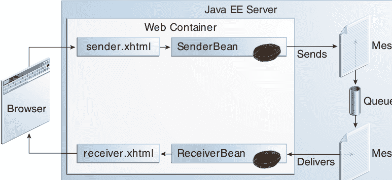

## 46.5.1 websimplemessage Faclets 页面

该示例的 Faclets 页面如下：

- `sender.xhtml`，提供了一个带标签的 `h:inputText` 标签，用户可以在其中输入消息，以及两个命令按钮。当用户点击 Send 按钮时，会调用 `senderBean.sendMessage` 方法将消息发送到队列并在页面上显示其内容。当用户点击 Go to Receive Page 按钮时，会显示 `receiver.xhtml` 页面。
- `receiver.xhtml`，也提供了命令按钮。当用户点击 Receive Message 按钮时，会调用 `receiverBean.getMessage` 方法从队列中获取消息并显示其内容。当用户点击 Send Another Message 按钮时，会再次显示 `sender.xhtml` 页面。

## 46.5.2 websimplemessage Managed Beans

该示例的两个托管 bean如下：

- `SenderBean.java`，一个 CDI 托管 bean，有一个属性 `messageText` 和一个业务方法 `sendMessage`。该类带有 `@JMSDestinationDefinition` 注解以创建一个组件队列：

```java
@JMSDestinationDefinition(
  name = "java:comp/jms/webappQueue",
  interfaceName = "javax.jms.Queue",
  destinationName = "PhysicalWebappQueue"
)
@Named
@RequestScoped
public class SenderBean {
```

`sendMessage` 方法注入了 `JMSContext`（使用默认连接工厂）和队列，创建了一个生产者，发送在 Facets 页面上输入的消息，并创建一个 `FacesMessage` 以显示在 Facets 页面上。

```java
@Inject
private JMSContext context;
@Resource(lookup = "java:comp/jms/webappQueue")
private Queue queue;
private String messageText;
```

```java
public void sendMessage() {
    try {
        String text = "Message from producer: " + messageText;
        context.createProducer().send(queue, text);

        FacesMessage facesMessage =
        new FacesMessage("Sent message: " + text);
        FacesContext.getCurrentInstance().addMessage(null, facesMessage);
    } catch (Throwable t) {
        logger.log(Level.SEVERE,
            "SenderBean.sendMessage: Exception: {0}",
            t.toString());
    }
}
```

- `ReceiverBean.java`，一个有一个业务方法 `getMessage` 的 CDI bean。

该方法注入了 `JMSContext`（使用默认连接工厂）和在 `SenderBean` 中创建的队列，创建一个消费者，接收消息，并创建一个 `FacesMessage` 以显示在 Facets 页面上。

```java
@Inject
private JMSContext context;
@Resource(lookup = "java:comp/jms/webappQueue")
private Queue queue;

public void getMessage() {
    try {
        JMSContext receiver = context.createConsumer(queue);
        String text = receiver.getBody(String.class);

        if (text == null) {
            FacesMessage facesMessage =
            new FacesMessage("Reading message: " + text);
            FacesContext.getCurrentInstance().addMessage(null, facesMessage);
        } else {
            FacesMessage facesMessage =
            new FacesMessage("No message received after 1 second");
            FacesContext.getCurrentInstance().addMessage(null, facesMessage);
        }
    } catch (Throwable t) {
        logger.log(Level.SEVERE,
            "ReceiverBean.getMessage: Exception: {0}",
            t.toString());
    }
}
```

## 46.5.3 运行 websimplemessage 示例


# 使用简单的 Web 应用程序发送和接收消息

你可以使用 NetBeans IDE 或 Maven 来构建、打包、部署和运行 `websimplemessage` 应用。

## 46.5.3.1 为 websimmessageExample 创建资源

此示例使用了注解定义的队列和预配置的默认连接工厂 `java:com/DefaultJMSConnectionFactory`。

## 46.5.3.2 使用 NetBeans IDE 打包并部署 websimmessage

1. 确保 GlassFish 服务器已启动（参见“Starting and Stopping the GlassFish Server”）。
2. 从 File 菜单中选择 Open Project。
3. 在 Project 对话框中，导航到：`tut-install/examples/jms/`
4. 选择 `websimmessage` 文件夹。
5. 点击 Open Project。
6. 在 Projects 选项卡中，右键点击 `websimmessage` 项目并选择 Build。此命令会构建并部署项目。

## 46.5.3.3 使用 Maven 打包并部署 websimmessage

1. 确保 GlassFish 服务器已启动（参见“Starting and Stopping the GlassFish Server”）。
2. 在终端窗口中，进入目录：`tut-install/examples/jms/websimmessage/`
3. 编译源文件并打包部署应用程序，请使用以下命令：`mvn install`

## 46.5.3.4 运行 websimmessage 示例

1. 在浏览器中输入 URL：`http://localhost:8080/websimplemessage`
2. 在文本框中输入“Hello, Duke”并点击 Send。

下方显示：

> Sent message: Hello, Duke

3. 点击 Go to Receive Page。
4. 点击 Receive。

下方显示：

> Reading message: Hello, Duke

5. 点击 Send Another Message。
6. 完成运行后，在 Services 选项卡中使用命令 `mvn:deploy` 卸载它。

# 使用 Message-Driven Bean 异步接收消息

## Message-Driven Bean

消息驱动豆（MDB）在 Java EE 容器中通过 `MessageListener` 接口接收消息。如果你在 Java SE 平台中，需要实现 `MessageListener` 接口并显式调用 `setMessage` 方法。

### 4.6.1 概述

该应用程序包含以下组件：

- SimpleMessageClient：一个向队列发送消息的应用程序
- SimpleMessageBean：一个消息驱动豆

本节描述了 `websimplemessage` 示例。JMS 者（在此情况下为 GlassFish Server）将消息传递给消息驱动豆。

## 图 46-3 simplemessage 应用

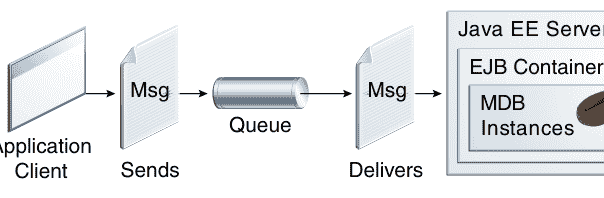

该应用程序的源码位于 `tut-install/examples/jms/simplemessage`。

### 4.6.2 simplemessage Client

SimpleMessageClient 向队列发送消息。它首先注入连接工厂和队列：

```java
@Resource(lookup = "java:comp/DefaultJMSConnectionFactory")
private static ConnectionFactory connectionFactory;

@Resource(lookup = "jms/Queue")
private static Queue queue;
```

接下来，客户端在 try-with-resources 块中创建 `JMSContext`：

```java
String text;
final int NUM_MSGS = 3;

try (JMSContext context = connectionFactory.createContext()) {
    for (int i = 0; i < NUM_MSGS; i++) {
        text = "This is message " + (i + 1);
        System.out.println("Sending message: " + text);
        context.createProducer().send(queue, text);
    }
}
```

### 4.6.3 Message-Driven Bean 类

SimpleMessageBean 类说明了消息驱动豆的要求。类开头使用 `@MessageDriven` 注解的 `activationConfig` 来指定配置属性：

```java
@MessageDriven(activationConfig = {
    @ActivationConfigProperty(propertyName = "destinationLookup",
        property = "jms/Queue"),
    @ActivationConfigProperty(propertyName = "destinationType",
        property = "javax.jms.Queue")
})
```

可用属性列表参见表 45-3。参见“Sending Messages from a Session to an MDB”获取 `subscriptionDurability`、`clientID`、`subscriptionName` 和 `messageSelector` 属性的示例。

#### 4.6.3.1 onMessage 方法

当队列接收消息时，EJB 容器调用消息监听方法。对于使用 JMS 的 bean，这就是 `MessageListener` 接口的 `onMessage` 方法。

在 `SimpleMessageBean` 类中，`onMessage` 方法捕获传入的 `TextMessage` 并显示其文本：

```java
public void onMessage(Message message) {
    try {
        if (message instanceof TextMessage) {
            logger.log(Level.INFO,
                "MESSAGE BEAN received: " +
                message.getBody(String.class));
        } else {
            logger.log(Level.WARNING,
                "Message of wrong type: " +
                message.getClass().getName());
        }
    } catch (JMSException e) {
        logger.log(Level.SEVERE,
            "SimpleMessageBean.onMessage: " + e);
    }
}
```

```
46-30 The Java EE 7 Tutorial

e.toString();

mdc.setRollbackOnly();

}
```

## 46.6.4 运行 simplessage 示例

可以使用 Beans IDE 或 Maven 来构建、部署和运行 simplessage 示例。

### 46.6.4.1 为 simplessage 示例创建资源

此示例使用了队列名称 `jms/MyQueue` 和预配置的默认连接工厂 `java:DefaultJMSConnectionFactory`。如果你已经在“编写简单的 JMS 应用”中包含了简单的 JMS 示例且没有删除资源，那么你已经拥有该队列。请遵循“为简单示例创建资源”中的指令来创建它。

有关创建 JMS 资源的更多信息，请参阅“创建 JMS 管理对象”。

### 46.6.4 使用 NetBeans IDE 运行 simplessage 示例

1. 确保 GlassFish 服务器已启动（启动和停止 GlassFish 服务器）。
2. 从“文件”（File）菜单中选择“打开项目”（Open Project）。
3. 在“项目”（Project）对话框中，导航到：`tut-install/examples/jms/simplessage`
4. 勾选“打开所需的项目”（Open Required Projects），然后点击“打开项目”（Open Project）。
5. 在“项目”（Projects）选项卡中，右键点击 simplessage 项目并选择“构建”（Build）。如果 NetBeans IDE 建议你正在运行构建，请点击框框执行。

此命令封装应用程序客户端和消息驱动 bean，然后在 `simplessage-ear/target` 目录下创建一个名为 `simplessage.ear` 的文件。它部署 `simplessage-ear` 模块，获取客户端 Stub 并运行应用程序客户端。

窗口中的输出如下（之前是应用程序客户端输出）：

```
Sending message: This is message 1
Sending message: This is message 2
Sending message: This is message 3
```

要查看 bean 是否接收到消息，请检查 `install_dir/domains/domain/logs/server.log`。

在服务器日志中，会出现类似下面的行：

```
MESSAGE BEAN: Message received: This is message 1
MESSAGE BEAN: Message received: This is message 2
MESSAGE BEAN: Message received: This is message 3
```

接收到的消息顺序可能与发送顺序不同。

Java Message Service 示例 46-31

## 从 Session Bean 向 MDB 发送消息

7. 在运行应用程序后，使用“服务”（Services）选项卡将其卸载。

### 46.5.4.3 使用 Maven 运行 simplemessage 示例

1. 确保 GlassFish 服务器已启动（启动和停止 GlassFish 服务器）。
2. 在终端窗口中，进入：

```
tut-install/examples/jms/simplemessage/
```

3. 使用以下命令编译源文件并封装应用程序：

```
mvn install
```

此目标封装了应用程序客户端和消息驱动 bean，然后在 `simplemessage-ear/target` 目录下创建一个名为 `simplemessage.ear` 的文件。它部署了 `simplemessage-ear` 模块，获取客户端 Stub 并运行应用程序客户端。

终端窗口中的输出如下（之前是应用程序客户端输出）：

```
Sending message: This is message 1
Sending message: This is message 2
Sending message: This is message 3
```

要查看 bean 是否接收到消息，请检查 `<install_dir>/domains/domain/server.log`。

在服务器日志中，会出现类似下面的行：

```
MESSAGE BEAN: Message received: This is message 1
MESSAGE BEAN: Message received: This is message 2
MESSAGE BEAN: Message received: This is message 3
```

接收到的消息顺序可能与发送顺序不同。

4. 在运行应用程序后，使用 `mvn cargo:undeploy` 命令将其卸载。

## 从 Session Bean 向 MDB 发送消息

本节介绍了如何编写、编译、封装并运行一个结合 session bean 使用 JMS 的应用程序。该应用程序包含以下组件：

- 调用 session bean 的应用程序客户端
- 向 topic 发布多条消息的 session bean
- 使用持久订阅和消息选择器接收消息的消息驱动 bean

本节的源文件位于 `tut-install/examples/jms/clientsessionmdb/` 。

### 46.7.1 为 simplemessage 示例编写组件

本节介绍了如何编写、编译、封装并运行一个结合 session bean 使用 JMS 的应用程序。该应用程序包含以下组件：

- 调用 session bean 的应用程序客户端
- 向 topic 发布多条消息的 session bean
- 使用持久订阅和消息选择器接收消息的消息驱动 bean

本节的源文件位于 `tut-install/examples/jms/clientsessionmdb/`

### 46.7.1 编写客户端：MyAppClient.java

本节介绍了如何编写、编译、封装并运行一个结合 session bean 使用 JMS 的应用程序。该应用程序包含以下组件：

- 调用 session bean 的应用程序客户端
- 向 topic 发布多条消息的 session bean
- 使用持久订阅和消息选择器接收消息的消息驱动 bean

本节的源文件位于 `tut-install/examples/jms/clientsessionmdb/`

### 46.7.2 编写 Session Bean

本节介绍了如何编写、编译、封装并运行一个结合 session bean 使用 JMS 的应用程序。该应用程序包含以下组件：

- 调用 session bean 的应用程序客户端
- 向 topic 发布多条消息的 session bean
- 使用持久订阅和消息选择器接收消息的消息驱动 bean

本节的源文件位于 `tut-install/examples/jms/clientsessionmdb/`

### 46.7.3 编写消息驱动 bean：MessageBean.java

本节介绍了如何编写、编译、封装并运行一个结合 session bean 使用 JMS 的应用程序。该应用程序包含以下组件：

- 调用 session bean 的应用程序客户端
- 向 topic 发布多条消息的 session bean
- 使用持久订阅和消息选择器接收消息的消息驱动 bean

本节的源文件位于 `tut-install/examples/jms/clientsessionmdb/`

主题是在 PublisherBean 中定义的。消息选择器（message selector）同时代表了体育和意见部门，仅是为了演示消息选择器的语法。

JMS 资源适配器使用这些属性为消息驱动豆（message-driven bean）创建连接工厂，允许该 bean 使用持久性订阅。

## 46.7.2 运行 clientsessionmdb 示例

你可以使用 NetBeans IDE 或 Maven 来构建、部署和运行 simplemessage 示例。

此示例使用了注解定义的主题和预配置的连接工厂 `java.com:DefaultJMSConnectionFactory`，你不需要为其创建资源。

### 46.7.2.1 使用 NetBeans IDE 运行 clientsessionmdb

1. 确保 GlassFish 服务器已启动（参见“启动和停止 GlassFish 服务器”）。
2. 从文件（File）菜单中，选择打开项目（Open Project）。
3. 在项目（Project）对话框中，导航到：

   `tut-install/examples/jms/clientsessionmdb`

4. 选中 clientsessionmdb 复选框，然后点击打开项目（Open Project）。

确保“打开所需的项目”（Open Required Projects）选择了 clientsessionmdb 项目并点击构建（Build）。如果 NetBeans IDE 建议你正在运行首次构建，点击该 bean 执行该操作）。

此命令创建了以下内容：

- 一个应用 JAR 文件，包含客户端类文件和会 bean 的远程接口，并有一个清单文件（manifest file），用于指定主类并将 EJB JAR 文件放置在它的类路径中。
- 一个 EJB JAR 文件，包含会 bean 和消息驱动豆。
- 一个应用 EAR 文件，包含两个 JAR 文件。

`clientsessionmdb.ear` 文件在 `clientsessionmdb-ear/target` 目录下创建。

该命令部署 EAR 文件，获取客户端存根（stubs）并运行客户端。

客户端显示以下行内容：

```
check<install_dir>//domains/domain1/logs/server.log.
```

企业豆（enterprise beans）的输出出现在服务器日志文件中。Publisher 会 bean 发送了两组各 18 条消息（0 到 17）。由于消息选择器的存在，消息驱动豆只接收 `NewsType` 属性为 Sports（体育）或 Opinion（意见）的消息。


# 7. 在运行完成后，使用服务（Services）部署该应用程序。

## 46.7.2.2 使用 Maven 运行 clientsessiondb

你可以使用 NetBeans IDE 或 Maven 来构建 `clientsessiondb` 示例。

你将使用 `asadmin` 和 `appclient` 命令来部署和运行它。

1. 确保 GlassFish 服务器已启动（参见“启动和停止 GlassFish 服务器”）。

2. 进入以下目录：

   `tut-install/examples/jms/clientsessiondb/`

3. 编译源文件并打包、部署和运行应用程序，输入以下命令：

   `mvn install`

此命令创建了：

- 一个应用 JAR 文件，包含客户端类文件和会话 bean 的远程接口，以及一个清单文件，用于指定主类并将 EJB JAR 文件放置在它的类路径中。

- 一个 EJB JAR 文件，包含会话 bean 和消息驱动豆。

- 一个 EAR 文件，包含两个 JAR 文件。

`clientsessiondb.ear` 在 `clientsessiondb-ear/target` 目录下创建。

该命令部署 EAR 文件，获取客户端存根并运行客户端。

客户端显示以下行：

`check <install_dir>/domains/domain1/logs/server.log.`

企业豆的输出出现在服务器日志文件中。Publisher 会话 bean 发送了两组 18 条消息（0 到 17）。由于消息选择器的存在，消息驱动豆只接收 `NewsType` 为 Sports 或 Opinion 的消息。

4. 在运行完成后卸载应用程序：`mvn cargo:deploy`

## 46.8 使用实体合并来自两个数据库的消息

本节解释了如何编写、编译、打包、部署和运行一个结合实体（entity）使用 JMS API 的应用程序。既发送又接收消息的应用程序客户端包含以下组件：

- 一个既发送又接收消息的应用程序客户端

- 两个消息驱动豆

- 一个实体类

你可以在 `tut-install/examples/jms/clientmdbentity/` 目录下找到本节的源代码。本节中的路径名称相对于此目录的。

### 46.8.1 clientmdbentity 示例概述

该应用程序以简化的方式模拟了公司人力资源（HR）部门在招聘新员工时的工作流。该应用程序还演示了如何使用 Java EE 平台完成许多 JMS 应用程序需要执行的任务。

消息客户端必须等待来自各种来源的消息。它使用所有这些消息中的信息组装一条发送到另一个目标的消息。这种设计模式（并非特定于 JMS）的通用术语是消息合并（joining messages）。此类任务必须是事务性的，将所有的接收和发送视为单个事务。如果不是所有消息都成功接收，则事务可以回滚。一个说明此任务的应用程序客户端示例，参见“使用本地事务”（Using Local Transactions）。

消息驱动豆可以在事务中一次处理一条消息。为了提供合并消息的能力，应用程序可以让消息驱动豆将信息存储在 Java Persistence API (JPA) 实体中。然后由实体确定所有信息是否已接收；当接收完成后，实体可以向其中一个消息驱动豆报告，然后由该消息驱动豆创建并将消息发送到另一个目标。在完成任务后，实体可以被移除。

应用程序的基本步骤如下：

1. 人力资源部门的客户端为每个新员工生成员工 ID 并发布包含新员工信息的消息 (M1)。由于消息需要被两个消息驱动豆消费，客户端将其发布到主题，并创建一个带有消息监听器的临时队列（参见“创建临时目的地”）。

2. 两个消息驱动豆在事务中处理消息。其中一个 bean `OfficeMDB` 分配新员工的办公室，另一个 bean `EquipmentMDB` 分配新员工的设备。第一个处理消息的 bean 创建并持久化实体并存储信息。

3. 当办公室和设备都分配完成后，实体方法向调用它的消息驱动豆返回 `true` 值。消息驱动豆向回复队列发送一条描述分配情况的消息 (M2)，并移除实体。消息监听器 `HRListener` 等待每个员工的办公室和设备消息。当消息到达时，消息监听器显示接收到的信息并判断是否所有五条消息都已到达。如果是，消息监听器通知主方法，主方法随后退出。

图 46-5 展示了该应用程序的结构。真实的 HR 应用会有更多组件；其他 bean 可以设置薪资和入职计划等。

### 图 46–5 企业应用程序：客户端到消息驱动豆到实体

![50a47170fc6a7703e22f09ee5c74b7c0_0.png)

假设 `OfficeMDB` 是第一个从客户端消费消息的消息驱动豆。`OfficeMDB` 然后创建并持久化 `SetupOffice` 实体并存储办公室信息。`EquipmentMDB` 找到实体，存储设备信息，得知实体已完成工作。`EquipmentMDB` 然后将消息发送到回复队列并移除实体。

### 46.8.2 编写 clientmdbentity 的应用程序组件

编写应用程序组件涉及编写应用程序客户端、消息驱动豆和实体类。

#### 46.8.2.1 编写应用程序客户端：HumanResourceClient.java

位于 `clientmdbentity-app-client` 的应用程序客户端 `HumanResourceClient.java` 执行以下步骤：

1. 为应用程序定义主题，使用 `java:app` 命名空间，因为该主题在应用程序客户端和 EJB 模块中均使用。

2. 注入 `ConnectionFactory` 和 `Topic` 资源。

3. 创建临时队列以接收基于其发布的事件的处理通知。

4. 为临时队列创建 `JMSConsumer`，设置 `JMSConsumer` 的消息监听器并启动连接。

5. 创建一个 `MapMessage`。

6. 创建五个随机生成的名称、职位和 ID 号的员工，并发布包含这些信息的五条消息。

消息监听器 `HRListener` 等待每个员工的办公室和设备消息。当消息到达时，消息监听器显示接收到的信息并判断是否所有五条消息都已到达。如果是，消息监听器通知主方法，主方法随后退出。

#### 46.8.2.2 编写 clientmdbentity 的消息驱动豆

此示例使用了两个位于 `clientmdbentity-ejb` 的消息驱动豆：

- `EquipmentMDB.java`

- `OfficeMDB.java`

这些 Bean 执行了以下步骤：

1. 它们注入了 `MessageDrivenContext` 资源、一个 `EntityManager` 和 `JMSContext`。

2. `onMessage` 方法获取消息中的信息。`EquipmentMDB` 的 `onMessage` 方法根据新入职者的职位选择设备；`OfficeMDB` 的 `onMessage` 方法随机生成办公室号。

3. 在稍作延迟以模拟现实过程后，`onMessage` 方法调用辅助方法 `compose`。

4. `compose` 方法执行以下步骤：

   a. 它创建并持久化 `SetupOffice`，或者通过主键找到它。

   b. 它使用该实体存储办公室或实体中的办公室信息，调用 `doEquipmentList` 或 `doOfficeNumber` 业务方法。

   c. 如果业务方法返回 `true`（意味着所有信息都已存储），它从消息中检索目标信息，创建一个 `JMSProducer`，并发送一条包含实体中存储信息的消息。

   d. 它移除该实体。

### 46.8.2.3 为 clientmdbentity 示例编写实体类

`SetupOffice.java` 类同样位于 `clientmdbentity-ejb` 下，是一个实体类。实体和消息驱动 Bean（MDB）一起封装在 EJB JAR 文件中。实体声明如下：

```java
@Entity
public class SetupOffice implements Serializable {
```

该类包含一个无参数构造函数和一个接受两个员工参数（员工 ID 和名称）的构造函数。它还包含用于员工 ID、名称、办公室号和员工列表的 getter 和 setter 方法。员工 ID 的 getter 方法使用了 `@Id` 注解，用表示这是主键：

```java
@Id
public String getEmployeeId() {
    return id;
}
```

该类实现了两个业务方法 `doEquipmentList` 和 `doOfficeNumber`，以及它们的辅助方法 `checkIfSetupComplete`。

消息驱动 Bean 调用了这些方法。持久化配置指定了最基本的设置：

实体的 `persistence.xml` 文件指定了：

```xml
<?xml version="1.0" encoding="UTF-8"?>
<persistence version="2.1"
xmlns="http://xmlns.jcp.org/xml/ns/persistence"
xmlns:xsi="http://www.w3.org/2001/XMLSchema-instance"
xsi:schemaLocation="http://xmlns.jcp.org/xml/ns/persistence http://xmlns.jcp.org/xml/ns/persistence/persistence_2_1.xsd">
<persistence-unit name="clientmdbentity-ejb" type="JTA">
  <provider>org.eclipse.jpa.PersistenceProvider</provider>
  <jpa-data-source>java:comp/DefaultDataSource</jpa-data-source>
  <properties>
    <property name="eclipseLink.dd-generation"
          value="drop-and-create-tables"/>
  </properties>
</persistence-unit>
</persistence>
```

## 46.8.3 运行 clientMdbentity 示例

你可以使用 NetBeans IDE 或 Maven 来构建、部署并运行 `clientMdbentity` 示例。

由于示例定义了应用私有主题（topic），并使用了预配置的默认连接工厂 `java:comp/DefaultJMSConnectionFactory` 以及预配置的默认 JDBC 资源 `java:comp/DefaultDataSource`，你不需要为它创建资源。

### 46.8.3.1 使用 NetBeans IDE 运行 clientMdbentity

1. 确保 GlassFish Server 已启动（参见“启动和停止 GlassFish Server”）。

2. 从 File（文件）菜单中选择 Open Project（打开项目）。

3. 在 Project 对话框中，导航到：

   `tut-install/examples/jms/clientMdbentity`

4. 选择 `clientMdbentity` 文件夹。

5. 点击 Open Project（打开项目）。

6. 在 Projects（项目）选项卡中，右键点击 `clientMdbentity` 项目并选择 Build（构建）。

   - 一个包含应用类和监听器类的 JAR 包，其 manifest 文件指定了主类。

   - 一个包含消息驱动 Bean 和实体的 JAR 包，其 `persistence.xml` 文件。

   - 一个包含两个属性文件的 EAR 包，其 `application.xml` 文件。

`clientmdbentity.ear` 创建在 `clientmdbentity-ejb` 目录下。

该命令部署了 EAR 文件并运行应用。

### 46.8.3.2 使用 Maven 运行 clientMdbentity

1. 确保 GlassFish Server 已启动（参见“启动和停止 GlassFish Server”），以及数据库服务器已启动（参见“启动和停止 Java DB”）。

2. 进入目录：

   `tut-install/examples/jms/clientMdbentity/`

3. 为了编译源码、打包、部署并运行应用，输入以下命令：

   ```bash
   mvn install
   ```

该命令创建了：

- 包含主类的 manifest 文件 JAR 包。

- 包含消息驱动 Bean 和实体的 JAR 包，其 `persistence.xml` 文件。

- 包含两个属性文件的 EAR 包，其 `application.xml` 文件。

### 46.8.3.3 查看应用输出

NetBeans IDE 输出窗口或终端中的输出如下所示（在 Maven 之前）：

```
SENDER: 50, Bill Tudor
SENDER: 51, Carol Jones
SENDER: 52, Mark Wilson
SENDER: 53, Polly Wren
SENDER: 54, Joe Lawrence
```

## 46.9 使用 NetBeans IDE 创建资源

当你创建 JMS 应用时，需要为它们创建资源。本节解释了如何使用 NetBeans IDE 创建类似于示例中使用的 `glassfish-resources.xml` 文件。它还解释了如何使用 NetBeans IDE 删除资源。

你也可以使用管理控制台或 `asadmin create-jms-resources`、`asadmin list-jms-resources` 以及 `asadmin delete-jms-resources` 命令来创建和删除资源。更多信息请参阅 GlassFish 服务器文档或 `asadmin help` 命令。

### 46.9.1 使用 NetBeans IDE 创建资源

按照以下步骤使用 NetBeans IDE 在 GlassFish Server 中创建 JMS 资源。为每个需要的资源重复这些步骤。

1. 右键点击要创建资源的项目，选择 New, Other（新建，其他）。

2. 在 File Wizard 中，在 Categories 下选择 GlassFish。

3. 在 File Types 下，选择 JMS Resource。

4. 在 General Attributes - JMS Resource 页面，在 JNDI Name 字段中输入资源名称。

   按照约定，JMS 名称以 `jms/` 开头。

5. 选择资源类型的选项。通常是 `javax.jms.Queue`、`javax.jms.Topic` 或 `javax.jms.ConnectionFactory`。

6. 点击 Next（下一步）。

7. 在 JMS Properties 页面，对于队列或主题，在 Name 属性的 Value 字段中输入物理队列名称。

   你可以为此必需字段输入任何值。

   连接工厂没有必需属性。在某些情况下，你可能需要指定属性。

8. 点击 Finish（完成）。

名为 `glassfish-resources.xml` 的文件创建在你的 Maven 项目的 `src/main/setup` 目录下。在 Projects 选项卡中，你可以在下方找到它：

当您删除连接器连接池时，相关的连接器资源也会被删除。此操作会删除连接工厂。

# X 部分：安全

第 X 部分探讨了安全概念和示例。本部分包含以下章节：

- 第 47 章，“Java EE 平台中的安全简介”

- 第 48 章，“Web 应用程序安全入门”

- 第 49 章，“企业级应用程序安全入门”

- 第 50 章，“Java EE 安全：高级主题”

# Java EE 平台中的安全简介

本章介绍了基本的安全概念和安全机制。有关这些概念和机制的更多信息，可以参阅 Java EE 7 规范中关于安全的章节。

本部分的其他章节讨论了 Web 层和企业级应用程序中的安全需求：

- 第 48 章，“Web 应用程序安全入门”解释了如何为 Web 组件（如 servlet）添加安全功能。

- 第 49 章，“企业级应用程序安全入门”解释了如何为 Java EE 组件（如企业豆和应用客户端）添加安全功能。

此处讨论了以下主题：

- Java EE 安全概述

- 安全机制

- 容器安全

- GlassFish 服务器安全

- 域（Realms）、用户、组和角色的操作

- 使用 SSL 建立连接

- 关于安全的更多信息

## 47.1 Java EE 安全概述

任何拥有可供许多用户访问的敏感资源，或跨越不受保护的开放网络（如互联网）的资源的企业都需要受到保护。

企业层和 Web 层应用程序由部署在各种容器中的组件组成。这些组件组合构建了一个多层企业级应用程序。组件的安全由其容器提供。容器提供两种安全类型：声明式安全和编程安全。

- **声明式安全**通过使用部署描述符或注解来表达应用程序的安全需求。

  部署描述符是一个外部于应用程序的 XML 文件，表示应用程序的安全结构，包括安全规则、访问控制和身份验证需求。有关部署描述符的更多信息，请参阅《使用部署描述符进行声明式安全》。

  注解（也称为元数据）用于指定类内部的安全信息。当应用程序部署时，这些信息可以被应用程序部署注解使用，也可以被其覆盖。注解让您无需在 XML 描述符内部编写声明式信息。相反地，您只需在代码上放置注解，即可生成所需信息。在本教程中，注解被用于任何地方的应用安全。有关注解的更多信息，请参阅《使用注解指定安全信息》。

- **编程安全**嵌入在应用程序中并用于做出安全决策。当仅靠声明式安全不足以表达应用程序的安全模型时，编程安全非常有用。有关编程安全的更多信息，请参阅《使用编程安全》。

### 47.1.1 简单应用程序的安全流程

Java EE 环境的安全行为可以通过检查具有 Web 客户端、用户界面和企业逻辑的简单应用程序来更好地理解。

在以下来自 Java EE 7 规范的示例中，客户端依赖服务器从客户端收集身份验证数据并建立会话。


#### 47.1.1.1 第 1 步：初始请求

在示例的第一步中，客户端请求主应用程序。此操作如图 47-1 所示。


由于客户端尚未通过应用程序，服务器负责交付应用程序的部分（后文简称服务器），它检测并调用相应的身份验证机制。有关这些机制的更多信息，请参阅安全机制。

#### 47.1.1.2 第 2 步：初始身份验证

服务器返回一个客户端使用的表单，从用户处收集身份验证数据（如用户名和密码）。客户端将身份验证数据转发到服务器，由服务器进行验证。（此处重复多次，翻译逻辑一致）

[注：原文此处存在大量重复段落，描述内容均指向图 47-2]

图 47-2：初始身份验证（Java EE）

#### 47.1.1.3 第 3 步：URL 授权

服务器返回一个客户端使用的表单，从用户处收集身份验证数据（如用户名和密码）。客户端将身份验证数据转发到服务器，由服务器进行验证。（此处重复多次，翻译逻辑一致）

| Web 客户端 | 服务器 |
| :--- | :--- |
| 请求的 URL | 授权检查（图 47-3） |

图 47-3：URL 授权（Java EE）

#### 47.1.1.4 第 4 步：满足原始请求

服务器返回一个客户端使用的表单，从用户处收集身份验证数据（如用户名和密码）。客户端将身份验证数据转发到服务器，由服务器进行验证。（此处重复多次，翻译逻辑一致）

| Web 客户端 | 服务器 |
| :--- | :--- |
| 表单数据 | 提供内容（图 47-4） |

图 47-4：满足原始请求（Java EE）

#### 47.1.1.5 第 5 步：调用企业豆业务方法

服务器返回一个客户端使用的表单，从用户处收集身份验证数据（如用户名和密码）。客户端将身份验证数据转发到服务器，由服务器进行验证。

| Web 客户端 | 服务器 |
| :--- | :--- |
| 方法调用 | EJB 容器（图 47-5） |

图 47-5：调用企业豆业务方法（Java EE）

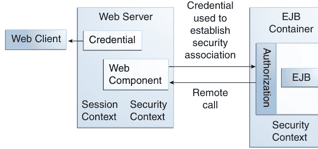

### 47.1.2 安全机制的特征

良好的安全机制实现将提供以下功能：

- 防止未经授权对应用程序功能和业务个人数据的访问（身份验证）
- 让系统用户对其执行的操作负责（不可否认性）
- 保护系统免受服务中断或其他影响质量的攻击

理想情况下，良好的安全机制还应该：

- 易于管理
- 跨应用程序和企业边界的互操作性

## 47.1.3 应用安全特性

Java EE 应用由包含受保护和未受保护资源的组件组成。通常情况下，你需要保护资源以确保授权用户可以进行访问。授权（`Authorization`）为受保护资源提供受控访问。授权基于身份识别（`Identification`）和认证（`Authentication`）。身份识别是系统能够识别实体的过程，而认证是验证计算机系统中用户、设备或实体的身份的过程，通常是访问系统内资源的先决条件。

实体访问未受保护的资源不需要授权和认证。在未经认证的情况下访问资源被称为未认证访问（或匿名访问）。

当处理得当时，应用安全的特性有助于减少企业面临的安全威胁，其包括以下几方面：

- **认证（`Authentication`）：** 通信实体（作为客户端和服务器）通过通信向彼此证明它们正在代表授权访问的特定身份进行操作。这确保用户知道他们所声称的身份。

- **授权（`Authorization`），或访问控制：** 将与资源的交互限制在特定的用户或程序集合中，目的是执行完整性、机密性或可用性约束。这确保用户拥有执行操作或访问数据的权限。

- **数据完整性（`Data integrity`）：** 用于证明信息未被第三方或信息源以外的其他实体修改过的手段。例如，通过开放网络发送数据的接收者必须能够检测并丢弃在发送后被修改的消息。这确保了只有授权用户才能修改数据。

- **机密性（`Confidentiality`），或数据隐私：** 用于确保信息仅对授权访问它的用户的手段。这确保了只有授权用户才能查看敏感数据。

- **不可否认性（`Non-repudiation`）：** 用于证明执行了某些操作的用户无法合理地否认执行过该操作的手段。这确保交易可以被证明已经发生。

- **服务质量（`Quality of Service`）：** 用于通过各种技术为选定的网络流量提供更好服务的手段。

- **审计（`Auditing`）：** 用于捕获与安全相关的事件的防篡改记录，以便评估安全策略和机制的有效性。为了实现这一点，系统维护了事务和安全信息的记录。

## 47.2 安全机制

在决定为应用提供的安全层级和类型时，应当考虑应用的特性。以下章节讨论了用于保护 Java EE 应用的常用机制的特性。这些机制中的每一种都可以单独使用，也可以与其他机制结合使用，根据你实现的特定需求提供保护层。

### 47.2.1 Java SE 安全机制

Java SE 提供了多种安全特性和机制的支持：

- Java 认证和授权服务 (`JAAS`)：`JAAS` 是一组 API，允许服务对用户进行认证并强制执行访问控制。`JAAS` 为程序化的用户认证和授权提供了一个可插且可扩展的框架。`JAAS` 是 SE 的核心 API，是 Java 安全机制的底层技术。

- Java 通用服务 (`Java GSS-API`)：`Java GSS-API` 是一种基于令牌（`token`）的 API，用于保护通信应用程序之间的消息。`GSS-API` 为程序员提供了对各种安全服务以及多种底层安全机制（包括 Kerberos）的统一访问。

- Java 密码术扩展 (`JCE`)：`JCE` 为加密、密钥生成和密钥协商以及消息认证码 (`MAC`) 算法提供了框架和实现。对加密的支持包括对称加密、非对称加密和流加密。分组加密对字节组进行操作；流加密每次处理一个字节。该软件支持安全的机密数据和密封对象（`sealed objects`）。

- Java 安全套接字扩展 (`JSSE`)：`JSSE` 为 Java 版本的安全套接字层 (`SSL`) 和传输层安全 (`TLS`) 提供了框架和实现，提供了数据加密、服务器认证、消息完整性以及可选客户端认证的功能，以实现安全的互联网通信。

- 简单认证和安全层 (`SASL`)：`SASL` 是一种互联网标准 (RFC 2222)，提供了一种在客户端和服务器应用程序之间进行认证以及可选建立安全层的协议。`SASL` 定义了要交换的认证是什么，但本身不指定数据内容。`SASL` 是一个框架，特定的认证机制可以在此框架指定认证数据可以携带的内容。

Java SE 提供了一套工具用于管理密钥库（`keystores`）、证书和策略文件；生成和验证 JAR 签名；获取、列出和管理 Kerberos 令牌。

有关关于 Java 安全的更多信息，请访问 `http://docs.oracle.com/javase/7/docs/technotes/guides/security/`。

## 47.2 Java EE 安全机制

Java EE 服务由容器提供，并可以使用声明式或程序化技术实现（参见“保护容器”）。Java EE 安全服务提供了一种稳健且易于配置的安全机制，用于在许多不同层级上验证用户并授权访问应用函数及相关数据。Java EE 服务与操作系统的安全机制是分离的。

### 47.2.2.1 应用层安全

在 Java EE 中，容器负责提供应用层安全，即根据特定应用的需求定制该应用的安全服务。在应用层，使用应用防火墙通过保护通信流和所有应用资源免受攻击来增强应用保护。

Java EE 提供了一种稳健且易于配置的安全机制，用于在许多不同层级上验证用户并授权访问应用函数及相关数据。Java EE 服务与操作系统的安全机制是分离的。

应用层安全是根据应用需求定制的安全服务。Java EE 易于实现和配置，并能对应用函数提供细粒度的访问控制。然而，当应用于应用层时，安全属性仅在数据处于应用环境中时有效。对于跨中间节点的解决方案，可能需要使用传输层安全和消息层安全。

使用应用层安全的优点包括：

- 安全非常符合应用的需求。
- 安全是细粒度的，具有特定的设置。

使用应用层安全的缺点包括：

- 安全依赖于应用类型的属性。
- 对多种协议的支持使得这种安全类型变得复杂。
- 数据在漏洞点处是不保护的。

有关在应用层提供安全的更多信息，请参见“保护容器”。

### 47.2.2.2 传输层安全

传输层安全由在客户端和服务器之间传输信息的传输机制提供；因此，传输层安全依赖于使用安全套接层 (`SSL`) 的 HTTP (`HTTPS`)。传输安全是一种点对点的安全机制，可用于认证、消息完整性和机密性。在运行 `SSL` 保护会话时，服务器和客户端可以在传输开始或接收第一个字节之前相互认证并协商算法。安全从数据离开客户端到达目的地（或反之，跨越中间节点）。问题是数据到达目的地后不再受保护。一种解决方案是在发送之前进行加密。

传输层安全通过一系列阶段执行，如下：

- 客户端和服务器协商合适的算法。
- 使用公钥加密和基于证书的认证交换密钥。
- 在信息交换期间使用对称加密。

运行 `HTTPS` 需要数字证书。大多数 Web 服务器的 `HTTPS` 服务在安装数字证书之前无法运行。GlassFish 服务器已经创建了数字证书。

传输层安全的优点包括：

- 它是一种相对简单、易理解、标准的技术。
- 它适用于消息及其附件。

传输层安全的缺点包括：

- 它与传输层协议紧密耦合。
- 它代表了安全的一种“全有全无”方法。这意味着安全机制感知消息内容，因此你无法像使用消息层安全那样对消息部分有选择地应用安全保护。
- 保护是瞬时的。消息在传输过程中受到保护。当端点接收到消息时，会自动移除保护。
- 它不是端到端解决方案，而是简单的点对点保护。

有关关于传输层安全的更多信息，请参阅[使用 SSL 建立安全连接](https://example.com)。

## 47.2.2 消息层安全

在消息层安全中，安全信息包含在 `SOAP` 消息和/或 `SOAP` 消息附件中，这允许安全信息随消息传输；例如，消息的一部分可以由发送者签名，并针对特定的接收者进行加密。当消息从初始发送者发出时，它在到达预期的接收者之前可能会经过中间节点。在这种情况下，加密部分对任何中间节点仍然保持不可透明，并且只有预期的接收者才能对其解密。由于原因，消息层安全有时也被称为端到端安全。

消息层安全的优势包括：

- 安全性在所有跳跃传输过程中以及在消息到达目的地后始终与消息绑定。
- 安全性可以选择性地应用以保护消息的部分，如果使用 XML Web 服务，还可以应用到附件。
- 消息安全可以用于跨多个跳跃的中间件。
- 消息安全独立于应用环境或传输协议。

使用消息层安全的劣势是它相对复杂，并增加了处理开销。

GlassFish 服务器使用 Metro（一种用于保护消息的 Web 服务 `WSS`）支持消息安全。由于这种消息安全特定于 Metro 而不是 Java EE 的一部分，本教程不讨论如何使用 `WSS` 保护消息。请参见 *Metro 用户指南*：`https://metro.java.net/guide/`。

## 47.3 容器安全

在 Java EE 中，组件容器负责提供应用安全。容器提供两种类型的安全：声明式和程序式安全。

### 47.3.1 使用注解指定安全信息

注解声明了一种声明式的编程风格，并涵盖了声明和程序式的安全概念。你可以使用注解在类中指定安全信息。GlassFish 服务器在应用部署时使用这些信息。然而，并不是所有的安全信息都可以使用注解指定。某些信息必须在应用部署描述符中指定。

在企业 Bean 类中用于指定安全信息的特定注解已在[[使用声明式安全保护企业 Bean，第 48 章，“获取安全的 Web 应用程序”）](https://example.com) 中描述，该章节描述了如何尽可能使用注解保护 Web 应用程序。部署描述符仅在必要时进行描述。

## 保护 GlassFish 服务器

有关注解的更多信息，请参阅“安全进阶信息”。

### 47.3.2 使用部署描述符进行声明式安全

声明式安全可以通过部署描述符来表达应用组件的安全需求。由于部署描述符信息是声明式的，因此可以在无需修改源代码的情况下更改。在运行时，Java EE 服务器读取部署描述符并对相应的应用、模块或组件采取行动。如果注解未提供某些信息或不设置默认值，则部署描述符必须提供每个组件的某些信息。

本教程的这一未说明如何创建部署描述符；它描述了与安全相关的部署描述符元素。NetBeans IDE 提供了创建和修改部署描述符的工具。

不同类型的组件使用不同的描述符格式或架构。本教程讨论的部署描述符的安全元素包括：

- Web 组件可能使用名为 `web.xml` 的 Web 部署描述符。

Web 组件部署描述符的架构在 Java Servlet 3.1 规范（`JSR 340`）的第 14 章提供，可以从 `http://jcp.com/en/jsr/detailid=340` 下载。

- 企业 Bean 组件可能使用名为 `META-INF/ejb-jar.xml` 的 EJB 部署描述符。

企业 Bean 部署描述符的架构在 EJB 3.2 核心合约与需求规范（`JSR 345`）的第 14 章提供，可以从 `http://jcp.com/en/jsr/detailid=345` 下载。

## 47.3.3 使用程序式安全

程序式安全嵌入应用中并用于做出安全决策。当声明式安全不足以表达应用的安全模型时，程序式安全非常有用。程序式安全的 API 由 `EJBContext` 接口和 `HttpServletRequest` 接口组成。这些方法允许组件根据调用者或远程用户的安全规则做出业务逻辑决策。

接下来的章节将详细讨论程序式安全：

- 在 Web 应用中使用程序式安全
- 程序化地保护企业 Bean

## 47.4 保护 GlassFish 服务器

本教程描述了部署到 GlassFish 服务器，该服务器提供了基于 Java EE 安全模型的高安全、可操作和分布式计算组件。GlassFish 服务器支持 Java EE 7 安全模型。你可以针对以下目的配置 GlassFish 服务器：

- 添加、删除或修改授权用户。有关此主题的更多信息，请参阅“领域、用户、组和角色的操作”。
- 配置安全的 HTTP 和 拦截器协议（`IIOP`）监听器。
- 配置安全的 Java 管理扩展（`JMX`）连接器。
- 添加、删除或修改现有的领域。
- 使用容器 Java 约（`JACC`）定义可插件授权提供者。`JACC` 定义了 GlassFish 服务器与授权策略之间的安全。这些约定规定了如何安装、配置和使用提供者。
- 使用可插件审核。
- 自定义认证机制。所有兼容 Java 7 的 Web 容器都支持 `JSR 196`，该规范为一个或多个应用提供了自定义认证机制的方法。
- 设置应用权限。

## 47.5 领域、用户、组和角色的操作

你通常需要保护资源以确保只有授权用户才能访问。请参阅“应用安全特性”。

本部分讨论设置用户以便能够正确识别它们并授予或拒绝访问。要验证用户，你需要遵循以下基本步骤：

1. 应用开发者编写代码提示用户名和密码。在“指定认证机制”中讨论各种认证方法。
2. 应用开发者通过元注解或部署描述符说明如何设置部署的应用。此步骤在“设置安全角色”中讨论。
3. 服务器管理员在 GlassFish 服务器上设置用户和组。在“在 GlassFish 服务器上管理用户和组”中讨论。
4. 应用部署器将安全角色映射到 GlassFish 服务器上定义的用户、组和主体。该主题在“将角色映射到用户和组”中讨论。

### 47.5.1 什么是领域、用户、组和角色？

领域是为 Web 或应用程序定义的安全策略。领域包含一组用户，这些用户可能被分配到某个组。在“在 GlassFish 服务器上管理用户和组”中讨论。

应用在允许访问受保护资源之前提示用户名和密码。用户名和密码被传递给服务器，服务器随后验证用户并发送受保护资源，或者不验证用户并拒绝访问受保护资源。这种类型的用户验证在“在部署描述符中指定认证机制”中讨论。

在某些应用中，授权用户被分配到组。在这种情况下，应用中分配的角色必须映射到主体或组。

位于应用程序服务器上。图 47-6 显示了这一点。有关将角色映射到用户和组的更多信息，请参见“设置安全角色”（Setting Security Roles）。

后续章节提供了关于领域（`realms`）、用户、组和角色的更多信息。

## 图 47-6 将角色映射到用户和组

| 创建用户和/或组 | 在应用程序中定义角色 | 将角色映射到用户和/或组 |
| --- | --- | --- |
| | 应用程序 | 应用程序 |
| 用户 1 | 角色 1 | 用户 1 |
| 用户 2 | | 用户 2 |
| 用户 3 | | 用户 3 |
| 组 1 | 角色 2 | 组 1 |
| 用户 1 | | 用户 1 |
| 用户 2 | | 用户 2 |
| 用户 3 | | 用户 3 |

## 47.5.1.1 什么是领域 (Realm)?

服务器上的保护资源可以被划分为保护空间，每个空间都有自己的身份验证方案和/或授权数据库，其中包含一组用户和组。领域是一个完整的用户和组数据库，被识别为一个或多个应用程序的有效用户，并由同一个身份验证策略控制。

EE 服务器身份验证服务可以管理多个领域中的用户。文件领域（`file realm`）、管理领域（`admin-realm`）和证书领域（`certificate realm`）是 GlassFish 服务器预配置的。

在文件领域中，服务器将凭据存储在名为 `keyfile` 的文件中。你可以使用管理控制台管理文件领域中的用户。使用文件领域时，服务器身份验证服务通过检查文件领域来验证用户身份。该领域用于除使用 `HTTPS` 和证书的  之外的所有客户端的身份验证。

在证书领域中，服务器将用户凭据存储在证书数据库中。使用证书领域时，服务器使用带有 `HTTPS` 的证书来验证客户端。要验证证书领域中用户的身份，身份验证服务提供了创建此类证书的逐步说明：“处理数字证书”（Working with Digital Certificates）。X.509 证书的通用名称（`common name`）字段用作主体名称（`principal name`）。


管理领域也是一个文件领域，并将管理员用户凭据本地存储在名为 `admin-keyfile` 的文件中。你可以像管理文件领域中的用户一样，使用管理控制台管理该领域中的用户。更多信息请参见“在 GlassFish 服务器上管理用户和组”（Managing Users and Groups on the GlassFish Server）。

## 47.5.1.2 什么是用户 (User)?

用户是在 GlassFish 服务器中定义的个人身份或程序身份。在 Web 应用程序中，用户可以与一组角色关联，这些角色允许用户访问受这些角色保护的资源。用户可以与一个组关联。

Java EE 服务器类似于操作系统。通常，这两种用户都代表人。然而，这两种用户并不相同。当你将用户名和密码提供给操作系统时，Java EE 身份验证服务并不知道这些。Java EE 身份验证服务没有连接操作系统的安全机制。这两个安全服务管理属于不同领域的用户。

## 47.5.1.3 什么是组 (Group)?

组是在 GlassFish 服务器中定义的、根据共同特征分类的已身份验证用户集合。Java EE 领域用户可以属于 GlassFish 服务器上的某个组（证书领域中的用户则不能）。GlassFish 服务器上的组是根据共同特征（如工作或头衔简介）分类的用户类别。例如，电子商务应用程序的大多数客户可能属于 `CUSTOM` 组，但大额消费者将属于 `PREFERRED` 组。将用户分类到组使得更容易控制大量用户的访问。

GlassFish 服务器上的组与角色的作用范围不同。组是为整个 GlassFish 服务器指定的，而角色仅与 GlassFish 服务器中的特定应用程序相关联。

## 47.5.1.4 什么是角色 (Role)?

角色是访问应用程序中特定一组资源权限的抽象名称。角色可以被比作一把可以打开锁的钥匙。许多人可能拥有一把钥匙的副本。锁不在乎你是谁，只在乎你是否拥有正确的钥匙。

## 47.5.1.5 其他一些术语

以下术语也用于描述 Java EE 平台的安全需求：

- **主体 (Principal)**：可以由部署在企业中的安全服务中的身份验证协议进行验证的实体。主体通过主体名称进行识别，并使用身份验证数据进行验证。

- **安全策略域 (Security policy domain)**，也称为安全域（security domain）或领域（realm）：安全服务的管理员在此范围内定义并执行通用安全策略的范围。

- **安全属性 (Security attributes)**：与每个主体关联的属性集。安全属性有许多用途：例如，访问受保护资源和对用户进行审计。安全属性可以通过身份验证协议与主体关联。

- **凭据 (Credential)**：包含或引用用于为 Java EE 服务身份验证主体的安全属性的对象。主体在身份验证后或从另一个允许其凭据被使用的的主体处获取凭据。

## 47.5.2 在 GlassFish 服务器上管理用户和组

在运行教程示例之前，请按照以下步骤管理用户。

## 47.5.2.1 向 GlassFish 服务器添加用户

1. 如果尚未启动 GlassFish 服务器，请先启动。

   有关启动 GlassFish 服务器的信息可以参阅“启动和停止 GlassFish 服务器”（Starting and Stopping the GlassFish Server）。

2. 如果尚未启动管理控制台，请先启动。

   要启动管理控制台，打开 Web 浏览器并指定 URL `http://localhost:4848/`。如果你在安装期间更改了默认 Admin 端口，请在 4848 处输入正确的端口号。

3. 在导航树中，展开 `Configurations` 节点，然后展开 `server-config` 节点。

4. 展开 `Security` 节点。

5. 展开 `Realms` 节点。

6. 选择你要添加用户的用户的领域。

   选择 `file realm` 以添加想要访问运行在此领域中的应用程序的用户。

   对于示例应用程序，请选择 `file realm`。

   选择 `admin-realm` 以添加你想要启用为 GlassFish 服务器系统管理员的用户。

   你无法使用管理控制台向 `certificate realm` 添加用户。在 `certificate realm` 中，你只能添加证书。有关向 `certificate realm` 添加（导入）证书的信息，请参阅“向证书领域添加用户”（Adding Users to the Certificate Realm）。

7. 在 `Edit Realm` 页面上，点击 `Manage Users`。

8. 在 `File Users` 或 `Admin Users` 页面上，点击 `New` 向领域添加新用户。

9. 在 `New File Realm` 页面上，在 `User ID`、`Group List`、`New Password` 和 `Confirm Password` 中输入值。

10. 点击 `OK` 将此用户添加到领域中，或点击 `Cancel` 退出而不保存。

在用户提供了登录信息，并且应用程序声明了哪些角色有权访问应用程序受保护的部分之后，下一步是将安全角色映射到用户（或主体，principal）的名称。

## 47.5.4 将角色映射到用户和组

在开发 Java EE 应用程序时，你不需要了解应用程序运行所在的领域（realm）中定义了哪些类别的用户。在 Java EE 平台中，安全架构提供了一种机制，可以将应用程序中定义的角色映射到运行时定义的用户或组。

应用程序中使用的角色通常与 GlassFish 服务器上定义的组名相同。在这种情况下，你可以通过管理控制台（Administration Console）在 GlassFish 服务器上启用默认的主体到角色映射。《为运行安全示例而配置您的系统》一节解释了如何进行操作。所有的示例都使用了默认的主体到角色映射。

如果应用程序中使用的角色与服务器上定义的组名不同，则你需要使用角色部署描述符（role deployment descriptor）来指定映射。以下示例演示了如何在 Web 应用程序使用的 `glassfish-web.xml` 文件中进行操作：

```
<glassfish-web-app>
  <security-role-mapping>
    <role-name>Mascot</role-name>
    <principal-name>Duke</principal-name>
  </security-role-mapping>

  <security-role-mapping>
    <role-name>Admin</role-name>
    <group-name>Director</group-name>
  </security-role-mapping>
</glassfish-web-app>
```

角色可以映射到特定的主体、特定的组或两者兼有。主体或组名称必须是当前默认领域或应用程序映射到的指定领域中的有效主体或组（例如映射到应用程序服务器上存在的名为 `Duke` 的主体）。当占据运行时部署服务器的人员可能会发生变化时，将角色映射到特定主体非常有用。对于此应用程序，你只需要修改运行时部署描述符，而无需在应用程序中搜索对该主体的引用。

同样，在这种情况下，Admin 角色被映射到分配了组名 `Director` 的用户组。这非常有用，因为授权访问经理级管理数据的人员组只需要在 GlassFish 服务器上维护。应用程序开发者不需要知道这些人具体是谁，只需要定义将获得信息权限的人员组。

`role-name` 必须与相应部署描述符中 `security-role` 元素中的 `role-name` 匹配或 `@DeclareRoles` 注解中定义的角色名称相。

## 建立 SSL 安全连接

安全套接层（SSL）技术是在传输层实现的（有关传输层安全的更多信息请参见“传输层安全”）。SSL 允许 Web 浏览器和 Web 服务器通过安全连接进行通信。在此连接中，数据在发送之前被加密，并在接收处理之前解密。浏览器和服务器在发送任何数据之前都会加密所有流量。

SSL 解决了以下重要的安全考虑因素：

- **身份验证**：当你通过安全连接初始连接到 Web 服务器时，服务器将以服务器证书（也称为公共证书）的形式向你的浏览器提供一组凭据。证书的目的是验证该网站确实如其所称。在某些情况下，服务器可能会请求证书以证明客户端如其所称，以便进行客户端身份验证。

- **机密性**：当数据在网络上的客户端和服务器之间传输时，第三方可以查看并解释这些数据。SSL 响应经过加密，因此第三方无法解密，从而保持数据的机密性。

- **完整性**：当数据在网络上的客户端和服务器之间传输时，第三方可以查看并解释这些数据。SSL 有助于保证数据不会被第三方修改。

SSL 协议的设计旨在尽可能安全。然而，从性能角度来看，加密和解密是计算开销较大的过程。开发者并没有严格要求整个 Web 应用程序都通过 SSL 运行，而是决定哪些页面连接，哪些页面不连接。需要安全连接的页面包括登录、个人信息、购物车结账或信用卡信息页面。应用程序中的任何页面都可以通过在地址前缀使用 `https://` 而非 `http://` 来通过安全连接请求。任何绝对需要安全连接的页面应遵循与页面相关的协议，且未指定 `https` 的适当用法。

在安全连接上使用基于名称的主（name-based hosts）可能会有问题。这是 SSL 协议的设计限制。SSL 握手（客户端浏览器接受服务器证书）必须在接受 HTTP 请求之前发生。因此，包含虚拟主机名的请求在身份验证之前无法确定，从而导致无法为单个 IP 地址分配多个证书。如果单个 IP 地址上的所有主机都需要针对同一个证书进行身份验证，那么添加多个虚拟主机将不会干扰服务器的正常运行。但请注意，大多数客户端浏览器会将服务器域名与证书中列出的域名进行比较。如果任何一个主要适用于由证书机构（CA）签名的证书，且域名不匹配，这些浏览器将向客户端显示警告。通常，在生产环境中 SSL 仅使用基于地址的虚拟主机。

## 47.6.1 验证和配置 SSL 支持

作为一般规则，你必须解决以下问题以为服务器启用 SSL：

- 服务器部署描述符中的每个 SSL 连接器都必须有一个对应的 `Connector` 元素。

- 必须有有效的密钥库（keystore）和证书文件。

- 密钥库文件的位置及其密码必须在服务器部署描述符中指定。

GlassFish 服务器已启用 SSL HTTPS 连接器。

为了验证 SSL 支持是否已正确安装，请使用连接到服务器部署描述符定义的端口加载默认首页：

```
https://localhost:8181/
```

URL 中的 `https` 表明浏览器应该使用 SSL 协议。示例中的 `localhost` 假设你正在开发过程中在本地机器上运行。示例中的 `8181` 是创建 SSL 连接器的安全端口。如果你使用不同的服务器或端口，请相应修改此值。

第一次加载此应用程序时，会弹出“新站点证书”或“安全警报”框。点击“下一步”通过一系列对话框，并在最后一个对话框处点击“完成”。证书只会出现一次。当你接受证书后，后续访问该站点将假设你仍然信任该内容。

## 47.7 关于安全的更多信息

有关 Java EE 应用程序安全的更多信息，请参：

- Java EE 7 规范：

  http://jcp.org/en/jsr/detail?id=342

- Enterprise JavaBeans 3.2 规范：

  http://jcp.org/en/jsr/detail?id=345

- 实现企业 Web 服务 1.3 规范：

  http://jcp.org/en/jsr/detail?id=109

- Java SE 安全信息：

  http://docs.oracle.com/javase/7/docs/technotes/guides/security/

- Java Servlet 3.1 规范：

  http://jcp.org/en/jsr/detail?id=340

- Java 容器认证合约（JACCAS）1.5 规范：

  http://jcp.org/en/jsr/detail?id=115

## 入门：保护 Web 应用程序

“保护容器”章节以通俗的方式讨论了 Java EE Web 应用程序的安全实现方法。本章提供了更详细的说明和一些示例，探索了这些与 Web 组件相关的安全服务。

Web 应用通过网络浏览器在网络（如互联网或公司内网）进行访问。正如《分布式多层应用》中所讨论的，Java EE 平台使用分布式多层应用模型，而 Web 应用运行在 Web 层。

Web 应用包含许多用户可以访问的资源。资源通常会在不受保护的开放网络（如互联网）上传输。在这种环境下，大量的 Web 应用需要某种类型的安全保护。

业务层和 EIS 层中的应用程序及其客户端的安全保护见第 49 章“入门：保护企业级应用程序”。

本文将介绍以下主题：

- Web 应用程序安全概述

- 保护 Web 应用

- 在 Web 应用中使用程序化安全

- 示例：保护 Web 应用

## 48.1 Web 应用程序安全概述

在 Java EE 平台中，Web 组件为 Web 服务器提供了动态扩展能力。Web 组件可以是 Java Servlet 或 Java Faces 页面。Web 客户端与 Web 应用程序之间的交互如图 48–1 所示。

### 图 48-1 Java Web 应用请求处理

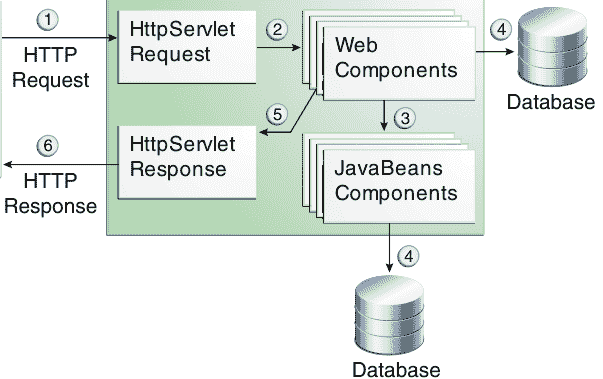

当应用程序安装或部署到 Web 容器时，可以配置 Web 应用程序安全的某些方面。注解和/或部署描述符用于向部署器传递有关应用程序安全和其他方面的信息。在注解或部署描述符中指定这些信息可以帮助部署器为 Web 应用设置适当的安全策略。部署描述符中显式指定的任何值都将覆盖注解中指定的任何值。

EE Web 应用的安全可以通过以下方式实现：

- **声明式安全（Declarative security）**：可以使用元数据注解或应用程序部署描述符来实现。更多信息请参阅“Java EE 安全概述”。

Web 应用的声明式安全在“保护 Web 应用”章节中有描述。

- **程序化安全（Programmatic security）**：嵌入在应用程序中，当仅凭声明式安全不足以表达应用程序的安全模型时，可用于做出安全决策。当应用程序中间需要针对特定工作流（而非所有情况）进行条件登录时，声明式安全可能就足够。更多信息请参阅“Java EE 安全概述”。

Servlet 3.0 提供了 `HttpServlet` 的 `authenticate`、`login` 和 `logout` 方法。随着 Servlet 规范中增加了 `authenticate`、`login` 和 `logout` 方法，Web 应用不再需要应用程序部署描述符，但仍可以使用它来进一步指定超出基本默认值的安全需求。

程序化安全在“在 Web 应用中使用程序化安全”章节中进行了讨论。

- **消息安全（Message Security）**：与 Web 服务配合，并将安全特性（如数字签名和加密）整合到 SOAP 消息的头中，在应用层工作，确保端到端安全。消息安全不是 Java EE 7 的组件，此处提及仅供参考。

本章的部分内容建立在在本教程之前介绍的内容的基础上。特别是，本章假设你已经熟悉以下章节中的信息：

- 第 6 章，“Web 应用初入门”

- 第 7 章，“Java Faces 技术”

- 第 17 章，“Java Servlet 技术”

- 第 47 章，“Java EE 平台安全简介”

## 48.2 保护 Web 应用

Web 应用由应用开发者创建，他们将应用程序交付、出售或其他转移给应用部署人员，以便安装到运行时环境中。应用开发者使用注解和部署描述符说明如何为部署的应用程序设置安全。信息被传递给部署人员，部署人员需要为安全规则（如用户验证）以及适当的传输机制定义权限。如果应用开发者定义了安全需求，部署人员将独立确定安全需求。

Web 应用安全所需的某些元素无法作为所有类型 Web 应用的注解进行指定。本章解释了如何尽可能使用注解来保护应用程序。它解释了在无法使用注解时如何使用部署描述符。

## 48.2.1 指定安全约束

安全约束（security constraint）用于通过 URL 映射定义资源集合的访问权限。

如果你的应用程序使用 Servlet，可以使用注解表示安全约束信息。具体来说，你在 `@ServletSecurity` 注解内使用 `@HttpConstraint` 以及可选的 `@HttpMethodConstraint` 注解来指定安全约束。

然而，如果你的应用程序没有使用 Servlet，则必须在部署描述符文件中指定 `<security-constraint>` 元素。验证机制无法通过注解表示，或者如果你使用了 BASIC（默认）以外的任何验证方法，则需要部署器。

以下元素可以作为安全约束的一部分：

- Web 资源集合（web-resource-collection）：URL 模式列表（URL 中主机和端口之后你想限制的部分）和 HTTP 操作（文件中匹配你想限制的 URL 模式的方法），描述了一组要受保护的资源。Web 资源集合在“指定 Web 资源集合”中讨论。

- 授权约束（auth-constraint）：指定是否使用验证，以及哪些名称的角色有权执行受限的请求。有关授权约束的更多信息，请参阅“指定授权约束”。

- 用户数据约束（user-data-constraint）：指定客户端和服务器之间数据受保护的方式。用户约束在“指定安全连接”中讨论。

### 48.2.1.1 指定 Web 资源集合

Web 资源集合由以下子元素：

- 资源名称（web-resource-name）：你用于该资源的名称。它是可选的。


- URL 模式（`url-pattern`）：用于列出要保护的请求 URI。许多应用程序都有未保护和受保护的资源。要为资源提供无限制访问，请勿对该请求配置安全约束。例如，假设你有一个任何人都可以访问的电子商务网站，以及一个仅限客户的购物车区域。你可以为 Web 应用设置路径使其受保护。`/*` 是受保护的。假设应用程序安装在路径 `/myapp`，则情况如下：

```
http://localhost:8080/myapp/index.xhtml 不受保护
http://localhost:8080/myapp/cart/index.xhtml 受保护
```

用户在第一次访问购物车目录下的资源时，将被提示登录。

- HTTP 方法（`http-method`）或 HTTP 方法排除（`http-method-omission`）：用于指定哪些方法应受保护或哪些方法应从保护中排除。在任何情况下，HTTP 方法受 Web 资源集合保护：
  - 如果集合中没有命名 HTTP 方法（这意味着所有方法都受保护）
  - 如果集合通过 `<http-method>` 元素专门命名了该 HTTP 方法
  - 如果集合包含一个或多个 `<http-method-omission>` 元素，且没有一个命名该 HTTP 方法

### 4.2.1.2 指定授权约束

授权约束（`auth-constraint`）包含角色名称（`role-name`）元素。你可以在这里根据需要使用多个 `<role-name>` 元素。

授权约束建立了对验证的要求，并指出了有权访问此安全约束声明的 URL 和 HTTP 方法的角色。如果没有授权约束，容器必须接受请求而无需要求验证。如果内部没有指定任何角色，则容器在任何情况下都不允许访问该请求。指定的每个角色名称必须与此应用程序定义的某个 `<security-role>` 元素的角色名称相对应，或者是保留的角色名称 `*`，后者表示所有角色都对大小写敏感。应用程序的角色必须映射到服务器上定义的用户和组，除非使用了默认的主角（principal）到角色的映射。

有关安全角色的更多信息，请参阅“声明安全角色”。有关角色映射的信息，请参阅“将角色映射到用户和组”。

对于 Servlet，`@HttpConstraint` 和 `@HttpMethodConstraint` 注解接受允许元素（`AllowedElement`），指定授权的角色。

## 48.2.1.3 指定安全连接

部署约束中的数据约束（`user-data-constraint`）包含 `transport-guarantee` 子元素。数据约束可用于对安全约束中指定的所有受限 URL 模式和 HTTP 方法要求受保护的传输层连接（如 HTTPS）。传输保证的选择有 `CONFIDENTIAL`、`INTEGRAL` 或 `NONE`。如果你在安全约束中指定 `CONFIDENTIAL` 或 `INTEGRAL`，通常意味着使用了 SSL，并且适用于与 web 资源集合中 URL 模式匹配的所有请求，而不仅仅是登录对话框。

所需的保护强度由 `transport-guarantee` 的值定义。

- 当应用需要传输数据以防止他人观察到传输内容时，请指定 `CONFIDENTIAL`。
- 当应用要求数据在客户端和服务器之间传输的方式使其无法被篡改时，请指定 `INTEGRAL`。
- 指定 `NONE` 表示容器必须接受任何连接（包括不受保护的连接）上的受限请求。

> 注意：在实践中，Java 服务器对待 `CONFIDENTIAL` 和 `INTEGRAL` 传输保证值的方式是相同的。

用户数据约束与基本和基于表单的用户认证配合使用非常方便。当登录认证方法设置为 `BASIC` 或 `FORM` 时，密码不会被加密，这意味着在不受保护的会话中在客户端和服务器之间传输的密码会被第三方查看和拦截。使用带有用户认证机制的数据约束可以缓解这种担忧。配置用户认证机制在《部署描述符中的指定认证机制》中有所描述。

为了保证数据通过安全连接传输，请确保已为你的服务器配置了 SSL 支持。GlassFish 服务器已经配置了 SSL 支持。

> 注意：在会话切换到 SSL 后，在该会话的剩余时间内，你不应再接受任何非 SSL 请求。例如，网站可能在结账页面之前不使用 SSL，但在该页面可能会切换到 SSL 以接收你的信用卡号。切换到 SSL 后，你应该停止监听该会话的非 SSL 请求。这种做法的原因是，会话 ID 本身在之前的通信中没有加密。当你只是在购物时，这并不糟糕，但在信用卡信息存储在会话中之后，你不希望他人使用该信息针对你的信用卡进行伪造购买交易。这种做法可以通过使用过滤器来轻松实现。

## 48.2.1.4 为资源指定安全约束

你可以为应用程序中的资源创建安全约束。例如，你可以允许具有 `PARTNER` 角色的用户完全访问 URL 模式 `/acme/wholesale/*` 的所有资源，并允许具有 `CLIENT` 角色的用户完全访问 URL 模式 `/acme/retail/*` 的所有资源。如果你不想在保护某些 HTTP 方法的同时让其他 HTTP 方法不受保护，这是保护资源的推荐方法。一个演示此功能的部署描述符示例是：

```xml
<!-- 安全约束 #1 -->
<security-constraint>
  <web-resource-collection>
    <resource-name>wholesale</resource-name>
    <url-pattern>/*:/wholesale/*</url-pattern>
  </web-resource-collection>
  <auth-constraint>
    <role-name>PARTNER</role-name>
  </auth-constraint>
  <user-data-constraint>
    <transport-guarantee>CONFIDENTIAL</transport-guarantee>
  </user-data-constraint>
</security-constraint>
```

```xml
<!-- 安全约束 #2 -->
<security-constraint>
  <web-resource-collection>
    <resource-name>retail</resource-name>
    <url-pattern>/*:/retail/*</url-pattern>
  </web-resource-collection>
  <auth-constraint>
    <role-name>CLIENT</role-name>
  </auth-constraint>
  <user-data-constraint>
    <transport-guarantee>CONFIDENTIAL</transport-guarantee>
  </user-data-constraint>
</security-constraint>
```

## 48.2.2 指定认证机制

用户认证机制指定了：

- 用户如何访问 Web 内容
- 使用基本认证时，用户将在进行认证的域（realm）
- 使用基于表单的认证时，额外的属性

指定了认证机制后，用户在访问任何受安全约束保护的资源之前必须经过认证。可以有多个安全约束适用于多个资源，但相同的认证方法将适用于应用程序中的受限资源。

在认证用户之前，你必须在 Web 服务器或应用程序服务器上配置包含用户名、密码和角色的数据库。有关设置用户数据库的信息，请参阅《GlassFish 服务器上的用户和组》。

Java EE 平台支持以下认证机制：

- 基本认证 (Basic authentication)
- 基于表单的认证 (Form-based authentication)
- 摘要认证 (Digest authentication)
- 客户端认证 (Client authentication)
- 相互认证 (Mutual authentication)

本节将讨论基本认证、基于表单的认证和摘要认证。客户端认证和相互认证将在第50章《Java EE 安全：高级主题》中讨论。

HTTP 基本认证和基于表单的认证不是安全的认证机制。基本认证通过 Base64 编码文本在互联网发送用户名和密码。基于表单的认证以明文形式发送这些数据。在这两种情况下，目标服务器都没有经过认证。这些形式的认证会让用户数据暴露并容易受到攻击。如果有人拦截传输，用户名和密码信息就可以被解码。

然而，当结合基于表单的认证使用安全传输机制（如 SSL）或网络级安全（如网协议安全 IPS）时，大多数担忧都可以得到缓解。要指定安全传输，请使用《指定连接》中的元素。

### 48.2.2.1 HTTP 基本认证

指定 HTTP 基本认证要求服务器向用户请求用户名和密码，并根据数据库验证用户名和密码。当你没有指定认证机制时，基本认证是默认的。

使用基本认证时，发生以下操作：

1. 客户端请求受保护的资源。
2. 服务器返回一个请求用户名和密码的对话框。
3. 客户端将用户名和密码提交给服务器。
4. 服务器在指定的域中认证用户，如果成功，则返回请求的资源。

图 48-2 显示了指定基本认证时发生的情况。

图 48.2 基本认证 

### 48.2.2.2 基于表单的认证

**基于表单的认证**允许开发者通过自定义 HTTP 浏览器呈现给终端用户的登录和错误页面来控制登录界面的外观。当声明了基于表单的认证时，发生以下操作：

1. 客户端请求受保护的资源。
2. 如果客户端未认证，服务器将客户端重定向到登录页面。
3. 客户端向服务器提交登录表单。
4. 服务器尝试认证用户。
   a. 如果认证成功，检查已认证用户是否角。如果用户已授权，服务器将使用存储的 URL 路径重定向客户端到资源。
   b. 如果认证失败，客户端将转发或重定向到错误页面。

图 48-3 显示了指定基于表单的认证时发生的情况。

图 48.3 基于表单的认证 

hello1-formauth 示例：使用 JavaScript 应用程序的基于表单认证是一个使用了这种认证的示例应用程序。

当你创建基于表单的登录时，请确保使用 Cookie 或 SSL 会话信息维护会话。为了让认证正常进行，登录表单的 action 必须始终为 `j_security_check`。此此限制是为了确保无论请求是什么，登录表单都能工作，并避免要求服务器指定如何将表单 编码到 HTML 页面中：

```html
<form method="POST" action="j_security_check">
<input type="text" name="j_username">
```

```html
<input type="password*" name="j_password">
</form>
```

### 48.2.2.3 摘要认证 (Digest Authentication)

与基本认证类似，摘要认证根据用户名和密码对用户进行身份验证。然而，与基本认证不同，摘要认证不会在网络上发送用户密码。相反，客户端发送密码和额外数据的单向加密哈希值。此外，摘要认证要求认证容器能够获取明文密码等效项，以便其通过计算预期的摘要来验证收到的身份验证器（authenticators）。

## 48.2.3 在部署描述符中指定认证机制

要指定身份验证机制，请使用 `login-config` 元素。它可以包含以下元素：

- `auth-method` 元素为 Web 应用程序配置认证机制。该元素的内容必须是 `NONE`、`BASIC`、`DIGEST`、`FORM` 或 `CLIENT-CERT` 之一。
- `realm-name` 元素标识在为 Web 应用程序选择身份验证方案时使用的域（realm）名称。
- `login-config` 元素指定在指定表单登录时应使用的登录页面和错误页面。

> 注意：指定表单认证的另一种方法是使用 `HttpServletRequest` 的 `authenticate`、`login` 和 `logout` 方法，这在“通过程序对用户进行认证”中已有讨论。

当你尝试访问受 `security-constraint` 元素限制的资源时，Web 容器会激活为该资源配置的认证机制。认证机制规定了将如何提示用户登录。如果存在 `login-config` 元素且 `auth-method` 元素包含除 `NONE` 以外的值，则用户必须经过身份验证才能访问该资源。如果你没有指定认证机制，则不需要对用户进行身份验证。

示例显示了如何在部署描述符中声明表单认证：

```xml
<config>
  <auth-method>auth-method</auth-method>
  <realm-name>realm</realm-name>
  <login-config>
    <login-page>/login.xhtml</login-page>
    <error-page>/error.xhtml</error-page>
  </login-config>
</config>
```

登录和错误页的位置是相对于部署描述符的位置指定的。登录和错误页面的示例在“创建登录表单和错误页面”中显示。

## 在 Web 应用程序中使用程序化安全

以下示例显示了如何在部署描述符中声明摘要认证：

```xml
<config>
  <auth-method>DIGEST</auth-method>
</config>
```

## 48.2.4 声明安全角色

你可以通过使用部署描述符的 `security-role` 元素来声明 Web 应用程序使用的角色名。使用此元素列出应用程序中引用的所有安全角色。

下面的部署描述符片段使用 `security-role` 元素声明了应用程序将使用的角色，并使用 `auth-constraint` 元素指定其中哪些角色有权访问受保护资源：

```xml
<security-constraint>
  <web-resource-collection>
    <web-resource-name>Protected Area</web-resource-name>
    <url-pattern>/security/protected/*</url-pattern>
    <http-method>PUT</http-method>
    <http-method>DELETE</http-method>
    <http-method>GET</http-method>
    <http-method>POST</http-method>
  </web-resource-collection>
  <auth-constraint>
    <role-name>manager</role-name>
  </auth-constraint>
</security-constraint>
```

```xml
<!-- 此 Web 应用程序使用的安全角色 -->
<security-role>
  <role-name>manager</role-name>
</security-role>
<security-role>
  <role-name>employee</role-name>
</security-role>
```

在此示例中，`security-role` 元素列出了应用程序中使用的所有安全角色：manager 和 employee。这允许部署器将应用程序中定义的角色映射到 GlassFish Server 上定义的组。

`auth-constraint` 元素指定了角色 `manager`，它可以访问位于由 `url-pattern` 元素指定的目录（`/jsp/security/protected/`）下的 HTTP 方法 PUT、DELETE、GET、POST。

`@WebServletSecurity` 注解无法使用，因为它的约束适用于 `@WebServlet` 注解指定的所有模式。

## 48.3 在 Web 应用程序中使用程序化安全

当仅凭声明式方法不足以表达应用程序的安全模型时，安全感知型应用程序会使用程序化安全。

### 48.3.1 通过程序对用户进行认证

`HttpServlet` 接口的以下方法允许你通过程序对 Web 应用程序中的用户进行认证：

- `authenticate`：允许应用程序在不受限制的上下文中由容器实例化请求调用者的认证。登录对话框会显示用于认证的用户名和密码。
- `login`：允许应用程序收集用户名和密码信息，作为在应用程序部署描述符中指定表单认证的替代方案。
- `logout`：允许应用程序重置请求的调用者身份。

以下示例代码显示了如何使用 `login` 和 `logout` 方法：


```java
package test;

import java.io.IOException;
import java.io.PrintWriter;
import java.math.BigDecimal;
import javax.ejb.EJB;
import javax.servlet.ServletException;
import javax.servlet.annotation.WebServlet;
import javax.servlet.http.HttpServlet;
import javax.servlet.http.HttpServletRequest;
import javax.servlet.http.HttpServletResponse;

@WebServlet(name="TutorialServlet")
public class TutorialServlet extends HttpServlet {

    @EJB
    private ConverterBean converterBean;

    /**
     * 处理 GET 和 POST 请求
     * @param request servlet请求
     * @param response servlet响应
     * @throws ServletException 如果发生错误
     * @throws IOException 如果发生错误
     */
    protected void processRequest(HttpServletRequest request, HttpServletResponse response)
            throws ServletException, IOException {
        PrintWriter out = response.getWriter();

        out.setContentType("text/html;charset=UTF-8");
        try {
            out.println("<html>");
            out.println("<head>");
            out.println("<title>TutorialServlet</title>");
            out.println("</head>");
            out.println("<body>");
            String login = request.login("TutorialUser");
            BigDecimal result = converterBean.dollarTo(new BigDecimal("1.0"));
            out.println("<h2>TutorialServlet result = " + result + "</h2>");
            out.println("</body>");
            out.println("</html>");
        } catch (Exception e) {
            throw new ServletException(e);
        } finally {
            request.logout();
        }
        out.close();
    }
}
```

示例代码显示了如何使用 `authenticate` 方法：

```java
package com.sam.test;

import java.io.*;
import javax.servlet.*;
import javax.servlet.http.*;

public class TestServlet extends HttpServlet {

    protected void processRequest(HttpServletRequest request, HttpServletResponse response)
            throws ServletException, IOException {
        response.setContentType("text/html;charset=UTF-8");
        PrintWriter out = response.getWriter();
        try {
            request.authenticate();
            out.println("Authenticate Success!");
        } finally {
            out.close();
        }
    }
}
```

### 48.3.2 通过程序检查调用者身份

通常，安全管理应由容器以对 Web 组件透明的方式强制。本节描述的安全 API 仅在 Web 组件需要访问安全信息的少数情况下使用。

Servlet 3.0 规定了允许你访问组件调用者安全信息的方法：

- `getUserName`：确定与容器关联的已认证（调用者者的名称。如果没有用户认证，该方法返回 `null`。
- `isInRole`：确定用户是否属于特定的安全角色。如果没有用户认证，该方法返回 `false`。该方法接受一个 `String role-name` 参数。

应在部署描述符中声明 `security-role-ref` 元素，包含传递给方法的 `role-name`。使用安全角色引用用的请参见[声明和链接角色引用]。

- `getUserPrincipal`：确定当前用户的主体名称并返回一个 `java.security.Principal` 对象。如果没有用户认证，该方法返回 `null`。对 `getUserPrincipal` 返回的 `Principal` 对象调用 `getName()` 方法将返回远程用户的名称。

你的应用程序可以根据使用这些 API 获取的信息做出业务逻辑决策。

## 48.3 语义化安全的示例代码

以下代码演示了如何为了程序化逻辑使用程序化安全。此 Servlet 执行了以下操作：

1. 它显示有关当前用户的信息。
2. 它提示用户登录。
3. 它打印信息以展示登录方法的效果。
4. 它注销用户。
5. 它打印信息以展示注销方法的效果。

```java
package enterprise.programmatic_login;

import java.io.*;
import java.net.*;
import javax.servlet.annotation.DeclareRoles;
import javax.servlet.*;
import javax.servlet.http.*;

@DeclareRoles("javaee6user")
class LoginServlet extends HttpServlet {

    /**
     * 处理针对 HTTP GET 和 POST 方法的请求。
     * @param request 请求
     * @param response 响应
     */
    protected void processRequest(HttpServletRequest request,
                                   HttpServletResponse response)
                                   throws ServletException, IOException {
        response.setContentType("text/html;charset=UTF-8");
        PrintWriter out = response.getWriter();
        try {
            String username = request.getParameter("txtUsername");
            String password = request.getParameter("txtPassword");

            out.println("Before Login " + "<br>");
            out.println("IsUserInRole?" + "<br>");
            out.println(request.isUserInRole("javaee6user") + "<br>");
            out.println("getRemoteUser?" + request.getRemoteUser() + "<br>");
            out.println("getRemotePrincipal?" + "<br>");
            out.println(request.getRemotePrincipal() + "<br>");
            out.println("getAuthType?" + request.getAuthType() + "<br>");

            request.login(username, password);
        } catch (ServletException ex) {
            out.println("Login Failed with a ServletException..");
            out.println(ex.getMessage());
            return;
        }

        out.println("After Login.." + "<br>");
        out.println("IsUserInRole?" + "<br>");
        out.println(request.isUserInRole("javaee6user") + "<br>");
        out.println("getRemoteUser?" + request.getRemoteUser() + "<br>");
        out.println("getRemotePrincipal?" + "<br>");
        out.println(request.getRemotePrincipal() + "<br>");
        out.println("getAuthType?" + request.getAuthType() + "<br>");
    }
}
```

```java
request.logout();
request.println("After Logout..."+<br><br>);
out.println("IsUserInRole?"...\n    + request.isUserInRole("javaee6user")+\<br><br>);
out.println("getRemoteUser?"+ + request.getRemoteUser()+<br><br>);
out.println("getUserPrincipal?"...\n    + request.getUserPrincipal()+\<br><br>);
try {
    out.println("getAuthType?"+ + request.getAuthType()+<br><br>);
} finally {
    out.close();
}
...
```

## 48.3.4 声明和链接角色引用

安全引用（security reference）是 Web 组件通过 `isUserRole(String role)` 调用的角色名称与为应用程序定义的安全角色名称之间的映射。如果在部署描述符中没有声明 `security-role-ref` 元素且调用了 `isUserRole` 方法，容器将默认检查提供的角色名称是否在 Web 应用程序定义的所有安全角色列表中。使用 `security-role-ref` 元素允许你在无需重新编译进行调用的 Servlet 的情况下更改应用程序中的角色名称。

当应用程序使用 `HttpServletRequest.isUserRole(String role)` 时，就会 `security-role-ref` 元素。传递给 `isUserRole` 方法的值是代表用户名称的字符串。`role-name` 元素的值必须是作为 `HttpServletRequest.isUserRole(String role)` 参数的字符串。`role-link` 必须包含在 `security-role` 元素中定义的安全角色之一的名称。容器在确定调用的返回值时，会使用 `security-role-ref` 到 `security-role` 的映射。

例如，要将安全角色引用映射到名称为 `bankCustomer` 的安全角色，语法如下：

```xml
<servlet>
  <security-role-ref>
    <role-name>cust</role-name>
    <role-link>bankCustomer</role-link>
  </security-role-ref>
</servlet>
```

如果该方法由 `bankCustomer` 安全角色的用户调用，则 `isUserRole("cust")` 返回 `true`。

`security-role-ref` 元素中的 `role-link` 元素必须与 `web.xml` 部署描述符中 `security-role` 元素定义的 `role-name` 匹配，如下所示：

```xml
<security-role>
  <role-name>bankCustomer</role-name>
</security-role>
```

## 48.4 示例：Web应用程序的安全

安全角色引用（包括由引用定义的名称）的作用范围限于包含 `security-role-ref` 部署元素的部署描述符组件。

## 48.4 示例：Web应用程序的安全

在任何应用程序运行之前，需要进行一些基础设置。示例使用了注解、程序化安全和/或声明式安全来演示如何对现有的 Web 应用程序进行保护。

以下是你可以找到各种类型安全示例的地方：

- 使用声明式安全的 cart-secure 示例
- 使用程序化安全的 hello2-secure 示例

### 设置你的系统

在任何应用程序能够正确运行之前，需要执行以下操作：

1. 确保 GlassFish 已经启动。
2. 为 GlassFish 添加另一个用户。继续，请遵循以下步骤：
   - a. 从管理控制台展开 `Configurations`，然后展开 `server-config` 节点。
   - b. 选择 `Security` 节点。
   - c. 展开 `Realms`。
   - d. 选择 `File`。
   - e. 在 `Edit Realm` 页面，点击 `Manage Users`。
   - f. 在 `Users` 页面，点击 `New`。
   - g. 在 `User` 字段中输入用户名。
   - h. 在 `Group` 字段中输入 `Tutorial`。
   - i. 在 `New Password` 和 `Confirm Password` 字段中输入密码。
   - j. 点击 `OK`。
3. 在 GlassFish 上设置默认映射：请记住你使用的用户名和密码。此主题将在“保护 Web应用程序”中进行讨论。

### 示例：保护 Web应用程序

- a. 从管理控制台展开 `Configurations`，展开 `server-config` 节点。
- b. 选择 `Security` 节点。
- c. 勾选 `Default Mapping` 复选框。
- d. 保存。

### 48.4.2 hello2-basicauth：使用 Servlet 的基本认证

此示例解释了如何使用基本认证进行 Servlet。使用基本认证时，浏览器会呈现不可自定义的标准登录框。当用户提交用户名和密码时，服务器会确定用户是否获得授权。

通常情况下，为未安全的 Servlet 添加基本认证所需的步骤如第 6 节“入门指南”所示。在本文教程包含的示例中，许多此类步骤已经为你完成，但在此列出是为了显示你需要：

1. 按照“设置你的系统”的步骤进行。
2. 按照第 6 节“入门指南”，为 Servlet 示例 hello2 创建 Web 模块。
3. 为 Servlet 添加适当的安全注解。使用注解指定基本认证的安全。
4. 按照“使用 NetBeans IDE 构建、打包并部署 hello2-basicauth 示例”或“使用 Maven 构建、打包并部署 hello2-basicauth 示例”的步骤进行操作。
5. 按照“运行 hello2-basicauth 示例”的步骤运行 Web 。

### 48.4.1 使用注解指定基本认证的安全

GlassFish 服务器使用的默认认证机制是基本认证。使用基本认证时，GlassFish 服务器呈现标准的登录框以收集用户名和密码。

要保护 Servlet，请使用 `@WebServletSecurity` 注解。该注解允许你指定特定 HTTP 方法的约束以及适用于所有无特定约束方法的更通用约束。在 `@servletSecurity` 注解中，你可以指定：

- `@HttpMethodConstraint` 注解，适用于特定的 HTTP 方法
- 更通用的 `@HttpConstraint` 注解，适用于所有没有对应 `@HttpMethodConstraint` 的 HTTP 方法


`@servletSecurity` 注解中的 `@HttpMethodConstraint` 和 `@HttpConstraint` 注解都可以指定以下：

- `transportGuarantee` 元素，用于确保数据保护需求（即是否需要 SSL/TLS）得到满足
  - 有效值为 `NONE`、`INTEGRAL`、`CONFIDENTIAL`
- `rolesAllowed` 元素指定了授权角色的名称

对于 `hello2-basicauth`，`GreetingServlet` 具有以下注解：

```java
@WebServlet(name = "GreetingServlet", urlPatterns = {"/greeting"})
@ServletSecurity(
    @HttpConstraint(transportGuarantee = TransportGuarantee.CONFIDENTIAL,
    rolesAllowed = {"TutorialUser"})
)
```

这些注解指定了请求 URI `/greeting` 只能由授权访问此 URI 的用户访问，除非他们已被验证为 `TutorialUser` 角色。数据将通过受保护的传输发送，以防止用户的用户名和密码数据不被读取。

如果你使用 `@ServletSecurity` 注解，则不需要在部署描述符（deployment descriptor）中指定安全设置。使用部署描述符来指定不依赖的身份验证机制设置，这些机制你无法使用 `@WebServlet` 注解。

## 48.4.2.2 使用 NetBeans IDE 构建、打包和部署 hello2-basicauth 示例

1. 按照“为运行安全示例设置您的系统”中的步骤操作。
2. 从 File（文件）菜单中选择 Open Project（打开项目）。
3. 在 Project（项目）对话框中，导航到：
   `tut-install/examples/security/`
4. 选择 `hello2-basicauth` 文件夹。
5. 点击 Open Project（打开项目）。
6. 在 Projects（项目）选项卡中右键点击 `hello2-basicauth` 并选择 Build（构建）。

此命令构建并将应用程序部署到你的 GlassFish Server 实例中。

## 48.4.2.3 使用 Maven 构建、打包和部署 hello2-basicauth 示例

1. 按照“为运行安全示例设置您的系统”中的步骤操作。
2. 在终端窗口中，进入：
   `tut-install/examples/security/hello2-basicauth/`
3. 输入以下命令：
   `mvn install`

此命令构建应用程序并打包成 WAR 文件 `hello2-basicauth.war`，该文件位于 `target` 目录中，然后部署该 WAR 文件。

## 48.4.2.4 运行 hello2-basicauth 示例

1. 在浏览器中，导航到以下 URL：
   `http://localhost:8181/hello2-basicauth/greeting`

你可能会被提示接受服务器的安全证书。如果是，请接受该安全证书。如果浏览器警告证书由于是自签名而无效，请为应用程序添加安全异常。

会出现一个 Authentication Required（需要身份验证）对话框。它的外观取决于你使用的浏览器。

- 输入一个已在 GlassFish Server 的文件 realm（file realm）中创建并被分配给 `TutorialUser` 组的用户名和密码组合；然后点击 OK。

基本情况对用户名和密码都是大小写敏感的，因此请按照 GlassFish 服务器中的定义完全输入用户名和密码。

如果满足以下所有条件，服务器将返回请求的资源：

* GlassFish 服务器定义了一个与你输入的用户名相同的用户。
* 具有你输入的用户名的用户拥有你输入的密码。
* 你输入的用户名和密码组合被分配给 GlassFish 服务器上的 `TutorialUser` 组。
* 应用程序定义的 `TutorialUser` 角色映射到 GlassFish 服务器定义的 `TutorialUser` 组。

- 在字段中输入一个名称并点击 Submit（提交）。

由于你已经通过授权，你在这一步中输入的名称没有任何限制。你现在对该应用程序拥有无限访问权限。

服务器通过对你输入的名称说“Hello”来响应。

## 48.4.3 hello1-formauth：JavaServer Faces 应用的基于表单的认证

本文解释了如何在 JavaServer Faces 应用中使用表单身份验证。通过表单认证，你可以自定义呈现给 Web 客户端用于用户名和密码认证的登录屏幕和错误页面。当用户提交其名称和密码时，服务器将确定用户名和密码是否为授权用户，如果授权，则提供请求的资源。

此示例 `hello1-formauth` 为“A Web Module That JavaServer Faces Technology: The hello1 Example”中所示的基础 JavaServer Faces 应用添加了安全性。

通常情况下，向未安全的 JavaServer Faces 应用程序添加表单身份验证的步骤与“hello2-basic Example: 使用 Servlet 的基本认证”中描述的步骤相似。主要区别在于，你必须使用部署描述符来指定使用表单身份验证，如“为表单身份验证示例指定安全性”中所述。此外，你必须创建一个登录表单页面和一个错误页面，如“创建登录表单和错误页面”中所述。

此应用程序可以在 `tut-install/examples/security/hello1-formauth/` 目录下找到。

### 48.4.3.1 创建登录表单和错误页面

使用表单机制时，你必须指定一个包含你想要获取用户名和密码的表单的页面，以及一个显示登录认证失败的页面。本节讨论了此示例中使用的登录表单和错误。“为表单身份验证示例指定安全性”显示了如何在部署描述符中指定这些页面。

登录页面是一个 HTML 页面或 servlet，它必须返回一个包含符合命名规范的表单的 HTML 页面（有关这些要求的更多信息请参考 Java Servlet 3.1 规范）。要做到这一点，请在登录页的 `<form></form>` 标签之间包含接收用户名和密码信息的元素。登录页 HTML 页面或 servlet 内容的代码如下：

```html
<form method="post" action="j_security_check">
  <input type="text" name="j_username">
  <input type="password" name="j_password">
</form>
```

此示例中使用的登录页的完整代码可以在 `tut-install/examples/security/hello1-formauth/src/main/webapp/login.html` 找到。该页的代码如下：

```html
<html lang="en">
<head>
  <title>Login Form</title>
</head>
<body>
  <h2>Hello, please log in:</h2>
  <form method="post" action="j_security_check">
    <table>
      <tr>
        <td>Please type your user name:</td>
        <td><input type="text" name="j_username" size="20"/></td>
      </tr>
      <tr>
        <td>Please type your password:</td>
        <td><input type="password" name="j_password" size="20"/></td>
      </tr>
    </table>
    <input type="submit" value="Submit"/>
  </form>
</body>
</html>
```

当用户输入未授权的名称和密码时，会显示错误页面。该错误可以在 `tut-install/examples/security/hello1-formauth/src/main/webapp/error.html` 找到。该页的代码如下：

```html
<html lang="en">
<head>
  <title>Login Error</title>
</head>
<body>
  <h2>Invalid user name or password</h2>
  <p><a href="login.html">Return to login page</a></p>
</body>
</html>
```

### 48.4.3.2 为表单身份验证示例加密

此示例为简单的 servlet Web 应用添加了表单安全。要为 JavaServer Faces 应用使用表单认证，你必须使用部署描述符。

下面的示例代码显示了添加到部署描述符的安全元素，可以在 `tut-install/examples/security/hello1-formauth/src/main/webapp/WEB-INF/web.xml` 中找到：

```xml
<security-constraint>
  <display-name>Constraint</display-name>
  <web-resource-collection>
    <web-resource-name>wrcoll</web-resource-name>
    <description/>
    <url-pattern>/*</url-pattern>
  </web-resource-collection>
  <auth-constraint>
    <description/>
    <role-name>TutorialUser</role-name>
  </auth-constraint>
</security-constraint>
```

```xml
<login-config>
  <auth-method>FORM</auth-method>
  <realm-name>file</realm-name>
  <form-login-config>
    <form-login-page>login.xhtml</form-login-page>
    <form-error-page>error.xhtml</form-error-page>
  </form-login-config>
</login-config>
```

```xml
<security-role>
  <description/>
  <role-name>TutorialUser</role-name>
</security-role>
```

此命令构建并部署示例应用程序到你的 GlassFish Server 实例并在浏览器中打开它。

## 48.4.3.4 使用 Maven 和 asadmin 命令构建、打包并部署 hello1-formauth 示例

1. 按照“运行安全示例的系统设置”中的步骤操作。
2. 在终端窗口中，进入：
   `tut-install/examples/security/hello1-formauth/`
3. 在终端窗口或命令提示符中输入以下命令：
   `mvn install`

此命令将应用程序构建并打包成 WAR 文件 `hello1-formauth.war`，该文件位于 `target` 目录，然后将 WAR 文件部署到 GlassFish Server。

## 48.4.3.5 运行 hello1-formauth 示例

1. 打开浏览器并运行以下 URL：
   `http://localhost:8080/hello1-formauth/`
2. 在登录表单中，输入与 GlassFish Server 文件安全域（file realm）中已创建并分配给 `TutorialUser` 组的用户对应的用户名和密码。

基于表单的身份验证对用户名和密码均区分大小写，因此请输入 GlassFish Server 定义的用户名和密码。

3. 点击提交。

如果你输入 `My_Name` 作为用户名，`My_Pwd` 作为密码，当满足以下所有条件时，服务器将请求该资源：

- GlassFish Server 定义了用户名为 `My_Name` 的用户。
- 用户名为 `My_Name` 的用户在 GlassFish Server 中定义了密码 `My_Pwd`。
- 密码为 `My_Pwd` 的用户 `My_Name` 被分配给 GlassFish Server 上的 `TutorialUser` 组。
- 应用程序定义的角色 `TutorialUser` 映射到 GlassFish Server 定义的组 `TutorialUser`。

当满足这些条件且服务器已验证用户身份通过时，应用程序将会显示。

4. 输入你的名称并点击提交。

由于你已经获得了授权，因此你在这一步中输入的名称没有任何任何限制。你现在可以无限制地访问应用程序。

应用程序将通过向你返回“Hello”来响应。

## 下一步

为了进行额外的测试并查看生成的登录错误页面，请关闭并重新打开浏览器，输入应用程序 URL，并输入未授权的用户名和密码。

# 开始保护企业级应用程序

本章描述了如何管理企业级应用程序的安全性。

此处将介绍以下主题：

- 企业级应用程序的基础安全任务
- 保护 Enterprise Beans
- 示例：保护 Enterprise Beans

## 49.1 企业级应用程序的基础安全任务

系统管理员、应用程序开发人员、Bean 提供和部署人员负责管理企业级应用程序的安全性：

基本安全任务包括：

- 设置用户数据库并将其分配到正确的组
- 设置身份传播（identity propagation）
- 设置 GlassFish Server 属性使应用程序能够正常运行，例如设置默认的主角到角映射
- 对企业级应用程序的类和方法进行注解，以提供关于哪些方法需要限制访问的信息

本章和上一章中关于安全示例的章节解释了如何执行这些任务。

## 49.2 保护 Enterprise Beans

Enterprise Beans 是实现 EJB 技术的 Java 组件。Enterprise Beans 运行在 EJB 容器中，这是 GlassFish Server 内的运行时环境。虽然对于应用程序开发者来说是透明的，但 EJB 为其企业豆提供了系统级服务，例如事务和安全性，这些服务构成了事务型 Java EE 应用程序的核心。

Enterprise Bean 方法可以通过以下方式之一进行安全保护：

- **声明式安全（首选）**：使用部署描述符或注解表示应用程序组件的安全需求。在某些情况下，在企业豆类的业务方法中存在一个注解并对方法权限进行分类就是方法保护和身份验证所需的所有。本节将讨论这种简单高效的保护企业豆 的方法。

  由于简化保护企业豆 的方法存在某些局限性，在某些实例中你可能希望继续使用部署描述符来指定安全信息。为了使简单方案生效，必须在服务器上配置身份验证机制。基本认证（Basic authentication）是 GlassFish Server 的默认身份验证方法。

  本教程解释了如何通过指定方法权限的注解装饰企业应用程序的业务方法，来调用授权用户的用户名/密码身份验证。

  为了使部署任务更容易，应用程序开发人员可以定义安全角色。安全角色是权限的分组，特定类型的用户为了成功使用应用程序必须具备这些权限。例如，在薪资应用程序中，某些用户想要查看自己的薪资信息（员工），某些人需要查看他人的薪资信息（经理），另一些人需要更改他人的薪资信息（薪资部门）。应用程序开发人员将确定应用程序的潜在用途以及哪些方法可以由哪些用户访问。然后应用程序开发人员将使用注解声明企业豆的类方法，指定授权访问这些方法的用户类型。使用注解指定授权用户的方法见[通过声明式安全角色指定用户]。

  当使用其中一个注解来定义方法权限时，部署系统将自动要求用户名/密码身份验证。在此类身份验证中，用户会被提示输入用户名和密码，这些将与已知用户数据库进行比较。如果找到了用户且密码匹配，则会将角色与授权访问方法的角色进行比较。如果用户验证通过并发现具有某个角色，并将数据返回给用户。使用声明式安全的方法见[保护 Bean]。

- **程序化安全**：对于企业豆，嵌入在业务方法中的代码以编程方式访问调用者身份，并使用这些信息做出安全决策。当声明式安全不足以表示应用程序的安全模型时，程序化安全非常有用。通常，安全管理应由容器以对企业豆透明的方式执行。本章描述的程序化安全 API 应在企业豆需要访问安全上下文的少数情况下使用，例如当你想根据时间或任何非平凡条件授予访问时。程序化安全将在[保护 Bean]中讨论。

本章的部分内容假设你已经阅读了[第 32 节“Enterprise Beans”]、[第 33 节“入门 Enterprise Beans”]以及[第 47 节“Java 平台安全简介”]。

正如早之前提到的，企业豆 运行在 EJB 容器中，这是 GlassFish Server 内的运行时环境，如图 49–1 所示。

## 图 49–1 Java EE 服务器和容器


## 49.2.1 使用声明式安全保护企业 Bean

声明式安全允许应用程序开发者指定哪些用户有权访问企业 Bean 方法，并使用基本认证（或用户名认证）对这些用户进行身份验证。通常，开发应用程序的人与负责部署应用程序的人不是同一个人。使用声明式安全定义方法权限和认证机制的应用程序开发者，会将 EJB JAR 中包含的企业 Bean 安全视图（security view）传递给部署者。当安全视图传递给部署者时，他或她将使用这些信息来定义安全角色的权限。如果你没有定义安全视图，部署者将必须确定每个 Bean 方法，以确定哪些用户有权调用每个方法。


安全视图由一组安全角色组成，这些角色是特定类型用户为了成功访问应用程序必须拥有的权限的语义分组。角色本质上是逻辑上的，代表一种用户类型。你可以为每个安全角色定义方法权限。方法权限是指调用企业 Bean 的业务接口、同源接口、组件接口和/或 Web 服务端点中指定组方法的权限。在定义了方法权限后，将使用名称/密码认证来验证用户的身份。

请记住，安全角色用于定义应用程序的安全视图。它不应与 GlassFish Server 中存在的用户组（`user groups`）、主体（`principals`）和其他概念混淆。还需要额外的步骤将应用程序中的方法定义映射到 GlassFish Server 文件领域（`file realm`）中用户数据库的组件的用户、组和主体。这些步骤在“将角色映射到用户和组”中进行了概述。

后续章节将展示应用程序开发者如何使用声明式安全来保护应用程序，或者创建一个传递给部署者的安全视图。

## 49.2.1 通过声明安全角色指定授权用户

本节讨论了如何使用注解来指定 Bean 类的方法权限。有关注解的更多信息，请参阅 Java 平台通用注解（Common Annotations for the Java Platform）规范，地址为 http://jcp.org/en/jar/detail=250。

方法权限可以在类、类的业务方法或两者指定。可以在类的方法上指定方法权限，以覆盖在整个 Bean 类上指定的方法权限值。以下注解用于指定方法权限：

- `@DeclareRoles`: 指定应用程序将使用的所有角色，包括在 `@RolesAllowed` 中未命名的角色。应用程序使用的安全角色集是在 `@DeclareRoles` 和 `@RolesAllowed` 注解中定义的安全角色。

- `@DeclareRoles` 注解指定在 Bean 类上，用于声明在注解类的方法内部可以进行测试（例如通过调用 `callerInRole`）的角色。在声明作为 `callerInRole(String roleName)` 参数的角色名称时，声明的名称必须与参数值相同。

以下示例演示了 `@DeclareRoles` 注解的使用：

```
@DeclareRoles("BusinessAdmin")
public class Calculator {
...
}
```

声明一个角色的语法如下例所示：

- `@RolesAllowed("list-of-roles")`: 指定允许访问应用程序中方法的安全角色。该注解可以在类或一个或多个方法上指定。在类级别指定时，该注解适用于类中的所有方法。在方法级别指定时，该注解仅适用于该方法，并覆盖在类级别上指定的任何值。

要指定没有角色有权访问应用程序中的方法，请使用 `@DenyAll` 注解。要指定角色用户有权访问应用程序，请使用 `@PermitAll` 注解。

当与 `@DeclareRoles` 注解配合使用时，应用程序将组合的安全角色集。

以下示例代码演示了 `@RolesAllowed` 注解的使用：

```
@RolesAllowed("Administrator", "Manager", "Employee")
public class Calculator {

  @RolesAllowed("Administrator")
  public void setNewRate(int rate) {
    ...
  }
}
```

- `@PermitAll`: 指定所有安全角色都允许执行指定的方法或方法。不会对用户进行数据库检查以确保其有权访问此应用程序。

此注解可以在类或一个或多个方法上指定。在类上指定此注解意味着它适用于类的中的所有方法。在方法级别指定意味着它适用于该方法。

以下示例代码演示了 `@PermitAll` 注解的使用：

```
import javax.annotation.security.*;
@RolesAllowed("RestrictedUsers")
public class Calculator {

  @RolesAllowed("Administrator")
  public void setNewRate(int rate) {
    ...
  }

  @PermitAll
  public long convertCurrency(long amount) {
    ...
  }
}
```

- `@DenyAll`: 指定不允许任何安全角色执行指定的方法或方法。这意味着这些方法在 Java EE 容器中被排除在执行之外。

以下示例代码演示了 `@DenyAll` 注解的使用：

```
import javax.annotation.security.*;
@RolesAllowed("Users")
public class Calculator {
    @RolesAllowed("Administrator")
    public void setNewRate(int rate) {
        ...
    }
    @DenyAll
    public long convertCurrency(long amount) {
        ...
    }
}
```

以下示例代码片段演示了 `@DeclareRoles` 注解与 `callerInRole` 方法结合使用。在此例中，`@Roles` 注解声明了一个 `payrollBean` 使用来检查调用者的角色：

```
@DeclareRoles("payroll")
@Stateless public class PayrollBean implements Payroll {
    @Resource SessionContext ctx;
    @PersistenceContext EntityManager em;

    public void updateEmployeeInfo(EmpInfo oldInfo) {
        ...
        // 获取调用者主体
        Principal principal = ctx.getCallerPrincipal();

        // 获取调用者名称
        String callerKey = principal.getName();

        // 检查调用者是否具有安全角色 "payroll"
        if (ctx.callerInRole("payroll")) {
            // 使用 callerKey 作为主键查找 EmployeeRecord
            EmployeeRecord myEmployeeRecord = em.find(EmployeeRecord.class, callerKey);

            // 更新手机号
            myEmployeeRecord.setPhoneNumber(...);
        }
    }
}
```

以下示例说明了 `@RolesAllowed` 注解的使用：

```
@RolesAllowed("admin")
public class SomeClass {
    public void aMethod() {
        ...
    }
    public void bMethod() {
        ...
    }
}
```

```
@Stateless public class MyBean extends SomeClass implements A {
    @RolesAllowed("HR")
    public void aMethod() {
        ...
    }

    public void cMethod() {
        ...
    }
}
```

在此例中，`aMethod`、`bMethod` 是 `A` 的方法，方法权限值分别为 `HR` 和 `admin`。`cMethod` 没有指定权限。

需要澄清的是，注解不会被子类继承。相反，注解适用于父类的方法。

## 49.2.1.2 指定认证机制和安全连接

当指定了权限，GlassFish Server 将调用基本用户名/密码认证。

要使用不同类型的认证或要求使用 SSL 安全连接，请在应用程序部署符中指定这些信息。

## 49.2.2 程序化保护企业 Bean

嵌入在业务方法中的程序化代码用于程序化访问调用者的身份，并在方法中使用这些信息。

## 49.2.2.1 访问企业 Bean 调用者的安全上下文

通常，安全管理应由容器强制执行，对企业 Bean 方法是透明的。本节描述的安全 API 应仅在企业 Bean 需要访问安全上下文信息的少数情况下使用，例如当你想访问特定时间时。

`javax.ejb.EJBContext` 接口提供了方法，允许提供者访问企业 Bean 调用者的安全信息：

- `getPrincipal`：允许企业 Bean 获取当前调用者的主体名称。方法可能会使用该名称作为数据库中信息的键。

以下代码示例演示了 `getPrincipal` 方法的使用：

```
@Stateless public class EmployeeBean implements EmployeeService {
    @Resource SessionContext ctx;
    @PersistenceContext EntityManager em;

    public void changePhoneNumber(...) {
        ...
        // 获取调用者主体
        Principal principal = ctx.getCallerPrincipal();

        // 获取调用者名称
        String callerKey = principal.getName();

        // 使用 callerKey 作为主键查找 EmployeeRecord
        EmployeeRecord myEmployeeRecord = em.find(EmployeeRecord.class, callerKey);

        // 更新手机号
        myEmployeeRecord.setPhoneNumber(...);
    }
}
```

`principal` 包含用于标识员工（例如员工工号）的主键。

- `isCallerInRole`，bean 代码可以使用它来允许 bean 供应商者/应用程序开发者编写无法通过方法权限轻松定义的安全检查。这种基于角色的限制检查可能会对请求施加限制，或者可能依赖于存储在数据库中的信息。

企业 bean 代码可以使用 `isCallerInRole` 方法来测试当前调用者是否已分配了安全角色。安全角色由 bean 供应商者或应用程序组装器定义，并由部署程序分配给操作环境中存在的主体（`principals`）或主体组（`principal groups`）。

下面的代码示例说明了 `isCallerInRole` 方法的使用：

你将以这种方式使用程序化安全来动态控制对某个方法的访问，例如，当你想在一天中的特定时间之外拒绝访问时。使用 `getCallerPrincipal` 和 `isCallerRole` 方法的应用程序在《转换器-安全示例：使用程序化安全保护企业 bean》中进行了描述。

## 49.2.3 标识身份的传播 (Run-As)

你可以指定在执行企业 bean 的特定方法时，是应该使用调用者的安全身份，还是应该使用特定的 run-as 身份。图 49-2 展示了这一概念。

图 49-2 身份传播

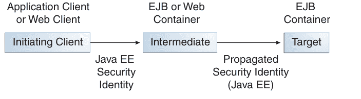

在此插图中，应用程序客户端正在调用一个 EJB 容器中的企业 bean 方法。该企业 bean 方法反过来又调用了另一个容器中的企业 bean 方法。第一次调用期间的安全身份是调用者的身份。第二次调用期间的安全身份可以是以下任何选项之一。

- 默认情况下，中间组件的调用者身份会传播到目标企业 bean。这种技术用于目标容器信任中间容器的情况。

- 特定的身份被传播到目标企业 bean。这种技术用于目标容器期望使用特定身份进行访问的情况。

要将身份传播到目标企业 bean，请按照《配置组件的传播安全身份》中的描述，为该 bean 配置 run-as 身份。为实体建立 run-as 身份不会影响其调用者的身份（这些调用者身份用于许可访问企业 bean 方法的权限）。run-as 身份确立了企业 bean 在调用时将要使用的身份。

run-as 身份适用于整个企业 bean，包括企业 bean 业务接口的所有方法、远程接口、组件接口和 Web 服务端点接口、消息驱动 bean 的消息监听方法、企业 bean 的超时时间以及 bean 中可以被调用的所有内部方法。

### 49.2.3.1 配置组件的传播安全身份

你可以通过 `@RunAs` 注解来配置企业 bean 的 run-as 或传播安全身份，该注解定义了在 Java EE 容器中执行应用程序的角色。该注解可以由类指定，允许开发者在特定角色下执行应用程序。该角色可能映射到容器安全域中的用户/组。`@RunAs` 注解将安全角色的名称作为其参数指定。

以下是演示使用 `@RunAs` 注解的示例代码。

```
@RunAs("Admin")
public class Calculator {
  ..
}
```

如果给定的角色与多个用户主体（`user principal`）相关，你将不得不将 run-as 名称映射到 GlassFish 服务器上定义的通用主体。

### 49.2.3.2 容器之间的信任

当企业 bean 设计为由原始调用者身份或传播身份调用目标 bean 时，该 bean 将接收到传播的身份。该 bean 不接收任何身份验证数据。

目标容器无法对传播的安全身份进行身份验证。但是由于安全身份被用于授权检查（例如方法权限或与 `isLoggedIn` 方法配合），因此安全身份的真实性至关重要。由于没有可用的身份验证数据来验证传播身份，目标必须信任容器已经传播了经过验证的安全身份。

默认情况下，GlassFish 服务器配置为信任从不同容器传播的身份。因此，你不需要采取任何特殊步骤来建立信任关系。

## 49.2 部署安全的企业 bean

部署程序负责确保已组装的应用程序在部署到目标操作环境后是安全的。通过使用安全注解和/或部署描述为部署程序提供了一个安全视图，该安全视图映射到目标操作环境（在本例中为 GlassFish 服务器）中安全域所使用的机制和策略。如果没有提供安全视图，部署程序必须为该企业 bean 应用程序设置适当的安全策略。

部署信息特定于 Web 服务器或应用程序服务器。

## 49.3 示例：保护企业 bean

下面的示例展示了如何使用声明式安全和程序化安全来保护企业 bean。

### 49.3.1 cart-secure 示例：使用声明式安全保护企业 bean

本节讨论了如何配置企业 bean 以进行基本的用户名/密码认证。当这种方式约束时，服务器会向客户端请求用户名和密码，并通过与 GlassFish 服务器上的授权用户数据库进行比较，以验证用户名和密码是否有效。

如果你对身份验证主题感兴趣，请参阅《指定身份验证机制》。

此示例从未安全的企业 bean 应用程序 cart 开始演示安全性，该程序位于 `tut-install/examples/ejb/cart/` 目录下，并在《购物车示例》中进行了讨论。

通常情况下，要向包含企业 bean 的现有应用程序添加用户名/密码认证，需要执行以下步骤。在本教程包含的示例中，这些步骤已经为你完成完成，并列出在此处，以说明如果你想创建一个类似的应用程序则需要做什么。

1. 创建一个类似于《购物车示例》的应用程序。本教程中的示例从该应用程序开始，并演示了客户端对该应用程序的基本身份验证。在本节讨论的示例应用程序可以在 `tut-install/examples/security/cart-secure/` 处找到。

2. 如果你还没有这样做，请完成《设置系统以运行安全示例》中的步骤，以配置你的系统以运行教程应用程序。

3. 修改企业 bean `CartBean.java` 的源代码，以指定哪些角色有权访问受保护的方法。此步骤在《为 bean 添加注解》中进行了讨论。

4. 构建、封包并部署企业 bean；然后按照《使用 NetBeans IDE 运行 cart-secure 示例》或《使用 Maven 运行 cart-secure 示例》中的步骤构建并运行客户端应用程序。

### 49.3.1.1 为 bean 添加注解

原始购物车应用程序的源代码已按如下所示（修改部分加粗）。生成的文件可以在文件 `tut-install/examples/security/cart-secure/cart-secure-ejb/src/main/java/javaeetutorial/cart/ejb/CartBean.java` 处找到。

代码片段如下：


# 示例：保护企业 Bean

```java
package cart.ejb;

import java.util.ArrayList;
import java.util.List;
import javaeetutorial.cart.util.BookException;
import javaeetutorial.cart.util.IdVerifier;
import javax.ejb.Remove;
import javax.ejb.Stateful;
import javax.annotation.security.DeclareRoles;
import javax.annotation.security.RolesAllowed;

@Stateful
@DeclareRoles("TutorialUser")
public class CartBean implements Cart {
    List<String> contents;
    String customerId;
    String customerName;

    @Override
    public void initialize(String person) throws BookException {
        if (person == null) {
            throw new BookException("Null person not allowed.");
        } else {
            customerName = person;
        }

        customerId = "0";
        contents = new ArrayList<>();
    }

    @Override
    public void initialize(String person, String id) throws BookException {
        if (person == null) {
            throw new BookException("Null person not allowed.");
        } else {
            customerName = person;
        }

        IdVerifier idChecker = new IdVerifier();
        if (idChecker.validate(id)) {
            customerId = id;
        } else {
            throw new BookException("Invalid id: " + id);
        }

        contents = new ArrayList<>();
    }

    @Override
    @RolesAllowed("TutorialUser")
    public void addBook(String title) {
        contents.add(title);
    }
}
```

```java
@Override
@RolesAllowed("TutorialUser")
public void removeBean(String title) throws Exception {
    boolean result = contents.remove(title);

    if (result == false) {
        throw new BookException("*" + title + "*" not in cart.");
    }
}
```

```java
@Override
@RolesAllowed("TutorialUser")
public List<String> getContents() {
    return contents;
}
```

```java
@Override
@Removal("TutorialUser")
public void remove() {
    contents = null;
}
```

`@RolesAllowed` 注解指定在你想要限制访问的 `TutorialUser` 角色的方法上。例如，只有具有 `TutorialUser` 角色的用户才允许从购物车中删除书籍并列出购物车的内容。`@RolesAllowed` 注解声明了一个将在应用程序中引用的角色；不需要 `@DeclareRoles` 注解。`@RolesAllowed` 注解的存在意味着用户在访问这些方法时需要进行身份验证。如果未在部署描述符中指定身份验证，则身份验证的类型将是用户名/密码验证。

## 49.1.2 使用 NetBeans IDE 运行 cart-secure 示例

1. 遵循“运行安全示例设置你的系统”中的步骤。
2. 从文件（File）菜单中选择打开项目（Open Project）。
3. 在打开项目对话框中，导航到：
   `tut-install/examples/security/`
4. 选择 `cart-secure` 文件夹。
5. 勾选打开所需的项目（Open Required Projects）复选框。
6. 点击打开项目。
7. 在项目（Projects）选项卡中，右键点击 `cart-secure` 项目并选择构建（Build）。
   此步骤将应用程序构建并打包为 `cart-secure.ear`（位于 `cart-secure/target` 目录），并将该 EAR 文件部署到你的 GlassFish 服务器实例中，检索客户端存根并运行客户端。
8. 在用户登录（Login for user）对话框中，输入在 GlassFish 服务器上创建并分配给 `TutorialUser` 组的文件领域的用户名和密码；然后点击确定（OK）。

如果你输入的用户名和密码通过验证，应用程序客户端的输出将出现在输出（Output）选项卡中：

```
...
Retrieving book title from cart: Infinite Jest
Retrieving book title from cart: Canto
Retrieving book title from cart: Kafka on the Shore
Removing 'Gravity's Rainbow' from cart.
Caught BookException: 'Gravity's Rainbow' not in cart.
Java Result: 1
...
```

如果用户名和密码未通过，对话框将再次出现，直到你输入正确的值。

## 49.3.1 使用 Maven 运行 cart-secure 示例

1. 遵循“运行安全示例设置你的系统”中的步骤。
2. 在终端窗口中，进入：
   `tut-install/examples/security/cart-secure/`
3. 要构建应用程序、将其打包为 `cart-secure/target` 子目录下的 EAR 文件、部署并运行，请在终端窗口或命令提示符中输入以下命令：
   `mvn install`
4. 在用户登录（Login for user）对话框中，输入在 GlassFish 服务器上创建并分配给 `TutorialUser` 组的文件领域的用户名和密码；然后点击确定（OK）。

如果用户名和密码通过验证，应用程序客户端的输出将出现在输出（Output）选项卡中：

```
...
Retrieving book title from cart: Infinite Jest
Retrieving book title from cart: Canto
Retrieving book title from cart: Kafka on the Shore
Removing 'Gravity's Rainbow' from cart.
Caught BookException: 'Gravity's Rainbow' not in cart.
Java Result: 1
...
```

如果用户名和密码未通过验证，对话框将再次出现，直到你输入正确的值。

## 49.3.2 converter-secure 示例：使用程序化安全保护企业 Bean

此示例演示了如何在企业 Bean 中使用 `getCallerPrincipal` 和 `isCallerRole` 方法。该示例从一个简单的 JEE 应用、转换器开始，并修改了 `ConverterBean` 的方法，使得只有当请求者处于 `TutorialUser` 角色时才会进行货币转换。

可以在 `tut-install/examples/security/converter-secure` 中找到此示例。它基于未安全的 Bean 应用转换器，该转换器在第 3 章“开始保护企业 Bean”中进行了讨论，并位于 `tut-install/examples/converter/` 中。本节在示例的基础上，添加了必要的元素，以使用 `getCallerPrincipal` 和 `isCallerRole` 方法来保护应用程序，这些方法在“访问调用者的安全上下文”中进行了更详细的讨论。

通常情况下，在企业 Bean 上使用 `getCallerPrincipal` 和 `isCallerRole` 方法时，需要以下步骤。在本教程包含的示例应用程序中，许多此类步骤已经为你完成，并在此列出，以显示当你想要创建一个类似的应用程序时需要做什么。

1. 创建一个简单的企业 Bean 应用。
2. 在 GlassFish 服务器的领域中为 `TutorialUser` 组设置一个用户，并设置主体角色映射。要执行此操作，请遵循“运行示例设置你的系统”中的步骤。
3. 修改 Bean 以添加 `getCallerPrincipal` 和 `isCallerRole` 方法。
4. 如果应用程序包含作为 Servlet 的 Web 客户端，请按照“使用注解指定基本身份验证的安全性”所述描述为 Servlet 指定安全性。
5. 构建、部署并运行应用程序。

### 修改 ConverterBean

原始 `ConverterBean` 类的源代码经过了修改，添加了一个 `if-else` 子句，用于测试调用者是否处于 `TutorialUser` 角色。如果用户处于正确的角色，则计算并显示货币转换。如果用户不在正确的角色中，则不执行计算，应用程序显示结果 0。代码可以在 `tut-install/examples/security/converter-secure/converter-secure-ejb/src/main/java/converter/ejb/ConverterBean.java` 中找到。

代码片段（**加粗**部分为修改后的内容）如下：

```java
package converter.ejb;

import java.math.BigDecimal;
import java.security.Principal;
import javax.ejb.annotation.Resource;
import javax.ejb.Stateless;
import javax.ejb.SessionContext;
import javax.ejb.annotation.security.DeclareRoles;
import javax.ejb.annotation.security.RolesAllowed;

@Stateless
@DeclareRoles("TutorialUser")
public class ConverterBean {

    @Resource SessionContext ctx;
    private BigDecimal yenRate = new BigDecimal("89.5094");
    private BigDecimal euroRate = new BigDecimal("0.0081");

    @RolesAllowed("TutorialUser")
    public BigDecimal dollarToYen(BigDecimal dollars) {
        BigDecimal result;
        Principal callerPrincipal = ctx.getCallerPrincipal();
        if (ctx.isCallerRole("TutorialUser")) {
            result = dollars.multiply(yenRate);
            return result.setScale(2, BigDecimal.ROUND_UP);
        } else {
            return result.setScale(2, BigDecimal.ROUND_UP);
        }
    }
}
```

### 修改 ConverterServlet

以下注解为转换器 Web 客户端 `ConverterServlet` 指定了安全性：

```java
@WebServlet(name = "ConverterServlet", urlPatterns = "/*")
@ServletSecurityConstraint
@HttpConstraint(transportGuarantee = TransportGuarantee.CONFIDENTIAL,
rolesAllowed = {"TutorialUser"})
```

### 49.3.3 使用 NetBeans IDE 运行 converter-secure 示例

1. 遵循“运行安全示例设置你的系统”中的步骤。
2. 从文件（File）菜单中选择打开项目（Open Project）。
3. 在项目对话框中，导航到：
   `tut-install/examples/security/`
4. 选择 `converter-secure` 文件夹。
5. 点击打开项目。
6. 右键点击 `converter-secure` 项目并选择运行（Run）。
   此命令将构建并部署示例应用程序到你的 GlassFish 服务器，然后在浏览器中打开它。

### 49.3.4 使用 Maven 运行 converter-secure 示例

1. 遵循“运行安全示例设置你的系统”中的步骤。
2. 在终端中，进入：
   `tut-install/examples/security/converter-secure/`
3. 输入以下命令：
   `mvn install`
   此命令将构建并将应用程序打包为 WAR 文件 `converter-secure.war`（位于 `target` 目录），并部署该 WAR 文件。

### 49.3.5 运行 converter-secure 示例

1. 打开访问以下 URL：
   `http://localhost:8080/converter-secure`
   会出现一个“需要验证”的对话框。
2. 输入一个用户名和密码组合，该用户已在 GlassFish Server 的文件域（file realm）中创建，并被分配到 `TutorialUser` 组；然后点击确定。
3. 在输入框中输入 100 并点击提交。
   会出现第二个页面，显示转换后的值。

# Java EE 安全：进级主题

本章提供了关于保护 Java EE 应用的高级信息。

此处将介绍以下主题：

- 使用数字证书
- 身份验证机制
- 在 JavaFaces Web 应用程序中使用表单登录
- 使用 JDBC 域进行用户身份验证
- 保护 HTTP 资源
- 保护应用程序客户端
- 保护企业信息系统应用
- 使用部署描述符配置安全
- 关于安全的更多信息

# 50. 使用数字证书

GlassFish Server 的数字证书已经生成，可以在 `domain-dr1/config` 目录下找到。这些数字证书是自签名的，旨在用于开发环境；不用于生产环境。对于生产目的，请生成您自己的证书并由证书颁发机构（CA）签名。

使用 SSL，应用程序或 Web 服务器必须为接受安全连接的每个外部接口或 IP 地址关联一个证书。这种设计背后的理论是服务器应该提供某种合理的保证，证明其所有者确实是你所认为的身份，特别是在接收任何敏感信息之前。将证书视为互联网地址的“数字服务器许可证”可能会很有用。证书说明了该网站所属的公司，以及关于所有者或管理员的基本联系信息。

数字证书由所有者进行加密签名，任何人很难伪造。对于涉及电子商务或任何身份验证关重要的业务交易的网站，可以从 VeriSign 或 Thawte 等知名 CA 购买证书。如果您的服务器证书是自签名的，您必须将其安装在 GlassFish Server 密钥库（`keystore.jks`）中。如果客户端证书是自签名的，您应该将其导入 GlassFish 信任存储库（`cacerts.jks`）。

## 使用数字证书

有时，身份验证并不是真正的关注。例如，管理员可能只是想确保服务器传输和接收的数据是私密的，不会被任何监听连接的人窃听。在这种情况下，您可以节省获取 CA 证书的时间和费用，直接使用自签名证书。

SSL 使用公钥加密法，它基于密钥对。密钥包含一个公钥和一个私钥。用一个密钥加密的数据可以用该对中的另一个密钥解密。这一属性是建立交易中信任和隐私的根本。例如，使用 SSL 时，服务器计算一个值并使用其私钥进行加密。加密后的值被称为数字签名。客户端使用公钥解密该值，并将该值与其计算出的值进行比较。如果两个值匹配，客户端就可以信任该签名是真实的，因为只有私钥才能产生这样的签名。

数字证书用于 HTTPS 以验证网站的身份。大多数网站的服务如果没有数字证书将无法运行。下一节“创建服务器证书”中概述的步骤将说明如何设置一个可供您的应用程序或 Web 服务器使用的数字证书以启用 SSL。


您可以用于设置数字证书的工具之一是 `keytool`，它是随 JDK 附带的密钥证书管理实用程序。该工具允许用户管理他们的公/私钥对和证书，用于自身份验证（即用户通过数字签名验证自身）或与其他用户、服务进行验证，或用于数据完整性和身份验证服务。该工具还允许用户以对其通信对端理解的形式缓存公钥。

为了更好地理解 `keytool` 和公钥加密法，请参阅“关于安全的更多信息”中的 `keytool` 链接。

# 50.1.1 创建服务器证书

服务器证书已为 GlassFish 服务器创建，可以在 `domain-dir/config` 目录下找到。服务器证书为 `keystore.jks`。`cacerts.jks` 文件包含所有受信任的证书，包括客户端证书。

如有必要，可以使用 `keytool` 生成证书。`keytool` 实用程序将密钥和证书存储在名为 `keystore` 的文件中，用于识别客户端或服务器。通常，密钥库是一个包含客户端或服务器身份的文件。密钥库使用密码保护私钥。

如果在指定密钥库文件名时没有指定目录，密钥库将在运行 `keytool` 命令的目录下创建。可以是应用程序所在的目录，也可以是多个应用程序通用的目录。

创建证书的通用步骤如下：

1. 创建密钥库。
2. 从密钥库导出证书。
3. 签名证书。
4. 将证书导入信任存储库：用于验证证书的证书库。信任存储库通常包含多个证书。

下一节提供了使用 `keytool` 实用程序执行这些步骤的特定信息。

# 50.1.1.1 使用 keytool 创建服务器证书

运行 `keytool` 在默认密钥库文件 `keystore.jks` 中生成一个新的密钥对。此示例使用 `server-alias` 在 `keystore.jks` 中生成一个新的密钥对。

加密后的值被称为数字签名。客户端使用公钥解密该值，并将该值与其计算出的值进行比较。

在想要创建密钥对的目录下，按照以下步骤运行 `keytool`：

1. 生成服务器证书。

```
java-home/bin/keytool -genkey -alias server-alias -keyalg RSA -keypass changeit -storeystore keystore.jks
```

当您按回车时，`keytool` 会提示您输入服务器名称、单位、州、国家代码。您必须在 `keytool` 提示时输入服务器名称（它询问姓和名）。出于测试目的，可以使用 `localhost`。

当运行示例时，使用 `tut-install/examples/build.properties` 中指定的主机（服务器名称）（默认是 `localhost`）。

2. 从 `keystore.jks` 导出服务器证书到 `file.cer`。

```
java-home/bin/keytool -export -alias server-alias -storepass changeit -file server.cer -keystore keystore.jks
```

3. 如果您希望证书由 CA 签名，请阅读 `keytool` 中的示例。

4. 要将服务器证书添加到信任存储库 `cacerts.jks`，请从创建密钥库和服务器证书的目录运行 `keytool`。

使用以下参数：

```
java-home/bin/keytool -import -v -trustcerts -alias server-alias -file server.cer -keystore cacerts.jks -keypass changeit -storepass changeit
```

将显示证书信息：

Owner=localhost, My Company, O=Software, L=Santa Clara, CA=US

CN=localhost, My Company, O=Software, L=Santa Clara, CA=US

Serial number: 3e93269

有效期：Mon Nov 26 18:15:47 EST 2012 至：Sun Feb 24 18:15:47 EST 2037

证书指纹：

MD5: 52:F9:49:68:ED:78:F6:39:F3:98:B3:64:F8:0F:90

SHA1: EE:2E:2A:A6:E9:03:9A:A3:1C:17:44:28:5E:20:78:B3

SHA256: 88:05:EC:7E:50:58:DA:A3:A5:F1:B1:98:E9:D0:20:67:12:

# 使用数字证书

```
AF:42:EC:CD:66:8C:BD:99:AD:D9:76:95
Signature algorithm name: SHA256withRSA
Version: 3
...
```

信任此证书吗？[no]:

- 输入 yes，然后按 Enter 或 Return 键。

将出现以下信息：

证书已添加到密钥库中

[正在存储 cacerts.jks]

## 50.1.2 将用户添加到证书领域域 (Certificate Realm)

在证书领域域中，用户身份在 GlassFish 服务器的安全上下文中设置，并从经过密码学验证的客户端证书获取用户数据。有关创建此证书的逐步说明，请参阅“使用数字证书”。

## 50.1.3 在 GlassFish Server 中使用不同的证书

按照“创建服务器证书”中的步骤创建您自己的服务器证书，由 CA 签名，并将其导入 `keystore.jks`。在使用证书时，请确保您遵循以下规则：

- 在创建服务器证书时，`keytool` 会提示您输入姓和名。响应此提示时，您必须输入服务器名称。出于测试目的，这可以是 `localhost`。
- 密钥库中指定的服务器/主机必须与运行应用程序时在 `tut-install/examples/bp-project/build.properties` 文件指定的 `java.name` 属性中标识的哈希值。
- `keystore.jks` 中的密钥/证书密码应与您的证书 `keystore.jks` 密码匹配。这是一个 Bug。如果不匹配，Java SDK 将无法读取证书，您将收到“被篡改”（tampered）的消息。
- 如果你想替换现有的 `keystore.jks`，则必须将密钥库密码更改为默认密码（change），或将默认密码更改为您的证书密码。

### 50.1.3.1 指定不同的服务器证书

要指定 GlassFish Server 使用新的密钥库进行身份验证和授权决策，您必须设置 GlassFish Server 的 JVM 选项以便识别新密钥库。要使用与开发目的提供的不同的密钥库，请遵循以下步骤。

1. 如果您尚未启动 GlassFish Server，请启动它。有关启动 GlassFish Server 的信息可以参阅“启动和停止 GlassFish Server”。
2. 在 Web 浏览器中访问 `http://localhost:4848` 打开 GlassFish Server 管理控制台。
3. 展开 Configurations（配置），然后展开 server-config，然后点击 JVM Settings（设置）。
4. 点击 JVM Options。
5. 修改以下 JVM 选项，使其指向新密钥库的位置和名称。当前设置所示：
6. 如果您已将密钥库密码从默认值更改，则还需要添加密码选项：

```
-Djavax.net.ssl.keyStorePassword=your-new-password
```

7. 点击 Save，然后重启 GlassFish Server。

## 50.2 身份验证机制

本节讨论了客户端身份验证和双向身份验证机制。

### 50.2.1 客户端身份验证

通过客户端身份验证，Web 服务器通过客户端的公钥证书验证客户端。客户端身份验证比基本或基于表单的身份验证更安全。它使用基于 SSL 的 HTTP (HTTPS)，在其中服务器使用客户端的公钥证书验证客户端。SSL 技术为 TCP/IP 连接提供数据加密、服务器验证、消息完整性和可选的客户端身份验证。您可以将公钥证书视为护照的数字等物。该证书由受信任的机构（证书颁发机构 CA）颁发，并为者者标识。

在客户端身份验证之前，确保客户端拥有有效的公证书。有关创建和使用公钥证书的更多信息，请阅读“使用数字证书”。

以下示例显示如何在部署描述符中声明客户端身份验证：

```xml
<login-config>
  <auth-method>CLIENT-CERT</auth-method>
</login-config>
```

### 50.2.2 双向身份验证

在双向身份验证中，服务器和客户端相互验证身份。双向身份验证有两种类型：

- 基于证书的（见图 50–1）
- 基于用户名/密码的（见图 50–2）

当使用基于证书的双向身份验证时，会发生以下操作。

1. 客户端请求访问受保护资源。
2. Web 服务器向客户端出示证书。
3. 客户端验证服务器的证书。
4. 如果成功，客户端将其证书发送给服务器。
5. 服务器验证客户端的凭据。
6. 如果成功，服务器授予客户端请求的受保护资源的访问权限。

图 50–1 显示了基于证书的双向身份验证期间发生的情况。

# 图 50–1 基于证书的双向身份验证

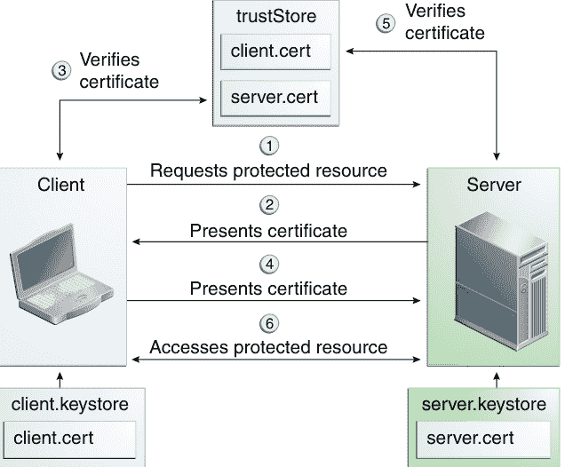

在基于用户名/密码的双向身份验证中，会发生以下操作。

1. 客户端请求访问受保护资源。
2. Web 服务器向客户端出示证书。
3. 客户端验证服务器的证书。
4. 如果成功，客户端将其用户名和密码发送给服务器。
5. 服务器验证客户端的凭据。
6. 如果验证成功，服务器授予客户端请求的受保护资源的访问权限。

图 50–2 显示了基于用户名/密码的双向身份验证期间发生的情况。

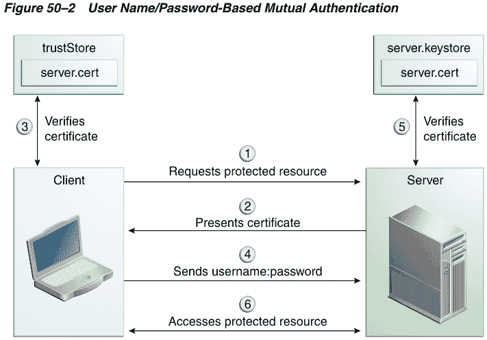

### 50.2.2.1 在 SSL 上启用双向身份验证

本节描述了客户端端身份验证的设置。启用服务器端和客户端的身份验证被称为双向（或双方）身份验证。在客户端身份验证中，要求客户端提交由您选择接受的证书颁发机构的证书。

在 SSL 上启用双向身份验证至少有两种方法：

- 优方法是将 `web.xml` 部署描述符中的身份验证方法设置为 `CLIENT-CERT`。通过修改给定应用程序的部署器强制执行双向身份验证。这样，仅对受安全约束的特定资源启用客户端身份验证，并且仅在应用程序需要客户端身份验证时执行检查。
- 常用方法是将服务器配置中的 `clientAuth` 属性设置为 `true`。如果 `clientAuth` 设置为 `true`，服务器将向客户端请求证书。如果设置为 `false`，服务器将不会请求证书。

### 50.2.2.2 创建双向身份验证证书

要使用双向身份验证，您需要一个由信任证书颁发机构（CA）签名的证书。如果没有，可以创建一个签名证书。要要创建签名证书，请遵循以下步骤：

1. 创建信任库文件的备份。操作如下：
   a. 切换到包含密钥库文件的目录 (`domain-dir/config`)。
   b. 将 `cacerts` 复制为 `cacerts.jks`。
   c. 将 `keytool` 复制为 `cacerts.jks`。
   不要将客户端证书放入 `cacerts` 文件。

2. 生成客户端证书。在想生成客户端证书的目录执行以下命令：

```
java-bin/keytool -genkey -alias client-alias -keyalg RSA -keypass change -storepass change -keystore client_keystore.jks
```

```
java-home/bin/keytool -export -alias client-alias -storepass change -file client.cer -keystore client_keystore.jks
```

3. （等待下一步）

4. 将证书添加到信任库文件 `domain-dir/config/cacerts`。在创建客户端证书的目录运行 `keytool`。使用以下参数：

```
java-home/bin/keytool -import -v -trustcacerts -alias client-alias -file client.cer -keystore domain-dir/config/cacerts -keypass change -storepass change
```

`keytool` 返回如下消息：

Owner=localhost, O=Company, L=Santa Clara, ST=CA, C=US

Issuer=localhost, O=Company, L=Santa Clara, ST=CA, C=US

Serial: 3e966ea

Valid From: Jul 27 12:22:47 EST 2012 until: Mon 25 Feb 22:25:47 EST 2013

Certificate fingerprints:

MD5: 5A:B0:4C:48:E4:EF:E9:E5:B8:53:BD:0A:8E:5A

SHA1: 90:00:36:F5:E7:A2:BD:67:DB:A3:B9:61:23:B49

## 在 JavaServer Faces Web应用程序中使用基于表单的登录

版本：3

信任此证书吗？[否]: 是

证书已添加到密钥库

正在存储 certs.jks

5. 重启 GlassFish 服务器。

## 50.3 在 JavaServer Faces Web应用程序中使用基于表单的登录

本节描述了在 JavaServer Faces 应用中实现基于表单登录的策略。

### 50.3.1 在 JavaServer Faces 表单中使用 j_security_check

Web 中验证用户最常见的方法是通过登录表单。正如“基于表单认证”所述，Java EE 为登录表单定义了 `j_security_check` 。这允许 Web 容器从许多不同的应用程序资源验证用户。然而，Facelets 表单使用 `h:form`、`h:inputText` 和 `h:inputSecret` 标签会自动生成 action 和输入 ID，这意味着开发者无法将 `j_security_check` 分别指定为用户名和密码输入的 `username` 和 `password`。

使用标准 HTML 表单标签方法为表单指定正确的 action 和输入 ID：

```xml
<form action="j_security_check" method="POST">
  <input type="text" name="j_username" />
  <input type="secret" name="j_password" />
</form>
```

然而，此表单无法访问 JavaServer Faces 应用的功能，例如字符串的自动本地化以及使用模板来定义页面的视觉效果。标准 HTML 和 Facelets 标签的混合允许开发者使用（例如）本地化字符串作为输入字段标签，同时确保表单使用 Java EEset。


```xml
<form action="j_security_check" method="POST">
  <h:outputLabel for="j_username">
    #{bundle['login.username']}
  </h:outputLabel>
  <input type="text" name="j_username" />

  <h:outputLabel for="j_password">
    #{bundle['login.password']}
  </h:outputLabel>
  <input type="secret" name="j_password" />

  <input type="submit" value="#{bundle['login.submit']}" />
</form>
```

### 50.3.2 在 JavaServer Faces 应用中使用 Managed Bean 进行认证

Managed bean 可以验证 JavaServer Faces 应用的用户，这允许使用普通的 Facelets 表单标签，而不是混合标准 HTML 和 Facelets 标签。在这种情况下，managed bean 提供了登录和注销方法，Facelets 表单在 action 属性中调用这些方法。managed bean 的方法调用 `javax.servlet.http.HttpServlet.login` 和 `HttpServletRequest.logout` 方法来管理用户认证。

在下面的 managed bean 中，无状态会话使用传递给 login 方法的用户凭据验证用户，并在调用 logout 方法时重置请求的清除。

```java
@Stateless
@Named
public class LoginBean {
    private String username;
    private String password;

    public String getUsername() {
        return this.username;
    }

    public void setUsername(String username) {
        this.username = username;
    }

    public String getPassword() {
        return this.password;
    }

    public void setPassword(String password) {
        this.password = password;
    }

    ...

    public String login() {
        FacesContext context = FacesContext.getCurrentInstance();
        HttpServletRequest request = (HttpServletRequest) 
            context.getExternalContext().getRequest();
        try {
            request.login(this.username, this.password);
        } catch (ServletExceptionException e) {
            context.addMessage(null, new FacesMessage("Login failed."));
            return "/error";
        }
    }

    public void logout() {
        FacesContext context = FacesContext.getCurrentInstance();
        HttpServletRequest request = (HttpServletRequest) 
            context.getExternalContext().getRequest();
        try {
            request.logout();
        } catch (ServletExceptionException e) {
            context.addMessage(null, new FacesMessage("Logout failed."));
        }
    }
}
```

随后 Facelets 调用这些方法进行用户登录和注销。

```xml
<form>
  <h:outputLabel for='usernameInput'>
    #{bundle['login.username']}:
  </h:outputLabel>
  <h:inputText id='usernameInput' value="#{loginBean.username}"
    required="true" />
  <br />
  <h:outputLabel for='passwordInput'>
    #{bundle['login.password']}:
  </h:outputLabel>
  <h:inputText id='passwordInput' value="#{loginBean.password}"
    required="true" />
  <br />
  <h:commandButton value="${bundle['login.submit']}"
    action="#{loginBean.login}" />
</form>
```

## 50.4 使用 JDBC Realm 进行用户认证

认证领域（Realm，也称为安全策略或安全域）是应用程序定义并强制执行通用安全策略的范围。领域包含用户集合，这些用户可能没有被分配到某个组。GlassFish 服务器预配置了文件、证书和管理领域。管理员可以设置 LDAP、JDBC、摘要或自定义领域。

应用程序可以在其部署描述中指定使用哪个领域。如果应用程序未指定领域，GlassFish 服务器将使用默认领域。数据库提供了在运行时添加、编辑或删除用户的简单方法。

### 50.4.1 配置 JDBC Realm

要配置 JDBC 域：

1. 创建存储用户凭据的数据库表。
2. 将用户凭据添加到数据库。
3. 创建连接池。
4. 创建 JDBC 资源。

修改应用程序的描述符以指定 JDBC 域：

- 对于 EAR 文件中的企业应用程序，修改 `glassfish-application.xml` 文件。
- 对于 WAR 文件中的 Web 应用程序，修改 `web.xml` 文件。
- 对于 EJB JAR 文件中的企业 Bean，修改 `glassfish-ejb-jar.xml` 文件。

例如，对于一个假设的应用，`web.xml` 文件可以如下指定 `jdbc-realm`：

```xml
<security-config>
  <auth-method>FORM</auth-method>
  <realm-name>jdbcRealm/realm-name</realm-name>
  <login-config>
    <form-login-page>login.xhtml</form-login-page>
    <form-error-page>login.xhtml</form-error-page>
  </login-config>
</security-config>
<security-constraint>
  <web-resource-collection>
    <resource-name>Secure Pages</resource-name>
    <description/>
    <url-pattern>/*</url-pattern>
  </web-resource-collection>
  <auth-constraint>
    <role-name>ADMINS</role-name>
  </auth-constraint>
</security-constraint>
```

将安全角色分配给领域的用户。要将安全角色分配给组或用户，向应用程序服务器端的部署描述符添加 `security-role-mapping` 元素，在本例中为 `glassfish.xml`：

```xml
<security-role-mapping>
  <role-name>USERS</role-name>
  <group-name>USERS</group-name>
</security-role-mapping>
<security-role-mapping>
  <role-name>ADMINS</role-name>
  <group-name>ADMINS</group-name>
</security-role-mapping>
```

## 50.5 保护 HTTP 资源

当一个请求 URI 被多个受限的 URL 模式匹配时，适用于请求的模式是与最佳匹配 URL 模式关联的模式。Java Servlet 3.1 规范中第 12 章“将请求映射到 Servlet”中定义的 Servlet 规则被用于确定未被受限 URL 模式匹配的最佳匹配 URL 模式。保护需求适用于受限的 URI。请求的 HTTP 方法在为请求选择最佳匹配 URL 模式时不起任何作用。

当 HTTP 方法在约束定义中列出时，则由约束定义的保护措施仅作用于所列出的方法。

当 HTTP 方法未在约束定义中列出时，由约束定义的保护措施适用于整个 HTTP 方法集，包括 HTTP 扩展方法。

当具有不同保护要求的约束应用于相同的 URL 模式和 HTTP 方法组合时，组合保护要求的规则定义在 Java Servlet 3.1 规范的第 13.8.1 节“组合约束”中。

遵循以下指南来保护 Web 应用程序：

- 不要在约束定义中列出 HTTP 方法。这是确保你没有留下任何 HTTP 方法处于未保护状态的最简单方法。例如：

```xml
<!-- SECURITY CONSTRAINT #1 -->
<security-constraint>
  <display-name>不要列出 HTTP 方法</display-name>
  <web-resource-collection>
    <url-pattern>/*</url-pattern>
  </web-resource-collection>
  <auth-constraint>
    <role-name>sales</role-name>
  </auth-constraint>
</security-constraint>
```

如果你在约束中列出方法，则无限可能的 HTTP 方法集（包括扩展方法）中所有未列出的方法将处于不受保护状态。下面的示例显示了一个约束，它列出了 GET 方法，并且对任何其他 HTTP 方法未定义任何保护，除非你确定这就是你想要定义的保护方案。

```xml
<!-- SECURITY CONSTRAINT #2 -->
<security-constraint>
  <display-name>仅保护 GET，留出所有其他方法不受保护</display-name>
  <web-resource-collection>
    <url-pattern>/*</url-pattern>
    <http-method>GET</http-method>
  </web-resource-collection>
  <auth-constraint>
    <role-name>sales</role-name>
  </auth-constraint>
</security-constraint>
```

如果你需要指定特定类型的保护来保护特定的 HTTP 方法，那么对于你想要允许的每个方法，请确保定义了约束来覆盖它，或者在没有约束的情况下覆盖相应的 URL 模式。如果存在你不允许的方法，你还必须创建一个约束来拒绝访问相同模式下的方法；示例请参见下一个项目符号中的约束 #5。

例如，为了允许 GET 和 POST（其中 POST 需要身份验证且在没有约束的情况下被允许），你可以定义以下约束：

```xml
<!-- SECURITY CONSTRAINT #3 -->
<security-constraint>
  <display-name>允许未保护的 GET</display-name>
  <web-resource-collection>
    <url-pattern>/company/*</url-pattern>
    <http-method>GET</http-method>
  </web-resource-collection>
</security-constraint>
```

```xml
<!-- SECURITY CONSTRAINT #4 -->
<security-constraint>
  <display-name>POST 需要身份验证</display-name>
  <web-resource-collection>
    <url-pattern>/company/*</url-pattern>
    <http-method>POST</http-method>
  </web-resource-collection>
  <auth-constraint>
    <role-name>sales</role-name>
  </auth-constraint>
</security-constraint>
```

- 确保你拒绝除想要允许的方法之外的所有 HTTP 方法的最简单方法是使用 `http-method-omission` 元素来省略方法。使用 `http-method-omission` 元素来省略你想要允许的所有的方法。例如，在 `company/*` 模式下，允许 GET 和 POST：

```xml
<!-- SECURITY CONSTRAINT #5 -->
<security-constraint>
  <display-name>允许未保护的 GET</display-name>
  <web-resource-collection>
    <url-pattern>/company/*</url-pattern>
    <http-method>GET</http-method>
  </web-resource-collection>
</security-constraint>
```


## 50.5 保护 HTTP 资源

当一个请求 URI 被多个受限的 URL 模式匹配时，适用于请求的模式是与最佳匹配 URL 模式关联的模式。Java Servlet 3.1 规范中第 12 章“将请求映射到 Servlet”中定义的 Servlet 规则被用于确定未被受限 URL 模式匹配的最佳匹配 URL 模式。保护需求适用于受限的 URI。请求的 HTTP 方法在为请求选择最佳匹配 URL 模式时不起任何作用。

当 HTTP 方法在约束定义中列出时，则由约束定义的保护措施仅作用于所列出的方法。

当 HTTP 方法未在约束定义中列出时，由约束定义的保护措施适用于整个 HTTP 方法集，包括 HTTP 扩展方法。

当具有不同保护要求的约束应用于相同的 URL 模式和 HTTP 方法组合时，组合保护要求的规则定义在 Java Servlet 3.1 规范的第 13.8.1 节“组合约束”中。

遵循以下指南来保护 Web 应用程序：

- 不要在约束定义中列出 HTTP 方法。这是确保你没有留下任何 HTTP 方法处于未保护状态的最简单方法。例如：

```xml
<!-- SECURITY CONSTRAINT #1 -->
<security-constraint>
  <display-name>不要列出 HTTP 方法</display-name>
  <web-resource-collection>
    <url-pattern>/*</url-pattern>
  </web-resource-collection>
  <auth-constraint>
    <role-name>sales</role-name>
  </auth-constraint>
</security-constraint>
```

如果你在约束中列出方法，则无限可能的 HTTP 方法集（包括扩展方法）中所有未列出的方法将处于不受保护状态。下面的示例显示了一个约束，它列出了 `GET` 方法，并且对任何其他 HTTP 方法未定义任何保护，除非你确定这就是你想要定义的保护方案。

```xml
<!-- SECURITY CONSTRAINT #2 -->
<security-constraint>
  <display-name>仅保护 GET，留出所有其他方法不受保护</display-name>
  <web-resource-collection>
    <url-pattern>/*</url-pattern>
    <http-method>GET</http-method>
  </web-resource-collection>
  <auth-constraint>
    <role-name>sales</role-name>
  </auth-constraint>
</security-constraint>
```

如果你需要指定特定类型的保护来保护特定的 HTTP 方法，那么对于你想要允许的每个方法，请确保定义了约束来覆盖它，或者在没有约束的情况下覆盖相应的 URL 模式。如果存在你不允许的方法，你还必须创建一个约束来拒绝访问相同模式下的方法；示例请参见下一个项目符号中的约束 #5。

例如，为了允许 `GET` 和 `POST`（其中 `POST` 需要身份验证且在没有约束的情况下被允许），你可以定义以下约束：

```xml
<!-- SECURITY CONSTRAINT #3 -->
<security-constraint>
  <display-name>允许未保护的 GET</display-name>
  <web-resource-collection>
    <url-pattern>/company/*</url-pattern>
    <http-method>GET</http-method>
  </web-resource-collection>
</security-constraint>
```

```xml
<!-- SECURITY CONSTRAINT #4 -->
<security-constraint>
  <display-name>POST 需要身份验证</display-name>
  <web-resource-collection>
    <url-pattern>/company/*</url-pattern>
    <http-method>POST</http-method>
  </web-resource-collection>
  <auth-constraint>
    <role-name>sales</role-name>
  </auth-constraint>
</security-constraint>
```

- 确保你拒绝除想要允许的方法之外的所有 HTTP 方法的最简单方法是使用 `http-method-omission` 元素来省略方法。例如，在 `/company/*` 模式下，允许 `GET` 和 `POST`：

```xml
<!-- SECURITY CONSTRAINT #5 -->
<security-constraint>
  <display-name>允许未保护的 GET</display-name>
  <web-resource-collection>
    <url-pattern>/company/*</url-pattern>
    <http-method>GET</http-method>
  </web-resource-collection>
</security-constraint>
```

```java
(javax.resource.cci.ConnectionFactory) initctx.lookup("java:comp/env/eis/MainframeCxfFactory");
// 调用工厂以获取连接。
// 信息未通过 getConnection 方法传递
javax.resource.cci.Connection cx = cxf.getConnection();
```

## 50.7.2 组件托管登录

在组件托管登录中，应用程序负责将资源所需的登录信息传递给 `getConnection` 方法。例如，安全信息可能可能是用户名和密码，如下所示（方法调用已用**粗体**标记）：

```java
// 应用程序组件中的方法
Context initctx = new InitialContext();

// 执行 JNDI 查找以获取连接工厂
javax.resource.cci.ConnectionFactory cxf = 
(javax.resource.cci.ConnectionFactory) initctx.lookup("java:comp/env/eis/MainframeCxfFactory");

// 获取新的 ConnectionSpec
com.myeis.ConnectionSpecImpl properties = //..
```

## 50.7.3 配置资源适配器安全设置

资源适配器（Resource Adapter）是一个系统级软件组件，通常用于实现到外部资源管理器的网络连接。资源适配器可以通过实现标准服务 API（如 JDBC 驱动）或定义并实现用于连接外部应用程序系统的连接器资源适配器，来扩展 Java EE 平台的功能。资源适配器还可以提供完全本地的服务，例如与原生资源进行交互。资源适配器通过 Java EE 服务接口（Java EE SPI）与 Java EE 平台对接。使用 Java EE SPIs 挂载到 Java EE 平台的资源适配器将能够与所有 Java EE 产品配合。

要配置资源适配器的安全设置，你需要编辑资源适配器描述文件 `ra.xml`。以下是一个配置资源适配器安全设置的 `ra.xml` 文件示例：

```xml
<authentication-mechanism>
  <authentication-mechanism-type>BasicPassword</authentication-mechanism-type>
  <credential-interface>javax.resource.spi.security.PasswordCredential</credential-interface>
</authentication-mechanism>
<reauthentication-support>false</reauthentication-support>
```

## 企业信息系统应用程序的安全

你可以通过查看 `as-install/lib/dtds/connector_1_0.dtd` 了解更多关于配置资源适配器安全性的选项。你可以配置资源适配器部署描述文件中的元素：

- **认证机制：** 使用 `authentication-mechanism` 元素指定资源适配器支持的认证机制。该支持是针对资源适配器的，而不是针对底层的 EIS 实例。共有两种支持的机制类型：

  - **BasicPassword**，它支持以下接口：

    - `javax.resource.spi.PasswordCredential`

  - **Kerb5**，它支持以下接口：

    - `javax.resource.spi.GenericCredential`

    （GlassFish 服务器不支持此机制类型。）

- **重认证支持：** 使用 `reauthentication-support` 元素指定资源适配器实现是否支持对现有的 `Connection` 实例进行重认证。选项为 `true` 或 `false`。

- **安全权限：** 使用 `security-permission` 元素指定资源适配器代码所需的安全权限。对安全权限的支持是可选的，在当前版本的 GlassFish 服务器中不支持。你可以手动更新 `server.policy` 文件，为资源适配器添加相关的权限。

部署描述符中允许的安全权限与连接器规范中指定的默认权限集所需的权限不同。

有关安全权限规范实施的更多信息，请参阅“关于安全的更多信息”中关于安全策略文件的文档。

除了在 `ra.xml` 文件中指定资源适配器安全性外，你还可以为连接池创建安全映射，将应用程序主体或用户组映射到后端 EIS 主体。如果使用一个或多个后端主体来执行由应用程序中各种主体或组发起的操作（在 EIS 上），可以使用安全映射。

## 50.7.4 将应用程序主体映射到 EIS 主体

使用 GlassFish 服务器时，你可以使用安全映射在容器托管的基于事务的场景中映射调用者身份。当应用程序主体发起对 EIS 的请求时，GlassFish 服务器首先会使用连接池的安全映射检查精确的主体，以确定映射的后端 EIS 主体。如果没有匹配，GlassFish 服务器将使用通配符规范（如果有）来确定映射的后端 EIS 主体。当应用程序用户需要执行一个在 EIS 中作为身份所需的 EIS 操作时，将使用安全映射。

要使用安全映射，请使用管理控制台（Administration Console）。在管理控制台中，按照以下步骤进入安全映射页面：

1. 在导航树中，展开 **Resources**（资源）节点。
2. 展开 **Connectors**（连接器）节点。
3. 选择 **Connector Connection Pools**（连接器连接池）节点。
4. 在 Connector Connection Pools 页面上，点击你想创建安全映射的连接池名称。
5. 点击 **Security Maps**（安全映射）选项卡。
6. 点击 **New**（新建）为连接池创建一个新的安全映射。
7. 输入用于引用该安全映射的名称，以及其他所需信息。

点击 Help（帮助）获取有关各个选项的更多信息。

## 50.8 使用部署描述符配置安全

在 Java EE 7 平台中配置安全的推荐方法是使用注解。如果你希望在运行时验证安全设置，请使用部署描述符。

### 50.8.1 在部署描述符中指定基础认证的安全

以下显示了如何使用部署描述符中的元素进行基础认证：

```xml
<security-constraint>
  <display-name>SecurityConstraint</display-name>
  <web-resource>
    <url-pattern>/greeting</url-pattern>
  </web-resource>
  <auth-constraint>
    <role-name>TutorialUser</role-name>
  </auth-constraint>
  <user-data-constraint>
    <transport-guarantee>CONFIDENTIAL</transport-guarantee>
  </user-data-constraint>
<login-config>
  <auth-method>BASIC</auth-method>
  <realm-name>file</realm-name>
</login-config>
<security-role>
  <role-name>TutorialUser</role-name>
</security-role>
```

### 50.8.2 在部署描述符中指定非默认的主体到角映射

要将应用程序或模块允许的角色映射到适用领域中定义的主体（用户），请使用 `security-role-mapping` 元素。以下是 `glassfish-web.xml` 文件的示例：

```xml
<glassfish-web-app>
  <security-role-mapping>
    <role-name>DIRECTOR</role-name>
    <principal-name>schwartz</principal-name>
  </security-role-mapping>
  <security-role-mapping>
    <role-name>DEPT-ALMIN</role-name>
    <group-name>dept-admins</group-name>
  </security-role-mapping>
</glassfish-web-app>
```

# 第 XI 部分

# Java EE 支持技术

XI 部分探讨了支持 Java EE 平台的多种技术。本部分包含以下章节：

- 第 51 章，“事务”
- 第 52 章，“资源适配器与合约”
- 第 53 章，“资源适配器示例”
- 第 54 章，“使用 Java EE 拦截器”
- 第 55 章，“批处理”
- 第 56 章，“并发工具类”

# 51

## 事务

典型的企业应用程序会在一个或多个数据库中访问并存储信息。由于这些信息对业务操作至关重要，因此它们必须是准确、实时且可靠的。如果允许多个程序同时更新同一信息，或者系统在处理业务事务时失败导致受影响的数据处于部分更新状态，将会丧失数据完整性。通过防止这两种情况，软件事务确保了完整性。事务控制多个程序对数据的并发访问。在系统发生故障时，事务可以确保在恢复后数据将处于一致状态。

本文在此讨论了以下主题：

- Java EE 应用中的事务
- 什么是事务？
- 容器管理事务
- Bean 管理的事务
- 事务超时
- 更新多个数据库
- Web 组件中的事务
- 关于事务的更多信息

### 51.1 Java EE 应用中的事务

在 Java EE 应用中，事务是一系列必须全部完成的动作，否则每个动作中的更改都将被回滚。事务以提交（commit）或回滚（rollback）结束。

Java 事务 API（JTA）允许应用程序以独立于特定实现的方式访问事务。JTA 规定了事务管理器与分布式事务系统涉及的各个之间的标准 Java 接口：事务型应用程序、Java EE 服务器，以及控制受事务影响的资源访问的管理器。

JTA 定义了用户级事务（`UserTransaction`）接口，应用程序使用该接口来启动、提交或回滚事务。应用程序组件通过名称 `java:comp/UserTransaction` 的 JNDI 查找，或者通过请求注入 `UserTransaction` 对象来获取该对象。应用程序服务器使用多个 JTA 定义的接口与事务管理器通信；事务管理器则使用 JTA 定义的接口与资源管理器交互。

### 51.2 什么是事务？

JTA 1.2 规范可以在此处获取：

http://jcp.org/en/jsr/detail?id=907。

为了模拟业务事务，程序可能需要执行多个步骤。例如，一个财务程序可能通过以下伪代码中的步骤将资金从支票账户转移到储蓄账户：

```
begin transaction
debit checking account
credit savings account
update history log
commit transaction
```

这三个步骤中必须完成一个或者一个都不完成。否则，数据完整性就会丧失。由于事务内部的步骤是一个统一的整体，因此事务通常被定义为不可分割的工作单元。

事务可以通过两种方式之一结束：提交或回滚。当事务提交时，其语句所做的数据修改将被保存。如果事务中的某条语句失败，事务将回滚，撤销事务中所有语句的影响。例如，在伪代码中，如果磁盘驱动器在提交步骤期间崩溃，事务将回滚并撤销扣款（debit）语句所做的修改。尽管事务失败了，但数据完整性仍然完好，因为账户仍然保持平衡。

在上述过程中，`begin` 和 `commit` 语句标记了事务的边界。在设计企业 Bean 时，你通过指定是容器管理事务还是 Bean 管理的事务来确定边界。

### 51.3 容器管理事务


在具有容器管理事务边界的企业 Bean 中，EJB 容器设置了事务的边界。你可以对任何类型的企业 Bean（会话型或消息驱动型）使用容器管理事务。容器管理事务简化了开发工作，因为企业 Bean 代码没有显式地标记事务的边界。代码中不包含开始和结束事务的语句。如果没有指定事务，企业 Bean 将使用容器管理事务边界。

通常情况下，容器会在企业 Bean 启动之前立即开始事务，并在方法退出之前提交事务。每个方法可以与单个事务关联。方法内部不允许嵌套事务或多个事务。

容器管理事务并不要求所有方法都与事务关联。在开发 Bean 时，你可以设置事务属性，以指定 Bean 的哪些方法与事务关联。

使用容器管理事务边界的企业 Bean 不得使用任何会干扰事务边界的事务管理方法。此类方法的示例包括 `java.sql.Connection` 的 `commit`、`setAutoCommit()` 和 `rollback` 方法，以及 `javax.Session` 的 `commit` 和 `rollback` 方法。如果你需要对事务边界进行控制，则必须使用应用程序管理的事务边界。

### 51.3.1 事务属性

事务属性控制事务的范围。图 51–1 说明了为什么控制范围如此重要。在图中，method-A 启动一个事务并调用 Bean-2 的 method-B。当 method-B 执行时，它是在 method-A 启动的事务范围内运行，还是在一个新的事务中执行？答案取决于 method-B 的事务属性。

图 51–1 事务范围

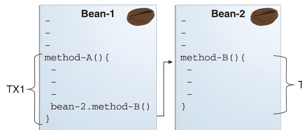

事务属性可以具有以下值之一：

- `Required`（需要）
- `RequiresNew`（始终需要新事务）
- `Mandatory`（强制需要）
- `NotSupported`（不支持）
- `Supports`（支持）
- `Never`（从不）

#### 51.3.1.1 Required 属性

如果客户端在事务中运行，则方法将在该事务内执行；如果客户端没有在事务中，则启动一个事务。

`Required` 属性是默认属性。如果客户端在事务中运行并调用企业 Bean 方法，该方法将在客户端的事务内执行。

#### 51.3.1.2 RequiresNew 属性

如果客户端在事务中运行并调用企业 Bean 方法，容器将采取以下步骤：

1. 挂起客户端的事务
2. 启动一个新的事务
3. 调用该方法
4. 在方法完成后恢复客户端的事务

如果客户端没有关联事务，容器将在方法执行前启动一个事务。

使用 `RequiresNew` 属性是因为你希望该方法始终在一个新的事务中运行。

#### 51.3.1.3 Mandatory 属性

如果客户端在事务中运行并调用企业 Bean 方法，该方法将在客户端的事务内执行。如果客户端没有关联事务，将抛出 `TransactionRequiredException`。

使用 `Mandatory` 属性的情况是企业 Bean 方法必须使用客户端的事务。

#### 51.3.1.4 NotSupported 属性

如果客户端在事务中运行并调用企业 Bean 方法，容器会在调用方法之前挂起客户端的事务。在方法完成后，容器将恢复客户端的事务。

如果客户端没有关联事务，容器在方法执行前不会启动新事务。

使用 `NotSupported` 属性的方法不需要事务。由于事务会产生开销，此属性可以提高性能。

#### 51.3.1.5 Supports 属性

如果客户端在事务中运行并调用企业 Bean 方法，该方法将在客户端的事务内执行。如果客户端没有关联事务，容器在方法执行前不会启动新事务。

由于该方法的事务行为可能不同，你应该谨慎使用 `Supports` 属性。

#### 51.3.1.6 Never 属性

如果客户端在事务中运行并调用企业 Bean 方法，容器将抛出 `RemoteException`。如果客户端没有关联事务，容器在方法执行前不会启动新事务。

#### 51.3.1.7 事务属性总结

表 51-1 显示了事务属性的影响。T1 和 T2 事务都由容器控制。T1 事务与调用企业 Bean 的客户端关联。在大多数情况下，客户端是另一个企业 Bean。T2 事务由容器在方法执行之前启动。

在表 51 的最后一列中，“None”字意味着业务方法不是在容器控制的事务内执行。然而，此类业务方法中的数据库调用可能会由数据库管理系统的事务管理器控制。

| 事务属性 | 客户端事务 | 业务方法事务 |
| :--- | :--- | :--- |
| Required | None | T2 |
| RequiresNew | None | T2 |
| Mandatory | None | Error |
| NotSupported | None | None |
| Supports | None | None |
| Never | None | None |

表 51–1（续）事务属性与作用范围

| 事务属性 | 客户端事务 | 业务方法事务 |
|---|---|---|
| Required | T1 | T1 |
| RequiresNew | None | T2 |
| RequiresNew | T1 | T2 |
| Mandatory | None | Error |
| Mandatory | T1 | T1 |
| NotSupported | None | None |
| NotSupported | T1 | None |
| Supports | None | None |
| Supports | T1 | T1 |
| Never | None | None |
| Never | T1 | Error |

#### 51.3.1.8 设置事务属性

通过在企业豆类或方法上装饰使用 `javax.ejb.TransactionAttribute` 注解，并将其设置为 `javax.ejb.TransactionAttributeType` 常量之一来指定事务属性。

如果你在企业豆上装饰 `@TransactionAttribute`，则指定的 `TransactionAttributeType` 将应用于类中的所有业务方法。在方法上装饰 `@TransactionAttribute` 则仅将该事务属性应用于该方法。如果 `@TransactionAttribute` 注解同时装饰了类和方法，则方法的事务属性将覆盖类的 `TransactionAttributeType`。

表 51–2 显示了 `TransactionAttributeType` 常量，封装了本节之前描述的事务属性。

表 51–2 TransactionAttributeType 常量

| 事务属性 | TransactionAttributeType |
|---|---|
| Required | TransactionAttributeType.REQUIRED |
| RequiresNew | TransactionAttributeType.REQUIRES_NEW |
| Mandatory | TransactionAttributeType.MANDATORY |
| NotSupported | TransactionAttributeType.NOT_SUPPORTED |
| Supports | TransactionAttributeType.SUPPORTS |
| Never | TransactionAttributeType.NEVER |

下面的代码段演示了如何使用 `@TransactionAttribute` 注解：

```java
@TransactionAttribute(NOT_SUPPORTED)
@Stateful
public class TransactionBean implements Transaction {
  ...
  @TransactionAttribute(REQUIRES_NEW)
  public void firstMethod() { ... }

  @TransactionAttribute(REQUIRED)
  public void secondMethod() {...}

  public void thirdMethod() {...}

  public void fourthMethod() {...}
}
```

在此示例中，`TransactionBean` 类的属性已设置为 `NotSupported`，`firstMethod` 被设置为 `RequiresNew`，而 `secondMethod` 被设置为 `Required`。由于方法上的 `@TransactionAttribute` 覆盖了类属性，`firstMethod` 将创建一个新事务，而对 `secondMethod` 的调用将在当前事务中运行或启动一个新事务。对 `thirdMethod` 或 `fourthMethod` 的调用不在事务内进行。

### 51.3.2 回滚容器管理事务

回滚容器管理事务有两种方法。如果抛出系统异常，容器将自动回滚事务。其次，通过调用 `EJBContext` 接口的 `setRollbackOnly` 方法，豆会指示容器回滚事务。如果豆抛出应用程序异常，则回滚不是自动的，但可以通过调用 `setRollbackOnly()` 来启动。

### 51.3.3 同步会话豆的实例变量

`SessionSynchronization` 接口是可选的，它允许有状态会话豆接收事务同步通知。例如，你可以将企业豆的实例变量与其数据库中的对应值进行同步。容器在事务的每个主要阶段调用 `SessionSynchronization` 方法（`afterBegin`、`beforeCompletion` 和 `afterCompletion`）。

`afterBegin` 方法通知实例一个新事务已经开始。容器在调用豆方法之前立即调用 `afterBegin`。

容器在豆方法完成之后事务提交之前调用 `beforeCompletion`。`beforeCompletion` 方法是会话回滚事务的最后机会（通过调用 `setRollbackOnly()`）。

`afterCompletion` 方法表示事务已完成。该方法有一个布尔参数，如果事务已提交，则其值为 `true`；而如果事务已回滚，则其值为 `false`。

### 51.3.4 容器管理事务中不允许的方法

你不应该调用任何可能干扰容器定义的事务边界的方法。禁止的方法列表如下：

- `java.sql.Connection` 的 `commit`、`setAutoCommit` 和 `rollback` 方法
- `javax.ejb.EJBContext` 的 `getUserTransaction` 方法
- `javax.transaction.UserTransaction` 的任何方法

你可以使用这些方法在应用程序管理的事务中设置边界。

## 51.4 豆管理事务

在豆管理的事务边界界定中，会话豆或消息驱动豆中的代码显式地标记了事务的边界。虽然容器管理的事务需要的代码较少，但它们有一个局限性：当一个方法正在执行时，它可以关联到单个事务或完全没有事务。这种限制使得在编写豆代码时，你应该考虑使用豆管理的事务。

下面的伪代码说明了你通过应用程序管理的事务可以获得的细粒度控制类型。通过检查各种条件，伪代码决定了在业务方法内部启动或停止事务：

```
begin transaction
update table-a
...
if (condition-x)
commit transaction
els if (condition-y)
update table-b
commit transaction
else
rollback transaction
begin transaction
update table-c
commit transaction
```

为会话豆或消息驱动豆编写应用程序管理的事务时，你必须决定使用数据库连接（JDBC）事务还是 JTA 事务。后续章节将介绍这两种类型的事务。

### 51.4.1 JTA 事务

JTA（或 Java 事务 API）允许你以独立于事务管理器实现的方式界定事务。GlassFish Server 使用 Java 事务服务（JTS）实现事务管理器。然而，你的代码并不直接调用 JTS 方法，而是调用 JTA 方法，再由其调用底层的 JTS 程。

JTA 事务由 Java EE 事务管理器控制。你可能想使用 JTA 事务，因为它可以更新来自不同供应商的多个数据库。特定 DBMS 的事务管理器可能无法与异构数据库协作。然而，Java EE 事务管理器有一个局限性：它不支持嵌套事务。换句话说，在先前的事务结束之前，它无法为实例启动事务。

要界定 JTA 事务，你需要调用 `javax.transaction.UserTransaction` 接口的 `begin`、`commit` 和 `rollback` 方法。

### 51.4.2 在不提交的情况下返回

在带有豆管理事务的无状态豆中，业务方法在返回之前必须提交或回滚事务。然而，无状态豆没有这一限制。

在带有 JTA 事务的无状态豆中，豆实例与事务之间的关联在多个客户端调用之间被保留。即使客户端调用的业务方法打开并关闭了数据库连接，该关联也会保留到实例完成。

在带有 JDBC 事务的无状态豆中，关联不会被保留。如果连接被关闭，关联将不再保留。

### 51.4.3 豆管理事务中不允许的方法

不要在豆管理的事务中调用 `EJBContext` 接口的 `RollbackOnly` 和 `setRollbackOnly` 方法。这些方法仅适用于容器管理的事务。对于豆管理的事务，调用 `UserTransaction` 接口的 `getStatus` 和 `rollback` 方法。

## 51.5 超时

对于容器管理的事务，你可以使用管理台配置事务超时间隔。启动管理台。

对于豆管理的 JTA 事务，你调用 `UserTransaction` 接口的 `setTransactionTimeout` 方法。

### 51.5.1 设置事务超时

1. 在管理台中，展开 Configurations 节点，然后展开 server-config 节点并选择 Transaction Service。
2. 在 Transaction Service 页面，将 Transaction Timeout 字段的值设置为你选择的值（例如，5）。这样如果事务在 5 秒内未完成，EJB 容器将将其回滚。
   默认值为 0，意味着事务不会超时。
3. 点击 Save。

图 51-2 更新多个数据库

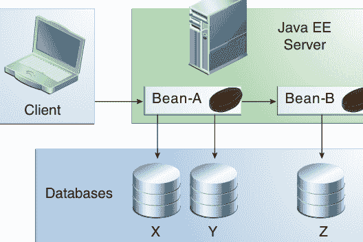

图 51-3 跨 Java EE 服务器更新多个数据库

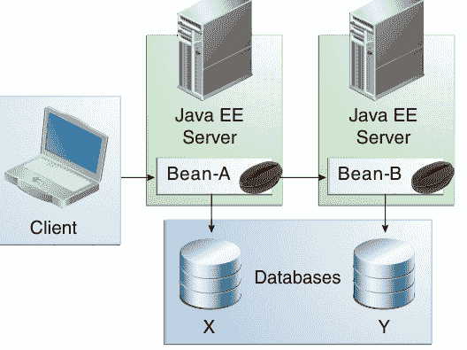

## 51.7 Web 组件中的事务

你可以使用 `java.sql.Connection` 或 `javax.transaction.UserTransaction` 接口在 Web 组件中划分事务。这些是使用 Bean 事务（bean-managed transactions）的会话 Bean 相同的接口。使用 UserTransaction 接口划分的将在 JTA 事务中讨论。

## 51.8 关于事务的更多信息

更多关于事务的信息，请参阅 http://www.oracle.com/technetwork/java/javaee/tech/jta-138684.html 上的 Java Transaction API 1.1 规范。

## 资源适配器与合约

本章检查了资源适配器，并解释了 Java EE 服务器与 EIS（企业信息系统）之间的通信如何通过它们进行调解。

此处涵盖了以下主题：

- 什么是资源适配器？
- 元数据注解
- 通用客户端接口
- 在 Java EE 的上下文和依赖注入 (CDI) 使用资源适配器
- 关于资源适配器的更多信息

### 52.1 什么是资源适配器？

资源适配器是一种 Java EE 组件，为特定的 EIS 实现了 Java EE 连接架构（Java EE Connector Architecture）。EIS 的示例包括企业资源计划、大型机事务处理和数据库系统。在 Java EE 服务器中，Java Message Server 和 JavaMail 也充当 EIS，你通过资源适配器访问它们。如图 52–1 所示，资源适配器促进了 Java EE 应用与 EIS 之间的通信。

图 52-1 资源适配器

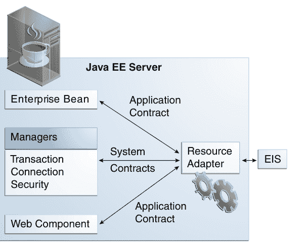

资源适配器存储在资源适配器归档（RAR）文件中，可以部署在任何 Java EE 服务器上，就像 Java EE 应用一样。RAR 文件可以维护在企业归档（EAR）文件中，也可以作为一个独立文件存在。

资源适配器之于 JDBC 驱动程序，正如两者都提供了一个标准 API，应用程序可以通过该 API 访问 Java EE 服务器外部的资源。对于资源适配器，系统是 EIS；对于 JDBC 驱动程序，它是 DBMS。资源适配器和 JDBC 驱动程序很少由应用程序开发者创建。在大多数情况下，这两种软件都由销售工具、服务器或集成软件的供应商构建。

资源适配器通过合约（contracts）调解 Java EE 服务器与 EIS 之间的通信。应用合约定义了 Java EE 组件（如企业 Bean）访问 EIS 的 API。该 API 是组件对 EIS 的唯一视图。系统合约将资源适配器连接到由 Java EE 服务器管理的重要服务，且其系统合约对 Java EE 组件是透明的。

#### 52.1.1 管理合约

Java EE 连接架构定义了系统合约，以实现资源适配器的生命周期和线程管理。

##### 52.1.1.1 生命周期管理


连接架构规范了一个生命周期管理合约，允许应用程序服务器管理资源适配器的生命周期。该合约为应用程序服务器在部署或应用服务器启动期间引导资源适配器实例提供了一种机制。该合约还提供了应用程序服务器在资源适配器卸载或应用服务器发生有序关闭时通知资源适配器实例的方法。

#### 52.1.1.2 工作管理合约

连接架构的工作管理合约确保资源适配器以正确、推荐的方式使用。该合约还允许应用程序服务器管理这些资源适配器。

不当使用线程的资源适配器会危害整个应用程序服务器环境。例如，资源适配器可能会创建过多线程，或者没有正确释放其拥有的线程。糟糕的线程处理会阻碍应用程序服务器关闭并影响性能，因为创建和销毁线程是昂贵的操作。

工作管理合约为服务器池重用线程建立了一种方法，类似于连接池的重用。通过遵守合约，资源适配器不需要自己管理线程。相反，资源适配器让应用程序服务器创建并提供所需的线程。当完成给定的线程后，资源适配器将线程返回给应用程序服务器。服务器管理线程，要么将其返回池中供以后重用，要么将其销毁。这种线程处理方式确保了更高的应用程序服务器性能和更高效的资源利用。

除了将线程交给应用程序服务器外，连接架构还为使用线程的资源适配器提供了一个灵活的模型。

- 请求线程可以选择阻塞（停止自身的执行）直到工作完成。
- 请求线程可以在等待获取工作线程时阻塞。当应用程序服务器提供工作线程时，请求线程和工作将并行执行。
- 资源适配器可以选择将工作提交到队列中。资源适配器在稍后的某点执行队列中的工作。无论线程何时执行它，资源适配器都会从它将工作提交到队列的那个点继续执行。

通过后两种方法，提交线程和工作线程可能会同时执行。

### 52.1.2 通用工作合约

通用管理合约为使用线程的资源适配器提供了一个灵活的模型。

- 请求线程可以选择阻塞（停止自身的执行）直到工作完成。
- 请求线程可以在等待获取工作线程时阻塞。当应用程序服务器提供工作线程时，请求线程和工作并行执行。
- 资源适配器可以选择将工作提交到队列中。资源适配器在稍后的某点执行队列中的工作。无论线程何时执行它，资源适配器都会从它将工作提交到队列的那个点继续执行。

通过后两种方法，提交线程和工作线程可能会同时执行。

### 52.1.3 出站与入站合约

连接架构定义了以下出站合约，即应用程序服务器与 EIS 之间的系统级合约，实现了对 EIS 的出站连接。

- 连接合约支持连接池，这是一种增强性能的技术。连接池对应用程序是透明的，它只需获取 EIS 的合约。
- 事务管理合约扩展了连接合约，并支持管理本地和分布式事务。
- 安全管理合约为 Java EE 服务器与 EIS 之间提供了身份验证、授权和安全通信机制，以保护 EIS 中的信息。

## 52.2 元数据注解

Java EE 连接架构提供了一组注解以减少对部署描述的需求。

- `@Connector` 注解可供资源适配器开发者使用，指定该 JavaBeans 组件是一个资源适配器 JavaBeans 组件。该注解用于提供资源适配器能力的元数据。可选，你可以提供实现 `ResourceAdapter` 接口的 JavaBeans 组件，如下：

```java
@Connector(
  displayName = "TrafficResourceAdapter",
  versionName = "Java EE Tutorial",
  version = "7.0"
)
public class TrafficResourceAdapter implements ResourceAdapter,
  Serializable {

}
```

- `@ConnectionDefinition` 注解定义了与特定连接类型相关的连接接口和类，如下：

```java
@ConnectionDefinition(
  connectionFactory = ConnectionFactory.class,
  connectionFactoryImpl = TradeConnectionFactory.class,
  connection = Connection.class,
  connectionImpl = TradeConnection.class
)
public class TradeManagedConnectionFactory {

}
```

- `@AdministeredObject` 注解将一个 JavaBean 指定为管理对象（administered object）。

- `@Activation` 注解包含与来自 EIS 实例的入站连接相关的配置信息如下所示：

```java
@Activation(
    messageListeners = { TrafficListener.class }
)
public class TrafficActivationSpec implements ActivationSpec,
    Serializable {

    @ConfigProperty
    /* 监听来自 EIS 请求的端口 */
    private String port;

}
```

- `@ConfigProperty` 注解可以用于 JavaBean，以提供部署程序和资源适配器提供程序（resource adapter provider）可能使用的附加配置。之前的代码显示了 `@ConfigProperty` 注解。

- `@ConnectionFactoryDefinition` 注解是一种资源定义注解，用于定义连接器工厂，并根据强制性 `name` 元素中指定的名称将其注册到 JNDI 中。`interfaceName` 元素指定了连接工厂接口类的完全限定名。`transactionSupport` 注解元素指定了连接工厂需要支持的事务级别。`minPoolSize` 和 `maxPoolSize` 注解指定了为连接池分配的最小或最大连接数。定义连接工厂时的附加属性可以通过 `properties` 元素进行指定。

由于不允许重复使用注解，`@ConnectionFactoryDefinitions` 注解充当多个连接器工厂定义的容器。`value` 注解元素包含了多个连接器工厂定义。

- `@AdministeredObjectDefinition` 注解是一种资源定义注解，用于定义管理对象，并根据强制性 `name` 元素中指定的名称将其注册到 JNDI 中。必须通过 `className` 注解元素指定管理对象类的强制完全限定名。可以在管理对象中配置的附加属性可以通过 `properties` 元素进行指定。

由于不允许重复使用注解，`@AdministeredObjectDefinitions` 注解充当多个管理对象定义的容器。`value` 注解元素包含了多个对象定义。

该规范允许以混合模式开发资源适配器，即允许资源适配器开发者能够在应用程序中使用元数据注解和部署描述符。应用程序组配器或部署程序可以使用部署描述符来覆盖资源适配器描述符中指定的元数据注解。

资源适配器的部署描述符（如果存在）命名为 `ra.xml`。`metadata-complete` 属性定义了资源适配器模块的部署描述符是否完整，或者是否需要检查该模块以及与资源适配器打包的类文件中是否存在指定部署信息的注解。

有关 Java EE 7 平台提供的注解和 JavaBean 组件的完整列表，请参见 Java Connector Architecture 1.7 规范。

## 52.3 通用客户端接口

本节解释了组件如何使用连接器架构通用客户端接口（CCI）API 和资源适配器从 EIS 获取数据。CCI API 定义了一系列接口和类，其方法允许客户端执行典型的数据操作。CCI 接口如下：

- `ConnectionFactory`：为应用程序组件提供指向 EIS 的 `Connection` 实例。
- `Connection`：代表到到底层 EIS 的连接器。
- `ConnectionSpec`：为应用程序组件提供了一种在发起连接请求时向 `ConnectionFactory` 传递特定连接请求属性的方法。
- `Interaction`：为应用程序组件提供执行 EIS 函数（例如数据库存储过程）的方法。
- `InteractionSpec`：持有与应用程序组件与 EIS 交互相关的属性。
- `Record`：各种类型记录实例的超接口。`Record` 实例可以是 `MappedRecord`、`IndexedRecord` 或 `ResultSet` 实例，所有这些都继承自 `Record` 接口。
- `RecordFactory`：为应用程序组件提供一个 `Record` 实例。
- `IndexedRecord`：基于 `java.util.List` 接口的 `Record` 实例的有序集合。

使用 CCI 与底层 EIS 交互的客户端或应用程序按照规定的方式进行。组件必须建立到 EIS 资源管理器的连接，它是使用代表到 EIS 连接的 `ConnectionFactory` 对象来实现，并用于后续与 EIS 的交互。

组件使用 `Interaction` 对象与 EIS 进行交互，例如从特定表中访问数据。应用程序组件通过使用 `InteractionSpec` 对象定义 `Interaction` 对象。当它从 EIS（如数据库表）读取数据或向这些表写入数据时，应用程序组件通过使用特定 `Record` 实例来实现：`MappedRecord` 或 `ResultSet` 实例。

注意，依赖 CCI 资源适配器的客户端应用程序与任何使用企业级豆方法的其他 Java EE 客户端非常相似。

## 52.4 在 Java EE 上下文和依赖注入 (CDI) 中使用资源适配器

有关 CDI 的详细信息，请参阅第 23 节“Java EE 上下文和依赖注入简介”和第 25 节“Java EE 上下文和依赖注入：高级主题”。

不要在资源适配器中将以下类指定为 CDI 豆（即，不要注入它们，因为这些类作为 CDI 管理豆的行为尚未被部分定义）：

- 资源适配器豆：这些豆是标记了 `javax.resource.spi.Connector` 注解的类或在资源适配器部署程序 `ra.xml` 中声明为相应元素的类。
- 管理连接工厂豆：这些豆是标记了 `javax.resource.spi.ConnectorDefinition` 注解或 `javax.resource.spi.ConnectorDefinitions` 注解的或在 `ra.xml` 中声明为相应元素的类。
- 激活规范豆：这些豆是标记了 `javax.resource.spi.Activation` 注解的或在 `ra.xml` 中声明为相应元素的类。
- 管理对象豆：这些豆是标记了 `javax.resource.spi.AdminObject` 注解的或在 `ra.xml` 中声明为相应元素的类。

资源适配器中的其他类型的类可以是 CDI 豆，并能以可移植的方式运行。

## 52.5 关于资源适配器的更多信息

有关资源适配器和注解的更多信息：

- Java EE 7 平台规范 (JSR 342): http://jcp.org/en/jsr/id=342
- Java EE Connector Architecture 1.7 规范: http://jcp.org/en/jsr/id=322
- EJB 3.2 规范: http://jcp.org/en/jsr/id=345
- Java 平台通用注解：http://www.jcp.org/en/jsr/id=250

# 资源适配器示例

本章描述了两个示例，展示了如何在 Java EE 应用程序中使用资源适配器，以及如何实现简单的资源适配器。交易示例展示了如何使用简单的自定义客户端接口从 Web 应用程序连接到 EIS。该示例中的资源适配器实现了出站合约（outbound contract）和自定义客户端接口。流量示例展示了如何使用消息驱动豆（MDB）处理来自 EIS 的流量信息更新。该示例中的资源适配器实现了入站合约（inbound contract）和工作管理合约。

此处涵盖了以下主题：

- 交易示例
- 流量示例

## 53.1 交易示例

该示例演示了如何实现和使用一个使用 TCP 套接字向遗留 EIS 提交请求的简单出站资源适配器。示例演示了图 53-1 中的场景，并由以下模块组成：

- `trading-eis`：模拟遗留 EIS 的 Java SE 程序。
- `trading-rar`：出站资源适配器的实现。
- `trading-war`：使用资源适配器的 Web 应用程序。
- `trading-ear`：包含资源适配器和 Web 应用程序的企业归包。

图 53-1 交易示例

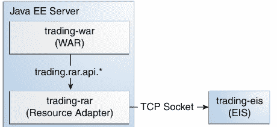

`trading-eis` 模块是一个辅助项目，类似于遗留股票交易执行平台。它包含一个监听交易请求的 Java SE 程序在 TCP 套接字上的纯文本。该程序使用状态值、确认号以及请求份额和费用的美元金额来响应交易请求。例如，一个请求-响应对可能如下所示：

```
>> BUY 1000 ZZZ MARKET
>> EXECUTED #1234567 TOTAL 50400.00 FEE 252.00
```

`trading-rar` 模块实现了 Java EE 连接器架构（Java EE Connector Architecture）的出站合约，用于向遗留股票交易执行计划提交请求并获取响应。`trading-rar` 模块为 Java 应用提供并实现了一个自定义客户端接口。这比通用客户端接口（CCI）更简单。

`trading-war` 模块是一个带有 JavaFaces 接口和托管豆（managed bean）的 Web 应用。该应用程序允许客户端使用 `trading-rar` 模块提供的资源适配器向 EIS（企业信息系统）提交交易。`trading-war` 模块使用资源适配器提供的自定义接口来获取到 EIS 的连接。

## 53.1.1 使用出站资源适配器

在大多数情况下，Java EE 开发人员使用由第三方开发的出站资源适配器。出站资源适配器要么实现了通用客户端接口（CCI），要么为应用程序提供了与 EIS 交互的自定义接口。出站资源适配器为 Java 提供了以下元素：

- 连接工厂（Connection factories）
- 连接句柄（Connection handles）
- 其他特定于 EIS 领域的接口和对象

Java EE 通过资源注入获取连接工厂实例，然后使用该对象获取到 EIS 的连接句柄。连接句柄允许应用程序向 EIS 发请求并获取信息。

`trading-rar` 模块提供了一个自定义接口，该接口由表 53-1 列出的类组成。

表 53-1 `javaeetutorial.trading.rar.api` 包中的类和接口

| API 组件 | 描述 |
|---|---|
| `TradeOrder` | 代表用于 EIS 的交易订单。 |
| `TradeResponse` | 代表 EIS 对交易请求的响应。 |
| `TradeConnection` | 代表到 EIS 的连接句柄。 |
| `TradeConnectionFactory` | 允许应用程序获取到 EIS 的连接句柄。 |
| `TradeProcessingException` | 表示在交易请求期间发生问题。 |

`trading-war` 模块中的托管豆 `ResourceAccessBean` 使用以下代码为 `trading-rar` 资源适配器配置连接工厂：

```java
@ConnectionFactoryDefinition
@Named
@SessionScoped
@ConnectionFactoryDefinition(
name = "java:comp/env/eis/TradeConnectionFactory",
interfaceName = "javaeetutorial.trading.rar.api.TradeConnectionFactory",
resourceAdapter = "#trading-rar",
PoolSize = 5,
transactionSupport = TransactionSupport.TransactionLevel.NoTransaction)

public class ResourceAccessBean implements Serializable { ... }
```

`name` 参数提供了连接工厂的 JNDI 节点。此示例在 `java:comp` 范围内注册了连接工厂。你可以使用 `ConnectionFactoryDefinition` 注解指定不同的范围，例如 `java:global`、`java:app` 和 `java:module`。`AdminObjectDefinition` 注解允许你在 JNDI 命名空间中注册带注解的连接器。

`interfaceName` 参数指定资源适配器中连接工厂实现的接口。在本示例中，这是一个自定义接口。

`resourceAdapter` 参数指定包含连接工厂实现的资源适配器名称。`#trading-rar` 前面的 `#` 前缀表示 `trading-rar` 是一个嵌入在与此 Web 应用相同 EAR 包中的嵌入资源适配器。

> 注意：你也可以使用来自应用程序服务器的管理命令为先前部署的出站资源适配器配置连接工厂。然而，这是一个特定于厂商的操作。

托管豆使用资源注入包含一个连接工厂对象，如下：

```java
public class ResourceAccessBean implements Serializable {
  @Resource (lookup = "java:comp/env/eis/TradeConnectionFactory")
  private TradeConnectionFactory connectionFactory;
}
```


托管豆使用连接工厂处理连接句柄如下：

```java
TradeConnection connection = connectionFactory.getConnection();
```

资源适配器返回一个到 EIS 的连接句柄。一旦连接可用，应用程序提交交易并获取响应：

```java
TradeOrder order = new TradeOrder();
order.setShares(1000);
order.setTicker(MARKET);
try {
  TradeResponse response = connection.submit(order);
} catch (TradeProcessingException ex) {
  // 处理异常
}
```

## 53.1.2 实现出口资源适配器

`trading-rar` 模块实现了与 EIS 的自定义接口。出口适配器的架构如图 53-2 所示。

### 表 53-2 trading-rar 模块中的接口

| 包 | 接口 |
|---|---|
| `javax.resource.spi.ResourceAdapter` | 定义适配器的生命周期方法。 |
| `javax.resource.spi.ManagedConnectionFactory` | 服务器使用的连接工厂。 |
| `javax.resource.spi.ManagedConnection` | 定义到 EIS 的物理连接。 |
| `trading.rar.api.TradeConnectionFactory` | 应用程序使用的连接工厂。 |
| `trading.rar.api.TradeConnection` | 定义应用程序使用的连接句柄。 |

当部署 `trading-ear` 包并配置了连接池时，连接工厂创建物理连接。管理器维护一个连接池。当应用程序请求连接时，管理器关联一个新的连接句柄。连接池提高了应用程序性能并简化了适配器的开发。

更多细节请参见 `trading-rar` 模块中的代码和注释。

## 53.1.3 运行交易示例

本节介绍了如何使用 NetBeans IDE 和命令行运行交易示例。

### 53.1.3.1 使用 NetBeans IDE 运行交易示例

1. 如果 GlassFish 服务器未运行，请启动它。更多信息请参见第 2 章“使用教程示例”。
2. 从文件菜单中选择“打开项目”。
3. 在项目对话框中，导航到：`tut-install/examples/connectors/`
4. 选择 `trading` 文件夹。
5. 点击打开。
6. 在项目选项卡中，展开 `trading-eis` 节点。
7. 右键点击 `trading-eis` 模块并选择打开项目。
8. 右键点击 `trading-eis` 项目并选择运行。来自 EIS 的消息出现在输出选项卡上：Trade execution-ear server listening on port 4004.
9. 右键点击 `trading-eis` 项目并选择构建。并将适配器和 Web 应用封装在 EAR 文件中部署到 GlassFish 服务器。
10. 在浏览器中打开以下 URL：`http://localhost:8080/trading/` Web 界面允许你连接 EIS 并启动交易。服务器日志显示了 Web 应用的请求以及适配器提供连接句柄的调用序列。
11. 在卸载 `trading-ear` 应用之前，请从状态栏关闭 `trading-eis` 应用。

### 53.1.3.2 从命令行运行交易示例

1. 确保 GlassFish 服务器正在运行。更多信息请参见第 2 章“使用教程示例”。
2. 在终端窗口中，进入：
   `tut-install/examples/connectors/trading`
3. 输入以下命令：
   ```
   mvn install
   ```
   该命令将资源适配器和 Web 应用程序构建并打包成 EAR 存档，然后将其部署到 GlassFish 服务器。
4. 在同一个终端窗口中，进入 `trading-eis` 目录。
5. 输入以下命令运行交易执行平台：
   ```
   mvn exec:java
   ```
   来自 EIS 的消息将显示在终端上：
   交易执行服务器正在监听端口 4004。
6. 在 Web 浏览器中打开以下 URL：
   ```
   http://localhost:8080/trading/
   ```
   Web 界面允许您连接到 EIS 并提交交易。服务器日志显示了来自 Web 应用程序的请求以及提供资源适配器连接句柄的调用序列。
7. 在部署 `trading-ear` 应用之前，在终端窗口上按 `Ctrl+C` 关闭 `trading-eis` 应用。

## 53.2 traffic 示例

traffic 示例演示了如何实现和使用一个简单的入站资源适配器，该适配器通过 TCP Socket 从遗留 EIS 接收数据。

示例位于 `tut-install/examples/connectors/traffic` 目录。有关构建和运行应用程序的基本信息，请参考第 2 章“使用教程示例”。

示例演示了图 53–3 中的场景，由以下模块组成：

- `traffic-ear` - 一个模拟 EIS 的 Java SE 程序。
- `traffic-rar` - 入站资源适配器的实现。
- `traffic-ejb` - 一个消息驱动豆（MDB），作为传入消息的端点。
- `traffic-war` - 一个显示消息驱动豆信息的 Web 应用程序。
- `traffic-ear` - 一个包含资源适配器、消息驱动豆和 Web 应用程序的企业级存档。

### 图 53–3 traffic 示例

| Java EE 服务器 |
| :--- |
| `traffic-war` (WAR) |
| ↑ |
| JMS Topic |
| ↑ |
| `traffic-ejb` (EJB) |
| |
| `traffic-rar` (Resource Adapter) | ← TCP Socket | `traffic-eis` (EIS) |

`traffic-eis` 模块是一个辅助项目，取代遗留的交通信息系统。它包含一个 Java SE 程序，向任何订阅的客户端发送多个城市的交通状态更新。该程序通过 TCP Socket 以 JSON 格式发送更新。例如，一个交通更新如下所示：

```json
{"report":{
  "city":"City1", "access":"AccessA", "status":"GOOD",
  "city":"City1", "access":"AccessB", "status":"CONGESTED",
  "city":"City5", "access":"AccessE", "status":"SLOW"
}}
```

`traffic-rar` 模块管理 Java EE 连接器架构的入站连接。该模块通过 MDB 配置提供的 TCP 端口订阅交通信息系统，并调用 MDB 的方法来处理交通信息更新。

`traffic-ejb` 模块包含一个消息驱动豆，该豆通过配置参数（订阅交通信息系统的 TCP 端口）激活资源适配器。MDB 包含一个处理交通信息更新的方法。该方法过滤特定城市的更新并将结果发布到 Java 消息服务（JMS）主题。

`traffic-war` 模块包含一个消息驱动豆，异步从 JMS 主题接收过滤后的交通信息，并使用 WebSocket 端点发送给客户端。

### 53.2.1 使用入站资源适配器

在大多数情况下，Java EE 开发者开发的是由第三方开发的入站资源适配器。要使用入站适配器，Java EE 包含一个具有以下特征的消息驱动豆：

- MDB 实现了资源适配器定义的业务接口。
- MDB 指定了用于激活资源适配器的配置参数。
- 资源适配器定义的业务接口未在 Java EE 连接器架构中指定；它是特定于 EIS 的。

此示例中的 MDB 定义如下：

```java
@MessageDriven(
  activationConfig = {
    @ActivationConfigProperty(propertyName="port",
      propertyValue="4008")
})
public class TrafficMDB implements TrafficListener { ... }
```

`TrafficListener` 接口定义在资源适配器的 API 包中。资源适配器要求 MDB 提供 `traffic-rar` 端口属性。

当 MDB 部署时，它会激活 `traffic-rar` 资源适配器，该适配器调用 MDB 的方法来处理更新。MDB 过滤特定城市的更新并将结果发布到 JMS 主题。

在此示例中，`TrafficListener` 接口是空的。除了此接口外，资源适配器还提供了 `TrafficCommand` 注解，并使用反射发现 MDB 中哪些方法被装饰了该注解：

```java
@MessageDriven(...)
public class TrafficMDB implements TrafficListener {
  @TrafficCommand(name="report",info="Process report")
  public String processReport(String jsonReport) { ... }
}
```

这种方法使您能够调整 MDB 以支持 EIS 中的新功能，而无需修改 `TrafficListener` 接口或资源适配器模块。

## 53.2.2 实现入站资源适配器

`traffic-rar` 模块为此示例中使用的交通信息系统（EIS）实现了 Java EE 连接器架构的入站资源适配器合约。入站资源适配器的架构如图 53-4 所示。

### 图 53–4 traffic 示例架构


`traffic-rar` 模块实现了表 53-3 列出的接口。

### 表 53-3 traffic-rar 模块实现的接口

| 包 | 接口 | 说明 |
| :--- | :--- | :--- |
| `javax.resource.spi` | `ResourceAdapter` | 定义资源适配器的生命周期方法。 |
| `javax.resource.spi` | `ActivationSpec` | 定义 MDB 用于激活资源适配器的配置参数。 |
| `javax.resource.spi` | `Work` | 交通订阅者在单独线程中实现此接口等待交通更新。 |

当 MDB 激活资源适配器时，容器调用 `TrafficResourceAdapter` 类中的 `endpointActivation` 方法：

```java
@Connector(...)
public class TrafficResourceAdapter implements ResourceAdapter {
    @Override
    public void endpointActivation(EndpointFactory endpointFactory,
        ActivationSpec spec)
    throws ResourceException {
    Class endpointClass = endpointFactory.getEndpointClass();
    /* 此方法从新线程调用 */
    MessageEndpoint endpoint = endpointFactory.createEndpoint(null);
    }
}
```

`getClassName` 返回执行激活的 MDB 类型，使得资源适配器可以使用反射找到 MDB 中带有 `@TrafficCommand` 方法。

`createEndpoint` 返回 MDB 的实例。资源适配器在收到 EIS 请求时使用它调用 MDB 的方法。

获取消息端点（MDB）后，资源适配器使用工作管理合约创建接收 EIS 更新的交通订阅者。资源适配器如下从启动上下文中采用 `WorkManager` 实例：

```java
public class TrafficResourceAdapter implements ResourceAdapter {
    WorkManager workManager;
    @Override
    public void postStart(BootstrapContext ctx) {
        workManager = ctx.getWorkManager();
    }
}
```

资源适配器使用工作执行器激活交通订阅者：

```java
tSubscriber = new TrafficServiceSubscriber(tSpec, endpoint);
workManager.scheduleWork(tSubscriber);
```

`TrafficServiceSubscriber` 类实现了工作管理合约的 `javax.resource.spi.Work` 接口。

交通订阅者使用反射调用 MDB 方法：

```java
private String callMdb(MessageEndpoint mdb, Method command,
    String[] params) {
    /* 源码包含适当的异常处理 */
    mdb.beforeDelivery(command);
    Object ret = command.invoke(mdb, Object[] params);
    String resp = (String) ret;
    mdb.afterDelivery(ret);
    return resp;
}
```

更多详情请参见 `traffic-rar` 模块中的代码和注释。

### 53.2.3 运行 traffic 示例

本节描述了如何使用 NetBeans IDE 或从命令行运行 traffic 示例。

#### 53.2.3.1 使用 NetBeans IDE 运行 traffic 示例

1. 如果 GlassFish 服务器未运行，请启动它。更多信息请参见第 2 章“使用教程示例”。
2. 从 File（文件）菜单中，选择 Open Project（打开项目）。
3. 在 Project（项目）对话框中，导航到：
   `tut-install/examples/connectors/`
4. 选择 `traffic` 文件夹。
5. 在 Projects（项目）选项卡中，展开 `traffic` 节点。
6. 右键点击 `traffic-eis` 模块并选择 Open Project。
7. 右键点击 `traffic-eis` 项目并选择 Run（运行）。
   来自 EIS 的消息显示在 Output（输出）选项卡上：
   EIS accepting connections on port 4008
8. 在 Projects 选项卡中，右键点击 `traffic` 项目并选择 Clean and Build（清理并构建）。
   此命令会将资源适配器、MDB 和 Web 构建打包成 EAR 归档并进行部署。服务器日志显示了激活资源适配器的调用序列以及针对 City1 的过滤流量更新。
9. 在浏览器中打开以下 URL：
   `http://localhost:8080/traffic/`
   Web 界面每几秒显示一次 City1 的过滤流量更新。
10. 卸载 `traffic-ear` 应用后，从状态栏关闭 `traffic-eis` 应用。

#### 53.2.3.2 从命令行运行 traffic 示例

1. 确保 GlassFish 服务器正在运行。更多信息请参见第 2 章“使用教程示例”。
2. 在终端窗口中，进入目录：
   `tut-install/examples/connectors/traffic/traffic-eis`
3. 在终端窗口中输入命令：
   ```
   mvn install
   ```
   此命令会构建并打包 traffic EIS。
4. 在终端窗口中输入以下命令：
   ```
   mvn exec:java
   ```
   来自 EIS 的消息显示在终端上：
   EIS accepting connections on port 4008
   保持此终端开启。
5. 打开一个新的终端窗口并进入：
   `tut-install/examples/connectors/traffic`
6. 输入以下命令：
   ```
   mvn install
   ```
   此命令会将资源适配器、MDB 和 Web 构建打包成 EAR 归档并进行部署。服务器日志显示了激活资源适配器的调用序列以及针对 City1 的过滤流量更新。
7. 在浏览器中打开以下 URL：
   `http://localhost:8080/traffic/`
   Web 界面每几秒显示一次 City1 的过滤流量更新。
8. 卸载 `traffic-ear` 应用后，在第一个终端上按 `Ctrl+C` 关闭 `traffic-eis` 应用。

# 使用 Java EE 拦截器

本章讨论了如何创建拦截器类和方法，以拦截目标类上的方法调用或生命周期事件。

此处将阐述以下主题：

- 拦截器概览
- 使用拦截器
- 拦截器示例应用程序

## 54.1 拦截器概述

拦截器与 Java EE 管理的类结合定义，允许开发者在结合方法调用或生命周期事件时，在相关的目标类上调用拦截器方法。拦截器的常见用途是日志记录、审计和性能分析。

Interceptors 1.2 规范是 JSR 318（Enterprise JavaBeans 3.1）维护版本的一部分，可在 `http://jcp.org/en/jsr/detail?id=318` 获取。你可以在此处使用拦截器。

拦截器可以在目标类内部定义为拦截器方法，也可以定义在名为拦截器类的关联类中。拦截器类包含与目标类的方法或生命周期事件结合时被调用的方法。

拦截器类和方法使用元数据注解定义，或者在包含拦截器和目标类的应用程序部署描述符中定义。

> 注意：使用部署描述符定义拦截器的应用程序在不同的 Java EE 服务器之间不具有可移植性。

目标类内或拦截器类中的拦截器方法使用表 54-1 中定义的元数据注解之一进行。

### 表 54-1 拦截器元数据注解

| 拦截器元数据注解 | 描述 |
|---|---|


| javax.interceptor.AroundConstruct | 将该方法指定为拦截器方法，在目标类构造后接收回调。 |
| --- | --- |
| javax.interceptor.AroundInvoke | 将该方法指定为拦截器方法。 |

# 使用拦截器

表 54–1（续）拦截器元数据注解

| 拦截器元数据注解 | 描述 |
| --- | --- |
| javax.interceptor.AroundTimeout | 将该方法指定为超时拦截器，用于企业豆的超时方法。 |
| javax.annotation.PostConstruct | 将该方法指定为后构造后生命周期事件的拦截器方法。 |
| javax.annotation.PreDestroy | 将该方法指定为销毁前生命周期事件的拦截器方法。 |

## 54.1.1 拦截器类

拦截器类可以使用可选的 `javax.interceptor.Interceptor` 注解标记，但拦截器类并不要求必须注解。拦截器类必须有一个公共的无参构造函数。

目标类可以关联任意数量的拦截器类。拦截器类调用的顺序由 `javax.interceptor.Interceptors` 注解中拦截器类的定义顺序决定。

## 54.1.2 拦截器生命周期

拦截器类与目标类具有相同的生命周期。当目标类创建时，会创建每个拦截器的实例。

## 54.1.3 拦截器与 CDI

用于 Java EE 的上下文与依赖注入 (CDI) 拦截器。

## 54.2 使用拦截器

拦截器使用表 54–1 中列出的元数据注解之一在目标类中或在独立的拦截器类中定义。以下代码在目标类中声明了 `@AroundTimeout`。

```java
@Stateless
public class TimerBean {

    @Schedule(minute="*/1", hour="***")
    public void automaticTimerMethod() {}

    @AroundTimeout
    public void timeoutInterceptor(InvocationContext ctx) { ... }
}
```

如果使用拦截器类，使用 `javax.interceptor.Interceptors` 注解在类级别或方法级别声明一个或多个拦截器。以下代码在类级别声明拦截器。

```java
@Stateless
@Interceptors({PrimaryInterceptor.class, SecondaryInterceptor.class})
public class OrderBean { ... }
```

以下代码声明方法级别的拦截器。

```java
@Stateless
public class OrderBean {
    ...
    @Interceptors(OrderInterceptor.class)
    public void placeOrder(Order order) { ... }
}
```

### 54.2.1 拦截方法调用

`@AroundInvoke` 注解用于为托管对象的方法设计拦截器方法。每个类只允许一个 around-invoke 拦截器方法。Around-invoke 拦截器方法的形式如下：

```java
@AroundInvoke
Object methodName(InvocationContext ctx) throws Exception { ... }
```

例如：

```java
@AroundInvoke
public void interceptOrder(InvocationContext ctx) { ... }
```

Around-invoke 拦截器方法可以具有公共、私有、保护或包级权限，且不能是静态或最终的。

Around-invoke 拦截器可以调用目标方法可调用的任何组件或资源，具有与目标方法相同的安全和事务上下文，并在目标方法相同的 Java 虚拟机调用栈中运行。

Around-invoke 拦截器可以抛出运行时异常以及目标方法 `throws` 子句中允许的任何异常。它们可以捕捉并抑制异常，然后通过调用 `InvocationContext.proceed` 方法恢复。

#### 54.2.1.1 使用多个拦截器

使用 `@Interceptors` 注解为目标方法或类声明多个拦截器。

```java
@Interceptors({PrimaryInterceptor.class, SecondaryInterceptor.class,
LastInterceptor.class})
public void updateInfo(String info) { ... }
```

`@Interceptors` 注解中拦截器的顺序即拦截器被调用的顺序。

### 54.2.2 在部署描述符中定义拦截器

在部署描述符中也可以定义多个拦截器。部署描述符中拦截器的顺序即为拦截器被调用的执行顺序。

```xml
<interceptor-binding>
  <target-name>myapp.OrderBean</target-name>
  <interceptor-class>myapp.PrimaryInterceptor.class</interceptor-class>
  <interceptor-class>myapp.SecondaryInterceptor.class</interceptor-class>
  <interceptor-class>myapp.LastInterceptor.class</interceptor-class>
  <method-name>updateInfo</method-name>
</interceptor-binding>
```

要将控制传递给链中的下一个拦截器，请调用 `InvocationContext.proceed()` 方法。数据可以在拦截器之间共享：

- `InvocationContext` 实例作为输入参数传递给目标方法的拦截器链中的每个拦截器方法。`InvocationContext` 实例的 `contextData` 属性用于跨拦截器传递数据。`contextData` 属性类型为 `java.util.Map<String, Object>`。存储在 `contextData` 中的数据可以被链下游的拦截器方法访问。
- 存储在 `contextData` 中的数据在不同的方法调用之间不可共享。也就是说，每次方法调用都会创建一个不同的 `InvocationContext` 对象。

#### 54.2.2.1 访问目标方法参数

传递给 `around-invoke` 的 `InvocationContext` 实例可访问并修改目标方法的参数。`InvocationContext` 的参数是一个 `Object` 数组，其顺序对应目标方法的参数顺序。例如，对于以下目标方法，传递给 `primaryInterceptor` 的 `InvocationContext` 实例中的参数是两个 String（firstName 和 lastName）以及一个 Date 对象（date）：

```java
@Interceptors(PrimaryInterceptor.class)
public void updateInfo(String firstName, String lastName, Date date) { ... }
```

可以使用 `InvocationContext.getParameters()` 和 `InvocationContext.setParameters()` 分别对参数进行访问和修改。

#### 54.2.2.2 拦截生命周期事件

生命周期事件拦截器（around-construct、post-construct 和 pre-destroy）可以定义在目标类或拦截器类中。`@javax.annotation.PostConstruct` 注解将该方法指定为拦截器，用于拦截对目标类构造函数的调用。`@javax.annotation.PostConstruct` 注解用于将方法指定为后构造生命周期事件拦截器。`@javax.annotation.PreDestroy` 注解用于将方法指定为销毁前事件拦截器。

在目标类内部定义的生命周期事件拦截器具有如下形式：

```java
void methodName() { ... }
```

例如：

```java
@PostConstruct
void initialize() { ... }
```

在拦截器类中定义的生命周期拦截器具有如下形式：

```java
void methodName(InvocationContext ctx) { ... }
```

例如：

```java
@PreDestroy
void cleanup(InvocationContext ctx) { ... }
```

生命周期拦截器方法可以具有 public、private、protected 或包级级访问权限，且不能是 static 或 final。生命周期拦截器可以抛出运行时异常，但不能抛出检查异常（checked exceptions）。生命周期拦截器在与目标方法相同的安全和事务上下文中调用。每个类每个生命周期事件（post-construct 和 pre-destroy）允许有一个拦截器。

##### 54.2.2.2.1 AroundConstruct 拦截器方法

`@AroundConstruct` 方法拦截对目标类构造函数的调用。被 `@AroundConstruct` 装饰的拦截器方法只能定义在拦截器类中。你不能在目标类内部使用 `@AroundConstruct` 方法。

`@AroundConstruct` 方法在所有与目标类相关的拦截器的依赖注入完成后被调用。在所有相关的 `@AroundConstruct` 方法调用 `InvocationContext.getTarget()` 之后，才会创建目标类并执行目标类的构造函数注入。从 `@AroundConstruct` 方法中在目标实例上调用方法是危险的，因为依赖注入可能尚未完成。`@AroundConstruct` 方法必须调用 `InvocationContext.proceed()` 以创建目标实例。

##### 54.2.2.2.2 使用多个拦截器

可以通过在 `@Interceptors` 注解中指定拦截器类，为目标类定义多个拦截器：

```java
@Interceptors({PrimaryInterceptor.class, SecondaryInterceptor.class, LastInterceptor.class})
@Stateless
public class OrderBean { ... }
```

存储在 `InvocationContext` 的 `contextData` 属性中的数据在不同的生命周期事件之间不可共享。

#### 54.2.2.3 拦截超时事件

EJB 定时器方法的拦截器可以使用目标类或拦截器类中的方法上的 `@AroundTimeout` 注解来定义。每个类只允许一个 `@AroundTimeout` 方法。超时拦截器具有如下形式：

```java
Object methodName(InvocationContext ctx) throws Exception { ... }
```

示例：

```java
@AroundTimeout
void timeoutInterceptor(InvocationContext ctx) { ... }
```

超时拦截器方法可以具有 public、private、protected 或包级访问权限，且不能是 static 或 final。超时拦截器可以通过超时方法调用任何组件或资源，并在与目标方法相同的事务和安全上下文中被调用。超时拦截器可以通过 `InvocationContext` 实例的 `getTimer()` 方法访问与超时方法关联的器对象。

##### 54.2.2.3.1 使用多个超时拦截器

可以通过在类级别的 `@Interceptors` 注解中指定包含 `@AroundTimeout` 拦截器方法的拦截器类，为给定类定义多个拦截器。

如果目标类在拦截器类中指定了超时拦截器，且目标类内部有一个 `@AroundTimeout` 拦截器方法，则先调用拦截器类中的拦截器。例如：

```java
@Interceptors({PrimaryInterceptor.class, SecondaryInterceptor.class})
@Stateful
public class OrderBean {
    @AroundTimeout
    void last(InvocationContext ctx) { ... }
}
```

`PrimaryInterceptor` 中的超时拦截器将首先调用，然后是 `SecondaryInterceptor`，最后是目标类中定义的方法。

#### 54.2.2.4 将拦截器绑定到组件

拦截器绑定类型可以应用于组件，以将其与特定的拦截器关联。拦截器绑定类型通常是自定义运行时注解，用于指定拦截器目标。在自定义注解定义中使用 `@javax.interceptor.InterceptorBinding` 注解，并通过 `@Target` 将目标设置为 `TYPE`（类级拦截器）、`METHOD`（方法级拦截器）、`CONSTRUCTOR`（构造函数拦截器）或其他任何有效目标。

```java
@InterceptorBinding
@Target({TYPE, METHOD})
@Retention(RUNTIME)
@Inherited
public @interface Logged { ... }
```

拦截器绑定类型也可以应用于其他拦截器绑定类型。

```java
@InterceptorBinding
@Target({TYPE, METHOD})
@Retention(RUNTIME)
@Inherited
public @interface Secured { ... }
```

##### 54.2.2.4.1 在拦截器类上声明拦截器绑定

使用拦截器绑定类型标记拦截器类和 `@Interceptor` 注解，将拦截器绑定与拦截器类关联。

```java
@Logged
@Interceptor
public class LoggingInterceptor {
    @AroundInvoke
    public Object logInvocation(InvocationContext ctx) throws Exception { ... }
}
```

一个拦截器可以声明多个拦截器绑定类型，多个拦截器类也可以声明同一个拦截器绑定类型。

如果拦截器类交叉生命周期回调，它只能声明 `Target(TYPE)` 的拦截器绑定类型，或者在 `@AroundConstruct` 生命周期回调的情况下，声明 `Target(CONSTRUCTOR)`。

##### 54.2.2.4.2 将组件绑定到拦截器

将拦截器绑定类型注解添加到目标组件类或构造函数。拦截器绑定类型的应用规则与 `@Interceptor` 注解相同。

```java
@Logged
public class Message {
    @Secured
    public void getConfidentialMessage() { ... }
}
```

## 54.2.3 拦截器的排序

多个拦截器的调用顺序遵循以下规则：

- 默认拦截器定义在部署描述符中，并最先调用。它们可以指定调用顺序，或覆盖使用注解指定的顺序。默认拦截器按照它们在部署描述符中定义的顺序进行调用。
- 拦截器类在 `@Interceptors` 注解中列出的顺序决定了拦截器的调用顺序。对于在 `@Interceptors` 注解中列出的拦截器，任何 `@Priority` 设置都会被忽略。
- 如果拦截器具有父类，则定义在父类上的拦截器将先被调用，从最通用的父类开始。
- 拦截器类可以通过在 `javax.annotation.Priority` 注解中设置值来设定拦截器方法的优先级。
- 在调用了拦截器类中定义的拦截器之后，目标类的构造函数、`around-invoke` 或 `around-timeout` 拦截器的调用顺序与 `@Interceptors` 之前的拦截器相同。如果目标类具有父类，则定义在父类上的拦截器将先被调用，从最通用的父类开始。

`@Priority` 注解要求一个 `int` 值作为元素。值越低，关联拦截器的优先级越高。

> 注意：具有相同优先级值的拦截器的调用顺序取决于具体实现。

`javax.interceptor.Interceptor.Priority` 类定义了以下常量：

表 54-2 拦截器优先级常量

| 优先级常量 | 值 | 说明 |
| --- | --- | --- |
| PLATFORM_BEFORE | 0 | 由 Java EE 平台定义并旨在在调用链早期调用的拦截器应使用 `PLATFORM_BEFORE` 到 `LIBRARY_BEFORE` 之间的范围。这些拦截器的优先级最高。 |
| LIBRARY_BEFORE | 1000 | 由扩展库定义且应在拦截器链早期调用的拦截器应使用 `LIBRARY_BEFORE` 到 `APPLICATION` 之间的范围。 |
| APPLICATION | 2000 | 由应用程序定义的拦截器应使用 `APPLICATION` 到 `LIBRARY_AFTER` 之间的范围。 |
| LIBRARY_AFTER | 3000 | 由扩展库定义的低优先级拦截器应使用 `LIBRARY_AFTER` 到 `PLATFORM_AFTER` 之间的范围。 |
| PLATFORM_AFTER | 4000 | 由 Java EE 平台定义的低优先级拦截器应具有高于 `PLATFORM_AFTER` 的值。 |

注意：负优先级值由拦截器规范预留供未来使用，不应被使用。

以下代码段展示了如何在应用程序定义的拦截器中使用优先级常量：


## 54.3 拦截器示例应用程序

拦截器示例演示了将包含 `@AroundInvoke` 方法的拦截器类用于无状态会话 bean（stateless session bean）。

```java
@Interceptor
@Priority(Interceptor.Priority.APPLICATION + 200)
public class MyInterceptor { }
```

`HelloBean` 无状态会话 bean 是简单的企业 bean，包含两个业务方法：`getName` 和 `setName`，用于检索和修改字符串。`setName` 方法有一个 `@Interceptors` 注解，为该方法指定了一个拦截器类 `HelloInterceptor`。

```java
@Interceptors(HelloInterceptor.class)
public void setName(String name) {
    this.name = name;
}
```

`HelloInterceptor` 类定义了一个 `@AroundInvoke` 拦截器方法 `modifyGreeting`，它将传递给 `HelloBean.setName` 的字符串转换为小写。

```java
@AroundInvoke
public Object modifyGreeting(InvocationContext ctx) throws Exception {
    Object[] parameters = ctx.getParameters();
    String param = (String) parameters[0];
    param = param.toLowerCase();
    parameters[0] = param;
    ctx.setParameters(parameters);
    try {
        return ctx.proceed();
    } catch (Exception e) {
        logger.warning("Error calling ctx.proceed in modifyGreeting(");
        return null;
    }
}
```

通过调用 `InvocationContext.getParameters` 方法获取 `HelloBean` 的参数并存储在 `Object` 数组中。由于 `setName` 只有一个参数，它是数组中的第一个也是唯一的元素。字符串被转换为小写并存储在 `parameters` 数组中，然后传递给 `InvocationContext.setParameters` 返回控制权给会话 bean，调用 `InvocationContext.proceed`。

拦截器的用户界面是一个 JavaFaces Web 应用程序，由两个 Facelets 视图组成：`index.xhtml`（包含输入名称的表单）和 `response.xhtml`（显示最终名称）。

## 54.1 运行拦截器示例

你可以使用 NetBeans IDE 或 Maven 来构建、打包、部署和运行拦截器示例。

### 54.3.1.1 使用 NetBeans IDE 运行拦截器示例

1. 从 **Menu**（菜单）框中，选择 **Open Project**（打开项目）。
2. 在 Open Project 对话框中，导航到 `tut-install/examples/ejb/`
3. 选择 *interceptor* 文件夹并点击 **Open Project**（打开项目）。
4. 在 Projects（项目）选项卡中，右键点击 *interceptor* 项目并选择 **Run**（运行）。

这将编译、部署并运行 *interceptor* 示例，在 Web 浏览器中打开页面 `http://localhost:8080/interceptor/`。

5. 在表单中输入名称并点击 **Submit**（提交）。

该名称将由 `HelloInterceptor` 类中定义的方法拦截器转换为小写。

### 54.3.1.2 使用 Maven 运行拦截器示例

1. 进入以下目录：

```
tut-install/examples/ejb/interceptor/
```

2. 编译源文件并打包应用程序，使用以下命令：

```bash
mvn install
```

该命令将应用程序构建并打包成 WAR 文件 `interceptor.war`，其位于 *target* 目录下。然后将该 WAR 文件部署到 GlassFish 服务器。

3. 打开 Web 浏览器访问 `http://localhost:8080/interceptor/`。

4. 在表单中输入名称并点击 **Submit**（提交）。

该名称将由 `HelloInterceptor` 类中定义的方法拦截器转换为小写。

# 55 批处理

本章描述了 Java 平台批处理应用程序 (JSR-352)，它提供了定义、实现和运行批处理作业的支持。批作业是可以无需用户交互即可执行的任务。批处理框架由一个基于 XML 的作业规范语言、一个 Java API 和批处理运行时组成。

某些应用程序包含无需用户交互即可执行的任务。这些任务定期执行或在资源使用率低时执行，通常处理大量信息，如日志文件、数据库记录或图像。示例包括账单、报告格式转换和图像处理。这些任务被称为批作业。

批处理是指在计算机系统上运行批作业。Java EE 包含一个批处理框架，为所有批处理应用程序提供公共执行基础设施，使开发人员专注于批处理应用程序的业务逻辑。批处理框架由基于 XML 的作业规范语言、一组用于实现业务逻辑的应用程序类的批注解和接口、一个管理批作业执行的批处理容器，以及与批处理容器交互的支持类和接口组成。

此处将介绍以下主题：

- 批处理简介
- Java EE 中的批处理
- 简单用例
- 使用作业规范语言
- 创建批处理制品
- 将作业提交到批处理运行时
- 打包批处理应用程序
- webserver 示例应用程序
- phonebilling 示例应用程序
- 关于批处理的进一步信息

## 55.1 批处理简介

批作业可以在无需用户交互的情况下完成。例如，考虑一个电话结算应用程序，它从企业信息系统读取电话记录并为每个账户生成每月账单。由于该应用程序不需要任何用户交互，因此它可以作为批作业运行。

### 批处理作业中的步骤

步骤是批处理作业中一个独立且顺序执行的阶段。批处理作业包含块分型步骤（chunk-oriented steps）和任务导型步骤（task-oriented steps）。

- 块分型步骤（或 chunk）通过从数据源读取项、对每个项应用业务逻辑并存储结果来处理数据。块分步骤一次读取并处理一个项，并将结果分组为一个块（chunk）。当块达到可配置的大小时，就会存储块结果。块分型处理使得结果的存储更加高效，并利于事务界定。

块分步骤包含三个部分：

- 输入检索部分从数据源一次读取一个项，例如数据库中的条目、目录中的文件或日志文件中的条目。
- 业务处理部分使用应用程序定义的业务逻辑一次处理一个项。示例包括过滤、格式化以及从输入中访问数据以计算结果。
- 输出写入部分一次存储一个处理过的项块。

块分步骤通常是长时间运行的，因为它们处理大量数据。批处理框架允许块分步骤使用检查点（checkpoints）标记其进度。被中断的块分步骤可以从上一个检查点重启。块分步骤的输入检索和输出写入部分在处理完每个块后会保存其当前位置，并在步骤重启时恢复。

**55-1 批处理作业中的块步骤**

| 步骤 A | | |
| :--- | :--- | :--- |
| 输入检索 A | 业务处理 A | 输出写入 A |
| 步骤 B | | |
| 输入检索 B | 业务处理 B | 输出写入 B |

- 任务导型步骤（或 task steps）执行的是除处理数据源项以外的任务。示例包括创建或删除目录、移动文件、创建或删除数据库表、配置资源等。与块分步骤相比，任务导型步骤通常不是长时间运行的。

例如，电话计费应用程序包含两个块分步骤：

在第一步中，输入检索部分从注册表读取通话；业务处理部分如果账户不存在账单，则将每次通话与账单关联；输出写入部分将它们存储在数据库中。

在第二步中，输入检索部分从数据库读取账单；业务处理部分计算每笔账单的税费和总额；输出写入部分更新数据库记录并生成每份账单的可打印版本。

该应用程序还可以包含一个任务步骤，用于清理上月生成的账单文件。

### 55.1.2 状态和决策元素

批处理框架跟踪作业中每个步骤的状态。状态指示该步骤是正在运行还是已完成。如果步骤已完成，状态将指示以下情况之一：步骤执行成功、步骤被中断或发生错误。

除了步骤外，批处理作业还可以包含决策元素。决策元素使用上一个步骤的退出状态来确定下一步或终止批处理作业。决策元素在终止批处理作业时设置批处理的状态。像步骤一样，批处理作业可以成功终止、被中断或失败。

**图 55–2 作业中的步骤和决策元素**

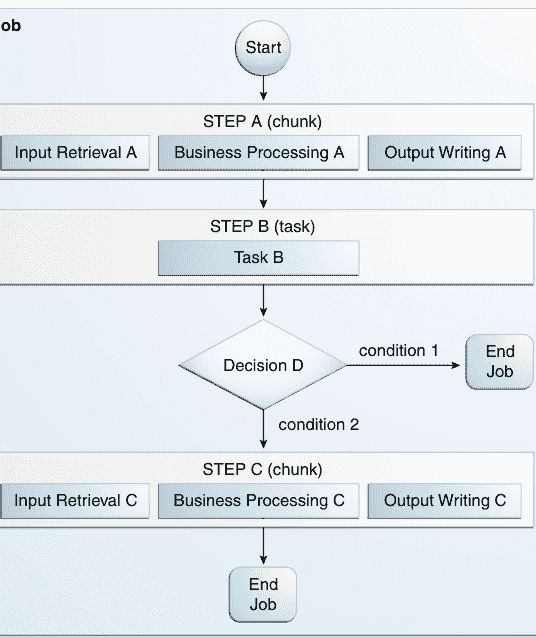

### 55.1.3 并行处理

批处理作业通常处理大量数据或执行计算密集型操作。批处理应用程序可以在两种场景中受益于并行处理：

- 不相互依赖的步骤可以在不同的线程上运行。
- 块分型步骤中如果每个项的处理不依赖于之前项的结果，可以在多个线程上运行。

批处理框架提供了处理机制，允许开发者定义独立步骤组并拆分可以并行运行的块分步骤。

### 55.1.4 批处理框架功能

批处理应用程序具有以下共同需求：

- 定义作业、步骤、决策元素以及它们之间的关系。
- 并执行某些步骤组或步骤的一部分。
- 维护作业和步骤的状态信息。
- 启动作业并恢复被中断的作业。
- 处理错误。

批处理框架提供了批处理执行基础设施，解决了所有批处理应用程序的共同需求，使开发者能够专注于应用程序的业务逻辑。批处理框架由用于指定作业和步骤的格式、应用程序编程接口（API）以及在运行时管理批处理作业执行的服务组成。

## 55.2 Java EE 中的批处理

本节列出了 Java EE 中批处理框架的组件，并提供了创建批处理应用程序的步骤概述。

### 55.2.1 批处理框架

Java EE 包含批处理框架，由以下元素组成：

- 管理作业执行的运行时。
- 基于 XML 的作业规范。
- 与运行时交互的 Java API。
- 实现步骤、决策元素和其他部分的 Java API。

批处理应用程序包含 XML 文件和 Java 类。XML 文件定义了作业的结构（批处理作业是块分型步骤、任务导型步骤或其他组件）。运行时解析 XML 文件并加载 Java 类来运行作业。

### 55.2.2 创建批处理应用程序

在 Java EE 中创建批处理应用程序的流程如下：

1. 设计批处理应用程序：
   a. 识别输入源、数据格式、所需的线程以及处理阶段。
   b. 将应用程序组织为具有块分步骤、任务型步骤和决策元素的作业。确定它们之间的依赖关系。
   c. 确定步骤之间的执行顺序。
   d. 识别可以并行运行的步骤可以在多个线程上运行的步骤。

2. 通过实现框架提供的步骤、决策元素接口来创建 Java 类。这些类包含从输入源读取数据、格式化项、处理项并存储结果的代码。批制品可以通过依赖注入访问运行时上下文。

3. 使用 XML 文件定义作业和步骤。XML 文件中的元素引用实现的 Java 类。批制品可以访问 XML 文件中的属性。

4. 使用运行时提供的 Java API 启动批处理应用程序。

本章后续章节将详细说明如何使用批处理框架的组件创建批处理应用程序。

### 55.2.3 批处理作业的元素

批处理作业可以包含以下一个或多个元素：

- 步骤（Steps）
- 流（Flow）
- 拆分（Splits）
- 决策元素（Decision elements）

步骤在“批处理简介”中已有描述，可以是块分型或任务导型。块分型步骤是分区步骤。在分区块分步骤中，一个项的处理不依赖其他项，因此这些步骤可以在多个线程上运行。

流是作为单元执行的步骤序列。相关的步骤序列可以分组为一个流。流中的步骤不能转换到流外部的步骤。当流的所有步骤完成后，流跳转到下一个元素。

拆分是并行执行的流集合；每个流在单独线程上运行。当所有流完成后，拆分跳转到下一个元素。

决策元素使用上一个步骤的退出状态来确定下一步或终止批处理作业。

### 55.2.4 属性和参数

作业和步骤可以关联多个属性。你在作业定义文件中定义属性，批制品使用运行时的上下文对象访问这些属性。通过这种方式使用属性，可以将作业的静态参数与业务逻辑解耦，并在不同的作业定义文件中复用批制品。

属性的指定请参见[使用作业规范语言](Using the Job Specification Language)，在批处理制品中访问属性的描述请参见[创建批处理制品](Creating Batch Artifacts)。

Java EE 在将作业提交到批运行时允许向作业传递参数。这允许你指定仅在运行时才知道的动态参数。对于分区步骤，参数也是必要的，因为每个分区都需要知道需要处理的项目范围。

提交作业时指定参数的描述请参见[提交作业到批运行时](Submitting Jobs to the Batch Runtime)。为分区步骤指定参数以及在批处理制品中访问参数的示例可见[电话计费示例应用程序](The phonebilling Example Application)。

### 55.2.5 作业实例与作业执行

作业定义可以有多个实例，每个实例具有不同的参数。作业执行是运行作业的尝试。批运行时维护有关作业实例和作业执行的信息，见[检查作业状态](Checking the Status of a Job)。

### 55.2.6 批状态和退出状态

作业、步骤、拆分和流的状态在批运行时以批状态（batch status）的形式表示。批值列在表 55–1 中。它们以字符串形式表示。

**表 55–1 批状态值**

| 状态 | 说明 |
| :--- | :--- |
| STARTING | 作业已提交到批运行时。 |
| STARTED | 作业正在运行。 |
| STOPPING | 已请求停止作业。 |
| STOPPED | 作业已停止。 |
| FAILED | 作业因错误结束执行。 |
| COMPLETED | 作业成功执行。 |
| ABANDONED | 作业被标记为放弃。 |

Java EE 应用程序可以使用 `JobOperator` 接口提交作业并访问作业状态，见[提交作业到批运行时](Submitting Jobs to the Batch Runtime)。作业定义可以使用作业规范语言 (JSL) 引用批状态值。批处理制品可以使用上下文对象访问状态值，见[使用批运行时上下文对象](Using the Context Objects from the Batch Runtime)。

对于流（flows），批状态是其最后一个流的状态。对于拆分（splits），批状态如下：

- 如果其所有流的批状态均为 `COMPLETED`，则为 `COMPLETED`。
- 如果任何一个流的批状态为 `FAILED`，则为 `FAILED`。
- 如果任何一个流的批状态为 `STOPPED`，且没有流的批状态为 `FAILED`，则为 `STOPPED`。

作业、步骤、拆分和流也有一个退出状态（exit status），它是基于批状态的用户定义值。你可以在批处理制品内部或作业定义文件中设置退出状态。你可以按照上述访问批状态的方式访问退出状态。退出状态的默认值与批状态相同。

## 55.3 简单用例

本节演示了如何使用作业规范语言 (JSL) 定义作业，以及如何实现相应的批处理制品。请参考本章的其他章节获取批处理框架中元素的详细描述。

以下作业定义指定了一个块步骤（chunk step）和一个任务：

```xml
<?xml version="1.0" encoding="UTF-8"?>
<job id="simplejob" xmlns="http://xmlns.jcp.org/ns/javaee" version="1.0">
  <properties>
    <property name="input_file" value="input.txt"/>
    <property name="output_file" value="output.txt"/>
  </properties>
  <step id="mychunk" next="mytask">
    <chunk>
      <reader ref="MyReader"/>
      <processor ref="MyProcessor"/>
      <writer ref="MyWriter"/>
    </chunk>
  </step>
  <step id="mytask">
    <batchlet ref="MyBatchlet"/>
    <end on="COMPLETED"/>
  </step>
</job>
```

### 55.1 块步骤

在大多数情况下，你必须为块步骤实现一个检查点类（checkpoint class）。以下类仅跟踪文本文件中的行号：


```java
public class MyCheckpoint implements Serializable {
  private long lineNum = 0;
  public void increase() { lineNum++; }
  public long getLineNum() { return lineNum; }
}
```

以下项目读取器实现从文件中继续读取输入文件。如果作业重启，项目将包含文本中的每一行。在更复杂的场景下，项目是自定义类型，输入源可以是数据库或流。

```java
@Dependent
@Named("MyReader")
public class MyReader implements javax.batch.api.chunk.ItemReader {
  private MyCheckpoint checkpoint;
  private BufferedReader reader;
  @Inject
  JobContext jobCtx;

  public MyReader() {}

  @Override
  public void open(Serializable checkpoint) throws Exception {
    if (checkpoint == null)
      checkpoint = new MyCheckpoint();
    else {
      checkpoint = (MyCheckpoint) checkpoint;
      String filename = jobCtx.getProperties()
        .getProperty("input_file");
      reader = new BufferedReader(new FileReader(filename));
      for (long i=0; i<checkpoint.getLineNum(); i++)
        reader.readLine();
    }
  }

  @Override
  public void close() throws Exception {
    reader.close();
  }

  @Override
  public Object getItem() throws Exception {
    String line = reader.readLine();
    return line;
  }
}
```

在这种情况下，项目处理器仅将行转换为大写。更复杂的示例可以处理项目。

```java
@Dependent
@Named("MyProcessor")
public class MyProcessor implements javax.batch.api.chunk.ItemProcessor {
  @Override
  public Object process(Object item) throws Exception {
    return ((String) item).toUpperCase();
  }
}
```

### 简单用例（继续）

在这种情况下，项目处理器仅将行转换为大写。更复杂的示例可以处理项目。

## 使用作业规范语言 (Job Specification Language)

- 一个 `properties` 元素（可选）。

  该元素指定了一组属性，批处理产物可以通过批量上下文对象访问。

- 一个 `listener` 元素（可选）；如果指定多个监听器，则使用 `listeners`。

  `listener` 元素指定了拦截步骤执行各个阶段的监听器产物。

  对于分块（chunks），这些监听器的批处理产物是以下接口的实现：`StepListener`、`ItemReadListener`、`ItemProcessListener`、`ItemWriteListener`、`ChunkListener`、`RetryRequestListener`、`RetryProcessListener`、`RetryWriteListener`、`SkipRequestListener`、`SkipProcessListener` 和 `SkipWriter`。

  对于任务（tasks），这些监听器的批处理产物必须是 `StepListener` 的实现。

  参考 Webserver 示例应用程序中的“The Listener Batch Artifacts”以获取项目处理器监听器实现的示例。

- 一个 `partition` 元素（可选）。

  这被用于在多个线程中执行的分区步骤。

- 如果这是作业的最后一个步骤，则有一个 `end` 元素。

  这会将作业状态设置为 COMPLETED（已完成）。

- 一个 `stop` 元素（可选），用于在此步骤停止作业。

  这会将作业状态设置为 STOPPED（已停止）。

- 一个 `fail` 元素（可选），用于在此步骤终止作业。

  该元素会将作业状态设置为 FAILED（已失败）。

- 如果未指定 `next` 属性，则有一个或多个此类元素。

  该元素与退出状态关联，并引用另一个步骤、流或决策元素。

以下是一个分块步骤（chunk step）的示例：

```xml
<step id="stepA" next="stepB">
  <properties> ...</properties>
  <listeners>
    <listener ref="MyItemReadListenerImpl"/>
  </listeners>
  <chunk> ...</chunk>
  <partition> ...</partition>
  <end on="COMPLETED" exit-status="MY_COMPLETED_EXIT_STATUS"/>
  <stop on="step0" restart="step0"/>
  <fail on="MY_ERROR_EXIT_STATUS" exit-status="MY_ERROR_EXIT_STATUS"/>
</step>
```

以下是一个任务步骤（task step）的示例：

```xml
<step id="stepB" next="stepC">
  <batchlet> ...</batchlet>
  <properties> ...</properties>
  <listener ref="MyStepListenerImpl"/>
</step>
```

## 使用作业规范语言

### 55.4.2.1 `chunk` 元素

`chunk` 元素是面向分块步骤的 `step` 元素的子元素。该元素的属性列在表 55-2 中。

**表 55–2 `chunk` 元素的属性**

| 属性名称 | 描述 | 默认值 |
|---|---|---|
| checkpoint-policy | 指定如何提交每个分块的处理结果：\n* "item" - 在处理完指定数量项（item）后提交分块。\n* "custom" - 根据 `checkpoint-algorithm` 元素指定的检查点算法提交分块。\n当分块结果提交时，会更新检查点。 | "item" |
| item-count | 指定在提交分块并执行检查点之前要处理的项数。 | 10 |
| time-limit | 当 `checkpoint-policy="item"` 时，指定在提交分块并执行检查点之前的秒数。 | 0（无限制） |
| buffer-items | 如果项被缓存到执行检查点为止。在提交分块并执行检查点之前，是否对项目写入器进行单次调用并传入缓存项的列表。 | true |
| skip-limit | 指定在分块处理期间在此步骤中跳过的异常数量。可跳过的异常类通过 `skippable-exception-classes` 元素指定。 | 无限制 |
| retry-limit | 指定当发生可重试的异常时，执行此步骤的尝试次数。可重试的异常类通过 `retryable-exception-classes` 元素指定。 | 无限制 |

`chunk` 元素可以包含以下元素：

- 一个 `reader` 元素。

  该元素指定一个实现 `ItemReader` 接口的批处理产物。

- 一个 `processor` 元素。

  该元素指定一个实现 `ItemProcessor` 接口的批处理产物。

- 一个 `writer` 元素。

  该元素指定一个实现 `ItemWriter` 接口的批处理产物。

- 一个 `checkpoint-algorithm` 元素（可选）。

  该元素指定一个实现 `CheckpointAlgorithm` 接口的批处理产物。

- 一个 `skippable-exception-classes` 元素（可选）。

  该元素指定在分块处理期间允许读取器、处理器和写入器跳过的异常类。

- 一个 `retryable-exception-classes` 元素（可选）。

  该元素指定在分块处理期间允许读取器、处理器和写入器重试的异常类。

- 一个 `no-rollback-exception-classes` 元素（可选）。

  该元素指定在回滚时读取器、处理器和写入器抛出但不会导致回滚的异常类。

当分块结果提交时，会更新检查点。

当批处理产物抛出异常时，根据 `skip-limit` 属性指定了跳过次数。

以下是一个面向分块步骤的示例：

```xml
<step id="step0" next="step0">
  <chunk checkpoint-policy="item" count="5" time-limit="180" buffer-items="true" skip-limit="10" retry-limit="3">
    <reader ref="MyItemReaderImpl"/>
    <processor ref="MyItemProcessorImpl"/>
    <writer ref="MyItemWriterImpl"/>
    <skippable-exception-classes>
      <ItemException>
    </skippable-exception-classes>
    <retryable-exception-classes>
      <RetryException>
    </retryable-exception-classes>
  </chunk>
</step>
```

## 55.4.2.2 `batch` 元素

`batch` 元素是面向任务步骤的 `step` 元素的子元素。该元素指定批处理产物。`batch` 元素可以包含属性。

以下是一个面向任务步骤的示例：

```xml
<step id="step0" next="step1">
  <batch ref="MyBatchImpl">
    <properties>
      <property name="pname" value="pval"/>
    </properties>
  </batch>
</step>
```

## 55.4.2.3 `partition` 元素

`partition` 元素是 `step` 元素的子元素。它指示该步骤是分区的。当分区的数量和输入源在开发或部署时已知，可以使用定义文件中的属性来指定分区特定的信息。运行时会为每个分区创建与分区数量相同的步骤产物（读取器、处理器、写入器），每个实例接收特定分区的属性。

在大多数情况下，分区数量、项的数量或分区步骤可以在运行时确定。你不需要在文件中静态指定分区特定的属性，而是提供一个可以在运行时访问数据源的批处理产物，确定分区数量以及每个分区应该处理的项范围。该批处理产物是 `PartitionMapper` 接口的实现。作业调用此产物，然后使用它实例化每个分区的步骤产物（读取器、写入器、处理器），并作为参数传递分区特定的数据。

本节剩余部分将描述 `partition` 元素，并展示两个作业定义示例：一个使用属性的一个。

- 一个 `plan` 元素（如果未指定 `mapper`）。

  该元素在作业定义文件中定义分区数量、线程数和每个分区的属性。当这些信息在开发或部署时已知，`plan` 元素非常有用。

- 一个 `mapper` 元素（如果未指定 `plan`）。

  该元素指定一个控制分区数量、线程数和每个分区属性的批处理产物。该批处理产物是 `PartitionMapper` 接口的实现。当分区所需的信息仅在运行时已知，应使用此选项。

- 一个 `reducer` 元素（可选）。

  该元素指定在分区步骤开始、结束或回滚时接收控制权的批处理产物。该批处理产物允许你合并不同分区的的结果并执行其他相关操作。该批处理产物是 `PartitionReducer` 接口的实现。

- 一个 `collector` 元素（可选）。

  该元素指定了一个批处理制品（batch artifact），用于将每个分区的中间结果发送到分区分析器。该批处理制品会在分块步骤（chunk steps）每个检查点之后以及任务步骤（task steps）结束时发送中间结果。该批处理制品是 `PartitionCollector` 接口的实现。

- 一个 `analyzer` 元素（可选）。

  该元素指定了一个批处理制品，用于分析来自分区收集器实例的中间结果。该批处理制品是 `PartitionAnalyzer` 接口的实现。

以下是一个使用 `plan` 元素的分区的步骤示例：

```xml
<step id="stepE" next="stepF">
<chunk>
  <reader> ...</reader>
  <processor> ...</processor>
  <writer> ...</writer>
</chunk>
<partition>
  <plan partitions="2" threads="2">
    <properties partition="0">
      <property name="firstItem" value="0"/>
      <property name="lastItem" value="500"/>
    </properties>
    <properties partition="1">
      <property name="firstItem" value="501"/>
      <property name="lastItem" value="999"/>
    </properties>
  </plan>
</partition>
<reducer ref="MyPartitionReducerImpl">
  <collector ref="MyPartitionCollectorImpl"/>
  <analyzer ref="MyPartitionAnalyzerImpl"/>
</reducer>
</step>
```

在此示例中，`plan` 元素指定了作业定义文件中每个分区的属性。

接下来的示例使用了 `mapper` 元素而不是 `plan` 元素。`PartitionMapper` 的实现动态地提供了与 `plan` 元素在作业定义文件中提供的相同信息：

```xml
<step id="stepE" next="stepF">
<chunk>
  <reader> ...</reader>
  <processor> ...</processor>
  <writer> ...</writer>
</chunk>
<partition>
  <mapper ref="MyPartitionMapperImpl"/>
  <reducer ref="MyPartitionReducerImpl"/>
  <collector ref="MyPartitionCollectorImpl"/>
  <analyzer ref="MyPartitionAnalyzerImpl"/>
</partition>
</step>
```

参考[电话费示例应用程序](The phonebilling Example Application）以获取 `PartitionMapper` 接口的实现示例。

## 55.4.3 `flow` 元素

`flow` 元素可以是 `job`、`flow` 和 `split` 元素的子元素。其属性为 `id` 和 `next`。流可以转换到流、步骤、拆和决策元素。`flow` 元素可以包含以下元素：

- 一个或多个 `step` 元素。

- 一个或多个 `flow` 元素（可选）。

- 一个或多个 `split` 元素（可选）。

- 一个或多个 `decision` 元素（可选）。

最后一个步骤是具有 `next` 属性或 `next` 元素的步骤。流中的步骤和其他元素不能转换到流之外的元素。

以下是流的示例：

```xml
<flow id="flowA" next="stepB">
<step id="flowstepA" next="flowStepB">...</step>
<step id="flowstepB" next="flowC">...</step>
<flow id="flowA" next="splitD">...</flow>
<split id="flowSplitD" next="flowstepB">...</split>
<step id="flowstepB">...</step>
</flow>
```

此示例流包含三个步骤、一个流和一个拆分。最后一个步骤没有 `next` 属性。当最后一个流完成时，它会转换到 `stepE`。

## 55.4.4 `split` 元素

`split` 元素可以是 `job` 和 `flow` 元素的子元素。其属性为 `id` 和 `next`。拆分可以转换到拆分、步骤、流和决策元素。`split` 元素只能包含一个或多个 `flow` 元素，这些流只能转换到拆分内的其他流。

以下是一个三个并发执行流的拆分示例：

```xml
<split id="split" next="stepB">
<flow id="splitFlowA">...</flow>
<flow id="splitFlowB">...</flow>
<flow id="splitFlowC">...</flow>
</split>
```


## 55.4.5 `decision` 元素

`decision` 元素可以是 `job` 和 `flow` 元素的子元素。其属性为 `id` 和 `next`。步骤可以转换到决策元素。该元素指定了一个批处理制品，根据上一个步骤、流或拆分的执行信息来决定下一个步骤、流或拆分。该批处理制品实现了 `Decoder` 接口。`decision` 元素可以包含以下元素：

- 一个或多个 `end` 元素（可选）。
  此元素将批处理状态设置为 `COMPLETED`。
- 一个或多个 `stop` 元素（可选）。
  此元素将批处理状态设置为 `STOPPED`。
- 一个或多个 `fail` 元素（可选）。
  此元素将批处理状态设置为 `FAILED`。
- 一个或多个 `next` 元素（可选）。
- 一个 `properties` 元素（可选）。

以下是解码器元素的示例：

```xml
<decision id="decisionA" ref="MyDecoderImpl">
  <fail on="FAILED" exit-status="FAILED_AT_DECIDER"/>
  <end on="COMPLETED" exit-status="COMPLETED_AT_DECIDER"/>
  <stop on="TEMP_ISSUE_STATUS" restart="step2"/>
</decision>
```

## 55.5 创建批处理制品

在使用作业规范语言 (DSL) 根据批处理制品定义作业后，你将创建 Java 类来实现这些制品，这些类实现了 `jav.batch.api` 包及其子包中的接口。

本节列出了主要的批处理制品接口，演示了如何从运行时访问上下文对象，并提供了一些示例。

### 55.5.1 批处理制品接口

下表列出了用于创建批处理制品的接口。表 55–3 列出了用于分块步骤、任务步骤和决策元素的接口。表 55–4 列出了用于分区步骤的接口。表 55–5 列出了用于作业和步骤监听器的接口。

#### 表 55–3 主要批处理接口

| 包名 | 接口 | 描述 |
| :--- | :--- | :--- |
| `javax.batch.api` | `Batchlet` | 实现任务步骤的业务逻辑。从 `batch` 元素引用。 |
| `javax.batch.api` | `Decoder` | 根据上一个步骤、流或拆分的信息决定执行的下一个步骤、流或拆分。从 `decision` 元素引用。 |
| `javax.batch.api.chunk` | `CheckPointAlgorithm` | 实现分块步骤的自定义检查点策略。从 `chunk` 内部的 `checkpoint-algorithm` 元素引用。 |
| `javax.batch.api.chunk` | `ItemReader` | 从分块步骤的输入源读取项。从 `chunk` 内部的 `reader` 元素引用。 |
| `javax.batch.api.chunk` | `ItemProcessor` | 在分块步骤中处理项以获取输出。从 `chunk` 内部的 `processor` 元素引用。 |
| `javax.batch.api.chunk` | `ItemWriter` | 在分块步骤中写入项。从 `chunk` 内部的 `writer` 元素引用。 |

#### 表 55–4 分区批处理接口

| 包名 | 接口 | 描述 |
| :--- | :--- | :--- |
| `javax.batch.api.partition` | `PartitionPlan` | 提供如何执行分区步骤的细节，例如分区数量、线程数以及每个分区的参数。该制品不直接从作业定义文件引用。 |
| `javax.batch.api.partition` | `PartitionMapper` | 提供 `PartitionPlan` 对象。从 `partition` 内部的 `mapper` 元素引用。 |
| `javax.batch.api.partition` | `PartitionReducer` | 在分区步骤开始、结束或回滚时接收控制。从 `partition` 内部的 `reducer` 元素引用。 |
| `javax.batch.api.partition` | `PartitionCollector` | 将每个分区的中间结果发送到分区分析器。从 `partition` 内部的 `collector` 元素引用。 |
| `javax.batch.api.partition` | `PartitionAnalyzer` | 处理来自每个分区的数据和最终结果。从 `partition` 内部的 `analyzer` 元素引用。 |

#### 表 55–5 监听器批处理制品接口

| 包名 | 接口 | 描述 |
| :--- | :--- | :--- |
| `javax.batch.api.listener` | `JobListener` | 在运行作业之前之后拦截执行。从 `job` 内部的 `listener` 元素引用。 |
| `javax.batch.api.listener` | `StepListener` | 在运行步骤之前之后拦截执行。从 `step` 内部的 `listener` 元素引用。 |
| `javax.batch.api.chunk.listener` | `ChunkListener` | 在分块步骤中，处理每个块之前之后以及发生错误时拦截块处理。从 `step` 内部的 `listener` 元素引用。 |
| `javax.batch.api.chunk.listener` | `ItemReadListener` | 在分块步骤中在读取每个项之前、之后以及发生错误时拦截项读取。它从 `step` 内部的 `listener` 元素引用。 |
| `javax.batch.api.chunk.listener` | `ItemProcessListener` | 在分块步骤中在处理每个项之前、之后以及发生错误时拦截项处理。它从 `step` 内部的 `listener` 元素引用。 |
| `javax.batch.api.chunk.listener` | `ItemWriteListener` | 在分块步骤中在写入每个项之前、之后以及发生错误时拦截项写入。它从 `step` 内部的 `listener` 元素引用。 |
| `javax.batch.api.chunk.listener` | `RetryReadListener` | 在分块步骤中发生异常时拦截项读取。它从 `step` 内部的 `listener` 元素引用。 |
| `javax.batch.api.chunk.listener` | `RetryProcessListener` | 在分块步骤中发生异常时拦截项处理。它从 `step` 内部的 `listener` 元素引用。 |
| `javax.batch.api.chunk.listener` | `RetryWriteListener` | 在分块步骤中发生异常时拦截项写入。它从 `step` 内部的 `listener` 元素引用。 |
| `javax.batch.api.chunk.listener` | `SkipReadListener` | 在分块步骤中拦截项读取的跳过处理。它从 `step` 内部的 `listener` 元素引用。 |
| `javax.batch.api.chunk.listener` | `SkipProcessListener` | 在分块步骤中拦截项处理的跳过处理。它从 `step` 内部的 `listener` 元素引用。 |
| `javax.batch.api.chunk.listener` | `SkipWriteListener` | 在分块步骤中拦截项写入的跳过处理。它从 `step` 内部的 `listener` 元素引用。 |

## 55.5.2 批制品中的依赖注入

为了确保上下文和依赖注入（CDI）在你的批制品中工作，请遵循以下步骤：

1. 使用 `Named` 注解将你的批制品实现定义为 CDI Bean。

   例如，在分块步骤中定义项读取器：

   ```java
   @Named("MyItemReaderImpl")
   public class MyItemReaderImpl implements ItemReader {
       /* 重写 ItemReader 方法 ... */
   }
   ```

2. 为你的批制品提供一个公共的、无参数的构造函数。

   例如，为批制品提供以下构造函数：

   ```java
   public MyItemReaderImpl() {
   }
   ```

3. 在作业文件中为批制品指定 CDI 名称，而不是使用类的限定名。

   例如，如下定义制品步骤：

   ```xml
   <step id="stepA" next="stepB">
     <chunk>
       <reader ref="MyItemReaderImpl"/>
     </chunk>
   </step>
   ```

   此示例使用 CDI 名称 (`MyItemReaderImpl`) 而不是类的限定名 (`com.xyz.pkg.MyItemReaderImpl`) 来指定批制品。

4. 通过在你的批制品上标记 `Dependent` 注解或通过应用包含 `beans.xml` 来确保你的 CDI Bean 是批制品。例如：

   ```java
   @Dependent
   @Named("MyItemReaderImpl")
   public class MyItemReaderImpl implements ItemReader { ... }
   ```

关于批制品的更多信息，请参阅第 25 章，“Java EE 的上下文和依赖注入”：

> 注意：为了从批处理运行时访问上下文对象，需要上下文和依赖注入（CDI）。

如果你不遵循此步骤，可能会遇到以下错误：

- 批处理运行时无法找到批制品。
- 访问对象时批制品抛出空指针异常。

## 55.5.3 使用运行时上下文对象

运行时提供了 `java.batch.runtime` 包中实现 `JobContext` 和 `StepContext` 接口的上下文对象。这些对象分别与作业和步骤关联，允许你：

- 从当前作业或步骤获取信息，例如名称、实例 ID、执行 ID、批状态和退出状态。
- 设置定义的退出状态。
- 存储用户数据。
- 从作业或步骤定义获取属性。

你可以在批制品实现（如项读取器、处理器、写入器、批处理单元等）内部从运行时注入上下文对象。以下示例演示了如何从项读取器实现中的作业定义中访问属性值：

```java
@Dependent
@Named("MyItemReaderImpl")
public class MyItemReaderImpl implements ItemReader {
    @Inject
    JobContext jobCtx;

    public MyItemReaderImpl() {}

    @Override
    public void open(Serializable checkpoint) throws Exception {
        String fileName = jobCtx.getProperties()
            .getProperty("log_file_name");
    }

    ...
}
```

参阅“批制品中的依赖注入”获取有关如何定义批制品以使用依赖注入的说明。

> **注意：** 不要在制品的构造函数内访问上下文对象。因为作业在提交到运行时之前不会运行，所以在 CDI 实例化制品时上下文对象不可用。实例化将失败，且运行时找不到你的批制品。

## 55.6 将作业提交到运行时

`javafx.batch.operations` 中的 `JobOperator` 接口允许你提交作业并获取现有作业的信息。该接口提供：

- 获取所有作业的名称。
- 启动、重启和放弃作业。
- 获取作业实例和执行。

`javafx.batch.runtime` 中的 `BatchRuntime` 类提供了 `getJobOperator` 方法来获取 `JobOperator` 对象。

### 55.6.1 启动作业

示例代码演示了如何获取 `JobOperator` 对象并提交作业：

```java
JobOperator jobOperator = BatchRuntime.getJobOperator();
Properties props = new Properties();
props.setProperty("parameter1", "value");

long execID = jobOperator.start("simplejob", props);
```

`JobOperator.start` 方法的第一个参数是作业定义文件中指定的作业名称。第二个参数是代表此作业执行参数的 `Properties` 对象。你可以使用作业参数将仅运行时已知的信息传递给作业。

### 55.6.2 检查作业状态

`javax.batch.runtime` 中的 `JobExecution` 接口提供了获取已提交作业信息的方法。该接口提供：

- 获取执行的批状态和退出状态。
- 获取执行启动、更新或结束的时间。
- 获取作业名称。
- 获取执行 ID。

以下示例代码演示了如何使用执行 ID 获取作业的批状态：

```java
JobExecution jobExec = jobOperator.getJobExecution(execID);
String status = jobExec.getStatus().toString();
```

### 55.6.3 在你的应用中调用运行时

你调用运行时的组件取决于你应用程序的架构。例如，你可以从企业 Bean、Servlet、托管 Bean 等调用运行时。

请参阅 `webbrowser` 示例应用和 `phonebilling` 应用，了解有关如何通过 JavaServer Faces 用户界面从托管 Bean 调用运行时的细节。

## 55.7 打包批处理应用

作业定义文件和批制品不需要单独打包，可以包含在任何 Java EE 应用中。

将批制品类与你应用程序的其他类一起打包，并将作业定义文件包含在以下目录之一：

- `META-INF/batch-jobs/` 适用于 jar 包。
- `WEB-INF/classes/META-INF/batch-jobs/` 适用于 war 包。

每个作业文件的名称必须与其作业 ID 匹配。例如，如果你按如下定义一个作业：

```xml
<job id="simplejob">
  ...
</job>
```

并且你正在应用打包为 war 包，请将作业定义文件包含在 `WEB-INF/classes/META-INF/batch-jobs/simplejob.xml` 中。

## 55.8.1 `webserverlog` 示例应用程序的架构

**webserverlog** 示例应用程序由以下元素组成：

- 一个定义文件 (`webserverlog.xml`)，它使用作业规范语言 (JSL) 定义了一个包含分块步骤（chunk step）和任务步骤（task step）的批处理作业。分块步骤充当过滤器，而任务步骤对剩余条目计算统计数据。
- 一个日志文件 (`log.txt`)，作为批处理作业的输入数据。
- 两个 Java 类 (`LogLine` 和 `LogFilteredLine`)，分别代表分块作业的输入项和输出项。
- 三个批处理产物 (`LogLineReader`、`LogLineProcessor` 和 `LogFilteredLineWriter`)，它们实现了应用程序的分块步骤。该步骤从 Web 服务器日志中读取项，根据客户端使用的 Web 浏览器对其进行过滤，并将结果写入文本文件。
- 两个批处理产物 (`InfoObserver` 和 `InfoItemListener`)，它们实现了简单的监听器。
- 一个批处理产物 (`MobileBatch.java`)，它对过滤后的条目计算统计数据。
- 两个 JavaServer Faces (JSF) 页面 (`index.xhtml` 和 `jobstarted.xhtml`)，提供批处理应用程序的前端。第一个页面显示将由批处理作业处理的日志文件，第二个页面允许用户检查作业状态并显示结果。
- 一个会话 Bean (`JsBean`)，从 JSF 页面访问。该 Bean 将作业提交到批处理运行时，检查作业状态并从文本文件中读取结果。

## 55.8.1 作业定义文件

`webserver.xml` 作业定义文件位于 `WEB-INF/classes/META-INF/batch-jobs/` 目录下。该文件指定了作业级别的属性和：


```xml
<?xml version="1.0" encoding="UTF-8"?>
<job id="webserverlog" xmlns="http://xmlns.jcp.org/ns/javaee" version="1.0">
  <properties>
    <property name="log_file_name" value="log.txt"/>
    <property name="filtered_file_name" value="filtered.txt"/>
    <property name="num_browsers" value="2"/>
    <property name="browser_1" value="Table Browser D"/>
    <property name="browser_2" value="Table Browser E"/>
    <property name="buy_page" value="auth/buy.html"/>
    <property name="out_file_name" value="result.txt"/>
  </properties>
  <listeners>
    <listener ref="InfoObserver"/>
  </listeners>
  <step id="mobilefilter" next="mobileanalyzer" ... </step>
  <step id="mobileanalyzer" ... </step>
</job>
```

第一个步骤定义如下：

```xml
<step id="mobilefilter" next="mobileanalyzer">
  <listeners>
    <listener ref="InfoItemProcessListeners"/>
  </listeners>
</step>
```

```xml
<listeners>
<chunk checkpoint-policy="item" item-count="10">
  <reader ref="LogLineReader"></reader>
  <processor ref="LogLineProcessor"></processor>
  <writer ref="LogFilteredLineWriter"></writer>
</chunk>
</step>
```

这是一个普通分块步骤，指定了实现该步骤每个阶段的批处理产物。批处理产物的名称不是全限定类名，因为这些批处理产物是带有 `@Named` 注解的 CDI Bean。

第二个步骤定义如下：

```xml
<step id="mobileanalyzer">
  <batchlet ref="MobileBatch"></batchlet>
  <end on="COMPLETED"/>
</step>
```

此步骤是一个任务步骤，指定了实现它的批处理产物。这是作业的最后一个步骤。

## 55.8.1.2 LogLine 和 LogFileLine 项

`LogLine` 代表日志项，`LogFileLine` 代表分块作业的输出项。

（注：此处原文内容似乎存在断续或重复，已根据提供的文本结构进行对应翻译）

## 55.8.1.6 JavaServer Faces 页面

`index.xhtml` 页面包含一个显示 Web 服务器日志的文本区域。该页面提供了一个按钮供用户提交批作业并导航到下一个页面。

```xml
<body
  <textarea cols='90' rows='25'
    readonly='true'>{{jsBean.getInputLog()}</textarea>
  ...
  <form>
    <h:commandButton value='Start Batch Job'
      action="${jsBean.startBatchJob()}"/>
  </h:commandButton>
  </form>
</body>
```

此页面调用会话 Bean（session bean）的方法来显示日志文件并提交批作业。

`jobstarted.xhtml` 页面提供了一个按钮来检查作业的当前状态，并在满足以下条件时显示结果：

```xml
<p>Current Status of the Job: ${jsBean.jobStatus}</p>
<p>${jsBean.showResults()}</p>
<form>
  <h:commandButton value='Check Status' action='jobstarted'
    rendered="${jsBean.completed=false}"/>
</form>
```

## 55.8.1.7 会话 Bean

`JsfBean` 将作业提交到批处理运行时，检查作业状态并从文本文件中读取结果。

`startBatchJob` 方法将作业提交到批处理运行时。

```java
/* 将批作业提交到批处理运行时 */
/* Jsf 导航方法（返回下一个页面的名称） */
public String startBatchJob() {
  jobOperator = Runtime.getJobOperator();
  execid = jobOperator.start("webserverlog", null);
  return "jobstarted";
}
```

`getStatus` 方法检查作业状态：

```java
/* 从批处理运行时获取作业状态 */
public String getJobStatus() {
  return jobOperator.getJobExecution(execid).getBatchStatus()
    .toString();
}
```

`showResults` 方法从文本文件中读取结果。

## 55.8.2 运行 webserverlog 示例应用程序

本节描述了如何使用 NetBeans IDE 和命令行运行 webserverlog 示例应用程序。

### 55.8.2.1 使用 NetBeans IDE 运行 webserverlog 示例应用程序

1. 从文件（File）菜单中，选择打开项目（Open Project）。
2. 在打开项目对话框中，导航到：
   `tut-install/examples/batch/webserverlog`
3. 选择 `webserverlog` 文件夹。
4. 点击打开项目（Open Project）。
5. 在项目（Projects）选项卡中，右键点击 `webserverlog` 项目并选择运行（Run）。

此命令将应用程序构建并打包成 WAR 文件 `webserverlog.war`，位于 `target/` 目录中；将其部署到服务器；并打开带有以下 URL 的 Web 浏览器窗口：

`http://localhost:8080/webserverlog/`

### 55.8.2.2 使用 Maven 运行 webserverlog 示例应用程序

1. 确保 GlassFish 服务器正在运行。有关更多信息，请参阅第 2 章“使用教程示例”。
2. 在终端窗口中，进入到：
   `tut-install/examples/batch/webserverlog`
3. 输入以下命令部署应用程序：
   `mvn install`
4. 打开 Web 浏览器查看以下地址：
   `http://localhost:8080/webserverlog/`

## 55.9 phonebilling 示例应用程序

`phonebilling` 示例应用程序位于 `tut-install/examples/batch/phonebilling`，演示了如何使用 Java EE 中的批处理框架来实现电话计费系统。该示例应用程序处理通话日志并为每个客户创建账单。

## 55.9.1 phonebilling 示例应用程序的架构

`phonebilling` 示例应用程序由以下元素组成：

- 一个定义文件（`phonebilling.xml`），它定义了一个包含两个块（chunk）的批处理账单。第一步从日志文件中读取作业规范语言（JSL）记录并将其与账单关联。第二步计算金额并将每份账单写入文件。
- 一个 Java 类（`CallRecordLogCreator`），它为批作业创建日志文件。这是一个辅助组件，不演示系统中的任何功能。
- 两个持久化 API（JPA）实体（`CallRecord` 和 `PhoneBill`），它们代表通话记录和客户账单。应用程序使用 JPA 实体管理器在数据库中存储这些实体的实例。
- 三个批处理制品（`CallRecordReader`、`CallRecordProcessor` 和 `CallRecordWriter`），它们实现了应用程序的第一步。
- 从日志文件中读取通话记录，将其与账单关联并存储在数据库中。
- 四个批处理制品（`BillReader`、`BillProcessor`、`BillWriter` 和 `BillPartitionMapper`），它们实现了应用程序的第二步。这一步是一个分区步骤，从数据库获取每份账单，计算金额并将其写入文本文件。
- 两个 JavaServer Faces（JSF）页面（`index.xml` 和 `jobstarted.xml`），它们提供了应用程序的前端。第一个页面显示将由批作业处理的日志文件，第二个页面允许用户检查作业状态并显示每个客户的结果。
- 一个从 JSF 页面访问的会话 Bean（`jsBean`）。该 Bean 将作业提交到运行时环境，检查作业状态并读取每个作业的结果。

### 55.9.2 作业文件

`phonebilling.xml` 定义文件位于 `WEB-INF/jobs/`。它指定了三个属性和两个步骤：

```xml
<?xml version="1.0" encoding="UTF-8"?>
<job xmlns="http://xmlns.jcp.org/xml/ns/javaee" id="phonebilling">
  <properties>
    <property name="file_name" value="log.txt"/>
    <property name="airtime_price" value="0.05"/>
    <property name="tax_rate" value="0.07"/>
  </properties>
  <step id="calls">
    <chunk checkpoint-policy="item" item-count="10">
      <reader ref="CallReader"/>
      <processor ref="CallProcessor"/>
      <writer ref="CallWriter"/>
    </chunk>
  </step>
  <step id="bills">
    <chunk checkpoint-policy="item" item-count="2">
      <reader ref="BillReader"/>
      <processor ref="BillProcessor"/>
      <writer ref="BillWriter"/>
    </chunk>
    <partition>
      <mapper ref="BillPartitionMapper"/>
    </partition>
    <end on="COMPLETED"/>
  </step>
</job>
```

第一步是一个普通块，定义了不完全限定的批处理制品：

```xml
<step id="calls">
  <chunk checkpoint-policy="item" item-count="10">
    <reader ref="CallReader"/>
    <processor ref="CallProcessor"/>
    <writer ref="CallWriter"/>
  </chunk>
</step>
```

第二步是一个分区步骤：

```xml
<step id="bills">
  <chunk checkpoint-policy="item" item-count="2">
    <reader ref="BillReader"/>
    <processor ref="BillProcessor"/>
    <writer ref="BillWriter"/>
  </chunk>
  <partition>
    <mapper ref="BillPartitionMapper"/>
  </partition>
  <end on="COMPLETED"/>
</step>
```

### 55.9.1.2 CallRecord 和 PhoneBill 实体

`CallRecord` 实体定义如下：

```java
@Entity
public class CallRecord implements Serializable {
    @Id
    @GeneratedValue
    private Long id;
    @Temporal(Temporal.DATE)
    private Date datetime;
    private String from;
    private String to;
    private int minutes;
    private int seconds;
    private BigDecimal price;

    public CallRecord() { }

    public CallRecord(Date datetime, String from,
        String to, int min, int sec) throws Exception { }

    public CallRecord(String jsonData) throws ParseException { }
    /* ... Getters and setters */
}
```

`id` 由 JPA 实现自动生成，用于在数据库中存储和检索 `CallRecord` 对象。

第二个构造函数使用 JSON 处理 API 从日志文件的 JSON 条目中创建 `CallRecord` 对象。日志条目如下：

```json
{"datetime":"03/01/2013 04:03:00","from":"555-0101","to":"555-0114","length":"03:39"}
```

`PhoneBill` 实体定义如下：

```java
@Entity
public class PhoneBill implements Serializable {
    @Id
    private String phone;
    @OneToMany(cascade = CascadeType.PERSIST)
    @OrderBy("date ASC")
    private List<CallRecord> calls;
    private BigDecimal amountBase;
    private BigDecimal taxRate;
    private BigDecimal tax;
    private BigDecimal amountTotal;

    public PhoneBill() { }

    public PhoneBill(String number) {
        this.phone = number;
        calls = new ArrayList<>();
    }

    public void addCall(CallRecord call) { }
}
```

```java
calls.add(call);

public void calculate(BigDecimal taxRate) { ... }

/*
 * Getters and setters *
 */
```

`@OneToMany` 注解定义了账单与其调用记录之间的关系。`CascadeType.PERSIST` 参数表示当账单被持久化时，调用列表中的元素也应该被自动持久化。`@OrderBy` 注解定义了从数据库检索和写入调用列表元素时的顺序。

该批处理任务使用两个实体的实例作为处理项，并且：

关于 Java Persistence API 的更多信息，请参阅第 37 节“Java Persistence API 简介”。关于 JSON Processing API 的更多信息，请参阅第 19 节“JSON 处理”。

## 55.9.1 话记录分块步阶

第一步由 `CallRecordReader`、`CallRecordProcessor` 和 `CallRecordWriter` 批处理单元组成。

`CallRecordReader` 从日志文件中读取调用记录：

```java
@Dependent
@Named("CallRecordReader")
public class CallRecordReader implements ItemReader {
    private ItemCheckpoint checkpoint;
    private String fileName;
    private BufferedReader reader;
    @Inject
    JobContext jobCtx;
```

> /* 重写 open, close, readItem, 和 checkpointInfo 方法 */

`open` 方法读取 `log_filename` 属性并使用缓冲读取器打开日志文件：

```java
fileName = jobCtx.getProperties().getProperty("log_file_name");
reader = new BufferedReader(new FileReader(fileName));
```


如果存在检查点（checkpoint），`open` 方法允许读取器读取到该检查点。否则，该方法将创建一个新的检查点对象。检查点跟踪从上一次提交的分块开始的行号。

`read` 方法返回一个新的 `CallRecord` 对象，或者在日志文件末尾返回 `null`。

```java
@Override
public Object readItem() throws Exception {
    /* 从日志文件中读取一行并
      从 JSON 创建一个 callRecord */
    String callEntry = reader.readLine();
    if (callEntry != null) {
        checkpoint.nextItem();
        return new CallRecord(callEntry);
    } else
        return null;
}
```

## phonebilling 示例应用程序

`CallRecordProcessor` 从作业属性中获取实时价格，计算每次调用的价格并返回调用对象。该构件仅重写了 `process` 方法。

`CallWriter` 件将每个调用记录与账单关联并将账单存储在数据库中。该构件重写了 `open`、`close`、`writeItems` 和 `checkpoint` 方法。`writeItems` 方法的工作如下：

```java
@Override
public void writeItems(List<Object> callList) throws Exception {
    for (Object setObject : callList) {
        CallRecord call = (CallRecord) setObject;
        PhoneBill bill = em.find(PhoneBill.class, call.getNumber());
        if (bill == null) {
            /* 该客户还没有账单，创建一个 */
            bill = new PhoneBill(call.getNumber());
            bill.addCall(call);
            em.persist(bill);
        } else {
            /* 将调用添加到现有账单中 */
            bill.addCall(call);
        }
    }
}
```

## 55.9.1.4 电话计费分块步阶

第二步是 `BillReader`、`BillProcessor`、`BillWriter` 和 `BillPartitionMapper` 批处理构件。此步骤计算税费和总金额，并将每个账单写入文本文件。每个账单的处理是相互独立的，此步骤可以被分区并在多个线程中运行。

`BillPartitionMapper` 构件指定了分区的数量以及每个分区的参数。在示例中，这些参数代表每个分区的范围。该构件获取数据库中的账单数量以计算这些范围。它提供了一个分区计划（PartitionPlan）对象，通过 `PartitionPlan` 接口的 `getPartitions` 和 `getPartitionProperties` 方法如下方式获取它：

```java
@Override
public Properties[] getPartitionProperties() {
    /* 为每个分区分配（约等于）相等数量的元素。 */
    long totalItems = getBillCount();
    long partitions = (long) totalItems / getPartitions();
    long remItems = totalItems % getPartitions();

    /* 填充 Properties 数组。数组中的每个 Properties
    对应于每个分区。 */
    Properties[] props = new Properties[getPartitions()];

    for (int i = 0; i < getPartitions(); i++) {
        props[i] = new Properties();
        props[i].put("firstItem", i * partitions);
        /* 最后一个分区获得剩余元素 */
        if (i == getPartitions() - 1) {
            props[i].put("numItems", partitions + remItems);
        } else {
            props[i].put("numItems", partitions);
        }
    }
    return props;
}
```

`BillReader` 构件如下所示获取分区参数：

```java
@Dependent
@Named("BillReader")
public class BillReader implements ItemReader {

    @Inject
    JobContext jobCtx;
    Properties partParams;

    @Override
    public void open(Serializable ckpt) throws Exception {
        /* 获取此分区的参数 */
        JobOperator jobOperator = BatchRuntime.getJobOperator();
        long execId = jobCtx.getExecutionId();
        var partParams = jobOperator.getParameters(execId);

        /* 获取在该分区中处理的项目范围 */
        long firstItem0 = ((Long) partParams.get("firstItem")).longValue();
        long numItems0 = ((Long) partParams.get("numItems")).longValue();
    }
}
```

该构件遍历账单列表并计算税费和总金额：

```java
/* 从实体管理器获取迭代器 */
String query = "SELECT b FROM PhoneBill ORDER BY b.phoneNumber";
Query q = em.createQuery(query)
    .setFirstResult((int) firstItem0)
    .setMaxResults((int) numItems0);
Iterator iterator = q.getResultList();
```

`BillProcessor` 处理每个账单并计算税费和总金额。`BillWriter` 将每个账单写入文本文件。

## 55.9.1.5 JavaScript 页面

`index.xml` 页面包含一个显示日志文件的文本区域。

```xml
<body>
  <h1>电话计费</h1>
  <h2>日志文件</h2>
  <p>以下是日志：</p>
  <textarea cols="90" rows="25" readonly="true">${jsBean.createAndShow()}</textarea>
  <form>
    <commandButton value="开始批作业" action="#{jsfBean.startBatchJob()}"/>
  </form>
</body>
```

批处理 55-33

## phonebilling 示例应用程序

`jobstarted.xhtml` 页面提供了一个检查作业当前状态的按钮，并在作业完成后显示状态：

```xml
<p>作业当前状态：#{jsBean.status}</p>
<dataTable var="row" value="#{jsBean.list}" border="1">
</dataTable>
<!-- 如果作业未完成，渲染检查状态按钮 -->
<form>
  <commandButton value="检查状态" rendered="#{jsBean.completed==false}" action="jobstarted"/>
</form>
```

## 55.9.1.6 Session Bean

JsfBean Session Bean 将作业提交到运行时，检查状态并读取每个构建的文本文件。

该 bean 的 `startBatchJob` 方法将其提交到运行时。

```java
/* 将批作业提交到运行时
 * JSF 导航方法（返回下一页名称） */
public String startBatchJob() {
    jobOperator = BatchRuntime.getJobOperator();
    execID = jobOperator.start("phonebilling", null);
    return "jobstarted";
}
```

该 bean 的 `getStatus` 方法检查作业状态：

```java
/* 从运行时获取作业状态 */
public String getStatus() {
    return jobOperator.getJobExecution(execID).toString();
}
```

该 bean 的 `getList` 方法创建作业列表，以便在 `jobstarted.xhtml` JSF 页面上显示。

## 55.9.2 运行 phonebilling 示例应用程序

本节介绍了如何使用 NetBeans IDE 和从命令行运行 phonebilling 示例应用程序。

## 55.9.2.1 使用 NetBeans 运行 phonebilling 示例应用程序

1. 从 File 菜单选择 Open Project。
2. 在 Open Project 对话框中，导航到：
   `tut-inst/examples/batch/phonebilling`
3. 选择 phonebilling 文件夹。
4. 点击 Open Project。
5. 在 **Projects** 表格中，右键点击 *phonebilling* 项目并选择 **Run**。

此命令会将应用程序构建并打包成 WAR 文件（phonebilling.war），该文件位于 `target/` 目录；随后将其部署到服务器；并启动一个带有以下 URL 的浏览器窗口：

`http://localhost:8080/phonebilling/`

## 55.9.2.2 使用 Maven 运行 phonebilling

1. 确保 GlassFish 服务器和 Java DB 正在运行。更多信息，请参阅[第 2 章，“使用教程示例”](#) 。
2. 在终端窗口中，进入到：
   `tut-install/examples/batch/phonebilling`
3. 输入以下命令部署应用程序：
   `mvn install`
4. 打开浏览器窗口并输入以下地址：
   `http://localhost:8080/phonebilling/`

## 55.10 关于批处理的更多信息

有关 Java EE 批处理的更多信息，请参阅《Java Batch Applications》规范：

http://www.jcp.org/en/jsr/detail?id=352

# 56 并发工具类

本章描述了并发工具类。

本章涵盖以下主题：

- 并发基础
- 并发工具类的主要组件
- 并发与事务
- 并发与安全
- jobs 并发示例

## 56.1 并发基础

并发是同时（并行）执行两个或多个任务的概念。任务可以包括方法（函数）、程序的一部分，甚至是其他程序。在当前的计算机架构中，在单个 CPU 中支持多个核心和多个处理器是常见现象。

从一开始开始，Java 平台就提供了对并发编程的支持，这是实现 Java EE 容器所提供的许多服务的基础。在 Java SE 5 中，`java.util` 包提供了额外的并发高层级 API 支持。

在 Java 之前，没有特定的 API 允许企业开发者以安全的方式使用并发工具类。Java EE Web 和 ej 容器使用容器管理的线程池来实例化对象。强烈不建议使用 Java SE 并发包来实例化 `Thread` 对象。如果开发者创建了一个新的（非管理的）`Thread`，容器无法保证其他 Java EE 平台服务（例如事务和安全）会成为该线程的一部分。

### 56.1.1 线程与进程

两个主要的并发概念是进程和线程。

进程主要与在操作系统（OS）上运行的应用程序相关。进程具有特定的资源来与底层操作系统交互并分配其他资源（例如自己的内存），就像 JVM 进程一样。JVM 实际上是一个进程。

Java 语言和平台主要关注线程。

线程与进程共享一些特性，因为它们都从操作系统或执行环境中消耗资源。但线程比进程更容易创建，且消耗的资源少得多。

由于线程是轻量级的，任何现代 CPU 拥有几个核心，几 GB 的内存就可以就可以在单个 JVM 进程中处理数千个线程。精确数量取决于机器可用 CPU、操作系统和内存的组合输出，以及对 JVM 的正确配置（调优）。

并发编程解决了许多问题并可以提高大多数应用程序的性能，但在某些情况下，多个执行线（线程或进程）可能会导致严重问题。此类情况包括：

- 死锁
- 线程饥饿
- 共享资源的并发访问
- 程序产生错误数据的情况

## 56.2 并发工具类的主要组件

并发资源是受管理的对象，为 Java EE 应用程序提供并发能力。在 GlassFish 服务器中，你可以配置并发资源并使其供 servlets 和 EJBs 等应用程序组件使用。通过 JNDI 查找或资源注入可以访问并发资源。

并发工具类的主要组件如下。

- **ManagedExecutorService**：受管理的执行器被应用程序用于异步执行提交的任务。任务在容器启动并管理的线程上执行。容器的上下文在应用程序中通过程序化方式传播。
  例如，通过调用 `ManagedExecutorService.submit()`，可以将某个任务（如 `GenerateReportTask`）提交以便在稍后时间执行，并使用 `Future` 回调在结果可用时获取结果。

- **ManagedScheduledExecutorService**：受管理的调度执行器服务用于应用程序在特定时间异步执行提交的任务。任务在容器启动并管理的线程上执行。该 API 提供了调度机制，允许用户在应用程序中通过程序化方式为任务执行设置特定的日期/时间。

- **ContextService**：上下文服务用于创建动态代理对象，以捕获容器上下文并允许应用程序在稍后运行或被提交给 Managed Executor。容器的上下文会传播到执行任务的线程。

- **ThreadFactory**：受管理的线程工厂用于应用程序创建受管理的线程。线程由容器启动并管理。容器的上下文会传播到执行任务的线程。此对象还可以用于为特定情况提供自定义工厂（带有自定义的 `Threads`），并例如为这些对象设置/特定的属性。

## 56.3 并发与事务

事务最基本的操作是提交（commit）和回滚（rollback），但在具有并发处理的分布式环境中，很难保证提交或回滚操作将得到成功处理，且事务可以在不同的线程、CPU 核心、不同的物理机器和网络之间扩展。

在这样的情况下，确保回滚操作成功执行至关重要。并发工具类依赖 Java 事务 API（JTA），通过 `java.transaction.UserTransaction` 在其组件上实现并支持事务，允许开发者显式管理事务边界。更多信息请参见 JTA 规范。

可选情况下，上下文对象可以启动、提交或回滚事务，但这些对象不能存在父组件事务中。

以下代码段说明了一个 Runnable 任务，它获取一个 `UserTransaction`，然后在与其它事务组件（如 EJB 和数据库）交互时启动并提交事务。

```java
public class MyTransactionalTask implements Runnable {

    UserTransaction ut = ... // 通过 JNDI 和注入获取

    public void run() {
        // 启动事务
        ut.begin();

        // 调用服务或 EJB
        myEJB.businessMethod();

        // 使用 XA JDBC 驱动更新数据库实体
        myEJB.updateCustomer(customer);

        // 提交事务
        ut.commit();
    }
}
```

## 56.4 并发与安全

Java EE 并发工具类将大多数安全决策交给每个应用程序服务器实现，如果容器支持安全上下文，该上下文就可以传播到执行线程。ContextService 可以支持多种运行时，且安全属性（如果启用）将传播容器的安全主体。

## 56.5 jobs 并发示例

本节描述了一个基础示例，展示了如何在企业应用程序中使用基础并发功能。具体来说，该示例使用了 Java EE 并发工具类的主要组件之一：受管理的执行器。

该示例演示了一个场景：作为公共 API 暴露的 RESTful Web 服务用于提交通用作业进行执行。这些作业在背景中执行。每个任务在执行开始和结束时打印“Starting”（开始）和“Finished”（完成）消息。此外，为了模拟后台处理，每个任务需要 10 秒才能执行。

RESTful 服务暴露了两个方法：

- `/token`：以 GET 方法暴露，用于注册并返回 API 令牌。
- `/process`：以 POST 方法暴露，接收一个 jobID 查询参数（该参数是待执行任务的标识符）以及一个自定义的 HTTP 请求头 X-REST-API-Key（该头部将在内部用于使用令牌验证请求）。


令牌用于通过 API 区分不同的服务质量（QoS）。在服务请求中提供令牌的用户可以处理并发任务。然而，不提供令牌的用户一次只能处理一个任务。由于每个任务需要 10 秒才能执行，未提供令牌的用户每 10 秒只能对服务执行一次调用。对于提供令牌的用户，处理速度将要快得多。

这是通过为每种类型的请求使用两个托管执行器服务（Managed Executor Services）来实现的。

## 56.5.1 运行任务示例

在通过添加两个托管执行器服务配置 GlassFish 服务器后，你可以使用 NetBeans IDE 或 Maven 来构建、打包、部署并运行任务示例。

### 56.5.1.1 为基础并发示例配置 GlassFish 服务器

按照以下步骤配置 GlassFish 服务器。

1. 在 `http://localhost:4848` 打开管理控制台。
2. 展开 Resources（资源）节点。
3. 展开 Concurrent Resources（并发资源）节点。
4. 点击 Managed Executor Services（托管执行器服务）。
5. 在 Managed Executor Services 页面，点击 New（新建）以打开“新建托管执行器服务”页面。
6. 在 JNDI Name 字段中，输入 `MES_High` 以创建一个高优先级的托管执行器服务。使用以下设置（其他设置保持默认值）：
   - 线程优先级 (Thread Priority): 2
   - 核心大小 (Core Size): 2
   - 最大池大小 (Maximum Pool Size): 5
   - 任务队列容量 (Task Queue Capacity): 2
7. 点击 OK。
8. 在 Managed Executor Services 页面上，再次点击 New。
9. 在 JNDI Name 字段中，输入 `MES_Low` 以创建一个低优先级的托管执行器服务。使用以下设置（其他设置保持默认值）：
   - 线程优先级 (Thread Priority): 1
   - 核心大小 (Core Size): 1
   - 最大池大小 (Maximum Pool Size): 1
   - 任务队列容量 (Task Queue Capacity): 0
10. 点击 OK。

### 56.5.1.2 使用 NetBeans IDE 构建、打包并部署任务

1. 从 File（文件）菜单中选择 Open Project（打开项目）。
2. 在 Open Project 对话框中，导航到：
```
tut-install/examples/concurrency
```
3. 选择 jobs 文件夹。
4. 点击 Open Project。
5. 在 Projects（项目）选项卡中，右键点击 jobs 并选择 Build（构建）。

此命令会构建并部署该应用程序。

### 56.5.1.3 使用 Maven 构建、打包并部署任务

1. 在终端窗口，导航到：
```
tut-install/examples/concurrency/jobs
```
2. 输入以下命令来构建并部署应用程序：
```
mvn install
```

### 56.5.1.4 运行任务示例并提交低优先级任务

要以提交低优先级任务的用户身份运行示例，请按照以下步骤操作：

1. 在浏览器中，输入以下 URL：
```
http://localhost:8080/jobs
```
2. 在 Jobs 页面，在 Enter JobID 字段中输入一个一到十位的数字，在 Enter A 字段中留空，然后点击 Submit Job（提交任务）。

页面底部应显示以下消息：
Job 1 successfully submitted

服务器日志中包含以下消息：
```
INFO: Invalid or missing token!
INFO: Task started LOW-1
INFO: Job 1 successfully submitted
INFO: Task finished LOW-1
```

你提交了一个低优先级的任务。这意味着在 10 秒内你无法提交另一个任务。如果你尝试这样做，RESTful API 将返回服务不可用（HTTP 503）响应，并在页面底部显示以下消息：
Job 2 was NOT submitted

服务器日志将包含以下消息：
```
INFO: Invalid or missing token!
INFO: Job 1 successfully submitted
# jobs 任务并发示例
INFO: Task started LOW-1
INFO: Invalid or missing token!
INFO: Job 2 NOT submitted
INFO: Task finished LOW-1
```

### 56.5.1.5 运行任务示例并提交高优先级任务

要以提交高优先级任务的用户身份运行示例，请按照以下步骤操作：

1. 在浏览器中，输入以下 URL：
```
http://localhost:8080/jobs
```
2. 在 Jobs Client 中，在 Enter JobID 字段中输入一个一到十位的数字。
3. 点击“Get a token here”所在行的此处链接以获取令牌。页面将在新标签页中显示令牌。
4. 复制令牌并返回 Jobs Client。
5. 在 Enter Token 字段中粘贴令牌，然后点击 Submit Job。

页面底部将显示以下消息：
Job 1 successfully submitted

服务器日志中包含以下消息：
```
INFO: Token accepted. Execution with high priority.
INFO: Task started HIGH-1
INFO: Job 1 successfully submitted
INFO: Task finished HIGH-1
```

你提交了一个高优先级的任务。这意味着你可以提交任务，每个任务都带有令牌，而不会面临低优先级用户所面临的每任务 10 秒的限制。如果你连续提交 3 个带有令牌的任务，底部将显示以下消息：
Job 1 was submitted
Job 2 was submitted
Job 3 was submitted

服务器日志将包含：
```
INFO: Token accepted. Execution with high priority.
INFO: Task started HIGH-1
INFO: Job 1 successfully submitted
INFO: Token accepted. Execution with high priority.
INFO: Task started HIGH-2
INFO: Job 2 successfully submitted
INFO: Token accepted. Execution with high priority.
INFO: Task started HIGH-3
INFO: Job 3 successfully submitted
INFO: Task finished-1
INFO: Task finished-2
INFO: Task finished-3
```

# 第 XII 部分 案例研究

第 XII 部分介绍了使用了多种 Java EE 技术的案例研究。该部分包含以下章节：
- 第 57 章：“Duke 图书案例研究”
- 第 58 章：“Duke 辅导案例研究”
- 第 59 章：“Duke 森林案例研究”

# Duke's Bookstore 案例研究

Duke's Bookstore 示例是一个简单的电子商务应用程序，它展示了 JavaServer Faces 技术与上下文依赖注入（CDI）、企业豆和 Java Persistence API 结合的一些高级功能。用户可以从地图选择书籍、查看图书目录并购买书籍。此应用程序未使用安全性。

此处介绍了以下主题：
- Duke's Bookstore 的设计与架构
- Duke's Bookstore 界面
- 运行 Duke's Bookstore 应用程序

## 57.1 Duke's Bookstore 设计与架构

Duke's Bookstore 是一个简单的 Web 应用程序，除了其他 Java EE 7 功能外，还使用了许多 JavaServer Faces 功能：
- JavaServer Faces 技术以及 Java EE 的上下文依赖注入：
    - 一组 Facelets 页面配合模板提供了应用程序界面。
    - 每个 Facelets 页面都关联了 CDI 管理豆。
    - 首页上的自定义地图组件允许你选择书籍进入商店。地图的每个区域都由一个 JavaServer Faces 管理豆表示。还提供了文本链接以增强可访问性。
    - 在地图和链接上注册了动作监听器。这些监听器获取所选书籍的 ID 并将其存储在会话映射中，以便下一页管理豆检索。
    - 使用 `h:dataTable` 标签来渲染图书目录和购物车内容。
    - 在结账页面 `bookcashier.xhtml` 的信用卡字段上注册了自定义转换器，该转换器还使用了 `f:validateRegex` 确保格式正确。
    - 在 `bookcashier.xhtml` 的名称字段上注册了值变更监听器。该监听器将名称保存到参数中，以便后续页面 `bookreceipt.xhtml` 可以访问。
- 企业豆：本地、无接口视图无状态豆和单例豆
- 一个 Java Persistence API 实体

Duke's Bookstore Persistence 应用程序的包位于 `tut-install/examples/case-studies/bookstore/src/main/java/javaeetutorial/bookstore/` 目录，其结构如下：
- components: 包含自定义 UI 组件类 `MapComponent` 和 `AreaComponent`
- converters: 包含自定义转换器类 `CreditConverter`
- ejb: 包含两个企业豆（Enterprise Beans）：
    - 一个单例豆 `ConfigBean`，用于初始化数据库中的数据
    - 一个无状态豆 `RequestBean`，包含管理实体的业务逻辑
- entity: 包含 `Book` 类
- exceptions: 包含异常类
- listeners: 包含事件处理器和监听器
- model: 包含一个模型类
- renderers: 包含用于自定义组件类的自定义渲染器（Renderers）
- web.managedBeans: 包含用于 Facelets 页面的托管豆（Managed Beans）
- web.messages: 包含用于本地化消息的资源包文件

## 57.2 Duke's Bookstore 界面

本节提供了关于 Duke's Bookstore 组件及其相互作用的更多详细信息。

### 57.2.1 Book Persistence API 实体

该实体位于 `dukesbookstore.entity` 包中，封装了 Duke's Bookstore 存储的图书数据。该实体定义了示例中使用的属性：
- 图书 ID
- 作者的名
- 作者的姓氏
- 标题
- 价格
- 图书是否在售中
- 出版年份
- 图书描述
- 库存数量

该实体还定义了一个命名查询 `findBooks`。

### 57.2.2 Duke's Bookstore 中使用的企业豆

位于 `dukesbookstore.ejb` 包中的两个企业豆为 Duke's Bookstore 提供了业务逻辑。`RequestBean` 是一个无状态会话豆，包含了应用程序的业务方法：创建、检索和购买书籍，以及更新书籍的库存。要检索书籍，`getBooks` 方法调用了实体中定义的 `findBooks` 查询。`ConfigBean` 是一个单例豆，用于在应用程序初始部署时在目录中创建书籍。它调用了 `RequestBean` 中定义的 `create` 方法。

### 57.2.3 Duke's Bookstore 中使用的 Facelets 和托管豆

Duke's Bookstore 应用程序使用 Facelets 及其模板功能来显示用户界面。Facelets 页面与 CDI 托管豆交互，这些豆作为后端豆（Backing Beans），为用户界面提供底层属性和方法。首页与应用程序使用的自定义组件交互。应用程序使用了以下 Facelets 页面，它们位于 `tut-install/examples/case-studies/dukes-bookstore/src/main/webapp/`：
- `bookstoreTemplate.xhtml`：模板文件，指定了每个页面的页眉以及所有页面使用的样式。该模板从浏览器中获取语言设置。使用了托管豆 `LocaleBean`。
- `index.xhtml`：落地页，布局了由 `faces-config.xml` 文件配置的自定义地图和区域组件，并允许用户选择书籍并进入到 `bookstore.xhtml` 页面。
- `bookstore.xhtml`：该页面允许用户获取所选书籍或特色书籍的详情，将每本书添加到购物车，并进入到 `bookcatalog.xhtml` 页面。使用了托管豆 `BookstoreBean`。
- `bookdetails.xhtml`：该页面显示从 `bookstore.xhtml` 或其他页面选择的书籍的详情，并允许用户将书籍添加到购物车和/或进入到 `bookcatalog.xhtml`。使用了托管豆 `DetailsBean`。
- `bookcatalog.xhtml`：该页面显示目录中的书籍，并允许用户将其添加到购物车、查看任何书籍的详情、清空购物车或购买购物车中的书籍。使用了托管豆 `BookstoreBean`、`CatalogBean` 和 `ShoppingCart`。
- `bookshowcart.xhtml`：该页面显示购物车的内容，并允许用户移除项目、查看项目详情、清空购物车、购买购物车中的书籍或返回目录。使用了托管豆 `ShowCart` 和 `ShoppingCart`。
- `bookcashier.xhtml`：该页面允许用户购买书籍、指定运送选项、订阅时通讯，或在购买超过一定金额时加入 Duke 粉丝俱乐部。使用了托管豆 `CashierBean` 和 `ShoppingCart`。
- `bookreceipt.xhtml`：该页面确认用户的购买，并允许用户返回目录继续购物。使用了托管豆 `CashierBean`。
- `bookordererror.xhtml`：如果书店没有已订书籍的剩余副本，则由 `CashierBean` 渲染此页面。

应用程序使用了以下托管豆：
- `AbstractBean`：包含被其他托管豆调用的工具类。
- `BookDetailsBean`：`details.xhtml` 页面的后端豆。指定名为 `details`。
- `BookstoreBean`：`bookstore.xhtml` 页面的后端豆。指定名为 `store`。
- `CashierBean`：`bookcashier.xhtml` 和 `bookreceipt.xhtml` 页面的后端豆。
- `CatalogBean`：`bookcatalog.xhtml` 页面的后端豆。指定名为 `catalog`。
- `LocaleBean`：获取当前语言区域的托管豆；用于每个页面。
- `ShoppingCart`：用于 `bookcashier.xhtml`、`bookcatalog.xhtml` 和 `bookshowcart.xhtml` 页面的后端豆。指定名为 `cart`。
- `ShoppingCartItem`：包含 `ShoppingCart`、`CatalogBean` 和 `ShowCartBean` 使用的方法。
- `ShowCartBean`：`bookshowcart.xhtml` 页面的后端豆。指定名为 `store`。

### 57.2.4 自定义组件对象

Duke's Bookstore 的地图和区域组件，以及相关的渲染器、监听器和模型类定义在以下包中，位于 `tut-install/examples/case-studies/dukes-bookstore/src/main/java/javaeetutorial/bookstore/`：
- components: 包含 `MapComponent` 和 `AreaComponent` 类。
- listeners: 包含 `AreaSelected` 类以及其他监听器类。
- model: 包含 `ImageArea` 类。
- renderers: 包含 `MapRenderer` 和 `AreaRenderer` 类。

包含一个自定义转换器和其他未特定绑定到自定义组件的监听器：
- converters: 包含 `CreditConverter` 类。
- listeners: 包含 `LinkBookChangeListener`、`MapBookChangeListener` 和 `NameChanged` 类。

### 57.2.5 Duke's Bookstore 中的属性

Duke's Bookstore 应用程序使用的字符串封装在资源包中，以便在多个语言区域显示本地化字符串。属性文件位于 `tut-install/examples/case-studies/dukes-bookstore/src/main/java/javaeetutorial/bookstore/web/messages/` 目录，由一个包含英语字符串的默认文件以及三个其他语言区域的文件组成。这些文件如下：
- `Messages.properties`：默认文件，包含英语字符串
- `Messages_de.properties`：包含德语字符串
- `Messages_fr.properties`：包含法语字符串

用户浏览器的语言设置决定了使用哪个语言区域。`bookstoreTemplate.xhtml` 中的 `html` 标签从 `LocaleBean` 的 `language` 属性获取语言设置：
```html
<html lang="#{localeBean.language}" xmlns="http://www.w3.org/1999/xhtml"
      xmlns:h="http://xmlns.jcp.org/jsf/html"
      xmlns:f="http://xmlns.jcp.org/jsf/core"
      xmlns:ui="http://xmlns.jcp.org/jsf/facelets">
```


<html lang="${localBean.language}">

更多关于资源包的信息，请参见第20章“Web应用程序的国际化和本地化”。资源包按照 `faces-config.xml` 配置如下：

```xml
<application>
  <resource-bundle>
    <base-name>dukesbookstore.web.messages.Messages</base-name>
    <var>bundle</var>
  </resource-bundle>
</application>
```

's Bookstore 案例研究示例 57-5

# 运行 Duke's Bookstore 案例应用程序

```xml
</resource-bundle>
<local-config>
  <default-locale>en</default-locale>
  <supported-locale>de</supported-locale>
  <supported-locale>fr</supported-locale>
  <supported-locale>es</supported-locale>
</local-config>
</application>
```

此配置意味着在 Facets 中，消息是使用前缀 `bundle` 以及 `Messages_locale.properties` 文件中找到的键检索的，如下面的 `index.xhtml` 页面所示：

```xml
<h:outputText style="font-weight:bold" value="${bundle.ChooseBook}" />
```

在 `Messages.properties` 中，键字符串定义如下：
ChooseBook=Choose a Book from our Catalog

## 57.2.6 Duke's Bookstore 部署描述符

Duke's Bookstore 使用以下部署描述符：

- `src/main/resources/META-INF/persistence.xml`
  Java Persistence API（持久化 API）配置文件。
- `src/main/webapp/WEB-INF/bookstore.taglib.xml`
  自定义组件的标签库描述符文件。
- `src/main/webapp/WEB-INF/faces-config.xml`
  JavaServer Faces 配置，用于管理映射组件的 beans 以及应用程序的资源。
- `src/main/webapp/WEB-INF/web.xml`
  web 应用程序配置文件。

## 57.3 运行 Duke's Bookstore 案例应用程序

本节描述了如何构建、打包、部署和运行 Duke's Bookstore 应用程序。

### 57.3.1 使用 NetBeans IDE 构建并部署 Duke's Bookstore

1. 确保 GlassFish 服务器已启动（参考“启动和停止 GlassFish 服务器”）。
2. 从 File（文件）菜单中，选择 Open Project（打开项目）。
3. 在 Project（项目）对话框中，导航到：
   `tut-install/examples/case-studies/dukes-bookstore`
4. 点击 Open Project（打开项目）。
5. 在 Projects（项目）选项卡中，右键点击 `dukes-bookstore` 并选择 Build（构建）。
   这将构建、打包并将 Duke's Bookstore 部署到 GlassFish 服务器。

### 57.3.2 使用 Maven 构建并部署 Duke's Bookstore

1. 确保 GlassFish 服务器已启动（参考“启动和停止 GlassFish 服务器”），以及数据库服务器已启动（参考“启动和停止 Java DB 服务器”）。
2. 在终端窗口中，进入：
   `tut-install/examples/case-studies/dukes-bookstore/`
3. 输入命令：
```
mvn install
```
该命令构建应用程序并将其打包在 `tut-install/examples/case-studies/dukes-bookstore/target/` 目录下的 WAR 文件中。随后，它会将应用程序部署到 GlassFish 服务器。

### 57.3.3 运行 Duke's Bookstore

1. 在浏览器中，输入以下 URL：
   `http://localhost:8080/dukes-bookstore/`
2. 在 Duke's Bookstore 主页上，点击图形中的书籍，或点击页面底部的链接之一。
3. 使用应用程序中的页面查看并购买书籍。

# Duke's Tutoring 案例示例

Duke's Tutoring 示例应用程序是一个面向学生的辅导中心跟踪系统。学生或其监护人可以签到和签退。辅导中心可以跟踪出勤和状态更新，并存储监护人和学生的联系信息。管理员可以维护该辅导中心系统。

此处涵盖了以下主题：

- Duke's Tutoring 的设计与架构
- 主界面
- 运行 Duke's Tutoring 案例应用程序

## 58.1 Duke's Tutoring 设计与架构

Duke's Tutoring 是一个整合多种 Java EE 技术的 Web 应用程序。它暴露了主界面（面向学生、监护人和辅导中心工作人员）和管理界面（供工作人员维护系统）。这两个接口的业务逻辑均由企业 bean（enterprise beans）提供。企业 bean 使用 Java Persistence API 在数据库中创建并存储应用程序数据。图 58–1 展示了应用程序的架构。

### 图 58-1 Duke's Tutoring 示例应用程序的架构

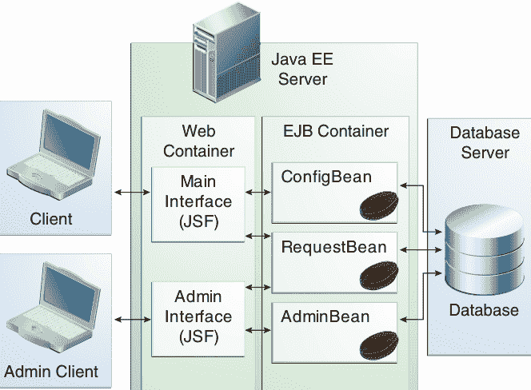

Duke's Tutoring 应用程序由两个主要项目组成：`dukes-toring-common` 库和 `dukes-toring-war` Web 应用程序。`dukes-toring-common` 项目包含 `dukes-toring-war` Web 应用程序使用的实体类和辅助类，且 `dukes-toring-common` 与 `dukes-toring-war` 一起打包部署。该库 JAR 文件允许实体类和辅助类被其他应用程序（例如 JavaFX 客户端应用程序）复用。

Duke's Tutoring 使用了以下 Java EE 7 平台特性：

- Java Persistence API 实体
- Java API for JavaBeans Validation（Bean Validation）注解，用于验证数据
- 自定义 Bean Validation 注解 `@Email`，用于验证电子邮件地址
- 标准数据源
- 企业 bean
- Websockets
- 上文与依赖注入（Contexts and Dependency Injection）
- JavaServer Faces 技术，使用 Facelets
- 模板（Templating）
- 复合组件（Composite components）
- AJAX-Facelets

Duke's Tutoring 应用程序有两个主要用户界面，都封装在单个 WAR 包中：

- 主界面，面向学生、监护人和工作人员
- 管理界面，供工作人员管理学生

除了主界面和管理界面外，还有一个 JUnit 测试，演示了如何使用嵌入 EJB 容器测试业务逻辑。

## 58.2 主界面

主界面允许学生和工作人员签到和签退，并记录学生去公园的情况。

### 58.2.1 主界面使用的 Java Persistence 实体

主界面使用的实体封装了 Duke's Tutoring 存储和操作的数据，位于 `dukes-tutoring-common` 项目的 `dukestoring.entity` 包中。

该界面记录了学生状态变化的日志。当学生签到辅导课程、前往公园以及签退时，其状态会发生变化。这些状态允许辅导中心精确跟踪哪些学生参加了辅导课程、他们何时签到，以及哪些学生去了公园以及何时从公园回来。

有关 Java 持久接口（Java Persistence API）的信息，请参阅第 37 章“Java Persistence API 简介”。有关验证实体数据的信息，请参阅“验证持久化字段和属性”以及第 22 章“Bean 验证：高级主题”。

### 58.2.2 主界面使用的企业 Bean（Enterprise Beans）

主界面中的企业 Bean 为 Duke 辅导中心提供了业务逻辑，位于 `dukes-tutoring-war` 项目的 `dukutoring.ejb` 包中。

`ConfigBean` 是一个单例 Bean（singleton bean），用于在应用部署时创建默认学生，并创建一个自动的 EJB 定时器，每周创建一个会话。

`RequestBean` 是一个无状态 Bean（stateless bean），用于主界面的业务方法。学生或员工在前往和返回公园时可以对学生进行签到和签退。该 Bean 拥有获取学生列表的方法。`RequestBean` 中的业务方法使用强类型 API 从数据库中检索数据。

`RequestBean` 还注入了一个 CDI 事件 `StatusEvent`。当学生状态发生变化时，业务方法会触发此事件。

有关使用企业 Bean 的信息，请参阅“企业 Bean（Enterprise Beans）”。有关创建强类型 API 查询的信息，请参阅第 40 章“使用 Criteria API 创建查询”。有关 CDI 事件的信息，请参阅第 25.5 节“在 CDI 应用程序中使用事件”。

### 58.2.3 主界面中的 WebSocketEndpoint

`dukututorial.web.websocket.StatusEndpoint` 类是一个 WebSocket 端点，用于向客户端端点返回学生及其状态。`StatusEndpoint.updateStatus` 是针对 `StatusEvent` 事件的 CDI 观察者方法（observer method）。当主界面中的学生状态变化时，会触发 `StatusEvent`。容器会调用 `updateStatus` 观察者方法，并将状态更改推送到所有注册了 `StatusEndpoint` 的客户端。

有关 WebSocket 端点的信息，请参阅第 18 章“WebSocket 的 Java API”。有关 CDI 事件的信息，请参阅第 25.5 节“在 CDI 应用程序中使用事件”。

### 58.2.4 主界面使用的 Faclets

Duke's Tutoring 应用使用 Faclets（面）来显示用户界面，并大量利用了 Faclets 的模板功能。Faclets 是 JavaServer Faces 的默认技术，由位于 `tut-install/examples/case-studies/dukes-tutoring-war/web/` 目录下的 XHTML 文件组成。

主界面使用了以下 Faclets：

- `template.xhtml`: 主界面的模板
- `error.xhtml`: 发生错误时的错误文件
- `index.xhtml`: 主界面的落地页
- `park.xhtml`: 显示当前谁在公园的页面
- `current.xhtml`: 显示当前谁在今天的会话中的页面
- `statusEntries.xhtml`: 显示今日会话详细状态条目的的页面
- `resources/components/allStudents.xhtml`: 用于显示所有活跃学生的表格复合组件（composite component）
- `resources/components/currentSessionTable.xhtml`: 用于显示今日会话中所有学生的表格复合组件
- `resources/components/parktable.xhtml`: 用于显示当前在公园所有学生的表格复合组件
- `WEB-INF/includes/navigation.xhtml`: 主界面导航栏的 XHTML 片段
- `WEB-INF/includes/footer.xhtml`: 主界面页脚的 XHTML 片段

### 58.2.5 主界面使用的辅助类（Helper Classes）

主界面使用了位于 `dukes-tutoring-common` 项目的 `dukutoring.util` 包中的辅助类：

- `CalendarUtil`: 提供一个方法用于从 `Calendar` 中移除不必要的时间数据的类。
- `Email`: 用于验证电子邮件地址的。
- `StatusType`: 定义不同状态的枚举类型。
- `Status`: 用于主界面中的状态。
- `Entry`: 今日会话的详细状态条目。
- `Person`: 在 `dukes-tutoring-common` 项目的 `dukutoring.util` 包中的辅助类用于主界面：
- `EntityConverter`: 用于转换实体的辅助类。
- `GuardianConverter`: 用于 Guardian 转换类。
- `StudentConverter`: 与 `GuardianConverter` 类似，用于 Student 转换。

### 58.2.6 属性文件（Properties Files）

主界面的属性文件封装在 `dukes-tutoring-war` 项目的 `dukutoring.web` 包中，用于显示用户界面：

- `Messages.properties`: 默认语言的字符串。
- `ValidationMessages.properties`: 用于 Bean 验证的。

### 58.2.7 Duke's Tutoring 的部署描述符（Deployment Descriptors）

`dukes-tutoring-war` 项目中的部署描述符用于 Duke's Tutoring：

- `src/conf/beans.xml`: 启用 CDI 运行时的空描述符文件
- `web/WEB-INF/faces-config.xml`: JavaServer Faces 配置。
- `web/WEB-INF/glassfish-web.xml`: GlassFish 特有的配置文件
- `WEB/WEB-INF/web.xml`: Web 应用描述符配置

`dukutoring` 项目中的以下部署描述符用于 Duke's Tutoring：

- `src/META-INF/persistence.xml`


Java 持久接口配置。企业 Bean 类文件中的注解用于应用中企业 Bean 的配置。

## 58.3 管理界面

Duke's Tutoring 的管理界面供辅导中心工作人员管理主界面所需的数据：学生的监护人和地址。管理界面使用了与主界面许多相同的组件。在此处描述了仅在管理界面使用的额外组件。

### 58.3.1 管理界面使用的企业 Bean

位于 `dukesutoring.ejb` 包中的以下企业 Bean 用于管理界面：

- `AdminBean`：用于管理界面所有业务逻辑的无状态 Bean。包含安全约束注解，允许经过授权的用户调用业务方法。

# 运行 Duke's Tutoring 案例研究应用程序

- `resources/components/formLogin.xhtml`：使用 Java EE 登录表单的复合组件
- `WEB-INF/includes/adminNav.xml`：管理界面导航栏的 XHTML 片段

## 58.4 运行 Duke's Tutoring 案例研究应用程序

本节描述了如何构建、打包、部署和运行 Duke's Tutoring 应用。

### 58.4.1 运行 Duke's Tutoring

你可以使用 NetBeans IDE 或 Maven 来构建、打包、部署和运行 Duke's Tutoring。

#### 58.4.1.1 在 NetBeans 中构建并部署 Duke's Tutoring

**准备工作**

你必须已经在 NetBeans IDE 中配置了 GlassFish 作为 Java EE 服务器，具体如“在 NetBeans IDE 中将 GlassFish 服务器配置为服务器”中所述。

1. 如果你尚未执行，请按照“使用 NetBeans IDE 启动 GlassFish 服务器”所述启动 GlassFish 服务器。
2. 从“文件 (File)”菜单中，选择“打开项目 (Open Project)”。
3. 在“打开项目”对话框中，导航到：
   `tur-install/examples/case-studies/`
4. 选择 `dukes-tutoring` 文件夹。
5. 勾选“需要的项目 (Required Projects)”复选框并点击“打开项目 (Open Project)”。

> **注意**：首次在 NetBeans 中打开 Duke's Tutoring 时，会在“项目 (Projects)”选项卡中看到错误图标。这是正常的，因为企业 Bean 用于 Criteria API 查询的元模型尚未生成。

6. 在“项目”选项卡中右键点击 `dukes-tutoring` 并选择“构建 (Build)”。
   这将构建并打包 `dukes-tutoring-common` 和 `dukes-tutoring-war` 项目，并将 `dukes-tutoring-war` 部署到 GlassFish，如果尚未启动，将启动 Java DB 数据库和 GlassFish 服务器。

#### 58.4.1.2 使用 Maven 构建并部署 Duke's Tutoring

**准备工作**

确保按照“启动和停止 GlassFish 服务器”所述已启动 GlassFish 服务器，并按照“启动和停止 Java DB 服务器”所述已启动 Java DB 服务器。

1. 在终端窗口中，进入：
   `tur-install/examples/case-studies/dukes-tutoring/`
2. 输入以下命令：

```
mvn install
```

此命令将创建 JDBC 安全领域域，构建并打包 `dukes-tutoring-common` 和 `dukes-tutoring-war` 项目，并将 `dukes-tutoring-war` 部署到 GlassFish 服务器。

#### 58.4.1.3 使用 Duke's Tutoring

一旦 Duke's Tutoring 在 GlassFish 服务器上运行，请使用主界面尝试检查学生的签到、签出或将他们送到公园。

**使用 Duke's Tutoring 的主界面**

1. 在浏览器中，访问以下 URL 打开主界面：

```
http://localhost:8080/dukes-tutoring-war/
```

2. 使用主界面进行学生签到和签出，并记录学生去公园的时间。

**使用 Duke's Tutoring 的管理界面**

按照这些指令登录 Duke's Tutoring 的管理界面，并添加新的学生、监护人和地址。

1. 在浏览器中，访问以下 URL 打开管理界面：

```
http://localhost:8080/dukes-tutoring-war/admin/index.xhtml
```

这会将你重定向到登录页面。

2. 在登录页面，用户名输入 `admin@example.com`，密码输入 `javaee`。
3. 使用管理界面添加或修改学生、监护人地址。

## 59 Duke's Forest 案例研究

Duke's Forest 是一个简单的电子商务应用程序，包含多个 Web 应用，并演示了 Java EE 7 API 的使用：

- JavaFaces 技术，包括 Ajax
- Java EE 的上下文与依赖注入 (CDI)
- RESTful Web 服务 Java API (JAX-RS)
- Java 持久 API (JPA)
- JavaBeans 验证 Java API (Bean Validation)
- 企业 JavaBean (EJB) 技术
- Java 消息服务 (JMS)

该应用程序连接了以下项目：

- **Duke's Store**：一个包含产品目录、客户自助注册和购物车的 Web 应用。它包含一个用于产品、类别和用户管理的管理界面。项目名为 `dukes-store`。
- **Duke's Shipment**：一个提供订单运输管理接口的 Web 应用。项目名为 `dukes-shipment`。
- **Duke's Payment**：一个具有订单支付 RESTful 服务的 Web 应用。项目名为 `dukes-payment`。
- **Duke's Resources**：一个简单的 Java 包项目，包含 Web 项目使用的所有资源。它包括消息、CSS 样式表、图像、JavaScript 文件和 JavaServer Faces 复合组件。项目名为 `dukes-resources`。
- **Entities**：一个简单的 Java 包项目，包含所有 JPA 实体。该项目供使用实体的其他项目共享。项目名为 `entities`。
- **Events**：一个简单的 Java 包项目，包含用作 CDI 事件的 POJO 类。项目名为 `events`。

本文将介绍以下主题：

- Duke's Forest 的设计与架构
- 构建和部署 Duke's Forest 案例研究应用程序
- 运行 Duke's Forest

### 59.1 Duke's Forest 的设计与架构

#### 59.1.1 Duke's Forest 的架构

Duke's Forest 是由三个项目组成的复杂应用程序。图 59-1 显示了 Store、Shipment 和 Payment 的架构。

| Duke's Store | Shipment | Payment |
| :--- | :--- | :--- |
| 主界面 | 主界面 | 主界面 |
| 管理界面 | 管理界面 | 管理界面 |
| 实体 | 实体 | 实体 |

Duke's Forest 使用了以下 Java EE 7 特性：

- Persistence API (JPA)：表示数据库表的实体
- Enterprise JavaBeans (EJB)：无状态和有状态 Bean
- Web 服务：访问 Duke's 服务的 API
- Java 消息服务 (JMS)：向队列发送订单
- 上下文与依赖注入 (CDI)：托管 Bean 和会话范围
- Bean Validation：验证数据
- JavaFaces：Web 端和模板

**图 59-2 Duke's 组件之间的交互**


如图 59-2 所示，客户与 Duke's Store 的主界面交互，而管理员与管理界面交互。两者都访问一个由托管 Bean 和无状态会话 Bean 组成的 Facade，Facade 与实体交互。Facade 还访问 Duke's 服务的 Web 服务。当订单支付通过时，Duke's Store 将订单发送到 JMS 队列。应用程序最基础的构建块是 Events 和 Entities 项目，它们与 Resources 项目一起封装在 Duke's Store 和 Duke's Shipment 中。

#### 59.1.1 Events 项目

Events 是 Duke's Forest 的组件之一。Events 项目包含三个主项目中，是应用程序中最简单的类型。它只有一个类 `OrderEvent`，该类负责应用程序对象之间的大部分消息。

- `@New`：当购物车创建新订单时
- `@Paid`：当订单已支付并准备发货时

来自 Duke’s Store 中 `PaymentHandler` 类的代码片段展示了如何处理 `@OrderEvent`：

```java
@Inject @Paid Event<OrderEvent> eventManager;

public void onNewOrder(@Observes @New OrderEvent event) {

    if (processPayment(event)) {

        orderBean.setOrderStatus(event.getOrderID(),
        String.valueOf(OrderBean.Status.PENDING_PAYMENT.getStatus()));

        logger.info("Payment Approved");

        eventManager.fire(event);

    } else {

        orderBean.setOrderStatus(event.getOrderID(),
        String.valueOf(OrderBean.Status.CANCELLED_PAYMENT.getStatus()));

        logger.info("Payment Denied");

    }

}
```

为了让用户轻松地向项目添加更多事件，或为新客户更新带有更多字段的事件类，该组件是应用程序中的一个独立项目。

#### 59.1.2 entities 项目

entities 项目是一个 Duke’s Store 和 Duke’s Shipment 共同使用的 Java Persistence API (JPA) 项目。它根据图 59–3 所示数据库架构生成，并作为通过 JAXB 由 Web 服务消费和生产实体的基础。每个实体根据业务需求具有验证规则，并使用 Bean Validation 指定。

## Duke's Forest 设计与架构

**图 59-3 Duke's Forest 数据库表及其关系**

| CATEGORY | PRODUCT | CUSTOMER_ORDER |
| :--- | :--- | :--- |
| ID INT | ID INT | ID INT |
| NAME VARCHAR(45) | NAME VARCHAR(45) | AMOUNT FLOAT(52) |
| TAGS VARCHAR(45) | PRICE DECIMAL(10,2) | DATE_CREATED TIMESTAMP |
| | DESCRIPTION VARCHAR(45) | CUSTOMER_ID INT |
| | IMG VARCHAR(45) | STATUS_ID INT |
| | CATEGORY_ID INT | |
| | IMG_SCL BLOB(1073741823) | | |

| PERSON | GROUPS | ORDER_DETAIL |
| :--- | :--- | :--- |
| ID INT | ID INT | ORDER_ID INT |
| FIRSTNAME VARCHAR(50) | NAME VARCHAR(50) | PRODUCT_ID INT |
| LASTNAME VARCHAR(100) | DESCRIPTION VARCHAR(300) | QTY INT |
| EMAIL VARCHAR(45) | | |
| ADDRESS VARCHAR(45) | | |
| CITY VARCHAR(45) | | |
| PASSWORD VARCHAR(100) | | |
| DTYPE VARCHAR(31) | | |

| ORDER_STATUS |
| :--- |
| ID INT |
| STATUS VARCHAR(45) |
| DESCRIPTION VARCHAR(200) |

- 主键
- 外键
- 必填字段
- 字段

数据库架构包含八张表：

- `PERSON`，与 `PERSON_GROUPS` 和 `CUSTOMER_ORDER` 建立一对多关系
- `GROUPS`，与 `PERSON_GROUPS` 建立一对多关系
- `PERSON_GROUPS`，与 `PERSON` 和 `GROUPS` 建立多对多关系（它是两表之间的中间表）
- `PRODUCT`，与 `CATEGORY` 建立多对多关系，与 `ORDER_DETAIL` 建立一对多关系
- `CATEGORY`，与 `PRODUCT` 建立多对一关系
- `ORDER_DETAIL`，与 `PRODUCT` 和 `CUSTOMER_ORDER` 建立多对一关系（它是两表之间的中间表）
- `CUSTOMER_ORDER`，与 `ORDER_DETAIL` 建立一对多关系，与 `PERSON` 和 `ORDER_STATUS` 建立多对一关系
- `ORDER_STATUS`，与 `CUSTOMER_ORDER` 建立一对多关系

与这些表对应的实体类为：

- `Person`，定义了客户和管理员的共同属性。这些属性包括姓名和联系信息，如街道和电子邮件地址。电子邮件地址带有 Bean Validation 注解以确保格式正确。`DTYPE` 字段表示区分符。子类为 `Customer` 或 `Administrator`。
- `Groups`，定义权限。
- `Product`，定义属性。
- `Category`，定义分类。
- `CustomerOrder`，定义订单。
- `OrderDetail`，定义详情。
- `OrderStatus`，定义状态。

```java
@PersistenceContext(unitName="forestPU")

private EntityManager em;

@Override

protected EntityManager getEntityManager() {

  return em;

}
```


### 59.1.5.1 Duke's Store 中使用的 Enterprise Beans

Duke's Store 中使用的 enterprise beans 为应用程序提供了业务逻辑，位于 `com.forest.ejb` 包中。它们都是无状态会话 bean（stateless session beans）。

`AbstractFacade` 不是一个 enterprise bean，而是一个实现 `Type<T>` 通用操作的抽象类，其中 `<T>` 是一个 JPA 实体。

大多数其他 bean 都继承自 `AbstractFacade`，注入了 `PersistenceContext` 并实现了任何需要的自定义方法：

- `AdministratorBean`
- `CategoryBean`
- `EventDispatcherBean`
- `GroupsBean`
- `OrderBean`
- `OrderDetailBean`
- `OrderJMSManager`
- `ProductBean`
- `ShoppingCart`
- `UserBean`

`ShoppingCart` 类虽然位于 `ejb` 包中，但它是一个具有会话作用域（conversation scope）的托管 bean，这意味着请求信息将跨越多个请求持久化。此外，`ShoppingCart` 负责启动客户订单的事件链，这会调用 duke-payment 中的 RESTful web 服务，并在支付成功后将订单发布到 JMS 队列以进行发货审批。

### 59.1.5.2 Duke's Store 主界面使用的 Facets 文件

与其他用例一样，Duke's Store 使用 Facets 来显示用户界面。主界面使用了大量的 Facets 来显示不同区域。页面根据它们处理的模块分组到目录。

- `template.xhtml`：模板文件，同时用于主界面和管理界面。它首先执行浏览器检查，以验证用户的浏览器支持 Duke's Forest 所需的 HTML 5。它将屏幕分为几个区域，并为每个区域指定客户端页面。
- `topbar.xhtml`：屏幕顶部登录区域的页面
- `top.xhtml`：标题区域页面
- `left.xhtml`：左侧边栏页面
- `index.xhtml`：主屏幕内容页面
- `login.xhtml`：在 `web.xml` 中指定的登录页面。主登录界面在 `topbar.xhtml` 中，但如果发生登录错误，将显示此页面。
- `admin directory`：与管理界面相关的页面，详见“Duke's Store 管理界面使用的 Facelets 文件”
- `customer directory`：与客户相关的页面（`Create.xhtml`, `Edit.xhtml`, `List.xhtml`, `Profile.xhtml`, `View.xhtml`）
- `order directory`：与订单相关的页面（`Create.xhtml`, `List.xhtml`, `MyOrders.xhtml`, `View.xhtml`）
- `orderDetail directory`：允许用户查看订单详情的弹出页面（`View_popup.xhtml`）
- `orderStatus directory`：与订单状态相关的页面（`Create.xhtml`, `Edit.xhtml`, `List.xhtml`, `View.xhtml`）
- `product directory`：与产品相关的页面（`List.xhtml`, `ListCategory.xhtml`, `View.xhtml`）

### 59.1.5.3 Duke's Store 管理界面使用的 Facelets 文件

Duke's Store 管理界面的 Facelets 页面位于 `web/admin` 目录。

- `administrator directory`：与管理员管理相关的页面（`Create.xhtml`, `Edit.xhtml`, `List.xhtml`, `View.xhtml`）
- `category directory`：与产品管理的页面（`Create.xhtml`, `Edit.xhtml`, `List.xhtml`, `View.xhtml`）
- `customer directory`：与客户管理的页面（`Create.xhtml`, `Edit.xhtml`, `List.xhtml`, `Profile.xhtml`, `View.xhtml`）
- `groups directory`：与组管理的页面（`Create.xhtml`, `Edit.xhtml`, `List.xhtml`, `View.xhtml`）
- `order directory`：与订单管理的页面（`Create.xhtml`, `Edit.xhtml`, `List.xhtml`, `View.xhtml`）
- `orderDetail directory`：允许管理员查看订单详情的弹出页面（`View_popup.xhtml`）
- `product directory`：与产品管理的页面（`Confirm.xhtml`, `Create.xhtml`, `Edit.xhtml`, `List.xhtml`, `View.xhtml`）

### 59.1.5.4 Duke's Store 中使用的 Managed Beans

Duke's Store 使用以下 CDI 托管 bean，它们与 enterprise beans 对应。这些 bean 位于 `com.forest.web` 包。

- `AdministratorController`
- `CategoryController`
- `CustomerController`
- `CustomerOrderController`
- `GroupsController`
- `OrderDetailController`
- `OrderStatusController`
- `ProductController`
- `UserController`

### 59.1.5.5 Duke's Store 中使用的 Helper 类

Duke's Store 中的 CDI 托管 bean 使用以下辅助类，位于 `com.forest.web.util`：

- `AbstractHelper`：用于通用操作的抽象类
- `ImageServlet`：用于获取图片的 servlet
- `JsfUtil`：用于 JSF 操作的类
- `MDUtil`：用于客户管理的类

### 59.1.5.6 Duke's Store 中使用的 Qualifiers

Duke's Store 在 `com.forest.qualifiers` 中定义了以下 qualifier：

- `@LoggedIn`：标记用户为已登录。
- `@New`：标记订单为新订单。
- `@Paid`：标记订单为已支付。

### 59.1.5.7 Duke's Store 中使用的 Handlers

Duke's Store 中的 handlers 位于 `com.forest.handlers`：

- `OrderHandler`：观察订单事件
- `PaymentHandler`：观察事件并处理支付
- `DeliveryHandler`：观察发货的订单状态
- `ShippingHandler`：观察事件并批准或取消订单

### 59.1.5.8 Duke's Store 中使用的 Deployment Descriptors

Duke's Store 使用以下部署描述符：

- `faces-config.xml`：Java Faces 配置
- `glassfish-web.xml`：GlassFish 配置
- `web.xml`：Web 应用程序配置

# 构建和部署 Duke's Forest 案例研究应用

### 59.1.6.5 Duke's Shipment 中使用的限定符

Duke's Shipment 包含了“Duke's Store 中使用的限定符”中描述的 `@LoggedIn` 限定符。

### 59.1.6.6 Duke's Shipment 中的部署描述符

Duke's Shipment 使用以下部署描述符：

- `faces-config.xml`：JavaServer Faces 配置文件
- `glassfish-web.xml`：针对 GlassFish 服务器的配置文件
- `web.xml`：Web 应用程序配置文件

## 59.2 构建和部署 Duke's Forest 案例研究应用

你可以使用 NetBeans IDE 或 Maven 来构建和部署 Duke's Forest。

### 59.2.1 使用 NetBeans IDE 构建并部署 Duke's Forest 应用

1. 如果尚未操作，请按照“在 NetBeans IDE 中启动 GlassFish 服务器”所述启动 GlassFish 服务器。
2. 从“文件（File）”菜单选择“打开项目（Open Project）”。
3. 在“打开项目”对话框中，导航到：`tut-install/examples/case-studies/`
4. 选择 `dukes-forest` 文件夹。
5. 勾选“打开所需的项目（Open Required Projects）”复选框并点击“打开项目”。
6. 右键点击 `dukes-forest` 文件夹并点击“构建（Build）”

此任务将配置服务器、创建并填充数据库、构建所有子项目、将它们组装 JAR 和 WAR 文件，并部署 dukes-payment、dukes-store 和 dukes-shipment 应用。为了配置服务器，此任务创建了 JDBC realm，启用默认的主体到角色映射，并为 HTTP 服务启用单点登录（SSO）。

### 59.2.2 使用 Maven 构建并部署 Duke's Forest 应用

1. 如果尚未操作，请按照“从命令行启动 GlassFish 服务器”所述启动 GlassFish 服务器。
2. 在终端窗口中，进入：`tut-install/examples/case-studies/dukes-forest/`
3. 输入以下命令来配置服务器、构建所有子项目、将它们组装 JAR 和 WAR 文件，并部署 dukes-payment、dukes-store 和 dukes-shipment 应用：

```
mvn install
```

为了配置服务器，此任务创建了 JDBC realm，启用默认的主体到角色映射，并为 HTTP 服务器启用单点登录（SSO）。

## 59.3 运行 Duke's Forest 应用

运行 Duke's Forest 应用涉及多个任务：

- 注册成为 Duke's Store 的客户
- 作为客户购买产品
- 作为管理员，批准或拒绝产品发货
- 作为管理员，创建新的产品、客户、组或类别

### 59.3.1 注册成为 Duke's Store 客户

1. 在浏览器中，输入以下 URL：`http://localhost:8080/dukes-store`

```
http://localhost:8080/dukes-store
```


打开 Duke's Forest - Store 页面。

2. 点击页面顶部的“注册（Sign Up）”。

3. 填写表单字段，然后点击“保存（Save）”。

所有字段均为必填项，且密码（Password）值的长度至少为 7 个字符。

### 59.3.2 购买产品

1. 要以你创建的用户或数据库中已有的两个用户之一的身份登录，请输入用户名和密码并点击“登录（Log In）”。

预设用户名为 `jack@example.com` 和 `robert@example.com`，它们的密码均为 `1234`。

2. 点击左侧边栏的“产品（Products）”。

3. 在出现的页面上，点击其中一个类别（植物、食物、服务或工具）。

4. 选择一个产品并点击“加入购物车（Add to Cart）”。

你每个类别只能购买一种产品，但可以从多个类别购买多个产品。左侧边栏的“购物车（Shopping Cart）”将显示金额。

5. 完成产品选择后，点击“结算（Checkout）”。

显示消息：“您的订单正在处理中。检查订单（Orders）页面查看订单状态。”

6. 点击左侧边栏的“订单（Orders）”验证您的订单。

如果订单总额超过 1000，订单状态将为“订单已取消”。否则，状态为“准备发货（Ready to ship）”。

7. 完成下单后，点击页面顶部的“注销（Logout）”。

### 59.3.3 批准产品发货

1. 以管理员身份登录 Duke's Store。用户名为 `admin@example.com`，密码为 `1234`。
主管理页面允许查看类别、管理员、产品和订单，并创建订单以外的所有类型对象。

2. 在页面底部点击“发货（Shipment）”。此操作将带你进入 Duke's Store 并保留你的管理员登录状态。

3. 在“待处理（Pending）”列表中点击“批准（Approve）”以批准订单并移动到“已发货（Shipped）”区域。如果你点击“拒绝（Deny）”，订单将从页面消失。如果你以客户身份登录 Duke's Store，将在订单列表中显示为“订单已取消”。返回 Duke's Store 请点击“返回（Return）”。

### 59.3.4 创建新产品

除了产品，你还可以创建其他对象。创建产品比其他过程更复杂，因此在此进行说明。

1. 以管理员身份登录 Duke's Store。
2. 在主管理页面点击“新产品（New Product）”。
3. 在名称（Name）、价格（Price）和描述（Description）字段中输入值。
4. 选择一个类别，然后点击“下一步（Next）”。
5. 在“上传图像”页面点击“浏览（Browse）”，使用文件选择器在系统中定位图像。
6. 点击“下一步（Next）”。
7. 在下一页查看产品字段，然后点击“完成（Done）”。
8. 点击左侧边栏的“产品（Products）”，然后点击该类别以验证产品已添加。
9. 点击页面顶部的“管理（Administration）”返回主管理页面，或点击“注销（Logout）”。

# A

- 抽象方案, 39-1
- 访问控制, 47-5
- 知识方法, 45-20
- 确认消息。参见 消息确认 (message acknowledgment)
- 动作事件, 7-8, 11, 10-13, 15-17
- `ActionEvent` 类, 15-18, 20
- `ActionEvent` 属性, 10-12, 10-11, 11-15
- `ActionListener` 实现, 15-19, 20
- `ActionEventListener` 接口, 11-6
- `ActionListener`, 10-7, 11-6, 13-5
- `processAction(ActionEvent)` 方法, 15-20
- 引用处理动作事件的方法, 11-11, 12-12
- 编写处理动作事件的托管绑定, 12-5
- 动作方法, 7-11
- 注册对象, 47-5
- 创建和移除, 46-3
- 定义, 45-4
- 节连接, 目标
- 管理控制台 (Administration Console), 1-25
- 启动, 2-5
- `afterBegin` 方法, 51-6
- `afterCompletion` 方法, 51-6

## Ajax
- 错误处理, 13-6
- `ajax` 标签的事件, 13-5
- 示例, 13-10
- `ajax` 标签的执行, 13-5
- 组组组件, 13-8
- `ajax` 标签的即时事件, 13-5
- `ajax` 标签的监听器, 13-6
- 加载 JavaScript 资源库, 13-9
- 监控事件, 13-6
- `ajax` 标签的 `onerror` 事件, 13-6
- `ajax` 标签的 `onevent`, 13-6
- 概述, 13-7
- 接收监听器, 13-7
- `ajax` 标签的渲染, 13-7
- 发送请求, 13-4
- 直接使用 JavaScript API, 13-9
- 与 Facets 使用, 13-2
- 与 Java Faces 使用, 13-1

## alternatives
- CDI, 25-2
- 示例, 26-1
- 注解, 1-1
- 拦截器元数据, 54-1
- JAX-RS, 29-2, 31-1
- 安全, 47-8, 48-16, 49-1, 49-4
- applet 工具, 1-25
- applet 容器, 1-10
- applet, 1-5, 1-6
- 客户端容器, 1-10
- 客户端, 1-5
- 示例, 46-29
- 安全保护, 50-15
- JMS 客户端
- 构建, 46-4
- 示例, 46-2
- 运行, 46-10
- 应用程序
- 动态重新加载, 6-8
- JavaScript Faces, 7-2
- 安全, 47-6
- 部署, 6-8
- azimuth 工具, 1-25
- 异步消息连接, 45-6
- JMS 客户端示例, 46-9
- 参见 驱动豆 (driven beans)
- 异步消息调用
- 调用异步业务方法, 36-2
- 取消, 33-6
- 检查状态, 36-3
- 创建异步业务方法, 36-1
- `java.concurrent.Future<V>` 接口, 36-1
- 获取方法, 36-2
- 会话豆, 36-1
- 异步方法, 45-25
- 被引用的托管豆 属性, 11-10
- 动作事件, 11-10
- `aListener`, 10-11, 11-11
- `validator` 属性, 10-11, 11-11
- `changeEventListener` 接口
- 可插件的, 47-10
- 审计, 47-5
- `auth-connection` 元素, 48-4
- 验证方法, 48-10
- 用户身份验证, 48-6, 48-9
- 身份验证, 47-5, 47-6
- 基础, 48-7
- 带 EJB 的基础验证, 49-7
- 基于证书的双向, 50-5
- 客户端, 50-5, 50-7
- 摘要, 48-9
- 基于表单的, 48-8, 48-18
- 双向, 50-5, 50-7
- 服务端, 50-5
- 基于用户名/密码的双向, 50-6
- 授权, 47-5
- 授权约束, 48-3, 48-4
- 授权提供者
- 可插件的, 47-10
- 自动提交, 1-19

## B
- 基础身份验证, 48-7
- EJB, 49-7
- 示例, 48-16
- Bean 验证 (Bean Validation), 1-20
- 已定义, 22-1
- 约束, 38-18
- 自定义约束, 22-1
- 示例, 38-18
- Java Persistence API, 37-4
- JavaServer Functions, 21-1, 38-19
- 本地化, 22-2
- 消息, 22-2
- 排序, 22-3
- 资源包, 22-2
- 使用 `:validate` 标签, 11-8
- CDI 豆托管的, 23-4
- `beans.xml` 文件, 25-10
- 托管的事务。参见 事务 (transactions),
- 可书签 URL, 10-23
- 组件标签, 10-23
- 视图参数, 10-23
- 构建产物, 6-8
- 移除, 6-8
- 业务逻辑, 32-1
- 业务方法, 32-9
- 客户端调用, 34-4
- 异常, 34-5
- 要求, 34-5
- 事务, 51-4, 51-6, 51-7, 51-8
- `StringBufferHandler` 类, 17-6

## C
- 回调接口, 50-15
- 架构捕获工具, 1-25
- CDI. Java EE 的服务器上下文和依赖注入
- 权限, 50-1
- 证书, 47-6
- 客户端, 50-7
- 数字, 47-7, 50-1, 50-2
- 服务端, 50-4
- 使用身份验证, 50-4
- 字符编码, 20-5
- 字符集, 20-4
- 类
- 移除, 6-8
- 客户端证书
- 生成, 50-7
- 客户端 ID, 数据订阅, 45-13
- 身份验证, 50-5, 50-7
- 安全保护, 50-15
- 集合
- 持久化, 37-3, 40-9, 45-9
- BLOB。参见 持久化
- 提交方法, 51-6
- 提交方法 (JMS), 45-24
- 提交。参见 事务 (transactions),
- 连接器架构, 52-6
- 绑定属性, 12-3, 12-4, 15-31, 15-34
- 12-3, 15-31, 15-34
- 组件属性。参见 托管豆属性
- 渲染方法, 7-5-7
- 解码方法, 15-14, 15-20, 15-24
- 解码, 14-5
- 委托实现, 15-4
- 编码方法, 15-25
- `encodeBegin` 方法, 15-12
- `encodechild` 方法, 15-12
- 方法, 15-17
- 编码, 14-10
- HTML 渲染器, 15-21, 16-28
- 渲染器, 7-7
- `Render` 类, 7-7
- `Render` 实现, 16-29
- `RenderKit` 类, 7-7
- `RenderKit` 实现, 16-29
- 组件标签
- 动作属性, 10-12, 10-11, 15-17
- 动作属性, 10-12, 10-12, 15-12, 15-7
- 动作属性, 15-7
- 绑定属性, 10-4, 10-6, 12-31, 15-34
- 列属性, 10-5
- 转换器属性, 10-9, 11-22
- 属性, 10-11, 10-22
- 属性, 10-4, 10-6
- 属性, 10-4, 10-17
- 属性, 10-4, 10-6
- 属性, 10-4, 10-6, 10-32
- 样式属性, 10-6, 10-22
- `styleClass` 属性, 10-4, 10-6
- 验证属性, 10-4, 10-34, 15-31, 15-32
- `ValueChangeListener`, 10-9, 11-12, 12-13
- 属性, 20-4
- 组件标签, 7-8, 7-9, 12-4
- 属性, 10-7
- 可书签 URL, 10-23
- 标签, 10-2
- 按钮, 10-2
- 检查框, 10-3, 10-16
- 数据网格, 10-3
- 字段, 10-3
- 隐藏字段, 10-13
- 超链接, 10-13
- 图像, 10-3
- 链接, 10-2
- 菜单, 10-3, 10-4, 10-17
- 选项, 10-4
- 密码字段, 10-3
- 单选框按钮, 10-4
- 表格, 10-2
- 表格, 10-3, 10-14, 10-19
- 区域, 10-3
- 复合组件
- 高级功能, 14-1
- 属性, 14-1
- 默认属性, 14-1
- 示例, 14-3
- `validateBean`, 14-3
- `validateRegex` 标签, 14-2
- `validateRequired` 标签, 14-2
- 调用豆, 14-2
- 方法签名属性, 14-1
- 名称属性, 14-1
- `required` 属性, 14-1
- `type` 属性, 14-2
- 验证值, 14-2
- 并发访问, 53-1
- 实体数据的并发访问, 42
- 条件 HTTP 请求
- JAX-RS, 31-9
- 机密性, 47-16
- 配置 Java Faces 应用程序
- `Application` 类, 16-3
- 配置资源文件, 16-3
- 配置托管豆, 16-1, 16-14
- 消息注册, 15-27
- `faces-config.xml` 文件, 16-27
- 类、页面和其他资源, 16-34
- `javax.application.CONFIG FILES`
- 注册自定义转换器, 16-25
- 注册自定义渲染器, 16-28
- 注册自定义 UI 组件, 16-30
- 注册自定义验证器, 16-25
- 指定配置资源文件的路径, 16-33
- 指定 UI 组件保存的时机, 15-16, 16-33
- 值绑定, 15-63
- 配置 JavaServer Faces 导航规则
- 配置豆, 15-7, 16-14
- 导航规则, 7-10, 16-26
- `from-action` 元素, 16-27
- `from-view-id` 元素, 16-27
- `navigation-case` 元素, 16-27
- 导航规则元素, 16-27
- `to-view-element`, 16-27
- 连接工厂, 45-8
- 创建, 45-31, 46-42
- 注入资源, 45-8, 46-29
- `Connection` 接口, 51-6, 51-9
- `Connection` 接口 (JMS), 45-9
- 连接池, 32-3
- `ConnectionFactory` 接口 (JMS), 45-8
- 连接
- 安全保护, 47-16
- 连接, JMS, 45-9
- 简介,
- 企业级豆中的镜像, 45-29
- 参见 Java EE 连接架构
- 容器托管的登录, 50-16
- 容器托管的事务。参见 容器托管的事务,
- 应用程序客户端, 1-10
- 可配置服务, 1-9
- 不可配置服务, 1-9
- 安全, 47-1, 47-8
- 服务, 1-8
- 之间的信任, 49-9
- 参见 EJB 容器、嵌入式企业容器 web
- 上下文参数, 6-6
- 指定, 6-12
- 上下文

## 基本概念 23-1
- `beans`, 23-4

## 配置应用程序, 23-10
- 将托管型 beans 转换为 JAXRS 根资源类, 25-11

## 释放方法, 25-5
- EL, 23-8
- 事件, 25-7

## 示例, 24-1, 26-1
- Facetlets 页面, 23-9
- 可注入对象, 23-5
- 注入 beans, 23-6
- 与 JAX-RS 集成, 31-8
- 拦截器, 25-4

## 托管型 beans, 23-4
- 观察者方法, 25-7
- 概述, 23-3
- 生产者字段, 25-4
- 生产者方法, 23-10, 25-4
- 限定符, 32-5
- 范围, 23-7

## setter 和 getter 方法, 23-9
- 特化, 25-3
- 原型类型, 25-12

## 转换器模型, 7,5-7
- 转换器属性, 10-9, 11-26
- 转换器实现, 7-8, 11-1, 15-22
- 转换器接口, 15-24
- `ConverterId` 属性, 11-2
- 转换数据模型和表示, 7-8

## `javax.facet.package`, 11-1
- 模型视图, 15-24
- 另见 转换器, 15-24
- 转换器实现类, 11-1

- `BigDecimalConverter`, 11-1
- `BigDecimalConverter`, 11-1
- `BooleanConverter`, 11-1
- `ByteConverter`, 11-1
- `CharacterConverter`, 11-1
- `DateTimeConverter`, 11-1, 11-2, 13
- `DoubleConverter`, 11-1
- `EnumConverter`, 11-1
- `FloatConverter`, 11-1
- `IntegerConverter`, 11-1
- `LongConverter`, 11-2
- `NumberConverter`, 11-2, 14
- `ShortConverter`, 11-2

## 转换器标签, 11-2
- `converterDateTime` 标签, 11-3, 11-4
- `converter` 标签, 11-3, 15-26
- `converterNumber` 标签, 11-2
- `converterNumber` 属性, 11-5
- 转换器, 7-5, 7-15
- 自定义转换器, 7-8, 15-26
- 另见 标准转换器

## 转换数据。Ser 转换模型
- cookie 参数

## JAX-RS, 29-13
- `createTimer` 方法, 46-11
- 凭据, 47-12

## Criteria API, 40-1
- 创建查询, 40-4
- 示例, 38-14
- 路径导航, 40-6
- 查询执行, 40-9
- 查询结果, 40-8

## criteria 查询
- 基于字符串的, 41-1
- 密码学
- 公钥, 50-2
- 自定义转换器

## 绑定到 属性, 15-35
- 创建, 15-23
- `getMethod(FacesContext, UIComponent)`
- `getSubject(FacesContext, UIComponent)`
- `String` 方法, 15-24
- `getAsString` 方法, 15-24
- `getAs(FacesContext, UIComponent)`
- `Object` 方法, 15-24

## 自定义对象
- 自定义转换器, 15-26
- 使用, 15-22
- 与自定义组件、渲染器和标签
- 一起使用, 15-4
- 另见 custom, UIComponent,
- 自定义验证器

## 自定义渲染器
- 创建 `Renderer`, 15-17
- 确定必要性, 15-4
- 执行解码, 15-14
- 在 reader kit 中注册, 16-28
- 自定义标签, 10-14
- `getRendererType`, 15-18
- 识别读取器类型, 15-17
- 特定的, 15-29
- 标签库描述符, 15-9
- 自定义 UI 组件
- 创建, 15-1
- 自定义组件类, 15-9
- 自定义对象, 15-16
- 委托, 15-2
- 确定必要性, 15-2
- 通过...处理事件, 15-20
- `queue` 方法, 15-14
- 在自定义 UI 组件中注册
- `restore(FacesContext, Object)` 方法, 15-16
- `saveState(FacesContext)` 方法, 15-16
- 保存状态, 15-15
- 指定状态保存的位置, 16-33
- 创建步骤, 15-9
- 自定义验证器, 15-27

## 绑定到 属性, 15-35
- 自定义验证器, 15-29

## 实现 Validator 接口, 15-28
- 调试, 16-25

## 使用, 15-30
- `validate` 方法, 12-12, 15-28

## `Validator` 实现, 12-11, 15-30
- `Validator` 接口, 15-27
- `validator` 标签, 15-27, 15-30

## 数据加密, 50-5
## 数据完整性, 47-5, 51-1, 51-2
## 数据源, 3-2

## 数据库
- 客户端, 32-1
- 连接, 34-5, 51-7

## data EE 层, 1-3
- 消息驱动 beans 和, 32-4
- 多个的, 37-5, 51-8
- 另见 简介
- `DataSource` 接口, 3-2
- 调试
- Java EE 应用, 2-7
- 声明式安全, 47-1, 48-2, 49-1
- 装饰器, 49-10
- CDI, 25-1
- 示例, 26-18

## 消息传递, 45-23
- 部署模式, 45-21
- 部署 头部, 45-16
- `DeliveryMode` 接口, 45-21
- Java 依赖注入 (JSR 330), 1-20, 21
- deployer 层, 1-14
- 部署, 33-3
- 部署描述符, 51-1, 47-4
- 企业 bean, 5-3, 47-9, 49-3
- Java EE, 5-2
- 实例, 5-5
- 安全映射元素, 45-17
- 安全角色元素, 48-14
- web 应用, 54-6-2, 16-31, 47-9
- `Destination` 接口, 45-8
- 目标, 45-8
- 创建, 36-41, 46-42
- 注入器, 45-6
- 另见 队列, 临时目标
- `destroy` 方法, 17-13
- 开发规则, 1-12
- 包含, 1-13
- 应用客户端, 1-13
- 应用组件提供者, 1-13
- 部署器开发者和管理员, 1-13
- Java EE 产品提供者, 1-12
- 工具提供者, 1-12
- web 组件开发者, 1-13
- 身份验证, 48-9
- 数字签名, 50-2
- 释放方法, 25-5
- 根, 5-4
- `Filter` 方法, 17-7, 17-8, 17-9
- `domain` 方法, 17-5
- 领域, 2-4
- `doPost` 方法, 17-5
- `Class`, 2-1
- `Durable`, 45-21
- 持久性订阅, 45-13
- 示例, 46-16, 24-6, 36-5
- 共享, 45-15

## eager 属性
- 托管 beans, 16-4
- EAR 文件, 5-1
- IER 层, 1-8
- 安全, 50-16
- 容器托管事务, 51-2
- 消息驱动 beans, 45-9
- `onMessage` 方法, 调用, 46-30
- 服务, 32-1
- 另见嵌入 bean
- EJB JAR 文件, 32-11
- `EJBContext`, 51-6, 51-8
- `jar-xml` 文件, 5-3, 47-9, 49-3
- EL, 6-4-9
- CDI 托管 beans, 23-8
- 复合表达式, 9-6
- 表达式示例, 9-12
- 立即求值, 9-2
- ler 表达式, 6-9
- 字面量,
- value expressions, 9-2-3
- 托管 beans, 12-2
- 方法表达式, 9-2-7
- 方法-绑定表达式, 7-11
- 运算符, 9-1
- 概述, 9-1
- 参数化方法, 6-8
- 保留的 beans, 8-3
- value expressions, 9-2-3
- 表达式求值期间类型转换
- evaluation, 9-7
- value expressions, 9-2-3
- 另见 方法
- 嵌入式
- value expressions, 9-2-3
- Index-6
- 嵌入式类, 持久化, 37-10
- 嵌入 bean
- 创建, 35-2
- 开发应用程序, 35-1
- 示例, 35-4

## 初始化 bean 模块, 35-3
- 概述, 35-1

## 运行应用程序, 35-2
- session beans, 35-3
- 停止, 35-3

## 另见 EJB 容器, 企业 beans
- 端到端安全, 47-8
- 企业应用, 1-1
- 安全, 49-1
- 企业 beans, 1-7-11

## 访问, 35-2
- 类, 32-11
- 编译, 33-3
- 内容, 32-1
- 转换为 JAXRS 根资源类, 31-8
- 定义的, 32-1

## 依赖注入, 32-6
- 部署, 32-1
- 分布, 32-7
- 异常, 34-24
- 查找, 35-3

## `getCallerPrincipal`, 49-7
- 业务逻辑实现, 1-7
- 与 JAX-RS 集成, 38-11
- 拦截器, 54-1
- 接口, 25-32-11
- `isCallerMethod`, 49-7
- JAX-RS 资源, 29-16
- JNDI 查找, 32-6
- 生命周期, 32-11
- 本地访问, 32-7
- 本地接口, 32-8
- 打包, 5-3
- 远程访问, 32-9
- 远程接口, 32-9
- 安全, 49-1
- 单例, 29-16
- 测试, 35-4
- 服务耗时, 32-6
- 类型, 32-2

## 另见 方法, 嵌入 bean
- bean 容器, 消息驱动 beans

## 企业信息系统。另见 EIS 层
## 实体

## 抽象, 37-11
- 抽象模式名称, 39-3
- 应用程序托管实体管理器, 37-15
- 级联操作, 37-9
- 集合, 39-1
- 容器托管实体管理器, 37-14
- 控制缓存, 44-2
- 创建, 38-9
- 区分符列, 37-14
- 实体管理器, 37-14

## 查找, 37-16, 38-9
- 初始化, 37-11
- 继承映射, 37-12
- 生命周期, 37-16
- 管理, 37-14
- 映射到多个表, 38-7
- 非实体父类, 37-12
- 概述, 37-1

## 持久化字段, 37-2
- 持久化属性, 37-2
- 持久化, 37-16
- 主键, 37-6
- 查询, 37-18
- 关系, 38-9
- 移除, 37-18
- 要求, 37-1
- 父类, 37-11
- 同步, 37-17
- 验证, 37-4

## 实体数据
- 锁模式, 42-2
- 乐观锁, 42-1,42-2
- 悲观锁, 42-1,42-4
- 实体提供者
- JAX-RS, 29-24
- 实体关系
- 方向性, 37-8
- 多对多, 37-8,38-12
- 多对一, 37-8
- 多重性, 37-7
- 一对多, 37-8
- 一对一, 37-8

## 查询语言, 37-9
- 单向的, 37-6
- `equals` 方法, 37-6
- 事件和监听器模型, 7,5-7-8
- 绑定监听器到管理
- 属性, 15-35
- 事件类, 7-8
- 处理器, 75-15, 59
- 事件监听器, 76-17
- 处理自定义组件的事件, 15-20
- 实现事件监听器, 15-18

## 监听器类, 7
- 监听器类, 12-11
- `queueEvent` 方法, 15-14
- `ValueChangeEvent` 类, 11-11
- 另见 动作事件监听器, 各种事件

## 示例
- 组合组件, 14-3
- 连接器, 53-1
- Criteria API, 38-14
- 目录结构, 2-6
- Duke 的书店案例研究, 57-1
- Duke 的森林案例研究, 59-1
- Duke 的图灵案例研究, 58-1
- 嵌入式环境创建, 35-4
- 使用文件上传, 17-24
- HTML5 标记, 8-20
- 拦截器, 54-0
- JAX-RS, 29-15, 31
- JAX-WS, 28-2
- JMS 异步连接, 46-3
- JMS 持久订阅, 46-16
- Web 上文中的 JMS, 46-25
- JMS 本地事务, 46-18
- JMS 消息确认, 46-14
- JMS 消息驱动代理, 46-29
- JMS 队列浏览, 46-11
- JMS 共享订阅, 46-24
- JMS 同步连接, 46-7
- 与 Session Bean 配合 JMS, 46-32
- 消息驱动豆, 46-29
- 持久化, 38-1
- 主键, 37
- 查询语言, 38-10, 39-4
- 所需软件, 2-1
- 资源适配器, 53-1
- 资源列表合约, 8-15
- 安全性, 48-18, 49-10, 49-13
- 发送 JMS, 46-4
- Servlets, 33-1, 17-23, 33-2
- Session Bean, 33-1, 34-1
- 单例 Session Bean, 34-7
- 定时器服务, 34-21
- Web 服务, 33-2
- 异常:
  - 业务方法, 34-5
  - 企业级豆, 34-2
  - JMS, 45-10
  - 错误映射, 6-13
  - 事务回滚, 34-25, 51-6
- 事务, 51-4
- JMS 消息过期, 45-22
- JMSExpression 消息头字段, 46-15
- 表达式语言. Ser EL
  - 表达式
  - 可评估值, 12-2
  - 模板化, 8-8
  - 与 Ajax 使用, 13-2
  - XHTML 页面, 8-5
- 另见 EL
- Facets 应用
  - 开发, 8-3
  - 周期, 8-3
  - 使用 JavaScript, 13-9
- 使用 Faces Flows, 16-5
- `Faces-config.xml` 文件, 16-23
- `FacesContext`, 7-14, 15-23
- 应用请求值 (Apply Request Values), 7-16
- 执行编码, 15-13
- 验证阶段 (Validation Phases), 7-16
- 更新模型阶段 (Update Model phase), 7-12
- 验证器类, 15-28
- `FacesServlet`, 16-32
- 过滤器链, 17-7, 17-9
- `Filter` 接口, 17-7
- 过滤器, 17-2
  - 定义, 17-2
  - 映射到 Web, 17-9
  - 映射到资源, 17-9
  - 方法重写, 17-9
  - 响应包装器, 17-9
- 外键, 38-3
- 表单参数, 19-23
- JAX-RS, 31-3
- 基于表单的认证, 48-8
- 跳转方法, 17-11

# G
- 垃圾收集, 32-13
- `GenericServlet` 接口, 17-1
- `getBody` 方法, 45-17
- `getConnection` 方法, 49-7, 49-13
- `getMethod` 方法, 3-2
- `getParts` 方法, 17-16
- `getters` 方法, 48-12
- `getRequestDispatcher`, 17-10
- `getRollbackOnly` 方法, 45-33, 51-18
- `getServletContext` 方法, 17-11
- `getSession` 方法, 17-12
- `getStatus` 方法, 51-8
- `getUser` 方法, 48-12
- GlassFish Server
  - 添加到 47-13
  - 下载, 2-1
  - 启用调试, 8-8
  - 安装步骤, 1-1
  - 连接, 47-17
  - , 2-4
  - 组合组件, 8-10
  - 配置应用, 8-7
  - fajax, 13-3
  - 特性, 8-1
  - 资源, 8-12

# Index
- CDI, 25-9
- 组, 47-12
- 示例, 54-9
- example(CDI), 26-13
- 示例, 11-4
- 国际化, 20-1
- load tag, 20-4
- `invalidate` 方法, 17-12
- `hashCode` 方法, 37-6
- 辅助类, 32-11
- session bean, 34-5
- 示例, 8-20
- 透传属性, 8-18
- 透传元素, 8-17

# H
- 基础认证, 48-7
- HTTP, 28-1
- SSL, 50-5
- HTTP 方法, 29-6
- HTTP 请求和响应体, 28-9
- HTTP 请求 URL, 17-6
- 支持的类型, 29-8
- 查询字符串, 17-6
- 请求路径, 17-6
- HTTP 请求, 17-7
- 状态码, 6-13
- 登录方法, 50-16
- JAR 文件, 5-1
- 查询语言, 39-14

# J
- JAAS, 1-24, 47-60, 50-15
- JAF, 1-23
- JASPIC, 1-21
- 容器身份验证提供程序接口 (JASPIC), 1-21
- 容器授权合约. 另见 JACC
- Java 数据库连接 API. 另见 JDBC API
- Java DB, 1-5
- Java EE 应用, 1-3
- 调试, 2-7
- 部署, 33-3
- 迭代开发, 33-4
- 层, 1-3
- Java EE API, 47-6
- Java Validation. 另见 Validation
- Java RESTful 服务 API. 另见 JAX-RS
- Java XML 绑定 API (JAXB), 1-2
- Java XML 处理 API (JAXP), 1-2
- Java Web 服务 API. 另见 JAX-WS
- Java 身份与授权服务. 另见 JAAS
- HTTPS, 47-7, 47-17, 48-50-2
- `HttpServlet` 接口, 17-1
- `HttpServletRequest` 接口, 17-48-12
- `HttpServletResponse` 接口, 17-7
- `HttpSession` 接口, 17-12

# I
- 标识, 47-5
- 隐式导航, 7-3, 7-10
- 隐式对象, 15-34
- 绑定组件值, 15-33
- `include` 方法, 17-11
- `init` 方法, 17-5
- `InitialContext` 接口, 12-23
- 初始化参数, 17-5
- 使用 managed-property 元素初始化
- 初始化 Array 和 List 属性, 16-20
- 初始化 managed-bean 属性, 16-20
- 初始化 Map 属性, 16-19
- 初始化命名映射, 16-22
- 引用上下文初始化, 16-18
- `initParams` 属性, 17-5
- 可注入对象 (CDI), 23-5
- 完整性, 47-16
- 数据, 47-5
- 拦截器, 54-1
- Java EE 安全模型, 1-9
- Java EE 服务器, 1-0
- Java EE 事务模型, 1-9
- Java Generic 安全服务, 47-6
- Java Message Service (JMS) API, 45-3
- JMS 与, 45-3
- Java Message Service (JMS)
- Java 加密扩展包 (ICE), 47-6
- Java DB, 1-5
- 启动, 5-2
- 停止, 5-2
- Java EE 客户端, 1-5
- 应用程序客户端, Web 客户端
- 应用程序客户端, Web 客户端
- Java EE 组件, 4-1
- Java EE 连接器架构, 1-20, 52-1
- 示例, 5-3
- Java EE 方法, 5-1, 5-2
- 应用程序客户端模块, 5-2
- EJB 模块, 5-2, 32-11
- 资源适配器模块, 5-2

## 与 CDI 集成, 31-8
- 与 EJB 技术集成, 31-8
- 集成, 27-2
- 路径参数, 31-2
- 路径方法, 29-5
- 查询参数, 31-2
- 参考实现, 29-1
- 请求头, 31-1
- 请求方法设计器, 29-2, 29-7
- 资源类, 31-3
- 资源类, 29-2
- 资源方法, 29-2
- 运行时内容协商, 31-0
- 运行时资源解决方案, 31-7
- 静态内容协商, 31-0
- 子资源位置, 31-7
- 子资源方法, 31-7
- URI, 31-1
- 与 JAXB 使用, 31-11
- JAX-WS, 1-24
- 定义, 28-1
- 示例, 28-2
- 简介, 27-1
- 服务端接口, 28-2
- 规范, 28-10
- JCE, 47-6
- JDBC API, 1-2, 3-2
- JMS, 1-20
- 实现可靠性, 45-19
- 管理对象, 45-7
- 客户端, 46-2
- 架构, 45-4
- 基本概念, 45-4
- 定义, 45-2
- 示例, 46-1, 46-25, 46-29
- 简介, 45-1
- Java EE 平台, 45-3, 45-26
- 消息域, 45-4
- 编程模型, 45-6
- `JMSContainer`, 45-10
- `JMSContext` 接口, 45-9
- `JMSCorrelation` 消息头字段, 45-6
- `JMSDelivery` 消息头字段, 45-16
- `JMSDestination` 消息头字段, 45-16
- `JMSException`, 45-9
- `JMSExpiration` 消息头字段, 45-16
- `JMSID` 消息头字段, 45-16
- `JMSFRT` 消息头字段, 45-16
- `JMSProducer`, 45-10
- `JMSRelivered` 消息头字段, 45-17
- `JMSReplyTo` 消息头字段, 45-16
- `JMSTime` 消息头字段, 45-16
- JNDI, 1-23
- 数据源命名上下文, 1-23
- 企业级 Bean 查找, 32-6
- 企业级 Bean 命名上下文, 1-23
- 环境命名上下文, 1-23
- 命名子上下文, 45-9
- JMS 管理对象的命名空间, 45-7
- 命名上下文, 1-23
- 命名环境, 1-23
- 命名子连接, 1-23
- jsf, if, 1-5
- JSR 339. JAX-RS
- JSR 346. Java EE 的上下文与依赖注入 (CDI)
- ISSE, 47-6
- STL, 1-9
- JTA, 1-19, 51-7
- JTS API, 51-7
- JUnit, 35-4

# K
- Kerberos, 47-6
- 密钥对, 50-2
- 密钥库, 47-6, 50-1, 50-2
- 管理, 50-2
- `keytool` 工具, 50-

# L
- JavaServer 应用生命周期, 7-4, 7-13
- and-change 事件处理, 7-9
- 应用请求值 (Apply Request Values), 7-16, 15-14
- 自定义转换器, 15-23, 25
- `getRendererMethod` (响应方法) 阶段, 15-18
- 立即属性 (immediate attribute), 15-7
- 调用应用, 7-17
- 执行方法 (响应方法阶段), 15-12
- 处理验证 (Process Validation), 7-17
- 响应响应阶段 (Response Response phase), 7-17
- `renderMethod`, 7-14, 7-16, 7-17
- 注销方法, 7-15, 7-16, 7-17
- 恢复视图保存, 15-16
- 更新模型值 (Update Model Values), 7-17
- 可部署方法, 7-17
- 验证器接口, 15-29
- 视图, 7-15
- 监听器类, 17
- 监听器接口, 17-2
- HTTP, 47-9
- IIOP, 32-9
- 本地接口, 32-8
- 本地事务, 45-24
- 本地化, 20-1
- Bean Validation, 22
- 日志服务器, 7-2
- 日志配置, 48-6, 48-9
- 登录方法, 48-10
- 登录模块, 50-15
- 注销方法, 48-10

# M
- 管理 Bean 创建工厂, 16-14
- 管理 Bean 声明, 15-7
- key 类元素, 16-19
- list-条目, 16-17
- 管理 Bean 元素, 16-15
- 管理 Bean 命名, 16-21
- 属性元素, 16-17
- map-条目元素, 16-17-19
- map-条目元素, 16-19
- 空值元素, 16-8
- 值元素, 16-18
- Bean 方法
- 引用管理 Bean
- 写入 Bean 方法
- 管理 Bean 属性, 11-2, 12-3, 15-31
- 绑定到组件实例, 12-9
- 数据, 12-5
- 工具栏属性, 12-5
- 元素属性, 12-6
- 属性, 12-8
- 多个属性, 12-7
- 管理 Bean, 7-2
- 复合组件, 14
- JavaFaces 技术配置, 16-1
- 转换模型, 17-8
- 自定义元素, 15-3
- CDI 定义, 23-4
- 开发, 24
- 事件和监听器模型, 7-9
- JavaFaces 技术, 13-10
- JavaScript, 10-9
- 方法绑定, 10-9
- 属性. 引用管理 Bean
- 管理 Bean 规范, 1-19, 23
- `Map` 接口, 45-17
- 矩阵参数
- JAX-RS, 29-13
- Maven 工具, 2-5
- 方法确认, 45-20
- 事务, 45-33
- 示例, 46-14
- 消息体, 45-17
- 消费者, 45-10
- 共享, 45-15
- 消费, 45-6
- 异步, 45-6, 46-9
- 同步, 45-6, 46-7
- 消息头, 45-16
- 消息 ID
- `JMSMessageID` 头部字段, 45-16
- 消息接口, 45-17
- 消息监听器, 32-4, 45-11
- 示例, 46-9, 46-38
- 消息生产者, 45-10
- 消息属性, 45-17
- 消息安全, 48-2
- 消息选择器, 45-12
- 消息体读取接口, 29-8
- 消息写入接口, 29-8
- 消息驱动 Bean, 1-17, 32-4
- 访问, 32-4
- 编码, 46-30, 46-34, 46-38
- 定义, 32-4
- 示例, 26-29, 46-32, 46-36
- 垃圾回收, 32-13
- 生产, 25-49
- 方法, 32-5, 46-30
- 要求, 46-30
- 事务, 32-5, 51-2, 57-1
- `messageListener` 接口, 45-11
- 消息,
- 完整性, 50-5
- 消息格式模式, 10-11, 10-28
- 格式标签, 10-11, 10-28
- 参数提交选项, 10-28
- 队列消息, 12-13, 16-22
- 安全, 47-8
- 使用 `FaceMessage` 类创建消息, 16-23
- 消息, JMS
- 消息体, 45-17
- 浏览, 45-18
- 定义, 45-4
- 交付日期, 45-23
- 交付方法, 45-21
- 过期, 45-22
- 头, 45-16
- 生产, 45-16
- 抗性, 45-24
- 优先级级别, 45-22
- 哲学家, 45-17
- 域, 45-4
- 点对点, 45-5
- 发布, 45-5
- 消息, 定义, 45-1
- 数据元数据
- 资源开发者, 52-44
- 安全, 47-8
- 元模型 API, 40-1
- 使用, 38-14, 40-2
- 方法绑定
- 方法表达式, 15-14
- 方法绑定表达式, 7-11, 16-27
- 方法表达式, 7-9, 11-10
- 方法权限, 49-4
- 符号, 49-4
- 相互, 50-5, 50-7

# N
- 命名上下文, 1-23
- 命名环境, 1-23
- 导航
- 配置, 7-10, 16-26
- 隐式, 7-10
- 导航方法, 7-10
- 属性, 10-12, 11-10, 15-7
- 方法, 12-11, 16-26
- `ActionEvent` 类, 11-11
- 配置导航规则, 16-26
- 逻辑结果, 12-11, 16-26
- 变体类, 7-12
- 引用导航的方法, 11-10, 12
- NetBeans IDE, 2-3
- `NON_PERSISTENT` 交付模式, 45-22
- 声誉, 47-5

# O
- 对象接口, 45-2
- 对象, 创建的, 45-7
- 创建和修改, 46-3
- 观察者方法, CDI, 25-7
- 方法, 简介, 45

# P
- 包工具, 1-25
- 提取, 29-11
- 路径参数
- JAX-RS, 29-13, 31-2
- 路径模板
- JAX-RS, 29-5
- 安全策略, 47-10
- 持久化
- BLOBs, 38-8
- 级联操作, 38-8
- CLOBs, 38-8
- 集合, 37-3
- 并发访问实体数据, 42-5
- 配置, 37-17
- 上下文, 37-14
- 可嵌入类, 37-10
- 条目, 37-1
- 示例, 38-1
- JMS 消息, 45-21
- 锁定策略, 42-5
- 多对多, 38-12
- 映射, 37-4
- 多对一, 38-3
- 一对一, 38-3
- 概述, 37-1
- 持久化单元, 37-17
- 持久化字段, 37-2
- 主键, 37-6, 38-4, 38-5
- 属性, 37-3
- 查询, 37-1, 38-10, 39-2
- 创建, 40-4
- 动态, 39-2
- 执行, 40-6, 40-7
- 连接, 40-5
- 参数, 39-2, 39-3
- 路径导航, 40-6
- 结果, 40-8
- 静态, 39-2
- 类型, 40-5
- 查询语言, 37-9
- 关系, 38-2
- 范围, 37-17
- 自引用缓存, 44
- 基于字符串的准则, 41-2
- 时间类型, 38-8
- 查询语言, 39-1, 39-14
- `PERSISTENT` 交付方法, 45-22
- 可扩展的审计方法, 47-10
- 公共授权, 47-10
- 点对点消息域, 45-5
- POJOs, 1-2
- 策略文件, 47-6
- 主键, 38-3
- 复合, 38-5
- 定义, 37-6
- 示例, 37-7
- 生成, 38-4
- 原则, 47-12
- `PrinterWriter` 类, 17
- 优先级级别, 示例, 45-22
- 优先级消息头字段, 45-16
- CDI, 25-4
- 示例, 26-8
- 生产者方法
- CDI, 23-10, 25-4
- 示例, 26-3
- 程序化安全, 47-2, 48-2, 49-2
- 示例, 49-13
- 编程模型, JMS, 45-6
- 提供者, JMS, 45-4
- 提供者, 28-1
- 公共密钥服务, 50-5
- 公钥加密, 50-2
- 发布/订阅消息域, 45-13
- 持久性订阅, 简介, 45-5

# Q
- 使用 CDI 的限定符, 23-5
- 服务质量 (Quality of Service), 47-5
- 查询语言
- `ABS` 函数, 39-23
- 抽象方案, 39-1, 39-3, 39-15
- `ALL` 表达式, 39-21
- `ANY` 表达式, 39-22
- 算术函数, 39-22
- `ASC` 关键字, 39-27
- `AVG` 函数, 39-25
- `BETWEEN` 表达式, 39-7, 39-19
- 布尔字面量, 39-18
- 布尔逻辑, 39-24
- `case` 表达式, 39-23
- 集合成员表达式, 39-15, 39-21
- 集合, 39-15
- 到 SQL, 39-5, 39-14
- 比较操作符, 39-7, 39-19
- `CONCAT` 函数, 39-22
- 构造函数, 39-26
- `COUNT` 函数, 39-25
- `DELETE` 表达式, 39-28
- `DELETE` 语句, 39-4
- `DESCRIPT` 关键字, 39-27
- `DISTINCT` 关键字, 39-4
- 查询作用域, 39-1, 39-12, 39-14
- 重复值, 39-4
- 字面量, 39-18
- 等于, 39-24
- `ESCAPE` 子句, 39-20
- 示例, 38-10, 39-4
- `EXISTS` 表达式, 39-21
- `FETCH` 连接, 39-16
- `FROM` 子句, 39-3, 39-12
- 语法, 39-8
- `GROUP BY`, 39-3, 39-27
- `HAVING` 子句, 39-4, 39-27
- 标识变量, 39-3, 39-12, 39-14
- 标识符, 39-12
- `IN` 操作符, 39-19
- `INNER JOIN` 操作符, 39-16
- 输入参数, 39-6, 39-18
- `IS EMPTY` 表达式, 39-7
- `IS FALSE`, 39-24
- `IS NULL`, 39-2
- `IS TRUE`, 39-2
- `JOIN` 语句, 39-15
- `LEFT JOIN`, 39-16
- `LEFT OUTER JOIN`, 39-16
- `LENGTH`, 39-22
- `LIKE` 表达式, 39-6
- 括号, 39-18
- `ORDER`, 39-2
- `ORDER BY`, 39-3
- `OUTER JOIN`, 39-16
- `LIKE`, 39-2
- `MAX`, 39-25
- `MEMBER`, 39-21
- `MIN`, 39-26
- `MOD`, 39-23
- 子查询, 39-21
- `SUBSTRING`, 39-22
- `SUM`, 39-26
- 语法, 39-3
- `UNION`, 39-2
- `UNION ALL`, 39-2
- `WHERE` 子句, 39-3
- 通配符, 39-2

## 证书, 47-11, 50-4
- 配置, 47-10
- `receiveBody` 方法, 35-18
- `recover` 方法, 45-21
- 消息的重递, 45-20, 45-21
- `JMSRelivered` 消息头字段, 15-26
- 引用命名方法, 11-10
- 用于处理事件, 11-11, 12-12
- 用于值变更事件, 11-10, 11-31
- 用于执行验证, 11-13, 12-26
- 注册自定义转换器, 16-25
- `converter` 元素, 16-25
- 注册自定义渲染, 16-28
- `render` 元素, 16-29
- `render-kit` 元素, 16-29
- 注册自定义 UI 元素, 15-9, 16-30
- `component` 元素, 16-30
- 自定义验证器, 16-25
- `validator` 元素, 16-25
- 注册消息, 16-22
- 资源包, 16-22
- 关系字段, 39-2
- 查询语言, 39-2
- 关系, 37-8
- 单向的, 34-8
- JMS 可靠性, 45-21
- 基本机制, 45-21
- 持久订阅, 45-13
- 本地事务, 45-24
- 消息确认, 45-20
- 消息传递延迟, 45-23
- 消息过期, 45-22
- 消息持久化, 45-21
- 消息优先级级别, 45-22
- 临时依赖, 45-23
- 可移除的资源, 8-13
- 远程接口, 32-4
- 远程方法注入 (RMI) 与消息, 45-1
- 请求头, 31-1
- JAX-RS, 31-10
- 请求方法描述符, 26-29
- JAX-RS, 29-2, 29-7
- 请求对象, 31-10
- 请求参数, 26-29
- `Dispatcher` 接口, 17-10
- 请求/响应机制, 25-29
- `JMSConnectionID` 消息头字段, 45-16
- 消息头字段, 45-16
- 临时依赖, 以及 45-23
- 请求, 17-55
- 自定义, 17-8
- 从...获取信息, 17-5
- 获取本地化, 20-2
- 另请 HTTP 请求
- 要求的事务属性, 45-33
- 资源适配器, 1-20, 52-1
- 示例, 53-1
- 元数据注解, 52-4
- 安全性, 80-17
- 资源包, 20-1
- Bean Validation, 22-2
- 资源类
  - JAX-RS, 29-2
- 资源库合约, 8-14
- 示例, 8-15
- 资源方法
  - JAX-RS, 29-2
- 资源, 52-1
- JMS, 45-29
- 可重定位的, 8-13
- 另请数据
- `ResponseBuilder` 类, 29-
- 请求, 17
- 输出缓冲, 17-7
- 自定义, 17-18
- 设置头, 17-5
- 另请 RESTful 服务, 17-19, 21
- 定义的, 29-1
- 角色, 47-15
- 应用, 47-15
- 映射到组, 47-15
- 映射到用户, 47-15
- 引用, 49-4
- 安全性, 47-13, 48-10, 49-4
- 回滚方法, 51-6, 51-7, 51-8
- 回滚方法, 45-24
- 回滚. 见事务
- 根资源集群, 29-
- 身份, 49-18

# S
- SAAJ, 1-24
- SASL, 47-6
- 架构
  - 部署描述符, 47-9
  - 图表, 1-25
- 作用域
  - CDI, 23-7
  - 简介, 6-6
  - JavaFaces 技术, 16-2
  - servlets, 17-4
  - 安全连接, 47-16
  - 安全 层 (SSL), 47-16
- 安全
  - 注解, 48-18, 49-1
  - 应用, 47-5, 47-6
  - 客户端, 50-15
  - 回调处理器, 50-15
  - 组件已签名的, 50-17
  - 约束, 48-3
  - 容器信任, 49-9
  - 容器管理的, 50-16
  - 容器, 47-1, 47-8
  - 企业级上下文, 49-7
  - 声明式, 47-1, 47-9, 48-2, 49-1
  - 部署企业 bean, 49-10
  - EIS 应用, 50-16
  - 端到端, 47-8
  - 企业级应用, 49-1
  - 企业级 bean, 48-10, 49-13
  - 分组, 47-12
  - 简介, 47-1
  - JAAS 登录模块, 50-16
  - Java SE, 47-5
  - 登录表, 50-15
  - 机制, 47-4
  - 消息, 47-8
  - 消息布局, 47-8
  - 方法权限, 49-4
  - 策略域, 47-2
  - 程序化, 47-2, 47-9, 48-2, 48-10
  - 传播, 49-8
  - 域, 47-1
  - 资源适配器, 50-17
  - 角色名称, 48-10, 49-4
  - 角色, 47-1, 47-3, 49-4
  - 以...运行, 49-8
  - 简单概览, 47-2
  - 传输层, 47-7, 47-16
  - 用户, 47-12
  - Web 应用, 48-1
  - Web 组件, 48-1
  - 安全约束, 48-3
  - 多个, 48-5
  - 安全身份, 49-8
  - 特定的身份, 49-9
  - 安全角色引用, 48-14
  - 安全角色引用元素, 48-14
  - `send` 方法, 50-15
- 发送消息
    - JMS 客户端, 46-4
    - 异步发送消息, 45-25
    - 服务器身份验证, 50-5
    - 服务器证书, 50-1
    - 服务器日志, 2-7
    - 服务方法, 17-5
    - `Servlet` 接口, 17-1
    - `ServletContext` 接口, 17-11
    - `ServletInputStream`, 17-6
    - `ServletOutputStream`, 17-6
    - `ServletRequest` 接口, 17-5
    - `ServletResponse` 接口, 17-6
    - servlets, 6, 17-6
    - 二进制数据, 17-6
    - 编译, 33-4
    - 最终化, 17-13
    - 初始化, 17-5
    - 生命周期, 17-2
    - 周期事件, 17-2
    - 打包, 33-3
    - 作用域对象, 17-4
    - 服务方法, 17-5, 17-15
    - 指定初始化参数, 17-5
    - 跟踪服务请求, 17-13
    - 使用...上传文件, 17-15, 19
    - session bean, 17-12, 32-2
    - 激活, 32-2
    - bean 管理并发, 34-8, 34-10
    - 业务服务, 32-5
    - 客户端, 32-2
    - 并发访问, 34-8
    - 容器管理的并发, 34-8
    - 数据库, 51-6
    - 积极初始化, 34-7
    - 示例, 33-1, 34-7, 34-34, 34-36
    - 处理方法, 44
    - 无接口视图, 32-5
    - 激活, 32-1
    - 要求, 32-4
    - 单例的, 32-3, 34-7
    - 有状态的, 32-2, 32-3
    - 无状态的, 32-1, 52-6, 51-7
    - 事务, 32-10, 34-14
    - Web 服务, 32-10
  - `Session` 接口, 45-9
  - 会, 17-12
  - 关联接口, 17
  - 与用户关联, 17
  - 失效, 17-2
  - 通知关联对象, 17-2
  - JMS, 45-9
  - 管理企业 bean, 45-29
  - 同步接口, 51-6
  - 共享的, 51-7, 51-8
  - 共享持久资源, 45-15
  - 共享消息接收者, 45-5
  - 容器管理的, 50-16
  - 容器管理的, 50-16
  - 安全层 (SSL), 47-2
  - 简单模型, 17-4
  - 传输层, 47-7, 47-16
  - 用户, 47-12
  - Web 应用, 48-1
  - Web 组件, 48-1
  - 安全约束, 48-3
  - 多个, 48-5
  - 安全身份, 49-8
  - 特定的身份, 49-9
  - 安全角色引用, 48-14
  - 安全角色引用元素, 48-14
  - `send` 方法, 50-15

## UISelectItem 类, 7-6, 12-8
- `UISelectMany` 类, 7-6, 12-7
- `UISelectOne` 类, 7-6, 7-7, 12-8
- `UIViewext` 类, 7-6
- `ViewSet` 自定义 UI 组件
- 不可的异常, 17-5
- 部署方法和应用程序, 6-8
- unicode 字符集, 20-4
- unlimited expression Ser
- URI 资源标识符 (URIs), 29-1
- URI 参数
- JAX-RS, 29-13
- URI 路径参数
- JAX-RS, 29-4, 29-5
- URI 路径, 6-9
- US-ASCII 字符集, 20-4
- 用户数据约束, 48-3, 48-5
- `user-data-constraint` 元素, 48-5
- 用户, 47-2
- 添加到 ClassFilter, 47-13
- 管理, 47-13
- `UserTransaction` 接口, 51-6, 51-7, 51-8, 51-9
- 消息驱动豆, 45-32
- 使用页面, 8-12
- UTF-8 编码, 20-5
- 工具类, 32-11
- `validateLength` 标签, 11-8
- `validateRange` 标签, 11-8, 11-9
- `validateRegex` 标签, 11-8, 11-10
- `validateRequired` 标签, 11-8
- `validator` 标签, 7-10, 15-30
- 验证器, 7-5, 7-13
- 自定义验证器, 10-28, 15-30
- 注册, 11-9
- 标准, 11-8
- 可接受的值类型, 12-24
- 将组件实例到 bean 属性。
- 组件绑定
- 将组件值和实例到托管 bean 属性, 15-31
- 将组件值到隐式对象, 15-33
- 将组件值到托管 bean 属性, 15-32
- 12-4

## V

- `value` 属性, 12-4, 15-7, 15-31, 15-32
- 值表达式, 12-6, 15-14, 15-34
- 值绑定表达式, 15-32
- 值表达式, 12-3
- `ValueExpression` 类, 12-3
- 值变更事件, 7-9, 15-19
- `processValue(ValueChangeEvent)` 方法, 15-19
- `processValueChangeEvent`, 12-13
- 处理值事件的方法, 11-1
- `type` 属性, 11-6
- `ValueChangeEvent` 类, 11-6, 15-19
- `ValueChangeListener` 属性, 10-9, 10-10, 12-13
- `ValueChangeListener` 类, 12-13
- `ValueChangeListener` 实现, 15-19
- `ValueChangeListener` 标签, 10-27, 11-6-13
- 编写处理值变更事件的托管方法, 12-13
- `Variant` 类
- JAX-RS, 31-10

## W

- W3C,1-23, 28-10
- WAR 文件, 5-1
- Web 应用程序, 5-4, 6-1
- 配置, 6-2
- 部署器, 6-2
- 文档根, 5-4
- 建立区域设置, 20-2
- 国际化和本地化, 20-1
- JS 方法, 46-25
- 跨请求维护状态, 17-12
- 解析和格式化本地化的日期和时间
- 数字, 20-4
- 面向演示的, 6-1
- 提供本地化消息, 20-2
- 获取本地化消息, 20-3
- 安全性, 48-1

另参 验证器
- `Validator` 实现类, 10-28, 11-8
- `BeanValidator` 类, 11-8
- `DoubleValidator` 类, 10-28, 11-8
- `LengthValidator` 类, 10-28, 11-8
- `LongValidator` 类, 10-28, 11-8
- `RegexValidator` 类, 11-8, 11-10
- `RequiredValidator` 类, 11-8
- 验证器标签
- 组合组件, 14-2
- `validateBean` 标签, 11-8
- `validateDouble` 标签, 11-8

## X

- 服务定向包, 6-1
- 设置资源参数, 6-12
- 指定上下文元素, 6-12
- 指定欢迎元素, 6-12
- Web 客户端, 15-6
- `xjc` 工具, 1-25
- XML, 1-11, 28-1
- XML 架构

- Web 组件, 1-6
- 附带的 applet, 1-6
- 共享资源的并发访问, 17-4
- 转发到 Web 组件, 17-11
- 包含 Web 资源, 17-11
- 调用 Web 资源, 17-10
- 映射到错误屏幕, 6-13
- 映射过滤器, 17-9
- 范围对象, 17-4
- 共享信息, 17-3
- 事务, 51-9

- Java 类到 XML 类型的映射, 28-9
- 到 Java 类型的映射, 28-9

- 类型, 1-6
- 附带工具类, 1-6
- Web 上文, 17-11

- Web 容器, 1-10, 6-2
- 加载和初始化 servlet, 17-2
- URL 映射到 Web 组件, 6-9
- Web 模块, 5,2-4
- 打包和部署, 6-6
- 部署, 6-8
- 查看已部署, 6-7

- Web 页面, 8-2
- Web 资源集, 48-3, 48-4
- Web 资源, 5-12

## Y

- Faclets, 12
- 引用到, 6-15
- 端点实现类, 34-14
- 示例, 28-2, 34-14
- 简介, 27-1

- JAX-RS 与 JAX-WS 对, 27-1
- 另参 企业级豆, Web 服务
- `web-resource-collection`, 48-4
- `xml` 文件, 5-16-31, 47-9, 49-3
- 欢迎文件, 6-12
- 工作文件, 32-4

- 编写托管 bean 方法, 12-10
- 处理动作事件, 12-12
- 处理值变更事件, 12-13
- 执行导航, 12-11
- 执行验证, 12-12
- 编写托管 bean 属性
- 转换器, 12-10
- 监听器, 12-10
- 验证器, 12-10

- WSDL, 1-11, 27-1, 28-1, 28-10
- `wsgen` 工具, 1-25
- `wsimport` 工具, 1-25

索引-19
