# Java EE 7 入门指南


主要作者：Eric Jericho, Ricardo Cervantes-Navarro, Ian Evans, Kim Haase, William Markito

贡献作者：

贡献者：

- 2.7.1 使用 NetBeans IDE 安装教程 Archetypes
- 2.8 获取教程的最新更新
- 2.8.2 使用命令行更新教程
- 2.9.1 使用服务器日志
- 2.9.2 使用调试器
- 3.2 DataSource 对象和连接池
- 4.2 依赖注入
- 5.2 打包企业 Bean
- 5.2.2 在 WAR 模块中打包企业 Bean
- 5.4 打包资源适配器存档 (Resource Adapter Archives)
- 6.3 使用 JavaServer Faces 技术的 Web 模块：hello1示例
- 6.3.1.1 作用域（Scopes）简介
- 6.3.2.1 使用 NetBeans IDE 构建并打包 hello1 Web 模块
- 6.3.3 查看已部署的 Web 模块
- 6.3.3.2 使用 asadmin 命令查看已部署的 Web 模块
- 6.3.4 运行已部署的 hello1 Web 模块
- 6.3.5 使用 NetBeans IDE 卸载 hello1 Web 模块
- 6.4 使用 Java Servlet 技术的 Web 模块：hello2示例
- 6.4.2 查看 hello2 Web 模块
- 6.4.3.1 使用 NetBeans IDE 运行 hello2 示例
- 6.5 配置 Web 应用
- 6.5.1.1 使用 NetBeans IDE 添加上下文参数
- 6.5.2 声明 Faces
- 6.5.3.1 使用 NetBeans IDE 设置映射
- 6.5.4.1 声明资源引用
- 7.2 JavaServer Faces 的益处
- 7.4 用户界面模型 (User Interface Model)
- 7.4.2 组件渲染 (Component Rendering)
- 7.4.4 事件与监听器模型 (Event and Listener Model)
- 7.5 导航模型 (Navigation Model)
- 7.6.1 JavaServer Faces 生命周期概述
- 7.6.3 应用值阶段 (Apply Values)
- 7.6.5 更新模型 (Update Model Phase)
- 7.6.7 渲染响应阶段 (Render Response Phase)
- 7.8 关于 JavaServer Faces 的更多信息

# 8 Facets 简介

- 8.1 什么是 Facets?
- 8.3 开发简单的 Facets 应用：hello-jsf示例
- 8.3.1.1 开发托管 Bean (Managed Bean)
- 8.3.2 配置应用程序
- 8.3.3.1 使用 NetBeans IDE 构建、打包并部署 hello-jsf 示例
- 8.3.3.3 运行 hello-jsf 示例
- 8.5 组合组件 (Composite Components)
- 8.7 可迁移资源 (Relocatable Resources)
- 8.8.1 hello-rlc 示例应用程序
- 8.8.1.2 hello-rlc 示例的 Facets 页面
- 8.8.1.4 使用 Maven 构建、打包并部署 hello-rlc 示例
- 8.9 HTML5 标记 (HTML5-Markup)
- 8.9.2 使用透传属性 (Pass-Through Attributes)
- 8.9.3.1 预订应用程序的 Facets 页面
- 8.9.3.3 使用 NetBeans IDE 构建、打包并部署预订示例
- 8.9.3.5 运行预订示例

# 9 表达式语言 (EL)

- 9.1 EL 概述
- 9.2.2 延迟评估
- 9.3.1 值表达式
- 9.3.1.2 引用对象属性或集合元素
- 9.3.1.4 参数化方法调用
- 9.3.2 方法表达式
- 9.4 集合对象的操作
- 9.6 保留字
- 9.8 关于表达式语言的信息

# 10 在网页中使用 JavaServer Faces 技术

- 10.1 设置页面
- 10.2.1 常见标签属性
- 10.2.1.2 immediate 属性
- 10.2.1.4 style 和 class 属性
- 10.2.2 添加 head 和 body 标签
- 10.2.4 使用文本组件
- 10.2.4.2 使用 h:inputSecret 渲染密码
- 10.2.4.4 使用 h:outputLink 渲染链接
- 10.2.5 使用命令组件执行操作和导航
- 10.2.5.2 使用 h:commandLink 渲染链接
- 10.2.7 使用 h:panelGrid 和 h:panelGroup 布局组件
- 10.2.8.1 使用 h:selectBooleanCheckbox 显示复选框
- 10.2.9 显示用于选择多个值的组件
- 10.2.10.1 使用 f:selectItems 标签
- 10.2.11 显示来自选择组件的结果
- 10.2.13 使用 h:message 和 h:messages 标签显示错误消息
- 10.2.15 使用视图参数配置可书签 URL
- 10.2.16.1 使用 NetBeans IDE 构建、打包和部署 bookmarks
- 10.2.16.3 运行 bookmarks 示例
- 10.2.3 使用核心标签

# 11 转换器、监听器和验证器

- 11.1.1 转换转换器的值
- 11.1.3 使用 NumberConverter
- 11.2.1 在组件上注册值变更监听器
- 11.3 使用标准验证器
- 11.3.2 使用验证器标签
- 11.4.1 引用执行导航的方法
- 11.4.3 引用执行验证的方法

# 12 使用 JavaServer Faces 技术开发 Bean

- 12.1.1 创建 Managed Bean
- 12.2 编写 Bean 属性
- 12.2.1.1 UIInput 和 UIOutput 属性
- 12.2.1.3 UISelectBoolean 属性
- 12.2.1.5 UISelectOne 属性
- 12.2.1.7 UISelectMany 属性
- 12.2.3 绑定到转换器、监听器和验证器的属性
- 12.3.1 编写处理导航的方法
- 12.3.3 编写执行验证的方法

# 13 在 JavaServer Faces 技术中使用 Ajax 功能

- 13.2 使用 JavaServer Faces 技术使用 Ajax 功能
- 13.3.1 使用 ajax 标签
- 13.4.1 使用 event 属性
- 13.4.3 使用 immediate 属性
- 13.5 在客户端监控事件
- 13.7 接收 Ajax 响应
- 13.9 组件分组
- 13.10.1 在 Faces 应用中使用 JavaScript API
- 13.11 ajaxnumber 示例应用程序
- 13.11.2 UserBean 辅助 Bean
- 13.11.4 运行 ajaxnumber 示例
- 13.11.4.2 使用 Maven 构建、打包并部署 ajaxnumber 示例
- 13.12 关于 JavaServer Faces 中 Ajax 的更多信息

# 14 复合组件：高级主题与示例

- 14.1 复合组件的属性
- 14.3 验证复合组件的值
- 14.4.1 复合组件文件
- 14.4.3 Managed Bean
- 14.4.4.1 使用 NetBeans IDE 构建、打包和部署 compositecomponentexample 示例
- 14.4.4.2 使用 Maven 构建、打包和部署 compositecomponentexample 示例

# 15 自定义组件

- 15.1.1 何时使用自定义组件
- 15.1.3 组件、渲染器和标签的组合
- 15.2.1 为什么使用 JavaServer Faces 技术实现图像映射？
- 15.2.3 理解面相（Facets）页面
- 15.2.5 映射应用类的总结
- 15.4 创建自定义类
- 15.4.2 执行编码
- 15.4.4 允许组件属性接受表达式
- 15.5 委托给渲染器
- 15.5.2 识别渲染器类型
- 15.6.1 实现值变更监听器
- 15.7 处理自定义组件的事件
- 15.9 创建和使用自定义组件
- 15.10.1 创建自定义转换器
- 15.11 创建和使用自定义验证器
- 15.11.2 指定自定义标签
- 15.12 将组件值和实例绑定到托管 Bean 属性
- 15.12.2 将组件值绑定到隐式对象
- 15.13 将转换器、监听器和验证器绑定到托管 Bean 属性

# 16 配置 JavaServer Faces 应用

- 16.1 使用注解配置托管 Bean
- 16.2 应用配置资源文件
- 16.2.2 应用配置资源文件的顺序
- 16.3.1 在应用中打包流
- 16.3.2.1 使用 NetBeans IDE 构建、打包和部署 simple-flow 示例
- 16.3.2.3 运行 simple-flow 示例
- 16.3.3.1 checkout-module 示例的 Facelets 页面
- 16.3.3.3 使用 Java 类配置流
- 16.3.3.5 使用 NetBeans IDE 构建、打包和部署 checkout-module 示例
- 16.4 配置托管 Bean
- 16.4.2 配置 managed-property 元素
- 16.4.2.2 引用 Context 参数
- 16.4.2.4 配置 Array 和 List 属性
- 16.4.3 配置 Maps 和 Lists
- 16.5.1 使用 Faces 创建消息
- 16.6 使用默认验证器
- 16.8 注册自定义转换器
- 16.10 使用 Kit 注册自定义渲染器
- 16.12 JavaServer Faces 应用的基本要求
- 16.12.1.1 识别用于处理的 Servlet
- 16.12.1.3 指定状态保存位置
- 16.12.3 类、页面和其他资源

# 17 Java Servlet 技术

- 17.1 什么是 Servlet?
- 17.2.1 处理 Servlet 生命周期事件
- 17.2.2 处理 Servlet 错误
- 17.3.1 使用作用域对象
- 17.4 创建并初始化 Servlet
- 17.5.1 从请求获取信息
- 17.6 过滤请求和响应


# 目录

## 第 17 章

- 17.6.2 编写自定义请求和响应
- 17.6.3.1 使用 NetBeans IDE 指定过滤器映射
- 17.7.1 在响应中包含其他资源
- 17.8 访问 Web Context
- 17.9.1 访问 Session
- 17.9.3 Session 管理
- 17.9.4 Session 跟踪
- 17.10.1 跟踪服务请求
- 17.10.3 创建礼貌的长运行方法
- 17.11.1 @Multipart 注解
- 17.12 异步处理
- 17.12.2 等待资源
- 17.13.1 使用非阻塞 I/O 读取大型 HTTP POST 请求
- 17.15 mood 示例应用
- 17.15.2 运行 mood 示例
- 17.15.2.2 使用 Maven 运行 mood 示例
- 17.16 fileupload 示例应用
- 17.17.3 关于 Java Servlet 技术的更多信息

## 第 18 章

- 18.5 发送和接收消息
- 18.5.1.1 向连接到端点的所有节点发送消息
- 18.6 维护客户端状态
- 18.7.1 实现编码器将 Java 对象转换为 WebSocket 消息
- 18.8 路径参数
- 18.10 指定端点配置器类
- 18.11.1 duuet2 示例应用程序架构
- 18.11.1.2 Enterprise Bean
- 18.11.2 运行 duuet2 示例应用程序
- 18.11.2.2 使用 Maven 运行 duuet2 示例应用程序
- 18.12.1 websocketbot 示例应用程序架构
- 18.12.1.2 WebSocket 端点
- 18.12.1.4 编码器类
- 18.12.1.6 HTML 页面
- 18.12.2.1 使用 NetBeans IDE 运行 websocketbot 示例应用程序
- 18.12.2.3 测试 websocketbot 示例应用程序

## 第 19 章

- 19.1.1 语法
- 19.1.3 生成和解析 JSON
- 19.3 使用对象模型
- 19.3.2 从代码创建对象模型
- 19.3.4 将对象模型写入流
- 19.4.1 使用解析器读取 JSON 数据
- 19.5 Java EE REST 服务中的 JSON
- 19.6.1 jsonmodel 示例应用程序组件
- 19.6.2.1 使用 NetBeans IDE 运行 jsonmodel 示例应用程序
- 19.7.2 运行 jsonstreaming 示例应用程序
- 19.7.2.2 使用 Maven 运行 jsonstreaming 示例应用程序

## 第 20 章

- 20.3 日期和数字格式
- 20.4.1 字符集

## 第 21 章

- 21.2 验证空和空字符串
- 21.3.1 跨参数约束
- 21.3.3 为方法返回值添加约束

## 第 22 章

- 22.1.1 使用内置约束创建新约束
- 22.2 自定义验证器消息
- 22.2.1.1 本地化验证消息
- 22.3.1 自定义组验证顺序
- 22.4.1 在类型层次结构中使用方法约束的规则

## 第 23 章

- 23.1 起入门
- 23.3 关于 Bean
- 23.5 作为可注入对象的 Bean
- 23.7 注入 Bean
- 23.9 为 Bean 指定 EL 名称
- 23.11 在 Facets 页面中使用 Managed Bean
- 23.13 配置 CDI 应用
- 23.14.1 使用 @PostConstruct 注解初始化 Managed Bean
- 23.15 关于 CDI 的更多信息

## 第 24 章 运行基础的上下文和依赖注入示例

- 24.1 simplegreeting CDI 示例
- 24.2 guessner-cdi CDI 示例
- 24.2.1.1 @MaxNumber 和 @Random 限定器接口
- 24.2.1.3 UserNumber Managed Bean

## 第 25 章

- 25.5.1 定义事件
- 25.5.3 触发事件

## 第 26 章

- 26.1.1 Encoder 接口与实现
- 26.1.3 运行 encoder 示例
- 26.1.3.2 使用 NetBeans IDE 运行 encoder 示例
- 26.1.3.4 使用 Maven 运行 encoder 示例
- 26.2.1 producermethods 示例的组件
- 26.2.2.1 使用 NetBeans IDE 编译、打包并部署 producermethods 示例
- 26.2.2.3 运行 producermethods 示例
- 26.3.1 producerfields 示例的生产者字段
- 26.3.3 producerfields Facets 页面与 Managed Bean
- 26.3.4.1 使用 NetBeans IDE 编译、打包并部署 producerfields 示例
- 26.3.4.3 运行 producerfields 示例
- 26.4.1 PaymentEvent 类
- 26.4.3 billpayment Facets 页面与 Managed Bean
- 26.4.5 运行 billpayment 示例
- 26.4.5.2 使用 Maven 编译、打包并部署 billpayment 示例
- 26.5 decorators 示例
- 26.5.2 运行 decorators 示例
- 26.5.2.2 使用 Maven 编译、打包并部署 decorators 示例

## 第 27 章

- 27.2 Web 服务类型

## 第 28 章

- 28.1.1 JAX-WS 概述
- 28.1.3 构建、打包并部署服务
- 28.1.3.2 使用 Maven 编译、打包并部署服务
- 28.1.5 简单的 JAX-WS 应用
- 28.1.5.2 运行 JAX-WS 应用
- 28.1.6.1 编写客户端
- 28.2 Schema 到 Schema 映射

## 第 29 章

- 29.2 创建 RESTful 资源
- 29.2.2 JAX-RS 应用
- 29.2.4 响应 HTTP 方法
- 29.2.4.2 使用实体映射 HTTP 响应和请求
- 29.2.5.1 @Produces 注解
- 29.2.6 提取请求参数
- 29.2.7.1 使用 Application 子类配置 JAX-RS 应用
- 29.3 JAX-RS 示例
- 29.3.1.1 使用 NetBeans IDE 创建 RESTful Web 服务
- 29.3.2.1 rsvp 示例应用的组件
- 29.3.3 真实世界示例

## 第 30 章

- 30.1.1 使用 Client API 创建基础请求
- 30.1.1.1 获取客户端实例
- 30.1.1.3 在目标中设置路径参数
- 30.2.2 在 JAX-RS 示例应用程序中使用客户端 API
- 30.2.2 customer 示例应用程序中的客户端 API
- 30.3.1 配置客户端请求
- 30.3.1.2 在客户端请求中设置 Cookie
- 30.3.2 客户端 API 中的异步调用

## 第 31 章

- 31.1.1.1 提取路径参数
- 31.1.1.3 提取表单数据
- 31.2 使用 Bean Validation 验证资源数据
- 31.2.2 验证实体数据
- 31.3 子资源与运行时资源解析
- 31.3.2 子资源定位器
- 31.5 条件 HTTP 请求
- 31.7 使用 JAXB 使用 JAX-RS
- 31.7.2 从现有的 XML 架构定义开始
- 31.8 customer 示例应用程序
- 31.8.2 Customer 和 Address 实体类
- 31.8.4 在 CustomerBean 类中使用 JAX-RS 客户端
- 31.8.5.1 使用 NetBeans IDE 构建、打包并部署 customer 示例

## 第 32 章

- 32.1.1 Enterprise Bean 的优势
- 32.1.3 Enterprise Bean 的类型
- 32.2.1 Session Bean 的类型
- 32.2.1.2 无状态 Session Bean (Stateless Session Beans)
- 32.2.2 何时使用 Session Beans
- 32.3.1 Message-Driven Beans 与 Session Beans 的区别
- 32.4 访问 Beans
- 32.4.1.1 可移植 JNDI 语法
- 32.4.3 本地客户端 (Local Clients)
- 32.4.3.2 访问实现接口的 Enterprise Beans


## 32.4.5 Web 客户端 (Web Clients)

## 32.4.6.1 隔离 (Isolation)

## 32.5 Enterprise Bean 的内容

## 32.7 Enterprise Beans 的生命周期

### 32.7.2 无状态 Session Bean 的生命周期

### 32.7.4 Message-Driven Bean 的生命周期

## 33.1 创建 Enterprise Bean

### 33.1.1 编写 Enterprise Bean

### 33.1.2 创建 Web 客户端

### 33.1.3 运行示例

#### 33.1.3.1 使用 NetBeans IDE 运行示例

#### 33.1.3.2 使用 Maven 运行示例

## 33.2 修改 Java EE

### 33.2.1 修改类文件

# 34 运行 Enterprise Bean 示例

## 34.1 示例

### 34.1.1 业务接口 (Business Interface)

### 34.1.2 Session Bean 类

#### 34.1.2.1 生命周期回调方法 (Lifecycle Callback Methods)

#### 34.1.2.2 业务方法 (Business Methods)

### 34.1.3 @Remove 方法

### 34.1.4 辅助类 (Helper Classes)

### 34.1.5 运行示例

#### 34.1.5.1 使用 NetBeans IDE 运行示例

#### 34.1.5.2 使用 Maven 运行示例

## 34.2 单例 Bean 示例：counter

### 34.2.1 创建单例 Session Bean

#### 34.2.1.1 初始化 Session Bean

#### 34.2.1.2 在单例 Session Bean 中管理并发访问

#### 34.2.1.3 在单例 Session Bean 中处理错误

### 34.2.2 counter 示例的架构

### 34.2.3 运行 counter 示例

#### 34.2.3.1 使用 NetBeans IDE 运行 counter 示例

#### 34.2.3.2 使用 Maven 运行 counter 示例

## 34.3 Web 服务示例：helloservice

### 34.3.1 Web 服务端点实现类

### 34.3.2 无状态 Session Bean 实现类

### 34.3.3 运行 helloservice 示例

#### 34.3.3.1 使用 NetBeans IDE 构建、打包并部署 helloservice 示例

#### 34.3.3.2 使用 Maven 构建、打包并部署 helloservice 示例

#### 34.3.3.3 无无客户端测试服务

## 34.4 使用定时器服务 (Timer Service)

### 34.4.1 创建基于日历的定时表达式 (Calendar-Based Timer Expressions)

#### 34.4.1.1 在日历表达式中指定多个值

### 34.4.2 编程定时器 (Programmatic Timers)

#### 34.4.2.1 @Timeout 方法

#### 34.4.2.2 创建编程定时器

### 34.4.3 自动定时器 (Automatic Timers)

### 34.4.4 取消和保存定时器

### 34.4.5 获取定时器信息

### 34.4.6 事务与定时器

### 34.4.7 示例

### 34.4.8 运行示例

#### 34.4.8.1 使用 NetBeans IDE 运行示例

#### 34.4.8.2 使用 Maven 构建、打包并部署示例

#### 34.4.8.3 运行 Web 客户端

## 34.5 处理示例

# 35 使用嵌入式 Enterprise Bean 容器

## 35.1 嵌入式 Enterprise Bean 容器概述

## 35.2 开发嵌入式 Enterprise Bean 应用程序

### 35.2.1 运行嵌入式应用程序

### 35.2.2 创建 Enterprise Bean 容器

#### 35.2.2.1 显式定义要初始化的 Enterprise Bean

### 35.2.3 查找 Session Bean 引用

### 35.2.4 关闭 Enterprise Bean 容器

## 35.3 独立示例应用程序

### 35.3.1 使用 NetBeans IDE 运行独立示例应用程序

### 35.3.2 使用 Maven 运行独立示例应用程序

# 36 Session Beans 中的异步方法调用

## 36.1 异步方法调用

### 36.1.1 创建异步业务方法

### 36.1.2 从企业客户端调用异步方法

#### 36.1.2.1 从异步方法调用获取最终结果

#### 36.1.2.2 取消异步方法调用

#### 36.1.2.3 检查异步方法调用的状态

## 36.2 async-var 示例应用程序

### 36.2.1 sync-var-Module 的架构

### 36.2.2 运行 async 示例

#### 36.2.2.1 使用 NetBeans IDE 运行 async 示例应用程序

#### 36.2.2.2 使用 Maven 运行 async 示例应用程序

# 持久化 (Persistence)

# 37 Java Persistence API (JPA) 简介

## 37.1 实体 (Entities)

### 37.1.1 实体类的要求

### 37.1.2 实体类中的持久化字段和属性

#### 37.1.2.1 持久化字段

#### 37.1.2.2 持久化字段

#### 37.1.2.3 在实体字段和属性中使用集合

#### 37.1.2.4 持久化字段和属性的验证

### 37.1.3 实体中的主键

### 37.1.4 实体关系中的多重性

### 37.1.5 实体关系中的方向

#### 37.1.5.1 双向关系

#### 37.1.5.2 单向关系

#### 37.1.5.3 查询与关系方向

#### 37.1.5.4 级联操作与关系

#### 37.1.5.5 实体中的孤儿移除 (Orphan Removal)

### 37.1.6 实体中的可嵌入类

## 37.2 实体继承

### 37.2.1 抽象实体

### 37.2.2 映射超类 (Mapped Superclasses)

### 37.2.3 非实体超类

### 37.2.4 实体继承映射策略

#### 37.2.4.1 每个类层次结构的单表策略

#### 37.2.4.2 每个具体类表策略

#### 37.2.4.3 联合子类策略

## 37.3 管理实体

### 37.3.1 EntityManager 接口

#### 37.3.1.1 容器管理的 EntityManager

#### 37.3.1.2 应用管理的 EntityManager

#### 37.3.1.3 使用 EntityManager 查找实体

#### 37.3.1.4 管理实体的生命周期

#### 37.3.1.5 持久化实体实例

#### 37.3.1.6 移除实例

#### 37.3.1.7 将实体数据同步到数据库

### 37.3.2 持久化单元 (Persistence Units)

### 37.3.4 查询实体

### 37.3.5 数据库 Schema

#### 37.3.5.1 配置应用程序创建或删除表

#### 37.3.5.2 加载数据脚本

### 37.3.6 关于持久化的更多信息

# 38 运行持久化示例

## 38.1 order 应用程序

### 38.1 order 应用程序中的实体关系

#### 38.1.1 自引用关系

#### 38.1.1.2 一一关系

#### 38.1.1.3 一多多关系映射与外键

#### 38.1.1.4 单向关系

### 38.1.2 order 应用程序中的主键

#### 38.1.2.1 生成的主键

#### 38.1.2.2 复合主键

#### 38.1.2.3 映射到多个表

#### 38.1.2.4 order 应用程序中的级联方向

#### 38.1.2.5 order 应用程序中的 BLOB 和 CLOB 类型

#### 38.1.2.6 order 应用程序中的时间类型

#### 37.1.2.7 管理 order 应用程序的实体

##### 38.1.2.7.1 创建实体

##### 38.1.2.7.2 查找实体

##### 38.1.2.7.3 设置关系

##### 38.1.2.7.4 查询

##### 38.1.2.7.5 移除实体

##### 38.1.2.7.8 运行 order 示例

###### 38.1.2.8.1 使用 NetBeans IDE 运行 order 示例

###### 38.1.2.8.2 使用 Maven 运行 order 示例

## 38.2 roster 应用程序

### 38.2.1 roster 应用程序中的关系

#### 38.2.1.1 roster 应用程序中的多对多关系

### 38.2.2 roster 应用程序中的实体继承

### 38.2.3 roster 应用程序中的 Criteria 查询

#### 38.2.3.1 roster 应用程序中的元模型 (Metamodel)

#### 38.2.3.2 RequestBean 中获取 CriteriaBuilder 实例

#### 38.2.3.3 在 RequestBean 的业务方法中创建 Criteria 查询

### 38.2.4 roster 应用程序中的自动表

### 38.2.5 运行 roster 示例

#### 38.2.5.1 使用 NetBeans IDE 运行 roster 示例

#### 38.2.5.2 使用 Maven 运行 roster 示例

## 38.3 address-book 应用程序

### 38.3.1 address-book 中的 Bean 约束

### 38.3.2 address-book 的约束错误消息

### 38.3.3 JavaServer Faces 应用程序的验证

### 38.3.4 运行 address-book 示例

#### 38.3.4.1 使用 NetBeans IDE 运行 address-book 示例

#### 38.3.4.2 使用 Maven 运行 address-book 示例

# 39 Java Persistence Query Language (JPQL)

## 39.1 查询语言术语

## 39.2 使用 JPQL 创建查询


# 39 Java 持久化查询语言

## 39.2 查询参数

- 39.2.1 查询中的命名参数
- 39.2.2 查询中的位置参数

## 39.3 简化的查询语言语法

- 39.3.1 Select 语句
- 39.3.2 Update 和 Delete 语句

## 39.4 示例查询

### 39.4.1 简单查询

- 39.4.1.1 基础 Select 查询
- 39.4.1.2 消除重复值
- 39.4.1.3 使用命名参数

### 39.4.2 带有关系的查询

- 39.4.2.1 单值关系字段的简单查询
- 39.4.2.2 导航到单值关系字段
- 39.4.2.3 使用输入参数遍历关系
- 39.4.2.4 遍历多个关系
- 39.4.2.5 根据相关字段导航

### 39.4.3 带有其他条件表达式的查询

- 39.4.3.1 LIKE 表达式
- 39.4.3.2 IS NULL 表达式
- 39.4.3.3 IS EMPTY 表达式
- 39.4.3.4 BETWEEN 表达式
- 39.4.3.5 比较运算符

### 39.4.4 批量更新和删除

- 39.4.4.1 Update 查询
- 39.4.4.2 Delete 查询

## 39.5 完整的查询语言语法

- 39.5.1 BNF 符号
- 39.5.2 Java 持久查询语言的 BNF 语法
- 39.5.3 FROM 子句
  - 39.5.3.1 标识符
  - 39.5.3.2 标识变量
  - 39.5.3.3 范围变量声明
  - 39.5.3.4 集合成员声明
  - 39.5.3.5 连接
- 39.5.4 路径表达式
  - 39.5.4.1 路径表达式示例
  - 39.5.4.2 表达式类型
  - 39.5.4.3 导航
- 39.5.5 WHERE 子句
  - 39.5.5.1 字面量
  - 39.5.5.2 输入参数
  - 39.5.5.3 条件表达式
  - 39.5.5.4 运算符及其优先级
  - 39.5.5.5 BETWEEN 表达式
  - 39.5.5.6 IN 表达式
  - 39.5.5.7 LIKE 表达式
  - 39.5.5.8 NULL 比较表达式
  - 39.5.5.9 空集合比较表达式
  - 39.5.5.10 集合成员表达式
  - 39.5.5.11 子查询
  - 39.5.5.12 函数表达式
  - 39.5.5.13 Case 表达式
  - 39.5.5.14 NULL 值
  - 39.5.5.15 等价性语义
- 39.5.6 SELECT 子句
  - 39.5.6.1 返回类型
  - 39.5.6.2 DISTINCT 关键字
  - 39.5.6.3 构造函数表达式
- 39.5.7 ORDER BY 子句
- 39.5.8 GROUP BY 和 HAVING 子句

# 40 使用 Criteria API 创建查询

- 40.1 Criteria 和 Metamodel API 概述
- 40.2 使用 Metamodel API 为实体类建模
  - 40.2.1 使用 Metamodel 类
- 40.3 使用 Criteria API 和 Metamodel API 创建基本类型安全的查询
  - 40.3.1 创建 Criteria 查询
  - 40.3.2 查询根
  - 40.3.3 使用 Joins 查询关系
  - 40.3.4 Criteria 查询中的路径导航
  - 40.3.5 限制 Criteria 查询结果
    - 40.3.5.1 Expression 接口方法
    - 40.3.5.2 CriteriaBuilder 接口中的 Expression 方法
  - 40.3.6 管理 Criteria 查询结果
    - 40.3.6.1 结果排序
    - 40.3.6.2 结果分组
  - 40.3.7 执行查询
    - 40.3.7.1 单值查询结果
    - 40.3.7.2 集合值查询结果

# 41 创建和使用基于字符串的 Criteria 查询

- 41.1 基于字符串的 API 查询概述
- 41.2 创建基于字符串的查询
- 41.3 执行基于字符串的查询

# 42 使用锁控制实体数据的并发访问

- 42.1 实体锁与并发
  - 42.1.1 使用乐观锁
- 42.2 锁模式
  - 42.2.1 设置锁模式
  - 42.2.2 使用悲观锁
    - 42.2.2.1 悲观锁超时

# 43 使用 Entity Graphs 创建 Fetch 计划

- 43.1 Entity Graph 基础
  - 43.1.1 默认 Entity Graph
  - 43.1.2 在持久化操作中使用 Entity Graphs
    - 43.1.2.1 Fetch Graphs
    - 43.1.2.2 Load Graphs
- 43.2 使用命名的 Entity Graphs
  - 43.2.1 在实体类上应用 Named Entity Graph 注解
  - 43.2.2 从 Named Entity Graphs 获取 EntityGraph
- 43.3 在查询操作中使用 Entity Graphs

# 44 在 Java 持久化应用程序中使用二级缓存

- 44.1 二级缓存概述
  - 44.1.1 控制实体是否可以被缓存
- 44.2 设置缓存模式以提高性能
  - 44.2.1 设置缓存检索和存储模式
    - 44.2.1.1 缓存检索方法
    - 44.2.1.2 缓存存储模式
    - 44.2.1.3 设置缓存检索或存储模式
  - 44.2.2 通过程序控制二级缓存
    - 44.2.2.1 检查实体数据是否已缓存
    - 44.2.2.2 从缓存中移除实体
    - 44.2.2.3 从缓存中移除所有数据

# 第九部分 消息

## Java 消息服务（Java Message Service）概念

- 45.1 JMS API 概述
  - 45.1.1 什么是消息？
  - 45.1.2 什么是 JMS API？


# 45 Java 消息服务 (JMS) API

## 45.1 简介

### 45.1.3 什么时候可以使用 JMS API？

### 45.1.4 JMS API 如何与 Java EE 平台工作？

## 45.2 JMS API 基础概念

### 45.2.1 JMS API 架构

### 45.2.2 消息样式

#### 45.2.2.1 点对点消息样式

#### 45.2.2.2 发布/订阅消息样式

### 45.2.3 消息消费

## 45.3 JMS 编程模型

### 45.3.1 JMS 管理对象

#### 45.3.1.1 JMS 连接工厂（`Connection Factories`）

#### 45.3.1.2 JMS 目的地（`Destinations`）

### 45.3.2 连接（`Connections`）

### 45.3.3 会话（`Sessions`）

### 45.3.4 `JMSContext` 对象

### 45.3.5 JMS 消息生产者（`Message Producers`）

### 45.3.6 JMS 消息消费者（`Message Consumers`）

#### 45.3.6.1 JMS 消息监听器（`Message Listeners`）

#### 45.3.6.2 JMS 消息选择器（`Message Selectors`）

#### 45.3.6.3 从 `Topic` 消费消息

#### 45.3.6.4 创建持久订阅（`Durable Subscriptions`）

#### 45.3.6.5 创建共享订阅（`Shared Subscriptions`）

### 45.3.7 JMS 消息（`Messages`）

#### 45.3.7.1 消息头（`Message Headers`）

#### 45.3.7.2 消息属性（`Message Properties`）

#### 45.3.7.3 消息正文（`Message Bodies`）

### 45.3.8 JMS 队列浏览器（`Queue Browsers`）

### 45.3.9 JMS 异常处理

## 45.4 使用高级 JMS 特性

### 45.4.1 控制消息确认（`Acknowledgment`）

### 45.4.2 指定发送消息的选项

#### 45.4.2.1 指定消息持久性（`Persistence`）

#### 45.4.2.2 设置消息优先级级别

#### 45.4.2.3 允许消息过期

#### 45.4.2.4 指定交付延迟（`Delivery Delay`）

#### 45.4.2.5 使用 `JMSProducer` 方法链式调用

### 45.4.3 创建临时目的地（`Temporary Destinations`）

### 45.4.4 使用 JMS 本地事务（`Local Transactions`）

### 45.4.5 异步发送消息

## 45.5 在 Java EE 应用程序中使用 JMS API

### 45.5.1 为 Java EE 应用程序创建资源

### 45.5.2 在企业基类或 Web 组件中使用资源注入

#### 45.5.2.1 注入 `ConnectionFactory`、`Queue` 或 `Topic`

#### 45.5.2.2 注入 `JMSContext` 对象

### 45.5.3 使用 Java EE 组件产生并同步接收消息

#### 45.5.3.1 在 Web 和 EJB 组件中管理 JMS 资源

#### 45.5.3.2 在 Session Bean 中管理事务

### 45.5.4 使用消息驱动 Bean（`Message-Driven Beans`）异步接收消息

### 45.5.5 管理 JMS 事务

## 45.6 有关 JMS 的更多信息

# 46 Java 消息服务示例

## 46.1 JMS 示例概述

## 46.2 编写简单的 JMS 应用程序

### 46.2.1 启动 JMS

### 46.2.2 创建管理对象（`Administered Objects`）

#### 46.2.2.1 为简单示例创建资源

### 46.2.3 构建所有简单示例

#### 46.2.3.1 使用 NetBeans 构建简单示例

#### 46.2.3.2 使用 Maven 构建简单示例

### 46.2.4 发送消息

#### 46.2.4.1 `Producer.java` 客户端

#### 46.2.4.2 运行生产者客户端

### 46.2.5 同步接收消息

#### 46.2.5.1 `SyncConsumer.java` 客户端

#### 46.2.5.2 运行 `SyncConsumer` 和生产者

### 46.2.6 使用监听器进行异步消息交付

#### 46.2.6.1 编写 `AsyncConsumer` 和 `TextListener.java`

#### 46.2.6.2 运行 `AsyncConsumer` 和生产者

### 46.2.7 在队列上浏览消息

#### 46.2.7.1 `MessageBrowser.java` 客户端

#### 46.2.7.2 运行 `QueueBrowser` 客户端

### 46.2.8 在同一目的地上运行多个消费者

### 46.2.9 确认消息（`Acknowledgment`）

#### 46.2.9.1 运行 `ClientAck` 客户端

## 46.3 编写更高级的 JMS 应用程序

### 46.3.1 使用持久订阅

#### 46.3.1.1 为持久订阅示例创建资源

#### 46.3.1.2 运行持久订阅示例

#### 46.3.1.3 运行取消订阅（`unsubscribe`）示例

### 46.3.2 使用本地事务

#### 46.3.2.1 为 `transactedexample` 示例创建资源

#### 46.3.2.2 运行 `transactedexample` 示例

## 46.4 编写高性能且可扩展的 JMS 应用程序

### 46.4.1 使用共享非持久订阅

#### 46.4.1.1 编写共享消费者示例的客户端

#### 46.4.1.2 运行共享 `Consumer` 和生产者客户端

### 46.4.2 使用持久订阅

#### 46.4.2.1 运行共享 `DurableConsumer` 和生产者客户端

## 46.5 使用简单的 Web 发送和接收消息

### 46.5.1 `websimplemessage` Facets 页面

### 46.5.2 `websimplemessage` 管理 Bean (`Managed Beans`)

### 46.5.3 运行 `websimplemessage` 示例

#### 46.5.3.1 为 `websimplemessage` 示例创建资源

#### 46.5.3.2 使用 NetBeans IDE 打包并部署 `websimplemessage`

#### 46.5.3.3 使用 Maven 打包并部署 `websimplemessage`

#### 46.5.3.4 运行 `websimplemessage` 示例

## 46.6 使用消息驱动 Bean (`MDB`) 异步接收消息

### 46.6.1 `websimplemessage` 示例概述

### 46.6.2 `websimplemessage` 客户端

### 46.6.3 消息驱动 Bean 类

#### 46.6.3.1 `onMessageMethod`


### 46.6.4 运行 websimplemessage 示例

### 46.6.4.1 为 websimplemessage 示例创建资源

### 46.6.4.2 使用 NetBeans IDE 运行 websimplemessage 示例

### 46.6.4.3 使用 Maven 运行 websimplemessage 示例

## 46.7 从 Session Bean 向 MDB 发送消息

### 46.7.1 编写 clientsessiondb 示例的应用组件

### 46.7.1.1 编码应用客户端：`MyAppClient.java`

### 46.7.1.2 编码发布者 Session Bean

### 46.7.1.3 编码消息驱动 Bean.java

### 46.7.2 运行 clientsessiondb 示例

### 46.7.2.1 使用 NetBeans IDE 运行 clientsessiondb

### 46.7.2.2 使用 Maven 运行 clientsessiondb

## 46.8 使用实体（Entity）合并来自两个 MDB 的消息

### 46.8.1 clientmbentity 示例应用程序概述

### 46.8.2 编写 clientmbentity 示例的应用组件

### 46.8.2.1 编码应用客户端：`HumanResourceClient.java`

### 46.8.2.2 编码 clientmbentity 示例的消息驱动 Bean

### 46.8.2.3 编码 clientmbentity 示例的实体

### 46.8.3 运行 clientmbentity 示例

### 46.8.3.1 使用 NetBeans IDE 运行 clientmbentity

### 46.8.3.2 使用 Maven 运行 clientmbentity

### 46.8.3.3 查看应用程序输出

## 46.9 使用 NetBeans IDE 创建 JMS 资源

### 46.9.1 使用 NetBeans IDE 创建 JMS 资源

### 46.9.2 使用 NetBeans IDE 删除 JMS 资源

# X 部分 安全

## 47 Java EE 平台安全简介

## 47.1 Java EE 安全概述

### 47.1.1 简单应用程序安全流程讲解

### 47.1.1.1 第 1 步：初始请求

### 47.1.1.2 第 2 步：初始身份验证

### 47.1.1.3 第 3 步：URL 授权

### 47.1.1.4 第 4 步：完成原始请求

### 47.1.1.5 第 5 步：调用企业 Bean 业务方法

### 47.1.2 安全机制的特性

### 47.1.3

## 47.2 安全机制

### 47.2.1 Java SE 安全机制

### 47.2.2 Java EE 安全机制

### 47.2.2.1 应用层安全

### 47.2.2.2 传输层安全

### 47.2.2.3 消息层安全

## 47.3 容器安全

### 47.3.1 使用注解指定安全

### 47.3.2 使用声明式安全

### 47.3.3 使用程序化安全

## 47.4 GlassFish 安全

## 47.5 域（Realms）、用户（Users）和角色（Roles）

### 47.5.1 什么是域、用户和角色？

### 47.5.1.1 什么是域？

### 47.5.1.2 什么是用户？

### 47.5.1.3 什么是组？

### 47.5.1.4 什么是角色？

### 47.5.1.5 其他其他术语

### 47.5.2 在 GlassFish 中管理用户和组

### 47.5.2.1 向 GlassFish 添加用户

### 47.5.3 设置角色

### 47.5.4 将角色映射到用户和组

## 47.6 使用 SSL 建立安全连接

### 47.6.1 验证和配置 SSL 支持

## 47.7 关于安全的更多信息

## 48 Web 应用程序入门

## 48.1 Web 安全概述

## 48.2 安全 Web 应用程序

### 48.2.1 指定安全约束

### 48.2.1.1 指定 Web 资源连接

### 48.2.1.2 指定授权约束

### 48.2.1.3 保护安全连接

### 48.2.1.4 为资源指定安全约束

### 48.2.2 指定身份验证机制

### 48.2.2.1 HTTP 基础身份验证

### 48.2.2.2 表单形式身份验证

### 48.2.2.3 摘要身份验证

### 48.2.3 在部署程序中指定身份验证机制

### 48.2.4 声明安全角色

## 48.3 在 Web 应用程序中使用程序化安全

### 48.3.1 程序化身份验证用户

### 48.3.2 程序化检查调用者身份

### 48.3.3 程序化安全示例代码

### 48.3.4 声明和链接角色引用

## 48.4 示例：Web 应用程序的安全

### 48.4.1 为运行安全示例配置您的系统

### 48.4.2 hello2-basic 示例：使用 Servlet 的基础认证

### 48.4.2.1 使用注解为基础认证指定安全性

### 48.4.2.2 使用 NetBeans IDE 构建、打包并部署 hello2-basic 示例

### 48.4.2.3 使用 Maven 构建、打包并部署 hello2-basic 示例

### 48.4.2.4 运行 hello1-formauth 示例：使用 JavaServer Faces 的表单认证

### 48.4.3 创建登录表和错误页

### 48.4.3.2 为表单认证指定安全性

### 48.4.3.3 使用 NetBeans IDE 构建、打包并部署 hello1-formauth 示例

### 48.4.3.4 使用 Maven 和 `asadmin` 命令构建、打包并部署 hello1-formauth 示例

### 48.4.3.5 运行 hello1-formauth 示例

## 49 开始保护企业级应用程序

### 49.1 企业级应用程序的基础安全任务

### 49.2 安全企业 Bean（Enterprise Beans）

### 49.2.1 使用声明式安全保护企业 Bean

### 49.2.1.1 通过保护安全角色指定授权用户

### 49.2.1.2 指定身份验证机制和安全连接

### 49.2.2 程序化地保护企业 Bean

### 49.2.2.1 访问企业 Bean 调用者的安全上下文

### 49.2.3 传播安全身份（Run-As）

### 49.2.3.1 配置组件的受保护安全身份

### 49.2.3.2 容器之间的信任

### 49.2.4 部署安全的企业 Bean

### 49.3 示例：使用声明式安全保护企业 Bean

### 49.3.1 cart-secure 示例

### 49.3.1.2 使用 NetBeans IDE 运行 cart-secure 示例

### 49.3.1.3 使用 Maven 运行 cart-secure 示例

### 49.3.2 converter-secure 示例：使用程序化方法保护企业 Bean

### 49.3.2.1 修改 `ConverterBean`

### 49.3.2.2 修改 `ConverterServlet`

### 49.3.2.3 使用 NetBeans IDE 运行 converter-secure 示例

### 49.3.2.4 使用 Maven 运行 converter-secure 示例

### 49.3.2.5 运行 converter-secure 示例

## 50 Java EE 安全：高级主题

### 50.1 使用数字证书

### 50.1.1 创建服务器证书

### 50.1.1.1 使用 `keytool` 创建服务器证书

### 50.1.2 向证书域（Certificate Realm）添加用户


# 第 XI 部分 Java EE 支持技术

## 51 事务

- 51.1 Java EE 中的事务
- 51.2 什么是事务？
- 51.3 容器托管事务
  - 51.3.1 事务属性
    - 51.3.1.1 Required（需要）属性
    - 51.3.1.2 RequiresNew（要求新事务）属性
    - 51.3.1.3 Mandatory（强制性）属性
    - 51.3.1.4 NotSupported（不支持）属性
    - 51.3.1.5 Supports（支持）属性
    - 51.3.1.6 Never（从不）属性
    - 51.3.1.7 事务属性总结
    - 51.3.1.8 设置事务属性
  - 51.3.2 回滚容器托管事务
  - 51.3.3 同步 Session Bean 的实例变量
  - 51.3.4 容器托管事务中不允许的方法
- 51.4 Bean 托管事务
  - 51.4.1 JTA 事务
  - 51.4.2 不提交返回
  - 51.4.3 Bean 托管事务中不允许的方法
- 51.5 事务超时
  - 51.5.1 设置事务超时
- 51.6 更新多个数据库
- 51.7 Web 组件中的事务
- 51.8 关于事务的更多信息

## 52 资源适配器与合约

- 52.1 什么是资源适配器？
  - 52.1.1 管理合约
    - 52.1.1.1 生命周期管理合约
    - 52.1.1.2 工作管理合约
  - 52.1.2 通用工作上下文
  - 52.1.3 出站（Outbound）和入站（Inbound）合约
- 52.2 元数据注解
- 52.3 通用客户端接口
- 52.4 结合 Java EE 上下文和依赖注入（CDI）使用资源适配器
- 52.5 关于资源适配器的更多信息

## 53 资源适配器示例

- 53.1 交易示例
  - 53.1.1 使用出站资源适配器
  - 53.1.2 实现出站资源适配器
  - 53.1.3 运行交易示例
    - 53.1.3.1 使用 NetBeans IDE 运行交易示例
    - 53.1.3.2 使用 Maven 运行交易示例
- 53.2 流量示例
  - 53.2.1 使用入站资源适配器
  - 53.2.2 实现入站资源适配器
  - 53.2.3 运行流量示例
    - 53.2.3.1 使用 NetBeans IDE 运行流量示例
    - 53.2.3.2 使用 Maven 运行流量示例

## 54 使用 Java 拦截器

- 54.1 拦截器概述
  - 54.1.1 拦截器类
  - 54.1.2 拦截器生命周期
  - 54.1.3 拦截器与 CDI
- 54.2 使用拦截器
  - 54.2.1 拦截方法调用
    - 54.2.1.1 使用多个方法拦截器
    - 54.2.1.2 从拦截器类访问目标方法参数
  - 54.2.2 拦截生命周期回调事件
    - 54.2.2.1 使用 AroundConstruct 拦截器方法
    - 54.2.2.2 使用多个生命周期回调拦截器
  - 54.2.3 拦截超时事件
    - 54.2.3.1 使用多个超时拦截器
  - 54.2.4 将拦截器绑定到组件
    - 54.2.4.1 在拦截器类上声明拦截器绑定
    - 54.2.4.2 将组件绑定到拦截器
  - 54.2.5 拦截器的排序
- 54.3 拦截器示例应用程序
  - 54.3.1 运行拦截器示例
    - 54.3.1.1 使用 NetBeans IDE 运行拦截器示例
    - 54.3.1.2 使用 Maven 运行拦截器示例

## 55 批处理

- 55.1 批处理简介
  - 55.1.1 批作业的步骤
  - 55.1.2 并行处理
  - 55.1.3 状态和决策元素
  - 55.1.4 批处理框架功能
- 55.2 Java EE 中的批处理
  - 55.2.1 批处理框架
  - 55.2.2 创建批处理应用程序
  - 55.2.3 批作业的元素
  - 55.2.4 属性和参数
  - 55.2.5 作业实例和作业执行
  - 55.2.6 批状态和结束状态
- 55.3 简单用例
  - 55.3.1 分块步（Chunk Step）
  - 55.3.2 任务步（Task Step）
- 55.4 使用作业规范语言
  - 55.4.1 job 元素
  - 55.4.2 step 元素
    - 55.4.2.1 chunk 元素
    - 55.4.2.2 batchlet 元素
    - 55.4.2.3 partition 元素
  - 55.4.3 flow 元素
  - 55.4.4 split 元素
  - 55.4.5 decision 元素
- 55.5 创建批处理制品
  - 55.5.1 批处理制品接口


# 55 批处理应用程序

## 55.5 批处理制品物中的依赖注入

### 55.5.2 批处理制品物中的依赖注入

### 55.5.3 使用批运行时上下文对象

## 55.6 将作业提交到批运行时

### 55.6.1 启动作业

### 55.6.2 检查作业状态

### 55.6.3 在应用程序中调用批运行时

## 55.7 打包批处理应用程序

## 55.8 示例应用程序

### 55.8.1 webserver 示例应用程序

#### 55.8.1.1 webserver 示例应用程序的架构

#### 55.8.1.2 作业定义文件

#### 55.8.1.3 LogLine 和 LogFilteredLine 项

#### 55.8.1.4 分块步批制品物

#### 55.8.1.5 监听器批制品物

#### 55.8.1.6 任务步批制品物

#### 55.8.1.7 JavaServer Faces 页面

#### 55.8.1.8 Managed Bean

### 55.8.2 运行 webserverlog 示例应用程序

#### 55.8.2.1 使用 NetBeans IDE 运行 webserverlog 示例应用程序

#### 55.8.2.2 使用 Maven 运行 webserverlog 示例应用程序

### 55.8.3 phonebilling 示例应用程序

#### 55.8.3.1 phonebilling 示例应用程序的架构

#### 55.8.3.2 作业定义文件

#### 55.8.3.3 CallRecord 和 Phone 实体

#### 55.8.3.4 CallRecord 分块步

#### 55.8.3.5 Billing 分块步

#### 55.8.3.6 JavaServer Faces 页面

#### 55.8.3.7 Managed Bean

### 55.8.4 运行 phonebilling 示例应用程序

#### 55.8.4.1 使用 NetBeans IDE 运行 phonebilling 示例应用程序

#### 55.8.4.2 使用 Maven 运行 phonebilling 示例应用程序

## 55.10 关于批处理的更多信息

# 56 Java EE 并发工具

## 56.1 并发基础

### 56.1.1 线程和进程

## 56.2 并发工具的主要组件

## 56.3 并发与事务

## 56.4 并发与安全

## 56.5 jobs 示例应用程序

### 56.5.1 为基础并发示例配置 GlassFish 服务器

### 56.5.2 使用 NetBeans IDE 构建、打包并部署示例

### 56.5.3 使用 Maven 构建、打包并部署示例

### 56.5.4 以低优先级运行示例并提交作业

### 56.5.5 以高优先级运行示例并提交作业

## 56.6 taskcreator 示例应用程序

### 56.6.1 运行 taskcreator 示例

### 56.6.2 使用 NetBeans IDE 构建、打包并部署 taskcreator 示例

### 56.6.3 使用 Maven 运行 taskcreator 示例

## 56.7 关于并发工具的更多信息

# 第 XII 部分 案例研究

## 57 Duke 书店案例研究示例

### 57.1 Duke 书店的设计与架构

### 57.2 Duke 书店界面

#### 57.2.1 Book Java 持久化 API 实体

#### 57.2.2 Duke 书店中使用的 Enterprise Beans

#### 57.2.3 Duke 书店中使用的 Facets 页面和 Managed Beans

#### 57.2.4 Duke 书店中使用的自定义组件和其他自定义对象

#### 57.2.5 Duke 书店中使用的属性

#### 57.2.6 Duke 书店中使用的部署描述符

### 57.3 运行 Duke 书店案例研究应用

#### 57.3.1 使用 NetBeans IDE 构建并部署 Duke 书店

#### 57.3.2 使用 Maven 构建并部署 Duke 书店

#### 57.3.3 运行 Duke 书店

## 58 Duke 辅导案例研究示例

### 58.1 Duke 辅导的设计与架构

### 58.2 主界面

#### 58.2.1 主界面中使用的 Java 持久化 API 实体

#### 58.2.2 主界面中使用的 Enterprise Beans

#### 58.2.3 主界面中使用的 WebSocket 端点

#### 58.2.4 主界面中使用的 Facets 文件

#### 58.2.5 主界面中使用的 Helper 类

#### 58.2.6 属性

#### 58.2.7 Duke 辅导中使用的部署描述符

### 58.3 管理界面

#### 58.3.1 管理界面中使用的 Enterprise Beans

#### 58.3.2 管理界面中使用的 Facets 文件

#### 58.3.3 管理界面中使用的 CDI Managed Beans

#### 58.3.4 管理界面中使用的 Helper 类

### 58.4 运行 Duke 辅导案例研究应用

#### 58.4.1 运行 Duke 辅导

##### 58.4.1.1 使用 NetBeans IDE 构建并部署 Duke 辅导

##### 58.4.1.2 使用 Maven 构建并部署 Duke 辅导

##### 58.4.1.3 使用 Duke 辅导

## 59 Duke 森林案例研究示例

### 59.1 Duke 森林的设计与架构

#### 59.1.1 Events 项目

#### 59.1.2 entities 项目

#### 59.1.3 Dukes-payment 项目

#### 59.1.4 Dukes-resources 项目

#### 59.1.5 Duke Store 项目

##### 59.1.5.1 Duke Store 中使用的 Enterprise Beans

##### 59.1.5.2 Duke Store 主界面中使用的 Facets 文件

##### 59.1.5.3 Duke Store 管理界面中使用的 Facets 文件

##### 59.1.5.4 Duke Store 中使用的 Managed Beans

##### 59.1.5.5 Duke Store 中使用的 Helper 类

##### 59.1.5.6 Duke Store 中使用的 Qualifiers

##### 59.1.5.7 Duke Store 中使用的 Event Handlers

##### 59.1.5.8 Duke Store 中使用的部署描述符

#### 59.1.6 Duke Shipment 项目

##### 59.1.6.1 Duke Shipment 中使用的 Enterprise Beans


- 59.1.6.2 Duke Shipment 中使用的 Facets ................................................ 59-12
- 59.1.6.3 Duke Shipment 中使用的 Managed Beans ................................................. 59-12
- 59.1.6.4 Duke Shipment 中使用的 Helper 类 ................................................. 59-12
- 59.1.6.5 Duke Shipment 中使用的 Qualifiers ....................................... 59-13
- 59.1.6.6 Duke Shipment 中使用的部署描述符 ............................................... 59-13
- 59.2 构建并部署 Duke 森林应用 ................................ 59-13
- 59.2.1 使用 NetBeans IDE 构建并部署 Duke 森林应用 .......................... 59-13
- 59.2.2 使用 Maven 构建并部署 Duke 森林应用 ................................. 59-14
- 59.3 运行 Duke 森林应用 ................................................ 59-14
- 59.3.1 注册成为 Duke 客户 ................................................ 59-14
- 59.3.2 购买产品 ................................................................... 59-14
- 59.3.3 批准产品发货 ................................................................ 59-15
- 59.3.4 创建新产品 ................................................................... 59-15

# 前言

本教程是使用 GlassFish Server Open Edition 为 Java 平台企业版 7 (Java EE 7) 开发企业级应用的指南。

GlassFish Server Open Edition 是构建和部署下一代应用的领先开源社区平台。GlassFish Server Open Edition 由 GlassFish 项目开源社区 `https://glassfish.java.net/` 开发，是 Java EE 7 规范的兼容实现。这种轻量级、灵活且开源的应用允许组织利用 Java EE 7 规范引入的新功能，同时通过更快速、更高效的开发和部署周期扩展现有能力。下文 GlassFish Server Open Edition 简称 GlassFish。

本文涵盖以下主题：

- 读者
- 文档可访问性
- 阅读本书前准备
- 相关文档
- 约定
- 默认路径和文件名

如果您是听障人士，请访问 `http://www.oracle.com/pls/topic/lookup?ctx=acc&id=trs`。

# 在阅读此书之前

在继续本教程之前，您应该对 Java 编程语言有良好的了解。达到这一点的良好方法是完成 Java 教程（`http://docs.oracle.com/javase/tutorial/index.html`）。

# 相关文档

GlassFish Server 文档描述了部署规划和系统安装。要获取 GlassFish Server Open Edition 的文档，请访问 `https://glassfish.java.net/docs/`。

Java EE 7 API 规范可以在 `http://docs.oracle.com/javaee/7/api` 查看，并包含在 Java EE 7 SDK 中。

此外，`http://www.oracle.com/technique/java/javaee/tech/index.html` 处的 Java EE 规范可能有所帮助。

关于在 NetBeans 集成开发环境 (IDE) 中创建应用程序的信息，请参阅 `https://netbeans.org/kb/`。

关于用于 GlassFish Server 的 Java DB 数据库，请参阅 `http://www.oracle.com/technique/java/javadb/overview/index.html`。

GlassFish Samples 项目是一系列演示广泛 Java EE 技术的示例应用程序。GlassFish Samples 随 EE 软件开发包 (SDK) 一起捆，也可以从 GlassFish Samples 项目页面 `https://glassfish-samples.java.net/` 获取。

# 惯例

下表描述了书中使用的排版惯例。

| 惯例 | 含义 | 示例 |
|---|---|---|
| **粗体 (Boldface)** | 粗体表示与操作相关的图形用户界面元素或文中定义的术语。 | 从 *File*（文件）菜单中选择 **Open Project**（打开项目）。**cache**（缓存）是存储在本地的缓存。 |
| `等宽字体 (Monospace)` | 等宽字体表示文件名和目录、段落内的命令、URL、代码示例、屏幕上显示的文本或您使用的文本。 | 编辑您的 `.login file`。使用 `ls -a` 列出所有文件。您拥有的 machine_name%。 |
| *斜体 (Italic)* | 斜体表示书名、强调内容或由您提供特定值的占位符。 | 在 *User's Guide*（用户指南）中阅读第 6 章。*Do not save the file*（不要保存文件）。删除文件的命令是 `rm filename`。 |

# 默认路径和文件名

下表描述了书中使用的默认路径和文件名。

| 占位符 | 描述 | 默认值 |
|---|---|---|
| `as-install` | 代表 GlassFish Server 或作为其一部分的 SDK 的基础安装目录。 | Solaris 操作系统、Linux 操作系统和 Mac 操作系统上的安装：`user'home-directory/glassfish4/glassfish` Windows 所有安装：`SystemDrive:\glassfish4\glassfish` |
| `as-install-parent` | 代表 GlassFish Server 基础安装目录的父目录。 | Solaris 操作系统、Linux 操作系统和 Mac 操作系统上的安装：`user'home-directory/glassfish` Windows 所有安装：`SystemDrive:\glassfish4` |
| `tut-install` | 代表 Java EE 的基础安装目录。在安装 GlassFish Server 或 SDK 并运行更新工具后。 | `as-install-parent/docs/javaee-tutorial` |
| `domain-dir` | 代表存储域配置的目录。 | `as-install/domains/domain1` |

# 第一部分

## 引言

第一部分介绍了平台、教程和示例。本部分包含以下章节：

- * 第 1 章，“概述”
- 第 2 章，“使用教程示例”

# 概述

本章将向您介绍 Java EE 企业级应用程序开发。在这里，您将回顾开发基础，学习 Java EE 架构和 API，熟悉重要的术语和概念，并了解如何处理 Java EE 编程、组装和部署。

今天的开发者日益意识到需要分布式、事务性和可移植的应用程序，以利用服务器端技术的速度、安全性和可靠性。企业应用程序为企业提供业务逻辑。它们被集中管理，并通常与其他企业软件交互。在信息技术世界中，企业应用程序必须以更低的成本、更高的速度和更少的资源进行设计、构建和生产。

Java EE 通过 Java 社区 (JCP) 开发，该进程负责所有的 Java 技术。利益相关专家小组创建了 Java 规范请求 (JSR) 来定义各种 Java EE 技术。JCP 程序下的 Java 社区工作有助于确保 Java 技术稳定性和跨平台兼容性的标准。

Java EE 使用了简化的编程模型。XML 部署描述符是可选的。相反，开发者可以简单地在 Java 源文件内部作为注解输入信息，Java EE 服务器将在运行时配置组件。这些注解通常用于嵌入程序数据，否则这些数据将在部署描述符中完成。通过注解，您将规范放在代码中紧邻组件元素的地方。

在 Java EE 中，依赖注入（dependency injection）可以应用于组件所需的所有资源，有效地处理从应用程序代码中创建和查找资源。依赖注入可用于企业 JavaBeans (EJB) 容器、Web 容器和应用程序客户端。依赖注入允许 Java EE 容器使用注解自动插入对其他所需组件或资源的引用。

本教程使用示例来描述 Java EE 平台中用于开发企业级应用程序的功能。无论您是新开发者还是经验丰富的企业开发者，您都应该发现示例和说明文字是创建解决方案的有价值且易于获取的知识库。

此处涵盖了以下主题：

- Java EE 7 平台亮点

## Java EE 7 平台亮点

- Java EE 模型
- 分布式多层应用程序
- Java EE 容器
- Web 服务支持
- Java EE 组装与部署
- Java EE 7 API
- Java Platform 中的 Java EE 7 API
- GlassFish Server 工具

Java EE 7 平台最重要的目标是通过为 Java EE 平台中的各种组件提供通用基础来简化开发。开发者受益于许多注解、更少的 XML 配置、纯 Java 对象 (POJO) 以及简化的打包带来的生产力提高。Java EE 7 平台包含以下新功能：

- 针对 Java Platform 的批处理应用程序
- Java EE 的并发工具
- Java JSON 处理 API (JSON-P)
- Java WebSocket API
- EJB 组件的新功能（参见企业 JavaBeans 技术）
- Servlet 的新功能（参见 Java Servlet 技术）
- JavaServer Faces 组件的新功能（参见 Jakarta Faces 技术）
- Java 消息服务 (JMS) 的新功能（参见 Java Message Service API）

## Java EE 应用模型

Java EE 应用模型从 Java 编程语言和 Java 虚拟机开始。虚拟机提供了应用模型的形态。Java EE 设计用于支持为客户、员工、供应商、合作伙伴以及其他需求或贡献于企业的服务的应用程序。此类应用程序具有内在复杂性，可能访问各种来源的数据并分发到各种客户端。

为了控制和管理这些应用程序，支持这些不同用户的业务功能在中间层执行。中间层代表了一个由企业信息技术部门密切控制的环境。中间层通常运行在专用的服务器硬件上，并可以访问企业的服务。

Java EE 应用模型定义了一种将服务实现为多层应用程序的架构，从而提供扩展性、可访问性和可管理性所需的企业级应用。该模型将实现多层服务所需的工作分为以下几个部分：

- 由开发者实现的业务逻辑和表示逻辑
- 由 Java EE 平台提供的标准系统服务

开发者可以依靠平台为开发多层服务中棘手的系统级问题提供解决方案。

### 1.3 分布式多层应用

Java EE 平台为企业级应用使用分布式多层应用模型。应用程序逻辑根据功能划分为组件，组成 Java 应用程序的应用程序组件根据其所属的多层 Java EE 环境安装在不同的机器上。

图 1–1 显示了两个按照下列表分层的多层 Java 应用程序。图 1–1 所示的 Java EE 应用程序部分以 Java EE 组件的形式呈现。

- 客户端层组件运行在客户端机器上。
- Web 层组件运行在 Java EE 服务器上。
- 业务层组件运行在 Java EE 服务器上。
- 企业信息系统 (EIS) 层级软件运行在 EIS 服务器上。

虽然一个 Java 应用程序可以包含图 1–1 所示的所有层级，但 Java EE 多层应用通常被认为是三层应用，因为它们分布在三个位置：客户端机器、Java EE 服务器以及后端的数据库或遗留机器。这种运行的三层应用通过在客户端应用程序和后端存储之间放置多线程应用程序服务器，扩展了标准的二层客户端-服务器模型。

#### 图 1-1 多层级应用

| Java EE 应用程序 1 | Java EE 应用程序 2 | | |
| --- | --- | --- | --- |
| | | 客户端层 | 客户端机器 |
| 应用程序客户端 | Web 页面 | | |
| | JavaServer Faces 页面 | | |
| | Web 层 | Java EE 服务器 | |
| Enterprise Beans | Enterprise Beans | 业务层 | |
| | | EIS 层 | 数据库服务器 |
| 数据库 | 数据库 | | |

#### 1.3.1 安全

尽管其他企业级应用在每个应用中都需要特定平台的安全措施，但 Java EE 安全环境允许在部署时定义安全约束。Java EE 平台通过屏蔽应用程序开发者实现安全功能的复杂性，使应用程序能够移植到各种安全实现。Java EE 平台提供了标准的声明式访问控制规则，这些规则由开发者定义并在应用程序部署到服务器时实现。Java EE 还提供了标准的登录机制，因此应用程序开发者无需在应用程序中实现这些机制。同一个应用程序可以在不更改源代码的情况下工作于各种安全环境中。

#### 1.3.2 Java EE 组件

Java EE 应用程序由组件组成。Java EE 组件是一个自包含的功能软件单元，它与其相关的类和文件一起组装成 Java 应用程序，并与其他组件进行通信。

Java EE 规范定义了以下 Java EE 组件：

- 应用程序客户端和 Applet（小程序）是运行在客户端的组件。
- Java Servlet、JavaServer Faces 和 JavaServer Pages (JSP) 技术组件是运行在服务器上的 Web 组件。
- EJB 组件（企业豆）是运行在服务器上的业务组件。

Java EE 组件用 Java 编程语言编写，其编译方式与该语言中的任何程序相同。Java EE 组件与“标准”Java 类的区别在于组装成 Java 应用程序时，它们经过验证确保格式正确且符合 Java EE 规范，并部署到生产环境，在其中由 Java EE 服务器运行和管理。

#### 1.3.3 Java EE 客户端

EE 客户端通常是 Web 客户端或应用程序客户端。

##### 1.3.3.1 Web 客户端

Web 客户端由两部分组成：

- 包含各种类型标记语言（HTML、XML 等）的动态 Web 页面，这些页面由运行在 Web 层的 Web 组件生成
- Web 浏览器，用于渲染从服务器接收的页面

Web 客户端有时被称为瘦客户端（thin client）。瘦客户端不查询数据库、不执行复杂的业务规则也不连接到遗留应用程序。当你使用瘦客户端时，这些重量级操作会被卸载到运行在 Java EE 服务器上的企业豆中，在那里它们可以利用 Java EE 服务器端技术的安全性、速度、服务和可靠性。

##### 1.3.3.2 应用程序客户端

应用程序客户端运行在客户端机器上，为用户提供处理需要比标记语言丰富的用户界的任务的方法。应用程序客户端通常具有从 Swing API 或抽象窗口工具包 (AWT) API 创建的图形用户界面 (GUI)，但命令行界面也完全可能。

应用程序客户端直接访问运行在业务层的企业豆。然而，如果需要，应用程序客户端可以打开 HTTP 连接以与 Web 层中的 servlet 建立通信。用非 Java 语言编写的应用程序客户端可以与 Java EE 服务器交互，使 Java EE 平台能够与遗留系统和非 Java 语言互操作。

##### 1.3.3.3 Applets

从 Web 层接收的页面可以包含嵌入的 applet。Applet 用 Java 编程语言编写，是一种运行在安装在 Web 浏览器中的 Java 虚拟机的小型客户端应用程序。然而，客户端系统可能需要插件以及可能的安全策略文件，applet 才能在 Web 浏览器中成功执行。

Web 组件是创建 Web 客户端的首选，因为客户端系统不需要插件或安全策略。此外，Web 组件实现了更整洁、更模块化的应用程序设计，因为它们提供了一种将应用程序编程与网页设计分离的方法。因此，参与网页设计的人员不需要理解 Java 语法。

##### 1.3.3.4 JavaBeans 组件架构

服务器和客户端层可能还包含基于 JavaBeans 组件架构（Java 组件）的组件，用于管理以下之间的数据流：

- 运行在 Java EE 服务器上的应用程序客户端或 applet
- 服务器组件与数据库

Java EE 规范未将 JavaBeans 组件视为 Java EE 组件。

JavaBeans 组件具有属性，并有访问这些属性的 get 和 set 方法。这种方式使用的 JavaBeans 组件设计和实现通常简单，并符合 JavaBeans 组件架构概述的命名和设计规范。

##### 1.3.3.5 Java EE 服务器通信

图 1–2 显示了构成客户端层的各种元素。客户端直接与运行在 Java EE 上的业务层通信，或者对于在浏览器中运行的客户端，通过运行在 Web 层的网页或 servlet 进行通信。

#### 图 1–2 服务器通信

```
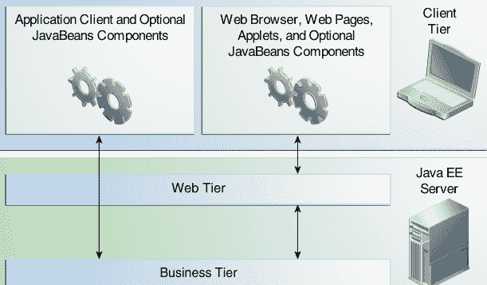
```

#### 1.3.4 Web 组件


# Java EE Web 组件

Java EE Web 组件是 servlet 或使用 Java Faces 技术创建的网页（JSP 页面）。`servlet` 是动态处理请求并构建响应的 Java 编程语言类。JSP 页面是作为 `servlet` 执行的文本文档，同时也为创建静态内容提供了更自然的方法。JavaFaces 技术基于 `servlet`，JSP 技术为 Web 应用程序提供了用户界面框架。

静态 HTML 页面和 applet 在应用程序组装时与 Web 组件打包在一起，但 Java EE 规范未将它们视为 Web 组件。服务器端工具类也可以与 Web 组件打包在一起，和 HTML 页面一样，它们不被视为 Web 组件。

如图 1–3 所示，Web 层与客户端层一样，可能包含一个 JavaBean 组件来管理用户输入，并将该输入发送到运行在业务层的企业豆进行处理。

## 图 1–3 Web 层与 Java EE 应用

| 应用程序客户端和可选的 JavaBeans 组件 | Web 浏览器、网页、Applet 以及可选的 JavaBeans 组件 | 客户端层 |
| :--- | :--- | :--- |
| |  | |
| JavaBeans 组件（可选） | 网页、Servlets Web 层 | Java EE 服务器 |
| :--- | :--- | :--- |
|  |  |  |
| 业务层 | | |

# 1.3.5 业务组件

业务代码是解决或满足特定业务领域（如银行、零售或金融）需求的的逻辑，它由运行在业务层或 Web 层中的企业豆处理。图 1–4 显示了企业豆如何从客户端程序接收数据，对其进行处理（必要），并将其发送到企业信息系统层进行存储。企业豆还会从存储器中检索数据，对其进行处理（必要），并将其发送回给客户端程序。

## 图 1–4 业务层与 EIS 层

| 应用程序客户端和可选的 JavaBeans 组件 | Web 浏览器、网页、Applet 以及可选的 JavaBeans 组件 | 客户端层 |
| :--- | :--- | :--- |
| JavaBeans 组件（可选） | 网页、Servlets | Web 层 Java EE 服务器 |
| | 持久实体、Session Bean、消息驱动豆 | 业务层 |
| | 数据库和遗留系统 | EIS 层 |

# 1.3.6 企业信息系统层

企业信息系统层处理 `EISget`，包含企业基础设施系统，如企业资源计划 (ERP)、大型机事务处理、数据库系统和其他遗留信息系统。例如，Java EE 应用组件可能需要访问企业信息系统以进行数据库连接。

# 1.4 Java EE 容器

通常，薄客户端多层应用很难编写，因为它们涉及许多行复杂的代码来处理事务和状态管理、多线程、资源池和其他低级细节。基于组件且平台无关的 Java EE 架构使得应用程序易于编写，因为业务逻辑被组织成可重用的组件。此外，Java EE 服务器以容器的形式为每种类型的组件提供底层服务。由于你不需要自己开发这些服务，因此可以专注于解决当前面临的业务问题。

## 1.4.1 容器服务

**容器**是组件与支持该组件的低级特定平台功能之间的接口。在执行之前，Web、企业豆或应用程序客户端组件必须组装成 Java EE 模块并部署到其容器中。

组装过程涉及为 Java EE 应用中的每个组件以及 Java EE 应用本身指定容器设置。容器设置自定义了 Java EE 服务器提供的底层支持，包括安全性管理、事务管理、Java 命名和目录接口 (NDI) API 查找以及远程连接等服务。以下是一些亮点。

- Java EE 的安全性模型允许你配置 Web 组件或企业豆，使得只有授权用户才能访问系统资源。
- Java EE 事务模型允许你指定组成单个事务的方法之间的关系，以便一个事务中的所有方法被视为一个单元。
- JNDI 查找服务为企业中的多个命名和目录服务提供统一的接口，以便应用程序组件可以访问这些服务。
- Java EE 远程连接模型管理客户端与企业豆之间的低级通信。在创建企业豆后，客户端调用其方法就像它在同一台虚拟机中一样。

由于 Java EE 架构提供了可配置的服务，同一应用程序中的组件可以根据它们部署的位置而表现出不同的行为。例如，企业豆可以拥有安全设置，允许它在某个生产环境中对数据库具有特定层级的访问权限，而在另一个生产环境中具有另一个级别的数据库访问权限。

容器还管理不可配置的服务，例如企业豆和 `Servlet` 的生命周期、数据库连接资源池、数据持久化以及对 Java EE 平台 API 的访问（参见 Java EE 7 APIs）。

## 1.4.2 容器类型

部署过程将 Java EE 应用组件安装在 Java EE 容器中，如图 1-5 所示。

## 图 1–5 Java EE 服务器与容器

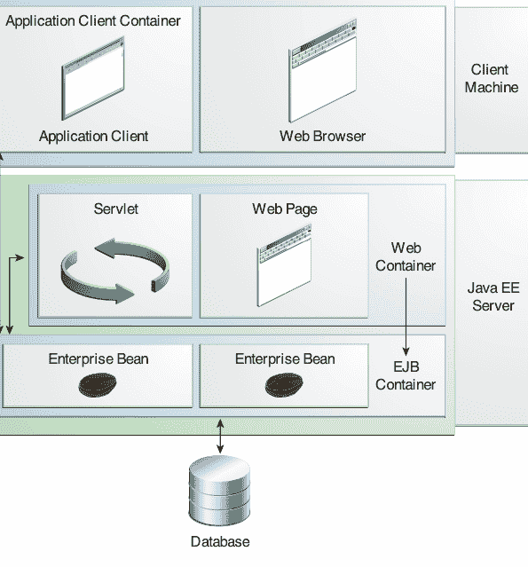

服务器和容器如下：

- **Java EE 服务器**：Java EE 产品的运行时部分。Java EE 服务器提供 EJB 和 Web 容器。
- **EJB 容器**：管理 Java EE 应用企业豆的执行。企业豆及其容器运行在 Java EE 服务器上。
- **Web 容器**：管理 Java EE 应用的网页、`Servlet` 和某些 EJB 组件的执行。Web 组件及其容器运行在 Java EE 服务器上。
- **应用程序客户端容器**：管理应用程序客户端组件的执行。应用程序客户端及其容器运行在客户端。
- **Applet 容器**：管理 Applet 的执行。由运行在客户端的 Web 浏览器和 Java 插件共同组成。

# 1.5 Web 服务支持

Web 服务是基于网络的服务，使用开放标准交换数据。Java EE 平台提供了快速设计、开发和部署 服务的工具。这些标准和协议在下文中。

## 1.5.1 XML

可扩展标记语言 (XML) 是一种跨平台、可扩展、基于文本的数据表示标准。交换 XML 数据的双方可以创建自己的标签来描述数据，设置架构以指定特定类型 XML 文档可以使用标签，并使用样式表管理数据的显示。

例如，Web 服务可以使用 XML 和架构生成价格列表，接收价格列表和架构的公司可以使用自己的样式表以符合需求的方式处理数据。例如：

- 一家公司通过程序将 XML 价格信息转换为 HTML，以便将其价格列表发布到内网。
- 合作伙伴通过工具将 XML 价格信息创建营销演示文。
- 另一家公司将 XML 价格信息读入应用程序进行处理。

## 1.5.2 SOAP 传输协议

客户端请求和 Web 响应通过 HTTP 传输简单对象访问协议 (SOAP) 消息，实现不同平台和互联网不同位置的客户端与 Web 服务之间的完全互操作交换。HTTP 是发送消息常用的请求响应标准，而 SOAP 是遵循 HTTP 请求响应模型的 XML 协议。

传输消息的 SOAP 部分执行：

- 定义 XML 封包以描述消息内容并说明如何处理消息。
- 包含 XML 编码规则，用于在消息中表示自定义数据类型的实例。

## 1.5.3 WSDL 标准格式

Web 服务描述语言 (WSDL) 是描述网络服务的标准化 XML 格式。描述包含了服务的名称、位置以及与服务通信的方法。WSDL 服务描述可以发布在 Web 上。GlassFish 提供了一个用于生成使用远程过程调用与客户端通信的 Web 服务 WSDL 规范。

# 1.6 Java EE 应用组装与部署

Java EE 应用被封装成一个或多个标准单元，以便部署到任何符合 Java EE 规范的系统。每个单元包含：

- 一个功能组件或多个组件，例如企业豆（enterprise bean）、Web页面、`Servlet` 或小程序（applet）
- 一个可选的部署描述符，用于描述其内容

一旦生成了 Java EE 单元，就可以进行部署。部署通常涉及使用平台的部署工具来指定特定位置的信息，例如可以访问该单元的本地用户列表以及本地数据库的名称。一旦在本地平台上部署完成，应用程序即可运行。

# 1.7 Java EE 7 APIs

图 1-6 显示了 Java EE 容器之间的关系。

## 图 1-6 Java EE 容器

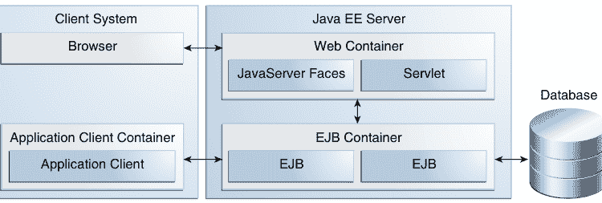

图 1-7 显示了 Java EE 7 API 在 Web 容器中的可用性。

## 图 1–7 Web 容器中的 Java EE APIs

| Web 容器 | WebSocket | Java SE |
| --- | --- | --- |
| | 并发工具 | |
| | | 批处理 |
| | | JSON-P |
| | | Bean Validation |
| | | EJB Lite |
| | | EL |
| | `Servlet` | JavaMail |
| | <font color='gray'>Java EE 7 新增</font> | JSP |
| <Server Faces>Server Faces | | |
| | | 连接器 |
| | | Java 持久化 |
| | | JMS |
| | | 管理 |
| | | WS Metadata |
| | | Web 服务 |
| | | JACC |
| | | JASPIC |
| | | JAX-RS |
| | | JAX-WS |
| | | JSTL |
| | | JTA |
| | | CDI |
| | | 依赖注入 |

* Java EE 7 新增

图 1–8 显示了 Java EE 7 API 在 EJB 容器中的可用性。

## 图 1–8 EJB 容器中的 Java EE APIs

| EJB 容器 | 货币工具 | Java SE |
|---|---|-|
| | 批处理 | |
| | JSON-P | |
| | CDI | |
| | 依赖注入 | |
| | JavaMail | |
| | Java 持久化 | |
| | JTA | |
| | 连接器 | |
| | JMS | |
| | 管理 | |
| | WS Metadata | |
| | Web 服务 | |
| | JACC | |
| | JASPIC | |
| | Bean Validation | |
| | JAX-RS | |
| | JAX-WS | |

Java EE 7 新增

图 1–9 显示了 Java EE 7 API 在应用程序客户端容器中的可用性。

## 图 1–9 应用客户端容器中的 Java EE APIs

| 应用程序客户端容器 | Java 持久化 | Java SE |
| --- | --- | --- |
| | 管理 | |
| | WS Metadata | |
| | 应用程序客户端 | Web 服务 |
| | | JSON-P |
| | | JMS |
| | | JAX-WS |
| | Bean Validation | JavaMail |
| | | CDI |
| | | 依赖注入 |

接下来的章节简要概述了 EE 平台的技术以及 Java EE 应用中使用的 API。

## 1.7.1 企业豆技术

一个 JavaBeans (EJB) 组件，或称企业豆，是一段具有字段和方法以实现业务逻辑的代码。一旦生成了 Java EE 单元，就可以进行部署。部署通常涉及使用平台的部署工具来指定特定位置的信息，例如可以访问该单元的本地用户列表以及本地数据库的名称。一旦在本地平台上部署完成，应用程序即可运行。Java EE 7 平台新增功能包括：

- 非阻塞 I/O
- 事务性 bean
- 异步 bean
- 消息驱动 bean
- 消息服务
- 消息 bean
- 消息 bean
- 事务拦截器
- 事务拦截器
- 事务 bean
- 事务拦截器
- 事务性 EJB

## 1.7.2 Servlet 技术

`Servlet` 技术允许你在 JSP 中直接插入 `Servlet` 代码。Java EE 7 平台新增功能包括：

- 响应式
- 响应
- 响应式
- 响应
- 响应式
- 响应
- 响应式
- 响应
- 响应式
- 响应
- 响应式
- 响应
- 响应式
- 响应
- 响应式
- 响应
- 响应式
- 响应
- 响应式
- 响应
- 响应式
- 响应

Java 功能包括：

- 响应
- 响应式
- 响应
- 响应式
- 响应
- 响应式
- 响应
- 响应式
- 响应
- 响应式
- 响应
- 响应式
- 响应
- 响应式
- 响应
- 响应式
- 响应
- 响应式

## 1.7.3 Faces 技术

Faces 技术是一种用于构建 Web 用户界面的框架。Java EE 7 平台新增功能包括：

- HTML 友好型标记
- 流
- 资源库

Java EE 7 平台需要：

## 1.7.4 Java 页面（JSP）技术

服务器页面 (JSP) 技术允许你在文本文档中放入 `Servlet` 代码段。JSP 文档包含两种类型：

- 静态数据，如 HTML 或 XML
- JSP 元素，决定页面的内容

关于 JSP 技术的信息，请参见 [Java EE 5 教程](http://docs.oracle.com/javaee/5/tutorial/)。Java EE 7 平台需要：

## 1.7.5 JSP 标签库

JSP 标签库 (JSTL) 封装了 JSP 的核心功能。与其在你的 JSP 应用中混合来自多个供应商的标签，不如使用一组标准的标签。这种标准化允许你在任何支持 JSTL 的 JSP 容器上部署应用，并使标签的实现更加优化。

JSTL 具有用于流程控制的核心标签、操作 XML 文档的标签、国际化标签、使用 SQL 访问数据库的标签以及常用函数。Java EE 7 平台需要 JSTL 1.2。

## 1.7.6 Java 持久化 API

JPA 是一种标准的持久化解决方案。持久化使用对象关系映射方法桥接对象模型与关系型数据库之间的差异。持久化 API 也可以在 Java EE 环境之外的 SE 应用中使用。持久化包含以下领域：

- Java 持久化 API
- 查询语言
- 对象关系映射元数据

Java EE 7 平台需要 JPA 2.1。

## 1.7.7 Java 事务 API

事务 API (JTA) 为事务标记提供了标准接口。Java EE 架构提供了默认自动提交来处理事务提交和回滚。自动提交意味着任何查看数据的应用程序在每次数据库读取或写入后都能看到更新后的数据。如果你的应用程序执行两个相互依赖的数据库操作，你希望使用 JTA API 标记整个事务，包括这两个操作的开始、回滚和提交。

Java EE 7 平台需要 Java Transaction API 1.2。

## 1.7.8 RESTful Web 服务 Java API

RESTful Web 服务 Java API (JAX-RS) 定义了用于根据表述状态转移 (REST) 架构构建 Web 服务的 API。JAX-RS 应用是一种 Web 应用，其类被封装在 WAR 文件的 `Servlet` 中，并包含所需的库。

Java EE 7 平台需要 JAX-RS 2.0。

# Java EE 7 APIs

Managed Beans（托管豆）规范是 Java EE 7 平台规范（JSR 342）的一部分。Java EE 7 平台需要 Managed Beans 1.0。

## 1.7.10 Java EE 的上下文与依赖注入

用于 Java EE 容器的依赖注入（CDI）定义了一组由 Java EE 提供的上下文服务，这使得开发者能够轻松地在 Web 应用程序中使用 Java-Faces 技术使用企业级豆。CDI 设计用于有状态的对象，它也具有更广泛的作用范围，允许开发者具有极大的灵活性，以松耦合且类型安全的方式集成不同组件。

Java EE 7 平台需要 CDI 1.1。

## 1.7.11 Java 依赖注入

Java 依赖注入（Dependency Injection for Java）为用于可注入类定义了一套标准注解（以及一个接口）。

在 Java EE 中，CDI 提供对依赖注入的支持。具体而言，你只能在启用 CDI 的应用程序中注入点。

Java EE 7 平台需要 Java 依赖注入 1.0。

## 1.7.12 Bean 校验

Bean 校验（Bean Validation）规范定义了用于校验 JavaBeans 组件中数据的元数据模型和 API。与其将数据校验分布在多个层（如浏览器和服务器端），你可以在一处定义校验约束，并在不同层之间共享它们。

Java EE 7 平台需要 Bean 校验 1.1。

## 1.7.13 Java 消息服务 API

Java 消息服务（JMS）API 是一种消息标准，允许 Java EE 应用程序组件创建、发送、接收和读取消息。它实现了松耦合、可靠且异步的分布式通信。

在新平台中，JMS 的功能包括：


- 一个新的 API，为之前的 API 提供了更简单的替代方案。该 API 包含一个 `JMSContext` 对象，它结合了 Connection 和 Session 的功能。

- 所有具有 `close` 方法的对象都实现了 `java.lang.AutoCloseable` 接口，因此可以在 Java SE 7 的 `try-with-resources` 语句中使用。

Java EE 7 平台需要 JMS 2.0。

## 1.7.14 Java EE 连接器架构

EE 连接器架构（EE Connector Architecture）被供应商和系统集成商用于创建资源适配器，这些适配器支持访问可以插入到任何 Java EE 产品中的企业信息系统（EIS）。资源适配器是一个软件组件，允许 Java EE 组件访问并与 EIS 的底层资源管理器交互。由于资源适配器特定于其资源管理器，通常每种类型的数据库或企业信息系统都有一个不同的适配器。

Java EE 连接器架构提供了一种面向性能、安全、可扩展且基于消息的事务集成方案，将基于 Java EE 平台的 Web 服务与现有 EIS 集成，这种集成可以是同步或异步的。集成到 Java EE 连接器架构并进入 Java EE 平台的现有应用程序和 EIS 可以使用 JAX-WS 和 Java EE 组件模型暴露为基于 XML 的 Web 服务。JAX-WS 和 Java EE 连接器架构是企业应用集成（EAI）和端到端业务集成的互补技术。

Java EE 7 平台需要 Java EE 连接器架构 1.7。

## 1.7.15 JavaMail API

Java EE 应用程序使用 JavaMail API 发送电子邮件通知。JavaMail API 有两个部分：

- 应用程序组件用于发送邮件的应用程序级接口

- 服务提供者接口

Java EE 平台包含带有服务提供者的 JavaMail API，允许应用程序组件发送互联网邮件。

Java EE 7 平台需要 JavaMail 1.5。

## 1.7.16 容器的 Java 授权合约

容器 Java 授权合约（JACC）规范定义了 Java EE 应用程序服务器与授权策略提供者之间的合约。所有 Java EE 容器都支持此合约。

JACC 规范定义了满足 Java EE 授权模型的 `java.security.Permission` 类。该规范定义了容器访问决策与这些权限类实例操作之间的绑定。它还定义了策略提供者的语义，这些提供者使用新的权限类来处理 Java EE 平台的授权需求，包括角色的定义和使用。

Java EE 7 平台需要 JACC 1.5。

## 1.7.17 容器的 Java 身份验证服务提供者接口

容器 Java 身份验证服务提供者接口（JASPIC）指定了一个服务提供者接口（SPI），通过该接口可以将身份验证者集成到客户端或服务器消息处理容器或运行时。通过此接口集成的身份验证者对其调用容器提供的网络消息进行操作。身份验证者对传出的消息进行格式化，以便每条消息的源可以被接收容器验证，消息接收者可以被发送者验证。身份验证者验证每条入站消息，并向其调用容器返回根据消息验证结果建立的身份。

Java EE 7 平台需要 JASPIC 1.1。

## 1.7.18 Java WebSocket API

WebSocket 是一种应用协议，通过 TCP 在两个对端之间提供全双工通信。Java WebSocket API 允许 Java Platform 标准版 7 中的 Java EE 应用程序使用注解（指定端点的配置参数并指定其生命周期回调方法）来创建端点。

WebSocket API 是 Java EE 7 平台的新特性。Java EE 7 平台需要 Java WebService API 1.0。

## 1.7.19 Java JSON 处理 API

JSON 是一种源自 JavaScript 的文本数据交换格式，用于 Web 服务和其他连接应用程序。Java JSON 处理 API（JSON-P）允许 Java EE 应用程序使用对象模型或流式模型来解析、转换和查询 JSON 数据。

JSON-P 是 Java EE 7 平台的新特性。Java EE 7 平台需要 JSON-P 1.0。

## 1.7.20 Java EE 并发工具

Java EE 并发工具是一种标准 API，通过以下类型的对象为 Java EE 组件提供异步能力：托管执行器、托管执行服务、托管线程工厂和上下文服务。

Java EE 并发工具是 Java EE 7 平台的新特性。Java EE 7 平台需要并发发工具 1.0。

## 1.7.21 Java 平台批处理

无需用户交互即可执行的批作业。Java 平台批处理规范是一个用于在 Java 应用程序中创建和运行批作业的框架。该框架由作业运行时、基于 XML 的作业规范语言、与运行时交互的 Java API 以及实现作业物的 Java API 组成。

Java 平台批处理是 Java EE 7 平台的新特性。Java EE 7 平台需要 Java 平台批处理 1.0。

## 1.8 Java平台标准版 7 中的 Java EE 7 APIs

Java EE 7 平台所需的若干 API 包含在 Java平台标准版 7（Java SE 7）中，并且对 Java EE 应用程序均可用。

### 1.8.1 Java 数据库连接 API

Java 数据库连接（JDBC）API 允许从 Java 语言方法调用 SQL 命令。当会话豆访问数据库时，你在企业豆中使用 JDBC API。你也可以从 servlet 或 JSP 页面使用 JDBC API 直接访问数据库，而无需通过企业豆。

JDBC API 有两个部分：

- 应用程序组件用于访问数据库的应用程序级接口

- 将 JDBC 驱动附加到 Java EE 平台的提供者接口

Java SE 7 平台需要 JDBC 4.1。

### 1.8.2 Java 命名和目录接口 API

Java 命名和目录接口 (JNDI) API 提供了命名和目录功能，允许应用程序访问多个命名和目录服务，例如 LDAP、DNS 和 NIS。JNDI API 提供了执行标准目录操作的方法，例如将对象与属性关联以及使用属性搜索对象。通过 JNDI，EE 应用程序可以与许多遗留系统共存。

EE 命名服务为应用程序客户端、企业豆（Enterprise Beans）和 Web 组件提供了访问 JNDI 命名环境的。命名环境允许在无需访问或更改组件源代码的情况下对组件进行自定义。容器以 JNDI 命名上下文的形式向组件提供支持。

命名环境提供了四个逻辑命名空间：`java:comp`、`java:module`、`java:app` 和 `java:global`，用于组件访问、模块访问或所有应用程序共享的对象。Java EE 组件可以访问系统提供的和用户定义的对象。某些系统提供的对象（例如默认 JDBC DataSource、默认 JMS 连接工厂和 JTA `UserTransaction` 对象）存储在 `java:comp` 命名空间中。Java EE 平台允许组件对用户定义的对象（如企业豆、环境条目、DataSource 对象以及消息目标）进行命名。

Java EE 组件还可以通过 JNDI 接口定位其命名上下文。`javax.naming.InitialContext` 对象可以查找 InitialContext 中的环境命名上下文，组件的命名上下文直接存储在环境命名环境中，或者存储在它的任何直接或间接上下文中。

### 1.8.3 Beans 激活框架

Beans 激活框架 (JAF) 被 JavaMail API 使用。RAF 提供了标准服务来确定任意数据的交付、封装对该数据的访问、发现其上可用的操作，并创建适当的 Beans 来执行这些操作。

### 1.8.4 Java XML 处理 API

XML 处理 API (JAXP) 是 Java SE 平台的一部分，它支持使用文档对象模型 (DOM) 和可扩展样式表转换 (XSLT) 来处理 XML 文档。JAXP 允许应用程序独立于特定的 XML 处理实现来解析和转换 XML 文档。

JAXP 还提供了命名空间支持，这允许处理可能存在命名冲突的架构（Schemas）。JAXP 设计灵活，允许你在应用程序中使用来自的任何符合 XML 标准的解析器或处理器，并支持世界网联盟 (W3C)架构。你可以在 `http://www.w3.org/XML/Schema` 找到信息。

### 1.8.5 XML 绑定架构

XML 绑定架构 (JAXB) 提供了一种方便的方法，将 XML 架构绑定到 Java 语言程序中的表示。JAXB 可以独立使用，也可以与 JAX-WS 结合使用，在这种情况下它为 Web 服务消息提供标准数据绑定。所有的 Java EE 客户端容器、Web 容器和 EJB 容器都支持 JAXB API。

Java EE 7 平台需要 JAXB 2.2。

### 1.8.6 XML Web 服务 API

Java Web 服务 API (JAX-WS) 规范为使用 JAXB API 将 XML 数据绑定到 Java 对象的 Web 服务提供了支持。JAX-WS 规范定义了访问服务的客户端 API，以及实现 Web 服务端点的技术。《实现企业 Web 服务》规范描述了基于 JAX-WS 的服务和客户端的部署。EJB 和 Java Servlet 规范也描述了此类部署的某些方面。

《基于 JAX-WS 的应用程序》规范描述了对可以处理消息请求和响应的消息处理器的支持。通常情况下，这些消息处理器与它们关联的 JAX-WS 客户端或端点组件在同一个容器中执行，具有相同的权限和执行上下文。这些消息处理器与其关联组件具有相同的 JNDI 命名空间。自定义序列化和反序列化器（如果支持）的对待方式与消息处理器相同。

Java EE 7 平台需要 JAX-WS 2.2。

### 1.8.7 Java 附件 SOAP API

Java 附件 SOAP API (SAAJ) 是 JAX-WS 依赖的低级 API。SAAJ 允许生成和消费符合 SOAP 1.1 和 1.2 规范以及 SOAP 附件说明的消息。大多数开发者不使用 SAAJ API，而是使用高级别的 JAX-WS API。

### 1.8.8 认证和授权服务

Java 认证和授权服务 (JAAS) 为 Java EE 应用程序提供对特定用户或用户组进行认证和授权的方法。JAAS 是标准可插认证模块 (PAM) 框架的 Java 语言版本，它扩展了 Java 平台安全架构以支持基于用户的授权。

### 1.8.9 Java 平台通用注解

注解在 Java 平台实现了声明式编程风格。Java EE 7 平台需要 Java 平台通用注解 1.2。

## 1.9 GlassFish Server 工具

GlassFish Server 是 Java EE 7 的合规实现。除了支持前面节描述的所有 API 之外，GlassFish Server 还包含了一些不属于 Java EE 7 平台但为开发人员提供便利的 Java EE 工具。

本节总结了构成 GlassFish Server 的工具。关于启动和停止 GlassFish Server、启动管理控制台以及启动和停止 Java DB 的说明见第 2 章“使用教程示例”。

GlassFish Server 包含表 1–1 中列出的工具。许多工具的基本用法信息贯穿整个教程。有关详细信息，请参阅 GUI 工具中的在线帮助。

### 表 1–1 GlassFish Server 工具

| 工具 | 描述 |
|---|---|
| 管理控制台 | 一种基于 Web 的 GlassFish Server 管理工具。用于停止 GlassFish Server 以及管理用户、资源和应用程序。 |
| asadmin | 一种命令行 GlassFish Server 管理工具。用于启动和停止 GlassFish Server 以及管理用户、资源和应用程序。 |
| appclient | 一种命令行工具，用于启动应用程序容器并调用封装在 application client JAR 文件中的客户端应用程序。 |
| capture-schema | 一种命令行工具，用于从数据库中提取架构信息，生成 GlassFish Server 可用于容器持久化的架构文件。 |
| package-appclient | 一种命令行工具，用于打包应用程序客户端库和 JAR 文件。 |
| Java DB database | Java DB 服务器的副本。 |
| xjc | 一种命令行工具，将源 XML 架构转换并绑定到 Java 语言中的一组 JAXB 类。 |
| scheagen | 一种命令行工具，为 Java 类引用的每个命名空间创建一个架构文件。 |
| wsimport | 一种命令行工具，为给定的 WSDL 文件生成 JAX-WS 产物。生成后，这些产物可以与 WSDL 和架构一起封装在 WAR 文件中部署。 |
| wsgen | 一种命令行工具，生成 Web-WS 端点类并生成 Web 服务部署所需的所有 JAX-WS 产物。 |

## 2 使用教程示例

本章将告诉你如何安装、构建和运行示例。

此处将介绍以下主题：

- 需要的软件

- 启动和停止 GlassFish Server

- 启动管理控制台

- 启动和停止 Java DB 服务器

- 构建示例

- 示例目录结构

- Java EE 7 Maven Arche

- 获取教程的最新更新

- 调试 Java EE 应用程序

## 2.1 需要的软件

运行示例需要以下软件：

- Java 平台，标准版

- Java EE 7 开发包

- Java EE 7 教程组件

- NetBeans IDE

- Apache Maven

## 2.1.1 Java 平台，标准版

服务器，你必须安装 Java EE 7 软件开发包 (SDK) Update 1，你可以从 `http://www.oracle.com/technet/java/javaee/downloads/index.html` 下载。请确保下载的是 Java EE 7 SDK Update 1，而不是 Java EE 7 Web Profile SDK Update 1。

## 2.1.2 SDK 安装步骤

Java EE 7 SDK 是通过 ZIP 文件安装的。它将默认管理员用户名设置为 admin，且不需要密码。管理端口（Admin Port）设置为 4848，HTTP 端口设置为 8080。

本教程中使用 `as-install-parent` 指代目录，即你安装 GlassFish Server 的目录。例如，Microsoft Windows 上的默认安装目录为 `C:\glassfish\as-install-parent`。`C:\glassfish` 是 GlassFish 本身安装在 as-install 中，而 glassfish 目录即 as-install-parent。在 Microsoft Windows 上，as-install 为 `C:\glassfish\glassfish`。

安装 GlassFish Server 后，请将以下目录添加到你的 PATH 中，以避免在使用命令时指定完整路径：

- `as-install-parent/bin`

- `as-install/bin`

## 2.1.3 Java EE 7 教程组件

教程组件（包括文档和示例源码）包含 Java EE 7 SDK Update 1 中。

Java EE 7 的更新将定期发布。有关获取这些更新的详情，请参阅《获取教程最新更新》。

## 2.1.4 NetBeans IDE

NetBeans 集成开发环境 (IDE) 是一个用于开发 Java 应用（包括企业级应用）的免费开源 IDE。NetBeans IDE 支持 Java EE 平台。你可以从 NetBeans IDE 构建、部署并运行教程示例。

运行教程，你需要最新版本的 NetBeans IDE。你可以从 `https://netbeans.org/downloads/index.html` 下载 NetBeans IDE。请确保下载的是 Java EE 组合包。

## 2.1.4.1 安装不带 GlassFish Server 的 NetBeans IDE

安装 NetBeans IDE 时，请不要安装随 NetBeans IDE 提供的 GlassFish Server 版本。要跳过 GlassFish Server 的安装，请按照以下步骤操作。

1. 在 NetBeans IDE 安装向导的第一页，取消勾选 GlassFish Server 复选框并点击 OK。

2. 分别接受许可协议和 JUnit 许可协议。部分教程示例使用了 JUnit 库，你应该安装它。

3. 继续安装 NetBeans IDE。

## 2.1.4.2 使用 NetBeans IDE 将 GlassFish Server 添加为服务器

若要在 NetBeans IDE 中运行教程示例，你必须将 GlassFish Server 作为服务器添加到 NetBeans IDE 中。请按照以下说明将 GlassFish Server 添加到 NetBeans IDE 中。

1. 从 **Tools (工具)** 菜单中，选择 **Servers (服务器)**。

2. 在 Servers 向向导中，点击 **Add Server (添加服务器)**。

3. 在 **Choose (选择)** 下，选择 **GlassFish Server** 并点击 **Next (下一步)**。

4. 在 **Server Location (服务器位置)** 下，浏览到 Java EE 7 SDK 的所在位置并点击 **Next (下一步)**。

5. 在 **Domain Location (域位置)** 下，选择 **Register Local Domain (注册本地域)**。

6. 点击 **Finish (完成)**。

## 2.1.5 Apache Maven


# Maven

Maven 是一种由 Apache 软件基金会开发的基于 Java 的工具，用于构建、打包和部署教程示例。若要从命令行运行教程示例，你需要 Maven 3.0 或更高版本。如果你没有 Maven，可以安装它：

http://maven.apache.org

务必将 `maven-install/bin` 目录添加到你的路径中。

如果你使用 NetBeans IDE 构建和运行示例，它包含了一个 Maven 副本。

## 2.2 启动和停止 GlassFish Server

你可以使用 NetBeans IDE 或命令行启动和停止 GlassFish Server。

### 2.2.1 使用 NetBeans IDE 启动 GlassFish Server

1. 点击 **Services (服务)** 选项卡。
2. 展开 **Servers (服务器)**。
3. 右键点击 GlassFish Server 实例并选择 **Start (启动)**。

### 2.2.2 使用 NetBeans IDE 停止 GlassFish Server

若要使用 NetBeans IDE 停止 GlassFish Server，右键点击 GlassFish Server 实例并选择 **Stop (停止)**。

### 2.2.3 使用命令行启动 GlassFish Server

若要从命令行启动 GlassFish Server，请打开终端窗口或命令提示符并执行以下命令：

```
asadmin start-domain --verbose
```

域（domain）是由一个管理服务器管理的一个或多个 GlassFish Server 实例集合。以下元素与域相关：

- **GlassFish Server 端口号**：默认为 8080。
- 管理服务器端口号：默认为 4848。
- 管理员用户名和密码：默认用户名为 admin，默认不需要密码。

你在安装 GlassFish Server 时指定这些值。本教程中的示例假设你选择了默认端口以及默认用户名且无密码。

在不带参数的情况下，`start-domain` 命令会启动默认域，即 domain1。`verbose` 标志允许所有日志和调试输出显示在终端窗口或命令提示符中。输出也会进入服务器日志，位置位于 `domain-dir/logs/server.log`。

### 2.2.4 使用命令行停止 GlassFish Server

若要停止 GlassFish Server，请打开终端窗口或命令提示符并执行：

```
asadmin stop-domain domain1
```

## 2.3 启动管理控制台

若要管理 GlassFish Server 并管理用户、资源和 Java EE 应用，请使用管理控制台工具。在调用管理控制台之前，GlassFish Server 必须运行，并在浏览器中打开 http://localhost:4848。

### 2.3.1 使用 NetBeans IDE 启动管理控制台

1. 点击 **Servers (服务器)**。
2. 展开 **Servers**。
3. 右键点击 GlassFish Server 实例并选择 **View Admin Console (查看域管理控制台)**。

> 注意：NetBeans IDE 使用你的默认浏览器打开管理控制台。

## 2.4 启动和停止 Java DB Server

GlassFish Server 包含 Java DB 数据库服务器。

若从命令行启动 Java DB Server，请打开终端窗口或命令提示符并执行：

```
asadmin start-database
```

若从命令行停止 Java DB Server，请打开终端窗口或命令提示符并执行：

```
asadmin stop-database
```

有关 GlassFish Server 包含的 Java DB 信息，请参阅 http://www.oracle.com/technetwork/java/javadb/overview/index.html。

### 2.4.1 使用 NetBeans IDE 启动数据库服务器

当你使用 NetBeans IDE 启动 GlassFish Server 时，数据库服务器会自动启动。然而，如果你需要手动启动服务器，请按照以下步骤操作。

1. 点击 Services 选项卡。
2. 展开 **Databases (数据库)**。
3. 右键点击 Java DB 并选择 **Start Server (启动服务器)**。

后续步骤

若要使用 NetBeans IDE 停止数据库，右键点击 Java DB 并选择 **Stop Server (停止服务器)**。

## 教程中的 Java EE 7 Maven Archetypes

某些章节说明了如何使用 Maven archetypes 构建示例应用程序。Archetypes（构型模板）是用于生成特定 Maven 项目的模板。本教程包含了几个用于生成 Java EE 7 项目的 Maven archetypes。

### 2.7.1 安装教程 Archetypes

在基于 archetypes 创建新项目之前，你必须将包含的 Maven archetypes 安装到本地 Maven 仓库中。你可以使用 NetBeans IDE 或 Maven 安装这些 archetypes。

#### 2.7.1.1 使用 NetBeans IDE 安装教程 Archetypes

1. 从 File（文件）菜单中，选择 Open Project（打开项目）。
2. 在 Open Project 对话框中，导航到：
   `tut-install/examples`
3. 选择 archetypes 文件夹。
4. 点击 Open Project（打开项目）。
5. 在 Projects（项目）选项卡中，右键点击 archetypes 项目并选择 Build（构建）。

#### 2.7.1.2 使用 Maven 安装教程 Archetypes

1. 在终端窗口中，进入：
   `tut-install/examples/archetypes/`
2. 输入以下命令：
   `mvn install`

## 2.8 获取教程更新

使用 Java EE 7 SDK 带的 Update Tool（更新工具）检查教程的任何更新。

### 2.8.1 使用 NetBeans IDE 更新教程

1. 打开 NetBeans IDE 中的 Services（服务）并展开 Servers（服务器）。
2. 右键点击 GlassFish Server 实例并选择 View Domain Update（查看域更新）以显示 Update Tool。
3. 在树形中选择 Available Updates（可用更新）以显示更新包列表。
4. 查找 Java EE 7 (javaee-tutorial) 包的更新。
5. 如果有教程的更新版本，选择 Java EE 7 Tutorial (javaee-tutorial) 并点击 Install（安装）。

### 2.8.2 使用命令行更新教程

1. 打开终端窗口并输入以下命令显示 Update Tool：
   `updatool`
2. 在树形中选择 Available Updates（可用更新）以显示更新包列表。
3. 查找 Java EE 7 Tutorial (javaee-tutorial) 包的更新。
4. 如果有教程的更新版本，选择 Java EE 7 Tutorial (javaee-tutorial) 并点击 Install（安装）。

## 2.9 调试 Java EE 应用程序

本节解释了如何确定导致应用程序部署或执行错误的原因。

### 2.9.1 使用服务器日志

调试应用程序的一种是查看 `domain-dir/logs/server.log` 中的服务器日志。日志包含了 GlassFish 和你的应用程序的输出。你可以使用 `System.out.println` 和 Java Logging APIs（文档见于 http://docs.oracle.com/javaee/7/docs/notes/guides/logging/index.html）从应用程序中的任何 Java 类记录消息，并使用 `ServletContext` 方法从 Web 组件记录消息。

如果你使用 NetBeans IDE，日志输出将显示在输出窗口或作为服务器日志出现。

如果你使用 `--verbose` 标志启动 GlassFish Server，允许的日志和调试输出将显示在终端窗口、命令提示符和服务器日志中。如果你在后台启动 GlassFish Server，调试信息将可用在日志中。你可以使用文本编辑器或 Administration Console（管理控制台）日志查看服务器日志。

#### 2.9.1.1 使用管理控制台日志查看器

1. 选择 GlassFish Server 节点。
2. 点击 View Log Files（查看日志文件）。
3. 要显示其他条目，请遵循以下步骤：
   a. 点击 Modify Search（修改搜索）。
   b. 为你想查看的条目指定任何约束。
   c. 点击日志查看器顶部的 Search（搜索）。

### 2.9.2 使用调试器

GlassFish 支持 Java 平台调试体系 (JPDA)。通过 JPDA，你可以配置 GlassFish Server 使用 socket 通信调试信息。

#### 2.9.2.1 使用调试器调试应用程序

1. 按照以下步骤通过管理控制台启用 GlassFish Server 中的调试功能：
   a. 展开 Configurations（配置）节点，然后展开 server-config 节点。
   b. 选择 JVM Settings 节点。默认调试选项设置为：
      `-agentlib:jdw=transport=dt_socket,server=y,suspend=n,address=9009`

如你所见，默认调试器 socket 端口为 9009。你可以将其更改为 GlassFish Server 或其他服务未使用的端口。
   c. 勾选 Debug Enabled（启用调试）框。
   d. 点击 Save（保存）。
2. 停止 GlassFish Server 然后重启它。

# 第二部分：平台基础

第二部分介绍了平台基础。此部分包含以下章节：

- 第 3 章，“资源创建”（Resource Creation）
- 第 4 章，“注入”（Injection）
- 第 5 章，“打包”（Packaging）

# 3 资源创建

资源是一种提供到数据库服务器和消息系统等连接的程序对象。Java EE 组件可以访问各种资源，包括数据库、邮件会话、Java Message Service 对象和 URL。Java EE 7 平台提供了机制，允许你以类似的方式访问所有这些资源。本章检查了多种类型的资源以及如何创建它们。

此处处理了以下主题：

- 资源与 JNDI 命名
- DataSource 对象和连接池
- 管理式创建资源

## 3.1 资源与 JNDI 命名

资源是一种提供到数据库服务器和消息系统等连接的程序对象。Java EE 组件可以访问各种资源，包括数据库、邮件会话、Java Message Service 对象和 URL。Java EE 7 平台提供了机制，允许你以类似的方式访问所有这些资源。本章节检查了多种类型的资源以及如何创建它们。

此处处理了以下主题：

- 资源与 JNDI 命名
- DataSource 对象和连接池
- 管理式创建资源

（注：此处原文包含大量重复块，翻译已按要求保留核心意译）

## 3.2 DataSource 对象和连接池

为了存储、组织和检索数据，应用程序使用 connection。在 GlassFish Server 中，数据源被称为 DataSource，可以被认为是该源连接的工厂。DataSource 有一组属性，用于标识和描述它所代表的真实世界数据源。这些属性包括数据库的位置、与服务器通信的网络协议等。在 GlassFish Server 中，数据源被称为 JDBC resource。

应用程序使用 connection 访问数据。DataSource 对象实现连接池以生成到 DataSource 类所代表的特定源的连接。`getConnection` 方法返回的连接对象是 PooledConnection 而不是物理连接。应用程序使用连接对象与其使用连接的方式相同。连接池对应用程序代码没有影响，连接应该始终关闭。当应用程序关闭连接时，连接将返回到复用连接池中。下一次调用 `getConnection` 时，如果有可用的池连接，则将返回其中一个。

JDBC 连接池是针对特定数据库的一组复用连接。由于创建每个物理连接都是耗时的，服务器维护了一个可用连接池以提高性能。当应用程序请求连接时，它从池中获取一个。当应用程序关闭连接时，连接返回池中。

使用 Persistence API 的应用程序在 `persistence.xml` 文件的 `jta-data-source` 元素中指定它们正在使用的 DataSource：

```
<jta-data-source>jdbc:MyOrderDB</jta-data-source>
```

这通常是持久化单元对 JDBC 对象的唯一引用。应用程序代码不引用任何 JDBC 对象。

## 3.3 管理式创建资源

在部署或运行应用程序之前，你可能需要为它们创建资源。应用程序可以包含一个 `glassfish-resources.xml` 文件，用于定义该应用程序和其他程序的资源。然后你可以使用 `asadmin` 命令并指定参数文件 `glassfish-resources.xml` 来管理式创建资源，如下所示。

```
asadmin add-resources glassfish-resources.xml
```

`glassfish-resources.xml` 文件可以使用 NetBeans IDE 创建或手动创建。某些 JMS 示例使用这种方法来创建资源。创建 JMS 简单生产者（simple producer）示例所需的资源所需的文件可以在 `jms/simple/producer/src/main/setup` 目录下找到。

你也可以使用 `asadmin create-jms-resource` 命令为此示例创建资源。完成资源创建后，你可以使用 `asadmin list-jms-resources` 命令显示它们的名称，并使用 `asadmin delete-jms-resource` 命令删除它们，无论你是通过何种方式创建资源。

# 4 注入

本章概述了 Java EE 中的注入，并描述了平台提供的两种注入机制：资源注入和依赖注入。

Java EE 提供了注入机制，使你的对象能够在不直接实例化它们的情况下获取资源和其他依赖项。你通过在字段或方法上装饰其中一种注解（该注解将字段标记为注入点），在你的类中声明所需的资源和其他依赖项。然后容器会在运行时提供所需的实例。注入简化了你的代码并将其与依赖项的实现解耦。

本文涵盖了以下主题：

- 资源注入
- 依赖注入
- 资源注入与依赖注入的主要区别

## 4.1 资源注入

资源注入允许你将 JNDI 命名空间中的任何可用资源注入到任何容器托管对象，例如 servlet、企业 bean（enterprise bean）或托管 bean（managed bean）。例如，你可以使用资源注入注入 JNDI 命名空间可用的数据源、连接器或自定义资源。

你用于注入实例引用的类型是一个接口，这使得你的代码与实现解耦。

例如，以下代码注入了一个使用 GlassFishServer 提供默认 DB 数据库连接的数据源对象：

```java
public class MyServlet extends HttpServlet {
    @Resource(name="java:comp/DefaultDataSource")
    private javax.sql.DataSource dsc;
}
```

除了上一个示例中的基于字段的注入，你还可以使用基于方法的注入注入资源：

```java
public class MyServlet extends HttpServlet {
    private javax.sql.DataSource dsc;
    ...
    @Resource(name="java:comp/DefaultDataSource")
    public void setDsc(java.sql.DataSource dsc) {
        dsc = ds;
    }
}
```

要使用基于方法的注入，setter 方法必须遵循 JavaBeans 的属性命名约定：方法名必须以 set 开头，具有 `void` 返回类型，且只有一个参数。

`@Resource` 注解位于 `javax.annotation` 包中并定义在 JSR 250（Java 平台通用注解）中。资源注入通过名称解析，因此它不是类型安全的：资源对象的类型在编译时不可知，如果对象的类型和其引用不匹配，可能会产生运行时错误。

## 4.2 依赖注入

依赖注入允许你将普通的 Java 类转换为托管对象并将其注入到任何托管对象中。使用依赖注入，你的代码可以声明对任何托管对象的依赖。容器在运行时注入点自动提供这些依赖项的实例，并为你管理这些实例的生命周期。

EE 中的依赖注入定义了范围（scopes），决定了容器注入的对象的生命周期。例如，响应单个客户端请求的托管对象（如货币转换器）与需要在在一个会话中处理多个客户端请求的托管对象（如购物车）的范围不同。

你可以通过为普通类分配范围来定义稍后注入的依赖项（也称为托管 bean）：

```java
@javax.enterprise.context.RequestScoped
public class CurrencyConverter { ... }
```

使用 `javax.inject.Inject` 注解注入托管 bean；例如：


```java
public class MyServlet extends HttpServlet {
    @Inject CurrencyConverter cc;
}
```

与资源注入相反，依赖注入是类型安全的，因为它通过类型解析。你可以从托管 bean 的实现中解耦，可以使用接口类型引用注入的实例并拥有你的托管 bean 接口。

有关依赖注入的更多信息，请参阅第 23 章“Java EE 上下文和依赖注入简介”以及 JSR 299（Java EE 平台的上下文和依赖注入）。

## 4.3 资源注入与依赖注入的主要区别

表 4–1 列出了资源注入与依赖注入之间的主要区别。

| 注入机制 | 可以直接注入 JNDI 资源 | 可以直接注入普通类 | 解决方式 | 类型安全 |
| :--- | :--- | :--- | :--- | :--- |
| 资源注入 | 是 | 否 | 资源名称 | 否 |
| 依赖注入 | 否 | 是 | 类型 | 是 |

## 5 打包

本章描述了打包。Java EE 应用被打包成一个或多个标准单元，以部署到任何符合 Java EE 标准的系统。每个单元包含一个或多个功能组件，例如企业 bean、web 页面、servlet 或 applet，以及一个描述其内容的可选部署描述符。

本文涵盖了以下主题：

- 包应用程序
- 打包企业 bean
- 打包 Web 存档
- 打包资源适配器存档

### 5.1 包应用程序

Java EE 应用以 Java 归档（JAR）文件、Web 归档（WAR）文件或企业归档（EAR）文件交付。WAR 或 EAR 文件是带有 `.war` 或 `.ear` 扩展名的标准 JAR (.jar) 文件。使用 JAR、WAR 和 EAR 文件及模块使得使用一些相同组件组装多个不同的 Java EE 应用成为可能。不需要额外的代码；只需要组装（或打包）各种 Java EE 模块。JAR、WAR 和 EAR 文件和模块组装 Java EE 应用。

EAR 文件（见图 5-1）包含 Java EE 模块和可选的部署描述符。**部署描述符**是一个带有 `.xml` 扩展的 XML 文件，描述应用程序、模块或组件的部署设置。由于部署描述符是声明式的，可以在不修改源码的情况下进行更改。运行时，Java EE 服务器读取部署描述符并对应用程序、模块或组件进行操作。

部署信息通常通过源码指定。如果存在部署描述符，它们将覆盖源码中的内容。

#### 图 5–1 EAR 文件结构


```
application.xml
glassfish-application.xml (可选)
```

部署描述符有两种：Java EE 和运行时。Java EE 部署描述符由 Java EE 规范定义，可以在任何 Java EE 实现上配置部署设置。运行时描述符用于配置 Java EE 实现特定的参数。例如，GlassFish 服务器运行时部署描述符包含 Web 应用的上下文路径等缓存指令。GlassFish 实现特定的参数名为 `glassfish-module.xml`，位于与 Java EE 部署描述符相同的 `META-INF` 目录下。

一个 Java EE 模块由相同容器和类型的一个或多个 Java EE 组件组成，以及该类型的可选组件部署描述符。例如，企业 bean 模块部署描述符为企业 bean 声明属性和安全授权。Java EE 模块可以作为独立模块部署。

Java EE 模块有以下类型：

- **EJB 模块**：包含企业 bean 的类文件以及可选的 EJB 部署描述符。EJB 模块打包为带有 `.jar` 扩展的文件。
- **Web 模块**：包含 servlet 类文件、支持 web 的类文件、GIF 和 HTML 文件以及可选的 Web 应用部署描述符。Web 模块打包为带有 `.war`（web 存档）扩展的文件。
- **应用程序客户端模块**：包含类文件以及可选的应用程序客户端部署描述符。应用程序客户端模块打包为带有 `.jar` 扩展的文件。
- **资源适配器模块**：包含所有 Java 接口、原生库以及可选的资源适配器部署描述符。这些内容共同实现了特定 EIS 的连接器架构（Java EE 连接器架构）。资源适配器模块打包为带有 `.rar`（资源适配器存档）扩展的文件。

### 5.2 打包企业 Bean

#### 5.2.1 在 EJB 模块中封装企业 Bean

EJB JAR 文件是可移植的，可以用于各种应用程序。

要组装 Java EE 应用程序，可以将一个或多个模块（例如 EJB JAR 文件）封装成 EAR 文件，EAR 文件是持有应用程序的归档文件。在部署包含企业 Bean EJB JAR 文件的 EAR 文件时，你也将企业 Bean 部署到 GlassFish 服务器。你也可以部署未包含在 EAR 文件中的 EJB JAR。

#### 图 5–2 企业 Bean JAR 的结构

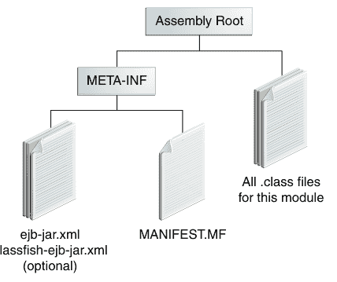

#### 5.2.2 在 WAR 模块中封装企业 Bean

企业 Bean 通常为 WAR 应用程序提供业务逻辑。在这些情况下，将企业 Bean 封装在应用程序的 WAR 模块中可以简化部署和程序组织。企业 Bean 可以作为 Java 编程类文件或封装在 WAR 模块中的 JAR 文件的形式封装在 WAR 模块中。

要在 WAR 模块中包含 Bean 类文件，类文件应位于 `WEB-INF/classes` 目录下。

要在 WAR 模块中包含包含企业 Bean 的 JAR 文件，请将 JAR 添加到 WAR 模块的 `WEB-INF/lib` 目录。

包含企业 Bean 的 WAR 模块不需要 `ejb-jar.xml` 部署描述符。如果应用程序使用了 `ejb-jar.xml`，它必须位于 WAR 模块的 `WEB-INF` 目录中。

封装在 WAR 模块中的包含企业 Bean 的 JAR 文件不被视为 EJB JAR 文件，即使封装的 JAR 文件符合 EJB JAR 的格式。JAR 文件中的企业 Bean 在语义上等同于位于 WAR 模块 `WEB-INF/classes` 目录下的企业 Bean，且所有企业 Bean 的环境命名空间都局限于 WAR 模块。

例如，假设一个 Web 应用程序由一个购物车企业 Bean、一个信用卡处理企业 Bean 和一个 Java Servlet 组成。购物车 Bean 暴露了一个本地的无接口视图，定义如下：

```java
package com.example.cart;

@Stateless
public class CartBean { ... }
```

信用卡处理 Bean 封装在其 JAR 文件 `cc.jar` 中，暴露了一个本地的无接口视图，定义如下：

```java
package com.example.cc;

@Stateless
public class CreditBean { ... }
```

Servlet `com.example.web.StoreServlet` 处理 Web 前端并使用 `CartBean` 和 `CreditBean`。该应用程序的 WAR 模块布局如下：

```
WEB-INF/classes/com/example/cart/CartBean.class
WEB-INF/classes/com/example/web/StoreServlet
WEB-INF/lib/cc.jar
WEB-INF/ejb-jar.xml
WEB-INF/web.xml
```

### 5.3 封装 Web 存档

在 Java EE 架构中，Web 模块是 Web 资源的最小部署单元。Web 模块包含 Web 组件和静态 Web 内容文件，被称为 Web 资源。Java EE Web 模块对应于 Java Servlet 规范定义的 Web 应用程序。

除了 Web 资源外，Web 模块还可以包含其他文件：

- 服务端工具类，例如购物车
- 客户端类，例如工具类

Web 模块具有特定的结构。Web 模块的顶层目录是归档的文档根。文档根是存储 XHTML 页面、客户端类和归档以及图像等静态 Web 资源的地方。

文档根包含一个名为 `WEB-INF` 的子目录，该目录可以包含以下目录和文件：

- `classes`，一个包含服务端类的目录：servlets、企业 Bean 类文件、工具类和 JavaBeans 组件
- `lib`，一个包含包含企业 Bean 的 JAR 文件以及服务端类调用的库的目录
- 部署描述符，使用 `web.xml`（Web 应用程序部署描述符）和 `ejb-jar.xml`（EJB 部署描述符）

如果 Web 模块使用 JavaFaces 技术，或者必须指定某种安全信息，或者你想覆盖由 Bean 注解指定的信息，则它需要一个 `.xml` 文件。

你还可以在文档根或 `WEB-INF/classes/` 目录中创建应用程序特定的子目录（即包目录）。

Web 模块可以以解压缩的文件结构部署，也可以封装在名为 Web Archive (WAR) 的 JAR 文件中。由于 WAR 文件的内容和用途与 JAR 文件不同，因此 WAR 文件使用 `.war` 扩展名。这里仅描述 Web 模块；你可以将其部署到任何符合 Java Servlet 规范的 Web 容器中。

在 GlassFish 服务器上部署 WAR 时，你可以提供运行时部署描述符 (DD)，但在大多数情况下不是必须的。运行时 DD 是一个 XML 文件，可能包含此类信息，如 Web 应用程序的上下文根、应用程序资源的可移植名称到 GlassFish 资源的映射，以及应用程序安全规则到 GlassFish 服务器中定义的用户、组和主体的映射。如果使用了 GlassFish Web 应用程序运行时 DD，其名称为 `glassfish-web.xml` 并位于 `WEB-INF` 目录。可以在 GlassFish 服务器上部署的 Web 模块结构如图 5–3 所示。

#### 图 5–3 Web 模块的结构


### 5.4 封装资源适配器存档

Resource Archive (RAR) 文件是可移植的，可以用于各种应用程序。

要组装 Java EE 应用程序，可以将一个或多个模块（例如 EJB JAR 文件）封装成 EAR 文件，EAR 文件是持有应用程序的归档文件。

## Web 应用生命周期

# 图 6–1 Java Web 应用请求处理

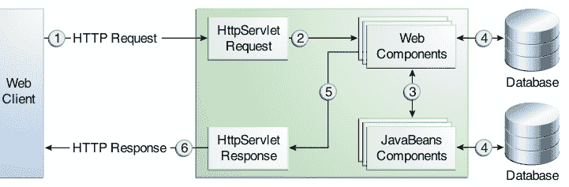

Servlets 是 Java 编程语言类，用于动态处理请求并构建响应。Java 技术（如 JavaServer Faces 和 Facets）用于构建交互式 Web 应用。（尽管 servlets、JavaServer Faces 和 Facets 可以用来完成相似的任务，但它们各有优劣。Servlets 最适用于面向服务型的应用程序（Web 端点可以实现为 servlets）以及面向表现层的应用程序的控制功能，例如分发请求和处理上下文数据。JavaServer Faces 和 Facets 更适用于生成基于文本的标记（如 XHTML），通常用于面向表现层的应用程序。

Web 组件由名为 Web 容器（web container）的运行时平台服务支持。Web 容器提供请求分发、安全、并发和生命周期管理等服务。Web 容器还允许 Web 组件访问资源。

当应用程序安装或部署到 Web 容器时，可以配置 Web 应用的某些行为。配置信息可以使用 Java EE 注解指定，也可以维护在 XML 格式的文本文件中，称为 Web 应用部署描述符（DD）。Web 应用必须遵循 Java Servlet 规范中描述的架构。

本章简述了开发 Web 应用涉及的活动。总结了 Web 应用生命周期，并解释了如何在 GlassFish Server 上打包和部署简单的 Web 应用。本章将介绍配置 Web 应用，并讨论如何指定最常用的配置参数。

## 6.2 Web 应用生命周期

Web 应用由 Web 组件、静态资源文件（如图像和层叠样式表 CSS）以及辅助类和库组成。Web 容器提供了许多支持服务，增强了 Web 组件的能力并使其更容易开发。然而，由于 Web 应用可能考虑到这些服务，因此创建和运行 Web 应用的过程与传统的独立 Java 类不同。

创建、部署和执行 Web 应用的过程可以总结如下：

1. 开发 Web 组件代码。
2. 必要时开发 Web 应用部署描述符。
3. 编译 Web 应用组件以及组件引用的辅助类。
4. 可选将应用程序打包成可部署的单元。
5. 将应用程序部署到 Web 容器中。
6. 访问引用 Web 应用的 URL。

开发 Web 组件代码将在后面的章节中介绍。步骤 2 到 4 将在后续节中详细说明，并以一个“Hello, World”风格的面向表现层的应用进行演示。该应用允许用户在 HTML 表单中输入名称，并在提交名称后显示问候。

hello 应用包含两个生成问候和响应的 Web 组件。本章将讨论以下简单应用：

- **hello1**，基于 JavaServer Faces 技术的应用程序，使用两个 XHTML 页面和一个托管豆（managed bean）
- **hello2**，一个基于 servlet 的 Web 应用，其中组件由两个 servlet 类实现

这些应用程序用于说明对包含 Web 组件的应用程序进行打包、部署、配置和运行的任务。

## 6.3 使用 JavaServer Faces 技术的 Web 模块：hello1 示例

hello1 应用是一个使用 JavaServer Faces 技术显示问候和响应的 Web 模块。你可以使用文本编辑器编辑应用程序文件，可以使用 NetBeans IDE。

该应用程序的源代码位于 `tut-install/examples/web/jsf/hello/` 目录。

### 6.3.1 使用 NetBeans IDE 查看 hello1 Web 模块

1. 从 File（文件）菜单中选择 Open Project（打开项目）。
2. 在 Project 对话框中导航到：`tut-install/examples/web/jsf`
3. 选择 hello1 文件夹并点击 Open Project。
4. 展开 Web Pages（Web 页面）节点并点击 index.xml 文件在编辑器中查看。

`index.xml` 文件是 Faces 应用的默认落地页。在典型的 Faces 应用中，Web 页面是用 XHTML 创建的。对于此应用程序，页面使用单标签标记来显示一个带有图形图像、标题和两列的表单。


## 使用 JavaServer Faces 技术的 Web 模块：hello1 示例

### 示例页面代码

#### index.xhtml (Greeting 页面)

```xml
<!DOCTYPE html PUBLIC "//W3C//DTD HTML 1.0 Transitional//EN"
"http://www.w3.org/TR/html1-transitional.dtd">
<html lang="en"
      xmlns:h="http://www.w3.org/1999/xhtml"
      xmlns:h="http://jcp.org/jsf/html">
<head>
<title>Faces Hello Greeting</title>
</head>
<body>
<h:graphicImage url="..." alt="Duke waving his hand"/>
<h2>Hello, my name is Duke. What's yours?</h2>
<h:inputText id="username"
             title="My name is: "
             value="${hello.name}"
             required="true"
             requiredMessage="Error: A name is required."
             maxlength="25" />

<p></p>
<h:commandButton id="submit" value="submit" action="response">
</h:commandButton>
<h:commandButton id="reset" value="Reset" type="reset">
</h:commandButton>
</form>
</body>
</html>
```

#### response.xhtml (Response 页面)

```xml
<!DOCTYPE html PUBLIC "//W3C//DTD HTML 1.0 Transitional//EN"
"http://www.w3.org/TR/html1-transitional.dtd">
<html lang="en"
      xmlns:h="http://www.w3.org/1999/xhtml"
      xmlns:h="http://jcp.org/jsf/html">
<head>
<title>Face Hello Response</title>
</head>
<body>
<form>
<h:graphicImage src="${resource['images:duke.waving']}" alt="Duke waving his hand"/>
<h2>Hello, ${hello.name}!</h2>
<p></p>
<h:commandButton id="back" value="Back" action="index" />
</form>
</body>
</html>
```

### 6.4 使用 JavaServer Faces 技术的 Web 模块：hello1 示例

6. 展开 **Packages**（包）节点，然后是 `javautorial.hellol` 节点。

7. 双击 `Hello.java` 文件查看。

`Hello` 类被称为托管豆，为 Faces 表达式中使用的属性提供了 getter 和 setter 方法。默认情况下，表达式语言引用该类，且首字母小写（`hello.name`）。

```java
package javautorial.hellol;

import javax.enterprise.context.RequestScoped;
import javax.inject.Named;

@Named
@RequestScoped
public class Hello {

    private String name;

    public Hello() {
    }

    public String getName() {
        return name;
    }

    public void setName(String name) {
        this.name = name;
    }
}
```

8. 在 **Pages** 节点下，展开 `WEB-INF` 节点并查看 `web.xml` 文件。

`web.xml` 文件包含了 Faces 应用所需的几个元素。以下所有内容在用 NetBeans IDE 创建应用程序时都会创建。

- 指定项目阶段的上下文参数：

```xml
<context-param>
    <param-name>javax.faces.PROJECT_STAGE</param-name>
    <param-value>Development</param-value>
</context-param>
```

上下文参数为 Web 应用所需的信息。应用程序可以定义自己的上下文参数。此外，JavaServer Faces 技术和 Java Servlet 技术定义了应用程序可以使用的上下文参数。

- 指定 `FacesServlet` 的 servlet 元素及其 servlet-mapping 元素。所有以 `.xhtml` 结尾的文件都会匹配：

```xml
<servlet>
    <servlet-name>Faces Servlet</servlet-name>
    <servlet-class>javax.faces.webapp.FacesServlet</servlet-class>
    <load-on-startup>1</load-on-startup>
</servlet>
<servlet-mapping>
    <servlet-name>Faces Servlet</servlet-name>
    <url-pattern>*.xhtml</url-pattern>
</servlet-mapping>
```

- `welcome-file-list` 元素指定落地页的位置：

```xml
<welcome-file-list>
    <welcome-file>index.html</welcome-file>
</welcome-file-list>
```

### 6.3.1.1 作用范围（Scopes）简介

在 Hello Java 中，`javax.inject.Named` 和 `javax.enterprise.context.RequestScoped` 注解将类标识为使用请求作用范围的托管豆。作用范围定义了应用程序数据如何解析和共享。

JavaServer Faces 中最常用的作用范围如下：

- **Request** (`@RequestScoped`)：请求作用范围在 Web 应用程序的单次 HTTP 请求期间持续。在应用程序 hello1 中，由于应用程序由单个请求和响应组成，该豆使用请求作用范围。
- **Session** (`@SessionScoped`)：会话作用范围在 Web 应用程序的多个 HTTP 请求之间持续。当应用程序包含多个需要维护数据的请求和响应时，豆使用会话作用范围。
- **Application** (`@ApplicationScoped`)：应用作用范围在所有用户与 Web 应用程序的交互期间持续。

有关 JavaServer Faces 技术中作用范围的更多信息，请参阅“使用托管豆”。

### 6.3.2 hello1 Web模块的打包与部署

在某些部署场景以及每当你分发 Web 模块时，必须将其打包为 WAR 文件。你可以使用 Maven 或 IDE 工具将 Web 模块部署到 WAR 中。本教程展示了如何使用 NetBeans IDE 或 Maven 来构建、打包和部署 hello1 示例应用程序。

你可以通过以下方式将 WAR 部署到 GlassFish 服务器：

- 使用 NetBeans IDE
- 使用 `asadmin` 命令
- 使用管理控制台
- 将 WAR 文件复制到 `domain-dir/autodeploy/` 目录

在整个教程中，你将使用 NetBeans IDE 或 Maven 进行打包和部署。

#### 6.3.2.1 使用 NetBeans IDE 构建并打包 hello1 Web模块

1. 如果你尚未操作，请按照“使用 NetBeans IDE 启动 GlassFish 服务器”中的描述启动 GlassFish 服务器。
2. 从 **File**（文件）菜单中，选择 **Open Project**（打开项目）。
3. 在 **Open Project** 对话框中，导航至：
   `tut-install/examples/web/jsf`
4. 选择 `hello1` 文件夹。
5. 点击 **Open Project**（打开项目）。
6. 在 **Projects**（项目）选项卡中，右键点击 `hello1` 项目并选择 **Build**（构建）。此命令将项目部署到服务器上。

#### 6.3.2.2 使用 Maven 构建并打包 hello1 Web模块

1. 如果你尚未操作，请按照“使用命令行启动 GlassFish 服务器”中的描述启动 GlassFish 服务器。
2. 在终端窗口中，进入：
   `tut-install/examples/web/jsf/hello1/`
3. 输入以下命令：
   ```
   mvn install
   ```
   此命令会产生任何必要的编译，并在 `tut-install/examples/web/jsf/hello1/target/` 中创建 WAR 文件。它会将项目部署到服务器上。

### 6.3.3 查看已部署的Web模块

GlassFish 服务器提供了两种查看已部署 Web 模块的方法：管理控制台和 `asadmin` 命令。你也可以使用 NetBeans IDE 查看已部署的模块。

#### 6.3.3.1 使用管理控制台查看已部署的Web模块

1. 在浏览器中打开 URL `http://localhost:4848/`。
2. 选择 **Applications**（应用程序）节点。
   已部署的 Web 模块出现在 **Deployed Applications**（已部署应用程序）节点中。

#### 6.3.3.2 使用 asadmin 命令查看已部署的Web模块

输入以下命令：
```
asadmin list-applications
```

#### 6.3.3.3 使用 NetBeans IDE 查看已部署的Web模块

1. 在 **Services**（服务）选项卡中，展开 **Servers**（服务器）节点，然后展开 **GlassFish** 节点。
2. 展开 **Applications**（应用程序）节点以查看已部署的模块。

### 6.3.4 运行已部署的 hello1 Web模块

现在 Web 模块已经部署，你可以通过在 Web 浏览器中打开应用程序来查看。默认情况下，应用程序部署在端口 8080 的 localhost 上。Web 应用程序的上下文根是 `hello1`。

1. 打开 Web 浏览器。
2. 输入 URL：
   `http://localhost:8080/hello1/`
3. 在字段中输入名称并点击 **Submit**（提交）。
   响应页面显示你提交的名称。点击 **Back**（返回）重试。

#### 6.3.4.1 已部署模块的动态重载

如果启用了动态重载，当你更改代码或部署描述符时，不需要重新部署应用程序或模块。你只需要将更改的页面或类文件复制到应用程序或模块的部署目录中。Web 模块的部署目录是 `context-root`。此功能在开发环境中非常有用。不建议在生产环境中使用动态重载。在 GlassFish 服务器中，动态重载是默认启用的。

### 6.3.5 卸载 hello1 Web模块

#### 6.3.5.1 使用 NetBeans IDE 卸载模块

1. 在 **Services**（服务）选项卡中，展开 **Servers**（服务器）节点，然后展开 **GlassFish** 节点。
2. 展开 **Applications**（应用程序）节点查看已部署的模块。
3. 右键点击 `hello1` 模块并选择 **Undeploy**（卸载）。

#### 6.3.5.2 使用 Maven 卸载模块

1. 在终端窗口中，进入：
   `tut-install/examples/web/jsf/hello1/`
2. 输入命令：
   ```
   mvn cargo:undeploy
   ```

## 6.4 使用 Servlet 技术的Web模块：hello2示例

`hello2` 模块与 `hello1` 应用程序几乎相同，但它是使用 Java Servlet 技术而非 JavaServer Faces。你可以使用文本编辑器查看应用程序文件，也可以使用 NetBeans IDE。

### 6.4.1 URL 映射到 Web 组件

当接收请求时，Web 容器必须确定哪个 Web 组件处理该请求。它通过将请求中的 URL 路径映射到 Web 组件来实现。URL 路径包含上下文根，以及可选的 URL 路径：

`http://host:port/context-root`

你通过在 Servlet 文件中使用 `@WebServlet` 注解来设置路径。例如，`GreetingServlet.java` 文件包含此注解，相对于上下文：

```java
@WebServlet("/greeting")
```

此注解表示 URL 路径 `/greeting` 位于上下文根之后。因此，当 Servlet 部署在本地时，通过以下 URL 访问：

`http://localhost:8080/hello2/greeting`

要仅通过上下文根访问 Servlet，请将 URL 路径设置为 `/*`。

### 6.4.2 检查 hello2 模块

`hello2` 模块与 `hello1` 应用程序几乎相同，但实现不同。你可以使用文本编辑器查看应用程序文件，也可以使用 NetBeans IDE。

#### 6.4.2.1 使用 NetBeans IDE 查看 hello2 模块

1. 从 **File**（文件）菜单中，选择 **Open Project**（打开项目）。
2. 在 **Open Project** 对话框中，导航到：
   `tut-install/examples/web/servlet`
3. 选择 `hello2` 文件夹，点击 **Open Project**（打开项目）。
4. 展开 **Source Packages**（源包）节点，展开 `javaeet.hello2` 节点。
5. 双击 `GreetingServlet.java` 文件进行查看。

该文件重写了 `doGet` 方法，实现了 HTTP 的 GET 方法。Servlet 显示一个带有 **Submit** 按钮的简单 HTML 表单，该表单指定了一个响应页面。以下摘录从 `@WebServlet` 注解开始，该注解相对于上下文指定了路径：

```java
@WebServlet("/greeting")
public class GreetingServlet extends HttpServlet {

    @Override
    public void doGet(HttpServletRequest request,
                      HttpServletResponse response)
            throws ServletException, IOException {

        response.setContentType("text/html");
        response.setBufferSize(8192);
        try (PrintWriter out = response.getWriter()) {
            out.println("<html lang=\"html\">");
            // ... 省略部分 HTML 生成代码
            String username = request.getParameter("username");

            if (username != null && username.length() > 0) {
                RequestDispatcher dispatcher = getServletContext().getRequestDispatcher("/response");
                if (dispatcher != null) {
                    dispatcher.include(request, response);
                }
                out.println("</body></html>");
            }
        }
    }
}
```

6. 双击 `ResponseServlet.java` 文件进行查看。

此 servlet 还重写了 `doGet` 方法，仅显示响应。以下节选从 `@WebServlet` 注解开始，该注解指定了相对于上下文根的 URL 模式：

```java
@WebServlet("/response")
public class ResponseServlet extends HttpServlet {

    @Override
    public void doGet(HttpServletRequest request,
                      HttpServletResponse response)
            throws ServletException, IOException {

        try (PrintWriter out = response.getWriter()) {
            // 写入响应数据
            String username = request.getParameter("username");
            if (username != null && username.length() > 0) {
                out.println("<h2>Hello, " + username + "!</h2>");
            }
        }
    }
}
```


# 6-10 Java 平台企业版 Java EE 教程

## 6.4.3 运行 hello2 示例

你可以使用 NetBeans IDE 或 Maven 来构建、打包、部署和运行 hello2 示例。

### 6.4.3.1 使用 NetBeans IDE 运行 hello2 示例

1. 如果尚未操作，请按照“使用 NetBeans IDE 启动 GlassFish 服务器”中的描述启动 GlassFish 服务器。
2. 从文件（File）菜单中，选择打开项目（Open Project）。
3. 在打开项目对话框中，导航到：
   `tut-install/examples/web/servlet`
4. 选择 hello2 文件夹。
5. 点击打开项目（Open Project）。
6. 在项目（Projects）选项卡中，右键点击 hello2 项目并选择构建（Build）以打包并部署项目。
7. 在浏览器中，打开以下 URL：
   `http://localhost:8080/hello2/greeting`
   该 URL 指定了上下文根，其后是 URL 模式。
   应用程序看起来与 hello1 非常相似。主要区别在于点击提交（Submit）后，响应出现在问候下方，而不是单独的页面上。

### 6.4.3.2 使用 Maven 运行 hello2 示例

1. 如果尚未操作，请按照“使用命令行启动 GlassFish 服务器”中的描述启动 GlassFish 服务器。
2. 在终端窗口中，进入：
   `tut-install/examples/web/servlet/hello2/`
3. 输入以下命令：
   `mvn install`
   该目标会构建 WAR 文件，将其拷贝到 `tut-install/examples/web/hello2/target/` 目录并进行部署。
4. 在浏览器中，打开以下 URL：
   `http://localhost:8080/hello2/greeting`
   该 URL 指定了上下文根，其后是 URL 模式。
   应用程序看起来与 hello1 非常相似。主要区别在于点击提交（Submit）后，响应出现在问候下方，而不是单独的页面上。

## 6.5 配置 Web 应用程序

本节描述了配置 Web 应用程序的任务：

- 设置上下文参数
- 声明欢迎文件
- 将错误映射到错误页面
- 声明资源引用

### 6.5.1 设置上下文参数

Web 模块中的组件共享一个表示其应用程序上下文的对象。你可以将上下文参数传递给上下文，也可以将初始化参数传递给 servlet。上下文参数对整个应用程序可用。请参见“创建和初始化 Servlet”。

这些步骤通常适用于 Web 应用程序，但并不专门适用于本章中的示例。

#### 6.5.1.1 使用 NetBeans IDE 添加上下文参数

1. 打开项目。
2. 在项目（Projects）树中展开项目节点。
3. 展开 Web 页面（Web Pages）节点，然后展开 WEB-INF 节点。
4. 双击 `web.xml`。

如果项目没有 `web.xml` 文件，请按照“使用 NetBeans IDE 创建 web.xml 文件”中的步骤创建一个。

5. 点击编辑器窗口顶部的常规（General）。
6. 展开上下文参数（Context Parameters）节点。
7. 点击添加（Add）。
8. 在添加上下文对话框中，在参数名称（Parameter Name）字段中，输入指定上下文对象的名称。
9. 在参数值（Parameter Value）字段中，输入要传递给上下文对象的参数。
10. 点击确定（OK）。

#### 6.5.1.2 使用 NetBeans IDE 创建 web.xml 文件

1. 从菜单中，选择新建文件（New File）。
2. 在新向导（New Wizard）中，选择 Web 类别，然后在文件类型（File Types）下选择标准部署描述符（Standard Deployment Descriptor）。
3. 点击下页（Next）。
4. 点击完成（Finish）。

`/WEB-INF/` 下会出现一个基础的 `web.xml` 文件。

### 6.5.2 声明欢迎文件

欢迎文件机制允许你指定一个文件列表，Web 容器可以对未映射到 Web 组件的 URL（称为部分请求）提供响应。例如，假设你定义了一个欢迎文件 `welcome.html`。当客户端请求如 `host:port/webapp/directory` 的 URL 时（其中 `directory` 未映射到 servlet 或 XHTML 页面），将返回文件 `host:port/webapp/directory/welcome.html`。

## 6.5.3 将错误映射到错误页面

执行期间发生错误时，可以让应用程序显示特定页面。你可以在部署符中通过状态码或异常进行映射。

### 6.5.3.1 使用 NetBeans IDE 设置映射

1. 打开项目。
2. 在项目（Projects）树中展开项目节点。
3. 展开 Web 页面（Web Pages）节点，然后展开 WEB-INF 节点。
4. 双击 `web.xml`。

如果项目没有 `web.xml` 文件，请按照“使用 NetBeans IDE 创建 web.xml 文件”中的步骤创建一个。

5. 点击编辑器窗口顶部的常规（General）。
6. 展开页面（Error Pages）节点。
7. 点击添加（Add）。
8. 在添加页面（Add Page）对话框中，点击浏览（Browse）找到你想作为错误页面的页面。
9. 指定错误码或异常类型。要指定错误码，请留空字段。要指定所有错误和异常，输入 `java.lang.Throwable`。
10. 点击确定（OK）。

## 6.5.4 声明资源引用

如果你的 Web 组件使用如企业 Bean、数据源或 Web 服务等对象，可以使用 Java EE 注解来注入这些资源。注解消除了以前版本 Java EE 需要的大量模板代码和配置元素。

虽然资源注入对开发者来说更方便，但在 Web 应用程序中使用存在限制。首先，你只能注入到容器管理的对象中，因为容器必须控制组件的创建以便执行注入。因此，你不能将资源注入到此类 JavaBean 中。然而，托管 Bean 是由容器管理的，因此它们可以接受注入。

### 6.5.4.1 声明资源的引用

`@Resource` 注解用于声明资源的引用，例如数据源或环境条目。`@Resource` 注解指定在类、方法或字段上。容器负责将资源注入到通过 `@Resource` 注解声明的引用，并将其映射到正确的 JNDI 名称。

在以下示例中，`@Resource` 注解用于将数据源注入到需要连接数据源的组件中，这是在使用 JDBC 技术访问关系型数据库时完成的：

```java
@Resource javax.sql.DataSource catalogDS;

public void getProductsByCategory() {
    // get a connection and execute the query
    Connection conn = catalogDS.getConnection();
}
```

容器在组件对应用程序可用之前会注入此数据源。数据源的 JNDI 映射是从字段名 `catalogDS` 和类型 `javax.sql.DataSource` 推断得出的。

如果你有多个需要注入到同一个组件中的资源，您需要使用 `@Resource` 注解对它们进行注解，如示例所示：

```java
@Resource(name="myDB" type=javax.sql.DataSource.class)
@Resource(name="myQ" type=javax.jms.ConnectionFactory.class)
```

本教程中的 Web 应用程序使用 Java Persistence API（JPA）来访问关系型数据库。该 API 不需要您使用 `@Resource` 注解来注入数据源。然而，该 API 支持 `@PersistenceUnit` 和 `@PersistenceContext` 注解分别用于注入 `EntityManagerFactory` 和 `EntityManager` 实例。参见第 38 章“运行持久化示例”以及在 Web 应用程序中使用 Java Persistence API。

## 46.5.2 声明 Web 服务引用

`@WebServiceRef` 注解引用 Web 服务。以下示例展示了如何使用 `@WebServiceRef` 注解来声明 Web 服务的引用。`WebServiceRef` 使用 `wsdlLocation` 元素来指定部署服务的 WSDL 的 URI：

```java
import javax.xml.ws.WebServiceRef;

public class ResponseServlet extends HttpServlet {
    @WebServiceRef(wsdlLocation="http://localhost:8080/hellervice/hello?wsdl")
    static HelloService service;
}
```


## 6.6 关于 Web 应用程序的更多信息

有关 Web 应用程序的更多信息，请参：

- Java Faces 2.2 规范：
  http://jcp.org/en/jsr/detail?id=344
- Java Servlet 3.1 规范：
  http://jcp.org/en/jsr/detail?id=340

## 7 JavaServer Faces 技术

Java Faces 技术是一种用于构建 Java 技术的 Web 应用程序的服务器端组件框架，用于构建基于 Java 技术的 Web 应用程序。

Java Faces 技术由以下部分组成：

- 用于表示组件和管理其状态的 API；处理事件、服务器端验证和数据转换；定义页面导航；支持国际化和可访问性；并为所有这些功能提供扩展性
- 用于向网页中添加组件以及将组件连接到服务器端对象的标签库

Java Faces 技术提供了一个定义的编程模型和各种标签库。标签库包含实现组件标签的标签处理器。这些功能显著减轻了使用服务器端用户界面（UI）构建和维护 Web 应用程序的负担。只需少量努力，您就可以完成以下任务：

- 创建网页。
- 通过添加组件标签将组件拖到网页上。
- 将页面上的组件绑定到服务器端数据。
- 将组件生成的事件连接到服务器端应用程序代码。
- 在服务器请求生命周期之外保存和恢复应用程序状态。
- 通过自定义重用和扩展组件。

本章提供了 JavaServer Faces 技术的概述。在解释什么是 JavaServer Faces 应用程序并回顾使用 JavaServer Faces 技术的的一些主要优势后，本章描述了创建简单 JavaServer Faces 应用程序的过程。本章还介绍了 JavaServer Faces 应用程序及其在生命周期阶段的进展。

此处涵盖了以下主题：

- 什么是 JavaServer Faces 应用程序？
- JavaServer 技术的优势
- 一个简单的 JavaServer Faces 应用程序
- 用户界面组件模型
- 导航模型
- JavaServer Faces 应用程序的生命周期

## 7.1 什么是 Java Faces 应用程序？

- 部分处理和部分渲染
- 关于 JavaFaces 技术的更多信息

### 7.1.1 什么是 Java Faces 应用程序？

Java Faces 应用程序提供的功能与任何其他 Web 应用程序类似。典型的 Java Faces 应用程序包含以下部分：

- 一组用于布局组件的标签。
- 一组用于向网页添加组件的标签。
- 一组托管豆（managed beans），它们是轻量级的容器托管对象（POJOs）。在 Java Faces 应用程序中，托管豆作为后备豆（backing beans），定义页面上 UI 组件的属性和函数。
- 部署描述符（`web.xml` 文件）。
- 可选的、或多个应用程序配置资源文件，例如 `faces-config.xml` 文件，可用于定义页面导航规则并配置 bean 以及其他自定义对象（如自定义组件）。
- 可选的一组自定义对象，可以包括应用程序开发者创建的自定义组件、验证器、转换器或监听器。
- 可选的一组用于在页面上表示自定义对象的自定义标签。

图 7–1 显示了典型 Java Faces 应用程序中客户端和服务器之间的交互。为了处理客户端请求，实现 Java Faces 技术的 Web 容器渲染网页。

图 7–1 响应 JavaServer Faces 页面的客户端请求

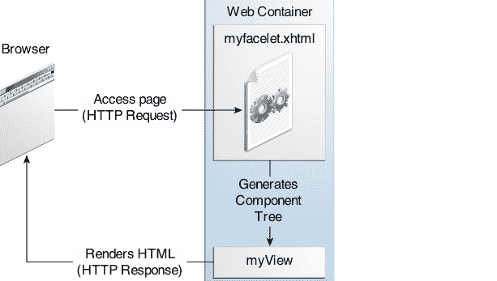

网页 `myfacelet.xml` 使用 Java Faces 组件标签构建。组件标签用于将组件添加到视图（图中用 `myView` 表示），视图是页面的服务器端表示。除了组件外，网页还可以引用对象，例如：

- 注册在组件上的任何事件监听器、验证器、转换器
- 捕获数据并处理特定特定功能的 JavaBeans 组件

## 7.2 Java Faces 技术优势

根据客户端的请求，视图被渲染为响应。渲染是根据服务器端视图由 Web 容器生成输出（如 HTML 或 XHTML）供客户端读取的过程。

Java Faces 技术最大的优势之一是为 Web 应用程序提供了行为与表现之间的整洁分离。Java Faces 应用程序可以将 HTTP 请求映射到特定组件的事件处理并在服务器上管理状态。Java Faces 技术允许您构建实现行为与表现细粒度分离的 Web 应用程序。

逻辑与表现的分离允许应用程序开发团队的每个成员专注于开发过程的某一部分，并提供了一个简单的编程模型来连接这些部分。例如，没有编程知识的页面可以使用网页中的 Java Faces 技术标签连接到服务器端对象，而无需编写任何脚本。

Java Faces 技术的另一个重要目标是利用熟悉的组件和 Web 层概念，而不将您限制在特定的脚本技术或标记语言上。Java Faces API 直接层位于 Servlet API 之上，如图 7–2 所示。

### 图 7–2 Java Web 应用程序技术

| JavaServer Faces | JavaServer Pages 标准标签库 |
| :--- | :--- |
| JavaServer Pages | |
| Java Servlet | |

这种 API 分层使得许多重要的应用用例成为，例如使用不同的表现技术、直接从组件类创建自定义组件以及为各种客户端设备生成输出。

Facelets 作为 Java Faces 技术的一部分，是构建基于 Java Faces 技术应用程序的首选表现技术。有关 Facelets 技术的更多信息，请参见第 8 章“Facelets 简介”。

Facelets 技术提供了许多优势。

- 可以通过模板和复合组件功能对代码进行重用和扩展。
- 您可以使用注解自动将托管豆注册为 Java Faces 应用程序可用的资源。此外，隐式导航规则允许开发者快速配置页面导航（详情参见导航模型）。这些功能减少了应用程序的手动配置过程。
- 最重要的是，Java Faces 技术提供了一种管理组件状态、处理数据、验证用户输入和处理事件的丰富架构。

## 7.3 简单的 JavaServer Faces 应用

JavaServer Faces 技术为创建 Web 应用程序提供了简单且易于使用的流程。开发简单的 JavaServer Faces 应用通常需要以下任务，这些任务已经在“使用 JavaServer Faces 技术的 Web 模块”中描述过：hello 示例：

- 使用组件标签创建 Web页面
- 开发托管页面（managed pages）
- 映射 `FacesServlet` 实例

hello 示例包含一个托管豆（managed bean）和两个 Facelets 页面。网页会询问用户的姓名，第二个页面将以问候语作为响应。

有关 Faces 技术的详情，请参阅第 8 章“Facelets 简介”。关于使用 EL 表达式的详情，请参阅第 9 章“表达式语言”。关于 JavaServer Faces 编程模型以及使用 JavaServer Faces 技术构建网页的详情，请参阅第 10 章“在网页中使用 JavaServer Faces 技术”。

每个 Web 应用程序都有周期。常见的任务，如处理请求、解码参数、修改和保存状态以及将网页渲染到浏览器，都在 Web 生命周期期间内完成。某些 Web 应用程序框架会向你隐藏生命周期的细节，而另一些则要求你自行管理。

默认情况下，JavaServer Faces 会自动处理请求的周期。然而，它也暴露了请求的不同阶段，以便在应用程序需要时对其进行修改或执行不同的操作。

JavaServer Faces 应用的生命周期随着以下活动开始并结束：客户端请求网页，服务器响应该页面。生命周期由两个主要阶段组成：执行（Execute）和渲染（Render）。

在执行阶段，可能会发生若干操作：

- 构建或恢复视图（view）。
- 应用请求参数值。
- 对组件值进行转换和验证。
- 使用组件值更新托管豆。
- 调用应用程序逻辑。

对于首次（初始）请求，只会构建视图。对于后续（回传/postback）请求，可能会发生部分或全部的其他操作。

在渲染阶段，请求的视图将作为响应渲染给客户端。渲染通常是生成输出（如 HTML 或 XHTML）的过程，这些可以被客户端（通常是浏览器）读取。

以下是对示例 JavaServer Faces 应用通过其生命周期的简单描述，总结了后台发生的活动。

hello 应用在部署到 GlassFish 服务器时会经过以下阶段：

1. hello 应用被构建并部署在 GlassFish 服务器上，此时应用处于未启动（uninitiated）状态。
2. 当客户端对 `index.xhtml` 页面发起初始请求时，hello Facelets 应用被编译。
3. 编译后的 Facelets 应用被执行，为 hello 应用构建一个新的组件树并将其放入 `FacesContext` 中。
4. 组件树中填充了组件及其关联的托管豆属性，属性由 EL 表达式 `hello.name` 表示。
5. 基于组件树构建一个新的视图。
6. 视图作为响应渲染到请求的客户端。
7. 组件树自动销毁。
8. 在后续（回传/postback）请求中，组件树被重建，保存的状态被应用。

有关生命周期的完整细节，请参阅“JavaServer Faces 应用的生命周期”。

## 7.4 用户界面组件模型

除了周期描述外，JavaServer 架构的概览有助于更好地理解该技术。

JavaFaces 组件是 JavaServer Faces 视图的构建块。组件可以是用户界面（UI）组件，也可以是非 UI 组件。

JavaFaces UI 组件是可配置、可重用的元素，构成了 JavaServer Faces 应用的用户界面。组件可以是简单的（例如按钮），也可以是复合的（例如由多个组件组合的表格组件）。

JavaFaces 技术提供了丰富、灵活的组件架构，包括：

- 一组 `javax.faces.component.UIComponent` 类，用于指定 UI 组件的状态和行为
- 一个渲染模型，定义了如何以各种方式渲染组件
- 一个转换模型，定义了如何将数据转换器注册到组件上
- 一个事件和监听器模型，定义了如何处理组件事件
- 一个验证器模型，定义了如何将验证器注册到组件上

本节简要描述了组件架构的这些各个部分。

### 7.4.1 用户界面组件类

JavaFaces 技术提供了一组 UI 组件类和相关的行为接口，它们指定了所有 UI 组件的功能，如持有组件状态、维护对象引用以及驱动一组标准组件的事件处理和渲染。

组件类是完全可扩展的，允许开发者创建自己的自定义组件。更多信息请参阅第 15 章“创建 UI 组件和其他自定义对象”。

所有组件的抽象类是 `javax.faces.component.UIComponent`。JavaFaces UI 组件类扩展了 `UIComponentBase`（`UIComponent` 的子类），它定义了组件的默认状态和行为。JavaFaces 技术包含了以下组件类：

#### 用户界面模型

- `UIColumn`：代表 `UIData` 组件中的单列数据。
- `UICommand`：代表一个在激活时触发动作的控件。
- `UIData`：代表对由 `java.faces.model.DataModel` 实例表示的数据集进行数据绑定。
- `UIForm`：代表呈现给用户的输入表单。其子组件代表了（包括）在提交表单时要包含的输入字段。这类似 HTML 中的 `form` 标签。
- `UIGraphic`：显示图像。
- `UIInput`：从用户处获取输入。它是 `UIOutput` 的子类。
- `UIErrorMessage`：显示本地化的错误消息。
- `UIMessages`：显示一组本地化的错误消息。
- `UIOutputTarget`：以链接或按钮的形式显示链接。
- `UIOutput`：在页面上显示数据。
- `UIPanel`：管理其子组件的布局。
- `UIParameter`：代表替换参数。
- `UISelectBoolean`：通过选择或取消选择来选择布尔值。该类是 `UIInput` 的子类。
- `UISelectItem`：代表一组项目中的单个项目。
- `UIItems`：代表整组项目。
- `UISelectMany`：允许从一组项目中选择多个项目。该类是 `UIInput` 的子类。
- `UISelectOne`：允许用户从一组项目中选择一个。该类是 `UIInput` 的子类。
- `UIView`：代表请求中的查询参数。该类是 `UIInput` 的子类。
- `UIViewRoot`：代表组件树的根。

除了扩展 UI，组件类还实现了一个或多个行为接口，每个接口为实现该接口的组件集定义了某些行为。

这些行为接口（另有说明均定义在 `javax.faces.component` 包中）如下：

- `ActionSource`：表示组件可以触发动作事件。用于基于 Java Faces 技术 1.1_0 及更早版本的组件。该接口在 JavaFaces 2 中已弃用。
- `ActionSource2`：扩展 `ActionSource` 并提供相同的功能。但是，它允许组件在引用处理方法时使用表达式语言 (EL)。
- `EditableValueHolder`：扩展 `ValueHolder` 并为可编辑组件提供额外功能，如验证和发出值变化事件。
- `NamingContainer`：强制要求根于此组件的每个组件都具有唯一的 ID。
- `StateHolder`：表示组件具有在请求之间必须保存的状态。
- `ValueHolder`：表示组件维护一个本地值，并提供访问模型层级数据的选项。
- `javax.faces.event.SystemEventListenerHolder`：为每个类类型以及该类定义的 `javax.faces.event.SystemEvent` 维护一个 `javax.faces.event.SystemEventListener` 实例列表。
- `javax.faces.behavior.ClientBehaviorHolder`：增加了附加 `javax.faces.behavior.ClientBehavior` 实例的能力，例如可重用的脚本。

`UIComponent` 元素以及 `StateHolder`（状态持有者）。`UIOutput` 以及扩展 `UIOutput` 的组件类实现了 `StateHolder` 和 `ValueHolder`。`UIInput` 以及扩展 `UIInput` 的组件类实现了 `EditableValueHolder`、`StateHolder` 和 `ValueHolder`。`UIComponentBase` 是 `StateHolder`。

只有自定义组件才需要使用组件行为接口。页面和应用程序开发者将通过在页面上使用代表组件的标签来使用标准组件。大多数组件可以在页面上以不同的方式渲染。例如，`UICommand` 可以被渲染为按钮或链接。

下一节将解释渲染模型如何工作，以及页面作者如何通过选择合适的标签来选择渲染组件。

### 7.4.2 组件渲染模型

Java Faces 组件架构的设计使得组件的功能由组件类定义，而渲染可以由单独的渲染器类定义。这种设计具有多个优点，包括：

- 组件编写者可以定义组件的行为，但可以创建多个渲染器，每个渲染器都定义了将组件渲染到相同客户端或不同客户端的不同方式。
- 页面作者和应用程序可以通过代表组件和渲染器适当组合的标签来更改组件的外观。

渲染套件（render kit）定义了组件类如何映射到适用于特定客户端的组件标签。Java Faces 实现包含一个标准的 HTML 渲染套件，用于渲染到 HTML 客户端。

渲染套件为其支持的每个组件定义了一组 `javax.faces.render.Renderer` 类。每个 `Renderer` 类都定义了将特定组件渲染到渲染器所定义输出的不同方式。例如，`UISelectOne` 组件有三个渲染器。其中一个将组件渲染为一组其他元素。另一个将组件渲染为组合框（combo box）。同样，`UICommand` 可以使用 `h:commandButton` 或 `h:commandLink` 标签渲染为按钮或链接。每个标签的 command 对应于 `UICommand` 类，指定了功能，即触发一个动作。每个标签的 Button 或 Link 对应一个独立的 `Renderer` 类，该类定义了组件在页面上的外观。

标准 HTML 渲染套件中定义的每个自定义标签由组件功能（由 `UIComponent` 类定义）和渲染属性（由 `Renderer` 类定义）组成。

#### 使用 HTML 标签库向页面添加组件

“使用 HTML 标签库向页面添加组件”一节列出了所有支持的组件标签，并通过示例说明了如何使用这些标签。

JavaFaces 实现了一个自定义标签库，用于在 HTML 中渲染组件。

### 7.4.3 转换模型

JavaFaces 应用程序可以选择地将组件与服务器端对象数据关联。这是一个 JavaBeans 组件，例如一个托管 bean（managed bean）。应用程序通过调用该组件的适当对象属性来获取和设置组件的数据。

当组件绑定到对象时，应用程序对组件数据有两种视觉视图：

- 视图（view），其中数据被表示为数据类型，例如 `int` 或 `long`。
- 表现（presentation），其中数据以用户可以读取或修改的方式表示。例如，`java.util.Date` 可能会被表示为 mm/dd/yy 格式的文本字符串，或者三个文本字符串的集合。

当与组件关联的 bean 属性是组件支持的类型之一时，JavaFaces 实现会自动在这两个视图之间转换数据。例如，如果 `UISelectBoolean` 组件与类型为 `java.lang.Boolean` 的 bean 属性关联，JavaFaces 实现将自动数据从 `String` 转换为 `Boolean`。此外，某些组件数据必须绑定到特定类型的属性。例如，`UISelectBoolean` 组件必须绑定到 `boolean` 或 `java.lang.Boolean` 类型的属性。

有时你可能希望将组件的数据转换为标准类型以外的类型，或者你可能希望转换数据的格式。为了方便，JavaFaces 允许你在 `UIOutput` 组件以及其子类 `UIInput` 的类上注册 `javax.faces.convert.Converter` 的实现。如果你在组件上注册了 `Converter` 的实现，该 `Converter` 将在两个视图之间转换组件的数据。

你可以使用 JavaFaces 实现提供的标准转换器，也可以创建你自己的自定义转换器。自定义转换器的创建请见第 15 章“创建 UI 组件和其他自定义对象”。

### 7.4.4 事件和监听器模型

JavaFaces 的事件和监听器模型与 JavaBeans 事件模型相似，不同之处在于它具有类型化的事件类和监听器接口，允许应用程序处理由组件生成的事件。

JavaFaces 规范定义了三类事件：应用程序事件、系统事件和数据模型事件。

应用程序事件绑定到特定的应用程序，并由 `UIComponent` 生成。它们代表了之前的 JavaFaces 技术版本中提供的标准事件。

事件对象标识生成事件的组件并存储有关它的信息。为了接收事件通知，应用程序必须提供监听器类的实现并将其注册在生成事件的组件上。当用户激活组件（例如点击按钮）时，会触发一个事件。这将 JavaServer Faces 实现调用处理事件的监听器方法。

JavaFaces 支持两种应用程序事件：动作事件（action events）和值变更事件（value-change events）。

动作事件（类 `javax.faces.event.ActionEvent`）在用户激活作为 `ActionSource` 的组件时发生。这些组件包括按钮和链接。

值变更事件（类 `javax.faces.event.ValueChangeEvent`）在用户更改由 `UIInput` 表示的值时发生。一个例子是勾选框，其值变为 true。生成此类事件的组件类型有 `UIInput`、`UISelectOne`、`UISelectMany` 和 `UISelectBoolean`。

根据发射事件的组件的 `immediate` 属性的值，动作事件可以在调用应用程序阶段或应用请求阶段处理，而值变更事件可以在处理验证阶段或应用请求阶段处理。

系统事件由对象而非 `UIComponent` 生成。它们在应用程序执行预定义时间点生成。它们适用于整个应用程序，而不是特定的组件。

数据模型事件在 `UIData` 组件的行被选中时发生。

有两种方法让你的应用程序响应标准组件发射的事件或值变更事件：

- 实现事件监听器来处理事件，并通过组件标签内嵌套 `f:valueChangeListener` 或 `f:actionListener` 标签将监听器注册到组件上。
- 实现托管 bean 方法来处理事件，并在组件的适当属性中使用方法表达式引用该方法。

参见“实现监听器”以了解如何实现监听器。参见“在组件上注册监听器”以了解如何在组件上注册监听器。

参见“编写动作事件的方法”和“编写值变更事件的方法”以了解如何实现处理这些事件的托管 bean 方法。参见“引用托管 bean 方法”以了解如何从组件标记引用。

当从自定义组件发射事件时，除了实现监听器或托管 bean 方法外，你必须实现相应的事件类并手动调用组件。“为自定义组件处理事件”解释了如何这样做。

### 7.4.5 验证模型

JavaFaces 技术支持一种对可编辑组件（如文本字段）的本地数据进行验证的机制。这种验证发生在更新模型数据以匹配本地值之前。

与转换模型类似，验证模型定义了一系列标准类，用于执行常见的数据验证检查。JavaServer Faces 标签库定义了一组标签，对应于标准的 `javax.faces.validator.Validator` 实现。请参考[标准验证器] 获取所有标准验证类及对应标签的列表。

大多数标签都有一组属性用于配置验证器的属性，例如组件数据允许的最小值和最大值。页面作者通过将验证器嵌套在组件的标签内部，在组件上注册该验证器。

除了注册在所有 UI 组件上的验证器外，你还可以在应用程序中创建一个默认验证器。有关默认验证器的更多信息，请参阅[使用默认验证器]。

验证模型还允许你创建自己的自定义验证器和相应的标签来执行自定义验证。验证模型提供了两种方式来实现自定义验证：

- 实现执行验证的 `Validator` 接口。
- 实现一个执行验证的托管 Bean 方法。

如果你正在实现 `Validator` 接口，还可以进行以下操作：

- 向应用程序注册 `.xml` 实现。
- 创建自定义标签或使用 `f:validator` 标签在组件上注册验证器。

在描述的标准验证模型中，验证器是为页面上的每个输入组件定义的。Bean Validation 模型允许将验证器应用于页面上的所有字段。有关 Bean Validation 的更多信息，请参见第 21 章“Bean Validation 简介”和第 22 章“Bean Validation：高级主题”。

## 7.5 导航模型

JavaServer Faces 导航模型可以定义页面导航，并处理选择页面加载顺序时所需的任何额外处理。

在 Java Faces 技术中，导航是一组在操作执行（例如点击按钮或链接）后选择要显示的下一个页面或视图的规则。

导航可以是隐式的也可以是用户定义的。当应用程序配置资源文件中未配置用户定义的导航规则时，就会使用隐式导航。

当你向 Faces 页面添加诸如 `commandButton` 的组件并将其添加到 `action` 属性时，默认导航处理器将尝试隐式地在应用程序中匹配合适的页面。在以下示例中，默认导航处理器将尝试在应用程序中查找命名的 `response.xhtml` 并导航到那里：

```
```


<h:commandButton value="submit" action="response">

用户定义的导航规则在一个或多个应用程序配置资源文件（如 `faces-config.xml`）中通过一组 XML 元素进行声明。导航模型的默认结构如下：

```
<navigation-rule>
  <description></description>
  <from-view-id></from-view-id>
  <navigation-case>
    <from-action></from-action>
    <from-outcome></from-outcome>
    <if></if>
    <to-view-id></to-view-id>
  </navigation-case>
</navigation-rule>
```

用户定义的导航处理方式如下：

- 在应用程序配置资源文件中定义规则。
- 引用来自按钮或链接组件 `action` 属性的 `outcome` 字符串。JavaServer Faces 实现使用该 outcome 字符串来选择导航规则。

以下是一个导航规则示例：

```
<navigation-rule>
  <from-view-id>greeting.xhtml</from-view-id>
  <navigation-case>
    <from-outcome>success</from-outcome>
    <to-view-id>response.xhtml</to-view-id>
  </navigation-case>
</navigation-rule>
```

该规则规定，当 `greeting.xhtml` 上的组件（如 `h:commandButton` 或 `h:commandLink`）激活时，如果按钮组件 id 引用的 outcome 为 `success`，应用程序将从 `greeting.xhtml` 页面导航到 `response.xhtml` 页面。这是一个 `greeting.xhtml` 中指定逻辑结果为 `success` 的 `h:commandButton` 示例：

```
<h:commandButton id="submit" value="Submit" action="success"/>
```

所示，`navigation-rule` 元素定义了从一个页面（由 `from-view-id` 元素指定）到应用程序其他页的方法。`navigation-rule` 元素包含任意数量的 `navigation-case` 元素，每个元素根据逻辑结果（由 `from-outcome` 定义）定义下一个打开的页面（由 `to-view-id` 定义）。

在更复杂的应用程序中，逻辑结果也可以来自托管 Bean 中操作方法的返回值。该方法执行某些处理以确定结果。例如，方法可以检查用户输入的密码是否与页面上的。如果是，方法返回 `success`；否则可能返回 `failure`。`failure` 结果可能导致页面重新加载。`success` 结果可能会导致显示用户信用卡活动的页面打开。如果你希望结果由方法作为 `outcome` 返回，你必须使用带有方法表达式（method expression）的属性来引用该方法，例所示：

```
<h:commandButton id="submit" value="Submit" action="#{cashierBean.submit}"/>
```


当用户点击由此标签表示的按钮时，相应的组件会生成操作事件。该事件由默认的 `javax.faces.event.ActionListener` 处理，它会调用触发事件的组件所引的操作方法。操作方法向监听器返回一个逻辑结果。

监听器将逻辑结果和产生结果的方法引用传递给默认的 `javax.faces.application.NavigationHandler`。`NavigationHandler` 通过以下过程将 outcome 或方法引用与应用程序配置进行匹配，从而选择要显示的页面：

1. `NavigationHandler` 选择当前显示的页面。
2. 它将从默认 `javax.faces.event.ActionListener` 接收到的 outcome 或 action 引用与 navigation-case 中定义的规则进行匹配。
3. 它尝试将方法引用和 outcome 与相同的 navigation-case 进行匹配。
4. 如果前面的步骤失败，导航处理器将尝试匹配 outcome。
5. 最后，导航处理器尝试匹配方法引用。
6. 如果没有匹配到任何 navigation-case，它将再次显示相同的视图。

当 `NavigationHandler` 实现匹配时，渲染响应（Render Response）阶段开始。在此阶段，由 `NavigationHandler` 选择的页面将进行渲染。

# 7.6 JavaFaces 应用的生命周期

Faces 应用的生命周期是指该应用程序处理的各个阶段，从启动到结束。所有应用程序都有生命周期。在 Web 应用程序生命周期期间，会执行常见的任务，包括以下内容：

- 处理传入的请求
- 解码参数
- 修改并保存状态
- 将 Web 页面渲染到浏览器

Web 框架自动为简单应用程序管理生命周期阶段，或者允许你根据需要对更复杂的应用程序进行手动管理。

使用高级特性的 JavaFaces 应用可能需要在某些阶段与生命周期进行交互。例如，Ajax 应用使用生命周期的部分处理功能（部分处理和部分渲染）。更清晰地理解生命周期阶段是创建设计良好的组件的关键。

在《简单的 JavaServer 应用程序》中介绍了 JavaServer 生命周期周期的简化视图，它由 JavaServer Web 应用的两个主要阶段组成。本节将更详细地检查 JavaFaces 生命周期周期。

## 7.6.1 JavaServer Faces 生命周期周期概述

JavaFaces 应用的生命周期始于客户端对页面发出 HTTP 请求，结束于服务器响应转换成 HTML 的页面。

生命周期可以分为两个主要阶段：执行（Execute）和渲染（Render）。执行阶段进一步划分为子阶段，以支持复杂的组件树。这种结构要求组件数据经过转换和验证，处理组件事件，并按顺序将组件数据传播到豆（beans）中。

JavaServer Faces 页面由组件树表示，称为视图（view）。在生命周期期间，JavaServer Faces 实现必须考虑从之前的页面提交中保存的状态来构建视图。当客户端请求页面时，JavaServer Faces 实现执行若干任务，例如验证视图中组件的数据输入，并将输入数据转换为服务器端指定的类型。

JavaServer Faces 实现通过 JavaServer Faces 请求-响应生命周期中的一系列步骤执行所有这些任务。图 7–3 解释了这些步骤。

## 图 7–3 JavaFaces 标准请求-响应生命周期

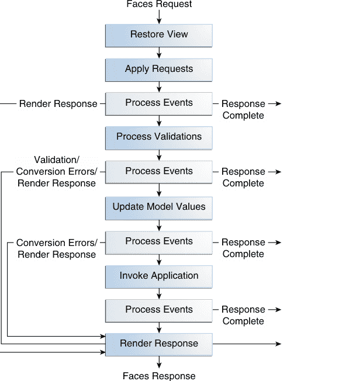

请求生命周期处理两种请求：初始请求和回传（postbacks）。当用户首次请求某个页面时，会发生**初始请求**。当用户提交页面中的表单时，而该页面是由于执行初始请求后加载到浏览器中的，就会发生**回传**。

当生命周期处理初始请求时，它只执行恢复视图（Restore View）和渲染响应（Render Response）阶段，因为没有需要处理的用户输入或操作。相反，当生命周期处理回传时，它会执行所有阶段。

通常，JavaFaces 页面的第一个请求来自客户端，由于点击了页面上的链接或按钮组件。为了渲染 JavaFaces 页面，应用程序创建一个新视图并将其存储在 `javax.faces.context.FacesContext` 实例中，该实例代表与处理传入请求和创建响应相关的所有信息。应用程序使用视图所需的对象引用并调用 `FacesContext.renderResponse` 方法，该方法通过跳过生命周期的渲染响应阶段来强制立即渲染视图，如图 7–3 中标记为 Render Response 的箭头所示。

有时，应用程序可能需要重定向到 Web 应用程序资源，或生成不包含 JavaFaces 组件的响应；在这些情况下，开发者必须调用 `FacesContext.responseComplete` 方法来跳过渲染响应阶段。这种情况在图 7–3 中也有显示，标有标记为 Response Complete 的箭头。

最常见的情况是 JavaFaces 组件为另一个 JavaFaces 页面提交请求。在这种情况下，JavaFaces 实现自动处理请求，通过生命周期中的各个阶段来执行任何必要的转换、验证和模型更新，以生成响应。

本节描述的生命周期有一个例外。当组件的 `immediate` 属性设置为 `true` 时，与这些组件相关的验证、转换和事件将在应用请求值阶段（Apply Request Values Phase）期间处理，而不是在较后的阶段处理。

后续章节中解释的生命周期细节主要面向开发者，他们需要了解通常在何时处理验证、转换和事件，以及更改它们的处理方式。有关每个每个生命周期阶段的更多信息，请从 http://jcp.org/jsr/en/detail?id=344 下载最新的 JavaServer Faces 规范。

JavaServer Faces 应用生命周期执行阶段包含以下阶段：

- 恢复视图阶段（Restore View Phase）
- 应用请求值阶段（Apply Request Values Phase）
- 处理验证阶段（Process Validations Phase）
- 更新模型值阶段（Update Model Values Phase）
- 调用应用程序阶段（Invoke Application Phase）
- 渲染响应阶段（Render Response Phase）

## 7.6.2 恢复视图阶段

当发出对 JavaServer Faces 页面的请求时（通常通过动作触发，例如点击了链接或按钮组件），JavaServer Faces 实现开始恢复视图阶段。

在此阶段，JavaServer Faces 实现构建页面的视图，将处理器和验证器连接到视图中的组件上，并在 `FacesContext` 实例中查看视图，该实例包含了处理单个请求所需的所有信息。应用程序的所有所有组件、事件处理程序、转换器和验证器都可以访问 `FacesContext` 实例。

如果请求是初始请求，JavaServer Faces 实现在此阶段创建一个空视图，生命周期将进展到渲染响应阶段，在该阶段，空视图将由页面中标签引用的组件填充。

如果请求是回传，`FacesContext` 实例中已经存在与此页面对应的视图。在此阶段，JavaServer Faces 实现使用状态恢复视图。

## 7.6.3 应用请求值阶段

在回传请求期间恢复组件树后，树中的每个组件使用其 `decode()` 方法从请求参数中提取新值。然后将该值本地存储在组件上。

如果页面上的某些组件的 `immediate` 属性（见立即属性）设置为 `true`，则与这些组件相关的验证、转换和事件将在此阶段处理。

如果任何转换失败，JavaServer Faces 实现将跳到渲染阶段，并带有来自应用值阶段的任何验证错误。

## 7.6.4 处理验证阶段

在此阶段，JavaServer Faces 实现通过使用其 `validate()` 方法处理树中组件上注册的所有验证器。它检查指定验证规则的组件属性，并将这些规则与组件组件的本地值进行比较。JavaFaces 实现还会完成没有 `immediate` 属性的输入。

如果本地值无效或任何验证失败，JavaFaces 实现将向 `FacesContext` 实例添加错误消息，生命周期将直接进展到渲染阶段，以便带有错误重新渲染页面。如果从应用值阶段存在转换错误，这些错误的消息也会被显示。

如果请求是部分请求，将从 `FacesContext` 获取部分上下文并应用部分处理方法。

## 7.6.5 更新模型值阶段

在 JavaFaces 确定数据有效后，它遍历组件树并将组件的本地值设置到对应的后端对象属性。JavaFaces 实现仅更新由输入组件的 `value` 属性设置的豆属性。如果本地数据无法转换为豆属性指定的类型，生命周期将直接进展到渲染阶段，以便带有错误重新渲染页面。

如果任何 `updateModels` 方法或任何监听器调用了当前 `FacesContext` 实例上的 `renderResponse` 方法，JavaFaces 实现将跳过到渲染响应（Render Response）阶段。

此时，如果应用程序需要重定向到不同的 Web应用程序或生成不包含任何 JavaFaces 组件的响应，它可以调用 `FacesContext.responseComplete` 方法。

如果在在此阶段期间队列了任何事件，JavaFaces 实现会将它们广播给感兴趣的监听器。

如果当前请求被识别为部分请求（partial request），将从 `FacesContext` 获取部分上下文（partial context），并应用部分处理方法。

## 7.6.6 调用应用程序阶段 (Invoke Application Phase)

在此阶段，JavaFaces 实现处理任何应用程序级别的事件，例如提交表单或链接到另一个页面。

此时，如果应用程序需要重定向到不同的 Web应用程序或生成不包含任何 JavaFaces 组件的响应，它可以调用 `FacesContext.responseComplete` 方法。

如果正在处理的视图是从之前请求的状态信息重建的，并且发生了组件事件，则这些事件将广播给感兴趣的监听器。

最后，JavaFaces 实现将控制权移交给渲染响应阶段。

## 7.6.7 渲染响应阶段 (Render Response Phase)

在此阶段，JavaFaces 构建视图并将权限委托给相应的资源来渲染页面。

如果这是一个初始请求，页面上表示的组件将（添加到组件树中。如果不是初始请求，则组件已经在树中，不需要再次添加。

如果请求是回传（postback）且在应用请求阶段（Apply Request phase）、处理验证（Process Validations）或更新模型值（Update Model values）期间遇到错误，则在此阶段将重新渲染原始页面。如果页面包含 `h:message` 或 `h:messages` 标签，任何队列中的错误消息将显示在页面上。

视图内容渲染完成后，视图的状态将被保存，以便后续请求可以访问它。保存的状态恢复视图阶段（Restore View phase）可用。

## 7.7 部分处理与部分渲染 (Partial Processing and Partial Rendering)

JavaFaces 生命周期跨越了应用程序的所有执行和渲染过程。也可以作为单个组件，只处理和渲染应用程序的部分内容。例如，JavaFaces AJAX 框架生成的请求包含了关于哪些特定组件可以被处理以及哪些特定组件可以被渲染回客户端的信息。

一旦此类部分请求进入 JavaFaces 生命周期，该信息将由 `javax.faces.context.PartialViewContext` 对象识别并处理。JavaFaces 生命周期仍然感知此类请求并相应地修改组件树。

`f:ajax` 标签的 `execute` 和 `render` 属性用于标识哪些组件可以被执行和渲染。有关这些属性的更多信息，请参阅第 13 章，“在 JavaServer Faces 技术中使用 Ajax”。

## 7.8 关于 JavaServer Faces 技术的进一步信息

关于 JavaServer Faces 技术的更多信息，请参阅：

- JavaServer Faces 2.2 规范：
- http://jcp.org/jsr/en/jsr/detail?id=344
- JavaServer Faces 项目网站：
https://javafaces.java.net/

# Facelets 简介

Facelets 一术是指用于 JavaServer 技术的视图声明语言。Facelets 是 JavaServer Faces 规范的一部分，也是构建基于 Java Faces 技术应用程序的首选呈现技术。此前用作 JavaServer Faces 呈现技术的 JavaServer Pages (JSP) 技术不支持 Java EE 7 平台中 Java Faces 提供的所有新功能。JSP 技术被认为是 JavaServer Faces 的弃用技术。

此处将介绍以下主题：

- 什么是 Facelets？
- Facelets 的生命周期
- 开发简单的 Facelets 应用程序：guessnumber-jsf 示例应用程序
- 使用 Facelets 模板
- 复合组件 (Composite Components)
- Web 资源
- 可移动资源
- 资源库合约
- HTML5 友好标记

## 8.1 什么是 Facelets？

Facelets 是一种强大但轻级的页面声明语言，用于使用 HTML 样式模板构建 JavaServer Faces 视图并构建组件树。Facelets 的特性包括：

- 使用 XHTML 创建网页
- 除了 JavaServer Faces 和 JSTL 标签库外，还支持 Facelets 标签库
- 支持表达式语言 (EL)
- 组件和页面的模板化

Facelets 对于大规模开发项目的优势包括：

- 通过模板和复合组件支持代码复用
- 通过自定义实现组件及其他服务器端对象的功能性扩展性
- 更快的编译时间
- 编译时 EL 验证
- 高性能渲染

简而言之，使用 Facelets 减少了开发和部署所需的时间和精力。

Facelets 视图通常创建为 XHTML 页面。JavaFaces 实现支持符合 XML 渡文档类型定义 (DTD) 创建的 XHTML 页面，列位于 http://www.w3.org/TR/xhtml/#_dtd_XHTML-1.0-Transitional。按照惯例，使用 XHTML 构建的网页具有 .xml 扩展名。

JavaServer Faces 技术支持各种标签库来向网页添加组件。使用 JavaServer Faces 标签机制，Faces 使用 XML 命名空间。表 8–1 列出了 Facelets 支持的标签。

| 标签库 | URI | 前缀 | 示例 | 内容 |
|---|---|---|---|---|
| JavaServer Faces 标签库 | http://xmlns.jcp/jsf/facelets | ui: | ui:component, ui:insert | 用于模板的标签 |
| JavaServer Faces HTML 标签库 | http://xmlns.jcp/jsf/html | h: | h:head, h:body, h:outputText, h:inputText | 针对所有 UIComponent 对象的 JavaServer Faces 组件标签 |
| JavaServer Faces 核心标签库 | http://xmlns.jcp/jsf/core | f: | f:actionListener, f:attribute | 独立于特定渲染器的 JavaFaces 自定义操作标签 |
| 透传元素标签库 | http://xmlns.jcp/jsf/passthrough | jsf: | jsf:id | 支持 HTML5 友好标记的标签 |
| http://xmlns.jcp/jsf/composite | cc: | cc:interface | 支持复合组件的标签 |
| JSTL 核心标签库 | http://xmlns.jcp/jsf/jstl/core | c: | c:forEach, c:catch | JSTL 1.2 标签 |
| JSTL 函数标签库 | http://xmlns.jcp/jsf/jstl/functions | fn: | fn:toUpperCase, fn:toLowerCase | JSTL 1.2 函数标签 |

Facelets 提供了两个命名空间来支持 HTML5 友好标记。详情请参阅 HTML5 友好标记。

## 开发简单的 Facelets 应用程序：guessnumber-jsf 示例应用程序

Facelets 支持复合组件的标签，你可以为其声明自定义前缀。有关复合组件的更多信息，请参阅复合组件。

表中所示命名空间前缀是惯例，而非强制性的。正如声明任何 XML 命名空间一样，你可以指定任何前缀。例如，你可以将复合标签库声明为

```
xmlns:composite="http://java.sun.com/jsf/composite"
```
而不是
```
xmlns:cc="http://java.sun.com/jsf/composite"
```


基于 JavaServer 对表达式语言 (EL) 支持，Facelets 使用 EL 表达式引用托管豆。EL 表达式可将组件对象或值绑定到托管豆的属性上。有关使用的更多信息，请参阅使用 EL 引用托管豆。

# 开发一个简单的 Facelets 应用：guessner-jsf 示例应用程序

- 使用组件标签创建页面
- 定义页面导航
- 映射 `FacesServlet` 实例
- 添加命名豆（named bean）声明

## 8.3.1 创建 Facelets 应用程序

本教程使用的示例程序是 `guessner-jsf` 应用。该应用程序将向你展示一个页面，要求你猜一个 0 到 10 之间的数字，将你的输入与随机数进行验证，并返回另一个页面，告知你数字猜得正确还是错误。

该应用程序的源代码位于 `tut-install/examples/web/jsf/guessner-jsf/` 目录下。

### 8.3.1.1 开发托管豆

在典型的 JavaServer Faces 应用中，应用程序的每个页面都连接到一个作为后台豆的托管豆。后台豆定义了与组件关联的方法和属性。在例例中，两个页面都使用同一个后台豆。

以下托管豆类 `UserBean.java` 会生成一个 0 到 10 之间的随机数：

```java
package jaavaetutorial.guessner;

import java.io.Serializable;
import java.util.Random;
import javax.enterprise.context.SessionScoped;
import javax.inject.Named;

@Named
@SessionScoped
public class UserBean implements Serializable {

    private static final long serialVersionUID = 54433515113968687243L;

    Integer randomInt = null;
    Integer number = null;
    String response = null;
    private int maximum = 10;
    private int minimum = 0;

    public UserBean() {
        Random randomGR = new Random();
        randomInt = new Integer(randomGR.nextInt(maximum + 1));
        // 将数字到服务器日志
        System.out.println("Duke's number: " + randomInt);
    }

    public void setNumber(Integer user_number) {
        number = user_number;
    }

    public Integer getNumber() {
        return number;
    }

    public String getResponse() {
        if ((userName == null) || (userName.compareTo(randomInt) != 0)) {
            return "Sorry, " + userName + " is incorrect.";
        } else {
            return "Yay! You got it!";
        }
    }

    public int getMax() {
        return (this.maximum);
    }

    public void setMaximum(int maximum) {
        this.maximum = maximum;
    }

    public int getMinimum() {
        return (this.minimum);
    }

    public void setMinimum(int minimum) {
        this.minimum = minimum;
    }
}
```

注意使用 `@Named` 注解，它使得托管豆可以通过 EL 访问。`@SessionScoped` 注解将豆的作用范围限制为会，并允许你在运行应用程序时进行多次猜测。

### 8.3.1 创建 Facelets 视图

要创建一个页面或视图，需要在页面中添加组件，将组件连接到后台值和属性，并在组件上注册控制器、验证器或监听器。

对于该应用程序，XHTML 页面作为前端。示例应用程序的第一个页面是名为 `greeting.xhtml` 的页面。仔细查看此网页的各个部分可以获得更多信息。

网页的第一部分声明了页面类型，即 XHTML：

```xml
<!DOCTYPE html PUBLIC "//W3C//DTD HTML 1.0 Transitional//EN"
"http://www.w3.org/TR/html4/DTD/html4-transitional.dtd">
```

下一部分指定了 XHTML 页面的语言，并为网页使用的标签库声明了 XML 命名空间：

```xml
<html lang="en"
xmlns="http://www.w3.org/1999/xhtml"
xmlns:h="http://xmlns.jcp.org/jsf/html"
xmlns:f="http://xmlns.jcp.org/jsf/core">
```

后续部分使用各种标签将组件插入网页中：

```xml
<head>
    <h:outputStylesheet library="css" name="default.css"/>
    <f:title>Guess Number Facelets Application</f:title>
</head>
<body>
    <h:form>
        <h:graphicImage value="#{resource['images:wave.med.gif']}"/>
        <h2 alt="Duke waving his hand">Hi, my name is Duke. I am thinking of a number from
#{userNumberBean.minimum} to #{userNumberBean.maximum}.
Can you guess it?
</h2>
<p:inputText title="Enter a number from 0 to 10"
value="#{userNumberBean.minimum}">
  <f:validateRange minimum="#{userNumberBean.minimum}"
maximum="#{userNumberBean.maximum}"/>
</p:inputText>
<h:commandButton id="submit" value="Submit"
action="response"/>
<h:message showSummary="true" showDetail="false"
style="color: #d20005;
font-family: New Century Schoolbook, serif;
font-style: oblique;
text-decoration: underline"
id="error1"
for="userNo"/>
    </h:form>
</body>
</html>
```

请注意使用以下标签的使用：
- `h:` 标签（以 `h:` 开头）
- `f:` 标签（以 `f:` 开头）

## 8.3.2 配置应用程序

配置 JavaServer Faces 应用涉及在 Web 部署描述（如 `web.xml` 文件）中映射 `FacesServlet`，并可能在应用程序配置 `faces-config.xml` 中添加豆声明、导航规则和资源包。

如果你使用的是 NetBeans IDE，会自动为你创建一个 Web 部署描述。在 IDE 创建的 `web.xml` 文件中，更改默认设置页面 `index.xhtml`。以下是显示此更改的 `web.xml` 示例文件：

```xml
<?xml version="1.0" encoding="UTF-8"?>
<web-app xmlns="http://xmlns.jcp.org/xml/ns/javaee"
xmlns:xsi="http://www.w3.org/2001/XMLSchema-instance"
xsi:schemaLocation="http://xmlns.jcp.org/xml/ns/javaee http://xmlns.jcp.org/xml/ns/javaee/web-app_3_1.xsd">
<context-param>
<param-name>javax.faces.PROJECT_STAGE</param-name>
<param-value>Development</param-value>
</context-param>
<servlet>
<servlet-name>Faces Servlet</servlet-name>
<servlet-class>javax.faces.webapp.FacesServlet</servlet-class>
<load-on-startup>1</load-on-startup>
</servlet>
<servlet-mapping>
<servlet-name>Faces Servlet</servlet-name>
<url-pattern>*.xhtml</url-pattern>
</servlet-mapping>
<session-config>
<session-timeout>30</session-timeout>
</session-config>
<welcome-file-list>
<welcome-file>greeting.xhtml</welcome-file>
</welcome-file-list>
</web-app>
```

## 8.3.3 运行 guessnumber-jsf Facelets 示例

你可以使用 NetBeans IDE 或 Maven 来构建、打包、部署和运行 `guessnumber-jsf` 示例。

### 8.3.3.1 使用 NetBeans IDE 构建、打包并部署 guessnumber-jsf 示例

1. 确保 GlassFish 服务器已启动（参见“启动和停止 GlassFish 服务器”）。
2. 从 **File**（文件）菜单中选择 **Open Project**（打开项目）。
3. 在项目对话框中，导航到：`tut-install/examples/guessnumber-jsf`
4. 选择 **guessnumber-jsf** 文件夹。
5. 点击 **Open Project**（打开项目）。
6. 在 Tabs（标签）选项卡中，右键点击 `guessnumber-jsf` 项目并选择 **Build**（构建）。此选项将构建示例应用并部署到你的 GlassFish 服务器。

### 8.3.3.2 使用 Maven 构建、打包并部署 guessnumber-jsf 示例

1. 确保 GlassFish 服务器已启动（参见“启动和停止 GlassFish 服务器”）。
2. 在终端窗口中，进入：`tut-install/examples/web/jsf/guessnumber-jsf/`
3. 输入以下命令：
`mvn install`

此命令将应用程序构建并打包成 WAR 文件 `guessnumber-jsf.war`，该文件位于 target 目录中。然后它将其部署到服务器。

### 8.3.3.3 运行 guessnumber-jsf 示例

1. 打开 浏览器。
2. 在浏览器中输入以下 URL：
`http://localhost:8080/guessnumber-jsf`
3. 在字段中输入一个 0 到 10 之间的数字，并点击 **Submit**（提交）。
会显示另一个页面，报告你的猜测是正确还是错误。
4. 如果你猜错了，点击 **Back**（返回）回到主页。
你可以继续猜，直到得到正确答案，或者你可以查看服务器日志，`UserNameBean` 构造函数会显示正确答案。

## 8.4 使用 Facelets 模板

JavaServer Faces 提供了实现易于扩展和复用的用户界面工具。模板是 Facelets 的一个有用功能，允许你创建一个作为应用程序中其他页面基础或模板的页面。使用模板，你可以复用代码并避免构建相似的页面。模板还有助于在具有大量页面的应用程序中保持标准的视觉和感受。

表 8–2 列出了用于模板的 Facelets 标签及其各自对应的功能。

| 标签 | 功能 |
|---|---|
| `ui:component` | 定义一个创建并添加到组件树的组件。 |
| `ui:composition` | 定义一个页面组合，并可选地使用模板。此标签之外的内容将被忽略。 |
| `ui:debug` | 定义一个创建并添加到组件树的调试组件。 |
| `ui:decorate` | 与 composition 标签类似，但不会忽略此标签之外的内容。 |
| `ui:define` | 定义由模板插入页面的内容。 |
| `ui:fragment` | 与 component 标签类似，但不会忽略此标签之外的内容。 |
| `ui:include` | 封装并复用多个页面的内容。 |
| `ui:insert` | 将内容插入模板中。 |
| `ui:param` | 用于向包含的文件传递参数。 |
| `ui:repeat` | 作为循环标签（如 `c:forEach` 或 `h:dataTable`）的替代方案。 |
| `ui:remove` | 从页面中移除内容。 |

有关 Facelets 模板标签的更多信息，请参阅 JavaServer Facelets 标签库。

以下是一个保存为 `template.xhtml` 的模板示例：

```xml
<!DOCTYPE html PUBLIC "-//W3C//DTD HTML 1.0 Transitional//EN"
   "http://www.w3.org/TR/html1-transitional.dtd">
<html xmlns="http://www.w3.org/1999/xhtml"
     xmlns:ui="http://xmlns.w3.org/jsf/facelets"
     xmlns:h="http://www.w3.org/jsf/html">
<head>
  <meta http-equiv="Content-Type" 
       content="text/html; charset=UTF-8" />
  <h:outputStylesheet library="css" name="default.css" />
  <h:outputStylesheet library="css" name="cssLayout.css" />
  <h:title>Facelets Template</h:title>
</head>
<body>
  <div id="top" class="top">
    <ui:insert name="top">Top Section</ui:insert>
  </div>
  <div>
<div id="left">
  <ui:insert name="left">Left Section</ui:insert>
</div>
<div id="content" class="left_content">
  <ui:insert name="content">Main Content</ui:insert>
</div>
</div>
</body>
</html>
```


# Web Resources

```xml
<composite:interface>
  <composite:attribute name="value" required="false"/>
</composite:interface>
<composite:implementation>
  <h:outputLabel value="Email id: *"></h:outputLabel>
  <h:inputText value="${cc.attrs.value}"></h:inputText>
</composite:implementation>
<body>
</body></html>
```

在定义 `h:inputText` 组件的值时，使用了 `cc.attrs.value`。
在 JavaServer Faces 中，单词 `cc` 是复合组件的保留字。
`#{cc.attrs.attribute-name}` 表达式用于访问复合组件的属性，在本例中恰好是这种情况。

上一个示例内容存储在应用程序 Web 根目录下名为 `resources/emcomp` 的文件夹中的文件中。该目录被 JavaServer Faces 视为一个库，可以从此类库中访问组件。有关资源的更多信息，请参阅 [Web Resources](Web Resources)。

使用此复合组件的页面通常被称为“使用页面”（using page）。使用页面在 xml 命名空间声明中包含了对复合组件的引用：

```xml
<!DOCTYPE html PUBLIC "-//W3C//DTD HTML 1.0//EN"
"http://www.w3.org/TR/DTD/html-transitional.dtd">
<html xmlns="http://www.w3.org/1999/xhtml"
xmlns:h="http://www.jcp.org/jsf/html"
xmlns:em="http://xmlns.jcp.org/jsf/composite/emcomp*">
<head>
  <title>Using a sample composite component</title>
</head>
<body>
  <h:form>
    <em:email value="Enter your email id" />
  </h:form>
</body>
</html>
```

本地复合组件库在 `xmlns` 命名空间中通过声明 `xmlns:em="http://xmlns.jcp.org/jsf/composite/emcomp"` 定义。组件本身作为位于 Web 根目录下名为 `emuserpage.xml` 的 Web 页面访问。在服务器上编译并部署后，可以通过以下 URL 访问：`http://localhost:8080/application-name/emuserpage.xml`

更多信息和示例，请参阅第 14 章“Composite Components: Advanced Topics and an Example”。

## 8.6 Web Resources

Web 资源是 Web 为了正确渲染所需的任何软件，包括图像、脚本文件和任何用户创建的组件库。必须收集在标准位置，可以是以下位置之一。

- 打包在 Web 应用程序中的资源必须是 Web 应用程序根目录下 `resources` 目录的子目录：`resources/resource-identifier`。
- 打包在 Web 应用程序类路径中的资源必须是 Web 应用程序 `META-INF/resources` 目录的子目录：`META-INF/resources/resource-identifier`。你可以使用此结构将资源打包在用于应用程序的 JAR 文件中。

Java Faces 将按照下列顺序从上述位置查找资源：

资源标识符是符合以下格式的唯一字符串（单行）：
`[local-prefix]/library-name][library-version]/resource-name`

资源标识符中括号 `{}` 内元素是可选的，表示只有 `resource-name`（通常是文件名）是必要的元素。例如，指定样式表、图像或脚本的最常用方法是使用 `library` 和 `name` 属性，如下所示（来自 guessnumber-js 示例标签）：

```xml
<h:outputText library="css" name="default.css"/>
```

此标签指定 `default.css` 样式表位于 `web/resources/` 目录。

你也可以使用以下语法指定图像的位置，同样来自 guessnumber-js 示例：

此标签指定命名为 `wave.med.gif` 的图像位于 `web/images` 目录。

资源可以被视为库的位置。存储在 `resources` 目录中的任何构件（作为复合组件或模板）对其他应用程序组件都是的，它们可以使用它来创建资源实例。

## 8.7 Relocatable Resources（可移动资源）

你可以在页面的一个部分放置资源标签，并说明它将在页面的另一个部分渲染。要做到这一点，你使用指定资源的标签的 `target` 属性。该属性的可值如下：

- "head" 在 `head` 元素中渲染资源。
- "body" 在 `body` 元素中渲染资源。
- "form" 在 `form` 元素中渲染资源。

例如，以下放置在 `h:form` 元素内的 `h:outputScript` 标签会在 `head` 元素中渲染 JavaScript。

```xml
<h:form>
  <h:outputScript name="myscript.js" library="mylibrary" target="head"/>
</h:form>
```

`h:outputText` 标签也以类似的方式支持资源移动。

可移动资源对于使用样式表的复合组件以及用于使用 JavaScript 的复合组件至关重要。示例请参阅 [The compositecomponentexample Example Application]。

## 8.8 Resource Library Contracts（资源库合约）

资源库合约允许你为一个或多个应用程序的不同部分定义不同的外观和感觉，而无需对所有部分使用相同的相同的，或逐页面地指定不同的外观。

要做到这一点，你为你的 Web 应用程序创建一个 `contracts` 部分。在 `contracts` 部分中，你可以指定任意数量的命名区域，每个区域被称为一个合约（contract）。在每个合约中，你可以指定如模板文件、样式表、JavaScript 文件等资源。

例如，你可以指定两个合约 `c1` 和 `c2`，每个合约都使用模板：

```
src/main/webapp
WEB-INF/
contracts
c1
template.xhtml
style.css
c2
c2
...
```

应用程序的一部分可以使用 `c1`，而另一部分可以使用 `c2`。

使用合约的另一种方法是指定一个包含多个模板的单一合约：

```
src/main/webapp
contracts
myContract
template1.xhtml
template2.xhtml
style.css
```

你可以将资源库合约打包在 JAR 文件中以便在不同的应用程序中重用。如果你这样做，合约必须位于 `META-INF/contracts` 下。然后你可以将 JAR 文件放置在应用程序的 `WEB-INF/` 目录下。这意味着应用程序结构如下：

```
src/main/webapp
WEB-INF/lib
myContract.jar
...
```

你可以在应用程序的 `faces-config.xml` 文件中的 `resource-library-contracts` 元素下指定合约的使用。当应用程序使用多个合约时才需要使用此元素。

### 8.8.1 hello-rlc 示例

`hello-rlc` 示例修改了简单示例 A Web Module That Uses JavaFaces: The hello 以使用两个库合约。应用程序中的每个页面都使用不同的合约。

`hello-rlc.Hello.java` 的托管 Bean 与 `hello` 的相同（仅替换了 `@Named` 和 `@RequestScoped` 注解）。

此应用程序的源代码位于 `tut-install/examples/jsf/hello-rlc/`。

### 8.8.2 配置 hello-rlc 示例

`hello-rlc` 示例的 `faces-config.xml` 文件包含以下元素：

```xml
<resource-library-contracts>
  <contract-mapping>
    <url-pattern>/reply/*</url-pattern>
    <contracts>reply</contracts>
  </contract-mapping>
  <contract-mapping>
    <url-pattern>/*</url-pattern>
    <contracts>hello</contracts>
  </contract-mapping>
</resource-library-contracts>
```

`resource-library-contracts` 元素内的 `contract-mapping` 元素将每个合约映射到应用程序不同的页面集。

应用程序结构如下：

```
hello-rlc
pom.xml
src/main/java/javaetutorial/hellorlc/Hello.java
src/main/webapp
  WEB-INF
    faces-config.xml
    web.xml
    contracts
      hello
        default.css
        duke.handsOnHips.gif
        template.xhtml
      reply
        default.css
        duke.thumbup.gif
        template.xhtml
    response.xml
  greeting.xml
```

`web.xml` 文件指定欢迎文件为 `greeting.xml`。因为其不在 `src/main/webapp/reply` 下，Facelets 页面使用 `hello` 合约，而 `src/main/webapp/reply/response.xml` 使用 `reply` 合约。

### 8.8.1.2 hello1-rlc 示例的 Facelets 页面

greeting.xhtml 和 response.xhtml 页面在它们的模板中调用的代码是相同的：

```xml
<ui:composition template="template.xhtml">
```

hello 和 reply 合约中的 `template.xml` 文件仅在两个方面不同：标题元素的占位符文本（"Hello Template" 和 "Reply Template"）以及它们各自指定的图形。
两个合约中的 `default.css` 样式表仅在一个方面不同：为 `body` 元素指定的背景颜色。

### 8.8.1.3 使用 NetBeans IDE 构建、打包并部署 hello1-rlc 示例

- 1. 确保 GlassFish 服务器已启动（参考启动和停止 GlassFish 服务器）。
- 2. 从文件（File）菜单中选择打开项目（Open Project）。
- 3. 在打开项目对话框中，导航到：
  `tut-install/examples/web/jsf`
- 4. 选择 hello1-rlc 文件夹。
- 5. 点击打开项目（Open Project）。
- 6. 在项目（Projects）选项卡中，右键点击 hello1-rlc 项目并选择构建（Build）。
此选项将构建示例应用程序并将其部署到您的 GlassFish 服务器实例中。

### 8.8.1.4 使用 Maven 构建、打包并部署 hello1-rlc 示例

- 1. 确保 GlassFish 服务器已启动（参考启动和停止 GlassFish 服务器）。
- 2. 在终端窗口中，进入目录：
  `tut-install/examples/web/jsf/hello1-rlc/`
- 3. 输入以下命令：
  `mvn install`

此命令将应用程序构建并打包成 WAR 文件 `hello1-rlc.war`，该文件位于 `target` 目录。然后它将其部署到您的 GlassFish 服务器实例中。

### 8.8.1.5 运行 hello1-rlc 示例

- 1. 在 浏览器中输入 URL：
  `http://localhost:8080/hello1-rlc`
- 2. greeting.xhtml 页面看起来和 hello 页面一样，除了背景颜色和图形不同。
- 3. 在文本字段中输入您的姓名并点击提交（Submit）。
- 4. response 页面也和 hello 页面一样，除了背景颜色和图形不同。

## HTML5 友好标记

页面显示了您提交的名称。点击返回（Back）回到 greeting.xhtml 页面。

## 8.9 HTML5 友好标记

当您想要为 HTML5 本身不具备的元素生成用户界面功能时，可以创建一个 JavaServer Faces 组件并将其插入到 Facets 页面中。这种机制可以使简单的元素创建复杂的 Web 代码。然而，创建此类组件是一项艰巨的任务；请参见第 15 章（“创建 UI 组件和自定义对象”）。

HTML5 提供了新的元素和属性，这使得您无需编写自己的组件。它还为现有组件提供了新功能。JavaServer Faces 通过不引入模仿 HTML5 的新组件来支持 HTML5，而是允许您直接使用 HTML5。它还允许在 HTML5 元素内部使用 JavaServer 属性。JavaServer Faces 的 HTML5 技术分为两类：

- 透传元素（Pass-through elements）
- 透传属性（Pass-through attributes）

HTML5 友好标记功能的作用是让 Facets 作者对渲染的页面输出具有完全控制权，而不是将其传递给组件作者。您可以根据需要混合使用 JavaServer Faces 和 HTML5 元素。

### 8.9.1 透传元素

透传元素允许您使用 HTML5 标签和属性将它们处理为等同于 JavaServer Faces 服务端 `UIComponent` 实例。要使一个非 JavaServer 元素成为透传元素，请使用 http://xmlns.jcp.org/jsf 命名空间指定其至少一个属性。例如，框架使用短名称 `jsf:` 解码该命名空间：

```xml
<html xmlns:jsf="http://xmlns.jcp.org/jsf">
  <input type="email" jsf:id="email" value="#{bean.email}" required="required"/>
```


表 8–4 Facets 如何渲染 HTML5 元素

| HTML5 元素名称 | 标识属性 | Facets 标签 |
| :--- | :--- | :--- |
| a | `jsf:action` | `h:commandLink` |
| a | `jsf:actionListener` | `h:commandLink` |
| a | `jsf:value` | `h:outputLink` |
| a | `jsf:outcome` | `h:link` |

表 8–4（续）Facets 如何渲染 HTML5 元素

| HTML5 元素名称 | 标识属性 | Facets 标签 |
| :--- | :--- | :--- |
| body | | `h:body` |
| button | `jsf:outcome` | `h:button` |
| button | | `h:button` |
| form | | `h:form` |
| head | | `h:head` |
| img | | `h:graphicImage` |
| input | `type="button"` | `h:commandButton` |
| input | `type="checkbox"` | `h:selectCheckbox` |
| input | `type="color"` | `h:inputText` |
| input | `type="date"` | `h:inputText` |
| input | `type="datetime"` | `h:inputText` |
| input | `type="datetime-local"` | `h:inputText` |
| input | `type="email"` | `h:inputText` |
| input | `type="month"` | `h:inputText` |
| input | `type="number"` | `h:inputText` |
| input | `type="range"` | `h:inputText` |
| input | `type="search"` | `h:inputText` |
| input | `type="time"` | `h:inputText` |
| input | `type="url"` | `h:inputText` |
| input | `type="week"` | `h:inputText` |
| input | `type="file"` | `h:inputFile` |
| input | `type="hidden"` | `h:inputHidden` |
| input | `type="password"` | `h:inputSecret` |
| input | `type="reset"` | `h:commandButton` |
| input | `type="submit"` | `h:commandButton` |
| input | `type="*"` | `h:inputText` |
| label | | `h:outputLabel` |
| link | | `h:outputStylesheet` |
| script | | `h:outputScript` |
| select | `multiple="*"` | `h:selectManybox` |
| select | | `h:selectOneList` |
| textarea | | `h:inputArea` |

### 8.9.2 透传属性

透传属性是透传元素的反面。它们允许您将非 JavaFaces 属性传递给浏览器。如果您在 JavaFaces `UIComponent` 中指定了透传属性，该属性名称和值将直接传递给浏览器，而不被 JavaFaces 组件或渲染器解析。有几种方法可以指定透传属性：

- 使用 JavaFaces 命名空间为透传属性添加前缀。例如，以下代码使用短名称 `p` 定义命名空间，然后将 `type`、`min`、`max`、`required` 和 `title` 属性透传给 HTML 组件：

```xml
<html xmlns:p="http://xmlns.jcp.org/jsf/passthrough">

<h:form prepend="false">

<h:inputText type="number" value="${bean.nights}" p:min="1" p:max="30" p:required="required" p:title="Enter a number between 1 and 30">

</h:form>
```

假设 `bean.nights` 设置了默认值 1，这将产生如下标记：

```html
<input id="nights" type="number" value="1" min="1" max="30" required="required">

<title>Enter a number between 1 and 30</title>
```

- 在组件标签内嵌套 `f:passThroughAttribute` 标签来传递单个属性。例如：

```html
<h:inputText value="#{user.email}">

<f:passThroughAttribute name="type" value="email" />

</h:inputText>
```

HTML5 属性会通过浏览器传递，而不被 JavaServer Faces 输入组件解析：

```xml
<h:inputText id="price" p:type="number"

value="#{reservationBean.price}"

min="80" max="120"

step="20" p:required="required"

p:title="Enter a price: 80, 100, 120, or 140.">

<f:ajax event="change" render="total"

listener="#{reservationBean.calculateTotal}"/>

</h:inputText>
```

`calculateTotal` 方法的输出被指定为 Ajax 事件的输出，因为它被渲染在 id 为 `total` 且 name 为 `total` 的输出元素中。更多信息请参阅第 13 章“在 JavaServer 技术中使用 Ajax”。

第二个 Facets 页面 `confirmation.xml` 使用一个输出元素来显示用户输入的值，并提供了一个 Faclets `h:commandButton` 标签允许用户返回 `reservation.xml` 页面。

## 8.9.3.2 预留应用的 Managed Bean

用于预留应用程序的会话管理 Bean `ReservationBean.java` 包含了 Faclets 页面上所有元素的属性。它还包含两个方法 `calculateTotal()` 和 `clear()`，它们作为 `reservation.xml` 页面上 Ajax 事件的监听器。

## 8.9.3.3 使用 NetBeans IDE 编译、打包并部署预留示例

1. 确保 GlassFish 服务器已启动（参见“启动和停止 GlassFish”）。
2. 从 File（文件）菜单中选择 Open Project（打开项目）。
3. 在 Open Project 对话框中，导航到：
`tut-install/examples/web/jsf`
4. 选择 `reservation` 文件夹。
5. 点击 Open Project（打开项目）。
6. 在 Projects（项目）选项卡中，右键点击 `reservation` 项目并选择 Build（生成）。
此选项会构建（编译）示例应用程序，并将其部署到你的 GlassFish 服务器实例中。

## 8.9.3.4 使用 Maven 编译、打包并部署预留示例

1. 确保 GlassFish 服务器已启动（参见“启动和停止 GlassFish”）。
2. 在终端窗口中，进入：
`tut-install/examples/web/jsf/reservation/`
3. 输入以下命令：`mvn install`

此命令将应用程序构建并打包成 WAR 文件 `reservation.war`，该文件位于 `target` 目录下。然后它会将 WAR 文件部署到你的 GlassFish 服务器实例中。

## 8.9.3.5 运行预留示例

在本教程出版时，最完整实现 HTML5 的浏览器是 Google Chrome，建议使用它来运行此示例。不过，其他浏览器正在追赶，当你阅读此处时，它们可能也同样良好。

1. 在 浏览器中输入 URL：
`http://localhost:8080/reservation`

2. 在 `reservation.xhtml` 页面的字段中输入信息。
- Date（日期）字段有一个带有上下箭头的日期字段，允许你递增或减少月份、日期和年份，以及一个较大的向下箭头，可以弹出日历形式的日期编辑器。
- Number of Tickets（票数）和 Ticket Price（票价）字段也有上下箭头，允许在范围内递增或减少值。当其中一个字段发生变化时，Estimated Total（预估总额）会随之改变。电子邮件地址和日期会进行格式检查，而不是有效性检查（例如，你可以预订过去的日期）。
3. 点击 Make Reservation（预留）完成预留，或点击 Clear（清空）将字段恢复为默认值。
4. 如果点击 Make Reservation，将出现 `confirmation.xhtml` 页面，显示提交的值。点击 Back（返回）回到 `reservation.xhtml` 页面。

## 9 表达式语言

本章介绍了表达式语言（也称为 EL），它为表示层（网页）与应用程序逻辑（managed beans）之间的通信提供了一种重要机制。EL 被多种 Java EE 技术使用，例如 JavaServer Faces 技术、JavaServer Pages (JSP) 技术以及用于 Java EE 的上下文与依赖注入 (CDI)。本章仅涵盖以下主题：

- EL 概述
- 立即时求值与延迟求值
- 值表达式与方法表达式
- 运算符
- 保留字
- EL 示例
- 关于表达式语言的更多信息

### 9.1 EL 概览

EL 允许页面作者使用表达式从 JavaBeans 中访问数据。例如，以下条件标签的 `test` 属性标记有一个 EL 表达式，该表达式比较命名为 `cart` 的会话范围 Bean 中的项目数量：

```xml
<c:if test="${sessionScope.cart.items > 0}">

</c:if>
```

参见“使用 EL 操作 Managed Beans”获取更多关于如何在 JavaServer 应用程序中使用 EL 的信息。总而言之，EL 提供了一种使用表达式执行以下任务的方法：

- 动态读取存储在 JavaBeans 组件、数据结构和隐式对象中的数据
- 动态将数据（如用户输入）写入 JavaBeans 组件
- 调用公共方法
- 动态执行算术、布尔和字符串操作
- 动态构建对象并对集合执行操作

在 JavaFaces 页面中，EL 表达式可以用于静态文本，也可以用于自定义标签或操作的属性中。最后，EL 提供了一个可插的 API，用于解析 EL 实现尚未支持的表达式。

### 9.2 立即时求值与延迟求值

EL 支持表达式的立即求值和延迟求值。**立即求值**意味着表达式在页面首次渲染时就会进行求值并得出结果。**延迟求值**意味着使用表达式语言的技术可以使用自己的机制，在页面生命周期的任何合适的时候稍后求值表达式。

这些表达式使用 `${}` 语法进行立即求值。延迟求值的表达式使用 `#{}` 语法。由于 JavaFaces 技术具有多阶段生命周期，它主要使用延迟求值。在生命周期，按特定顺序处理组件事件、验证数据并执行其他任务。因此，JavaFaces 实现必须将表达式求值延迟到生命周期中的适当点。其他使用 EL 的可能有使用延迟表达式的不同原因。

#### 9.2.1 立即求值

所有使用 `${}` 的表达式都会立即求值。这些表达式可以作为（静态）文本的一部分，也可以作为接受运行时的标签属性的值。以下示例显示了立即求值表达式可以从 catalog 获取值：

```xml
<h:outputText value="${catalog.bookQuantity}" />
```

JavaFaces 实现求值 `${catalog.bookQuantity}` 并将其传递给标签处理器。

#### 9.2.2 延迟求值

延迟表达式采用 `#{expr}` 形式，并允许在页面生命周期的其他阶段进行求值。在 JavaFaces 的情况下，取决于表达式的使用方式，可以在生命周期的不同阶段进行求值。以下示例显示了 `h:inputText` 标签，它代表一个用户输入的字段组件。`h:inputText` 标签的 `value` 属性引用 customer bean 的 name：

```xml
<h:inputText id='name' value='#{customer.name}' />
```

对于该页面的初始请求，JavaFaces 实现在生命周期的渲染阶段求值 `#{customer.name}`。在此阶段，表达式访问 customer bean 的值，正如立即求值一样。对于后处理请求，JavaFaces 在生命周期的不同阶段求值表达式，期间从请求获取、验证并传播到 customer bean。如所示，延迟表达式可以是：

- 可用于读写数据的表达式
- 方法表达式

### 9.3 值表达式与方法表达式

EL 定义了两种表达式：值表达式和方法表达式。值表达式可以求值以产生一个值，而方法表达式可以引用方法。

#### 9.3.1 值表达式

值表达式可以进一步分为 rvalue 和 Ivalue 表达式。Ivalue 表达式可以指定目标（例如对象、属性或集合元素）并进行赋值。rvalue 表达式不能指定目标。所有立即求值的表达式都使用 `${}` 分隔符，且允许表达式为 Ivalue，但永远不会发生赋值。延迟求值的表达式使用 `#{}` 分隔符，并可以作为 rvalue 和 Ivalue 表达式。

##### 9.3.1.1 引用对象

顶层标识符（例如表达式 `customer.name` 中的 `customer`）可以引用以下对象：

- Lambda 参数
- EL 变量
- 托管 bean (Managed beans)
- 隐式对象
- 静态字段和方法的类

要引用这些对象，你需要编写一个使用对象名称作为变量名称的表达式。以下表达式引用了名为 `customer` 的名称：

```
${customer}
```

你可以使用自定义的 EL 解析器（EL resolver）来更改变量解析的方式。例如，你可以提供一个 EL 解析器来拦截名为 `customer` 的对象，这样 `${customer}` 就会返回 EL 解析器值。（JavaServer Faces 技术使用 EL 来处理托管 bean。）

枚举常量是静态字段的一种特殊情况，你可以直接引用此类常量。例如，考虑这个枚举类：

```java
public enum Suit {hearts, spades, diamonds, clubs}
```

在接下来的表达式中，`mySuit` 是 `Suit` 的实例，你可以将 `suit.hearts` 与该实例进行比较：

```
${mySuit == suit.hearts}
```

##### 9.3.1.2 引用对象属性或集合元素

要引用类的属性、静态字段或方法，或者集合中的项，你可以使用 `.` 或 `[]` 符号。该符号可以用于隐式对象的属性，因为属性是存储在 map 中的。

要引用 customer bean 的名称，可以使用表达式 `${customer.name}` 或表达式 `${customer["name"]}`。这里，括号内部的部分是字符串字面量，即引用的属性名称。`[]` 语法比 `.` 语法更通用，因为括号内部可以是任何字符串表达式，而不仅仅是字面量。

你可以使用双引号或单引号作为字符串字面量。你还可以结合 `[]` 和 `.` 符号，所示：

```
${customer.address["street"]}
```

你可以使用 `className.field` 语法引用静态字段或方法，如下例：

```
Boolean.FALSE
```

`className` 是不带包名的类名。默认情况下，所有的 `java.lang` 包都已导入。你可以根据需要导入其他包、类和静态字段。

如果你正在访问数组或列表中的项，必须使用 `[]` 符号并指定数组或列表中的索引。这是一个可以转换为 int 的表达式。以下示例引用了客户订单的第一个，确保 `customer.orders` 是一个 List：

```
${customer.orders[0]}
```

如果你正在访问 Map 中的项，必须指定 Map 的键（key）。如果键是字符串字面量，可以使用 `.` 符号。假设 `customer.orders` 是一个带有字符串键的 Map，以下示例引用键为 `"socks"` 的项：

```
${customer.orders["socks"]}
```

```
${customer.orders.socks}
```


## 9.3.1.3 引用字面量

EL 定义了以下字面量：

- 布尔：`true` 和 `false`
- 整数：同 Java
- 浮点数：同 Java
- 字符串：使用单引号和双引号；`\"` 被转义为 `"`，`\'` 被转义为 `'`
- 空值：`null`

以下是一些示例：

- `${"literal"}`
- `${true}`
- `${57}`

## 9.3.1.4 参数化方法调用

EL 支持参数化方法调用。`.` 和 `[]` 运算符都可以用于调用带有参数的方法，语法如下所示：

- `expr-a[expr-b](parameters)`
- `expr-a.identifier-b(parameters)`

在第一种表达式语法中，`expr-a` 被求值以表示一个 bean 对象。表达式 `expr-b` 被求值并强制转换为字符串，表示 `expr-a` 所代表的 bean 中的属性。在第二种表达式语法中，`expr-a` 被求值以表示一个 bean 对象，而 `identifier-b` 是一个字符串，表示方法对象中的属性。括号中的参数是方法调用的参数。参数可以是零个或多个表达式值，并用逗号分隔。

值表达式和方法表达式都支持参数。在下面的示例（它是来自 guesswork 应用程序的一个修改后的标签）中，提供了一个随机数作为方法调用的参数，而不是用户输入：

```xml
<input value="${user.Number('5')}"/>
```

上一个示例使用了值表达式。

考虑下面这个使用方法表达式的 Jakarta Faces 组件的示例：

```xml
<commandButton action="#{trader.buy}" value="buy"/>
```

EL 表达式 `trader` 调用了 trader bean 的 `buy` 方法。你可以修改标签以传递参数。以下是传递了参数的修订标签：

```xml
<commandButton action="#{trader.buy('SOMESTOCK')}" value="buy"/>
```

在上一个示例中，你将字符串 `'SOMESTOCK'`（一个股票代码）作为参数传递给 `buy` 方法。

## 9.3.1.5 值表达式可以使用的地方

使用 `${}` 分隔符的值表达式可以使用：

- 在静态文本中
- 在任何可以接受插入表达式的标准或自定义标签属性中

静态文本中表达式的值会被计算并插入到当前输出中。以下是一个嵌入在静态文本中的表达式的示例：

```xml
<some:tag>
  some text ${expr} some text
</some:tag>
```

可以通过以下方式设置标签属性：

- 使用单个表达式结构：
  `<some:tag value="${expr}"/>`
  `<another:tag value="#{expr}"/>`

这些表达式会被求值并转换为属性值。

## 9.3.2 方法表达式

EL 的另一个特性是它对方法表达式的支持。方法表达式用于引用 bean 的公共方法，其语法与值表达式相同。

在 Faces 中，组件标签表示页面上的组件。组件标签使用方法表达式来指定用于某些处理的方法。这些方法对于处理组件生成的事件和验证组件数据是必要的，如下所示：

```xml
<form>
  <h:inputText id="customer.name"
        value="${customer.name}"
        validator="${customer.validateName}"/>
  <h:commandButton id="submit"
        action="${customer.submit}"/>
</form>
```

`h:inputText` 标签显示一个字段。`h:inputText` 的 `validator` 属性引用了 customer 中的 `validateName` 方法。由于方法可以在生命周期的不同阶段被调用，方法表达式必须使用延迟求值语法。

与值表达式一样，方法表达式可以使用 `.` 和 `[]` 符号。例如，`#{object.method}` 等于 `#{object["method"]}`。`[]` 内部的字面量转换为字符串并用于查找匹配的方法。

方法表达式只能用于标签，方式如下：

- 使用单个表达式，其中 bean 指向 JavaBeans 组件，method 指向该 JavaBeans 组件的方法：
  `<tag value="#{bean.method}"/>`

表达式被求值并传递给标签处理器。方法表达式表示的方法可以在之后调用。

方法表达式支持字面量主要是为了支持 Faces 技术中的 `action` 属性。当调用由表达式引起的方法时，方法返回字符串字面量，然后转换为库描述符定义的预期返回类型。

## 9.3.3 Lambda 表达式

Lambda 表达式是带有参数的值表达式。其语法与 Java 语言中的 lambda 表达式相似，不同之处在于 EL 中 lambda 表达式的体是一个表达式。

有关 lambda 表达式的基础信息，请参阅：
http://docs.oracle.com/javase/tutorial/javaOO/lambdaexpressions.html.

> **注意**：Lambda 表达式是 Java SE 8 的一部分，但你可以在 Java SE 7 的 EL 表达式中使用，Java SE 7 是与 Java EE 7 关联的 Java 版本。

Lambda 表达式使用箭头标记 (`->`) 运算符。运算符左侧的标识符称为 lambda 参数。运算符右侧的主体必须是一个表达式。lambda 参数被括在括号中；如果只有一个参数，则可以省略括号。以下是一些示例：

```
x -> x+1
(x, y) -> x + y
() -> 64
```

Lambda 表达式的行为类似于一个函数。它可以被立即调用。例如：

```
(x, y) -> x + y (3, 4)
```

你可以结合赋值运算符和分号运算符使用 lambda 表达式。例如，以下代码将之前的 lambda 表达式赋值给一个变量并调用它。结果是：

```
v = (x, y) -> x + y; v(3, 4)
```

Lambda 表达式还可以作为参数传递给方法，并在方法中调用。它还可以嵌套在另一个 lambda 表达式中。

## 集合对象的操作

EL 支持对集合对象的操作：集合、列表、映射。它允许动态创建集合对象，然后可以使用流和管道对其进行操作。

> **注意**：类似于 lambda 表达式，对集合对象的操作是 Java SE 8 的一部分，但你可以在 Java SE 7 的 EL 表达式中使用，Java SE 7 是与 Java EE 7 关联的 Java 版本。

例如，你可以如下构建集合：

```
{1,2,3}
```

你可以如下构建列表；列表可以包含各种类型的元素：

```
[1,2,3]
[1,"two","three","four"]
```

你可以通过冒号定义项来构建映射，如下：

```
{"one":1,"two":2,"three":3}
```

你通过对派生元素流进行方法调用来操作集合对象。某些操作返回另一个流，从而允许额外的操作。因此，你可以在管道中将这些操作链在一起。

流管道由以下部分组成：

- 源（`Stream` 对象）
- 任意数量返回流的中间操作（例如 `filter` 和 `map`）
- 不返回流的终端操作（例如 `toList()`）

流方法从 `java.util.Collection` 或 Java 数组获取 `Stream`。流操作不会修改原始集合对象。

例如，你可能如下生成书名标题列表：

```
books.stream().filter(b->b.category == 'history')
  .map(b->b.title)
  .toList()
```

下面的简单示例返回原始列表的排序版本：

```
[1,3,5,2].stream().sorted().toList()
```

流和流操作记录在 Java SE 8 API 文档中，地址为 http://docs.oracle.com/javase/8/docs/api/。EL 支持以下操作集：

- `allMatch`
- `anyMatch`
- `average`
- `count`
- `distinct`
- `filter`
- `findFirst`
- `flatMap`
- `forEach`
- `iterator`
- `limit`
- `map`
- `max`
- `min`
- `noneMatch`
- `peek`
- `reduce`
- `sorted`
- `stream`
- `sum`
- `toArray`
- `toList`

有关这些操作的详情，请参阅 http://www.jcp.org/en/jsr/detail?id=341 处的 EL 规范。

## 9.5 运算符

除了在值和方法表达式中讨论的 `.` 和 `[]` 运算符外，EL 提供了以下运算符，它们仅可用于右值表达式。

- 算术运算符：`+`（二元）、`*`、`/`、`div`、`%` 和 `mod`、`-`（一元）。
- 字符串连接运算符：`+=`。
- 逻辑运算符：`and`、`&&`、`||`、`not`、`!`。
- 关系运算符：`==`、`!=`、`ne`、`<`、`>`、`gt`、`ge`、`>=`、`le`。可以与其他值或与布尔、字符串、整数或浮点数字面量进行比较。
- 空：`empty` 运算符是一个前缀运算符，可用于判断值是否为 `null` 或空。
- 条件：`? B : C`。根据 A 的评估结果评估 B 或 C。
- Lambda 表达式：`->`，箭头标记。
- 赋值：`=`。
- 分号：`;`。

运算符的优先级（从高到低，从左到右）如下：

- `[]`
- `()`（用于更改运算符的优先级）
- `-`（一元） `!` `empty`
- `*` `/` `div` `mod`
- `+` `-`（二元）
- `+=`
- `<` `>` `>=` `!=` `lt` `ge`
- `!=` `eq` `ne`
- `&&` `and`
- `||` `or`
- `? :`
- `->`
- `=`
- `;`

## 9.6 保留字

以下单词为 EL 保留字，不应用作标识符：

- `and`
- `or`
- `not`
- `eq`
- `ne`
- `lt`
- `gt`
- `le`
- `ge`
- `true`
- `false`
- `null`
- `instanceof`
- `empty`
- `div`
- `mod`

## 9.7 EL 表达式示例

表 9–1 包含了示例 EL 表达式及其评估结果。

| EL 表达式 | 结果 |
| --- | --- |
| `${(1<4/2)}` | false |
| `${(4.0<= 3)}` | true |
| `${(100.0 == 100)}` | true |
| `${(10*10) ne 100}` | false |
| `${(empty null)}` | true |
| `${(empty "")}` | true |
| `${(10 > 5)}` | false |
| `${(x, y) -> x + y (3, 4)}` | 7 |
| `${(x, y) -> x + y; v(3, 4)}` | 7 |
| `${(x, y) -> x + y}` | 7 |

## 表 10–1（续）组件标签

| 标签 | 功能 | 渲染为 | 外观 |
|---|---|---|---|
| `h:inputHidden` | 允许页面作者在页面中包含一个隐藏变量 | 一个 HTML `<input type="hidden">` 元素 | 无外观显示 |
| `h:inputSecret` | 允许用户输入字符串，但实际字符串不会显示在字段中 | 一个 HTML `<input type="password">` 元素 | 显示一行字符而非实际输入的字符串的字段 |
| `h:inputText` | 允许用户输入字符串 | 一个 HTML `<input type="text">` 元素 | 字段 |
| `h:inputTextarea` | 允许用户输入多行字符串 | 一个 HTML `<textarea>` 元素 | 多行字段 |
| `h:message` | 显示本地化消息 | 如果使用了样式，则渲染为 HTML `<span>` 标签 | 文本字符串 |
| `h:messages` | 显示多条本地化消息 | 如果使用了样式，则渲染为一组 HTML `<span>` 标签 | 文本字符串 |
| `h:outputFormat` | 显示格式化后的消息 | 纯文本 | 纯文本 |
| `h:outputLabel` | 将嵌套组件显示为指定的输入字段 | 一个 HTML `<label>` 元素 | 纯文本 |
| `h:outputLink` | 链接到另一个页面或页面位置而不产生动作事件 | 一个 HTML `<a>` 元素 | 链接 |
| `h:outputText` | 显示一行文本 | 纯文本 | 纯文本 |
| `h:panelGrid` | 显示表格 | 一个带有 `<tr>` 和 `<td>` 元素的 HTML `<table>` 元素 | 表格 |
| `h:panelGroup` | 将一组组件分组在一个父级元素下 | 一组 HTML `<div>` 和 `<span>` 元素 | 表格中的某行 |
| `h:selectBooleanCheckbox` | 允许用户更改布尔选择的值 | 一个 HTML `<input type="checkbox">` 元素 | 勾选框 |
| `h:selectManyCheckbox` | 显示一组复选框，用户可以从中选择多个值 | 一组 HTML `<input>` 元素 | 一组复选框 |
| `h:selectManyListBox` | 允许用户从同时显示的一组项目列表中选择多个项目 | 一个 HTML `<select>` 元素 | 框 |
| `h:selectManyMenu` | 允许用户从一组项目列表中选择多个项目 | 一个 HTML `<select>` 元素 | 菜单 |

## 使用 HTML 标签库标签向页面添加组件

### 表 10-1（续）组件标签

| 标签 | 功能 | 渲染为 | 外观 |
| :--- | :--- | :--- | :--- |
| `h:selectListBox` | 允许用户从同时显示的一组项目列表中选择一个项目 | 一个 HTML `<select>` 元素 | 框 |
| `h:selectMenu` | 允许用户从一组项目列表中选择一个项目 | 一个 HTML `<select>` 元素 | 菜单 |
| `h:selectRadio` | 允许用户从一组项目列表中选择一个项目 | 一个 HTML `<input type="radio">` 元素 | 一组选项 |

这些标签与 `jakarta.faces.component` 包中的组件相对应。将在第 12 节“使用 Jakarta Server Faces 开发”中对组件进行更详细的讨论。

下一节将解释常用组件标签中重要的属性。对于后续章节中讨论的每个组件，“编写 Bean 属性”部分解释了如何向该特定组件或其值编写 Bean 属性。

有关标签及其属性的参考信息，请参阅 Jakarta Faces 标签库文档。

### 10.2.1 常用标签属性

大多数组件标签都支持表 10–2 所示的属性。

### 表 10-2 常用标签属性

| 属性 | 描述 |
| :--- | :--- |
| `binding` | 标识 Bean 属性并将组件绑定到它。 |
| `id` | 唯一标识组件。 |
| `immediate` | 如果设置为 `true`，则表示在应用请求参数值时发生与组件相关的任何事件、验证和转换。 |
| `rendered` | 如果设置为 `true`，则渲染组件；如果设置为 `false`，则不渲染。 |
| `style` | 指定内联样式。 |
| `styleClass` | 指定 CSS 类。 |
| `value` | 指定组件的值。 |

有关标签及其属性的参考信息，请参阅 Jakarta Faces 标签库文档。

### 10.2.1.1 immediate 属性

`immediate` 属性控制组件的事件、验证和转换发生的时机。如果设置为 `true`，则在应用请求参数值阶段处理这些逻辑；否则在后续阶段处理。

### 10.2.1.2 rendered 属性

`rendered` 属性控制组件是否渲染。如果设置为 `true`，则渲染组件；如果设置为 `false`，则不渲染。

### 10.2.1.3 style 和 styleClass 属性

`style` 属性指定内联 CSS 样式，`styleClass` 属性指定 CSS 类名。

### 10.2.1.4 value 和 binding 属性

`value` 属性指定组件的值，通常绑定到 Bean 的属性。`binding` 属性将组件实例绑定到 Bean 的属性，以便在后台代码中操作组件。

## 10.2.2 添加 HTML Head 和 Body 标签

`h:head` 和 `h:body` 标签为 Jakarta Server Pages 添加 HTML 页面结构。

- `h:head` 标签代表 HTML 页面的 `head` 元素。
- `h:body` 标签代表 HTML 页面的 `body` 元素。

以下是一个使用 `head` 和 `body` 标记标签的 XHTML 页面示例：

```html
<!DOCTYPE html PUBLIC "//W3C//DTD HTML 1.0 Transitional//EN"
"http://www.w3.org/TR/xhtml/DTD/xhtml-transitional.dtd">
<html xmlns="http://www.w3.org/1999/xhtml">
<head>
  <title>添加标题</title>
</head>
<body>
  添加内容
</body>
</html>
```

以下是一个使用 `h:head` 和 `h:body` 标签的 XHTML 页面示例：

```html
<!DOCTYPE html PUBLIC "//W3C//DTD HTML 1.0 Transitional//EN"
"http://www.w3.org/TR/xhtml/DTD/xhtml-transitional.dtd">
<html xmlns="http://www.w3.org/1999/xhtml">
<h:head xmlns:h="http://xmlns.jcp.org/jsf/html">
  <title>添加标题</title>
</h:head>
<h:body>
  添加内容
</h:body>
</html>
```


上述两个示例代码段渲染相同的 HTML 元素。`head` 和 `body` 标签对于资源重定位非常有用。有关资源重定位更多信息，请参考[使用 h:outputScript 和 h:outputStylesheet 标签进行资源重定位]。

## 10.2.3 添加表单组件

`h:form` 标签代表表单，它包含子组件，这些组件可以包含呈现给用户的数据或随表单提交的数据。

图 10-1 显示了一个典型的登录表单，用户在其中输入用户名和密码，然后点击登录按钮提交表单。

图 10-1 典型的典型表单

| 用户名：[ Duke ] |
| 密码：[ ........ ] |

`h:form` 标签代表页面上的表单，并封装所有显示或从用户处收集数据的组件，如下所示：

### 使用 HTML 标签库标签向页面添加组件

```html
<h:form>
... 其他 JavaFaces faces 和其他内容...
</h:form>
```

`h:form` 标签还可以包含 `h:form` 标记来在页面上布局组件。请注意，`h:form` 标签本身不执行任何布局；其目的是收集数据并声明可以供表单中其他组件使用的属性。

一个页面可以包含多个 `h:form` 标签，但只有用户提交的表单值会被包含在回传（postback）请求中。

## 10.2.4 使用文本组件

文本组件允许用户在 Web 应用程序中查看和编辑文本。文本组件的基本类型如下：

- **Label（标签）**：显示只读文本
- **Field（字段）**：允许用户输入文本（单行或多行），通常作为表单的一部分提交
- **Password field（密码字段）**：是字段的一种类型，显示一组字符（如星号），而不是用户输入的密码文本

图 10-2 文本组件示例

| 标签 用户名：Duke | 文本字段 |
| 密码：***** | 密码字段 |
| 注释：用户可以输入多行文本。 | 文本区域 |

文本组件可以分类为输入或输出。JavaFaces 输出组件（如 label）被渲染为只读文本。JavaFaces 输入组件（如 field）被渲染为可编辑文本。

输入和输出组件都可以以各种方式进行渲染，以显示更专门的文本。

表 10-3 输入标签

| 标签 | 功能 |
|---|---|
| `h:inputHidden` | 允许页面作者在页面中包含一个隐藏变量 |
| `h:inputSecret` | 标准密码字段：接受不带空格的单行文本，并在输入时显示为一组星号 |
| `h:inputText` | 标准字段：接受单行文本字符串 |
| `h:inputTextarea` | 标准多行字段：接受多行文本 |

除了“通用组件标签属性”中描述的属性外，输入标签还支持表 10-4 所示的属性。请注意，此表未包含输入组件支持的所有属性，仅包含最常用的属性。

欲需完整的属性列表，请参阅 JavaServer Faces 标签库文档。

### 表 10-4 输入标签属性

| 属性 | 说明 |
|---|---|
| `converter` | 标识将用于转换组件本地数据的转换器。有关如何使用此属性的更多信息，请使用标准转换器。 |
| `converterMessage` | 指定当组件上注册的转换器失败时显示的错误消息。 |
| `dir` | 指定此组件显示的文本方向。可接受的值为 `ltr`（向左）和 `rtl`（向右）。 |
| `label` | 指定一个用于在错误消息中标识此组件的名称。 |
| `lang` | 指定渲染标记中使用的语言代码，例如 `en` 或 `pt`。 |
| `required` | 接收布尔值，指示用户是否必须在该组件中输入值。 |
| `requiredMessage` | 指定用户未在组件中输入值时显示的错误消息。 |
| `validator` | 标识将用于验证组件本地数据的验证器。 |
| `validatorMessage` | 指定当组件上的验证器失败时显示的错误消息。 |
| `valueChangeListener` | 指定当组件值改变时触发的监听器。 |

### 表 10-5 输出标签

| 标签 | 功能 |
|---|---|
| `h:outputHidden` | 允许页面作者在页面中包含一个隐藏变量 |
| `h:outputSecret` | 标准密码字段：接受不带空格的单行文本，并在输入时显示为一组星号 |
| `h:outputText` | 标准字段：接受单行文本字符串 |
| `h:outputTextarea` | 标准多行字段：接受多行文本 |

输出标签除了“通用组件标签属性”中描述的属性外，还支持表 10-4 所示的属性。请注意，此表未包含输出组件支持的所有属性，仅包含最常用的属性。

### 10.2.4.1 使用 h:inputText 渲染字段

`h:inputText` 标签用于显示字段。`h:outputText` 显示只读字符串。本节展示了如何使用 `h:inputText`。以下是 `h:inputText` 的示例：

```html
<h:inputText id="name"
    label="Customer Name"
    size="3"
    value="${cashierBean.name}"
    required="true"
    requiredMessage="${bundle.ReqName}">
<f:valueChangeListener
    type="dukesstore.listeners.NameChanged" />
</h:inputText>
```

`label` 属性指定了一个友好的名称。`value` 属性引用托管 bean `cashierBean` 的 `name` 属性。在用户提交表单后，`cashierBean` 中的 `name` 属性将被设置。Java Faces 实现检查组件是否为空或空字符串。如果您的组件必须具有非空值或至少一个字符的字符串值，应在标签上添加 `required` 属性并将其设置为 `true`；如果值为空或零长度字符串，则不会调用标签上注册的其他验证器。如果您的标签没有将 `required` 设置为 `true`，则标签上注册的其他验证器会被调用，但这些验证器必须处理空或零长度字符串的情况。更多信息请参见[验证空和空字符串]。

### 10.2.4.2 使用 h:inputSecret 渲染密码字段

`h:inputSecret` 渲染 `tag="password"` 的 HTML 标签。当用户在此字段中输入字符串时，将显示一组星号而不是输入的文本。以下是一个示例：

```html
<h:inputSecret redisplay="false"
    value="${loginBean.password}" />
```

在此示例中，`redisplay` 属性设置为 `false`。这将防止密码在查询字符串或生成的 HTML 页面源文件中显示。

### 10.2.4.3 使用 h:outputLabel 标签渲染标签

`h:outputLabel` 标签用于为特定的输入字段附加标签，以提高其可访问性。页面使用 `h:outputLabel` 标签来渲染复选框的标签：

```html
<h:selectBooleanCheckbox id="fanClub"
    rendered="false"
    binding="#{cashierBean.specialOffer}" />
<h:outputLabel for="fanClub"
    rendered="false"
    binding="#{cashierBean.specialOfferText}">
    <h:outputText id="fanClubLabel"
        value="#{bundle.DukeFanClub}" />
</h:outputLabel>
```

`h:selectBooleanCheckbox` 标签和 `h:outputLabel` 标签具有 `rendered` 属性，该属性在页面上设置为 `false`，但在某些情况下在 Cashier 中为 `true`。`h:outputLabel` 的 `for` 属性映射到该标签所关联的输入字段的 `id`。嵌套在 `h:outputLabel` 内部的 `h:outputText` 标签表示标签组件。`h:outputText` 标签上的 `value` 属性指明了显示在下一个字段的文本。

与其使用 `h:outputText` 来显示作为标签的文本，你可以简单地使用 `h:outputLabel` 标签的 `value` 属性。以下代码段显示了如果你使用 `h:outputLabel` 标签的 `value` 属性来指定标签文本，之前的代码段将变成所示：

```html
<h:selectBooleanCheckbox id="fanClub"
      rendered="false"
      binding="#{cashierBean.specialOffer}" />
<h:outputLabel for="fanClub"
      rendered="false"
      binding="#{cashierBean.specialOfferText}"
      value="#{bundle.DukeFanClub}" />
</h:outputLabel>
```

## 10.2.4.4 使用 h:outputLink 标签渲染链接

`h:outputLink` 标签用于渲染一个链接，点击该链接会加载另一个页面，但不会产生 action 事件。如果你始终希望由 `h:outputLink` 标签的 `value` 属性指定的 URL 打开，并且用户点击链接时不执行任何处理，则应该使用此替代 `h:commandLink` 标签。以下是一个示例：

```html
<h:outputLink value="javadocs">
  此演示的文档
</h:outputLink>
```

`h:outputLink` 标签体内的文本标识了用户用于点击以进入下一页的文本。

## 10.2.5 使用 h:outputFormat 标签显示格式化消息

`h:outputFormat` 标签允许以 MessageFormat 模式显示连接后的消息，如 `java.text.MessageFormat` 的 API 文档所述。以下是 `h:outputFormat` 标签的示例：

```html
<h:outputFormat value="Hello, {0}">
  <f:param value="#{hello.name}" />
</h:outputFormat>
```

`value` 属性指定了 MessageFormat 模式。`f:param` 标签指定了消息的替换参数。参数的值替换句子中的 `{0}`。`#{hello.name}` 的值为 "Bill"，在页面上显示的消息如下：

Hello, Bill!

## 使用 HTML 标签库向页面添加组件

对于具有多个可能连接到消息中的参数的消息，`h:outputFormat` 标签可以包含多个 `f:param` 标签。如果一个消息有多个参数，请确保你按正确的顺序放置 `f:param` 标签，以便数据被插入到消息中的正确位置。以下是带有额外参数的前述示例：

```html
<h:outputFormat value="Hello, {0}! You are visitor {1} to the page.">
<f:param value="#{bean.name}"/>
<f:param value="#{bean.numVisitor}"/>
</h:outputFormat>
```

`{0}` 的值被第一个参数替换。`{1}` 的值被第二个参数替换。该参数是一个 EL 表达式 `bean.numVisitor`，它是受托管 bean 的 `numVisitor`，用于跟踪页面的访问者。这是一个接受 EL 表达式的启用值表达式标签属性的示例。现在页面上显示的消息如下：

Hello! You are visitor 10 to the page.

## 10.2.6 使用命令组件标签执行操作和导航

在 Java Faces 中，按钮和链接组件标签用于执行操作（如提交表单）以及导航到另一个页面。这些标签被称为命令组件标签，因为它们在激活时会执行某种操作。

`h:commandButton` 渲染一个按钮。`h:commandLink` 被渲染为链接。

除了“常用组件标签属性”中列出的属性外，`h:commandButton` 和 `h:commandLink` 还可以使用以下属性：

- `action`，这是一个逻辑字符串或指向返回逻辑字符串的 bean 方法。无论在哪种情况下，逻辑输出都用于当命令标签被激活时确定要访问哪个页面。
- `actionListener`，这是一个指向 bean 方法的方法表达式，该方法执行由命令标签触发的事件。

有关使用 `action` 属性的更多信息，请参阅“引用执行导航的方法”。有关使用 `actionListener` 属性的详情，请参阅“引用处理事件的方法”。

### 10.2.6.1 使用 h:commandButton 渲染按钮

如果你使用 `h:commandButton` 组件标签，当用户点击按钮时，会处理来自当前页面的数据并打开下一个页面。以下是 `h:commandButton` `value` 的示例：

```html
<h:commandButton value="Submit" action="#{cashierBean.submit}"/>
```

点击按钮将调用 `CashierBean` 的 `submit` 方法，因为 `action` 属性引用了这个方法。`submit` 方法执行一些处理并返回一个逻辑输出。

示例 `h:commandButton` 标签的 `value` 属性引用按钮的标签。有关如何使用 `action` 属性的信息，请参阅“引用执行导航的方法”。

0-12 Platform, Enterprise Edition The Java EE Tutorial

## 10.2.6.2 使用 h:commandLink 标签渲染链接

`h:commandLink` 渲染一个链接，并渲染为 HTML `<a>` 元素。`h:commandLink` 必须包含一个 `h:outputText` 标签，该标签代表用户点击以生成事件的文本。这是一个示例：

```html
<h:commandLink id="Duke" action="bookstore">
  <f:actionListener />
  <h:outputText value="bundle.Link"/>
</h:commandLink>
```

> 注意：`h:commandLink` 标签将渲染 JavaScript。如果你使用此标签，请确保你的浏览器启用 JavaScript。

## 10.2.7 使用 h:graphicImage 添加图像

在 Java Faces 中，使用 `h:graphicImage` 标签来渲染图像。`h:graphicImage` 标签可以包含 `alt` 属性，为图像提供替代文本。这是一个示例：

```html
<h:graphicImage src="images/logo.png" alt="#{bundle.alt}" />
```

`src` 属性指定图像文件的 URL。`alt` 属性为无法加载图像提供替代文本。

## 10.2.8 使用 h:panelGrid 和 h:panelGroup 布局组件

在 JavaFaces 中，使用面板作为组件的布局容器。面板被渲染为 HTML 表格。表 10-6 列出了创建面板的标签。

| 标签 | 属性 | 功能 |
|---|---|---|
| `h:panelGrid` | `columns`, `columnClasses`, `footerClass`, `headerClass`, `panelClass`, `rowClasses`, `role` | 显示表格 |
| `h:panelGroup` | `layout` | 将一组组件分组在一个面板下 |

`h:panelGrid` 标签用于表示整个表格。`h:panelGroup` 标签用于表示表格中的行。

`columns` 属性定义了如何对数据分组，如果你希望表格具有多个列，该属性是必须的。`h:panelGrid` 还有可选属性来指定 CSS 类：`columnClasses`、`footerClass`、`headerClass`、`panelClass` 和 `rowClasses`。`role` 属性可以取值为 `"presentation"`，以指示格式目的是数据显示。

如果指定了 `header` 属性值，`h:panelGrid` 标签必须将头部作为第一个元素。同样，如果指定了 `footer` 属性值，`h:panelGrid` 标签必须将页脚作为最后一个元素。

这是一个示例：

```html
<h:panelGrid columns="2"
  headerClass="list-header"
  style="list-background"
  rowClasses="bundle.list-row-even, list-row-odd"
  summary="#{bundle.CustomerInfo}"
  title="#{bundle.Checkout}"
  role="presentation">
<f:facet name="header">
  <h:outputText value="#{bundle.Checkout}" />
</f:facet>
<h:outputLabel for="name" value="#{bundle.Name}" />
<h:inputText id="name" size="30"
  value="#{cashierBean.name}"
  required="true"
  requiredMessage="#{bundle.ReqCustomerName}">
<f:valueChangeListener type="tutorial.javaeebookstore.listeners.NameChanged" />
</h:inputText>
<h:message style="error-message" for="name" />
<h:outputLabel for="ccno" value="#{bundle.CCno}" />
<h:inputText id="ccno"
  size="19"
```


## 使用 HTML 标签库向页面添加组件

```html
<f:validateRegex
  pattern="\d(16) |\d(4) |\d(4) |\d(4)-\d(4)-\d(4)-\d(4)*" />
<h:inputText>
<h:message styleClass="error-message" for="ccno"/>
</h:panelGrid>
```

```css
{
  background-color: #ffffff;
  color: #000000;
  text-align: center;
}
```

上述的 `h:panelGrid` 被渲染为一个表格，其中包含客户输入个人信息时的组件。`h:panelGrid` 标签使用样式表类来格式化表格。以下代码显示了列表头的定义：

由于 `h:list` 标签指定了 `headerClass`，`h:panelGroup` 标签必须包含一个表头。示例 `h:panelGroup` 使用 `:facet` 作为表头。Facet 只有一个子元素，因此如果你想在一个 `:facet` 中组多个组件，则需要一个 `h:panelGroup`。示例中的 `h:panelGroup` 只有一个数据单元格，因此不需要 `h:panelGroup` 标签。（更多信息请参阅《使用数据绑定表格组件使用 facet》。）

`h:panelGroup` 标签除了常用组件标签属性中列出的属性外，还有一个 `layout` 属性。如果 `layout` 属性的值为 `block`，则会渲染一个 HTML 元素来包裹该行；否则，将渲染一个 HTML `span` 元素来包裹该行。如果你为 `h:panelGroup` 标签指定样式，你应该将 `layout` 属性设置为 `block`，以便样式应用到 `h:panelGroup` 标签内部的组件。你应该避免这些样式，因为宽度（width）和高度（height）不会应用于内联元素，而内联元素正是 `span` 元素定义内容的方式。

`h:panelGroup` 还可以用于封装嵌套的组件树，使得组件树对父组件表现为单个组件。

由嵌套标签表示的数据根据 `h:panelGrid` 标签列的值分组为行。示例中的列被设置为 2，表格将有两个列。每个组件中的列由组件在页面模式 2 下列出的顺序显示。因此，如果一个组件是某个组件中的第五个，该组件将位于 5 模 2 的列（即第一列）。

## 10.2.8 显示用于选择单个值的组件

另一个常用的组件是允许用户选择一个值，无论它是唯一的可用值还是多个选项之一。此类组件最常用的标签如下：

- `h:selectBooleanCheckbox` 标签，显示为复选框，表示一个布尔状态。
- `h:selectOneRadio` 标签，显示为一组选项。
- `h:selectOneMenu` 标签，显示为可滚动的列表。
- `h:selectOneListBox` 标签，显示为这些组件的不可滚动的列表。

### 图 10-3 选择单项的示例组件

| 类型: | 语言: | 格式: |
|---|---|---|
| 单选按钮 | ○ 小说 荷兰语 | 硬装本 |
| | ○ 非虚构 英语 | 大字本 |
| | ○ 参考文 法语 | 磁带 |
| | ○ 传记 德语 | DVD |
| | | 西班牙语插图 |
| 可用性: | ☑ 在印 | 斯瓦希尔语 |
| 复选框 | 下拉菜单 | 列表框 |

### 10.2.8.1 使用 h:selectBooleanCheckbox 标签显示复选框

`h:selectBooleanCheckbox` 是 JavaFaces 技术提供的表示布尔状态的唯一标签。

这是一个使用 `h:selectBooleanCheckbox` 标签的示例：

```html
<h:selectBooleanCheckbox id="fanClub"
  rendered="false"
  binding="${cashierBean.specialOffer}" />
<h:outputLabel for="fanClub"
  rendered="false"
  binding="${cashierBean.specialOfferText}"
  value="${bundle.DukeFanClub}" />
```

`h:selectBooleanCheckbox` 标签和 `h:outputLabel` 具有 `rendered` 属性，其设置为 `false`，但在某些情况下 Cashier Bean 中为 `true`。当 `h:selectBooleanCheckbox` 标签渲染时，它会显示一个复选框，允许用户指示是否想要加入杜克粉丝俱乐部。当 `h:outputLabel` 标签渲染时，它会显示复选框的标签。标签文本通过 `value` 属性渲染。

### 10.2.8.2 使用 h:selectOneMenu 标签显示菜单

允许用户从一组值中选择一个值的组件可以渲染为框或一组选项。本节描述了 `h:selectOneMenu` 标签。`h:selectRadio` 和 `h:selectOneList` 标签的使用方式类似。`h:selectOneList` 标签与 `h:selectOneMenu` 相似，不同之处 `h:selectOneList` 定义了一个 `size` 属性，用于决定一次显示多少项目。

`h:selectOneMenu` 标签表示一个包含项目列表的组件，用户可以从列表中选择一个项目。此组件有时被称为下拉列表或组合框。以下代码段显示了如何使用 `h:selectOneMenu` 标签允许用户选择运输方式：

```html
<h:selectOneMenu id="shippingOption"
  required="true"
  value="${cashierBean.shippingOption}">
  <f:item itemValue="${bundle.QuickShip}"
    itemLabel="${bundle.QuickShip}"/>
  <f:item itemValue="${bundle.Normal}"
    itemLabel="${bundle.Normal}"/>
</h:selectOneMenu>
```

## 10.2.9 显示选择多个值的组件

在某些情况下，你需要允许用户选择多个值，而不仅仅是单个值。可以使用以下标签来实现此点：

- `h:selectManyCheckbox` 标签，显示为复选框。
- `h:selectManyMenu` 标签，显示为菜单。
- `h:selectManyListBox` 标签，显示为列表框。

### 图 10-4 选择多个值的示例组件

| 复选框 | 语言: | 格式: |
|---|---|---|
| ○ 小说 荷兰语 | 硬装本 |
| ○ 非虚构 英语 | 大字本 |
| ○ 参考文 法语 | 磁带 |
| ○ 传记 德语 | DVD |
| | | 西班牙语插图 |
| ☑ | 斯瓦希尔语 |
| 下拉菜单 | 列表框 |


`h:selectBooleanCheckbox` 标签和 `h:outputLabel` 具有 `rendered` 属性，其设置为 `false`，但在某些情况下 Cashier Bean 中为 `true`。当 `h:selectBooleanCheckbox` 标签渲染时，它会显示一个复选框，允许用户指示是否想要加入杜克粉丝俱乐部。当 `h:outputLabel` 标签渲染时，它会显示复选框的标签。标签文本通过 `value` 属性渲染。

### 10.2.8.2 使用 h:selectOneMenu 标签显示菜单

允许用户从一组值中选择一个值的组件可以渲染为框或一组选项。本节描述了 `h:selectOneMenu` 标签。`h:selectRadio` 和 `h:selectOneList` 标签的使用方式类似。`h:selectOneList` 标签与 `h:selectOneMenu` 相似，不同之处 `h:selectOneList` 定义了一个 `size` 属性，用于决定一次显示多少项目。

`h:selectOneMenu` 标签表示一个包含项目列表的组件，用户可以从列表中选择一个项目。此组件有时被称为下拉列表或组合框。以下代码段显示了如何使用 `h:selectOneMenu` 标签允许用户选择运输方式：

```html
<h:selectOneMenu id="shippingOption"
  required="true"
  value="${cashierBean.shippingOption}">
  <f:item itemValue="${bundle.QuickShip}"
    itemLabel="${bundle.QuickShip}"/>
  <f:item itemValue="${bundle.Normal}"
    itemLabel="${bundle.Normal}"/>
</h:selectOneMenu>
```

## 10.2.9 显示选择多个值的组件

在某些情况下，你需要允许用户选择多个值，而不仅仅是单个值。可以使用以下标签来实现此点：

- `h:selectManyCheckbox` 标签，显示为复选框。
- `h:selectManyMenu` 标签，显示为菜单。
- `h:selectManyListBox` 标签，显示为列表框。

### 图 10-4 选择多个值的示例组件

| 复选框 | 语言: | 格式: |
|---|---|---|
| ○ 小说 荷兰语 | 硬装本 |
| ○ 非虚构 英语 | 大字本 |
| ○ 参考文 法语 | 磁带 |
| ○ 传记 德语 | DVD |
| | | 西班牙语插图 |
| ☑ | 在印 | 斯瓦希里语 |
| 下拉菜单 | 列表框 |

```xml
required="true"
value="#{cashierBean.shippingOption}"
<f:selectItem value="2"
itemLabel="#{bundle.QuickShip}"/>
<f:selectItem value="5"
itemLabel="#{bundle.NormalShip}"/>
<f:selectItem value="7"
itemLabel="#{bundle.SaverShip}"/>
</h:selectOneMenu>
```

`itemValue` 属性代表 `f:selectItem` 标签的值。`itemLabel` 属性代表在列表中显示的字符串。

`itemValue` 和 `itemLabel` 属性启用了值绑定，这意味着可以使用值绑定表达式来引用外部对象中的值。属性也可以定义字面量值，如 `h:selectOneMenu` 标签所示。

## 10.2.11 显示选择组件的结果

如果你显示了允许用户选择值的组件，你可能还想显示选择的结果。

例如，你可能想感谢勾选了复选框加入杜克粉丝俱乐部的用户，这在“使用 h:selectCheckbox 标签显示复选框”中有所过描述。由于复选框绑定到 `CashierBean` 的特殊属性 `specialProperty`，你可以使用该属性的 `isSelected` 方法来决定是否渲染感谢信息。

同样，你可能想确认用户已使用 `h:selectManyCheckbox` 标签订阅了时事，这在“显示用于选择多个值的组件”中有描述。要做到这一点，你可以获取 `newsletters` 属性的值，即存储所选项目的 String 数组。

```xml
<h:outputText value="#{bundle.DukeThanks}"
rendered="#{cashierBean.specialOffer.isSelected()}"/>
```

```xml
<h:outputText value="#{bundle.NewsletterThanks}"
rendered="#{empty cashierBean.newsletters}"/>
<ul>
  <ui:repeat value="#{cashierBean.newsletters}" var="n">
    <li><h:outputText value="#{n}" /></li>
  </ui:repeat>
</ul>
```

只有当 `newsletters` 数组不为空时，才会显示一条条介绍性的感谢信息。然后，它将以列表的形式显示选中项目的内容（此任务列在表 8–2 中）。

## 10.2.12 使用数据绑定组件

数据绑定组件以表格格式显示关系型数据。在 JavaFaces 应用程序中，`h:dataTable` 组件支持绑定到数据对象集合，并将数据显示为 HTML 表格。`h:column` 标签代表表格中的数据列，遍历数据源中的每条记录并将其作为行显示。以下是一个示例：

```xml
<h:dataTable id="items"
  captionClass="list-caption
  columnClasses="list-column-center, list-column-left,
  list-column-right, list-column-center
  footerClass="list-header"
  headerClass="list-header"
rowClasses="list-row-even,list-row-odd"
styleClass="list-background"
summary="${bundle.ShoppingCart}"
value="${cart.items}"
border="*"
var="item">
<h:column>
<f:facet name="header">
  <h:outputText value="${bundle.ItemQuantity}" />
  <h:inputText id="quantity"
    size=""
    value="${item.quantity}"
    <f:validateLongRange min="1">
    <f:valueChangeListener type="javaeetutorial.dukesstore.listeners.QuantityChanged"/>
</</:inputText>
</h:column>
<h:column>
<f:facet name="header">
  <h:outputText value="${bundle.ItemTitle}" />
</f:facet>
<h:commandLink action="${showcart.details}">
  <h:outputText value="${item.item.title}" />
</h:commandLink>
</h:column>
..
<f:facet name="footer">
<h:panelGroup>
  <h:outputText value="${bundle.Subtotal}" />
  <h:outputText value="${cart.total}" />
  currencySymbol="$" type="currency" />
</h:panelGroup>
</f:facet>
<h:dataTable>
<f:facet name="caption">
  <h:outputText value="${bundle.Caption}" />
</f:facet>
</h:dataTable>
```

示例 `h:dataTable` 标签显示购物车中的书籍、每本书的数量、价格，以及一组可以从购物车中移除书籍的按钮。`h:column` 代表数据组件中的数据列。当数据组件遍历数据的行时，它处理与表格中的每行相关的 `h:column`。

所示的 `h:dataTable` 标签遍历购物车中的书籍列表 (`cart.items`) 并显示它们的标题和价格。每当 `h:dataTable` 标签遍历书籍列表时，它会在每列渲染一个单元格。`h:dataTable` 和 `h:column` 标签使用 `f:facet` 来表示表格中重复的部分。这些部分包括表头、页脚和标题。

在之前的示例中，`h:column` 标签包含了表示表头或页脚的 `f:facet` 标签。`h:column` 允许你控制这些头部样式，`headerClass` 和 `footerClass` 属性接受空格分隔的列表，这些列表将应用于渲染页面中相应的 `panelGroup`。由于 `facet` 只有一个子元素，因此如果你想在一个 `facet` 内组一个多个组件，就需要 `panelGroup` 标签。因为表示页脚的 `facet` 包含多个，需要 `panelGroup` 标签来对进行分组。每个 `h:dataTable` 标签包含一个属性设置为 `caption` 的 `f:facet`，导致标题渲染在表格上方。

此表是数据组件的一个经典用例，在开发应用程序时，开发者或页面作者可能不知道购物车书籍的数量。数据组件可以动态调整行数以匹配数据。`h:dataTable` 标签的 `value` 属性引用包含在表格中的数据。这种数据可以是以下任何形式：

- bean 列表
- bean 数组
- 单个 bean
- `javax.faces.model.DataModel` 对象
- `java.sql.ResultSet` 对象
- `java.servlet.jst.RowSet` 对象

所有数据组件源都有 `DataModel`。除非你显式创建 `DataModel`，否则 JavaFaces 实现会为任何接受类型创建一个。关于如何为数据组件编写属性的更多信息，`var` 属性指定 `h:dataTable` 标签内组件作为 `value` 属性引用数据的别名。

在示例 `h:dataTable` 标签中，`value` 属性指向书籍列表。`var` 属性指向该列表中的单本书。当 `h:dataTable` 标签遍历列表时，每个引用项指向表格中的当前书籍。`h:dataTable` 标签还有只显示数据子集的能力。此功能在之前的示例中未显示。要显示数据的子集，使用可选的 `first` 和 `rows` 属性。`first` 属性指定显示的的第一行。`rows` 属性指定从第一行开始显示的行数。如果你想显示底层数据的第 2 到第 10 条，可以将 `first` 设置为 2，`rows` 设置为 9。当你分页显示数据子集时，可能考虑包含一个点击后显示后续行的链接或按钮。默认情况下，`first` 和 `rows` 都设置为 0，这将显示底层数据的所有行。

### 表 10–7 h:dataTable 的可选属性

| 属性 | 定义用于 |
| :--- | :--- |
| captionClass | 表格标题 |

### 表 10-7（续）h:dataTable 的可选属性

| 属性 | |
| --- | --- |
| columnClasses | 所有列 |
| footerClass | 页脚 |
| headerClass | 头 |
| rowClasses | 行 |
| styleClass | 整个表格 |

表 10-7 中的每个属性都可以指定多个样式。如果 `columnClasses` 或 `rowClasses` 指定了多个，样式将按照属性中定义的顺序应用到列或行。例如，`columnClasses` 指定了样式 `list-column-center` 和 `list-column-right`，如果表格有两个列，第一列将具有样式 `list-column-center`，第二列将具有样式 `list-column-right`。

如果属性指定的样式多于列或行，剩余样式将从第一列或第一行开始分配给列或。同样，如果属性指定的样式少于列或行，剩余列或行将从第一个样式开始分配。

## 10.2.13 使用 h:message 和 h:messages 标签显示错误消息

`h:message` 和 `h:messages` 标签用于在转换或验证失败时显示错误消息。`h:message` 标签显示与特定输入组件相关的消息，而 `h:messages` 标签显示整个页面的错误消息。

来自 `guestnumber-jsf` 应用程序的 `h:message` 标签示例：

```xml
<pre>
<h:message id="userNo">
<h:inputText id="userNo" submit
      title="输入 0 到 10 之间的数字:"
      value="#{userNumber.Bean.minimum}"
      minimum="#{userNumber.Bean.minimum}"
      maximum="#{userNumber.Bean.maximum}">
  <f:validateLong id="commandButton"
      value="提交"
      action="response/"/>
</h:inputText>
<h:message showSummary="true" showDetail="false"
      style="color: #d20005; serif;
      font-family: 'New Century Schoolbook', serif;
      font-style: oblique;
      text-decoration: underline;
      id="error1"
      for="userNo"/>
</h:message>
</pre>
```

`for` 属性引用生成错误的组件 ID。错误消息显示在 `h:message` 标签出现在页面上的相同位置。在这种情况下，错误消息将出现在提交按钮之前。

`style` 属性允许你指定消息的样式。在这个示例中，文字将是红色、新世纪学院体、衬线字体族、斜体，并且文本上会出现一条下划线。

# 使用 HTML 标签库标签向页面添加组件

messages 标签支持其他用于定义样式的属性。有关这些属性的更多详细信息，请参阅 JavaServer Faces Facets 标签库文档。

h:messages 标签支持的另一个属性是 `layout` 属性。它的默认值为 `list`，表示消息将使用 `ul` 和 `li` 元素以项目列表的形式显示。如果你将该属性值设置为 `table`，消息将使用 HTML `table` 元素以表格的形式渲染。

上一个示例显示了一个注册在输入组件上的标准验证器。当验证器无法验证输入组件的值时，`message` 标签会显示与该验证器关联的错误消息。通常情况下，当你在组件上注册转换器（converter）或验证器时，你正在将与该组件的转换器或验证器相关的错误消息队列化。当注册在该组件上的验证器或转换器无法转换或验证组件的值时，`h:messages` 标签会显示队列在组件上的适当错误消息。

标准转换器和标准验证器提供了标准的错误消息。架构师可以通过在应用程序中注册自定义错误消息，为自定义转换器和验证器提供错误消息，从而覆盖这些标准消息。

## 10.2.14 使用 h:button 和 h:link 标签创建可书签的 URL

创建可书签 URL 的能力指的是 `h:link` 根据指定的导航结果（outcome）和组件参数生成链接。

在 HTTP 中，浏览器默认使用 GET 请求检索 URL，使用 POST 请求处理数据。GET 请求可以包含查询参数并可以被缓存，这对于将数据发送到服务器进行处理的 POST 请求 来说是不理想的。能够生成链接的 Java Faces 标签要么使用简单的 GET 请求（在 `h:outputLink` 或 `h:commandButton` 标签的情况下），或使用 POST 请求，并通过查询参数为 URL 字符串提供粒度。这些字符串是在简单 URL 之后通过 `?` 添加一个或多个 `name=value` 参数创建的，并用 `&` 或 `amp;` 分隔。

要创建一个可书签 URL，请使用 `h:link` 或 `h:button` 标签。这两个标签都根据组件的 `outcome` 属性生成链接。例如：

```xml
<h:link outcome="homepage" value="Message" />
```

`h:link` 标签将生成一个指向相同服务器上 `homepage.xml` 文件的 URL 链接。假设应用程序名称为 `simplebookmark`，从上述标签生成的示例 HTML 为：

```xml
<a href="simplebookmark/homepage.xml?message=a"></a>
```


这是一个简单的 GET 请求，无法从页面之间传递任何数据。要创建更复杂的 GET 请求并利用 `h:link` 标签的完整功能，

## 10.2.15 使用视图参数配置可书签 URL

要从一个页面传递参数到另一个页面，请在 `h:link` 标签中使用 `includeViewParams` 属性，并使用 `f:param` 指定要的名称和值。`h:link` 标签将 `outcome` 指定为 `personal.xhtml` 并提供了一个名为 `Result` 的参数，其值为一个托管豆：

```
<h:body>

<h:form>

  <h:graphic url="[resource:images:duke.waving.gif]"
      alt="Duke waving his hand"/>

  <h2>Hello, #{hello.name}!</h2>

  <p>I've made your
    <f:link outlink="personal" valueParams="personal greeting!"
      includeViewParams="true"/>
    <f:param name="Result" value="#{hello.name}"/>
  </f:link>
  </p>

  <h:commandButton id="back" value="Back" action="index" />

</h:form>
```

如果在组件上设置 `includeViewParams` 属性，则视图参数将添加到头部中。因此，如果 `hello.name` 的值为 `Timmy`，则生成的 URL 将如下所示：

http://localhost:8080/bookmarks/personal.xhtml?Result=Timmy

在页面上使用 `f:metadata` 和 `f:view` 标签来配置 URL，如下所示：

```
<f:metadata>
  <f:viewParam name="Result" value="#{hello.name}"/>
</f:metadata>
```

允许你在页面上设置豆的值：
<h:outputText value="Howdy, #{hello.name}"/>

作为参数，该名称也会出现在 URL 中。如果你编辑 URL，就会更改页面上的输出。

由于 URL 是各种参数值的结果，URL 的创建顺序是预定义的：

1. 组件
2. 导航案例参数
3. 视图参数

## 10.2.16 bookmarks 示例应用程序

bookmarks 示例修改了“使用 JavaServer Faces 技术的 Web 模块”，使其可以使用查看视图参数的可书签 URL。

你好，该应用程序包含了 `Hello` 托管豆、`index.xhtml` 页面和 `response.xhtml` 页面。它包含一个 `personal.xhtml` 页面，这是一个可书签 URL，视图参数从 `response.xhtml` 页面传递，如“使用视图参数配置可书签 URL”所示。

你可以使用 NetBeans IDE 或 Maven 构建、打包、部署并运行 bookmarks 示例。示例源码位于 `tut-install/examples/web/jst/bookmarks/` 目录。

### 10.2.16.1 使用 NetBeans IDE 构建、并部署 bookmarks

1. 确保 GlassFish 已经启动。
2. 从菜单导航到：`tut-install/examples/web/jst/bookmarks/`
3. 输入以下命令：`mvn install`

该命令构建并将应用程序打包成 WAR 包。

### 10.2.16.2 使用 Maven 运行 bookmarks

1. 在浏览器输入 URL：http://localhost:8080/bookmarks/personal.xhtml
2. 在文本框中修改 `Result` 值。
3. 点击提交。

这会打开 `personal.xhtml` 页面并显示问候语。

内联渲染。然而，如果传入的请求将 `location` 参数指定为 `head`，则样式表和脚本都将在 `<head>` 元素中渲染。

前述代码生成的 HTML 如下：

```
<html xmlns="http://www.w3.org/1999/xhtml">
<head>
  <title>Resource Relocation</title>
  <link type="text/css" rel="stylesheet" href="context-root/javax.faces.resource/hello.css"/>
  <script type="text/javascript" src="context-root/javax.faces.resource/hello.js"></script>
</head>
<body>
  <form id="form" name="form" method="post" action="..." enctype="...">
  </form>
</body>
</html>
```

同样，如果传入的请求将 `location` 参数提供为 `body`，则脚本将在 `<body>` 中渲染。

前一节描述了资源重定位的简单用法。该功能可以为组件和页面添加更多功能。页面作者不需要知道资源的位置或其放置位置。

通过使用 `@ResourceDependency` 注解，组件作者可以为组件定义资源，例如样式表和脚本。这允许页面作者无需自由定义资源的位置。

## 10.3 使用核心标签

JavaFaces 核心标签库中包含的标签用于执行 HTML 标签未执行的核心操作。

表 10-8 列出了事件处理核心标签。

| 标签 | 功能 |
| :--- | :--- |
| `f:actionListener` | 向父组件添加动作监听器 |
| `f:phaseListener` | 向页面添加阶段监听器 |
| `f:setPropertyActionListener` | 注册一个特殊的动作监听器，其目的是在提交表单时将一个值推入托管豆类中 |
| `f:valueChangeListener` | 向父组件添加值变化监听器 |

表 10-9 列出了数据转换核心标签。

| 标签 | 功能 |
| :--- | :--- |
| `f:converter` | 向父组件添加任意转换器 |
| `f:convertDateTime` | 向父组件添加一个 `DateTimeConverter` 实例 |
| `f:convertNumber` | 向父组件添加一个 `NumberConverter` 实例 |

表 10-10 列出了分面核心标签。

| 标签 | 功能 |
| :--- | :--- |
| `f:facet` | 添加一个与其闭合标签有特殊关系的嵌套组件 |
| `f:metadata` | 在父组件上注册一个分面 |

表 10-11 列出了表示列表中的项的核心标签。

| 标签 | 功能 |
| :--- | :--- |
| `f:selectItem` | 代表项目列表中的一个实例 |
| `f:selectItems` | 代表一组项目 |

表 10-12 列出了验证器核心标签。

| 标签 | 功能 |
| :--- | :--- |
| `f:validateDoubleRange` | 向组件添加一个 `DoubleRangeValidator` |
| `f:validateLength` | 向组件添加一个 `LengthValidator` |
| `f:validateLongRange` | 向组件添加一个 `LongRangeValidator` |
| `f:validator` | 向组件添加一个自定义验证器 |
| `f:validateRegex` | 向组件添加一个 `RegexValidator` |
| `f:validateBean` | 将本地值的验证委托给 `BeanValidator` |
| `f:validateRequired` | 强制要求组件中存在值 |

表 10-13 列出了属于其他类别的核心标签。

| 标签类别 | 标签 | 功能 |
| :--- | :--- | :--- |
| 属性配置 | `f:attribute` | 向父组件添加可配置属性 |
| 本地化 | `f:loadBundle` | 指定一个作为 Map 暴露的 `ResourceBundle` |
| 参数替换 | `f:param` | 在 `MessageFormat` 实例中替换参数并向 URL 添加查询值对 |
| Ajax | `f:ajax` | 根据位置将 Ajax 动作与单个组件或一组组件相关联 |
| 事件 | `f:event` | 允许在组件上安装 `ComponentSystemEventListener` |

这些与组件标签配合使用的标签，将在本教程的其他章节中进行解释。

表 10-14 列出了解释如何使用特定核心标签的章节。

| 标签 | 在何处解释 |
| :--- | :--- |
| 事件处理标签 | 在组件上注册监听器 |
| 数据转换标签 | 使用标准转换器 |
| `f:facet` | 使用数据绑定表格组件以及使用 `h:panelGrid` 和 `h:panelGroup` 标签布局组件 |
| `f:loadbundle` | 设置资源包 |
| `f:metadata` | 使用视图参数配置可书签性 |
| `f:param` | 使用 `h:outputText` 标签显示格式化消息 |
| `f:selectItem` 和 `f:selectItems` | 使用 `f:selectItem` 和 `f:selectItems` 标签 |
| 验证器标签 | 使用标准验证器 |
| `f:ajax` | 第13章，“使用 Java 服务器技术使用 Ajax” |

## 11 使用转换器、监听器和验证器

上一节描述了组件并解释了如何将它们添加到网页中。本节提供了如何通过转换器、监听器和验证器为组件添加更多功能的信息。

- 转换器用于转换从输入组件接收的数据。转换器允许应用程序将 Java 语言的强类型特性引入到基于字符串的 HTTP Servlet 编程中。
- 监听器用于监听页面中发生的事件并按定义执行操作。
- 验证器用于验证从输入组件接收的数据。验证器允许应用程序在处理数据之前对数据进行约束。

本文将讨论以下主题：

- 使用标准转换器
- 在组件上注册监听器
- 使用标准验证器
- 引用托管豆

## 11.1 使用标准转换器

JavaFaces 提供了一套转换器实现，可以使用它们转换数据。转换的目的是将来自 Servlet 的字符串转换为强类型 Java 对象。标准转换器实现位于 `javax.faces.convert` 包中。通常，转换器是根据类型隐含分配的。然而，这些转换器也可以通过转换器 ID 访问。有关转换器模型的详细信息，请参阅转换模型。

表 11-1 列出了转换器类及其 ID。

| `javax.faces.convert` 包中的类 | ID |
| :--- | :--- |
| `BigDecimalConverter` | `javax.faces.BigDecimal` |
| `BigIntegerConverter` | `javax.faces.BigInteger` |
| `BooleanConverter` | `javax.faces.Boolean` |
| `ByteConverter` | `javax.faces.Byte` |
| `CharacterConverter` | `javax.faces.Character` |
| `DateTimeConverter` | `javax.faces.DateTime` |
| `DoubleConverter` | `javax.faces.Double` |
| `EnumConverter` | `javax.faces.Enum` |
| `FloatConverter` | `javax.faces.Float` |
| `IntegerConverter` | `javax.faces.Integer` |
| `LongConverter` | `javax.faces.Long` |
| `NumberConverter` | `javax.faces.Number` |
| `ShortConverter` | `javax.faces.Short` |

每个这些转换器都关联了一个标准错误消息。如果你在页面上注册了这些转换器之一，且转换器无法转换值，转换器的错误消息将显示在页面上。例如，如果 `BigDecimalConverter` 转换失败，会出现以下错误消息：

- (0) 必须由一个或多个数字组成

在这种情况下，(0) 替换参数将被注册转换器的输入组件名称替换。两个标准转换器（`DateTimeConverter` 和 `NumberConverter`）拥有自己的标签，允许你使用标签属性配置组件数据的格式。有关 `DateTimeConverter` 的更多信息，请参阅使用 DateTimeConverter。有关 `NumberConverter` 的更多信息，请参阅使用 NumberConverter。下一节将解释如何转换组件的值，包括如何为组件注册其他转换器。

### 11.1.1 转换组件的值

要使用原始转换器转换值，你需要在组件上注册转换器。你可以通过以下方式之一注册任何标准转换器：

- 在组件标签内嵌套标准转换器标签。这些标签是 `f:convertDateTime` 和 `f:convertNumber`，分别在使用 DateTimeConverter 和使用 NumberConverter 中介绍。
- 将值绑定到与转换器类型相同的托管豆属性。这是最常用的技术。
- 从组件的 `converter` 属性引用转换器，指定转换类的 ID。
- 在组件标签内部嵌套 `f:converter` 标签，并使用 `f:converter` 的 `converterId` 属性或其绑定属性来引用转换器。

作为第二种技术的示例，如果你想将组件的数据转换为整数，只需将组件的值绑定到托管豆类的属性即可。这是一个示例：

```
Integer age = 0;

public Integer getAge() { return age; }

public void setAge(Integer age) { this.age = age; }
```

此示例中来自 `inputText` 标签的数据将被转换为 `java.lang.Integer` 值。`Integer` 类型是 `NumberConverter` 支持的类型。如果你不需要使用 `f:convertNumber` 标签的任何格式化属性，或者某个标准转换器足够使用，可以使用组件的 `converter` 属性来引用该转换器。

你还可以在组件内部嵌套 `f:converter` 标签，并使用转换器的 `converterId` 或其 `binding` 属性来引用该转换器。

`converter` 属性必须引用转换器的 ID。这是一个使用了表 11-1 中列出的转换器 ID 之一的示例：

```
<h:inputText value="#{bean.age}">
  <f:converter converterId="javax.faces.Integer" />
</h:inputText>
```

与其使用 `converter` 属性，`f:converter` 标签可以使用 `binding` 属性。`binding` 属性必须解析为一个接受并返回适当 `Converter` 实例的豆。

你可以创建自定义转换器并通过 `f:converter` 标签将它们注册到组件上。详情请参见“创建和使用自定义转换器”。

## 11.2 使用 DateTimeConverter

你可以通过在组件内部嵌套 `convertDateTime` 标签，将组件的数据转换为 `java.util.Date`。`convertDateTime` 标签有多个属性，允许你指定数据的格式和类型。表 11-2 列出了这些属性。

这里是 `convertDateTime` 标签的一个简单示例：

```
<h:outputText value="#{bean.shipDate}">
  <f:convertDateTime type="date" dateStyle="full" />
</h:outputText>
```

将 `DateTimeConverter` 绑定到组件时，请确保组件对应的托管豆属性类型为 `java.util.Date`。在前一个示例中，`bean.shipDate` 的类型必须是 `java.util.Date`。
该示例可以显示以下输出：

Saturday, September 21, 2013

你也可以通过使用以下标签显示相同的日期和时间，其中日期格式为：

```
<h:outputText value="#{bean.shipDate}">
  <f:convertDateTime pattern="EEEE, MMMM dd, yyyy" />
</h:outputText>
```

如果你想用西班牙语显示示例日期，可以使用 `locale` 属性：

```
<h:outputText value="${cashierBean.shipDate}">
<f:convertDateTime dateTime="full"
      locale="es"
timeStyle="long" type="both" />
</h:outputText>
```


该标签将显示以下输出：

jueves 24 octubre de 2013 15:07:04 GMT

请参考 Java 教程中的“自定义表单”课程，地址为 http://docs.oracle.com/javase/tutorial/i18n/format/simpleDateFormat.html，获取如何使用 `ConvertDateTime` 标签的 `pattern` 属性来格式化输出。

## 表 11-2 f:convertDateTime 标签的属性

| 属性 | 类型 | 说明 |
|---|---|---|
| binding | | 用于将转换器绑定到托管属性。 |
| dateStyle | String | 定义格式，如 `java.text.DateFormat` 指定，或者日期或日期的部分。仅在 `type` 为 `time` 或未定义 `pattern` 时生效。有效值：default, short, medium, long 和 full。如果未指定值，则使用默认值。 |
| for | String | 用于复合组件。引用嵌套此标签的复合组件内部的的对象之一。 |
| locale | String or Locale | Locale 在格式化或解析日期和时间时使用预定义的日期时间样式。如果未指定，则由所使用的 `FacesContext.getLocale()` 估算 Locale。 |
| pattern | String | 自定义格式模式，决定日期/时间字符串应如何被格式化和解析。如果指定了此属性，将忽略 `dateStyle`、`time` 和 `type` 属性。 |
| time | String | 定义格式，如 `java.text.DateFormat` 指定，或者时间或日期字符串的部分。仅在 `type` 为 `time` 或未定义 `pattern` 时生效。有效值：default, short, medium, long 和 full。如果未指定值，则使用默认值。 |
| timeZone | String or Time | 解释日期字符串中任何信息的时区。 |
| type | String | 指定字符串值将包含日期、时间或两者。有效值：date, time 或 both。如果未指定值，则使用 date。 |

## 11.1.3 使用 Converter

你可以通过在组件内部嵌套 `convertNumber` 标签，将组件的数据转换为 `java.lang.Number`。`ConvertNumber` 标签有多个属性，允许你指定数据的格式和类型。表 11-3 列出了这些属性。

以下示例使用 `convertNumber` 标签来显示购物车的总价：

```
<h:outputText value="${cart.total}">
  <f:convertCurrency currencySymbol="$" type="currency"/>
</h:outputText>
```

将 `NumberConverter` 绑定到组件时，确保组件所绑定的托管属性是基础类型或类型为 `java.lang.Number`。

## 表 11-3 convertNumber 标签的属性

| 属性 | 类型 | 说明 |
|---|---|---|
| binding | | 用于将转换器绑定到托管属性。 |
| currencyCode | String | ISO 1217 货币代码。 |
| currencySymbol | String | 货币符号。 |
| for | String | 用于复合组件。引用嵌套此标签的复合组件内部的对象。 |
| grouping | Boolean | 指定是否使用分组分隔符。 |
| integerOnly | Boolean | 指定仅处理整数部分。 |
| locale | String or Locale | 格式化或解析时使用的语言/区域设置。 |
| maxFractionDigits | int | 小数部分的最大位数。 |
| maxIntegerDigits | int | 整数部分的最大位数。 |
| minFractionDigits | int | 小数部分的最小位数。 |
| minIntegerDigits | int | 整数部分的最小位数。 |
| pattern | String | 自定义格式模式，决定数值应如何被格式化。 |
| type | String | 指定值是数字、货币还是两者。 |

## 11.2 在组件注册监听器

你可以将监听器实现为类或托管豆。如果监听器是托管豆，页面作者通过 `valueChangeListener` 或 `actionListener` 属性引用它。如果监听器是类，页面作者可以在组件内部嵌套 `f:valueChangeListener` 或 `f:actionListener` 标签来引用。

引用处理事件的方法和处理值事件的方法解释了页面作者如何使用 `valueChangeListener` 和 `actionListener` 属性。

本节介绍了如何在组件上注册 `NameChanged` 监听器和 `BookChange` 监听器。Duke's Bookstore 案例包含了两者。

### 11.2.1 在组件上注册值监听器

页面作者可以通过在组件标签内部嵌套 `f:valueChangeListener` 标签，为实现 `EditableHolder` 的组件注册 `ChangeListener` 实现。`f:valueChangeListener` 标签支持表 11-4 所示的属性。

| 表 11-4 f:valueChangeListener 标签的属性 |
| 属性 | 说明 |
| --- | --- |
| type | 引用 `ChangeListener` 实现的全限定类名。可以接受字面量或表达式。 |
| binding | 引用实现 `ChangeListener` 的对象。可以接受值表达式，该表达式必须指向一个接受并返回 `ChangeListener` 实现的豆属性。 |

以下示例展示了在组件上注册的值监听器：

```
<h:inputText id="name"
      size="${cashBean.name}"
      required="true"
      requiredMessage="#{bundle.reqCustomerName}">
  <f:valueChangeListener value="javaText.duebookstore.listeners.NameChanged" />
</h:inputText>
```

在示例中，`type` 属性指定了注册在 name 组件上的自定义 `NameChangeListener` 实现。

当组件经过处理并验证了本地值后，相应的组件实例会将与指定的 `ChangeListener` 关联的 `ChangeEvent` 放入队列。

`binding` 属性用于将 `ChangeListener` 实现绑定到托管豆属性。该属性的工作方式与标准转换器支持的属性类似。更多信息请参见“将组件值和实例绑定到托管豆属性”。

## 11.2.2 在组件上注册动作监听器

页面作者可以通过在页面组件标签内嵌套 `f:actionListener` 标签来为命令注册一个 `ActionListener` 实现。与 `f:valueChangeListener` 标签类似，`f:actionListener` 标签支持 `type`（类型）和 `binding`（绑定）属性。必须使用其中一个属性来引用动作监听器。

以下是一个引用 `ActionListener` 实现的 `h:commandLink` 示例：

```
<h:commandLink id="Duke" action="bookstore">
  <f:actionListener>
    <f:type value="java.util.tutorial.bookstore.listeners.LinkBookChangeListener" />
    <h:outputText value="#{bundle.Book011}" />
  </f:actionListener>
</h:commandLink>
```

`f:actionListener` 标签的 `type` 属性指定 `ActionListener` 实现的全限定名。与 `f:valueChangeListener` 标签类似，`f:actionListener` 标签也支持 `binding` 属性。有关将监听器绑定到托管豆（Managed Bean）的更多信息，请参阅“托管 Bean 属性的绑定转换、监听器和验证器”。

除了允许你在组件上注册自定义监听器的 `actionListener` 之外，标签库还包含了 `f:setPropertyListener` 标签。你使用此标签向与组件关联的 `ActionSource` 注册特殊的动作监听器。当组件被激活时，监听器会将标签 `value` 属性引用的对象存储到标签 `target` 属性引用的对象中。

Duke Bookstore 应用程序的 `catalog.xml` 页面使用了两个组件的 `f:setPropertyListener` 来链接 `details.xml` 页面和用于向购物车添加书籍的 `h:commandButton` 组件：

```
<h:dataTable id="books"
  value="#{store.books}"
  var="book"
  headerClass="list-header"
  style="list-background"
  rowClasses="list-row-even, list-row-odd"
  border="1"
  summary="#{bundle.BookCatalog}">
  <h:column>
    <f:facet name="header">
      <h:outputText value="#{bundle.ItemTitle}" />
    </f:facet>
    <h:commandLink action="#{catalog.details}"
      value="#{book.title}">
      <f:setPropertyListener target="#{requestScope.book}"
        value="#{book}" />
    </h:commandLink>
  </h:column>
  <h:column>
    <f:facet name="header">
      <h:outputText value="#{bundle.CartAdd}" />
    </f:facet>
    <h:commandButton action="#{catalog.add}" />
  </h:column>
</h:dataTable>
```

```
value="#{bundle.CartAdd}"
<f:setPropertyActionListener target="#{requestScope.book}"
    value="#{book}"/>
</h:commandButton>
</h:column>
```

`h:commandLink` 和 `commandButton` 标签位于遍历书籍列表的 `h:dataTable` 内部。`value` 属性引用书籍列表中的单本书籍。

`h:dataTable` 的 `value` 属性引用的对象位于页面作用域（page scope）中。在这种情况下，你需要将此对象放入请求作用域（request scope），这样当用户激活 `commandLink` 组件进入 `bookcatalog.xml` 时，书籍数据对这些页面可用。最后，`f:setPropertyActionListener` 用于在 `commandLink` 或 `commandButton` 被激活时设置请求作用域中的当前对象。

在前面的示例中，`f:setPropertyActionListener` 的 `value` 属性引用 `f:setPropertyActionListener` 的 `target` 属性引用值表达式 `scope.book`，当 `commandLink` 或 `commandButton` 被激活时，`value` 属性引用的书籍对象就会被存储。

## 11.3 使用标准验证器

JavaFaces 技术提供了一系列标准类及其标签，页面作者和应用开发者使用它们来验证组件的数据。表 11-5 列出了所有验证器类以及允许你在页面上使用验证器的标签。

| 表 11-5 验证器类 |
| 验证器类 | 标签 | 功能 |
|---|---|---|
| BeanValidator | validateBean | 为组件注册一个 Bean 验证器。 |
| DoubleRangeValidator | validateDoubleRange | 检查组件的本地值是否在特定范围内。该值必须是浮点数或可转换为浮点数。 |
| LengthValidator | validateLength | 检查组件的本地值是否在特定范围内。该值必须是 `java.lang.String`。 |
| LongRangeValidator | validateLongRange | 检查组件的本地值是否在特定范围内。该值必须是任何数值类型或可转换为 long 的字符串。 |
| RegexValidator | validateRegex | 检查组件的本地值是否匹配来自 `java.util.regex` 包的正则表达式。 |
| RequiredValidator | validateRequired | 确保 `EditableValueHolder` 组件上的本地值不为空。 |

所有这些验证器都实现了 `Validator` 接口，应用开发者也可以实现此接口以为组件的值定义自己的约束条件集。

与标准转换器类似，每个这些验证器都带有一个或多个标准错误消息。如果你在页面的组件上注册了这些验证器之一，且验证器无法验证该组件，验证器的错误消息将显示在页面上。当组件值超过 `LongRangeValidator` 允许的最大值时，显示的错误消息如下：

> (1): Value is greater than maximum of 0

### 11.3.1 验证组件

JavaFaces 技术提供了一系列标准类及其标签，页面作者和应用开发者使用它们来验证组件的数据。这些验证器都实现了 `Validator` 接口，应用开发者也可以实现此接口以为组件的值定义自己的约束条件集。与标准转换器类似，每个这些验证器都带有一个或多个标准错误消息。如果你在页面的组件上注册了这些验证器之一，且验证器无法验证该组件，验证器的错误消息将显示在页面上。

> (1): Value is greater than maximum of 0

### 11.3.2 使用验证器标签

以下示例显示了如何在名为 `quantity` 的输入组件上使用 `f:LongRange`：

```
<h:inputText id="quantity" size="4" value="#{item.quantity}">
  <f:LongRange minimum="1"/>
  <h:message for="quantity"/>
</h:inputText>
```

这要求用户输入的数字至少为 1。所有验证器标签的属性都接受 EL 表达式。它们可以引用 bean 属性而不是字面值。例如，`f:LongRange` 标签可以引用 `minimum` 和 `maximum`，如此片段所示：

```
<h:inputText id="userNo"
```


# 使用 JavaServer Faces 技术进行开发

本章提供了托管 Bean 的概述，并解释了如何编写 JavaServer Faces 应用程序使用的托管 Bean 方法和属性。本章还引入了 Bean 验证功能。

第 10 章“在网页中使用 JavaServer Faces 技术”和第 11 章“使用转换器、监听器和验证器”展示了如何使用组件标签和核心标签将组件添加到页面，并将其连接到服务器端对象。这些章节还展示了如何通过转换器、监听器和验证器为组件提供额外功能。开发 JavaServer Faces 应用程序还涉及对服务器端对象的编程任务：托管 Bean、转换器、事件处理程序和验证器。

此地讨论了以下主题：

- JavaServer Faces 技术中的托管 Bean
- 编写 Bean 属性
- 编写托管 Bean 方法

## 12.1 JavaServer Faces 技术中的托管 Bean

一个典型的 JavaServer Faces 应用程序包含一个或多个托管 Bean，每个托管 Bean 都可以与特定页面使用的组件相关联。本节介绍了在应用程序中创建、配置和使用托管 Bean 的基本概念。

### 12.1.1 创建托管 Bean

托管 Bean 的创建是通过带有一个无参构造函数、一组属性和一组为组件执行功能的方法来完成的。每个托管 Bean 属性都可以绑定到以下项之一：

- 组件值
- 组件实例
- 转换器实例
- 监听器实例
- 验证器实例

托管 Bean 方法执行的最常见函数包括：

- 验证组件数据
- 处理由组件触发的事件
- 执行处理以确定应用程序必须导航的下一个页面

与所有的 JavaBeans 一样，属性由一个私有数据字段和一组访问器方法组成，如代码所示：

```java
private Integer userName = null;

...

public void setUserName(Integer userName) {
  this.userName = userName;
}

public Integer getUserName() {
  return userName;
}
```

当绑定到组件的值时，Bean 属性可以是任何原始类型、数字类型，或应用程序可以访问的适当转换器的任何 Java 对象类型。例如，如果应用程序可以访问可以将 `Date` 转换为 `String` 并反转回来的转换器，则属性的类型可以是 `java.util.Date`。请参阅“编写 Bean 属性”以了解哪些组件接受哪些类型。

当属性绑定到组件实例时，属性的类型必须与组件对象相同。例如，如果 `javax.faces.component.UISelectBoolean` 绑定到该属性，则该属性必须接受并返回 `UISelectBoolean`；同样，如果属性绑定到转换器、验证器或监听器实例，则属性必须是适当的转换器、验证器或监听器类型。

有关编写 Bean 及其属性的信息，请参阅“编写 Bean 属性”。

### 12.1.2 使用 EL 引用托管 Bean

为了将组件和对象绑定到托管 Bean 属性或从组件标签引用托管 Bean，用户使用表达式语言（EL）语法。如“EL 概述”中所述，以下是 EL 提供的某些功能：

- 表达式的延迟求值
- 使用值表达式读写数据的能力
- 方法表达式

表达式的延迟求值很重要，因为 JavaServer Faces 生命周期被划分为若干阶段，组件事件处理、数据转换和验证都在这些阶段中执行。生命周期必须能够延迟表达式的求值，直到到达正确的阶段。因此，所有 JavaServer Faces 属性都使用表达式，其特征是 `#{}`。

除了在标准组件标签中使用表达式外，还可以使用表达式存储外部对象。最后，某些标签属性接受处理事件或验证数据的方法表达式。

## 12.2 编写 Bean 属性

如“JavaServer Faces 技术中的托管 Bean”所述，托管属性可以绑定到以下项之一：

- 组件值
- 组件实例
- 转换器实现
- 监听器实现
- 验证器实现

这些属性遵循 JavaBeans 组件（也称为 bean）的约定。有关 JavaBeans 组件的更多信息，请参阅 JavaBeans 教程 `http://docs.oracle.com/javase/tutorial/javabeans/index.html`。

组件标签使用 `value` 属性将组件的值绑定到托管属性，使用 `binding` 属性将组件实例绑定到托管 Bean 属性。同样，所有的转换器、监听器和验证器标签使用其绑定属性将关联实现绑定到托管 Bean 属性。更多信息请参阅“绑定组件值和实例到托管 Bean 属性”以及“将转换器、监听器和验证器绑定到托管 Bean 属性”。

要将一个值绑定到托管 Bean 属性，该属性的类型必须与所绑定的组件值的类型匹配。例如，如果将一个托管属性绑定到 `UISelectBoolean` 组件的值，则该属性应该接收并返回一个布尔值或 `Boolean` 包装对象。

要将组件实例绑定到托管 Bean 属性，该属性必须与组件的类型匹配。例如，如果将一个托管 Bean 属性绑定到 `UISelectBoolean` 实例，则该属性应该接收并返回一个 `UISelectBoolean` 实例。

同样，要将转换器、监听器或验证器的实现类绑定到托管 Bean 属性，该属性必须接收并返回相同类型的转换器、监听器或验证器。例如，若你正在使用 `convertDateTime` 标签将 `javax.faces.convert.DateTimeConverter` 绑定到某个属性，则该属性必须接收并返回一个 `DateTimeConverter` 实例。

本节其余部分解释了如何编写可以绑定到组件值、组件实例（对应“使用 HTML 标签库标签向页面添加组件”中描述的组件）以及转换器、监听器和验证器实现类的属性。

### 12.2.1 编写绑定到组件值的属性

要编写一个绑定到组件值的托管 Bean 属性，你必须使属性类型与组件的值相匹配。

表 12-1 列出了 `javax.faces.component` 类及其值所接受的类型。

| 组件类 | 组件值的接受类型 |
| :--- | :--- |
| `UIInput`, `UISelectItem`, `UISelectOne` | 任何基本类型或数值类型，或任何具有适当 `javax.faces.convert.Converter` 实现的 Java 编程对象类型 |
| `UIData` | bean 数组、bean 的 List、单个 bean、`java.sql.ResultSet`、`javax.servlet.jsp.jstl.sql.ResultSet`、`javax.sql.RowSet` |
| `UISelectBoolean` | `boolean` |
| `UISelectItems` | `java.lang.String`, Collection, Array, Map |
| `UISelectMany` | 数组或 List，数组或 List 中的元素可以是任何标准类型 |

当页面作者使用组件标签的 `value` 属性将 bean 属性绑定到属性时，需要确保相应的属性与组件值的类型匹配。

#### 12.2.1.1 UIInput 和 UIOutput 属性

`UIInput` 和 `UIOutput` 组件类分别由 `h:input` 和 `h:output` 开头的组件标签表示（例如 `h:inputText` 和 `h:outputText`）。

在示例中，`h:inputText` 标签将组件绑定到名为 `CashierBean` 的托管 bean 的 `name` 属性。

```xml
<h:inputText id="name"
    size="30"
    value="#{cashierBean.name}" />
```

以下是托管 `CashierBean` 属性的代码片段，展示了上述组件绑定的属性：

```java
protected String name = null;

public void setName(String name) {
    this.name = name;
}

public String getName() {
    return this.name;
}
```

正如“使用标准转换器”中所描述的，要转换输入或输出组件的值，你可以应用转换器，或者创建一个与组件类型匹配的绑定 bean 属性。以下是来自“使用 DateTimeConverter”的示例，显示了物品发货的日期：

```xml
<h:outputText value="#{cashierBean.shipDate}">
    <f:convertDateTime type="date" dateStyle="full" />
</h:outputText>
```

此标签表示的 bean 必须为 `java.util.Date`。以下代码片段显示了托管 bean `CashierBean` 中的 `shipDate` 属性，它是由上例中 `value` 属性绑定的：

```java
private Date shipDate;

public Date getShipDate() {
    return this.shipDate;
}

public void setShipDate(Date shipDate) {
    this.shipDate = shipDate;
}
```

#### 12.2.1.2 UIData 属性

`UIData` 类由 `h:dataTable` 组件标签表示。数据组件必须绑定到表 12-1 列出的托管 bean 属性类型之一。数据组件在“使用数据绑定表格组件”中进行了讨论。以下是该节中 `dataTable` 标签的部分：

```xml
<h:dataTable id="items"
    value="#{cart.items}"
    ...
    var="item">
```

值表达式指向名为 `cart` 的购物 bean 的 `items` 属性。`cart` 维护一个 `ShoppingCartItem` bean 的映射。

bean 中的 `getItems` 方法在客户向购物车添加书籍时，会将包含 `ShoppingCart` 实例的 List 填充到 `items` map 中，如下代码段所示：


public synchronized List<ShoppingCartItem> getItems() {
    List<ShoppingCartItem> results = new ArrayList<ShoppingCartItem>();
    results.addAll(this.items.values());
    return results;
}

`UIData` 组件包含的所有组件都绑定到 `entityData` 组件的 bean 属性。例如，这里显示书籍中标题的 `hOutputText`：

```xml
<commandlink action="#{show}">
    <h:outputText value="#{item.title}"/>
</commandlink>
```

# 编写 Bean 属性

这里是此标签对应的 Bean 属性：

```java
private String shippingOption = "2";

public void setShippingOption(String shippingOption) {
    this.shippingOption = shippingOption;
}

public String getShippingOption() {
    return this.shippingOption;
}
```

注意，`shippingOption` 代表 `UISelectOne` 组件中项列表中当前选中的项。

`UISelectItem` 和 `UISelectItems` 组件用于表示 `UISelectOne` 组件中的所有值。这在“使用 hSelectOneMenu 标签显示菜单”中会有详细解释。

有关如何管理 `UISelectItem` 和 `UISelectItems` 组件的 Bean 属性的信息，请参阅“UISelectItem 属性”和“UISelectItems 属性”。

## 12.2.1 UISelectItem 属性

`UISelectItem` 代表 `UISelectMany` 或 `UISelectOne` 组件中值集的单个值。`UISelectItem` 必须绑定到类型为 `javax.faces.model.SelectItem` 的 Bean 属性上。`SelectItem` 由一个表示值的 `Object` 以及表示 `UISelectItem` 对象标签和描述的字符串（`String`）组成。

来自 `UISelectOne` 属性的示例 `selectOne` 标签包含 `selectItem` 标签，它们设置了页面项列表的值。以下是一个可以设置 Bean 中此列表值的 Bean 属性示例：

```java
SelectItem itemOne = null;

SelectItem getItemOne() {
    return itemOne;
}

public void setItemOne(SelectItem item) {
    itemOne = item;
}
```

## 12.2.7 UISelectItems 属性

`UISelectItems` 组件是 `UISelectMany` 和 `UISelectOne` 组件的子组件。每个 `UISelectItems` 组件由一组 `UISelect` 实例或任何对象集合（例如数组、列表甚至是 POJO）组成。

来自 `CashierBean` 的以下代码段展示了编写包含 `SelectItem` 实例的 `selectItem` 标签属性的方法。

```java
private String[] newsletters;

private static SelectItem[] newsletters = {
    new SelectItem("Duke's Quarterly"),
    new SelectItem("Innovator's Almanac"),
    new SelectItem("Duke's Diet and Exercise Journal"),
    new SelectItem("Random Ramblings");
};

public void setNewsletters(String[] newsletters) {
    this.newsletters = newsletters;
}

public String[] getNewsletters() {
    return this.newsletters;
}

public SelectItem[] getSelectItems() {
    return selectItems;
}
```

在这里，`newsletters` 属性代表 `SelectItems` 对象，而 `newslettersItems` 代表 `SelectItem` 对象的静态数组。`SelectItem` 类有几个构造函数；在例示例中，第一个参数是表示项值的 `Object`，而第二个参数是表示页面上 `UISelectMany` 组件中显示的标签的 `String`。

## 12.2 编写绑定到组件实例的属性

绑定到组件实例的属性返回并接受的是实例而非组件值。以下组件将组件实例绑定到托管 Bean（managed bean）：

```xml
<h:booleanCheckbox id="fanClub"
  rendered="false"
  binding="#{cashierBean.specialOffer}" />
<h:outputLabel label="fanClub"
  rendered="false"
  binding="#{cashierBean.specialOfferText}"
  binding="#{bundle.DukeFanClub}" />
</h:outputLabel>
```

`SelectBoolean` 标签勾选一个复选框并将 `fanClub` `SelectBoolean` 组件绑定到 `CashierBean` 的 `specialOffer` 属性。`outputLabel` 将属性值（代表复选框的标签）绑定到 `CashierBean` 的 `specialOffer` 属性。如果用户订购书籍超过 100 美元并点击 `CashierBean` 的 `Submit` 方法，将把两个 `rendered` 属性都设置为 `true`，导致页面在重新加载时显示复选框和标签。

由于组件与其绑定的托管 Bean 示例对应，这些属性必须与组件的类型匹配。这意味着 `specialOfferText` 属性必须是 `UIOutput` 类型，而 `specialOffer` 属性必须是 `UISelectBoolean` 类型：

```java
UIOutput specialOfferText = null;
UISelectBoolean specialOffer = null;

public UIOutput getSpecialOfferText() {
    return this.specialOfferText;
}

public void setSpecialOfferText(UIOutput specialOfferText) {
    this.specialOfferText = specialOfferText;
}

public UISelectBoolean getSpecialOffer() {
    return this.specialOffer;
}

public void setSpecialOffer(UISelectBoolean specialOffer) {
    this.specialOffer = specialOffer;
}
```

有关组件绑定的更多信息，请参阅《Java Faces 技术中的托管 Bean》。

有关如何引用在点击按钮时执行导航的托管 Bean 方法，请参阅“引用执行导航的方法”。

有关编写处理导航的托管 Bean 方法的更多信息，请参阅“编写一个处理导航的方法”。

## 12.2.3 向转换器、监听器和验证器写入属性

Java Faces 技术包含的所有标准转换器、监听器和验证器标签都允许你将转换器、监听器或验证器的实现绑定到托管 Bean 属性。

示例展示了一个标准的 `convertTime` 标签，它使用值表达式配合其 `binding` 属性将 `javax.faces.convert.DateTimeConverter` 实例绑定到 `LoginBean` 的 `convert` 属性：

```xml
<input value="#{loginBean.convertDate}">
<f:convertTime binding="#{loginBean.convertDate}" />
</input>
```

此后 `convertDate` 属性必须接受并返回一个 `DateTimeConverter`，如下所示：

```java
private DateTimeConverter convertDate;

public DateTimeConverter convertDate() {
    return convertDate;
}

public void setConvertDate(DateTimeConverter convertDate) {
    convertDate.setPattern("EEEE, MMM dd, yyyy");
    this.convertDate = convertDate;
}
```

由于转换器绑定到托管 Bean 示例，转换器可以修改属性，并将用户输入解析为 `Date` 对象。绑定到监听器或验证器的属性可以以相同的方式编写。

# 12.3 编写托管 Bean 方法

托管 Bean 方法可以执行页面上的特定功能。这些功能包括：

- 执行导航
- 处理动作事件
- 对组件值进行验证
- 处理值变化事件

## 托管 Bean 方法

通过使用托管 Bean 执行这些功能，你无需实现 `javax.faces.validator.Validator`。通常建议将这些方法包含在托管 Bean 中。

以下章节介绍了如何编写各种类型的托管 Bean 方法。

### 12.3.1 编写处理导航的方法

处理导航的动作方法（action method）必须是一个无参数并返回 `Object` 的公共方法，导航系统使用该 `Object` 来确定要显示的页面。该方法通过组件的 `action` 属性进行引用。

以下动作方法来自 `CashierBean`，当用户点击页面上的 `Submit` 按钮时调用。如果用户购买了超过 100 美元的书籍，该方法会将 `fanClub` 和 `specialOffer` 的 `rendered` 属性设置为 `true`，导致它们在渲染的页面上显示。

在将组件的 `rendered` 属性设置为 `true` 后，该方法返回逻辑结果。这将导致 JavaScript Faces 实现刷新页面创建一个新的视图，保留用户的输入。如果此方法返回 `purchase`（跳转支付页面的逻辑结果），页面将刷新但不保留用户的输入。在这种情况下，你需要在不清除数据的情况下刷新页面。

如果用户没有购买超过 100 美元的书籍，或者 `thankYou` 组件已经渲染，则方法返回 `receipt`。方法返回后，JavaScript Faces 实现加载 `receipt.xhtml` 页面：

```java
public String submit() {
    if (cart.getTotal() > 100.0 && specialOffer.isRendered()) {
        specialOfferText.setRendered(true);
        return null;
    } else if (specialOffer.isRendered() && !thankYou.isRendered()) {
        thankYou.setRendered(true);
        return null;
    } else {
        cart.clear();
        return ("receipt");
    }
}
```

通常，动作方法会返回一个字符串结果，如前面的示例所示。或者，你可以定义一个封装所有可能结果字符串的 Enum 类，并让动作方法返回一个枚举常量，该常量代表 Enum 类定义的特定字符串结果。

以下示例使用 Enum 类来封装所有逻辑结果：

```java
public enum Navigation {
    main, accountHist, accountList, atm, atmAck, transferFunds,
    transferAck, error
}
```

当它返回一个结果时，动作方法使用点符号法（dot notation）从枚举类中引用结果。

```java
public Object submit() {
    return Navigation.accountHist;
}
```

“引用执行导航的方法”章节解释了组件标签如何引用此方法。“编写绑定到组件实例的属性”章节解释了如何编写向这些组件所绑定的 bean 属性。

### 13.2.2 编写处理动作事件的方法

处理动作事件的 managed bean 必须是一个公共方法，该方法接收一个动作事件并返回 `void`。此方法通过组件标签的 `actionListener` 属性进行引用。实现了 `javax.faces.component.ActionSource` 接口的组件可以引用此方法。

在本例中，一个名为 `ActionBean` 的 managed bean 处理用户点击页面上某个链接时产生的事件。

```java
public void chooseBookLink(ActionEvent event) {
    String current = event.getClient().getId();
    FacesContext context = FacesContext.getCurrentInstance();
    String bookId = books.get(current);
    context.getExternalContext().getSessionMap().put("bookId", bookId);
}
```

此方法从事件对象获取生成的事件；然后获取组件的 ID，该 ID 是书籍的代码。该方法匹配包含书籍代码和对应书籍 ID 值的代码哈表。最后，managed bean 使用从 `HashMap` 对象中选中的值设置书籍 ID。

“引用处理动作事件的方法”章节解释了组件标签如何引用此方法。

### 13.2.3 编写执行验证的方法

与其实现 `javax.faces.validator.Validator` 接口来为组件执行验证，你可以在 managed bean 中包含一个方法来处理组件的输入值。执行验证的 managed bean 必须接收一个 `javax.faces.context.FacesContext`、需要验证的组件以及需要验证的数据，这与使用其 `validator` 属性时的 `validate` 方法是一致的。只有 `UIInput` 组件的值或扩展（extend）组件的值可以被验证。

以下是一个验证用户输入的 managed bean 示例，源自《guessbean-cdi CDI 示例》：

```java
public void validateNumberRange(FacesContext context,
    UIComponent toValidate,
    Object value) {
    if (remainingGuesses <= 0) {
        ((UIInput) toValidate).setValid(false);
        FacesMessage message = new FacesMessage("No guesses left!");
        context.addMessage(toValidate.getClientId(context), message);
        return;
    }

    int input = (Integer) value;
    if (input < minimum || input > maximum) {
        ((UIInput) toValidate).setValid(false);
        FacesMessage message = new FacesMessage("Invalid guess!");
        context.addMessage(toValidate.getClientId(context), message);
    }
}
```


`validateNumberRange` 方法执行了两次验证。

- 如果用户用完了次数，该方法将 `UIInput` 组件的 `value` 属性设置为 `false`。它在 `FacesContext` 实例上队列一个消息，将消息与组件 ID 关联，并返回。
- 如果用户还有剩余机会，该方法获取组件的本地值。如果输入值在允许范围之外，方法将 `UIInput` 组件的 `value` 属性设置为 `false`，在 `FacesContext` 上队列另一个消息，并返回。

参阅“引用执行验证的方法”获取有关组件标签如何引用此方法的信息。

## 13.2.4 编写处理值变更事件的方法

处理值变更事件的 managed bean 必须使用一个接收值变更事件并返回 `void` 的公共方法。此方法通过组件的 `ValueChangeListener` 属性进行引用。本节解释了如何编写 managed bean 来替换 `javax.faces.event.ValueChangeListener` 的实现：

以下示例显示了如何在组件上注册 `ValueChangeListener`，即 `id` 为 `name` 的 `h:inputText` 标签上注册了一个 `ValueChangeListener` 实例。该 `ValueChangeListener` 实例处理在正在编辑的字段中输入值的值的事件。当用户输入一个值时，会生成一个值变更事件，并调用 `ValueChangeListener` 类的 `processChange(ChangeEvent)` 方法：

```xml
<h:inputText id="name"
  size="30"
  value="#{cashBean.name}"
  required="true"
  requiredMessage="#{bundle.ReqCustomerName}">
<f:eventListener
  type="javaeeututorial.bookstore.listeners.NameChanged" />
</h:inputText>
```

与其使用 `ValueChangeListener`，你可以编写一个 managed bean 来处理此事件。要做到这一点，你将 `ValueChangeListener` 类中名为 `Changed` 的 `processChange(ChangeEvent)` 方法移动到你的 managed bean 中。

使用 Java Faces 技术 12-13 开发

以下是处理页面上 `name` 字段中输入值事件的 managed bean 方法：

```java
public void processValueChangeEvent(ValueChangeEvent event)
    throws AbortProcessingException {
    if (null != event.getNewValue()) {
        FacesContext.getCurrentInstance().getExternalContext()
            .getSessionMap().put("name", event.getNewValue());
    }
}
```

要让此方法处理由输入组件生成的 `ValueChangeEvent`，请从组件标签的 `valueChangeListener` 属性中引用此方法。更多信息请参阅[引用处理值变更事件的方法]。

## 13.1 Ajax 概览

Ajax 指的是异步 JavaScript 和 XML，这些技术被广泛用于动态内容。虽然 Ajax 不限于 JavaScript，但它们通常更经常被结合使用。

## 13.2 使用 JavaScript 功能

JavaScript 是一种用于 Web 应用程序的动态脚本语言。它允许为用户界面添加功能，并允许 Web 页面与服务器异步交互。当 Ajax 从客户端发送异步请求时，服务器会返回一个用于更新页面的响应。响应并不一定是 XML；它也可以是其他格式，例如 JSON（JSON 简介 http://www.json.org/）。本教程并不关注响应格式。

Ajax 实现了 Web 应用程序的异步和部分更新。这种功能允许生成响应时的 Web 页面。基于 Ajax 的应用程序可以访问服务器信息。使用 Ajax 的优势如下：

- 实时表单数据验证，无需提交表单即可验证
- 增强页面功能，例如用户名和密码提示
- Web 内容的部分更新，避免整个页面刷新

可以通过以下方式为 Java Faces 添加 Ajax 功能：

- 向应用程序添加所需的 JavaScript 代码
- 使用内置的 Ajax 源库

在 Java 早期版本中，Java Faces 应用程序通过向页面添加 JavaScript 来提供 Ajax 功能。在 Java EE 7 平台中，标准的 Ajax 支持通过内置 JSON 资源库提供。

借助此 Ajax 资源库的支持，Java Faces 标准 UI 组件（如按钮、列表或文本字段）可以启用 Ajax 功能。你也可以加载此资源库并在 managed bean 中直接使用其方法。教程的后续章节描述了内置 Ajax 资源库的使用。

此外，Java Faces 技术组件模型可以扩展，可以创建具有 Ajax 功能的自定义组件。

示例包含了 Ajax 版本的 guessnumber 应用程序，即 ajaxguessnumber。参阅 Ajaxguessnumber 示例应用程序获取更多信息。

Ajax 特有的 `f:ajax` 标签及其属性将在后续章节中解释。

## 13.3 在 Facelets 中使用 Ajax

正如前节所述，JavaServer Faces 技术通过使用作为一部分的内置 JavaScript 资源库来支持 Ajax。

### 在 Facelets 中使用 Ajax

Faces 核心库。此内置的 Ajax 资源可以通过以下方式之一在 JavaScript Faces 应用中使用：

- 在 Face 应用中，与另一个标准组件一起使用 `f:ajax` 标签。这种方法无需额外的编码和配置，即可为任何 UI 组件添加 Ajax 功能。
- 直接在 Facelets 应用中使用通过 JavaScript API 方法 `jsf.ajax.request()`。此方法提供了对 Ajax 方法的直接访问，并允许对组件行为进行自定义控制。

### 13.3.1 使用 f:ajax 标签

`f:ajax` 标签是一个 Faces 核心标签，当与其他组件配合使用时，它可以为任何 UI 组件提供 Ajax 功能。在下面的示例中，通过使用 `f:ajax` 核心标签为输入组件添加 Ajax：

```xml
<h:inputText value="#{bean.message}">
  <f:ajax />
</h:inputText>
```

在此示例中，虽然启用了 `f:ajax`，但没有定义 `f:ajax` 标签的其他属性。如果没有定义事件，将执行组件的默认操作。例如，当未指定 `event` 属性时，默认事件是 `valueChange`。表 13-1 列出了 `f:ajax` 标签的属性及其默认操作。

#### 表 13-1 f:ajax 标签的属性

| 属性 | 类型 | 描述 |
| :--- | :--- | :--- |
| disabled | 结果为布尔值的 `javax.el.ValueExpression` | 标识标签状态的布尔值。值为 `true` 表示不应渲染 Ajax 行为。值为 `false` 则应该渲染。默认 `false` 表示应该渲染 Ajax 行为。默认值为 `false`。 |
| event | 结果为字符串的 `javax.el.ValueExpression` | 标识 Ajax 操作将应用的事件类型的字符串。如果指定，它必须是组件所支持的事件之一。如果未指定，则为组件确定默认事件（触发 Ajax 请求的事件）。对于 `javax.faces.component.ActionSource` 组件，默认事件是 `action`，对于 `javax.faces.component.EditableHolder` 组件，默认事件是 `valueChange`。 |
| execute | 结果为对象的 `javax.el.ValueExpression` | 标识要在服务器上执行的组件列表的集合。如果指定了字面量，它必须是空格分隔的组件标识符字符串和/或一个关键字。如果指定了 `ValueExpression`，它必须引用返回 `String` 对象集合的属性。如果未指定，默认值为 `null`。 |
| immediate | 结果为布尔值的 `javax.el.ValueExpression` | 表示在生命周期期间处理输入的布尔值。如果为 `true`，则从此行为生成的行为事件将在 `Apply Values`（应用值）阶段广播。否则，事件将在 `Invoke Application`（调用应用）阶段广播。 |
| listener | `javax.el.MethodExpression` | 当 `javax.faces.AjaxBehaviorEvent` 为监听器广播时调用的监听器方法名称。 |
| onevent | 结果为字符串的 `javax.el.ValueExpression` | 处理 UI 事件的 JavaScript 函数名称。 |
| onerror | 结果为字符串的 `javax.el.ValueExpression` | 处理错误的 JavaScript 函数名称。 |
| render | 结果为对象的 `javax.el.ValueExpression` | 标识要在客户端上渲染的组件列表的集合。如果指定了字面量，它必须是空格分隔的字符串和/或一个关键字。如果指定了 `ValueExpression`，它必须引用返回 `String` 对象集合的属性。如果未指定，默认值为 `#none`。 |

表 13-2 中列出的关键字可以与 `f:ajax` 标签的 `execute` 和 `render` 属性一起使用。

#### 表 13-2 execute 和 render 关键字

| 关键字 | 描述 |
| :--- | :--- |
| @all | 所有组件标识符 |
| @form | 包组件的表 |
| @none | 无组件标识符 |
| @this | 触发请求的元素 |

注意，当你在 Facelet 中使用 `f:ajax` 标签时，隐式加载 JavaScript 。此资源库也可以像“加载 JavaScript 作为资源”所述的那样显式加载。

## 13.4 发送 Ajax 请求

要激活 Ajax 功能，Web 必须创建一个 Ajax 请求并将其发送到服务器。服务器处理该请求。

应用程序使用表 13-1 中列出的 `f:ajax` 标签属性来创建 Ajax 请求。接下来的章节将解释使用其中一些属性创建和发送 Ajax 请求的过程。

> 注意：在后台，JavaScript 资源库的 `jsf.ajax.request()` 方法会收集 `f:ajax` 标签提供的数据，并将请求发布到 JavaServer Faces 生命周期中。

### 13.4.1 使用 event 属性

`event` 属性定义了触发 Ajax 操作的事件。该属性的一些可能值包括 `click`、`keyup`、`mouseover`、`focus` 和 `blur`。

如果未指定，将应用基于父组件的默认事件。对于 `javax.faces.component.ActionSource` 组件（如 `CommandButton`），默认事件是 `action`；对于 `javax.faces.component.EditableValue` 组件（如 `EditText`），默认事件是 `valueChange`。

> 注意：在后台，JavaScript 资源库的 `jsf.ajax.request()` 方法会收集 `f:ajax` 标签提供的数据，并将请求发布到 JavaServer Faces 生命周期中。

### 13.4.2 使用 execute 属性

`execute` 属性标识要在服务器上执行的组件列表。如果指定了字面量，它必须是空格分隔的组件标识符字符串和/或一个关键字（参见表 13-2）。如果未指定，默认值为 `null`。

### 13.4.3 使用 immediate 属性

`immediate` 属性表示在生命周期期间处理输入的布尔值。如果为 `true`，则从此行为生成的行为事件将在 `Apply Values`（应用值）阶段广播。否则，事件将在 `Invoke Application`（调用应用）阶段广播。

### 13.4.4 使用 listener 属性

`listener` 属性指定当 `javax.faces.AjaxBehaviorEvent` 为监听器广播时调用的监听器方法名称（`javax.el.MethodExpression`）。


在此示例中，虽然启用了 `f:ajax`，但没有定义 `f:ajax` 标签的其他属性。如果没有定义事件，将执行组件的默认操作。当未指定 `event` 属性时，默认事件是 `valueChange`。表 13-1 列出了 `f:ajax` 标签的属性及其默认操作。

> 注意：在后台，JavaScript 资源库的 `jsf.ajax.request()` 方法会收集 `f:ajax` 标签提供的数据，并将请求发布到 JavaServer Faces 生命周期中。

## 13.5 在客户端监控事件

要监控 Ajax 请求，使用 `f:ajax` 标签的 `onevent` 属性。该属性的值是 JavaScript 函数的名称。JavaScript Faces 在处理 Ajax 请求的每个阶段：`begin`、`complete` 和 `success` 调用 `onevent` 函数。

当调用分配给 `onevent` 的 JavaScript 函数时，JavaScript Faces 向其传递一个数据对象。该数据对象包含表 13–3 列出的属性。

### 表 13-3 onevent 数据对象的属性

| 属性 | 描述 |
| :--- | :--- |
| responseXML | XML 格式的 Ajax 调用响应 |
| responseText | 数字代码格式的 Ajax 调用响应 |
| responseCode | 数字代码格式的 Ajax 调用响应 |
| source | 当前 Ajax 事件的源：DOM 元素 |
| status | 当前 Ajax 状态：`begin`、`complete` 或 `success` |
| type | Ajax 调用类型：event |

通过使用对象的 `status` 属性，你可以识别 Ajax 请求当前的状态并监控其进度。在示例中，`monitorymajavevent` 是一个通过事件监控 Ajax 请求的 JavaScript 函数：

```xml
<f:ajax event="click" render="statusmessage" onevent="monymajavevent"/>
```

## 13.6 错误处理

JavaScript Faces 通过使用 `f:ajax` 标签的 `onerror` 属性来处理 Ajax 错误。该属性的值是 JavaScript 函数的名称。

当处理 Ajax 请求出现错误时，JavaScript Faces 调用定义的 `onerror` 函数并为其传递一个数据对象。该数据对象包含 `onevent` 属性可用的所有属性，此外还有以下属性：

- description
- errorName
- errorMessage

类型为 error。数据对象的 `status` 属性包含表 13–4 中列出的有效错误值之一。

### 表 13–4 数据对象 status 属性的有效错误值

| 数值 | 描述 |
| --- | --- |
| emptyResponse | 服务器没有来自 Ajax 响应。 |
| httpError | HTTP 错误之一：request.status=null 或 request.status=undefined 或 request.status=200 或 request.status=300。 |
| malformedXML | 响应格式不符合规范。 |
| serverError | Ajax 响应包含一个 error 元素。 |

在接下来的示例中，Ajax 请求中发生的任何错误将由 `handleajaxerror` JavaScript 函数处理：

```xml
<f:ajax event="click" render="erressage" onerror="handleajaxerror"/>
```

## 13.7 接收 Ajax 响应

在应用程序发送 Ajax 请求后，该请求将在服务器端进行处理，并将响应发送到客户端。如前所述，Ajax 允许对网页进行部分更新。为了实现这种部分更新，AjaxServer Faces 允许对视图进行部分处理。响应的处理由 `f:ajax` 标签的 `render` 属性定义。

与 `execute` 属性类似，`render` 属性定义了页面将更新哪些部分。`render` 属性的值可以是一个或多个值、关键字 `@this`、`#all`、`#none`、`#form` 或 EL 表达式。在下面的示例中，`render` 属性标识了点击按钮（command 按钮的默认事件）时要显示的输出组件：

```xml
<commandButton id="submit" value="Submit">
  <f:ajax execute="userNo" render="result"/>
</commandButton>
<outputText id="#{userBean.response}"/>
```

> 注意：在这些场景之前，再次由 `jsf.ajax.request()` 方法处理响应。它在创建原始请求时注册一个响应处理回调函数。当响应被发送到客户端时，就会调用该回调函数。此回调函数会自动更新客户端的 DOM 以反映渲染后的响应。

## 13.8 Ajax 请求生命周期

Ajax 请求与其他典型的 JavaScript Faces 请求不同，其处理方式也由 JavaFaces 生命周期以不同的方式处理。

正如“部分处理与部分渲染”部分描述的，当接收到 Ajax 请求时，与该请求相关的状态会被 `javax.faces.context.PartialContext` 捕获。该对象提供了有关哪些组件是处理/渲染目标等的信息。`PartialContext` 的 `processPartial` 方法使用这些信息执行组件树处理和渲染。

`f:ajax` 标签的 `execute` 属性标识要处理的服务器端组件树分段。由于组件在 JavaFaces 组件树中可以唯一标识，因此很容易识别并处理单个组件、几个组件或整棵组件树。这是通过 `UIComponent` 类的 `visitTree` 方法实现的。识别出的组件将通过 JavaFaces 请求生命周期。

与 `execute` 属性类似，`render` 属性标识了在渲染阶段需要渲染的 JavaFaces 组件树分段。

在渲染阶段，会检查 `render` 属性。找到被标识的组件并要求它们渲染自身及其子组件。这些组件被打包并作为响应发送回客户端。

## 13.9 组件的分组

之前的章节描述了如何将单个 UI 组件与 Ajax 功能关联。你也可以通过在页面上将多个组件分组，一次性将 Ajax 与多个组件关联。下面的示例显示了如何使用 `f:ajax` 标签对组件进行分组：

```xml
<f:ajax>
  <h:form>
    <h:inputText id="input" value="#{user.name}"/>
    <h:commandButton id="Submit"/>
  </h:form>
</f:ajax>
```

在示例中，没有任一个组件与任何 Ajax 事件或 render 属性关联。因此，在用户输入时不会发生任何操作。你可以如下所示将组件与事件和 render 属性关联：

```xml
<f:ajax event="click" render="all">
  <h:form>
    <h:inputText id="input" value="#{user.name}"/>
    <h:commandButton id="Submit"/>
  </h:form>
</f:ajax>
```

在更新后的示例中，当用户点击任一组件时，所有组件都将显示更新的结果。你可以通过为每个组件添加特定事件来进一步微调 Ajax 操作，在这种情况下，Ajax 功能将是累积的。考虑以下示例：

```xml
<f:ajax event="click" render="all">
...
  <h:commandButton id="Submit">
    <f:ajax event="mouseover"/>
  </h:commandButton>
</f:ajax>
```

现在，按钮组件将在鼠标悬停（mouseover）事件和鼠标点击事件时触发 Ajax 操作。

## 13.10 加载 JavaScript 资源

与 JavaServer Faces 技术绑定的 JavaScript 文件名为 `jsf.js`，并在 `javax.faces` 库可用。该资源库支持 JavaServer Faces 应用程序 Ajax 功能。

如果你在页面上使用 `f:ajax`，`jsf.js` 资源将自动传递给客户端。不需要使用 `h:outputScript` 标签来指定此资源。你可能希望使用 `h:outputScript` 标签来指定其他的 JavaScript 库。

为了与 UIComponent 直接使用 JavaScript 资源，你必须通过以下方式之一显式地加载资源：

- 使用 `h:outputScript` 标签
- 使用 `javax.faces.application.ResourceDependency`

### 13.10.1 使用 h:outputScript 标签

为了与 UIComponent 直接使用 JavaScript 资源，你必须通过以下方式之一显式地加载资源：

- 使用 `h:outputScript` 标签
- 使用 `javax.faces.application.ResourceDependency`

### 13.10.2 使用 @ResourceDependency 注解

为了与 UIComponent 直接使用 JavaScript 资源，你必须通过以下方式之一显式地加载资源：

- 使用 `h:outputScript` 标签
- 使用 `javax.faces.application.ResourceDependency`

## 13.11 ajaxnumber示例应用程序

为了演示 Ajax 的优势，请回顾第8章的 `guessnumber` 示例。如果你修改此示例以使用 Ajax，响应将不再依赖 `response.xhtml` 页面。相反，会对服务器端的 Bean 发起异步调用，并通过执行组件在原始页面上显示响应。

该程序的源码位于 `tut-install/examples/web/jsf/ajaxguessnumber/` 目录。

### 13.11.1 ajaxnumber 源文件

`guessnumber` 应用程序的更改发生在源文件中。

#### 13.11.1.1 ajaxgreeting.xhtml Facelets 页面

```xml
<head>
  <h:stylesheet library="css" name="default.css"/>
  <title>Ajax Guess Number Facelets Application</title>
</head>
<body>
  <h:form id="AjaxGuessner">
    <h:graphicImage value="${resource['images:wave.med.gif']}" alt="Duke waving his hand"/>
    <h:2>
  </h:form>
</body>
```

# ajaxguessner 示例应用程序

你好，我叫 Duke。我正在想一个从 `#{dukesNumberBean.minimum}` 到 `#{dukesNumberBean.maximum}` 之间的数字。你能猜中吗？

```xml
</h2>
<p>
  <h:inputText id="userNo"
      title="输入一个 0 到 10 之间的数字"
      value="#{userNumberBean.userNumber}">
    <f:validateLongRange minimum="#{dukesNumberBean.minimum}"
        maximum="#{dukesNumberBean.maximum}"/>
  </h:inputText>
  <h:commandButton id="submit" value="提交"
      execute="ajax" render="outputGroup" />
</h:commandButton>
<p>
  <h:panelGroup layout="block" id="outputGroup">
    <h:outputText id="result" style="color:blue"
        value="#{userNumberBean.response}"
        rendered="#{facesContext.validationFailed}"/>
    <h:message id="error1"
      showSummary="true"
      showDetail="false"
      style="color: red;font-family: New Century Schoolbook; serif;
        font-style: oblique;text-decoration: overline"
      for="userNo"/>
  </h:panelGroup>
</form>
</body>
```

最重要的更改位于 `h:commandButton` 标签中。标签中删除了 `action` 属性，并添加了 `f:ajax` 标签。
`f:ajax` 标签指定当点击按钮时，id 为 `userNo` 的 `h:inputText` 组件将被执行。输出组中的组件将被渲染。如果发生验证错误，托管豆（managed bean）将不会执行，验证错误消息将显示在消息面板中。否则，猜测的结果将在 `result` 组件中渲染。

## 13.11.2 UserNumberBean 托管豆

UserNumberBean 也进行了一个细小的更改，使得输出组件不会对属性 `response` 的默认值（null）显示任何消息。
以下是修改后的 Bean：

```java
public String getResponse() {
  if (userNumber != null && (userNumber.compareTo(dukesNumberBean.getRandomInt()) == 0)) {
    return "Yay! 你猜中了！";
  }
  if (userNumber == null) {
    return null;
  } else {
    return "遗憾，" + userNumber + " 是错误的。";
  }
}
```

使用 JavaScript Faces 使用 Ajax 13-11

## 13.11.1.3 DukesNumberBean CDI 托管豆

DukesNumberBean 作用域 CDI Bean 存储了可猜数字的范围以及从范围内随机选择的数字。它通过 CDI `@Inject` 注解注入到 `UserNumberBean` 中，以便随机数的值与提交的数字进行比较：

```java
@Inject
DukesNumberBean dukesNumberBean;
```


## 13.11.2 运行 ajaxguessnumber 示例

你可以使用 NetBeans IDE 或 Maven 来构建、打包、部署和运行 `ajaxguessnumber` 应用程序。

### 13.11.2.1 使用 NetBeans IDE 构建、打包并部署 ajaxguessnumber 示例

1. 确保 GlassFish 服务器已启动（参见“启动和停止 GlassFish 服务器”）。
2. 从文件（File）菜单中，选择打开项目（Open Project）。
3. 在打开项目对话框中，导航到：`tut-install/examples/web/jsf`
4. 选择 `ajaxguessnumber` 文件夹。
5. 点击打开项目。
6. 在项目（Projects）选项卡中，右键点击 `ajaxguessnumber` 项目并选择构建（Build）。此命令将构建并部署该项目。

### 13.11.2.2 使用 Maven 构建、打包并部署 ajaxguessnumber 示例

1. 确保 GlassFish 服务器已启动（参见“启动和停止 GlassFish 服务器”）。
2. 在终端窗口中，进入：`tut-install/examples/web/jsf/ajaxguessnumber/`
3. 输入以下命令：`mvn install`
此命令将应用程序构建并打包成 WAR 文件 `ajaxguessnumber.war`，该文件位于 `target` 目录下。然后它部署该应用程序。

### 13.11.2.3 运行 ajaxguessnumber 示例

1. 在浏览器中，输入以下 URL：`http://localhost:8080/ajaxguessnumber`
2. 在字段中输入一个值并点击提交（Submit）。

如果该值在 0 到 10 的范围内，将会提示猜测是正确还是错误。如果该值超出该范围或不是数字，将以红色显示错误消息。

## 13.12 关于 JavaServer Faces 技术中 Ajax 的更多信息

有关 JavaServer Faces 技术中 Ajax 的更多信息，请参：

- JavaServer Faces 项目网站：https://jserverfaces.java.net/
- Java Faces JavaScript 库 API

## 组合组件：高级主题与示例

本章描述了 JavaServer Faces 技术中组合组件（composite components）的高级特性。

组合组件是一种特殊的 Java Faces 模板，充当组件使用。如果你是组合组件的新手，请在继续阅读本章之前查看“组合组件”章节。

此处将介绍以下主题：

- 组合组件的属性
- 调用托管豆
- 验证组件值
- compositecomponent 示例应用程序

### 14.1 组合组件的属性

你使用 `composite:attribute` 标签来定义组合组件的属性。表 14-1 列出了所使用的属性。

| 属性 | 说明 |
|---|---|
| name | 指定在页面使用的组合属性名称。 |
| default | 指定组件的默认值。 |
| required | 指定是否必须提供该值。 |
| method-signature | 指明该属性为方法表达式。 |

注意：方法表达式与值表达式相似，但它们不是支持属性的动态获取和设置，而是支持调用任意对象的方法，传递一组指定的参数并返回结果（如果有任何结果的话）。

| 表 14-1（续）composite:attribute 的常用属性 |
|---|---|
| type | 指定一个完全限定的类名作为属性的类型。type 属性与 method-signature 属性互斥。如果两个都指定了，将忽略 method-signature。 |

以下代码片段定义了一个组合组件并为其分配了默认值：
`<composite:attribute name="username" default="admin"/>`

以下代码使用了 method-signature 元素：
`<composite:attribute name="myaction" method-signature="java.String action()"/>`

以下代码使用了 type 元素：
`<composite:attribute name="dateofjoining" type="java.util.Date"/>`

## 14.2 调用托管豆

为了让组合组件能够处理服务器端数据，你可以通过以下方式之一调用托管豆：
- 将托管豆的引用传递给组合组件。
- 直接使用托管豆的属性。

compositecomponent 示例应用程序中描述了如何通过传递托管豆的引用在组合组件中使用托管豆。

## 14.3 验证组件值

JavaFaces 提供了以下用于验证组件值的标签。这些标签可以与 `composite:valueHolder` 或 `composite:editableValueHolder` 标签一起使用。

表 14-2 列出了常用的验证器。详情和完整列表请“标准验证器”。

| 表 14-2 验证器标签 | 标签名称 | 说明 |
|---|---|---|
| f:validateBean | 将验证委托给 Bean Validation API。 |
| f:validateRegex | 使用 patterns 属性验证包装组件。整个模式将与组件的字符串值进行匹配。如果匹配，则有效。 |
| f:validateRequired | 强制要求值的存在。这与将组合组件属性的 required 元素设置为 true 的效果相同。 |

## 14.4 compositecomponentexample 示例应用程序

compositecomponentexample 应用程序创建一个接受名称（或任何其他字符串）的复合组件。该组件与托管豆（managed bean）交互，该豆会计算名称中的字母，将其转换为数值，并判断它们的和是否为素数。该组件显示字母值之和，并报告该和是否为素数。

compositecomponentexample 应用程序包含一个复合组件、一个页面和一个托管豆。

该应用程序的源代码位于 `tut-install/examples/web/jsf/compositecomponent/`。

### 14.4.1 复合组件文件

该复合组件是一个 XHTML 文件，`/web/resources/ezcomp/PrimePanel.xhtml`。它包含一个 `composite:interface` 部分，用于声明名称和命令按钮的标签。它还声明了一个托管豆，该豆定义了名称的属性。

```
<composite:interface>

<composite:attribute name="namePrompt"
      default="Name, word, or phrase:" />

<composite:attribute name="callbackText" default="Calculate" />

<composite:attribute name="callaction"
      method="java.lang.String action()" />

<composite:attribute name="primeBean" />

<composite:editableValueHolder name="nameVal" targets="form:name" />

</composite:interface>
```

复合组件的实现接受用于托管豆属性的输入值。`h:outputStyleheet` 标签指定可移动资源的样式。实现部分使用托管豆的属性指定了输出格式，以及错误消息的格式。只有在计算完成后才会返回和，如果输入值有效，则会返回该和是否为素数的报告。

```
<composite:implementation>

<h:form id="form">

  <h:outputStyleheet library="css" name="default.css"
    target="head" />

  <h:panelGrid columns="2" role="presentation">

    <h:outputLabel for="name"
      value="#{cc.attrs.namePrompt}" />

    <h:inputText id="name"
      size="45"
      value="#{cc.attrs.primeBean.name}"
      required="true" />

  </h:panelGrid>

  <p>

    <h:commandButton
      value="#{cc.attrs.callButtonText}"
      action="#{cc.attrs.callAction}" />

    <f:ajax execute="name" render=":outputGroup" />

  </h:commandButton>

</p>

<h:panelGroup id='outputGroup' layout='block">

<p>

```

## compositecomponentExample 应用程序

```
<h:outputText id="result" style="color:blue"
rendered="#{cc.attrs.primeBean.totalSum gt 0}"
value="Sum is #{cc.attrs.primeBean.totalSum}" />

</p>

<h:outputText id="response" style="color:blue"
value="#{cc.attrs.primeBean.response}"
rendered="#{cc.facesContext.validationFailed}" />

<h:message id="error1"
showSummary="true"
showDetail="false"
style="color: #d20005;
font-family: 'New Century Schoolbook', serif;
font-style: oblique;
text-decoration: underline"
for="name" />

</p>

<h:panelGroup>

</h:form>

</composite:implementation>
```

### 14.4.2 使用页面

此示例应用程序的使用页面 `web/index.xhtml` 是一个 XHTML 文件，它调用了带有托管豆的 PrimePanel 复合组件文件。它验证了用户的输入。

```
<div id="compositecomponent">

<ez:PrimeBean primeBean="#{primeBean"
calcAction="#{primeBean.calculate}">

</ez:PrimeBean>

</div>
```

### 14.4.3 托管豆

托管豆 `PrimeBean.java` 定义了一个名为 `calculate` 的方法，它对输入字符串进行计算并相应设置属性。该豆创建了一个素数数组。它计算字符串中字母的和（其中 'a' 等于 1，'z' 等于 26），并判断该值是否存在于素数数组中。输入字符串中的大写字母与其对应的小写字母的值相同。

该豆指定了名称字符串的最小最大长度，这通过 Bean Validation 的 `@Size` 约束来实现。该豆使用了 `@Model` 注解，它是 `@Named` 和 `@RequestScoped` 的快捷方式，正如在“使用 NetBeans IDE 查看 hello Web 模块”的第 7 节中所描述的那样。

```
@Model

public class PrimeBean implements Serializable {

    @Size(min=1, max=45)

    private String name;

    ...

    public String calculate() {

        ...

    }

}
```


## 14.4.4 运行 compositecomponentexample 示例

你可以使用 NetBeans IDE 或 Maven 来构建、打包、部署和运行 `compositecomponentexample` 示例。

### 14.4.4.1 使用 NetBeans IDE 构建、打包并部署 compositecomponentexample 示例

1. 确保 GlassServer 已经启动（参见启动和停止 GlassFish 服务器）。
2. 从 File（文件）菜单中选择 Open Project（打开项目）。
3. 在 Open Project 对话框中，导航到：
   `tut-install/examples/web/jsf`
4. 选择 `compositecomponentexample` 文件夹。
5. 点击 Open Project（打开项目）。
6. 在 Projects（项目）选项卡中，右键点击 `compositecomponentexample` 项目并选择 Build（构建）。
   此命令将构建并部署该应用程序。

### 14.4.4.2 使用 Maven 构建、打包并部署 compositecomponentexample 示例

1. 确保 GlassServer 已经启动（参见启动和停止 GlassFish 服务器）。
2. 在终端窗口中，进入：
   `tut-install/examples/web/jsf/compositecomponentexample/`
3. 输入以下命令来构建并部署应用程序：
   `mvn install`

### 14.4.4.3 运行 compositecomponentexample 示例

1. 在浏览器中，输入以下 URL：
   `http://localhost:8080/compositecomponentexample`
2. 在出现的页面上，在 Name, word, or phrase 字段中输入字符串，点击 Calculate（计算）。
   页面将报告字母之和以及该和是否为素数。如果没有输入任何值，或者字符串包含超过 45 个字符，则会报告验证错误。

## 15 创建自定义组件和其他对象

Java Faces 技术提供了一组基础的标准、可复用的 UI 组件，能够快速方便地构建用户界面。这些组件大多与 HTML 元素是一一映射的。但应用程序通常需要具有额外功能的组件或全新的组件。Java Faces 技术允许扩展标准组件以增强其功能或创建自定义组件。第三方组件库的丰富生态系统建立在此能力之上，但这超出了教程的范围。搜索“JS 组件库”是学习 Java Faces 重要方面的良好起点。

除了扩展标准组件的功能外，组件编写者可能希望允许页面作者更改组件的外观或监听器行为。或者，组件编写者可能希望将组件渲染到不同的设备上，例如手机或平板电脑而不是桌面电脑。通过灵活的 Java Faces 架构，组件编写者可以将组件的定义与其外观分离，将组件的渲染委托给独立的渲染器。通过这种方式，组件编写者可以定义一次组件的行为，但创建多个渲染器，以向特定类型的设备渲染该组件。

`javax.faces.component.UIComponent` 是一个负责在请求处理周期中表示用户界面自包含组件的类。它旨在表示组件的含义；组件的表示则由 `javax.faces.render.Renderer` 负责。任何 Java Faces 视图都可以存在多个 `UIComponent` 实例，就像任何 Java 程序中都可以存在多个 Java 类实例一样。

## 15.1 确定你是否需要自定义组件或渲染器

标识该组。大多数 JavaServer Faces 标签组件库都提供自己的渲染套件（render kits）。

`javax.faces.view.facets.Tag` 是 `UIComponent` 和 `Renderer` 的辅助工具，允许页面作者在 JavaServer Face 中包含 `UIComponent` 实例。Tag 代表组件类型与渲染器的特定组合。

请参见“组件、渲染器和标签的组合”以了解组件、渲染器和标签之间如何相互作用。

本章将使用“杜克书店”（Duke's Bookstore）案例研究中的图像映射来解释你如何创建自定义组件、自定义渲染器以及关联标签，并处理应用程序中与组件和渲染器相关的所有细节。有关此示例的更多信息，请参阅第 57 章“杜克书店研究示例”。

本章还描述了如何创建自定义对象：自定义转换器、自定义监听器和自定义验证器。它还描述了如何将组件值和实例绑定到数据对象，以及如何将自定义对象绑定到托管豆（managed bean）属性。

本文涵盖了以下主题：

- 确定你是否需要自定义组件或渲染器
- 理解图像映射示例
- 创建自定义组件的步骤
- 创建自定义组件类
- 将渲染委托给渲染器
- 实现事件监听器
- 处理自定义组件的事件
- 在标签库描述符中定义自定义组件标签
- 使用自定义组件
- 创建和使用自定义转换器
- 创建和使用自定义验证器
- 将组件值和实例绑定到托管豆属性
- 将转换器、监听器和验证器绑定到托管豆属性

### 15.1.1 何时使用自定义组件

组件类定义了 UI 组件的状态和行为。这种行为包括将组件的值转换为相应的标记、在组件上队列事件、执行验证以及任何其他与组件与浏览器及请求处理周期交互相关的行为。

你在以下情况下需要创建自定义组件：

- 你需要为标准组件添加新行为，例如生成另一种类型的事件（例如，通知页面的其他部分由于用户交互导致此组件发生了变化）。
- 你在组件值的请求处理中需要执行与任何现有标准组件所提供的操作不同的操作。
- 你想要利用目标浏览器提供的 HTML 能力，但没有任何标准的 Faces 组件能以你想要的方式利用该能力（如果存在这种需求的话）。当前发布版本不包含用于复杂 HTML 组件（如框架）的标准组件；由于组件架构的可扩展性，你可以使用 Faces 技术来创建它们。“杜克豆”研究创建了对应于 HTML 映射（map）标签和区域（area）标签的自定义组件。
- 你需要渲染一个非 HTML 客户端，该客户端需要 HTML 不支持的组件。最终，标准的 HTML 渲染套件将为所有标准 HTML 组件提供支持。然而，如果你正在渲染到不同的客户端（例如手机），你可能需要创建自定义组件来表示该客户端唯一支持的控件。例如，无线客户端的组件架构包括对跑马灯（tickers）和进度条的支持，这些在 HTML 客户端上是用的。在这种情况下，你可能需要配合组件使用自定义渲染器，或者你可能只需要自定义渲染器。

在以下情况下你不需要创建自定义组件：

- 你需要聚合组件以创建一个具有独特行为的新组件。在这种情况下，你可以使用组合组件（composite component）来组合现有的标准组件。有关组件的更多信息，请参见组合组件和第 14 章“组合组件：高级主题与示例”。
- 你仅需要操作组件上的数据或为其添加应用程序特定的功能。在这种情况下，你应该为该组件创建一个托管豆并将其绑定到标准组件，而不是创建自定义组件。有关托管豆的更多信息，请参阅 JavaBeans Faces 技术中的托管豆。
- 你需要将组件的数据转换为其渲染器不支持的类型。请使用“标准转换器”以获取有关转换组件数据的更多信息。
- 你需要对组件数据进行验证。可以使用页面上的验证器标签向组件添加标准验证器和自定义验证器。请使用“标准验证器和创建自定义验证器”以获取有关验证组件数据的更多信息。
- 你需要在组件上注册事件监听器。你可以使用 `f:valueChangeListener` 和 `f:actionListener` 标签在组件上注册事件监听器，也可以使用组件的 `actionListener` 或 `valueChangeListener` 属性指向托管豆上的事件处理方法。请参见“实现事件监听器和编写托管豆方法”以获取更多信息。

### 15.1.2 何时使用自定义渲染器

渲染器生成在 Web 页面上显示组件的标记，它允许你将组件的语义与其外观分离。通过保持这种分离，你可以用相同的编写体验支持不同类型的客户端设备。你可以将渲染器视为一个“客户端适配器”：它产生适合客户端消费和显示的输出，并在用户与该组件交互时接收来自客户端的输入。

如果你正在创建一个自定义组件，你需要确保你的组件类执行了这些对渲染组件的核心的操作：

- **解码（Decoding）**：将传入的请求参数转换为组件的本地值
- **编码（Encoding）**：将组件的当前本地值转换为代表它的相应标记

JavaFaces 规范规定了处理编码和解码的两种模型：

- **直接实现**：组件类本身实现解码和编码。
- **委托实现**：组件类将编码和解码实现委托给独立的渲染器。

通过将操作委托给渲染器，你可以将自定义组件与不同的渲染器关联，以便在不同的客户端上渲染组件。如果你不计划在不同的客户端渲染特定的组件，让组件类处理渲染可能会更简单。然而，独立的渲染器能够保持语义与外观的分离。杜克书店示例将渲染器与组件分离，尽管它只渲染到 HTML 4 浏览器。

如果你不确定是否需要独立渲染器提供的灵活性但想使用更简单的直接实现方法，你实际上可以使用两种模型。你的组件类可以包含默认渲染代码，但如果存在渲染器，可以将渲染委托过去。

### 15.1.3 组件、渲染器和标签的组合

当你创建一个自定义组件时，可以创建一个与其对应的自定义渲染器。为了将组件与渲染器关联并在页面中引用组件，你还需要一个自定义标签。

虽然你需要编写自定义组件和渲染器，但不需要为自定义标签（称为标签处理器）编写代码。如果你指定了组件和渲染器的组合，Faclets 会自动处理标签处理器。

在少数情况下，你可能会将自定义渲染器与标准组件一起使用。或者你可能会在没有渲染器或组件的情况下使用自定义标签。

如果你要在标准组件上添加某些客户端验证，则需要自定义渲染器。你将使用客户端脚本语言（如 JavaScript）实现验证代码，并使用自定义渲染器渲染 JavaScript。在这种情况下，你需要自定义渲染器以及与渲染器关联的标签，以便其处理程序可以在标准组件上渲染该渲染器。

自定义组件以及自定义渲染器都需要与其关联的自定义标签。然而，你可以拥有一个没有自定义渲染器或自定义组件的自定义标签。例如，假设你需要创建一个自定义验证器，它需要在验证器标签上有额外的属性。在这种情况下，该标签对应于自定义验证器，而不是自定义组件或自定义渲染器。在任何情况下，你仍然需要将自定义标签与服务器端对象关联。

表 15–1 总结了你必须或可以与自定义组件、自定义渲染器或自定义标签关联的内容。

| 表 15–1 自定义组件、自定义渲染器和自定义标签的要求 |
| :--- | :--- | :--- |
| 自定义项 | 必须具有 | 可以具有 |
| 自定义组件 | 自定义标签 | 自定义渲染器或标准渲染器 |
| 自定义渲染器 | 自定义标签 | 自定义组件或标准组件 |
| Custom JavaScript Faces | 某些服务器端对象，如组件、自定义渲染器或自定义验证器 | 与自定义渲染器关联的自定义组件或标准组件 |

## 15.2 理解图像映射示例

Duke 书店在 `index.xhtml` 页面上包含一个自定义的图像映射组件。该图像映射显示了六个书籍标题。当用户点击图像映射中的其中一个书籍标题时，应用程序将跳转到一个页面，显示所选书籍标题以及关于特色书籍的信息。该页面允许用户将书籍（或不添加）添加到购物车。

### 15.2.1 为什么使用 JavaScript Faces 技术来实现图像映射？

JavaScript Faces 技术是使用此类图像映射的理想框架，因为它可以执行必须在服务器上完成的工作，而不需要你创建服务器端图像映射。

通常，由于几个原因，客户端图像映射优于服务器端图像映射。原因之一是客户端图像映射允许浏览器在用户鼠标悬停在热点上提供立即反馈。另一个原因是客户端图像映射性能更好，因为它们不需要与服务器进行往返。然而，在某些情况下，你的图像映射可能需要访问服务器检索或切换普通控件的外观，这是客户端图像映射无法完成的任务。

由于自定义组件使用了 JavaScript Faces 技术，它兼具两种样式图像映射的优点：它可以处理需要在服务器执行的应用程序部分，同时允许应用程序的其他部分在客户端执行。

### 15.2.2 理解渲染后的 HTML

以下是应用程序所需的 HTML 页面表单部分的简化版本：

```html
<form id="j_idt13" name="j_idt13" method="post" action="/dukesbookstore/index.xhtml" ...>
...

<map name="bookMap">
  <area alt="Duke"
        coords="67,23,212,268"
        shape="rect"
        onmouseout="document.forms[0]['j_idt1:idt3:mapImage'].src='resources/images/book_201.jpg'"
        onmouseover="document.forms[0]['j_idt1:idt3:mapImage'].src='resources/images/book_201.jpg'"
        onclick="document.forms[0]['bookMap_current'].value='Duke'; document.forms[0].submit()" />
</map>
<input type="hidden" name="bookMap_current" />
```

`img` 标签将图像（book_all.jpg）与 `usemap` 属性引用的映射关联起来。
`map` 标签指定了映射区域并包含一组 `area` 标签。
每个 `area` 标签指定了映射的一个区域。`onmouseover`、`onmouseout` 和 `onclick` 定义了当这些事件发生时执行哪些 JavaScript 代码。当用户将鼠标移动到某个区域时，`onmouseover` 函数会将显示映射替换为高亮的该区域。当用户将鼠标移出区域时，`onmouseout` 函数显示原始图像。如果用户点击某个区域，`onclick` 函数将 `input` 标签的值设置为所选区域的 ID 并提交页面。
`input` 标签代表一个隐藏控件，用于存储当前选择区域的值，以便服务器与客户端进行交换，从而服务器端组件可以检索该值。
服务器端对象检索 `bookMap_current` 的值，并将 `javax.faces.context.FacesContext` 实例中的 locale 设置为所选区域。

### 15.2.3 理解 Facets 页面

这是一个映射组件使用的 Facets 页面示例，它用于生成上一节所示的 HTML 页面。它使用自定义的 `bookstore:map` 和 `bookstore:area` 标签来表示自定义组件：

```html
<bookstore:area id="map1" value="#{Book201}"
                onmouseover="resources/images/book_201.jpg"
                onmouseout="resources/images/book_all.jpg"
                targetImage="mapImage" />
<bookstore:area id="map2" value="#{Book202}"
                onmouseover="resources/images/book_202.jpg"
                onmouseout="resources/images/book_all.jpg"
                targetImage="mapImage" />
```


### 15.2.4 配置数据模型

为了从组件类的值引用 `ImageArea` 模型 Bean，需要在组件类中实现 `get` 和 `set` 方法。该类继承自 `UIComponent`；它有一个 `setValue` 方法用于查找与 `AreaComponent` 关联的 `ImageArea` 对象。`AreaRenderer` 类需要渲染 `ImageArea` 对象的 `alt`、`shape` 和值，调用 `AreaComponent` 的 `get` 方法来获取 `ImageArea` 对象。

```java
ImageArea iarea = (ImageArea) area.getValue();
```

## 表 15–2 图像映射类

| 类 | 功能 |
| --- | --- |
| `AreaSelectedEvent` | 一种 `javax.faces.event.ActionEvent`，表示已选择了来自 `MapComponent` 中的一个 `AreaComponent`。 |
| `AreaComponent` | 定义 `AreaComponent` 的类，对应于 `bookstore:area` 自定义标签。 |
| `MapComponent` | 定义 `MapComponent` 的类，对应于 `bookstore:map` 自定义标签。 |
| `AreaRenderer` | 该 `javax.faces.render.Renderer` 为 `AreaComponent` 执行委派的渲染工作。 |
| `ImageArea` | 存储热点区域（hotspots）形状和坐标的 Bean。 |
| `MapBookChangeListener` | `MapComponent` 的动作监听器。 |

Duke’s Bookstore 的源码目录名为 `bookstore-dir`，路径为 `tut-install/examples/case-studies/dukes-bookstore/src/java/dukesbookstore/`。事件和监听器类位于 `bookstore-dir/listeners/`。组件类位于 `bookstore-dir/components/`。渲染器类位于 `bookstore-dir/renderers/`。`ImageArea` 位于 `bookstore-dir/model/`。

## 15.3 创建自定义组件的步骤

在开发自定义组件类时，你可以应用以下步骤：

1. 创建一个执行以下操作的自定义组件：
    a. 重写 `getFamily` 方法以返回组件族（component family），它用于查找可以渲染该组件的渲染器。
    b. 包含渲染代码，或将其委派给渲染器（在步骤 2 中）。
    c. 使组件属性能够接受表达式。
    d. 如果组件产生事件，则向组件队列一个事件。
    e. 保存并存储组件状态。
2. 如果你的组件不处理渲染，则将渲染委派给渲染器。要实现此操作：
    a. 通过扩展 `javax.faces.render.Renderer` 来创建一个自定义渲染器类。
    b. 将渲染器注册到渲染套件（render kit）。
3. 注册组件。
4. 如果你的组件产生事件，则创建一个事件处理器。
5. 创建一个定义自定义标签的标签库描述文件（TLD）。

有关注册自定义组件和渲染器的信息，请参阅“注册自定义组件”和“在渲染套件中注册自定义渲染器”。“使用自定义组件”部分讨论了如何在 JavaScript Pages 页面中使用自定义组件。

## 15.4 创建自定义组件类

正如在“何时使用自定义组件”中所解释的，组件类定义了 UI 组件的状态和行为。状态信息包括组件的类型、标识符和本地值。由组件类定义的行为包括以下内容：

- 解码（将请求参数转换为组件的本地值）
- 编码（将本地值转换为相应的标记语言）
- 保存组件状态
- 使用本地值更新 Bean 值
- 在本地值上处理验证
- 队列事件

`java.faces.component.UIBase` 类定义了组件类的默认行为。所有表示标准组件的类都继承自 `UIBase`。这些类会添加它们自己的行为，你的自定义组件类也是如此。

你的自定义组件类必须要么扩展 `UIBase`，要么扩展一个代表标准组件之一的类。这些类位于 `java.faces.component` 包中，且它们的名称以 `UI` 开头。

如果你的自定义组件与标准组件具有相同目的，你应该扩展标准组件而不是直接扩展 `UIBase`。例如，如果你想创建一个可编辑的菜单组件，让此组件扩展 `UISelect` 而不是 `UIBase` 是有意义的，因为你可以避免 `UISelect` 中定义的行为。你唯一的功能是让菜单变得可编辑。

无论你决定扩展 `UIBase` 还是标准组件，你可能还想实现 `java.faces.component` 包中的一个或多个这些行为接口：

- `ActionSource`：表明组件可以触发 `java.faces.event.ActionEvent`。
- `ActionSource2`：扩展 `ActionSource` 并允许引用处理动作事件方法的组件属性使用 EL 定义的表达式。
- `EditableValueHolder`：扩展 `ValueHolder` 并为可编辑组件提供额外功能，例如验证和值更改事件。
- `NamingContainer`：强制要求以此组件为根的每个组件都具有唯一的 ID。
- `StateHolder`：表示组件具有必须在请求之间保存的状态。
- `ValueHolder`：表示组件维护本地值，并具有访问模型层数据的选项。

如果你的组件扩展了 `UIComponentBase`，它会自动只实现 `StateHolder`。由于所有组件直接或间接地都扩展了 `UIComponentBase`，它们实现 `StateHolder` 的同时也实现了 `StateHolder` 接口，该接口扩展了 `StateHolder` 并定义了类似于 Map 的约定，使得组件易于保存和恢复部分视图状态。

如果你的组件扩展了其他标准组件之一，它可能除了 `StateHolder` 之外还实现了其他行为接口。如果你的组件扩展了 `SqlCommand`，它会自动实现 `ActionSource2`。如果你的组件扩展了某个或它的组件，它会自动实现 `ValueHolder`。如果你的组件扩展了 `UIComponent`，则会自动实现 `EditableValueHolder` 和 `ValueHolder`。请参考 JavaServer API 文档以查找其他组件实现了什么。

你可以让你的组件显式实现一个它尚未由于通过扩展特定标准组件而具备的行为接口。例如，如果你有一个扩展 `UIComponent` 的组件并希望它能触发动作事件，你必须显式实现 `ActionSource`，因为 `UIComponent` 不会自动实现此项。

Duke's Bookstore 的图像映射有两个组件：`AreaComponent` 和 `MapComponent`。`MapComponent` 扩展了 `UICommand`，因此实现了 `ActionSource`，这意味着当用户点击地图时，它可以触发事件。`AreaComponent` 类扩展了标准类。

### 15.4.1 指定组件族

如果你的自定义组件重写了 `getFamily` 方法以返回组件族的标识符，它用于引用由一个渲染器或一组渲染器渲染的组件或组件集。族标识符 `Map` 必须与组件和渲染器资源文件中包含的 `component-family` 元素匹配。“在渲染套件中注册自定义渲染器”解释了如何在渲染器配置中定义组件族。“注册自定义组件”解释了如何在组件配置中定义组件族。

```java
public String getFamily() {
    return "Map";
}
```

### 15.4.2 执行编码

在响应阶段，JavaServer Faces 实现视图中所有组件及其关联渲染器的编码方法。编码方法将组件的当前本地值转换为响应中表示它的相应的标记语言。

`UIBase` 类定义了一组渲染标记的方法：`encodeBegin`、`encodeChildren` 和 `encodeEnd`。如果组件有子组件，你可能使用这些方法中的多个来渲染组件；否则，所有渲染应在 `encodeEnd` 中完成。或者，你可以使用 `encodeAll` 方法，它包含了所有方法。

因为 `MapComponent` 是 `AreaComponent` 的父组件，区域标记必须在地图开始标记之后、地图结束标记之前渲染。为了实现这一点，`MapRenderer` 类在 `encodeBegin` 中渲染开始标记，并在 `encodeEnd` 中渲染标记的剩余部分。

JavaFaces 实现在调用 `MapRenderer` 的 `encodeBegin` 方法之后、调用 `MapRenderer` 的 `encode` 方法之前，额外调用 `AreaComponent` 渲染器的 `encodeEnd` 方法。如果组件需要对其子组件执行渲染，则在 `encodeChildren` 方法中执行。

```java
@Override
public void encodeBegin(FacesContext context, UIComponent component)
    throws IOException {
    if ((context == null) || (component == null)) {
        throw new NullPointerException();
    }
    MapComponent map = (MapComponent) component;
    ResponseWriter writer = context.getResponseWriter();
    writer.startElement("map", map);
    writer.writeAttribute("name", map.getId(), "id");
}
```

```java
@Override
public void encodeEnd(FacesContext context, UIComponent component)
    throws IOException {
    if ((context == null) || (component == null)) {
        throw new NullPointerException();
    }
    MapComponent map = (MapComponent) component;
    ResponseWriter writer = context.getResponseWriter();
    writer.startElement("input", map);
    writer.writeAttribute("type", "hidden", null);
    writer.writeAttribute("name", getName(context, map), "clientId");
    writer.endElement("input");
    writer.endElement("map");
}
```

注意，`encodeBegin` 只渲染起始的 `map` 标签。`encodeEnd` 方法渲染 `input` 标签和结束的 `map` 标签。

编码方法接受一个 `UIComponent` 参数和一个包含与当前请求相关信息的信息的 `javax.faces.FacesContext` 参数。`UIComponent` 参数是需要渲染的组件。

方法的其余部分将标记（markup）渲染到 `javax.faces.context.ResponseWriter` 实例中，该实例将标记写入到当前进程中。这基本上涉及将 HTML 标签名称和属性名称作为字符串传递给 `ResponseWriter`，获取组件属性的值，并将这些值传递给 `ResponseWriter` 实例。

`startElement` 方法接收一个字符串（标签名称）以及该标签对应的组件（在本例中为 `map`）。将此信息传递给 `ResponseWriter` 有助于设计时工具识别生成的标记中哪些部分是相对于组件的。

调用 `startElement` 后，你可以调用 `writeAttribute` 来渲染标签的属性。`writeAttribute` 方法接收属性名称、值以及与该属性对应的组件属性或属性名称。最后一个参数可以为 `null`，它将不会被渲染。

`map` 标签的名称值通过 `UIComponent` 的 `getId` 获取，该方法返回组件的唯一标识符。`input` 的 `attribute` 属性值通过 `MapRenderer` 的 `getName(FacesContext, UIComponent)` 方法获取。

如果你希望组件执行自己的渲染，但在存在渲染器（renderer）时将其委托出去，请在编码方法中包含以下代码，以检查此组件是否关联了渲染器：

```java
if (getRendererType() != null) {
    super.encodeEnd(context);
    return;
}
```

如果有可用的渲染器，此方法将调用父类的 `encodeEnd` 方法。`MapComponent` 类将渲染委托给 `MapRenderer`，因此它不需要检查可用的渲染器。

在扩展标准组件的一些自定义类中，你可能需要实现 `encodeEnd` 之外的其他方法。例如，如果你需要从请求参数中获取组件的值，则还必须实现 `decode` 方法。

### 15.4.3 执行解码

在“Apply Request Values”（应用请求值）阶段，Faces 实现会解码树中所有组件的方法。`decode` 方法从传入的请求参数中提取组件的本地值，并使用 `javax.faces.Converter` 实现将该值转换为组件类接受的类型。

只有当自定义组件或其渲染器必须检索本地值或需要队列事件时，才必须实现 `decode` 方法。组件通过调用 `queueEvent` 来队列事件。

以下是 `MapRenderer` 的 `decode` 方法：

```java
@Override
public void decode(FacesContext context, UIComponent component) {
    if (context == null || (component == null)) {
        throw new NullPointerException();
    }
    MapComponent map = (MapComponent) component;
    String key = getName(context, map);
    String value = (String) context.getExternalContext()
        .getRequestMap().get(key);
    if (value == null) {
        map.setCurrentValue(value);
    }
}
```

`decode` 方法通过调用 `getName(FacesContext, UIComponent)` 获取隐藏输入字段的名称。它使用该名称作为请求参数映射的键，以检索当前选中区域的值。最后，它将 `MapComponent` 类 `current` 属性的值设置到输入字段。

### 15.4.4 允许组件属性接受表达式

标准 JavaFaces 标签几乎所有的属性都可以接受表达式，无论是值表达式（value expressions）还是方法表达式（method expressions）。建议也让组件属性接受表达式，因为这在编写面相（Facets）时可以为你提供更大的灵活性。

要让属性接受表达式，组件类必须为组件属性实现 getter 和 setter 方法。这些方法可以使用 `StateHelper` 接口提供的功能，不仅存储和检索属性的值，还可以存储跨多个请求的组件状态。

由于 `MapComponent` 扩展了 `UICommand`，`UICommand` 类已经完成了获取与它支持的每个属性相关的 `ValueExpression` 和 `MethodExpression` 实例的工作。同样，`MapComponent` 扩展的 `UIOutput` 类为其支持的属性获取 `ValueExpression` 实例。对于这两个组件，简单的 getter 和 setter 方法用于存储和检索属性的值，如下代码片段所示：

```java
enum PropertyKeys {
    alt, coords, shape, targetImage;
}

public String getAlt() {
    return (getStateHelper()).eval(PropertyKeys.alt, null);
}

public void setAlt(String alt) {
    getStateHelper().put(PropertyKeys.alt, alt);
}
```

# 将渲染委托给渲染器

使用 `AreaRenderer` 向渲染器进行渲染，它为 `AreaComponent` 执行渲染。

要委托渲染，你需要执行以下任务：

- 创建渲染器类。
- 使用 `@FacesRenderer` 注解将渲染器注册到套件中（或使用应用程序配置资源文件，参见“在渲染器套件中注册自定义渲染器”中的说明）。
- 在 `@FacesRenderer` 注解中标识渲染器类型。

## 15.5.1 创建渲染器类

在将渲染委托给渲染器时，你可以将编码和解码委托给渲染器，也可以选择在组件类中执行部分操作。`AreaComponent` 将编码委托给 `AreaRenderer` 类。

渲染器从 `@FacesRenderer` 注解开始：


@FacesRenderer(componentFamily = 'Area', rendererType = 'DemoArea')

public class Renderer extends Renderer

```
@FacesRenderer` 注解将渲染器作为渲染器类注册到 JavaFaces 实现中。该注解标识组件族和渲染器类型。

为了为 `AreaComponent` 执行渲染，`AreaRenderer` 必须实现 `encodeEnd` 方法。`encodeRenderer` 会从绑定到 `AreaComponent` 的 `ImageArea` Bean 中获取形状、坐标和替代文本值。假设 `area` 标签已被渲染为属性值为 'book203' 的值。`encodeEnd` 中的以下行从 `FacesContext` 实例中获取属性 'book203' 的值：

```
ImageArea ia = (ImageArea)area.getValue();
```

属性值是 `ImageArea` Bean，它包含了与 `book203` `AreaComponent` 实例相关的形状、coords 和 alt 值。“配置模型数据”（Configuring Model Data）介绍了应用程序如何存储这些值。

获取 `ImageArea` 对象后，该方法通过简单调用关联的方法并将返回的值传递给 `ResponseWriter` 来返回形状、coords 和 alt 的值，如这些代码行所示，这些代码输出了形状和坐标。

```
writer.write('area', area);
writer.write('alt', ia.getAlt(), 'alt');
writer.write('coords', ia.getCoords(), 'coords');
writer.write('shape', ia.getShape(), 'shape');
```

`encodeEnd` 方法还为 omouseover、mouseover 和 click 事件注册了渲染器。Faclets 页面只需要提供在 omouseover 或 mouseover 期间加载的图像路径：

```xml
<bookstore:area id='map' value="book203.jpg"
mouseover="resources/images/book_203.jpg"
mouseout="resources/images/book_all.jpg"
targetImage="mapImage" />
```

`AreaRenderer` 类负责生成这些操作的 JavaScript，如下所示 `encodeEnd` 中的代码所示。`AreaRenderer` 为 `onclick` 操作生成的 JavaScript 将隐藏字段的值设置为当前区域组件 ID 的值，并刷新页面。

通过提交页面，此代码会导致 JavaServer Faces 回到“恢复视图”（Restore View）。此阶段会保存任何状态信息（包括隐藏字段的值），以便构建新的组件树。这通过 `MapComponent` 类的 `decode` 方法进行检索。该方法由 JavaServer Faces 实现在“应用请求”（Apply Requests）阶段调用，该阶段恢复了恢复视图阶段。

除了 `encodeEnd` 之外，`AreaRenderer` 还包含一个空构造函数。这用于创建 `AreaRenderer` 的实例，以便将其添加到渲染器套件中。

`@Renderer` 注解将渲染器类作为渲染器类注册到 JavaServer Faces 实现中。该注解标识组件族和渲染器类型。

## 15.5.2 标识渲染器类型

在响应阶段（Response phase），JavaServer Faces 调用组件标签处理器的 `getRenderType` 方法来确定调用哪种渲染器（如果存在）。

你可以在 `AreaRenderer` 的 `@Renderer` 注解的渲染器元素中标识与渲染器关联的类型，也可以在库描述符的 `renderer-type` 元素中标识它。

## 15.6 实现事件监听器

JavaServer Faces 技术支持组件的动作事件和值变更事件。

当用户激活实现 `javax.faces.component.ActionSource` 的组件时，会发生动作事件。这些事件由 `javax.faces.event.ActionEvent` 类表示。

当用户更改实现 `javax.faces.component.EditableValueHolder` 的组件的值时，会发生值变更事件。这些事件由 `javax.faces.event.ChangeEvent` 类表示。

处理事件的一种方法是实现监听器类。处理应用程序中动作事件的监听器类必须实现 `javax.faces.event.ActionListener` 接口。同样，处理值变更事件的监听器必须实现 `javax.faces.event.ChangeListener` 接口。

本节解释如何实现由自定义组件生成的事件，你必须实现一个监听器和一个事件处理器，并手动在组件上队列事件。更多信息请参阅“自定义组件的事件处理”。

> 对于导致页面跳转且不执行任何其他特定特定处理的事件，你不需要 `ActionListener` 实现。有关如何管理页面跳转的信息，请参阅“编写用于处理跳转的方法”。

## 15.6.1 实现值变更监听器

`javax.faces.ValueChangeListener` 实现必须包含一个 `processValueChange(ValueChangeEvent)` 方法。该方法处理指定的值和发生的事件。`ValueChangeEvent` 实例存储了值变更事件发生时触发事件的组件的旧值和新值。

在 Duke 的书店案例中，`Changed` 监听器实现注册在 `bookcashier.xml` 页面上的名为 UI 的组件上。该监听器在对应于 name 组件的字段中存储事件的作用域名称。

`booklet.xml` 随后从会话中检索名称：

```xml
<outputFormat title="#{bundle.ThankYou}">
<f:param value="#{session.name}"/>
</outputFormat>
```

当 `booklet.xml` 页面加载时，它显示消息：“感谢 {0} 从我们这里购买书籍”。

这里是 `NameChanged` 监听器的实现：
public class NameChanged extends Object implements ValueChangeListener {

```java
@Override
public void processValueChange(ValueChangeEvent event)
if (null != event.getNewValue()) {
FacesContext.getCurrentInstance().getExternalContext().
SessionMap().put("name", event.getNewValue());
}
```

## 15.6.2 处理组件事件

当用户在字段中输入名称时，会生成值变更事件，并调用 `NameChanged` 监听器的 `processChange` 方法。该方法首先从 `ValueChangeEvent` 对象获取触发事件的组件 ID，并将值以及属性名称放入 `FacesContext` 实例的会话映射。

“在组件上注册值变更监听器”介绍了如何将此监听器添加到组件中。

## 15.6.3 实现动作监听器

`javax.faces.ActionListener` 实现必须包含一个 `processAction(ActionEvent)` 方法。`processAction` 处理指定的事件。当 `ActionEvent` 发生时，JavaServer Faces 调用 `processAction(ActionEvent)` 方法。

Duke 的书店案例使用了两个监听器：`LinkChangeListener` 和 `MapChangeListener`。关于 `MapChangeListener` 的详情请参阅“自定义组件的事件处理”。

“在组件上注册动作监听器”介绍了如何将此监听器添加到组件中。

除了处理事件的方法之外，你还需要定义事件类本身。这个类的编写非常简单：你只需要扩展 `Action`，并提供一个构造函数，该构造函数接收用于事件队列的组件，以及一个返回该组件的方法。以下是在 map 中使用的 `AreaSelectedEvent` 类：

```java
public class AreaSelectedEvent extends ActionEvent {
    public AreaSelectedEvent(MapComponent map) {
        super(map);
    }
    public MapComponent getMapComponent() {
        return (MapComponent) getComponent();
    }
}
```

正如在“创建自定义组件类”章节中所解释的，为了让 `MapComponent` 能够触发事件，它必须实现 `ActionSource`。由于 `MapComponent` 扩展了 `UIComponent`，它也实现了 `ActionSource`。

## 15.8 在标签库描述符中定义自定义组件标签

要使用自定义标签，你需要在标签库描述符（TLD）中声明它。TLD 文件定义了自定义标签在 Java Faces 中的用法。Web 容器使用 TLD 来验证标签。属于 HTML 渲染工具包的标签集定义在 `HTML_BASIC` TLD 中，该文件可用于 Java Faces 标准标签库。

TLD 文件必须以 `taglib.xml` 结尾。在 Dukes 书店案例研究中，自定义标签区域定义在 `web/WEB-INF/bookstore.taglib` 中。

所有标签定义必须嵌套在 TLD 中的 `facet-tag` 元素内。每个标签由一个 `tag` 元素定义。以下是区域和 map 组件的标签定义：

```xml
<facet-tag xmlns="http://xmlns.jsp.org/xml/ns/javaee">
  <namespace>http://dukesbookstore/</namespace>
  <tag>
    <tag-name>area</tag-name>
    <component>
      <component-type>DemoArea</component-type>
      <renderer-type>DemoArea</renderer-type>
    </component>
  </tag>
  <tag>
    <tag-name>map</tag-name>
    <component>
      <component-type>DemoMap</component-type>
      <renderer-type>DemoMap</renderer-type>
    </component>
  </tag>
</facet-tag>
```

`component-type` 元素指定了 `@FacesComponent` 注解中定义的名称，`renderer-type` 元素指定了 `@FacesRenderer` 注解中定义的 `rendererType`。

`facet-tag` 元素还必须一个 `namespace` 元素，它定义了在用自定义组件的页面中指定的命名空间。请参见“关于在页面中指定命名空间的自定义组件”信息。

TLD 文件位于 `WEB-INF` 目录。此外，在 Web 部署描述符（web.xml）中包含了一个项目以识别自定义标签库描述符文件，如下：

```xml
<context-param>
  <param-name>javax.faces.FACES_LIBRARIES</param-name>
  <param-value>WEB-INF/bookstore.taglib.xml</param-value>
</context-param>
```

## 15.9 使用自定义组件

要在页面中使用组件，你需要将与组件关联的自定义标签添加到页面中。

正如在“在标签库描述符中定义自定义组件标签”中所解释的，如果你打算在页面中使用标签，必须确保定义任何自定义标签的 TLD 已经封装在应用程序中。TLD 文件存储在 WAR 文件的 `WEB-INF` 目录或子目录中，或者在封装在 JAR 文件中的标签库的 `META-INF/` 目录中。

你还需要在页面中包含命名空间声明，以便页面访问这些标签。Dukes 书店案例研究的自定义标签定义在 `bookstore.taglib` 中。`index.xhtml` `ui:composition` 标签声明了库中定义的命名空间：

```xml
<ui:composition xmlns="http://www.w3.org/1999/xhtml"
xmlns:ui="http://xmlns.jcp.org/js/faclets"
xmlns:h="http://xmlns.jcp.org/js/html"
xmlns:f="http://xmlns.jcp.org/js/core"
xmlns:bookstore="http://dukesbookstore"
template="/bookstoreTemplate.xhtml">
```

最后，要在页面中使用自定义组件，你将组件的标签添加到页面中。

Dukes 书店案例研究在 `index.xhtml` 中包含了一个自定义图像映射组件。该组件允许你通过点击图像映射的某个一个区域来选择书籍：

```xml
...
<h:graphicImage id="mapImage"
  name="book_all.jpg"
  library="images"
  alt="#{bundle.chooseLocale}"
  usemap="#BookMap" />
<bookstore:map id="bookMap"
  current="#{map"
  immediate="true"
  action="bookstore">
<f:eventlistener
  type="javareetutorial.dukesbookstore.listeners.MapbookChangeListener"
  onmouseover="value="#{Book201}"
  onmouseover="resources/images/book_201.jpg"
  onmouseout="resources/images/book_all.jpg"
  targetImage="mapImage" />
<bookstore:area id="map6" value="#{Book207}"
  onmouseover="resources/images/book_207.jpg"
  onmouseout="resources/images/book_all.jpg"
  targetImage="mapImage" />
</bookstore:map>
```

## 创建和使用自定义转换器

```java
throws ConverterException {
    String inputVal = null;
    if (value == null) {
        return "";
    }
    // value must be of a type that can be cast to a String.
    try {
        inputVal = (String)value;
    } catch (ClassCastException ce) {
        FacesMessage errMsg = new FacesMessage(CONVERSION_ERROR_ID);
        FacesContext.getCurrentInstance().addMessage(null, errMsg);
        throw new ConverterException(errMsg.summary());
    }
    // 每四个字符后插入空格以提高
    // 可读性，如果它们还没有的话。
    char[] input = inputVal.toCharArray();
    StringBuilder builder = new StringBuilder(input.length + 3);
    for (int i = 0; i < input.length; i++) {
        if (i % 4 == 0 && input[i] != ' ') {
            if (input[i] != '-') {
                builder.append(" ");
            }
            // 如果有任何 "-"，则将其转换为格。
        } else if (input[i] == '-') {
            builder.append(" ");
        }
        builder.append(input[i]);
    }
    String convertedValue = builder.toString();
    return convertedValue;
}
```


在响应阶段，此时组件的方法会被调用，JavaFaces 实现会调用 `getAsString` 方法来生成相应的输出。JavaFaces 实现会调用此方法，并传入 `FacesContext`、需要转换值的 `UIComponent` 以及 Bean 的值。由于此转换器执行的是字符串到字符串的转换，因此该方法可以将 Bean 值强制转换为字符串。

如果值无法转换为字符串，该方法将抛出异常，并传递从注册到应用程序的资源包中获取的错误消息。“注册消息”部分解释了如何向应用程序注册自定义错误消息。

如果值可以转换为字符串，该方法会将字符串读取到字符数组并遍历该数组，在每四个字符后添加一个空格。

你还可以使用 `@Converter` 注解创建自定义转换器，该注解指定了 `forClass` 属性，如下教程中的示例所示：

```java
@Converter(forClass=CreditCardConverter.class)
public class CreditCardConverter implements Converter { ... }
```

`forClass` 属性将转换器注册为该类的默认转换器；每当输入组件的 `value` 属性指定该类时，转换器就会被自动调用。

转换器类可以是一个独立的 POJO 类，如教程所示。如果它需要访问在托管 Bean 中定义的对象，它可以是 `ManagedBean` 的子类，如地址持久化示例所示，其中转换器使用了注入到托管 Bean 中的企业 Bean。

### 10.2 使用自定义转换器

要将自定义转换器执行的数据转换应用于特定组件的值，你必须执行以下操作之一：

- 从组件的 `converter` 属性中引用转换器。
- 在组件标签内部嵌套 `f:converter` 标签，并从 `f:converter` 的属性之一中引用自定义转换器。

如果你使用标签的 `converter` 属性，则它必须引用转换器实现类的标识符或转换器的全限定类名。“创建和使用自定义转换器”解释了如何实现自定义转换器。

信用卡转换器类的标识符为 `ccno`，这是在 `@FacesConverter` 注解中指定的。

```java
@FacesConverter("ccno")
public class CreditCardConverter implements Converter { ... }
```

因此，`CreditCardConverter` 实例可以通过示例中的 `ccno` 组件注册：

```xml
<h:inputText id="ccno"
      size="19"
      converter="ccno"
      value="#{cashier.creditCardNumber}"
      required="true"
      requiredMessage="#{bundle.ReqCreditCard}"/>
```

通过将组件标签的 `converter` 属性设置为其类名，该组件的本地值将按照转换器实现中指定的规则自动转换。

与其从组件标签的 `converter` 属性引用转换器，不如从嵌套在组件内部的 `f:converter` 标签引用转换器。要使用 `f:converter` 标签引用转换器，你需要执行以下操作之一：

- 将 `f:converter` 标签的 `converterId` 属性设置为在 `@FacesConverter` 注解或应用程序配置资源文件中定义的转换器标识符。这种方法在 `facesier.xml` 中显示：

```xml
<h:inputText id="ccno"
      size="19"
      value="#{cashier.creditCardNumber}"
      required="true"
      requiredMessage="#{bundle.ReqCreditCard}">
  <f:converter converterId="ccno"/>
  <f:validateRegex
      pattern="\d{6}|\d{4} \d{4}|\d{4}-\d{4}-\d{4}-\d{4}"/>
</h:inputText>
```

## 创建和使用自定义验证器

正如“将转换器、监听器和验证器绑定到托管 Bean 属性”中所描述的那样，使用 `f:converter` 标签绑定将转换器实现绑定到托管 Bean 上。

JavaFaces 实现会调用转换器的 `getObject` 方法来移除输入值中的空格和连字符。当 `facesier.xhtml` 页面被重新发现时，会调用 `getAsString` 方法；这发生在用户订购价值超过 $100 商品时。

在 Duke 的辅导案例中，每个转换器都被注册为特定类的转换器。每当该类作为输入组件的 `value` 属性时，转换器就会被自动调用。在示例中，`itemValue` 属性是：

```xml
<h:selectOneMenu value="#{selectedItem.item}"
                 id="itemValue">
    <h:selectItems value="#{selectedItem.items}"
                    itemLabel="#{item}"
                    itemValue="#{item}"/>
</h:selectOneMenu>
```

### 11. 创建和使用自定义验证器

要将自定义验证器执行的验证应用于特定组件的值，你必须执行以下操作之一：

- 实现 `Validator` 接口。
- 提供验证方法。

本节的结果描述了如何实现该验证器。但在这种情况下，`f:validateRegex` 使得自定义验证器不再需要。

```java
if (!(component instanceof UIInput)) {
  return;
}

if (null == formatPatternsList || null == toValidate) {
  return;
}

value = toValidate.toString();

// validate the value against the list of patterns.
Iterator patternIt = formatPatternsList.iterator();
while (patternIt.hasNext()) {
  valid = isPatternValid(
    ((String)patternIt.next()), value);
  if (valid) {
    break;
  }
}

if (!valid) {
  FacesMessage errMsg = 
    new FacesMessage(FORMAT_INVALID_MESSAGE_ID);
  FacesContext.getCurrentInstance().addMessage(null, errMsg);
  throw new ValidatorException(errMsg);
}
```

`@FacesValidator` 注解将 `FormatValidator` 类注册为 JavaFaces 实现的验证器。`validate` 方法获取组件的本地值并转换为字符串。它会遍历 `formatPatterns` 列表，该列表是从自定义验证器的 `formatPatterns` 属性中解析出的可接受模式列表。

在遍历列表时，该方法会将组件本地值的模式与列表中的模式进行比对。如果该模式与列表中的任何模式都不匹配，该方法将生成一条错误消息。它创建一个 `javax.faces.application.FacesMessage`，并使用表示属性文件中键的字符串将其置于显示队列中。

```java
public static final String FORMAT_INVALID_MESSAGE_ID = "FormatInvalid";
```

最后，该方法将消息传递给 `javax.faces.validator.ValidatorException` 的构造函数。
当显示错误消息时，格式模式将替换错误消息中的 `{0}`，其英文原文如下：

Input must match one of the following patterns: (0)

你可能希望为验证器保存并恢复状态，尽管保存通常是必要的。要这样做，你需要实现 `StateHolder` 接口以及 `Validator` 接口。为了实现 `StateHolder`，你需要实现它的四个方法：`saveState(FacesContext, Object)`、`isTransient` 和 `setTransient(boolean)`。更多信息请参阅“保存和恢复状态”。

## 15.1.2 指定自定义标签

如果你实现的是 `Validator` 接口而不是实现执行验证的托管 Bean 方法，你需要执行以下操作之一：

## 创建和使用自定义验证器

- 允许作者通过 `f:validator` 标签指定要使用的 `Validator` 实现。在这种情况下，`Validator` 实现必须定义自己的属性。“使用自定义验证器”章节解释了如何使用 `f:validator` 标签。
- 指定一个自定义标签，该标签提供了从页面配置验证器属性的属性。

要创建一个自定义标签，你需要为应用程序添加标签库描述符 `bookstore.taglib.xml`：

```xml
<tag>
  <tag-name>validator</tag-name>
  <validator>
    <validator-id>formatValidator</validator-id>
    <validator-class>dukesstore.validators.FormatValidator</validator-class>
  </validator>
</tag>
```

`tag-name` 元素定义了在 Facelets 页面中必须使用的标签名称。`validator-id` 元素标识自定义验证器。`validator-class` 元素将标签绑定到其实现类上。

“使用自定义验证器”章节解释了如何在页面上使用自定义验证器。

## 15.11.3 使用自定义验证器

要在组件上注册自定义验证器，你必须执行以下操作之一：

- 将验证器的自定义标签嵌套在想要验证值的组件的标签内部。
- 将标准的 `f:validator` 标签嵌套在组件标签内部，并在 `f:validator` 标签中引用自定义的 `Validator` 实现。

以下是一个用于信用卡号字段的假设自定义格式：Validator 标签，它嵌套在 `h:inputText` 标签内：

```xml
<h:inputText id="ccno" size="19"
  required="true"
  my:validator="formatValidator"
  formatPatterns="9999999999999999|9999 9999 9999 9999-9999-9999-9999/">
<h:message class="validationMessage" for="ccno" />
</h:inputText>
```

该标签根据页面作者在 `formatPatterns` 中定义的模式对 `ccno` 字段进行验证。

## 15.12 将组件绑定到属性

要将组件的值绑定到托管 Bean 属性，你需要使用 `value` 属性指定 Bean 的名称和属性名称。

这意味着 EL 表达式的第一部分必须匹配到第一个句号（.）之前的托管 Bean 名称，而值表达式中句号之后的部分必须匹配该托管 Bean 的属性。

例如，在 Duke's Bookstore 案例中，`bookcatalog.xml` 中的 `h:dataTable` 标签将组件的值设置为 `Bookstore` 后端 Bean 中 `books` 属性的值，其名称为：

```xml
<h:dataTable id="books"
    value="${store.books}"
    var="book"
    headerClasses="list-header"
    styleClass="list-background"
    rowClasses="list-row-even, list-row-odd"
    border="1"
    summary="${bundle.BookCatalog}">
```

该值通过调用底层 bean 的 `getBooks` 方法获得，该方法又调用了 `BookRequestBean` 的 `getBooks` 方法。

如果你使用应用程序配置资源文件来配置托管 bean，而不是在托管 bean 类中定义它们，则值表达式中的 bean 名称必须与 bean 声明中的 `managed-bean` 元素匹配，直到表达式中的第一个点（.）为止。同样，点之后的值部分必须与应用资源文件中 `property-name` 元素中指定的名称匹配。

例如，考虑以下托管 bean 配置，它将 `ImageArea` bean 配置为 `index.html` 的书店案例研究中图像地图的左上角方框：

```xml
<managed-bean eager="true">
...
  <managed-bean-name>Book201</managed-bean-name>
  <managed-bean-class>dukesbookstore.model.ImageAlign</managed-bean-class>
  <managed-bean-scope>application</managed-bean-scope>
  <managed-property>
    <property-name>shape</property-name>
    <value>rect</value>
  </managed-property>
  <managed-property>
    <property-name>alt</property-name>
    <value>Duke</value>
  </managed-property>
</managed-bean>
```

此示例配置了一个名为 `Book201` 的 bean，它有多个属性，其中一个名为 `shape`。

尽管 `index.xhtml` 上的 `store:area` 标签没有绑定到 `ImageArea`（它们绑定到 bean 本体），但你可以使用组件标签 `value` 属性中的值表达式来引用该属性：

```xml
<h:outputText value="#{Book201.shape}" />
```

访问“配置托管 bean”获取有关如何在应用程序配置资源文件中配置 bean 信息。

## 15.1.2 将组件值绑定到隐式对象

`value` 属性可以引用的外部数据源之一是隐式对象。

Duke's Bookstore案例的 `bookreceipt.xhtml` 页面引用了一个隐式对象：

```xml
<h:outputText title="thanks"
  value="#{bundle.ThankYouParam}">
  <f:param value="#{sessionScope.name}" />
</h:outputText>
```

此标签从会话范围获取客户名称，并将其插入资源包中键为 `ThankYouParam` 的参数化消息。例如，如果客户名称是 Gwen Canigetit，此标签将渲染：

Thank you, Gwen Canigetit, for purchasing your books from us.

## 将组件值和实例绑定到托管 bean 属性

从其他隐式对象获取值的方法与本节所示的示例类似。表 15–4 列出了 `value` 属性可以引用的隐式对象。除了范围对象外，所有隐式对象都是只读的，不应作为 `UIComponent` 的值。

表 15–4 隐式对象
| 隐式对象 | 定义 |
| :--- | :--- |
| applicationScope | 应用作用域属性的 Map，以属性名称为键 |
| cookie | 当前请求的值的 Map，以 cookie 名称为键 |
| facesContext | 当前请求的 FacesContext 实例 |
| header | 当前请求的 HTTP 头值的 Map，以请求头名称为键 |
| headerValues | 包含当前请求中所有 HTTP 头值的 String 数组 Map，以请求头名称为键 |
| initParam | 此 Web 应用程序上下文初始化参数的 Map |
| param | 当前请求的参数的 Map，以参数名称为键 |
| paramValues | 包含当前请求中所有参数值的 String 数组 Map，以参数名称为键 |
| requestScope | 当前请求的请求属性的 Map，以属性名称为键 |
| sessionScope | 当前请求的会话属性的 Map，以属性名称为键 |
| view | 存储在当前请求 FacesRequest 中组件树中的根 UIComponent |

## 15.12.3 将组件实例绑定到 bean 属性

可以使用组件标签 `binding` 属性配合值表达式将组件绑定到 bean 属性。如果 bean 必须动态更改组件的属性，通常会将组件实例而非其值绑定到 bean 属性。

以下是 `bookcashier.xml` 页面中两个将组件绑定到 bean 属性的标签：

```xml
<h:booleanCheckbox id="fanclub"
      rendered="false"
```


```xml
binding="#{cashierBean.specialOffer}" />
<h:outputLabel for="fanclub"
      rendered="false"
      binding="#{cashierBean.specialOfferText}"
      value="#{bean.fanclub}"/>
</h:outputLabel>
```

`h:booleanCheckbox` 标签渲染一个复选框并将 `fanclub` UIBean 组件绑定到 `cashier` bean 的 `specialOffer` 属性。`h:outputLabel` 标签将代表复选框标签的组件绑定到 `cashier` bean 的 `specialOfferText`。如果应用程序标签是英语，`h:outputLabel` 标签将渲染：

I'd like to join the Duke Fan Club, with my purchase of over $100

两个标签的 `rendered` 属性都被设置为 `false`，以防止渲染复选框及其标签。如果客户下了大订单并点击提交按钮，`CashierBean` 的 `submit` 方法会将两个组件的 `rendered` 属性都设置为 `true`，从而渲染复选框及其标签。

## 将转换器、监听器和验证器绑定到托管 bean 属性

这些标签使用组件绑定而非值绑定，允许托管 bean 设置组件的 `rendered` 属性。

如果 bean 使用值绑定而非组件绑定，则托管 bean 将无法直接访问组件，并且需要额外的代码从 `FacesContext` 访问组件以更改组件的 `rendered` 属性。

“编写绑定组件实例的属性”解释了如何编写 bean 属性。

## 15.13.3 将转换器、监听器和验证器绑定到托管 bean 属性

正如“使用标签库向 HTML 页面添加组件”中所描述，页面作者可以使用用于在组件上注册实现 `get` `binding` 属性，将转换器、监听器和验证器实现绑定到托管 bean 属性。

这种技术与将组件实例绑定到托管 bean 属性有相似之处（见“将组件值和实例绑定到托管 bean 属性”）。特别是，将转换器、监听器或验证器实现绑定到托管 bean 具有以下优势：

- bean 可以实例化该实现，允许页面作者这样做。
- 托管 bean 可以通过编程方式修改属性的属性。对于自定义实现，在实现类之外修改属性的唯一方法是为其创建一个自定义标签，并要求页面作者从页面设置属性值。

无论是将转换器、监听器还是验证器绑定到托管 bean 属性，所有实现的过程都是相同的：

- 将转换器、监听器或验证器标签嵌套在适当组件内部，该组件应有一个属性并返回你想绑定到属性的转换器、监听器或验证器实现类。
- 使用转换器、监听器或验证器标签 `binding` 中的值表达式引用托管 bean 属性。

例如，你想将标准日期时间绑定到托管 bean 属性，因为你想在托管 bean 中设置用户输入的格式模式，而不是在 Facets 页面中。首先，通过将 `f:convertDateTime` 标签嵌套在组件标签内向组件注册转换器，然后通过 `f:convertDateTime` 标签的属性注册属性。

```xml
<h:inputText value="#{loginBean.birthDate}">
  <f:convertDateTime binding="#{loginBean.birthDate}" />
</h:inputText>
```

```java
private DateTimeConverter convertDate;

public DateTimeConverter convertDate() {
  ..
  return convertDate;
}

public void setConvertDate(DateTimeConverter convertDate) {
  this.convertDate.setPattern("EEEEEEE, MMM dd, yyyy");
  this.convertDate = convertDate;
}
```

请参阅《绑定到转换器、监听器或验证器的属性》，以获取更多关于为转换器、监听器和验证器实现编写托管 bean 属性的信息。

# 配置 JavaServer Faces 应用程序

构建部署简单的 JavaServer Faces 应用程序的过程在本教程的早期章节中已有描述，包括第 6 章“Web 应用入门”、第 8 章“Facet 简介”、第 13 章“在 JavaServer Faces 中使用 Ajax”以及第 14 章“组合组件：高级主题与示例”。当你创建大型且复杂的应用程序时，需要执行各种额外的配置任务。这些任务包括：

- 将托管 bean（managed beans）注册到应用程序中，以便应用程序的所有部分都能访问它们
- 配置托管 bean 和模型 bean，以便在页面引用它们时它们能够以正确的值进行实例化
- 为应用程序中的每个页面定义导航规则，以便应用程序具有顺畅的流程，或者需要默认导航
- 打包应用程序以包含所有页面、资源和其他文件，以便应用程序可以部署在任何合规的容器上

此处将阐述以下主题：

- 使用注解配置托管 bean
- 应用程序配置资源文件
- 使用 Faces Flows
- 配置托管 bean
- 注册应用程序消息
- 使用默认验证器
- 注册自定义验证器
- 注册自定义转换器
- 配置导航规则
- 在渲染套件（Render Kit）中注册自定义渲染器
- 注册自定义组件
- JavaServer Faces 应用程序的基本要求

# 16.1 使用注解配置托管 bean

JavaServer Faces 对 bean 注解的支持在第 7 章“JavaServer Faces 技术”中介绍。Bean 注解可以用于配置 JavaServer Faces 应用程序。

## 使用注解配置托管 bean

类中的 `@Named` (javax.inject) 注解连同作用域（scope）注解，会将该类注册为 JavaFaces 实现的一项资源。使用这些注解的 bean 是 CDI 托管 bean。

以下展示了在类中使用 `@Named` 和 `@SessionScoped` 注解的情况：

```java
@Named("cart")
@SessionScoped
public class ShoppingCart { ... }
```

上述代码段显示了一个由 JavaFaces 实现管理的 bean，其生命周期在整个会话期间有效。

你可以使用下一节“使用托管 bean 作用域”中列出的任何作用域对 bean 进行注解。

除非 `faces-config.xml` 文件中的 `faces-config` 元素将 `metadata-complete` 属性设置为 `true`，否则所有类在启动时都会被扫描。

注解也适用于其他构件，例如组件、转换器、验证器和渲染器，这些内容将在第 15 章“创建 UI 组件和其他自定义对象”中讨论，用于替代自定义监听器、自定义验证器和自定义转换器的注册。

## 16.1.1 使用托管 bean 作用域

你可以对 bean 存储的作用域进行注解。你可以为 bean 类指定以下作用域之一：

- **Application** (`javax.enterprise.context.ApplicationScoped`)：应用作用域在所有用户与 Web 应用程序的交互中持续。
- **Session** (`javax.enterprise.context.SessionScoped`)：会话作用域在 Web 应用程序的多个 HTTP 请求之间持续。
- **Flow** (`javax.faces.flows.FlowScoped`)：流作用域在用户与应用程序特定流的交互期间持续。更多信息请参阅“使用 Faces Flows”。
- **Request** (`javax.enterprise.context.RequestScoped`)：请求作用域在 Web 应用程序的单个 HTTP 请求期间持续。
- **Dependent** (`javax.enterprise.context.Dependent`)：表示该 bean 依赖于其他 bean。

当一个托管 bean 引用另一个托管 bean 时，你可能使用 `@Dependent`。如果第二个 bean 应该只在被引用时创建，则它不应处于任何作用域中（`@Dependent`）。如果你将 bean 定义为 `@Dependent`，它会在每次被引用时都实例化，因此在这种情况下无法节省内存。

如果你的托管 bean 被组件标签的 `binding` 属性引用，你应该使用请求、会话或应用作用域来定义该 bean；该 bean 需要采取措施以确保线程安全，因为 `javax.faces.component.UIComponent` 实例依赖于在单线程中运行。

# 16.2 应用程序配置文件

Java EE 提供了一个 XML 配置文件来配置应用程序。`faces-config.xml` 文件用于：

- 一个名为 `faces-config.xml` 的文件
- 一个名为 `faces-config.xml` 的文件
- 一个名为 `faces-config.xml` 的文件
- 一个名为 `faces-config.xml` 的文件
- 一个名为 `faces-config.xml` 的文件

## 16.2.1 配置预加载作用域 bean

JavaServer 托管 bean（无论是在 `faces-config.xml` 中指定还是使用 `javax.faces.bean.ManagedBean` 注解）都是懒性实例化的。也就是说，它们在发出请求时才被实例化。

要强制使应用作用域的 bean 在应用程序启动时立即实例化并放入应用程序中（在发出任何请求之前），应将 `eager` 属性设置为 `true`，如下所示。`faces-config.xml` 的声明：

```xml
<managed-bean eager="true"/>
```

注解如下：

```java
@ManagedBean(eager=true)
@ApplicationScoped
```

## 16.2.2 配置文件的顺序

由于 JavaFaces 允许使用存储在不同位置的配置文件，加载顺序在某些情况下变得重要（例如使用应用级对象）。这种顺序可以通过配置文件本身的排序元素及其元素来定义。配置文件的排序可以是绝对的或相对的。

绝对排序由文件中的 `absolute-ordering` 元素定义。在绝对排序中，用户指定应用程序配置文件的加载顺序。以下示例显示了绝对排序的项。

我的 `faces-config.xml` 包含以下元素：

```xml
<faces-config>
  <name></name>
  <absolute-ordering>
    <name>A</name>
    <name>B</name>
    <name>C</name>
  </absolute-ordering>
</faces-config>
```

在此示例中，A、B 和 C 是不同的应用程序配置文件，在文件中按子元素名称列出的文件将被处理。

如果文件中存在 `absolute-ordering` 元素，仅处理按子元素名称列出的文件。如果存在任何其他配置文件，则需要 `others` 属性。在缺少 `others` 的情况下，所有未列出的文件将被忽略。

相对排序通过 `ordering` 元素及其后的元素定义。在相对排序中，应用程序配置文件的加载顺序通过考虑不同文件的排序条目计算得出。

```xml
<faces-config>
<name>config-A</name>
<ordering>
<before>
<name>config-B</name>
</before>
</ordering>
</faces-config>
```

文件 config-B（此处未显示）不包含任何 `ordering` 元素。
文件-C 包含以下元素：

```xml
<faces-config>
<name>config-C</name>
<ordering>
<after>
<name>config-B</name>
</after>
</ordering>
</faces-config>
```

根据 `before` 子元素项，文件 config-A 将在 config-B 文件之前加载。根据 `after` 子元素项，文件 config-C 将在 config-B 文件之后加载。

此外，其他元素也可以嵌套在 `before` 和 `after` 子元素中。如果存在其他元素，指定的文件可能在所有列出和未列出的配置文件中获得最高或最低的优先级。

如果在应用程序配置文件中不存在 `ordering` 元素，则该文件将在所有包含 `ordering` 元素的文件之后加载。

# 16.3 使用 Faces Flows

Faces JavaServer 技术允许你创建一组具有 `FlowScoped` 范围的页面，该范围大于请求范围（request），小于会话范围（session）。例如，你可能想为在线商店的结账过程创建一系列页面。你可以创建一组自包含的页面，并在需要时转移到另一个状态。

Faces Flows 在以下方面类似于过程化编程中的子程序：

- 像子程序一样，流有一个定义的入口、参数列表和返回值。然而，与子程序不同，流可以返回多个值。
- 像子程序一样，流有一个范围，允许信息仅在流的调用期间可用。此类信息在流的范围外不可用，且在流返回后不再消耗任何资源。
- 像子程序一样，流在返回之前可以调用其他流。流的调用维护在调用栈中：流会导致入栈（push），而返回会导致出栈（pop）。

应用程序可以拥有任意数量的流。每个流都包含一组页面，通常以及一个或多个受该流范围限制的托管豆（managed beans）。每个流都有一个起点、起始节点（start node）和一个退出点，称为返回节点（return node）。

流中的数据仅限于该流，但你可以通过指定参数并调用另一个流将数据从一个流传递到另一个流。

流是可以嵌套的，因此如果你从一个流调用另一个流并退出第二个流，你将返回到调用流而不是第二个流的返回节点。

你可以通过编程方式配置流，即创建一个带有 `@FlowDefinition` 注解的类，也可以通过配置文件来配置流。配置文件可以限于一个流，或者你可以使用 `faces-config.xml` 文件将所有流放在一起，如果你的应用程序中有许多流的话。编程配置使代码更贴近流的其他代码，并允许你对流进行模块化。

图 16-1 显示了两个流并说明了它们如何相互作用。

## 图 16-1 两个流及其交互

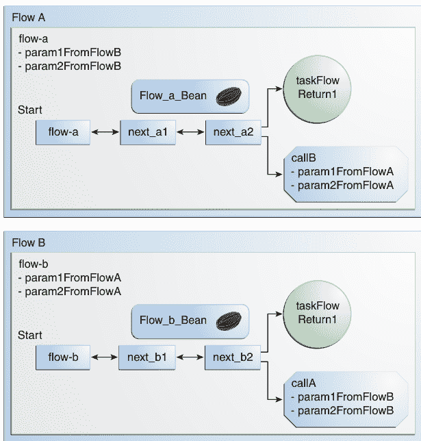

在此图中，Flow A 有一个名为 `flow-a` 的起始节点和两个额外的页面 `next_a1` 和 `next_a2`，用户可以使用定义的返回节点 `taskFlowReturn` 退出流，或者调用 Flow B 并传递两个参数。Flow A 还定义了两个可以从 Flow B 接收的入参。Flow B 与 Flow A 相同，只是流和文件的名称不同。每个流还有一个关联的托管豆；这些豆是 `Flow_Bean` 和 `Flow_Bean`。

### 16.3.1 在应用程序中打包流

通常，你使用模块化流的目录结构在 Web 应用程序中打包流。例如在 Maven 项目的 `src/main/webapp` 目录下，你将像常一样使用流之外的顶层 Facets 文件。每个流的 webapp 文件将位于单独的目录，Java 文件将位于 `src/main/java` 下。例如，图 16-1 所示应用程序的文件结构可能如下所示：

```
src/main/webapp/
index.xhtml
return.xhtml
WEB_INF/
beans.xml
web.xml
flow-a/
flow-a.xhtml
next_a1.xhtml
next_a2.xhtml
flow-b/
flow-b-flow.xml
next_b1.xhtml
next_b2.xhtml
```

```
src/main/java/tutorial/flowexample
FlowA.java
Flow_A.Bean.java
Flow_B.Bean.java
```

在这个示例中，flow-a 在 `FlowA.java` 中通过编程方式定义，而 flow-b 是通过配置文件 `flow-b-flow.xml` 定义的。

## 16.3 最简单的流：simple-flow 示例应用程序

simple-flow 示例应用程序演示了 Faces 应用程序最基本的构建块，并说明了一些使你易于使用流进行迭代开发的约定。你可能想从这样一个简单示例开始并在此基础上进行构建。

此示例通过包含一个具有内容的空配置文件提供隐式流定义，或者通过包含一个带有 `@FlowDefinition` 注解的类提供显式流定义。

此的源代码位于 `tut-install/examples/web/jsf/simple-flow`。

该文件的结构如下：

```
src/main/webapp/
index.xhtml
return.xhtml
WEB_INF/
beans.xml
web.xml
faces-config.xml
```

`faces-config.xml` 是一个空的配置文件，`@FlowDefinition` 注解的类提供了显式的流定义。

```java
@FlowDefinition(value = "simple-flow")
public class SimpleFlow {
}
```


# simple-flow 示例应用程序

simple-flow 示例应用程序演示了 Faces 应用程序最基本的构建块，并说明了一些使你易于使用流进行迭代开发的约定。你可能想从这样一个简单示例开始并在此基础上进行构建。

此示例通过包含一个具有内容的空配置文件提供隐式流定义，或者通过包含一个带有 `@FlowDefinition` 注解的类提供显式流定义。

此示例的源代码位于 `tut-install/examples/web/jsf/simple-flow`。

## 构建与部署

- 2. 在终端窗口中，进入：
  `tut-install/examples/web/jsf/simple-flow/`
- 3. 输入以下命令：
  `mvn install`

此命令将应用程序构建并打包成 WAR 文件 `simple-flow.war`，该文件位于 `target` 目录。它会将应用程序部署到服务器。

## 16.3.2.3 运行 simple-flow 示例

- 1. 在 Web 浏览器中输入以下 URL：
  `http://localhost:8080/simple-flow`
- 2. 在 `index.xhtml` 页面上，点击 Enter Flow（进入流程）。
- 3. 在流程的第一页上，你可以在 Value（值）字段中输入任何条目，然后点击 Next（下页）。
- 4. 在流程的第二页上，你可以看到你输入的值。点击 Return（返回）。
- 5. 在返回页面上，一对空引号将使该原先不可访问的值变为可访问。点击 Back to Start（回到开始）返回到 `index.xhtml` 页面。

## 16.3.3 checkout-module 示例应用程序

checkout-module 示例应用程序比 simple-flow 复杂得多。它展示了如何使用 Faces 功能为在线商店实现结账模块。

与图 16-1 中的假设示例一样，该示例包含两个流程，每个流程都可以调用另一个。两个流程都有流程定义。其中一个流程 `checkoutFlow` 是通过程序指定的。另一个流程 `joinFlow` 是在配置文件中指定的。

该应用程序的源代码位于 `tut-install/examples/web/jsf/checkout-module/` 目录。

对于 checkout-module 应用程序，目录结构如下（还有一个 `src/webapp/resources` 目录，其中包含一个样式表和一张图片）：

```
src/webapp/
- index.xhtml
- exithome.xhtml
- WEB_INF/
- beans.xml
- web.xml
- checkoutFlow/
- checkoutFlow.xhtml
- checkoutFlow2.xhtml
- checkoutFlow3.xhtml
- checkoutFlow4.xhtml
- joinFlow/
- joinFlow-flow.xml
- joinFlow.xhtml
- joinFlow2.xhtml
- src/main/java/javaeetutorial/checkoutmodule
- CheckoutBean.java
- CheckoutFlow.java
- CheckoutFlowBean.java
```

配置 JavaServer 应用程序 16-9

### JoinFlowBean.java

对于该示例，`index.xhtml` 是应用程序的起始页面，也是结账的返回节点。`exithome.xhtml` 是 join 流程的返回节点。

配置文件 `joinFlow-flow.xml` 定义了 join 流程，源文件 `CheckoutFlow.java` 定义了结账。

结账流程包含四个 Facets 页面，而 join 流程包含两个。

作用于每个流程的托管豆是 `CheckoutBean.java` 和 `JoinFlowBean.java`，而 `CheckoutBean.java` 是 index 页面的后端支持。

## 16.3.1 checkout-module 示例的 Facets 页面

示例的起始页面 `index.xhtml` 总结了假设的购物篮内容。它允许用户点击两个按钮之一进入两个流程中的一个：

```xml
<h:commandButton value="Check Out" action="checkoutFlow/"></p>
```

```xml
<h:commandButton value="Join" action="joinFlow/"></p>
```

这是结账流程的返回节点。

Facets 页面 `exithome.xhtml` 是 join 流程的返回节点。该页面有一个按钮允许你返回到 `index.xhtml`。

checkoutFlow 流程内的四个 facet 页面，从 `CheckoutFlow.xhtml` 开始到 `CheckoutFlow.xml` 结束，`CheckoutFlow.xml` 允许你进入下一页，或者在某些情况下从流程返回。CheckoutFlow 页面允许你通过流程作用域访问从 join 流程传递的参数。这些参数显示为空。如果你从 join 流程调用了该流程，可以看到这些参数：（注：由于原文后续内容严重重复且混乱，此处翻译至原文逻辑断裂处）。

该类执行的操作与配置文件 `joinFlow-flow.xml` 执行的操作几乎相同。它包含一个单一方法 `defineFlow`，作为一个带有 `@FlowDefinition` 注解的生产者方法，返回一个 `javax.faces.flow.Flow` 类。`defineFlow` 方法接收一个参数，即带有 `@BuilderParameter` 限定符的 `FlowBuilder`，该参数由 JavaFaces 实现传递。随后，该方法调用 `javax.faces.flow.Builder` 类中的方法来配置流。

首先，该方法定义了 ID `checkoutFlow`。然后，它显式地定义了流的起始节点。默认情况下，这是带有 `.xml` 后缀的流名称。该方法以类似于配置文件的方式定义了返回节点。`returnNode` 方法指定了返回节点的名称为 `returnFromCheckoutFlow`，链式 `fromOutcome` 方法指定其值为 checkout 流的流作用域 Bean —— 即 `CheckoutFlowBean` 的 `returnValue`。

`inbound` 方法设置了来自合并流（join flow）的输入参数名称和值，这些值根据它们在合并配置中的定义方式，从流作用域 `(flowScope.param.paramValue)` 中检索。

`callNode` 方法定义了 checkout 流如何调用合并流。参数 `calloin` 指定了调用流的操作：`flowReference` 方法定义了实际的调用的名称；链式的 `outboundParameter` 方法定义了在调用 `joinFlow` 时传递的参数。这里是来自托管 Bean `CheckoutFlowBean` 的值。

最后，`defineFlow` 方法调用 `get` 方法并返回结果。

## 16.3.3.4 流作用域托管 Bean

两个流中的每个流都有一个托管 Bean，用于定义流内页面的属性。例如，CheckoutFlow 定义了属性，其值在 `CheckoutFlow.xhtml` 页面和 `CheckoutFlow3.xhtml` 页面上暴露给用户。

每个托管 Bean 都有一个 `getReturnValue` 方法用于设置返回节点的值。对于 `CheckoutBean`，返回节点是 `index.xhtml` 页面，使用隐式导航指定：

```java
public String getReturnValue() {
  return "index";
}
```


对于 `FlowBean`，返回节点是 `exitome.xhtml` 页面。

## 16.3.3.5 使用 NetBeans IDE 构建、打包并部署 checkout-module 示例

1. 确保 GlassFish 服务器已启动（启动和停止 GlassFish 服务器）。
2. 从“文件”（File）菜单中选择“打开项目”（Open Project）。
3. 在“项目”对话框中，导航到：
   `tut-install/examples/web/jsf`
4. 选择 `checkout-module` 文件夹。
5. 点击“打开项目”。
6. 在“项目”选项卡中，右键点击 `checkout-module` 项目并选择“构建”（Build）。

此命令将应用程序构建并打包成 WAR 文件 `checkout-module.war`，位于 target 目录下。它会将应用程序部署到服务器。

## 16.3.3.6 使用 Maven 构建、打包并部署 checkout-module 示例

1. 确保 GlassFish 服务器已启动（启动和停止 GlassFish 服务器）。
2. 在终端窗口中，进入：
3. 输入以下命令：`mvn install`

此命令将应用程序构建并打包成 WAR 文件 `checkout-module.war`，位于 target 目录下。它会将应用程序部署到服务器。

## 16.3.3.7 运行 checkout-module 示例

1. 在浏览器中输入 URL：
   `http://localhost:8080/checkout-module`
2. `index.xml` 页面显示了购物之旅的假设结果。点击每个“Checkout”（结账）或“Join”（合并）进入两个流之一。
3. 遵循流的操作，根据需要提供输入，并选择继续、返回或退出流。
   在 checkout 流中，只有输入字段会进行验证（信用卡字段为 16 位），你可以输入任何喜欢的值。合并流并不要求你在其复选框菜单中勾选任何框。
4. 在流的最后一个页面，选择进入另一个流的选项。这允许你查看来自上一个流的输入参数。
5. 因为流是嵌套的，如果你从被调用的流点击“退出流”（Exit Flow），你将返回调用流的第一页（你可能会看到一个警告，可以忽略它）。在该页面点击“退出流”将跳转到指定的返回代码。

## 16.4 配置托管 Bean (Configuring Managed Beans)

当你第一次引用托管 Bean 时，JavaServer Faces 实现将根据 Bean 类中的 `@Named` 注解和作用域注解，或者根据其在应用程序配置资源中的配置进行初始化。有关用于初始化 Bean 的注解的信息，请参阅“使用注解配置托管 Bean”（Using Annotations to Configure Managed Beans）。

你可以使用应用程序配置文件来实例化 JavaServer Faces 应用程序使用的托管 Bean，并将它们存储在作用域中。托管 Bean 的创建在应用程序配置文件中配置，使用 `managed-bean` XML 元素定义每个 Bean。此过程在应用程序启动时处理。有关查看此功能的信息，请参阅“使用 managed-bean 元素”（Using the managed-bean Element）。

在应用程序配置资源创建的托管 Bean 是 JavaServer Faces 托管 Bean，而不是 CDI 托管 Bean。
通过托管 Bean 创建功能，你可以：

- 在一个供整个应用程序使用的中央文件中创建 Bean，而不是在整个应用程序中不断实例化 Bean
- 在不编写任何额外代码的情况下自定义 Bean 的属性
- 直接在配置文件中自定义 Bean 的属性值，以便其在创建时使用这些值初始化
- 使用元素，使一个托管 Bean 的属性作为另一个 Bean 的结果

## 16.4.1 使用 managed-bean 元素 (Using the managed-bean Element)

在应用程序配置资源创建的托管 Bean 是 JavaServer Faces 托管 Bean，而不是 CDI 托管 Bean。
通过托管 Bean 创建功能，你可以：

- 在一个供整个应用程序使用的中央文件中创建 Bean，而不是在整个应用程序中不断实例化 Bean
- 在不编写任何额外代码的情况下自定义 Bean 的属性
- 直接在配置文件中自定义 Bean 的属性值，以便其在创建时使用这些值初始化
- 使用元素，使一个托管 Bean 的属性作为另一个 Bean 的结果

本节展示了如何使用 `managed-bean` 元素初始化 Bean。示例：

```xml
<managed-bean>
  <bean-name>bookstore</bean-name>
  <bean-class>com.example.Bookstore</bean-class>
  <bean-scope>application</bean-scope>
  <property>
    <property-name>name</property-name>
    <value>Main Bookstore</value>
  </property>
  <property>
    <property-name>location</property-name>
    <value>New York</value>
  </property>
</managed-bean>
```

`managed-bean` 元素用于在应用程序配置资源中定义托管 Bean。每个 `managed-bean` 元素必须包含一个 `bean-name` 元素来标识 Bean。它还必须包含一个 `bean-class` 元素，指定 Bean 类的完全路径。`bean-scope` 元素指定 Bean 可用的作用域。最后，`managed-bean` 元素可以包含零或多个 `property` 元素来定义 Bean 的属性。

更多信息请参阅“使用 managed-bean 元素”（Using the managed-bean Element）。

...是 bean 中定义的属性。表 16–1 列出了所有用于初始化值的元素。

| 表格 16–1 | 定义属性值的托管属性（managed-property）子元素 |
| :--- | :--- |
| 元素 | 定义 |
| `list-entries` | 定义列表中的值 |
| `map-entries` | 定义 map 的值 |
| `null-value` | 显式将属性置为 null |
| `value` | 定义单个值，例如 String、int 或 JavaFaces EL 表达式 |

使用 `managed-bean` 元素包含一个使用 `value` 元素初始化 `int` 属性（基本类型）的示例。你还可以使用 `value` 元素来初始化 String 和其他引用类型。本节的其余部分描述了如何使用 `value` 元素和其他子元素作为初始化参数来初始化 Java Enum 类型、Map、数组和 Collection 的属性。

## 16.4.2 引用 Java Enum 类型

托管属性（managed property）也可以是 Java Enum 类型（请参阅 http://docs.oracle.com/java/7/docs/api/lang/Enum.html）。在这种情况下，`managed-property` 元素的 `value` 元素必须是一个匹配 Enum 的某个 String 常量的 String。换句话说，该 String 必须是在对 enum 类调用 `valueOf(Class, String)` 时可以返回的有效值，其中 `Class` 是 Enum 类，`String` 是 `value` 元素的内容。例如，假设托管属性为：

```java
public enum Suit { Hearts, Spades, Diamonds, Clubs }
...
public Suit getSuit() { return Suit.Hearts; }
```

假设你想在应用配置资源文件中配置此属性，相应的 `managed-property` 元素如下所示：

```xml
<managed-property>
  <property-name>Suit</property-name>
  <value>Hearts</value>
</managed-property>
```

当系统遇到此属性时，它会遍历 enum 的每个成员，并对每个成员调用 `toString()`，直到找到一个与 `value` 元素中的值完全相等的成员。

值以类似的方式从隐式对象（implicit objects）中获取。

## 16.4.2 引用上下文初始化参数

托管 bean 创建设施另一个强大功能是能够从托管 bean 引用隐式对象。

假设你有一个页面访问客户数据，包括客户地址。假设你的大多数客户住在某个特定的区码区域。你可以通过将区码保存到隐式对象中并在页面渲染时引用它，来让区码组件渲染该区码。

你可以通过向 Web 应用程序添加 `initParam` 隐式参数并在部署描述符中设置其值，将区码保存为上下文对象中的隐式默认值。例如，要设置上下文参数 `defaultAreaCode` 为 `650`，请在部署描述符中添加 `context-param` 元素，并将参数命名为 `defaultAreaCode`，值为 `650`。

接下来，编写一个托管 bean 声明来配置引用该参数的属性：

```xml
<managed-bean>
<managed-bean-name>customer</managed-bean-name>
<managed-bean-class>CustomerBean</managed-bean-class>
<managed-bean-scope>request</managed-bean-scope>
<property>
  <property-name>areaCode</property-name>
  <value>#{initParam.defaultAreaCode}</value>
</property>
...
</managed-bean>
```

要在页面渲染时访问 bean，请从区域组件标签引用属性：`id=area value="customer.areaCode" h:inputText id="customer.areaCode"`。

值以类似的方式从隐式对象中获取。

### 16.4.2.3 初始化 Map 属性

如果 `map-entries` 元素包含可选的 `key-class` 元素、可选的 `value-class` 元素以及零或多个 `map-entries` 元素，则使用该元素初始化类型为 `Map` 的 bean 属性的值。

每个 `map-entries` 元素必须包含一个 `key` 和一个 `null-value` 或 `value` 元素。以下是一个使用 `map-entries` 元素的示例：

```xml
<managed-bean>
...
<managed-property>
  <property-name>prices</property-name>
  <map-entries>
    <map-entry>
      <key>My Early Years: Growing Up #7</key>
      <value>30.75</value>
    </map-entry>
    <map-entry>
      <key>Web Servers for Fun and Profit</key>
      <value>40.75</value>
    </map-entry>
  </map-entries>
</managed-property>
</managed-bean>
```

由此 `map-entries` 标签创建的 map 包含两个条目。默认情况下，所有的键和值都会转换为 String。如果你想为 map 中的键指定不同的类型，请在 `map-entries` 元素内部嵌入 `key-class` 元素：

```xml
<map-entries>
  <key-class>java.math.BigDecimal</key-class>
...
</map-entries>
```

此声明将所有键转换为 `java.math.BigDecimal`。当然，你必须确保键可以转换为你指定的类型。本节示例中的键无法转换为 `BigDecimal`，因为它是一个 String。

如果你想为 map 中的所有值使用不同的类型，请包含 `value-class` 元素或 `key-class` 元素：

```xml
<map-entries>
  <value-class>java.math.BigDecimal</value-class>
</map-entries>
```

注意，本章结束。

### 16.4.2.4 初始化数组属性

如果 `array-elements` 元素包含可选的 `element-class` 元素、可选的 `value-class` 元素以及零或多个 `array-element` 元素，则使用该元素初始化类型为数组的 bean 属性的值。

每个 `array-element` 元素必须包含一个 `index` 和一个 `null-value` 或 `value` 元素。以下是一个使用 `array-elements` 元素的示例：

```xml
<managed-bean>
...
<managed-property>
  <property-name>tags</property-name>
  <array-elements>
    <array-element>
      <index>0</index>
      <value>Java</value>
    </array-element>
    <array-element>
      <index>1</index>
      <value>Beans</value>
    </array-element>
  </array-elements>
</managed-property>
</managed-bean>
```

由此 `array-elements` 标签创建的数组包含两个元素。默认情况下，所有元素都会转换为 String。如果你想为数组中的元素指定不同的类型，请在 `array-elements` 元素内部嵌入 `element-class` 元素：

```xml
<array-elements>
  <element-class>java.lang.Integer</element-class>
...
</array-elements>
```

### 16.4.2.5 初始化 Collection 属性

如果 `collection-entries` 元素包含可选的 `key-class` 元素、可选的 `value-class` 元素以及零或多个 `collection-element` 元素，则使用该元素初始化类型为 `Collection` 的 bean 属性的值。

每个 `collection-element` 元素必须包含一个 `key` 和一个 `null-value` 或 `value` 元素。以下是一个使用 `collection-entries` 元素的示例：

```xml
<managed-bean>
...
<managed-property>
  <property-name>roles</property-name>
  <collection-entries>
    <collection-element>
      <key>admin</key>
      <value>Administrator</value>
    </collection-element>
    <collection-element>
      <key>editor</key>
      <value>Editor</value>
    </collection-element>
  </collection-entries>
</managed-property>
</managed-bean>
```

由此 `collection-entries` 标签创建的 collection 包含两个条目。默认情况下，所有的键和值都会转换为 String。如果你想为 collection 中的键指定不同的类型，请在 `collection-entries` 元素内部嵌入 `key-class` 元素：

```xml
<collection-entries>
  <key-class>java.util.UUID</key-class>
...
</collection-entries>
```


| 表 16–2 (续) 作用域对象之间的允许连接 |
| :--- | :--- |
| 此作用域的实例 | 可以指向此作用域的实例 |
| view | 无, application, session, view |

请确保对象之间不要产生循环引用。例如，前一个示例中的 `AddressBean` 对象不应指向回 `CustomerBean` 对象，因为 `CustomerBean` 已经指向了 `AddressBean` 对象。

## 16.4.3 初始化 Map 和 List

在配置 Map 和 List 属性时，你也可以直接配置 List，这样你就可以从标签中引用它们，而不是引用封装了 Map 或 List 的属性。

## 16.5 注册应用程序消息

应用程序消息可以包括任何显示给用户的字符串，以及用于自定义转换器或验证器的自定义错误消息（通过 `message` 和 `messages` 标签显示）。为了使消息在启动时可用，请执行以下操作之一：

- 如在“使用 FacesMessage 创建消息”中所描述的那样，在实践上向 `java.faces.context.FacesContext` 实例入队单个消息。
- 使用应用程序配置文件 `faces-config.xml` 文件向应用程序注册所有消息，该文件为 Duke’s Bookstore 用例应用注册了消息：

```xml
<application>
  <resource-bundle>
    <base-name>javaetutorial.dukesbookstore.web.messages.Messages</base-name>
    <var>var</var>
  </resource-bundle>
  <local-config>
    <default-locale>en</default-locale>
    <supported-locale>es</supported-locale>
    <supported-locale>de</supported-locale>
    <supported-locale>fr</supported-locale>
  </local-config>
</application>
```

这组元素会导致应用程序被填充为指定资源包（resource-bundle）中包含的消息。

`resource-bundle` 元素代表一组本地化的消息。它必须包含包含本地化消息的资源包的完全限定路径（在本例中为 `dukesbookstore.web.messages.Messages`）。`var` 元素定义了页面作者引用资源包时使用的 EL 名称。

`locale-config` 元素列出了默认语言和其他支持的语言。`locale-config` 元素允许系统根据浏览器的语言设置找到正确的语言。

### 注册应用程序消息

`supported-locale` 和 `default-locale` 标签接受由 iso639-1 定义的写写双字符代码 [参见 http://www.loc.org/standards/iso639-2/php/English_list.php]。请确保你的资源包确实包含你通过这些标签所指定的语言的消息。

为了在应用程序中访问本地化文本，开发者从资源包中获取消息的键。你可以将本地化文本提取到图形图像的 `alt` 标签中，如下例所示：

```xml
<h:graphicImage id="mapping"
name="book_all.jpg"
library="images"
alt="${bundle.ChooseBook}"
usemap="#bookMap" />
```

`alt` 属性可以接受表达式。在这种情况下，`alt` 属性引用将包含在此标签渲染的图像备用文本中的文本。

### 16.5.1 使用 FacesMessage 创建消息

与其在应用程序配置资源文件中注册消息，你可以从托管豆（managed bean）直接访问 `java.util.ResourceBundle`。下面的代码片段定位了一个错误消息：

```java
String message = "";
...
message = ExampleBean.loadErrorMessage(context,
ExampleBean.EX_RESOURCE_BUNDLE_NAME,
"ErrorMessage");
context.addMessage(toValidate.getClient(context),
new FacesMessage(message));
```

这些行调用了 `loadErrorMessage` 方法从 `ResourceBundle` 获取消息。以下是 `loadErrorMessage` 方法：

```java
public static String loadErrorMessage(FacesContext context,
String bundle, String key) {
  if (bundle == null) {
    try {
      bundle = ResourceBundle.getBundle(basename,
      context.getViewRoot().getLocale());
    } catch (Exception e) {
      return null;
    }
  }
  return bundle.getString(key);
}
```

### 16.5.2 引用错误消息

JavaFaces 页面使用 `message` 或 `messages` 标签来访问错误消息，正如“使用 h:message 和 h:messages 标签显示错误消息”中所解释的。

这些标签访问的错误消息包括：

- 随 API 附带的标准转换器和验证器一起的标准错误消息（参见 JavaServer Faces 规范的第 2.5.2.4 节获取标准错误消息的列表）
- 通过配置文件中的 `resource-bundle` 元素向架构师注册的资源包中的自定义错误消息

当转换器或验证器注册在输入组件上时，相应的错误消息会自动入队到该组件上。

页面作者可以使用组件标签的属性来覆盖入队到组件上的错误消息：

- `converterMessage`: 引用封装组件上的数据无法通过此组件上注册的转换器转换时，要显示的错误消息。
- `requiredMessage`: 引用封装组件中未输入任何值时要显示的错误消息。
- `validatorMessage`: 引用封装组件无法通过此组件上注册的验证器进行验证时，要显示的错误消息。

所有三个属性都启用接受字面值和值表达式。如果作者使用值表达式，该表达式将引用资源包中的错误消息。此资源包必须通过以下方式之一对应用程序可用：

- 通过应用程序架构师在配置文件中使用 `resource-bundle` 元素
- 通过页面作者使用 `f:load` 标签

反之，必须使用 `resource-bundle` 元素使由于转换器或验证器产生的消息对应用程序可用。示例显示了如何使用值表达式指定 `requiredMessage`：

```xml
<inputText id="ccno" size="19"
required="true"
requiredMessage="#{customMessages.ReqMessage}"/>
<h:message styleClass="error-message" for="ccno"/>
```

示例中的 `requiredMessage` 使用。

## 16.6 使用默认验证器

除了在组件上声明验证器外，你还可以在应用程序配置文件中指定多个默认验证器。默认验证器适用于所有 `UIInput` 实例。以下是在应用程序配置文件中注册默认验证器的示例：

```xml
<faces-config>
  <application>
    <default-validators>
      <validator-id>javax.faces.Bean</validator-id>
    </default-validators>
  </application>
</faces-config>
```

## 16.7 注册自定义验证器

如果应用程序开发者提供了 `javax.faces.validator.Validator` 接口的实现以执行验证，你必须通过 `@Validator` 注解（如“实现验证器接口”所述）或使用应用程序配置资源文件中的 `validator` 元素来注册此自定义验证器：

```xml
<validator>
  <validator-id>FormatValidator</validator-id>
  <class>myapplication.validators.FormatValidator</class>
  <attribute>
    <attribute-name>formatPatterns</attribute-name>
    <attribute-class>java.lang.String</attribute-class>
  </attribute>
</validator>
```

在验证器中指定的属性覆盖 `@FacesValidator` 注解中的设置。`validator-id` 和 `class` 是元素子元素。`validator-id` 元素代表注册 Validator 类的标识符。该 ID 被对应自定义验证器标签的类使用。

`attribute` 元素标识与 Validator 实现关联的属性。它需要 `attribute-name` 和 `attribute-class` 元素。`attribute-name` 指向在验证器标签中出现的属性名称。`attribute-class` 标识与属性关联值的 Java 类型。

## 16.8 注册自定义转换器

与自定义验证器一样，如果应用程序开发者创建了自定义转换器，你必须通过 `@FacesConverter` 注解（如“创建自定义转换器”所述）或使用应用程序配置资源文件中的 `converter` 元素向应用程序注册它。

是 Duke's Bookstore 案例研究中 CreditCardConverter 的一个假设转换配置：

```xml
<converter>
  <description>
    用于信用卡号的转换器，将输入
    标准化为标准格式
  </description>
  <converter-id>CreditCardConverter</converter-id>
  <converter-class>
    dukesbook.converters.CreditCardConverter
  </converter-class>
</converter>
```

在 `converter` 标签中指定的属性将覆盖 `@FacesConverter` 注解中的任何设置。

`converter` 元素代表 `javax.faces.convert.Converter` 的实现，并包含所需的 `converter-id` 和 `converter-class` 元素。

`converter-id` 元素标识 UI 组件标签的 `converter` 属性所使用的 ID，用于应用于转换器的数据。使用[自定义转换器]包含了如何从组件标签中引用自定义转换器的示例。

`converter-class` 元素标识 `Converter` 的实现。

[创建和使用自定义转换器]解释了如何创建自定义转换器。

## 16.9 配置导航规则

JavaFaces 应用不同页面之间的导航（例如在点击按钮或链接后选择显示的下一个页面）是由一组规则定义的。导航规则可以是隐式的，也可以在导航配置资源文件中显式地定义。有关隐式导航规则的更多信息，请参阅[导航模型]。

每条导航规则规定了如何从一个页面导航到另一个页面或一组页面。JavaFaces 实现会为当前显示的页面选择合适的导航规则。

选择导航规则后，从当前页面访问哪个页面的选择取决于两个因素：

- 点击组件时调用的操作（action）
- 组件标签引用或从操作方法返回的逻辑结果（outcome）

结果可以是开发者选择的任何内容，但表 16–3 列出了 Web 应用中使用的一些结果。

| 表 16–3 常见结果字符串 |
| :--- | :--- |
| 结果 (Outcome) | 含义 |
| success | 执行成功。跳转到下一页。 |
| failure | 出现问题。跳转到错误页面。 |
| login | 用户需要先登录。跳转到登录页面。 |
| no results | 搜索未找到任何结果。返回搜索页面。 |

### 配置导航规则

通常，操作方法会对当前页面的表单数据执行某些处理。例如，该方法可能会检查表单中输入的用户名和密码与文件中的用户名和密码是否匹配。如果匹配，该方法返回结果 `success`。否则，它返回结果 `failure`。此示例说明，用于处理操作的方法和返回的结果对于确定要访问的正确页面是必要的。

以下是一个可以在示例示例使用的导航规则：

```xml
<navigation-rule>
  <from-view-id>login.xhtml</from-view-id>
  <navigation-case>
    <from-action>#[LoginForm]</from-action>
    <from-outcome>success</from-outcome>
    <to-view-id>storefront.xhtml</to-view-id>
  </navigation-case>
  <navigation-case>
    <from-action>#[LoginForm]</from-action>
    <from-outcome>failure</from-outcome>
    <to-view-id>login.xhtml</to-view-id>
  </navigation-case>
</navigation-rule>
```

此导航规则定义了从 `login.xhtml` 导航的可能方式。每个 `navigation-case` 定义了从 `login.xhtml` 出出的可能的导航路径。第一个 `navigation-case` 表示，如果 `LoginForm` 返回的结果为 `success`，则访问 `storefront.xhtml`。第二个 `navigation-case` 表示，如果 `LoginForm` 返回 `failure`，则将重新渲染 `login.xhtml`。

应用程序页面流的配置由一组导航规则组成。每条规则由 `faces-config.xml` 文件中的 `navigation-rule` 元素定义。

每个 `navigation-rule` 对应于由可选 `from-view-id` 元素定义的一个组件树。该规则定义了从应用中某个特定页面导航的所有可能方式。如果没有 `from-view-id` 元素，则 `navigation-rule` 元素中定义的导航规则适用于应用中的所有页面。`from-view-id` 元素还允许通配符匹配模式。例如，此 `from-view-id` 元素表示导航规则适用于 books 目录下的所有页面：

```xml
<from-view-id>books/</from-view-id>
```

导航标准由可选的 `from-outcome` 和 `from-action` 元素定义。`from-outcome` 元素定义了一个逻辑结果（如 `success`）。`from-action` 元素使用表达式引用一个返回字符串的操作方法，该字符串即为逻辑结果。该方法执行某些逻辑以确定结果并返回该结果。

在结果和方法表达式之后，会按照以下顺序检查 `navigation-case` 元素：

1. 同时指定了 `from-outcome` 值和 `from-action` 值的案例。如果操作方法根据其处理结果返回不同的结果，则这两个元素都可以被使用。
2. 仅指定了 `from-outcome` 值的案例。`from-outcome` 元素必须匹配 `javax.faces.UICommand` 的 `action` 属性定义的的结果，或由 `UICommand` 所引用的方法返回的结果。
3. 仅指定了 `from-action` 值的案例。此值必须匹配组件标签指定的的操作表达式。

当匹配到这些案例中的任何一个时，将选择由 `to-view-id` 元素定义的组件树进行渲染。

## 16.10 注册自定义渲染器

负责渲染组件的对象（可以是组件本身，也可以是组件委托的渲染器）可以使用片段（facets）来辅助渲染过程。考虑以下自定义组件示例：

```xml
<dataScrollroller>
  <facet name="header">
    <h:panelGroup>
      <h:outputText value="Account Id"/>
      <h:outputText value="Customer Name"/>
      <h:outputText value="Total Sales"/>
    </h:panelGroup>
  </facet>
  <facet name="next">
    <h:panelGroup>
      <h:outputText value="Next"/>
      <h:graphicImage url="images/arrow-right.gif" />
    </h:panelGroup>
  </facet>
</dataScrollroller>
```

`dataToggler` 标签包含一个渲染表头的组件和一个渲染“Next”的组件。如果渲染器与这些组件片段关联，你可以在渲染器中包含以下片段元素：

```xml
<facet>
```


<description>此片段被渲染为表头。它应该是一个与数据列数相同的 panelGroup。</description>

<display-name>header</display-name>

<facet-name>header</facet-name>

</facet>

<facet>

<description>此片段被渲染为滚动器中“next”按钮的内容。它应该是一个包含有“Next”文本的 outputText 和右箭头图标的 panelGroup。</description>

<display-name>next</display-name>

<facet-name>next</facet-name>

</facet>

```

如果一个组件支持通过片段提供其自身的渲染，并且你想在应用程序配置资源中包含片段元素，你需要将它们放在组件的配置中，而不是渲染器的配置中。

## 16.11 注册自定义组件

除了注册自定义渲染器（如前面的节所述）外，你必须注册通常与自定义渲染器关联的自定义组件。你可以使用在创建自定义组件类中所述的 `@Faces` 注解，或者使用应用资源文件中的 `component` 元素。

以下是应用资源文件中注册 `AreaComponent` 的假设性组件元素：

```

<component>

  <component-type>DemoArea</component-type>

  <class>dukesbustore.components.AreaComponent</class>

  <property>

    <property-name>alt</property-name>

    <class>java.lang.String</class>

  </property>

  <property>

    <property-name>coords</property-name>

    <class>java.lang.String</class>

  </property>

  <property>

    <property-name>shape</property-name>

    <class>java.lang.String</class>

  </property>

</component>

```

在 `component` 标签中指定的属性将覆盖 `@FacesComponent` 注解中的任何设置。

`component-type` 元素指示组件应注册的名称。引用此组件的其他对象使用此名称。例如，`AreaComponent` 配置中的 `component-type` 元素定义了 `DemoArea` 的值，这与 `AreaTag` 类 `getType` 方法返回的值匹配。

`component-class` 元素指示组件的完全限定类名。`property` 元素指定了组件属性及其类型。

如果自定义组件包含面（facets），你可以在组件配置中使用 `facet` 元素来配置这些面，这些元素被允许放在 `component-class` 元素之后。有关配置面的更多详细信息，请参阅“使用渲染器套件注册自定义渲染器”。

## 16.12 JavaServer Faces 应用的基本要求

除了配置你的应用程序外，你必须满足 JavaServer Faces 应用的其他要求，包括正确地打包所有必要文件并提供部署描述符。本节描述了如何执行管理任务。

JavaServer Faces 应用可以打包在 WAR 文件中，该 WAR 文件必须符合特定要求以便在不同的容器中执行。至少，一个 JavaServer Faces 应用的 WAR 文件可能包含以下内容：

- 一个 Web 部署描述符，称为 `web.xml`，用于配置 Web 应用所需的资源（必需的）
- 一组包含核心类的 JAR 文件（可选的）
- 一组应用类、Server Faces 页面和其他所需的资源（如图像文件）
- WAR 文件可能还包含：
  - 一个应用配置资源文件，用于配置应用资源
  - 一组标签描述符文件

例如，使用 Facelets 的 Java Server faces 应用 WAR 文件通常具有以下目录结构：

```

$PROJECT_DIR

[Web Pages]

++ /{xml or html documents]

++ /resources

++ /WEB-INF

++ /web.xml

++ /beans.xml (optional)

++ /classes (optional)

++ /lib

++ /faces-config.xml (optional)

++ /taglib.xml (optional)

++ /glassglassfish-web.xml (optional)

```

`web.xml`（或 web 描述符）、一组 JAR 文件和一组应用文件必须位于 WAR 文件的 `WEB-INF` 目录下。

### 16.12.1 使用 Web 部署描述符配置应用程序

Web 应用通常使用 Web 应用部署描述符 `web.xml` 中包含的元素进行配置。JavaServer Faces 应用的部署描述符必须指定某些配置，包括：

- 用于处理 JavaServer Faces 请求的 servlet
- 处理该 servlet 的 servlet 映射
- 配置资源文件的路径（如果该文件存在且未位于默认位置）

部署描述符还可以包含其他可选配置，例如：

- 指定哪些组件状态被保存
- 加密保存在客户端的状态
- 压缩保存在客户端的状态
- 限制对包含 Java Faces Faces（此处原文可能有重复）页面的访问
- 开启 XML 验证
- 指定项目阶段（Project Stage）
- 验证自定义对象

本节提供了关于这些配置的更多详细信息。在适当的情况下，它描述了你如何使用 NetBeans IDE 进行这些配置。

#### 16.12.1.1 识别用于生命周期处理的 Servlet

JavaServer Faces 应用的一个要求是，所有引用已保存 JavaServer Faces 组件的应用请求都必须通过 `javax.faces.web.FacesServlet`。Faces 管理 Web 应用的请求处理周期，并初始化 JavaServer Faces 技术所需的资源。

在 Java Faces 启动其第一个页面之前，Web 容器必须调用 `FacesServlet`，以便应用生命周期过程开始。更多信息请参阅“JavaServer Faces 应用的生命周期”。

以下示例显示了 `FacesServlet` 的配置：

```

<servlet>

  <servlet-name>Faces Servlet</servlet-name>

  <servlet-class>javax.faces.web.FacesServlet</servlet-class>

</servlet>

```

你将提供一个映射项以确保 `FacesServlet` 实例被调用。到 `FacesServlet` 的映射可以是前缀映射（例如 `/faces/*`）或扩展映射（例如 `*.xml`）。该映射用于识别具有 JavaServer Faces 组件的页面。因此，应用第一个页面的 URL 必须包含该 URL 模式。

以下元素指定前缀映射：

```

<servlet-mapping>

  <servlet-name>Faces Servlet</servlet-name>

  <url-pattern>/faces/*</url-pattern>

</servlet-mapping>

```

```

<welcome-file-list>

  <welcome-file>faces/greeting.xhtml</welcome-file>

</welcome-file-list>

```

以下元素在示例中指定扩展映射：

```

<servlet-mapping>

  <servlet-name>Faces Servlet</servlet-name>

  <url-pattern>*.xml</url-pattern>

</servlet-mapping>

```

```

<welcome-file-list>

  <welcome-file>index.xhtml</welcome-file>

</welcome-file-list>

```

当你使用这种机制时，用户如下所示访问应用：

```

http://localhost:8080/guess

```

在扩展映射的情况下，容器会将请求发送到 `FacesServlet`。如果你使用 IDE 创建应用，它会自动为你创建一个部署描述符。

#### 16.12.1.2 指定应用资源文件的路径

正如“应用资源文件”节所述，应用程序可以有多个资源文件。如果这些文件不在实现默认搜索的目录，或者名称不是 `faces-config.xml`，则你需要指定这些路径。

使用 NetBeans IDE 指定这些路径，请执行以下操作：

1. 在 Projects 选项卡中展开项目节点。
2. 展开 Web Pages 下 `WEB-INF`。
3. 双击 `web.xml`。
4. 当 `web.xml` 文件在编辑器窗口中显示时，点击顶部的 General。
5. 展开 Context Parameters（上下文参数）。
6. 点击（添加）。
7. 在 Context Parameter 对话框中：
   - 在 Parameter Name 字段中输入 `CONFIG_FILES`。
   - 在 Parameter Value 字段中输入配置文件的路径。
   - 点击 OK。
8. 为每个配置文件重复步骤 1 到 7。

#### 16.12.1.3 指定状态保存的位置

对于 Web 应用的所有组件，你可以在部署描述符中指定希望将状态保存在客户端还是服务器。默认情况下，状态保存在服务器上，因此只有在你希望保存在客户端上时才需要指定此上下文参数。请参考“状态的保存与恢复”了解每个位置的优缺点。

使用 NetBeans IDE 指定状态保存的位置，请执行以下操作：

1. 在 Projects 选项卡中展开项目节点。
2. 展开 Web Pages 下 `WEB-INF`。
3. 双击 `web.xml`。
4. 当 `web.xml` 文件在编辑器窗口中显示时，点击顶部的 General。
5. 展开 Context Parameters（上下文参数）。
6. 点击（添加）。
7. 在 Context Parameter 对话框中：
   - 在 Parameter Name 字段中输入 `STATE_SAVING_METHOD`。
   - 在 Parameter Value 字段中输入 `client` 或 `server`。
   - 点击 OK。

## 16.12.2 配置项目阶段

Project Stage（项目阶段）是一个上下文参数，用于识别 JavaServer Faces 应用在软件生命周期中的状态。例如，在应用程序的某些阶段可能会显示影响应用程序行为的错误消息，但在 Production（生产）阶段会被抑制。

可能的 Project Stage 值如下：

- Development（开发）
- UnitTest（单元测试）
- SystemTest（系统测试）
- Production（生产）

Project Stage 通过 web 部署描述符文件中的上下文参数进行配置。这是一个示例：

```xml
<context-param>
  <param-name>javax.faces.PROJECT_STAGE</param-name>
  <param-value>Development</param-value>
</context-param>
```


如果没有定义 Project Stage，默认阶段为 Production。你也可以根据需求添加自定义阶段。

## 16.12.3 包含类、页面和其他资源

当使用内置的构建脚本打包 Web 应用程序时，你会发现脚本按以下方式打包文件：

- 所有网页都放置在 WAR 文件的顶层。
- `faces-config.xml` 文件和 `web.xml` 文件被打包在 `WEB-INF` 目录中。
- 所有包存储在 `WEB-INF/classes/` 目录下。
- 所有应用程序 JAR 文件被打包在 `WEB-INF/lib/` 目录下。

所有资源要么位于 Web 应用程序的根目录 `/resources`，要么位于 Web 应用程序的类路径下的 `META-INF/resources/resourceidentifier` 目录。有关资源的更多信息，请参见 Web Resources。

在打包自己的应用程序时，可以使用 NetBeans IDE，也可以使用为 Maven 创建的 XML 文件。你可以修改 XML 文件以适应你的情况。不过，你可以继续使用本节描述的目录结构来打包 WAR 文件，因为这种技术符合广泛的 Web 应用打包实践。

## 17 Java Servlet 技术

Java Servlet 技术使用请求-响应编程模型在 Web 应用程序中提供动态的面向用户的内容。
本文涵盖了以下主题：

- 什么是 Servlet？
- Servlet 生命周期
- 共享信息
- 创建和初始化 Servlet
- 编写服务方法
- 过滤请求和响应
- 调用其他 Web 资源
- 访问 Web 上下文
- 维护客户端状态
- 结束 Servlet 的工作
- 使用 Java Servlet 技术上传文件
- 异步处理
- 非阻塞 I/O
- 协议升级处理
- mood 示例应用程序
- fileupload 示例应用程序
- default 示例应用程序
- 关于 Java Servlet 技术的更多信息

### 17.1 什么是 Servlet？

Servlet 是一种 Java 语言类，用于扩展托管应用程序的服务器功能，这些通过请求-响应编程模型进行访问。尽管 Servlet 可以响应任何类型的请求，但它们通常被用于扩展由 Web 服务器托管的应用程序。对于此类应用程序，Java Servlet 技术定义了特定于 HTTP 的 servlet 类。

`java.servlet` 和 `javax.servlet.http` 包提供了编写 Servlet 的接口和类。所有 Servlet 必须实现 `Servlet` 接口，该接口定义了生命周期方法。在实现通用服务时，你可以使用或扩展 Java Servlet API 提供的 `GenericServlet` 类。`HttpServlet` 类提供了如 `doGet` 和 `doPost` 等方法，用于处理特定于 HTTP 服务。

### 17.2 Servlet 生命周期

Servlet 的生命周期由部署 Servlet 的容器控制。当请求映射到 Servlet 时，容器会执行以下步骤。

1. 如果不存在 Servlet 实例，Web 容器将：
   a. 加载 Servlet 类
   b. 创建 Servlet 类的实例
   c. 通过调用 `init` 方法初始化 Servlet 实例（初始化在“创建和初始化 Servlet”中介绍）
2. 容器调用 `service` 方法并传递请求和响应对象。服务方法将在“编写服务方法”中讨论。
如果需要移除 Servlet，容器将通过调用 `destroy` 方法结束 Servlet 的工作。更多信息请参见“结束 Servlet 的工作”。

#### 17.2.1 处理 Servlet 生命周期事件

你可以通过定义监听器对象来监控并响应 Servlet 生命周期中的事件，这些对象的方法在事件发生时会被调用。要使用这些监听器对象，必须定义并指定监听器类。

#### 17.2.1.1 定义监听器类

将监听器类定义为监听器接口的实现。表 17–1 列出了可以监控的事件以及必须实现的接口。当调用监听器方法时，将传递一个包含适当事件信息的事件。例如，`HttpServletListener` 中的方法将接收一个 `HttpSessionEvent`，该事件包含一个 `HttpSession`。

| 表 17-1 Servlet 生命周期事件 | |
| --- | --- |
| 对象 | 事件 | 监听器接口和事件类 |
| Web 上下文 | 初始化和销毁 | `javax.servlet.ServletContextListener` 和 `ServletContextEvent` |
| Web 上下文 | 添加、移除或替换属性 | `javax.servlet.ServletContextAttributeListener` 和 `ServletContextAttributeEvent` |
| 会话 | 创建、失效、激活、钝化和超时 | `javax.servlet.http.HttpSessionListener`、`javax.servlet.http.HttpSessionActivationListener` 以及 `HttpSessionEvent` |
| 会话 | 添加、移除或替换属性 | `javax.servlet.http.HttpSessionAttributeListener` 和 `HttpSessionBindingEvent` |

| 表 17–1（续）Servlet 生命周期事件 | | |
| --- | --- | --- |
| 对象 | 事件 | 监听器接口和事件类 |
| 请求 | Servlet 请求开始处理 | `javax.servlet.ServletContextListener` 和 `ServletContextEvent` |
| 请求 | 添加、移除或替换属性 | `javax.servlet.ServletContextAttributeListener` 和 `ServletContextAttributeEvent` |
| 会话 | 创建、失效、激活、钝化和超时 | `javax.servlet.http.HttpSessionListener`、`javax.servlet.http.HttpSessionActivationListener` 以及 `HttpSessionEvent` |
| 会话 | 添加、移除或替换属性 | `javax.servlet.http.HttpSessionAttributeListener` 和 `HttpSessionBindingEvent` |

使用以下注解定义 Servlet：

```java
@WebServlet("/")
public class SimpleServlet extends HttpServlet {
}
```

被注解的 Servlet 必须实现以下之一：

```java
import javax.servlet.ServletContextListener;
import javax.servlet.ServletContextAttributeListener;
import javax.servlet.http.HttpSessionListener;
import javax.servlet.http.HttpSessionActivationListener;
import javax.servlet.http.HttpSessionAttributeListener;
```

带有 `@WebServlet` 注解的类必须继承 `java.servlet.http.HttpServlet` 类。例如，下面的代码段定义了一个 URL 模式为 `/report` 的 servlet：

```java
import java.servlet.annotation.WebServlet;
import java.servlet.http.HttpServlet;

@WebServlet("/report")
public class MoodServlet extends HttpServlet {
    ...
}
```

Web 容器在加载和实例化 servlet 类后会初始化 servlet。为了自定义此过程以允许 servlet 读取持久化配置数据、初始化资源并执行任何一次性活动，你可以通过重写 `Servlet` 接口的 `init` 方法，或者使用 `@WebServlet` 注解的 `initParams` 属性。`initParams` 属性包含一个 `@WebInitParam` 注解的数组。如果无法完成初始化过程，servlet 将抛出 `ServletException`。

使用初始化参数为特定的 servlet 提供所需的数据。上下文参数（context parameter）提供了对 Web 应用程序中所有组件可以使用的数据。

## 17.5 编写服务方法

Servlet 提供的服务在 `GenericServlet` 的 `service` 方法中实现，在 `HttpServlet` 对象的 `doGet` 方法中（其中 `Method` 可以取 Get、Delete、Options、Post、Put 或 Trace），或者在实现 `Servlet` 接口的类定义的任何其他特定协议的方法中实现。“服务方法（service method）”一词用于 servlet 类中任何为客户端提供服务的方法。

服务方法的通用模式是从请求中提取信息、访问外部资源，然后根据这些信息填充响应。对于 HTTP servlet，填充响应的正确规程是执行以下操作：

1. 从响应中获取一个输出流。
2. 填充响应标头（response headers）。
3. 将任何正文内容写入输出流。

响应标头必须在发送响应之前进行设置。Web 容器将忽略在响应已提交（committed）后任何设置或添加标头的尝试。接下来的两个部分描述了如何从请求中获取信息并生成响应。

### 17.5.1 从请求中获取信息

请求包含在客户端和 servlet 之间传递的数据。所有请求都实现了 `HttpServletRequest` 接口。该接口定义了访问以下信息的方法：

- 参数（Parameters）：通常用于在客户端和 servlet 之间传递信息。
- 对象的值型属性（Object-valued attributes）：通常用于在 Web 容器与 servlet 之间或在协作的 servlet 之间传递信息。
- 关于用于通信请求的协议的信息以及参与请求的客户端和服务器的信息。
- 与本地化（localization）相关的信息。

你也可以从请求中获取一个输入流并手动解析数据。要读取字符数据，使用请求的 `getReader` 方法返回的 `BufferedReader` 对象。对于二进制数据，使用 `getInputStream` 返回的 `ServletInputStream`。

HTTP 服务器通过 HTTP 请求对象 `HttpServletRequest` 传递，该对象包含请求 URL、HTTP 标头、查询字符串等。一个 HTTP 请求包含以下部分：

```
http://[host]:[port][request-path]?[query-string]
```

请求路径进一步由以下元素组成：

- 上下文路径（Context path）：斜杠（/）与 servlet Web 应用程序根目录内容的拼接。
- servlet 路径（Servlet path）：对应于激活此请求的客户端别名的路径部分。该路径以斜杠（/）开头。
- 路径信息（Path info）：请求路径中不属于上下文路径或 servlet 路径的路径。

你可以使用 `HttpServletRequest` 接口的 `getPath`、`getServletPath` 和 `getPathInfo` 方法来访问这些信息。除请求 URI 与路径部分之间的差异外，请求 URI 始终由上下文路径、servlet 路径加路径信息组成。

查询字符串（Query strings）由一组参数和值组成。单个参数通过请求的 `getParameter` 方法从请求获取。生成查询字符串有两种方法：

- 查询字符串可以显式地出现在网页中。
- 当提交一个使用 `GET` HTTP 方法的表单时，查询字符串会被附加到 URL 上。

## 17.5 构建响应

响应包含在服务器和客户端之间传递的数据。所有响应都实现了 `ServletResponse` 接口。该接口定义了允许你执行以下操作的方法。

- 获取一个输出流以向客户端发送数据。要发送字符数据，使用响应的 `getWriter` 方法返回的 `PrintWriter`。要向多用途互联网邮件扩展（MIME）正文发送二进制数据，请使用 `getOutputStream` 返回的 `ServletOutputStream`。要混合二进制和文本数据（如多部分响应），请使用 `ServletOutputStream` 并手动管理字符部分。
- 使用 `setContentType(String)` 方法指定响应所返回的内容类型（例如 `text/html`）。该方法必须在响应提交之前调用。互联网分配数字机构（IANA）维护着内容类型名称注册表：http://www.iana.org/assignments/media-types/
- 使用 `setBufferSize(int)` 方法指示是否缓冲输出。默认情况下，写入输出流的任何内容都会发送发送客户端。缓冲允许 servlet 有更多时间设置状态码和标头或重定向到另一个 Web 资源。该方法必须在写入任何内容之前调用。设置位置和字符编码，参见第 20 章“国际化与本地化”。

HTTP 响应对象 `javax.servlet.http.HttpServletResponse` 具有表示 HTTP 标头的字段：

- 状态码：用于指示请求未满足或请求已重定向。
- Cookie：用于在客户端存储应用程序特定的信息。有时，Cookie 用于维护用户会话。

## 17.6 过滤请求和响应

过滤器（filter）是转换请求或响应的标头和内容的对象。过滤器与 Web 组件的区别在于，过滤器通常不创建响应。相反，过滤器提供了可以附加到任何类型 Web 资源的功能。因此，过滤器不应该对其正作为过滤器的 Web 资源有任何依赖；这样它就可以与更多的 Web 资源组合。

过滤器可以执行的主要任务如下：

- 精确查询请求和响应。
- 阻止请求-响应对继续传递。
- 修改请求标头和数据。你通过提供请求的自定义版本来实现。
- 修改响应标头和数据。你通过提供响应的自定义版本来实现。
- 与外部资源交互。

过滤器的应用包括身份验证、日志记录、图像转换、压缩、加密、标记、XML 转换等。

你可以配置 Web 资源按特定顺序通过零或多个过滤器进行过滤。该链在包含组件的 Web 应用程序部署时创建，并在 Web 容器加载组件时实例化。

### 17.6.1 编写过滤器

过滤 API 由 `javax.servlet` 包中的 `Filter`、`FilterChain` 和 `FilterConfig` 接口定义。你通过实现 `Filter` 接口来定义过滤器。

使用 `@WebFilter` 注解在 Web 应用程序中定义过滤器。该注解指定在类上，包含关于声明的过滤器的元数据。注解的过滤器必须指定至少一个 URL 模式。这是通过使用 `urlPatterns` 或 `value` 属性实现的。所有其他属性都是可选，具有默认设置。当注解上唯一的属性时，使用 `value` 属性。

`urlPatterns` 是 URL 模式；当使用了其他属性时，请使用 `urlPatterns` 属性。

使用 `@WebFilter` 注解标记的类必须实现 `javax.servlet.Filter` 接口。

要向过滤器添加配置数据，请指定 `@WebFilter` 注解的 `initParams` 属性。`initParams` 属性包含一个 `@WebInitParam` 注解。以下代码段定义了一个过滤器，并指定了一个初始化参数：

```java
import javax.servlet.Filter;
import javax.servlet.annotation.WebFilter;
import javax.servlet.annotation.WebInitParam;

@WebFilter(filterName = "TimeOfDayFilter",
           urlPatterns = {"/*"},
           initParams = {@WebInitParam(name = "mood", value = "awake")})
public class TimeOfDayFilter implements Filter {
```


# Filter 接口核心方法

Filter 接口中最重要的方法是 `doFilter`，它接收请求、响应和过滤器链（chain）对象。该方法可以执行以下操作：

- 检查请求头。
- 如果过滤器希望修改请求头或数据，则自定义响应对象。
- 如果过滤器希望修改响应头或数据，则自定义响应对象。
- 调用链中的下一个实体。如果当前过滤器是链中包含目标 Web 组件或静态资源的最后一个过滤器，则下一个实体位于链的末尾；否则，它是在 WAR 中配置的下一个过滤器。过滤器通过在链对象上调用 `doFilter` 方法来调用下一个实体，并传入它被调用时使用的请求和响应，或它可能创建的包装实体。或者，过滤器也可以通过不调用链来调用下一个实体来拦截请求。在后一种情况下，由过滤器负责过滤掉响应。
- 在调用链中的过滤器后，检查响应头。
- 抛出异常以指示处理过程中的错误。

除了 `doFilter` 之外，你还必须实现 `init` 和 `destroy` 方法。当过滤器被实例化时，容器会调用 `init` 方法。如果你想向过滤器传递初始化参数，可以从传递给 `init` 方法的 `FilterConfig` 对象中获取这些参数。

# 17.6.2 程式化自定义请求与响应

过滤器有许多方法可以修改请求或响应。例如，过滤器可以向请求中添加属性，或在响应中插入数据。

修改响应的过滤器必须在响应返回给客户端之前捕获它。为了做到这一点，你必须将一个备用流（stand-stream）传递给生成响应的 servlet。该备用流防止 servlet 关闭原始响应流，并允许过滤器修改 servlet 的响应。

将此备用流传递给 servlet，过滤器会创建一个响应包装器，重写 `getWriter` 或 `getOutputStream` 方法以返回此备用流。包装器被传递给过滤器链的 `doFilter` 方法。包装器方法默认调用被包装的请求或响应对象。

要重写请求方法，将请求封装在扩展 `HttpServletWrapper` 或 `HttpServletRequestWrapper` 的对象中。要重写响应方法，将响应封装在扩展 `HttpServletWrapper` 或 `HttpServletResponseWrapper` 的对象中。

# 17.6.3 指定过滤器映射

Web 容器使用过滤器来决定如何将过滤器应用于 Web 资源。过滤器映射（Filter mapping）通过名称将过滤器与 Web 组件匹配，或通过 URL 模式将其与 Web 资源匹配。过滤器按照它们在过滤器映射列表中出现的顺序被调用。你可以使用 NetBeans IDE 或手动编写 XML 列表在 WAR 的部署描述符中指定过滤器映射列表。

如果你想对 Web 应用程序的每个请求进行日志记录，可以将过滤器计数器映射到 URL 模式 `/`。

你可以将一个过滤器映射到一个或多个资源，也可以将多个过滤器映射到一个 Web 资源。这在图 17–1 中所示，其中过滤器 F1 映射到 servlets S1、S2 和 S3；过滤器 F2 映射到 servlet S2；而过滤器 F3 映射到 servlets S1 和 S2。

## 图 17–1 过滤器到 servlet 映射

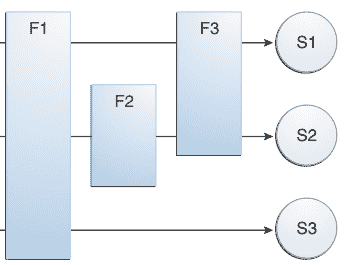

记住，过滤器链（filter chain）是传递给过滤器 `doFilter` 方法的对象之一。该链通过过滤器映射间接形成。链中过滤器的顺序与过滤器映射在应用程序部署描述符中出现的顺序相同。

当过滤器被映射到 servlet S1 时，Web 容器会调用 F1 的 `doFilter` 方法。S1 过滤器链中每个过滤器的 `doFilter` 方法都由链中的前一个过滤器通过链调用。由于 S1 的过滤器链包含 F1 和 F3，F1 对 `chain.doFilter` 的调用会触发 F3 的 `doFilter` 方法。当 F3 的 `doFilter` 方法完成后，控制返回给 F1。

### 17.6.3.1 使用 NetBeans IDE 指定过滤器映射

1. 在 Project 选项卡中展开应用程序的项目节点。
2. 展开项目节点下的 Web Pages 和 WEB-INF 节点。
3. 双击 `web.xml`。
4. 点击编辑器窗口顶部的 Filters。
5. 在编辑器窗口中展开 Servlet Filters。
6. 点击 Add Filter Element 按名称或 URL 模式将过滤器映射到 Web 资源。
7. 在 Add Servlet Filter 对话框中，在 Filter Name 字段输入过滤器的名称。
8. 点击 Browse 找到过滤器所应用的 servlet 类。
9. 点击 OK。
10. 要指定过滤器的应用方式，请遵循以下步骤：
    a. 展开 Mappings 节点。
    b. 选择过滤器。
    c. 点击 Add。
    d. 在 Add 对话框中，选择以下类型：
       - REQUEST：仅当请求来自客户端时
       - ASYNC：仅当请求已转发时
       - INCLUDE：仅当请求被包含时
       - ERROR：仅当请求被处理时
    e. 点击 OK。

# 17.7 调用其他资源

Web 组件可以间接和直接调用 Web 资源。要调用资源，必须先使用 `getRequestDispatcher` 方法获取 `RequestDispatcher` 对象。该方法接受资源路径作为参数。请求可以接受相对路径，但 Web上下文需要绝对路径。如果服务器没有实现 RequestDispatcher，它将返回 null。你的 servlet 应该准备好这种情况。

## 17.7.1 在响应中包含其他资源

在响应中包含另一个资源（例如横幅内容或版权信息）通常很有用。调用 RequestDispatcher 的 include 方法：

```
include(request, response);
```

如果资源是静态的，include 方法启用服务器包含。如果资源是 Web 组件，该方法的作用是将请求发送到组件，执行该组件并将其包含在响应中。被包含的 Web 组件可以访问请求对象，但对响应的操作受到限制：

- 它可以写入响应体并提交响应。
- 它无法设置响应头或任何影响响应头的方法（如 setCookie）。

## 17.7.2 将控制转移到另一个 Web 组件

在某些应用程序中，你可能希望一个 Web 组件对请求进行初步处理，并让另一个组件生成响应。例如，你可能根据请求的性质部分处理请求并转移到另一个组件。

要将控制转移到另一个 Web 组件，请调用 RequestDispatcher 的 forward 方法。转发时，请求 URL 被设置为跳转页路径。原始 URL 及其部分保存在以下请求属性中：

```
javax.servlet.forward.request_uri
javax.servlet.forward.context_path
javax.servlet.forward.servlet_path
javax.servlet.forward.path_info
javax.servlet.forward.query_string
```

forward 方法用于让资源负责回复用户。如果你已经在 servlet 中访问了 ServletOutputStream 或 PrintWriter 对象，则无法使用此方法；这样做会抛出 IllegalStateException。

# 17.8 访问 Web 上下文

Web 组件执行的上下文是一个实现 ServletContext 的对象。你通过 getServletContext 方法检索 Web上下文。该上下文提供了访问

- 初始化参数
- 与 Web 相关的资源
- 对象值属性
- 日志功能

计数器的访问方法是同步的，以防止并发运行的 servlet（Servlet）执行不兼容的操作。过滤器通过使用 `context.getAttribute` 方法获取计数器对象。计数器的增加值会被记录在日志中。

# 17.9 维护客户端状态

许多应用程序要求将客户端发送的一系列请求与某个对象关联。例如，Web 应用程序可以跨请求保存用户购物车的状态。由于 HTTP 是无状态的，Web 应用程序负责维护这种状态（会话，session）。为了支持需要维护状态的应用程序，Java Servlet 技术提供了一个管理会话的 API 以及实现会话的几种机制。

## 17.9.1 访问会话

会话由 `HttpRequest` 对象表示。你通过调用请求对象的 `getSession` 方法来访问会话。该方法返回与此请求关联的当前会话；如果请求没有会话，该方法将创建一个。

## 17.9.2 将对象与会话关联

你可以将对象值属性与会话名称关联。任何属于该会话上下文且正在处理同一会话部分请求的组件都可以访问这些属性。

记住，你的应用程序可以通知上下文监听器和会话监听器对象 servlet 生命周期周期事件（处理 Servlet 生命周期周期事件）。你也可以通知对象有关与其生命周期关联的事件，如下：

- 当对象添加到或从会话中移除时。要接收此通知，你的对象必须实现 `javax.servlet.HttpSessionBindingListener` 接口。
- 当对象所属的会话被持久化或激活时。当会话在虚拟机之间移动或保存到并从持久化存储恢复时，会话将被持久化或激活。要接收此通知，你的对象必须实现 `javax.servlet.HttpSessionActivationListener` 接口。

## 17.9.3 会话管理

由于 HTTP 客户端无法信号它不再需要会话，每个会话都有关联的超时时间，以便回收其资源。可以使用会话的 `getInactiveInterval` 和 `setMaxInactiveInterval` 方法访问超时时间。

- 为了确保活动会话不超时，你应该定期使用服务方法访问会话，因为这会重置会话的生存时间计数器。
- 当特定的客户端交互结束时，使用会话的 `invalidate` 方法在服务器端失效会话并移除任何会话数据。

### 17.9.3.1 使用 NetBeans IDE 设置超时周期

要使用 NetBeans IDE 在部署描述符中设置超时周期，请遵循以下步骤。

1. 如果你尚未打开项目，请打开它。
2. 在 Projects 选项卡中展开你的项目节点。
3. 展开项目节点下的 Web Pages 和 WEB-INF 节点。
4. 双击 `web.xml`。
5. 点击编辑器顶部的 General（常规）。
6. 在 Session Timeout（会话超时）字段中输入一个整数值。

该整数值表示会话超时之前必须经过的不活动分钟数。

## 17.9.4 会话跟踪

为了将会话与用户关联，Web 容器可以使用几种方法，所有方法都涉及在客户端和服务器之间传递标识符。标识符可以作为 cookie 维护在客户端上，或者 Web 组件可以将标识符包含在返回给客户端的每个 URL 中。

如果你的应用程序使用了会话对象，你必须确保在客户端关闭 cookie 时通过应用程序重写 URL 来启用会话跟踪。你可以通过对来自 servlet 的所有 URL 调用响应的 `encodeURL(URL)` 方法来实现这一点。该方法仅在禁用 cookie 时才会将会话 ID 包含在 URL 中；否则，该方法将返回原始 URL。

# 17.10 完成 Servlet

Web 容器可能决定将 servlet 从服务中移除（例如，当容器想要回收内存资源或执行关闭时）。在这种情况下，容器会调用 Servlet 接口的 `destroy` 方法。在此方法中，你释放 servlet 正在使用的任何资源并保存任何持久化状态。`destroy` 方法会释放在 `init` 方法期间创建的数据库对象。

当 servlet 被移除时，其 service 应该完全完成。服务器尝试通过在所有 servlet 请求返回后或服务器端宽限期后（以先到者为准）才调用 `destroy` 方法来确保这一点。如果你的 servlet 有运行时间可能超过服务器宽限期的操作，那么在调用 `destroy` 时这些操作可能仍在运行。你必须确保处理客户端请求的所有线程都已完成。

本节的剩余部分解释了如何执行以下操作。

- 跟踪当前正在运行服务的线程数
- 通过让 `destroy` 方法通知长时间运行的线程关闭并等待它们完成，提供整洁的关闭
- 让长时间运行的方法定期检查是否关闭，并在必要时停止工作、清理并返回

## 17.10.1 跟踪服务请求

为了跟踪服务请求：

```
public class ShutdownExample extends HttpServlet {

    private int serviceCounter = 0;

    //...

    // 对 serviceCounter 的访问方法

    protected synchronized void enteringServiceMethod() {

        serviceCounter++;

    }

    protected synchronized void leavingServiceMethod() {

        serviceCounter--;

    }

    protected synchronized int getNumServices() {

        return serviceCounter;

    }

}
```

服务方法在每次进入方法时增加服务计数器，在每次返回方法时减少服务计数器。这是 `HttpServlet` 子类应该重写 `service` 方法的少数情况之一。新方法应该调用 `super.service` 来提供功能。

```
protected void service(HttpServletRequest req, HttpServletResponse resp)
    throws ServletException, IOException {

    enteringServiceMethod();

    try {

        super.service(req, resp);

    } finally {

        leavingServiceMethod();

    }

}
```

## 17.10.2 通知方法关闭

为了确保整洁的关闭，`destroy` 方法在所有服务请求完成之前不释放任何资源。实现此点的方法之一是检查服务计数。另一个是通知长时间运行的方法停止。为了这种通知，需要一个字段。

```
public class ShutdownExample extends HttpServlet {

    private boolean shuttingDown;

    // 对 shuttingDown 的访问方法

    protected synchronized void shuttingDown(boolean flag) {

        shuttingDown = flag;

    }

    protected synchronized boolean istingDown() {

        return shuttingDown;

    }

}
```

这里是使用这些字段的 `destroy` 方法示例：

```
public void destroy() {

    /* 检查是否存在运行的服务方法，如果是，通知它们停止。 */
    if (numServices() > 0) {

        shuttingDown(true);

    }

    /* 等待服务方法停止。 */
    while (numServices() > 0) {

        try {

            Thread.sleep(100);

        } catch (InterruptedException e) {

        }

    }

}
```

## 17.10.3 创建礼貌的方法

提供整洁关闭的最后一步是让任何长时间运行的方法表现得礼貌。运行时间很长的方法应该检查通知它们关闭的字段的值并在必要时中断其工作：

```
public void doPost(HttpServletRequest req, HttpServletResponse resp)
    throws ServletException, IOException {

    for (int i = 0; (i < lotsToDo) && (!isShuttingDown()); i++) {

        try {

            partOfLongRunningOperation(i);

        } catch (InterruptedException e) {

        }

    }

}
```


## 17.11 使用 Java Servlet 技术上传文件

文件上传是 Web 应用程序的一个非常基础且常见的需求。在 Servlet 规范之前的版本中，实现文件上传需要使用外部库或复杂的输入处理。Java Servlet 规范现在提供了一种通用且移植的解决方案。Java Servlet 技术原生支持文件上传，你可以通过 `HttpServletRequest` 对象获取用的 multipart 部分。

一个新的注解 `javax.servlet.annotation.MultipartConfig` 用于指示声明在上面的 servlet 期望使用 multipart/form-data MIME 类型。带有 `@MultipartConfig` 注解的 servlet 通过调用 `request.getPart(String name)` 或 `request.getParts()` 来获取 multipart/form-data 请求的 Part 组件。

### 17.11.1 @MultipartConfig 注解

`MultipartConfig` 注解支持以下可选属性：

- **location**: 文件系统上目录的绝对路径。`location` 属性不支持相对于应用上下文的路径。该位置用于在处理部分期间或当文件大小超过指定的 `fileSizeThreshold` 设置时临时存储文件。默认位置为空。
- **fileSizeThreshold**: 文件的大小（字节），超过此大小后的文件将临时存储在磁盘上。默认大小为 0 字节。
- **maxFileSize**: 允许上传的文件的最大大小，单位为字节。如果任何上传文件的大小大于此值，Web 容器将抛出异常（`IllegalStateException`）。默认大小为无限制。
- **maxRequestSize**: 允许的 multipart/form-data 请求的最大大小，单位为字节。如果所有上传文件的总大小超过此阈值，Web 容器将抛出异常。默认大小为无限制。

例如，`@MultipartConfig` 注解可以如下构建：

```java
@MultipartConfig(location="tmp", fileSizeThreshold=1024*1024, maxFileSize=1024*1024*5, maxRequestSize=1024*1024*5)
```

与其使用 `@MultipartConfig` 注解将这些属性硬编码到您的上传 servlet 中，您应该在 `web.xml` 中将以下内容作为 servlet 配置元素的子元素添加：

```xml
<multipart-config>
  <location>/tmp</location>
  <max-file-size>20488160</max-file-size>
  <max-request-size>41801884</max-request-size>
  <file-size-threshold>1048576</file-size-threshold>
</multipart-config>
```

## 17.11.2 getParts 和 getPart 方法

Servlet 规范支持两个 `HttpServletRequest` 方法：

- `Collection<Part> getParts()`
- `Part getPart(String name)`

`request.getParts()` 方法返回所有 `Part` 对象的集合。如果你有多个类型的文件，则会返回多个 `Part` 对象。由于 `Part` 对象是有命名的，可以使用 `getPart(String name)` 方法来访问特定的 `Part`。或者，可以使用返回 `Iterable<Part>` 的 `getParts()` 方法来获取遍历所有 `Part` 对象的迭代器（`Iterator`）。

`javax.servlet.http.Part` 接口是一个简单接口，提供了允许对每个 Part 进行内省的方法。这些方法的作用如下：

- 获取 Part 的名称、大小和内容类型（content-type）
- 查询随 Part 提交的头信息（headers）
- 将 Part 删除到磁盘
- 将 Part 写入磁盘

例如，`Part` 提供了 `write(String filename)` 方法来写入指定名称的文件。随后，它可以保存到由 `@MultipartConfig` 注解的 `location` 属性指定的目录中，或者在文件上传示例中，保存到表单中 Destination 字段指定的 location。

## 17.12 异步处理

应用服务器中的 Web 容器通常为每个客户端请求使用一个服务器线程。在高负载下，容器需要大量的线程来服务所有客户端请求。可扩展性限制包括内存耗尽或容器线程池耗尽。为了创建可扩展的 Web 应用程序，必须确保没有与请求关联的线程处于空闲状态，以便容器可以使用它们来处理新请求。

与请求关联的线程在以下两种常见场景下可能会阻塞：

- 线程在构建响应之前需要等待资源变得可用或需要处理数据。例如，应用程序在生成响应之前可能需要查询数据库或从远程 Web 服务访问数据。
- 线程在生成响应之前需要等待某个事件。例如，应用程序在生成响应之前可能需要等待 JMS 消息、来自另一个客户端的新信息或队列中可用的数据。

这些场景代表了限制 Web 应用程序可扩展性的阻塞操作。异步处理是指将这些阻塞操作分配给新线程，并立即将与请求关联的线程返回给容器。

### 17.12.1 Servlet 中的异步处理

Java EE 为 servlet 和过滤器提供了异步处理支持。如果 servlet 或过滤器在处理请求时遇到潜在的阻塞操作，它可以将该操作分配给异步执行上下文，并立即将与请求关联的线程返回给容器，而不生成响应。阻塞操作在异步上下文的另一个线程中完成，该线程可以生成响应或将请求分派到另一个 servlet。

若要在 servlet 上启用异步处理，需要在 `@WebServlet` 注解上将 `asyncSupported` 参数设置为 true，如下所示：

```java
@WebServlet(urlPatterns="/servlet", asyncSupported=true)
public class AsyncServlet extends HttpServlet { ... }
```

`javax.servlet.http.AsyncContext` 类提供了您在服务方法内部执行异步处理所需的功能。要获取 `AsyncContext` 实例，请调用请求对象上的 `startAsync()` 方法：

```java
AsyncContext context = req.startAsync();
```

这会将请求调入异步模式，并确保在退出服务方法后响应不会提交。您必须在阻塞操作完成后在异步上下文中生成响应，或将请求分派到另一个 servlet。

表 17–3 描述了 `AsyncContext` 的基本功能。

| 方法 | 描述 |
| :--- | :--- |
| `void start(Runnable run)` | 容器提供一个不同的线程，在该线程中可以处理阻塞操作。您提供实现 `Runnable` 接口的类作为阻塞操作的代码。 |
| `ServletRequest getRequest()` | 返回初始化此异步上下文的请求。在上面的示例中，请求与服务方法相同。您可以在异步上下文中使用此方法从请求中获取参数。 |
| `ServletResponse getResponse()` | 返回初始化此异步上下文的响应。在上面的示例中，响应与服务方法相同。您可以在异步上下文中使用此方法根据阻塞操作的结果写入响应。 |
| `void complete()` | 完成异步操作并关闭与 `AsyncContext` 关联的响应。您可以在异步上下文中写入响应对象后调用此方法。 |
| `void dispatch(String path)` | 将请求和响应对象分派到指定的路径。您使用此方法在阻塞操作完成后由另一个 servlet 响应。 |

## 17.13 等待资源

本节演示如何使用 `AsyncContext` 类的功能处理以下用例：

1. servlet 接收来自 GET 请求的参数。
2. servlet 使用资源（如数据库或 Web 服务）根据参数的值检索信息。该资源有时很慢，因此这是一个阻塞操作。
3. servlet 使用来自资源的结果生成响应。

以下代码显示了一个没有使用异步处理的 servlet：

```java
@WebServlet(urlPatterns="/syncservlet")
public class ServletResource extends HttpServlet {

    private MyRemoteResource resource;

    @Override
    public void init(ServletConfig config) {
        resource = MyRemoteResource.create(config1=x, config2=y);
    }

    @Override
    public void doGet(HttpServletRequest request, HttpServletResponse response) {
        response.setContentType("text/html;charset=UTF-8");
        String param = request.getParameter("param");
        String result = resource.process(param);
        /* ... print to the response ... */
    }
}
```

以下代码显示了使用异步处理的相同 servlet：

```java
@WebServlet(urlPatterns="/asyncservlet", asyncSupported=true)
public class AsyncServlet extends HttpServlet {

    /* ... variables and init method as in SyncServlet ... */

    @Override
    public void doGet(HttpServletRequest request, HttpServletResponse response) {
        response.setContentType("text/html;charset=UTF-8");
        final AsyncContext context = request.startAsync();
        context.start(new Runnable() {
            public void run() {
                String param = context.getRequest().getParameter("param");
                /* ... process request ... */
                /* ... print to the response ... */
                context.complete();
            }
        });
    }
}
```


`AsyncServlet` 在 `@WebServlet` 注解中添加了 `asyncSupported=true`。其余差异都在 `service` 方法内部。

- `request.startAsync()` 允许请求被异步处理；响应不会在 `service` 方法结束时发送给客户端。
- `context.start(new Runnable() { ... })` 从容器中获取一个新线程。
- 内部类 `run()` 方法内部的代码在新线程中执行。内部类可以访问异步上下文，以便从请求中读取参数并写入响应。调用异步上下文的 `complete()` 方法会提交响应并将其发送给客户端。

`AsyncServlet` 的 `service` 方法会立即返回，请求将在异步上下文中处理。

## 17.13 非阻塞 I/O

例如，如果客户端正通过慢速网络连接提交一个大型 HTTP POST 请求，服务器读取请求的速度可能比客户端提供的速度快。使用传统的 I/O，与此请求关联的容器在请求的剩余时间内将某些时候处于空闲状态。

当以异步模式处理请求时，Java EE 为 servlet 和 filter 提供了非阻塞 I/O 支持。以下步骤总结了如何使用非阻塞 I/O 在 `service` 方法内部处理请求并写入响应。

1. 按照[异步处理](Asynchronous Processing)中的描述，将请求置于异步模式。
2. 在 `service` 方法中从 `request` 和 `response` 对象中获取输入流或输出流。
3. 为输入流分配一个 reader 监听器，或为输出流分配一个 writer 监听器。
4. 在监听器的回调方法中处理请求和响应。

表 17-4 和表 17-5 描述了 servlet 输入流和输出流中用于非阻塞 I/O 支持的方法。表 17-6 描述了 reader 和 writer 监听器的接口。

### 表 17-4 `javax.servlet.ServletInputStream` 中的非阻塞 I/O 支持

| 方法 | 描述 |
| :--- | :--- |
| `void setReadListener(ReadListener rl)` | 将此输入流与监听器对象关联，该对象包含用于异步读取数据的回调方法。你通过匿名类提供监听器对象，或使用其他机制将输入流传递给 reader 监听器对象。 |
| `boolean isReady()` | 如果可以在不阻塞的情况下读取数据，则返回 `true`。 |
| `boolean isFinished()` | 当所有数据都读取完毕时，返回 `true`。 |

### 表 17-5 `javax.servlet.ServletOutputStream` 中的非阻塞 I/O 支持

| 方法 | 描述 |
| :--- | :--- |
| `void setWriteListener(WriteListener wl)` | 将此输出流与监听器对象关联，该对象包含用于异步写入数据的回调方法。你通过匿名类提供监听器对象，或使用其他机制将输出流传递给 writer 监听器对象。 |
| `boolean isReady()` | 如果可以在不阻塞的情况下写入数据，则返回 `true`。 |

### 表 17-6 用于非阻塞 I/O 支持的监听器接口

| 接口 | 方法 | 描述 |
| :--- | :--- | :--- |
| `ReadListener` | `void onDataAvailable()` | `ServletInputStream` 在有数据可用时调用此方法。 |
| | `void onFinished()` | 当所有数据都读取完毕时调用此方法。 |
| | `void onError(Throwable t)` | 当发生错误时调用此方法。 |
| `WriteListener` | `void onDataAvailable()` | `ServletOutputStream` 在可以写入数据时调用此方法。 |
| | `void onOutputFinished()` | 当所有数据都写入完毕时调用此方法。 |
| | `void onError(Throwable t)` | 当发生错误时调用此方法。 |


public class TimeOfDay implements Filter (

    ..

```

过滤器调用 `doFilter` 方法，该方法包含一个根据当前时间设置 Duke 心情的 switch 语句。
ServletListener 记录 servlet 生命周期中的变化。日志条目出现在服务器日志中。

## 17.15.2 运行 mood 示例

你可以使用 NetBeans IDE 或 Maven 来构建、打包、部署和运行 mood 示例。

### 17.15.2.1 使用 NetBeans IDE 运行 mood 示例

1. 确保 GlassFish 服务器已启动（启动和停止 GlassFish 服务器）。
2. 从文件（File）菜单中选择打开项目（Open Project）。
3. 在项目对话框中，导航到：`tut-install/examples/web/servlet`
4. 选择 `mood` 文件夹。
5. 点击打开（Open Project）。
6. 在项目（Projects）浏览器中，右键点击 mood 项目并选择构建（Build）。
7. 在浏览器中，输入以下 URL：`http://localhost:8080/mood/report`

该 URL 指定了上下文根（context root），随后是 URL 模式。
出现一个标题为 "ServletMoodServlet at /mood" 的网页，包含描述 Duke 心情的文本字符串和一个说明图性图形。

### 17.15.2.2 使用 Maven 运行 mood 示例

1. 确保 GlassFish 服务器已启动（启动和停止 GlassFish 服务器）。
2. 在终端窗口中进入：`tut-install/examples/web/servlet/mood/`
3. 输入以下命令部署应用程序：
`mvn install`
4. 在浏览器中，输入以下 URL：`http://localhost:8080/mood/report`

该 URL 指定了上下文根（context root），随后是 URL 模式。
出现一个标题为 "ServletMoodServlet at /mood" 的网页，包含描述 Duke 心情的文本字符串和一个说明图性图形。

## 17.16 fileupload 示例应用程序

fileupload 示例位于 `tut-install/examples/web/fileupload/` 目录，说明了如何实现和使用文件上传功能。

Duke's Forest 案例提供了一个更复杂的示例，用于上传文件并将其存储在数据库中。

## 17.16.1 fileupload 示例应用程序的架构

fileupload 示例应用程序由单个 servlet 和向该 servlet 发送文件上传请求的 HTML 表单组成。

此示例包含一个简单的 HTML 表单，带有两个字段：File（文件）和 Destination（目标）。输入类型允许用户浏览本地文件系统以选择文件。当选择文件时，它将作为 POST 请求发送到服务器。在此过程中，对输入类型为 file 的表单应用了两个强制限制：

- `enctype` 属性必须设置为 `multipart/form-data`。
- 其 `method` 必须是 `POST`。

当这样指定表单时，整个请求将以编码形式发送到服务器。servlet 使用自己的方法处理请求，以处理传入的文件并从流中提取文件。

index.html 中的 HTML 表单为：

```html
<!DOCTYPE html>
<html lang="en">
<head>
  <meta charset="UTF-8">
  <title>File Upload</title>
</head>
<body>
  <form action="upload" method="POST" enctype="multipart/form-data">
    File: <input type="file" name="file" /><br>
    Destination: <input type="text" name="destination" /><br>
    <input type="submit" value="Upload" />
  </form>
</body>
</html>
```

servlet 使用自己的方法处理请求，以处理传入的文件并从流中提取文件。

```java
+ fileName));

filecontent = filePart.getPartStream();

int read = 0;
final byte[] bytes = new byte[1024];
while ((read = filecontent.read(bytes)) != -1) {
    out.write(bytes
```

你可以使用 NetBeans IDE 或 Maven 来构建、打包、部署和运行 fileupload 示例。

## 17.16.2 使用 NetBeans IDE 构建、打包和部署 fileupload 示例

1. 确保 GlassFish 服务器已启动（参见“启动和停止 GlassFish 服务器”）。
2. 从 **File**（文件）菜单中选择 **Open Project**（打开项目）。
3. 在 Project 对话框中，导航到：
`tut-install/examples/web/servlet`
4. 选择 fileupload 文件夹。
5. 点击 Open Project（打开项目）。
6. 在 Projects（项目）选项卡中，右键点击 fileupload 项目并选择 Build（构建）。

### 17.16.2.2 使用 Maven 构建、打包和部署 fileupload 示例

1. 确保 GlassFish 服务器已启动（参见“启动和停止 GlassFish 服务器”）。
2. 在终端中，进入：
`tut-install/examples/web/servlet/fileupload/`
3. 输入以下命令部署应用程序：
`mvn install`

### 17.16.2.3 运行 fileupload 示例

1. 在浏览器中，点击以下 URL：`http://localhost:8080/fileupload/`
2. 在 Upload（上传）页面上，点击 Choose File（选择文件）以显示文件浏览器窗口。
3. 选择一个要上传的文件并点击 Open（打开）。
你选择的文件名称将显示在 File（文件）字段中。如果你没有选择文件，将抛出异常。
4. 在 Destination（目标）字段中，输入目录名称。
该目录必须已经创建且必须是可写的。如果你没有输入目录名称，或者输入了不存在或受保护的目录名称，将抛出异常。
5. 点击 Upload（上传）将你选择的文件上传到 Destination 字段中指定的目录。
系统将报告文件已在指定的目录中创建。
6. 转到 Destination 字段中指定的目录，验证已上传的文件是否存在。

## 17.17 duketeef 示例应用程序

duketeef 示例应用程序位于 `tut-install/examples/web/duketeef/`，它演示了如何在 servlet 中使用异步处理来为 Web 客户端提供数据。该示例类似于一个定期提供电子交易基金（ETF）价格和成交量更新的 servlet。

### 17.17.1 duketeef 示例应用程序的架构

- duketeef 示例应用程序由一个 servlet、一个企业豆（enterprise bean）和一个 HTML 页面组成。
- servlet 将请求置于异步模式，将它们存储在队列中，并在新的价格和成交量数据可用时写入响应。
- 企业豆每秒更新一次价格和成交量信息。
- HTML 页面使用 JavaScript 代码向 servlet 发起请求，解析 servlet 的响应以获取新数据，并在不重新加载页面的情况下更新价格和价值信息。

duketeef 示例应用程序使用一种称为长轮询（long polling）的编程模型。在传统的 HTTP 请求/响应模型中，用户必须通过显式请求（如点击链接或提交表单）才能从服务器获取任何新信息，并且必须重新加载页面。长轮询为 Web 应用提供了一种机制，可以使用 HTTP 在无需显式请求的情况下向客户端推送更新。服务器异步处理连接，客户端在接收到新数据后立即使用 JavaScript 建立新连接，而服务器保持连接开启直到新数据可用。

### 17.17.1.1 Servlet

`DukeETFServlet` 类使用了异步处理：

```java
@WebServlet(urlPatterns="/dukeef", asyncSupported=true)
public class DukeETFServlet extends HttpServlet {
}
```

在下面的代码中，`init` 方法初始化了一个队列来存放客户端请求，并将 servlet 与提供价格和价值更新的企业豆注册。`send` 方法每秒被 `PriceVolumeBean` 调用一次，以发送更新并关闭连接：

```java
@Override
public void init(ServletConfig config) {
    /* 请求队列 */
    requestQueue = new ConcurrentLinkedQueue<>();

    /* 与提供价格/价值更新的企业豆注册 */
    pvbean.registerServlet(this);
}

/* PriceVolumeBean 每秒调用此方法以发送更新 */
public void send(double price, int volume) {
    /* 向所有连接的客户端发送更新 */
    for (AsyncContext context : requestQueue) {
        String msg = String.format("%.2f / %d", price, volume);
        PrintWriter writer = context.getWriter();
        writer.write(msg);
        logger.log(Level.INFO, "Sent: [0]", msg);
        /* 关闭连接 */
        /* 客户端 (JavaScript) 会创建一个新实例 */
        context.complete();
    } catch (IOException ex) {
        logger.log(Level.INFO, ex.toString());
    }
}
```

`service` 方法将客户端请求置于异步模式并为每个请求添加一个监听器。该监听器实现为一个匿名类，当 servlet 完成后会从队列中移除请求。

```java
@Override
public void doGet(HttpServletRequest request,
    HttpServletResponse response) {
    response.setContentType("text/html");
    /* 将请求置为异步 */
    final AsyncContext context = request.startAsync();
    /* 完成时从队列 */
    context.addListener(new AsyncListener() {
        public void onComplete(AsyncEvent ae) {
            requestQueue.remove(context);
        }
        public void onTimeout(AsyncEvent ae) {
            requestQueue.remove(context);
        }
        public void onError(AsyncEvent ae) {
            requestQueue.remove(context);
        }
        public void onStart(AsyncEvent ae) {
        }
    });
    /* 添加到队列 */
    requestQueue.add(context);
}
```

### 17.17.1.2 企业豆

`PriceVolumeBean` 是一个使用定时器服务每秒更新价格和量并调用 servlet 方法的企业豆：

```java
@Startup
@Singleton
public class PriceVolumeBean {
    /* 使用容器的定时器服务 */
    @Resource TimerService tservice;
    private DukeServlet servlet;

    @PostConstruct
    public void init() {
        /* 初始化 EJB 并创建定时器 */
        Random random = new Random();
        servlet = null;
        tservice.createIntervalTimer(1000, 100, new TimerConfig());
    }

    public void registerServlet(DukeServlet servlet) {
        /* 关联要发送更新的 servlet */
        this.servlet = servlet;
    }

    @Timeout
    public void timeout() {
        /* 调整价格和成交量并发送更新 */
        price += 1.0*(random.nextInt(100)-50)/100.0;
        volume += random.nextInt(5000) - 2500;
        if (servlet != null)
            servlet.send(price, volume);
    }
}
```

### 17.17.2 使用 NetBeans IDE 运行 dukeet 示例应用程序

1. 确保 GlassFish 服务器已启动（参见“启动和停止 GlassFish 服务器”）。
2. 从文件（File）菜单选择“打开项目”（Open Project）。
3. 在“打开项目”对话框中，导航到：
`tut-install/examples/web/servlet`
4. 选择 dukeet 文件夹。
5. 点击“打开项目”。
6. 在“项目”（Projects）选项卡中，右键点击 dukeet 项目并选择“运行”（Run）。

此命令将应用程序构建并打包成位于目标目录的 WAR 文件（dukeet.war），将其部署到服务器，并启动一个带有以下 URL 的浏览器窗口：
`http://localhost:8080/dukeet/`

在另一个浏览器中打开相同的 URL，查看两个页面如何同时获取价格和量的更新。

### 17.17.3 使用 Maven 运行 dukeet 示例应用程序

1. 确保 GlassFish 服务器已启动（参见“启动和停止 GlassFish 服务器”）。
2. 在终端窗口中，进入：
`tut-install/examples/web/servlet/dukeet/`
3. 输入以下命令部署应用程序：
`mvn install`
4. 打开浏览器窗口并输入以下地址：
`http://localhost:8080/dukeet/`


在另一个浏览器中打开相同的 URL，查看两个页面如何同时获取价格和量的更新。

# 17.18 关于 Java Servlet 技术的更多信息

有关 Java Servlet 技术的更多信息，请参阅位于 Java Servlet 3.1 规范：`http://jcp.org/en/jsr/detail?id=340`。

# 18 WebSocket Java API

本章描述了 WebSocket 的 Java API (JSR 356)，它提供了创建 WebSocket 应用程序的支持。WebSocket 是一种应用程序协议，通过 TCP 协议在两个对端之间提供全双工通信。

在 HTTP 使用的传统请求-响应模型中，客户端请求资源，服务器提供响应。交换始终是由客户端发起的；如果没有客户端先请求，服务器无法发送任何数据。这种模型对于万维网运行良好，因为客户端会偶尔请求更改不频繁的文档，但随着用户期望在 Web 上获得更具交互性的体验，这种方法的局限性变得日益突出。WebSocket 协议通过在客户端和服务器之间提供全双工通信通道解决了这些局限性。结合 JavaScript 和 HTML5 等其他技术，WebSocket 允许应用程序提供更丰富的用户体验。

此处将介绍以下主题：

- WebSocket 简介
- 在 Java EE 平台中创建 WebSocket 应用程序
- 编程端点
- 注解端点
- 发送和接收消息
- 使用编码器和解码器
- 路径参数
- 错误处理
- 指定端点配置类
- dukeet2 示例应用程序
- websocketbot 示例应用程序
- 关于 WebSocket 的更多信息

## 18.1 WebSocket

在 WebSocket 应用程序中，服务器发布 WebSocket 端点，客户端使用端点的 URI 连接到服务器。连接建立后，WebSocket 协议是对称的；在连接开启期间，客户端和服务器可以随时互相发送消息。客户端通常只连接到一个服务器，而服务器接受来自多个客户端的连接。

WebSocket 协议包含两个部分：握手和数据传输。客户端通过 URI 向 WebSocket 端点发送请求来发起握手。握手与现有的基于 HTTP 的 Web 服务器兼容：Web 服务器将其解释为一个 HTTP 连接升级请求。来自客户端的握手示例例如：

```
GET /path/to/websocket/endpoint HTTP/1.1
Host: localhost
Upgrade: websocket
Connection: Upgrade
Sec-WebSocket-Key: qX3rtmJZyqRINEF1kg=
Origin: http://localhost
Sec-WebSocket-Version: 13
```

服务器响应客户端的握手示例例如：

```
HTTP/1.1 101 Switching Protocols
Upgrade: websocket
Connection: Upgrade
Sec-WebSocket-Accept: KTDJdLLooWIG/M0pWFB3y3FEER=
```

服务器对 `Sec-WebSocket-Key` 头部的值进行操作，以生成 `Sec-WebSocket-Accept` 头部的值。客户端对 `Sec-WebSocket-Key` 头部执行相同操作，如果结果与从服务器收到的值匹配，则建立建立。握手成功后，客户端和服务器互相发送消息。

WebSocket 支持文本消息（UTF-8 格式）和二进制消息。控制帧包括 close（关闭）、ping 和 pong（对 ping 帧的响应）。ping 和 pong 帧也可能包含数据。

WebSocket 端点由以下形式的 URL 表示：

```
ws://host:port/query
wss://host:port/query
```

`ws` 方案表示未加密的 WebSocket 连接，`wss` 方案表示加密连接。端口组件是可选的；未加密连接的默认端口为 80，加密连接的默认端口为 443。路径组件指示端点在服务器中的位置。查询组件可选可选。

现代浏览器实现了 WebSocket 协议，并提供了 JavaScript API 来连接端点、发送消息以及为 WebSocket 事件（如连接开启、接收消息和连接关闭）分配回调方法。

## 18.2 在 Java EE 平台中创建 WebSocket 应用程序

Java EE 平台包含了 WebSocket Java API (JSR 356)，允许你在 Web 应用程序中创建、配置和部署 WebSocket 端点。JSR 356 指定 WebSocket 客户端 API 还允许从任何 Java 应用程序访问远程端点。

WebSocket Java API 包含以下包：

- `javax.websocket.server` 包包含配置服务器端点的注解、类和接口。
- `javax.websocket` 包包含客户端和服务器端点通注解、类、接口和异常。

WebSocket 端点是 `javax.websocket.Endpoint` 的实例。WebSocket Java API 允许你创建两种端点：编程端点和注解端点。要创建编程端点，你需要扩展 `Endpoint` 并重写其生命周期方法。要创建注解端点，使用提供的注解对 Java 类及其部分方法进行装饰。在创建端点后，你将其部署到应用程序中的特定 URI，以便远程客户端连接它。

创建和部署 WebSocket 端点的流程如下：

- 创建端点。
- 实现端点的生命周期方法。
- 在端点中添加业务逻辑。
- 在 Web 应用程序内部部署端点。

编程端点和注解端点的过程略有不同，将在后续章节中详细介绍。

## 18.3 编程端点

以下示例展示了如何通过扩展 `Endpoint` 类创建端点：

```java
public class EchoEndpoint extends Endpoint {

    @Override
    public void onOpen(final Session session, EndpointConfig config) {
        session.addMessageHandler(new MessageHandler.Whole<String>() {
            @Override
            public void onMessage(String msg) {
                try {
                    session.getBasicRemote().sendText(msg);
                } catch (IOException e) { ... }
            }
        });
    }
}
```

此端点回显接收到的每个消息。`Endpoint` 类定义了三个生命周期方法：`onOpen`、`onClose` 和 `onError`。`EchoEndpoint` 类实现了 `onOpen` 方法，这是 `Endpoint` 类中唯一的抽象方法。

`Session` 参数表示此端点与远程端点之间的表示。`addMessageHandler` 注册消息处理器，`getBasicRemote` 方法返回一个表示远程端点的对象。`Session` 接口将在本章剩余部分介绍。

消息处理器被实现为一个匿名类。当端点接收到文本消息时，处理器的 `onMessage` 方法会被调用。

要部署此端点，请在你的 Java EE 应用中使用以下代码：

```java
ServerEndpointConfig.Builder.create(EchoEndpoint.class, "echo*").build();
```

## 18.4 注解端点

以下示例显示了如何使用注解从程序化端点创建相同的端点：

```java
@ServerEndpoint("/echo")
public class EchoEndpoint {

    @OnMessage
    public void onMessage(Session session, String msg) {
        try {
            session.getBasicRemote().send(msg);
        } catch (IOException e) {
            ...
        }
    }
}
```

注解端点比等效的程序化端点更简单，并且根据 `ServerEndpoint` 注解中定义的相对路径自动部署。此示例没有为消息处理器创建额外的类，而是使用 `@OnMessage` 注解来指定用于处理消息的方法。

表 18-1 列出了 `javax.websocket` 包中可用的注解，用于指定处理生命周期事件的方法。表中的示例显示了这些方法最常用的参数。在每情况下都允许查看参数组合的详细 API 参考。

| 注解 | 事件 | 示例 |
| --- | --- | --- |
| OnOpen | 连接开启 | `@OnOpen public void open(Session session, EndpointConfig config) { }` |
| OnMessage | 接收到消息 | `@OnMessage public void message(Session session, String msg) { }` |
| OnError | 连接错误 | `@OnError public void error(Session session, Throwable error) { }` |
| OnClose | 连接关闭 | `@OnClose public void close(Session session, CloseReason reason) { }` |

## 18.5 发送和接收消息

WebSocket 端点可以发送和接收文本及二进制消息。此外，它们还可以发送 ping 帧并接收 pong 帧。本节描述了如何使用 `Session` 和 `RemoteEndpoint` 接口向连接的对端发送消息，以及如何使用 `@OnMessage` 注解接收其消息。

### 18.5.1 发送消息

按照以下步骤在端点中发送消息。

1. 从连接中获取 `Session` 对象。
   `Session` 对象作为端点注解生命周期方法的参数可用，如表 18-1 所示。当你的消息是对端的响应时，请使用接收消息的方法内部的 `Session` 对象（带有 `@OnMessage` 注解的方法）。如果你必须发送不是响应的消息，请在带有 `@OnOpen` 注解的方法中将 `Session` 对象存储为端点类的实例变量，以便你从其他方法访问它。
2. 使用该对象获取 `RemoteEndpoint`。
   `Session.getBasicRemote` 和 `Session.getAsyncRemote` 分别返回 `RemoteEndpoint.Basic` 和 `RemoteEndpoint.Async` 对象。`RemoteEndpoint.Basic` 接口提供了发送消息的阻塞方法；`RemoteEndpoint.Async` 接口提供了非阻塞方法。
3. 使用 `RemoteEndpoint` 对象向对端发送消息。
   以下列表显示了你可以向对端发送消息的一些方法：
   - `void RemoteEndpoint.Basic.sendText(String text)`
     向对端发送消息。该方法会阻塞直到整个消息传输完毕。
   - `void RemoteEndpoint.Basic.sendBinary(ByteBuffer data)`
     向对端发送二进制消息。该方法会阻塞直到整个消息传输完毕。
   - `void RemoteEndpoint.sendPing(ByteBuffer data)`
     向对端发送 ping 帧。
   - `void RemoteEndpoint.sendPong(ByteBuffer data)`
     向对端发送 pong 帧。

“注解端点”中的示例演示了如何使用此过程来回复每个入站的文本消息。

#### 18.5.1.1 向连接到端点的所有对端发送消息

端点类的每个实例都关联且仅关联一个连接；然而，在某些情况下，端点实例需要向所有连接的对端发送消息。例如聊天应用程序和在线拍卖。`Session` 接口提供了 `getOpenSessions` 方法用于此目的。以下示例演示了如何使用该方法将入站消息转发到所有对端：

```java
@ServerEndpoint("/echoall")
public class EchoAllEndpoint {

    @OnMessage
    public void onMessage(Session session, String msg) {
        try {
            for (Session sess : session.getOpenSessions()) {
                if (sess.isOpen()) {
                    sess.getBasicRemote().sendText(msg);
                }
            }
        } catch (IOException e) {
        }
    }
}
```

### 18.5.2 接收消息

`@OnMessage` 注解指定处理入站消息的方法。你可以在端点拥有三个带有 `@OnMessage` 注解的方法，针对每种消息类型：文本、二进制和 pong。以下示例演示了如何指定方法接收这三种消息：

```java
@ServerEndpoint("/receive")
public class ReceiveEndpoint {

    @OnMessage
    public void textMessage(Session session, String msg) {
        // 文本消息
    }

    @OnMessage
    public void binaryMessage(Session session, ByteBuffer msg) {
        // 二进制消息
    }

    @OnMessage
    public void pongMessage(Session session, ByteBuffer msg) {
        // pong 消息
    }
}
```

## 18.6 维护状态

端点类的每个实例都为每个连接创建一个；然而，你可以定义并使用变量来存储状态。`Session.getUserProperties()` 提供了一个可修改的映射（map）来存储用户属性。例如，以下端点返回了上一个消息：

```java
@ServerEndpoint("/delayecho")
public class DelayedEchoEndpoint {

    @OnOpen
    public void open(Session session) {
        session.getUserProperties().put("previousMsg", "");
    }

    @OnMessage
    public void message(Session session, String msg) {
        String prev = (String) session.getUserProperties().get("previousMsg");
        session.getUserProperties().put("previousMsg", msg);
        try {
            session.getBasicRemote().sendText(prev);
        } catch (IOException e) {
            ...
        }
    }
}
```

为了存储所有客户端公共的信息，你可以使用静态变量；然而，你负责确保它们的线程安全。

## 18.7 使用编码器和解码器

WebSocket API 支持使用编码器和解码器转换 WebSocket 消息和自定义类型。编码器获取 Java 对象并产生可以作为 WebSocket 消息传输的表示；例如，编码器通常产生 JSON、XML 或二进制表示。解码器执行相反操作；它读取 WebSocket 消息并创建 Java 对象。

这种机制简化了 WebSocket 应用因为它并将业务逻辑与对象的序列化和反序列化解耦。

### 18.7.1 实现编码器将 Java 对象转换为 WebSocket 消息

在以下接口中实现和使用编码器的步骤如下：

- 实现以下接口之一：
  - `Encoder.Text<T>` 用于文本消息
  - `Encoder.Binary<T>` 用于二进制消息

这些接口指定了 `encode` 方法。对于你想作为 WebSocket 消息发送的每个自定义类型，实现一个编码器。

- 将你的编码器实现类添加到 `ServerEndpoint` 注解的 `encoders` 参数中。

- 使用 `RemoteEndpoint.Basic` 或 `Async` 接口的 `sendObject(Object data)` 方法将你的对象作为消息发送。容器会查找匹配你类型的编码器并使用将其转换为 WebSocket 消息。

例如，如果你有想要发送文本消息的 Java 类型（`MessageA` 和 `MessageB`），如下所示实现 `Encoder.Text<MessageA>` 和 `Encoder.Text<MessageB>`：


public class MessageATextEncoder implements Encoder.Text<MessageA> {

    @Override
    public void init(EndpointConfig ec) { }

    @Override
    public void destroy() { }

    @Override
    public String encode(MessageA msgA) throws Exception {
        // 访问 msgA 的属性并转换为 JSON 文本...
        return messageJSONString;
    }
}

# 使用编码器和解码器

以与上类似的方式实现 `Encoder.Text<Message>`。然后，在 `ServerEndpoint` 注解中添加 `encoders` 参数，如下：

```java
@ServerEndpoint(
    value = "/endpoint",
    encoders = {MessageATEncoder.class, MessageBEncoder.class}
)
public class EncEndpoint { ... }
```

现在，你可以使用 `sendObject` 方法将 `Message` 和 `MessageB` 对象作为 WebSocket 消息发送：

```java
Message msgA = new MessageA(...);
Message msgB = new MessageB(...);
session.getBasicRemote().sendObject(msgA);
session.getBasicRemote().sendObject(msgB);
```

如示例所示，你可以为文本消息设置多个编码器，为二进制消息设置多个编码器。此外，编码器仅与一个 WebSocket 连接和对端关联，因此始终只有一个线程在执行编码器实例的代码。

## 18.2 实现解码器将 WebSocket 消息转换为 Java 对象

在端点中实现和使用解码器的步骤如下。

1.  实现以下接口之一：
    - 用于文本消息的 `Decoder.Text<T>`
    - 用于二进制消息的 `Decoder.Binary<T>`
    这些接口指定了 `willDecode` 和 `decode` 方法。

> 注意：与编码器不同，你最多为二进制消息指定一个解码器，为文本消息指定一个解码器。

2.  将你的解码器实现类添加到 `ServerEndpoint` 注解的 `decoders` 可选参数中。

3.  在端点中使用 `@Message` 注解指定一个以你的自定义 Java 类型为参数的方法。当端点接收到可以由你指定的解码器之一解码的消息时，如果该方法存在，容器将调用与你的 Java 类型匹配的带有 `@Message` 注解的方法。

例如，如果你有想要发送和接收文本消息的 Java 类型（`MessageA` 和 `MessageB`），请定义它们以继承自一个公共类（`Message`）。你只能为文本消息定义一个解码器，如下所示为 `Message` 类实现一个解码器：

```java
public class MessageTextDecoder implements Decoder.Text<Message> {

    @Override
    public void init(EndpointConfig ec) { }

    @Override
    public void destroy() { }

    @Override
    public Message decode(String string) throws DecodeException {
        // 读取消息...
        if ( /* 消息是 A 类型 */ ) {
            return new MessageA(...);
        } else if ( /* 消息是 B 类型 */ ) {
            return new MessageB(...);
        }
    }

    @Override
    public boolean willDecode(String string) {
        // 判断消息是否可以转换为
        // MessageA 对象或 MessageB 对象...
        return canDecode;
    }
}
```

然后，将 `decoders` 参数添加到 `ServerEndpoint` 注解中：

```java
@ServerEndpoint(
    value = "/endpoint",
    encoders = {MessageTextEncoder.class, MessageTextEncoder.class},
    decoders = {MessageTextDecoder.class}
)
public class EncDecEndpoint { ... }
```

现在，在端点类中定义一个接收 `MessageA` 和 `MessageB` 对象的方法：

```java
@OnMessage
public void message(Session session, Message msg) {
    if (msg instanceof MessageA) {
        // 我们接收到了一个 MessageA 对象...
    } else if (msg instanceof MessageB) {
        // 我们接收到了一个 MessageB 对象...
    }
}
```

与端点一样，解码器实例仅与一个 WebSocket 连接和对端关联，因此在任何给定时刻都只有一个线程在执行解码器的代码。

## 18.8 路径参数

`ServerEndpoint` 注解允许你使用 URI 模板将端点 URI 的部分指定为参数。例如：

```java
@ServerEndpoint("/chatrooms/{room-name}")
public class ChatEndpoint {
    ...
}
```

如果该端点部署在本地 Java EE 服务器端口 8080 上名为 `chat` 的 Web 应用中，客户端可以使用以下 URI 之一连接到端点：

```
http://localhost:8080/chat/chatrooms/currentnews
http://localhost:8080/chat/chatrooms/music
http://localhost:8080/chat/chatrooms/cars
http://localhost:8080/chat/chatrooms/technology
```

带有注解的端点会将路径参数作为参数传递给带有 `@OnOpen`、`@OnMessage` 和 `@OnClose` 注解的方法。在此示例中，端点使用 `@OnOpen` 方法中的参数来确定哪个聊天客户端想要加入：

```java
@ServerEndpoint("/chatrooms/{room-name}")
public class ChatEndpoint {
    @OnOpen
    public void open(Session session, EndpointConfig c, @PathParam("room-name") String roomName) {
        // 将客户端添加到他们选择的聊天室 ...
    }
}
```

在这些方法中用作参数的路径可以是字符串、基本类型或相应的包装类型。

## 18.9 处理错误

若要在带有注解的 WebSocket 端点中指定一个处理错误的方法，请使用 `@OnError` 修饰它：

```java
@ServerEndpoint("/testendpoint")
public class TestEndpoint {
    @OnError
    public void error(Session session, Throwable t) {
        t.printStackTrace();
    }
}
```

当出现连接问题、消息处理器的运行时错误或解码消息时发生转换错误时，会调用此方法。

## 18.10 指定端点配置器类

WebSocket Java API 允许你配置容器如何创建服务器端点实例。你可以提供自定义的端点配置逻辑来：

- WebSocket 连接的初始 HTTP 请求详情
- 对 Origin 请求头进行自定义检查
- 修改 WebSocket 握手响应
- 从客户端请求中选择子协议
- 控制端点的实例化

要提供自定义端点配置逻辑，你需要扩展 `ServerEndpointConfig.Configurator` 类并重写其方法。在端点类中，使用 `ServerEndpoint` 注解的 `configurator` 参数指定配置器。

例如，以下配置器类为端点实例提供了握手请求：

```java
public class CustomConfigurator extends ServerEndpointConfig.Configurator {
    @Override
    public void modifyHandshake(ServerEndpointConfig conf,
        HandshakeRequest req,
        HandshakeResponse resp) {
        conf.getUserProperties().put("handshereq", req);
    }
}
```

以下端点类使用配置器配置端点，使其能够访问握手请求：

```java
@ServerEndpoint(
    value = "/myendpoint",
    configurator = CustomConfigurator.class
)
public class MyEndpoint {
    @OnOpen
    public void open(Session s, EndpointConfig conf) {
        HandshakeRequest req = (HandshakeRequest) conf.getUserProperties().get("handshereq");
        Map<String, List<String>> headers = req.getHeaders();
    }
}
```

端点类可以使用握手请求对象访问初始 HTTP 请求的详情，例如标头或 `HttpSession` 对象。

有关端点配置的更多信息，请参考 `ServerEndpointConfig.Configurator` 类的 API 参考。

## 18.11 duketf 示例应用程序

duketf 示例位于 `tut-install/examples/web/websocket/duketf2/` 目录下，演示了如何使用 WebSocket 端点向 Web 客户端提供数据更新。该示例代表一个提供基金（ETF）价格和成交量定期更新的服务。

### 18.11.1 duketf 示例程序的架构

duketf 示例由 WebSocket 端点、企业 Bean 和 HTML 页面组成。

- 端点接受客户端连接，并在新的价格和成交量数据可用时向它们发送更新。
- 企业 Bean 每秒更新一次价格和成交量信息。
- HTML 页面使用 JavaScript 代码连接到 WebSocket 端点，解析接收到的消息，并在无需刷新页面的情况下更新价格和成交量信息。

#### 18.11.1.1 端点 (Endpoint)

WebSocket 端点实现在 `Endpoint` 类中，该类将所有连接的会存储在队列中，并提供一个当有新信息可发送时供企业 Bean 用的方法：

端点的生命周期方法向队列中添加和移除会：

```java
@ServerEndpoint("/dukeet")
public class Endpoint {
    ...
    @OnOpen
    public void onOpen(Session session) {
        /* 在队列中注册此连接 */
        queue.add(session);
        logger.log(Level.INFO, "Connection opened.");
    }

    @OnClose
    public void onClosed(Session session) {
        /* 从队列中移除此连接 */
        queue.remove(session);
        logger.log(Level.INFO, "Connection closed.");
    }

    @OnError
    public void onError(Session session, Throwable t) {
        /* 从队列中移除此连接 */
        queue.remove(session);
        logger.log(Level.INFO, t.toString());
        logger.log(Level.INFO, "Connection error.");
    }
}
```

#### 18.11.1.2 企业 Bean (Enterprise Bean)

企业 Bean 使用定时器服务每秒生成新的价格和成交信息：

```java
@Startup
@Singleton
public class PriceVolumeBean {
  /* 使用容器的定时器服务 */
  @Resource TimerService tservice;
  private Random random;
  private volatile double price = 100.0;
  private volatile int volume = 300000;
  private static final Logger logger = Logger.getLogger("PriceVolumeBean");

  @PostConstruct
  public void init() {
    /* 初始化 EJB 并创建定时器 */
    logger.log(Level.INFO, "Initializing EJB.");
    random = new Random();
    tservice.createIntervalTimer(1000, 1000, new Config());
  }

  @Timeout
  public void timeout() {
    /* 调整价格和成交量发送更新 */
    price += 1.0 * random.nextInt(100-50)/100.0;
    volume += random.nextInt(5000) - 2500;
    EFEndpoint.send(price, volume);
  }
}
```

企业 Bean 在 `timeout` 方法中调用 `EFEndpoint` 的 `send` 方法。有关定时器服务的更多信息，请参阅第 34 章“运行企业 Bean”中的“使用定时器服务”。

#### 18.11.1.3 HTML 页面

HTML 页面由表格和一些 JavaScript 代码组成。表格包含两个从 JavaScript 代码引用的字段：

```html
<!DOCTYPE html>
<html>
<head>...</head>
<body>
...
<table>
  <td id="price">--</td>
  ...
  <td id="volume">--</td>
  ...
</table>
</body>
</html>
```

JavaScript 代码使用 WebSocket 应用程序接口（API）连接到服务器端点，并为传入的消息指定一个回调方法。该回调方法用新信息更新页面。

```javascript
var websocket;
function connect() {
  websocket = new WebSocket("ws://localhost:8080/dukeft2/dukeftf");
  websocket.onmessage = onmessage;
}

function onmessage(evt) {
  var arraypv = evt.data.split("/");
  document.getElementById('price').innerHTML = arraypv[0];
  document.getElementById('volume').innerHTML = arraypv[1];
}

window.addEventListener('load', connect, false);
```

Java API for WebSocket 18-13

## 18.11.2 运行 duketf2 示例应用程序

本节描述了如何使用 NetBeans IDE 和命令行运行 duketf2 示例应用程序。

### 18.11.2.1 使用 NetBeans IDE 运行 duketf2 示例应用程序

1. 确保 GlassFish 服务器已启动（参见“启动和停止 GlassFish 服务器”）。
2. 从“文件”（File）菜单中选择“打开项目”（Open Project）。
3. 在“项目”（Project）对话框中，导航到：
   `tut-install/examples/web/websocket`
4. 选择 `duketf2` 文件夹。


5. 点击“打开项目”（Open Project）。

6. 在“项目”（Projects）选项卡中，右键点击 `duketf2` 项目并选择“运行”（Run）。

此命令将应用程序构建并打包成 WAR 文件（`duketf2.war`），该文件位于 `target/` 目录，随后将其部署到服务器，并打开一个带有以下 URL 的浏览器窗口：

`http://localhost:8080/duketf2/`

在不同的浏览器标签页或窗口中打开相同的 URL，查看两个页面如何同时获取价格和成交量的更新。

### 18.11.2.2 使用 Maven 运行 duketf2 示例应用程序

1. 确保 GlassFish 服务器已启动（参见“启动和停止 GlassFish 服务器”）。

2. 在终端窗口中，进入目录：

`tut-install/examples/web/websocket/duketf2/`

3. 输入以下命令部署应用程序：

`mvn install`

4. 打开浏览器窗口并输入 URL：

`http://localhost:8080/duketf2/`

大多数现代浏览器都支持 WebSocket API，它被广泛用于 HTML5 客户端开发。

## websocketbot 示例应用程序

### websocketbotExample 应用程序

WebSocket 端点通过调用 `Bean.respond` 方法获取机器人的响应。在示例中，这是一个阻塞操作；发送消息的用户在操作完成之前将无法发送或接收其他聊天消息。为了避免这种情况，端点使用了来自容器的执行器服务，并使用 `Concurrent Utilities for Java EE` 中的 `ManagedExecutorService.submit` 方法在不同的线程中执行阻塞操作。

Java API for WebSocket 规范要求 Java EE 针对每个连接实现一次即时端点（endpoint）。这有利于 WebSocket 端点的开发，因为你保证了在任何给定时刻只有一个线程在执行 WebSocket 端点中的代码。当你像本示例一样在端点中引入新线程时，必须确保被多个线程访问的变量和方法是线程安全的。在本示例中，`BeanEndpoint.sendMessage` 中的代码已被声明为 `synchronized`。

有关托管执行器服务和 `Concurrency Utilities for Java EE` 的更多信息，请参阅第 56 章“Concurrency Utilities for Java EE”。

## 18.12.1 应用程序消息

表示应用程序消息的类（`Message`、`ChatMessage`、`InfoMessage`、`JoinMessage` 和 `UserMessage`）仅包含属性以及 getter 和 setter 方法。例如，`ChatMessage` 类如下：

```java
public class ChatMessage extends Message {
    private String name;
    private String target;
    private String message;
    /* Constructor, getters, and setters ... */
}
```

## 18.12.4 编码器类

编码器类使用 `Java API for JSON Processing` 将应用程序对象转换为 JSON 文本。例如，`ChatMessageEncoder` 的实现如下：

```java
/* 编码一个 ChatMessage
 * 例如 (new ChatMessage("Peter","Duke","How are you?"))
 * 它的编码格式如下：
 * 	 {"type":"chat","target":"Duke","message":"How are you?"}
 * */
public class ChatMessageEncoder implements Encoder<ChatMessage> {
    @Override
    public void init(EndpointConfig config) {}
    @Override
    public void destroy() {}
    @Override
    public String encode(ChatMessage chatMessage) throws EncodeException {
        // 访问 chatMessage 中的属性并写入 JSON 文本...
    }
}
```

有关 `Java API for JSON Processing` 的更多信息，请参阅第 19 章 JSON Processing。

## 18.12.1.5 消息解码器

消息解码器（`MessageDecoder`）类通过解析 JSON 文本将 WebSocket 文本消息转换为应用程序消息。它的实现如下：

```java
// 将 JSON 消息解码为 JoinMessage 或 ChatMessage。
* 例如，传入的消息
* "type": "Chat","target":"Peter","message":"How are you?"
* 被解码为新的 ChatMessage("Peter", "Duke", "How are you?")
 */
public class MessageDecoder implements Decoder.Text<Message> { 
 /* 将 JSON 消息中的键值对存储为 Map */
    private Map<String, String> messageMap;

    @Override
    public void init(EndpointConfig config) {}
    @Override
    public void destroy() {}

    /* 如果消息可以解码，则创建一个新的 Message 对象 */
    public Message decode(String type) throws DecodeException {
        Message msg = null;
        switch (messageMap.get("type")) {
            case "join":
                msg = new JoinMessage(messageMap.get("name"));
                break;
            case "chat":
                msg = new ChatMessage(messageMap.get("name"),
                    messageMap.get("target"),
                    messageMap.get("message"));
        } else {
            throw new DecodeException(string, "[Message] Cannot decode.");
        }
        return msg;
    }
/* 将 JSON 消息解码为 Map 并检查其是否包含
* 根据其类型的所有必需字段。 */
@Override
    public boolean decode(String string) {
        // 将消息中的 JSON 数据转换为键值 map...
        // 检查消息是否包含其消息类型的所有字段...
    }
}
```

## 18.12.6 HTML 页面

HTML 页面（`index.html`）包含一个用户名称字段。用户输入名称并点击 Join 后，有两个文本区域可用：一个用于输入和发送消息，一个用于聊天室，另一个用于用户列表。页面还包含一个 WebSocket 控制台，显示以 JSON 文本形式发送和接收的消息。

JavaScript 代码页面使用 WebSocket API 连接到端点、发送消息并指定回调方法。大多数现代浏览器都支持 WebSocket API，它被广泛用于 HTML5 客户端开发。

## 18.12.2 运行 websocketbot 示例应用程序

本节描述了如何使用 NetBeans IDE 和命令行运行 websocketbot 示例应用程序。

### 18.12.2.1 使用 NetBeans IDE 运行 websocketbot 示例应用程序

1. 确保 GlassFish 服务器已启动（参见 Starting and Stopping GlassFish Server）。

2. 从菜单中选择 Open Project。

3. 在 Project 对话框中，导航到：`tut-install/examples/web/websocket`

4. 选择 `websocketbot` 文件夹。

5. 点击 Open Project。

6. 在 Projects 标签页中，右键点击 `websocketbot` 项目并将应用程序构建为 WAR 文件 `websocketbot.war`（位于 `target/` 目录下）；将其部署到服务器；并打开浏览器窗口访问以下 URL：`http://localhost:8080/websocketbot/`

### 18.12.2.2 使用 Maven 运行 websocketbot 示例应用程序

1. 确保 GlassFish 服务器已启动（参见 Starting and Stopping GlassFish Server）。

2. 在终端中，进入：`tut-install/examples/web/websocket/`

3. 输入以下命令进行部署：`mvn install`

4. 打开 浏览器并输入：`http://localhost:8080/websocket/`

### 18.12.3 测试 websocketbot 示例应用程序

1. 在主页面上，在第一个字段输入您的名称并按回车。用户列表出现在右侧。文本区域是聊天室。

2. 在文本区域中输入消息。例如，输入**加粗的消息**并按回车以获得类似下面的响应：

```
Peter has joined the chat
Duke: Hi there!!
Duke: how are you?
Duke: I'm doing great, thank you!
```

3. 通过复制并粘贴地址栏上的 URI 并使用不同的名称加入，从另一个窗口加入聊天。新用户名称将出现在两个窗口的用户列表中。

4. 点击 Show Console。控制台显示发送和接收的消息。

## 18.13 关于 WebSocket 的更多信息

有关 Java EE 中 WebSocket 的更多信息，请参阅 Java API for WebSocket 规范：

```
http://www.jcp.org/en/jsr/detail?id=356
```

# 19 JSON Processing

本章描述了 Java API for JSON Processing (JSR 353)。JSON 是一种广泛用于 Web 服务和其他连接型应用程序的数据格式。JSR353 提供了一个 API，可以使用对象模型或流式模型来解析、转换和查询 JSON 数据。

此处讨论了以下主题：

- JSON 简介

- Java EE 平台中的 JSON 处理

- 使用对象模型 API

- 使用流 API

- Java EE RESTful Web 服务中的 JSON

- jsonmodel 示例应用程序

- jsonstreaming 示例应用程序

- 关于 Java API for JSON Processing 的更多信息

## 19.1 JSON 简介

JSON 是一种源自 JavaScript 的文本数据格式，用于 Web 服务和其他连接型应用程序。接下来的章节提供了 JSON 语法的介绍、JSON 用途的概述，以及生成和解析 JSON 的常用方法的描述。

### 19.1.1 JSON 语法

JSON 仅定义了数据结构：对象和数组。对象是一组键值对，而数组是值的列表。JSON 定义了七种值类型：字符串、数字、对象、数组、true、false 和 null。

以下示例显示了包含键值对的示例对象的 JSON 数据。键 "phonenumbers" 的值是一个数组，其元素为两个对象。

```json
{
  "firstName": "Duke",
  "lastName": "Java",
  "age": 18,
  "streetAddress": "100 Internet Dr",
  "city": "JavaTown",
  "state": "JA",
  "postalCode": "12345",
  "phoneNumbers": {
    "Mobile": "111-111-1111",
    "Home": "222-222-2222"
  }
}
```

JSON 具有以下语法。

- 对象用大括号 ({}) 包围，其键值对之间用逗号 (,) 分隔，对中的键和值用冒号 (:) 分隔。在对象中，字符串的值可以是七种值类型中的任何一种，包括另一个对象或数组。

- 数组用方括号 ([]) 包围，其值之间用逗号 (,) 分隔。数组中的每个值可以是不同的类型，包括另一个数组或对象。

- 当对象和数组包含其他对象或数组时，数据就具有树形结构。

## 19.1.2 JSON 的用途

JSON 通常用作一种通用格式，用于在互联网通信的应用程序之间数据的序列化和反序列化。这些应用程序使用不同的编程语言创建，并运行在非常不同的环境中。JSON 适用于这种场景，因为它易于读写，并且比其他表示形式更紧凑。

RESTful Web 服务广泛使用 JSON 作为数据请求和响应的格式。用于指示请求或响应内容为 JSON 数据的 HTTP 头部是

```
Content-Type: application/json
```

JSON 节点通常比 XML 表示更紧凑，因为 JSON 没有结束标签。与 XML 不同，JSON 没有一种广泛接受的模式来定义和验证 JSON 数据的结构。

## 19.1.3 生成和解析 JSON 数据

对于生成和解析 JSON 数据，有两种编程模型，它们类似于用于 XML 文档的模型。

- 对象模型创建一个在内存中表示 JSON 数据的树。这棵树可以被导航、分析或修改。这种方法最为灵活，允许对访问树的完整内容的处理。然而，它比流式模型慢，并且需要更多内存。对象模型通过一次性输出整个树来生成 JSON 输出。

- 流式模型使用基于事件的解析器，每次读取一个 JSON 元素。解析器在对象或数组开始或结束、发现键或发现值时生成事件并停止以进行处理。每个元素都可以由应用程序代码进行处理或丢弃，然后解析器继续处理下一个事件。这种方法对于本地处理是足够的，在本地处理中，对元素的处理不需要数据其他部分的信息。流式模型通过一次调用处理一个元素的函数向给流生成 JSON 输出。

## 19.2 Java EE 平台中的 JSON 处理

Java EE 包含了对 JSR 353 支持，它提供了一个 API，可以使用“生成和解析 JSON 数据”中描述的对象模型或流式模型来解析、转换和查询 JSON 数据。JSON 处理 API 包含以下包。

- `javax.json` 包包含一个读取接口、一个写入接口和一个用于对象模型的构建器。该包还包含其他 JSON 元素的工具类和类型。表 19-1 列出了该包中的主要类和接口。

| 表 19-1 java.json 中的主要类和接口 |
| --- | --- |
| 类或接口 | 描述 |
| `Json` | 包含用于创建 JSON 解析器、构建器和生成器实例的静态方法。也包含创建解析器、构建器和生成器对象的方法。 |
| `JsonReader` | 从流读取 JSON 数据并在内存中创建对象模型。 |
| `JSONObjectBuilder` | 通过从应用程序代码添加元素在内存中创建对象模型或数组。 |
| `JsonArrayBuilder` |  |
| `JsonWriter` | 将内存中的元素写入流中。 |
| `JsonValue` | 表示 JSON 数据中的元素（例如对象、数组或值）。 |
| `JsonStructure` | 表示 JSON 数据中的对象或数组。此接口是 `JsonValue` 的子类型。 |
| `JSONObject` | 表示 JSON 数据中的对象或数组。这两个接口都是 `JsonStructure` 的子类型。 |
| `JsonArray` |  |
| `JsonString` | 表示 JSON 数据中元素的数据类型。这两个接口是 `JsonValue` 的子类型。 |
| `JsonNumber` |  |
| `JsonException` | 表示在 JSON 处理过程中发生问题。 |

| 表 19-2 java.json.stream 中的主要类和接口 |
| --- | --- |
| 类或接口 | 描述 |
| `JsonParser` | 代表一个基于事件的解析器，可以从流或从对象模型读取 JSON 数据。 |
| `JsonGenerator` | 每次向流写入一个元素写入 JSON 数据。 |

## 19.3 使用对象 API

本节描述了对象模型 API 的四种情况：从 JSON 数据创建对象模型、从应用程序代码创建对象模型、导航对象模型以及将对象模型写入流。

### 19.3.1 从 JSON 数据创建对象模型

以下代码演示了如何从文本文件的 JSON 数据创建对象模型：


```java
import java.io.FileReader;
import javax.json.Json;
import javax.json.JsonReader;
import javax.json.JsonStructure;
...
JsonReader reader = Json.createReader(new FileReader("data.json"));
JsonStructure jest = reader.read();
```

对象引用可以是 `JSONObject` 或 `JSONArray`，取决于文件的内容。生成的树表示 JSON 句。

### 19.3.2 从应用程序代码创建对象模型

以下代码演示了如何从应用程序代码创建对象模型：

```java
import javax.json.Json;
import javax.json.JsonObject;
import javax.json.JsonObjectBuilder;
...
JsonObject model = Json.createObjectBuilder()
    .add("firstName", "Duke")
    .add("lastName", "Java")
    .add("age", 18)
    .add("city", "JavaTown")
    .add("postalCode", "12345")
    .add("phoneNumbers", Json.createArrayBuilder()
        .add("Mobile", "111-111-1111")
        .add("Home", "222-222-2222")
        .build())
    .build();
```

`JSONArray` 类包含类似的没有名称 (key) 参数的方法。你可以通过向相应方法传递新的 `JSONArray` 对象或 `JSONObject` 来嵌套数组和对象，如示例所示。

### 19.3.3 导航对象模型

以下代码演示了导航对象模型的简单方法：

```java
import javax.json.JsonValue;
import javax.json.JSONObject;
import javax.json.JSONArray;
import javax.json.JsonNumber;
import javax.json.JsonString;

public static void navigateTree(JsonValue tree, String key) {
    if (key != null) {
        System.out.println("KEY " + key + " : ");
        switch (tree.getType()) {
            case OBJECT:
                System.out.println("OBJECT");
                JSONObject object = (JSONObject) tree;
                for (String name : object.keySet()) {
                    navigateTree(object.get(name), name);
                }
                break;
            case ARRAY:
                System.out.println("ARRAY");
                JSONArray array = (JSONArray) tree;
                for (JsonValue val : array) {
                    navigateTree(val, null);
                }
                break;
            case STRING:
                JsonString st = (JsonString) tree;
                System.out.println("STRING " + st.toString());
                break;
            case NUMBER:
                JsonNumber num = (JsonNumber) tree;
                System.out.println("NUMBER " + num.toString());
                break;
            case TRUE:
            case FALSE:
            case NULL:
                System.out.println(tree.getType().toString());
                break;
        }
    }
}

navigateTree(model, null);
```

### 19.3.4 将对象模型写入流

以下代码演示了如何将对象模型写入流：

```java
import javax.json.Json;
import javax.json.JsonWriter;
import java.io.FileWriter;
...
JsonWriter writer = Json.createWriter(new FileWriter("output.json"));
writer.write(model);
writer.close();
```

JSON 处理 19-5

# 使用 Object API

`navigateTree` 方法接收两个参数：一个 JSON 元素和一个键。该键用于帮助打印对象内部的键值对。树中的元素由 `JsonValue` 类型表示。如果元素是一个对象或数组，则会对对象或数组中的每个元素调用一次此方法。如果元素是一个值，则将其打印到标准输出中。

`JsonValue.getValue` 方法识别元素是对象、数组还是值。对于值，`JSONObject.keySet` 方法返回一个包含对象中键的字符串集合，而 `JSONObject.get(String name)` 方法根据名称作为键返回元素的值。对于数组，`JSONArray` 实现了 `List<JsonValue>` 接口。你可以像示例所示，对由 `JSONObject.keySet` 返回的 `Set<String>` 实例和 `JSONArray` 实例使用增强型 for 循环。

为[从应用程序代码创建对象模型]中构建的模型生成的 `navigateTree` 方法产生如下输出：

```
OBJECT
Key firstName: STRING Duke
Key lastName: STRING Java
Key age: NUMBER 18
Key streetAddress: STRING 100 Internet Dr
Key city: STRING JavaTown
Key state: STRING JA
Key postalCode: STRING 12345
Key phoneNumber: ARRAY
OBJECT
Key type: STRING mobile
Key number: STRING 111-111-1111
OBJECT
Key type: STRING home
Key number: STRING 222-222-2222
```

# 19.3 将对象模型写入流

在[从 JSON 数据创建对象模型]和[从应用程序代码创建对象模型]中创建的对象可以使用 `JSON` 类写入流：

```java
import java.io.StringWriter;
import javax.json.JsonWriter;
...
StringWriter strWriter = new StringWriter();
JsonWriter jsonWriter = Json.createWriter(strWriter);
jsonWriter.writeObject(model);
jsonWriter.close();
```

```java
String jsonData = strWriter.toString();
System.out.println(jsonData);
```

`Json.createWriter` 方法接受一个对象作为参数。`JsonWriter.writeObject` 方法将对象写入流。`JsonWriter.close` 方法关闭底层的输出流。

以下示例使用 try-with-resources 自动关闭 Json 写入器：

```java
StringWriter strWriter = new StringWriter();
try (JsonWriter jsonWriter = Json.createWriter(strWriter)) {
  jsonWriter.writeObject(model);
}
```

19-6 Java 平台企业级版 EE 教程

# 19.4 使用流 API

```java
String jsonData = strWriter.toString();
System.out.println(jsonData);
```

本节描述了流 API 的两种用例：

- 使用解析器读取 JSON 数据
- 使用生成器写入 JSON 数据

# 19.4.1 使用解析器读取 JSON 数据

流 API 是解析 JSON 文本最高效的方法。以下代码演示了如何创建 `JsonParser` 对象以及如何使用事件解析 JSON 数据：

```java
import javax.json.Json;
import javax.json.stream.JsonParser;

JsonParser parser = Json.createParser(new StringReader(jsonData));
while (parser.hasNext()) {
  JsonEvent event = parser.next();
  switch (event.getType()) {
    case START_ARRAY:
    case END_ARRAY:
    case START_OBJECT:
    case END_OBJECT:
    case VALUE_FALSE:
    case VALUE_NULL:
    case VALUE_TRUE:
      System.out.println(event.toString());
      break;
    case KEY_NAME:
      System.out.print(event.toString() + " * " + 
        parser.getString() + " * " + \
```

此示例包含三个步骤。

1. 通过调用 `JsonParser.create` 静态方法获取解析器实例。
2. 使用 `JsonParser.hasNext()` 和 `JsonParser.next()` 方法遍历解析器事件。
3. 对每个元素执行本地处理。

该示例展示了解析器十种可能的事件类型。解析器的 `next` 方法将其移动到下一个事件。对于 `KEY_NAME`、`VALUE_STRING` 和 `VALUE_NUMBER` 事件类型，你可以通过调用 `JsonParser.getString()` 方法获取元素的内容。对于 `VALUE_NUMBER` 事件，你还可以使用以下方法：

# 使用流 API

- `JsonParser.isIntegralNumber`
- `JsonParser.getInt()`
- `JsonParser.getLong()`
- `JsonParser.getBigDecimal`

更多信息请参阅 EE 7 API 参考中 `java.stream.JsonParser` 接口的内容。

此示例的输出为：

```
START_OBJECT
KEY_NAME firstName = VALUE_STRING Duke
KEY_NAME lastName = VALUE_STRING Java
KEY_NAME age = VALUE_NUMBER 18
KEY_NAME streetAddress = VALUE_STRING 100 Internet Dr
KEY_NAME city = VALUE_STRING JavaTown
KEY_NAME state = VALUE_STRING JA
KEY_NAME postal = VALUE_STRING 12345
KEY_NAME phoneNumber = START_ARRAY
START_OBJECT
KEY_NAME type = VALUE_STRING mobile
KEY_NAME number = VALUE_STRING 111-111-1111
END_OBJECT
START_OBJECT
KEY_NAME type = VALUE_STRING home
KEY_NAME number = VALUE_STRING 222-222-2222
END_OBJECT
```

# 19.4.2 使用生成器写入 JSON 数据

以下代码演示了如何使用流 API 将 JSON 写入文件：

```java
FileWriter writer = new FileWriter("test.txt");
JsonGenerator gen = Json.createGenerator(writer);
gen.writeStartObject();
gen.write("firstName", "Duke");
gen.write("lastName", "Java");
gen.write("age", 18);
gen.write("streetAddress", "100 Internet Dr");
gen.write("city", "JavaTown");
gen.write("state", "JA");
gen.write("postalCode", "12345");
gen.writeStartArray("phoneNumber");
gen.writeStartObject();
gen.write("type", "mobile");
gen.write("number", "111-111-1111");
gen.writeEndObject();
gen.writeStartObject();
gen.write("type", "home");
gen.write("number", "222-222-2222");
gen.writeEndObject();
gen.writeEndArray();
gen.writeEndObject();
writer.close();
```

## 19.6.2 运行 jsonmodel 示例应用程序

本节介绍了如何使用 NetBeans IDE 和命令行运行 jsonmodel 示例应用程序。

### 19.6.2.1 使用 NetBeans IDE 运行 jsonmodel 示例应用程序

1. 确保 GlassFish 服务器已启动（参见“启动和停止 GlassFish 服务器”）。
2. 从 File（文件）菜单中，选择 Open Project（打开项目）。
3. 在 Open 对话框中，导航到：
```
tut-install/examples/web/jsonp
```
4. 选择 jsonmodel 文件夹。
5. 点击 Open Project（打开项目）。
6. 在 Projects（项目）选项卡中，右键点击 jsonmodel 项目并选择 Run（运行）。此命令将构建应用程序并打包为位于目标目录的 WAR 文件（jsonmodel.war），将其部署到服务器，并打开一个具有以下 URL 的窗口：
```
http://localhost:8080/jsonmodel/
```
7. 编辑页面上的数据并点击 Create a JSON Object（创建 JSON 对象）以提交表单。后续页面将显示一个包含表单数据的 JSON 对象。
8. 点击 Parse JSON（解析 JSON）。后续页面将包含一个列出对象树节点的表格。

### 19.6.2.2 使用 Maven 运行 jsonmodel 示例应用程序

1. 确保 GlassFish 服务器已启动（参见“启动和停止 GlassFish 服务器”）。
2. 在终端中，进入到：
```
tut-install/examples/web/jsonp/jsonmodel
```
3. 输入以下命令部署应用程序：
```
mvn install
```
4. 打开浏览器窗口并输入以下地址：
```
http://localhost:8080/jsonmodel/
```
5. 编辑页面上的数据并点击 Create a JSON Object（创建 JSON 对象）以提交表单。后续页面将显示一个包含表单数据的 JSON 对象。
6. 点击 Parse JSON（解析 JSON）。后续页面将包含一个列出对象树节点的表格。

## 19.7 jsonstreaming 示例应用程序

本节介绍了如何构建和运行 jsonstreaming 示例应用程序。该示例是一个 Web 应用，演示了如何从表单数据创建 JSON 数据、如何解析 JSON 数据以及如何使用流式 API 写入 JSON 输出。

jsonstreaming 示例应用程序位于 `tut-install/examples/web/jsonp/jsonstreaming` 目录。

### 19.7.1 jsonstreaming 示例应用程序的组件

jsonstreaming 示例应用程序包含以下内容：

- 三个 Faces 页面。
- `index.xhtml` 页面包含一个收集信息的表单。


- `written.xml` 页面包含一个显示 JSON 数据的文本区域。
- `parsed.xhtml` 页面包含一个列出解析器事件的表格。

`StreamingBean.java` 中用于写入 JSON 数据的代码与“Writing JSON Data Using a Generator”中的示例类似。从文件解析 JSON 数据的代码与“Reading JSON Data Using a Parser”中的示例类似。

### 19.7.2 如何运行 jsonstreaming 示例应用程序

本节介绍了如何使用 NetBeans IDE 和命令行运行 `jsonstreaming` 示例应用程序。

#### 19.7.2.1 使用 NetBeans IDE 运行 jsonstreaming 示例应用程序

1. 确保 GlassFish 服务器已启动（参见“启动和停止 GlassFish 服务器”）。
2. 从 `File` 菜单中，选择 `Open Project`（打开项目）。
3. 在 `Project` 对话框中，导航到：`tut-install/examples/web/jsonp`
4. 选择 `jsonstreaming` 文件夹。
5. 点击 `Open Project`（打开项目）。
6. 在 `Tabs` 选项卡中，右键点击 `jsonstreaming` 项目并选择 `Run`（运行）。此命令将构建应用程序并打包为位于目标目录的 WAR 文件（`jsonstreaming.war`），将其部署到服务器，并打开具有以下 URL 的窗口：`http://localhost:8080/jsonstreaming/`
7. 编辑页面上的数据并点击 `Write a JSON Object to File`（将 JSON 对象写入文件）以提交表单并将 JSON 对象写入文本文件。后续页面将显示文本文件的内容。
8. 点击 `Parse JSON from File`（从文件解析 JSON）。后续页面将包含一个列出文本文件中 JSON 数据解析器事件的表格。

#### 19.7.2.2 使用 Maven 运行 jsonstreaming 示例应用程序

1. 确保 GlassFish 服务器已启动（参见“启动和停止 GlassFish 服务器”）。
2. 在终端窗口中，进入到：
   ```
   tut-install/examples/web/jsonp/jsonstreaming/
   ```
3. 输入以下命令部署应用程序：
   ```
   mvn install
   ```
4. 打开浏览器窗口并输入以下 URL：
   `http://localhost:8080/jsonstreaming/`
5. 编辑页面上的数据并点击 `Write a JSON Object to a File`（将 JSON 对象写入文件）以提交表单并将 JSON 对象写入文本文件。后续页面将显示文本文件的内容。
6. 点击 `Parse JSON from File`（从文件解析 JSON）。后续页面将包含一个列出文本文件中 JSON 数据解析器事件的表格。

## 19.8 关于 JSON 处理 API 的更多信息

关于 Java EE 中 JSON 处理的更多信息，请参阅 Java API for JSON Processing 规范：
`http://www.jcp.org/en/jsr/detail?id=353`

## 20.0 Web 的国际化与本地化

准备应用程序以支持多种语言和数据格式的过程被称为**国际化**（internationalization）。**本地化**（Localization）是将应用程序适配特定语言和区域的过程。

这里涵盖了以下主题：

- Java 平台类
- 提供本地化消息
- 日期和数字格式
- 字符集和编码

### 20.1 Java 平台类

在 Java 平台中，`java.util.Locale` 表示语言和区域。locale 的字符串由语言缩写和一个可选的国家组成。locale 的示例包括 `fr`（法语）、`de_CH`（瑞士德语）和 `en_US`（英语）。

`ResourceBundle` 类（`http://docs.oracle.com/javase/7/api/util/ResourceBundle`）可以由文本文件（properties）或一个类来支持。资源包包含唯一标识 locale 的键值对。在 `faces-config.xml` 中指定的默认 locale 使用名为 `Duke's Case Study` 的资源包。

## 20.2.2 设置资源包

资源包通过配置文件中的 `resource-bundle` 元素进行设置。Duke's Bookstore 的设置如下所示：

```xml
<resource-bundle>
  <base-name>
    javaeututorial.dukesbookstore.web.messages.Messages
  </base-name>
  <var>bundle</var>
</resource-bundle>
```

在设置区域（locale）后，Web 的控制器可以获取该区域的资源包并将其保存为会话属性（参见将对象与会话关联），供其他组件使用，或者简单用于返回适用于所选区域的字符串：

```java
public String toString(Locale locale) {
  ResourceBundle res = getBundle("javaeututorial.dukesbookstore.web.messages.Messages", locale);
  return res.getString(name()) + ".string";
}
```

或者，应用程序可以使用 `f:loadBundle` 标签来设置资源包。该标签根据 `FacesContext` 中存储的区域来加载资源包。

```xml
<f:loadBundle basename="javaeututorial.dukesbookstore.web.messages.Messages" var="bundle"/>
```

在 JavaServer Faces 标签属性中通过值表达式显式引用的包含消息的资源包，可以使用配置中的 `resource-bundle` 元素进行注册。

有关该元素的更多信息，请参见注册应用程序消息。

## 20.2.3 获取本地化消息

用 Java 语言编写的组件从会话中获取资源包：

```java
ResourceBundle messages = (ResourceBundle)session.getAttribute("messages");
```

然后，它如下查找与键 `person.lastName` 关联的字符串：

你可以使用 `message` 或 `messages` 标签来显示由于组件上注册了转换器或验证器而进入组件的消息。以下示例显示了一个 `message` 标签，如果组件上注册的验证器未能验证用户输入到组件的值，该标签会在 `userNo` 输入组件上显示错误消息。

```xml
<h:inputText id="userNo" value="#{UserNameBean.userNumber}">
  <f:validateLongRange minimum="0" maximum="10" />
</h:inputText>

<h:message style="color: red; text-decoration: underline" id="errors1" for="userNo"/>
```

有关使用 `message` 和 `messages` 标签的更多信息，请参见使用 h:message 和 h:messages 标签显示错误消息。

未在组件上队列且未自动加载的消息通过值表达式进行引用。你可以在几乎任何 JavaFaces 标签属性中引用本地化消息。

无论你是加载 `loadBundle` 标签还是通过配置中的 `resource-bundle` 元素注册它，值表达式的表示法相同。

值的表示法为 `var.message`，其中 `var` 匹配 `loadBundle` 标签的属性或 `resource-bundle` 元素中定义的 `var` 元素，而 `message` 匹配资源包中包含的消息键。

这是 Duke's Bookstore 中 `bookchsler.xml` 的一个示例：

```xml
<h:outputLabel for="name" value="${bundle.Name}"/>
```

注意 `bundle` 匹配配置文件中的元素，`Name` 匹配资源包中的键。

## 20.3 日期和数字格式化

Java 程序使用 `Format.getDate(int, locale)` 方法以区域敏感的方式解析和格式化日期。Java 程序使用 `NumberFormat.getXXXInstance(locale)` 方法（其中 XXX 是 `Currency`、`Number` 或 `Percent`）以区域敏感的方式解析和格式化数字。

应用程序可以使用日期/时间转换器以区域敏感的方式格式化日期和数字。例如，发货日期可以转换为：

```xml
<h:outputText value="${cashier.shipDate}">
  <f:convertDate dateFormat="full"/>
</h:outputText>
```

有关 JavaFaces 转换器的信息，请参见使用标准转换器。

## 20.4 字符集和编码

以下章节描述了字符集和字符编码。

### 20.4.1 字符集

字符集是文本和图形符号的集合，每个符号都映射一组非负整数。

计算中使用的第一个字符集是 US-ASCII。它的局限性在于只能表示美国英语。US-ASCII 包含大写和小写拉丁字母表、标点符号、一组控制代码以及一些杂项符号。

Unicode 定义了一个标准的字符集，可以扩展以容纳新增内容。当 Java 源文件编码不支持 Unicode 时，你可以使用 `\uXXXX` 表示将 Unicode 字符表示为转义序列，其中 `XXXX` 是该字符的 16 位十六进制。

例如，西班牙语消息文件可以使用 Unicode 处理非 ASCII 字符，如下：

`admin.nav.main=P\u00eiglna principal de administraci\u00f3n`

### 20.4.2 字符编码

字符编码将字符集映射到特定宽度的单元，并定义了字节序列化和排序规则。许多字符集有多种编码。例如，Java 程序可以使用 `EUC-JP` 或 `Shift-JIS` 等编码表示日语字符集。每种编码都有表示和序列化字符集的规则。

ISO 8859 系列定义了 13 种字符编码，可以表示几十种语言的文本。每个 ISO 8859-1 包含变音（重音、软音、扬音等）以及附加符号。

UTF-8（Unicode 转换格式，8 位）是一种变长编码，它将 Unicode 字符编码为一到四个字节。如果其高位为 0，则 UTF-8 兼容 7 位 ASCII。当前版本的浏览器和电子邮件客户端均支持 UTF-8。此外，许多网络标准指定 UTF-8 为 XML 文档两种要求的编码之一（另一种是 UTF-16）。

Web 组件通常使用 `PrintWriter` 生成响应；`PrintWriter` 自动使用 ISO8859-1 对其编码。Servlet 也可以使用 `OutputStream` 类输出二进制数据，这些类不进行任何编码。

## 表 21–1（续）内置 Bean 验证约束

| 约束项 | 描述 | 示例 |
| --- | --- | --- |
| `@DecimalMax` | 字段或属性的值必须是小于或等于 `value` 元素中数值的小数。 | `@DecimalMax("30.0") BigDecimal discount;` |
| `@DecimalMin` | 字段或属性的值必须是大于或等于 `value` 元素中数值的小数。 | `@DecimalMin("5.0") BigDecimal discount;` |
| `@Digits` | 字段或属性的值必须是指定范围内的数字。`integer` 元素指定整数的最大位数，`fraction` 元素指定数字的小数位数。 | `@Digits(integer=6, fraction=2) BigDecimal price;` |


| 注解 | 说明 | 示例 |
| :--- | :--- | :--- |
| `@Future` | 字段或属性的值必须是未来的日期。 | `@Future Date event;` |
| `@Max` | 字段或属性的值必须是小于或等于 `value` 元素中数值的整数。 | `@Max(10) int quantity;` |
| `@Min` | 字段或属性的值必须是大于或等于 `value` 元素中数值的整数。 | `@Min(5) int quantity;` |
| `@NotNull` | 字段或属性的值不能为 `null`。 | `@NotNull String username;` |
| `@Null` | 字段或属性的值必须为 `null`。 | `@Null unusedString;` |
| `@Past` | 字段或属性的值必须是过去的日期。 | `@Past Date birthday;` |
| `@Pattern` | 字段或属性的值必须匹配 `regexp` 元素定义的正则表达式。 | `@Pattern(regexp="\\\\d(3)\\\\\d(3)-\\\\\d(4)\\") String phoneNumber;` |
| `@Size` | 对字段或属性的大小进行评估，并必须匹配指定的边界。如果属性是 `String`，则评估字符串的长度；如果属性是 `Collection`，则评估集合的大小；如果属性是 `Map` 或该属性是一个数组，则评估数组的大小。使用可选的 `max` 或 `min` 元素之一来指定边界。 | `@Size(min=2, max=240) String briefMessage;` |

在接下来的示例中，使用内置的 `@NotNull` 在字段上放置了一个约束条件。

```java
public class Name {
    @NotNull
    private String firstname;

    @NotNull
    private String lastname;
}
```

你可以在单个 JavaBeans 对象上放置多个约束。例如，你可以为 `firstname` 和 `lastname` 字段添加额外的尺寸约束：

```java
public class Name {
    @NotNull
    @Size(min=1, max=16)
    private String firstname;

    @NotNull
    @Size(min=1, max=16)
    private String lastname;
}
```

接下来的示例展示了一个带有用户自定义约束的方法，该约束检查预定义的电子邮件地址模式，例如企业电子邮箱地址：

```java
@ValidEmail
public String getEmailAddress() {
    return emailAddress;
}
```

对于内置约束，提供了默认实现。用户自定义或自定义约束则需要一个验证实现。在前面的示例中，`@ValidEmail` 自定义约束需要一个实现类。

## 验证空和空字符串

任何验证失败都会被优雅地处理，并可以通过 `h:messages` 标签显示。

任何带有 Bean Validation 注解的受托管 Bean 都会在 JavaServer Faces Web 页面的字段上获得验证约束。

关于使用验证约束的信息，请参阅以下内容：

- 第 22 章，“Bean 验证：高级主题”
- 使用 Bean Validation 验证资源数据
- 验证持久化字段和属性

## 21.2 验证空和空字符串

Java 语言区分 `null` 和空字符串。空字符串是长度为零的字符串，而 `null` 字符串完全没有值。

空字符串表示为 `""`。它是一个零字符的序列。`null` 字符串由 `null` 表示。它可以是字符串实例的缺失。

表示为 JavaServer Faces 文本内容（如 `inputText`）的受托管 Bean 元素由 JavaServer Faces 实现用空字符串的值初始化。当字段不需要用户输入时，验证这些内容可能会成为问题。考虑以下示例，`testString` 是一个可以使用用户输入进行设置的变量。在这种情况下，不需要对输入进行要求。

```java
if (testString == null) {
    doSomething();
} else {
    doAnother();
}
```

默认情况下，即使用户没有输入任何数据，`doAnother` 方法也会被调用，因为 `testString` 元素已用空字符串的值初始化了。

为了让 Bean Validation 模型按预期工作，你必须在 Web 部署描述符 `web.xml` 中将参数 `javax.faces.INTERPRET_EMPTY_STRING_SUBMITTED_VALUES_AS_NULL` 设置为 `true`：

```xml
<context-param>
  <name>javax.faces.INTERPRET_EMPTY_STRING_SUBMITTED_VALUES_AS_NULL</name>
  <param-value>true</param-value>
</context-param>
```

相反，如果 `javax.faces.INTERPRET_EMPTY_STRING_SUBMITTED_VALUES_AS_NULL` 为 `false`，则空字符串被视为空字符串。

## 21.3 验证构造函数和方法

Java 语言区分 `null` 和空字符串。空字符串是长度为零的字符串，而 `null` 字符串完全没有值。

空字符串表示为 `""`。它是一个零字符的序列。`null` 字符串由 `null` 表示。它可以是字符串实例的缺失。

表示为 JavaServer Faces 文本内容（如 `inputText`）的受托管 Bean 元素由 JavaServer Faces 实现用空字符串的值初始化。当字段不需要用户输入时，验证这些内容可能会成为问题。考虑以下示例，`testString` 是一个可以使用用户输入进行设置的变量。在这种情况下，不需要对输入进行要求。

```java
@Pattern(regexp = "[a-zA-Z0-9#%&*/?_-]+")
@Pattern(regexp = "[a-zA-Z0-9#%&*/?_-]+")
@Pattern(regexp = "[a-zA-Z0-9](?:[a-zA-Z0-9-]*[a-zA-Z])?")
@Constraint(validatedBy = {})
@Documented
@Target({ElementType.METHOD,
        ElementType.FIELD,
        ElementType.ANNOTATION_TYPE,
        ElementType.CONSTRUCTOR,
        ElementType.PARAMETER})
@Retention(RetentionPolicy.RUNTIME)
public String message() default "{invalid. email}";

Class<?> groups() default {};

Class<? extends Payload>[] payload() default {};
```

```java
@Target({ElementType.METHOD,
ElementType.FIELD,
ElementType.ANNOTATION_TYPE,
ElementType.CONSTRUCTOR,
ElementType.PARAMETER})
@Retention(RetentionPolicy.RUNTIME)
@Documented
@interface List {
    Email[] value();
}
```

该自定义约束随后可以应用于一个属性。

```java
@Email
protected String email;
```

## 22.1 消除约束目标的歧义

自定义约束可以应用于返回值，但方法参数需要一个 `validationAppliesTo` 元素来标识约束。

```java
@Constraint(validatedBy = MyConstraintValidator.class)
@Target({ METHOD, FIELD, TYPE, ANNOTATION_TYPE, CONSTRUCTOR, PARAMETER })
@Retention(RUNTIME)
public interface MyConstraint {
    String message() default "com.example.constraint.MyConstraint.message";
    Class[] groups() default {};
    ConstraintTarget validationAppliesTo() default ConstraintTarget.PARAMETERS;
}
```

该约束默认将 `validationAppliesTo` 目标设置为方法参数。

```java
@MyConstraint(validationAppliesTo = ConstraintTarget.RETURN_TYPE)
public String doSomething(String param1, String param2) { ... }
```

在接下来的示例中，目标是方法的返回值。

## 22.2 自定义化验证器消息

Bean Validation 使用内置约束的默认消息资源包。这些消息可以针对非英语语言的本地化区域进行自定义和本地化。

### 22.2.1 ValidationMessages 资源包

`ValidationMessages` 资源包及其本地化变体包含了覆盖默认验证消息的字符串。`ValidationMessages` 资源包通常是应用程序默认包中的一个属性文件，即 `ValidationMessages.properties`。

#### 22.2.1.1 本地化验证消息

`ValidationMessages.properties` 的本地化变体通过在文件名后添加下划线和本地化前缀来实现。例如，西班牙语本地化资源包将是 `ValidationMessages_es.properties`。

## 22.3 约束分组

约束可以被添加到一个或多个组。约束组用于创建约束的子集，以便对特定对象只验证某些约束。默认情况下，所有约束都包含在 `Default` 约束组中。

约束组由接口表示。

```java
public interface Employee {}
```

```java
public interface Contractor {}
```

约束组可以继承自其他组。

```java
public interface Manager extends Employee {}
```

当约束被添加到元素上时，该约束通过在约束的元素中指定组接口名称的类名，来声明它所属的组。

```java
@NotNull(groups = Employee.class)
Phone work;
```

可以通过大括号 `{` 和 `}` 包围组，并用逗号分隔组的类名来声明多个组。

```java
@NotNull(groups = {Employee.class, Contractor.class})
Phone work;
```

如果一个组继承自另一个组，则该组将导致验证所有声明为父组部分的约束。例如，`Manager` 组会导致 `workPhone` 字段被验证，因为 `Employee` 是 `Manager` 的父接口。

### 22.3.1 自定义验证顺序

默认情况下，约束组按照特定的顺序进行验证。在某些情况下，某些组应该在其他组之前验证。例如，在特定情况下，基础数据应该在更高级的数据之前验证。

要设置组的验证顺序，请在接口定义中使用 `javax.validation.GroupSequence` 注解，列出验证发生的顺序。

在验证 `PullValidationGroup` 时，首先验证 `Default` 组。如果所有数据通过验证，然后验证 `ExpensiveValidationGroup`。如果一个约束既属于 `Default` 组又属于 `ExpensiveValidationGroup` 组，则该约束将作为 `Default` 组的一部分进行验证，且在随后的 `Expensive` 遍历中不再再次验证。

## 22.4 在类型层次结构中使用方法约束

如果你在继承层次结构中的对象上添加验证约束，请特别注意，避免在使用子类时出现意外错误。

对于给定的类型，子类应该能够被替换而不会遇到错误。例如，如果你有一个 `Person` 类和一个继承自 `Person` 的 `Employee` 子类，你应该能够在任何可能使用 `Person` 实例的地方使用 `Employee` 实例。如果 `Employee` 通过添加方法约束覆盖了 `Person` 中的某个方法，那么在 `Person` 对象上正常运行的代码在 `Employee` 对象上可能会抛出验证异常。

以下代码显示了在类层次结构中错误地使用方法参数约束：

```java
public class Person {
    ...
    public void setEmail(String email) { ... }
}

public class Employee extends Person {
    @Override
    public void setEmail(@Verified String email) { ... }
}
```

通过向 `Employee.setEmail` 添加 `@Verified` 约束，原本在 `Person.setEmail` 中有效的参数在 `Employee.setEmail` 中将不再有效。这被称为加强了子类的前条件（即方法参数）。你可能不能加强子类方法调用的前条件。

同样，方法调用的返回值不应在子类中被削弱。以下代码显示了在类层次结构中对方法返回值使用约束的方法：

```java
public class Person {
    @Verified
    public String getEmail() { ... }
}

public class Employee extends Person {
    @Override
    public String getEmail() { ... }
}
```

在此示例中，`Employee.getEmail` 移除了返回值上的 `@Verified` 约束。在调用 `Person.getEmail` 时无法通过验证的返回值，在调用 `Employee.getEmail` 时是被允许的。这被称为削弱了子类的后条件（即返回值）。你不能削弱子类方法的后条件。

如果你的层次结构加强了方法调用的前条件或削弱了后条件，Bean Validation 运行时将抛出 `java.validation.ConstraintDeclarationException`。

实现具有相同方法签名的多个接口（称为并行类型）的类必须意识到它们所实现的接口上所应用的约束，以避免加强前条件。例如：

```java
public interface PaymentService {
    void processOrder(Order order, double amount);
    ...
}

public interface CreditCardPaymentService {
    void processOrder(@NotNull Order order, @NotNull double amount);
}

public class MyPaymentService implements PaymentService,
    CreditCardPaymentService {

    @Override
    public void processOrder(Order order, double amount) { ... }
}
```

在这种情况下，`MyPaymentService` 拥有来自 `CreditCardPaymentService` 中 `processOrder` 方法的约束，但调用 `PaymentService.processOrder` 的客户端代码并没有这些约束。这是加强前条件的另一个例子，会导致 `ConstraintDeclarationException`。

### 22.4.1 在类型层次结构中使用方法约束的规则

以下规则定义了如何在类型层次结构中使用方法验证约束。

- 不要对子类中被覆盖或实现的方法添加方法参数约束。
- 不要对最初在多个并行类型中声明的子类中的覆盖或实现的方法添加方法参数约束。
- 你可以对子类中覆盖或实现的方法添加返回值约束。

# 第五部分：Java EE 的上下文与依赖注入

第五部分探讨了 Java EE 的上下文与依赖注入 (CDI)。本部分包含以下章节：

- 第 23 章，“Java EE 上下文与依赖注入简介”
- 第 24 章，“运行基础上下文与依赖注入示例”
- 第 25 章，“Java EE 上下文与依赖注入：高级主题”
- 第 26 章，“运行高级上下文与依赖注入示例”

# 第 23 章：Java EE 上下文与依赖注入简介

Java EE 的上下文与依赖注入 (CDI) 是 Java EE 多个特性之一，有助于将 Java EE 平台的 Web 层和事务层缝合在一起。CDI 是一系列服务，通过共同使用，可以让开发者轻松地在 Web 应用中使用 Java Faces 使用企业豆。CDI 设计用于与状态对象配合，但也有更广泛的用途，允许开发者以极大的灵活性，以松耦合且类型安全的方式集成各种组件。

CDI 1.1 由 JSR 346 规范。CDI 包含的相关规范包括：

- JSR 330，Java 依赖注入
- Managed Beans 规范，Java EE 7 平台规范 (JSR 342) 的衍生版本

此处介绍了以下主题：

- 入门指南
- CDI 概述
- 关于 Bean
- 关于 CDI Managed Beans
- 作为可注入对象的 Bean


- 使用限定符 (Qualifiers)
- 注入 Bean
- 使用作用域 (Scopes)
- 为 Bean 指定 EL 名称
- 添加 Setter 和 Getter 方法
- 在 Facelets 页面中使用 Managed Bean
- 使用生产者方法（Producer Methods）注入对象
- 配置 CDI 应用
- 在 CDI Managed Beans 类中使用 `@PostConstruct` 和 `@PreDestroy` 注解
- 关于 CDI 的更多信息

## 23.1 入门指南

上下文与依赖注入 (CDI) 允许你的对象自动获取依赖，而不是手动创建它们或作为参数接收。CDI 还会为你管理这些依赖项的生命周期。

例如，考虑以下 servlet：

```java
/** @WebServlet("/cdiservlet") */
public class NewServlet extends HttpServlet {
    private Message message;

    @Override
    public void init() {
        message = new MessageB();
    }

    @Override
    public void doGet(HttpServletRequest request, HttpServletResponse response)
        throws IOException {
            response.getWriter().write(message.get());
        }
}
```

该 servlet 需要一个实现了 `Message` 接口的对象实例：

```java
public interface Message {
    public String get();
}
```

servlet 自身创建了以下对象的实例：

```java
public class MessageB implements Message {
    public MessageB() { }

    @Override
    public String get() {
        return "message B";
    }
}
```

使用 CDI，servlet 可以声明其对 `Message` 实例的依赖，并由 CDI 运行时自动进行注入。新的 servlet 代码如下：

```java
/** @WebServlet("/cdiservlet") */
public class NewServlet extends HttpServlet {
    @Inject private Message message;

    @Override
    public void doGet(HttpServletRequest request, HttpServletResponse response)
        throws IOException {
            response.getWriter().write(message.get());
        }
}
```

CDI 运行时查找实现 `Message` 接口的类，创建其新实例并在运行时将其注入到 servlet 中。为了管理新实例的生命周期，CDI 运行时需要知道实例的作用域应该是。在本示例中，servlet 只需要该实例来处理 HTTP 请求；随后该实例可以被垃圾收集。这是通过 `java.enterprise.context.RequestScoped` 注解来指定的：

```java
public class MessageBoped implements Message { ... }
```

关于作用域的更多信息，请参见“使用作用域 (Scopes)”。`MessageBoped` 类是一个 CDI bean。CDI bean 是可以实例化、管理并自动满足其他对象依赖的类。任何类都可以被 CDI 管理和注入。更多信息请参见“关于 Bean (About Beans)”。包含 CDI bean 的 JAR 或 WAR 文件是 bean archive。关于打包 bean archive 的更多信息，请参见本章的“配置 CDI 应用”以及第 25 章“Java EE 上下文与依赖注入：高级主题”中的“打包 CDI 应用”。

在本示例中，`Message` 是实现该接口的唯一类。如果应用程序对一个接口有多个实现，CDI 提供了你可以使用的机制来选择注入哪种实现。更多信息请参见本章的“使用限定符 (Qualifiers)”以及第 25 章“Java EE 上下文与依赖注入：高级主题”中的“在 CDI 应用中使用替代 (Using Alternatives)”。

## 23.2 CDI 概述

CDI 提供的基础服务如下：

- **上下文 (Contexts)**：此服务允许你将 restful 组件的生命周期和交互绑定到定义良好的可扩展上下文。
- **依赖注入 (Dependency injection)**：此服务允许你以类型安全的方式将组件注入应用程序中，并在部署时选择注入特定接口的哪种实现。

CDI 提供了以下服务：

- 与表达式语言 (EL) 集成，允许任何组件直接在 JavaServer Faces 页面或 HttpServlet 页面中使用
- 装饰已注入组件的能力
- 对于使用类型安全拦截器绑定的组件，激活拦截器的能力
- 一个事件通知模型
- 在 Java Servlet 规范定义的三个标准作用域（request, session 和 application）之外增加了会话作用域（conversation scope）
- 服务提供者接口 (SPI)，允许第三方框架进行集成

CDI 的核心主题是松耦合。CDI 执行以下操作：

- 通过定义良好的类型和限定符将服务器和客户端解耦
- 通过以下方式解耦正交关注点
  - 使组件上下文化并自动管理
  - 允许状态组件通过消息传递进行交互
  - 使用事件

### 关于 Bean (About Beans)

除了松耦合，CDI 通过以下方式提供强类型：

- 消除了基于字符串名称的查找，使编译器能够检测类型错误
- 允许使用声明式注解来指定一切

CDI 重新定义了 bean 的概念，超越了其他技术（如 JavaBeans 和企业豆 EJB）中的用法。在 CDI 中，bean 是定义状态和逻辑的上下文源。如果一个 Java EE 组件的生命周期由容器管理，则它就是一个 bean。

更具体地说，bean 具有以下属性：

- 非空的 bean 类型集合
- 非空的限定符集合（见限定符 Qualifiers）
- 作用域（见作用域 Scopes）
- 可选的 bean EL 名称（见为 Bean 指定 EL 名称）
- 拦截器绑定集

bean 类型定义了 bean 的客户端可见类型。几乎任何 Java 类型都可以作为 bean 的类型。

bean 类型可以是接口、具体类或抽象类，并且可以声明为 final 或具有 final 方法。

bean 类型可以是带有类型参数和类型变量的泛型类型。

bean 类型可以是数组类型。只有当元素类型相同时，两个数组类型被认为是相同的。

bean 类型可以是原始类型。原始类型被认为与 `java.lang` 中对应的包装类型是相同的。

managed bean 由 Java 类实现，该类被称为 bean 类。如果一个顶层 Java 类被任何其他 Java EE 技术规范（例如 JavaServer Faces 技术规范）定义为 bean，或者满足以下所有条件，则就是一个 managed bean：

- 它不是静态内部类。
- 它是具体类或标记了 `@Decorator`。
- 它没有标记任何 EJB 组件定义注解，也没有在 `ejb-jar.xml` 中声明为 EJB bean 类。
- 它有一个适当的构造函数。也就是说，以下之一是：
  - 该类有一个无参数的构造函数。
  - 该类声明了一个带有 `@Inject` 注解的构造函数。

定义受托管豆（managed bean）不需要特殊的注解声明。

## 23.5 作为可注入对象的 Bean

注入（Injection）的概念在 Java 技术中已经存在段时间。Java EE 5 平台引入了注解，使得将资源和其他对象注入到容器管理的对象中成为可能。CDI 使得注入更多类型的对象，并将它们注入到那些非容器管理的对象中。

可以注入以下类型的对象：

- （几乎）任何 java 类
- 会话豆（Session beans）
- Java EE 资源：数据源、Java 消息服务（JMS）主题、队列、工厂等
- 持久化上下文（Java Persistence API `EntityManager` 对象）
- 生产者字段（Producer fields）
- 生产者方法返回的对象
- Web 服务引用
- 远程企业 Bean 引用

例如，假设你创建了一个简单的 Java 类，其中包含一个返回字符串的方法：

```java
package greetings;

public class Greeting {
    public String greet(String name) {
        return "Hello, " + name + ".";
    }
}
```

该类变成一个 Bean，你随后将其注入到另一个类中。这个 Bean 以这种形式暴露给 EL。**为 Bean 指定 EL 名称**解释了如何让 Bean 可以被 EL 访问。

## 23.6 使用限定符（Qualifiers）

你可以使用限定符来为特定的 Bean 类型提供各种实现。限定符是你应用到 Bean 上的注解。限定符类型是定义为 `@Target(METHOD, FIELD, PARAMETER, TYPE)` 和 `@Retention(RUNTIME)` 的 Java 注解。

例如，你可以声明一个 `@Informal` 限定符类型，并将其应用于扩展 `Greeting` 类的另一个类。要声明此限定符类型，你将使用以下代码：

```java
package greetings;

import static java.lang.annotation.ElementType.FIELD;
import static java.lang.annotation.ElementType.METHOD;
import static java.lang.annotation.ElementType.PARAMETER;
import static java.lang.annotation.ElementType.TYPE;
import static java.lang.annotation.RetentionPolicy.RUNTIME;

import java.lang.annotation.Retention;
import java.lang.annotation.Target;
import javax.inject.Qualifier;

@Qualifier
@Retention(RUNTIME)
@Target({TYPE, METHOD, FIELD, PARAMETER})
public @interface Informal {
}
```

然后你可以定义一个扩展 `Greeting` 类并使用此限定符的 Bean 类。

```java
package greetings;

@Informal
public class InformalGreeting extends Greeting {
    public String greet(String name) {
        return "Hi, " + name + "!";
    }
}
```

Bean 的两种实现都可以在应用程序中使用。

如果你定义了一个没有限定符的 Bean，该 Bean 将自动拥有 `@Default` 限定符。未注解的 `Greeting` 类可以声明如下：

```java
package greetings;

import javax.enterprise.inject.Default;

@Default
public class Greeting {
    public String greet(String name) {
        return "Hello, " + name + ".";
    }
}
```

## 23.7 注入 Bean

为了使用你创建的 Bean，需要将它们注入到另一个可以被应用程序（例如 JavaServer Faces 应用程序）使用的 Bean 中。例如，你可能会创建一个 `Printer` Bean，并在其中注入其中一个 `Greeting` Bean：

```java
import javax.inject.Inject;

public class Printer {

    @Inject Greeting greeting;
    ...
}
```

这段代码将 `@Default Greeting` 实现注入到该 Bean 中。以下代码注入了 `@Informal` 实现：

```java
import javax.inject.Inject;

public class Printer {
    @Inject @Informal Greeting greeting;
    ...
}
```

要完整了解 Bean，还需要更多信息。需要理解它对作用域（scope）。此外，对于 JavaServer Faces 应用程序，Bean 需要可以通过 EL 访问。

## 23.8 使用作用域（Scopes）

对于 Web 应用程序使用注入了另一个 Bean 的 Bean，该 Bean 需要能够在与应用程序交互的期间持有状态。定义这种状态的方法是给 Bean 指定作用域。你可以根据使用情况，为任何对象指定表 23–1 中描述的作用域。

| 作用域 (Scope) | 注解 | Duration |
|---|---|---|
| 请求 (Request) | `@RequestScoped` | 用户在单个 HTTP 请求中与 Web 应用程序的交互。 |
| 会话 (Session) | `@SessionScoped` | 用户跨多个 HTTP 请求与 Web 应用程序的交互。 |
| 应用 (Application) | `@ApplicationScoped` | 共享所有用户与 Web 应用程序的交互。 |
| 依赖 (Dependent) | `@Dependent` | 默认作用域，精确服务于一个；意味着一个对象的存在是为了服务一个客户端（bean），并具有与该客户端（bean）相同的生命周期。 |
| 会话 (Conversation) | `@ConversationScoped` | 用户与 servlet（包括 JavaServer Faces 应用程序）的交互。会话作用域存在于开发者控制的边界内，跨越多个请求以用于长时间会话。所有长时间会话都属于特定的 HTTP 会话，并且可能无法跨越会话边界。 |

前三个由 JSR 346 和 JavaServer Faces 规范定义。后两个由 JSR 346 定义。

除 `@Dependent` 之外，所有预定义作用域都是上下文作用域（contextual scopes）。上下文作用域的 CDI Bean 其生命周期由 Java EE 规范定义的上下文。例如，会话在 HTTP 会话的生命周期内存在。CDI 容器确保按照作用域指定的正确时间创建对象。你也可以定义并实现自定义作用域，但这是一个高级课题。

## 23.9 为 Bean 指定 EL 名称

作用域为对象提供了定义良好的生命周期。作用域对象可以在需要时自动创建，并在上下文结束时自动销毁。此外，它的状态由处于相同上下文的客户端共享。

Java EE 组件本身没有定义的作用域。这些组件是以下之一：

- 单例，如单例 Bean，所有客户端共享状态
- 无状态对象，如 servlet 和无状态 Bean，不包含客户端可见的状态
- 必须由客户端显式创建和销毁的对象，如 Bean 和有状态 Bean，通过显式引用传递共享状态

然而，如果你创建一个作为托管 Bean 的 Java EE 组件，它将变成一个作用域对象，存在于定义良好的生命周期环境中。Printer 应用程序将使用简单的请求响应机制，因此托管 Bean 可以注解如下：

```java
import javax.enterprise.context.RequestScoped;
import javax.inject.Inject;
```

```java
@RequestScoped
public class Printer {

    @Inject @Informal Greeting greeting;

}
```

使用会话、应用或会话作用域的 Bean 必须是序列化的，但使用请求作用域的 Bean 不一定。

要通过 EL 访问 Bean，请使用内置限定符 `@Named`：

```java
import javax.enterprise.context.RequestScoped;
import javax.inject.Inject;
import javax.inject.Named;
```

```java
@Named
@RequestScoped
public class Printer {

    @Inject @Informal Greeting greeting;

}
```

`@Named` 限定符允许你通过 Bean 名称访问 Bean，首字母小写。例如，Faces 页面将通过 `printer` 引用 Bean。

你可以为 `@Named` 指定一个参数来使用非默认名称：

```java
@Named("MyPrinter")
```

## 添加 Setter 和 Getter 方法

为了使托管 bean 的状态可访问，你需要为该状态添加 setter 和 getter 方法。`createSalutation` 方法调用 bean 的 `greet` 方法，而 `getSalutation` 方法检索结果。

一旦添加了 setter 和 getter 方法，该 bean 就完成了。最终代码如下：


```java
package greetings;

import javax.enterprise.context.RequestScoped;
import javax.inject.Inject;
import javax.inject.Named;

@Named
@RequestScoped
public class Printer {

    @Inject @Informal Greet greeting;

    private String name;
    private String salutation;

    public void createSalutation() {
        this.salutation = greeting.greet(name);
    }

    public String getSalutation() {
        return salutation;
    }

    public void setName(String name) {
        this.name = name;
    }

    public String getName() {
        return name;
    }

}
```

# 在 Facelets 页面中使用托管 Bean

要在 Facelets 页面中使用托管 bean，你通常会创建一个表单，使用用户界面元素来调用其方法并显示其结果。此示例提供了一个按钮，允许用户输入名称，检索问候语，然后在按钮下方的段落中显示：

```xml
<form id="greet">
<p><h:outputText value="Enter your name :" for="name"/></p>
<p><h:inputText id="name" value="#{printer.name}"/></p>
<p><h:commandButton value="Say Hello" action="#{printer.createSalutation}"/></p>
<p><h:outputText value="#{printer.salutation}"/></p>
</form>
```

# 23.12 使用生产者方法注入对象

生产者方法提供了一种注入非 bean 对象、值在运行时可能变化的对象以及需要自定义初始化的对象的方法。例如，如果你想通过限定名称 `@MaxNumber` 初始化一个数值值，你可以在托管 bean 中定义该值，然后为它定义一个生产者方法 `getNumber`：

```java
private int maxNumber = 100;
...
@Produces @MaxNumber int getNumber() {
  return maxNumber;
}
```

当在另一个托管 bean 中注入该对象时，容器会自动调用生产者方法，将值初始化为 100：

```java
@Inject @MaxNumber int maxNumber;
```

如果值在运行时可以变化，过程稍有不同。例如，以下代码定义了一个生产者方法，通过限定名称 `@Random` 生成随机数：

```java
private java.util.Random random = new java.util.Random(System.currentTimeMillis());

java.util.Random getRandom() {
  return random;
}

@Produces @Random int next() {
  return getRandom().nextInt(maxNumber);
}
```

当在另一个托管 bean 中注入此对象时，你声明了该对象的上下文实例：

```java
@Inject @Random Instance<Integer> randomInt;
```

你可以调用 `Instance` 的 `get` 方法：

```java
this.number = randomInt.get();
```

# 23.13 配置 CDI 应用

当你的 bean 标记了作用域类型时，服务器会将该应用程序识别为 bean 归档，不需要额外的配置。CDI bean 的可能类型列在“使用作用域”中。

CDI 使用可选的部署描述符 `beans.xml`。与其他 JEE 部署描述符一样，`beans.xml` 中的配置设置与 CDI 类中的注解设置共同使用。如果发生冲突，`beans.xml` 中的设置将覆盖注解设置。归档必须在有限的情况下才包含 `beans.xml` 部署描述符，这些情况在第 25 章“Java EE 上下文和依赖注入：高级主题”中描述。

对于 Web 应用程序，存在的 `beans.xml` 部署描述符必须位于 `WEB-INF` 目录。对于 EJB 模块或 JAR 文件，如果存在 `beans.xml` 部署描述符，必须位于 `META-INF` 目录。

# 23.14 在托管 Bean 类中使用 @PostConstruct 和 @PreDestroy 注解

CDI 托管 bean 及其父类支持用于初始化和为销毁做准备的注解。这些注解定义在 JSR 250：Java 平台通用注解（http://jcp.org/en/jsr/detail?id=250）。

## 23.14.1 使用 @PostConstruct 注解初始化托管 Bean

初始化托管 bean 指定了 CDI 框架在依赖注入之后、在 bean 投入服务之前调用的生命周期回调。

1. 在 bean 类或其任何子类中，定义一个执行所需注入的方法。
2. 使用 `javax.annotation.PostConstruct` 注解标记该方法的声明。

当托管 bean 被注入到组件时，CDI 会在注入发生且所有注入器都被调用后调用该方法。

> 注意：根据 JSR 250 的规定，如果带注解的方法在父类中，除非声明类的子类覆盖了该方法，否则将调用该方法。

`Guessnumber-cdi` CDI 示例中的 `UserName` 托管 bean 使用 `@PostConstruct` 标记了一个重置字段的方法：

```java
@PostConstruct
public void reset() {
    this.minimum = 0;
    this.userNumber = 0;
    this.remainingGuesses = 0;
    this.maximum = maxNumber;
    this.number = randomInt.nextInt();
}
```

## 23.14.2 使用 @PreDestroy 注解为托管 Bean 准备销毁

为托管 bean 准备销毁指定了应用程序即将被销毁的生命周期回调。

1. 在 bean 类或其任何子类中，准备销毁 bean，例如释放 bean 持有的资源。
2. 使用 `javax.annotation.PreDestroy` 注解标记该方法的声明。

CDI 在开始销毁 bean 之前调用此方法。

# 23.15 关于 CDI 的更多信息

关于依赖注入的更多信息，请参阅：

- http://jcp.org/en/jsr/detail?id=346
- Java EE 依赖注入简介：http://docs.jboss.org/weld/reference/latest/en-US/
- Java 注入规范：http://jcp.org/en/jsr/detail?id=330
- Managed Beans 规范（Java EE 7 规范）：http://jcp.org/en/jsr/detail?id=342

# 24 运行基础上下文注入示例

本章详细介绍了如何构建和运行使用 CDI 的简单示例。示例位于 `tut-install/examples/cdi/`。要构建和运行示例，你将执行以下操作：

1. 使用 NetBeans IDE 或 Maven 工具编译并打包示例。
2. 使用 NetBeans IDE 或 Maven 工具部署示例。
3. 在浏览器中运行示例。

参见第 2 章“使用教程示例”获取安装、构建和运行示例的基础信息。

本章将介绍以下主题：

- simplegreeting CDI 示例
- guessnumber-cdi CDI 示例

# 24.1 simplegreeting CDI 示例

simplegreeting 演示了 CDI 的一些基本功能：作用域、限定符、注入以及在 JavaFaces 应用中管理 bean。当你运行示例时，点击一个按钮呈现正式或非正式的问候，取决于你如何编辑其中一个类。示例包含四个源文件、一个 Facelet 模板和配置文件。

## 24.1.1 simplegreeting 源文件

simplegreeting 示例的四个源文件是：

- 默认 `Greeting` 类，见于“作为可注入对象的 Bean”章节
- `@Informal` 限定符定义以及实现接口的 `InformalGreeting` 类，均见于“使用限定符”章节
- `Printer` 托管 bean 类，它注入了两个接口之一，完整代码见于“添加 Setter 和 Getter 方法”章节

## 24.1.2 Facelets 模板与页面

要在简单的 Facelets 应用中使用托管 Bean，你可以使用非常简单的模板和 `index.xhtml` 页面。模板页面 `template.xhtml` 如下所示：

```xml
<?xml version="1.0" encoding="UTF-8" ?>
<!DOCTYPE html PUBLIC "-//W3C//DTD HTML 1.0 Transitional//EN"
     "http://www.w3.org/TR/xhtml/DTD/xhtml-transitional.dtd">
<html lang="en"
     xmlns="http://www.w3.org/1999/xhtml"
     xmlns:h="http://xmlns.jcp.org/jsf/html"
     xmlns:ui="http://xmlns.jcp.org/jsf/facelets">
<head>
    <meta http-equiv="Content-Type" content="text/html; charset=UTF-8"/>
    <h:stylesheet library="css" name="default.css"/>
    <title><ui:insert name="title">Default Title</ui:insert></title>
</head>

<body>
    <div id="container">
        <div id="header">
            <h2><ui:insert name="head">Head</ui:insert></h2>
        </div>
        <div id="space">
            <p></p>
        </div>
        <div id="content">
            <ui:insert name="content" />
        </div>
    </div>
</body>
</html>
```

为了创建 Facelets 页面，你可以细化标题（title）和头部（head），然后在 content 部分添加一个表单：

```xml
<?xml version="1.0" encoding="UTF-8" ?>
<!DOCTYPE html PUBLIC "-//W3C//DTD HTML 1.0 Transitional//EN"
     "http://www.w3.org/TR/xhtml/DTD/xhtml-transitional.dtd">
<html lang="en"
     xmlns="http://www.w3.org/1999/xhtml"
     xmlns:ui="http://xmlns.jcp.org/jsf/facelets"
     xmlns:h="http://xmlns.jcp.org/jsf/html">
    <ui:composition template="template.xhtml">
        <ui:define name="title">Simple Greeting</ui:define>
        <ui:define name="head">Simple Greeting</ui:define>
        <ui:define name="content">
            <h:form id="greetme">
                <h:outputLabel value="Enter your name :" for="name"/>
                <h:inputText id="name" value="#{printer.name}" />
                <p><h:commandButton value="Say Hello"
                                 action="#{printer.createSalutation}" /></p>
                <p><h:outputText value="#{printer.salutation}" /></p>
            </h:form>
        </ui:define>
    </ui:composition>
</html>
```

该表单要求用户输入名称。按钮标签为 Say Hello，其定义的动作（action）是使用 Printer Bean 的 `createSalutation` 方法。这会调用定义的 `Greeting` 类的 `greet` 方法。

表单的输出文本是根据 setter 方法返回的问候语。取决于注入的是默认版本还是 `@Informal` 版本的问候语，结果是以下内容之一，其中 `name` 是用户输入的名称：

- Hello, name.
- Hi, name!

Facelets 页面和模板位于 `tut-install/examples/cdi/simplegreeting/src/main/webapp/` 目录下。

Facelets 页面使用的简单 CSS 文件位于以下位置：

`tut-install/examples/cdi/simplegreeting/src/main/webapp/resources/css/default.css`

## 24.1.3 运行 simplegreeting 示例

你可以使用 NetBeans IDE 构建、打包、部署并运行 simplegreeting 应用。

### 24.1.3.1 使用 NetBeans IDE 构建、打包并运行 simplegreeting 示例

1. 确保已看到 GlassFish 服务器（参考“启动和停止 GlassFish 服务器”）。
2. 从 File（文件）菜单中选择 Open Project（打开项目）。
3. 在 Open Project 对话框中，导航到：
   `tut-install/examples/cdi`
4. 选择 `simplegreeting` 文件夹。
5. 点击 Open Project。
6. 要修改 `Printer.java` 文件，请执行以下步骤：
   a. 展开 Source Packages（源包）节点。
   b. 展开 `greetings` 节点。
   c. 双击 `Printer.java` 文件。
   d. 在编辑器中，注释掉 `@Informal` 注解：
      ```java
      @Inject
      // @Informal
      Greeting greeting;
      ```
   e. 保存文件。
7. 在 Projects（项目）选项卡中，右键点击 `simplegreeting` 项目并选择 Build（构建）。

此命令将应用程序构建并打包成 WAR 文件 `simplegreeting.war`，该文件位于 `target` 目录，并将其部署到 GlassFish 服务器。

### 24.1.3.2 使用 Maven 构建、打包并部署 simplegreeting 示例

1. 确保 GlassFish 服务器已启动（参考“启动和停止 GlassFish 服务器”）。
2. 在终端窗口中进入：
   `tut-install/examples/cdi/simplegreeting/`
3. 输入以下命令部署应用：
   `mvn install`

此命令将应用程序构建并打包成 WAR 文件 `simplegreeting.war`，该文件位于 `target` 目录，然后将其部署到 GlassFish 服务器。

### 24.1.3.3 运行 simplegreeting 示例

1. 在浏览器中输入以下 URL：
   `http://localhost:8080/simplegreeting`
2. 输入名称。
3. 点击 Say Hello。

如果你没有注释掉 `Printer.java` 中的 `@Informal` 注解，输出将显示：Hi, name!

如果你在 `Printer.java` 中注释掉了该注解，输出将显示：Hello, name.

```java
private int number;
private Integer userNumber;
private int minimum;
private int remainingGuesses;

@MaxNumber
@Inject
private int maxNumber;

private int maximum;
```


# guessnumber-cdi CDI 示例

```java
@Random
@Inject
Instance<Integer> randomInt;

public UserNumberBean() {
}

public int getNumber() {
    return number;
}

public void setUserNumber(Integer user_number) {
    userNumber = user_number;
}

public Integer getUserNumber() {
    return userNumber;
}

public int getMaximum() {
    return (this.maximum);
}

public void setMaximum(int maximum) {
    this.maximum = maximum;
}

public int getMinimum() {
    return (this.minimum);
}

public void setMinimum(int minimum) {
    this.minimum = minimum;
}

public int getRemainingGuesses() {
    if (userNumber > number) {
        maximum = userNumber - 1;
    }
    if (userNumber < number) {
        minimum = userNumber + 1;
    }
    if (userNumber == number) {
        FacesContext.getCurrentInstance()).addMessage(null,
            new FacesMessage("Correct!"));
    }
}
```

```java
}
remainingGesses--;
return null;
}

@PostConstruct
public void reset() {
    this.minimum = 0;
    this.userName = 0;
    this.remainingGesses = 10;
    this.maximum = maxnumber;
    this.number = randomInt();
}
```

```java
public void validateNumberRange(FacesContext context, UIComponent toValidate, Object value) {
    int input = (Integer) value;
    if (input < minimum || input > maximum) {
        ((UIInput)toValidate).setValid(false);
    }
    FacesMessage message = new FacesMessage("Invalid guess");
    context.addMessage(toValidate.getClientId(context), message);
}
```

# 24.2 Facets 页面

此示例使用了 `simplegreeting` 示例相同的模板。然而，`example.xhtml` 文件更为复杂。

```xml
<?xml version="1.0" encoding="UTF-8" ?>
<!DOCTYPE html PUBLIC "-//W3C//DTD HTML 1.0 Transitional//EN" "http://www.w3.org/TR/xhtml/html-transitional.dtd">
<html xmlns="http://www.w3.org/1999/xhtml"
      xmlns:ui="http://xmlns.jcp.org/jsf/facets"
      xmlns:h="http://xmlns.jcp.org/jsf/html"
      xmlns:ui template="template.xhtml">
    <ui:define name="head">猜猜数字</ui:define>
    <ui:define name="content">
        <form id="GuessMain">
            <div style="color: blue; font-size: 24px;">
                <p>我正在想一个数字，范围从</p>
                <span style="color: blue">#{userBean.minimum}</span>
                到
                <span style="color: blue">#{userBean.maximum}</span>
                你还有
                <span style="color: blue">#{userBean.remainingGesses}</span>
            </span>次机会。</p>
            </div>
            <h:panelGrid rows="0" columns="5" style="font-size: 18px;">
                <h:outputLabel for="inputGuess">数字:</h:outputLabel>
                <h:inputText id="inputGuess"
```

# guessnumber-cdi CDI 示例

```xml
value="#{userBean.userNumber}"
required="true" size="3"
disabled="#{userBean.number eq userBean.userNumber or
userBean.remainingGuesse le 0}"
validator="#{userBean.validateNumberRange}">
```

```xml
<h:inputText>
<h:commandButton id="GuessButton"
action="#{userBean.check}"
disabled="#{userBean.number eq userBean.userNumber or
userBean.remainingGuesse le 0}">
<h:commandButton id="StartButton" value="重置"
action="#{userBean.reset}"
immediate="true" />
<h:outputText id="Higher" value="大了!"
rendered="#{userBean.number gt userBean.number and
userBean.number ne 0}"
style="color: #d20005;"
<h:outputText id="Lower" value="小了!"
rendered="#{userBean.number lt userBean.number and
userBean.number ne 0}"
style="color: #d20005;"
```

```xml
</panelGrid>
<div style="color:#d20005; font-size:14px;">
<h:messages id="messages" globalOnly="false"/>
</div>
</form>
<ui:composition>
</html
```

`Faceslet` 向用户展示最小值、最大值以及剩余猜测次数。用户与游戏的交互在 `panelGrid` 中进行，其中包含一个输入字段、猜和重置按钮，以及一个当猜测比正确数字大或小时时显示的字段。用户每当点击“猜”按钮时，都会调用 `userBean.check` 方法来重置最大值或最小值，或者如果猜测正确，则生成相应的 `FacesMessage`。该方法决定了每次猜测是否有效（通过 `userBean.validateNumberRange` 方法）。

# 24.2.3 运行 guessnumber-cdi 示例

你可以使用 NetBeans IDE 或 Maven 来构建、打包并运行 `guessnumber-cdi` 应用程序。

## 24.2.3.1 使用 NetBeans IDE 构建、打包并部署 guessnumber-cdi 示例

1. 确保 Fish Server 已启动（参见 Starting and Stopping Server）。
2. 从文件（File）菜单选择打开项目（Open Project）。
3. 在项目框中导航到 `tut-install/examples/cdi`。
4. 选择 `guessnumber-cdi` 文件夹。
5. 点击打开项目。
6. 在项目（Projects）标签页中，右键点击 `guessnumber-cdi` 并选择（Build）。

此命令将应用程序构建成 WAR 文件 `guessnumber-cdi.war`（位于 target 目录），然后部署到 GlassFish Server。

## 24.2.3.2 使用 Maven 构建、打包并部署 guessnumber-cdi 示例

1. 确保 Fish Server 已启动（参见 Starting and Stopping Server）。
2. 在终端窗口进入：`tut-install/examples/cdi/guessnumber-cdi/`。
3. 输入以下命令部署应用程序：`mvn install`。
4. 在浏览器中输入以下 URL：`http://localhost:8080/guessnumber-cdi` 打开猜猜数字页面。
5. 在猜猜数字页面，在字段中输入一个数字并点击猜（Guess）。最小值和最大值以及剩余次数随之修改。
6. 继续猜测直到得到正确答案或次数用尽。如果答案正确或次数用尽，输入字段和猜按钮将变为灰色。
7. 点击重置再次玩游戏。

# Java EE 上下文依赖注入：高级主题

本章介绍了 Java EE 上下文依赖注入的高级功能。具体而言，它涵盖了 CDI 概述之外的启用强类型松耦合的额外功能。这里讨论了以下主题：

- 构建 CDI 应用
- 在 CDI 中使用替代（Alternatives）
- 在 CDI 中使用生产者方法（Producer Methods）、生产者字段和析构方法（Disposer Methods）
- 在 CDI 中使用预定义 Bean（Predefined Beans）
- 在 CDI 中使用事件（Events）
- 在 CDI 中使用拦截器（Interceptors）
- 在 CDI 中使用装饰器（Decorators）
- 在 CDI 中使用原型（Stereotypes）

# 25.1 构建 CDI 应用

当你部署 Java EE 应用程序时，CDI 会在 bean 包中查找 bean。bean 包是任何 CDI 运行时可以管理和注入 bean 的模块。bean 包有两种类型：显式 bean 包和隐式 bean 包。

显式 bean 包包含一个 `beans.xml` 描述文件，该文件可以是空的，也可以包含 `bean-discovery-mode` 设置为 `all` 的 `1.1` 版本。例如：

```xml
<?xml version="1.0" encoding="UTF-8"?>
<beans xmlns="http://xmlns.jcp.org/xml/ns/javaee"
       xmlns:xsi="http://www.w3.org/2001/XMLSchema-instance"
       xsi:schemaLocation="http://xmlns.jcp.org/xml/ns/javaee/beans_1_1.xsd"
       version="1.1" bean-discovery-mode="all">
</beans>
```

CDI 可以管理和注入显式 bean 包中的任何 bean，但那些标记了 `@Vetoed` 的除外。

隐式 bean 包是包含标记了作用域类型的 bean、不包含 `beans.xml` 描述文件、或者包含一个 `bean-discovery-mode` 属性设置为 `annotated` 的 `beans.xml` 描述文件的包。

在包中，CDI 只能管理和注入标记了作用域类型的 bean。

对于 Web 应用程序，`beans.xml` 描述文件如果存在，必须位于 `WEB-INF` 目录；对于 JAR 文件，`beans.xml` 描述文件如果存在，必须位于 `META-INF` 目录。

# 25.2 在 CDI 中使用替代（Alternatives）

当你有多个用于不同目的的 bean 时，可以在开发阶段通过注入其中一个来进行进行选择，如 `simplegetting` CDI 示例所示。

然而，你不需要更改一个 bean 的源代码，可以使用替代方案在部署时做出选择。

替代方案通常用于以下目的：

- 处理运行时特定的客户端业务逻辑
- 指定适用于特定部署场景的 bean（例如，当特定国家的税法需要特定的税务业务逻辑时）
- 创建用于测试的虚拟（mock）bean 版本

要使用此机制使 bean 可查找、注入或 EL 解析，请使用 `javax.enterprise.inject.Alternative` 注解，然后在 `beans.xml` 文件中使用 `alternatives` 元素来指定它。

例如，你可能想创建一个 bean 的完整版本和一个仅用于某些类型测试的简单版本。The encoder 示例：使用替代中描述的 bean 包含两个：`CoderImpl` 和 `TestCoderImpl`。测试 bean 注解如下：

```java
@Alternative
public class TestCoderImpl implements Coder { ... }
```

完整版本没有注解：

```java
public class CoderImpl implements Coder { ... }
```

托管 bean 注入 `Coder` 接口的实例：

```java
@Inject
Coder coder;
```

只有当该版本在 `beans.xml` 文件中声明时，应用程序才会使用 bean 的替代版本：

```xml
<beans ...>
  <alternatives>
    <class>javaet.encoder.TestCoderImpl</class>
  </alternatives>
</beans>
```

如果 `beans.xml` 文件中的 `alternatives` 元素被注释掉，则使用 `CoderImpl`。

## 在 CDI 应用中使用替代方案

你也可以拥有实现相同接口的 bean，并且它们都标记为 `@Alternative`。在这种情况下，你必须在 `beans.xml` 文件中指定你想要使用的这些 bean 中的哪一个。如果 `CoderImpl` 也被标记为 `@Alternative`，则必须在 `beans.xml` 文件中指定这两个 bean 中的一个。

你在 `beans.xml` 中指定的替代方案仅适用于同一归档中的类。使用 `@Priority` 注解为连接多个模块的应用程序全局指定替代方案，如下例所示：

```java
@Alternative
@Priority(Interceptor.Priority.APPLICATION + 10)
public class TestCoderImpl implements Coder { ... }
```

如果多个实现相同接口的 bean 都被标记了 `@Priority`，则会选择优先级值更高的那一个。当你使用 `@Priority` 注解时，不需要在 `beans.xml` 文件中指定替代方案。

### 25.2.1 使用特化（Specialization）

特化的功能与 CDI 中的替代方案类似；它允许你用一个 bean 替换另一个。但是，你可能希望在所有情况下让一个 bean 覆盖另一个。假设你定义了以下 bean：

```java
@Default
public class AsynchronousService implements Service { ... }
```

```java
@Alternative
public class MockAsynchronousService extends AsynchronousService { ... }
```

如果你在 `beans.xml` 文件中将 `MockAsynchronousService` 声明为替代方案，那么下面的注入点将解析为 `MockAsynchronousService`：

```java
@Inject AsynchronousService service;
```

以下内容将解析为 `AsynchronousService` 而不是 `MockAsynchronousService`，因为 `MockAsynchronousService` 没有 `@Asynchronous` 修饰符：

```java
@Inject AsynchronousService service;
```

为了确保 `MockAsynchronousService` 始终被注入，你必须实现 `AsynchronousService` 的所有 bean 类型和 bean 修饰符。然而，如果 `AsynchronousService` 声明了生产者方法或观察者方法，这种机制无法确保另一个 bean 永远被调用。特化提供了一种更简单的机制。

特化发生在开发阶段和运行时。如果你声明一个 bean 特化了另一个 bean，它将扩展另一个 bean 类，在运行时，特化的 bean 将完全替换另一个 bean。第一个 bean 由生产者方法产生；你也必须声明该生产者方法。

你通过给 bean 提供 `javax.enterprise.inject.Specializes` 注解来对其进行特化。例如，你可能将 bean 声明为：

```java
@Specializes
public class MockAsynchronousService extends AsynchronousService { ... }
```

在这种情况下，`MockAsynchronousService` 类将始终被调用，而不是 `AsynchronousService` 类。

通常，标记有 `@Specializes` 注解的 bean 也是一个替代方案，并在 `beans.xml` 文件中声明为替代方案。这种 bean 旨在替换默认实现，而替代实现会自动继承默认实现的所有修饰符以及它的 EL 名称（如果有的话）。


## 25.3 在 CDI 应用中使用生产者方法、生产者字段和析构（Disposer）方法

生产者方法生成一个可以被注入的对象。通常，你会在以下情况使用生产者方法：

- 当你想注入一个本身不是 bean 的对象时
- 当要注入对象的具体类型在运行时可能发生变化时
- 当对象需要某些 bean 构造函数未执行的自定义初始化时

有关关于生产者方法的更多信息，请参阅“使用生产者方法注入对象”。

字段是生产者方法的一种更简单的替代方案；它是生成对象的 bean 的字段。它可以用于替代简单的 getter 方法。生产者字段对于声明 Java EE 资源（如数据源、JMS 资源和 Web 服务引用）特别有用。

生产者方法或字段标记有 `java.enterprise.inject.Produces` 注解。

### 25.3.1 使用生产者方法

生产者方法允许你在运行时选择 bean 实现，而不是在开发时或部署时。例如，在“producersExample：使用生产者方法选择 bean 实现”中描述的示例中，托管 bean 定义了以下生产者方法：

```java
@Produces
@Chosen
@RequestScoped
public Coder getCoder(coderType) {
    switch (coderType) {
        case TEST:
            return new TestCoderImpl();
        case SHIFT:
            return new CoderImpl();
        default:
            return null;
    }
}
```

在这里，`getCoder` 变成了一个更好的 getter 方法，`coder` 属性注入了与方法相同的修饰符和其他注解；使用了接口的选定版本。

```java
@Inject
@Chosen
@RequestScoped
Coder coder;
```

指定修饰符是关键的：它告诉 CDI 应该注入哪个 coder。如果没有它，CDI 实现将无法在 `CoderImpl`、`TestCoderImpl` 以及 `getCoder` 返回的对象之间进行选择，并将取消部署，通知用户存在歧义依赖。

### 25.3.2 使用生产者字段生成资源

生产者字段的一个常见用途是生成对象，例如 JDBC `DataSource` 或 Java Persistence API `EntityManager`（更多信息请参阅第 37 章“Java Persistence API 简介”）。然后，该对象可以由容器管理。例如，你可以创建一个 `@UserDatabase` 修饰符，然后为实体声明一个字段：

```java
@Produces
@UserDatabase
@PersistenceContext
private EntityManager em;
```

当你在应用程序其他地方将对象注入到另一个 bean `RequestBean` 中时，可以使用 `@UserDatabase` 修饰符：

```java
@Inject
@UserDatabase
EntityManager em;
```

“producerfields Example：使用生产者字段生成资源”展示了如何使用生产者字段。

### 25.3.3 使用析构（Disposer）方法

析构方法用于在 bean 销毁之前执行清理工作。析构方法标记有 `java.enterprise.inject.Disposes` 注解。

### 25.3.4 在 CDI 应用中使用预定义 bean

要注入 bean，可以通过注入点，使用 `javax.annotation.Resource` 注解注入资源，或使用 `java.inject.Inject` 注解注入 CDI bean。对于 bean 类型，请使用其类名。

表 25-1 预定义 bean 的注入

| 预定义 bean | 资源或 CDI bean | 注入示例 |
|---|---|---|
| UserTransaction | 资源 | `@Resource UserTransaction;` |
| Principal | 资源 | `@Resource Principal;` |
| Validator | 资源 | `@Resource Validator;` |
| ValidatorFactory | 资源 | `@Resource ValidatorFactory;` |
| HttpRequest | CDI bean | `@Inject HttpRequest;` |
| HttpSession | CDI bean | `@Inject HttpSession;` |
| ServletContext | CDI bean | `@Inject ServletContext;` |

bean 使用依赖范围和预定义的默认修饰符 `@Default` 进行注入。

有关注入资源的更多信息，请参阅“资源注入”。

下面的片段展示了如何使用 `@Resource` 和 `@Inject` 注解注入预定义 bean。该代码片段在 servlet 类中注入了一个事务和一个上下文。用户事务是实现 `javax.transaction.UserTransaction` 接口的预定义 bean 实例。上下文是实现 `javax.servlet.ServletContext` 接口的预定义 bean 实例。

```java
import javax.annotation.Resource;
import javax.inject.Inject;
import javax.servlet.http.HttpServlet;
import javax.transaction.UserTransaction;
...
public class TransactionServlet extends HttpServlet {
    @Resource UserTransaction transaction;
    @Inject ServletContext context;
...
}
```

## 25.5 在 CDI 应用程序中使用事件

事件 bean 可以在没有任何编译时依赖的情况下进行通信。一个 bean 可以定义事件，另一个 bean 可以触发事件，而又一个 bean 可以处理该事件。这些 bean 可以位于不同的包中，并且位于不同层级中。

### 25.5.1 定义事件

- 事件对象，一个 Java 对象
- 零或多个限定符类型，即事件限定符

例如，在“账单支付示例：使用事件和拦截器”中描述的账单支付示例中，`PaymentEvent` 使用三个属性定义了一个事件，这些属性具有 setter 和 getter 方法：

```java
public String paymentType;
public BigDecimal value;
public DateTime datetime;

public PaymentEvent() {
}
```

该示例还定义了限定符，用于区分两种 `PaymentEvent`。每个事件都有默认的限定符 `@Any`。

### 25.5.2 使用观察者方法处理事件

事件处理器使用观察者方法来消费事件。

每个观察者接收一个特定事件类型的事件作为参数，该事件被标记了 `@Observers` 注解以及该事件类型的任何限定符。如果事件对象匹配事件类型且所有限定符都匹配观察者方法的限定符，则会通知观察者方法。

观察者方法除了事件参数外，还可以接收其他参数。这些额外参数是注入点和声明限定符。

账单支付示例的事件处理器 `PaymentHandler` 定义了两个观察者方法，分别对应每种类型的 `PaymentEvent`：

```java
public void creditPayment(@Observes @Credit PaymentEvent event) {
}
```

```java
public void debitPayment(@Observes @Debit PaymentEvent event) {
...
```

观察者方法还可以是条件的或事务的：

- 条件观察者方法仅在定义观察者方法的 bean 实例已存在于当前上下文中才会被通知事件。要声明条件观察者方法，请将 `notifyObserver=IF_EXISTS` 作为 `@Observers` 的参数：

```java
@Observers(notifyObserver=IF_EXISTS)
```

要获得默认的无条件行为，可以指定：

```java
@Observers(notifyObserver=ALWAYS)
```

- 事务性观察者方法在触发事件的事务的完成前（before-completion）或完成后（after-completion）阶段被通知事件。你还可以指定仅在事务成功或失败完成后执行通知。要指定事务性观察者方法，请使用 `@Observers` 的任意参数：

```java
@Observers(during=BEFORE_COMPLETION)
```

```java
@Observers(during=AFTER_COMPLETION)
```

```java
@Observers(during=AFTER_SUCCESS)
```

```java
@Observers(during=AFTER_FAILURE)
```

要获得默认的非事务行为，请指定 `@Observers(during=IN_PROGRESS)`。

在事务完成之前调用的观察者方法可以调用事务实例上的 `setRollbackOnly` 方法来强制事务回滚。

观察者方法可能会抛出异常。如果事务观察者抛出异常，异常会被容器捕获。如果观察者方法是非事务的，异常将终止事件的处理，并且不会调用该事件的其他观察者方法。

### 25.5.3 触发事件

要激活事件，请调用 `javax.enterprise.event.Event.fire` 方法。该方法会触发事件并通知所有观察者方法。

在账单支付示例中，一个托管 bean 使用它从用户界面接收的信息支付相应的事件。实际上有四个事件 bean，两个用于事件对象，两个用于托管 bean 注入事件 bean。`pay` 方法使用 `switch` 语句选择触发哪种事件，并使用 `new` 创建负载。

```java
@Inject
@Credit
Event<PaymentEvent> creditEvent;
```

```java
@Inject
@Debit
Event<PaymentEvent> debitEvent;

private static final int DEBIT = 1;
private static final int CREDIT = 2;
private int paymentOption = DEBIT;
```

```java
...
@Logged
public String pay() {
    ...
    switch (paymentOption) {
        case DEBIT:
            PaymentEvent debitPayload = new PaymentEvent();
            // 填充负载 ...
            debitEvent.fire(debitPayload);
            break;
        case CREDIT:
            PaymentEvent creditPayload = new PaymentEvent();
            // 填充负载 ...
            creditEvent.fire(creditPayload);
            break;
        default:
            logger.severe("Invalid payment option!");
    }
}
```

`fire` 方法的参数是包含负载的 `PaymentEvent`。触发的事件随后由观察者方法消费。

## 25.6 在 CDI 应用程序中使用拦截器

拦截器用于拦截发生在带有注解的目标类中的方法调用或生命周期事件。拦截器执行任务（如日志或审计），这些任务与应用程序的业务逻辑分离，并在应用程序中重复出现。此类任务通常被称为横切关注点。拦截器允许你在一处指定这些任务的代码，以便维护。当拦截器首次引入 Java EE 平台时，它们专门用于企业 bean。在 Java EE 7 中，你可以将它们用于各种类型的 Java 托管对象，包括托管 bean。

有关 Java EE 拦截器的信息，请参见第 54 章“使用 Java EE 拦截器”。

拦截器类包含一个被标记为 `@AroundInvoke` 的方法，指定在方法被调用时将执行的任务。它还可以包含被标记为 `@PostConstruct`、`@PreDestroy` 和 `@PostActivate` 的方法以指定生命周期回调拦截器，以及一个被标记为 `@AroundTimeout` 的方法以指定 EJB 超时。拦截器可以包含多个拦截器方法，但每种类型最多有一个。

通过拦截器，应用程序定义了一个或多个拦截器类型，这些类型是将拦截器与目标 bean 或方法关联起来的注解。例如，账单支付示例包含一个标记为 `@Logged` 的拦截器绑定类型和一个名为 `LoggedInterceptor` 的拦截器。拦截器绑定类型的声明看起来像限定符声明，但它被标记为 `javax.interceptor.InterceptorBinding`。

```java
@Inherited
@InterceptorBinding
@Retention(RUNTIME)
@Target({METHOD, TYPE})
public @interface Logged {
}
```

拦截器绑定还具有 `java.lang.annotation.Inherited` 注解，用于指定该注解可以从子类继承。`@Inherited` 注解也适用于自定义作用域（在本教程中讨论过），但并不适用于限定符。

拦截器绑定类型可以声明其他的拦截器绑定。

拦截器类被标记了拦截器绑定，同时也标记了 `@Interceptor` 注解。示例请参见“LoggedgedInterceptor”。

每个 `@AroundInvoke` 方法都接收 `java.interceptor.InvocationContext` 参数，返回一个 `java.lang.Object` 并抛出 `Exception`。它可以调用 `InvocationContext` 方法。`@AroundInvoke` 方法必须调用选择要执行的目标类的方法。

一旦定义了拦截器和绑定类型，你就可以在 bean 和单个方法上标记绑定类型，以指定调用拦截器。例如，在账单支付示例中，`PaymentHandler` bean 被标记为 `@Logged`，这意味着其业务方法的任何调用将导致拦截器的 `@AroundInvoke` 被调用。

```java
@Logged
@SessionScoped
public class PaymentHandler implements Serializable {...}
```

然而，在 `PaymentBean` 中，只有 `pay` 和 `reset` 方法有 `@Logged` 注解，因此拦截器仅在调用这些方法时才被调用：

```java
@Logged
public String pay() {..}
```

```java
@Logged
public void reset() {..}
```

为了在 CDI 应用程序中调用拦截器，必须在 `beans.xml` 文件中指定它。例如，`LoggedInterceptor` 类的指定方式如下：

```xml
<interceptors>
<class>javaeetutorial.billpayment.interceptors.LoggedInterceptor</class>
</interceptors>
```

如果应用程序使用多个拦截器，拦截器按照 `beans.xml` 文件中指定的顺序调用。你在 `beans.xml` 中指定的拦截器仅适用于相同存档中的类。使用 `@Priority` 注解为由多个模块组成的应用程序全局指定拦截器，如下例所示：

```java
@Logged
@Interceptor
@Priority(Interceptor.Priority.APPLICATION)
public class LoggedInterceptor implements Serializable { }
```

优先级值较低的拦截器先调用。当你使用 `@Priority` 注解时，不需要在 `beans.xml` 文件中指定优先级。

## 25.7 在 CDI 应用程序中使用装饰器

装饰器是一个使用 `jakarta.decorator.Decorator` 的 Java 类，并且 `beans.xml` 文件中有一个对应的 `decorators` 元素。

### 在 CDI 应用中使用装饰器 (Decorators)

装饰器类还必须有一个委托点，该点由 `javax.decorator.Delegate` 注解。此注入点可以是装饰器类中的字段、构造函数参数或初始化方法。

装饰器在外观上与拦截器（interceptors）相似。它们实际上执行的是与拦截器执行的任务互补的任务。拦截器执行与方法调用以及 bean 的生命周期相关的跨切面任务，但不能执行任何业务逻辑。相反，装饰器通过拦截 bean 的业务方法来执行业务逻辑。这意味着，装饰器不像拦截器那样可以在不同类型的应用程序中复用，而是特定于某个应用程序。

例如，在编码器示例中，与其使用替代的 `TestCoderImpl` 类，你可以按照如下方式创建一个装饰器：


```java
@Decorator
public abstract class CoderDecorator implements Coder {

    @Inject
    @Delegate
    @Any
    Coder code;

    public String codeString(String s, int val) {
        int len = s.length();

        return "*" + s + " * " + "*" + code.codeString(s, val)
               + " *, " + len + " characters in length";
    }
}
```

查看[装饰器示例：为 Bean 装饰](example)以了解使用此装饰器的示例。

这个简单的装饰器返回了比`CoderImpl.codeString`方法返回的编码字符串更详细的输出。更复杂的装饰器可以在数据库中存储信息或执行某些其他业务逻辑。

装饰器可以声明为抽象类，这样它就不需要实现接口的所有业务方法。

为了让装饰器在 CDI 应用中被调用，它必须像拦截器或替代方案一样在`beans.xml`文件中指定。例如，`CoderDecorator`类的指定如下：

```xml
<decorators>
    <class>javatutorial.decorators.CoderDecorator</class>
</decorators>
```

如果一个应用程序使用了多个装饰器，装饰器将按照它们在`beans.xml`文件中指定的顺序被调用。

如果一个应用程序同时拥有拦截器和装饰器，则先调用拦截器。这意味着你不能拦截一个装饰器。

你在`beans.xml`文件中指定的装饰器仅适用于同一归档中的类。使用`@Priority`注解为由多个模块组成的应用程序全局指定装饰器，如下例：

```java
@Decorator
@Priority(Interceptor.Priority.APPLICATION)
public abstract class CoderDecorator implements Coder { ... }
```

# 在 CDI 应用中使用原型 (Stereotypes)

优先级值较小的装饰器先调用。当你使用`@Priority`注解时，不需要在`beans.xml`中指定装饰器。

# 25.8 在 CDI 应用中使用原型

原型是一种应用到 bean 上的注解，它包含了其他注解。在大型应用程序中，如果你有许多执行相似功能的 bean，原型会变得特别有用。原型是一种指定了以下内容的注解：

- 某种默认的作用域（scope）
- 零个或多个拦截器绑定（interceptor bindings）
- 可选的`@Named`注解，保证默认的 EL 命名
- 可选的`@Alternative`注解，指定所有带有此原型的 bean 都是替代方案

标记了特定原型的 bean 将始终使用所指定的注解，因此你不需要在 bean 上应用相同的注解。

例如，你可能使用`javax.enterprise.inject.Stereotype`注解创建一个名为`Action`的原型：

所有标记了`@Action`的 bean 都将具有请求作用域（request scope）、默认 EL 命名以及拦截器绑定`@Transactional`和`@Secure`。

你还可以创建一个名为`Mock`的原型：

所有带有此注解的 bean 都是替代方案。同一个 bean 上应用多个原型是可能的，因此你可以这样标记 bean：

```java
@Action
@Mock
public class MockLoginAction extends Action { ... }
```

也可以通过简单为 bean 指定不同的作用域来覆盖原型指定的作用域。以下声明为`MockLoginAction`bean提供了会话作用域（session scope）而非默认作用域：

```java
@SessionScoped
@Action
@Mock
public class MockLoginAction extends Action { ... }
```

CDI 提供了一个名为`Model`的内置原型，旨在用于定义模型-视图-控制器（MVC）应用程序架构中模型层的 bean。该原型指定了 bean 既是`@Named`又是`@RequestScoped`：

```java
@Named
@RequestScoped
@Stereotype
@Target({TYPE, METHOD, FIELD})
@Retention(RUNTIME)
public @interface Model {}
```

# 运行高级上下文与依赖注入示例

本章详细描述了如何使用 CDI 构建和运行几个高级示例。示例位于`tut-install/examples/cdi/`目录下。

要构建并运行示例，你将执行以下操作。

1. 使用 NetBeans IDE 或 Maven 工具编译、打包并部署示例。
2. 在浏览器中运行示例。

请参阅第 2 章“使用教程示例”以获取关于安装、构建和运行示例的基本信息。

此处处理了以下主题：

- 编码器示例 (encoder)：使用替代方案 (Alternatives)
- 生产者示例：使用生产者方法选择 bean 实现
- 生产者字段示例 (producerfields)：使用生产者字段生成资源
- 账单支付示例 (billpayment)：使用事件和拦截器
- 装饰器示例：为 bean 装饰

# 26.1 编码器示例：使用替代方案

编码器示例展示了如何在部署时使用替代方案在两个 bean 之间进行选择，正如[在 CDI 应用中使用替代方案](example)所述。该示例包含了接口、两个实现类、一个托管 bean、页面以及配置文件。

源代码位于`tut-install/examples/cdi/encoder/src/main/java/atutorial/encoder/`。

## 26.1.1 接口与实现

`Coder`接口包含一个方法`codeString`，它接收两个参数：字符串以及指定字符串应如何位移的整数。

```java
public interface Coder {
    String codeString(String s, int tval);
}
```

### 使用替代方案示例

接口有两个实现类：`CoderImpl`和`TestCoderImpl`。`CoderImpl`中的实现根据第二个参数在字母表中位移字符串；非字母保持不变。（这种简单的位移代码被称为凯撒密码，凯撒据说用它与其将军通信。）`TestCoderImpl`被标记为`@Alternative`：

```java
import javax.enterprise.inject.Alternative;

@Alternative
public class TestCoderImpl implements Coder {

    @Override
    public String codeString(String s, int tval) {
        return "input string is " + s + ", shift value is " + tval;
    }
}
```

`beans.xml`文件包含了`TestCoderImpl`类的`alternatives`元素，默认情况下是被注释的：

```xml
<beans>
  <!--alternatives>
    <class>javatutorial.encoder.TestCoderImpl</class>
  </alternatives-->
</beans>
```

这意味着默认情况下，标记了`@Alternative`的`TestCoderImpl`类不会被使用。相反，将使用`coderBean`。

## 26.1.2 页面与托管 bean

编码器的简单页面`index.xml`请求用户输入字符串和整数，并将传递给托管 bean `CoderBean`，对应`coderBean.inputString`和`coderBean.transVal`：

```xml
<html lang="en">
<html xmlns="http://www.w3.org/1999/xhtml"
     xmlns:h="http://www.java.com/js/html">
<head>
    <h:stylesheet location="css" name="default.css"/>
    <title>Encoder encoder</title>
</head>
<body>
    <h2>String and an integer, Encoder.</h2>
    <p>取决于启用了哪个属性，coder bean 将显示参数值，或者返回一个根据指定的值位移原始字符串字母的字符串。该值必须在 0 到 26 之间。</p>
    <h:form id="encoder">
        <h:outputLabel value="Enter a string: *" for="inputString"/>
        <h:inputText id="inputString" value="#{coderBean.inputString}"/>
        <h:outputLabel value="Enter the number of letters to shift: *" for="transVal"/>
        <h:inputText id="transVal" value="#{coderBean.transVal}"/>
    </h:form>
</body>
</html>
```

```xml
<p><h:commandButton value="Encode"
action="#{coderBean.encodeString()}"/></p>
<p><h:outputLabel value="Result:" for="outputString"/></p>
<h:outputText id="outputString"
value="#{coderBean.codedString}"
style="color:blue;"/></p>
<p><h:commandButton value="Reset"
action="#{coderBean.reset()}"/></p>

</h:form>
</</body>
</html>
```

当点击 Encode 按钮时，页面会调用 bean 的`encodeString`方法并用蓝色显示结果`coderBean.codedString`。页面上还有一个 Reset 按钮，用于清空字段。

受托管 bean `CoderBean` 是一个`@RequestScoped` bean，它声明了它的输入和输出属性。该属性具有 Bean Validation 约束，可以强制限制整数值的范围，因此如果用户输入无效值，Facets 页面上会出现默认错误消息。该 bean 还注入了一个实例：

```java
@Named
@RequestScoped
public class CoderBean {
```

```java
private String inputString;
private String codedString;
@Max(26)
@Min(0)
@NotNull
private int transVal;
```

```java
@Inject
Coder coder;
```

除了为三个属性提供简单 getter 和 setter 方法外，该 bean 还定义了 Facets 页面调用的`encodeString`。此方法将`codedString`属性设置为`Coder`实现类的`codedString`方法的返回值：

```java
public void encodeString() {
    setCodedString(coder.codedString(inputString, transVal));
}
```

最后，该 bean 定义了`reset`方法来清空 Facets 页面的字段：

```java
public void reset() {
    setInputString('*');
    setTransVal(0);
}
```

## 26.1.3 运行编码器示例

你可以使用 NetBeans IDE 或 Maven 来构建、打包、部署和运行编码器应用程序。

### 26.1.3.1 使用 NetBeans IDE 构建、打包和部署编码器示例

1. 确保 GlassFish 服务器已启动（参见“启动和停止 GlassFish 服务器”）。
2. 从 File（文件）菜单选择 Open Project（打开项目）。
3. 在 Open Project 对话框中导航到：
   `cd-install/examples/cdi`
4. 选择 encoder 文件夹。
5. 点击 Open Project（打开项目）。
6. 在 Projects（项目）选项卡中，右键点击 encoder 项目并选择 Build（构建）。

此命令将应用程序构建并打包成 WAR 文件`encoder.war`，该文件位于`target`目录，并将其部署到 GlassFish 服务器。

### 26.1.3.2 使用 NetBeans IDE 运行编码器示例

1. 在浏览器中，输入以下 URL：
   `http://localhost:8080/encoder`
2. 在 String Encoder 页面，输入字符串和要移动的字母数量，然后点击 Encode。编码后的字符串以蓝色显示在 Result 行中。例如，如果你输入 Java 和 4，结果是 Neze。
3. 现在，编辑`beans.xml`文件以启用`Coder`的替代实现。
   a. 在 Projects 选项卡中，选择 encoder 项目，展开 Web Pages 节点，然后展开 WEB-INF 节点。
   b. 双击`beans.xml`文件打开它。
   c. 移除围绕`alternatives`元素的注释字符，使其看起来如下：

```xml
<alternatives>
<class>javaeetutorial.encoder.TestCoderImpl</class>
</alternatives>
```

   d. 保存文件。
4. 右键点击 encoder 项目并选择 Clean and Build（清理并构建）。
5. 在浏览器中，重新输入已部署项目的 String Encoder 页面 URL：
   `http://localhost:8080/encoder/`
6. 输入一个字符串和要移动的字母数量，然后点击 Encode。

这一次，Result 行将显示你的参数。例如，如果你输入 Java 和 4，结果是：

Result: input string is Java, shift value is 4

### 26.1.3.3 使用 Maven 构建、打包和部署编码器示例

1. 确保 GlassFish 服务器已启动（参见“启动和停止 GlassFish 服务器”）。
2. 在终端窗口中，进入：
   `cd-install/examples/cdi/encoder/`
3. 输入以下命令部署应用程序：
   `mvn install`

此命令将应用程序构建并打包成 WAR 文件`encoder.war`，该文件位于`target`目录，然后将其部署到 GlassFish 服务器。

### 26.1.3.4 使用 Maven 运行编码器示例

1. 在浏览器中，输入以下 URL：
   `http://localhost:8080/encoder/`

打开 String Encoder 页面。

2. 输入一个字符串和要移动的字母数量，然后点击 Encode。

编码后的字符串以蓝色显示在 Result 行中。例如，如果你输入 Jsva 和 4，结果是 Neze。

3. 现在，编辑`beans.xml`文件以启用`Coder`的替代实现：
   a. 在文本编辑器中，打开以下文件：
   `cd-install/examples/cdi/encoder/src/main/webapp/WEB-INF/beans.xml`
   b. 移除围绕`alternatives`元素的注释字符，使其看起来如下：

```xml
<alternatives>
<class>javaeetutorial.encoder.TestCoderImpl</class>
</alternatives>
```

   c. 保存文件。
4. 右键点击 encoder 项目并选择 Clean and Build。
5. 在浏览器中，重新输入已部署项目的 String Encoder 页面 URL：
   `http://localhost:8080/encoder/`
6. 输入字符串和要移动的字母数量，然后点击 Encode。

Result 行将显示你的参数。例如，如果你输入 Java 和 4，结果是：

Result: input string is Java, shift value is 4

## 26.2 producethods 示例：使用生产者方法选择 Bean 实现

produceths 示例展示了如何使用生产者方法在运行时选择实现，正如“使用生产者”部分所述。它还包含一个限定符`@Chosen`。运行它时，不需要编辑`beans.xml`来更改其行为。

### 26.2.1 producethods 示例的组件


# produceths 示例：使用生产者方法选择 Bean 实现

produceths 的组件与 encoder 非常相似，但有一些显著差异。`Coder` 的实现都没有标记 `@Alternative`，也没有 `beans.xml` 文件，因为不需要。

Facelets 页面和托管 Bean `CoderBean` 有一个额外的属性 `coderType`，允许用户指定使用哪种实现。此外，托管 Bean 有一个使用限定符 `@Chosen` 选择实现的生产者方法。

Bean 声明了两个常量来指定 coder 类型是测试实现还是位移实现：

```java
private final static int TEST = 1;
private final static int SHIFT = 2;
private int coderType = SHIFT; // 默认值
```

生产者方法标记 `@Produces` 和 `@Chosen` 以及 `@RequestScoped`（使其仅持续单个请求响应），根据服务器提供的 coder 类型返回其中一种实现：

```java
@Produces
@Chosen
@RequestScoped
public Coder getCoder(int coderType) {
    switch (coderType) {
        case TEST:
            return new TestCoderImpl();
        case SHIFT:
            return new CoderImpl();
        default:
            return null;
    }
}
```

最后，托管 Bean 注入选定的实现，指定生产者方法返回的限定符以解决歧义：

```java
@Inject
@Chosen
@RequestScoped
Coder coder;
```

Facelets 包含了修改后的说明和一对选项，其选中值被赋值给属性 `coderBean.coderType`：

```html
<h2>String Encoder</h2>
<p>选择 Test 或 Shift，输入一个字符串和一个整数，然后点击 Encode()</p>
<p>如果你选择 Test，TestCoderImpl 将显示参数值。</p>
<p>如果你选择 Shift，CoderImpl 将返回一个对原始字符串按你指定的值进行位移的字符串。该值必须在 0 到 26 之间。</p>
```

## producermethods 示例：使用生产者方法选择 Bean 实现

```xml
<h:form id="encodeit">
  <h:selectRadio id="selectOneRadio" required="true" value="#{coderBean.coderType}">
    <f:selectItem itemValue="1" itemLabel="Test"/>
    <f:selectItem itemValue="2" itemLabel="Shift Letters"/>
  </h:selectRadio>
  ...
</h:form>
```

## 26.2.2 运行 producermethods 示例

你可以使用 NetBeans IDE 或 Maven 来构建、打包、部署和运行 producermethods 应用程序。

### 26.2.2.1 使用 NetBeans IDE 构建、打包并部署 producermethods 示例

1. 确保 GlassFish 服务器已启动（参见“启动和停止 GlassFish 服务器”）。
2. 从菜单中选择“打开项目”（Open Project）。
3. 在“打开项目”对话框中，导航到：`tut-install/examples/cdi`
4. 选择 `producermethods` 文件夹。
5. 点击“打开项目”（Open Project）。
6. 在“项目”选项卡中，右键点击 `producermethods` 项目并选择“构建”（Build）。此命令将应用程序构建并打包成 WAR 文件 `producermethods.war`（位于 target 目录），并部署到 GlassFish 服务器。

### 26.2.2.2 使用 Maven 构建、打包并部署 producermethods 示例

1. 确保 GlassFish 服务器已启动（参见“启动和停止 GlassFish 服务器”）。
2. 在终端窗口中，进入：`tut-install/examples/cdi/producermethods/`
3. 输入以下命令部署应用程序：

```bash
mvn install
```

此命令将应用程序构建并打包成 WAR 文件 `producermethods.war`（位于 target 目录），并部署到 GlassFish 服务器。

### 26.2.2.3 运行 producermethods 示例

1. 在浏览器中，输入以下 URL：`http://localhost:8080/producermethods`

## 26.3 producerfields 示例：使用生产者字段生成资源

producerfields 示例允许你创建一个待办列表，它展示了如何使用生产者字段（producer field）生成可以由容器管理的对象。此示例生成了一个 `EntityManager` 对象，但类似 JDBC 连接和数据源的资源也可以通过这种方式生成。

producerfields 示例是最简单的实体示例。它还包含一个限定符（qualifier）和一个生成实体管理器的类。它同样包含单个实体、一个有状态 Bean（Stateful bean）、一个 Faces 页面和一个托管 Bean（managed bean）。

源代码位于 `tut-install/examples/cdi/producerfields/src/main/java/javaeututorial/producerfields` 目录。

### 26.3.1 producerfields 示例的生产者字段

producerfields 示例中最重要的组件是最小的 `db.UserDatabaseEntityManager` 类，它隔离了 `EntityManager` 对象的生成，以便应用程序中的其他组件轻松使用。该类使用生产者字段来注入一个带有 `@UserDatabase` 注解的 `EntityManager`，该注解也定义在 `db` 包中：

```java
@Singleton
class UserDatabaseEntityManager {
  @Produces
  @PersistenceContext
  @UserDatabase
  private EntityManager em;
}
```

该类没有式定义持久化单元字段，但应用程序拥有一个 `persistence.xml` 文件来指定持久化单元。该类被标记为 `javax.inject.Singleton`，以指定注入器仅实例化一次。

`db.UserDatabaseEntityManager` 类还包含被注释的代码，使用 `create` 和 `close` 方法来生成和移除生产者字段：

```java
/* @PersistenceContext
  private EntityManager em;

  @Produces
  @UserDatabase
  public EntityManager create() {
    return em;
  } */
```

```java
public void close(@Disposes @UserDatabase EntityManager em) {
  em.close();
}
```

你可以移除此代码中的注释符号，并将它们放在字段声明周围，以测试这些方法的作用。使用任何一种机制，应用程序的行为都是相同的。

在单独类中产生 `EntityManager` 而不是将其注入到企业 Bean 中的优势是该对象可以以类型安全的方式重用。此外，更复杂的应用程序可以使用持久化单元创建多个实体管理器，这种机制隔离了代码，便于维护，如下例所示：

```java
@Singleton
public class JPAResourceProducer {
    @Produces
    @PersistenceUnit(unitName="pu3")
    @TestDatabase
    EntityManager customerDatabasePersistenceUnit;

    @Produces
    @PersistenceContext(unitName="pu3")
    @TestDatabase
    EntityManager customerDatabasePersistenceContext;

    @Produces
    @PersistenceUnit(unitName="pu4")
    @Documents
    EntityManager customerDatabasePersistenceUnit;

    @Produces
    @PersistenceContext(unitName="pu4")
    @Documents
    EntityManager docDatabaseEntityManager;
}
```

> `EntityManager` 的声明允许应用程序使用应用程序管理的实体管理器。

### 26.3.2 producerfields 示例与会话 Bean

producerfields 示例包含一个简单的实体类 `entity.ToDo` 和它使用的状态会话 Bean `ejb.RequestBean`。

实体类包含三个字段：一个自动生成的 id 字段、一个指定任务的字符串和一个时间戳。时间戳字段 `timeCreated` 使用了 `@Temporal` 注解。

```java
@Entity
public class ToDo implements Serializable {
    @Id
    @GeneratedValue(strategy = GenerationType.AUTO)
    private Long id;

    private String task;

    @Temporal
    private Date timeCreated;

    // Getters and setters...
}
```

`RequestBean` 类处理逻辑：

```java
@ConversationScoped
@Stateful
public class RequestBean {
    @UserDatabase
    EntityManager em;

    public ToDo createTodo(String taskString) {
        ToDo todo = new ToDo();
        todo.setTask(taskString);
        todo.setTimeCreated(Calendar.getInstance().getTime());
        em.persist(todo);
        return todo;
    }

    public List<ToDo> getTodos() {
        return em.createQuery("SELECT t FROM ToDo t ORDER BY t.timeCreated").getResultList();
    }
}
```

### 26.3.3 producerfields 页面与托管 Bean

producerfields 示例有两个页面：`index.xhtml` 和 `todolist.xhtml`。`index.xhtml` 上的表单向用户请求任务。当用户点击提交按钮时，会调用 `listBean.createTask` 方法。

```xml
<body>
  <h2>To Do List</h2>
  <p>输入要完成的任务。</p>
  <h:form id="todolist">
    <h:outputLabel value="输入字符串：*" for="inputString"/>
    <h:inputText id="inputString" value="#{listBean.inputString}"/>
    <h:commandButton value="Submit" action="#{listBean.createTask()}" />
    <h:commandButton value="Show Items" action="todolist" />
  </h:form>
</body>
```

托管 Bean `web.ListBean`：

```java
@Named
@ConversationScoped
public class ListBean {
  @EJB
  private RequestBean request;
  @NotNull
  private String inputString;
  private ToDo todo;
  private List<ToDo> todos;

  public void createTask() {
    this.todo = request.createTodo(inputString);
  }

  public List<ToDo> getTodos() {
    this.todos = request.getTodos();
  }
  // Getters and setters...
}
```

### 26.3.4 producerfields 示例：待办事项列表页面

```xml
<h2>待办事项列表</h2>
<h:form id="showlist">
  <h:dataTable value="#{listBean.todos}"
    rules="*"
    border="1"
    cellpadding="5">
    <h:column>
      <f:facet name="header">
        <h:outputText value="时间戳" />
      </f:facet>
      <h:outputText value="#{todo.timeCreated}" />
    </h:column>
    <h:column>
      <f:facet name="header">
        <h:outputText value="任务" />
      </f:facet>
      <h:outputText value="#{todo.task}" />
    </h:column>
  </h:dataTable>
  <p><h:commandButton id="back" value="返回" action="index" /></p>
</h:form>
</body>
```

数据的值是 `listBean`。托管 Bean 的 `getTodos` 方法返回的 todos 反过来调用了会话 Bean 的 `getTodos` 方法。表格的每一行显示单个任务的 `timeCreated` 和 `task` 字段。最后，返回按钮将用户带回 `index.xhtml` 页面。

## 26.4 运行 producerfields 示例

你可以使用 NetBeans IDE 或 Maven 来构建、打包、部署和运行 `producerfields` 应用。

### 26.4.1 使用 NetBeans IDE 构建、打包和部署 producerfields 示例

1. 确保 GlassFish 服务器已启动（参考“启动和停止 GlassFish 服务器”）。
2. 如果数据库服务器尚未运行，请按照“启动和停止 Java DB 服务器”中的说明启动它。
3. 从“文件”（File）菜单中选择“打开项目”（Open Project）。
4. 在“打开项目”对话框中，导航到：`tut-install/examples/cdi`
5. 选择 `producerfields` 文件夹。
6. 点击“打开项目”。
7. 在“项目”（Projects）选项卡中，右键点击 `producerfields` 项目并选择“构建”（Build）。此命令将应用程序构建并打包成 WAR 文件 `producerfields.war`，位于 `target` 目录，然后将其部署到 GlassFish 服务器。

### 26.4.2 使用 Maven 构建、打包和部署 producerfields 示例

1. 确保 GlassFish 服务器已启动（参考“启动和停止 GlassFish 服务器”）。
2. 如果数据库服务器尚未运行，请按照“启动和停止 Java DB 服务器”中的说明启动它。
3. 在终端窗口中，进入目录：

```
tut-install/examples/cdi/producerfields/
```

4. 输入以下命令部署应用：

```bash
mvn install
```

此命令将应用程序构建并打包成 WAR 文件 `producerfields.war`，位于 `target` 目录，然后将其部署到 GlassFish 服务器。

### 26.4.3 运行 producerfields 示例

1. 在浏览器中，输入以下 URL：`http://localhost:8080/producerfields`
2. 在列表页面，在字段中输入一个字符串并点击“提交”（Submit）。你可以输入额外的字符串并点击“提交”以创建一个包含多个项的任务列表。
3. 点击“显示项目”（Show Items）。打开待办列表页面，显示每个项目的时间戳和文本。
4. 点击“返回”（Back）回到创建列表页面。在该页面上，你可以在列表中输入项目。

## 26.5 billpayment 示例：使用事件和拦截器


# billpayment 示例：使用事件和拦截器

billpayment 示例展示了如何同时使用事件和拦截器。当用户选择支付方式时，托管豆会创建一个适当事件，提供其负载（payload）并触发它。一个简单的监听器使用观察者方法处理事件。示例还定义了一个设置在另一个类上的拦截器。源文件位于 `tut-install/examples/cdi/billpayment/src/main/java/billpayment`。

## 26.4.1 PaymentEvent 类

事件类 `PaymentEvent` 是一个简单的豆，包含一个无参构造函数。它也有一个 `toString()` 方法以及用于负载组件的 setter 方法：用于支付类型的 String、用于支付金额的 BigDecimal 以及用于时间戳的 Date。

```java
public class PaymentEvent implements Serializable {
    private String paymentType;
    private BigDecimal value;
    private Date datetime;

    public PaymentEvent() {
    }

    @Override
    public String toString() {
        return value.toString() + " at " + datetime.toString();
    }
}
```

事件类是由托管豆实例化并进行填充的简单豆。由于原因，CDI 容器无法拦截豆的创建，因此无法允许对它的 getter 和 setter 方法进行拦截。

## 26.4.2 PaymentHandler 监听器

事件监听器 `PaymentHandler` 包含两个观察者方法，每个对应一种事件类型：

```java
@Logged
@SessionScoped
public class PaymentHandler implements Serializable {

    public void creditPayment(@Observes CreditEvent event) {
        logger.log(Level.INFO, "PaymentHandler - 贷记处理器: {0}", event.toString());
    }
    // 调用特定的贷记处理器...

    public void debitPayment(@Observes DebitEvent event) {
        logger.log(Level.INFO, "PaymentHandler - 扣款处理器: {0}", event.toString());
    }
    // 调用特定的扣款处理器...
}
```

每个观察者方法接收一个参数作为事件，该参数带有 `@Observes` 注解和用于支付类型的限定符（qualifier）。在实际应用中，观察者方法会将事件信息传递给另一个组件，由该组件对支付执行业务逻辑。限定符定义在 billpayment Facelets 和托管豆中。`PaymentHandler` 豆标记了 `@Logged` 注解，以便其方法可以被拦截。

## 26.4.3 billpayment Facelets 页面豆

billpayment 示例包含两个 Faces 页面：`index.xhtml` 和简单的 `response.xhtml`。`index.xhtml` 的内容如下：

```xml
<body>
  <h3>账单支付选项</h3>
  <p>输入金额，选择借记卡或信用卡，然后点击支付。</p>
  <form>
    <h:outputText value="金额:" for="opt"/>
    <h:inputText id="amount" value="#{payment.Bean.value}"
      required="true"
      requiredMessage="请输入金额。"
      maxlength="15" />
    <h:outputText value="选项:" for="opt"/>
    <h:selectRadio id="opt" value="#{payment.Bean.option}">
      <f:selectItem id="debit" label="借记卡" value="1"/>
      <f:selectItem id="credit" label="信用卡" value="2"/>
    </h:selectRadio>
    <h:commandButton id="submit" value="支付"
      action="#{payment.Bean.pay}" />
    <h:commandButton value="重置"
      action="#{payment.Bean.reset}" />
  </form>
</body>
```

输入字段接收金额并传递给 `paymentBean`。选项是来自支付的整数。该豆的方法设置了此事件的时间戳。支付按钮的操作设置为 `paymentBean`。重置按钮的操作设置为 `paymentBean`。`pay` 方法返回重定向页面 `response.xhtml`。`PaymentBean` 类还包含 `index.xhtml` 页面上的空字段将支付选项设置为默认值：

```java
@Logged
public void reset() {
    setPaymentOption(DEBIT);
    setValue(BigDecimal.ZERO);
}
```

在该豆中，只有 `pay` 和 `reset` 方法被拦截。`response.xhtml` 页面显示支付金额。它使用渲染表达式来显示支付方式：

```xml
<body>
    <form>
        <h2>账单支付：结果</h2>
        <h3>使用以下方式支付的金额：</h3>
        <h:outputText id="debit" value="借记卡: "
            rendered="#{paymentBean.paymentOption eq 1}" />
        <h:outputText id="credit" value="Credit Card " />
            rendered="#{paymentBean.paymentOption eq 2}" />
        <h:outputText id="result" value="#{paymentBean.value}" />
        <f:convertNumber type="currency"/>
    </h:outputText>
</h:form>
</body>
```

## 26.4 LoggedInterceptor 拦截器类

拦截器类 `LoggedInterceptor` 及其拦截器绑定都定义在 `interceptor` 包中。`Logged` 拦截器的定义如下：

```java
@Inherited
@InterceptorBinding
@Retention(RUNTIME)
@Target({METHOD, TYPE})
public @interface Logged {
}
```

`LoggedInterceptor` 类的内容如下：

```java
@Logged
@Interceptor
public class LoggedInterceptor implements Serializable {

    ...

    public LoggedInterceptor() {
    }

    @AroundInvoke
    public Object logMethodEntry(InvocationContext invocationContext)
        throws Exception {
        System.out.println("Entering method: " 
            + invocationContext.getMethod().getName() + " in class " 
            + invocationContext.getMethod().getDeclaringClass().getName());

        return invocationContext.proceed();
    }
}
```

## 26.5.2.3 运行装饰器示例

1. 在浏览器中，输入以下 URL：

```
http://localhost:8080/decorators
```

2. 在装饰字符串编码器（Decorated String Encoder）页面上，输入字符串和位移字母的数量，然后点击编码（Encode）。

装饰器方法的输出以蓝色显示在结果（Result）行。例如，如果你输入 Java 和 4，你将看到如下：

"Java" 变为 "Neze"，长度为 4 个字符

3. 检查服务器日志输出。

在 Net IDE 中，输出可以在 GlassFish Server Output 标签页中查看。否则，查看 `domain-dir/logs/server.log`。

拦截器的输出如下：

```
INFO: Entering method: encodeString in class
javaeetutorial.decorators.CoderBean
INFO: Entering method: codeString in class javaeetutorial.decorators.CoderImpl
```

# 第 VI 部分：Web 服务

第六部分探讨 Web 服务。本部分包含以下章节：

- 第 27 章，“Web 服务简介”
- 第 28 章，“使用 JAX-WS 构建 Web 服务”
- 第 29 章，“使用 JAX-RS 构建 RESTful Web 服务”
- 第 30 章，“使用 JAX-RS API 访问 REST 资源”
- 第 31 章，“JAX-RS：高级主题与示例”

# 27 Web 服务简介

本教程部分讨论了 Java EE 7 Web 服务技术。这些技术包括 XML Web 服务 Java API (JAX-WS) 和 RESTful Web 服务 Java API (JAX-RS)。

这里将介绍以下主题：

- 什么是 Web 服务？
- Web 类型
- 如何决定使用哪种类型的 Web 服务

## 27.1 什么是 Web 服务？

Web 服务是通过万维网（WWW）超文本传输协议（HTTP）进行通信的客户端和服务器应用程序。正如万维网联盟（W3C）所描述的，Web 服务为运行在各种平台和框架上的软件应用程序提供了一种互操作的标准手段。得益于 XML 的使用，Web 服务具有良好的互操作性和扩展性，并具有机器可处理的描述。Web 服务可以以松耦合的方式组合以实现复杂的操作。提供简单服务的程序相互交互，以交付复杂的增值服务。

## 27.2 Web 服务类型

在概念层面上，服务是通过网络可访问端点提供的软件组件。服务消费者和提供者使用消息来交换调用请求和响应信息，这些信息以自包含文档的形式存在，且对接收者的技术能力很少做假设。

在技术层面，Web 服务可以通过多种方式实现。本节讨论的两种类型的 Web 服务可以分为“大型”Web 服务和“RESTful”服务。

### 27.2.1 “大型”Web 服务

在 Java EE 7 中，JAX-WS 提供了“大型”Web 服务的功能，并在第 28 章“使用 JAX-WS 构建 Web 服务”中描述。大型 Web 服务使用遵循简单对象访问协议（SOAP）标准的 XML 消息，使用 XML 语言定义消息架构和消息格式。此类系统通常包含对提供的服务的机器读描述，使用 Web 服务描述语言（WSDL）编写，这是一种用于定义接口的 XML 语言。

SOAP 消息格式和 WSDL 接口定义语言已获得广泛采用。许多开发工具（如 NetBeans IDE）可以降低开发 Web 服务应用程序的复杂性。

基于 SOAP 的设计必须包含以下元素：

- 必须建立正式合同来描述 Web 服务提供的接口。可以使用 WSDL 来描述合同的细节，其中可能包括消息、操作、绑定和 Web 服务的地址。您也可以不发布 WSDL 的情况下在 JAX-WS 服务中处理 SOAP 消息。
- 架构必须处理复杂的非功能性需求。许多 Web 服务应用程序处理此类需求并为它们建立了通用词汇。例如：事务、安全、寻址、信任、协调等。
- 架构需要处理异步处理和调用。在某些情况下，标准提供的基础设施（如 Web 服务可靠消息传递 WSRM）以及 API（如具有客户端异步调用的 JAX-WS）可以被开箱即用。

### 27.2.2 RESTful 服务

在 Java EE 7 中，JAX-RS 提供了表征状态转移（RESTful）服务的功能。REST 非常适合基础的、即时的集成场景。RESTful 服务通常比基于 SOAP 的服务更适合 HTTP，不需要 XML 消息或 WSDL 服务-API 定义。

Project Jersey 是 JAX-RS 规范的生产级参考实现。Jersey 实现了对 JAX-RS 规范中定义的注解的支持，使得开发者可以使用 Java 和 Java 虚拟机（JVM）轻松地构建 RESTful 服务。

由于 RESTful 服务使用现有的 W3C 和互联网工程任务组（IETF）标准（HTTP、XML、URI、MIME），并具有轻量的基础设施允许使用最少工具构建服务，因此开发 RESTful 服务成本低且采用门槛极低。您可以使用 NetBeans IDE 等开发工具进一步降低开发 RESTful 服务的复杂度。

当满足以下条件时，RESTful 设计可能适用：

- Web 服务是非状态的。一个很好的测试是考虑交互是否能在重启生存。
- 可以利用缓存基础设施提高性能。如果 Web 服务返回的数据是动态生成的，则可以进行缓存。
- 服务生产者和消费者对传递的内容有共同的理解。在现实世界中，大多数商业应用程序向使用流行语言的开发者开放服务。
- 带宽特别重要且需要限制。REST 对于配置有限的设备（如 PDA 和手机）特别有用，对于这些设备必须限制头部开销和负载中额外的 SOAP 元素层开销。
- 可以将 Web 服务交付或聚合到现有系统中。开发者可以使用 JAX-RS 和带有 XML 的异步 JavaScript（Ajax）如直接远程调用（DWR）等技术在他们的应用程序中消费服务，而不是大幅重写现有的网站架构。

RESTful 服务将在第 29 章“使用 JAX-RS 构建 RESTful Web 服务”中讨论。本章包含关于使用 NetBeans IDE 和 Maven 项目管理工具生成 RESTful 服务骨架的信息。

## 27.3 使用哪种类型的 Web 服务

基本上，您希望在 Web 上的集成中使用 RESTful Web 服务，并在具有高级服务质量（QoS）要求的企业级集成场景中使用大型服务。

- **JAX-WS**：处理企业计算中常见的高级 QoS 需求。与 JAX-RS 相比，JAX-WS 更容易支持 WS-* 协议集，这些协议为安全、可靠性等提供了标准，并与其他符合 WS-* 的客户端和服务器进行互操作。
- **JAX-RS**：更容易编写 Web 应用程序，应用 REST 风格的某些或全部约束来引导应用程序产生理想的属性，例如松耦合（演进服务器很容易而不会影响现有客户端）、可扩展性（从小开始并不断增长）和架构简单性（使用现成的组件，如代理或 HTTP 路由器）。您会选择为您的 Web 应用程序使用 JAX-RS，因为对于许多类型的客户端来说，消费 RESTful Web 服务更容易，同时允许服务器演进和扩展。客户端可以选择消费服务的某些或全部方面，并将其与其他基于 Web 的服务混合。

# 28 使用 JAX-WS 构建 Web 服务

Java API for XML Web Services (JAX-WS) 是一种用于构建 Web 服务以及使用 XML-WS 通信的客户端的技术。JAX-WS 允许开发者编写面向消息以及远程过程调用（RPC 面向）的 Web 服务。

在 JAX-WS 中，服务操作调用通过基于 XML 的协议表示。SOAP 规范定义了表示服务调用和响应的封装结构、编码规则和约定。这些调用和响应作为 SOAP 消息（XML 文件）通过 HTTP 传输。

尽管 SOAP 消息非常复杂，但 JAX-WS 为应用程序开发者隐藏了这种复杂性。在服务端，开发者通过在用 Java 编程语言编写的接口中定义方法来指定 Web 服务操作。开发者还创建了一个或多个实现这些方法的类。客户端程序的编写同样简单。客户端创建一个代理（一个表示服务的本地对象），然后在代理上调用方法。使用 JAX-WS，开发者不需要生成或解析 SOAP 消息。是 JAX-WS 运行时将 API 调用转换为 SOAP 消息并对 SOAP 消息做出响应。

通过 JAX-WS，客户端和 Web 服务具有一个巨大的优势：Java 编程语言的独立性。此外，JAX-WS 没有限制：JAX-WS 客户端可以访问未运行在 Java 平台上的 Web 服务，反之亦然。这种灵活性是因为 JAX-WS 使用了 W3C 定义的技术：HTTP、SOAP 和 WSDL。WSDL 定义了一种 XML 格式，将服务描述为一组运行消息的端点。

> **注意**：JAX-WS 示例中的若干文件取决于您在安装 GlassFish Server 时指定的端口。这些示例假设服务器运行在默认端口 8080 上。它们不会在默认端口设置下运行。

本章将介绍以下主题：

- 使用 JAX-WS 创建简单的 Web 服务和客户端
- JAX-WS 支持的类型
- Web 服务的互操作性与 JAX-WS
- 关于 JAX-WS 的更多信息

## 28.1 使用 JAX-WS 创建简单的 Web 服务和客户端


本节展示了如何构建和部署一个简单的 Web 服务以及两个客户端：一个应用程序客户端和一个 Web 客户端。服务的源代码位于 `tut-install/examples/jaxws/helloworld-war/` 目录下，客户端位于 `tut-install/examples/jaxws/hello-appclient/` 和 `tut-install/examples/jaxws/hello-webclient/` 目录。

图 28-1 展示了 Web 服务与客户端之间的 JAX-WS 技术管理通信。

# 图 28-1 JAX-WS Web 服务与客户端之间的通信

| 客户端 | SOAP 消息 | Web 服务 |
|---|---|---|
| JAX-WS 运行时 | | |

开发 JAX-WS Web 服务的起点是一个带有 `javax.jws.WebService` 注解的 Java 类。`@WebService` 注解将该类定义为一个 Web 端点。

端点接口或服务端点实现（SEI）分别是 Java 接口或类，它们声明了客户端可以在服务上调用的方法。构建 JAX-WS 端点时并不需要接口。服务实现隐式地定义了一个 SEI。

您可以通过在实现类的 `@WebService` 注解中添加 `endpointInterface` 元素来指定显式接口。您必须提供一个接口，用于定义端点实现类中提供的公共方法。

创建 Web 服务和客户端的基本步骤如下：

1. 编写实现类的代码。
2. 编译实现类。
3. 将文件打包成 WAR 文件。
4. 部署 WAR 文件。用于与客户端通信的 Web 服务产物由 GlassFish Server 在部署期间生成。
5. 编译客户端类。
6. 使用 `wsimport` Maven 目标生成并编译连接到服务所需的 Web 服务产物。
7. 编译客户端类。
8. 运行客户端。

如果您使用 NetBeans IDE 创建服务和客户端，IDE 会帮您执行 `wsimport` 任务。

接下来的章节将更详细介绍这些步骤。

## 28.1.1 JAX-WS 端点的要求

JAX-WS 端点必须遵循以下要求：

- 实现类必须标有 `javax.jws.WebService` 或 `javax.jws.WebServiceProvider` 注解。
- 实现类可以通过 `@WebService` 注解的 `endpointInterface` 元素显式引用 SEI，但并非强制要求。如果在 `@WebService` 中未指定 `endpointInterface`，则为实现类隐式地定义 SEI。
- 实现类的业务方法必须是公共的（public），且不能声明为静态的（static）或最后的（final）。
- 暴露给 Web 服务客户端的业务方法必须标有 `javax.jws.WebMethod` 注解。
- 暴露给 Web 服务客户端的业务方法必须具有与 JAXB 兼容的参数和返回类型。参见 JAX-WS 支持的类型。
- 实现类不能声明为最后的（final），且不能是抽象的（abstract）。
- 实现类必须有一个默认的公共构造函数。
- 实现类不能定义 `finalize` 方法。
- 实现类可以在其方法上使用 `javax.annotation.PostConstruct` 或 `javax.annotation.PreDestroy` 进行生命周期事件的回调。

`@PostConstruct` 由容器在实现类开始响应 Web 服务客户端之前调用。

`@PreDestroy` 由容器在端点（endpoint）从运行状态中移除之前调用。

## 28.1.2 编写服务端端点实现类

在本示例中，实现类 `Hello` 使用 `@WebService` 注解被标记为 Web 服务。`Hello` 声明了一个名为 `sayHello` 的简单方法，该方法标有 `@WebMethod` 注解，并将该方法暴露给 Web 客户端。`sayHello` 方法使用传递的名称来组合问候并向客户端返回问候。实现类还必须定义一个默认的、公共的无参数构造函数。

```java
package jaavaetorial.hello;

import javax.jws.WebService;
import javax.jws.WebMethod;

@WebService
public class Hello {
    private final String message = "Hello, ";

    public Hello() {
    }

    @WebMethod
    public String sayHello(String name) {
        return message + name + ".";
    }
}
```

## 28.1.3 构建、打包和部署服务

可以使用 NetBeans IDE 或 Maven 来构建、打包和部署 `helloservice-war` 应用程序。

### 28.1.3.1 使用 NetBeans IDE 构建、打包和部署服务

1. 确保 GlassFish Server 已启动（参见启动和停止 GlassFish Server）。
2. 从菜单中，选择 Open Project（打开项目）。
3. 在 Open Project 框中，导航到：
   `tut-install/examples/jaws`
4. 选择 `helloservice-war` 文件夹。
5. 点击 Open Project。
6. 在 Projects 选项卡中，右键点击 `helloservice-war` 项目并选择 Run（运行）。

该命令会将应用程序打包成 WAR 文件 `helloservice-war.war`（位于 `tut-install/examples/jaws/helloservice-war/target/`），并将其部署到 GlassFish 服务器。它还会在“无客户端的情况下测试服务”中的 URL 打开 Web 服务界面。

下一步：

您可以通过浏览器访问 URL `http://localhost:8080/helloservice-war/HelloService?wsdl` 来查看部署服务的 WSDL 文件。

您现在可以开始编写访问该服务的客户端了。

### 28.1.3.2 使用 Maven 构建、打包和部署服务

1. 确保 GlassFish Server 已启动（参见启动和停止 GlassFish Server）。
2. 在终端窗口中，进入：
   `tut-install/examples/jaws/helloservice-war/`
3. 输入命令：
   `mvn install`

该命令会将应用程序打包成 WAR 文件 `helloservice-war.war`（位于 `target` 目录），并将其部署到 GlassFish 服务器。

下一步：

您可以通过浏览器访问 URL `http://localhost:8080/helloservice-war/HelloService?wsdl` 来查看部署服务的 WSDL 文件。

您现在可以开始编写访问该服务的客户端了。

## 28.1.4 测试 Web 服务端点的方法

GlassFish Server 允许您测试 Web 服务端点的方法。

### 28.1.4.1 无客户端测试服务

- 要测试 `HelloService` 的 `sayHello`，请遵循以下步骤。

1. 在浏览器输入以下 URL 打开 Web 服务测试界面：
   `http://localhost:8080/helloservice-war/HelloService?Tester`
2. 在 Methods（方法）下，输入一个名称作为 sayHello 方法的参数。
3. 点击 sayHello。

这将带你进入 sayHello 调用页面。

在 Method returned（方法返回）下，你将看到来自端点的响应。

## 28.1.5 简单的 JAX-WS 应用程序客户端

`HelloAppContext` 类是一个独立的应用程序客户端，用于访问 `HelloService` 的 `sayHello` 方法。此调用通过端口（port）实现，端口是一个作为远程服务代理的本地对象。端口在开发期间通过 `wsimport` Maven 目标创建，它根据 WSDL 文件生成 JAX-WS 可移植产物。

### 28.1.5.1 编写应用程序客户端

当在端口上调用远程方法时，客户端执行以下步骤。

- 它使用生成的 `hellervice.endpoint.HelloService` 类，该类代表部署的服务 WSDL 文件 URI 处的服务：

```java
import javaeutorial.hellervice.endpoint.HelloService;
import javax.xml.ws.WebServiceRef;
```

```java
public class HelloAppContext {
    @WebServiceRef(wsdlLocation =
        "http://localhost:8080/hellervice-war/HelloService?WSDL")
    private static HelloService service;
}
```

- 2. 它通过调用服务上的 `getHelloPort` 来获取服务的代理（也称为端口）：

```java
javaeutorial.hellervice.endpoint.HelloPort = service.getHelloPort();
```

该端口实现了服务定义的 `sayHello` 方法。

- 3. 它调用代理，并向服务传递一个字符串：

```java
return port.sayHello(arg);
```

这里是 `HelloAppContext.java` 的完整源代码，它位于 `tut-install/examples/jaxws-hello-appclient/src/main/javaeutorial/hello/appclient/` 目录下。

```java
package javaeutorial.hello.appclient;

import javaeutorial.hellervice.endpoint.HelloService;
import javax.xml.ws.WebServiceRef;
```

```java
public class HelloAppContext {
    @WebServiceRef(wsdlLocation = 
        "http://localhost:8080/hellervice-war/HelloService?WSDL")
    private static HelloService service;
}
```

```java
/**
 * @param args the command line arguments
 */
public static void main(String[] args) {
    System.out.println(sayHello("world"));
}
```

# 使用 JAX-WS 创建简单的 Web 服务和客户端

```java
private static String sayHello(java.lang.String arg) {
    javaeetutorial.helloservice.endpoint port =
    service.getHelloPort();
    return port.sayHello(arg);
}
```

### 28.1.5.2 运行客户端

你可以使用 NetBeans IDE Maven 来构建、打包、部署和运行 `hello-client` 应用程序。要构建客户端，你必须先部署 `hellervice-war`，这在“构建、打包和部署服务”章节有所描述。

#### 使用 NetBeans IDE 运行应用程序

1. 从 File（文件）菜单，选择 Open Project（打开项目）。
2. 在 Open Project 对话框中，导航到：
   `tut-install/examples/jaxws`
3. 选择 `hello-client` 文件夹。
4. 点击 Open Project。
5. 在 Projects 选项卡中，右键点击 `hello-client` 项目并选择 Build（构建）。

此命令运行 `wsimport` 目标，构建、打包并运行客户端。

你将在 `hello-client` 输出表中看到程序的输出：

`exec-maven-plugin:1.2.1:exec (run-appclient) @ hello-client -- Hello, world.`

#### 使用 Maven 运行应用程序

1. 在终端中，进入：
   `tut-install/examples/jaxws/hello-client/`
2. 输入以下命令：
   `mvn install`

此命令运行 `wsimport` 目标，构建、打包并运行客户端。

应用程序的输出如下：

`exec-maven-plugin:1.2.1:exec (run-appclient) @ hello-client -- Hello, world.`

## 28.1.6 简单的 JAX-WS Web

`HelloWorld` 是一个 servlet，与 Java 客户端一样，它调用 web 服务的 `sayHello` 方法。与应用程序客户端一样，它通过端口进行此调用。

### 28.1.6.1 编写 Servlet

- 为了在端口上调用方法，客户端执行以下步骤。

1. 它导入 `HelloService` 端点和 `WebServiceRef` 注解：
   `import javaeetutorial.helloservice.endpoint.HelloService;`
   `import jaxws.xml.ws.WebServiceRef;`

2. 它通过指定 WSDL 位置定义对 web 引用：

```java
@WebServiceRef (wsdlLocation =
"http://localhost:8080/helloservice-war/HelloService?WSDL")
```

- 3. 它声明 web 服务，然后定义一个私有方法，该方法调用端口上的 `sayHello` 方法：

```java
private HelloService service;
...
private String sayHello(java.lang.String arg0) {
    avaetutorial.helloservice.endpoint.Hello port =
    service.getHelloPort();
    return port.sayHello(arg0);
}
```

- 4. 在 servlet 中调用此私有方法：

```java
out.println("<p>" + sayHello("world") + "</p>");
```

以下是 `HelloService` 代码的关键部分。代码位于 `tut-install/examples/jaxws/hello-helloservice/src/javaeutorial/hello/webclient/`。

```java
package javaeutorial.hello.webclient;

import javaeutorial.helloservice.endpoint.HelloService;
import java.io.IOException;
import java.io.PrintWriter;
import javax.servlet.ServletException;
import javax.servlet.annotation.WebServlet;
import javax.servlet.http.HttpServlet;
import javax.servlet.http.HttpServletRequest;
import javax.servlet.http.HttpServletResponse;
import javax.xml.ws.WebServiceRef;
```

```java
@WebServiceRef(name="HelloService", urlPatterns={"HelloService"})
public class HelloService extends HttpServlet {
    @WebServiceRef(wsdlLocation =
    "http://localhost:8080/hellervice-war/HelloService?WSDL")
    private HelloService service;
```

```java
/**
 * 处理 GET 和 POST 请求。
 * @param request
 * @param response
 * @throws ServletException 如果发生 servlet 错误
 * @throws IOException 如果发生错误
 */
protected void processRequest(HttpServletRequest request, HttpServletResponse response)
throws ServletException, IOException {

    response.setContentType("text/html;charset=UTF-8");

    try (PrintWriter out = response.getWriter()) {

        out.println("<html lang=\"en\">");

        out.println("<head>");

        out.println("<title>HelloService</title>");
```


```java
out.println("</head>");

out.println("<body>");

out.println("<h1>HelloService at " + request.getContextPath() + "</h1>");

out.println("<p>" + sayHello("world") + "</p>");
out.println("</body>");
out.println("</html>");
}

// doGet 和 doPost 方法调用 sayHello
private String sayHello(java.lang.String arg) {
    javaeutorial.helloservice.endpoint.Hello port =
    service.getHelloPort();
    return port.sayHello(arg);
}
```

### 28.1.6.2 运行 Web 客户端

你可以使用 NetBeans IDE Maven 来构建、打包、部署和运行 `hello-client` 应用程序。要构建客户端，你必须首先部署 `hellervice-war`，这在“构建、打包和部署服务”中描述。

#### 使用 NetBeans IDE 运行 Web 客户端

1. 从 File（文件）菜单，选择 Open Project（打开项目）。
2. 在 Open Project 对话框中，导航到：
   `tut-install/examples/jaxws`
3. 选择 `hello-client` 文件夹。
4. 点击 Open Project。
5. 在 Projects 选项卡中，右键点击 `hello-client` 项目并选择 Build（构建）。

此任务运行 `wsimport` 目标，将应用程序打包为位于 target 目录的 `hello-client.war` 文件，并部署到 GlassFish 服务器。

6. 在浏览器中输入以下 URL：
   `http://localhost:8080/hello-client/HelloServlet`

`sayHello` 方法的输出出现在窗口中。

#### 使用 Maven 运行 Web 客户端

1. 在终端窗口，进入：
   `tut-install/examples/jaxws/hello-client/`
2. 输入以下命令：
   `mvn install`

此命令运行 `wsimport` 目标，然后将应用程序打包为位于 target 目录的 `hello-client.war` 文件。该 WAR 文件随后部署到 GlassFish 服务器。

3. 在浏览器中输入以下 URL：
   `http://localhost:8080/hello-client/HelloServlet`

`sayHello` 方法的输出出现在窗口中。

## 28.2 JAX-WS 支持的类型

JAX-WS 将 Java 语言类型与 XML 定义之间的映射委托给 JAXB。应用程序开发者不需要了解这些映射的细节，但应该注意 Java 语言中的每个类都可以作为 JAX-WS 中的方法参数或返回类型。

以下章节解释了默认的 schema 到 Java 以及 Java 到 schema 的绑定。

### 28.2.1 Schema 到 Java 的映射

Java 语言提供了比 XML schema 更丰富的数据类型集合。表 28–1 列出了数据类型到 JAXB 中 Java 类型的映射。

| XML Schema 类型 | Java 数据类型 |
|---|---|
| xsd:string | java.lang.String |
| xsd:integer | java.math.BigInteger |
| xsd:int | int |
| xsd:long | long |
| xsd:short | short |
| xsd:decimal | java.math.BigDecimal |
| xsd:float | float |
| xsd:double | double |
| xsd:boolean | boolean |
| xsd:byte | byte |
| xsd:QName | java.xml.namespace.QName |
| xsd:dateTime | java.xml.datatype.XMLGregorianCalendar |
| xsd:base64Binary | byte[] |
| xsd:hexBinary | byte[] |
| xsd:unsignedInt | long |
| xsd:unsignedShort | int |
| xsd:unsignedByte | short |
| xsd:time | java.xml.datatype.XMLGregorianCalendar |
| xsd:date | java.xml.datatype.XMLGregorianCalendar |
| xsd:g | java.xml.datatype.XMLGregorianCalendar |
| xsd:anySimpleType | java.lang.Object |
| xsd:anySimpleType | java.lang.String |
| xsd:duration | java.xml.datatype.Duration |
| xsd:NOTATION | java.xml.namespace.QName |

### 28.2.2 Java 到 Schema 的映射

表 28–2 显示了 Java 类到 XML 数据类型的默认映射。

| Java Class | XML Data Type |
| --- | --- |
| java.lang.String | xs:string |
| java.math.BigInteger | xs:integer |
| java.math.BigDecimal | xs:decimal |
| java.util.Calendar | xs:dateTime |
| java.util.Date | xs:dateTime |
| java.xml.namespace.QName | xs:QName |
| java.net.URI | xs:string |
| java.xml.datatype.XMLGregorianCalendar | xs:anySimpleType |
| java.xml.datatype.Duration | xs:duration |
| java.lang.Object | xs:anyType |
| java.awt.Image | xs:base64Binary |
| java.activation.DataHandler | xs:base64Binary |
| java.xml.transform.Source | xs:base64Binary |
| java.util.UUID | xs:string |

## 28.3 Web 服务互操作性与 JAX-WS

JAX-WS 支持 Web 服务互操作性 (WS-I) Basic Profile 版本 1.1。WS-I Basic Profile 是一份明确了 SOAP 1.1 和 WSDL 1.1 规范的文件，旨在促进 SOAP 的互操作性。有关 WS-I 的链接，请参见 [关于 JAX-WS 的更多信息]。

为了支持 WS-I Basic Profile 版本 1.1，JAX-WS 运行时支持针对静态端口、动态代理和动态调用接口 (DII) 的 doc/literal 和 rpc/literal 编码。

## 28.4 关于 JAX-WS 的更多信息

更多关于 JAX-WS 及相关技术的信息，请参见：

- Java API for XML Web Services 2.2 规范：
  http://jcp.org/en/jsr/detail?id=224
- JAX-WS 主页：
  https://jax-ws.java.net/
- 简单对象访问协议 (SOAP) 1.2 W3C：
  http://www.w3.org/TR/soap/
- Web 服务描述语言 (WSDL) 1.1 W3C 备注：
  http://www.w3.org/TR/wsdl
- WS-I Basic Profile 1.2 和 2.0：
  http://www.ws-i.org

# 使用 JAX-RS 构建 RESTful Web 服务

本章描述了 REST 架构、RESTful Web 服务以及 RESTful Web 服务的 Java API (JAX-RS，定义在 JSR 339 中)。

JAX-RS 让开发者能够使用 Java 语言轻松地构建 RESTful Web 服务。

本文介绍了以下主题：

- 什么是 RESTful Web 服务？
- 创建 RESTful 根资源类
- JAX-RS 示例应用程序
- 关于 JAX-RS 的更多信息

## 29.1 什么是 RESTful Web 服务？

RESTful 服务是松耦合、轻量级的 Web 服务，特别适用于为遍布互联网的客户端创建 API。表述状态转移 (REST) 是一种以通过请求和响应传输资源为中心的客户端-服务器架构风格。在 REST 架构风格中，数据和功能被视为资源，并使用统一标识符 (URI) 进行访问，通常在 Web 上。资源由文档表示，并使用一组简单、定义良好的操作进行处理。

例如，一个 REST 资源可能是某个城市的天气状况。该资源的表示可能是一个 XML 文档、图像文件或 HTML 页面。客户端可以检索特定的表示，通过更新其数据来修改资源，或完全删除资源。

REST 架构风格设计用于使用无状态通信协议（通常是 HTTP）。在 REST 架构风格中，客户端和服务器通过标准化的接口和协议交换资源的表示。

以下原则鼓励 RESTful 应用保持简单、轻量级和快速：

- **通过 URI 识别资源**：RESTful 服务暴露一组资源，用于标识与其客户端交互的目标。资源通过 URI 识别，URI 为资源和服务的发现提供了全局地址。更多信息请参见 `@Path` 注解和 URI 模板。
- **统一接口**：使用固定的操作 set 对资源进行操作，即读取、更新、删除操作：PUT、GET、POST 和 DELETE。PUT 创建新资源，该资源可以被 DELETE 删除。GET 获取资源在某种表示中的当前状态。POST 将新状态传输到资源上。更多信息请参见响应 HTTP 方法和请求。
- **自描述性消息**：资源与其表示解耦，因此其内容可以用多种格式表示，如 HTML、XML、纯文本、PDF、JPEG、JSON 和其他文档。关于资源的元数据可用并被使用，例如控制缓存、检测传输错误、否定认证或访问控制。更多信息请参见响应 HTTP 方法和请求，以及使用实体提供者映射 HTTP 响应和实体主体。
- **通过链接进行有状态交互**：与资源的每次交互都是无状态的；这意味着请求是自包含的。有状态交互基于显式状态传递的概念。存在多种交换状态的技术，例如 URI 重写和隐藏表单字段。状态可以嵌入响应消息中，以指向交互的有效状态。更多信息请参见使用实体提供者映射 HTTP 响应和实体主体，以及 JAX-RS 文档中的“构建 URI”。

## 29.2 创建 RESTful 根资源类

根类是“旧 Java 对象” (POJOs)，它们带有 `@Path` 注解，或者至少有一个方法标记了 `@Path` 注解或请求指示符（如 `@GET`、`@PUT`、`@POST` 或 `@DELETE`）。资源方法是标记了请求指示符的资源类方法。本节解释了如何使用 JAX-RS 注解 Java 类以创建 RESTful 服务。

## 29.3 使用 JAX-RS 开发 RESTful Web 服务

JAX-RS 是一种 Java 编程 API，旨在方便开发使用 REST 架构的应用程序。

JAX-RS API 使用 Java 语言注解来简化 RESTful Web 服务的开发。开发者创建带有 JAX-RS 注解的 Java 类文件来定义资源以及可以对它们执行的操作。JAX-RS 注解是注解；因此，运行时反射将生成资源的类和构件。创建 JAX-RS 资源类的 Java EE 将配置配置资源、生成辅助类和构件，并通过将归包部署到 Java EE 服务器来暴露资源。

表 29-1 列出了一些 JAX-RS 注解：

| 注解 | 描述 |
| --- | --- |
| @Path | @Path 注解的值是一个相对路径，指示类将托管的位置；例如，/helloworld |
| @GET | @GET 注解是一个请求方法指示符，对应于同名的 HTTP 方法。标记了此请求指示符的 Java 方法将处理 GET 请求。资源的行为由其响应的 HTTP 方法决定。 |
| @POST | @POST 注解是一个请求方法指示符，对应于同名的 HTTP 方法。标记了此请求指示符的 Java 方法将处理 POST 请求。资源的行为由其响应的 HTTP 方法决定。 |
| @PUT | @PUT 注解是一个请求方法指示符，对应于同名的 HTTP 方法。标记了此请求指示符的 Java 方法将处理 PUT 请求。资源的行为由其响应的 HTTP 方法决定。 |
| @DELETE | @DELETE 注解是一个请求方法指示符，对应于同名的 HTTP 方法。标记了此请求指示符的 Java 方法将处理 DELETE 请求。资源的行为由其响应的 HTTP 方法决定。 |
| @HEAD | @HEAD 注解是一个请求方法指示符，对应于同名的 HTTP 方法。标记了此请求指示符的 Java 方法将处理 HEAD 请求。资源的行为由其响应的 HTTP 方法决定。 |
| @PathParam | @PathParam 注解是一种你可以提取并在资源类中使用的参数类型。URI 路径参数对应于 @Path 类注解指定的 URI 变量名。 |
| @QueryParam | @QueryParam 注解是一种你可以提取并在资源类中使用的参数类型。查询参数从请求查询参数中提取。 |
| @Consumes | @Consumes 注解用于指定资源可以从客户端发送的表示的 MIME 类型。 |
| @Produces | @Produces 注解用于指定资源可以产生并发送给客户端的表示的 MIME 类型；例如 'text/plain'。 |
| @Provider | @Provider 注解用于 JAX-RS 运行时感兴趣的内容，例如 MessageBodyReader 和 MessageBodyWriter。对于 HTTP 请求，MessageBodyReader 用于将 HTTP 请求实体主体映射到模型。在响应时，使用 MessageBodyWriter 将返回值映射到 HTTP 响应实体。如果应用程序需要提供额外的元数据（例如 HTTP 头或不同的状态码），方法可以返回一个封装实体的 Response，并可以使用 ResponseBuilder 构建。 |
| @ApplicationPath | @ApplicationPath 注解定义了应用程序的 URI 映射。ApplicationPath 指定路径是资源类中 @Path 注解指定的资源 URI 的基 URI。你只能将 @ApplicationPath 应用于 javax.ws.rs.Application 的子类。 |

## 29.4 JAX-RS 概述

以下代码示例是一个使用 JAX-RS 注解的简单根资源类示例。

```java
package javaweetutorial.hello;

import javax.ws.rs.Consumes;
import javax.ws.rs.GET;
import javax.ws.rs.PUT;
import javax.ws.rs.Path;
import javax.ws.rs.Produces;
import javax.ws.rs.core.Context;
import javax.ws.rs.core.UriInfo;

/**
 * 根资源（暴露在 "helloworld" 路径）
 */
@Path("helloworld")
public class HelloWorld {
    @Context
    private UriInfo context;

    /**
     * 创建 HelloWorld 的新实例
     */
    public HelloWorld() {}

    /**
     * 获取 helloWorld.HelloWorld 的实例
     * @return java.lang.String 实例
     */
    @GET
    @Produces("text/html")
    public String get() {
        return "<html><head><body>Hello, World!!</head></body></html>";
    }
}
```

后续章节描述了此示例中使用的注解。

- `@Path` 注解的值是一个相对 URI 路径。在前面的示例中，该 Java 类将托管在 URI `/helloworld` 上。这是 `@Path` 注解的一种极简用法，使用了静态 URI 路径。变量可以嵌入到 URI 中。`@Path` 模板是在 URI 语法中嵌入了变量的 URI。
- `@GET` 注解是一种请求方法，由 `@POST`、`@PUT`、`@DELETE` 和 `@HEAD` 定义，这些方法均由 JAX-RS 定义，并与同名的 HTTP 方法对应。被标记了注解的 Java 方法将处理 HTTP 请求并将其返回给客户端。请求的行为取决于资源响应的 HTTP 方法。


- `@Produces` 注解用于指定资源可以产生并返回给客户端的 MIME 类型。在本示例中，Java 方法将产生由 MIME 类型 `text/html` 标识的表示形式。

- `@Consumes` 注解用于指定资源可以消耗客户端发送的内容的 MIME 媒体类型。可以修改该示例来设置 `getHtml` 方法返回的消息，如此代码示例所示：

```java
@POST
@Consumes("text/plain")
public void postHtml(String message) {
    // 存储消息
}
```

## 29.2.3 @Path 注解和 URI 路径模板

`@Path` 注解用于标识资源响应的 URI 模板，它在资源的类级或方法级指定。`@Path` 注解的值是一个相对 URI 模板，其基准是部署资源的服务器的基准 URI、应用程序的上下文（context）以及 JAX-RS 运行时进行响应的 URL 路径。

URI 模板是在 URI 语法中嵌入了变量的结构。变量在运行时进行替换，以便资源能够根据替换后的 URI 响应请求。变量用大括号（`{` 和 `}`）表示。例如，查看下面的 `@Path` 注解：

```java
@Path("/users/{username}")
```

在此类示例中，用户会被提示输入用户名或名称，然后配置 JAX-RS Web 服务以对此 URI 路径模板做出响应。例如，如果用户输入用户名 `Galileo`，Web 服务将响应以下内容：

```
http://example.com/users/Galileo
```

为了获取用户名的值，可以在请求方法的参数上使用 `@PathParam` 注解，如下面的代码示例所示：

```java
@Path("/users/{username}")
public class UserResource {

    @GET
    @Produces("text/xml")
    public String getUser(@PathParam("username") String userName) {

        ...
    }
}
```

默认情况下，URI 路径必须匹配正则表达式 `[a-zA-Z0-9]*`。可以通过指定一个与变量名不同的正则表达式来自定义此变量。例如，如果用户名必须仅包含小写字母和数字字符，则变量定义中的默认正则表达式为：

```java
@Path("/users/{username:[a-zA-Z][a-zA-Z0-9]*}")
```

在本示例中，`username` 变量将仅匹配大写或小写字母、零或多个数字以及下划线。如果用户名不匹配该模板，将向客户端发送 404（未找到）响应。

`@Path` 值不需要有开头或结尾的斜杠（`/`）。JAX-RS 运行时无论是否有开头或结尾斜杠，使用 URI 路径模板的方式都是相同的。

URI 模板包含一个或多个变量，每个变量名都用大括号包围：`{` 开始变量名，`}` 结束变量名。在前面的示例中，`username` 是变量名。在运行时，配置为响应上述 URI 路径模板的资源将尝试将 URI 中对应于 `{username}` 位置的 URI 数据作为 `username` 的变量数据。

## 创建 RESTful 根资源类

例如，如果你想部署一个响应于 URI 路径模板 `http://example.com/myContextRoot/resources/{name1}/{name2}` 的资源，你必须首先将应用程序部署到 Java EE 服务器上，该服务器响应对 `http://example.com/myContextRoot` URI 的请求，然后用 `@Path` 装饰你的资源：

```java
@Path("/{name1}/{name2}")
public class SomeResource {
}
```

JAX-RS 运行时无论 URI 路径模板是否有开头或结尾斜杠，其使用方式都是相同的。

一个 URI 模板包含一个或多个变量，每个变量名都用大括号包围：`{` 开始变量名，`}` 结束变量名。在前面的示例中，`username` 是变量名。在运行时，配置为响应上述 URI 路径模板的资源将尝试将 URI 中对应于 `{username}` 位置的 URI 数据作为 `username` 的变量数据。

例如，如果你想部署一个响应于 URI 路径模板 `http://example.com/myContextRoot/resources/{name1}/{name2}` 的资源，你必须首先将应用程序部署到 Java EE 服务器上，该服务器响应对 `http://example.com/myContextRoot` URI 的请求，然后用 `@Path` 装饰你的资源：

```java
@Path("/{name1}/{name2}")
public class SomeResource {
}
```

### 表 29-2 URI 模板示例

| URI 模板 | 转换后的 URI |
| :--- | :--- |
| `http://example.com/{name1}/{name2}` | `james` |
| `http://example.com/{question}` | `gatz` |
| `http://example.com/{location}` | `Main-20` |
| `http://example.com/{home}` | `Street` |

## 29.2.4 响应 HTTP 方法

请求的行为取决于资源响应的 HTTP 方法。

### 29.2.4.1 请求设计器注解

请求设计注解是运行时注解，由 JAX-RS 定义并与同名的 HTTP 方法对应。在资源类中，使用请求设计器将 HTTP 方法映射到 Java 方法。创建自定义请求设计器超出本文范围。

以下示例展示了使用 `PUT` 方法创建或更新容器：

```java
@PUT
public Response putContainer() {
    System.out.println("PUT " + container);

    URI uri = uriInfo.getAbsolutePath();
    Container c = new Container(container, uri.toString());

    Response r;
    if (MemoryStore.MS.hasContainer(c)) {
        r = Response.created(uri).build();
    } else {
        r = Response.noContent(uri).build();
    }

    MemoryStore.MS.createContainer(c);
    return r;
}
```

如果没有显式实现，JAX-RS 运行时会自动支持 `HEAD` 和 `OPTIONS` 方法。对于 `HEAD`，运行时将调用实现的 `GET` 方法（如果存在），并忽略设置的响应实体（entity）。对于 `OPTIONS`，`Allow` 头将设置为资源支持的方法集。此外，JAX-RS 运行时将返回一个描述资源的 Web 应用程序定义语言 (WADL) 文档；更多信息请参见 `http://www.w3.org/Submission/wadl/`。

尝试使用 `PUT` 方法时常见的错误。一种常见的应用模式是使用 `POST` 创建资源，并返回 201 响应，其 `location` 响应头的值为新创建资源的 URI。在这一模式下，Web 服务会交付新创建资源的 URI。

## 29.4.2 使用实体提供者（Entity Providers）映射 HTTP 响应和实体体

实体提供者（Entity providers）提供了表示形式与其关联的 Java 类型之间的映射服务。实体提供者的两种类型是 `MessageBodyReader` 和 `MessageBodyWriter`。对于 HTTP 请求，使用 `MessageBodyReader` 将 HTTP 请求体映射到方法参数。在响应端，使用 `MessageBodyWriter` 将返回值映射到 HTTP 响应体。如果应用程序需要提供额外的元数据（例如 HTTP 头部或不同的状态码），它可以返回一个封装了实体的 `Response`，可以使用 `Response.entity()` 进行构建。

自动支持 HTTP 请求和响应实体的标准类型。只有当您没有选择这些标准类型之一时，才需要编写实体提供者。

表 29-3 支持的 HTTP 请求和响应实体的类型

| Java 类型 | 媒体类型 (Media Types) |
| :--- | :--- |
| `byte[]` | 所有媒体类型 (`*/*`) |
| `java.lang.String` | 所有媒体类型 (`text/*`) |
| `java.io.InputStream` | 所有媒体类型 (`*/*`) |
| `java.io.Reader` | 所有媒体类型 (`*/*`) |
| `java.io.File` | 所有媒体类型 (`*/*`) |
| `java.activation.DataSource` | 所有媒体类型 (`*/*`) |
| `java.xml.transform.Source` | XML 媒体类型 (`text/*`, `application/xml`, `application/*xml`) |
| `javax.xml.bind.JAXBElement` 以及应用程序提供的 JAXB 类 | XML 媒体类型 (`text/*`, `application/xml`, `application/*xml`) |
| `MultivaluedMap<String, String>` | 表单内容 (`application/x-www-form-urlencoded`) |
| `StreamingOutput` | 所有媒体类型 (`*/*`), 仅限 `MessageBodyWriter` |

以下示例展示了如何结合 `@Consumes` 和 `@Provider` 注解使用 `MessageBodyReader`：

```java
@Consumes("application/x-www-form-urlencoded")
@Provider
public class FormReader implements MessageBodyReader<NameValuePair> {
```

以下示例展示了如何结合 `@Produces` 和 `@Provider` 注解使用 `MessageBodyWriter`：

```java
@Produces("text/html")
@Provider
public class FormWriter implements
MessageBodyWriter<Hashtable<String, String>> {
```

以下示例展示了如何使用 `ResponseBuilder`：

```java
@GET
public Response getItem() {
    System.out.println("GET ITEM " + container + " * " + item);

    Item i = MemoryStore.MS.getItem(container, item);
    if (i == null)
        throw new NotFoundException("Item not found");
    Date lastModified = i.getLastModified().getTime();
    EntityTag et = new EntityTag(i.getDigest());
    ResponseBuilder rb = request.evaluatePreconditions(lastModified, et);
    if (rb == null)
        return rb.build();
}
```

## 29.2.5 使用 @Consumes 和 @Produces 自定义请求和响应

发送到资源并传回给客户端的信息在 HTTP 请求或响应的头部中被指定为 MIME 媒体类型。您可以使用以下注解指定资源可以响应或产生的表示的 MIME 媒体类型：

- `javax.ws.rs.Consumes`
- `javax.ws.rs.Produces`

默认情况下，资源类可以响应并产生 HTTP 请求和响应头部中指定的所有 MIME 媒体类型表示。

### 29.2.5.1 @Produces 注解

`@Produces` 注解用于指定资源可以产生并发送回客户端的 MIME 媒体类型或表示。如果 `@Produces` 应用于类级别，则资源中的所有方法默认都可以产生指定的 MIME 类型。如果应用于方法级别，则该注解将覆盖应用于类级别上的任何 `@Produces` 注解。

如果资源中没有方法能够产生客户端请求中的 MIME 类型，JAX-RS 运行时将返回 HTTP "406 Not Acceptable" 错误。

`@Produces` 的值是 String 类型数组，或用逗号分隔的 `MediaType` 构造函数列表。例如：

```java
@Produces("image/jpeg, image/png")
```

以下示例展示了如何在类级别和方法级别同时使用 `@Produces`：

```java
@Path("/myResource")
@Produces("text/plain")
public class SomeResource {
    @GET
    public String getAsPlainText() {
    }

    @GET
    @Produces("text/html")
    public String getAsHtml() {
    }
}
```

## 创建 RESTful 资源类

...

}

`doGetAsPlainText` 方法默认使用类级别 `@Produces` 注解的 MIME 媒体类型。`doGetAsHtml` 方法的 `@Produces` 注解覆盖了类级别。`@Produces` 设置指定该方法可以产生 HTML 而不是文本。

`@Produces` 还可以使用 `javax.ws.rs.core.MediaType` 类定义的常量来指定媒体类型。例如，指定 `media.APPLICATION_XML` 等同于指定 `application/xml`。

```java
@Produces(MediaType.APPLICATION_XML)
@GET
public Customer getCustomer() { ... }
```

如果资源类能够产生多种媒体类型，则资源方法将对应于客户端声明的最可媒体类型。具体来说，HTTP 请求的 `Accept` 头部声明了哪些内容是可以接受的。例如，如果 `Accept` 头部为 `Accept: text/plain`，则将调用 `doGetAsPlainText`。


如果资源类能够产生多种媒体类型，则资源方法将对应于客户端声明的最可媒体类型。具体来说，HTTP 请求的 `Accept` 头部声明了哪些内容是可以接受的。例如，如果 `Accept` 头部为 `Accept: text/plain`，则将调用 `doGetAsPlainText`。

## 29.5.2 @Consumes 注解

`@Consumes` 注解用于指定资源可以接受的 MIME 媒体类型。如果 `@Consumes` 应用于类级别，则响应方法默认接受指定的媒体类型。如果应用于方法级别，将覆盖应用于类级别的任何 `@Consumes` 注解。

如果资源无法消费请求的 MIME 类型，JAX-RS 运行时将返回 HTTP 415（Unsupported Media Type）。

`@Consumes` 的值是接受的媒体类型的字符串，或用逗号分隔的 `MediaType` 常量列表。例如：

```java
@Consumes("text/plain, text/html")
```

这等同于：

```java
@Consumes(MediaType.TEXT_PLAIN, MediaType.TEXT_HTML)
```

以下示例展示了如何在类级别和方法级别同时使用 `@Consumes`：

```java
@Path("/myResource")
@Consumes("multipart/related")
public class SomeResource {
    @POST
    public String doPost(MimeMultipart multipartData) {
    }
}
```

```java
@POST
@Consumes("application/x-www-form-urlencoded")
public String doPost2(FormURLEncodedProperties formData) {
}
```

`doPost` 方法默认使用类级别 `@Consumes` 注解的媒体类型。`doPost2` 方法覆盖了类级别的 `@Consumes` 注解，以指定它可以接受 URL 编码的表单数据。

如果没有资源响应请求的 MIME 类型，则向客户端返回 415 错误。

在本节讨论的 HelloWorld 示例可以使用 `@Consumes` 设置消息，如下所示：

```java
@POST
@Consumes("text/html")
public void postHtml(String message) {
    // 存储消息
}
```

在此示例中，资源方法返回 void，由媒体类型 text/plain 标识。注意没有返回表示，并且将返回状态码为 HTTP 204（No Content）的响应。

## 29.6 提取请求参数

资源方法的参数可以使用参数注解来从请求中提取信息。之前的示例演示了如何使用 `@PathParam` 从请求 URL 的路径部分中提取路径参数。

您可以提取以下类型的参数供资源类使用：

- 查询 (Query)
- URI 路径 (URI path)
- 表单 (Form)
- Cookie
- 头部 (Header)
- 矩阵 (Matrix)

查询参数从请求 URI 的查询参数中提取，并在方法参数中使用 `javax.ws.rs.QueryParam` 注解指定。

### 创建 RESTful 根类

以下示例演示了如何使用 `@QueryParam` 从请求 URL 的 Query 组件中提取查询参数：

```java
@GET
public Response response(
    @DefaultValue("2") @QueryParam("step") int step,
    @DefaultValue("true") @QueryParam("min") boolean hasMin,
    @DefaultValue("true") @QueryParam("max") boolean hasMax,
    @DefaultValue("true") @QueryParam("last") boolean hasLast,
    @DefaultValue("blue") @QueryParam("min-color") ColorParam minColor,
    @DefaultValue("green") @QueryParam("max-color") ColorParam maxColor,
    @DefaultValue("red") @QueryParam("last-color") ColorParam lastColor
) {
}
```

如果查询参数被提取并解析为 32 位有符号整数，则 `step` 的值将被提取并赋值给 `step` 方法参数。如果 `step` 不存在，则会将按照 `@DefaultValue` 注解中声明的默认值 2 赋值给 `step` 方法参数。如果 `step` 值无法解析为 32 位有符号整数，则返回 HTTP 400（“客户端错误”）。

可以使用用户定义的编程语言作为查询参数。以下代码显示了上述查询参数示例使用的 `ColorParam` 类：

```java
public class ColorParam extends Color {
    public ColorParam(String s) {
        super(getRGB(s));
    }

    private static int getRGB(String s) {
        if (s.charAt(0) == '#') {
            try {
                Color c = Color.decode("0x" + s.substring(1));
                return c.getRGB();
            } catch (NumberFormatException e) {
                throw new WebApplicationException(400);
            }
        } else {
            try {
                Field f = Color.class.getField(s);
                return ((Color) f.get(null)).getRGB();
            } catch (Exception e) {
                throw new WebApplicationException(400);
            }
        }
    }
}
```

`ColorParam` 的构造函数接受一个 `String` 参数。`@QueryParam` 和 `@PathParam` 只能用于以下 Java 类型：

- 除 `char` 之外的所有原始类型。
- 除 `Character` 之外的所有原始类型的包装器类。
- 任何接受单个 `String` 参数构造函数的类。
- 任何具有接受 `String` 参数的静态方法 `valueOf(String)` 的类。
- `List<T>`、`Set<T>`、`SortedSet<T>`，其中 `T` 符合上述标准。有时，同一名称参数可能包含多个值。如果是这种情况，可以使用这些类型来获取所有值。

如果没有结合 `@QueryParam` 使用 `@DefaultValue` 且请求中不存在该参数，则对于 `List`、`Set` 或 `SortedSet`，其值将为空集合；对于其他对象以及默认原始类型，也是如此。

URI 路径从请求 URI 中提取，参数名与 `@Path` 类层级注解中指定的 URI 路径变量名对应。URI 参数使用方法参数中的 `javax.ws.rs.PathParam` 注解指定。以下示例展示了如何在方法中使用 `@Path` 和 `@PathParam` 注解：

```java
@Path("username")
public class MyResource {
    @GET
    public String printUsername(@PathParam("username") String userId) {
        ...
    }
}
```

在前面的代码段中，URI 路径模板变量 `username` 被指定为 `printUsername` 方法的参数。`@PathParam` 注解设置为变量 `username`。在运行时，在调用 `printUsername` 之前，将从 URI 中提取 `username` 的值并强制转换为 `String`。生成的 `String` 随后供方法变量 `userId` 使用。

如果无法将 URI 路径变量转换为指定的类型，JAX-RS 运行时将向客户端返回 HTTP 400（错误请求）。如果 `@PathParam` 注解无法转换为指定的类型，JAX-RS 运行时将向客户端返回 HTTP 404（未找到）错误。

`@PathParam` 和其他基于参数的注解（`@HeaderParam`、`@CookieParam` 和 `@MatrixParam`）遵循与 `@QueryParam` 相同的规则。

Cookie 参数通过装饰参数使用 `javax.ws.rs.CookieParam` 从 cookie 相关的 HTTP 请求头中的 cookie 中提取信息。Header 参数通过装饰参数使用 `javax.ws.rs.HeaderParam` 从 HTTP 请求头中提取信息。Matrix 参数通过装饰参数使用 `javax.ws.rs.MatrixParam` 从 URL 段中提取信息。

Form 参数通过装饰参数使用 `FormParam`，符合 HTML 表单指定的编码，如 http://www.w3.org/TR/html4/form.html#h17.13.1.1 所述。该参数对于提取由 HTML 表单 `POST` 发送的信息非常有用。

以下示例从 POST 表单数据中提取表单名参数：

```java
@POST
@Consumes("application/x-www-form-urlencoded")
public void post(@FormParam("name") String name) {
    // Store the message
}
```

要获取查询参数和路径参数名称值的通用映射，请使用以下代码：

### 创建 RESTful 类

```java
@GET
public String get(@Context UriInfo ui) {
    MultivaluedMap<String, String> queryParameters = ui.getQueryParameters();
    MultivaluedMap<String, String> pathParameters = ui.getPathParameters();
}
```

# JAX-RS 示例应用程序

> 注意：由于产生的 MIME 类型是 HTML，你可以在返回语句中使用 HTML 标签

4. 在“项目”（Projects）面板中右键点击 HelloWorldApplication 项目并选择“运行”（Run）。

这将构建并将应用程序部署到 GlassFish 服务器。

5. 在浏览器中打开以下 URL：

```
http://localhost:8080/HelloWorldApplication/HelloWorldApplication
```

浏览器窗口将打开并显示 Hello, World!! 的返回值。

关于其他使用 IDE 部署和运行 JAX-RS 应用程序的示例，可以参考 RSVP 示例应用程序和 Your First Cup: An Introduction to the Java EE Platform。你也可以查看 NetBeans 网站上的教程，例如位于 https://netbeans.org/kb/docs/webservice/rest.html 的“Getting Started with RESTful Web Services”（开始使用 RESTful Web 服务）。该教程包含一个关于从数据库创建 CRUD 的章节。创建、读取、更新和删除（CRUD 是持久存储和关系型数据库的四个基本功能）。

## 29.3.2 RSVP 示例应用程序

RSVP 示例应用程序位于 `tut-install/examples/jaxrs/rsvp/` 目录下，它允许对活动的邀请确认是否参加。活动邀请人们参加，响应使用 Java Persistence API 存储在 Java DB 数据库中。RSVP 中的 JAX-RS 资源被暴露在无状态会话 bean（stateless session bean）中。

## 29.2.1 RSVP 示例应用程序的组件

RSVP 示例应用程序中的三个 bean 是 `rsvp.ejb.ConfigBean`、`rsvp.ejb.StatusBean` 和 `rsvp.ejb.ResponseBean`。

ConfigBean 是单例 bean，用于初始化数据库中的数据。

StatusBean 暴露了一个 JAX-RS 资源，用于显示所有活动邀请的当前状态。URI 路径在类上声明，然后在 `getEvent` 方法上声明：

```java
@Stateless
@Named
@Path("/status")
public class StatusBean {
    @GET
    @Produces({MediaType.APPLICATION_XML, MediaType.APPLICATION_JSON})
    @Path("/{eventId}")
    public Event getEvent(@PathParam("eventId") Long eventId) {
        ...
    }
}
```

两个 `@Path` 注解的组合产生了以下 URI 路径模板：

`@Path("/status/{eventId}")`

URI 变量 `eventId` 是 `getEvent` 方法中的 `@PathParam` 变量，它响应 HTTP GET 请求并已标记为 `@GET`。`eventId` 变量用于查找数据库中该特定活动的所有当前响应。

ResponseBean 暴露了一个 JAX-RS 资源，用于设置对特定活动的邀请响应。ResponseBean 的 URI 模板解释如下：

路径模板 `eventId` 和 `inviteId` 中声明了两个 URI 路径变量。在 `StatusBean` 中，`eventId` 是某个特定活动的唯一 ID。此处的每个邀请都有一个唯一的邀请 ID，即 `inviteId`。这两个路径变量都用于 ResponseBean 中的 JAX-RS 方法：`getResponse` 和 `putResponse`。`putResponse` 方法响应 HTTP GET 请求，并显示邀请的当前响应以及更改响应的表单。

`jakartool.rsvp.rest.RsvApplication` 类通过在类级别上应用 `javax.ws.rs.ApplicationPath` 注解定义了响应的根路径。

```java
@ApplicationPath("/webapi")
public class RsvApplication extends Application {
}
```

想要更改其响应的邀请者选择新响应并提交数据表单，该表单将由 `putResponse` 方法作为 HTTP POST 请求处理。新响应从 HTTP POST 请求中提取并存储为 `UserResponse`。`putResponse` 方法使用 `userResponse`、`eventId` 和 `inviteId` 更新数据库中的邀请响应。


`rsvp` 中的活动、人员和响应被封装在 Java Persistence API 实体（entities）中。`rsvp.entity.Event`、`rsvp.entity.Person` 和 `rsvp.entity.Response` 分别代表活动、邀请和对活动的响应。

`rsvp.util.ResponseEnum` 声明了一个枚举类型，代表 rsvp 可能的所有响应。

该 Web 应用程序还包含两个 CDI 管理的 bean：`StatusManager` 和 `EventManager`，它们使用 JAX-RS Client API 调用由 `StatusBean` 和 `ResponseBean` 暴露的资源。有关如何在 rsvp 中使用 Client API 的信息，请参见第 30-4 页的“rsvp 示例应用程序中的 Client API”。

## 29.3.2 运行 rsvp 示例应用程序

NetBeans IDE 和 Maven 都可以用于部署和运行 rsvp 示例应用程序。

### 使用 NetBeans IDE 运行 rsvp 示例应用程序

1. 如果数据库服务器尚未运行，请按照“启动和停止 Java DB 服务器”中的指令启动它。
2. 确保 GlassFish 服务器已启动（参见“启动和停止 GlassFish 服务器”）。
3. 从菜单中选择“打开项目”（Open Project）。
4. 在“项目”对话框中，导航到：

```
tut-install/examples/jaxrs
```

5. 选择 `rsvp` 文件夹。
6. 点击“打开项目”。
7. 在“项目”选项卡中，右键点击 `rsvp` 项目并选择“运行”（Run）。

该项目将被编译、组装并部署到 GlassFish 服务器。浏览器窗口将打开到以下 URL：

http://localhost:8080/rsvp/index.xhtml

8. 在浏览器窗口中，点击“Birthday”链接。

你将看到邀请和响应。

9. 点击表格中某个邀请的当前响应，选择一个新响应，并点击“status”（状态）。

邀请的新状态现在显示在邀请和响应的表格中。

### 使用 Maven 运行 rsvp 示例应用程序

1. 如果数据库服务器尚未运行，请按照“启动和停止 Java DB 服务器”中的指令启动它。
2. 确保 GlassFish 服务器已启动（参见“启动和停止 GlassFish 服务器”）。
3. 在终端窗口中，导航到：

```
tut-install/examples/jaxrs/rsvp
```

4. 输入以下命令以编译、组装并部署应用程序：

```
mvn install
```

浏览器窗口将打开到以下 URL：

http://localhost:8080/rsvp/index.xhtml

5. 在浏览器窗口中，点击“Birthday”链接。

你将看到邀请和响应。

6. 点击表格中某个邀请的当前响应，选择一个新响应，并点击“status”（状态）。

邀请的新状态现在显示在邀请和响应的表格中。

## 29.3.3 真实世界示例

大多数使用 RESTful 服务。这些示例随 Jersey 一起提供。通过 RESTful，可以创建存储桶和对象。

## 29.4 关于 JAX-RS 的更多信息

有关 RESTful 服务的更多信息，请参阅：

- Fielding 论文：第 5 章：表述状态转换 (REST): http://www.ics.edu/~fielding/pubs/rest_arch.htm
- RESTful Web Services，Leonard Richardson 和 Sam Ruby 著，O'Reilly Media 出版：http://shop.oreilly.com/product/978059629260.do
- JSR 339: JAX-RS 2.0: The Java API for RESTful Web Services: http://jcp.org/en/jsr/detail?id=339
- Jersey 项目: https://jersey.java.net/

`entity`。`javax.ws.client.Invocation.Builder.get` 方法使用 HTTP GET 请求调用服务，并设置返回实体类型为 `String`。

## 30.1.1.1 获取客户端实例

`Client` 接口定义了消费 RESTful Web 服务所需的操作。通过调用 `ClientBuilder.newClient` 可以获取 `Client` 实例。

```
Client client = ClientBuilder.newClient();
```

在完成对目标资源的所有调用后，使用该方法关闭 `Client` 实例：

```
Client client = ClientBuilder.newClient();
...
client.close();
```

`Client` 实例是重量级对象。出于性能考虑，请限制应用程序中实例的数量，因为在运行时环境中初始化和销毁这些实例可能是非常昂贵的。

## 30.1.1.2 设置客户端目标

客户端的目标（特定 URI 上的 REST 资源）由 `javax.ws.client.WebTarget` 接口的实例表示。通过调用 `Client.target` 方法并传入目标资源的 URI 来获取 `WebTarget` 实例。

```
Client client = ClientBuilder.newClient();
WebTarget resource = client.target("http://example.com/webapi");
```

对于复杂的资源，创建多个 `WebTarget` 实例可能会有所益处。在以下示例中，使用基础目标来构建代表 REST 资源提供的其他服务的目标。

```
Client client = ClientBuilder.newClient();
WebTarget base = client.target("http://example.com/webapi");
// http://example.com/webapi/read 的 WebTarget
WebTarget read = base.path("read");
// http://example.com/webapi/write 的 WebTarget
WebTarget write = base.path("write");
```

`Target.path` 方法通过追加传入的当前路径来创建一个新的 `WebTarget` 实例。

## 30.1.1.3 目标中的路径参数

客户端请求中的路径参数可以指定为 URI 模板参数，类似于在 JAX-RS 服务中定义资源 URI 时使用的模板参数。通过括号 `{}` 括住模板变量来指定模板参数。使用 `resolveTemplate` 替换 `{username}`，然后调用 `queryParam` 方法向路径添加另一个变量。

```
WebTarget resource = client.target("http://example.com/webapi/read");
path("username");
resolveTemplate("username", "janedoe");
queryParams("chapter", "1");

// http://example.com/webapi/read/janedoe?chapter=1
```

```
Response response = myResource.request(...).get();
```

## 30.1.1.4 发起请求

在对目标设置并应用了任何配置选项后，调用 `WebTarget.request` 方法之一来开始创建请求。这通常通过向 `WebTarget.request` 传递接受的媒体响应类型请求（以 MIME 类型字符串的形式或使用 `javax.ws.rs.core.MediaType` 中的常量之一）来实现。`WebTarget.request` 方法返回 `javax.ws.rs.core.Invocation.Builder` 实例，这是一个提供准备客户端请求方法的辅助对象。

```
Client client = ClientBuilder.newClient();
WebTarget myResource = client.target("http://example.com/webapi/read/");
Invocation.Builder builder = myResource.request(MediaType.TEXT_PLAIN);
```

使用 `MediaType` 类型等同于使用定义 MIME 类型的字符串。

```
Invocation.Builder builder = myResource.request("text/plain");
```

设置媒体类型后，调用 `Invocation.Builder` 实例中与 REST 资源期望的 HTTP 请求类型对应的方法来执行请求。这些方法是：

- `get()`
- `post()`
- `delete()`
- `put()`
- `head()`
- `options()`

例如，如果目标 REST 资源是 HTTP GET 请求，则调用 `Invocation.Builder.get` 方法。返回类型应对应目标 REST 资源指向的实体。

```
Client client = ClientBuilder.newClient();
WebTarget myResource = client.target("http://example.com/webapi/read/");
String response = myResource.request(MediaType.TEXT_PLAIN)
.get(String.class);
```

如果目标资源期望 HTTP POST 请求，调用 `Invocation.Builder.post` 方法。

```
Client client = ClientBuilder.newClient();
StoreOrder order = new StoreOrder(..);
WebTarget myResource = client.target("http://example.com/webapi/write/");
TrackingNumber trackingNumber = myResource.request(MediaType.APPLICATION_XML)
.post(Entity.xml(order), TrackingNumber.class);
```

在前面的示例中，返回类型是一个自定义类，通过在作为 `Invocation.Builder.post(Entity<T> entity, Class<T> responseType)` 的参数中设置类型来获取。

如果返回类型是一个集合类，使用 `javax.ws.rs.core.GenericType<T>` 作为响应类型参数，其中 T 是集合类型：

```
List<StoreOrder> orders = client.target("http://example.com/webapi/read/")
.path("allOrders")
.request(MediaType.APPLICATION_XML)
.get(new GenericType<List<StoreOrder>>() {});
```

此前的示例展示了 Client API 如何通过链式调用方法来简化请求的配置和调用。

## 30.2 在 JAX-RS 示例应用程序中使用 Client API

`rsvp` 和 `customer` 示例使用 Client API 调用 JAX-RS 服务。本节描述了每个示例应用程序如何使用 Client API。

## 30.2.1 rsvp 示例应用程序中的 Client API

`rsvp` 允许用户使用 JAX-RS 资源对事件调用做出响应，正如第 29.3 节“rsvp 示例应用程序”所解释的。该应用程序在 CDI Bean 中使用 Client API 与服务资源交互，Facets 网页显示结果。

`StatusManager` CDI Bean 获取系统中的所有当前事件。Bean 中使用的客户端实例在构造函数中获取：

```
public StatusManager() {
    this.client = ClientBuilder.newClient();
}
```

`StatusManager.getEvents` 通过调用 http://localhost:8080/rsvp/status/all 资源返回系统中所有当前事件的集合，该资源返回一个包含每个事件条目的 XML 文档。Client API Event 反序列化 XML 并创建 `List<Event>` 实例。

```
public List<Event> getEvents() {
    List<Event> returnedEvents = null;
    try {
        returnedEvents = client.target(baseUri)
            .path("all")
            .request(MediaType.APPLICATION_XML)
            .get(new GenericType<List<Event>>() {});
        if (returnedEvents == null) {
            logger.log(Level.SEVERE, "Returned events null.");
        } else {
            logger.log(Level.INFO, "Events have been returned.");
        }
    } catch (WebApplicationException ex) {
        throw new WebApplicationException(Response.Status.NOT_FOUND);
    }
    return returnedEvents;
}
```

`StatusManager.changeStatus` 方法用于更新参与者的响应。它向服务创建一个新的 HTTP POST 请求。请求体是一个 XML 文档。

```
public String changeStatus(Response userResponse,
    Person person, Event event) {
    String navigation;
    try {
        logger.log(Level.INFO,
          "changing status to (0) for (1) (2) for event ID (3).",
          new Object[]{userResponse,
          person.getFirstName(),
          person.getLastName(),
          event.getId().toString()});
        client.target(baseUrl)
          .path(event.getId().toString())
          .path(person.getId().toString())
          .request(MediaType.APPLICATION_XML)
          .post(Entity.entity(userResponse), userResponse.getEntity());
        navigation = "changedStatus";
    } catch (ResponseProcessingException ex) {
      logger.log(Level.WARNING, "couldn't change status to (0)",
        new Object[]{person.getFirstName(),
        person.getLastName()});
      logger.log(Level.WARNING, ex.getMessage());
      navigation = "error";
    }

    return navigation;
}
```

## 30.2.2 customer 示例应用程序中的 Client API

客户示例应用程序在数据库中存储客户数据并以 XML 暴露资源，正如第 31.8 节“customer 示例应用程序”所解释的。服务资源方法创建客户并检索所有客户。Facets 网页应用程序作为服务资源的客户端，具有创建客户的格式并在表格中显示客户列表的功能。

`CustomerBean` 无状态 Bean 使用 JAX-RS Client API 与服务资源接口。`CustomerBean.createCustomer` 方法接收 Facets 创建的 `Customer` 实体实例并向服务 URL 发起 POST 调用。

XML 请求实体是通过调用 `Invocation.Builder.post` 方法创建的，通过从 `Customer` 实例传递一个新的 `Entity` 实例，并将媒体类型指定为 `MediaType.APPLICATION_XML`。

`CustomerBean.retrieveCustomer` 方法通过将客户 ID 附加到服务 URI 上，从服务中检索一个 `Customer` 实体。


```java
public String retrieveCustomer(String id) {
    String customer =
    client.target("http://localhost:8080/webapi/Customer*")
        .path(id)
        .request(MediaType.APPLICATION_XML)
        .get(Customer.Class);
    if (customer == null) {
        navigation = "customerError";
    } else {
        navigation = "customerRetrieved";
    }
    return navigation;
}
```

`CustomerBean.retrieveCustomers()` 方法以 `List<Customer>` 实例的形式检索一组客户。此列表在 Facelets 应用中以表格的形式显示。

```java
public List<Customer> retrieveCustomers() {
    List<Customer> customers =
    client.target("http://localhost:8080/webapi/Customer*")
        .path("*")
        .request(MediaType.APPLICATION_XML)
        .get(new GenericType<List<Customer>>() {
});
    return customers;
}
```

由于响应类型是一个集合，因此通过传递一个新的 `GenericType<List<Customer>>` 实例来调用 `Invocation.Builder.get()` 方法。

## 30.3 Client API 的高级特性

本节描述了 JAX-RS Client API 的一些高级特性。

### 30.3.1 配置客户端请求

在客户端请求创建之后调用之前，可以向其添加额外的配置选项。

#### 30.3.1.1 设置客户端请求中的消息头

你可以通过调用 `Invocation.Builder.header()` 方法在请求上设置 HTTP 头。

```java
Client client = ClientBuilder.newClient();
WebTarget myResource = client.target("http://example.com/webapi/read/");
String response = myResource.request(MediaType.TEXT_PLAIN)
    .header("myHeader", "The header value")
    .get(String.class);
```

如果你需要在请求上设置多个标头，请调用 `Invocation.Builder.headers()` 方法并传递一个包含 HTTP 头部键值对的 `javax.ws.core.MultuedMap` 实例。`headers()` 方法会用新的 `MultuedMap` 实例替换所有现有标头。

```java
Client client = ClientBuilder.newClient();
WebTarget myResource = client.target("http://example.com/webapi/read/");
MultuedMap<String, Object> headers = 
new MultuedMap<String, Object>("header", "The header value");
String response = myResource.request(MediaType.TEXT_PLAIN)
.headers(headers)
.get(String.class);
```

`MultuedMap` 接口允许你为给定的键设置多个值。

```java
MultuedMap<String, Object> headers = 
new MultuedMap<String, Object>();
List<String> values = new ArrayList<>();
values.add(...);
headers.add("header", values);
```

#### 30.3.1.2 在客户端中设置 Cookie

你可以通过调用 `Invocation.Builder.cookie()` 方法向请求添加 HTTP Cookie，该方法接受一个键值对作为参数。

```java
Client client = ClientBuilder.newClient();
WebTarget myResource = client.target("http://example.com/webapi/read/");
String response = myResource.request(MediaType.TEXT_PLAIN)
.cookie("Cookie", "The cookie value")
.get(String.class);
```

`javax.ws.rs.core.Cookie` 类封装了 HTTP Cookie 的属性，包括 Cookie 的名称、值、路径、域和 RFC 规范版本。在示例中，`Cookie` 对象配置了键值对、路径和域。

```java
Client client = ClientBuilder.newClient();
WebTarget myResource = client.target("http://example.com/webapi/read/");
Cookie myCookie = new Cookie("myCookie", "The cookie value", "/webapi/read", "example.com");
String response = myResource.request(MediaType.TEXT_PLAIN)
.cookie(myCookie)
.get(String.class);
```

#### 30.3.1.3 向客户端添加过滤器

你可以向客户端请求或从目标接收的响应注册自定义过滤器。在创建 `Client` 实例时注册过滤器类，请调用 `Client.register()` 方法。

```java
Client client = ClientBuilder.newClient().register(MyLoggingFilter.class);
```

在前面的示例中，所有使用此客户端的调用都注册了 `MyLoggingFilter`。

你也可以通过调用 `WebTarget.register()` 在目标上注册过滤器。

```java
Client client = ClientBuilder.newClient().register(MyLoggingFilter.class);
WebTarget target = client.target("http://example.com/webapi/secure")
    .register(MyAuthenticationFilter.class);
```

在前面的示例中，`MyLoggingFilter` 和 `MyAuthenticationFilter` 过滤器都已附加到调用上。

请求过滤器和响应过滤器类分别实现了 `javax.ws.rs.client.ClientRequestFilter` 和 `javax.ws.rs.client.ClientResponseFilter` 接口。这两个接口都定义了一个单方法。所有过滤器都必须带有 `javax.ws.rs.ext.Provider` 注解。

以下是一个用于处理客户端请求和响应的日志过滤器。

```java
@Provider
public class MyLoggingFilter implements ClientRequestFilter, ClientResponseFilter {
    static final Logger logger = Logger.getLogger(...);

    // 实现 ClientRequestFilter.filter() 方法
    @Override
    public void filter(ClientRequestContext requestContext) 
        throws IOException {
        logger.log(...);
    }

    // 实现 ClientResponseFilter.filter() 方法
    @Override
    public void filter(ClientRequestContext requestContext, ClientResponse responseContext) throws IOException {
        logger.log(...);
    }
}
```

如果在过滤器激活状态下必须停止调用，请调用对象的 `abortMethod()`，并在过滤器内部传递一个 `javax.ws.rs.core.Response` 实例。

```java
@Override
public void filter(ClientRequestContext requestContext) throws IOException {
    Response response = new Response();
    response.status(500);
    requestContext.abort(response);
}
```

### 30.3.2 客户端中的异步调用

在网络化应用程序中，网络问题可能会影响应用的感知性能，特别是对于长时间运行或复杂的网络调用。异步处理可以防止阻塞并更好地利用应用程序资源。

在 JAX-RS Client API 中，在构建客户端请求时使用 `Invocation.Builder.async()` 方法指示调用应异步执行。异步调用会立即返回调用者，返回类型为 `java.util.concurrent.Future<T>`（属于 SE 并发 API），其类型设置为服务的返回类型。`Future<T>` 对象具有检查异步调用是否完成、获取结果、取消调用以及检查调用是否已取消的方法。

下面的示例显示了如何在资源上调用异步请求。

```java
Client client = ClientBuilder.newClient();
WebTarget myResource = client.target("http://example.com/webapi/read/");
Future<String> response = myResource.request(MediaType.TEXT_PLAIN)
.async()
.get(String.class);
```

#### 30.3.2.1 异步调用中的自定义回调

`InvocationCallback` 接口定义了两个方法 `completed()` 和 `failed()`，分别在异步调用成功完成或失败时调用。你可以在指定请求方法时通过创建一个新实例向请求注册 `InvocationCallback` 实例。

下面的示例显示了如何在异步调用上注册回调对象。

```java
Client client = ClientBuilder.newClient();
WebTarget myResource = client.target("http://example.com/webapi/read/");
Future<Customer> customer = myResource.request(MediaType.TEXT_PLAIN)
.async(
  (new InvocationCallback<Customer>()() {
    @Override
    public void completed(Customer customer) {
      // 对 customer 对象进行操作
    }
    @Override
    public void failed(Throwable throwable) {
      // 处理错误
    }
  }));
```

# JAX-RS：高级主题与示例

RESTful Web 服务 JAX API（JAX-RS，定义在 JSR 339 中）旨在便于开发使用 REST 架构的应用程序。本章描述了 JAX-RS 的高级特性。如果你是 JAX-RS 的新手，请在学习 Java EE 上下文依赖注入 (CDI)、Enterprise JavaBeans (EJB) 技术和 Java Servlet 技术之前，先参阅第 29 章“使用 JAX-RS 构建 RESTful Web 服务”。

JAX-RS 与 Java EE 上下文依赖注入 (CDI)、Enterprise JavaBeans (EJB) 技术以及 Java Servlet 技术集成。

本文在此处讨论了以下主题：

- 针对资源类字段和 Bean 属性的注解
- 使用 Bean Validation 验证资源数据
- 子资源与运行时资源解析
- 将 JAX-RS 与 EJB 技术和 CDI 集成
- 条件 HTTP 请求
- 运行时内容协商
- 使用 JAXB 使用 JAX-RS
- 客户端示例应用程序

## 31.1 资源类字段和 Bean 属性的注解

用于资源类的 JAX-RS 注解允许你从统一资源标识符 (URI) 或请求头提取特定部分或值。

JAX-RS 提供了表 31-1 所示的注解。

| 注解 | 描述 |
| --- | --- |
| @Context | 将信息注入类字段、bean 属性或方法参数中 |
| @CookieParam | 从 cookie 请求头中声明的 cookie 中提取信息 |
| @FormParam | 从内容类型为 application/x-www-form-urlencoded 的请求表示中提取信息 |
| @HeaderParam | 提取头部的值 |
| @MatrixParam | 提取 URI 矩阵参数的值 |
| @PathParam | 提取 URI 模板参数的值 |
| @QueryParam | 提取 URI 查询参数的值 |

### 31.1.1 提取路径参数

URI 路径是在 URI 语法中嵌入了变量的 URI。`@PathParam` 注解允许你在调用方法时使用 URI 路径分段。

以下代码片段显示了在提供员工地址时如何提取员工姓名：

```java
@Path("/employees/{firstname}.{lastname}@{domain}.com")
public class EmpResource {

    @GET
    @Produces("text/xml")
    public String getEmployeelastname(@PathParam("lastname") String lastname) {

    }
}
```

在此示例中，`@Path` 定义了 URI 变量（或路径参数）(`{firstname}`, `{lastname}` 和 `{domain}`)。查询请求方法中的 `@PathParam` 从电子邮件地址中提取姓名。

如果你的 HTTP 请求为 `GET /employees/john.doe@example.com`，则值 "doe" 被注入到 `{lastname}` 中。

你可以为 URI 变量声明正则表达式。例如，如果要求姓只能由大小写字母组成，你可以声明以下正则表达式：

```java
@Path("/employees/{firstname}.{lastname[a-zA-Z]*}@{domain}.com")
```

如果姓不匹配正则表达式，将返回 404 响应。

### 31.1.2 提取查询参数

使用 `@QueryParam` 注解从 URI 的查询组件中提取查询参数。

例如，要查询在特定年份范围内加入的所有员工，可以使用如下所示的方法签名：

```java
@Path("/employees")
@GET
public Response getEmployees(
    @DefaultValue("2003") @QueryParam("minyear") int minyear,
    @DefaultValue("2013") @QueryParam("maxyear") int maxyear
){}
```

该片段定义了两个查询参数，`minyear` 和 `maxyear`。以下 HTTP 请求查询了 2003 年至 2013 年之间加入的所有员工：

```
GET /employees?maxyear=2013&minyear=2003
```

`@DefaultValue` 注解定义了一个默认值，当未为查询参数提供值时将使用该值。默认情况下，JAX-RS 为对象类型分配 null，为原始数据类型分配零。你可以使用 `@DefaultValue` 注解来消除 null 或零值，并为参数定义自己的默认值。

### 31.1.3 提取表单数据

使用 `@FormParam` 注解从 HTML 表单中提取参数。例如，以下表单接受员工的姓名、地址和经理姓名：


```html
<form action="http://example.com/employees/" method="post">
<p>
  <fieldset>
    Employee name: <INPUT type="text" name="empname" tabindex="1">
    Employee address: <INPUT type="text" name="empaddress" tabindex="2">
    Manager name: <INPUT type="text" name="managername" tabindex="3">
  </fieldset>
</p>
</form>
```

使用以下代码片段从此 HTML 表单中提取经理姓名：

```java
@POST
@Consumes("application/x-www-form-urlencoded")
public void post(@FormParam("managername") String managername) {
  // Store the value
}
```

要获取表单参数名到值的映射，使用如下代码片段：

```java
@POST
@Consumes("application/x-www-form-urlencoded")
public void post(MultivaluedMap<String, String> formParams) {
}
```

### 31.1.4 提取表单数据

URI 路径是在 URI 语法中嵌入了变量的 URI。`@PathParam` 注解允许你在调用方法时使用 URI 路径分段。（注：OCR 文本此处似乎有重复/合并的部分，已根据逻辑流进行重新对齐）。

*自纠：提供的 OCR 文本在第 31.1.4 节及后续页面存在重叠/重复。我将在保持提供内容的同时清理结构。*

[基于提供的 OCR 块重新处理完整流程]

## JAX-RS：高级主题与示例

RESTful Web 服务 JAX API（`JAX-RS`，定义在 `JSR 339` 中）旨在便于开发使用 REST 架构的应用程序。本章描述了 `JAX-RS` 的高级特性。如果你是 `JAX-RS` 的新手，请在学习 Java EE 上下文依赖注入 (`CDI`)、Enterprise JavaBeans (`EJB`) 技术和 Java Servlet 技术之前，先参阅第 29 章“使用 `JAX-RS` 构建 RESTful Web 服务”。

`JAX-RS` 与 Java EE 上下文依赖注入 (`CDI`)、Enterprise JavaBeans (`EJB`) 技术以及 Java Servlet 技术集成。

本文在此处讨论了以下主题：

- 针对资源类字段和 Bean 属性的注解
- 使用 Bean Validation 验证资源数据
- 子资源与运行时资源解析
- 将 `JAX-RS` 与 `EJB` 技术和 `CDI` 集成
- 条件 HTTP 请求
- 运行时内容协商
- 使用 `JAXB` 使用 `JAX-RS`
- 客户端示例应用程序

## 31.1 资源类字段和 Bean 属性的注解

用于资源类的 `JAX-RS` 注解允许你从统一资源标识符 (`URI`) 或请求头提取特定部分或值。

`JAX-RS` 提供了表 31-1 所示的注解。

| 注解 | 描述 |
| --- | --- |
| `@Context` | 将信息注入类字段、bean 属性或方法参数中 |
| `@CookieParam` | 从 cookie 请求头中声明的 cookie 中提取信息 |
| `@FormParam` | 从内容类型为 `application/x-www-form-urlencoded` 的请求表示中提取信息 |
| `@HeaderParam` | 提取头部的值 |
| `@MatrixParam` | 提取 `URI` 矩阵参数的值 |
| `@PathParam` | 提取 `URI` 模板参数的值 |
| `@QueryParam` | 提取 `URI` 查询参数的值 |

### 31.1.1 提取路径参数

`URI` 路径是在 `URI` 语法中嵌入了变量的 `URI`。`@PathParam` 注解允许你在调用方法时使用 `URI` 路径分段。

以下代码片段显示了在提供员工地址时如何提取员工姓名：

```java
@Path("/employees/{firstname}.{lastname}@{domain}.com")
public class EmpResource {

    @GET
    @Produces("text/xml")
    public String getEmployeelastname(@PathParam("lastname") String lastname) {

    }
}
```

在此示例中，`@Path` 定义了 `URI` 变量（或路径参数）(`{firstname}`, `{lastname}` 和 `{domain}`)。查询请求方法中的 `@PathParam` 从电子邮件地址中提取姓名。

如果你的 HTTP 请求为 `GET /employees/john.doe@example.com`，则值 `"doe"` 被注入到 `{lastname}` 中。

你可以为 `URI` 变量声明正则表达式。例如，如果要求姓只能由大小写字母组成，你可以声明以下正则表达式：

```java
@Path("/employees/{firstname}.{lastname[a-zA-Z]*}@{domain}.com")
```

如果姓不匹配正则表达式，将返回 `404` 响应。

### 31.1.2 提取查询参数

使用 `@QueryParam` 注解从 `URI` 的查询组件中提取查询参数。

例如，要查询在特定年份范围内加入的所有员工，可以使用如下所示的方法签名：

```java
@Path("/employees")
@GET
public Response getEmployees(
    @DefaultValue("2003") @QueryParam("minyear") int minyear,
    @DefaultValue("2013") @QueryParam("maxyear") int maxyear
){}
```

该片段定义了两个查询参数，`minyear` 和 `maxyear`。以下 HTTP 请求查询了 2003 年至 2013 年之间加入的所有员工：

```
GET /employees?maxyear=2013&minyear=2003
```

`@DefaultValue` 注解定义了一个默认值，当未为查询参数提供值时将使用该值。默认情况下，`JAX-RS` 为对象类型分配 `null`，为原始数据类型分配零。你可以使用 `@DefaultValue` 注解来消除 `null` 或零值，并为参数定义自己的默认值。

### 31.1.3 提取表单数据

使用 `@FormParam` 注解从 HTML 表单中提取参数。例如，以下表单接受员工的姓名、地址和经理姓名：

```html
<form action="http://example.com/employees/" method="post">
<p>
  <fieldset>
    Employee name: <INPUT type="text" name="empname" tabindex="1">
    Employee address: <INPUT type="text" name="empaddress" tabindex="2">
    Manager name: <INPUT type="text" name="managername" tabindex="3">
  </fieldset>
</p>
</form>
```

使用以下代码片段从此 HTML 表单中提取经理姓名：

```java
@POST
@Consumes("application/x-www-form-urlencoded")
public void post(@FormParam("managername") String managername) {
  // Store the value
}
```

要获取表单参数名到值的映射，使用如下代码片段：

```java
@POST
@Consumes("application/x-www-form-urlencoded")
public void post(MultivaluedMap<String, String> formParams) {
}
```

## 31.2 使用 Bean Validation 验证资源数据

`JAX-RS` 支持 Bean Validation 来验证资源类。这种支持包括：

- 在资源方法上添加约束注解
- 确保实体数据有效

### 31.2.1 在方法上使用约束注解

包含验证约束注解的类可以作为资源类方法的参数。要验证这些实体类，请在方法参数上使用 `@Valid` 注解。例如，以下类是一个包含标准和自定义验证约束的自定义定义类。

```java
@Required
public class User {
    @NotNull
    private String username;

    private Phone homePhone;

    private Phone mobilePhone;
    ...
}
```

该实体被用作资源方法的参数。

```java
@Path("/createUser")
public class CreateUserResource {
    @POST
    @Consumes(MediaType.APPLICATION_XML)
    public void createUser(@Valid User user) {
        ...
    }
}
```

`@Valid` 注解确保实体类在运行时进行验证。额外的用户自定义约束也可以触发实体的验证。

```java
@Path("/createUser")
public class CreateUserResource {
    ...
    @POST
    @Consumes(MediaType.APPLICATION_XML)
    public void createUser(@ActiveUser User user) {
    }
}
```

在上述示例中，除了实体类内部定义的 `@PhoneRequired` 和 `@NotNull` 约束外，用户定义的 `@ActiveUser` 约束也被应用到了 `User` 类。

如果一个方法返回一个实体类，则可以通过在方法上应用 `@Valid` 或任何其他用户自定义约束注解来触发验证。


@Path('/getUser')
public class GetUserResource {
    ...
    @GET
    @Path('{username}')
    @Produces(MediaType.APPLICATION_XML)
    @ActiveUser
    @Valid
    public User getUser(@PathParam('username') String username) {
        // find the user
        return user;
    }
}

与上一个示例一样，`@ActiveUser` 约束被应用于返回的实体类，以及在实体类内部定义的 `@PhoneRequired` 和 `@NotNull` 约束。

## 31.2.3 异常处理与响应码

如果抛出了 `javax.validation.ValidationException` 或 `ConstraintException` 的任何子类异常，JAX-RS 运行时将使用 500（内部服务器错误）HTTP 状态码响应客户端请求。

如果抛出了 `ConstraintViolationException`，JAX-RS 运行时将向客户端返回以下状态码：

- 在验证方法返回类型时抛出异常，则返回 500（内部服务器错误）
- 在所有其他情况下，返回 400（错误请求）

## 31.3 子资源与运行时资源解析

你可以使用资源类来仅处理 URI 路径的一部分。根资源可以实现子资源，用于处理 URI 路径的剩余部分。

带有 `@Path` 注解的资源类可以是子资源方法，也可以子资源定位器。

### 31.3.1 子资源方法

- 子资源方法用于处理对应资源子资源上的请求。
- 子资源定位器用于定位对应资源的子资源。

子资源方法直接处理 HTTP 请求。该方法除了标记 `@Path` 外，还必须标记请求方法标识符，例如 `@GET` 或 `@POST`。当请求 URI 与通过资源类的 URI 模板与方法的 URI 模板拼接生成的 URI 模板匹配时，该方法会被调用。

以下代码段显示了如何使用子资源方法提取提供电子邮件地址的员工的姓：

```java
@Path("/employeeinfo/")
public class EmployeeInfo {

    public EmployeeInfo() {}

    @GET
    @Path("/{firstname}/{lastname}@{domain}.com")
    @Produces("text/xml")
    public String getEmployeeLastName(@PathParam("lastname") String lastName) {

    }
}
```

对于以下 GET 请求，`getEmployeeLastName` 方法返回 doe：

/employeeinfo/employees/jhon.doe@example.com

## 31.3.2 子资源定位器

子资源定位器返回一个将处理 HTTP 请求的对象。该方法不能标记请求方法标识符。你必须在子资源类中声明子资源定位器，并且只有子资源定位器被用于运行时资源解析。

以下代码段显示了一个子资源定位器：

```java
@Path("/employeeinfo/")
public class EmployeeInfo {
// 子资源定位器：从路径 /employeeinfo/employees/{empid}
// 获取子资源 Employee
@Path("/employees/{empid}")
public Employee getEmployee(@PathParam("empid") String id) {
    // 根据路径参数 id 查找 Employee
    Employee emp = ...;
    return emp;
}
}

// 子资源类
public class Employee {

// 子资源方法：返回员工的姓
```

在此代码段中，`getEmployee` 方法是提供 `Employee` 对象的子资源定位器，它处理 lastname 的请求。如果你的 HTTP 请求是 `GET /employeeinfo/employees/as209`，`getEmployee` 方法返回一个 id 为 as209 的 `Employee` 对象。在运行时，JAX-RS 向 `getEmployeeLastName` 方法发送一个 `GET /employeeinfo/employees/as209/lastname` 请求。`getEmployeeLastName` 方法返回 id 为 as209 的员工的姓。

### JAX-RS 与 EJB 技术和 CDI 集成

JAX-RS 与企业级 Bean（enterprise beans）和 Java EE 依赖注入（CDI）协同工作。通常情况下，为了让 JAX-RS 与企业级 Bean 工作，你需要在 bean 类上标记 `@Path` 注解将其转换为资源类。你可以对无状态 bean（stateless beans）和单例 POJO bean 使用 `@Path` 注解。

以下代码段显示了无状态 bean 和一个单例 bean 如何转换为 JAX-RS 根资源类。

```java
@Stateless
@Path("stateless-bean")
public class StatelessResource({... }
```

```java
@Singleton
@Path("singleton-bean")
public class SingletonResource({... }
```

Session bean 也可以用于子资源。Jax-RS 和 CDI 具有不同的组件模型。默认情况下，JAX-RS 根资源类在请求范围内进行管理，不需要注解来指定范围。标记了 `@RequestScoped` 或 `@ApplicationScoped` 的 CDI 管理 bean 可以转换为 JAX-RS 资源类。

以下代码段显示了将此 JAX-RS 资源类转换为 CDI bean。bean 必须是可代理的，因此 `Employee` 类需要一个无参数私有构造函数，且 `EmpDetails` 类不能是 final 的。

```java
@Path("/employee/{id}")
@RequestScoped
public class Employee {

    public Employee() { ... }

    @Inject
    public Employee(@PathParam("id") String id) { ... }
}
```

```java
@Path("/employee/{lastname}")
@RequestScoped
public class EmpDetails { ... }
```

## 31.5 条件请求

JAX-RS 提供对条件 GET 和 PUT 请求的支持。条件请求通过提高内容处理的效率来节省带宽。

如果表示内容自上次请求以来没有发生变化，GET 请求可以返回 Not Modified（304）响应。例如，网站可以对其自上次请求以来未发生变化的所有静态图像返回 304 响应。

如果表示内容自上次请求以来已修改，PUT 请求可以返回 Precondition Failed（412）响应。条件 PUT 可以帮助避免丢失更新问题。

条件 HTTP 请求可以配合 `Last-Modified` 和 `ETag` 头部使用。`Last-Modified` 头部可以表示精确到秒的日期。

```java
@Path("/employee/{joiningdate}")
public class Employee {

    Date joiningdate;
    String tag;

    @GET
    @Produces("application/xml")
    public Employee(@PathParam("joiningdate") Date joiningdate,
    @Context Request req,
    @Context UriInfo ui) {

        this.joiningdate = joiningdate;

        this.tag = computeEntityTag(ui.getRequestUri());
        if (req.getMethod().equals("GET")) {
            Response.Builder rb = req.evaluatePreconditions(tag);
            if (rb != null) {
                throw new WebApplicationException(rb.build());
            }
        }
    }
}
```

在此代码段中，`Employee` 类的构造函数从请求 URI 计算实体标签并调用 `request.evaluatePreconditions` 方法。如果客户端返回的 `If-none-match` 头部中的值与计算出的实体标签相同，则 `evaluatePreconditions` 将返回一个带有 304 状态码和实体标签的预填充响应。

## 31.6 运行时内容协商

`@Produces` 和 `@Consumes` 注解处理 JAX-RS 中的静态内容协商。这些注解指定了响应者的内容偏好。HTTP 头部例如 `Accept`、`Content-Type` 和 `Accept-Language` 等标头定义了客户端的内容协商偏好。

有关用于内容协商的 HTTP 标头的更多细节，请参阅 [HTTP /1.1 - Content Negotiation](http://www.w3.org/Protocols/rfc2616/rfc2616-sec12.html)。

以下代码段落显示了服务器的偏好：

```java
@Produces("text/plain")
@Path("/employee")
public class Employee {

    @GET
    public String getEmployeeAddressText(String address) {...}

    @Produces("text/xml")
    @GET
    public String getEmployeeAddressXml(Address address) {...}
}
```

当 HTTP 请求如下所示时，会调用 `getEmployeeAddressText` 方法：

```
GET /employee
Accept: text/plain
```

这将产生以下响应：

500 Oracle Parkway, Redwood Shores, CA

当 HTTP 请求如下所示时，会调用 `getEmployeeAddressXml` 方法：

```
GET /employee
Accept: text/xml
```

这将产生以下响应：

```
<address address="500 Oracle Parkway, Redwood Shores, CA" country="USA"/>
```

通过静态内容协商，你还可以为客户端和服务器定义多种内容和媒体类型。

```
@Produces("text/plain", "text/xml")
```

除了支持静态内容协商外，JAX-RS 还通过 `java.ws.rs.core.Variant` 和 `Request` 对象支持运行时内容协商。`Variant` 类表示内容协商的资源表示。每个 `Variant` 类实例可以包含一种媒体类型、一种语言和编码。`Variant` 对象定义了服务器支持的资源表示。`Variant.VariantListBuilder` 类用于构建资源表示变体列表。

以下代码段显示了如何创建资源表示变体列表：

```
List<Variant> vs = Variant.mediatypes("application/xml", "application/json")
.languages("en", "fr").build();
```

此代码段调用了 `VariantListBuilder` 类的 `build` 方法。当调用 `mediatypes`、`languages` 或 `codings` 方法时，会触发 `VariantListBuilder` 类。该方法构建了一系列资源表示。

31-10 Java 平台企业版 Java EE 教程

由 `build` 方法创建的 `Variant` 列表包含了 `mediatypes`、`languages` 和 `encodings` 方法指定项目的所有可能组合。

在此示例中，此代码段中定义的 `vs` 对象的尺寸为 4，内容如下：

```
["application/xml", "en"], ["application/json", "en"],
["application/xml", "fr"], ["application/json", "fr"]
```

`java.ws.core.selectVariant` 方法接受 `Variant` 对象并选择匹配 HTTP 请求的 `Variant` 对象。该方法将 `Variant` 对象列表与 HTTP 请求的 `Accept`、`Accept-Encoding`、`Accept-Language` 和 `Accept-Charset` 标头进行比较。

以下代码段显示了如何使用 `selectVariant` 方法从客户端请求的值中选择最合适的 `Variant`：

```java
@GET
public Response get(@Context Request r) {
    List<Variant> vs = ...;
    Variant v = r.selectVariant(vs);
    if (v == null) {
        return Response.notAcceptable(vs).build();
    } else {
        Object rep = selectRepresentation(v);
        return Response.ok(rep, v);
    }
}
```

`selectVariant` 方法返回匹配请求的 `Variant` 对象，如果没有找到匹配项则返回。在此代码段中，如果方法返回 `null`，则构建一个不可接受响应的 `Response` 对象。否则，将返回一个带有 OK 状态以及以 Object 实体形式和 `Variant` 为表示的 `Response` 对象。

## 31.7 使用 JAXB 使用 JAX-RS

Java XML 绑定 (JAXB) 是一种 XML 到 Java 的绑定技术，它通过允许 schema 与 java 对象以及 XML 实例文档之间进行转换，简化 Web 服务的开发。你可以使用 JAXB API 和工具在 Java 类和 XML schema 之间建立映射。JAXB 技术提供了让你在 XML 文档与 Java 对象之间进行转换的工具。

通过 JAXB，你可以通过以下方式操作数据对象：

- 你可以从 XML schema 定义 (XSD) 开始使用 `xjc`（JAXB schema 编译器），创建一组带有 JAXB 注解的 Java 类，这些类映射到 XSD schema 中定义的元素和类型。
- 你可以从一组 Java 类开始，使用 `schem`（JAXB schema 生成工具）生成一个 XML schema。
- 一旦 XML schema 和 Java 类之间存在映射，你就可以使用 JAXB 绑定运行时在 XML 文档与 Java 对象之间进行序列化（marshal）和反序列化（Unmarshal），并使用生成的 Java 类组装 Web 服务应用程序。

XML 是 RESTful 服务消费和产生的常用媒体格式。为了反序列化和序列化 XML，你可以通过带有 JAXB 注解的对象来表示请求和响应。

你的 JAX-RS 应用程序可以使用 JAXB 对象来操作 XML 数据。JAXB 对象可以用作请求实体参数和响应实体。JAX-RS 运行时环境包含了标准的 `MessageBodyWriter` 接口，用于读取和写入 JAXB。通过 JAX-RS，你通过发布资源来实现服务的访问。资源仅仅是带有某些 JAX-RS 注解的 Java 类。这些注解表示了以下内容：

- 资源的路径（你用于访问它的 URL）
- 调用特定方法的 HTTP 方法
- 方法接受或响应的 MIME 类型

在定义资源时，请考虑你想暴露的数据类型。你可能拥有不在数据库中但需要发布的内容。使用 JAX-RS，你可以从多个源分发内容。资源表示包含在发送或返回资源的 HTTP 消息。例如，如果资源要返回 XML 内容，可以使用 `application/xml` 作为关联的媒体类型。根据应用程序的需求，资源可以以单一格式或多种格式返回。JAX-RS 提供了 `@Consumes` 和 `@Produces` 注解来声明资源可读写的媒体类型。

JAX-RS 还通过实体提供程序将 Java 类型映射到表示。`MessageBodyReader` 实体读取请求实体并反序列化为 JAXB 类型。`MessageBodyWriter` 实体将 JAXB 类型序列化为响应实体。例如，如果使用 String 作为请求实体，`MessageBodyReader` 实体会将请求体反序列化为新的 String。如果 JAXB 类型是资源方法的返回类型，`MessageBodyWriter` 将 JAXB 对象序列化为响应体。

默认情况下，JAX-RS 运行时环境为 JAX 类创建并使用默认的 `JAXBContext`。然而，如果默认 `JAXBContext` 不适用，你可以使用 JAX-RS `ContextResolver` 接口为应用程序提供 `JAXBContext` 类。

以下章节解释了如何将 JAXB 用于 JAX-RS 资源方法。


# 31.7 使用 Java 对象对数据进行建模

如果你想暴露的数据没有 XML schema，你可以将数据建模为 Java 类，为这些类添加 JAXB 注解，并使用 JAXB 为你的数据生成 XML schema。例如，如果你想暴露的数据是一组产品，且每个产品都有 ID、名称、描述和价格，你可以像下面所示将其建模为 JAX 类：

```java
@XmlRootElement(name="product")
@XmlAccessorType(type=XmlAccessorType.FIELD)
public class Product {

    @XmlElement(required=true)
    protected int id;
    @XmlElement(required=true)
    protected String name;
    @XmlElement(required=true)
    protected String description;
    @XmlElement(required=true)
    protected int price;

    public Product() {
        // Getter and setter methods
        // ...
    }
}
```

在命令行上运行 JAXB schema 生成器以生成对应的 XML 架构定义：

`scheagen Product.java` 生成 `.xsd` 文件的 XML 架构：

```xml
<?xml version="1.0" encoding="UTF-8" standalone="yes"?>
<xs:schema version="1.0" xmlns:xs="http://www.w3.org/2001/XMLSchema">

  <xs:element name="product" type="product">
    <xs:complexType name="product">
      <xs:sequence>
        <xs:element name="id" type="xs:int"/>
        <xs:element name="name" type="xs:string"/>
        <xs:element name="description" type="xs:string"/>
        <xs:element name="price" type="xs:int"/>
      </xs:sequence>
    </xs:complexType>
  </xs:element>
</xs:schema>
```

一旦你有了此映射，就可以在应用程序中创建 `Product` 对象、返回它们并将它们作为参数在 JAX-RS 资源方法中使用。JAX-RS 复用 JAXB 将请求中的 XML 数据转换为 `Product` 对象，并将 `Product` 转换为响应的 XML 数据。下面的资源类提供了一个简单的示例：

```java
@Path("/product")
public class ProductService {
    @GET
    @Path("/get")
    @Produces("application/xml")
    public Product getProduct() {
        Product prod = new Product();
        prod.setId(1);
        prod.setName("Mattress");
        prod.setDescription("Queen size mattress");
        prod.setPrice(500);
        return prod;
    }

    @POST
    @Path("/create")
    @Consumes("application/xml")
    public Response createProduct(Product prod) {
        // 处理或存储产品并返回响应
        //...
    }
}
```

某些 IDE（如 NetBeans IDE）如果在你向项目中添加了带有 JAXB 注解的 JAXB 类，它们将在构建过程中自动运行架构生成器。请参阅客户示例应用程序（Example Application）。客户示例包含了对模型数据的 Java 类之间更复杂的关系，这导致了更具层次结构的 XML 表示。

## 31.7.2 从现有的 XML 架构定义开始

如果你已经为想要暴露的数据准备了 `.xsd` 格式的 XML 架构定义，请使用 JAXB schema 编译器。考虑这个简单的 `.xsd` 文件示例：

```xml
<schema namespace="http://xml.product"
    xmlns:xs="http://www.w3.org/2001/XMLSchema"
    elementFormDefault="qualified">
  <xs:element name="product" type="my:Product">
    <xs:complexType>
      <xs:sequence>
        <xs:element name="id" type="xs:int"/>
        <xs:element name="name" type="xs:string"/>
        <xs:element name="description" type="xs:string"/>
        <xs:element name="price" type="xs:int"/>
      </xs:sequence>
    </xs:complexType>
  </xs:element>
</schema>
```

在命令行上运行架构编译器：

`jc Product.xsd`

此命令为 `.xsd` 文件中定义的 Java 类生成源码。架构编译器为 `.xsd` 文件中定义的每个 `complexType` 生成一个 Java 类。每个生成的 Java 类的字段与相应 `complexType` 中的元素相同，且该类包含了用于这些方法的 getter 和 setter 方法。

在这种情况下，架构编译器生成了 `product.xml` 和 `ProductFactory`。`Product` 类包含了 JAXB 注解，其字段与 `.xsd` 定义对应：

```java
@XmlAccessorType(XmlAccessType.FIELD)
@XmlType(name = "Product", propOrder = {
    "id",
    "name",
    "description",
    "price"
})
public class Product {
    protected int id;
    @XmlElement(required = true)
    protected String name;
    @XmlElement(required = true)
    protected String description;
    protected int price;

    // Setter and getter methods
    // ...
}
```

你可以从应用程序中（例如从数据库）创建 `Product` 类的实例。生成的类 `product.xml.ObjectFactory` 包含一个方法，允许你将这些对象转换为 JAXB 元素，这些元素可以在 JAX-RS 资源方法中作为 XML 内部返回：

```java
@XmlElement(namespace = "http://xml.product", name = "product")
public JAXBElement<Product> createProduct(Product value) {
    return new JAXBElement<Product>(Product_QNAME, Product.class, null, value);
}
```

下面的代码显示了如何使用生成的类在 JAX-RS 资源方法中返回 JAXB 元素：

```java
@Path("/product")
public class ProductService {
    @GET
    @Path("/get")
    @Produces("application/xml")
    public JAXBElement<Product> getProduct() {
        Product prod = new Product();
        prod.setId(1);
        prod.setName("Mattress");
        prod.setDescription("Queen size mattress");
        prod.setPrice(500);
        return new ObjectFactory().createProduct(prod);
    }
}
```

对于 `@PUT` 资源方法，你可以直接将 `Product` 对象作为参数。JAX-RS 将请求中的 XML 数据映射为 `Product` 对象。

```java
@Path("/product")
public class ProductService {
    @GET
    // ...
    @POST
    @Path("/create")
    @Consumes("application/xml")
    public Response createProduct(Product prod) {
        // 处理或存储产品并返回响应
        // ...
    }
}
```

## 31.7.3 在 JAX-RS 和 JAXB 中使用 JSON

JAX-RS 可以使用 JAXB 自动读写 XML，但它也可以与 JSON 工作。JSON 是一种源自 JavaScript 的用于数据交换的文本格式。对于前面的示例，XML 的表示如下：

```xml
<?xml version="1.0" encoding="UTF-8" standalone="yes"?>
<product>
    <id>1</id>
    <name>Mattress</name>
    <description>Queen size mattress</description>
    <price>500</price>
</product>
```

对应的 JSON 表示为：

```json
{
  "id": 1,
  "name": "Mattress",
  "description": "Queen size mattress",
  "price": 500
}
```

如果你向项目中添加了带有 JAXB 注解的 JAXB 类，某些 IDE（如 NetBeans IDE）将在构建过程中自动运行架构生成器。请参阅客户示例应用程序。客户示例包含了模型数据的 Java 类之间更复杂的关系，这导致了更具层次结构的 XML 表示。

## 3.8 客户应用程序

本节描述了如何构建和运行该应用程序。该应用程序使用了 JAXB 的 RESTful 服务。

### 3.8.1 客户应用程序概述

该应用程序的源码位于 `tut-install/examples/jaxrs/customer`。包含三个部分：

- `Customer` 和 `Address` 实体类。这些类模型数据并包含 JAXB 注解。
- `CustomerService` 资源。该类包含对 `Customer` 实例进行 JAX-RS 资源方法。
- `CustomerBean` Bean，作为 Web 客户端。该 Bean 使用 JAX-RS 客户端 API 调用 `Customer` 类的方法。

客户示例展示了如何使用 JAXB 注解对数据实体建模。

### 3.8.2 Customer 和 Address 实体类

下面的类代表客户的地址：

```java
@Entity
@Table(name="CUSTOMER_ADDRESS")
@XmlRootElement(name="address")
@XmlAccessorType(XmlAccessType.FIELD)
public class Address {
    @Id
    @GeneratedValue(strategy = GenerationType.AUTO)
    private Long id;

    @XmlElement(required=true)
    protected int number;

    @XmlElement(required=true)
    protected String street;

    @XmlElement(required=true)
    protected String city;

    @XmlElement(required=true)
    protected String province;

    @XmlElement(required=true)
    protected String zip;

    @XmlElement(required=true)
    protected String country;

    public Address() { }

    // Getter and setter methods
    // ...
}
```

`@XmlElement(name="address")` 注解将此类映射到 address 元素。`@XmlAccessorType(XmlAccessType.FIELD)` 注解指定默认绑定该类的所有字段。`@XmlElement(required=true)` 注解指定 XML 表示中必须存在该元素。

下面的类代表客户：

```java
@Entity
@Table(name="CUSTOMER_CUSTOMER")
@NamedQuery(
    name="findAllCustomers",
    query="SELECT c FROM Customer c " + 
    " ORDER BY c.id"
)
@XmlRootElement(name="customer")
@XmlAccessorType(XmlAccessType.FIELD)
public class Customer {
    @Id
    @GeneratedValue(strategy = GenerationType.AUTO)
    @XmlAttribute(required=true)
    protected int id;

    @XmlElement(required=true)
    protected String firstName;

    @XmlElement(required=true)
    protected String lastName;

    @XmlElement(required=true)
    @OneToOne
    protected Address address;

    @XmlElement(required=true)
    protected String email;

    @XmlElement(required=true)
    protected String phone;

    public Customer() { ... }

    // Getter and setter methods
    // ...
}
```

`Customer` 类包含了所有的 JAXB 注解，但 `@XmlAttribute(required=true)` 注解外，该注解将属性映射到表示类的 XML 元素的属性。

`Customer` 类包含一个类型为另一个实体（`Address` 类）的属性。这种机制允许你在 Java 中定义实体之间的层次关系，而无需自己编写 `.xsd` 文件。

JAXB 为上述类生成了以下 XML 架构定义：


```xml
<xml version="1.0" encoding="UTF-8" standalone="yes"?>
<xs:schema version="1.0" xmlns:xs="http://www.w3.org/2001/XMLSchema">

<xs:element name="address">
  <xs:complexType name="address">
    <xs:sequence>
      <xs:element name="id" type="xs:long" minOccurs="0"/>
      <xs:element name="name" type="xs:int" />
      <xs:element name="street" type="xs:string" />
      <xs:element name="city" type="xs:string" />
      <xs:element name="province" type="xs:string" />
      <xs:element name="zip" type="xs:string" />
      <xs:element name="country" type="xs:string" />
    </xs:sequence>
  </xs:complexType>
</xs:element>

<xs:complexType name="customer">
  <xs:sequence>
    <xs:element name="firstName" type="xs:string" />
    <xs:element name="lastname" type="xs:string" />
    <xs:element ref="address" />
    <xs:element name="email" type="xs:string" />
  </xs:sequence>
</xs:complexType>
</xs:schema>
```

`@Consumes({MediaType.APPLICATION_XML, MediaType.APPLICATION_JSON})` 和 `@Produces({MediaType.APPLICATION_XML, MediaType.APPLICATION_JSON})` 将请求和响应的媒体类型设置为适当的 MIME 客户端。这些注解可以应用于资源方法、资源类，甚至是实体提供程序。如果你不使用这些注解，JAX-RS 允许使用任何媒体类型（`*/*`）。

下面的代码片段展示了 `getCustomer` 和 `findById` 方法的实现。`getCustomer` 使用 `@Produces` 注解并返回 `Customer` 对象，该对象将根据客户端指定的 `Accept` 请求头转换为 XML 或 JSON 表示。

```java
@GET
@Path("id")
@Produces({MediaType.APPLICATION_XML, MediaType.APPLICATION_JSON})
public Customer getCustomer(@PathParam("id") String customer) {
    Customer customer = null;

    try {
        customer = findById(customerId);
    } catch (Exception ex) {
        logger.log(Level.SEVERE,
            "Error calling findCustomer() for customerID {0}. {1}",
            new Object[]{customerId, ex.getMessage()});
    }
    return customer;
}

private Customer findById(String customerId) {
    Customer customer = null;
    try {
        customer = em.find(Customer.class, customerId);
        return customer;
    } catch (Exception ex) {
        logger.log(Level.WARNING,
            "Couldn't find customer with ID of {0}", customerId);
    }
    return customer;
}
```

# 31.8.4 CustomerBean 类中的 JAX-RS 客户端

使用 JAX-RS Client API 为客户示例应用程序编写一个客户端。

`CustomerBean` 企业级 Bean 类调用 JAX-RS Client API 来测试 `CustomerService` Web 服务。

```java
@Named
@Stateless
public class CustomerBean {
    protected Client client;
    private static final Logger logger = Logger.getLogger(CustomerBean.class.getName());

    @PostConstruct
    private void init() {
        client = ClientBuilder.newClient();
    }

    @PreDestroy
    private void clean() {
        client.close();
    }
}
```

31-20 Java Platform, Edition 版 Java EE 教程

```java
public String createCustomer(Customer customer) {
    if (customer == null) {
        logger.log(Level.WARNING, "customer is null.");
        return "customerError";
    }
    Response response =
        client.target("http://localhost:8080/customer/webapi/Customer")
        .request(MediaType.APPLICATION_XML)
        .post(Entity.entity(customer, MediaType.APPLICATION_XML))
        .class(Response.class);
    if (response.getStatus() == Status.CREATED.getStatus()) {
        return "customerCreated";
    } else {
        logger.log(Level.WARNING, "couldn't create customer with " + 
        "id (0). Status returned was (1)");
        return "customerError";
    }
}

public String retrieveCustomer(String customerId) {
    Customer customer = client.target("http://localhost:8080/customer/webapi/Customer")
        .path(customerId)
        .request(MediaType.APPLICATION_XML)
        .get(Customer.class);
    if (customer == null) {
        return "customerError";
    } else {
        return "customerFound";
    }
}

public List<Customer> retrieveAll() {
    List<Customer> customers = client.target("http://localhost:8080/customer/webapi/Customer")
        .path("*")
        .request(MediaType.APPLICATION_XML)
        .get(List.class);
    return customers;
}
```

下面的代码片段展示了 `getCustomer` 和 `findById` 方法的实现。`getCustomer` 使用 `@Produces` 注解并返回 `Customer` 对象，该对象将根据客户端指定的 `Accept` 请求头转换为 XML 或 JSON 表示。

## 什么是会话 Bean（Session Bean）？

数据库。因此客户端变得更轻量，这对于运行在小型设备上的客户端来说是一个优势。

第三，由于企业 Bean（Enterprise Beans）是可迁移组件，应用程序组装器可以从现有的 Bean 构建新的应用程序。只要使用标准 API，这些 就可以运行在任何符合标准的 Java EE 服务器上。

## 32.1.2 何时使用企业 Bean

如果你的应用程序具有以下任何一个需求，就应该考虑使用企业 Bean。

- 应用程序必须是可扩展的。为了适应日益增长的用户，你可能需要将应用程序的组件分布在多台机器上。不仅应用程序的企业 Bean运行在不同的机器上，而且它们的位置对客户端来说也是透明的。

- 事务必须确保数据完整性。企业 Bean 支持事务，即管理共享对象并发访问的机制。

- 应用程序将拥有多种客户端。只需几行代码，远程客户端即可轻松地定位企业 Bean。这些 Bean 是轻量级的、多样化的且数量众多的。

## 32.1.3 企业 Bean 的类型

表 32-1 总结了两种类型的企业 Bean。接下来的章节将详细讨论每种类型。

表 32-1 企业 Bean 类型

| 企业 Bean 类型 | 目的 |
| --- | --- |
| 会话 (Session) | 为客户端执行任务；可选情况下，可以实现 Web 服务 |
| 消息驱动 (Message-driven) | 作为特定消息类型的监听器，例如 Java Message Service API |

## 32.2 什么是会话 Bean？

会话 Bean 封装了业务逻辑，可以由客户端本地、远程或 Web 客户端通过程序化调用。为了访问部署在服务器上的应用程序，客户端会调用会话 Bean。会话 Bean 为客户端工作，通过在服务器内部执行业务任务来屏蔽其面临的复杂性。

会话 Bean 不是持久化的。（也就是说，它的数据没有保存到数据库中。）

有关代码示例，请参阅第 34 章“运行企业 Bean 示例”。

## 32.2.1 会话 Bean 的类型

会话 Bean 有三种类型：有状态（stateful）、无状态（stateless）和单例（singleton）。

## 32.2.1.1 有状态会话 Bean

对象的状态包含其实例变量的值。在有状态会话 Bean 中，实例变量代表唯一客户端/Bean 会话的状态。由于客户端与它的 Bean 交互（“交谈”），这种状态通常被称为对话状态（conversational state）。

正如其名所示，会话 Bean 类似于交互式会话。会话 Bean 不是共享的；它只能有一个客户端，就像交互式会话只有一个用户一样。当客户端终止时，它的会话 Bean 似乎也会终止，并且不再与客户端关联。

状态在客户端/会话 Bean 持续期间被保留。如果客户端删除了 Bean，会话就会结束，状态也会消失。然而，这种状态的瞬态性并不是问题，当客户端与 Bean 之间的对话结束时，不需要保留该状态。

## 32.2.1.2 无状态会话 Bean

无状态 Bean 不与客户端维护对话状态。当客户端调用无状态 Bean 的方法时，该 Bean 的实例变量可能包含特定于该客户端的状态，但仅持续到调用期间。当方法完成后，不应保留客户端特定的状态。客户端可能会更改池化无状态 Bean 中实例变量的状态，这种状态将一直保持到下一次对该池化无状态 Bean 的调用。在调用期间，无状态 Bean 的实例都是等价的，EJB 容器为任何客户端分配一个实例。也就是说，无状态会话 Bean 的状态适用于所有客户端。

由于它们支持多个客户端，无状态会话 Bean 可以为需要大量客户端的应用程序提供更好的可扩展性。通常，支持相同数量的客户端，应用程序需要的无状态 Bean 比有状态 Bean 更少。

无状态 Bean 可以实现 Web 服务，但有状态 Bean 不行。

## 32.2.1.3 单例会话 Bean

单例 Bean 每个应用程序实例化一次，并在整个应用程序生命周期内存在。单例会话 Bean 设计用于单个企业 Bean 实例被客户端共享并并发访问的情况。

单例会话 Bean 提供的功能与无状态会话 Bean 类似，但区别在于每个应用程序只有一个会话 Bean，而不是无状态会话 Bean 池（池中的任何一个都可以响应客户端请求）。无状态 Bean 和单例 Bean 都可以实现 Web 服务端点。

单例会话 Bean 在客户端调用之间维持其状态，但不需要在服务器崩溃或关闭时维护其状态。

使用单例 Bean 的应用程序可以指定单例在应用程序启动时实例化，这允许单例为应用程序执行初始化任务。单例也可以在应用程序关闭时执行清理任务，因为单例将在整个应用程序生命周期内运行。

## 32.2.2 何时使用会话 Bean

如果满足以下任何一个条件，则有状态会话 Bean 是合适的。

- Bean 的状态代表了 Bean 与特定客户端之间的交互。

- Bean 需要跨越方法调用持有有关客户端的信息。

- Bean 在客户端和应用程序其他组件之间起到调解作用，为客户端提供简化的视图。

- 在后台，Bean 管理多个企业 Bean 的工作流。

为了提高性能，如果无状态会话 Bean 具有以下任何一个特征，你可能会选择使用它。

- Bean 的状态没有针对特定于特定客户端的数据。

- 在单次调用中，Bean 为所有客户端执行通用任务。例如，你可能使用无状态 Bean 来发送一封确认在线订单的电子邮件。

- Bean 实现了 Web 服务。

单例会话 Bean 在以下情况下是合适的。

- 状态需要在整个应用程序共享。

- 单个企业 Bean 需要被多个线程访问。

- 应用程序需要企业 Bean 在启动和关闭时执行任务。

- Bean 实现了 Web 服务。

## 32.3 什么是消息驱动 Bean？

消息驱动 Bean 是一种允许 Java EE 应用程序异步处理消息的企业 Bean。这种类型的 Bean 通常作为监听器，但接收的是消息而不是事件。消息可以由任何 Java EE 组件（应用程序客户端、其他 Bean 或 Web 组件）或不使用 Java EE 的 JMS 应用程序或系统发送。消息驱动 Bean 可以 JMS 消息或其他类型的消息。

## 32.3.1 消息驱动 Bean 与会话 Bean 有何不同

消息驱动 Bean 与会话 Bean 最可见的区别是客户端不通过接口访问消息驱动 Bean。接口在“访问企业 Bean”章节中描述。与会话 Bean 不同，消息驱动 Bean 只有一个类。

- 消息驱动 Bean 的实例不保留特定客户端的数据或对话状态。

- 所有消息驱动 Bean 的实例都是等价的，EJB 容器可以将消息分配给任何消息驱动 Bean 实例。容器可以池这些实例以允许并发处理消息流。

- 单个消息驱动 Bean 可以处理来自多个客户端的消息。

消息驱动 Bean 的实例变量可以在处理客户端消息之间包含某些状态，例如 JMS API 连接、数据库连接或企业 Bean 的对象引用。

客户端组件并不访问消息驱动 Bean 并直接调用它们的方法。相反，客户端通过（例如）向消息驱动 Bean 类作为 MessageListener 的消息目标发送 JMS 消息来访问它。你使用 GlassFish Server 资源分配消息驱动 Bean 的目标。

消息驱动 Bean 具有以下特征。

- 它们在接收到单个客户端消息时执行。

- 它们是异步调用的。

- 它们的生命周期较短。

- 它们并不直接代表数据库中共享的数据，但它们可以访问并更新这些数据。

- 它们是可以感知事务的。

- 它们是无状态的。

当消息到达时，容器会调用消息驱动豆（message-driven bean）的 `onMessage` 方法来处理消息。`onMessage` 方法通常将消息强制转换为五种 JMS 消息类型之一，并根据业务逻辑对其进行处理。`onMessage` 方法可以帮助其他方法或调用会话豆（session bean）来处理消息中的信息或将其存储在数据库中。

消息在事务上下文中投递给消息驱动豆，因此 `onMessage` 方法中的操作是会话事务的一部分。如果处理被回滚，消息将会被重新投递。更多信息，请参阅[使用消息驱动豆异步接收消息](()和第 51 章，“事务”()。

## 32.4 何时使用消息驱动 Bean

会话豆允许你同步发送和接收 JMS 消息，但不支持异步。为了避免占用服务器资源，不要在服务器端组件中使用同步接收器；通常情况下，JMS 消息不应异步发送或接收。要异步接收消息，请使用消息驱动豆。

## 32.5 访问企业级 Bean

> 本节内容仅适用于会话豆，不适用于消息驱动豆。由于它们具有不同的编程模型，消息驱动豆没有定义客户端访问的接口或无接口视图（no-interface views）。


# 访问企业 Bean

客户端通过无接口视图或业务接口访问企业级豆（enterprise beans）。企业级豆的**无接口视图**将企业级豆实现类的公共方法暴露给客户端。使用企业级豆无接口视图的客户端可以调用该企业级豆实现类的任何公共方法。**业务接口**是一个标准的 Java 编程语言接口，其中包含了企业级豆的业务方法。

客户端只能通过会话豆的业务接口或通过具有无接口视图的企业级豆的公共方法来访问会话豆。这定义了客户端对企业级豆的视图。企业级豆的所有其他方面（方法实现和部署设置）对客户端都是隐藏的。

良好的接口和无接口视图简化了 Java EE 应用程序的开发和维护。清晰的接口和无接口视图不仅保护客户端免受 EJB 层任何复杂性的影响，还允许企业级豆在内部发生更改而不影响客户端。例如，如果你更改了会话豆业务方法的实现，则无需更改客户端代码。如果你更改了接口中的方法定义，则可能也需要修改客户端代码。因此，仔细设计接口和无接口视图至关重要，以将客户端与企业级豆可能发生的更改隔离开。

会话豆可以有多个业务接口。会话豆应该（但不是必须）实现其业务接口或多个接口。

## 在客户端中使用企业级豆

企业级豆的客户端通过依赖注入（使用 Java 编程语言注解）或 JNDI 查找（使用 Java 命名和目录语法查找企业级豆）来获取其中一个实例的引用。

依赖注入是获取企业级豆的最简单的方法。运行在 Java EE 管理环境、JavaServerFaces 应用程序、JAX-RS Web 服务、其他企业级豆或 Java EE 客户端中的客户端都支持使用 `javax.ejb.EJB` 注解的依赖注入。

运行在 Java EE 管理环境之外（作为 Java SE 应用程序）的应用程序必须执行显式查找。JNDI 支持用于标识 Java EE 组件的全局语法以简化这种显式查找。

## 可移植 JNDI 语法

使用三个 JNDI 命名空间进行 JNDI 查找：`java:global`、`java:module` 和 `java:app`。

- 全局 JNDI 命名空间是通过 JNDI 查找远程企业级豆的可移植方法。JNDI 地址格式如下：

  `java:global[/application name]/module name/enterprise bean name[/interface name]`

  应用程序名称和模块名称默认为去掉文件扩展名的应用程序和模块名称。只有当应用程序封装在 EAR 中时才需要应用程序名称。只有当企业级豆实现多个业务接口时才需要接口名称。

- `java:module` 命名空间用于查找同一模块内的本地企业级豆。使用 `java:module` 命名空间的 JNDI 地址格式如下：

  `java:module/enterprise bean name[/interface name]`

  只有当企业级豆实现多个业务接口时，才需要接口名称。

- `java:app` 命名空间用于查找封装在同一个应用程序内的本地企业级豆。也就是说，企业级豆封装在一个包含多个 Java EE 模块的 EAR 文件中。使用 `java:app` 命名空间的 JNDI 地址格式如下：

  `java:app[/module name]/enterprise bean name[/interface name]`

  模块名称可选。只有当企业级豆实现多个业务接口时，才需要接口名称。

例如，企业级豆 `MyBean` 封装在 Web 包 `MyApp.war` 中，模块名为 `MyApp`。可移植 JNDI 名称为 `java:module/MyBean`。使用 `java:global` 命名空间的等效 JNDI 名称为 `java:global/MyApp/MyBean`。

## 决定远程或本地访问

当你设计 EE 应用程序时，最初的决策之一是企业级豆允许的客户端访问类型：远程、本地或服务。

是否允许本地或远程访问取决于以下因素。

- **相关豆的紧密或松散耦合**：紧耦合的豆相互依赖。例如，如果处理销售的豆调用向客户发送确认信息的会话豆，它们就是紧耦合的。紧耦合豆是本地访问的理想候选，因为它们属于一个逻辑单元并能从中获益。

- **客户端类型**：如果企业级豆被客户端访问，它应该允许远程访问。在生产环境中，这些客户端始终运行在服务器之外的其他机器上。

- **组件分布**：EE 应用程序是可扩展的，因为它们的服务器端组件可以分布在多个机器上。例如，运行 Web 豆的服务器可能不是部署企业级豆的服务器。在这种分布式场景，企业级豆应该允许远程访问。

- **性能**：由于网络延迟等因素，远程调用可能比本地调用慢。另一方面，如果你对组件进行分布，可能会提高应用程序的整体性能。这些说法都是概括性的；但你应该考虑应用程序设计如何影响性能。

如果你不确定企业级豆应该具有什么类型的访问，请选择远程访问。这种决策为你提供了更大的灵活性。未来，你可以分配组件以适应日益增长的需求。

虽然不常见，但企业级豆可以同时允许远程和本地访问。如果是这样，要么业务豆必须被显式指定为带有 `@Remote` 或 `@Local` 注解的业务接口，要么豆类必须使用 `@Remote` 和 `@Local` 注解显式指定业务接口。同一个业务接口不能既是本地接口又是远程接口。

## 本地客户端

本地客户端具有以下特征。

- 它必须运行在与其访问的企业级豆相同的应用程序中。
- 它可以是 Web 组件或其他企业级豆。
- 对于本地客户端而言，它所访问的企业级豆的位置是不透明的。

企业级豆的无接口视图是本地视图。企业级豆实现类的公共方法暴露给访问它的本地客户端。

## 访问企业 Bean

企业 Bean 的无接口视图（no-interface view）。使用无接口视图的企业 Bean 不实现业务接口。

本地业务接口定义了 bean 的业务方法和生命周期方法。如果 bean 的业务接口没有使用 `@Local` 或 `@Remote` 装饰，且如果 bean 类没有使用 `@Local` 或 `@Remote` 指定该接口，则该业务接口默认为本地接口。

要构建一个仅允许本地访问的企业 Bean，你可能（但不是必须）执行以下操作之一：

- 创建一个不实现业务接口的企业 Bean 实现类，这表示它向客户端暴露了无接口视图。

```java
@Stateless
public class MyBean {
}
```

- 将企业 Bean 的业务接口注解为 `@Local` 接口。

```java
@Local
public interface InterfaceName {
}
```

- 通过在 bean 类上使用 `@Local` 装饰并指定接口名称。

```java
@Local(InterfaceName.class)
public class Bean implements InterfaceName {
}
```

### 使用无接口视图访问本地企业 Bean

客户端通过依赖注入或 JNDI 查找来访问暴露了本地无接口视图的企业 Bean。

- 要通过依赖注入获取企业 Bean 无接口视图的引用，请使用 `javax.ejb.EJB` 注解并指定企业 Bean 的实现类：

```java
@EJB
ExampleBean exampleBean;
```

- 要通过 JNDI 查找获取企业 Bean 无接口视图的引用，请使用 `javax.naming.InitialContext` 的 `lookup` 方法：

```java
ExampleBean exampleBean = (ExampleBean)
InitialContext.lookup("java:module/ExampleBean");
```

客户端使用 `new` 运算符获取使用无接口视图的企业 Bean 的新实例。

### 访问实现业务接口的本地企业 Bean

客户端通过依赖注入或 JNDI 查找来访问实现本地业务接口的企业 Bean。

- 要通过依赖注入获取企业 Bean 本地接口的引用，请使用 `javax.ejb.EJB` 注解并指定企业 Bean 的本地接口名称：

```java
@EJB
Example exampleBean;
```

- 要通过 JNDI 查找获取企业 Bean 本地业务接口的引用，请使用 `javax.naming.InitialContext` 的 `lookup` 方法：

```java
ExampleLocal example = (ExampleLocal)
InitialContext.lookup("java:module/ExampleLocal");
```

## 远程客户端

企业 Bean 的远程客户端具有以下特征：

- 它可以运行在与其访问的企业 Bean 不同的机器和不同的 JVM 上。（并不要求运行在不同的 JVM 上。）
- 它可以是一个 Web 组件、应用程序客户端或其他企业 Bean。
- 对于远程客户端来说，企业 Bean 的位置是透明的。
- 企业 Bean 必须实现业务接口。也就是说，远程客户端不能通过无接口视图访问企业 Bean。

要创建一个允许远程访问的企业 Bean，你必须：

- 使用 `@Remote` 注解装饰企业 Bean 的业务接口：

```java
@Remote
public interface InterfaceName { ... }
```

- 或者使用 `@Remote` 装饰类，并指定一个或多个业务接口：

```java
@Remote(InterfaceName.class)
public class BeanName implements InterfaceName { ... }
```

远程接口定义了特定于该 bean 的业务方法和生命周期方法。例如，命名为 `BankAccountBean` 的远程接口可能具有存款和贷记的业务方法。图 32-1 显示了接口如何控制客户端对企业 Bean 的视图。

**图 32-1 具有远程访问能力的企业 Bean 接口**

| 远程客户端 | 远程接口 | BankAccountBean |
| --- | --- | --- |
| | deposit() credit() | |

客户端通过依赖注入或 JNDI 查找来访问实现远程业务接口的企业 Bean。

- 要通过依赖注入获取企业 Bean 远程接口的引用，请使用 `javax.ejb.EJB` 注解并指定企业 Bean 的远程接口名称：

```java
@EJB
Example exampleBean;
```

- 要通过 JNDI 查找获取企业 Bean 远程业务接口的引用，请使用 `javax.naming.InitialContext` 的 `lookup` 方法：

```java
ExampleRemote example = (ExampleRemote)
InitialContext.lookup("java:global/ExampleRemote");
```

# Enterprise Beans（企业 Bean）的生命周期

## 图 32-2 有状态 Bean（Stateful Bean）的生命周期

- 创建（Create）
- 依赖注入（如果有）
- PostConstruct 回调（如果有）
- 初始化方法，或 `ejbCreate<METHOD>()`（如果有）

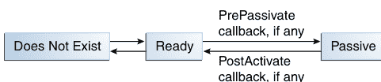

- （Remove）
- PreDestroy 回调（如果有）

在就绪状态下，EJB 容器可能会决定通过将 bean 移动到辅助存储器来停用或钝化 bean（通常情况下，EJB 容器使用最久未使用算法来选择 bean 进行钝化）。在钝化之前，EJB 容器会立即调用标记了 `@PrePassivate` 注解的方法（如果有）。如果客户端在钝化阶段调用 bean 的方法，EJB 容器将激活该 bean，调用标记了 `@PostActivate` 注解的方法（如果有），然后将其移回就绪状态。

在生命周期结束时，客户端会调用一个生命周期方法：标记了 `@Remove` 注解的方法，EJB 容器会调用标记了 `@PreDestroy` 注解的方法（如果有）。随后 bean 的实例即可进行垃圾回收。

你的代码控制其中一个生命周期方法的调用：标记了 `@Remove` 注解的方法。图 32-2 中的其他方法均由 EJB 容器调用。更多信息请参阅第 52 章“资源适配器与合约”。

## 无状态会话 Bean（Stateless Session Bean）的生命周期

由于无状态会话 Bean 永远不会被钝化，它的生命周期只有两个阶段：非常驻（nonresident）和准备好调用业务方法的状态。图 32-3 展示了无状态会话 Bean 的阶段。

## 图 32-3 无状态会话 Bean 或单例会话 Bean 的生命周期

- 依赖注入（如果有）
- PostConstruct 回调（如果有）


EJB 容器通常创建并维护一个无状态会话 Bean 池，从而开始无状态会话 Bean 的生命周期。容器执行依赖注入并调用标记了 `@PostConstruct` 注解的方法（如果有）。该 bean 现在准备好由客户端调用业务方法。在生命周期结束时，EJB 容器调用标记了 `@PreDestroy` 注解的方法（如果有）。bean 的实例即可进行垃圾回收。

## 单例会话 Bean（Singleton Session Bean）的生命周期

与无状态会话 Bean 类似，单例会话 Bean 永远不会钝化，只有两个阶段：非常驻和准备好调用业务方法，如 Java Platform, Enterprise Edition Java Tutorial 所示。

如果标记了 `@Startup` 注解，EJB 容器将在应用部署时创建单例 bean 实例并启动生命周期。容器执行依赖注入并调用标记了 `@PostConstruct` 注解的方法（如果有）。单例 bean 现在准备好由客户端调用业务方法。在生命周期结束时，EJB 容器调用标记了 `@PreDestroy` 注解的方法（如果有）。单例 bean 现在即可进行垃圾回收。

## 消息驱动 Bean（Message-Driven Bean）的生命周期

图 32-4 展示了消息驱动 Bean 的生命周期阶段。


EJB 容器通常创建一个消息驱动 bean 实例池。对于每个实例，EJB 容器执行以下任务：

1. 如果消息驱动 bean 使用依赖注入，容器将在实例化前注入这些引用。
2. 容器调用标记了 `@PostConstruct` 注解的方法（如果有）。

像无状态会话 Bean 一样，消息驱动 bean 永远不会钝化，只有两个状态：不存在和准备接收消息。在生命周期结束时，容器调用标记了 `@PreDestroy` 注解的方法（如果有）。bean 实例即可进行垃圾回收。

## 关于 Enterprise Beans 的更多信息

有关 Enterprise JavaBeans 技术的更多信息，请参见：

- Enterprise JavaBeans 3.2 规范：http://www.jcp.org/jsr/detail?id=345
- Enterprise JavaBeans 3.2 规范项目：https://

# 开始使用 Enterprise Beans

本章介绍了如何开发、部署和运行一个名为 converter 的简单 Java EE 应用，它使用 EJB 处理业务逻辑。converter 的目的是计算日元、欧元和美元之间的汇率。converter 应用由一个执行计算的 enterprise bean 和一个客户端组成。以下是本章将遵循的步骤概述：

1. 创建 enterprise bean：ConverterBean。
2. 创建客户端。
3. 将 converter 部署到服务器上。
4. 使用浏览器运行客户端。

在继续之前，请确保你已经完成了以下操作：

- 阅读第 1 章“概述”
- 熟悉 enterprise beans（参见第 32 章“Enterprise Beans”）
- 启动了服务器（参见 Starting and Stopping GlassFish）

此处将介绍以下主题：

- 创建 Enterprise Bean
- 修改 Java EE 应用

## 创建 Enterprise Bean

enterprise bean 是 converter 应用的核心，包含了汇率转换的业务逻辑。在本例中，我们将创建一个名为 ConverterBean 的无状态会话 Bean。

无状态会话 Bean 通过 `@Stateless` 注解定义。该注解告诉 EJB 容器 bean 在客户端调用之间不维护任何状态。容器可以创建这些 bean 的池并为多个客户端提供服务。

ConverterBean 的代码如下：

```java
package com.example.converter;

import javax.ejb.Stateless;
import java.math.BigDecimal;

@Stateless
public class ConverterBean {
    public BigDecimal convert(BigDecimal amount, BigDecimal rate) {
        return amount.multiply(rate);
    }
}
```

`convert` 方法接收两个 `BigDecimal` 参数（金额和汇率）并返回结果。

## 创建客户端

客户端是与 enterprise bean 交互的组件。在本例中，我们将使用 servlet 为 converter 提供一个 Web 界面。

servlet 将从用户处收集金额和汇率，调用 ConverterBean 并显示结果。

servlet 使用 `@WebServlet` 注解定义：


```java
package com.example.converter;

import java.io.IOException;
import javax.servlet.annotation.WebServlet;
import javax.servlet.http.HttpServlet;
import javax.servlet.http.HttpServletRequest;
import javax.servlet.http.HttpServletResponse;
import javax.ejb.EJB;
import java.math.BigDecimal;

@WebServlet("/convert")
public class ConverterServlet extends HttpServlet {
    @EJB
    private ConverterBean converter;

    @Override
    protected void doGet(HttpServletRequest request, HttpServletResponse response) 
            throws IOException {
        String amountStr = request.getParameter("amount");
        String rateStr = request.getParameter("rate");

        if (amountStr != null && rateStr != null) {
            BigDecimal amount = new BigDecimal(amountStr);
            BigDecimal rate = new BigDecimal(rateStr);
            BigDecimal result = converter.convert(amount, rate);
            response.getWriter().write("The result is: " + result);
        } else {
            response.getWriter().write("Please provide both amount and rate.");
        }
    }
}
```

## 部署应用

要部署该应用，必须将其打包成 WAR 文件并部署到 EJB 容器（如 GlassFish）。

你可以使用 Maven 构建应用。运行命令：

```
mvn package
```

构建完成后，将 WAR 文件复制到 GlassFish 的 `autodeploy` 目录并启动服务器。

最后，通过浏览器访问以下地址访问应用：

```
http://localhost:8080/converter/convert?amount=100&rate=0.8
```

浏览器将显示转换结果。

## 修改 Java EE 应用

5. 在 Servlet `ConverterServlet` 页面，在字段中输入 100 并点击提交（Submit）。

打开第二个页面，显示转换后的值。

## 33.2 修改 Java EE 应用

GlassFish 服务器支持迭代开发。每当你对 Java EE 应用进行更改时，必须重新部署该应用程序。

### 33.2.1 修改类文件

要修改企业级豆（enterprise bean）中的文件，你需要更改源代码、重新编译并重新部署应用程序。例如，要更新 `ConverterBean` 类中 `dollarToY` 方法的汇率，你可以遵循以下步骤。

修改 `ConverterServlet` 的步骤相同。

1. 编辑 `ConverterBean.java` 并保存文件。

2. 重新编译源文件。

- 在 NetBeans IDE 中重新编译 `ConverterBean.java`：右键点击转换项目并选择运行（Run）。

  这将重新编译 `ConverterBean.java` 文件，替换构建目录中的旧类文件，并将应用程序重新部署到 GlassFish 服务器。

- 使用 Maven 重新编译 `ConverterBean.java`。

  a. 在终端窗口中，进入 `tut-install/examples/ejb/converter/`

  b. 输入以下命令：

  ```
  mvn install
  ```

此命令会重新打包并部署应用程序。

## 运行企业级豆示例

本章描述了 EJB 示例。会话豆（Session beans）提供了一种在应用程序内部封装业务逻辑的简单有效的方法。可以通过远程 Java 客户端、Web 服务客户端以及在同一服务器上运行的组件进行访问。

在第 33 章“企业级豆入门”中，你构建了一个名为 `ConverterBean` 的无状态会话豆。本章将检查另外四个豆的源代码：

- `CounterBean`：一个被远程客户端访问的无状态会话豆
- `CounterBean`：一个单例会话豆
- `HelloServiceBean`：一个实现 Web 服务的无状态会话豆
- `TimerSessionBean`：一个设置了定时器的无状态会话豆

此处还讨论了以下主题：

- cart 示例
- 单例会话豆示例：counter
- Web 服务示例：helloservice
- 使用定时器服务（Timer Service）
- 异常处理

## 34.1 cart 示例

cart 代表在线书店中的购物车，并使用会话豆来管理购物车的操作。该豆的客户端可以将书籍添加到购物车、删除书籍或检索购物车的内容。要组装 cart，你需要以下代码：

- 会话豩 (`CartBean`)
- 远程接口 (`Cart`)

所有会话豆都需要一个会话豆类。所有允许远程访问的企业级豆都有一个远程业务接口。为了满足特定应用程序的需求，企业级豆可能需要一些辅助类。`CartBean` 会话豆使用了两个辅助类：`BookException` 和 `IdVerifier`，它们在“辅助类（Helper Classes）”部分进行了讨论。

该示例的源代码位于 `tut-install/examples/ejb/cart/`。

### 34.1.1 业务接口

`Cart` 业务接口是一个纯 Java 接口，定义了豆类中实现的业务方法。豆类实现一个接口，该接口被假设为业务接口。除非标记了 `javax.ejb.Remote` 注解，否则该业务接口都是本地接口；在这种情况下，`javax.ejb.Local` 注解是可选的。

豆可以实现多个接口。在这种情况下，业务接口要么被显式标记为 `@Local` 或 `@Remote`，要么通过在豆类上装饰 `@Local` 或 `@Remote` 来指定。然而，无论豆类是否实现多个接口，以下接口都是排除在外的：

- `java.io.Serializable`
- `java.io.Externalizable`
- `javax.ejb` 豆包中定义的任何接口

`Cart` 业务接口的源代码如下：

```java
package javaevetutorial.cart.ejb;

import cart.util.BookException;
import java.util.List;
import javax.util.Remote;

@Remote
public interface Cart {
    public void initialize(String person) throws BookException;
    public void initialize(String person, String id) throws BookException;
    public void addBook(String title);
    public void removeBook(String title) throws BookException;
    public List<String> getContents();
    public void remove();
}
```

### 34.1.2 会话豆类

该类的会话豆被称为 `CartBean`。像任何无状态会话豆一样，`CartBean` 必须满足以下要求：

- 类被标记为 `@Stateful`。
- 类实现了业务接口中定义的业务方法。

有状态豆（Stateful beans）还可以执行以下操作：

- 实现业务接口（一个纯 Java 接口）。实现豆的业务接口是一种良好的实践。
- 实现任何可选的生命周期回调方法，标记为 `@PostConstruct`、`@PreDestroy`、`@PostActivate` 和 `@PrePassivate`。
- 实现任何标记为 `@Remove` 的可选方法。

`CartBean` 源代码如下：

```java
package javaevetutorial.cart.ejb;

import java.io.Serializable;
import java.util.ArrayList;
import java.util.List;
import javaasetutorial.cart.util.BookException;
import javaasetutorial.cart.util.IdVerifier;
import javax.ejb.Remove;
import javax.ejb.Stateful;

@Stateful
public class CartBean implements Cart {
    String customerId;
    String customerName;
    List<String> contents;

    @Override
    public void initialize(String person) throws BookException {
        if (person == null) {
            throw new BookException("Null person.");
        }
        customerName = person;
        contents = new ArrayList<>();
    }

    @Override
    public void initialize(String person, String id) throws BookException {
        IdVerifier idChecker = new IdVerifier();
        if (idChecker.validate(id)) {
            customerId = id;
            customerName = person;
            contents = new ArrayList<>();
        } else {
            throw new BookException("Invalid id: " + id);
        }
    }

    @Override
    public void addBook(String title) {
        contents.add(title);
    }

    @Override
    public void removeBook(String title) throws BookException {
        boolean result = contents.remove(title);
        if (result == false) {
            throw new BookException("*" + title + "* not in cart.");
        }
    }

    @Override
    public List<String> getContents() {
        return contents;
    }

    @Remove
    public void remove() {
        contents = null;
    }
}
```

## cart 示例

### 34.1.2.1 生命周期回调方法

通过在方法上添加以下注解，可以将豆类中的方法声明为回调方法：

- `javax.annotation.PostConstruct`：标记为 `@PostConstruct` 的方法在依赖注入完成后、在企业级豆的第一个方法之前调用。
- `javax.annotation.PreDestroy`：标记为 `@PreDestroy` 的方法在任何 `@Remove` 方法执行完成后、容器移除企业级豆之前调用。
- `javax.ejb.PostActivate`：标记为 `@PostActivate` 的方法在容器将豆从二级存储移动激活后调用。
- `javax.ejb.PrePassivate`：标记为 `@PrePassivate` 的方法在容器激活企业级豆之前调用，这意味着容器将豆从环境中移除并保存到二级存储中。

生命周期回调方法必须返回 `void` 且没有参数。

### 34.1.2.2 业务方法

业务豆的主要目的是为客户端运行业务任务。客户端通过依赖注入或 JNDI 查询获取对象引用来调用业务方法。从客户端的角度来看，业务方法似乎是在本地运行，尽管它们在业务豆中远程运行。以下代码片段显示了 `CartClient` 程序如何调用业务方法：

```java
cart.initialize("Duke DeEarl", "123");
...
cart.addBook("Ben Canto");
List<String> bookList = cart.getContents();

cart.removeBook("Gravity's Rainbow");
```

`CartBean` 类通过以下代码实现业务方法：

```java
@Override
public void addBook(String title) {
    contents.add(title);
}

@Override
public void removeBook(String title) throws BookException {
    boolean result = contents.remove(title);
    if (result == false) {
        throw new BookException("*" + title + "* not in cart.");
    }
}
```

```java
@Override
public List<String> getContents() {
    return contents;
}
```

业务方法的签名不能以 *ejb* 开头，以避免与回调方法冲突。

- 方法名不能以 ejb 开头，以避免与 EJB 架构定义的回调方法冲突。例如，你不能调用名为 `ejCreate` 或 `ejbcactivate` 的业务方法。
- 访问修饰符必须是 public（公共）。
- 如果该 bean 允许访问远程业务接口，则参数和返回类型必须是 Java 远程方法调用 (RMI) API 的合法类型。
- 如果该 bean 是 JAX-WS Web 服务端点，则带有 `@WebService` 注解的方法参数和返回类型必须是 JAX-WS 的合法类型。
- 如果该 bean 是 JAX-RS 资源，则资源方法的参数和返回类型必须是 JAX-RS 的合法类型。
- 修饰符不能是 `static`（静态）或 `final`（最终）。

`throws` 子句可以包含你为应用程序定义的异常。例如，`removeMethod` 方法在书籍不在购物车时会抛出 `BookException`。

为了指示系统级问题（如无法连接到数据库），业务方法应该抛出 `javax.ejb.EJBException`。容器不会封装应用程序异常（例如 `BookException`）。由于 `EJBException` 是 `RuntimeException` 的子类，你不需要在业务方法的 `throws` 子句中包含它。

## 34.1.3 @Remove 方法

会话 bean 类中带有 `javax.ejb.Remove` 注解的业务方法可以被企业 bean 客户端，以移除 bean 实例。在 @Remove 方法完成（无论正常还是异常）后，容器将移除该企业 bean。

在 `CartBean` 中，`remove` 方法是一个 `@Remove` 方法：

```java
@Remove
@Override
public void remove() {
    contents = null;
}
```

## 34.1.4 辅助类

`CartSession` bean 有两个辅助类：`BookException` 和 `Identifier`。`BookException` 由 `removeMethod` 抛出，而 `Identifier` 在其中一个创建方法中验证 `customerId`。辅助类可能位于包含企业 bean 类的 EJB JAR 中、如果企业 bean 被打包在 WAR 中则位于 WAR 文件中，或者如果包含 EJB JAR、WAR 文件或独立的库 JAR 文件则位于 EAR 文件中。在 cart 示例中，辅助类包含在应用程序客户端和 EJB JAR 使用的库 JAR 中。

## 34.1.5 运行 cart 示例

现在你准备好编译远程接口（`Cart.java`）、企业 bean 类（`Bean.java`）、客户端类（`CartClient.java`）以及辅助类（`BookException.java` 和 `IdVerifier.java`）。

你可以使用 NetBeans IDE 或 Maven 来构建、部署和运行 cart 应用。

### 34.1.5.1 使用 NetBeans IDE 运行 cart 示例


# 1. 确保 GlassFish 服务器已启动（启动和停止 GlassFish 服务器）。

# 2. 从 File（文件）菜单选择 Open Project（打开项目）。

# 3. 在对话框中，导航到：

`tut-install/examples/ejb`

# 4. 选择 `cart` 文件夹。

# 5. 选择 Required Projects（所需项目）复选框。

# 6. 点击 Open Project（打开项目）。

# 7. 在 Projects（项目）选项卡中，右键点击 `cart` 项目并选择 Build（构建）。这会将应用构建并打包为 `cart.ear`（位于 `tut-install/examples/ejb/cart-ear/target/`），并将该 EAR 文件部署到你的 GlassFish 实例。

你会在 Output（输出）选项卡中看到 cart-app 应用的输出：

```
Retrieving book title from cart: Infinite
Retrieving book title from cart: Canto
Retrieving book title from cart: Kafka on the Shore
Removing 'Gravity's Rainbow' from cart.
Caught BookException: 'Gravity's Rainbow' not in cart.
```

## 34.1.5.2 使用 Maven 运行 cart 示例

1. 确保 GlassFish 服务器已启动（启动和停止 GlassFish 服务器）。

2. 在终端窗口中进入：

`tut-install/examples/ejb/cart/`

3. 输入以下命令：

`mvn install`

此命令将应用编译并打包成 EAR 文件 `cart.ear`（位于 target 目录），并部署到你的 GlassFish 实例。然后获取并运行客户端。这等同于运行以下命令：

`java -client cart-ear/target/cart-client.jar`

应用程序客户端包含辅助类 `BookException` 和业务接口。当你运行客户端时，应用程序容器会注入客户端类中声明的任何组件，在本例中是对企业 bean 的引用。

你将在终端窗口看到 cart-app 应用的输出：

```
Retrieving book title from cart: Infinite
Retrieving book title from cart: Canto
Retrieving book title from cart: Kafka on the Shore
Removing "Gravity's Rainbow" from cart.
Caught BookException: "Gravity's Rainbow" not in cart.
```

## 34.2 会话 bean 示例：counter

counter 示例演示了如何创建一个单例会话 bean。

### 34.2.1 创建单例 Bean

使用 `javax.ejb.Singleton` 注解来指定企业 bean 实现类为单例 bean：

```java
@Singleton
public class SessionBean { ... }
```

### 34.2.1.1 初始化单例 Bean

EJB 容器负责决定何时初始化单例 bean，除非单例 bean 实现类标记了 `javax.ejb.Startup` 注解。在这种情况下（有时称为尽早初始化），EJB 容器必须在启动时初始化会话 bean。单例 bean 在 EJB 容器交付请求之前进行初始化。

以下单例 bean 存储应用程序状态，并被尽早初始化：

```java
@Singleton
public class StatusBean {
    private String status;

    @PostConstruct
    void init() {
        status = "Ready";
    }
}
```

有时单例 bean 用于初始化数据，因此必须按照特定顺序初始化。在这种情况下，使用 `javax.ejb.DependsOn` 注解来声明单例 bean 的启动依赖。`@DependsOn` 注解的 `value` 属性是一个或多个字符串，指定目标会话 bean 的名称。

以下单例 bean `PrimaryBean` 应该首先启动：

```java
@Singleton
public class PrimaryBean { }
```

`SecondaryBean` 依赖于 `PrimaryBean`：

```java
@Singleton
@DependsOn("PrimaryBean")
public class SecondaryBean { }
```

这保证了 EJB 容器在初始化 `SecondaryBean` 之前会初始化 `PrimaryBean`。

以下单例 bean `TertiaryBean` 依赖于 `PrimaryBean` 和 `SecondaryBean`：

```java
@Singleton
@DependsOn({"PrimaryBean", "SecondaryBean"})
public class TertiaryBean { }
```

`SecondaryBean` 要求在它初始化之前 `PrimaryBean` 已经初始化。在这种情况下，EJB 容器将首先初始化 `PrimaryBean`，最后初始化 `TertiaryBean`。

如果 `SecondaryBean` 没有显式依赖于 `PrimaryBean`，则 EJB 容器可能会先初始化 `PrimaryBean` 或 `SecondaryBean`。也就是说，EJB 可能会按照 SecondaryBean、PrimaryBean、TertiaryBean 的顺序初始化单例。

### 34.2.1.2 在单例会话 bean 中管理并发访问

单例会话 bean 设计用于并发访问，适用于许多客户端同时访问同一个 bean 实例的情况。单例的客户端只需要单例的引用即可调用单例暴露的任何业务方法，无需担心可能同时在同一 bean 上调用业务方法的其他客户端。

在创建单例会话 bean 时，可以通过两种方式控制单例业务方法的并发访问：容器管理并发和 bean 管理并发。

`javax.ejb.ConcurrencyManagement` 注解用于指定单例的容器管理并发或 bean 管理并发。

## 容器管理并发

如果单例使用容器管理并发，由 EJB 容器控制单例业务方法的访问。使用 `javax.ejb.LockType` 来指定单例业务方法或 `@Timeout` 方法的访问级别。`LockType` 枚举类型为 `READ` 和 `WRITE`。

如果单例的方法可以被许多客户端并发访问或共享，则在该方法的业务方法或超时方法上标记 `@Lock(LockType.READ)`。如果在客户端调用该方法时，会话 bean 应该被其他客户端锁定，则在业务方法或超时方法上标记 `@Lock(LockType.WRITE)`。通常，当客户端修改单例的状态时使用 `@Lock(LockType.WRITE)` 注解。

在单例上标记 `@Lock` 指定所有业务方法和任何超时方法都使用指定的锁类型，除非通过方法级别的 `@Lock` 注解显式设置锁类型。如果单例类上没有 `@Lock` 注解，则默认锁类型 `@Lock(LockType.WRITE)` 应用于所有业务和超时方法。

以下示例显示了如何对使用容器托管并发的单例使用 `@ConcurrencyManagement`、`@Lock(LockType.READ)` 和 `@Lock(LockType.WRITE)` 注解。

虽然默认单例使用容器托管并发，但可以在单例的类级别添加 `@ConcurrencyManagement(CONTAINER)` 注解以显式设置并发类型：

```java
@ConcurrencyManagement(ConcurrencyType.CONTAINER)
@Singleton
public class ExampleBean {
    private String state;

    @Lock(LockType.READ)
    public String getState() {
        return state;
    }

    @Lock(LockType.WRITE)
    public void setState(String newState) {
        state = newState;
    }
}
```

由于 `getState` 方法标记了 `@Lock(LockType.READ)`，因此许多客户端可以同时访问它。当调用 `setState` 方法时，ExampleSingletonBean 中的所有方法将对其他客户端锁定，因为 `setState` 被标记为 `@Lock(LockType.WRITE)`。这防止了两个客户端尝试同时更改 ExampleSingletonBean 的状态变量。

以下单例中的 `getData` 和 `getStatus` 方法为 `READ` 类型，而 `setState` 为 `WRITE` 类型：

```java
@Singleton
@Lock(LockType.READ)
public class SharedSingletonBean {
    private String data;
    private String status;

    public String getData() {
        return data;
    }

    public String getStatus() {
        return status;
    }

    @Lock(LockType.WRITE)
    public void setStatus(String newStatus) {
        status = newStatus;
    }
}
```

如果方法的锁类型为 `WRITE`，客户端对单例所有方法的访问将被阻塞，直到当前客户端完成其方法调用或发生访问超时。当访问超时时，EJB 会抛出 `javax.ejb.ConcurrentTimeoutException`。`javax.ejb.AccessTimeout` 注解用于指定访问超时发生之前的毫秒数。如果在单例级别添加，`@AccessTimeout` 指定了单例中所有方法的值，除非被其自身的 `@AccessTimeout` 注解覆盖。

`@AccessTimeout` 注解可以同时应用于 `@Lock(LockType.READ)` 和 `@Lock(LockType.WRITE)` 方法。`@AccessTimeout` 注解有一个元素 `value` 和一个可选元素。默认情况下值以毫秒为单位。要更改值，请设置 `java.util.concurrent.TimeUnit` 常量的单位：`NANOSECONDS`、`MILLISECONDS`、`SECONDS`。

以下单例的默认访问超时为 120,000 毫秒（即 2 分钟）。`doTediousOperation` 方法重写了默认访问超时，并将值设置为 360,000 毫秒（即 6 分钟）：

```java
@Singleton
@AccessTimeout(value=120000)
public class StatusSingletonBean {
    private String status;

    @Lock(LockType.WRITE)
    public void setStatus(String newStatus) {
        status = newStatus;
    }

    @Lock(LockType.WRITE)
    @AccessTimeout(value=360000)
    public void doTediousOperation() {
        ...
    }
}
```

以下单例的默认访问超时为 60 秒，使用 `TimeUnit.SECONDS` 指定：

```java
@Singleton
@AccessTimeout(value=60, unit=TimeUnit.SECONDS)
public class StatusSingletonBean { ... }
```

（注：由于原文中存在大量重复和 OCR 错误，译文已提取核心逻辑并进行清理。）

```xml
<ui:composition template="/template.xhtml">
  <ui:define name="title">
    页面已被访问了 #{count.hitCount} 次。
  </ui:define>
  <ui:define name="body">
    好极了！
  </ui:define>
</ui:composition>
```

## 34.2.3 运行计数器示例

你可以使用 NetBeans IDE 或 Maven 来构建、打包并运行计数器示例。

### 34.2.3.1 使用 NetBeans IDE 运行计数器示例

1. 确保 GlassFish 服务器已启动（启动和停止 GlassFish 服务器）。

2. 从菜单中选择“打开项目”（Open Project）。

3. 在“打开项目”对话框中，导航到：

`tut-install/examples/ejb`

4. 选择 counter 文件夹。

5. 点击“打开项目”。

6. 在“项目”（Projects）选项卡中，右键点击 counter 项目并选择“运行”（Run）。

浏览器将打开 URL `http://localhost:8080/counter`，其中显示访问次数。

7. 刷新页面以看到访问次数增加。

### 34.2.3.2 使用 Maven 运行计数器示例

1. 确保 GlassFish 服务器已启动（启动和停止 GlassFish 服务器）。

2. 在终端窗口中，进入：

`tut-install/examples/ejb/`

3. 输入以下命令：

`mvn install`

此构建将计数器部署到你的 GlassFish 服务器实例中。

4. 在浏览器中，输入以下 URL：

`http://localhost:8080/counter`

5. 刷新页面以看到访问次数增加。

## 34.3 Web 服务示例：helloservice

此示例演示了一个简单的 Web 服务，该服务根据从客户端接收的信息生成响应。`HelloBean` 是一个无状态会话 bean（stateless session bean），它实现了一个方法：`sayHello`。该方法与“简单的 JAX-WS 客户端”中描述的客户端所调用的 `sayHello` 方法匹配。

### 34.3.1 Web 服务端点实现类

`HelloServiceBean` 是端点实现类，通常是企业 bean Web 端点的主要编程构件。Web 服务端点实现类具有以下要求。

- 类必须标记有 `jaxws.WebService` 或 `jaxws.WebServiceProvider` 注解。

- 实现类可以通过 `@WebService` 注解中的 `endpointInterface` 元素显式引用 SEI（会话执行接口），但不是必须这样做。如果 `@WebService` 中未指定 `endpointInterface`，则为实现类隐式定义一个 SEI。

- 实现类的方法必须是公共的，且不能声明为静态（`static`）或最终（`final`）。

- 暴露给 Web 服务客户端的业务方法必须标记 `jaxws.WebMethod` 注解。

- 暴露给 Web 服务客户端的业务方法必须具有与 JAXB 兼容的参数和返回值。JAXB 默认类型绑定列表参见“JAX-WS 支持的类型”（Types Supported by JAX-WS）。

- 实现类必须是 `final` 的且不能是抽象的（`abstract`）。

- 实现类必须有一个默认的公共构造函数。

- 端点类必须标记为 `@Stateless` 注解。

- 实现类不能定义 `finalize` 方法。

- 实现类可以在其方法上使用 `javax.annotation.PostConstruct` 或 `javax.annotation.PreDestroy` 注解进行生命周期事件回调。

`@PostConstruct` 方法在容器在实现类开始响应 Web 服务客户端之前调用。

`@PreDestroy` 方法在容器将端点从运行移除之前调用。

### 34.3.2 无状态会话 bean 实现类

`HelloServiceBean` 类实现了 `sayHello` 方法，该方法被标记为 `@WebMethod`。`HelloServiceBean` 类的源代码如下：

```java
package javauetutorial.heloservice.ejb;

import javax.ejb.Stateless;
import javax.jws.WebMethod;
import javax.jws.WebService;

@Stateless
public class HelloServiceBean {
    private final String message = "Hello, *";

    public HelloServiceBean() {}

    @WebMethod
    public String sayHello(String name) {
        return message + name + "*";
    }
}
```

### 34.3.3 运行 helloservice 示例

你可以使用 NetBeans IDE 或 Maven 来构建、打包并部署 helloservice 示例。然后你可以使用管理控制台测试 Web 服务端点方法。

### 34.3.3.1 使用 NetBeans IDE 构建、打包并部署 helloservice 示例

1. 确保 GlassFish 服务器已启动（参见启动和停止 GlassFish 服务器）。


- 2. 从“文件”（File）菜单选择“项目”（Project）。
- 3. 在“打开项目”对话框中，导航到：
  ```
  tut-install/examples/ejb
  ```
- 4. 选择 `hellervice` 文件夹。
- 5. 点击“打开项目”。
- 6. 在“项目”（Projects）选项卡中，右键点击 `hellervice` 项目并选择“构建”（Build）。

  这将应用程序构建并打包为 `hellervice.ear`，位于 `tut-install/examples/ejb/hellervice/target/`，并将 EAR 文件部署到 GlassFish 服务器。

### 34.3.3.2 使用 Maven 构建、打包并部署 hellervice 示例

- 1. 确保 GlassFish 服务器已启动（启动和停止 GlassFish 服务器）。
- 2. 在终端窗口中，进入：
  ```
  tut-install/examples/ejb/hellervice/
  ```
- 3. 输入以下命令：
  ```
  mvn install
  ```

这会编译源文件并将应用程序打包为 `hellervice.jar` 位于 `tut-install/examples/ejb/hellervice/`。EJB 文件将部署到 GlassFish 服务器。

### 34.3.3.3 无客户端测试服务

通过管理控制台允许测试 Web 服务的方法。要测试 `sayHello`，请遵循以下步骤：

- 1. 通过以下 URL 打开管理控制台：
  ```
  http://localhost:4848/
  ```
- 2. 在导航树中，选择应用程序（Applications）节点。
- 3. 在应用程序表格中，点击 `hellervice`。
- 4. 在模块和组件表中，点击“查看端点”（View Endpoint）。
- 5. 在 Web 服务端点信息页面，点击“测试”（Tester）链接：`HelloServiceBean?tester`。
- 6. 在 Web 服务测试页面，点击非安全链接（指定端口 8080 的那个）。
- 7. 在 `HelloBeanService` Web 测试页面，在方法下输入一个名称作为参数。
- 8. 点击 `sayHello`。

打开 `sayHello` 方法调用页面。在返回值下，你将看到来自端点的响应。

## 34.4 使用定时器

业务流程通常依赖于定时通知。企业豆容器的定时服务允许你为状态会话豆以外的所有企业豆调度通知。你可以根据日历计划、特定时间、持续时间或间隔调度定时器。例如，你可以设置定时器在 5 月 25 日 10:30 运行、30 天后或每 12 小时运行一次。

企业豆的定时器分为编程的或自动的。编程定时器通过显式调用 `Timer` 接口的定时器方法来设置。自动定时器在带有 `javax.ejb.Schedule` 或 `javax.ejb.Schedules` 注解方法的企业豆成功部署后创建。

### 34.4.1 创建日历定时器表达式

定时器可以根据日历计划设置，其语法类似于 UNIX cron 工具。编程定时器和自动定时器都可以使用日历定时器表达式。表 34–1 显示了日历定时器属性。

| 表 34-1 日历定时器属性 |
|---|---|---|---|
| 属性 | 说明 | 默认值 | 允许的值和示例 |
| second | 每分钟内的一个或多个秒 | 0 | 0 到 59。例如：`second="30"` |
| minute | 每小时内的一个或多个分钟 | 0 | 0 到 59。例如：`minute="15"` |
| hour | 每天内的一个或多个小时 | 0 | 0 到 23。例如：`hour="13"` |

# 表 34–1（续）基于日历的计时器属性

| 属性 | 说明 | 默认值 | 可允许的值及示例 |
|---|---|---|---|
| dayOfWeek | 周内的一个或多个天 | * | 0 到 7（0 和 7 均指周日）。例如：`dayOfWeek="*"` |
| dayOfMonth | 月内的一个或多个天 | * | Sun, Mon, Wed, Thu, Fri, Sat。例如：`dayOfMonth="*"`。 1 到 31。例如：`dayOfMonth="15"`。 -7 到 -1（负数表示该月结束前的几天或某几天）。例如：`dayOfMonth="-3"`。 Last。例如：`dayOfMonth="Last"`。 [1st, 2nd, 3rd, 4th, 5th, Last], [Sun, Mon, Wed, Thu, Fri, Sat]。例如：`dayOfMonth="2nd Fri"` |
| month | 年内的一个或多个月 | * | 1 到 12。例如：`month="*"`。Jan, Feb, Mar, Apr, May, Jun, Aug, Sep, Oct, Dec。例如：`month="July"` |
| year | 特定的日历年 | * | 四位数的日历年。例如：`year="2011"` |

## 34.4.1.1 在日历表达式中指定多个值

你可以按照下文章节的描述，在日历表达式中指定多个值。

### 在日历表达式中使用通配符

将属性设置为星号符号 (`*`) 表示该该属性所有允许的值。

以下表达式表示每分钟：
```
minute="*"
```

以下表达式表示每周的每一天：
```
dayOfWeek="*"
```

### 指定值列表

若要为一个属性指定两个或多个值，请使用逗号 (`,`) 分隔这些值。列表中允许包含值范围。然而，不允许使用通配符和间隔。

列表中的重复项会被忽略。

以下表达式将星期几设置为周二和周四：
```
dayOfWeek="Tue, Thu"
```

以下表达式表示凌晨 4:00，通过范围表示从上午 9:00 到下午 5:00 之间的每小时，以及晚上 10:00。
```
hour="4,9-17, 22"
```

### 指定值范围

使用连字符 (`-`) 为一个属性指定一个包含边界的值范围。范围中的成员不能是通配符、列表或间隔。`x-x` 形式的范围等于单值表达式 `x`。当 `x` 大于 `y` 时，`x-y` 形式的范围等于表达式 `x-maximumvalue,minimumvalue-y`。也就是说，如果表达式从 `x` 开始，循环到允许值的开头，并持续到 `y`。

以下表达式表示上午 9:00 到下午 5:00：
```
hour="9-17"
```

以下表达式表示从周五到周一：
```
dayOfWeek="5-1"
```

以下表达式表示从每月二十五号到月底，以及从月初到每月五号：
```
dayOfMonth="25-5"
```

它等同于以下表达式：
```
dayOfMonth="25-Last,1-5"
```

### 指定间隔

斜杠 (`/`) 将属性限制在一个起始点，而间隔用于指定分钟、小时或天内的每 N 秒、每分钟或每小时。对于 `x/y` 形式的表达式，`x` 代表起始点，`y` 代表间隔。通配符字符可以使用间隔的 `x` 位置；它等同于将 `x` 设置为 0。

秒、分钟和小时属性可以设置间隔。

以下表达式表示小时内的每 10 分钟：
```
minute="*/10"
```

等同于：
```
minute="0,10,20,30,40,50"
```

以下表达式表示中午每 2 小时：
```
hour="12/2"
```

## 34.4.2 编程计时器

当编程计时器过期（触发）时，容器将调用包含 bean 实现类中带有 `@Timeout` 注解的方法。`@Timeout` 方法包含处理定时事件的业务逻辑。

### 34.4.2.1 @Timeout 方法

在企业 bean 类中带有 `@Timeout` 注解的方法必须返回 `void`，并可选地接受一个 `javax.ejb.Timer` 对象作为唯一参数。它们不能抛出应用程序异常：

```java
@Timeout
public void timeout(Timer timer) {
    System.out.println("TimerBean: timeout occurred");
}
```

### 34.4.2.2 创建编程计时器

bean 调用 `TimerService` 接口的 `create` 方法来创建计时器。这些方法允许创建单次动作、间隔或基于日历的计时器。

对于单次动作或间隔计时器，计时器的过期可以表示为持续时间或绝对时间。持续时间表示触发超时前的毫秒数。若要指定绝对时间，则将一个 `java.util.Date` 对象传递给 `TimerService.createSingleActionTimer` 或 `TimerService.createTimer` 方法。

以下代码设置计时器在 60 秒后过期：

```java
long duration = 60000;
timerService.createSingleActionTimer(duration);
```

以下代码设置计时器在特定日期过期：

```java
Date date = new SimpleDateFormat("yyyy-MM-dd HH:mm:ss").parse(dateString);
timerService.createSingleActionTimer(date, timerConfig);
```

## 34.4.3 自动计时器

当企业 bean 带有 `@Schedule` 或 `@Schedules` 注解的方法时，EJB 容器会创建自动计时器。与编程计时器不同，企业 bean 可以有多个自动超时，而编程计时器允许类中只有一个带有 `@Timeout` 注解的方法。

自动计时器可以通过注解或 `ejb-jar.xml` 部署描述符进行配置。

在企业 bean 上添加 `@Schedule` 注解将根据 `@Schedule` 属性中的日历计划将其标记为超时方法。

`@Schedule` 注解具有多个元素，对应于“创建基于日历的计时器表达式”中详细说明的日历表达式，以及 `persistent`、`info` 和 `timezone` 元素。

可选的 `persistent` 元素接受布尔值，用于指定自动计时器是否应在重启或崩溃后生存。默认情况下，所有自动计时器都是持久的。

可选的 `timezone` 元素用于指定自动计时器与特定的时区相关联。如果设置，该元素将相对于指定的时区来评估所有计时器表达式，无论 EJB 容器运行在哪个时区。默认情况下，所有自动计时器都是相对于服务器的默认时区设置的。

可选的 `info` 元素用于设置计时器的信息性描述。稍后可以使用 `Timer.getInfo` 获取计时器的信息。

以下超时方法使用 `@Schedule` 设置了一个在周日午夜过期的计时器：

```java
@Schedule(dayOfWeek="Sun", hour="0")
public void cleanupData() { }
```

```java
@Schedules({
  @Schedule(dayOfMonth="Last"),
  @Schedule(dayOfWeek="Fri", hour="23")
})
public void doPeriodicCleanup() { }
```

- 当 bean 调用 `Timer` 接口的 `cancel` 方法时，容器会取消该定时器。

如果在已取消的定时器上调用方法，容器将抛出 `javax.ejb.NoSuchObjectException`。

为了以后保留 `Timer` 对象，可以调用其 `getHandle` 方法并将 `TimerHandle` 存储在数据库中（`TimerHandle` 对象是可序列化的）。要重新实例化 `Timer` 对象，请从数据库中检索句柄并在其上调用 `getTimer`。`TimerHandle` 对象不能作为远程或 Web 服务的接口中定义的方法的参数传递。换句话说，远程客户端和 Web 客户端无法访问 bean 的 `TimerHandle`。但是，本地客户端没有此限制。

## 34.4.5 获取定时器信息

除了 `cancel` 方法外，`Timer` 接口还定义了用于获取以下信息的方法：

```java
public long getTimeRemaining();
public java.util.Date getNextTimeout();
public java.io.Serializable getInfo();
```

`getInfo` 方法返回在上一节代码中调用 `createTimer` 方法时作为最后一个参数的对象。例如，在前面的 `createTimer` 代码片段中，该 `info` 参数是一个带有所创建内容的字符串类型。

要检索 bean 的所有活动定时器，请调用 `TimerService` 接口的 `getTimers` 方法。`getTimers` 方法返回 `Timer` 对象的集合。

## 34.4.6 事务与定时器

企业级 bean 通常在事务中创建定时器。如果该事务回滚，定时器的创建也会回滚。同样，如果 bean 在会被回滚的事务中取消了定时器，那么在这种情况下，定时器的持续时间将重置，就像从未发生过取消一样。

在使用容器管理事务的 bean 中，`@Timeout` 方法通常具有 `Required` 或 `RequiresNew` 事务属性，以保持事务的完整性。有了这些属性，EJB 容器会在调用 `@Timeout` 方法之前启动新事务。如果该方法回滚，容器将至少再调用一次 `@Timeout` 方法。

## 34.4.7 TimerSession 示例

该示例的源代码位于 `tut-install/examples/ejb/timersession/src/main/java/` 目录下。

`TimerSessionBean` 是一个单例 bean，展示了如何设置自动定时器和程序化定时器。在随后的 `TimerSessionBean` 源代码中，使用了 `setTimer` 和 `@Timeout` 方法来设置程序化定时器。当 bean 创建时，容器会注入一个 `TimerService` 实例。由于这是一个业务方法，`setTimer` 暴露在 `TimerSessionBean` 的无接口中，并可以由客户端调用。在此示例中，客户端调用 `setTimer` 设置间隔为 8000 毫秒（即 8 秒）。`setTimer` 方法通过调用 `TimerService` 的 `createTimer` 方法创建一个新的定时器。现在定时器已设置好，当定时器过期时，EJB 容器将调用 `TimerSessionBean` 的 `programmaticTimeout` 方法，其单位为秒如下：

### 使用定时器服务

```java
public void setTimer(long intervalDuration) {
    logger.log(Level.INFO,
        "Setting a programmatic timeout for {0} milliseconds from now.",
        intervalDuration);
    Timer timer = timerService.createTimer(intervalDuration,
        "Created new programmatic timer");
}
```

```java
@Timeout
public void programmaticTimeout(Timer timer) {
    this.lastProgrammaticTimeout = new Date();
    logger.info("Programmatic timeout occurred.");
}
```

`TimerSessionBean` 还有一个自动定时器和超时方法，自动定时器被设置为每 1 分钟过期一次，通过在 `@Schedule` 注解中使用基于日历的表达式设置：

```java
@Schedule(minute = "*/1", hour = "*", persistent = false)
public void automaticTimeout() {
    this.lastAutomaticTimeout = new Date();
    logger.info("Automatic timeout occurred.");
}
```

`TimerSessionBean` 还有两个业务方法：`getLastProgrammaticTimeout` 和 `getLastAutomaticTimeout`。客户端调用这些方法分别获取定时器和自动定时器上一次超时的数据和时间。

以下是 `TimerSessionBean` 类的源代码：

```java
package timersession.ejb;

import java.util.Date;
import java.util.logging.Level;
import java.util.logging.Logger;
import javax.annotation.Resource;
import javax.ejb.Schedule;
import javax.ejb.Singleton;
import javax.ejb.Startup;
import javax.ejb.Timeout;
import javax.ejb.Timer;
import javax.ejb.TimerService;

@Singleton
@Startup
public class TimerSessionBean {
    @Resource
    TimerService timerService;

    private Date lastProgrammaticTimeout;
    private Date lastAutomaticTimeout;

    private static final Logger logger = Logger.getLogger("timersession.ejb.TimerSessionBean");

    public void setTimer(long intervalDuration) {
        logger.log(Level.INFO,
            "Setting a programmatic timeout for {0} milliseconds from now.",
            intervalDuration);
        Timer timer = timerService.createTimer(intervalDuration,
            "Created new programmatic timer");
    }

    @Timeout
    public void programmaticTimeout(Timer timer) {
        this.lastProgrammaticTimeout = new Date();
        logger.info("Programmatic timeout occurred.");
    }

    @Schedule(minute = "*/1", hour = "*", persistent = false)
    public void automaticTimeout() {
        this.lastAutomaticTimeout = new Date();
        logger.info("Automatic timeout occurred.");
    }

    public Date getLastProgrammaticTimeout() {
        return lastProgrammaticTimeout;
    }

    public Date getLastAutomaticTimeout() {
        return lastAutomaticTimeout;
    }
}
```


"Setting a programmatic timeout for {0} milliseconds from now."

```java
Timer timer = timerService.createTimer(intervalDuration);
Created new programmatic timer\n
@Timeout
public void programmaticTimeout(Timer timer) {
    this.lastProgrammaticTimeout(new Date());
}

@Schedule(minute = "*/1", hour = ***, persistent = false)
public void automaticTimeout() {
    this.lastAutomaticTimeout(new Date());
}
```

> 注意：GlassFish Server 的默认最小超时值为 1000 毫秒（即 1 秒）。如果你在管理控制台中将 `Minimum Delivery Interval` 设置小于 1000 毫秒，请展开 `server-config`，选择 `EJB Container` 并点击 Save。`delivery-interval-in-millis` 的最低值约为 10 毫秒。

## 34.4.8 运行示例

你可以使用 NetBeans IDE 或 Maven 来构建、部署和运行 `timersession` 示例。

### 34.4.8.1 使用 NetBeans IDE 示例

1. 确保 GlassFish Server 已经启动。
2. 从菜单选择 Open Project。
3. 在 Project 对话中导航到 `tut-install/examples/ejb`。
4. 选择 `timersession` 文件夹。
5. 点击 Open Project。
6. 从 Run 菜单选择 Run Project。

这会将应用程序构建为位于 `tut-install/examples/ejb/timersession/target/timersession.war` 的 WAR 文件，将其部署到你的 GlassFish Server 实例中，然后运行 Web 客户端。

### 34.4.8.2 使用 Maven 构建、打包并部署示例

1. 确保 GlassFish Server 已经启动（参见 Starting and Stopping Glass Server）。
2. 在终端窗口中进入 `tut-install/examples/ejb/timersession/`。
3. 输入命令：`mvn install`

这会将应用程序构建为位于 `tut-install/examples/ejb/timersession/target/timersession.war` 的 WAR 文件，并部署到你的 GlassFish Server 实例中。

### 34.4.8.3 运行 Web 客户端

1. 打开 访问 URL：`http://localhost:8080/timersession`。
2. 点击 Set Timer 设置程序化定时器。
3. 等待日期到达并点击浏览器的刷新按钮，查看程序化超时和自动超时。

要查看发生超时时记录的消息，请打开位于 `domain-dir/logs` 的 `server.log` 文件。

## 34.5 处理异常

企业级 bean 抛出的异常分为两类：系统异常和应用异常。

系统异常表示支持应用程序的服务出现问题。例如，无法获取外部资源，或找不到继承的资源。如果遇到系统级问题，你的企业应该抛出 `javax.ejb.EJBException`。由于 `EJBException` 是 `RuntimeException` 的子类，你不需要在方法声明中列出它。如果发生系统异常，EJB 容器可能会销毁该 bean 实例。因此，系统异常无法由 bean 的客户端程序处理，而是需要系统管理员的干预。

应用程序异常表示企业级 bean（enterprise bean）业务逻辑中的错误。应用程序异常通常是您自己编写的异常，例如 `CartBean` 示例的业务方法抛出的 `CartException`。当企业级 bean 抛出应用程序异常时，容器不会将其封装在另一个异常中。客户端应该能够处理其收到的任何应用程序异常。

如果在事务中发生系统异常，EJB 容器将回滚事务。然而，如果在事务中抛出应用程序异常，容器不会回滚事务。

## 使用嵌入式企业 bean 容器

本章演示了如何使用嵌入式企业 bean 容器在 Java SE 环境中（Java EE 服务器之外）运行企业级 bean 应用程序。

此处将介绍以下主题：

- 嵌入式企业 bean 容器概述
- 开发可嵌入式企业 bean 应用程序
- 独立示例应用程序

## 35.1 嵌入式企业 bean 容器概述

嵌入式企业 bean 容器用于从在 Java SE 环境中执行的客户端代码访问企业级 bean 组件。客户端和客户端代码在同一个虚拟机中执行。嵌入式企业 bean 容器通常用于测试企业级 bean，而无需将其部署到服务器。

Java EE 服务器企业 bean 容器中存在的大多数服务在嵌入式企业 bean 容器也可用，包括注入、容器托管事务和安全性。企业级 bean 组件在嵌入式和 Java EE 环境中的执行方式相似，因此相同的企业级 bean 可以轻松地在独立和网络应用程序中用。

## 35.2 开发可嵌入式企业 bean 应用程序

所有嵌入式企业 bean 容器都支持表 35–1 列出的功能。

| 表 35–1 嵌入式 bean 容器所需的企业级 bean 功能 |
| :--- | :--- |
| 企业级 bean 功能 | 说明 |
| 本地会话 bean | 本地和无接口视图无状态、有状态和单例会话 bean。所有方法访问都是同步的。会话 bean 不能是 Web 服务端点。 |
| 事务 | 容器托管事务和 bean 管理事务。 |
| 安全性 | 声明式和编程安全性。 |
| 拦截器 | 用于会话 bean 的类级和方法级拦截器。 |
| 部署描述符 | 可选的 ejb-jar.xml 部署描述符，与 Java EE 服务器中的企业 bean 容器具有相同的覆盖规则。 |

## 开发可嵌入式企业 bean 应用程序

容器提供程序允许支持全套企业级 bean，但如果应用程序未使用表 35-1 列出的企业级 bean，则它们将不具有移植性，例如定时服务、作为 Web 端点的会话 bean 或远程业务接口。

### 35.2.1 运行嵌入式应用程序

嵌入式容器、企业级 bean 和客户端在相同的类中使用执行。因此，开发者可以像典型的 Java SE 应用程序一样运行使用嵌入式容器的应用程序，如下：

```bash
java -classpathSessionBean.jar:containerProviderRuntime.jar:myClient.jar com.ejb.client.Main
```

在示例中，`mySessionBean.jar` 是包含无状态会话 bean 的 EJB，`containerProviderRuntime.jar` 是由企业 bean 提供者提供的 JAR 文件，包含嵌入式容器的运行时类，而 `myClient.jar` 是包含 Java SE 应用程序的 JAR 文件，它通过嵌入式容器调用会话中的业务方法。

在 GlassFish 中

### 35.2.2 创建企业 bean 容器

`javax.ejb.EJBContainer` 类表示企业 bean 实例，并包含了创建容器实例的工厂方法。`EJBContainer.createEJBContainer` 方法用于创建和初始化嵌入式容器实例。

以下代码段显示了如何创建一个使用容器默认设置化的嵌入式容器：

```java
EJBContainer ec = EJBContainer.createEJBContainer();
```

默认情况下，嵌入式容器将在虚拟机类路径中搜索企业 bean 模块：包含 `META-INF/ejb-jar.xml` 部署描述符的目录、包含企业 bean 组件注解（`@Stateless`）的类文件的目录，或包含 `ejb-jar.xml` 的 JAR 文件。任何匹配的企业 bean 注解的部署描述符或类文件。任何条目都被视为同一应用程序内的企业 bean 模块。在类路径中找到所有有效的企业 bean 模块，容器将开始初始化这些模块。当 `createEJBContainer` 方法成功返回时，客户端应用程序可以获取嵌入式容器找到的任何企业 bean 的客户端视图引用。

`EJBContainer.createEJBContainer` 方法的备用版本接受一个属性和设置的 Map，用于自定义可嵌入容器实例：

```java
Properties props = new Properties();
props.setProperty(...);
...
EJBContainer ec = EJBContainer.createEJBContainer(props);
```

### 35.2.2.1 显式指定要初始化的企业 bean 模块

可以可以指定嵌入式容器将初始化哪些企业 bean 模块。要显式指定嵌入式容器初始化的企业 bean 模块，请设置 `EJBContainer.MODULES` 属性。

模块可能位于虚拟机类路径中（嵌入式容器和客户端代码运行的地方），或者位于虚拟机类路径之外。

要指定虚拟机类路径中的模块，将 `EJBContainer.MODULES` 设置为指定单个模块的 String，或包含模块的 String 数组。嵌入式容器将在虚拟机类路径中搜索匹配指定名称的企业级 bean 模块。

```java
Properties props = new Properties();
props.setProperty(EJBContainer.MODULES, "MySessionBean");
EJBContainer ec = EJBContainer.createEJBContainer(props);
```

要指定虚拟机类路径之外的 bean 模块，将 `EJBContainer.MODULES` 设置为 `java.io.File` 或 File 对象数组。每个 File 对象引用一个 EJB JAR 文件，或一个包含 EJB JAR 文件的目录：

```java
Properties props = new Properties();
File ejbJarFile = new File();
props.setProperty(EJBContainer.MODULES, ejbJarFile);
EJBContainer ec = EJBContainer.createEJBContainer(props);
```

### 35.2.3 查找会话 bean 引用

在运行嵌入式容器的应用程序中查找 bean 引用，调用 `EJBContainer.retrieve` 来获取 `javax.naming` 对象。调用 `EJBContainer.getContext` 方法获取 `Context` 对象：

```java
EJBContainer ec = EJBContainer.createEJBContainer();
Context ctx = ec.getContext();
```

然后可以使用 Portable JNDI 语法获取会话 bean。例如，要获取无接口视图的本地会话 bean `MySessionBean`，使用以下代码：

```java
MySessionBean msb = (MySessionBean)
ctx.lookup("java:global/mySessionBean/MySessionBean");
```

### 35.2.4 关闭企业 bean 容器

从客户端调用 `EJBContainer` 实例的 `close` 方法以关闭嵌入式容器。

```java
EJBContainer ec = EJBContainer.createEJBContainer();
...
ec.close();
```

虽然不要求关闭 `EJBContainer` 实例，但这样做可以释放嵌入式容器消耗的资源。当运行客户端的虚拟机生命周期比客户端应用程序更长时，这一点尤为重要。

## 35.3 独立示例应用程序

独立示例应用程序演示了如何在 JUnit 测试类中创建嵌入式企业 Bean 容器的实例，并调用会话 bean（session bean）方法。在单元测试中测试企业 Bean 的业务方法，允许开发者独立于其他其他层（如表现层）执行应用程序的业务逻辑，而无需将应用程序部署到 Java EE 服务器。

该独立示例包含两个主要组件：StandaloneBean（一个无状态会话 bean）和 StandaloneBeanTest（一个 JUnit 测试类，它使用嵌入式容器作为 StandaloneBean 的客户端）。

StandaloneBean 是一个简单的会话 bean，它暴露了一个本地的、无接口的视图，包含单个会话句方法 `returnMessage`，该方法返回字符串类型的 "Greetings!"：

```java
@Stateless
public class StandaloneBean {

    private final String message = "Greetings!";

    public String returnMessage() {
        return message;
    }
}
```

StandaloneBeanTest 调用 StandaloneBean.returnMessage 并测试返回的消息是否正确。其中，在 `setUp` 方法中创建了嵌入容器实例和上下文，该方法标记了 `org.junit.Before` 以指示该方法应在测试方法之前执行：

```java
@Before
public void setUp() {
    EJBContext ec = EJBContainer.createEJBContainer();
    ctx = ec.getContext();
}
```

`returnMessage` 方法标记了 `org.junit.Test` 以测试该方法包含一个单元测试，其他部分是对 StandaloneBean.returnMessage 的引用。通过 `Context` 实例调用 `StandaloneBean.returnMessage`。使用 JUnit 断言 `assertEquals` 将结果与预期结果进行比较。如果 StandaloneBean.returnMessage 返回的字符串等于 "Greetings!"，则测试通过：

```java
@Test
public void testReturnMessage() throws Exception {
    logger.info("Testing standalone.ejb.StandaloneBean.returnMessage()");
    StandaloneBean instance = (StandaloneBean)ctx.lookup("java:global/classes/StandaloneBean");
    String expectedResult = "Greetings!";
    String result = instance.returnMessage();
    assertEquals(expectedResult, result);
}
```

最后，`tearDown` 方法标记了 `org.junit.After` 以指示该方法应在所有单元测试运行后执行，它关闭了嵌入式容器：

```java
@After
public void tearDown() {
    if (ec != null) {
        ec.close();
    }
}
```

### 35.3.1 使用 NetBeans IDE 运行独立示例应用程序

1. 确保 GlassFish 服务器已启动（参见“启动和停止 GlassFish 服务器”）。
2. 从 File 菜单中，选择 Open Project。
3. 在 Project 对话框中，导航到：
`tut-install/examples/ejb`
4. 选择 standalone 文件夹并点击 Open Project。
5. 在 Projects 选项卡中，右键点击 standalone 并选择 Test。

这将执行 JUnit 测试类 StandaloneBeanTest。Output 选项卡将显示测试进度和输出日志。

### 35.3.2 使用 Maven 运行独立示例应用程序

1. 确保 GlassFish 服务器已启动（参见“启动和停止 GlassFish 服务器”）。
2. 在终端窗口中，进入：
`tut-install/examples/ejb/standalone/`
3. 输入以下命令：
`mvn install`

此命令将应用程序编译并打包成 JAR 文件，并执行 JUnit 测试类 StandaloneBeanTest。

## 在会话 bean 中使用异步方法调用

本章讨论了如何在会话 bean 中实现异步业务方法，并从企业 Bean 客户端调用它们。

此处将介绍以下主题：

- 异步方法调用
- 异步示例应用程序

## 36.1 异步方法调用

会话 bean 可以实现异步方法，即在会话 bean 上调用方法之前，企业 Bean 容器将控制权返回给客户端的业务方法。客户端可以使用 Java SE 并发 API 来获取结果、取消调用并处理异常。异步方法通常用于耗时操作、处理器密集型任务、后台任务，以增加应用程序的吞吐量，或者在方法调用结果不是立即可用时提高响应时间。


当会话 bean 调用典型的非异步方法时，在方法完成之前，控制权不会返回给客户端。然而，客户端调用异步方法时，企业 Bean 容器会立即将控制权返回。这允许他们在方法调用完成的同时执行其他任务。如果方法返回结果，则使用 `java.util.concurrent.Future<V>` 接口，其中 "V" 是结果值类型。`Future<V>` 接口定义了客户端可以使用的方法，用于检查计算是否完成、等待调用完成、获取最终结果以及取消调用。

### 36.1.1 创建异步业务方法

在业务方法上使用 `javax.ejb.Asynchronous` 注解来将该方法标记为异步方法，或在类级别应用 `@Asynchronous` 将会话 bean 的所有业务方法标记为异步方法。暴露 Web 服务的会话方法可以是异步的。

异步方法必须返回 `void` 或 `Future<V>` 接口的实现。返回 `void` 的异步方法不能声明异常，但如果它们返回 `Future<V>`，则可以声明检查异常。例如：

```java
@Asynchronous
public Future<String> processPayment(Order order) throws PaymentException { ... }
```

## 异步方法调用

此方法将尝试处理订单支付，并将状态作为字符串返回。即使支付处理器花费很长时间，客户端也可以继续工作，并在处理完成后显示结果。

`java.ejb.AsyncResult<V>` 类是 `Future<V>` 接口的一个具体实现，作为返回异步结果的辅助类提供。`AsyncResult` 有一个接受结果作为参数的构造函数，这便于创建 `Future<V>` 实现。例如，`processPayment` 方法使用 `AsyncResult` 返回：

```java
@Asynchronous
public Future<String> processPayment(Order order) throws Exception {
    String status = ...;
    return new AsyncResult(status);
}
```

结果返回给企业 Bean 而不是直接返回给客户端，企业 Bean 可以通过 `java.ejb.SessionContext.wasCancelled` 方法检查调用是否被客户端取消。例如：

```java
@Asynchronous
public Future<String> processPayment(Order order) throws Exception {
    if (SessionContext.wasCancelled()) {
        // 清理
    } else {
        // 处理支付
    }
}
```

### 36.1.2 从企业 Bean 客户端调用异步方法

会话 bean 调用异步方法就像非异步方法。如果异步方法返回结果，客户端在方法调用时就会接收到一个 `Future<V>` 实例。该实例可用于获取最终结果、取消调用、检查调用是否完成、检查处理过程中是否抛出异常以及检查调用是否被取消。

### 36.1.2.1 从异步方法调用获取最终结果

客户端可以使用 `Future<V>.get` 方法之一来获取结果。如果处理调用的会话 bean 尚未完成，`get` 方法之一将导致客户端停止执行直到调用完成。在调用 `get` 方法之前，使用 `Future.done` 方法判断处理是否已完成。

`get()` 方法返回 `Future<V>` 对象中指定的结果。例如，如果调用被取消，调用 `Future<String>.get()` 将返回字符串对象（注：此处应抛出 `java.util.concurrent.CancellationException`）。如果调用在会话 bean 处理处理期间产生异常，调用 `get()` 将抛出 `java.util.concurrent.ExecutionException`。可以通过调用 `ExecutionException.getCause` 方法获取 `ExecutionException` 的原因。

`get(long timeout, java.util.concurrent.TimeUnit method)` 与 `get()` 方法类似，但允许客户端设置超时值。如果超过了超时值，则会抛出 `java.util.concurrent.TimeoutException`。请参见 `TimeUnit` 类的 Javadoc 以获取有关指定超时值的各种时间单位。

### 36.1.2.2 取消异步方法调用

调用 `cancel(boolean mayInterruptRunning)` 方法，如果 `Future<V>` 实例尝试取消方法调用，则返回 `true`。如果取消成功，方法返回 `true`；如果方法无法取消，则返回 `false`。

当调用无法取消时，`mayInterruptRunning` 参数将用于通知运行该方法调用的会话豆（session bean），客户端尝试取消调用。如果 `mayInterruptRunning` 设置为 `true`，会话豆实例对 `SessionContext.setSessionActive` 的调用将返回 `true`。如果 `mayInterruptRunning` 设置为 `false`，会话豆实例对 `SessionContext.setSessionActive` 的调用将返回 `false`。

`Future<V>.isCancelled` 用于检查在调用 `Future<V>.cancel` 之前，异步方法调用是否已被取消。如果调用已取消，`isCancelled` 方法返回 `true`。

### 36.1.2.3 检查异步方法调用的状态

如果会话豆实例正在处理方法调用，`Future<V>.isDone` 方法返回 `true`。如果异步方法调用正常完成、被取消或导致异常，`isDone` 方法返回 `true`。也就是说，`isDone` 表示会话豆是否已完成对调用的处理。

## 36.2 示例应用程序

async 示例演示了如何在会话豆和客户端 Web Bean（web bean）上定义异步方法。此示例包含两个模块。

- 一个 Web 应用（async-war），包含一个无状态会话豆（stateless session bean）和一个 JS Faces 界面。`MailBean` 无状态豆定义了一个异步方法 `sendMessage`，该方法使用 JavaMail API 向电子邮件地址发送消息。

- 一个辅助的 SE 程序（async-smtp），用于模拟 SMTP 服务器。该程序监听 TCP 端口 3025 上的 SMTP 请求，并将邮件消息返回到标准输出（而不是进行投递）。

下节描述了 async-war 模块的架构。

### 36.2.1 async-war 模块的架构

async-war 模块由单个会话豆 `MailBean` 和一个 JavaServer Web 应用前端组成。前端在 XHTML 文件中使用 Faces 标签显示表单，供用户输入收件人的电子邮件地址。当邮件最终发送时，状态会更新。

`MailBean` 会话豆注入了一个 JavaMail 资源，用于向用户指定的地址发送邮件消息。消息使用 JavaMail API 创建、修改和发送。该会话豆如下所示：

```java
@Named
@Stateless
public class MailerBean {
    @Resource(name="mail/myExampleSession")
    private Session session;
    private static final Logger logger = Logger.getLogger(MailerBean.class.getName());

    @Asynchronous
    public Future<String> sendMessage(String email) {
        try {
            Properties properties = new Properties();
            properties.put("smtp.port", "3025");
            session = Session.getInstance(properties);
            Message message = new MimeMessage(session);
            message.setSubject(null);
            message.setRecipients(Message.RecipientType.TO, InternetAddress.parse(email, false));
            message.setSubject("Test message from async example");
            DateFormat dateFormat = new DateFormat(DateFormat.LONG, DateFormat.SHORT);
            Date timestamp = new Date();
            String messageBody = "This is a test message from the async \n    ** example of the Java EE Tutorial. It was sent on " + dateFormat.format(timestamp) + " **";
            message.setText(messageBody);
            message.setSentDate(timestamp);
            Transport.send(message);
            status = "Sent";
            logger.log(Level.INFO, "Mail sent to {0}", email);
        } catch (MessagingException ex) {
            logger.severe("Error in sending message.");
            status = "An error occurred: " + ex.getMessage();
            logger.severe(ex.getMessage());
        }
        return new AsyncResult<>(status);
    }
}
```

注入的 JavaMail 资源可以通过 GlassFish 服务器管理控制台配置，也可以通过与应用程序打包的资源配置文件进行配置。资源配置可以在运行时由 GlassFish 服务器修改，以使用不同的邮件服务器或传输协议。

Web 客户端包含一个 Faces 模板（`template.xhtml`、`index.xhtml` 和 `response.xhtml`）以及一个 JavaFaces 托管 Bean `MailerManagedBean`。`index.xml` 文件包含一个电子邮件地址表单。当用户提交表单时，会调用 `MailerManagedBean.send` 方法。该方法使用注入的 `MailerBean` 实例调用 `MailerManagedBean.sendMessage`。结果被发送到 `response.xml` Faces 视图。

## 36.2.2 运行 async 示例

你可以使用 NetBeans IDE 或 Maven 来构建、打包、部署和运行 async 示例。

### 36.2.2.1 使用 NetBeans IDE 运行 async 示例应用程序

1. 确保已启动 GlassFish 服务器（参见启动和停止 GlassFish 服务器）。
2. 从“文件”（File）菜单中选择“打开项目”（Open Project）。
3. 在对话框中，导航到 `tur-install/examples/ejb`。
4. 选择 `async` 文件夹。
5. 在“项目”（Projects）选项卡中，右键点击 `async-smtp` 项目并选择“运行”（Run）。SMTP 模拟器开始接受连接。async-smtp 输出：`Test SMTP server listening on port 3025`
6. 在“项目”选项卡中，右键点击 `async-war` 项目并选择“构建”（Build）。此命令将配置资源并部署 async-war 模块。
7. 在浏览器中打开以下 URL：`http://localhost:8080/async-war`
8. 在浏览器中输入电子邮件地址并点击“发送邮件”（Send email）。`MailBean` 无状态豆使用 JavaMail API 将邮件投递到 SMTP 模拟器。async-smtp 输出显示结果，包括标头信息。
9. 要停止 SMTP 模拟器，点击 NetBeans IDE 状态栏右侧的 X 按钮。
10. 删除 JavaMail 会话：
    a. 在“服务”（Services）选项卡中，展开“服务器”（Servers）节点，然后是“GlassFish Server”节点。
    b. 展开“资源”（Resources）节点，然后是“JavaMail Sessions”节点。
    c. 右键点击 `myExampleSession` 并选择“注销”（Unregister）。

### 36.2.2.2 使用 Maven 运行 async 示例应用程序

1. 确保已启动 GlassFish 服务器（参见启动和停止 GlassFish 服务器）。
2. 在终端窗口中，导航到 `tur-install/examples/ejb/async-smtp/`
3. 输入命令构建并打包 SMTP 模拟器：`mvn install`
4. 输入命令启动 SMTP 模拟器：`mvn exec:java`。出现以下消息：`Test SMTP server listening on port 3025`。保持此终端窗口开启。
5. 在新终端窗口中，导航到 `tur-install/examples/ejb/async-war`
6. 输入命令配置 JavaMail 资源并构建、打包和部署 async-war 模块：`mvn install`
7. 在浏览器窗口中打开以下 URL：`http://localhost:8080/async-war`
8. 在浏览器窗口中输入电子邮件地址并点击“发送邮件”（Send email）。`MailBean` 无状态豆使用 JavaMail API 将邮件投递到 SMTP 模拟器。第一个终端窗口将显示结果邮件，包括其标头信息。

# 第八部分：持久化

第八部分探讨了 Java 持久 API（Java Persistence API）。部分包含以下章节：

- 第 37 章，“Java Persistence API 简介”
- 第 38 章，“运行持久化示例”
- 第 39 章，“Java 持久查询语言 (JPQL)”
- 第 40 章，“使用 Criteria API 创建查询”
- 第 41 章，“创建和使用基于字符串的 Criteria 查询”
- 第 42 章，“通过锁控制实体数据的并发访问”
- 第 43 章，“使用实体图（Entity Graphs）创建获取计划”
- 第 44 章，“在 Java Persistence API 应用中使用二级缓存”

# 第 37 章：Java Persistence 简介

Java Persistence API 为 Java 开发者提供了对象/关系映射机制，用于管理 Java 应用程序中的关系型数据。Java 持久化由四个部分组成：

- Java Persistence API
- 查询语言
- Java Persistence Criteria API
- 对象/关系映射元数据

本文在此讨论了以下主题：

- 实体（Entities）
- 实体继承
- 实体管理
- 查询实体
- 数据库模式创建
- 关于持久化的进一步信息

## 37.1 实体

实体是一个轻量级的持久化领域对象。通常，一个实体表示关系型数据库中的一张表，每个实体实例对应该表中的行。实体的主要编程产物是实体类，尽管实体可以使用辅助类。

实体的持久化状态通过持久化字段（fields）或持久化属性（properties）表示。这些字段或属性使用对象/关系映射注解将实体和实体关系映射到底层数据中的关系数据。

### 37.1.1 实体类的要求

实体类必须遵循以下要求。

- 类必须标记有 `javax.persistence.Entity` 注解。
- 类必须有一个公共或受保护的无参构造函数。该类可以有其他构造函数。
- 类不能声明为 `final`。任何方法或持久化实例变量都不能声明为 `final`。
- 如果实体实例作为离散对象按值传递（例如通过会话 bean 的远程业务接口），则该类必须实现 `Serializable` 接口。
- 实体可以同时继承实体类和非实体类，非实体类也可以继承实体类。
- 持久化实例变量必须声明为 `private`、`protected` 或包私有（package-private），且只能通过实体类的方法直接访问。客户端必须通过访问器方法或业务方法访问实体的状态。

### 37.1.2 实体类中的持久化字段和属性

实体的持久化状态可以通过实体的变量或属性进行访问。这些字段或属性可以是以下 Java 语言类型：

- Java 原始类型
- `java.lang.String`
- 其他可序列化类型，包括：
  - Java 原始类型的包装类
  - `java.math.BigDecimal`
  - `java.util.Date`
  - `java.util.Calendar`


- `java.sql.Date`
- `java.sql.Time`
- `java.sql.Timestamp`
- 用户定义的可序列类型
- `byte[]`
- `Byte[]`
- `char[]`
- `Character[]`
- 枚举类型
- 其他实体以及实体集合
- 可嵌入类（Embeddable classes）

实体可以使用持久化字段、持久化属性或两者的结合。如果映射注解应用于实体的实例变量，则实体使用持久化字段。如果映射注解应用于实体用于 JavaBeans 风格属性的 getter 方法，则实体使用持久化属性。

## 37.1.2.1 持久化字段

如果实体使用持久化字段，持久运行时直接访问实体类的实例变量。所有未标记 `javax.persistence.Transient` 注解或未标记为 Java `transient` 的字段将被持久化到数据存储中。对象/关系映射注解必须应用于变量。

## 37.1.2.2 持久化属性

如果实体使用持久化属性，则实体必须遵循 JavaBeans 风格属性的方法约定，使用 getter 和 setter 方法，这些方法通常以实体类的实例变量名命名。对于每个类型为 `Type` 的持久化属性类型，都有方法 `getProperty` 和设置器 `setProperty`。如果属性是 `Boolean` 类型，可以使用 `isProperty` 代替 `getProperty`。例如，如果 `Customer` 使用了持久化属性，类中定义了一个名为 `firstName` 的私有实例变量，并通过 `getFirstName` 和 `setFirstName` 来获取和设置该实例变量的状态。

单值持久化属性的方法签名如下：

```
getProperty()
void setProperty(Type type)
```

用于持久化属性的对象/关系映射注解必须应用于 getter。映射注解不能应用于标记了 `@Transient` 或标记为 `transient` 的字段或属性。

## 37.1.2.3 在实体字段和属性中使用集合

无论实体使用持久化字段还是属性，集合值的字段和属性都必须使用支持的 Java 集合接口。可以使用以下集合接口：

- `java.util.Collection`
- `java.util.Set`
- `java.util.List`
- `java.util.Map`

如果实体使用持久化字段，则上述方法签名中的类型必须是集合类型之一。也可以使用这些集合的泛型变体。例如，如果有一个包含电话号码集合的持久化属性，`Customer` 实体将拥有以下方法：

```
Set<PhoneNumber> getPhoneNumber() { ... }
void setPhoneNumber(Set<PhoneNumber>) { ... }
```

如果实体属性使用基本类型或可嵌入类的集合，请在字段或属性上使用 `javax.persistence.ElementCollection` 注解。

`@ElementCollection` 的两个属性是 `targetClass` 和 `fetch`。`targetClass` 属性指定基本类或可嵌入类的名称，如果字段或属性使用 Java 泛型定义，则它是可选的。可选的 `fetch` 属性用于指定集合应该是延迟加载（lazily）还是立即加载（EAGER），使用 `javax.persistence.FetchType` 常量。默认情况下，集合将被激进加载。

以下实体 `Person` 有一个持久化字段 `nicknames`，它是一个 `String` 类的集合，并将被激进加载。不需要 `targetClass` 元素，因为它使用泛型来定义该字段：

```java
@Entity
public class Person {

  @ElementCollection(fetch=EAGER)
  protected Set<String> nickname = new HashSet();
}
```

实体元素和关系的集合可以使用 `java.util.Map` 集合表示。Map 由一个键和一个值组成。

当使用 Map 元素或关系时，适用以下规则：

- Map 的键或值可以是 Java 编程语言的基本类型、可嵌入类或实体。
- 当值是可嵌入类或基本类型时，使用 `@ElementCollection` 注解。
- 当值是实体时，使用 `@OneToOne` 或 `@ManyToMany` 注解。
- 仅在双向关系的一侧使用 Map。

如果 Map 的键是 Java 编程语言的基本类型，使用 `javax.persistence.MapKeyColumn` 注解设置键的列映射。默认情况下，`MapKeyColumn` 的 `name` 属性格式为 `RELATIONSHIP-FIELD/PROPERTY-NAME_KEY`。例如，如果引用关系字段名为 `image`，默认名称为 `IMAGE_KEY`。

如果 Map 的键是实体，使用 `javax.persistence.MapKeyJoinColumn` 注解。如果需要多个列来设置映射，使用 `javax.persistence.MapKeyColumns` 注解来包含 `@MapKeyJoinColumn`。如果没有 `@MapKeyJoinColumn`，列名默认是 `RELATIONSHIP-FIELD/PROPERTY-NAME_KEY`。例如，如果关系字段名为 `employee`，默认名称为 `EMPLOYEE_KEY`。

如果在关系字段或属性未使用编程语言泛型类型，则必须使用 `javax.persistence.MapKeyClass` 注解显式指定键的类。

如果 Map 是实体的主键或作为 Map 值的持久化字段，则使用 `javax.persistence.MapKey` 注解。`@MapKeyClass` 和 `@MapKey` 不能在同一个字段或属性上使用。

如果 Map 值是 Java 编程基本类型或可嵌入类，它将被映射为底层数据库中的集合表。如果没有使用泛型，`@ElementCollection` 注解的 `targetClass` 必须设置为 Map 值的类型。

如果实体是一对多/多对一单向关系的一部分，它将被映射为底层数据库中的连接表。使用 Map 的单向一对多关系可以使用 `@JoinColumn` 注解进行映射。

如果实体是一对多/多对一双向关系的一部分，它将被映射到表示 Map 值的实体表中。如果使用了泛型，则 `@OneToMany` 和 `@ManyToOne` 注解的 `targetEntity` 属性必须设置为 Map 值的类型。

## 实体验证

Bean Validation 约束可以应用于持久化实体类、可嵌入类和映射超类。默认情况下，持久化提供程序（Persistence provider）会在 `PrePersist`、`PreUpdate` 和 `PreRemove` 生命周期事件发生后，立即对带有 Bean Validation 约束注解的持久化字段或属性的实体自动执行验证。

Bean Validation 约束是应用于 Java 编程语言类字段或属性的注解。Bean Validation 提供了一组约束，以及一个用于定义自定义约束的 API。自定义约束可以是默认约束的组合，也可以是不使用默认约束的新约束。每个约束至少被注解了一个验证器（validator），由该验证器来验证受约束字段或属性的值。自定义约束的开发者必须为该约束提供一个验证器类。

Bean Validation 约束应用于持久化类的持久化字段或属性。在添加 Bean Validation 约束时，应使用与持久化类相同的策略。如果持久化类使用字段访问（field access），则在类的字段上应用 Bean Validation 约束；如果类使用属性访问（property access），则在 getter 方法上应用约束。

表 21-1 列出了定义在 `javax.validation.constraints` 包中的 Bean Validation 内置约束。

所有内置约束都列在表 21-1 中，以便在同一字段或属性上对多个相同类型的约束进行分组。例如，以下持久化实体有两个 `@Pattern` 约束：

```java
@Pattern.List({
    @Pattern(regexp=".*"),
    @Pattern(regexp=".*")
})
```

以下实体类 `Contact` 在其持久化字段上应用了 Bean Validation 约束：

```java
@Entity
public class Contact implements Serializable {
    @GeneratedValue(strategy = GenerationType.AUTO)
    @Id
    @NotNull
    protected String firstName;
    @NotNull
    protected String lastName;
    @Pattern(regexp="^[a-zA-Z0-9#$%&'*+\\-=?^_`{|}~]+(\\.[a-zA-Z0-9#$%&'*+\\-=?^_`{|}~]+)*@([a-zA-Z0-9-]+\\.)+[a-zA-Z]{2,}|(\\[[0-9]{1,3}\\.[0-9]{1,3}\\.[0-9]{1,3}\\.[0-9]{1,3}\\])")
    protected String email;
    @Pattern(regexp="^\\(?(\\d{3})\\)?[- ]?(\\d{3})[- ]?(\\d{4})$")
    protected String homePhone;
    @Pattern(regexp="^\\(?(\\d{3})\\)?[- ]?(\\d{3})[- ]?(\\d{4})$")
    protected String mobilePhone;
    @Temporal(javax.persistence.TemporalType.DATE)
    @Past
    protected Date birthday;
    ......
}
```

`firstName` 和 `lastName` 字段上的 `@NotNull` 注解指定这些字段不能为空。如果创建一个新的 `Contact` 实例且 `firstName` 和 `lastName` 未初始化，Bean Validation 将抛出验证错误。

同样，如果之前创建的 `Contact` 实例被修改导致 `firstName` 或 `lastName` 为空，则将抛出验证错误。

`email` 字段应用了 `@Pattern`，其带有复杂的正则表达式用于匹配有效的电子邮件地址。如果 `email` 的值不匹配此正则表达式，将抛出验证错误。

`homePhone` 和 `mobilePhone` 具有相同的 `@Pattern` 约束。该正则表达式匹配美国和加拿大格式为 (xxx) xxx-xxxx 的 10 位电话号码。

`birthday` 字段被注解了 `@Past` 约束，这确保 `birthday` 的值在过去。

## 37.1.3 实体中的主键

每个实体都有一个唯一标识符。客户实体的唯一标识符或主键，允许客户端定位特定的实体实例。每个实体都必须有一个主键。实体可以拥有简单主键或复合主键。

简单主键使用 `javax.persistence.Id` 注解来表示主键属性或字段。

复合主键用于主键由多个属性组成的情况，这对应一组单一属性或字段。复合主键必须在主键类中定义。复合主键使用 `javax.persistence.EmbeddedId` 和 `javax.persistence.IdClass` 注解表示。

主键（或复合主键的属性或字段）必须是以下 Java 语言类型之一：

- Java 原始类型
- Java 包装类型
- `java.lang.String`
- `java.util.Date`（时间类型应为 DATE）
- `java.sql.Date`
- `java.math.BigDecimal`
- `java.math.BigInteger`

### 主键要求

主键（或复合主键的属性或字段）必须是以下 Java 语言类型之一：

- Java 原始类型
- Java 包装类型
- `java.lang.String`
- `java.util.Date`（时间类型应为 DATE）
- `java.sql.Date`
- `java.math.BigDecimal`
- `java.math.BigInteger`

## 37.1.4 实体中的多重性

多重性有以下类型：

- **一对一**：每个实体实例都关联另一个实体的单一实例。例如，一个仓库包含一个组件，`StorageBin` 和 `Widget` 具有一对一关系。在持久化字段上使用 `@OneToOne` 注解。

## 双向关系规则

双向关系必须遵循以下规则：

双向关系的反向通过 `mappedBy` 属性引用其所有侧的 `@OneToOne`、`@OneToMany` 或 `@ManyToMany`。多对一关系不需要定义 `mappedBy` 元素。该侧始终是关系的所有侧。一对多双向关系对应包含外键的一侧。对于双向关系，任何一方可以是所有侧。


- **一对多**：实体实例可以关联对象的多个实例。例如，订单可以有多个行。在订单中，`CustomerOrder` 与 `LineItem` 具有一对多关系。在持久化字段上使用 `@ToMany` 注解。

- **对一**：这种多性是一多的反面。例如，从 `LineItem` 到 `CustomerOrder` 的关系是对一。在持久化字段上使用 `@ManyToOne` 注解。

- **多对多**：实体可以关联对方的多个实例。例如，每所大学有很多学生，每个学生可以上几门课程。因此，在注册应用中，`Course` 和 `Student` 具有多对多关系。在持久化字段上使用 `@ManyToMany` 注解。

`LineItem`。换句话说，`LineItem` 知道 `Product`，但 `Product` 并不知道哪些 `LineItem` 实例引用了它。

## 37.1.5.3 查询与关系方向

Java 持久查询语言和 API 查询通常跨关系导航。关系的方向决定了查询是否可以从一个实体导航到另一个实体。例如，查询可以从 `LineItem` 导航到 `Product`，但不能反向导航。对于 `CustomerOrder` 和 `LineItem`，查询可以在两个方向上导航，因为这两个实体之间是双向关系。

## 37.1.5.4 级联操作与关系

使用关系的实体通常对关系中另一个实体的存在有依赖。例如，行项目是订单的一部分；如果订单被删除，行项目也应该被删除。这被称为级联删除。

`javax.persistence.CascadeType` 枚举定义了应用于关系注解中级联元素的级联操作。表 37–1 列出了实体的级联操作。

### 表 37–1 实体的级联操作

| 操作 | 描述 |
|---|---|
| ALL | 所有的级联操作都将应用于父实体的相关实体。ALL 等同于指定 `cascade=(DETACH, MERGE, REFRESH, REMOVE)` |
| DETACH | 如果父实体从持久上下文中脱离，则相关实体也将脱离。 |
| MERGE | 如果父实体合并到持久上下文中，则相关实体也将合并。 |
| PERSIST | 如果父实体被持久化到持久上下文中，则相关实体也将持久化。 |
| REFRESH | 如果父实体在当前持久上下文中刷新，则相关实体也将刷新。 |
| REMOVE | 如果父实体从当前持久上下文中移除，则相关实体也将被移除。 |

级联删除关系通过 `@ToOne` 和 `@OneToMany` 关系的 `cascade=REMOVE` 元素规范指定。例如：

```java
@OneToMany(cascade=REMOVE, mappedBy="customer")
public Set<CustomerOrder> getOrders() {
```

## 37.1.5.5 关系中的孤儿删除 (Orphan Removal)

当一对一或一对多关系中存在目标实体时，通常希望从目标实体级联执行删除操作。此类实体被视为“孤儿”，可以使用 `orphanRemoval` 属性来指定应该移除孤儿实体。例如，如果订单有多个项目，且其中一个从订单中移除，则该行项目实体被视为一个孤儿。如果 `orphanRemoval` 设置为 `true`，则当行项目从订单中移除时，该行项目实体将被删除。

## 实体

`@OneToMany` 和 `@OneToOne` 中的 `orphanRemoval` 属性接收一个布尔值，默认认为 `false`。

当定义实体时，以下示例将把删除操作级联到孤儿实体上：

```java
@OneToMany(mappedBy="customer", orphanRemoval="true")
public List<CustomerOrder> getOrders() { ... }
```

## 37.1.6 实体中的嵌入类 (Embeddable Classes)

嵌入类用于表示实体的状态，但与实例不同，它们没有属于自己的持久化标识。嵌入类的实例共享其所拥有实体的标识。嵌入类仅作为另一个实体的状态存在。实体可以拥有单值或集合值的嵌入式属性。

嵌入类的规则与实体类相同，但使用的是 `javax.persistence.Embeddable` 注解而不是 `@Entity`。

以下嵌入类 `ZipCode` 具有 `zip` 和 `plusFour` 字段：

```java
@Embeddable
public class ZipCode {
    String zip;
    String plusFour;
}
```

该嵌入类被 `Address` 实体使用：

```java
@Entity
public class Address {
    @Id
    protected long id;
    String street1;
    String street2;
    String city;
    String province;
    @Embedded
    ZipCode zipCode;
    String country;
}
```

作为持久化状态一部分拥有嵌入类的实体，可以在该字段或属性上标记 `javax.persistence.Embedded` 注解，但不是强制要求的。

嵌入类本身可以使用其他嵌入类来表示其状态。它们还可能包含基本 Java 语言类型或其他嵌入类的集合。嵌入类还可能包含与其他实体的关系或实体集合。如果嵌入类具有此类关系，则该关系是从目标实体或实体集合指向拥有该嵌入类的实体。

## 37.2 实体继承

实体支持类继承、多态关联和多态查询。实体类继承非实体类，非实体类也可以继承实体类。实体类既可以是抽象的，也可以是具体的。

roster 示例演示了实体继承，正如 roster 应用中“实体继承”部分所述。

## 37.2.1 抽象实体

通过在类上添加 `@Entity` 注解，可以将抽象类声明为实体。抽象实体类似于具体实体，但不能实例化。抽象实体像具体实体一样被查询。如果一个实体是查询的目标，则查询将在抽象实体的所有具体子类上运行：

```java
@Entity
public abstract class Employee {
    @Id
    protected Integer employeeId;
}

@Entity
public class FullTimeEmployee extends Employee {
    protected Integer salary;
}

@Entity
public class PartTimeEmployee extends Employee {
    protected Float hourlyWage;
}
```

## 37.2.2 映射父类 (Mapped Superclasses)

实体继承自包含持久状态和映射信息的父类，但这些父类并不是实体。也就是说，父类没有被 `@Entity` 注解标记，且没有被 Java 持久化提供程序映射为实体。当你有多个实体类通用的状态和映射信息时，最常用这些父类。

映射父类通过在类上使用 `javax.persistence.MappedSuperclass` 注解来指定：

```java
@MappedSuperclass
public class Employee {
    @Id
    protected Integer employeeId;
}

@Entity
public class FullTimeEmployee extends Employee {
    protected Integer salary;
}

@Entity
public class PartTimeEmployee extends Employee {
    protected Float hourlyWage;
}
```

映射父类不能被查询，且不能在 `EntityManager` 或 `Query` 操作中使用。你必须在 `EntityManager` 或 `Query` 操作中使用映射父类的实体子类。映射父类不能作为实体关系的目标。映射父类可以是抽象的，也可以是具体的。

映射父类在底层数据存储中没有对应的表。继承自映射父类的实体定义了表映射。例如，在前面的代码示例中，底层表将是 `FULLTIMEEMPLOYEE` 和 `PARTTIMEREMPLOYEE`，但没有 `EMPLOYEE` 表。

## 37.2.3 非实体父类

实体拥有非实体父类，这些父类可以是抽象的，也可以是具体的。非实体父类的状态是非持久化的，从非实体子类继承的任何状态也是非持久化的。非实体父类可能不能在 `EntityManager` 或 `Query` 操作中使用。非实体父类中的任何映射或关系注解都会被忽略。

## 37.2.4 实体继承映射策略

你可以通过在层次结构的根类上使用 `javax.persistence.Inheritance` 注解，配置 Java 持久化映射器将继承的实体映射到底层数据存储。使用以下映射策略将实体数据映射到底层数据库：

- 类层次结构的单表
- 每个实体类一个表
- “连接”策略，其中子类的特定字段或属性映射到与父类公共字段或属性不同的表中。

通过将 `@Inheritance` 的 `strategy` 元素设置为 `javax.persistence.InheritanceType` 枚举定义的选项之一来配置策略：

```java
public enum InheritanceType {
    SINGLE_TABLE,
    JOINED,
    TABLE_PER_CLASS
}
```

如果在实体层次根类上未指定 `@Inheritance` 注解，则使用默认策略 `InheritanceType.SINGLE_TABLE`。

## 37.2.4.1 类层次单表策略

该策略对应默认的 `InheritanceType.SINGLE_TABLE`，层次中的所有类都映射到数据存储中的单表。该表有一个鉴别列，其中的值标识了该列所代表的子类。

鉴别列的元素在表 37–2 中所示，可以在实体类层次根部上使用 `javax.persistence.DiscriminatorColumn` 注解进行指定。

### 表 37–2 @DiscriminatorColumn

| 类型 | 名称 | 描述 |
| --- | --- | --- |
| String | name | 用作鉴别列的列名称。默认值为 DTYPE。该元素是可选的。 |
| DiscriminatorType | discriminatorType | 用作鉴别列的列类型。默认值为 `DiscriminatorType.STRING`。该元素是可选的。 |
| String | columnDefinition | 创建鉴别列时使用的 SQL 片段。默认由持久化提供程序生成，并取决于具体实现。该元素是可选的。 |
| String | length | 基于 String 的判别类型的列长度。对于非 String 的判别类型，将忽略此元素。默认值为 31。该元素是可选的。 |

`javax.persistence.DiscriminatorType` 枚举类型用于通过 `DiscriminatorColumn` 将数据库中的鉴别列设置为定义的类型之一。`DiscriminatorType` 定义如下：

```java
enum DiscriminatorType {
  STRING,
  CHAR,
  INTEGER
};
```

如果实体层次结构的根节点未指定 `@DiscriminatorColumn` 且需要鉴别列，持久化提供程序将假设默认名称为 DTYPE，列类型为 `DiscriminatorType.STRING`。

`javax.persistence.DiscriminatorValue` 注解可用于类层次结构中每个实体在鉴别列中输入的值。你仅对具体的实体类修饰 `@DiscriminatorValue`。

如果使用鉴别列的类没有指定 `@DiscriminatorValue`，持久化提供程序将提供一个默认的、特定实现的值。如果 `@DiscriminatorColumn` 的 `discriminatorType` 为 `DiscriminatorType.STRING`，则默认值为实体名称。

该策略提供了实体之间多态关系的支持，并允许包含子类状态的列为空。然而，该策略要求这些列必须为空。

## 37.2.4.2 每个具体类表策略 (Table per Concrete Class Strategy)

在该策略中（对应 `InheritanceType.TABLE_PER_CLASS`），每个具体类都映射到数据库中的一个单独表。类中的所有字段或属性（包括继承的字段或属性）都映射到数据库中该类的表。

该策略对多态关系的支持较差，对于涵盖整个实体层次结构的查询，通常需要使用 SQL `UNION` 或为每个子类执行单独的 SQL 查询。

对此策略的支持可选的，并非所有 Java Persistence API 提供程序都支持它。GlassFish Server 中的默认 Java Persistence API 不支持此策略。

## 37.2.4.3 联接子类策略 (Joined Subclass Strategy)

在该策略中（对应 `InheritanceType.JOINED`），类层次结构的根节点由单个表表示，每个子类都是一个单独的表，仅包含该子类的字段。也就是说，子类表不包含继承字段或属性的列。子类表还有一列或多列表示其主键，该列是指向父类主键的外键。

该策略为多态关系提供了良好的支持，但在初始化子类实体时需要执行一个或多个操作。这会导致子类实体的性能下降。某些 Persistence API 提供程序（包括 GlassFish 的默认实现）要求 `@DiscriminatorColumn` 注解正确设置鉴别列。有关鉴别列的更多信息，请参见每个具体类表策略。

## 37.3 管理实体

实体由实体管理器（entity manager）管理，由 `javax.persistence.EntityManager` 表示。每个 `EntityManager` 都与一个持久化上下文（persistence context）相关。`EntityManager` 接口定义了与持久化上下文交互的方法。

### 37.3.1 EntityManager 接口

`EntityManager` 用于创建和删除实体、通过主键查找实体，并允许对实体运行查询。

#### 37.3.1.1 容器管理的实体管理器 (Container-Managed Entity Managers)

对于容器管理的实体，持久化上下文会自动传播到应用程序组件中。这在通过 `@PersistenceContext` 注解注入 `EntityManager` 时发生。通过传播持久化上下文，应用程序组件不需要传递 `EntityManager` 实例的引用。Java EE 容器管理容器实体管理器的生命周期。要获取 `EntityManager`，请将其注入到组件中：

```java
@PersistenceContext
EntityManager em;
```

#### 37.3.1.2 应用管理的实体管理器 (Application-Managed Entity Managers)

另一方面，对于应用管理的实体管理器，持久化上下文不会传播到应用程序组件，`EntityManager` 的生命周期由应用程序管理。当应用程序需要访问未由 JTA 传播的持久化上下文时，使用应用管理的实体管理器。在这种情况下，每个 `EntityManager` 都会创建一个新的、隔离的持久化上下文。`EntityManager` 及其关联的持久化上下文由应用程序显式创建和销毁。由于 `EntityManager` 实例不是线程安全的，当无法直接注入 `EntityManager` 实例时也会使用它们。`EntityManagerFactory` 实例是线程安全的。

在这种情况下，应用程序通过使用 `javax.persistence.EntityManagerFactory` 的 `createEntityManager` 方法创建 `EntityManager` 实例。要获取 `EntityManager` 实例，必须先通过 `javax.persistence.PersistenceUnit` 注入到组件组件以获取 `EntityManagerFactory`：

```java
@PersistenceUnit
EntityManagerFactory emf;
```

然后从 `EntityManagerFactory` 实例获取 `EntityManager`：

```java
EntityManager em = emf.createEntityManager();
```

```java
em = emf.createEntityManager();
try {
  utx.begin();
  em.persist(SomeEntity);
  em.merge(AnotherEntity);
  em.remove(ThirdEntity);
  utx.commit();
} catch (Exception e) {
  utx.rollback();
}
```

### 37.3.1.3 使用 EntityManager 查找实体

`EntityManager.find` 方法用于通过主键在数据存储器中查找实体：

```java
@PersistenceContext
EntityManager em;
public void createOrder(int custID, CustomerOrder newOrder) {
  Customer cust = em.find(Customer.class, custID);
  cust.getOrders().add(newOrder);
  newOrder.setCustomer(cust);
}
```

### 37.3.1.4 管理实体的生命周期

你通过对 `EntityManager` 实例在实体上调用操作来管理实体。实体实例处于四种状态之一：新建、托管、离线或已移除。

- **新建**实例没有持久化身份，且尚未与持久上下文关联。
- **托管**实体具有持久化身份，并与持久上下文关联。
- **离线**实体具有持久化身份，但当前未与持久上下文关联。
- **已移除**实体具有持久化身份，与持久上下文关联，并被调度为从数据存储器中移除。

### 37.3.1.5 持久化实体


新实体通过调用 `persist` 方法或关系注解中的 `cascade:PERSIST` 或 `cascade:ALL` 元素变为托管状态并持久化。这意味着当事务操作完成后，实体的数据将存储在数据库中。如果实体已经是托管的，则 `persist` 操作将被忽略，尽管 `persist` 操作会关联那些在关系注解中级联属性设置为 PERSIST 或 ALL 的相关实体。如果在已移除的实体上调用 `persist`，该实体将变为托管状态。如果实体是离线的，`persist` 将抛出 `IllegalArgumentException`，或者以下方法将执行持久化操作：

```java
@PersistenceContext
EntityManager em;
...
public LineItem createLine(CustomerOrder order, Product product, int quantity) {
  LineItem li = new LineItem(order, product, quantity);
  order.getItems().add(li);
  em.persist(li);
  return li;
}
```

`persist` 操作会传播到所有与调用实体相关、且在关系注解中级联元素（cascade）设置为 ALL 或 PERSIST 的实体。

```java
@OneToMany(cascade=ALL, mappedBy="order")
public Collection<LineItem> getLineItems() {
    return lineItems;
}
```

## 37.3.1.6 移除实体

托管实例通过调用 `remove` 方法或通过从关系注解中设置了 `cascade=REMOVE` 或 `cascade=ALL` 元素的相关实体调用级联操作来移除。如果被忽略，尽管在新建实体上调用了 `remove` 方法，移除操作仍会级联到在关系注解中级联元素设置为 REMOVE 或 ALL 的相关实体。如果在离线实体上调用 `remove`，要么 `remove` 将抛出 `IllegalArgumentException`，要么事务将失败。如果在已移除的实体上调用，`remove` 将被忽略。实体数据将在事务完成时或作为 `flush` 操作的结果从数据存储器中移除。

在示例中，所有与订单关联的 `LineItem` 实体都通过关系注解中设置的 `CustomerOrder.getLineItems cascade=ALL` 被移除：

```java
public void removeOrder(Integer orderId) {
    try {
        CustomerOrder order = em.find(CustomerOrder.class, orderId);
        em.remove(order);
    }...
}
```

## 37.3.1.7 同步实体到数据库

持久化实体的状态与其关联的数据库在提交时同步。如果一个托管实体与另一个托管实体处于双向关系，数据将根据关系的所有方（owning side）进行持久化。

要强制将托管实体同步到数据存储器，请调用 EntityManager 的 `flush` 方法。如果实体与另一个实体相关，且关系注解中的级联元素为 PERSIST 或 ALL，则相关实体的数据将在调用 `flush` 的数据存储器中同步。

如果实体被移除，调用 `flush` 将把实体数据从数据存储器中移除。

## 37.3.2 持久化单元

持久化单元定义了应用程序中由 EntityManager 实例管理的所有实体类。该实体类集合表示单个数据存储器中包含的数据。

持久化单元由 `persistence.xml` 配置文件定义。以下是一个 `persistence.xml` 文件示例：

```xml
<persistence>
    <persistence-unit name="OrderManagement">
        <description>此单元管理订单和客户。</description>
        <data-source>jdbc:MyOrderDB</data-source>
        <jar-file>MyOrderApp.jar</jar-file>
        <class>com.widgets.CustomerOrder</class>
        <class>com.widgets.Customer</class>
    </persistence-unit>
</persistence>
```

该文件定义了一个名为 `OrderManagement` 的持久化单元，它使用了感知 JPA 的数据 `jdbc/MyOrderDB`。`jar-file` 和 `class` 元素指定了持久化类：实体、嵌入类和映射超类。`jar-file` 元素指定了包含持久化类的持久化单元可见的 JAR 文件。

## 查询实体

它不依赖于任何特定厂商的功能，因此可以部署到任何持久化提供程序。

Java Persistence API 提供了以下查询功能：

- **Java Persistence Language (JPQL)** 是一种简单的、基于字符串的、类似于 SQL。熟悉 SQL 的开发者会发现它很容易学习。
- **Criteria API** 用于使用 Java 编程创建类型安全的查询。它通常比 JPQL 更冗长。

## 37.3.4 查询实体

JPQL 和 Criteria API 均有优缺点：

- JPQL 简洁且具有可读性；然而，类型转换错误可能在编译时无法捕捉。
- Criteria API 提供了更好的性能，因为 JPQL 查询在每次调用时都必须解析。它不需要开发者学习其他语言的语法。

## 37.3.5 数据库创建

持久化提供程序可以配置为在应用部署期间，使用标准属性自动创建数据库表、加载数据并移除表。这些任务通常用于发布的开发阶段，而不是针对生产数据库。

以下是一个 `persistence.xml` 部署符示例，它指定提供程序在应用部署时使用脚本删除所有数据库对象、使用脚本创建对象并从脚本加载数据：

```xml
<?xml version="1.0" encoding="UTF-8"?>
<persistence version="2.1" xmlns="http://xmlns.jcp.org/xml/ns/persistence"
xmlns:xsi="http://www.w3.org/2001/XMLSchema-instance"
xsi:schemaLocation="http://xmlns.jcp.org/xml/ns/persistence/persistence_2_1.xsd">
    <persistence-unit name="examplePU" transaction-type="JTA">
        <jta-data-source source="java:global/examples/ExampleDatasource/Jta-data-source</jta-data-source>
        <properties>
            <property name="javax.persistence.schema-generation.database.action"
            value="drop-and-create"/>
            <property name="javax.persistence.schema-generation.create-source"
            value="script"/>
            <property name="javax.persistence.schema-generation.create-script-source"
            value="META-INF/sql/create.sql" />
            <property name="javax.persistence.schema-generation.load-script-source"
            value="META-INF/sql/load.sql" />
            <property name="javax.persistence.schema-generation.drop-script-source"
            value="META-INF/sql/drop.sql" />
        </properties>
    </persistence-unit>
</persistence>
```

# 数据库模式创建

## 37.5.1 配置应用程序以创建或删除数据库表

`java.persistence.schema-generation.database.action` 属性用于指定持久化提供程序在应用程序部署时执行的操作。如果未设置该属性，持久化提供程序将不会创建或删除任何数据库构件。

表 37-3 模式创建操作

| 设置 | 描述 |
| --- | --- |
| none | 不发生任何模式的创建或删除。 |
| create | 提供程序将在应用程序部署时创建数据库构件。在应用程序部署后，这些构件将保持不变。 |
| drop-and-create | 数据库中的任何构件都将被删除，提供程序将在部署时创建数据库构件。 |
| drop | 在应用程序部署时将删除数据库中的任何构件。 |

在此示例中，当应用程序部署时，持久化提供程序将删除任何剩余的数据库构件并创建其他的：

```xml
<property name="java.persistence.schema-generation.database.action" value="drop-and-create"/>
```

默认情况下，使用持久化单元中的对象/关系元数据来创建数据库构件。你也可以由程序提供脚本来创建和删除数据库构件。`java.persistence.schema-generation.create-source` 和 `java.persistence.schema-generation.drop-source` 属性控制提供程序如何创建或删除数据库构件。

表 37-4 创建和删除源属性设置

| 设置 | 描述 |
| --- | --- |
| metadata | 使用应用程序中的对象/关系元数据来创建或删除数据库构件。 |
| script | 使用提供的脚本来创建或删除数据库构件。 |
| metadata-then-script | 结合对象/关系元数据，然后使用用户提供的脚本来创建或删除数据库构件。 |
| script-then-metadata | 结合用户提供的脚本，然后使用对象/关系元数据来创建和删除数据库构件。 |

在此示例中，持久化提供程序将使用封装在应用程序内的脚本来创建数据库构件：

```xml
<property name="java.persistence.schema-generation.create-source" value="script"/>
```

如果你在 `create-source` 或 `drop-source` 中指定了脚本，请使用 `java.persistence.schema-generation.create-script-source` 或 `java.persistence.schema-generation.drop-script-source` 属性指定脚本的位置。脚本的位置相对于持久化单元的根目录：

```xml
<property name="javax.persistence.schema-generation.create-script-source"
value="META-INF/sql/create.sql" />
```

在示例中，`create-script-source` 设置相对于持久化单元根目录的 META-INF/sql 目录下的名为 `create.sql` 的 SQL 文件。

## 37.5.2 使用 SQL 脚本加载数据

如果你想在应用程序加载之前为数据库表填充数据，请在 `javax.persistence.sql-load-script-source` 属性中指定加载脚本的位置。该属性中指定的位置相对于持久化单元的根目录。

在此示例中，加载脚本是相对于持久化单元根目录的 META-INF/sql 目录名为 `data.sql` 的文件：

```xml
<property name="javax.persistence.sql-load-script-source"
value="META-INF/sql/data.sql" />
```

## 37.6 关于持久化的更多信息

关于 Java Persistence API 的更多信息，请参阅：

- Java Persistence化 2.1 API 规范：
  http://jcp.org/en/jsr/detail?id=338
- EclipseLink，GlassFish Server 中的 Java Persistence API 实现：
  http://www.eclipse.org/eclipselink/jpa.php
- EclipseLink 团队博客：
  http://eclipselink.blogspot.com/
- EclipseLink 文档：
  http://wiki.eclipse.org/EclipseLink

# 实体关系示例

该示例演示了多种类型的实体关系：自引用、一对一、一多多、对一以及单向关系。

### 38.1.1 自引用关系

自引用发生在同一个实体的字段之间。Part 有一个 `bomPart` 字段，它与部分具有一多多的关系。也就是说，一个部分由多个部分组成。

Part 的主键由 `partNumber` 和 `revision` 字段组成。该键映射到 `PARTNUMBER` 和 `REVISION` 列：

```xml
@ManyToOne
@JoinColumns({
  @JoinColumn(name="BOMPARTNUMBER", referencedName="PARTNUMBER")
  @JoinColumn(name="BOMREVISION", referencedName="REVISION")
})
```

```java
public Part getBomPart() {
  return bomPart;
}
```

```java
@OneToOne(mappedBy="bomPart")
public Collection<Part> getParts() {
  return parts;
}
```

### 38.1.1.2 一对一关系

Part 有一个 `vendorPart` 字段，它与 VendorPart 有一对一的关系。也就是说，每个都有一个供应商部分，反之亦然。

以下是 Part 中的关系映射：

```java
@OneToOne(mappedBy="part")
public VendorPart getVendorPart() {
  return vendorPart;
}
```

以下是 VendorPart 中的关系映射：

```xml
@ManyToToOne
@JoinColumns({
  @JoinColumn(name="PARTNUMBER", referencedName="PARTNUMBER")
  @JoinColumn(name="PARTREVISION", referencedName="REVISION")
})
```

```java
public Part getPart() {
  return part;
}
```

### 38.1.1.3 映射到重叠主键和外键的一多关系

CustomerOrder 有一个 `lineItems` 字段，它与 LineItem 的 `customerOrder` 字段具有一多关系。也就是说，每个订单至少有一个或多个行项目。

# 订单应用程序

以下是 CustomerOrder 中的关系映射：

```java
@OneToMany(cascade=ALL, mappedBy="customerOrder")
public Collection<LineItem> getLineItems() {
    return lineItems;
}
```

以下是 LineItem 中的关系映射：

```java
@Id
@ManyToOne
@JoinColumn(name="ORDERID")
public CustomerOrder getCustomerOrder() {
    return customerOrder;
}
```

## 38.1.1 单向关系

LineItem 有一个字段 `vendorPart`，它与 `VendorPart` 有单向对一关系。也就是说，在该关系中，目标实体中没有对应的字段：

```java
@JoinColumn(name="VENDORPARTNUMBER")
@ManyToOne
public VendorPart getVendorPart() {
    return vendorPart;
}
```

## 38.2 订单应用程序中的主键

该应用程序使用了几种类型的主键：单值主键、生成主键和复合主键。

### 38.2.1 生成主键

VendorPart 使用生成的主键值。也就是说，应用程序不会为实体分配主键值，而是依赖持久化提供程序来生成主键值。`@GeneratedValue` 注解用于指定实体将使用使用生成的主键。

在 VendorPart 中，以下代码指定了生成主键值的设置：

```java
@TableGenerator(
  name="PartGen",
  table="PERSISTENCE_SEQUENCE_GENERATOR",
  pckColumnName="GEN_KEY",
  value="GEN_VALUE",
  columnValue="VENDOR_PART_ID",
  allocationSize=10)
@Id
@GeneratedValue(strategy=GenerationType.TABLE, generator="vendorPartGen")
public Long getVendorPartNumber() {
    return vendorPartNumber;
}
```


`@GeneratedValue` 注解与 `@GeneratedValue` 的 `strategy=TABLE` 元素结合使用。也就是说，用于生成主键的策略使用了数据库中的表。`@TableGenerator` 注解用于配置生成器名称的设置。`table` 元素设置了生成器的名称，在 `VendorPart` 中为 `vendorPartGen`。

`PERSISTENCE_SEQUENCE_GENERATOR` 包含 `GEN_KEY` 和 `GEN_VALUE` 两列，将存储生成的主键。此表可以用于生成其他主键，因此 `pkColumnValue` 元素被设置为 `VENDOR_PART_ID`，以将这些生成的主键与其他键区分开；`allocationSize` 指定了分配主键时的增量。在每个情况下，`VendorPart` 的主键将递增 10。

主键字段 `vendorPartNumber` 的类型为 `Long`，因为生成的主键字段必须是整数。

## 38.1.2.2 复合主键

复合主键由多个字段组成，并遵循“实体中的主键”部分描述的要求。要使用复合主键，你必须创建一个包装类。

在订单中，使用复合主键有：`Part` 和 `LineItem`。

- `Part` 使用 `PartKey` 包装类。`Part` 的主键是零件号和修订号的组合。`PartKey` 封装了该主键。
- `LineItem` 使用 `LineKey` 类。`LineItem` 的主键是订单号和项目号的组合。`LineItem` 封装了该主键。

这是 `LineItem` 复合主键包装类：

```java
package javaeetutorial.order.entity;

import java.io.Serializable;

public final class LineKey implements Serializable {

    private Integer customerOrder;
    private int itemId;

    public LineItemKey(Integer order, int itemId) {
        this.setCustomerOrder(order);
        this.setItemId(itemId);
    }

    @Override
    public int hashCode() {
        return ((this.getCustomerOrder()) == null
            ? 0 : this.getCustomerOrder().hashCode())
            + ((this.getItemId()));
    }

    @Override
    public boolean equals(Object otherOb) {
        if (this == otherOb) {
            return true;
        }
        if (!(otherOb instanceof LineItemKey)) {
            return false;
        }
        LineItemKey other = (LineItemKey) otherOb;
        return ((this.getCustomerOrder()) == null
            ? other.getCustomerOrder() == null
            : this.getCustomerOrder().equals(other.getCustomerOrder()))
            && (this.getItemId() == other.getItemId());
    }

    @Override
    public String toString() {
        return "LineKey" + getCustomerOrder() + "-" + getItemId();
    }

    public Integer getCustomerOrder() {
        return customerOrder;
    }

    public void setCustomerOrder(Integer order) {
        this.customerOrder = order;
    }

    public int getItemId() {
        return itemId;
    }

    public void setItemId(int itemId) {
        this.itemId = itemId;
    }
}
```

`@IdClass` 注解用于指定实体类中的主键类。在 `LineItem` 中，`@IdClass` 使用如下：

```java
@IdClass(LineItemKey.class)
@Entity
...
public class LineItem implements Serializable {
}
```

`LineItem` 中的两个字段被标记了 `@Id` 注解，以标记这些字段为复合主键：

```java
@Id
public int getItemId() {
    return itemId;
}

@ManyToOne
@JoinColumn(name="ORDERID")
public CustomerOrder getCustomerOrder() {
    return customerOrder;
}
```

对于 `customerOrder`，你同样使用 `@JoinColumn` 注解来指定表中的列名，这是一个指向 `PERSISTENCE_ORDER_CUSTOMERORDER` 表的重叠外键。一对多关系映射到复合外键。也就是说，`customerOrder` 将由 `CustomerOrder` 实体设置。

在 `LineItem` 的构造函数中，项目号（`LineItem.itemId`）通过 `CustomerOrder.nextId` 方法设置：

```java
public LineItem(CustomerOrder order, int quantity, VendorPart vendorPart) {
    this.customerOrder = order;
    this.itemId = order.getNextId();
    this.quantity = quantity;
    this.vendorPart = vendorPart;
}
```

`CustomerOrder.getNextId` 统计当前行的数量，加 1，并返回该数字：

```java
@Transient
public int getNextId() {
  return this.lineItems.size() + 1;
}
```

`Part` 要求在组成 `Part` 复合主键的两个字段上使用 `@Column` 注解：

```java
@Entity
@IdClass(PartKey.class)
public class Part implements Serializable {
    @Id
    @Column(name="PARTNUMBER")
    private String partNumber;

    @Id
    @Column(name="REVISIONNUMBER")
    private int revisionNumber;

    @ManyToOne
    @JoinColumn(name="ORDERID")
    private CustomerOrder customerOrder;
}
```

## 38.1.3 映射到复合主键和外键

`PERSISTENCE_SEQUENCE_GENERATOR` 包含 `GEN_KEY` 和 `GEN_VALUE` 两列，将存储生成的主键。此表可以用于生成其他主键，因此 `pkColumnValue` 元素被设置为 `VENDOR_PART_ID`，以将这些生成的主键与其他键区分开；`allocationSize` 指定了分配主键时的增量。在每个情况下，`VendorPart` 的主键将递增 10。

主键字段 `vendorPartNumber` 的类型为 `Long`，因为生成的主键字段必须是整数。

`Part` 要求在组成 `Part` 复合主键的两个字段上使用 `@Column` 注解：

```java
@Entity
@IdClass(PartKey.class)
public class Part implements Serializable {
    @Id
    @Column(name="PARTNUMBER")
    private String partNumber;

    @Id
    @Column(name="REVISIONNUMBER")
    private int revisionNumber;

    @ManyToOne
    @JoinColumn(name="ORDERID")
    private CustomerOrder customerOrder;
}
```

## 38.1.4 应用程序中的级联操作

与其他实体有关系的通常依赖于其他实体的存在。例如，订单项目；如果订单被删除，项目也会被删除。这被称为级联关系。

在订单中，存在级联删除依赖。如果 `CustomerOrder` 到 `LineItem` 被删除，`LineItem` 也会被删除。如果 `Vendor` 到 `VendorPart` 被删除，`VendorPart` 也会被删除。

通过在关系的逆（非所有）端设置 `cascade` 元素来指定实体级联。在 `CustomerOrder.lineItems` 的情况下，级联设置为 `ALL`。这意味着所有的持久化操作（删除、更新等）都会级联到项目。

以下是 `CustomerOrder` 中的关系映射：

```java
@OneToMany(cascade=ALL, mappedBy="customerOrder")
public Collection<LineItem> getLineItems() {
    return lineItems;
}
```

以下是 `LineItem` 中的关系映射：

```java
@Id
@ManyToOne
@JoinColumn(name="ORDERID")
public CustomerOrder getCustomerOrder() {
    return customerOrder;
}
```

## 38.1.5 应用程序中的 BLOB 和 CLOB 类型

数据库中的 `PARTDETAIL` 有一个列 `DRAWING`，类型为 `BLOB`。BLOB 代表二进制大对象，用于存储二进制数据，例如图像。`DRAWING` 映射到 `Part.drawing` 字段，类型为 `java.io.Serializable`。`@Lob` 注解用于指定该字段是一个大对象：

```java
@Column(table="PERSISTENCE_ORDER_PART_DETAIL")
@Lob
public Serializable getDrawing() {
    return drawing;
}
```

`PERSISTENCE_ORDER_PART_DETAIL` 还有一个列 `SPECIFICATION`，类型为 `CLOB`。CLOB 代表字符对象，用于存储无法存储在 `VARCHAR` 列中的大型字符串数据。`SPECIFICATION` 映射到 `Part.specification` 字段，类型为 `java.lang.String`。在这里使用 `@Lob` 注解是为了指定该字段是一个大对象：

```java
@Column(table="PERSISTENCE_ORDER_PART_DETAIL")
@Lob
public String getSpecification() {
    return specification;
}
```

这两个字段都使用了 `@Column` 注解，并将表元素设置为次级表。

## 38.1.6 订单应用程序中的时间类型

`Customer.lastUpdate` 持久属性类型为 `java.Date`，它映射到数据库字段 `PERSISTENCE_ORDER_CUSTOMERORDER.LASTUPDATE`，该字段的 SQL 类型为 `TIMESTAMP`。为了确保这些字段之间的正确映射，你必须使用 `@Temporal` 注解，并在 `@Temporal` 的元素中指定正确的时间类型。`@Temporal` 的元素类型为 `javax.persistence.Temporal`。可能的值有：

- `DATE`，映射到 `java.Date`
- `TIME`，映射到 `java.sql.Time`
- `TIMESTAMP`，映射到 `java.sql.Timestamp`

以下是 `CustomerOrder` 的相关部分：

```java
@Temporal(TIMESTAMP)
public Date getLastUpdate() {
  return lastUpdate;
}
```

## 38.1.7 管理订单应用程序的实体

`RequestBean` 会话（session bean）包含了业务逻辑并管理订单实体。`RequestBean` 使用 `@PersistenceContext` 注解来获取实体管理器（entity manager）实例，该实例用于在 `RequestBean` 的业务方法中管理订单实体：

```java
@PersistenceContext
private EntityManager em;
```

此 `EntityManager` 实例是一个容器管理的实体管理器，因此容器会处理所有涉及订单实体管理的事务。

### 38.1.7.1 创建实体

`RequestBean.createPart` 方法创建一个新的 `Part` 实体。使用 `EntityManager.persist` 方法将新创建的实体持久化到数据库：

```java
Part part = new Part(partNumber,
revision,
description,
revisionDate,
specification,
drawing);
em.persist(part);
```

`ConfigBean` 单例会话（singleton session bean）用于初始化订单中的数据。`ConfigBean` 标记了 `@Startup` 注解，这表示 EJB 容器在订单部署时创建 `ConfigBean`。`createData` 方法标记了 `@PostConstruct` 注解，并通过调用 `RequestBean` 的业务方法创建订单所需的初始实体。

### 38.1.7.2 查找实体

`RequestBean.getOrder` 业务方法根据 `orderId` 返回给定订单的价格。使用 `EntityManager.find` 方法从数据库检索实体：

```java
CustomerOrder order = em.find(CustomerOrder.class, orderId);
```

`EntityManager.find` 的第一个参数是实体类，第二个参数是主键。

### 38.1.7.3 设置实体关系

`RequestBean.createVendorPart` 业务方法创建一个与特定 `Vendor` 关联的 `VendorPart`。使用 `EntityManager.persist` 方法将新创建的 `VendorPart` 持久化到数据库，并使用 `VendorPart.setVendor` 和 `Vendor.setPart` 方法将 `VendorPart` 与 `Vendor` 关联：

```java
PartKey pkey = new PartKey();
pkey.setNumber(partNumber);
pkey.setRevision(revision);
```

```java
VendorPart part = new VendorPart(description, price, part);
em.persist(vendorPart);
```

```java
Vendor vendor = em.find(Vendor, vendorId);
vendor.addVendorPart(vendorPart);
vendorPart.setVendor(vendor);
```

### 38.1.7.4 使用查询

`RequestBean.adjustOrderDiscount` 业务方法更新所有订单的折扣。该方法使用了 `CustomerOrder` 中定义的 `findAllOrders` 查询：

```java
@NamedQuery(
name='findAllOrders',
query='SELECT * FROM CustomerOrder co ' +
' ORDER BY co.orderId')
```

使用 `EntityManager.createNamedQuery` 方法来运行查询。因为查询返回的是所有订单的列表，所以使用了 `ResultList` 方法：

```java
List orders = em.createNamedQuery(
'*findAllOrders'
).getResultList();
```

`RequestBean.getTotalVendorPart` 业务方法返回特定供应商所有部件的价格。该方法使用了 `VendorPart` 中定义的 `findTotalVendorPartPerVendor` 命名查询中定义的命名参数 `id`：

```java
@NamedQuery(
name='findTotalVendorPartPerVendor',
query='SELECT SUM(vp.price) * +
' FROM VendorPart vp * ' +
"WHERE vp.vendor.vendorId = :id"
)
```


运行查询时，使用 `Query.setParameter` 方法将命名参数 `id` 设置为 `vendorId` 的值，该参数传递给 `RequestBean.getTotalPricePerVendor`：

```java
return (Double) em.createNamedQuery(
  "findTotalPartPricePerVendor")
  .setParameter("id", vendorId)
  .getSingleResult();
```

此查询使用了 `Query.getSingleResult` 方法，因为查询返回的是单个值。

## 3.1.7 移除实体

`RequestBean.removeOrder` 方法从数据库中删除指定的订单。该方法使用 `EntityManager.remove` 方法从数据库中删除实体。

```java
CustomerOrder order = em.find(CustomerOrder.class, orderId);
em.remove(order);
```

## 3.1.8 运行订单示例

你可以使用 NetBeans IDE 或 Maven 来构建、打包、部署和运行订单应用程序。首先，你将在 Java DB 服务器中创建数据库表。

### 3.1.8.1 使用 NetBeans IDE 运行订单示例

1. 确保 GlassFish Server 已启动（参见 GlassFish Server）。
2. 如果数据库服务器未运行，请启动它。
3. 在 File 菜单中，转到：
4. 在 persistence 选项中，导航到：
5. 选择 order。
6. 点击 Open Project。
7. 右键点击 order 并选择 Run。

### 3.1.8.2 使用 Maven 运行订单示例

1. 确保 GlassFish Server 已启动（参见 GlassFish Server）。
2. 如果数据库服务器未运行，请启动它。
3. 在终端中输入：

```bash
mvn install
```

4. 这将编译源文件并将应用程序打包成 WAR 文件。
5. 然后该 WAR 文件将部署到你的 GlassFish 服务器上。
6. 打开浏览器访问以下 URL：

`http://localhost:8080/order/`

# roster 应用程序

roster 中的实体是一个抽象实体，拥有两个具体的子类：`SummerLeague` 和 `WinterLeague`。由于 `League` 是一个抽象类，因此它不能被实例化。

```java
@Entity
@Table(name="PERSISTENCE_ROSTER_LEAGUE")
public abstract class League implements Serializable { ... }
```

相反，在创建联赛时，客户端使用 `SummerLeague` 或 `WinterLeague`。

`SummerLeague` 和 `WinterLeague` 继承了 `League` 中的持久化属性，仅添加了一个构造函数，用于验证 `sport` 参数是否与该赛季联赛允许的运动类型匹配。例如，这里是 `SummerLeague` 实体：

```java
@Entity
public class SummerLeague extends League implements Serializable {
    /** 创建 SummerLeague 的新实例 */
    public SummerLeague() {
    }
    public SummerLeague(String id, String name, String sport)
        throws IncorrectSportException {
        this.id = id;
        this.name = name;
        if (sport.equalsIgnoreCase("swimming") ||
            sport.equalsIgnoreCase("soccer") ||
            sport.equalsIgnoreCase("basketball") ||
            sport.equalsIgnoreCase("baseball")) {
            this.sport = sport;
        } else {
            throw new IncorrectSportException("Sport is not a summer sport.");
        }
    }
}
```

roster 应用程序使用了默认的 `InheritanceType.SINGLE_TABLE` 映射，因此不需要 `@Inheritance` 注解。如果你想使用不同的映射策略，可以在 `League` 上修饰 `@Inheritance` 并在 `strategy` 元素中指定该映射策略：

```java
@Entity
@Inheritance(strategy=JOINED)
@Table(name="PERSISTENCE_ROSTER_LEAGUE")
public abstract class League implements Serializable { ... }
```

roster 应用程序使用了默认的区分符列，因此不需要 `@DiscriminatorColumn` 注解。由于你在 roster 中使用了自动表生成，持久化提供程序将在 `PERSISTENCE_ROSTER_LEAGUE` 表中创建一个名为 `DTYPE` 的区分符列，该列将存储用于创建联赛的继承实体名称。如果你想为区分器使用不同的名称，可以在 `League` 上修饰 `@DiscriminatorColumn` 并设置 `name` 元素：

```java
@Entity
@DiscriminatorColumn(name="DISCRIMATOR")
@Table(name="PERSISTENCE_ROSTER_LEAGUE")
public abstract class League implements Serializable { ... }
```

## 38.2.3 roster 应用程序中的 Criteria 查询

roster 使用 Criteria API 查询，而不是订单中使用的 JPQL 查询。Criteria 查询是定义在 roster 业务层（`RequestBean` 状态豆）中的 Java 编程语言的、类型安全的查询。

### 38.2.3.1 roster 应用程序中的元模型类 (Metamodel Classes)

元模型类对实体的属性进行建模，并用于 Criteria 查询导航到实体的属性。每个实体类都有相应的元模型类，在编译时生成，包名与实体相同，并在末尾加上下划线 (`_`)。例如：`roster.entity.Player` `roster.entity.Player_`

实体类中的每个持久化字段或属性在实元模型类中都有对应的属性。对于 `Player` 实体，对应的元模型类如下：

```java
@StaticMetamodel(Player.class)
public class Player_ {
    public static volatile SingularAttribute<Player, String> id;
    public static volatile SingularAttribute<Player, String> name;
    public static volatile SingularAttribute<Player, Double> salary;
    public static volatile CollectionAttribute<Player, Team> teams;
}
```

### 38.2.3.2 在 RequestBean 中获取 Criteria 实例

`CriteriaBuilder` 接口定义了创建查询对象以及创建修改这些查询对象的表达式的方法。`RequestBean` 通过 `@PostConstruct` 方法 `init` 创建了 `CriteriaBuilder` 实例：

```java
@PersistenceContext
private EntityManager em;
private CriteriaBuilder cb;

@PostConstruct
void init() {
    cb = em.getCriteriaBuilder();
}
```

`EntityManager` 实例在运行时注入，并使用该 `EntityManager` 对象通过调用 `getCriteriaBuilder` 来创建 `CriteriaBuilder` 实例。`CriteriaBuilder` 实例在 `@PostConstruct` 方法中创建，以确保 `EntityManager` 已被企业豆 注入。

### 38.2.3.3 在 RequestBean 的业务方法中创建 Criteria 查询

`RequestBean` 中的许多业务方法定义了 Criteria 查询。其中一个业务方法 `getPlayersByPosition` 返回在球队中担任特定位置的球员列表：

```java
public List<PlayerDetails> getPlayersByPosition(String position) {
    logger.info("getPlayersByPosition()");
    List<Player> players = null;

    try {
        CriteriaQuery<Player> cq = cb.createQuery(Player.class);
        if (cq != null) {
            Root<Player> player = cq.from(Player.class);

            // 设置 where 子句
            cq.where(cb.equal(player.get("position"), position));
            cq.select(player);
            TypedQuery<Player> q = em.createQuery(cq);
            players = q.getResultList();

            return copyPlayerDetails(players);
        }
    } catch (Exception ex) {
        throw new EJBException(ex);
    }
}
```

通过调用 `CriteriaBuilder.createQuery` 方法创建查询对象，其类型设置为 `Player`，因为查询将返回球员列表。

查询根（query root），即查询将从其导航以查找实体属性和相关实体的实体，是通过调用查询根的 `from` 方法创建的。这设置了查询的 FROM 子句。

WHERE 子句通过调用查询上的 `where` 方法设置，它将查询结果限制在指定的条件内。在 `getPlayersByPosition` 中，通过调用查询根的 `get` 方法访问的 `Player_` 元模型类属性与 `position` 参数进行比较。

查询的 SELECT 子句通过调用查询根的 `select` 方法设置。这将返回 `Player`，因此将查询根传递给 `select`。

通过调用 `EntityManager.createQuery` 准备执行查询，当调用 `getResultList` 方法时，将返回一个 `List<Player>` 集合。

## 38.2.4 roster 中的自动表生成

在部署时，GlassFish Server 将自动根据 roster 删除并重新创建数据库表。这是通过将 `persistence.schema-generation.action` 属性设置为 `drop-and-create` 实现的：

```xml
<?xml version="1.0" encoding="UTF-8"?>
<persistence version="2.1"
             xmlns="http://xmlns.jcp.com/ns/persistence"
             xmlns:xsi="http://www.w3.org/2001/XMLSchema-instance"
             xsi:schemaLocation="http://xmlns.jcp.com/ns/persistence/persistence_2_1.xsd">
  <persistence-unit name="em" transaction-type="JTA">
    <jta-data-source>java:DefaultDataSource/jta-data-source</jta-data-source>
    <properties>
      <property name="persistence.schema-generation.action" value="drop-and-create"/>
    </properties>
  </persistence-unit>
</persistence>
```

## 38.2.5 运行 roster 示例

你可以使用 NetBeans IDE 或 Maven 构建、打包、部署并运行 roster 应用程序。

### 38.2.5.1 使用 NetBeans IDE 运行 roster 示例

- `tut-install/examples/persistence`

这将编译并部署 EAR 到 GlassFish Server。

你将在 Output 标签中看到应用程序客户端的后续输出：

```
List all players in team T2:
P6 Ian Carlyle goalkeeper 555.0
P7 Rebecca Strutders midfielder 777.0
P8 Anne Anderson forward 65.0
P9 Jan Wesley defender 100.0
P10 Terry Smithson midfielder 100.0
```

```
List all teams in league L1:
T1 Honey Bees Visalia
T2 Gophers Manteca
T5 Crows Orlando
```

```
List all defenders:
P2 Alice Smith defender 505.0
P5 Barney Bold defender 100.0
P9 Jan Wesley defender 100.0
P22 Janice Walker defender 857.0
P25 Frank Fletcher defender 399.0
```

### 38.2.5.2 使用 Maven 运行 roster 示例

- `tut-install/examples/persistence/roster/roster-ear/`

- 4. 输入以下命令：

```bash
mvn install
```

此命令会编译源码并将应用程序打包成位于 `tut-install/examples/persistence/roster/target/roster.ear` 的 EAR 文件。该 EAR 文件将部署到 GlassFish 服务器。随后，GlassFish 服务器将在部署期间根据 `persistence.xml` 中的指定删除并创建数据库表。

成功部署 EAR 后，将检索客户端存储库（stores），并使用 GlassFish 服务器带的应用程序客户端运行程序。

你将看到输出内容，其开头如下：

```
[echo] running application client.
[exec] List all players in team T2:
[exec] P6 Ian Carlyle goalkeeper 555.0
[exec] P7 Rebecca Struthers midfielder 777.0
[exec] P8 Ann Anderson forward 65.0
[exec] P9 Jan Wesley defender 100.0
[exec] P10 Terry Smithson midfielder 100.0
[exec] List all teams in league LI:
[exec] T1 Honey Bees Vizalia
[exec] T2 Gophers Manteca
[exec] T5 Crows Orlando
[exec] List all defenders:
[exec] P2 Alice Smith defender 505.0
[exec] P5 Barney Boyd defender 100.0
[exec] P9 Jan Wesley defender 100.0
[exec] P22 Janice Walker defender 857.0
[exec] P25 Frank Fletcher defender 399.0
```

## 38.3 address-book 应用程序

address-book 示例是一个存储联系数据的简单 Web 应用程序。它使用单一实体 `Contact`，并利用 Bean 验证 API（Bean Validation）来验证实体持久化属性中存储的数据，正如“验证持久化字段和属性”部分所述。

### 38.3.1 address-book 中的 Bean Validation 约束

实体对持久化属性使用了 `@NotNull`、`@Pattern` 和 `@Past` 约束。

`@NotNull` 约束将属性标记为必填字段。在实体持久化或修改之前，该属性必须设置为非空值。如果在实体持久化或修改时属性为空，Bean Validation 将抛出验证错误。


`@Pattern` 约束定义了一个正则表达式，属性值在实体持久化或修改之前必须匹配该表达式。该约束在 address-book 中有不同的用途。

- `email` 字段上的 `@Pattern` 注解中声明的正则表达式匹配 `name@domain.top` 格式的地址，仅允许电子邮件地址的有效字符。例如，`username@example.com` 将通过验证，如 `first.lastname@mail.example.com`。然而，`firstName.lastnameexample.com` 因其本地部分包含非法字符，将验证失败。

- `mobilePhone` 和 `homePhone` 字段带有 `@Pattern` 约束注解，该约束定义了一个用于匹配 `(xxx) xxx-xxxx` 格式电话号码的正则表达式。

`@Past` 约束应用于 `birthday` 字段，该字段必须是过去的 `java.util.Date`。

以下是 `Contact` 实体类的相关部分：

```java
@Entity
public class Contact implements Serializable {
    @Id
    @GeneratedValue(strategy = GenerationType.AUTO)
    private Long id;
    @NotNull
    protected String firstName;
    @NotNull
    protected String lastName;
    @Pattern(regexp = "^[a-z0-9#$%&'*+\+/=?^_`{|}~-]+@[a-zA-Z0-9#$%&'*+\+/=?^_`{|}~-]+(?:\\.[a-zA-Z0-9][a-zA-Z0-9-]*[a-zA-Z0-9])*)*(\\+[a-zA-Z0-9][a-zA-Z0-9-]*[a-zA-Z0-9])?$", message = "invalid.email")
    protected String email;
    @Pattern(regexp = "^(\\d{3})\\-]?(\\d{3})\\-]?(\\d{4})$", message = "invalid.phoneNumber")
    protected String mobilePhone;
    @Pattern(regexp = "^(\\d{3})\\-]?(\\d{3})\\-]?(\\d{4})$", message = "invalid.phoneNumber")
    protected String homePhone;
    @Temporal(java.persistence.Temporal.DATE)
    @Past
    protected Date birthday;
}
```

### 38.3.2 为 address-book 中的约束指定错误消息

`Contact` 实体中的某些约束指定了可选消息：

```java
@Pattern(regexp = "^(\\d{3})\\-]?(\\d{3})\\-]?(\\d{4})$", message = "invalid.phoneNumber")
protected String homePhone;
```

`@Pattern` 约束中的可选元素会覆盖默认验证消息。可以在以下期间指定该消息：

```java
@Pattern(regexp = "^(\\d{3})\\-]?(\\d{3})\\-]?(\\d{4})$", message = "invalid phone number")
protected String homePhone;
```

然而，`Contact` 中的约束是资源包 `ValidationMessages.properties` 中的字符串，该路径位于 `tut-install/persistence/address-book/src/java/`。这允许将验证消息加载到单个属性文件中，并易于对文件进行本地化。被覆盖的验证消息必须放置在默认包中名为 `ValidationMessages.properties` 的资源包属性文件中，本地化资源包的格式为 `ValidationMessages_locale-prefix.properties`。例如，`ValidationMessages_es.properties` 是用于西班牙语地区的资源包。

# Java 持久化查询语言

Java 持久化查询语言（JPQL）为实体及其持久化状态定义查询。该查询语言允许你编写可移植的查询，无论底层数据存储何处都能工作。

该查询语言使用实体的抽象模式（包括关系）作为其数据模型，并基于此数据模型定义操作符和表达式。查询范围涵盖封装在同一个持久化单元中的相关实体抽象模式。该语言使用类 SQL 语法，根据实体模式类型及其之间的关系来选择对象或值。

本章涉及前面章节介绍的内容。有关概念信息，请参阅第 37 章“Java Persistence API 简介”。有关代码示例，请参阅第 38 章“运行持久化示例”。

此处将介绍以下主题：

- 查询语言术语
- 使用 Java 持久化查询语言创建查询
- 查询语言语法
- 示例查询
- 完整查询语言语法

## 39.1 查询语言术语

以下列出了本章中提到的某些术语。

- **抽象模式 (Abstract schema)**：查询对其操作的持久化模式（持久化实体、其状态及其关系）。查询语言将此抽象模式上的查询翻译为在实体映射到的数据库模式上执行的查询。

- **抽象模式类型 (Abstract schema type)**：实体的持久化属性在抽象模式中求值后的类型。也就是说，每个持久化字段在抽象模式中都有一个相同类型的状态字段。实体的抽象模式类型衍生自实体类以及 Java 语言注解提供的元数据。

- **Backus-Naur 形式 (BNF)**：一种描述高级语言语法的记法。本章中的语法图采用 BNF 记法。

- **导航 (Navigation)**：查询语言表达式中对关系的遍历。导航操作符是点号。

## 使用 Java 持久化查询语言创建查询

- **路径表达式 (Path expression)**：导航到实体状态或关系字段的表达式。

- **状态字段 (State field)**：实体的持久化字段。

- **关系字段 (Relationship field)**：实体的持久化字段，其类型为相关实体的抽象模式类型。

## 39.2 使用 Java 持久化查询语言创建查询

`EntityManager.createQuery` 和 `EntityManager.createQuery` 方法用于通过 Java 持久化查询语言查询数据库。

`createQuery` 对象用于创建动态查询，即直接在应用程序业务逻辑中定义的查询：

```java
public List findWithName(String name) {
    return em.createQuery(
        "SELECT c FROM Customer c WHERE c.name LIKE :custName")
        .setParameter("custName", name)
        .setMaxResults(10)
        .getResultList();
}
```

`NamedQuery` 方法用于创建静态查询，这些查询在元数据中使用 `javax.persistence.NamedQuery` 注解定义。`@NamedQuery` 指定了将与 `createNamedQuery` 方法一起使用的查询名称。`@NamedQuery` 的示例如下：

```java
@NamedQuery(
    name="findAllCustomersWithName",
    query="SELECT c FROM Customer c WHERE c.name LIKE :custName"
)
```

以下是 `createNamedQuery` 的示例，它使用了 `@PersistenceContext`：

```java
@PersistenceContext
public EntityManager em;

customers = em.createNamedQuery("findAllCustomersWithName")
    .setParameter("custName", "Smith")
    .getResultList();
```

### 39.2.1 查询中的命名参数

命名参数是带有冒号（:）前缀的查询参数。查询中的命名参数通过以下方法绑定到参数：

`javax.persistence.Query.setParameter(String name, Object value)`

在下面的示例中，`findWithName` 方法的参数通过以下调用绑定到查询中的 `:custName` 命名参数：

```java
public List findWithName(String name) {
    return em.createQuery(
        "SELECT c FROM Customer c WHERE c.name LIKE :custName")
        .setParameter("custName", name)
        .getResultList();
}
```

### 39.2.2 查询中的位置参数

查询可以使用位置参数代替命名参数。位置参数以问号（?）开头。在下面的示例中，`findWithName` 方法的参数通过以下调用绑定到：

```java
public List findWithName(String name) {
    return em.createQuery(
        "SELECT c FROM Customer c WHERE c.name LIKE ?")
        .setParameter(1, name)
        .getResultList();
}
```

（注：位置参数从 1 开始编号。）

## 39.3 简化查询语言语法

本节简要描述查询语法，以便你快速进入示例查询。当你准备好详细学习语法时，请参完整查询语言语法。

### 39.3.1 Select 语句

查询具有句：`SELECT`、`FROM`、`WHERE`、`GROUP BY`、`HAVING` 和 `ORDER BY`。`SELECT` 和 `FROM` 是必须的，但 `WHERE`、`GROUP BY`、`HAVING` 和 `ORDER BY` 是可选的。以下是查询的语法：

```
ql_statement ::= select_clause from_clause [where_clause] [groupby_clause] [having_clause] [order_clause]
```

BNF 定义了以下句：

- `SELECT` 子定义查询返回的对象或值的类型。

- `FROM` 子通过声明标识变量定义查询范围。标识变量可以在 `SELECT` 和 `WHERE` 子中引用。标识变量代表以下元素：

  - 实体的抽象模式名称
  - 集合元素
  - 单值关系元素
  - 多端关系的集合成员

- `WHERE` 子是限制查询的条件表达式。

- `GROUP BY` 子根据属性对查询结果进行分组。

- `HAVING` 子与 `GROUP BY` 子配合使用，进一步限制结果。

- `ORDER BY` 子按指定顺序排序返回的对象或值。

### 39.3.2 更新和删除

更新和删除语句对实体执行批量操作。这些语句具有以下语法：

```
update_statement ::= update_clause [where_clause]
delete_statement ::= delete_clause [where_clause]
```

`update` 和 `delete` 子确定了要更新或删除的实体类型。`WHERE` 子可以限制更新或删除的操作范围。

## 39.4 示例查询

以下查询来自示例应用程序的 `Player` 实体，该实体在 Roster 应用程序中有记录。

### 39.4.1 简单查询

如果你对查询语言不熟悉，这些简单查询是一个很好的起点。

#### 39.4.1.1 基础查询查询

```
SELECT p
FROM Player p
```

- **获取的数据**：所有玩家。

- **描述**：`FROM` 子声明了一个标识变量 `p`，省略了可选的 `AS` 关键字。如果包含了 `AS` 关键字，该句将写为：

`FROM Player AS p`

- **另另**：标识变量。

`Player` 元素是 `Player` 实体的抽象模式。

#### 39.4.1.3 使用命名参数

```sql
SELECT DISTINCT p
FROM Player p
WHERE p.position = :position AND p.name = :name
```

- **检索结果**：具有指定位置和名称的玩家。

- **描述**：位置（position）和名称（name）元素是 `Player` 实体的持久化字段。`WHERE` 子句使用 `Query.setNamedParameter` 方法将字段的值与查询的命名参数进行比较。查询语言使用冒号（:）后跟标识符来表示命名输入参数。第一个输入参数是 `:position`，第二个是 `:name`。

### 39.4.2 导航到相关实体的查询

在查询语言中，表达式可以遍历或导航到相关实体。这些表达式是 Java 持久查询语言（JPQL）与 SQL 之间的主要区别。查询导航到相关实体，而 SQL 则通过连接（join）这些表。

#### 39.4.2.1 带有关系的简单查询

```sql
SELECT DISTINCT p
FROM Player p, IN (p.teams) t
```

- **数据**：所有属于某个团队的玩家。

- **描述**：该子句声明了两个变量：`p` 和 `t`。变量 `p` 代表 `Player` 实体，`t` 代表相关的 `Team` 实体。`t` 的声明引用了已声明的 `p` 变量。`IN` 关键字标识 `teams` 是相关实体的集合。`p.teams` 表达式从 `Player` 导航到其相关的 `Team`。`p.teams` 表达式中的点是导航操作符。

你也可以使用 `JOIN` 语句来编写查询：

```sql
SELECT DISTINCT p
FROM Player p JOIN p.teams t
```

此查询也可以重写为：

```sql
SELECT DISTINCT p
FROM Player p
WHERE p.team IS NOT EMPTY
```

#### 39.4.2.2 导航到单值关系字段

使用 `JOIN` 子句导航到单值关系字段：

```sql
SELECT t
FROM Team t JOIN t.league l1
WHERE l1.sport = 'soccer' OR l1.sport = 'football'
```

在此例中，查询将返回所有属于足球或橄榄球联赛的团队。

#### 39.4.2.3 使用输入参数遍历关系

```sql
SELECT DISTINCT p
FROM Player p, IN (p.teams) AS t
WHERE t.city = :city
```

- **检索的数据**：团队位于指定城市的玩家。

- **描述**：此查询与上一个示例相似，但增加了一个输入参数。`FROM` 子句中的 `AS` 关键字是可选的。在 `WHERE` 子句中，持久化变量 `city` 之前的点是分隔符，而不是导航操作符。严格来说，可以导航到关系字段（相关实体），但不能导航到持久化字段。要访问持久化字段，表达式使用点符号。

表达式无法导航通过（或进一步限定）作为集合的关系字段。在表达式的语法中，集合值字段是一个终结符号。由于 `teams` 字段是一个集合，因此 `WHERE` 子句无法指定 `p.teams.city`（这是一个非法表达式）。

- **参见**：路径表达式（Path Expressions）。

#### 39.4.2.4 遍历多个关系

```sql
SELECT DISTINCT p
FROM player p, IN (p.teams) t
WHERE t.league = :league
```

- **检索的数据**：属于指定联赛的玩家。

- **描述**：此查询中的表达式导航了两个关系。`p.teams` 表达式导航了 `Player-Team` 关系，`t.league` 表达式导航了 `Team-League` 关系。

在其他示例中，输入参数是 `String` 对象；在此例中，参数是一个类型为 `League` 的对象。该类型与 `WHERE` 子句比较表达式中的 `league` 关系相匹配。

#### 39.4.2.5 根据相关字段导航

```sql
SELECT DISTINCT p
FROM player p, IN (p.teams) t
WHERE t.sport = :sport
```

- **检索的数据**：参加指定运动的玩家。

- **描述**：`sport` 持久化字段导航到 `League` 实体。要到达 `sport` 字段，查询必须先从 `Player` 实体导航到 `Team` (`p.teams`)，然后从 `Team` 导航到 `League` 实体 (`t.league`)。因为它不是集合，因此 `league` 关系字段后可以跟 `sport` 持久化字段。

### 39.4.3 带有其他条件表达式的查询

如果有多个表达式，每个查询都必须指定条件子句。在之前的示例中，条件表达式是测试相等性的比较表达式。以下示例演示了其他一些条件表达式。有关所有条件表达式的描述，请参见 `WHERE` 子句。

#### 39.4.3.1 LIKE 表达式

```sql
SELECT p
FROM player p
WHERE p.name LIKE 'Mich%'
```

- **检索的数据**：所有名字以 "Mich" 开头的玩家。


- 描述：`LIKE` 表达式使用通配符搜索匹配通配符模式的字符串。在这种情况下，查询使用 `LIKE` 表达式和 `%` 来查找所有名字以字符串 "Mich" 开头的玩家。例如，“Michael" 和 "Michelle" 都匹配该通配符模式。

- 另：`LIKE` 表达式。

### 39.4.3.2 IS NULL 表达式

```sql
SELECT t
FROM Team t
WHERE t.league IS NULL
```

- 检索的数据：所有未关联联赛的团队。

- 描述：`IS NULL` 表达式可以检查团队之间是否设置了关系。查询检查与任何联赛关联的团队，并返回没有联赛的团队。

### 39.4.3.3 EMPTY 表达式

```sql
SELECT p
FROM Player p
WHERE p.teams IS EMPTY
```

- 检索的数据：所有没有团队的玩家。

- 描述：`EMPTY` 表达式用于检查集合是否为空。查询返回不包含任何元素的团队。

- 另：空集合表达式。

### 39.4.3.4 BETWEEN 表达式

```sql
SELECT DISTINCT p
FROM Player p
WHERE p.salary BETWEEN :lowerSalary AND :higherSalary
```

- 检索的数据：工资在指定范围内的玩家。

- 描述：`BETWEEN` 表达式有三个属性：一个持久化字段 (`.salary`) 和两个参数 (`:lowerSalary` 和 `:higherSalary`)。以下表达式等价于：

```sql
p.salary >= :lowerSalary AND p.salary <= :higherSalary
```

- 另：`BETWEEN` 表达式。

### 39.4.3.5 比较操作符

```sql
SELECT DISTINCT p1
FROM Player p1, Player p2
WHERE p1.salary > p2.salary AND p2.name = :name
```

- 检索的数据：工资高于指定名称玩家的玩家。

- 描述：`FROM` 子句声明了两个相同类型（`Player`）的标识变量（`p1` 和 `p2`）。`WHERE` 子句将 `p1` 的工资与 `p2` 进行比较。

- 另：标识变量。

# 39.52 Java 持久化查询语言的 BNF 语法

以下是该查询语言的 BNF 图：

```
QL_statement ::= select_statement | update_statement | delete_statement
select_statement ::= select_clause from_clause [where_clause] [groupby_clause]
  [having_clause] | [orderby_clause]
update_statement ::= update_clause [where_clause]
delete_statement ::= delete_clause [where_clause]
from_clause ::=
  FROM identification_variable_declaration
  ( , (identification_variable_declaration |
  collection_member_declaration))*
identification_variable_declaration ::=
  range_variable_declaration { join | fetch_join }
range_variable_declaration ::= abstract_schema_name [AS]
  Identification_variable
join ::= join_spec | join_association_path_expression [AS]
  identification_variable
fetch_join ::= join_spec FETCH join_association_path_expression
association_path_expression ::=
  collection_valued_path_expression |
  single_valued_association_path_expression
join_spec ::= LEFT [OUTER] [ INNER] JOIN
association_path_expression ::=
  join_valued_path_expression |
  single_valued_association_path_expression
collection_valued_path_expression ::=
  identification_variable.collection_valued_association_field
single_valued_association_path_expression ::=
  identification_variable.single_valued_association_field
collection_member_declaration ::=
  IN (collection_valued_path_expression) [AS]
  identification_variable
single_valued_path_expression ::=
  state_field_path_expression |
  single_valued_association_path_expression
state_field_path_expression ::=
  (identification_variable |
  single_valued_association_path_expression).state_field
single_valued_path_expression ::=
  identification_variable.(single_valued_association_field).*
  single_valued_association_field
collection_valued_path_expression ::=
  identification_variable.(single_valued_association_field).*
  collection_valued_association_field
state_field ::=
  (embedded_class_state_field).simple_field
update_clause ::= UPDATE abstract_schema_name [AS]
  identification_variable] SET update_item (, update_item)
  [state_field |
  single_valued_association_field]) = new_value
new_value :=
  simple_arithmetic_expression |
  string_primary |
  datetime_primary |
  boolean_primary |
  enum_simple_entity_expression |
  NULL
delete_clause ::= DELETE FROM abstract_schema_name [AS]
  identification_variable

select_clause ::= SELECT [DISTINCT] select_expression,
  select_expression)*

select_expression :=
  single_valued_path_expression |
  aggregate_expression |
  identification_variable |
  OBJECT(identification_variable) |
  constructor_expression

constructor_expression_name :=
  NEW constructor_name(constructor_item,
  constructor_item)*

constructor_item ::= single_valued_path_expression |
  aggregate_expression

aggregate_expression :=
  [AVG (MAX MIN SUM)] [DISTINCT]
  state.field_path_expression) |
  COUNT ([DISTINCT] identification_variable |
  field_path_expression | |
  single_valued_association_path_expression)

where_clause ::= WHERE conditional_expression
group_clause ::= GROUP BY group_item, (group_item)*
group_item ::= single_valued_path_expression
having_clause ::= HAVING conditional_expression
order_clause ::= ORDER BY order_item, (order_item)*
order_item ::= field_path_expression [from, [ASC] [DESC]]
subquery ::= simple_select, clauses from_clause
  [where_clause] [group_clause] [having_clause]
subquery_from_clause :=
  FROM subset,identification_variable_declaration
  subset,identification_variable_declaration :=
  identification_variable_declaration |
  association_path_expression [AS identifier] |
  collection_member_declaration
simple_select_clause ::= SELECT [DISTINCT]
  simple_select_expression
simple_select_expression :=
  single_valued_path_expression |
  aggregate_expression |
  identification_variable
conditional_expression ::= conditional_term |
  conditional_expression OR conditional_term
conditional_term ::= conditional_factor | conditional_term AND conditional_factor
conditional_factor ::= [NOT] conditional_primary
conditional_primary ::= simple_cond_expression |
  (conditional_expression)
simple_cond_expression :=
  comparison_expression |
  between_expression |
  like_expression |
  in_expression |
  null_comparison_expression |
  empty_collection_comparison_expression |
  collection_member_comparison_expression |
  exists_expression
between_expression :=
  arithmetic_expression [NOT] BETWEEN
  arithmetic_expression AND arithmetic_expression |
  string_expression [NOT] BETWEEN string_expression AND AND
string_expression |
datime_expression [NOT] BETWEEN
datime_expression AND datetime_expression
in_expression ::= =
  state_field_path_expression [NOT] IN (in_item, in_item*)
  subquery)
in_item ::= literal | input_parameter
like_expression ::= =
  string_expression [NOT] pattern_value [ESCAPE
  escape_character]
null_comparison_expression ::= *
  single_value_path_expression | input_parameter) IS [NOT]
  NULL
empty_comparison_expression ::= *
  collection_valued_path_expression IS [EMPTY]
collection_member_expression ::= entity_expression
  MOM MEMBER [OF] collection_valued_path_expression
exists_expression ::= [NOT] EXISTS (subquery)
all_or_any_expression ::= (ALL | ANY | SOME)
comparison_expression ::= =
  string_expression comparison_operator (string_expression |
  all_or_any_expression)
boolean ::= (< | =) (boolean_expression)
enum_expression ::= (< | ( (__ | |
  ______))
ime_____
(datetime_expression |all_or_any_expression)
entity_expression ::= (< | =) (boolean_expression |
  all_or_any_expression)
arithmetic_expression comparison_operator
  (arith__expression |all_or_any_expression)
comparison_operator ::= |> | < | <=
arithmetic_expression |query)
)
arith__expression ::= =
  arithmetic_term | simple_arithmetic_expression
arithmetic_term ::= arithmetic_factor | arithmetic_term
arithmetic_factor ::= [(+ | - | * | /)] arithmetic_primary
arithmetic_primary ::= =
  state_field_path_expression |
  numeric_literal |
  (simple_arithmetic_expression) |
  input_parameter |
  functions_returning_numerics |
  regate_expression
string_expression ::= string_primary (subquery)
string_primary ::= =
  state_field_path_expression |
  string_literal |
  input_parameters |
  functions_returning_strings |
  regate_expression
datime_expression ::= datetime_primary (subquery)
datime_primary ::= =
  state_field_path_expression |
  input_parameter |
  functions_returning_datetime
```

39-10 Java Platform, Enterprise Edition The Java EE Tutorial

```
aggregate_expression
boolean_expression ::= boolean_primary | (subquery)
boolean_primary :=
  state_field_path_expression |
  boolean_literal |
  input_parameter
enum_expression ::= enum_primary | (subquery)
enum_primary :=
  state_field_path_expression |
  enum_literal |
  input_parameter
entity_expression ::=
  simple_valued_association_path_expression |
  simple_entity_expression
```

# Full Query Syntax

```
aggregate_expression
boolean_expression ::= boolean_primary | (subquery)
boolean_primary :=
  state_field_path_expression |
  boolean_literal |
  input_parameter
enum_expression ::= enum_primary | (subquery)
enum_primary :=
  state_field_path_expression |
  enum_literal |
  input_parameter
entity_expression ::=
  simple_valued_association_path_expression |
  simple_entity_expression
```


# 语法定义

## 简单实体表达式

```
simple_entity_expression :=
  identification_variable |
  input_parameter
```

## 返回数值的函数

```
functions_returning_numeric :=
  LENGTH(string_primary)
  LOCATE(string_primary, string_primary) |
  ABS(arithmetic_expression)
  SQRT(arithmetic_expression)
  MOD(arithmetic_expression, arithmetic_expression)
  SIZE(collection_valued_path_expression)
```

## 返回日期时间的函数

```
functions_returning_datetime ::=
  CURRENT_DATE
  CURRENT_TIMESTAMP
```

## 返回字符串的函数

```
functions_returning_string :=
  CONCAT(string_primary, string_primary) |
  SUBSTRING(string_primary, arithmetic_expression, simple_arithmetic_expression)
  TRIM([[trim_specification] [trim_character]] FROM string_primary)
  LOWER(string_primary)
  UPPER(string_primary)
```

## 修剪规范

```
trim_specification ::= LEADING | TRAILING | BOTH
```

# 39.5.3 FROM 子句

`FROM` 子句通过声明标识变量来定义查询作用域。

## 39.5.3.1 标识符

标识符是一个或多个字符组成的序列。第一个字符必须是字母、Java 编程语言标识符的第一个字符（`$`, `_`），在本文中统称为“Java”。序列中的每个后续字符必须是有效的非标识符字符（数字、`$`, `_`）。详细信息，请参阅 Java SE API 文档中 `Class` 的 `isJavaIdentifierStart` 和 `isJavaIdentifierPart` 方法。问号 (`?`) 是查询语言中的保留字符，不能在标识符中使用。

查询语言标识符是区分大小写的，但有两个例外：

*   关键字
*   标识变量

标识符不能与查询语言关键字相同。以下是查询语言关键字列表：

- `ABS`
- `ALL`
- `AND`
- `ANY`
- `AS`
- `ASC`
- `AVG`
- `BETWEEN`
- `BIT_LENGTH`
- `BOTH`
- `BY`
- `CASE`
- `CHAR_LENGTH`
- `CHARACTER_LENGTH`
- `CLASS`
- `COALESCE`
- `CONCAT`
- `COUNT`
- `CURRENT_DATE`
- `CURRENT_TIMESTAMP`
- `DELETE`
- `DESC`
- `DISTINCT`
- `ELSE`
- `EMPTY`
- `END`
- `ENTRY`
- `ESCAPE`
- `EXISTS`
- `FALSE`
- `FETCH`
- `FROM`
- `GROUP`
- `HAVING`
- `IN`
- `INDEX`
- `INNER`
- `IS`
- `JOIN`
- `KEY`
- `LEADING`
- `LEFT`
- `LENGTH`
- `LIKE`
- `LOCATE`
- `LOWER`
- `MAX`
- `MEMBER`
- `MIN`
- `MOD`
- `NEW`
- `NOT`
- `NULL`
- `NULLIF`
- `OBJECT`
- `OF`
- `OR`
- `ORDER`
- `OUTER`
- `POSITION`
- `SELECT`
- `SET`
- `SIZE`
- `SOME`
- `SQRT`
- `SUBSTRING`
- `SUM`
- `THEN`
- `TRAILING`
- `TRIM`
- `TRUE`
- `TYPE`
- `UNKNOWN`
- `UPDATE`
- `UPPER`
- `VALUE`
- `WHEN`
- `WHERE`

不建议你将 SQL 关键字作为标识符，因为关键字列表将来可能会扩展以包含其他 SQL 保留字。

## 39.5.3.2 标识变量

标识变量是在 `FROM` 子句中声明的标识符。虽然可以引用标识变量，但 `SELECT` 和 `WHERE` 子句不能声明它们。所有的标识变量都必须在 `FROM` 子句中声明。

由于它是标识符，标识变量具有与标识符相同的命名规范和限制，但标识变量是不区分大小写的。例如，标识变量不能与查询语言关键字相同（更多规则请参见标识符）。此外，在给定的持久单元内，标识变量必须与任何实体或抽象模式的匹配。

`FROM` 子句可以通过逗号包含多个声明。一个声明可以引用之前（在左侧）声明的另一个标识变量。在下面的 `FROM` 子句中，`t` 引用之前定义的变量 `p`：

```
FROM p, IN (teams) AS t
```

即使没有在 `WHERE` 子句中使用，标识变量的声明也会影响查询结果。例如，请比较以下两个查询。以下查询返回所有玩家，无论他们是否属于某个团队：

```
SELECT p
FROM p
```

相比之下，它声明了标识变量 `t`，下一个查询获取所有属于团队的玩家：

```
SELECT p
FROM Player, IN (p.teams) AS t
```

以下查询返回的结果与前一个查询相同，`WHERE` 子句使其更易于读：

```
SELECT p
FROM Player p
WHERE p.teams IS NOT EMPTY
```

标识变量始终指定对单个值的引用，该表达式在声明中使用。声明有两种类型：范围变量和集合成员。

### 39.5.3.3 范围变量声明

要将一个标识变量声明为一种抽象模式类型，你需要指定一个范围变量声明。换句话说，标识变量可以在实体的抽象模式类型上取范围。在下面的示例中，标识变量 `p` 代表名为 `Player` 的抽象模式：

```
FROM Player p
```

范围变量声明可以包含可选的 `AS` 运算符：

```
FROM Player AS p
```

为了获取对象，查询通常使用表达式来导航关系。对于那些无法通过导航获取的对象，你可以使用范围变量来指定一个点，或查询根。

如果查询比较的是相同抽象模式类型的多个值，则 `FROM` 子句必须为该抽象模式声明多个标识变量：

```
FROM Player p1, Player p2
```

此类查询的示例，请参阅“比较操作符”。

### 39.5.3.4 集合成员声明

在一对多关系中，多的一端由实体集合组成。标识变量可以代表该集合的成员。要访问集合，变量声明中的路径表达式会导航抽象模式中的关系。（有关路径表达式的更多信息，请参阅“路径表达式”）。由于路径表达式可以基于另一个路径表达式，导航可以遍历多条关系。

集合成员声明必须包含 `IN` 运算符，但可以省略可选的 `AS` 运算符。

在下面的示例中，名为 `Player` 的抽象模式的实体有一个名为 `teams` 的字段。名为 `t` 的标识变量代表 `teams` 集合的单个成员：

```
FROM Player p, IN (p.teams) t
```

### 39.5.3.5 连接

`JOIN` 运算符用于遍历实体之间的关系，功能上与 `IN` 运算符相似。

在下面的示例中，查询连接了客户和订单之间的关系：

```
SELECT c
FROM Customer c JOIN c.orders o
WHERE c.status = 1 AND o.totalPrice > 10000
```

`INNER` 关键字是可选的：

```
SELECT c
FROM Customer c INNER JOIN c.orders o
WHERE c.status = 1 AND o.totalPrice > 10000
```

这些示例等同于以下查询，它使用了 `IN` 运算符：

```
SELECT c
FROM Customer c, IN (c.orders) o
WHERE c.status = 1 AND o.totalPrice > 10000
```

你也可以连接单值关系：

```
SELECT c
FROM Customer c JOIN c.orders o
WHERE c.status = 1 AND o.totalPrice > 10000
```

# 39.5.4 路径表达式

路径表达式非常重要，原因如下：路径表达式定义了抽象模式。首先，路径表达式可以基于另一个路径表达式，导航可以遍历多条关系。其次，路径表达式可以出现在任何的子句中（`SELECT`、`FROM`、`GROUP BY`、`ORDER BY`）。

## 39.5.4.1 路径表达式示例

在这里，`WHERE` 子句包含单值路径表达式，`p` 是标识变量，`salary` 是 `Player` 的一个字段：

```
SELECT p
FROM Player p
WHERE salary BETWEEN 10 AND 20
```

在这里，`WHERE` 子句包含单值路径表达式，`t` 是标识变量，`league` 是 `Player` 的单值关系字段：

```
SELECT p
FROM Player p, IN (teams) t
WHERE t.league = 'soccer'
```

在这里，`WHERE` 子句包含集合值路径表达式，`p` 是标识变量，`teams` 是集合关系字段：

```
SELECT p
FROM Player p
WHERE teams IS EMPTY
```

## 39.5.4.2 类型

路径表达式的类型是终止元素所代表的对象类型，可以是以下之一：

- 持久字段
- 单值关系字段
- 集合值关系字段

例如，表达式 `p.salary` 的类型是双，因为终止字段（`salary`）是双。

在表达式 `p.teams` 中，终止元素是集合值关系字段（`teams`）。该表达式的类型是 `Team` 类型的集合。因为 `Team` 是实体的抽象模式名称，该类型映射到该实体。

## 39.5.4.3 导航

路径允许查询导航到相关实体。表达式的终止元素决定了是否允许导航。如果表达式包含单值关系字段，导航可以继续到该字段的对象。然而，表达式不能导航持久字段或集合值关系字段。例如，表达式 `p.teams.league.sport` 是非法的，因为 `teams` 是集合值关系。为了到达 `sport` 字段，`FROM` 子句可以为 `teams` 字段定义名为 `t` 的标识变量：

```
FROM Player AS p, IN (teams) t
WHERE t.league = 'soccer'
```

# 39.5.5 WHERE 子句

`WHERE` 子句指定一个条件表达式来限制查询返回的值。查询返回数据存储中所有条件表达式为 `TRUE` 的对应值。虽然通常会指定，但如果省略 `WHERE` 子句，查询将返回所有值。`WHERE` 子句的高级语法如下：

```
where_clause := WHERE conditional_expression
```

## 39.5.5.1 字面量

字面量四种：字符串、数值、布尔和枚举。

- **字符串字面量**：字符串字面量用单引号引起：
  - `'Duke'`

  如果字符串字面量包含单引号，则使用两个单引号来表示该引号：
  - `'Duke''s'`

  类似于 Java 的 `String`，查询语言中的字符串字面量使用 Unicode 字符编码。

- **数字字面量**：数字字面量有两种：精确和近似。
  - 精确字面量是不带小数点的数值值，例如 `65`、`-233` 和 `+12`。使用 Java 整数语法，精确数字字面量支持 Java `long` 范围内的数字。
  - 近似字面量是科学计数法形式的数值，例如 `57.857` 和 `+2.1`。使用 Java 浮点字面量语法，近似数字字面量支持 Java `double` 范围内的数字。

- **布尔字面量**：布尔值为 `TRUE` 或 `FALSE`。这些关键字不区分大小写。

- **枚举字面量**：Java Persistence 查询语言支持使用 Java 枚举字面量语法使用枚举字面量。枚举类名必须指定为完全限定名：

```sql
SELECT e
FROM Employee e
WHERE e.status = com.EmployeeStatus.FULL_TIME
```

## 39.5.2 输入参数

输入参数可以是命名参数，也可以是位置参数。

- 命名输入参数由冒号（`:`）后跟一个字符串指定；例如：`:name`。
- 位置输入参数由问号（`?`）后跟一个整数指定。第一个输入参数是 `?1`，第二个是 `?2`，依此类推。

以下规则适用于输入参数：

- 它们可以用于 `WHERE` 或 `HAVING` 子句。
- 位置参数必须进行编号，从整数 `1` 开始。
- 命名参数和位置参数不能在单个查询中混合使用。
- 命名参数区分大小写。

## 39.5.5.3 条件表达式

`WHERE` 子句由一个或多个条件表达式组成，该表达式在优先级级别内从左到右求值。你可以使用括号更改求值顺序。

## 39.5.5.4 运算符及其优先级

表 39–2 按优先级从高到低的顺序列出了查询语言运算符。

### 表 39–2 查询语言优先级顺序

| 类型 | 优先级顺序 |
| --- | --- |
| 导航 | `.` `+` (单目) |
| 算术 | `^` (单目), `*` `/` (乘除法), `+` `-` (加减) |
| 比较 | `=` `>` `>=` `<` `<=` `<>` (不等于), `[NOT] BETWEEN` `[NOT] LIKE` `[NOT] IN` `IS [NOT] NULL` `IS [NOT] EMPTY` `[NOT] MEMBER OF` |
| 逻辑 | `NOT` `AND` `OR` |

## 39.5.5.5 BETWEEN 表达式

`BETWEEN` 表达式确定算术表达式是否落在一个值范围内。

以下两个表达式是等价的：

```sql
p.age BETWEEN 15 AND 19
p.age >= 15 AND p.age <= 19
```

以下两个表达式也是等价的：

```sql
p.age NOT BETWEEN 15 AND 19
p.age < 15 OR p.age > 19
```

如果算术表达式具有 `NULL` 值，则 `BETWEEN` 表达式的值为未知。

## 39.5.5.6 IN 表达式

`IN` 表达式确定字符串是否属于字符串字面量集合，或者数字是否属于数值值集合。

路径表达式必须具有字符串或数值值。如果路径表达式具有 `NULL` 值，则 `IN` 表达式的值为未知。

在下面的示例中，如果国家是 `UK`，表达式为 `TRUE`；如果国家是 `Peru`，则为 `FALSE`：

```sql
o.country IN ('UK', 'US', 'France')
```

你也可以使用输入参数：

```sql
o.country IN ('UK', 'US', 'France', :country)
```

## 39.5.5.7 LIKE 表达式

`LIKE` 表达式确定通配符模式是否匹配字符串。

路径表达式必须具有字符串或数值值。如果此值为 `NULL`，则 `LIKE` 表达式的值为未知。模式值是可以包含通配符的字符串字面量。下划线 (`_`) 表示任何单个字符。百分号 (`%`) 通配符表示零或多个字符。`ESCAPE` 子句指定模式中通配符字符的转义字符。表 39-3 显示了一些 `LIKE` 表达式。

### 表 39-3 LIKE 示例

| 表达式 | TRUE | FALSE |
|---|---|---|
| `address.phone LIKE '12%'` | `'123'` | `'1234'` |
| | | `'12993'` |
| `asentence.word LIKE '_1_se'` | `'lose'` | `'loose'` |
| `aword.underscore LIKE '\%' ESCAPE '\'` | `'_foo'` | `'bar'` |
| `address.phone NOT LIKE '12%'` | `'1234'` | `'123'` |
| | | `'12993'` |

## 39.5.5.8 NULL 比较表达式

`NULL` 比较测试单值路径表达式或输入参数是否具有 `NULL` 值。`NULL` 比较表达式用于测试单值关系是否已设置：

```sql
SELECT t
FROM Team t
WHERE t.league IS NULL
```

此查询选择所有未设置联盟关系的团队。注意，以下查询是不等价的：

```sql
SELECT t
FROM Team t
WHERE t.league = NULL
```

## 39.5.5.9 空比较表达式

`NULL` 比较测试单值路径表达式或输入参数是否具有 `NULL` 值。`NULL` 比较表达式用于测试单值关系是否已设置：

```sql
SELECT t
FROM Team t
WHERE t.league IS NULL
```

此查询选择所有未设置联盟关系的团队。注意，以下查询是不等价的：

```sql
SELECT t
FROM Team t
WHERE t.league = NULL
```


## 39.5.5.10 成员表达式

NULL 比较测试单值路径表达式或输入参数是否具有 NULL 值。NULL 比较表达式用于测试单值关系是否已设置：

```sql
SELECT t
FROM Team t
WHERE t.league IS NULL
```

此查询选择所有未设置联盟关系的团队。注意，以下查询是不等价的：

```sql
SELECT t
FROM Team t
WHERE t.league = NULL
```

## 39.5.5.12 函数表达式

查询语言包含几种字符串、算术和日期/时间函数，这些可以在 `SELECT`、`WHERE` 或 `HAVING` 子句中使用。这些函数列在表 39-4、39-5 和 39-6 中。

### 表 39–5（续）算术表达式

| 函数语法 | 返回类型 |
|---|---|
| `SIZE(Collection)` | `int` |

`ABS` 函数接收一个数值表达式，并返回一个与参数类型相同的数字。
`MOD` 函数返回第一个参数除以第二个参数的余数。
`SQRT` 函数返回一个数字的平方根。
`SIZE` 函数返回给定的集合中元素数量的整数。
在表 39-6 中，日期/时间函数返回数据库服务器上的日期、时间或时间戳。

| 函数语法 | 返回类型 |
|---|---|
| `CURRENT_DATE` | `java.sql.Date` |
| `CURRENT_TIME` | `java.sql.Time` |
| `CURRENT_TIMESTAMP` | `java.sql.Timestamp` |

## 39.5.13 Case 表达式

Case expressions（Case 表达式）根据条件进行更改，类似于 Java 编程语言中的 `case` 语句。`CASE` 关键字表示 case 表达式的开始，表达式由 `END` 关键字结束。`WHEN` 和 `THEN` 关键字定义单个条件，而 `ELSE` 关键字在没有满足其他条件时定义默认条件。

以下查询根据一个人的姓名和一个条件字符串，具体取决于 `Person` 实体的子类型。如果子类型是 `Student`，则返回字符串 `'kid'`。如果子类型是 `Guardian` 或 `Staff`，则返回字符串 `'adult'`。如果实体是 `Person` 的其他子类型，则返回字符串 `'unknown'`：

```sql
SELECT p.name
CASE(p)
  WHEN Student THEN 'kid'
  WHEN Guardian THEN 'adult'
  WHEN Staff THEN 'adult'
  ELSE 'unknown'
END
FROM Person p
```

以下查询为不同类型的客户设置折扣。金级客户享受 20% 折扣，银级客户享受 15% 折扣，铜级客户享受 10% 折扣，所有人享受 5% 折扣。

```sql
UPDATE Customer c
SET c.level =
  CASE c.level
    WHEN 'Gold' THEN 20
    WHEN 'SILVER' THEN 15
    WHEN 'Bronze' THEN 10
    ELSE 5
  END
```

## 39.5.14 NULL 值

如果引用的目标不在持久化存储器中，则该目标为 NULL。对于包含 NULL 的条件表达式，查询语言使用由 SQL92 定义的语义。简而言之，这些语义如下：

- 如果比较或算术操作具有未知值，则产生一个 NULL 值。
- 两个 NULL 值不相等。比较两个 NULL 值会产生一个未知值。
- `IS` 测试将 NULL 持久化字段或单值关系转换为 TRUE。`IS NOT NULL` 将其转换为 FALSE。
- 布尔运算和条件测试使用由表 39–7 和表 39–8 定义的三值逻辑。（在这些表中，T 代表 TRUE，F 代表 FALSE，U 代表未知）。

### 表 39–7 AND 运算符逻辑

| AND | T | F | U |
|---|---|---|---|
| T | T | F | U |
| F | F | F | F |
| U | U | F | U |

### 表 39–8 OR 运算符逻辑

| OR | T | F | U |
|---|---|---|---|
| T | T | T | T |
| F | T | F | U |
| U | T | U | U |

## 39.5.15 等等性语义

在查询语言中，只有相同类型的值可以进行比较。但是，有一个例外：精确且准确的数值可以进行比较。在此类比较中，所需的类型转换遵循 Java 数值提升（numeric promotion）的规则。

查询语言处理值的方式就像它们是 Java 类型，而不是它们在底层数据存储中的表示形式。例如，一个可以是整数或 NULL 的持久化字段必须被指定为 `Integer` 对象，而不是 `int` 原始类型。

两个字符串只有在包含它们包含相同的字符序列时才相等。尾随空格（trailing blanks）是有意义的；例如，字符串 `'abc'` 和 `'abc '` 不相等。

两个相同抽象类型的实体只有在它们的主键具有相同值时才相等。表 39–9 显示了否定（negation）的运算符逻辑，表 39–10 显示了条件测试的真值。

### 表 39–9 NOT 运算符逻辑

| NOT Value | Value |
|---|---|
| Value | F |

## 完整查询语言语法

### 表 39–9（续）NOT 运算符逻辑

| NOT Value | Value |
|---|---|
| F | T |
| U | U |

### 表 39–10 条件测试

| Conditional Test | T | F | U |
|---|---|---|---|
| Expression IS TRUE | T | F | F |
| Expression IS FALSE | F | T | F |
| Expression is unknown | F | F | T |

## 39.5.6 SELECT 子句

`SELECT` 子句定义了查询返回的对象或值的类型。

### 39.5.6.1 返回类型

`SELECT` 子句的返回类型由包含其中的表达式的结果类型定义。如果使用了多个表达式，查询结果为 `Object[]`，数组中的元素对应于 `SELECT` 子句中表达式的顺序，类型对应每个表达式的结果。

`SELECT` 子句不能指定集合值表达式。例如，`SELECT` 子句 `p.teams` 是无效的，因为 `teams` 是一个集合。然而，以下查询中的子句是有效的，`t` 是单个集合。

```sql
SELECT p.teams
FROM Person p
```

## 使用 Criteria API 创建查询

Criteria API 用于通过创建查询定义对象为实体及其持久化状态定义查询。Criteria 查询使用 Java 编程语言 API 编写，具有类型安全性和可移植性。此类查询无论底层数据存储如何均可正常工作。

本文此处涵盖了以下主题：

## 40.1 Criteria 和 Metamodel（元模型）API 概述

与 JPQL 类似，Criteria API 基于持久化实体的抽象模式、它们的关系以及嵌入对象。Criteria API 在抽象模式上操作，允许开发者通过调用 Java 持久化 API（Java Persistence API）操作来查找、修改和删除持久化实体。Metamodel API 与 Criteria API 协同工作，为 Criteria 查询的持久化实体类建模。

Criteria API 和 JPQL 关系密切，其设计用于允许在查询中执行相似的操作。熟悉 JPQL 语法的开发者可以在 Criteria API 中找到等效的对象级操作。

以下 Criteria 查询返回数据源中 `Pet` 实体的所有实例：

```java
EntityManager em = ...;
CriteriaBuilder cb = em.getCriteriaBuilder();
CriteriaQuery<Pet> cq = cb.createQuery(Pet.class);
Root<Pet> pet = cq.from(Pet.class);
cq.select(pet);
TypedQuery<Pet> q = em.createQuery(cq);
List<Pet> allPets = q.getResultList();
```

等效的 JPQL 查询为：

```sql
SELECT p
FROM Pet p
```

此查询演示了创建 Criteria 查询的基本步骤：

1. 使用 `EntityManager` 实例创建 `CriteriaBuilder` 对象。
2. 通过创建 `CriteriaQuery` 接口的实例来创建查询对象。此查询对象的属性将根据查询详细信息进行修改。
3. 通过调用 `CriteriaQuery` 对象上的 `from` 方法设置查询根（root）。
4. 通过调用 `CriteriaQuery` 对象的 `select` 方法指定查询结果的类型。
5. 通过创建 `TypedQuery<T>` 实例并指定查询结果的类型，为执行准备查询。
6. 通过调用 `TypedQuery<T>` 对象上的 `getResultList` 方法执行查询，因为此查询返回实体集合，结果存储在 `List` 中。

每一步的任务将在本章中讨论。

要创建 `CriteriaBuilder` 实例，请调用 `EntityManager` 实例上的 `getCriteriaBuilder` 方法：

```java
CriteriaBuilder cb = em.getCriteriaBuilder();
```

使用 `CriteriaBuilder` 实例创建查询对象：

```java
CriteriaQuery<Pet> q = cb.createQuery(Pet.class);
```

查询将返回 `Pet` 实体的实例。要创建类型安全的查询，在创建 `CriteriaQuery` 对象时指定查询的类型。

调用查询对象的 `from` 方法设置查询的 `FROM` 子句并指定查询的根：

```java
Root<Pet> pet = cq.from(Pet.class);
```

调用查询对象的 `select` 方法并传入查询根，设置查询的 `SELECT` 子句：

```java
cq.select(pet);
```

现在使用查询对象创建一个可以针对数据存储进行执行的 `TypedQuery<T>` 对象。对查询对象的修改将被捕获，以创建一个准备就绪的查询：

```java
TypedQuery<Pet> q = em.createQuery(cq);
```

通过调用 `getResultList` 方法执行此查询，因为此查询将返回多个实体。以下语句显示了 `List<Pet>` 集合值对象中的结果：

```java
List<Pet> allPets = q.getResultList();
```

## 使用 Metamodel API 为实体类建模

使用 Metamodel API 为特定持久化单元中的受管理的实体创建元模型（metamodel）。对于特定包中的每个实体，都会创建一个带有尾部下划线的元模型，其属性与实体类的持久化字段或属性相对应。

以下实体类 `com.example.Pet` 具有四个持久化字段：`id`、`name`、`color`、`owners`：

```java
package com.example;
...
@Entity
public class Pet {
    @Id
    protected Long id;
    protected String name;
    protected String color;
    @ManyToOne
    protected Set<Person> owners;
...
}
```

对应的 Metamodel 类如下：

```java
package com.example;
...
@StaticMetamodel(Pet.class)
public class Pet_ {
    public static volatile SingularAttribute<Pet, Long> id;
    public static volatile SingularAttribute<Pet, String> name;
    public static volatile SingularAttribute<Pet, String> color;
    public static volatile SetAttribute<Pet, Person> owners;
}
```

Criteria 查询使用元模型类及其属性来引用受管理的实体类及其持久化状态和关系。

### 4.2.1 使用 Metamodel 类

对应于实体类的元模型类属于以下类型：
`javax.persistence.metamodel.EntityType<T>`

注解处理器通常在开发阶段或运行时生成元模型类。使用 criteria 查询的应用程序开发者可以采取以下操作之一：

- 使用持久化提供者的注解处理器生成静态元模型类
- 通过执行以下操作之一获取元模型类：
    - 在查询根对象上调用 `getModel` 方法
    - 获取 `Metamodel` 接口的实例，然后获取该实例的实体类型

以下代码段演示了如何通过 `Root<T>.getModel()` 获取 `Pet` 的元模型：

```java
EntityManager em = ...;
CriteriaBuilder cb = em.getCriteriaBuilder();
CriteriaQuery<Pet> cq = cb.createQuery(Pet.class);
Root<Pet> pet = cq.from(Pet.class);
EntityType<Pet> type = pet.getModel();
```

以下代码段演示了如何通过首先使用 `EntityManager.getMetamodel()` 获取元模型，然后在元模型实例上调用 `entity` 方法来获取 `Pet` 的元模型：

```java
EntityManager em = ...;
Metamodel m = em.getMetamodel();
EntityType<Pet> type = m.entity(Pet.class);
```

## 使用 Criteria API 和 Metamodel API 创建类型安全的查询

> **注意:** 最常用的用例是在开发期间生成静态元模型类。动态获取元模型（通过调用 `Root<T>.getModel()` 或 `EntityManager.getMetamodel()` 后调用 `entity` 方法）无法实现类型安全，也不允许应用程序调用元模型类的属性。

## 40.3 使用 Criteria API 和 Metamodel API 创建类型安全的查询

Criteria 查询的基本语义由 `SELECT` 子句、`FROM` 子句和可选的 `WHERE` 子句组成，类似于 JPQL。Criteria 查询通过 Java 语言对象设置这些子句，以类型安全的方式创建。

### 40.3.1 创建 Criteria 查询

`java.persistence.criteria.CriteriaBuilder` 接口用于构建：

- Criteria 查询
- 选择（Selections）
- 表达式（Expressions）
- 谓词（Predicates）
- 排序（Ordering）

要获取 `CriteriaBuilder` 接口的实例，请调用 `EntityManager` 或 `EntityManagerFactory` 实例上的 `getCriteriaBuilder` 方法。

以下代码显示了如何使用 `EntityManager.getCriteriaBuilder` 方法获取 `CriteriaBuilder` 实例：

```java
EntityManager em = ...;
CriteriaBuilder cb = em.getCriteriaBuilder();
```

通过获取以下接口的实例来构建 Criteria 查询：`CriteriaQuery`

`CriteriaQuery` 对象定义了跨越一个或多个实体的查询。`CriteriaQuery` 实例是通过调用 `CriteriaBuilder.createQuery` 方法创建的。要创建类型安全的查询，请如下方式调用 `CriteriaBuilder.createQuery` 方法：

```java
CriteriaQuery<Pet> cq = cb.createQuery(Pet.class);
```

`CriteriaQuery` 对象的类型应设置为预期的查询结果。在前面的代码中，对象的类型是 `CriteriaQuery<Pet>`，用于查找 `Pet` 实体实例的查询。

以下代码片段创建一个返回 `String` 的 `CriteriaQuery` 对象：

```java
CriteriaQuery<String> cq = cb.createQuery(String.class);
```

### 40.3.2 查询根 (Query Roots)

对于 `CriteriaQuery` 对象，查询的根实体（所有导航都源于此实体）被称为查询根。它类似于 JPQL 中的 `FROM` 子句。

通过在 `CriteriaQuery` 实例上调用 `from` 方法来创建查询根。该方法的参数可以是实体类或 `EntityType<T>` 实例。

以下代码将查询根设置为 `Pet` 实体：

```java
CriteriaQuery<Pet> cq = cb.createQuery(Pet.class);
Root<Pet> pet = cq.from(Pet.class);
```

以下代码通过 `EntityType<T>` 实例将查询根设置为 `Pet` 类：

```java
EntityManager em = ...;
```


Metamodel metam = em.getMetamodel();

EntityType<Pet> Pet_ = em.entity(Pet.class);

Root<Pet> pet = cq.from(Pet_);

Criteria 查询可以有多个查询根。这通常发生在查询从多个实体进行导航时发生。

以下代码有两个 `Root` 实例：

```
CriteriaQuery<Pet> cq = cb.createQuery(Pet.class);

Root<Pet> pet1 = cq.from(Pet.class);

Root<Pet> pet2 = cq.from(Pet.class);
```

## 40.3.3 使用 Join 查询关系 (Querying Relationships Using Join)

对于导航到相关实体的查询，必须通过在查询根对象或另一个连接对象上调用 `From.join` 方法定义到相关实体的连接（join）。`join` 方法类似于 JPQL 中的 `JOIN` 关键字。

连接的目标使用 `EntityType<T>` 的 `Metamodel` 类来指定被连接实体的持久化字段或属性。

连接返回一个类型为 `Join<X, Y>`的对象，其中 `X` 是源实体，`Y` 是连接的目标。在以下代码段中，`Pet` 是源实体，`Owner` 是静态生成的元模型（metamodel）类：

```
CriteriaQuery<Pet> cq = cb.createQuery(Pet.class);

Root<Pet> pet = cq.from(Pet.class);

Join<Pet, Owner> owner = pet.join(Pet_.owners);
```

你可以连接多个连接以导航到目标实体的相关实体，而无需为每个连接都创建一个 `CriteriaQuery`：

```
CriteriaQuery<Pet> cq = cb.createQuery(Pet.class);

Root<Pet> pet = cq.from(Pet.class);

Join<Owner, Address> address = pet.join(Pet_.owners).join(Owner_.addresses);
```

## 40.3.4 Criteria 查询中的路径导航 (Path Navigation in Criteria Queries)

`Path` 对象用于 Criteria 查询的 `SELECT` 和 `WHERE` 子句中，用于查询根实体、连接实体或其他 `Path` 对象。使用 `Path.get` 方法导航到实体的属性。

`get` 方法的参数是 `Metamodel` 类中相对应的属性。该属性可以通过单值属性指定（通过 `Metamodel` 类中的 `@SingularAttribute` 指定），也可以通过集合值属性指定（通过 `@CollectionAttribute`、`@SetAttribute`、`@ListAttribute` 或 `@MapAttribute` 之一指定）。

以下查询返回数据存储中的所有宠物。`get` 方法在查询根上被调用，并以实体的元模型类 `Pet_` 的 `name` 属性作为参数：

```
CriteriaQuery<String> cq = cb.createQuery(String.class);

Root<Pet> pet = cq.from(Pet.class);

cq.select(pet.get("name"));
```

## 40.3.5 限制 Criteria 查询结果 (Restricting Criteria Query Results)

通过调用 `CriteriaQuery.where` 方法设置的条件可以限制 `CriteriaQuery` 对象上的查询结果。调用该方法比比在 JQL 查询中设置 `WHERE` 子句。

`where` 方法评估 `Expression` 接口的实例，以根据表达式的条件限制结果。要创建实例，请使用 `Expression` 和 `CriteriaBuilder` 接口中定义的方法。

### 40.3.5.1 Expression 接口方法 (The Expression Interface Methods)

`Expression` 用于查询的 `SELECT`、`WHERE` 或 `HAVING` 子句。表 40–1 显示你可以与 `Expression` 对象一起使用的条件方法。

表 40–1 Expression 接口中的条件方法

| 方法 | 描述 |
|---|---|
| isNull | 测试表达式是否为空 |
| isNotNull | 测试表达式是否不为空 |
| in | 测试表达式是否在值列表中 |

以下查询使用 `Expression.isNull` 方法查找所有颜色（color）属性为的的宠物：

```
CriteriaQuery<Pet> cq = cb.createQuery(Pet.class);

Root<Pet> pet = cq.from(Pet.class);

cq.where(pet.get("color").isNull());
```

以下查询使用 `Expression.in` 方法查找所有棕色和黑色宠物：

```
CriteriaQuery<Pet> cq = cb.createQuery(Pet.class);

Root<Pet> pet = cq.from(Pet.class);

cq.where(pet.get("color").in("brown", "black"));
```

`in` 方法还可以检查属性是否是集合的成员。

### 40.3.5.2 CriteriaBuilder 接口中的 Expression 方法 (Expression Methods in the CriteriaBuilder Interface)

`CriteriaBuilder` 接口定义了创建表达式的其他方法。这些方法对应 JPQL 的算术、字符串、日期、时间和 case 运算符。表 40-2 显示你可以与 `CriteriaBuilder` 对象一起使用的条件方法。

表 40-2 CriteriaBuilder 接口中的条件方法

| 条件方法 | 描述 |
| --- | --- |
| equal | 测试两个表达式是否相等 |
| notEqual | 测试两个表达式是否不等 |
| gt | 测试第一个表达式是否大于 |
| ge | 测试第一个表达式是否大于等于 |
| lt | 测试第一个表达式是否小于 |
| le | 测试第一个表达式是否小于等于 |
| between | 测试第一个表达式是否在...之间 |
| like | 测试表达式是否匹配 |

以下代码使用 `CriteriaBuilder.equal` 方法：

```
CriteriaQuery<Pet> cq = cb.createQuery(Pet.class);

Root<Pet> pet = cq.from(Pet.class);

cq.where(cb.equal(pet.get(Pet_.name), "Fido"));
```

以下代码使用 `CriteriaBuilder.gt` 方法：

```
CriteriaQuery<Pet> cq = cb.createQuery(Pet.class);

Root<Pet> pet = cq.from(Pet.class);

cq.where(cb.gt(pet.get(Pet_.birthday), date));
```

以下代码使用 `CriteriaBuilder.between` 方法：

```
CriteriaQuery<Pet> cq = cb.createQuery(Pet.class);

Root<Pet> pet = cq.from(Pet.class);

cq.where(cb.between(pet.get(Pet_.birthday), startDate, endDate));
```

以下代码使用 `CriteriaBuilder.like` 方法：

```
CriteriaQuery<Pet> cq = cb.createQuery(Pet.class);

Root<Pet> pet = cq.from(Pet.class);

cq.where(cb.like(pet.get(Pet_.name), "%%"));
```

## 使用 Criteria API 和 Metamodel 创建类型安全的查询 (Using Criteria API and Metamodel to Create Typesafe Queries)

要指定多个谓词，使用 `CriteriaBuilder` 接口，如表 40-3 所示。

表 40–3 CriteriaBuilder 中的复合谓词方法

| 方法 | 描述 |
| and | 两个表达式的逻辑与 |
| or | 两个表达式的逻辑或 |
| not | 给定的否定 |

以下代码展示了复合谓词的使用：

```
CriteriaQuery<Pet> cq = cb.createQuery(Pet.class);

Root<Pet> pet = cq.from(Pet.class);

cq.where(cb.equal(pet.get(Pet_.name), "Fido").and(cb.equal(pet.get(Pet_.color), "brown")));
```

## 40.3.6 管理查询结果 (Managing Query Results)

对于返回多个结果查询，组织这些结果通常很有帮助。`CriteriaQuery` 接口定义了以下排序和分组方法：

- `Order` 方法根据属性对查询结果排序
- `groupBy` 方法根据属性对结果进行分组，`having` 方法限制分组

### 40.3.6.1 结果排序 (Ordering Results)

要对结果排序，调用 `CriteriaQuery.orderBy` 方法并传入一个 `Order` 对象。要创建一个 `Order` 对象，调用 `CriteriaBuilder.asc` 或 `CriteriaBuilder.desc` 方法根据传递的表达式参数升序或降序排序结果。

以下查询使用了 `desc` 方法：

```
CriteriaQuery<Pet> cq = cb.createQuery(Pet.class);

Root<Pet> pet = cq.from(Pet.class);

cq.select(pet);

cq.orderBy(cb.desc(pet.get(Pet_.birthday)));
```

在此查询中，结果将按宠物的生日从高到低排序。因此，12 月出生的宠物将出现在 5 月出生的宠物之前。

以下查询使用了该方法：

```
CriteriaQuery<Pet> cq = cb.createQuery(Pet.class);

Root<Pet> pet = cq.from(Pet.class);

Join<Pet, Address> address = pet.join(Pet_.owners).join(Owner_.address);

cq.select(pet);

cq.orderBy(cb.asc(address.get(Address_.postalCode)));
```

在此查询中，结果将按宠物的邮政编码从低到高排序。因此，居住在 10001 邮政编码的宠物将出现在居住在 91000 邮政编码的宠物之前。

如果向 `orderBy` 传递多个 `Order` 对象，优先级由它们在 `orderBy` 参数列表中出现的顺序决定。第一个 `Order` 对象具有优先级。

以下代码按多个标准进行排序：

```
CriteriaQuery<Pet> cq = cb.createQuery(Pet.class);

Root<Pet> pet = cq.from(Pet.class);

Join<Pet, Owner> owner = pet.join(Pet_.owners);

cq.select(pet);

cq.orderBy(cb.asc(owner.get(Owner_.lastName)), cb.asc(owner.get(Owner_.firstName)));
```

此查询的结果将按照宠物所有者的姓、名的字母顺序进行排序。

### 40.3.6.2 结果分组

`CriteriaQuery.groupBy` 将查询结果划分为组。要设置这些组，请将表达式传递给 `groupBy`：

```
CriteriaQuery<Pet> cq = cb.createQuery(Pet.class);

Root<Pet> pet = cq.from(Pet.class);

cq.groupBy(pet.get(Pet_.color));
```

此查询返回所有 `Pet` 实体并按宠物的颜色对结果进行分组。结合 `groupBy` 使用 `CriteriaQuery.having` 方法对组过滤。`having` 方法接受条件表达式作为参数，在条件表达式后限制查询：

```
CriteriaQuery<Pet> cq = cb.createQuery(Pet.class);

Root<Pet> pet = cq.from(Pet.class);

cq.groupBy(pet.get(Pet_.color)).having(cb.or(cb.equal(pet.get(Pet_.color), "brown"), cb.equal(pet.get(Pet_.color), "blonde")));
```

在此示例中，查询像前面的示例一样，按颜色对返回的 `Pet` 实体分组。然而，返回的组将是颜色属性设置为 `brown` 或 `blonde` 的 `Pet` 实体。因此，此查询将不会返回灰色的宠物。

## 40.3.7 执行查询

要为执行准备查询，请使用 `CriteriaQuery` 对象通过 `EntityManager.createQuery` 创建具有结果类型的 `TypedQuery<T>` 对象。要执行查询，请在 `TypedQuery<T>` 对象上调用 `getSingleResult` 或 `getResultList`。

### 40.3.7.1 单值查询结果

使用 `TypedQuery<T>.getSingleResult` 方法执行返回单个结果的查询：

```
CriteriaQuery<Pet> cq = cb.createQuery(Pet.class);

TypedQuery<Pet> q = em.createQuery(cq);

Pet result = q.getSingleResult();
```

### 40.3.7.2 集合值查询结果

使用 `TypedQuery<T>.getResultList` 方法执行返回对象集合的查询：

```
CriteriaQuery<Pet> cq = cb.createQuery(Pet.class);

TypedQuery<Pet> q = em.createQuery(cq);

List<Pet> results = q.getResultList();
```

# 创建和基于字符串的 Criteria 查询

本章描述了如何创建弱类型的、基于字符串的 Criteria API 查询。

此处将介绍以下主题：

- 基于字符串的 Criteria API 查询概述
- 创建基于字符串的查询
- 执行基于字符串的查询

## 41.1 基于字符串的 Criteria API 查询概述

基于字符串的 Criteria API 查询（“基于字符串的查询”）是 Java 编程语言查询，它们在遍历数据层次结构时，使用字符串而不是强类型 metamodel 对象来识别属性。基于字符串的查询构建方式与 metamodel 查询类似，可以是静态的也可以是动态的，并且表达了与强类型 metamodel 查询相同的类型查询和操作。

强类型 metamodel 查询是构建 Criteria API 查询的首选方法。

基于字符串查询相对于 metamodel 对象的的主要优势在于可以在开发期间构建 Criteria 查询，而不需要生成静态 metamodel 类或通过方式访问动态生成的 metamodel 类。

基于字符串查询的主要缺点是缺乏安全性；此问题可能由于类型不匹配导致运行时错误，而如果使用强类型 metamodel 查询，这些问题在开发阶段就可以被捕获。

有关构建 criteria 查询的信息，请参阅第 40 章“使用 API 创建查询”。

## 41.2 创建基于字符串的查询

要创建基于字符串的查询，直接用字符串指定实体类的属性，而不是指定 metamodel 类的属性。例如，此查询查找所有 *name* 属性为 "Fido" 的 *Pet* 实体：

```
CriteriaQuery cq = cb.createQuery(Pet.class);

Root<Pet> pet = cq.from(Pet.class);

cq.where(cb.equal(pet.get("name"), "Fido"));
```

属性名称以字符串指定。此查询等同于以下 metamodel 查询：

```
CriteriaQuery<Pet> cq = cb.createQuery(Pet.class);

Metamodel m = em.getMetamodel();

EntityType<Pet> Pet_ = em.entity(Pet.class);

Root<Pet> pet = cq.from(Pet.class);

cq.where(cb.equal(pet.get(Pet_.name), "Fido"));
```

> 注意：基于字符串查询中的类型不匹配错误在代码运行时执行之前不会出现，而上述 metamodel 查询中，其类型不匹配将在编译时被捕获。

连接（Joins）以相同的方式指定：

```
CriteriaQuery<Pet> cq = cb.createQuery(Pet.class);
```


Root<Pet> pet = cq.from(Pet.class);

Join<Owner, Address> address = pet.join("owners").join("addresses");

在 metamodel 查询中使用的所有条件、表达式、路径导航方法和结果限制方法也可以用于基于字符串的查询。在每个查询中，属性都使用字符串指定。例如，这里有一个使用 `in` 表达式的基于字符串查询：

```
CriteriaQuery<Pet> cq = cb.createQuery(Pet.class);
Root<Pet> pet = cq.from(Pet.class);
cq.where(pet.get("color").in("brown", "black"));
```

这是一个按日期倒序排序的基于字符串查询：

```
CriteriaQuery<Pet> cq = cb.createQuery(Pet.class);
Root<Pet> pet = cq.from(Pet.class);
cq.select(pet);
cq.orderBy(cb.desc(pet.get("birthday")));
```

# 41.3 执行基于字符串的查询

基于字符串的查询执行方式与强类型查询类似。首先通过将查询对象传递给 `EntityManager.createQuery` 创建 `java.persistence.TypedQuery`，然后在查询对象上调用 `getSingleResult` 或 `getList` 来执行查询：

```
CriteriaQuery<Pet> cq = cb.createQuery(Pet.class);
Root<Pet> pet = cq.from(Pet.class);
cq.where(cb.equal(pet.get("name"), "Fido"));
TypedQuery<Pet> q = em.createQuery(cq);
List<Pet> results = q.getResult();
```

# 使用锁定控制实体数据的并发访问

本章详细介绍了如何处理实体数据的并发访问，以及 Java Persistence API 开发者可用的锁定策略。

此处将介绍以下主题：

- 实体锁定与并发概述
- 锁定模式

## 42.1 实体锁定与并发概述

当多个应用程序同时访问数据源数据时，实体数据即被并发访问。确保在并发访问时保护底层数据的完整性。

当事务更新数据库表中的数据时，持久化程序假设数据库管理系统将持有短期读锁和长期写锁以维护数据完整性。持久化程序将保留长期锁直到事务结束，除非应用程序显式调用 `flush`。

## 锁模式

注意：在不频繁修改的实体上使用悲观锁可能会导致应用程序性能下降。

### 42.1.1 乐观锁

使用 `javax.persistence.Version` 注解将持久化字段或属性映射为实体的版本属性。该版本属性使实体能够乐观并发控制。当实体实例在事务期间被修改时，持久化提供程序会读取并更新版本属性。应用程序可以读取版本属性，但切禁修改其值。

注意：虽然某些持久化提供程序支持对没有版本属性的实体使用乐观锁，但可移植应用程序在使用乐观锁时，应始终使用带有版本属性的实体。如果应用程序尝试锁定没有版本属性的实体，且持久化提供程序不支持对非版本实体使用乐观锁，则会抛出 `PersistenceException`。

`@Version` 注解具有以下要求：

- 每个实体只能定义一个 `@Version` 属性。
- 对于映射到多个表的实体，`@Version` 属性必须位于主表中。
- `@Version` 属性的类型必须是以下类型之一：`int`、`Integer`、`long`、`Long`、`Short` 或 `java.sql.Timestamp`。

以下代码段展示了如何在具有持久化字段的实体中定义版本属性：

```java
@Version
protected int version;
```

以下代码段展示了如何在具有持久化属性的实体中定义版本属性：

```java
@Version
protected Short getVersion() { ... }
```

## 42.2 锁模式

应用程序可以通过指定使用锁模式来增加实体的锁定级别。可以指定锁模式来增加乐观锁的级别，或请求使用悲观锁。

使用乐观锁会导致持久化提供程序对事务期间已读取（但未修改）的实体以及已更新的实体检查版本属性。

使用悲观锁模式指定持久化提供程序应立即为与该状态对应的数据库数据获取长期的读锁或写锁。

你可以通过指定 `java.persistence.LockModeType` 枚举类型定义的锁模式之一（如表 42–1 所示），设置实体操作的锁模式。

### 表 42–1 并发实体访问的锁模式

| 锁模式 | 说明 |
| :--- | :--- |
| OPTIMISTIC | 为所有带有版本属性的实体获取乐观读锁。 |
| OPTIMISTIC_FORCE_INCREMENT | 为所有带有版本属性的实体获取乐观读锁，并增加版本属性的值。 |
| PESSIMISTIC_READ | 立即获取数据的长期锁，以防止数据被修改或删除。在维护数据期间，其他事务可以读取该数据，但不能修改或删除数据。当请求锁时，允许持久化提供程序获取数据库写锁，但反之则不然。 |
| PESSIMISTIC_WRITE | 立即获取数据的长期锁，以防止数据被读取、修改或删除。 |
| PESSIMISTIC_FORCE_INCREMENT | 立即获取数据的长期锁，以防止数据被修改或删除，并增加带版本实体的版本属性。 |
| READ | `OPTIMISTIC` 的同义词。新应用程序应优先使用 `LockModeType.OPTIMISTIC`。 |
| WRITE | `OPTIMISTIC_FORCE_INCREMENT` 的同义词。新应用程序应优先使用 `LockModeType.OPTIMISTIC_FORCE_INCREMENT`。 |
| NONE | 数据库数据不会发生额外的锁定。 |

### 42.2.1 设置锁模式

要指定锁模式，请使用以下技术之一：

- 调用 `EntityManager.lock` 方法并传递其中一个锁模式：

```java
EntityManager em = ...;
Person person = ...;
em.lock(person, LockModeType.OPTIMISTIC);
```

- 调用接受锁模式作为参数的 `EntityManager.find` 方法：

```java
EntityManager em = ...;
String personPK = ...;
Person person = em.find(Person.class, personPK, LockModeType.PESSIMISTIC_WRITE);
```

- 调用接受锁模式作为参数的 `EntityManager.refresh` 方法：

```java
EntityManager em = ...;
String personPK = ...;
Person person = em.find(Person.class, personPK);
em.refresh(person, LockModeType.OPTIMISTIC_FORCE_INCREMENT);
```

- 调用 `Query.setLockMode` 或 `TypedQuery.setLockMode` 方法，并将锁模式作为参数：

```java
Query q = em.createQuery(...);
q.setLockMode(LockMode.PESSIMISTIC_FORCE_INCREMENT);
```

- 在 `@NamedQuery` 注解中添加 `lockMode` 元素：

```java
@NamedQuery(name="lockPersonQuery",
    query="SELECT p FROM p WHERE p.name LIKE :name",
    lockMode=PESSIMISTIC_READ)
```

### 42.2.2 使用悲观锁

带版本的实体以及没有值属性的实体都可以进行悲观锁定。

要悲观地锁定实体，请将锁模式设置为 `PESSIMISTIC_READ`、`PESSIMISTIC_WRITE` 或 `PESSIMISTIC_FORCE_INCREMENT`。

如果无法在数据库行上获取悲观锁，且锁定失败导致事务回滚，则会抛出 `PessimisticLockException`。

#### 42.2.2.1 悲观锁超时

使用 `javax.persistence.timeout` 属性指定程序等待锁的时间（毫秒）。如果获取锁的时间超过此值，则会抛出 `LockTimeoutException`。注意：可移植应用程序不应依赖 `java.persistence.timeout` 的设置，因为锁定策略和底层可能会不同。

# 使用实体图创建获取计划

本章介绍了如何使用实体图为 Java Persistence 操作创建获取计划。

实体图是特定查询的模板。它们用于创建获取计划或同时检索的字段组。应用程序开发者使用获取计划来组合字段以提高运行时性能。

默认情况下，实体字段是延迟加载的。开发者在获取计划中指定字段或属性，程序将对其进行积极加载。

## 43.1 实体图基础

可以使用注解或部署描述符静态创建实体图，也可以使用标准接口。

你可以通过 `EntityManager.find` 方法或在 JPQL 和 Criteria 查询中通过指定实体图提示来使用实体图。

实体图的属性对应于将积极加载的字段。实体类的主键和版本字段始终会被获取，不需要显式添加到实体图中。

### 43.1.1 默认实体图

默认情况下，除非实体元数据的获取属性设置为 `jakarta.persistence.FetchType.EAGER`，否则所有字段都是延迟加载的。默认实体图由所有设置为积极加载的实体字段组成。

例如，以下 `EmailMessage` 实体指定了某些字段将被积极加载：

```java
@Entity
public class EmailMessage implements Serializable {
  @Id
  String messageId;
  @Basic(fetch=EAGER)
  String subject;
  String body;
  @Basic(fetch=EAGER)
  String sender;
  @OneToMany(mappedBy="message", fetch=LAZY)
  Set<EmailAttachment> attachments;
}
```

该实体的默认实体图将包含 `messageId`、`subject` 和 `sender` 字段，但不包含 `body` 或 `attachments` 字段。

### 43.1.2 在持久化操作中使用实体图

实体图是通过创建 `javax.persistence.EntityGraph` 接口的实例创建的，对于命名实体图调用 `EntityManager.getEntityGraph`，对于动态实体图调用 `EntityManager.createEntityGraph`。

命名实体是通过在实体类上使用 `@NamedEntityGraph` 注解，或者在应用程序部署描述符中的 `named-entity-graph` 元素指定的实体图。在部署描述符内定义的命名实体图将覆盖同名的基于注解的实体图。

创建的实体图可以是抓取图（fetch graph）或加载图（load graph）。

#### 43.1.2.1 抓取图

要指定抓取图，在执行 `EntityManager.find` 或查询操作时设置 `javax.persistence.fetchgraph` 属性。抓取图仅包含 `EntityGraph` 实例中显式指定的字段，并忽略默认实体图设置。

在示例中，忽略了默认实体图，只有 `body` 字段包含在动态创建的抓取图中：

```java
EntityGraph eg = em.createEntityGraph(EmailMessage.class);
eg.addAttributeNodes("body");

Properties props = new Properties();
props.put("javax.persistence.fetchgraph", eg);
EmailMessage message = em.find(EmailMessage.class, id, props);
```

#### 43.1.2.2 加载图

要指定加载图，在执行 `EntityManager.find` 或查询操作时设置 `javax.persistence.loadgraph` 属性。加载图包含 `EntityGraph` 实例中显式指定的字段以及默认实体图中的任何字段。

在示例中，动态创建的加载图包含默认实体图中的所有字段以及 `body` 字段：

```java
EntityGraph<EmailMessage> eg = em.createEntityGraph(EmailMessage.class);
eg.addAttributeNodes("body");
...
Properties props = new Properties();
props.put("java.persistence.loadgraph", eg);
EmailMessage message = em.find(EmailMessage.class, id, props);
```

## 43.2 使用命名实体图

命名实体图是通过应用到实体类上的注解，或者应用程序部署描述符中的 `named-entity-graph` 元素及其子元素创建的。持久化提供程序将扫描应用程序中所有在注解和 XML 中定义的命名实体图。一组命名实体图集可以被 `named-entity-graph` 覆盖。

### 43.2.1 将命名实体注解应用到实体类

`javax.persistence.NamedEntityGraph` 注解定义了一个单一实体图，并应用于类级别。通过在 `javax.persistence.NamedEntityGraphs` 类级注解内添加它们，可以为类定义多个 `@NamedEntityGraph` 注解。

`@NamedEntityGraph` 注解应用到实体图的根。也就是说，如果 `EntityManager.find` 或查询操作的根实体是 `EmailMessage` 类，则操作中使用的命名实体图必须在 `EmailMessage` 类中定义：

```java
@NamedEntityGraph
@Entity
public class EmailMessage {
    @Id
    String messageId;
    String subject;
    String body;
    String sender;
}
```

在此示例中，`EmailMessage` 类有一个 `@NamedEntityGraph` 注解来定义命名实体图，其默认名称为类名 `EmailMessage`。`@NamedEntityGraph` 注解中没有包含作为属性节点的字段，且字段没有带有设置抓取类型的元数据，因此在加载图或抓取图中被积极加载的唯一字段是 `messageId`。

命名实体图的属性是应该包含在图中的实体字段。通过在 `@NamedEntityGraph` 的 `attributeNodes` 元素中指定 `javax.persistence.NamedAttributeNode` 注解将字段添加到图中：

```java
@NamedEntityGraph(name="emailEntityGraph", attributeNodes={
    @NamedAttributeNode("subject"),
    @NamedAttributeNode("sender")
})
@Entity
public class EmailMessage { ... }
```

在此示例中，命名实体图的名称为 `emailEntityGraph`，包含 `subject` 和 `sender` 字段。

可以通过将它们分组在 `@NamedEntityGraphs` 注解中，将多个 `@NamedEntityGraph` 定义应用到类。

在以下示例中，`EmailMessage` 类上定义了两个实体图。一个用于预览面板，仅抓取消息的 `sender`、`subject` 和 `body`。另一个用于消息的完整视图，包括任何消息附件：

```java
@NamedEntityGraphs({
  @NamedEntityGraph(name="previewEmailEntityGraph", attributeNodes={
    @NamedAttributeNode("subject"),
    @NamedAttributeNode("sender"),
    @NamedAttributeNode("body")
  }),
  @NamedEntityGraph(name="fullEntityGraph", attributeNodes={
    @NamedAttributeNode("sender")
  })
})
@Entity
public class EmailMessage { ... }
```

## 44.2 通过指定缓存模式设置来提高性能

如果缓存模式设置为 UNDEFINED 或未设置，则标记了 `@Cacheable` 的实体的的行为是未定义的。如果缓存模式设置为 ALL 或 NONE，持久化提供程序将忽略 `@Cacheable` 注解的值。


要调整持久化单元（persistence unit）的缓存模式设置，请在 `persistence.xml` 部署描述符的 `shared-cache-mode` 元素中指定一种缓存模式作为值（加粗所示）：

```xml
<persistence-unit name="examplePU" transaction-type="JTA">
  <provider>org.eclipse.persistence.jpa.PersistenceProvider</provider>
  <jta-data-source>java:com/DefaultDataSource</jta-data-source>
  <shared-cache-mode>DISABLE_SELECTIVE</shared-cache-mode>
</persistence-unit>
```

注意：由于 Java Persistence API 规范并不要求支持二级缓存，当使用没有实现二级缓存的持久化提供程序时，在 `persistence.xml` 中设置二级缓存模式将产生任何效果。

或者，你也可以通过将 `javax.persistence.sharedCache.mode` 属性设置为一种缓存模式设置之一来指定缓存模式：

```java
EntityManagerFactory emf = 
Persistence.createEntityManagerFactory(
  "myExamplePU", new Properties().add(
  "java.persistence.sharedCache.mode", "ENABLE_SELECTIVE"));
```

### 44.2.1 设置缓存检索和存储模式

如果你为持久化单元提供了二级缓存，通过设置缓存模式，你可以设置 `javax.persistence.cache.retrieveMode` 和 `javax.persistence.cache.storeMode` 属性来进一步修改二级缓存的行为。你可以通过向 `EntityManager.setProperty` 方法传递属性名和值在持久化上下文中设置这些属性，或者在每个 EntityManager 操作上设置它们（查询级操作中的 `EntityManager.refresh()` 或 `EntityManager.find()`）。

### 44.2.1.1 缓存检索模式

由 `javax.persistence.retrieveMode` 属性设置的缓存检索模式控制数据如何从缓存读取到 `EntityManager.find` 方法。

你可以将 `retrieveMode` 属性设置为 `javax.persistence.CacheRetrievalMode` 枚举类型定义的常量之一：`USE`（默认值）或 `BYPASS`（跳过）。

当属性设置为 `USE` 时，如果可用，将从二级缓存中检索数据。如果数据不在缓存中，持久化提供程序将从数据库中读取它。

当属性设置为 `BYPASS` 时，将跳过二级缓存并对数据库进行调用以检索数据。

### 44.2.1.2 缓存存储模式

由 `javax.persistence.storeMode` 属性设置的缓存存储模式控制数据如何存储在缓存中。

`storeMode` 属性可以设置为 `javax.persistence.CacheMode` 枚举定义的常量之一：`USE`（默认值）、`BYPASS`（跳过）或 `REFRESH`（刷新）。

当属性设置为 `USE` 时，当从数据库读取或提交到数据库时，将创建或更新缓存数据。如果数据已在缓存中，将存储模式设置为 `USE` 将不会在从数据库读取时强制刷新。

当属性设置为 `BYPASS` 时，从数据库读取或提交到数据库的数据将不会插入或更新到缓存中。缓存保持不变。

当属性设置为 `REFRESH` 时，当从数据库读取或提交到数据库时，将创建或更新缓存数据，并在数据库读取时强制对缓存刷新。

### 44.2.1.3 设置缓存检索或存储模式

要为持久化上下文设置检索或存储模式，请调用 `EntityManager.setProperty` 方法并传递属性名值对：

```java
EntityManager em = ...;
em.setProperty("javax.persistence.cache.storeMode", "BYPASS");
```

在调用 `EntityManager.find` 或 `EntityManager.refresh` 方法时设置检索或存储模式，请先创建一个 `Map<String, Object>` 实例并如下所示添加名称/值对：

```java
EntityManager em = ...;
Map<String, Object> props = new HashMap<String, Object>();
props.put("javax.persistence.cache.retrieveMode", "REFRESH");
String personPK = ...;
Person em = em.find(Person.class, personPK, props);
```

> 注意：在调用 `EntityManager.refresh` 方法时，缓存检索模式会被忽略，因为刷新调用始终导致从数据库读取数据，而不是从缓存读取。

在使用查询时设置检索或存储模式，根据查询类型使用 `Query.setHint` 或 `TypedQuery.setHints` 方法：

```java
EntityManager em = ...;
CriteriaQuery<Person> cq = ...;
TypedQuery<Person> q = em.createQuery(cq);
q.setHint("javax.persistence.cache.storeMode", "REFRESH");
```

在查询中或调用 `EntityManager.refresh` 方法时设置检索或存储模式将覆盖 EntityManager 的设置。

## 44.2.2 程序化控制二级缓存

`javax.persistence.Cache` 接口定义了程序化与二级缓存交互的方法。`Cache` 接口定义了执行以下操作的方法：

- 检查特定实体是否已缓存
- 从缓存中移除特定实体
- 从缓存中移除实体类的所有实例（以及子类的实例）
- 清除缓存

> 注意：如果禁用了二级缓存，否则对 `Cache` 的调用除 `contains` 外外没有任何效果。

### 44.2.2.1 检查实体数据是否已缓存

调用 `Cache.contains` 方法确定给定实体当前是否在二级缓存中。如果实体数据已缓存，则返回 `true`，否则返回 `false`：

```java
EntityManager em = ...;
Cache cache = em.getCache();
String personPK = ...;
if (cache.contains(Person.class, personPK)) {
    // 数据已缓存
} else {
    // 数据未缓存
}
```

### 44.2.2.2 从缓存中移除实体

要移除特定实体，调用 `evict` 方法并传递实体类和主键：

```java
EntityManager em = ...;
Cache cache = em.getCache();
String personPK = ...;
cache.evict(Person.class, personPK);
```

移除特定实体类的所有实例，包括子类：

```java
EntityManager em = ...;
Cache cache = em.getCache();
cache.evict(Person.class);
```

### 44.2.2.3 从缓存中移除所有数据

调用 `Cache.evictAll` 方法完全清除二级缓存：

```java
EntityManager em = ...;
Cache cache = em.getCache();
cache.evictAll();
```

## 45.1.2 什么是 JMS API？

Java Message Service（Java消息服务）是一种 Java API，允许应用程序创建、发送、接收和读取消息。JMS API 定义了一组公共接口和相关语义，使得用 Java 编程语言编写的程序能够与其他消息实现进行通信。

JMS API 尽量减少了程序员为了使用消息产品必须学习的概念，但又提供了足够的特性来支持复杂的消息应用程序。它还努力提高 JMS 应用程序跨不同 JMS 提供者的可移植性。

JMS 使得通信不仅是松耦合的，而且具有以下特性：

- 异步性（Asynchronous）：接收客户端不需要在发送客户端发送消息的同时接收这些消息。发送客户端可以发送消息后继续执行其他任务；接收客户端可以稍后接收。
- 可靠性（Reliable）：实现 JMS API 的消息提供者可以确保消息恰好仅被传递一次。对于能够接受丢失消息或接收重复消息的应用，提供了较低级别的可靠性。

JMS 规范的当前版本是 2.0 版本。你可以从 Java 社区进程（Java Community Process）网站下载规范副本：http://www.jcp.org/en/jsp/detail=343。

## 45.1.3 何时可以使用 JMS API？

在以下情况下，应用程序提供者倾向于选择消息 API 而不是紧耦合的 API（例如远程过程调用 RPC）：

- 提供者希望不依赖于其他组件接口的信息，以便组件可以被轻松替换。
- 提供者希望无论所有组件是否同时处于运行，应用程序都能运行。
- 应用程序模型允许组件向另一个组件发送信息，并在不接收即时响应的情况下继续运行。

例如，一家汽车制造商的企业级应用程序可以在以下情况下使用 JMS API：

- 当产品的库存水平低于某个特定水平时，库存组件可以向工厂组件发送消息，以便工厂制造更多汽车。
- 工厂可以向零件组件发送消息，以便工厂组装其所需的零件。
- 零件组件反过来可以向自己的库存组件和订单组件发送消息，以更新库存并向供应商订购新零件。
- 工厂和零件组件都可以向会计组件发送消息以更新预算数字。
- 业务可以向其销售部门发布更新的目录项目。

使用这些任务允许各个组件之间高效地交互，而不会占用网络或其他资源。图 45–1 展示了这个简单示例可能是如何工作的。

## 图 45–1 企业应用程序中的消息传递

| 库存 | 工厂 | 零件 | 零件库存 |
| --- | --- | --- | --- |
| 销售 | 会计 | | 零件订单 |

制造仅仅是企业使用 JMS API 的一个例子。零售应用程序、金融服务应用程序、健康服务应用程序等其他也可以利用消息传递。

## 45.1.4 JMS API 如何与 Java EE 平台工作？

当 JMS API 首次引入时，其主要目的是允许 Java 应用程序访问现有的面向消息的中间件（MOM）系统。从那时起，许多供应商都采用并实现了 JMS API，因此现在 JMS 产品可以为企业提供完整的消息传递能力。

JMS API 是 Java EE 平台不可或缺的一部分，应用程序开发者可以使用企业组件（Enterprise Components）进行 Java 消息传递。JMS 2.0 是 Java EE7 发布的一部分。

Java EE 平台中的 JMS API 具有以下特性：

- 应用程序客户端、企业级 Bean（EJB）组件和 Web 组件可以发送或同步接收 JMS 消息。应用程序客户端还设置了消息监听器，允许在消息可用时通过通知异步递送 JMS 消息。
- 消息驱动 Bean（Message-driven beans）是一种企业 Bean，它们允许在 EJB 容器中异步消费消息。应用程序服务器通常轮询消息驱动 Bean 以实现消息的并发处理。
- 消息的发送和接收操作可以参与 事务 API（JTA）事务，这允许 JMS 操作和数据库访问在单个事务中进行。

JMS 通过简化企业开发以及 Java 组件与能够消息的遗留系统之间松耦合、可靠、异步的交互，增强了 Java EE 平台的其他部分。开发者可以通过添加新的消息驱动 Bean 来处理消息业务事件，从而为具有现有业务事件的 Java EE 应用程序添加新行为。此外，Java EE 平台通过提供对 JTA 事务的支持并允许并发消费消息增强了 JMS API。更多信息请参阅《企业级 Bean 规范 v3.2》。

JMS 提供者可以使用 Java EE 连接架构（Java EE Connector Architecture）集成到应用程序服务器中。你通过资源适配器（resource adapter）访问 JMS 提供者。这种能力允许供应商创建可以插入多个应用程序服务器的 JMS 提供者，并允许应用程序服务器支持多个提供者。更多信息请参阅《Java EE 连接架构规范》。

## 45.2 基础 JMS API 概念

本节介绍了最基础的 JMS API 概念，即你开始使用 JMS API 的简单应用程序客户端时必须了解的概念。

### 基础 JMS API 概念

下一节将介绍 JMS API 编程模型。后续章节将涵盖更高级的概念，包括编写使用消息驱动 Bean 的应用程序时所需的概念。

## 45.2.1 JMS API 架构

一个 JMS 应用程序由以下部分组成。

- JMS 提供者（JMS provider）是一个实现 JMS 接口并提供管理控制功能的消息系统。支持完整配置（full profile）的 Java EE 平台实现包含 JMS 提供者。
- JMS 客户端是用 Java 编程语言编写的产生和消费消息的程序或组件。任何 Java EE 应用程序都可以作为 JMS 客户端。
- Java SE 也可以作为 JMS 客户端；GlassFish 文中的 Java客户端队列开发者指南（https://glassfish.java.net/docs/）解释了如何实现。
- 消息是 JMS 客户端之间通信的对象。
- 管理对象（Administered objects）是为客户端配置的 JMS 对象。两种类型的管理对象是目标（destinations）和连接工厂（connection factories），详见《JMS 管理对象》。管理员可以创建适用于特定 GlassFish 服务器安装的所有应用程序的对象；或者，开发者可以使用注解创建特定特定应用程序的对象。

图 45–2 展示了这些部分是如何交互的。管理工具或注解允许你将目标和连接工厂加入 JMS 命名空间。然后，JMS 客户端可以使用资源访问命名空间中的管理对象，并通过 JMS 提供者与对象建立逻辑连接。

## 图 45–2 JMS API 架构

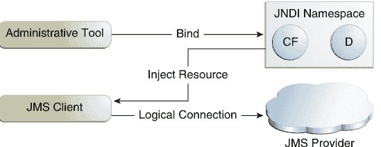

## 45.2.2 消息模式

在 JMS API 出现之前，大多数消息产品支持点对点（PTP）或发布/订阅（pub/sub）消息模式。JMS 规范定义了这些模式的兼容性。JMS 提供者必须实现这两种模式，且 JMS API 提供了各自特定的接口。以下章节将描述这些消息模式。

然而，JMS API 使得没有必要只使用这两种模式中的一种。它允许你使用相同的代码通过 PTP 或 pub/sub 模式发送和接收消息。目标仍然特定于一种模式，应用程序的行为取决于你使用的是队列（queue）还是主题。然而，代码本身可以适用于这两种样式，从而使您的应用程序具有灵活性和重用性。本教程描述并阐明了这种编码方法，并使用了 JMS 2.0 提供的极大简化的 API。

## 45.2.2.1 点对点消息模型

点对点（PTP）产品或应用程序基于消息队列、发送者和接收者的概念。每条消息都将投递到一个特定的队列，接收客户端从建立用于存放其消息的队列中提取消息。队列在消息被消费或过期之前会一直保留所有消息。

图 45-3 所示的 PTP 消息具有以下特征。

- 每条消息只有一个消费者。
- 无论客户端在发送消息时接收器是否正在运行，接收器都可以获取该消息。

## 图 45-3 点对点消息

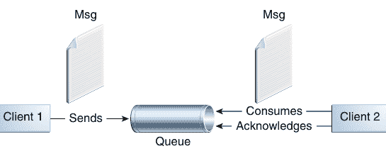

当您的每条消息都必须由一个消费者成功处理时，请使用 PTP 消息。

## 45.2.2.2 发布/订阅消息模型

在发布/订阅（pub/sub）产品或应用程序中，客户端将消息发送到主题（topic），主题的作用有点类似于公告板。发布者和订阅者可以动态地发布或订阅该主题。系统负责将消息从一个主题的多个发布者分发到其多个订阅者。主题保留消息的时间仅足以将其分发给所有订阅者。

在 pub/sub 消息中，区分订阅主题的消费者（订阅者）和所创建的订阅至关重要。消费者是应用程序内部的 JMS 对象，而订阅是 JMS 提供程序内部的实体。通常情况下，一个主题可以有多个消费者，但一个订阅只有一个订阅者。可以创建共享订阅；详情请参阅[创建共享订阅]。[从主题中消费消息]详细阐述了 pub/sub 消息的语义。

pub/sub 消息具有以下特征。

- 每条消息可以有多个消费者。
- 订阅主题的客户端只有在创建订阅后才能消费消息，并且消费者必须保持活动状态才能消费消息。

JMS API 在一定程度上放宽了这一要求，允许应用程序创建持久性订阅，在消费者非活动状态时接收消息。持久性订阅提供了队列的灵活性和可靠性。

队列仍然允许客户端向多个接收者发送消息。关于持久性订阅的更多信息，请参阅[创建持久性订阅]。

当每条消息都可以被任意数量的消费者处理（或不处理）时，请使用 pub/sub 消息。图 45-4 展示了 pub/sub 消息。

## 图 45-4 发布/订阅消息

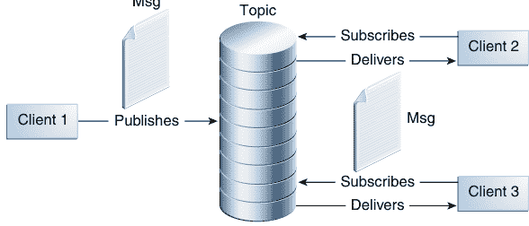

## 45.2.3 消息消费

消息本质上是异步的：消息的生产和消费之间没有根本的时间依赖关系。然而，JMS 规范在更精确的范围内使用了这一点。消息可以通过两种方式进行消费。

- 同步地：消费者通过调用 `receive` 方法显式地从目的地获取消息。`receive` 方法可能会阻塞直到消息到达，或者如果消息未在指定的时间限制内到达则超时。


- 异步地：应用程序客户端或 Java SE 客户端可以为消费者注册消息监听器。消息监听器类似于事件监听器。每当消息到达目的地时，JMS 提供程序通过调用监听器的 `onMessage` 方法来传递消息，该方法对消息内容进行操作。在 Java EE 应用程序中，消息驱动豆充当消息监听器（它有一个 `onMessage` 方法），但客户端不需要向消费者注册它。

## 45.3 JMS API 编程模型

JMS 应用程序的基本构建组件是：

- 管理对象：连接工厂和目的地
- 连接
- 会话
- `JMSContext` 对象，将连接和会话合并在一个对象中
- 消息生产者
- 消息消费者
- 消息

图 45–5 显示了所有对象在 JMS 客户端应用程序中是如何组合的。

45-6 Java 平台，企业版 Java EE 教程

## 图 45–5 JMS API 编程模型

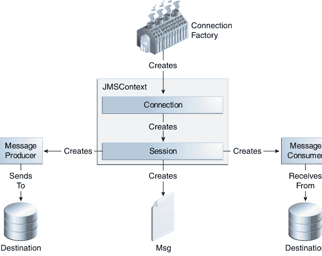

JMS 还提供了队列浏览器，这种对象允许应用程序浏览队列上的消息。

本节简要描述了所有这些对象，并提供了示例命令和代码段，展示了如何创建和使用这些对象。最后一个子节简要描述了 JMS API 异常处理。

显示如何组合所有这些对象的示例出现在第 46 章“Java 消息服务示例”中，从“编写简单的 JMS 应用程序”开始。更多细节，请参阅 JMS API 文档，它是 Java EE API 文档的一部分。

## 45.3.1 JMS 管理对象

JMS API 的两个部分——目的地和连接工厂——通常是由管理维护的，而不是通过程序化维护。利用这些对象的技术在不同的 JMS API 实现之间可能非常不同。因此，对这些对象的管理与其他随提供程序而异的行政任务放在一起进行。

JMS 客户端通过可移植的接口管理管理对象，因此客户端可以在一种实现上以极少或无需更改而运行。

Java EE 平台允许开发者使用注解或部署描述符创建管理对象。详情请参阅[创建资源]。

### 45.3.1.1 JMS 连接工厂

连接工厂是用于创建到提供者的连接的对象。它封装了由管理员定义的连接参数集。每个连接工厂都是 `ConnectionFactory`、`QueueConnectionFactory` 或 `TopicConnectionFactory` 的实例。学习如何创建连接工厂，请参阅[创建对象]。

在 JMS 客户端中，您通常会将连接资源注入 `ConnectionFactory` 对象。Java EE 服务器必须提供一个逻辑 JNDI 名称为 `jmscomp/DefaultJMSFactory` 的工厂。实际 JNDI 名称将取决于实现。

例如，以下代码片段查找 JMS 连接工厂并将其赋值给 `ConnectionFactory`：

```
@Resource(lookup = "jmscomp/DefaultJMSFactory")
private static ConnectionFactory connectionFactory;
```

### 45.3.1.2 JMS 目的地

目的地用于指定消息目标和来源的对象。在 PTE 消息样式中，目的地被称为队列。在 pub/sub 消息样式中，目的地被称为主题。学习如何创建目的地资源，请参阅[创建对象]。

使用 GlassFish 创建目的地时，您创建一个指定目的地 JNDI 名称的 JMS 目的地资源。

在 JMS 的实现中，每个目的地引用一个物理目的地。您可以显式地创建物理目的地，如果不创建，应用程序服务器将在需要时创建它。

通过通用接口，你可以混合或匹配连接工厂和目的地。这意味着除了使用 `ConnectionFactory` 接口外，你还可以注入 `QueueConnectionFactory` 资源并将其与 `Topic` 使用，也可以注入 `TopicConnectionFactory` 资源并将其与 `Queue` 使用。应用程序的行为取决于你使用的目的地类型，而不是你使用的连接工厂类型。

## 45.3.2 连接

连接封装了与 JMS 提供者的虚拟连接。例如，连接可以代表客户端与服务守护进程之间的 TCP/IP Socket。你使用连接来创建一个或多个会话。

> 注意：在 Java EE 平台中，从单个连接创建多个会话的能力限于应用程序客户端。在 Web 和企业 Bean 组件中，一个连接最多只能创建一个会话。

你通常通过创建一个 `JMSContext` 对象来创建一个连接。详情请参阅 `JMSContext` 对象。

## 45.3.3 会话

会话是用于生产和消费消息的单线程上下文。你通常通过创建一个 `JMSContext` 对象来创建会话（以及连接）。详情请参阅 `JMSContext` 对象。你使用会话来创建消息生产者、消息消费者、消息、队列浏览器和临时目的地。

会话会将消息监听器的执行过程序列化；详情请参阅 `JMS 消息监听器`。

会话提供了一个事务上下文，可以将一组发送和接收操作组合成一个原子工作单元。详情请参阅 `使用 JMS 本地事务`。

## 45.3.4 JMSContext 对象

`JMSContext` 将连接和会话合并到单个对象中。也就是说，它既提供了到 JMS 提供者的活动连接，又提供了用于发送和接收消息的单线程上下文。

你使用 `JMSContext` 创建以下对象：

- 消息生产者
- 消息消费者
- 消息
- 队列浏览器
- 临时队列和主题（参见“创建临时目的地”）

你可以在 `try-with-resources` 块中创建 `JMSContext`。

要创建 `JMSContext`，请调用连接工厂上的 `createContext` 方法：

```
JMSContext context = connectionFactory.createContext();
```

## JMS API 编程模型

当从应用程序客户端或 Java SE 客户端无参数调用，或者在没有活动 JTA 事务进行时从 Java EE Web 或 EJB 客户端无参数调用，`createContext` 会创建一个确认模式为 `JMSContext.AUTO_ACKNOWLEDGE` 的非事务会话。当在活动 JTA 事务期间从 Web 或 EJB 客户端无参数调用，`createContext` 会创建一个事务会话。关于 Java EE 应用程序中 JMS 事务的工作机制，请参阅 `Java EE 应用中的 JMS API`。

从客户端或 Java SE 客户端，你也可以带参数 `JMSContext.SESSION_TRANSACTED` 调用 `createContext` 来创建一个事务会话：

```
JMSContext context =
connectionFactory.createContext(JMSContext.SESSION_TRANSACTED);
```

该会话使用本地事务；详情请参阅 `使用 JMS 本地事务`。

或者，你可以指定一个非默认的确认模式；更多信息请参阅 `控制消息确认`。

当你使用 `JMSContext` 时，消息传递通常在你创建消费者后立即开始。更多信息请参阅 `使用 JMS 消息消费者`。

如果你在 `try-with-resources` 块中创建 `JMSContext`，则不需要显式关闭它。它会在 `try` 块结束时被关闭。确保你的应用程序在 `try-with-resources` 块内完成所有 JMS 活动。如果没有使用 `try-with-resources` 块，必须在应用程序完成工作后调用 `JMSContext` 的 `close` 方法来关闭连接。

## 45.3.5 JMS 消息生产者

消息生产者是由 `JMSContext` 或会话创建的对象，用于向目的地发送消息。由 `JMSContext` 创建的消息生产者实现了 `JMSProducer` 接口。你可以这样创建它：

```
try (JMSContext context = connectionFactory.createContext()) {
    JMSProducer producer = context.createProducer();
    ...
```

然而，`JMSProducer` 是一个轻量级对象，也会消耗大量资源。因此，你不需要将 `JMSProducer` 保存在变量中；你可以每次发送消息时创建一个新的。你使用 `send` 方法向特定目的地发送消息。例如：

```
context.createProducer().send(dest, message);
```

你可以在发送之前在变量中创建消息，也可以在 `send` 调用中创建它。更多信息请参阅 `JMS 消息`。

## 45.3.6 JMS 消息消费者

消息消费者是由 `JMSContext` 或会话创建的对象，用于从目的地接收消息。由 `JMSContext` 创建的消息消费者实现了 `JMSConsumer` 接口。创建消息消费者的简单方法是使用 `JMSContext.createConsumer` 方法。

```
try (JMSContext context = connectionFactory.createContext()) {
    JMSConsumer consumer = context.createConsumer(dest);
```

## JMS API 编程模型

消息消费者允许 JMS 客户端向 JMS 提供者注册对目的地感兴趣。JMS 提供者管理从目的地到注册消费者的消息传递。

当你使用 `JMSContext` 创建消息消费者时，消息传递在你创建消费者后立即开始。你可以通过在创建 `JMSContext` 时调用 `autoStart(false)` 来禁用此行为，并在调用 `start` 方法时开始消息传递。如果你想在不关闭连接的情况下临时停止消息传递，可以调用 `stop` 方法；调用 `start` 重新启动消息传递。

你使用 `receive` 方法同步消费消息。你可以在创建消费者的任何时候使用它。

如果你不指定参数或指定的参数为 0，该方法将无限阻塞直到获取消息：

```
Message m = consumer.receive();
Message m = consumer.receive();
```

对于简单客户端，这可能并不重要。如果消息可能不存在，请使用带有超时时间的同步接收：带大于 0 的超时调用 `receive` 方法。

```
Message m = consumer.receive(1000); // 一秒后超时
```

要在应用程序客户端或 Java 客户端启用异步消息传递，请按照下一节所示的消息监听器。

你使用 `JMSContext.createDurableConsumer` 创建持久主题订阅。此方法仅适用于主题。详情请参阅 `创建订阅`。对于主题，你还可以创建共享消费者；参见 `创建订阅`。

### 45.3.6.1 JMS 消息监听器

监听器是作为消息异步事件处理器的对象。该对象实现了 `MessageListener` 接口，该接口包含一个方法 `onMessage`。在 `onMessage` 方法中，你定义了消息到达时应采取的操作。

从应用程序客户端或 Java 客户端，你通过 `setMessageListener` 方法注册消息监听器。例如，如果你定义了一个实现 `MessageListener` 接口的 `Listener` 类，你可以这样注册：

```
Listener myListener = new Listener();
consumer.setMessageListener(myListener);
```

每当传递消息时，JMS 提供者会自动调用监听器的 `onMessage` 方法。方法接收一个 `Message` 类型的参数，你的方法实现根据需要将其强制转换为任何消息子类型（参见 `消息体`）。

在 Java EE 或 EJB 容器中，你使用消息驱动豆进行异步消息传递。消息驱动豆实现 `MessageListener` 接口并包含一个 `onMessage` 方法。详情请参阅 `使用消息驱动豆接收消息`。

# JMS API 编程模型

你的 `onMessage` 方法应该处理所有异常。抛出 `RuntimeException` 被视为编程错误。

关于消息监听器使用的简单示例，请参阅[使用消息监听器进行异步消息传递]。第 46 节“Java 服务示例”中包含了多个关于消息监听器和消息驱动豆（MDB）的示例。

## 45.6.2 JMS 消息选择器

如果你的消息传递需要过滤接收到的消息，你可以使用 JMS 消息选择器，它允许目的地的消息消费者指定其感兴趣的内容。消息选择器将过滤消息的工作分配给 JMS 供应商，而不是应用程序。关于使用消息选择器的应用程序示例，请参阅[从会话向 MDB 发送消息]。

消息选择器是一个包含表达式的字符串。该表达式的语法基于 SQL92 条件表达式。对于每条 `NewType` 属性设置为值 'Sports' 或 'Opinion' 值的消息，其消息选择器如下：

```
NewType = 'Sports' OR NewType = 'Opinion'
```

`createConsumer` 和 `createDurableConsumer` 方法以及创建共享消费者的方法，允许你在创建消息消费者时将消息选择器作为参数指定。

消息消费者仅接收其头和属性与选择器匹配的消息（即消息头和消息属性）。消息选择器无法根据消息体的内容选择消息。

## 45.6.3 从主题消费消息

从主题消费消息的语义比从队列消费消息的语义更复杂。

应用程序通过在该主题上创建订阅并在该订阅上创建消费者来从主题消费消息。订阅可以是持久的或非持久的，可以是共享的或非共享的。

订阅可以认为是 JMS 供应商内部的一个实体，而消费者是应用程序内部的 JMS 对象。

在创建订阅后，发送到主题的每条消息都会接收到一个副本，除非指定了消息选择器。如果是这样，只有属性匹配消息选择器的消息会被添加到订阅中。

非共享订阅限于单个消费者。在这种情况下，所有消息都交付给该消费者。共享订阅允许多个消费者。在这种情况下，订阅中的每条消息只会被交付给其中一个消费者。JMS 未定义如何在同一订阅的多个消费者之间分发消息。

订阅可以是持久的或非持久的。

非持久订阅仅在订阅上存在活动消费者时才存在。这意味着发送到主题的任何消息只有在消费者存在且未关闭时才会被添加到订阅中。

非持久订阅可以是非共享的，也可以是共享的。

非共享非持久订阅没有名称，并且可能仅关联一个唯一的消费者对象。它在创建消费者时自动创建。它不是持久化的，并在消费者关闭时自动删除。

```
如果指定了主题作为目标，则 JMSContext.createConsumer 方法会在一个非共享非持久订阅上创建一个消费者。
```

- 共享非持久订阅通过名称和可选的客户端标识符进行标识，并可能有多个消费者对象从其消费消息。它在第一个消费者被创建时自动创建。它不是持久化的，并在最后一个消费者关闭时自动删除。更多信息请参阅[创建共享订阅]。

尽管付有更高的开销，但订阅也可以是持久的。持久订阅会持久化并持续累积消息，直到被显式删除，即使没有消费者对象在从那里消费消息。请参阅[创建持久订阅]详情。

## 45.3.6.4 创建持久订阅

为了确保发布/订阅订阅接收所有消息，请对主题上的消费者使用持久订阅。

与非持久订阅一样，持久订阅可以是非共享的，也可以是共享的。

- 非共享持久订阅通过名称和客户端标识符（必须设置）进行标识，并且可能仅关联一个唯一的消费者对象。
- 持久订阅通过名称和可选的客户端标识符进行标识，并可能有多个消费者对象从其消费消息。

一个存在但没有关联新关闭的消费对象的持久订阅被描述为“非活跃的”。

```
你可以使用 JMSContext.createDurableConsumer 在非共享持久订阅上创建一个消费者。非共享持久订阅在同一时间只能有一个活动消费者。
```

消费者通过指定一个由 JMS 供应商保留的唯一身份来标识其从之消费消息的持久订阅。具有相同身份的后续消费者对象将保留该订阅在之前一个消费者离开时所留的状态。如果持久订阅没有活动消费者，JMS 供应商将保留该订阅的消息，直到它们被订阅接收或到期。

你通过设置以下内容来建立非共享持久订阅的唯一身份：

- 连接的客户端 ID
- 订阅的主题和订阅名称

你可以使用命令行或管理控制台为特定客户端的连接工厂以管理方式设置 client ID。（在应用程序客户端或 Java SE 客户端中，你可以改用 `JMSContext.setClientID()`）

在使用此连接工厂创建后，你调用 `createDurableConsumer` 方法并传入两个参数：主题和一个指定订阅名称的字符串：

# JMS API 编程模型

```
String subName = "MySub";
JMSConsumer consumer = context.createDurableConsumer(myTopic, subName);
```

在你创建消费者后，订阅将变为活跃。稍后，你可能会关闭


```java
consumer.close();
```

JMS 供应商存储发送到主题的消息，就像存储发送到队列的消息一样。使用相同的连接工厂及其客户端 ID、相同的主题和相同的订阅名称，订阅将重新激活，JMS 供应商将交付在订阅非活跃期间发送的消息。

要删除持久订阅，首先关闭消费者，然后以订阅名称作为参数调用 `unsubscribe` 方法：

```java
consumer.close();
context.unsubscribe(subName);
```

`unsubscribe` 方法会删除供应商为订阅维护的状态。

图 45-6 和图 45-7 显示了非持久订阅与持久订阅的区别。对于普通的非持久订阅，消费者和订阅同时开始并结束，在效果上是相同的。当消费者关闭时，订阅也结束。在这里，`create` 代表调用带有主题参数的 `JMSContext.createConsumer`，`close` 代表调用 `JMSConsumer.close`。从第一次关闭到第二次创建之间发送到主题的所有消息都不会添加到任何订阅中。在图 45-6 中，2 个消费者接收了 M1、M2、M5 和 M6，但它们没有接收消息 M3 和 M4。

# 图 45-6 非持久订阅与消费者

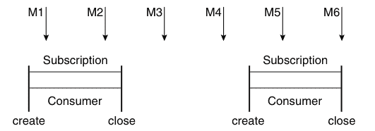

对于持久订阅，可以关闭并重新创建消费者，但订阅将持续存在直到应用程序调用 `unsubscribe` 方法。在图 45-7 中，`create` 代表调用 `JMSContext.createDurableConsumer`，`close` 代表调用 `JMSConsumer.close`，而 `unsubscribe` 代表调用 `JMSContext.unsubscribe`。在第一个消费者关闭后发送的消息会在第二个消费者创建（在持久订阅上）时被接收，因此即使 M2、M4 和 M5 在没有消费者时到达，它们也不会丢失。

45-14 Java 平台, 企业版 The Java EE Tutorial

# 图 45–7 持久性订阅上的消费者

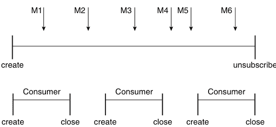

共享持久性订阅允许你使用多个消费者来接收来自持久性订阅的消息。如果你使用共享持久性订阅，你使用的连接工厂不需要客户端标识符。要创建共享持久性订阅，请使用 `JMSContext.createSharedDurableConsumer` 方法并指定主题和订阅名称：

```java
JMSConsumer consumer = context.createSharedDurableConsumer(topic, "MakeItLast");
```

查看[确认消息](Acknowledging Messages)、[使用持久订阅](Using Durable Subscriptions)、[使用共享持久订阅](Using Shared Durable Subscriptions) 以及[从 Session Bean 向 MDB 发送消息](Sending Messages from a Session Bean to an MDB)，以获取使用持久订阅的 Java EE 示例。

## 45.3.6.5 创建共享订阅

通过 `createConsumer` 或 `createDurableConsumer` 方法的主题订阅只能有一个消费者（尽管主题可以有多个）。根据定义，从同一个主题消费的多个客户端对该主题有多个订阅，所有客户端都会接收发送到主题的消息（除非它们使用消息选择器进行过滤）。

然而，也可以通过 `createSharedConsumer` 方法并不仅指定分发方式还指定订阅名称，为主题创建一个非持久的共享订阅：

```java
consumer = context.createSharedConsumer(topicName, "SubName");
```

使用共享订阅，消息将在共享相同主题和订阅名称的多个客户端之间分发。发送到主题的每条消息将添加到每个订阅中（取决于任何消息选择器），但添加到订阅的每条消息将只交付给该共享订阅上的一个消费者。如果你想在订阅的多个消费者之间分担消息负载，而不是让订阅上的单个消费者接收每条消息，这将会非常有用。此功能可以提高 Java EE 应用程序客户端和 Java SE 应用程序的可扩展性。（消息驱动豆类是在多个线程之间处理来自主题的消息的核心）。

查看[使用非持久订阅](Using Nondurable Subscriptions)以获取使用共享非持久消费者的简单示例。

你还可以通过 `JMSContext.createSharedDurableConsumer` 方法创建共享持久性订阅。详情请参见[创建持久订阅](Creating Durable Subscriptions)。

## 45.3.7 JMS 消息

JMS 应用程序的最终目的是产生和消费可供其他软件应用程序使用的消息。JMS 消息具有简单但高度灵活的格式，允许你创建与异构平台上非 JMS 应用程序使用的格式匹配的消息。

一个 JMS 消息可以包含三种类型：头部（header）、属性（properties）和体（bodies）。只需要头部。接下来的章节描述了这些部分。

有关消息头部、属性和体的完整文档，请参考 API 文档中 `Message` 接口的文档。有关可能类型的列表，请参见[消息体](Message Bodies)。

### 45.3.1 消息头部

消息头部包含许多定义字段，这些字段包含了客户端和提供者用于识别和路由消息的值。表 45–1 列出了描述了 JMS 消息头部字段及其值的设置。例如，每条消息都有唯一的标识符，在头部字段 `JMSMessageID` 中表示。另一个头部字段 `JMSDestination` 的值表示消息发送到的队列或主题。其他字段包括时间戳和优先级级别。

每个头部都有关联的 setter 和 getter 方法，这些在 `Message` 接口的描述中记录。某些头部字段旨在由客户端设置，但由 `send` 方法自动设置，这会覆盖任何客户端设置的值。

**表 45–1 JMS 消息头部字段值的设置方式**

| 头部字段 | 描述 | 设置者 |
| --- | --- | --- |
| `JMSDestination` | 消息发送到的终点 | JMS 提供者 `send` 方法 |
| `JMSDeliveryMode` | 消息发送时指定的交付模式（参见[指定消息持久性](Specifying Message Persistence)） | JMS 提供者 `send` 方法 |
| `JMSDeliveryTime` | 消息发送时延迟发送的时间（参见[指定交付延迟](Specifying Delivery Delay)） | JMS 提供者 `send` 方法 |
| `JMSExpiration` | 消息的过期时间（参见[允许消息过期](Allowing Messages to Expire)） | JMS 提供者 `send` 方法 |
| `JMSPriority` | 消息的优先级（参见[设置优先级级别](Setting Priority Levels)） | JMS 提供者 `send` 方法 |
| `JMSMessageID` | 唯一标识符，标识提供者所发送的每条消息的值 | JMS 提供者 `send` 方法 |
| `JMSTimestamp` | 消息交给提供者发送的时间 | JMS 提供者 `send` 方法 |
| `JMSCorrelationID` | 将一个消息与另一个消息链接的值，通常使用 `JMSMessageID` 值 | 客户端应用程序 |
| `JMSReplyTo` | 消息回复应发送到的终点 | 客户端应用程序 |
| `JMSType` | 客户端应用程序提供的类型标识符 | 客户端应用程序 |

**表 45–1（续）JMS 头部字段值的设置方式**

| 头部字段 | 描述 | 设置者 |
| --- | --- | --- |
| `JMSRedelivered` | 消息是否重新交付 | JMS 提供者在交付之前 |

### 45.3.2 消息属性

如果你需要头部字段提供的值之外的值，可以为消息创建并设置属性。你可以使用它们来创建消息选择器（参见[JMS 消息选择器]）。有关设置属性用作选择器的示例，请参见[从 Session Bean 向 MDB 发送消息]。

JMS API 提供了一些与 JMS 相关的预定义属性。JMS 提供者只需要实现这些中的一个：`JMSDeliveryCount`（指定消息被交付的次数）。其他是可选的。

### 45.3.3 消息体

JMS API 定义了六种消息类型。表 45–2 描述了这些类型。

**表 45–2 JMS 消息类型**

| 消息类型 | 体 |
| --- | --- |
| `TextMessage` | `String` |
| `BytesMessage` | 字节流 |
| `MapMessage` | 键值对 |
| `ObjectMessage` | 可序列化对象 |
| `StreamMessage` | 基本类型流 |
| `Message` | 无 |

JMS API 为创建和接收 `TextMessage`、`MapMessage` 或 `ObjectMessage` 提供了快捷方法。例如，你不需要将字符串封装在 `TextMessage` 中；相反，你可以直接发送和接收字符串。例如：

```java
String message = "This is a message";
context.createProducer().send(dest, message);
```

你可以通过 `receiveBody` 方法接收消息：

```java
String message = receiver.receiveBody(String.class);
```

你可以使用 `receiveBody` 方法接收除 `StreamMessage` 以外的任何类型的消息，只要体可以给特定类型。如果你想发送一个仅仅是信号的消息，空消息可能是有用的。“Java Service”章节中的某些示例在发送系列文本消息后使用了空消息。例如：

```java
context.createProducer().send(dest, context.createMessage());
```

消费者随后可以将空消息解释为所有消息已接收的信号。

## JMS API 编程模型

Java Service Concepts


## 45.3.8 队列浏览器

发送到队列的消息保留直到该队列的消息消费者消费它们。JMS API 提供了一个 `QueueBrowser`，允许你浏览队列中的消息并显示每条消息的头部。要创建 `QueueBrowser`，请使用 JMS `createBrowser` 方法。例如：

```java
QueueBrowser browser = context.createBrowser(queue);
```

查看[浏览队列中的消息](Browsing Messages on a Queue)以获取使用 `QueueBrowser` 对象的示例。

## 45.3.9

JMS API 不提供浏览主题的机制。消息通常在出现在主题上后立即消失：如果没有消费者消费它们，JMS 将把它们删除。虽然持久订阅允许在消息消费者未激活时保留在主题上的消息，JMS 没有定义任何用于检查这些消息的机制。

## 45.3.9 JMS 异常处理

JMS API 中所有检查异常的根类是 `JMSException`。JMS API 中所有未检查异常的根源是 `JMSRuntimeException`。

通过捕获 `JMSException` 和 `JMSRuntimeException` 提供了一种处理 JMS API 所有异常的通用方法。

`JMSException` 和 `JMSRuntimeException` 类包含以下子类，它们定义在 API 文档中：

- `IllegalStateException`, `IllegalStateRuntimeException`
- `InvalidClientIDException`, `InvalidClientIDRuntimeException`
- `InvalidDestinationException`, `InvalidDestinationRuntimeException`
- `InvalidSelectorException`, `InvalidSelectorRuntimeException`
- `JMSSecurityException`, `JMSSecurityRuntimeException`
- `MessageObjectException`
- `MessageFormatException`, `MessageFormatRuntimeException`
- `MessageNotReadableException`
- `MessageNotWriteableException`, `MessageNotWriteableRuntimeException`
- `ResourceAllocationException`, `ResourceAllocationRuntimeException`
- `TransactionInProgressException`, `TransactionInProgressRuntimeException`
- `TransactionRolledBackException`, `TransactionRolledBackRuntimeException`

教程中的所有示例在适当的情况下都可以处理 `JMSException` 或 `JMSRuntimeException`。

## 45.4 使用高级 JMS 特性

本节解释了如何使用 JMS API 的特性来达到应用程序所需的可靠性和性能水平。许多人在应用程序中使用 JMS 是因为他们无法容忍消息丢失或重复，并且他们要求每条消息必须且仅接收一次。JMS API 提供了这种功能。

产生消息最可靠的方法是在事务内发送持久性（`PERSISTENT`）消息。

JMS 消息默认是持久性的；在 JMS 故障时，持久性消息不会丢失。详情参见指定消息持久性。

事务允许在原子操作中发送或接收多条消息。在 EE 平台上，它们允许将发送消息与数据库读写结合在原子事务中。事务是一个工作单元，你可以组合一组操作（例如消息发送和接收），这些操作要么成功要么全部失败。详情参见使用 JMS 本地事务。

消费消息最可靠的方法是在事务内从队列或主题的持久订阅进行。详情参见创建持久订阅、创建临时目的地和使用 JMS 本地事务。

某些特性主要允许应用程序提高性能。例如，你可以设置消息在一定时间后过期（参见允许消息过期），这样消费者就不会收到不必要的过时信息。你可以异步发送消息；参见异步发送消息。

你还可以对消息确认级别指定控制级别；参见控制消息确认。

其他特性可以提供与可靠性无关的有用功能。例如，你可以创建仅在创建它的连接期间有效的临时目的地。接下来的章节将描述这些特性应用于应用程序客户端或 Java 客户端时的用法。某些特性在 Java EE Web 或 EJB 容器中工作方式不同；这些差异在此处注明，并在《在 Java EE 应用程序中使用 JMS API》中进行了详细说明。

## 45.4.1 控制消息确认

在 JMS 消息被确认之前，它不被视为已成功消费。消息的成功消费通常分为三个阶段：

1. 客户端接收消息。
2. 客户端处理消息。
3. 消息被确认。确认由 JMS 提供者或客户端发起，取决于会话的确认模式。

在本地事务会话中（参见使用 JMS 本地事务），消息在会话提交时被确认。如果事务回滚，所有消费者都将收到重新投递。

在 JTA 事务中（在 Java EE Web 或 EJB 容器中），消息在事务提交时被确认。

在非事务会话中，消息如何被确认取决于可能作为 `createContext` 方法参数的值。可能的参数值有：

- `JMSContext.AUTO_ACKNOWLEDGE`：此设置是应用程序客户端和 Java SE 客户端的默认设置。当客户端成功从 `receive` 调用返回，或者 `MessageListener` 调用处理消息返回成功时，`JMSContext` 会自动确认客户端接收了消息。在配置为使用的 `JMSContext` 中进行同步 `receive` 是一个例外，该消息消费是前述描述的三步过程。在这种情况下，接收和确认通过处理消息在一步内完成。
- `JMSContext.CLIENT_ACKNOWLEDGE`：客户端通过调用消息的 `acknowledge` 方法来确认消息。在会话模式下，确认是在会话级别执行的：确认一条已消费的消息将自动确认其会话已消费的所有消息的接收。例如，如果一条消息消费了十条消息并确认了第五次投递，则所有消息都已确认。

> **注意**：在 Java EE 平台上，`JMSContext.CLIENT_ACKNOWLEDGMENT` 设置只能用于应用程序客户端，不能用于 Web 组件或企业豆。

- `JMSContext.DUPS_OK_ACKNOWLEDGE`：此选项指示 `JMSContext` 懒惰地确认消息的投递。如果 JMS 提供者故障，可能会导致某些重复消息的投递，因此它应该仅供允许重复消息的消费者使用（如果 JMS 提供者投递，它必须将 `JMSRedelivered` 标头的值设置为 `true`）。此选项通过尽可能减少防止重复的工作来减少会话开销。

如果在关闭 `JMSContext` 时，已从队列接收了消息但未被确认，提供者将保留它们，并在消费者下次访问队列时重新投递它们。如果应用程序关闭了从持久订阅中消费消息的 `JMSContext`，提供者也会保留未确认的消息（参见持久订阅）。从非持久订阅接收到的但未确认的消息在 `JMSContext` 关闭时将被丢弃。

如果你使用队列或持久订阅，可以使用 `JMSContext.recover` 方法停止非事务 `JMSContext` 并使用其第一个未确认的消息重新启动。实际上，如果消息已过期或到达更高优先级的消息，`JMSContext` 的投递序列可能与原始投递的不同。对于非持久订阅的消费者，调用 `JMSContext.recover` 方法时提供者可能会丢弃未确认的消息。

《确认消息》中的示例程序演示了确保在处理完成之前不确认消息的两种方法。

## 45.4.2 指定发送消息的选项

你可以在发送消息时选择选项。这些选项允许你执行以下任务：

- 指定消息是持久的，这意味着在提供者故障时它们不会丢失（指定消息持久性）。
- 设置消息优先级级别，这会影响消息的投递顺序（设置消息优先级级别）。
- 为消息指定过期时间，以便在过时时不投递（允许消息过期）。
- 为消息指定投递延迟，以便在指定时间过期之前不投递（指定投递延迟）。

方法链允许你在创建生产者并调用 `send` 方法时指定多个此类选项之一；参见使用 `JMSProducer` 方法链。

### 45.4.2.1 指定消息持久性

JMS API 支持两种交付模式，用于指定在 JMS 提供者故障时消息是否丢失。这两种交付模式是 `DeliveryMode` 接口的字段。

- 默认交付模式 `PERSISTENT`（持久化）指示 JMS 提供者要格外小心，以确保消息在 JMS 提供者故障的传输过程中不会丢失。使用此交付模式发送的消息在发送时会被记录到稳定存储器中。
- `NON_PERSISTENT`（非持久化）交付模式不需要 JMS 提供者存储消息，也不保证在提供者发生故障时消息不会丢失。

若要指定交付模式，请使用 `JMSProducer` 接口的 `setDeliveryMode` 方法来为该生产者发送的所有消息设置交付模式。

你可以在创建生产者并发送消息时，使用链式调用来设置交付模式。以下调用创建了一个具有 `NON_PERSISTENT` 交付模式的生产者，并使用它发送了一条消息：

```java
context.createProducer().setDeliveryMode(DeliveryMode.NON_PERSISTENT).send(dest, msg);
```

如果你不指定交付模式，默认为 `PERSISTENT`。使用 `NON_PERSISTENT` 模式可能会提高性能并减少存储开销，但只有当你的应用程序能够承受消息丢失时才应该使用它。

### 45.4.2.2 设置优先级级别

你可以使用优先级级别来指示 JMS 提供者优先交付紧急消息。使用 `JMSProducer` 接口的 `setPriority` 方法为该生产者发送的所有消息设置优先级级别。

你可以在创建生产者并发送消息时，使用链式调用来设置优先级级别。以下示例为生产者设置了 7 的优先级级别并发送了一条消息：

```java
context.createProducer().setPriority(7).send(dest, msg);
```

十个优先级级别范围从 0（最低）到 9（最高）。如果你不指定优先级级别，默认值是 4。JMS 提供者会尝试在交付低优先级消息之前先交付高优先级消息，但并不要求按照精确的顺序交付消息。

### 45.4.2.3 允许消息过期

默认情况下，消息永远不会过期。如果消息在经过一段时间后会变得过时，你可能希望设置一个过期时间。使用 `JMSProducer` 接口的 `setTimeToLive` 方法为该生产者发送的所有消息设置默认过期时间。

例如，包含股票价格等快速变化的数据的消息在几分钟后就会过时，你可能配置消息在那个之后过期。

你可以在创建生产者并发送消息时，使用链式调用来设置时间。例如，以下调用为生产者设置了五分钟的时间，然后发送了消息：

```java
context.createProducer().setTimeToLive(300000).send(dest, msg);
```

如果指定的 `timeToLive` 为 0，则消息永远不会过期。

当消息被发送时，指定的 `timeToLive` 会加到当前时间上得到过期时间。任何在指定过期之前未交付的消息都会被销毁。销毁过时的消息可以节省存储计算资源。

### 45.4.2.4 指定交付延迟

你可以指定在消息发送后、JMS 提供者交付该消息之前必须流逝的一段时间。使用 `JMSProducer` 接口的 `setDeliveryDelay` 方法为该生产者发送的所有消息设置交付延迟。

你可以在创建生产者并发送消息时，使用方法链式调用设置交付延迟。例如，以下调用为生产者设置了 3 秒的交付延迟，然后发送了消息：

```java
context.createProducer().setDeliveryDelay(3000).send(dest, msg);
```

### 45.4.2.5 使用 JMSProducer 方法链式调用

`JMSProducer` 接口上的设置方法返回 `JMSProducer` 对象，因此你可以使用方法链式调用来创建生产者、设置多个属性并发送消息。例如，以下链式方法调用创建了一个生产者，设置了用户自定义属性，设置了消息的过期时间、日期和优先级，然后将其发送到队列：

```java
context.createProducer()
  .setProperty("MyProperty", "MyValue")
  .setTimeToLive(10000)
  .setPriority(2)
  .send(queue, msg);
```

## 45.4.3 使用 JMS 本地事务

将一个或多个消息作为单一事务发送到一个或多个目的地，形成了使用单个 `JMSContext` 与 JMS 提供者之间的一组交互。同样，客户端 2 从一个或多个目的地接收一个或多个消息也通过单个 `JMSContext` 形成了一个事务。但由于这两个客户端之间没有直接交互，并且使用的是两个不同的 `JMSContext` 对象，因此它们之间无法发生任何事务。

另一种表达方式是，事务是客户端与 JMS 提供者之间的一种合约，定义了消息是否发送到目的地或是否从目的地接收。它并不是发送客户端与接收客户端之间的合约。

这是消息传递与同步处理之间的根本区别。JMS 并不是将消息的发送者和接收者紧密耦合，而是将消息发送者与目的地耦合，并将目的地与消息接收者分离。因此，虽然发送和接收分别与 JMS 提供者有紧密耦合，但它们之间没有任何耦合。

当你创建一个 `JMSContext` 时，可以使用向 `createContext` 方法传递 `JMSContext.SESSION_TRANSACTED` 参数来指定它是否为事务型。

```java
try (JMSContext context = connectionFactory.createContext(
    JMSContext.SESSION_TRANSACTED)) {
```

本地事务的 `commit` 和 `rollback` 方法与使用 `JMSContext` 的会话相关。如果你使用同一个会话执行操作，可以将对多个队列或主题、或队列与主题的组合的操作合并到一个事务中。例如，你可以使用 `JMSContext` 在同一个事务中从队列接收消息并向主题发送消息。

“本地事务”中的示例展示了如何使用 JMS 本地事务。

## 45.4.4 异步发送消息

通常，当发送一个持久化消息时，`send` 方法会一直阻塞，直到 JMS 提供者确认消息已成功发送。异步发送机制允许你的应用程序在发送消息后继续工作，同时等待发送完成。

此功能目前仅适用于应用程序客户端和 Java SE 客户端。

异步发送消息涉及提供一个回调对象。你指定一个带有 `onCompletion` 方法的 `CompletionListener`。例如，以下代码实例化了一个名为 `SendListener` 的 `CompletionListener`。然后调用 `setAsync` 方法来指定来自此生产者的发送是异步的，并使用以下监听器：

```java
CompletionListener listener = new SendListener();
context.createProducer(listener).setAsync(listener).send(dest, message);
```

`CompletionListener` 类必须实现两个方法：`onCompletion` 和 `onException`。如果发送成功，则调用 `onCompletion` 方法；如果失败，则调用 `onException` 方法。这些方法的简单实现如下：

```java
@Override
public void onCompletion(Message message) {
    System.out.println("onCompletion method: Send completed.");
}

@Override
public void onException(Message message, Exception e) {
    System.out.println("onException method: " + e.getMessage() + ": " + e.toString());
    System.out.println("Unsent message is: \n" + message);
}
```

## 45.5 在 Java EE 应用程序中使用 JMS API

本节描述了在企业级应用程序或 Web 应用程序中使用 JMS API 与在应用程序客户端使用的区别。

Java EE 平台规范中的通用规则适用于所有在 EJB 或 Web 容器中使用 JMS API 的 Java EE 组件：不能尝试为每个连接创建多个活跃的（未关闭的）`Session` 对象。然而，允许存在多个上下文，因为它们结合了单一连接和单一会话。

此规则不适用于应用程序客户端。客户端容器支持为每个连接创建多个会话。

### 45.5.1 为 Java EE 应用程序创建资源

你可以使用注解为 Java EE 企业 Bean 或 Web 组件创建特定的连接工厂和目的地。你通过这种方式创建的资源仅对你创建它们的应用程序可见。


# 在 Java EE 应用中使用 JMS API

你还可以使用部署描述符（deployment descriptor）来创建这些资源。部署描述符中指定的元素将覆盖注解中的元素。请参考“打包应用程序”（Packaging Applications）以获取有关部署描述符的基本信息。你必须使用部署描述符为应用程序客户端创建特定的资源。

## 创建 JMS 资源

### 创建目的地

要创建一个目的地，可以使用如下 `@JMSDestinationDefinition` 注解：

```java
@JMSDestinationDefinition(
    name = "java:app/jms/myappTopic",
    interfaceName = "javax.jms.Topic",
    destinationName = "MyPhysicalAppTopic"
)
```

`name`、`interfaceName` 和 `destinationName` 是必须的。你可以可选提供 `description` 元素。要创建多个目的地，将它们封装在 `@JMSDestinationDefinitions` 注解中并用逗号分隔。

### 创建连接工厂

要创建一个连接工厂，使用如下 `@JMSConnectionFactoryDefinition` 注解：

```java
@JMSConnectionFactoryDefinition(
    name="java:app/jms/MyConnectionFactory"
)
```

`name` 元素是必须的。你可以可选地指定其他元素，例如，如果你想将连接工厂用于持久性订阅，可以使用 `clientId`，或者 `description`。如果你不指定 `interfaceName`，默认接口是 `javax.jms.ConnectionFactory`。要创建多个连接工厂，将它们封装在 `@JMSConnectionFactoryDefinitions` 注解中并用逗号分隔。

你只需要在给定的应用程序的任何一个组件中指定一次注解即可。

> **注意**：如果你的应用程序包含一个或多个消息驱动 Bean（message-driven beans），你可能希望将注解放在其中一个消息驱动 Bean 上。如果你将注解放置在发送组件（如应用程序客户端）上，你需要指定 `mappedName` 元素来查找主题，而不是使用激活配置的 `destinationLookup` 属性。

### 注入资源

当你将资源注入组件时，使用定义注解中 `name` 元素的值作为 `@Resource` 注解的值：

```java
@Resource(lookup = "java:app/jms/myappTopic")
private Topic topic;
```

### JNDI 命名空间

可用以下 JNDI 命名空间。你可以使用哪些取决于应用程序的打包方式。

- `java:global`：对所有部署的应用程序可用
- `java:app`：对单个应用程序内所有模块的所有组件可用
- `java:module`：对给定模块内的所有组件可用（例如，EJB 模块内的所有企业 Bean）
- `java:comp`：对单个组件可用（在 Web 应用中，它等同于 `java:module`）

请参考这些注解的 API 文档。“使用简单应用程序发送和接收消息”、“Session Bean 向 MDB 发送消息”以及“使用实体合并两个 MDB 的消息”中的示例都使用了 `@DestinationDefinition`。示例证实了只有应用程序客户端没有部署在应用程序服务器中，必须使用存在于各个应用程序之外的管理资源相互通信。

## 45.5.2 在企业 Bean 或组件中使用资源注入

你可以在 Java EE 应用程序中使用资源注入来注入管理对象和 `JMSContext` 对象。

### 45.5.2.1 注入连接工厂、队列或主题

通常，你使用 `@Resource` 注解将连接工厂、队列或主题注入你的 Java EE 应用程序。这些对象必须通过管理创建。

在部署应用程序之前，您可能想要使用默认的连接工厂，其 JNDI 名称为 `java:comp/DefaultJMSConnectionFactory`。

当你在应用程序客户端组件中使用资源时，通常将 JMS 资源声明为静态（`static`）：

```java
@Resource(lookup = "java:comp/DefaultJMSConnectionFactory")
private static ConnectionFactory connectionFactory;
```

```java
@Resource(lookup = "jms/MyQueue")
private static Queue queue;
```

然而，当你在会话 bean（session bean）、消息驱动 bean（mdb）或 web 组件中使用它时，请不要将资源声明为静态：

```java
@Resource(lookup = "java:comp/DefaultJMSConnectionFactory")
private ConnectionFactory connectionFactory;
```

```java
@Resource(lookup = "jms/MyTopic")
private Topic topic;
```

如果你在这些组件中将资源声明为静态，会导致运行时错误。

### 45.5.2.2 注入 JMSContext 对象

为了在企业 Bean 或 Web 组件中访问 `JMSContext`，与其注入 `ConnectionFactory` 资源并创建 `JMSContext`，您可以使用 `@Inject` 和 `@JMSConnectionFactory` 注解来注入 `JMSContext`。要使用默认连接工厂，请使用如下代码：

```java
@Inject
private JMSContext context;
```

要使用您的连接工厂，请使用如下代码：

```java
@Inject
@JMSConnectionFactory("jms/MyConnectionFactory")
private JMSContext context;
```

## 45.5.3 使用 EE 组件产生并同步接收消息

产生或接收消息的应用程序可以使用 Java Web 组件或 EJB 组件（作为托管 bean、servlet 或会话 bean）来执行这些操作。“从会话 bean 向 MDB 发送消息”示例中的示例使用了无状态会话 bean 向主题（topic）发送消息。“使用简单 Web 应用程序发送和接收消息”示例中的示例通过管理 bean 来产生和消费消息。

由于没有指定超时时间的同步接收会占用服务器资源，因此该机制并不是 Web 组件或 EJB 组件的最佳应用设计。反之，请使用指定了超时时间的同步接收，或使用消息驱动 bean 异步接收消息。参见 JMS 消息消费者。

在 Java EE 组件中使用 JMS API 在许多方面与在应用程序客户端中使用它相似。主要区别在于资源管理和事务领域。

### 45.5.3.1 在 Web 和 EJB 组件中管理 JMS 资源

JMS 资源包含连接会话，通常组合在 `JMSContext` 对象中。在不再使用时释放 JMS 资源非常重要。以下是一些需要遵循的实用实践：

- 如果您希望在业务方法的生命周期内维护 JMS 资源，请使用 `try-with-resources` 语句创建 `JMSContext`，以便它在 `try` 块结束时自动关闭。
- 为了在事务或请求期间维护 JMS 资源，请按照“注入 JMSContext 对象”中的描述注入 JMS 资源。这也会导致资源在不再需要时被释放。
- 如果您希望在企业 Bean 的生命周期内维护 JMS 资源，请使用 `@PostConstruct` 回调方法创建资源，并使用 `@PreDestroy` 回调方法关闭资源。然而，通常不需要这样做，因为容器通常会维护一个连接池。如果你有一个有状态的会话 bean（stateful bean）并希望在缓存状态下维护 JMS 资源，请在 `@PrePassivate` 方法中关闭资源并将其置为 `null`，并且必须在 `@PostActivate` 回调方法中重新创建它。

### 45.5.3.2 在会话 bean 中管理事务

与其使用本地事务，不如使用 JTA 事务。你可以使用容器托管事务（CMT）或 bean 管理事务（BMT）。通常情况下，你使用执行发送或接收的容器托管事务，这允许 EJB 容器处理事务需求。由于容器托管事务是自动的，因此你不需要指定它们。

你可以使用 bean 事务和 `UserTransaction` 接口，但只有当您的应用程序有特殊要求且您是事务使用专家时才这样做。通常，容器托管事务会产生最高效且正确的行为。本教程未提供任何 bean 事务的示例。

## 45.5.4 使用消息驱动 bean 异步接收消息

“什么是消息驱动 bean？”和“Java EE 平台如何工作？”等章节描述了 Java EE 如何支持一种特殊的企业 Bean——即消息驱动 bean，它允许 Java EE Web 和 EJB 组件异步处理 JMS 消息。其他方法是发送消息并同步接收消息，而不是异步接收。

消息驱动 bean 是对从队列（queue）或主题（topic）传递的消息监听器。消息可以由任何 Java EE 组件（来自应用程序客户端、另一个企业 Bean 或 Web 组件）发送，也可以来自不使用 Java EE 技术的应用程序或系统。

消息驱动 bean 具有以下要求：

- 如果不使用部署描述符，必须带有 `@MessageDriven` 注解。
- 类必须定义为公有的，但不能是抽象的或最终的。
- 它必须包含一个无参数的公共构造函数。

建议（但不是强制）消息驱动 bean 类实现它所支持的 `javax.Message` 类型的监听器接口。支持 JMS API 的 bean 实现了 `javax.jms.MessageListener` 接口，这意味着它必须提供一个具有以下签名的 `onMessage` 方法：

```java
void onMessage(Message inMessage)
```

当消息到达服务时，容器会调用 `onMessage` 方法。该方法包含了处理消息处理的业务逻辑。解析消息并执行必要的业务逻辑是消息驱动 bean 的责任。

消息驱动 bean 与应用程序客户端在以下方面不同：

- 在应用程序客户端中，你必须创建 `JMSContext`，然后调用 `setMessageListener` 来激活监听器。对于消息驱动 bean，你只需要定义类，EJB 容器就会创建它。
- Bean 类使用 `@MessageDriven` 注解，该注解通常包含一个 `activationConfig` 元素，其中包含 `ActivationConfigProperty` 注解，用于指定 bean 或连接工厂使用的属性。这些属性可以包括连接工厂、目标类型、持久订阅、消息选择器或确认模式。第6章中的某些示例设置了这些属性。你也可以在部署描述符中设置属性。
- 应用程序客户端只有一个 `MessageListener` 实例，它由单线程调用。然而，消息驱动 bean 可能有多个实例（由容器配置），可以被多个线程并发调用（尽管每个实例仅由一个线程调用）。消息驱动 bean 可以更快处理来自队列的消息。
- 除非使用 bean 管理事务，否则不需要指定确认模式。消息在调用 `onMessage` 方法的事务中被消费。

### 表 45-3 消息驱动 bean 的 `@ActivationConfigProperty` 设置

| 属性名称 | 说明 |
| --- | --- |
| `acknowledgeMode` | 确认模式，仅用于 bean 管理事务；默认值为自动确认（也允许重复确认模式） |
| `destinationLookup` | bean 将接收消息的队列或主题的查找名称 |
| `destinationType` | 对应 `javax.jms.Queue` 或 `javax.jms.Topic` |
| `subscriptionDurability` | 对于订阅，将值设置为 `Durable`；更多信息请参见创建持久订阅 |
| `clientID` | 对于订阅，连接的客户端 ID（可选） |
| `subscriptionName` | 对于订阅，订阅的名称 |

### 表 45-3 (续) 消息驱动 bean 的 `@ActivationConfigProperty` 属性设置

| 属性名称 | 说明 |
| --- | --- |
| `messageSelector` | 一个用于过滤消息的字符串；用于信息的 JMS 消息选择器 |
| `connectionFactoryLookup` | 用于连接 JMS 提供者的连接工厂的查找名称，bean 将从该提供者处接收消息 |

例如，以下是在[异步接收消息](https://example.com)消息驱动 bean 中使用的消息驱动 bean：

```java
@MessageDriven(activationConfig = {
    @ActivationConfigProperty(propertyName = "destinationLookup",
    propertyValue = "JMS/MyQueue"),
    @ActivationConfigProperty(propertyName = "destinationType",
    propertyValue = "javax.jms.Queue")
})
public class SimpleMessageBean implements MessageListener {

    @Resource
    private MessageDrivenContext mdc;
    static final Logger logger = Logger.getLogger("SimpleMessageBean");

    public SimpleMessageBean() {
    }

    @Override
    public void onMessage(Message message) {
        try {
            if (message instanceof TextMessage) {
                logger.log(Level.INFO,
                    "MESSAGE BEAN: Message received: ({})",
                    message.getBody(String.class));
            } else {
                logger.log(Level.WARNING,
                    "Message of wrong type: ({})",
                    message.getClass().getName());
            }
        } catch (JMSException e) {
            logger.log(Level.SEVERE,
                "SimpleMessageBean.onMessage: JMSException ({})",
                e.toString());
            mdc.setRollbackOnly();
        }
    }
}
```

如果 JMS 使用资源适配器与应用程序服务器集成，则 JMS 资源适配器将为 EJB 容器处理这些任务。

Bean 类通常会注入一个 `MessageDrivenContext` 资源，它提供了一些可以用于事务管理的额外方法（例如 `setRollbackOnly()`）：

```java
@Resource
private MessageDrivenContext mdc;
```

消息驱动 bean 从不具有本地或远程接口。相反，它只有一个 bean 类。

消息驱动 bean 在某些方面与无状态会话 bean 相似：它的实例生命周期相对较短，并且不会为特定客户端保留状态。消息驱动 bean 的实例变量可以在处理客户端消息期间包含某些状态：例如，打开的数据库连接，或指向企业 bean 的对象的引用。

与无状态会话 bean 一样，消息驱动 bean 可以同时运行许多可交换的实例。容器可以池化这些实例，以允许并发处理消息流。当不保证消息传递到消息驱动 bean 实例的顺序时，容器会尝试按时间顺序投递消息。如果消息顺序对您的应用程序至关重要，您可能需要配置服务器使用一个消息驱动 bean 实例。

有关消息驱动 bean 生命周期的详细信息，请参阅消息驱动 bean 的生命周期。

## 45.5.5 管理 JTA 事务

Java EE 客户端和 SE 客户端使用 JMS 本地事务（在“使用 JMS 本地事务”中描述），这允许在特定的 JMS 会话中对发送和接收进行分组。运行在 Web 或 EJB 容器上的 Java EE 应用程序通常使用 JTA 事务来确保访问外部资源的完整性。JTA 事务与 JMS 本地事务的区别在于，JTA 事务由应用程序服务器的事务管理器控制。JTA 事务可能是分布式的，这意味着它们可以在同一个事务中包含多个资源，例如 JMS 提供者和数据库。

例如，分布式事务允许多个应用程序在数据库上执行原子更新，并允许单个应用程序在多个数据库上执行原子更新。

在使用 JMS API 的 Java EE 应用程序中，您可以使用事务将消息的发送或接收与数据库更新以及其他资源管理器操作结合起来。操作可以在单个事务中访问多个应用程序组件的资源。例如，一个 servlet 可以启动一个事务，访问多个数据库，调用一个发送 JMS 消息的企业 bean，调用另一个使用连接器架构使用 EAS 系统的企业 bean，最后提交事务。然而，您的应用程序无法在同一个事务中既发送 JMS 消息又接收回复。

EJB 和容器内的 JTA 事务有两种：

- **容器管理的事务**：容器控制您的事务的完整性，而无需调用 `commit` 或 `rollback`。容器管理的事务比 bean 管理的事务更容易使用。您可以为您的企业 bean 指定适当的事务属性。

    使用 `Required` 事务属性（默认值）来确保 bean 始终是事务的一部分。如果在调用该方法时事务正在进行，则该方法将成为该事务的一部分；如果不是，则在调用方法之前将启动新事务，并在方法返回时提交。更多信息请参阅事务属性。


## 豆管理的事务

您可以结合 `javax.transaction.UserTransaction` 接口使用这些事务，该接口提供了自己的控制和回滚方法，可以使用它们来界定事务边界。

豆管理的事务仅推荐给对事务编程有经验的人士。

## 消息驱动豆的事务管理

您可以在消息驱动豆中使用容器管理的事务或豆管理的事务。确保所有消息都在事务上下文中被接收和处理，使用容器管理的事务，并为 `onMessage` 方法使用 `Required` 事务属性（默认值）。

### 容器管理的事务

当您使用容器管理的事务时，可以调用以下 `MessageDrivenContext` 方法：

- `setRollback()`：使用此方法进行错误处理。如果发生异常，设置 `setRollback()` 仅标记当前事务，因此唯一的可能结果就是回滚。
- `getRollback()`：使用此方法测试当前事务是否已标记为回滚。

### 豆管理的事务

如果您使用豆管理的事务，投递到 `onMessage` 方法的消息是在事务上下文之外的。事务在您在 `onMessage` 方法中调用 `UserTransaction.begin` 方法时开始，并在您调用 `UserTransaction.commit` 或 `UserTransaction.rollback` 时结束。对 `Connection.createSession` 的任何调用必须在事务内进行。

使用豆管理的事务允许您跨多个事务处理消息，或者让某些部分在事务之外执行。然而，如果您使用容器管理的事务，消息将由 MDB 接收并在同一个事务内通过 `onMessage` 方法处理。使用豆管理的事务无法实现这一点。

## JMSContext 与事务

当您在 JTA 事务（web 或 EJB 容器）中创建 `JMSContext` 时，容器会忽略您指定的任何参数，因为它管理所有事务属性。当在 web 或 EJB 容器中创建 `JMSContext` 且没有 JTA 事务时，传递给 `createContext` 方法的值（如果有）应该是 `JMSContext.AUTO_ACKNOWLEDGE` 或 `JMSContext.DUPS_OK_ACKNOWLEDGE`。

## 容器管理事务的最佳实践

当您使用容器管理的事务时，通常为您的企业豆方法使用 `Required` 事务属性（默认值）。

创建使用容器管理的事务的消息驱动豆时，不需要指定配置属性 `acknowledgeMode`。容器在提交事务时会自动确认消息。

## 豆管理事务的确认模式

如果消息驱动豆使用豆管理的事务，消息的接收不能是豆管理的事务的一部分。您可以将配置属性 `acknowledgeMode` 设置为 `Auto-acknowledge` 或 `Dups-ok-acknowledge`，以指定您希望如何确认消息驱动豆接收的消息。

## 异常处理

如果 `onMessage` 方法抛出 `RuntimeException`，容器不会确认处理该消息。在这种情况下，JMS 提供者将在未来重新投递已确认的消息。

## 45.6 关于 JMS 的更多信息

有关 JMS 的更多信息，请参阅：

- Java Message Service 网站：http://www.oracle.com/technet/java/index-jsp-142945.html
- Java Message Service 规范，版本 2.0，可用地址：http://jcp.org/en/jsr/detail?id=343

## 第 46 章 编写简单的 JMS 应用程序

### 表 46-1 Java EE 客户端应用的 JMS 示例

| 示例目录 | 描述 |
| --- | --- |
| simple/producer | 使用应用程序发送消息；查看“发送消息” |
| simple/synchconsumer | 使用应用程序同步接收消息；查看“同步接收消息” |
| simple/asyncconsumer | 使用应用程序异步接收消息；查看“使用消息监听器进行异步消息传递” |
| simple/messagebrowser | 使用应用程序浏览队列消息；查看“在队列上浏览消息” |
| simple/clientackconsumer | 使用应用程序确认收到的消息；查看“确认消息” |
| durablesubscriptionexample | 使用应用程序在主题上创建持久订阅；查看“使用持久订阅” |
| transactedeample | 使用应用程序在本地事务中收发消息（使用请求-响应消息）；查看“使用本地事务” |
| shared/sharedconsumer | 使用应用程序创建持久主题订阅；查看“使用共享持久订阅” |
| shared/shareddurableconsumer | 使用应用程序创建持久主题订阅；查看“使用共享持久订阅” |

### 表 46-2 Java EE Web 和 EJB 组件的 JMS 示例

| 示例目录 | 描述 |
| --- | --- |
| websmessage | 用于同步发送和接收消息的托管豆；查看“使用简单应用程序发送接收消息” |
| simplemessage | 使用应用程序发送消息，使用消息驱动豆（MDB）异步接收消息；查看“使用消息驱动豆异步接收消息” |
| clientsessionmdb | 使用会话发送消息，使用消息驱动豆接收消息；查看“从会话向 MDB 发送消息” |
| clientmdbentity | 使用应用程序创建两个消息驱动豆并使用 JPA 持久化创建一个简单的 HR 应用；查看“使用实体连接来自两个 MDB 的消息” |

## 46.2 编写简单的 JMS 应用程序

本节展示了如何创建、打包和运行作为应用程序客户端打包的 JMS 客户端。这些客户端演示了 JMS 应用程序必须执行的基本任务：

- 创建 `JMSContext`
- 创建消息生产者和消费者
- 发送和接收消息

每个示例都使用了两个客户端：一个发送消息，另一个接收消息。你可以在两个终端窗口中运行这些客户端。

当你编写一个在企业级应用程序中运行的 JMS 客户端时，你使用的许多方法与应用程序客户端相同，顺序相同。然而，它们之间存在显著差异。《在 Java EE 应用程序中使用 JMS API》描述了这些差异，本章提供了示例进行说明。

本节的示例位于 `tut-install/examples/jms/simple/` 目录下，包含以下子目录：

- `producer/`
- `synchconsumer/`
- `asynchconsumer/`
- `messagebrowser/`
- `clientackconsumer/`

在运行示例之前，你需要启动 GlassFish 服务器并创建管理对象。

### 46.2.1 启动 JMS 提供商

当你使用 GlassFish 服务器时，你的 JMS 提供商就是 GlassFish 服务器。按照“启动和停止 GlassFish 服务器”中的描述启动服务器。

### 46.2.2 创建 JMS 管理对象

此示例使用了以下 JMS 管理对象：

- 一个连接工厂
- 两个目标资源：一个主题和一个队列

在运行应用程序之前，你可以使用 `asadmin add-resources` 命令创建 JMS 资源，指定文件名为 `fish-resources.xml`。该文件可以在任何使用 NetBeans IDE 的项目中创建，也可以手动创建。所需资源的文件位于 `jms/simple/producer/src/main/setup/` 目录下。

JMS 示例使用了本地 JNDI 查找名称 `java:comp/DefaultJMSConnectionFactory` 的连接工厂，该工厂在 GlassFish 服务器中已预配置。

你还可以使用 `asadmin create-jms-resource` 命令创建资源，使用 `asadmin list-jms-resources` 命令显示名称，以及使用 `asadmin delete-jms-resource` 命令删除它们。

#### 46.2.2.1 为简单示例创建资源

Maven 项目中的一个 `glassfish-resources.xml` 文件可以创建简单示例所需的所有资源。

1. 确保 GlassFish 服务器已启动（查看“启动和停止 GlassFish 服务器”）。
2. 在命令窗口中，进入 Producer 示例目录：
   `cd tut-install/jms/simple/producer`
3. 使用 `asadmin add-resources` 命令创建资源：
   `asadmin add-resources src/main/setup/glassfish-resources.xml`
4. 验证资源的创建：
   `asadmin list-jms-resources`

该命令列出了 `glassfish-resources.xml` 文件中指定的两个目标和连接工厂，以及平台默认连接工厂：

```
jms/MyQueue
jms/MyTopic
jms__defaultConnectionFactory
Command list-jms-resources executed successfully.
```

在 GlassFish 服务器中，Java EE 的 `java:comp/DefaultJMSConnectionFactory` 被映射到名为 `jms/_defaultConnectionFactory` 的连接工厂。

### 46.2.3 构建所有简单示例

使用 GlassFish 服务器运行简单示例，需要将每个示例打包成应用程序 JAR 文件。应用程序 JAR 文件需要一个清单文件，它位于每个可以创建应用程序客户端的示例的 `src/main/java/META-INF/` 目录下。Maven 构建配置在 `pom.xml` 文件中。

#### 46.2.3.1 使用 NetBeans IDE 构建所有示例

1. 从 File（文件）菜单中选择 Project（项目）。
2. 在 Projects（项目）选项卡中，右键点击 simple 项目并选择 Build（构建）。

此命令将在 target 目录生成构建产物。

#### 46.2.3.2 使用 Maven 构建所有示例

1. 在终端窗口中，进入 simple 目录：
   `cd tut-install/jms/simple/`
2. 输入以下命令构建：
   `mvn install`

此命令将在 target 目录生成构建产物。

### 46.2.4 发送消息

本节介绍了如何使用客户端发送消息。执行示例的通用步骤如下：

1. 注入管理对象资源。
2. 接收并验证命令行参数以指定目标和消息数量。
3. 创建 `JMSContext`，然后按照“消息体”中的描述发送指定数量的文本消息。
4. 发送最后一条消息以指示消费者不接收任何消息。
5. 捕获任何异常。

#### 46.2.4.1 Producer.java 客户端

发送客户端 `Producer.java` 执行以下步骤：

1. 注入连接工厂、队列和主题：

```java
@Resource(lookup = "java:comp/DefaultJMSConnectionFactory")
private static ConnectionFactory connectionFactory;
@Resource(lookup = "jms/MyQueue")
private static Queue queue;
@Resource(lookup = "jms/MyTopic")
private static Topic topic;
```

2. 获取并验证指定目标和数量的命令行参数：

```java
final int NUM_MSGS;
String destType = args[0];
System.out.println("Destination type is " + destType);
if (!destType.equals("queue") && !destType.equals("topic")) {
    System.err.println("Argument must be \"queue\" or \"topic\"");
    System.exit(1);
}
if (args.length == 2) {
    NUM_MSGS = Integer.parseInt(args[1]);
} else {
    NUM_MSGS = 1;
}
```

3. 根据指定的目标类型将队列或主题分配给目标对象：

```java
Destination dest = null;
try {
    if (destType.equals("queue")) {
        dest = (Destination) queue;
    } else {
        dest = (Destination) topic;
    }
} catch (Exception e) {
    System.err.println("Error setting destination: " + e.toString());
    System.exit(1);
}
```

4. 在 try-with-resources 块中创建 `JMSContext`：

```java
try (JMSContext context = connectionFactory.createContext()) {
```

5. 将消息计数设置为零，然后创建一个 `JMSProducer` 并向目标发送一条或多条消息，然后增加计数。字符串形式的消息属于 `TextMessage` 类型：

```java
int count = 0;
for (int i = 0; i < NUM_MSGS; i++) {
    String message = "This is message " + (i + 1) + " from producer";

    // 取消注释下面行以发送多条消息
    System.out.println("Sending message: " + message);
    context.createProducer().send(dest, message);
    count += 1;
}

System.out.println("Text messages sent: " + count);
```

6. 发送一个空控制消息以指示消息流的结束：

发送指定类型的空消息是应用程序指示消费者最终消息已到达的一种方便方法。

7. 捕获任何异常。try-with-resources 块的结束会自动关闭 `JMSContext`：

```java
} catch (Exception e) {
    System.err.println("Exception occurred: " + e.toString());
    System.exit(1);
}
System.exit(0);
```

#### 46.2.4.2 运行生产者客户端

你可以使用 `appclient` 命令运行客户端。生产者客户端接受一个或两个命令行参数：目标类型以及（可选）消息数量。如果你不指定消息数量，客户端将发送一条消息。

你将使用它向队列发送三条消息：

1. 确保已看到 GlassFish 服务器已启动（启动和停止 GlassFish 服务器），并且你已经创建了资源并构建了简单的 Java 示例（创建 JMS 管理对象和构建所有简单示例）。
2. 在终端窗口中，进入生成器目录：
   `cd producer`
3. 运行生产者程序，向队列发送三条消息：
   `appclient -client target/producer.jar queue 3`

程序的输出如下所示（以及另一些额外的输出）：

```
Destination type is queue
Sending message: This is message 1 from producer
Sending message: This is message 2 from producer
Sending message: This is message 3 from producer
Text messages sent: 3
```

消息现在位于队列中，等待接收。

### 46.2.5 同步接收消息

注意：当你运行应用程序客户端时，命令可能需要很长时间才能完成。

本节描述了接收客户端，它使用 `receive` 方法同步消费消息。本节解释了如何使用 GlassFish 服务器运行客户端。

#### 46.2.5.1 SynchConsumer.java 客户端

接收客户端 `SynchConsumer.java` 执行以下步骤：

1. 注入用于连接工厂、队列和主题的资源。
2. 根据指定的目标类型，将队列或主题分配给目标对象。
3. 在 try-with-resources 块内，创建 `JMSContext`。


- 4. 创建 `JMSContext`，并开始消息投递：

```
consumer = context.createConsumer(dest);
```

- 5. 接收发送到目标的消息，直到收到消息流结束的控制消息：

```
int count = 0;
while (true) {
    Message m = consumer.receive(1000);
    if (m != null) {
        if (m instanceof TextMessage) {
            System.out.println("Reading message: " + m.getBody(String.class));
            count++;
        } else {
            break;
        }
    }
}
System.out.println("Messages received: " + count);
```

由于控制消息不是 `TextMessage`，接收客户端在控制消息到达后会终止 `while` 循环并停止接收消息。

- 6. 捕获并处理任何异常。`try-with-resources` 块的结束会自动关闭要关闭的 `JMSContext`。

`SynchConsumer` 客户端使用无限 `while` 循环接收消息，并带有超时参数进行调用。

## 46.2.5.2 运行 SynchConsumer 和生产者客户端

你可以使用 `appclient` 命令运行客户端。`SynchConsumer` 客户端接受一个单行参数：目标类型。

这些步骤展示了如何使用队列和主题同步接收和发送消息。这些步骤假设你已经运行了生产者客户端，并且队列中有三条消息在等待。

## 编写简单的 JMS 应用程序

- 1. 在运行 `Producer` 的同一个终端窗口中，进入 `synchconsumer` 目录：

```
cd ../synchconsumer
```

- 2. 运行 `SyncConsumer` 客户端，指定队列：

```
appclient -client target/synchconsumer.jar queue
```

客户端的输出如下（以及另一些额外的输出）：

```
Destination type is queue
Reading message: This is message 1 from producer
Reading message: This is message 2 from producer
Reading message: This is message 3 from producer
Messages received: 3
```

- 3. 现在尝试以相反顺序运行客户端。运行 `SyncConsumer` 客户端：

```
appclient -client target/synchconsumer.jar
```

客户端显示目标类型并等待消息。

- 4. 打开一个新的终端窗口并运行生产者客户端：

```
cd tut-install/jms/simple/producer
appclient -client target/producer.jar queue 3
```

当消息发送后，`SynConsumer` 客户端将接收它们并退出。

- 5. 现在使用主题而非队列运行生产者客户端：

```
appclient -client target/producer.jar topic
```

客户端的输出如下（以及另一些额外的输出）：

```
Destination type is topic
Sending message: This is message 1 from producer
Sending message: This is message 2 from producer
Sending message: This is message 3 from producer
```

- 6. 现在在另一个终端中，使用主题运行 `SynConsumer` 客户端：

```
appclient -client target/synchconsumer.jar
```

由于你使用了主题，结果是不同的。[发布/订阅消息样式与消费](https://wiki.example.org/publish_subscribe_messaging_style_and_consuming)

- 7. 让 `SynConsumer` 客户端运行，再次运行生产者客户端：

```
appclient -client target/producer.jar topic
```

现在 `SynConsumer` 客户端接收：

```
Destination type is topic
Reading message: This is message 1 from producer
Reading message: This is message 2 from producer
Reading message: This is message 3 from producer
Messages received: 3
```

由于消息是在消费者启动后发送的，它们会被接收。

## 使用消息监听器进行异步投递

本节描述了使用消息监听器进行异步投递的接收客户端。本节随后解释了如何使用 `Server` 客户端。

> 注意：在 Java EE 平台上，消息监听器只能用于客户端，如本示例所示。要在 Web 或企业应用程序中使用异步投递，你需要使用消息驱动豆（Bean）。

## 46.2.6.1 编写 AsyncConsumer 和 TextListener

发送客户端是 `Producer.java`，与同步接收消息时使用的是相同的客户端。

异步消费者通常会无限运行。这一个运行到用户输入字符 `Q` 来停止客户端。

客户端 `AsyncConsumer.java` 执行以下步骤：

- 1. 注入用于连接工厂、队列和主题的资源。
- 2. 根据指定的类型，将队列或主题分配给目标对象。
- 3. 在 `try-with-resources` 块中，创建 `JMSContext`。
- 4. 创建 `JMSConsumer`。
- 5. 创建 `TextListener` 类实例并将其注册为 `JMSConsumer` 的消息监听器：

```
listener = new TextListener();
listener.setMessageListener(listener);
```

- 6. 监听目标消息，直到用户输入字符 `q` 或 `Q`（它使用 `java.io.InputStream` 实现）。
- 7. 捕获并处理任何异常。`try-with-resources` 块的结束会自动关闭 `JMSContext`，停止消息监听器的投递。

消息监听器 `TextListener.java` 遵循以下步骤：

- 1. 当消息到达时，会自动调用 `onMessage` 方法。
- 2. 如果消息是 `TextMessage`，`onMessage` 方法显示其内容的字符串值。如果消息不是文本消息，它会报告如下：

```
public void onMessage(Message m) {
    if (m instanceof TextMessage) {
        System.out.println(" Reading message: " + m.getBody(String.class));
    } else {
        System.out.println("Message is not a TextMessage");
    }
}
```

```
) catch (JMSException e) {
  System.err.println("JMSException in onMessage(): " + e.toString());
}
```

在此示例中，你将使用在“为简单示例创建资源”中创建的连接工厂和目标。

这些步骤假设你已经使用 NetBeans IDE 或 Maven 构建并打包了所有示例。

## 46.6.2.2 运行 AsyncConsumer 和 Producer 客户端

你需要两个终端窗口，就像你在“同步接收消息”中做的那样。

- 1. 在运行 `SynConsumer` 客户端的终端窗口中，进入 `asyncconsumer` 示例目录：

```
cd tut-install/jms/simple/asyncconsumer
```

- 2. 运行 `AsyncConsumer` 客户端，指定主题目标类型：

```
appclient -client target/asyncconsumer.jar topic
```

客户端将显示以下行（带有一些额外的输出）并等待消息：

```
Destination type is topic
To end program, enter Q or q, then <return>
```

- 3. 在之前运行 `Producer` 客户端的终端窗口中，再次运行客户端，发送三条消息：

```
appclient -client target/producer.jar topic 3
```

客户端的输出如下（带有一些额外的输出）：

```
Destination type is topic
Sending message: This is message 1 from producer
Sending message: This is message 2 from producer
Sending message: This is message 3 from producer
Text messages sent: 3
```

在另一个窗口中，`AsyncConsumer` 客户端显示以下内容（带有一些额外的输出）：

```
Destination type is topic
To end program, enter Q or q, then <return>
Reading message: This is message 1 from producer
Reading message: This is message 2 from producer
Reading message: This is message 3 from producer
Message is not a TextMessage
```

最后一行出现是因为客户端接收到了 `Producer` 客户端发送的非文本控制消息。

- 4. 输入 `Q` 或 `q` 并按回车键以启动 `AsyncConsumer` 客户端。

- 5. 现在使用队列的客户端。

在这种情况下，与同步示例一样，你可以先运行 `Producer` 客户端，因为发送者和接收者之间没有时间依赖关系：

```
appclient -client target/producer.jar queue 3
```

客户端的输出如下：

```
Destination type is queue
Sending message: This is message 1 from producer
Sending message: This is message 2 from producer
Sending message: This is message 3 from producer
Text messages sent: 3
```

- 6. 在另一个窗口中，运行 `AsyncConsumer` 客户端：

```
appclient -client target/asyncconsumer.jar queue
```

客户端的输出如下（带有一些额外的输出）：

```
Destination type is queue
To program, enter Q or q, then <return>
Reading message: This is message 1 from producer
Reading message: This is message 2 from producer
Reading message: This is message 3 from producer
Message is not a TextMessage
```

- 7. 输入 `Q` 或 `q` 按回车键停止客户端。

## 46.2.7 在队列上浏览消息

本节描述了一个创建 `QueueBrowser` 对象以检查队列上消息的示例，如“JMS 队列浏览器”中描述。本节解释了如何使用 GlassFish 服务器编译、打包和运行该示例。

### 46.2.7.1 MessageBrowser.java 客户端

要为队列创建 `QueueBrowser`，你需要调用 `JMSContext.createBrowser` 方法并将队列作为参数。你以 `Enumeration` 对象的形式获取队列中的消息。然后你可以遍历该 `Enumeration` 并显示每条消息的内容。

`MessageBrowser.java` 客户端执行以下步骤：

- 1. 注入连接工厂和队列的资源。
- 2. 在 `try-with-resources` 块中创建 `JMSContext`。
- 3. 创建 `QueueBrowser`：

```
QueueBrowser browser = context.createBrowser(queue);
```

- 4. 获取包含消息的 `Enumeration`：

```
Enumeration msgs = browser.getEnumeration();
```

- 5. 验证 `Enumeration` 是否消息，然后显示以下内容：

```
if (! msgs.hasMoreElements()) {
    System.out.println("No messages in queue");
} else {
    while (msgs.hasMoreElements()) {
        Message tempMsg = (Message)msgs.nextElement();
        System.out.println("Message: " + tempMsg);
    }
}
```

- 6. 捕获并处理任何异常。`try-resources` 块的结束会导致 `JMSContext` 关闭。

将消息内容转储到标准输出会检索消息体和属性，其格式取决于 `toString` 方法的实现。

GlassFish：消息格式看起来类似于所示：

```
Text: This is message 3 from producer
Class: com.sun.messaging.jms.jmsclient.TextMessageImpl
getJMSMessageID(): 8-10.152.23.26(ef:27:4:e7:ec)-56545-1363103355261129601314355
getJMSTimestamp(): null
JMSCorrelationID(): null
JMSession: null
JMSDestination: PhysicalQueue
JMSDeliveryMode: PERSISTENT
JMSRedelivered: false
JMSType: null
JMSPriority: 0
Properties: {JMSDeliveryCount=0}
```

与其以这种方式显示消息内容，你可以调用某些属性进行查看。

在此示例中，你将使用为“同步接收消息”创建的连接工厂和队列。假设你已经构建并打包了这些示例。

## 46.2.7 运行 QueueBrowser

运行 `QueueBrowser` 示例，请遵循以下步骤：

- 1. 在运行 `Producer` 客户端的终端窗口中，进入 `producer` 目录：

```
cd tut-install/jms/simple/asyncconsumer
```

- 2. 运行 `Producer` 客户端，发送三条消息：

```
appclient -client target/producer.jar topic 3
```

客户端的输出如下：

```
Destination type is queue
Sending message: This is message 1 from producer
Sending message: This is message 2 from producer
Sending message: This is message 3 from producer
Text messages sent: 3
```

- 3. 在另一个窗口中，运行 `MessageBrowser` 客户端：

```
appclient -client target/messagebrowser.jar queue
```

客户端的输出类似于所示（带有一些额外的输出）：

```
Destination type is queue
To end program, enter Q or q, then <return>
Reading message: This is message 1 from producer
Reading message: This is message 2 from producer
Reading message: This is message 3 from producer
Message is not a TextMessage
```

- 4. 输入 `Q` 或 `q` 并按回车键停止 `MessageBrowser` 客户端。

- 5. 现在使用队列的客户端。

在这种情况下，与同步示例一样，你可以先运行 `Producer` 客户端，因为发送者和接收者之间没有时间依赖关系：

```
appclient -client target/producer.jar queue 3
```

客户端的输出如下：

```
Destination type is queue
Sending message: This is message 1 from producer
Sending message: This is message 2 from producer
Sending message: This is message 3 from producer
Text messages sent: 3
```

- 6. 在另一个窗口中，运行 `AsyncConsumer` 客户端：


```
appclient -client target/asyncconsumer.jar queue
```

客户端的输出如下（带有一些额外的输出）：

```
Destination type is queue
To program, enter Q or q, then <return>
Reading message: This is message 1 from producer
Reading message: This is message 2 from producer
Reading message: This is message 3 from producer
Message is not a TextMessage
```

- 7. 输入 Q 或 q 按回车键停止客户端。

## 46.2.8 在同一目标上运行多个消费者

为了进一步说明点对点和发布/订阅的工作原理，你可以使用 `Producer` 和 `Synchconsumer` 示例来确保消息被同时运行的两个客户端消费。

1. 打开三个窗口。在一个窗口中，进入 `producer` 目录。在另外两个窗口中，进入 `synchconsumer` 目录。

2. 在每个 `synchconsumer` 窗口中，启动客户端，从队列接收消息：

```
appclient -client target/synchconsumer.jar queue
```

等待两个窗口都显示“Destination type”消息为止。

3. 在生产者窗口中，运行客户端，向队列发送约 20 条消息：

`appclient -client target/producer.jar queue 20`

4. 查看 `synchconsumer` 窗口中的输出。点对点消息模式中，每条消息只能由一个消费者消费。因此，每个客户端都会接收部分消息。其中一个客户端会接收到非文本控制消息，报告接收的消息数量并退出。

5. 在未接收非文本控制消息的客户端窗口中，输入 Control-C 退出程序。

6. 接下来，使用 topic 运行 `synchconsumer` 客户端。在每个窗口中，运行以下命令：

`appclient -client target/synchconsumer.jar topic`

等待两个窗口中都出现 "Destination type is topic" 消息。

7. 在生产者窗口中，运行客户端，向 topic 发送约 20 条消息：

`appclient -client target/producer.jar topic 20`

8. 再次查看 `synchconsumer` 窗口中的输出。在发布/订阅模式中，每条消息的副本都会发送到 topic 上的每个订阅。因此，每个客户端都会接收到 20 条文本消息以及非文本控制消息。

## 46.2.9 消息确认

JMS 为消费者客户端提供了两种替代方案，以确保在应用程序完成消息处理之前不会确认消息：

- 在配置为使用 `CLIENT_ACKNOWLEDGE` 设置的 `JMSContext` 中使用同步消费者
- 在配置为使用默认 `AUTO_ACKNOWLEDGE` 设置的 `JMSContext` 中使用消息监听器进行异步消息投递

> 注意：在 Java EE 平台中，`CLIENT_ACKNOWLEDGE` 会话仅用于应用程序上下文，如本例所示。

`clientconsumer` 示例演示了第一种方案，即使用客户端确认的同步消费者。“使用消息监听器进行异步消息投递”中的 `asyncconsumer` 示例演示了第二种方案。

有关消息确认的详细信息，请参阅“控制消息确认”。

下表描述了消费者类型与确认类型之间四种可能的交互关系。

### 表 46-3 同步和异步消费者的消息确认

| 消费者类型 | 确认类型 | 行为 |
| :--- | :--- | :--- |
| 同步 | 客户端 | 处理完成后客户端确认消息 |
| 异步 | 客户端 | 处理完成后客户端确认消息 |
| 同步 | 自动 | 接收消息后立即进行确认；如果后续任何处理步骤失败，消息将不会重新投递 |
| 异步 | 自动 | 当 `onMessage` 返回时自动确认消息 |

示例位于 `tut-install/examples/jms/simple/clientackconsumer/` 目录。

示例客户端 `ClientAckConsumer.java` 创建了一个指定客户端确认的 `JMSContext`：

```
try (JMSContext context = connectionFactory.createContext(JMSContext.CLIENT_ACKNOWLEDGE)) {
```

客户端使用了与 `SynchronousConsumer.java` 几乎相同的 while 循环，不同在于在处理每条消息后，它调用了 `JMSContext` 的 `acknowledge` 方法：

`context.acknowledge();`

该示例使用了以下对象：

- 为“同步接收消息”创建的 `jms/MyQueue` 资源。
- `java:comp/DefaultJMSConnectionFactory`，一个由 GlassFish Server 配置的平台默认工厂。

## 46.2.1 运行 ClientAckConsumer 客户端

1. 在终端窗口中，进入以下目录：

```
tut-install/examples/jms/simple/producer/
```

2. 运行生产者客户端，向队列发送一些消息：

```
appclient -client target/producer.jar queue 3
```

3. 在另一个终端窗口中，进入以下目录：

```
tut-install/examples/jms/simple/clientackconsumer/
```

4. 使用以下命令运行客户端：

```
appclient -client target/clientackconsumer.jar
```

客户端输出如下所示（以及带有一些额外输出）：

```
Created-acknowledgeJMSContext
Reading message: This is message 1 from producer
Acknowledging TextMessage
Reading message: This is message 2 from producer
Acknowledging TextMessage
Reading message: This is message 3 from producer
```

# 编写更高级的 JMS 应用程序

确认 TextMessage

确认非文本控制消息

客户端在处理每条消息后都会显式地确认该消息，正如配置为使用 `AUTO_ACKNOWLEDGE` 的 `JMSContext` 在 `MessageListener` 成功处理异步接收的消息后返回时自动执行的操作一样。

## 4.3 编写更高级的 JMS 应用程序

以下示例展示了如何使用 JMS API 的一些高级功能：持久性订阅和事务。

### 4.3.1 使用持久性订阅

`durableexample` 示例展示了非共享订阅的工作原理。即使在没有活动消费者的情况下，持久性订阅也会继续存在并累积消息。

该示例由两个模块组成：一个创建持久性订阅并消费消息的 `durableconsumer` 应用程序，另一个允许你在运行完 `durableconsumer` 应用程序后从持久性订阅中取消订阅的 `unsubscriber` 应用程序。

有关持久性订阅的信息，请参阅“创建持久性订阅”。

主客户端 `DurableConsumer.java` 位于 `tut-install/examples/jms/durablesubscriptionexample/durableconsumer/`。

示例使用了一个带有客户端的连接工厂 `jms/DurableConnectionFactory`。

`Durable` 客户端使用连接工厂创建一个 `JMSContext`。随后它停止 `JMSContext`，通过 `createDurableConsumer` 指定名称创建持久性订阅，注册消息监听器并启动 `JMSContext`。如果订阅不存在则会创建，因此可以重复运行：

```
try JMSContext context = durableConnectionFactory.createContext();
context.stop();
consumer = createDurableConsumer(topic, "MakeItLast");
listener = new TextListener();
consumer.setMessageListener(listener);
context.start();
```

要取消订阅，订阅示例包含一个简单的订阅客户端，它在同一个工厂上创建 `JMSContext` 并调用指定名称的 `unsubscribe` 方法：

```
try JMSContext context = durableConnectionFactory.createContext();
System.out.println("Unsubscribing from subscription");
context.unsubscribe("MakeItLast");
}
```

## 4.3.1.1 为持久性订阅创建资源

1. 确保 GlassFish Server 已启动（参见“启动和停止 GlassFish Server”）。

2. 在命令窗口中，进入 `durableconsumer` 示例。

`cd tut-install/jms/durablesubscriptionexample/durableconsumer`

3. 使用 `asadmin add-resources` 命令创建资源：

`asadmin add-resources src/main/glassfish-resources.xml`

命令输出报告了连接器连接池和连接器资源的创建。

4. 验证资源的创建情况：

`asadmin list-resources`

除了你为简单示例创建的资源外，该命令还列出了新的连接工厂：

```
jms/MyQueue
jms/MyTopic
jms__defaultConnectionFactory
jms/DurableConnectionFactory
Command list-jms-resources executed successfully.
```

## 4.3.1.2 运行持久性订阅示例

1. 在终端窗口中，进入以下目录：

`tut-install/examples/jms/durablesubscriptionexample/`

2. 构建 `durableconsumer` 和 `unsubscriber` 示例：

`mvn install`

3. 进入 `durableconsumer` 目录：

`cd durableconsumer`

4. 使用以下命令运行客户端：

`appclient -client target/durableconsumer.jar`

客户端创建持久性消费者并等待消息：

Creating consumer for topic

Starting consumer

To end, enter Q or q, then <return>

5. 在另一个终端窗口中，运行生产者客户端，向 topic 发送一些消息：

`cd tut-install/examples/jms/simple/producer`

`appclient -client target/producer.jar topic 3`

6. 在 `DurableConsumer` 客户端接收到消息后，输入 q 或 Q 退出程序。此时，该客户端的行为与任何异步消费者相同。

7. 现在，在 `DurableConsumer` 未运行期间，使用生产者客户端发送更多消息：

`appclient -client target/producer.jar topic 2`

# 编写高级 JMS 应用程序

如果不存在持久性订阅，这些消息将会丢失，因为该主题上的消费者目前没有运行。然而，持久性订阅仍然处于激活状态并保留了这些消息。

8. 再次运行 `DurableConsumer` 客户端。它会立即接收在其非活动期间发送的消息。

```
Creating consumer for topic
Starting consumer:
To program, enter Q or q, then <return>
Reading message: This is message 1 from producer
Reading message: This is message 2 from producer
Message is not a TextFormField
```

9. 输入 q 或 Q 退出程序。

## 46.3.1 运行取消订阅（Unsubscribe）示例

在运行 `DurableConsumer` 客户端后，运行来自持久性订阅的取消订阅示例。

1. 在终端中，进入以下目录：

`tut-install/examples/jms/durablesubscriptionexample/unsubscribe`

2. 运行取消订阅客户端，输入以下命令：

`appclient -client target/unsubscribe.jar`

客户端报告它正在从持久性订阅中取消订阅。

## 46.3.2 使用本地事务

`transactedexample` 演示了在 JMS 客户端应用程序中使用本地事务。它还演示了在“创建临时终点”中描述的请求/响应消息模式，该模式比临时终点的持久性更持久。该示例由三个模块组成：`genericssupplier`、`retailer` 和 `vendor`，它们可以在 `tut-install/examples/jms/transactedexample/` 目录下找到。源代码可以在每个模块的 `src/main/java/javasetutorial` 中找到。`genericssupplier` 和 `retailer` 模块各包含一个类：`genericssupplier/GenericsSupplier.java` 和 `retailer/Retailer.java`。`vendor` 模块更为复杂，包含四个类：`vendor/Vendor.java`、`vendor/VendorMessage.java`、`vendor/Order.java` 和 `vendor/SampleUtilities.java`。

该示例展示了如何在单个事务中使用上下文（`context`）和主题（`topic`），以及如何将 `JMSContext` 传递给消息监听器的构造函数。随后会发生以下操作：

1. 零售商（`src/main/java/javasetutorial/retail/Retailer.java`）向供应商订单队列发送 `MapMessage`，订购一定数量的客户，并等待供应商的回复：

```
outMessage = context.createMapMessage();
outMessage.setString("Item", "Computer");
outMessage.setInt("Quantity", quantity);
outMessage.setReplyTo(retailerConfirmQueue);
context.createProducer().send(vendorOrderQueue, outMessage);
System.out.println("Retailer: ordered * " + quantity + " * " + computer(s));
```

2. 供应商（`vendor/src/main/java/javaeetutorial/retailer/Vendor.java`）接收零售商的订单消息，并在事务中向供应商订单主题发送订单消息。JMS 事务使用单个会话，因此你可以将从队列接收与向主题发送相结合。以下是代码：

`vendorOrderReceiver = session.createConsumer(vendorOrderQueue);`

以下代码接收传入的消息，发送输出消息，并提交 `JMSContext`。为了保持顺序，已删除了消息处理部分：

```
inMessage = vendorOrderReceiver.receive();
// Process the incoming message and format the outgoing
// message
...
context.createProducer().send(supplierOrderTopic, orderMessage);
context.commit();
```

为了简单起见，只有两个供应商，分别对应两个 CPU 和一个硬盘。

3. 每个供应商（`genericsupplier/src/main/java/javaeetutorial/retailer/GenericSupplier.java`）从订单主题接收订单，检查库存，并将订购的物品发送到订单消息中 `JMSReplyTo` 字段命名的队列中。如果物品不足，供应商将发送现有的物品。从主题的同步接收和向队列的发送在 JMS 事务中进行：

```
receiver = context.createConsumer(SupplierOrderTopic);
inMessage = receiver.receive();
if (inMessage instanceof MapMessage) {
orderMessage = (MapMessage) inMessage;
}
// Process message
outMessage = context.createMapMessage();
// Add content to message
context.createProducer().send(
(Queue) orderMessage.getJMSReplyTo(),
outMessage);
// Display message contents
context.commit();
```


- 供应商从其确认队列接收供应商的回复并更新订单状态。消息由异步消息监听器 `VendorMessageListener` 处理；这一步展示了在消息监听器中使用 JMS 事务的情况：

```
MapMessage component = (MapMessage) message;
...
int orderNumber = component.getInt('VendorNumber');
Order order = Order.getOrder(orderNumber).processSubOrder(component);
context.commit();
```

- 当队列的所有待处理回复处理完毕后，供应商消息监听器发送一条消息通知零售商是否可以履行订单：

```
Queue replyQueue = (Queue) order.order.getJMSReplyTo();
MapMessage retailerConfirmMessage = context.createMapMessage();
// Format the producer
context.createProducer().send(replyQueue, retailerConfirmMessage);
context.commit();
```

- 零售商接收来自供应商的消息：

`inMessage = (MapMessage) orderConfirm.receive();`

零售商随后下了第二个订单，电脑数量是第一个订单的两倍，因此执行了这些步骤。

图 46-1: 事务：JMS 客户端（img/e9fa963538f62da5260988.png）

## 46.3.2.1 为 transactedexample 创建资源

- 确保 GlassFish 服务器已启动（正在启动和停止 GlassFish 服务器）。

- 在命令窗口中，进入：

`ut-install/jms/transactedexample/genericsupplier`

- 使用 `asadmin` 命令创建资源：

`asadmin add-resources src/main/setup/glassfish-resources.xml`

- 验证资源的创建：

`asadmin list-resources`

除了为简单示例和持久性订阅示例创建的资源外，该命令列出了四个新终点：

```
jms/MyQueue
jms/MyTopic
jms/AQueue
jms/BQueue
jms/Queue
jms/Topic
jms/defaultConnectionFactory
jms/DurableConnectionFactory
Command list-resources executed successfully.
```

## 46.3.2.2 运行 transactedexample 客户端

你需要四个终端来运行客户端。确保按照正确的顺序启动客户端。

- 在终端中，进入以下目录：

`tut-install/examples/jms/transactedexample/`

- 构建并打包所有模块，输入以下命令：

`mvn install`

- 进入 `genericsupplier` 目录：

`cd genericsupplier`

- 使用以下命令启动 CPU 供应商客户端：

`appclient -client target\genericsupplier.jar CPU`

在初始输出后，客户端报告：

`Starting CPU supplier`

- 在第二个终端窗口，进入 `genericsupplier` 目录：

`tut-install/examples/jms/transactedexample/genericsupplier`

- 使用以下命令启动硬盘供应商客户端：

`appclient -client target\genericsupplier.jar HD`

在初始输出后，客户端报告：

`Starting Hard Drive supplier`

- 在第三个终端窗口，进入 `vendor` 目录：

`cd tut-install/examples/jms/transactedexample/vendor`

- 使用以下命令启动 Vendor 客户端：

`appclient -client target\vendor.jar`

在初始输出后，客户端报告：

`Starting Vendor`

# 编写高级 JMS 应用程序

- 启动供应商

- 在终端窗口中，进入零售商目录：

```
cd rut-install/examples/jms/transactedexample/retail
```

- 使用类似下面的命令运行零售商客户端（Retailer）。参数指定了订购计算机的数量：

```
appclient -client target/retailer.jar 4
```

在产生初始输出后，零售商客户端报告了如下内容。在这种情况下，第一个订单被填充了，但第二个订单没有：

- Retailer: Quantity ordered is 4
- Retailer: Ordered 4 computer(s)
- Retailer: Order filled
- Retailer: Placing another order
- Retailer: Ordered 8 computer(s)
- Retailer: Not filled

供应商（Vendor）客户端报告了如下内容，在第一个订单中表示它可以发送第一个订单中的所有计算机，但在第二个订单中不能：

- Vendor: ordered 4 Computer(s)
- Vendor: Ordered 4 CPU(s) and hard drive(s)
- Vendor: Committed transaction 1
- Vendor: Completed processing for order 1
- Vendor: Sent 4 computer(s)
- Vendor: committed transaction 2
- Vendor: ordered 8 Computer(s)
- Vendor: Ordered 8 CPU(s) and hard drive(s)
- Vendor: Committed transaction 1
- Vendor: Completed processing for order 2
- Vendor: Unable to send 8 computer(s)
- Vendor: Committed transaction 2

CPU 供应商报告了如下内容。在这种情况下，它能够发送两个订单中的所有 CPU：

- CPU Supplier: ordered 4 CPU(s)
- CPU Supplier: Sent 4 CPU(s)
- CPU Supplier: Committed transaction
- CPU Supplier: ordered 8 CPU(s)
- CPU Supplier: Sent 8 CPU(s)
- CPU Supplier: Committed transaction

硬盘供应商报告了如下内容。在这种情况下，它在第二个订单上缺少硬盘：

- Hard Drive Supplier: ordered 4 Hard Drive(s)
- Hard Drive Supplier: Sent 4 Hard Drive(s)
- Hard Drive Supplier: Committed transaction
- Hard Drive Supplier: ordered 8 Hard Drive(s)
- Hard Drive Supplier: Sent 1 Hard Drive(s)
- Hard Drive Supplier: Committed transaction

- 根据需要重复步骤 4 到 10。偶尔，供应商会报告一个导致回滚的异常：

`Vendor: JMSException occurred: javax.jms.JMSException: Simulated database concurrent access exception`

# 编写高性能和可扩展的 JMS 应用程序

- Vendor: Rolled back transaction

- 完成运行客户端后，你可以使用以下命令删除目标资源：

```
asadmin delete-jms-resource jms/AQueue
asadmin delete-jms-resource jms/BQueue
asadmin delete-jms-resource jms/CQueue
asadmin delete-jms-resource jms/OTopic
```

# 编写高性能和可扩展的 JMS 应用程序

本节描述了如何使用 JMS API 编写能够健壮处理大量消息的应用程序。这些示例同时使用了持久（durable）和非持久（nondurable）消费者。

### 4.4.1 使用共享非持久订阅

本节描述了一个示例中的接收客户端，该示例展示了如何使用共享消费者在不同消费者之间分发来自 topic 的消息。本节解释了如何使用 GlassFish 编译和运行客户端。

你可能希望将其与使用非共享消费者[在相同目标上运行多个消费者](Running Multiple Consumers on the Same Destination) 的结果进行对比。在本示例中，消息在队列的消费者之间分发，但 topic 上的每个消费者都会接收所有消息，因为 topic 上的每个消费者都是一个独立的订阅。

然而，在本示例中，消息在 topic 的多个消费者之间进行分发，因为所有消费者都共享同一个订阅。这类似于添加到队列的每条消息只被一个消费者接收的方式。

一个 topic 可以有多个订阅。发送到 topic 的每条消息都会添加到每个 topic 订阅中。但是如果特定订阅上有多个消费者，添加到该订阅的每条消息将只交付给这些消费者中的一个。

### 4.4.1.1 编写共享消费者示例的客户端

发送客户端是 `Producer.java`，与之前示例使用的客户端相同。

接收客户端是 `SharedConsumer.java`，它与 `AsynchConsumer.java` 非常相似，不同是始终使用 topic。它执行以下步骤：

- 注入连接工厂和 topic 的资源。

- 在 `try-with-resources` 块中创建一个 `JMSContext`。

- 在共享非持久订阅上创建消费者，并指定订阅名称：

```
consumer = context.createSharedConsumer(topic, "SubName");
```

- 创建 `TextListener` 类的实例，并将其注册为共享消费者的消息监听器。

- 监听发布到目标的消息，当用户输入字符 q 或 Q 时停止。

- 捕获并处理异常。`try-with-resources` 块的结束会自动导致 `JMSContext` 关闭。

`TextListener.java` 类与 `asyncConsumer` 示例完全相同。对于此示例，你将使用默认连接工厂以及你所在的[简单示例资源](To Resources for the Simple Examples) topic。

### 4.4.1.2 运行 SharedConsumer 和 Producer 客户端

- 确保 GlassFish 服务器已启动（参见启动和停止 GlassFish 服务器）。

- 打开三个命令行窗口。在第一个窗口中，进入 producer 目录：

`cd rut-install/examples/jms/producer/`

- 在第二个和第三个窗口中，进入 sharedconsumer 目录：

`cd rut-install/examples/jms/sharedconsumer/`

- 在其中一个 sharedconsumer 窗口中构建：

`mvn install`

- 在 sharedconsumer 窗口中运行客户端以建立订阅：

`appclient -client target/sharedconsumer.jar`

- 客户端显示以下内容并暂停：

`Waiting for messages on topic`

`To end program, enter Q or q, then <return>`

- 在 sharedconsumer 中输入 q 或 Q 退出程序。尽管客户端未运行，但订阅保持激活。

- 在 producer 窗口中，进入 `rut-install/examples/jms/simple/producer`：

`cd rut-install/examples/jms/producer/`

- 运行 producer 示例，向 topic 发送消息：

`appclient -client target/producer.jar topic 6`

- 在 sharedconsumer 仍在运行时，打开第三个终端窗口并进入 sharedconsumer 目录：

`cd rut-install/examples/jms/sharedconsumer/`

- 在第一个和第三个终端窗口中运行客户端。哪个客户端先运行，就会先接收在没有活动订阅者时发送的所有消息：

`appclient -client target/sharedconsumer.jar`

- 在 sharedconsumer 仍在运行时，进入 producer 窗口向 topic 发送大量消息：

`appclient -client target/producer.jar topic 25`

现在消息将由两个消费者共享。如果你继续向 topic 发送消息，每个客户端都会接收部分消息。如果你退出一个客户端并发送更多消息，另一个客户端将接收所有消息。

### 4.4.2 使用持久订阅

`durableconsumer` 展示了如何使用持久订阅。持久订阅结合了持久订阅的优点（客户端未运行时订阅仍保持激活）和共享消费者的优点（消息负载可以在多个客户端之间划分）。

### 4.4.2.1 运行 SharedConsumer 和 Producer 客户端

- 在终端中，进入 `durableconsumer` 目录。

- 编译并打包客户端：

`mvn install`

- 先运行客户端建立订阅：

`appclient -client target/durableconsumer.jar`

- 客户端显示以下内容并暂停：

`Waiting for messages on topic`

`To end program, enter Q or q, then <return>`

- 在 `durableconsumer` 中输入 q 或 Q 退出程序。尽管客户端未运行，订阅保持激活。

- 打开另一个终端窗口并进入 `producer` 目录。

- 运行 producer 示例，向 topic 发送若干消息：

`appclient -client target/producer.jar topic 6`

- 打开第三个终端窗口并进入 `durableconsumer` 目录。

- 在第一个和第三个终端窗口中运行客户端。哪个客户端先运行，就会先接收在没有活动订阅者时发送的所有消息：

`appclient -client target/durableconsumer.jar`

- 在 `durableconsumer` 仍在运行时，进入 producer 窗口向 topic 发送大量消息：

`appclient -client target/producer.jar topic 25`

### 4.5 使用简单的 Web 应用程序发送和接收消息

Web 应用程序可以使用 JMS API 发送和接收消息，正如使用 Java EE 组件产生和同步接收消息中所述。本节描述了使用 JMS API 的简单 Web 应用程序的组件。

本节假设你熟悉 JavaFaces 技术的基础知识，这些已在第三部分“Web 层”中描述。

# 使用简单的 Web 应用程序发送和接收消息

示例 `websimplemessage` 位于 `tut-install/jms/examples/` 目录下。它使用了发送和接收的 Facets 页面以及相应的后端 Bean（backing beans）。当用户在发送面的文本字段中输入消息并点击按钮时，该页面的后端 Bean 将消息发送到队列并在页面上显示。当用户转到接收页面并点击另一个按钮时，该页面的后端 Bean 会同步接收消息并将其显示。

## 46-2 websimplemessage

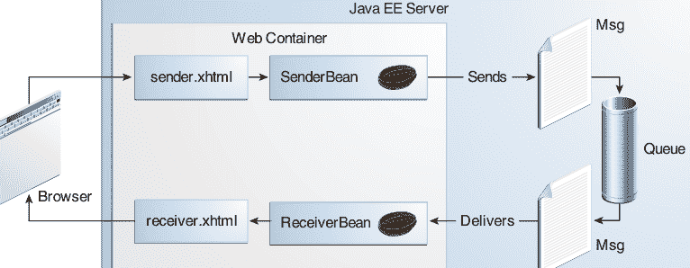

### 46.5.1 websimplemessage Facets 页面

该示例的 Facets 页面如下：

- `sender.xml`，它提供了一个带有标签的 `h:InputText` 标签，用户在此输入消息，以及两个命令按钮。调用 `senderBean.sendMessage` 方法将消息发送到队列并显示其内容。当用户点击“前往接收页面”按钮时，将显示 `receiver.xml` 页面。

- `receiver.xml`，它同样提供两个命令按钮。当用户点击“接收消息”按钮时，调用 `receiverBean.getMessage` 方法从队列获取消息并显示其内容。当用户点击“发送另一条消息”按钮时，再次显示 `sender.xml` 页面。

### 46.5.2 websimplemessage 管理 Bean

该示例的管理 Bean 如下：

- `SenderBean.java`，一个 CDI Bean，包含一个属性 `messageText` 和一个业务方法。该类带有注解 `@JMSDestinationDefinition(name = "java:comp/jms/webappQueue", interfaceName = "javax.jms.Queue", destinationName = "PhysicalwebappQueue")` `@Named`


# 4.6 使用消息驱动 Bean (MDB) 异步接收消息

如果你正在编写运行在 Java EE 客户端容器或 Java SE 平台上的应用程序，并且需要异步接收消息，那么与其定义一个实现 `MessageListener` 接口的类，不如创建一个 `JMSConsumer` 并调用该方法。

消息驱动 Bean 可以实现任何消息类型。最常见的是它们实现了 Java 消息服务（JMS）。本节描述了一个简单的消息驱动 Bean 示例。

## 4.6.1 示例概览

简单示例包含以下组件：

- `SimpleMessageClient`：向队列发送消息的应用程序
- `SimpleMessageBean`：处理消息的消息驱动 Bean

图 46-3 展示了该应用程序的结构。


### 4.6.2 Client

`SimpleMessageClient` 向 `SimpleMessageBean` 监听的队列发送消息。客户端首先连接工厂和队列资源：

```
@Resource(lookup = "java:DefaultJMSConnectionFactory")
private static ConnectionFactory connectionFactory;
```

接下来，在 try-with-resources 块中创建 `JMSContext`：

```
@Resource(lookup = "jms/MyQueue")
private static Queue queue;

String text;
final int NUM_MSGS = 3;
```

最后，客户端向队列发送消息：

```java
try (JMSContext context = connectionFactory.createContext()) {
  for (int i = 0; i < NUM_MSGS; i++) {
    text = "This is message " + (i + 1);
    System.out.println("Sending message: " + text);
    context.createProducer().send(queue, text);
  }
}
```

## 4.6.3 Bean 类

`SimpleMessageBean` 类的代码说明了此处消息驱动 Bean 的要求。`SimpleMessageBean` 类的前几行使用 `@MessageDriven` 注解的 `activationConfig` 来指定配置属性：

```
@MessageDriven(activationConfig={
  ActivationConfig(propertyName="destinationLookup",
    propertyValue="jms/MyQueue"),
  ActivationConfig(propertyName="destinationType",
    propertyValue="java.jms.Queue")
})
```

适当属性参见表 45-3。

参见从 Session Bean 发送到 MDB 的 `subscriptionDurability`、`clientId`、`subscriptionName` 和 `messageSelector` 属性示例。

### 4.6.3.1 onMessage 方法

当 Bean 接收消息时，EJB 容器会调用消息监听器方法或方法。对于使用 JMS 的 Bean，这就是 `MessageListener` 接口的 `onMessage` 方法。

在 `SimpleMessageBean` 类中，`onMessage` 方法捕获传入的 `TextMessage` 并显示文本：

```java
public void onMessage(Message inMessage) {
  try {
    if (inMessage instanceof TextMessage) {
      logger.log(Level.INFO,
        "MESSAGE BEAN: Message received: (0)",
        inMessage.getBody(String.class));
    } else {
      logger.log(Level.WARNING,
        "Message of wrong type: (0)",
        inMessage.getClass().getName());
    }
  } catch (Throwable t) {
    logger.log(Level.SEVERE,
      "onMessage: Exception: {0}",
      t.toString());
  }
}
```

```java
) catch (JMSException e) {
    logger.log(Level.SEVERE, 
        "SimpleMessageBean.onMessage: JMSException: {0}",
        e.toString());
    mdc.setRollbackOnly();
}
```

## 46.6.4 使用简单的 IDE 或 Maven 构建、部署并运行 simpleexample 示例

你可以使用 NetBeans IDE 或 Maven 来构建、部署并运行 `simpleexample` 示例。

### 46.6.4.1 为 simpleexample 示例创建资源

此示例使用了队列名 `jms/MyQueue` 和预配置的默认连接工厂 `java:com/DefaultJMSConnectionFactory`。

如果你已经在“编写简单的 JMS 应用程序”中运行了简单的示例且没有删除资源，则你已拥有该队列。否则，请按照“为简单示例创建资源”中的说明来创建它。

有关创建 JMS 资源的更多信息，请参阅“创建 JMS 管理对象”。

### 46.6.4.2 使用 NetBeans IDE 运行 simpleexample

1. 确保 GlassServer 已启动（启动和停止 GlassServer）。

2. 从菜单中选择 Project（项目）。

3. 在 Project 对话框中，导航到：

`tur-install/examples/jms/simpleexample`

4. 选择 Required Projects（所需的项目）框。

5. 确保勾选了 Open Required Projects（打开所需的项目），然后点击 Build（构建）。如果 NetBeans 提示你正在运行构建，请点击该框执行。

此命令封装应用程序客户端和消息驱动 bean，然后在 `simpleexample-ear/target/` 目录下创建一个名为 `simpleexample.ear` 的文件。随后它部署 `simpleexample-ear` 模块，获取客户端 stub 并运行应用程序客户端。

输出窗口中的内容所示（之前是应用程序客户端的输出）：

Sending: This is message 1

Sending: This is message 2

Sending: This is message 3

要查看 bean 是否接收了消息，请检查 `<install_dir>/domains/domain1/logs/server.log`。

在服务器日志文件中，会出现类似下面的行：

MESSAGE BEAN: Message received: This is message 1

MESSAGE BEAN: Message received: This is message 2

MESSAGE BEAN: Message received: This is message 3

Java Message Service 示例 46-31

# 从 Session Bean 向 MDB 发送消息

接收到的消息顺序可能与发送顺序不同。

7. 在完成应用程序运行后，使用 Services（服务）选项卡卸载它。

### 46.6.4.3 使用 Maven 运行 simplemessage 示例

1. 确保 GlassFish Server 已启动（参见“启动和停止 GlassFish Server”）。

2. 在终端窗口中，进入：

```
tut-install/examples/jms/simplemessage/
```

3. 使用以下命令编译源文件并封装应用程序：

`mvn install`

该目标封装了应用程序客户端和消息驱动 bean，然后在 `simplemessage-ear/target/` 下创建一个名为 `simplemessage.ear` 的文件。随后它部署 `simplemessage-ear` 模块，获取客户端 stub 并运行应用程序客户端。

终端窗口中的输出内容所示（之前是应用程序客户端的输出）：

```
Sending message: This is message 1
Sending message: This is message 2
Sending message: This is message 3
To see if the bean received the messages,
check <install_dir/domains/domain1/logs/server.log.
```

在服务器日志文件中，会出现类似下面的行：

```
MESSAGE BEAN: Message received: This is message 1
MESSAGE BEAN: Message received: This is message 2
MESSAGE BEAN: Message received: This is message 3
```

接收到的消息顺序可能与发送顺序不同。

4. 在完成应用程序运行后，使用 `mvn cargo:undeploy` 命令卸载它。

## 46.7 从 Session Bean 向 MDB 发送消息

本文解释了如何结合 session bean 编写、编译、封装并运行使用 JMS API 的应用程序。该应用程序包含以下组件：

- 一个调用 session bean 的应用程序客户端
- 一个向 topic（主题）发布多条消息的 session bean
- 一个使用持久性主题订阅（durable topic subscription）和消息选择器（message selector）接收并处理消息的消息驱动 bean

你可以在 `tut-install/examples/jms/clientsessionmdb/` 目录下找到本部分的源码。本节中的路径名称相对于此目录的。

### 46.7.1 为 clientsessionmdb 编写应用程序组件

此应用程序演示了如何从企业 bean（在本例中为 session bean）发送消息，而不是从应用程序客户端（如“使用消息驱动 bean 异步接收消息”示例中所示）。图 46-4 展示了该应用程序的结构。从企业 bean 发送消息与从托管 bean 发送非常相似，这在“使用简单的 Web 应用程序发送和接收消息”中已演示。


图 46-4 企业 bean 应用程序：客户端到 Session Bean 到消息驱动

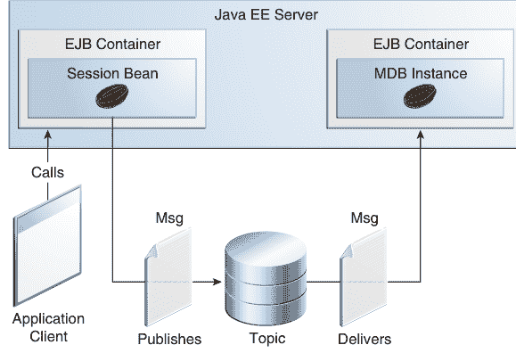

此示例中的 Publisher bean 是企业级应用等同于线缆服务新闻源，它将新闻事件分为六类。消息驱动 bean 可以代表新闻编辑部，例如，体育版将为所有与体育有关的新闻事件设置订阅。

示例中的应用程序客户端通过注入 `Publisher` 接口并调用该 bean 的方法。企业 bean 创建消息，对于每条消息，它设置 `String` 属性并发布到 topic。消息驱动 bean 使用消息选择器来限制哪些消息会被传递给它。

### 46.7.1 编写应用程序客户端：MyAppClient.java

应用程序客户端 `MyAppClient.java` 位于 `clientsessionmdb`。它执行 JMS 操作，并比“使用消息驱动 bean 异步接收消息”中的客户端更简单。它使用依赖注入获取 `Publisher` bean。

```java
@EJB(name="PublisherRemote")
private static PublisherRemote publisher;
```

客户端随后调用该 bean 的业务方法。

### 46.7.2 编写 Session Bean

Publisher bean 是一个具有业务方法的无状态 session bean。它使用远程接口而不是本地接口，因为它被客户端访问。

远程接口 `PublisherRemote.java` 位于 `clientsessionmdb-ejb`，声明了一个单一业务方法 `publishNews()`。

bean 类 `PublisherBean.java` 也位于 `clientsessionmdb-ejb`，实现了 `publishNews()` 方法及其辅助方法。该类包含 `SessionContext` 和 `Topic` 资源（topic 定义在消息驱动 bean 中）。它注入了 `JMSContext`，除非另有指定，否则使用预配置的连接工厂。该类开始如下：

```java
@Stateless
@Remote(PublisherRemote.class)
public class PublisherBean implements PublisherRemote {
    @Resource
    private SessionContext sc;
    @Resource(lookup = "java:module/newsTopic")
    private Topic topic;
    @Inject
    private JMSContext context;
}
```

`publishNews()` 方法创建 `JMSProducer` 并发布消息。

### 46.7.3 编写消息驱动 bean：MessageBean.java

消息驱动类 `MessageBean.java` 位于 `clientsessionmdb-ejb`，与“使用消息驱动 bean 异步接收消息”中的版本几乎相同。然而，`@MessageDriven` 注解有所不同；它使用的不是 bean，而是 topic、订阅和选择器。bean 定义了应用程序 topic；该定义使用了 `java:module` 作用域，因为 session bean 和消息驱动 bean 都在同一个模块中。目标由 `destinationActivation` 属性定义。（更多信息请参见“为 Java EE 创建资源”）。注解还设置了激活配置属性 `messageSelector`、`subscriptionDurability`、`clientID` 和 `subscriptionName`，如下：

```java
@MessageDriven(activationConfig = {
    @ActivationConfigProperty(propertyName = "destinationType", propertyValue = "javax.jms.Topic"),
    @ActivationConfigProperty(propertyName = "destination", propertyValue = "java:module/newsTopic"),
    @ActivationConfigProperty(propertyName = "messageSelector", propertyValue = "NewsType = 'Sports' OR NewsType = 'Opinion'"),
    @ActivationConfigProperty(propertyName = "subscriptionDurability", propertyValue = "Durable"),
    @ActivationConfigProperty(propertyName = "clientID", propertyValue = "MyID"),
    @ActivationConfigProperty(propertyName = "subscriptionName", propertyValue = "MySub")
})
```

该主题是在 `PublisherBean` 中定义的。在这种情况下，消息选择器代表了体育和意见部门，仅是为了演示消息选择器的语法。

JMS 资源适配器使用这些属性为消息驱动 Bean（MDB）创建一个连接工厂，允许该 Bean 使用持久订阅。

你可以使用 NetBeans IDE 或 Maven 来构建、部署和运行 `clientsessionmdb` 示例。

此示例使用了注解定义的主题和预配置的默认连接工厂 `java:comp/DefaultJMSConnectionFactory`，因此你不需要为它创建资源。

### 46.7.4 运行 clientsessionmdb 示例

#### 46.7.4.1 使用 NetBeans IDE 运行 clientsessionmdb

1. 确保 GlassFish 服务器已启动（启动和停止 GlassFish 服务器）。

2. 从 File（文件）菜单中选择 Open Project（打开项目）。

3. 在 Project 对话框中，导航到：

   `tut-install/examples/jms/clientsessionmdb`

4. 选择 `clientsessionmdb` 文件夹。

5. 确保选中 Open Projects（打开项目）复选框，然后点击 Open Project（打开项目）。

6. 在 Projects 选项中，右键点击 `clientsessionmdb` 项目并选择 Build（构建）。如果 NetBeans IDE 建议你运行引导构建（priming build），请勾选以执行。

此命令创建了以下内容：

- 一个应用程序 JAR 文件，包含客户端类和会话远程接口，以及一个指定了主类并将 EJB JAR 文件放置在类类路径中的清单（manifest）文件。

- 一个 EJB JAR 文件，同时包含会话 Bean 和消息驱动 Bean。

- 一个 EAR 文件，包含上述两个 JAR 文件。

`clientsessionmdb.ear` 文件创建在 `clientsessionmdb-ear/target/` 目录下。随后，命令会部署 EAR 文件，获取客户端存根（stubs），并运行客户端。

客户端显示以下几行：

```
check <install_dir>/domains/domain1/logs/server.log.
```

企业级 Bean（enterprise beans）的输出显示在服务器日志中。Publisher 会话发送了两组编号从 0 到 17 的 18 条消息。由于消息选择器的存在，消息驱动 Bean 仅接收 `NewsType` 属性为 `Sports`（体育）或 `Opinion`（意见）的消息。

7. 在运行完成后，使用 Services（服务）选项卡部署应用程序。

#### 46.7.4.2 使用 Maven 运行 clientsessionmdb

1. 确保 GlassFish 服务器已启动（启动和停止 GlassFish）。

2. 进入目录：

```bash
tut-install/examples/jms/clientsessionmdb/
```

3. 编译源文件并打包、部署和运行应用程序，输入以下命令：

```bash
mvn install
```

此命令创建了以下内容：

- 一个应用程序客户端 JAR 文件，包含客户端类文件和会话 Bean 的远程接口，以及一个指定了主类并将 EJB JAR 文件放置在类类路径中的清单文件。

- 一个 EJB JAR 文件，同时包含会话 Bean 和消息驱动 Bean。

- 一个 EAR 文件，包含上述两个 JAR 文件。

`clientsessionmdb.ear` 文件创建在 `clientsessionmdb-ear/target/` 目录下。命令部署 EAR 文件，获取客户端存根，并运行客户端。

客户端显示以下几行：

```
To view the bean output:
check <install_dir>/domains/domain1/logs/server.log.
```

企业级 Bean 的输出显示在服务器日志文件中。Publisher 会话 Bean 发送了多组编号从 0 到 17 的 消息。由于消息选择器的存在，消息驱动 Bean 仅接收 `NewsType` 属性为 `Sports`（体育）或 `Opinion`（意见）的消息。

4. 在运行完成后卸载应用程序：

```bash
mvn cargo:undeploy
```

## 46.8 使用实体合并两个 MDB 的消息

本节说明了如何使用带有实体（entity）的 JMS API 来编译、打包、部署和运行应用程序。该应用程序使用了以下组件：

- 一个包含两个 Bean 并能接收消息的应用程序客户端
- 消息驱动 Bean
- 一个实体类

你可以在 `tut-install/examples/jms/clientmdbentity/` 目录下找到本节的源文件。本节中的路径是相对于该目录的。

### 46.8.1 clientmdbentity 示例应用程序概述

该应用程序以简化的方式演示了公司人力资源（HR）部门在处理新入职员工时的工作流程。此应用程序还演示了如何使用 Java EE 平台完成许多 JMS 需要执行的任务。

消息客户端通常需要等待来自多个源的若干消息。然后它利用所有这些消息中的信息汇总一个发送到另一个目标的消息。这种设计模式（并非 JMS 特定）的通用术称为消息合并（joining messages）。任务必须是事务性的，所有的接收和发送被视为单个事务。如果所有消息未接收成功，事务可以回滚。有关说明此任务的应用程序客户端示例，请参阅使用本地事务（Using Local Transactions）。

消息驱动 Bean 在事务中一次处理一条消息。为了提供合并消息的能力，应用程序可以让消息驱动 Bean 将信息存储在 Java Persistence API 实体中。该实体可以判断所有信息是否都已接收。

应用程序的基本步骤为：

1. HR 部门的客户端生成一条包含新入职员工姓名、职位和 ID 的消息（M1）。两个消息驱动 Bean 处理该消息。其中一个 Bean `OfficeMDB` 分配办公室编号，另一个 Bean `EquipmentMDB` 分配设备。

2. 客户端创建一个临时队列以接收处理通知。消息监听器 `HRLListener` 等待包含每个员工分配的办公室的消息。

3. 当办公室和设备都分配完成后，实体将消息（M2）发送到回复队列。`OfficeMDB` 创建 `SetupOffice` 实体并存储办公室信息。`EquipmentMDB` 找到现有实体，存储设备信息，并确认任务完成。

图 46-5 展示了该应用程序的结构。当然，HR 会有更多组件；其他的可以设置工资和福利等。

### 46.8.2 编写 clientmdbentity 的应用程序组件

编写应用程序组件涉及编写应用程序客户端、消息驱动 Bean 和实体类。

#### 46.8.2.1 编写应用程序客户端：HumanResourceClient.java

位于 `clientmdbentity-app-client` 下应用程序客户端 `HumanResourceClient.java` 执行以下步骤：

1. 为应用程序定义一个主题，使用 `java:app` 命名空间，因为该主题在应用程序和 EJB 模块中都会使用。

2. 注入 `ConnectionFactory` 和 `Topic` 资源。

3. 创建临时队列以接收处理通知。

4. 为临时队列创建 `JMSConsumer`，设置其消息监听器并启动连接。

5. 创建一个 `MapMessage`。

6. 创建具有随机姓名、职位和 ID 编号的新员工（按顺序），并发布包含这些信息的五条消息。消息监听器 `HRLListener` 等待包含每个员工分配的办公室的消息。当消息到达时，消息监听器显示接收到的信息并判断五条消息是否都已到达。如果到了，消息监听器通知主方法，随后主方法退出。

#### 46.8.2.2 为 clientmdbentity 示例编写消息驱动 Bean

此示例使用了两个消息驱动 Bean，位于 `clientmdbentity-ejb` 下：

- `EquipmentMDB.java`
- `OfficeMDB.java`

它们注入了一个 `MessageDrivenContext` 资源和一个 `JMSContext`。

`onMessage()` 方法获取消息中的信息。`EquipmentMDB` 的 `onMessage()` 方法根据新员工的职位选择设备；`OfficeMDB` 的 `onMessage()` 方法随机生成办公室编号。

在稍作延迟以模拟真实世界的处理波动后，`onMessage()` 方法调用辅助方法 `compose()`。

`compose()` 方法执行以下步骤：

a. 它创建并持久化 `SetupOffice` 实体，或者通过主键查找它。

b. 它使用该实体在数据库中存储设备信息，调用 `doEquipmentList()` 或 `doOfficeNumber()` 业务方法。

c. 如果业务方法返回 `true`（意味着所有信息已存储），它从消息中获取回复目标信息，创建一个 `JMSProducer`，并发送包含实体中存储信息的回复消息。

d. 它移除该实体。

### 46.8.3 为 clientmdbentity 示例编写实体

`SetupOffice.java` 类同样位于 `clientmdbentity-ejb` 下，是一个实体类，实体驱动豆（beans）被打包在一个 EJB JAR 文件中。实体类的声明如下：

```java
@Entity
public class SetupOffice implements Serializable {
```

该类包含一个无参构造函数和一个带有两个参数（员工 ID 和名称）的构造函数。它还包含用于员工 ID、办公室编号和设备列表的 getter 和 setter 方法。员工 ID 的 getter 方法标有 `@Id` 注解，表示该字段是主键：

```java
@Id
public String getEmployeeId() {
    return id;
}
```

该类还实现了两个业务方法 `doEquipmentList()` 和 `doOfficeNumber()` 以及它们的辅助方法 `checkSetupComplete()`。

消息驱动豆（message-driven beans）会调用这些业务方法和 getter 方法。

实体的 `persistence.xml` 文件指定了最基本的设置：

```xml
<?xml version="1.0" encoding="UTF-8"?>
<persistence version="2.1"
  xmlns="http://xmlns.jcp.org/xml/ns/persistence"
  xmlns:xsi="http://www.w3.org/2001/XMLSchema-instance"
  xsi:schemaLocation="http://xmlns.jcp.org/xml/ns/persistence http://xmlns.jcp.org/xml/ns/persistence/persistence_2_1.xsd">
  <persistence-unit name="clientEntity-EJBPU" transaction-type="JTA">
    <provider>org.eclipse.persistence.jpa.PersistenceProvider</provider>
    <jta-data-source>java:DefaultDataSource</jta-data-source>
    <properties>
      <property name="eclipselink.ddl-generation" value="drop-and-create-tables"/>
    </properties>
  </persistence-unit>
</persistence>
```

## 46.8.4 运行 clientmdbentity 示例

你可以使用 NetBeans IDE 或 Maven 来构建、部署和运行 `clientmdbentity` 示例。

由于实体定义了其应用私有的主题（topic），并使用了预配置的默认连接工厂 `java:comp/DefaultJMSConnectionFactory` 以及预配置的默认 JDBC 资源 `java:comp/DefaultDataSource`，你不需要为它创建资源。

### 46.8.4.1 使用 NetBeans IDE 运行 clientmdbentity

1. 确保 GlassFish 服务器已启动（参见“启动和停止 GlassFish 服务器”），以及数据库服务器（启动和停止 Java DB 服务器）。

2. 从 File（文件）菜单中选择 Open Project（打开项目）。

3. 在 Project（项目）对话框中，导航到：

   `tut-install/examples/jms/clientmdbentity`

4. 选择 `clientmdbentity` 文件夹。

5. 点击 Open Project（打开项目）。

6. 在 Projects（项目）选项卡中，右键点击 `clientmdbentity` 项目并选择 Build（构建）。

此命令创建了以下内容：

- 一个客户端 JAR 文件，包含客户端类和监听器类文件，以及一个指定主类的清单文件（manifest file）。

- 一个 EJB JAR 文件，包含消息驱动豆和实体类，以及 `persistence.xml` 文件。

- 一个应用 EAR 文件，包含两个 JAR 文件以及一个 `application.xml` 文件。

`clientmdbentity.ear` 文件创建在 `clientmdbentity-ear/target/` 目录下。


该命令部署 EAR 文件，获取客户端存根（stubs）并运行应用程序。

### 46.8.3.2 使用 Maven 运行 clientmdbentity

1. 确保 GlassFish 服务器已启动（参见“启动和停止 GlassFish 服务器”），以及数据库服务器（启动和停止 Java DB 服务器）。

2. 进入目录：

   `tut-install/examples/jms/clientmdbentity/`

3. 若要编译源文件并打包、部署和运行应用程序，输入以下命令：

   `mvn install`

# 使用实体连接两个 MDB 的消息

此命令创建了：

- 一个客户端 JAR 文件，包含客户端类和监听器类文件，以及一个指定主类的清单文件。

- 一个 EJB JAR 文件，包含消息驱动豆和实体类，以及 `persistence.xml` 文件。

- 一个应用 EAR 文件，包含两个 JAR 文件以及 `application.xml`。

该命令部署 EAR 文件，获取客户端存根并运行应用程序。

## 46.8.3.3 查看应用程序

在 NetBeans IDE 或终端中的输出如下：

```
SENDER: Setting ID to 50, Bill Tudor
SENDER: Setting ID to 51, Carol Jones
SENDER: Setting ID to 52, Mark Wilson
SENDER: Setting ID to 53, Polly Wren
SENDER: Setting ID to 54, Joe Lawrence
```

（注：输出继续）

## 46.9 使用 NetBeans IDE 创建 JMS 

当你创建自己的 JMS 应用时，需要为它们创建资源。本节介绍了如何使用 NetBeans IDE 创建类似于示例中的 `glassfish-resources.xml` 文件。还介绍了如何使用 NetBeans IDE 删除资源。

你也可以使用管理控制或 `asadmin create-jms-resource`、`list-jms-resources` 和 `delete-jms-resource` 命令来创建、列出和删除 JMS 资源。更多信息请参考 GlassFish 服务器文档或输入 `asadmin help [command name]`。

### 46.9.1 使用 NetBeans IDE 创建 JMS 

按照以下步骤使用 NetBeans IDE 在 GlassFish 服务器中创建 JMS 资源。为每个需要的资源重复这些步骤。

1. 右键点击要创建资源的项目，选择 New（新建），然后选择 Other（其他）。

2. 在 File（文件）向导中，在 Categories（类别）下选择 GlassFish。

3. 在 File Types（文件类型）下选择 JMS Resource。

4. 在 General Attributes - JMS Resource 页面，在 JNDI Name 字段输入资源名称。

   按照惯例，JMS 资源名称以 `jms/` 开头。

5. 选择资源类型选项。

   通常是 `java.jms.Queue`、`java.jms.Topic` 或 `java.jms.ConnectionFactory`。

6. 点击 Next（下一步）。

7. 在 JMS Properties 页面，对于队列或主题，在 Name 属性的 Value 字段输入物理队列名称。

   该字段可以输入任何值。

   连接工厂没有必需属性。在某些情况下你可能需要指定属性。

8. 点击 Finish（完成）。

名为 `glassfish-resources.xml` 的文件创建在 Maven 项目中，位于 `src/main/setup/` 目录。在 Projects 选项卡中，你可以在 Other Sources 节点下找到它。你需要运行 `asadmin add-resources` 命令在 GlassFish 服务器中创建这些资源。

# 46.9.2 使用 NetBeans 删除 JMS 资源

1. 在“服务”（Services）选项卡中，展开“服务器”（Servers）节点，然后展开“GlassFish Server”节点。

2. 展开“资源”（Resources）节点，然后展开“连接资源”（Connector Resources）节点。

3. 展开“管理对象”（Admin Object）节点。

4. 右键点击你想删除的任何目标并选择“注销”。

5. 展开“连接池”（Connection Pools）节点。

6. 右键点击相应的连接池并选择“注销”。

当你移除连接池时，关联资源也会被删除。

## 安全

第 X 部分探讨了安全概念和示例。该部分包含以下章节：

- 第 47 章，“Java 平台安全简介”

- 第 48 章，“安全 Web应用程序”

- 第 49 章，“安全企业应用程序”

- 第 50 章，“Java EE 安全：高级主题”

# Java 平台安全简介

本章介绍了基本的安全概念和安全机制。关于这些概念和机制的更多信息，可以在 Java EE 7 安全章节中找到。该部分的其他章节讨论了 Web 层和企业层应用程序的安全需求。

- 第 48 章，“安全 Web应用程序”解释了如何为 Web 组件（如 servlet）添加安全。

- 第 49 章，“安全企业应用程序”解释了如何为 Java EE 组件（如企业 Bean 和应用程序客户端）添加安全。

这里介绍了以下主题：

- Java EE 安全概述

- 安全机制

- 容器安全

- GlassFish 安全

- 域（Realms）、用户和角色操作

- 使用 SSL 建立安全连接

- 关于安全的更多信息

## 47.1 Java EE 安全概述

每个企业都有许多用户可以访问的敏感资源或需要在不受保护的开放网络（如互联网）上传输的资源。

企业层和 Web 层应用程序由部署到各种容器中的组件组成。这些组件组合成多层企业应用程序。组件的安全由其容器提供。容器提供两种安全：声明性和程序式。

- 声明式安全使用部署描述符（deployors）或注解（annotations）表示应用程序组件的安全需求。

部署描述符是应用程序外部的 XML 文件，它表示应用程序的安全控制，包括安全角色、访问控制和身份验证需求。关于部署描述符的更多信息，请阅读“使用部署描述符进行声明式安全”。

注解也称为元数据，用于指定类文件中的安全信息。当应用程序部署时，这些信息可以被部署描述符使用或覆盖。注解让你无需在 XML 文件中编写声明式信息，所需信息会自动生成。在本教程中，尽可能使用注解来保护应用程序。关于注解的更多信息，请阅读“使用注解指定安全信息”。

- 程序式安全嵌入应用程序中并用于做出安全决策。当仅声明式安全不足以表示应用程序的安全模型时，使用程序式安全。关于程序式安全的更多信息，请阅读“使用程序式安全”。

### 47.1.1 简单应用程序安全流程

通过检查具有 Web 客户端、用户界面和企业逻辑的简单应用程序发生的情况，可以更好地理解 Java EE 环境的安全行为。

在以下摘自 Java EE 7 规范的示例中，Web 客户端依赖 Web 服务器充当身份验证代理，通过从客户端收集身份验证数据并使用它来建立已验证的会话。

#### 47.1.1.1 步骤 1：初始请求

示例的第一步中，Web 客户端请求主身份验证 URL。该操作如图 47-1 所示。

图 47-1 初始请求


由于客户端尚未对应用程序环境进行验证，负责交付应用程序 Web 部分的服务器（以下称为 *web 服务器*）检测此并为此资源调用相应的身份验证机制。有关这些机制的更多信息，请参见“安全机制”。

#### 47.1.1.2 步骤 2：初始身份验证

服务器返回表单，Web 客户端使用该表单从用户处收集身份验证数据（如用户名和密码）。Web 客户端将身份验证数据转发到 Web 服务器，由服务器进行验证，如图 47-2 所示。验证机制可能是本地的，也可能利用底层安全服务。根据验证结果，Web 服务器为用户设置凭据。

图 47-2 初始身份验证


#### 47.1.1.3 步骤 3：URL 授权

凭据用于后续确定用户是否有权访问受限资源。Web 服务器查询与资源相关的安全策略以确定允许的角色。图 47-3 显示了此过程。

图 47-3 URL 授权


#### 47.1.1.4 步骤 4：完成原始请求

凭据用于后续确定用户是否有权访问受限资源。Web 服务器查询与资源相关的安全策略以确定允许的角色。图 47-3 显示了此过程。由于客户端尚未对应用程序环境进行验证，负责交付应用程序 Web 部分的服务器（以下称为 *web 服务器*）检测此并为此资源调用相应的身份验证机制。有关这些机制的更多信息，请参见“安全机制”。

#### 47.1.1.5 步骤 5：调用企业 Bean 方法

凭据用于后续确定用户是否有权访问受限资源。Web 服务器查询与资源相关的安全策略以确定允许的角色。图 47-3 显示了此过程。

实体访问未受保护的资源不需要授权和身份验证。在未身份验证的情况下访问资源被称为未身份验证访问或匿名访问。

应用安全的特性的如果得到妥当处理，将有助于减少企业面临的安全威胁，包括以下方面：

- **身份验证（Authentication）**：通信实体（作为客户端和服务器）相互提供证明的方法，证明它们正代表获得授权访问的特定身份进行操作。这确保了用户确实是所称的。

- **授权或访问控制（Authorization, or access control）**：将与资源的交互限制在特定的用户或程序集合的方法，目的是执行完整性、机密性或可用性约束。这确保了用户有权对访问数据执行操作。

- **数据完整性（Data integrity）**：用于确保信息未被第三方（信息源以外的实体）修改的手段。例如，开放网络上数据的接收者必须能够检测并隐藏在发送后被修改过的消息。这确保了只有授权的用户才能修改数据。

- **机密性与数据隐私（Confidentiality, and data privacy）**：用于确保信息仅对授权访问的用户可见的手段。这确保了授权用户可以查看敏感数据。

- **不可否赖性（Non-repudiation）**：用于证明用户执行了某些操作的用户无法否认其行为的方法。这确保了交易可以被证明确实发生。

- **服务质量（Quality of Service）**：通过各种技术为选定的网络提供更好服务的手段。

- **审计（Auditing）**：捕获安全相关事件防篡记录的手段，以便评估安全策略和机制的有效性。为了实现这一点，系统维护了事务和安全信息的记录。

## 47.2 安全机制

在决定为应用程序提供的安全层和类型时，应当考虑应用程序的特性。以下章节讨论了用于保护 Java EE 应用程序的常用机制的特性。这些机制中的每一个都可以单独使用或与其他机制结合，根据您实现的特定需求提供保护层。

### 47.2.1 Java SE 安全机制

Java SE 为多种安全特性和机制的支持。

- **Java 身份验证和授权服务（JAAS）** 是一组 API，允许服务对用户进行身份验证并执行访问控制。JAAS 为程序化的身份验证和授权提供了一个可插拔且可扩展的框架。JAAS 是 Java SE 的核心 API，是 Java EE 安全机制的底层技术。

- **Java 通用安全服务（GSS-API）** 是一种基于令牌的 API，用于在通信应用程序之间安全地交换消息。GSS-API 为程序员提供了对安全服务以及各种底层安全机制（包括 Kerberos）的统一访问。

- **Java 密码学扩展（JCE）** 为加密、密钥生成和密钥协商、以及消息认证码（MAC）算法提供了框架和实现。对加密的支持包括对称、非对称、块加密和流加密。块加密对字节组进行操作；流加密一次处理一个字节。软件还支持安全数据流和受密封对象。

- **Java 套接字扩展（JSSE）** 为 Java 版本的套接字层（SSL）和传输安全层（TLS）协议提供了框架和实现，并包含数据加密、服务器身份验证、消息完整性以及可选的客户端身份验证功能以确保网络通信的安全。

- **简单身份验证和安全层（SASL）** 是一项互联网标准（RFC 2222），提供了一种在客户端和服务器应用程序之间进行身份验证以及可选建立安全层的协议。SASL 定义了如何交换身份验证数据，但未指定数据的内容。SASL 是一个框架，特定的身份验证机制可以在该框架内指定身份验证数据的内容和语义。

Java SE 提供了一套工具用于管理密钥库、证书和策略文件；生成和验证签名；获取、列出和管理 Kerberos 票据。

有关 Java EE 安全的信息，请访问 http://docs.oracle.com/java/7/docs/notes/guides/security。

### 47.2.2 Java EE 安全机制

Java EE 安全服务由容器提供，并可以使用声明式或程序化技术（如安全化容器）来实现。Java EE 服务提供了一种稳健且易于配置的安全机制，用于在许多不同层上对用户进行身份验证，并对应用程序功能及相关数据的访问进行授权。Java EE 服务独立于操作系统的安全机制。

#### 47.2.2.1 应用层安全

在 Java EE 中，容器负责提供应用层安全，即根据特定应用程序的需求定制针对特定应用程序类型的安全服务。在应用层，可以使用应用程序防火墙通过保护通信流和所有相关资源免受攻击来增强应用程序保护。

Java EE 安全易于实现和配置，并能对应用程序功能和数据提供细粒度的访问控制。然而，作为应用在应用层的固有安全，其安全属性无法迁移到其他环境中的应用程序，且仅在数据处于应用程序环境中时提供保护。在传统应用程序的语文中，这不一定是问题，但当应用于 Web 服务时（数据跨越多个介质传输），您需要结合传输层安全和消息层安全使用 Java EE 安全机制，以获得完整的安全解决方案。

使用应用层安全的优点包括：

- 安全性独特地适用于应用程序的需求。

- 安全性是细粒度的，具有特定于应用的设置。

使用应用层安全的缺点包括：

- 应用程序依赖于在不同应用程序类型之间不可迁移的安全属性。

- 对多种协议的支持使这种安全变得脆弱。

- 数据接近漏洞点。

有关在应用层提供安全性的更多信息，请参阅“安全化容器”（Securing Containers）。

#### 47.2.2.2 传输层安全

传输层安全由在客户端和服务器之间传输信息的传输机制提供；因此，传输层安全依赖于使用安全套接层（SSL）的 HTTP 传输（HTTPS）。传输安全是一种用于身份验证、消息完整性和机密性的点对点机制。当运行 SSL 保护的会话运行时，服务器和客户端在应用程序协议传输或接收第一个字节之前即可相互身份验证并协商加密算法。安全从数据离开直到到达一直有效。

传输层安全按系列阶段执行，如下：

- 客户端和服务器达成适当算法。

- 使用公钥加密和基于证书的身份验证交换密钥。

- 在信息交换使用对称加密。

使用 HTTPS 需要数字证书。大多数 Web 服务器的 HTTPS 服务在安装数字证书之前无法运行。GlassFish 服务器已经创建了数字证书。

使用传输层安全的优点包括：

- 它是相对简单、易理解的标准技术。

- 它同时适用于消息及其附件。

使用传输层安全的缺点包括：

- 它与传输层协议紧耦合。

- 它代表了安全的“全或无”方法。这意味着安全机制无法感知消息内容，因此您无法像使用消息层安全那样选择性地应用安全。

- 保护是瞬时的。消息仅在传输过程中受保护。端点在接收消息时会自动移除保护。

- 它不是端到端解决方案，仅是对对点的。

有关传输层安全的更多信息，请参阅“使用 SSL 建立安全连接”（Establishing a Secure Connection Using SSL）。

#### 47.2.2.3 消息层安全

在消息层安全中，安全信息包含在 SOAP 消息和/或 SOAP 消息附件中，这允许安全随消息或附件发送。例如，消息的部分内容可能由发送者签名并针对特定接收者进行加密。当消息从初始发送者发出时，消息在到达目标接收者之前可能会经过中间节点。在这种情况下，加密部分对任何中间节点来说继续保持不可透明状态，并且只有目标接收者才能对其进行解密。因此，消息层安全也被称为端到端安全。

消息层安全的优势包括：

- 安全性在所有跳跃过程中以及消息到达目的地后均与消息保持。

- 安全性可以选择性地应用于消息的不同部分，如果使用 XML Web 服务，还可以应用于附件。

- 消息安全可用于多个跳跃的中间节点。

- 消息安全独立于应用程序环境或传输协议。

使用消息层安全的缺点是它相对复杂，并会增加一些处理开销。

GlassFish 使用 Metro 支持消息安全，Metro 是一种使用 Web 服务 (WSS) 来保护消息的 Web 服务栈。由于这种安全性特定于 Metro 且不是 Java EE 平台的一部分，因此本教程不讨论如何使用 WSS 保护消息。位于 https://metro.java.net/guide/ 的 *Metro 用户指南*。

## 47.3 保护容器

在 Java EE 中，组件容器负责提供应用程序安全。容器提供两种类型的安全：声明式安全和程序化安全。

### 47.3.1 使用注解指定安全信息

注解实现了声明式编程风格，并涵盖了声明式和程序化安全概念。用户可以使用注解在类文件中指定安全信息。然而，GlassFish Server 可以在部署应用程序时使用注解指定这些信息。并不是所有信息都可以在部署描述符中指定。

用于在企业 Bean（Enterprise Bean）文件内指定安全信息的特定注解在《使用声明式安全保护企业 Bean》，第 48 章，属于《Web 应用程序安全入门》书中，该章节描述了如何尽可能使用注解来保护应用程序。部署描述符仅在必要时进行描述。


有关注解的更多信息，请参见“关于安全的进一步信息”。

### 47.3.2 使用部署描述符进行声明式安全

声明式安全可以使用部署描述符表示应用程序组件的安全需求。因为部署描述符信息是声明性的，因此可以在无需修改源代码的情况下进行更改。在运行时，Java EE 服务器读取部署描述符并对相应的应用程序、模块或组件采取相应操作。如果注解未提供某些信息或不使用默认值，部署描述符必须为每个组件提供某些结构信息。

本教程此部分未记录如何创建部署描述符；仅描述部署描述符的安全元素。NetBeans 提供了创建和修改部署描述符的工具。

不同类型的组件使用不同的格式或模式（schema）。本教程讨论的部署描述符的安全元素包括：

- Web 组件可以使用名为 `web.xml` 的 Web 部署描述符。

Web 部署描述符的模式在 Java Servlet 3.1 规范（JSR 340）的第 14 章提供，可以从 http://jcp.org/en/jr/detailId=340 下载。

- JavaBeans可以使用名为 `META-INF/ejb-jar.xml` 的 EJB 部署描述符，包含在 EJB JAR 文件中。

企业部署描述符的模式在 EJB 3.2合约与要求（JSR 345）的第 14 章提供，可以从 http://jcp.org/en/jr/detailId=345 下载。

### 47.3.3 使用程序化安全

程序化安全嵌入在应用程序中，用于做出安全决策。当仅凭声明式安全不足以表达应用程序的安全模型时，程序化安全非常有用。程序化安全的 API 由 `EJBContext` 接口和 `HttpServletRequest` 接口组成。这些方法允许组件根据调用者或远程用户的安全角色做出业务逻辑决策。

在接下来的章节中详细讨论了程序化安全：

- 在 Web 应用程序中使用程序化安全
- 程序化地保护企业 Bean

## 47.4 保护 GlassFish Server

本教程描述了部署到 GlassFish Server，该服务器基于 Java EE 安全模型提供高安全性、可操作性和分布式的组件银行服务。GlassFish 支持 Java EE 7 安全模型。你可以为了以下目的配置 GlassFish Server：

- 添加或修改授权用户。有关此主题的更多信息，请参见“处理域、用户、组和角色”。
- 配置 HTTP 和互联网对象对象协议（IIOP）监听器。
- 配置安全的 Java 管理扩展（JMX）连接器。
- 添加或修改现有或自定义角色。
- 使用容器 Java 授权合约（JACC）为可插的授权提供程序定义接口。JACC 定义了 GlassFish Server 与授权策略模块之间的安全合约。这些合约指定了授权提供者如何在访问决策中安装、配置和使用。

## 处理域、用户、组和角色

- 使用可插的认证模块。
- 自定义认证机制。所有兼容 Java EE 7 的 Web 容器实现都需要支持 JSR 196 的 Servlet 配置文件，这为自定义 Web 容器应用于一个或多个应用程序的认证机制提供了一种途径。
- 为应用程序设置和更改策略权限。

## 47.5 处理域、用户、组和角色

你需要保护资源以确保只有授权用户才能访问。

请参见“应用程序安全特性”以了解身份验证、识别和授权。

本节讨论了如何设置用户以便他们能够被正确识别并授予访问权限或拒绝访问。要验证用户身份，你需要遵循以下基本步骤。

1. 应用程序开发者编写代码提示用户名和密码。各种认证方法在“指定认证机制”中讨论。
2. 应用程序开发者通过元数据注解或部署描述符通信如何设置安全性。这在“设置安全角色”中讨论。
3. 服务器管理员在 `GlassFishServer` 中授权用户和组。这在“在 GlassFishServer 中管理用户和组”中讨论。
4. 应用程序开发者将应用程序的安全角色映射到 GlassFish Server 中定义的用户、组和主体。该主题在“将角色映射到用户和组”中讨论。

### 47.5.1 什么是域、用户和组

域（Realm）是为 Web 或应用程序服务器定义的安全域。域包含用户集合，这些用户可能被分配给组。在“在 GlassFish Server 中管理用户”中讨论。

应用程序在允许访问受保护资源之前会提示用户名和密码。在输入用户名和密码后，信息将传递给服务器，服务器将验证用户身份并发送受保护资源，或者在拒绝访问时不进行验证。这种用户身份验证在“部署描述符中指定认证机制”中讨论。

在某些应用程序中，授权用户被分配角色。在这种情况下，应用程序分配给用户的角色必须映射到应用程序服务器上定义的主体（principal）或组。图 47–6 显示了这种情况。有关将角色映射到用户和组的更多信息可以在“设置安全角色”中找到。

# 图 47–6 将角色映射到用户和组

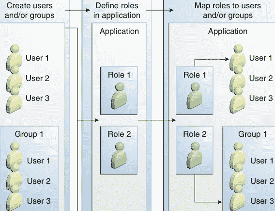

后续章节将提供关于领域（realms）、用户、组和角色的信息。

## 47.5.1.1 什么是领域（Realm）？

服务器上的受保护资源可以划分为一组保护空间，每个空间都有自己的认证方案和/或授权数据库，其中包含用户和组。领域是一个完整的用户和组数据库，识别为一个或多个应用程序的用户，并由相同的认证策略控制。

Java EE 认证服务可以管理多个领域中的用户。`file`、`admin-` 和 `certificate` 领域是 GlassFish Server 预配置的。

在 `file` 领域中，服务器将用户凭据本地存储在名为 `keyfile` 的文件中。你可以使用管理控制台（Administration Console）管理 `file` 领域中的用户；服务器认证服务通过检查 `file` 领域来验证身份。该领域用于所有除使用 HTTPS 和证书的浏览器客户端之外的所有客户端认证。

在 `certificate` 领域中，服务器将用户凭据存储在证书数据库中。使用 `certificate` 领域时，服务器使用带有 HTTPS 的证书来验证客户端。要识别 `certificate` 领域中的用户，认证服务会验证 X.509 证书。有关创建此类证书的逐步操作说明，请参见*使用数字证书*。X.509 证书字段的通用名称（common name）被用主体名称（principal name）。

`admin` 领域也是一个领域，并将管理员用户凭据本地存储在名为 `admin-keyfile` 的文件中。你可以像管理 `file` 领域用户一样，使用管理控制台管理该领域中的用户。更多信息请参见*在 GlassFish Server 中管理用户和组*。

## 47.5.1.2 什么是用户（User）？

用户是在 GlassFish Server 中定义的个人或应用程序程序身份。在 Web 应用程序中，用户可以以该身份访问一组角色，这些角色使用户能够访问受这些角色保护的所有资源。用户可以与一个组关联。

Java EE 用户类似于操作系统用户。通常，这两类用户都代表人物。然而，这两类用户并不是同一个。当你登录操作系统时，Java EE 认证服务并不知道你的用户名和密码。Java EE 认证服务没有连接到操作系统的安全机制。这两个安全服务管理属于领域的用户。

## 47.5.1.3 什么是组（Group）？

组是在 GlassFish Server 中定义的、根据共同特征分类的已认证用户集合。属于 `file` 领域的 Java EE 用户属于 GlassFish Server 中的一个组。（属于 `certificate` 领域的用户则不属于任何组。）GlassFish Server 中的组是根据共同特征（如职位名称或个人资料）分类的用户类别。例如，大多数电子商务应用程序的客户可能属于客户组，但管理员属于特权组。将用户分类到组中可以更容易地控制大量用户的访问权限。GlassFish Server 中的组范围与角色不同。组是针对整个 GlassFish Server 的，而领域只与特定的应用程序关联。

## 47.5.1.4 什么是角色（Role）？

角色是访问应用程序中特定一组资源权限的抽象名称。角色可以被比作一把可以打开锁的钥匙。许多人可能有一把钥匙的副本；锁不知道你是谁，只知道你有权限。

## 47.5.1.5 其他一些术语

以下术语也用于描述 Java EE 平台的安全需求：

- 主体（principal）是一个可以由部署在企业中的安全服务认证并通过名称识别的实体。
- 策略域（policy domain），也称为安全域或领域（realm），是安全管理员在其中定义并执行通用安全策略的范围。
- 安全属性（Security attributes）是与每个主体相关联的一组属性。属性有许多用途：例如，对受保护资源的访问和对用户进行审计。安全属性可以根据认证协议与主体关联。
- 凭据（credential）是一个包含安全属性的对象，用于为 Java EE 服务认证主体。主体在认证后或从另一个主体处会获得凭据。

## 47.5.2 在 GlassFish Server 中管理用户和组

在运行教程程序之前，请按照以下步骤管理用户：

### 47.5.2.1 向 GlassFish Server 添加用户

1. 如果你还没有启动 GlassFish Server，请启动它。有关启动 GlassFish Server 的信息可以参阅*启动和停止 GlassFish Server*。
2. 如果你还没有启动管理控制台，请启动它。要启动管理控制台，打开 浏览器并指定 URL http://localhost:4848。如果你在安装期间更改了默认 Admin 端口，请输入正确的端口号代替 4848。
3. 在导航树中，展开 `Configurations`（配置）节点，然后展开 `server-config` 节点。
4. 展开 `Security`（安全）节点。
5. 展开 `Realms`（领域）节点。
6. 选择你要添加用户的领域。
   - 选择 `file` 以添加想要访问运行在此领域中的应用程序的用户。例如，对于安全应用程序，请选择 `file` 领域。
   - 选择 `admin` 领域以添加你希望启用为 GlassFish Server 系统管理员的用户。你无法通过管理控制台向 `certificate` 领域添加用户。对于 `certificate` 领域，你只能添加证书。有关向 `certificate` 领域添加证书的信息，请参见*使用数字证书*。
7. 在 Edit Realm 页面，点击 Manage Users。
8. 在 File User 页面，点击 New 将用户添加到该领域。
9. 在 New User 页面，在 User ID、Group List、New Password 和 Confirm Password 字段中输入值。对于 Admin Realm，请参见*使用领域、用户和角色*。
10. 点击 OK 将此用户添加到该领域，或者点击 Cancel 不保存。

应用程序中使用的角色与 GlassFish Server 中定义的组名称相同。在这种情况下，你可以通过管理控制台（Administration Console）在 GlassFish Server 中启用默认的主体到角色映射（principal-to-role mapping）。“设置您的系统以运行安全示例”任务解释了如何执行此操作。所有教程示例都使用默认的主体到角色映射。启用该功能后，如果 GlassFish Server 上定义的组名称与应用程序中定义的角色匹配，则无需使用运行时部署描述符来提供映射。只要组和角色匹配，应用程序服务器将隐式地进行这种映射。

如果应用程序中的角色与服务器上定义的组名称不同，请使用运行时部署描述符来指定映射。以下示例演示如何在 `glassfish-web.xml` 文件中执行此操作：

```
<glassfish-web-app>
  <security-role-mapping>
    <role-name>Mascot</role-name>
    <principal-name>Duke</principal-name>
  </security-role-mapping>
  <security-role-mapping>
    <role-name>Admin</role-name>
    <group-name>Director</group-name>
  </security-role-mapping>
</glassfish-web-app>
```

角色可以映射到指定的主体、特定的组或两者都是。主体或组名称必须是当前默认领域（default realm）或应用程序 `login-config` 元素中指定的领域中的有效主体或组。例如，应用程序中使用的角色 `Mascot` 映射到存在于应用程序服务器上的主体 `Duke`。当占据该角色的人可能会发生变化时，将角色映射到特定主体是非常有用的。对于此应用程序，你需要修改部署描述符，而不是在整个应用程序中搜索并替换对该主体的引用。

在此示例中，`Admin` 角色被映射到分配了 `Director` 组名的用户组。这非常有用，因为被授权访问服务器级管理数据的人员组必须在 GlassFish Server 中维护。应用程序开发者不需要知道这些人是谁，只需要定义将授予访问信息权限的人员组。角色必须与相应部署描述符中 `security-role` 元素中的 `role-name` 或在 `@DeclareRoles` 注解中定义的角色名称匹配。

## 47.6 使用 SSL 建立安全连接

传输套接层（SSL）技术是一种实现在传输层的安全技术（有关传输层安全的更多信息请参见“传输层安全”）。SSL 允许网络浏览器和服务器通过安全连接进行通信。在此连接中，数据在发送之前会被加密，并在接收后、处理前被解密。浏览器和服务器在发送任何数据之前会对所有流量进行加密。

SSL 解决了以下重要的安全考虑因素。

- **认证**（Authentication）：当你首次尝试通过安全连接与 Web 服务器通信时，服务器将向你的网络浏览器提供一组服务器证书形式的凭据（也称为公密钥证书）。证书的目的是验证它确实是其所声明的。在某些情况下，服务器可能会请求客户端证明其身份及其声称的身份；这种机制被称为客户端身份验证。
- **机密性**（Confidentiality）：当数据在客户端和服务器之间传输时，第三方可以查看并拦截这些数据。SSL 响应是加密的，因此第三方无法破解数据，从而保持了数据的机密性。
- **完整性**（Integrity）：当数据在网络客户端和服务器之间传输时，第三方可以查看并拦截这些数据。SSL 有助于保证数据在传输过程中不会被该等方修改。

SSL 协议的设计旨在尽可能高效。然而，从性能角度来看，加密和解密是计算密集型过程。并不是绝对都需要在每个 Web 应用程序上运行 SSL，通常的做法是决定哪些页面需要安全连接，哪些不需要。包含登录、个人信息、购物结账或信用卡信息的页面是敏感的。应用程序中的任何页面都可以通过在地址前加上 `https://` 来通过安全套接字进行请求。任何绝对需要安全连接的页面应该检查与页面请求相关的协议类型，如果未指定 `https`，应采取适当的操作。

在连接上使用基于名称虚拟主机（virtual hosts）可能会出现问题。这是 SSL 协议的一个设计限制。SSL 握手（即浏览器接受服务器证书）必须在访问 HTTP 请求之前发生。因此，在身份验证之前无法确定包含虚拟主机名称的请求信息，因此无法为单个 IP 地址分配多个证书，或在单个 IP 地址上的多个虚拟主机使用同一个证书进行身份验证。添加多个虚拟主机不应干扰服务器上的正常 SSL 操作。但请注意，大多数客户端会将服务器域名名称与证书中列出的域名（如果有）进行比较；这适用于由证书颁发机构（CA）签署的官方证书。如果域名不匹配，这些浏览器将向客户端显示警告。通常情况下，在生产环境中 SSL 常使用基于地址的虚拟主机。

## 47.6 验证和配置 SSL 支持

作为一般规则，你必须解决以下问题以启用服务器的 SSL。

- 服务器部署描述符中必须有一个用于 SSL 连接器的 `Connector`（连接器）元素。
- 必须有有效的密钥库（keystore）和证书文件。
- 必须在服务器部署描述符中指定密钥库的位置和密码。

GlassFish Server 中已启用 HTTPS 连接器。

为了测试并验证 SSL 支持已正确安装，请使用以下地址加载默认介绍页：

```
https://localhost:8181/
```

此 URL 中的 `https` 表示浏览器应该使用该协议。示例中的 `localhost` 假设你正在本地机器上运行示例。`8181` 是创建的端口。

## 47.7 安全更多信息

有关 Java EE 安全的更多信息，请参考：

- [Java EE 7](http://jcp.org/en/detail?id=342)
- [Enterprise JavaBeans 3.2](http://jcp.org/en/detail?id=345)
- [Implementing Enterprise Web Services 1.3](http://jcp.org/en/detail?id=109)
- [Java SE 安全](http://docs.oracle.com/javase/7/docs/technotes/guides/security/)
- [Java Servlet 3.1](http://jcp.org/en/detail?id=340)
- [Java Authorization Contract for Containers 1.5](http://jcp.org/en/detail?id=115)

## 48 开始保护 Web 应用

实现 Web 安全的方法在“安全容器”中进行了通用讨论。本章提供了更详细的说明，并有一些与 Web 组件相关的示例。

Web 应用程序使用浏览器通过网络（如互联网或客户端局域网）访问。正如“分布式分层应用程序”所示，Java EE 平台使用分布式分层应用模型，Web 应用运行在 Web 层。

应用程序包含许多用户访问的资源。资源通常通过不受保护的开放网络（如互联网）。在这种环境下，大量的 Web 应用都需要某种安全措施。

业务层和 EIS 层应用程序及其客户端的安全将在第 49 章“开始保护企业应用程序”中讨论。

本章涵盖以下主题：


# Web 应用安全概述

- Web 应用安全概述
- 保护 Web 应用
- 在 Web 应用中使用程序化安全
- 示例：保护 Web 应用

## 48.1 Web 应用安全概述

在 Java EE 平台中，Web 组件为 Web 服务器提供了动态扩展能力。Web 组件可以是 Java Servlet 或 JavaServer Pages。

Web 安全的某些方面可以在应用程序安装或部署到容器时进行配置。使用注解和/或部署描述符向部署者传递有关安全和其他应用程序方面的信息。在注解或部署描述符中指定这些信息有助于部署者设置适当的安全策略。部署描述符中显式指定的任何值将覆盖注解中的任何值。

Java Web 应用的安全可以通过以下方式实现：

- 声明式安全可以使用元数据注解或应用程序的部署描述符来实现。更多信息请见“Java EE 安全概述”。
- 程序化安全嵌入在应用程序中，当仅通过声明式安全不足以表达应用程序的安全模型时，可以用于做出安全决策。当特定工作流中途需要条件登录时，仅靠声明式安全可能是不够的。更多信息请参阅 Java EE 安全。

`Servlet 3.1` 提供了 `HttpServletRequest` 的 `authenticate`、`login` 和 `logout` 方法。通过在 Servlet 应用中添加 `authenticate`、`login` 和 `logout` 方法，Web 应用程序不再需要部署器，但可以使用部署器进一步指定超出默认值之外的安全需求。

程序化安全在《在 Web 应用程序中使用程序化安全》（Using Programmatic Security with Web Applications）中进行了讨论。

- 消息安全与 Web 服务配合，并将数字签名和加密等安全功能集成到 SOAP 消息的头部中。它在应用层工作，确保了端到端安全。消息安全不是 Java EE 7 的组件，在此处提到仅供参考。

本章的部分内容在之前的教程中介绍过。本章假设你已熟悉以下章节的信息：

- 第 6 章，“Web 应用程序入门”
- 第 7 章，“JavaServer Faces 技术”
- 第 17 章，“Java Servlet”
- 第 47 章，“Java EE 平台安全简介”

## 48.2 Web 应用程序安全

Web 应用程序由应用程序开发者创建，开发人员将应用程序提供、出售或以其他方式转移给部署器，以便将其安装到运行时。应用程序开发者通过注解或部署描述符来通信如何为已部署的应用程序设置安全。信息被传递给部署器，部署器使用这些信息来定义安全规则的方法权限、设置身份验证并设置相应的传输机制。如果应用程序开发者没有定义安全需求，则部署器将不得不独立确定安全需求。

Web 应用程序安全中必需的某些元素无法作为适用于所有类型 Web 应用程序的注解。本章解释了如何尽可能使用注解来保护 Web 应用程序。它解释了在无法使用注解时如何使用部署描述符。

### 48.2.1 指定安全约束

安全约束（security constraint）用于通过 URL 映射定义对资源集合的访问权限。

如果你的 Web 应用程序使用 Servlet，可以通过注解表示安全约束信息。具体来说，你使用 `@ServletSecurity` 注解内的 `@HttpSecurityConstraint` 以及可选的 `@HttpMethodConstraint` 注解来指定安全约束。

然而，如果你的应用程序没有使用 Servlet，则必须在部署器描述符文件中指定 `security-constraint` 元素。身份验证机制无法通过注解表示，因此如果你使用 BASIC（默认）以外的任何身份验证方法，则需要部署描述符。

以下子元素可以作为 `security-constraint` 的部分：

- **Web 资源集合 (web-resource-collection)：** URL 模式（主机和端口之后你想要限制的 URL 部分）和 HTTP 操作（匹配你想要限制的文件的方法）的列表，定义了一组受保护的资源。Web 资源集合在“指定 Web 资源集合”中讨论。
- **授权约束 (auth-constraint)：** 指定是否使用身份验证，并命名了授权执行请求请求的角色（roles）。有关授权约束的更多信息，请参阅“指定授权约束”。
- **用户数据约束 (user-data-constraint)：** 指定数据在客户端和服务器之间传输时如何受到保护。用户数据约束在“指定安全连接”中讨论。

#### 48.2.1.1 指定 Web 资源集合

Web 资源集合由以下子元素组成。其使用可选可选。

- **web-resource-name** 是你为该资源使用的名称。
- **url-pattern** 用于列出受保护的 URL URI。许多应用程序都有未受保护和受保护的资源。为了保护对资源的无限制访问，请勿为特定 URL 配置安全约束。

请求 URI 是 URL 中主机和端口之后的部分。例如，假设你有一个电子商务网站，包含一个允许任何人访问和浏览的目录，以及一个供客户使用的购物车区域。你可以设置 Web 应用程序的路径，使得模式 `/*` 受保护。假设应用程序安装在上下文路径 `/myapp/` 下，情况如下：

```
http://localhost:8080/myapp/cart/index.xhtml 受保护。
```

当用户首次访问该目录下的资源时，将会被提示登录。

- **http-method 或 http-method-omission** 用于指定哪些方法应该受到保护，或者哪些方法应该被从保护中排除。在任何一种情况下，HTTP 方法都会受到 `web-resource-collection` 的保护：

    - 如果集合中没有命名 HTTP 方法（这意味着所有方法都受保护）
    - 如果集合在 `http-method` 子元素中专门命名了 HTTP 方法
    - 如果集合包含一个或多个 `http-method-omission` 元素，其中至少一个命名了该 HTTP 方法

#### 48.2.1.2 指定授权约束

授权约束 (`auth-constraint`) 包含 `role-name` 元素。你可以在此处根据需要使用任意的 `role-name` 元素。

授权约束为身份验证建立了要求，并命名了授权访问此安全约束所声明的 URL 模式和 HTTP 方法的角色（roles）。如果没有授权约束，容器必须接受请求而不需要要求用户身份验证。如果有授权约束但内部没有指定角色，则容器在任何情况下都不允许访问受约束的请求。指定的每个角色名称必须对应于为此 Web 应用程序定义的 `security-role` 元素之一的角色名称，或者是特殊预留的角色名称 `*`（表示应用程序中的所有角色）。角色名称区分大小写。为应用程序定义的角色必须在服务器上映射到用户和组，除非使用了默认角色映射。

有关安全规则的更多信息，请参阅“声明安全角色”、“映射角色到用户和组”。

对于 Servlet，`@HttpConstraint` 和 `@HttpMethodConstraint` 接受一个 `allowed` 元素来指定授权的角色。

#### 48.2.1.3 安全连接

部署描述符中的数据约束 (`user-data-constraint`) 包含 `transport-guarantee` 元素。数据约束可用于要求受保护的连接（如 HTTPS）用于安全约束指定的所有 URL 模式和 HTTP 方法。传输保证的选择有 `CONFIDENTIAL`、`INTEGRAL` 或 `NONE`。如果你在安全约束中指定 `CONFIDENTIAL` 或 `INTEGRAL`，通常意味着需要使用 SSL，并且适用于匹配 Web 资源集合中模式的所有请求，而不仅仅是登录框。

所需的保护强度由传输保证的值定义，如下：

- 指定 `CONFIDENTIAL` 时，应用程序要求以方式传输数据，防止其他实体观察传输内容。
- 指定 `INTEGRAL` 时，应用程序要求数据在客户端和服务器之间传输的方式在传输过程中不可被更改。
- 指定 `NONE` 时，指示必须接受任何连接（包括未受保护的连接）上的受约束请求。

> 注意：在实践中，Java EE 服务器对 `CONFIDENTIAL` 和 `INTEGRAL` 传输保证值的处理是相同的。

数据约束非常适用于基础和基于表单的用户身份验证。当登录身份验证方法设置为 `BASIC` 或 `FORM` 时，密码是不保护的，这意味着在未受保护的会话中在客户端和服务器之间传输的密码可以被查看和拦截。配合用户身份验证机制使用数据约束可以这种担忧。配置用户身份验证机制在“在部署描述符中指定身份验证机制”中有所描述。

### 48.2.2 为资源指定安全约束

你可以创建安全约束来定义哪些用户可以访问特定资源。例如，你可以允许具有特定角色的用户访问资源，或者对其他用户进行身份验证。安全约束定义在 `web.xml` 部署描述中。

`security-constraint` 元素包含以下子元素：

- **web-resource-collection**：定义约束所适用的 URL 模式。
- **auth-constraint**：定义允许访问资源的角色。
- **user-data-constraint**：定义传输要求（例如 SSL/TLS）。

`web.xml` 中的安全约束示例：

```xml
<security-constraint>
  <web-resource-collection>
    <web-resource-name>AdminArea</web-resource-name>
    <url-pattern>/admin/*</url-pattern>
  </web-resource-collection>
  <auth-constraint>
    <role-name>admin</role-name>
  </auth-constraint>
  <user-data-constraint>
    <transport-guarantee>CONFIDENTIAL</transport-guarantee>
  </user-data-constraint>
</security-constraint>
```

### 48.2.3 身份验证机制

GlassFish Server 支持多种身份验证机制：

#### 48.2.3.1 基础身份验证 (Basic Authentication)

基础身份验证使用浏览器显示用户名和密码的对话框。凭据以 Base64 格式发送，除非使用了 SSL，否则是不安全的。

要配置基础身份验证，请使用 `<login-config>` 元素：

```xml
<login-config>
  <auth-method>BASIC</auth-method>
  <realm-name>MyRealm</realm-name>
</login-config>
```

#### 48.2.3.2 表单身份验证 (Form-Based Authentication)

表单身份验证允许你创建自定义的 HTML 登录页面。这提供了更好的用户体验，并允许更复杂的身份验证逻辑。

要配置表单身份验证，请使用 `<login-config>` 元素：

```xml
<login-config>
  <auth-method>FORM</auth-method>
  <realm-name>MyRealm</realm-name>
  <form-security>
    <form-login-page>/login.jsp</form-login-page>
    <form-error-page>/error.jsp</form-error-page>
  </form-security>
</login-config>
```

登录表单必须包含字段 `j_username` 和 `j_password`。

#### 48.2.3.3 摘要身份验证 (Digest Authentication)

摘要身份验证使用挑战-响应机制来避免在网络上发送密码。它比基础身份验证更安全，但不如其他机制常见。

要配置摘要身份验证，请使用 `<login-config>` 元素：

```xml
<login-config>
  <auth-method>DIGEST</auth-method>
  <realm-name>MyRealm</realm-name>
</login-config>
```

### 48.2.4 登录配置详解

- `realm-name` 子元素表示当 Web 应用程序选择基本认证方案时使用的域名称（realm name）。
- `form-login-config` 子元素指定了在使用表单形式登录时应使用的登录页面和错误页面。

> 注意：指定表单认证的另一种方法是使用 `HttpServletRequest` 的 `authenticate`、`login` 和 `logout` 方法，如在“程序化用户认证”中所讨论的。

当你尝试访问受 `security-constraint` 元素限制的资源时，Web容器会激活为该资源配置的认证机制。该认证机制指定了是否提示用户登录。如果 `login-config` 元素的 `auth-method` 元素包含 `NONE` 以外的值，则用户必须经过验证才能访问该资源。如果你没有指定认证机制，则不需要对用户进行验证。

以下示例显示了如何在部署描述符中声明表单形式认证：

```xml
<login-config>
  <auth-method>FORM</auth-method>
  <realm-name>file/realm-name</realm-name>
  <form-login-config>
    <form-login-page>login.xhtml</form-login-page>
    <form-error-page>error.xhtml</form-error-page>
  </form-login-config>
</login-config>
```

登录页面和错误页的位置相对于部署描述符的位置。登录页面和错误页面的示例参见“创建登录表单和错误页面”章节。

以下示例显示了如何在部署描述符中声明摘要认证（digest authentication）：

```xml
<login-config>
  <auth-method>DIGEST</auth-method>
</login-config>
```

### 48.2.5 声明安全角色

你可以使用部署描述符的 `security-role` 元素声明 Web 应用程序中使用的角色名称。使用此元素列出应用程序中引用的所有安全角色。

以下部署描述符的片段使用 `security-role` 元素声明了应用程序中将使用的角色，并通过 `auth-constraint` 元素指定了哪些角色有权访问受保护的资源：

```xml
<security-constraint>
  <web-resource-collection>
    <web-resource-name>Protected Area</web-resource-name>
    <url-pattern>/security/protected/*</url-pattern>
    <http-method>PUT</http-method>
    <http-method>DELETE</http-method>
    <http-method>GET</http-method>
    <http-method>POST</http-method>
  </web-resource-collection>
  <auth-constraint>
    <role-name>manager</role-name>
  </auth-constraint>
</security-constraint>

<!-- 此 Web 应用程序使用的安全角色 -->
<security-role>
  <role-name>manager</role-name>
</security-role>
<security-role>
  <role-name>employee</role-name>
</security-role>
```


在此示例中，`security-role` 元素列出了应用程序中使用的安全角色：`manager` 和 `employee`。这允许部署器将应用程序中定义的所有角色映射到 GlassFish Server 中的用户和组。

`auth-constraint` 元素指定了该角色可以访问位于 `url-pattern` 元素指定目录（`/security/protected/*`）下的 HTTP 方法 PUT、DELETE、GET 和 POST。

在这种情况下，无法使用 `@WebServlet` 注解，因为约束适用于所有由 `@WebServlet` 注解指定的 URL 模式。

## 48.3 在 Web 应用程序中使用程序化安全

当声明式安全模型不足以表达应用程序的安全模型时，具有安全意识的应用程序会使用程序化安全。

### 48.3.1 程序化用户认证

`HttpServletRequest` 接口的方法允许你程序化地为 Web 应用程序认证用户。

- `authenticate` 允许应用程序由容器从不受限制的请求上下启动请求调用者的实例化。登录对话框将显示用户名和密码用于认证。
- `login` 允许应用程序收集用户名和密码信息，作为在部署描述符中指定表单认证的替代。
- `logout` 允许应用程序重置请求的加密。

以下示例代码显示了如何使用 `login` 和 `logout` 方法：

```java
import java.io.IOException;
import java.io.PrintWriter;
import java.math.BigDecimal;
import javax.ejb.EJB;
import javax.servlet.ServletException;
import javax.servlet.annotation.WebServlet;
import javax.servlet.http.HttpServlet;
import javax.servlet.http.HttpServletRequest;
import javax.servlet.http.HttpServletResponse;

@WebServlet(name="TutorialServlet", urlPatterns="/Tutorials/*")
```

示例代码显示了如何使用 `authenticate` 方法：

```java
import java.io.*;
import javax.servlet.*;
import javax.servlet.http.*;

public class TestServlet extends HttpServlet {
    protected void processRequest(HttpServletRequest request,
            HttpServletResponse response) throws ServletException, IOException {
        response.setContentType("text/html;charset=UTF-8");
        PrintWriter out = response.getWriter();
        try {
            request.authenticate(response);
            out.println("Authenticate Successful!");
        } finally {
            out.close();
        }
    }
}
```

### 48.3.2 程序化检查标识

通常情况下，安全管理应由容器强制执行。以下 `HttpServletRequest` 方法允许你访问安全信息：

- `getPrincipal()` 返回已认证用户的 `Principal`，如果用户未经过认证则返回 `null`。
- `isInGroup(String group)` 如果用户属于指定的组，则返回 `true`。
- `isUserRole(String role)` 如果用户具有指定的安全角色，则返回 `true`。

### 48.3.3 程序化安全的示例代码

以下代码演练了程序化安全的使用：

```java
package programmatic;

import java.io.*;
import javax.servlet.*;
import javax.servlet.annotation.WebServlet;
import javax.servlet.http.*;

@WebServlet(name="LoginServlet", urlPatterns="/login/*")
public class LoginServlet extends HttpServlet {
    protected void process_Request(HttpServletRequest request,
            HttpServletResponse response) throws ServletException, IOException {
        response.setContentType("text/html;charset=UTF-8");
        PrintWriter out = response.getWriter();
        try {
            String username = request.getParameter("username");
            String password = request.getParameter("password");
            out.println("For Login" + "<br>");
            out.println("IsUserRole? " + request.isUserRole("javaee") + "<br>");
            out.println("IsRemoteUser? " + request.getRemoteUser() + "<br>");
            out.println("IsPrincipal? " + (request.getPrincipal() != null) + "<br>");
            out.println("IsAuthType? " + request.getAuthType() + "<br>");
            try {
                request.login(username, password);
            } catch (ServletException ex) {
                out.println("Login Failed with ServletException: " + ex.getMessage());
                return;
            }
            out.println("After Login..." + "<br>");
            out.println("IsUserRole? " + request.isUserRole("javaee") + "<br>");
            out.println("IsRemoteUser? " + request.getRemoteUser() + "<br>");
            out.println("IsPrincipal? " + (request.getPrincipal() != null) + "<br>");
            out.println("IsAuthType? " + request.getAuthType() + "<br>");
            request.logout();
            out.println("After Logout..." + "<br>");
            out.println("IsUserRole? " + request.isUserRole("javaee") + "<br>");
            out.println("IsRemoteUser? " + request.getRemoteUser() + "<br>");
            out.println("IsPrincipal? " + (request.getPrincipal() != null) + "<br>");
            out.println("IsAuthType? " + request.getAuthType() + "<br>");
        } finally {
            out.close();
        }
    }
}
```

### 48.3.4 定义和链接角色引用

安全角色引用（security role reference）是安全组件中通过 `isUserRole(String role)` 调用的角色名称与为应用程序定义的角色名称之间的映射。如果在部署描述符中没有声明 `security-role-ref` 元素，容器将默认检查提供的角色名称是否与 Web 应用程序定义的安全角色列表中的匹配。使用默认方法 `isUserRole` 限制了你的灵活性；`security-role-ref` 元素允许你在不重新编译 servlet 的情况下更改应用程序角色名称。

当应用使用 `HttpServletRequest.isUserInRole(String role)` 时，使用了 `security-role-ref` 元素。传递给 `isUserInRole` 方法的值表示角色名称的字符串。`role-name` 元素的值必须作为 `HttpServletRequest.isUserInRole(String role)` 链接参数使用的字符串。`link` 必须包含 `security-role` 元素定义的安全角色名称之一。容器在确定调用的返回值时，会将 `security-role-ref` 映射到 `security-role`。

例如，要将安全角色引用 `cust` 映射到名称为 `bankCustomer` 的安全角色，元素如下所示：

```xml
<servlet>
  <security-role-ref>
    <role-name>cust</role-name>
    <link>bankCustomer</link>
  </security-role-ref>
</servlet>
```

如果由具有 `bankCustomer` 安全角色的用户调用该方法，则 `isUserInRole("cust")` 将返回 `true`。

`security-role-ref` 元素中的 `link` 元素必须与 `web.xml` 部署描述符中 `security-role` 元素定义的 `role-name` 匹配，如下：

```xml
<security-role>
  <role-name>bankCustomer</role-name>
</security-role>
```

安全角色（包括由引用定义的名称）的作用范围限于包含该 `security-role-ref` 部署元素的描述符的组件。

## 48.4 示例：Web 应用程序的安全保护

在任何示例应用程序正确运行之前，需要进行一些基本设置。示例使用了注解、程序化安全和/或声明式安全来演示如何为现有 Web 应用程序添加安全性。

以下是在其他位置可以找到各种类型的应用程序示例：

- `cart-secure` 示例：使用声明式安全保护企业 Bean
- `converter-secure` 示例：使用程序化安全保护企业 Bean
- GlassFish 示例：https://glassfish-fish-samples.java.net/

### 48.4.1 为运行安全示例配置您的系统

为了为运行安全示例配置系统，您需要配置一个应用程序可用于用户验证的数据库。在继续之前，请遵循以下步骤。

1. 确保 GlassFish 已经启动（参见“启动和停止 GlassFish 服务器”）。
2. 向 GlassFish 服务器添加授权用户。对于本章以及第 49 章“获取安全企业应用程序”中的示例，请向 GlassFish 服务器的文件 Realm 域（file realm）添加一个用户，并将该用户分配到 `TutorialUser` 组。
   a. 从管理控制台，展开 `Configurations` 节点，然后展开 `server-config` 节点。
   b. 展开 `Security` 节点。
   c. 展开 `Realms` 节点。
   d. 选择 `File` 节点。
   e. 在 `Edit Realm` 页面上，点击 `Manage Users`。
   f. 在 `Files` 用户页面上，点击 `New`。
   g. 在 `User ID` 字段中，输入用户 ID。
   h. 在 `Group list` 字段中，输入 `TutorialUser`。
   i. 在 `New Password` 和 `Confirm New Password` 字段中，输入密码。
   j. 点击 `OK`。

务必记录下您创建的用户用户名和密码，以便测试应用程序。用户名和密码的身份验证都是区分大小写的，因此请准确记录用户名和密码。此主题在“在 GlassFish 服务器中管理用户和组”中有更多讨论。

3. 在 GlassFish 服务器中设置默认主体到角色的映射。
   a. 从管理控制台，展开 `Configurations` 节点，然后展开 `server-config` 节点。
   b. 选择 `Security` 节点。
   c. 选择 `Default Principal to Role Mapping Enabled` 复选框。
   d. 点击 `Save`。

### 48.4.2 hello2-basicauth 示例：使用 servlet 的基本身份验证

此示例说明了如何使用 servlet 的基本身份验证。Web 浏览器显示一个不可自定义的标准登录对话框。当用户提交用户名或密码时，服务器将判断用户名和密码是否为授权用户，如果用户被授权查看请求的资源，则提供该资源。

通常情况下，为未受保护的 servlet 添加基本身份验证需要执行以下步骤，如第 6 章“Web 应用程序入门”中所述。在本教程包含的示例应用程序中，许多这些步骤已经为您完成，但如果您想使用安全性来创建一个类似的应用程序，以下是需要执行的操作。该应用程序可以在 `tut-install/examples/security/hello2-basic/` 中找到。

遵循“为运行安全示例配置您的系统”步骤。

1. 如第 6 章“Web 应用程序入门”所述，为 servlet 示例 `hello2` 创建 Web 模块。
2. 为 servlet 添加相应的注解。安全注解在“使用注解为基本身份验证指定安全性”中说明。

#### 48.4.2.1 使用注解为基本身份验证指定安全性

GlassFish 服务器使用的默认身份验证机制是基本身份验证。通过基本身份验证，GlassFish 服务器会显示登录对话框，以收集受保护资源的用户名和密码。一旦用户通过验证，将允许访问受保护的资源。

要为 servlet 指定安全性，请使用 `@HttpSecurity` 注解。此注解允许您指定 HTTP 上的约束条件。

#### 48.4.2.2 使用 NetBeans IDE 构建、打包和部署 hello2-basicauth 示例

1. 遵循“为运行安全示例配置您的系统”步骤。
2. 从 `File` 菜单选择 `Open Project`。
3. 在 `Project` 框中，导航到：`tutorial/examples/security`
4. 选择 `hello2-basicauth` 文件夹。
5. 在 `Projects` 标签中，右键点击 `hello2-basicauth` 项目并选择 `Build`。
   此命令构建并部署应用程序。

#### 48.4.2.3 使用 Maven 构建、打包和部署 hello2-basicauth 示例

1. 遵循“为运行安全示例配置您的系统”步骤。
2. 在终端窗口中进入：
   `tut-install/examples/security/hello2-basicauth/`
3. 输入以下命令：
   ```bash
   mvn install
   ```
   此命令将应用程序构建并打包成 WAR 文件 `hello2-basicauth.war`（位于 target 目录），并部署该文件。

#### 48.4.2.4 运行 hello2-basicauth 示例

1. 在浏览器中，输入以下 URL：
   `https://localhost:8181/hello2-basicauth/greeting`


您可能会被提示接受服务器的安全证书。如果是这样，安全证书会警告证书由于是自签名的无效，请为应用程序添加安全异常。

会出现一个“Authentication Required”（需要身份验证）对话框。其外观因您所使用的浏览器而异。

2. 输入用户名和密码组合，该用户应已在 GlassFish 服务器的文件 Realm 域中创建并被分配到 `TutorialUser` 组；然后点击 `OK`。
基本身份验证对用户名和密码均敏感，因此请按照 GlassFish 的定义准确输入用户名和密码。

如果满足以下所有条件，服务器将返回请求的资源：

- GlassFish 服务器中定义了具有输入的用户名的用户。
- 具有输入的用户名的用户具有您输入的密码。
- 您输入的用户名和密码组合被分配给 GlassFish 服务器中的 `TutorialUser` 组。
- 为应用程序定义的 `TutorialUser` 角色映射到为 GlassFish 服务器定义的 `TutorialUser` 组。

3. 在字段中输入一个名称并点击 `Submit`。

由于您已经过授权，您在这一步中输入的名称没有任何限制。现在您可以无限制地访问应用程序。应用程序将通过对您输入的名称说“Hello”来响应。

## 48.4.3 hello1-formauth 示例：JavaServer Faces 应用程序的表单认证

本示例解释了如何在 JavaServer Faces 应用程序中使用表单认证。通过表单认证，你可以自定义向 Web 客户端显示的登录界面和错误页面，用于对用户名和密码进行验证。当用户提交其用户名和密码时，服务器将确定用户名和密码是否为授权用户，如果已授权，则发送请求的页面。

此示例 `hello1-formauth` 为“使用 JavaServer Faces 技术的 Web 模块：hello1 示例”中所示的 JavaServer Faces 应用程序添加了安全性。

通常情况下，为现有的 JavaServer Faces 应用程序添加表单认证所需的步骤与“hello2-basicauth 示例：基于 Servlet 的基本认证”中描述的步骤相似。主要区别在于，你必须使用部署描述符来指定使用表单认证，如“为表单认证示例指定安全性”中所描述的那样。此外，你还必须按照“创建登录表单和错误页面”所述创建一个登录页面和一个错误页面。

该应用程序可以在 `tut-install/examples/security/hello1-formauth/` 目录下找到。

## 48.4.3 创建登录表单和错误页面

使用表单登录机制时，你必须指定一个包含用于获取用户用户名和密码的表单的页面，以及一个用于显示登录认证失败的页面。本节将讨论此示例中使用的登录表单和错误页面。“为表单认证示例指定安全性”展示了如何在部署描述符中指定这些页面。

登录页面可以是 HTML 页面或 Servlet，并且它必须返回一个包含符合命名规范表单的 HTML 页面（有关这些要求的更多信息，请参考 Java Servlet 3.1 规范）。要实现这一点，请在登录页的 `<form>` 和 `</form>` 标签之间包含接收用户名和密码信息的元素。登录页 HTML 页面或 Servlet 的内容如下：

```html
<form method="post" action="j_security_check">
  <input type="text" name="j_username">
  <input type="password" name="j_password">
</form>
```

本示例使用的登录页完整代码可以在 `tut-install/examples/security/hello1-formauth/src/main/webapp/login.html` 找到。以下是该代码：

```html
<html lang="en">
<head>
  <title>Login Form</title>
</head>
<body>
  <h2>Hello, please log in:</h2>
  <form method="post" action="j_security_check" enctype="presentation">
    <table>
      <tr>
        <td>Please type your user name: </td>
        <td><input type="text" name="j_username" size="20"/></td>
      </tr>
      <tr>
        <td>Please type your password: </td>
        <td><input type="password" name="j_password" size="20"/></td>
      </tr>
    </table>
    <p><input type="submit" value="Submit"/>
    &amp;
    <input type="reset" value="Reset"/></p>
  </form>
</body>
</html>
```

当用户输入未获得授权访问受保护 URI 的用户名和密码组合时，将显示登录错误页面。对于此示例，登录错误页面可以在 `tut-install/examples/security/hello1-formauth/src/main/webapp/error.html` 找到。在此示例中，登录错误页面解释了收到错误页的原因，并提供了一个允许用户再次尝试的链接。以下是该页的代码：

```html
<html lang="en">
<head>
<title>Login Error</title>
</head>
<body>
  <h2>Invalid user name or password.</h2>
  <p>Please enter a user name or password that is authorized to access this application. For this application, a user that has been created in the <code>code-file</code> and has been assigned to the <code>group</code> of <code>TutorialUser</code>.</p>
  <p><a href="login.html">Return to login page</a></p>
</body>
</html>
```

### 48.4.3 为表单认证示例指定安全性

此示例取了一个简单的基于 Servlet 的 Web 应用程序并添加了表单安全安全性。要为 JavaServer Faces 应用程序指定表单认证，你需要使用部署描述符。
示例代码显示了此示例添加到部署描述符中的安全元素，可以在 `tut-install/examples/security/hello1-formauth/src/main/webapp/WEB-INF/web.xml` 中找到：

```xml
<security-constraint>
  <display-name>Constraint1</display-name>
  <web-resource-collection>
    <web-resource-name>wcoll</web-resource-name>
    <description>
    <url-pattern>/*</url-pattern>
  </web-resource-collection>
  <auth-constraint>
    <description>
    <role-name>TutorialUser</role-name>
  </auth-constraint>
</security-constraint>
```

## 示例：保护 Web 应用程序

```xml
<login-config>
  <auth-method>FORM</auth-method>
  <realm-name>file</realm-name>
  <form-config>
    <login-page>login.xhtml</login-page>
    <error-page>error.xhtml</error-page>
  </form-config>
</login-config>
```

```xml
<security-role>
  <description>
  <role-name>TutorialUser</role-name>
</security-role>
```

## 48.4.3 使用 NetBeans IDE 构建、打包并部署 hello1-formauth 示例

1. 按照“设置环境”的步骤操作。
2. 从“文件”菜单选择“打开项目”。
3. 在项目对话框中，导航到 `tut-install/examples/security/hello1-formauth/`。
4. 选择 hello1-formauth 文件夹并打开项目。
5. 在“项目”选项卡中，右键点击 hello1-formauth 并选择“运行”。
此命令构建并部署示例并在浏览器中打开。

## 48.4.4 使用 Maven 和终端构建、打包并部署 hello1-formauth 示例

1. 按照“设置环境”的步骤操作。
2. 在终端中，进入 `tut-install/examples/security/hello1-formauth/`。
3. 在终端输入以下命令：
`mvn install`
此命令构建应用程序打包成 WAR 文件 `hello1-formauth.war`（位于 target 目录），然后部署。

## 48.4.5 运行 hello1-formauth 示例的客户端

要运行 hello1-formauth 客户端，请遵循以下步骤：

1. 打开浏览器访问 URL：`http://localhost:8080/hello1-formauth/`
2. 在登录表单中，输入在 GlassServer 的 file 域中创建的用户名和密码。表单认证对用户名和密码的大小写敏感，因此请按照 GlassServer 中的定义精确输入。
3. 点击**提交**。

如果你输入 `My_Name` 作为用户名 `My_Pw` 作为密码，当满足以下所有条件时，服务器将返回请求资源：

- GlassServer 定义了名为 `My_Name` 的用户。
- 用户 `My_Name` 拥有了密码 `My_Pw`。
- 具有密码 `My_Pw` 的用户 `My_Name` 被分配给 GlassServer 的 `TutorialUser` 组。
- 应用定义的角色 `TutorialUser` 映射到 GlassServer 定义的组 `TutorialUser`。

当满足这些条件且服务器验证用户后，应用程序将显示。

4. 输入你的名称并点击**提交**。

由于你已经获得授权，在此步骤中输入的名称没有任何限制。现在你可以无限制地访问该应用程序。应用程序通过向你说“Hello”作为响应。

## 下一步

为了进行额外测试并查看生成的登录错误页面，请关闭并重新打开浏览器，输入应用程序 URL 并输入未的用户名和密码。

由于简化企业豆（enterprise beans）安全方法的局限性，在某些情况下你可能希望继续使用部署描述来指定安全信息。为了使简单方案生效，必须在服务器上配置身份验证机制。基本认证（Basic authentication）是 GlassFish 服务器的默认认证方式。

本教程解释了如何通过在应用程序的业务方法上装饰指定权限方法的注解，对授权用户调用用户名/密码身份验证。

为了简化开发人员的工作，应用程序开发者可以定义安全规则。安全规则是权限的分组，给定类型的应用程序用户为了成功使用应用程序必须具备这些权限。例如，在薪资应用程序中，某些用户想要查看自己的薪资信息（员工），某些需要查看他人的薪资信息（经理），另一些则需要更改他人的信息（薪资部门）。应用程序开发者将确定应用程序的潜在用户以及哪些方法是可以访问的。应用程序开发者可以使用注解装饰企业豆的类或方法，以指定授权访问这些方法的用户类型。使用注解授权用户将在“指定授权的安全角色”（Specifying Authorized Security Roles）中讨论。

当使用其中一个注解来定义方法权限时，部署系统会自动要求用户名/密码身份验证。在此类身份验证中，系统会提示用户输入用户名和密码，这些信息将与已知用户数据库进行比较。如果找到了用户且密码匹配，则该用户被授权访问该方法的角色。如果用户通过验证并发现其具有访问该方法的角色，则会将数据返回给客户端。

使用声明式安全将在“使用声明式安全保护企业豆”（Securing an Enterprise Bean Using Declarative Security）中讨论。

- **程序化安全（Programmatic security）**：对于企业豆，嵌入在业务方法中的代码，用于访问调用者的身份，并使用该信息做出安全决策。当声明式安全不足以表达应用程序的安全模型时，程序化安全非常有用。

通常情况下，安全管理应该以一种对企业豆业务方法透明的方式强制执行。本章描述的程序化安全 API 仅应在企业豆需要访问安全上下文信息的频繁场景中使用，例如当你想根据时间或对特定角色的进行非平凡的条件检查来授予访问权限时。

程序化安全将在“通过程序化方式保护企业豆”（Securing an Enterprise Bean Programmatically）中讨论。

本章的部分内容假设你已经阅读了第 32 章“企业豆”、第 33 章“开始使用企业豆”以及第 47 章“Java EE 简介”。

本节讨论了保护 Java EE 应用程序，其中一个或多个模块（如 EJB JAR）被封装到 EAR 文件中（存放应用程序的文件）。安全注解将用于 Java 编程类文件，以指定授权用户以及基本或用户名/密码认证。

企业豆提供了 Web 应用程序的业务逻辑。在这种情况下，将企业豆封装在 Web 应用程序的 WAR 模块中简化部署和应用程序组织。企业豆可以作为类文件封装在 WAR 模块中，或者作为在 WAR 模块内的 JAR 包。当 servlet 或 JavaServer Pages 处理 Web 前且应用程序作为 web.xml 封装在 WAR 模块中时，应用程序的安全可以在应用程序的 web.xml 中处理。如果需要，WAR 文件中的 EJB 可以有自己的部署描述文件 ejb-jar.xml。使用 web.xml 保护 Web 应用将在第 4 章“开始保护 Web 应用”（Getting Started Securing Web Applications）中讨论。

后续章节描述了可以用于保护企业豆资源的声明式和程序化安全机制。受保护的资源包括从应用程序客户端、Web 组件或其他企业豆调用的企业豆。

有关此主题的更多信息，请阅读《Enterprise JavaBeans 3.2 规范》。该文档可以从 http://jcp.org/en/jar/detailid=345 下载。该规范的第 12 章“安全管理”（Security Management）讨论了企业豆的安全管理。

## 49.2.1 使用声明式安全保护企业豆

声明式安全允许应用程序开发者指定哪些用户授权访问企业豆的方法，并使用用户或用户名/密码对这些用户进行身份验证。通常，开发应用程序的人与负责应用程序的人不是同一个人。使用声明式安全定义方法权限和身份验证机制的应用程序开发者会将此信息传递给 EJB JAR 中包含的企业豆的部署者安全视图。当安全视图传递给部署者时，他或她将使用这些信息为安全角色定义方法权限。如果你不定义安全视图，部署者将不得不确定由哪个业务方法决定调用每个方法。

安全视图由一组安全角色组成，它是权限的语义分组，允许应用程序的给定类型用户成功访问应用程序。安全角色应该是逻辑角色，代表一类用户。你可以为每个安全角色定义方法权限。方法权限是指调用企业豆接口、同主接口（home interface）、组件接口（component interface）和/或 Web 服务端点的指定组方法的权限。在定义方法权限后，将使用用户名/密码身份验证来验证用户的身份。

记住，安全角色是用于定义应用程序的逻辑安全视图的。它们不应与 GlassFish 服务器中存在的用户组（groups）、主体（principals）和其他组件混淆。额外的步骤是将应用程序定义的角色映射到 GlassFish 文件中用户数据库的组件（用户组和主体）。这些步骤在“将角色映射到用户和用户组”（Mapping Roles to Users and Groups）中概述。

后续章节展示了应用程序开发者如何使用声明式安全来保护应用程序，或创建一个安全视图传递给部署者。

### 49.2.1.1 通过声明角色指定授权用户

本节讨论了如何使用注解指定企业豆的方法权限。有关这些注解的更多信息，请参阅 Java 规范 http://jcp.org/en/jsr/detail?id=250。

方法权限可以在类、业务方法或两者上指定。使用以下注解来指定方法权限：

- **@DeclareRoles**：指定应用程序将使用的所有角色，包括在 @RolesAllowed 注解中命名的角色。应用程序使用的安全规则集是 @DeclareRoles 和 @RolesAllowed 定义的角色的总和。@DeclareRoles 注解指定在豆类上，用于在类方法内部声明可以测试（例如通过调用 isCallerRole）的角色。当将角色名称作为参数传递给 isCallerRole(String roleName) 时，必须与提供的值相同。以下代码示例演示了 @DeclareRoles 注解的使用：

```java
@DeclareRoles("Admin")
public class Calculator {
}
```

声明多个角色的语法如下所示：

```java
```


@RolesAllowed({"Administrator", "Manager", "Employee"})

- **`@RolesAllowed("list-of-roles")`**：指定允许访问应用程序方法的安全规则。此注解可以在类或一个或多个方法上指定。在类级别指定时，该注解适用于类中的所有方法。在方法级别指定时，该注解仅适用于该方法并覆盖在类级别指定的任何值。

要指定没有任何角色授权访问应用程序方法，请使用 `@DenyAll` 注解。要指定任何角色的用户都授权访问应用程序，请使用 `@PermitAll` 注解。

与 `@DeclareRoles` 注解结合使用时，应用程序将使用组合的安全规则。以下代码示例演示了 `@RolesAllowed` 注解的使用：

```java
@RolesAllowed({"Administrator", "Manager", "Employee"})
@RolesAllowed("Administrator")
public void setNewRate(int rate) {
}
```

- **`@PermitAll`**：指定所有安全角色都允许执行指定的方法或方法。系统不会检查数据库以确保他或她授权访问此应用程序。

此注解可以指定在类或一个或多个方法上。在类上指定此注解意味着它作用于该类的所有方法。在方法级别指定此注解则意味着它仅作用于该方法。

下面的示例代码演示了 `@PermitAll` 注解的使用：

```java
import javax.annotation.security.*;

@RolesAllowed("RestrictedUsers")
public class Calculator {
    @RolesAllowed("Administrator")
    public void setNewRate(int rate) {
        //...
    }

    @PermitAll
    public long convertCurrency(long amount) {
        //...
    }
}
```

- **`@DenyAll`**：指定不允许任何安全角色执行指定的某个（或多个）方法。这意味着这些方法被排除在 Java EE 容器的执行之外。

下面的示例代码演示了 `@DenyAll` 注解的使用：

```java
import javax.annotation.security.*;

@RolesAllowed("Users")
public class Calculator {
    @RolesAllowed("Administrator")
    public void setNewRate(int rate) {
        //...
    }

    @DenyAll
    public long convertCurrency(long amount) {
        //...
    }
}
```

下面的代码段演示了 `@CallerInRole` 方法的使用。在此示例中，`@DeclareRoles` 注解声明了一个角色，企业 Bean `PayrollBean` 使用该角色进行安全检查，通过使用 `CallerInRole("payroll")` 来验证调用者是否有权更改工资数据：

```java
@DeclareRoles('payroll')
@Stateless class PayrollBean implements Payroll {
    @Resource SessionContext ctx;

    public void updateEmployeeInfo(EmpInfo info) {
        long oldInfo = ... 从数据库读取;

        // 薪资字段只能由具有安全角色 "payroll" 
        // 的调用者进行修改
        Principal callerPrincipal = ctx.getCallerPrincipal();

        if (info.salary != oldInfo.salary && !ctx.isCallerInRole("payroll")) {
            throw new SecurityException(...);
        }
    }
}
```

# 安全企业 Bean

...

下面的示例代码说明了 `@RolesAllowed` 注解的使用：

```java
@RolesAllowed("admin")
public class SomeClass {
    public void aMethod() {...}
    public void bMethod() {...}
}

@Stateless public class MyBean extends SomeClass implements A {
    @RolesAllowed("HR")
    public void aMethod() {...}
    public void cMethod() {...}
}
```

在此示例中，假设 `aMethod`、`bMethod` 和 `cMethod` 是业务接口 `A` 的方法，则 `aMethod` 和 `bMethod` 的权限值分别为 `@RolesAllowed("HR")` 和 `@RolesAllowed("admin")`。`cMethod` 的方法权限尚未指定。

需要澄清的是，这些注解不会被子类本身继承。相反，这些注解作用于被子类继承的父类方法。

## 49.2.1 指定身份验证机制和安全连接

当指定了方法权限时，GlassFish 服务器将调用基本的用户名/密码验证。

若要使用不同类型的身份验证或要求使用 SSL 安全连接，请在应用程序部署器中指定这些信息。

## 49.2 通过程序化方式保护企业 Bean

程序化安全（即嵌入在业务方法中的代码）用于以编程方式访问调用者的身份，并使用这些信息在方法内部做出安全决策。

### 49.2.1 访问企业 Bean 调用者的安全上下文

通常情况下，安全管理应由调用者强制执行，且对企业业务方法是透明的。本节描述的安全 API 仅应在企业业务方法需要访问安全上下文信息的较少情况下使用，例如当你想限制在特定的时间段。

`java.ejb.EJBContext` 接口提供了两个方法，允许 Bean 提供者访问有关企业 Bean 调用者的安全信息。

- **`getCallerPrincipal`** 允许企业 Bean 方法获取当前调用者主体的名称。例如，这些方法使用该名称作为数据库中信息的键。

下面的代码示例演示了 `getCallerPrincipal` 方法的使用：

```java
@Stateless public class EmployeeServiceBean implements EmployeeService {
    @Resource SessionContext ctx;
    @PersistenceContext EntityManager em;

    public void changePhoneNumber(...) {
        // 获取调用者主体
        Principal callerPrincipal = ctx.getCallerPrincipal();
        // 获取调用者主体的名称
        String callerKey = callerPrincipal.getName();
        // 使用 callerKey 作为主键查找 EmployeeRecord
        EmployeeRecord myEmployeeRecord = em.find(EmployeeRecord.class, callerKey);
        // 更新电话号码
        myEmployeeRecord.setPhoneNumber(...);
    }
}
```

在此示例中，企业 Bean 获取了当前调用者的主体名称，并将其作为主键来定位 `EmployeeRecord` 实体。此示例假设应用程序已部署，使得调用者主体使用主键来标识员工（例如，员工编号）。

- **`isCallerInRole`** 允许开发者编写无法通过方法权限轻松定义的安全检查。此类检查可能会对请求施加基于角色的限制，或者取决于存储在数据库中的信息。

企业 Bean 可以使用 `isCallerInRole` 方法来测试当前调用者是否已分配给特定的安全角色。安全规则由 Bean 所有者或应用程序服务器定义，并由部署器分配给主体。

你可以通过这种方式使用程序化安全来动态控制对方法的访问，例如，当你想在特定时间段之外拒绝访问时。一个使用 `getCallerPrincipal` 和 `isCallerInRole` 的示例：

### 49.2.3 传递安全身份 (Run-As)

你可以指定是使用调用者的身份还是使用 run-as 身份。图 49–1 解释了这一概念。

| 客户端 | EJB 容器 | EJB 容器 | 目标 |
|---|---|---|---|
| 发起客户端 | Java EE 安全身份 | 中间 | |

在图中，一个客户端正在调用一个 EJB 容器中的企业 Bean。该企业 Bean 反而调用另一个容器中的企业 Bean。第一次调用的安全身份是调用者的身份。第二次调用的安全身份可以是以下：

- 默认情况下，调用组件的身份被传递到目标企业 Bean。这种技术用于目标需要转换身份的情况。
- 特定身份被传递到目标企业 Bean。这种技术用于目标期望使用特定身份的情况。

要向目标企业 Bean 传递身份，请为 Bean 配置 run-as 身份，如配置组件传递身份所示。为企业 Bean run-as 身份不会影响其调用者的身份，调用者身份具有访问企业 Bean 方法的权限。run-as 身份建立了企业 Bean 在执行调用时使用的身份。

run-as 身份作用于整个企业 Bean，包括其业务接口的所有本地和远程接口、组件接口和 Web 服务端、消息驱动 Bean 的消息监听器、企业 Bean 的超时设置以及可能被调用的所有内部方法。

### 49.2.3.1 配置组件传递身份

#### 示例：保护企业级 Bean

如果给定的角色与多个用户主体相关，你将需要在 GlassFish Server 中将运行角色名称映射给指定的主体。

### 49.2.4 容器之间的信任

当企业级 Bean 设计为使用原始调用者身份或指定的身份来调用目标 Bean 时，目标 Bean 将仅接收传播的身份。目标 Bean 不会接收到任何身份验证数据。

目标容器没有办法对传播的安全身份进行身份验证。由于安全身份被用于授权检查（例如，方法权限或使用 `isCallerInRole` 方法），因此安全身份的真实性至关重要。由于没有可用的身份验证数据来验证传播的身份，目标容器必须信任调用容器已经传播了经过身份验证的安全身份。

默认情况下，GlassFish Server 配置为信任从不同容器传播而来的身份。因此，你不需要采取任何特殊步骤来建立信任关系。

### 49.2.5 部署安全的企业级 Bean

部署器负责确保组合后的应用程序在部署到目标运行环境后是安全的。如果通过安全注解和/或部署描述符向部署器提供了安全视图，则该视图将被映射到目标运行环境中安全域使用的机制和策略，在这种情况下，安全域就是 GlassFish Server。如果没有提供安全视图，部署器必须为该企业级 Bean 应用程序设置适当的安全策略。

部署信息特定 Web 或应用程序服务器。

## 49.3 示例：保护企业级 Bean

以下示例展示了如何使用声明式安全和编程安全来保护企业级 Bean。

### 49.3.1 cart-secure：使用声明式安全保护企业级 Bean

本节讨论了如何配置企业级 Bean 以进行基本的用户名/密码身份验证。当 Bean 受到此方式的限制时，服务器会向客户端请求用户名和密码，并通过与 GlassFish Server 中的授权用户数据库比对，验证用户名和密码是否有效。

如果身份验证主题对你来说是新的，请参阅指定身份验证机制。

此示例演示了从未安全的企业级 Bean 应用程序 `cart` 开始，它位于 `tut-install/examples/ejb/cart/` 目录下，并在“购物车示例”中进行了讨论。

通常情况下，为包含企业级 Bean 的现有应用程序添加用户名/密码身份验证需要以下步骤。在本教程包含的示例应用程序中，这些步骤已经为你完成，并列在此处，以显示如果你想创建一个类似的应用程序则需要做什么。

- 创建一个类似于“购物车示例”中的应用程序。本教程中的示例从该示例开始，并演示了客户端对该应用程序的基本身份验证。本节讨论的示例应用程序可以在 `tut-install/examples/security/cart-secure/` 找到。
- 如果你尚未这样做，请完成“为运行安全示例设置系统”中的步骤，以配置你的系统来运行教程应用程序。
- 修改企业级 Bean `CartBean.java` 的源代码，以指定哪些角色被授权访问受保护的方法。此步骤在“注解 Bean” 中进行了讨论。
- 构建、打包并部署企业级 Bean；然后按照“使用 Netbeans IDE 运行 cart-secure 示例”或“使用 Maven 运行 cart-secure 示例”中的步骤构建并运行客户端应用程序。

### 49.3.2 为 Bean 添加注解

原始应用程序的源代码（粗体部分为修改内容）已如下所示片段进行了修改。生成的文件可以在 `tut-install/examples/security/cart-secure/cart-secure-ejb/src/main/java/javareetutorial/cart/ejb/CartBean.java` 找到。

代码片段如下：

```java
package javaeetutorial.cart.ejb;

import java.io.Serializable;
import java.util.ArrayList;
import java.util.List;
import javaeetutorial.cart.util.BookException;
import javaeetutorial.cart.util.Identifier;
import javax.ejb.Remove;
import javax.ejb.Stateful;
import javax.annotation.security.DeclareRoles;
import javax.annotation.security.RolesAllowed;

@Stateful
@DeclareRoles("TutorialUser")
public class CartBean implements Cart, Serializable {
    List<String> contents;
    String customerId;
    String customerName;

    @Override
    public void initialize(String person) throws BookException {
        if (person == null) {
            throw new BookException("Null person not allowed.");
        } else {
            customerName = person;
        }
        customerId = "*";
        contents = new ArrayList<>();
    }

    @Override
    public void initialize(String person, String id) throws BookException {
        if (person == null) {
            throw new HttpException("Null person not allowed.");
        } else {
            customerName = person;
        }
        IdIdentifier checker = new IdVerifier();
        if (idChecker.validate(id)) {
            customerId = id;
        } else {
            throw new HttpException("Invalid id: " + id);
        }
        contents = new ArrayList<>();
    }

    @Override
    @RolesAllowed("TutorialUser")
    public void addBook(String title) {
        contents.add(title);
    }

    @Override
    @RolesAllowed("TutorialUser")
    public void removeBook(String title) throws HttpException {
        boolean result = contents.remove(title);
        if (result == false) {
            throw new HttpException("**" + title);
        }
    }

    @Override
    @RolesAllowed("TutorialUser")
    public List<String> getContents() {
        return contents;
    }
}
```


```java
}

    @Override

    @Remove

    @RolesAllowed("TutorialUser")

    public void remove() {

      contents = null;

    }

}
```

`RolesAllowed` 注解指定了你想要限制的方法。在此示例中，只有 `TutorialUser` 角色的用户才被允许向购物车添加和删除书籍并列出内容。`RolesAllowed` 注解隐式地声明了将被引用的角色。如果部署描述符没有指定身份验证，身份验证类型将是用户名/密码。

### 49.3.1 使用 NetBeans IDE 运行 cart-secure 示例

- 遵循“为运行安全示例设置系统”中的步骤。
- 从文件（File）菜单，选择打开项目（Open Project）。
- 在打开项目对话框中，导航到：
```
tut-install/examples/security
```
- 选择 `cart-secure` 文件夹。
- 勾选打开（Open）复选框。
- 点击打开项目（Open Project）。
- 在项目（Projects）选项卡中，右键点击 `cart-secure` 项目并选择构建（Build）。此步骤将应用程序构建并打包为 `cart-secure.ear`（位于 `cart-secure-ear/target/` 目录下），并将其部署到你的 GlassFish 实例，获取客户端并运行它。
- 在登录（Login for user）对话框中，输入在 GlassFish Server 中创建并分配给 `TutorialUser` 组的用户名和密码；点击确定。

如果你输入的用户名和密码通过了身份验证，应用程序的输出将显示在输出（Output）选项卡中：

```
Retrieving book title from cart: Infinite Jest

Retrieving book title from cart: Bel Canto

Retrieving book title from cart: Kafka on the Shore

Removing 'Gravity's Rainbow' from cart.

Caught a SQLException: 'Gravity's Rainbow' not in cart.
```

### 49.3.1.3 使用 Maven 运行 cart-secure 示例

- 遵循“为运行安全示例设置系统”中的步骤。
- 在终端窗口中，进入：
```
tut-install/examples/security/cart-secure/
```
- 要构建应用程序、打包为 `cart-secure-ear/target` 子目录下的 EAR 文件、部署并运行，请在终端或命令提示符中执行以下命令：
```
mvn install
```
- 在登录（Login for user）对话框中，输入在 GlassFish Server 中创建并分配给 `TutorialUser` 组的用户名和密码；点击确定。

Java 结果：1

...如果用户名和密码未通过验证，对话框将反复出现，直到你输入正确的值。

## 49.3.2 converter-secure 示例：使用程序化安全对企业 Bean 进行保护

此示例演示了如何在企业 Bean 中使用 `getCallerPrincipal` 和 `isCallerInRole` 方法。该示例从一个简单的 EJB 应用、转换器开始，并修改了 `ConverterBean` 的元素，使得只有当请求者处于 `TutorialUser` 角色时，才会进行货币转换。

你可以在 `tut-install/examples/security/converter-secure` Bean 应用转换器中找到此示例，该内容在第 33 章“开始使用企业 Bean”中进行过讨论，并位于 `tut-install/examples/ejb/converter/` 目录下。本节通过使用 `getCallerPrincipal` 和 `isCallerInRole` 方法（添加安全保护应用程序所需的元素）来构建的，这些方法在“访问企业 Bean 的安全上下文”中会有更详细介绍。

通常情况下，在使用企业 Bean 的 `getCallerPrincipal` 和 `isCallerInRole` 方法时，需要执行以下步骤。在本教程包含的应用程序中，许多步骤已为你为你完成，并在此列在此处，以便在你想要创建类似的应用程序时参考。

1. 创建一个简单的企业 Bean 应用程序。
2. 在 GlassFish 服务器的文件名中设置用户，其属于 `TutorialUser` 组，并设置默认主体到角色的映射。要执行此操作，请遵循“为运行安全示例设置你的系统”中的详情。
3. 修改 Bean 以使用 `getCallerPrincipal` 和 `isCallerInRole` 方法。
4. 如果应用程序包含作为 servlet 的 Web 客户端，请按照“使用注解指定基本身份验证的安全设置”中描述的那样，为该 servlet 指定安全设置。
5. 编译、部署并运行应用程序。

### 49.3.2.1 修改 ConverterBean

原始 `ConverterBean` 类的源代码已通过修改，添加了 `if...else` 类测试，以检查调用者是否处于 `TutorialUser` 角色。如果用户处于正确的角色，则计算并显示货币转换结果。如果用户不在正确的角色中，则不执行计算，应用程序将结果显示为 0。此示例可以在 `tut-install/examples/security/converter-secure-ejb/src/main/java/javavetutorial/ejb/ConverterBean.java` 中找到。

代码片段（方法以**粗体**显示）如下：

```java
import java.math.BigDecimal;

import java.security.Principal;

import javax.ejb.Stateless;

import javax.ejb.annotation.Resource;

import javax.ejb.SessionContext;
```

开始保护企业级应用程序 49-13

保护企业 Bean

```java
import javax.annotation.security.DeclareRoles;

import javax.annotation.security.RolesAllowed;
```

```java
@Stateless

@DeclareRoles("TutorialUser")

public class ConverterBean {
```

```java
@Resource SessionContext ctx;

    private final BigDecimal yenRate = new BigDecimal("104.34");

    private final BigDecimal euroRate = new BigDecimal("0.007");
```

```java
@RolesAllowed("TutorialUser")

public BigDecimal yenToEuro(BigDecimal yen) {

    BigDecimal result = new BigDecimal("0.0");

    Principal callerPrincipal = ctx.getCallerPrincipal();

    if (ctx.isCallerRole("TutorialUser")) {

        result = yen.multiply(euroRate);

        return result.setScale(2, BigDecimal.ROUND_UP);

    } else {

        return result.setScale(2, BigDecimal.ROUND_UP);

    }

}
```

### 49.3.2.2 保护 ConverterServlet

以下注解指定转换器 Web 客户端 `ConverterServlet` 的安全性：

```java
@WebServlet(urlPatterns = {"/*"})

@ServletSecurity(

@HttpConstraint(transportGuarantees = TransportGuarantee.CONFIDENTIAL,

allowedRoles = {"TutorialUser"})
```

### 49.3.2.3 使用 NetBeans IDE 运行 converter-secure 示例

1. 遵循“为运行安全示例设置你的系统”中的步骤。
2. 从“文件”（File）菜单中选择“打开项目”（Open Project）。
3. 在“打开项目”对话框中，导航到：
4. 选择 `converter-secure` 文件夹。
5. 点击“打开项目”。
6. 右键点击 `converter-secure` 项目并选择“构建”（Build）。

```
tut-install/security
```
49-14 Java 平台标准版 Java EE 教程

此命令将构建并将示例部署到你的 GlassFish 服务器实例中。

### 49.3.2.4 使用 Maven 运行 converter-secure 示例

1. 遵循“为运行安全示例设置你的系统”中的步骤。
2. 在终端窗口中，进入：
```
tut-install/examples/converter-secure/
```
3. 输入以下命令：
```
mvn install
```
此命令将构建并打包应用程序。

### 49.3.2.5 运行 converter-secure 示例

1. 遵循“为运行安全示例设置你的系统”中的步骤。
2. 打开浏览器访问：`http://localhost:8080/converter-secure`。
3. 在身份验证框中输入用户名和密码。
4. 点击提交。

## 50.1.1.1 使用 keytool 创建服务器证书

运行 keytool 在默认开发密钥库文件 `keystore.jks` 中生成新的密钥对。此示例使用别名 `server-alias` 生成新的公/私钥对，并将公钥封装在 `keystore.jks` 内部的自签名证书中。密钥对使用 RSA 类型的算法生成，默认密码为 `changeit`。有关创建和管理密钥库文件的更多信息和其他示例，请阅读 keytool 文档。

> 注意：RSA 是由 Data Security, Inc. 开发的公共加密技术。

在你想要创建密钥对的目录中，按照以下步骤运行 keytool：

1. 生成服务器证书。

将 keytool 命令全部写在一行中：

```
java-home/bin/keytool -genkey -alias server-alias -keyalg RSA -keypass changeit -storepass changeit -keystore keystore.jks
```

当当你按下回车键时，keytool 会提示你输入服务器名称、组织单元、位置、州和国家代码。
在响应 keytool 的第一个提示时（要求输入姓和名）输入服务器名称。出于测试目的，这可以是 `localhost`。

2. 将 `keystore.jks` 中生成的服务器证书导出到文件 `server.cer` 中。

将 keytool 命令全部写在一行中：

```
java-home/bin/keytool -export -alias server-alias -storepass changeit -file server.cer -keystore keystore.jks
```

3. 如果你想让证书由 C.A 签名，请参阅 keytool 文档。

4. 要将服务器证书添加到密钥库文件 `cacerts.jks`，请从创建密钥和服务器证书的目录中运行 keytool。

使用以下参数：

```
java-home/bin/keytool -import -trustcacerts -alias server-alias -file server.cer -keystore cacerts.jks -keypass changeit -storepass changeit
```

将出现有关证书的信息，如上：

Owner: localhost, OU=Company, O=Software, L=Santa Clara, ST=CA, C=US
Issuer: localhost, OU=Company, O=Software, L=Santa Clara, ST=CA, C=US
Serial number: 3ae92168
Valid from: Mon Nov 26 18:15:47 2012 until: Sun Feb 24 18:15:47 2013
MD5: 52:F9:49:CD:E8:76:F9:37:B3:6A:0F:90
SHA-1: E2:F8:2A:96:E3:09:3A:1C:17:44:28:E5:97:20:78:3F;
SHA256: B80:05:E8:7F:50:50:53:DA:A3:53:F1:99:EB:0D:20:C7:12:AF:42:EC:6C:8B:BD:99:AD:D9:76
Signature algorithm SHA256withRSA
Version: 3

Trust this certificate? [no]:

5. 输入 yes，然后按 Enter 或 Return 键。
出现以下信息：

```
Certificate was added to keystore

[Storing cacerts.jks]
```

## 处理数字证书

## 50.1.2 向证书领域添加用户

在证书领域中，用户身份在 GlassFish Server 安全上下文中设置，并使用来自经过加密验证的客户端证书的数据填充用户数据。有关创建此类证书的逐步操作说明，请参阅“处理数字证书”。

## 50.1.3 在 GlassFishServer 使用不同的服务器证书

遵循“创建服务器证书”中的步骤创建你自己的服务器证书，使其由 CA 签名，并将证书导入 `keystore.jks`。
请确保在创建证书时遵循以下规则：

- 当你创建证书时，keytool 会提示你输入姓和名。在这些响应中，你必须输入你的服务器名称。出于测试目的，这可以是 `localhost`。
- 如果你想替换现有的 `keystore.jks`，你必须将密钥库密码更改为默认密码（`change`）或将默认密码更改为你的密钥库密码。

### 50.1.3.1 指定不同的服务器证书

要指定 GlassFish Server 使用新的密钥库进行身份验证和授权决策，你必须设置 GlassFish Server 的 JVM 选项以便识别该密钥库。使用与开发目的提供的不同的密钥库，请遵循以下步骤。

- 如果你尚未启动 GlassFish Server，请先启动它。有关启动 GlassFish Server 的信息可以参阅“启动和停止 GlassFish Server”。
- 在 Web浏览器中访问 http://localhost:4848 打开 GlassFish Server 管理控制台。
- 展开 Configurations（配置），展开 server-config，然后点击 JVM Settings（JVM 设置）。
- 点击 JVM 选项卡（Tabs）。
- 修改 JVM 选项，使其指向新密钥库的位置和名称。当前设置显示如下：
  - `-Djavax.net.ssl.keyStore=${com.sun.aas.domain}/config/keystore.jks`
  - `-Djavax.net.ssl.trustStore=${com.sun.aas.domain}/config/cacerts.jks`
- 如果你更改了默认密码，需要添加：
  - `-Djavax.net.ssl.keyStorePassword=your-password`
  - `-Djavax.net.ssl.trustStorePassword=your-password`
- 点击保存，重启 GlassFish Server。

## 认证

本节讨论客户端认证。

## 50.2.1 客户端认证

在客户端认证中，服务器使用公钥身份验证客户端。客户端认证比基本或表单认证更安全。它使用 SSL (HTTPS)，提供了数据加密、服务器认证以及可选的客户端认证。在使用客户端认证之前，请确保客户端拥有有效证书。以下示例显示了如何在 web.xml 中声明客户端认证：

```xml
<login-config>
  <auth-method>CLIENT-CERT</auth-method>
</login-config>
```


## 50.2.2 双向认证

在双向认证中，服务器和客户端相互验证。双向认证有两种类型：

- 基于证书（见 50–1）
- 基于用户名/密码（见 50–2）

当使用证书双向认证时，发生以下操作：

1. 客户端请求受保护资源。
2. Web 服务器呈现其证书。
3. 客户端验证服务器证书。
4. 如果成功，客户端向服务器发送其证书。
5. 服务器验证客户端凭据。
6. 如果验证成功，服务器授予受保护资源的访问。

图 50–1 显示了证书认证期间发生的情况。

### 50.2.2.1 通过 SSL 启用双向认证

本节讨论设置客户端认证。同时启用服务器端和客户端认证被称为双向认证。在客户端认证中，要求客户端提交由你信任的证书机构颁发的证书。

启用双向认证至少有两种方法：

- 首选方法是将 `web.xml` 部署描述符中的认证方法设置为 `CLIENT-CERT`。通过修改应用程序的部署描述符来强制双向认证。这样仅对于受安全约束的特定资源启用客户端认证，并且在应用程序需要认证时才进行检查。
- 另一种不常用的方法是将证书领域中的 `clientAuth` 属性设置为 `true`，如果你使用 SSL 栈在接受连接之前要求有效的证书链。`false` 是默认值，除非客户端请求受使用 `CLIENT-CERT` 认证的安全约束保护的资源，否则不需要证书。当你通过将 `clientAuth` 属性设置为 `true` 来启用客户端认证时，所有通过指定 SSL 端口的请求都将被要求认证，这会严重降低性能。

### 50.2.2.2 为双向认证创建客户端证书

如果你拥有由受信任的证书机构（CA）（如 Verisign）签名的证书，且 GlassFish Server `cacerts.jks` 文件已包含由该 CA 验证的证书，则无需完成此步骤。当你的证书是自签名时，你需要将证书安装到 GlassFish Server 证书文件中。

在你想创建客户端证书的目录中运行此处列出的 `keytool` 命令。当你按下回车键时，`keytool` 会提示你输入服务器名称、组织单元、位置、州和国家代码。

你必须在响应 `keytool` 的第一个提示时输入服务器名称，它会先询问名字和姓氏。出于测试目的，可以使用 `localhost`。如果这是为了验证双向认证的示例，并且你收到了提示 HTTPS 主机错误的运行时错误，请重新创建客户端证书，并确保使用与运行示例时相同的宿主机名。例如，如果你的机器名称是 duke，那么在输入客户端 CN 或在提示输入名字和姓氏时，输入 duke。在访问认证时，使用指向相同位置的 URL（例如 `http://localhost:8080/mutual-auth/`）。这是非常有必要的，因为在 SSL 握手期间，服务器会通过比较证书名称与其来源的主机名来验证客户端证书。

要创建一个包含名为 `client.cer` 的客户端证书的名为 `keytool.jks` 的密钥库，请按照以下步骤操作：

1. 创建信任库文件的备份副本。执行此操作：
   a. 切换到包含服务器密钥库和信任库文件的目录 `domain-dir/config`。
   b. 将 `cacerts.jks` 复制为 `cacerts.backup.jks`。
   c. 将 `keystore.jks` 复制为 `keystore.backup`。
   不要将客户端证书放入 `cacerts.jks` 文件中。添加到 `cacerts` 中的任何证书都可以作为任何及所有证书链的信任根。完成开发后，删除开发版本的 `cacerts` 文件并替换为原始文件。

2. 生成客户端证书。在生成证书的目录输入以下命令：

```
java_home/bin/keytool -genkey -alias client-alias -keyalg RSA -keypass -storepass keystore client_keystore.jks
```

3. 将生成的客户端证书导出到文件 `.cer`：

```
java_home/bin/keytool -export -alias client-alias -storepass changeit -file client.cer -keystore keystore client_keystore.jks
```

4. 将证书添加到信任库 `domain-dir/config/cacerts.jks`。在创建密钥库和客户端证书的目录中运行 `keytool`。使用以下参数：

```
java_home/bin/keytool -import -trustcacerts -alias client-alias -file client.cer -keystore domain-dir/config/cacerts.jks -keypass changeit -storepass changeit
```

`keytool` 返回如下所示的消息：

> Owner=localhost, OU=My Company, Software=Santa Clara, ST=CA, C=US
> Issuer=localhost, OU=My Company, Software=Santa Clara, ST=CA, C=US
> Serial number: 3e29e66a
> Valid from: Nov 27 12:22:47 EST 2012 until: Nov 25 12:22:47 EST 2013
> Certificate fingerprints:
> MD5: 5A:BD:66:B4:E8:F6:E9:E5:BD3:D0:AA:8E:5A
> SHA1:00:36:5B:E0:A7:A2:D7:BE:EA:37:B9:61:2E:B3:89:46:33
> Signature algorithm: SHAWithRSA
> Version: 3
> Trust certificate? no
>
> Certificate was added to keystore [Storing certs.jks]

5. 重启 GlassFish 服务器。

## 50.3 使用 JDBC 域进行用户认证

认证域（realm），有时称为策略域（policy domain）或安全域（security domain），是应用程序定义并执行通用安全策略的范围。域包含一组用户，这些用户可能被或未被分配给某个组。GlassFish 服务器预配置了文件、证书域和管理域。管理员还可以使用 LDAP、JDBC、摘要（digest）或自定义域。

应用程序可以在其部署中指定使用哪种域。如果应用程序没有指定域，GlassFish 服务器将使用其默认域，即文件域。如果应用程序指定使用 JDBC 域进行认证，GlassFish 将从数据库中检索用户凭据。应用程序服务器使用数据库信息和配置文件中启用的 JDBC 域选项。

数据库提供了一种在运行时无需任何管理员协助添加、编辑或删除用户的简单方法。使用数据库还有一个额外的好处：提供一个安全存储任何额外用户信息的地方。域可以被认为是存储用户名和密码的数据库，用于识别 Web 应用程序或一组程序的有效用户，并列出与每个用户关联的角色列表。对特定应用程序资源的访问权限授予特定角色的所有用户，而不是列出与其关联的用户角色列表。

教程中的两个案例研究——第 58 章“Duke 的辅导案例研究”和第 59 章“Duke 的森林案例研究”都使用了 JDBC 域进行认证。

### 50.3.1 配置 JDBC 认证域

GlassFish 服务器允许管理员在 JDBC 域中指定用户凭据（用户名和密码），而不是连接池。这防止了其他应用程序浏览数据库表来查找用户。默认情况下，不支持以明文形式存储密码。

1. 在 JDBC 域中创建数据库表。
2. 将用户凭据添加到数据库。
3. 为数据库创建连接池。
4. 为数据库创建 JDBC 资源。
5. 创建一个域。
6. 修改应用程序的部署描述符以指定 JDBC 域。
   - 对于 EAR 文件中的企业级应用程序，修改 `glassfish-application.xml`。
   - 对于 WAR 文件中的 Web 应用程序，修改 `web.xml`。
   - 对于 EJB JAR 文件中的企业豆，修改 `glassfish-ejb-jar.xml`。

例如，对于假设的情况，`web.xml` 文件可以如下指定 JDBC 域：

```xml
<config>
  <auth-method>FORM</auth-method>
  <role-name>jdbcRealm</role-name>
  <form-config>
    <form-login-page>login.xhtml</form-login-page>
    <form-error-page>login.xhtml</form-error-page>
  </form-config>
</config>
<security-constraint>
  <resource-collection>
    <web-resource-name>Secure Pages</web-resource-name>
    <description></description>
    <url-pattern>/admin/*</url-pattern>
  </resource-collection>
  <auth-constraint>
    <role-name>ADMINS</role-name>
  </auth-constraint>
</security-constraint>
```

对 `/admin` 下的所有 Web 页面指定了表单登录。这些页面仅允许 ADMIN 角色的用户访问。

7. 将安全角色分配给组或用户，将 `security-role-mapping` 元素应用于服务器端部署描述符，在此例为 `glassfish-web.xml`：

```xml
<security-role-mapping>
  <role-name>USERS</role-name>
  <group-name>USERS</group-name>
</security-role-mapping>
<security-role-mapping>
  <role-name>ADMINS</role-name>
  <group-name>ADMINS</group-name>
</security-role-mapping>
```

由于 GlassFish 用户在创建过程中被分配到组，这比映射单个用户更高效。

## 50.4 HTTP 资源保护

当 URI 被多个受限 URL 模式匹配时，适用于请求的约束是与最佳匹配 URL 模式相关的约束。使用 Java Servlet 3.1 规范第 12 章“映射请求到 Servlet”中的 Servlet 映射规则来确定最佳匹配请求 URI。请求的 HTTP 方法对于为请求选择最佳匹配的 URL 模式不起任何作用。

未被受限 URL 模式匹配的内容不适用任何保护要求。

当 HTTP 方法列在约束定义中时，该约束所定义的保护措施仅适用于所列出的方法。

当 HTTP 方法未列在约束定义中时，该约束所定义的保护措施将适用于整个 HTTP 方法集，包括 HTTP 扩展方法。

当具有不同保护要求的约束应用于相同的 URL 模式和 HTTP 方法组合时，组合保护请求的规则定义在《Java Servlet 3.1 规范》的第 13.8.1 节“组合约束”中。

遵循以下指南可以妥妥地保护 Web 应用程序。

- 不要在约束定义中列出 HTTP 方法。这是确保您没有让 HTTP 方法处于不受保护状态的最简单。例如：

```xml
<!-- 安全约束 #1 -->
<security-constraint>
  <display-name>不要列出 HTTP 方法</display-name>
  <web-resource-collection>
    <url-pattern>/*</url-pattern>
  </web-resource-collection>
  <auth-constraint>
    <role-name>sales</role-name>
  </auth-constraint>
</security-constraint>
```

如果您在约束中列出方法，则实际上无限的 HTTP 方法集（包括扩展方法）中所有未列出的方法将不受保护。只有当您确定它是您想要定义的保护方案时，才使用约束。以下示例显示了一个约束列出了 GET 方法，并且对任何其他可能的 HTTP 方法未定义任何保护。

```xml
<!-- 安全约束 #2 -->
<security-constraint>
  <display-name>
    仅保护 GET，留所有其他方法不受保护
  </display-name>
  <web-resource-collection>
    <url-pattern>/*</url-pattern>
    <http-method>GET</http-method>
  </web-resource-collection>
  <auth-constraint>
    <role-name>sales</role-name>
  </auth-constraint>
</security-constraint>
```

- 如果您需要对特定的 HTTP 方法应用特定类型的保护，请确保定义了约束来覆盖您想要允许的每个方法，或者在没有约束覆盖相应的 URL 模式。如果有任何您不想允许的方法，您必须创建一个约束，在相同的模式下拒绝访问这些方法；例如，请参见下一个项目中的约束 #5。

例如，为了允许 GET 和 POST（其中 POST 需要身份验证而 GET 在无约束的情况下允许），您可以定义以下约束：

```xml
<!-- 安全约束 #3 -->
<security-constraint>
  <display-name>允许未受保护的 GET</display-name>
  <web-resource-collection>
    <url-pattern>/company/*</url-pattern>
    <http-method>GET</http-method>
  </web-resource-collection>
</security-constraint>
```

```xml
<!-- 安全约束 #4 -->
<security-constraint>
  <display-name>POST 需要身份验证</display-name>
  <web-resource-collection>
    <url-pattern>/company/*</url-pattern>
    <http-method>POST</http-method>
  </web-resource-collection>
  <auth-constraint>
    <role-name>sales</role-name>
  </auth-constraint>
</security-constraint>
```

- 拒绝除您想要允许的方法之外的所有 HTTP 方法的最简单方法是使用 `http-method-omission` 元素从安全约束中省略这些 HTTP 方法，并定义一个未命名任何角色的 `auth-constraint`。安全约束将适用于除省略中命名的方法之外的所有方法，且该约束仅适用于约束中模式匹配的资源。

例如，对于匹配模式 `/company/*` 的资源，自由访问扩展到除 GET 和 POST 之外的所有方法。

```xml
<!-- 安全约束 #5 -->
<security-constraint>
  <display-name>拒绝除 GET 和 POST 外的所有 HTTP 方法</display-name>
  <web-resource-collection>
    <url-pattern>/company/*</url-pattern>
    <http-method-omission>GET</http-method-omission>
    <http-method-omission>POST</http-method-omission>
  </web-resource-collection>
  <auth-constraint/>
</security-constraint>
```

如果您想将这些排除扩展到应用程序未受约束的部分，请也包含 URL 模式 `/`（正斜杠）：

```xml
<!-- 安全约束 #6 -->
<security-constraint>
  <display-name>拒绝除 GET 和 POST 外的所有 HTTP 方法</display-name>
  <web-resource-collection>
    <url-pattern>/*</url-pattern>
    <http-method-omission>GET</http-method-omission>
    <http-method-omission>POST</http-method-omission>
  </web-resource-collection>
  <auth-constraint/>
</security-constraint>
```

- 如果对于您的 Web 应用程序，除非显式定义允许访问的约束，否则您不想让任何资源访问，您可以定义一个未命名任何角色的 `auth-constraint` 并将其与 URL 模式 `/` 关联。URL 模式 `/` 是最弱的匹配模式。在此不要列出任何 HTTP 方法：

```xml
<!-- 安全约束 #7 -->
<security-constraint>
  <display-name>拒绝除 GET 和 POST 外的所有 HTTP 方法</display-name>
  <web-resource-collection>
    <url-pattern>/*</url-pattern>
  </web-resource-collection>
  <auth-constraint/>
</security-constraint>
```


</web-resource-collection>

<auth-constraint/>

</security-constraint>

## 保护客户端

应用程序客户端的安全性与服务器端组件相同，但实现可能不同。使用 Java 身份验证和授权服务（JAAS）来管理保护。

### 使用 CallbackHandler

在应用程序客户端中使用 JAAS 时，您必须实现 `javax.security.auth.callback.Callback`。此处理程序负责获取必要的凭据，这可能涉及提示用户输入用户名和密码，或从安全存储中检索。

### 程序化登录

在某些情况下，应用程序客户端可以提供凭据而无需提示用户。这是通过使用 `LoginContext` 类并直接向其提供凭据来实现的。

## 保护企业信息系统应用程序

在企业信息系统（EIS）应用程序中，组件请求连接 EIS 资源。作为此类，EIS 可以要求请求者进行登录以访问资源。应用程序组件提供者对于 EIS 登录的设计有两种选择：

- 容器管理登录：应用程序组件让容器负责配置和管理 EIS 登录。容器确定建立到 EIS 实例的用户名和密码。
- 组件管理登录：应用程序组件代码通过执行 EIS 登录过程的代码管理 EIS 登录。

您还可以为适配器配置安全性。配置适配器安全性。

### 容器管理登录

```java
// 应用程序组件中的业务方法
Context initContext = new InitialContext();
// 执行 JNDI 查找获取连接工厂
javax.resource.cci.ConnectionFactory ccf = 
    (javax.resource.cci.ConnectionFactory)initContext.lookup(
        "java:comp/env/eis/MainframeCFactory");
// 调用工厂获取连接。安全
// 信息未在 getConnection 方法中传递
javax.resource.cci.Connection cx = ccf.getConnection();
```

## 50.6.2 组件托管的登录

在组件托管的登录中，应用程序组件负责将用于资源所需的登录安全信息传递给 `getConnection` 方法。例如，安全信息可以是用户名和密码，如下所示（方法调用用**粗体**显示）：

```java
// 应用程序组件中的方法
initctx = new InitialContext();
// 执行 JNDI 查找以获取连接工厂
javax.resource.cci.ConnectionFactory cxf = 
    (javax.resource.cci.ConnectionFactory) initctx.lookup(
    "java:com/env/is/MainFrameCxf*");
// 获取新的 ConnectionSpec
com.myeis.ConnectionSpecImpl properties = //..
// 调用工厂以获取连接
properties.setUserName("*");
properties.setPassword("*");
javax.resource.cci.Connection cxf = ...
cxf.getConnection(properties);
```

## 50.6.3 配置资源适配器安全性

资源适配器（Resource Adapter）是一种系统级软件组件，通常用于实现到外部资源管理器的网络连接。资源适配器可以通过实现 Java EE 标准 API 之一（如 JDBC 驱动程序），或实现用于外部应用程序连接器的资源适配器来扩展 Java EE 平台的功能。资源适配器可以提供本地查找的与网络资源交互的服务。资源适配器通过 Java EE 服务接口（Java EE SPI）与 Java EE 平台接口。使用 Java EE SPI 附加到 Java EE 平台的资源适配器将与所有 Java EE 产品协同工作。

要配置资源适配器的安全性，你需要编辑资源适配器描述文件 `ra.xml`。以下是 `ra.xml` 文件中配置资源适配器安全属性部分的示例：

```xml
<authentication-mechanism>
  <authentication-mechanism-type>
    Basic
  </authentication-mechanism-type>
  <credential-interface>
    javax.resource.spi.security.PasswordCredential
  </credential-interface>
</authentication-mechanism>
<reauthentication-support>false</reauthentication-support>
```

你可以通过查看 `as-install/schemas/connector_1_7.xsd` 来了解配置资源适配器安全性的选项。你可以在资源适配器部署描述文件中配置以下元素：

- **身份验证机制：** 使用 `authentication-mechanism` 元素指定资源适配器支持的身份验证机制。此支持是针对资源适配器的，而不是底层的 EIS 实例。

有两种支持的机制类型：

- BasicPassword，它支持以下接口：
  `javax.resource.spi.security.PasswordCredential`

- Kerb5，它支持以下接口：
  `javax.resource.spi.security.GenericCredential`

GlassFish Server 目前不支持此机制。

- **重认证：** 使用 `reauthentication-support` 元素指定资源适配器实现是否支持对现有的 `Managed-Connection` 实例进行重认证。选项为 `true` 或 `false`。

- **安全权限：** 使用 `security-permission` 元素指定资源适配器所需的安全权限。对安全权限的支持是可选的，且在 GlassFish Server 当前版本中不受支持。不过，你可以手动更新 `server.policy` 文件以为资源适配器添加相关权限。

部署描述中列出的安全权限与连接器中指定的默认权限集所需的权限不同。

有关安全策略文档实现的更多信息，请参阅“高级安全主题”中的“更多信息”。

除了在 `ra.xml` 文件中保护资源适配器外，你还可以为连接池创建安全映射，将应用程序主体（principal）或用户组映射到后端 EIS 主体。如果使用一个或多个 EIS 后端主体来执行由应用程序用户主体或组发的操作（在 EIS 上），通常会使用安全映射。

## 50.6.4 将应用程序主体映射到 EIS 主体

使用 GlassFish Server 时，你可以使用安全映射在基于容器托管事务的场景中，将应用程序的调用者身份（主体或用户组）映射到合适的 EIS 主体。当应用程序向 EIS 发起请求时，GlassFish 首先通过为连接池定义的安全映射检查精确的主体，以确定映射的后端 EIS 主体。如果没有匹配，GlassFish 将使用通配符。当用户需要执行需要在 EIS 中以特定身份执行的 EIS 操作时，可以使用安全映射。

要使用安全映射，请使用管理控制台（Administration Console）。在管理控制台中，按照以下步骤进入安全映射页面：

1. 在导航树中，展开 `Resources` 节点。
2. 展开 `Connectors` 节点。
3. 选择 `Connector Connection Pools` 节点。
4. 在 `Connector Connection Pools` 页面上，点击你想要创建安全映射的连接池名称。
5. 点击 `Security Maps` 选项卡。
6. 点击 `New` 为连接池创建一个新的安全映射。
7. 输入你将引用该安全映射的名称，以及其他所需信息。

有关各个选项的更多信息，请点击 **Help**。

## 50.7 使用部署描述文件配置安全性

在 Java EE 7 平台中配置安全性的推荐方法是使用注解。如果你希望在部署时覆盖安全设置，可以使用 `web.xml` 描述文件中的元素来实现。本节描述了如何使用描述文件指定基本身份验证并覆盖默认的主体到角色的映射。

### 50.7.1 在描述文件中指定基本身份验证的资源

以下示例显示了指定基本身份验证的部署文件：

```xml
<security-constraint>
  <web-resource-collection>
    <web-name>SecurityConstraint</web-name>
    <url-pattern>/greeting</url-pattern>
  </web-resource-collection>
  <auth-constraint>
    <role-name>TutorialUser</role-name>
  </auth-constraint>
  <user-data-constraint>
    <transport-guarantee>CONFIDENTIAL</transport-guarantee>
  </user-data-constraint>
</security-constraint>
<login-config>
  <auth-method>BASIC</auth-method>
  <realm-name>file</realm-name>
</login-config>
<security-role>
  <role-name>TutorialUser</role-name>
</security-role>
```

此部署文件指定 `/greeting` 仅供输入用户名和密码并在 `TutorialUser` 中获得授权的用户。用户数据将通过受保护的传输发送。

### 50.7.2 指定非默认的主体到角色映射

要将应用程序或模块的角色映射到服务器上定义的主体（用户）或组，请使用运行时描述文件 `security-role-mapping` 元素（`glassfish-application.xml`、`glassfish-web.xml` 或 `glassfish-ejb-jar.xml`）。该元素需要声明应用程序使用的安全角色与一个或多个组之间的映射。以下是 `glassfish-web.xml` 的示例：

```xml
<glassfish-web-app>
  <security-role-mapping>
    <role-name>DIRECTOR</role-name>
    <principal-name>schwartz</principal-name>
  </security-role-mapping>
  <security-role-mapping>
    <role-name>DEPT_ADMIN</role-name>
    <group>dept-admins</group>
  </security-role-mapping>
</glassfish-web-app>
```

角色名可以映射到特殊主体（用户）、组或两者。引用的主体或组名必须是 GlassFish 当前默认域中的有效主体或组。示例中的 `role-name` 必须与安全 `web.xml` 文件中的角色名称以及 `@DeclareRoles` 和/或 `@RolesAllowed` 注解定义的角色名称完全匹配。

## 50.8 高级安全主题的更多信息

有关本章涵盖的安全主题的更多信息，

- `keytool` 命令文档：http://docs.oracle.com/java/7/docs/technotes/tools/solaris/keytool.html
- Java 身份验证与授权服务 (JAAS) 参考指南：http://docs.oracle.com/java/7/docs/technotes/guides/security/jaAS_SRRefGuide.html
- Java 身份验证与授权服务 (JAAS)：LoginModule 开发者指南：http://docs.oracle.com/java/7/docs/technotes/guides/security/jaas/JAASLMDevGuide.html
- 安全策略文件语法文档：http://docs.oracle.com/java/7/docs/technotes/guides/security/Policies.html#FileSyntax

## 第 XI 部分
## Java EE 支持技术

第 XI 部分探讨了支持 Java EE 平台的若干技术。本部分包含以下章节：

- 第 51 章，“事务”
- 第 52 章，“资源适配器与合约”
- 第 53 章，“资源适配器示例”
- 第 54 章，“使用 Java EE 拦截器”
- 第 55 章，“批处理”
- 第 56 章，“用于 Java EE 的并发工具”

## 51
## 事务

典型的企业应用程序会在一个或多个数据库中访问并存储信息。由于这些信息对于业务操作至关重要，因此必须是准确、当前且可靠的。如果允许多个程序同时更新同一信息，或者系统在处理业务事务时失败导致受影响的数据仅部分更新，将会失去数据完整性。通过防止这两种情况，软件事务确保了完整性。在系统发生故障时，事务可以确保在恢复后数据将处于一致状态。

本文处讨论了以下主题：

- Java EE 应用中的事务
- 什么是事务？
- 容器托管事务
- Bean 托管事务
- 事务超时
- 更新多个数据库
- Web 组件中的事务
- 关于事务的进一步信息

### 51.1 Java EE 应用中的事务

在 Java EE 应用中，事务是一系列必须全部成功完成的动作，否则每个动作中的所有更改都将被撤销。事务结束时，要么提交，要么回滚。

Java 事务 API (JTA) 允许应用程序以独立于特定实现的方式访问事务。JTA 规定了事务管理器与分布式事务系统涉及的方之间的标准 Java 接口：事务应用程序、Java EE 服务器以及控制受事务影响资源访问器。

JTA 定义了 `UserTransaction` 接口，应用程序使用该接口来启动、提交或回滚事务。应用程序组件通过 JNDI 查找名为 `java:comp/UserTransaction` 的名称，或者通过请求注入一个 `UserTransaction` 对象来获取 `UserTransaction` 对象。应用程序服务器使用多个 JTA 定义的接口与事务管理器通信；事务管理器使用 JTA 定义的接口与资源管理器交互。

### 51.2 什么是事务？

JTA 规范可以在 http://jcp.org/en/jsr/detail?id=907 获取。

为了模拟业务事务，程序可能需要执行几个步骤。例如，财务程序可能通过使用以下伪代码中的步骤将资金从支票账户转移到储蓄账户：

```
begin transaction
  debit checking account
  credit savings account
  update history log
commit transaction
```


这三个步骤必须全部完成，或者一个都不完成。否则，就会丢失数据完整性。由于事务内的步骤是统一的，因此事务通常被定义为一个不可分割的工作单元。

事务可以通过两种方式结束：提交或回滚。当事务提交时，其更改会被保存。如果事务内的某条语句执行失败，事务将回滚，撤销事务中所有语句的影响。在伪代码中，如果磁盘在执行 `credit` 步骤期间发生崩溃，事务将回滚并撤销由 `debit` 语句所做的修改。尽管事务失败了，但数据完整性仍然保持完，因为账户仍然平衡。

在前面的代码中，`begin` 和 `commit` 语句标记了事务的边界。在设计企业 Bean 时，你通过指定容器托管事务或 Bean 托管事务来确定边界是如何设置的。

### 51.3 容器托管事务

在具有容器托管事务边界的企业 Bean 中，EJB 容器设置事务的边界。你可以对任何类型的企业 Bean（会话 Bean 或消息驱动 Bean）使用容器托管事务。容器托管事务简化了开发，因为企业 Bean 代码没有显式地标记边界。代码中不包含开始和结束事务的语句。默认情况下，如果没有指定边界，企业 Bean 将使用容器托管事务。

通常，容器会在企业 Bean 启动之前立即启动事务，并在方法退出之前提交事务。每个方法可以与单个事务相关联。方法内部不允许嵌套或多个事务。

容器托管事务并不要求所有 Bean 都与事务相关联。在开发 Bean 时，你可以设置事务属性来指定 Bean 的哪些方法与事务相关联。

使用容器托管事务边界的企业 Bean 不得使用任何干扰容器事务边界的事务管理方法。此类方法的示例包括 `java.sql.Connection` 的 `commit`、`setAutoCommit` 和 `rollback` 方法，以及 `javax.Session` 的 `rollback` 方法。如果你需要对事务边界划分进行控制，则必须使用应用程序托管的事务边界划分。

使用容器托管事务边界的企业 Bean 不得使用 `javax.transaction.UserTransaction` 接口。

### 51.3.1 事务属性

事务属性控制事务的范围。图 51-1 解释了为什么控制范围是重要的。在图中，method-A 启动一个事务并调用 Bean-2 的 method-B。当 method-B 执行时，它是在 method-A 启动的事务范围内运行，还是在一个新的事务中执行？答案取决于 method-B 的事务属性。

### 图 51-1 事务范围


事务属性可以具有以下值之一：

- Required（需要）
- RequiresNew（需要新的）
- Mandatory（强制性）
- NotSupported（不支持）
- Supports（支持）
- Never（从不）

### 51.3.2 Required 属性

如果客户端在事务内运行并调用企业 Bean 方法，则方法将在客户端的事务内执行。如果客户端未关联事务，容器将在运行方法之前启动一个新事务。

`Required` 属性是所有使用容器托管事务边界运行的 Bean 的隐式事务属性。除非你需要覆盖它，否则通常不会设置 `Required` 属性。

### 51.3.3 RequiresNew 属性

如果客户端在事务内运行并调用企业 Bean 方法，容器将采取以下步骤：

- 挂起客户端的事务
- 启动一个新事务
- 委托给方法
- 方法完成后恢复客户端的事务

如果客户端未关联事务，容器将在运行方法之前启动一个新事务。

当你希望确保方法在一个新的事务中运行时，应该使用 `RequiresNew` 属性。

### 51.3.4 Mandatory 属性

如果客户端在事务内运行并调用企业 Bean 方法，则方法将在客户端的事务内执行。如果客户端未关联事务，容器将抛出 `TransactionRequiredException`。

如果企业 Bean 方法必须使用客户端的事务，请使用 `Mandatory` 属性。

### 51.3.5 NotSupported 属性

如果客户端在事务内运行并调用企业 Bean 方法，容器会在调用方法之前挂起客户端的事务。方法完成后，容器恢复客户端的事务。

如果客户端未关联事务，容器将在运行方法之前不启动新事务。

对于不需要事务的方法使用 `NotSupported` 属性。因为事务涉及开销，该属性可能会提高性能。

### 51.3.6 Supports 属性

如果客户端在事务内运行并调用企业 Bean 方法，方法将在客户端的事务内执行。如果客户端未关联事务，容器将在运行方法之前不启动新事务。

由于方法的事务行为可能会有所不同，你应该谨慎地使用 `Supports` 属性。

### 51.3.7 Never 属性

如果客户端在事务内运行并调用企业 Bean 方法，容器将抛出 `RemoteException`。如果客户端未关联事务，容器将在运行方法之前不启动新事务。

### 51.1.8 事务属性总结

表 51-1 总结了事务属性的影响。T1 和 T2 事务都由容器控制。T1 事务与调用企业 Bean 的客户端相关联。大多数情况下，客户端是另一个企业 Bean。T2 事务由容器在方法执行之前启动。

在表 51-1 的最后一列中，“None”一词意味着业务方法确实在受容器控制的事务中执行。然而，此类业务方法中的数据库可能是由数据库系统的事务管理器控制的。

| 事务属性 | 客户端事务 | 业务方法事务 |
| --- | --- | --- |
| Required | None | T2 |
| Required | T1 | T1 |

# 表 51-1（续）事务属性与范围

| 事务属性 | 客户端事务 | 业务方法的事务 |
|---|---|---|
| RequiresNew | 无 | T2 |
| RequiresNew | T1 | T2 |
| Mandatory | 无 | 错误 |
| Mandatory | T1 | T1 |
| NotSupported | 无 | 无 |
| NotSupported | T1 | 无 |
| Supports | 无 | 无 |
| Supports | T1 | T1 |
| Never | 无 | 无 |
| Never | T1 | 错误 |

## 51.3.1.8 设置事务属性

事务属性通过在企业级豆（enterprise bean）类或方法上使用 `javax.ejb.TransactionAttribute` 注解并将其设置为 `javax.ejb.TransactionAttribute` 常量之一来指定。

如果你在豆类上使用 `@TransactionAttribute`，则指定的 `TransactionAttributeType` 将适用于该类中的所有业务方法。在方法上使用 `@TransactionAttribute` 则仅将 `TransactionAttributeType` 作用于该方法。如果 `@TransactionAttribute` 同时装饰了类和方法，则方法的 `TransactionAttribute` 将覆盖类的 `TransactionAttribute`。

表 51-2 显示的 `TransactionAttributeType` 常量封装了本节之前描述的事务属性。

## 表 51-2 TransactionAttributeType 常量

| 事务属性 | TransactionAttributeType 常量 |
|---|---|
| Required | TransactionAttributeType.REQUIRED |
| RequiresNew | TransactionAttributeType.REQUIRES_NEW |
| Mandatory | TransactionAttributeType.MANDATORY |
| NotSupported | TransactionAttributeType.NOT_SUPPORTED |
| Supports | TransactionAttributeType.SUPPORTS |
| Never | TransactionAttributeType.NEVER |

以下代码段演示了如何使用 `@TransactionAttribute` 注解：

```java
@TransactionAttribute(NOT_SUPPORTED)
@Stateful
public class TransactionBean implements Transaction {

    @TransactionAttribute(REQUIRES_NEW)
    public void firstMethod() { }

    @TransactionAttribute(REQUIRED)
    public void secondMethod() { }

}
```

## 容器托管事务

```java
public void thirdMethod() { ... }

public void fourthMethod() { ... }
```

在此示例中，`TransactionBean` 类的事务属性已设置为 `NotSupported`，`firstMethod` 已设置为 `RequiresNew`，而 `secondMethod` 已设置为 `Required`。设置在方法上的 `@TransactionAttribute` 会覆盖类的 `@TransactionAttribute`，调用 `firstMethod` 将创建一个新事务，而调用 `secondMethod` 将会在当前事务中运行或启动一个新事务。对 `thirdMethod` 和 `fourthMethod` 的调用不会在事务中进行。

## 51.3.2 回滚容器托管事务

回滚容器托管事务有两种方法。第一，如果抛出了系统异常（system exception），容器将自动回滚事务。第二，通过调用 `EJBContext` 接口的 `setRollbackOnly` 方法，豆（bean）可以指示回滚事务。如果豆抛出了异常，回滚不是自动的，但通过调用 `setRollbackOnly()` 来启动。

## 51.3.3 同步会话豆的实例变量

`SessionSynchronization` 接口是可选的，它允许无状态会话豆（stateless session bean）接收事务同步通知。例如，你可以将企业级豆的实例变量与其数据库中对应的值进行同步。容器在事务的每个主要阶段调用 `SessionSynchronization` 方法（`afterBegin`、`beforeCompletion` 和 `afterCompletion`）。

`afterBegin` 方法通知实例新事务已开始。容器在调用业务方法之前立即调用 `afterBegin`。

`afterCompletion` 方法表示事务已完成。该方法有一个布尔值参数，如果事务已提交则值为 `true`，如果事务已回滚则值为 `false`。

## 51.3.4 容器托管事务中不允许的方法

你不应调用任何可能干扰容器设置的事务边界的方法。以下方法是被禁止的：

- `java.sql.Connection` 的 `commit`、`setAutoCommit`、`rollback` 方法
- `javax.ejb.EJBContext` 的 `getUserTransaction` 方法
- `javax.transaction.UserTransaction` 的任何方法

然而，你可以使用这些方法在应用托管的事务（application-managed transactions）中设置边界。

## 51.4 豆托管事务

在豆托管事务边界划分中，会话或消息驱动豆（message-driven bean）中的代码显式标记了事务边界。虽然使用容器托管事务的豆代码较少，但它们有一个局限性：当方法执行时，它可以关联到单个事务，也可以完全没有事务。这种局限性会使编码工作变得困难，你应该考虑使用豆托管事务。

以下伪代码说明了通过应用托管事务可以获得的某种精细粒度控制。通过检查各种条件，伪代码决定了在业务方法内启动或停止事务。

```
begin transaction
  update table-a
  ...
  if (condition-x)
    commit transaction
    else if (condition-y)
      update table-b
      commit transaction
    else
      rollback transaction
      begin transaction
      update table-c
      commit transaction
```


为会话或消息驱动豆编写应用托管事务时，你必须决定使用数据库连接（Database Connectivity）还是 JTA 事务。接下来的章节将讨论这两种类型的事务。

## 51.4.1 JTA 事务

JTA 或 Java 事务 API（Java Transaction API）允许你以独立于事务管理器实现的方式划分事务。GlassFish 使用 Java 事务服务（JTS）实现事务管理器。然而，你的代码并不直接调用 JTS 方法，而是调用 JTA 方法。

JTA 事务由 Java 管理器控制。你可能想使用 JTA，因为它可以更新多个数据库。然而，Java 管理器有一个局限性：它不支持嵌套事务。也就是说，在前一个事务结束之前无法启动新事务。

要划分事务，你调用 `javax.transaction.UserTransaction` 的 `begin`、`commit` 和 `rollback` 方法。

## 51.4.2 返回时不提交

在豆托管事务的无状态豆中，返回之前必须提交或回滚。然而，有状态豆（stateful bean）没有此限制。

在 JTA 事务的会话豆中，实例与事务之间的关联会被保留。在 JDBC 事务中，关联不会保留。

## 51.4.3 豆托管事务中不允许的方法

不要在豆托管事务中调用 `EJBContext` 接口的 `getRollbackOnly` 和 `rollback` 方法。这些方法应仅用于容器托管事务。对于豆托管事务，调用 `UserTransaction` 接口的 `getStatus` 和 `rollback` 方法。

## 51.5 超时

对于容器托管事务，你可以使用管理控制配置事务超时间隔。参见启动管理控制台。

对于豆托管 JTA 事务，你调用 `UserTransaction` 接口的 `setTimeout` 方法。

## 51.5.1 设置事务超时

1. 在管理控制台中，展开配置（Configurations）节点，然后展开 server-config 节点并选择事务服务（Transaction Service）。
2. 在事务服务页面上，将事务超时字段设置为你选择的值（例如，5）。

根据此设置，如果事务在 5 秒内未完成，EJB 将回滚。

默认值为 0，意味着事务不会超时。
3. 点击保存（Save）。

## 51.6 更新多个数据库

Java EE 事务控制所有豆 JDBC 豆事务。Java EE 事务管理器允许企业级豆在事务中更新多个数据库。图 51-2 和图 51-3 显示了在事务中更新多个数据库的两种场景。

在图 51-2 中，客户端调用 Bean-A 的业务方法。该业务方法启动事务，更新表 X，更新表 Y，然后调用 Bean-B 的业务方法。第二个方法更新表 Z 并将控制权返回给 Bean-A 的业务方法，该方法提交事务。所有三个数据库都在同一个事务中更新。

在图 51-3 中，客户端调用 Bean-A 的业务方法，该方法启动事务并更新表 X。然后 Bean-A 调用了位于远程 EE 服务器上的 Bean-B 的方法。Bean-B 中的方法更新表 Y。Java EE 服务器的事务管理器确保两个数据库都在同一个事务中更新。

### 图 51-2 更新多个数据库

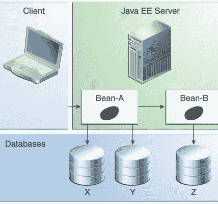

### 图 51-3 跨 Java EE 服务器更新多个数据库

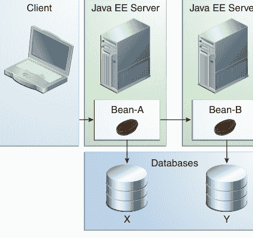

## 51.7 Web 组件中的事务

你可以使用 `java.sql.Connection` 或 `javax.transaction.UserTransaction` 接口在 Web 组件中界定事务。这些与使用豆管理事务的会话豆使用的接口相同。使用 `UserTransaction` 接口界定的事务将在 JTA 事务中讨论。

## 51.8 关于事务的更多信息

有关事务的更多信息，请参见 Java Transaction API 1.2 规范：https://www.jcp.org/en/jsr/detail?id=907。

# 资源适配器与合约

本章探讨了资源适配器，并解释了 Java EE 服务器与 EIS 系统之间的通信是如何通过它们进行调介的。
此处涵盖了以下主题：

- 什么是资源适配器？
- 元数据注解
- 通用客户端接口
- 在 Java EE 上和依赖注入 (CDI) 使用资源适配器
- 关于资源适配器的更多信息

## 52.1 什么是资源适配器？

资源适配器是一个 Java EE 组件，它为特定的 EIS（企业信息系统）实现 Java EE 连接器架构。EIS 的示例包括企业资源计划、主机事务处理和数据库系统。在 Java EE 服务器中，消息服务器和 JavaMail 也充当了 EIS。资源适配器促进了 Java EE 应用与 EIS 之间的通信。

### 图 52–1 资源适配器

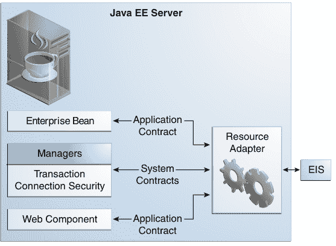

### 什么是资源适配器？

资源适配器存储在资源适配器归档（RAR）文件中，可以像 Java EE 应用一样部署在任何 Java EE 服务器上。RAR 文件可能包含在企业归档（EAR）文件中，也可能作为一个单独的文件存在。

资源适配器类似于 JDBC 驱动程序。两者都提供标准 API，应用程序可以通过 API 访问 Java EE 服务器之外的 EIS 资源。对于资源适配器，目标系统是 EIS；对于 JDBC 驱动程序，目标是 DBMS。资源适配器和 JDBC 驱动程序很少由应用程序开发者创建。大多数情况下，这两种软件都是由销售工具、服务器或集成存储的供应商构建的。

资源适配器通过合约调介 Java EE 服务器与 EIS 之间的通信。应用合约定义了 Java 组件（如企业豆）访问 EIS 的 API。该 API 是该组件对 EIS 的唯一视图。系统合约将资源适配器与由 Java EE 服务器管理的重要服务连接起来。资源适配器本身及其系统合约对于 Java EE 组件来说是透明的。

### 52.1.1 管理合约

Java EE 连接器架构定义了系统合约，以实现资源适配器的生命周期和线程管理。

#### 52.1.1.1 生命周期周期管理

连接器架构规范了生命周期管理合约，允许应用程序服务器管理资源适配器的生命周期。该合约为应用程序服务器提供了一种机制，在部署或应用程序服务器启动期间引导资源适配器实例。该合约还提供了一种手段，在资源适配器实例被卸载或应用程序服务器进行有序关闭时通知该实例。

#### 52.1.1.2 工作管理合约

架构的工作管理合约确保资源适配器以恰当、合理的方式被使用。该合约还允许应用程序服务器为资源适配器管理线程。

不当使用线程的资源适配器可能会危及整个应用程序服务器环境。例如，资源适配器可能会创建过多的线程，或者在创建后没有正确释放线程。糟糕的线程处理会影响应用程序服务器的性能，因为创建和销毁线程是非常昂贵的操作。

工作管理合约为应用程序服务器建立了一种池化和重用线程的方法，遵循此合约，资源适配器不需要自己管理线程。相反，资源适配器让应用程序服务器创建并提供所需的线程。当完成给定的线程的任务时，应用程序服务器将其返回池中以供以后重用或将其销毁。以这种方式处理线程可以提高性能并更高效地利用资源。除了线程管理外，连接器架构还为资源适配器提供了一个灵活的模型。

- 请求线程可以选择阻塞（停止其自身的执行），直到获取工作任务。
- 资源适配器可以选择将工作提交到队列。工作线程将在稍后的某点从队列中执行，无论线程何时提交该任务。通过这两种方法，提交线程和工作线程可以同时执行或独立执行。对于这些方法，合约规定了一种监听机制，以通知资源适配器其已完成操作。资源适配器还可以指定线程的执行上下文，而工作管理控制线程执行的上下文。

### 52.1.2 通用工作上下文合约

应用程序服务器与资源适配器之间的工作管理合约允许资源适配器通过交付用于执行的工作实例来完成任务，例如与 EIS 通信或递送消息。

通用工作上下文合约允许资源适配器控制应用程序服务器 `WorkManager` 执行其提交的工作实例的上下文。通用工作上下文机制还允许应用程序服务器支持消息流入和递送方案。它还为资源适配器提供了更丰富的上下文工作环境，同时在受管理环境中控制并发行为。

通用工作上下文合约标准化了事务上下文和安全上下文。

### 52.1.3 出站与入站合约

连接器架构定义了以下出站合约，即应用程序服务器与 EIS 之间的系统级合约，它们实现了对 EIS 的出站连接。

- 连接管理合约支持连接池，这是一种增强性能和可扩展性的技术。连接池对应用程序是透明的，应用程序只需连接到 EIS。
- 事务管理合约扩展了连接管理合约，并提供对本地事务和 XA 事务的管理。

本地事务限于单个 EIS 系统，由 EIS 资源管理器管理此类事务。XA 事务或全局事务需要事务管理器（通常与应用程序服务器一起提供）进行事务协调。事务管理器使用两阶段提交协议管理跨资源管理器的事务，如果只有一个资源管理器参与 X 事务，则使用单阶段优化。

- 安全管理合约为 Java EE 服务器与 EIS 之间提供了身份验证、授权和安全通信机制，以保护 EIS 中的信息。

工作安全映射将 EIS 标识映射到应用程序服务器域的标识。

入站合约（Inbound contracts）是 Java EE 服务器与 EIS 之间的系统，允许从 EIS 发起连接：包括消息提供者的可插拔合约以及导入事务的合约。

## 52.2 元数据注解

Java EE 连接器架构提供了一组注解，以减少对部署描述符的需求。

- `@Connector` 注解可以由资源适配器开发人员使用，用于指明该 JavaBeans 组件是一个资源适配器 JavaBeans 组件。此注解用于提供有关资源适配器能力的元数据。可选，你可以提供一个实现 `ResourceAdapter` 接口的 JavaBeans 组件，如下例：

```
@Connector(
    displayName = "TrafficResourceAdapter",
    vendorName = "Java EE Tutorial",
    version = "7.0"
)
public class TrafficResourceAdapter implements ResourceAdapter,
    Serializable {
    ...
};
```

- `@ConnectionDefinition` 注解定义了与连接类型相关的一组接口和类，如下例：

```
@ConnectionDefinition(
    connectionFactory = ConnectionFactory.class,
    connectionFactoryImpl = TradeConnectionFactory.class,
    connection = Connection.class,
    connectionImpl = TradeConnection.class
)
public class TradeManagedConnectionFactory {
    ...
};
```

- `@AdministeredObject` 注解将 JavaBeans 组件指定为受管理对象（administered object）。

- `@Activation` 注解包含与来自 EIS 实例的入站连接相关的配置信息，如下例：

```
@Activation(
    messageListeners = { TrafficListener.class }
)
public class TrafficActivationSpec implements ActivationSpec,
    Serializable {
    ...
    @ConfigProperty(
    /* 监听 EIS 请求的端口 */
    private String port;
    ...
};
```


- `@ConfigProperty` 注解可以使用在 JavaBeans 组件上，提供额外的配置信息，这些信息可能被部署程序和资源适配器提供程序使用。前面的示例代码展示了多个 `@ConfigProperty` 注解。

## 客户端接口

- `@ConnectionFactoryDefinition` 注解是一种资源定义，用于定义连接器连接工厂，并将其注册到 JNDI 中，名称由强制性元素 `name` 元素指定。强制性元素 `interfaceName` 元素指定了连接工厂接口的全限定名。`transactionSupport` 注解元素指定了连接工厂所需的事务支持级别。`minPoolSize` 和 `maxPoolSize` 注解指定了支持该连接工厂资源的连接池应分配的最小或最大连接数。与所定义的连接工厂相关的附加属性可以通过 `properties` 元素指定。

由于不允许重复使用注解，`@ConnectionFactoryDefinitions` 注解充当多个连接器工厂定义的容器。`value` 注解元素包含了多个连接定义。

- `@AdministeredObjectDefinition` 注解是一种资源定义，用于定义受管理对象，并将其注册到 JNDI 中，名称由强制性元素 `name` 元素指定。受管理对象类的强制全限定名必须通过 `className` 元素标识。受管理对象中必须配置的附加属性可以通过 `properties` 元素指定。

由于不允许重复使用注解，`@AdministeredObjectDefinitions` 注解充当多个受管理对象定义的容器。`value` 注解元素包含了多个受管理对象定义。

该规范允许以混合模式开发资源适配器，即这种模式具备了在应用程序中同时使用元数据注解和描述符的能力。应用程序组装器或部署程序可以使用部署描述符来覆盖资源适配器指定的元数据注解。

资源适配器的部署描述符如果存在，则命名为 `ra.xml`。`metadata-complete` 属性定义了资源适配器的部署描述符是否完整，或者是否需要检查与资源适配器打包的类文件，以查找指定部署信息的注解。

有关 Java EE 7 平台提供的注解和 JavaBeans 组件的完整列表，请参阅 Java EE Architecture 1.7 规范。

## 52.3 客户端接口

本节解释了组件如何使用连接器架构通用客户端接口（CCI）API 和资源适配器来从 EIS 获取数据。CCI API 定义了一组接口和类，其方法允许客户端执行数据访问操作。CCI 接口和类如下：

- `ConnectionFactory`：为应用程序组件提供指向 EIS 的连接实例。
- `Connection`：代表到底层 EIS 的连接。
- `ConnectionSpec`：为应用程序组件在发起连接请求时传递连接请求特定属性的方法。

## 在 Java EE 上和依赖注入 (CDI) 使用资源适配器

- `Interaction`：为应用程序组件提供执行 EIS 函数（例如存储过程）的方法。
- `InteractionSpec`：持有与组件与 EIS 交互相关的属性。
- `Record`：各种资源实例的接口。`Record` 实例可以是 `MappedRecord`、`IndexedRecord` 或 `ResultSet` 实例，它们都继承自 `Record` 接口。
- `RecordFactory`：为应用程序组件提供 `Record` 实例。
- `IndexedRecord`：代表基于 `java.util.List` 接口的 `Record` 实例集合。

使用 CDI 与 EIS 交互的客户端或应用程序按照规定的方式进行。组件必须与 EIS 的资源管理器建立连接，并通过 `ConnectionFactory` 实现。`Connection` 对象代表到 EIS 的连接，并用于后续与 EIS 的交互。

组件使用 `Interaction` 对象与 EIS 进行交互，例如访问特定表的数据。应用程序组件通过使用 `InteractionSpec` 对象定义 `Interaction`。当它从 EIS 读取数据（例如数据库表）或写入这些表时，应用程序组件通过使用特定类型的记录（`MappedRecord`、`IndexedRecord` 或 `ResultSet`）来实现。

注意，依赖 CCI 适配器的客户端应用程序与任何使用企业豆的 EE 客户端非常相似。

## 52.5 关于资源适配器的更多信息

有关资源适配器和注解的更多信息，请参阅：

- Java EE 7 平台规范 (JSR 342): http://jcp.org/en/jsr/detail?id=342
- Java EE 连接架构 1.7 规范: http://jcp.org/en/jsr/detail?id=322
- EJB 3.2 规范: http://jcp.org/en/jsr/detail?id=345
- Java 平台通用注解: http://www.jcp.org/en/jsr/detail?id=250

# 资源适配器示例

本章描述了两个示例，展示了如何在 Java EE 应用中使用资源适配器，以及如何实现简单的资源适配器。交易示例展示了如何使用一个简单的自定义客户端接口从 Web 应用程序连接到 EIS（企业信息系统）。流量示例中的资源适配器实现了出站契约（outbound contract）和自定义客户端接口。流量驱动的示例展示了如何使用消息驱动豆（MDB）处理来自 EIS 的流量信息更新。该示例中的资源适配器实现了入站契约（inbound contract）和工作管理契约。

- 交易示例 (trading Example)
- 流量示例 (traffic Example)

## 53.1 交易示例

交易示例演示了如何实现并使用一个简单的出站资源适配器，通过 TCP Socket 向旧 EIS 提交请求。该示例演示了图 53-1 所示的场景，由以下模块组成：

- `trading-eis`: 一个模拟旧 EIS 的 Java SE 程序
- `trading-rar`: 出站资源适配器的实现
- `trading-war`: 使用该资源适配器的 Web 应用程序
- `trading-ear`: 包含资源适配器和 Web 应用程序的企业级归档（EAR）

图 53-1 交易示例

| Java EE 服务器 |
| --- |
| trading-war (WAR) |
| ↓ |
| trading.rar.api.* | TCP Socket → | trading-eis (EIS) |
| trading-rar (资源适配器) | |

`trading-eis` 模块是一个辅助项目，类似于一个旧的股票交易执行平台。它包含一个 Java SE 程序，在 TCP Socket 上监听明文格式的交易请求。该程序通过状态值、确认号以及请求份额和费用的美元金额对交易请求进行回复。例如，一个请求-响应对可能如下：

```
>> BUY 1000 ZZZZ MARKET
>> EXECUTE #1234567 50400.00 FEE 252.00
```

`trading-rar` 模块实现了 Java EE 连接架构的出站契约，用于向旧的股票交易执行平台提交订单并获取响应。`trading-rar` 模块为 Java EE 应用程序提供了一个自定义客户端接口。这比通用客户端接口（CCI）更简单。

`trading-war` 模块是一个带有 JavaServer 接口和托管豆（managed bean）的 Web 应用程序。该应用程序允许客户端使用 `trading-rar` 模块提供的资源适配器向 EIS 提交交易。`trading-war` 模块使用资源适配器提供的自定义接口来获取到 EIS 的连接。

### 53.1.1 使用出站资源适配器

大多数情况下，Java EE 开发人员使用第三方出站资源适配器。出站资源适配器要么实现通用客户端接口（CCI），要么为应用程序与 EIS 交互提供自定义接口。出站资源适配器为 Java EE 应用程序提供以下元素：

- 连接因素（Connection factors）
- 连接句柄（Connection handles）
- 其他特定于 EIS 领域的接口和对象

Java EE 应用程序通过资源注入获取连接工厂的实例，然后使用工厂对象获取到 EIS 的连接句柄。连接句柄允许应用程序向 EIS 发起请求并从中获取信息。

`trading-rar` 模块提供了一个自定义客户端接口，由表 53–1 列出的类组成。

| 表 53–1 javaeetutorial.trading.rar.api 中的类和接口 |
| --- | --- |
| `TradeOrder` | 代表交易的订单 |
| `TradeResponse` | 来自 EIS 的响应 |
| `TradeConnection` | 代表 EIS 的连接句柄 |
| `TradeConnectionFactory` | 应用程序获取 EIS 连接的工厂 |
| `TradeProcessingException` | 表示处理时发生了错误 |

当部署了 `trading-archive` 并按照“使用出站资源适配器”中的说明配置了连接池资源时，应用程序会创建 `TradeConnectionFactory` 对象，应用程序可以通过资源注入来获取这些对象。`TradeConnectionFactory` 的实现将创建连接的任务委托给应用程序服务器提供的连接管理器。

连接管理器使用 `ManagedConnectionFactory` 实现来获取到 EIS 的物理连接，并维护一个活动物理连接池。当应用程序请求一个句柄时，连接管理器会将池中的一个连接与应用程序可以使用的新连接句柄关联。连接池提高了应用程序的性能，并简化了资源适配器的开发。

有关更多的详细信息，请参阅 `trading-rar` 模块中的代码和注释。

## 53.1 运行交易用例

你可以使用 NetBeans IDE 或 Maven 来构建、打包、部署和运行交易用例。

### 53.3.1 使用 NetBeans IDE 运行交易用例

- 确保 GlassFish 服务器已启动（参见“启动和停止 GlassFish 服务器”）。
- 从“文件”（File）菜单中选择“打开项目”（Open Project）。
- 在“打开项目”对话框中，导航到：
```
tut-install/examples/connectors
```
- 选择 `trading` 文件夹。
- 点击“打开项目”。
- 在“项目”（Projects）选项卡中，展开 `trading-eis` 模块并选择“打开节点”（Open Node）。
- 右键点击 `trading-eis` 项目并选择“运行”（Run）。

来自 EIS 的消息出现在“输出”（Output）选项卡中：
```
Trading execution server listening on port 4004.
```
- 右键点击 `trading-ear` 项目并选择“构建”（Build）。

此命令将资源适配器和 Web 应用程序打包进 EAR 文件并部署到 GlassFish 服务器。
- 在浏览器中打开以下 URL：
```
http://localhost:8080/
```
Web 界面允许你连接到 EIS 并提交交易。服务器日志显示了来自 Web 应用程序的请求以及提供资源适配器连接句柄的调用序列。
- 在部署 `trading-ear` 应用程序之前，从状态栏关闭 `trading-eis` 应用程序。

### 53.1.3.2 使用 Maven 运行交易用例

1. 确保 GlassFish 服务器已启动（启动和停止 GlassFish 服务器）。
2. 在终端窗口中，进入：
`tut-install/examples/connectors/trading/`
3. 输入以下命令：
`mvn install`

此命令将资源适配器和 Web 应用程序构建并打包成 EAR 存档并部署到 GlassFish 服务器。
4. 在同一个终端窗口中，进入 `trading-eis` 目录：
`cd trading-eis`
5. 输入以下命令运行交易执行平台：
`mvn exec:java`

来自 EIS 的消息出现在终端窗口：
`Trade execution server listening on port 4004.`
6. 在浏览器中打开以下 URL：
`http://localhost:8080/trading/`
Web 界面允许你连接到 EIS 并提交交易。服务器日志显示了来自 Web 应用程序的请求以及提供资源适配器连接句柄的序列链。
7. 在部署 `trading-ear` 应用程序之前，在终端窗口上按 Ctrl+C 关闭 `trading-eis` 应用程序。

## 53.2 流量用例

流量用例演示了如何实现和使用一个简单的入站资源适配器，该适配器通过 TCP Socket 接收来自旧 EIS 的数据。

示例位于 `tut-install/examples/connectors/traffic` 目录。请参阅第 2 章“使用教程示例”获取有关构建和运行示例应用程序的基本信息。

该示例演示了图 53–3 中的场景，并由以下模块组成：

- `traffic-eis`: 一个模拟 EIS 的 Java SE 程序
- `traffic-rar`: 入站资源适配器实现
- `traffic-ejb`: 一个消息驱动豆（MDB），作为入站消息的端点
- `traffic-war`: 一个显示来自消息驱动豆信息的 Web 应用程序
- `traffic-ear`: 一个包含资源适配器、消息驱动豆和 Web 应用程序的企业存档

## 图 53-3 流量用例

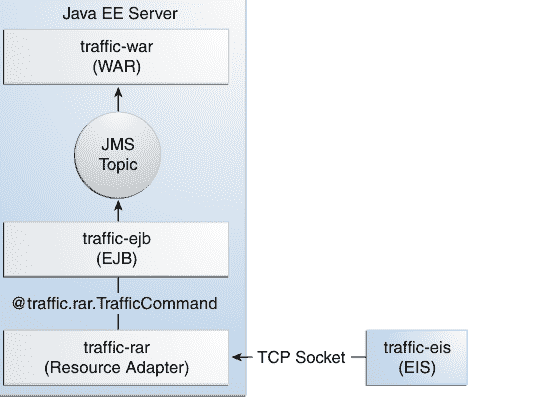

`traffic-eis` 模块是一个辅助项目，类似于一个旧的流量信息系统。它包含一个 Java SE 程序，向任何订阅的客户端发送多个城市的流量状态更新。该程序通过 TCP Socket 以 JSON 格式发送更新。例如，流量数据看起来如下所示：

```json
{
  "city":"City1", "access":"AccessA", "status":"GOOD",
  "city":"City1", "access":"AccessB", "status":"CONGESTED",
  "city":"City5", "access":"AccessE", "status":"SLOW"
}
```

`traffic-rar` 模块实现了 Java EE 连接器架构（Connector Architecture）的入站连接架构。该模块使用 MDB 配置指定的 TCP 端口订阅流量信息系统，并调用 MDB 的方法来处理流量信息更新。

`traffic-ejb` 模块包含一个消息驱动豆，该豆通过一个配置参数（订阅流量信息系统的 TCP 端口）激活资源适配器。MDB 包含一个处理流量信息更新的方法。该方法对 Java 消息服务（JMS）主题过滤更新。

`traffic-war` 模块包含一个消息驱动豆，它异步地从 JMS 主题接收过滤后的信息更新并将其发送给客户端。

### 53.2.1 使用入站资源适配器

在大多数情况下，这是由第三方开发的 Java EE 应用程序。要使用入站资源适配器，Java EE 应用程序包含一个具有以下特征的消息驱动豆：

- MDB 实现了资源适配器定义的业务接口。
- MDB 指定了激活入站资源适配器的配置参数。
- 业务接口特定于该应用程序。

示例中的 MDB 定义如下：

```java
@MessageDriven(
  activationConfig = {
    @ActivationConfigProperty(propertyName="port", propertyValue="4008")
  }
)
public class TrafficMDB implements TrafficListener { ... }
```

`TrafficListener` 接口定义在资源适配器的 API 包。当 MDB 激活入站适配器时，容器过滤更新并发布到 JMS 主题。

在这种情况下，`TrafficListener` 接口是空的。除了此接口，资源适配器提供了 `TrafficCommand` 注解，并使用反射发现 MDB 中装饰了该注解的方法：

```java
@MessageDriven(...)
public class TrafficMDB {
  @TrafficCommand(name="report", info="Process report")
  public void processReport(String jsonReport) { ... }
}
```

这种方法允许你在不修改 `TrafficListener` 接口或资源适配器模块的情况下，适配 MDB 以支持 EIS 的新功能。

### 53.2.2 实现入站资源适配器

`traffic-rar` 模块为示例中使用的简单流量信息系统（EIS）实现了入站资源适配器合约。入站资源适配器的架构如图 53–4 所示。

## 图 53–4 流量用例的架构

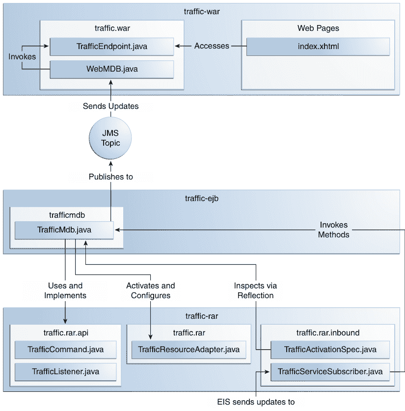

`traffic-rar` 模块实现了表 53–3 列出的接口。

表 53–3 traffic-rar 模块实现的接口

| 包 | 接口 | 描述 |
| --- | --- | --- |
| `javax.resource.spi` | `ResourceAdapter` | 定义资源适配器的生命周期方法。 |
| `javax.resource.spi` | `ActivationSpec` | 定义激活入站资源适配器的 MDB 配置参数。 |
| `javax.resource.spi` | `Work` | 服务资源订阅者实现工作管理合约接口，以便在单独线程上等待流量更新。 |

当 MDB 激活入站资源适配器时，容器调用 `TrafficResourceAdapter` 类中的 `endpointActivation` 方法：

```java
@Connector(...)
public class TrafficResourceAdapter implements ResourceAdapter, Serializable {
```


## 流量示例

```java
@Override
public void endpointActivation(MessageEndpointFactory endpointFactory,
        ActivationSpec spec) throws ResourceException {
    Class endpointClass = endpointFactory.getEndpointClass();
    /* * 此方法从示例中的新线程中调用：
    MessageEndpoint endpoint = endpointFactory.createEndpoint(null); */
}
```

`getEndpoint` 方法返回执行激活的 MDB 的类类型，这允许资源适配器使用反射来查找 MDB 中带有 `@TrafficCommand` 注解的方法。

`createEndpoint` 方法返回 MDB 的实例。资源适配器在从 EIS 接收请求时，使用该实例来调用 MDB 的方法。

在获取消息端点实例（MDB）后，资源适配器使用工作管理合约创建服务订阅线程，接收来自 EIS 的流量更新。资源适配器通过以下方式从启动上下文获取 `WorkManager` 实例：

```java
WorkManager manager;

@Override
public void start(BootstrapContext ctx) {
    manager = ctx.getManager();
}
```

资源适配器使用 `manager` 调度服务订阅线程：

```java
tSubscriber = new TrafficServiceSubscriber(tSpec, endpoint);
workManager.scheduleWork(tSubscriber);
```

`TrafficService` 类实现了管理合约中的 `javax.resource.spi.Work` 接口。

流量服务订阅线程使用反射来调用 MDB 中的方法：

```java
private String callMBean(MessageEndpoint mdb, Method command,
        String... params) {
    String resp;
    /* 此代码在源码中包含适当的异常处理 */
    mdb.beforeDelivery(command);
    Object ret = command.invoke(mdb, Object[] params);
    resp = (String) ret;
    mdb.afterDelivery(command);
    return resp;
}
```

详情，请参阅 `traffic-rar` 模块中的代码和注释。

## 5.3.3 运行流量示例

你可以使用 NetBeans IDE 或 Maven 来构建、打包、部署和运行流量示例。

### 5.3.3.1 使用 NetBeans IDE 运行流量示例

1. 确保 GlassFish 服务器已启动（参见“启动和停止 GlassFish 服务器”）。
2. 从“文件（File）”菜单选择“打开项目（Open Project）”。
3. 在项目对话框中，导航到：
   `tut-install/examples/connectors`
4. 选择 `traffic` 文件夹。
5. 点击“打开项目（Open Project）”。
6. 在“项目（Projects）”选项卡中，展开 `traffic` 节点。
7. 右键点击 `traffic-eis` 模块并选择“打开项目（Open Project）”。
8. 右键点击 `traffic-eis` 项目并选择“运行（Run）”。

来自 EIS 的消息出现在“输出（Output）”选项卡上：
Traffic EIS accepting connections on port 4008

9. 在“项目（Projects）”选项卡中，右键点击 `traffic` 项目并选择“清理并构建（Clean and Build）”。
   该命令将资源适配器、MDB 和 Web 应用程序构建并打包成 EAR 存档并部署。服务器会记录激活资源适配器的调用序列以及针对 City1 的过滤流量更新。
10. 在浏览器中打开以下 URL：
    `http://localhost:8080/traffic/`

    Web 界面每隔几秒显示一次 City1 的过滤流量更新。
11. 在卸载 `traffic-eis` 后，从状态栏关闭 `traffic-eis`。

### 5.3.3.2 使用 Maven 运行流量示例

1. 确保 GlassFish 服务器已启动（参见“启动和停止 GlassFish 服务器”）。
2. 在终端窗口中，进入：
   `tut-install/examples/connectors/traffic/traffic-eis/`
3. 在终端窗口中输入以下命令：
   `mvn install`

   该命令构建并打包流量 EIS。
4. 在终端窗口中输入以下命令：
   `mvn exec:java`

   来自 EIS 的消息出现在终端窗口中：
   Traffic EIS accepting connections on port 4008

   保持此终端窗口打开。
5. 打开一个新的终端窗口并进入：
   `tut-install/examples/connectors/traffic/`
6. 输入以下命令：
   ```bash
   mvn install
   ```
   该命令将资源适配器、MDB 和 Web 应用程序构建并打包成 EAR 存档并部署。服务器日志显示了激活资源适配器的调用序列以及针对 City1 的过滤流量更新。
7. 在浏览器中打开 URL：
   `http://localhost:8080/traffic/`

   Web 界面每隔几秒显示一次 City1 的过滤流量更新。
8. 在卸载 `traffic-ear` 应用程序后，在第一个终端窗口按 Ctrl+C 关闭 `traffic-eis` 应用程序。

## 54 使用 Java EE 拦截器

本章讨论了如何创建拦截器类和方法，以便在目标类的方法调用或生命周期事件上进行干预。

此处介绍了以下主题：

- 拦截器概述
- 使用拦截器
- 拦截器示例应用程序

## 54.1 拦截器概述

拦截器与 Java EE 管理类结合使用，允许开发者在方法调用或生命周期事件期间，在关联的目标类上调用拦截器方法。拦截器的常见用途包括日志记录、审计和性能分析。

虽然拦截器是 Enterprise JavaBeans 3.2 和 Java EE 1.1 上下文依赖注入（CDI）的一部分，但它们仍与 Java EE 管理类结合使用，允许开发者在关联的目标类上调用拦截器方法。

## 54.2 使用拦截器

在获取消息端点实例（MDB）后，资源适配器使用工作管理合约创建服务订阅线程，接收来自 EIS 的流量更新。资源适配器通过以下方式获取 `WorkManager` 实例：

```java
WorkManager manager;

@Override
public void start(BootstrapContext ctx) {
    manager = ctx.getManager();
}
```

资源适配器使用 `manager` 调度服务订阅线程：

```java
tSubscriber = new TrafficServiceSubscriber(tSpec, endpoint);
workManager.scheduleWork(tSubscriber);
```

`TrafficService` 类实现了管理合约中的 `javax.resource.spi.Work` 接口。

流量服务订阅线程使用反射来调用 MDB 中的方法：

```java
private String callMBean(MessageEndpoint mdb, Method command,
        String... params) {
    String resp;
    /* 此代码在源码中包含适当的异常处理 */
    mdb.beforeDelivery(command);
    Object ret = command.invoke(mdb, Object[] params);
    resp = (String) ret;
    mdb.afterDelivery(command);
    return resp;
}
```

详情，请参阅 `traffic-rar` 模块中的代码和注释。

```java
@Schedule(minute="*/", hour="*")
public void automaticTimerMethod() { ... }
```

```java
@AroundTimeout
public void timeoutInterceptorMethod(InvocationContext ctx) { ... }
```

如果你正在使用拦截器类，请使用 `javax.interceptor.Interceptors` 注解在目标类的类级别或方法级别声明一个或多个拦截器。以下代码在类级别上声明了拦截器：

```java
@Stateless
@Interceptors({PrimaryInterceptor.class, SecondaryInterceptor.class})
public class OrderBean { ... }
```

以下代码声明了一个方法级的拦截器类：

```java
@Stateless
public class OrderInterceptor {
    ...
    @Interceptors(Order.class)
    public void placeOrder(Order order) { ... }
}
```

## 54.2.1 拦截器方法创新

使用 `@AroundInvoke` 注解为托管对象的方法指定拦截器方法。每个类只允许一个环绕调用（around-invoke）拦截器方法。拦截器方法的形式如下：

```java
@AroundInvoke
visibility Object method-name(InvocationContext ctx) throws Exception { ... }
```

例如：

```java
@AroundInvoke
public void interceptOrder(InvocationContext ctx) { ... }
```

环绕调用拦截器方法可以具有公共、私有、保护或包级访问权限，且不能是静态或最终的。

环绕拦截器可以调用其所拦截的目标方法可调用的任何组件或资源，可以具有与目标方法相同的安全和事务上下文，可以在与目标方法相同的 Java 虚拟机调用堆栈中运行。

环绕调用拦截器可以抛出运行时异常以及目标方法 `throws` 子句允许的任何异常。它们可以捕获并抑制异常，然后通过调用 `InvocationContext.proceed` 方法来恢复。

### 54.2.1.1 使用多个方法拦截器

使用 `@Interceptors` 注解为目标方法或类声明多个拦截器：

```java
@Interceptors({PrimaryInterceptor.class, SecondaryInterceptor.class, LastInterceptor.class})
public void updateInfo(String info) { ... }
```

`@Interceptors` 注解中拦截器的顺序是拦截器被调用的顺序。

你也可以在部署描述符中定义多个拦截器。部署描述符中的顺序是拦截器被调用的顺序：

```xml
<interceptor-binding>
    <target-name>myapp.OrderBean</target-name>
    <interceptor-class>myapp.PrimaryInterceptor.class</interceptor-class>
    <interceptor-class>myapp.SecondaryInterceptor.class</interceptor-class>
    <interceptor-class>myapp.LastInterceptor.class</interceptor-class>
    <method-name>updateInfo</method-name>
</interceptor-binding>
```

要显式将控制权传递链中的下一个拦截器，请调用 `InvocationContext.proceed()` 方法。

数据可以在拦截器之间共享：

- 对于特定的目标方法，同一个 `InvocationContext` 实例作为输入参数传递给拦截器链中的每个拦截器。`InvocationContext` 的 `contextData` 属性用于跨拦截器方法传递数据。`contextData` 属性是一个 `java.util.Map<String, Object>`。存储在 `contextData` 中的数据可以被链下游的拦截器方法访问。
- 存储在 `contextData` 中的数据无法在不同的目标类调用之间共享。也就是说，目标类中方法的每次调用都会创建一个不同的 `InvocationContext` 对象。

## 54.2.2 从拦截器类访问方法参数

你可以使用传递给每个环绕调用方法的 `InvocationContext` 实例来访问和修改目标方法的参数。`InvocationContext` 的 `parameters` 属性是一个 `Object` 实例的数组，对应于目标方法的参数。例如，对于以下目标方法，传递给环绕调用拦截器方法的 `InvocationContext` 中的 `parameters` 属性是一个包含两个 `String` 对象（`firstName` 和 `lastName`）和一个 `Date` 对象（`date`）的 Object 数组：

```java
@Interceptors(PrimaryInterceptor.class)
public void updateInfo(String firstName, String lastName, Date date) { ... }
```


你可以分别通过使用 `InvocationContext.getParameters()` 和 `InvocationContext.setParameters()` 来访问和修改参数。

## 54.2.2 拦截生命周期事件

生命周期事件拦截器（构造前、构造后和销毁前）可以定义在目标类或拦截器类中。`javax.AroundConstruct` 注解将该方法指定为拦截器方法，用于拦截目标类构造函数的调用。`javax.annotation.PostConstruct` 注解用于将方法指定为构造后生命周期事件拦截器。`javax.annotation.PreDestroy` 注解用于将方法指定为销毁前生命周期事件拦截器。

### 54.2.2.1 使用构造前拦截器方法

使用 `@AroundInvoke` 注解为托管对象的方法指定拦截器方法。每个类只允许一个环绕调用（around-invoke）拦截器方法。环绕调用拦截器的形式如下：

```java
@AroundInvoke
visibility Object method-name(InvocationContext ctx) throws Exception { ... }
```

例如：

```java
@AroundInvoke
public void interceptOrder(InvocationContext ctx) { ... }
```

环绕调用拦截器方法可以具有公共、私有、保护或包级访问权限，且不能是静态或最终的。

环绕拦截器可以调用其所拦截的目标方法可调用的任何组件或资源，可以具有与目标方法相同的安全和事务上下文，可以在与目标方法相同的 Java 虚拟机调用堆栈中运行。

环绕调用拦截器可以抛出运行时异常以及目标方法 `throws` 子句允许的任何异常。它们可以捕获并抑制异常，然后通过调用 `InvocationContext.proceed` 方法来恢复。

### 54.2.2.2 使用多个拦截器方法

使用 `@Interceptors` 注解为目标方法或类声明多个拦截器：

```java
@Interceptors((PrimaryInterceptor.class, SecondaryInterceptor.class, LastInterceptor.class))
public void updateInfo(String info) { ... }
```

`@Interceptors` 注解中拦截器的顺序是拦截器被调用的顺序。

你也可以在部署描述符中定义多个拦截器。部署描述符中的顺序是拦截器被调用的顺序：

```xml
<interceptor-binding>
<target-name>myapp.OrderBean</target-name>
<interceptor-class>myapp.PrimaryInterceptor.class</interceptor-class>
<interceptor-class>myapp.SecondaryInterceptor.class</interceptor-class>
<interceptor-class>myapp.LastInterceptor.class</interceptor-class>
<method-name>updateInfo</method-name>
</interceptor-binding>
```

要显式将控制权传递链中的下一个拦截器，请调用 `InvocationContext.proceed()` 方法。

数据可以在拦截器之间共享：

- 对于特定的目标方法，同一个 `InvocationContext` 实例作为输入参数传递给拦截器链中的每个拦截器。`InvocationContext` 的 `contextData` 属性用于跨拦截器方法传递数据。`contextData` 属性是一个 `java.util.Map<String, Object>`。存储在 `contextData` 中的数据可以被链下游的拦截器方法访问。
- 存储在 `contextData` 中的数据无法在不同的目标类调用之间共享。也就是说，目标类中方法的每次调用都会创建一个不同的 `InvocationContext` 对象。

## 54.2.3 从拦截器类访问方法参数

你可以使用传递给每个环绕调用方法的 `InvocationContext` 实例来访问和修改目标方法的参数。`InvocationContext` 的 `parameters` 属性是一个 `Object` 实例的数组，对应于目标方法的参数。例如，对于以下目标方法，传递给 `PrimaryInterceptor` 中环绕调用拦截器方法的 `InvocationContext` 中的 `parameters` 属性是一个包含两个 `String` 对象（`firstName` 和 `lastName`）和一个 `Date` 对象（`date`）的 Object 数组：

```java
@Interceptors(PrimaryInterceptor.class)
public void updateInfo(String firstName, String lastName, Date date) { ... }
```

你可以分别通过使用 `InvocationContext.getParameters()` 和 `InvocationContext.setParameters()` 来访问和修改参数。

## 54.2.4 拦截生命周期事件

生命周期事件拦截器（构造前、构造后和销毁前）可以定义在目标类或拦截器类中。`javax.AroundConstruct` 注解将该方法指定为拦截器方法，用于拦截目标类构造函数调用的。`javax.annotation.PostConstruct` 注解用于将方法指定为构造后生命周期事件拦截器。`javax.annotation.PreDestroy` 注解用于将方法指定为销毁前生命周期事件拦截器。


```xml
<interceptor-class>myapp.SecondaryInterceptor.class</interceptor-class>

<interceptor-class>myapp.LastInterceptor.class</interceptor-class>

<method-name>updateInfo</method-name>

</interceptor-binding>
```

要显式将控制权传递链中的下一个拦截器，请调用 `InvocationContext.proceed()` 方法。

数据可以在拦截器之间共享：

- 对于特定的目标方法，同一个 `InvocationContext` 实例作为输入参数传递给拦截器链中的每个拦截器。`InvocationContext` 的 `contextData` 属性用于跨拦截器方法传递数据。`contextData` 属性是一个 `java.util.Map<String, Object>`。存储在 `contextData` 中的数据可以被链下游的拦截器方法访问。
- 存储在 `contextData` 中的数据无法在不同的目标类调用之间共享。也就是说，目标类中方法的每次调用都会创建一个不同的 `InvocationContext` 对象。

## 54.2.1 从拦截器类访问方法参数

你可以使用传递给每个环绕调用方法的 `InvocationContext` 实例来访问和修改目标方法的参数。`InvocationContext` 的 `parameters` 属性是一个 `Object` 实例的数组，对应于目标方法的参数。例如，对于以下目标方法，传递给 `PrimaryInterceptor` 中环绕调用拦截器方法的 `InvocationContext` 中的 `parameters` 属性是一个包含两个 `String` 对象（`firstName` 和 `lastName`）和一个 `Date` 对象（`date`）的 Object 数组：

```java
@Interceptors(PrimaryInterceptor.class)
public void updateInfo(String firstName, String lastName, Date date) { ... }
```

你可以分别通过使用 `InvocationContext.getParameters()` 和 `InvocationContext.setParameters()` 来访问和修改参数。

## 54.2.2 拦截生命周期事件

生命周期事件拦截器（构造前、构造后和销毁前）可以定义在目标类或拦截器类中。`javax.AroundConstruct` 注解将该方法指定为拦截器方法，用于拦截目标类构造函数调用的。`javax.annotation.PostConstruct` 注解用于将方法指定为构造后生命周期事件拦截器。`javax.annotation.PreDestroy` 注解用于将方法指定为销毁前生命周期事件拦截器。


<target-name>myapp.OrderBean</target-name>

<interceptor-class>myapp.PrimaryInterceptor.class</interceptor-class>

<interceptor-class>myapp.SecondaryInterceptor.class</interceptor-class>

<interceptor-class>myapp.LastInterceptor.class</interceptor-class>

<method-name>updateInfo</method-name>

</interceptor-binding>

```
要显式将控制权传递链中的下一个拦截器，请调用 `InvocationContext.proceed()` 方法。

数据可以在拦截器之间共享：

- 对于特定的目标方法，同一个 `InvocationContext` 实例作为输入参数传递给拦截器链中的每个拦截器。`InvocationContext` 的 `contextData` 属性用于跨拦截器方法传递数据。`contextData` 属性是一个 `java.util.Map<String, Object>`。存储在 `contextData` 中的数据可以被链下游的拦截器方法访问。
- 存储在 `contextData` 中的数据无法在不同的目标类调用之间共享。也就是说，目标类中方法的每次调用都会创建一个不同的 `InvocationContext` 对象。

## 54.2.1 从拦截器类访问方法参数

你可以使用传递给每个环绕调用方法的 `InvocationContext` 实例来访问和修改目标方法的参数。`InvocationContext` 的 `parameters` 属性是一个 `Object` 实例的数组，对应于目标方法的参数。例如，对于以下目标方法，传递给 `PrimaryInterceptor` 中环绕调用拦截器方法的 `InvocationContext` 中的 `parameters` 属性是一个包含两个 `String` 对象（`firstName` 和 `lastName`）和一个 `Date` 对象（`date`）的 Object 数组：

```java
@Interceptors(PrimaryInterceptor.class)
public void updateInfo(String firstName, String lastName, Date date) { ... }
```

你可以分别通过使用 `InvocationContext.getParameters()` 和 `InvocationContext.setParameters()` 来访问和修改参数。

## 54.2.2 拦截生命周期事件

生命周期事件拦截器（构造前、构造后和销毁前）可以定义在目标类或拦截器类中。`javax.AroundConstruct` 注解将该方法指定为拦截器方法，用于拦截目标类构造函数调用的。`javax.annotation.PostConstruct` 注解用于将方法指定为构造后生命周期事件拦截器。`javax.annotation.PreDestroy` 注解用于将方法指定为销毁前生命周期事件拦截器。

在自定义注解定义中使用 `javax.interceptor.InterceptorBinding` 注解，并使用 `@Target` 指定目标，设置一个或多个 `TYPE`（类级拦截器）、`METHOD`（方法级拦截器）、`CONSTRUCTOR`（构造函数拦截器）或任何其他有效目标：

```java
@InterceptorBinding
@Target({TYPE, METHOD})
@Retention(RUNTIME)
@Inherited
public @interface Logged { ... }
```

拦截器绑定类型也可以应用于其他的拦截器绑定类型：

```java
@Logged
@InterceptorBinding
@Target({TYPE, METHOD})
@Retention(RUNTIME)
@Inherited
public @interface Secured { ... }
```

## 54.2.4.1 在拦截器类上声明拦截器绑定

使用拦截器绑定类型和 `@Interceptor` 注解标记拦截器类，将拦截器绑定与拦截器类关联：

```java
@Logged
@Interceptor
public class LoggingInterceptor {
  @AroundInvoke
  public Object logInvocation(InvocationContext ctx) throws Exception { ... }
}
```

一个拦截器类可以声明多个拦截器绑定类型，且多个拦截器类可以声明同一个拦截器绑定类型。

如果拦截器类拦截的是生命周期回调，它只能声明目标为 `Target(TYPE)` 的拦截器绑定类型；在 `@AroundConstruct` 生命周期回调的情况下，目标为 `Target(CONSTRUCTOR)`。

## 54.2.4.2 将组件绑定到拦截器

将拦截器绑定注解添加到组件的类、方法或构造函数上。拦截器绑定类型的应用规则与以下相同：

```java
@Logged
public class Message {
  @Secured
  public void getConfidentialMessage() { ... }
}
```


如果组件具有类级拦截器绑定，则该类不能是 `final` 的，且不能具有任何非静态、非私有的 `final` 方法。如果某个非静态、非私有方法应用了拦截器绑定，则该方法不能是 `final` 的，且组件类不能是 `final` 的。

## 54.2.5 拦截器的排序

多个拦截器被调用的顺序由以下规则决定。

- 默认拦截器定义在部署描述符中，并首先被调用。它们可以指定调用顺序，或覆盖使用注解指定的顺序。默认拦截器按照它们在部署描述符中定义的顺序被调用。
- 拦截器类在 `@Interceptor` 注解中的列出顺序定义了拦截器的调用顺序。在 `@Interceptor` 注解内列出的拦截器的，任何 `@Priority` 设置都会被忽略。
- 如果拦截器有子类，则定义在父类上的拦截器首先被调用，从最通用的父类开始。
- 拦截器类可以通过在 `javax.annotation.Priority` 注解中设置值，来设置拦截器方法的优先级。
- 在拦截器类内部的拦截器被调用后，目标类的构造函数、`around-invoke` 或 `around-timeout` 的调用顺序与 `@Interceptor` 内部的拦截器调用顺序相同。
- 如果目标类有子类，则定义在父类上的拦截器首先被调用，从最通用的父类开始。

`@Priority` 注解要求一个 `int` 值作为元素。数字越小，关联拦截器的优先级越高。

> 注意：具有相同优先级的拦截器的调用顺序取决于具体实现。

`javax.interceptor.Interceptor.Priority` 类定义了表 54–2 中列出的优先级常量。

| 表 54-2 拦截器优先级常量 |
| 优先级常量 | 值 | 描述 |
|---|---|---|
| PLATFORM_BEFORE | 0 | 由 Java EE 平台定义并旨在在调用链早期调用的拦截器应使用 `PLATFORM_BEFORE` 到 `LIBRARY_BEFORE` 之间的范围。这些拦截器的优先级最高。 |
| LIBRARY_BEFORE | 1000 | 由扩展库定义且应在拦截器链早期调用的拦截器应使用 `LIBRARY_BEFORE` 到 `APPLICATION` 之间的范围。 |
| APPLICATION | 2000 | 定义的拦截器应使用 `APPLICATION` 到 `LIBRARY_AFTER` 之间的范围。 |
| LIBRARY_AFTER | 3000 | 由扩展库定义的拦截器应使用 `LIBRARY_AFTER` 到 `PLATFORM_AFTER` 之间的范围。 |
| PLATFORM_AFTER | 4000 | 由 Java EE 平台定义的拦截器。 |

## 55 批处理

本章描述了 Java 平台 JSR 352 的批处理应用程序，它提供了对定义、实现和运行批作业的支持。批作业是在无需用户交互的情况下执行的任务。批处理框架由基于 XML 的作业规范语言、Java API 和批处理运行时组成。

某些企业级应用任务可以在无需用户交互的情况下执行。这些任务定期执行，或在资源使用率低时执行，它们通常处理大量信息，例如日志文件、数据库记录或图像。示例包括账单生成、数据格式转换和图像处理。这些任务被称为批作业。

**批处理**是指在计算机系统上运行批作业。Java EE 包含一个批处理框架，该框架为所有批处理应用程序提供批处理基础设施，使开发者能够专注于其批处理应用程序的业务逻辑。批处理框架由基于 XML 的作业规范语言、一组用于实现业务逻辑的应用类的批处理注解和接口、一个管理批作业执行的批处理容器，以及与批处理容器交互的辅助类和接口组成。

本文涵盖了以下主题：

- 批处理简介
- Java EE 中的批处理
- 简单用例
- 使用作业规范产物
- 创建批处理产物
- 将作业提交到批处理运行时
- 打包批处理应用程序
- webserver 示例应用程序
- phonebilling 示例应用程序
- 关于批处理的更多信息

## 55.1 批处理简介

**批作业**可以在无需用户交互的情况下完成。例如，考虑一个从企业信息系统读取通话记录并为每个账户生成月账单的电话账单应用程序。由于该应用程序不需要任何用户交互，它可以作为批作业运行。

### 电话账单应用程序包含两个阶段

第一阶段将注册中的每次通话与月账单关联，第二阶段计算每张账单的税费和应付总额。这些每个阶段都是批作业的一个步骤。

批处理应用程序指定一组步骤及其执行顺序。不同的框架可能会指定额外的元素，例如决策元素或并行运行的步骤组。接下来的章节将详细描述步骤，并提供有关批处理框架其他常见特征的信息。

### 55.1.1 批作业中的步骤

步骤是批作业中独立且顺序的阶段。批作业包含块密集型步骤和任务导向型步骤。

- **块密集型步骤** 通过从数据源读取项、对每个项应用某些业务逻辑并存储结果来处理数据。块密集型步骤一次读取并处理一个项，并将结果分组成一个块。当块达到可配置的大小时就会存储结果。块密集型处理使得结果存储更高效，并有助于事务界定。

块密集型步骤包含三个部分：

- **输入检索部分** 从数据源中一次读取一个项，例如数据库中的条目、目录中的文件或日志文件中的条目。
- **业务处理部分** 使用应用程序定义的业务逻辑一次处理一个项。示例包括过滤、格式化以及访问项中的数据以得出结果。
- **输出写入部分** 一次启动一个处理过的项的块。

块密集型步骤通常是长时间运行的，因为它们处理大量数据。批处理框架允许块密集型步骤使用检查点标记进度。被中断的块密集型步骤可以从上一个检查点重启。块密集型步骤的输入检索和输出写入部分在处理每个块后保存当前位置，并在重启时恢复它。

> 图 55-1 批作业中的块密集型步骤

| 作业 | | |
|---|---|---|
| STEP A | | |
| 输入检索 | 业务处理 | 输出写入 |
| STEP B | | |
| 输入检索 | 业务处理 | 输出写入 |

- **任务导向型步骤** 执行处理数据源项以外的其他任务。示例包括创建或检索目录、移动文件、创建或删除数据库表、配置资源等。与块密集型步骤相比，任务导向型步骤并不一定长时间运行。

例如，电话账单应用程序包含两个块密集型步骤。

在第一个步骤中，输入检索部分从注册表中读取通话；业务处理部分将每次通话与账单关联，如果该账户不存在账单，则创建一个账单；输出写入部分将账单存储在数据库中。

在第二个步骤中，输入检索部分从数据库中读取账单；业务处理部分为每张账单计算税费和总额；输出写入部分更新数据库记录并生成每张账单的可打印版本。

该应用程序还可能包含一个任务导向型步骤，用于清理上月生成的账单文件。

### 55.1.2 并行处理

批作业处理大量数据或执行计算密集型操作。应用程序可以在两种场景下从并行处理中受益：

- 互不依赖的步骤可以在不同的线程上运行。
- 块密集型步骤中，如果每个项的处理不依赖于之前一个项的处理结果，则可以在多个线程上运行。

批处理框架为开发者提供了响应式机制，用于定义独立步骤组，并将块密集型步骤拆分为可以并行运行的部分。

### 55.1.3 状态和决策元素

批作业跟踪作业中每个步骤的状态。该状态指示步骤是正在运行还是已完成。如果步骤已完成，该状态将指示以下内容之一：

- 步骤执行成功。
- 步骤被中断。
- 步骤执行过程中发生错误。

除了步骤外，批作业还可以包含决策元素。决策元素使用上一个步骤的退出状态来确定下一个步骤或终止批作业。决策元素设置批作业的状态。

[图 55-2 批作业中的步骤和决策元素](img/e9fa9693538f62da5264eb8846a8_png)

## 55.2 Java EE 中的批处理

本节列出了批处理框架的组件，并提供了创建批处理应用程序的步骤概述。

### 55.2.1 批处理框架

Java EE 包含一个批处理框架，它提供了：

- 管理作业执行的批处理运行时
- 基于 XML 的作业规范语言
- 与批处理运行时交互的 Java API
- 实现步骤的 Java API

批处理应用程序包含 XML 文件和 Java 类。XML 文件根据批产物定义作业的结构（批产物是块密集型步骤、任务导向型步骤、决策元素或其他组件）。Java 类实现批产物的逻辑。批处理运行时解析 XML 文件并加载 Java 类来运行作业。

### 55.2.2 创建批处理应用程序

创建 Java 应用程序的方法如下：

1. 设计输入源、数据格式、所需的结果以及处理阶段。
    a. 将应用程序组织为包含块密集型步骤、任务导向型步骤和决策元素的作业。确定它们之间的依赖。
    b. 根据步骤转换确定执行顺序。
    c. 识别可以在多个线程上运行的步骤。
2. 通过实现框架指定的接口，使用 Java 类创建批产物。这些 Java 类包含从输入源读取数据、格式化项、处理项并存储结果的代码。批产物可以使用依赖注入访问批处理运行时的上下文对象。
3. 使用 XML 文件定义作业、步骤及其执行流。XML 文件中的元素引用作为 Java 类实现的批产物。批产物可以访问 XML 文件中声明属性，例如文件名和数据库名。
4. 使用批处理运行时提供的 Java API 启动批处理应用程序。

### 55.2.3 作业的元素

批作业可以包含以下一个或多个元素：

- 步骤
- 流
- 分割
- 决策元素

步骤在“批处理简介”中描述，可以是块密集型的也可以是任务导向型的。块密集型步骤可以是分区步骤。在分区步骤中，一个项的处理不依赖于其他项，因此这些步骤可以在多个线程中运行。

流是一个作为一个单元执行的步骤序列。一组相关的步骤可以组合成流。流中的步骤不能过渡到流之外的步骤。当流的最后一个步骤完成时，流将过渡到下一个元素。

拆分是一组并行执行的流；每个流在独立的线程上运行。当所有的流都完成时，拆分将过渡到下一个元素。

决策元素使用上一个步骤的退出状态来确定下一个步骤或终止批作业。

### 55.2.4 属性和参数

作业和步骤可以拥有与其关联的多个属性。你可以在作业定义文件中定义属性，批处理制品使用运行时的上下文对象使用这些属性。这种使用属性的方式允许你将作业参数与业务逻辑解耦，并在不同的作业定义中重用构件。

指定属性描述参见《使用作业规范语言》，在批处理制品中访问属性描述参见《创建批处理制品》。

Java 应用在提交作业到批运行时，也可以向作业传递参数。这允许你指定仅在运行时才知道动态参数。对于分区的步骤，参数也是必要的，因为每个分区都需要知道处理哪些范围的项。

提交作业时指定参数参见《将作业提交到批运行时》。为分区的步骤指定参数并在批处理制品中访问参数参见《电话账单示例应用程序》。

### 55.2.5 作业实例和作业执行

作业可以有多个实例，每个实例具有不同的参数。作业运行时维护有关作业实例和作业执行的信息，如《检查作业状态》所述。

### 55.2.6 批状态和退出状态

作业、步骤、拆分和流的状态在运行时以批状态值表示。状态值列于表 55–1。它们以字符串的形式表示。

| 表 55–1 批状态值 |
| Value | Description |
| :--- | :--- |
| STARTING | 作业已提交到批运行时。 |
| STARTED | 作业正在运行。 |
| STOPPING | 已请求停止作业。 |
| STOPPED | 作业已停止。 |
| FAILED | 作业因错误而结束执行。 |
| COMPLETED | 作业成功完成执行。 |
| ABANDONED | 作业被标记为放弃。 |

Java EE 应用可以使用 `JobOperator` 接口提交作业并访问作业状态，如《将作业提交到批运行时》所述。作业定义文件可以使用作业规范语言（JSL）引用状态值，如《使用作业规范语言》所述。批处理制品可以使用上下文对象访问状态值，如《使用批运行时上下文对象》所示。

对于流，批状态是最后一个步骤的状态。对于拆分，批状态如下：

- COMPLETED: 如果所有流的批状态均为 COMPLETED
- FAILED: 如果任何流的批状态为 FAILED
- STOPPED: 如果任何流的批状态为 STOPPED，且没有流的批状态为 FAILED

作业、步骤、拆分和流的批状态由批运行时设置。作业、步骤、拆分和流还拥有退出状态，这是一个基于批状态的用户自定义值。你可以在批处理制品内部或作业定义文件中设置退出状态。你可以以上述访问批状态的方式访问退出状态。退出状态的默认值与批状态相同。

## 55.3 简单用例

本节演示了如何使用作业规范语言（JSL）定义一个简单的作业，以及如何实现对应的批处理制品。有关批处理框架元素的详细描述，请参考本章中的其余步骤。

以下作业定义指定了一个分块步骤和一个任务：

```xml
<?xml version="1.0" encoding="UTF-8"?>
<job id="simplejob" xmlns="http://xmlns.jcp.org/xml/javaee" version="1.0">
  <properties>
    <property name="input_file" value="input.txt"/>
    <property name="output_file" value="output.txt"/>
  </properties>
  <step id="mychunk" next="mytask">
    <chunk>
      <reader ref="MyReader"></reader>
      <processor ref="MyProcessor"></processor>
      <writer ref="MyWriter"></writer>
    </chunk>
  </step>
  <step id="mytask">
    <batchlet ref="MyBatchlet"></batchlet>
    <end on="COMPLETED"/>
  </step>
</job>
```

### 55.3.1 分块步骤

在大多数情况下，你必须为分块型步骤实现一个检查点类。以下类 `MyCheckpoint` 跟踪文本文件的行号：

```java
public class MyCheckpoint implements Serializable {
  private long lineNum = 0;
  public void increase() { lineNum++; }
  public long getLineNum() { return lineNum; }
}
```

以下项读取器实现在作业重启时，将从提供的检查点继续读取输入文件。项由文件中的每一行组成（在更复杂的场景下，项是自定义的 Java 类型，输入源可以是数据库）：

```java
@Dependent
@Named("MyReader")
public class MyReader implements javax.batch.api.chunk.ItemReader {
    private MyCheckpoint checkpoint;
    private BufferedReader reader;
    @Inject
    JobContext jobCtx;
    public MyReader() {}
    @Override
    public void open(Serializable ckpt) throws Exception {
        if (ckpt == null)
            checkpoint = new MyCheckpoint();
        else
            checkpoint = (MyCheckpoint) ckpt;
        String fileName = jobCtx.getProperty("input_file");
        reader = new BufferedReader(new FileReader(fileName));
        for (long i = 0; i < checkpoint.getLineNum(); i++)
            reader.readLine();
    }
    @Override
    public void close() throws Exception {
        reader.close();
    }
    @Override
    public Object read() throws Exception {
        String line = reader.readLine();
        return line;
    }
}
```

在下面的例子，项处理器仅将行转换为大写。更复杂的示例可以以不同的方式处理项或将其转换为自定义 Java 类型：

```java
@Dependent
@Named("MyProcessor")
public class MyProcessor implements javax.batch.api.chunk.ItemProcessor {
    public MyProcessor() {}
    @Override
```


```java
public Object processItem(Object obj) throws Exception {
    String line = (String) obj;
    return line.toUpperCase();
}
```

项写入器将处理后的项写入输出文件。如果没有提供检查点，它将覆盖输出文件；否则，它从文件末尾继续写入。项按分块写入：

```java
@Dependent
@Named("MyWriter")
public class MyWriter implements javax.batch.api.chunk.ItemWriter {
    private BufferedWriter bwriter;

    @Inject
    private JobContext jobCtx;

    @Override
    public void open(Serializable ckpt) throws Exception {
        String fileName = jobCtx.getProperty("output_file");
        bwriter = new BufferedWriter(new FileWriter(fileName, (ckpt == null) ? false : true));
    }

    @Override
    public void writeItems(List<Object> items) throws Exception {
        for (int i = 0; i < items.size(); i++) {
            String line = (String) items.get(i);
            bwriter.write(line);
            bwriter.newLine();
        }
    }

    @Override
    public Serializable checkpointInfo() throws Exception {
        return new MyCheckpoint();
    }

    @Override
    public void close() throws Exception {
        bwriter.close();
    }
}
```

### 55.3.2 任务步骤

任务步骤显示输出文件的长度。在更复杂的场景下，步骤执行任何不符合分块处理编程模型的任务：

```java
@Dependent
@Named("MyBatchlet")
public class MyBatchlet implements javax.batch.api.chunk.Batchlet {
    @Inject
    private JobContext jobCtx;

    @Override
    public String process() throws Exception {
        String fileName = jobCtx.getProperties().getProperty("output_file");
        System.out.println("*" + new File(fileName).length() + "*");
        return "COMPLETED";
    }
}
```

## 55.4 使用作业规范语言 (Job Specification Language)

作业规范语言 (JSL) 允许你使用 XML 文件定义作业中的步骤及其执行顺序。接下来的示例展示了如何定义一个包含一个分块步（chunk step）和一个任务步（task step）的简单作业：

```xml
<job id="analysis" xmlns="http://xmlns.jcp.org/xml/ns/javaee" version="1.0">
  <properties>
    <property name="input_file" value="output_file.txt" />
    <property name="output_file" value="output2.txt" />
  </properties>
  <step id="cleanup" next="cleanup">
    <chunk checkpoint-policy="item-count=10">
      <reader ref="com.example.pkg.LogItemReader"/>
      <processor ref="com.example.pkg.LogItemProcessor"/>
      <writer ref="com.example.pkg.LogItemWriter"/>
    </chunk>
  </step>
  <step id="cleanup">
    <batchlet ref="com.example.pkg.CleanUp"/>
    <end on="COMPLETED"/>
  </step>
</job>
```

此示例定义了分析批处理作业，它由 logprocessor 分块步和 cleanup 任务步组成。logprocessor 步过渡到 cleanup 步，后者在完成后会终止作业。

`properties` 元素定义了两个属性：`input_file` 和 `output_file`。通过这种方式指定属性，你可以使用不同的配置参数运行批处理，而无需对 Java 批处理产物进行模板化。批处理产物可以使用运行时对象访问这些属性。

`logprocessor` 步是一个指定了读取器（`LogItemReader`）、处理器（`LogItemProcessor`）和写入器（`LogItemWriter`）的批处理产物的步骤。该步骤为每个处理的条目创建一个检查点。

`cleanup` 步是一个指定了 `CleanUp` 类作为其产物的步骤。当该步骤完成时，作业终止。

接下来的章节将详细描述作业规范语言 (JSL) 的元素以及最常见的属性和子元素。

## 55.1 job 元素

`job` 元素始终是作业定义文件中的顶层元素。它的主要属性是 `id` 和 `restartable`。`job` 元素可以包含一个 `properties` 元素以及零或多个以下元素：`listener`、`step`、`flow` 和 `split`。

```xml
<job id="jobname" restartable="true">
  <listeners>
    <listener ref="com.example.pkg.ListenerBatchArtifact"/>
  </listeners>
  <properties>
    <property name="propertyName" value="propertyValue"/>
    <property name="propertyName2" value="property2"/>
  </properties>
  <step> ... </step>
  <step> ... </step>
  <decision> ... </decision>
  <flow> ... </flow>
  <split> ... </split>
</job>
```

`listener` 指定了一个批处理产物，其方法会在作业执行之前或之后被调用。该批处理产物是 `javax.batch.api.Listener` 接口的实现。请参阅“监听器批处理文章”获取作业监听器实现的示例。

第一个 `step`、`flow` 或 `split` 元素将首先执行作业。

## 55.4.2 step 元素

`step` 元素可以是 `job` 和 `flow` 元素的子元素。它的主要属性是 `id` 和 `next`。`step` 元素可以包含以下元素：

- 一个用于分块型步骤的 `chunk` 元素，或用于任务型步骤的 `batchlet` 元素。
- 一个 `properties` 元素（可选）。
- 一个 `listener` 元素（可选）；如果指定了多个监听器，则使用 `listeners` 元素。

此元素指定了一组属性，批处理产物可以使用上下文对象访问这些属性。

此元素指定了拦截步骤执行各个阶段的监听器产物。对于分块步，这些监听器的批处理产物是以下接口的实现：`StepListener`、`ItemReaderListener`、`ItemProcessListener` 和 `ItemWriterListener`。

此元素指定了 `CleanUp` 类作为其产物。当该步骤完成时，作业终止。

## 55.4.2.2 batchlet 元素

`batchlet` 元素是任务型步骤 `step` 元素的子元素。该元素只有一个 `ref` 属性，用于指定实现 `Batchlet` 接口的批处理制品包（batch artifact）。`batchlet` 元素可以包含一个 `properties` 元素。

以下是一个任务型步骤的示例：

```xml
<step id="stepD" next="step">
  <batchlet ref="pkg.MyBatchImpl">
```


此示例定义了一个批处理步骤并指定了它的批处理制品包。

## 55.4.2.3 partition 元素

`partition` 元素是 `step` 元素的子元素。它表示该步骤是分区的。大多数分区的步骤是分块步骤（chunk steps），其中每个项目的处理不依赖于前一个项目的结果。你在步骤中指定分区的数量，并为每个分区提供有关待处理项目的特定信息，例如：

- 项目范围。例如，分区 1 处理项目 1 到 500，分区 2 处理项目 501 到 1000。
- 输入源。例如，分区 1 处理 `input1.txt` 中的项目，分区 2 处理 `input2.txt` 中的项目。

当分区步骤的分区数量、项目数量和输入源在开发或部署时已确定时，你可以在作业定义文件中使用分区属性（partition properties）来指定特定分区的信息，并从批处理制品包中访问这些属性。运行时会创建许多步骤批处理制品（读取器、处理器和写入器）的实例作为分区，每个制品包接收其对应分区的特定属性。

在大多数情况下，分区步骤的分区数量、项目数量或输入源只能在运行时确定。你不需要在作业定义文件中静态地指定特定分区的属性，而是提供一个可以在运行时访问你的数据的批处理制品包，并确定需要多少个分区以及每个分区处理的项目范围。该批处理包是 `PartitionMapper` 接口的实现。作业会调用此制品包，并使用这些信息为每个分区实例化步骤批处理制品（读取器、写入器和处理器），并将分区特定的数据作为参数传递。

本节的其余部分详细描述了 `partition` 元素，并展示了两个作业定义示例：一个使用分区属性为每个分区指定项目范围，另一个依赖于 `PartitionMapper` 实现来确定特定分区信息。

请参阅 `The phonebilling Example Application` 中的 `The Phone Billing Chunk Step` 以获取分区分块步骤的完整示例。

`partition` 元素可以包含以下元素：

- 一个 `plan`，如果未指定 `mapper` 元素。
  此元素在作业定义文件中定义了分区的数量、线程数以及每个分区的属性。当这些信息在开发或部署时已知，`plan` 元素非常有用。
- 一个 `mapper`，如果未指定 `plan` 元素。
  此元素指定一个批处理制品，用于提供分区数量、线程数和每个分区的属性。该批处理制品是 `PartitionMapper` 接口的实现。当每个分区所需的信息仅在运行时已知时，使用此选项。
- 一个 `reducer`（可选）。
  此元素指定一个在分区步骤开始、结束或回滚时接收控制的批处理制品。该批处理制品允许你合并来自不同分区的结果并执行其他相关操作。该批处理制品是 `PartitionReducer` 接口的实现。
- 一个 `collector`（可选）。
  此元素指定一个从分区分析器（partition analyzer）发送中间结果的批处理制品。对于任务步骤，该批处理制品会在每个检查点之后以及步骤结束时发送中间结果。该批处理制品是 `PartitionCollector` 接口的实现。
- 一个 `analyzer`（可选）。
  此元素指定一个分析来自分区收集器实例实例的中间结果的批处理制品。该批处理制品是 `PartitionAnalyzer` 接口的实现。

以下是一个使用 `plan` 元素的分区步骤示例：

```xml
<step id="stepE" next="stepF">
  <chunk>
    <reader>...</reader>
    <processor>...</processor>
    <writer>...</writer>
  </chunk>
  <partition>
    <plan partitions="2" threads="2">
      <properties partition="0">
        <property name="firstItem" value="0"/>
        <property name="lastItem" value="500"/>
      </properties>
      <properties partition="1">
        <property name="firstItem" value="501"/>
        <property name="lastItem" value="999"/>
      </properties>
    </plan>
  </partition>
  <reducer ref="MyPartitionReducerImpl"/>
  <collector ref="MyPartitionCollectorImpl"/>
  <analyzer ref="MyPartitionAnalyzerImpl"/>
</step>
```

在此示例中，`plan` 元素在作业定义文件中指定了每个分区的属性。

以下示例使用了 `mapper` 元素而不是 `plan` 元素。`PartitionMapper` 实现动态地提供了与 `plan` 元素在作业定义文件中提供的相同信息：

```xml
<step id="stepE" next="stepF">
  <chunk>
    <reader>...</reader>
    <processor>...</processor>
    <writer>...</writer>
  </chunk>
  <partition>
    <map ref="MyPartitionMapperImpl"/>
    <reducer ref="MyPartitionReducerImpl"/>
    <collector ref="MyPartitionCollectorImpl"/>
    <analyzer ref="MyPartitionAnalyzerImpl"/>
  </partition>
</step>
```

参阅 `The phoneebilling Example Application` 获取 `PartitionMapper` 接口的实现示例。

## 55.4.3 flow 元素

`flow` 元素可以是 `job`、`flow`（自身）以及 `split` 元素的子元素。其属性为 `id` 和 `next`。flow 可以过渡到 `flow`、`step`、`split` 和 `decision`（决策）元素。`flow` 元素可以包含以下元素：

- 一个或多个 `step` 元素
- 一个或多个 `flow` 元素（可选）
- 一个或多个 `split` 元素（可选）
- 一个或多个 `decision` 元素（可选）

flow 中的最后一个步骤没有 `next` 属性或 `next` 元素。flow 中的步骤和其他元素不能过渡到 flow 外部的元素。

以下是 `flow` 元素的示例：

```xml
<flow id="flowA" next="stepB">
  <step id="flowstepA" next="flowstepB">...</step>
  <step id="flowstepB" next="flowC">...</step>
  <flow id="flowC" next="flowsplitD">...</flow>
  <split id="flowsplitD" next="flowstepE">...</split>
  <step id="flowstepE">...</step>
</flow>
```

此 flow 包含三个步骤、一个 flow 和一个 split。最后一个步骤没有 `next` 属性。

## 55.4.4 split 元素

`split` 元素可以是 `job` 和 `flow` 元素的子元素。其属性为 `id` 和 `next`。Splits 可以过渡到 `split`、`flow` 和 `decision` 元素。`split` 元素只能包含一个或多个 `flow` 元素。

这是一个并发执行三个 flow 的 split 示例：

```xml
<split id="splitA" next="stepB">
  <flow id="splitA">...</flow>
  <flow id="splitB">...</flow>
  <flow id="splitC">...</flow>
</split>
```

## 55.4.5 decision 元素

`decision` 元素可以是 `job` 和 `flow` 元素的子元素。其属性为 `id` 和 `next`。步骤、flow 和 split 过渡到 decision 。该元素根据上一个步骤、flow 或 split 的信息决定执行的下一个步骤、flow 或 split。批处理制品实现了 `Decider` 接口。`decision` 元素可以包含：

- 一个或多个 `end` 元素（可选）。
  该元素将批状态设置为 COMPLETED。
- 一个或多个 `stop` 元素（可选）。
  该元素将批状态设置为 STOPPED。
- 一个或多个 `fail` 元素（可选）。
  该元素将批状态设置为 FAILED。
- 一个或多个 `next` 元素（可选）。
- 一个或多个 `properties`（可选）。

以下是 `decision` 元素的示例：

```xml
<decision id="decisionA" ref="MyDeciderImpl">
  <fail on="FAILED" exit-status="FAILED_AT_DECIDER"/>
  <end on="COMPLETED" exit-status="COMPLETED_AT_DECIDER"/>
  <stop on="MY_TEMP_ISSUE_EXIST_STATUS" restart="step2"/>
</decision>
```

## 55.5 创建批处理制品

在使用作业规格 (JSL) 定义作业后，你需要通过实现 `java.batch.api` 包及其子包中的接口来创建这些制品。

本节列出了主要的批处理接口，演示了如何从运行时访问内容，并提供了一些示例。

### 55.5.1 批处理接口

以下表格列出了创建批处理制品时实现的接口。接口实现引用自“使用作业规格语言”中描述的元素。

表格 55-3 列出了实现 chunk steps、task steps 和 decision 元素的批处理制品接口。

表格 55-4 列出了实现分区步骤的批处理制品接口。

表格 55-5 列出了实现作业和步骤监听器的批处理制品接口。

#### 表格 55–3 主要批处理接口

| 包 | 接口 | 描述 |
|---|---|---|
| `javax.batch.api` | `Batchlet` | 实现任务型步骤的业务逻辑。它被 `batch` 元素引用。 |

#### 表 55–3（续）主批处理制品接口

| 包 | 接口 | 描述 |
| --- | --- | --- |
| `javax.batch.api` | `Decider` | 根据上一个步骤、流程或分支的信息决定要执行的下一个步骤、流程或分支。它从决策（`decision`）元素引用。 |
| `javax.batch.api.chunk` | `CheckPointAlgorithm` | 为分块（chunk）步骤实现检查点策略。它从 `chunk` 元素内部的 `checkpoint-algorithm` 元素引用。 |
| `javax.batch.api.chunk` | `ItemReader` | 在分块步骤中从输入源读取项。它从 `chunk` 元素内部的 `reader` 元素引用。 |
| `javax.batch.api.chunk` | `ItemProcessor` | 在分块步骤中处理输入项以获取输出项。它从 `chunk` 元素内部的 `processor` 元素引用。 |
| `javax.batch.api.chunk` | `ItemWriter` | 在分块步骤中写入输出项。它从 `chunk` 元素内部的 `writer` 元素引用。 |

#### 表 55–4 分区批处理制品接口

| 包 | 接口 | 描述 |
| --- | --- | --- |
| `javax.batch.api.partition` | `PartitionPlan` | 提供执行分区步骤的详细信息，例如分区数量以及每个分区的参数。该制品不直接从作业定义文件引用。 |
| `javax.batch.api.partition` | `PartitionMapper` | 提供 `PartitionPlan` 对象。它从 `partition` 元素内部的 `mapper` 元素引用。 |
| `javax.batch.api.partition` | `PartitionReducer` | 在分区步骤开始、结束或回滚时接收控制。它从 `partition` 元素内部的 `reducer` 元素引用。 |
| `javax.batch.api.partition` | `PartitionCollector` | 将每个分区的中间结果发送到分区分析器。它从 `partition` 元素内部的 `collector` 元素引用。 |
| `javax.batch.api.partition` | `PartitionAnalyzer` | 处理来自每个分区的数据和最终结果。它从 `partition` 元素内部的 `analyzer` 元素引用。 |

#### 表 55–5 监听批处理制品接口

| 包 | 接口 | 描述 |
| --- | --- | --- |
| `javax.batch.api.listener` | `JobListener` | 在运行作业之前和之后拦截作业执行。它从 `job` 元素内部的 `listener` 元素引用。 |

#### 表 55–5（续）监听批处理制品接口

| 包 | 接口 | 描述 |
| --- | --- | --- |
| `javax.batch.api.listener` | `StepListener` | 在运行步骤之前和之后拦截步骤执行。它从 `step` 内部的 `listener` 元素引用 |
| `javax.batch.api.chunk.listener` | `ChunkListener` | 在分块步骤的每个分块之前、之后以及发生错误时拦截分块处理。它从 `step` 元素内部的 `listener` 元素引用 |
| `javax.batch.api.chunk.listener` | `ItemReadListener` | 在分块步骤读取每个项之前、之后以及发生错误时拦截项读取。它从 `step` 元素内部的 `listener` 元素引用 |
| `javax.batch.api.chunk.listener` | `ItemProcessListener` | 在分块步骤处理每个项之前、之后以及发生错误时拦截项处理。它从 `step` 元素内部的 `listener` 元素引用 |
| `javax.batch.api.chunk.listener` | `ItemWriteListener` | 在分块步骤写入每个项之前、之后以及发生错误时拦截项写入。它从 `step` 元素内部的 `listener` 元素引用 |
| `javax.batch.api.chunk.listener` | `RetryReadListener` | 在分块步骤发生异常时拦截项读取。它从 `step` 元素内部的 `listener` 元素引用 |
| `javax.batch.api.chunk.listener` | `RetryProcessListener` | 在分块步骤发生异常时拦截项处理。它从 `step` 元素内部的 `listener` 元素引用 |
| `javax.batch.api.chunk.listener` | `RetryWriteListener` | 在分块步骤发生异常时拦截项写入。它从 `step` 元素内部的 `listener` 元素引用 |
| `javax.batch.api.chunk.listener` | `SkipReadListener` | 拦截分块步骤中项读取器的可跳过异常处理。它从 `step` 元素内部的 `listener` 元素引用 |
| `javax.batch.api.chunk.listener` | `SkipProcessListener` | 拦截分块步骤中项处理器的可跳过异常处理。它从 `step` 元素内部的 `listener` 元素引用 |

#### 表 55–5（续）监听批处理制品接口

| 包 | 接口 | 描述 |
| --- | --- | --- |
| `javax.batch.api.chunk.listener` | `SkipWriteListener` | 拦截分块步骤中项写入器的异常处理。它从 `step` 元素内部的 `listener` 元素引用。 |

### 55.5.2 批处理制品中的依赖注入

为了确保上下文和依赖注入（CDI）在你的批处理制品中生效，请按照以下步骤操作。

1. 使用 `Named` 注解将你的批处理制品实现定义为 CDI 命名 Bean。

   例如，分块步骤中的读取读取实现如下：

   ```java
   @Named("MyItemReaderImpl")
   public class MyItemReader implements ItemReader {
       /* 重写 ItemReader 接口方法 ... */
   }
   ```

2. 为你的批处理制品提供公共的无参构造函数。

   例如，为上述制品提供以下构造函数：

   ```java
   public MyItemReaderImpl() {}
   ```

3. 在作业定义文件中指定批处理制品的 CDI 名称，而不是类的完全限定名。

   例如，为上述制品定义步骤：

   ```xml
   <step id="stepA" next="stepB">
       <reader ref="MyItemReaderImpl"/>
   </step>
   ```

4. 通过注解你的制品或包含空的 `beans.xml` 来确保你的模块是 CDI Bean。例如，以下制品使用了 `Dependent` 注解：

   ```java
   @Dependent
   @Named("MyItemReaderImpl")
   public class MyItemReader implements ItemReader {
   ```


关于批存档的更多信息，请参考第 25 章“上下文和依赖注入：高级主题”。

> 注意：要在批处理制品中使用运行时对象，需要上下文和依赖注入（CDI）。

如果不遵循此步骤，可能会遇到以下错误：

- 运行时找不到批处理制品。
- 批处理制品在访问注入对象时抛出空异常。

### 5.5.3 使用运行时上下文对象

运行时提供了实现 `javax.batch.runtime` 包中 `JobContext` 和 `StepContext` 接口的对象。这些对象分别关联当前作业和步骤，允许你：

- 获取当前作业或步骤的信息，例如其名称、实例 ID、执行 ID、批状态和退出状态
- 设置自定义退出状态
- 存储数据
- 获取作业定义中的属性值

你可以在项读取器、项处理器、项写入器、批、监听器等批处理制品内部注入运行时对象。以下示例演示了如何在读取器实现中访问属性值：

```java
@Dependent
@Named("MyItemReaderImpl")
public class MyItemReader implements ItemReader {

    @Inject
    JobContext jobCtx;

    public MyItemReaderImpl() {}

    @Override
    public void open(Serializable checkpoint) throws Exception {
        String fileName = jobCtx.getProperties().get("log_file_name");
    }
}
```

请参考“批处理制品中的依赖注入”以了解如何定义你的批处理制品。

> 注意：不要在制品的构造函数内部访问上下文对象。因为作业在提交到运行时之前不会运行，因此当 CDI 在加载应用时实例化制品时，上下文对象是不可用的。这会导致 Bean 实例化失败，并在应用程序提交作业时运行时找不到你的批处理制品。

### 5.6 将作业提交到运行时

`javax.batch.operations` 包中的 `JobOperator` 接口允许你将作业提交到运行时并获取现有作业的信息。该接口提供了以下功能：

- 获取所有已知作业的名称。
- 启动、停止、重启和放弃作业。
- 获取实例和作业执行。

`javax.batch.runtime` 包中的 `Runtime` 类提供了 `getJobOperator` 方法来获取 `JobOperator` 对象。

#### 5.6.1 启动作业

示例代码演示了如何获取 `JobOperator` 对象并提交一个批处理作业：

```java
JobOperator jobOperator = Runtime.getJobOperator();
Properties props = new Properties();
...
props.setProperty("parameter1", "value1");
long execID = jobOperator.start("simplejob", props);
```

`JobOperator.start` 方法的第一个参数是作业定义文件中指定的作业名称。第二个参数是一个 `Properties` 对象，代表此作业执行的参数。你可以使用作业参数传递仅在运行时已知的作业信息。

#### 5.6.2 检查作业状态

`javax.batch.runtime` 包中的 `JobExecution` 接口提供了获取已提交作业信息的方法。该接口提供以下功能：

- 获取作业执行的批处理状态和退出状态。
- 获取执行开始、更新或结束的时间。
- 获取作业名称。
- 获取执行 ID。

示例代码演示了如何使用执行 ID 获取作业的批处理状态：

```java
JobExecution jobExec = jobOperator.getJobExecution(execID);
String status = jobExec.getBatchStatus().toString();
```

#### 5.6.3 在应用程序中调用批处理运行时

调用批处理运行时的组件取决于你特定应用程序的架构。例如，你可以从企业 Bean（Enterprise Bean）、Servlet 等调用批处理运行时。

请参阅 `webserverlog` Example Application 和 `phonebilling` Example Application，了解如何从由 Java Faces 接口驱动的托管 Bean（Managed Bean）调用批处理运行时的详细信息。

### 5.7 打包批处理应用程序

作业定义文件和批处理制品不需要单独打包，可以包含在任何 Java EE 模块中。

将批处理制品与应用程序的其他部分一起打包，并将作业定义文件包含在以下目录之一：

- `META-INF/batch-jobs/` 用于 jar 包
- `WEB-INF/classes/META-INF/batch-jobs/` 用于 war 包

每个作业定义文件的名称必须与其作业 ID 匹配。如果你如下所示定义作业，并且将应用程序打包为 WAR 文件，请将作业定义文件包含在 `WEB-INF/classes/META-INF/batch-jobs/simplejob.xml`：

```xml
<job id="simplejob" xmlns="http://xmlns.jcp.org/ns/javaee" version="1.0">
</job>
```

### 5.8 webserverlog 示例应用程序

`webserverlog` 示例应用程序位于 `tut-install/examples/batch/webserverlog/` 目录下，演示了如何使用 Java EE 中的批处理框架分析来自 Web 服务器的日志文件。该示例应用程序读取日志文件并计算平板产品视图中销售的百分比。

#### 5.8.1 webserverlog 示例应用程序的架构

`webserverlog` 示例应用程序由以下元素组成：

- 作业定义文件（`webserverlog.xml`），使用作业规范语言（JSL）定义包含分块步（Chunk Step）和任务步（Task Step）的批处理作业。分块步充当过滤器，任务步对剩余条目计算统计数据。
- 日志文件（`log.txt`）作为批处理作业的输入数据。
- 两个类（`LogLine` 和 `LogFilteredLine`）代表分块步的输入项和输出项。
- 三个制品（`LogReader`、`LogLineProcessor` 和 `LogFilteredLineWriter`）实现了应用程序的分块步。该步从 Web 服务器日志文件中读取项，根据客户端使用的浏览器进行过滤，并将结果写入文本文件。
- 两个批处理制品（`JobActionListener` 和 `InfoItemProcessListener`）实现了两个简单的监听器。
- 一个批处理制品（`MobileBatchlet.java`）对过滤后的条目计算统计数据。
- 两个 Facets（`index.xml` 和 `jobstarted.xml`）提供了批处理应用程序的前端。第一个页面显示将由批处理作业处理的日志文件，第二个页面允许用户检查作业状态并读取结果。
- 一个托管 Bean（`JsfBean`），可以从 Facets 访问。该 Bean 将作业提交到批处理运行时，检查作业状态，并从文本文件中读取结果。

##### 5.8.1.1 作业定义文件

`webserverlog.xml` 作业定义文件位于 `WEB-INF/classes/META-INF/batch-jobs/` 目录。该文件指定了七个作业级属性和另外两个：

```xml
<?xml version="1.0" encoding="UTF-8"?>
<job id="webserverlog" xmlns="http://xmlns.jcp.org/ns/javaee" version="1.0">
    <properties>
        <property name="log_file_name" value="log1.txt"/>
        <property name="filtered_file_name" value="filtered1.txt"/>
        <property name="num_browsers" value="2"/>
        <property name="browser_1" value="Tablet D"/>
        <property name="browser_2" value="Tablet E"/>
        <property name="buy_page" value="buy.html"/>
        <property name="result_file" value="result.txt"/>
        <property name="chunk_size" value="10"/>
    </properties>
</job>
```

##### 5.8.1.2 LogLine 和 LogFilteredLine

`LogLine` 类代表输入项，定义如下：

```java
public class LogLine {
    private final String datetime;
    private final String ipaddr;
    private final String browser;
    private final String url;
    /* 构造函数、getter 和 setter */
}
```

`LogFilteredLine` 类与此类类似，但有两个字段：IP 地址和 URL。

##### 5.8.1.3 分块步制品

分块步由 `LogReader`、`LogLineProcessor` 和 `LogFilteredWriter` 组成。`LogReader` 制品从 Web 服务器日志文件中读取记录：

```java
@Dependent
@Named("LogReader")
public class LogReader implements ItemReader {
    private ItemNumber checkpoint;
    private String fileName;
    private BufferedReader reader;

    @Inject
    private JobContext jobCtx;

    public LogReader() {
        /* 重写 open, close, readItem 和 checkpoint 方法 */
    }
}
```

`open` 方法读取 `log_file_name` 属性并打开日志文件。在示例中，日志文件通过 `WEB-INF/classes/log.txt` 加载：

```java
fileName = jobCtx.getProperties().getProperty("log_file_name");
ClassLoader classLoader = Thread.currentThread().getContextClassLoader();
InputStream stream = classLoader.getResourceAsStream(fileName);
reader = new BufferedReader(new InputStreamReader(stream));
```

如果提供了检查点，`open` 方法将读取器移动到最后一个检查点；否则创建一个新的检查点对象。检查点跟踪上次提交的行号。`readItem` 方法返回一个新的 `LogLine` 对象，在日志文件结束时返回 `null`：

```java
@Override
public LogLine readItem() throws Exception {
    String entry = reader.readLine();
    if (entry == null) {
        checkpoint.nextLine();
        return null;
    } else {
        return new LogLine(entry);
    }
}
```

`LogLineProcessor` 制品从作业属性中获取浏览器列表并将日志条目过滤到列表中：

```java
@Override
public Object processItem(Object item) {
    /* 获取感兴趣的浏览器列表 */
    if (browsers == null) {
        Properties props = jobCtx.getProperties();
        String nbrowsersStr = props.getProperty("num_browsers");
        nbrowsers = Integer.parseInt(nbrowsersStr);
        browsers = new String[nbrowsers];
        for (int i = 1; i <= nbrowsers; i++) {
            browsers[i - 1] = props.getProperty("browser_" + i);
        }
    }
    LogLine logline = (LogLine) item;
    /* 按照指定仅过滤手机/平板浏览器 */
    for (int i = 0; i < browsers.length; i++) {
        if (logline.getBrowser().equals(browsers[i])) {
            return new LogFilteredLine(logline);
        }
    }
    return null;
}
```

`LogFilteredWriter` 构件从作业属性中读取输出文件的名称。`open` 方法打开文件进行写入。如果提供了 `checkpoint` 对象，构件将从文件末尾继续写入；如果已存在，则覆盖它。`writeItems` 方法将过滤后的项写入输出中：

```java
@Override
public void writeItems(List<Object> items) throws Exception {
    /* 将过滤后的行写入输出文件 */
    for (int i = 0; i < items.size(); i++) {
        LogFilteredLine line = (LogFilteredLine) items.get(i);
        writer.write(line.toString());
    }
    writer.newLine();
}
```

##### 5.8.1.4 监听器批处理

`InfoJobListener` 批处理构件实现了一个简单的监听器，它在作业开始和结束时写入消息：

```java
@Dependent
@Named("InfoJobListener")
public class InfoJobListener implements JobListener {
    @Override
    public void beforeJob(Job job) throws Exception {
        logger.log(Level.INFO, "The job is starting");
    }

    @Override
    public void afterJob(Job job) throws Exception { }
}
```

`InfoItemProcessListener` 批处理构件实现了分块步骤（Chunk Steps）的 `ItemProcessListener` 接口：

```java
@Dependent
@Named("InfoItemProcessListener")
public class InfoItemProcessListener implements ItemProcessListener {
    @Override
    public void beforeProcess(Object o) throws Exception {
        LogLine logline = (LogLine) o;
        logger.log(Level.INFO, "Processing entry {0}", logline);
    }
}
```

##### 5.8.1.5 任务步骤批处理构件

任务步骤由 `MobileBatchlet` 构件实现，它计算被过滤日志条目中属于购买的百分比：

```java
@Override
public String process() throws Exception {
    /* 从作业定义文件获取属性 */
    ...
    /* 从上一个分块步骤的输出计数 */
    reader = new BufferedReader(new FileReader(fileName));
    String line = reader.readLine();
    while (line != null) {
        String[] split = line.split(", ");
        if (buy.compareTo(split[1]) == 0) {
            pageVisits++;
        }
        line = reader.readLine();
    }
    reader.close();
    /* 写入结果 */
}
```

##### 5.8.1.6 JavaServer Faces 页面

`index.xhtml` 页面包含一个显示 Web 服务器日志的文本区域。页面提供了一个按钮来提交批作业并导航到下一个页面：

```html
<body>
    <textarea cols="90" rows="25">
</body>
```


此页面调用托管豆（managed bean）的方法来显示日志文件并提交批作业。

`jobstarted.xhtml` 页面提供了一个按钮来检查批作业的状态，并在作业完成后显示结果：

```html
<p>Current Status of the Job: #{jsfBean.jobStatus}</p>

<p>#{jsfBean.showResults()}</p>

<form>
    <h:commandButton value="Check Status"
        action="#{jobstarted}"
        rendered="#{jsfBean.completed==false}" />
</form>
```

## 55.8.1.7 托管豆

`JsfBean` 托管豆将作业提交到批运行时，检查作业状态，并从文本文件中读取结果。

`startBatchJob` 方法将作业提交到批运行时：

- 将批作业提交到批运行时。
- JSF 导航方法（返回下一个页面的名称）

```java
public String startBatchJob() {
    jobOperator = Runtime.getJobOperator();
    execID = jobOperator.start("webserverlog", null);
    return "started";
}
```

`getStatus` 方法检查作业状态：

```java
/* 从批运行时获取作业状态 */
public String getStatus() {
    return jobOperator.getJobExecution(execID).getBatchStatus().toString();
}
```

`showResults` 方法从文本文件中读取结果。

## 55.8.2.1 运行 webserverlog 示例应用程序

你可以使用 NetBeans IDE 或 Maven 来构建、打包、部署和运行 `webserverlog` 示例应用程序。

### 55.8.2.1 使用 NetBeans 运行 webserverlog 示例应用程序

1. 确保 GlassFish 服务器已启动（启动和停止 GlassFish 服务器）。
2. 从“文件”（File）菜单中选择“打开项目”（Open Project）。
3. 在打开对话框中，导航到：`tut-install/examples/batch`
4. 选择 `webserverlog` 文件夹。
5. 点击“打开”（Open）。
6. 在“项目”（Projects）选项卡中，右键点击 `webserverlog` 并选择“运行”（Run）。

### 55.8.2.2 使用 Maven 运行 webserverlog 示例应用程序

1. 确保 GlassFish 服务器已启动（启动和停止 GlassFish 服务器）。
2. 在终端进入：`tut-install/examples/batch`
3. 输入以下命令部署应用程序：`mvn install`
4. 在浏览器中打开：`http://localhost:8080/webserverlog`

## 5.9 phonebilling 示例应用程序

`phonebilling` 示例应用程序位于 `tut-install/examples/batch/phonebilling/`，演示了如何使用 Java EE 框架来实现电话计费系统。它处理日志文件并为每个客户创建账单。

### 5.9.1 phonebilling 示例应用程序的架构

`phonebilling` 示例应用程序由以下元素组成：

- 定义文件（`phonebilling.xml`），使用作业规范（JSL）定义包含两个步骤的批作业。第一个步骤读取日志文件并关联账单。第二个步骤计算金额并写入文本文件。
- Java 类（`CallRecordLog`）创建日志文件。这是一个辅助组件，在示例中不演示任何功能。
- 持久化 API（JPA）实体（`CallRecord` 和 `PhoneBill`）代表通话记录和账单。应用程序使用实体管理器存储这些实例。
- 三个批处理制品（`CallRecordReader`、`CallRecordProcessor` 和 `CallRecordWriter`）实现了第一个步骤。该步骤从日志文件中读取通话记录，关联账单并存入数据库。
- 四个批处理制品（`BillReader`、`BillProcessor`、`BillWriter` 和 `PartitionMapper`）实现了第二个步骤。该步骤是一个分区作业，从数据库获取每个账单，计算金额并写入文本文件。
- 两个页面（`index.xhtml` 和 `jobstarted.xhtml`）提供了前端。第一个页面显示批作业处理的日志文件，第二个页面允许用户检查作业状态并显示每个客户的结果账单。
- 一个从页面调用的豆（`JsBean`）。该豆将作业提交到批运行时，检查作业状态并读取账单文本文件。

#### 作业定义文件

`phonebilling.xml` 作业文件位于 `WEB-INF/META-INF/batch-jobs/` 目录下。该文件指定了三个作业级属性。

第一步定义如下：

```xml
<step id="callrecords" next="bills">
  <chunk checkpoint-policy="item" item-count="10">
    <reader ref="CallRecordReader"></reader>
    <processor ref="CallRecordProcessor"></processor>
    <writer ref="CallRecordWriter"></writer>
  </chunk>
</step>
```

该步骤是一个普通的块步骤（chunk step），它指定了实现步骤每个阶段的批处理制品。批处理制品不是完全限定的类名，因此对批处理制品使用了 `@Named` 注解。

第二步定义如下：

```xml
<step id="bills">
  <chunk checkpoint-policy="item" item-count="2">
    <reader ref="BillReader">
      <properties>
        <property name="firstItem" value="#{partitionPlan['firstItem']}"/>
        <property name="numItems" value="#{partitionPlan['numItems']}"/>
      </properties>
    </reader>
    <processor ref="BillProcessor"></processor>
    <writer ref="BillWriter"></writer>
  </chunk>
  <partition>
    <mapper ref="BillPartitionMapper"/>
  </partition>
  <end on="COMPLETED"/>
</step>
```

该步骤是一个分区的块步骤（partitioned chunk step）。分区计划通过 `BillPartitionMapper` 指定，而不是使用 `plan` 元素。

## 55.9.1.2 CallRecord 和 PhoneBill 实体

`CallRecord` 实体定义如下：

```java
@Entity
public class CallRecord implements Serializable {
  @Id
  @GeneratedValue
  private Long id;
  @Temporal(TemporalType.DATE)
  private Date datetime;
  private String fromNumber;
  private String toNumberNumber;
  private int minutes;
  private int seconds;
  private BigDecimal price;

  public CallRecord() { }

  public CallRecord(String datetime, String from,
    String to, int min, int sec)
    throws ParseException { ... }

  public CallRecord(String jsonData) throws ParseException { ... }

  /*
  Getters and setters ...  */
}
```

`id` 由 JPA 实现类自动生成，用于在数据库中存储和检索 `CallRecord` 对象。

第二个构造函数使用 JSON 处理 API 从日志文件中的 JSON 数据创建一个 `CallRecord` 对象。条目如下：

```json
{"datetime":"03/01/2013 04:03","from":"555-0101","to":"555-0114","length":"03:39"}
```

`PhoneBill` 实体定义如下：

```java
@Entity
public class PhoneBill implements Serializable {
  @Id
  private String phoneNumber;
  @OneToMany(fetch = FetchType.EAGER, cascade = CascadeType.PERSIST)
  @OrderBy("datetime ASC")
  private List<CallRecord> calls;
  private BigDecimal amount;
  private BigDecimal taxRate;
  private BigDecimal tax;
  private BigDecimal amountTotal;

  public PhoneBill() { }

  public PhoneBill(String number) {
    this.phoneNumber = number;
    calls = new ArrayList<>();
  }

  public void addCall(CallRecord call) {
    calls.add(call);
  }

  public void calculate(BigDecimal taxRate) {
    { }
  }
/* ... Getters and setters ... */
```

`@OneToMany` 注解定义了账单与其通话记录之间的关系。`FetchType.EAGER` 属性指定当电话账单被持久化时，列表中的元素集合将自动持久化。`OrderBy` 注解定义了从数据库中检索通话列表元素的顺序。

批处理架构使用这两个实体的实例进行读取、处理和写入。

有关 Java Persistence API 的更多信息，请参阅第 37 章“Java Persistence API 简介”。有关 JSON Processing API 的更多信息，请参阅第 19 章“JSON 处理”。

## 55.9.1.3 Call Records 块步骤

第一步由 `CallRecordReader`、`CallRecordProcessor` 和 `CallRecordWriter` 制品组成。

`CallRecordReader` 从日志文件中读取通话记录：

```java
@Dependent
@Named("CallRecordReader")
public class CallRecordReader implements ItemReader {
    private ItemNumberCheckpoint checkpoint;
    private String fileName;
    private BufferedReader reader;
    @Inject
    JobContext jobCtx;

    /* Override the open, close, readItem,
     * and checkpointInfo methods ... */
}
```

`open` 方法读取 `log_fileName` 属性并使用缓冲读取器打开日志文件：

```java
fileName = jobCtx.getProperties().getProperty("log_file_name");
reader = new BufferedReader(new FileReader(fileName));
```

如果提供了 `checkpoint`，`open` 方法会将读取器移动到上一个检查点。`checkpoint` 对象跟踪自上一个提交块的行号。

`read` 方法返回一个新的 `CallRecord` 对象，或者在日志文件末尾返回 `null`：

```java
@Override
public Object readItem() throws Exception {
    /* Read a line from the log file and
     * create a CallRecord from JSON */
    String entryJson = reader.readLine();
    if (entryJson != null) {
        checkpoint.nextItem();
        return new CallRecord(entryJson);
    } else {
        return null;
    }
}
```

`RecordProcessor` 制品从作业属性中添加时长，计算每次通话的价格，并返回对象。该制品重写了 `processItem` 方法。

`RecordWriter` 制品将记录与账单关联并存入数据库。该制品重写了 `open`、`close`、`writeItems` 和 `checkpointInfo` 方法。`writeItems` 方法如下：

```java
@Override
public void writeItems(List<Object> callList) throws Exception {
    for (Object object : callList) {
        CallRecord call = (CallRecord) object;
        PhoneBill bill = em.find(PhoneBill.class, call.getPhoneNumber());
        if (bill == null) {
            /* 还没有该客户的账单，创建一个 */
            bill = new PhoneBill(call.getPhoneNumber());
            bill.addCall(call);
            em.persist(bill);
        } else {
            /* 为现有账单添加通话 */
            bill.addCall(call);
        }
    }
}
```

## 55.9.1.4 账单块步骤

第二步由 `BillReader`、`BillProcessor`、`BillWriter` 和 `BillMapper` 制品组成。该步骤从数据库获取电话账单，计算税费和总金额，并将每个账单写入文本文件。由于每个账单的处理是独立的，该步骤可以进行分区运行。

`BillPartitionMapper` 制品指定了分区数量以及每个分区的参数。在示例中，参数代表该分区应该处理的范围。该制品获取数据库中的账单数量来计算这些范围。它提供了一个重写了 `PartitionPlan` 接口 `getPartitionProperties` 的分区计划对象。`getPartitionProperties` 方法如下：


```java
@Override
public Properties getPartitionProperties() {
    /* 为每个分区分配（大致）数量的元素 */
    long totalItems = getBillCount();
    long partitions = (long) totalItems / getPartitions();
    long remItems = totalItems % getPartitions();

    /* 填充 Properties 数组。每个属性元素
     * 对应一个分区 */
    Properties[] props = new Properties(getPartitions());

    for (int i = 0; i < getPartitions(); i++) {
        props[i] = new Properties();
        props[i].setProperty("firstItem");
        /* 最后一个分区获取剩余元素 */
        if (i == getPartitions() - 1) {
            props[i].setProperty("numItems");
            props[i].valueOf(partItems + remItems);
        } else {
            props[i].setProperty("numItems");
            props[i].valueOf(partItems);
        }
    }
    return props;
}
```

`BillReader` 制品如下所示获取分区参数：

```java
@Dependent
@Named("BillReader")
public class BillReader implements ItemReader {
    @Inject
    @BatchProperty(name = "firstItem")
    private String firstItemValue;

    @Inject
    @BatchProperty(name = "numItems")
    private String numItemsValue;
    private ItemNumberCheckpoint checkpoint;

    @PersistenceContext
    private EntityManager em;
    private Iterator iterator;

    @Override
```

# phonebilling 示例应用程序

```java
public void open(Serializable ckpt) throws Exception {
  /* 获取此分区中要处理的项范围 */
  long firstItem0 = Long.parseLong(firstItem);
  long numItems = Long.parseLong(numItems);

  if (ckpt == null) {
    /*为此分区创建一个检查点对象 */
    checkpoint = new ItemCheckpoint(firstItem0);
    checkpoint.setItemNumber(numItems);
    checkpoint.setNumItems(numItems);
  } else {
    checkpoint = (ItemCheckpoint) ckpt;
  }

  /* 根据检查点调整此分区的范围 */
  long firstItem = checkpoint.getItemNumber();
  long numItems = numItems0 - (firstItem - firstItem0);
}
```

该构件（artifact）还允许迭代器从 JPA 实体管理器读取项：

```java
/* 获取此分区中账单的迭代器 */
String query = "SELECT b FROM PhoneBill b ORDER BY b.phoneNumber";
Query q = em.createQuery(query).setFirstResult((int) firstItem)
  .setMaxResults((int) numItems);
Iterator iterator = q.getResultList().iterator();
```

`BillProcessor` 构件遍历账单中的记录列表，并计算每份账单的税额和总金额。

`BillWriter` 构件将每份账单写入一个纯文本文件。

# 55.9.1.5 JavaServer Pages

`index.xml` 页面包含一个文本区域，显示记录的日志文件。该页面提供了一个按钮用于提交批处理并导航到下一页：

```xml
<<body>
  <h1>手机计费示例应用程序</h1>
  <h2>LogFile.jsp</h2>
  <p>该批处理作业分析以下日志文件：</p>
  <textarea cols="80" rows="25"
    readonly="true">#{bean.createAndShowLog()}</textarea>
  <p></p>
  <form>
    <h:commandButton value="Start Batch Job"
      action="#{bean.startBatchJob()}" />
  </form>
</</body>
```

该页面调用受托管的 豆（managed bean）的方法来显示日志文件并提交批处理作业。

`jobstarted.xml` 页面提供了一个按钮用于检查批处理作业当前状态，并在作业完成后显示列表：

```xml
<p>作业状态：#{bean.jobStatus}</p>
<h:dataTable var="row" value="#{bean.rowList}"
border='1' rendered='#{jsBean.completed}'
<!-- 显示来自 jsfBean.rowList 的结果 -->
</dataTable>
<!-- 如果作业未完成，渲染检查状态 -->
<form>
  <h:commandButton value='Check Status'
    rendered='#{jsBean.completed==false}'
    action='jobstarted' />
</form>
```

# 55.9.1.6 受托管的豆（Managed Bean）

`JsfBeanJob` 将作业提交到批处理运行时，检查作业状态并读取每份账单的文件。

豆的 `startBatchJob` 方法将作业提交到批处理运行时：

```java
/* 提交批处理作业（返回下一页的名称） */
/* JSF 导航 */
public String startBatchJob() {
  jobOperator = Runtime.getJobOperator();
  execID = jobOperator.start('phonebilling', null);
  return 'jobstarted';
}
```

豆的 `getJobStatus` 方法检查作业状态：

```java
/* 从批处理运行时获取作业状态 */
public String getJobStatus() {
  return jobOperator.getJobExecution(execID).getBatchStatus().toString();
}
```

豆的 `getRowList` 方法创建一个账单列表，并在表格在 `jobstarted.xhtml` 页面上显示它。

# 55.9.2 运行 phonebilling 示例应用程序

你可以使用 NetBeans IDE 或 Maven 来构建、打包、部署和运行 phonebilling 示例应用程序。

# 55.9.2.1 使用 NetBeans IDE 运行 phonebilling 示例应用程序

1. 确保 GlassFish 服务器已启动（参见启动和停止 GlassFish 服务器）。
2. 从 File（文件）菜单中，选择 Open Project（打开项目）。
3. 在 Project（项目）对话框中，导航到：
   `tut-install/examples/phonebilling`
4. 选择 phonebilling 文件夹。
5. 点击 Open Project（打开项目）。
6. 在 Projects（项目）选项卡中，右键点击 phonebilling 项目并选择 Run（运行）。

此命令将应用程序构建并打包成 WAR 文件 `phonebilling.war`，该文件位于 `target/` 目录；它将其部署到服务器并在以下 URL 打开 浏览器窗口：
`http://localhost:8080/phonebilling/`

# 55.9.2.2 使用 Maven 运行 phonebilling 示例应用程序

1. 确保 GlassFish 服务器已启动（参见启动和停止 GlassFish 服务器）。
2. 在终端窗口中，进入：
```
tut-install/examples/batch/phonebilling/
```
3. 输入以下命令部署应用程序：
```
mvn install
```
4. 在浏览器窗口中打开以下 URL：
```
http://localhost:8080/phonebilling/
```

# 55.10 关于批处理的更多信息

有关 Java EE 中批处理的更多信息，请参阅《Java 平台批处理应用程序》规范：
`http://www.jcp.org/`

# Java EE 并发实用程序

本章描述了 Java EE 的并发实用程序，这些工具由 JSR 236 规范。

本章涵盖以下主题：

- 并发基础
- 并发实用程序的用法组件
- 并发与事务
- 并发与安全
- 并发示例
- 关于并发实用程序的更多信息

# 56.1 并发基础

并发是同时执行多个任务（并行）的概念。在当前的计算机架构中，多核心是非常常见的。

Java 平台一直为并发编程提供支持，它是实现 Java EE 服务的的基础。在 Java 5 中，并发的高级 API 由 `java.util.concurrent` 提供。

在 Java 7 中，引入了新的 API 以支持更复杂的场景。

# 56.1.1 线程和进程

并发主要的两个概念是线程和进程。进程与操作系统相关。线程是轻量级的，消耗的资源较少。线程与进程共享某些特性，都从操作系统消耗资源。

# 56.2 并发实用程序的用法组件

并发资源是为 Java EE 提供并发能力的托管对象。在 GlassFish 服务器中，你可以配置并发资源并让应用程序可以使用。并发资源通过 JNDI 查找或资源注入进行访问。

并发工具的主要组件是：

- `ManagedExecutor`：托管执行器用于异步执行任务。任务在容器启动并管理的线程上执行。容器的上下文会传播到执行任务的线程。
  例如，通过 `ManagedExecutorService.submit()` 调用，可以提交诸如 `GenerateReportTask` 的任务在稍后执行，然后使用 `Future` 回调在结果可用时检索结果。

- `ManagedScheduledExecutor`：托管调度执行器用于应用程序在特定时间异步执行任务。任务在容器启动并管理的线程上执行。容器的上下文会传播到执行任务的线程。该 API 提供了调度功能，允许用户以编程方式设置任务执行的具体日期/时间。

- `ContextService`：上下文服务用于创建动态代理对象，捕获容器的上下文并允许应用程序在稍后运行它们或提交给 Managed Executor。容器的上下文会传播到执行线程。

- `ManagedThreadPool`：托管线程池用于应用程序创建线程。线程由容器启动并管理。容器的上下文会传播到执行任务的线程。该对象也可以为特定的用用例提供自定义工厂（带有自定义线程），并且可以为这些对象设置特定的/私有的属性。

# 56.3 并发与事务

事务最基本的操作是提交（commit）和回滚（rollback），但在具有并发处理能力的分布式环境中，很难保证提交或回滚操作能够成功处理，事务可能会在不同的线程、CPU 核心、物理机和网络之间传播。

在这样的情况下，确保回滚操作成功执行至关重要。Concurrency Utilities 依赖 Java 事务 API (JTA)，通过 `javax.transaction.UserTransaction` 在其组件上实现并支持事务，允许应用程序开发者显式地管理事务边界。更多信息请参阅 JTA 规范。

可选，上下文对象可以启动、提交或回滚事务，但这些对象不能存在于父事务中。

以下代码段演示了一个 Runnable 任务，该任务在获取 `UserTransaction` 并在与其他事务组件（如企业 Bean 和数据库）交互的同时启动了事务：

```java
public class MyTransactionalTask implements Runnable {

    UserTransaction ut = ... obtained through JNDI or injection

    public void run() {

        // 启动事务
        ut.begin();

        // 调用服务或 EJB
        myEJB.businessMethod();

        // 使用 XA JDBC 驱动更新数据库实体
        myEJB.updateCustomer(customer);

        // 提交事务
        ut.commit();

    }
}
```

# 56.4 并发与安全

Java EE Concurrency Utilities 将大多数安全决策交由应用服务器实现。然而，如果容器支持安全上下文，则该上下文可以传播到执行线程。`ContextService` 可以支持多种运行时行为，如果启用了安全属性，将传播容器的安全主体（principal）。

# 56.5 jobs 并发示例

本节描述了一个非常基本的示例，展示了如何在企业应用程序中使用一些基本的并发特性。具体而言，该示例使用了 Java EE Concurrency Utilities 的主要组件之一：托管执行服务（Managed Executor Service）。

示例演示了一个场景：作为公共 API 暴露的 RESTful Web 服务用于提交通用作业进行执行。这些作业在后台处理。每个作业在执行开始和结束时都会打印“Starting”和“Finished”消息。此外，为了模拟后台处理，每个作业执行需要 10 秒。

RESTful 服务暴露了两个方法：

- `/token`：暴露为 GET 方法，用于注册和验证有效的 API 令牌（token）
- `/process`：暴露为 POST 方法，接收查询参数 `jobID`（即要执行作业的标识符）以及自定义 HTTP 请求头 `X-REST-API-Key`，该头部将在内部用于通过令牌验证请求

令牌用于区分 API 提供的服务质量（QoS）。在服务请求中提供令牌的用户可以处理多个并发作业。然而，不提供令牌的用户每次只能执行一个作业。由于每个作业执行需要 10 秒，因此未提供令牌的用户每 10 秒只能向服务执行一个作业。对于提供令牌的用户，处理速度将快得多。

这种差异可以通过使用两个不同的托管执行服务（为每种请求类型对应一个）来实现。

## 56.5.1 运行作业

在通过添加两个托管执行服务来配置好 GlassFish 服务器后，你可以使用 NetBeans IDE 或 Maven 来构建、打包、部署并运行 jobs 示例。

## 56.5.1.1 为基础并发示例配置 GlassFish 服务器

要配置 GlassFish 服务器，请遵循以下步骤：

1. 在 `http://localhost:4848` 打开管理控制台（Administration Console）。
2. 展开 Resources（资源）节点。
3. 展开 Concurrent Resources（并发资源）节点。
4. 点击 Managed Executors（托管执行器）。
5. 在 Managed Executor Services 页面上，点击 New（新建）打开 New Managed Executor Services 页面。
6. 在 JNDI Name 字段中，输入 `MES_High` 创建高优先级托管执行服务。使用以下设置（其他设置保持默认值）：
   - Thread Priority（线程优先级）：10
   - Core Size（核心大小）：2
   - Maximum Pool Size（最大池大小）：5
   - Task Queue Capacity（任务队列容量）：2
7. 点击 OK。
8. 在 Managed Executor Services 页面上，再次点击 New。
9. 在 JNDI Name 字段中，输入 `MES_Low` 创建低优先级托管执行服务。使用以下设置（其他设置保持默认值）：
   - Thread Priority（线程优先级）：1
   - Core Size（核心大小）：1
   - Maximum Pool Size（最大池大小）：1
   - Task Queue Capacity（任务队列容量）：0
10. 点击 OK。

## 56.5.1.2 使用 NetBeans IDE 构建、打包并部署 jobs 示例

1. 确保 GlassFish 服务器已启动（参见 Starting and Stopping GlassFish Server）。
2. 从 File（文件）菜单选择 Open Project（打开项目）。
3. 在 Open Project 对话框中导航到：
```
tut-install/examples/concurrency
```
4. 选择 jobs 文件夹。


5. 点击 `Open Project`。

6. 在 `Projects` 标签中，右键点击 `jobs` 项目并选择 `Build`（构建）。

此命令将构建并部署应用程序。

## 56.5.1.3 使用 Maven 构建、打包并部署 jobs 示例

1. 确保 GlassFish 服务器已启动（参见 Starting and Stopping GlassFish Server）。

2. 在终端窗口中进入：

```
tut-install/examples/concurrency
```

3. 输入以下命令进行构建和部署：

```bash
mvn install
```

## 56.5.1.4 运行 jobs 示例并提交低优先级作业

要以提交低优先级作业的用户身份运行示例，请遵循以下步骤：

1. 在浏览器中，输入以下 URL：

```
http://localhost:8080/jobs
```

2. 在客户端页面上，在 `JobID` 字段中输入 `1`，`Token` 字段留空，然后点击 `Submit Job`（提交作业）。

页面底部应显示如下消息：

```
Job 1
```

服务器日志包含以下内容：

```
INFO: Invalid or missing token!
INFO: Task started LOW-1
```

你提交了一个低优先级作业。这意味着你在 10 秒内不能再提交另一个作业。如果你尝试这样做，RESTful API 将返回服务不可用（503）响应，并且页面底部将显示如下消息：

```
Job 2
```

服务器日志包含以下内容：

```
INFO: Invalid or missing token!
INFO: Task started LOW-1
```

## 56.5.1.5 运行示例并提交高优先级作业

要以提交高优先级作业的用户身份运行示例，请遵循以下步骤：

1. 在浏览器中，访问以下 URL：

```
http://localhost:8080/jobs
```

2. 在客户端页面上，在 `JobID` 字段中输入一个位到十位的数字。

3. 点击“Get a token here”（在此获取令牌）链接获取令牌。显示令牌的将在新标签页中打开。

4. 复制令牌并返回客户端页面。

5. 将令牌粘贴到 `Token` 字段中，然后点击 `Submit Job`（提交作业）。

页面底部应显示如下消息：

```
Job 11
```

服务器日志包含以下内容：

```
INFO: Token accepted. Execution with high priority.
INFO: Task started HIGH-1
```

```
Job 11
```

你提交了一个高优先级作业。这意味着你可以提交多个带有令牌的作业，而不会面临低优先级提交者面临的每 10 秒一个作业的限制。如果你连续提交 3 个带有令牌的作业，页面底部将显示如下消息：

```
Job 1
Job 2
Job 3
```

服务器日志包含以下内容：

```
INFO: Token accepted. Execution with high priority.
INFO: Task started HIGH-1
Job 1 finished
INFO: Token accepted. Execution with high priority.
INFO: Task started HIGH-2
Job 2 finished
INFO: Token accepted. Execution with high priority.
INFO: Task started HIGH-3
Job 3 finished
```

## 56.6 taskcreator 并发示例

`taskcreator` 示例演示了如何使用 Java EE 并发实用程序（Concurrency Utilities）立即、定期或在固定延迟后运行任务。它提供了一个 JavaFaces 接口，使用户可以提交待执行的任务，并为每个任务显示信息消息。该示例使用 `Managed Executor Service` 立即运行任务，并使用 `Managed Scheduler Service` 定期或在固定延迟后运行任务。关于这些服务的并发工具主要组件如下。

`taskcreator` 由以下组件组成：

- 一个 JavaFaces 页面 (`index.html`)，包含三个元素：一个提交任务的表单、一个任务执行日志以及一个取消周期任务的表单。该页面还接收 Ajax 请求以创建和取消任务。该页面接收 JavaScript 代码以更新任务执行日志。
- 一个 CDI Bean (`TaskCreator`)，用于处理来自 JavaFaces 页面的请求。该 Bean 调用 `TaskEJB` 中的方法来提交新任务并取消周期任务。
- 一个企业 Bean (`TaskEJB`)，它使用资源注入执行服务实例并提交任务进行执行。该 Bean 还是一个 JAX-RS Web 端点。任务向此端点发送信息消息。
- 一个 WebSocket 端点 (`InfoEndpoint`)，企业 Bean 使用它向客户端发送信息消息。
- 一个任务类 (`Task`)，实现了 `Runnable` 接口。该类中的 `run` 方法向 `TaskEJB` 中的 Web 服务端点发送信息消息并睡眠 1.5 秒。

图 56–1 taskcreator 示例架构。

| TaskCreatorBean | | index.html |
| --- | --- | --- |
| 请求新任务 获取执行日志更新 | | 使用 WebSocket 消息请求 AJAX 页面更新 |
| TaskEJB | 请求页面部分的更新 | InfoEndpoint |
| 调度新任务 | | |
| Task | | |
| 向 Web 服务发送信息消息 | | |

`TaskEJB` 类如下定义了来自应用服务器的默认执行服务对象：

```java
@Resource(name="java:comp/DefaultManagedExecutorService")
ManagedExecutorService mExecService;
```

```java
@Resource(name="java:comp/DefaultManagedScheduledExecutorService")
ManagedScheduledExecutorService sExecService;
```

`TaskEJB` 中的 `submitTask` 使用这些对象提交任务执行的方式如下：

```java
public void submitTask(Task task, String type) {
    /* 使用应用服务器的托管执行对象 */
    switch (type) {
        case "IMMEDIATE":
            mExecService.submit(task);
            break;
        case "DELAYED":
            sExecService.schedule(task, 3, TimeUnit.SECONDS);
            break;
        case "PERIODIC":
            ScheduledFuture<?> fut = sExecService.scheduleAtFixedRate(task, 0, 8, TimeUnit.SECONDS);
            periodicTasks.put(task.getName(), fut);
            break;
    }
}
```

对于周期任务，`TaskEJB` 保留了 `ScheduledFuture` 对象的引用，因此用户可以随时取消任务。

### 56.6.1 运行 taskcreator 示例

本节介绍了如何使用 NetBeans IDE 或 Maven 构建、打包、部署和运行 `taskcreator` 示例。

### 56.6.1.1 使用 NetBeans IDE 构建、打包和部署 taskcreator 示例

- 确保 GlassFish 服务器已启动（参见启动和停止 GlassFish 服务器）。
- 从 `File`（文件）菜单中选择 `Open Project`（打开项目）。
- 在 `Open Project` 框中，导航到：
- 选择 `taskcreator` 文件夹。
- 点击 `Open Project`（打开项目）。
- 在 `Projects`（项目）选项卡中，右键点击 `taskcreator` 并选择 `Build`（构建）。此命令构建并部署应用程序。

```
tut-install/examples/concurrency
```

### 56.6.1.2 使用 Maven 构建、打包和部署 taskcreator 示例

- 确保 GlassFish 服务器已启动（参见启动和停止 GlassFish 服务器）。
- 在终端窗口中，进入：
- 输入以下命令来构建并部署应用程序：

```
tut-install/examples/concurrency/taskcreator
```

### 56.6.1.3 运行 taskcreator 示例

1. 在浏览器中打开以下 URL：

```
http://localhost:8080/taskcreator/
```

该页面包含一个提交任务的表单、一个任务执行日志以及一个取消周期任务的表单。

2. 选择 `Immediate`（立即）任务类型，输入任务名称并点击 `Submit`（提交）按钮。任务执行日志中会出现类似以下的消息：

```
12:04:47 - IMMEDIATE Task TaskKa finished
12:04:45 - IMMEDIATE Task TaskKb started
```

3. 选择 `Delayed` (3 秒) 任务类型，输入任务名称并点击 `Submit`（提交）按钮。任务执行日志中会出现类似以下的消息：

```
12:43:26 - DELAYED Task TaskKb finished
12:43:25 - DELAYED TaskKb started
12:43:22 - DELAYED TaskKb submitted
```

4. 选择 `Periodic` (6 秒) 任务类型，输入任务名称并点击 `Submit`（提交）按钮。任务执行日志中会出现类似以下的消息：

```
12:45:25 - PERIODIC Task TaskKc finished #2
12:45:23 - PERIODIC Task TaskKc started #2
12:45:17 - PERIODIC Task TaskKc finished #1
12:45:15 - PERIODIC Task TaskKc started #1
```

你可以添加多个周期任务。要取消周期任务，请选择它并取消。

## 关于并发的更多信息

关于并发的更多信息，请参阅：

- Java EE 并发实用程序规范：http://jcp.org/en/detail=236
- 并发工具规范：http://jcp.org/en/detail=166
- Java 教程中的并发：http://docs.oracle.com/javase/tutorial/concurrency/

## XII 部分案例研究

XII 部分介绍了使用了多种 Java EE 技术的案例。该部分包含以下章节：

- 第 57 章，“Duke's Bookstore 示例”
- 第 58 章，“Duke's Tutoring 示例”
- 第 59 章，“Duke's Forest 示例”

## Duke's Bookstore 示例

Duke's Bookstore 示例是一个简单的电子商务应用程序，它展示了 Java Faces 技术结合上下文和依赖注入（CDI）、企业 Bean 以及 Java 持久化 API（JPA）的一些高级功能。用户可以在图像图中选择书籍，查看书目录并在应用程序中进行购买。

本节讨论了以下主题：

- Duke's Bookstore 的设计与架构
- Duke's Bookstore
- 运行 Duke's Bookstore 应用程序

### 57.1 Duke's Bookstore 的设计与架构

Duke's Bookstore 是一个简单的 Web 应用程序，除了其他 Java 7 功能外，还使用了许多 Java Faces 功能：

- JavaServer Faces 技术，以及 CDI 的上下文依赖注入
- 一组 Faces 页面配合模板提供了应用程序的用户界面。
- 每个 Faces 页面都关联了 CDI 管理 Bean。
- 首页上的自定义图像映射允许您选择书籍进入商店。映射的每个区域由一个 Java 管理 Bean 表示。还提供了文本链接以增强可访问性。
- 在映射和文本链接上注册了动作监听器。这些监听器获取所选书籍的 ID 值并将其存储在会话映射中，以便后续页面 Bean 获取。
- 使用 `h:dataTable` 动态渲染书目录和购物车。
- 在结账页面 `bookcashier.xml` 的卡字段上注册了自定义转换器，该字段还使用 `f:validateRegex` 确保输入格式正确。
- 在 `bookcashier.xml` 的名称字段上注册了值变更监听器。该监听器将名称保存在参数中，供后续页面 `bookreceipt.xml` 访问。
- 企业 Bean：本地 Bean、无接口视图的无状态 Bean 和单例 Bean

一个 Java Persistence API 应用程序位于 `tut-install/examples/case-studies/dukes-bookstore/src/main/java/javaeeutoria/1/dukebookstore/directory`，结构如下：

- `components`（组件）：包含自定义 UI 组件类 `MapComponent` 和 `AreaComponent`
- `converters`（转换器）：包含自定义转换器类 `CreditCardConverter`
- `ejb`：包含两个企业级 Bean（Enterprise Beans）：
  - 一个单例 Bean `ConfigBean`，用于初始化数据库中的数据
  - 一个无状态会话 Bean `BookRequestBean`，包含管理实体的业务逻辑
- `entity`（实体）：包含 `Book` 实体类
- `exceptions`（异常）：包含三个异常类
- `listeners`（监听器）：包含事件处理器类和事件监听器类
- `model`（模型）：包含一个模型 JavaBeans 类
- `renderers`（渲染器）：包含用于自定义 UI 组件类的自定义渲染器
- `web.managedBeans`：包含用于 Facelet 页面的受托管 Bean（Managed Beans）
- `web.messages`：包含本地化消息的资源包文件

## 57.2 Duke's Bookstore 界面

本节提供了有关 Duke's Bookstore 示例组件及其相互作用的更多详细信息。

### 57.2.1 Book Java Persistence API 实体

`Book` 实体位于 `dukesbookstore.entity` 包中，封装了 Duke's Bookstore 存储的书籍数据。

`Book` 定义了示例中使用的属性：

- 书籍 ID（Book ID）
- 作者名
- 作者姓
- 标题
- 价格
- 书籍是否在售中
- 出版年份
- 书籍描述
- 库存中的副本数量

`Book` 实体还定义了一个简单的命名查询（named query），其名称为 `findBooks`。

### 57.2.2 Duke's Bookstore 中使用的企业级 Bean

位于 `dukesbookstore.ejb` 包中的两个企业级 Bean 为 Duke's Bookstore 提供了业务逻辑。

- `BookRequestBean` 是一个会话 Bean，包含了应用程序的业务方法。这些方法用于创建、检索和购买书籍，并更新书籍的库存。它负责检索书籍，`getBooks` 方法调用了 `Book` 实体中定义的 `findBooks` 查询。
- `ConfigBean` 是一个单例 Bean，用于在应用程序初始部署时在目录中创建 Bean。它调用了 `BookRequestBean` 中定义的 `createBook` 方法。

### 57.2.3 Duke's Bookstore 中使用的 Facets 和受托管 Bean

Duke's Bookstore 使用 Facets 及其模板功能来显示用户界面。Facets 与 CDI 受托管 Bean 交互，这些 Bean 作为后备 Bean（backing beans），为用户界面提供底层属性和方法。首页还与应用程序使用的自定义组件进行交互。

应用程序使用了以下 Facets，位于 `tut-install/examples/case-studies/dukes-bookstore/src/main/webapp/directory`。

- `bookstoreTemplate.xml`：模板文件，指定了每个页面的页眉以及所有页面使用的样式表。该模板获取浏览器中设置的语言。使用了受托管的 `LocaleBean`。
- `index.xml`：落地页，布局了在 `faces-config.xml` 文件中配置的 `map` 和 `area` 组件受托管 Bean，并允许用户选择书籍并进入 `bookstore.xml` 页面。
- `bookstore.xml`：页面，允许用户查看所选或特色 Bean 的详细信息，将每本书加入购物车，并进入 `bookcatalog.xml` 页面。使用了受托管的 `Bookstore`。
- `details.xml`：页面，显示从 `bookstore.xml` 或其他页面选择的书籍详情，并允许用户将书籍加入购物车和或进入 `bookcatalog.xml` 页面。使用了受托管的 `DetailsBean`。
- `bookcatalog.xml`：页面，显示目录中的书籍并允许用户将书籍添加到购物车、查看任何书籍的详情、清空购物车或购买购物车中的书籍。使用了 `BookstoreBean`、`CatalogBean` 和 `ShoppingCart` Bean。


- `showcart.xml`：页面，显示购物车内容并允许用户移除项目、查看项目详情、清空购物车、购买购物车中的书籍或返回目录。使用了受托管的 `ShowCartBean` 和 `ShoppingCart`。

- `bookcashier.xml`：页面，允许用户购买书籍、指定运送选项、订阅通讯或在购买超过一定金额时加入 Duke 粉丝俱乐部。使用了受托管的 `CashierBean` 和 `ShoppingCart`。

- `receipt.xml`：确认用户购买的页面，允许用户返回目录页继续购物。使用了受托管的 `CashierBean`。

- `bookordererror.xml`：如果书店没有已订购书籍的副本，由 `CashierBean` 渲染的页面。

应用程序使用了以下 Bean，位于 `tut-install/examples/case-studies/dukes-bookstore/src/main/java/javaeeutoria/1/dukebookstore/web/managedBeans/`：

- `AbstractBean`：包含其他受托管 Bean 使用的工具方法。

- `BookDetailsBean`：`details.xml` 页面的后备 Bean。指定了名称 details。

- `BookstoreBean`：`bookstore.xml` 页面的后备 Bean。指定了名称 store。

- `CashierBean`：`bookcashier.xml` 和 `receipt.xml` 页面的后备 Bean。

- `CatalogBean`：`bookcatalog.xml` 页面的后备 Bean。指定了名称 catalog。

- `LocaleBean`：用于获取当前区域的受托管 Bean；用于每个页面。

- `ShoppingCart`：由 `bookcashier.xml`、`bookcatalog.xml` 和 `bookshowcart.xml` 使用的后备 Bean。指定了名称 cart。

- `ShoppingItem`：包含 `ShoppingCart`、`CatalogBean` 使用的方法。

- `ShoppingCart`：`bookshowcart.xml` 页面的后备 Bean。指定了名称 cart。

### 57.2.4 Duke's Bookstore 中使用的自定义组件和其他对象

Duke's Bookstore 的 `map` 和 `area` 组件以及相关的渲染器、监听器和模型类位于 `tut-install/examples/case-studies/dukes-bookstore/src/main/java/javaeeutoria/1/dukebookstore/directory` 包中。

- components：包含 `MapComponent` 和 `AreaComponent`。创建自定义组件。

- listeners：包含 `EventListener`。处理自定义事件。

- model：包含 `Image` 类。配置模型更多信息。

- renderers：包含 `MapRenderer` 和 `AreaRenderer`。委托给渲染器。

位于 `components` 部分还包含未指定的自定义转换器和其他监听器。

- converters：包含 `CreditCardConverter`。使用自定义转换器。

## 57.2.5 Duke's Bookstore 中使用的属性

Duke's Bookstore 应用程序中的字符串封装在资源包中，以便在多种区域显示本地化字符串。属性文件位于 `tut-install/examples/case-studies/dukes-bookstore/src/main/java/javaeeutoria/1/dukebookstore/messages/`，包含一个包含英语字符串的默认文件以及三个其他区域的文件。文件如下：

- `Messages.properties`：默认文件，包含英语字符串。

- `Messages_de.properties`：包含德语的文件。

- `Messages_es.properties`：包含西班牙语的文件。

- `Messages_fr.properties`：包含法语的文件。

浏览器语言设置决定了使用的区域。`bookstoreTemplate.xml` 中的 `html` 标签从 `LocaleBean` 的语言属性获取设置：

```html
<html lang="#{localeBean.language}">
```

更多关于资源包的信息，请参考第 20 章，“Web 的国际化和本地化”。

资源包在 `faces-config.xml` 文件中的配置如下：

```xml
<application>
  <resource-bundle>
    <base-name>
      javatutorial.dukebookstore.web.messages.Messages
    </base-name>
    <var-bundle>var</var-bundle>
  </resource-bundle>
  <locale-config>
    <default-locale>en</default-locale>
    <supported-locale>de</supported-locale>
    <supported-locale>es</supported-locale>
    <supported-locale>fr</supported-locale>
  </locale-config>
</application>
```

```html
<h:outputText style="font-weight:bold" value="#{bundle.ChooseBook}" />
```

在 `Messages.properties` 中，键值字符串定义为：

`ChooseBook=Choose a Book from our Catalog`

## 57.2.6 Duke's Bookstore 中使用的部署描述符

Duke's Bookstore 使用以下部署描述符：

- `src/main/resources/META-INF/persistence.xml`：Java Persistence API 配置文件

- `src/main/webapp/WEB-INF/bookstore.taglib.xml`：自定义组件的标签描述文件

- `src/main/webapp/WEB-INF/faces-config.xml`：JavaServer Faces 配置，更改了用于映射组件的托管 bean 以及应用程序的资源包

- `src/main/webapp/WEB-INF/web.xml`：Web 应用程序配置文件

## 57.3 运行 Duke's Bookstore 案例研究应用

你可以使用 NetBeans IDE 或 Maven 来构建、打包、部署和运行 Duke's Bookstore 应用程序。

### 57.3.1 使用 NetBeans IDE 构建和部署 Duke's Bookstore

1. 确保 GlassFish 服务器已启动（启动和停止 GlassFish 服务器）。

2. 从 File（文件）菜单中选择 Open Project（打开项目）。

3. 在 Project 对话框中，导航到：

`tut-install/examples/case-studies`

4. 选择 dukes-bookstore 文件夹。

5. 点击 Open Project（打开项目）。

6. 在 Projects 选项卡中，右键点击 dukes-bookstore 项目并选择 Build（构建）。这将构建、打包并将 Duke's Bookstore 部署到 GlassFish 服务器。

### 57.3.2 使用 Maven 构建和部署 Duke's Bookstore

1. 确保 GlassFish 服务器已启动（启动和停止 GlassFish 服务器），以及数据库服务器已启动（启动和停止 Java DB 服务器）。

2. 在终端窗口中，进入：

`tut-install/examples/case-studies/dukes-bookstore/`

3. 输入以下命令：

`mvn install`

该命令构建应用程序并将其打包在 `tut-install/examples/case-studies/dukes-bookstore/target/` 目录下的 WAR 文件中。然后它会将应用程序部署到 GlassFish 服务器。

### 57.3.3 运行 Duke's Bookstore

1. 在浏览器中，输入以下 URL：

`http://localhost:8080/dukes-bookstore/`

2. 在 Duke's Bookstore 主页上，点击图形中的书籍，或点击页面底部的链接之一。

3. 使用应用程序中的页面查看并购买书籍。

## Duke's Tutoring 案例研究示例

Duke's Tutoring 示例应用程序是一个面向学生的辅导中心跟踪系统。学生可以签到、签出并访问公园。辅导中心可以跟踪出席状态更新，并存储护人和学生的联系信息。管理员可以维护辅导中心系统。

这里讨论了以下主题：

- Duke's Tutoring 的设计与架构
- 主界面
- 运行 Duke's Tutoring 案例研究应用

## 58.1 Duke's Tutoring 设计与架构

Duke's Tutoring 是一个结合多种 Java EE 技术的 Web 应用程序。它提供了主界面（供学生、护人和辅导中心工作人员）和管理界面（供工作人员维护系统）。这两个接口的业务逻辑由企业 bean 提供。企业 bean 使用 Java Persistence API 在数据库中创建并存储应用程序数据。图 58–1 展示了应用程序的架构。

### 图 58-1 Duke's Tutoring 示例应用程序的架构

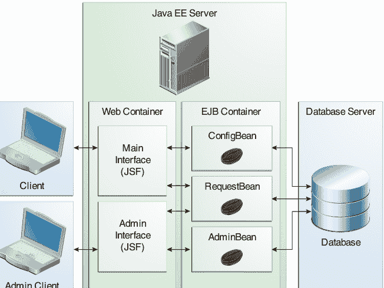

Duke's Tutoring 应用程序分为两个主要项目：`dukes-tutoring-common` 库和 `dukes-tutoring-war` Web 应用程序。`dukes-tutoring-common` 库项目包含 `dukes-tutoring-war` Web 应用程序使用的实体类和辅助类，且该库会随 `dukes-tutoring-war` 一起进行打包和部署。该库文件有助于其他应用程序（例如 JavaFX 客户端应用程序）重用实体类和辅助类。

Duke's Tutoring 使用以下 Java EE 7 平台特性：

- Java Persistence APIs
    - 自定义 Bean 验证注解 `@Email`，用于验证电子邮件地址
    - 标准的 `jta-data-source` 定义，将在部署时创建 JDBC 资源
    - `persistence.xml` 部署描述符中的标准属性，用于自动且可移植地创建和删除 `jta-data-source` 中的表

- Enterprise beans
    - 本地、无接口视图会话 bean 和单例 bean
    - Session bean 中的 JAX-RS 资源
    - 管理界面业务方法上的 Java EE 安全约束
    - 封装在 WAR 中的所有企业 bean

- WebSocket
    - 一个自动向端点发布学生状态的 WebSocket 服务器端点

- Contexts and Dependency Injection
    - 当学生状态更改时会触发 CDI 事件
    - 状态事件触发后更新应用程序的处理器方法
    - 用于 Facelets 的 CDI 托管 bean
    - CDI 托管 bean 中的 Bean 验证注解

- JavaScript Faces 技术，使用 Facelets 作为 Web 前端
    - 模板（Templating）
    - 组合（Composite）

## 主界面

Duke's Tutoring 示例应用程序是一个面向学生的辅导中心跟踪系统。学生可以签到、签出并访问公园。辅导中心可以跟踪出席状态更新，并存储护人和学生的联系信息。管理员可以维护辅导中心系统。

这里讨论了以下主题：

- Duke's Tutoring 的设计与架构
- 主界面
- 运行 Duke's Tutoring 案例研究应用

## 58.1 Duke's Tutoring 设计与架构

Duke's Tutoring 是一个结合多种 Java EE 技术的 Web 应用程序。它提供了主界面（供学生、护人和辅导中心工作人员）和管理界面（供工作人员维护系统）。这两个接口的业务逻辑由企业 bean 提供。企业 bean 使用 Java Persistence API 在数据库中创建并存储应用程序数据。图 58–1 展示了应用程序的架构。

### 图 58-1 Duke's Tutoring 示例应用程序的架构


Duke's Tutoring 应用程序分为两个主要项目：`dukes-tutoring-common` 库和 `dukes-tutoring-war` Web 应用程序。`dukes-tutoring-common` 库项目包含 `dukes-tutoring-war` Web 应用程序使用的实体类和辅助类，且该库会随 `dukes-tutoring-war` 一起进行打包和部署。该库文件有助于其他应用程序（例如 JavaFX 客户端应用程序）重用实体类和辅助类。

Duke's Tutoring 使用以下 Java EE 7 平台特性：

- Java Persistence APIs
    - 自定义 Bean 验证注解 `@Email`，用于验证电子邮件地址
    - 标准的 `jta-data-source` 定义，将在部署时创建 JDBC 资源


# Duke's Tutoring 案例研究示例

Duke's Tutoring 示例应用程序是一个面向学生的辅导中心跟踪系统。学生可以签到、签出并访问公园。辅导中心可以跟踪出席状态更新，并存储护人和学生的联系信息。管理员可以维护辅导中心系统。

这里讨论了以下主题：

- Duke's Tutoring 的设计与架构
- 主界面
- 运行 Duke's Tutoring 案例研究应用

## 58.1 Duke's Tutoring 设计与架构

Duke's Tutoring 是一个结合多种 Java EE 技术的 Web 应用程序。它提供了主界面（供学生、护人和辅导中心工作人员）和管理界面（供工作人员维护系统）。这两个接口的业务逻辑由企业 bean 提供。企业 bean 使用 Java Persistence API 在数据库中创建并存储应用程序数据。图 58–1 展示了应用程序的架构。

### Duke's Tutoring 设计与架构

图 58-1 Duke's Tutoring 示例应用程序的架构


Duke's Tutoring 应用程序分为两个主要项目：`dukes-tutoring-common` 库和 `dukes-tutoring-war` Web 应用程序。`dukes-tutoring-common` 库项目包含 `dukes-tutoring-war` Web 应用程序使用的实体类和辅助类，且该库会随 `dukes-tutoring-war` 一起进行打包和部署。该库文件有助于其他应用程序（例如 JavaFX 客户端应用程序）重用实体类和辅助类。

Duke's Tutoring 使用以下 Java EE 7 平台特性：

#### Java Persistence APIs

- 自定义 Bean 验证注解 `@Email`，用于验证电子邮件地址
- 标准的 `jta-data-source` 定义，将在部署时创建 JDBC 资源
- `persistence.xml` 部署描述符中的标准属性，用于自动且可移植地创建和删除 `jta-data-source` 中的表

#### Enterprise beans

- 本地、无接口视图会话 bean 和单例 bean
- Session bean 中的 JAX-RS 资源
- 管理界面业务方法上的 Java EE 安全约束
- 封装在 WAR 中的所有企业 bean

#### WebSocket

- 一个自动向端点发布学生状态的 WebSocket 服务器端点

#### Contexts and Dependency Injection

- 当学生状态更改时会触发 CDI 事件

## 58.2 主界面

### 主界面组件

- 状态事件触发后更新应用程序的处理器方法
- 用于 Facelets 的 CDI 托管 bean
- CDI 托管 bean 中的 Bean 验证注解
- JavaScript Faces 技术，使用 Facelets 作为 Web 前端
- 模板（Templating）
- 组合（Composite）

### 主界面使用的 Facelets 文件

- `template.xhtml`: 主界面的模板文件
- `error.xhtml`: 发生错误时的错误文件
- `index.xhtml`: 主界面的落地页
- `park.xhtml`: 显示当前在休息区（park session）人员的页面
- `current.xhtml` / `statusEntries.xhtml`: 显示今日会话详细状态日志的页面
- `resources/components/allStudentsTable.xhtml`: 用于显示所有学生表格的组合组件
- `resources/components/InactiveStudentsTable.xhtml`: 用于显示休息学生表格的组合组件
- `resources/components/currentSessionTable.xhtml`: 用于显示今日会话中所有学生的表格组合组件
- `resources/components/parkTable.xhtml`: 用于显示休息区所有学生表格的组合组件
- `WEB-INF/includes/mainNav.xhtml`: 主界面导航栏的 XHTML 片段

有关 Facets（面）的信息，请参阅第 8 章“Facelets 简介”。

### 58.2.5 主界面使用的辅助类

以下辅助类位于 `dukes-tutoring-common` 项目的 `dukestutoring.util` 包中，用于主界面。

- `CalendarUtil`: 该类提供一个方法，用于从 `java.util.Calendar` 实例中移除不需要的时间数据。
- `Email`: 一个自定义的 Bean Validation 注解类，用于验证 `Person` 实体中的电子邮件地址。
- `StatusType`: 定义学生可能拥有的状态的枚举类型。可能值为 `IN`、`OUT` 和 `PARK`。`StatusType` 用于整个应用程序、`StatusEntry` 实体以及整个主界面。`StatusType` 还定义了一个 `toString` 方法，根据本地语言环境返回状态的本地化翻译。

### 58.2.6 属性文件

- `javaservlet/util/StatusMessages.properties`: 默认语言下 `StatusType` 中定义的每种状态类型的字符串。每个支持的语言都有一个格式为 `StatusMessages_Locale prefix.properties` 的属性文件，其中包含本地化字符串。例如，西班牙语区域的字符串位于 `StatusMessages_es.properties` 中。

`dukes-tutoring-war` 项目在 `src/main/resources/` 下具有以下资源包：

- `ValidationMessages.properties`: Bean Runtime 用于显示验证消息的默认语言字符串。此文件必须命名为 `ValidationMessages.properties` 并根据 Bean Validation 规范存放在默认包中。每个支持的语言都有一个格式为 `ValidationMessages_locale prefix.properties` 的属性文件，其中包含本地化字符串。例如，德语区域的位于 `ValidationMessages_de.properties`。
- `javatutorial/duketestoring/web/messages/Messages.properties`: 主界面和管理 Facelets 界面的默认语言字符串。每个支持的语言都有一个格式为 `Messages_locale prefix.properties` 的属性文件，其中包含本地化字符串。例如，简体中文区域的字符串位于 `Messages_zh.properties` 中。

有关本地化方法的更多信息，请参阅“查看应用程序消息”。

## 58.3 Duke's Tutoring 中使用的部署描述符

Duke's Tutoring 在 `dukes-tutoring-war` 项目的 `src/main/webapp/WEB-INF` 目录下使用了这些部署描述符：

- `faces-config.xml`: JavaServer Faces 配置文件
- `glassfish-web.xml`: GlassFish 服务器的配置文件，定义了安全角色映射
- `web.xml`: Web 应用程序配置文件

Duke's Tutoring 在 `dukes-tutoring-common` 项目的 `src/main/resources/META-INF` 目录下使用了以下部署描述符：

- `persistence.xml`: Java Persistence API 配置文件

Duke's Tutoring 未使用企业级部署描述符。企业 Bean 类文件中的注解用于此应用程序中 Bean 的配置。

## 58.4 管理界面

Duke's Tutoring 的管理界面供辅导人员使用，用于管理主界面使用的数据：学生、监护人和地址。管理界面使用了与主界面许多相同的组件。这里描述了仅在管理界面使用的额外组件。

### 58.4.1 管理界面使用的企业 Bean

以下企业 Bean 位于 `dukes-tutoring-war` 项目的 `dukestutoring.ejb` 包中，用于管理界面。

- `AdminBean`: 一个无状态会话 Bean，用于管理界面中的所有业务逻辑。通过调用安全方法，仅允许授权用户调用业务方法。

### 58.4.2 管理界面使用的 Facelets

以下 Facelets 位于 `src/main/webapp/`，用于管理界面：

- `admin/adminTemplate.xhtml`: 管理界面的模板
- `admin/index.xhtml`: 管理界面的落地页
- `login.xhtml`: 受安全限制的管理界面的登录页
- `loginError.xhtml`: 身份验证管理用户出错时显示的页面
- `admin/address`: 允许创建、编辑和删除 `Address` 实体的页面
- `admin/guardian directory`: 允许创建、编辑和删除 `Guardian` 实体的页面
- `admin/student directory`: 允许创建、编辑和删除 `Student` 实体的页面
- `resources/components/formLogin.xhtml`: 使用 Java EE 的登录表单组合组件
- `WEB-INF/includes/adminNav.xhtml`: 管理界面导航栏的 XHTML 片段

### 58.4.3 管理界面中的 CDI 托管 Bean

管理界面使用的托管 Bean 位于管理界面中。

- `StudentBean`: 管理学生的托管 Bean。
- `GuardianBean`: 管理监护人的托管 Bean。
- `AddressBean`: 管理地址的托管 Bean。

## 58.5 运行 Duke's Tutoring 案例研究

`dukes-tutoring-war` 项目为本章讨论的概念提供全面的示例。

1. 在终端窗口中，进入：
   ```
   tut-install/examples/case-studies/dukes-tutoring/
   ```
2. 输入以下命令：
   ```
   mvn install
   ```
此命令创建了一个名为 `tutoringRealm` 的 JDBC 安全领域，构建并打包了 `dukes-tutoring-common` 和 `dukes-tutoring-war` 项目，并将 `dukes-tutoring-war` 部署到 GlassFish Server 上。

## 58.6 使用 Duke's Tutoring

一旦 Duke's Tutoring 在 GlassFish Server 上运行，可以使用主界面尝试学生的签到、签出或将他们送到公园。

### 使用 Duke's Tutoring 的主界面

1. 在浏览器中，打开以下 URL 主界面：
   ```
   http://localhost:8080/dukes-tutoring-war/
   ```
2. 使用主界面进行学生的签到和签出，并记录学生去公园的时间。

### 使用 Duke's Tutoring 管理界面

按照这些指令登录 Duke's Tutoring 的管理界面，并添加新的学生、护人和地址。

1. 从主界面开始，点击左侧菜单中的 **Administration main page**（管理主页）打开管理界面。
   这将重定向到以下 URL 的登录页面：
   ```
   http://localhost:8080/dukes-tutoring-war/admin/index.xhtml
   ```
2. 在登录页面，在 **User name**（用户名）字段中输入 `admin@example.com`，并在 **Password**（密码）字段中输入 `javaee`。
3. 使用管理界面添加或修改学生、或地址。
   - 要添加新学生，在打开的表单中点击 **Create new student**（创建新学生）（有两个必选项）并点击 **Submit**（提交）。**Email, Home phone, and Mobile phone**（电子邮件、家庭电话和手机）字段受 HTML5 透传或 Bean Validation 约束的格式限制。
   - 要修改学生，点击学生名称旁的 **Edit**（编辑），修改打开的表单中的字段，并点击 **Submit**（提交）。要编辑另一个学生，从页面顶部的下拉菜单选择学生并点击 **Change student**（切换学生）。
   - 要移除学生，点击学生名称旁的 **Remove**（移除），然后在出现的页面中点击 **Confirm**（确认）。这会将学生从辅导会中移除，但不会从数据库中删除。要再次将学生添加到辅导会，点击左侧菜单中的 **Activate student**（激活学生），然后在出现的页面中点击学生名称旁的 **Activate**（激活）。
   - 要为学生添加护人，点击学生名称旁的 **Add guardian**（添加护人）。出现的页面会显示学生姓名、可用护人以及任何现有的护人。要为学生添加现有护人，从列表中选择该护人并点击 **Add**（添加）。要为学生创建新的护人，请填写字段并点击 **Submit**。要从学生处移除护人，从列表中选择该学生现有的护人之一并点击 **Remove guardian**（移除护人）。
   - 要为学生添加地址，点击学生名称旁的 **Add address**（添加地址）。在出现的页面中，填写出现表单中的相应字段，并点击 **Submit**（提交）。有四个必填字段。

管理界面尚未完全实现。目前无法编辑护人或查看/编辑地址，尽管存在用于这些功能的 Facelets 页面。应用程序也未使用 `PersonDetails` 实体中的属性。欢迎随时修改应用程序以添加这些功能。

---

## Duke's Forest 案例研究示例


# Duke's Forest 案例研究

Duke's Forest 是一个简单的电子商务应用程序，包含多个 Web 应用程序并演示了多个 Java EE 7 API 的用法：

- JavaServer Faces 技术，包括 Ajax
- Java EE 的上下文与依赖注入 (CDI)
- 用于 RESTful Web 服务的 Java API (JAX-RS)
- Java 持久化 API (JPA)
- JavaBeans 验证 API (Bean Validation)
- 企业 JavaBean (EJB) 技术
- Java 消息服务 (JMS)

该应用程序由以下项目组成：

- **Duke's Store**：包含产品目录、客户自助注册和购物车的 Web 应用程序。它还有一个用于产品、类别和用户管理的管理界面。项目名为 `dukes-store`。
- **Duke's Shipment**：一个提供订单发货管理界面的 Web 应用程序。项目名为 `dukes-shipment`。
- **Duke's Payment**：一个具有订单支付 RESTful Web 服务的 Web 服务应用程序。项目名为 `dukes-payment`。
- **Duke's Resources**：一个简单的 Java 归档项目，包含 Web 项目使用的所有资源。它包括消息、CSS 样式表、图像、JavaScript 文件和 JavaServer Faces 组合组件。项目名为 `dukes-resources`。
- **Entities**：一个包含所有 JPA 实体的简单 Java 归档项目。该项目供使用实体的其他项目共享。项目名为 `entities`。
- **Events**：一个包含用作 CDI 事件 POJO 类的简单 Java 归档项目。项目名为 `events`。

此处介绍了以下主题：

- Duke's Forest 的设计与架构
- 构建和部署 Duke's Forest 案例研究应用程序
- 运行 Duke's Forest 应用程序

## Duke's Forest 设计与架构

Duke's Forest 是一个复杂的应用程序，由三个主项目和子项目组成。图 59–1 显示了你将部署的三个主项目的架构：Duke's Store、Duke's Shipment 和 Duke's Payment。它还显示了 Duke's Store 如何使用 Events 和 Entities 项目。

### 图 59–1 Duke's Forest 应用程序架构

| Duke's Shipment | Duke's Payment |
| :--- | :--- |
| EJB 容器 | Web 服务 |
| ShipmentBean | PaymentService |

| Duke's Store |
| :--- |
| 主界面 (Web Pages) | Web 服务 / REST | Events |
| OrderBean | OrderEvent |
| 管理界面 (Web Pages) |
| EJB 容器 |

| AdministratorBean | CategoryBean | OrderBean | OrderJMSManager |
| :--- | :--- | :--- | :--- |
| UserBean | ProductBean | ShoppingCart | GroupsBean |
| EventDispatchBean | OrderStatusBean | OrderDetailBean |

| Entities jar |
| :--- |
| Person | Customer | Order | DetailPK |

Duke's Forest 使用了以下 Java EE 7 特性：

- **持久化 API 实体**
  - 实体上用于验证数据的 Bean Validation 注解
  - 用于 XML 绑定（JAXB）序列化的 XML 注解
- **Web 服务**
  - 带安全约束的支付 JAX-RS Web 服务
  - 基于 EJB 的 JAX-RS Web 服务
- **企业 JavaBean**
  - 本地会话 Bean
  - 所有打包在 WAR 中的企业 Bean
- **上下文与依赖注入 (CDI)**
  - JavaServer Faces 组件的 CDI 注解
  - 用于购物车的会话作用域 CDI 管理 Bean
- **事件和事件处理器**
- **Servlet**
  - 用于动态图像展示的 Servlet
- **使用 Facelets 构建 Web 前端的 JavaServer Faces 2.2 技术**
  - 模板
  - 组合组件
  - 文件上传
  - 封装在 JAR 文件中以便在类路径查找
- **安全**
  - 管理界面业务方法（企业 Bean）的 Java EE 安全约束
  - 针对客户和管理员（Web 组件）的安全约束
  - 从 Duke's Store 传播已验证用户身份的单点登录 (SSO)

Duke's Forest 应用程序有两个主要的用户界面，都打包在 Duke's Store WAR 文件中：

- 供客户和访客的主界面
- 用于执行后台操作（如向目录添加新项目）的管理界面

Duke's Shipment 应用程序还有一个用户界面，供管理员访问。

图 59–2 显示了 Web 应用程序与 Web 服务之间如何交互。

### 图 59–2 Duke's Forest 组件之间的交互

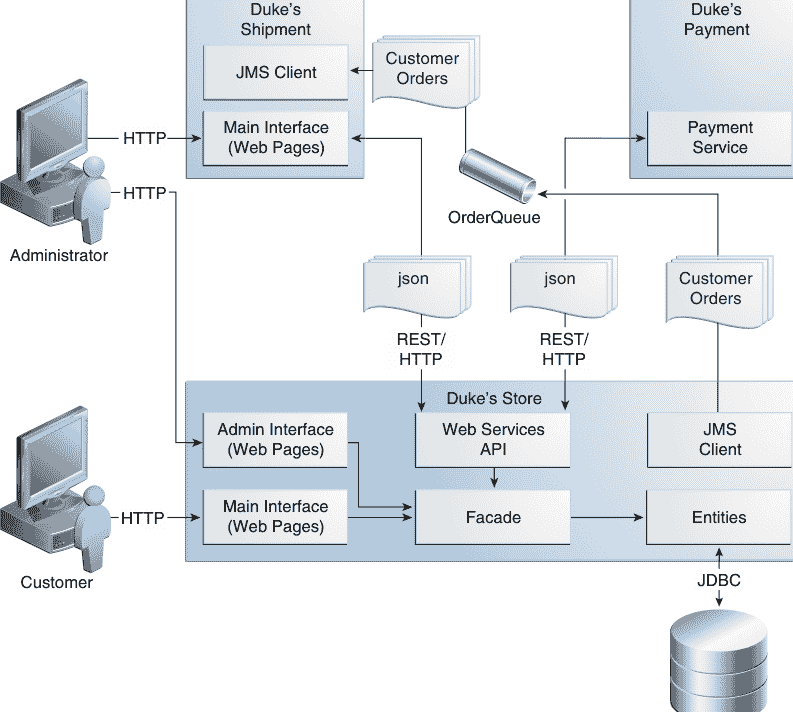

如图 59-2 所示，客户与 Duke's Store 的主界面交互，而管理员与管理界面交互。这两个界面都访问由受管 Bean 和无状态会话 Bean 组成的 Facade，随后它们与代表数据库表的实体交互。Facade 与 Web 服务 API 交互，调用 Duke's Payment Web 服务。当订单支付获得批准时，Duke's Store 将订单发送到 JMS 队列。管理员也可以通过 Duke's Shipment 直接访问，或者通过 Web 服务从 Duke's Store 的管理界面访问。当管理员批准发货时，Duke's Shipment 从 JMS 队列中消费订单。

应用程序最基础的构建模块是 Events 和 Entities 项目，它们与 Duke's Resources 项目一起封装在 Duke's Store 和 Duke's Shipment 中。

### 59.1.1 events 项目

Events 是 Duke's Forest 的核心组件之一。events 项目包含在三个主项目中，是应用程序中最简单的项目。它仅有一个类 `OrderEvent`，但该类负责应用程序中对象之间大部分的消息。

应用程序可以根据事件向不同的组件发送消息，并根据事件的限定符对它们做出反应。应用程序支持以下限定符：

- `@LoggedIn`：针对已身份验证的用户
- `@New`：当购物车创建新订单时
- `@Paid`：当订单已支付并准备好发货时

以下来自 Duke's Store `PaymentHandler` 类的代码片段显示了如何处理 `@Paid` 事件：

```java
@Inject PaidEvent<OrderEvent> eventManager;

public void onOrder(@Observes NewOrderEvent event) {
    if (processPayment(event)) {
        orderBean.setStatus(event.getOrderId());
        String.valueOf(orderBean.Status.PENDING_PAYMENT.getStatus());
        logger.info("Payment Approved");
        eventManager.fire(event);
    } else {
        orderBean.setStatus(event.getOrderId());
        String.valueOf(orderBean.Status.CANCELLED_PAYMENT.getStatus());
        logger.info("Payment Denied");
    }
}
```

为了让用户轻松地向项目添加更多事件或为新客户端更新带有更多字段的事件，该组件是应用程序中的一个独立项目。

### 59.1.2 entities 项目

entities 项目是 Duke's Store 和 Duke's Shipment 使用的 Java Persistence API (JPA) 项目。它根据图 59–3 显示的数据库架构生成，并用作 Web 服务通过 JAXB 消费和产生实体的基础。每个实体都有根据业务需求定义的验证规则，使用 Bean Validation 指定。

#### 图 59-3 Duke's Forest 数据库表及其关系

| CATEGORY | PRODUCT |
| :--- | :--- |
| ID INT | ID INT |
| NAME VARCHAR(45) | NAME VARCHAR(45) |
| TAGS VARCHAR(45) | PRICE DECIMAL(10,2) |
| | DESCRIPTION VARCHAR(45) |
| | IMG VARCHAR(45) |
| | CATEGORY_ID INT |
| | IMG_SRC BLOB(1073741823) |

| GROUPS | ORDER_DETAIL |
| :--- | :--- |
| ID INT | ORDER_ID INT |
| NAME VARCHAR(50) | PRODUCT_ID INT |
| DESCRIPTION VARCHAR(300) | QTY INT |

| PERSON_GROUPS | CUSTOMER_ORDER |
| :--- | :--- |
| GROUPS_ID INT | ID INT |
| EMAIL VARCHAR(45) | AMOUNT FLOAT(52) |
| | DATE_CREATED TIMESTAMP |
| | CUSTOMER_ID INT |
| | STATUS_ID INT |

| PERSON | ORDER_STATUS |
| :--- | :--- |
| ID INT | ID INT |
| FIRSTNAME VARCHAR(50) | STATUS VARCHAR(45) |
| LASTNAME VARCHAR(100) | DESCRIPTION VARCHAR(200) |
| EMAIL VARCHAR(45) | |
| ADDRESS VARCHAR(45) | |
| CITY VARCHAR(45) | |
| PASSWORD VARCHAR(100) | |
| DTYPE VARCHAR(31) | |

数据库架构包含八张表：

- `PERSON`：与 `PERSON_GROUPS` 和 `CUSTOMER_ORDER` 建立一对多关系
- `GROUPS`：与 `PERSON_GROUPS` 建立一对多关系
- `PERSON_GROUPS`：与 `PERSON` 和 `GROUPS` 建立多对一关系（它是它们之间的连接表）
- `PRODUCT`：与 `CATEGORY` 建立多对一关系，与 `ORDER_DETAIL` 建立一对多关系
- `CATEGORY`：与 `PRODUCT` 建立一对多关系
- `CUSTOMER_ORDER`：与 `ORDER_DETAIL` 建立一对多关系，与 `PERSON` 和 `ORDER_STATUS` 建立多对一关系
- `ORDER_DETAIL`：与 `PRODUCT` 和 `CUSTOMER_ORDER` 建立多对一关系（它是它们之间的连接表）
- `ORDER_STATUS`：与 `CUSTOMER_ORDER` 建立一对多关系

### 59.1.3 dukes-payment 项目

dukes-payment 项目是一个持有简单支付 Web 项目。作为一个示例，它并不获取信用卡或银行支付。项目使用 HTTP 认证和 JAAS（Java 身份验证和授权服务）来验证客户到 JAX-RS Web 服务。

### 59.1.4 dukes-resources 项目

dukes-resources 项目包含 Duke's Store 和其他项目使用的文件，封装成 JAR 文件放置在类路径中。资源位于 `src/main/resources`：

- `META-INF/resources/css`：两个样式表，`default.css` 和 `jsfcrud.css`
- `META-INF/resources/js`：一个 JavaScript 文件，`util.js`

### 59.1.5 Duke's Store 项目

Duke's Store 是一个 Web 应用程序，也是 Duke's Forest 的核心应用程序。它负责客户的主界面以及管理界面。

Duke's Store 的主界面允许用户执行以下任务：

- 浏览产品目录
- 注册新客户
- 将产品加入购物车
- 结算
- 查看订单状态

Duke's Store 的管理界面允许管理员执行以下任务：

- 产品维护（创建、编辑、更新、删除）
- 分类维护（创建、编辑、更新、删除）
- 客户维护（创建、编辑、更新、删除）
- 组维护（创建、编辑、更新、删除）

该项目还使用 Session Bean 作为与实体交互的 Facade，并使用 CDI Managed Bean 与 Facelets 页面交互。项目遵循 MVC（模型-视图-控制器）模式，并对所有实体和页面应用相同的模式，如下例：

`ProductBean` 开始如下：

```java
@Stateless
public class ProductBean extends AbstractFacade<Product> {
    private static final Logger logger = 
        Logger.getLogger(ProductBean.class.getCanonicalName());

    @PersistenceContext(unitName="forestPU")
    private EntityManager em;

    @Override
    protected EntityManager getEntityManager() {
        return em;
    }
}
```

#### 59.1.5.1 Duke's Store 中使用的 Enterprise Beans

Duke's Store 中使用的 Bean 为应用程序提供了业务逻辑，位于 `com.forest.ejb` 包中。它们都是无状态会话 Bean。

`AbstractFacade` 不是企业 Bean，而是一个实现 `Type<T>` 通用操作的抽象类，其中 `<T>` 是一个 JPA 实体。

大多数 Bean 都继承了 `AbstractFacade`，注入了 `PersistenceContext` 并实现了任何需要的自定义方法：

- `AdministratorBean`
- `CategoryBean`
- `EventDispatcherBean`
- `GroupsBean`
- `OrderBean`
- `OrderDetailBean`
- `OrderJMSManager`
- `OrderStatusBean`
- `ProductBean`
- `ShoppingCart`
- `UserBean`

`ShoppingCart` 类虽然位于 `ejb` 包中，但它是一个具有会话作用域的 CDI 托管 Bean，这意味着请求信息将跨多个请求持久化。此外，`ShoppingCart` 负责启动客户订单的事件链，该事件链会调用 `dukes-payment` 中的 RESTful Web 服务，并在支付成功后发布到 JMS 队列进行审核。

#### 59.1.5.2 Duke's Store 主界面使用的 Facelets

与其他示例一样，Duke's Store 使用 Facelets 来显示用户界面。界面使用了大量的 Facelets 来显示不同的区域。页面根据它们处理的模块分组到目录中。

- `template.xhtml`：模板文件，同时用于主界面和管理界面。它执行浏览器检查以验证用户的浏览器是否支持 HTML5（这是 Duke's Forest 所要求的）。它将屏幕分为几个区域，并为每个区域指定客户端。
- `topaz.xhtml`：屏幕顶部的页面。
- `top.xhtml`：标题区域的页面。
- `left.xhtml`：左侧栏的页面。
- `index.xhtml`：主屏幕内容的页面。
- `login.xhtml`：在 `web.xml` 中指定的页面。主登录界面在 `topaz.xhtml` 中提供，如果发生登录错误时显示此页面。

#### 59.1.5.5 Duke's Store 中使用的辅助类

Duke's Store 主界面中的 CDI 托管 Bean 使用了以下位于 `com.forest.web.util` 包的类：

- `AbstractPaginationHelper`：一个包含托管 Bean 所用方法的抽象类。
- `ImageServlet`：一个从数据库检索图像内容并显示的 Servlet 类。
- `JsfUtil`：用于 JavaServer Faces 的类，例如在 `FacesContext` 实例中队列消息。
- `MD5Util`：`CustomerController` 托管 Bean 用于为用户生成加密密码的类。

#### 59.1.5.6 Duke's Store 中使用的限定符

Duke's Store 在 `com.forest.qualifiers` 包中定义了以下限定符：

- `@LoggedIn`：标记用户为已登录。
- `@New`：标记订单为新订单。
- `@Paid`：标记订单为已支付。


### 59.1.5.7 Duke's Store 中使用的事件处理器

Duke's Store 定义了与 events 项目（Events Project）中 `OrderEvent` 类相关的事件处理器。这些事件处理器位于 `com.forest.handlers` 包中。

- **OrderHandler**：`OrderHandler` 接口定义了一个 `onNew` 方法，由两个处理器类实现。
- **PaymentHandler**：ShoppingCart 触发一个标记为 `@New` 的 `OrderEvent`。`PaymentHandler` 的 `onNew` 方法观察这些事件，并在拦截到它们时使用 Duke's Web 服务处理支付。在 Web 服务返回成功响应后，`PaymentHandler` 再次处理标记为 `@Paid` 的 `OrderEvent`。
- **DeliveryHandler**：`DeliveryHandler` 的 `onOrder` 方法观察标记为 `@Paid` 的对象（准备发货的订单），并将状态修改为 `PENDING_SHIPMENT`。当管理员访问 Duke's Store 时，它将调用 RESTful Web 服务 Order，请求数据库中所有准备发货的订单。

### 59.1.5.8 Duke's Store 中使用的部署描述符

Duke's Store 使用 `web/WEB-INF` 目录下的以下部署描述符：

- **faces-config.xml**：JavaServer Faces 配置。
- **glassfish-web.xml**：针对 GlassFish 服务器的配置文件。
- **web.xml**：Web 应用程序配置文件。

### 59.1.6 Duke's Shipment 项目

Duke's Shipment 是一个带有登录页面、Mane Faces 页面以及其他对象的 Web 应用程序。该应用程序仅供管理员访问，从 JMS 队列中消费订单，并调用 Duke's Store 暴露的 RESTful 服务来更新订单状态。Duke's Shipment 的主页显示了待发货审核订单列表和已发货订单列表。管理员可以批准或拒绝发货。如果被批准，订单将发货并出现在“Shipment”标题下；如果被拒绝，订单将从页面消失，并在客户的“Orders”列表中显示为已取消。

待处理列表中还有一个齿轮图标，可以发送 Ajax 调用到 Order 服务以刷新列表而无需刷新页面。代码如下：

```xml
<h:commandLink>
  <h:graphicImage library="img" title="Check for new orders" style="border:0px" render="refresh.png" />
  <f:ajax execute="$form" render="form" />
</h:commandLink>
```

### 59.6.1 Duke's Shipment 中使用的 Enterprise Beans

Duke's Shipment 中使用的 Bean 为应用程序提供了业务逻辑，位于 `com.forest.ejb` 包中。它们都是无状态会话 bean。

`AbstractFacade` 不是企业 Bean，而是一个实现 `Type<T>` 通用操作的抽象类，其中 `<T>` 是一个 JPA 实体。

大多数 Bean 都继承了 `AbstractFacade`，注入了 `PersistenceContext` 并实现了任何需要的自定义方法。

### 59.6.2 Duke's Shipment 主界面使用的 Facelets

与其它示例一样，Duke's Store 使用 Facelets 来显示用户界面。界面使用了大量的 Facelets 来显示不同的区域。页面根据它们处理的模块分组到目录中。

- **template.xhtml**：模板文件，同时用于主界面和管理界面。它执行浏览器检查以验证用户的浏览器是否支持 HTML5（这是 Duke's Forest 所要求的）。它将屏幕分为几个区域，并为每个区域指定客户端。
- **topaz.xhtml**：屏幕顶部的页面。
- **top.xhtml**：标题区域的页面。
- **left.xhtml**：左侧栏的页面。
- **index.xhtml**：主屏幕内容的页面。
- **login.xhtml**：在 `web.xml` 中指定的页面。主登录界面在 `topaz.xhtml` 中提供，如果发生登录错误时显示此页面。
- **UserController**

### 59.6.3 Duke's Shipment 中使用的 Managed Bean

Duke's Store 主界面中的 CDI 托管 Bean 使用了以下位于 `com.forest.web.util` 包的类：

- **AbstractPaginationHelper**：一个包含托管 Bean 所用方法的抽象类。
- **ImageServlet**：一个从数据库检索图像内容并显示的 Servlet 类。
- **JsfUtil**：用于 JavaServer Faces 的类，例如在 `FacesContext` 实例中队列消息。
- **MD5Util**：`CustomerController` 托管 Bean 用于为用户生成加密密码的类。

### 59.6.4 Duke's Shipment 中使用的辅助类

Duke's Store 在 `com.forest.qualifiers` 包中定义了以下限定符：

- **@LoggedIn**：标记用户为已登录。
- **@New**：标记订单为新订单。
- **@Paid**：标记订单为已支付。

### 59.6.5 Duke's Shipment 中使用的事件处理器

Duke's Store 定义了与 events 项目中 `OrderEvent` 类相关的事件处理器。这些事件处理器位于 `com.forest.handlers` 包中。

- **OrderHandler**：`OrderHandler` 接口定义了一个 `onNew` 方法，由两个处理器类实现。
- **PaymentHandler**：ShoppingCart 触发一个标记为 `@New` 的 `OrderEvent`。`PaymentHandler` 的 `onNew` 方法观察这些事件，并在拦截到它们时使用 Duke's Web 服务处理支付。在 Web 服务返回成功响应后，`PaymentHandler` 再次处理标记为 `@Paid` 的 `OrderEvent`。
- **DeliveryHandler**：`DeliveryHandler` 的 `onOrder` 方法观察标记为 `@Paid` 的对象（准备发货的订单），并将状态修改为 `PENDING_SHIPMENT`。当管理员访问 Duke's Store 时，它将调用 RESTful Web 服务 Order，请求数据库中所有准备发货的订单。

### 59.6.6 Duke's Shipment 中使用的部署描述符

Duke's Store 使用 `web/WEB-INF` 目录下的以下部署描述符：

- **faces-config.xml**：JavaServer Faces 配置。
- **glassfish-web.xml**：针对 GlassFish 服务器的配置文件。
- **web.xml**：Web 应用程序配置文件。

# 运行 Duke's Forest 应用

3. 输入以下命令来配置服务器、创建并填充数据库、构建所有子项目、将它们组装成 JAR 和 WAR 文件，并部署 dukes-payment、dukes-store 和 dukes-shipment 应用：

```bash
mvn install
```

为了配置服务器，此任务会创建一个名为 `jdbcRealm` 的 JDBC 安全域（realm），启用默认的主角到角色映射（mapping），并为 HTTP 服务启用单点登录 (SSO)。

## 59.3 运行 Duke's Forest 应用

运行 Duke's Forest 应用涉及多项任务：

- 注册成为 Duke's Store 的客户
- 作为客户，购买产品
- 作为管理员，批准或拒绝产品发货
- 作为管理员，创建新的产品、客户、组或类别

### 59.3.1 注册成为 Duke's Store 客户

1. 在网页浏览器中输入以下 URL：
   `http://localhost:8080/dukes-store`
   打开 Duke's Forest - Store 页面。

2. 点击页面顶部的 Sign Up（注册）。

3. 填写表单字段，然后点击 Save（保存）。

所有字段均为必填，且密码（Password）值的长度至少为 7 个字符。

### 59.3.2 购买产品

1. 以您创建的用户或数据库中已有的两个用户之一登录，输入用户名和密码并点击 Log In（登录）。

预先存在的用户名为 `jack@example.com`，密码均为 `1234`。

2. 点击左侧边栏中的 Products（产品）。

3. 在上方页面中，点击其中一个类别（植物、食物、服务或工具）。

4. 选择一个产品并点击 Add to Cart（加入购物车）。

每种产品只能订单一个，但可以在多个类别中订单多个不同的产品。产品和总计将显示在左侧边栏的 Shopping Cart（购物车）中。

5. 完成选择后，点击 Checkout（结账）。

出现一条消息：“您的订单正在处理。请检查 Orders（订单）页面查看订单状态。”

6. 点击左侧边栏中的 Orders（订单）验证您的订单。

如果订单总金额超过 $1,000，订单状态将为“Order canceled（订单已取消）”，因为 Payment Web 服务会拒绝超过该限制的订单。否则，状态为“Ready to ship（准备发货）”。

7. 完成下单后，点击页面顶部的 Logout（注销）。

### 59.3.3 批准产品发货

1. 以管理员身份登录 Duke's Store。

您的用户名是 `admin@example.com`，密码是 `1234`。主管理页面允许您查看类别、管理员、产品和订单，并创建所有类型的新对象。

2. 在页面底部点击 Approve（批准）。此操作将带您回到 Duke's Store，并保留您的登录状态。

3. 在 Pending（待处理）列表中，点击 Approve 批准订单并将其移动到页面的 Shipped（已发货）区域。如果您点击 Deny（拒绝），订单将从页面消失。如果您以客户身份登录 Duke's Store，它将在 Orders 列表中显示为“Order canceled”。要从 Shipment（发货）返回 Duke's Store，请点击 Return（返回）。

### 59.3.4 创建产品

您还可以创建其他类型的对象。创建产品的流程比上述过程更复杂，因此在此进行描述。

1. 以管理员身份登录 Duke's Store。

2. 在主管理页面，点击 New Product（新产品）。

3. 在 Name（名称）、Price（价格）和 Description（描述）字段中输入值。

4. 选择一个类别，然后点击 Next（下一步）。

5. 在 Upload Image（上传图片）页面，点击 Browse（浏览）使用文件选择器定位图片。

6. 点击 Next。

7. 在下一页查看产品字段，然后点击 Done（完成）。

8. 点击左侧边栏中的 Products，然后点击该类别以验证产品是否已添加。

9. 点击页面顶部的 Administration（管理）返回主页，或点击 Logout（注销）。

# 索引

# 符号

- **@AccessTimeout** 注解, 34-10
- **@Alternative** 注解, 25-2
- **@ApplicationScoped** 注解, 6-6, 16-2, 23-7
- **@AroundInvoke** 注解, 54-2
- **@AroundTimeout** 注解, 54-2
- **@Asynchronous** 注解, 31-1
- **@ConcurrencyManagement** 注解, 34-8
- **@Consumes** 注解, 29-2-10
- **@Context** 注解, 31-1
- **@ConversationScoped** 注解, 23-7
- **@Cookie** 注解, 31-1
- **@DeclareRoles** 注解, 49-3, 49-4, 49-10
- **@Decorator** 注解, 25-1
- **@Delegate** 注解, 52-10
- **@DeleteItem** 注解, 29-3-27
- **@DenAll** 注解, 49-5
- **@Dependent** 注解, 16-2, 23-7
- **@Destroyed** 注解, 37-6
- **@DiscriminatorColumn** 注解, 37-12
- **@DiscriminatorValue** 注解, 37-12
- **@Disposes** 注解, 25-5
- **@Embeddable** 注解, 37-10
- **@EmbeddedId** 注解, 37-6
- **@Entity** 注解, 37-1
- **@FlowCreated** 注解, 16-2
- **@FormParam** 注解, 31-1, 31-3
- **@GET** 注解, 29-5
- **@GroupSource** 注解, 22-3
- **@HAVE** 注解, 29-5
- **@Header** 注解, 31-1
- **@HttpConstraint** 注解, 48-2, 48-16
- **@HttpMessage** 注解, 48-2, 48-16
- **@Id** 注解, 37-4
- **@ObjectClass** 注解, 37-6
- **@Inject** 注解, 23-6, 25-6
- **@Interceptor** 注解, 54-2
- **@Interceptors** 注解, 54-2
- **@Local** 注解, 32-2, 32-4
- **@Lock** 注解, 34-8
- **@ManagedBean** 注解, 8-4, 16-1
- **@ManyToMany** 注解, 37-8
- **@ManyToOne** 注解, 37-8
- **@MatrixParam** 注解, 31-1
- **@MessageDriven** 注解, 46-34
- **@MultipartConfig** 注解, 17-15
- **@Named** 注解, 23-8
- **@NamedQuery** 注解, 39-2
- **@Observe** 注解, 25-7
- **@OnClose** 注解, 18-5
- **@OnError** 注解, 18-4
- **@OnToMany** 注解, 37-8, 37-9
- **@OnType** 注解, 37-7, 37-8, 37-9
- **@OnMessage** 注解, 18-4
- **@OnOpen** 注解, 18-4
- **@Path** 注解, 29-2, 29-6
- **@PathVariables** 注解, 26-3, 29-11, 31-1, 31-2
- **@Parameter** 注解, 49-4
- **@PersistenceContext** 注解, 37-15
- **@PersistenceUnit** 注解, 37-15
- **@PostLoad** 注解, 29-3-27
- **@PostActivate** 注解, 29-3-27
- **@PostUpdate** 注解, 29-3-27
- **@PostPersist** 注解, 25-4, 29-3
- **@Provider** 注解, 29-2
- **@Qualifier** 注解, 23-5
- **@QueryParam** 注解, 29-3, 29-11, 31-1
- **@Remote** 注解, 32-2, 32-4
- **@Resource** 注解, 32-2, 32-4, 31-1, 4-2, 6-14
- **@Required** 注解, 6-6, 16-2
- **JMS resources**, 48-5-29
- **Entity dependency** 注解, 20-10-13
- **Bean loaded** 注解, 49-4, 49-10
- **ans** 注解, 49-8
- **@Schedule** and **@Schedule** 注解, 34-20
- **@Services** 注解, 48-2, 48-16
- **@SessionScoped** 注解, 6-4, 16-2, 23-7
- **@Startup** 注解, 34-7
- **@Stateful** 注解, 34-2
- **@Timeout** 注解, 34-18
- **@Timeout method**, 34-18, 34-20
- **@Transient** 注解, 37-3
- **@WebFilter** 注解, 17-7
- **@WebInitParam** 注解, 17-5, 17-8
- **@WebListener** 注解, 17-3

# A

- **@WebService** 注解, 28-2
- **@WebServiceRef** 注解, 6-15
- **@WebServlet** 注解, 6-9,17-4
- abstract schemes, 39-1
- access control, 47-5
- acknowledge, 45-20
- acknowledgment
- action events, 7-8, 10-11, 15-18
- **ActionEvent** 类, 15-18,20
- actionlistener 属性, 10-12, 11-10, 15-17
- actionlistener implementation, 15-19, 15-20
- actionlistener interface, 11-7
- actionlistener tag, 10-27, 11-7, 15-3
- **processAction(ActionEvent)** 方法, 15-20
- referring methods that handle action events, 11-13, 12
- writing a managed bean to handle action events, 12-12
- action method, 7-11
- administered objects, 45-7
- creating and moving, 46-3
- definition, 44-5
- See after connections, destinations
- Administration Console, 1-23
- afterBegin, 51-6
- **afterCompletion** 方法, 51-6
- applet container, 1-10
- applets, 5-1, 6-6
- application client container, 1-10
- application clients, 1-5, 46-29
- securing, 50-13


# 索引

## A

- application clients, JMS
- asadmin tool, 1-23
- asynchronous message consume, 45-6
- asynchronous method invocation
  - calling asynchronous business methods, 36-2
  - cancelling, 36-3
  - checking status, 36-3
  - creating asynchronous business methods, 36-1
  - `java.util.concurrent.Future<V>` 接口, 36-1
  - retrieving results, 36-2
  - sessions, 36-1
- asynchronous sound mechanism, 45-25
- attribute referencing managed methods, 11-10, 11-11
  - actionListener, 11-10, 11-11
  - validator 属性, 11-10, 11-11
  - valueChangeListener 属性, 11-10, 11-12

## B

- 示例, 48-15
- 业务逻辑, 32-1
- Java 平台批处理应用程序, 1-20, 55-1
- 业务方法, 32-9
- 批作业
  - 客户端调用, 34-4
  - 检查状态, 55-22
  - 异常, 34-5
  - 定义, 55-7
  - 定位, 32-5
  - 定义, 55-1
  - 需求, 34-5
  - 元素, 55-5
  - 事务, 51-4, 51-6, 51-7, 51-8
  - 实例与执行, 55-6
  - BytesMessage 接口, 45-17
  - 属性和参数, 55-6

## C

- 开始, 55-4
- CallbackHandler, 50-13
- 步骤, 55-2
- capture-schema 工具, 1-23
- 提交到批处理, 55-21
- CDI. 参见 Java 上下文与依赖注入
  - 批处理
    - 上下文对象, 55-21
    - 创建应用, 55-5
    - 创建工厂, 55-17
    - 定义, 55-1
    - 依赖注入, 55-20
    - 示例, 55-23, 55-29
    - 实现分块步骤, 55-7
    - 简介, 55-1
    - Java EE 框架, 55-4
    - Java EE 平台, 55-4
    - JSON 语言, 55-10
    - 打包应用, 55-22
    - 状态和决策元素, 55-3
  - 客户端证书, 50-4
  - 证书, 47-6
  - 客户端, 50-7
  - 数字, 47-7; 51-0, 50-2
  - 服务器, 50-2, 50-4
  - 使用注解, 50-4
  - 字符编码, 20-5
  - 字符集, 20-4
  - 客户端证书, 50-4
  - 持久化提交的客户端 ID, 45-13
  - 客户端s, 45-20
  - 身份验证, 50-5
  - 安全保护, 50-13
- Bean Validation, 1-18, 21-
  - 高级, 21-1
  - 约束违反, 21-6
  - 约束, 38-1
  - 构造函数, 21-5
  - 自定义约束, 22-1, 58-2
  - 空字符串, 21-4
  - 示例, 38-17
  - 异常, 21-6
  - 继承, 2-4
  - 本地化, 22-3
  - 方法, 21-5, 21-6, 22-4
  - 排序, 22-3
  - 空字符串, 21-4
  - 参数, 21-5, 22-6
  - 资源包, 22-2
  - 使用 `f:validateBean` 标签, 11-8
- 通用接口, 连接接器架构
  - 架构, 52-5
  - 绑定元素, 12-3, 12-4, 15-31, 15-34
  - 绑定, 12-3, 15-31, 15-34
- 组件属性. 参见 托管属性
- Java Persistence Faces API, 1-21, 38-20
- 渲染方法, 7-5-7
- 解码, 15-14, 15-20, 15-24
- 委托实现, 15-4
- 编码方法, 15-25
- encodeChildren 方法, 15, 12-17
- 完成前方法, 51-6
- 托管 bean 事务. 参见 事务
- 托管 bean, CDI 2 23-04 中的 beans
- beans.xml 文件, 21-6
- 绑定属性 10-4, 10-6, 12-31, 15-34
- 列属性, 10-15
- 转换器属性, 10-9, 11-25-26
- for 属性, 10-11, 10-22
- id 属性, 10-4
- immediate 属性, 10-4, 10-5-17
- 重新显示属性, 10-4, 10-6, 15-34
- style 属性, 10-4, 10-6, 10-22
- styleClass 属性, 10-4, 10-24
- valdict, 10-4, 10-7
- value 属性, 10-4, 10-6, 12-37, 15-31, 15-32
- valueChangeListener, 10-9, 11-12, 12-13
- var 属性, 20-4
- Java EE, 1-4
- 标签, 10-3
- 链接, 10-2
- 菜单, 10-3, 10-4, 10-16, 10-17
- 选项, 10-4
- 字段, 10-3
- 单选框按钮, 10-4
- 表格, 10-3, 10-14, 10-19
- 区域, 10-3
- 复合组件, 标签, 7-8, 7-9, 12-3
- body 标签, 10-7
- 书签化 URL, 10-23
- 按钮标签, 10-2
- 列标签, 10-2
- commandButton 标签, 10-2, 10-12
- commandLink 标签, 10-2, 10-13
- dataTable 标签, 10-2, 10-19, 12-25
- form 标签, 10-2, 10-7
- 图形, 10-2, 10-13, 15-37
- head 标签, 10-7
- 输入, 10-3, 10-8
- inputSecret 标签, 10-3, 10-8, 10-12-26
- inputText 标签, 10-3, 10-8, 10-10
- importVariables, 10-3, 10-8
- link 标签, 10-23
- message 标签, 10-3, 10-22
- messages 标签, 10-3, 10-22
- outputFormat 标签, 10-3, 10-9, 10-11
- outputLabel 标签, 10-4, 10-9, 10-11
- outputLink 标签, 10-3, 10-9, 10-11
- outputScript 标签, 10-25
- outputText 标签, 10-3, 10-9, 10-13, 12-36
- panelGroup 标签, 10-3, 10-14
- 高级特性, 14-1
  - 属性, 14-1
  - 默认属性, 14-1
  - 示例, 14-3
  - `f:validateBean` 标签, 14-2
  - `f:validateRegex` 标签, 14-2
  - `f:validateRequired` 标签, 14-2
  - Facets, 10-8
  - 调用 beans, 14-2
  - 方法签名属性, 14-1
  - name 属性, 14-1
  - required 属性, 14-2
  - type 属性, 14-2
  - 验证值, 14-2
- 并发
  - 定义, 56-1
  - 示例, 56-3, 56-7
  - 安全与, 56-3
  - 线程与进程, 56-3
  - 事务与, 56-3
  - Java EE 并发实用, 1-20, 56-1
- 并发访问, 15-1
- 访问实体数据, 42-1
- JAX-RS 中的 HTTP 请求, 39-1
- 机密性, 14-17
- 资源位置, 10-25
- selectBooleanCheckbox 标签, 10-3, 10-6, 10-12-26
- selectItems 标签, 10-28
- selectManyCheckbox 标签, 10-3, 10-17, 12-27
- selectManyListbox 标签, 10-3, 10-17
- selectManyMenu 标签, 10-3, 10-17
- selectOneListbox 标签, 10-4, 10-6
- selectOneMenu 标签, 10-4, 10-6, 12-7, 12-8
- 组件托管登录, 30-14, 30-15
- 组件
  - 框, 10-3, 10-12
  - 按钮, 10-2
  - 复选框, 10-3, 10-16
  - 数据网格, 10-2
  - 字段, 10-3
  - 隐藏字段, 10-3
  - 超级链接, 10-13
  - 链接, 10-13
- JavaServer Faces 应用程序
  - Application 类, 16-3
  - 应用配置资源文件, 16-3
  - 配置托管 bean, 16-1, 16-14
  - 错误注册, 15-27
  - faces-config.xml 文件, 16-26
  - 类以及其他资源, 16-33
  - `java.faces.application.CONFIG_FILES` 参数, 16-3
  - 注册转换器, 16-24
  - 注册渲染器, 16-27
  - 注册自定义组件, 16-29
  - 注册值, 16-24
  - 注册消息, 16-21
  - 资源包, 16-3
  - 托管 bean, 16-32
- JavaServer Faces 应用程序
  - 上下文与依赖注入 Java EE (CDI), 1-18
    - 高级, 21-1
    - 替代方案, 21-2
    - 基本概念, 23-1
    - bean, 23-4
    - 配置应用, 23-10
    - 配置 JAX-RS 规则, 23-1
    - 装饰器, 23-6
    - 示例, 23-5
    - EL, 23-8
    - Facets, 23-9
    - 可注入对象, 23-5
    - 托管 bean, 23-4
    - 观察者, 23-7
    - 生产者字段, 23-4
    - 生产者方法, 23-10
    - 修饰符, 23-4
    - 作用域, 23-3
    - setter 和 getter 方法, 23-9
    - 特殊化, 23-5
    - 状态, 23-7
    - 属性, 23-8
    - 视图, 23-12
    - 视图, 23-3
    - 视图, 23-2
    - 转换器, 23-9
    - 转换器接口, 23-5
    - 转换器实现, 23-4
    - 转换器属性, 23-2
    - 转换器 ID, 23-5
    - 转换模型, 23-8
    - 数据绑定, 23-3
    - 数据模型, 23-8
    - 呈现视图, 23-4
    - 呈现视图, 23-4
- `javax.faces.convert` 包, 11-1
  - `BigDecimalConverter` 类, 11-1
  - `BigIntegerConverter` 类, 11-2
  - `BooleanConverter` 类, 11-2
  - `ByteConverter` 类, 11-2
  - `CharacterConverter` 类, 11-2
  - `DateTimeConverter` 类, 11-2, 11-3
  - `DoubleConverter` 类, 11-2
  - `EnumConverter` 类, 11-2
  - `FloatConverter` 类, 11-2
  - `IntegerConverter` 类, 11-2
  - `LongConverter` 类, 11-2
  - `NumberConverter` 类, 11-2, 11-3, 14
  - `ShortConverter` 类, 11-2
- 转换标签
  - `convertDateTime` 标签, 11-3
  - `convertDateTime` 标签属性, 11-4
  - `converter` 标签, 13-5, 15-26
  - `convertNumber` 标签, 11-14
  - `convertNumber` 标签属性, 11-5
  - 转换器, 7-5-17
  - 自定义转换器, 7-8-15
- 转换数据. 参见 转换模型
- cookie 参数, JAX-RS, 29-13
- `BrowserRouter` 方法, 46-11
- 创建定时方法, 34-19
- 凭据, 47-2
- Criteria API, 40-1
  - 创建查询, 40-4
  - 示例, 38-15
  - 表达式, 40-6, 40-7
  - 路径导航, 40-6
  - 查询执行, 40-9
  - 查询结果, 40-6, 40-8
  - 查询字符串, 41-1
- 密码学-公开, 50-2
- 自定义转换器
  - 绑定到托管 bean 属性, 15-35
  - 创建, 15-23
  - `getAsObject` 方法, 15-24
  - `getAsObject(FacesContext, UIComponent, String)`, 15-24
  - `getAsString` 方法, 15-25
  - `getAsString(FacesContext, UIComponent, Object)` 方法, 15-24
  - 注册自定义转换器, 15-26
  - 自定义对象的自定义转换器, 15-26
  - 使用, 15-22
  - 结合使用自定义组件、渲染器和标签, 15-4
  - 还有自定义标签
- 自定义 UI 组件
- 自定义验证器
- 创建 `Renderer` 类, 15-17
  - 确定必要性, 15-44
  - 执行解码, 15-14
  - 执行编码, 15-12
  - 在新工具包中注册, 16-27
- 自定义标签, 10-14
- `getRendererType`, 15-18
- 识别渲染器类型, 15-17
- 指定, 15-22
- 标签库, 15-29
- 自定义 UI 组件创建, 15-53
  - 创建类, 15-9
  - 对象, 15-22
  - 委托, 15-16
  - 确定必要性, 15-02
  - 处理发出的, 15-20
- 注册自定义 UI 组件
- `restoreState(FacesContext, Object)` 方法, 15-16
- `saveState(FacesContext)` 方法, 15-16
- 指定状态保存的位置, 16-32
- 创建步骤, 15-9
- 自定义验证器, 15-27
  - 绑定到托管的 Beans, 15-33
  - 自定义验证器标签, 15-29
  - 实现 `Validator` 接口, 15-28
  - 使用, 15-30
  - `validate` 方法, 12-12, 15-28
  - `validate` 方法实现, 12-11, 15-30
  - `Validator` 接口, 15-27
  - `validate` 标签, 15-30

## D

- 数据加密, 50-5
- 数据完整性, 47-55, 51-1, 51-2
- 数据源, 3-02
- 数据库客户端, 32-1
  - 连接, 34-5, 51-7
  - 创建表, 37-20
  - 数据恢复, 51-1
  - 丢弃标签, 37-20
  - EJB 层, 1-3
  - 加载数据, 37-21
  - 消息驱动豆和, 32-4
  - 多个, 51-7, 51-8
  - 还有事务 `DataSource` 接口, 3-2
  - DDL 脚本, 37-20
  - 加载数据, 37-21
- 调试 Java EE , 22-7
- 声明式安全, 47-1, 48-1, 49-1
- CDI 装饰器, 25-10
- 示例, 26-19
- 交付交付, 45-23
- 交付模式, 45-21
- `JMSMessage` 头部字段, 45-16
- `DeploymentType` 接口, 45-21
- Java 依赖注入 (JSR 330), 1-18, 23-1
- 部署, 33-3
- 部署器脚本, 5-1, 47-1, 47-8
- 企业级豆, 5-3, 47-9, 49-23
- Java EE, 5-2
- 运行时, 5-25
- 安全映射方法, 47-14
- `security-ref` 元素, 48-13
- 网页, 5-4, 6-22, 16-29, 47-9
- 目标接口, 45-28
- 创建, 36-41, 46-42
- 注入资源, 45-28, 46-9
- `JMSDestination` 头部字段, 45-16
- 临时, 45-23, 46-38
- 还有 queso
- 临时 JMS 目的地
- `destroy` 方法, 17-13
- 摘要认证, 48-2
- 数字签名, 50-2
- CDI 析器方法, 25-5
- `Filter` 方法, 17-7, 17-8, 17-9
  - 方法, 17-5
- 域, 2-3
- `doPost` 方法, 17-15
- 下载 FileServer, 2-1
- `TYPE_OF_ACKNOWLEDGEMENT`, 45-21
- 持久订阅, 46-16, 46-24, 46-32
- 共享, 45-15

## E

- eager 属性, 托管豆, 16-24
- EAR 文件, 5-1
- EJB 层, 1-8
  - 安全, 50-14
- EJB 容器, 1-10
  - 容器托管事务, 51-2
  - 消息驱动豆, 45-29
  - 调用 `onMessage` 方法, 46-30
  - 服务, 32-1, 48-9


- 还有嵌入式企业豆容器 EJB JAR 文件, 32-11

`EJBContext` 接口, 51-6, 51-8

`ejb-jar.xml` 文件, 5-37, 47-99

EL, 6-4-1

CDI 实例, 23-8

- 复合表达式, 9-6
- 延迟评估表达式, 9-2
- 表达式示例, 9-11
- 立即执行表达式, 9-2
- 字面量, 9-5
- 表达式, 9-3
- 托管豆, 12-2
- 方法表达式, 9-7
- 方法-绑定表达式, 7-11
- 运算符, 9-5
- 概述, 9-1
- 参数化方法调用, 9-5
- 保留字, 9-10
- 属性表达式, 9-3
- 表达式过程中的级联转换, 9-3
- 评估, 9-6 (另见方法)
- 持久化可嵌入类, 37-10
- 嵌入式豆容器, 创建, 35-2
- 开发应用, 35-1
- 示例, 35-4
- 初始化企业豆的方法, 35-3
- 概述, 35-1
- 运行应用, 35
- 会话豆, 35-3
- 卸载, 35-3 (另见 EJB context, 企业豆)
- 安全, 47-7
- 企业级应用, 1-1
- 企业豆, 1-7-15
- 类, 32-11
- 编译, 33-2
- 内容, 32-10
- 转换为 JAX-RS 根资源, 31-8
- 定义, 32-1
- 依赖注入, 36-2
- 部署, 32-1
- 分发, 32-7
- 异常, 34-24
- `get` 方法, 49-6
- 业务逻辑实现, 1-7
- 与 JAX-RS 集成, 31-8
- 拦截器, 54-1
- 接口, 32-11
- `is` 方法, 49-6
- JAX-RS 资源, 29-16
- JNDI 查找, 22-6
- 生命周期, 32-11
- 本地访问, 32-7
- 本地接口, 32-8
- 打包, 5-3, 33-3
- 性能, 32-7
- 程序化安全, 49-6
- 远程访问, 32-9
- 远程接口, 32-9
- 安全, 49-1
- 单例, 29-16
- 测试, 35-4
- 定时服务, 34-16
- 类型, 32-2
- Web 服务, 32-2, 32-10
- 驱动豆, 34-13 (另见方法, 嵌入式豆容器, 企业豆)

企业信息系统. 见 EIS

- 抽象, 37-11
- 抽象名称, 39-3
- 应用托管实体, 37-15
- 级联操作, 39-7
- 集合, 39-15
- 容器托管实体, 37-14
- 控制, 44-2
- 创建, 38-9
- 区分符列, 37-12
- 实体管理器, 37-14
- 查找, 37-16, 38-10
- 继承, 37-11, 38-13
- 继承映射, 37-12
- 生命周期, 37-16
- 管理, 37-8, 38-9
- 映射到多表, 38-7
- 非实体服务, 37-12
- 概述, 37-1
- 持久化字段, 32-7
- 持久化属性, 37-2
- 持久化, 37-16
- 主键, 37-6
- 查询, 37-18
- 关系, 38-10
- 移除, 37-17, 38-11
- 要求, 37-1
- 超类, 37-11
- 同步, 37-17
- 验证, 37-4

数据实体

- 锁模式, 42-2
- 乐观锁, 42-1, 42-2
- 悲观锁, 42-1, 42-4
- 实体图, 43-1
- 命名的, 43-3
- 实体提供者, JAX-RS, 29-8
- 单向, 37-8
- 多对多, 37-8, 38-13
- 多对一, 37-8
- 复性, 37-7
- 一对多, 37-8
- 一对一, 37-7
- 查询语言, 37-9
- 单向的, 37-8

`EntityManager` 接口, 37-14

- `equal` 方法, 7-36

事件和监听器模型, 7,5-8

- 将监听器绑定到托管豆
- 属性, 15-35
- 事件类, 7-8
- 事件处理器, 7,15-19
- 事件监听器, 7,15-7, 16-7
- 自定义 UI 组件的处理, 15-20
- 事件监听器, 15-18
- 监听器类, 7-8
- 监听器类, 12-1
- `queueEvent` 方法, 15-34
`ValueChangeEvent` 类, 11-12
- 还有事件, 值变更事件

CDI, 25-7
- 示例, 26-13
- 示例, 2-1

Ajax, 10-3
异步方法调用,
- 豆, 36-3
- 基础认证, 48-15
- 批量处理, 25,53-25
- Bean Validation, 38-18
- 可书签 URL, 10-24
- 构建, 2-5
- CDI, 24,26-1
- 复合组件, 8-10
- 并发, 56-1
- 准则, 54-1
- 目录结构, 5-5
- Duke 案例研究, 57-1
- Duke 的森林研究, 59-1
- Duke 的 HTML 研究, 58-1
- 嵌入式豆, 35-4
- 文件上传, 17-25
- HTML 标记, 8-20
- 拦截器, 54-9
Java API for Web, 18,11
JAX-RS, 29,15
JAX-WS, 28-9
JMS 异步连接, 46-9
- JMS 持久对象, 46-16
- Web 应用中的 JMS, 46-25
- JMS 本地事务, 46-18
- JMS 消息队列, 45-14
- JMS 共享订阅, 46-24
- JMS 同步连接, 46-7
- JMS 实体, 46-32
- JMS 与会话豆, 46-29

消息驱动豆, 45-36
- 持久化, 38-10
- 主键, 37-6
- 查询语言, 37-9
- 所需软件, 2-1
- 资源适配器, 53-1
- 资源库, 8-15
- 安全, 48-18
- 发送 JMS 消息, 46-4
- 会话豆, 33,35
- 单例会话豆, 34-7
- 定时服务, 24-21
- Web 客户端, 33-2
- Web 服务, 34-13

异常
- 业务方法, 34-5
- 企业豆, 34-25
- 回滚事务, 34,25

JMS 过期, 45-22
`JMSExpression` 头部字段, 45-16

表达式语言. 见 EL

# Index-8

外键, 38-3, 29-13, 31-33
表单参数, JAX-RS, 45-38
表单认证, 48-7
`forward` 方法, 17-11
另见响应 (responses)

HTTPS, 47-7, 47-16, 48-4, 50-2
`HttpServlet` interface, 17-1
`HttpServletRequest` instance, 17-6, 48-12
`HttpResponse` instance, 17-7
`HttpSession` instance, 17-12

# G

+ 垃圾回收, 32-13
`GenericServlet` interface, 17-1
`getBody` method, 43-17
`getCallerPrincipal`, 49-6, 43-19
`getConnection` method, 3-2
`getPart` method, 17-16
`getMethods` method, 17-16
`getOutputStream` method, 48-12
`getRequestDispatcher` method, 17-10
`getRollback` method, 45-33, 51-8
`getServletContext` method, 17-11
`getSession` method, 17-12
`getStatus` method, 31-8
`getUserPrincipal` method, 48-12

# I

+ 标识, 47-4
隐式导航, 7-3, 7-10
隐式对象, 15-34
绑定连接值到, 15-33
`include` 方法, 17-11
init, 17-5
`InitialContext` interface, 1-21
初始化参数, 17-5
使用 managed-property 元素映射初始化属性

+ GlassFish
向其添加用户, 47-12
下载, 2-1
启用调试, 2-7
实例化技巧, 2-11
安全保护, 47-9
服务器日志, 2-7
SSL 连接, 47-16
启动, 5-23
停止, 2-4
工具, 1-22
组, 47-12
管理, 47-12

+ 初始化 Array 和 List 属性, 16-19
初始化 bean 托管属性, 16-19
初始化 maps 和 lists, 16-21
引用上下文初始化初始化参数, 16-17
initParameters, 17-5
可注入对象, CDI, 23-55
完整性, 47-16

拦截器 (interceptors)

# H

+ 处理事件。见事件和监听器模型 (event and listener model)
`hashCode` method, 37-6
头部参数, JAX-RS, 29-13
辅助类, 32-11
session bean 示例, 34-5
HTML 友好型标记, 8-17
示例, 8-20
透传属性, 8-18
透传, 8-17

+ HTTP, 28-1
基础认证, 48-6
用户 SSL, 50-5
HTTP cookies, 30-7
HTTP 方法, 29-6
HTTP 请求和响应实体, 29-8
假设类型, 29-8
HTTP 请求 URL, 17-6
查询字符串, 17-6
请求路径, 17-6
HTTP 请求, 17-6, 29-6
另见响应 (responses)

+ around-context, 54-4
调用, 54-8
生命周期回调事件, 54-6
方法, 53-4
排序, 54-8
拦截器, 54-1
CDI, 25-9
示例, 54-9
示例 (CDI), 26-13
国际化, 20-1
初始化 JavaServerFaces 函数
`Faces.getContext` method, 11-4
`loadbundle` tag, 20-4
使用 `FacesMessageClass` 创建消息, 16-22
`invalidate` method, 17-12
`isCallerInRole` method, 49-6, 49-13
ISO 8859 字符编码, 20-5
`isUserInRole` method, 48-12

# J

+ JAAS, 12-2, 47-5, 50-13
登录模块, 50-14
JACC, 1-19, 47-9
JAF, 1-2
JAR 文件, 5-1
JAR 签名, 47-6
JASPIC, 1-19
Java API for JavaBean Validation
HTTP 响应, 17-7
状态码, 6-13

# 另见 Bean Validation (Bean Validation)

Java API for JavaBean Validation. 见 Bean Validation
Java API for JSON Processing, -120
Java API for RESTful Services. 见 JAX-RS
Java API for WebSocket, 1-19, 18-1
注解端点, 18-10
配置端点, 18-10
创建应用, 18-2
端点, 18-1, 58-2, 58-4
错误处理, -18-10
示例, 18-1, 11-14
引言, 18-1
维护客户端状态, 18-6
路径参数, 18-4
程序化端点, 18-3
接收消息, 18-5
发送消息, 18-8
使用编码器, 18-7
Java API for XML Binding (JAXB), 1-21
使用 JAX-RS, -31-11
Java API for XML Processing (JAXP), -1-21
Java API for Web Services. 见 JAX-WS
Java Authentication and Authorization Service. 见 JAS
Java Authentication Service Interface for Containers (JASP), -1-19
Java Authorization Contract for Containers. 见 JAX
Java Blueprints, -2-5
Java Cryptography Extension (ICE), -47-6
Database Connectivity API. 见 JDBC
Java DB, -12-3
启动, -2-4
停止, -2-4
Java EE 应用, 1-3
调试, -2-7
部署, 33-3
迭代, 33-4
分层 (tiers)
Java EE 组件, 1-5
另见客户端 (client)
Java EE 组件, 1-4
Java EE 连接器架构, 1-18, 52-2
示例, 53-1
Java EE 模块, 5-1, 5-2
应用模块, 5-2
EJB 模块, 5-2, 32-11
资源适配器模块, 5-2
另见模块 (modules)
Java EE 平台, 1-3
JMS 和, 45-3
概述, -1
Java EE 安全模型, 1-9
Java EE 服务器, 1-10
Java EE 模型, 1-9
Java Generic Services, 47-5
Java GSS-API, 47-5
Java Message Service (JMS) API, 1-18, 45-1
另见
Java Naming and Directory Interface. 见 JNDI
Java Persistence API, 1-17, 37-6
另见
Java Persistence API language. 见 query
Java Persistence Criteria API. 见 Criteria
Java Secure Extensions (JSSE), -47-6
Java Servlet 技术, 15-15, 17-1
另见
Java Transaction API, 1-17, 51-7
Java Activation Framework (JAF), 1-21
Java 组件, 1-6
JavaMail API, 1-19
示例, 53-1
JavaServer Faces 应用开发
bean 属性, 12-5
Bean, 21
托管 bean, 12-1
web 页面, 10-1
JavaServer Faces 应用
配置 JavaServer Faces
HTML 标签, 10-2
队列消息, 12-13
JavaServer Faces 核心标签库, 10-1, 10-27
监听器, 10-27, 11-7, 5-3
ajax 标签, 13-3
属性, 10-28
convertDateTime, 10-27, 11-3, 5-4
converterId 属性, 11-2
convertNumber tag, 10-27, 11-3, 5-4
face tag, 10-20, 10-28
loadbundle tag, 10-2
metadata 标签, 10-23, 10-28
selectitem tag, 10-7, 10-10, 10-28
selectitem, 10-17, 10-18, 5-2
type 属性, 11-6
validateBean, 11-8
validateDouble tag, 10-28, 11-8
validateLength tag, 10-28, 11-8, 9-1
validateRegex tag, 11-10
validateRequired, 11-8
validator tag, 7-10, 10-28, 15-27
自定义值, 15-30
valueChangeListener tag, 10-27, 11-6
JavaServer Faces HTML 渲染器
库, 7-8
html_basic, 15-21
另见组件 (component)
JavaServer Faces UI 组件, 7-5, 15-2
UIComponent 组件, 15-25
JavaServer Faces 标签库, 8-2
JavaServer Faces 核心标签库, 10-1, 10-27

# 消息驱动 bean (message-driven beans)

索引-10
JavaServer Faces HTML 渲染标签库, 10
命名空间指令, 10
JavaServer Faces 技术流, 16-5
资源库计数, 8-14
JavaServer 技术, 1-6, 1-16, 7
优势, 7-3
可书签的 URL, 10-23
组件标签, 组件标签
组件, 1-4, FacesContext 类. FacesContext
FacesServlet 库, 16-31
特性, 7-2
HTML5 友好型标记, 8-17
部分处理, 7-17
部分渲染, 7-17
相关资源, 8-13
与 Ajax 使用, 1-13, 58-3
Validator 接口, 12-12
另见组件标签
另见转换模型 (conversion model)
另见事件和监听器模型
另见 Facets ( facets)
另见 JavaServer Faces 应用的生命周期
另见 UI 行为组件
另见 UI 组件类
JavaServer Pages 标准标签库 (JSTL), 1-17
JavaServer 技术, 1-6
`javax.servlet` 包, 17-1
`javax.servlet.http`, 17-1
JAXB, 1-21


# 索引

## J

- 与 JAX-RS 使用, 31-11
- JAX-RS, 1-17, 29-1
- 访问 XML 文, 31-11
- 高级功能, 31-11
- 异步请求, 30-8
- 客户端, 31-10
- 条件 HTTP 头部, 29-3
- 配置, 24-14
- 将 CDI bean 转换为根资源 classes, 31-18
- 将企业 bean 转换为根资源 classes, 31-18
- cookies, 30-7
- 实体提供者, 29-8
- 示例, 25-19, 31-16
- 提取请求或响应类型, 31-3
- 过滤器, 30-7
- 表单参数, 31-3
- HTTP 头部, 30-6
- 调用, 30-3
- JSON, 31-15
- 路径参数, 30-2, 31-2
- 路径模板, 29-5
- 查询参数, 31-2
- 参考实现, 29-1
- 请求方法标识符, 29-2, 27-9
- 资源类方法, 31-6
- 资源类, 29-2
- 资源方法, 29-2
- 运行时内容协商, 31-9
- 运行时解析, 31-6
- 静态内容协商, 31-9
- 子资源定位器, 31-7
- 子资源方法, 31-7
- 子资源, 31-6
- URL, 31-1
- 与 JAX-RS 使用, 31-11
- enterprise bean 查找, 32-6
- enterprise bean 命名子上下文, 1-21
- 环境命名上下文, 1-21
- jms 命名子上下文, 45-8
- JMS 管理的对象的命名空间, 45-7
- 命名上下文, 1-21
- enaming 元素, 1-21
- 命名子上下文, 1-21

## 命名子上下文

- 定义, 17-2
- 监听器接口, 17-2
- 监听器
  - HTTP, 47-9
  - IIOP, 47-9
- 加载图查看持久化
- 加载图
- 本地接口, 32-8
- 本地事务, 45-24
- 本地化, 20-1

## 作业规范语言 (Job Specification Language), 55-10

- batchlet, 55-14
- chunk 元素, 55-12
- 决策元素, 55-17
- 流程元素, 55-16
- 作业元素, 55-10
- 分区元素, 55-14
- 拆分元素, 55-16
- 步骤元素, 55-11

## Bean 验证 (Bean Validation), 22-3

- log, 服务器, 2-7
- 登录配置, 48-6, 48-8
- 登录方法, 48-10
- 登录模块, 50-13
- 注销方法, 48-10
- jsf 文件, 13-9
- JAX-RS, 31-15
- JSR 339. 参见 JRS
- JSR 346. 参见上下文和依赖注入

# M

- 托管 bean 容量, 16-14
- 托管 bean 声明, 15-7
- 键类元素, 16-18
- 列表项元素, 16-17
- 托管-bean 元素, 16-20
- 托管-bean-name 元素, 16-15
- 托管-属性 元素, 16-16
- 映射项元素, 16-17
- 映射项元素, 16-18
- 空值元素, 16-17
- 数值元素, 16-17

## Java EE (CDI)

- JSSE, 47-4
- JSTL, 17-1
- JTA, 1-17, 51-7
- JTA API, 51-7

# K

- 托管 bean 方法
  - 属性. 参见引用托管 bean 方法的属性
  - 引用. 参见引用托管 bean 方法
  - 写入. 参见写入托管 bean 方法
- 托管 bean 方法 (managed methods), 11-2, 12-1, 12-3, 15-31
- 绑定组件元素, 12-9
- UID, 12-5
- UI 和输出接口, 12-5
- UISelectBean 属性, 12-6
- UISelectItem 属性, 15-8
- UISelectMany 属性, 12-7
- UISelectProperties, 12-7
- 写入, 12-3
- 托管 beans, 7-2
- 组件接口, 14-2
- 在 JavaServer 技术中配置, 16-1
- 版本模型, 7-8
- 自定义 appropriate 元素, 15-3
- 为 CDI 定义, 23-4
- 开发, 8-4
- 事件和监听器模型, 7-9
- JavaServer Faces 技术, 12-1
- 加载 JavaScript, 13-10
- 方法绑定, 10-9
- 属性. 参见托管 bean 属性
- 参见值绑定
- Kerberos, 47-5, 47-6
- 密钥对, 50-2
- 密钥库, 46-7, 50-1, 50-2
- 管理, 50-2
- keytool 工具, 50-2

# L

- JavaFaces 应用的生命周期, 7-4, 7-13
- 以及 action-value 事件处理, 7-19
- 应用请求值 (Apply Request Values), 7-15, 15-24
- 自定义转换器, 15-25
- getRenderType 方法 (渲染响应阶段), 15-18
- 立即属性 (immediate attribute), 15-7
- 调用阶段 (Invoke phase), 7-17
- 执行编码 (渲染响应阶段), 15-12
- 验证阶段 (Process Validations phase), 7-16
- 渲染响应阶段 (Render Response phase), 7-17
- renderResponse 方法, 7-14, 7-15, 7-16, 7-17
- 响应阶段 (responsive phase), 7-15
- 恢复视图阶段 (Restore View phase), 7-17
- 保存状态, 15-15
- 更新模型值阶段 (Update Model Values phase), 7-16
- updateMethods 方法, 7-17
- 验证器接口, 15-29
- 视图, 7-15
- 监听器上下文, 17-2

## 托管 Bean 规范, 1-17, 23-1

- ManagedExecutorService 接口, 56-2
- ManagedScheduledExecutorService 接口, 56-2
- ThreadFactory 接口, 56-2
- MapMessage 接口, 45-17
- 映射 URL, 29-14
- 矩阵参数, JAX-RS, 29-13
- Maven 工具, 2-3
- 托管确认, 45-20
- bean 托管事务, 45-33
- 托管正文, 45-17
- 托管消费者, 45-10
  - 共享, 45-15
- 托管消费, 45-6
  - 异步, 45-6-49
  - 同步, 45-6-47
- 托管头信息, 45-16
- 托管 ID, JMS, 45-16
- managedMessage 接口, 45-17
- 监听器, 32-4, 45-11
  - 示例, 46-9, 46-38
- 托管生产者, 45-10
- 托管属性, 45-17
- 托管安全, 48-2
- 托管订阅, 45-12
  - 持久性, 45-13
- ManagedBodyReader 接口, 29-8
- ManagedBodyWriter 接口, 29-8
- 消息驱动 bean, 1-15-32
  - 访问, 32-4
  - 编码, 46-30, 46-38
  - 定义, 46-29, 46-32, 46-36
  - 垃圾回收, 32-13
  - 简介, 45-29
  - 事务, 32-5, 51-7
- MessageListener 接口, 45-11
- 完整性, 50-5
- MessageFormat 模式, 10-11, 10-28
- OutputFormat 标签, 10-11, 10-28
- param 标签, 10-28
- 队列消息, 12-13, 16-21
- 使用 MessageFormat 类创建消息, 16-22
- 消息, JMS, 45-17
- 浏览, 45-18
- 定义, 45-4
- 延迟, 45-23
- 递送模式, 45-21
- 过期, 45-22
- 头信息, 45-16
- 简介, 45-16
- 持久化, 45-22
- 优先级级别, 45-22
- 属性, 45-17
- 消息域, 45-4
- 点对点, 45-5
- 发布/订阅, 45-5
- 消息, 定义, 45-1
- 资源适配器, 52-4
- Metamodel API, 40-1
- 安全, 47-8
- 使用, 38-45-2
- 方法绑定, 15-14
- 方法-绑定 表达式, 7-11-26
- 方法表达式, 7-9-10
- 方法 权限, 49-3
- 注解, 49-3
- 方法, 静态, 21-5
- 身份验证, 50-7

# N

- 命名上下文, 1-21
- 命名环境, 1-21
- 配置, 7-10, 16
- 隐式, 7-10
- 导航模型, 7-10
- action 属性, 10-11, 15-7
- ActionEvent 类, 11
- 配置导航规则, 16
- 逻辑结果, 12-11, 16
- NavigationHandler 类, 7-12
- 执行消息以执行导航, 12-11
- NetBeans IDE, 2-2
- NON-PERSISTENT 递送模式, 45-22
- 选项, 45-7

# O

- ObjectMessage 接口, 45-17
- 管理, 45-7
- 创建和移除, 46-3
- 观察者方法, CDI, 25-7
- OnMessage 方法, 45-11
- 消息驱动 bean, 32-5, 45-30

# P

- package-applet 工具, 1-23
- 打应用程序, 5-1
- 路径参数, JAX-RS, 29-13, 31-22
- 路径测试器, JAX-RS, 29-5
- 权限, 安全策略, 47-10

## 持久化 (Persistence)

- schema 创建, 58-2
- 级联操作, 38-8
- CLOBs, 38-8
- 集合, 37-3
- 并发访问实体数据, 42-1
- 配置, 37-14
- 创建数据库表, 37-20
- criteria 查询, 43-1, 43-4
- DDL 脚本, 37-20
- 丢数据库表, 37-20
- 收益, 43-1
- 嵌入嵌类, 37-10
- 实体, 37-5
- 实体图属性, 43-4
- 示例, 38-1
- fetch 图, 43-2
- JMS 示例, 46-36
- JMS 消息, 45-21
- JPQL, 43-1
- 懒加载, 43-1
- 加载图, 43-2
- 加载数据, 37-2
- 锁策略, 42-1
- 多对多, 38-13
- 映射, 37-4
- 命名实体, 43-3
- 一对一, 38-3
- 概述, 37-1
- 持久化单元, 37-17
- 持久化字段, 37-2
- 主键, 36-6, 38-4, 38-5
- 属性, 37-3
- 查询, 37-1, 38-10, 39-2, 43-1
- 创建, 40-4
- Criteria, 40-1
- 动态, 39-2
- 执行, 40-9
- 表达式, 40-6, 40-7
- 连接, 40-5
- 参数, 29-2, 39-3
- 路径导航, 40-6
- 结果, 40-6, 40-8
- 静态, 39-2
- 类型代码, 40-1
- 参见查询语言
- query 提示, 43-4
- 查询语言, 37-9
- 关系, 38-2
- schema 创建, 37-19
- 范围, 37-17
- 二级缓存, 44-1
- 自引用关系, 38-2
- 基于字符串的 criteria 查询, 41-1
- 时间层, 38-9
- 持久化单元，查询语言, 39-1, 39-14
- PERSISTENT 递送模式, 45-22
- 可插件审计模块, 47-10
- 可插件授权提供者, 47-9
- 点对点消息域, 45-5
- 点对点样式 参见队列 (queues)
- POJOs, 12
- 文件, 47-6
- 主键, 38-3
- 复合, 38-5
- 定义, 37-4
- 示例, 37-7
- 生成, 38-4
- 原则, 47-12
- PrintWriter, 17-6
- 优先级级别, 消息, 45-22
- 消息头, 45-16
- 生产者字段, 45-16
- 生产者方法, CDI, 25-4
  - 示例, 26-8
- 生产者, CDI, 23-10, 25-4
  - 示例, 26-5
- 编程策略, 37-2, 49-8
- 查询, 39-13, 42-2
- 编程模型, JMS, 45-6
- 代理, 45-4
- 公钥加密, 50-2
- 发布/订阅模型, 45-13
- 持久性订阅, 45-13

# Q

- 限定符, CDI, 23-5
- 服务质量 (Quality of Service), 47-5
- 查询, 43-1
- JPQL, 43-1
- 查询语言
  - ABS 函数, 29-23
  - 抽象, 39-1, 39-3, 39-15
  - ALL 表达式, 39-21
  - 算术函数, 39-22
  - ASC 关键字, 39-27
  - AVG 函数, 39-25
  - BETWEEN 表达式, 30-7, 39-19
  - Boolean 字面量, 39-18
  - Boolean 逻辑, 39-24
  - 示例, 39-23
  - 成员, 成员表达式, 39-15, 39-21
  - 集合, 39-15, 39-21
  - 比较到 SQL, 39-5
  - 比较操作符, 39-7, 39-19
  - CONCAT 函数, 39-22
  - 条件条件表达式, 39-6, 39-17, 39-18
  - 构造函数, 39-26
  - COUNT 函数, 39-25
  - DELETE 表达式, 39-8
  - DELETE 语句, 39-4
  - ELSE 关键字, 39-27
  - DISTINCT 关键字, 39-4
  - 域, 39-1, 39-12, 39-14
  - 重复值, 39-4
  - 枚举字面量, 39-18
  - 等于, 39-24
  - ESCAPE 子句, 39-20
  - 示例, 38-10, 39-4
  - EXISTS 表达式, 39-21
  - FETCH JOIN, 39-16
  - FROM 子句, 39-32
  - 语法, 39-8
  - GROUP BY 子句, 39-4, 39-27
  - HAVING 子句, 39-4, 39-27
  - 标识符, 39-12
  - IN 操作符, 39-19
  - INNER JOIN 操作符, 39-6, 39-18
  - 输入参数, 39-6, 39-18
  - IS EMPTY, 39-27
  - IS FALSE, 39-24
  - IS NULL 表达式, 39-27
  - IS TRUE, 39-24
  - JOIN 语句, 39-5, 39-15
  - LEFT JOIN 操作符, 39-16
  - LEFT OUTER JOIN, 39-22
  - LENGTH 函数, 39-22
  - LIKE 表达式, 39-6, 39-20
  - 字面量, 39-17
  - LOCATE 函数, 39-22
  - LOWER 函数, 39-22
  - MAX 函数, 39-25
  - MEMBER 表达式, 39-21
  - MIN 函数, 39-25
  - MOD 函数, 39-23
  - 多多个声明, 39-14
  - 多个关系, 39-6
  - 命名参数, 39-5, 39-18
  - 否定, 39-24
  - NOT 操作符, 39-24
  - 空值, 39-20
  - 数值常量, 39-24
  - 无引号字面量, 39-18
  - 操作符优先级, 39-18
  - 操作符s, 39-18
  - ORDER BY 子句, 39-4, 39-27
  - 路径表达式, 39-2, 39-16
  - 位置参数, 39-18
  - 范围变量, 39-15
  - 关系字段, 39-22
  - 关系, 39-1, 39-5, 39-6
  - 返回类型, 39-25
  - 根, 39-15
  - 范围, 39-1
  - SELECT 子句, 39-3, 39-25
  - setNameParameter 方法, 39-5
  - SIZE 函数, 39-23
  - SORT 函数, 39-23
  - 状态字段, 39-2
  - 字符串比较, 39-24
  - 字符串字面量, 39-18
  - 子查询, 39-21
  - SUBSTRING 函数, 39-22
  - SUM 函数, 39-26
  - 语法, 39-3, 39-18
  - TRIM 函数, 39-22
  - 类型, 39-24
  - UPDATE 表达式, 39-4
  - UPPER 函数, 39-22
  - WHERE 子句, 39-3, 39-17
  - 通配符, 39-20
- 查询参数, JAX-RS, 29-11, 31-22
- 查询行, 40-5
- Queue 接口, 45-8
- QueueBrowser 接口, 45-18
- IMS 示例, 46-11
- 队列, 45-8
- 浏览, 45-18, 46-11
- 创建, 38-4, 46-22
- 注入资源, 46-29

## relationships

- 方向, 37-8
- 单向, 38-4
- 相对性, JMS
- 基础机制, 45-21
- 持久订阅, 45-13
- 本地事务, 45-24
- 消息确认, 45-20
- 消息传递延迟, 45-22
- 消息过期, 45-21


# 索引

- 消息优先级级别, 45-22
- 临时依赖性, 45-23
- 可移动资源, 8-13
- 远程接口, 32-9
- 远程方法调用 (RMI)
- 消息, 45-1
- 请求头, JAX-RS, 31-10
- 请求描述符, JAX-RS, 29-2, 27-9
- 请求对象, JAX-RS, 31-0
- 请求参数, JAX-RS
- 分发器, 请求/响应机制
- `JMSCorrelationID` 头部字段, 45-16
- `JMSReplyTo` 头部字段, 45-16
- 临时依赖性和, 45-23
- 请求, 17-5
- 定制, 17-6
- 从...获取信息, 17-5
- 获取本地化, 20-2
- 另见 HTTP 请求
- 必需的事务属性, 45-33
- 资源适配器, 1-18, 52-1
- 示例, 53-1
- 元数据注解, 52-4
- 打包, 5-5
- 安全, 50-15
- 资源包, 20-1
- Bean 校验, 22-2
- 资源类, JAX-RS, 29-2
- 资源库合约, 8-14
- 示例, 8-15
- 资源方法, JAX-RS, 29-2
- 资源, 52-1
- MS, 45-29
- 可移动的, 8-13
- 另见 数据源
- `ResponseBuilder` 类, 29-8
- 响应, 17-6
- 输出缓冲, 17-7
- 定制, 17-8
- 设置标头, 17-5
- 另见 HTTP 响应
- RESTful Web 服务, 1-17, 29-1
- 已定义, 29-1
- 角色, 47-12
- 应用, 47-14
- 声明, 48-9
- 映射到组, 47-14
- 映射到用户, 47-14
- 引用, 47-13, 48-9, 49-3
- 回滚方法, 51-6, 51-7, 51-8
- 回滚方法 (JMS), 45-24
- 回滚。见 事务, 回滚
- 根资源类, 29-2
- 运行身份, 49-8

# S

- SAJ, 1-22
- SASL, 47-6
- 模式工具, 1-23
- 创建, 37-19
- 部署描述符, 47-8
- 范围
  - CDI, 23-7
  - 简介, 6-6
  - Java Faces 技术, 16-2
  - Servlets, 17-4
- 安全连接, 47-15
- 安全套接层 (SSL), 47-15
- 安全
  - 注解, 47-8, 48-16, 49-1
  - 注解, 47-4, 47-6
  - 客户端, 50-13
  - 回调处理程序, 50-13
  - 组件管理, 50-15
  - 并发性和, 56-3
  - 容器 true, 49-9
  - 容器管理, 50-14
  - 是, 47-1
  - (企业级豆) 的上下文, 49-6
  - 声明式的, 47-1, 48-1, 49-1
  - 部署企业级豆, 49-9
  - EIS 应用, 50-14
  - 端到端, 4-7
  - 企业级应用, 49-1
  - 企业级豆, 49-1
  - 示例, 48-18, 49-9, 13-3
  - 组, 47-12
  - 简介, 47-1
  - JAAS 登录模块, 50-14
  - Java SE, 47-5
  - 登录表, 50-13
  - 登录模块, 50-13
  - 机制特性, 47-4
  - 机制, 47-5, 47-6
  - 消息, 48-2
  - 消息层, 47-7
  - 方法权限, 49-3
  - 概述, 47-1
  - 策略域, 47-12
  - 程序化的, 47-2, 49-8, 48-10, 49-2
  - 程序化登录, 50-14
  - 身份传播, 49-8
  - 域, 47-1
  - 资源适配器, 50-15
  - 角色, 48-9, 49-3
  - 角色, 47-12, 47-13, 48-9, 49-3
  - 运行身份, 48-9
  - 简单流程, 47-2
  - 传输层, 47-7, 47-15
  - 用户, 47-11
  - Web 应用, 48-1
  - Web 组件, 48-2
- 安全约束, 48-2
  - 多个, 48-5
- 安全域, 47-12
- 身份
  - 传播, 49-8
  - 特定的身份, 48-2
- 安全角色, 48-13
- 安全角色, 47-13, 49-3
- 安全元素, 47-14
- 安全角色元素, 48-13
- 发送方法, 45-10
- 发送消息, 45-28
  - Java EE 组件, 45-28
  - JMS 客户端, 45-6
  - 异步发送消息, 45-25
- 服务器认证, 50-2
- 服务器证书, 50-1
- 服务器日志, 27-2
- 服务方法, servlet, 17-5
- `Servlet` 接口, 17-1
- `ServletContext` 接口, 17-11
- `ServletInputStream` 类, 17-6
- `OutputStream` 类, 17-6
- `ServletRequest`, 17-5
- `ServletResponse`, 17-6
- 服务器, 16
  - 异步处理, 17-6
  - 二进制数据, 17-6
  - 字符数据, 17-6
  - 编译, 33-2
  - 创建, 17-4
  - 示例, 6-8, 17-23, 33-2
  - 最终化, 17-13
  - 初始化, 17-5
  - 生命周期, 17-2
  - 周期事件, 17-2
  - 非阻塞 I/O, 17-9
  - 打包, 33-3
  - 范围对象, 17-4
  - 服务方法, 17-5
  - 指定初始化参数, 17-5
  - 跟踪服务请求, 17-14
  - 上传文件, 17, 19
- Session 豆, 1-15, 32-2
  - 激活, 32-12
  - Bean 管理并发, 38-8, 34-10
  - 业务兴趣, 32-5
  - 客户端, 32-2
  - 并发访问, 34-8
  - 容器管理并发, 34-8
  - 数据库, 51-6
  - 饿性初始化, 34-7
  - 示例, 33-1, 34-1, 37-13
  - 错误处理, 34-11
  - 无接口视图, 32-5
  - 激活, 32-1
  - 要求, 34-2
  - 单例, 32-3, 34-7
  - 有状态的, 32-2
  - 无状态的, 32-3
  - 事务, 32-2, 51-6, 51-7
  - Web 服务, 32-10, 34-14
- 异步方法接口, 45-9
- `Session` 接口, 45-9
- Session, 17-12
  - 关联接口, 17-12
  - 关联用户, 17-13
  - 失效, 17-2
  - 使用...通知对象, 17-12
  - JMS, 45-9
  - 在企业级应用中管理, 45-29
- 序列化接口, 51-6
- 回滚方法, 45-33, 51-4, 51-8
- 共享数据库, 45-15
- 共享消息消费者, 45-15
- 登录, 50-
  - 组件管理, 50-14, 50-15
- 简单认证与安全层 (SASL), 47-6
- `singleReflection` 接口, 17-4
- SOAP, 17-2, 18-10
- SOAP 消息, 11-1, 12-2
- 安全, 47-7
- 带 Java 附件 API 的 SOAP (SAA), 1-22
- 特化, CDI, 25-3
- SQL, 1-20, 38-5, 39-14, 39-16
- 加载数据, 37-21
- SSL, 47-7, 45-18, 40-5
- 连接器, FishServer 类, 47-16
- 握手, 47-16
- 验证支持, 47-16
- 标准转换器, 7-8
- `NumberConverter` 类, 11-2
- 使用, 11-1
- 标准校验器, 11-8
- 有状态字段, 查询语言, 39-2
- 刻型, CDI, 25-12
- `Stream` 接口, 45-17
- 基于字符串的准则, 41-1
- 子资源, JAX-RS, 31-6
- 订阅者名称, 用于持久订阅, 45-13
- 替换参数, 定义 消息, 32
- 同步消息消费, 45-6
  - Java EE 组件, 45-28
  - JMS 客户端, 46-7
- 传输保证元素, 48-4
- 传输层安全, 47-7, 47-15
- 信任存储, 50-1, 50-2
- 管理, 50-2
- 模板化
  - 属性, 8
- 临时 JMS 目标, 45-23
- 示例, 46-38
- 测试
  - 企业级豆, 35-4
  - 单元, 35-4
- `TextMessage` 接口, 45-17
- 定时器服务, 34-16
- 定时器, 34-16, 34-20
  - 基于日历的定时器, 34-16
  - 调用定时器, 34-20
  - 创建定时器, 34-19
  - 示例, 34-21
  - 异常, 34-21
  - `getinfo`, 34-21
  - `getRuntimeTimeout`, 34-21
  - `getRemaining`, 34-21
  - 获取信息, 34-21
  - 程序化定时器, 34-16, 34-18
  - 保存定时器, 34-20
  - 事务, 34-21
- 消息时间戳, 45-16
- UI 组件行为接口, 7-6
  - `ActionListener` 接口, 7-6, 7-9, 15-10, 15-18
  - `ActionSource` 接口, 7-6, 15-10
  - `ClientBehavior` 接口, 7-7
  - `ConvertibleValueHolder` 接口, 7-6
  - `EditableValueHolder` 接口, 7-6, 15-10
  - `NamingContainer` 接口, 7-6, 15-15
  - `StateHolder` 接口, 7-6, 15-16
  - `SystemEvent-listener` 接口, 7-7
  - `ValueHolder` 接口, 7-17, 15-10
- UI 组件, 7-5, 7-7, 15-12
  - `java.faces.package` 接口, 15-10
  - `UIColumn` 类, 7-6
  - `UICommand` 类, 7-7
  - `UIComponent` 类, 7-5, 7-7
  - `UIBase` 类, 7-5, 15-10, 15-11
  - `InData` 类, 7-6, 12-5
  - `Graphics` 类, 7-6
  - `UIInput` 和 `UIOutput`, 7-6, 12-5
  - `UIInput` 类, 7-6, 7-9
  - `UMessage` 类, 7-6
  - `UIManager` 类, 7-6
  - `UITarget` 类, 7-6
  - `UIOutput` 类, 7-6, 7-8
  - `UIOutput` 类, 7-6, 12-5
  - `UIParameter` 类, 7-6, 7-6
  - `UISelectBox`, 7-6, 7-8
  - `UISelectItem` 类, 7-6, 7-8
  - `UISelectItems` 类, 7-6, 7-8
  - `UISelectMany` 类, 7-6, 7-7
  - `UISelectOther` 类, 7-6, 7-7
  - `UIVideo` 类, 7-6
- 主题, 45-8
  - 创建, 45-8, 46-4
  - 持久订阅, 45-13
  - 空的, 45-23
- 事务, 51-0
  - 应用管理, 37-1
  - Bean 管理器, 35-2, 51-7, 51-8
  - 边界, 51-2, 51-6, 51-7
  - 并发和, 51-6
  - 已提交, 51-6
  - 容器管理, 45-2, 51-7
  - 已定义, 51-2
  - 分布式, 45-32
  - 示例, 46-18
  - 异常，见 事务, 异常
  - JDBC, 58-8
  - IMS 和企业级应用, 45-29
  - ITA, 51-7
  - 本地, 45-24
  - 管理器, 51-4, 51-8
  - 消息驱动豆, 45-32
  - 嵌套, 51-2
  - 必需属性, 45-3
  - 回滚, 51-2, 51-7
  - 范围, 51-3
  - Session 豆。见 Session 豆, 事务
  - 超时, 34-21
- 另见 UI 组件
- 不可用异常, 17-5
- 部署模块和应用, 6-8
- Unicode 字符集, 204
- 统一表达式语言。见 EL
- 统一资源标识符 (URIs), 29-1
- URI 路径参数, JAX-RS, 29-13
- URI 路径模板, JAX-RS, 29-4, 29-5
- URI 路径, 6-9
- URL, 映射, 29-14
- US-ASCII 字符集, 20-4
- 用户数据约束, 48-3, 48-4
- 用户创建元素, 48-4
- 用户, 47-11
  - 添加到 GlassFish 服务器, 47-12
  - 管理, 47-12
- `UserTransaction` 接口, 37-15, 51-6, 51-7, 51-8, 51-9
  - 消息驱动豆, 45-32
- 使用页面, 8-12
- 传输保证, 48-4

# Index-18

- UTF-8 字符编码, 20-5
- 工具类, 32-11
- `ValueExpression` 类, 12-3
- 值变更事件, 7-9, 15-19
  - `processValue(ChangeEvent)` 方法, 15-19
  - `processChangeEvent` 方法, 12-13
  - 引用处理值变更事件的方法, 11-12
  - type 属性, 11-6
  - `ValueChangeEvent` 属性, 11-6, 15-19
  - `ValueChangeListener` 属性, 10-9, 11-10, 12-13
  - `ValueChangeListener` 类, 11-6, 12-13, 15-19
  - `ValueChangeListener` 标签, 10-27, 11-6, 15-3
  - 编写处理值变更事件的托管方法, 12-13

# V

- 验证输入：Bean Bean Validation, 验证模型
- 验证, 21-1
  - 自定义, 22-1
  - 条目, 37-4
  - 分组, 22-3
  - 本地化, 22-3
  - 消息, 22-2
  - 排序, 23-3
- 验证模型, 7-5, 7-9
  - 引用执行验证的方法, 11-11
  - validator 属性, 10-9, 11-10, 11-11, 12
  - `Validator` 实现, 7-10, 15-30
  - `Validator` 接口
    - 自定义标签, 15-29
    - 实现, 15-8
    - 编写执行验证的托管方法, 12-12
  - Serf 验证器
  - `Validator` 实现类, 10-7, 10-18
  - `Bean` 类, 11-8
  - `DoubleRangeValidator` 类, 10-28, 11-8
  - `LongRangeValidator` 类, 10-28, 11-8, 11-9
  - `RegexValidator` 类, 11-8
  - `RequiredValidator` 类, 11-8
  - validator 标签
    - 组合组件, 14-2
    - `validateBean`, 11-8
    - `validateDoubleRange` 标签, 11-8
    - `validateLength` 标签, 11-8
    - `validateLongRange` 标签, 11-8, 11-9
    - `validateRegex` 标签, 11-8
    - `validateRequired` 标签, 7-10, 15-30
- 验证器, 7-5, 7-15
  - 自定义验证器, 10-28, 15-30
  - 默认, 16-3
  - 注册, 11-9
  - 标准, 11-8
- 值绑定
  - 组件值的接受类型, 12-4
  - 将组件实例绑定到 bean 属性。Ser
  - 组件绑定
  - 组件实例及到托管 bean 属性, 15-3
  - 组件值到隐式对象, 15-33
  - 组件值到托管属性, 15-32
  - 属性, 12-4
  - value 属性, 12-3, 17, 15-31, 15-32
  - 值表达式, 12-5, 15-14, 15-34
  - 值绑定表达式, 15-32
  - 值表达式, 12-3

# W

- W3C, 1-21, 28-1, 28-10
- WAR 文件, 5-1
- Web , 6-4-1
  - 配置, 6-2
  - 部署器, 6-2
  - 文档根, 5-4
  - 建立区域设置, 20-2
  - 国际化和本地化, 20-1
  - JMX 类, 45-26
  - 跨状态维护, 17-2
  - 解析和格式化本地日期和数字, 20-4
  - 显示顺序, 6-1
  - 提供本地化消息, 20-2
  - 检索的本地化方法, 20-3
  - 安全保护, 48-1
  - 服务顺序, 6-1
  - 设置资源包, 20-3
  - 指定上下文参数, 6-12
  - 指定主题颜色, 6-12
- Web 客户端, 5-1
- Web 组件, 1-6, 6-1
  - 绑定的 applet, 与,6
  - 对共享资源的连接访问, 17-4
  - 转发到其他 Web 组件, 17-11
  - 包含其他 Web 资源, 17-11
  - 调用其他 Web 服务, 17-10
  - 将条目映射到错误屏幕, 6-13
  - 将过滤器映射到, 17-9
  - 范围对象, 17-4
  - 修复,48-1
  - 共享信息, 17-3
  - 类型, 1-4
  - 绑定的工具类, 与,1-6
- Web 上文, 17-11
- Web 容器, 10-0, 6-2
  - 加载和初始化服务, 17-2
  - 将 URL 映射到 Web 组件, 6-9
- Web 模块, 5-2, 5-4
  - 打包和部署, 6-6
  - 部署, 6-8
  - 查看已部署的, 6-7
- Web 页面, XML, 8-2
- Web 资源集, 48-3
- Web 资源, 3-4
  - Facelets, 8-12
  - 将过滤器映射到, 17-9
  - 未受保护的, 48-3
- Web 服务, 1-10
  - 声明引用, 6-15
  - 端实现类, 34-14
  - 示例, 28-2, 34-13
  - 引言, 27-1
  - JAX-WS 的 JAX-RS,27-1
  - Ser 也企业豆
- `web-resource-collection` 元素, 48-3
- WebSocket. So WebSocket Java API
- `web.xml` 文件, 5-4, 16-29, 47-9, 49-3
- 欢迎文件, 6-12
- 工作流, 32-14


# 索引

## 托管 Bean

- 托管 bean 方法, 12-10
- 托管 bean 属性, 12-10

## 事件处理

- 处理动作事件, 12-12
- 处理值变更事件, 27-1

## 核心功能

- 执行导航, 12-11
- 执行验证, 12-12

## 扩展组件

- 转换器, 12-10
- 监听器, 12-10
- 验证器, 12-10

## Web 服务与 XML

- WSDL, 1-11, 27-1, 28-1, 28-10
- `wsgen` 工具, 1-23
- `wsimport` 工具, 1-23
- `xjc` 工具, 1-23
- XML, 1-11, 28-1

### XML 架构

- Java 类到 XML 类型的映射, 28-9
- 到 Java 类型的映射, 28-9
