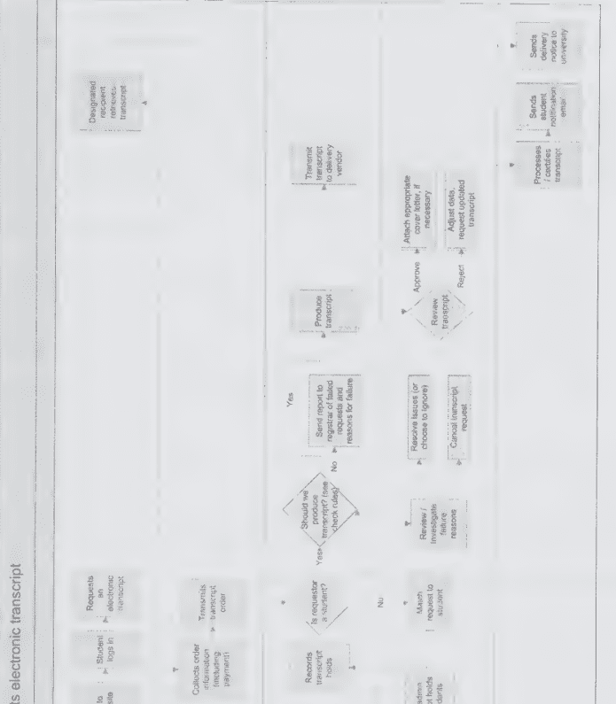
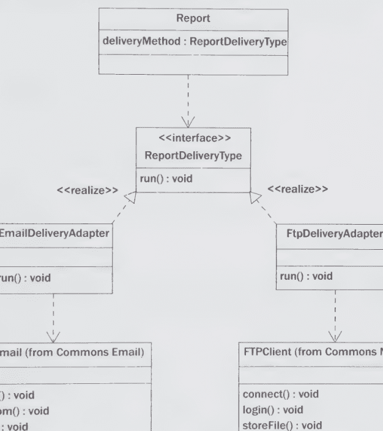
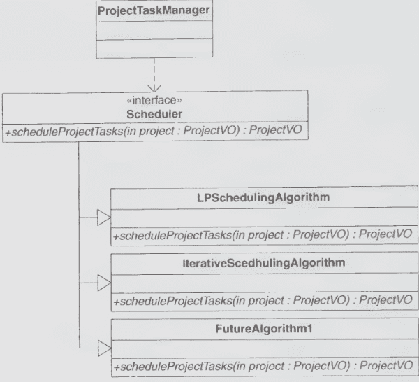
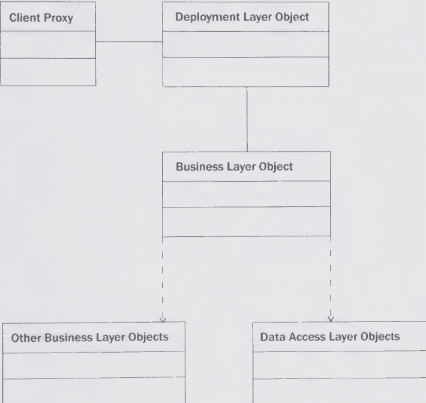
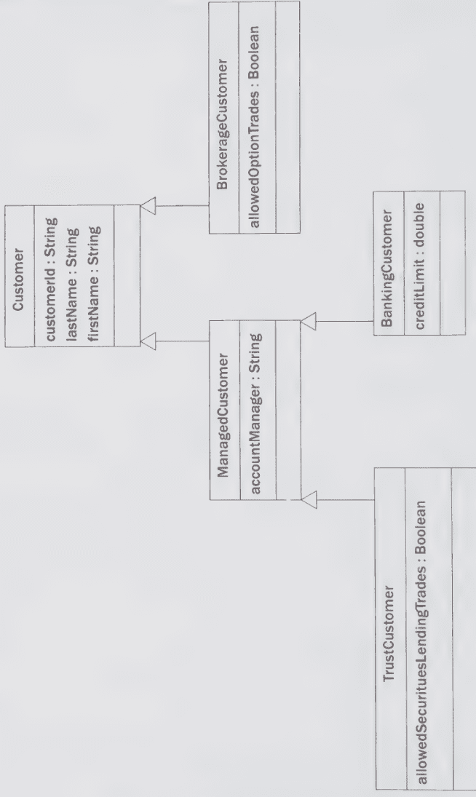
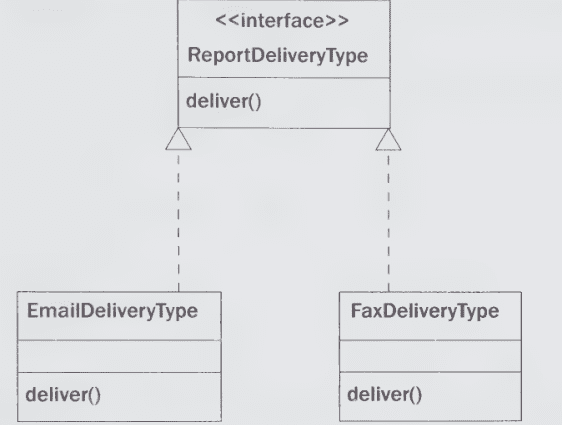
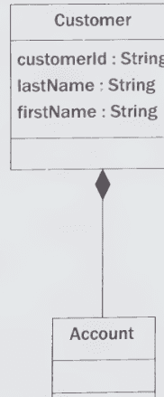
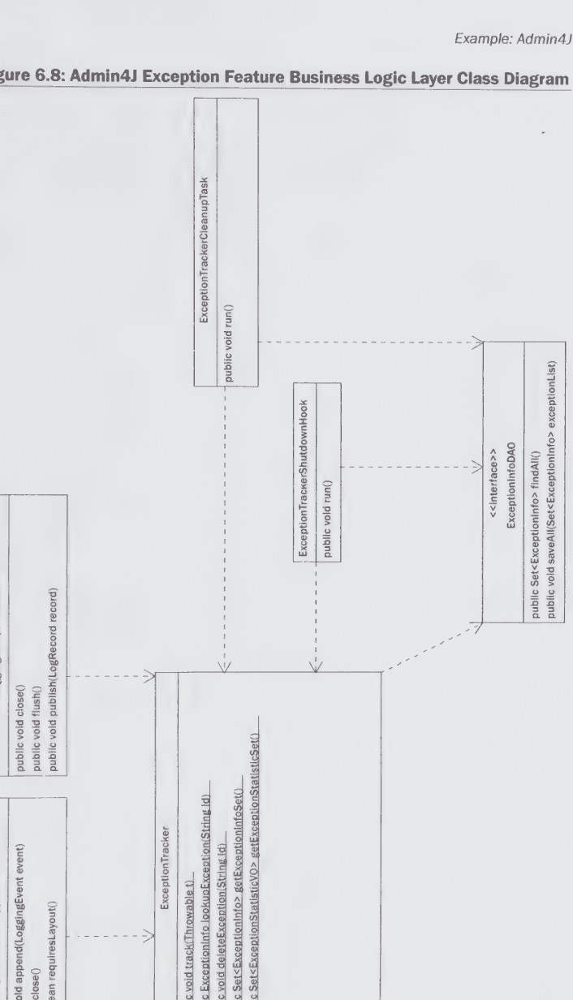
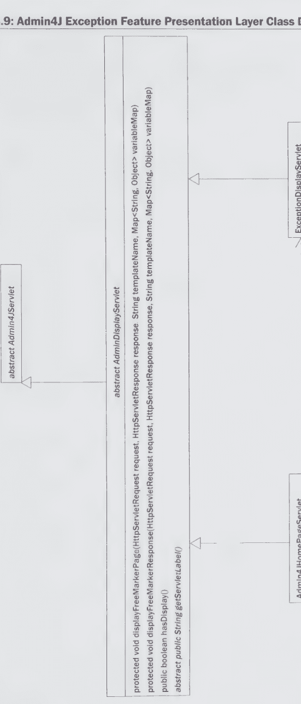
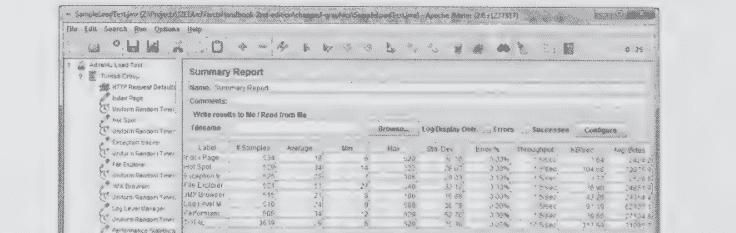

# Java EE 架构师手册（第二版）：如何成为成功的 Java EE 应用架构师

## 赞誉

### 《Java EE 架构师手册》

“Derek Ashmore 为任何从事 Java 和/或 Java EE 应用的人士汇编了一本‘必读之书’。Ashmore 先生在这本‘如何做’的方法中，涵盖了使用 Java 设计/开发/测试/实现 EE 应用的所有基础，并频繁地引用了 `XML`、`JDBC` 库、`SOAP`、关系型数据库访问（使用 `SQL`）以及在相关时使用的各种有用工具。这本书清楚地展示了 Derek 在 Java 领域的专业专业…………感谢你通过这本实用的书与 IT 社区分享知识。”

**Dan Hotka**，作者/讲师/Oracle 专家

“这本书制作非常精良，解释了你成为一名成功且高效的 Java EE 架构师所真正需要知道的所有知识。这是一本优秀的书，对 Java EE 架构主题提供了全面且详细的覆盖，可以作为初学者的手册，也可以作为资深架构师的参考工具。直截了当的和良好的视觉效果带来了快速且全面的学习体验。如果 Java 是你的主要编程语言，且你目前正在担任 Java 架构师或正将其考虑为未来的职业，这本书应该出现在你的书库里。”

**Ian Ellis**，IESABroad 副总裁兼首席信息官

“[Derek 为 Java2 架构师编写了]一份深入且全面的资源！这本书为现实世界中的 Java 开发提供了一份简洁的路线图。这种方法实用且直观，基于丰富的经验。项目管理、应用和数据设计以及 Java 开发的各个方面都涵盖在内。这本书避免了该领域许多书中常见的‘干燥的风格’和过度抽象（过度简化）。一本非常棒的书，我把它放在了我的‘A级书架’上！”

**Jim Ellott**，West Haven Systems, Inc. CTO

“阅读体验清晰，并弥合了专业人士与教授之间的差距。在我三十年的职业生涯中，许多作者花更多时间讨论当下的热词，却未能传达重点。Derek 的书真的能引起核心开发者的共鸣。实用、博学、案例优秀。”

**John R Mull**，Sytech Software Products, Inc. 主席

---

## 目录

- 序言
- 致谢

### 第一部分：规划 Java EE 应用

### 第二部分：设计 Java EE 应用

### 第三部分：构建 Java EE 应用

#### 第十章：构建数据访问对象

- XAO 示例

### 第四部分：测试与维护 Java EE 应用程序

- 性能测试技巧与指南
- 负载下的性能测量
- 内存泄漏定义
- 识别内存泄漏
- 调查性能问题
- 第十七章：使 Java EE 应用程序可维护性
  - 支持目标
  - 简化应用缺陷的调查
  - 简化意外停机的调查
  - 调查内存不足问题
  - 调查 Java 竞争问题
  - 调查性能问题
  - 评估应用质量
  - 识别重构机会
- 第十八章：在技术变化时寻找出路
  - 简单至上
  - 重用——不要重新发明
  - 强制分离关注点
  - 顺势而为
  - 尽早发现错误而非晚发现
  - 功能需求是最高优先级
- 索引
- 关于作者

---

## 前言

《Java EE 架构师手册》专为设计和领导 Java EE 应用程序开发的架构师和高级开发人员编写。这本书的目标是帮助你在 Java EE 项目中履行应用架构师的角色。如果你是一名首次担任应用架构师角色的资深开发人员，本书将为你提供额外的技能，提升你履行该角色的能力。本书提供了大量的策略、指南、技巧、窍门和最佳实践，帮助初级架构师引导从分析到应用部署及支持的开发过程。为了帮助你成为成功的 Java EE 应用程序架构师，本书介绍了以下内容：

- 在项目生命周期每个阶段担任应用架构师角色的基本框架
- 开发每个阶段的架构级技巧、窍门和最佳实践
- 建立编码标准以保持代码一致性和可维护性的技巧、窍门和最佳实践
- 创建和交流设计的技巧、窍门和最佳实践
- 估算和项目规划材料

本版手册侧重于开发每个阶段的应用架构师交付物。也就是说，本书描述了应用架构师通常执行的离散任务，并提供了执行这些任务的技巧和技术。由于许多人通过示例学习效果，本书将提供你的交付物示例。

- `Apache Commons BeanUtils` (http://commons.apache.org/beanutils/)
- `Apache Commons DbUtils` (http://commons.apache.org/dbutils/)
- `Apache Commons IO` (http://commons.apache.org/io)
- `Google Guava Core Libraries` (https://code.google.com/p/guava-libraries/)
- `Hibernate` (http://www.hibernate.org/)

本书依赖的另一个开源项目是 `AdminJ`。作者是 `AdminJ` 的首席架构师兼开发者。`AdminJ` 被用作书中介绍的概念的实现示例。`AdminJ` 的二进制文件和源码可以在 http://www.adminj.net 下载。与本书相关的免费示例源码和其他材料可以在 http://www.dvtpress.com 找到。

## 反馈

我一直非常有兴趣阅读来自读者的意见和建议，这些建议将改进本书的未来版本。请直接通过 `derek.ashmore@dvtconsulting.com` 向我发送反馈。如果您的评论或建议是该类的首创，并被下一版采用，我将乐意寄送您一份签名版。此外，读者的问题有时会被选中并在我的博客 http://www.derekashmore.com/ 文章中解答。

## 致谢

本书的编写离不开大量的协助。有几位同事在完善书籍概念和编辑草稿方面给予了巨大的帮助，使我避免了对平庸作品的大规模营销。他们负着我无尽的感激和感谢。如果没有以下人员帮助，我无法完成这本书：Michael Lyons, D. Scott Wheeler, Todd Pagni, Haim Izrael, Ken Liu, Budi Kurniawan, Peeyush Maharshi, Mohit Gupta, Rick Miller, Shawn Racinto, Michael Spicuzza, Scott Kramer, Pradeep Sadhu, 以及 Sauabh Gupta。

非常感谢我的编辑 Cathy Reed，她耐心地纠正了我大量的语法错误，并大方地指出了我表达不够清晰的地方。非常感谢 Sherry、Tony Roberts 以及他们在 Roberts Group 的同事们，他们提供了完美的封面艺术、排版、索引以及让书籍在美学上令人愉悦的魔法。

非常感谢我的妻子 Beth 以及我的孩子们 Zachary 和 Morgan。在我创作这本书期间，他们忍受了深夜任何时候从办公室传出的音乐。Beth 经常照顾我们的孩子，以便我能投入时间写这本书。

对于书中可能存在的任何错误，我保留全部责任。

---

## 第一部分：规划 Java EE 应用

应用架构师通常通过参与分析活动、定义范围和估算资源等活动来协助规划 Java EE 应用。架构师在规划阶段的角色在不同公司之间差异很大。虽然我采取架构师应引导和促进规划活动的观点，但你在所在公司的角色可能是协助而非促进。

在本节中，你将学习如何：

- 促进并记录业务分析。
- 协助项目经理定义项目范围。
- 估算所需的时间和资源。
- 定义并设计与外部应用程序的接口。

你在这里学到的技能将使你能够应用第二部分讨论的设计技术。

---

## 第一章：项目开发团队与项目生命周期

本章为从启动到发布的成功第一个项目奠定了基础。它首先定义了应用架构师是什么以及做什么，并总结了架构师如何与其他团队成员合作。本章接着介绍了开发过程的几种替代方法。构建成功项目的确定性流程仍然是一个引起相当争议的话题，尚未存在，这导致许多公司采取了混合计划。

### 项目开发团队：角色与职责

所有的 Java EE 开发团队都需要具备各种技能的人员来担任团队中的众多角色。要使 Java EE 项目成功所需的许多技能集包括：

- 应用架构师
- 产品经理
- 项目经理
- 业务分析师
- 图形设计师
- 表现层开发人员
- 业务逻辑开发人员
- 数据建模
- 数据库管理员
- 数据迁移专家
- 基础设施专家
- 测试专家
- 测试自动化专家

尽管本书侧重于应用架构师的角色，但本节定义了 Java EE 开发团队中其他主要成员的角色和职责，并描述了应用架构师相对于这些角色的职责。

某些组织对角色使用不同的标签。例如，基础设施专家可能被称为系统管理员；测试专家可能是测试人员；某些组织则区分测试团队经理和个体测试人员。无论你给这些技能集冠以什么术语，将它们所有的成员都纳入开发团队的一部分将极大地增加团队创建成功的 Java EE 项目的机会。

此外，如果项目足够大，团队中的一个人可能担任多个角色，或者一个角色可能由多人共同拥有。某些组织将应用架构师和项目经理的角色结合。某些组织让资深开发人员兼任数据库管理员或基础设施专家。还有的组织让同一批开发人员负责表现层也负责业务层。在这里，我并不是推荐某种特定的团队组织，而只是传达哪些技能集是必要的，无论它们如何组织。

### 应用架构师

应用架构师识别项目将使用的技术。在许多组织中，技术选择是在企业级做出的。例如，硬件和软件的选择（例如 Java 容器）是企业级的。通常，选择一种语言（如 Java）是一项企业级决策。

然而，大多数应用程序都有未明确提供的技术要求。我将企业级选择与针对单个应用程序的选择区分开来。在许多组织中，做出企业级选择的人员群体独立于 Java EE 开发团队。应用架构师通常负责识别项目将使用的第三方包或工具。例如，架构师可能会识别出需要模板引擎并选择 `Apache Velocity`。

越来越多的组织区分了企业架构师和应用架构师。企业架构师协助决定哪些软件产品将购买，哪些将构建。有效的企业架构师确保使用的软件产品符合企业目标。企业架构不在本书的范围内；关于企业架构师角色的额外信息可以在此处 URL 找到：http://en.wikipedia.org/wiki/Enterprise_architecture。

应用架构师推荐项目使用的方法和框架。通常，架构师向项目经理提出这些建议。例如，一种常见的建议是用用例格式记录，并以原型作为补充。另一种常见的建议是用对象模型来描述设计。某些组织在企业级定义使用的方法。

应用架构师提供了应用程序的整体设计和结构。每个开发人员都会为项目带来一套独特的预设观点、习惯和偏好。通过综合这个有时存在分歧的意见，应用架构师确保工作由个体开发人员完成。

我把应用架构师的角色比作交响团指挥。所有音乐家对于如何解释某个作品都有不同的意见。指挥提供了将使用的解释，并与音乐家合作实施它。取决于开发方法，每个功能的实现可能不会提前发生。在这种情况下，架构师的工作是在功能开发进行期间与开发人员合作，协助设计并确保实现符合整体架构。

应用架构师确保项目得到充分定义。项目分析必须足够详细且一致，以形成构建应用程序的基础。通常，应用架构师与项目经理和业务分析师合作来定义项目。

应用架构师确保应用程序设计得到充分记录。记录应用程序设计是与开发人员以及管理层之间建立良好沟通的关键步骤。创建文档的过程迫使架构师思考问题。最终文档允许管理层向项目增加或更换开发人员，而不影响架构师的时间。对于开发人员来说，文档允许他们在应用架构师缺席时继续工作……在有限时间内负责项目，而且它使他们能够在不消耗开发团队其他成员时间的情况下解决设计上的不一致问题。文档还能帮助项目免受人员变动的影响。

通常，项目的规模和范围决定了设计文档的详尽程度。例如，一个由两名开发人员完成、工作量少于 1,000 小时的项目，所需的文档远少于一个需要 50 人团队完成、工作量达 100,000 小时的项目。并没有什么客观规则能规定特定项目的最佳数量。

我见过许多没有编写文档的项目，这意味着增加一名开发人员是一项艰巨的差事，架构师必须口头向新来者传达设计方案。通过口头沟通设计会忽略引入额外开发人员所带来的某些收益。

需要注意的是，有一些工具为管理功能请求和用于完成这些请求的工作提供有限的支持。此类产品的示例有 `JIRA`（https://www.atlassian.com/software/jira）和 `Mingle`（https://www.thoughtworks.com/products/mingle-agile-project-management）。对于需要记录某些变更历史的大型公司来说，这些工具非常有价值。

应用架构师制定编码规范。由于个人开发人员有自己的编码偏好，因此需要明确编码标准，以便让各个部分更容易整合在一起。应用架构师负责制定以下主题的项目流程和指南（这些主题将在书后的部分进行详细介绍）：

- 异常处理
- 日志记录
- 测试
- 多线程
- 缓存
- 配置

应用架构师为项目经理识别实施任务。这一角色对于 Java EE 项目尤为重要，因为它们涵盖的技术范围比其他类型的系统项目要得多。由于实际需要，应用架构师还帮助项目经理进行项目规划和估算。

应用架构师在某个阶段接手小型项目是一个好主意。这有助于他们理解担任项目经理的人员所面临的典型项目管理挑战，这种理解将使他们能够为所工作的项目经理提供更好的支持。

应用架构师指导开发人员完成困难任务。通常，架构师比开发人员更有经验。事实上，应用架构师在他们负责的项目中兼任高级开发人员的情况并不少见。当开发人员遇到阻碍进度的技术问题时，架构师通常是帮助他们创建解决方案的人。对于许多项目来说，架构师更多是导师而非执行者。

应用架构师强制执行编码规范的合规性。作为编码规范的制定者，应用架构师最有可能识别出何时没有遵循指南，因此是执行这些指南的逻辑选择。项目经理通常负责执行任务，但往往不具备识别合规性的技术经验。

代码审查是一种极佳的强制执行机制。如果有其他团队成员检查代码，个人开发人员若想快速绕过编码标准将困难得多。我还利用版本控制来定期对代码更改进行流式审查。也就是说，大多数版本控制产品都提供了一个通过电子邮件通知提交操作的功能。在实践中，我对单个提交的关注取决于执行开发人员的技能水平。随着时间的推移，开发人员提供的贡献会比别人更多，需要的监督也更少。

代码审查也是开发团队所有成员的极佳学习工具。应用架构师发现设计中的漏洞，而所有参与者都能从团队的其他成员那里学习技巧。应用架构师通常是团队中最经验丰富的成员，往往负责主持代码审查。为了发挥最大的作用，代码审查应该在和谐、无威胁的氛围中进行。

需要注意的是，有一些源码分析工具，如 `Checkstyle`（http://style.sourceforge.net/）、`PMD`（http://pmd.sourceforge.net/）和 `FindBugs`（http://findbugs.sourceforge.net/），提供了自动化审查支持。也就是说，它们将检查你的源码并指出可能的编码问题。通常，在正式将它们纳入构建之前，我花时间配置这些工具（例如确定执行哪些规则）。

应用架构师协助项目经理为管理层估计项目的成本和收益。虽然这通常是项目经理的责任，但大多数项目经理对 Java EE 经验较少，可能没有意识到需要完成的一切。应用架构师负责审查项目计划，确保项目经理没有遗漏任何任务。我经常让团队成员审查项目计划并征求反馈。如果团队成员有机会审查和批评该计划，他们就很难对不完善或不准确的项目计划产生意见。

应用架构师协助管理层做出开发人员职位的人事决策。虽然人事决策通常被视为管理职能，但应用架构师处于评估技术能力的良好位置。人事决策的失误可能会对项目进度造成巨大损害。

### 产品经理

产品经理负责产品及其需求。对于大多数组织而言，这一职位由该应用程序旨在服务的业务部门担任。对于开发软件面向市场或销售给其他组织的机构来说，产品经理负责确保产品符合市场需求。

应用架构师负责为产品经理提供技术建议和指导。应用架构师与业务分析师和产品经理合作，帮助确定哪些功能在应用程序中或在特定版本中可行。

### 项目经理

项目经理负责协调和调度开发团队所有成员的任务。项目经理必须向管理层和用户代表汇报当前的项目活动和状态。此外，项目经理获取项目或团队成员所需的任何资源或材料。

应用架构师负责为项目经理提供技术建议和指导。应用架构师协助项目经理识别任务及其完成顺序。架构师还帮助项目经理识别所需的材料和资源，包括选择团队成员并从技术角度验证他们的技能集。

### 业务分析师

业务分析师负责与最终用户合作定义应用程序需求以及设计构建应用程序所需的细节。由于最终用户和开发人员通常使用不同的术语，业务分析师负责翻译最终用户与开发人员之间的沟通。业务分析师通常在企业的用户端和信息技术端都有经验。

随着项目的进行，业务分析师的角色会减少，但不会消失。开发人员在编码和测试期间通常会产生额外的业务问题，业务分析师负责与业务端合作以获得这些问题的答案。

应用架构师负责确保业务分析师确定的应用需求是充分的。期望分析能够 100% 完整且准确是不切实际的。毕竟，分析在某种程度上具有主观性。然而，分析需要足够完整，以支持设计的进行。

### 解决方案架构师

解决方案架构师确保应用符合整个企业范围内实施的任何技术标准。例如，许多组织会对所使用的数据库和应用程序服务器软件进行标准化。如果应用团队遇到在企业其他地方已经解决的技术问题，解决方案架构师将引导应用架构师重用企业内已经开发的成果。有时，解决方案架构师是按业务领域组织的，能够协助业务代表决定资助哪些应用开发工作。由应用架构师担任这一角色是很常见的，特别是在规模较小的组织中。

### 平面设计师


许多应用程序（尤其是那些公开的应用程序）需要专业人员或布局设计人员。大多数开发者如果让他们自行发挥，可以制作出功能性的网页，但这些页面通常很难看且难用。图形设计与其说是科学，不如说是艺术。平面设计师将关注用户界面设计、图形以及应用程序的整体可用性。通常，平面设计师主要与业务分析师及其他业务方代表合作制定设计。但平面设计师也可能与表现层开发人员合作创建一个原型。

一些较大的组织会将“图形设计师”和“事务设计师”区分开来。事务设计师负责设计填充业务流程的页面流和控件，而不是关注美学。大多数组织不区分这两个角色，而是将它们合并为一。

应用架构师负责确保布局在技术上是可行的。我见过许多网页设计使用了文字处理程序中可用但 HTML 不支持的文本效果——例如，使用旋转 90 度的文本设计。架构师能够在开发过程的早期捕获并纠正这类问题。

## 表现层开发人员

表现层开发人员负责为应用程序编写所有的 `HTML`、`Javascript`、模板标记、`JSP` 和/或 `Servlet` 程序（`servlets`）。

## 第一章：项目开发团队与项目生命周期

总来说，任何直接涉及生成用户界面的内容都属于表现层开发人员的范畴。通常，表现层开发人员与布局设计师合作，构建原型并开发运行版本。通过应用架构师，表现层开发人员和平面设计师共同确定前端导航的结构和设计。

应用架构师负责确保设计模式可以被维护和扩展。导航问题通常很复杂，并且很容易退化为难以维护的代码。架构师能够很好识别并纠正维护问题以及其他技术问题。

## 业务逻辑开发人员

业务逻辑开发人员负责编写应用程序的所有不可见部分的代码，包括企业豆（`enterprise beans`）、`Web` 服务、批处理作业、业务对象和数据访问对象。一些人将这些不可见部分称为应用程序的服务器端组件。业务逻辑开发人员通常是 `Java` 专家，与应用架构师紧密合作并在需要时协助调优。

应用架构师为业务逻辑开发人员提供指导。业务逻辑对于表现层开发人员来说是可读的。服务器端组件中经常会出现技术问题和故障，而这些通常是应用程序中最复杂的部分。因此，应用架构师经常担任业务逻辑开发人员的导师。

## 数据建模师

数据建模师利用业务分析师的信息来识别、定义并分类数据库中的所有数据存储。数据建模通常涉及使用实体关系（`ER`）图来记录应用数据。然后，数据库管理员使用这些 `ER` 图生成物理数据库设计。因此，数据建模师和数据库管理员的角色合并是很常见的。

应用架构师负责确保数据模型是充分的。与业务分析一样，期望数据模型 100% 完整是不切实际的。如果数据模型基本完整且处于第三范式，那么模型（以及数据库）未来的更改很可能是微小的。

## 数据库管理员

数据库管理员负责根据应用程序的业务需求制定数据库设计，并创建和维护应用程序的数据库环境。通常，数据库管理员协助性能调优，并帮助业务逻辑开发人员诊断有关数据访问的应用问题。有时，数据库管理员兼任业务逻辑开发人员或数据迁移专家。

应用架构师与数据库管理员协作，解决任何涉及数据库存储的问题。然而，数据库管理员主要与数据建模师和业务逻辑开发人员交互。

## 数据迁移专家

某些应用程序（例如数据仓库的应用程序）高度依赖于从其他源或其他遗留数据库迁移的数据。数据迁移专家编写并管理持续填充应用程序数据库的所有脚本和程序。当应用程序迁移需求很少时，这一角色可能不是必要的，或者可能与数据库管理员的角色合并。

应用架构师确保为迁移专家提供数据迁移需求。与数据迁移专家解决可能出现的任何技术问题或故障是应用架构师角色的另一个方面。

## 基础设施专家

基础设施专家负责提供所有的开发、测试和生产环境以及部署方法。正式的开发和部署基础设施可以节省大量的时间和精力。管理容器、编写部署脚本以及协助其他开发者诊断其测试环境问题中的特殊性，代表了一个独特且具有挑战性的问题。

通常，基础设施专家与组织的系统管理员和数据库管理员合作以提供这些环境。大多数组织通过中心化管理的组提供资源配置服务。例如，基础设施专家为基础设施专家定义基础设施需求。架构师与专家协作，确定环境的数量和性质。许多项目需要至少一个开发、测试和生产环境。一些组织将基础设施专家与应用架构师师。

## 第一章：项目开发团队与项目生命周期

当你处理持续集成环境、提供构建自动化或处理涉及集群和其他非平凡环境设置时，基础设施专家通常是必不可少的。

## 测试专家

测试专家通常是一个注重细节的人，确保生成的应用程序符合规范且尽可能没有错误。通常，测试专家对该业务领域有基础知识。

应用架构师与测试人员合作识别任何基础设施需求和支持。项目经理和业务分析师通常与测试专家合作制定测试计划的内容。因此，架构师在测试中的角色通常是支持。对于较大的开发工作，测试专家角色可能由整个测试团队和测试经理组成。

## 测试自动化专家

对于预计会有多次应用迭代和版本交付的大型项目，通常需要测试自动化专家。测试自动化专家可以编写可以作为应用程序回归一部分的集成测试脚本，这些测试可以按发布版本执行，也可以在持续集成环境中在每次成功构建时执行。

## 项目生命周期方法

对于 `Java` 项目生命周期应该是怎样的，存在不同的观点。本节描述了这些观点，并对该主题提出了我的个人看法。书中的指南旨在兼容任何方法论。

## 瀑布模型

瀑布模型法意味着在编码和测试之前完成项目的所有分析和设计。这种方法在大多数开发都是基于大型机时非常常见，目前仍然是许多公司偏好的方法。

在瀑布模型下开发的项目往往是大型的且

## 项目生命周期方法

由于交付时间很长，因此，它们意味着更大的风险。这些项目通常不需要业务参与者学习过多的技术术语，而且业务侧的接口受到了严格控制。

与其他方法相比，瀑布式项目开发方法在过程的早期并不提供反馈，但它交付了更完整的解决方案。瀑布式项目往往能够很好地契合预算计划周期，这可能是该方法流行的原因之一。

由于瀑布式项目通常需要的时间非常长，业务需求在项目进行期间往往会发生变化。项目经理因此面临着两进的境地：如果项目不随业务一起变化，那么产生的应用程序将无法提供足够的收益；如果项目根据业务需求的变化进行调整，那么项目所需的时间和资源将受到负面影响。

## 敏捷方法

敏捷方法努力将项目拆分为通常只需要较少资源的小组件。因此，敏捷方法是瀑布式方法的对立面。敏捷方法可以被视为一种具有许多不同实现方式的方法“家族”。在本文写作期间，最流行的敏捷方法实现方式似乎是 `Scrum`。敏捷实现的其他示例还有极端编程（`XP`）、精益（`Lean`）和水晶体（`Crystal`）。在本文讨论的背景下，使用 `Scrum` 作为敏捷方法论的主要示例，因为它似乎是最广为人知的。

敏捷方法论的核心目标是减少困扰瀑布式方法的技术风险和项目成本。敏捷方法论使用了以下假设：

- 从长远来看，越早匹配越便宜。
- 降低复杂性也可以降低技术风险，并且从长远来看更便宜。
- 短短的迭代可以提高投资回报率（`ROI`），并能够更快速地适应变化的业务需求。
- 关注测试自动化结果可以更高效地利用开发资源。

敏捷方法要求你将问题分解成许多小问题（称为故事/`stories`），实现这些问题需要三周或更短。每个故事由两个程序员使用一台机器共同开发。在故事开发时，通过程序化测试来确定新故事的功能是否已开发并添加到回归测试套件中。这些程序员忽略掉他们正在处理的故事之外的应用的所有方面。一名业务参与者专门负责该项目，并能随时回答任何出现的业务问题。

# 定义项目

开发任何应用程序的第一步都是进行分析，以定义其目的、范围和目标。`Java EE` 也不例外。在开发过程中包含分析是基本的常识，但我仍然经常惊讶，竟然有这么多项目在没有先定义目标的情况下就仓仓忙忙地推进了整个过程。

应用程序架构师并不直接参与项目的定义；那是项目经理、业务分析师和最终用户的工作。然而，架构师负责确保项目的定义具有足够的一致性和详尽程度，以便能够进行物理上的设计和实现。由于 `Java EE` 开发团队的大多数其他成员并不知道设计和实现应用程序需要哪些信息，因此应用程序架构师经常主持项目讨论。

应用程序架构师必须具备分析技能。如果没有分析技能，架构师将无法在项目初期识别出定义中的弱点和缺失，而这恰恰是解决这些弱点成本最低的时候。另一方面，具备分析技能的架构师更有可能预测未来的功能需求，因为他们能够理解涉及的业务流程。虽然在需求提出之前不会投入精力构建这些功能，但可以做出某些设计选择，为以后添加这些功能提供可能。例如，我预计在未来的某个时刻，客户可能拥有多个账户，尽管他们现在还不能，但我将做出允许这种可能的设计选择。

# 第2章：定义项目

当我写这些文字时，我能听到开发者们的叹息。技术人员更想听更多关于编码技巧，而不是项目定义和需求收集策略。我完全理解。没有什么比编写出实现用的代码更让我喜欢的了。然而，要获得良好的代码，你需要良好的分析和良好的项目定义。我的经验是，如果没有合理的分析，获得有用代码的概率微乎其微。

用例（`Use-cases`）是分析中的重要工具。统一建模语言（`UML`）规范的创建是为了描述和记录使用 `Java` 等面向对象语言系统的分析和设计。`UML` 用于描述应用程序将实现什么的主要结构是用例。本章定义了用例这一术语，指导你如何为项目编写用例，列出了创建用例时的某些错误及其避免方法，并展示和讨论了一个为某个项目编写的用例示例。

本章并不包含关于 `UML` 规范用例的全面概述。我介绍的是规范中常用且实用的子集。关于 `UML` 规范的深入探讨，请参考 Booch、Rumbaugh 和 Jacobson (1999)。

尽管有些开发者区分用例和需求，但我认为两者没有区别。需求是用业务术语编写的、应用程序必须提供的特定功能。因此，需求通常是**摘要形式**的用例。

如果你在使用敏捷开发方法（如 `Scrum`），你创建的是用户故事（`user stories`）而不是用例。这两种结构实现了相同的目的：传达需求。用户故事是对用户需要或需要用应用程序完成某事的简短陈述。例如，“应用程序需要记住我上一次的产品搜索记录，并预填我上次指定的过滤器；我这次将进行相同的搜索。”用户故事本身不包含足够的细节以供实现，需要与用户代表进行口头交流来充实细节。相比之下，用例包含了足够的细节以供实现。用户是使用用例还是通过用户故事和口头交流获得需求，仅仅是功能和战术上的区别。

此外，我喜欢对用户界面进行原型设计。原型是让业务方和开发者理解项目目标的极佳工具。我通常很容易让业务方对原型设计过程产生兴趣，因为它具体地代表了他们将得到的东西。原型设计有助于完善用例。

一旦你定义了项目的用例（或故事），你就可以创建一个相当详尽的项目定义，该定义用业务术语编写，开发者和业务人员都能理解。这允许业务方和任何管理利益相关者尽早反馈。获得特定项目用例的正式确认，使项目经理能够控制项目范围。

## 识别项目范围

在进行用例分析和原型设计练习之前，需要一个高层次的项目定义和关于范围的初步想法。大多数开发者都是注重细节的，会认为这种高层定义太模糊而没有用处。请记住，这种高层项目定义的目的只是为用例分析确定范围（而不是为了编码）。

以下是一个高层项目定义语句的示例：

- 构建一个协助项目经理规划任务、跟踪每个团队成员的活动并估计完成日的系统。该项目跟踪应用程序允许用户执行以下操作：
- 定义项目及其任务。
- 记录分配到项目任务的人员，并估计完成每个任务所需的时间。
- 记录任务完成顺序。
- 记录项目进度并将任务标记为完成。
- 自动调度项目。
- 创建项目进度报告。

尽管这段陈述看起来模糊且简单，但它为识别参与者（`actors`）和构建用例提供了起点。

## 识别参与者

用例分析的第一步是识别参与者。参与者是受用例服务或受影响的用户类型或外部系统。虽然“actor”一词带有真实之人的内涵，但 `UML` 参与者可以是一个外部系统、组织类型或角色。

以下是我架构的一个报告生成应用程序的参与者列表：

- 受信任的客户用户
- 受信任的客户组织
- 银行支持用户
- 报告模板开发人员
- 文档交付应用程序接口
- 报告模板定义接口
- 数据仓库应用程序接口
- 报告请求接口
- 应用程序管理员

这里是我架构的一个现金跟踪应用程序的参与者列表：

- 现金经理用户
- 交易审批用户
- 高级交易审批用户
- 银行支持用户
- 资金会计应用程序接口
- 应用程序管理员

你可能注意到，在每个示例中，我都将各个用户组列为单独的项目，因为每个用户组具有不同的功能。虽然有些用例适用于所有类型的终端用户，但另一些是针对特定用户的。在每个例子中，我们开始用例分析时的终端用户类型比结束时要少得多。在编写用例的过程中，我们意识到某些用户角色需要不同的能力。

一个用户可以代表多个参与者。例如，一个提供银行支持的用户可能也担任经理或交易审批者的角色。

对于任何大型应用程序，将应用程序管理员视为一个参与者。这强制人们关注支持——这提高了可用性，并让其他参与者（恰好是人）感到满意。

确保所有参与者都是直接的。有时人们会对外部接口感到困惑，想要列出外部接口服务的终端用户。例如，如果一个证券交易系统是外部接口之一，你可能会将交易者列为参与者，因为他们间接地服务你的应用程序。然而，证券交易系统才是参与者，而交易者是终端用户。

通过小组协助识别参与者。应用程序架构师和业务分析师可以通过对参与者是谁做出假设并与团队其他成员及业务方进行评审来主持讨论。根据我的经验，人们对现有内容进行批判要比在白纸上增加内容好得多也快得多。随着用例分析的进行，你可能会发现更多的参与者。

## 编写用户故事

用户故事（`User Story`）是一个短的描述，包含一个参与者、该参与者的愿望或需求，以及需求满足后参与者将获得的预期收益。通常，用户故事只有句话。用户故事包含的信息并不足以让开发者实现该功能。其意图是通过与业务代表的交流来获取实现该功能所需的细节。

用户故事的一种常见形式如下：

- 作为一名<参与者>，我想要<愿望或需求> [以便<预期收益>]。
- 有人认为用户故事中的“预期收益”部分是可选的，但参与者以及对愿望或需求的简短描述是必须的。是我最近的一些项目中的用户故事示例：
- 作为注册员，我希望生成可以电子化传输的成绩单，因为这是学生需要的。
- 作为安全管理员，我希望有一份报告，告诉哪些用户拥有特定角色。
- 作为高管，我希望能够对预算项目添加注释，以便与其他高管及会计部门进行沟通。
- 作为学术管理人员，我希望能够在课程应用程序内部发布课程大纲，供潜在学生查看。
- 作为应用程序管理员，当达到内存溢出状态时，我希望收到短信通知。

## 在交流中获得的额外需求应被予以记录。

除非项目非常小且你的组织没有任何公司政策，否则你需要一份关于实现细节的书面记录。文档不需要非常详尽或冗长。确保你与交流获取信息的业务代表分享这些文档；如果对需求存在误解，最好尽早消除。

## 编写用例

用例（`Use Case`）是对系统在响应其某一个参与者的请求或响应该参与者动作时执行的某些操作的描述。你应该用业务术语而非技术术语来编写用例。业务侧的任何人员都应该能够在没有翻译人员或技术术语表的情况下阅读文本。包含技术术语的用例通常表明在这一阶段正在做出技术设计假设，而不应该这样做。用例还可以作为组织业务方与开发方之间非正式的“合同”，规定在哪些增量中交付什么内容。

# 第 2 章：定义项目

用例没有特定的格式。然而，用例通常包含标题、描述、参与者列表、前置条件列表、触发器、主流程和备选流程。

用例描述文本应以：“系统（或应用程序）将 .……”开头。如果你发现一个无法以这种形式编写的用例，它可能不是一个有效的用例，而是另一个用例的一部分。注意，用例通常服务于多个参与者。我建议在用例中显式列出所有受影响的参与者。

以下是实现的报告系统的用例描述示例：

- 系统将提供一个接口，允许用户从现有 `MVS/CICS` 应用程序定义的数据中运行报告。
- 系统将允许应用程序管理员控制受信任客户组织成员可以运行的报告。
- 系统将允许应用程序管理员定义新报告并将其发布给用户。

参与者列表描述了直接参与用例的用户（参见本章的“识别参与者”章节）。同时也要简要列出参与者参与此用例的理由。例如：

- 受信任客户，想要获取有关其投资的信息。
- 应用程序管理员，想要定义额外的报告并将其发布给客户。

前置条件列表是发生此用例发生前必须满足的业务条件列表。示例包括：

- 已获取并登录了受信任客户账号。
- 已请求了一份新报告。

触发器是启动用例处理的事件。示例包括：

- 受信任客户想要运行报告。
- 应用程序管理员开始工作定义新报告。

用例的主流程是对用例处理在无错误情况下的分步描述。客户运行报告的示例可能是：

- 1 用户显示可用报告列表。
- 2 用户选择一个要运行的报告。
- 3 用户输入运行报告所需的任何参数。
- 4 用户输入报告的格式（例如：`HTML`、`PDF`、`Excel` 等）。
- 5 用户查看报告。

备选流程描述了在执行用例期间可能发生的异常事件。

- 如果用户没有输入所有必需参数，系统将显示错误消息，列出仍需要的参数。
- 如果报告执行出错，系统将显示通用错误页面，并向管理员通知错误详情。

用例可以用更正式的组织化结构和内容来编写。更多细节请参阅 Cockburn (2001)。

用例的长度应在一到三页之间。该长度建议由 Cockburn (2007) 提供。超过三页的用例往往包含不适合用例的材料；例如，线框图（`wire graphics`）通常不适合作为用例的材料。冗长的用例往往包含术语表或线框图。对于每个案例，我发现从一个不超过两句话的摘要开始是有帮助的。这简化了列表增长时用例的组织。随着分析的进行，你将为大多数用例添加额外的细节。

避免使用用例图。`UML` 规范为用例提供了一种图形表示方案。然而，图形方案很少被使用，我特意没有在书中书中讨论它们。我的经验表明，用例图会混淆业务方和开发者，而且创建、解释和维护这些构造的成本远大于它们所提供的任何益处。

编写用例需要业务方的深度参与。在我的经验中，对用例分析支持会导致项目失败。通过从一个小小组开始来促进用例分析。这些草案用例是不完整的，有些是错误的，但比起从白纸开始，你会更容易、更快地获得反馈。你可以利用反对意见来完善和改进用例。

聘请某人担任用例讨论的“记录员”。当你主持讨论时，你没有时间做好良好的笔记。让协调者之外的人员记录讨论有助于确保内容是完整且易于理解的。

编写用例，以便在更多信息可用时进行修订。用例始终在演变。如果你在建模阶段或项目的后期发现了额外信息，将这些材料添加到用例中。


当团队成员认为可以估计实现每个用例的时间时，用例分析即告完成。估计可能是以周而不是小时为单位。有些开发者在实际编写应用程序之前不愿意提供估算。你可能需要委婉地提醒这些开发者，估算与任务实际时间之间存在差异是预期的。注意，开发者经常会在估算中包含乐观开发时间；我习惯上将许多开发者提供的估算翻倍。

如果小组在表达需求方面困难，不要慢下来。做出假设并继续。如果你的用例不对，反对者有责任告诉你哪里错了，以便你修正问题。你可以利用这些信息来完善和改进用例。

## 常见错误

本节包含各种缺陷的用例示例。

### 在需求的掩护下实施技术设计假设

这是我最常见的错误。考虑以下根据本章前面的报告示例改编写的用例：

- 系统将允许应用程序管理员通过设置规则来限制系统负载，禁止某些用户组执行报告或将其执行重定向到批处理流。

这个用例做了几个毫无根据的假设，并让我们在解决错误的问题。它假设应用程序使用的硬件/软件架构无法扩展到处理负载，并且某种替代处理路径是必要的。它假设应用程序无法变得像提到的“批处理流”那样高效。它还假设批处理环境实际上有空闲容量来处理应用程序本应该处理的负载。

即使这个用例中做的某些假设被证明是

诚然，我们本应该从规划一个能够更好地支持我们负载的架构开始。事实上，大多数假设后来都被证明是错误的：架构可以高效地处理负载；批处理流是频繁的性能瓶颈，而且实际上并没有剩余容量；而应用程序的效率完全超过了用户的需求。

编写此类用例的更好方法应该是：

- 系统将支持最多 `200` 个并发运行的报告，每日最大量为 `500,000` 份报告。

### 在用例中包含物理设计假设

例如，一名开发人员为报告系统提交了以下用例：

- 系统将在请求完成后在报告请求表中插入一行。

这个用例做出了物理设计假设，即我们是在一个尾表（tail）中请求运行。但在那时，我们还没有决定是否要这样做，而且也不应该这样做。经过一些讨论后，我了解到应用程序管理员需要一种方法知道用户运行了哪些报告，以便他们能够重现受信任客户向帮助台报告的问题。根据这些需求，编写该用例的更好方法应该是：

- 系统将记录至少 `36` 小时的报告请求历史，以便应用程序管理员和报告模板开发者调查所报告的问题。

### 未能保持分析会议的高效

分析工作可能由于许多原因而停滞，包括引导或领导不力、讨论中的细节水平极低以及缺乏信息。从分析会议获取的需求可能是不完整的或在其他方面无效。应用程序架构师可以引导开发团队避开所有这些问题。与其让会议停滞，我会为稍后要处理的项目或问题创建一个“停车场”（`parking lot`），以便在获得额外信息后再处理。停车场中的项目会被记录和跟踪，然后在以后进行讨论。

### 即使在项目较小时，也未能记录用例

大多数开发人员都认为，当项目仅有一个开发人员时，记录用例是不必要的。但无论如何，都应该记录用例。然而，对于小型项目，用例集可以是非正式的，使用简单的项目符号列表即可。

记录的用例针对开发工作并减少了偏离主题的概率。此外，记录的用例可以向管理层和业务部门传达开发的目标，并协助项目


# 第 2 章：定义项目

如果额外的开发人员加入团队或项目被分配给另一个开发人员，则可以过渡。

**在每个用例中重复定义术语。** 即使对于复杂的应用程序，也没有必要在每个出现该术语的用例中重复定义。相反，你可以定义一次，并在单独的业务术语列表中维护它们。例如，`现金交易`（早些用例示例中的一个术语）指的是从一个账户转移到另一个账户的资金。交易的特征是它有一个标识符、一个日期、一个金额、最多一个扣除资金的账户以及最多一个接收资金的账户。

*（注：`现金交易`（早些用例示例中的一个术语）指的是从一个账户转移到另一个账户的资金。交易的特征是它有一个标识符、一个日期、一个金额、最多一个扣除资金的账户以及最多一个接收资金的账户。）*

如果你觉得写用例看起来很容易，你是对的。此的推论结果是，如果你认为自己遗漏了某些内容，并且认为写用例应该比本章显示的要困难，那么你就是让任务变得比实际需要的更困难了。如果写用例需要更多的常识，这种实践将无法成功，因为你永远无法让足够的人对结果达成一致。

## 原型

在这个阶段，开发团队通常有足够的信息来选择用户界面技术（这通常涉及 `HTML`，如今大多数应用程序都是 Web 的）。用户界面使原型能够成为真实应用程序的一部分，并防止意外承诺交付技术上无法实现的东西。

**考虑让布局设计师参与原型的制作。** 事实上，应该是布局设计师引导这项特定的活动，而不是应用程序架构师。我发现技术人员通常无法做出最美观的用户界面屏幕。我也做不到。

记住，原型在定义上就不是功能性的。任何原型都不应该包含动态数据。如果你负责开发原型并使用 `HTML`，我强烈推荐参考 Castro (2006)。

## 泳道图（SWIM-LANE DIAGRAMS）

虽然这不是我所知的任何官方方法论的一部分，但我使用用例、原型结合泳道图（用于描述主要的业务流程）取得了巨大的成功。对于不熟悉泳道图的人来说，它们描述了正在设计的软件所支持的业务流程。图中的每个单独泳道包含一个执行者或应用程序。业务过程中由该执行者或应用程序做出的不同组件和决策，由泳道内的流程正方形或决策三角形表示。标记为应用程序的泳道是自动执行的流程。

## 泳道图

泳道按时间顺序从左到右读取。图 2.1 是一个示例。

### 图 2.1：示例泳道图



如果终端用户可以轻松地理解泳道图，它们就可以被有效地用于描述业务流程的哪些部分是手动操作的，哪些是由软件应用程序支持的。终端用户对这种方法很习惯，因为它让他们容易地看到是否忘记了可能与你的项目相关的流程细节。

程序员也从这种方法中获益，因为他们可以轻松地看到他们的软件产品被使用的上下文。

## 非功能性需求

到目前讨论的所有项目需求都是功能性需求。功能性需求定义了应用程序预期实现的功能。非功能性需求规定了如何实现功能需求的约束。例如，一个功能性需求可能是允许用户运行预定义的报告；而一个非功能性需求可能是所有报告应在六十秒内运行。另一个例子：一个功能性需求可能是允许用户保存客户账户的更改；而一个非功能性需求可能是应用程序以及任何已保存交易的备份在硬件故障时是可恢复的。

通常，非功能性需求不会有用例或用户故事。然而，非功能性需求偶尔会影响功能性需求。例如，我收到过一项功能性需求增强请求，允许客户代表查看用户的密码，以便在用户忘记密码时可以告知他们。我告诉他们，有一项管理指令要求密码绝不能以明文格式存储。此外，使用所用的加密方法无法解密密码。这种以无法解密的方式加密密码的指令是非功能性需求的一个例子。在这种情况下，非功能性需求确实影响了功能性需求。

## 提高你的分析技能

有时，开发人员和初级架构师在获取编写良好的用户故事和用例所需的分析技能方面存在困难。业务分析需要良好的书面和口语交流能力，并不是所有开发人员都具备。它要求你能够用业务术语表达问题，放弃所有的技术术语（例如文件、字段等）。这个领域并不像编码那样客观和精确。尽管如此，编写有效的用例和用户故事的能力是所有架构师都需要发展的技能。如果你认为有必要，这里是一些你可以做以提高分析技能的办法。

### 找一个导师

选择一个在同一组织工作、且你尊重其业务分析技能的人。让导师审查你的用例、用户故事或你们组织用于沟通功能性需求的任何文档。通常，没有直接参与的人更加客观，并能为你提供价值的反馈。

### 对你的项目或作业进行项目后回顾

除非你的经理要求，否则这不需要正式进行，也不需要公开。你可以通过与参与项目的开发者和最终用户代表进行非正式的讨论来收集这些信息。遗掉了哪些用户需求？如果你当时问了哪些问题，可能会更早地发现这些缺失的需求？这些是你可以在未来的作业中利用并尝试纠正的反馈。

### 想象一下你必须执行用例或用户故事中描述的用户任务

如果你处在他们的位置，为了实现用户的目标，你需要做什么？进行这项练习可以让你看到你可能遗漏的某些方面。此外，它还能提供关于用户行为的信息，这可能有助于你未来的工作。

## 延伸阅读

- Booch, Grady, James Rumbaugh, and Ivar Jacobson. 2005. *The Unified Modeling Language User Guide*, 2nd ed. Reading, MA: Addison-Wesley.
- Castro, Elizabeth. 2006. *HTML for the World Wide Web with XHTML and CSS: Visual QuickStart Guide*, 6th ed. Berkeley, CA: Peachpit Press.
- Cockburn, Alistair. 2001. *Writing Effective Use Cases*. Boston: Addison-Wesley.
- Cockburn, Alistair. 2007. *Agile Software Development*, 2nd ed. Boston: Addison-Wesley.
- Fowler, Martin, and Kendall Scott. 2003. *UML Distilled: Applying the Standard Object Modeling Language*, 3rd ed. Reading, MA: Addison-Wesley.

# 第 3 章：范围定义与估算

在大多数组织中，项目经理与业务部门和管理层合作，建立项目范围并估算时间和资源需求。项目经理经常依赖应用架构师协助完成这些任务。Java EE 应用的情况也是如此。本章为负责帮助管理层定义和估算交付的架构师编写的。不参与这些任务的读者可以跳过本章。

## 定义范围

根据用户故事或用例客观地定义项目范围，并获得业务方的同意。在项目过程中更改范围会扰乱时间表并降低开发团队的士气。当业务方在开发过程中提出额外请求时，应承认这些请求，将其记录在用例中，并将其安排在未来的发布中。通常，对每个用例进行粗略估算可以为业务方在决定范围时提供有用信息。

获得项目赞助人对用例的认同。由于用例是用业务术语编写的，它们可以作为与业务方和管理层之间的“合同”，规定将交付的内容。与业务方合作，选择哪些用将在当前项目中实现。其他任何内容都将推迟。即使范围是通过口头达成一致的，也要写成书面形式并发送给远程连接到项目的每个人。确保保留一份副本。

一旦确定了项目范围，要勤奋地执行它。项目范围确定后，项目经理能做的最重要的事情就是执行它。应用架构师负责提醒项目经理范围的变化。击中一个移动的目标要困难得多。虽然我通常倾向于将所有增强功能安排在未来的发布中，但架构师通常没有权限决定调度问题。我按照用例格式对请求进行估算并提供一个初步估算。通常，项目经理可以使用这些信息引导业务方将请求安排在未来的发布中。记录在确定项目范围时所做的任何假设。在此阶段，关于项目需求通常会有未知因素。通常，在调查未知因素时是不可能暂停项目的。在这些情况下，我对需求是什么做出最佳推测，并将这些推测记录为假设。必须向管理层以及产品经理或其他业务代表提供这些假设的副本。如果假设是不正确的，你将收到通知，并可以对范围和产生的估算进行更改。

在敏捷方法论（如 `XP` 或 `Scrum`）的背景下，“项目”更有可能被称为“迭代”，并且规模较小。注意，敏捷方法论主张固定当前开发迭代的范围。敏捷方法论通过为尚未开发的迭代提供灵活性（允许更改范围）来适应变化。

## 估算基础

许多技术人员认为估算很困难；事实上，在这个阶段，它绝对既是一门艺术也是一门科学。本章介绍了一种根据你从用例分析和原型中获得的信息来确定粗略估算的方法。我不声称我的估算方法是唯一的方法。如果你有自己的方法，请继续使用。对同一个项目进行多种方式的估应当能够验证你对估算的信心，特别是当不同的方法得出相似的答案时。

在项目开始时形成的估算应定期回顾，并在完成更详细的计划和设计后进行完善。在定义外部接口并完成对象和数据建模后，你将能够更好地做出准确的估算。你现在做的估算应该足够详细，以便你可以它们来估算任何用例组合。理想情况下，业务方在决定范围时会查看成本/效益比较。

根据团队中最慢的资源进行估算。我们都知道，某些人在开发任务上花费的时间比别人短。我宁愿早交付项目，也不愿去解释为什么会迟到。

估算应该成比例平衡。我发现，一个典型的开发团队大约消耗资源预算的三之一用于规划和设计，三分之一用于编码和单元测试，三分之一用于系统和用户测试。请记住，规划和设计预算的一部分是用于前一章描述的用例分析（我通常假设此时规划和设计完成了 `50%`）。这些比例适用于项目的整个生命周期。

估算应以工作小时数表示。也就是说，根据完成任务所需的工时进行估算。大多数项目管理软件会根据你的项目计划计算日期。如果资源被抽调到其他项目，你能够更好地向管理层建议该决策对项目的影响。

考虑设置开发、测试和生产环境所需的时间。大多数公司在企业层面提供现成的环境。例如，许多公司拥有中央管理团队为新应用程序的开发、测试和生产建立环境。如果你的公司有这样一个团队，分配给环境设置的时间将很低，不是常的。如果情况并非如此，你应该增加设置估算。

开发者在估算编码和单元测试任务方面比其他任何任务都成功。如果你能获得一个合理的编码和单元测试估算，就可以根据上述比例推算出其他部分，并得到一个大致估算。注意，根据这些比例推算出总估算，只需将编码和单元测试估算乘以 `2.5`，假设在估算时规划和设计完成了 `50%`。

通过历史数据来验证你的估算。我跟踪实际完成估算任务所花费的小时数。这使我能够识别估算错误并在未来的项目中纠正它们。因此，我拥有一个以前项目的任务库，其中包含了实际完成所需的时间。我从库中寻找类似的任务（工作量相似、难度相似）。我对当前项目的评估应该与我处理这些比较任务时的经验大致一致。这与房地产估值的方式相同。房地产专业人士通过查看

附近类似物业的售价。同样的方法也适用于大多数任务的软件估算。

## 估算算法

需要注意的是，应用架构师仅负责估算小时。项目经理应该能够考虑到由于其他项目的职责和休假导致的缺勤。

**第 1 步：** 对应用进行量化；确定网页、批处理作业、报告、数据库表和外部应用程序接口的大致数量。根据之前的历史记录，你拥有可比项目的工时数据。从历史数据中，推导出完成一个网页所需的平均小时数（假设需要开发以支持它的访问逻辑和业务逻辑）。例如，在我目前的一个客户处，我完成每个动态网页的平均工作时间为 `40` 到 `80` 小时，取决于复杂度。对于批处理作业、报告、数据库表和外部接口，我有类似的估算范围。数据库表之所以在列表中，是因为还需要执行数据建模和数据库设计步骤，以及物理创建表。为了推导出编码和单元测试的估算，请为项目正在考虑的一组用例收集以下各项的估值：

- 屏幕/页面（每个 `40–80` 小时）
- 外部应用程序接口（每个 `80–120` 小时）
- 数据库表（每个 `4–8` 小时）
- 转换批处理作业（每个 `24–40` 小时）

如果这是你第一次估算项目，你可能没有可比项目的历史数据可以参考；在这种情况下，请教可能拥有这些数据的同事。向你的经理或和你合作的人索要之前项目的示例项目计划和估算。

并不是每个用例都存在所有条目。如果开发团队尚未形成，上述列表中括号中注的基本估算将适用。如果已经存在现有团队，则可能对每项内容给出更准确的估算。此时的估算将不会是精确的。基于对象数量的估算更准确，但在完成对象建模练习之前无法获得该数字。

**第 2 步：** 估算每个用例的编码和单元测试时间。根据第 1 步中收集的信息，通过简单的数学计算即可获得用例组合的基准估算。“基准估算*是指一名开发人员完成编码和单元测试任务所需的时间。在设计完成之前估算编码和单元测试时间似乎有点奇怪，但很少有开发人员会被这种模糊性所困扰。

许多开发者将单元测试与系统测试混淆。单元测试严格处于 `Java` 类级别。当一个类被应用程序内的其他类调用时，其功能好坏是集成测试，而不是单元测试。

例如，对于一组涉及四个屏幕、两个外部接口、五个数据库表、无数据转换和两个环境设置的用例，基准估算是：

```
(4 × 80 hrs) + (2 × 120 hrs) + (5 × 40 hrs) + (2 × 8) = 616 hours
```

**第 3 步：** 将第 2 步的基准估算乘以 `2` 到 `2.5`，以考虑到每个用户故事或用例的分析和测试成本。如果编码和单元测试占每个用例总成本的三分之一，那么总成本应该是基准估算的三倍。由于在这一阶段分析已完成 `50%`，因此总成本为基准估算的 `2.5` 倍。继续之前的例子，项目剩余的总小时数将是 `600 × 2.5 = 1,500`。

**第 4 步：** 对于项目中每增加一名开发人员，就将估算增加 `20%`。基准估算假设项目有一名开发人员。项目中每增加一名开发人员都会增加通信和协调时间（Brooks, 1995）。虽然这是必要的，但花费在通信和协调上的没有花在开发上。因此，每增加一名开发人员，将基准估算增加 `20%`（即乘以 `1.20`）。例如，基准估算为 `2,600` 小时且预计有五名开发人员，则花费 `600 ×(1.20)4=1,244` 小时进行编码和单元测试。顺便说，将该数字舍入为 `3,500` 是个好主意，以避免认为这是一个精确估算的误解。

假设项目的开发人员是全职投入的（每周 `32` 小时，考虑到官僚干扰等），开发团队每周总计可以工作 `160` 小时。这意味着项目交付大约在两个三个月后。此时请明确以月份或季度为形式说明估算，以避免产生这是一个精确估算的印象。

**第 5 步：** 与开发团队一起审查你的估算。如果开发者没有参与，他们就不会认为受这些估算的约束。提醒开发者这些估算将在设计完成后重新评估，这一点非常重要。

**增加更多人力很少能缩短延期项目的时间线。** 正如前所述，通信/协调惩罚是导致延期项目增加人员只会使其更晚的主要原因。架构师经常被要求在分析完成之前给出大致估算。投入估算的时间往往收益递减。无论如何，完成项目所需的实际小时数将与你的估算不同。投入更多时间进行估算在大多数情况下不会让估算更准确。对于初接触估算的开发者来说，这是一个他们必须接受的真理。即便字面上不正确，你也可以通过在估表中填写假设来给出大致估算。

附近类似物业的售价。同样的方法也适用于大多数任务的软件估算。

## 估算算法


需求通常会影响项目估算。例如，如果应用在硬件发生故障时需要支持无缝切换，那么测试的估算将会更高。如果存在非功能性需求，要求应用能够支持每秒 50 次访问，那么性能测试的估算就需要反映这一点。如果企业有强制规定应用程序的单元测试代码覆盖率至少达到 90%，那么开发的估算就需要反映这一点。

## 延伸阅读

Brooks, Frederick P., Jr. 1995. 《The Mythical Man-Month: Essays on Software Engineering》 Anniversary Edition, 2nd ed. Reading, MA: Addison-Wesley.

DeMarco, Tom, and Timothy Lister. 1999. 《Peopleware: Productive Projects and Teams》 2nd ed. New York: Dorset House.

# 设计外部应用程序接口

Java EE 应用与我们无法控制的外部应用程序进行接口交互是常见的现象。例如，采购应用程序可能会通知会计应用程序所有的购买记录，或者库存管理应用程序可能会通知会计应用程序所有的库存入库和客户发货。应用架构师负责应用程序接口的设计以及应用程序本身。应用架构师在设计与外部应用程序的接口时通常起着核心作用，特别是当外部应用程序也是自定义开发时（例如，不是具有成熟接口能力的售卖产品）。本章描述了如何定义外部应用程序接口需求，以便两个应用程序团队都能获得执行设计和实现任务所需的信息。

有时外部应用程序是售卖的，并且建立了支持的接口方法并易于消费。有时外部应用程序由另一个团队或业务部门支持，且尚不存在。创建外部应用程序接口的常见原因如下：

- 读取外部应用程序数据以供参考或处理
- 利用外部应用程序执行某些工作
- 向外部应用程序发布功能

报告应用程序是需要读取外部应用程序数据的一个常见示例。报告应用程序很少维护报告内容所需的信息。报告应用程序按需读取数据更为常见。当用户在使用你正在构建的应用程序的功能时，也希望引用来自外部应用程序的数据，这也是很常见的。

利用外部功能或为其他应用程序发布功能是“不要重复自己”（DRY）原则的示例。事实上，它们仅仅是视角不同；每一个“外部”应用程序都是某人支持的应用程序，而他们将你的应用程序视为“外部”的。通常情况下，为了你应用程序中的特定用途而在该外部应用程序中复制功能既不符合成本效益，也不符合预期。例如，假设你的应用程序需要启动客户计费的记录。现在没有人会编写自定义的会计应用程序了。更有可能的是你的应用程序需要利用一个现成的应用程序来启动该笔费用。

**外部接口带来了稳定性风险。** 外部应用程序的停机会导致你所支持的应用程序出现部分故障。此外，外部应用程序的变化（例如产品升级或功能增强）也可能迫使你支持的应用程序发生变化。因此，以一种减轻或包含稳定性风险的方式来实现接口通常是一项要求。有缓解这些风险的方法，将在本章中讨论。

**外部接口增加了开发和支持活动的复杂性。** 由于问题需要团队之外的人员来解决，开发和支持受到了影响。此外，确定哪个应用程序拥有某个特定缺陷并不总是容易的。你可能调查一个被报告的缺陷，结果发现它实际上是外部应用程序的缺陷，你所做的只是向支持该应用程序的团队或供应商报告此问题。有减少外部接口引起的复杂性的方法，将在本章中讨论。

应用架构师通常负责确保外部接口经过正式定义和记录，以便两个应用程序的开发人员都有进行对象建模活动（在第 6 章描述）的基础。两个应用程序的应用架构师都需要其建模和实现活动的基础。此外，项目经理需要你的开发组与外部系统开发人员之间有一份合同，描述每个人的责任。

外部接口的以下方面将进行讨论：

- 接口方法的选择（例如，`Web 服务`）
- 发布的功能
- 数据结构
- 触发事件
- 错误处理
- 应用程序的职责

通过使用操作数据存储可以减轻对外部应用程序用户的影响，因为访问是经过计划和控制的。这意味着外部应用程序数据的实时性取决于最新的提取。

本章将描述这些接口方法的优缺点，以帮助你做出决策。

## 消费外部应用程序数据的策略

读取外部应用程序数据是常见的需求类型。常见的策略包括直接使用外部数据库、使用企业 Bean (`EJB`)、消息技术或 `Web 服务`来获取数据。这些策略都有其优缺点。

## 直接读取外部数据库

直接读取外部数据库的策略的优势如下：

- 实现最简单且廉价
- 不需要外部应用程序供应商或团队的大量参与
- 提供的数据是最实时的

该策略的缺点如下：

- 增加了来自外部变化的负面影响风险
- 对外部用户的非预期后果（例如性能影响）

直接读取外部数据库在很多情况下是使用那些从未设计的内部功能的。如果外部应用程序属于另一个团队，更改可能会在不通知的情况下发生。因此，通常希望减少对这些变化的暴露。

读取外部数据库的风险可以通过使用操作数据存储来缓解。本质上，你的应用程序读取外部应用程序数据存储的副本，而不是直接读取外部数据库。通过将风险完全局限于提取部分，减轻了来自应用程序变化的负面影响。如果操作数据存储采用厂商中立的格式（即，不仅仅是外部数据库的简单复制），那么该数据的源可以更改为其他产品而影响最小。例如，假设外部应用程序是会计软件包。使用这种策略，即使当前的会计软件包被另一个供应商的竞争产品取代，该更改的影响也仅限于提取部分，而不会影响你应用程序代码的大部分。

这种策略（如图 4.1 所示）由于访问是经过计划和控制的，同时也减轻了对外部应用程序用户的负面影响。这意味着外部应用程序数据的实时性取决于最新的提取。

需要注意的是，市上有许多提取、转换和加载 (`ETL`) 产品可以支持这些类型的提取。其中一些产品是开源且免费提供的。许多 `ETL` 产品套件的依赖性很高，并且需要较大的学习曲线。我的经验是，在提取和转换需求非常广泛之前，利用这种工具集是不具有成本效益的。

## 使用外部应用程序数据的策略

只有在绝对没有其他选择的情况下，才应该直接写入外部数据库。这会大大增加对外部应用程序用户产生意外影响的风险；如果你的代码存在 Bug，外部应用程序可能无法正常工作。此外，如果外部应用程序是受支持的产品，这样做可能会导致你的支持合同失效。

## 利用 Web 服务

许多支持自定义接口的视窗产品会为此目的提供 `Web 服务`库。与任何接口选择一样，`Web 服务`都有若干优缺点。

利用 `Web 服务`作为应用程序接口的优点如下：

- `Web 服务`定义使用 `WSDL` 进行自文档化。
- `Web 服务`具有广泛的产品支持。
- `Web 服务`提供了变更隔绝层。
- `Web 服务`是平台中性的。
- `Web 服务`可以通过互联网安全地发布。

`Web 服务`接口之所以流行，正是因为它们是平台中性的。在有选择的情况下，大多数开发者都希望保留未来可能需要选择其他平台的灵活性。此外，发布和消费 `Web 服务`的工具支持已显著进步。例如，`Java EE` 规范（`JAX-WS` 部分）添加了 `Web 服务`注解，使得发布 `Web 服务`变得更加容易。此外，`Java/Java EE` 以及其他开发平台都有许多可用的 `Web 服务`框架。

读者可以参考以下教程编写关于如何编写 `Web 服务`的代码级信息：`http://docs.oracle.com/cd/E17802_01/webservices/webservices/docs/2.0/tutorial/JAXWS.Html`。从架构角度来看，通常建议将消费或发布 `Web 服务`的代码与应用程序的其他部分隔离开。这是对“单一职责原则”的应用，并提供了一个隔绝层，限制了变更对双方产生的负面影响。它也使得单元测试变得更加容易。例如，假设你的应用程序需要消费文档管理系统 (`DMS`) 产品提供的 `Web 服务`。我通常会将消费接口的代码与应用程序的其他部分隔离开，如图 4.2a 所示。

### 图 4.2a：Web 服务客户端设计示例

实现层处理外部应用程序的 `Web 服务`调用，并在 `XML` 和值对象类型之间进行封化（marshal）。

所有应用程序代码均仅使用外部应用程序接口。

这种设计提供了若干益处。`DMS` 产品的更改（如产品升级，甚至完全的产品或供应商更换）只会影响 `Web 服务`客户端的实现；你应用程序的其他部分不受影响。`DocumentManagement` 接口可以被模拟（mock）；你应用程序的测试不需要访问 `DMS` 即可运行。

我们也可以将这一概念应用于我们发布的 `Web 服务`。假设我们支持一个报告应用程序，并需要向外部应用程序暴露运行报告的能力。我通常会将发布的 `Web 服务`与应用程序的其他部分隔离开，如图 4.2b 所示。

### 图 4.2b：Web 服务设计示例


发布的 `Web 服务`就是你公布的“接口”。

这种设计有几个优点。你可以根据需要对报告应用程序进行重构和重新设计。只要 `ReportService` 以及相关的参数和 `WSDL` 规范相同，使用你 `Web 服务`的应用程序就不会受到影响。

此外，提供 `Web 服务`层为外部应用程序的变更提供了一个天然的隔绝层。如果你选择发布 `Web 服务`以向外部应用程序暴露功能；只要你的 `Web 服务`接口保持一致，你的应用程序就可以进行更改，而影响消费你 `Web 服务`的应用程序的风险较低。

利用 `Web 服务`的缺点如下：

- 与其它接口方法相比，`Web 服务`的开发和维护成本通常更高。
- `Web 服务`未针对检索大量数据进行优化。

## 使用外部应用程序

`Web 服务`在需要时可能不可用；消费者需要一种停机策略。

尽管工具有所改进，但与直接利用外部应用程序数据库相比，发布和消费 `Web 服务`并不廉价。此外，`Web 服务`在用于检索大量数据时性能通常并不理想。因此，我看到许多接口使用上述数据库策略或 `REST` 服务来读取数据，或者使用 `Web 服务`接口写入数据。

如果你的 `Java EE` 应用程序通过编程启动外部应用程序中的处理，你应该在用例分析中将这些应用程序识别为参与者（如第 2 章所述）。`Java EE` 应用程序与外部应用程序之间传输的信息细节都应该是一个或多个用例的主题。例如，采购系统通知会计系统所有已订单的事实应该是用例的主题。

## 利用 RESTful Web 服务

`RESTful` 服务通过使用结构化的 `URL` 来通信信息请求的细节。例如，像 `/customer/account/55555` 这样的 `RESTful Web 服务`可能是对特定客户账户 55555 的请求。`REST` 服务调用（基于 `HTTP`）的返回将是结构化的 `XML`（或 `JSON`）格式的数据。

为了进一步说明，请考虑以下采购应用程序使用 `HTTP` 从库存管理系统请求信息的示例：

1. 采购应用程序向库存应用程序发布一个 `HTTP` 请求（使用 `java`），请求某件物品（例如洗衣涤液）的当前库存水平。使用 `REST`，`URL` 描述了请求的内容。例如，`REST` 风格请求的格式可能是 `<server>/sku/<item sku number>`（例如 `/inventory/14678`）。
2. 库存管理系统中的一个 servlet 接收请求，解释 `URL` 中的特定说明并启动处理。
3. 库存管理系统检查其数据库，并确定所有仓库中该物品的可用数量。
4. 库存管理系统构建一个包含物品信息的 `XML` 文档。
5. 库存管理系统中的 servlet 将 `XML` 文档返回给调用者，就像它向浏览器返回 `HTML` 一样。

采购应用程序接收 `XML` 文档，对其进行解析，并继续处理收到的信息。

在应用程序接口中利用 `RESTful Web 服务`的优点如下：

- `RESTful Web 服务`提供变更隔绝层。
- `RESTful Web 服务`是平台中性的。
- `RESTful Web 服务`通常比 `Web 服务`更容易被消费。

利用 `RESTful Web 服务`的缺点如下：

- 在需要时可能不可用；消费者需要一种停机策略。
- 没有内置的文档策略。

## 利用消息服务

消息服务是一种异步通信方法。也就是说，发送了请求，但响应可能不会立即返回。`Java EE` 通过名为消息驱动束（`Message Driven Beans`）的构造结构对消息提供了正式支持。本质上，容器将充当 `JMS` 消息接收器，并将所有消息路由到一个实现了 `MessageListener`（`http://docs.oracle.com/javaee/1.3/api/javax/jms/MessageListener`）接口的类。

消息服务的主要优点是由于 `JMS` 消息是异步的，可以保证传递。也就是说，当发送消息时接收应用程序可能处于关闭状态，但当应用程序可用时，消息将被接收并处理。因此，消费消息接口的应用程序不需要停机策略。注意，未被拾取和处理的消息最终会被终端用户发现。

消息可以是平台中性的，但这取决于消息供应商。`Java EE` 消息使用的 `JMS` 规范按定义是 `Java` 特有的。然而，某些供应商为 `Java` 应用程序实现 `JMS` 接口的同时，也为使用其他开发平台的客户端提供了支持。

利用消息服务作为应用程序接口的优点如下：

- 消息服务提供了保证传递。
- 消息服务是平台中性的。

### 常见错误

- 消息服务支持 `Java EE` 容器。

使用消息服务的缺点如下：

- 消息服务没有内置的文档策略。

## 使用 Enterprise Java Beans

`Enterprise Java Beans` (`EJBs`) 是一种纯 `Java` 方法，可用于从一个应用程序调用另一个应用程序。将 `EJBs` 用于应用程序接口的优点如下：

- `EJB` 定义通过发布的 `Java` 接口实现自文档。
- `EJB` 拥有广泛的产品支持。
- `EJB` 提供了一个变更隔离层。

将 `EJBs` 用于应用程序接口的缺点如下：

- `EJB` 仅限于基于 `Java` 的客户端。
- `EJB` 不易于安全化。
- `EJB` 在需要时可能不可用；消费者需要一种停机策略。

虽然 `Java EE` 规范迟后地让 `Enterprise Java Beans` (`EJBs`) 变得容易发布，并且有现成的工具支持进行消费，但 `Web 服务`更受欢迎。`Web 服务`提供了与 `EJBs` 相同的功能特性，且不会将消费者限制在基于 `Java` 的应用程序上。

### 常见错误

将数据库和文件系统作为“消息中间件”。这种容易出错的策略包括在数据库表中写入一行（或在文件系统中写入一个文件），其中包含消息的内容。该策略的第二部分是编写一个代理来“轮询”（数据库或文件系统）是否有新消息到达，读取并处理消息内容，然后删除该行或文件。

从本质上说，这种策略类似于编写自己的消息系统。它通常是 Bug 的频繁来源。为什么要重复造轮子呢？选择现有的通信形式之一，专注于业务逻辑和低级通信编程。

在需要响应时使用异步通信方法（如消息传递）。在这一策略下，你的应用程序向另一个应用程序发送一条异步消息，并等待该应用程序的返回消息。

在需要响应时使用异步通信，会使你处于编写一个算法来等待响应的境地。你需要等多久？如果你等得太久，可能会耽误用户。如果你等得不够长，可能会误报错误。这就像是两个人在极其嘈杂的房间里黑暗中寻找对方。如果需要响应，请使用同步通信方法。

如果发起消息的应用程序不需要响应，使用异步通信方法对计划外停机的敏感性较小，因为如果接收应用程序当前不可用，发送者也不会遇到错误。接收应用程序仅会在恢复上线时消费该消息。由于异步消息传递需要消息软件，使用异步会给应用程序增加组件和复杂性。我不想给你留下一使用异步消息传递是危险的印象，消息技术是成熟、健壮且稳定的。

**未考虑生产环境需求。** 对于那些没有标准化负载均衡选项、通信协议和安全方法的组织，你需要调查外部应用程序计划使用哪些方案，并在接口设计中适应这些方案。对于在整个企业范围内标准化安全考量和硬件平台的组织，这些信息可能已经为人知。减轻这种风险的一种方法是提前对计划的通信方法进行小规模的测试实现。这样，如果你需要修改设计，你将有更多时间做出反应。

## 确定数据结构

**记录**所有传递给外部应用程序的数据。通信结构或格式，以及决定传输的条件，都是你与外部系统开发者合同的一部分。数据结构应以书面形式记录。

对于与遗留平台的接口，使用简单的格式如 `XML` 或 `CSV`。如果你的客户不购买 `XML` 解析器，对于使用遗留平台的开发者来说，`XML` 可能会让他们头疼。在本文编写期间，`COBOL` 或 `PL/I` 没有开源解析器和工具可用。这将非常有价值的开源项目。当外部应用程序是遗留系统且客户不购买 `XML` 工具辅助时，出于实际需要，自定义格式很常见。自定义格式可以采用关键字类型的组织方式（类似于 `XML`）或某种位置组织方式。`COBOL` 适合使用位置格式的固定长度字符串。

你需要提前对计划的通信方法进行小规模的测试实现。这样，如果你需要修改设计，你将有更多时间做出反应。（注：此处原文逻辑似乎与前文重复，已按要求翻译）

*注：由于原文文本中存在逻辑重复或错位，译文严格遵循原文逐行翻译原则，不进行逻辑修正。*

在需要响应时使用异步通信方法（如消息传递）。在这一策略下，你的应用程序向另一个应用程序发送一条异步消息，并等待该应用程序的返回消息。

在需要响应时使用异步通信，会使你处于编写一个算法来等待响应的境地。你需要等多久？如果你等得太久，可能会耽误用户。如果你等得不够长，可能会误报错误。这就像是两个人在极其嘈杂的房间里黑暗中寻找对方。如果需要响应，请使用同步通信方法。

如果发起消息的应用程序不需要响应，使用异步通信方法对计划外停机的敏感性较小，因为如果接收应用程序当前不可用，发送者也不会遇到错误。接收应用程序仅会在恢复上线时消费该消息。由于异步消息传递需要消息软件，使用异步会给应用程序增加组件和复杂性。我不想给你留下一处使用异步消息传递是危险的印象，消息技术是成熟、健壮且稳定的。

**未考虑生产环境需求。** 对于那些没有标准化负载均衡选项、通信协议和安全方法的组织，你需要调查外部应用程序计划使用哪些方案，并在接口设计中适应这些方案。对于在整个企业范围内标准化安全考量和硬件平台的组织，这些信息可能已经为人知。减轻这种风险的一种方法是提前对计划的通信方法进行小规模的测试实现。这样，如果你需要修改设计，你将有更多时间做出反应。

## 确定数据结构

**记录**所有传递给外部应用程序的数据。通信结构或格式，以及决定传输的条件，都是你与外部系统开发者合同的一部分。数据结构应以书面形式记录。

（此处省略原文中重复的段落翻译，直接从自定义格式开始）


自定义格式可以采用关键字类型的组织方式（类似于 `XML`）或某种位置组织方式。`COBOL` 适合使用位置格式的固定长度字符串。

你需要提前对计划的通信方法进行小规模的测试实现。这样，如果你需要修改设计，你将有更多时间做出反应。

（注：由于提供的原文中存在大量段落重复，为符合“一定不要重复输出原文”的指令，此处译文仅涵盖了不重复的逻辑部分。若需完整包含重复内容，请告知。）

遵循你的机械化通知程序。在收到重试通知后，应用程序管理员可能会意识到应该采取纠正措施。

## 外部接口指南

许多 `Java EE` 应用程序会与外部系统通信，其中某些系统可能不是 `Java` 应用程序。作为应用程序架构师，你可能会有机会促进外部接口的设计和实现。多年来，我采用了几种创建成功接口的技术。

记录来自外部应用程序或发送外部应用程序的每一个请求或传输。这应该是任何外部接口的首要任务。务必记录这些信息，以便你了解时间（以及节点，如果你处于集群环境的话）。如果你在外部应用程序中启动的工作出现问题，你将能够准确地告诉那些开发者他们执行了哪些调用以及何时执行的。如果在处理来自外部应用程序的调用时出现问题，你需要足够的信息来重现并快速解决任何问题。

这种文档记录实践可以帮助你或开发团队的任何成员免受他人错误的指责。在没有事实的情况下，任何人都可以进行指控，在许多公司中，在证明无罪之前，你都是有罪的。拥有传输日志将更容易确定哪个应用程序出了问题。

为应用程序管理员创建一种重新提交来自外部应用程序工作请求的方法。当你的应用程序遇到环境问题且你能够修复它时，应用程序管理员应该能够重新提交失败的工作。这限制了对终端用户的影响，并限制了解决问题所需的人员（以及所需的时间）。有时，重新提交是不可能或不适用的。但它可以为比维护以外的活动为你节省时间。

例如，我支持的其中一个应用程序提供了计划报告功能。应用程序管理员可以通过管理类 `Web` 实用程序重新提交任何未送达浏览器的报告。

收集发送者的身份。每次传输的一部分都应该包含指示调用者身份的信息。此举目的是为了减少你的维护时间，而不是作为一种安全机制。在出现不当调用的情况下，你希望能够快速通知发出该调用的应用程序。如果你不知道它来自哪里，找到它并获取它将花费更长时间。

开发一种机械化的方式将错误“推送”给发送者。如果在处理外部应用程序发起的请求时出现问题，则需要通知该应用程序的管理员。如果接口具有紧耦合（例如会话 `bean`、`RMI` 服务），你所做的就是抛出一个异常。无论外部应用程序使用什么种机制进行错误处理，都能处理该错误。

如果接口具有松耦合（例如使用消息技术），你需要构建一种机械化的方式通知外部应用程序的管理员错误。大多数情况下，我看到电子邮件被用作这些有效通知通道。由于大多数字母页面接受电子邮件，使用传真机也是可能。然而，在将错误处理连接到传真机之前，我会对你的错误处理进行彻底测试。

**确保充分测试错误处理逻辑。** 开发人员通常会忽略对错误处理的测试。错误处理逻辑中的错误很容易掩盖底层问题，使生产支持变得更加困难。

## 设计 Java EE 应用程序

应用程序架构师通常领导并促进所有的应用程序设计活动。在本节中，你将学习如何：

- 使用对象模型对应用程序设计进行记录，以便其他开发人员能够轻松理解设计。
- 理解软件分层概念以及如何使用它们将 `J2EE` 应用程序组织成更小、更易管理的部分。
- 在每个软件层上应用常用的设计模式。
- 使用数据建模技术记录应用程序存储需求。
- 设计 `XML` 文档格式。
- 在设计阶段后精炼项目估算。

# 第 5 章：Java EE 设计的分层化方法

对象模型是记录 `Java EE` 应用程序设计最流行的机制。应用程序架构师通常负责为待开发应用程序中最复杂的部分创建对象模型。对于那些使用具有极短迭代周期（例如每次迭代两周）的敏捷方法的人来说，这是迭代初的一项简短练习。

除了开发工作中最复杂部分的对象模型外，我通常还有描述主要业务流程流的插图。我们通常使用泳道图来实现此目的。本章将提供这些内容的更深入的描述以及一个示例。

`EE` 应用程序设计是一个宏泛的话题。关于设计技术、设计模式和使用 `UML` 进行对象建模已经写了整整的书。而且像大型且复杂的 `Methodology` 一样，`UML` 在业务应用程序中仅部分应用。因此，尽管我不想阻碍学习，但本章对该主题采取了精简的方法。例如，在已识别和分类的数百种设计模式中，本章重点关注当今业务应用程序中最常用的几种模式。

## 分层概念概述

`Java EE` 应用程序的一种常见框架是软件分层，其中每层为系统的某个部分提供功能。这些层的组织方式是为了为其他层提供支持和基础功能。例如，数据访问层提供了一组读取和写入应用程序数据的服务。库存管理应用程序需要能够读取特定物品和仓库信息的服务。

分层并不是一个新概念；操作系统和网络协议已经使用了多年。例如，任何工作过网络的人都熟悉 `telnet`、`FTP` 和 浏览器。所有这些服务都依赖于 `TCP/IP` 网络层。只要到 `TCP/IP` 服务的接口保持不变，你就可以在 `TCP` 框架内进行网络改进，而不影响 `telnet`、`FTP` 或你的网页浏览功能。通常，`TCP/IP` 层需要设备层的服务，设备层理解如何与以太网卡通信。

业务应用程序可以策略性地利用相同的概念。例如，将数据访问作为应用程序的一个独立部分以便在应用程序的多个部分合并数据访问逻辑。例如，通过 `ID` 查找客户可能在应用程序的多个部分使用。数据访问分离并合并后，现有代码易于识别和重用。此外，如果你的数据访问方法发生变化（例如，你将底层数据库从 `MySQL` 切换到 `Oracle`），应用程序的物理层面的读写操作发生变化可能不会影响应用程序的处理或业务逻辑。

继续之前的库存管理示例，假设数据访问层有一个方法，可以根据 `UPC` 代码查找库存项目的信息。假设应用程序的其他部分在需要项目信息时会使用此方法（例如，客户在网页上查看该项目，或者库存分析师正在为该项目订购库存）。只要访问项目信息的方法保持不变，你就可以重新组织存储项目和仓库信息的方式，而不会影响应用程序的其他部分。

从本质上说，分层方法降低了技术演变的风险。如果你使用这一概念来分离部署机制（例如 `Java Server Faces` 或 `Struts`），你就可以在不更改业务逻辑或数据访问层的情况下添加新的部署——例如，当你决定通过 `Web` 服务暴露应用程序功能时。如果你的应用程序有效地将业务逻辑、数据访问与应用程序的其他部分隔离开，你就可以自由地添加一个服务部署，而无需更改整个应用程序。表 5.1 列出了 `Java EE` 中使用的常用软件分层。

### 表 5.1：Java EE 应用中的典型软件层

| 层级 | 角色 |
|---|---|
| 数据访问对象层 | 管理存储数据的读取、写入、更新和删除。通常包含 `JDBC` 代码，但也可用于 `XML` 文档和文件存储的操作。 |
| 业务逻辑层 | 管理业务处理规则和逻辑。 |
| 实体对象层 | 直接映射到数据库表的轻量级结构。 |
| 值对象层 | 促进汇总业务信息显示的轻量级结构。 |
| 部署层 | 发布业务对象能力。 |
| 展示层 | 控制到终端的显示。 |
| 架构组件层 | 通用应用程序工具。通常，这些对象是企业级使用的良好候选。 |

软件分层实现了一种被称为“关注点分离”（`separation of concerns`）的架构概念。关注点分离原则规定，软件组件应该有一个焦点，只关注它们需要完成的任务，而不其他。此外，一个软件组件的焦点不应与另一个组件重叠。

该原则的基本思想是将大型复杂的问题拆分为多个更小、因此更简单的问题来简化软件开发。该原则还鼓励重用。关于关注点分离原则的更多信息可以在此处找到：`http://aspiringcraftsman.com/2008/01/03/art-of-separation-of-concerns/`，违反原则的地方通常被称为“关注点泄漏”。

通常，软件层之间的调用模式是严格控制的。软件层中的任何类都可以调用同一层中的任何其他类。例如，数据访问层中的类可以利用任何其他数据类。然而，数据访问层类不会调用业务逻辑层类或展示层类，因为它们没有直接参与读取或写入存储的数据。业务逻辑层类在需要启动对存储 `SQL` 的读取或自身写入存储数据时，可以调用其他业务逻辑层以及数据访问类；而这些活动被委托给数据访问层。图 5.1 阐述了 `Java EE` 应用的典型软件分层模式。

## 图 5.1：Java EE 应用的软件分层调用关系

| 实体对象层 | 值对象层 | 部署层 | 展示层 | 架构组件层 |
| --- | --- | --- | --- | --- |
| | | `Web` 服务或 `EJBs` | `Servlets`, `Controllers`, `Managed Beans`, `HTML`, `JSPs`, 模板标记 | |
| | | 业务逻辑层 | | |
| | | 数据访问对象(`DAO`) 层 | | |
| | | 数据库 `DAO` | `XML` 访问对象 (`XAOOs`) | 文件 `DAO` |

注意，实体和值对象类被所有层使用，因为我们经常在其他软件层之间传递信息。当这些转化为代码时，我通常将层实现为单独的包。这是一个包结构的示例：

```
com.jmu.dao
com.jmu.app
com.jmu.app.entity
com.jmu.app.vo
com.jmu.app.ui
com.jmu.app.util
com.jmu.app.services
```

数据访问对象层
业务逻辑层
实体
值对象
展示层
架构组件层
部署层/`Web` 服务

我使用缩写 `jmu` 表示“随口编造”。此外，你希望将 `app` 缩写替换为有意义的应用程序名称。

值得注意的是，唯一直接利用数据访问层的层是业务对象层。我经常听到的问题是，为什么不从展示层直接调用数据访问对象层？

虽然直接调用数据访问对象可以通过消除一些层来节省代码，但这意味着将任何业务逻辑放在数据访问对象层或展示层中，这会使这些层变得复杂。软件分层的工作假设是：解决多个小问题比解决少数几个大问题更容易。经验教了我两个教训：

- 如果需要修改层，受影响的触点会更少，因为它们都整合在业务逻辑层中。
- 为了维护，一致性具有价值。

为了维护，一致性具有价值。例如，如果某些 `JSP` 直接调用数据访问对象，而另一些通过业务对象工作，另一些使用部署封装，那么当你修改熟悉的代码时，必须对整个操作序列进行审计。这违背了关注点分离和软件分层的初衷。

我有幸为一个客户在整个企业范围内一致的架构。在特定的客户现场，我们通常能够用 2.5 个支持开发人员支持十个应用程序。在我所知的所有其他客户现场，支持大多数应用程序需要多个开发人员。架构的一致性是我客户获得如此开发效率的主要原因之一。

## 数据访问对象层

数据访问对象（`DAO`）管理某种类型持久存储的访问。通常，使用的是关系型数据库，但 `DAO` 也可以管理 `NoSQL` 数据库、文件、`XML` 文档和其他类型的持久存储。

`NoSQL`（缩写为 `Not Only SQL`）数据库正变得流行。`NoSQL` 是一个描述不使用 `SQL` 作为与其交互的主要语法的数据库的术语。在“`NoSQL`”伞下有许多产品。事实上，`NoSQL` 数据库有几类，例如文档存储、键值存储、图数据库等。`NoSQL` 数据库


例如，`DAO` 可以是一个自定义代码的 `JDBC` 类、一个使用 `Java` 持久 `API` (`JPA`) 的类（例如 `Hibernate`），或者一个利用 `Ibatis` 等对象关系映射（`O/R`）工具的对象。`Java EE` 兼容所有这些持久化方法。

在决策时，我首先考虑数据访问层需要发生什么。然后，我根据每种持久化方法实现目标的程度对它们进行评分，使用以下评分系统：

- 高（最高评分）：在实现设定目标方面获得高分。
- 中（中等评分）：中等程度上实现了设定目标。
- 低（最低评分）：未能很好地实现设定目标。

表 5.2 列出了若干种数据持久化方法的目标和评分。表格之后是我确定这些评分的推理说明。我认为表格中列出的前四个目标对我大多数客户来说是最重要的。

### 表 5.2：数据持久化方法的评分

| 目标 | `JDBC` | `JPA` | `O/R` 工具 |
| :--- | :--- | :--- | :--- |
| 最小化学习曲线 | 高 | 中 | 中 |
| 最小化编写和维护的代码及配置文件 | 低 | 中 | 中 |
| 最大化调优能力 | 高 | 低 | 低 |
| 最小化部署工作 | 高 | 中 | 中 |
| 最大化代码量 | 中 | 高 | 高 |
| 最小化对供应商的依赖 | 高 | 高 | 低 |

**最小化学习曲线。** 由于 `JDBC` 是第一个数据库持久化 `API`，它对 `Java` 开发者（即使不是所有人）来说最熟悉，因此学习曲线最低。要使用 `JPA` 或 `OR` 工具集，开发者除了需要直接使用的技术外，还需要理解 `JDBC`。其由于：当出现错误时，必须了解你的 `JPA` 或 `OR` 实现情况以诊断错误。

**最小化编写和维护的代码及配置文件。** 人们在评估开发易用性时，倾向于只考虑代码行数。我将任何配置文件（例如注解或 `XML` 配置文件）视为具有不同语法的代码。在大多数情况下，`JPA` 实现和我所熟悉的大多数 `O/R` 工具集都能节省一定百分比的代码。

**最大化调优能力。** `JDBC` 是最底层的 `API` 且最接近数据库，提供了对数据库 `SQL` 进行不受限制调优的能力。其他选择都依赖于产品来生成所使用的 `SQL`。例如，`JPA` 实现和对象关系映射工具会生成执行的 `SQL`；如果没有对所使用的 `SQL` 进行直接控制，通常更难处理。

**最小化部署工作。** 部署的烦恼会对开发和维护时间产生负面影响。在这种情况下，所有产品在重新部署更改所需的工作方面似乎大致相当。

**最大化代码可移植性。** 将访问代码从一个数据库迁移到另一个是某些应用程序的考虑因素。从这个意义上说，`JPA` 实现提供了编写真正可移植代码的最佳机会，这些代码可以在任何流行的关系型数据库运行。对于许多业务应用程序，切换底层数据库供应商是一个稀有事件。在这种情况下，这一标准应该获得权重。

**最小化对供应商的依赖。** 你需要减少对提供 `Java EE` 服务、`JPA` 实现和 `O/R` 工具集的供应商的依赖。从业务角度来看，如果供应商失败或更改成本结构，这是理想的。你可以轻松更改 `JDBC` 驱动程序；我已经针对多个数据库供应商这样做过多次。切换 `JDBC` 供应商通常只需要更改一个 `jar` 包以及容器配置。大多数应用程序不使用 `JDBC` 特有的类，因此不需要你切换供应商。

更换 `JPA` 供应商相对容易。你可能会遇到性能调优问题，特别是对于 `JPA` 供应商。使用 `O/R` 工具集时，应用程序直接使用供应商（或供应商生成的）类。大多数情况下，切换 `O/R` 工具集需要大量的开发。

我思考软件工具集的使用就像经济学家思考市场效率一样。金融分析师和经济学家有一种理论认为金融市场是有效的。也就是说，当新信息公开时，与该信息相关的所有公司的股价会随时间变化。例如，当安然和美国航空的破产显而周知时，新闻对它们的股价产生了深远的影响。

当引入软件范式时，如果它们提供的收益超过了成本，随着时间的推移，开发者将转向它们。编程范式发生这种情况的时间比金融市场慢得多，但通用概念是相同的。当我写这本书的第一版时，关于数据库持久化的“市场”共识似乎倾向于原生 `JDBC`。然而，对 `Hibernate`（一个 `JPA` 实现者）的兴趣已经超过了对 `JDBC` 的兴趣。推论是开发者正倾向于 `Hibernate` 等 `JPA` 实现。将 `JPA` 作为市场共识的代理也是可能的；`Google Trends` 显示 `Hibernate` 的兴趣超过了 `JDBC`。

### 图 5.2：带有持久化技术的搜索引擎统计数据


来源：2013 年 11 月 17 日的 `Google Trends` 数据。

## 简化数据访问模式

在最常用的数据访问对象模式中，这是简单的一种。在这种模式中，物理存储（例如关系数据库表、`XML` 文档或文件）与管理它的 `DAO` 之间有一对应关系。例如，你可能有一个管理访问关系数据库表的 `DAO`，并具有搜索、更新和删除的方法。

这种模式的优点是简单。它的缺点是它特定于一种数据源。操作 `XML` 文档的代码与使用数据库表的代码完全不同。无论你选择何种持久化机制，这种模式都适用。你的选择仅仅决定了 `DAO` 在内部是如何构建的。图 5.3 展示了这种模式的对象模型。

### 图 5.3：简化数据访问模式


## 支持多个数据库

对于支持多种类型数据库的应用程序，基于工厂的数据访问对象模式非常常见。这种模式将 `DAO` 实现为接口。需要一个工厂来产生实现此接口的对象。此外，你将为每种数据源提供该接口的实现。工厂足够智能，知道如何实例化所有实现。

例如，考虑 `CustomerDAO` 接口。它将为所有关系数据库提供一个实现（例如 `CustomerOracleImpl`、`CustomerSybaseImpl`、`CustomerMySQLImpl` 等）。业务对象代码将使用 `CustomerDAO` 接口，以便它可以使用任何一个实现。


# 第 5 章：Java EE 设计的分层方法

你可能在数据访问层需要这种级别配置的另一个原因是为了单元测试。在测试业务逻辑层（数据访问层的主要消费者）时，为业务单元测试对数据访问层进行桩（stub）通常是有用的。这消除了对特定数据库的依赖。

使用反转控制（IOC）来代替手动编写工厂类——目前的 IOC 实现有 Spring、Guice 和 Pico。这些元素消除了编写工厂类的需求。

如果你预见到不需要支持多个数据库供应商，并且计划为业务层维护单元测试，那么数据访问对象模式就多余了。很少有业务应用程序需要支持多个数据库。虽然大多数开发者都采用某种程度的单元测试，但许多人并没有严格执行测试驱动开发，因为这需要更多的代码。如果你的组织在编写和运行自动化单元测试方面非常严谨，那么你可能需要使用数据访问对象模式。如果你的组织不支持这种级别的测试，那么你无法从该模式所需的额外复杂性中受益。软件供应商比业务应用程序开发者更需要这种模式。我详细讨论它是因为它在许多书中都有无条件的推荐。

## 实体对象层

大多数应用程序使用关系数据库进行存储。实体类与应用程序的关系数据库表之一具有一对一映射。例如，如果你有一个 `Customer` 表，那么也会有一个在 Java 中表示该表的 `CustomerEntity`。该类将具有对应表中列的字段。在所有实际情况下，`CustomerEntity` 的实例代表 `Customer` 表中的某行。在某种意义上，数据类是实体类的工厂。它们使用关系数据库数据作为“输入”，产生一个或多个实体类实例作为输出。它们还翻译实体类的数据并将其持久化到应用程序数据库。

通常，实体类被分离到不同的包结构中（例如 `com.acme.appname.entity`）。此外，使用命名规范通常很有帮助，以便易于识别一个类是否为实体类。通常，我会在实体类后面使用“Entity”后缀（例如 `AccountEntity`）。如果数据库遵循第三范式（将在单独的章节中描述），则源于该设计的实体类将与从对象建模角度识别出的内容密切匹配。例如，之前讨论的“customer”和“account”很可能是对象建模练习中 Java 类的候选对象。每个应用程序都有在逻辑上属于且通常被一起使用的数据项。

通常，实体类具有访问器方法（accessor）和变器方法（mutator），但通常几乎没有其他内容了。它们通常在所有应用层中被引用。

## 值对象层

除了代表将保存并稍后检索数据的实体类外，每个应用程序都有在逻辑上属于且通常被一起使用的瞬态数据项。瞬态数据仅为便于某特定工作而存在，但不会被直接保存。值对象（VO）代表了这类数据。例如，值对象可能被用于表示用户显示的聚合销售信息（例如 `SalesDisplayVO`）。聚合销售信息并不直接存储，而是在需要显示或报告时从详细销售数据中汇总得出。

关于值对象的主题存在一些标签上的混淆。我对“值对象”的定义非常接近数据传输对象（DTO）。在这里找到 DTO 的定义：`http://martinfowler.com/eaCataloglog/dataTransferObject.html`。Java EE 推荐将 DTO 作为在会话豆（EJBs）及其客户端之间传输数据的首选方式（其标题中的单词 *turn*）。由于 DTO 术语暗示了对企业级豆的使用，许多人开始使用“值对象”术语来避免这种暗示。应该说，值对象术语在 C++ 类中具有不同的含义。在这些圈子里，值对象以有意义的方式描述一个值（例如：金钱、日期等）。

在 Java EE 早期，企业级豆（EJB）的使用比现在要广泛得多。在 EJB 中，值对象被用于优化豆之间与其调用者之间的网络传输。随着 EJB 使用量的下降，大多数应用程序不再需要那种程度的分布，因此为此种目的使用值对象类的相关性就降低了。

在程序上，将这组本地数据项视为一个独立的对象是方便的。这种类型的对象通常被称为值对象（VO），尽管某些书籍将其称为数据对象。如果 Java 像 C/C++ 和许多其他语言那样有“structure”（结构）构造，那么 VO 将是一个结构体。

例如，你可以将报告模板的各种信息组合成一个 VO。命名报告模板参数的方法随后可以接收 `ReportTemplateVO`，而不是为结构中的所有组件接收单独的参数。

通常，VO 具有访问器和变器方法，但几乎没有其他内容。通常 VO 实现了 `java.Serializable`，以便它可以传输到远程客户端或在会话中序列化。Java EE 容器和 RMI 服务在将 Java 类传输到远程机器之前会对内容进行序列化。一种约定是给值对象加上 VO 后缀，如 `CustomVO`。

## 常见模式

值对象源于一个正式定义的模式。在某些书籍中，该模式被称为值对象模式（Alur, Crupi, and Mals, 2001）。VO 模式增强了 EJB 性能，但在应用程序所有层之间的通信中也有用。

你可以将 VO 与组合模式（composite pattern）结合使用，组合模式用于当某物包含其他事物时。例如，报告模板通常包含多个参数。使用组合模式，`ReportTemplateVO` 包含一个 `ReportTemplateParameterVO` 对象的数组，如图 5.5 所示。

### 图 5.5：带有值对象上下文的组合模式


| ReportTemplateVO | |
| :--- | :--- |
| -templateId : int | |
| -templateName : String | |
| -templateLabel : String | |
| -templateParameter : ReportTemplateVO | |
| +getTemplateId() : int | |
| +getTemplateId(in id : int) | |
| +getTemplateName() : String | |
| +setTemplateName(in name : String) | |
| +getTemplateLabel() : String | |
| +setTemplateLabel(in label : String) | |
| +getTemplateParameter() : ReportTemplateParameterVO[] | |
| +setTemplateParameter(in parameter : ReportTemplateParameterVO[]) | |

| ReportTemplateParameterVO | |
| :--- | :--- |
| -parameterId : int | |
| -parameterName : String | |
| -dataType : String | |
| -chosenValue : Object | |
| +getParameterId() : int | |
| +setParameterId(in id : int) | |
| +getParameterName() : String | |
| +setParameterName(in name : String) | |
| +getDefaultValue() : Object | |
| +setDefaultValue(in value : Object) | |
| +getChosenValue() : Object | |
| +setChosenValue(in value : Object) | |
| +getDataType() : String | |
| +setDataType(in type : String) | |

## 业务逻辑层

业务逻辑层的对象将数据与业务规则、约束和活动相结合。业务对象应当与 DAO、实体对象、VO、服务层以及服务分离，以最大化可重用的可能性。业务对象通常会使用并协调多个数据访问对象的活动。

业务对象应该是与部署无关且自包含的。业务对象在批处理作业中应该易于使用。业务逻辑利用数据访问类并引用实体对象和值对象，但不引用表示层的任何内容。我们会发现是表示层使用业务逻辑层，而不是反过来。

业务逻辑包含了应用程序执行的任何工作的事务脚本。例如，如果新客户自动启动信用检查，管理新客户的业务逻辑类可能会启动该检查。此操作可能由用户通过 Web 应用程序启动，也通过批处理作业启动。业务逻辑类对其执行上下文不做假设。

## 常见模式

业务逻辑中最常用的模式之一是事务脚本。该模式基本上将应用程序视为一系列离散的事务。例如，在银行领域，常见的事务是定义新客户并为其开设账户。你可以想象查找账户余额是财务事务的一部分，如图 5.6 所示。更详细的定义可以在这里找到：`http://martinfowler.com/eaCatalog/transactionScript.html`。

事务脚本经常被批评为不面向对象。事实如此。它之所以流行是因为它遵循了保持尽可能简单的做法。

### 图 5.6：事务脚本示例

| CustomerManager | AccountManager |
| :--- | :--- |
| +createCustomer(in customer) | +createAccount(in account) |
| +inactivateCustomer(in customerId) | +closeAccount(in accountId) |
| | +findBalance(in accountId) : decimal |

分层初始化是在当你拥有同一对象的不同变体时经常使用的模式。例如，大多数应用程序都有不同类型的用户。如图 5.7 所示，你可能有信任用户、企业客户用户、银行支持用户、管理员用户等。所有这些用户都有共性，也有独特的方面。


### 图 5.7：分层初始化模式示例

| User | |
| :--- | :--- |
| TrustCustomer | CorporateCustomer | BankingSupportUser | AdminUser |

当同一个业务对象可能需要产生不同的输出或使用不同的输入时，你可能会使用适配器模式。考虑图 5.8 所示的示例，一个报告业务对象具有多个不同的交付机制——电子邮件、ftp——但所有其他处理过程都是相同的。此外，虽然存在可以执行电子邮件和 ftp 交付的现有实用程序，但它们没有实现应用程序当前所需的接口。适配器（adapter）的职责是实现接口并利用任何实际完成报告交付所需的第三方产品。

### 图 5.8：适配器模式示例



与适配器模式类似，当业务对象的活动可能根据上下文而变化时，就会使用策略模式。然而，适配器模式在动态更改其输入输出的同时，保持类的活动不变；而策略模式则在保持常量输入输出的情况下，使类的活动动态化。这很大程度上是对于“谁是客户端”的感知差异。图 5.9 展示了策略模式。

### 图 5.9：策略模式示例



## 部署层

部署封装器将业务对象的功能发布到 Java 类中，这些类可能位于不同的机器上（包括表现层中的任何内容）。部署封装器的示例包括企业豆（例如，会话豆、消息驱动豆）和 Web 服务。

促进复用是部署业务功能的初衷，以便它可以被其他应用程序调用。也就是说，复用现有的功能比重新发明它更好。有时，需要复用的功能经常发生变化，或者具有苛刻的要求，使得很难将该功能作为公共代码合并到你的应用程序中。

部署层类发布业务逻辑。服务层类利用业务逻辑类并引用实体类（entity classes）和值对象（value objects）。它们不直接引用数据访问类。

不要在部署类中直接实现业务逻辑。某些开发者认为企业豆代表了业务逻辑。虽然在技术上可以将业务对象和企业豆合并到同一个类中，但我并不建议这样做。保持业务逻辑分离可以给你提供完全的部署灵活性。你可以在不更改底层业务对象的情况下，将同一个业务对象部署为企业豆、消息驱动豆、Web 服务，甚至是客户端应用程序。将业务逻辑分离到与部署无关的类中会创建额外的类，但这些类的复杂度更低。

**倾向于发布独立工作单元的交付趋势。** 如果远程调用成功，该调用所做的任何更改都将被提交且不会参与回滚。如果你需要能够回滚远程调用所执行的工作，那么将业务逻辑代码包含在你的应用程序中更好，因为在那里你可以控制事务策略。

**趋向发布具有预期高事务量的远程功能的趋势。** 远程调用具有本地调用不具备的网络开销。无论选择哪种部署封装器，都是如此。

## 选择部署封装器

你可以为同一个业务对象拥有多个部署封装器。例如，为客户对象创建一个消息驱动豆和一个 Web 服务部署并不罕见。

每种类型的部署封装器都有其优缺点。如果你还没有实质性完成用例分析和原型设计（第 3 章）或定义应用程序接口（第 4 章），选择使用哪种类型的部署封装器是非常困难的。表 5.3 总结了部署封装器类型之间的差异。

### 表 5.3：部署封装器类型的特征

| 特性 | EJB | Web 服务 | 消息/JMS | RMI | HTTP |
| :--- | :--- | :--- | :--- | :--- | :--- |
| 调用者平台要求 | 仅支持 Java | 任意 | 任意 | 仅支持 Java | 任意 |
| 支持的通信方法 | 仅同步 | 两者 | 两者 | 仅同步 | 仅同步 |
| 耦合性 | 紧耦合 | 松 | 松 | 紧耦合 | 松 |
| 支持用于扩展性和可用性的集群？ | 是 | 是 | 是 | 否 | 是 |

在决定使用哪些部署封装器以及发布哪些业务对象时，问自己以下问题；你的答案将帮助你引导决策过程。

**你的业务对象是否被非 Java 应用程序调用？**

此功能通常发布为 Web 服务。Web 服务通过使用 SOAP 格式使用 XML 编码所有通信，完全消除了任何语言之间的限制。由于 Web 服务不代表程序耦合，它们需要的部署协调非常少。Web 服务被广泛使用，并且通常是首选的部署封装技术。

如果你的消息供应商支持 JMS 并且针对外部应用程序平台有原生 API，你应该能够将此功能作为消息驱动企业豆进行部署。

**你的业务对象是否通过 JMS 接收并处理消息？**

支持 JMS 消息接收和处理的功能通常通过消息驱动企业豆实现。该豆利用业务逻辑类来执行处理消息所需的任何工作。尽管 JMS 标准是在过去几年中创建并完善的，但消息技术已经存在了十年。大多数消息技术供应商都实现了 JMS 接口。消息技术有利于传输信息。这种技术更多是为了保证交付而非提供亚秒响应时间。

**你的业务对象是否需要两阶段提交？**

如果是，请将业务对象部署为会话豆。两阶段提交需要 JTA 并由 Java EE 容器提供。运行在 Java EE 容器内的 Web 服务或 servlet 可以访问 JTA，但这些部署可能不支持 JTA。

## 常见模式

部署封装器常用的模式是会话 facade 和代理模式的组合。这种组合（或变体）适用于我想的所有部署封装器。会话模式在 EJB 部署中特别流行，但该概念适用于大多数对象类型。作为企业豆或 Web 服务的两个常见设计目标是最小化网络流量和最小化更改。Facade 通过允许功能具有粗粒度来最小化网络流量。也就是说，使用 facade，对远程服务的调用可以启动对大量数据的业务逻辑处理，或将多个业务逻辑功能合并到一个调用中。减少调用远程服务的次数通常更重要，即使这些调用返回的数据更大。

Facade 允许你最小化发布给远程调用者的更改。也就是说，它保留了重构和更改业务逻辑层或应用程序其他层并保持发布到远程应用程序的 facade 不变的能力。这对客户是友好的，因为服务的远程应用程序变化频率较低。它还保留了重构发布服务的应用程序而不影响客户的能力。

某些开发者喜欢直接将业务逻辑层对象发布为 Web 服务或企业豆。这通常是简化和降低复杂的尝试。但这种方法的问题在于，业务逻辑层的更改可能会改变这些服务被调用和使用的方式。这意味着业务逻辑层中的无意重构可能会对调用服务的应用程序产生意想不到的后果。图 5.10 图地说明了你如何有效地结合会话 facade 和代理模式。

### 图 5.10：带有代理模式的会话 facade 模式



## 扩展阅读

Gamma, Erich, Richard Helm, Ralph Johnson, and John Vlissides. 1995. Design Patterns. Reading, MA: Addison-Wesley.

# 创建对象模型

应用架构师负责领导应用设计过程。在这个角色中，架构师既是应用的设计者，也是设计的协调者。本章将向你展示如何利用用例分析结合在前一章节描述的分层方法，为 Java EE 应用构建有效的设计，并将它们记录在对象模型中。在在此过程中，我将分享一些领导小组设计过程的技巧。

完成的用例对于有效的应用设计至关重要。没有了用例，对象建模会议产生的问题将远多于答案。如果你在文档中发现模糊的点或未解决的问题，请应用这种技术：确保你稍后可以与业务方对它们进行确认。记录下你所做出的这些假设。在处理大型项目时，你的用例分析更有可能是不完全的。

对象建模练习适用于 Java EE 应用中自定义编写的 Java 部分（例如，不是由软件供应商提供的）。对第三方软件组件的建模应限制在你的应用程序直接调用的类上。

没有必要对应用程序进行 100% 的建模。这在利用分层架构时尤为如此。对象模型最可能用于值对象（value object）和业务逻辑层。例如，一旦你完成了设计中的数据建模部分（在下一章介绍），整个实体层的对象模型将显而易见，因为每个类都与一个表具有一对一的关系。此外，许多 JPA 实现生成的层类通常与实体类具有一对一的关系（例如，一个客户实体类可能会有一个客户数据访问类来处理 I/O）。将建模活动集中在应用程序最复杂的部分（通常在业务逻辑层）。


# 第 6 章：创建对象模型

应用架构师负责促进设计讨论，这些讨论应该让业务逻辑层和表现层的开发者参与到设计过程中。由于其主观性，对象建模过程可能成为挫败感的主要来源和项目瓶颈。我见过一些项目，架构师在私下生成模型，然后试图强迫其他开发者遵循。虽然单个开发人员可能比团队更快地生成对象模型，但该模型更有可能包含错误和遗漏，而且只有架构师自己理解它并对其保持忠诚。

当模型在私下生成时，它就无法获得实质性的开发者支持。毕竟，如果开发者无法理解或同意某项计划，他们绝对不想遵循它。许多开发者对架构师生成的模型的反应是，从那时起停止为项目贡献任何内容。架构师可以“草拟”一个模型来推动设计过程，但开发者应该清楚地理解，这个草案是为了引发讨论而提出的，并且完全可以更改。

从实际操作的角度来看，当我需要从多个开发者那里获得有意义的支持时，我会经历更长时间的练习，即集体制定计划。对模型投入过意见并有多次建议改进机会的开发者，在实现它时会更加热情。

为所有的建模会议指定一名记录员。很难在主持设计会议的同时准确、完整地记录讨论过的事项。由于架构师通常主持会议，应该由其中一名开发者充当记录员，也许可以轮流进行。设计会议结束后，记录员负责更新对象模型以反映会议中讨论的变更。

本章的剩余部分提供了一个你可以使用的框架，引导开发人员通过对象建模过程。该过程的第一步是使用用例作为指南识别应用程序中的主要对象。接下来，将这些对象精炼为类，确定它们如何相互作用，并识别属性和方法。在整个章节，我将向你展示如何简化这一过程并避免那些烦人的瓶颈。

## 识别对象

识别最重要的构造结构。用例中的名词通常是类的良好候选者。因此，识别对象的一种好方法是阅读用例并提取所有名词的列表。（在开头短语“系统将……”中，你可以忽略“系统”，因为它仅仅是用例格式的一部分。）

在此阶段，你应该宽泛解释用例中的“系统”。在开发的早期，无法确定这些对象的具体含义。

在此阶段，不要纠结于归属关系。归属和关系是重要的，但过早关注它们会让你陷入细节。在对象被识别时，关注应用程序的持久化需求。数据层类通常是持久化的。事实上，许多对象在数据模型中表现为实体。在数据模型中建模，我将在第 7 章中详细讨论。

在此阶段识别的对象是高层的。你将在以后通过类来进一步细化它们。

## 识别对象示例

让我们使用我最近实现的一个报告系统的用例。团队定义了以下用例：

- 系统将提供一个接口，接受模板所需的参数列表以及数据项。
- 系统将允许属于客户组织的管理员控制报告。
- 系统运行报告的速度至少与前任一样。
- 系统将限制所有客户组织的报告数据。
- 系统将允许支持用户执行报告模板。

按顺序查看用例中的名词（忽略前面的系统），我们得到了表 6.1 第一列中的列表。

### 表 6.1：对象识别

| 名词（来自用例） | 对象 |
|---|---|
| 接口 | ReportTemplate |
| 模板 | ReportTemplate |
| 参数列表 | ReportTemplateParameter |
| 数据项 | DataItem |
| 管理员 | ApplicationAdministrator |
| 客户组织 | TrustCustomerOrganization |
| 客户用户 | TrustCustomerMember |
| 报告 | Report |
| 支持用户 | SupportSupport |

我们替换了名词以形成自包含的对象名称，如表 6.1 所示。自包含意味着对象的名称不依赖于上下文来提供含义。例如，用例中的接口变成了 `ReportTemplateInterface`，参数列表变成了 `ReportTemplateParameter`。引用“列表”这一事实被记录为一种关系。对象的名称越描述越好。除了 `ReportTemplateInterface` 外，所有对象都是持久化的。（注意，此用例中的接口一词指的是应用程序接口，并不意味着使用 Java 接口。）

列表中出现了三种类型的用户：管理员、客户成员和支持用户。当我们进行归属分析时，我们意识到还有另一个对象“用户”，它具有不同的子类型。这类继承关系在进行归属分析时更容易识别，所以现在让我们保持对象列表不变。

仅仅识别名词的替代方案是先进行数据建模练习。所有识别出的实体都是良好的对象候选者。在本示例中识别出的许多对象也是很好的实体候选者。详情请见第 7 章。

这些对象中的一些在应用程序的多个软件层中实现为类。这一过程是下一节的重点。定义和说明这些层已经在第 5 章描述过。

## 将对象转换为类

一旦识别了应用程序中的主要对象，你就需要将这些对象精炼为类并在框架中组织它们。

在识别对象后，你需要确定它们属于哪些层。对象通常具有多个角色。任何你识别为扮演多个角色的对象（例如，管理数据访问、实现业务规则等）必须在多个层级中拥有对应的项。例如，表 6.1 中来自 `ReportTemplate`、`ReportTemplateParameter` 和 `ReportDataItem` 既有持久化需求，也有作为业务对象的需求。因此，它们在至少数据访问层、业务对象层和实体层中都表现为类。

为每一层中的每个对象定义单独的类。如果你为这些角色中的每一个都定义相同的类，类将会变得庞大，难以有效维护，并且你将失去软件分层带来的所有好处。

从对象识别示例来看，考虑位于数据访问层的 `ReportTemplateDAO` 类负责使用关系型数据库读写模板信息。实体层中的 `ReportTemplateEntity` 描述了报告模板的所有特征（例如：它的名称、数据类型、显示长度等）。业务逻辑层中的 `ReportTemplate` 协调并执行创建新报告模板的所有规则。`ReportManager` 则协调报告信息、模板参数信息以及运行或编辑报告所需的任何其他信息。

## 确定关系

关系描述了不同类之间是如何交互的。你可以在识别出单个类后确定关系。UML 文档记录了几类对象关系。大多数应用程序仅应用以下段落描述的四种类型。

### 依赖关系

依赖关系记录了一个类使用了另一个类。在代码层面，使用另一个类意味着以某种方式引用了该类（例如：声明、实例化等）。由于这种关系类型与关联关系类型非常相似，我通常忽略这两种类型之间的区别，认为是不必要的复杂性。图 6.1 中的关系可以读作“客户使用账户”。

#### 图 6.1：依赖关系图


### 泛化关系

泛化关系记录了一个类扩展了另一个类，或者继承了另一个类的特征。大多数中大型应用程序都有少数这种类型的关系。

扩展关系由一条带有空心箭头的实线表示。图 6.2 中从 `TrustCustomer` 发出的关系可以读作“客户继承客户”。`Customer` 的属性在所有子类中都是可用的。

#### 图 6.2：扩展关系图



### 实现关系

实现关系记录了一个类实现了一个接口。实现关系由一条带有空心箭头的虚线表示。图 6.3 中的关系可以读作“`E-mailDeliveryType` 实现 `ReportDeliveryType`”。

#### 图 6.3：实现关系图



### 聚合关系

聚合关系记录了一个类收集了某个类的多个实例。聚合关系由一条在执行收集的类旁边带有菱形的实线表示。图 6.4 中的关系读作“客户收集账户”。

#### 图 6.4：聚合关系图



不要对值对象或实体对象记录正式关系。VO 和实体有这么多关系，以至于如果对它们进行记录，模型将变得不可读且不可用。毕竟，创建类图的目的是让团队更容易理解和实现应用程序。在任何情况下，VO 关系开发者很容易从方法签名中推断出来。

## 识别属性

属性是类包含的字段。在代码层面，属性是实例级变量声明。大多数属性定义出现在 VO 中，其他对象类型很少受到关注。

理想情况下，属性应该是基础的而非派生的。基础属性是原子的，而派生属性是根据其他值计算出来的。例如，如果一个属性的值是由其他属性计算出来的，它就是派生的。相反，基础属性是直接存储的。避免声明派生属性。派生属性，如上文所述，为了可维护性，应该在类中定义。相反，派生属性其值是根据其他属性计算的。

## 识别方法

方法是类执行的操作。在代码层面，方法是类包含逻辑的地方。方法是类以某种方式被调用的地方。识别方法的常用方法是分析类。在识别方法时，你需要分析需要哪些方法。

如果你使用 Struts，你需要某些操作类来驱动模型。在识别方法时，你通常需要识别哪些方法。从我们的讨论开始，识别方法的常用方法是分析类。

## 快捷方法

多年来，我采用了一些快捷方法，减少了对象建模阶段所需的时间和精力。

假设所有记录的属性都有访问器（get 方法）和变异器（set 方法）。这简化了模型并消除了许多重复工作。它也让模型更易读，因此更有用。例如，如果你记录 `CustomerVO` 类有一个 `lastName` 属性，你应该能够访问 `getFirstName()` 和 `setFirstName()` 方法，而无需显式在模型中记录它们。

在通常情况下，记录这些类型的关系会为你的模型添加成百或数千个关系，而且没有任何益处。

**忘记从 UML 生成代码吧。** 我的经验是，这通常是净损失。你在模型中必须输入的分钟级详细信息，通常超过了使用任何集成开发环境（IDE）编写代码所花费的时间。另一方面，如果你的 IDE 支持，从现有代码生成 UML 可以是极具价值且易于实现的。

**在确定方法时，不要尝试对编码进行微观管理。** 给开发人员留一些工作空间。如果开发团队开始记录私有方法，那就做得过头了。

## 示例：ADMIN4J

Admin4J(www.admin4j.net) 是一个开源产品，为开发者提供基本的 Java EE 应用管理和支持功能。其功能之一是跟踪和总结应用程序生成的异常，以便于识别和优先处理正在出现的问题。为了完全公开，我是 Admin4J 项目的提交者。

节取自 Admin4J 项目网站的关于该功能的详细描述如下：Admin4J 跟踪所有异常并合并所有“类”异常。目前，跟踪了使用 Log4J 和 JDK Logging 记录的异常。将根据用户需求添加额外的记录器。

- 显示功能
- 异常按发生频率从高到低排序。
- 异常是持久化的，并在容器回收后依然存在。
- 管理员可以删除他们认为不再发生的异常。
- 异常统计涵盖的时间长度是可配置的（默认为三十天）。

除了这些显式需求外，还有几个隐性需求需要记住。此功能需要易于安装。一个难以理解或步骤过多的安装过程不太可能被使用；大多数开发者都是非常忙碌的人。其次，此功能对性能的影响需要降至最低。理想情况下，应用程序很少抛出异常，但情况并非总是如此。如果此功能意外地对最终用户造成实质性的性能影响，它将会被立即卸载。

虽然这个功能集并不是真正以用例的形式编写的，但它传达了那些用例中的大部分信息，并可以以类似的方式使用。

在上一章讨论的软件分层框架背景下检查此功能集，我们可以开始将这些功能与适当的软件层关联起来。

我首先识别在应用程序的数据访问层、业务逻辑层和表示层之间传递的实体类。由于实体类是被存储的且通常是节点，因此与此功能集易于识别的实体是 Exception。由于“Exception”名称已被 JDK 占用，且需要存储的信息实际上是关于异常的信息和统计数据，因此该实体被命名为 `ExceptionInfo`。

如果我们看图 6.6 中的截图，保留的关于异常的具体信息如下：

- 类名
- 上次发生的消息
- 跟踪的异常总数
- 第一次和最后一次发生的日期
- 关联的堆栈跟踪（stack trace）

它预示了下一章的内容，但在此时进行数据建模练习是合适的。正如下一章所解释的数据模型将使识别实体类变得非常容易。与异常相关的堆栈跟踪需要额外的考虑，因为它不是一个基础属性。它实际上是系列执行点的集合，以类、方法名和行号的组合表示。集合中执行点的顺序指示了调用层级。事实证明，JDK 已经通过一个名为 `java.lang.StackTraceElement` 的类对这些执行点进行了表示。

实体层部分的对象可以在图 6.6 中找到。请注意，我假设了访问器和修改器的存在而没有对它们进行建模。我通常直接对 JDK 中的类及其它们的关系建模，但这种关系是重要的，开发者需要它来理解设计。此外，`StackTraceElement` 实际上是一个值对象，并不像 `java.lang` 包中其他大多数类那样无害。

### 图 6.6：Admin4J 异常功能层图

| ExceptionInfo | java.lang.StackTraceElement |
|---|---|
| private String exceptionClassName | public String declaringClass |
| private String lastOccurrenceMessage | public String methodName |
| private StackTraceElement[] stackTrace | public String fileName |
| private AtomicLong totalNbExceptions | public int lineNumber |
| private AtomicLong firstOccurrenceDt | |
| private AtomicLong lastOccurrenceDt | |

在识别了相关的实体类后，我们可以开始建模数据访问层。持久化的功能需求并没有具体指定存储机制。事实上，唯一的要求是产品在容器周期之间记住异常统计数据。虽然我们可能想在未来提供额外的功能，但显示需求并没有建议任何关于异常统计数据的灵活搜索需求。看起来我们只需要对异常统计数据进行批量读写即可。

取决于异常统计数据最终有多大，频繁地读写对某些用户来说可能是实质性的。鉴于此，决定将读写活动与异常的日志记录活动分开。也就是说，我们决定在与运行工作线程分离的线程中执行读写活动。我们不希望通过存储以后分析所需的异常统计数据来减慢用户活动。

此外，我们希望将 Admin4J 的资源消耗降到最低。在每次更新后重写异常统计数据可以确保统计数据是当前的，但在抛出大量异常的情况下，资源消耗将很大。作为一种折中，决定在可配置的间隔上持久化异常统计数据。这将允许用户有效地平衡资源消耗与持久化当前统计数据的需求之间的关系。结果是，数据访问层只需要批量读写异常统计数据。

对于软件包而言，最小化依赖始终是一个考虑因素。考虑到这一点，我们决定在该版本中使用 XML 作为存储机制，并为未来的其他存储机制留空间。虽然这种选择不像某种关系数据库那样灵活性，但它减少了第三方依赖。它也减少了安装工作。鉴于已决定支持多种存储机制，完整的数据对象模式是合适的。

通常，数据访问类是实体的工厂，且通常实体类与数据对象接口之间将有一一对应的关系。此功能的数据访问层对象模型可以在图 6.7 中找到。

### 图 6.7：Admin4J 异常功能数据访问层类图


此时，从实体模型来看，我们有了组织异常统计数据的计划以及跟踪内容的列表。从数据访问层模型来看，我们理解应用程序的这部分如何工作。在这一层，我们还需要制定一个观察记录异常的计划。如何实现这一点取决于日志产品而非其他因素。对于 Log4J，观察记录异常的最简单方法是实现一个 Log4J Appender。这通过扩展一个名为 `AppenderSkeleton` 的 Log4j 类来实现。图 6.8 中的 `LogExceptionHandler` 完成了这一点。预计该类将依赖 `ExceptionTracker` 来分析异常并更新统计数据。

对于 JDK 中整合的日志框架，可以通过扩展 `Handler` 类（`java.util.logging`）来观察异常。图 6.8 中的 `JdkLoggingExceptionHandler` 完成了这一点。预计该类将依赖 `ExceptionTracker` 来分析异常并更新统计数据。

我们还需要一个计划支持在单独线程中执行的工作（例如定期存储异常统计数据），并在可配置的间隔内清理异常统计；我们需要一个守护线程来处理该类型的工作。在类图中，我们将此类命名为 `ExceptionCleanupTask`。该类利用了 Admin4J 其他部分通用的守护线程。这些信息对于我们正在建模的部分来说实际上超出了范围，重要的是我们已经确定了一个类来执行此工作，并且它在守护线程中运行。

选择在配置的时间间隔内持久化统计数据，这导致可能会丢失从上次统计数据持久化到 JVM 关期间生成的异常（例如，应用程序因维护或软件更新而关闭）。为了最大限度地减少信息丢失，我们实现了一个关闭钩子，它将在平滑关闭时执行。该钩子将持久化统计数据并退出。如果 JVM 进程被杀掉或经历了其他类型的非平滑关闭，我们仍然会丢失信息。

#### 图 6.8：Admin4J 异常功能业务逻辑层类图



到此时，从建模的角度来看，剩下的就只有表示层了。由于 Admin4J 是一个通用工具，我们无法假设任何表示框架（如 Struts、Java Server Faces、Wicked 或其他任何框架）已经存在。我们也不希望给用户带来巨大的配置工作。与此同时，完全在 servlet 代码中编写和维护用户显示逻辑是枯燥且耗时的。


为了最大限度地减少依赖和配置占用，同时提供一些基本的表示能力，我们采用了 Freemarker (http://free-marker.sourceforge.net/) 作为显示机制。我们配置了它的使用方式，使得我们从 Admin4J 层获取的所有模板都……我们不希望用户将模板或单个 JSP 复制到他们的应用程序 web 目录中。

这种表示方法要求用户在 `applications.xml` 文件中注册 servlet。由于所有 Admin4J 的显示页面都遵循相似的架构，我们担心 servlet 注册要求会变成一种负担。为了解决这个问题，我们创建了在本示例中正在讨论的主页 servlet 显示页面。用户只需要注册一次主页即可，主页包含了所有 Admin4J 页面的链接，包括异常统计显示页（在所有其他页面自动处理后，该页面会出现）。当然，如果用户不想安装所有 Admin4J 功能，他们仍然单独安装页面，但那是用户的决定。

`ExceptionDisplayServlet` 处理异常统计显示页显示。`ExceptionDisplayServlet` 继承自 `AdminDisplayServlet`，后者提供了基础的管道代码，用于从 Freemarker 模板生成输出并将生成的内容写入用户的浏览器中。这两个 servlet 都依赖于 `Admin4JServ` 类中的功能，该类处理所有 Admin4J 功能的基础配置任务。

Admin4J 这部分的表示层类图可以在 6.9 节中找到。

### 图 6.9：Admin4J 异常功能表示层图



# 第 6 章：创建对象模型

在读者查看完这个示例后，我预计会有几个后续问题。

我需要以这种详细程度对所有应用程序的每个部分建模吗？极有可能，这类模型通常不会随着时间的推移而更新。因此，它们对初始开发工作的价值最大。执行的建模量应该足以支持初始开发工作即可。

此外，让我们区分“建模”与在建模工具或图形设计软件包中对模型进行记录的行为。对于具有丰富建模经验的人来说，后者通常比前者花费更多时间。无论我是否编写这些模型以作为与其他团队成员通信的机制，我都会在脑中为我的大多数项目构建模型。这使得应用程序更加整洁且易于维护。此外，它帮助我以更有组织的方式工作。

模型文档的量和质量取决于项目的复杂性、项目的大小，以及项目中有多少位开发者没有与你在之前的项目中合作的经验。对于一个只有一或两个开发者的项目，需要的文档比拥有二十人开发团队的项目少。事实上，对于一个只有一个开发者的项目，可能不需要正式记录的对象模型。

此外，如果项目中有很多没有以前项目与你合作经验的开发者，他们可能需要更多指导。……（注：此处原文似乎不完整或存在截断，已按原文逻辑翻译）

# 第 7 章：创建数据模型

由于数据模型（以及生成的数据库设计）极大地影响了应用程序实体层的设计，糟糕的数据库设计会带来编码问题和困难。我曾见过糟糕的数据库设计导致应用程序代码生成量和复杂性增加。复杂性的增加通常伴随着 bug 报告频率的提高，以及诊断和修复这些 bug 所需资源的增大。确保开发者使用高质量的数据模型（以及生成的数据库设计）进行工作，应该是应用程序架构师的首要任务之一。

此外，我发现数据建模概念在设计 XML 文档格式（如 DTD 和模式）时非常有用。将数据建模概念应用于 XML 文档设计有些不合常规。在决定一个数据项是元素还是属性之前，这种思考过程与在数据建模中决定实体和属性之间的选择非常相似。此外，数据建模中的一对多关系直接对应 XML 文档中的子元素。我将在本节中提供一些细节和示例，展示如何将数据模型实现为 XML 文档格式。

近年来，NoSQL 数据库日益流行，但我没有看到任何关系型数据库技术很快会被取代的迹象。NoSQL 数据库针对的是不具备关系数据库那样的事务保证海量数据存储。换句话说，NoSQL 数据库适用于接受近似答案的场景。此外，由于 NoSQL 产品种类众多且优劣差异巨大，关于如何设计 NoSQL 数据库的建议往往是针对特定的。关于 NoSQL 数据库，可以参考这篇文章：http://highlyscalable.wordpress.com/2012/03/01/nosql-data-modeling/。目前，由于关系型数据库是大多数 Java EE 应用程序的一部分，大多数架构师至少需要对关系建模概念有一定的了解。本章的其余部分将关注关系型数据库。

如果你对数据建模比对象建模更熟悉，可以放心地在对象建模之前执行数据建模活动，从而选择更简单的路径。数据模型中的所有实体（在下一节中定义）都是实体层中类的潜在标识符。这两种建模学科使用不同的术语，但在概念上非常相似。

## 核心术语与概念

实体是你想要保留信息的事物，因此这些信息是持久化的（即写入介质的）。通常情况下，实体是一个名词。虽然大多数实体被实现为数据库表，但“实体”和“表”这两个术语并不是同义词。实体是一个纯粹的概念结构，其在对象建模中最对应的对应物是类。实体的示例有客户、账户、用户、客户订单和产品。

在关系型数据库中，实体被实现为表。当你将数据模型实现为 XML DTD 或模式（schema）时，每个实体都变成一个元素。

实体实例（有时称为 occurrence）是实体的一个具体实例。如果你对对象建模更熟悉，可以将实体实例类比为实例化类。如果你无法抑制将实体和表等同的冲动，可以将实体实例考虑为表中的行。对于 XML 用户来说，实体实例就像是 XML 文档中的单个元素。

属性是实体的特征。虽然属性可以是名词，但如果离开实体的语境，它们就没有意义了。例如，客户实体的属性可以是 `CUSTOMER_ID`、`FIRST_NAME`、`LAST_NAME`、`STREET_ADDRESS`、`CITY`、`STATE` 和 `ZIP CODE`。属性应该是原子的——也就是说它们应该是自包含的，而不应由其他属性的值派生。

主键是实体中唯一能够标识实体实例的某个属性或多个属性的组合。例如，`CUSTOMER_ID` 是 `CUSTOMER` 实体的良好主键，而 `ACCOUNT_NUMBER` 和 `ORDER_NUMBER` 结合使用则是 `CUSTOM_ORDER` 实体的良好主键。

每个条目都必须有一个主键。如果运气不好，没有任何属性组合可以唯一标识实体，你必须添加一个属性作为键。例如，大多数制造商为其产品分配唯一的标识符（UPC 码）；但当他们没有这样做时，你可能需要创建产品标识符作为主键。

关系是两个实体之间的关联。在存在的许多关系类型中，有三种常用：一对多、多对多以及超类型/子类型。在一对多关系中，一个实体实例与另一个实体的多个实例相关联。例如，一个客户可以拥有多个账户或下多个订单。通常，具有单个实例的实体被称为父实体，具有多个实例的实体被称为子实体。图 7.1 展示了一个一对多关系。

### 图 7.1：一对多关系 ER 图

| Customer | Account |
|---|---|
| customerID | accountID |
| lastName | accountName |
| telephone | customer : Customer accountType : AccountType |

注意图中，`ACCOUNT` 实体包含了 `ACCOUNT TYPE` 和 `CUSTOMER` 实体的主键（PK）列。`ACCOUNT` 中的每个额外列都是外键（FK）。外键是实体用于查找的相关实体的主键。外键的存在是创建一对多关系的隐含结果。例如，给定一个 `ACCOUNT` 实例，可以很容易地确定相关的 `CUSTOMER` 和 `ACCOUNT TYPE` 信息。

一些数据建模工具提供了实体之间的多对多关系。在多对多关系中，每个实体与另一个实体都存在一对多关系。例如，客户订单可以包含许多产品，而每个产品可以被多个客户购买。将多对多关系重写为两个独立的一对多关系，并定义一个新实体作为交叉引用是常见的做法。图 7.2 是多对多关系的示例。

### 图 7.2：多对多关系

| Customer | Product |
|---|---|

等同于

| Customer | Customer Product | Product |
|---|---|---|

### 图 7.3b：作为独立实体的继承

| 客户 |
| :--- |
| % Customer_ID NOT NULL |
| % First Name NOT NULL |
| % Last Name NOT NULL |
| % PK_Customer (Customer ID) |
| 经纪商客户 |
| :--- |
| % Customer_ID NOT NULL |
| % Options Allowed NULL |
| % PK_Brokerage_Customer (Customer ID) |
| 抵押客户 |
| :--- |
| % Customer_ID NOT NULL |
| % Lending Limit NULL |
| % Credit Rating NULL |
| % PK_Mortgage_Customer (Customer ID) |
| 银行客户 |
| :--- |
| % Customer_ID NOT NULL |
| % Online Access Allowed NULL |
| % PK_Banking_Customer (Customer ID) |

实现超类型/子类型关系的第二种方案是将所有实体合并为一个。通过这种方法，`Customer` 实体包含了所有四个实体的所有属性，并带有一个“类型”字段（例如 `Customer` 类型），用以指示该行代表的是何种类型的实体。

### 图 7.3c：作为合并实体的继承

| 客户 | |
| --- | --- |
| Customer ID | NOT NULL |
| Customer Type | NOT NULL |
| First Name | NULL |
| Last Name | NULL |
| Online Access Allowed | NULL |
| Lending Limit | NULL |
| Credit Rating | NULL |
| Options Allowed | NULL |

许多开发者倾向于以这种方式合并超类型和子类型，因为这减少了实体和关系的数量。然而，使用这种模式会导致哪些属性适用于哪些子类型在模型中并没有记录，可能会在实现过程中引起困惑。

实体可以与其自身关联。这被称为递归关系。例如，考虑一个以 `EMPLOYEE ID` 为主键的 `EMPLOYEE` 实体。可以使用递归的一多关系来表示每位员工的经理。由于这种关系的存在，将使用一个外键（例如 `MANAGER_ID`）来对员工与其经理进行交叉引用。

## 设计实践与范式

范式是一组引导你识别实体和关系的规则。事实上，范式有许多不同的程度之分；但在实践中，第三范式是最常用的。因此，我将此处的讨论限制在第三范式上。如果你对其他范式感兴趣，我推荐参考 Date (2003)。

要符合第三范式的条件，实体必须满足三个条件：

- 应删除所有重复的属性组，并将其放置在单独的实体中。
- 所有非键属性都应该只依赖于主键。
- 所有非键属性都应该依赖主键中的每一个属性。

假设 `CUSTOM` 实体拥有 `ADDRESS_LINE_1`、`ADDRESS_LINE_2`、`ADDRESS_LINE_3` 和 `ADDRESS_LINE_4` 属性。从技术上讲，这样的实体不符合第三范式，因为它是一个重复组并违反了条件 1。图 7.4a 展示了这种错误做法的示例，图 7.4b 展示了可能的修正方法。

### 图 7.4a：违反第三范式的第一个条件

| 客户 | |
|---|---|
| Customer ID | NULL |
| Customer Name | NULL |
| Address Line 1 | NULL |
| Address Line 2 | NOT NULL |
| Address Line 3 | NOT NULL |
| Address Line 4 | NOT NULL |

### 图 7.4b：修正后的违反

| 客户 | 客户地址行 |
|---|---|
| Customer ID NOT NULL | Customer ID NOT NULL |
| Customer Name NOT NULL | Address Line Nbr NOT NULL |
| PK_Customer (Customer ID) | Address Line Text NOT NULL |
| | PK_ADDR_LINE (Customer ID, Address Line Nbr) |

假设 `ACCOUNT` 实体包含 `ACCOUNT BALANCE` 属性。这不符合第三范式，因为它违反了条件 2。`ACCOUNT BALANCE` 完全依赖于未完成的订单、订单上的行项目以及已支付的款项——这些都是其他实体中的项。`ACCOUNT BALANCE` 的另一个问题是它是根据之前的订单和客户付款计算的。由于 `ACCOUNT BALANCE` 是完全派生出来的，它不应该物理上地存储在数据模型中。

假设 `CUSTOM ORDER` 实体（其主键由 `ACCOUNT NUMBER` 和 `ORDER NUMBER` 组合）拥有 `ACCOUNT NAME` 和 `ADDRESS INFORMATION` 属性。技术上讲，这不符合第三范式，因为这些属性与账户有关，与特定订单无关，违反了条件 3。图 7.5a 展示了违反第三范式的订单，图 7.5b 展示了修正后的版本。

### 图 7.5a：违反第三范式的第三个条件

| 客户订单 | |
|---|---|
| Account Nbr | NOT NULL |
| Order Nbr | NOT NULL |
| Account Shipping Name | NOT NULL |
| Account Shipping Address | NOT NULL |
| Account Shipping City | NOT NULL |
| Account Shipping State | NOT NULL |
| Account Shipping Zip Code | NOT NULL |
| Shipping Charge | NOT NULL |
| Primary Key (Account Nbr, Order Nbr) | |

### 图 7.5b：修正后的违反

| 客户订单 | |
|---|---|
| Account Nbr | NOT NULL |
| Order Nbr | NOT NULL |
| Shipping Charge | NOT NULL |
| Primary Key (Account Nbr, Order Nbr) | |
| 账户 | |
|---|---|
| Account Nbr | NOT NULL |
| Account Name | NOT NULL |
| Account Shipping Name | NOT NULL |
| Account Shipping Address | NOT NULL |
| Account Shipping City | NOT NULL |
| Account Shipping State | NOT NULL |

## 创建模式定义

在关系数据库早期，第三范式被认为是低效的，为了性能进行反范式化是常有的。尽管经历了多年的技术进步，仍有很大比例的开发者支持这一观点。通常给出的理由是连接（在规范化数据库中发生得频繁）效率低下。反范式化的主要副作用是为了同步所有复制和派生的数据需要额外的代码处理。在上面的示例中，如果你将账户信息包含在订单中以消除连接查询的需求，那么每个订单都复制了账户信息。当账户信息更改时，也必须进行更改。

如今连接是高效的，反范式化应该是稀有事件。如果你想为编写临时查询以调查缺陷报告的支持开发者方便查询，可以为此目的创建一系列视图。

### 创建模式定义

通常，数据库管理员使用数据模型为团队其他成员创建关系数据库模式。大多数数据库管理员使用建模工具来完成这些脏活。不幸的是，很少有创建模式的开源工具。虽然过程比我在本节介绍的复杂一些；在合格数据库管理员的帮助下，可以使用以下核心算法创建模式：

- 将每个实体直接转换为表。实体的所有属性变为表的列。在每个表中显式地定义主键。
- 在每个一对多关系的子实体中分配外键。记住，外键是另一个实体的主键，它的存在是为了匹配一个实体中的另一个实体。例如，`CUSTOM_ID` 将作为外键出现在 `ACCOUNT` 表中，这样你就可以通过 SQL 连接将账户与特定客户关联起来。对所有外键建立索引是促进查询连接的好主意。
- 通过添加一个关联表和两个一对多关系重写每个多对多关系。关联表的主键由两个外键组成。例如，回看图 7.2 查看 `CUSTOMER` 和 `PRODUCT` 之间的多对多关系。这将通过创建一个新表（例如命名为 `CUSTOMER_LINE_ITEM`）来实现，将客户与产品关联起来。

## 常见的数据库设计错误

**习惯性地对数据库反范化。** 数据库反范化意味着通过复制信息来避免查询并提高性能。因此，如果副本之间不同步，反范化可能会引入维护问题。

在关系型数据库的早期，为了性能进行反范化是必不可少的。然而，技术已经进步到强制反范化已属罕见的地步。如今，反范式化的出现更多是出于（糟糕的）习惯，而不是出于性能考虑。

**为了编程上的便利性，而丢弃数据库完整性约束。** 一些开发者喜欢关闭表与表之间的外键关系。起初不使用完整性约束可以为程序员节省时间，因为它允许进行无效的插入、更新和删除。我发现，你浪费的时间比节省的时间要多，因为你最终将与由于错误的插入、更新和删除引起的 bug 作斗争。越早发现 bug，修复就越便宜、越容易。


# 尝试用关系型数据建模概念来设计 NoSQL 数据库

本章描述的数据建模概念仅适用于关系型数据库。大多数 NoSQL 数据库产品的设计并不是为了支持关系型数据库旨在处理的各种查询和关系。

## 提高你的数据建模技能

### 找一个导师

选择一个你尊重其数据建模能力的人，来审查你当前任务的模型。通常情况下，项目之外的人员可以提供更客观的观点。除非你的经理要求，否则这可以在私下进行。

### 对你所支持的应用对关系型数据库进行审计

你看到了哪些错误？是否存在违反第三范式的情况？是否存在反范化或数据重复？是否存在如果给你机会，你会在哪些地方进行不同的建模？记录下这些条目。你可能没有机会去修复你发现的错误，但你可能可以在未来的任务中避免同样的错误。

## 创建 XML 文档格式

除了在数据库设计中的应用，数据建模技术也可以轻松应用于设计 XML 文档。数据库管理员用于创建物理数据库设计的相同数据模型，也可以很容易地转换为 XML 文档格式，例如 DTD 或架构（schema）。XML 通常被用作应用程序之间的通信手段。

创建任何 XML 文档的第一步是识别文档根节点。XML 文档通常包含数据模型中识别出的项列表。例如，一个`<customer-update>`文档可能包含一个与客户相关的元素列表，其中包含已更改的信息。`<purchase-order>`文档可能包含一个与订单相关的元素列表，描述一个或多个购买订单的内容。

数据模型中的实体对应 XML 文档中的元素。只实现你正在创建的文档所需的元素。很有可能你不需要将所有实体都转换为元素（例如，`CUSTOMER TYPE`、`COUNT TYPE` 等通常在 XML 文档中被实现为属性，而不是元素）。

实体的属性变成对应元素的属性。例如，图 7.1 中的 `<customer>` 元素将具有 `customer-id`、`lastname`、`first-name` 和 `telephone` 属性。

一对多关系意味着 XML 文档中的一个元素是另一个元素的子元素。与关系型数据库不同，不需要指向父元素的外键，因为它是通过片段祖先关系（segment ancestry）来指示的。祖先关系在 XML 语法内部是自然地被指示的。图 7.1 中的 `<customer>` 元素将有一个可选的 `<account>` 子元素。为了作为一个更完整的说明，列表 7.1 是图 7.1 数据模型的示例 XML 文档。

### 列表 7.1：XML 文档示例

```xml
<?xml version="1.0" encoding="UTF-8"?>
<customer-update>
  <customer customer-id="C123">
    <first-name>Derek</first-name>
    <last-name>Ashmore</last-name>
    <telephone>999-990-999</telephone>
  </customer>
</customer-update>
```

正如我们通常用架构来描述 XML 格式一样：

```xml
<?xml version="1.0" encoding="UTF-8"?>
<customer-update>
  <customer customer-id="C123">
    <first-name>Derek</first-name>
    <last-name>Ashmore</last-name>
    <telephone>999-990-999</telephone>
    <account account-id="A1" account-name="Personal Checking" account-type="checking" />
  </customer>
</customer-update>
```

列表 7.2：XML 架构示例

将所有的多对多关系通过选择其中一个实体作为子元素来重写。例如，考虑客户与产品之间的多对多关系。这种关系将使用 `ORDER ITEM` 实体作为交叉引用，重写为一对多关系。一个订单元素可以是 `<order>` 或 `<product>` 元素的子元素，或者两者都是。很有可能你不需要将所有实体都转换为元素（且 `<order-line-item>` 通常被视为 `<order>` 的子元素）。将属性声明为元素。我看到的最常见的 XML 设计错误之一是将本应该是属性的数据声明为元素。例如，在 7.1 中，某些开发者会将 "account-name" 设为一个独立的元素，而不是 `<account>` 的属性。这种滥用元素的方式会导致性能降低和 XSLT 转换变慢。

# 第 8 章：规划构建

好了，你读了章节标题，你正在想：“在应用程序架构师的手册中会有关于项目规划的章节？”请记住：应用程序架构师的角色一部分是为项目经理提供有关构建任务的信息、执行顺序以及存在的依赖关系。而且如今，应用程序架构师经常被要求协助甚至承担项目经理的角色。

本章完善并详细说明了第 3 章中描述的高级需求。在完成用例分析以及对象和数据建模后，你应该会有足够的信息制定更详细的计划。大多数敏捷方法依赖于团队自管理；因此，本章描述的项目规划通常不会发生。我的项目计划通常包含以下类型的活动：

- 业务需求收集
- 技术设计
- 数据库设计
- 环境搭建
- 项目设置
- 数据迁移/转换活动
- 编码和单元测试
- 系统测试
- 性能/负载测试
- 用户验收测试
- 部署活动

这些类别中的许多可以被分为更低级的任务。例如，你可以将“业务需求收集”拆分为原型设计和用例分析活动。通常，我将“编码和单元测试”活动划分为更小的部分，分配给单个开发人员。

其中某些类别仅适用于新应用程序的开发，而不适用于对现有应用程序的增强。例如，新应用程序可能需要“环境设置”和“项目设置”任务，而在大多数情况下，现有应用程序已经有了这些设置，对于增强应用程序的项目来说是不需要这些。

图 8.1 显示了我用于 Java EE Web 应用的模板项目计划。任务大致按照完成顺序列出。我使用了开源产品 OpenProj (http://sourceforge.net/projects/openproj/)。

图 8.1：Java EE 应用项目计划模板

| 任务名称 | 工作量 |
|---|---|
| J2EE 应用开发 | |
| 业务需求 | |
| 原型 | |
| 原型 1 | 8 小时 |
| 原型 2 | 8 小时 |
| 原型 3 | 8 小时 |
| 原型演示 1 | 8 小时 |
| 原型演示 2 | 8 小时 |
| 用例 | |
| 用例 1 | 8 小时 |
| 用例 2 | 8 小时 |
| 技术设计 | |
| 数据库设计/数据建模 | 16 小时 |
| 第三方产品研究 | 16 小时 |
| 对象建模 | 16 小时 |
| 流程图 | 16 小时 |
| 环境设置 | |
| 项目设置 | |
| 源码控制仓库设置 | 4 小时 |
| 开发构建脚本 | 4 小时 |
| 持续集成设置 | 4 小时 |
| 部署设置 | |
| 开发数据库 | 8 小时 |
| 系统测试 | 8 小时 |
| 用户验收测试 | 8 小时 |
| 生产环境 | |
| 编码和单元测试任务 | |
| 实体类 | 8 小时 |
| 数据访问对象类 (DAO) | |
| DAO 1 | 16 小时 |
| DAO 2 | 16 小时 |
| 业务逻辑层类 | |
| 逻辑 1 | 16 小时 |
| 逻辑 2 | 16 小时 |
| 表示层 GUI | |
| 区域 1 | 16 小时 |
| 区域 2 | 16 小时 |
| 批处理作业和 Web 服务 | |
| 作业 1 | 8 小时 |
| 作业 2 | 8 小时 |
| 系统测试活动 | 8 小时 |
| 用户验收测试支持 | 8 小时 |

模板中提供的某些任务可能并不适用于某些项目。例如，如果项目是对现有应用程序的增强，则可能不需要项目和环境设置任务，因为它们已经存在。

我从项目经理那里收到的最常见的规划问题是如何有效地安排构建和单元测试。我通常建议以下顺序：

- DAO（带有测试类）和实体类
- 业务对象（带有测试类）
- 表示层
- 批处理作业、Web 服务和应用程序接口

项目的架构组件需要在需要它们之前进行构建。无法对架构组件提供更详细的建议，因为它们可以被用于项目的所有层。

你会发现，大多数业务对象高度依赖于 DAO 和实体类。因此，在它们所使用的类完成之前，你无法完成大多数业务单元。如果你正在使用项目管理软件，你应该确保这些依赖关系在计划中得到适当反映。

表示层的操作和 JSP 在逻辑上应该在业务逻辑层编码完成后完成。如果由于政治原因必须先表示层的编码和构建，请为业务逻辑类编写存根（stub）；这些“存根”是会被丢弃的工作。

项目到此阶段的任务应该足够细致，让大多数开发人员都乐于提供估算。因此，现在的项目计划可以比第 3 章中描述的初步阶段更准确。

如果你正在使用项目管理工具，而它计算的工作不合逻辑，最可能的原因是某些依赖关系错误或缺失。许多人绕过管理工具，手动计算并设定所有任务的开始和结束日期。我倾向于修复依赖关系，而不是产生一个不现实的计划。

另一个考虑是项目风险。如果应用程序存在风险部分，这些任务应该尽早完成。例如，如果你使用一种不熟悉的技术，可能会遇到意想不到的困难。完成这些任务可以让你在问题出现时有更多反应时间，对整个项目的影响更小。

## 关键路径

关键路径是一组依赖任务，它们必须按时完成，项目才能按时完成。实际上，关键路径决定了项目的长度。关键路径中的某个任务延迟一天，将导致项目推迟一天。相反，关键路径中节省的一天可能允许项目提前一天完成。让我们用一个大家都能共鸣的例子：我在写这些文字时顺便洗衣服。我的洗衣项目与软件无关，但所有概念完全相同。洗一桶衣服大约需要九十分钟：三十分钟洗，五十分钟烘干，十分钟折叠。如果我只需要洗一桶，所有三项任务都在关键路径上。

## 常见错误

### 直接编写代码

许多开发人员对设计缺乏耐心。他们认为与编码相比，对象建模和数据建模活动是无聊的。我们看到许多项目在进入编码阶段之前没有足够的建模来首先弄清楚目标是什么。尽管那些项目最终都完成了，但通常消耗了比需要更多的资源。有时，没有目标的努力会消耗两倍到四倍所需的资源。

一个很好的类比是住宅建筑。当承包商建造房屋时，他们会先创建蓝图，以避免昂贵的错误和重复工作。对象模型和数据模型实际上是 Java 应用程序的蓝图。

### 允许目标移动

一旦项目范围确定（例如，已经决定实现哪些用例，并且这些用例的内容有足够的细节可供设计），应不鼓励甚至禁止范围在扩大。我知道这说起来做起来难。McConnell (1998) 建议设立一个变更控制委员会，负责在项目进展到分析和高层设计后，审查并授权所有变更请求。变更控制委员会的存在通过增加官僚程序，有效地遏制了范围的无限扩大。

如果你无法避免在游戏开发过程中向项目添加某些内容，请确保将额外的活动、时间和成本都添加到项目计划中。此外，要确保修订后的项目计划能够反映这样一个事实：即为新功能进行分析和设计所花费的时间，占用了你本应该执行工作的时间（这也导致了项目延期）。如果新功能导致已完成的任务需要重新工作，请确保这些成本也记录下来供所有人查看。

再次以住宅建设为例。购房者需求的改变会导致工作重新进行，并影响交付日期。

### 不纠正人员错误

当然，最好的办法是从避免犯错。但当错误发生时，你最好的行动应该是识别并修复它们，而不是忽视它们。大型项目中破坏性最大的错误出现在人员任务分配领域。这类错误之所以破坏性极大，是因为大多数经理没有勇气去纠正错误，从而任由错误持续。

尽管传统上由项目经理负责人员分配，但架构师（对技术技能组更了解）至少应该担任顾问角色。DeMarco 和 Lister (1999) 提出了一些有趣的观察：

- 考虑到优秀者的表现优于最差者的约 10:1。
- 考虑到最优秀者大约是中位数水平的 2.5 倍。

此外，人们通常在某些任务上非常擅长但在另一些任务上很糟糕。优秀的项目经理学会识别这些差异并适当调整分配。例如，某人在编写表示层代码方面可能是天才，但在编写架构组件代码方面完全是个外行。有些人可以轻松地进行测试，但不擅长编写代码。

### 将集成测试活动留到项目末尾

分析和设计的错误与遗漏直到构建开始才会可见。对应用程序进行集成测试可以使分析和设计的错误可见，即使应用程序只有部分功能。在项目更早阶段发现这些错误，可以让你在对项目时间线影响最小的情况下纠正错误。

## 改进你的项目计划和估算

### 跟踪你的时间

记录你的时间非常重要，这样你可以轻松地将这些时间映射到分配给你的特定任务。如果你领导其他开发人员，也要让他们跟踪自己的时间。在完成任务之前估算完成该任务所需的时间，并测量你实际花费的时间，这也很重要。你估算的时间很少等于你实际花费的时间。通过这个过程，你将开始理解你的估算与现实有多接近。随着时间的推移，你会发现你的估算与实际花费时间之间的差异越来越小。

### 不要丢弃过去任务和项目的估算及时间跟踪记录

当你需要为未来的项目或任务估算时，查看过去做过的类似任务或项目会有很有帮助。这类似于房地产中介判断房产价格是高了还是低的方法；他们会寻找近期售出的类似房产并检查它们的售价价格。

### 让同事审查你的估算

未参与该项目的人可能很容易看到你忽略的细节。

## 延伸阅读

- DeMarco, Tom, and Timothy Lister. 1999. *Peopleware: Productive Projects and Teams*, 2nd ed. New York: Dorset House.
- Goldratt, Eliyahu. 1992. *The Goal: A Process of Ongoing Improvement*. Great Barrington, MA: North River Press.
- Goldratt, Eliyahu. 1997. *Critical Chain*. Great Barrington, MA: North River Press.
- McConnell, Steve. 1998. *Software Project Survival Guide*. Redmond, WA: Microsoft Press.

# 第三部分：构建 Java EE 应用

一旦设计完成，架构师通常会被要求指导应用程序的构建。在构建期间，应用程序架构师直接负责的活动包括：制定编码标准；通过更困难的编程任务指导初级开发人员；以及建立日志、异常处理和应用程序配置的规范。此外，架构师（或高级开发人员）通常负责编写应用程序所需的任何自定义架构组件代码，因为该任务具有较大的难度。

本节将引导你完成应用程序构建过程。在其中，你将学习如何：

- 为所有软件层建立编码规范。
- 选择数据库持久化方法（例如 JDBC、JPA 等）。
- 为事务管理设定规范和指南。
- 理解如何让架构组件易于开发者使用。
- 为日志、异常处理、多线程和配置管理设定指南。

本书的第一版依赖于一个开源产品 CementJ (http://sourceforge.net/projects/cementj/)，作为实现书中介绍分层概念的快捷方式。CementJ 还提供了许多节省时间的静态工具类，将常见的编码任务变为单行代码。CementJ 现在已过时。

从那时起，许多开源项目已经成熟，能够以更健壮的方式提供此功能。因此，CementJ 已被 Apache Commons (http://commons.apache.org/) 项目家族的几个常用开源项目取代，包括：

- Commons Lang (http://commons.apache.org/lang/)
- Commons Collections (http://commons.apache.org/collections/)
- Commons BeanUtils (http://commons.apache.org/beanutils/)
- Commons DbUtils (http://commons.apache.org/dbutils/)


- Commons IO (`http://commons.apache.org/io`)
- Google Guava Core Libraries (`http://code.google.com/p/guava-libraries/`)

# 第 9 章：编码值对象和实体

值对象 (VO) 和实体的相似之处在于它们都将逻辑数据项组合成单一的逻辑结构；它们的编码标准和指导在许多方面也是相似的。它们之间最大的区别是，实体类映射到数据库表并是持久化的，而 VO 类在本质上是瞬态的。在 Java EE 早期，值对象被用于减少企业 Bean 与其远程调用者之间的网络传输。随着企业 Bean 的使用频率下降——因为在许多应用程序中它是不必要的复杂性——值对象类的这一用途也减少了。

从初看，我对比值对象或实体类更广泛的定义似乎与面向对象的设计原则相矛盾，这些原则本应让我们将其与业务逻辑结合。面向对象的方法会让我们将“员工”视为一个包含其数据（例如：姓、名）以及代表业务逻辑的方法（如 `add()`、`terminate()` 和 `oppress()`）的对象。出于许多实际考虑（如减少复杂性），我们需要在业务逻辑上下文之外引用数据的选项。

第 11 章将向你展示在业务逻辑层中构建的方法，这些方法既符合面向对象的设计原则，又允许你将这些对象的数据部分作为值对象引用。例如，`Employee` 类可以轻松提供一个 `getEmployeeVO()` 访问器，提供员工的数据但不包含其业务逻辑。

# 图 9.1：在分层架构中使用值对象和实体

| 实体对象层 | 值对象层 | 部署层 | 表现层 | 架构组件层 |
| --- | --- | --- | --- | --- |
| | | Web 服务或 EJBs | Servlets, Controllers, Managed Beans | HTML, JSPs, 模板标记 |
| | | 业务逻辑层 | | |
| | | 数据访问对象(DAO) 层 | | |
| | | 数据库 DAOs | XML 访问对象 (XAOs) | 文件 DAOs |

应用架构师负责制定编码标准、准则以及指导员工，因此本章为值对象和实体提供了若干实现技巧和技术。此外，本章还解释了有效结构化值对象和实体所需的若干概念。为了使这些建议的实施更加容易且不那么耗时，本章介绍了一个基础值对象类，我已包含在源码包中（`architect.handler.common.BaseVO`）。正如我们将会讨论的那样，为实体提供这样的基类要困难得多且危险得多。

## 实现技巧与技术

始终实现 `java.io.Serializable`。为了让值对象或实体能够作为任何类型的分布式对象（例如企业豆或 SMI 服务）使用，它们需要实现 `Serializable`。`Serializable` 不需要任何方法，因此实现起来非常简单。你最好不要在值对象中放入任何不可序列化的内容——例如数据库连接。但如果你必须在值对象中放入一个不可序列化的对象，请将其声明为 `transient`，这样它在任何序列化尝试中都会被跳过。列表 9.1 是值对象代码的摘录。

### 列表 9.1：示例值对象代码

```java
public class SalesSummaryVO implements Serializable,
    Comparable<SalesSummaryVO> {

    private static final long serialVersionUID =
        -4099990023592442788L;

    private String salesRegion;
    private Integer salesYear;
    private Double salesQuarter1;
    private Double salesQuarter2;
    private Double salesQuarter3;
    private Double salesQuarter4;
}

// 为了简洁起见省略了代码

// Source: /src/j2ee/architect/handbook/chap09/sample1/SalesSummaryVO.java
```

始终填充值对象或实体的所有字段。为了方便起见，如果只需要值对象或实体的部分字段，请不要费力填充所有字段。这种情况在实体上较少见，因为实体通常是由 JPA 实现填充的。根据我的经验，这种做法在构造期间节省了时间，但它不可避免地会导致 Bug，当某些程序尝试使用未填充的字段时，会表现为 `NullPointerException`。此外，值对象或实体的部分填充会产生开发者会感到困惑的不一致性。我建议要么填充值对象的所有字段，要么创建一个设置了新字段的新值对象。

始终准确地定义字段类型。我经常看到程序员实现日期和字符串类型，这通常是为了在初始编码值对象或实体时节省时间。这样做的动机是为了便于显示或特定过程的编码。但随着应用程序的变大，这种做法可能会导致困惑，并不可避免地在字段字段的地方产生额外的转换代码。它还会导致维护困难并引发 Bug，因为有人会以不恰当格式格式字符串。

检查值对象对第三方类的依赖关系。值对象被用作分布式对象（如企业豆和 RMI 服务）的参数。如果你的值对象依赖于第三方类，调用者必须在他们的类路径中包含这些类才能调用。这对于调用者来说可能是不方便的并会让你的分布式对象难以使用。

始终重写 `toString()` 方法。如果不重写 `toString()`，生成的文本将毫无意义。`toString()` 默认实现的一个示例是 `com.myapp.Test@31793c`。

由于 JDK 中有足够的类接受 `Object` 参数并期望能够执行 `toString()` 方法，因此你应该提供一个实现。继承自 `Object` 的 `toString()` 实现并没有那么有用。

考虑重写 `equals()` 和 `hashCode()` 方法。如果值对象何曾被用作 `HashMap`、`Hashtable` 或 `HashSet` 的键；`equals()` 和 `hashCode()` 将用于键标识。这些继承自 `Object` 的方法定义规定，要使两个值对象相等，它们必须是同一个类实例。例如，考虑一个具有 `firstName` 和 `lastName` 字段的 `CustomerVO`。你可能有 "John Doe" 的实例，使用继承自 `Object` 的 `equals()` 方法会让它们看起来是不相等。如果你想将值对象用于任何类型或 `Map`（如 `Hashtable`、`HashMap` 或 `TreeMap`），你必须同时重写 `equals()` 和 `hashCode()`。

有意义的 `equals()` 实现与继承自 `Object` 的实现之间的差异困扰了许多开发者。列表 9.2a 应该有助于消除任何困惑。

### 列表 9.2a：示例 Object.equals() 实现

```java
public void showObjectEqualsImplementation() {
    ObjectWithoutEqualsImpl fiveAsObject = new ObjectWithoutEqualsImpl("5");
    ObjectWithoutEqualsImpl anotherFiveAsObject = new ObjectWithoutEqualsImpl("5");
    ObjectWithoutEqualsImpl sevenAsObject = new ObjectWithoutEqualsImpl("7");

    System.out.println("Object equals demo:");
    System.out.println("\t" + fiveFiveAsObject.equals(anotherFiveAsObject): " + fiveAsObject.equals(anotherFiveAsObject));
    System.out.println("\t" + fiveAsObject.equals(sevenAsObject): " + fiveAsObject.equals(anotherFiveAsObject));
}
```

// Source: /src/j2ee/architect/handbook/chap09/sample1/EqualsDemonstration.java

列表 9.2a 使用了一个没有重写 `equals()` 的简单类。但如果你运行该示例，你会发现变量实际上并不相等。输出在列表 9.2b 中。

### 列表 9.2b：来自 9.2a 的输出

```
```

### 列表 9.5：compareTo() 实现示例

```java
public int compareTo(SalesSummaryVO o) {
    return new CompareToBuilder()
        .append(this.salesYear, o.salesYear)
        .append(this.salesRegion, o.salesRegion)
        .append(this.salesQuarter1, o.salesQuarter1)
        .append(this.salesQuarter2, o.salesQuarter2)
        .append(this.salesQuarter3, o.salesQuarter3)
        .append(this.salesQuarter4, o.salesQuarter4)
        .compareTo();
}
```

// Source: /src/j2ec/archive/book/chap09/sample/SalesSummaryVO.java

## 让值对象变得简单

我的建议清单让实现值对象的过程变得极其无聊、繁琐且耗费时间。作为一名应用架构师，你可以选择在开发者遵循这些建议时对其表扬，并希望他们能够一致地执行。另一种选择是提供架构工具类，使得值对象的编码更加简单、更快速，并保持值对象行为的一致性。

这些目标通过源码包中的 `BaseVO` 实现，这是我为了给值对象提供架构支持而创建一个工具。如果值对象扩展 `BaseVO`，它们就能自动获得有意义的 `equals()`、`hashCode()`、`toString()` 以及 `clone()` 实现。

`BaseVO` 使用反射来实现其魔法，因此它比自定义编码的值对象要慢。表 9.1 展示了我们的示例 `SalesSummaryVO` 的性能对比。

### 表 9.1：BaseVO 执行 100,000 次操作的性能对比 (JDK 1.7)

| 版本 | clone() | toString() | hashCode() | equals() |
| :--- | :--- | :--- | :--- | :--- |
| VO 扩展 | 2214 ms | 3511 ms | 829 ms | 940 ms |
| 自定义 | 27 ms | 774 ms | 52 ms | 9 ms |

对于该表格，我任意选择了 100,000 次迭代，以便使时间差异更加明显。大多数应用程序每个事务执行这些方法的次数会更少。

通过使用 `BaseVO`，你用某些性能换取了开发和维护时间。应用程序中的大多数值对象使用这些操作的量足够大，可以使用 `BaseVO` 的速度。我建议你仅根据性能调优工作，对你确定的少数需要更快执行速度的值对象进行自定义编码。

此外，由于扩展 `BaseVO` 的值对象只包含少量的逻辑（如果有的话），因此不需要编写测试用例。如果你选择提供自己的 `equals()`、`hashCode()` 和 `toString()` 实现，则需要为这些方法构建测试用例。

**警告：让实体扩展 BaseVO 是危险的。** 这样做有几个原因。实体通常与其他实体相关联。当你引用它们时，系统会发出在掩盖下的查询以查找相关的实体实例。例如，一个客户可能有多个账户。当 `BaseVO` 使用反射构建一个 `toString()` 值时，它将访问所有账户并启动查询来查找它们。这会使得 `BaseVO` 中的通用实现对于实体来说代价变得极其昂贵。

## 常见错误

**不一致地填充 VO。** 我见过一些应用程序中，值对象的字段根据使用上下文填充了不同的值集。例如，考虑一个包含名称、地址、联系方式以及其他几个字段的 `CustomerVO`。我看到开发者使用这样的结构，但仅在代码的特定部分填充名称和地址。这可能会导致开发者的困惑和 Bug，因为在这段代码部分虽然存在其他字段，但不能依赖它们拥有数据。为了消除困惑，最好创建一个只包含该代码部分所用字段的单独值对象。通常，这种做法是一个红旗信号，表明设计是面向过程的，而不是面向对象的。

**使用空字符串来避免空指针异常。** 一些开发者会在以下代码中将所有字段初始化为空字符串或某些表示“null”但实际上并非“null”的值：

```java
private String customerName = "";
```

虽然这种声明消除了 `NullPointerException` 异常，但它不能防止后续出现某些其他类型的派生异常。这种做法类似于“把灰尘扫到地毯下”，最好避免。此外，如果你采用在保护和公共方法开始处就验证所有参数的习惯，那么这种扫除工作就没有必要的，因为错误信息将是明确的。

**在实体或 VO 中嵌入格式化假设。** 例如，某些开发者会返回代表日期或数字的字符串，作为表示层中显示的内容。这限制了实体或 VO 的重用性，因为不同应用程序甚至应用程序的不同部分所需的显示格式可能会有所不同。这违反了关注点分离原则，因为该实体或 VO 被赋予了显示职责以及数据保留职责。请将格式关注点保留在表示层。

需要注意的是，将 `java.util.Date`以外的任何形式表示日期时间也是嵌入格式假设的一个示例。例如，某些开发者在 VO 或实体中使用 `java.sql.Date` 或 `java.sql.Timestamp` 来封装与 JDBC 和数据库存储紧密相关的 `java.util.Date`。请将这些格式关注点保留在数据访问层，根据定义，那里不关心存储问题。

**双向维护 VO 或实体的父子关系。** 例如，`CustomerEntity` 将包含一个 `AccountChildren` 集合，而每个实体实例将包含指向父对象的引用。在关系型数据库中复制数据时，这种做法会遇到相同的问题。结果是当数据更改时需要双倍维护。此外，这种做法很容易出错，并且往往是 Bug 的根源。

## 示例：ADMIN4J

Admin4J 是一个开源产品，为 Java EE 应用提供支持。Admin4J 拥有多个用于显示用户信息的值对象。

正如本章建议，值对象扩展 `BaseVO` 并具有有意义的 `toString()`、`equals()`、`hashCode()` 实现。扩展 `BaseVO` 的示例值对象可以在列表 9.5 中找到。

## 列表 9.6：来自 Admin4J 的 PerformanceSummaryVO 对象


# PerformanceSummaryVO 类

```java
public class PerformanceSummaryVO extends BaseVO {
    private static final long serialVersionUID =
        120831626395881976L;
    private String label;
    private DataMeasurementSummaryVO summaryMeasurement;
    private DataMeasurementSummaryVO rollingTimeMeasurement;
    private DataMeasurementSummaryVO rollingNdrObservationsMeasurement;

    public String getLabel() {
        return label;
    }

    public void setLabel(String label) {
        this.label = label;
    }

    public DataMeasurementSummaryVO getSummaryMeasurement() {
        return summaryMeasurement;
    }

    public void setSummaryMeasurement(DataMeasurementSummaryVO summaryMeasurement) {
        this.summaryMeasurement = summaryMeasurement;
    }

    public DataMeasurementSummaryVO getRollingTimeMeasurement() {
        return rollingTimeMeasurement;
    }

    public void setRollingTimeMeasurement(DataMeasurementSummaryVO rollingTimeMeasurement) {
        this.rollingTimeMeasurement = rollingTimeMeasurement;
    }

    public DataMeasurementSummaryVO getRollingNdrObservationsMeasurement() {
        return rollingNdrObservationsMeasurement;
    }

    public void setRollingNdrObservationsMeasurement(DataMeasurementSummaryVO rollingNdrObservationsMeasurement) {
        this.rollingNdrObservationsMeasurement = rollingNdrObservationsMeasurement;
    }
}
```

来源：Admin4J 源码发行版 (www.admin4j.net)

如所述，该值对象依赖于基值对象类提供有意义的 `toString()`、`equals()`、`hashCode()` 和 `clone()` 实现。该类可以在列表 9.6 中找到。

## 列表 9.7：来自 Admin4J 的 BaseVO 值对象

```java
public abstract class BaseVO implements Serializable, Cloneable {
    private static final long serialVersionUID =
        261892279106780874L;

    /* (non-Javadoc)
     * @see java.lang.Object#hashCode()
     */
    @Override
    public int hashCode() {
        return HashBuilder.reflectionHashCode(17, 37, 35);
    }

    /* (non-Javadoc)
     * @see java.lang.Object#equals(java.lang.Object)
     */
    @Override
    public boolean equals(Object obj) {
        return EqualsBuilder.reflectionEquals(this, obj);
    }

    /* (non-Javadoc)
     * @see java.lang.Object#clone()
     */
    @Override
    public Object clone() throws CloneNotSupportedException {
        try {
            return BeanUtils.cloneBean(this);
        } catch (Exception e) {
            throw new ContextedRuntimeException("Error cloning value object")
                .addContextValue("class", this.getClass().getName());
        }
    }

    /* (non-Javadoc)
     * @see java.lang.Object#toString()
     */
    @Override
    public String toString() {
        return new ReflectionToStringBuilder(this).toString();
    }
}
```

来源：Admin4j 源码分发 (www.admin4j.net)

> 注意，`BaseVO` 类利用了 Apache Commons Lang 中的各种构建器类。

某些 Admin4j 的值对象为了性能对 `equals()` 和 `hashCode()` 进行了自定义重写。例如，值对象类 `FileWrapperVO` 对 `equals()` 和 `hashCode()` 都进行了自定义重写。列表 9.8 包含了这两个重写的源码。

## 列表 9.8：FileWrapperVO 对 equals() 和 hashCode() 的重写

```java
/* (non-Javadoc)
 * @see java.lang.Object#equals(java.lang.Object)
 */
@Override
public boolean equals(Object obj) {
    if (obj == null) {
        return false;
    }
    FileWrapper rhs = null;
    if (obj instanceof FileWrapper) {
        rhs = (FileWrapper) obj;
        return this.file.equals(rhs.file);
    }
    return false;
}

/* (non-Javadoc)
 * @see java.lang.Object#hashCode()
 */
@Override
public int hashCode() {
    return this.file.hashCode();
}
```

来源：Admin4J 代码分发 (www.admin4j.net)

## 与第一版的区别

本书的第一版引入了一种技术，让值对象能够为错误日志之目的提供其自身的文本描述。这是通过让值对象实现 `Describable` 接口实现的。其目标是标准化包含在异常中的描述，从而减少在格式化异常文本时出现出错的概率。

今天，有一种更好且侵入性更小的方法可以实现相同的目标。在 Apache Commons 3.0 版本中，引入了两个异常：`ContextedException` 和 `ContextedRuntimeException`，由我贡献。这些异常使得容易且安全地在抛出的异常中包含额外信息，而无需担心意外影响错误消息的格式。正如你可能猜到的，`ContextedException` 是受检异常（checked）；而 `ContextedRuntimeException` 不是。

可以在列表 9.9 中找到使用这些异常的示例。

## 列表 9.9：ContextedRuntimeException 使用示例

```java
try {
} catch (Exception e) {
    throw new ContextedRuntimeException("Error posting account transaction", e)
        .addContextValue("Account Number", accountNumber)
        .addContextValue("Amount Posted", amountPosted)
        .addContextValue("Previous Balance", previousBalance);
}
```

此示例将产生与列表 9.10 类似的消息。

## 列表 9.10：ContextedRuntimeException 示例

```text
org.apache.commons.lang3.ContextedRuntimeException:
  java.lang.Exception: Error posting account transaction
Exception Context:
[1:Account Number=null]
[2:Amount Posted=-100.00]
[3:Previous Balance=-2.17]

at org.apache.commons.lang3.exception.exception.
ContextedRuntimeException.java:88)
..... (剩余部分)
```

上下文异常是安全的，并且会捕获由 `toString()` 实现产生的错误。


# 构建数据访问对象

数据访问对象（DAO）读取并写入保存的数据，并将其转换为应用程序其他层使用的实体。你可以将它们视为实体的“工厂”类。例如，`CustomerDAO` 在应用程序中从数据库或其他持久化存储中读取信息。DAO 可能具有以下方法：

```java
CustomerEntity findById(Long customerId);
void saveUpdate(CustomerEntity customer);
void delete(Long customerId);
List<CustomerEntity> findByName(String name);
```

所有解释和处理数据的逻辑都在业务逻辑层，而不是数据访问层。DAO 仅仅处理 I/O。应该 true 大多数 DAO 类针对关系型数据库，任何形式的存储都应该在数据访问层管理。换句话说，对 NoSQL 数据库的访问也位于数据访问层。分离数据访问有几个原因：

首先，它促进重用。

其次，分离数据访问便于更改。

第三，分离数据访问有利于测试。

## 图 10.1 展示了 DAO 的作用

| 实体层 | 对象层 | 部署层 | Web 服务 | 标记层 |
| :--- | :--- | :--- | :--- | :--- |
| --- | | | | |
| 业务逻辑层 | | | | |
| 数据访问对象 (DAO) | | | | |
| 组件层 | | | | |

## 管理策略

所有的 Java EE 应用程序都需要事务管理策略。即定义何时提交和回滚的策略。有三种通用策略可用：Servlet Filter 策略、面向切面编程 (AOP) 和自动提交策略。

Servlet Filter 策略使用过滤器处理所有事务。列表 10.1 包含了该策略的简短示例。注意在此示例中，`TransactionContext` 保留了当前会话并供 DAO 类使用。

## 列表 10.1：事务管理过滤器示例

```java
public void doFilter(ServletRequest request,
    ServletResponse response,
    FilterChain chain) throws IOException, ServletException {
    Boolean transactionEstablished =
    transactionContextState.get();
    if (transactionEstablished != null) {
        chain.doFilter(request, response);
    } else {
        try {
            transactionContextState.set(Boolean.TRUE);
            new TransactionContext();

            chain.doFilter(request, response);
            TransactionContext.getCurrent().commit();
        } catch (Exception e) {
            TransactionContext.getCurrent().rollback();
        } finally {
            transactionContextState.remove();
            TransactionContext.getCurrent().close();
        }
    }
}
```

来源：`/src/j2ee/architect/handbook/chap10/TransactionManagementFilter.java`

Web 事务需要多个工作单元，这种策略在需要时允许这一点。它可以很容易在多个应用程序中复用。

你可能会注意到，事务状态实际上保留在 `TransactionContext` 类中。这允许其他类在需要时管理事务状态。例如，批处理作业和 JMS 监控器需要 Servlet Filter 无法解决事务事务。

注意，Servlet Filter 和 AOP 事务策略可以轻松与其他事务管理产品结合，例如 Britonix (http://docs.code.haus/display/BTM/Home)、Atomikos (http://www.atomikos.com/) 或 JOTM (http.objectweb.com)。事务管理设施为使用多个数据源的应用程序提供了提交和回滚策略；某些应用程序有特定的需求。

## 数据访问对象编码指南

由于大多数日子里都使用如 Hibernate 等 JPA 实现来进行数据库持久化，让我们从像列表 10.2 这样的 Hibernate 示例开始。

> 列表 10.2：Hibernate DAO 示例

```java
public class CustomerHibernateDAO extends BaseHibernateDAO
    implements CustomerDAO {

    public CustomerEntity findById(Long customerId) {
        Validate.notNull(customerId, "Null customerId not allowed.");
        return (CustomerEntity) this.getSession().get(CustomerEntity.class, customerId);
    }

    public void saveOrUpdate(CustomerEntity customer) {
        Validate.notNull(customer, "Null customer not allowed.");
        this.getSession().saveOrUpdate(customer);
    }

    public void delete(Long customerId) {
        Validate.notNull(customerId, "Null customerId not allowed.");
        CustomerEntity customer = this.findById(customerId);

        if (customer != null) {
            this.getSession().delete(customer);
        }
    }

    @SuppressWarnings("unchecked")
    public List<CustomerEntity> findByPartialName(String name) {
        Validate.notEmpty(name, "Null or blank name not allowed.");

        SQLQuery sql = this.getSession().createSQLQuery(
            "select * from Customer " +
            "where last_name like :name ");
        sql.setParameter("name", "%" + name + "%%");
        sql.addEntity(CustomerEntity.class);

        return sql.list();
    }
}
```

## JDBC 示例


// 来源：`src/j2ee/architect/handbook/chap10/hibernate/CustomerHibernateDAO.java`

注意，此 DAO 继承自 `BaseHibernateDAO`，它暴露了当前的 Hibernate 会话。该类在源码发行版中可用。DAO 类不发出提交、回滚或保存点。这种一致性使得 DAO 类更容易在多个用例中复用。我可以想象有几种需要通过 ID 查找客户的情况，并且这种查找可能发生在较大工作单元的中间。执行提交或回滚的 DAO 将实际上干扰较大的工作单元。此外，DAO 发出提交或回滚是不被记录的。这种不一致性会浪费开发人员的时间，因为并不看出特定事务是从何时开始和结束的。

DAO 类仅引用实体、架构组件/工具，而其他 DAO 类不引用业务逻辑层、表示层或部署层中的类。这强制了关注点分离，并符合分层架构。

对 `public` 和 `protected` 方法的参数进行验证。另一种方法是允许方法产生某种派生异常（例如 `NullPointerException`），这通常需要更多时间来诊断和修复。此外，验证非常快，很少会显著影响性能。注意，Apache Commons Lang 项目中的 `Validate` 工具对于此目的非常有效。

## JDBC 示例

在早期，我们都学习了原生 JDBC。事实上，原生 JDBC 知识有助于开发人员处理通常来自 DAO 类的错误。尽管如此，如今编写原生 JDBC 代码的情况已经很少了。更常见的方法是利用 JDBC 辅助工具，例如 Apache Commons DBUtils (http://commons.apache.org/dbutils/) 项目中的工具以为了方便。例如，列表 10.3 展示了一个利用 DBUtils 方便的 JDBC 示例。

## 列表 10.3：JDBC DAO 示例

```java
public class CustomerJDBCDAO extends BaseJDBCDAO implements
    CustomerDAO {
```

```java
public CustomerEntity findById(Long customerId) {
    Validate.notNull(customerId, "Null customerId not allowed");
    List<CustomerEntity> list = this.query(
        "select * from Customer where Customer_Id = ?",
        new Object[] {customerId},
        new CustomerResultSetHandler());
    if (list.size() > 0)
        return list.get(0);
    return null;
}
```

```java
public void saveOrUpdate(CustomerEntity customer) {
    Validate.notNull(customer, "Null customer not allowed.");
    CustomerEntity readEntity = this.findById(
        customer.getCustomerId());
    String sqlText;
    Object[] params;
```

```java
if (readEntity == null) { // 插入
    sqlText = "insert into Customer " +
        "(Customer_Id, Last_Name, First_Name, Middle_Initial) " +
        "values (?, ?, ?, ?)";
    params = new Object[] {customer.getCustomerId(),
        customer.getLastName(),
        customer.getFirstName(),
        customer.getMiddleInitial()};
```

```java
} else { // 更新
    sqlText = "update Customer " +
        "set Last_Name = ? " +
        "First_Name = ? " +
        "Middle_Initial = ? " +
        "where Customer_Id = ?";
    params = new Object[] {customer.getLastName(),
        customer.getFirstName(),
        customer.getMiddleInitial(),
        customer.getCustomerId()};
```

```java
    this.update(sqlText, params);
}
```

## JDBC 示例

```java
public void delete(Long customerId) {
    Validate.notNull(customerId, "Null customerId not allowed.");
    this.update(
        "delete from Customer where Customer_Id = ?",
        new Object[] {customerId});
}

public List<CustomerEntity> findByPartialName(String name) {
    Validate.notEmpty(name, "Null or blank name not allowed.");
    List<CustomerEntity> list = this.query(
        "select * from Customer where last_name like ?",
        new Object[] {name},
        new CustomerResultSetHandler());
    if (list.size() > 0)
        return list.get(0);
    return null;
}
```

注意，此 DAO 继承自 `BaseHibernateDAO`，它暴露了当前的 Hibernate 会话。该类在源码发行版中可用。DAO 类不发出提交、回滚或保存点。这种一致性使得 DAO 类更容易在多个用例中复用。我可以想象有几种需要通过 ID 查找客户的情况，并且这种查找可能发生在较大工作单元的中间。执行提交或回滚的 DAO 将实际上干扰较大的工作单元。此外，DAO 发出提交或回滚是不被记录的。这种不一致性会浪费开发人员的时间，因为并不看出特定事务是从何时开始和结束的。

## 列表 10.4：编写错误的更新 语句

```java
sqlText = "update Customer " +
    "set Last_Name = " + customer.getLastName() +
    ", First_Name = " + customer.getFirstName() +
    ", Middle_Initial = " + customer.getMiddleInitial() +
    "where Customer_Id = " + customer.getCustomerId();

params = new Object[] {customer.getLastName(),
    customer.getFirstName(),
    customer.getMiddleInitial(),
    customer.getCustomerId()};

this.update(sqlText, params);
```

列表 10.4 中的代码问题在于它绕过了由 Oracle、DB2/UDB 等许多数据库提供的数据库优化。为了获得数据库优化的优势，对于将被执行多次的 SQL，你需要使用 `PreparedStatement` 而不是 `Statement`。此外，你需要使用主机变量而不是会变化的字面量。对于列表 10.4，针对 Customer Id 1 的 SQL 语句将与 "where Customer_Id = 2" 不同（而 10.3 中更新语句的版本要好得多）。

### JDBC 示例 145

SQL 语句。对于 DB2/UDB，也建议使用 `PreparedStatement` 代替 `Statement`。

整合 SQL 语句字符串的构建。作为以前的数据库管理员，我花费大量时间阅读他人编写的代码并提出改进性能的方法。正如你所预期的，我对 SQL 语句特别感兴趣。我发现，分散在多个方法中通过字符串操作构建的 SQL 语句尤其难以追踪。如果将构建 SQL 语句的逻辑整合，将极大提高可读性。

列表 10.5a 是这一点的很好的说明。请注意，形成 SQL 语句的字符串操作位于一处。SQL 字符串也是静态静态定义的，以减少字符串拼接的数量。

### 列表 10.5a：对日期字段使用字符串主机变量

```sql
Select sum(sale_price)
From purchase_order
Where to_char(sale_dt,'YYYY-MM-DD') >= ?
```

限制列函数的使用。尝试将列函数的使用限制在 `select` 语句的 `select` 列表中。此外，对于使用“group by”子句的 `select` 语句，仅使用必要的聚合函数（例如 `count`、`sum` 和 `average`）。此建议有两个原因：性能和移植性。

当你将函数的使用限制在 `select` 列表中（并排除在“where”子句之外）时，你可以使用它而不会阻塞索引的使用。就像列表 10.5a 中的 `char` 函数阻止了数据库使用索引一样，“where”子句中的列函数也可能阻止数据库使用索引。这将导致查询性能变慢。如列表 10.5b 所示，重写 SQL 语句允许大多数数据库使用索引。

### 列表 10.5b：使用 java.sql.Timestamp 作为主机变量的查询

```sql
Select sum(sale_price)
From purchase_order
Where sale_dt >= ?
```

此外，开发者使用 SQL 列函数执行的许多操作（数据类型转换、值格式化等）在 Java 中执行比在数据库中执行更快。通过避免某些列函数并在 Java 中实现逻辑，我已经在许多应用程序中获得了 5% 到 20% 的性能提升。从另一个角度看，你无法调优列函数，因为你无法控制源代码。通过在 Java 中实现该逻辑，你创建了必要时可以调优的代码。

此外，使用非 ANSI 标准列函数还会导致移植性问题。并不是所有的数据库供应商都实现相同的列函数。例如，我最喜欢的 Oracle 列函数之一 `decode`（允许你将一组值转换为另一组值）在许多其他主要的数据库平台上并未实现。通常，使用像 `decode` 这样的列函数具有成为移植性问题的潜力。

**始终在 `insert` 语句中指定列列表。** 许多开发者使用在 `insert` 语句中省略列列表的快捷方法，以避免反复输入列列表。默认情况下，列的顺序与表中物理定义的顺序相同。列表 10.6a 展示了这种快捷方法，列表 10.6b 展示了显式列出所需列的替代方案。

### 列表 10.6a：不带列列表的插入语句

```sql
Insert into customer
Values ('Asumore','Derek','3023 N.Clark','Chicago',
'IL', 555555)
```

### 列表 10.6b：带有列列表的完整插入语句

```sql
Insert into customer
(last_nm, first_nm, address, city, state, customer_nbr)
Values(?,?,?,?,?)
```

如列表 10.6b 所示，在 `insert` 语句中显式列出列与在 `select` 语句中显式列出列的原因相同。如果有人重新调整任何表的列顺序或添加了新列，插入可能会产生异常，并且必须修改插入语句。例如，假设数据库管理员更改了列的顺序，将 `CUSTOM_NBR` 放在第一并添加了名为 `COUNTRY` 的列。使用快捷方法的开发者将无法感知这种变化，因为代码仍然可以运行。此外，列表 10.6b 使用了变量，因此如果有多次插入，可以使用同一个 `PreparedStatement`。

与 `select` 语句一样，在 `insert` 语句中显式列出列是一种最佳实践，因为可以消除维护的需要。此外，允许复用 `PreparedStatement` 能够提高性能，特别是对于大量行的插入。

**对所有 DAO 方法进行代码测试，并将它们放入测试套件中。** 你应该能够随时为数据访问层中的所有对象运行回归测试。通过自动化合理的测试流程，这可以提高产品质量。

**定义一个管理 DAO 测试用例所需数据的标准方法。** DAO 测试用例依赖于开发测试时使用的数据。如果数据发生变化，测试可能会失败，但不是因为代码缺陷。测试数据和 DAO 测试用例需要保持同步。我使用过的一个成功协助此问题的工具集是开源产品 DbUnit (www.dbunit.org)。还有其他工具集可以解决此问题。

## XML 访问对象编码指南

数据访问对象（DAO）是读取和写入持久化数据的类。XML 操作由于本质上是一种数据访问操作，因此是 DAO 层的一部分。XML 访问对象（XAO）读取和写入 XML 格式的数据，并将该格式转换为应用程序中其他层可以使用值对象。例如，在 Admin4 产品中找到的 XML 访问对象可以

```java
interface TimerDAO {
    Set<Timer> findAll();
    void save(Set<Timer> list);
}
```

### 第 10 章：构建数据访问对象

表示这些 XML 构造 Java 类并将这些 Java 类转换为实例。Apache XML Beans (http://xmlbeans.apache.org/) 产品是这种技术的良好示例。避免直接使用 DOM 来解释 XML 数据。使用互补技术（如 XML Beans 或 JDOM）开发应用程序更快且更容易维护。

我倾向于使用 XML Beans，它生成的 Java 类易于开发者使用，且 XML Beans 的学习曲线非常短。在整个应用程序中一致地应用 XML 技术。无论你的选择是什么，一致性都有巨大的收益。例如，如果你的应用程序开发者更喜欢 JDOM 并熟悉它，你没有理由使用 XML Beans。一致性使应用程序更容易维护，因为它减少了维护人员所需的技能组合。一致性还缩短了调查错误的时间，因为维护人员对 Os 的结构有一个基础理解。

将 XML 相关代码放在单独的类中。将 XML 相关类与实现业务规则类分离的原因之一是保护应用程序不受 XML 文档结构变化。另一个原因是分离 XML 文档解释和业务逻辑可以产生更简单的代码。此外，如果多个应用程序读取和解释相同的 XML 文档格式，保持代码分离有利于跨应用程序共享。

## X 示例

Admin4j 使用 JDK 中基于反射的 `XMLEncoder` 和 `XMLDecoder`。列表 10.7 中的接口位于名为 `TimerDAOXml` 的类中，该类太大，无法在此完整打印。源代码包含在 Admin4j 的下载中，可以通过 www.admin4j.net 获取。

列表 10.8 是 `TimerDAOXml` 的摘录，展示了如何使用 `XMLDecoder` 读取 XML 并转换为 Java 类。

### 列表 10.8：XMLDecoder 示例

```java
decoder = new XMLDecoder(
    new BufferedInputStream(
        new FileInputStream(xmlFileName)));
```

```java
decoder.setExceptionListener(
  new DefaultExceptionListener(xmlFileName));
  result = (Set<TaskTimer>)decoder.readObject();
```

### 列表 10.9: XMLEncoder 示例

```java
encoder = new XMLEncoder(
  new BufferedOutputStream(
    new FileOutputStream(tempFileName)));
  encoder.setExceptionListener(
    new DefaultExceptionListener(xmlFileName));
  encoder.setPersistenceDelegate(BasicTaskTimer.class,
    new DefaultPersistenceDelegate(
      new String[] {"label", "dataMeasures"}));
  encoder.setPersistenceDelegate(SummaryMeasure.class,
    new DefaultPersistenceDelegate(
      new String[] {"firstObservationTime"}));
encoder.writeObject(exceptionList);
encoder.close();
```

## 延伸阅读

Alur, Deepak, John Crupi, and Dan Malks. 2001. Core J2EE Patterns: Best Practices and Design Strategies. New York: Prentice Hall.


# 参考文献

- Horstmann, Cay S., and Gary Cornell. 2008. *Core Java 2, Volume II: Advanced Features*, 8th ed. Essex, UK: Pearson Higher Education.
- Johnson, Rod. 2002. *Expert One-on-One: J2EE Design and Development*. Indianapolis, IN: Wrox Press.

# 第 11 章：构建业务对象

Java EE 应用程序业务逻辑层将数据与应用程序逻辑、业务规则、约束和活动相结合。我通常单独封装业务对象，以最大地提高重用可能性。业务对象使用并协调多个数据访问对象的活动是十分常见的。图 11.1 展示了业务对象在分层架构中如何工作。

## 图 11.1：在分层架构中使用业务对象

| 实体对象层 | 值对象层 | 部署层 | 表现层 | 架构组件层 |
| --- | --- | --- | --- | --- |
| | | Web 服务或 EJBs | Servlets, 控制器, Managed Beans | HTML, JSPs, 模板标记 |
| | | 业务逻辑层 | | |
| | | 数据访问对象 (DAO) 层 | | |
| | | 数据库 DAOs | XML 访问对象 (XAOOs) | 文件 DAOs |

业务对象被表现层或部署层的其他业务对象或类使用，例如企业豆（`enterprise beans`）或 Web 服务。它们通常会实例化并使用数据访问层的类，例如在前两个章节中讨论过的类。

# 业务编码模式

业务逻辑层常用的第一个最简单的编码模式是事务脚本（`Transaction Script`）模式，如 [Fowler] 所述。该模式将应用程序代码组织成一系列离散的事务。例如，考虑你在 ATM 机上进行的正常银行交易。在我输入密码的背后，很可能有一个事务脚本来验证我输入的密码是否属于我展示的卡片。在我取现之后，可能有一个事务脚本来验证我的账户余额、记录取款交易，并告诉 ATM 机我可以取多少钱。除了这个银行示例之外，可以将所有应用程序视为一系列接受输入和预定义工作任务的事务。

事务脚本模式因其简单性而受到许多人的嫌弃。相比于我所希望的任意复杂的代码（例如，面条式代码），我将简单性视为一种良好的属性，而不是缺点。对于简单到中等复杂的任务，事务脚本模式是完全合适的。所有的业务应用程序无论大小如何，都具有属于简单到中等复杂类别的特征。事实上，大多数业务应用程序的大多数特征都属于这一类别。

由于其简单性，事务脚本模式很容易教授，即使对于非常初级的开发者也是如此。遵循此模式的代码通常易于理解。然而，事务脚本模式也受到许多人的反感，因为它不是真正的面向对象。事实上，它并不是随带一组相关的动作出现的。事务脚本类没有状态（例如，字段）。它们接受输入（通常以实体对象或值对象的形式存在），并利用 `DAO` 层类执行读取或写入操作。面向对象的代码倾向于将应用程序数据与动作在同一个类或一组类中结合。从这个角度来看，事务脚本模式可以看作是过程化编程的回归。

实现事务模式的类充当分类类别。例如，一组管理银行账户交易的事务脚本可以被称为 `AccountScripts` 或 `AccountManager`。这些类没有状态。事实上，这些类中的大多数方法都可以声明为 `static`（静态）。

使用事务脚本模式可以重用代码。在大型业务应用程序中，某些事务是复合事务。也就是说，它们将利用其他已有的事务。回到 ATM 示例，一个“记录交易”的脚本完全可以用于“存款”事务脚本和“取款”事务脚本。

虽然复杂任务可以写成一系列大型且复杂的事务脚本，但这些脚本会变得脆弱且更难以维护。是的，你可以通过单元测试在某种程度上缓解这一点。但那些嫌弃事务脚本模式的专家也意识到它具有局限性。大型业务应用程序的某些功能对于事务脚本模式来说确实太复杂，需要更面向对象的方法，这是很常见的。分层架构的优势在于，事务脚本代码和面向对象代码可以共存。也就是说，对于真正需要的特征，请尽管使用更高级的模式和事务脚本。没有客观的算法来决定哪些特征对于事务脚本来说太复杂。

# 业务对象编码指南

永远不要在业务对象中放置特定于部署的逻辑。业务对象在任何上下文（例如事务、批处理）中应该是可用的，而无需对其调用的上下文做出假设。许多 Java EE 书引导你将业务逻辑直接整合到企业豆中。其次，企业豆的使用在过去几年已经减少，被认为是不必要的复杂。

所有公共方法都应该显式验证参数。如果不这样做，你就面临产生异常（例如 `NullPointerException`）的重大风险，这可能需要更长时间的调试和修复。如果你生成带有清晰消息的 `IllegalArgumentException`，你被发现的机会更大。

始终为实例化类准备一个一致的策略。常见的策略包括通过反转控制（`IOC`）软件的帮助进行自动装配，或使用工厂模式。

工厂模式包括使用工厂类来实例化类，如图 11.2 所示。

## 图 11.2：在分层架构中使用业务对象


工厂模式将实例化和配置的责任集中起来并将其从应用程序的其他部分解放出来。在最简单的情况下，工厂模式仅仅实例化类，例如通过 `new` 关键字。在更复杂的应用程序中，它可能需要查询配置以决定产生哪个具体类。

`IOC` 产品，例如 `Guice` (http://code.google.com/p/googleguice/) 或 `Spring` (http://www.springframework.org/)，提供了通过控制具体类实现来配置应用程序的方法，减少了管理应用程序配置所需的自定义代码。`IOC` 产品还简化了一些单元测试，因为它们允许你轻松地对当前未测试的类进行存根（`stubbing`）。`IOC` 的使用强制严格使用接口来解耦类依赖。这既有优点也有缺点。解耦倾向于使类更具重用性；但也减少了开发环境提供调用层次信息（即关于哪些类调用了具体类上的给定方法）的能力。这种信息对开发者来说非常有用，不应被牺牲。

许多人认为使用 `IOC` 产品是必不可少的并使用了它们。与他们承担的每一个项目保持一致。我不赞同这种观点。`IOC`（反转控制）软件产品引入了复杂性，需要相应的收益来抵消这种复杂性。那些需要使用不同实现类的配置选项的应用可能会从使用 `IOC` 软件中获益。例如：支持多个数据库平台的应用程序可能需要不同的 `DAO` 实现类。同样，如果你为了单元测试目的而存根数据访问层类或业务层类，你可能会从使用 `IOC` 软件中获益。另一个需要考虑的问题是，`IOC` 配置错误并不总是容易发现和修复。

无论你使用哪种策略，在范围内保持一致至关重要。为业务或数据访问层类提供多种方法会导致开发者之间的困惑，并引入不必要的复杂性。

业务层向无状态类的趋势。即向使用事务脚本（`Transaction script`）模式的趋势。对于 Web 应用程序，状态（例如，超出当前执行代码局部变量之外的用户正在工作的知识）更适合以实体或值对象的形式保 `session` 中。在业务层或其他层中保留代码副本会增加不必要的复杂性；保持这些额外副本的更新需要额外的代码，并违反 `DRY`（不要重复自己）原则。相反，根据需要将信息传递给业务层以执行特定任务。

## 业务层类示例

列表 11.1 包含一个示例业务层类的代码片段。它管理客户的删除操作。在这个示例中：

### 列表 11.1：业务层类片段

```java
public void delete(CustomerEntity customer)
    throws BusinessProcessingException {
    Validate.null(customer, "Null customer not allowed");
    Validate.null(customer.getCustomerId(),
    "Null customer Id not allowed");

    BusinessProcessingException busException =
    new BusinessProcessingException(
        "Customer cannot be deleted");

    // 在此处执行业务级验证。
    if (DAOFactory.getOrderDAO().findByCustomerId(
    customer.getCustomerId()).size() > 0) {
        busException.addContextValue("deleteError",
        "带有购买订单的客户无法删除;" +
            "它们必须改为改为激活状态");
    }

    List<AccountEntity> accountList =
    DAOFactory.getDAO().findByCustomerId(
    customer.getCustomerId());
    for (AccountEntity account : accountList) {
        if (account.isActive()) {
            Exception.addContext("deleteError",
            "带有活动账户的客户无法删除;" + 
            "它们必须改为取消激活状态;");
            break;
        }
    }

    // 如果发现任何异常，则抛出业务异常。
    checkBusinessException(busException);
    DAOFactory.getCustomerDAO().delete(
    customer.getCustomerId());
}
```

源：`src/j2ee/architect/handbook/chap11/Customer.java`

注意，此示例遵循本章描述的所有指南。它没有对执行上下文做任何假设：无论是 Web 服务、批处理作业还是任何其他上下文。

该方法验证其参数，如果方法参数由于某种编程错误而无效，则抛出一个未检查异常（`unchecked exception`）。该方法进一步验证从业务角度来看该客户是否真的可以被删除。在这个示例中，业务处理异常是一个检查异常（`checked exception`），调用者必须处理它。在此级别，无论执行上下文如何，需要发生的验证都放在这里。如果这用于 Web 事务中，应用程序可能会向用户显示错误以便他们处理。如果用于 Web 服务中，这些错误可能会在响应中传递给调用者。

此类将所有数据访问实例化委托给一个工厂类（`DAOFactory`）。该工厂类可以使用 `IOC` 技术或其他方式来实例化请求的数据类。用于配置数据访问层的内容不会以任何方式影响此业务层方法或其运行方式。

# ADMIN4 业务层示例

在之前的章节中，展示了 Admin4 异常摘要功能的类图。该图重新打印在图 11.3 中。`ExceptionTracker` 是提供这些功能的中心业务层类。我们将此类作为业务代码示例。

## 图 11.3：分层架构中的业务对象


Admin4 的第一个示例是跟踪应用程序生成的异常的方法。该方法在列表 11.2 中。

### 列表 11.2：Admin4 业务层片段

```java
public static void track(Throwable t) {
    Validate.notNull(t, "Null exception allowed.");

    Throwable rootCause = ExceptionUtils.getRootCause(t);
    if (rootCause == null) {
        rootCause = t;
    }

    if (rootCause.getClass().getName().startsWith("com.admin4")) {
        // 跟踪 admin4 异常的逻辑
    }
}
```

### 列表 11.3a：Admin4 Log4J Appender 业务层示例

```java
@Override
protected void append(LoggingEvent event) {
    try {
        if (event != null
            && event.getThrowableInformation() != null
            && event.getThrowableInformation().getThrowable() != null) {
            ExceptionTracker.track(event.getThrowableInformation().getThrowable());
        }
    } catch (Throwable t) {
        if (logger != null) {
            logger.error("Error tracking exception", t);
        }
        else t.printStackTrace();
    }
}
```

### 列表 11.3b：Admin4 JDK Logging Handler 业务层示例

```java
@Override
public void publish(LogRecord record) {
    try {
        if (record != null
            && record.getThrown() != null) {
            ExceptionTracker.track(record.getThrown());
        }
    } catch (Throwable t) {
        if (logger != null) {
            logger.error("Error tracking exception", t);
        }
    }
}
```

# 第 12 章：构建部署层和表示层

Java EE 程序的部署层和表示层由用户直接使用。

表示层中的对象生成用户物理看到并使用的页面或屏幕。表示层包含几个方面：静态内容、动态内容和导航。对于 Java EE 应用程序，HTML 页面通常提供静态内容；而 JSP 和 servlet 的组合通常提供动态内容。对于需要特殊特效（例如鼠标悬停）的应用程序，可以使用 Javascript 结合静态或动态生成的 HTML。用户使用页面上的控件（例如推按钮）在页面间进行导航。

部署层中的对象（我称之为**部署包装器**）将业务逻辑层的内容“发布”给其他应用程序。部署层构造的示例包括 Web 服务和企业豆（`Enterprise Beans`）。我曾想过将这一层称为“服务”层，但那会导致人们产生困惑，即不理解为什么这一层会包含企业豆。部署层为其他应用程序提供了远程调用能力。例如，通过发布 Restful Web 服务来支持移动应用程序并不罕见；这些服务将是部署层的一部分。

作为 Web 服务和企业豆的部署包装器被刻意保持得相对简单和薄弱，因为它们比普通的 Java 类更难开发且更耗时。简单、薄的部署包装器出现 bug 的概率较低。

图 12.1 展示了表示层和部署层的作用。

## 图 12.1：Java EE 中的表示层和部署层

| 部署层 | 表示层 |
| :--- | :--- |
| Web 服务或 EJBs | Servlets, Controllers, Managed Beans, HTML, JSPs, 模板标记 |
| 业务逻辑层 | |
| 实体对象层 | 值对象层 | 架构组件层 |
| 实体对象层 | 值对象层 | 架构组件层 |
| 数据访问对象 (DAO) 层 | |
| 数据库 DAO | XML 访问对象 (XAOs) | 文件 DAO |

## 应用程序框架考虑

大多数架构师利用第三方框架来辅助 Web 服务和用户界面的开发。如果没有这些框架，这些层中的代码量和复杂度将极高。因此，对于应用程序架构师来说，关于这些软件层最大的交付物就是决定使用哪些框架。

有些组织在企业层面为这些层做出框架选择。这样做有充分的理由。大多数框架都有显著的学习曲线。在整个组织内利用同一套框架集可以优化学习这些框架的时间。它也让开发者在应用程序之间的流转变得更容易且成本更低。此外，通过整合使用的框架，可以更容易在应用程序之间共享通用代码并获得更高的复用率。

有些组织将框架选择权留给各个应用程序团队。在这类组织中，应用程序架构师要么决定使用哪些框架，要么促进决策产生。常用的表示框架示例包括 `Spring MVC`、`Apache Struts`（或 `Struts 2`）、`Java Server Faces`、`Google Web Toolkit`、`Freemarker`、`Apache Velocity` 等。常用的 Web 服务框架示例包括 `Apache Axis (2)`、`Apache CXF`、`Glassfish Metro` 等。

一旦做出了框架决定，应用程序架构师通常会提供使用指导。这些指导应该解决跨关注点的问题，如错误处理、事务日志、配置以及构建/部署方法论。此外，我通常会提供几个运行的示例。

部署层有几个共同的考虑因素。其中最重要的考虑因素之一是有效地复用表示代码。每个网站都有在整个站点中持续复用的图形。具有复用“组件”的能力可以极大优化开发时间。应用程序的框架选择在很大程度上决定了创建视觉组件以及在表示层有效复用代码的策略。某些框架在创建和复用视觉组件方面比其他框架支持得更好。框架的选择是一个产品选择过程的绝佳示例，我在名为“技术产品选择”的章节中将其作为示例。关于如何使用特定 Web 框架（如 `Spring-MVC`、`Java Server Faces` 或 `Struts`）编写代码的内容超出了本书的范围。

## 安全性考虑

另一个重要的考虑因素是安全性。大多数组织会为企业提供安全架构，并提供定义用户、授权特定 Web 应用程序用户以及为他们分配角色和安全组的过程。大多数开发者可以假设用户已经过验证并授权可以使用被调用的应用程序。开发者可以假设 Java EE 容器将提供已验证用户的身份以及他们被分配的安全角色。


# Java EE 容器安全约束与用户上下文

Java EE 容器将执行在应用程序的 `web.xml` 配置文件中定义的安全约束。安全约束将指定受保护的 URL，并指示哪些角色允许访问。例如，如果应用程序中的所有 URL 都需要分配 `Manager` 角色，你可以在应用程序的 `web.xml` 文件中添加如下安全约束：

```xml
<security-constraint>
  <display-name>限制为具有 Manager 权限的人员</display-name>
  <web-resource-collection>
    <web-resource-name>受保护区域</web-resource-name>
    <url-pattern>*.jsp</url-pattern>
    <url-pattern>*.html</url-pattern>
  </web-resource-collection>
  <auth-constraint>
    <role-name>Manager</role-name>
  </auth-constraint>
</security-constraint>
```

如果你的应用程序有公开可用的 URL，通常会使所有受保护的 URL 具有共同模式，以便在安全约束中指定它们（例如 `/secure/*`）。然而，许多应用程序除了保护特定的 URL 模式外，还有额外的安全需求。

虽然 Java EE 容器会从 `HttpServletRequest` 中提供登录用户的凭据或用户 ID，但应用程序通常需要关于用户的额外信息（例如全名、电子邮件等）。例如，某些应用程序会显示登录用户的名称。使用了姓名和电子邮件地址。此外，表示层之外的其他层也可能需要这些信息。例如，需要保留用户操作审计轨迹的业务逻辑也需要登录用户的用户 ID。

由于大多数应用程序都需要当前登录用户的知识，我通常会在应用程序架构中包含一个**用户上下文**，并使用 servlet 过滤器来填充它。这个想法与第 10 章引入的维护 `TransactionContext` 的事务管理过滤器类似。表示层中需要登录用户信息的类将利用该用户上下文。例如：

```java
String userId = UserContext.getCurrent().getUser().getUserId();
```

一个为应用程序维护用户上下文的过滤器示例可以在列表 12.1 中找到。请注意，所需的用户信息包含在一个为该目的创建的值对象中。

## 列表 12.1：用户上下文过滤器示例逻辑

```java
public void doFilter(HttpServletRequest request, ServletResponse response,
    FilterChain filterChain) throws IOException, ServletException {
    HttpServletRequest httpRequest = (HttpServletRequest) request;
    UserContext.UserVO currentUser =
        (UserContext.UserVO) httpRequest.getSession().getAttribute(USER_VO_LABEL);

    if (currentUser != null) {
        new UserContext(currentUser);
    } else if (httpRequest.getUserPrincipal() == null
        && httpRequest.getUserPrincipal().getName() == null) {
        currentUser = new UserContext.UserVO();
        // TODO 在此处放入查找用户信息的逻辑，填充 currentUser;
    }

    new UserContext(currentUser);
    httpRequest.getSession().setAttribute(USER_VO_LABEL, currentUser);
} else {
    UserContext.clear();
}

try {
    filterChain.doFilter(request, response);
} finally {
    UserContext.clear();
}
```

:/src/j2ee/architect/handbook/chap12/UserContextManagementFilter.java

如果你的应用包含为不同安全角色的用户显示不同选项的逻辑，那么从实践角度考虑，你需要能够为了测试模拟不同的用户。例如，经理可能会看到额外的菜单选项，而员工则无法使用。我们可以扩展用户上下文范式来处理模拟其他用户。列表 12.2 提供了一个如何扩展用户上下文概念以允许用户模拟的示例。为了测试目的，只需将模拟的用户对象设置为你想要测试的值即可。

## 列表 12.2：用户模拟逻辑示例

```java
public class UserContext {
    public UserVO getUser() {
        if (this.emulatedUser != null) {
            return this.emulatedUser;
        }
        return this.currentUser;
    }

    public void setEmulatedUser(UserVO emulatedUser) {
        this.emulatedUser = emulatedUser;
    }
}
```

:/src/j2ee/architect/handbook/common/user/UserContext.java

## 错误处理考虑因素

在表示层编码中，一个经常出现的话题是对用户可以修正的异常进行错误处理。例如，许多网站允许你注册用户。这些网站大多数对你选择的用户名有要求。例如，许多站点会要求至少八个字符。如果用户输入的用户名太短，用户可以轻松地修正输入并重新提交注册。在这样的可修正的错误中，我们不希望抛出运行时异常。相反，我们将显示一条消息，告诉用户字段错误以及正确的答案要求是什么。

大多数框架都有处理处理可修正错误和用户消息的策略。然而，用户消息的通用策略往往在视觉上并不理想。此外，业务逻辑层可能会识别出可修正的错误。让业务逻辑层感知所使用的特定 Web 框架以便可以使用框架策略是不理想的，因为违背了关注点分离原则。业务逻辑层不应该感知其执行上下文。该策略是创建一个自定义异常（例如 `CorrectionsRequiredException`），其中包含错误信息和适当的消息。表示层被强制捕获该异常并为用户正确格式化错误消息。这需要多花一点精力，但为处理可修正的错误提供了灵活性。

## 支持移动设备

由于移动设备支持是如今大型 Java EE 应用的要求，它应该受到关注。移动设备在很大程度上可以通过两种方式支持：通过移动浏览器作为专门设计在较小屏幕上显示的网站；以及作为原生移动设备应用程序的服务的集合。提供一个迎合较小屏幕的 Java EE 站点通常是最容易的，因为它只影响表示层。对于简单的网站，可能通过为不同类型的显示使用不同的 CSS 样式表，使得相同的标记可以适用于大和小尺寸。对于那些不熟悉此的人，这可以使用 `media` 属性来实现。以下是几个简单的示例：

```html
<link rel="stylesheet" type="text/css" href="stylesheet.css" media="screen" />
<link rel="stylesheet" type="text/css" href="stylesheet-small.css" media="handheld">
```

`media` 属性还支持根据显示高度宽分配样式表的属性，以及比 `screen` 和 `handheld` 更具体的各种特征。

从实践角度来看，这种技术仅适用于简单网站。对于具有大量控件的复杂网站，通常的做法是针对小屏幕设备精简网站（提供更少的内容和功能）。对于这些网站，会有两组或多组标记。设备将被重定向。我见过最简单的方法是使用 JavaScript：

```javascript
<script type="javascript">
if (window.width <= 700) {
  window.location = "http://mysite.com";
}
</script>
```

# 第 13 章：技术产品选型

架构师通常会引导技术产品的选择过程。有时，选出的产品直接供用户使用；有时，选出的产品是集成到应用程序中的库，用以节省开发时间和提供支持资源。根据我的经验，大多数组织并没有以非常结构化或有组织的方式来进行技术选型。在本章中，我将介绍做出技术产品决策的策略。由于在许多 Web 框架中选择哪一个是一个常见的技术产品选择，因此我用它为例。

选择哪种 Web 框架是 Java EE 应用中最重要的产品选择之一。框架的选择并不是一个容易的决定，而且这些选择对开发和维护成本的潜在影响是巨大的。鉴于这些决策以及整体产品选择的重要性，让我们花些时间详细介绍做出这类决策的策略。

## 产品决策标准

对于 Web 服务或 Web 呈现框架，有许多产品可供选择。我们需要一种方法对这些产品进行评分并进行充分区分，直到能够产生逻辑选择的程度。我们对这些框架进行评分的“属性”本质上就变成了决策标准。

通常以某种方式入榜的常见决策标准如下：

- 目标适用性
- 易用性
- 市场份额
- 切换成本
- 预期成本节省（相对于自定义方案）
- 社区活动水平
- 性能
- 依赖需求
- 许可

并非所有标准的权重都相等；某些可能比其他更重要。我通常会对这些标准分别赋予高、中、低权重。此外，我通常会根据这些标准对每个产品选择进行 1 到 10 的排序，10 分为最高评分。

### 目标适用性

所选产品是否是为了你的预期用途而设计的？其他人是否将其用于类似的用途？这一标准支持“顺势而为”。通过按照设计使用产品，你可以增加生成的应用程序从未来产品改进受益的。例如，关系数据库产品是针对第三范式优化的。在关系型数据库的早期，连接的性能是一个频繁的问题。然而，随着时间的推移，由于关系数据库理论激励了规范化设计，数据库产品已经解决了这些性能问题。使用规范化设计的用户从这些改进中获益。

这类标准通常被表述为特定功能的列表。例如，在选择内容管理系统（CMS）时，衡量“目标适用性”的功能列表可能包括拼写检查、审计/更改历史、WYSIWYG（所见即所得）编辑能力等。该功能旨在帮助你确定产品选择是否符合你使用产品的方式。

用 Web 呈现框架举个例子，假设业务目标是将呈现设计委托给精通 HTML 的专家（这通常成本更低且人数更充足）。基于该目标，任何利用 HTML 技能的呈现产品都是有优势的。选择 Apache 的 Wicket (http://wicket.apache.org/)，它高度依赖 Java 代码编写技能，那么它可能不会像基于 HTML 的框架那样符合业务目标。

你还会有最大的机会利用他人的经验。通常，问题——以及希望的解决方案——会在互联网上的博客上报告。如果你的使用方式与产品的设计初衷一致，那么你遇到的问题在之前被报告过并解决的概率就会增加。

### 易用性

选择易于使用的产品可以优化培训成本，缩短开发和支持时间，并可能减少从缺陷报告到修复的平均时间。易用性还让产品对各种开发者更易获取，并为管理层提供了更大的灵活性。

让我们考虑光谱两端的例子。对于一个接收其构建的应用的详细 HTML 页面设计的开发团队来说，依赖 HTML 模板的 Web 呈现框架（如 JSP、Freemarker、Velocity 和 Java Server Faces）将比完全由 Java 代码组成的 Wicket 更容易使用。

### 市场份额

选择使用得更广泛的产品使其更容易获得具有该产品以往经验的开发者。它还增加了在开发过程中遇到的问题在互联网上发布解决方案的概率。市场份额低的产品面临被遗弃的风险，因此将不再得到增强。如果产品是开源的，你可以在内部对其进行增强，但很少有组织会资助那项目。在这种情况下，最好切换产品。

市场份额数字通常很难获得。我发现了两个市场份额的指标：可以从 Google Trends 搜索引擎关键词搜索数据 (http://www.google.com/trends/explore) 获取关键词搜索数据。招聘数据的良好来源位于 www.indeed.com/trending 页面 (http://www.indeed.com/trends)。作为一个例子，让我们看看图 13.1 中所示几种 Web 呈现框架的流行程度。

正如你所预期的，Apache Struts 是市场领导者，之后是 Java Server Faces (JSF) 和 Spring MVC。注意，由于许可限制，我无法找到招聘数据显示 Spring MVC 居第二，JSF 居第三。招聘数据中记录的趋势与关键词搜索数据之间有时存在差异；你必须判断哪种结果更紧密地代表市场份额。我搜索中包含的所有 Web 呈现框架与这三个相比，市场份额都较小。

### 切换成本

无论你今天选择什么产品，你的需求都可能发生，或者你选择的产品会被弃用。在这种情况下，使用该产品的应用程序需要切换到竞争产品。

切换成本没有客观衡量标准。我通常根据对产品示例的简要调查赋予高、中、低评分。在 Web 服务框架和 Web 呈现框架的情况下，所有产品的切换成本都很高，导致低评分。因为这个因素没有区分任何产品，所以在讨论 Web 呈现或 Web 服务框架时它并不重要。

### 预期成本节省（相对于自定义方案）

自定义方案总是一个选项，但并不总是有吸引力的。为了估算选择一个产品而非另一个产品的预期节省，你需要一个基准。也就是说，选择产品 1 而不是产品 2 将为我们节省小时。但为了提供这种估算，你需要一个比较对象。我通常选择自定义/自有的解决方案作为该比较产品。

尽管如此，自定义解决方案——例如用于发布 Web 服务——并不复制产品中的所有功能。它意味着产生一个仅足够以发布你项目所需内容的方法。

如果你为所有考虑的产品选择相同的比较基准产品（例如，自定义解决方案），那么预期节省就具有可比性。节省最多的产品评分最高，节省最少的产品评分最低。

作为一个例子，在最近的一个客户处，我们需要实现一个单登录（SSO）产品。在评估过程中，我们估计构建一个公正的 SSO 解决方案大约需要 1200 小时的开发。我们对每个开源产品候选进行了类似的实现成本估算。我们最终选择了 JOSSO (www.josso.org)，我们可以对其进行细微定制并在整个企业范围内实施，总成本约为 200 小时。

### 社区活动水平

如果你的某些产品选择是开源项目时，选择活跃维护的项目比选择未维护的项目风险更小。对于未维护的项目，产品变得过时的可能性要大得多。此外，你几乎无法希望产品中遇到的 Bug 能够被修复，或者产品功能得到增强。

衡量社区活跃度最简单的方法之一是计算过去三年每年的平均发布次数。大多数开源项目都能提供这一信息。另一种方法是衡量过去三年内发布之间的平均时间间隔。我选择三年这个时间跨度是任意的。重要的是，你要用相同的标准来衡量每个产品。

如果你担心某个项目可能通过更快的发布速度（但包含的功能较少）来扭曲统计数据，你始终可以衡量在相同时间段内这些发布中的缺陷数量和改进数量。然而，虽然这些信息可以获取，但收集它们需要花费更多精力。此外，这偏离了重点。

重要的是检测出那些活动极少或没有活动的项目，并给它们较低的评分。例如，Apache Axis Web 服务产品在过去三年中发布了 9 次。Apache CXF Web 服务产品在过去三年中发布了 13 次。从这些统计数据可以很清楚看到，这两个项目都得到了活跃的维护。尽管发布次数有细微差异，但在社区活跃度方面，我会给它们同等的评分。

### 性能

是的，性能是一个考虑考量。你可能不需要花费精力自己为这些产品构建并运行性能对比。通常对于主流框架和产品，你可以找到已发布的性能对比。即使这些对比是基于产品旧版本的，如果有已发表的报告，那么自己构建和运行性能基准的时间和成本也是不值得的。

例如，在互联网上搜索 Web 服务 Axis2 和 CXF 的性能基准时，我发现了四份独立的报告，对这两个产品的性能都出了良好的评价，仅指出数据绑定策略上存在细微差异。我没有列出这些来源，因为当你读到本文时，它们可能已经过时了；你可以进行自己的研究。我的观点是，可以在不需要自己构建一套严谨测试的情况下，收集到关于产品间性能对比的信息。

### 依赖需求

依赖需求越少，库版本冲突的机会就越小。库版本冲突是指一个产品需要库的 x 版本，而另一个产品需要 y 版本。例如，假设一个需要 Apache Commons Logging V1.0，而另一个需要 V1.1。由于两者之间存在 API 差异，使用这两种产品之一，在运行时可能会遇到“方法未找到”的错误。

## 做出产品决策

使用这两种产品之一，在运行时可能会遇到“方法未找到”的错误。


# JarAnalyzer 简介

一个名为 **JarAnalyzer** (http://www.kirk.com/main/JarAnalyzer) 的开源产品会让你了解 JAR 依赖。然而，它的分析还不够深入，无法告诉你可能导致运行时链接问题的方法签名问题。

对于 Web 服务和 Web 呈现框架，大多数框架都有大量的依赖项。我知道的唯一例外是 **FreeMarker** (http://freemarker.sourceforge.net/) 模板引擎，它用于生成动态 HTML 而不是 JSP。尽管如此，FreeMarker 作为一种 Web 呈现框架还有其他局限性，当考虑到其他决策标准时，它可能不是你的最佳选择。

## 许可

许多组织对可以接受的开源许可类型有指南。这对于将作为产品出售的软件来说尤为真实，因为某些开源许可带有限制。大多数组织会有一份接受的开源许可标准列表，并根据需要有一个评估新许可的流程。

# 第 13 章：技术产品选择

## 做出产品决策

在对特定产品进行研究时，通常涉及多人。通常，由应用架构师来促进此类决策。在第一次会议上，我建议了一组功能/决策标准（效仿上述描述的概念），并就将根据哪些标准进行判断达成大致共识。在会议之后，可能会提出并讨论额外的标准。

### 决策标准示例

| 类别 | 标准 | 优先级 |
| :--- | :--- | :--- |
| 性能 | 多用户并发编辑支持 | 高 |
| 性能 | 支持当前页数的 3 倍 | 高 |
| 性能 | 支持当前公共网站的事务量（页/秒） | 高 |
| 安全性 | 审计追踪 | 中 |
| 切换成本 | 动态内容 | 高 |
| 切换成本 | 静态内容 | 中 |

初始会议的下一个讨论话题是根据所选标准分配评估产品的工作。通常情况下，我建议对每个产品针对每项标准进行评分，分值从 1 到 10 分，10 分为最高，1 分最差。在执行这项工作时，有两种策略，每种策略都有其优缺点。

**策略一：按产品分配评估人**
分配每人根据每项标准对一个或多个产品进行完全排名。以一个 Web 服务为例，让某一个人根据已确定的所有标准对 `Apache Axis2` 产品进行评分。
- **优点**：最大限度地减少团队成员的学习曲线，并高度地利用学习经验。
- **缺点**：产品之间会产生评分标准的差异。也就是说，为 Axis2 评分切换成本的人可能与为 CXF 评分的人不同。这些产品的评分之所以不同，是因为评估者不同，而不是因为产品本身的差异。

**策略二：按标准分配评估人（推荐）**
将所有决策标准分配给团队（所有成员）。他们的职责是根据每项标准评估所有产品。
- **优点**：增加了以一致方式对不同产品评分的可能性。它还保证了任何一个评审员都不会因为私人的考虑而对小组或某个特定产品产生实质性的偏见。
- **缺点**：每个团队成员都必须学习每个产品，这在时间成本上会更高。

一旦做出了演示和部署封装（如 Web 服务）的产品决策，就需要将这些产品集成到你的项目中，并为它们的使用建立使用指南和编码规范。

# 第 14 章：构建架构组件

架构组件是通用性强到适用于许多应用程序的类和静态工具类。在确定了架构组件后，你的第一步通常应该是去市场上寻找满足需求的组件。我建议通过检查开源替代方案开始市场搜索。如果你有足够的预算，应该包含商业替代方案。开源替代方案通常更容易获取，而且对预算更友好。它们可以和商业软件一样好。

## 常用开源项目

在我的项目中经常出现的开源项目如下：

- **Apache Commons** (http://commons.apache.org)
  - `Lang`：通用 Java 语言工具类
  - `IO`：`java.io` 中类的常用工具类
  - `BeanUtils`：操作 Java Bean 和 POJO 类的工具类
  - `Collections`：操作 `Collection` 类（如 `Maps` 和 `Sets`）的工具类
  - `DbUtils`：简化 JDBC 代码的工具类
- **Apache Log4j** (http://logging.apache.org/log4j/)

## 组件质量

组件软件（无论是开源还是商业）的一个问题是质量存在极端差异。某些组件易于理解和使用；另一些则晦涩莫懂且不实用。在本章中，我列出了开发者通常认为与高质量组件相关的功能。你可以使用这个列表来评估开源或商业组件软件。

架构组件的作用如图 14.1 所示。

### 图 14.1：在分层架构中使用架构组件

| 实体对象层 | 值对象层 | 部署层 | 表现层 | 架构组件层 |
| :--- | :--- | :--- | :--- | :--- |
| | | Web 服务或 EJBs | Servlets, Controllers, Managed Beans | HTML, JSF, 模板标记 |
| | | 业务逻辑层 | | |
| | | 数据访问对象 (DAO) 层 | | |
| | | 数据库 DAO | XML 访问对象 (XAOs) | 文件 DAO |

高质量的架构组件具有以下能力：

- 缩短开发时间和精力
- 缩短预期的维护时间和精力
- 因为是通用的，所以适用于许多应用程序
- 符合描述地工作

这些特性对于任何组件软件都是理想的，无论是商业的、开源的还是你自己编写的。

人们判断软件时常用的常用准则是：如果他们必须查阅手册才能完成基本任务，他们就会判定该软件“太难用”。在评估组件软件时，你可以使用相似的标准。如果满足以下任一情况，我认为该组件软件难以使用：

- 你必须阅读超过两页的材料才能安装和配置组件。
- 从安装到使用组件完成基本任务需要超过一小时。

## 让组件易于使用

人们在设计架构组件时常见的错误是选择了过大的范围。大范围会导致组件变得复杂，需要很长时间才能可用，并且具有很高的学习曲线。在选择架构组件中要实现的功能时，我使用 **80/20 法则**。组件设计者不应该陷入人们很少使用的功能中。

如果你正在评估组件软件，易用性应该是决策标准之一。如果你正在创建一个架构组件，你可以做很多事情来让你的组件易于使用。

### 1. 将基本任务的说明限制在一页备查表内
你可以为复杂的特殊任务准备更详细的文档。开发者为了开始工作而阅读的材料越长，放弃并寻找替代品的比例就越高。

### 2. 尽量减少执行基本任务所需的语句数量
使用组件的主要益处之一是消除应用程序中的代码。单行调用是理想的，因为它消除了输入并减少了你需要学习的类和方法数量。

实现单行调用的一种方法是依赖静态方法。这消除了实例化任何东西的需要。作为示例，考虑任何 `Utils` 类（例如 Apache Commons Lang 中的 `StringUtils`、`NumberUtils`、`ExceptionUtils`）。这些类充满了方便的静态方法，只需一行代码即可完成。

### 3. 尽量减少执行基本任务所需的参数数量
你可以通过提供多个重载来实现这一点。其中某些重载参数较少，并对其余部分提供合理的默认值。

例如，考虑 Commons Lang 中 `EqualsBuilder` 的 `reflectionEquals` 方法。该类使得在任何类中实现 `equals()` 变得简单。`reflectionEquals` 至少需要两个参数；要比较的值。然而，更复杂的重载允许你控制哪些字段被考虑，以及考虑多少继承层次结构。大多数情况下不需要额外的控制，这些额外参数是可选的。

### 4. 将用于公开的类与 API 所需的类分离
组件拥有的类越多，找到所需类所需的时间就越长。将所有这些类放在一起只会增加学习 API 的时间。

解决这个问题的方法是将用于公开的类移动到独立的包中，并将其标记为“仅供内部使用”。用户无需为了寻找想要的功能而去翻阅他们不需要的底层类。

作为示例，**Apache Commons Logging** 将内部类分离到独立的包中（`org.apache.commons.logging.impl`）。**Quartz** 调度包（http://quartz-scheduler.org）也使用了相同的技术，将内部实现的类放置在 `org.quartz.impl` 包中。这种技术简洁地告知用户，他们不需要费心研究这些类的文档，因为他们很可能不需要它。

### 5. 提供易于复制的示例并包含索引
让用户能够轻松找到与其需求相似的示例。我们大多数人都是通过示例学习的，而且打字速度并不快；有可以复制的内容可以节省时间。短示例的理想位置是 JavaDoc 中。

例如，`StringBuilder` 和 Apache Commons 中的 `StringBuilder` 在它们的 JavaDoc 中提供了用法示例，这些示例可以很容易地复制到你的代码中，并快速修改以适应你的需求。另一个例子是 **Primefaces** 项目，这是一个 Java Server Faces (JSF) 组件库，它提供了一个演示网站（http://www.primefaces.org/showcase-labs/ui/home.jsp），其中包含了易于访问源代码，方便复制到你的项目中。

### 6. 限制对其他 API 的依赖
我曾被迫为一个客户实现一个编写得很糟糕的调度组件（我没有选择）。该组件使用了两个难以使用且配置复杂的内部组件。从那以后，我学会了如何避免让我的开源组件用户遭受同样的痛苦：即使用接口进行解耦。

### 7. 对用于公开使用的方法检查所有参数，并为无效输入产生清晰的错误消息
与其退化为派生异常（例如 `NullPointerException`），不如在异常中提供如何修复问题的信息。例如，错误消息“无效的格式类型参数”没有“无效格式类型‘foo’。有效类型为此类类中的常量：PDF、HTML、XLS 和 DOC”这样的消息有用。在错误消息中直接显示传递给方法的错误值可能会缩短调试和修复问题的时间。

### 8. 避免“检查异常”
优于抛出扩展自 `RuntimeException` 的“未检查异常”，因为这不会强迫用户编写过多的 `try/catch` 逻辑。使用组件时不需要大量的代码会使其变得更容易使用。唯一的例外是调用者能够合理地针对异常提供替代业务逻辑；然而，这种情况很罕见。关于这一争议性概念的详细讨论，请参阅第 9 章。

## 使组件易于配置和控制

- **尽可能减少用户必须配置的属性数量**。某些组件使用属性文件（一种键值对文件）来管理配置设置。这些文件通常与 `java.Properties` 对象配合使用。你可以通过为尽可能多的配置属性选择合理的默认值来缓解这个问题。此外，针对错误配置提供清晰的错误消息可以使你的组件更易用。
- **减少所需 XML 文档的复杂性**。文档结构越复杂，组件的配置和控制就越困难。Jakarta 的 **Ant** 项目是有效 XML 文件的极佳示例。Ant 是一种用于应用程序构建的 XML 脚本工具。它的脚本语言基于 XML，结构简单直观。尽管 Ant 拥有大量的选项，但它也有合理的默认值和良好的文档。该开源项目可以在 http://ant.apache.org/ 获取。
- **在无效配置时产生清晰的错误消息**。组件必须具有清晰的错误消息。没有什么比试图弄清楚为什么你没有写的代码会退化为 `NullPointerException` 更令人恼火了。清晰的错误消息可以改变开发者对你组件的认知。
- **提供大量易于复制的配置文件示例**。如果组件支持复杂的配置，这一点尤为重要。我建议既提供基础示例也提供复杂示例。
- **将安装和配置说明限制在一页速查表上**。如果说明太长、太复杂，就会降低使用该组件的初始收益。拥有一个包含完整功能的扩展文档没有问题，但执行基本任务的用户不应该需要阅读超过一两页的内容。

## 开源替代方案

开源替代方案已经蓬勃发展，以至于为特定需求寻找替代方案已变成了一项复杂的任务。

大多数组织在有指南的情况下接受开源使用。许多公司会定义允许使用的开源许可证（例如 Apache License Version 2.x 等其他）。如果理想的产品没有逐字采纳标准许可证，大多数公司会提供一个审批路径，以便其法律部门对许可证进行评估。

某些组织对使用开源产品持谨慎态度。人们认为这些产品本质上是没有技术支持的。虽然开源技术的成本符合任何公司的预算，但许多组织喜欢在出现问题时有一个可以拨打的技术支持电话带来的安全感。这里实际上有两个问题：第一个是能够通过开源产品解决技术问题以使你的应用程序运行并保持运行的实际问题；第二个是，如果你的产品选择证明是糟糕的，有一个其他人可以推卸责任（或可能进行诉讼）。通常，具有反开源政策的公司更担心责任归属。坦率地说，对开源使用的抵触情绪似乎正在下降。

### 解决技术问题

以下是我在解决开源组件软件问题时经历的一些步骤。步骤 1 是最简单的解决方案。如果无效，在尝试其余任何步骤之前，你需要执行步骤 2，其余步骤是按简单易程度顺序排序的。

1.  **步骤 1：搜索产品的 Bug 列表**。许多开源产品没有正式的支持机构。然而，许多产品提供了 Bug 列表和报告 Bug 的方法。通常，你遇到的问题已被其他人发现并报告。也许已经发布了变通或解决方案。
2.  **步骤 2：搜索互联网**。通常通用互联网搜索可以发现他人遇到该问题的帖子。解决方案通常发布在相同的讨论组或博客中。
3.  **步骤 3：升级到最新版本**。如果有可用的新版本，在尝试解决技术问题时是尝试它的好时机。也许问题是由某人发现并修复的 Bug 导致的。通常，升级的工作是在类路径中包含较新的 `jar` 文件。
4.  **步骤 4：评估竞争产品**。我会寻找相同功能的开源竞争产品。如果可以轻松切换产品，我会尝试这样做。我曾遇到过一个内存泄漏的开源 Java FTP API 问题。当讨论组搜索没有找到答案时，我切换到了另一个开源 FTP API。
5.  **步骤 5：调试你的测试场景**。虽然这不是一项愉快的任务，但它总能让你确定问题的根本。一旦知道了问题所在，就可以开始寻找变通方法。
6.  **步骤 6：修改组件代码以修复问题**。这应该被视为最后的选择。如果你使用了修改过的开源产品版本，你将自负责解决问题。此后进行调查。你永远不知道你所经历的问题是产品 Bug 导致的，还是你所更改的结果。如果你必须修改代码，请麻烦向生产该组件的开发者报告 Bug 和解决方案。大多数开源产品的开发者都会发布一个修复了 Bug 的新版本。一旦你能够获得一个适用于你的应用程序且未被修改过的组件版本，就应该使用它。

### 缓解政治风险

使用开源组件软件的第二个问题是，当选择的开源产品未能按预期运行时，公司需要有一个人来承担责任。我想不出能完全解决这个问题的方法，但我可以想到许多减轻风险的方法。

- **建议一个商业软件组件，并提供开源替代方案，同时保留该决策记录**。这种策略有效地将组件决策转变为一项集体努力。如果对某个开源决策产生质疑，你可以将其定性为集体决策，并指出预算方面的优势。
- **跟踪你使用的开源产品，并保留源代码和二进制分发包**。你不希望在遇到问题时才发现你正在使用的版本源码已不可用。作为最后手段，你可以尝试自己修复问题。
- **识别该开源产品的竞争对手**。这缩短了在需要切换组件所需的时间。它也有助于产品搜索中的尽职调查。

## 组件使用指南

无论第三方组件是否开源，你的目标之一都应该是最小化业务风险。这其中很大一部分是保持较低的切换成本，这样如果发生错误，将更容易纠正。

尽量减少直接使用具有直接竞争对手的第三方组件的类。具有直接竞争对手的产品是指由多个产品提供的集中功能的产品。例如，日志产品就属于这一类。开发者对于应该采用哪种日志包持有不同意见。虽然主要参与者有 **Apache Log4j**、**Slf4j** 以及 JDK 内部的日志框架，但对于应该使用哪个包尚未达成共识。鉴于此，通常让应用程序代码使用一个利用这些日志框架之一的日志代理。如果需要更改日志包，第三方特定代码的使用就不会侵入应用程序。

你可以通过创建一个代理类来隔离对特定产品的依赖。继续以日志产品的例子，我经常创建一个 `Logger` 类，它用作其中一个日志产品提供的底层日志器的代理。由于应用程序代码仅依赖于代理类，因此如果需要，更改日志产品是非常容易的，因为只需要更改代理类即可。

该概念的另一个例子是调度包。**Quartz** (http://quartz-scheduler.org/) 是我通常利用的产品，但也有几个竞争产品可用。如果出现企业级调度考虑，调度产品可能会被更改。通常，我会提供一个实现调度包所需的任何需要的接口的基类。因此，这个基类是唯一与调度包直接交互的类，并且可以轻松地更改为使用不同的包。

某些第三方产品的范围太广，代理技术无法有效发挥。例如，**Apache Commons Lang**、**Collections** 和 **BeanUtils** 包是工具类。为所有工具类创建代理类的工作量将是极其巨大的，因为这些库的范围非常广泛，而且由于这些产品没有直接竞争对手，这样做收益微乎其微。

你可以将这种技术用于几乎任何软件组件。记住，你还应该限制对任何第三方组件异常类的依赖，以便你的应用程序依赖于内部类而不是外部类。为了实现这一点，让代理使用 `try/catch` 块包裹底层产品的使用。生成的任何基于组件的异常都可以转换为应用程序异常，并防止对第三方异常类的意外依赖。

## 应用程序架构策略

为了确保你的应用程序具有内部一致性，你从一开始就需要建立日志、异常处理、线程和配置管理的策略。大多数开发者对这些领域都有自己的喜好。如果你的团队有很多开发者而你让他们使用自己的喜好，你将创建一个内部不一致且难以维护的应用程序。本章提供了应用程序架构各个方面的策略。在本节中，我阐述了我过去使用过的策略示例。一旦你确定了策略，不要害怕增加额外的细节来完善它，以适应需求和舒适度。

## 日志策略

日志的主要原因之一是提供解决异常引起的 Bug 所需的信息。这些额外的日志代码增加了额外的风险，因为异常代码通常没有经过足够充分的测试。因此，在用非异常代码进行异常格式化时，通常有更大的异常（例如来自 `NullPointerException`）的机会。


# 应用程序架构策略

为了确保你的应用程序具有内部一致性，你从一开始就需要建立日志、异常处理、线程和配置管理的策略。大多数开发者对这些领域都有自己的喜好。如果你的团队有很多开发者而你让他们使用自己的喜好，你将创建一个内部不一致且难以维护的应用程序。本章提供了应用程序架构各个方面的策略。在本节中，我阐述了我过去使用过的策略示例。一旦你确定了策略，不要害怕增加额外的细节来完善它，以适应需求和舒适度。

## 应用策略

`Simple Logging Facade for Java (SLF4J)` 是一个满足这一需求的优秀产品。它很容易安装和使用。我已经在自己的项目中使用 `SLF4J`，例如列表 15.1。

### 列表 15.1：日志代理

```java
public class Logger implements Serializable {

    private String loggerName;

    public Logger(String loggerName) {
        this.loggerName = loggerName;
    }

    public void error(String messageFormat, Object... args) {
        // Implementation for error
    }

    public void info(String messageFormat, Object... args) {
        // Implementation for info
    }

    public void warn(String messageFormat, Object... args) {
        // Implementation for warn
    }

    public void debug(String messageFormat, Object... args) {
        // Implementation for debug
    }
}
```

`Simple Logging Facade for Java (SLF4J)` 是一个满足这一需求的优秀产品。它很容易安装和使用。我已经在自己的项目中使用 `SLF4J`，例如列表 15.1。

### 列表 15.2：演示功能的日志示例

```java
logger.debug("Application id set to {}", applicationId);
```

### 列表 15.3：上下文化异常示例

```java
throw new ContextedRuntimeException("Error creating application")
    .addContextValue("application id", applicationId)
    .addContextValue("customer id", customerId);
```

当列表 15.3 中的异常被记录时，上下文标签和值将自动出现在日志中，连同错误消息和堆栈。

## 第 15 章：应用架构策略

注意，应用程序代码通过添加条件日志逻辑或格式化逻辑不会增加派生异常的风险。请注意，如果没有上下文异常能力，开发者将不得不添加日志代码来提供解决 bug 所需的信息。

只记录一次事务日志。多次记录异常会极大地膨胀日志文件，并使得与报告缺陷相关的特定异常变得难以查找。你可以通过仅在入口处记录异常来避免重复日志消息的问题。例如，实现一个 `Servlet` 过滤器来记录任何 Web 事务的异常很容易。这确保了异常只被记录一次。此建议假设你已经按照在本章早期描述的那样，将解决错误所需的任何附加信息封装在异常本身。列表 15.4 展示了此类 `Servlet` 过滤器。

### 列表 15.4：日志 Servlet 过滤器示例

```java
public void doFilter(ServletRequest request, ServletResponse response,
    FilterChain chain) throws IOException, ServletException {
    try {
        chain.doFilter(request, response);
    } catch (Throwable t) {
        logger.error("Web Transaction Error", t);
        ServletUtils.rethrowServletExceptionException(t);
    }
}
```

来源：Admin4 中的 Class `net.admin4j.ui.filters.ErrorLoggingFilter` (http://www.admin4j.net)

这种技术减少了应用代码，并增加了生成的异常被记录的概率。此外，如果你利用了 Admin4 产品并带有错误处理过滤器，你将获得异常发生时的请求 URI 以及任何请求和会话属性的转储。换句话说，你可以利用开源产品来实现这一点，而不是为了此目的创建自己的 `Servlet` 过滤器。

顺便说，你还需要为批处理作业类、EJB 类和消息驱动豆（MDB）提供类似的架构支持。将异常日志记录留给应用程序代码会增加异常无法被正确记录的概率。

不要将事务日志与普通应用程序日志一起提交。事务日志（例如，用户 Fred 修改了客户 Acme 的地址）有不同的目的。通常，普通业务过程需要事务日志，而它们并不是针对产品支持。大多数日志产品允许你根据需要将事务日志重定向到单独的输出。

## 异常处理策略

注意，日志保留和存储问题是一个完全独立的话题。大多数日志产品支持以多种格式存储日志，包括文件或数据库格式。应用程序代码应该只关注发布日志消息，而不应关注存储的具体细节或保留多久。

应用架构师需要向开发者清晰地阐述日志策略。以下是此类策略的一个简单示例：

### 示例日志策略

- 所有日志记录均使用 `myapp.util.Logger`。不要使用 `System.out.println()`。
- 不要在应用程序代码中直接记录错误消息。依赖应用程序架构（例如，错误处理 `Servlet` 过滤器）来为你记录。
- 警告、信息和调试消息（即严重程度未足以触发抛出异常，但对修复 bug 的开发者很有用）可以从任何层的任何地方记录。
- 使用日志输出信息时，使用日志记录消息格式化功能，而不是采用自定义格式逻辑，以减少应用程序代码和产生派生异常的风险。
- 不要将通用日志设施作为事务日志。

## 异常处理策略

**在所有公共类的所有公共方法和构造函数中显式地验证所有参数。** 验证公共调用方法的所有参数可以防止派生异常。派生异常是那些在错误发生很久后报告的异常。无意中向方法传递 `null` 参数是一个常见错误，结果发现在调用类（直接或间接地）尝试使用该参数且未预料 `null` 值时生成了 `NullPointerException`。

虽然可能在 `NullPointerException` 发生的地方获取之前的类、方法和行号，但实际错误可能发生在完全不同的方法和类中，追踪它可能花费大量时间，特别是当代码复杂且多个变量都可能产生异常时。通常，这类派生异常需要花费更多的时间和精力来修复，因为错误消息和信息没有说明问题。如果方法生成了类似“name 参数可能为 null”的异常消息，错误将更容易被发现和修复。

参数验证使你能够以比通常情况下更清晰的消息报告错误。许多通用的参数通常会进行验证。如果你需要更多，例如如列表 15.5 所示。

### 列表 15.5：参数验证示例

```java
public BasicTaskTimer(String label, Collection<DataMeasure> dataMeasures) {
    Validate.notNull(label, "label not allowed");
    Validate.isNotEmpty(dataMeasures, "datameasures not allowed");
    this.dataMeasures = dataMeasures;
    this.label = label;
}
```

来源：Admin4 中的 Class `admin4j.ui.filters.ErrorLoggingFilter` (http://www.admin4j.net)

这种技术减少了应用代码，并增加了生成的异常被记录的概率。此外，如果你利用了 Admin4 产品并带有错误处理过滤器，你将获得异常发生时的请求 URI 以及任何请求和会话属性的转储。换句话说，你可以利用开源产品来实现这一点，而不是为了此目的创建自己的 `Servlet` 过滤器。

顺便说，你还需要为批处理作业类、EJB 类和消息驱动豆提供类似的架构支持。将异常日志记录留给应用程序代码会增加异常无法被正确记录的概率。

不要将事务日志与普通应用程序日志一起提交。事务日志（例如，用户 Fred 修改了客户 Acme 的地址）有不同的目的。通常，普通业务过程需要事务日志，而它们并不是针对产品支持。大多数日志产品允许你根据需要将事务日志重定向到单独的输出。

### 异常处理策略 19

实践消除了编译器错误，但使代码更难以维护。许多时候，吞吞异常会导致难以发现的派生异常。如果你捕捉异常，对其进行处理（例如转换为运行时异常）。

永远不要在 `finally` 块中放置返回语句。如果在 `try` 块中抛出异常，`finally` 块会在抛出异常之前执行。如果在 `finally` 中发布返回语句，原始异常将永远不会被抛出。这将增加调试所需的时间精力。

架构师和项目经理应在编码前制定异常处理策略。开发者对异常处理和日志通常有个人偏好。如果不定义异常处理和日志策略，开发者将选择自己的，导致应用程序缺乏一致性。最终，当应用程序的不同部分集成时，将会产生冲突。此外，外部人员维护应用程序将变得困难。

例如，假设一个开发者采用在实例化时记录异常的哲学，而另一个人期望在部署层进行记录。当所有代码集成时，某些错误将无法报告，这将极大地增加测试和维护时间。

异常产生的价值信息之一是根异常的堆栈跟踪。堆栈跟踪指示了异常发生的位置。在某些情况下，你甚至会获得精确行号。理想情况下，你应该看到根异常的堆栈跟踪结合丰富的上下文信息。利用 Apache Commons Lang V3.0 及以上的上下文异常功能对此很有帮助。

你还需要执行你的异常处理策略。我将代码审查视为执行和教育的机制。代码审查如果执行得当，非常有建设性。开发者通过审查其他人的代码可以学习很多。审查也使得规避既定策略（如异常处理策略）变得困难。此外，代码审查允许

### 示例异常处理策略

- 使用 Apache Commons Lang 中的 `Validate` 检查所有公共方法和构造函数的参数。
- 始终在异常消息中包含足够的信息，以便在测试环境中复制条件。
- 所有应用程序异常都应该扩展来自 Apache Commons Lang 的 `ContextRuntimeException`。
- 新的应用程序异常建议应由应用架构师进行评审。
- 业务逻辑层或数据访问层中的所有 `try/catch` 块都不应干扰未检查异常的抛出。应该将异常抛给调用者，并依赖应用程序架构来捕获并妥善处理异常。

## 异步任务策略

大多数应用程序都有异步运行的任务（例如，不强制用户等待）。这些任务可能包括定时“批处理”工作和长时间任务。Java EE 并不例外。幸运的是，有几个开源产品为 Java 应用程序提供了批处理能力。我通常利用 Quartz 调度器（http://quartz-scheduler.org/）来实现这一目的。

通常，利用产品来管理异步任务比自己编写代码要好。Java 编程这一领域通常需要最资深的开发者参与，而且很难做对。多线程代码产生的 Bug 最难发现和修复。由于潜在风险很高，这不是初级开发人员参与的领域。

与第三方组件一样，我通常会提供一个可以供调度包使用的代理批处理作业。这将在需要更改所使用的调度产品时，减少切换成本。列表 15.6 是 Quartz 作业基类的示例。其思想是应用程序扩展此类，并填充 `execute()` 方法，该方法包含要执行的批处理逻辑。请注意，基类为应用程序提供了在需要时调度批处理作业调度的方法；如果是立即执行，则只需要更改批处理作业基类。

### 列表 15.6：设计用于 Quartz 调度器的示例基作业类

```java
public abstract class AbstractBatchJob implements StatefulJob {
    public final void execute(ExecutionContext context)
    throws JobExecutionException {
        this.execute(context.getMergedJobDataMap());
    }

    @SuppressWarnings("rawtypes")
    public final void execute(Map jobParmMap)
    throws JobExecutionException {
        try {
            logger.info("Batch job successfully started. class={}",
                this.getClass().getName());

            this.stateMap = jobParmMap;

            new TransactionContext();
            this.execute();
            TransactionContext.getCurrent().commit();
            logger.info("Batch job successfully completed.\nclass=",
                this.getClass().getName());
        } catch (Exception caughtException) {
            TransactionContext.getCurrent().rollback();

            SampleAppRuntimeException sampleException = null;
            if (caughtException instanceof SampleAppRuntimeException) {
                sampleException = (SampleAppRuntimeException)
                    caughtException;
            } else if (caughtException instanceof JobExecutionException
                && caughtException.getCause() instanceof SampleAppRuntimeException) {
                sampleException = (SampleAppRuntimeException)
                    caughtException.getCause();
            } else {
                sampleException = new SampleAppRuntimeException(
                    "Batch job failure", caughtException);
            }

            sampleException.addContextValue("Batch class", this.getClass().getName());
            this.addContextValues(sampleException, jobParmMap);
            logger.error("Batch Job failure", sampleException);
        }
    }
}
```

// /src/j2ee/architect/handbook/chap14.AbstractBatchJob.java

通过日志和异常处理策略，应用架构师需要为异步任务提供指导。遵循类似于我在业务应用程序中使用的示例策略：

### 示例异步任务策略

- 所有的异步任务都扩展 `myapp.util.AbstractBatchJob`。
- 不要单独地创建线程。
- 不要记录你自己的异常；架构将确保你抛出的任何异常都能被妥善记录，以及作业的细节和所使用的任何执行参数。
- 不要管理你自己的事务；成功完成后将执行提交（commit），如果生成了异常则将发出回滚（rollback）。

## 配置管理策略

大多数 Java EE 应用程序都有某些可配置属性，例如连接池名称、组邮箱地址等。关于配置，大多数 Java EE 应用程序有几个主题需要处理：

- 从环境或某些数据源（例如属性文件）确定配置项的值。
- 使配置项的值对应用程序类可用。
- 为开发者记录可配置项。


使配置值对应用程序类可用可以简单地声明一个带有静态访问器（`acceptors`）和修改器（`mutators`）的配置类，代表单个应用程序属性。可以在 Admin4J 产品及其列表 15.7 中的 `Admin4JConfiguration` 中看到此类配置类的示例。

### 列表 15.7：来自 Admin4J 的示例配置类

```java
public class Admin4JConfiguration {

    private static StorageFormat
        exceptionInformationStorageFormat = null;
    private static String exceptionInformationXmlFileName =
        null;
    private static StorageFormat
        performanceInformationStorageFormat = null;
    private static String performanceInformationXmlFileName =
        null;
    private static Notifier defaultNotifier = null;
    // 为了简洁省略了大量字段。

    static {
        PropertyConfigurator.configure();
    }

    public static StorageFormat
        getExceptionInformationStorageFormat() {
        return exceptionInformationStorageFormat;
    }

    static void setExceptionInformationStorageFormat(
        StorageFormat exceptionInformationStorageFormat) {
        Admin4JConfiguration.exceptionInformationStorageFormat =
        exceptionInformationStorageFormat;
    }

## 配置管理策略

}

// 为了简洁省略了许多访问器和修改器
```

来源：Admin4j 产品类 `net.admin4j.config.admin4Configuration`

应用程序类使用配置访问器来检索配置值。负责查询环境并从某些源读取配置的类将使用修改器在启动时设置配置值。注意 15.7 中的静态块，它会在此类首次被应用程序引用时执行。配置类中的 Javadoc 可以为开发者描述配置项列表以及每个项的用途。某些开发者倾向于直接从环境中获取配置值。这种做法最大的缺点是没有一个离散的地方来记录应用程序所有可能的配置项。

配置应用程序的行为是分离的，这使得未来以后支持多种形式的配置而无需增加复杂度。一个例子是 Apache Log4J 产品，它允许通过属性文件或 XML 配置文档进行配置。

某些开发者喜欢将应用程序配置项放在应用程序数据库中，这在大多数组织的运行时更容易获取。虽然我理解这种想法，但考虑到大多数组织的官僚机构，我避免将配置项存储在应用程序数据库中，因为这会增加回备（为了开发或测试目的复制生产数据库）的复杂度。定期从生产环境回备应用程序数据是常见做法。如果配置项存储在应用程序数据库中，可能会误用生产值。如果这些配置项指向生产文件或资源，可能会在生产环境中产生问题。

有一些产品支持收集配置信息。其中之一是 Apache Commons Configuration (http://commons.apache.org/configuration)。对于大多数 Java EE 应用程序，配置属性列表很小；引入独立的产品来读取配置信息通常过拟了。

## 示例配置指南

- 将所有的配置值定义在 `com.myorg.myapp.MyConfiguration` 类中。

# 第198页 第15章：应用架构策略

- 确保设置配置值的逻辑存在于 `com.myorg.myapp.Configurator` 类中。

- 如果可能，确保配置器在特定运行时环境中未指定属性时，能为该属性分配一个默认值。

- 如果配置值未被设置为允许的值，则在配置器中抛出异常。请在错误消息中包含该无效值以及关于有效值的简短说明。

在开源社区中，另一个关于建立异常处理、日志记录和编码规范策略的示例可以在此处找到：http://commons.apache.org/lang/developerguide.html。

此示例是为开源产品 Apache Commons Lang 建立的编码规范。上述 URL 是正式建立本章中讨论的架构策略并进行传达的极佳示例。虽然这些建议可能与我提供的不同，但我提供它们作为一个示例，是因为为开发者建立一套可供其遵循的清晰准则，比我与其中某些条目产生的细微分歧更为重要。

## 缓存策略

缓存（将频繁使用的数据保留在内存中）是提升性能的常用策略。基本上，缓存是用内存换取 CPU 和磁盘利用率以及速度。与所有策略一样，缓存既有风险也有收益，因此应该只在能获得显著性能改进的情况下使用。低流量应用可能完全不需要实现缓存，但缓存值得关注是很常的。

对于应用代码中的缓存，算法通常很简单。我将使用一个简单的 `ExpiringCache` 类作为使用示例；`ExpiringCache` 的源码包含在源码包中。为免你认为是我自定义代码了缓存，`ExpiringCache` 封装了 Guava (https://code.google.com/p/guava-libraries/) 中的缓存功能。请参考列表 15.8 中的使用示例。

### 列表 15.8：缓存使用示例

```java
private static ExpiringCache<Long, String> cache = new
ExpiringCache<Long, String>();
n...
String value = cache.get(key);
if (value == null) {
    // 查找值的代码
    cache.put(key, value);
}
```

注意，JPA 实现提供了缓存能力。例如，Hibernate 提供了缓存功能，你可以使用它，而不是像我上面那样自定义代码使用缓存。

由于缓存通过避免 I/O 来工作，它带有数据过时的风险。也就是说，缓存中的数据可能已经在源端被更改，而这些过时数据正被应用程序用于处理。例如，如果你缓存了远程 Web 服务调用的数据，这些数据可能自上次读取以来发生了变化。在这种情况下，你的应用程序将使用过时数据。如果你缓存了数据库读取的结果，也存在这种情况。

由于缓存是用内存换取速度，因此需要考虑为你配置的缓存带来的额外内存需求。Guava 和另一个流行的缓存包 Ehcache (http://ehcache.org/) 提供了限制缓存条目数量的方法，以缓解缓存导致内存短缺的风险。

既然我提到了使用 JPA 实现的缓存功能（例如 Hibernate），我应该指出，为数据库读取实现 Java 缓存通常是多余的。关系型数据库内置了缓存能力，如果正确配置了 Hibernate 缓存，我发现，除非你的数据库和数据库服务器性能不佳，否则 Hibernate 缓存不会产生任何影响。如果你的数据库配置不当或网络运行不佳，可能的话最好修复它们，因为它们将是根源。

## 扩展阅读

Johnson, Rod. 2002. *Expert One-on-One: J2EE Design and Development*. Indianapolis, IN: Wrox Press.

Lea, Doug. 2000. *Concurrent Programming in Java Second Edition: Design Principles and Patterns*. Boston, MA: Addison-Wesley.

# 第四部分

# 测试与维护 Java EE

一旦完成应用程序的构建，技术架构师通常会被要求领导性能测试活动，并确保应用程序准备就绪。在这个阶段，架构师的主要目标是提高应用程序的性能、稳定性和运行准备。为了实现这一目标，架构师需要进行性能测试并进行性能改进，建议更改以使应用程序更容易监控和支持，并识别代码重构的候选对象。

本节将引导你完成这些活动。在其中你将学习如何：

- 为功能测试用例建立编码准则。
- 进行有效的性能测试。
- 对你的应用程序进行有效的分析以改进其对内存和 CPU 的使用。
- 提高应用程序的支持性。
- 识别代码何时需要重构。
- 将软件架构原则适配到新技术。


## 测试指南与策略

测试有几个不同的层级：

- 单元测试：验证特定类的公共或受保护方法或构造函数的正确性的测试。
- 集成测试：验证单个软件特性或功能是否按预期方式工作的测试。
- 系统集成测试：验证整个软件产品是否按预期工作，并与外部应用程序或软件组件正确衔接的测试。
- 用户验收测试：由最终用户或最终用户代表进行的测试，以确保交付的软件运行正常并实现了其预期的业务目的。
- 性能测试：测试软件产品在全负荷工作（例如预期的用户数）下运行是否可扩展以及性能是否可以接受的测试。

作为应用架构师，你需要确保项目在这些每个层级都存在测试指南。通常，会征求应用架构师对这些项目的建议。虽然管理层可能会否决部分建议，但鉴于实施这些资源，通常架构师的建议会被完全采纳。在本章中，我将详细阐述我对每种测试形式的看法。

## 单元测试指南

单元测试基于以下原则：在项目早期发现缺陷通常更便宜，受影响的人也更少。一旦到位，它通过允许开发者以合理的信心进行更改来防止未来的缺陷。

缺陷的损害有多种形式。在测试后期发现缺陷会影响项目进度。在部署后发现缺陷会损害用户对系统和开发团队的信任。在后期修复缺陷需要更多人力。到那时，修复不仅涉及开发者，还涉及整个测试团队（如果你们有的话）。

相比之下，项目早期发现的缺陷消息不会超出开发团队。测试团队和最终用户不会参与验证修复。

单元测试指南需要回答以下问题：

- 什么样的代码覆盖率被认为是足够的？哪些类和方法需要单元测试？
- 我的单元测试放在哪里以便其他开发者发现和使用？
- 我的单元测试预期运行多久？损坏时谁修复？如果需要外部资源（例如关系型数据库或其他应用程序），预期在什么环境中运行？
- 技术栈中有哪些测试工具是可供使用的？

这就是大多数专家推销测试驱动开发（TDD）的地方；即在编写代码本身之前编写单元测试。通过这种方式，开发者确保了高单元测试覆盖率，并确保他们理解了要编写代码的需求。大多数专家声称，低于 100% 的单元测试覆盖率（即所有代码行至少被单元测试覆盖一次）是不可接受的。

在相反的观点中，如果你在编写底层功能后编写单元测试，你的测试更有可能针对代码的高风险区域，因为你是在对要解决的问题有最充分理解时编写它们的。

我认为指定需要什么种代码覆盖率更为重要，与其微观管理开发者在开发过程中的确切何时编写代码。

### 多大的单元测试覆盖率是适当的？

大多数组织无法实现 100% 的单元测试覆盖率。在任何情况下，它都不会完全消除错误，因为它只测试了在单元测试中编写的输入。虽然单元测试允许开发者更安全地重构代码，但它意味着每次更改都会涉及更多的代码（你需要在更改应用程序行为的同时，也需要更改单元测试中的预期），从而导致该功能的开发时间变长。支持者会认为，在维护单元测试用例上花费的额外时间是可以补偿的，因为由于错误的减少，修复错误所需的时间也会更少。

如果你对其他应用程序的代码覆盖率比例感兴趣，可以查看 Nemo (http://nemo.sonarource.org/)。Nemo 由 Sonar 赞助，展示了几个热门开源项目的 Sonar 统计数据，包括代码覆盖率。你会很快发现代码覆盖率在不同项目之间差异巨大。如果你怀疑低于 100% 的代码覆盖率是可以接受的，访问 Nemo；你会发现大多数项目（包括一些非常成功的项目）的单元测试覆盖率远低于 100%。

有些产品可以为你衡量单元测试覆盖率。其中一个产品 Sonar (http://www.sonarource.org/) 是开源且免费提供的。Sonar 还提供了各种软件指标，来帮助衡量你应用程序的质量。另一个可以衡量单元测试覆盖率的产品是 Clover (http://www.clover.org/)。

我通常建议每个公共和受保护的方法至少包含一个正向测试和一个负向单元测试——针对数据访问类、业务逻辑类以及所有的工具类。正向测试是指方法正常完成的测试。负向测试是指方法抛出异常（例如，针对无效输入）。

这距离 100% 的覆盖率还很远，但很容易遵循。容易遵循意味着它更有可能被执行。虽然可以用代码覆盖率百分比来表达这一要求，并安排自动化测试来衡量此百分比，但这需要更多时间，并将管理工作转移给开发者。坦率地说，工具类可能应该具有更高的测试覆盖率，因为它们通常比业务逻辑或数据访问类更广泛地被使用。

在管理层面，我尝试确保对最常用的代码和最复杂的代码都有单元测试。Sonar 和 Clover 除了提供代码覆盖率指标外，还提供代码复杂性指标。此外，如果某段代码持续出现在缺陷报告中，确保这段代码有充分的测试支架是降低其缺陷率的方法。

# 第 16 章：测试指南与策略

### 我应该把单元测试放在哪里？

这应该由应用程序架构师根据所有开发者的意见确立。我通常为每个应用程序定义一个存放单元测试的“test”源文件夹。大多数集成开发环境（IDE）对 JUnit 都有丰富的单元测试支持。例如，在 Eclipse 中，你可以右键点击源文件夹并运行其中所有的单元测试。测试文件夹的包结构应该模仿主源文件夹的包结构。我通常规定测试类包含被测试类的类名称（例如 `CustomerDAOTest`），并且与被测试的类位于相同的包中（这样也可以测试受保护的方法）。

### 单元测试预期多久运行一次？当它们崩溃时由谁来修复？

理想情况下，这些单元测试每天以某种自动化方式运行一次。真正的问题发生在单元测试崩溃时。传统的想法是，负责导致崩溃代码的开发者应该修复它。然而，在一个活跃的项目中，并不总是清楚是谁检查了那个导致单元测试崩溃的错误。例如，可能并没有某个违规的提交；开发者可能更改了特定测试所依赖的输入数据。此外，在截止日期迫在眉睫的活跃项目中，修复测试用例的优先级较低。

通常，应用程序架构师就此问题向项目经理提供建议，但不会单方面决定答案，因为管理任务分配给谁实际上是项目经理的责任。

一种方案是轮换修复单元测试崩溃的责任。这通常更容易管理，因为项目经理在他们进行“测试巡逻”时，对他们的期望可以更低。它通过让提交破坏单元测试代码的开发者感到尴尬来惩罚他们（例如，通过引起他人对这些错误的关注来让他们关注这些错误）。因此，它为开发者不提交破坏单元测试的代码提供了激励。遗憾的是，它也为开发者提供了通过“注释掉”单元测试的激励，以避免他们感到尴尬。

### 我的单元测试预期在什么环境中运行？

大多数应用程序都需要外部资源，例如数据库。通常情况下，我维护一个用于开发测试和单元测试的数据库，以及一个用于自动化集成测试的独立数据库。有些组织让开发者维护自己的开发数据库，但那对时间的利用是无效的。根据定义，开发者并不是数据库管理员，无法快速地解决数据库环境问题。让一个具有这些技能的人为所有人维护一个环境效率更高。

### 技术栈中有哪些单元测试工具是可供使用的？

需要一些额外的工具来支持单元测试。JUnit 测试框架 (http://www.junit.org/) 似乎是最流行的，也是我的项目使用的框架。除了测试框架外，通常需要一个 Mock 框架（模拟框架）来为接口类依赖提供实现，而这些依赖并不是特定单元测试的对象。我通常使用 EasyMock (http://easymock.org/)，但也有其他可用工具。

单元测试所需的库和工具不被生产环境使用。为了这一点，我通常在项目中定义一个 `dev-lib` 文件夹；`dev-lib` 包含了开发和单元测试所需的 jar，而它们不会包含在生产部署中。构建过程通常强制要求不要依赖 EasyMock。

除了选择并让项目可以使用单元测试工具，通常还需要提供一个基础测试框架来使测试变得简单。例如，我经常有一个执行所有 Hibernate 配置任务的基础单元测试和一个测试 JNDI 工具。这样，开发者只需要扩展基类。经常，这个基类还会提供常见的 Mock，例如 `HttpServletRequest`, `HttpServletResponse`。

## 自动化测试

随着应用程序的成熟和变得复杂，自动化测试变成了预防性药物。随着复杂代码的出现，开发者修复一个问题并无意中引发另一个问题的可能性增加。有人会认为这是需要重构的信号，正如在后面的章节中提到的。自动化测试更好，因为它具有一致性且易运行。它不会在辛苦的一天结束时松懈，并且很容易重复。结果是针对应用程序的微小更改进行回归测试更具成本效益。

自动化测试的完整程度取决于你。如果你认同在开发应用程序时创建测试用例的观点，那么你也认为开发者最初应该创建测试用例。但这些测试用例通常是不完整的。如果你采纳修复错误的第一步是编写一个重现该错误的测试用例，那么你的回归测试将随着你发现更多错误而增强。随着时间的推移，你将获得一组健壮的回归测试，增加了在部署前发现错误的概率。

自动化测试并非免费。创建和维护测试会消耗人力，因此使用 80/20 原则是重要的。最初，为应用程序中 80% 最复杂且容易出错的代码编写测试。你可以随着时间完成剩下的 20%。如果你停止创建 100% 全面的自动化测试，你最终会为项目进度增加大量时间，至于成本将超过收益。

## 单元测试最佳实践

将测试用例和支持类放在在独立的文件夹中，但保持相同的包结构。虽然测试用例是与应用程序共同开发的，但它们并非程序的一部分。通常情况下，你不需要将它们部署到测试环境以外的任何地方。

我通常按照应用程序包结构来组织测试用例和支持类的包结构。保持一致的包结构可以为开发者节省时间。

为测试用例采用命名规范，以便于查找。这是另一个可以节省开发者时间的建议。例如，我将所有的测试用例命名为 `TestXXX`，其中 `XXX` 是被测试类的名称。例如，类 `TestValueObject` 是 `ValueObject` 类。我倾向于将同一个类的所有单元测试合并入一个测试类中，但这并不是技术要求或建议。


使每个测试用例自给自足且独立。测试用例不应该依赖于其他测试用例在其之前执行。如果你编写测试用例使得第 1 号用例必须在第 2 号用例运行之前运行，那么当其他开发者想要使用该用例进行单元测试和调试时，先决条件是不言而易见的。然而，在某些孤立的情况下，实施这一建议可能并不实际。

## 集成测试

集成测试（有时称为验收测试）用于验证单个软件特性或功能是否按预期工作。通常，我会将集成测试和系统集成测试的环境合并，因为它们的需求足够相似。集成测试的一个组件无疑可以是 `JUnit` 测试，通过执行表现层支持类的方法来对应用程序的主要功能进行支持。然而，要完全自动化 `GUI` 特性的集成测试是非常困难的。虽然测试框架可以验证功能是否无异常运行，但我无法验证 `GUI` 的审美是否正确。出于这个原因，我通常为我的项目维护一份手动回归测试计划。在此阶段，开发者应该对回归测试计划进行任何必要的修改，以适应新添加的功能。

## 系统集成测试

系统集成测试是一个确保软件产品整体按预期工作的过程。该过程通常在用户验收测试（`UAT`）阶段之前的准备阶段执行。在此阶段，开发者（或测试团队的子集）执行手动回归测试。开发者负责修复发现的任何缺陷。

应用程序架构师在此过程中规定的责任通常是确保环境支持此类测试活动。开发者通常需要一种简单的方法来启动到该环境的构建和部署。我发现跨环境和项目的构建部署程序标准化非常有帮助。这不仅简化了构建部署脚本的维护，还让开发者的生活变得更容易，因为他们在许多组织中经常在不同项目之间转移。这种一致性允许开发者专注于测试活动本身和所需的缺陷修复，而不是花费不必要的时间处理特定项目的独特构建和部署程序。

## 用户验收测试

用户验收测试通常需要独立的环境。这确保了测试团队（或某些组织中的代表）的稳定性。通常，由应用程序架构师或高级开发者管理该环境所需的更改，以便在项目最终部署到生产环境时可以进行这些更改。

再次，应用程序架构师在此过程中的角色是确保存在支持此活动的环境。通常，我管理该环境的更改，以便确保在需要时生产环境中相应的更改。如果该环境的管理是去中心化的（即由多人管理更改），项目部署到生产环境时遗漏更改的概率会大大增加。

对于我的项目，我通常会在 `UAT` 测试期间审查缺陷工单和代码提交。这可以反馈出我在项目早期执行设计任务的水平如何。项目此阶段的缺陷不应该需要重大的架构更改。如果确实需要，则需要进行分析，以便在未来的项目中不再犯此类错误。

## 性能测试

性能测试是一个验证项目在支持的用户数和事务数方面满足扩展性要求的过程。该过程需要应用程序架构师或非常高级开发者的直接参与。老实说，我会亲自参与这项工作。开发者在测试失败或测试中出现缺陷时知道自己哪里搞错了。架构师也需要类似的反馈。性能测试是发现应用程序架构是否满足（或可以通过调整满足）性能规范的好方法。

在构建性能测试计划时，需要回答以下问题：

- 将测量哪些指标？
- 需要什么样的测量结果才能“通过”性能测试？
- 使用哪些产品和工具进行测试？
- 哪些特性将包含在性能测试中？

架构师负责确保这些问题得到解答，并经常与其他团队成员和用户代表进行必要的讨论来回答这些问题。虽然架构师通常不执行性能测试，但他们经常被邀请贡献发现的问题。性能测试可能由高级开发者而不是应用程序架构师管理。然而，我会密切监控项目的这一过程，即使是由开发者执行的，因为这对初始设计的质量是宝贵的反馈。调整应用程序的难易程度直接反映了底层应用程序架构的质量。如果根据要求调整我的某个应用程序时确实存在困难，我可以在其他应用程序中避免这些困难。

### 将测量哪些指标？

测量必须完全客观。我通常测量吞吐量（例如，每秒 20 次命中）和平均客户端响应时间（例如，每次命中三次命中）。大多数支持性能测试的工具都提供这些指标。

你可能会奇怪为什么我不关注“虚拟用户数量”，而不以应用程序可以支持的最大虚拟用户数来陈述目标。毕竟，大多数终端用户对支持的用户数比吞吐量更有感。其原因在于，通过控制点击之间的延迟（这是大多数负载测试工具都允许配置的），我可以让任何软件实现几乎任何数量的并发用户。通过增加延迟时间，我可以获得更高的并发用户数（事实上是业务所需的任何数量）。虽然这最初可以安抚用户，但测量支持的虚拟用户数允许我作弊测试。吞吐量无法通过这种方式作弊，这就是我使用它的原因。

## 性能测试技巧与指南

虽然性能改进的机会一直存在，但性能调优的收益随着时间的推移会递减。当你开始调优时，你所做的更改会带来巨大的性能提升。但随着时间的推移，对于大多数应用程序，你的改进会变得越来越小。因为通过调优获得的大部分收益发生在前 20% 的工作中，所以 80/20 原则再次适用。

**将使用哪些产品和工具来执行测试？** 我通常依赖 `Admin4` (http://admin4.net/) 获取服务器端性能指标，并使用 `JMeter` (http://jmeter.apache.org/) 来编写脚本和运行性能测试本身。`JMeter` 还可以可选地提供客户端响应时间和吞吐量统计。

虽然 `Admin4` 看起来可能是多余的，但事实并非如此。`Admin4` 报告的统计数据是服务器端的。这意味着，它们不包含 `Web` 服务器、防火墙和网络延迟时间。`JMeter` 的统计是客户端的，包含了 `Web` 服务器、防火墙和网络消耗的时间。如果出现性能或可扩展性问题，能够区分应用程序本身及其运行环境的问题至关重要，因为解决这些问题的策略是不同的。

**性能测试中将包含哪些功能？** 通常无法、也没有必要在性能测试中包含每一个产品功能。性能测试的内容通常是与最终用户代表讨论的结果。我通常建议为最常用的功能编写脚本。通常，你可以通过检查生产访问日志来确定这些功能是什么。

我尝试尽可能在不同版本之间保持此功能集和性能脚本的一致。这使得不同版本之间的性能比较更有意义。例如，如果一个常用函数在上一个版本中以每秒 5 次的频率进行测试，但在当前版本中仅支持每秒 3 次，那么应用程序或环境发生了变化，对性能产生了负面影响。

性能测试不是功能测试。许多经理都犯了这一错误。通常，性能测试脚本并不足够全面，无法替代功能测试。然而，验证性能测试中的每个请求都能无错误地运行是非常重要的；测量你的错误页的速度并没有什么用，尽管它可能会产生一些令人印象深刻的性能数字。

我经常会亲自监控性能测试的运行，以确保在测试失败时捕获到分析所需的指标。如果性能不符合要求，我会在性能测试期间捕获以下信息：

- 线程转储 (`Thread dump`)
- 操作系统磁盘使用率测量
- 操作系统 `CPU` 使用率测量
- 操作系统网络使用率测量
- 数据库磁盘、内存和锁竞争测量

线程转储将告诉我是否存在任何需要解决的 `Java` 级同步问题。操作系统的测量将告诉资源限制是否是一个问题。数据库测量通常会告诉是否需要进行数据库调优。

# 第 16 章：测试指南与策略

## 性能测试技巧与指南

在应用程序进入用户验收测试（`UAT`）之前，不要开始调优。许多开发者都想调优他们编写的每一行代码。我敬佩他们对完备性的追求，但这会损害项目进度。很有可能，在这个层级正在调优的代码中，很大一部分并不会为应用程序整体带来良好的性能提升。我遇到过许多对这个概念感到不安的开发者，经验告诉我，在应用程序的某些地方，调优的成本无法产生足够的收益来让人们关注。

大多数性能问题源于应用程序代码。开发者倾向于通过检查容器配置、`JVM` 选项、操作系统性能、网络性能等来搜寻性能问题，而不是查看代码。这通常是开发者的一的一种痴人如愿。

在调优之前测量性能以建立基准。下一节将讨论如何测量性能。性能测量产生的数字将是判断性能改进有效性的依据。我还会记录在两次性能测试之间我对应用程序所做的更改。这样我就知道调优工作是有帮助还是有害，以及到了什么程度。

始终在相同的条件下多次运行负载测试。你需要确保没有你未察觉的因素在干扰测试。我见过负载测试意外地与批处理运行或服务器备份竞争资源。如果你每个测试至少运行两次，并且每次都得到相似的结果，那么你对 `JMeter` 提供的信息将会有更高程度的信任。

记录并限制每次测试之间的更改。如果你在负载测试之间进行了多处更改，你将不知道哪些更改帮助了或损害了性能。例如，假设你改变了四个地方。可能其中一个更改帮助了性能，另一个更改损害了性能，而另外两个则没有产生任何实质性的差异。然而，由于你合并了这些更改，你永远无法真正知道是什么帮助了性能，什么损害了性能。

## 性能测量与监控

**测试期间监控并记录 `CPU` 和内存使用情况。** 完成此最简单的方法是在操作系统级别。大多数 `UNIX` 系统提供了一个 `top` 工具，它可以提供每个进程以及整个服务器的 `CPU` 和内存使用率。你显然对负载测试期间容器进程发生的情况感兴趣。列表 16.1 是 `top` 工具输出的摘要。

### 列表 16.1：示例 Top 工具输出

| PID | USER | PRI | NI | SIZE | RSH | SHARE | STAT | percentCPU | percentMEM | TIMECOMMAND |
|---|---|---|---|---|---|---|---|---|---|---|
| 21886 | dashmore | 15 | 0 | 1012 | 1012 | 776 | R | 0.1 | 0.8 | java |
| 1 | root | 15 | 0 | 480 | 480 | 428 | S | 0.0 | 0.0 | init |
| 2 | root | 15 | 0 | 0 | 0 | 0 | S | 0.0 | 0.0 | kevent |
| 3 | root | 15 | 0 | 0 | 0 | 0 | SW | 0.0 | 0.0 | kapmfd |

（注：OCR 中的表格数据是高度碎片化的；上述是基于标准 `top` 输出和提供的片段重建的结构）。

如果你使用的是 `Linux` 以外的 `UNIX`，每个平台的 `top` 选项都不同。例如，在 `Solaris` 上，使用 `U` 选项将输出限制为特定用户。

```
top -U
```

你预期在测试期间看到 `CPU` 和内存使用率增加，并在测试后减少。如果你在测试后没有看到内存分配（例如在三分钟内）减少，很可能是你存在内存泄漏。你应该对你的负载测试进行 `CPU` 使用率和内存使用率的分析。如前所述，我通常通过 `VisualVM` 或 `JConsole` 等 `JMX` 控制台监控内存。操作系统级别的内存包含了不受应用程序代码控制的内存。

除了性能，还使用负载测试检测内存泄漏。是的，尽管 `Java` 有内存垃圾回收器，仍然可能发生泄漏。确定是否存在内存泄漏很容易；但找到它在哪里要困难得多。下一章将会有更多关于内存泄漏的内容。

## 负载下的性能测量

大多数负载器（如 `JMeter`）通过并发运行测试脚本（或一组脚本）多次来工作，模拟可配置数量的虚拟用户。通过测量每个虚拟用户获得的性能，负载器让你能够检查所有用户的性能平均值。这些信息有时以图表形式呈现。

例如，我为 `Admin4` 产品编写了一个 `JMeter` 负载测试。测试结果见图 16.1。输出中最重要的两个数字是每秒 10.5 次（`hps`）的吞吐量和平均 29 毫秒的客户端响应时间。正如预期的，吞吐量需求相当低（例如，每秒 2 次响应时间小于 2 秒是合理的），因为这些页面经常被调查问题的支持人员访问；10.5 `hps` 应该足够。通用规则是用户不喜欢等待超过两秒获得响应；29 `ms` 的平均响应时间符合要求。

### 图 16.1：示例 JMeter 负载测试



负载测试通常以 `URL` 序列的形式编写。除非应用程序有重大的后端，否则我不倾向于为其他类设置测试。

## 性能问题诊断

在负载下需要测试的处理。例如，如果你的应用程序处理来自其他应用程序的 `JMS` 消息，就会发生这种情况。

虽然负载生成器可以告诉你你是否达到了性能目标，但它无法告诉你性能表现为何是那样。如果你达到了性能目标，就应该停止调优工作。如果你没有达到目标，将需要应用额外的技术来诊断性能问题的原因。

如果你识别出性能问题并需要调整应用程序，下一章将介绍有关提高性能的材料。

需要注意的是，有许多基于浏览器的工具可以测量和改进性能（例如 `PageSpeed`、`SpeedTracer` 和 `YSlow`）。然而，你从这些工具获得的测量结果不仅包括应用程序性能，还包括网络性能以及运行浏览器的设备性能。同个人在世界不同地区使用相同的测试脚本测量同一个页面的性能，可能会得到不同的结果。

## 内存泄漏定义

在 `Java` 中，内存泄漏发生在保留了不再需要的对象引用的代码中。引用是一个变量的声明和赋值。`Java` 的垃圾回收器会定期释放与不可引用变量关联的内存。如果一个变量是可引用的，则它的内存不会被释放。

例如，以下代码中的变量 `account` 是一个值对象的引用：

```java
AccountVO account = new AccountVO();
```

如果此行代码作为方法中的局部变量声明，则引用在方法完成时结束。在方法完成后，垃圾回收器会释放与 `account` 声明关联的内存。

如果声明是实例级字段，则引用在封装对象不再被引用时结束。例如，如果变量 `account` 被声明为 `CustomerVO` 的实例级字段，则对 `account` 的引用在对实例化的 `CustomerVO` 对象的引用结束时结束，如下所示：

```java
public class CustomerVO
{
    private AccountVO account = new AccountVO();
}
```

定义为 `static` 的变量很容易导致内存泄漏，因为引用在 `JVM` 停止或引用被显式置为空时才会结束。

# 第 16 章：测试指南与策略

## Java EE 中的内存泄漏

`Java EE` 中的内存泄漏经常由静态定义的 `Collection` 对象引起。例如，常见的是静态定义一个应用程序 `Properties` 对象来存储配置细节，如下所示：

```java
public class Environment {
    private static Properties _configurationProps = new Properties();
}
```

存储在这个静态定义的 `Properties` 对象中的任何值都可以被引用。集合对象（如 `Properties` 或 `HashMaps`）经常产生内存泄漏，因为很容易向它们放入值而稍后忘记删除它们。

## 识别内存泄漏

要识别内存泄漏，请注意容器在测试之前、期间和之后使用了多少内存。你应该看到内存从开始时处于低水平，在测试期间增加，并在测试后几分钟到一小时内缓慢减少。例如，容器初始可能从 128MB 内存开始，在性能测试期间增长到 180MB。测试后，内存分配应趋于返回 128MB。我通常运行此测试 24 小时（足够长以揭示缓慢的内存泄漏）。

负载测试无法发现所有的泄漏。请注意，即使你的负载测试套件没有识别出内存泄漏，应用程序中可能仍然存在内存泄漏。大多数负载测试都不是全面的；它们没有执行应用程序的所有功能。你的应用程序中可能存在不属于你负载测试套件的内存泄漏。在大多数情况下，创建和维护全面的负载测试所需的资源量要远于大多数组织愿意资助的金额。因此，对应用程序进行插桩并配置你的 `Java EE` 容器是非常重要的，以便在生产环境中发生内存不足时获得足够的信息。关于如何实现此点的更多信息将在第 16 章介绍。

内存泄漏最可能在环境中发现。虽然我鼓励你通过运行 24 小时或更长的负载测试来检查内存泄漏，但负载测试只会执行脚本编写的内容。如果负载测试没有创建内存泄漏发生的条件，长时间运行负载测试也不会发现该泄漏。

我使用 `VisualVM` (http://visualvm.net/) 在性能测试期间监控内存。`VisualVM` 是一个 `JMX` 控制台，要求你为被测试容器使用 `JMX` 端口。你也可以使用 `JDK` 自带的 `jconsole` 工具。我更倾向于使用 `VisualVM`，因为它有更广泛的插件选择，除了测量内存外还有许多其他用途。虽然你可以在操作系统级别测量内存，但你可以将堆（内存泄漏通常发生的地方）与 `JVM` 中通常分配的其他内存池隔离开。

内存返回到测试前的水平是不现实的，但测试期间分配的大部分内存应该被释放。为了调查内存泄漏，一旦确认泄漏，就会启动一个内存转储（`memory dump`）。虽然你可以使用 `jhat` 工具读取内存转储的内容，但这是费力且耗时的。除非你使用商业分析器 `YourKit` 来调查内存泄漏。此操作的结果应该是你识别出哪些事务正在产生泄漏，并能够构建一个产生该内存泄漏的负载测试脚本或单元。有了可复现的泄漏，你可以在修复泄漏后使用分析器验证修复结果。

配置 `Java EE` 容器以便在首次抛出 `OutOfMemoryError` 时产生内存转储。这可以通过在 `JVM` 上指定 `-XX:+HeapDumpOnOutOfMemoryError` 选项来实现。

## 调查性能问题

使用分析器工具通过特定的单元测试来调优热点。分析器按可配置的间隔（通常为 5 毫秒）报告 `JVM` 的活动，并报告每个线程的堆栈调用。耗时长的的方法可能会出现在更多的观察中，并为你应该调优的地方提供线索。我的首选是构建一个执行性能代码的单元测试。

如果你的容器使用 `JVM`，你可以对整个容器进行分析，并对其运行 `JMeter` 测试脚本。我最后才分析整个 `Java EE` 容器，因为分析单个单元通常花费太长时间。

某些 `Java EE` 容器使用多个 `JVM`，使得分析容器变得困难。相反，你希望直接对使用底层业务对象的测试用例进行分析。你将跳过对部署和表示层的整体分析，但性能调优最发生在业务逻辑层或更低层。在分层架构中，部署层和表现层并不进行太多处理。

**不要尝试在集群环境中进行性能分析。** 对于那些处于集群架构中的同事，我建议只在单个实例上进行性能分析，而不是在集群模式下。你的目标是调优你的应用程序，而不是处理容器为了实现集群所做的工作。

性能分析器（`Profilers`）可以告诉你 `CPU` 时间消耗在哪里（哪个类或方法中），以及内存是在哪里（哪些类）分配的。`JVM` 自带的默认性能分析器 `HProf` 输出的内容并不直观且难以阅读，但这些输出包含了与商业性能分析工具相同的信息。商业性能分析器的优势在于它们让性能信息更易于阅读和解释。如果你的组织拥有商业性能分析器的许可证，请使用它代替 `HProf`。


如果你无法使用商业性能分析工具，你可能需要比拥有商业性能分析工具的同事花费几分钟时间来解释输出结果。默认性能分析器同时测量 CPU 时间和内存分配，但我建议分别测量这两者，以避免污染测试。下一章将包含调试内存泄漏的方法。


# 使 Java EE 应用程序具有维护性

与其他类型的应用程序一样，Java EE 应用程序需要不同程度的支持。在之前的章节中，我们讨论了长度错误处理策略、日志策略、单元测试策略以及其他提高 Java EE 应用程序质量并使其更容易维护的技术。这些技术是使 Java EE 应用程序可维护的开始，但它们并不是全面的。首先，异常日志和通知虽然很重要，但在诊断许多类型的停机（例如内存不足或锁定问题）时，它们并不是完整的信息源。此外，管理员还需要协助容量规划工作，并帮助管理层有效引导资源以提高质量并影响漏洞的修复。本章将详细介绍 Java EE 应用程序中常见的支持问题，并建议对你的应用程序进行插桩以解决这些问题。

虽然许多组织的应用程序架构师并不直接参与提供应用程序支持，但他们应该关注支持其设计的应用程序所需的资源。让架构师对其设计的应用程序提供支持是极具建设性的，因为它提供了他们可以用于未来设计的宝贵反馈。

## 应用程序支持目标

大多数组织都寻求在最大化应用程序终端用户体验的同时，最大限度地减少与提供体验相关的成本。

这两个目标是同一连续体上的极端。也就是说，提供更好的终端用户体验意味着更高的劳动成本。相反，降低成本通常会降低终端用户体验，因为解决问题和缺陷需要更长时间。大多数组织在这两个极端之间达成主观的平衡。

最大化应用程序的终端用户体验意味着减少意外停机、减少缺陷、提供可接受的性能，并快速高效地解决用户的应用程序问题。

减少提供预期终端用户体验相关的成本，意味着减少与处理停机和缺陷相关的成本和时间。是的，这些成本的一部分是支持应用程序的各种测试程序和框架，因为它们从源上防止了缺陷。然而，无论你的测试程序和框架有多健壮，缺陷都会在生产环境中出现。在此阶段，减少缺陷成本意味着减少调查时间以及诊断、修复和测试问题修复所需的时间。

## 简化应用程序缺陷的调查

缺陷由用户报告，在许多情况下由应用程序本身通过生成异常来报告。如果建立了日志和通知，应用程序支持人员可能会在终端用户报告之前收到系统生成的异常警报。此外，并非所有缺陷都由终端用户报告。这有许多原因：报告缺陷需要他们可能没有的时间，他们可能错误地认为别人已经报告了缺陷，或者可能是对报告缺陷的响应不尽如人意，导致他们不愿打扰。重点是，某些缺陷只会通过系统异常报告。

用户报告的缺陷可能伴随着系统生成的异常。虽然系统生成的异常更详细，并能为开发者提供更可靠的信息，但并不总是容易从异常中推断出哪些用户受到了影响。需要注意的是，并不是所有的应用程序缺陷都会产生异常。在运行时增加生产环境中日志级别（例如增加到 `debug`）的能力是有价值的。

根据该缺陷产生的系统异常数量对缺陷进行优先级排序。异常的数量通常是用户遇到该缺陷频率的良好指标。通过优先处理产生较多系统异常的缺陷，你能够以最快速度帮助最多的人。`Admin4` 可以帮助你总结异常，并让你知道哪种异常类型/缺陷频率最高。

## 简化意外停机的调查

优先处理指示缺少所需资源的缺陷。一个例子是数据库不可用。资源停机（如数据库不可用）通常会影响应用程序内大量的事务类型和用户活动。

系统生成的异常通常先于相应的用户报告缺陷。因此，如果系统生成的异常修复得足够快，用户可能永远不会注意到或报告它。我通常会在新发布后密切监控系统生成的异常。这能让我尽早发现我们是否不小心发布了新 bug，并让我有机会在用户报告之前开始处理该问题。

生成异常的最佳实践。理想情况下，异常报告中应该包含足够的信息来诊断 bug 并制定修复策略。使用 `ContextedException` 和 `ContextedRuntimeException` 在你的异常中安全地包含有用信息。这样做是为了节省开发者调查缺陷的时间。如果异常报告没有提供足够的信息来诊断 bug，那么你有两处更改要做：修复 bug 以及增强错误报告以备未来的缺陷报告。

## 简化意外停机的调查

Java EE 应用程序意外停机的常见原因包括内存不足、Java 锁定或竞态条件以及意外的高负载。对于这类停机，调查所需的时间通常大于实际修复所需。本节将向你展示对 Java EE 应用程序进行插桩的方法，以减少与这些事件相关的调查时间。

此外，Java 虚拟机（JVM）底层漏洞会导致 Java EE 容器崩溃；幸运的是，如今由于 JVM 漏洞导致的崩溃很少。

这些问题很容易解决。因此，本节将重点放在堆内存问题上，这是目前最常见且最难解决的问题。

在任何内存短缺调查中，第一个也是最重要的问题是：是内存泄漏还是使用峰值？这个问题的答案非常重要，因为它决定了后续调查的方法以及你解决问题时的选项。内存泄漏一旦被识别，如果你控制导致泄漏的代码，通常可以通过修复代码来解决。使用峰值通常可以通过减少内存消耗并寻找用更少内存来满足用户的方法来解决。使用峰值有时可以通过限制应用程序内的用户功能范围来解决。例如，限制可检索显示的信息量通常可以减少使用峰值的大小。这方面的例子是编写一个应用程序，如果用户发起的搜索返回大量结果集，则仅提供前五百行（或选定的任何大小），并附带用户消息告知如果需要，还有更多结果。在这些选项都用尽后，你可以为 JVM 分配额外的内存以适应负载。

通常，内存短缺问题很难调查，因为关于崩溃时分配了哪些内存的信息可能很少。如果调查人员在内存短缺发生前在场，并以某种方式预知即将到来的崩溃，他们可以启动容器的内存转储（`memory dump`）和线程转储（`thread dump`），识别异常巨大的内存分配，并识别崩溃时正在处理的用户活动列表。遗憾的是，人员几乎不会预知即将发生的短缺。对于使用 Oracle（原 Sun）JVM 的用户，可以使用 `jmap` 工具获取内存转储。线程转储可以使用 `jstack` 工具或在容器内通过编程方式获取。

有很多监控工具可以向管理员报警内存短缺。此类工具的开源示例包括 `Zabbix` 和 `Nagios`。此外，还有大量的商业替代方案。这些工具通常在企业级进行实施和配置，大多数工具都可以配置为在报警管理员的同时启动线程转储和内存转储。请注意，获取内存转储是资源密集型操作，因此请谨慎触发自动内存转储。这些工具中的大多数依赖于 Java 管理扩展（`JMX`）并从容器外部进行监控。对于支持尚未实施企业监控工具组织的应用程序开发者，`Admin4` 提供了容器内部的内存监控服务，并可以与应用程序一起部署。

内存只能在容器级进行测量。对于每个 Java EE 容器部署多个应用程序的组织，识别容器内的违问题应用程序要困难得多，因为你无法可靠地测量分配给该容器内单个应用程序的内存。出于此及其他原因，我建议每个容器部署一个应用程序。是的，这种做法会消耗额外的内存，因为每个容器都有一定程度的开销。然而，在大多数平台上，现在的内存是很廉价的。

内存泄漏可以通过转储检测，但这需要对容器内运行的应用程序代码有详细了解。如果没有对被监控应用程序的此类了解，调查内存事件的人员将无法判断账户引用的内存中哪些是正常且预期的。如果事件期间获取的转储也可用，且显示没有活跃的用户请求，那么分配的内存要么来自泄漏，要么尚未被垃圾回收。内存转储将区分已引用的和未引用的（可用于垃圾回收）。

内存泄漏还可以通过分析时间的内存分配模式来检测。具有内存泄漏的应用程序，其最小内存分配（垃圾回收后立即消耗的内存）将一直增长而永不缩小。如果泄漏应用程序某天的最小内存分配是 100MB，且该最小值持续增长且从不缩小，那么该容器内的应用程序存在内存泄漏。

Java 锁定或竞态条件问题会导致内存短缺。这是因为锁定问题使得用户活动持续时间比通常情况更长。在这些活动活跃期间，分配给服务的内存无法被垃圾回收和重用。在这种情况下，内存短缺是派生的。也就是说，它不是根源问题，因为如果没有导致它的 Java 锁定问题，它就不会存在。在这些情况下，锁定问题优先；当锁定问题解决时，内存短缺通常会消失。例如，`JDBC` 驱动同步了创建数据库连接的能力。容器一次只能创建一个数据库连接。通常情况下，通过配置适当的连接池，这不是问题。然而，如果存在异常的大量用户需求，容器可能会有异常大量的线程在等待数据库连接以工作。由于这些活动线程中的每个都会消耗内存，这可能导致内存短缺。

Java EE 容器在发生 `OutOfMemoryError` 之后可能是不稳定的。另一方面，容器也可能正常运行并完全恢复。这取决于具体是哪个线程受到了内存短缺的影响。可能某个带有内存跟踪会话、数据库连接或其他所需资源的线程遭了影响，导致该跟踪内存处于损坏状态。

其他尝试使用该内存的线程可能会遇到意外情况并报错。出于这个原因，我通常会在常规维护窗口期安排容器周期。

资源限制会导致内存短缺。此类事件的常见例子是数据库连接池限制太小。许多容器会保持传入的数据库连接的用户请求，直到有可用连接服务该请求为止。如果你有未计划的大量请求，每个因缺少可用数据库连接而被“持有”的请求都会消耗内存。我多次看到此问题作为内存短缺问题出现。事件期间或之前不久获取的线程转储会很快揭示此问题。

我专注于调查内存问题而非修复它们，因为调查过程通常消耗最多的时间和资源。一旦找到内存问题的根源（无论是泄漏源还是由于特定活动导致的峰值），修复问题通常是比较容易。内存泄漏通常需要更改代码。它们通常涉及增加但从不清理的静态集合。内存峰值可以成为内存调优的重点。一旦产生峰值的活动经过调优，最后的选择就是为容器分配额外的内存。修复内存问题的活动通常由高级开发人员而非架构师负责，但我发现内存调查及其解决方案架构师很有启发。如果内存问题由于设计问题，对该缺陷的知识可以用于在未来的应用程序中避免类似的缺陷。

## 调查 Java 竞争问题

使用 `synchronized` 关键字的代码可能是竞争问题的创建者。这是因为使用 `synchronized` 关键字强制该代码段一次只能由一个线程执行。在某些情况下，同步是必要的；但应谨慎使用。`synchronized` 关键字可以声明在单个方法上，也可以用于保护对特定对象的所有同步方法的访问。关于多线程编程主题有一整本书。这个主题真的超出了本书的范围。

竞争问题在用户看来通常表现为性能问题。这是因为竞争问题导致的瓶颈增加了所有相关线程消耗的时钟时间。因此，竞争限制了吞吐量。显示竞争问题的负载测试通常会显示吞吐量限制作为症状。

## 优化非计划停机的调查

测试期间的线程转储（`thread dump`）揭示了竞争问题，我们得以进行调优并提高了最终的吞吐量。

竞争不会消耗 CPU 资源。这意味着 CPU 利用率通常会显示出明显的 CPU 空闲百分比。在上一段负载测试示例中，当我以 5 hps 的吞吐量限制加载应用程序时，有大量的 CPU 资源可用。当移除竞争问题后，这些 CPU 资源就减少了。

竞争问题必须通过线程转储“现行抓住”才能诊断和解决。线程转储显示了哪些线程处于 `BLOCKED` 阻塞状态（等待对象或方法的独占使用），以及该线程正在等待何种资源。关于 `BLOCKED` 等状态的更多细节，请参阅此处的 Java 相关文档。与内存问题一样，在事件发生时让管理员现场获取线程转储通常是不可能的。安装一个监控工具来检测此类情况并自动获取线程转储通常要好得多。

监控 Java 竞争并在响应竞争事件时自动获取线程转储。这在遇到竞争事件时为管理员提供了实时信息。我没有在 `Nagios` 或 `Zabbix` 中原生看到此功能，但这两个产品都具有足够的扩展性，我确定这是可能的。`Admin4J` 将监控线程竞争并在通知中包含线程转储。

数据库连接池是 Java EE 应用程序竞争问题的常见原因。这主要是由于创建数据库连接时发生的同步引起的。在 JDK 1.6 及更高版本中，涉及数据库连接池的竞争问题较少，但仍可能导致问题。通常，调优连接池（例如最大连接数和空闲连接数）可以缓解连接池引起的竞争问题。

## 调查性能问题

在生产环境中对所有 HTTP 流量、批作业和 `JMS` 消息处理进行性能测量。了解当前的性能运行时间通常是不够的；你需要一些历史数据来理解性能是否比正常情况下慢。衡量应用程序的服务器端性能非常重要。我意识到用户体验的是客户端性能，这对他们来说更重要。然而，糟糕的客户端性能可能是网络性能不佳的结果。在服务器端衡量性能是区分这两者的唯一方法。你改进网络性能的方法与改进应用程序性能的方法大不相同。

我已成功使用过 `JAMMon API` 和 `Admin4J` 来衡量服务器端性能。这两个产品都运行在容器内部，并且速度都足够快，可以在生产环境中使用。通常，HTTP 流量监控通过 `Servlet` 过滤器实现，而两个产品都开箱即提供了此类过滤器。

为常见的应用程序功能建立性能目标。性能调优是一项没有终点的活动。此外，所有调优努力的收益都会随着时间的推移而递减。仅对未达到性能目标的活动进行调优，是使投入调优的资源具有成本效益的好方法。

性能调优的收益遵循 80/20 原则。也就是说，前 20% 的性能调优工作提供了 80% 的收益。随着性能调优工作的进展，增量改进会变得越来越小。例如，在调优工作的初期，识别出能让吞吐量增加 5% 或更多的调优机会是常见的。在此类调优工作结束时，识别出能提升吞吐量的调优机会就很困难了。

## 评估应用程序质量

我们将讨论一些用于衡量代码质量的指标。由于这些指标都有局限性，建议在评估整体质量时评估多个指标。

进入生产环境的应用缺陷数量通常被视为应用程序质量的指标。缺陷越少，感知质量越高。这种衡量方法的问题在于，频繁使用的应用程序往往比不常用的应用程序更多缺陷。可以通过将缺陷数量与单位时间的交易或页面加载次数进行比例来缓解这个问题。


解决用户问题和投诉所需的资源量可以视为应用程序质量的指标。通常以支持应用程序所需的全职开发人员数量来衡量。这通常被称为全职当量（FTE）。应用程序的大小和复杂度并不相同；一个应用程序消耗的 FTE 是另一个的两倍，可能是由于该应用程序提供的功能规模和宽度。因此，为了有效比较两个应用程序的支持 FTE 数量，必须根据某些独立指标（例如代码行、代码长度、圈复杂度）对 FTE 进行加权。

自动化测试覆盖率可以作为质量的一个指标。覆盖率越高，更改应用程序时产生意外后果的风险越小。我们已经讨论过，很少有应用程序具有 100% 的覆盖率，而且更高自动化测试覆盖率的收益会递减。我通常寻找至少 60% 的测试覆盖率。

简单的代码被认为是高质量代码，有很多工具可以衡量代码复杂度（例如 `JavaCSS`）。非常复杂的代码往往在更改时更容易产生意外后果。

## 识别重构机会

重构是对选择代码进行重写，使其更容易被理解和维护。Fowler (2000) 提供了一份详尽的列表，列出了需要重构的条件——他将这些条件称为“代码异味”。尽管他的列表非常详尽，我不会强迫你对其添加内容，但它非常以代码为中心。对于那些可能没有应用 Fowler 建议所需的对代码深入理解的读者，我描述了一些可以观察到的症状，这些症状可能表明需要重构，但不需要对应用程序的源代码进行全面审计。

那些在不无意中产生 Bug 的情况下无法修改的类可能需要重构。这种症状让人想起了电影《活死人夜》。某些编程 Bug 并不会消失；它们只是以不同的形式回来。各种情况都会导致 Bug 发生这种蜕变。

有时，这种情况发生在类内部的代码根据上下文的不同表现出不同的行为。例如，我曾有一个客户使用一个中央 API 为多个应用程序提供报告。由于政治原因，API 会根据调用的是哪个应用程序，对某些参数进行不同的解释（我知道这不是个好主意）。最终，该服务需要重构，因为我们无法在不无意中导致某些调用程序产生 Bug 的情况下更改它。

有时，当单个类内部的代码执行得过多且应该拆分成多个类时，Bug 就会发生蜕变。例如，我工作过的一个应用程序能够接收来自多个数据源的数据。起初，我们的数据源有关系型数据库，有些不是。我们只有两个数据源。程序员采取了捷径，在管理输入的类中放置了条件逻辑来处理每个数据源。当我们必须添加数据源时，该类就必须进行重构。

在多个类中需要相同更改的增强或 Bug 修复可能表明需要重构。某些开发者几乎太喜欢使用复制粘贴技术了。在大多数情况下，多个类中的相同代码应该变成被多个类“调用”的公共代码。由于时间紧迫，发现代码复制的开发者可能没有时间进行代码更改。架构师或经理可以通过提供一种机制来跟踪这些情况来提供帮助，以便在时间允许时对其进行修复。

开发者害怕修改的异常复杂的方法或类可能需要重构。有时，这种症状会与之前描述的“蜕变 Bug”症状结合出现。这是代码太复杂并需要重构的另一个迹象。当然，这种症状的有效性取决于开发者是理性的且他们的“恐惧”是有合理的这一假设，但这并不总是如此。

## 在技术变化时寻找道路

在 Java EE 领域担任应用程序架构师面临的挑战之一是跟上海量的可用第三方框架、工具和库，以及它们变化的速度。由于由于，关于计算机技术主题的出版物在出版后很快就会过时。书中以及任何其他出版物中介绍的许多最佳实践和建议都依赖于今天 Java EE 领域中可用的功能和工具set。随着技术的进步，计算机技术领域任何出版物中提出的实践和建议在某点都可能需要修订和更新。

是时候将对话提升一个层次，看看建议和最佳实践列表是如何得出的；最佳实践和良好的建议并不是任意创建的。

应用程序架构（包括书中提出的最佳实践和建议）受一组底层的基本原则的指导。这些原则可以帮助你现在做出架构和设计决策，并在新的框架、工具和库可用以及现有技术进步时，在道路上做出决策。我绝不是第一个尝试记录应用程序架构原则的人。我也没有声称我的原则列表是尽的；我特意缩小了原则集合，只保留最重要和最常用的。

原则是一个可以用来推导出其他原则的基础法则或真理。

# 第18 章：在技术变化时寻找道路

在物理和数学领域可以找到许多原则的示例。每个年轻的数学学生都学习加法的交换律；即 `2 + 3` 等于 `3 + 2`。该属性在数学中被广泛证明更复杂的理论。应用程序架构以类似的方式运行，它受一组功能原则的指导，这些原则用于导出许多广泛接受的最佳实践。一个经常被引用的开发原则是 DRY（不要重复自己）。

## 越简单越好

生成运行良好的软件并不一定需要常量。然而，使代码易于阅读（因此更易于更改）是我们大多数时候必须面对的一项隐性业务需求。大多数人都会为了代码的可读性要求而声明常量。

一致性是简单的一种形式。这既适用于编码规范，也适用于产品选择。编码的一致性可以优化开发者的时间并减少所需的文档。例如，如果你的应用程序中包结构是一致的（例如，`.dao` 包中的数据访问对象，`.ui` 包中的用户界面类等），那么新开发者更容易找到他们所需的代码，即使他们对某个特定应用程序的经验有限。另一种包结构可能会在开发者之间造成小小的困惑，这种困惑会慢他们的速度。诚然，不同的包结构可能不会太久拖慢开发者，但其他方面的差异更具侵入性。

考虑产品选择的一致性例子，用户界面（UI）框架是复杂的，需要显著的学习曲线。考虑 `Struts`、`Struts II`、`Java Server Faces` 或任何其他用户界面框架。在整个企业范围内统一一个框架（即在产品选择上保持一致），允许开发者更轻松地在应用程序之间切换。同样的概念也可以适用于持久化框架和其他包含的产品。

在整个企业范围内标准化常见问题的解决方案。例如，如果某些应用程序需要程序地将数据从一个主机传输到另一个主机，采用具有 FTP 能力的通用库是一个更简单的解决方案。一旦开发者理解了如何使用该库，就更容易在企业的任何应用程序中增强或修复 FTP 逻辑。另一个例子是某些应用程序需要批处理；即处理不是由用户启动，而是按照定义的计划发生的。如果你选择了一个调度器并在整个企业范围内将其标准化，开发者只需要学习一种调度器产品，这种知识可以很容易转移。

## 重用——不要重复发明

倾向于重用现有组件，而不是发明现有组件的新版本。这一原则适用于应用程序和单元测试代码。它也适用于存储的数据（例如，关系数据库设计应遵循第三范式，以避免相同信息的多次复制）。这一原则有时被称为“不要重复自己”（DRY）。

根据定义，代码重用减少了按代码行数衡量的代码库大小。代码重用优化了开发时间；重用通常比重新发明更快。代码重用还整合了维护；由于相同的代码被用于多个处，对常用代码的错误修复可能会修复广泛的错误。例如，考虑一个在企业范围内使用的工具函数，它根据一个人的名、中间名和姓组成一个全名（即将“Derek”、“Clark”和“Ashmore”转换为字符串“Ashmore, Derek Clark”）。假设此工具函数在没有记录中间名的情况下产生空指针异常。这个错误在多个应用程序中可能都存在，但可以在代码的一个集中部分进行修复。

重用原则的推论是“不要重复订单”。不要重新构建/重写 JDK 中已有的或在现有或开源产品中可用的内容。为此，`Apache Commons Lang`、`Commons IO`、`Commons Collections` 和 `Commons Bean` 是我的应用程序中经常添加的内容。这种做法不仅节省了开发时间并减少了错误的可能性。为了说明这一点，考虑上述提到的任何产品。它们都拥有经过多年开发的详尽单元测试套件。此外，这些产品已经在全球成千上万的产品和应用程序中经过了实地测试。这种测试覆盖范围远超过你通过重新发明代码所能提供的范围。

在整个企业范围内集中领域特定或架构特定的工具代码。具有多个开发团队的组织通常有相似甚至相同的需求。当我检查我目前的一位客户时，我看到一组常用的 `Hibernate` 实体类在在该组织的应用程序中共享/包含。我还看到他们采用的特定技术栈的类：例如数据访问对象（DAO）类的基类、实体类、Web 服务器类、接口转换类。我还看到用于连接他们使用的现有产品的接口类。所有这些都单独存储在版本控制中，并很容易被包含在多个应用程序中。

集中代码需要更严格的代码管理。一种有效监管通用代码的模型是任命一小组高级开发者作为集中代码的管理员。这确保了添加到集中库中的代码符合代码质量和设计标准，并具有单元测试。你可以将其视为内部产品的“提交者”组。虽然在这一上集中代码确实需要额外的工作，但在节省整个企业时间方面的收益可能是巨大的。如果你的组织为多个应用程序采用相同的技术产品集，你可以在架构层面解决交叉关注问题。错误处理和日志不应该是特定应用程序开发者的考虑问题；架构应该为他们处理这些。


同样，事务管理和安全问题也可以在架构层面解决。

重用原则也可以适用于数据库设计。数据库设计应严格遵守第三范式，以避免多次记录相同的事实。通常，开发者倾向于在“反规范化”的标签下打破这种范式；我在之前的章节中讨论过，这种做法并不像数据库技术新颖时那样那么需要了。本质上，多次记录相同的数据意味着需要维护额外的副本。通过将事实集中并只记录一次，你减少了所需的维护量。

## 强制关注点分离

软件组件应该具有狭窄焦点，并且只关注实现目标所需的内容；其他无关。软件“组件”的定义很模糊。它们可以是单个类，也可以是一个独立的库。

“关注点分离”原则促进了简单性，因为不存在处理不需要的依赖的代码。专注于领域的组件有助于重用；它们很容易使用，因为它们的目的在更广泛的语文中更清晰、更通用。这一原则使得软件组件更容易测试，因为它们减少了测试代码必须管理的依赖关系。这一原则有效地将复杂问题分解为一系列简单的问题；它促进了编写具有清晰简洁使命的代码。这一原则有几个实际影响，如下：

应用关注点分离原则将产生大量的软件组件或类。然而，这些类将变得简单得多且通用。软件分层是将应用程序分为若干层级的做法；正如你在之前的章节中看到的，软件分层产生了更多的类，但每个类都有更明确的角色和目的。例如，数据访问类或 DAO 处理针对特定实体或数据库表的所有读写操作。它的目的是明确的，并且可以在各种语文中轻松使用和重用，有时在各种应用程序中使用。

例如，在 DAO 类中嵌入业务逻辑（我看到的一种常见错误）会让 DAO 变得更加复杂，并且降低其通用性，因为它现在假设了存在调用上下文。如果将这些业务逻辑分离出来，那么将该 DAO 类复用到应用程序的其他功能中将要容易得多。

只给软件组件提供其完成任务所需的信息。提供不必要的信息会让软件组件变得更难使用，因为重要的内容与所需的内容很难区分开。例如，如果你为一个类方法提供了完整的客户类，而它实际上只需要客户的姓、中间名和名，那么就不清楚该组件到底需要客户实体的哪部分。当客户实体发生变化时，必须检查该组件以确定其可能产生的影响。另一方面，如果这三个字符串是该组件方法的参数，那么对客户实体类的更改就就不可能影响该组件的行为。避免在方法中使用不必要的参数。避免在类级别使用不必要的字段。换句话说，组件就像是间谍；它们应该在基于“按需知晓”原则的基础上进行操作。

单个的类和方法不应该对执行上下文做出假设。换句话说，类和方法应该是独立的，而不应该假设自己是某个较大类序列的一部分。例如，我见过开发者在 DAO 类中硬编码提交（`commit`），假设该特定的 DAO 只会被用于某个特定的用例。这限制了该 DAO 类的使用，因为它确实无法被用于其他需要在同一工作单元中执行额外数据库写入操作的用例。最好是单独处理提交或回滚（`rollback`）；由于它是一个横切关注点（cutting concern），我通常会使用 Servlet 过滤器（`servlet filter`）来处理提交和回滚。通常，开发者很难理解这个概念。他们很难想象除了当前关注的用途之外，特定代码部分的用途。

不要暴露比需要的更多的字段和方法。也就是说，保护方法（`protected methods`）至少被两个扩展类引用。公共方法（`public methods`）应该被一个类引用。这就是按需知晓的概念。暴露的字段和方法暴露了类可能以某种非预期或未测试的方式使用的可能性。换句话说，如果你暴露了字段或方法，你需要额外的单元测试来覆盖这些额外的功能。常见的例外是，对于那些通常会被设为私有的复杂方法，为了保护它们，以便编写特定的单元测试对它们进行测试。这种情况很少发生，但确实会发生，而且为了测试目的将复杂方法提升为保护状态是有益的。

不要引入不需要的依赖。这是对……

## 使用代理隔离所有的应用程序接口

按需知晓的概念。不必要的依赖会让组件更难使用和测试，因为需要提供这些依赖，并且必须满足它们运行所需的任何要求。例如，DAO 类应该依赖 `Hibernate` 或 `JPA` 类。业务逻辑层的代码依赖 `Hibernate` 意味着 `Hibernate` 至少存在，并且可能需要配置以供该逻辑运行。这为这些业务逻辑类的单元测试用例增加了额外负担。此外，如果 `Hibernate` 需要升级或切换到其他 `JPA` 实现，这会扩大潜在的影响范围。通过查看你在应用程序中引入不同第三方产品时的工作，可以更清楚地看到这一点。引入像 `Spring` 或 `Hibernate` 这样依赖密集的节点会涉及更多工作，因为你通常需要检查这些依赖的潜在版本冲突。相反，引入不带依赖的产品（例如 `Apache Commons Lang`）非常容易，因为版本冲突的可能性要小得多。

使用代理隔离所有的应用程序接口。也就是说，为你的应用程序使用的所有外部应用程序创建一个代理类。例如，如果你的采购程序利用通过 Web 服务使用客户管理中的功能，请为该活动创建一个代理类。这限制了外部应用程序内部更改的影响；对该外部应用程序的更改只会影响代理类。此外，这使得单元测试变得更容易，因为你可以有效地存桩（`stub`）外部应用程序。利用代理还方便记录与外部应用程序的所有请求/响应，从而使问题诊断更加容易。

## 提前发现错误优于晚发现错误

在开发过程中尽可能早地发现错误总是好的。我们所说的“更好”意味着越早修复成本越低，造成的损害越小。如果错误被终端用户发现，它至少会负面影响生产力，并产生劳动成本。根据错误的性质，企业可能会产生与其他错误相关的成本，例如不便和潜在流客户。与跟踪、记录和最终修复错误相关的成本也是存在的。另一方面，如果错误在部署到生产环境之前被发现，修复它只需要开发成本，但可能不会给企业产生其他成本。测试驱动开发（TDD）和持续集成（CI）的实践基于这一原则。如果你在修复错误之前没有人注意到它，这个错误真的发生过吗？

建议对所有公共或保护方法进行参数检查遵循这一原则。通过捕获并显式标记错误，我们节省了修复错误的时间。正如你所知，派生错误通常更难诊断和修复且更耗时。倾向于运行时异常的建议遵循这一原则，因为它更容易、更安全地抛出和描述错误，而无需产生冗长的 `catch/block` 逻辑。为支持开发者提供错误通知方法的建议遵循这一原则，可以在终端用户发现之前报告错误。


这一原则的一个推论是采用从源头上防止 Bug 的做法。结对编程（`paired programming`）是一种由两个程序员组成的团队编写所有代码的做法，它是应用这一原则的示例。其思想是：观察代码的程序员可以发现输入代码的程序员遗漏的错误，从而防止 Bug。诸如 `PMD` 等缺陷查找工具可以扫描你的代码，并突出显示代码中容易导致此类类型缺陷的地方，例如空指针异常。


# 自动化错误报告和对支持人员的通知至关重要

用户不会报告所有的错误。填写帮助台工单或向技术人员详细解释问题以能够复现问题是需要费工夫的。通常情况下，如果用户能找到通变方法，他们会选择偷懒的办法而不进行报告。然而，即使他们没有报告错误，他们对软件应用的感知度也会降低。因此，自动化错误报告是让你获知某些错误的唯一途径。此外，自动化错误报告可以让你更清晰地看到用户遇到该错误的频率。此外，自动化报告的送达速度更快，让你有机会更早地解决问题。

首先编写项目中技术上风险最高的部分。风险最大的任务通常涉及新或不熟悉的技术，或者包含复杂的逻辑。与项目的其他部分相比，错误更有可能从这些方面产生。因此，首先编写这些部分往往会增加它们接收到的测试时间，并增加在发布前捕获错误的概率。

## 功能性需求优先级最高

功能性需求（`functional requirement`）是业务需求；它是你的应用程序必须为最终用户提供的某些东西。“需求”是对于业务运行至关重要的功能。构建不满足业务需求的应用程序是没有意义的。如果没有成功的业务端，就没有理由维持和资助应用程序以及支持它们的架构。识别功能性需求的重要性再怎么强调也不为过分。这就是为什么我花费了整几个章节来指导你如何识别和记录这些需求。记录业务需求的一种方法是使用用例（`use case`），当然也有其他方法论。我将其列为一种架构原则，是因为我曾见过开发者为了维护技术设计理想而牺牲业务需求的情况。如果一个架构或技术设计不支持新的业务需求，那么就是时候增强或替换该设计了。我们不能仅仅因为业务需求编程起来不方便或引入了额外的复杂性就选择性地忽略它们。新业务需求引入的复杂性往往会增加支持该需求的应用的开发和维护成本。一旦用户理解了他们所表达的需求成本，他们可能会以不同的方式来表达这些需求。

事实是，有时终端用户代表并不清楚什么是需求，或者无法有效地表达这些需求。换句话说，客户最初并没有说出他们的真实想法。有时，用户会将“需求”与“想要”混淆。“需求”是对于业务运行至关重要的功能；“想要”是能够优化业务某部分内容、减少某人手动劳动的工具，但对业务运行并非至关重要。例如，用户可能“想要”一份详述该信息的新报告，这份新报告是一个“想要”（例如，它让收集信息变得更方便），但它不是一个“需求”。挖掘并以足够让软件人员实施的、详尽的术语来记录真正的业务需求，是一项独立且重要的技能。

非功能性需求（`nonfunctional requirements`）是指规定应用程序运行条件的需求，但它们不像功能性需求那样定义具体的行为。作为非功能性需求的一个例子，应用程序可能需要安装 `Microsoft Windows` 操作系统，并至少拥有 `100MB` 的磁盘空间和 `2GB` 的内存。另一个非功能性需求的例子是用户可以通过互联网进行访问。这些需求没有说明应用程序的用途，甚至没有说明满足了哪些业务需求。理想情况下，非功能性需求永远不应该干扰对业务需求的满足。

## 索引

第三范范式 `67, 236, 238` 易于使用 `181–182`

+ 附件 `86` ArgoUML `96`

ActiveMQ `188` 参数验证 `192, 193`

参与者 `26` AspectJ `139`

识别 `19–20` 异步任务策略 `194–196`

适配器模式 `70` Atomikos `140`

AdminJ `211, 222, 227` 特性示例 `87–95`

属性 `101` 使用对象的示例 `156–160`

基础 `84` 声明为元素 `112`

值对象 `84`

派生 `132–135`

识别 `84`

示例 `148–149`

基类 `126`

用于 VOs 的 `126`

估计 `34`

BaseVO `130–131`

敏捷方法论 `13–16, 18, 32, 55, 56`

估计工作小时 `36`

Ant `183`

批处理 `190, 194`

Apache Axis `162, 172, 239`

Apache Axis2 `174`

Apache Commons `124`

Apache Commons BeanUtils `235`

Apache Commons Collections `235`

Apache Commons Configuration `197`

Apache Commons IO `129, 135, 186, 1, 182, 189, 235, 238`

Apache Commons Logging `182`

Apache CXF `162, 167, 374`

Log4J `197`

Apache Velocity `162`

Apache XML

应用程序架构师 `141`

架构的 `4–8`

架构层 `57`

架构组件和 DAO 类 `141`

构建 `179–186`

缓存 `6`

策略 `198–199`

调用模式 `58`

CementJ `124`

Checkstyle `78`

类 `78, 80, 101, 236`

代码生成 `147`

编码估计工作小时 `34`

标准 `66`

代码评审 `189–190`

代码处理 `192–194`

异常 `222–223`

派生 `191`

处理策略 `6, 191–194`

未检查的 `192`

上下文 `226–27`

数据访问对象 `64`

构建 `137–149`

数据访问对象 (DAO) `59`

数据访问层 `56`

数据访问对象模式 `60`

设计 `100, 236`

锁定 `42`

部署层 `72–75`

构建 `161–168`

选择 `73–74`

设计 Java 应用程序 `55–75`

文档 `55–56`

重要性 `5–6`

建模模型 `96`

文档管理系统 (DMS) `43`

文档对象模型 (DOM) `147`

基于技术的 `147`

DRY (不要重复) `232`

估计 `32–36`

算法 `34–36`

以及跟踪 `87`

外部接口设计 `39–52`

错误处理需求 `49–51`

估计工作小时 `34`

直接读取外部数据 `41–43`

利用 Enterprise Java Beans `47`

利用消息服务 `46–47`

利用 RESTful Web 服务 `43–45`

提取、转换和加载 (ETL) 产品 `42`

极限编程 (XP) `13, 32`

EcoTools `50`

Ehcache `199`

元素 `101, 111`

误用 `112`

企业架构师的 `5`

企业 Java Beans (EJBs) `47, 67, 72, ...`

持续集成 (CI) `239`

可修正错误处理 `165`

关键路径 `118–119`

Crystal `13`

CSV `49`

CXF `173`

数据访问对象 (DAO) `59`

构建 `137–149`

数据访问对象层 `56`

数据访问对象模式 `60`

设计 `100, 236`

锁定 `42`

部署层 `72–75`

构建 `161–168`

选择 `73–74`

设计 Java 应用程序 `55–75`

文档 `55–56`

重要性 `5–6`

建模模型 `96`

文档管理系统 (DMS) `43`

文档对象模型 (DOM) `147`

基于技术的 `147`

## 246 索引

- Google Guice `66, 154`
- Google Web Toolkit `162`
- 图形设计师角色 `9`
- GSON `167`
- `java.util.Date` `132`
- Java 虚拟机 (JVM) `49, 218, 223`
  - 性能分析器 (HPROF) `219`
- JAX-WS 规范 `43`
- JDBC `61–63`
  - 以及 DAO 类 `138`
  - DAO 示例 `141–147`
  - JDBC 对象
    - 关闭 `143`
- JDK `86`
- JDK Logging `87`
- JdkLoggingExceptionHandlerHandler `158`
- JDom `147`
- JIRA `6`
- `hashcode()`
  - 方法重写 `127–129`
- Hibernate `61, 63, 138, 140–141, 188, 199, 238, 239`
- 变量 `144`
- 热点 `218, 228`
- HTML `167`
  - 页面 `161`
- Jmeter `211`
- JMS `46, 74`
  - JMS 队列监控和 Servlet 过滤器 `140`
- 结 (Joins) `109, 238`
- JOSSO `173`
- JATM `140`
- JSON `166`
- JSP `171`
- JTA `74`
- Junit `206`
- Ibatis `61`
- IllegalArgumentException `153`
- 基础设施专家角色 `11–12`
- 插入语句中省略列列表 `146`
- 集成开发环境 (IDE) `87`
- 集成开发环境 (IDE) `206`
- 集成测试 `35, 120, 203, 208`
- 反转控制 (IOC) 软件 `66, 153–155`
- 迭代 `32`
- 分层初始化模式 `70`
- 关注点泄露 `58`
- 精益 `13`
- 库版本冲突 `174`
- 字面量嵌入 `143`
- Jackson `167`
- JAM API `227`
- JarAnalyzer `175`
- Java 锁 `225`
- Java 管理扩展 (JMX) `224`
- JavaCSS `229`
- Java 持久 API (JPA) `61, 62, 63`
  - 以及 DAO 类 `138`
- Java Server Faces (JSF) `57, 94, 162, 171, 182`
- 负载生成器 `214–215`
- 锁竞争 `218`
- Log4J] `87`
- Log4JExceptionAppender `158`
- 日志 `6, 235`
  - 策略 `187–191`
- 媒体属性 `166`

## 内存

- 分配模式 `225`
- 转储 (dump) `217, 224–225`
- 堆 `217`
- 内存泄漏 `213, 215–217`
  - 调查 `223–226`
- 内存不足
  - 堆 `223–226`
- 消息驱动豆 `46, 72, 74, 190`
- 消息格式化 `189`
- 消息传递 `74`
- 消息服务 `46–47`
- 方法
  - 识别 `84–86`
- Microsoft SQL Server `138`
- Mingle `64`
- 支持的移动设备 `166–167`
- 监控工具 `224`
- 变异器 (Mutators) `86`
- Nagios `50, 224, 227`
- Nemo `205`
- 非功能性需求 `28, 241`
  - 项目估计 `36`
- 标准式 `106–109`
  - 反范式化 `109, 110`
- NoSQL 数据库 `110`
- NoSQL 数据库 `59–60, 100, 137`
- 空指针异常 `127, 131, 182`
- 对象映射 `99`
- 对象建模 `34, 56, 60, 67`
  - 创建模型 `77–97`
  - 验证模型 `97`
- 对象-关系型映射 (O/R) `61, 62`
- 对象
  - 识别 `78–79`
  - 持久化 `79`
  - 转换为类 `80–81`
- 单行调用 `181`
- OpenNMS `50`
- OpenProj `116`
- 开源替代方案 `183–185`
- 开源项目 `179`
  - 社区活动 `173`
- 运行数据存储 `42`
- Oracle `42, 138`
  - SQL 语句 `144`
- O/S 测量 `212`
- 停机 (Outages)
  - 计划外停机 `223–229`
- PageSpeed `215`
- 配对编程 `240`
- 性能问题
  - 调查 `227–229`
- 性能测试 `203, 209–221`
- 持久化方法
  - 选择 `60–63`
- 持久存储 `137`
- PL/I `48`
- 前提列表 `22`
- 表示层 `57, 69, 132`
  - 以及 DAO 类 `141`
  - 构建 `161–168`
- 表示层开发者 `9–10`
- 主键 `101`
- 产品经理 `6`
  - `7, 8, 17`
- 性能分析器 `218–219`
- 项目
  - 定义 `17–29`
- 项目开发团队
  - 职责 `3–12`
- 项目生命周期
  - 方法 `12–16`
- 项目经理 `8`
- 项目计划 `115–121`
  - 任务排序 `117–119`
- 属性
- 原型 `18, 26`
- 代理类 `238`
- 代理模式 `74`
- Quartz `182, 166, 194`
- Rational Rose `60`
- 统一统一过程 (RUP) `14, 16`
- 重构 `15, 230`
- 基于反射的 XML 产品 `147`
- 回归测试 `145`
- 数据访问层 `146`
- 关系型数据库产品 `170`
- 关系型数据库 `59, 60, 66, 100, 137`
  - 内置缓存 `101`
- 关系
  - 聚合 (collects) `83`
  - 依赖 (uses) `81`
  - 确定 `81–84`
  - 继承 `103`
  - 多对多 `102`
  - 一对多 `101`
  - 实现 (implements) `82–83`
  - 递归 `106`
  - 关闭外键 `110`
  - 超类/子类 `103–106`
- 报表应用 `36`
- RESTful Web 服务 `45–46`
- Restlet `167`
- 回滚 `138`
- `111`
- 范围
  - 项目中更改 `119–120`
  - 估计 `31–32`
  - 使用估计算法 `34–36`
- Scrum `13, 14, 18, 32`
- 安全 `163`
- 关注点分离 `57, 131, 236–238`
- 序列化对象 `49, 126`
- 服务端组件 `10`
- Session 豆 `72, 74`
- 共享池 `144`
- Java 日志门面 (SL4J) `188–189`
- 简化数据访问模式 `60, 63–64`
- 软件分层 `56–59, 236`
- 解决方案架构师 `9`
- Sonar `205`
- 源码工具 `7`
- SpeedTracer `215`
- Spring `66, 154, 238`
- Spring MVC `162, 171`
- SQL 语句 `143`
- 逻辑合并 `145`
- 堆栈跟踪 `88, 193`
- 状态 `152, 155`
- 故事 `13`
- 策略模式 `71–72`
- 字符串 `86`
- 拼接 `143`
- Struts `57, 84, 94, 162, 168, 171`
- 存根 (Stubs) `118`
- 泳道图 `26–28`
- 同步关键字 `226`
- 系统集成测试 `203, 208–209`
- 单元测试 `35, 66, 117–119, 203, 204–235`
  - 自动化 `207–208`
  - 工作小时估计 `34`
- 使用峰值 `223–226`
- 用例 `18, 28, 45, 77, 78`
  - 常见错误 `24–26`
  - 与需求对比 `18`
  - 编写 `21–24`
- 用户验收测试 `203, 209`
- 用户界面技术 `26`
- 用户消息 `165`
- 用户故事 `18, 28`
  - 编写 `21`
- 表 `100`
- 技术选择 `169–178`
- 模板技术 `168`
- 驱动开发 (TDD) `204, 239`
- 测试 `6`
  - 模拟不同用户 `165`
  - 表示层类 `168`
- 测试专家角色 `12`
- 线程转储分析器 `218`
- 线程转储 `212, 217, 218, 224, 227`
  - 识别热点 `228`
- 线程 `6`
- 线程
- 验证工具 `141`
- 值对象层 `57, 67–68`
- 值对象模式 `68`
- 值对象 (VO) `67, 77, 84`
  - 编码 `125–136`
- Velocity `171`
- VisualVM `216`
- BLOCKED `227`
- 吞吐量 `210`
- Tivoli `50`
- `toString()` 重写 `127`
- 事务设计者 `9`
- 事务日志 `190`
- 事务管理策略 `138–140`
- 切向面向编程 (AOP) 策略 `138`
- Servlet 过滤器策略 `138`
- 事务脚本模式 `69–70, 152–153`
- 瞬态数据 `67`
- 触发器 `22`
- try/catch 块 `192`
