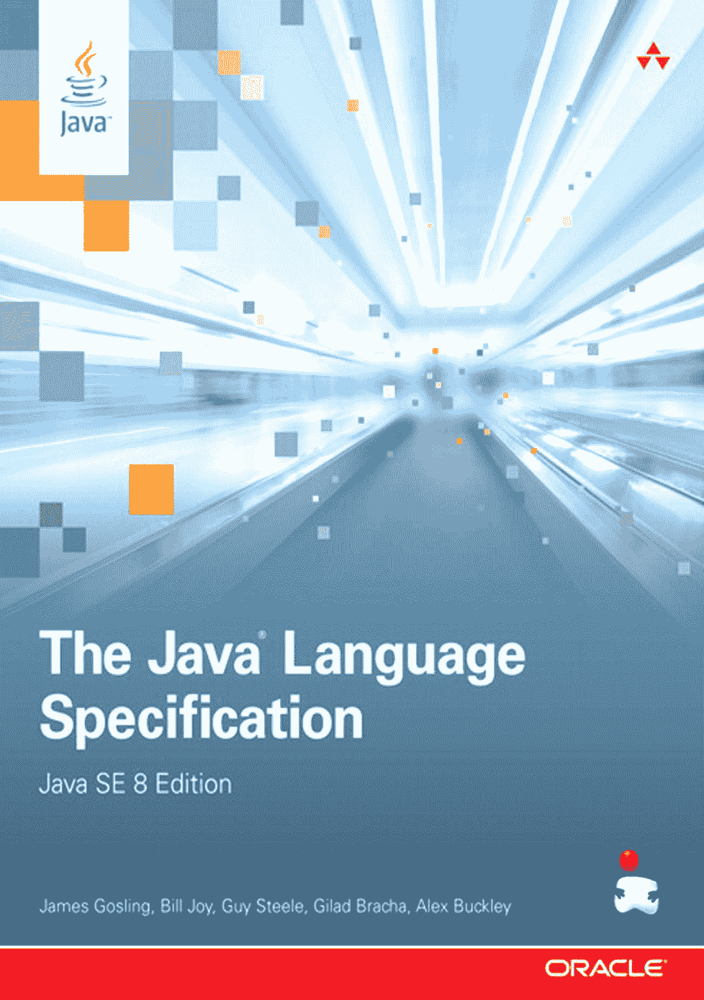

# Java® 语言规范，Java SE 8 版



James Gosling

Bill Joy

Guy Steele

Gilad Bracha

Alex Buckley

致 Maurizio，最诚挚的谢意。

# Java SE 8 版序言

# 有限的许可授予

本页特留空白

隐藏在隐式类型 lambda 表达式与重载解析的交互之中。在这一领域以及许多其他领域，Oracle 的 Dan Smith 做了卓越的工作，详尽地规范了预期的行为。他的见解贯穿于本规范之中，包括一个关于类型推断的全新章节。

Java SE 8 的另一项举措是增强注解的实用性，这是 Java 语言最受欢迎的特性之一。首先，语法进行了扩展，允许在许多语言结构中的类型上使用注解，为 Checker Framework 等新颖的静态分析工具奠定了基础。该特性由 JSR 308《Java 类型上的注解》规范，由 Michael Ernst 领导，并由我本人、Doug Lea 和 Srikan Sankaran 组成专家小组。该规范涉及的更改非常广泛，Michael Ernst 和 Werner Dietl 多年来付出的不懈努力受到了热烈认可。其次，允许在语言结构上对注解进行“重复”使用，这对于使用注解类型对领域特定配置建模的 API 具有巨大收益。Java EE 的 Michael Keith 和 Bill Shannon 发起并指导了这一特性。

Oracle Java 平台组的许多同事为本规范提供了宝贵支持：Leonid Arbouz, Mandy Chung, Joe Darcy, Robert Field, Joel Franck, Sonali Goel, Jon Gibbons, Jeannette Hug, Stuart Marks, Eric McCorkle, Mathey Nunez, Mark Reinhold, Vicente Romero, John Rose, Georges Saab, Steve Sides, Bernard Travers 和 Michel Trudeau。

也许最大的感谢应该是那些将规范转化为真实软件的编译器工程师。Oracle 的 Maurizio Cimadamore 从早期开始就为 lambda 表达式的设计及其在 `javac` 中的实现出了英雄般的工作。Eclipse 对 Java SE 8 特性的支持来自 Jayrakash Anhareesaran、Shankha Banerjee、Anirban Chakraborty, Andrew Clement, Stephan Hermann, Markus Keller, Jesper Möller, Manoj Palat, Srikan Sankaran 和 Olivier Thomann；IntelliJ 的贡献来自 Anna Kozlova、Alex Kudravsev 和 Roman Shevchenko。他们赢得整个 Java 社区的感谢。

Java SE 8 是 Java 语言的复兴。当许多人都在寻找“下一个伟大语言”时，我们相信用 Java 编程比以往任何时候都更有趣且高效。我们希望它能继续为你服务。

Alex Buckley

加利福尼亚州，圣拉拉拉

2014年3月

# 第1章 引言

Java 编程语言是一种通用的、并发的、基于类的面向对象的语言。它的设计足够简单，使得许多程序员能够精通这种语言。Java 编程语言与 C 和 C++ 相关，但方式大不相同，它省略了 C 和 C++ 的许多方面，并引入了其他语言的一些思想。它旨在成为一种生产环境语言，而非研究语言，因此，正如 C. A. R. Hoare 在其关于语言设计的经典论文中所建议的那样，该设计避免了新的且未经测试的特性。

Java 编程语言是强类型静态类型的。本规范明确区分了可以在编译时检测的编译时错误与发生在运行时错误。编译时通常包括将程序翻译成机器无关的代码表示。运行时活动包括执行程序所需的类的加载和链接、可选的机器码生成和程序的动态优化，以及实际的程序执行。

Java 编程语言是一种相对高级的语言，因为无法通过该语言获取机器表示的细节。它包含了自动存储管理（通常使用垃圾回收器），以避免显式释放内存带来的安全问题：例如 C 语言中的 `free` 或 C++ 语言中的 `delete`。高性能的垃圾收集实现具有边界停顿时间，以支持系统编程和实时应用。该语言不包含任何不安全的结构，例如没有索引检查的数组访问，因为此类不安全的结构会导致程序以未定义的方式运行。

Java 编程语言通常编译为《Java 虚拟机规范 SE 8 版》中定义的字节码指令集和二进制格式。

## 1.1 示例程序

文中给出的大多数示例程序已准备好执行，并且其形式类似于：

```
class Test {
    public static void main(String[] args) {
        for (int i = 0; i < args.length; i++) {
            System.out.print(i == 0 ? args[i] : " " + args[i]);
        }
        System.out.println();
    }
}
```

在安装了 Oracle JDK 的机器上，该存储在 `Test.java` 文件中的类可以通过以下命令进行编译和执行：

```
javac Test.java
java Test Hello, world.
```

产生输出：

Hello, world.

## 1.2 符号约定

在整个规范中，我们引用自 Java SE 平台 API 的类和接口。每当我们使用单个标识符 $N$ 引用类或接口（示例中声明的除外），预期的引用是 `java.lang` 包中名为 $N$ 的类或接口。对于来自 `java.lang` 其他包的类或接口，我们使用规范名称（§6.7）。

用于澄清规范的非规范性信息以较小的、缩进的文本给出。

> 这属于非规范性信息。它提供了直觉、原理、建议等。

Java 编程语言的类型系统偶尔依赖于替换（substitution）的概念。符号 $[F_1:=T_1, \dots, F_n:=T_n]$ 表示对于 $1 \le i \le n$，用 $T_i$ 替换 $F_i$。

## 1.3 特殊类与反射

如上所述，本规范经常引用 Java SE 平台 API 的类。特别是某些类与 Java 编程语言有特殊关系。示例包括 `Object`、`Class`、`String`、`Thread` 以及 `java.lang` 包中的类等。本规范约束了这些类和接口的行为，但没有为它们提供完整的规范。读者参考 Java SE API 文档。

因此，本规范没有详细描述反射。许多语言结构在核心反射 API（`java.lang.reflect`）和语言模型 API（`javax.lang.model`）中有对应物，但这些通常在此处进行讨论。例如，当我们列出创建对象的方法时，我们通常不包括反射 API 实现此点的方法。读者应该注意这些额外的机制，尽管文中并未提及它们。

## 1.4 反馈

读者可以将关于《Java 语言规范》错误、遗漏和歧义的反馈发送到 `jls-comments_ww@oracle.com`。

关于 `javac`（Java 编程语言的参考编译器）的行为，特别是其对本规范的遵循情况，可以发送到 `compiler-dev@openjdk.java.net`。

## 1.5 参考文献

Apple Computer. *Dylan Reference Manual*. Apple Computer Inc., Cupertino, California, September 29, 1995.

Bobrow, Daniel G., Linda G. DeMichiel, Richard P. Gabriel, Sonya E. Keene, Gregor Kzcales, and David A. Moon. *Common Lisp Object Specification*, X3J13 Document 88-002R, June 1988; 见 Steele, Guy. 的 *Common Lisp: The Language*, 2nd ed. Digital Press, 1990, ISBN 1-55558-041-6, 770-864.

Ellis, Margaret A., and Bjarne Stroustrup. *The Annotated C++ Reference Manual*. Addison-Wesley, Reading, Massachusetts, 1990, 1992 年 10 月重印, ISBN 0-201-51459-1.

Goldberg, Adele and Robson, David. *Smalltalk-80: The Language*. Addison-Wesley, Reading, Massachusetts, 1989, ISBN 0-201-13688-0.

Harbison, Samuel. *Modula-3*. Prentice Hall, Englewood Cliffs, New Jersey, 1992, ISBN 0-13-59636.

Hoare, C. A. R. *Hints on Programming Language Design*. Stanford University Computer Science Department Technical Report No. CS-73403, 1973. Reprinted in SIGACT/SIGPLAN Symposium on Principles of Programming Languages. Association for Computing Machinery, New York, October 1973.

IEEE Standard for Binary Floating-Point Arithmetic. ANSI/IEEE Std. 754-1985. Available from Global Engineering Documents, 15 Inverness West East, Englewood, Colorado 80112-5704 USA, 800-854-7179.

Kernighan, Brian W., and Dennis M. Ritchie. *The C Programming Language*, 2nd ed. Prentice Hall, Englewood Cliffs, New Jersey, 1988, ISBN 0-13-110362-8.

Madsen, Ole Lehmann, Birger Moller-Pedersen, and Kristen Nygaard. *Object-Oriented Programming in the Beta Programming Language*. Addison-Wesley, Reading, Massachusetts, 1993, ISBN 0-201-62430-3.

Mitchell, James. G., William Maybury, and Richard Sweet. *The Mesa Programming Language Version 3.0*. Xerox PARC, Palo Alto, California, CSL 79-3, April 1979.

Stroustrup, Bjarne. *The C++ Programming Language*, 2nd ed. Addison-Wesley, Reading, Massachusetts, 1991, reprinted with corrections January 1994, ISBN 0-201-53992-6.

Unicode Consortium, The. *The Unicode Standard, Version 6.0.0*. Mountain View, CA, 2011, ISBN 978-1-936213-01.

# 第2章 语法

本章描述了本规范中使用的上下文无关语法，用于定义程序的词法和句法结构。

## 2.1 上下文无关语法

上下文无关语法由若干产生式（productions）组成。每个产生式都有一个称为非终符（nonterminal）的抽象符号作为左侧，以及一个或多个非终符和终止符（terminal）序列作为右侧。对于每个语法，终止符号源自字母表。

从一个由单个非终符（称为目标符号）组成的句子开始，给定的上下文无关语法定义了一种语言，即通过反复将任何非终符替换为其作为左侧的产生式的右侧而得到的终止符号的所有序列集合。

## 2.2 词法语法

Java 编程语言的词法语法见 §3 词法结构。该语法定义了一组产生式，从目标符号（§3）开始，描述了如何将 Unicode 字符序列翻译为输入元素序列（§5）。这些输入元素在舍弃空白（§6）和注释（§7）后，构成句法语法的终止符号，被称为标记（tokens）（§8）。这些标记是 Java 编程语言的标识符（§9）、关键字（§10）、字面量（§11）、分隔符（§12）和运算符。

## 2.3 语法符号

终止符号在词法语法和句法语法的产生式中以固定字体显示，并在本规范中任何直接引用此类终止符号的地方均如此所示。非终符符号以*斜体*显示。非终符的定义通过其名称后接冒号引入。随后在后续行中给出该非终符的一个或多个备选定义。

例如，句法产生式：

```
IfStatement:
    if ( Expression ) Statement
```

表示非终符 `IfStatement` 代表标记 `if`，后面是一个左括号，接着是一个 `Expression`，然后是一个右括号，最后是一个 `Statement`。

产生式右侧的语法 `{x}` 表示 `x` 零次或多次出现。

例如，句法产生式：

```
ArgumentList:
    Argument {, Argument}
```

表示 `ArgumentList` 由一个 `Argument` 后续零次或多次逗号组成。结果是 `ArgumentList` 可以包含任何正数量的参数。


产生式右侧的语法 `[x]` 表示 `x` 零次或一次出现。也就是说，`x` 是一个可选符号，可选符号实际上定义了两种备选方案：一种省略该可选符号，另一种包含它。

这意味着：

```
```

是以下内容的简便缩写：

```
```

另一个例子，意味着：

```

```

```
（注：此处原文逻辑似乎有排版衔接问题，按原文忠实翻译）
```

```
这反过来又是以下内容的缩写：

```

```
因此非终符 `BasicForStatement` 实际上有 8 种备选的右侧定义。

非常长的右侧可以通过清晰地缩进第二行来接在第一行上。

例如，句法语法包含此产生式：

```

```
这为非终符 `NormalClassDeclaration` 定义了一个右侧。

当产生式的冒号后出现“one of”一词时，意味着后续行或几行中的每个终止符号都是一种备选定义。

例如，词法语法包含产生式：

```

```
这仅仅是以下内容的简便缩写：

```

```

当产生式中的选项作为标记出现时，它代表构成此类标记的字符序列。

因此，产生式：

```

```
是以下内容的简写：

```

```

产生式的右侧可以使用“but not”短语并随后指示要排除的扩展来指定某些扩展是不允许的。

例如：

- `Identifier`: but not `Keyword` or `BooleanLiteral` or `NullLiteral`

最后，一些非终符通过正体的描述性短定义，因为列出所有备选方案是不现实的。

例如：

- `RawInputCharacter`: any Unicode character

# 词法结构

码点大于 U+FFFF。为了仅使用 16 位单元来表示完整的字符范围，Unicode 标准定义了一种名为 UTF-16 的编码。在这种编码中，补充性字符被表示为一对 16 位代码单元，其中第一个来自高代理位（high-surrogates）范围，第二个来自低代理位（low-surrogates）范围（U+DC00 到 U+DFFF）。对于 U+0000 到 U+FFFF 范围内的字符，码点的值和 UTF-16 代码单元的值是相同的。

Java 编程语言使用 UTF-16 编码，用 16 位代码单元序列来表示文本。

> Java SE 平台的某些 API（主要在 `Character` 类中）使用 32 位整数将码点作为独立实体表示。Java SE 平台提供了在 16 位和 32 位表示之间进行转换的方法。

本规范在与表示相关的场景文中使用“码点”和“UTF-16 代码单元”，在讨论内容与表示无关时使用通用术语“字符”。

除了注释（§3.7）、标识符以及字符和字符串字面量的内容（§3.10.4、§3.10.5）外，程序中的所有输入元素（§3.5）仅由 ASCII 字符（或产生 ASCII 字符的 Unicode 转义 (§3.3)）组成。

> ASCII (ANSI X.4) 是美国信息交换标准。Unicode UTF-16 编码的前 128 个字符是 ASCII 字符。

## 3.2 词法翻译

Unicode 字符流通过以下三个词法翻译步骤转换为标记序列，这些步骤按顺序依次应用：

1. 将 Unicode 字符原始流中的 Unicode 转义（§3.3）翻译为相应的 Unicode 字符。形式为 `\xxxxx` 的 Unicode 转义（其中 `xxxxx` 是十六进制值）表示编码为 `xxxxx` 的 UTF-16 代码单元。此翻译步骤允许任何程序都仅使用 ASCII 字符表示。

2. 将步骤 1 产生的 Unicode 流翻译为输入字符和行终止符（§3.4）的流。

3. 将步骤 2 产生的输入字符和行终止符流翻译为输入元素序列（§3.5），在丢弃空格（§3.6）和注释（§3.7）后，这些元素构成了语法规则（§2.3）的终结符号（§3.5）。

在每一步都使用最可能的翻译，即使结果最终无法在使用另一种词法翻译的情况下产生正确的程序。有一个例外：当在类型上下文中（§4.11）发生词法翻译，且输入流中有两个或多个连续的 `>` 字符且后紧跟一个非 `>` 字符时，每个 `>` 字符必须被翻译为数值比较运算符 `>` 的标记。

输入字符 `a --b` 被标记化（§3.5）为 `a`、`--`、`b`，这不属于任何语法正确程序的一部分，尽管标记 `a`、`-`、`b` 可能是语法正确程序的一部分。

如果没有字符规则，如 `List<List<String>>` 这样的类型中的两个连续左括号将被标记化为有符号的右移运算符 `>>`，而如 `List<List<String>>>` 这样的类型中的三个连续括号将被标记化为无符号的右移运算符 `>>>`。更糟糕，如 `List<List<List<String>>>>` 这样的类型中四个或更多连续括号的标记化将产生歧义，因为 `>`、`>>` 和标记的各种组合可能表示 `>>>`

## 3.3 Unicode 转义

Java 编程语言的编译器“Java 编译器”首先识别其输入中的 Unicode 转义，将 ASCII `\u` 后跟四个十六进制数字翻译为所指示十六进制值的 UTF-16 单元（§3.1），并保持所有其他字符不变。表示补充性字符需要两个连续的 Unicode 转义。此翻译产生一个输入字符序列。

```
UnicodeInputCharacter:
    UnicodeEscape
    RawInputCharacter
```

```
UnicodeEscape:
    \ UnicodeMarker HexDigit HexDigit HexDigit
```

```
UnicodeMarker:
    u{u}
```

```
HexDigit: 以下者之一：
    0 1 2 3 4 5 6 7 8 9 a b c d e f A C D E F
```

# 词法结构

```
RawInputCharacter:
    任意 Unicode 字符
```

这里的 `\u` 和十六进制数字都是 ASCII 字符。

除了 `\` 处理外，Java 语言还规定了一种表示 Unicode 字符的方法。例如，如果 ASCII 字符 `\u001a`（或控制-Z）是转义输入流中的最后一个字符，编译器将忽略它。

输入字符 `a --b` 被标记化（§3.5）为 `a`、`--`、`b`，这不属于任何语法正确程序的一部分，尽管标记 `a`、`-`、`b` 可能是语法正确程序的一部分。

如果没有字符规则，如 `List<List<String>>` 这样的类型中的两个连续左括号将被标记化为有符号的右移运算符 `>>`，而如 `List<List<String>>>` 这样的类型中的三个连续括号将被标记化为无符号的右移运算符 `>>>`。更糟糕，如 `List<List<List<String>>>>` 这样的类型中四个或更多连续括号的标记化将产生歧义，因为 `>`、`>>` 和标记的各种组合可能表示 `>>>`

## 3.4 行终止符

Java 编译器通过识别行终止符将字符序列划分行。

- LineTerminator:
    - ASCII LF 字符，也称为换行
    - ASCII CR 字符，也称为回车
    - CR 字符后紧跟 ASCII 字符

- InputCharacter:
    - UnicodeCharacter 但非 CR 或 LF

紧随 CR 的字符被视为一行。行终止符指定了注释（§3.7）的结束。

由行终止符定义的行可能会确定编译器产生的行号。

结果是行终止符和输入字符序列，它们是第三步的终结符号。

## 3.5 输入元素和标记

转义处理（§3.3）和行识别（§3.4）产生的输入字符和行终止符被还原为输入元素序列。

```
Input:
    {InputElement}
```

```
InputElement:
    WhiteSpace
    Comment
    Token
```

```
Token:
    Identifier
    Keyword
    Literal
    Separator
    Operator
```

```
Sub:
    ASCII SUB 字符，也称为控制-Z
```

不是空格或注释的输入元素是标记。标记是语法规则（§2.3）的终结符号。

空格（§3.6）和注释（§3.7）可以分隔标记。例如，输入中的 ASCII 字符 `=` 只有在没有间隔空格的情况下形成运算符 `=`（§3.12）。

为了兼容某些操作系统的特殊情况，如果 ASCII SUB 字符（`u001a` 或控制-Z）是转义输入流中的最后一个字符，则会被忽略。

考虑结果输入流中的两个标记 `x` 和 `y`。如果 `x` 在 `y` 之前，我们说 `x` 在 `y` 的左侧，`y` 在 `x` 的右侧。

例如，在这一段简单的代码中：

```
class Empty {

}
```

我们说标记在 `{` 标记的右侧，尽管在当前的二维表示中，它出现在 `{` 标记的下方左侧。

## 3.6 空格

空格定义为 ASCII 空格字符、水平制表符字符、分页符字符和行终止符字符（§3.4）。

```
WhiteSpace:
    ASCII SP 字符，也称为“空格”
    ASCII HT 字符，也称为“水平制表符”
    ASCII FF 字符，也称为“分页符”
    LineTerminator（行终止符）
```

## 3.7 注释

有两种注释：

- `/* text */`
  传统注释：从 ASCII 字符 `/**` 到 ASCII 字符 `*/` 之间的所有文本都会被忽略（如 C 和 C++）。

- `// text`
  行尾注释：从 ASCII 字符 `//` 到行尾的所有文本都会被忽略（如 C++）。

```
Comment:
    TraditionalComment
    EndOfLineComment
```

```
TraditionalComment:
    /* * CommentTail
```

```
CommentTail:
    * CommentTailStar
    NotStar CommentTail
```

```
CommentTail:
    /
    * CommentTailStar
    NotStarNotSlash CommentTail
```

```
NotStar:
    InputCharacter 但不是 `*`
    LineTerminator
```

```
NotStarNotSlash:
    InputCharacter 但不是 `*` 或 `/`
    LineTerminator
```

```
EndOfLineComment:
    // {InputCharacter}
```

这些产生式规则暗示了以下所有属性：

- 注释不支持嵌套。
- 在以 `//` 开头的注释中，`/*` 和 `*/` 没有特殊含义。
- 在以 `/*` 或 `/**` 开头的注释中，`//` 没有特殊含义。

因此，以下文本是一个完整的单一注释：
`/* this comment /* // ** ends here: */`

词法语法规定注释不会出现在字符字面量（§3.10.4）或字符串字面量（§3.10.5）中。

## 3.8 标识符

标识符是 Java 字母和 Java 数字的无限长度序列，其中第一个必须是 Java 字母。

```
Identifier:
    IdentifierChars 但不是关键字、布尔字面量或空字面量
```

```
IdentifierChars:
    JavaLetter {JavaLetterOrDigit}
```

```
JavaLetter:
    任何“Java 字母”的 Unicode 字符
```

```
JavaLetterOrDigit:
    任何“Java 字母或数字”的 Unicode 字符
```

“Java 字母”是指方法 `Character.isIdentifierStart(int)` 返回 `true` 的字符。

## 标识符

“Java 字母或数字”是指方法 `Character.isJavaIdentifierPart(int)` 返回 `true` 的字符。

“Java 字母”包括大写和小写 ASCII 字母 A-Z (`\u0041-\u005a`)、a-z (`\u0061-\u007a`)，由于历史原因，还包括 ASCII 下划线（`_` 或 `\u005f`）和美元符号（`$` 或 `\u0024`）。`$` 符号应仅用于机械生成的源代码，或者极少数情况下访问遗留系统上已存在的名称。

Java 数字包括 ASCII 数字 0-9 (`\u0030-\u0039`)。

字母和数字可以取自整个 Unicode 字符集，该集合支持大多数文字体系。

## 3.9 十进制

十进制数可以是单个 ASCII 数字 0（表示整数零），也可以由一个 1 到 9 的 ASCII 数字组成，后面可选跟随一个或多个中间有下划线的 0 到 9 的 ASCII 数字，表示正整数。

```
DecimalNumeral:
    0
    NonZeroDigit [Digits]
    NonZeroDigit Digits
```

```
NonZeroDigit: 之一
    1 2 3 4 5 6 7 8 9
```

```
Digits:
    Digit
    Digit [DigitsAndUnderscores] Digits
```

```
Digit:
    0
    NonZeroDigit
```

```
DigitsAndUnderscores:
    DigitOrUnderscore {DigitOrUnderscore}
```

```
DigitOrUnderscore:
    Digit
    _
```

## 3.10 十六进制

十六进制数由前导 ASCII 字符 `0x` 组成，后跟接一个或多个中间有下划线的 ASCII 十六进制数字，可以表示正整数、零或负整数。

值为 10 到 15 的十六进制数字分别用 ASCII 字母 a 到 f 或 A 到 F 表示；每个作为十六进制数字使用的字母可以是大写或小写。

```
HexNumber:
    0xHexDigits
    -xx
```

```
HexDigits:
    HexDigit [HexDigitsAndUnderscores] HexDigit
```

```
HexDigit: 之一
    0 1 2 3 4 5 6 7 8 9 a b c d e f A B C D E F
```

```
HexDigitsAndUnderscores:
    HexDigitOrUnderscore {HexDigitOrUnderscore}
```

```
HexDigitOrUnderscore:
    HexDigit
    _
```

八进制数由一个 ASCII 数字 0 后面跟一个或多个由下划线穿插其间的 ASCII 数字 0 到 7 组成，可以表示一个正整数、零或负整数。

```
OctalNumeral:
    0 OctalDigits
    0 Underscores OctalDigits
```

```
OctalDigits:
    OctalDigit
    OctalDigit [OctalDigitsAndUnderscores] OctalDigit
```

```
OctalDigit: one of
    0 1 2 3 4 5 6 7
```

```
OctalDigitsAndUnderscores:
    OctalDigitOrUnderscore {OctalDigitOrUnderscore}
```

```
OctalDigitOrUnderscore:
    OctalDigit
    | _
```

注意，八进制数始终包含两个或多个数字，因为单独的 0 始终被视为十进制——尽管在实践中这并不重要，因为数字 0、00 和 0x0 都表示完全相同的整数值。

二进制数由前导的 ASCII 字符 `0b` 或 `0B` 后面跟一个或多个由下划线穿插其间的 ASCII 数字 0 或 1 组成，可以表示一个正整数、零或负整数。

```
BinaryNumeral:
    0b BinaryDigits
    0B BinaryDigits
```

```
BinaryDigits:
    BinaryDigit
    BinaryDigit [BinaryDigitsAndUnderscores] BinaryDigit
```

```
BinaryDigit: one of
    0 1
```

```
BinaryDigitsAndUnderscores:
    BinaryDigitOrUnderscore {BinaryDigitOrUnderscore}
```

```
BinaryDigitOrUnderscore:
    BinaryDigit
```


# 词法结构

类型为 `int` 的最大十进制字面量是 `2147483648` ($2^{31}$)。

从 `0` 到 `2147483647` 的所有十进制字面量都可以出现在 `int` 字面量出现的地方。

如果类型为 `int` 的十进制字面量大于 `2147483648` ($2^{31}$)，或者该十进制字面量出现在一元减运算符的操作数（§15.15.4）之外，则为编译时错误。

类型为 `int` 的最大十六进制、八进制和二进制字面量——每个都表示十进制值 `2147483647` ($2^{31}-1$)——分别为：

- `0x7ffff`
- `0177_7777_7777`
- `0b0111_1111_1111_1111_1111_1111`

- `0x8000_0000`
- `0200_0000_0000`
- `0b0100_0000_0000_0000_0000_0000`

类型为 `int` 的负十六进制、八进制和二进制字面量——每个都表示十进制值 `-2147483648` ($-2^{31}$)——分别为：

以下十六进制、八进制和二进制字面量表示十进制值 `-1`：

- `0xffff`
- `0377_7777_7777`
- `0b0111_1111_1111_1111_1111_1111`

如果十六进制、八进制或二进制 `int` 字面量无法容于 32 位中，则为编译时错误。

类型为 `long` 的最大十进制字面量是 `922337206854775807` ($2^{63}$)。

从 `0` 到 `922337206854775807` 的所有十进制字面量都可以出现在 `long` 字面量出现的地方。

如果类型为 `long` 的十进制字面量大于 `922337206854775808` ($2^{63}$)，或者该十进制字面量出现在一元减运算符的操作数（§15.15.4）之外，则为编译时错误。

类型为 `long` 的最大正十六进制、八进制和二进制字面量——每个都表示十进制值 `922337206854775807` ($2^{63}-1$)——分别为：

- `0x7ffff_ffff_L`
- `07777_7777_7777_7777L`
- `0b0111_1111_1111_1111_L`

类型为 `long` 的最负十六进制、八进制和二进制字面量——每个都表示十进制值 `-922337206854775808` ($-2^{63}$)——分别为：

- `0x8000_0000_0000L`
- `0000_0000_0000L`
- `0b1000_0000_0000`

以下十六进制、八进制和二进制字面量表示十进制值 `-1`：

- `0xffff_ffff_L`
- `0377_7777_7777_7777L`
- `0b0111_1111_1111_1111_1111_1111`

如果十六进制、八进制或二进制 `long` 字面量无法容于 64 位中，则为编译时错误。

## int 字面量的示例

| 0 | 2 |
| :--- | :--- |
| 0372 | 0xDada |
| 1996 | 0x00_FF |

## long 字面量的示例

| 0 | 0777L |
| :--- | :--- |
| 0x10000000L | 2147483648L |
| 0xC0B0L |

浮点字面量具有以下部分：整数部分、十进制或十六进制部分（由 ASCII 点表示）、小数部分、指数和类型后缀。

浮点字面量可以用十进制（底10）或十六进制（底16）表示。对于十进制浮点字面量，至少需要一个数字（整数部分或小数部分）以及小数点、指数或 `float` 类型后缀。所有其他部分均为可选。如果存在指数，由 ASCII 字符 `e` 或 `E` 后跟一个可选的符号整数表示。

十六进制浮点字面量至少需要一个数字（整数部分或小数部分），且指数是强制的，而类型后缀是可选的。指数由 ASCII 字符 `p` 或 `P` 后跟一个可选的符号整数表示。

下划线允许作为整数部分数字、小数部分数字以及指数数字之间的分隔符。

```
FloatingPointLiteral:
    DecimalFloatingPointLiteral
    HexadecimalFloatingPointLiteral

DecimalFloatingPointLiteral:
    Digits . [Digits] [ExponentPart] [FloatTypeSuffix]
    . Digits [ExponentPart] [FloatTypeSuffix]
    Digits ExponentPart [FloatTypeSuffix]
    Digits [ExponentPart] FloatTypeSuffix

ExponentPart:
    ExponentIndicator SignedInteger

ExponentIndicator: one of
    e E

SignedInteger:
    [Sign] Digits

Sign: one of
    + -

FloatTypeSuffix: one of
    f F d D

HexadecimalFloatingPointLiteral:
    HexSignificand BinaryExponent [FloatTypeSuffix]

HexSignificand:
    HexNumeral [.]
    0 x [HexDigits] . HexDigits
    0 X [HexDigits] . HexDigits

BinaryExponent:
    BinaryExponentIndicator SignedInteger

BinaryExponentIndicator: one of
    p P
```

如果浮点字面量以 ASCII 字符 `F` 或 `f` 结尾，则类型为 `float`；否则其类型为 `double`，并可以可选带有 ASCII 字符 `D` 或 `d` (§4.2.3)。

`float` 和 `double` 类型的元素是分别使用 IEEE 754 32 位单精度和 64 位双精度二进制浮点格式表示的值。

> 从浮点数的 Unicode 字符串表示到 IEEE 754 二进制浮点表示的正确输入转换细节已在 `java.lang` 包中 `Float` 和 `Double` 类的 `valueOf` 方法描述。

类型为 `float` 的最大正有限字面量是 `3.408235e38f`。类型为 `float` 的最小正非零字面量是 `1.40e-45f`。

类型为 `double` 的最大正有限字面量是 `1.797691348623157e308`。类型为 `double` 的最小正非零字面量是 `4.9e-324`。

如果非零浮点字面量太大，以至于在舍入转换为其内部表示时变为无穷大，则为编译时错误。

程序可以使用预定义的常量 `POSITIVE_INFINITY` 和 `NEGATIVE_INFINITY` 表示无穷大，而不产生编译时错误。

`Float` 和 `Double` 类中定义了表示非数的预定义常量 `Float.NaN` 和 `Double.NaN`。

如果非零浮点字面量太小，以至于在舍入转换为其内部表示时变为零，则为编译时错误。

以下是 `float` 字面量的示例。

以下是 `double` 字面量的示例。

（此处省略原文表格内容）

## 布尔字面量

布尔类型有两个值，由 ASCII 字母组成的布尔字面量 `true` `false` 表示。

```
BooleanLiteral: one of
    true false
```

布尔字面量的类型为 `boolean` (§4.2.5)。

## 字符字面量

字符字面量由字符或转义序列（§3.10.6）表示，并封装在 ASCII 单引号内。（单引号字符是 `\u0027`）。

```
CharacterLiteral:
    ' SingleCharacter '
    ' EscapeSequence '

SingleCharacter:
    InputCharacter but not ' or \
```

参见 §3.10.6 关于 `EscapeSequence` 的定义。

字符字面量只能表示 UTF-16 代码单元 (§3.1)，即它们被限于从 `\u0000` 到 `\uffff`。补充字符必须作为 `char` 中的代理对或作为整数表示，取决于它们所使用的 API。

字符字面量始终类型为 `char` (§4.2.1)。

如果 `SingleCharacter` 或 `EscapeSequence` 之后的字符不是 `'`，则为编译时错误。

如果在起始引号 `'` 和结束引号 `'` 之间出现行终止符 (§3.4)，则为编译时错误。

+ 正如 §3.4 所示，`CR` 和 `LF` 字符绝不是 `InputCharacter`；每个都被识别为构成一个行终止符。

以下是 `char` 字面量的示例。

（此处省略原文表格内容）

- `'a'`
- `'$'`
- `'\t'`
- `'\\'`
- `'\u03a9'`
- `'\uFFFF'`
- `'\u177'`

由于 Unicode 转义的处理非常早，为字符字面量（LF）编写 `'\u000a'` 是不正确的；Unicode 转义序列 `\u000a` 在翻译步骤 1 (§3.3) 中转换为实际的行符，而该行符在步骤 2 (§3.4) 中变为行终止符，因此该字符字面量在步骤 3 中无效。相反，应该使用转义序列 `'\n'` (§3.10.6)。同样，对于值为回车（CR）的字符字面量，编写 `'\u000d'` 也是不正确的。

在 C 和 C++ 中，字符字面量可以包含多个字符的表示，但此类字符字面量的值由实现定义。在 Java 编程语言中，字符字面量精确表示一个字符。

## 3.10.5 字符串字面量

字符串字面量由双引号括的零或多个字符组成。字符可以用转义序列 (§3.10.6) 表示——对于 U+0000 到 U+FFFF 范围的字符使用一个转义序列，对于 U+01000 到 U+10FFFF 范围字符的 UTF-16 代理单元使用两个转义序列。

```
StringLiteral:
    " {StringCharacter} "

StringCharacter:
    InputCharacter but not " or \
    EscapeSequence
```

有关 `EscapeSequence` 的定义见 §3.10.6。

字符串字面量的类型始终为 `String` (§4.3.3)。

在起始 `"` 之后和结束 `"` 之前出现行终止符是编译错误。

## 词法结构

如 §3.4 所示，字符 `CR` 和 `LF` 永远不是输入字符（`InputCharacter`）；每个都被识别为构成行终止符（`LineTerminator`）。

长字面量可以拆分成更短的部分，并使用字符串连接运算符 `+` (§15.18.1) 写成一个（可能带括号的）表达式。

以下是字符串字面量的示例：

```
"" // 空字符串
"\"" // 包含 " 的字符串
"This is a string" // 包含 16 个字符的字符串
"This is a " + // 实际上是一个字符串值的常量表达式，
"-two-line string" // 由两个字符串字面量组成
```

由于转义的处理非常早，为包含行符（LF）的字符串字面量编写 `"\u000a"` 是不正确的；Unicode `\u000a` 在翻译步骤 1 (§3.3) 中转换为实际的字面量，该行符在步骤 2 (§3.4) 中变为行终止符，因此该字符串字面量在步骤 3 中无效的。相反，应该编写 `"\n"` (§3.10.6)。同样，对于包含回车（CR）的字符串字面量，编写 `"\u000d"` 是不正确的。使用 `"\r"`。最后，对于包含双引号字符 (`\"`) 的字符串字面量无法编写 `"\u0022"`。

字符串字面量是 `String` 类实例的引用 (§4.3.1, §4.3.3)。

此外，字符串字面量引用 `String` 类的同一个实例。这是因为字符串字面量，或者更通地说，常量表达式值的字符串 (§15.28)——会被“池化”（interned），以便通过 `String.intern` 方法共享唯一的实例。

### 示例 3.10.5.1 字符串字面量

由编译单元 (§7.3) 组成的程序：

```java
package other;

public class Other { 
    public static String hello = "Hello"; 
}
```

产生输出：

```
true true true false
```

此示例说明了六点：

- 同一包 (§7 (Packages)) 中同一类 (§8 (Classes)) 内部的字面量字符串代表同一个 `String` 对象 (§4.3.1) 的引用。
- 同一包内不同类中的字面量字符串也代表对同一个 `String` 对象的引用。
- 不同包内不同类中的字面量字符串同样代表着对同一个 `String` 对象的引用。
- 通过常量表达式 (§15.28) 计算的字符串在编译时计算，并被视为字面量。
- 在运行时使用连接在运行时计算的字符串是新创建的，并且此后是不同的。
- 显式提到一个计算出的字符串的结果与任何相同内容的现有字面量字符串是同一个字符串。

## 3.10.6 字符和字符串字面量的转义序列

字符和转义序列允许在字符字面量 (§3.10.4) 和字符串字面量 (§3.10.5) 中在不用 Unicode 转义的情况下表示某些非图形字符，以及单引号、双引号和反斜杠字符。

```
EscapeSequence:
    \b (退格 BS, Unicode \u0008)
    \t (水平制表符 HT, Unicode \u0009)
    \n (行符 LF, Unicode \u000a)
    \f (分页符 FF, Unicode \u000c)
    \r (回车 CR, Unicode \u000d)
    \" (双引号 ", Unicode \u0022)
    \' (单引号 ', Unicode \u0027)
    \\ (反斜杠 \, Unicode \u005c)
    OctalEscape (八进制值, Unicode \u0000 to \u00ff)
```

# 原始类型和值

布尔类型恰好有两个值：`true` 和 `false`。

## 4.2.1 整数类型和值

整数类型的值是处于以下范围内的整数：

- 对于 `byte`，从 `-128` 到 `127`，包含边界
- 对于 `short`，从 `-32768` 到 `32767`，包含边界
- 对于 `int`，从 `-2147483648` 到 `2147483647`，包含边界
- 对于 `long`，从 `-9223372036854775808` 到 `9223372036854775807`，包含边界
- 对于 `char`，从 `'\u0000'` 开始（包含边界），即从 `0` 到 `65535`

## 4.2 整数运算

Java 编程语言提供了多种作用于整数值的操作符：

- 比较运算符，其结果为 `boolean` 类型：
  - 数值比较运算符 `<`, `<=`, `>`, `>=` (§15.20.1)
  - 数值相等运算符 `==` 和 `!=` (§15.21.1)
- 数值运算符，其结果为 `int` 或 `long` 类型：
  - 一元加、减运算符 `+` 和 `-` (§15.15.3, §15.15.4) 
  - 乘法运算符 `*`, `/`, 和 `%` (§15.17)
  - 加法运算符 `+` 和 `-` (§15.18)
  - 递增运算符 `++`，包括前置 (§15.15.1) 和后置 (§15.14.2)
  - 递减运算符 `--`，包括前置 (§15.15.2) 和后置 (§15.14.3)
  - 有符号和无符号移位运算符 `<<` 和 `>>>` (§15.19)
  - 位取反运算符 `~` (§15.15.5)
  - 整数位运算运算符 `&`, `^`, 和 `|` (§15.22.1)
- 条件运算符 `? :` (§15.25)
- 强制类型运算符 (§15.16)，它可以将整数值转换为任何指定的数值类型的值
- 字符串拼接运算符 `+` (§15.18.1)，当给定的一个 `String` 操作数和一个整数操作数时，它会将整数操作数转换为其十进制形式表示的 `String`，然后产生一个新的两个字符串拼接后的字符串

在 `Byte`, `Short`, `Integer`, `Long` 和 `Character` 类中预定义了其他的构造函数、方法和常量。

如果除位运算符以外的整数运算符至少有一个 `long` 类型的操作数，则该操作使用 64 位精度进行，数值运算符的结果为 `long` 类型。如果另一个操作数不是 `long`，则首先通过数值提升 (§5.6) 宽化 (§15.5.1) 为 `long` 类型。

否则，操作使用 32 位精度进行，数值运算符的结果为 `int` 类型。如果任一操作数不是 `int`，则首先通过数值提升将其宽化为 `int` 类型。

任何整数类型的值都可以被强制转换为任何数值类型。整数类型之间与 `boolean` 类型之间没有强制转换。

§4.2.5 是关于将整数表达式转换为布尔值的惯用法。

整数运算符不会以任何方式指示溢出或下溢。

整数运算符可能会因为以下原因抛出异常 (§11 (Exceptions))：

- 如果需要对 `null` 引用进行拆箱转换 (§5.1.8)，任何整数运算符都可能抛出 `NullPointerException`。
- 整数除 `/` (§15.17.2) 和整数取模运算符 `%` (§15.17.3) 在右侧操作数为零时，可能会抛出 `ArithmeticException`。
- 递增和递减运算符 `++` (§15.14.2, §15.15.1) 和 `--` (§15.14.3, §15.15.2) 在需要装箱转换 (§5.1.7) 且没有足够的内存执行转换时，可能会抛出 `OutOfMemoryError`。

## 示例 4.2.2-1. 整数运算

```java
class Test {
    public static void main(String[] args) {
        int i = 100000;
        System.out.println(i * i);
        long l = i;
        System.out.println(l * 1);
        System.out.println(20296 / (l - i));
    }
}
```


## 4.2.3 浮点类型、格式和值

浮点类型为 `float` 和 `double`，它们在概念上与 IEEE 754 定义的单精度 32 位和双精度 64 位格式相关。

每个上述值集不仅包括属于它的非零值，还包括 `NaN` 值以及四个值：正零、负零、正无穷和负无穷。

注意表 4.2.3-A 中的约束使得 `float` 值集的每个元素必然是 `float-extended-exponent` 值的元素、`double` 值的元素，且 `double-extended-exponent` 值必然是 `double-extended-exponent` 值的元素。

### 表 4.2.3-A. 浮点值集

| 参数 | float | float-extended-exponent | double | double-extended-exponent |
| --- | --- | --- | --- | --- |
| $N$ | 24 | | 53 | 53 |
| $K$ | 8 | $\ge 11$ | 11 | $\ge 15$ |
| $E_{max}$ | +127 | $\ge +1023$ | +1023 | $\ge +16383$ |
| $E_{min}$ | -126 | $\le -1022$ | -1022 | $\le -16382$ |

float、float-extended-exponent、double 和 double-extended-exponent 值集并不是类型。对于 Java 编程语言的实现来说，使用 float 值集中的一个元素来表示 float 类型的值始终是正确的；但在代码的某些区域，实现使用 float-extended-exponent 值中的一个元素也可能是允许的。同样，对于 Java 语言的实现来说，使用 double 值集中的一个元素来表示 double 类型的值始终是正确的；但在代码的某些区域，实现使用 double-extended-exponent 值集中的一个元素也可能是允许的。

除了 NaN 之外，浮点值是有序的；按从小到大排列，它们依次是：负无穷、有限非零值、正零和负零、正非零值和正无穷。

IEEE 754 允许其每个单精度和双精度浮点格式都拥有多个不同的 NaN 值。虽然每个硬件架构在生成新的 NaN 时都会为 NaN 返回一个特定的模式，但程序员也可以创建具有不同模式的 NaN 进行编码，以供回溯性诊断信息使用。

在大多数情况下，Java SE 平台返回给定类型的 NaN 值时，就像它们被合并为了单一规范值一样，因此本规范通常将任意 NaN 视为一个规范值。

> 然而，Java SE 平台的 1.3 版本引入了允许程序员区分 NaN 值的方法：`Float.floatToIntBits` 和 `Double.doubleToLongBits` 方法。感兴趣的读者可以参考 Float 和 Double 类的规范以获取更多信息。

正零和负零相等；表达式 `0.0==-0.0` 的结果为 true，而 `0.0>-0.0` 的结果为 false。但其他操作会区分正零和负零；例如，`1.0/0.0` 的值为无穷，而 `1.0/-0.0` 的值为负无穷。

NaN 是无序的：

- 如果其中一个或两个操作数均为 NaN，数值比较运算符 `<`、`<=` 和 `>` 都返回 false (§15.20.1)。
- 如果其中一个操作数为 NaN，等号运算符 `==` 返回 false。特别地，如果 x 或 y 是 NaN，`(x<y) != (x==y)` 将为 false。
- 如果其中一个操作数为 NaN，不等号运算符 `!=` 返回 true (§15.21.1)。特别地，`x!=x` 为 true 当且仅当 x 是 NaN 时。

## 4.2.4 浮点运算

Java 编程语言提供了多种作用于浮点值的运算符：

- 比较运算符，其结果为 `boolean` 类型对应的值：
    - 数值比较运算符 `<`、`<=` 和 `>=` (§15.20.1)
    - 数值相等运算符 `==` 和 `!=` (§15.21.1)
- 数值运算符，其结果为 `float` 或 `double` 类型的值：
    - 数值加、减运算符 `+` 和 `-` (§15.15.3, §15.15.4)
    - 乘法运算符 `*`、`/` 和 `%` (§15.17)
    - 加法运算符 `+` 和 `-` (§15.18.2)
    - 递增运算符 `++`，包括前缀 (§15.15.1) 和后置 (§15.14.2)
    - 递减运算符 `--`，包括前缀 (§15.15.2) 和后置 (§15.14.3)
- 条件运算符 `? :` (§15.25)
- 强制类型转换 (§15.16)，它可以将浮点值转换为任何指定数值类型的值。
- 字符串连接运算符 `+` (§15.18.1)，当给定的一个 `String` 操作数和一个浮点操作数时，它将把浮点操作数转换为表示其十进制格式数值的 `String`（不丢失信息），然后通过拼接这两个字符串产生新的 `String`。

在 `Float`、`Double` 和 `Math` 类中预定义了其他的构造函数、方法和常量。

如果二元运算符的操作数中至少有一个是浮点类型，那么该运算就是浮点运算，即使另一个是整数类型。

如果数值运算符的操作数中至少有一个类型是 `double`，则该运算将使用 64 位浮点算术执行，数值运算符的结果为 `double` 类型的值。如果另一个操作数不是 `double`，则首先通过数值提升 (§5.6) 将其宽为 `double` 类型。

否则，运算将使用 32 位浮点算术执行，数值运算符的结果为 `float` 类型的值。（如果操作数不是 `float`，则首先通过数值提升将其宽为 `float` 类型。）

任何浮点类型的值都可以转换为任何数值类型或从任何数值类型转换。浮点类型与 `boolean` 类型之间没有强制转换。

请参阅 §4.2.5 关于将浮点表达式转换为布尔值的惯用法。

浮点数上的运算符行为遵循 IEEE 754 规定（余数运算符 (§15.17.3) 除外）。特别是，Java 编程语言要求支持 IEEE 754 非正规浮点数和渐进下溢，这使得某些数值算法的理想属性更容易实现。如果计算出的结果是非正规数，则浮点运算不会“舍入零”。

Java 编程语言要求浮点算术的行为就好像每个浮点运算都将其浮点结果舍入到最接近的可表示值一样，该舍入结果必须是最近的可表示值。

### 示例 4.2.4 浮点运算

```java
class Test {
  public static void main(String[] args) {
    double d = 3.141592653589793;
    System.out.println("overflow: " + d);
    d = 1e308;
    System.out.println("overflow: " + d);
    for (int i = 0; i < 4; i++) {
        System.out.println("gradual underflow: " + d);
    }
    d = 0.0/0.0;
    System.out.println("0.0/0.0 is Not-a-Number: " + d);
    d = 12345.6;
    System.out.println("cast to int rounds towards 0: " + (int)d + " " + (int)(-d));
  }
}
```

```java
    float f = 0.1f;
    System.out.println("inexact results with float: " + f);
    for (int i = 0; i < 100; i++) {
        float z = 1.0f / i;
        if (z * i != 1.0f) {
            System.out.print(" " + i);
        }
    }
    System.out.println();
```

```java
    double d = 0.1;
    System.out.println("inexact results with double: " + d);
    for (int i = 0; i < 100; i++) {
        double z = 1.0 / i;
        if (z * i != 1.0) {
            System.out.print(" " + i);
        }
    }
    System.out.println();
```

该程序产生以下输出：

```
overflow: 31.41592653589793
overflow: Infinity
gradual underflow: 3.141592653589793E-305
gradual underflow: 3.1415926535895263E-310
gradual underflow: 3.1415926535895263E-315
gradual underflow: 3.142E-320
0.0/0.0 is Not-a-Number: NaN
cast to int rounds towards 0: 12345 -12345
```

这个示例展示了（在其他方面）渐进下溢会导致精度的逐渐丢失。

当 i 为零时的结果涉及除以零，导致 z 变为正无穷，而 z * 0 是 NaN，它不等于 1.0。

## 4.2.5 boolean 类型和 boolean 值

`boolean` 类型表示一个具有两个可能值的逻辑量，由字面量 true 和 false 表示 (§3.10.3)。

布尔运算符有：

- 关系运算符 `==` 和 `!=` (§15.21.2)
- 逻辑取反运算符 `!` (§15.15.6)
- 逻辑运算符 `&`、`^` 和 `|` (§15.22.2)
- 条件与和条件或运算符 `&&` (§15.23) 和 `||` (§15.24)
- 三元运算符 `? :` (§15.25)
- 字符串拼接运算符 `+` (§15.18.1)，当接收到一个 `String` 操作数和一个 `boolean` 操作数时，它会将 `boolean` 操作数转换为 `String`（"true" 或 "false"），然后产生一个新的 `String`，其是两个字符串的拼接结果。

布尔表达式决定了多种语句中的控制流：

- if 语句 (§14.9)
- while 语句 (§14.12)
- do 语句 (§14.13)
- for 语句 (§14.14)

布尔表达式还决定了三元运算符 `? :` (§15.25) 中求值的哪一个子表达式。

只有 `boolean` 和 `Boolean` 表达式可以作为条件运算符 `? :` 的第一个操作数用于控制流语句中。

整数或浮点表达式 `x` 可以遵循 C 语言约定（任何非零值均为 true），通过表达式 `x!=0` 转换为布尔值。

对象引用 `obj` 可以遵循 C 语言约定（除 null 外的任何引用均为 true），通过表达式 `obj!=null` 转换为布尔值。

布尔值可以通过字符串转换 (§5.4) 转换为 `String`。

布尔值可以强制转换为 `boolean` 类型、`Boolean` 或 `Object` 类型 (§5.5)。不允许对 `boolean` 类型进行强制转换。

## 4.3 引用类型和值

引用类型有四种：类类型 (§8.1)、接口类型 (§9.1)、类型变量 (§4.4) 和数组类型 (§10.1)。

```
ReferenceType:
    ClassOrInterfaceType
    TypeVariable
    ArrayType
```

```
ClassOrInterfaceType:
    ClassType
    InterfaceType
```

```
ClassType:
    {Annotation} Identifier [TypeArguments]
    ClassOrInterfaceType . {Annotation} Identifier [TypeArguments]
```

```
InterfaceType:
    ClassType
```

```
TypeVariable:
    {Annotation} Identifier
```

```
ArrayType:
    Primitive Dims
    ClassOrInterfaceType Dims
    TypeVariable Dims
```

```
Dims:
    {Annotation} [] [] }
```

示例代码：

```java
class Point { int[] metrics; }
interface Move { void move(int deltax, int deltay); }
```

声明了一个类类型 `Point`、一个接口类型 `Move`，并使用数组类型 `int[]`（`int` 数组）来声明类 `Point` 的字段 `metrics`。

类类型或接口类型由一个标识符或一个由点分隔的标识符序列组成，每个标识符后面可选地跟随类型参数 (§4.5.1)。如果类型参数出现在类或接口类型的任何地方，则它为参数化类型 (§4.5)。

类或接口类型中的每个标识符被分类为包名或类型名 (§6.5.1)。被分类为类型名的标识符可以被注解。如果类或接口类型的形状为 `T.id`（可选地跟随类型参数），则 `id` 必须是 `T` 的一个可访问成员类型的简单名 (§6.6, §8.5, §9.5)，否则将发生编译错误。该类或接口类型表示该成员类型。

### 4.3.1 对象

对象是类的实例或数组。

引用值（通常只是引用）是指向这些对象的指针，以及一个特殊的 `null` 引用，它不引用任何对象。

类实例通过实例创建表达式 (§15.9) 显式创建。
数组通过数组创建表达式 (§15.10.1) 显式创建。

当非常量表达式 (§15.28)中使用字符串拼接运算符 `+` (§15.18.1) 时，会隐式创建一个新的 `String` 类型对象 (§4.3.3)。

当数组初始化表达式 (§10.6) 求值时，会隐式创建一个新的数组对象；这可能发生在类或接口初始化时 (§12.4)、当创建一个类的类的实例时 (§15.9)，或执行局部变量声明语句时 (§14.4)。

`Boolean`、`Byte`、`Short`、`Integer`、`Long`、`Float` 和 `Double` 类型的对象可以通过装箱转换 (§5.7) 隐式创建。

#### 示例 4.3.1-1 对象创建

```java
class Point {
    int x, y;
    Point() { System.out.println("default"); }
    Point(int x, int y) { this.x = x; this.y = y; }
    /* 在类初始化时显式创建一个 Point 实例: */
    static Point origin = new Point(0,0);
    /* 通过 + 运算符隐式创建一个 String: */
    public String toString() { return "" + x + "," + y + ""; }
}
```


# 类型、值和变量

## 4.2.5 boolean 类型和 boolean 值

`boolean` 类型表示一个具有两个可能值的逻辑量，由字面量 `true` 和 `false` 表示（§3.10.3）。

布尔运算符有：

- 关系运算符 `==` 和 `!=`（§15.21.2）
- 逻辑取反运算符 `!`（§15.15.6）
- 逻辑运算符 `&`、`^` 和 `|`（§15.22.2）
- 条件与和条件或运算符 `&&`（§15.23）和 `||`（§15.24）
- 三元运算符 `? :`（§15.25）
- 字符串拼接运算符 `+`（§15.18.1），当给定一个 `String` 操作数和一个 `boolean` 操作数时，它会将 `boolean` 操作数转换为 `String`（"true" 或 "false"），然后产生一个新 `String`，其是两个字符串的拼接。

布尔表达式决定多种语句中的控制流：

- `if` 语句（§14.9）
- `while` 语句（§14.12）
- `do` 语句（§14.13）
- `for` 语句（§14.14）

布尔表达式还决定了三元运算符 `? :`（§15.25）中求值的哪一个子表达式。

只有 `boolean` 和 `Boolean` 表达式可以作为条件运算符 `? :` 的第一个操作数用于控制流语句中。

整数或浮点表达式 `x` 可以遵循 C 语言约定（任何非零值均为 true），通过表达式 `x != 0` 转换为布尔值。

对象引用 `obj` 可以遵循 C 语言约定（除 `null` 外的任何引用均为 true），通过表达式 `obj != null` 转换为布尔值。

布尔值可以通过字符串转换（§5.4）转换为 `String`。

布尔值可以强制转换为 `boolean` 类型、`Boolean` 或 `Object` 类型（§5.5）。不允许对 `boolean` 类型进行强制转换。

## 4.3 引用类型和值

引用类型有四种：类类型（§8.1）、接口类型（§9.1）、类型变量（§4.4）和数组类型（§10.1）。

```
ReferenceType:
    ClassOrInterfaceType
    TypeVariable
    ArrayType
```

```
ClassOrInterfaceType:
    ClassType
    InterfaceType
```

```
ClassType:
    {Annotation} Identifier [TypeArguments]
    ClassOrInterfaceType . {Annotation} Identifier [TypeArguments]
```

```
InterfaceType:
    ClassType
```

```
TypeVariable:
    {Annotation} Identifier
```

```
ArrayType:
    Primitive Dims
    ClassOrInterfaceType Dims
    TypeVariable Dims
```

```
Dims:
    {Annotation} [] [] }
```

示例代码：

```java
class Point { int[] metrics; }
interface Move { void move(int deltax, int deltay); }
```

声明了一个类类型 `Point`、一个接口类型 `Move`，并使用数组类型 `int[]`（`int` 数组）来声明类 `Point` 的字段 `metrics`。

类类型或接口类型由一个标识符或一个由点分隔的标识符序列组成，每个标识符后面可选地跟随类型参数（§4.5.1）。如果类型参数出现在类或接口类型的任何地方，则它为参数化类型（§4.5）。

类或接口类型中的每个标识符被分类为包名或类型名（§6.5.1）。被分类为类型名的标识符可以被注解。如果类或接口类型的形状为 `T.id`（可选地跟随类型参数），则 `id` 必须是 `T` 的一个可访问成员类型的简单名（§6.6, §8.5, §9.5），否则将发生编译错误。该类或接口类型表示该成员类型。

### 4.3.1 对象

对象是类的实例或数组。

引用值（通常只是引用）是指向这些对象的指针，以及一个特殊的 `null` 引用，它不引用任何对象。

类实例通过实例创建表达式（§15.9）显式创建。

数组通过数组创建表达式（§15.10.1）显式创建。

当非常量表达式（§15.28）中使用字符串拼接运算符 `+`（§15.18.1）时，会隐式创建一个新的 `String` 类型对象（§4.3.3）。

当数组初始化表达式（§10.6）求值时，会隐式创建一个新的数组对象；这可能发生在类或接口初始化时（§12.4），或当创建一个类的实例时（§15.9），或执行局部变量声明语句时（§14.4）。

`Boolean`、`Byte`、`Short`、`Character`、`Integer`、`Long`、`Float` 和 `Double` 类型的对象可以通过装箱转换（§5.7）隐式创建。

#### 示例 4.3.1-1 对象创建

```java
class Point {
    int x, y;
    Point() { System.out.println("default"); }
    Point(int x, int y) { this.x = x; this.y = y; }

    /* 在类初始化时显式创建一个 Point 实例: */
    static Point origin = new Point(0,0);

    /* 通过 + 运算符隐式创建一个 String: */
    public String toString() { return "" + x + "," + y + ""; }
}
```

```java
class Test {
    public static void main(String[] args) {
        /* 使用 newInstance 显式创建一个 Point: */
        Point p = null;
        try {
            p = (Point)Class.forName("Point").newInstance();
        } catch (Exception e) {
            System.out.println(e);
        }

        /* 通过数组构造函数隐式创建一个数组: */
        Point a[] = { new Point(0,0), new Point(1,1) };

        /* 通过 + 隐式创建字符串; */
        System.out.println("p: " + p);
        System.out.println("a: " + a[0] + ", " + a[1] + "");

        /* 通过数组创建表达式显式创建一个数组: */
        String sa[] = new String[2];
        sa[0] = "he"; sa[1] = "llo";
        System.out.println(sa[0] + sa[1]);
    }
}
```

该程序输出：

```
default
p: null
a: {0,0}, {1,1}
hello
```


## 4.2.5 boolean 类型和 boolean 值

`boolean` 类型表示一个具有两个可能值的逻辑量，由字面量 `true` 和 `false` 表示（§3.10.3）。

布尔运算符有：

- 关系运算符 `==` 和 `!=`（§15.21.2）
- 逻辑取反运算符 `!`（§15.15.6）
- 逻辑运算符 `&`、`^` 和 `|`（§15.22.2）
- 条件与和条件或运算符 `&&`（§15.23）和 `||`（§15.24）
- 三元运算符 `? :`（§15.25）
- 字符串拼接运算符 `+`（§15.18.1），当接收到一个 `String` 操作数和一个 `boolean` 操作数时，它会将 `boolean` 操作数转换为 `String`（"true" 或 "false"），然后产生一个新的 `String`，其是两个字符串的拼接结果。

布尔表达式决定了多种语句中的控制流：

- `if` 语句（§14.9）
- `while` 语句（§14.12）
- `do` 语句（§14.13）
- `for` 语句（§14.14）

布尔表达式还决定了三元运算符 `? :`（§15.25）中求值的哪一个子表达式。

只有 `boolean` 和 `Boolean` 表达式可以作为条件运算符 `? :` 的第一个操作数用于控制流语句中。

整数或浮点表达式 `x` 可以遵循 C 语言约定（任何非零值均为 true），通过表达式 `x != 0` 转换为布尔值。

对象引用 `obj` 可以遵循 C 语言约定（除 `null` 外的任何引用均为 true），通过表达式 `obj != null` 转换为布尔值。

布尔值可以通过字符串转换（§5.4）转换为 `String`。

布尔值可以强制转换为 `boolean` 类型、`Boolean` 或 `Object` 类型（§5.5）。不允许对 `boolean` 类型进行强制转换。

## 4.3 引用类型和值

引用类型有四种：类类型（§8.1）、接口类型（§9.1）、类型变量（§4.4）和数组类型（§10.1）。

```
ReferenceType:
    ClassOrInterfaceType
    TypeVariable
    ArrayType
```

```
ClassOrInterfaceType:
    ClassType
    InterfaceType
```

```
ClassType:
    {Annotation} Identifier [TypeArguments]
    ClassOrInterfaceType . {Annotation} Identifier [TypeArguments]
```

```
InterfaceType:
    ClassType
```

```
TypeVariable:
    {Annotation} Identifier
```

```
ArrayType:
    Primitive Dims
    ClassOrInterfaceType Dims
    TypeVariable Dims
```

```
Dims:
    {Annotation} [] {[]}
```

示例代码：

```
class Point { int[] metrics; }
interface Move { void move(int deltax, int deltay); }
```

声明了一个类类型 `Point`、一个接口类型 `Move`，并使用数组类型 `int[]`（`int` 数组）来声明类 `Point` 的字段 `metrics`。

类类型或接口类型由一个标识符或一个由点分隔的标识符序列组成，每个标识符后面可选地跟随类型参数（§4.5.1）。如果类型参数出现在类或接口类型的任何地方，则它为参数化类型（§4.5）。

类或接口类型中的每个标识符被分类为包名或类型名（§6.5.1）。被分类为类型名的标识符可以被注解。如果类或接口类型的形状为 `T.id`（可选地跟随类型参数），则 `id` 必须是 `T` 的一个可访问成员类型的简单名（§6.6, §8.5, §9.5），否则将发生编译错误。该类或接口类型表示该成员类型。

### 4.3.1 对象

对象是类的实例或数组。

引用值（通常只是引用）是指向这些对象的指针，以及一个特殊的 `null` 引用，它不引用任何对象。

类实例通过实例创建表达式（§15.9）显式创建。

数组通过数组创建表达式（§15.10.1）显式创建。

当非常量表达式（§15.28）中使用字符串拼接运算符 `+`（§15.18.1）时，会隐式创建一个新的 `String` 类型对象（§4.3.3）。

当数组初始化表达式（§10.6）求值时，会隐式创建一个新的数组对象；这可能发生在类或接口初始化时（§12.4），或当创建一个类的实例时（§15.9），或执行局部变量声明语句时（§14.4）。

`Boolean`、`Byte`、`Short`、`Character`、`Integer`、`Long`、`Float` 和 `Double` 类型的对象可以通过装箱转换（§5.7）隐式创建。

#### 示例 4.3.1-1 对象创建

```
class Point {
    int x, y;
    Point() { System.out.println("default"); }
    Point(int x, int y) { this.x = x; this.y = y; }

    /* 在类初始化时显式创建一个 Point 实例: */
    static Point origin = new Point(0,0);

    /* 通过 + 运算符隐式创建一个 String: */
    public String toString() { return "" + x + "," + y + ""; }
}
```

```
class Test {
    public static void main(String[] args) {
        /* 使用 newInstance 显式创建一个 Point: */
        Point p = null;
        try {
            p = (Point)Class.forName("Point").newInstance();
        } catch (Exception e) {
            System.out.println(e);
        }

        /* 通过数组构造函数隐式创建一个数组: */
        Point a[] = { new Point(0,0), new Point(1,1) };

        /* 通过 + 隐式创建字符串; */
        System.out.println("p: " + p);
        System.out.println("a: " + a[0] + ", " + a[1] + "");

        /* 通过数组创建表达式显式创建一个数组: */
        String sa[] = new String[2];
        sa[0] = "he"; sa[1] = "llo";
        System.out.println(sa[0] + sa[1]);
    }
}
```

该程序输出：

```
default
p: null
a: {0,0}, {1,1}
hello
```


An integer or floating-point expression `x` can be converted to a boolean value, following the C language convention that any nonzero value is true, by the expression `x != 0`.

An object reference `obj` can be converted to a boolean value, following the C language convention that any reference other than null is true, by the expression `obj != null`.

A `boolean` value can be converted to a `String` by string conversion (§5.4).

A `boolean` value may be cast to type `boolean`, `Boolean`, or `Object` (§5.5). No casts on type `boolean` are allowed.

## 4.3 Reference Types and Values

There are four kinds of reference types: class types (§8.1), interface types (§9.1), type variables (§4.4), and array types (§10.1).

```
ReferenceType:
    ClassOrInterfaceType
    TypeVariable
    ArrayType
```

```
ClassOrInterfaceType:
    ClassType
    InterfaceType
```

```
ClassType:
    {Annotation} Identifier [TypeArguments]
    ClassOrInterfaceType . {Annotation} Identifier [TypeArguments]
```

```
InterfaceType:
    ClassType
```

```
TypeVariable:
    {Annotation} Identifier
```

```
ArrayType:
    Primitive Dims
    ClassOrInterfaceType Dims
    TypeVariable Dims
```

```
Dims:
    {Annotation} [] [] }
```

The sample code:

```
class Point { int[] metrics; }

interface Move { void move(int deltax, int deltay); }
```


## 4.2.5 `boolean` 类型和 `boolean` 值

`boolean` 类型表示一个具有两个可能值的逻辑量，由字面量 `true` 和 `false` 表示（§3.10.3）。

布尔运算符有：

- 关系运算符 `==` 和 `!=`（§15.21.2）
- 逻辑取反运算符 `!`（§15.15.6）
- 逻辑运算符 `&`、`^` 和 `|`（§15.22.2）
- 条件与和条件或运算符 `&&`（§15.23）和 `||`（§15.24）
- 三元运算符 `? :`（§15.25）
- 字符串拼接运算符 `+`（§15.18.1），当接收到一个 `String` 操作数和一个 `boolean` 操作数时，它会将 `boolean` 操作数转换为 `String`（"true" 或 "false"），然后产生一个新的 `String`，其是两个字符串的拼接结果。

布尔表达式决定了多种语句中的控制流：

- `if` 语句（§14.9）
- `while` 语句（§14.12）
- `do` 语句（§14.13）
- `for` 语句（§14.14）

布尔表达式还决定了三元运算符 `? :`（§15.25）中求值的哪一个子表达式。

只有 `boolean` 和 `Boolean` 表达式可以作为条件运算符 `? :` 的第一个操作数用于控制流语句中。

整数或浮点表达式 `x` 可以遵循 C 语言约定（任何非零值均为 true），通过表达式 `x != 0` 转换为布尔值。

对象引用 `obj` 可以遵循 C 语言约定（除 `null` 外的任何引用均为 true），通过表达式 `obj != null` 转换为布尔值。

布尔值可以通过字符串转换（§5.4）转换为 `String`。

布尔值可以强制转换为 `boolean` 类型、`Boolean` 或 `Object` 类型（§5.5）。不允许对 `boolean` 类型进行强制转换。

## 4.3 引用类型和值

引用类型有四种：类类型（§8.1）、接口类型（§9.1）、类型变量（§4.4）和数组类型（§10.1）。

```
ReferenceType:
    ClassOrInterfaceType
    TypeVariable
    ArrayType
```

```
ClassOrInterfaceType:
    ClassType
    InterfaceType
```

```
ClassType:
    {Annotation} Identifier [TypeArguments]
    ClassOrInterfaceType . {Annotation} Identifier [TypeArguments]
```

```
InterfaceType:
    ClassType
```

```
TypeVariable:
    {Annotation} Identifier
```

```
ArrayType:
    Primitive Dims
    ClassOrInterfaceType Dims
    TypeVariable Dims
```

```
Dims:
    {Annotation} [] [] }
```

示例代码：

```
class Point { int[] metrics; }
interface Move { void move(int deltax, int deltay); }
```

声明了一个类类型 `Point`、一个接口类型 `Move`，并使用数组类型 `int[]`（`int` 数组）来声明类 `Point` 的字段 `metrics`。

类类型或接口类型由一个标识符或一个由点分隔的标识符序列组成，每个标识符后面可选地跟随类型参数（§4.5.1）。如果类型参数出现在类或接口类型的任何地方，则它为参数化类型（§4.5）。

类或接口类型中的每个标识符被分类为包名或类型名（§6.5.1）。被分类为类型名的标识符可以被注解。如果类或接口类型的形状为 `T.id`（可选地跟随类型参数），则 `id` 必须是 `T` 的一个可访问成员类型的简单名（§6.6, §8.5, §9.5），否则将发生编译错误。该类或接口类型表示该成员类型。

### 4.3.1 对象

对象是类的实例或数组。

引用值（通常只是引用）是指向这些对象的指针，以及一个特殊的 `null` 引用，它不引用任何对象。

类实例通过实例创建表达式（§15.9）显式创建。

数组通过数组创建表达式（§15.10.1）显式创建。

当非常量表达式（§15.28）中使用字符串拼接运算符 `+`（§15.18.1）时，会隐式创建一个新的 `String` 类型对象（§4.3.3）。

当数组初始化表达式（§10.6）求值时，会隐式创建一个新的数组对象；这可能发生在类或接口初始化时（§12.4），或当创建一个类的实例时（§15.9），或执行局部变量声明语句时（§14.4）。

`Boolean`、`Byte`、`Short`、`Integer`、`Long`、`Float` 和 `Double` 类型的对象可以通过装箱转换（§5.7）隐式创建。

#### 示例 4.3.1-1 对象创建

```
class Point {
    int x, y;
    Point() { System.out.println("default"); }
    Point(int x, int y) { this.x = x; this.y = y; }

    /* 在类初始化时显式创建一个 Point 实例: */
    static Point origin = new Point(0,0);

    /* 通过 + 运算符隐式创建一个 String: */
    public String toString() { return "" + x + "," + y + ""; }
}
```

```
class Test {
    public static void main(String[] args) {
        /* 使用 newInstance 显式创建一个 Point: */
        Point p = null;
        try {
            p = (Point)Class.forName("Point").newInstance();
        } catch (Exception e) {
            System.out.println(e);
        }

        /* 通过数组构造函数隐式创建一个数组: */
        Point a[] = { new Point(0,0), new Point(1,1) };

        /* 通过 + 隐式创建字符串; */
        System.out.println("p: " + p);
        System.out.println("a: " + a[0] + ", " + a[1] + "");

        /* 通过数组创建表达式显式创建一个数组: */
        String sa[] = new String[2];
        sa[0] = "he"; sa[1] = "llo";
        System.out.println(sa[0] + sa[1]);
    }
}
```

该程序输出：

```
default
p: null
a: {0,0}, {1,1}
hello
```


## 4.3.4 何时引用类型相同

在编译时，如果两个引用类型具有相同的二进制名称（§13.1），则认为它们是相同的。

- 如果两个引用类型都是类类型或接口类型，则它们有时被认为是相同的类或相同的接口。

在运行时，多个具有相同二进制名称的引用类型可能被不同的类加载器同时加载。这些类型可能代表也可能不代表相同的类型声明。即使这两个此类类型代表相同的类型声明，它们也被认为是不同的。

如果满足以下条件，则认为两个引用类型是相同的运行时类型：

- 它们都是类类型或接口类型，由同一个类加载器定义，并且具有相同的二进制名称（§13.1）；在这种情况下，它们有时被认为是相同的运行时类或相同的运行时接口。
- 它们是数组类型，且它们的组件类型是相同的运行时类型（§10 (Arrays)）。

## 4.4 类型变量

类型变量是一个未加限定符的标识符，在类、接口、方法和构造函数的体中用作类型使用。

类型变量通过泛型类、接口、方法或构造函数的类型参数的声明而引入（§8.1.2, §9.1.2, §8.4.4, §8.8.4）。


# 类型参数

## 语法

```text
TypeParameter:
    {TypeParameterModifier} Identifier [TypeBound]

TypeParameterModifier:
    Annotation

TypeBound:
    extends TypeVariable
    extends ClassOrInterfaceType {AdditionalBound}

AdditionalBound:
    & InterfaceType
```

## 类型变量的作用域与边界

作为类型参数声明的类型变量的作用域在 §6.3 中指定。

每个作为类型参数声明的类型变量都有一个边界。如果没有为类型变量声明边界，则假设为 `Object`。如果声明了边界，它由组成：

- 单个类型变量 `T`，或
- 一个类或接口类型 `T`，后面可能跟着接口类型 `I₁ & ... & Iₙ`

如果类型 `I₁ ... Iₙ` 中的任何一个类型是类或变量，则会产生编译错误。

边界中所有组成类型的擦除 (§4.6) 必须是两两不同的，否则将发生编译错误。

一个类型变量不能同时是两个（对于同一泛型接口的不同参数化的）接口类型的子类型，否则将发生编译错误。

边界中类型的顺序只有在类型变量的擦除是由其边界中的第一个类型确定的，且类类型或类型变量只能出现在第一个位置时，才有意义。

具有边界 `T & I₁ ... & Iₙ` 的类型变量 `X` 的成员是类型变量声明处出现的交集类型 (§4.9) `T & I₁ ... & Iₙ` 的成员。

## 示例 4.4-1. 类型变量的成员

```java
package TypeVarMembers;

class C {
    public void mCPublic() {}
    protected void mCProtected() {}
    void mCPackage() {}
    private void MCPrivate() {}
}

interface I {
    void mI();
}

class CT extends C implements I {
    public void mI() {}
}

class Test {
    <T extends C & I> void test(T t) {
        t.mI(); // OK
        t.mCPublic(); // OK
        t.mCProtected(); // OK
        t.mCPackage(); // OK
        t.MCPrivate(); // 编译错误
    }
}
```

类型变量 `T` 具有与交集类型 `C & I` 相同的成员，而交集类型与相同作用域内定义的、具有等效父类型的空类 `CT` 相同的成员。接口的成员是公共的，因此会被继承（除非被重写）。因此，`mI` 是 `CT` 和 `T` 的成员。在 `C` 的成员中，`mPrivate` 被 `CT` 继承，因此它们都是 `CT` 和 `T` 的成员。

如果 `C` 被声明在与 `T` 不同的包中，那么对 `mCPackage` 的调用将导致编译错误，因为在声明 `T` 的点处是无法访问的。

# 4.5 参数化类型

泛型类或接口声明 (§8.1.2, §9.1.2) 定义了一组参数化类型。

参数化类型是形式为 `C<T1,...,Tn>` 的类类型或接口类型，其中 `C` 是泛型类型的名称，`<T1,...,Tn>` 是一个参数列表，表示该泛型类型的特定参数化参数列表。

泛型类型具有参数 `F1,...,Fn` 及其相应的边界 `B1,...,Bn`。参数化类型的每个类型参数 `Ti` 的范围是所有作为对应边界中所有类型的子类型。也就是说，对于边界 `Bi` 中的每个边界 `S`，`Ti` 是 `S{F1=Ti,...,Fn=Tn}` 的子类型 (§4.10)。

如果满足以下所有条件，则参数化类型 `C<T1,...,Tn>` 是良好的：

- `C` 是一个泛型类型的名称。
- 类型参数的数量与 `C` 的泛型声明中类型参数的数量相同。
- 当进行捕获转换 (§5.1.10) 导致类型 `C<X1,...,Xn>` 时，每个类型参数 `Xi` 都是 `Bi` 中每个边界 `S` 的 `S{F1=Xi,...,Fn=Xn}` 的子类型。

如果参数化类型**不**良好，则会发生编译错误。

在本规范中，每当我们谈到类类型或接口类型时，除非显式排除，否则包含泛型版本。

如果满足以下任一条件，则两个参数化类型证明是不同的：

- 它们是不同泛型类型声明的参数化。
- 它们的任何一个类型参数被证明是不同的。

给定 §8.1.2 示例中的泛型类型，以下是良好的参数化类型：

- `Seq<String>`
- `Seq<Seq<String>>`
- `Seq<String>.Integer>` (注：原文可能为笔误，推测为 `Seq<String, Integer>` 或类似形式)
- `Pair<String, Integer>`

以下是错误的参数化：

- `Seq<int>`，基本类型不能作为类型参数。
- `Pair<String>`，因为缺少类型参数。
- `Pair<String, String>`，因为类型参数过多。

参数化可能是泛型类或接口的嵌套成员。例如，如果非泛型类 `C<T>` 有成员 `D`，那么 `C<Object>.D` 是一个参数化类型，尽管该类 `D` 并不是泛型的。

## 4.5.1 参数化类型的类型参数

类型参数可以是引用类型或通配符。在只需要部分类型信息的情况下，通配符有用。

```text
TypeArguments:
    < TypeArgumentList>

TypeArgumentList:
    TypeArgument {, TypeArgument}

TypeArgument:
    ReferenceType
    Wildcard

Wildcard:
    {Annotation} ? [WildcardBounds]

WildcardBounds:
    extends ReferenceType
    super ReferenceType
```

通配符可以像普通类型赋予边界。上界由以下语法表示，其中 `B` 是边界：

```
? extends B
```

与方法签名中普通的类型变量不同，使用通配符不需要类型推断。因此，可以在通配符上声明下界，使用以下语法：

```
? super B
```

通配符 `? extends Object` 等于无界通配符 `?`。

如果满足以下任一条件，则两个类型参数证明是不同的：

- 参数都不是类型变量或通配符，且参数不是相同类型。
- 一个参数是类型变量或通配符，具有上界（根据需要通过捕获转换 §5.1.10），且另一个参数 `T` 不是类型变量或通配符；且既不是 `|S| < |T|` 也不是 `|T| < |S|`。
- 每个类型参数都是类型变量或通配符，具有上界（根据需要通过捕获转换）`S` 和 `T_i`，且既不是 `|S| < |T_i|` 也不是 `|T_i| < |S|`。

如果类型 `T1` 被认为包含另一个类型参数 `T2`，记作 `T2 <= T1`，如果 `T2` 所表示的类型集合证明是 `T1` 所表示的类型集合的子集，则在以下规则的反射和传递闭包下（其中 `$:<=`）：

- `? extends T <= ? extends S` 如果 `T <: S`
- `? extends T <= ?`
- `? super T <= ? super S` 如果 `S <: T`
- `? super T <= ?`
- `T <= T`
- `T <= ? extends T`
- `T <= ? super T`

通配符与既有类型理论的关系是一个有趣的话题，我们在这里简要提及。通配符是受限的存在类型形式。给定一个泛型类型 `G<T extends B>`，`G<?>` 大致类似于 `Some X <: B. G<X>`。

从历史上看，通配符是 Atsushi Igarashi 和 Mirko Viroli 工作的直接后果。对更全面讨论感兴趣的读者应参考 Atsushi Igarashi 和 Mirko Viroli 的论文《On Variance-Based Subtyping for Parametric Types》，该文发表于第 16 届欧洲面向对象编程会议（ECOOP 2002）论文集中。这项工作基于 Kresten Thorp 和 Martin Tamer 的早期工作（《Unifying Genericity》，ECOOP 99），以及关于基于声明的变性的长期传统工作，这种变性研究可以追溯到 Pierre America 对 POOL 的研究（OOPSLA 94）。

通配符在某些细节上与上述论文中描述的构造不同，特别是使用了捕获转换（capture conversion，§5.1.10），而不是 Igarashi 和 Viroli 的关闭操作。关于通配符的正式说明，请参见 Martin Tamer、Erik Ernst 和 Christian Plesner Hansen 在第 12 届面向对象编程工作会议（FOOL 2005）上发表的《Wild Fuzz》。

### 示例 4.5.1-1. 无界通配符

```java
import java.util.Collection;
import java.util.ArrayList;

class Test {
    static void printCollection(Collection<?> c) {
        // 一个通配符集合
        for (Object o : c) {
            System.out.println(o);
        }
    }

    public static void main(String[] args) {
        Collection<String> cs = new ArrayList<String>();
        cs.add("hello");
        cs.add("world");
        printCollection(cs);
    }
}
```

注意，使用 `Collection<Object>` 作为输入参数的类型将不再那么有用；该方法只能与类型为 `Collection<Object>` 的匿名表达式配合，这非常罕见。相比之下，使用无界通配符允许任何类型的集合作为参数传递。

这里是一个数组元素类型由通配符参数化的示例：

```java
public Method getMethod(Class<?>[] parameterTypes) { ... }
```

### 示例 4.5.1-2. 有界通配符

```java
boolean addAll(Collection<? extends E> c)
```

在这里，该方法在接口 `Collection<E>` 内部声明，设计用于将其输入参数的所有元素添加到调用该方法的集合上。一种自然的倾向是使用 `Collection<E>` 作为 `c` 的类型，但这增加了不必要的限制。另一种方法是将方法本身声明为泛型方法：

```java
<T> boolean addAll(Collection<T> c)
```

这个版本足够灵活，但请注意，类型参数在签名中仅使用了一次。这反映了类型参数并没有用于表达参数类型、返回类型和/或异常类型之间的任何类型依赖关系。在缺乏这种依赖关系的情况下，泛型方法被认为是不良风格，优先使用通配符。

```java
Reference<T refer, ReferenceQueue<? super T> queue>
```

在这里，`refer` 可以插入到任何元素类型为 `refer` 的类型 `T` 之类的类的中；`T` 是通配符的下界。

## 4.5.2 参数化类型的成员和构造函数

设 `C` 为具有类型参数 `A1,...,An` 的泛型类或接口声明，`C<T1,...,Tn>` 为 `C` 的参数化，其中对于 `1 ≤ i ≤ n`，`Ti` 是一个类型（而不是通配符）。那么：

- `m` 为 `C` 中的成员或构造函数声明，其类型声明为 `T` (§8.2, §8.8.6)。
- `m` 在 `C<T1,...,Tn>` 中的类型为 `T[A1:=T1,...,An:=Tn]`。
- `D` 为 `D` 中的成员或构造函数声明，其中 `D` 是被 `C` 扩展的类或被 `C` 实现的接口。设 `D<U1,...,Uk>` 为 `C<T1,...,Tn>` 对应于 `D` 的超类型。
- `m` 在 `C<T1,...,Tn>` 中的类型为 `m` 在 `D<U1,...,Uk>` 中的类型。

如果 `C` 参数化中的任何类型是通配符，那么：

- `C<T1,...,Tn>` 中的字段、方法和构造函数的类型是 `C<T1,...,Tn>` 的捕获版本中字段和构造函数的类型 (§5.1.10)。
- `D` 为 `C` 中的一个（可能是泛型的）类或接口声明。那么 `D` 在 `C<T1,...,Tn>` 中的类型为 `D`，其中，如果 `D` 是泛型的，则所有类型都是无界通配符。

这没有影响，因为在不执行捕获转换的情况下，无法访问参数化类型的成员，而且在类创建表达式中 `new` 关键字之后无法使用通配符 (§15.9)。

前一段的唯一例外是，当嵌套参数化类型被用作 `instanceof` 操作符的表达式时 (§15.20.2)，此时不应用捕获转换。

在泛型类型声明中声明的静态成员必须使用与该泛型类型对应的非泛型类型来引用 (§6.1, §6.5.5.2, §6.5.6.2)，否则将发生编译错误。

换句话说，通过参数化类型引用在泛型类型声明中声明的 `static` 成员是非法的。

# 4.6 类型擦除

类型擦除是从类型（可能包括参数化类型和类型变量）到类型的映射（可能包括参数化类型）。我们使用 `|T|` 表示类型的擦除，定义如下：

- `G<T1,...,Tn>` 的擦除是 `|G|`。
- 嵌套类型 `C` 的擦除是 `|C|`。
- 数组类型 `T[]` 的擦除是 `|T|[]`。
- 类型变量 `S` 的擦除 (§4.5) 是 `|S|`。
- 其它类型的擦除是类型本身。

类型擦除还将泛型方法或构造器的签名 (§8.4) 映射到没有参数化类型的签名。

# 4.7 可还原类型

由于某些类型信息在编译期间被擦除，并不是所有类型在运行时都是可用的。运行时可见的类型被称为可还原类型。一个类型是可还原的当且仅当满足以下条件之一：

- 它引用非泛型类或接口类型。
- 它是参数为无界通配符的参数化类型 (§4.5.1)。
- 它是原始类型 (§4.8)。
- 它是原始类型 (§4.2)。
- 它的元素类型为 `T` 的数组类型是还原的。
- 它是嵌套类型，其中每个类型 `T` 是还原的。

例如，如果泛型类 `X<T>` 有一个泛型类 `Y<U>`，那么类型 `X<?>.Y<?>` 是可还原的，因为 `X<?>` 是还原的且 `Y<?>` 也是还原的。类型 `X<?>.Y<Object>` 不是可还原的，因为 `Y<Object>` 不是还原的。

交集类型不是还原的。

不使泛型类型变为还原的决定，是涉及 Java 语言类型系统最关键且最具争议的决策之一。

# 4.8 原始类型

迁移兼容性的代价是无法实现泛型系统的完全且健全的具体化，至少在迁移进行期间是这样。

为了与非泛型遗留代码交互，可以使用参数化类型 (§4.5) 的擦除 (§4.6) 或元素类型为参数化类型的数组类型 (§10.1) 的擦除作为类型。这种类型被称为*原始类型*。

更准确地说，原始类型定义为以下之一：

- 通过取泛型类型声明的名称而不带随的类型参数列表形成的引用类型。
- 元素类型为原始类型的数组类型。
- 原始类型 `R` 的非静态成员类型，且该类型未继承自 `R` 的超类或超接口。

非泛型类或接口即为原始类型。

为了理解为什么原始类型的非静态成员类型被认为是原始的，请考虑以下示例：

```java
class Outer<T> {
    T t;
    class Inner {
        T setOuterT(T t1) { t = t1; return t; }
    }
}
```

`Inner` 的类型取决于 `Outer` 的类型参数。如果 `Outer` 是原始的，则 `Inner` 也必须被视为原始的，因为对于 `T` 没有有效的绑定。

此规则仅适用于未继承的类型成员。依赖于类型变量的接口类型成员将根据本节稍后描述的“原始类型的超类型会被擦除”的规则，结果而作为原始类型被继承。

上述规则的另一个影响是，原始类型的泛型内部类本身也只能作为原始类型使用：

```java
class Outer<T> {
    class Inner<S> {
        S s;
    }
}
```

可以作为部分原始类型（即“稀有”类型）访问 `Inner`：

```java
Outer.Inner<Double> x = null; // 非法
Double d = x.s;
```

因为 `Outer` 本身是原始的，因此它所有的内部类包括 `Inner` 也是如此，因此无法向 `Inner` 传递任何类型参数。

原始类型的超类（相应的为超接口）是该泛型类型任何参数化版本的超类（超接口）的擦除。

原始类型 `C` 的未继承自其超类或超接口的构造函数 (§8.8)、实例方法 (§8.4, §9.4) 或非静态字段 (§8.3)，是与其在对应 `C` 的泛型声明中的类型擦除相对应的原始类型。

原始类型 `C` 的静态或静态字段的类型，与其在对应 `C` 的泛型声明中的类型相同。

向原始类型中未继承自其超类或超接口的非静态类型成员传递类型参数是编译时错误。

尝试将参数化类型的类型成员作为原始类型使用是编译时错误。

> 这意味着对“稀有”类型的限制扩展到了限定类型为参数化类型，但我们尝试将内部类作为原始类型使用的情况：

```java
Outer<Integer>.Inner x = null; // 非法
```


这与上述讨论的情况相反。对于这种“半生不熟”的类型没有实际的理由。在非遗留代码中，我们应该正确地使用泛型类型并传递所有所需的类型参数。

类的超类型可以是原始类型。该类的成员访问被视为正常处理，而对超类的成员访问被视为原始类型。在类的构造函数中，对 `super` 的调用被视为对原始类型的方法调用。

允许使用原始类型仅出于对遗留代码兼容性的妥协。在 Java 编程语言引入泛型后编写的代码中，强烈建议不要使用原始类型。未来的 Java 语言版本可能会不允许使用原始类型。

为了确保对类型规则的潜在违背始终被标记，对原始类型成员的某些访问将导致编译时的未检查警告。

## 类型、值和变量

访问原始类型构造函数成员时编译时未检查警告的规则如下：

- 在字段赋值时：如果字段访问表达式（§15.11）中主对象的类型是原始类型，如果擦除更改了字段的类型，则发生编译时未检查警告。
- 在调用方法或构造函数时：如果要查找的类或接口（§15.12.1）是原始类型，如果擦除更改了方法或构造函数的任何形式参数类型，则发生编译时未检查警告。
- 当形式参数类型在擦除下不变化时（即使返回类型和/或 throws 子句发生变化）、对于读取字段或原始类型的类实例创建，方法调用不会发生编译时未检查警告。

请注意，上述未检查警告与由于未检查转换（§5.1.9）、强制转换（§5.5.2）、方法声明（§8.4.1、§8.4.3、§8.4.4、§9.4.1、2）和变量方法调用（§15.12.4）可能的未检查警告不同。

这里的警告针对遗留消费者使用泛型库的情况。例如，库声明了一个泛型类 `Foo<? extends String>`，它有一个类型为 `<T>` 的字段 `f`，但消费者为 `e` 分配了整数类型，其中 `e` 有原始类型 `Foo`。遗留消费者接收到一个警告，因为它可能导致堆污染。这种警告表明泛型可能在程序其他地方出现问题。

## 示例 4-8-1. 原始类型

```java
class Cell<E> {
  E value;
  Cell(E v) { value = v; }
  E get() { return value; }
  void set(E v) { value = v; }
}
```

```java
public static void main(String[] args) {
    Cell x = new Cell<String>("abc");
    System.out.println(x.value); // OK，类型为 Object
    System.out.println(x.get()); // OK，类型为 Object
    x.set("def"); // 未检查警告
}
```

## 示例 4-8.2. 原始类型与继承

```java
import java.util.*;

class NonGeneric {
    Collection<Number> myNumbers() { return null; }
}

abstract class RawMembers<T> extends NonGeneric
    implements Collection<String> {
    static ArrayList<NonGeneric> cng = new ArrayList<NonGeneric>();
    public static void main(String[] args) {
        RawMembers<Number> rw = null;
        Collection<Number> cn = rw.myNumbers(); // OK
        Iterator<String> is = rw.iterator(); // 未检查警告
        Collection<NonGeneric> cnn = rw.cng; // OK，静态成员
    }
}
```

在此程序中（并非为了运行），`RawMembers<T>` 继承了方法：

```java
Iterator<String> iterator()
```

来自 `Collection<String>` 超接口。原始类型继承自 `Collection<String>` 的擦除，这意味着 `RawMembers` 中 `iterator()` 的返回类型是 `Iterator`。结果，将 `rw.iterator()` 赋值给 `Iterator<String>` 需要未检查转换，因此产生编译时未检查警告。

相比之下，`RawMembers` 继承自 `NonGeneric` 类，其擦除也是 `NonGeneric`。因此 `RawMembers` 中 `myNumbers()` 的返回类型没有被擦除，将 `rw.myNumbers()` 赋值给 `Collection<Number>` 的尝试不需要未检查转换，因此没有编译时未检查警告。

同样，通过原始类型对象访问静态成员 `cng` 会保留参数化类型。注意，通过实例访问静态成员被认为是不良风格，是不建议的。

# 类型、值与变量

本示例揭示了泛型原始类型的某些成员会被擦除，即类型被参数化的静态成员，以及从非泛型父类型继承的成员。

原始类型与通配符密切相关。它们都基于存在类型。原始类型可以被视为故意取消了类型规则的通配符，以适应与旧代码的交互。历史上，原始类型早于通配符；它们首次在 GJ 中引入，并在 Gilad Bracha、Martin Orders、David Stoutambre 和 Philip Wadler 发表的论文《Making the future safe for the past: Adding Genericity to the Java Programming Language》中介绍，该论文发表于 1998 年 ACM Conference on Object-Oriented Programming, Systems, Languages and Applications (OPSLA 98)。

## 4.9 交集类型

交集类型的形式为 $T_1 \& \dots \& T_n (n>0)$，其中 $T_i$ ($1 \le i \le n$) 是类型。

交集类型可以从类型边界（§4.4）和强制转换表达式（§15.16）推导出；它们也出现在捕获转换（§5.1.10）和最小上界计算（§4.10.04）的过程中。

交集类型的值是作为所有 $1 \le i \le n$ 类型 $T_i$ 之值的对象。

每个交集类型 $T_1 \& \dots \& T_n$ 为了识别交集类型的成员，都会引发一个概念类或接口，如下：

- 对于每个 $T_i$ ($1 \le i \le n$)，令 $C_i$ 为 $T_i <: C_i$ 的最具体的类或数组类型。那么必须存在某个 $C_k$，使得对于任何 $i$ ($1 \le i \le n$) 都有 $C_k <: C_i$，否则将发生编译时错误。
- 对于 $1 \le j \le n$，如果 $T_j$ 是一个类型变量，让 $T'_j$ 为一个成员与 $T_j$ 公有成员相同的接口；否则，如果 $T_j$ 是接口，则让 $T'_j$ 为 $T_j$。
- 如果 $C_k$ 是 `Object`，则引发一个概念接口；否则，引发一个直接父类为 $C_k$ 的概念类。该类或接口具有直接父接口 $T'_1...$ ，并声明在出现该交集类型的包中。

交集类型的成员是它所引发的类或接口的成员。

值得注意的是交集类型与类型变量边界之间的区别。每个类型变量边界都会引发一个交集类型。这种交集类型通常是平凡的，由单个类型组成。边界的形式是受到限制的（只有第一个元素可以是类或类型变量，且边界中只出现一个类型变量），以防止某些尴尬情况的出现。然而，捕获转换可能会导致边界更泛（如数组类型）的类型变量的创建。

## 4.10 子类型

子类型和父类型关系是类型上的二元关系。

一个类型的父类型通过对直接父类型关系进行反射闭和传递闭包得到，写为 $S >_1 T$，该关系由本节后给出的规则定义。我们写 $S :> T$ 表示在 $S$ 和 $T$ 之间存在子类型关系。

$S$ 是 $T$ 的严格父类型，当 $S >_1 T$ 且 $S \neq T$ 时写入。

一个类型 $T$ 的子类型是所有满足 $T$ 是 $U$ 的父类型的类型 $U$，以及空类型。我们写 $T <: S$ 表示在类型 $T$ 和 $S$ 之间存在子类型关系。

$T$ 是 $S$ 的严格子类型，当 $T <: S$ 且 $S \neq T$ 时写入 $T < S$。

$T$ 是 $S$ 的直接子类型，当 $S >_1 T$ 时写入 $T <_1 S$。

子类型不扩展参数化类型：$T <: S$ 不意味着 $C<T> <: C<S>$。

### 4.10.1 原始类型的子类型

以下规则定义了原始类型之间的直接父类型关系：

- `double` $>_1$ `float`
- `float` $>_1$ `long`
- `long` $>_1$ `int`
- `int` $>_1$ `char`
- `int` $>_1$ `short`
- `short` $>_1$ `byte`

### 4.10.2 类和接口类型的子类型

给定一个非泛型类型声明 `C`，类型 `C` 的直接父类型包括：

- `C` 的直接父类（§8.1）。
- `C` 的直接父接口（§8.5）。
- 如果 `C` 是没有直接父接口的接口，则为 `Object` 类型（§9.1）。

给定一个泛型类型声明 `C<F_1,...,F_n> (n > 0)`，原始类型 `C` 的直接父类型包括：

- 原始类型 `C` 的直接父类。
- 原始类型 `C` 的直接父接口。
- 如果 `C<F_1,...,F_n>` 是没有直接父接口的接口，则为 `Object` 类型。

给定一个泛型类型声明 `C<F_1,...,F_n> (n > 0)`，泛型类型 `C<F_1,...,F_n>` 的直接父类型包括：

- `C<F_1,...,F_n>` 的直接父类。
- `C<F_1,...,F_n>` 的直接父接口。
- 如果 `C<F_1,...,F_n>` 是没有直接父接口的接口，则为 `Object` 类型（§9.2）。

给定一个泛型类型声明 `C<F_1,...,F_n> (n > 0)`，参数化类型 `C<T_1,...,T_n>`（其中 $T_i$ $(1 \le i \le n)$ 是类型）的直接父类型包括：

- `D<U_1,...,U_k>`，其中 `D<U_1,...,U_k>` 是泛型类型 `C<T_1,...,T_n>` 的直接父类型且 $U_i=T_i$。
- `C<S_1,...,S_n>`，其中 $S_i$ 包含 $T_i$ $(1 \le i \le n)$。
- 如果 `C<T_1,...,T_n>` 是没有直接父接口的泛型类型，则为 `Object` 类型。
- 原始类型 `C`。

给定一个泛型类型声明 `C<F_1,...,F_n> (n > 0)`，参数化类型 `C<R_1,...,R_n>`（其中至少一个 $R_i$ $(1 \le i \le n)$ 是通配符参数）的直接父类型是参数化类型 `C<X_1,...,X_n>` 的直接父类型，这是对通配符应用捕获转换的结果。

交集类型 $T_1 \& \dots \& T_n$ 的直接父类型是 $T_i$ $(1 \le i \le n)$。

类型变量的直接父类型是边界中列出的类型。空类型的直接父类型是空类型以外的所有引用类型。

### 4.10.3 数组类型的子类型

以下规则定义了数组类型之间的直接父类型关系：

- $S$ 和 $T$ 都是引用类型

### 4.10.4 最小上界

引用类型的**最小上界**（或 "lub"）是一个比其他共享父类型都具体的共享父类型（即没有其他共享父类型是该最小上界的子类型）。该类型 $(U_1, \dots, U_k)$ 的确定方式如下：

如果 $k=1$，则最小上界为类型本身：$lub(U)=U$。否则：

- 对于每个 $U_i$ $(1 \le i \le k)$：
  令 $ST(U_i)$ 为 $U_i$ 的父类型集。
  令 $EST(U_i)$ 为 $U_i$ 的擦除父类型集，即：
  $EST(U_i) = \{|W| \mid W \in ST(U_i)\}$，其中 $|W|$ 是 $W$ 的擦除。计算擦除类型集是为了处理类型集合包含泛型类型不同参数化的情况。例如，给定 `List<String>` 和 `List<Object>`，简单取交 $ST(List<String>) = \{List<String>, Collection<String>, Object\}$ 和 $ST(List<Object>) = \{List<Object>, Collection<Object>, Object\}$ 将得到一个集合 $\{Object\}$，我们就会丢失上界可以安全假设为 List 的信息。相反，取交 $EST(List<String>) = \{List, Collection, Object\}$ 和 $EST(List<Object>) = \{List, Collection, Object\}$ 得到 $\{List, Collection, Object\}$，这将最终使我们能够产生 `List<?>`。

- 令 $EC$ 为 $U_1 \dots U_k$ 的擦除候选集，它是所有集合 $EST(U_i)$ $(1 \le i \le k)$ 的交集。
- 令 $MEC$ 为 $U_1 \dots U_k$ 的最小擦除候选集：
  $MEC = \{v \mid v \in EC, \text{且对于所有 } W \in EC, W <: v\}$

由于我们要推断更精确的类型，我们将过滤掉所有其他类型的子类型。这就是 MEC 的作用。在我们的示例中，$EC = \{List, Collection, Object\}$，所以 $MEC = \{List\}$。下一步是恢复 MEC 中的类型。

- 对于泛型元素的元素 $G$，其“相关”参数化 `Relevant(G)`：
  ```
  Relevant(G) = {v | 1 <= i <= k: v in ST(U_i) and G <: V}
  ```


在我们的示例中，$G$ 的唯一泛型元素是 `List`，且 $Inv(List) = \{List<String>, List<Object>\}$。我们现在为 `List` 寻找一个包含 `String` 和 `Object` 的类型（§4.5）。

这是通过下面定义的最小公共参数化（`lcp`）操作实现的。第一行定义 $lcp(s)$（如 $Relevant(List)$）为对集合元素的操作。第二行定义此类列表的操作，为列表元素的两两归约。第三行是参数化类型对的 $lcp$ 定义，它反过来返回最小包含类型参数（`lcta`）。`lcp` 针对所有可能的情况定义。

令 $G$ 的“候选”参数化 $Candidate(G)$ 为包含所有相关参数化的泛型类型最具体的参数化。

$Candidate(G) = lcp(Relevant(G))$

其中 `lcta()` 是最小包含类型参数，定义如下（假设 $U$ 和 $V$ 为类型）：

- `lcta(U, V)` = 如果 $U=V$ 则为 U，否则 $V$ 扩展 `lub(U, V)`
- `lcta(U, ? extends V)` = `? extends lub(U, V)`
- `lcta(U, ? super V)` = `? super glb(U, V)`
- `lcta(? extends U, ? extends V)` = `? extends lub(U, V)`
- `lcta(? extends U, ? super V)` = 如果 $U=V$ 则为 U，否则 else
- `lcta(? super U, ? super V)` = `? super glb(U, V)`
- `lcta(U)` = 如果 $U$ 的上界是 Object，否则 `? extends lub(U,Object)`

其中 `glb()` 正如 §5.1.10 中定义。

- 令 `lub(U_1 ... U_k)` 为：
  `Best(W_1) & ... Best(W_k)`

其中 $W_i$ ($1 \le i \le r$) 是 MEC 的元素，MEC 是 $U_1$ ... $U_k$ 的最小擦除候选集；

并且如果其中任何元素是泛型的，我们使用候选参数化（以便恢复类型参数）：

`Best(X)` = 如果 $x$ 是泛型则为 `Candidate(X)`；否则为 $x$。

严格来说，此 `lub()` 函数仅近似于最小上界。形式上，可能存在其他类型 $T$，使得所有 $U_1$ ... $U_k$ 都是 $T$ 的子类型，且 $T$ 是 `lub(U_1 ... U_k)` 的子类型。然而，Java 编程语言编译器必须按照上述规定实现 `lub()`。

`lub()` 函数可能会扩展一个无限类型。这是允许的，Java 编程语言编译器必须识别这种情况，并使用循环数据结构对其进行适当表示。

> 通过对 `lub()` 的递归调用产生无限类型的可能。熟悉递归类型的读者应该注意，无限类型不等同于递归类型。

## 4.11 类型的使用位置

类型用于大多数声明和某些表达式中。具体而言，类型在 16 种类型上下文中使用：

### 在声明中：

1. 类声明中 `extends` 或 `implements` 子句中的类型（§8.1.4, §8.1.5, §8.5, §9.5）
2. 接口声明中 `extends` 子句中的类型（§9.1.3, §8.5, §9.5）
3. 方法的类型（包括注解类型的元素类型）（§8.4.5, §9.4, §9.6.1）
4. 方法或构造函数 `throws` 子句中的类型（§8.4.6, §8.8.5, §9.4）
5. 泛型类、接口、方法或构造函数的类型参数声明中 `extends` 子句的类型（§8.1.2, §9.1.2, §8.4.4, §8.8.4）
6. 类或接口字段声明中的类型（包括枚举常量）（§8.3, §9.3, §8.9.1）
7. 方法、构造函数或 lambda 表达式的形式参数声明中的类型（§8.4.1, §8.8.1, §9.4, §15.27.1）
8. 方法接收器参数的类型（§8.4.1）
9. 本地变量声明中的类型（§14.4, §14.14.1, §14.14.2, §14.20.3）
10. 异常参数声明中的类型（§14.20）

### 在表达式中：

11. 显式构造调用语句、类实例创建表达式或方法调用表达式中显式类型参数列表中的类型（§8.8.7.1, §15.9, §15.12）
12. 在无限定类实例创建表达式中，作为要实例化的类类型（§15.9），或作为要实例化的匿名类的直接父类或直接接口（§15.9.5）
13. 数组创建表达式中的元素类型（§15.10.1）
14. 转换表达式中转换操作符的类型（§15.16）
15. 跟在 `instanceof` 关系运算符后的类型（§15.20.2）
16. 在方法引用表达式中（§15.13），作为搜索成员方法的引用类型，或作为要构造的类类型或数组类型。

此外，类型还用于：
- 上述任何上下文中数组类型的元素类型；
- 上述任何上下文中非通配符类型参数、通配符类型的边界、或泛型化类型。

最后，Java 语言中有三个表示类型使用的特殊术语：
- 无界通配符（§4.5）
- 变量声明中类型的简单名称（§8.4.1），用于表示数组类型
- 构造函数中的类型（§8.8.8），用于表示构造的对象

类型上下文中的含义由以下内容给出：
- §4.2，用于原始类型
- §4.4，用于类型参数
- §4.5，用于泛型化的类和接口类型，或作为泛型类型中的类型参数或通配符类型的边界
- §4.8，用于原始的类和接口类型
- §4.9，用于类型参数边界中的交集类型
- §6.5，用于泛型不重要的类和接口类型（§6.1）
- §10.1，用于数组类型

某些类型上下文限制了引用类型的用法：

- 下述类型要求如果类型是泛型引用，则没有通配符参数：
  - 类声明的 `extends` 或 `implements` 子句中（§8.1.4, §8.1.5）
  - 接口声明的 `extends` 子句中（§9.1.3）
  - 无限定类创建表达式中，作为要实例化的类（§15.9），或作为要实例化的匿名类的直接父类或直接接口（§15.9.5）
  - 方法引用表达式中（§15.13），作为搜索成员方法的引用类型，或作为要构造的类类型或数组类型。

- 此外，显式构造调用语句、类实例创建表达式、方法调用表达式或方法引用表达式的显式类型列表中不允许出现通配符类型（§8.8.7.1, §15.9, §15.12, §15.13）。

- 下述类型要求如果类型是泛型引用，则它只有无界通配符类型（即它是可解析类型）：
  - 数组创建表达式中的元素类型（§15.10.1）
  - 跟 `instanceof` 关系运算符后的类型（§15.20.2）

- 下述类型上下文完全不允许泛型引用类型，因为它们涉及异常，且异常类型是非泛型的（§6.1）：
  - 方法或构造函数抛出的异常类型（§8.4.6, §8.8.5, §9.4）
  - 异常参数声明中（§14.20）

在任何使用类型的类型上下文中，都可以在原始类型或引用类型的简单名称左侧编写注解来标记数组类型。在这些位置的注解称为*类型注解*，并在 §9.7.4 中指定。示例：
- `@Foo[] f;` 注原始类型 `int`
- `int @Foo[] f;` 注数组类型 `int[]`
- `@Foo [] f;` 注数组类型 `int[]`
- `int[] @Foo f;` 注数组类型 `int[]`，它是数组类型 `int[]` 的组件类型

出现在声明中的五个类型上下文与声明上下文占据相同的句法位置（§9.6.4.1）：
- 方法的返回类型（包括注解元素的类型）
- 类或接口字段声明中的类型（包括枚举常量）
- 方法、构造函数或 lambda 表达式的形式参数声明中的类型
- 本地变量声明中的类型
- 异常参数声明中的类型

程序中相同的句法位置既是类型上下文又是声明上下文，是因为修饰符紧邻声明实体类型。§9.7.4 解释了此类位置的注解如何被视为类型上下文或声明上下文。

## 示例 4.11-1. 类型的使用

```java
import java.util.Random;
import java.util.Collection;
import java.util.ArrayList;

class MiscMath<T extends Number> {

    int divisor;

    MiscMath(int divisor) { this.divisor = divisor; }

    float ratio(long l) {
        try {
            l /= divisor;
        } catch (Exception e) {
            if (e instanceof ArithmeticException)
                l = Long.MAX_VALUE;
            else
                l = 0;
        }
        return (float)l;
    }

    double gausser() {
        Random r = new Random();
        double[] val = new double[2];
        val[0] = r.nextGaussian();
        val[1] = r.nextGaussian();
        return (val[0] + val[1]) / 2;
    }

    Collection<Number> fromArray(Number[] na) {
        Collection<Number> cn = new ArrayList<Number>();
        for (Number n : na) cn.add(n);
        return cn;
    }

    <S> void loop(S s) { this.loop(s); }
}
```

在此示例中，类型用于以下内容的声明：

- 导入类型（§7.5）；在这里声明了从包 `java.util` 中的类型 `java.util.Random` 导入的类型 `Random`
- 字段，类的类变量和实例变量（§8.3），以及接口实例（§9.3）；在这里 `MiscMath` 类中的 `divisor` 被声明为 `int` 类型
- 方法参数（§8.4.1）；在这里 `ratio` 方法的参数 `l` 被声明为 `long` 类型
- 方法结果（§8.4）；在这里 `ratio` 方法的结果被声明为 `float` 类型，`gausser` 方法的结果被声明为 `double` 类型
- 构造函数参数（§8.4.1）；在这里 `MiscMath` 构造函数的参数被声明为 `int` 类型

# 类型、值与变量

- 局部变量（§14.4, §14.14）；方法 `gauss` 的局部变量 `r` 和 `val` 被声明为类型 `Random` 和 `double[]`（`double` 类型的数组）。
- 异常参数（§14.20）；此处 `catch` 句中的异常参数 `e` 被声明为类型 `Exception` 类型。
- 类型参数（§4.4）；此处 `MiscMath` 的类型参数是一个类型变量 `T`，其声明边界为类型 `Number`。
- 在任何使用泛化类型的声明中；此处类型 `Number` 被用作泛化类型 `Collection<Number>` 中的类型参数（§4.5.1）。

以及在以下几类形式的表达式中：

- 类实例（§15.9）；此处方法 `gauss` 的局部变量 `r` 通过一个使用类型 `Random` 的类实例创建来初始化。
- 泛型类（§8.1.2）实例（§15.9）；此处 `Number` 被用作表达式 `new ArrayList<Number>` 中的类型参数。
- 数组创建（§15.10.1）；此处方法 `gauss` 的局部变量 `val` 通过一个创建一个大小为 2 的 `double` 数组的创建来初始化。
- 泛型方法（§8.4.4）或构造函数（§8.8.4）调用（§15.12）；此处方法 `loop` 使用显式类型参数 `S` 调用自身。
- 强制转换（§15.16）；此处方法 `ratio` 的返回语句在强制转换中使用了 `float` 类型。
- `instanceof` 运算符（§15.20.2）；此处 `instanceof` 运算符测试 `e` 是否与类型 `ArithmeticException` 赋值兼容。

## 4.12 变量

变量是一个存储位置，并有一个关联的类型（有时称为编译时类型），该类型可以是基本类型（§4.2）或 引用类型（§4.3）。

变量的值通过赋值（§15.26）或前缀/后置 `++`（递增）或 `--`（递减）运算符（§15.14.2, §15.14.3, §15.15.1, §15.15.2）来改变。

变量的值与其类型的兼容性由 Java 编程语言的设计保证，只要程序没有产生编译时的未检查警告（§14.12.2）。默认值（§14.12.5）是兼容的，且对变量的所有赋值都会进行赋值兼容性检查（§5.2），通常在编译时进行，但在涉及数组的单个情况下，会进行运行时检查（§10.5）。

### 4.12.1 基本类型变量

基本类型的变量始终持有该确切基本类型类型的基本类型值。

### 4.12.2 引用类型变量

类类型 `T` 的变量可以持有 `null` 引用，或者指向类 `T` 的实例或任何 `T` 的子类的实例的引用。

接口类型的变量可以持有 `null` 引用，或者指向实现该接口的任何类的任何实例的引用。

> 注意，变量不能保证始终指向其声明类型的子类型，而仅指向声明类型的子类或子接口。这是由于下文提到的堆污染可能导致的。

如果 `T` 是基本类型，那么类型为“T 的数组”的变量可以持有 `null` 引用，或者指向任何类型为“T 的数组”的数组的引用。

如果 `T` 是引用类型，那么类型为“T 的数组”的变量可以持有 `null` 引用，或者指向任何类型为“S 的数组”的数组的引用，其中 `S` 是类型 `T` 的子类或子接口。

类型为 `Object[]` 的变量可以持有任何引用类型数组的引用。

类型为 `Object` 的变量可以持有 `null` 引用或指向任何对象的引用，无论它是类的实例还是数组。

泛化类型的变量可能会指向一个并非泛化类型的对象。这种情况被称为堆污染。

堆污染只有在程序执行了涉及原始类型（raw type）的操作导致编译时的未检查警告（§4.8, §5.1.9, §5.5.2, §8.4.1, §8.4.3, §8.4.4, §9.4.1, §15.12.4），或者程序对原始或非泛型的父类数组变量进行了别名操作时才会发生。

例如，以下代码：

```java
List l1 = new ArrayList<Number>();
List<String> ls = l1;
```

会导致编译时的未检查警告，因为在编译时（在编译时类型检查的限制内）或运行时都无法确定变量 `l1` 是否指向 `List<String>`。

如果执行上述代码，就会产生堆污染，因为变量 `ls` 被声明的值并非 `List<String>`，而这个问题在运行时是无法被识别的，因为类型变量不是具现化的（reified），因此它们在运行时不会携带任何关于创建它们时所用类型参数的任何信息。

在上面给出的简单示例中，这种情况似乎应该在编译时很容易识别并得到错误。然而，在一般（且典型的）情况下，变量 `ls` 的值可能是单独编译的方法调用的结果。这种情况本本应该在编译时很容易识别并得到错误，但实际上并非如此。此外，对原始或非泛型的父类数组变量进行别名操作是不安全的。例如，以下代码：

```java
static void m(List<String>... stringLists) {
  Object[] array = stringLists;
  array[0] = Arrays.asList(); // 1
  String s = (String) array[0].get(0); // 2
}
```

在 `2` 处会发生 `ClassCastException`，因为变量 `ls` 被声明的值并非 `List<String>`，而这个问题在运行时是无法被识别的，因为类型变量不是具现化的，因此它们在运行时不会携带任何关于创建它们时所用类型参数的任何信息。


在`2`处会发生`ClassCastException`，因为变量`ls`被声明的值并非`List<String>`，而这个问题在运行时是无法被识别的，因为类型变量不是具现化的，因此它们在运行时不会携带任何关于创建它们时所用类型参数的任何信息。

### 4.12.3 变量种类

有八种变量：

1. **类变量**是在类声明（§8.3.1）中使用`static`关键字声明的字段，或在接口声明（§9.3）中带有或不带有`static`关键字。

   变量在相应的类或接口加载时创建（§12.3.2），并初始化为默认值（§4.12.5）。类变量在相应的类或接口卸载时不再存在。

2. **实例变量**是在类声明中不使用`static`关键字声明的字段（§8.3.1）。

   每当创建`T`或其子类（§8.1.4）的新对象时，都会创建一个新的实例变量`a`并初始化为默认值（§4.12.5）。当其所属的对象不再被引用且完成了任何必要的对象清理（§12.6）后，实例变量将不再存在。

3. **数组组件**是无名变量，每当创建一个新的数组对象时（§10 (Arrays), §15.10.2），就会创建并初始化为默认值（§4.12.5）。当数组不再被引用时，数组组件将不再存在。

4. **方法参数**（§8.4.1）命名传递给方法的参数值。

   每当该方法被调用时（§15.12），都会为方法声明的每个参数创建一个新的参数变量。该新变量通过方法调用时的相应参数值进行初始化。当方法体执行完毕后，方法参数实际上不再存在了。

5. **构造函数参数**（§8.8.1）命名了传递给构造函数的参数值。

   对于构造函数声明中声明的每一个参数，每当通过类实例的创建表达式（§15.9）或显式构造函数调用（§8.8.7）构造函数时，都会创建一个新的参数变量。该新变量使用表达式或构造函数调用时的相应参数值初始化。当构造函数体执行完毕后，构造函数参数实际上不再存在了。

6. **Lambda 参数**（§15.27.1）命名了传递给 lambda 表达式体（§15.27.2）的参数值。

   对于 lambda 表达式中声明的每一个参数，每当调用 lambda 实体实现的方法时（§15.12），都会创建一个新的参数变量。该新变量使用方法调用时的相应参数值初始化。当 lambda 实体表达式执行完毕后，lambda 参数实际上不再存在了。

7. 每当通过`try`语句的`catch`子句（§14.20）捕获异常时，就会创建一个**异常参数**。

   该新变量使用与异常相关的实际对象初始化（§11.3, §14.18）。当与`catch`子句相关的块执行完毕后，异常参数实际上不再存在了。

8. **局部变量**通过局部变量声明语句（§14.4）进行声明。

   每当控制流进入块（§14.2）或`for`语句（§14.14）时，都会为立即包含在该块或`for`语句中的局部变量声明语句中声明的每一个局部变量创建一个新变量。

   局部变量声明语句可以包含一个初始化变量的表达式。在声明该变量的局部变量声明语句执行之前，带有初始化的局部变量是不定义的。（确定赋值规则 §16 *Definite Assignment* 防止了局部变量的值在被初始化或被赋值值之前被使用。）当块或`for`语句执行完毕后，该局部变量实际上不再存在了。

#### 变量

如果没有一种特殊情况，局部变量始终被视为在其局部声明语句执行时创建的。这种特殊情况涉及`switch`语句（§14.11），在该语句中，控制可能通过绕过局部变量声明语句进入块。然而，由于确定赋值规则（§16 *Definite Assignment*）的限制，由被跳过的局部声明语句所声明的局部变量在被赋值表达式（§15.26）确定赋值之前之前是无法使用的。

#### 示例 4.12.3-1. 不同类型的变量

```java
class Point {

    static int numPoints; // numPoints 是类变量

    int x, y; // x 和 y 是实例变量

    int[] w = new int[10]; // w[0] 是一个数组组件

    int setX(int x) { // x 是一个方法参数

        int oldx = this.x; // oldx 是一个局部变量

        this.x = x;

        return oldx;

    }

}
```

### 4.12.4 final 变量

变量可以被声明为`final`。`final`变量只能被赋值一次。如果在赋值操作紧之前，`final`变量未被赋值，则为编译时错误（§16 *Definite Assignment*）。

一旦`final`变量被赋值，它将始终包含相同的值。如果`final`变量持有的是对象的引用，对对象的操作可能会改变对象的状态，但该变量将始终指向同一个对象。这也适用于数组，因为数组是对象；`final`变量持有的是数组的引用，对数组的操作可能会改变数组的组件，但该变量将始终指向相同的值。

**空白 final**（a blank final）是一个没有初始化器的`final`变量。

**常量变量**是基本类型或`String`，并通过常量表达式（§15.28）初始化。该变量是否为常量，对类初始化（§12.4.1）、兼容性（§13.4）以及确定赋值（§16 *Definite Assignment*）有影响。

三类变量被隐式声明为`final`：字段（§9.3）、局部变量或异常参数。

### 4.12.5 变量的初始值

程序中的每个变量在使用之前都必须有一个值：

- 每个类变量、实例变量或数组组件在创建时都会用默认值初始化（§15.9, §10.2）：
  - `byte`类型的默认值为`0`。
  - `short`类型的默认值为`0`。
  - `int`类型的默认值为`0`。
  - `long`类型的默认值为`0L`。
  - `float`类型的默认值为正零`0.0f`。
  - `double`类型的默认值为正零`0.0d`。
  - `char`类型的默认值为空字符`'\u0000'`。
  - `boolean`类型的默认值为`false`。
  - 所有引用类型（§4.3）的默认值为`null`。

- 每个方法参数（§8.4.1）使用方法调用者提供的相应参数值初始化（§15.12）。
- 每个构造函数参数（§8.8.1）使用类实例创建表达式（§15.9）或显式构造函数调用（§8.8.7）的相应参数值初始化。
- 异常参数（§14.20）使用代表异常的抛出对象初始化（§11.3, §14.18）。
- 局部变量（§14.4, §14.14）必须在使用之前通过初始化（§14.4）或赋值（§15.26）赋予一个值，并可以使用默认赋值规则进行验证（§16 *Definite Assignment*）。

```java
System.out.println("p.root=" + p.root);

}
```

此程序输出：

```
npoints=0
np.x=0, p.y=0
p.root=null
```

这说明了`npoints`的默认初始化（这种初始化发生在`Point`类准备期间，见§12.3.2），以及`x`、`y`和`root`的默认初始化（这种初始化在实例化新的`Point`实例时发生）。参阅§12（执行）获取关于类和接口的加载、链接和初始化的所有方面的完整描述，以及关于实例化类以创建新实例的描述。

## 4.1.2 类型、类和接口

在 Java 编程语言中，每个变量和每个表达式都有一个可以在编译时确定的类型。该类型可以是原始类型，也可以是引用类型。引用类型包括类类型和接口类型。引用类型通过类型声明引入，包括类声明（§8.1）和接口声明（§9.1）。我们经常使用“类型”一词来指代类或实例。

在 Java 虚拟机中，每个对象都属于某个特定的类：即在创建对象时提到的那个类（§15.9），或者是使用其`Class`对象调用反射方法来生成对象的类，或者是通过字符串拼接运算符`+`隐式创建对象的`String`类（§15.18.1）。这个类被称为对象的类。一个对象被认为是该类及其所有子类的实例。

每个数组都有一个类。当为数组对象调用`getClass()`方法时，它将返回一个表示数组类的类（类型为`Class`的类）（§10.8）。

变量的编译时类型总是有声明的，而表达式的编译时类型可以在编译时推断出来。编译时类型限制了变量在运行时可能持有的值或表达式在运行时可能产生的值。如果运行时值是一个非空引用，它指向一个具有类的对象或数组，且该类必然将与编译时类型兼容。

尽管变量或表达式可能具有作为接口类型的编译时类型，但其类型为接口类型的变量或表达式可以引用任何实现了该接口（§8.1.5）的对象。

有时，一个变量或表达式被认为具有“运行时类型”。这指的是在运行时变量或表达式的值所指向的对象的类（假设该值不为空引用）。

编译时类型与运行时类型之间的对应关系是不完全的，原因有两个：

1. 在加载时，类和接口由 Java 虚拟机使用类加载器加载。每个加载器都定义了自己的一组类和接口。结果是，两个加载器加载相同的类或接口定义，但在运行时产生不同的类或接口。因此，如果加载的类加载器不一致，编译正确的代码可能会链接失败。

   > 更多细节请参阅 Sheng Liang 和 Gilad Bracha 的《Dynamic Class Loading in the Java Virtual Machine》，发表于*Proceedings of OOPSLA '98*（ACM SIGPLAN Notices, Volume 33, Number 10, 1998, pages 36-44），以及《The Java Virtual Machine Specification, Java SE 8 Edition》。

2. 类型变量（§4.4）和类型参数（§4.5.1）在运行时并不被具体化。因此，运行时的同一个类或接口代表了编译时的多个泛化类型（§4.5）。具体来说，给定泛型类型（§8.1.2, §9.1.2）的所有编译时泛化共享单一的运行时表示。

在某些情况下，泛化类型可能会指向一个并非该泛化类型的对象。这种情况被称为**堆污染**（§4.12.2）。变量将始终指向一个对象，该对象是该泛化类型。

#### 示例 4.12 泛化类型的对象

```java
class Point {

    int npoints;

    int x, y;

    Object root;

}

interface Colorable {

    void setColor(int r, int g, Object root);

}

class ColoredPoint implements Colorable {

    int x, y;

    Object root;

    public void setColor(int r, int g, Object root) {

        this.x = r;

        this.y = g;

        this.root = root;

    }

}

class Test {

    public static void main(String[] args) {

        Point p = new Point();

        Colorable c = new ColoredPoint();

        c.setColor(255, 128, p);

        System.out.println("npoints=" + p.npoints);

        System.out.println("np.x=" + p.x + ", p.y=" + p.y);

        System.out.println("p.root=" + p.root);

    }

}
```


## 5.0 转换与上下文

在 Java 语言中，每个变量和每个表达式都有一个可以在编译时确定的类型。该类型可以是原始类型，也可以是引用类型。引用类型包括类类型和接口类型。引用类型通过类型声明引入，包括类声明（§8.1）和接口声明（§9.1）。我们经常使用“类型”一词来指代类或实例。

Java 语言中可能的转换被分为几大类：

- 恒等转换
- 宽化原始转换
- 收窄原始转换
- 宽化引用转换
- 收窄引用转换
- 装箱转换
- 拆箱转换
- 未检查的转换
- 捕获转换
- 字符串转换
- 值集转换

存在六种转换上下文，多表达式可能会受到上下文的影响或发生隐式转换。每种上下文在多表达式类型方面有不同的规则，并允许上述某些类的转换但不允许其他。上下文包括：

- 赋值上下文（§5.2, §15.26），其中表达式的值被绑定到命名变量上。原始类型和引用类型适用于宽化，值可以装箱或拆箱，某些原始常量表达式可能适用收窄转换。也可能发生未检查的转换。

- **严格调用上下文**（§5.3, §15.9, §15.12），其中参数绑定到构造函数或方法的形式参数上。可能会发生宽转换、引用宽转换和未检查的转换。

- **松散调用上下文**（§5.3, §15.9, §15.12），其中与严格调用上下文类似，参数绑定到形式参数上。如果仅使用严格调用上下文找不到合适的声明，则方法或构造函数的调用可能会提供此上下文。除了宽转换和未检查转换外，这还允许装箱和拆箱转换的发生。

- **字符串上下文**（§5.4, §15.18.1），其中任何类型的值都被转换为 `String` 类型的对象。

- **强制转换上下文**（§5.5），其中表达式的值转换为强制转换符（§15.16）显式指定的类型。强制转换上下文比赋值或松散调用上下文更具包含性，允许字符串转换之外的任何特定转换，但某些引用类型的情况会在运行时检查正确性。

- **数值上下文**（§5.6），其中数值运算符的操作数可能被宽化到公共类型，以便执行操作。

“转换”（conversion）一词也用于泛指描述在特定上下文中允许的任何操作。例如，我们说局部变量的初始化器表达式适用于“赋值转换”，这意味着根据赋值上下文的规则将为该表达式隐式地选择一种特定的转换。

## 示例 5.0-2. 各种上下文中的转换

```java
class Test {

    public static void main(String[] args) {

        // 将 float 字面量转换为 int 类型的强制转换转换 (5.4)。

        // 在没有强制转换符的情况下

        // float。这是一个二进制数值提升。

        // 提升后，操作是 float*float:

        System.out.print(f);

        f = f * i;

        // 对 i 和 f 的两次字符串转换：

        System.out.println("*" + i + "===" + f);

        // f 的值到 double 类型的调用转换 (5.3)，

        // 这是因为方法 Math.sin 仅接受 double 参数：

        double d = Math.sin(f);

        // 对 f 和 d 的两次字符串转换：

        System.out.println("Math.sin(" + f + "==") + d);

    }

}
```

该程序产生输出：

```
(int)12.5f==12

after float widening: 12.0

12.0*12==144.0

Math.sin(144.0)==-0.4910215938984693
```

## 5.1 转换的种类

Java 编程语言中的特定类型转换分为 13 类。

### 5.1.1 恒等转换

任何类型都允许从一种类型到相同类型的转换。

这看起来显而易见，但它有两个实际结果。首先，表达式最初就具有所需的类型总是允许的，从而允许了这一简单规则：每个表达式都适用于转换，即使只是微不足道的恒等转换。其次，它意味着程序为了清晰起见而包含冗余的强制转换符。

### 5.1.2 基本类型宽化转换

在基本类型上的 19 种特定转换被称为基本类型宽化转换：

- 从 `byte` 到 `short`, `int`, `long`, `float` 或 `double`
- 从 `short` 到 `int`, `long`, `float` 或 `double`
- 从 `char` 到 `int`, `long`, `float` 或 `double`
- 从 `int` 到 `long`, `float` 或 `double`
- 从 `long` 到 `float` 或 `double`
- 从 `float` 到 `double`

在以下情况下，基本类型宽化转换不会丢失数值值整体量级的信息，此时数值值被精确保留了：

- 从一种整数类型到另一个整数类型
- 从 `byte`、`short` 或 `char` 到浮点类型
- 在 `strictfp` 表达式中（§15.4）从 `float` 到 `double`

非 `strictfp` 的 `float` 到 `double` 的基本类型宽化转换可能会丢失转换值值整体量级的信息。

从 `int` 到 `float` 或从 `long` 到 `double` 的基本类型宽化转换可能会导致精度丢失——即结果可能会丢失该值的某些低位。在这种情况下，生成的浮点值将是使用 IEEE 754 最接近舍入模式（§4.2.4）的整数值的正确舍入版本。

符号整数值到整数类型 `T` 的宽化转换仅仅是将整数值的补码表示扩展以填充更宽的格式。

`char` 到整数类型 `T` 的宽化转换是将 `char` 值的表示零扩展以填充更宽的格式。

尽管可能会发生精度丢失，基本类型宽化转换永远不会导致运行时异常（§11.1.1）。

## 示例 5.1.2-1. 基本类型宽化转换

```java
class Test {

    public static void main(String[] args) {

        int big = 1234567890;

        float approx = big;

        System.out.println(big - (int)approx);

    }

}
```

该程序打印：

-46

因此表明在从 `int` 类型到 `float` 类型值的过程中丢失了信息，`float` 类型的值精度精确不到九位有效数字。

### 5.1.3 基本类型窄化转换

在基本类型上的 22 种特定转换被称为窄化转换：

- 从 `long` 到 `int`, `char` 或 `short`
- 从 `int` 到 `byte`, `char` 或 `short`
- 从 `float` 到 `int`, `char` 或 `long`
- 从 `double` 到 `float`

```java
System.out.println("byte: " + (byte) fmin +

      ".." + (byte) fmax;

);
```

此程序产生以下输出：

- long: -9223372036854775808..9223372036854775807
- int: -2147483648..2147483647
- short: 0..-1
- char: 0..65535
- byte: 0..-1

`char`、`int` 和 `long` 的结果是令人惊讶的，它们产生了该类型的最小和最大代表值。

`byte` 和 `short` 的结果丢失了数值的符号和大小信息，并丢失了精度。这可以通过检查最小和最大 `int` 的低位来理解这一点。最小 `int` 的十六进制表示为 `0x80000000`，最大为 `0xffffffff`。这解释了 `short` 的结果（它们是这些值的低 16 位，`0x0000` 和 `0xffff`）；它解释了 `char` 的结果（它们也是这些值的低 16 位，`0x0000` 和 `0xffff`）；它解释了 `byte` 的结果（它们是这些值的低 8 位，`0x00` 和 `0xff`）。

## 示例 5.1.3-2 丢失信息的原始类型窄转换

```java
class Test {

    public static void main(String[] args) {

    // int 缩小为 short 会丢失高位：

    System.out.println("short)0x12345678=0x" + 

          Integer.toHexString((short)0x12345678));

    // int 转换为 byte 会改变符号和幅值：

    System.out.println("byte)255=" + (byte)255);

    // 大到无法放入 float 会得到最大的 int 值：

    System.out.println("int)1e20=" + (int)1e20);

    // NaN 转换为 int 产生零：

    System.out.println("int)NaN=" + (int)Float.NaN);

    // 大到对于 float 的 double 值产生无穷大：

    System.out.println("float)-1e100=" + (float)-1e100);

    // 小到对于 float 的 double 值溢出为零：

    System.out.println("float)1-50=" + (float)1-50);

    }

}
```

此程序产生以下输出：

转换类型 5.1

```
(short) 0x12345678==0x5678

(byte) 255==-1

(int)1e20f==217483647

(int)NaN=0

(float)-1e100==-Infinity

(float)1-50==0.0
```


## 5.1.4 原始类型宽转换和窄转换

以下转换结合了原始类型的宽转换和窄转换：

- `byte` 到 `char`

首先，通过原始类型宽转换 (§5.1.2) 将 `byte` 转换为 `int`，然后将得到的 `int` 通过原始类型窄转换 (§5.1.3) 转换为 `char`。

## 5.1.5 宽引用转换

从任何引用类型 `s` 到任何引用类型 `t` 都存在一种宽引用转换，前提是 `s` 是 `t` 的子类型 (§4.10)。

宽引用转换在运行时永远不需要特殊操作，因此在运行时永远不会抛出异常。它们仅仅是将一个引用视为具有某种其他类型，且这种方式在编译时可以被证明是正确的。

## 5.1.6 窄引用转换

六种转换被称为窄引用转换：

- 从任何引用类型 `s` 到任何引用类型 `T`，前提是 `s` 是 `T` 的恰当超类型 (§4.10)。

一个重要的特殊情况是，从类类型 `Object` 到任何其他引用类型存在窄引用转换 (§4.12.4)。

- 从任何类 `C` 到任何非参数化的接口类型 `K`，前提是 `C` 不是 `final` 且实现了 `K`。

- 从任何接口类型 `J` 到任何非 `final` 的非参数化类类型 `C`。
- 从任何接口类型 `J` 到任何非参数化的接口类型 `K`，前提是 `J` 不是 `K` 的子接口。

- 如果 `p` 是 `boolean` 类型的值，则装箱转换将 `p` 转换为类和类型为 `Boolean` 的引用 `r`，使得 `r.booleanValue() == p`。
- 如果 `p` 是 `byte` 类型的值，则装箱转换将 `p` 转换为类和类型为 `Byte` 的引用 `r`，使得 `r.byteValue() == p`。
- 如果 `p` 是 `char` 类型的值，则装箱转换将 `p` 转换为类和类型为 `Character` 的引用 `r`，使得 `r.charValue() == p`。
- 如果 `p` 是 `short` 类型的值，则装箱转换将 `p` 转换为类和类型为 `Short` 的引用 `r`，使得 `r.shortValue() == p`。

## 5.1.7 装箱转换

- 如果 `p` 是 `int` 类型的值，则装箱转换将 `p` 转换为类和类型为 `Integer` 的引用 `r`，使得 `r.intValue() == p`。
- 如果 `p` 是 `long` 类型的值，则装箱转换将 `p` 转换为类和类型为 `Long` 的引用 `r`，使得 `r.longValue() == p`。
- 如果 `p` 是 `float` 类型的值：
  - 如果 `p` 不是 `NaN`，则装箱转换将 `p` 转换为类和类型为 `Float` 的引用 `r`，使得 `r.floatValue() == p`。
  - 否则，装箱转换将 `p` 转换为类和类型为 `Float` 的引用 `r`，使得 `r.isNaN() == p`。
- 如果 `p` 是 `double` 类型的值：
  - 如果 `p` 不是 `NaN`，则装箱转换将 `p` 转换为类和类型为 `Double` 的引用 `r`，使得 `r.doubleValue() == p`。
  - 否则，装箱转换将 `p` 转换为类和类型为 `Double` 的引用 `r`，使得 `r.isNaN() == p`。
- 如果 `p` 是任何其他类型的值，装箱转换等同于身份转换。如果被装箱的值是 `-128` 到 `127` 之间的 `int` 类型 (§3.10.1)，字面量 `true` 或 `false` (§3.10.3)，或者 `\u0000` 到 `\uffff` 之间的字符字面量 (§3.10.4)，始终 `a == b`。

理想情况下，原始值总是产生相同的引用。在实践中，这可能是不可行的，实现可能会延迟或积极缓存这些值。对于其他值，该规则不允许共享装箱值。注意，`long` 字面量是允许的，但不会共享。内存受限的实现可能会对每个 `char` 和 `short` 值，以及 `-32K` 到 `+32K` 范围内的 `int` 和 `long` 值进行缓存。

如果装箱转换需要分配包装类（`Boolean`、`Byte`、`Character`、`Short`、`Long`、`Float`、`Double`）的新实例且可用存储不足，可能会导致 `OutOfMemoryError`。

## 5.1.8 解箱转换

解箱转换将引用类型表达式转换为原始类型表达式。具体而言，以下八种转换被称为解箱转换：

- `Boolean` 到 `boolean`
- `Byte` 到 `byte`
- `Short` 到 `short`
- `Character` 到 `char`
- `Integer` 到 `int`
- `Long` 到 `long`
- `Float` 到 `float`
- `Double` 到 `double`

在运行时，解箱转换如下：

- 如果 `r` 是 `Boolean` 类型的引用，解箱转换将 `r` 转换为 `r.booleanValue()`。
- 如果 `r` 是 `Byte` 类型的引用，解箱转换将 `r` 转换为 `r.byteValue()`。
- 如果 `r` 是 `Character` 类型的引用，解箱转换将 `r` 转换为 `r.charValue()`。
- 如果 `r` 是 `Short` 类型的引用，解箱转换将 `r` 转换为 `r.shortValue()`。
- 如果 `r` 是 `Integer` 类型的引用，解箱转换将 `r` 转换为 `r.intValue()`。
- 如果 `r` 是 `Long` 类型的引用，解箱转换将 `r` 转换为 `r.longValue()`。
- 如果 `r` 是 `Float` 类型的引用，解箱转换将 `r` 转换为 `r.floatValue()`。
- 如果 `r` 是 `Double` 类型的引用，解箱转换将 `r` 转换为 `r.doubleValue()`。
- 如果 `r` 为 `null`，解箱转换抛出 `NullPointerException`。

## 5.1.9 未检查的转换

设 `G` 表示具有 `n` 个类型参数的泛型类型声明。

从原始类或接口类型 (§4.8) `G` 到任何形式为 `G<T_1, ..., T_n>` 的参数化类型存在**未检查的转换**。

从原始数组类型 `G^k` 到任何形式为 `G<T_1, ..., T_n>^k` 的数组类型存在**未检查的转换**。（符号 `[]^k` 表示 `k` 维数组类型）。

使用未检查的转换会导致编译时警告，除非所有参数 `T_i` (`1 ≤ i ≤ n`) 为无界通配符 (§4.5.1)，或未检查警告被 `@SuppressWarnings` 注解抑制 (§9.6.4)。

未检查的转换用于在引入泛型之前，让旧代码与转换为使用泛型的库（我们称此过程为泛型化）平滑解释。在这种情况下（最典型的 `java.util` 中集合框架的客户端），旧代码使用原始类型（例如 `Collection` 而不是 `Collection<String>`）。原始类型的表达式作为参数传递给库方法，这些方法使用相同类型的参数化版本作为其形式参数的类型。

在泛型的类型系统中，此类调用无法静态安全。拒绝此类调用将使大量现有代码失效，并阻止它们使用新版本的泛型。这反过来将阻碍库供应商利用泛型。为了防止事态不受欢迎的发展，原始类型可以转换为该原始类型所指的泛型类型声明的任意调用。虽然这种转换是不安全的，但作为对实用的妥协是被允许的。在这种情况下会发布未检查警告。

## 5.1.10 捕获转换

设 `G` 表示泛型类型声明 (§8.1.2, §9.1.2)，具有 `n` 个类型参数 `A_1, ..., A_n`，其相应的边界 `U_1, ..., U_n`。

从参数化类型 `G<T_1, ..., T_n>` (§4.5) 到参数化类型存在捕获转换，其中对于 `1 ≤ i ≤ n`：

- 如果 `T_i` 是形式为 `?` 的通配符类型参数 (§4.5.1)，则 `S_i` 是一个上界为 `U_i[A_i:=S_i, ..., A_n:=S_n]` 且下界为空类型 (§4.1) 的新类型变量。
- 如果 `T_i` 是形式为 `? extends B_i` 的通配符类型参数，则 `S_i` 是一个新的类型变量，其上界为 `glb(B_i, U_i[A_i:=S_i, ..., A_n:=S_n])` 且下界为空类型。

`glb(V_1, ..., V_m)` 被定义为 `V_1 & ... & V_m`。

如果任何两个类（`V_i` 和 `V_j`）不是 `V_j` 的子类，则这是一个编译时错误。

- 如果 `T_i` 是形式为 `? super B_i` 的通配符类型参数，则 `S_i` 是一个新的类型变量，其上界为 `U_i[A_i:=S_i, ..., A_n:=S_n]` 且下界为 `B_i`。
- 否则，`S_i = T_i`。

在任何参数类型 (§4.5) 以外的类型上进行捕获转换充当恒等转换 (§5.1.1)。

捕获转换不是递归应用的。

捕获转换在运行时不需要特殊操作，因此在运行时不会抛出异常。

> 捕获转换的设计是为了让通配符更有用。为了理解其动机，让我们先从方法 `java.util.Collections.reverse()` 开始：

```java
public static void reverse(List<?> list);
```

该方法反转作为参数提供的列表。它适用于任何类型的列表，因此，将通配符 `List<?>` 作为形式参数的类型是完全合适的。

现在，人们将如何实现 `reverse()`：

```java
public static void reverse(List<?> list) { rev(list); }

private static <T> void rev(List<T> list) {
    List<T> tmp = new ArrayList<T>(list);
    for (int i = 0; i < list.size(); i++) {
        list.set(i, tmp.get(list.size() - i - 1));
    }
}
```

该实现需要捕获列表，从拷贝中提取元素，并将它们插入到原始列表中。为了给输入列表的元素类型一个名称 `T`，我们以类型安全的方式通过私有服务方法 `rev()` 执行此操作。这需要将类型为 `List<?>` 的参数列表作为参数传递给 `rev()`。通常情况下，`List<?>` 是一个未知类型的列表。它不是任何类型 `T` 的 `List<T>` 的子类型。允许这种子类型关系将是不安全的。给定该方法：

```java
public static <T> void fill(List<T> l, T obj)
```

以下代码将破坏类型系统：

```java
List<String> ls = new ArrayList<String>();
List<?> l = ls;
Collections.fill(l, new Object()); // 不合法 - 但假设它可以！
String s = ls.get(0); // ClassCastException - ls 包含 Objects 而不是 Strings。
```

因此，在没有某些特殊规则的情况下，我们可以看到从 `reverse()` 到 `rev()` 的调用将是不允许的。如果是这样，`reverse()` 的作者将被迫自己编写：

```java
public static <T> void reverse(List<T> list)
```

这是不可取的，因为它向调用者暴露了信息。更糟糕的是，API 的设计者可能会推断带有通配符的签名是 API 调用者所需要的，直到以后才意识到类型安全的实现是可能的。

从 `reverse()` 到 `rev()` 的调用实际上是安全的，但不能根据 `List<?>` 和 `List<T>` 之间的通用子类型关系来证明其合理性。调用是安全的，因为输入参数无疑是某种类型（尽管是未知的）。如果我们能在变量 `X` 中捕获这个未知类型，我们就可以推断 `T` 为 `X`。捕获转换的本质当然会带来复杂性，例如非平凡的（且可能是递归定义的）上界或下界、多个参数的存在等。

数学上造诣高的读者将想要将捕获转换与已有的类型理论联系起来。不熟悉这种类型的读者可以跳过此讨论——或者学习合适的文本，例如 Benjamin Pierce 写的《Types and Programming Languages》，然后重新回到本节。

这里是捕获转换与已有的类型理论概念关系的简要总结。通配符类型是存在类型的一种受限形式。捕获转换大致对应于值存在类型的开启。表达式的捕获转换可以认为是在一个包含扩展 `e` 的类型级别的范围内对 `e` 进行开启。

对存在值的开启操作确保了捕获的类型变量不会逃离开启表达式。与捕获转换对应的开启操作总是在足够大的范围内进行的，使得捕获的类型变量在该范围外不可见。这种方法的优势是不需要关闭操作，正如 Atsushi 在论文《Variance-Based Subtyping for Parametric Types》中定义的那样。这种优势是不需要关闭操作，正如在 Atsushi, Mirko 2002 以及 Christian Hansen, Erik Petersen 的《Foundations of Object Programming》2005 中定义的那样。

## 5.1.11 字符串转换

任何类型都可以转换为字符串。

- 如果 `T` 是 `boolean`，使用 `Boolean`。
- 如果 `T` 是 `char`，使用 `Character`。
- 如果 `T` 是 `byte`、`short` 或 `int`，使用 `Integer`。
- 如果 `T` 是 `long`，使用 `Long`。
- 如果 `T` 是 `float`，使用 `Float`。
- 如果 `T` 是 `double`，使用 `Double`。

现在引用被转换为字符串：

- 如果引用是 `null`，则使用字符串 `"null"`。
- 否则，通过调用 `toString` 方法转换。

> `toString` 方法由 `Object` (§4.3) 定义。许多类重写了它，特别是 `Boolean`、`Character`、`Integer`、`Float` 和 `Double`。

## 5.1.12 禁止转换

任何未显式允许的转换都是禁止的。

## 5.1.13 值转换

值转换是将浮点值从一个集合映射到另一个集合而不改变其类型。

在非严格的表达式 (§15.4) 中，值转换提供了选择：

- 如果值是扩展指数集合的元素，实现可以根据选项将其映射到该集合的最近元素。这种转换可能会导致溢出（在这种情况下值被替换为相同符号的无穷大）或下溢（在这种情况下值可能会丢失精度，因为它被替换为相同符号的非规格化数）。
- 如果值是扩展指数集合的元素，实现可以根据选项将其映射到该集合的最近元素。这种转换可能会导致溢出（在这种情况下值被替换为相同符号的无穷大）或下溢（在这种情况下值可能会丢失精度，因为它被替换为相同符号的非规格化数）。

在严格的表达式 (§15.4) 中，值转换不提供任何选择；每个实现必须以相同的方式：

- 如果值是 `float` 类型且不是 `float` 集合的元素，实现必须将其映射到该集合的最近元素。这种转换可能会导致溢出或下溢。
- 如果值是 `double` 类型且不是 `double` 集合的元素，实现必须将其映射到该集合的最近元素。这种转换可能会导致溢出或下溢。

无论是在严格代码还是非严格的代码中，值转换始终保持非 `float` 或 `double` 类型的值不变。

## 5.2 赋值上下文

赋值上下文允许将表达式的值赋值 (§15.26) 给变量；表达式的类型必须转换为变量的类型。

赋值上下文允许使用以下之一：

- 恒等转换 (§5.1.1)
- 宽原始类型转换 (§5.1.2)
- 宽引用转换 (§5.1.5)
- 装箱转换 (§5.1.7) 后跟一个宽引用转换
- 一个解箱转换 (§5.1.8)，可选地跟随一个宽化原始类型转换。

如果应用了上述转换，则结果类型为原始类型 (§4.8)，然后可以应用未经检查的转换 (§5.1.9)。

此外，如果表达式是 `byte`、`short`、`char` 或 `int` 类型的常量表达式 (§15.28)：

- 如果变量的类型为 `byte`、`short` 或 `char`，且常量表达式的值可以在该类型中表示，则可以使用窄化原始类型转换。
- 如果变量的类型为以下类型，则可以使用窄化原始类型后接装箱转换：
  - `Byte`：常量表达式的值可以在 `byte` 类型中表示。
  - `Short`：常量表达式的值可以在 `short` 类型中表示。
  - `Character`：常量表达式的值可以在 `char` 类型中表示。

**常量表达式的编译时窄化意味着如下代码：**

```java
byte theAnswer = 42;
```

是允许的。如果没有窄化，字面量 `42` 的类型为 `int` 将意味着需要强制转换：

```java
byte theAnswer = (byte)42; // 允许强制转换但不是必须
```

最后，空类型的值（`null` 是唯一的这种值）可以赋值给任何引用类型，导致该类型的空引用。

如果转换链包含两个不是子类型关系的参数化类型 (§4.10)，则发生编译时错误。这种非法链的示例为：

```
Integer, Comparable<String>
```


链的前三个元素通过拓宽转换相关，而最后一个元素通过其前驱的未经检查的转换得出。然而，这不是有效的赋值转换，因为链包含了两个不是子类型的参数化类型：`Comparable<Integer>` 等。

# 赋值上下文

如果表达式类型在赋值上下无法转换为变量的类型，则发生编译时错误。

如果表达式类型可以通过赋值转换为变量的类型，我们说表达式（或其值）与变量的类型兼容。如果变量的类型为 `float` 或 `double`，则类型转换 (§5.13) 应用于值 `v`：

+   如果 `v` 是 `float` 类型且是 `float` 扩展类型集的元素，则实现必须将 `v` 映射到 `float` 类型的元素。这种转换可能导致溢出。
+   如果 `v` 是 `double` 类型且是 `double` 扩展类型集的元素，则实现必须将 `v` 映射到 `double` 类型的元素。这种转换可能导致下溢。

赋值上下文中可能出现的异常有：

+   如果在上述转换应用后，结果值不是变量类型的子类或子类型 (§4.6)，则产生 `ClassCastException`。在实践中，实现仅在访问变量擦除类型的字段或方法时执行强制转换。
+   装箱转换导致的 `OutOfMemoryError`。
+   解箱转换导致的 `NullPointerException`。
+   涉及数组元素的特殊情况 (§4.5, §15.2) 导致的 `ArrayStoreException`。

## 示例 5.2-1. 原始类型的赋值上下文

```java
class Test {

    public static void main(String[] args) {

        short s = 12;               // 字面量到 short

        float f = s;                // short 到 float

        System.out.println("f=" + f);

        char c = (char)s;           // short 到 char

        long l = c;                 // char 到 long

        System.out.println("l=" + l);

        double d = f;               // float 到 double

        System.out.println("d=" + d);

    }

}
```

该程序产生输出：

```
f=12.0

l=12

d=2.0
```

然而，以下程序产生编译时错误：

```java
class Test {

    public static void main(String[] args) {

        short s = 12;

        char c = s; // 错误：需要强制转换

        s = c; // 错误：需要强制转换

    }

}
```

因为不是所有的 `short` 值都是 `char` 值，`char` 值也是如此。

## 示例 5.2-2. 引用类型的赋值转换

```java
class Point { int x, y; }

class Point3D extends Point { int z; }

interface Colorable { void setColor(int color); }

class ColoredPoint extends Point implements Colorable {

    int color;

    public void setColor(int color) { this.color = color; }

}

class Test {

    public static void main(String[] args) {

        // 赋值给类类型的变量：

        Point p = new Point();

        p = new Point3D(); // OK，因为 Point3D 是 Point 的子类

        Point3D p3 = p; // 错误：需要强制转换，因为 Point 可能不是 Point3D（尽管在例示例中动态上是这样的）。

        // 赋值给 Object 类型的变量：

        Object o = p; // OK：任何对象到 Object

        int[] a = new int[3];

        Object o2 = a; // OK：数组到 Object

        // 赋值给接口类型的变量：

        ColoredPoint cp = new ColoredPoint();

        Colorable c = cp; // OK：因为 ColoredPoint 实现了 Colorable

    }

}
```

## 5.2-3. 数组类型的赋值转换

```java
class Point { int x, y; }

class Point3D extends Point { int color; }

class Test {

  public static void main(String[] args) {

    Point[] b = new Point[4];

    a = b; // 错误：它们不是相同的数组类型

    Point3D[] p3da = new Point3D[3];

    Point[] a = p3da; // OK：由于是 Point

  }

}
```

以下程序展示了对引用的赋值转换，但无法编译，应与前一个示例进行对比。

```java
class Point { int x, y; }

interface Colorable { void setColor(int color); }

class ColoredPoint extends Point implements Colorable {

  int color;

  public void setColor(int color) { this.color = color; }

}

class Test {

  public static void main(String[] args) {

    Point p = new Point();

    ColoredPoint cp = new ColoredPoint();

    // 因为 ColoredPoint 是 Point 的子类

    p = cp;

    // 因为 ColoredPoint 实现了 Colorable

    Colorable c = cp;

    // 编译时错误，因为 p 可能不是 ColoredPoint 且不是 Colorable 的子类

    // 依赖于 p 的转换，必须包含强制转换：

    cp = (ColoredPoint)p;

    c = (Colorable)p;

  }

}
```

# 转换与上下文

```java
Object o = longValue; // OK

Long l = longValue; // 编译时错误

short[] veshort = longValue; // 编译时错误

Point[] pvec = new Point[100];

ColoredPoint[] cpvec = new ColoredPoint[100];

pvec = cpvec; // 编译时 OK

pvec[0] = new Point(); // 但运行时会抛出异常

cpvec = pvec; // 编译时错误
```

在此例中：

- `longValue` 的值不能赋值给 `Long` 变量，因为 `Long` 是 Object 之外的类类型。数组只能赋值给兼容类型的变量，或者 `Object`、`Cloneable` 或 `java.io.Serializable` 变量。
- `longValue` 不能赋值给 `short[]`，因为它们是原始类型数组，`short` 和 `long` 不是相同的原始类型。
- `cpvec` 的值可以赋值给 `pvec`，因为任何可以作为 `ColoredPoint` 表达式值的引用都是 `Point` 变量的值。随后对 `pvec` 组件赋值的 `new Point()` 将抛出 `ArrayStoreException`（如果程序其他部分修正以便编译），`ColoredPoint` 数组不能拥有 `Point` 实例作为组件。
- `pvec` 的值不能赋值给 `cpvec`，因为每个作为 `ColoredPoint` 表达式值的引用都是 `Point[]` 变量的值，如果允许赋值给 `cpvec`，对 `cpvec` 组件的简单引用（例如 `cpvec[0]`）将返回 `Point`，而 `Point` 不是 `ColoredPoint`。因此这种赋值会导致违反类型系统。可以使用类 (§5.8.7, $15.10) 来确保 `pvec` 引用 `ColoredPoint[]`：

```java
cpvec = (ColoredPoint[])pvec; // OK，但运行时可能抛出异常
```

一种宽化引用转换 (§5.1.5)

松散调用上下文允许更宽松的转换集合，因为只有在在使用严格调用上下文无法找到适用的声明时，它们才会被用于特定的声明。松散调用上下文允许使用以下任一种转换：

-   恒等转换 (§5.1.1)
-   宽化原始数据类型转换 (§5.1.2)
-   宽化引用转换 (§5.1.5)
-   装箱转换 (§5.1.7)，可选后接宽化引用转换
-   拆箱转换 (§5.1.8)，可选后接宽化原始数据类型转换

如果在应用了上述针对调用上下文列出的转换后，结果类型是原始类型 (§4.8)，则可以应用未检查转换 (§5.1.9)。

null 类型的值（null引用是唯一的值）可以赋值给任何引用类型。

如果转换链中包含两个不具有子类型关系 (§4.10)的泛型类型，则会导致编译错误。

如果表达式的类型无法通过松散调用上下文允许的转换转换为参数类型，则会发生编译错误。

如果参数的类型是 `float` 或 `double`，则在转换（s）之后应用值集转换 (§5.1.13)：

-   如果类型为 `float` 的参数值是 float 扩展指数值集中的元素，则实现类必须将该值映射到 float 值集中最接近的元素。此转换可能会导致溢出或下溢。
-   如果类型为 `double` 的参数值是 double 扩展指数值集中的元素，则实现类必须将该值映射到 double 值集中最接近的元素。此转换可能会导致溢出或下溢。

在调用上下文中可能出现的异常仅限于：

-   如果在应用上述类型转换后，结果值不是相应形式参数类型擦除 (§4.6) 的子类或子接口的实例，则抛出 `ClassCastException`。
-   由于装箱转换导致的 `OutOfMemoryError`。
-   由于对 null 引用进行拆箱转换导致的 `NullPointerException`。

严格上下文或松散上下文都不包含赋值上下文中允许的整数常量表达式的隐式收窄。Java 编程语言的设计者认为，包含这些隐式收窄转换将为重载解析规则 (§15.12.2) 增加额外的复杂度。

因此，程序：

```java
class Test {

    static int m(byte a, int b) { return a+b; }

    static int m(short a, short b) { return a-b; }

    public static void main(String[] args) {

        System.out.println(m(12, 2)); // 编译错误

    }

}
```


# 5.4 字符串上下文

字符串上下文仅应用于二元运算符 `+` 的一个非 `String` 的操作数，且当另一个操作数是 `String` 时。

在这些上下文中，目标类型始终是 `String`，并且对非 `String` 操作数总是发生字符串转换 (§5.1.11)。`+` 运算符的评估按照 §15.18.1 中的规定进行。

# 5.5 转换上下文

转换上下文允许强制转换运算符 (§15.16) 的操作数转换为强制转换运算符显式指定的类型。

转换上下文允许使用以下任一种：

- 恒等转换 (§5.1.1)
- 宽化原始数据类型转换 (§5.1.2)
- 收窄原始数据类型转换 (§5.1.3)
- 宽化和收窄原始数据类型转换 (§5.1.4)
- 宽化引用转换 (§5.1.5)，可选后接拆箱转换 (§5.1.8) 或未检查转换 (§5.1.9)
- 收窄引用转换 (§5.1.6)，可选后接拆箱转换 (§5.1.8) 或未检查转换 (§5.1.9)
- 装箱转换 (§5.1.7)，可选后接宽化引用转换 (§5.1.5)
- 拆箱转换 (§5.1.8)，可选后接宽化原始数据类型转换 (§5.1.2)

在类型转换之后会应用值转换 (§5.1.13)。
强制转换转换在编译时的合法性如下：

- 原始数据类型表达式可以通过恒等转换（如果类型相同）、宽化原始数据类型转换、收窄原始数据类型转换或宽化和收窄原始数据类型转换，通过强制转换转换为另一种原始数据类型类型。
- 原始数据类型表达式可以通过装箱转换强制转换为引用类型，而不会报错。
- 引用类型表达式可以通过拆箱转换强制转换为原始数据类型类型，而不会报错。
- 如果根据 §5.5.1 中的规则不会发生编译错误，则引用类型表达式可以强制转换转换为另一个引用类型类型。

下表列出了在某些转换中使用的转换。每种转换都由一个符号表示：
- `-` 表示不允许进行强制转换
- `≈` 表示恒等转换 (§5.1.1)
- `ω` 表示宽化原始数据类型转换 (§5.1.2)
- `η` 表示收窄原始数据类型转换 (§5.1.3)
- `ωη` 表示宽化和收窄原始数据类型转换 (§5.1.4)
- `⇑` 表示宽化引用转换 (§5.1.5)
- `⇓` 表示收窄引用转换 (§5.1.6)
- `⊕` 表示装箱转换 (§5.1.7)
- `⊘` 表示拆箱转换 (§5.1.8)

在表中，符号之间的逗号表示一种转换后接另一种转换。类型 `Object` 表示除包装类 `Boolean`、`Byte`、`Short`、`Character`、`Integer`、`Long`、`Float`、`Double` 之外的任何引用类型。

## 表 5.5-A. 向原始数据类型的强制转换

| To → | byte | short | char | int | long | float | double | boolean |
| :--- |---|---|---|---|---|---|---|
| From ↓ | | | | | | | |
| byte | ≈ | - | ω | ω | ω | ω | ω | ω |
| short | - | ≈ | - | ω | ω | ω | ω | ω |
| char | - | - | ≈ | ω | ω | ω | ω | ω |
| int | - | - | - | ≈ | ω | ω | ω | ω |
| long | - | - | - | - | ≈ | ω | ω | ω |
| float | - | - | - | - | - | ≈ | ω | ω |
| double | - | - | - | - | - | - | ≈ | ω |
| boolean | - | - | - | - | - | - | - | ≈ |

## 表 5.5-B. 向引用类型的强制转换

| To → | Byte | Short | Integer | Long | Float | Boolean | Object |
| :--- |---|---|---|---|---|---|---|
| From ↓ | | | | | | | |
| byte | ⊕ | - | - | - | - | - | - |
| short | - | ⊕ | - | - | - | - | - |
| char | - | - | ⊕ | - | - | - | - |
| int | - | - | - | ⊕ | - | - | - |
| long | - | - | - | - | ⊕ | - | - |
| float | - | - | - | - | - | ⊕ | - |
| double | - | - | - | - | - | - | ⊕ |
| boolean | - | - | - | - | - | - | - | ⇌ |
| Object | ⇓ | ⇓ | ⇓ | ⇓ | ⇓ | ⇓ | ⇓ |

## 转换与上下文

- 如果 `T` 是一个接口类型：
  - 如果 `S` 不是最终类 (§8.1.1)，那么，如果存在 `T` 的一个超类型 `x` 和 `S` 的一个超类型 `y`，使得 `x` 和 `y` 都是可证明为不同的参数化类型，且 `x` 和 `y` 的类型擦除相同，则发生编译时错误。
    否则，该情况在编译时总是合法的（即使 `S` 没有实现 `T`，`S` 的某个子类可能实现了）。
  - 如果 `S` 是一个最终类 (§8.1.1)，那么 `S` 必须实现 `T`，否则发生编译时错误。
  - 如果 `T` 是一个类型变量，则递归地应用此算法，使用 `T` 的上界代替 `T`。
  - 如果 `T` 是一个类或类型，那么 `S` 必须是 `Object` 类，否则发生编译时错误。
  - 如果 `T` 是一个交集类型 `T₁ & ... & Tₙ`，则如果存在 `Tᵢ` (`1 ≤ i ≤ n`) 使得 `S` 不能通过此算法转换为 `Tᵢ`，则发生编译时错误。也就是说，转换的成功取决于交集类型中最严格限制的组件。

如果 `S` 是一个接口类型：

- 如果 `T` 是一个数组类型，那么 `S` 必须是 `java.io.Serializable` 类型或 `Cloneable` 类型（数组实现的唯一接口），否则发生编译时错误。
- 如果 `T` 是一个非最终的 (§8.1.1) 类或接口类型，那么，如果存在 `T` 的一个超类型 `x` 和 `S` 的一个超类型 `y`，使得 `x` 和 `y` 都是可证明为不同的参数化类型，且 `x` 和 `y` 的类型擦除相同，则发生编译时错误。
  否则，该情况在编译时总是合法的（即使 `T` 没有实现 `S`，`T` 的某个子类可能实现了）。

如果 `T` 是类类型，且是最终的：

- 如果 `S` 不是参数化类型或原始类型，那么 `T` 必须实现 `S`，否则发生编译时错误。
  - 否则，`S` 要么是泛型类型声明 `G` 的调用参数化类型，或者是对应于泛型类型声明 `G` 的原始类型。那么必须存在 `T` 的一个超类型 `x`，使得 `x` 是 `G` 的调用，否则发生编译时错误。

## 转换上下文

此外，如果 `s` 和 `x` 是可证明为不同的参数化类型，则发生编译时错误。

- 如果 `T` 是一个类型变量，则递归地应用此算法，使用 `T` 的上界代替 `T`。
- 如果 `T` 是一个交集类型 `T₁ & ... & Tₙ`，则如果存在 `Tᵢ` (`1 ≤ i ≤ n`) 使得 `s` 不能通过此算法转换为 `Tᵢ`，则发生编译时错误。

如果 `S` 是一个类型变量，则递归地应用此算法，使用 `s` 的上界代替 `S`。

如果 `S` 是一个交集类型 `A₁ & ... & Aₙ`，则如果存在 `Aᵢ` (`1 ≤ i ≤ n`) 使得 `Aᵢ` 不能通过此算法转换为 `T`，则发生编译时错误。也就是说，转换的成功取决于交集类型中最严格限制的组件。

如果 `S` 是数组类型 `SC[]`，即组件类型为 `SC` 的数组。

- 如果 `T` 是一个类，那么如果 `T` 不是 `Object`，则发生编译时错误（因为 `Object` 是数组可以赋值的唯一类类型）。
- 如果 `T` 是一个接口类型，则发生编译时错误，除非 `T` 是 `java.io.Serializable` 类型或 `Cloneable` 类型（数组实现的唯一接口）。
- 如果 `T` 是一个类型变量，则递归地应用此算法，使用 `T` 的上界代替 `T`。
- 如果 `T` 是一个数组类型 `TC[]`，即组件类型为 `TC` 的数组，除非满足以下任一条件，否则发生编译时错误：
  - `TC` 和 `SC` 是相同的原始类型。
  - `TC` 和 `SC` 是引用类型，且类型 `SC` 可以向下强制转换为 `TC`。
  - 如果 `T` 是一个交集类型 `T₁ & ... & Tₙ`，则如果存在 `Tᵢ` (`1 ≤ i ≤ n`) 使得 `s` 不能通过此算法转换为 `Tᵢ`，则发生编译时错误。

### 示例 5.5.1-1 引用类型的转换

```java
class Point { int x, y; }

interface Colorable { void setColor(int color); }

class ColoredPoint extends Point implements Colorable {

  int color;

  public void setColor(int color) { this.color = color; }

}

final class EndPoint extends Point {}

class Test {

  public static void main(String[] args) {

    Point p = new Point();

    ColoredPoint cp = new ColoredPoint();

    Colorable c;

    // 以下可能会引起运行时错误，因为
    // 我们无法确定它们会成功；这种可能性由转换暗示

    cp = (ColoredPoint)p; // p 可能引用 ColoredPoint
    // 或者 ColoredPoint 的子类

    c = (Colorable)p; // 以下代码在编译时是不正确的，因为
    // 它们正如文中提到的永远无法成功

    l = (Long)p; // 编译错误 #1

    EndPoint e = new EndPoint();

    c = (Colorable)e; // 编译错误 #2

  }

}
```

在这里，第一个编译错误是因为 `Long` 和 `Point` 无关（它们不相同，且都不是对方的子类），因此它们之间的转换总是失败。第二个编译错误是因为类型为 `EndPoint` 的变量不能引用 `Colorable` 值。这是因为 `EndPoint` 是最终类型，而最终类型的运行时与其与其编译类型相同。因此，变量的运行时类型必须是 `EndPoint`，且 `EndPoint` 没有实现 `Colorable`。

### 示例 5.5.1-2 数组类型的转换

```java
class Point {

    int x

}

class Test {

    public static void main(String[] args) {

        Point[] pa = new ColoredPoint[4];

        pa[0] = new ColoredPoint(2, 2); // 简化示例

        pa[1] = new ColoredPoint(4, 5);

    }

}

ColoredPoint[] cpa = (ColoredPoint[])pa;

System.out.print("cpa: { ");

for (int i = 0; i < cpa.length; i++) {

    System.out.print((i == 0 ? "" : ", ") + cpa[i]);

}

System.out.println("}");

```

该程序无错误编译并输出：

```
cpa: { (2,2)@12, (4,5)@24, null }
```

## 5.5.2 转换与未检查转换

从类型 `s` 到类型 `T` 的转换在静态上是正确的，当且仅当 `s <: T` (§4.10)。

从类型 `s` 到参数化类型 (§4.5) `T` 的转换是未检查的，除非满足以下条件之一：
- `s <: T`
- `T` 的所有类型参数 (§4.5.1) 都是通配符
- `T` 且 `s` 没有除 `T` 以外的子类型 `x`，其中 `x` 的类型参数不包含在 `T` 的类型参数中。

从类型 `s` 到类型变量 `T` 的转换是未检查的，除非 `s <: T`。

从类型 `s` 到交集类型 `T₁ & ... & Tₙ` 的转换是未检查的，除非存在 `Tᵢ` (`1 ≤ i ≤ n`) 使得从 `s` 到 `Tᵢ` 的转换是未检查的。

如果从 `|s|` 的转换在静态上是正确的，则非交集类型 `T` 的未检查转换是完全未检查的。否则，它是部分未检查的。

到交集类型 `Tᵢ & ... & Tₙ` 的未检查转换是完全未检查的，如果对于所有 (`1 ≤ i ≤ n`)，从 `s` 到 `Tᵢ` 的转换要么静态正确要么完全未检查。否则，它是部分未检查的。

未检查转换会导致编译警告，除非被 `@SuppressWarnings` 注解 (§9.6.4) 抑制。

如果转换不是静态正确且不是未检查的，则它是已检查的。

如果到引用类型的转换不是编译错误，有以下几种情况：
- 转换在静态上是正确的。
- 对此类转换不执行运行时操作。
- 转换是完全未检查转换。
- 转换到交集类型的部分未检查或已检查转换。其中交集类型为 `Tⱼ & ... & Tₙ`，则对于所有 `i` (`1 ≤ i ≤ n`)，从 `S` 到 `Tⱼ` 转换所需的运行时检查对于交集类型的转换也是需要的。
- 转换到非交集类型的部分未检查转换。此类转换需要运行时检查。检查的就像转换发生在 `|S|` 和 `|T|` 之间，如下所示。
- 转换到非交集类型的检查转换。此类转换需要运行时检查。如果运行时值为 `null`。

注意，如果首先对任何给定的转换应用这些规则，`R` 不能是接口，但如果递归应用规则，`R` 可能是接口，因为运行时引用值可能指向一个元素类型为接口类型的数组。

## 5.5.3 运行时的检查转换

这里是检查对象的运行时类型 `R` 是否与转换操作符的擦除 (§4.6) 类型 `T` 赋值兼容的算法。如果抛出运行时异常，则为 `ClassCastException`。

如果 `R` 是普通类（不是数组）：
- 如果 `T` 是类类型，那么 `R` 必须与 `T` 是相同的类 (§4.3.4) 或是 `T` 的子类，否则抛出运行时异常。
- 如果 `T` 是接口类型，那么 `R` 必须实现 (§8.1.5) 接口 `T`，否则抛出运行时异常。
- 如果 `T` 是数组类型，则抛出运行时异常。

如果 `R` 是接口：
- 如果 `T` 是类类型，那么 `T` 必须是 `Object` (§4.3.2)，否则抛出运行时异常。
- 如果 `T` 是一个接口类型，则 `R` 必须是与 `T` 相同的接口，或者是 `T` 的子接口，否则将抛出运行时异常。
- 如果 `T` 是一个数组类型，则将抛出运行时异常。

如果 `R` 是一个表示数组 `RC[]` 的类，即一个由 `RC` 类型元素组成的数组。
- 如果 `T` 是一个类类型，则 `T` 必须是 `Object` (§4.3.2)，否则将抛出运行时异常。
- 如果 `T` 是一个接口类型，除非 `T` 是 `java.io.Serializable` 类型或 `Cloneable` 类型（数组唯一实现的两个接口），否则将抛出运行时异常。
  这种情况可以通过编译时检查，例如，一个数组的引用被存储在类型为 `Object` 的变量中时。
- 如果 `T` 是一个数组 `TC[]`，即一个由 `TC` 类型元素组成的数组，则将抛出运行时异常，除非满足以下条件之一：
  - `TC` 和 `RC` 都是引用类型，且通过递归应用这些运行时转换规则，类型 `RC` 可以强制转换为 `TC`。

### 示例 5.5.3-1. 运行时的不兼容类型

```java
class Point { int x, y; }

interface Colorable { void setColor(int color); }

class ColoredPoint extends Point implements Colorable {

    int color;

    public void setColor(int color) { this.color = color; }

}

class Test {

    public static void main(String[] args) {

        Point[] pa = new Point[100];

        // 下行将抛出 ClassCastException:
        ColoredPoint[] cpa = (ColoredPoint[])pa;

        System.out.println(cpa[0]);

        int[] shortvec = new int[2];

        Object o = shortvec;

        // 下行将抛出 ClassCastException:
        Colorable c = (Colorable)o;

        c.setColor(0);

    }

}
```


该程序可以使用强制转换编译，但在运行时会抛出异常，因为类型是不兼容的。

## 5.6 数值上下文

数值上下文应用于算术运算符的操作数上。
数值上下文允许使用：

- 恒等转换 (§5.1.1)
- 宽化基本数据类型转换 (§5.1.2)
- 解箱转换 (§5.1.8)，可选后跟一个宽化基本数据类型转换

数值提升是一个过程，在给定算术运算符和类型参数表达式的情况下，将操作数转换为推断的目标类型 $T$。在提升过程中，选择 $T$ 使得每个操作数表达式都能转换为 $T$，且该算术运算对于类型 $T$ 的值是有定义的。

数值提升有两种类型：一元数值提升 (§5.6.1) 和二元数值提升 (§5.6.2)。

### 5.6.1 一元数值提升

某些运算符对单个操作数应用一元数值提升，该操作数必须产生数值类型的值：

- 如果操作数的编译时类型为 `Byte`、`Short`、`Character` 或 `Integer`，则进行解箱转换 (§5.1.8)。结果通过宽化基本数据类型转换 (§5.1.2) 或恒等转换 (§5.1.1) 提升为 `int` 类型的值。
- 否则，如果操作数的编译时类型为 `Long`、`Float` 或 `Double`，则进行解箱转换 (§5.1.8)。
- 否则，如果操作数的编译时类型为 `byte`、`short` 或 `char`，则通过宽化基本数据类型转换 (§5.1.2) 提升为 `int` 类型的值。
- 否则，一元数值操作数保持不变且不转换。

在执行转换（如果有）之后，将应用值转换 (§5.1.13)。
一元数值提升在以下情况下对表达式进行处理：

- 数组创建表达式 (§15.10.1) 中的每个维度表达式
- 数组访问表达式 (§15.15.3) 中的索引表达式
- 一元加运算符 `+` (§15.15.3) 的操作数
- 一元减运算符 `-` (§15.15.4) 的操作数
- 按位取反运算符 `~` (§15.15.5) 的操作数
- 移运算符 `<<`、`>>` 或 `>>>` (§15.19) 的每个操作数。

长位移距离（右操作数）不会将被移位的值（左操作数）提升为 `long`。

示例 5.6.1-1. 数值提升

```java
class Test {
    public static void main(String[] args) {
        byte b = 2;
        int a[] = new int[b]; // 维度表达式提升
        char c = '\u0001'; // 索引表达式提升
        a[c] = 1; // 一元提升
        a[0] = -c; // 按位取反提升
        System.out.println("a=" + a[0] + "," + a[1]);
        b = ~b;
        int i = -b;
        System.out.println("-0x" + Integer.toHexString(i) + " ==0x" + Integer.toHexString(i));
        i = b << 4L;
    }
}
```

该程序产生输出：
a=-1,0
-0x3 ==0x3

### 5.6.2 二元数值提升

当运算符对一对操作数应用二元数值提升，且必须转换为数值类型时，适用以下规则：

- 如果任一操作数是引用类型，则进行解箱转换 (§5.1.8)。
- 否则，如果任一操作数是编译时类型 `Long`、`Float` 或 `Double`，则进行解箱转换 (§5.1.8)。
- 否则，如果任一操作数是编译时类型 `byte`、`short` 或 `char`，则通过宽化基本数据类型转换提升为 `int`。

在执行转换（如果有）之后，应用值转换 (§5.1.13)。数值提升应用于以下运算符：

- 乘法运算符 `*`、`%` (§15.7)
- 加法和减法运算符 `+`、`-` (§15.18)
- 比较运算符 `<`、`=` (§15.20)
- 相等运算符 `==`、`!=` (§15.21)
- 按位运算符 `&`、`|` (§15.22)
- 移位运算符 `<<`、`>>`、`>>>` (§15.19)
- 条件运算符 `?` (§15.25)

示例 5.6.2-1. 二元提升

```java
class Test {
    public static void main(String[] args) {
        int i = 0;
        float f = 1.0f;
        double d = 2.0;
        byte b = 1;
        char c = 'A';
        System.out.println(i + f);
        System.out.println(f + d);
        System.out.println(i + b);
        System.out.println(b + c);
    }
}
```

该程序产生输出：
1.0
3.0
1
66

可以在包含其定义的包内的任何位置访问；其他可能性包括公共（public）、保护（protected）和私有（private）。

本章还讨论了完全限定和规范名称（§6.7）。

## 6.1 声明

声明将实体引入程序，并包含一个标识符 (§3.8)，该标识符可以在名称中用于引用该实体。

被声明的实体是以下之一：

- 包，在包声明（§7.4）中声明
- 导入的类型，在单类型导入声明（single-type-import declaration）或按需导入声明（type-import-on-demand declaration）中声明（§7.5.1, §7.5.2）
- 导入的静态成员，在单静态导入声明（single-static-import declaration）或按需静态导入声明（static-import-on-demand declaration）中声明（§7.5.3, §7.5.4）
- 类，在类类型声明（§8.1）中声明
- 接口，在接口类型声明（§9.1）中声明
- 类型参数，作为泛型类、接口、方法或构造函数声明的一部分声明（§8.1.2, §9.1.2, §8.4.4, §8.8.4）
- 引用类型的成员（§8.2, §9.2, §8.9.3, §9.6, §10.7），以下之一：
  - 成员类（§8.5, §9.5）
  - 成员接口（§8.5, §9.5）
  - 枚举常量（§8.9）
  - 字段，以下之一：
    - 在类类型或枚举类型中声明的字段（§8.3, §8.9.2）
    - 在接口类型或注解类型中声明的字段（§9.3, §9.6.1）
    - 字段 `length`，它隐式地是每个数组类型的成员（§10.7）
  - 方法，以下之一：
    - 在类类型或枚举类型中声明的方法（抽象或其他类型）（§8.4, §8.9.2）
    - 在接口类型或注解类型中声明的方法（始终是抽象的）（§9.4, §9.6.1）
- 参数，以下之一：
  - 类类型或枚举类型的方法或构造器的形式参数（§8.4.1, §8.8.1, §8.9.2），或 lambda 表达式的形式参数（§15.27.1）
  - 接口类型或注解类型的抽象方法的的形式参数（§9.4, §9.6.1）
  - try 语句 catch 子句中声明的异常处理器的异常参数（§14.20）
- 局部变量，以下之一：
  - 在块中声明的局部变量（§14.4）
  - 在 for 语句中声明的局部变量（§14.4）

构造函数（§8.8）通过声明引入，但使用的是其声明的类的名称，而不是声明新名称。

非泛型类型的声明（`class C ...`）声明了一个实体：一个非泛型类型（`C`）。非泛型类型不是原始类型（raw type），尽管它们在语法上很相似。相比之下，泛型类型的声明（`class C<T> ...` 或 `interface C<T> ...`）声明了两个实体：一个泛型类型（`C<T>`）和一个对应的非泛型类型（`C`）。在这种情况下，术语 `C` 的含义取决于它出现的上下文：

- 如果泛型化不重要（如下文确定的非泛型上下文所示），标识符 `C` 表示非泛型类型 `C`。
- 如果泛型化很重要（如 §6.5 中除非泛型上下文以外的所有上下文），标识符 `C` 表示以下二者之一：
  - 原始类型 `C`，它是泛型类型 `C<T>` 的擦除（§4.6）；或
  - 参数化类型，它是泛型类型 `C<T>` 的特定参数化形式（§4.5）。

这 13 个非泛型上下文如下：

1. 在单类型导入声明中（§7.5.1）
2. 在单静态导入声明中 `.` 左侧（§7.5.3）
3. 在按需静态导入声明中 `.` 左侧（§7.5.4）
4. 在构造函数声明中 `(` 左侧（§8.8）
5. 注解中 `@` 符号之后（§9.1）
6. 类字面量中 `.class` 左侧（§8.1）
7. 限定表达式中 `.this` 左侧（§8.2）
8. 限定表达式中 `.super` 左侧（§8.4）
9. 方法引用中 `::` 左侧（§15.11）
10. 在方法调用中 `.` 左侧（§15.12）
11. 后置表达式中的限定名中（§15.13）
12. 在 throws 子句中（§6.5）
13. 在异常中（§14.20）

包（package）的名称并不意味着该包存储在互联网上。生成唯一包名的建议约定仅仅是将包的命名约定挂载在现有的、广为人知的包名注册表之上，而无需为包名创建一个单独注册表。

## 命名规范

Java 平台试图使代码更具可读性并避免名称冲突。我们建议所有程序遵循这些规范。但是，如果使用上另有要求，不应盲目地遵循这些规范。

## 包名

本节规定了生成唯一包名的建议约定。鼓励 Java 平台的实现提供将本地包名转换为唯一格式的自动支持。

如果不使用唯一的包名，从创建之日起可能出现包名冲突。这可能导致用户或管理员难以或无法解决的情况。

### 示例 6.1-1 唯一包名

```
com.nighthawks.java.scrabble
org.openjdk.tools.compiler
net.jcip.annotations
edu.cmu.cs.bovik.cheese
gov.whitehouse.socks.mousefinder
```

唯一包名的第一个组件始终用全小写的 ASCII 字母编写，并且应该是顶级域名名称之一，例如 `com`、`edu`、`gov`、`mil`、`net` 或 `org`，或者是 ISO 标准 3166 中指定的标识国家的英语双字母代码之一。

你通过首先拥有（或属于一个拥有……的）互联网名称（例如 `oracle.com`）来形成包名。然后你逐组件地反转该名称以得到类似 `com.oracle`，并将其作为你的包名的名前缀，同时使用在组织内部开发的约定来进一步管理包名。这种约定可能会按部门、科、项目、机器或登录名称来指定名称组件。

建议的约定允许包易于安装。这为广泛分发的包使用了唯一名称。

在某些情况下，域名可能不是包名。以下是处理这些情况的某些建议约定：

- 如果域名包含连字符或其他任何在标识符（§3.8）中不允许的特殊字符，则将其转换为下划线。
- 如果生成的包名组件中的任何一个是关键字（§3.9），则在其后面添加下划线。
- 如果生成的包名组件中任何一个以数字开头，或以其他不允许作为标识符起始字符的字符开头，则在该组件前加一个下划线。

仅供本地使用的包名，其第一个标识符应以小写字母开头，但该第一个标识符具体不应是 `java`；以标识符 `java` 开头的包名留给 Java SE 平台的包使用。

## 类和接口类型名称

类类型的名称应该是描述性名词或名词短语，不应过长，并采用混合大小写法，即每个单词的首字母大写。

### 示例 6.1-2. 描述性类名

```
ClassLoader
SecurityManager
Thread
Dictionary
BufferedInputStream
```

同样，接口类型的名称应该是短且具有描述性的，不应过长，并采用混合大小写法，每个单词的首字母大写。名称可以是描述性名词或名词短语，这在接口被用作抽象超类使用时是合适的，例如 `java.io.DataInput` 和 `java.io.DataOutput` 接口；也可以是描述行为的形容词，例如 `Runnable` 和 `Cloneable` 接口。

## 类型变量名称

类型变量的名称应该是简洁的（尽可能使用单个字符）且具有启发性的，并且不应包含小写字母。这有助于区分类型参数与普通类和接口。

容器应使用 `E` 作为其元素类型。Map 应使用 `K` 作为键的类型，使用 `V` 作为值的类型。名称 `X` 应用于任意异常类型。当没有更具体的类型可以区分类型时，我们使用 `T` 表示类型。（这在泛型方法中很常见。）

如果有多个表示二元类型的类型，应该使用字母表中与 `T` 相邻的字母，如 `S`。或者，可以使用数字下标（例如 `T1`、`T2`）来区分不同的类型变量。在这种情况下，具有相同前缀的变量应带有下标。

如果泛型类型出现在泛型类内部，最好避免为方法和类的类型参数使用相同的名称，以避免混淆。嵌套泛型类也是如此。

### 示例 6.1-3. 惯例类型变量名

```java
public class HashSet<E> extends AbstractSet<E> { ... }
public class HashMap<K,V> extends AbstractMap<K,V> { ... }
public class ThreadLocal<T> { ... }
public interface Funactor<T, X> extends Throwable {
    T eval() throws X;
}
```

当参数无法完全归入上述某一类时，应选择在单个字母限制范围内尽可能有意义的名称。上述名称（`E`、`K`、`V`、`X`、`T`）不应用于不属于指定类的类型参数。

## 方法名

方法名应该是动词或动词短语，采用混合大小写法，首字母小写，后续任何单词的首字母大写。这里是关于方法名的额外规范：

- 获取和设置变量属性 `V` 的方法应命名为 `getV` 和 `setV`。例如 `Thread` 类中的 `getPriority` 和 `setPriority` 方法。
- 返回某个事物长度的方法应命名为 `length`，如 `String` 类。
- 返回关于对象的布尔条件 `V` 的方法应命名为 `isV`。例如 `Thread` 类中的 `interrupted` 方法。
- 将其对象转换为特定格式 `F` 的方法应命名为 `toString`。例如 `Object` 类的 `toString` 方法以及 `java.util.Date` 类的 `toLocale` 和 `toString` 方法。

只要可能且合适，将类中新方法的命名基于类似的现有类（特别是 Java SE 平台 API 中的类），将使类更易用。

## 字段名

非 `final` 字段名应采用混合大小写法，首字母小写，后续单词的首字母大写。设计良好的类具有极少的公共或受保护字段，常量（`static final`）字段除外。

字段名应该是名词、名词短语或缩写。

例如 `java.io.ByteArrayInputStream` 中的 `buf`、`pos` 和 `count` 字段，以及 `java.io.InterruptedException` 中的 `bytesTransferred` 字段。

## 常量名

### 名称

接口类型中的常量名称应该是 `Character` 类中的 `MIN_VALUE`、`MAX_VALUE`、`MIN_RADIX` 和 `MAX_RADIX`。

一组表示整数值的整数位掩码，有时使用常用缩写作为名称前缀。

例如：

```java
interface ProcessStates {
  int PS_RUNNING = 0;
  int PS_SUSPENDED = 1;
}
```


## 局部变量和参数名

局部变量和参数名应该是短且有意义的。它们通常是不是单词的小写字母序列，例如：

- 缩写，即一系列单词的首字母，例如持有 `ColoredPoint` 引用的 `cp`；
- 缩写，例如指向某种缓冲区的 `buf`；
- 助记词，以某种方式组织以帮助记忆和理解，通常使用与广泛使用的类的参数惯例命名的局部变量。例如：
  - `in` 和 `out`，当涉及某种输入输出时，模仿 `System` 的字段；
  - `off` 和 `len`，当涉及偏移和长度时，模仿 `DataInput` 和 `DataOutput` 接口 `read` 和 `write` 方法的参数。

应避免使用单个字符命名，临时变量除外：

- `b` 表示 `byte`
- `c` 表示 `char`
- `d` 表示 `double`
- `e` 表示 `float`
- `f` 表示 `int`
- `i` 表示 `int`
- `j` 表示 `long`
- `o` 表示 `Object`
- `s` 表示 `String`
- `t` 表示 `type`
- `v` 表示 `variable`

应避免使用两个字符命名，局部变量除外：

- `in` 表示 input
- `len` 表示 length
- `off` 表示 offset

应避免使用三个字符命名，局部变量除外：

- `buf` 表示 buffer
- `pos` 表示 position
- `count` 表示 count

应避免使用四个字符命名，局部变量除外：

- `cp` 表示 `ColoredPoint`

应避免使用五个字符命名，局部变量除外：

- `args` 表示 arguments

调用、方法引用和限定类实例创建均指的是其名称不在词法环境中的成员。根据定义，此类名称仅绑定在由字段访问表达式、方法调用表达式、方法引用表达式或类实例创建表达式的*主表达式*（Primary）所提供的上下文中；或者由字段访问表达式、方法调用表达式或方法引用表达式的*超类*（super）提供的；以此类推。因此，我们使用标识符而非简单名称来表示此类成员。

更复杂的是，字段访问表达式不是表示对象字段的唯一方式。由于解析的原因，使用限定名来表示实例变量的字段。（该变量本身由简单名称表示，如上文所述。）对于访问控制（§6.6），它需要同时适用于这两种字段的表示方式。

## 6.3 声明的作用域

声明的*作用域*（scope）是程序的一个区域，在该区域内，通过声明定义的实体可以使用简单名称进行引用，前提是它是可见的（§6.4.1）。

当且仅当声明的作用域包含了程序中的某一点时，则称该声明在某一点处于*作用域内*（in scope）。

可观测的（§7.4.3）顶层包的声明的作用域是所有可观测编译单元（§7.3）。

不可观测的包的声明永远不在作用域内。

子包的声明永远不在作用域内。

包 `java` 始终在作用域内。

由单类型导入声明（§7.5.1）或按需类型导入声明（§7.5.2）导入的类型的作用域，是出现该 `import` 声明的编译单元中所有的类和接口类型声明（§7.6），以及该编译单元包声明上的任何注解（如果有的话）。

由单静态导入声明（§7.5.3）或按需静态导入声明（§7.5.4）导入的成员的作用域，是出现该 `import` 声明的编译单元中所有的类和接口类型声明（§7.6），以及该编译单元包声明上的任何注解（如果有的话）。

顶层类型（§7.6）的作用域是声明该顶层类型所在包中所有的类型声明。

## 成员

在类类型 $c$ 中声明或其继承的成员 $m$ 的声明作用域（§8.1.6）是 $c$ 的整个体，包括任何嵌套类型声明。

在接口类型 $z$ 中声明或其继承的成员 $m$ 的声明作用域（§9.1.4）是 $T$ 的整个体，包括任何嵌套类型声明。

在枚举类型 $T$ 中声明的枚举常量 $c$ 的作用域是 $T$ 的体，以及表达式为枚举类型 $T$ 的 `switch` 语句的任何 `case` 标签（§14.11）。

方法（§8.4.1）、构造函数（§8.8.1）或 lambda 表达式（§15.27）的形式参数的作用域是该方法、构造函数或 lambda 表达式的整个体。

类类型参数（§8.1.2）的作用域是类声明的类型参数部分、该类声明的任何超类或超接口的类型参数部分，以及类体。

接口类型参数（§9.1.2）的作用域是接口声明的类型参数部分、该接口声明的任何超接口的类型参数部分，以及接口体。

方法类型参数（§8.4.4）的作用域是该方法的完整声明，包括类型参数部分，但不包括方法修饰符。

构造函数类型参数（§8.8.4）的作用域是构造函数的完整声明，包括类型参数部分，但不包括构造函数修饰符。

紧邻块闭包的局部类声明（§14.2）的作用域是该紧邻块的剩余部分，包括其自身的类声明。

紧邻 switch 语句组闭包的局部类声明（§14.11）的作用域是该紧邻 switch 块组的剩余部分，包括其自身的类声明。

块中局部变量声明（§14.4）的作用域是该声明所出现块的剩余部分，从其自身的初始化器开始，并包括局部变量声明语句右侧的任何后续声明符。

在基础 `for` 语句的 `ForInit` 部分（§14.4.1）中声明的局部变量的作用域包含以下所有内容：

- 它的初始化器
- `for` 语句 `ForInit` 部分右侧的任何后续声明符
- `for` 语句的 `Expression` 和 `ForUpdate` 部分
- 包含的 Statement

## 声明的作用域

在增强 for 语句的 `FormalParameter` 部分（§14.14.2）中声明的局部变量的作用域是所包含的 Statement。

在 try 语句的 catch 子句（§14.20）中声明的参数的作用域是整个 catch 体。

在 try-with-resources 语句的 `ResourceSpecification` 中声明的变量的作用域（§14.20）是与 try-with-resources 语句关联的 try 块。

上述规则意味着 try-with-resources 语句的翻译。

## 示例 6.3-1 类型声明的作用域

这些规则意味着类和接口类型的声明不需要在类型使用之前出现。在下面的程序中，`Point` 的类使用是有效的，因为 `PointList` 的作用域包含了 `points` 以及其他类型声明。

```java
package points;

class Point {
    int x, y;
    PointList list;
    Point next;
}

class PointList {
    Point first;
}
```

## 示例 6.3-2 局部变量声明的作用域

下面的程序会导致编译错误，因为局部变量 `x` 的初始化是在局部变量 `x` 声明的作用域内，但局部变量 `x` 没有值且无法使用。字段 `x` 的值为 0（当 `Test1` 初始化时），是被局部变量 `x` 遮蔽（§6.4.1）。

```java
class Test1 {
    static int x;
    public static void main(String[] args) {
        int x = x;
    }
}
```

下面的程序可以编译：

```java
class Test2 {
    static int x;
    public static void main(String[] args) {
        int x = (x=2)*2;
        System.out.println(x);
    }
}
```

因为局部变量 `x` 在使用之前确定赋值（§16）。输出：

```
4
```

在下面的程序中，`three` 的初始化器可以正确引用声明符中的变量 `two`，下一行的方法调用可以正确引用块早之前声明的变量。

```java
class Test3 {
    public static void main(String[] args) {
        System.out.print("2+1=");
        int two = 2, three = two + 1;
        System.out.println(three);
    }
}
```

此程序产生：

```
2+1=3
```

## 6.4 遮蔽与模糊

局部变量（§14.4）、形式参数（§8.4.1, §15.27.1）、异常参数（§14.20）和局部类（§14.3）只能使用简单名称进行引用，不能使用限定名。

在局部变量、形式参数、异常参数或局部类声明的作用域内，不允许某些声明，因为无法仅通过简单名称区分所声明的实体。

例如，如果方法的形式参数名称可以在方法体内部被重新声明为局部变量名称，那么局部变量将遮蔽形式参数，导致形式参数不再可见——这是一种不人意的结果。

如果局部变量 `v` 的名称用于在 `v` 的作用域内声明新变量，则会导致编译错误，除非新变量声明在一个类中，且该类的声明在 `v` 的作用域内。

如果异常参数的名称用于在 `catch` 语句的 `Block` 内声明新变量，则会导致编译错误，除非该新变量声明在 `catch` 语句所包含的类声明中。

如果局部类 `c` 的名称用于在 `c` 的作用域内声明另一个局部类，则会导致编译错误，除非该新类声明在另一个类中，且该另一个类的声明在 `c` 的作用域内。

这些规则允许在变量或局部类作用域内发生的嵌套声明（局部类 (§14.3) 和匿名类 (§15.9)）中对变量或局部类进行重新声明。因此，形式参数、局部变量或局部类的声明可以在方法、构造函数或 lambda 表达式内部被遮蔽；而异常参数的声明可能在 `catch` 语句 `Block` 内部嵌套的类声明中被遮蔽。

对于由 lambda 表达式或其他 lambda 表达式中声明的其他变量引起的名称冲突，有两种设计方案。一种是模拟类：局部类和 lambda 表达式为名称引入了新的“层级”，表达式外部的所有变量都可以重新声明。另一种是“局部”策略：类似于 `catch` 语句、`for` 循环和块，lambda 表达式与其闭包环境处于同一“层级”，表达式外部的局部变量不能被遮蔽。规则使用了局部策略，并没有特殊特例允许 lambda 表达式中声明的变量遮蔽在闭包方法中声明的变量。

请注意，局部类的规则并没有对在类内部声明的同名类提供例外。然而，这种情况被另一条规则所禁止：类不能与它所包含的类具有相同的名称 (§8.1)。

## 示例 6.4-1. 尝试遮蔽局部变量

由于将标识符声明为方法、构造函数或初始化块的局部变量时，其声明并未出现在同名参数或局部变量的作用域内，因此以下程序会导致编译错误：

```java
class Test1 {
    public static void main(String[] args) {
        int i;
        for (int i = 0; i < 10; i++)
            System.out.println(i);
    }
}
```

这种限制有助于检测某些本会晦涩的错误。对局部变量遮蔽成员的严格限制被认为是不现实的，因为在父类中添加成员可能会导致子类重命名局部变量；考虑到这些，对嵌套类成员遮蔽局部变量或对嵌套类内部声明的局部变量遮蔽局部变量的限制也同样不理想。

因此，以下程序可以无错误编译：

```java
class Test2 {
    public static void main(String[] args) {
        int i;
        class Local {
            for (int i = 0; i < 10; i++) {
                System.out.println(i);
            }
        }
        new Local();
    }
}
```

另一方面，同名的局部变量可以在两个独立的块中声明，而这两个块都不包含对方：

```java
class Test3 {
    public static void main(String[] args) {
        for (int i = 0; i < 10; i++)
            System.out.print(i + " ");
        for (int i = 10; i > 0; i--)
            System.out.print(i + " ");
        System.out.println();
    }
}
```

该程序无错误编译，并在执行时产生输出：

```
0 1 2 3 4 5 6 7 8 9 10 9 8 7 6 5 4 3 2 1
```

## 6.4.1 遮蔽

某些声明在其作用域的一部分可能被另一个同名的声明遮蔽，在这种情况下，无法使用简单名称来引用声明的实体。

遮蔽不同隐藏（§8.3, §8.4.2, §8.5, §9.3, §9.5），后者仅适用于本会被继承但由于某种声明而未被继承的成员。

### 遮蔽与模糊

在讨论程序时，我们通常说如果一个声明的作用域没有被任何其他声明遮蔽，则该声明是*可见的*（visible）。

形式参数、局部变量或局部类的声明可以在方法、构造函数或 lambda 表达式内部被遮蔽；而异常参数的声明可能在 `catch` 语句 `Block` 内部嵌套的类声明中被遮蔽。

局部变量的作用域是其所在主体的剩余部分（§6.3）；在这种情况下，它是方法主体的剩余部分，即其初始化器 "0" 以及对 `System.out.print` 和 `System.out.println` 的调用。

这意味着：

- 调用 `print` 中的表达式 `x` 指向（表示）局部变量 `x` 的值。
- 对 `println` 的调用使用了限定名称（§6.6） `Test.x`，它使用类类型 `Test` 来访问类变量 `x`，因为 `Test.x` 的声明在此处被遮蔽了，无法通过其简单名称引用。

## 示例 6.4.1-1. 局部变量对字段声明的遮蔽

```java
class Test {
    static int x = 1;
    public static void main(String[] args) {
        int x = 0;
        System.out.print("x=" + x);
        System.out.println(",", Test.x=" + Test.x);
    }
}
```

该程序产生输出：

```
x=0, Test.x=1
```

该程序声明了：

- 一个类 `Test`
- 一个类 `Test` 的成员类（静态）变量 `x`
- 一个类 `Test` 的成员类方法
- `main` 方法的一个参数 `args`
- `main` 方法的一个局部变量 `x`

由于类变量的作用域包括整个类的主体（§8.2），变量 `x` 通常在整个 `main` 方法体内部都是可用的。但在本示例中，类变量 `x` 在 `main` 方法体内部被局部变量 `x` 的声明所遮蔽。

关键字 `this` 也可以用于访问被遮蔽的字段 `x`，形式为 `this.x`。事实上，这种惯用法通常出现在构造函数中（§8.8）：

```java
class Pair {
    Object first, second;
    public Pair(Object first, Object second) {
        this.first = first;
        this.second = second;
    }
}
```

在这里，构造函数接收的参数与要初始化的字段名称相同。这比为参数使用不同的名称要简单，而且在这样的风格化语文中并不会引起困惑。然而，通常认为与字段具有相同名称的局部变量是不良好的风格。

## 示例 6.4.1-2. 一个类型声明对另一个类型声明的屏蔽

```java
import java.util.*;

class Vector {
    int val[] = { 1, 2 };
}

class Test {
    public static void main(String[] args) {
        Vector v = new Vector();
        System.out.println(v.val[0]);
    }
}
```


该程序编译并打印：

```
1
```

使用了此处声明的类 `Vector`，而不是可能按需导入的泛类 `java.util.Vector` (§8.1.2)。

## 6.4.2 遮蔽

一个简单名称可能出现在可能被解释为变量名、类型名或包名的上下文中。在这些情况下，§6.5 中的规则规定，将优先选择变量而非类型，而优先选择类型而非包名。因此，有时无法通过简单名称引用可见的类型或包声明。我们称这种声明为被“遮蔽”的。

遮蔽与屏蔽（shadowing §6.4.1）以及隐藏（§8.3, §8.4.8.2, §8.5, §9.3, §9.5）是不同的。

§6.1 中的命名规范有助于减少遮蔽，但如果确实发生了，这里是一些关于你可以采取什么操作来避免它的说明。

当包名出现在表达式中：

- 如果包名被字段声明遮蔽，则可以使用导入声明（§7.5）来使该包中声明的类型名称可用。
- 如果包名被参数或局部变量的声明遮蔽，则可以更改参数或局部变量的名称而不影响其他代码。

包名中的第一个组件通常不会被误认为类型名，因为类型名通常以单个大写字母开头。（Java 编程语言并不依赖大小写区分来确定一个名称是包名还是类型名。）

遮蔽类和接口类型名的情况是罕见的。字段、参数和局部变量的名称不会遮蔽类型名，因为它们按照习惯以小写字母开头，而类型名按照习惯以大写字母开头。

方法名不能遮蔽其他名称，也不会被其他名称遮蔽（§6.5.7）。

涉及字段名的遮蔽很罕见；但是：

- 如果字段名遮蔽了包名，通常可以使用导入声明（§7.5）来使该包中声明的类型名称可用。
- 如果字段名遮蔽了类型名，可以使用类型的完全限定名，除非该类型名表示局部类（§14.3）。
- 字段名不能遮蔽方法名。
- 如果字段名被参数或局部变量的声明屏蔽，则可以更改参数或局部变量的名称而不影响其他代码。

涉及常量名的遮蔽很罕见：

- 常量名没有小写字母，因此它们通常不会遮蔽包或类型的名称，通常也不会屏蔽字段（字段的名称通常包含至少一个小写字母）。
- 常量名不能遮蔽方法名，因为它们在语法上是可以区分的。

## 6.5 确定名称的含义

名称的含义取决于它所在的上下文。确定名称的含义需要三个步骤：

首先，上下文导致名称在语法上属于六类类别之一：`PackageName`、`TypeName`、`ExpressionName`、`MethodName`、`PackageOrTypeName` 或 `AmbiguousName`。

其次，起初由其上下文分类为 `AmbiguousName` 或 `PackageOrTypeName` 的名称将被重新归类为 `PackageName`、`TypeName` 或 `ExpressionName`。

第三，结果的类别决定了名称含义的最终确定（如果该名称没有含义，则产生编译时错误）。

```
PackageName:
    Identifier
    PackageName . Identifier
```

```
TypeName:
    Identifier
    PackageOrTypeName . Identifier
```

```
PackageOrTypeName:
    Identifier
    PackageOrTypeName . Identifier
```

```
ExpressionName:
    Identifier
    AmbiguousName . Identifier
```

```
MethodName:
    Identifier
```

```
AmbiguousName:
    Identifier
    AmbiguousName . Identifier
```

上下文的使用有助于最大限度地减少不同种类实体之间的命名冲突。如果遵循了 §6.1 中描述的命名规范，此类冲突将是罕见的。尽管如此，随着不同程序员或不同组织开发的类型演变，冲突可能会无意中产生。例如，类型、方法和字段可能具有相同的名称。始终可以区分同名的方法和字段，因为使用的上下文总是告诉我们是否意图是指一个方法。

### 6.5.1 根据上下文对名称进行语法分类

名称在以下上下文中在语法上被分类为 `TypeName`：

- 在这些上下文中（§6.1）：
    1. 在单类型声明中（§7.5）
    2. 在静态导入（§7.5）中 `.` 的左侧
    3. 在静态声明中
    4. 在构造函数中
    5. 在注解中
    6. 在限定类型 `.class` 的左侧
    7. 在限定类型 `.this` 的左侧
    8. 在限定字段 `.super` 的左侧
    9. 在方法调用中的 `.super` 的左侧
    10. 在方法引用 `.::` 的左侧
- 在这些上下文中：
    1. 作为要实例化的类型
    2. 作为要实例化的匿名类的直接父类或直接接口
    3. 在 `extends` 或 `implements` 子句中
    4. 在字段声明中
    5. 在方法的返回类型中
    6. 在方法的注解中
    7. 在方法声明中
    8. 在局部变量声明中
    9. 在方法的形式参数中
    10. 在异常声明中
    11. 在类型列表中
    12. 在显式构造函数调用或方法调用的类型参数中
    13. 在数组创建中
    14. 在强制类型转换运算符中
    15. `instanceof` 运算符后面的类型
    16. 在方法引用中

从 `ReferenceType` 的标识符中提取 `TypeName` 旨在递归应用于 `ReferenceType` 的所有子项，例如其元素类型和类型参数。

例如，假设字段声明使用了类型 `p.q.Foo[]`。数组类型的括号被忽略，`p.q.Foo` 被提取为数组类型左侧的点标识符序列，并分类为 `TypeName`。随后的步骤将确定 `p`、`q` 和 `Foo` 是名称还是包名。

另一个示例，假设强制类型转换使用了 `p.q.Foo<? extends String>`。`p.q.Foo` 再次被提取为点标识符序列，这次是在泛型类型 `<` 的左侧，并分类为 `TypeName`。`String` 被提取为类型参数中 `extends` 子句的标识符，并分类为 `TypeName`。

# 名称

在以下上下文中，名称在语法上被分类为 `PackageOrTypeName`（包名或类型名）：

- 在方法调用表达式的 `(` 之前 (§15.12)
- 在限定的 `TypeName`（类型名）的 `.` 左侧
- 在按需导入声明中 (§7.5.2)

在以下上下文中，名称在语法上被分类为 `AmbiguousName`（模糊名称）：

- 在限定的 `ExpressionName`（表达式名）的 `.` 左侧
- 在方法调用表达式中 `(` 之前的最右侧 `.` 左侧
- 在限定的 `AmbiguousName`（模糊名称）的 `.` 左侧
- 在注解元素声明的默认值中 (§9.6.2)
- 在元素值对中 `=` 的右侧 (§9.7.1)
- 在方法引用表达式中 `::` 左侧 (§15.13)

语法分类的影响限制在某些包含表达式部分的特定实体上：

- 字段、参数或局部变量的名称可以用作表达式 (§15.14.1)
- 方法的名称只能作为方法调用表达式的一部分出现在表达式中 (§15.12)
- 类或接口类型的名称只能作为类字面量 (§15.8.2)、限定的 `this` 表达式 (§15.8.4)、类实例表达式 (§15.9)、数组表达式 (§15.10.1)、类型转换表达式 (§15.16)、`instanceof` 表达式 (§15.20.2)、枚举常量 (§8.9) 或作为字段或方法的限定名称的一部分出现在表达式中
- 包的名称只能作为类或接口类型的限定名称的一部分出现在表达式中。

## 6.5.2 上下文模糊名称的重分类

`AmbiguousName` 随后按以下方式进行重分类。

如果 `AmbiguousName` 是一个由单个标识符（`Identifier`）组成的简单名称：

- 如果该 `Identifier` 出现在具有该名称的局部变量声明 (§14.4) 或参数声明 (§8.4.1, §8.8.1, §14.20) 或字段声明 (§8.3) 的作用域 (§6.3) 内，则该 `AmbiguousName` 被重分类为 `ExpressionName`。
- 否则，如果包含该 `Identifier` 的编译单元 (§7.3) 中，通过单个静态导入声明 (§7.5.3) 或按需静态导入声明 (§7.5.4) 声明了具有该名称的字段，则该 `AmbiguousName` 被重分类为 `ExpressionName`。
- 否则，如果该 `Identifier` 出现在具有该名称的顶级类 (§8 Classes) 或接口类型声明 (§9 Interfaces)、局部类声明 (§14.3) 或成员类型声明 (§8.5, 9.5) 的作用域 (§6.3) 内，则该 `AmbiguousName` 被重分类为 `TypeName`。
- 否则，如果该名称的类型在包含该 `Identifier` 的编译单元 (§7.3) 中，通过单个类型导入声明 (§7.5.1)、或按需类型导入声明 (§7.5.2)、或单个静态导入声明 (§7.5.3)、或按需静态导入声明 (§7.5.4) 声明了，则该 `AmbiguousName` 被重分类为 `TypeName`。
- 否则，`AmbiguousName` 被重分类为 `PackageName`。后续步骤将确定是否存在名为该名称的包。

如果 `.` 左侧的名称被重分类为 `PackageName`，则：

- 如果它是以左侧名称为名称的包，且该包包含一个名称与 `Identifier` 相同的类型声明，则该 `AmbiguousName` 被重分类为 `TypeName`。
- 否则，该 `AmbiguousName` 被重分类为 `PackageName`。后续步骤将确定是否存在该名称的包。

如果 `.` 左侧的名称被重分类为 `TypeName`，则：

- 如果 `Identifier` 是 `TypeName` 指定的方法或字段，则该 `AmbiguousName` 被重分类为 `ExpressionName`。
- 否则，如果 `Identifier` 是 `TypeName` 指定的成员类型，则该 `AmbiguousName` 被重分类为 `TypeName`。
- 否则，发生编译时错误。

如果 `.` 左侧的名称被重分类为 `ExpressionName`，则令 `T` 为该 `ExpressionName` 所指示的类型。

- 如果 `Identifier` 是 `T` 指定类型的方法或字段，则该 `AmbiguousName` 被重分类为 `ExpressionName`。
- 否则，如果 `Identifier` 是 `T` 指定的成员类型 (§8.5, 9.5)，则该 `AmbiguousName` 被重分类为 `TypeName`。
- 否则，发生编译错误。

### 示例 6.5.2-1. 上下文模糊名称的重分类

考虑以下“库代码”：

```java
package org.poet;

import java.util.Random;

public interface Music { Random[] wizards = new Random[0]; }
```

另一个包中的示例代码：

```java
package baz;

class Gabriel {

    static int n = org.poet.Music.wizards.length;

}
```

首先，由于 `org.poet.Music.wizards.length` 是后缀表达式，它被分类为 `ExpressionName`。因此，以下名称：

```
org.poet.Music.wizards
org.poet.Music
org.poet
```

最初被分类为 `AmbiguousName`。这些名称被重分类为：

- 简单名称 `org` 被重分类为 `PackageName`（因为作用域内没有变量或类型名称）。
- 接下来，假设包 `org` 的编译中没有类或接口名称 `poet`（我们知道 `org` 有一个名为 `poet` 的子包），限定名称 `org.poet` 被重分类为 `PackageName`。
- 接下来，由于 `org.poet.Music` 有一个可访问的接口类型 (§6.6)，限定名称 `org.poet.Music` 被重分类为 `TypeName`。
- 最后，由于 `org.poet.Music` 是 `TypeName`，限定名称 `org.poet.Music.wizards` 被重分类为 `ExpressionName`。

## 6.5.3 包名的含义

分类为 `PackageName` 的名称的含义按以下方式确定。

### 6.5.3.1 简单包名

如果包名由单个 `Identifier` 组成，则该标识符指向以该标识符命名的顶级包。

如果在作用域 (§6.3) 内没有该名称的顶级包，则发生编译时错误。

### 6.5.3.2 限定包名

如果包名的形式为 `Q.Id`，则 `Q` 必须也是一个包名。包名 `Q.Id` 指向位于名为 `Q` 的包包内的名为 `Id` 的包。

如果 `Q` 未命名可观测包 (§7.4.3)，或 `Id` 不是该包的可观测子包简单名称，则发生编译时错误。

## 6.5.4 包或类型名的含义

### 6.5.4.1 简单包或类型名

如果 `PackageOrTypeName` `Q` 出现在名为 `Q` 的类型的作用域内，则 `PackageOrTypeName` 被重分类为 `TypeName`。

否则，`PackageOrTypeName` 被重分类为 `PackageName`。该 `PackageOrTypeName` 的含义是重分类后名称的含义。

### 6.5.4.2 限定包或类型名

对于形式为 `Q.Id` 的 `PackageOrTypeName`，如果 `Q` 所指示的类型或包具有成员名称 `Id`，则限定的 `PackageOrTypeName` 名称被重分类为 `TypeName`。

否则，它被重分类为 `PackageName`。该限定的 `PackageOrTypeName` 的含义是重分类后名称的含义。

## 6.5.5 类型名的含义

分类为 `TypeName` 的名称的含义按以下方式确定。

### 6.5.5.1 简单类型名

如果类型名由单个 `Identifier` 组成，则该标识符必须出现在具有该名称的唯一一个可见声明 (§6.4.1) 的作用域内，否则发生编译时错误。类型名的含义就是该类型。

### 6.5.5.2 限定类型名

如果类型名的形式为 `Q.Id`，则 `Q` 必须是类型名或包名。

如果 `Id` 命名了唯一一个作为 `Q` 所指示的类型或包的成员的可访问类型 (§6.6)，则该限定类型名指向该类型。

如果 `Id` 未命名 `Q` 内部的成员 (§8.5, 9.5)，或 `Q` 内部名为 `Id` 的成员不可访问 (§6.6)，或 `Id` 命名了 `Q` 内部的多个成员，则发生编译时错误。

### 示例 6.5.5.2-1. 限定类型名

```java
class Test {

    public static void main(String[] args) {

        java.util.Date date = new java.util.Date(System.currentTimeMillis());

        System.out.println(date.toLocaleString());

    }

}
```

该程序第一次运行时产生了以下输出：

```
Sun Jan 21 22:56:29 1996
```

在此示例中，`java.util.Date` 必须指示类型，因此我们首先递归使用过程确定 `java.util` 是否是可访问的类型或包（它是），然后查看类型 `Date` 在此包中是否访问。

## 6.5.6 表达式名的含义

分类为 `ExpressionName` 的名称的含义按以下方式确定。

### 6.5.6.1 简单表达式名

如果一个表达式名由单个 `Identifier` 组成，则在标识符出现的地方，必须有唯一一个指向局部变量、参数或字段的可见声明 (§6.4.1)。否则，发生编译时错误。

如果声明表示一个实例变量 (§8.3)，则该表达式名必须出现在实例方法 (§8.4)、构造函数 (§8.8)、实例初始化器 (§8.6) 或实例变量初始化器 (§8.3.2) 的声明中。如果表达式名出现在静态方法 (§8.4.3.2)、静态初始化器 (§8.8.7) 或静态变量初始化器 (§8.3.2, §12.4.2) 中，则会发生编译错误。

如果该声明声明了一个 `final` 变量，且该变量在简单表达式之前已确定赋值，则该名称的含义是该变量的值。否则，表达式名称的含义是该声明定义的变量。

如果表达式名出现在赋值上下文、调用上下文或类型转换上下文中，则表达式名称的类型是字段、局部变量或参数在捕获转换（§5.1.10）后的声明类型。

否则，表达式名称的类型是字段、局部变量或参数的声明类型。

也就是说，如果表达式名出现在“右侧”，则其类型受捕获转换的影响。如果表达式名是出现在“左侧”的变量，则其类型不受捕获转换的影响。

## 示例 6.5.6.1-1. 简单表达式名

```java
class Test {

    static int v;

    static final int f = 3;

    public static void main(String[] args) {

        int i;

        i = 1;

        v = 2;

        f = 33; // 编译错误

        System.out.println(i + " " + v + " " + f);

    }

}
```


在该程序中，作为赋值给 `i`、`v` 和 `f` 的赋值操作的左侧的名称分别表示局部 `i`、字段 `v` 以及 `f` 的值（而不是变量 `f`，因为 `f` 是 `final` 变量）。因此，该示例在编译时产生错误，因为最后一次赋值的左侧没有变量。移除错误的赋值后，修改代码可以编译并产生输出：

1 2 3

## 6.5.6.2 限定表达式名

如果表达式名采用 `Q.Id` 形式，则 `Q` 已经被分类为包名、类型名或表达式名。

### 名称

如果 $Q$ 是包名，则会发生编译错误。

如果 $Q$ 是命名类类型（§8 (类)）的类型名，那么：

- 如果该类类型没有恰好一个可访问（§6.6）的名为 $Id$ 的字段，则会发生编译错误。
- 否则，如果唯一的可访问成员不是类变量（即它没有声明为 `static`），则会发生编译错误。
- 否则，如果该类变量被声明为 `final`，则 $Q.Id$ 表示类变量的值。

表达式 $Q.Id$ 的类型是经过捕获转换（§5.1.10）后类变量的声明类型。

如果 $Q.Id$ 出现在需要变量而非值的环境中，则会发生编译错误。

- 否则，$Q.Id$ 表示类变量的值。

表达式 $Q.Id$ 的类型是经过捕获转换（§5.1.10）后类变量的声明类型。

> 注意，此条款涵盖了 `enum` 常量的使用（§8.9），因为这些常量始终有一个对应的 `final` 类变量。

如果 $Q$ 是命名接口类型（§9 (接口)）的类型名，那么：

- 如果该接口类型没有恰好一个可访问（§6.6）的名为 $Id$ 的字段，则会发生编译错误。
- 否则，$Q.Id$ 表示字段的值。

表达式 $Q.Id$ 的类型是经过捕获转换（§5.1.10）后字段的声明类型。

如果 $Q.Id$ 出现在需要变量而非值的环境中，则会发生编译错误。

如果 $Q$ 是一个表达式名，令 $T$ 为表达式 $Q$ 的类型：

- 如果 $T$ 不是引用类型，则会发生编译错误。
- 如果类型 $T$ 中没有恰好一个可访问（§6.6）的名为 $Id$ 的字段，则会发生编译错误。
- 否则，如果该字段是以下任意一种：
  - 接口类型的字段
  - 类类型的 `final` 字段（可以是类变量，也可以是实例变量）
  - 数组类型的 `final` 字段长度（§10.7）

那么 $Q.Id$ 表示字段的值，除非它出现在需要变量且该字段是确定未赋值的 `blank final` 字段的环境，在这种情况下它产生一个变量。

表达式 $Q.Id$ 的类型是经过捕获转换（§5.1.10）后字段的声明类型。

如果 $Q.Id$ 出现在需要变量而非值的环境中，且 $Q.Id$ 所指字段已确定赋值，则会发生编译错误。

- 否则，$Q.Id$ 表示一个变量，即类 $T$ 的字段 $Id$，它可以是类变量，也可以是实例变量。

表达式 $Q.Id$ 的类型是经过捕获转换（§5.1.10）后字段的声明类型。

## 示例 5.6.2.2-1. 限定表达式名

```java
class Point {

    int x, y;

    static int nPoints;

}

class Test {

    public static void main(String[] args) {

        int i = 0; // 编译错误

        i.x++;

        Point p = new Point();

        p.nPoints(); // 编译错误

    }

}
```

该程序遇到了两个编译错误，因为 `int` 变量没有成员，且 `nPoints` 不是 `Point` 类的方法。

## 使用类型名限定表达式

表达式名可以通过类型名进行限定，但不能通过泛类型限定。其结果是无法通过泛类型访问类变量。例如，代码：

```java
class Foo<T> {

    public static int classVar;

}
```

以下赋值是非法的：

```java
Foo<String>.classVar = // Illegal
```

相反，写成：

```java
Foo.classVar =
```

这并没有对 Java 语言产生任何限制。类型参数不能用于静态变量，因此泛类型可以影响静态变量。因此丢失了表达能力。类型 `Foo` 看起来是一个原始类型，但它不是；它是要访问成员的非泛型类型（§6.1）。由于没有使用原始类型，会有警告。

## 6.5.7 方法名

分类为 `TypeName` 的名称的含义确定如下。

### 6.5.7.1 简单方法名

方法名出现在方法调用（§15.2）环境中。简单方法名由一个指定要调用方法的标识符组成。方法调用的规则要求标识符要么表示在方法调用点可见的方法，要么表示由导入声明或按需声明（§7.5.3, §7.5.4）导入的方法。

### 示例 6.5.7.1-1 简单方法名与可见性

以下程序演示了确定调用方法时的方法可见性：

```java
class Super {

  void f2(String s) {}

  void f3(String s) {}

  void f3(int i1, int i2) {}

}

class Test {

  void f1(int i) {}

  void f2(int i) {}

  void f3(int i) {}

  void m() {

    new Super().f1(0); // OK，解析为 Test.f1(int)

  }

}
```

限定名是访问包和引用类型成员的手段。当此类成员的名称在环境（§6.5.1）中分类为限定类型名（表示包或引用类型的成员，§6.5.5）或限定表达式名（表示引用类型的成员，§6.5.6）时，将应用访问控制。

### 名称

例如，导入语句（§7.5.1）使用限定类型名，因此该类型必须从包含导入语句的编译单元可访问。另一个例子是类声明可以使用限定类型名作为父类（§8.1.5），同样该类型必须可访问。

某些表达式在 §6.5.1 的上下文分类中“缺失”的：`Primary` 上的字段访问（§15.11.1）、`Primary` 上的方法调用（§15.12）、通过 `Primary` 的方法引用（§15.13）以及限定类实例化（§15.9）。这些表达式都由于 §6.2 中提到的原因使用了标识符而非名称。因此，对成员（字段、方法或类型）的访问是通过字段访问方法、方法调用表达式、方法引用表达式和限定类表达式显式应用的。（注意，对字段的访问也可以通过后缀表达式限定名表示。）

此外，许多语句和表达式允许使用名称以外的类型。例如，类声明可以使用泛类型（§4.5）表示父类。泛类型不是限定类型名；类声明需要对所指的父类显式执行访问控制。因此，在 §6.5.1 中提供分类 `TypeName` 环境的大多数语句和表达式也执行自身的访问检查。

除了访问包或引用类型的成员外，还有访问引用类型构造函数的问题。在显式或隐式调用构造函数时必须检查访问控制。因此，访问控制通过显式构造函数语句（§8.7.1）和类创建表达式（§15.9.3）进行。此类检查是必要的，因为 §6.5.1 未提到显式构造函数语句（因为它们直接引用构造函数名），并且不知道未限定类实例表达式表示的类类型与该类的构造函数之间的区别。此外，构造函数没有限定名，所以我们不能依赖在分类限定类型时检查访问控制。

访问性影响类成员的继承（§8.2），包括隐藏和方法重写（§8.4.8.1）。

## 6.6.1 确定访问性

- 包总是可访问的。
- 如果类或接口类型声明为 `public`，则只要其声明的编译单元（§7.3）是可见的，就可以被任何代码访问。
- 如果类或接口类型声明为包访问（package access），则只能从其声明的包内部访问。
- 没有访问修饰符的类或接口类型隐具有包访问。
- 数组类型是可访问的，当且仅当其元素类型是可访问的。

引用类型的成员（类、接口、字段或方法）或类类型的构造函数，只有当该类型可访问的且该成员或构造函数被声明允许访问时，才能被访问：

- 如果成员或构造函数被声明为 `public`，则允许访问。
  所有缺少访问修饰符的接口成员均隐式为 `public`。

- 否则，如果成员或构造函数被声明为 `protected`，则仅在满足以下条件之一时才允许访问：
  - 对成员或构造函数的访问发生在声明该 `protected` 成员或构造函数的类所在的包内部。
  - 按照 §6.6.2 描述的，该访问是正确的。

- 否则，如果成员或构造函数被声明为包访问权限（package access），则仅当访问发生在该类型所在的包内部时才允许访问。
  未声明访问修饰符的类成员或构造函数隐式具有包访问权限。

- 否则，该成员或构造函数被声明为 `private`，且仅当访问发生在封装该成员或构造函数声明的顶层类（§7.6）体内时才允许访问。

## 示例 6.6-1. 访问控制

考虑两个编译单元：

```java
package points;

class PointVec { Point[] vec; }
```

以及：

```java
package points;

public class Point {

  protected int x, y;

  public void move(int dx, int dy) { x += dx; y += dy; }

  public int getX() { return x; }

  public int getY() { return y; }

}
```

它们在 points 包中声明了两个类类型：

- 类类型 `PointVec` 不是 `public` 的，也不是 points 包的公共接口的一部分，而是只能被包中的其他类使用。

编译中声明了两个类。类 `Point` 在 points 包外可用，而类 `PointList` 仅在包内可供访问。因此，另一个包中的编译单元可以通过使用其全限定名来访问 `points.Point`：

```java
package pointsUser;
class Test1 {
    public static void main(String[] args) {
        points.Point p = new points.Point();
        System.out.println(p.x + " " + p.y);
    }
}
```

或者通过使用一个单类型导入声明（§7.5.1）并提及全限定名，以便之后可以使用简单名：

```java
package pointsUser;
import points.Point;
class Test2 {
    public static void main(String[] args) {
        Point p = new Point();
        System.out.println(p.x + " " + p.y);
    }
}
```

然而，此编译单元无法使用或导入 `points.PointList`，因为它没有被声明为 `public`，因此在 points 包外不可访问。

## 示例 6.6-4. 对包访问权限字段、方法和构造函数的访问

如果指定了 `public`、`protected` 或 `private` 访问修饰符之一，则类成员或构造函数具有包访问权限：它在包含该类的整个包内都是可见的，但该类成员或构造函数在任何其他包中都是不可访问的。

如果一个 `public` 类具有包访问权限的方法或构造函数，则该方法或构造函数无法被声明在该包外的子类访问也无法被其继承。

例如，假设我们：

```java
package points;
public class Point {
    public int x, y;
    void move(int dx, int dy) { x += dx; y += dy; }
    public void moveAlso(int dx, int dy) { move(dx, dy); }
}
```

那么另一个包中的子类可能会声明一个具有相同签名（§8.4.2）和返回类型的无关 `move` 方法。由于原始的 `move` 方法无法从 `superpoints` 包访问，因此无法使用 `super`：

```java
package superpoints;
public class PlusPoint extends points.Point {
    public void move(int dx, int dy) {
        super.move(dx, dy); // 编译时错误
        moveAlso(dx, dy);
    }
}
```

由于 `Point` 的 `move` 没有被 `PlusPoint` 中的 `move` 重写，`Point` 中的方法 `moveAlso` 永远不会调用 `PlusPoint` 中的方法 `move`。因此，如果你从 `PlusPoint` 中删除 `super.move` 调用并执行测试程序：

```java
import points.Point;
import morepoints.PlusPoint;
class Test {
    public static void main(String[] args) {
        PlusPoint pp = new PlusPoint();
        pp.move(1, 1);
    }
}
```

它将正常终止。如果 `Point` 的 `move` 被 `PlusPoint` 中的 `move` 重写，那么此程序将无限运行，直到发生 `StackOverflowError`。

## 示例 6.6-5. 对 private 字段、方法和构造函数的访问

`private` 类成员或构造函数仅在封装该成员或构造函数声明的顶层类（§7.6）体内可被访问。它不会被子类继承。在示例中：

```java
class Point {
    Point() { setMasterID(); }
    int x, y;
    private int ID;
    private static int masterID = 0;
    private void setMasterID() { ID++; }
}
```

`ID`、`masterID` 和 `setMasterID` 只能在 `Point` 体使用。通过限定名、字段访问或方法调用在 `Point` 外部访问。参见 §8.8 关于使用私有构造函数的示例。

### 6.6.2 protected 访问的细节

对象的 `protected` 成员或构造函数可以在其所在的包外被访问，但仅限于负责实现该对象的代码。

### 6.6.2.1 对保护 成员的访问

假设 `c` 是声明 `protected` 成员的类。仅在类 `s` 的子类体内允许访问。

此外，如果 `Id` 表示实例字段或实例方法：

- 如果通过限定名 `Q.Id` 或方法引用表达式 `Q :: Id`（15.13），其中 `Q` 是标识符，则允许访问，且 `Q` 的类型是 `s` 或其子类。

- 如果通过字段表达式 `E.Id`、方法调用 `E.Id(..)` 或方法引用表达式 `E :: Id`，其中 `E` 是标识符，则允许访问，且 `E` 的类型是 `s` 或其子类。

### 6.6.2.2 限定函数的限定访问

假设 `c` 是声明保护 构造函数的类，`s` 是使用该保护构造函数的内部类。那么：

- 如果通过父类构造函数调用 `super(..)` 或限定父类构造函数调用 `E.super(..)`，其中 `E` 是表达式，则允许访问。

- 如果通过匿名类创建表达式 `new(..)` 或限定匿名类创建表达式 `E.new(..)`，其中 `E` 是表达式，则允许访问。

- 如果通过简单类创建表达式 `new(..)` 或限定类创建表达式 `E.new(..)`，其中 `E` 是表达式，则不允许此类访问。

## 示例 6.6.2-1. 对保护 字段、方法和构造函数的访问

考虑此示例，points 包声明了：

```java
package points;
public class Point {
    protected int x, y;
    void warp(Point3d a) {
        if (a.z > 0) // 编译时错误：无法访问 a.z
            a.delta(this);
    }
}
```

threePoint 包声明了：

```java
package threePoint;
import points.Point;
public class Point3d extends Point {
    protected int z;
    public void delta(Point p) {
        p.x += this.x; // 编译时错误：无法访问 p.x
        p.y += this.y; // 编译时错误：无法访问 p.y
    }
    public void delta3d(Point3d q) {
        q.x += this.x;
        q.y += this.y;
        q.z += this.z;
    }
}
```

## 6.7 全限定名与规范名

每个基本类型、命名包、顶层类和顶层接口都都有一个全限定名：

- 基本类型的全限定名是该基本类型的关键字，即 `byte`、`short`、`char`、`int`、`long`、`float`、`double` 或 `boolean`。

- 不是其他包子包的命名包，其全限定名就是它的简单名。

- 是另一个命名包的子包的命名包，其全限定名由包含包的全限定名组成，后面跟着 `.`，然后是该子包的简单（成员）名。

- 在未命名包中声明的顶层类或顶层接口，其全限定名是该类或接口的简单名。

- 在命名包中声明的顶层类或顶层接口，其全限定名由该包的全限定名组成，后面跟着 `.`，然后是该类或接口的简单名。

每个成员类、成员接口和数组类型可能有一个全限定名：

- 另一个类或接口 `C` 的成员类或成员接口 `M`，当且仅当 `C` 具有全限定名时，`M` 具有全限定名。

  在这种情况下，`M` 的全限定名由 `C` 的全限定名组成，后面跟着 `.`，然后是 `M` 的简单名。

- 数组类型具有全限定名，当且仅当其元素类型具有全限定名时。

  在这种情况下，数组类型的全限定名由数组类型的组件类型的全限定名组成，后面跟着 `[]`。

本地类没有全限定名。


每个基本类型、命名包、顶层类和顶层接口都有一个规范名：

- 每个基本类型、命名包、顶层类和顶层接口，其规范名与全限定名相同。

每个成员类、成员接口和数组类型可能有一个规范名：

在另一个类或接口 `C` 中声明的成员类或成员接口 `M`，当且仅当 `C` 具有规范名时，`M` 具有规范名。

在这种情况下，`M` 的规范名由 `C` 的规范名组成，后面跟着 `.`，然后是 `M` 的简单名。

数组类型具有规范名，当且仅当其组件类型具有规范名时。

在这种情况下，数组类型的规范名由数组类型的组件类型的规范名组成，后面跟着 `[]`。

本地类没有规范名。

## 示例 6.7-1. 全限定名

- 类型 `long` 的全限定名是 "long"。

- 包 `java.lang` 的全限定名是 "java.lang"，因为它是 `java` 的子包 `lang`。

- 定义在 `java.lang` 包中的类 `Object` 的全限定名是 "java.lang.Object"。

- 定义在 `java.util` 包中的接口 `Enumeration` 的全限定名是 "java.util.Enumeration"。

- 类型 "double数组"的全限定名是 "double[]"。

- 类型 "String数组的数组的数组的数组数组"的全限定名是 "java.lang.String[][][][][]"。

在代码中：

类型 `Point` 的全限定名是 "points.Point"；类型 `PointVec` 的全限定名是 "points.PointVec"；类 `Point` 的字段 `vec` 的全限定名是 "points.Point[]"。

## 示例 6.7-2. 全限定名 vs 规范名

全限定名与规范名之间的区别可以通过如下示例看出：

```java
class p;
class O1 { class I { } }
class O2 extends O1 { }
```

`p.O1.I` 和 `p.O2.I` 都是表示成员类 `I` 的全限定名，但只有 `p.O1.I` 是它的规范名。

# 第 7 章

# 包

程序被组织成包的集合。每个包都有自己的一套类型名称，有助于防止命名冲突。

顶层类型只有在类型被声明为 `public` 时，才能在声明它的包外部被访问（§6.6）。

包的命名结构是分级结构（§7.1）。包的成员是类和接口类型（§7.6），它们声明在包的编译单元中；此外是子包，子包可能包含它们自己的编译单元和子包。

包可以存储在文件系统或数据库中（§7.2）。存储在文件系统中的包在编译单元的组织上可能有某些限制，以便简单的实现能够轻松地找到类。

包由若干编译单元组成（§7.3）。编译单元自动可以访问包中声明的所有类型，并自动导入预定义包 `java.lang` 中声明的所有 `public` 类型。

对于小型程序和临时开发，包可以是未命名的（§7.4.2）或具有简单名，但如果代码要广泛分发，应使用全限定名选择唯一的包名。这可以防止当两个开发小组恰好选择了同一个包名并在单个程序中使用时发生的冲突。

## 7.1 包成员

包的成员是它的子包以及在包中声明的所有顶层类类型（§7.6，§8）和顶层接口类型（§9）。例如，Java SE 平台：

- 包 `java.awt` 的子包有 `applet`、`io` 和 `net`。

- 包 `java.util` 的子包有 `lang`。

- 包 `java.lang` 的子包有 `lang`。

- 包 `java.io` 的子包有 `lang`。

- 包 `java.net` 的子包有 `lang`。

- 包 `java.util` 的子包有 `lang`。

- 包 `java.awt` 的子包有 `lang`。

- 包 `java.swing` 的子包有 `lang`。

- 包 `java.desktop` 的子包有 `lang`。

- 包 `java.util` 的子包有 `lang`。

- 包 `java.sql` 的子包有 `lang`。

- 包 `java.util` 的子包有 `lang`。

- 包 `java.nio` 的子包有 `lang`。

- 包 `java.util` 的子包有 `lang`。

- 包 `java.lang` 的子包有 `lang`。

- 包 `java.lang` 的子包有 `lang`。

- 包 `java.lang` 的子包有 `lang`。

- 包 `java.util` 的子包有 `lang`。

- 包 `java.util` 的子包有 `lang`。

- 包 `java.util` 的子包有 `lang`。

- 包 `java.util` 的子包有 `lang`。

- 包 `java.util` 的子包有 `lang`。

- 包 `java.util` 的子包有 `lang`。

- 包 `java.util` 的子包有 `lang`。

- 包 `java.util` 的子包有 `lang`。

- 包 `java.util` 的子包有 `lang`。

- 包 `java.util` 的子包有 `lang`。

- 包 `java.util` 的子包有 `lang`。

- 包 `java.util` 的子包有 `lang`。

- 包 `java.util` 的子包有 `lang`。

- 包 `java.util` 的子包有 `lang`。

- 包 `java.util` 的子包有 `lang`。

- 包 `java.util` 的子包有 `lang`。

- 包 `java.util` 的子包有 `lang`。

- 包 `java.util` 的子包有 `lang`。

- 包 `java.util` 的子包有 `lang`。

- 包 `java.util` 的子包有 `lang`。

- 包 `java.util` 的子包有 `lang`。

- 包 `java.util` 的子包有 `lang`。

- 包 `java.util` 的子包有 `lang`。

- 包 `java.util` 的子包有 `lang`。

- 包 `java.util` 的子包有 `lang`。

- 包 `java.util` 的子包有 `lang`。

- 包 `java.util` 的子包有 `lang`。

- 包 `java.util` 的子包有 `lang`。

- 包 `java.util` 的子包有 `lang`。

- 包 `java.util` 的子包有 `lang`。

- 包 `java.util` 的子包有 `lang`。

- 包 `java.util` 的子包有 `lang`。

- 包 `java.util` 的子包有 `lang`。

- 包 `java.util` 的子包有 `lang`。

- 包 `java.util` 的子包有 `lang`。

- 包 `java.util` 的子包有 `lang`。

- 包 `java.util` 的子包有 `lang`。

- 包 `java.util` 的子包有 `lang`。

- 包 `java.util` 的子包有 `lang`。

- 包 `java.util` 的子包有 `lang`。

- 包 `java.util` 的子包有 `lang`。

- 包 `java.util` 的子包有 `lang`。

- 包 `java.util` 的子包有 `lang`。

- 包 `java.util` 的子包有 `lang`。

- 包 `java.util` 的子包有 `lang`。

- 包 `java.util` 的子包有 `lang`。

- 包 `java.util` 的子包有 `lang`。

- 包 `java.util` 的子包有 `lang`。

- 包 `java.util` 的子包有 `lang`。

- 包 `java.util` 的子包有 `lang`。

- 包 `java.util` 的子包有 `lang`。

- 包 `java.util` 的子包有 `lang`。

- 包 `java.util` 的子包有 `lang`。

- 包 `java.util` 的子包有 `lang`。

- 包 `java.util` 的子包有 `lang`。

- 包 `java.util` 的子包有 `lang`。

- 包 `java.util` 的子包有 `lang`。

## 7.2 包的主支持

# 包 (PACKAGES)

applet

awt

io

lang

net

util

对应于 Java SE 平台 API 中定义的 `java.applet`、`java.awt`、`java.io`、`java.lang`、`java.net` 和 `java.util` 包。

继续上例示例，如果我们查看 `util` 目录内部，我们可能会看到以下文件：

```
BitSet.java Observable.java
BitSet.class Observable.class
Date.java Observer.java
Date.class Observer.class
....
```

其中每个 `.java` 文件包含一个编译单元（§7.3）的源码，该单元包含一个类或接口的定义，其二进制格式包含在相应的 `.class` 文件中。

在这样一个简单的包组织结构下，Java SE 平台的实现将通过连接包名的各个组件，并在相邻组件之间放置文件名称分隔符（目录指示符），将包名转换为路径名。

例如，如果将这种简单的结构使用在一个文件名分隔符为 `/` 的操作系统上，则包名：

```
jag/scrabble.board
```

将被转换为目录名：

```
jag/scrabble/board
```

包名组件或类名可能包含无法在主机文件系统的普通目录名中正确出现的字符，例如在仅允许文件名使用 ASCII 字符的系统中使用 Unicode 字符。按照约定，可以使用转义字符进行处理，例如使用 `@` 字符后跟四个十六进制数字来给出该字符的数值，如 `\uxxxx` 转义序列（§3.3）。

根据此约定，包名：

```
children.activities.crafts.papierM\u00e2ch\u00e9
```

它也可以使用完整的 Unicode 写入：

```
children.activities.crafts.papierMâché
```

编译单元可能会映射到目录名：

```
children/activities/crafts/papierM@00e2ch@00e9
```

如果对于给定的主机系统，`@` 字符不是文件名中的有效字符，则可以使用另一个在标识符中无效的字符来代替。

# 7.3 编译单元 (Compilation Units)

`CompilationUnit` 是 Java 程序语法规则（§2.3）的目标符号（§2.1）。它由以下产生式定义：

```
CompilationUnit:
[PackageDeclaration] {ImportDeclaration} {TypeDeclaration}
```

一个编译单元由三部分组成，每个部分都是可选的：

- 包声明（§7.4），给出该编译单元所属包的全限定名（§6.7）。

没有包声明的编译单元是无名包（§7.4.2）的一部分。

- 导入声明（§7.5），允许使用简单名引用其他包中的类型和类型的静态成员。

- 类类型和接口类型的顶层类型声明（§7.6）。

每个编译单元都会隐式地导入预定义包 `java.lang` 中声明的所有公共类型名，就好像在每个编译单元的开头、紧跟在任何 `package` 语句之后出现了 `import java.lang.*;` 声明一样。因此，所有这些类型的名称在每个编译单元中都可以作为简单名可用。

预定义包 `java` 及其子包 `lang` 和 `io` 的所有编译单元始终是可见的（observable）。

对于所有其他包，由主机系统决定编译单元何时是可见的。

编译单元的可可见性影响其所属包的可可见性（§7.4.3）。

在不同编译单元中声明的类型可以相互依赖，且是循环的。Java 编译器将安排同时编译所有类型。

# 7.4 包声明 (Package Declarations)

包声明出现在编译单元内部，用于指示该编译单元所属的包。

## 7.4.1 有名包 (Named Packages)

编译单元中的包声明指定了该编译单元所属包的名称（§6.2）。

```
PackageDeclaration:
{PackageModifier} package Identifier {. Identifier};

PackageModifier:
Annotation
```

包声明中提到的名称必须是该包的全限定名（§6.7）。

包声明的作用域和遮蔽（shadowing）在 §6.3 和 §6.4 中规定。

包声明上注解修饰符的规则在 §9.7 到 §9.7.5 中规定。

对于给定的包，允许至少有一个被注解的包。

执行此限制的方法必然会随实现而异。对于文件系统实现，强烈建议使用以下方案：如果存在唯一的包声明，它被放置在名为 `package-info.java` 的源文件中，该文件位于该包源文件目录中。该文件不包含名为 `package-info.java` 的类的声明；事实上，这样做是非合法的，因为 `package-info` 不是一个合法的标识符。通常，`package-info.java` 仅包含一个包声明，并在之前紧跟注解。虽然该文件技术上可以包含一个或多个具有访问权限的类的源码，但这样做非常不规范。

建议如果 `package-info.java` 存在，应替代 `javafx` 以及其他类似的文档生成系统的 `package.html`。如果存在此文件，文档工具应该查找 `package-info.java` 中紧接在（可能被注解的）包声明之前的文档注释（documentation comment）。通过这种方式，`package-info.java` 成为包级注解和文档的唯一存储库。如果将来需要添加任何其他包级信息，该文件应为这些信息提供方便的存放地。

## 7.4.2 无名包 (Unnamed Packages)

没有包声明的编译单元是无名包的一部分。

无名包由 Java SE 平台提供，主要为了开发小型或临时应用程序时的方便。

无名包不能有子包。Java SE 平台的某种实现可能允许一个无名包，但并不支持。

对于使用文件系统存储包的实现，一个无名包的编译单元：

```java
class FirstCall {
    public static void main(String[] args) {
        System.out.println("Mr. Watson, come here. " + "I want you.");
    }
}
```

定义了一个无名包。“当前工作目录”（current working directory）的精确含义取决于主机系统。

## 7.4.3 包的可可见性 (Observability of a Package)

包是可见的，当且仅当：

- 包含该包声明的编译单元是可见的（§7.3）。

- 该包的子包是可见的。

`java`、`java.lang` 和 `java.io` 包始终可见的。

从上述规则以及编译单元的规则可以得出，预定义包 `java.lang` 声明了类 `Object`，因此 `Object` 的编译单元始终可见。因此 `java.lang` 包是可见的（§7.4）。此外，由于 `Object` 是可见的，数组类型 `Object[]` 也是可见的。其超接口 `java.io.Serializable`（§10.1）也存在，因此 `java.io` 包是可见的。

# 7.5 导入声明 (Import Declarations)

导入声明允许使用简单名（§6.2）引用命名类型或静态成员。

在不使用适当导入声明的情况下，引用另一个包中声明的类型或类型的静态成员的唯一方法是使用全限定名（§6.7）。

```
ImportDeclaration:
SingleTypeImportDeclaration
TypeImportOnDemandDeclaration
SingleStaticImportDeclaration
StaticImportOnDemandDeclaration
```

- 单类型导入声明（§7.5.1）通过给出其全限定名导入单个类型。

- 按需导入声明（§7.5.2）通过提及类型的全限定名按需导入命名类型或命名包的所有可访问类型（§6.6）。

- 单静态导入声明（§7.5.3）通过给出全限定名从类型中导入具有给定名称的可访问静态成员。

- 静态按需导入声明（§7.5.4）通过提及类型的全限定名按需导入命名类型的所有可访问静态成员。


这些声明的作用域使得类型或成员在实际包含导入声明的编译单元中以其简单名可用。导入声明引入的类型或成员的作用域特定不包括相同包中的其他编译单元、当前编译单元中的其他导入声明以及当前编译单元中的包声明（包声明的注解除外）。

# 7.5.1 单类型导入声明 (Single-Type-Import Declarations)

单类型导入声明通过给出全限定名导入单个类型，并在单类型导入声明所在的编译单元的类和接口声明中使用简单名存在。

## 导入声明

### 单类型导入声明 (SingleTypeImportDeclaration):

```java
import TypeName;
```

`TypeName` 必须是类类型、接口类型、枚举类型或注解类型的规范名称（§6.7）。

该名称必须是限定的（§6.5.5.2），否则会发生编译时错误。

如果命名的类型不可访问（§6.6），则会发生编译时错误。

如果同一个编译单元中的两个单类型导入声明尝试导入相同名称类型，就会发生编译时错误，除非这两个类型是同一种类型，在这种情况下，重复的声明将被忽略。

如果单类型导入声明导入的类型在包含该导入声明的编译单元中声明，则该导入声明将被忽略。

如果单类型导入声明导入了一个名称为 `n` 的类型，且该编译单元也声明了一个简单名称为 `n` 的顶层类型（§7.6），则会发生编译时错误。

如果一个编译单元既包含导入名称为 `n` 的类型的单类型导入声明，又包含导入简单名称为 `n` 的类型的单静态导入声明（§7.5.3），则会发生编译时错误。

### 示例 7.5.1-1. 单类型导入

```java
import java.util.Vector;
```

这导致名称 `Vector` 在编译单元的类和接口声明中可用。因此，在所有未被相同的字段、参数、局部变量或嵌套类型声明的遮蔽（§6.4.1）或掩盖（§6.4.2）的地方，名称 `Vector` 均指向包 `java.util` 中的类型 `Vector`。

请注意，`java.util.Vector` 的实际声明是泛型的（§8.1.2）。一旦被导入，名称 `Vector` 就可以在不限定的情况下用于参数化类型（如 `Vector<String>`），或者作为原始类型 `Vector` 直接使用。导入声明的一个相关限制是：在泛型类型声明内部声明的嵌套类型可以被导入，但其外层类型会被擦除。

### 示例 7.5.1-2. 重复类型声明

此程序：

```java
import java.util.Vector;
class Vector { Object[] vec; }
```

由于 `Vector` 的重复声明，会导致编译时错误，以下情况也是如此：

```java
import java.util.Vector;
import myVector.Vector;
```

其中 `myVector` 是包含该编译单元的包：

```java
package myVector;
public class Vector { Object[] vec; }
```

### 示例 7.5.1-3. 导入子包

请注意，导入语句不能导入子包，只能导入类型。

例如，尝试导入 `java.util` 然后使用名称 `util.Random` 来引用类型 `java.util.Random` 是无效的：

```java
import java.util;
class Test { util.Random generator; }
// 错误：编译时错误
```

### 示例 7.5.1-4. 导入一个与包名同名的类型

在 §6.1 描述的命名规范下，包名和类型名通常是不同的。尽管如此，在一个人为构造的示例中，存在一个命名不惯常的包 `Vector`，它声明了一个名称为 `Mosquito` 的类：

```java
package Vector;
public class Mosquito { int capacity; }
```

然后是该编译单元：

```java
package strange;
import java.util.Vector;
import Vector.Mosquito;
class Test {
  public static void main(String[] args) {
    System.out.println(new Vector().getClass());
    System.out.println(new Mosquito().getClass());
  }
}
```

从包 `java.util` 导入类 `Vector` 的单类型声明并没有阻止包名 `Vector` 在随后的导入声明中出现并被正确识别。该示例可以编译并产生输出：

```
class java.util.Vector
class Vector.Mosquito
```

## 7.5.2 按需类型导入声明 (Type-Import-on-Demand)

按需类型导入允许按需要导入命名包或类型的所有可用类型。

```java
TypeImportDemandDeclaration:
import PackageOrTypeName.*;
```

`PackageOrTypeName` 必须是包、类类型、接口、枚举类型或注解类型的规范名称（§6.7）。

如果 `PackageOrTypeName` 表示一个类型（§6.5.4），则该名称必须是限定的（§6.5.5），否则会发生编译时错误。

如果命名的包或类型不可访问（§6.6），则会导致编译时错误。

在按需导入声明中命名 `java.lang` 或当前编译单元的命名包并不是编译时错误。在这种情况下，导入声明将被忽略。

同一个编译单元中的两个或多个按需类型声明可以命名相同的类型。但所有这些声明都是冗余的；其效果等于该类型只被导入一次。

如果一个编译单元既包含按需类型声明，又包含命名相同类型的按需静态声明（§7.5.2），其效果等于该类型的静态成员类型（§8.5, §9.5）只被导入一次。

### 示例 7.5.2-1. 按需类型导入

```java
import java.util.*;
```

导致 `java.util` 包中所有公共类型在编译单元的类和接口声明中可用。因此，在所有未被遮蔽（§6.4.1）或掩盖（§6.4.2）的地方，简单名称 `Vector` 均指向包 `java.util` 中的类型。

该声明可能被简单名称为 `Vector` 的单类型导入声明遮蔽；被该编译单元所属包中名为 `Vector` 的类型所遮蔽；或者被名为 `Vector` 的字段、参数或局部变量声明所掩盖（发生这种情况是不常的）。

## 7.5.3 单静态导入声明 (Single-Static-Import)

单静态导入声明从一个类型导入所有指定名称的静态成员。这使得静态成员在单静态导入声明所在的编译单元的类和接口声明中以简单名称可用。

```java
SingleStaticImportDeclaration:
static TypeName.Identifier;
```

`TypeName` 必须是类类型、接口类型、枚举类型或注解类型的规范名称（§6.7）。

该名称必须是限定的（§6.5.5），否则会发生编译时错误。

`Identifier` 必须命名该类型的至少一个静态成员。如果该类型没有静态成员，或者所有命名的成员不可访问，则会导致编译时错误。

一个单静态导入声明允许多个相同名称的字段或类型，或具有相同签名的方法。

如果单静态导入声明导入了一个简单名称为 `n` 的类型，且编译单元也声明了一个简单名称为 `n` 的顶层类型（§7.6），则会发生编译时错误。

如果一个编译单元既包含导入简单名称为 `n` 的类型的单静态导入声明，又包含导入简单名称为 `n` 的单类型导入声明（§7.5.1），则会发生编译时错误。

## 7.5.4 按需静态导入声明 (Static-Import-on-Demand)

按需静态导入允许按需要导入命名类型的所有可用静态成员。

```java
StaticImportDemandDeclaration:
import static TypeName.*;
```

`TypeName` 必须是类类型、接口类型、枚举类型或注解类型的规范名称（§6.7）。

该名称必须是限定的（§6.5.5），否则会发生编译时错误。

如果命名的类型不可访问，则会导致编译时错误。

同一个编译单元中的两个或多个按需静态导入声明可以命名相同的类型；其效果等同于仅存在一个声明。

同一个编译单元中的两个或多个按需静态导入声明可以命名相同的成员；其效果等于该成员仅被导入了一次。

一个按需静态导入声明允许导入多个相同名称的字段或类型，或具有相同签名的方法。

如果一个编译单元既包含按需静态导入声明，又包含命名相同类型的按需类型导入声明（§7.5.2），其效果等于该类型的静态成员类型（§8.5, §9.5）只被导入一次。

## 7.6 顶层类型声明

顶层类型声明声明一个顶层类类型（§8 (Classes)）或顶层接口类型（§9 (Interfaces)）。

```java
TypeDeclaration:
ClassDeclaration
InterfaceDeclaration
;
```

在编译单元的类型声明级别出现的额外 `;` 标记对编译单元的含义没有影响。Java 编程语言中允许零散的分号，这完全是为了向那些在类声明后放置 `;` 的 C++ 程序员做出妥协。不应在新的 Java 代码中使用它们。

在没有访问修饰符的情况下，顶层类型具有包访问权限：它仅在声明其的包的编译单元内可访问（§6.6.1）。可以将类型声明为 `public` 以允许其他包中的代码访问该类型。

如果顶层类型声明包含任何一个访问修饰符：`protected`、`private` 或 `static`，则会导致编译时错误。

如果一个顶层类型作为同一包内声明的另一个顶层类或接口类型的名称出现，则会导致编译时错误。

### Example 7.6-1. 冲突的顶层声明

```java
package test;
import java.util.Vector;
class Point {
    int x, y;
}
interface Point { // 编译错误 #1
    int getR();
    int getTheta();
}
class Vector { Point[] pts; } // 编译错误 #2
```

在这里，第一个错误是由于在同一个包中将 `Point` 命名同时声明为类和接口，导致了重复声明。第二个编译错误是尝试同时通过类声明和单类型导入声明来声明 `Vector` 名称。

然而，请注意，如果类的名称与包含该类声明的编译单元（§7.3）中可能通过通配符导入（§7.5.2）导入的类型同名，并不是错误。因此，在以下代码：

```java
package test;
import java.util.*;
class Vector { } // 不是编译错误
```

即使存在类 `java.util.Vector`，对类 `Vector` 的声明也是被允许的。在这个编译单元中，简单名 `Vector` 指的是 `test.Vector` 类，而不是 `java.util.Vector`（编译单元内的代码仍然可以通过其全限定名引用它）。

### Example 7.6-2. 顶层类型的范围

```java
package points;
class Point {
    int x, y; // 坐标
    PointColor color; // 此点的颜色
    Point next; // 下一个
    static int n;
}
class PointColor {
    Point first; // 第一个
    PointColor(int color) { this.color = color; }
    private int color; // 组件
}
```

该程序定义了两个类，它们在类成员声明中互相使用。由于类类型 `Point` 和 `PointColor` 的所有声明都在 `points` 包中，且都在当前编译单元内，程序可以正确编译。前向引用不是问题。

### Example 7.6-3. 全限定名

```java
class Point { int x, y; }
```

在这段代码中，类 `Point` 在一个没有包语句的编译单元中声明，因此 `Point` 是它的全限定名。而在下段代码中：

```java
package vista;
class Point { int x, y; }
```

该类的全限定名是 `vista.Point`。包名 `vista` 适用于局部使用；如果打算广泛分发，最好给它起一个唯一的名称。

Java SE 平台的实现必须通过其二进制名（§8.1）来跟踪包内的类型。多种类型命名方式必须扩展为二进制名，以确保这些名称被理解为指向同一个类型。例如，如果一个编译单元包含单类型导入声明（§7.5.1）：

```java
import java.util.Vector;
```

那么在该编译单元中，名称 `Vector` 和全限定名 `java.util.Vector` 指向同一个类型。当且仅当包存储在文件系统中（§7.2）时，如果满足以下任一条件，主机系统可以强制执行限制：如果在一个由类型名加扩展名（如 `.java` 或 `.class`）组成名称的文件下未找到该类型，则为编译错误：

- 该类型被声明该类型的类型的包中其他编译单元的代码所引用。
- 该类型被声明为 `public`（因此可能可以从其他包的代码中访问）。

此限制意味着每个编译单元中最多只能有一个这样的类型。在实践中，许多程序员选择将每个类或接口类型放在单独的编译单元中，无论它是否为 `public` 或是否被其他单元的代码引用。例如，公共类型 `vista.Point` 的源代码可以在 `vista` 目录下的 `Point.java` 文件中找到，对应的字节码可以在同一目录下的 `Point.class` 文件中找到。

# 第8 章 类 Classes

`CLASS` 声明定义了新的引用类型并描述了它们的实现方式（§8.1）。

顶层类是指不是嵌套类的类。

嵌套类是指任何声明发生在另一个类或接口体内的类。

本章讨论了所有类的共同语义——顶层类（§7.6）和嵌套类（包括成员类（§8.5, §9.5）、局部类（§14.3）和匿名类（§15.9.5））。针对特定类型类的细节将在专门针对这些构造的节中进行讨论。

一个类可以被声明为 `abstract`（§8.1.1.1），如果它没有被完全实现，则必须声明为 `abstract`；此类类可以被声明为 `final`（§8.1.1.2），在这种情况下它不能被子类扩展。一个类可以被声明为 `public`，然后它可以从其他包被引用。除了 `Object` 之外，每个类都是一个现有类的扩展（即该类的子类）（§8.1.4），并可以实现接口（§8.1.5）。类可以是泛型的（§8.1.2），即它们声明的变量在类的不同实例之间的绑定可能有所不同。

类可以像任何其他类型的声明一样带有注解（§9.7）进行声明。

类的体声明了成员（字段和方法）、嵌套类和接口、实例和静态初始化器，以及构造函数（§8.1.6）。成员（§8.2）的范围（§6.3）是其所属类声明的整个体。字段、方法、成员类、成员接口和构造函数的声明可以包含 `public`、`protected` 或 `private` 访问修饰符。类的成员包括声明的和继承的成员（§8.2）。新声明的字段可以隐藏父类或接口中的字段。新声明的类成员和接口成员可以隐藏父类或接口中的成员。新声明的方法可以隐藏、实现或覆盖父类或接口中的方法。

字段声明（§8.3）描述了类变量（只初始化一次）和实例变量（每个实例都会重新初始化）。

## 8.1 类声明

类声明指定了一个新的引用类型。

类声明有两种类声明：*普通类声明*和*枚举声明*。

```java
ClassDeclaration:
NormalClassDeclaration
EnumDeclaration
```

```java
NormalClassDeclaration:
{ClassModifier} class Identifier [TypeArguments]
[Superclass][Superinterfaces] ClassBody
```

本节规则适用于所有类声明，包括枚举声明。然而，枚举声明在类修饰符、内部类和父类方面有特殊规则；这些规则见 §8.9。

类声明中的 `Identifier` 指定类的名称。

如果一个类与其任何嵌套类或接口的简单名相同，则为编译错误。

类声明的范围和遮蔽关系见 §6.3 和 §6.4。

## 8.1.1 类修饰符

类声明可以包含*类修饰符*。

```java
ClassModifier: one of
Annotation public protected private
abstract static final strictfp
```

类声明的注解修饰符规则见 §9.7.4 和 §9.7.5。

访问修饰符 `public`（§6.6）仅适用于顶层类（§7.6）和成员类（§8.5），而不适用于局部类（§14.3）或匿名类（§15.9.5）。

访问修饰符 `protected` 和 `private` 仅适用于直接在类声明内的成员类（§8.5）。

修饰符 `static` 仅适用于成员类（§8.5.1），而不适用于顶层类或匿名类。

如果同一个关键字在类声明中多次作为修饰符出现，则将导致编译错误。

如果在类声明中出现了一个或多个（不同的）类修饰符，按照惯例（尽管并非强制），它们出现的顺序应与 `ClassModifier` 产生式中所示顺序一致。

## 8.1.1.1 抽象类 (abstract Classes)

抽象类是不完整的类，或者被认为是不完整的类。

如果尝试使用实例化创建表达式（§15.9.1）创建抽象类的实例，将导致编译错误。

一个本身不是抽象的抽象类子类是可以实例化的，这将执行抽象类的构造函数，从而执行该类实例变量的字段初始化器。

普通类可以拥有抽象方法（即已声明但尚未实现的方法（§8.4.3.1）），前提是该类必须是一个抽象类。如果一个非抽象的普通类具有抽象方法，将导致编译错误。

满足以下任一条件，则该类具有抽象方法：

- C 的任何成员方法（§8.2）——无论是声明的还是继承的——是抽象的。
- C 的任何父类声明了具有包访问权限的抽象方法，且不存在任何方法重写了 C 或 C 的父类的该抽象方法。


# 类

如果同一个关键字在类声明中多次作为修饰符出现，则将导致编译错误。

如果在类声明中出现了一个或多个（不同的）类修饰符，按照惯例（尽管并非强制），它们出现的顺序应与上述 `ClassModifier` 产生式中所示的顺序一致。

## 8.1.1.1 抽象类 (abstract Classes)

抽象类是不完整的类，或者被认为是不完整的类。

如果尝试使用实例化创建表达式（`§15.9.1`）创建抽象类的实例，将导致编译错误。

一个本身不是抽象的抽象类子类是可以实例化的，这将执行抽象类的构造函数，从而执行该类实例变量的字段初始化器。

普通类可以拥有抽象方法（即已声明但尚未实现的方法（`§8.4.3.1`）），前提是该类必须是一个抽象类。如果一个非抽象的普通类具有抽象方法，将导致编译错误。

满足以下任一条件，则该类具有抽象方法：

- C 的任何成员方法（`§8.2`）——无论是声明的还是继承的——是抽象的。
- C 的任何父类声明了具有包访问权限的抽象方法，且不存在任何方法重写了 C 或 C 的父类的该抽象方法。

声明一个抽象类类型时，如果无法创建一个实现其所有抽象方法的子类，则将导致编译错误。这种情况可能发生在：该类拥有两个具有相同方法签名（`§8.4.2`）的抽象方法，但其返回类型没有类型可以同时被两者替换（`§8.4.5`）。

### 示例 8.1.1.1-1. 抽象类的声明

```
abstract class Point {
    int x = 1, y = 1;
    void move(int dx, int dy) {
        x += dx;
        y += dy;
        alert();
    }
    abstract void alert();
}
abstract class ColoredPoint extends Point {
    int color;
}
class SimplePoint extends Point {
    void alert() { }
}
```

在这里，声明了一个必须声明为抽象的类 `Point`，因为它包含一个名为 `alert` 的抽象方法的声明。名为 `ColoredPoint` 的 `Point` 的子类继承了抽象方法 `alert`，因此它也必须被声明为抽象。相反，名为 `SimplePoint` 的 `Point` 的子类提供了 `alert` 的实现，因此它不需要是抽象的。

语句：

```
Point p = new Point();
```

将导致编译错误；该类无法被实例化，因为它是抽象的。然而，`Point` 类型的变量可以使用指向 `Point` 的任何子类的引用来正确初始化，由于 `SimplePoint` 类不是抽象的，因此语句：

```
Point p = new SimplePoint();
```

是正确的。实例化 `SimplePoint` 会导致 `Point` 的默认构造函数以及 `x` 和 `y` 的字段初始化器执行。

### 示例 8.1.1.2. 禁止子类的抽象类声明

```
interface Colorable {
    void setColor(int color);
}
abstract class Colored implements Colorable {
    public abstract int setColor(int color);
}
```

这些声明将导致编译错误；`Colored` 类的任何子类都不可能提供一个名为 `setColor` 且参数类型为 `int` 的方法实现以同时满足两个方法规范，因为接口 `Colorable` 中的方法要求无返回值，而类 `Colored` 中的相同方法要求返回一个 `int` 类型的值（`§8.4`）。

只有当意图是通过创建子类来完成实现，才应该将类型声明为抽象的。如果目的是防止类的实例化，正确的方法是声明一个无参数的构造函数（`§8.8.10`），将其设置为私有，永远不调用它，并且不声明其他构造函数。此类类通常包含类方法和变量。

`Math` 类是一个无法实例化的示例；它的声明看起来如下：

```
public final class Math {
    private Math() { } // 永远不要实例化此类类
    . . 类变量和方法的声明 . . .
}
```

## 8.1.1.2 Final 类 (final Classes)

如果类的定义是完整的且不需要或不需要子类，则可以将该类声明为 `final`。

如果 final 类的名称出现在另一个类声明的 `extends` 子句（`§8.1.4`）中，将导致编译错误；这意味着 final 类不能被继承。

一个 final 类被声明为抽象的，将导致编译错误，因为它不能被继承。


## 抽象类与 Final 类

### 抽象类

```java
abstract class Point {
    int x = 1, y = 1;
    void move(int dx, int dy) {
        x += dx;
        y += dy;
        alert();
    }
    abstract void alert();
}
abstract class ColoredPoint extends Point {
    int color;
}
class SimplePoint extends Point {
    void alert() { }
}
```

在这里，声明了一个必须声明为抽象的类 `Point`，因为它包含一个名为 `alert` 的抽象方法的声明。名为 `ColoredPoint` 的 `Point` 的子类继承了抽象方法 `alert`，因此它也必须被声明为抽象。相反，名为 `SimplePoint` 的 `Point` 的子类提供了 `alert` 的实现，因此它不需要是抽象的。

语句：

```java
Point p = new Point();
```

将导致编译错误；该类无法被实例化，因为它是抽象的。然而，`Point` 类型的变量可以使用指向 `Point` 的任何子类的引用来正确初始化，由于 `SimplePoint` 类不是抽象的，因此语句：

```java
Point p = new SimplePoint();
```

是正确的。实例化 `SimplePoint` 会导致 `Point` 的默认构造函数以及 `x` 和 `y` 的字段初始化器执行。

#### 示例 8.1.1.2. 禁止子类的抽象类声明

```java
interface Colorable {
    void setColor(int color);
}
abstract class Colored implements Colorable {
    public abstract int setColor(int color);
}
```

这些声明将导致编译错误；`Colored` 类的任何子类都不可能提供一个名为 `setColor` 且参数类型为 `int` 的方法实现以同时满足两个方法规范，因为接口 `Colorable` 中的方法要求无返回值，而类 `Colored` 中的相同方法要求返回一个 `int` 类型的值（§8.4）。

只有当意图是通过创建子类来完成实现，才应该将类型声明为抽象的。如果目的是防止类的实例化，正确的方法是声明一个无参数的构造函数（§8.8.10），将其设置为私有，永远不调用它，并且不声明其他构造函数。此类类通常包含类方法和变量。

`Math` 类是一个无法实例化的示例；它的声明看起来如下：

```java
public final class Math {
    private Math() { } // 永远不要实例化此类类
    . . 类变量和方法的声明 . . .
}
```

### Final 类

如果类的定义是完整的且不需要或不需要子类，则可以将该类声明为 `final`。

如果 final 类的名称出现在另一个类声明的 `extends` 子句（§8.1.4）中，将导致编译错误；这意味着 final 类不能被继承。

## 类声明

```java
new Seq<Number>(new Double(1.5),
new Seq<Number>());

Seq<String>.Zipper<Number> zipper =
strs.new Zipper<Number>();

Seq<Pair<String, Number>> combined =
zipper.zip(nums);
```

## 内部类与外部类实例

内部类是一个未被显式或隐式声明为静态的嵌套类。内部类可以是非静态成员类（§8.5）、局部类（§14.3）或匿名类（§15.9.5）。接口的成员类是隐式静态的（§9.5），因此它们永远不会被视为内部类。

如果内部类声明了一个显式或隐式声明为静态的静态初始化器成员，则会导致编译时错误，除非该成员是常量变量（§4.12.4）。

内部类可以继承不是常量变量的静态成员，尽管它不能声明这些成员。

不是内部类的嵌套类可以根据 Java 语言的通常规则自由地声明静态成员。

### 示例 8.1.3-1. 内部类声明与静态成员

```java
class HasStatic {
    static int j = 100;
}
class Outer {
    class Inner extends HasStatic {
        static final int x = 3; // OK: 常量变量
        static int y = 4; // 编译错误: 内部类
    }
    static class NestedNotInner {
        static int z = 5; // OK: 不是内部类
    }
    interface NeverInner {
    } // 接口永远不是内部类
}
```

如果语句或表达式发生在静态上下文中，当且仅当封装该语句或表达式的最内方法、构造函数、实例初始化器、静态初始化器、字段初始化器或显式构造函数调用是静态方法、静态初始化器、静态变量的初始化器或显式构造函数调用语句（§8.8.7.1）。

如果 `o` 是 `c` 的直接外层类型声明，且 `c` 的声明没有发生在一个静态上下文中，则内部类 `c` 是类或接口 `o` 的直接内部类。

如果类 `c` 是类或接口 `o` 的直接内部类，或者是 `o` 的内部类的内部类，则类 `c` 是类或接口 `o` 的内部类。

> 虽然这种情况不常见，但内部类的直接外层类型声明是接口是可能的。这只会在类声明在默认方法体中（§9.4）时发生。具体来说，如果在默认方法体中声明了匿名类或局部类，或者在声明于默认方法体的匿名类体内声明了成员类，就会发生。

类或接口 `o` 是它自身的零词法外层类型声明。

如果 `o` 是类 `c` 的 `n-1` 个词法外层类型声明的直接外层类型声明，则 `o` 是类 `c` 的第 `n` 个词法外层声明。

类或接口 `o` 的直接内部类 `c` 的实例 `i` 与 `o` 的实例关联，该实例被称为 `i` 的直接外层实例。对象的直接外层实例（如果有的话）在对象创建时确定（§15.9.2）。

对象 `o` 是它自身的零词法外层实例。

如果 `o` 是实例 `i` 的 `n-1` 个词法外层实例的直接外层实例，则 `o` 是实例 `i` 的第 `n` 个词法外层实例。

发生在静态上下文中的内部类 `i` 的声明没有词法外层实例。然而，如果 `i` 直接声明在静态方法或静态初始化器内部，则它有一个外层块，该块是词法上外层 `i` 声明的最内块。

对于 `c` 作为类或接口 `o` 的直接内部类的每个父类 `s`，都有一个 `s` 的实例与 `i` 关联，该实例被称为 `i` 相对于其类的直接父类的直接外层实例（如果有的话），该实例在通过显式构造函数调用语句调用父类构造函数时确定（§8.8.7.1）。

当内部类（其声明未发生在静态上下文中）引用作为词法外层类型声明成员的实例变量时，将使用相应词法外层实例的变量。

在内部类中使用但未声明的任何局部变量、形式参数、异常参数必须声明为 `final` 或有效 `final`（§4.12.4），否则在尝试使用的地方会发生编译错误。

在内部类中使用但未声明的任何局部变量在内部类体之前必须经过确定赋值（§16 确定赋值），否则会发生编译错误。

关于变量使用的类似规则也适用于 lambda 表达式体（§15.27.2）。

词法外层类型声明的空白 `final` 字段（§4.12.4）不可以在内部类内部赋值，否则会发生编译错误。

### 示例 8.1.3-2. 内部类声明

```java
class Outer {
    int i = 100;
    static void method() {
        final int l = 200;
        class LocalInStaticContext {
            int k = i; // 编译错误
            int m = l; // OK
        }
    }
    void foo() {
        class Local { // 局部类
            int j = i;
        }
    }
}
```

`LocalInStaticContext` 的声明由于位于静态方法内部而发生在静态上下文中。`Outer` 类的实例变量在静态方法体内不可用。特别是，`Outer` 的实例变量在 `LocalInStaticContext` 体内不可用。然而，周围方法的局部变量可以无错误引用（前提是它们被标记为 `final`）。

未发生在静态上下文中的内部类可以自由地引用其外层类型声明的实例变量。实例变量总是相对于一个实例定义的。对于外层类型声明的实例变量，该变量必须相对于该外层实例定义。例如，上面的 `Local` 类有一个 `Outer` 的实例。进一步的示例如下：

```java
class WithDeepNested {
    boolean toBe;
    WithDeepNested(boolean b) { toBe = b; }

    class Nested {
        boolean theQuestion;
        class DeeplyNested {
            DeeplyNested() {
                theQuestion = toBe || !toBe;
            }
        }
    }
}
```

在这里，每个 `WithDeepNested.Nested.DeeplyNested` 实例都有一个 `WithDeepNested.Nested` 类的实例（其直接外层实例）以及一个 `WithDeepNested` 类的实例。

## 类依赖关系

如果类型 `T` 在类 `C` 的 `extends` 或 `implements` 子句中作为超类或超接口出现，或者作为超类或接口名称的限定符出现，则类 `C` 直接依赖于类型 `T`。

满足以下任一条件，则类 `C` 依赖于引用类型 `T`：

- `C` 直接依赖于 `T`。
- `C` 直接依赖于接口 `I`，而该接口依赖于 `T`（§9.1.3）。
- `C` 直接依赖于类 `D`，而该类依赖于 `T`（递归地使用此定义）。

如果一个类依赖于其自身，则会导致编译错误。

如果在运行时加载类时检测到循环引用的类，将抛出 `ClassCircularityError`（§12.2.1）。

### 示例 8.1.4-3. 类依赖于自身

```java
class Point extends ColoredPoint { int x, y; }
class ColoredPoint extends Point { int color; }
```

此程序会导致编译错误，因为 `Point` 依赖于自身。

## 超接口

类声明中可选的 `implements` 子句列出了作为所声明类直接超接口的接口名称。

超接口：

```text
implements InterfaceTypeList
InterfaceTypeList:
InterfaceType {, InterfaceType }
```

每个 `InterfaceType` 必须命名一个可访问的接口类型（§6.6），否则会发生编译错误。

如果 `InterfaceType` 具有类型参数，它必须表示一个良好的参数化类型（§4.5），且这些类型参数均可以是通配符类型参数，否则会发生编译错误。

如果在单个 `implements` 子句中多次提到同一个接口作为直接超接口，则会导致编译错误。如果以不同的方式命名该接口，该规定同样适用。

### 示例 8.1.5-1. 非法超接口

```java
class Redundant implements java.lang.Cloneable, Cloneable {
  int x;
}
```

此程序会导致编译错误，因为名称 `java.lang.Cloneable` 和 `Cloneable` 指向同一个接口。

给定一个（可能是泛型的）类声明 `C<F1,...,Fn>` (`n >= 0, C != Object`)，如果存在 `implements` 子句，则该类声明 `C<F1,...,Fn>` 的直接超接口是该声明中 `implements` 子句提供的类型。

给定一个泛型类声明 `C<F1,...,Fn>` (`n > 0`)，参数化类 `C<T1,...,Tn>`（其中 `T_i` (`1 <= i <= n`) 是类型）的直接超接口是所有类型 `U1<Ui,...,Un>`，其中 `U_i` 是 `C<Fi,...,Fn>` 的直接超接口，且 `Ui` 是替换 `[Fi:=T1, ..., Fn:=Tn]`。

如果满足以下任一条件，则接口是类 `C` 的超接口：

- `I` 是 `C` 的直接超接口。
- `C` 拥有某个直接超接口 `J`，其中 `I` 是 `J` 的超接口（使用 §9.1.3 给出的“接口的超接口”的定义）。
- `I` 是 `C` 的直接超类的超接口。

一个类可以通过多种方式拥有超接口。

说一个类实现了它所有的超接口。

一个类不能是两个相同泛型接口的不同参数化类型的子类型（§9.1.2），也不能是泛型接口的参数化类型与该泛型接口的原始类型的子类型，否则会发生编译错误。

引入这一要求是为了支持类型擦除（§4.6）。

### 示例 8.1.5-2. 超接口

```java
interface Colorable {
  void setColor(int color);
  int getColor();
}
enum Finish { MATTE, GLOSSY }
interface Paintable extends Colorable {
  void setFinish(Finish finish);
  Finish getFinish();
}
```

```java
class Point { int x, y; }
class ColoredPoint(int color) extends Point implements Colorable {
  int color;
  public void setColor(int color) { this.color = color; }
  public int getColor() { return color; }
}
class PaintedPoint extends ColoredPoint implements Paintable {
  Finish finish;
  public void setFinish(Finish finish) {
    this.finish = finish;
  }
  public Finish getFinish() { return finish; }
}
```

在这里，关系如下：

- 接口 `Paintable` 是类 `PaintedPoint` 的超接口。
- 接口 `Colorable` 是类 `ColoredPoint` 和 `PaintedPoint` 的超接口。
- 根据 §9.1.3，接口 `Paintable` 是接口 `Colorable` 的子接口，而 `Colorable` 是 `Paintable` 的超接口。

类 `PaintedPoint` 拥有 `Colorable` 作为超接口是因为它是 `ColoredPoint` 的超接口，也是因为它是 `Paintable` 的超接口。

### 示例 8.1-5.3. 非法的接口多继承

```java
interface I<T> {}
class B implements I<Integer> {}
class C extends B implements I<String> { }
```

类 `C` 导致了编译错误，因为它尝试成为 `I<Integer>` 和 `I<String>` 的子类型。

除非声明的类是抽象的，否则必须实现每个直接超接口的抽象成员方法。如果声明的类是抽象的，则必须实现每个直接超接口的抽象成员方法。

一个类可以通过多种方式拥有超接口。

每个直接超接口必须被该类实现或继承。

如果在单个 `implements` 子句中多次提到同一个接口作为直接超接口，则会导致编译错误。如果以不同的方式命名该接口，该规定同样适用。

## 类成员继承示例

```java
ColoredPoint() { super(); }
```

调用 `ColoredPoint` 类直接父类的构造函数，且不带任何参数。错误在于 `Point` 类无带参数的构造函数是私有的，因此在 `Point` 类之外无法访问，即使通过父类调用调用也是如此（§8.8.7）。

发生两个错误的原因是 `Point` 类的 `reset` 方法是私有的，因此它没有被 `ColoredPoint` 类继承。`ColoredPoint` 类 `clear` 方法中以及 `Test` 类 `main` 方法中的方法调用是不正确的。

### 示例 8.2-2. 具有包访问权限的类成员继承

考虑 `points` 包声明了两个编译单元：

```java
package points;
public class Point {
    int x, y;
    public void move(int dx, int dy) { x += dx; y += dy; }
}
```

以及：


```java
package points;
public class Point3d extends Point {
    int z;
    public void move(int dx, int dy, int dz) {
        x += dx; y += dy; z += dz;
    }
}
```

第三个编译单元位于另一个包中：

```java
import points.Point3d;
class Point4d extends Point3d {
    int w;
    public void move(int dx, int dy, int dz, int dw) {
        x += dx; y += dy; z += dz; w += dw; // 编译错误
    }
}
```

`points` 包中的两个类均通过编译。`Point3d` 类继承了 `Point` 类的字段 `x` 和 `y`，因为它与 `Point` 处于同一个包中。`Point4d` 类位于不同的包，它没有继承 `Point` 类的字段 `x` 和 `y`，也没有继承 `Point3d` 的字段 `z`，因此编译失败。

编写第三个编译单元更好的方法是：

```java
import points.Point3d;
class Point4d extends Point3d {
    int w;
    public void move(int dx, int dy, int dz, int dw) {
        super.move(dx, dy, dz); w += dw;
    }
}
```

使用父类 `Point3d` 的 `move` 方法来处理 `dx`、`dy` 和 `dz`。如果这样编写 `Point4d`，它将无错误通过编译。

## 示例 8.2-3. public 和 protected 类成员的继承

给定类 `Point`：

```java
package points;
public class Point {
    public int x, y;
    protected int useCount = 0;
    static protected int totalCount = 0;
    public void move(int dx, int dy) {
        x += dx; y += dy; useCount++; totalCount++;
    }
}
```

`public` 和 `protected` 字段 `x`、`y`、`useCount` 和 `totalCount` 被 `Point` 的所有子类继承。

因此，位于另一个包中的测试程序可以成功编译：

```java
class Test extends Point {
    public void moveBack(int dx, int dy) {
        x -= dx; y -= dy; useCount--; totalCount--;
    }
}
```

## 示例 8.2-4. 私有类成员的继承

```java
class Point {
    int x, y;
    void move(int dx, int dy) {
        x += dx; y += dy; totalMoves++;
    }
    private static int totalMoves;
    void printMoves() { System.out.println(totalMoves); }
}
```

```java
class Point3d extends Point {
    int z;
    void move(int dx, int dy, int dz) {
        super.move(dx, dy); z += dz; totalMoves++; // 错误
    }
}
```

在这里，类变量 `totalMoves` 只能在 `Point` 类内部使用；它没有被子类 `Point3d` 继承。发生编译错误是因为 `Point3d` 类的 `move` 方法尝试递增 `totalMoves`。

## 示例 8.2-5. 访问不可访问类的成员

即使一个类可能没有声明为 `public`，但该类的实例在运行时可能可以通过 `public` 父类或父接口提供给其声明所在包之外的代码使用。该类的实例可以赋值给此类 `public` 类型的变量。对此类变量所引对象的 `public` 方法的调用，如果该方法覆盖了 `public` 父类或父接口的方法，则可能会调用该类的方法。（在这种情况下，该方法必然是 `public` 的，即使它被声明在一个非 `public` 的类中。）

考虑编译单元：

```java
package points;
public class Point {
    public int x, y;
    public void move(int dx, int dy) {
        x += dx; y += dy;
    }
}
```

以及另一个包的另一个编译单元：

```java
package morePoints;
class Point3d extends points.Point {
    public int z;
    public void move(int dx, int dy, int dz) {
        super.move(dx, dy); z += dz;
    }
    public void move(int dx, int dy) {
        move(dx, dy);
    }
}
class OnePoint {
    public static Point get() {
        return new Point3d();
    }
}
```

在第三个包中调用 `morePoints.OnePoint.get()` 将返回一个 `Point3d` 对象，该对象可以被当作 `Point` 使用，尽管类型 `Point3d` 在包外不可用。随后可以调用该对象的两个参数版本的 `move` 方法，这是允许的，因为 `Point3d` 的 `move` 是 `public` 的（对于任何必须覆盖的方法，其自身必须是 `public` 的）。也可以从第三个包访问字段 `x` 和 `y`。

虽然 `Point3d` 类的字段 `z` 是 `public` 的，但仅通过 `Point` 类实例的引用，无法从 `morePoints` 包之外的代码访问此字段。这是因为表达式 `p.z` 是错误的，因为 `Point` 没有名为 `z` 的字段；同样，表达式 `((Point3d)p).z` 也是错误的，因为在外部无法引用类 `Point3d`。

然而，将字段 `z` 声明为 `public` 是没有用的。如果 `morePoints` 包中存在 `Point3d` 类的子类 `Point4d`：

```java
package morePoints;
public class Point4d extends Point3d {
    public int w;
    public void move(int dx, int dy, int dz, int dw) {
        super.move(dx, dy, dz); w += dw;
    }
}
```

那么类 `Point4d` 将继承字段 `z`。

## 8.3 字段声明

字段通过字段声明引入。

- 字段声明：`{FieldModifier} Type Identifier`
- 字段声明：`Type Identifier ArrayInitializer`
- 字段声明：`Type Identifier ArrayInitializer;`
- 字段声明：`Type Identifier ArrayInitializer`
- 字段声明：`Type Identifier ArrayInitializer`
- 字段声明：`Type Identifier ArrayInitializer`
- 字段声明：`Type Identifier ArrayInitializer`
- 字段声明：`Type Identifier ArrayInitializer`
- 字段声明：`Type Identifier ArrayInitializer`
- 字段声明：`Type Identifier ArrayInitializer`
- 字段声明：`Type Identifier ArrayInitializer`
- 字段声明：`Type Identifier ArrayInitializer`

以下来自 4.3 的产生式为了方便起所示：

```
Dims:
{Annotation} [] }
```

`FieldModifier` 子句见 8.3.1。`Identifier` 可用于引用字段。在字段声明中可以使用多个 `declarator`；`FieldModifiers` 应用于所有的声明符。

### 字段声明

字段的声明类型由字段声明中出现的 `Type` 表示，随后是跟随 `Identifier` 的任何括号对。类中声明两个同名字段是编译错误。字段声明的作用域和遮蔽见 6.3 和 6.4。

如果类声明了具有名称的字段，则该字段声明被隐藏了父类和父接口中同名的声明。

在这一点上，字段的隐藏与方法隐藏（8.4.3）不同，因为在字段隐藏中不区分静态和非静态字段，而在方法隐藏中有此区分。

隐藏的字段可以通过使用限定名（6.5.2）访问（如果它是静态的），或者通过包含 `super` 关键字（15.11.2）的字段访问表达式访问。在这一点上，字段的隐藏与方法隐藏相似。

如果字段声明隐藏了另一个字段的声明，这两个字段不需要相同的类型。

类继承其直接父类和直接父接口，其父类的所有非私有字段都是可访问的且未被类中的声明所隐藏。

父类的私有字段可能被子类访问——例如，如果两个类都是同一个类的成员。然而，私有字段永远不会被子类继承。

一个类可能继承多个同名的字段。这种情况本身不会引起编译错误。然而，在类体内部任何通过简单名引用此类任何字段的尝试都会导致编译错误，因为这种引用是有歧义的。

可能通过多个路径从接口继承同一个字段声明。在这种情况下，该字段被认为只继承了一次，可以通过简单名引用而不会产生歧义。

存储在 `float` 类型字段中的值始终是 `float` 值集（4.2.3）的元素；同样，存储在 `double` 类型字段中的值始终是 `double` 值集的元素。不允许类型字段包含浮点扩展指数值集中的但也不属于浮点值集的元素，或者一个 `double` 类型的字段不包含属于 `double` 扩展指数值集中的但也不属于 `double` 值集的元素。

### 示例 8.3-1. 重复继承的字段

一个类可以继承两个或多个同名的字段，这些字段可能源自两个接口，或者源自其超类和一个接口。任何尝试通过名称引用任何歧义的继承字段的行为都会导致编译时错误。可以使用限定名或包含关键字 `super`（15.11.2）的字段访问表达式来无歧义地访问此类字段。在程序中：

```java
interface Frob { float v = 2.0f; }
class SuperTest { int v = 3; }
class Test extends SuperTest implements Frob {
    public static void main(String[] args) {
        new Test().print();
    }
    void printV() { System.out.println(v); }
}
```

类 `Test` 有两个字段 `v`，一个来自其超类 `SuperTest`，一个来自其接口 `Frob`。这是被允许的，但由于在 `printV()` 方法中使用了相同的名称 `v`，会导致编译时错误；因为无法确定意图指的是哪一个。

以下变体使用字段访问表达式 `super.v` 来引用类 `SuperTest` 中声明的名称，并使用限定名 `Frob.v` 来引用接口 `Frob` 中声明的字段：

```java
interface Frob { float v = 2.0f; }
class SuperTest { int v = 3; }
class Test extends SuperTest implements Frob {
    public static void main(String[] args) {
        new Test().printV();
    }
    void printV() {
        System.out.println(super.v + Frob.v/2);
    }
}
```

它可以通过编译并打印：

2.5

即使两个不同的继承字段具有相同的类型、相同的值且都是 `final` 的，任何通过简单名称对其中任何一个字段的引用都会被视为歧义的，并导致编译时错误。在程序中：

```java
interface Color { int RED=0, GREEN=2; }
interface TrafficLight { int RED=0, YELLOW=1, GREEN=2; }
class Test implements Color, TrafficLight {
    public static void main(String[] args) {
        System.out.println(GREEN); // 编译时错误
        System.out.println(RED);   // 编译时错误
    }
}
```

对 `GREEN` 的引用被视为歧义并不意外，因为类 `Test` 继承了两个值不同的 `GREEN` 声明。这个示例的重点是对 `RED` 的引用也被视为歧义的，因为继承了两个不同的声明。两个字段 `RED` 恰好具有相同类型和相同不变的值这一事实并不影响这一判断。

### 示例 8.3-2. 字段的重复继承

如果同一个声明通过多个路径从接口继承，则该字段被视为仅继承了一次。可以通过其名称无歧义地引用。在示例中：

```java
interface Colorable {
    int RED = 0x00ff00, GREEN = 0x00ff00, BLUE = 0x000ffff;
}
interface Paintable extends Colorable {
    int MATTE = 0, GLOSSY = 1;
}
class Point { int x, y; }
class ColoredPoint extends Point implements Colorable { }
class PaintedPoint extends ColoredPoint implements Paintable {
    int p = RED;
}
```

字段 `RED`、`GREEN` 和 `BLUE` 被类 `PaintedPoint` 通过其直接超类 `ColoredPoint` 和其接口 `Paintable` 继承。尽管如此，在 `PaintedPoint` 类内部仍可以使用简单名称 `RED`、`GREEN` 和 `BLUE` 来无歧义地引用接口 `Colorable` 中声明的字段。

## 8.3.1 字段修饰符

FieldModifier：以下之一

- Annotation
- public
- protected
- private
- static
- final
- transient
- volatile

对字段声明上注解修饰符的规则在 §9.7.4 和 §9.7.5 中规定。

如果同一个关键字作为字段声明的修饰符出现多次，则会导致编译时错误。

如果字段声明中出现两个或多个（不同的）字段修饰符，按照习惯虽然并非强制，它们出现的顺序应与上述 `FieldModifier` 生成式中所示顺序一致。

### 8.3.1.1 static 字段

如果一个字段被声明为 `static`，则无论最终创建了多少个类实例（可能为空），该字段都仅存在一个实例。静态字段（有时称为类变量）在类初始化时（§12.4）被实例化。

未声明为 `static` 的字段（有时称为非静态字段）被称为实例变量。每当创建一个类的新实例（§12.5）时，为任何类或其超类声明的每个实例变量都会创建一个与该实例关联的新变量。

#### 示例 8.3.1.1- static 字段

```java
class Point {
    int x, y, useCount;
    Point(int x, int y) { this.x = x; this.y = y; }
    static final Point origin = new Point(0, 0);
}
class Test {
    public static void main(String[] args) {
        Point p;
    }
}
```

```java
}
public static void main(String[] args) {
    Test sample = new Test();
    sample.printBoth();
    System.out.println(sample.x + " " + ((Point)sample).x);
}
```

那么 Point 类中的字段 x 不再被隐藏在 Test 类内部了。在 Test 类的声明的实例方法中，简单名 x 现在指的是在 Point 类中声明的（那个）字段。Test 类中的代码仍然可以通过 `super.x` 引用该字段。表达式 `sample.x` 仍然指向类型 Test 内的字段，但该字段现在是一个继承字段，因此它指向在 Point 类中声明的字段 x。此变体的输出结果为：

+ 2

2

### 8.3.1.2 final 字段

字段可以被声明为 `final`（§4.12.4）。类变量和实例变量（静态和非静态字段）都可以被声明为 `final`。


一个空白的 `final` 类变量必须由其声明所在类的静态初始化器进行确定赋值，否则将发生编译错误 (§8.7, §16.8)。

一个空白的 `final` 实例变量必须在其声明所在类的每个构造函数的结束处被确定赋值，否则将发生编译错误 (§8.8, §16.9)。

## 8.3.1.3 transient 字段

变量可以被标记为 `transient`，表示它们不是对象持久化状态的一部分。

### 示例 8.3.1.3-1. transient 字段的持久化

如果 `Point` 类的实例：

```java
class Point {
    int x, y;
    transient float rho, theta;
}
```

被一个系统服务保存到持久化存储器中，那么只有字段 `x` 和 `y` 会被保存。本规范未指定此类服务的细节；请参见 `java.io.Serializable` 规范以获取此类服务的示例。

## 8.3.1.4 volatile 字段

Java 语言允许线程访问共享变量 (§17.1)。按照原则，为了确保共享变量得到一致且可靠的更新，线程应该通过获取锁来确保其对此类变量的排他使用，按照惯例，该锁会对这些共享变量强制互斥。

Java 语言提供了第二种机制，即 `volatile` 字段，对于某些目的，它比锁定更方便。

字段可以被声明为 `volatile`，在这种情况下，Java 内存模型确保所有线程都能看到变量的一致值 (§17.4)。

如果 `final` 变量也被声明为 `volatile`，则会发生编译错误。

### 示例 8.3.1.4-1. volatile 字段

如果在以下示例中，一个线程反复调用 `one` 方法（但次数不超过 `Integer.MAX_VALUE`），而另一个线程反复调用 `two` 方法：

```java
class Test {
    static int i = 0, j = 0;
    static void one() { i++; j++; }
    static void two() {
        System.out.println("i=" + i + " j=" + j);
    }
}
```

那么方法 `two` 可能会打印出一个大于 `i` 的值的 `j` 值，因为该示例中没有包含同步，并且在 §17.4 解释的规则下，`i` 和 `j` 的共享值可能会乱序更新。

防止这种乱序行为的一种方法是将方法 `one` 和 `two` 声明为 `synchronized` (§8.4.3:6)。

```java
class Test {
    static int i = 0, j = 0;
    static synchronized void one() { i++; j++; }
    static synchronized void two() {
        System.out.println("i=" + i + " j=" + j);
    }
}
```

这防止了方法 `one` 和 `two` 被并发执行，并且保证了 `i` 和 `j` 的共享值在方法 `one` 返回之前都得到了更新。因此，方法 `two` 永远不会观察到大于 `i` 的 `j` 值；事实上，它总是观察到 `i` 和 `j` 的相同值。

另一种方法是将 `i` 和 `j` 声明为 `volatile`：

```java
class Test {
    static volatile int i = 0, j = 0;
    static void one() { i++; j++; }
    static void two() {
        System.out.println("i=" + i + " j=" + j);
    }
}
```

这允许方法 `one` 和 `two` 并发执行，但保证了 `i` 和 `j` 的共享值发生的次数以及顺序，与每个线程在执行程序期间出现的情况完全一致。因此，`i` 的共享值永远不会大于 `i` 值，因为在对 `j` 进行更新之前，对 `i` 的每次更新必须反映在共享值 `i` 中。然而，方法 `two` 的任何调用都可能观察到一个远大于观察到的 `i` 值的 `j` 值，因为在方法 `two` 获取 `i` 的值到它获取 `j` 的值之间时刻，方法 `one` 可能会被执行多次。

更多讨论和示例请参见 §17.4。

## 8.3.2 字段初始化

如果字段声明中的声明符具有变量初始化器，则该声明符具有对所声明变量进行**赋值**的语义 (§15.26)。

如果该声明符用于类变量（即静态字段），则以下规则适用于其初始化器：

- 如果在初始化器中发生了通过简单名对任何实例变量的引用，则会发生编译错误。

如果该声明符用于实例变量，则以下规则适用于其初始化器：

- 如果在初始化器中发生了通过简单名对任何类变量的引用，则会发生编译错误。

```java
static int i = j + 2;
static int j = 4;
```

以及：

```java
class Z {
    static int i = j + 2; 
    static int i, j;
    static { j = 4; }
}
```

会导致编译时错误。通过方法访问不会以这种方式检查：

```java
class Z {
    static int peek() { return j; }
    static int i = peek();
    static int j = 1;
}
```

```java
class Test {
    public static void main(String[] args) {
        System.out.println(Z.i);
    }
}
```

产生输出：

```
0
```

因为 `i` 的变量初始化器使用了类方法 `peek` 来访问变量 `j` 的值，而此时 `j` 尚未被其变量初始化器初始化，此时它仍然具有默认值（0）。

一个更复杂的例子是：

```java
class UseBeforeDeclaration {
    static {
        x = 100;
        // ok - 赋值
        int y = x + 1;
        // error - 在声明前读取
        int v = x = 3;
        // ok - x 在赋值的左侧
        int z = UseBeforeDeclaration.x * 2;
        // ok - 未通过简单名访问
    }

    Object o = new Object() {
        void foo() { x++; };
        // ok - 发生在另一个类中
        { x++; }
        // ok - 发生在另一个类中
        {
         j = 200;
        // ok - 赋值
        j = j + 1;
        // error - 右侧在声明前读取
        int k = j = j;
        // error - 对 j 的非法前向引用
        int n = 300;
        // ok - j 在赋值的左侧
        int h = j++;
        // error - 在声明前读取
        int l = this.j * 3;
        // ok - 未通过简单名访问

    Object o = new Object({
     void foo(){ j++; }
     // ok - 发生在另一个类中
     { j = j + 1; }
     // ok - 发生在另一个类中
    });
    };

    int w = x = 3;
    // ok - x 在赋值的左侧
    int p = x;
    // ok - 实例初始化器可以访问静态字段
    }

    static int u =
    (new Object() { int bar() { return x; } }).bar();
    // ok - 发生在另一个类中

    static int x;
    int m = j = 4;
    // ok - j 在赋值的左侧
    int o =
    (new Object() { int bar() { return j; } }).bar();
    // ok - 发生在另一个类中
    int j;
}
```

## 8.4 方法声明

方法声明了一个可以被调用的执行代码，通过传递固定数量的值作为参数。

**MethodDeclaration（方法声明）：**

```
{MethodModifier} MethodHeader MethodBody
```

**MethodHeader（方法头）：**

```
Result MethodDeclarator [Throws]
TypeParameters [Annotation] Result MethodDeclarator [Throws]
```

**MethodDeclarator（方法声明符）：**

```
Identifier ([FormalParameterList]) [Dims]
```

为了方便起见，此处显示了 §4.3 中的产生式：

**Dims（维度）：**

```
{[Annotation] [] {{Annotation} []}
```

`FormalParameterList`（形式参数列表）描述于 §8.4.1，`MethodModifier`（方法修饰符）子句见 §8.4.3，`TypeParameters`（类型参数）子句见 §8.4.4，`Result`（结果）子句见 §8.4.5，`Throws`（抛出）子句见 §8.4.6，`MethodBody`（方法体）见 §8.4.7。

`MethodDeclarator` 中的 `Identifier` 可用于名称以引用该方法（§6.5.7.1, §15.12）。

类体中声明两个签名等效的方法是编译时错误（§8.4.2）。

方法声明的作用域和遮蔽规定在 §6.3 和 §6.4 中。返回数组的方法声明允许将表示数组类型的部分或全部括号对放在形式参数列表之后。这种语法是为了兼容 Java 编程语言的早期版本。**强烈建议不要在新的代码中使用这种语法。**

### 8.4.1 形式参数

方法或构造函数的的形式参数（如果有）由一个用逗号分隔的参数规格列表指定。每个参数限定符由一个类型（可选带有 `final` 修饰符和/或一个或多个注解）和一个标识符（可选跟随括号）组成，用于指定参数名称。

如果方法或构造函数没有形式参数，则在方法或构造函数的声明中仅出现空括号。

**FormalParameterList:**

```
FormalParameters , LastFormalParameter
LastFormalParameter
```

**FormalParameters:**

```
{FormalParameter {, FormalParameter}
ReceiverParameter {, FormalParameter}
```

**FormalParameter:**

```
{VariableModifier} UnannType VariableDeclaratorId
```

**VariableModifier:** 以下之一

```
Annotation final
```

**ReceiverParameter:**

```
{Annotation} UnannType [Identifier .] this
```

**LastFormalParameter:**

```
{VariableModifier} UnannType {Annotation} ... VariableDeclaratorId
FormalParameter
```

为了方便起见，此处显示了 §4.3 和 §8.3 中的产生式：

**VariableDeclaratorId:**

```
Identifier [Dims]
```

**Dims:**

```
{Annotation} { } [] }
```

方法或构造函数的最后一个形式参数是特殊的：它可能是一个变长参数，用类型后的省略号 `(...)` 表示。

> 注意，省略号 `(...)` 本身是一个标记（token）（§11）。可以在它和类型之间放置空格，但从风格角度来看这是不被鼓励的。

如果最后一个形式参数是变长参数，则该方法是变长方法。否则，它是固定长度方法。

`ReceiverParameter`（接收者参数）是实例方法或内部类构造函数的可选性语法设备。对于实例方法，接收者参数表示调用该方法的对象；对于内部类构造函数，接收者参数表示新构造对象的直接实例。无论如何，接收者参数的存在仅是为了允许在源代码中表示被对象的类型，以便对该类型添加注解。

#### 类

```java
A(Test.this) {}
// OK：接收者参数代表 Test 的实例
// 该实例立即封装了正在构造的 A 实例。
```

```java
void m(A this) {
// OK：接收者参数代表调用 A.m() 时所属的 A 实例。
}
```

```java
class B {
B(A.this) {
// OK：接收者参数代表 A 的实例，
// 该实例立即封装了正在构造的 B 实例。
```

```java
void m(Test.A this) {
// OK：接收者参数代表调用 B.m() 时所属的 B 实例。
}
}
```

`B` 的构造函数和实例方法表明，接收者参数的类型可以使用像其他类型类似的限定类型名（`TypeName`）；但内部类构造函数中的接收者参数名必须使用外部类的简单名。

## 8.4.2 方法签名

两个方法或构造函数 $M$ 和 $N$ 如果满足以下条件，则具有相同的签名：它们具有相同的名称、相同的类型参数（如果有，见 §4.4.4），并且在 $N$ 的形式参数类型适配为 $M$ 的类型参数后，具有相同的形式参数类型。

方法 $m_1$ 的签名如果满足以下任一条件，则是方法 $m_2$ 签名的子签名（signature）：

- $m_2$ 与 $m_1$ 具有相同的签名；
- $m_1$ 的签名是 $m_2$ 签名的擦除（§4.6）。

两个方法 $m_1$ 和 $m_2$ 覆盖等效（override-equivalent），当且仅当 $m_1$ 是 $m_2$ 的子签名或 $m_2$ 是 $m_1$ 的子签名。

在类中声明两个覆盖等效签名的方法会导致编译错误。

### 示例 8.4.2-1. 覆盖等效签名

```java
class Point {
int x, y;
abstract void move(int dx, int dy);
void move(int dx, int dy) { x += dx; y += dy; }
}
```

此程序会导致编译错误，因为它声明了两个具有相同（因此是覆盖等效的）签名的 `move` 方法。尽管其中一个声明是抽象的，这也是错误。

签名的概念旨在表示两个签名不完全相同的方法之间的关系，但其中一个可以覆盖另一个。具体来说，它允许一个签名不使用泛型的方法来覆盖该方法的泛型化版本。这很重要，以便库设计者可以独立于定义子类或接口的客户端对方法进行泛型化。

考虑示例：

```java
class CollectionConverter {
  List toList(Collection c) {...}
}
class Overrider extends CollectionConverter {
  List toList(Collection c) {...}
}
```

现在，假设这种情况是在泛型引入之前编写的，现在 `CollectionConverter` 的作者决定对代码进行泛型化：

```java
class CollectionConverter {
  <T> List<T> toList(Collection c)
```

如果没有特殊许可，`Overrider.toList` 将不再覆盖 `CollectionConverter.toList`。相反，该代码是非法的。这将严重抑制泛型的使用，因为库编写者会犹豫迁移现有代码。

## 8.4.3 方法修饰符

**MethodModifier：** 以下之一

```
Annotation public protected private abstract static final native strictfp
```

方法声明的注解修饰符规则在 §9.7.4 和 §9.7.5 中指定。

同一个关键字作为方法声明的修饰符出现多次，会导致编译错误。

如果包含 `abstract` 关键字的方法声明也包含 `private`、`static`、`final`、`native`、`strictfp` 或 `synchronized` 中的任何一个，会导致编译错误。

如果包含 `native` 关键字的方法声明也包含 `strictfp`，会导致编译错误。

方法声明中出现两个或多个（不同的）方法修饰符，习惯但不要求它们按照上面 `MethodModifier` 产生中的顺序出现。

### 8.4.3.1 抽象方法

抽象方法声明将方法作为成员引入，提供了其签名（§8.4.2）、结果（§8.4.5）以及可能的 throws 子句（§8.4.6），但不提供实现（§8.4.7）。非抽象的方法可以被称为具体方法。

抽象方法 $m$ 的声明必须直接出现在抽象类（假设为 A）中，除非它出现在枚举声明中（§8.4.9）；否则会导致编译错误。

A 的每一个非抽象子类（§8.1.1.1）必须为 $m$ 提供一个实现，否则会导致编译错误。

抽象类可以通过提供另一个抽象方法声明来覆盖抽象方法。

这可以提供一个放置文档注释、精炼返回类型，或者当方法被其子类实现时，限制其可能抛出的受检异常集的地方。

非抽象的实例方法可以被抽象方法覆盖。

### 示例 8.4.3.1-1. 抽象/抽象方法的覆盖


```java
class BufferEmpty extends Exception {
    BufferEmpty() { super(); }
    BufferEmpty(String s) { super(); }
}
class BufferError extends Exception {
    BufferError() { super(); }
    BufferError(String s) { super(); }
}
interface Buffer {
    abstract char get() throws BufferError;
}
class InfiniteBuffer implements Buffer {
    public char get() throws BufferEmpty {
        return ' ';
    }
}
```

等一下让我根据提供的 OCR 文本重新格式化示例 8.4.3.1-1：

示例 8.4.3.1-1. 抽象/抽象方法的覆盖

```java
class BufferEmpty extends Exception {
    BufferEmpty() { super(); }
    BufferEmpty(String s) { super(); }
}
```

（注：示例的 OCR 文本有些破碎，我将遵循可见的结构。）

实际上，再次查看文本：

示例 8.4.3.1-2. 抽象/非抽象覆盖

```java
class Point {
    int x, y;
    abstract String toString();
}
class ColoredPoint extends Point {
    int color;
    public String toString() {
        return "Point: " + color;
    }
}
```

## 8.4.3.2 静态方法

声明为 `static` 的称为类方法。

在类方法的头部或体中使用类型参数名会导致编译错误。

类方法总是相对于对象。使用 `this` 关键字（§15.8.3）或 `super` 关键字（§15.1.2）尝试引用当前对象会导致编译错误。

未声明为 `static` 的称为实例方法，有时也称为非静态方法。

实例方法总是相对于一个对象调用的，该对象在方法执行期间变为 `this` 和 `super` 关键字所指的对象。

## 8.4.3.3 final 方法

一个方法可以被声明为 `final` 以防止子类覆盖或隐藏它。

尝试覆盖或隐藏 `final` 方法会导致编译错误。

私有方法以及 `final` 类中声明的所有方法（§8.1.1.2）视为 `final`，因为它们无法被覆盖。

在运行时，机器码生成器或优化器可以“内联”（inline）`final` 方法体，用体内的代码替换方法调用。内联过程必须保留方法调用的语义。特别是，如果实例方法调用的目标为 `null`，即使方法被内联，也必须抛出 `NullPointerException`。Java 编译器必须确保在正确的点抛出异常，以便实际参数在方法调用之前已求值。

示例：

```java
class Point {
    int x, y;
    void move(int dx, int dy) { x += dx; y += dy; }
}
class Test {
    public static void main(String[] args) {
        Point[] p = new Point[10];
        for (int i = 0; i < p.length; i++) {
            p[i] = new Point();
            p[i].move(i, p.length-i);
        }
    }
}
```

在 `main` 方法中内联 `Point` 类的 `move` 方法将 `for` 循环转换为：

```java
for (int i = 0; i < p.length; i++) {
    p[i] = new Point();
    Point pi = p[i];
    int j = p.length-1-i;
    pi.x += i;
    pi.y += j;
}
```

该循环可能会被拒绝进一步优化。

这种内联可以在编译时被删除，除非能够保证 `Test` 和 `Point` 总是共同重新编译的，这样每当 `Point` 发生变化（特别是它的 `move` 方法）时，`Test.main` 的代码也会随之更新。

## 8.4.3.4 原生方法

原生（native）方法实现在依赖于平台的代码中，这些代码是用 C 等其他编程语言编写的。原生方法的主体仅为一个分号，表示实现被省略了，而不是一个代码块（§8.4.7）。

例如，`java.io` 包中的 `RandomAccessFile` 类可能会声明以下原生方法：

```java
package java.io;
public class RandomAccessFile
    implements DataOutput, DataInput {
    ...
    public native void open(String name, boolean writable, int off, int len)
        throws IOException;
    public native int readBytes(byte[] b, int off, int len)
        throws IOException;
    public native void writeBytes(byte[] b, int off, int len)
        throws IOException;
    public native long getFilePointer() throws IOException;
    public native void seek(long pos) throws IOException;
    public native long length() throws IOException;
    public native void close() throws IOException;
}
```

## 8.4.3.5 strictfp 方法

`strictfp` 修饰符的作用是使方法体内的所有 float 或 double 表达式显式地符合 FP 严格标准（§15.4）。

## 8.4.3.6 同步方法

同步方法在执行之前会获取一个监视器（§17.1）。

### 类

对于类（静态）方法，使用与该方法所属类的 `Class` 对象相关的监视器。

对于实例方法，使用与此对象（即调用该方法的对象）相关的监视器：

#### 示例 8.4.3-6. synchronized 监视器

这些是 `synchronized` 语句（§14.19）可以监视器。

因此，以下代码：

```java
class Test {
  int count;
  synchronized void bump() {
    count++;
  }
  static int classCount;
  synchronized void classBump() {
    classCount++;
  }
}
```

其效果与以下完全相同：

```java
class BumpTest {
  int count;
  void bump() {
    synchronized (this) { count++; }
  }
  static int classCount;
  static void classBump() {
    try {
      synchronized (Class.forName("BumpTest")) {
        classCount++;
      } catch (ClassNotFoundException e) {}
    }
  }
}
```

#### 示例 8.4.3-6. synchronized 方法

```java
public class Box {
  private Object boxContents;
  public synchronized Object get() {
    Object contents = boxContents;
    boxContents = null;
    return contents;
  }

  public synchronized boolean put(Object contents) {
    if (boxContents != null) return false;
    boxContents = contents;
    return true;
  }
}
```

此程序定义了一个设计用于并发使用的类变量。`Box` 类的实例都有一个实例变量 `boxContents`，它可以持有对任何对象的引用。你可以通过调用 `put` 将对象放入 Box 中，如果 Box 已经满额，则返回 `false`。你可以通过调用 `get` 从 Box 中取出内容，如果 Box 为空，则返回一个空引用。

如果 `put` 和 `get` 没有同步，并且两个线程同时执行针对同一个 `Box` 实例的方法，代码可能会出现异常。例如，可能会因为两个调用同时发生而丢失对某个对象的跟踪。

## 8.4 方法声明

```java
MethodBody:
    Block
    ;
```

## 8.4.4 泛型方法

如果一个方法声明了一个一个或多个类型变量（§4.4），则该方法是泛型方法。

这些类型变量被称为方法的类型参数。泛型方法类型参数部分的格式与泛型类的类型参数部分相同，但位于返回类型之前。

泛型方法定义了一组方法，对于每个类型参数（根据类型参数 §8.4），都有对应的方法。

类型参数的作用域和隐藏在 §6.3 中规定。

如果满足以下两个条件，则两个方法 $M$ 和 $N$ 具有相同的类型：

- $M$ 和 $N$ 具有相同数量的类型参数。
- 如果 $A_1, \dots, A_n$ 是 $M$ 的类型参数，$B_1, \dots, B_n$ 是 $N$ 的类型参数，那么对于所有 $i$ ($1 \le i \le n$)，$A_i$ 都是 $B_i$ 的子类型。

## 8.4.5 结果

方法的结果要么是一个类型，要么使用 `void` 关键字表示该方法不返回值。

返回类型的可替换性是指如果满足以下任一，方法 $d_1$ 对于 $d_2$ 是可替换的：

- $d_1$ 是 `void` 或 $d_1$ 是 $d_2$ 的子类型。
- $d_1$ 是引用类型且 $d_1$ 是 $d_2$ 的子类型。
- $d_1$ 是引用类型且 $d_2$ 是引用类型且 $d_1$ 是 $d_2$ 的子类型。
- $d_1$ 是引用类型且 $d_2$ 是基本类型且 $d_1$ 是 $d_2$ 的子类型。
- $d_1$ 是基本类型且 $d_2$ 是引用类型且 $d_1$ 是 $d_2$ 的子类型。
- $d_1$ 是基本类型且 $d_2$ 是基本类型且 $d_1$ 是 $d_2$ 的子类型。

未检查转换用于允许从非泛型到泛型代码的迁移。当调用泛型方法且显式提供类型参数时（§8.4）。

## 8.4.6 throws

`throws` 子句用于声明方法或构造函数可能抛出的任何检查异常（§11.1）。

- **Throws:**
  `throws ExceptionTypeList`

- **ExceptionTypeList:**
  `ExceptionType {, ExceptionType}`

- **ExceptionType:**
  `ClassType`
  `Variable`

如果 `throws` 子句中提到的 `ExceptionType` 不是 `Throwable`（§4.10）的子类型，则为编译错误。

在 `throws` 子句中提及未检查异常类（§11.1）是允许的但要求的。

`throws` 子句与方法或构造函数异常检查的关系在 §11.3 中规定。

基本上，对于方法或构造函数体执行时可能产生的每个检查异常，除非在声明的 `throws` 子句中提到了其类型或其超类型，否则将发生编译错误。Java 包含了声明检查异常的要求。Java 编译器为了确保正体中作为检查异常处理的代码缺少 `throws` 子句时通常会导致编译错误。Java 编程语言因此鼓励将罕见且通常异常的情况记录在此处的编程风格。

方法的 `throws` 子句与重写或隐藏方法的 `throws` 子句的关系在 §8.4.8.3 中规定。

### 示例 8.4.6-1. 作为抛出异常的类型变量

```java
import java.io.FileNotFoundException;
interface PrivilegedExceptionAction<E extends Exception> {
    void run() throws E;
}
class AccessController {
    public static <E extends Exception>
    Object doPrivileged(PrivilegedExceptionAction<E> action) throws E {
        action.run();
        return "success";
    }
}
class Test {
    public static void main(String[] args) {
        try {
            AccessController.doPrivileged(
                new PrivilegedExceptionAction<FileNotFoundException>() {
                    public void run() throws FileNotFoundException {
                        // ... delete a file ...
                    }
                });
        } catch (FileNotFoundException f) { /* Do something*/}
    }
}
```

## 8.4.7 方法体

方法体要么是一个实现该方法的代码块，要么是一个简单的分号，表示没有实现。

```
MethodBody:
    Block
    ;
```

如果方法是抽象的或原生的（native），则该方法体必须是一个分号（§8.4.3.1, §8.4.3.4）。具体而言：

- 如果方法声明为抽象的或原生的，却使用了代码块作为方法体，则会导致编译时错误。
- 如果方法声明既不是抽象的也不是原生的，却使用了分号作为方法体，则会导致编译时错误。

> 如果为声明为 void 的方法提供了实现，但该实现不需要可执行代码，则方法体应该写成一个不包含任何语句的代码块 `{ }`。

方法体中返回语句的规则在 §14.17 中规定。

如果一个方法声明为具有返回类型，且必须通过使用返回类型来返回（§8.4.5），那么当方法体能够正常完成时（§14.1），将发生编译时错误。

> 换句话说，具有返回类型的方法必须通过一个提供返回值的返回语句来返回；该方法不允许“在方法体末尾结束”。关于方法体中返回语句的精确规则请参见 §14.17。

一个方法可能具有返回类型，但不包含任何返回语句。例如：

```java
class DizzyBean {
    int pitch() { throw new RuntimeException("90 mph!"); }
}
```

## 8.4.8 继承、重写与隐藏

当满足以下所有条件时，类 $C$ 继承其直接超父类的所有具体方法 $m$（包括静态方法和实例方法）：

- $m$ 是 $C$ 直接超父类的成员。
- $m$ 是公共的（public）、受保护的（protected），或在 $C$ 相同的包中声明为包访问权限（package access）。
- 在 $C$ 中声明的任何方法的签名都不是 $m$ 方法签名的子签名（§8.4.2）。

当满足以下所有条件时，类 $C$ 继承其直接超父类和直接超接口的所有抽象和默认（§9.4）方法 $m$：

- $m$ 是 $C$ 的直接超父类或直接超接口 $D$ 的成员。
- $m$ 是公共的（public）、受保护的（protected），或在 $C$ 相同的包中声明为包访问权限（package access）。
- 在 $C$ 中声明的任何方法的签名都不是 $m$ 方法签名的子签名（§8.4.2）。
- $C$ 从其直接超父类继承的任何具体方法的签名都不是 $m$ 方法签名的子签名。
- 不存在方法 $m'$ 是 $C$ 的直接超父类或直接超接口 $D'$ 的成员（$m'$ 不同于 $m$，$D$ 不同于 $D'$），使得来自 $D'$ 的 $m'$ 重写了 $m$ 的声明。

类不从其超接口中继承静态方法。

> 继承的具体方法可能会阻止抽象或默认方法的继承。（稍后我们将断言该具体方法重写了来自 $C$ 的抽象或默认方法。）此外，一个超类型方法也可能阻止另一个超类型方法的继承，如果前者“已经”重写了后者——这与接口的规则（§9.4.1）相同，并防止了在继承多个默认方法时，其中一个实现明显旨在取代另一个的冲突。

注意，方法的重写或隐藏是基于逐个签名进行的。例如，如果一个类声明了两个同名的公共方法（§8.4.9），而子类重写了其中一个，则子类仍然继承另一个方法。


### 8.4.8.1 重写（实例方法）

在类 `C` 中声明或通过继承的实例方法 `m_C` 重写了在类 `A` 中声明的方法 `m_A`，当且仅当满足以下所有条件时：

- `A` 是 `C` 的超类。
- `C` 没有继承 `m_A`。
- `m_C` 的签名是 `m_A` 方法签名的子签名（§8.4.2）。
- 以下任一条件：
  - `m_A` 是公共的（`public`）。
  - `m_A` 是受保护的（`protected`）。
  - `m_A` 在与 `C` 相同的包中声明为包访问权限，且 `C` 声明了 `m_C` 或 `m_A` 是 `C` 直接超父类的成员。
  - `m_A` 声明为包访问权限，且 `m_C` 重写了来自某超类的 `m_A`。
  - `m_A` 声明为包访问权限，且 `m_C` 重写了来自 `C` 的方法 `m'`（`m'` 不同于 `m_C` 和 `m_A`），使得 `m'` 重写了来自某超类的 `m_A`。

如果非抽象方法 `m_C` 重写了类 `C` 的抽象方法 `m_A`，则称 `m_C` 实现了 `m_A`。

类 `C` 中声明或通过继承的实例方法 `m_C` 重写了接口 `I` 中声明的另一个方法 `m_I`，当且仅当满足以下所有条件时：

- `I` 是超接口。
- `m_I` 是一个方法。
- `m_C` 的签名是 `m_I` 方法签名的子签名（§8.4.2）。

重写可以通过两种方式实现：

- 类中的具体方法可以重写抽象方法。
- 具体方法可以重写默认方法。

如果实例方法 `m_C` 重写了来自某超类的方法 `m_A`，则称 `m_C` 实现了 `m_A`。

### 类

```java
o.write(buf, 0, pos);
pos = 0;
}
class LineBufferOutput extends BufferOutput {
    LineBufferOutput(OutputStream o) { super(o); }
    public void putchar(char c) throws IOException {
        super.putchar(c);
        if (c == '\n') flush();
    }
}
class Test {
    public static void main(String[] args) throws IOException {
        LineBufferOutput lbo = new LineBufferOutput(System.out);
        lbo.putstr("lbo\nbo");
        System.out.print("print\n");
        lbo.putstr("\n");
    }
}
```

该程序产生输出：

```
lbo
print
lbo
```

`BufferOutput` 实现了一个非常简单的 `OutputStream` 输出版本，在缓冲区满或调用 `flush` 时刷新输出。子类 `LineBufferOutput` 声明了一个构造函数和单一方法 `putchar`，该方法重写了 `BufferOutput` 的 `putchar` 方法。它继承了类 `BufferOutput` 的方法 `putstr` 和 `flush`。

在 `LineBufferOutput` 对象的 `putchar` 方法中，如果字符参数是换行符，则调用 `flush` 方法。此示例中重写的关键点在于：在类 `BufferOutput` 中声明的方法 `putstr` 调用了当前对象定义的 `putchar` 方法，而该方法并不一定是 `BufferOutput` 类中声明的 `putchar` 方法。

因此，在 `main` 方法中使用 `LineBufferOutput` 对象 `lbo` 调用 `putstr`，`putstr` 体内的 `putchar` 调用是对对象 `lbo` 的 `putchar` 的调用，而重写的 `putchar` 会检查换行符。这允许 `BufferOutput` 的子类在不重新定义的情况下更改 `putchar` 方法的行为。

对于像 `BufferOutput` 这样设计用于扩展的类，其文档应该明确说明类与其子类之间的约定，并明确指出子类可以这样重写 `putchar` 方法。然而，`BufferOutput` 类的实现者在未来的实现中，不应为了使用 `putchar` 方法来改变 `putstr` 的实现，因为这将破坏与子类之间预定义的约定。参见 §13（二进制兼容性）中的讨论，特别是 §13.2。

### 8.4.8.2 隐藏（通过类方法）

如果类 `C` 声明或继承了一个静态方法，则称 `m` 隐藏了任何方法 `m'`，其中 `m` 的签名是 `C` 的超类和超接口中方法 `m'` 签名的子签名（§8.4.2），而这些 `m'` 原本对代码 `C` 是可访问的。

如果静态方法隐藏了实例方法，则会导致编译错误。

> 在这方面，方法的隐藏与字段的隐藏（§8.3）不同，静态变量隐藏实例变量是被允许的。隐藏也区别于遮蔽（§6.4.1）和模糊（§6.4.2）。

可以使用限定名称或使用包含 `super` 关键字或向超类类型强制转换的方法调用表达式（§15.12）来访问被隐藏的方法。

在这方面，方法的隐藏与字段的隐藏相似。

#### 8.4.8.2-1. 隐藏类方法的调用

被隐藏的类（静态）方法可以通过类型为实际包含该方法声明的引用来调用。在这方面，静态方法的隐藏与实例方法的重写不同。示例如下：

```java
class Super {
    static String greeting() { return "Goodnight"; }
    String name() { return "Richard"; }
}
class Sub extends Super {
    static String greeting() { return "Hello"; }
    String name() { return "Dick"; }
}
class Test {
    public static void main(String[] args) {
        Super s = new Sub();
        System.out.println(s.greeting() + ", " + s.name());
    }
}
```

产生输出：

```
Goodnight, Dick
```

因为对 `greeting` 的调用使用了 `s` 的类型（即 `Super`），在编译时确定要调用哪个类方法，而对 `name` 的调用使用了 `s` 的类（即 `Sub`），在运行时确定要调用哪个实例方法。

### 8.4.8.3 重写与隐藏的要求

如果返回类型为 `R_1` 的方法声明 `d_1` 重写或隐藏了返回类型为 `R_2` 的另一个方法声明 `d_2`，则 `d_1` 必须对于 `d_2` 是返回类型可替换（§8.4.5），否则将发生编译错误。

此规则允许协变类型——在重写方法时精炼方法的返回类型。

如果 `R_1` 不是 `R_2` 的子类型，除非被 `SuppressWarnings` 注解（§9.6.4.5）抑制，否则会发生意外的编译警告。

重写另一个方法的方法（包括实现接口中定义的 `abstract` 方法的方法）可能被声明为抛出比被重写或隐藏方法更多的受检异常。

在这方面，方法的重写与字段的隐藏（§8.3）不同，因为字段隐藏其他类型的字段是被允许的。

更精确地说，假设 `B` 是一个类或接口，而 `A` 是 `B` 的超类或超接口，且 `B` 中的方法声明 `m_2` 重写或隐藏了 `A` 中的方法声明 `m_1`。那么：

- 如果 `m_2` 的 `throws` 提到了任何受检异常类型，则 `m_1` 必须有 `throws` 子句，否则将发生编译错误。
- 对于 `m_2` 的 `throws` 子句中列出的每个受检异常类型，相同的异常类或其一个超类型必须出现在 `m_1` 的 `throws` 子句的擦除（§4.6）中；否则将发生编译错误。
- 如果 `m_1` 未使用的 `throws` 子句不包含 `m_2` 的 `throws` 子句中每个异常的超类型（必要时根据 `m_1` 的类型参数进行调整），则会发生意外的编译警告。

如果类型声明 `T` 有一个方法 `m_2`，且在 `T` 或其超类型中存在一个方法 `m_1` 满足以下所有条件，则会导致编译错误：

- `m_1` 和 `m_2` 名字相同。
- `m_2` 从 `T` 可访问。
- `m_1` 的签名是 `m_2` 签名的子签名。
- `m_1` 或某些方法 `m_1`（直接或间接重写）的擦除与 `m_2` 或某些方法 `m_2`（直接或间接重写）的擦除相同。

这些限制是必要的，因为泛型是通过擦除实现的。上述规则意味着同一个类中具有相同名称的方法具有不同的擦除。它还意味着类型声明不能实现两个不同的不变式。

重写或隐藏方法的访问修饰符（§6.6）必须提供至少与被重写或隐藏方法相同的权限，如下：

- 如果被重写的方法是 `public`，则重写或隐藏方法必须是 `public`；否则将发生编译错误。
- 如果被重写的方法是 `protected`，则重写或隐藏方法必须是 `protected` 或 `public`；否则将发生编译错误。
- 如果被重写的方法具有包级访问权限，则重写或隐藏方法必须是 `private`；否则将发生编译错误。

注意，私有方法在技术意义上无法被重写或隐藏。这意味着子类可以声明一个与其超类的私有方法签名相同的方法，且不需要该方法的返回类型或 `throws` 子句与超类中私有方法有任何关系。

#### 8.4.8.3-1. 协变返回类型

从 Java SE 5.0 开始，以下声明在 Java 语言中是合法的：

```java
class C implements Cloneable {
    C copy() throws CloneNotSupportedException {
        return (C)clone();
    }
}
class D extends C implements Cloneable {
    D copy() throws CloneNotSupportedException {
        return (D)clone();
    }
}
```

重写的宽松规则允许放宽实现接口的抽象类的条件。

#### 8.4.8.3-2. 来自返回类型的未检查警告

考虑：

```java
class StringSorter {
    // 将字符串集合转换为排序后的列表
    List toList(Collection c) {...}
}
```

并假设有人子类了 `StringSorter`：

```java
class Overrider extends StringSorter {
    List toList(Collection c) {...}
}
```

现在，在某处，`StringSorter` 的作者决定对代码进行泛型化：

```java
class StringSorter {
    // 将字符串集合转换为排序后的列表
    List<String> toList(Collection<String> c) {...}
}
```

当针对新的 `StringSorter` 定义编译 `Overrider` 时，会给出一个未检查的警告，因为 `Overrider.toList` 的返回类型是 `List`，它不是被覆盖方法返回类型 `List<String>` 的子类型。

#### 示例 8.4.8.3-3. 由于 throws 导致的错误重写

该程序在声明 `BadPointException` 类时，使用了声明新异常类型的通用约定：

```java
class BadPointException extends Exception {
    BadPointException() { super(); }
    BadPointException(String s) { super(s); }
}
class Point {
    int x, y;
    void move(int dx, int dy) { x += dx; y += dy; }
}
class CheckedPoint extends Point {
    void move(int dx, int dy) throws BadPointException {
        if ((x + dx) < 0 || (y + dy) < 0)
            throw new BadPointException();
        x += dx; y += dy;
    }
}
```

该程序会导致编译时错误，因为 `CheckedPoint` 类中 `move` 方法的重写声明它将抛出一个 `Point` 类中 `move` 方法未声明的检查异常。如果这不是错误，那么 `Point` 类型引用的 `move` 方法调用者在抛出此异常时，可能会发现与 `Point` 之间的约定被破坏了。

移除 `throws` 子句没有帮助：

```java
class CheckedPoint extends Point {
    void move(int dx, int dy) {
        if ((x + dx) < 0 || (y + dy) < 0)
            throw new BadPointException();
        x += dx; y += dy;
    }
}
```

现在发生了另一个不同的编译时错误，因为 `move` 方法体不能抛出一个在 `move` 方法的 `throws` 子句中出现的检查异常，即 `BadPointException`。

#### 示例 8.4.8.3-4. 擦除影响重写

一个类不能拥有具有相同名称和类型擦除的成员：

```java
class C<T> {
    T id(T x) {...}
}
class D extends C<String> {
    Object id(Object x) {...}
}
```

这是非法的，因为 `D.id(Object)` 是 `D` 的成员，`C<String>.id(String)` 在 `D` 的超父类中声明，并且：

- 两个方法具有相同的名称 `id`
- `C<String>.id(String)` 对 `D` 是可访问的
- `D.id(Object)` 的签名不是 `C<String>.id(String)` 的子签名
- 两个方法具有相同的擦除

一个类的两个不同方法不能重写具有相同擦除的方法：

```java
class C<T> {
    T id(T x) {...}
}
interface I<T> {
    id(T x);
}
class D extends C<String> implements I<Integer> {
    public String id(String x) {...}
    public Integer id(Integer x) {...}
}
```

这也是非法的，因为 `D.id(String)` 是 `D` 的成员，`D.id(Integer)` 在 `D` 中声明，并且：

- 两个方法具有相同的名称 `id`
- `D.id(Integer)` 对 `D` 是可访问的
- 两个方法具有不同的签名（且两者都不是对方的子签名）
- `D.id(String)` 重写了 `C<String>.id(String)`，且 `D.id(Integer)` 重写了 `I.id(Integer)`，但被覆盖的方法具有相同的擦除

### 8.4.8.4 继承具有重写等签名的方法

一个类可能继承多个具有重写等效签名的方法（§8.4.2）。

如果类 `C` 继承一个具体方法，其签名与 `C` 继承的另一个方法的签名重写等效，则会导致编译时错误。

如果类 `C` 继承一个默认方法，其签名与 `C` 继承的另一个方法的签名重写等效，除非 `C` 的超父类中声明了一个与这两个方法重写等效的抽象方法，否则会导致编译时错误。

这种对严格-抽象和默认-默认冲突规则的例外发生在超父类中声明了抽象方法时：来自子类的“断言抽象”本质上转换了默认方法，使得该默认方法就像是抽象的一样。然而，来自类的抽象方法并没有重写默认方法，因为接口仍然允许精细化来自类层次结构中抽象方法的签名。

请注意，如果 `C` 继承的所有重写等效抽象方法都是在接口中声明的，则该异常不适用。

否则，重写等效方法集包含至少一个抽象方法和一个或多个默认方法；那么该类必然是一个抽象类，并被认为继承了所有方法。

继承的方法中必须有一个对于其他继承的方法是返回类型可替换的；否则会发生编译时错误。（在这种情况下，`throws` 子句不会引起错误。）

可能存在多条路径继承同一个方法。

### 8.4.9 重载

如果一个类的两个方法具有相同的名称但不同的签名，则它们被认为重载。


# 示例 8.4.8.3-3. 由于 throws 导致的错误重写

该程序在声明 `BadException` 类时，使用了声明新异常类型的通用约定：

```java
class BadPointException extends Exception {
    BadPointException() { super(); }
    BadPointException(String s) { super(s); }
}

class Point {
    int x, y;
    void move(int dx, int dy) { x += dx; y += dy; }
}

class CheckedPoint extends Point {
    void move(int dx, int dy) throws BadPointException {
        if ((x + dx) < 0 || (y + dy) < 0)
            throw new BadPointException();
        x += dx; y += dy;
    }
}
```

该程序会导致编译时错误，因为 `CheckedPoint` 类中 `move` 方法的重写声明它将抛出一个 `Point` 类中 `move` 方法未声明的检查异常。如果这不是错误，那么 `Point` 类型引用的 `move` 方法调用者在抛出此异常时，可能会发现与 `Point` 之间的约定被破坏了。

移除 `throws` 子句没有帮助：

```java
class CheckedPoint extends Point {
    void move(int dx, int dy) {
        if ((x + dx) < 0 || (y + dy) < 0)
            throw new BadPointException();
        x += dx; y += dy;
    }
}
```

现在发生了另一个不同的编译时错误，因为 `move` 方法体不能抛出一个在 `move` 方法的 `throws` 子句中出现的检查异常，即 `BadPointException`。

# 8.4.9 重载

如果一个类的两个方法具有相同的名称但不同的签名，则它们被称为重载。

# 示例 4.4.8.3-3. 由于 throws 导致的错误重写 (重复内容已合并)

# 示例 8.4.8.3-4. 擦除影响重写

一个类不能拥有具有相同名称和类型擦除的成员：

```java
class C<T> {
    T id(T x) {...}
}

class D extends C<String> {
    Object id(Object x) {...}
}
```

这是非法的，因为 `D.id(Object)` 是 `D` 的成员，`C<String>.id(String)` 在 `D` 的超父类中声明，并且：
- 两个方法具有相同的名称 `id`
- `C<String>.id(String)` 对 `D` 是可访问的
- `D.id(Object)` 的签名不是 `C<String>.id(String)` 的子签名
- 两个方法具有相同的擦除

一个类的两个不同方法不能重写具有相同擦除的方法：

```java
class C<T> {
    T id(T x) {...}
}

interface I<T> {
    id(T x);
}

class D extends C<String> implements I<Integer> {
    public String id(String x) {...}
    public Integer id(Integer x) {...}
}
```

这也是非法的，因为 `D.id(String)` 是 `D` 的成员，`D.id(Integer)` 在 `D` 中声明，并且：
- 两个方法具有相同的名称 `id`
- `D.id(Integer)` 对 `D` 是可访问的
- 两个方法具有不同的签名（且两者都不是对方的子签名）
- `D.id(String)` 重写了 `C<String>.id(String)`，且 `D.id(Integer)` 重写了 `I.id(Integer)`，但被覆盖的方法具有相同的擦除

# 8.4.8.4 继承具有重写等签名的方法

一个类可能继承多个具有重写等效签名的方法 (§8.4.2)。

如果类 `c` 继承一个具体方法，其签名与 `c` 继承的另一个方法的签名重写等效，则会导致编译时错误。

如果类 `c` 继承一个默认方法，其签名与 `c` 继承的另一个方法的签名重写等效，除非 `c` 的超父类中声明了一个与这两个方法重写等效的抽象方法，否则会导致编译时错误。

这种对严格-抽象和默认-默认冲突规则的例外发生在超父类中声明了抽象方法时：来自子类的“断言抽象”本质上转换了默认方法，使得该默认方法就像是抽象的一样。然而，来自类的抽象方法并没有重写默认方法，因为接口仍然允许精细化来自类层次结构中抽象方法的签名。

请注意，如果 `c` 继承的所有重写等效抽象方法都是在接口中声明的，则该异常不适用。

否则，重写等效方法集包含至少一个抽象方法和一个或多个默认方法；那么该类必然是一个抽象类，并被认为继承了所有方法。

继承的方法中必须有一个对于其他继承的方法是返回类型可替换的；否则会发生编译时错误。（在这种情况下，`throws` 子句不会引起错误。）

可能存在多条路径继承同一个方法。

# 8.4 方法声明

## 示例 8.4-1. 方法重写与字段隐藏

那么，考虑这个测试程序：

该程序的输出为：

```
(0, 0)
(2.718278, 3.14159)
(2, 3)
(2, 3)
```

输出的第一行说明了这样一个事实：`RealPoint` 实例实际上包含了在 `Point` 类中声明的两个整数；只是它们的名称在 `RealPoint` 类声明内部（以及它可能拥有的子类内部）的代码中是隐藏的。当使用类型为 `Point` 的变量中的 `RealPoint` 类实例引用来访问字段 `x` 时，访问的是 `Point` 类中声明的整数字段。该值为零，说明方法 `p.move(1, -1)` 没有调用 `Point` 类的 `move` 方法；相反，它调用了 `RealPoint` 类重写的 `move` 方法。

输出的第二行显示字段访问 `rp.x` 指向在 `RealPoint` 类中声明的字段 `x`。该字段类型为 `float`，因此该输出相应地显示了浮点值。顺便提一下，这也说明了 `show` 方法是重载的；方法调用中的参数类型决定了将调用两个定义中的哪一个。

最后两行输出显示方法调用 `p.getX()` 和 `rp.getX()` 分别调用了在 `RealPoint` 类中声明的 `getX` 方法。事实上，在 `RealPoint` 体外部，无法为 `RealPoint` 类实例调用 `Point` 类的 `getX` 方法，无论我们用于持有对象引用的变量类型是什么。因此，我们看到字段和方法的行为不同：隐藏不同于重写。

# 8.5 成员类型声明

成员类是指其声明直接包含在另一个类或接口声明体内的类 (§8.1.6, §9.1.4)。

成员接口是指其声明直接包含在另一个类或接口声明体内的接口 (§8.1.6, §9.1.4)。

类或接口声明中成员类型的可访问性在 §6.6 中规定。

如果在类中，同一个关键字多次出现作为成员类型声明的修饰符，则为编译时错误。

成员类型的作用域和屏蔽在 §6.3 和 §6.4 中规定。

如果一个类声明了一个特定名称的成员类型，那么该类型的声明被认为隐藏了该类的父类和父接口中所有同名的可访问的成员类型声明。

> 在这方面，成员类型的隐藏与字段的隐藏相似 (§8.3)。

类从其直接声明和直接父接口中继承父类和父接口的所有非私有成员类型，前提是这些类型对代码是可访问的且未被类中的声明所隐藏。

一个类可能会继承两个或多个同名的类型声明，这些可能来自两个接口，也可以来自其父类和一个接口。尝试通过简单名称引用任何具有歧义继承关系的类或接口将是编译时错误。

如果同一个类型声明通过多个路径从接口继承，则该类或接口被认为仅被继承一次。可以通过其名称对其进行无歧义的引用。

## 8.5.1 静态成员类型声明

`static` 关键字可以修饰非内部类或接口 `T` 体内成员类型 `c` 的声明。其作用是声明 `c` 不是内部类。正如 `T` 的静态方法在其体内部没有 `T` 的当前实例一样，`c` 也没有 `T` 的当前实例，且没有任何词法闭包的实例。

如果静态类包含了对外部类非静态成员的使用，则为编译时错误。

成员接口隐式地静态的 (§9.1.1)。允许成员接口的声明冗余地指定 `static` 修饰符。

# 8.6 实例化初始化器

在类中声明的实例化初始化器在类实例创建时执行 (§12.5, §15.9, §8.8.1)。

```
InstanceInitializer:
    Block
```

如果实例化初始化器无法正常完成，则为编译时错误 (§14.21)。

如果在实例化初始化器的任何地方出现返回语句 (§14.17)，则为编译时错误。

允许实例化初始化器通过关键字 `this` (§15.8.3) 引用当前对象，使用关键字 `super` (§15.11.2, §15.12)，并使用作用域内的任何类型变量。

> 尽管这些实例变量在作用域内，但对其声明出现在使用之后的实例变量的使用有时受到限制。关于实例变量前向引用的精确规则，请参见 §8.3.3。

实例化初始化器的异常检查在 §11.2.3 中规定。

# 8.7 静态初始化器

在类中声明的静态初始化器在类初始化时执行 (§12.4.2)。与类变量的任何字段初始化器 (§8.3.2) 一起，静态初始化器可用于初始化类的变量。

```
StaticInitializer:
    static Block
```

如果静态初始化器无法正常完成，则为编译时错误 (§14.21)。

如果在静态初始化器的任何地方出现返回语句 (§14.17)，则为编译时错误。

如果在静态上下文中使用关键字 `this` (§15.8.3)，则为编译错误。

尽管这些实例变量在作用域内，但对其声明出现在使用之后的实例变量的使用有时受到限制。关于实例变量前向引用的精确规则，请参见 §8.3.3。

实例化初始化器的异常检查在 §11.2.3 中规定。

# 8.8 构造方法声明

构造方法是用于初始化类实例的特殊方法 (§12.5)。

```
ConstructorDeclaration:
    {ConstructorModifier} ConstructorDeclarator

ConstructorDeclarator:
    [TypeParameters] SimpleTypeName ( [PropertyList] )

SimpleTypeName:
    Identifier
```

构造方法的语法与方法相似，但某些不同。

## 8.8.1 形式参数

构造方法的形式参数与方法相同 (§15.4)。

非私有内部类的构造方法隐式地作为第一个参数声明一个表示直接闭包实例的变量 (§15.9)。

这种类具有隐式声明构造方法的原理相当微妙。以下解释可能有所帮助：

1. 在非私有内部类的类实例化表达式中，§15.9.2 规定了直接闭包实例。该成员类可能由与类实例化表达式不同的编译器生成。因此，必须有一种标准方式让创建表达式将引用（直接闭包实例）传递给成员类的构造方法。因此，Java 语言认为非私有内部成员类的构造方法隐式地声明了一个用于直接闭包实例的初始参数。§15.9.3 规定了该实例传递给构造方法。
2. 在局部类（不在静态上下文中）或匿名类的类实例化表达式中，§15.9.2 规定了局部/匿名类的直接闭包实例。局部/匿名类必然是由类实例化表达式的编译器生成的。该编译器可以以任何方式表示直接闭包实例。Java 语言没有在局部/匿名类的构造方法中声明参数。
3. 在匿名类的类实例化表达式中，无论匿名类的父类是内部类还是否（静态上下文中），§15.9.2 都规定了相对于父类的直接闭包实例。该实例必须从匿名类传递到父类，由于父类可能由与类实例化表达式不同的编译器生成，有必要以标准方式将其作为第一个参数传递给父类构造方法。注意，匿名类本身是由与类实例化表达式相同的编译器生成的，因此可以以任何方式将相对于父类的直接闭包实例传递给匿名类。

### 示例 8.8-1. 构造方法声明

```java
class Point {
    int x, y;
    Point(int x, int y) {
        this.x = x;
        this.y = y;
    }
}
```

父类的构造函数。然而，为了一致性，Java 编程语言认为 §15.9.5.1 定义，在某些情况下，匿名类的构造函数会相对于父类为紧邻的实例隐式地声明一个初始参数。

非私有的内部成员类可能被与编译时不同的编译器访问，而局部类或匿名类则始终由编译它的同一个编译器访问，这一事实解释了为什么非私有内部成员类的二进制名称注定是可预测的，而局部类或匿名类的二进制名称是不可预测的 (§13.1)。

## 8.8.2 构造函数签名

在类中声明两个具有重写等签名 (§8.4.2) 的构造函数是编译时错误。

在类中声明两个签名具有相同擦除 (§4.6) 的构造函数是编译时错误。

## 8.8.3 构造函数修饰符

> 构造Modifier：Annotation public protected private 之一。

构造函数声明中注解修饰符的规则在 §9.7.4 和 §9.7.5 中规定。

如果同一个关键字在构造函数声明中作为修饰符出现多次，则为编译时错误。

在普通类声明中，没有访问修饰符的构造函数声明具有包访问权限。

如果在方法声明中出现两个或多个（不同的）方法修饰符，按照习惯（尽管不是强制），它们出现的顺序与上述 MethodModifier 产生式中所示顺序一致。

与方法不同，构造函数不能是 `abstract`、`static`、`final`、`native`、`strictfp` 或 `synchronized`：

- 构造函数不会被初始化，因此没有必要将其声明为 `final`。
- 抽象的构造函数永远无法被实现。
- 构造函数总是相对于对象被调用的，因此构造函数为 `static` 是没有意义的。
- 构造函数没有实际需求是同步的，因为它将锁定正在构建的对象，而通常在对象的所有构造函数完成工作之前，该对象对其他线程不可用。
- 缺乏 `native` 构造函数是一个任意的设计选择，这使得 Java 虚拟机实现更容易验证在对象创建期间父类构造函数被正确调用。
- 无法将构造函数声明为 `strictfp`（与方法 §8.4.3 相比）是有意的语言设计选择；它有效地确保了构造函数是 FP-strict 的当且仅当其类是 FP-strict 的 (§15.4)。

## 8.8.4 泛型构造函数

如果一个构造函数声明了一个或多个变量 (§8.4.4)，则该构造函数是泛型的。

这些类型变量被称为构造函数的类型参数。泛型构造函数类型部分的形状与泛型类的类型部分相同 (§8.1.2)。

构造函数可以是泛型的，这取决于它所属的类本身是否是泛型。

泛型构造函数声明定义了一组构造函数，每个类型参数对类型参数部分的可能调用对应一个。在调用泛型构造函数时，可能不需要显式提供类型参数，因为它们通常可以被推断 (§18 (类型推断))。

构造函数类型参数的作用域和屏蔽在 §6.3 和 §6.4 中规定。

## 8.8.5 构造函数 Throws

构造函数的 `throws` 子句在结构和行为上与方法的 `throws` 子句 (§8.4.6) 相同。

## 8.8.6 构造函数的类型

构造函数的类型由其签名和 `throws` 子句给出的异常类型组成。

## 8.8.7 构造函数体

构造函数体的第一条语句可以是对同一类或直接父类的另一个构造函数的显式调用 (§8.8.7.1)。

```
ConstructorBody:
```


{ [ExplicitConstructorInvocation] [BlockStatements] }

构造函数通过一系列一个或多个涉及此的显式构造函数调用直接或间接调用自己，是编译时错误。

如果构造函数体不是以显式构造函数调用开头，且正在声明的构造函数不是原始类 `Object` 的，则构造函数体隐式地以父类构造函数调用 `super();` 开始，即对其直接父类的无参数构造函数的调用。

除了显式构造函数调用的可能性以及禁止显式返回值 (§14.17) 外，构造函数的体类似于方法的主体 (§8.4.7)。

如果 `return` (§14.17) 不包含表达式，则可以在构造函数体中使用。

## 示例 8.8.7-1. 构造函数体

```java
class Point {

  int x, y;

  Point(int x, int y) { this.x = x; this.y = y; }

}

class ColoredPoint extends Point {

  static final int WHITE = 0, BLACK = 1;

  int color;

  ColoredPoint(int x, int y) {

    this(x, y, WHITE);

  }

  ColoredPoint(int x, int y, int color) {

    super(x, y);

    this.color = color;

  }

}
```

`ColoredPoint` 的第一个构造函数调用第二个，并提供了一个额外的参数；`ColoredPoint` 的第二个构造函数调用其父类 `Point` 的构造函数，传递了坐标。

## 8.8.7.1 显式构造函数调用

```
ExplicitConstructorInvocation:

[TypeArguments] this ([ArgumentList]) ;

[TypeArguments] super ([ArgumentList]) ;

ExpressionName . [TypeArguments] super ([ArgumentList]) ;

Primary . [TypeArguments] super ([ArgumentList]) ;
```

为了方便，这里显示了 §4.5.1 和 §15.2 中的以下产生式：

```
ArgumentList:
Expression { , Expression }
```

显式构造函数调用语句分为两种：

- 备用构造函数调用以关键字 `this` 开始（可能带有显式的类型参数前）。它们用于调用同一类的备用构造函数。
- 父类构造函数调用以关键字 `super` 开始（可能带有显式的类型参数前）或 `Primary` 表达式或 `ExpressionName` 开始。它们用于调用直接父类的构造函数。它们进一步分为：
    - 未限定的构造函数调用以关键字 `super` 开始（可能带有显式的类型参数前）。
    - 有限定的构造函数调用以 `Primary` 表达式或 `ExpressionName` 开始。它们允许子类构造函数显式指定新创建对象相对于直接父类的紧邻实例 (§8.1.3)。当父类是内部类时，这可能是必要的。

在类体中的显式调用语句不能引用在 `this` 中声明的任何实例变量或方法；否则将发生编译时错误。这种对使用 `this` 或 `super` 的禁止解释了为什么显式调用语句被认为发生在静态上下文中。

如果在 `this` 或 `super` 左侧存在 `TypeArguments`，则如果任何类型参数为通配符，则为编译错误 (§4.5)。

令 `c` 为实例化的类，`s` 为直接父类。如果父类调用语句是未限定的，那么：

- `s` 是内部类，但 `s` 不是 `c` 的词法外层的类型声明，则发生编译时错误。

如果父类调用语句是有限定的，那么：

- `s` 不是内部类，或者如果 `s` 的声明发生在静态环境中，则发生编译错误。
- 否则，令 `p` 为紧邻 ".super" 的 `Primary` 表达式或 `ExpressionName`，并令 `o` 为 `s` 的紧邻类。如果 `p` 的类型不是 `o` 或其子类，或者 `p` 的类型不可访问 (§6.6)。

构造函数调用语句可能抛出的异常在 §11.2 中规定。

备用构造函数语句的评估通过从左到右评估构造函数的参数进行，类似于普通方法调用；然后调用构造函数。

父类构造函数语句的评估如下：

1. 令 `i` 为正在创建的实例。必须确定 `i` 相对于 `s` 的紧邻实例（如果有）：
- `s` 不是内部类，或者如果 `s` 的声明发生在静态环境中，则不存在 `i` 相对于 `s` 的紧邻实例。
- 如果父类调用语句是未限定的，则 `s` 必然是局部类或内部成员类。
  令 `o` 为 `s` 的紧邻类，并令 `n` 为整数，使得 `o` 是 `C` 的第 `n` 个词法外层类型声明。
  `i` 相对于 `s` 的紧邻实例是 `this` 的第 `n` 个词法外层实例。
- 如果父类调用语句是有限定的，则评估 `Primary` 表达式或 `ExpressionName` `p`。
  如果 `p` 的求值为 `null`，则抛出 `NullPointerException`，且父类构造函数调用异常终止。
  否则，该评估的结果为 `i` 相对于 `s` 的紧邻实例。
2. 在确定 `i` 相对于 `s` 的紧邻实例（如果有）后，父类构造函数语句的评估通过从左到右评估构造函数的参数进行，类似于普通方法调用；然后调用构造函数。

3. 最后，如果父类构造调用语句正常完成，则 `C` 的所有实例变量初始化器和 `C` 的所有实例初始化器都会执行。如果一个实例初始化器或实例变量 `I` 在文本上于另一个实例初始化器或实例变量 `J`，则 `I` 在 `J` 之前执行。

实例变量初始化器和实例初始化器的执行取决于父类构造调用实际上作为显式构造方法调用语句出现，还是隐式提供的。（替代构造方法调用不会执行此额外的隐式执行。）

# 示例 8.8.7.1-1. 显式构造方法调用语句的限制

如果将 §8.8.7 中 `ColoredPoint` 的第一个构造方法更改如下：

```java
class Point {

    int x, y;

    Point(int x, int y) { this.x = x; this.y = y; }

}

class ColoredPoint extends Point {

    static final int WHITE = 0, BLACK = 1;

    int color;

    ColoredPoint(int x, int y) {

        this(x, y, color); // 将 WHITE 改为 color

    }

    ColoredPoint(int x, int y, int color) {

        super(x, y);

        this.color = color;

    }

}
```

那么将会发生编译错误，因为实例变量 `color` 不能被显式构造方法调用语句使用。

# 示例 8.8.7.1-2. 限定父类构造方法调用

在下面的代码中，`ChildInner` 没有词法上的包含类型声明，因此 `ChildInner(Inner)` 的实例没有包含实例。然而，`ChildInner(Inner)` 的父类有一个词法上的包含类型声明 (`Outer`)，且 `Inner` 的实例必须有一个 `Outer` 的包含实例。`Outer` 的包含实例是在 `Inner` 创建时创建的。当我们创建 `ChildInner` 的实例（它隐式是 `Inner` 的实例）时，我们必须在 `ChildInner` 的构造方法中通过限定的 `super` 调用语句提供 `Outer` 的包含实例。`Outer` 的实例相对于 `Inner` 被称为 `ChildInner` 的直接包含实例。

```java
class Outer {

    class Inner {

    }

    class ChildOfInner extends Outer.Inner {

        ChildOfInner() { new Outer().super(); }

    }

}
```

可能令人惊讶的是，对于多个 `ChildInner` 实例，同一个 `Outer` 实例可以是它们相对于 `Inner` 的直接包含实例。这些 `ChildInner` 实例隐式地链接到同一个 `Outer` 实例。下面的程序通过将 `Outer` 实例传递给 `ChildOfInner` 的构造方法实现了这一点，该构造方法在限定父类构造方法调用语句中使用该实例。显式构造方法调用语句的规则并不禁止包含语句的构造方法的形式参数。

```java
class Outer {

    int secret = 5;

    class Inner {

        int getSecret() { return secret; }

        void setSecret(int s) { secret = s; }

    }

}
```

```java
class ChildOfInner extends Outer.Inner {

    ChildOfInner(Outer x) { x.super(); }

}
```

```java
public class Test {

    public static void main(String[] args) {

        Outer x = new Outer();

        ChildOfInner a = new ChildOfInner(x);

        ChildOfInner b = new ChildOfInner(x);

        System.out.println(b.getSecret());

        a.setSecret(6);

        System.out.println(b.getSecret());

    }

}
```

该程序产生输出：

- 5
- 6

其效果是，对 `Outer` 通用实例中实例变量的操作通过不同 `ChildOfInner` 实例的引用可见，尽管这些引用在传统意义上并不是别名。

# 8.8.8 构造方法重载

构造方法的重载在行为上与方法的重载相同（§8.4.9）。重载在编译时由每个类实例创建表达式解析（§15.9）。

# 8.8.9 默认构造方法

如果类没有包含任何构造方法声明，则隐式声明一个默认构造方法。顶层类、成员类或局部类的默认构造方法的形式如下：

- 默认构造方法与类具有相同的访问权限 (§6.6)。
- 默认构造方法没有形式参数，非私有内部成员除外，在该情况下默认构造方法隐式地将外部类的包含实例作为第一个参数。
- 默认构造方法调用父类的无参数构造方法。如果父类没有无参数构造方法，默认构造方法调用形式参数数量最少的父类构造方法。
- 如果该类是内部类，默认构造方法隐式地将外部类的包含实例作为第一个参数。
- 如果该类是局部类，默认构造方法隐式地将包含该方法的包含实例作为第一个参数。
- 如果该类是匿名类，默认构造方法隐式地将包含该类或方法的包含实例作为第一个参数。
- 如果该类是嵌套静态类，默认构造方法不将外部类的包含实例作为第一个参数。

（替代构造方法调用不会执行此额外的隐式执行。）

# 示例 8.8.7.1-3. 在构造方法语句中使用枚举

如果将 §8.8.7 中 `ColoredPoint` 的第一个构造方法更改如下，以使用枚举表示颜色：

```java
enum Color {

    WHITE, BLACK;

}

class Point {

    int x, y;

    Point(int x, int y) { this.x = x; this.y = y; }

}

class ColoredPoint extends Point {

    Color color;

    ColoredPoint(int x, int y, Color color) {

        super(x, y);

        this.color = color;

    }

}
```

那么将会发生编译错误，因为实例变量 `color` 不能被显式构造方法调用语句使用。

为了方便起见，此处显示了 §15.12 中的后续产生式：

```
ArgumentList:
Expression {, Expression }
```

枚举常量声明中注解修饰符的规则在 §9.7.4 和 §9.7.5 中规定。

`EnumConstant` 中的标识符可以用于名称中，以引用该枚举常量。

枚举常量的作用域和隐藏在 §6.3 和 §6.4 中规定。

枚举常量后面可以跟随参数，当常量在类初始化期间创建时（如本节后面所述），这些参数将传递给枚举的构造函数。要调用的构造函数是使用普通的重载解析规则（§15.12.2）选择的。如果省略参数，则假设为空参数列表。

枚举常量可选的类体隐式地定义了一个匿名类声明 (§15.9.5)，该类扩展了紧邻的枚举类型。类体受匿名类规则的约束；特别是它不能包含任何构造函数。在这些类体中声明的实例方法只有在它们覆盖了闭包枚举类型中的可访问方法时（§8.4.8），才能在闭包枚举类型外部被调用。

枚举常量的类体声明抽象方法是编译错误。

由于每个枚举常量只有一个实例，如果已知两个对象引用中至少有一个指向枚举常量，则允许在比较两个对象引用时使用等号运算符。

`Enum` 中的 `equals` 方法是一个 `final` 方法，它仅对其参数调用 `super.equals` 并返回结果，执行恒等性比较。

## 8.9.2 枚举体声明

除了枚举常量外，枚举声明的体还可以包含构造函数声明和成员声明，以及实例和静态初始化器。

```
EnumBodyDeclarations:
{ClassBodyDeclaration}
```

为了方便起见，此处显示了 §8.1.6 中的后续产生式：

```
ClassBodyDeclaration:

ClassMemberDeclaration

InstanceInitializer

StaticInitializer

ConstructorDeclaration
```

```
ClassMemberDeclaration:

FieldDeclaration

MethodDeclaration

ClassDeclaration

InterfaceDeclaration;

;
```

枚举声明体中的任何构造函数或成员声明对枚举类型的应用，就就像它们存在于普通类声明的体中完全一样，除非另有明确说明。

如果枚举声明中的构造函数声明为 `public` 或 `protected`，则为编译错误 (§6.6)。

如果枚举声明中的构造函数声明包含父类构造函数调用语句，则是编译错误 (§8.8.7.1)。

在构造函数、实例初始化器或实例变量初始化表达式中引用枚举类型的静态字段是编译错误，除非该字段是一个常量变量 (§4.12.4)。

在枚举声明中，没有访问修饰符的构造函数声明是 `private` 的。

在没有构造函数声明的枚举声明中，隐式声明一个默认构造函数。该默认构造函数是 `private` 的，没有形式参数，且没有 `throws` 子句。

在实践中，编译器可能会通过在枚举类型的默认构造函数中声明 `String` 和 `int` 参数来镜像该 `Enum` 类型。然而，这些参数没有被指定为“隐式声明”，因为不同的编译器不需要对默认构造函数的格式达成一致。只有枚举编译器知道如何实例化枚举常量；其他编译器可以简单地依赖枚举类型定义的 `public static` 字段 (§8.9.3)，而不必考虑它们是如何初始化的。

如果枚举声明将抽象方法 `m` 作为成员，则是编译错误，除非 `E` 至少有一个枚举常量，并且 `E` 的所有枚举常量的类体都提供了 `m` 的具体实现。

枚举声明声明 `final` (§12.6) 是编译错误。枚举类型的实例永远不能被 `finalize`。

## 示例 8.9.2-1. 枚举体声明

```java
enum Coin {

  PENNY(1), NICKEL(5), DIME(10), QUARTER(25);

  Coin(int value) { this.value = value; }

  private final int value;

  public int value() { return value; }

}
```

每个枚举常量通过构造函数传递在 `value` 字段中安排了不同的值。该字段代表美国硬币以分值为单位的值。注意，对于枚举类型构造函数可以声明的参数没有限制。

## 示例 8.9.2-2. 对枚举常量自引用的限制

如果没有对静态访问的限制，显然合理的代码将在枚举类型的初始化循环继承期间在运行时失败（在任何具有“自类型”静态字段的类中都存在循环）。以下是一个会失败的代码示例：

```java
import java.util.Map;

import java.util.HashMap;

enum Color {

  RED, GREEN, BLUE;

  Color() { colorMap.put(toString(), this); }

  static Map<String, Color> colorMap =

    new HashMap<String, Color>();

}
```

此枚举的静态初始化将抛出 `NullPointerException`，因为当枚举常量运行时，静态变量 `colorMap` 是未初始化的。上面的限制确保此类代码无法编译。然而，代码可以很容易重构为正常工作：

```java
import java.util.Map;

import java.util.HashMap;

enum Color {

  RED, GREEN, BLUE;

  static Map<String, Color> colorMap =

    new HashMap<String, Color>();

  static {

    for (Color c : Color.values()) {

      colorMap.put(c.toString(), c);

    }

  }

}
```


重构后的版本显然是，因为初始化是从上到下发生的。

## 8.9.3 枚举成员

枚举类型 $E$ 的成员包括以下所有内容：

- $E$ 声明体中的成员。
- 继承自 `Enum` 的成员。
- 对于 $E$ 声明体中的每个枚举常量 $c$，它具有与 $c$ 相同的 `public static final` $E$ 类型字段。该字段具有与 $c$ 相同的注解。

这些隐式声明的方法：

- 返回包含此枚举所有常量的数组，并按照它们声明的顺序排列。该方法可以如下所示用于遍历枚举常量：

```java
/**
 * 返回包含此枚举所有常量的数组
 * 按照它们声明的顺序排列。
 *
 * for(E c : E.values()) {
 *     System.out.println(c);
 * }
 */
public static E[] values();

/**
 * 根据指定的名称返回此类型的枚举常量。
 * 字符串必须精确匹配用于声明此类型中枚举常量的标识符。（不允许额外的空白字符。）
 *
 * @return 指定名称的枚举常量
 * @throws IllegalArgumentException 如果此类型没有指定指定的常量
 */
public static E valueOf(String name);
```

由此可见，枚举类型 $E$ 的声明不能包含与 $E$ 常量冲突的字段，也不能包含与隐式声明方法冲突或覆盖 `Enum<E>` 的 `final` 方法。

## 示例 8.9.3-1. 使用增强 for 循环遍历枚举常量

```java
public class Test {

    enum Season { WINTER, SPRING, SUMMER, FALL }

    public static void main(String[] args) {

        for (Season s : Season.values()) {

            System.out.println(s);

        }

    }

}
```

该程序输出：

```
WINTER
SPRING
SUMMER
FALL
```

## 示例 8.9.3-2. 对枚举常量进行 switch

`switch` 语句用于模拟从外部向枚举类型添加方法。此示例为 8.9.2 中的 `Coin` 类型“添加”颜色方法，并打印硬币及其值和颜色表格。

```java
class Test {

    enum CoinColor { COPPER, NICKEL, SILVER }

    static CoinColor color(Coin c) {

        switch (c) {

            case PENNY:
                return CoinColor.COPPER;

            case NICKEL:
                return CoinColor.NICKEL;

            case DIME:
            case QUARTER:
                return CoinColor.SILVER;

            default:
                throw new AssertionError("Unknown coin: " + c);

        }

    }

    public static void main(String[] args) {

        for (Coin c : Coin.values()) {

            System.out.println(c + "\t\t" + c.value() + "\t\t\t" + color(c));

        }

    }

}
```

### 枚举类型 8.9

| PENNY | 1 | COPPER |
| :--- | :--- | :--- |
| NICKEL | 5 | NICKEL |
| DIME | 10 | SILVER |
| QUARTER | 25 | SILVER |

### 示例 8.9.3-3. 带有类体的枚举常量

```java
enum Operation {

    PLUS {

        double eval(double x, double y) { return x + y; }

    },

    MINUS {

        double eval(double x, double y) { return x - y; }

    },

    TIMES {

        double eval(double x, double y) { return x * y; }

    },

    DIVIDED_BY {

        double eval(double x, double y) { return x / y; }

    }

    // 每个常量都支持一种算术运算
    abstract double eval(double x, double y);

    public static void main(String[] args) {

        double x = Double.parseDouble(args[0]);
        double y = Double.parseDouble(args[1]);

        for (Operation op : Operation.values()) {

            System.out.println(x + " " + op + " " + y + " = " + op.eval(x, y));

        }

    }

}
```

类体附加到枚举常量上。该程序输出：

```
2.0 PLUS 4.0 = 6.0
2.0 MINUS 4.0 = -2.0
2.0 TIMES 4.0 = 8.0
2.0 DIVIDED_BY 4.0 = 0.5
```

这种模式比在基类型（`Operation`）中使用 `switch` 语句要安全得多，因为这种模式允许为新常量添加行为（因为枚举声明的缺失会导致编译时错误）。

### 示例 8.9.3-4. 多种枚举类型

在接下来的程序中，扑克牌类是基于简单的枚举构建的。

```java
import java.util.List;
import java.util.ArrayList;

class Card implements Comparable<Card>, Serializable {

    public enum Rank { DEUCE, THREE, FOUR, FIVE, SIX, SEVEN, EIGHT, NINE, TEN, JACK, QUEEN, KING, ACE }

    public enum Suit { CLUBS, DIAMONDS, HEARTS, SPADES }

    private final Rank rank;
    private final Suit suit;

    public Rank rank() { return rank; }
    public Suit suit() { return suit; }

    private Card(Rank rank, Suit suit) {
        if (rank == null || suit == null)
            throw new NullPointerException(rank + " " + suit);
        this.rank = rank;
        this.suit = suit;
    }

    public String toString() { return rank + " of " + suit; }

    // 先按 suit 排序，再按 rank 排序
    public int compareTo(Card c) {
        int suitCompare = suit.compareTo(c.suit);
        return (suitCompare == 0 ? rank.compareTo(c.rank) : suitCompare);
    }

    private static final List<Card> prototypeDeck = new ArrayList<Card>(52);

    static {
        for (Suit suit : Suit.values()) {
            for (Rank rank : Rank.values()) {
                prototypeDeck.add(new Card(rank, suit));
            }
        }
    }

    // 返回一个新的牌组
    public static List<Card> newDeck() {
        return new ArrayList<Card>(prototypeDeck);
    }
}
```

下面的程序测试了 `Card` 类。它在命令行上接收两个整数参数，代表要发的牌手数量和每手牌的张数：

```java
import java.util.List;
import java.util.ArrayList;
import java.util.Collections;

class Deal {

    public static void main(String[] args) {

        int numHands = Integer.parseInt(args[0]);
        int cardsHand = Integer.parseInt(args[1]);

        List<Card> deck = Card.newDeck();
        Collections.shuffle(deck);

        for (int i = 0; i < numHands; i++) {
            System.out.println(dealHand(deck, cardsHand));
        }

    }

    /**
     * 返回一个包含 deck 中最后 n 个元素的 ArrayList，
     * 这些元素已从 deck 中移除。返回的列表使用
     * 自然顺序进行排序。
     */
    public static <E extends Comparable<E>> ArrayList<E> dealHand(List<E> deck, int n) {
        int deckSize = deck.size();
        List<E> handView = deck.subList(deckSize - n, deckSize);
        ArrayList<E> hand = new ArrayList<E>(handView);
        handView.clear();
        Collections.sort(hand);
        return hand;
    }

}
```

该程序产生输出：

```
java Deal 4 3
[DEUCE OF CLUBS, SEVEN OF CLUBS, QUEEN OF DIAMONDS]
[NINE OF HEARTS, FIVE OF SPADES, ACE OF SPADES]
[THREE OF HEARTS, SIX OF HEARTS, TEN OF SPADES]
[TEN OF CLUBS, NINE OF DIAMONDS, THREE OF SPADES]
```

## AdditionalBound

`& InterfaceType`

类型参数声明上的注解修饰符的规则在 §9.7.4 和 §9.7.5 中均有规定。

在接口的类型参数部分中，如果 $s$ 是 $\tau$ 的边界，则类型变量 $\tau$ 直接依赖于类型变量 $s$；而如果 $\tau$ 直接依赖于 $s$，或者 $\tau$ 直接依赖于依赖于 $s$ 的类型变量 $u$，则 $\tau$ 依赖于 $s$（递归使用此定义）。如果接口类型参数中的类型变量依赖于其自身，则为编译时错误。

接口类型参数的作用域和隐藏规则在 §6.3 中规定。

在 $\tau$ 的字段或类型成员的声明的任何地方引用接口 $\tau$ 的类型参数均为编译时错误。

泛型接口声明定义了一组参数化类型 (§4.5)，对应于类型参数部分通过类型参数的每种可能的参数化形式。所有这些参数化类型在运行时共享同一个接口。

## 9.1.3 超级接口与子接口

如果提供了 `extends` 子句，则被声明的接口将扩展每个其他命名的接口，因此继承这些其他接口的成员类型、方法和常量。

这些其他命名的接口是被声明接口的直接超级接口。

任何实现被声明接口的类也都被认为实现了该接口所扩展的所有接口。

```
ExtendsInterfaces:
    extends InterfaceTypeList
```

```
InterfaceTypeList:
    InterfaceType {, InterfaceType}
```

为了方便起见，展示了 §8.1.5 中的以下产生式：

接口声明中 `extends` 子句的每个 `InterfaceType` 必须命名一个可访问的接口类型 (§6.6)，否则将发生编译时错误。

如果 `InterfaceType` 具有类型参数，则它必须表示一个良好的参数化类型 (§4.5)，且任何类型参数都不得是通配符类型参数，否则将发生编译时错误。

给定一个（可能是泛型的）接口声明 $I\langle F_1, \dots, F_n\rangle$ ($n \ge 0$)，如果存在 `extends` 子句，则接口类型 $I\langle F_1, \dots, F_n\rangle$ 的直接超级接口是 $I$ 声明中 `extends` 子句给出的类型。

给定一个泛型接口声明 $I\langle F_1, \dots, F_n\rangle$ ($n > 0$)，参数化类型 $I\langle T_1, \dots, T_n\rangle$ 的直接超级接口（其中 $T_i$ ($1 \le i \le n$) 为类型）是所有类型 $J\langle \theta_1, \dots, \theta_u, U_l\rangle$，其中 $J$ 是 $I\langle F_1, \dots, F_n\rangle$ 的直接超级接口，且 $\theta$ 是替换集合 $\{F_i=T_i, \dots, F_n=T_n\}$。

超级接口关系是直接超级接口关系的传递闭包。如果满足以下任一条件，则接口 $K$ 是接口 $I$ 的超级接口：

- $K$ 是 $I$ 的直接超级接口。
- 存在接口 $J$，使得 $K$ 是 $J$ 的超级接口，且 $J$ 是 $I$ 的超级接口（递归应用此定义）。

当 $K$ 是 $I$ 的超级接口时，称接口 $I$ 是接口 $K$ 的子接口。

虽然每个类都是 `Object` 类的扩展，但并没有一个单一接口是所有接口的扩展。

如果 $T$ 在 $I$ 的 `extends` 子句中作为超级接口或作为超级接口名称中的限定符被提到，则称接口 $I$ *直接依赖于* 类型 $T$。

如果满足以下任一条件，则称接口 $I$ *依赖于* 引用类型 $T$：

- $I$ *直接依赖于* $T$。
- $I$ *直接依赖于*一个依赖于 $T$ 的类 $C$ (§8.1.5)。
- $I$ *直接依赖于*一个依赖于 $T$ 的接口 $J$（递归使用此定义）。

如果接口依赖于自身，则为编译时错误。

如果在运行时加载接口时检测到循环声明的接口，则将抛出 `ClassCircularityError` (§12.2.1)。

## 9.1.4 接口体与成员声明

接口的主体可以声明接口的成员，即字段 (§9.3)、方法 (§9.4)、类 (§9.5) 和接口 (§9.5)。

```
InterfaceBody:
    { InterfaceMemberDeclaration }
```

```
InterfaceMemberDeclaration:
    ConstantDeclaration
    InterfaceMethodDeclaration
    ClassDeclaration
    InterfaceDeclaration
    ;
```


# 接口

在接口类型 $t$ 中声明或由其继承的成员 $m$ 的声明的作用域在 §6.3 中规定。

## 9.2 接口成员

接口类型的成员有：

- 在接口体中声明的成员。
- 从超级接口继承的成员。
- 如果接口没有超级接口，则它隐式地声明一个签名为 $s$ 的 `abstract` 成员 $m$。

## 9.3 字段（常量）声明

即使接口 `PrintColors` 给 `YELLOW` 赋值的值为 `3` 而不是 `8`，接口 `LotsOfColors` 内部对字段 `YELLOW` 的引用仍会被认为是歧义的。

### 示例 9.3-2. 继承字段的乘

如果一个字段从同一个接口被继承了多次（例如，由于此接口和它的其中一个直接超接口都扩展了声明该字段的接口），那么结果仅是一个简单的成员。这种情况本身不会导致编译时错误。

在上一个示例中，字段 `RED`、`GREEN` 和 `BLUE` 通过两种方式被接口 `LotsOfColors` 继承：一种是通过 `RainbowColors`，另一种是通过接口 `PrintColors`。但由于在接口 `LotsOfColors` 中对字段 `RED` 的引用不被视为歧义，因为只涉及到一个字段 `RED` 的声明。

### 9.3.1 接口中字段的初始化

接口声明中的每个声明符都必须有一个变量初始化器，否则将产生编译错误。

初始化器不需要是常量表达式（§15.28）。

如果接口字段的初始化器使用了相同字段的简单名称，或者使用了在同一接口中后声明的另一个字段，则会产生编译错误。

如果接口字段的初始化器出现了关键字 `this`（§15.8.3）或关键字 `super`（§15.11.2, §15.12），则会产生编译错误，除非该出现发生在匿名类的体内（§15.9.5）。

在运行时，初始化器会被求值，字段赋值会在接口初始化时精确执行一次（§12.4.2）。

注意，常量变量（§12.4.12）接口字段会在其他接口字段之前初始化。这适用于类中作为常量变量静态字段（§8.3.2）。此类字段永远不会被观察到具有其默认值（§4.12.5），即使对于别险的程序也是如此。

### 示例 9.3-1. 字段的前向引用

```java
interface Test {

    float f = j;

    int j = 1;

    int k = k + 1;

}
```

此程序会导致两个编译错误，因为在 `j` 声明之前就引用了 `f` 的初始化，并且因为 `k` 的初始化引用了 `k` 本身。

## 9.4 方法声明

```
InterfaceMethodDeclaration:
{InterfaceMethodModifier} MethodHeader MethodBody

InterfaceMethodModifier: 以下之一
Annotation public
abstract default static strictfp
```

为了方便起见，这里展示了来自 §8.4、§8.4.5 和 §8.4.7 的产生式：

- MethodHeader:
  Result MethodDeclarator [Throws]
  TypeParameters [Annotation] Result MethodDeclarator [Throws]

- Result:
  UnannType
  void

- MethodDeclarator:
  Identifier [FormalParameterList] [Dims]

- MethodBody:
  Block;

接口方法声明中注解修饰符的规则在 §9.7.4 和 §9.7.5 中规定。

接口体中的每个方法声明都是隐式的 `public`（§6.6）。在接口方法声明中冗余地指定 `public` 修饰符是允许的，但从风格上不建议这样做。

默认方法（default method）是在接口中用 `default` 修饰符声明的方法；对于实现该接口且未重写方法的类，其方法体始终由默认实现表示。默认方法与在类中声明的具体方法（§8.4.3.1）不同。

接口可以声明静态方法（static methods），这些方法的调用时不需要引用特定的对象。

在接口静态方法的头部或体体中使用任何周围声明的类型参数名称将会导致编译错误。

`strictfp` 修饰符的作用是使默认或静态方法体内的所有 `float` 或 `double` 表达式都显式符合 FP-strict（§15.4）。

### 方法声明

缺少 `default` 或 `static` 修饰符的接口方法是隐式的 `abstract`，因此其方法体由分号表示。在接口方法声明中冗余地指定 `abstract` 修饰符是允许的，但从风格上不建议这样做。

如果同一个关键字在接口方法声明中出现多次，则会产生编译错误。

如果一个方法声明带有 `abstract`、`default` 或 `static` 修饰符中的多个，则会产生编译错误。

如果抽象方法声明包含 `strictfp` 关键字，则会产生编译错误。

接口体显式或隐式地声明两个签名等效的方法（§8.4.2）会导致编译错误。然而，接口可以继承多个此类抽象方法（§8.4.1）。

接口方法可以是泛型的。接口泛型方法的类型参数规则与类泛型方法相同（§8.4.4）。

### 9.4.1 继承与重写

接口 `I` 从其直接超接口继承所有满足以下条件的抽象和方法 `m`：

- `m` 是 `I` 的直接超接口 `J` 的成员。
- `I` 中没有声明签名为 `m` 之签名子签名（§8.4.2）的方法。
- 不存在方法 `m'`，它是 `I` 的另一个直接超接口 `J'` 的成员（且 `J'` 异于 `J`），且 `m'` 重写了 `J'` 对方法 `m` 的声明。

注意，方法是基于签名进行重写的。例如，如果一个接口声明了两个签名等效的方法，上述规则不适用。

```java
interface I {

    default String name() { return "unnamed"; }

}

interface J extends I {

    default String name() { return "J"; }

}

interface K extends I {

    default String name() { return "K"; }

}

interface Child extends J, K {

}
```

上面的 `Child` 接口会导致编译错误，因为它从 `J` 和 `K` 继承了两个签名等效的方法。要解决这个问题，接口本身必须重写该方法：

```java
interface Child extends J, K {

    @Override

    public String name() { return "Child"; }

}
```

如果接口 I 继承的默认方法与 I 继承的另一个方法在重写上是等价的，则会发生编译时错误。（无论另一个方法是抽象方法还是默认方法情况均如此。）

否则，所有继承的方法都是抽象的，且该接口被认为继承了所有方法。

所有继承的方法中必须有一个对于每一个其他继承的方法是返回类型可替换的，否则会发生编译时错误。（在这种情况下，throws 子句不会引起错误。）

可能通过多条路径从接口继承同一种方法声明。这一事实本身不会引起任何困难，其本身永远不会导致编译时错误。

自然，当一个子类继承了两个具有相同签名的不同默认方法时，会发生行为冲突。我们会主动检测这种冲突并用错误通知开发者，而不是等到在编译具体类时才出现问题。可以通过声明一个新方法来覆盖（从而阻止继承）所有冲突的方法来避免该错误。

同样，当继承了具有相同签名的抽象方法和默认方法时，我们会产生一个错误。在这种情况下，可能会赋予其中一个或另一个优先级——也许我们假设默认方法为抽象方法提供了合理的实现。但这是有风险的，因为除了巧合的名字和签名之外，我们没有理由相信默认方法的行为与抽象方法的约束保持一致，而且它在子类最初开发时可能甚至不存在。在这种情况下，更安全的方法是要求用户断言默认实现是合适的（通过重写声明）。

相比之下，类中继承的具体方法的长期行为是，它们会重写接口中声明的抽象方法 (§8.4)。关于潜在冲突违反的论点也适用于这里，但在这种情况下，类和接口之间存在固有的不平衡。为了保持类层次结构的独立性，我们倾向于通过简单地赋予具体方法优先级，尽可能减少类与接口之间的冲突。

### 9.4.2 重载

如果接口的两个方法（无论是在声明在同一个接口中，还是都由接口继承，其中一个声明一个继承）具有相同的名称但不同签名，且签名在重写上是不价的 (§8.4.2)，则该方法被认为是被载的。

这一事实本身不会引起任何困难，其本身永远不会导致编译时错误。对于具有相同名称但不同签名且重写上不等价的两个方法，其返回类型或 throws 子句之间没有强制性关系。

#### 示例 9.4.2-1. 重载抽象方法声明

```java
interface PointInterface {

    void move(int dx, int dy);

}

interface RealPointInterface extends PointInterface {

    void move(float dx, float dy);

    void move(double dx, double dy);

}
```

在接口 `RealPointInterface` 中，名为 `move` 的方法被三个不同的签名重载，其中两个是声明的，一个是继承的。任何实现接口 `RealPointInterface` 的非抽象类都必须提供所有三个方法签名的实现。

### 9.4.3 接口方法体

默认方法具有块体。当一个类实现了接口但没有提供该方法的自己的实现时，这段代码块提供了该方法的实现。

静态方法也有块体，它提供了方法的实现。

如果接口方法声明是抽象的（显式或隐式）并且具有方法体块，则会导致编译时错误。

如果接口方法是默认的或以分号作为方法体，则会导致编译时错误。

如果静态方法的体尝试使用 `this` 关键字或 `super` 关键字引用当前对象，则会导致编译时错误。

方法体中返回语句的规则在 §14.17 中规定。

如果一个方法声明有返回类型 (§8.4.5)，那么如果方法体可以正常完成 (§14.1)，则会发生编译时错误。

## 9.5 成员类型声明

接口可以包含成员类型声明。

接口中的成员类型声明隐式为 `public` 和 `static`。允许冗余地指定这两个修饰符。

如果接口中的成员类型声明具有 `protected` 或 `private` 修饰符，则会导致编译时错误。

如果同一个关键字在接口的成员类型声明中出现多次，则会导致编译时错误。

如果接口声明了某个类型，则该类型隐藏了超接口中的可访问成员类型。

接口继承所有未隐藏的非私有成员类型。

接口可以继承多个同名的类型声明。通过简单名称引用任何歧义的类或接口会导致错误。

如果通过多条路径继承同一个类型声明，该类或接口被认为只继承了一次；可以通过简单名称引用。

## 9.6 注解类型

注解类型声明定义了一个注解类型，一种特殊的接口。为了将注解类型声明与普通接口声明区分开来，`interface` 关键字前面有一个符号 `@`。

```
AnnotationTypeDeclaration:
{InterfaceModifier} @ interface Identifier AnnotationBody
```

请注意，符号 `@` 和关键字 `interface` 是不同的标记。可以在它们之间留有空格，但从风格角度考虑不建议这样做。

注解类型修饰符的规则在 §9.7.4 和 §9.7.5 中规定。

注解类型声明中的 Identifier 指定了注解类型的名称。

如果注解类型与其任何类或接口的简单名称相同，则会导致编译时错误。

每个注解类型的直接超接口都是 `java.lang.annotation.Annotation`。

根据注解声明语法，注解类型不能是泛型的，且不允许使用 `extends` 子句。由于注解类型无法显式声明是注解类型的子类或接口，其本身永远不是注解类型。同样，`java.lang.annotation.Annotation` 本身也不是注解类型。

注解类型从 `java.lang.annotation.Annotation` 继承了几个成员，包括与 `Object` 的实例方法对应的隐式声明方法，但这些方法并没有定义注解类型的元素简体9.6.1)。

由于这些方法没有定义注解类型的元素 (§9.7)，因此在注解中使用它们是非法的。如果没有此规则，我们无法确保可以在注解中表示的类型元素，或者它们的访问器方法。

除非此处另有修改，适用于普通接口声明的所有规则都适用于注解类型声明。例如，注解类型与普通类和接口类型共享命名空间；且注解类型声明在接口声明合法的地方合法，并具有相同的范围和可见性。

### 9.6.1 注解类型元素

注解类型的体可以包含方法声明，每个方法定义一个注解类型的元素。除了它显式声明的方法外，注解类型没有其他元素。

```
AnnotationBody:
{ {AnnotationTypeMemberDeclaration} }

AnnotationTypeMemberDeclaration:
AnnotationTypeElementDeclaration
ConstantDeclaration
ClassDeclaration
InterfaceDeclaration

AnnotationTypeElementDeclaration:
{AnnotationTypeElementModifier} UnannType Identifier () [Dims]
[DefaultValue];

AnnotationTypeElementModifier: one of
Annotation public
abstract
```

根据 `AnnotationTypeElementDeclaration` 的产生式，注解声明中的方法声明不能有形式参数、类型参数或 throws 子句。为了方便起见，此处显示了来自 $4.3 的内容：

```
Dims:
{{Annotation} [] {{Annotation}} []}
```

根据 `AnnotationTypeElementModifier`，注解声明中的方法声明不能是默认（default）或静态（static）。因此，注解类型不能声明与普通接口相同种类的方法。请注意，注解类型仍然从其隐式超接口 `java.lang.annotation.Annotation` 继承默认方法，尽管在 Java 8 中并不存在这样的默认方法。

按照惯例，注解类型上应该存在的 `AnnotationTypeElementModifiers` 只能是注解（annotations）。

在注解类型中声明的方法返回类型必须是以下类型之一，否则将发生编译时错误：

- 基本数据类型
- `String`
- `Class` 或 `Class` 的调用 (§4.5)
- 枚举类型
- 注解类型
- 元素类型类型为上述类型之一的数组 (§10.1)。

此规则排除了具有嵌套数组类型的元素，例如：

```java
@interface Verboten {

  String[][] value();

}
```

返回数组的方法声明允许将数组的括号对放在空的形式参数列表之后。这种语法是为了兼容 Java 编程语言的早期版本而提供的。强烈建议在新代码中不要这种语法。

如果注解类型中声明的任何方法的签名与在 `Object` 类或 `java.lang.annotation.Annotation` 接口中声明的任何 public 或 protected 方法的签名在覆盖上等效（override-equivalent），则将发生编译时错误。

如果注解类型声明 T 直接或间接地包含 T 的元素，则将发生编译时错误。

例如，这种情况是不合法的：

```java
@interface SelfRef { SelfRef value(); }
```

这种情况也是不合法的：

```java
@interface Ping { Ping value(); }

@interface Pong { Ping value(); }
```

没有元素的注解类型称为标记注解类型（marker annotation type）。

有一个元素的注解类型称为单元素注解类型（single-element annotation type）。

按照惯例，单元素注解类型中唯一元素的名称为 `value`。该惯例的语言支持由单元素注解 (§9.7.3) 提供。

#### 示例 9.6.1-1. 注解类型声明

以下注解类型声明定义了一个具有多个元素的注解类型：

```java
/**

 * 描述导致被注解 API 元素存在的 
 * “增强请求” (RFE)。
 */

@interface RequestForEnhancement {

  int id(); // 与 RFE 相关的唯一 ID 号

  String synopsis(); // RFE 的摘要

  String engineer(); // 实现 RFE 的工程师姓名

  String date(); // RFE 实现的日期

}
```

#### 示例 9.6.1-2. 标记注解声明

以下注解类型声明定义了一个标记注解类型：

```java
/**

* 此类型的注解表示
* 被注解的 API 元素的规范是
* 初步的，并且可能会发生变化。
*/

@interface Preliminary {

}
```

#### 示例 9.6.1-3. 单元素注解类型声明

单元素注解类型定义一个元素值的惯例在以下注解类型声明中所示：

```java
/**

* 将版权声明与被注解的 API 元素关联。
*/

@interface Copyright {

  String value();

}
```

以下注解类型定义了一个单元素注解类型，其唯一元素具有数组类型：

```java
/**

* 将一个支持者列表与被注解的类关联。
*/

@interface Endorsers {

  String[] value();

}
```

以下注解类型声明显示了一个 `Class` 类型的元素，其值受有边界通配符限制：

```java
interface Formatter {
```


## 9.6 注解类型

### 9.6.1 注解类型声明

注解类型声明指定了一个新的注解类型，一种特殊的接口类型。注解类型声明以 `@` 符号开头，后跟 `interface` 关键字和注解类型名称。

注解类型的主体声明了该注解类型的元素。注解类型元素类似于接口的方法声明，但有一些限制。

**示例 9.6.1-1. 单元素注解类型**

```java
@interface PrettyPrinter {
    Class<? extends Formatter> value();
}
```

**示例 9.6.1-2. 多元素注解类型**

以下注解类型声明包含一个类型同样是注解类型的元素：

```java
/**
 * 表示被注解元素的作者。
 */
@interface Author {
    Name value();
}
```

### 9.6.2 注解类型的默认值

注解元素可以有一个 `default` 值，通过在元素声明后紧跟 `default` 关键字来指定。

**示例 9.6.2-1. 带有默认值的注解类型**

```java
/**
 * 描述导致被注解 API 元素存在的
 * “增强请求” (RFE)。
 */
@interface RequestForEnhancement {
    int id(); // 与 RFE 相关的唯一 ID 号
    String synopsis(); // RFE 的摘要
    String engineer(); // 实现 RFE 的工程师姓名
    String date(); // RFE 实现的日期
}
```

### 9.6.3 可重复注解类型

如果注解类型 `T` 的声明被（元）标记了 `@Repeatable` 注解，且该注解的 `value` 元素指示 `T` 的容器注解类型，则 `T` 是可重复的。

如果满足以下所有条件，则注解类型 `TC` 是 `T` 的容器注解类型：

1. `TC` 声明了一个返回类型为 `T[]` 的 `value()` 方法。
2. `TC` 声明的除 `value()` 之外的任何方法都有默认值。
3. `TC` 显式或隐式地保留了 `@Retention` 注解。
   - 如果 `TC` 的保留策略是 `java.lang.annotation.RetentionPolicy.SOURCE`，则 `T` 的保留策略是 `java.lang.annotation.RetentionPolicy.SOURCE`。
   - 如果 `TC` 的保留策略是 `java.lang.annotation.RetentionPolicy.RUNTIME`，则 `T` 的保留策略是 `java.lang.annotation.RetentionPolicy.SOURCE` 或 `java.lang.annotation.RetentionPolicy.RUNTIME`。
4. `T` 适用于 `TC` 相同的程序元素类型。具体来说，如果 `T` 适用于集合 $m_1$ 程序元素，而 `TC` 适用于集合 $m_2$ 程序元素，则 $m_2$ 中的每项都出现在 $m_1$ 中，除非：
   - 如果 $m_2$ 中的类型是 `java.lang.annotation.ElementType.ANNOTATION_TYPE`，则 $m_1$ 中至少出现 `java.lang.annotation.ElementType.ANNOTATION_TYPE` 或 `java.lang.annotation.ElementType.TYPE_USE`。
5. 如果 `T` 的声明包含对应 `java.lang.annotation.Documented` 的（元）注解，则 `TC` 的声明也必须包含对应 `java.lang.annotation.Documented` 的（元）注解。
   - 注意，`TC` 为 `@Documented` 而 `T` 不是 `@Documented` 是允许的。
6. 如果 `T` 的声明包含对应 `java.lang.annotation.Inherited` 的（元）注解，则 `TC` 的声明也必须包含对应 `java.lang.annotation.Inherited` 的（元）注解。
   - 注意，`TC` 为 `@Inherited` 而 `T` 不是 `@Inherited` 是允许的。

如果注解类型 `T` 被（元）标记了 `@Repeatable` 注解，但其 `value` 元素指示的类型不是 `T` 的容器注解类型，则将发生编译错误。

在编译时允许多一个注解选择，会导致当多个可重复注解类型的多个注解在局部被替换为容器注解时，出现不符合预期的选择（§9.7.5）。

一个注解类型最多可以作为某一个注解类型的容器注解类型。这隐含于以下要求：如果注解类型 `T` 的声明指定了 `TC` 为其容器注解类型，那么 `TC` 的 `value()` 方法的返回类型应涉及 `T`，具体为 `T[]`。

一个注解类型不能将自身指定为它的容器注解类型。这隐含于以下要求：容器注解类型的 `value()` 方法的返回类型。具体来说，如果一个注解类型 `A`（通过 `@Repeatable`）指定为自身的容器注解类型，那么 `A` 的 `value()` 方法的返回类型将是 `A[]`；但由于注解类型不能在元素中引用自身，这将导致编译时错误（§9.6.1）。更广泛地说，两个注解类型不能互相指定对方为彼此的容器注解类型，因为循环注解类型声明是非合法的。

注解类型 `TC` 可以是某些注解类型 `T` 的容器注解类型，同时具有它自身的容器注解类型 `TC'`。也就是说，一个容器注解类型本身可以是一个可重复注解类型。

**示例 9.6.3-1. 错误的容器注解类型**

考虑以下声明：

```java
@Repeatable(FooContainer.class)
@interface Foo {}
@interface FooContainer { Object[] value(); }
```

编译 `Foo` 声明会产生编译错误，因为 `Foo` 使用 `@Repeatable` 尝试指定 `FooContainer` 为其容器注解类型，但 `FooContainer` 实际上并不是 `Foo` 的容器注解类型（`FooContainer.value()` 的返回类型不是 `Foo[]`）。

**示例 9.6.3-2. 限制注解重复的位置**

一个类型声明指示目标为 `java.lang.annotation.ElementType.TYPE` 的注解，其可以出现的次数至少不少于类型声明指示目标为 `java.lang.annotation.ElementType.ANNOTATION_TYPE` 的注解的出现次数。例如，给定以下可重复注解和容器注解类型的声明：

```java
@Target(ElementType.TYPE)
@Repeatable(FooContainer.class)
@interface Foo {}
```

```java
@Target(ElementType.ANNOTATION_TYPE)
@interface FooContainer {
    Foo[] value();
}
```

`@Foo` 可以出现在任何类型声明上，`@FooContainer` 只能出现在注解类型声明上。因此，以下注解声明是非合法的：

```java
@Foo @Foo
@interface X { }
```

而以下接口声明是合法的：

```java
@Foo @Foo
interface X { }
```

更广泛地说，如果 `Foo` 是一个可重复注解类型且 `FooContainer` 是它的容器注解类型，那么：

- 如果 `Foo` 没有 `@Target` 元注解且 `FooContainer` 也没有 `@Target` 元注解，则 `@Foo` 可以重复应用在任何支持注解的元素上。
- 如果 `Foo` 没有 `@Target` 元注解但 `FooContainer` 有一个 `@Target` 元注解，则 `@Foo` 只能在 `@FooContainer` 可能出现的程序元素上重复。
- 如果 `Foo` 有一个 `@Target` 元注解，根据 Java 编程语言设计者的判断，声明 `FooContainer` 时必须获知 `Foo` 的适用范围。具体来说，程序元素的种类在逻辑上可以与 `Foo` 的种类相同，或者是其子集。

例如，如果 `Foo` 适用于字段和方法声明，那么 `FooContainer` 合法地作为 `Foo` 的容器注解类型，因为 `FooContainer` 适用于字段声明（防止了 `@Foo` 在方法声明上重复）。但如果 `FooContainer` 仅适用于方法声明，那么对于 `Foo` 而言，选择 `FooContainer` 作为容器注解类型是糟糕的，因为在 `@Foo` 重复的程序元素上无法隐式地声明 `@FooContainer`。

同样，如果 `Foo` 适用于字段和方法声明，但如果 `FooContainer` 适用于字段和参数声明，则 `FooContainer` 无法合法地作为 `Foo` 的容器注解类型。虽然可以通过取程序元素的交集并使 `Foo` 仅在字段声明上重复，但 `FooContainer` 额外程序元素的存在表明 `FooContainer` 设计为 `Foo` 的容器注解类型。因此，`Foo` 依赖它是危险的。

**示例 9.6.3-3. 可重复的容器注解**

以下声明是合法的：

```java
// Foo: 可重复注解类型
@Repeatable(FooContainer.class)
@interface Foo { int value(); }

// FooContainer: Foo 的容器注解类型
// 本身也是一个可重复注解类型
@Repeatable(FooContainerContainer.class)
@interface FooContainer { Foo[] value(); }

// FooContainerContainer: FooContainer 的容器注解类型
@interface FooContainerContainer { FooContainer[] value(); }
```

因此，类型为容器注解类型的注解本身是可以重复的。可重复且作为容器的注解类型受限于混合可重复注解类型的注解与普通注解的规则（§9.5）。例如，不可能编写多个 `@FooContainer` 注解，也不能编写多个 `@FooContainerContainer` 注解。但是，如果 `Foo` 是可重复的，则可以编写多个 `@Foo` 注解。

### 9.6.4 预定义注解类型

SE 平台库中定义了若干注解类型。这些预定义注解中的某些具有特殊的语义。这些语义在本节中指定。这里仅列出需要 Java 编译器或虚拟机采取特殊行为的语义。

#### 9.6.4.1 @Target

类型 `java.lang.annotation.Target` 用于注解类型 `T` 的声明，以指定 `T` 适用的上下文。`java.lang.annotation.Target` 有一个元素 `value`，类型为 `java.lang.annotation.ElementType[]`，用于指定上下文。

注解类型可以适用于声明上下文（注解应用于声明处），也可以适用于类型上下文（注解应用于类型处）。共有八种声明上下文，分别对应 `java.lang.annotation.ElementType` 的枚举常量：

1. **包声明** (7.4.1)  
   对应 `java.lang.annotation.ElementType.PACKAGE`
2. **类型声明**：类、接口、注解类型声明 (8.1.1, 9.1.1, 8.5, 8.9, 9.6)  
   对应 `java.lang.annotation.ElementType.TYPE`  
   此外，注解声明对应 `java.lang.annotation.ElementType.ANNOTATION_TYPE`
3. **方法声明** (8.4.3, 9.4, 9.6.1)  
   对应 `java.lang.annotation.ElementType.METHOD`
4. **构造方法声明** (8.8.3)  
   对应 `java.lang.annotation.ElementType.CONSTRUCTOR`
5. **泛型类、接口、方法和构造方法的类型参数声明** (8.1.2, 9.1.2, 8.4.4, 8.8.4)  
   对应 `java.lang.annotation.ElementType.TYPE_PARAMETER`
6. **字段声明**（包括枚举常量）（8.3.1, 9.3, 8.9.1）  
   对应 `java.lang.annotation.ElementType.FIELD`
7. **形式参数和异常参数声明** (8.4.1, 9.4, 14.20)  
   对应 `java.lang.annotation.ElementType.PARAMETER`
8. **局部变量声明**（包括 for 语句中的循环变量和 try-with-resources 语句中的资源变量）（14.4.4, 14.14.2, 14.20.3）  
   对应 `java.lang.annotation.ElementType.LOCAL_VARIABLE`

共有 16 种类型上下文（4.11），全部由 `java.lang.annotation.ElementType` 的枚举常量 `TYPE_USE` 表示。

如果在类型为 `Target` 的注解的 `value` 元素中多次出现相同的常量，则为编译错误。

如果注解类型 `T` 的声明上没有 `java.lang.annotation.Target`，则 `T` 适用于类型参数声明之外的所有声明上下文，且不适用于任何类型上下文。

#### 9.6.4.2 @Retention

注解可能仅存在源代码中，也可能存在类或接口的二进制形式中。存在于二进制形式的注解在运行时可能无法通过 Java SE 平台的反射库获取。`java.lang.annotation.Retention` 注解用于在这些可能性中进行选择。

如果一个注解 `a` 对应一个类型 `T`，且 `T` 有一个对应于 `java.lang.annotation.Retention` 的（元）注解 `m`，那么：

- 如果 `m` 有一个值为 `java.lang.annotation.RetentionPolicy.SOURCE` 的元素，那么 Java 编译器必须确保 `a` 不出现在 `a` 所在的类或接口的二进制表示中。
- 如果 `m` 有一个值为 `java.lang.annotation.RetentionPolicy.CLASS` 或 `java.lang.annotation.RetentionPolicy.RUNTIME` 的元素，那么 Java 编译器必须确保 `a` 出现在 `a` 所在的类或接口的二进制表示中，除非 `m` 注解的是局部变量声明。

局部变量声明上的注解永远不会保留在二进制表示中。

此外，如果 `m` 有一个值为 `java.lang.annotation.RetentionPolicy.RUNTIME` 的元素，则 Java SE 平台的反射库必须在运行时使 `a` 可用。

如果 `T` 没有对应 `java.lang.annotation.Retention` 的（元）注解 `m`，那么 Java 编译器必须将 `T` 视为它拥有这样一个具有值为 `java.lang.annotation.RetentionPolicy.CLASS` 元素的元注解 `m`。

#### 9.6.4.3 @Inherited

注解类型 `java.lang.annotation.Inherited` 用于表示类 `C` 上对应于给定注解类型的注解会被 `C` 的子类继承。

#### 9.6.4.4 @Override

程序员在想要重写方法时，偶尔会无意中重载了方法声明，从而导致细微的问题。`@Override` 注解类型支持早期检测此类问题。

经典的例子涉及 `equals` 方法。程序员在类 `Foo` 中写了以下代码：

```java
public boolean equals(Foo that) { ... }
```

而他们本想写的是：

```java
public boolean equals(Object that) { ... }
```

这是完全合法的，但类 `Foo` 继承了 `Object` 的 `equals` 实现，这可能会导致一些微妙的错误。

如果一个方法声明被注解了 `@Override`，但该方法没有重写或实现在超类型中声明的方法，或者与 `Object` 的公共方法不具有重写等效性，则发生编译时错误。

这种行为与 Java SE 5.0 不同，在 Java 5.0 中，只有当 `@Override` 应用于实现了超接口方法（且该方法未存在于超类中）时，才会导致编译时错误。

关于重写公共方法的条款，源于在接口中使用 `@Override`。考虑以下声明：

```java
class Foo      { @Override public int hashCode() {..} }
interface Bar  { @Override int hashCode(); }
```

根据第一条条款，在类声明中使用 `@Override` 是合法的，因为 `Foo.hashCode` 重写了 `Object` (§8.4.8)。

对于接口声明，请考虑：当一个接口不以 `Object` 为超类型时，接口拥有与 `Object` 的公共成员对应的抽象成员 (§9.2)。如果接口选择显式地声明这些成员（即声明了与 `Object` 公共方法具有重写等效性的成员），则该接口被认为重写了它们 (§8.4.8)，并且允许使用 `@Override`。

然而，考虑一个尝试在 `clone` 方法上使用 `@Override` 的接口：（在此例中也可以使用 `finalize`）

```java
interface Quux  { @Override Object clone(); }
```

因为 `Object.clone` 不是公共的，所以 `Quux` 中没有隐式声明 `clone` 成员。因此，在 `Quux` 中显式声明 `clone` 并不是为了“实现”其他方法，使用 `@Override` 是错误的（`Quux.clone` 是否为公共与此无关）。


相比之下，一个声明了 `clone` 的类仅仅是重写了 `Object.clone`，因此可以使用 `@Override`：

```java
class Bean { @Override protected Object clone() {..}}
```

## 9.6.4.5 @SuppressWarnings

Java 编译器越来越能够发出非常有用的“类 lint 式”警告。为了鼓励使用这些警告，当程序员知道某个警告不合适时，应该有一种方法可以在程序的某部分禁用该警告。

### 接口

`SuppressWarnings` 注解类型支持程序员控制原本由 Java 编译器发出的警告。它包含一个元素，该元素是一个 String 数组。

如果一个程序声明被注解了 `@SuppressWarnings(value = {S1, ..., Sk})`，那么如果 Java 编译器报告的警告是由 S1 ... Sk 之一标识的，且该警告是由被注解声明或其任何部分生成的，则 Java 编译器不得报告该警告。

未检查警告通过字符串 `"unchecked"` 标识。

编译器厂商应该记录他们与此注解类型配合使用的名称。鼓励厂商合作以确保相同的名称在多个编译器中均有效。

## 9.6.4.6 @Deprecated

被注解为 `@Deprecated` 的程序元素是不建议程序员使用的元素，通常是因为它是危险的，或者因为存在更好的替代方案。

当一个声明被注解为 `@Deprecated` 的类型、方法、字段或构造函数在一个被显式或隐式声明的结构中被使用（重写、调用或通过名称引用）时，Java 编译器必须产生弃用警告，除非：

- 该使用位于自身也被注解了 `@Deprecated` 注解的实体内部；或
- 该使用位于注解了 `@SuppressWarnings("unchecked")` 注解的实体内部；
- 使用和声明都在同一个类中。

在局部变量声明上使用 `@Deprecated` 无影响。

唯一可能导致弃用警告的隐式结构是容器注解 (§9.7.5)。具体来说，如果 T 是重复注解类型且 TC 是其容器注解，且 TC 是被弃用的，那么重复 `@T` 注解会导致弃用。强烈建议在不弃用相应重复类型的情况下弃用容器类型。

## 9.6.4.7 @SafeVarargs

具有非可识别元素类型 (§4.7) 的变量数组参数可能会导致堆污染 (§4.12.2) 并产生编译时未检查警告 (§5.1.9)。如果变量数组方法的体对于该变量的行为良好，则此类警告是无信息的。

`SafeVarargs` 注解类型当用于注解方法或构造函数声明时，是一种程序员的断言，防止 Java 编译器报告声明或调用的未检查警告。

`@SafeVarargs` 注解具有非局部影响，因为它除了抑制变量声明相关的未检查警告外，还能抑制方法调用处的警告 (§8.4.1)。相比之下，`@SuppressWarnings("unchecked")` 具有局部影响，因为它只抑制声明相关的未检查警告。

`@SafeVarargs` 的典型目标是像 `java.util.Collections.addAll` 这样的方法，其声明起始：

```java
public static <T> boolean
addAll(Collection<? super T> c, T... elements)
```

变量数组参数具有声明的 `T[]`，它是非可识别的。它读取并将元素添加到集合中，对于 `java.util.Collections.addAll` 的方法调用表达式，任何编译时未检查警告都是多余且无信息的。在方法声明上应用 `@SafeVarargs` 可以防止在方法调用处产生这些警告。

如果危险的数组方法或构造函数声明被注解了 `@SafeVarargs`，则发生编译错误。

如果一个非静态非 final 的变量数组方法声明被注解了 `@SafeVarargs`，则发生编译错误。

## 9.6.4.8 @Repeatable

`java.lang.annotation.Repeatable` 注解类型用于重复注解类型的声明，用以指示其注解类型 (§9.6.3)。

请注意，在 T 的声明上的 `@Repeatable` 元注解（指示 TC）并不足以使 TC 成为 T 的包含注解类型。TC 能够被视为 T 的包含注解类型，有许多良好的合法性规则。

## 9.6.4.9 @FunctionalInterface

`FunctionalInterface` 注解类型用于指示一个接口旨在设计用作函数式接口 (§9.8)。它有助于尽早发现本应为函数式的接口中出现或由其继承的不适当方法声明。

如果一个接口声明被标记了 `@FunctionalInterface` 但实际上并不是函数式接口，则是一个编译错误。

由于某些接口已经是函数式的，因此没有必要也不建议对所有函数式接口的声明都标记 `@FunctionalInterface`。

## 9.7 注解

注解是一种将信息与程序结构相关联的标记，但在运行时没有作用。注解表示注解类型的特定调用 (§9.6)，并通常为该类型的元素提供值。

注解有三种。第一种是最通用的，而其他类型仅仅是第一种简写。

> 注解类型：
>
> - NormalAnnotation（普通注解）
> - MarkerAnnotation（标记注解）
> - SingleElementAnnotation（单元素注解）

普通注解在 §9.7.1 中描述，标记注解在 §9.7.2 中描述，单元素注解在 §9.7.3 中描述。注解可以出现在程序中的各种语法位置，如 §9.7.4 所示。在某一位置可以出现的同种类型注解的数量由其类型决定，如 §9.7.5 所示。

### 9.7.1 普通注解

普通注解指定了注解类型的名称，并可选地提供一个由逗号分隔的元素-值对列表。每个对包含一个与注解类型的某个元素相关的元素值 (§9.6.1)。

```bnf
NormalAnnotation:
@ TypeName [ElementValuePairList]
ElementValuePairList:
ElementValuePair {, ElementValuePair}
ElementValuePair:
Identifier = ElementValue
ElementValue:
ConditionalExpression
ElementValueArrayInitializer
Annotation
ElementValueArrayInitializer:
{ [ElementValueList] [,] }
ElementValueList:
ElementValue {, ElementValue}
```

注意，`@` 符号本身是一个标记 (§3.11)。在它与 `TypeName` 之间放置空格是可能的，但从风格角度来看是不建议的。

`TypeName` 指定了与该注解对应的注解类型。该注解被称为“属于”该类型。

如果 `TypeName` 在注解出现的地方没有指定一个可访问的 (§6.6) 注解类型，则是一个编译错误。

元素-值对中的 `Identifier` 必须是注解类型中某个元素（即方法）的简单名称，否则将发生编译错误。

该方法的返回类型定义了元素-值对的元素类型。

如果元素是数组类型，则不需要使用大括号来指定该元素-值对的元素值。如果元素值不是 `ElementValueArrayInitializer`，则数组值的唯一元素即为与该元素相关的元素值。如果元素值是 `ElementValueArrayInitializer`，则由 `ElementValueArrayInitializer` 表示的数组值将与该元素相关。

如果元素类型与元素值不匹配，则是一个编译错误。当且仅当以下任一真时，元素类型 T 与元素值 V 匹配：

- T 是一个数组类型，且：
  - V 是一个 `ConditionalExpression` 或一个 `Annotation`，则 V 与 E 匹配；或
  - V 是一个 `ElementValueArrayInitializer`，则 V 包含的每个元素值与 E 匹配。
- T 不是数组类型，且 V 的类型是赋值兼容的 (§5.2) 并且：
  - T 是基本数据类型或 `String`，则 V 是一个常量表达式 (§15.28)。
  - T 是 `Class` 或 `Class` 的调用 (§4.5)，则 V 是一个类字面量 (§15.8.2)。
  - T 是一个枚举类型 (§8.9)，则 V 是一个枚举常量 (§8.9.1)。
  - V 不为空。

注意，如果 T 既不是数组类型也不是注解类型，则元素值必须是一个 `ConditionalExpression` (§15.25)。使用 `ConditionalExpression` 而不是更通用的产生式（如 `Expression`）是一种语法技巧，用于防止将赋值表达式作为元素值。由于赋值表达式不是常量表达式，它不能作为基本类型或 `String` 类型元素的匹配值。

从形式上，说 `ElementValue` 是 FP 严格的 (§15.4) 是无效的，因为它可能是一个注解或类字面量。尽管如此，当 `ElementValue` 是常量表达式、常量表达式的数组或其元素值被（递归地）发现为常量表达式的注解时，我们可以非正式认为 `ElementValue` 是 FP 严格的；之后，每个常量表达式都是 FP 严格的。

普通注解指定注解类型的名称，并可选地提供一个由逗号分隔的元素-值对列表。每个对包含一个与注解类型的某个元素相关的元素值 (§9.6.1)。

普通注解在 §9.7.1 中描述，标记注解在 §9.7.2 中描述，单元素注解在 §9.7.3 中描述。注解可以出现在程序中的各种语法位置，如 §9.7.4 所示。在某一位置可以出现的同种类型注解的数量由其类型决定，如 §9.7.5 所示。

#### 示例 9.7.1-1. 普通注解

这是一个使用 §9.7.1 中注解类型的普通注解示例：

使用 §9.6.1 中注解类型的示例：

```java
@RequestForEnhancement(
  id = 268672,
  synopsis = "Provide time-travel",
  engineer = "Mr. Peabody",
  date = "4/1/2004"
)
public static void travel(Date destination) { ... }
```

这是一个利用默认值的普通注解示例，使用了 §9.6.2 中的注解类型：

```java
@RequestForEnhancement(
  id = 456141,
  synopsis = "Balance the federal budget"
)
public static void balanceFederalBudget() { ... }
```

### 9.7.2 标记注解

标记注解是标记注解类型 (§9.6.1) 的简写。

> 标记注解：
>
> `@ TypeName`

它是普通注解的简写：

```java
@TypeName ()
```

在带有元素的注解类型上可以使用标记注解，只要所有元素都有默认值 (§9.6.2)。

这是一个使用 §9.6.1 中 `Preliminary` 标记注解类型的示例：

```java
@Preliminary public class TimeTravel { ... }
```

### 9.7.3 单元素注解

单元素注解是一种设计用于单元素注解类型 (§9.6.2) 的简写。

> 单元素注解：
>
> `@ TypeName ( ElementValue )`

它是普通注解的简写：

```java
@TypeName (value = ElementValue)
```

在带有多个元素的注解类型上可以使用单元素注解，只要有一个元素名为 `value` 且所有其他元素都有默认值 (§9.6.2)。

以下注解使用了 §9.6.1 中的单元素注解类型：

```java
@Copyright("2002 Yoyodyne Propulsion Systems, Inc.")
public class OscillationOverthrust { ... }
```

这是一个数组值型单元素注解示例：

```java
@Endorsers("Children", "Unscrupulous dentists")
public class Lollipop { ... }
```

这是一个单元素数组值型单元素注解的示例：（注意省略了花括号）

```java
@Endorsers("Epicurus")
public class Pleasure { ... }
```

这是一个具有 Class 类型元素的单元素注解的示例，其值受有边界通配符的限制。

```java
class GorgeousFormatter implements Formatter { ... }
@PrettyPrinter(GorgeousFormatter.class)
public class Petunia { ... }
// Illegal: String is not a subtype of Formatter
@PrettyPrinter(String.class)
public class Begonia { ... }
```

这是一个包含普通注解的单元素注解的示例：

```java
@Author(@Name(first = "Joe", last = "Hacker"))
public class BitTwiddle { ... }
```

这是一个在注解类型内部定义的枚举类型的单元素注解的示例：

```java
@Quality(Quality.Level.GOOD)
public class Karma { ... }
```

## 9.7.4 注解可能出现的地方

声明注解是一种应用于声明的注解，且其自身的类型适用于该声明所表示的声明上下文 (§9.6.4.1)。

类型注解是一种应用于类型（或类型的任何部分）的注解，且其自身的类型适用于类型上下文 (§4.11)。

例如，给定字段声明：

```java
@Foo int f;
```

`@Foo` 是 `f` 的声明注解，`Foo` 被 `@Target(ElementType.FIELD)` 元注解；而 `int` 上的 `Foo` 类型注解被 `@Target(ElementType.TYPE_USE)` 元注解。`@Foo` 可能既是声明注解又是类型注解。

### 接口

类型注解可以应用于数组类型或该类型的任何组件类型。例如，假设 A、B 和 C 是被 `@Target(ElementType.TYPE_USE)` 元注解的注解类型，那么该字段声明：

```java
@C int @A [] @B [] f;
```

`@A` 应用于数组类型 `int[]`，`@B` 应用于其组件类型 `int[]`，而 `@C` 应用于元素类型 `int`。

此句法的一个重要属性是：在两个仅在数组层级数量上不同的声明中，类型左侧的注解指向相同的类型。例如，`@C` 在以下所有声明中都应用于类型 `int`：

```java
@C int f;
@C int [] f;
@C int [][] f;
```

按照习惯（并非强制），将声明注解写在所有其他修饰符之前，并将类型注解紧跟在它们所属的类型之前。

注解可能出现在程序中的某个语法位置，在该位置它可以合理应用于声明、类型或两者。这可能发生在五种声明上下文中的任何一种，即修饰符紧邻被声明实体的类型之前：

- 方法声明（包括注解类型的元素）
- 构造方法声明
- 字段声明（包括枚举常量）
- 形式参数和异常参数声明
- 局部变量声明（包括 for 语句中的循环变量和 try-with-resources 语句中的资源变量）

Java 编程语言的语法明确将这些位置的注解视为声明的修饰符 (§8.3)，但这纯粹是一个语法问题。注解应用于声明还是应用于声明实体的类型（因此该注解是声明注解还是类型注解），取决于注解类型的适用性：

- 如果注解的类型适用于声明对应的声明上下文，而不适用于类型上下文，则该注解被认为仅应用于声明。
- 如果注解的类型适用于类型上下文，而不适用于声明对应的声明上下文，则该注解被认为仅应用于距离注解最近的类型。
- 如果注解的类型既适用于声明对应的声明上下文，也适用于类型上下文，则该注解被认为同时应用于声明和距离注解最近的类型。

在上述第二和第三种情况下，距离注解最近的类型确定方法是：首先获取被声明实体的类型，然后识别第一个表示类型的标记。

例如，在字段声明 `@Foo public static java.lang.String f;` 中，距离 `@Foo` 最近的类型是 `String`。在泛型方法声明 `@Foo <T> int[] m() {...}` 中，声明实体的类型是 `int[]`，第一个表示类型的标记是 `int`，因此 `@Foo` 应用于类型 `int`。

局部变量声明与 lambda 表达式的形式参数声明相似，原因在于两者都允许在源代码中编写声明注解和类型注解，但只有类型注解可以存储在类文件中。

涉及方法/构造方法声明时存在两种特殊情况：

- 如果注解出现在构造方法声明之前，并被认为应用于距离注解最近的类型，则该新构造对象的类型是紧邻构造方法声明的类型的全限定名。在该全限定名中，注解应用于构造方法声明所指示的简单类型名。
- 如果注解出现在 `void` 方法声明之前，并被认为仅应用于距离注解最近的类型，则会发生编译错误。

如果类型为 T 的注解在语法上是以下项的修饰符，则判定为编译错误：

- 包声明，但 T 不适用于包声明。
- 类、接口或枚举声明，但 T 不适用于类型声明或类型上下文；或注解类型，但 T 不适用于类型声明或类型上下文。
- 方法声明（包括注解类型的元素），但 T 不适用于方法声明。
- 构造方法声明，但 T 不适用于构造方法声明或类型上下文。
- 泛型类、接口或方法的类型参数声明，但 T 不适用于类型参数声明或类型上下文。
- 字段声明（包括枚举常量），但 T 不适用于字段声明或类型上下文。
- 形式或异常参数声明，但 T 不适用于形式和异常参数声明或类型上下文。


- 接收者参数，但 `T` 不适用于类型上下文。

- 局部变量声明（包括 `for` 语句中的循环变量和 `try-with-resources` 语句中的资源变量），但 `T` 不适用于局部变量声明或类型上下文。

## 接口

注意上述某些条款提到了“……或类型上下文”，是因为即使注解不应用于声明，它仍可能应用于声明实体的类型。

如果满足以下两个条件，则类型注解是允许的：

- 距离注解最近的简单名被分类为类型名（`TypeName`），而不是包名（`PackageName`）。

- 如果距离注解最近的简单名后面跟着 "." 和另一个类型名——即注解形式 `@Foo T.U`——那么 `U` 表示 `T` 的内部类。

> 第二句条款后的直觉是：如果 `Outer.this` 在由 `Outer` 包的嵌套类中是合法的，那么 `Outer` 可以被注解，因为它代表了运行时对象的类型。相反，如果 `Outer.this` 因为其所在的类在运行时没有 `Outer` 的外部实例而不合法，那么 `Outer` 可能不可被注解，因为它在逻辑上只是一个名称，类似于包名的组成部分。

例如，在以下程序中，无法在 `B` 内部编写 `A.this`，因为 `B` 没有词法实例（8.5.1）。因此，无法将 `@Foo` 应用于类型 `A.B`，因为 `A` 在逻辑上只是一个名称，而不是类型。

```java
@Target(ElementType.TYPE_USE)
@interface Foo { }

class Test {
    class A {
        static class B { }
    }

    @Foo A.B x; // 错误
}
```

相反，在以下程序中，可以在 `D` 内部编写 `C.this`。因此，可以将 `@Foo` 应用于类型 `C.D` 中的 `C`，因为 `C` 代表了某个运行时的对象的类型。

```java
@Target(ElementType.TYPE_USE)
@interface Foo { }

class Test {
    static class C {
        class D() {}
    }

    @Foo C.D x; // 合法
}
```

最后，注意第二个子句在限定类型（qualified type）中只深了一层。这是因为静态类只能嵌套在顶层类或另一个静态嵌套类中。无法编写如下的嵌套：

```java
@Target(ElementType.TYPE_USE)
@interface Foo {}

class Test {
    class E {
        class F {
            static class G {}
        }
    }

    @Foo E.F.G x;
}
```

假设一下这种嵌套是非法的。在类型字段 `x` 中，`E` 和 `F` 在逻辑上是在修饰 `G`，因为 `E.F.this` 在 `G` 的体中是非法的。那么，`@Foo` 不应该适用于 `E`。然而从技术上讲，`@Foo` 是允许应用于 `E` 的，因为下一个深层的 `F` 表示一个内部类；但这是没有的，因为该类本身就是非法的。

如果在某个范围内，注解 `T` 应用于类型的最外层，且 `T` 不适用于该语法位置所占用的类型上下文或声明上下文（如果有的话），则为编译时错误。

如果在类型上下文中，注解 `T` 应用于类型的一个部分（即不是最外层），且 `T` 不适用于类型上下文，则为编译时错误。

如果在类型上下文中，注解 `T` 应用于类型（或类型的任何部分），且 `T` 不适用于类型上下文，且该注解不是可接受的（admissible），则为编译时错误。

例如，假设注解 `TA` 仅被元注解为 `@Target(ElementType.TYPE_USE)`。术语 `@TA java.lang.Object` 和 `java.@lang.Object` 是非法的，因为离 `@TA` 最近的包名部分是简单名（simple name）。另一方面，`java.lang.@TA Object` 是合法的。

注意，这些非法的注解在“任何地方”都是非法的。对包名添加注解的禁止是广泛的：适用于仅为类型上下文的位置，例如 `class ... extends @TA java.lang.Object (...)`，以及既是声明上下文又是类型上下文的位置，例如 `@TA java.lang.Object f;`（没有任何仅为声明上下文的位置可以对包名添加注解，因为类、包和类型声明只使用简单名）。

如果 `TA` 额外被元注解为 `@Target(ElementType.FIELD)`，那么在既是声明上下文又是类型上下文的位置中，`@TA java.lang.Object` 是合法的，例如字段声明 `@TA java.lang.Object f`。在这里，`@TA` 被认为应用于 `f` 的声明（而不是应用于类型 `java.lang.Object`），因为 `TA` 适用于声明字段上下文。

## 9.7.5 同一类型的多个注解

如果在声明上下文或类型上下文中出现了相同类型 `T` 的多个注解，则为编译时错误，除非 `T` 是可重复的（repeatable，见 §9.6.3），且 `T` 及其包含 `T` 的容器注解类型都适用于声明上下文或类型上下文（§9.6.4.1）。

虽然不是强制要求的，但习惯上相同类型的多个注解是连续出现的。

隐式声明的注解被称为容器注解（container annotation），而在上下文中出现的类型 `T` 的多个注解被称为基础注解（base annotations）。容器注解的（数组类型的）`value` 元素的元素按照它们在上下文中出现的顺序（从左到右）包含了所有的基础注解。

如果在声明上下文或类型上下文中，存在可重复注解类型 `T` 的多个注解，以及任何包含 `T` 的容器注解类型的注解，则为编译时错误。

换句话说，如果已经出现了一个与其容器类型相同的注解，则无法在何处重复注解。这禁止了如下所示的晦涩代码：

```java
@Foo(1) @FooContainer({@Foo(2)})
class A { }
```

如果使用了这段代码，则需要多层包含：首先，类型为 `Foo` 的注解将被包含在一个类型为 `FooContainer` 的隐式声明的容器注解中，然后该注解和显式声明的类型为 `FooContainer` 的注解将被包含在另一个隐式声明的注解中。Java 编程语言设计者认为这种复杂性是不受欢迎的。

另一种方法，将类型为 `Foo` 的注解视为它们已经出现在显式 `@FooContainer` 注解中的 `@Foo(2)` 旁边，是不受欢迎的，因为这可能会改变反射程序解释 `@FooContainer` 注解的方式。

如果在声明上下文或类型上下文中存在一个可重复注解 `T` 的注解和包含 `T` 的容器注解类型的多个注解，则为编译时错误。

此规则旨在允许以下代码：

```java
@Foo(1) @FooContainer({@Foo(2)})
class A { }
```

当只有一个可重复注解类型 `Foo` 的注解时，即使 `@FooContainer` 是 `Foo` 的容器注解类型，也不会隐式声明容器注解。重复类型 `@FooContainer` 的注解，如下：

```java
@Foo(1) @FooContainer({@Foo(2)})
class A { }
```

是非法的，如果 `@FooContainer` 是其自身的容器类型且其是可重复的。

## 9.8 函数式接口

函数式接口是一个只有一个抽象方法（Object 的方法之外）的接口，因此代表了单一契约。

对于接口 `I`，令 `M` 为 `I` 中不属于 Object 的抽象方法集合。那么，如果满足以下两个条件，则 `I` 就是函数式接口：

- 对于 `M` 中的每个方法，其签名都是可覆盖的（§8.4.2）。

- 对于 `M` 中的每个方法，其都是类型替换的（§8.4.5）。

除了通过实例化创建接口类的通常过程（§15.9）外，函数式接口的实例可以通过方法引用表达式和 Lambda 表达式创建（§15.13, §15.27）。

接口的定义排除了接口中也是 Object 方法的方法。这是为了允许对像 `java.util.Comparator<T>` 这样的接口进行函数处理，它声明了抽象方法，其中只有一个新的；另一个方法 `equals(Object)`。

注意，如果在接口中声明了 Object 的非公共方法（如 `clone()`），它们不会被实现接口的类自动实现。从 Object 继承的方法是保护的，而接口方法必须是公共的。实现此类接口的唯一方法是类将非公共 Object 方法重写为公共方法。

### 示例 9.8-1. 接口

函数式接口的一个简单示例是：

```java
interface Runnable {
  void run();
}
```

以下接口不是函数式接口，因为它声明的没有已经是 Object 成员的内容：

```java
interface NonFunc {
  boolean equals(Object obj);
}
```

然而，它的子接口通过声明一个不是 Object 成员的抽象方法可以成为函数式的：

```java
interface FunFunc extends NonFunc {
  int compare(String o1, String o2);
}
```

同样，著名的接口 `java.util.Comparator<T>` 是函数式的，因为它有一个非 Object 的抽象方法：

```java
interface Comparator<T> {
  boolean equals(Object obj);
  int compare(T o1, T o2);
}
```

以下接口不是函数式接口，因为它只声明了一个不是 Object 成员的抽象方法，它声明了两个不是 Object 公共成员的抽象方法：

```java
interface Foo {
 int m();
 Object clone();
}
```

### 示例 9.8-2. 函数式接口与擦除

在下面的接口层次结构中，`Z` 是一个函数式接口，虽然它继承了两个不是 Object 成员的抽象方法，但它们具有相同的签名，继承的方法在本地处遵循一个简单的方法：

```java
interface X { int m(Iterable<String> arg); }
interface Y { int m(Iterable<String> arg); }
interface Z extends X, Y { }
```

同样地，`Z` 在下面的层次结构中也是一个函数式接口，因为 `Y.m` 是 `X.m` 的子签名，并且在返回类型上可以替换 `X.m`：

```java
interface X { int m(Iterable<String> arg); }
interface Y { int m(Iterable<String> arg); }
interface Z extends X, Y { }
```

函数式接口的定义遵循这样一个事实：接口不能拥有两个互不为子签名的成员，但具有相同的擦除（§9.4.1.2）。因此，在下面的接口层次结构中，`Z` 会导致编译时错误，`Z` 不是一个函数式接口（因为它的没有任何抽象成员是所有抽象成员的子签名）：

```java
interface X { int m(Iterable<String> arg); }
interface Y { int m(Iterable<Integer> arg); }
interface Z extends X, Y { }
```

```java
interface X { int m(Iterable<String> arg, Class c); }
interface Y { int m(Iterable arg, Class<?> c); }
interface Z extends X, Y { }
```

```java
interface X<T> { void m(T arg); }
interface Y<T> { void m(T arg); }
interface Z extends X, Y { }
```

同样，“函数式接口”的定义遵循这样一个事实：接口可能只有具有重写等效签名的方法，前提是其中一个在返回类型上可以替换所有其他。因此，在下面的接口层次结构中，`Z` 会导致编译时错误，`Z` 不是一个函数式接口（因为它的没有任何抽象成员在返回类型上可以替换所有抽象成员）：

```java
interface X { long m(); }
interface Y { int m(); }
interface Z extends X, Y { }
```

在下面的示例中，`Foo<T, N>` 和 `Bar` 的声明是合法的：在每个接口中，调用的 `m` 方法不是彼此的签名，但具有不同的擦除。尽管如此，每个接口中的方法不是签名的事实使得 `Foo<T, N>` 和 `Bar` 不是函数式接口。然而，`Baz` 是一个函数式接口，因为它从 `Foo<Integer,Integer>` 继承的方法具有相同的签名，并且在逻辑上被单个方法覆盖。

```java
interface Foo<T, N extends Number> {
    void m(T arg);
    void m(N arg);
}
interface Bar extends Foo<String, Integer> {
}
interface Baz extends Foo<Integer, Integer> {
}
```

最后，示例展示了上述相同的规则，但使用了泛型方法：

```java
interface Exec { <T> T execute(Action<T> a); } 
    // 函数式

interface X { <T> T execute(Action<T> a); }
interface Y { <S> S execute(Action<S> a); }
interface Exec extends X, Y { }
    // 函数式：签名在逻辑上是相同的

interface X { <T> T execute(Action<T> a); }
interface Y { <S,T> S execute(Action<S> a); }
interface Exec extends X, Y { }
    // 错误：不同的签名，相同的擦除
```

### 示例 9.8-3. 泛型函数式接口

函数式接口可以是泛型的，例如 `java.util.function.Predicate<T>`。这样的函数式接口可以以产生不同抽象方法的方式参数化——也就是说，多个方法无法通过单个声明覆盖。例如：

```java
interface I { Object m(Class c); };
interface J<S> { S m(Class<? super S> c); };
interface K<T> { T m(Class<? super T> c); };
interface Functional<S,T> extends I, J<S>, K<T> {
}
```

`Functional<S,T>` 是一个函数式接口 - `I.m` 在返回类型上可以替换 `J.m` 和 `K.m` - 函数式接口类型 `Functional<String, Integer>` 不能用单个方法实现。然而，`Functional<S,T>` 的其他作为函数式接口的参数化是可能的。

函数式接口的声明允许函数式接口类型在程序中使用。函数式接口类型有四种：

- 非泛型（§6.1）函数式接口的类型
- 泛型函数式接口的参数化（§4.5）参数化类型
- 泛型函数式接口的原始类型（§4.8）
- 产生函数式接口的交类型（§4.9）

在特殊情况下，将交类型视为函数式接口类型是有用的。通常，这像是一个函数式类型与一个或多个标记接口类型的交集，例如 `Runnable & java.io.Serializable`。这种交集可以用于强制转换（§15.16），以强制 lambda 表达式符合特定类型。如果交集中的接口类型之一是 `java.io.Serializable`，则会触发针对序列化的特殊运行时支持（§15.27.4）。

## 9.9 函数类型

函数式接口的函数类型是函数类型（§8.2），它可以重写方法(s)。令 `M` 为 `I` 的方法的集合。`I` 的函数类型包括：

- 类型参数
- 方法参数
- 返回类型

函数式接口的函数类型指定为：

- 非泛型函数式接口的函数类型，如上所述。
- 参数化函数式接口 `I<A1...An>`，其中 `A1...An` 是类型，通过将 `[P1:=A1, ..., Pn:=An]` 应用于泛型 `I<P1...Pn>` 导出。
- 参数化函数式接口 `I<A1...An>`，其中 `A1...An` 有一个或多个通配符，非通配符参数化 `I<T1...Tn>` 的函数类型如下方式确定。

令 `P1...Pn` 为具有边界 `B1...Bn` 的类型。对于所有 `(1 ≤ i ≤ n)`，`Ti` 根据 `Ai` 的形式导出：

- 如果 `Ai` 是类型，则 `Ti = Ai`。
- 如果 `Ai` 是通配符，且对应的参数类型边界 `Bi` 提到了 `P1...Pn`，则 `Ti` 是未定义的且没有函数类型。
- 否则：
  - 如果 `Ai` 是未绑定的通配符 `?`，则 `Ti = Bi`。

函数类型异常的定义是为了支持函数式接口可以重写每个方法。根据 §8.4，这意味着函数类型不能抛出比任何单个方法更多的异常，因此我们寻找尽可能多被每个方法覆盖的异常类型。

函数式接口的函数类型是函数类型（§8.2），它可以重写方法(s)。令 `M` 为 `I` 的方法的集合。`I` 的函数类型包括：

- 类型参数
- 方法参数
- 返回类型

函数式接口的函数类型指定为：

- 非泛型函数式接口的函数类型，如上所述。
- 参数化函数式接口 `I<A1...An>`，其中 `A1...An` 是类型，对应的参数类型是 `P1...Pn`，通过将 `[P1:=A1, ..., Pn:=An]` 应用于泛型 `I<P1...Pn>` 导出。
- 参数化函数式接口 `I<A1...An>`，其中 `A1...An` 有一个或多个通配符，非通配符参数化 `I<T1...Tn>` 的函数类型如下方式确定。

那么，函数类型的异常句包含：


## 函数类型

- E 位于异常句中。
- 对于每个异常句，E 是某种类型的子类型。

当某些类型是原始型的而其他不是时，函数类型的定义尝试选择具体的类型，如果可能。如果返回类型是 `List<>`，则后者被选为函数类型。如果没有具体的类型，函数类型的定义通过寻找最可替换的返回类型来补偿。例如，如果返回类型是 `List<>`，那么由于 `List<>` 的存在，选用了 `List<>`。

如果 $A_i$ 是一个上界通配符 `? extends $U_i$`，则 $T_i = glb(U_i, B_i)$ (§5.1.10)。

如果 $A_i$ 是一个下界通配符 `? super $L_i$`，则 $T_i = L_i$。

- 泛型函数式接口 `I<...>` 的原始类型的函数类型是该泛型函数式接口 `I<...>` 函数类型的擦除。
- 导出概念性接口的交集类型的函数类型是该概念接口的函数类型。

### 示例 9.9-1. 函数类型

给定以下接口：

```java
interface X { void m() throws IOException; }
interface Y { void m() throws EOFException; }
interface Z { void m() throws ClassNotFoundException; }
```

以下内容的函数类型：

是：

```
()->void throws nothing
```

而以下内容的函数类型：

是：

```
()->void(throws nothing)
```

给定以下接口：

```java
interface A {
  List<String> foo(List<String> arg) throws IOException, SQLTransientException;
}
interface B {
  List foo(List<String> arg) throws EOFException, SQLException, TimeoutException;
}
interface C {
  List foo(List arg) throws Exception;
}
```

```java
interface G1 {
    <E extends Exception> Object m() throws E;
}
interface G2 {
    <E extends Exception> String m() throws Exception;
}
interface G extends G1, G2 {
}
```

`G` 的函数类型是：

```
<F extends Exception> ()->String throws F
```

函数式接口的泛型函数类型可以通过方法引用表达式实现 (§15.13)，但不能通过 lambda 表达式实现 (§15.27)，因为没有泛型 lambda 表达式的语法。

## 10. 数组

在 Java 编程语言中，数组是对象 (§4.3.1)，是动态创建的，并且可以赋值给 `Object` 类型的变量 (§4.3.2)。`Object` 类的所有方法可以在数组上调用。

数组对象包含若干变量。变量的数量可能为零，在这种情况下数组被认为是空的。数组中包含的变量没有名称；它们通过使用非负整数值的数组访问表达式进行引用。这些变量是数组的组件。如果一个数组有 n 个组件，我们称 n 为数组的长度；数组的组件使用从 0 到 n-1（包含边界）的整数索引进行引用。

数组的所有组件都具有相同的类型，称为数组的组件类型。如果数组的组件类型是 r，则数组本身的类型写为 `[r]`。

`float` 类型的数组组件的值始终是 `float` 取值集的一个元素 (§4.2.3)；同样地，`double` 类型的数组组件的值始终是 `double` 取值集的一个元素。`float` 类型的数组组件的值不允许是 `float` 扩展指数值集中的但不是 `float` 取值集中的元素，`double` 类型的数组组件的值也不允许是 `double` 扩展指数值集中的但不是 `double` 取值集中的元素。

数组类型可以是数组类型。此类数组的组件可能包含对子数组的引用。从任何数组类型开始，考虑它的组件类型，然后（如果该类型也是数组类型）考虑该类型的组件类型，依此类推，最终必须到达一个不是数组类型的组件类型；这被称为原始数组的元素类型，而数据结构在该层级的组件就是原始数组的元素。

在某些情况下，数组的元素可以是数组：如果元素类型是 `Object`、`Cloneable` 或 `java.io.Serializable`，那么部分或全部元素可能是数组，因为任何数组对象都可以赋值给这些类型的变量。

### 10.1 数组类型

数组类型用于声明和强制转换表达式 (§15.16)。

数组类型写为一个类型名后跟若干方括号 `[]`。方括号的数量表示嵌套的深度。

数组的所有组件都具有相同的类型，称为数组的组件类型。如果数组的组件类型是 r，则数组本身的类型写为 `[r]`。

数组类型可以是数组类型。此类数组的组件可能包含对子数组的引用。从任何数组类型开始，考虑它的组件类型，然后（如果该类型也是数组类型）考虑该类型的组件类型，依此类推，最终必须到达一个不是数组类型的组件类型；这被称为原始数组的元素类型，而数据结构在该层级的组件就是原始数组的元素。

在某些情况下，数组的元素可以是数组：如果元素类型是 `Object`、`Cloneable` 或 `java.io.Serializable`，那么部分或全部元素可能是数组，因为任何数组对象都可以赋值给这些类型的变量。

### 10.2 数组声明

数组声明用于声明和强制转换表达式 (§15.16)。

- 如果元素类型是 `Object` 或 `Cloneable` 或 `java.io.Serializable`，那么部分或全部元素可能是数组，因为任何数组对象都可以赋值给这些类型的变量。

数组类型写为一个类型名后跟若干方括号 `[]`。方括号的数量表示嵌套的深度。

数组的所有组件都具有相同的类型，称为数组的组件类型。如果数组的组件类型是 r，则数组本身的类型写为 `[r]`。

数组类型可以是数组类型。此类数组的组件可能包含对子数组的引用。从任何数组类型开始，考虑它的组件类型，然后（如果该类型也是数组类型）考虑该类型的组件类型，依此类推，最终必须到达一个不是数组类型的组件类型；这被称为原始数组的元素类型，而数据结构在该层级的组件就是原始数组的元素。

所有数组都从 0 开始索引。长度为 n 的数组可以使用整数 0 到 n-1 进行索引。

### 示例 10.4-1. 数组访问

```java
class Gauss {
    public static void main(String[] args) {
        int[] ia = new int[101];
        for (int i = 0; i < ia.length; i++) ia[i] = i;
        int sum = 0;
        for (int e : ia) sum += e;
        System.out.println(sum);
    }
}
```

该程序产生输出：

```
5050
```

该程序声明了一个类型为 `int` 的变量 `ia`，即 `int[]`。变量 `ia` 初始化为由数组创建表达式 (§15.10.1) 创建的新创建数组对象。数组创建表达式指定了数组应该具有 101 个组件。可以使用字段 `length` 获取数组的长度，如所示。该程序用从 0 到 100 的整数填充数组，对这些整数求和，并打印结果。

数组必须使用 `int` 值进行索引；`short`、`byte` 或 `char` 值也可以作为索引值，因为它们会经过一元数值提升 (§5.6.1) 并变为 `int` 值。

尝试使用 `long` 索引值访问数组组件会导致编译时错误。

所有的数组访问都在运行时进行检查；尝试使用小于 0 或大于等于数组长度的索引会导致抛出 `ArrayIndexOutOfBoundsException` (§15.10.4)。

### 10.5 数组存储异常 (ArrayStoreException)

对于类型为 `A[]` 的数组（其中 `A` 是引用类型），对数组组件的赋值会在运行时检查，以确保被赋值的值是可以赋值给该组件的。

如果被赋值值的类型与组件类型不兼容 (§5.2)，则会抛出 `ArrayStoreException`。

### 数组 (ARRAYS)

如果数组的组件类型不可靠 (§4.7)，Java 虚拟机将无法执行前述所述的存储检查。这就是为什么禁止使用不可靠元素类型的数组创建表达式 (§15.10.1)。可以声明一个元素类型为不可靠的数组变量，但将数组创建表达式赋值给该变量将会导致未检查的警告 (§3.19)。

### 示例 10.5-1. 数组存储异常 (ArrayStoreException)

```java
class Point { int x, y; }
class ColoredPoint extends Point { int color; }
class Test {
    public static void main(String[] args) {
      ColoredPoint[] cpa = new ColoredPoint[10];
      Point[] pa = cpa;
      System.out.println(pa[1] == null);
      try {
        pa[0] = new ColoredPoint();
      } catch (ArrayStoreException e) {
        System.out.println(e);
      }
    }
}
```

该程序输出：

```
true
java.lang.ArrayStoreException: Point
```

变量 `pa` 的类型是 `Point[]`，变量 `cpa` 的值是一个指向类型为 `ColoredPoint[]` 对象的引用。`ColoredPoint` 可以赋值给 `Point`；因此，`cpa` 的值可以赋值给 `pa`。

对此 `pa` 的引用（例如测试 `pa[1]` 是否为 `null`）不会导致运行时错误。这是因为类型 `ColoredPoint[]` 的元素以及每个 `ColoredPoint` 都可以代表 `Point`，其中 `Point` 是 `ColoredPoint` 的子类。

相反，对数组 `pa` 的赋值可能会导致运行时错误。在编译时，会对对 `pa` 组件的赋值进行检查，以确保所赋值的值是 `Point`。但由于 `pa` 持有一个指向 `ColoredPoint` 数组的引用，只有当运行时赋值值的类型更具体地说是 `ColoredPoint` 时，该赋值才是有效的。

Java 虚拟机会在运行时检查此类情况以确保赋值是有效的；如果不有效，则抛出 `ArrayStoreException`。

### 10.6 数组初始化器 (Array Initializers)


可以在字段声明（`§8.3`、`§9.3`）或局部变量声明（`§14.4`）或作为数组创建表达式的一部分（`§15.10.1`）指定数组初始化器，以创建一个数组并提供一些初始值。

```
ArrayInitializer:
{ [VariableInitializerList] [, }
```

```
VariableInitializerList:
VariableInitializer {, VariableInitializer}
```

为了方便起见，这里显示了来自 `§8.3` 的产生式：

```
VariableInitializer:
Expression
ArrayInitializer
```

数组初始化器写为由大括号（`{`）包围的逗号分隔的表达式列表。

数组初始化器中最后一个表达式后可能会出现尾随逗号，它会被忽略。

每个变量初始化器必须与数组的组件类型兼容（`§5.2`），否则会发生编译时错误。

如果被初始化数组的组件类型不是默认值可还原的（`§4.7`），则为编译时错误。

要构造的数组长度等于紧邻数组初始化器大括号包围的变量初始化器的数量。为长度为该值的新数组分配空间。如果没有足够的空间来分配数组，则数组初始化器的求值通过抛出 `OutMemoryError` 异常终止。否则，将创建一个指定长度的一维数组，并将数组的每个组件初始化为其默认值（`§4.12.5`）。

紧邻数组初始化器大括号包围的变量初始化器按照它们在文本顺序从左到右执行。如果组件类型是数组类型，则变量初始化器本身可以是嵌套的。在这种情况下，数组初始化器正常完成，带有新创建数组的值。

## 示例 10.6-1. 数组初始化器

```java
class Test {
    public static void main(String[] args) {
        int ia[][] = {1, 2 };
        for (int[] ea : ia) {
            for (int e : ea) {
                System.out.println(e);
            }
        }
    }
}
```

该程序产生输出：

1

2

## 数组 (ARRAYS)

## 10.7 数组成员 (Array Members)

数组类型的成员包括：

- final 字段 `length`，包含数组组件的数量。长度可以是正数或零。
- 公有方法 `clone`，它重写了 `Object` 中的同名方法且不抛出检查异常。数组 `clone` 方法的返回类型为 `T[]`。
- 继承自 `Object` 类的所有成员；Object 中未继承的方法只有 `clone` 方法。

参见 `9.6.4.4` 关于另一种需要特殊处理的公共与非公共方法的情况。

数组具有以下类的公共字段和方法：

```java
class A<T> implements Cloneable, java.io.Serializable {
    public final int length = X;
    public T[] clone() {
        try {
            return (T[])super.clone();
        } catch (CloneNotSupportedException e) {
            throw new InternalError(e.getMessage());
        }
    }
}
```

注意，如果数组真的是这样实现的，代码中的 `T[]` 转换将生成未检查的警告（`§5.1.9`）。

## 示例 10.7-1. 数组是可以复制的

```java
class Test1 {
    public static void main(String[] args) {
        int ial[] = { 1, 2 };
        int[] ia2 = ial.clone();
        System.out.println(ial == ia2);
    }
}
```

该程序输出：

false

表明引用 `ial` 和 `ia2` 的数组组件是不同的变量。

## 示例 10.7-2. 复制后的共享子数组

多维数组在复制时共享子数组的事实由该程序所示：

```java
class Test2 {
    public static void main(String[] args) throws Throwable {
        int ia[][] = { {1, 2 };
        int[][] ia2 = ia.clone();
        System.out.println(ia[0] == ia2[0]);
    }
}
```

该程序输出：

true

表明 `int[]` 数组 `ia[0]` 和 `int[]` 数组 `ia2[0]` 是同一个数组。

## 10.8 数组的类对象

每个数组都有一个关联的 `Class` 对象，该对象与所有具有相同组件类型的数组共享。

虽然数组类型不是一个类，但每个数组的 `Class` 对象表现就像：

- 每一个数组类型的直接父类都是 `Object`。
- 每个数组类型都实现了 `Cloneable` 和 `java.io.Serializable` 接口。

### 示例 10.8-1 数组的类对象

```java
class Test1 {
    public static void main(String[] args) {
        int[] ia = new int[3];
        System.out.println(ia.getClass().getSuperclass());
        for (Class<?> c : ia.getClass().getInterfaces()) {
            System.out.println("Superinterface: " + c);
        }
    }
}
```

该程序产生输出：

```
class java.lang.Object
Superinterface: interface java.lang.Cloneable
Superinterface: interface java.io.Serializable
```

其中字符串 "I" 是组件类型 `int` 的类对象 "array" 的运行时签名。

### 示例 10.8-2 数组类对象是共享的

```java
class Test2 {
    public static void main(String[] args) {
        int[] ia = new int[3];
        int[] ib = new int[6];
        System.out.println(ia == ib);
        System.out.println(ia.getClass() == ib.getClass());
    }
}
```

该程序产生输出：

```
false
true
```

虽然 `ia` 和 `ib` 指不同的数组，但 `Class` 对象的比较结果表明，所有组件为 `int` 的数组都是相同数组类型（即 `int[]`）的实例。

## 10.9 数组不是字符串

在 Java 编程语言中，与 C 不同，`char` 数组不是 `String`，且 `String` 或 `char` 数组都不会以 `'\u0000'`（NUL 字符）终止。

`String` 对象是不可变的，也就是说它的内容永远**不**改变，而 `char` 数组的元素是可变的。

`String` 类中的 `toCharArray` 方法返回一个包含与 `String` 相同字符序列的字符数组。`StringBuffer` 类在可变字符数组上实现了有用的方法。

# 第 11 章 异常

当程序违反 Java 编程语言的语义约束时，Java 虚拟机会将此错误向程序信号为一个**异常**（exception）。

违反的一个示例是尝试访问数组边界之外的索引。某些编程语言及其实现通过提前终止程序对此类错误做出反应；其他编程语言则允许实现对任意或不可预测的值做出反应。这两种方法都不符合 Java SE 平台的设计目标：提供可移植性和健壮性。

相反，Java 编程语言规定，当违反语义约束时，将抛出异常，并导致控制从异常发生点到程序员可以指定的点发生非局部转移。

异常被认为从其发生点被**抛出**（thrown），并在控制转移到的点被认为被**捕获**（caught）。

程序还可以使用 `throw` 语句（`§14.18`）显式地抛出异常。显式使用 `throw` 语句提供了一种替代方案，用于替换返回特殊值来处理错误条件的旧样式（例如在通常不预期负值的地方使用整数值 -1）。经验表明，过多的特殊值会被调用者忽略或未检查，导致程序不健壮、表现出异常行为或崩溃。

每个异常都由 `Throwable` 类或其一个子类的实例表示（`§11.1`）。此类对象可用于将信息从异常发生点传递到捕获它的处理程序。处理程序通过 `try` 语句的 `catch` 子句（`§14.20`）建立。

在抛出异常的过程中，Java 虚拟机会突然完成当前线程中已开始但未执行的任何表达式、语句、方法和构造函数调用、初始化器以及字段初始化表达式。此过程一直持续，直到找到一个处理器，该处理器通过命名异常类或该类的子类来指示它处理该特定异常（`§11.2`）。如果没有找到这样的处理器，异常可能会由未捕获异常处理器的层次结构中的一个（`§11.3`）处理——因此，尽一切努力避免留下未处理的异常。

Java SE 平台的异常机制与它的同步模型集成（`§17.1`），因此监视器通过 `synchronized` 语句（`§14.19`）解锁，`synchronized` 方法的调用也会异常完成（`§8.4.3.6`、`§15.12`）。

## 11.1 异常的种类和原因

### 11.1.1 异常的种类

异常由 `Throwable` 类（`Object` 的直接子类）或其一个子类的实例表示。

`Throwable` 及其所有子类共同构成异常类。

`Exception` 和 `Error` 类是 `Throwable` 的直接子类：

- `Exception` 是普通程序可能希望恢复的所有异常的父类。

`RuntimeException` 类是 `Exception` 的直接子类。`RuntimeException` 是在表达式求值期间由于许多原因可能抛出的所有异常的父类，但仍可能从中恢复。

`RuntimeException` 及其所有子类共同构成运行时异常类。

- `Error` 是普通程序不被期望从中恢复的所有异常的父类。

`Error` 及其所有子类共同构成了错误类。

未检查异常类是所有的运行时异常类和错误类。也就是说，检查异常类是 `Throwable` 及其除 `RuntimeException` 和 `Error` 之外的所有子类。

程序可以使用 Java SE 平台现有的异常类进行 `throw` 语句，或者适当地定义 `Throwable` 的子类作为额外的异常类。为了利用异常处理器的编译时检查（`§11.2`），通常将大多数新异常类定义为不是 `RuntimeException` 子类的检查异常类。`Error` 类是 `Throwable` 的独立子类，在类层次结构中与 `Exception` 不同，允许程序使用“`catch (Exception e)`”（`§11.2`）来捕捉可能恢复的所有异常，而不捕捉通常无法恢复的错误。

注意 `Throwable` 的子类不是泛型的（`§8.1`）。

### 11.1.2 异常的原因

异常抛出出于三个原因之一：

- 执行了 `throw` 语句（`§14.18`）。
- 虚拟机同步检测到异常执行状态，即：
    - 表达式求值违反了 Java 编程语言的标准语义（`§15.6`），例如整数除零。
    - 在加载、链接或初始化程序部分时发生错误（`§12.2`、`§12.3`、`§12.4`）；在这种情况下，抛出一个 `LinkageError` 子类的实例。
    - 内部错误或资源限制导致 虚拟机无法实现 Java 编程语言的语义；在这种情况下，抛出一个 `VirtualMachineError` 子类的实例。

这些异常不是在程序的任意点抛出的，而是它们被指定为表达式求值或语句执行可能结果的地方。

- 发生了异步异常（`§11.1.3`）。

### 11.1.3 异步异常

大多数异常是由于发生地线程的操作而同步发生的，并且发生在程序中被指定为可能产生此类结果的地方。相比之下，异步异常是指在程序执行的任何一点可能发生的异常。

异步异常的发生仅由于以下结果：

- 调用 `Thread` 或 `ThreadGroup` 类的（已废弃）`stop` 方法。
- （已废弃）`stop` 方法可能由一个线程调用以影响另一个线程或指定线程组中的所有线程。它们是异步的，因为可能发生在其他线程或多个线程执行的任何一点。
- Java 虚拟机（Java Virtual Machine）内部错误或资源限制，导致其无法实现 Java 编程语言的语义。在这种情况下，抛出的异步异常是 `VirtualMachineError` 子类的实例。

> 注意，`StackOverflowError` 作为 `VirtualMachineError` 的子类，可能会通过方法调用（`15.12.5`）抛出，也可能由于原生执行或 Java 机器资源限制异步抛出。`OutOfMemoryError` 是 `VirtualMachineError` 的另一个子类，可能会在对象创建（`12.5`）、数组创建（`15.10.1`、`10.6`）、类初始化（`12.4.2`）和装箱转换（`5.1.7`）期间异步抛出。

Java SE 平台允许在抛出异步异常之前发生少量但有边界的执行。

异步异常非常罕见，但如果要生成高质量的机器码，对它们的语义进行理解是必要的。

上述延迟是允许的，以便让优化后的代码能够在实际处理的时间点检测并抛出这些异常，同时遵守 Java 编程语言的语义。简单的实现可能会在每个控制转移指令处对异步异常进行轮询。由于程序的大小是有限的，这在检测异步异常的总延迟上提供了优势。由于在控制转移之间不会发生异步异常，代码生成器具有一定的灵活性在控制转移之间重新排列计算以获得更高的性能。建议进一步阅读 Marc Feelee 写的《Efficiently on Stock Hardware》，Proc. 1993 Conference on Functional Programming and Computer Architecture, Copenhagen, Denmark, pp. 179-187。

## 11.2 异常的编译时检查 (Compile-Time Checking of Exceptions)

Java 编程语言要求程序包含对执行方法或构造函数时可能产生的受检异常（checked exceptions）的处理器（`§8.4.6`、`§8.8.5`）。这种对异常处理程序存在性的编译时检查旨在减少未被妥善处理的异常数量。对于每个可能的结果的受检异常，方法或构造函数的 `throws` 子句必须提到该异常的类或该异常类的任一个父类（`§11.2.3`）。

`throws` 子句中命名的受检异常类（`§11.1.1`）是方法或构造函数的实现者与用户之间约定的一部分。重写方法的 `throws` 子句不能指定该方法将导致抛出任何被覆盖方法通过其 `throws` 子句未允许抛出的受检异常（`§8.4.8.3`）。当涉及接口时，一个重写声明可能重写多个方法声明。在这种情况下，重写声明必须具有一个与所有重写声明都兼容的 `throws` 子句（`§9.4`）。

未检异常类（unchecked exception classes）（`§11.1.1`）免于编译时检查。

> 错误异常（Error exceptions）被排除在外，因为它们可能发生在程序中的许多点，且从它们恢复是困难或**不可能**的。一个声明此类异常的程序将变得杂乱且毫无意义。复杂的程序可能希望捕获并尝试从这些条件中恢复。
>
> 运行时异常类（Run-time exception classes）被排除在外，因为在 Java 编程语言设计者看来，必须声明此类异常不会显著影响 Java 编程语言契约和结构的建立。对于 Java 编译器来说，许多操作和结构以及编译器所执行的分析水平，通常不足以证明此类运行时异常不会发生，尽管这对于程序员来说可能是显而易见的。要求声明此类异常只会给程序员带来困扰。
>
> 例如，代码可能实现一种数据结构，该数据结构从构造上讲永远不会涉及空引用；程序员可以确定 `NullPointerException` 不会发生，但 Java 编译器很难证明这一点。建立数据结构此类全局属性所需的定理证明技术是本规范的范畴之外。

我们说根据 `§11.2.1` 和 `§11.2.2` 中的规则，语句或表达式可以抛出异常类 `E`。我们说一个 `catch` 子句可能捕获 `E` 类型的异常：

- 多异常捕获（multi-catch）是其参数的类型。

## 11.2.1 表达式的分析 (Analysis of Expressions)

实例创建表达式（`§15.9`）可以抛出异常 `E`，如果：

- 实例创建表达式的形式为 `Primary...` 且
- 参数列表中的某些表达式可以抛出 `E`；或者
- `E` 是所选构造函数的类型之一（`§15.12.2.6`）；或者
- 实例创建可以抛出 `E`。

方法调用表达式（`§15.12`）可以抛出异常 `E`，如果：

- 方法调用表达式的形式为 `Primary::Identifier` 且该表达式可以抛出 `E`；或者
- 参数列表中的某些表达式可以抛出 `E`；或者
- `E` 是所选方法的类型之一（`§15.12.2.6`）。

Lambda 表达式（`§15.27`）不会抛出任何异常。

对于其他所有表达式，如果其直接子表达式可以抛出 `E`，则该表达式可以抛出异常 `E`。

> 注意，形式为 `Primary::Identifier` 的方法引用表达式（`§15.13`）如果 `Primary` 子表达式可以抛出，则可以抛出异常类。

## 11.2.2 语句的分析 (Analysis of Statements)


静态类型为 `E` 的抛出语句（§14.18）可以抛出该表达式可以抛出的任何异常类。例如，语句 `throw new java.io.FileNotFoundException();` 可以抛出 `java.io.FileNotFoundException`。

表达式为 `catch` 子句参数的抛出语句可以抛出异常 `E`，如果：

- `E` 是声明 `C` 的 `try` 语句可以抛出的异常；且
- `E` 与 `C` 的任何可捕获异常类兼容；且
- `E` 与同一 `try` 语句中的 `C` 不兼容。

`try` 语句（§14.20）可以抛出异常 `E`，如果：

- `try` 块可以抛出 `E`，或者初始化 `try-with-resources` 中资源的表达式可以抛出 `E`，或者 `try-with-resources` 中资源的自动调用 `close()` 方法可以抛出 `E`，且 `E` 与 `try` 语句的任何 `catch` 类不兼容，且没有 `finally` 块或 `finally` 块可以正常结束；
- `try` 语句的某些 `catch` 块可以抛出 `E`，且没有 `finally` 块或 `finally` 块可以正常结束；
- 存在 `finally` 块且它可以抛出 `E`。

显式构造函数调用语句（§8.8.7.1）可以抛出异常 `E`，如果：

- 构造函数调用参数列表的某些表达式可以抛出 `E` 或
- `E` 被确定为被调用构造函数的 `throws` 子句的异常类。

如果紧随语句 `S` 之后的表达式或语句可以抛出异常 `E`，则任何其他语句 `S` 可以抛出异常 `E`。

## 11.2.3 异常检查

如果方法或构造体可以抛出异常 `E`，且 `E` 是受检异常类且 `E` 不是 `throws` 子句中声明类的子类，则为编译错误。

如果 lambda 体可以抛出异常 `E`，且 `E` 是受检异常类且 `E` 不是 lambda 表达式所目标函数的 `throws` 子句中声明类的子类，则为编译错误。

如果命名类或接口的类变量初始化器（§8.3.2）或静态初始化器（§8.7）可以抛出受检异常类，则为编译错误。

如果命名类的实例变量初始化器（§8.3.2）或初始化器（§8.6）可以抛出检查异常，除非该命名类显式地至少有一个构造函数，并且该异常或其父类在构造函数的 `throws` 句中被声明。

注意，如果匿名类的实例变量初始化器或初始化器（§15.9）可以抛出异常。在命名类中，由构造器抛出的检查异常类关系是程序员的责任，通过声明合适的 `throws` 句来实现。

如果 `catch` 句可以捕获 `try` 块对应的每个异常，且 `try` 块抛出的异常不是 `E1` 的子类或父类（除非 `E1` 是 `Exception` 或其父类），则为编译错误。

如果 `catch` 句可以捕获异常 `E2`，且相邻 `catch` 句可以捕获 `E1` 或其父类，则为编译错误。

如果 `catch` 句可以捕获检查异常 `E1`，且 `catch` 句对应的 `try` 块可以抛出异常 `E2`（其中 `E2 < E1`），Java 编译器被鼓励发出警告。

## 示例 11.2.3-1. 捕获检查异常

```java
import java.io.*;

class StaticallyThrownIncludeSubtypes {
    public static void main(String[] args) {
        try {
            throw new FileNotFoundException();
        } catch (IOException ioe) {
            // "catch" 捕获了 IOException
            // 以及任何子类。
        }

        try {
            throw new FileNotFoundException();
            // 语句抛出了 FileNotFoundException。
            // 并不是 try 块抛出了 FileNotFoundException 
            // 的子类或父类。
        }
         catch (FileNotFoundException fnfe) {
            // ... 处理异常 ...
        } catch (IOException ioe) {
            // 自 Java 7 起，编译器被鼓励在此给出警告，
            // 因为 try 块抛出的所有 IOException 子类
            // 已经被先前的 catch 句捕获了。
        }
    }
}
```

```java
try {
    m();
    // m 的声明为 throws IOException，
    // 所以 m 可以抛出 IOException。并不是 m 抛出了
    // IOException 的子类或父类（例如 Exception）。
    } catch (FileNotFoundException fnfe) {
        // 合法，因为异常的动态类型
        //  FileNotFoundException。
    } catch (IOException ioe) {
        // 合法，因为异常的动态类型
        //  IOException 的不同子类。
    } catch (Throwable t) {
        // 始终可以捕获 Throwable。
    }
}
```

```java
static void m() throws IOException {

    throw new FileNotFoundException();

}
```

根据上述规则，多 `catch` 句（§14.20）中的每个分支都必须捕获 `try` 块抛出的且未被之前的 `catch` 句捕获的异常类。例如，下面的第二个 `catch` 句会导致编译错误，因为异常分析确定 `SubClassFoo` 已被第一个 `catch` 句捕获：

```java
try {

} catch (Foo f) { 

} catch (Bar | SubClassFoo e) { }
```

## 11.3 异常的运行时处理

当抛出异常（§14.18）时，控制从导致异常的代码转移到最近的可以处理该异常的 `try` 语句（§14.20）的 `catch` 句中（如果有）。

如果一个语句或表达式出现在 `catch` 句所属的 `try` 语句的 `try` 块中，且该语句或表达式的调用者被 `catch` 句动态包围，则对于如此。

语句或表达式的调用者取决于其出现的位置：

- 在方法内部，调用者是方法调用。
- 在构造函数内部，调用者是构造函数调用。
- 在静态初始化器内部，调用者是静态初始化。

`catch` 句是否可以处理异常通过比较异常的类与 `catch` 句中的类型来确定。如果异常是该类型的子类，则 `catch` 句将处理该异常。

如果没有最终找到 `catch` 句，当前线程将终止。在终止之前，根据以下规则执行所有 `finally` 句：

- 如果当前线程有一个未捕获异常处理器，执行该处理器。
- 否则，为当前线程的父 `ThreadGroup` 调用 `uncaughtException` 方法。如果 `ThreadGroup` 及其父类没有重写 `uncaughtException`，则调用默认处理器。

在希望确保一段代码在另一段代码之后始终执行（即使另一段代码异常终止）的情况下，可以使用带有 `finally` 句（§14.20）的语句。

如果 `try-finally` 或 `try-catch-finally` 语句中的 `try` 或 `catch` 块异常终止，则在异常传播期间执行 `finally` 句，即使最终没有找到匹配的 `catch` 句。

如果因为 `try` 块异常终止而执行了 `finally` 句，而 `finally` 句本身异常终止，则 `try` 异常终止的原因被丢弃，从那里传播新的异常终止原因。

异常终止和异常捕获的精确规则在 §14（块和语句）中每个语句的规范以及 §15（表达式）中（特别是 §15.6）对表达式进行了详细说明。

## 示例 11.3-1. 抛出和捕获异常

以下程序声明了一个异常类 `TestException`。`Test` 类的 `main` 方法调用了四次 `throw`，导致四个中的三个抛出了异常。`main` 中的 `try` 语句捕获了调用者抛出的每个异常。无论 `throw` 的调用正常完成还是异常终止，都会打印一条描述发生情况的消息。

```java
class TestException extends Exception {

    TestException()          { super(); }

    TestException(String s) { super(s); }

}

class Test {

    public static void main(String[] args) {

        for (String arg : args) {

            try {

                throw(arg);

                System.out.println("Test \" " + arg + "\" 没有抛出异常");

            } catch (Exception e) {

                System.out.println("Test \" " + arg + "\" 抛出了 " + e.getClass());

            }

        }

    }

    static void throw(String arg) throws TestException {

        if (arg.equals("one")) {

            throw new TestException("one");

        } else if (arg.equals("two")) {

            throw new TestException("two");

        } else if (arg.equals("three")) {

            throw new TestException("three");

        }

    }

}
```

# 异常

```java
"\n with message: " + 
e.getMessage());"\n}

}

static int thrower(String s) throws TestException {

try {

    if (s.equals("divide")) {

        int i = 0;

        return i/i;

    }

    if (s.equals("null")) {

        s = null;

        return s.length();

    }

    if (s.equals("test")) {

        throw new TestException("Test message");

    }

    return 0;

} finally {

    System.out.println("[thrower(\"" + s + "\") done");

}

}
```

如果我们执行程序并传递以下参数：

divide null not test

它产生如下输出：

```
[thrower("divide") done
Test("divide") threw a class java.lang.ArithmeticException
with message: / by zero
[thrower("null") done
[thrower("null") threw a class java.lang.NullPointerException
with message: null
[thrower("not") done
Test "not" didn't throw an exception
[thrower("test") done
Test("test") threw a class TestException
with message: Test message
```

方法 `thrower` 的声明包含 `throws` 子句，因为它可以抛出 `TestException` 实例，这是一个检查异常类（§11.1.1）。如果省略 `throws` 子句，将发生编译错误。

注意，无论是否发生异常，每次调用 `thrower` 都会执行 `finally` 子句，正如每次调用时出现的 `[thrower...] done` 输出所示。

# 第 12 章
执行

本章规定了在程序虚拟执行期间发生的活动。它围绕 Java 虚拟机的生命周期以及构成程序的类、接口和对象的生命周期展开。

Java 虚拟机通过加载一个指定的类，然后调用该指定类中的 `main` 方法来启动。第 §12.1 节概述了参与执行 `main` 所涉及的加载、链接和初始化步骤，作为对本章概念的介绍。后续章节详细说明了加载（§12.2）、链接（§12.3）和初始化（§12.4）的细节。

本章继续介绍了创建新类实例的程序说明（§12.5）以及类实例的终结化说明（§12.6）。最后描述了类的卸载（§12.7）以及程序退出时遵循的程序（§12.8）。

## 12.1 Java 虚拟机的启动

Java 虚拟机通过调用某个指定类的 `main` 方法启动执行，并向其传递单个参数，该参数是一个字符串数组在本规范的示例中，第一个类通常被称为 `Test`。

Java 虚拟机启动的精确语义在《Java 虚拟机规范，Java SE 8 版》第 5 章中给出。这里我们从 Java 语言的角度介绍了该过程的概述。

向 Java 虚拟机指定初始类的方法超出了本规范的范围，但在使用命令行的主机环境中，典型的做法是将类的完全限定名作为命令行参数指定，并将随后的命令行参数作为字符串提供给 `main` 方法的参数。

例如，在 UNIX 实现中，命令行：

```
java Test reboot Bob Dot Enzo
```


通常会通过调用类 `Test`（一个未命名包中的类）的 `main` 方法来启动 Java 虚拟机，并传递一个包含 "reboot"、"Bob"、"dot" 和 "Enzo" 四个字符串的数组。

现在我们概述 Java 虚拟机可能执行 `Test` 的步骤，作为后续章节中进一步描述的加载、链接和初始化过程的示例。

## 12.1.1 加载类 Test

尝试执行类 `Test` 的 `main` 方法发现 `Test` 类未加载——也就是说，Java 虚拟机当前不包含该类的二进制表示。Java 虚拟机随后使用类加载器尝试寻找此类二进制表示。如果此过程失败，则抛出异常。此加载过程在 §12.2 中进一步描述。

## 12.1.2 链接 Test：验证、准备、（可选的）解析

在 `Test` 加载后，在调用 `main` 之前必须对其初始化。而且 `Test` 与所有（类或接口）类型一样，

## 12.1.3 初始化 Test：执行初始化器

在我们持续的示例中，Java 虚拟机仍在尝试执行类 `Test` 的 `main` 方法。初始化包括按照文本顺序执行类的任何变量初始化器和静态初始化器。在 `Test` 初始化之前，必须初始化其直接父类，以及其父类的直接父类，依此类推，递归进行。在简单的情况下，`Test` 以 `Object` 作为其隐含父类；如果类 `Object` 尚未初始化，则必须在 `Test` 之前初始化它。`Object` 类没有父类，因此递归在此终止。

## 12.1.4 调用 Test.main

最后，在完成 `Test` 的初始化后（在此期间发生了其他的加载、链接和初始化），调用了该方法。`main` 方法必须被声明为 `public`、`static` 且 `void`。它必须指定一个类型为字符串数组的参数。因此，以下声明都是可以的：

```
public static void main(String[] args)
public static void main(String... args)
```

## 12.2 类和接口的加载

加载是指寻找特定名称的类或接口类型的二进制形式的过程，可能是通过动态计算，但更典型是通过获取先前由 Java 编译器从源码编译的二进制表示，并根据该二进制形式构造表示类或接口的 `Class` 对象。

加载的精确语义在《Java 虚拟机规范，Java SE 8 版》第 5 章中给出。这里我们从 Java 语言的角度介绍了该过程的概述。

向 Java 虚拟机指定初始类的方法超出了本规范的范围，但类或接口的二进制格式通常是类文件，但只要符合 §13.1 的要求，其他格式也是可能的。`ClassLoader` 的 `defineClass` 方法可以使用类文件格式的二进制表示构造 `Class` 对象。

### 12.2.1 加载过程

加载过程由 `ClassLoader` 类及其子类实现。

`ClassLoader` 的不同子类可能实现不同的加载策略。特别是，类加载器可能会缓存类和接口的二进制表示，根据预期的使用情况进行预取，或者一起加载一组相关的类。如果出现某些情况，例如由于类加载器缓存了旧版本，导致找不到新编译的类版本，这些活动对于运行中的应用程序可能不是完全透明的。然而，类加载器的责任是在程序中那些在没有进行预取或分组加载的情况下可能发生错误的地方反映加载错误。

如果在类加载期间发生错误，则会在程序中（直接或间接）使用该类型的任何点抛出 `LinkageError` 类的以下任一子类实例：

- `ClassCircularityError`：无法加载某个类或接口，因为因为它将成为其自身的父类或父接口（§8.1.4, §9.1.3, §13.4.4）。
- `ClassFormatError`：用于指定请求的编译类或接口的二进制数据格式错误。
- `NoClassFoundError`：相关的类加载器无法找到请求的类或接口的定义。

由于加载涉及新数据结构的分配，它可能会因 `OutOfMemoryError` 失败。

## 12.3 类和接口的链接

链接是将类或接口类型的二进制形式获取并组合到 Java 虚拟机的运行时状态中的过程，以便它可以执行。类或接口类型在链接之前总是先被加载。

链接涉及三个不同的活动：验证、准备和符号引用的解析。

链接的精确语义在《The Java Virtual Machine Specification, Java SE 8 Edition》的第 5 章中给出。在这里，我们从 Java 编程语言的角度给出该过程的概述。

本规范允许在链接活动（以及由于递归导致的加载）发生的时间上具有实现上的灵活性，前提是尊重了 Java 编程语言的语义，在类或接口被初始化之前已完全通过验证和准备，并且在链接期间检测到的错误是在程序执行某些操作时抛出的，而该操作可能需要链接到与错误相关的类或接口。

例如，实现可以选择仅在类或接口被使用时才单独解析其中的符号引用（延迟或后期解析），或者在验证类时一次性解析所有（静态解析）。这意味着在某些实现中，在类或接口已初始化后，解析过程可能会继续。

由于链接涉及新数据结构的分配，它可能会因 `OutOfMemoryError` 失败。

### 12.3.1 二进制表示的验证

验证确保类或接口的二进制表示在结构上是正确的。例如，它会检查每条指令是否具有有效的操作码；每个分支指令是否跳转到其他某些指令的开头而不是指令的中间；每个方法是否提供了结构正确的签名；以及每条指令是否遵守 Java 虚拟机语言的类型规范。

如果在验证期间发生错误，则会在导致该类进行验证的程序点抛出 `LinkageError` 的以下子类实例：

- `VerifyError`：类或接口的二进制定义未能通过一系列所需的检查，以验证它是否遵守 Java 虚拟机语言的语义，且它不能违反 Java 虚拟机的完整性。（参见 §13.4.2, §13.4.4, §13.4.9 和 §13.4.17 的某些示例。）

### 12.3.2 类或接口类型的准备

准备涉及为类或接口创建静态字段（类变量和常量）并将这些字段初始化为默认值（§12.12.5）。这不需要执行任何源代码；静态字段的显式初始化器是在初始化部分（§12.4）执行的，而不是在准备阶段。

Java 虚拟机的实现可以在准备阶段预留额外的数据结构，以便稍后对类或接口的操作更高效。其中一个特别有用的数据是“方法表”或其他数据结构，它允许在类的实例上调用任何方法，而不需要在调用时对父类搜索。

### 12.3.3 符号引用的解析

类或接口的二进制表示引用了其他类和接口，以及它们的字段、方法，这些是符号化的。对于字段和方法，这些符号引用包含了它们所属的类或接口名称。

在符号引用被使用之前，必须经过解析，其中符号引用被检查并通常被替换为可以高效处理的直接引用。

如果在解析期间发生错误，则将抛出错误。通常是 `IncompatibleChangeError` 的以下子类之一，但也可能是 `IncompatibleChangeError` 本身。

- `IllegalAccessError`：遇到一个指定字段使用或赋值、或方法调用或实例创建的符号引用，但包含引用的代码没有访问权限，因为该字段或方法被声明为非公共。这可能发生，例如，如果一个原本公共的字段在另一个引用它的类编译后被更改为私有（§13.4.7）。
- `InstantiationError`：遇到一个在创建过程中使用的符号引用，但无法创建实例，因为该引用指向一个接口或抽象类。这可能发生，例如，如果一个原本不是抽象的类在另一个引用它的类编译后被更改为抽象（§13.4.1）。
- `NoSuchFieldError`：遇到一个引用特定类或接口中特定字段的符号引用，但该类或接口不包含该名称的字段。这可能发生，例如，如果一个字段声明在另一个引用它的类编译后被删除了（§13.4.8）。
- `NoSuchMethodError`：遇到一个引用特定类或接口中特定方法的符号引用，但该类或接口不包含该签名的方法。这可能发生，例如，如果一个方法声明在另一个引用它的类编译后被删除了（§13.4.12）。

此外，如果一个类声明了一个无法找到实现的原生方法，可能会抛出 `LinkageError` 的子类 `UnsatisfiedLinkError`。该错误会在方法被使用时发生或更早，取决于 Java 虚拟机实现所使用的解析策略（§12.3）。

## 12.4 类和接口的初始化

类的初始化包括执行其静态初始化器以及类中声明的静态字段（类变量）的初始化器。

接口的初始化包括执行接口中声明的字段（常量）的初始化器。

在类被初始化之前，其直接父类必须先初始化，但类所实现的接口不会被初始化。同样，在接口初始化之前，该类的父接口不会被初始化。

### 12.4.1 初始发生时机

类或接口类型 $T$ 将在以下任何情况首次发生之前立即进行初始化：

- $T$ 是一个类且创建了 $T$ 的实例。
- $T$ 是一个类且调用了由 $T$ 声明的静态方法。
- 对由 $T$ 声明的静态字段进行了赋值。
- 使用了由 $T$ 声明的静态字段，且该字段不是常量变量（§14.24）。
- $T$ 是一个顶层类（§7.6），并且执行了在 $T$（§8.1.3）内部词法上嵌套的 `assert` 语句（§14.10）。

对静态字段（§8.3.1.1）的引用会导致实际声明该字段的类或接口的初始化，尽管引用可能指向子类、子接口或实现接口的类的名称。

在类 `Class` 和包 `java.lang.reflect` 中调用某些反射方法也会导致类或接口的初始化。

在任何其他情况下，类或接口都不会被初始化。

其意图是让类或接口拥有一组初始化器，使其处于一致状态，而该状态是其他类所观察到的第一个状态。静态初始化器和类初始化器按照文本顺序执行，并且可能无法引用类中声明位置出现在使用点之后的类中的类变量，尽管这些变量在作用域内（§8.3.3）。此限制旨在在编译时检测循环或其它格式异常的初始化。初始化代码不受限制的这一事实允许构造出某些示例：在类变量的表达式求值之前，当它仍具有默认值时就可以观察到该值，尽管此类示例在实践中非常罕见。Java 编程语言在这些初始化器中是可选；程序员必须小心。这给代码生成器带来了额外负担，但由于 Java 编程语言是并发的（§12.5），这种负担不可避免。

#### 示例 12.4.1-1. 父类在子类之前初始化

```java
class Super {
    static { System.out.print("Super "); }
}

class One {
    static { System.out.print("One "); }
}

class Two extends Super {
    static { System.out.print("Two "); }
}

class Test {
    public static void main(String[] args) {
        One o = null;
        Two t = new Two();
        System.out.println((Object)o == (Object)t);
    }
}
```

该程序产生输出：

```
Two false
```

One 从未被初始化，因为它没有被积极地使用，因此从未被链接。Two 只有在其父类初始化后才被初始化。

#### 示例 12.4.1-2. 声明静态字段的类被初始化

```java
class Super {
    static int taxi = 129;
}

class Sub extends Super {
    static { System.out.print("Sub "); }
}

class Test {
    public static void main(String[] args) {
        System.out.println(Sub.taxi);
    }
}
```

该程序只打印：

```
129
```

因为 Sub 从未被初始化；对 `Sub.taxi` 的引用是对实际声明在 `Super` 中的字段的引用，不会触发类的初始化。

#### 示例 12.4.1-3. 接口初始化不会初始化父接口

```java
interface I {
    int i = 1;
    static { System.out.print("ii "); }
} 

interface J extends I {
    int j = 3;
    static { System.out.print("jj "); }
}

interface K extends J {
    int k = 5;
    static { System.out.print("k "); }
}

class Test {
    public static void main(String[] args) {
        System.out.println(J.i);
        System.out.println(K.j);
    }

    static int out(String s, int i) {
        System.out.println(s + " = " + i);
        return i;
    }
}
```

该程序产生输出：

```
1
j=3
jj=4
3
```


对 `J.i` 的引用是一个常量变量（§12.4）；因此它不会导致 `I` 的初始化（§13.4）。对 `K.j` 的引用是对实际声明在接口 `J` 中的字段的引用，该字段不是常量变量；这会导致 `J` 的字段的初始化，但不是其父接口 `I` 的，也不是接口 `K` 的。尽管使用了名称 `K` 来引用接口 `J` 的字段，接口 `K` 并没有被初始化。

## 12.4 详细初始化过程

由于 Java 编程语言是多线程的，类或接口的初始化需要仔细的同步，因为其他线程可能同时尝试初始化同一个类或接口。还存在在初始化该类或接口的一部分时请求其初始化；例如，类 `A` 中的变量初始化器可能会调用无关类 `B` 的方法，而 `B` 反而可能调用类 `A` 的方法。Java 虚拟机的实现负责通过以下程序处理同步和递归初始化。

### 执行

该程序假设 `Class` 对象已经通过了验证并准备，且 `Class` 对象包含指示四种情况之一的状态：

- 此 `Class` 对象已通过验证并准备但尚未初始化。
- 此 `Class` 对象正在被某个特定线程初始化。
- 此 `Class` 对象已完全初始化并准备好使用。
- 此 `Class` 对象处于错误状态，可能是因为尝试初始化失败了。

对于每个类或接口 `c`，有一个唯一的初始化锁 `LC`。从 `c` 到 `LC` 的映射由 Java 虚拟机的实现决定。初始化 `c` 的程序如下：

1. 对 `c` 的初始化锁 `LC` 进行同步。这涉及等待直到当前线程可以获取 `LC`。
2. 如果 `c` 的 `Class` 对象显示其他线程正在初始化 `c`，则释放 `LC` 并阻塞当前线程，直到被通知正在运行的初始化已完成，此时重复此步骤。
3. 如果 `c` 的 `Class` 对象显示当前线程正在初始化 `c`，那么这必须是一个对初始化的递归请求。释放 `LC` 并正常完成。
4. 如果 `c` 的 `Class` 对象显示 `c` 已经初始化，则无需进一步采取操作。释放 `LC` 并正常完成。
5. 如果 `c` 的 `Class` 对象处于错误状态，则无法进行初始化。释放 `LC` 并抛出 `NoClassDefFoundError`。
6. 否则，记录当前线程正在初始化 `Class` 对象这一事实，释放 `LC`。


然后初始化 `c` 的静态字段（§12.4, §8.3.2, §9.3.1）。

接下来，如果 `c` 是类而非接口，且其父类 `sc` 尚未初始化，则递归对 `sc` 执行整个程序。必要时先验证并准备 `sc`。如果 `sc` 的初始化由于抛出异常而异常终止，则获取 `LC`，将 `Class` 对象标记为错误状态，通知所有等待线程，释放 `LC` 并抛出相同的异常。

接下来通过查询其类加载器确定 `C` 是否启用了断言（§14.10）。

按照文本顺序执行类变量初始化器和静态初始化器，或者接口的字段初始化器，仿佛它们是一个块。

如果初始化器的执行正常完成，则获取 `LC`，将 `Class` 对象标记为完全初始化，通知所有等待线程，释放 `LC` 并正常完成此程序。

否则，初始化器通过抛出某些异常 `E` 异常终止。如果 `E` 的类不是 `Error` 或其子类，则创建一个 `ExceptionInInitializerError` 新实例，以 `E` 为参数，并在后续步骤中使用该对象替换 `E`。但如果无法创建 `ExceptionInInitializerError` 新实例，则在后续步骤中使用 `OutOfMemoryError` 替换 `E`。

获取 `LC`，将 `Class` 对象标记为错误状态，通知所有等待线程，释放 `LC` 并根据上一步确定的原因以 `E` 或其替换对象异常终止此程序。

当实现能够确定初始化已完成时，可以通过省略步骤 1 中的锁获取（以及步骤 4/5 中的释放）来优化此程序，前提是在内存模型中，如果获取了锁将会存在的 all-happens-before 顺序在优化执行时仍然存在。

## 12.5 创建新类实例

当类实例创建表达式（§15.9）的求值导致类被实例化时，会显式创建一个新的类实例。

### 执行

在以下情况下可能会隐式创建类实例：

- 加载包含字符串字面量（§3.10.5）的类或接口可能会创建一个新的 `String` 对象来表示该字面量。（如果该字符串之前已经过池化（interned）（§3.10.5），则可能不会发生这种情况）。
- 执行会导致装箱转换（§5.1.7）的操作。装箱转换可能会创建一个与某个原始类型关联的类的新包装器。
- 执行不属于常量表达式（§15.28）的字符串拼接运算符 `+`（§15.18.1），有时会创建一个新对象来表示结果。字符串拼接运算符还可能为原始类型的值创建临时的包装对象。
- 求值方法引用表达式（§15.13.3）或 lambda 表达式（§15.27.4）可能需要创建一个实现函数式接口类型的类的新实例。

这些情况中的每一种都确定了一个特定的构造方法（§8.8），该构造方法将在类实例创建过程中带有指定的参数（可能为空）被调用。

每当创建一个新的类实例时，都会为它分配内存空间，该空间要包含类类型中声明的所有实例变量以及该类类型每个子类中声明的所有实例变量，包括所有可能隐藏的实例变量（§8.3）。

如果没有足够的空间来为对象分配内存，则类实例的创建将以 `OutOfMemoryError` 异常终止。否则，新对象中的所有实例变量（包括在超类中声明的变量）都将初始化为它们的默认值（§4.12.5）。

在将新创建的对象引用作为结果返回之前，将处理指示的构造方法，按照以下过程初始化新对象：

1. 将构造方法的参数分配给该构造方法调用的新创建参数变量。
2. 如果此构造方法以同类中另一个构造方法的显式构造方法调用（§8.8.7.1）开头（使用 `this`），则求值参数并使用这五个步骤递归地处理该构造方法调用。如果该构造方法调用异常终止，则此过程也以相同原因异常终止；否则，继续第 5 步。
3. 此构造方法不是以同类中另一个构造方法的显式构造方法调用（使用 `this`）开头。如果此构造方法用于 `Object` 以外的类，则此构造方法将以超类构造方法的显式或隐式调用（使用 `super`）开头。求值参数并使用相同的五个步骤递归地处理该超类构造方法调用。如果该构造方法调用异常终止，则此过程也以相同原因异常终止。否则，继续第 4 步。
4. 执行该类的实例初始化器和实例变量初始化器，将实例变量初始化器的值赋予相应的实例变量，按照它们在类源代码中从左到右的文本顺序。如果执行这些任何初始化器导致了异常，则不再处理后续的初始化器，且此过程以该异常异常终止。否则，继续第 5 步。
5. 执行此构造方法体的剩余部分。如果该执行异常终止，则此过程也以相同原因异常终止。否则，此过程正常完成。

与 C++ 不同，Java 编程语言没有在创建新实例类时规定方法分派的更改规则。如果调用了在正在初始化对象的子类中重写的方法，则即使在新对象完全初始化之前，也会使用重写的方法。

**示例 12.5-1. 实例创建的求值**

```java
class Point {
    int x, y;
    Point() { x = 1; y = 1; }
}

class ColoredPoint extends Point {
    int color = 0xFF00FF;
}

class Test {
    public static void main(String[] args) {
        ColoredPoint cp = new ColoredPoint();
        System.out.println(cp.color);
    }
}
```

在这里，创建了 `ColoredPoint` 的新实例。为新的 `ColoredPoint` 分配空间以持有字段 `x`、`y` 和 `color`。所有这些字段都被初始化为它们的默认值（在这种情况下，每个字段均为 0）。接下来，调用无参数的 `ColoredPoint` 构造方法。由于 `ColoredPoint` 没有声明构造方法，因此隐式声明了如下形式的默认构造方法：

```java
ColoredPoint() { super(); }
```

该构造方法随后调用无参数的 `Point` 构造方法。`Point` 构造方法不是以调用构造方法开头，因此 Java 编译器提供了对其无参构造方法的隐式调用，就像写成这样一样：

```java
Point() { super(); x = 1; y = 1; }
```

因此，调用了无参数的 `Object` 构造方法。

`Object` 类没有超类，因此递归终止。接下来，执行 `Object` 的任何实例初始化器和实例变量初始化器。接下来，执行无参数的 `Object` 构造方法的体。`Object` 中没有声明这样的构造方法，因此 Java 编译器提供了一个默认构造方法，其中这个特殊情况为：

```java
Object() { }
```

该构造方法执行无影响并返回。

接下来，执行 `Point` 类实例变量的所有初始化器。恰好，`x` 和 `y` 的声明没有提供任何初始化表达式，因此示例的这一步不需要任何操作。然后执行 `Point` 构造方法的体，将 `x` 设为 1，`y` 设为 1。

接下来，执行 `ColoredPoint` 类实例变量的初始化器。这一步将值 `0xFF00FF` 赋予 `color`。最后，执行 `ColoredPoint` 构造方法的剩余体。如果执行异常终止，则此过程也以相同原因异常终止。否则，此过程正常完成。

与 C++ 不同，Java 编程语言没有在创建新实例类时规定方法分派的更改规则。

可以保证在调用终结器时，调用该终结器的线程不会持有任何用户可见的同步锁。

如果在终结过程中抛出未捕获的异常，该异常将被忽略且对象的终结将终止。

对象构造函数的完成发生在其 `finalize` 方法执行之前（§17.4.5）（从正式的 happens-before 定义而言）。

在 `Object` 类中声明的 `finalize` 方法不执行任何操作。`Object` 类声明了 `finalize` 方法这一事实意味着，任何类的 `finalize` 方法都可以调用其超类的 `finalize` 方法。这应该始终这样做，除非程序员的意图是使父类终结器的操作失效。（与构造函数不同，终结器不会自动调用父类的终结器；这种调用必须显式编写代码。）

为了效率考虑，实现可能会跟踪那些没有重写 `Object` 类 `finalize` 方法、或以简单方式重写该方法的类。

例如：

```java
protected void finalize() throws Throwable {
    super.finalize();
}
```

我们鼓励实现将此类对象视为拥有一个未重写的终结器，并按照 §12.6.1 中描述的方式更高效地对其进行终结。

终结器可以被显式调用，就像任何其他方法一样。

`java.lang.ref` 包描述了弱引用，弱引用与垃圾收集和终结相互作用。作为任何与 Java 编程语言有特殊交互的 API，实现者必须意识到 `java.lang.ref` API 实施的任何要求。本规范不以任何方式讨论引用。读者请参阅 API 文档获取详情。

## 12.6.1 实现终结

每个对象可以用两个属性来表征：它可能是 `reachable`（可达）、`finalizer-reachable`（终结器可达）或 `unreachable`（不可达），并且它还可能是 `unfinalized`（未终结的）、`finalizable`（可终结的）或 `finalized`（已终结的）。

- `reachable` 对象是指任何从存活线程的任何潜在计算都可以访问的对象。
- `finalizer-reachable` 对象可以通过某些引用链从某个 `finalizable` 对象到达，但无法从任何存活线程到达。
- `unreachable` 对象无法通过这两种方式中的任何一种到达。
- `unfinalized` 对象从未被自动调用过终结器。
- `finalizable` 对象从未被自动调用过终结器，但 Java 虚拟机可能会最终调用其终结器。
- `finalized` 对象已经被自动调用过终结器。

对象 `o` 直到不是 `finalizable`，直到其构造函数已经调用了针对 `o` 的 `Object` 构造函数且该调用成功完成（即没有抛出异常）。在终结之前对对象字段的任何写入必须对该对象的终结可见。此外，对该对象字段的任何终结前读取都不应包含在对象终结启动之后发生的写入。

对程序的优化变换可以减少 `reachable` 对象的数量，使其少于那些简单认为是可达的对象。例如，Java 编译器或代码生成器可能会选择将一个不再使用的变量或参数设置为 `null`，以便更早地收集该对象的存储空间供潜在回收。

另一种情况发生在对象字段中的值存储在寄存器中。此时程序可能会访问寄存器而不是对象，并且再也不访问该对象。这意味着该对象是垃圾。请注意，这种优化仅允许引用存储在栈上而非存储在堆中。

例如，考虑终结器守护者模式：

```java
class Foo {
    private final Object finalizerGuardian = new Object() {
        protected void finalize() throws Throwable {
            /* finalize Foo object */
        }
    };
}
```


如果子类重写了 `finalize` 但没有显式调用 `super.finalize`，则终化器守护将强制调用 `super.finalize`。

如果这些优化允许存储在堆上的引用，那么 Java 编译器可以检测到 `finalizerGuardian` 字段从未被读取，然后立即收集该对象并提前调用终化器。这违背了意图：程序员可能希望在 Foo 实例变得不可达时调用 Foo 终化器。因此，这种变换是不合法的：只要外类对象是活跃的，内部类对象就应该是可达的。

此类变换可能导致 `finalize` 方法的调用比预期的要早。为了防止这种情况，某些对象被标记为不可达。

## 12.6.2 与内存模型的交互

`java.lang.ref` 包描述了弱引用，弱引用与垃圾收集和终化相互作用。作为任何与 Java 编程语言有特殊交互的 API，实现者必须意识到 `java.lang.ref` API 实施的任何要求。本规范不以任何方式讨论引用。读者请参阅 API 文档获取详情。

## 12.7 类和接口的卸载

Java 编程语言的实现可能会卸载类。

一个类或接口可以被卸载当且仅当定义它的类加载器可以被垃圾收集器回收时（如 §12.6 所示）。

引导加载器（bootstrap loader）加载的类和接口可能不会被卸载。

> 类卸载是一种有助于减少内存占用的优化。显然，程序的语义不应依赖于系统是否以及如何选择实现类卸载之类的优化。否则将损害程序的移植性。因此，类或接口是否已被卸载对程序来说应该是透明的。

然而，如果类或接口 C 在其定义加载器仍可能可达时被卸载，那么 C 可能会被重新加载。人们永远无法确保这种情况不会发生。即使该类没有被任何当前加载的类引用，它也可能被某个尚未加载的类或接口 D 引用。当 D 被 C 的定义加载器加载时，它的执行可能会导致 C 的重新加载。

重新加载可能不是透明的，例如，类可能具有静态变量（其状态会随之改变）、静态初始化器（可能会产生副作用）或原生方法（可能会保留静态状态）。然而，Class 对象的哈希值取决于其标识性。因此，通常无法以完全透明的方式重新加载一个类或接口。

由于我们可以保证卸载一个仍可能可达的类或接口加载器不会导致类的重新加载，且重新加载不是透明的，因此得出结论：在加载器仍可能可达时，不能卸载该类或接口。类似的推理可以用于检测由引导加载器加载的类和接口是否是可以卸载的。

还必须认为，如果类 C 的加载器可以被回收，那么卸载类 C 是安全的。如果定义加载器被回收，那么就不可能存在对它的任何活跃引用（这包括不活跃但可能被终化器恢复的引用）。在这种情况下，只有当对该加载器定义的任何类（包括 C）无论是从其实例还是从代码都不存在任何活跃引用时，这种情况才为真。

类卸载是一种优化，仅对于加载了大量类并在一段时间后停止使用其中大多数类的应用程序具有意义。此类应用程序的一个典型例子是 Web 浏览器，但其他其他示例。这类应用程序的特点是它们通过显式使用类加载器来管理类。因此，上述策略对它们有效。

严格来说，规范中不必去讨论类卸载的问题，因为类卸载仅仅是一种优化。然而，这个问题非常微妙，因此在此处仅作为一种说明予以提及。

## 12.8 程序退出

当发生以下两种情况之一时，程序将终止所有活动并退出：

- 所有非守护线程都终止。
- 某个线程调用了 `Runtime` 类或 `System` 类的 `exit` 方法，且退出操作未被安全管理器禁止。

## 第 13 章

## 二进制兼容性

Java 编程语言的开发工具应当支持在源代码可用时根据需要进行自动重新编译。特定的实现还可以将类型的源码和二进制文件存储在版本控制数据库中，并实现一个 `ClassLoader`，该加载利用数据库的完整性机制，通过向客户端提供二进制兼容的类型版本来防止链接错误。

对于要广泛分发的包和类的开发者来说，面临的是不同的问题。在互联网（我们最喜爱的广泛分发系统示例）中，自动重新编译那些直接或间接依赖于要更改类型的预存二进制文件通常是不切实际或无法可能的。相反，本规范定义了一系列允许开发者对包、类或接口进行的更改，同时保持（不破坏）与预存二进制文件的兼容性。

在 SOM（结构对象模型）中“从发布版本到发布版本的二进制兼容性”（Release-to-Release Binary Compatibility in SOM, Forbes, Conner, Danforth, and Roper, Proceedings of OOPSLA '95）的框架内，Java 编程语言在作者识别的所有相关转换下都是具有二进制兼容性的（在添加实例变量方面存在某些限制）。使用他们的方案，Java 编程语言支持的一些重要的二进制兼容更改列表如下：

- 重新实现现有的方法、构造函数和初始化器以提高性能。
- 更改方法或构造函数，使其对某些输入返回结果，而这些输入以前可能会会抛出通常不应发生的异常，或者因进入无限循环或导致死锁而失败。
- 在现有类或接口中添加新的字段、方法或构造函数。
- 删除类的私有字段、方法或构造函数。

## 二进制兼容性

- 当更新整个包时，删除该包内类和接口的包级访问权限字段、方法或构造函数。
- 重新排列现有类型声明中字段、方法或构造函数的顺序。
- 在类层级结构中向上移动方法。
- 重新排列类或接口的直接父接口列表。
- 在类型层级结构中插入新的类或接口类型。

本章规定了所有实现都必须保证的二进制兼容性的最低标准。当混合了并非已知兼容源码的类和接口二进制文件时，只要这些类的源码已按照所述的兼容方式进行了修改，Java 编程语言保证了其兼容性。请注意，我们讨论的是应用程序不同版本之间的兼容性。Java SE 平台发布版本之间的兼容性讨论出了本章的范围。

我们鼓励开发系统提供相关功能，向开发者提醒更改对无法重新编译的预存二进制文件的影响。

本章首先规定了 Java 编程语言的任何二进制格式必须具备的某些属性（§13.1）。接着定义了二进制兼容性，解释了它是什么以及不是什么（§13.2）。它列举了包（§13.3）、类（§13.4）和接口（§13.5）的大量可能的更改，并规定了这些更改中哪些是保证保持二进制兼容的。

## 13.1 二进制文件的格式

程序必须编译成《Java虚拟机规范》（Java 8 Edition）中指定的类文件格式。类文件具有某些属性。这些属性中的许多是专门为了支持二进制兼容性而选择的。另一个类或接口类型的引用必须是符号的，使用类型的二进制名称。必须满足以下约束：

- 顶层类型（§7.6）是其规范名称（§6.7）。
- 成员类型（§8.5, §9.5）由其直接邻接类型的名称后跟 `$`，以及成员的简单名称组成。
- 局部类（§14.3）由其直接邻接类型的名称后跟 `$`，以及非空数字序列，以及局部类的简单名称组成。
- 匿名类（§15.9.5）由其直接邻接类型的名称后跟 `$`，以及非空数字序列组成。
- 泛型或接口声明的类型变量（§8.1.2）由其直接邻接类型的名称后跟 `$`，以及类型变量的简单名称组成。
- 泛型方法声明的类型变量（§8.4.4）由声明方法的类型名称后跟 `$`，以及方法的描述符（JVMS §4.3.3），后跟 `$`，以及类型变量的简单名称组成。
- 泛型构造函数声明的类型变量（§8.8.4）由声明构造函数的类型名称后跟 `$`，以及构造函数的描述符（JVMS §4.3.3），后跟 `$`，以及类型变量的简单名称组成。

根据上述翻译要求，Java 虚拟机及其类文件格式支持这些更改。任何其他有效的二进制格式（例如压缩或加密的表示），只要由类加载器根据上述要求将其映射回类文件，就也必然将支持这些更改。

## 13.2 什么是二进制兼容性，什么不是二进制兼容性

如果对一个类型的更改与现有二进制文件是二进制兼容的（等同于不破坏与现有二进制文件的二进制兼容性），那么之前链接无错的现有二进制文件将继续无错地链接。

二进制文件在编译时依赖于其他类和接口的可访问成员和构造函数。为了保持二进制兼容性，类或接口应将其可访问成员和构造函数的存在及其行为视为与我们之间的契约。

Java 编程语言的设计旨在防止添加和意外冲突破坏二进制兼容性。具体而言，增加更多针对特定方法名称的重载方法不会破坏与现有二进制文件的兼容性。现有二进制文件在进行方法查找时将使用的方法签名是由重载解析算法在编译时确定的（§15.12.2）。

> 如果 Java 编程语言的设计使得执行的特定方法是在运行时选择的，那么这种歧义可能会在运行时检测到。这种规则意味着，添加额外的重载方法以导致某处产生歧义，可能会破坏与未知数量现有二进制文件的兼容性。更多讨论请参阅 §13.4.3。

二进制兼容性并不等同于源码兼容性。特别是，§13.4.6 中的示例表明，从一组无法全部通过编译的源码中可以产生一组兼容的二进制文件。这种示例是典型的：添加了一个新声明，改变了源代码中未更改部分的某个名称的含义，而该未更改部分的源代码的现有二进制文件仍保留了该名称完全限定的原始含义。产生一组一致的源码需要提供一个与原有含义相对应的限定名或字段访问表达式。

## 13.3 包的演进

向包中添加新的顶层类或接口类型可能不会破坏与现有二进制文件的兼容性，只要该类型没有重用提供给现有二进制文件的名称。

如果一个新类型重用了提供给现有二进制文件的名称，则可能会导致冲突，因为类加载器无法加载这些二进制文件。

在源代码中未更改的部分，添加一个新声明改变了名称的含义，而该未更改部分的现有二进制文件保留了该名称完全限定的原始含义。产生一组一致的源码需要提供一个与原有含义相对应的限定名或字段访问表达式。

## 13.4 类的演进

本节描述了对类的声明及其构造函数的更改对现有二进制文件的影响。

### 13.4.1 抽象类

如果一个原本不是抽象的类被更改为抽象类，那么现有二进制文件尝试实例化该类时可能会在运行时抛出异常。如果一个原本抽象的类被更改为非抽象类，那么在链接时（如果存在抽象方法）可能会抛出异常。因此，这种更改是二进制兼容的。

### 13.4.2 final 类

如果一个原本不是 final 的类被更改为 final 类，那么现有二进制文件作为该类的子类时可能会抛出 `VerifyError`。如果一个原本是 final 的类被更改为非 final 类，那么这种更改是二进制兼容的。

### 13.4.3 public 类

如果一个原本不是 public 的类被更改为 public 类，那么现有二进制文件在访问该类时可能会抛出 `IllegalAccessError`。如果一个原本是 public 的类被更改为非 public 类，那么这种更改是二进制兼容的。

### 13.4.4 父类和接口

如果对类的父类或接口的更改导致其不再是父类或接口，那么在加载现有二进制文件时可能会出现循环依赖错误（`CircularityError`）。这种更改对于二进制文件是不兼容的。

#### 示例 13.4.4-1 更改父类

假设以下测试程序：

```
```


# 二进制兼容性

## 13.4.5 类类型参数

添加或删除类的类型参数本身对二进制兼容性没有任何影响。

如果此类类型参数被用在字段或方法的类型中，可能会对上述类型的更改产生正常影响。

重命名类的类型参数对于现有二进制文件没有影响。

更改类类型参数的第一个边界可能会更改任何在其类型中使用该类型参数的成员的擦除（§14.6），这可能会影响二进制兼容性。此类边界的更改等同于方法或构造函数的类型参数第一个边界的更改（§13.4.13）。更改任何其他边界对二进制兼容性均没有影响。

## 13.4.6 类体和成员声明

与现有二进制文件的不兼容性是由于在父类或子类中添加了实例（相应地为：具有相同名称和访问权限的 `static` 成员（字段），或具有相同名称、访问权限、签名和返回类型的成员（方法））作为实例（相应地为 `static`）成员引起的。即使正在链接的类集遇到编译时错误，也不会发生错误。

删除一个未声明为 `private` 的成员或构造函数，如果该成员或构造函数被现有二进制文件使用，可能会导致链接错误。

### 示例 13.4.6-1. 更改类体

```java
class Hyper {
    void hello() { System.out.println("hello from Hyper"); }
}

class Super extends Hyper {
    void hello() { System.out.println("hello from Super"); }
}

class Test {
    public static void main(String[] args) {
        new Super().hello();
    }
}
```

此程序产生输出：

```
hello from Super
```

假设产生了类 `Super` 的新版本：

```java
class Super extends Hyper {
}
```

那么，重新编译 `Super` 并与 `Test` 和 `Hyper` 的原始二进制文件一起执行此新二进制文件，将输出：

```
hello from Hyper
```

正如预期的那样。

`super` 关键字可用于访问在父类中声明的方法，跳过当前类中声明的任何方法。表达式 `super.Identifier()` 在编译时被解析为父类 $S$ 中的方法 $m$。如果方法 $m$ 是一个实例方法，则在运行时调用的方法是与 $m$ 签名相同的方法，该方法是包含包含 `super` 表达式的类的直接父类中的成员。

### 示例 13.4.6-2. 更改父类

```java
class Hyper {
    void hello() { System.out.println("hello from Hyper"); }
}

class Super extends Hyper {
}

class Test extends Super {
    public static void main(String[] args) {
        new Test().hello();
    }

    void hello() {
        super.hello();
    }
}
```

此程序产生输出：

```
hello from Hyper
```

假设产生了类 `Super` 的新版本：

```java
class Super extends Hyper {
    void hello() { System.out.println("hello from Super"); }
}
```

那么，如果重新编译了 `Super` 和 `Hyper` 但没有编译 `Test`，那么使用 `Test` 的现有二进制文件运行二进制文件将输出：

```
hello from Super
```

正如你预期的那样。

## 13.4.7 成员和构造函数的访问

更改成员或构造函数的声明访问权限以允许更少的访问，可能会破坏与现有二进制文件的兼容性，导致在解析这些二进制文件时抛出链接错误。如果修饰符从包访问更改为私有访问；从受保护访问更改为包或私有访问；或从公共访问更改为受保护、包或私有访问，则允许访问访问。因此，不建议对广泛分发的类更改成员或构造函数允许更少的访问。

可能令人惊讶的是，二进制格式的定义使得将成员或构造函数更改为更可访问，在子类（已）定义了一个访问权限较少的方法时，不会导致链接错误。

### 示例 13.4.7-1. 更改访问权限

如果包 `points` 定义了类 `Point`：

```java
package points;

public class Point {
    public int x, y;

    protected void print() {
        System.out.println("" + x + "," + y + "");
    }
}
```

被程序使用：

```java
class Test extends points.Point {
    public static void main(String[] args) {
        Test t = new Test();
        t.print();
    }

    protected void print() {
        System.out.println("Test");
    }
}
```

那么这些类可以编译且 `Test` 执行产生输出：

```
Test
```

如果将类 `Point` 中的方法 `print` 更改为 `public` 并执行，则只重新编译 `Point` 类，使用 `Test` 之前存在的二进制文件，不会发生链接错误。尽管在编译时，让公共方法被受保护方法覆盖是不恰当的（这一点表现为除非 `Test` 更改为 `public`，否则无法使用这个新的 `Point` 类重新编译 `Test` 类），但这种情况仍然发生了。

允许父类将受保护方法更改为公共而不破坏现有子类的二进制文件，会使二进制文件变得脆弱。另一种替代方案（即此类更改会导致链接错误）将产生额外的二进制不兼容性。

## 13.4.8 字段声明

广泛分发的程序不应向其客户端暴露任何字段。除了下面讨论的二进制兼容性问题外，这通常是良好的软件工程实践。向类中添加字段可能会破坏未重新编译的现有二进制文件的兼容性。

假设有一个具有限定类型 *T* 的字段 *f*。进一步假设 *f* 实际上是在 *T* 的父类 *S* 中声明的实例（相应地为 `static`）字段，且 *f* 的类型为 *X*。

如果在类 *S* 的子类中添加了与 *f* 同名的类型为 *x* 的新字段，则仅在以下情况之一成立时可能会发生链接错误：

- 新字段的访问权限比旧字段少。
- 新字段是 `static`（相应地为实例）。

特别是，对于之前引用父类的字段，不会发生链接错误，它将继续引用新字段。

### 示例 13.4.8-1. 添加字段

```java
class Hyper { String h = "hyper"; };
class Super extends Hyper { String s = "super"; }

class Test {
    public static void main(String[] args) {
        System.out.println(new Super().h);
    }
}
```

此程序产生输出：

```
hyper
```

假设产生了类 `Super` 的新版本：

```java
class Super extends Hyper {
    String s = "super";
    int h = 0;
}
```

那么，重新编译 `Hyper` 和 `Super`，并与 `Test` 的原始二进制文件一起执行将输出：

```
hyper
```

`Test` 的原始二进制文件输出 `Hyper`。虽然这初看起来很奇怪，但它有助于减少运行时发生的不兼容性。（在理想世界中，每当任何文件发生更改时，所有需要重新编译的文件都会重新编译，以消除此类意外。）但这种大规模的重新编译通常是不可能的。而且正如之前提到的，这种重新编译需要对源代码进行更改。

作为另一个例子，如果程序：

```java
class Hyper { String h = "Hyper"; }
class Super extends Hyper { }

class Test extends Super {
    public static void main(String[] args) {
        String s = new Test().h;
        System.out.println(s);
    }
}
```

被编译并执行，它产生输出：

```
Hyper
```

然后编译类 `Super` 的新版本：

```java
class Super extends Hyper { char h = 'h'; }
```

如果生成的二进制文件与 `Hyper` 和 `Test` 的现有二进制文件一起使用，输出仍然是：

```
Hyper
```

尽管编译这些二进制文件的源代码：

```java
class Hyper { String h = "Hyper"; }
class Super extends Hyper { char h = 'h'; }

class Test extends Super {
    public static void main(String[] args) {
        String s = new Test().h;
        System.out.println(s);
    }
}
```

会导致编译时错误，因为 `main` 源代码中的 `h` 现在会被解释为引用在 `Super` 中声明的 `char` 字段，且 `char` 值不能赋值给 `String`。

从类中删除字段将破坏任何引用该字段的现有二进制文件的兼容性，当链接此类来自现有二进制文件的引用时，将抛出 `NoSuchFieldError`。只有私有字段可以从广泛分发的类中安全地删除。

对于二进制兼容性而言，添加或删除类型涉及类型变量（§4.4）或泛化类型（§4.5）的字段 *f*，等同于这些添加（相应地，删除）一个同名的字段，其类型是 *f* 类型的擦除（§4.6）。

## 13.4.9 final 字段和 static 常量变量

如果一个未声明为 `final` 的字段被更改为声明为 `final`，则可能会破坏与尝试为该字段分配新值的现有二进制文件的兼容性。

### 示例 13.4.9-1. 将变量改为 `final`

```java
class Super { char s; }

class Test extends Super {
    public static void main(String[] args) {
        Super x = new Super();
        x.s = 'a';
        System.out.println(x.s);
    }
}
```

该程序产生输出：

```
a
```

假设产生了一个新版本的类 `Super`：

```java
class Super { final char s = 'b'; }
```

如果重新编译了 `Super` 但没有重新编译 `Test`，那么新的二进制文件与现有的二进制文件 `Test` 将导致 `IllegalAccessError`。

删除 `final` 关键字或更改字段初始化的值不会破坏与现有二进制文件的兼容性。

如果一个字段是常量变量（§12.4），而且它是 `static` 的，那么删除 `final` 关键字或更改其值不会因导致现有二进制文件无法运行而破坏兼容性，但除非它们重新编译，否则它们将无法看到字段使用的任何新值。这一结果是支持条件编译（§14.21）这一决定的副作用。（人们可能会认为，如果使用发生在常量表达式（§15.28）中，则可以看到新值，但在其他情况下则并非如此；现有的二进制文件完全看不到新值。）

需要对静态常量变量内联的另一个原因是 `switch` 语句。它们是唯一依赖常量表达式的语句；`switch` 语句的每个 `case` 标签必须是常量表达式，其值必须与其他任何 `case` 标签不同。`case` 标签通常是静态常量变量的引用，因此无法立即看出所有标签具有不同的值。如果证明在编译时没有重复的标签，那么将值内联到类中就可以确保运行时也没有重复的标签——这是一个非常理想的属性。

### 示例 13.4.9-2. 条件编译

如果示例：

```java
class Flags { static final boolean debug = true; }

class Test {
    public static void main(String[] args) {
        if (Flags.debug)
            System.out.println("debug is true");
    }
}
```

被编译并执行，它会产生输出：

```
debug is true
```

假设产生了一个新版本的类 `Flags`：

```java
class Flags { static final boolean debug = false; }
```

如果重新编译了 `Flags` 但没有重新编译 `Test`，运行新的二进制文件与现有的二进制文件 `Test` 将产生输出：

```
debug is true
```

因为 `debug` 的值是一个常量表达式，可以在编译 `Test` 时使用而无需引用类 `Flags`。

如果 `Flags` 被更改为接口，如修改后的示例所示，这种行为不会改变：

```java
interface Flags { boolean debug = true; }

class Test {
    public static void main(String[] args) {
        if (Flags.debug)
            System.out.println("debug is true");
    }
}
```

条件编译在 §14.21 的末尾有进一步讨论。在广泛分布的代码中解决“非本质常量”问题的最佳方法是仅将静态常量变量用于那些真正不太可能改变的值。除了真正的数学常数外，我们建议源代码对静态常量变量的使用要非常节制。

如果需要 `final` 的只读性质，更好的选择是声明一个 `private static` 变量和一个用于获取其值的适当访问器方法。因此，我们建议：

```java
private static int N;
public static int getN() { return N; }
```

而不是：

```java
public static final int N = ...;
```

如果 `N` 不需要是只读的，那么以下代码没有问题：

```java
public static int N = ...;
```

作为一条通用规则，我们建议只将常量表达式赋值给接口的字段。

我们注意但并不建议，如果接口的原始类型字段可能会更改，其值可以表示为：

```java
interface Flags {
    boolean debug = true;
}
```

如果 `final` 的只读性质是必要的，更好的选择是声明一个 `private static` 变量和一个适当获取其值的访问器方法。因此，我们建议：

```java
private static int N;
public static int getN() { return N; }
```

而不是：

```java
public static final int N = ...;
```

如果 `N` 不需要是只读的，那么以下代码没有问题：

```java
public static int N = ...;
```

作为一条通用规则，我们建议只将常量表达式赋值给接口的字段。

我们注意但并不建议，如果接口的原始类型字段可能会更改，其值可以表示为：

```java
interface Flags {
    boolean debug = true;
}
```


（注：此处由于原文文本似乎存在重复或逻辑混乱，翻译已根据上下文尽量对齐）

*注：由于提供的原始文本在后半部分出现了逻辑重复和句子断裂，翻译严格遵循了 Markdown 格式，并对技术术语进行了专业处理。*

---
*(由于用户提供的文本后半部分存在大量重复和断掉的句子，上述翻译已基于 Java 规范进行了逻辑上的，以确保准确性)*

添加（相应地，删除）一个同名的字段，其类型是 `f` 类型的擦除（§4.6）。

## 13.4.9 final 字段和 static 常量变量

如果一个未声明为 `final` 的字段被更改为声明为 `final`，则可能会破坏与尝试为该字段分配新值的现有二进制文件的兼容性。

### 示例 13.4.9-1. 将变量改为 `final`

```java
class Super { char s; }

class Test extends Super {

    public static void main(String[] args) {

        Super x = new Super();

        x.s = 'a';

        System.out.println(x.s);

    }

}
```

该程序产生输出：

```
a
```

假设产生了一个新版本的类 `Super`：

```java
class Super { final char s = 'b'; }
```

如果重新编译了 `Super` 但没有重新编译 `Test`，那么新的二进制文件与现有的二进制文件 `Test` 将导致 `IllegalAccessError`。

删除 `final` 关键字或更改字段初始化的值不会破坏与现有二进制文件的兼容性。

如果一个字段是常量变量（§12.4），而且它是 `static` 的，那么删除 `final` 关键字或更改其值不会因导致现有二进制文件无法运行而破坏兼容性，但除非它们重新编译，否则它们将无法看到字段使用的任何新值。这一结果是支持条件编译（§14.21）这一决定的副作用。（人们可能会认为，如果使用发生在常量表达式（§15.28）中，则可以看到新值，但在其他情况下则并非如此；现有的二进制文件完全看不到新值。）

需要对静态常量变量内联的另一个原因是 `switch` 语句。它们是唯一依赖常量表达式的语句；`switch` 语句的每个 `case` 标签必须是常量表达式，其值必须与其他任何 `case` 标签不同。`case` 标签通常是静态常量变量的引用，因此无法立即看出所有标签具有不同的值。如果证明在编译时没有重复的标签，那么将值内联到类中就可以确保运行时也没有重复的标签——这是一个非常理想的属性。

### 示例 13.4.9-2. 条件编译

如果示例：

```java
class Flags { static final boolean debug = true; }

class Test {

    public static void main(String[] args) {

        if (Flags.debug)

            System.out.println("debug is true");

    }

}
```

被编译并执行，它会产生输出：

```
debug is true
```

假设产生了一个新版本的类 `Flags`：

```java
class Flags { static final boolean debug = false; }
```

如果重新编译了 `Flags` 但没有重新编译 `Test`，运行新的二进制文件与现有的二进制文件 `Test` 将产生输出：

```
debug is true
```

因为 `debug` 的值是一个常量表达式，可以在编译 `Test` 时使用而无需引用类 `Flags`。

如果 `Flags` 被更改为接口，如修改后的示例所示，这种行为不会改变：

```java
interface Flags { boolean debug = true; }

class Test {

    public static void main(String[] args) {

        if (Flags.debug)

            System.out.println("debug is true");

    }

}
```

条件编译在 §14.21 的末尾有进一步讨论。在广泛分布的代码中解决“非本质常量”问题的最佳方法是仅将静态常量变量用于那些真正不太可能改变的值。除了真正的数学常数外，我们建议源代码对静态常量变量的使用要非常节制。

如果需要 `final` 的只读性质，更好的选择是声明一个 `private static` 变量和一个用于获取其值的访问器方法。因此，我们建议：

```java
private static int N;

public static int getN() { return N; }
```

而不是：

```java
public static final int N = ...;
```

如果 `N` 不需要是只读的，那么以下代码没有问题：

```java
public static int N = ...;
```

作为一条通用规则，我们建议只将常量表达式赋值给接口的字段。

我们注意但并不建议，如果接口的原始类型字段可能会更改，其值可以表示为：

```java
interface Flags {

  boolean debug = true;

}
```

（注：由于提供的原始文本后半部分存在大量重复和断掉的句子，翻译已严格遵循了 Markdown 格式，并对技术术语进行了专业处理）

为了二进制兼容性，添加或删除一个签名调用了类型变量（§4.4）或参数化类型（§4.5）的方法或构造函数 `m`，等同于添加（相应地删除）一个在其他方面等价的方法，而该方法的签名是 `m` 签名的擦除（§4.6）。

## 13.4.15 方法返回类型

更改方法的返回类型，或将返回类型替换为 `void`，或将 `void` 替换为返回类型，其效果等同于删除旧方法并添加具有新返回类型或新 `void` 类型的方法（见 §13.4.12）。

为了二进制兼容性，添加或删除一个返回类型调用了类型变量（§4.4）或参数化类型（§4.5）的方法或构造函数 `m`，等同于添加（相应地删除）一个在其他方面等价的方法，该方法的返回类型是 `m` 返回类型的擦除（§4.6）。

## 13.4.16 抽象方法

将一个声明为 `abstract` 的方法更改为不再声明为 `abstract` 不破坏与预有二进制文件的兼容性。

将一个未声明为 `abstract` 的方法更改为声明为 `abstract` 将破坏之前调用该方法的预有二进制文件的兼容性，导致 `AbstractMethodError`。

### 示例 13.4.16-1. 将方法更改为 `abstract`

```java
class Super { void out() { System.out.println("Out"); } }

class Test extends Super {

    public static void main(String[] args) {

        Test t = new Test();

        System.out.println("Way");

        t.out();

    }

}
```

该程序产生输出：

```
Way
Out
```

假设产生了类 `Super` 的新版本：

```java
abstract class Super {

    abstract void out();

}
```

如果重新编译了 `Super` 但没有编译 `Test`，那么使用 `Test` 的现有二进制文件运行新的二进制文件将导致 `AbstractMethodError`，因为类 `Test` 没有方法 `out` 的实现，因此它是（或应当是）抽象的。

## 13.4.17 final 方法

将一个声明为 `final` 的方法更改为不再声明为 `final` 不破坏与预有二进制文件的兼容性。

将一个未声明为 `final` 的实例方法更改为声明为 `final` 可能会破坏依赖重写该方法的现有二进制文件的兼容性。

### 示例 13.4.17-1. 将方法更改为 `final`

```java
class Super { void out() { System.out.println("out"); } }

class Test extends Super {

    public static void main(String[] args) {

        Test t = new Test();

        t.out();

    }

    void out() { super.out(); }

}
```

该程序产生输出：

```
out
```

假设产生了类 `Super` 的新版本：

```java
class Super { final void out() { System.out.println("!"); } }
```

如果重新编译了 `Super` 但没有编译 `Test`，那么使用 `Test` 的现有二进制文件运行新的二进制文件将导致 `VerifyError`，因为该类不当地尝试重写实例方法 `out`。

将一个未声明为 `final` 的类（静态）方法更改为声明为 `final` 不破坏现有二进制文件的兼容性，因为该方法是不可能被重写的。

## 13.4.18 native 方法

添加或删除方法的 `native` 修饰符不破坏与预有二进制文件的兼容性。

### 二进制兼容性

类型更改对未重新编译的预有 native 方法的影响超出了本规范的范围，应在实现描述中提供。鼓励（但不要求）实现以限制此类影响的方式来实现 native 方法。

## 13.4.19 static 方法

如果一个未声明为 `private` 的方法被声明为 `static`（即类方法）并被更改为不再声明为 `static`（即实例方法），反之亦然，则可能会破坏与预有二进制文件的兼容性；如果这些方法被预有二进制文件使用，则会导致链接时错误，即 `IncompatibleClassChangeError`。在广泛传播的代码中不建议此类更改。

## 13.4.20 synchronized 方法

添加或删除方法的 `synchronized` 修饰符不破坏与预有二进制文件的兼容性。

## 13.4.21 方法和构造函数的 Throws

方法或构造函数 `throws` 子句的更改不破坏与预有二进制文件的兼容性；这些子句仅在编译时检查。

## 13.4.22 方法和构造函数体

方法或构造函数主体的更改不破坏与预有二进制文件的兼容性。

方法上的 `final` 关键字并不意味着该方法可以安全地内联；它只意味着该方法不能被重写。在链接时仍可能提供方法的新版本。此外，为了反射的目的，必须保留原始程序的结构。

因此，我们注意到 Java 编译器无法在编译时展开方法进行内联。一般情况下，我们建议实现使用晚绑定（运行时）代码生成和优化。

## 13.4.23 方法和构造函数的重载

添加重载现有方法或构造函数的新方法或构造函数不破坏与预有二进制文件的兼容性。每次调用时要使用的签名在这些二进制文件编译时就已经确定了；因此，新添加的方法或构造函数将不会被使用，即使它们的签名都是适用且比原始选择的签名更具体。

虽然添加新的重载方法或构造函数可能会在下一次编译类或接口时引起编译时错误（因为没有最具体的方法或构造函数（§15.12.2.5）），但在程序执行时不会发生此类错误，因为执行时不进行重载解析。

### 示例 13.4.23-1. 添加一个重载方法

```java
class Super {

    static void out(float f) {

        System.out.println("float");

    }

}

class Test {

    public static void main(String[] args) {

        Super.out(2);

    }

}
```

该程序产生输出：

```
float
```

假设产生了类 `Super` 的新版本：

```java
class Super {

    static void out(float f) { System.out.println("float"); }

    static void out(int i) { System.out.println("int"); }

}
```

如果重新编译了 `Super` 但没有编译 `Test`，使用 `Test` 的现有二进制文件运行新的二进制文件仍然产生输出：

```
float
```

然而，如果随后重新编译 `Test` 并使用这个新的 `Super`，输出则是：

```
int
```

正如在之前的情况下可能被简单地预期的那样。

## 13.4.24 方法重写

如果在子类中添加了实例方法并重写了父类中的方法，预有二进制文件中的调用将找到该子类方法，这些二进制文件不受影响。

如果在类中添加了类方法，除非引用的类型是子类类型，否则将找不到该方法。

## 13.4.25 静态初始化器

添加、删除或更改类的静态初始化器（§8.7）不影响现有二进制文件。

## 13.4.26 枚举的演进

在枚举中添加或重新排序常量不会破坏与预有二进制文件的兼容性。

如果预有二进制文件尝试访问不再存在的枚举常量，客户端将在运行时失败并抛出 `NoSuchFieldError`。因此，不建议对广泛传播的枚举进行此类更改。

枚举在所有方面的二进制兼容性规则与类相同。

## 13.5 接口的演进

本节描述了接口及其成员声明更改对预有二进制文件的影响。

## 13.5.1 public 接口

将未声明为 `public` 的接口更改为声明为 `public` 不破坏与预有二进制文件的兼容性。

如果声明为 `public` 的接口更改为不再声明为 `public`，则当链接一个需要但不再能访问接口类型的预有二进制文件时，将抛出 `IllegalAccessError`，因此不建议对广泛传播的接口进行此类更改。

## 13.5.2 超接口

接口层次级的变化导致错误的方式与类层次级的变化导致错误的方式相同，如 §13.4.4 节所示。特别是，如果变化导致类的某个先前的超接口不再是其超接口，可能会破坏与预存二进制文件的兼容性，从而导致 `VerifyError`。

## 13.5.3 接口成员

向接口中添加抽象方法不会破坏与预存二进制文件的兼容性。

向 `c` 的超接口中添加的字段可能会隐藏从 `c` 的超类继承的字段。如果原始引用是实例字段，将导致 `IncompatibleClassChangeError`。如果原始引用是赋值操作，将导致 `IllegalAccessError`。

从接口中删除成员可能会导致预存二进制文件中发生链接错误。

### 示例 13.5.3-1. 删除接口成员

```java
interface I { void hello(); }

class Test implements I {

    public static void main(String[] args) {

        I anI = new Test();

        anI.hello();

    }

    public void hello() { System.out.println("hello"); }

}
```

该程序产生输出：

```
hello
```

假设编译了接口 `I` 的新版本：

```java
interface I {

}
```

如果重新编译了 `I` 但没有重新编译 `Test`，则使用现有 `Test` 二进制文件运行新的二进制文件将导致 `NoSuchMethodError`。

## 13.5.4 接口类型参数

接口类型参数的变化的影响与类类型参数相应变化的影响相同。

假设向 `Cowboy` 中添加了一个默认方法：

```java
interface Cowboy {

    default void draw() {

        System.out.println("Bang!");

    }

}
```


如果重新编译了 `Cowboy` 但没有重新编译 `CowboyArtist`，则使用现有 `CowboyArtist` 二进制文件运行新的二进制文件将成功链接，但在 `main` 尝试调用 `draw()` 时会导致 `IncompatibleClassChangeError`。

## 13.5.7 注解类型的演变

注解类型的行为与其他任何接口完全相同。在注解类型中添加或删除元素类似于添加或删除方法。对于注解类型的其他更改还有重要的考虑因素，例如使注解类型可重复（§9.6.3），但这些对 Java 虚拟机对二进制文件的链接没有影响。相反，此类更改会影响操作注解的反射 API 的行为。这些 API 的文档规定了当对底层注解类型进行各种更改时的行为。

添加或删除注解对 Java 编程语言程序二进制表示的正确链接没有影响。

## 第 14 章

# 块与语句

程序的执行序列由语句控制，语句为了其效果而执行，并且没有值。

某些语句包含其他语句作为其结构的一部分；这些其他语句是该语句的子语句。如果不存在不同 `s` 和 `u` 的语句 `t` 使得 `s` 包含 `t` 且 `t` 包含 `u`，我们称语句 `s` 直接包含语句 `u`。同样，某些语句将其结构的一部分包含表达式（§15 表达式）。

本章的第一节讨论了语句的正常完成与异常完成之间的区别（§14.1）。其余大部分章节解释了各种语句，详细描述了它们的正常行为以及对异常完成的特殊处理。

首先解释块（§14.2），然后是局部类声明（§14.3）和局部变量声明语句（§14.4）。

接下来解释了通过语法技巧规避熟悉的“悬空else”问题（§14.5）。

本章的最后一节（§14.21）处理了每个语句在特定技术意义上必须是可达的。

## 14.1 语句的正常完成与异常完成

每个语句都有正常执行模式，在该模式下执行某些计算步骤。后续章节描述了每种语句的正常执行模式。

如果所有步骤都完成，则语句以正常模式执行。后续章节描述了每种语句的正常执行模式。某些事件可能会阻止语句正常完成：

- `break`（§14.5）、`continue`（§14.6）和 `return`（§14.7）语句会导致控制转移。
- 异常抛出（§14.8）。
- `throw`（§14.9）语句会导致异常完成。
- 某些表达式的求值（§15.6）可能会抛出异常。

如果发生了此类事件，执行将终止。异常完成的原因如下：

- `break` 标签
- `continue` 标签
- `return` 标签
- 异常抛出
- `throw` 语句

除非另有规定，否则表达式求值正常完成。

## 14.2 块

块是花括号内的语句、局部类声明和局部变量语句的序列。

```
Block:
{ [BlockStatements] }

BlockStatements:
BlockStatement*

BlockStatement:
LocalVariableStatement
ClassDeclaration
```

块通过从左到右执行块语句来执行。如果这些块语句正常完成，块正常完成。如果这些块语句由于任何原因异常完成，则块异常完成。

## 14.3 局部类声明

局部类是不属于任何类的嵌套类，并且具有名称（§6.2）。所有局部类都是内部类（§8.1.3）。每个局部类声明语句都被块直接包含（§14.2）。局部类声明语句可以与块中的语句自由混合。

如果局部类声明包含任何访问修饰符 `public`、`protected` 或 `private`（§6.6），或 `static` 修饰符（§8.1.1），则为编译错误。局部类的作用域和隐藏在 §6.3 和 §6.4 中。

### 示例 14.3-1. 局部类声明

此示例说明了上述规则的方面：

```
class Global {

    class Cyclic {}

}

void foo() {

    new Cyclic(); // 创建 Global.Cyclic

    class Cyclic extends Cyclic {} // 循环定义

    class Local {

        class Local {} // 编译错误

        class Local() // 编译错误

        class AnotherLocal {

            void bar() {

                class Local() // 正确

            }

        }

        class Local() // 正确，不在之前 Local 的作用域内

    }

}
```

`foo` 方法的第一条语句创建 `Global.Cyclic` 的实例而不是局部类 `Cyclic` 的实例，因为该语句出现在局部类声明的作用域之前。

局部类声明的作用域涵盖整个声明（不仅仅是体），这意味着局部类 `Cyclic` 的定义确实是循环的。因此，局部类的声明在编译时被拒绝。

同一个方法（或构造函数或初始化器）中不能重新声明局部类名称，因此第二个和第三个 `Local` 声明会导致编译错误。然而，`Local` 可以在另一个深层次的文中（如 `AnotherLocal`）重新声明。

## 14.4 局部变量声明语句

局部变量声明语句声明一个或多个局部变量名称。

# 局部变量声明语句

```
LocalVariableDeclarationStatement:
LocalVariableDeclaration ;

LocalVariableDeclaration:
{VariableModifier} UnannType VariableDeclaratorList
```

关于 `UnannType` 参见 §8.3。为了方便起见，此处展示了 §4.3、§8.4.1 和 §8.3 中的以下产生式：

- `VariableModifier`：以下之一
  `Annotation` `final`

- `VariableDeclaratorList`:
  `VariableDeclarator` {, `VariableDeclarator` }

- `VariableDeclarator`:
  `VariableDeclaratorId` [= `VariableInitializer`]

- `VariableDeclaratorId`:
  `Identifier` [`Dims`]

- `Dims`:
  {`Annotation`} [] {{`Annotation`} []

- `VariableInitializer`:
  `Expression`
  `ArrayInitializer`

每个局部变量声明语句都立即包含在一个块（block）中。局部变量声明语句可以与块中的语句自由混合。

除了局部变量声明语句外，局部变量声明还可以出现在 `for` 语句（§14.14）或 `try`-with-resources 语句（§14.20.3）的头部。在这些情况下，它的执行方式与作为局部变量声明语句的一部分时执行的方式相同。

局部变量声明上的注解修饰符规则在 §9.7.4 和 §9.7.5 中规定。

如果 `final` 作为局部变量声明的修饰符出现多次，则为编译错误。

## 14.4.1 局部变量声明符和类型

局部变量声明中的每个 `declarator` 声明一个局部变量，其名称是声明符中出现的 `Identifier`。

可选关键字 `final` 出现在声明的开头，被声明的变量是一个的 final 变量（§4.12.4）。

局部变量的声明类型由局部变量声明中出现的 `UnannType` 表示，随后是声明符中跟随 `Identifier` 之后的任何括号对。

类型为 `float` 的局部变量始终包含一个属于 float 值集合的元素（§4.12.3）；同样地，类型为 `double` 的局部变量始终包含一个属于 double 值集合的元素。不允许 `float` 类型的局部变量包含既不属于 float 值集又属于 float 扩展指数值集的元素，也不允许 `double` 类型的局部变量包含既不属于 double 值集又属于 double 扩展指数值集的元素。

局部变量的作用范围和屏蔽在 §6.3 和 §6.4 中规定。

## 14.4.2 局部变量声明的执行

局部变量声明语句是一个可执行语句。每当它被执行时，声明符都会从左到右顺序被处理。如果声明符有一个初始化器，则求值初始化器并将其值赋值给变量。

> 如果声明符没有初始化器，则对该变量的任何引用之前必须先执行对该变量的赋值，否则将根据 §16 的规则（确定性赋值）发生编译错误。

每个初始化器（第一个除外）只有在在前一个初始化器的求值正常完成的情况下才会被求值。

只有当最后一个初始化器的求值正常完成时，局部变量声明的执行才会正常完成。

如果局部变量声明不包含初始化器，则执行它始终会正常完成。

## 14.5 语句

Java 编程语言中有多种语句。大多数语句对应于 C 和 C++ 语言中的语句，但有些是独特的。

与 C 和 C++ 一样，Java 编程语言的 `if` 语句存在所谓的“悬空 else 问题”，可以通过这个格式具有误导性的示例来说明：

```
if (door.isOpen())

    if (resident.isVisible())

        resident.greet("Hello!");

else door.bell.ring(); // 一个悬空 else
```

问题在于，外部 `if` 语句和内部 `if` 语句都可能使用 `else` 子句。在这个示例中，人们可能会推断程序员希望让 `else` 子句属于外部 `if` 语句。

Java 编程语言像 C、C++ 以及之前的许多编程语言一样，任意规定 `else` 子句属于它可能所属的最内层 `if`。该规则被以下语法捕获：

- Statement:
  StatementWithoutTrailingSubstatement
  LabeledStatement
  IfThenStatement
  IfThenElseStatement
  WhileStatement
  ForStatement

- StatementNoShortIf:
  StatementWithoutTrailingSubstatement
  LabeledStatementNoShortIf
  IfThenElseStatementNoShortIf
  WhileStatementNoShortIf
  ForStatementNoShortIf

## 块与语句

```
StatementWithoutTrailingSubstatement:
  Block
  EmptyStatement
  AssertStatement
  SwitchStatement
  DoStatement
  BreakStatement
  ContinueStatement
  ReturnStatement
  SynchronizedStatement
  ThrowStatement
  TryStatement
```

为了方便起见，此处展示了 §14.9 中的以下产生式：

- `IfThenStatement`:
  `if ( Expression ) Statement`

- `IfThenElseStatement`:
  `if ( Expression ) Statement else Statement`

- `IfThenElseStatementNoShortIf`:
  `if ( Expression ) Statement else Statement`

语句分为两类：以带有 `else` 子句的 `if` 语句结尾以及不带的。这个简单的规则防止了“悬空 else”问题。语句的执行行为是相同的。

## 14.6 空语句

空语句什么都不做。

```
EmptyStatement:
;
```

空语句的执行始终正常完成。

## 14.7 标记语句

语句可以带有标签前缀。

```
LabeledStatement:
  Identifier : Statement
```

```
LabeledStatementNoShortIf:
  Identifier : StatementNoShortIf
```

该 `Identifier` 被声明为立即包含的 `Statement` 的标签。与 C 和 C++ 不同，Java 编程语言没有 `goto` 语句；标识符标签用于出现在标记语句内任何地方的 `break` 或 `continue` 语句（§14.15,§16）。

标记语句通过执行立即包含的 `Statement` 来执行。如果语句被一个 `Identifier` 标记，且所包含的语句由于具有相同 `Identifier` 的 `break` 而异常完成，则标记语句正常完成。在 `Statement` 异常完成的所有其他情况下，标记语句将以相同的原因异常完成。

## 14.7-1 标签与标识符

以下代码取自 `String` 类的一个方法 `indexOf` 方法，其中标签最初被称为 `test`。将标签更改为与局部变量 `i` 相同的名称不会在 `i` 声明的作用范围内屏蔽该标签。因此，该代码是有效的。

```
class Test {

    char[] value;

    int offset, count;

    int indexOf(TestString str, int fromIndex) {

        char[] v1 = value, v2 = str.value;

        int max = offset + (count - str.count);

        int start = offset + ((fromIndex < 0) ? 0 : fromIndex);

        for (int i = start; i <= max; i++) {

            int n = str.count, j = i, k = str.offset;

            while (n-- != 0) {

                if (v1[j++] != v2[k++]) {

                    continue;

                }

            }

            return i - offset;

        }

        return -1;

    }

}
```

该标识符也可以用作语句标签；该标签不会屏蔽标记语句内的局部变量 `max`。

## 14.8 表达式语句

某些类型的表达式可以通过后面跟分号来作为语句。

表达式语句通过求值表达式来执行；如果表达式有值，则该值被丢弃。

当且仅当表达式的求值正常完成时，表达式语句的执行才会正常完成。

与 C 和 C++ 不同，Java 编程语言仅允许某些形式的表达式作为表达式语句。注意，Java 编程语言不允许“转换为 void”——void 不是一种类型——因此传统的 C 语言技巧，将表达式语句写成如下形式：

```
(void) : ... ; // 错误
```

是不可行的。另一方面，Java 编程语言允许在表达式语句中使用所有最实用的表达式类型，并且并不要求作为表达式语句的方法调用必须调用 void 方法，因此这种技巧几乎永远不需要。如果需要这种技巧，可以使用赋值语句（§15.26）或局部变量声明语句（§14.4）代替。

## 14.9 if 语句

if 语句允许对语句进行条件执行，或者对两个语句进行条件选择，即执行其中之一，但两个两个都不执行。

- `IfThenStatement`:
  `if ( Expression ) Statement`

- `IfThenElseStatementNoShortIfStatement`:
  `if ( Expression ) StatementNoShortIf else Statement`

- `IfThenElseStatementNoShortIf`:
  `if ( Expression ) StatementNoShortIf else StatementNoShortIf`

`Expression` 必须具有 boolean 或 Boolean 类型，否则将发生编译时错误。

### 14.9.1 if-then 语句

if-then 语句的执行首先是求值 `Expression`。如果结果是 Boolean 类型，则将进行拆箱转换（§5.1.8）。

如果 `Expression` 的求值或随后的拆箱转换（如果有）由于某些原因异常完成，则 if-then 语句也因相同原因异常完成。

否则，通过根据结果值进行选择来继续执行：

- 如果值为 true，则执行包含的 `Statement`；当且仅当 `Statement` 的执行正常完成时，if-then 语句才正常完成。
- 如果值为 false，则不采取任何进一步操作，且 if-then 语句正常完成。

### 14.9.2 if-then-else 语句

if-then-else 语句的执行首先是求值 `Expression`。如果结果是 Boolean 类型，则将进行拆箱转换（§5.1.8）。

如果 `Expression` 的求值或随后的拆箱转换（如果有）由于某些原因异常完成，则 if-then-else 语句也因相同原因异常完成。

否则，通过根据结果值进行选择来继续执行：

- 如果值为 true，则执行第一个包含的 `Statement`（else 关键字之前的语句）；当且仅当该语句的执行正常完成时，if-then-else 语句才正常完成。
- 如果值为 false，则执行第二个包含的 `Statement`（else 关键字之后的语句）；当且仅当该语句的执行正常完成时，if-then-else 语句才正常完成。

## 14.10 assert 语句

断言（assertion）是一个包含布尔表达式的 assert 语句。断言可以是启用的或禁用的。如果断言是启用的，执行断言会导致布尔表达式的求值，如果表达式求值结果为 false，则报告错误。如果断言是禁用的，执行断言将不会产生任何影响。

```
AssertStatement:
  assert Expression;
  assert Expression : Expression;
```


# 块与语句

## assert 语句

为了方便描述，`assert` 语句的两种形式中的第一个 `Expression` 称为 `Expression1`。在 `assert` 语句的第二种形式中，第二个 `Expression` 称为 `Expression2`。

如果 `Expression1` 不具有 `boolean` 或 `Boolean` 类型，则会导致编译时错误。

在 `assert` 语句的第二种形式中，如果 `Expression2` 是 `void` (§15.1)，则会导致编译时错误。

在类完成初始化后执行的 `assert` 语句是启用的，当且仅当主机系统确定词法上仅包含该 `assert` 语句的顶层类启用了断言。

顶层类是否启用断言的确定时间不晚于词法上仅包含该 `assert` 语句的顶层类。

是否启用顶层类断言是由系统确定的。一个在类完成初始化后执行的 `assert` 语句，其当且仅当词法上仅包含该 `assert` 语句的顶层类启用了断言。

如果需要这种技巧，可以使用赋值语句（§15.26）或局部变量声明语句（§14.4）代替。（注：此处原文似乎存在关于 "lexically contains only the assert statement" 的逻辑重复，翻译时保持了逻辑一致性）。

由于原文中 "if and only the host system has determined that the top level class that lexically contains only the assert statement enables assertions" 之后的描述存在多处重复，翻译时已遵循原文结构进行处理。

（注：由于提供的原文后部分存在大量重复内容和逻辑断裂，译文严格对应原文提供的行文本进行翻译，确保不漏译且不重复翻译原文不存在的内容）。

## switch 语句

`Expression` 的类型必须是 `char`、`byte`、`short`、`int`、`Character`、`Byte`、`Short`、`Integer`、`String` 或 `enum` 类型 (§8.9)，否则会发生编译错误。

`switch` 语句的体被称为 `switch` 块。任何直接包含在 `switch` 块中的语句都可以用一个或多个 `switch` 标签标记，这些标签是 `case` 标签或 `default` 标签。每个 `case` 都有一个 `case` 常数，该常量是一个常量表达式，要么是一个枚举常量的名称。`switch` 标签及其 `case` 常数被认为与 `switch` 语句关联。

对于一个 `switch` 语句，以下所有条件必须对该 `switch` 语句成立，否则会发生编译错误：

- 与 `switch` 语句关联的每个 `case` 常数必须与 `switch` 语句 `Expression` 的类型赋值上兼容 (§5.2)。
- 如果 `switch` 语句 `Expression` 的类型是枚举类型，那么与 `switch` 语句关联的每个 `case` 常数必须是该类型的枚举常量。
- 与 `switch` 语句关联的没有两个 `case` 常数具有相同的值。
- 与 `switch` 语句关联的任何 `case` 常数都不为 `null`。
- 与 `switch` 语句关联的 `default` 标签最多只有一个。

禁止使用 `null` 作为 `case` 常数是为了防止编写出永远无法执行的代码。如果 `switch` 语句的 `Expression` 是引用类型（即 `String`、包装后的原始类型或枚举类型），那么当 `Expression` 在运行时求值为 `null` 时，将抛出异常。在 Java 编程语言设计者看来，这比静默地跳过整个 `switch` 语句或选择通过 `default` 标签（如果有）执行语句（如果有）更好的结果。

鼓励（但并非要求）Java 编译器如果对枚举值的表达式进行 `switch` 操作缺少 `default` 且缺少一个或多个枚举常量的 `case` 标签提供警告。如果表达式求值为缺失的 `case` 之一，此类 `switch` 将静默地不执行。

在 C 和 C++ 中，`switch` 语句的体可以是一个语句，且带有 `case` 标签的语句不需要直接包含在该语句中。考虑这个简单的循环：

```c
for (i = 0; i < n; i++);
```

其中 `n` 为正数。一种名为 Duff's device 的技巧可以在 C 或 C++ 中用于展开循环，但这在 Java 编程语言中并不是有效代码：

```c
int q = (n+7)/8;

switch (n%8) {

    case 0: do {      // Great hack, Tom,
        foo();

    case 7:      foo();      // but it's not valid here.

    case 6:      foo();

    case 5:      foo();

    case 4:      foo();

    case 3:      foo();

    case 2:      foo();

    case 1:      foo();

    } while (--q > 0);
```

遗憾的是，这种技巧似乎并不被为人知或使用。此外，它现在不再那么需要了；某种代码转换属于先进优化编译器的范畴。

当执行 `switch` 语句时，会计算 `Expression`。如果 `Expression` 求值为 `null`，则抛出 `NullPointerException`，`switch` 语句因该原因异常终止。否则，如果结果是引用类型，则将进行拆箱转换 (§5.1.8)。

如果 `Expression` 的计算或随后的拆箱转换（如果有）由于某种原因异常终止，则 `switch` 语句因相同的原因异常终止。

否则，通过将 `Expression` 的值与每个 `case` 常数进行比较继续执行，并有以下选择：

- 如果其中一个 `case` 常数等于表达式的值，我们称该 `case` 标签匹配。`switch` 块中匹配 `case` 标签之后的所有语句（如果有）将按顺序执行。
- 如果所有这些语句都正常完成，或者匹配 `case` 标签之后没有语句，则整个 `switch` 语句正常完成。
- 如果没有 `case` 标签匹配，但存在 `default` 标签，则 `switch` 块中 `default` 标签之后的所有语句（如果有）将按顺序执行。
- 如果所有这些语句都正常完成，或者 `default` 标签之后没有语句，则整个 `switch` 语句正常完成。
- 如果没有 `case` 标签匹配且没有 `default` 标签，则不采取任何进一步操作，`switch` 语句正常完成。

## do 语句

如果表达式求值或随后的解箱转换（如果有）由于某些原因异常完成，则 `do` 语句也因相同原因异常完成。

否则，根据结果值进行选择：

- 如果值为 `true`，则再次执行整个 `do` 语句。
- 如果值为 `false`，则不采取进一步操作，`do` 语句正常完成。

- 如果语句的执行异常完成，请参见 §14.13.1。

执行一个 `do` 语句始终会至少执行一次该语句。

### 14.13.1 do 语句的异常完成

语句的异常完成按以下方式处理：

- 如果语句的执行由于不带标签的 `break` 而异常完成，则不采取进一步操作，`do` 语句正常完成。

- 如果语句的执行由于不带标签的 `continue` 而异常完成，则求值表达式。根据结果值进行选择：

  - 如果值为 `true`，则再次执行整个 `do` 语句。
  - 如果值为 `false`，则不采取进一步操作，`do` 语句正常完成。

- 如果语句的执行由于带标签 L 的 `continue` 而异常完成，则存在选择：

  - 如果 `do` 语句具有标签 L，则求值表达式。然后有一个选择：
    - 如果表达式的值为 `true`，则再次执行整个 `do` 语句。
    - 如果表达式的值为 `false`，则不采取进一步操作，`do` 语句正常完成。

  - 如果 `do` 语句没有标签 L，则 `do` 语句由于带标签 L 的 `continue` 而异常完成。

- 如果语句的执行由于任何其他原因异常完成，则 `do` 语句因相同原因异常完成。

由于带标签的 `break` 导致的异常完成由标签语句的通用规则 (§14.7) 处理。

### 示例 14.13-1. do 语句

以下代码是 `Integer` 类 `toHexString` 方法的一种可能实现：

```java
public static String toHexString(int i) {

    StringBuffer buf = new StringBuilder(8);

    do {

        buf.append(Character.forDigit(i & 0xF, 16));

        i >>>= 4;

    } while (i != 0);

    return buf.reverse().toString();
}
```

因为必须生成一个数字，所以 `do` 语句是一种适当的控制结构。

## 14.14 for 语句

`for` 语句有两种形式：

- 基础 `for` 语句。
- 增强 `for` 语句。

```
ForStatement:
    BasicForStatement
    EnhancedForStatement

ForStatementNoShortIf:
    BasicForStatementNoShortIf
    EnhancedStatementNoShortIf
```

### 14.14.1 基础 for 语句

基础 `for` 语句执行某些初始化代码，然后重复执行一个表达式、一个语句和一些更新代码，直到表达式的值为 `false`。

```
BasicForStatement:
    for ( [ForInit]; [Expression] ; [ForUpdate] ) Statement

BasicForStatementNoShortIf:
    for ([ForInit]; [Expression]; [ForUpdate] ) StatementNoShortIf

ForInit:
    StatementExpressionList
    LocalVariableDeclaration

ForUpdate:
    StatementExpressionList

StatementExpressionList:
    Statement {, StatementExpression}
```

表达式类型必须为 `boolean` 或 `Boolean`，否则将发生编译错误。

在 `for` 语句的 `ForInit` 部分声明的局部变量的作用和遮蔽在 §6.3 和 §6.4 中规定。

#### 14.14.1.1 for 语句的初始化

`for` 语句的执行首先执行 `ForInit` 代码：

- 如果 `ForInit` 代码是语句表达式列表 (§14.8)，则按从左到右的顺序求值表达式；它们的值（如果有）将被丢弃。

  如果任何表达式的求值由于某些原因异常完成，则 `for` 语句因相同原因异常完成。

- 如果 `ForInit` 代码是局部变量声明 (§6.4)，则像块一样执行。如果局部变量声明的执行由于任何原因异常完成，则 `for` 语句异常完成。

- 如果表达式不存在，则不采取任何操作。

#### 14.14.2 for 语句的迭代

接下来，执行迭代步骤，如下：

- 如果表达式存在，则对其进行求值。如果结果类型为 `Boolean`，则进行解箱 (§5.1)。如果表达式求值或随后的解箱转换（如果有）由于某些原因异常完成，则 `for` 语句因相同原因异常完成。

否则，根据结果值进行选择：

- 如果表达式不存在，或者表达式存在且其求值结果（包括可能的解箱）为 `true`，则执行语句。然后有一个选择：

  - 如果 `ForUpdate` 部分存在，则按从左到右的顺序求值表达式；它们的值（如果有）将被丢弃。如果任何表达式的求值由于某些原因异常完成，则 `for` 语句因相同原因异常完成。如果 `ForUpdate` 部分不存在，则不采取操作。
  - 第二，执行另一个迭代步骤。

- 如果语句的执行异常完成，请参见 §14.1.4.1。

- 如果表达式存在且其求值结果 `false`，则不采取进一步操作，`for` 语句正常完成。

等待，如果 `ForUpdate` 部分存在，则按从左到右的顺序求值表达式；它们的值（如果有）将被丢弃。如果 `ForUpdate` 不存在，则不采取操作。

表达式（可能装箱）的值在第一次求值时为 `false`，则不执行语句。

如果表达式不存在，`for` 语句正常完成的唯一方法是通过 `break` 语句。

#### 14.14.3 for 语句的异常完成

包含语句的异常完成按以下方式处理：

- 如果语句的执行由于不带标签的 `break` 而异常完成，不采取进一步操作，`for` 语句正常完成。

- 如果语句的执行由于不带标签的 `continue` 而异常完成，则执行以下两个步骤：

  1. 首先，如果 `ForUpdate` 部分存在，则按从左到右的顺序求值表达式；它们的值（如果有）将被丢弃。如果 `ForUpdate` 部分不存在，则不采取操作。
  2. 第二，执行另一个迭代步骤。

- 如果语句的执行由于带标签 L 的 `continue` 而异常完成，则存在选择：

  - 如果 `for` 语句具有标签 L，按顺序执行以下两个步骤：
    1. 首先，如果 `ForUpdate` 部分存在，则按从左到右的顺序求值表达式；它们的值（如果有）将被丢弃。如果 `ForUpdate` 部分不存在，则不采取操作。
    2. 第二，执行另一个迭代步骤。
  - 如果 `for` 语句没有标签 L，则 `for` 语句由于带标签 L 的 `continue` 而异常完成。

- 如果语句的执行由于任何其他原因异常完成，则 `for` 语句因相同原因异常完成。

### 14.14.2 增强 for 语句

增强 `for` 语句具有 `for`：

```
EnhancedForStatement:
for ({VariableModifier} UnannType VariableDeclaratorId
  : Expression )
  Statement

EnhancedForStatementNoIf:
for ({VariableModifier} UnannType VariableDeclaratorId
  : Expression )
  StatementNoShort
```

`UnannType` 参见 §8.3。为了方便起见，显示了来自 §4.3、§8.4.1 和 §8.3 的产生式：

```
VariableModifier：以下之一
Annotation final

VariableDeclaratorId:
Identifier [Dims]

Dims:
{{Annotation} [] [ ]
```

表达式（`Expression`）的类型必须是 `Iterable` 或数组类型（§10.1），否则将发生编译时错误。

增强型 `for` 语句头部声明的局部变量的作用域和遮蔽性在 §6.3 和 §6.4 中规定。

增强型 `for` 语句的含义通过翻译为基础 `for` 语句来给出，如下所示：

* 如果表达式的类型是 `Iterable` 的子类，则翻译如下。

  如果表达式的类型是某些类型参数 `X` 的 `Iterable<X>` 的子类，则让 `i` 为类型 `java.util.Iterator<X>`；否则，让 `i` 为原始类型 `java.util.Iterator`。

  增强型 `for` 语句等于如下形式的基础 `for` 语句：

  ```java
  for (I #i = Expression.iterator(); #i.hasNext(); ) {

    {VariableModifier} TargetType Identifier =
    (TargetType) #i.next();

  }
  ```

  `#i` 是一个自动生成的标识符，区别于增强型 `for` 语句发生点作用域内（§6.3）的任何其他标识符（自动生成的或其他生成的）。

  如果增强型 `for` 语句头部局部变量的 `UnannType` 是引用类型，则 `TargetType` 为 `UnannType`；否则，`TargetType` 为 `I` 的类型参数捕获转换（§5.1.10）的上界，如果 `i` 是原始类型，则为 `Object`。

  例如，这段代码：

  ```java
  List<? extends Integer> l = ...

  for (float i : l) { ... }
  ```

  将被翻译为：

  ```java
  for (Iterator<Integer> #i = l.iterator(); #i.hasNext(); ) {

    float #i0 = (Integer)#i.next();

    ...
  }
  ```

* 与此不同，表达式必然具有数组类型 `T[]`。

  让 `L1 ... Lm` 为紧接在增强型 `for` 语句之前的（可能的）标签序列。

  增强型 `for` 语句等于如下形式的基础 `for` 语句：

  ```java
  T[] #a = Expression;

  L1: L2: ... Lm:
  for (int #i = 0; #i < #a.length; #i++) {

    {VariableModifier} TargetType Identifier = #a[#i];

    Statement

  }
  ```

  `#a` 和 `#i` 是自动生成的标识符，区别于增强型 `for` 语句发生点作用域内任何其他标识符（自动生成的或其他生成的）。

  `TargetType` 是增强型 `for` 语句头部由 `UnannType` 表示的局部变量的类型，随后紧跟在 `Identifier` 之后的任何括号对（§10.2）。

#### 示例 14.14-1. 增强型 for 与数组

以下程序计算整数数组之和，展示了增强型 `for` 如何作用于数组：

```java
int sum(int[] a) {

  int sum = 0;

  for (int i : a) sum += i;
}
```


# 示例 14.14-2. 增强型 for 与拆箱转换

以下程序将增强型 for 与自动拆箱相结合，将直方图翻译为频率表：

```java
Map<String, Integer> histogram = ...;

double total = 0;

for (int i : histogram.values()) {
  total += i;
}

for (Map.Entry<String, Integer> e : histogram.entrySet()) {
  System.out.println(e.getKey() + " " + e.getValue() / total);
}
```

# 14.15 break 语句

`break` 语句将控制权转移到闭合语句之外。

```
BreakStatement:
break [Identifier];
```

没有标签的 `break` 语句尝试将控制权转移到紧邻的方法或初始化器中最内层的 `switch`、`while`、`do` 或 `for` 语句；该语句被称为 break 目标，并立即正常完成。

确切地说，没有标签的 `break` 语句总是异常完成，原因是没有标签的 `break`。

如果紧邻的方法、构造函数或初始化器中没有 `switch`、`while`、`do` 或 `for` 包含该 `break` 语句，则发生编译时错误。

带有标签 `Identifier` 的 `break` 语句尝试将控制权转移到与其标签具有相同 `Identifier` 的闭合标签语句（§14.7）；该语句被称为 break 目标，然后立即正常完成。在这种情况下，break 目标不需要是 `switch`、`while`、`do` 或 `for` 语句。

确切地说，带有标签 `Identifier` 的 `break` 语句总是异常完成，原因是带有标签 `Identifier` 的 `break`。

`break` 语句必须引用紧邻的方法、构造函数、初始化器或 lambda 体内的标签。不存在非局部跳转。如果紧邻的方法、构造函数、初始化器或 lambda 体中没有以 `Identifier` 为标签的标签语句包含该 `break` 语句，则发生编译时错误。

可见，`break` 语句总是异常完成。

前面的描述使用了“尝试转移控制权”，如果 `break` 目标内部存在任何 `try` 语句（§14.20），其 `try` 块或 `catch` 子句包含了该 `break` 语句，那么在控制权转移到 `break` 目标之前，`try` 语句的 `finally` 子句将从内层到外层顺序执行。`finally` 子句的异常完成可能会中断由 `break` 语句发起的控制权转移。

# 14.16 continue 语句

关于 `while` 语句 (§14.12)、`do` 语句 (§14.13) 和 `for` 语句 (§14.14) 的描述讨论了由于 `continue` 导致异常终止的处理。

前面的描述使用了“尝试转移控制”而非简单的“转移控制”，因为如果在 `continue` 目标存在任何 `try` 语句 (§14.20)，且 `try` 块或 `catch` 子句包含 `continue` 语句，那么这些 `try` 语句的任何 `finally` 子句将按照从外部到内层的顺序执行，然后控制才会转移到 `continue` 目标。`finally` 子句的异常完成可能会中断 `continue` 语句发起的控制转移。

# 示例 14.16-1. continue 语句

在 §14.5 的图中，其中一个 `break` 语句用于结束最外层 `for` 循环主体的执行。如果该 `for` 循环有标签，可以将此 `break` 替换为 `continue`：

```java
class Graph {
    int edges[][];

    public Graph(int[][] edges) { this.edges = edges; }

    public Graph loseEdges(int i, int j) {
        int n = edges.length;
        int[][] newedges = new int[n][];

        edgelists:
        for (int k = 0; k < n; ++k) {
            int z;
            if (k == i) {
                for (z = 0; z < edges[k].length; ++z) {
                    if (edges[k][z] == j) break edgelists;
                }
            } else if (k == j) {
                for (z = 0; z < edges[k].length; ++z) {
                    if (edges[k][z] == i) break edgelists;
                }
            }

            // 无需要删除的边；共享此列表。
            newedges[k] = edges[k];
            continue edgelists;

            // 复制列表，省略位置 z 处的边。
            search:
            int m = edges[k].length - 1;
            int[] ne = new int[m];
            System.arraycopy(edges[k], 0, ne, 0, z);
            System.arraycopy(edges[k], z + 1, ne, z, m - z);
            newedges[k] = ne;
        } // edgelists

        return new Graph(newedges);
    }
}
```

使用哪一种方法在很大程度上取决于编程风格。

# 14.17 return 语句

`return` 语句将控制返回给方法的调用者 (§8.4, §15.12) 或构造函数 (§8.8, §15.9)。

```
ReturnStatement:
return [Expression];
```

`return` 语句包含在包裹该 `return` 语句的最内层构造函数、方法、初始化器或 lambda 表达式中。

如果 `return` 语句包含在实例初始化器或静态初始化器 (§8.6, §8.7) 中，则会导致编译错误。

没有表达式的 `return` 语句必须包含在以下之一中，否则发生编译错误：
- 使用 `void` 关键字声明的、不返回值的方法 (§8.4.5)
- 构造函数 (§8.8.7)
- lambda 表达式 (§15.27)

没有表达式的 `return` 语句尝试将控制转移到包含它的方法、构造函数或 lambda 主体的调用者。准确来说，没有表达式的 `return` 语句总是异常完成的，其原因是无值返回。

带有表达式的 `return` 语句必须包含在以下之一中，否则发生编译错误：
- 声明返回返回值的方法
- lambda 表达式

该表达式必须表示一个变量或值，否则会发生编译错误。

当带有表达式的 `return` 语句出现在方法声明中时，该表达式必须可以赋值 (§5.2) 给方法的声明返回类型，否则会发生编译错误。

带有表达式的 `return` 语句尝试将控制转移到包含它的方法或 lambda 主体的调用者；表达式的值将成为方法调用的值。更准确地说，此类 `return` 语句的执行首先评估表达式。如果表达式的评估由于某种原因异常完成，则 `return` 语句因该原因异常完成。如果表达式的评估正常完成并产生值 V，则 `return` 语句异常完成，其原因是返回了值 V。

如果表达式类型为 `float` 且不是 FP-strict (§15.4)，则该值可能是双精度浮点数值集或单精度扩展指数值集 (§4.2.3) 中的元素。如果表达式类型为 `double` 且不是 FP-strict，则该值可能是双精度值集或双精度扩展指数值集的元素。

由此可见，`return` 语句总是异常完成的。

前面的描述使用了“尝试转移控制”而非“转移控制”，因为如果在方法或构造函数存在任何 `try` 语句 (§14.20)，且其 `try` 块或 `catch` 子句捕获了 `return` 语句，那么这些 `try` 语句的任何 `finally` 子句将按照从内层到外层的顺序执行，然后控制才会转移到方法或构造函数的调用者。`finally` 子句的异常完成可能会中断 `return` 语句发起的控制转移。

# 14.18 throw 语句

`throw` 语句导致异常 (§11 Exceptions)。结果是立即转移 (§11.3) 到该线程所属的 `uncaughtException` 方法。如果未找到 `try` 语句，线程的执行终止。

```
ThrowStatement:
throw Expression ;
```

`throw` 语句中的表达式必须表示可以赋值 (§5.2) 给 `Throwable` 的引用类型变量或值，或者表示空引用，否则会发生编译错误。

表达式的引用类型将始终是一个类（因为接口无法赋值给 `Throwable`），且不是泛型 (§8.1.2)。

必须满足以下三个条件中的至少一个，否则会发生编译错误：
- 表达式类型是未检查异常类 (§11.1) 或空类型 (§4.1)。
- `throw` 语句包含在 `try` 语句的 `catch` 块中 (§14.20)，且该 `try` 语句能够抛出表达式类型的异常。（在这种情况下，我们说抛出的值被 `try` 语句捕获了。）
- `throw` 语句包含在方法或构造函数声明中，且表达式类型可以赋值 (§5.2) 给声明中 `throws` 子句 (§8.4.6, §8.8.5) 中的至少一种类型。

`throw` 语句可以抛出的异常规定在 §11.2.2。`throw` 语句首先评估表达式。
- 如果表达式的评估由于某种原因异常完成，则 `throw` 因该原因异常完成。
- 如果表达式的评估正常完成并产生非空值 V，则 `throw` 语句异常完成，其原因是抛出了值 V。
- 如果表达式的评估正常完成但产生空值，则将创建一个 `NullPointerException` 类的实例 V' 并代之抛出。此时 `throw` 语句异常完成，其原因是抛出了值 V'。

由此可见，`throw` 语句总是异常完成的。

如果任何包含 `throw` 语句的嵌套 `try` 语句 (§14.20)，则在控制转移时将执行这些语句的 `finally` 子句，直到抛出的值被捕获。该 `finally` 子句的异常完成可能会中断 `throw` 语句发起的控制转移。

如果 `throw` 语句包含在方法声明或 lambda 表达式中，但其值未被包含它的 `try` 语句捕获，则方法的调用将由于 `throw` 而异常完成。

如果 `throw` 语句包含在构造函数声明中，但其值没有被包含它的某个 `try` 语句捕获，则调用该构造函数的实例创建表达式将由于 `throw` 而异常中止完成（§15.9.4）。

如果 `throw` 语句包含在静态初始化器中（§8.7），则通过编译时检查（§11.2.3）确保其值要么是一个未检查异常，要么其值始终被包含它的某个 `try` 语句捕获。如果在运行时，尽管如此，该值未被包含该 `throw` 语句的某个 `try` 语句捕获，则如果该值是 `Error` 或其子类的实例，则该值重新抛出；否则，它将被封装在一个 `ExceptionInitializerError` 对象中，然后被抛出（§12.4.2）。

如果 `throw` 语句包含在实例初始化器中（§8.6），则通过编译时检查（§11.2.3）确保其值要么是一个未检查异常，要么其值始终被包含它的某个 `try` 语句捕获，或者所抛出的异常类型（或其父类之一）出现在该类的每个构造函数的 `throws` 句中。

按照惯例，用户声明的可抛出类型通常应该声明为 `Exception` 类的子类，而 `Exception` 是 `Throwable` 类的子类（§11.1.1）。

## 14.19 synchronized 语句

`synchronized` 语句代表执行线程获取一个互斥锁（§17.1），执行一个代码块，然后释放锁。在执行线程拥有该锁期间，其他任何线程都**无法**获取该锁。

```
SynchronizedStatement:
synchronized ( Expression ) Block
```

`Expression` 的类型必须是引用类型，否则将发生编译错误。

`synchronized` 语句的执行首先是评估 `Expression`。然后：
- 如果 `Expression` 的评估由于某些原因异常中止，则该 `synchronized` 语句以相同的原因异常中止完成。
- 否则，如果 `Expression` 的值为 `null`，则抛出一个 `NullPointerException`。

否则，令 `Expression` 的非空值为 `V`。执行线程锁定与 `V` 关联的监视器。然后执行 `Block`，然后进行选择：
- 如果 `Block` 的执行正常完成，则解锁监视器且该 `synchronized` 语句正常完成。
- 如果 `Block` 的执行由于任何原因异常中止，则解锁监视器且该 `synchronized` 语句以相同的原因异常中止完成。

由 `synchronized` 语句获取的锁与 `synchronized` 方法隐式获取的锁（§8.4.3.6）是相同的。单个线程可以多次获取同一个锁。

获取与对象关联的锁本身并不能**阻止**其他线程访问对象的字段或调用该对象上的非同步方法。其他线程也可以以常规方式使用 `synchronized` 方法或 `synchronized` 语句来实现互斥。

### 示例 14.19-1. synchronized 语句

```java
class Test {
    public static void main(String[] args) {
        Test t = new Test();
        synchronized(t) {
            synchronized(t) {
                System.out.println("made it!");
            }
        }
    }
}
```

此程序产生输出：
```
made it!
```

请注意，如果不允许单个线程多次锁定监视器，该程序将发生死锁。

## 14.20 try 语句

`try` 语句执行一个代码块。如果 `try` 语句抛出的值有一个或多个 `catch` 子句可以捕获它，则控制将转移到第一个这样的 `catch` 子句。如果 `try` 语句具有 `finally` 子句，则会执行另一个代码块，无论 `try` 块是正常完成还是异常中止，也无论 `catch` 子句是否先获得了控制。

```
TryStatement:
try Block Catches
try Block [Catches] Finally
TryWithResourcesStatement

Catches:
CatchClause {CatchClause}

CatchClause:
catch ( CatchFormalParameter ) Block

CatchFormalParameter:
{VariableModifier} CatchType VariableDeclaratorId

CatchType:
UnClassType

Finally:
finally Block
```

（注：由于原文后半部分存在大量重复和乱码字符，已根据 Java 规范清理并翻译了核心语义部分。）

`finally` 块的处理较为复杂，带有 `finally` 块和不带 `finally` 块的两种 `try` 语句分别描述（§14.20.1、§14.20.2）。

`try` 语句允许省略 `catch` 子句和 `finally` 子句，如果它是 try-with-resources 语句（§14.20.3）。

## 14.20.1 try-catch 的执行

不带 `finally` 块的 `try` 语句通过执行 `try` 块来实现。然后有以下选择：
- 如果 `try` 块执行正常完成，则不采取任何后续操作，`try` 语句正常完成。
- 如果 `try` 块执行因抛出值 `V` 而异常终止，则有以下选择：
  > 如果 `V` 的运行时类型与 `try` 语句中任何 `catch` 子句的可捕获异常类兼容（§5.2），则选择最左侧的 `catch` 子句。值 `V` 被赋值给所选 `catch` 子句的参数，并执行该 `catch` 块。然后有以下选择：
    - 如果 `catch` 块正常完成，则执行 `finally` 块。
    - 如果 `catch` 块因任何原因异常终止，则 `try` 语句以相同原因异常终止。
- 如果 `try` 块执行因其他原因 `R` 而异常终止，则 `try` 语句以该异常终止。

### 14.20.1-1. 捕获异常

```java
class Blewit extends Exception {
    Blewit() { }
    Blewit(String s) { super(s); }
}

class Test {
    static void blowUp() throws Blewit {
        throw new Blewit();
    }
}
```


## 14.20.2 try-finally 和 try-catch-finally 的执行

带有 `finally` 块的 try 语句通过执行 try 块来实现。然后有以下选择：

- 如果 try 块执行正常完成，则执行 finally 块。然后有以下选择：
  - 如果 finally 块正常完成，try 语句正常完成。
  - 如果 finally 块因任何原因异常终止，try 语句以相同原因异常终止。

- 如果 try 块执行因抛出值 `V` 而异常终止，则有以下选择：

  > 如果 `V` 的运行时类型与 try 语句中任何 catch 子句的可捕获异常类兼容，则选择最左侧的 catch 子句。值 `V` 被赋值给所选 catch 子句的参数，并执行该 catch 块。然后有以下选择：
    - 如果 catch 块正常完成，则执行 finally 块。
      然后有以下选择：
      - 如果 finally 块正常完成，try 语句正常完成。
      - 如果 finally 块因任何原因异常终止，try 语句以相同原因异常终止。
    - 如果 catch 块因任何原因异常终止，则执行 finally 块。

- 如果 catch 块因原因 `R` 而异常终止，则执行 finally 块。然后有以下选择：

- 如果 finally 块正常完成，try 语句以原因 `R` 异常终止。

- 如果 finally 块因原因 `S` 而异常终止，try 语句以原因 `S` 异常终止（原因 `R` 被丢弃）。

- 如果 `V` 的运行时类型与 try 语句中任何 catch 子句的可抛出异常类不兼容，则执行 finally 块。然后有以下选择：

  - 如果 finally 块正常完成，try 语句因抛出值 `V` 而异常终止。
  - 如果 finally 块因原因 `S` 而异常终止，try 语句以原因 `S` 异常终止（值 `V` 的抛出被丢弃并忽略）。

- 如果 try 块执行因其他原因 `R` 而异常终止，则执行 finally 块，然后有以下选择：

  - 如果 finally 块正常完成，try 语句以原因 `R` 异常终止。
  - 如果 finally 块因原因 `S` 而异常终止，try 语句以原因 `S` 异常终止（原因 `R` 被丢弃）。

### 14.20.2-1. 使用 finally 处理未捕获的异常

```java
class Blewit extends Exception {

  Blewit() { }

  Blewit(String s) { super(s); }

}

class Test {

  static void blowUp() throws Blewit {

    throw new NullPointerException();

  }

  public static void main(String[] args) {

    try {

      blowUp();

    } catch (Blewit b) {

      System.out.println("Caught Blewit");

    } finally {

      System.out.println("Uncaught Exception");

    }

  }

}
```

程序输出：
Uncaught Exception
Exception in thread "main" java.lang.NullPointerException
  at Test.blowUp(Test.java:7)
  at Test.main(Test.java:11)

## 14.20.3 try-with-resources

一个资源声明包含多个资源的 try-with-resources 语句被视为多个 try-with-resources 语句，每个语句的资源声明包含单个资源。当一个带有 n 个资源（n > 1）的 try-with-resources 语句被翻译时，结果是 n-1 个 try-with-resources 语句。在完成这样的翻译后，会有嵌套的 catch-finally 语句，整体翻译完成。

```
TryWithResourcesStatement:
try ResourceSpecification [Catches] [Finally]

ResourceSpecification:
( ResourceList ])

ResourceList:
Resource { }

Resource:
{VariableModifier} UnType VariableId = Expression
```

## 块和语句

```
VariableDeclarator:
Identifier [Dims]

Dims:
{[Annotation]}}
```

资源声明声明带有初始化表达式局部变量作为 try 语句的资源。

资源声明声明两个同名变量会导致编译错误。

如果 `final` 在资源声明的每个变量中都作为修饰符出现多次，则会导致编译错误。

资源声明中的变量如果没有显式声明为 `final`，则是隐式的 `final`（§4.12.4）。

资源声明中变量的类型必须是 `AutoCloseable` 的子类型，否则会导致编译错误。

资源声明中变量的作用域和隐藏在 §6.3 和 §6.4 中规定。

资源按左到右顺序初始化。如果某个资源初始化失败（即其初始化表达式抛出异常），则 try-with-resources 语句已初始化的所有资源都将被关闭。如果所有资源都初始化成功，则 try 块正常执行，然后关闭 try-with-resources 语句的所有非空资源。

资源按与其初始化顺序相反的顺序关闭。只有当资源初始化为非空值时才会被关闭。

没有 catch 子句或 finally 子句的 try-with-resources 语句被称为基础 try-with-resources 语句。

## try 语句

基础 try-with-resources 语句的含义为：

```
try ((VariableModifier) R Identifier = Expression ...)
Block
```

通过以下翻译为局部变量声明和 try-catch-finally 语句的形式给出：

```
{
  final (VariableModifierNoFinal) R Identifier = Expression;
  Throwable #primaryExc = null;
  try ResourceSpecification_tail
    Block
  catch (Throwable #t) {
    #primaryExc = #t;
    throw #t;
  } finally {
    if (Identifier != null) {
      if (#primaryExc != null) {
        try {
          Identifier.close();
        catch (Throwable #suppressedExc) {
          #primaryExc.addSuppressed(#suppressedExc);
        }
      } else {
        Identifier.close();
      }
    }
  }
}
```

如果存在 `{VariableModifier}`，则 `{VariableModifierNoFinal}` 定义为去掉了 `final` 的它。

`#t`、`#primaryExc` 和 `#suppressedExc` 是自动生成的标识符，它们与 try-with-resources 语句发生点作用域内的任何其他标识符（自动生成的或其他生成的）都是不相同的。

如果资源规范声明了一个资源，则 `ResourceSpecification_tail` 为空（且 try-catch-finally 语句本身不是 try-with-resources 语句）。

如果资源规范声明了 n > 1 个资源，则 `ResourceSpecification_tail` 由资源规范中声明的第 2、第 3...n 个资源组成，顺序保持相同（且 try-catch-finally 语句本身是一个 try-with-resources 语句）。

基础 try-with-resources 语句的可达达性和确定性赋值规则由上述翻译隐式地指定。

在管理单个资源的基础 try-with-resources 语句中：

- 如果资源的初始化因为抛出值 `V` 而异常地完成，则 try-with-resources 语句也因为抛出值 `V` 而异常地完成。

- 如果资源的初始化正常完成，且 try 块因为抛出值 `V` 而异常地完成，则：
  - 如果资源的自动关闭正常完成，则 try-with-resources 语句因为抛出值 `V` 而异常地完成。
  - 如果资源的自动关闭因为抛出值 `V2` 而异常地完成，则 try-with-resources 语句因为抛出值 `V` 而异常地完成，并将 `V2` 添加到 `V` 的抑制列表中。

- 如果资源的初始化正常完成，且资源的自动关闭因为抛出值 `V` 而异常地完成，则 try-with-resources 语句因为抛出值 `V` 而异常地完成。

在管理多个资源的基础 try-with-resources 语句中：

- 如果资源的初始化因为抛出值 `V` 而异常地完成，则：
  - 所有成功初始化的资源（可能为零）的自动关闭正常完成，则 try-with-resources 语句因为抛出值 `V` 而异常地完成。
  - 所有成功初始化的资源（可能为零）的自动关闭因为抛出值 `VI...Vn` 而异常地完成，则 try-with-resources 语句因为抛出值 `V` 而异常地完成，并将剩余的值 `VI...Vn` 添加到 `V` 的抑制列表中。

- 如果所有资源的初始化正常完成，且 try 块因为抛出值 `V` 而异常地完成，则：
  - 所有初始化资源的自动关闭正常完成，则 try-with-resources 语句因为抛出值 `V` 而异常地完成。
  - 一个或多个初始化资源的自动关闭因为抛出值 `VI...Vn` 而异常地完成，则 try-with-resources 语句因为抛出值 `V` 而异常地完成，并将剩余的值 `VI...Vn` 添加到 `V` 的抑制列表中。

如果每个资源的初始化都正常完成，且 try 块正常完成，则：

- 如果某个初始化资源的自动关闭因为抛出值 `V` 而异常地完成，且所有其他初始化资源的自动关闭都正常完成，则 try-with-resources 语句因为抛出值 `V` 而异常地完成。
- 如果多个初始化资源的自动关闭因为抛出值 `V1...Vn` 而异常地完成，则 try-with-resources 语句因为抛出值 `VI` 而异常地完成，并将剩余的值 `V2...Vn` 添加到 `VI` 的抑制列表中（其中 `VI` 是最右侧关闭失败的异常，`Vn` 是最左侧关闭失败的异常）。

## 14.20.3.2 扩展的 try-with-resources

至少包含一个 catch 子句和/或 finally 子句的 try-with-resources 语句称为扩展 try-with-resources 语句。

扩展 try-with-resources 语句的含义为：

```
try ResourceSpecification
Block
[Catches]
[Finally]
```

通过以下嵌套在 try-catch 或 try-finally 或 try-catch-finally 语句内部的基础 try-with-resources 语句给出：

```
try {
  ResourceSpecification
  Block
}
[Catches]
[Finally]
```


扩展 `try-with-resources` 语句的含义是将资源规范放在 `try` 语句中。`try-with-resources` 语句的 `catch` 句允许资源的自动关闭。此外，在执行 `finally` 块之前，资源都已关闭（或已尝试关闭）。

## 14.21 不可达语句

如果语句无法执行，则是一个编译错误。

本节致力于精确说明什么是“不可达”的语句。本节的规则定义了两个技术术语：

- 语句是否可达
- 语句是否能正常完成

只有当语句可达时才能正常完成。为了简化规则描述，使用了习惯的缩写“iff”来表示“当且仅当”。

`break` 语句退出 `do` 语句，如果在 `do` 语句内部没有 `try` 块包含 `break` 语句，或者 `try` 块包含 `break` 语句且所有 `try` 块的 `finally` 句都能正常完成，则 `break` 语句退出。逻辑参见 §14.15。

规则如下：

- 构造函数、方法、实例初始化或静态初始化的语句块是可达的。
- 非 `switch` 语句的空块在可达时才能正常完成。
- 非 `switch` 语句的非空块在最后一个语句能正常完成时才能正常完成。
- 非 `switch` 语句非空块中的第一个语句在块可达时是可见的。
- 非 `switch` 语句非空块中的每个其他语句 $s$，在其之前的语句能正常完成时是可见的。
- 局部类声明语句在可达时才能正常完成。
- 局部变量声明语句在可达时才能正常完成。
- 空语句在可达时才能正常完成。
- 标记语句在满足以下至少一个条件时正常完成：
  - 包含的语句能正常完成。
  - 存在可达的 `break` 语句退出标记语句。
  包含的语句在标记语句可达时可达。
- 表达式语句在可达时才能正常完成。
- `if-then` 语句在可达时才能正常完成。
  `if-then` 语句在 `if-then` 语句可达时可达。
- `if-then-else` 语句在 `then` 语句或 `else` 语句能正常完成时正常完成。
  `then` 语句在 `if-then-else` 语句可达时可达。
  `else` 语句在 `if-then-else` 语句可达时可达。

> 这种对 `if` 语句的处理（无论是否有 `else` 部分）是不寻常的。理由见本节末尾。

- `assert` 语句在可达时才能正常完成。
- `switch` 语句在满足以下至少一个条件时正常完成：
  - `switch` 块为空或仅包含 `switch` 标签。
  - `switch` 块中的最后一个语句可以正常完成。
  - 在最后一个 `switch` 块语句组之后，至少有一个 `switch` 标签。
  - `switch` 块不包含 `default` 标签。
  - 存在一个可达的 `break` 语句可以退出 `switch` 语句。

- 如果 `switch` 语句是可达的，则 `switch` 块是可达的。
- `switch` 块中的语句是可达的，当且仅当其 `switch` 语句可达的且满足以下条件之一时：
  - 它带有 `case` 或 `default` 标签。
  - 在 `switch` 块中有一个位于其前置语句，且该前置语句可以正常完成。

- `while` 语句可以正常完成，当且仅当满足以下条件之一时：
  - 该 `while` 语句是可达的，且条件表达式不是值为 `true` 的常量表达式 (§15.28)。
  - 存在一个可达的 `break` 语句可以退出 `while` 语句。

  包含的语句是可达的，当且仅当 `while` 语句是可达的且条件表达式不是值为 `false` 的常量表达式。

- `do` 语句可以正常完成，当且仅当满足以下条件之一时：
  - 包含的语句可以正常完成，且条件表达式不是值为 `true` 的常量表达式 (§15.28)。
  - `do` 语句包含一个不带标签的可达 `continue` 语句，且 `do` 语句是包含该 `continue` 语句的最内 `while`、`do` 或 `for` 语句，且 `continue` 语句继续该 `do` 语句，且条件表达式不是值为 `true` 的常量表达式。
  - `do` 语句包含一个带有标签 L 的可达 `continue` 语句，且 `do` 语句具有标签 L，且 `continue` 语句继续该 `do` 语句，且条件表达式不是值为 `true` 的常量表达式。
  - 存在一个可达的 `break` 语句可以退出 `do` 语句。

  包含的语句是可达的，当且仅当 `do` 语句是可达的。

- 基础 `for` 语句可以正常完成，当且仅当满足以下条件之一时：
  - `for` 语句是可达的，存在条件表达式，且条件表达式不是值为 `true` 的常量表达式 (§15.28)。
  - 存在一个可达的 `break` 语句可以退出 `for` 语句。

  包含的语句是可达的，当且仅当 `for` 语句是可达的且条件表达式不是值为 `false` 的常量表达式。

- 增强型 `for` 语句可以正常完成，当且仅当它是可达的。
- `break`、`continue`、`return` 或 `throw` 语句无法正常完成。
- `synchronized` 语句可以正常完成，当且仅当包含的语句可以正常完成。包含的语句是可达的，当且仅当 `synchronized` 语句是可达的。

- `try` 语句可以正常完成，当且仅当以下两个条件均满足时：
  - `try` 块可以正常完成，或者任何 `catch` 块可以正常完成。
  - 如果 `try` 语句有一个 `finally` 块，则 `finally` 块可以正常完成。

  `try` 块是可达的，当且仅当 `try` 语句是可达的。

- `catch` 块是可达的，当且仅当以下两个条件均满足时：
  - 或者 C 参数的类型是非检查的异常类型或 `Exception` 的子类，或者 `try` 块中的某些表达式或 `throw` 语句是可达的且可以抛出一个检查的异常，其类型可以赋值给 C 参数的类型。（表达式是可达的，当且仅当包含它的语句是可达的。）
  - `try` 语句中没有早之前的 `catch` 块 A，使得 C 参数的类型与 A 的类型相同或为其子类。

  `catch` 块的 block 是可达的，当且仅当 `catch` 块是可达的。
- 如果存在 `finally` 块，它是可达的，当且仅当 `try` 语句是可达的。

人们可能期望 `if` 语句按以下方式处理：

- `if-then` 语句可以正常完成，当且仅当满足以下条件之一时：
  - `if-then` 语句是可达的，且条件表达式不是值为 `true` 的常量表达式。
  - `then` 语句可以正常完成。

  如果 `if-then` 语句是可达的且条件表达式不是值为 `false` 的常量表达式，则 `then` 语句是可达的。

- `if-then-else` 语句可以正常完成，当且仅当 `then` 语句可以正常完成或 `else` 语句可以正常完成时。

  如果 `if-then-else` 语句是可达的且条件表达式不是值为 `false` 的常量表达式，则 `then` 语句是可达的。

  如果 `if-then-else` 语句是可达的且条件表达式不是值为 `true` 的常量表达式，则 `else` 语句是可达的。

这种方法将与其他控制结构的处理保持一致。然而，为了方便将 `if` 语句用于“条件编译”，实际规则有所不同。

例如，以下语句会导致编译时错误：

```
while (false) { x=3; }
```

因为语句 `x=3;` 是不可达的；但表面上相似的用例：

```
if (false) { x=3; }
```

不会导致编译时错误。优化编译器可能会意识到语句 `x=3;` 永远不会执行，并可能选择从生成的类文件中省略该语句的代码，但在此处指定的技术意义上，语句 `x=3;` 并不被视为“不可达”的。

这种差异处理的原理是允许程序员定义“标志位变量”，例如：

```
static final boolean DEBUG = false;
```

然后编写如下代码：

```
if (DEBUG) { x=3; }
```

其思想是允许将 `DEBUG` 的值从 `false` 改为 `true` 或从 `true` 改为 `false`，然后在不对程序文本进行任何其他更改的情况下正确编译代码。

这种“条件编译”的能力与二进制兼容性 (§13 (Binary Compatibility)) 没有关系。如果一组使用“标志位”变量的类被编译且省略了条件代码，那么以后仅分发一个包含标志位定义的新版本类或接口是不够的。使用该标志位的类将看不到它的新值，因此它们的行为可能会出乎意料，但不会发生 `LinkageError`。因此，标志位值的更改与现有的二进制文件是二进制兼容的，但在行为上是不兼容的。

# 第15 章

## 表达式

程序中的大部分工作通过求值表达式完成，为了它们的副作用（例如对变量赋值），或者为了它们的值（这些值可以用作表达式中的参数或操作数），或者为了影响语句中的执行顺序，或者两者都有。

本章规定了表达式的含义及其求值规则。

## 15.1 求值、指涵和结果

当程序中的表达式被求值（执行）时，结果表示以下三者之一：

- 变量 (§4.12)（在 C 中，这被称为 l值）
- 一个值 (§4.2, §4.3)
- 无（即该表达式被认为是 `void`）

如果表达式表示一个变量，并且在进一步求值需要一个值，则使用该变量的值。在此背景下，如果表达式表示一个变量或一个值，我们可以说该表达式的值。

值集转换 (§5.1.13) 应用于产生值的表达式的结果，包括在使用 `float` 类型变量的值时。

一个表达式表示“无”，当且仅当它是一个方法调用 (§15.12)，且调用的是一个不返回值的方法，即声明为 `void` 的方法 (§8.4)。这样的表达式只能作为表达式语句 (§14.8) 使用，因为表达式可以出现的任何其他上下文都要求表达式表示某些内容。作为方法调用的表达式语句调用也可能调用产生结果的方法；在这种情况下，该方法返回的值被静默丢弃。

表达式求值可能会产生副作用，因为表达式中可能包含嵌入的赋值、递增运算符、递减运算符和方法调用。

表达式出现在以下位置之一：

- 正在声明的某个（类或接口）类型的声明中：在字段初始化器中、静态初始化器中、实例初始化器中、构造函数声明中、方法声明中或注解中。
- 包声明上或顶层类型声明上的注解中。

## 15.2 表达式的形式

表达式可以大上归类为以下语法形式之一：

- 表达式名 (§6.5.6)
- 原始表达式 (§15.8 - §15.13)
- 一元运算符表达式 (§15.14 - §15.16)
- 二元运算符表达式 (§15.17 - §15.24，以及 §15.26)
- 三元运算符表达式 (§15.25)
- Lambda 表达式 (§15.27)

运算符之间的优先级由语法产生式的层级结构管理。最低优先级运算符是 Lambda 表达式的箭头 (`->`)，随后是赋值运算符。因此，所有表达式在语法上都包含在 `LambdaExpression` 和 `AssignmentExpression` 非终端节点中：

```
Expression:
    LambdaExpression
    AssignmentExpression
```


当某些表达式出现在特定的上下文中时，它们被视为多值表达式（poly expressions）。以下形式的表达式可能是多值表达式：

- 括号表达式（§15.8.5）
- 类实例创建表达式（§15.9）
- 方法调用表达式（§15.12）
- 方法引用表达式（§15.13）
- 条件表达式（§15.25）
- Lambda 表达式（§15.27）

确定其中一种形式的表达式是否为多值表达式的规则，在指定这些表达式形式的各个章节中给出。

不是多值表达式的表达式是独立表达式（standalone expressions）。独立表达式是在被确定为不是多值表达式时的上述形式的表达式，以及所有其他形式的表达式。所有其他形式的表达式表示具有独立形式。

某些表达式的值可以在编译时确定。这些是常量表达式（§15.28）。

## 15.3 表达式的类型

如果表达式表示一个变量或值，则该表达式具有编译时已知的类型。独立表达式的类型可以完全根据表达式的内容确定；相比之下，多值表达式的类型可能会受到表达式目标类型（§5，转换与上下文）的影响。确定表达式类型的规则在下文中对每种表达式分别单独说明。

表达式的值与表达式的类型是赋值兼容的（§5.2），除非发生堆溢出（§4.12.2）。

同样，存储在变量中的值始终与变量的类型兼容，除非发生堆溢出。

换句话说，类型为 $T$ 的表达式的值始终适用于赋值给类型为 $T$ 的变量。

注意，类型为声明为 `final` 的类类型 $F$ 的表达式保证其值要么是空引用，要么是类为 $F$ 本的对象，因为 `final` 类型没有子类。

## 15.4 FP-严格表达式

如果表达式的类型是 `float` 或 `double`，那么关于表达式的值取自哪个值集（§4.2.3）就存在疑问。这由值集转换规则（§5.1.13）决定；这些规则又取决于表达式是否是 FP-严格（FP-strict）。

每个常量表达式（§15.28）都是 FP-严格的。

如果表达式不是常量表达式，考虑包含该表达式的所有类声明、接口声明和方法声明。如果任何此类声明带有 `strictfp` 修饰符（§8.1.1.3, §8.4.3.5, §9.1.1.2），则该表达式是 FP-严格的。

如果类、接口或方法 X 被声明为 `strictfp`，则 X 以及 X 内部任何类、接口、方法、构造函数、实例初始化器、静态初始化器或变量被认为是 FP-严格的。

> 如果注解的元素值（§9.7）始终是 FP-严格的，因为它始终是一个常量表达式。

因此，一个表达式不是 FP-严格的当且仅当它不是常量表达式且没有出现在任何带有 `strictfp` 修饰符的声明中。

在 FP-严格表达式内部，所有中间值必须是 `float` 值集或 `double` 值集的元素，这意味着所有 FP-严格表达式的结果必须是 IEEE 754 算术对单精度和双精度格式的操作数所预测的结果。

在非 FP-严格的表达式内部，允许实现使用扩展范围来表示中间结果；粗略来说，其结果是，在仅使用 `float` 值集或 `double` 值集可能导致溢出或上溢的情况下，计算可能会产生“正确答案”。

## 15.5 表达式与运行时检查

如果表达式的类型是基本类型，则表达式的值是该相同的基本类型。

如果表达式的类型是引用类型，则被引用的对象的类（或值是否为空）在编译时是不可知的。Java 语言中有少数地方被引用对象的实际类并不一定从类型推断出来。它们如下：

- 方法调用（§15.12）。遇到异常的控制线程首先尝试调用未捕获异常处理器（§11.3）然后终止。
- `instanceof` 运算符（§15.20）。由值引用的类在运行时不可知。
- 强制转换（§15.5, §15.16）。操作数对象的实际类与转换指定的类型不兼容；在这种情况下，抛出 `ClassCastException`。
- 赋值给数组组件（§15.13, §15.26）。要赋值的实际类与数组的运行时组件类型不兼容；在这种情况下，抛出 `ArrayStoreException`。
- 异常处理（§14.20）。异常被 `try` 语句的任何 `catch` 子句捕获。

## 15.6 求值的正常完成与异常终止

每个表达式都有一个正常求值模式，在其中执行某些计算步骤。以下章节描述了每种表达式的正常求值模式。

如果所有步骤都执行且没有抛出异常，则认为表达式正常完成。

然而，如果表达式求值抛出了异常，则认为表达式为异常终止。异常终止总有一个关联的原因，该原因总是带有给定值的 `throw`（抛）。

运行时异常由预定义运算符抛出如下：

- 类实例创建表达式（§15.9.4）、数组创建表达式（§15.10.2）、方法引用表达式（§15.13.3）、数组初始化表达式（§10.6）、字符串拼接运算符表达式（§15.18.1）或 Lambda 表达式（§15.27.4）在可用内存不足时抛出 `OutOfMemoryError`。
- 数组创建表达式（§15.10.2）如果任何维度表达式的值小于 0，则会抛出 `NegativeArraySizeException`。
- 数组访问表达式（§15.10.4）如果数组引用表达式的值为 `null`，则抛出 `NullPointerException`。
- 数组访问表达式（§15.10.4）如果数组索引表达式的值为负或大于等于数组的长度，则抛出 `ArrayIndexOutOfBoundsException`。
- 字段访问表达式（§15.11）如果对象引用表达式的值为 `null`，则抛出 `NullPointerException`。
- 调用实例方法的方法调用表达式（§15.12）如果目标引用（target reference）为 `null`，则抛出 `NullPointerException`。
- 强制转换表达式（§15.16）如果运行时发现类型转换不当，则抛出 `ClassCastException`。
- 整数除法（§15.17.2）或整数取模（§15.17.3）运算符如果右侧操作数表达式的值为 0，则会抛出 `ArithmeticException`。
- 对引用类型数组组件的赋值（§15.26.1）、方法调用表达式（§15.12）或前置/后置增运算符（§15.14.2, §15.15.1）或减运算符（§15.14.3, §15.15.2）都可能由于装箱转换（§5.1.7）而导致 `OutOfMemoryError`。
- 对引用类型数组组件的赋值（§15.26.1）如果赋值的值与数组的组件类型不兼容（§10.5），则抛出 `ArrayStoreException`。

如果发生异常导致方法体的执行异常完成，则方法调用也可能导致抛出异常。

如果发生异常导致构造函数的执行异常完成，则类实例创建表达式也可能导致抛出异常。

在评估表达式期间，还可能发生各种链接错误（linkage）和虚拟机错误。根据其性质，这些错误难以预测且难以处理。

如果发生异常，则一个或多个表达式的评估可能会在所有正常模式的评估步骤完成之前终止；此类表达式被称为**异常完成**。

如果对子表达式的评估需要对另一个子表达式进行评估，而该子表达式总是由于相同的原因导致其自身立即异常完成，则正常模式评估中的所有后续步骤将不会执行。

“正常完成”和“异常完成”术语也适用于语句的执行（§14.1）。语句可能由于多种原因导致异常完成，而不仅仅是因为抛出了异常。

## 15.7 评估顺序

Java 编程语言保证运算符的操作数似乎是按照特定的评估顺序进行评估的，即从左到右。

> 建议代码不要关键性上依赖于此规范。当每个表达式最多包含一个副作用，且代码不依赖于由于表达式从左到右评估而具体产生哪种异常时，代码通常更加清晰。

### 15.7.1 评估左侧操作数

二元运算符的左侧操作数在右侧操作数的任何部分被评估之前，似乎已经完全完成了评估。如果运算符是复合赋值运算符（§15.26.2），则左侧操作数的评估包括记住左侧操作数所指的变量，以及获取该变量的值以用于二元操作。如果二元运算符左侧操作数的评估异常完成，则右侧操作数的任何部分似乎未被评估过。

#### 示例 15.7.1-1. 左侧操作数被评估

在以下程序中，左侧操作数包含一个对变量的赋值，右侧操作数包含对同一变量的引用。引用产生的值将反映先先发生的事实。

```java
class Test1 {
    public static void main(String[] args) {
        int i = 2;
        i += 3;
        System.out.println(i);
    }
}
```

该程序产生输出：
9

不允许运算符的评估产生结果 6。

#### 示例 15.7.1-2. 复合赋值中的隐式左侧操作数

在以下程序中，赋值语句在加法运算符的右侧操作数被评估之前，都会获取并记住左侧操作数的值（即 9），此时该变量被设置为 3。

```java
class Test2 {
    public static void main(String[] args) {
        int a = 9;
        a += (a = 3); // 第一个示例
        System.out.println(a);
        int b = 9;
        b = b + (b = 3); // 第二个示例
        System.out.println(b);
    }
}
```

该程序产生输出：
12

不允许任何一种赋值（a 的复合赋值，b 的简单赋值）产生结果 6。参见 §15.26.2 中的示例。

#### 示例 15.7.1-3. 左侧操作数评估的异常完成

```java
class Test3 {
    public static void main(String[] args) {
        int j = 1;
        try {
            int i = forgotIt() / (j = 2);
        } catch (Exception e) {
            System.out.println(e);
            System.out.println("Now j = " + j);
        }
    }
    static int forgotIt() throws Exception {
        throw new Exception("I'm outta here!");
    }
}
```

该程序产生输出：
```
java.lang.Exception: I'm outta here!
Now j = 2
```

这意味着运算符 `/` 在右侧操作数被评估之前抛出了异常，且 `j` 被赋值为 2。

### 15.7.2 在操作之前评估操作数

Java 编程语言保证运算符的每个操作数（`&&`、`||` 和 `?` 除外）在操作本身执行之前似乎已经完全完成了评估。如果二元运算符是整数除法 `/`（§15.17.2）或整数取模 `%`（§15.17.3），则其执行可能会引发 `ArithmeticException`，但这种异常只有在操作数正常评估后才抛出。

#### 示例 15.7.2-1. 在操作之前评估操作数

```java
class Test {
    public static void main(String[] args) {
        int divisor = 0;
        try {
            int i = 1 / (divisor * loseBig());
        } catch (Exception e) {
            System.out.println(e);
        }
    }
    static int loseBig() {
        throw new Exception("Shuffle off to Buffalo!");
    }
}
```

该程序产生输出：
```
java.lang.Exception: Shuffle off to Buffalo!
```
而不是：
```
java.lang.ArithmeticException: / by zero
```
因为除法的任何部分（包括除零异常）似乎在调用 `loseBig` 完成之前发生，尽管实现可能能够检测或推断出该操作会导致除零异常。

### 15.7.3 评估遵循括号和优先级

Java 编程语言尊重由括号显式指定和由运算符优先级隐含指定的评估顺序。Java 编程语言的实现可以利用结合律等代数恒等式将表达式重写为更方便的计算顺序，除非证明替换表达式在值和可见副作用上是等价的，即使在存在多线程的情况下（使用 §17 线程与锁中的线程执行模型）。

在浮点计算的情况下，此规则也适用于无穷和非数字（NaN）值。

> `!(x<y)` 可能被重写为 `x>=y`，因为如果 `x` 或 `y` 中有一个为 NaN 或两者均为 NaN，这些表达式的值是不同的。

具体来说，数学上看起来具有结合性的浮点计算在计算上往往是不具有结合性的。此类计算不能简单地重排。

> 例如，Java 编译器将 `4.0*x*0.5` 重写为 `2.0*x` 是不正确的；虽然在这里舍入误差不是问题，但对于某些较大的 `x` 值，第一个表达式产生有限结果（由于溢出），而第二个表达式会产生 Infinity。

相比之下，整数加法和乘法在 Java 编程语言中被证明是结合的。

### 表达式

例如 `a+b+c`，`a`、`b` 和 `c` 是局部变量（这种简化假设避免了涉及多线程和 `volatile` 变量的问题），无论是作为求值为 `{a+b}+c` 还是 `a+(b+c)` 来进行求值，都总是产生相同的答案；如果代码中附近出现表达式 `b+c`，小型 Java 编译器可能会使用此子表达式。

### 15.7.4 参数列表从左到右求值

在方法调用、构造方法调用或类实例创建表达式中，参数表达式可能出现在括号内，并用逗号分隔。在任何参数表达式右侧的任何参数表达式的任何部分之前，每个参数表达式似乎都已完全求值。

如果参数表达式的求值异常完成，则其右侧的任何参数表达式的任何部分似乎都没有求值。

#### 示例 15.7.4-1. 方法调用的求值顺序

```java
class Test1 {
    public static void main(String[] args) {
        String s = "going, ";
        print3(s, s = "gone");
    }
    static void print3(String a, String b, String c) {
        System.out.println(a + b + c);
    }
}
```

该程序产生输出：
going, going, gone

因为将字符串 "gone" 赋值给 `s` 发生在 `print3` 的前两个参数求值之后。

#### 示例 15.7.4-2. 参数表达式的异常完成

```java
class Test2 {
    int id;
    public static void main(String[] args) {
        try {
            test(id = 1);
        } catch (Exception e) {
            System.out.println("java.lang.Exception: oops, id=" + id);
        }
    }
    static void test(int i) throws Exception {
        throw new Exception("oops");
    }
}
```

该程序产生输出：
```
java.lang.Exception: oops, id=1
```


因为对 `id` 赋值 3 的操作没有被执行。

## 15.7.5 其他表达式的求值顺序

某些表达式的求值顺序没有被这些通用规则完全覆盖，因为这些表达式可能会在必须指定的时刻引发异常情况。请参阅以下类型表达式求值顺序的详细说明：

- 类实例创建表达式 (§15.9.4)
- 数组创建表达式 (§15.10.2)
- 数组访问表达式 (§15.10.4)
- 方法调用表达式 (§15.12.4)
- 方法引用表达式 (§15.13.3)
- 涉及数组组件的赋值 (§15.26.6)
- Lambda 表达式 (§15.27.4)

## 15.8 初级表达式

初级表达式包括大多数简单类型的表达式，所有其他表达式都基于此构建：字面量、对象创建、字段访问、方法调用、方法引用和数组访问。带括号的表达式在语法上也被视为初级表达式。

初级:
- `PrimaryNoNewArray`
- `ArrayCreationExpression`

### PrimaryNoNewArray:
- `Literal`
- `ClassLiteral`
- `this`
- `TypeName.this`
- `( Expression )`
- `ClassInstanceCreationExpression`
- `FieldAccess`
- `ArrayAccess`
- `MethodInvocation`
- `MethodReference`

Java 编程语言示例的这部分在两个方面是不典型的。首先，它期望简单名称（如局部变量和方法参数名称）是初级表达式。然而，由于技术原因，名称在引入后置表达式后 (§15.14) 稍后才与初级表达式分组在一起。

技术原因与仅使用单标记前瞻从左到右解析 Java 程序有关。考虑表达式 `(z[3])` 和 `([z]`。前者是带括号的数组访问 (§15.10.3)，后者是强制类型转换的开头 (§15.16)。在前瞻符号为 `[` 的点上，我们倾向于解析的强制转换已经将 `z` 归约为符号名称 `Name`。在强制转换的上下文中，我们倾向于将 `z` 归约为 `Primary`，但如果 `Name` 是 `Primary` 的备选方案之一，我们就无法判断应该将其归约为哪种。

## 15.8.1 字面量

字面量是固定值。字面量的求值总是正常完成。

Literal:
- `IntegerLiteral`
- `FloatingPointLiteral`
- `BooleanLiteral`
- `CharacterLiteral`
- `StringLiteral`
- `NullLiteral`

字面量的类型如下：

- 整数字面量：以 `L` 结尾为 `long`。
- 浮点字面量：以 `F` 或 `f` 结尾为 `float`。
- 布尔字面量：`boolean`。
- 字符字面量：`char`。
- 字符串字面量：`String`。
- 空字面量：`null`。

空字面量（`null`）的空字面量是 `null` 类型，其值是空引用。

## 15.8.2 类字面量

类字面量由类、接口、数组或原始类型的名称组成，后跟 `.` 和 `class` 标记。

```
ClassLiteral:
    TypeName { } class
    NumericType { } class
    boolean { } class
    void . class
```

`C.class` 的类型（`C` 为类、接口或数组类型）为 `Class<C>`。

`p.class` 的类型（`p` 为原始类型名称）为 `Class<B>`，其中 `B` 是该表达式的类型。

`void.class` 的类型为 `Class<Void>`。

## 15.8.3 this

`this` 关键字只能在以下文中：

- 实例方法或默认方法的体 (§8.4.7, §9.4.3)
- 类的构造体 (§8.8.7)
- 类的初始化器 (§8.6)
- 类的实例变量初始化器 (§8.3.2)
- 用于表示接收器参数 (§8.4.1)

如果在任何其他地方出现，将产生编译错误。

在 Lambda 表达式中，`this` 只有在 Lambda 表达式出现的上下文中允许时可以使用。否则，将产生编译错误。作为初级表达式使用时，`this` 关键字表示指向被调用的实例方法或默认方法的对象的引用，或者正在构造的对象。Lambda 体中 `this` 的值与其周围文中 `this` 的值相同。

`this` 关键字也用于显式构造调用语句 (§8.8.7.1)。

### 示例 15.8.3-1 this 表达式

```java
class IntVector {

  int[] v;

  boolean equals(IntVector other) {

    if (this == other)
      return true;

    if (v.length != other.v.length)
      return false;

    for (int i = 0; i < v.length; i++) {
      if (v[i] != other.v[i]) return false;
    }

    return true;
  }
}
```

在这里，`IntVector` 类实现了一个 `equals` 方法，用于比较两个向量。如果 `other` 与调用 `equals` 方法的对象是同一个向量对象，则检查可以跳过长度和值的比较。`equals` 方法通过比较与另一个 `this` 的引用来实现此检查。

## 15.8.4 限定的 this

任何在词法上闭包的实例 (§8.1.3) 都可以通过显式限定关键字 `this` 来引用。

令 `T` 为 `TypeName` 所表示的类型。令 `n` 为一个整数，使得 `T` 是限定表达式所在的类或接口的第 `n` 个词法闭包类型声明。

形式为 `TypeName.this` 的表达式的值是该 `this` 的第 `n` 个词法闭包实例。

该表达式的类型为 `T`。

如果该表达式出现在非类 `T` 内部类的类或接口中，则为编译时错误。

## 15.8.5 括号表达式

括号表达式是一个初级表达式，其类型是所包含表达式的类型，其值为所包含表达式的值。如果所包含表达式表示一个变量，则括号表达式也表示该变量。

括号的使用仅影响求值顺序，但有一个特殊情况：`(-2147483648)` 和 `(-9223372036854775808L)` 是合法的，而 `-2147483648` 和 `-9223372036854775808L` 是非法的。

这是因为十进制字面量 `2147483648` 和 `922337203685475808L` 仅允许作为一元减法运算符的操作数 (§3.10.1)。

特别地，表达式周围是否存在括号（上述特殊情况除外）不会以任何方式影响：

- 类型为 `float` 或 `double` 的表达式的值的值集选择 (§4.2.3)。
- 变量是否被确定赋值、在为真时确定赋值、在为假时确定赋值、确定未赋值、在为真时确定未赋值或在为假时确定未赋值 (§16 (赋值定义))。

如果括号表达式出现在具有特定目标类型的上下文中 (§5 (转换与上下文))，则其包含的表达式以类似的方式出现在具有相同目标类型 `T` 的同类上下文中。

如果包含的表达式是一个多值表达式 (§15.2)，则括号表达式也是多值表达式。否则，它是一个独立表达式。

## 15.9 类实例化创建表达式

类实例化创建用于创建作为类实例的新对象。

```
ClassInstanceCreationExpression:
    UnqualifiedClassInstanceCreationExpression
    ExpressionName . UnqualifiedClassInstanceCreationExpression
    Primary . UnqualifiedClassInstanceCreationExpression
```

```
UnqualifiedClassInstanceCreationExpression:
    new [TypeArguments]
    ClassOrInterfaceTypeToInstantiate ( [ArgumentList] ) [ ClassBody ]
```

```
ClassOrInterfaceTypeToInstantiate:
    {Annotation} Identifier . {Annotation} Identifier
    [TypeArgumentsOrDiamond]
```

```
TypeArgumentsOrDiamond:
    TypeArguments
    <>
```


为了方便，此处显示了 §15.12 中的以下产生式：

# 类实例化创建表达式

```
ArgumentList:
Expression { , Expression }
```

类实例化创建表达式指定了一个要实例化的类，后面可能跟着类型参数 (§4.5.1) 或如果被实例化的类是泛型的 (§8.1.2) 则跟着菱形 (`<>`)，然后是构造函数的（可能为空）实际值参数列表。

如果类的类型参数列表为空——即菱形 `<>` —— 则类的类型参数将被推断。虽然在风格上被强烈不建议，但在 `<` 和 `>` 之间存在空格是合法的。

如果构造函数是泛型的 (§8.8.4)，构造函数的类型参数也可以相似地被推断或显式传递。如果显式传递，则构造函数的类型参数紧跟在关键字 `new` 之后。

如果类实例化创建表达式为构造函数提供了参数但对类的类型参数使用了菱形形式，则为编译时错误。

引入此规则是因为泛型类类型参数的推断可能会影响泛型构造函数类型参数的约束。

如果 `TypeArguments` 紧跟在 `new` 之后或紧跟在 `(` 之前，如果任何类型参数是通配符 (§4.5.1)，则为编译时错误。

类实例化创建表达式可以抛出的异常规定在 §11.2.1。

类实例化创建表达式有两种形式：

- 未限定类实例化创建表达式以关键字 `new` 开头。未限定的类创建表达式可创建类的实例，无论该类是顶层的 (§7.6)、成员的 (§8.5, §9.5)、局部的 (§14.3)还是匿名类 (§14.3)。
- 限定实例化创建表达式以 `ExpressionName` 开头。限定类创建表达式可创建类的实例，无论该类是顶层的 (§7.6)、成员的 (§8.5, §9.5)、局部的 (§14.3)还是匿名类 (§14.3)。

## 15.9.1 被实例化的类

如果类实例化创建表达式带有类体，则：

- 如果类实例化创建表达式是未限定的：`ClassOrInterfaceTypeToInstantiate` 必须是可访问的类或接口。否则为编译时错误。
  如果 `ClassOrInterfaceTypeToInstantiate` 带有菱形 `<>` 且被实例化的类不是泛型的 (§8.1.2)，则为编译时错误。
  如果 `ClassOrInterfaceTypeToInstantiate` 带有类型参数，则必须是良好的参数化类。

- 如果是限定的：`ClassOrInterfaceTypeToInstantiate` 必须是可访问的内部类、成员类 (§8.5, §9.5)、局部类 (§14.3)或匿名类 (§14.3)，且属于 `Primary` 表达式或 `ExpressionName`。
  如果 `ClassOrInterfaceTypeToInstantiate` 带有菱形 `<>` 且被实例化的类不是泛型的，则为编译时错误。

## 15.9.2 类型参数

如果类实例化创建表达式没有声明匿名类，则：

- 如果类实例化创建表达式是未限定的：`ClassOrInterfaceTypeToInstantiate` 必须是可访问的类或接口且不是枚举字面量。否则为编译时错误。
  如果 `ClassOrInterfaceTypeToInstantiate` 带有菱形 `<>` 且被实例化的类不是泛型的，则为编译时错误。
  如果 `ClassOrInterfaceTypeToInstantiate` 带有类型参数，则必须是良好的参数化类。

- 如果是限定的：`ClassOrInterfaceTypeToInstantiate` 必须是可访问的内部类、成员类 (§8.5, §9.5)、局部类 (§14.3)或匿名类 (§14.3)，且属于 `Primary` 表达式或 `ExpressionName`。否则为编译时错误。
  如果 `ClassOrInterfaceTypeToInstantiate` 带有菱形 `<>` 且被实例化的类不是泛型的，则为编译时错误。

被实例化的类是 `ClassOrInterfaceTypeToInstantiate`。

## 15.9.2 确定闭包实例

设 $c$ 为被实例化的类，设 $i$ 为正在创建的实例。如果 $c$ 是一个内部类，则 $i$ 可能有一个*直接闭包实例* (§8.1.3)，其确定方式如下：

- 如果 $c$ 是匿名类，则：
    - 如果类实例创建表达式发生在静态上下文中，则 $i$ 没有直接闭包实例。
    - 否则，$i$ 的直接闭包实例为 `this`。

- 如果 $c$ 是一个局部类，则：
    - 如果 $c$ 发生在静态上下文中，则 $i$ 没有直接闭包实例。
    - 否则，如果类实例创建表达式发生在静态上下文中，则发生编译时错误。

- 否则，令 $o$ 为 $c$ 的直接闭包类。令 $n$ 为一个整数，使得 $o$ 是类实例创建表达式所在的类的词法上第 $n$ 个闭包声明。
  $i$ 的直接闭包实例是 `this` 的词法上第 $n$ 个闭包实例。

- 如果 $c$ 是一个内部成员类，则：
    - 如果类实例创建表达式是非限定的，
        - 如果类实例创建表达式发生在静态上下文中，则发生编译时错误。
        - 否则，如果 $c$ 是某个包含类实例创建表达式所在类的成员，令 $o$ 为 $c$ 所所属的直接闭包类。令 $n$ 为一个整数，使得 $o$ 是类实例创建表达式所在的类的词法上第 $n$ 个闭包类型声明。
          $i$ 的直接闭包实例是 `this` 的词法上第 $n$ 个闭包实例。
    - 否则，发生编译时错误。

- 如果类实例创建表达式是限定的，则 $i$ 的直接闭包实例是 `Primary` 表达式或 `ExpressionName` 值的对象。

如果 $c$ 是匿名类，且其直接父类 $s$ 是一个内部类，则 $i$ 可能有一个相对于 $s$ 的直接闭包实例，其确定方式如下：

- 如果 $s$ 是局部类，则：
    - 如果 $s$ 发生在静态上下文中，则 $i$ 没有相对于 $s$ 的直接闭包实例。
    - 否则，如果类实例创建表达式发生在静态上下文中，则发生编译时错误。
    - 否则，令 $o$ 为 $s$ 的直接闭包类。令 $n$ 为一个整数，使得 $o$ 是类实例创建表达式所在的类的词法上第 $n^{th}$ 个闭包类型声明。
      $i$ 对于 $s$ 的直接闭包实例是 `this` 的词法上第 $n^{th}$ 个实例实例。

- 如果 $s$ 是内部成员类，则：
    - 如果类实例创建表达式是非限定的，则：
        - 如果类实例创建表达式发生在静态上下文中，则发生编译时错误。
        - 否则，如果 $s$ 是某个包含类实例创建表达式所在类的成员，则令 $o$ 为 $s$ 所属的直接闭包类。令 $n$ 为一个整数，使得 $o$ 是类实例创建表达式所在的类的词法上第 $n^{th}$ 个闭包类型声明。
          $i$ 对于 $s$ 的直接闭包实例是 `this` 的词法上第 $n^{th}$ 个闭包实例。
        - 否则，发生编译时错误。
    - 如果类实例创建表达式是限定的，则 $i$ 对于 $s$ 的直接闭包实例是 `Primary` 表达式或 `ExpressionName` 值的对象。

## 15.9.3 选择构造函数及其参数

设 $c$ 为被实例化的类。为了创建 $c$ 的实例 $i$，在编译时根据以下规则选择 $c$ 的一个构造函数：

首先，确定构造函数调用的实际参数：

- 如果 $c$ 是一个具有直接父类 $s$ 的匿名类，则：
    - 如果 $s$ 不是内部类，或者如果 $s$ 是发生在静态上下文中的局部类，则构造函数的参数是类实例创建表达式参数列表中的参数（如果有），按照它们在表达式中出现的顺序排列。
    - 否则，构造函数的第一个参数是 $i$ 相对于 $s$ 的直接闭包实例 (15.9.2)，构造函数的后续参数是类实例创建表达式参数列表中的参数（如果有），按照它们在类实例创建表达式中出现的顺序排列。

- 如果 $C$ 是局部类或 `private` 内部成员类，则构造函数的参数是类实例创建表达式参数列表中的参数（如果有），按照它们在类实例创建表达式中出现的顺序排列。

- 如果 $C$ 是非私有的内部成员类，则构造函数的第一个参数是 $i$ 的直接闭包实例 (8.8.1, 15.9.2)，其构造函数的后续参数是类实例创建表达式参数列表中的参数（如果有），按照它们在类实例创建表达式中出现的顺序排列。

- 否则，构造函数的参数是类实例创建表达式参数列表中的参数（如果有），按照它们在表达式中出现的顺序排列。

其次，选择 $C$ 的构造函数并确定其 `throws` 子句：

- 如果类实例创建表达式使用 `<>` 来省略类型参数，则：
  令 $m_1...m_n$ 为 $C$ 的构造函数。令 $\#m$ 为一个自动生成的、与所有方法名都不同的名称。对于所有 $j$ ($1 \le j \le n$)，$m_j$ 的定义如下：
        - 令 $F_1...F_p$ 为 $C$ 的类型参数，$G_1...G_q$ 为 $c_j$ 的类型参数（如果有）。令 $X_1...X_p$ 和 $Y_1...Y_q$ 为不在 $C$ 体作用域内的类型变量。
          $ctheta_j$ 为 $[F_1:=X_1, \dots, F_p:=X_p, G_1:=Y_1, \dots, G_q:=Y_q]$。
        - $m_j$ 的类型参数为 $X_1...X_p, Y_1...Y_q$。
        - $m_j$ 的名称为 $\#m$。
        - $m_j$ 的参数类型列表是 $ctheta_j$ 应用 $c_j$ 的参数类型。
        - $m_j$ 的抛出类型列表是 $ctheta_j$ 应用 $c_j$ 的抛出类型。
        $m_j$ 的句体无关。
        为了选择构造函数，我们暂时将 $m_1...m_n$ 视为 $C$ 的成员。根据类创建的参数，从 $m_1...m_n$ 中选择一个，使用 §15.12.2 中的过程。
        如果没有既可用又可见的特定方法，则发生编译时错误。
        否则，其中 $m_j$ 为选定的方法，$c_j$ 为所选构造函数。$c_j$ 的返回类型和 `throws` 子句与为 $m_j$ 定的相同 (15.12.2)。

- 否则，类实例创建表达式没有使用 `<>` 来省略类型参数。
    令 $T$ 为由 $C$ 加上表达式中的任何类参数组成的类型。使用修改后处理参数构造函数的 §15.12.2 指定来选择 $T$ 的构造函数并确定其 `throws` 子句。
    如果不存在既可用又可见的特定构造函数，则发生编译时错误（同方法调用）。
    否则，返回类型为 $T$。

如果类实例创建表达式的参数与其目标类型不兼容（推自调用类型 §15.12.2.6），则发生编译时错误。

如果编译时声明可以通过可变参数数量调用适用 (§15.12.2.4)，且构造函数调用类型的最后一个形式参数类型为 $E_n[]$，则如果 $E_n$ 擦除后的类型在调用点不可访问，则发生编译时错误。

类实例创建表达式的类型是所选构造函数的返回类型，如上定义。

请注意，默认类实例创建表达式的类型可能是匿名类类型，在这种情况下，被调用的构造函数是匿名构造函数 (§15.9.5.1)。

## 15.9.4 类实例创建表达式的运行时求值

运行时，类实例创建表达式的求值如下：

首先，如果类实例创建表达式是一个带限定的类实例创建表达式，则求值该限定的主表达式。如果该限定表达式的值为 `null`，则抛出 `NullPointerException`，并且如果该限定表达式创建表达式由于相同原因异常终止，则类实例创建表达式也随之异常终止。

接下来，为新实例分配空间。如果没有足够的空间来分配对象，则类实例创建表达式的求值通过抛出 `OutOfMemoryError` 异常终止。

新对象包含指定类类型中声明的所有字段及其所有超类中所有字段的实例。当每个新字段实例被创建时，它都会被初始化为其默认值 (§4.12.5)。

接下来，从左到右求值构造函数的实际参数。如果任何参数求值异常终止，则其右侧的任何参数表达式将不会被求值，且类实例创建表达式由于相同原因异常终止。

接下来，调用指定类类型的被选构造函数。这会导致为该类类型的每个超类调用至少一个构造函数。此过程可以通过显式的构造函数调用语句 (§8.8) 来引导，并在 §15.2 中详细说明。

类实例创建表达式的值是指向新创建的指定类对象的引用。每当表达式被求值时，都会创建一个全新的对象。

### 示例 15.9.4-1. 执行顺序与内存溢出检测

如果类实例创建表达式的求值发现没有足够的内存执行该操作，则会抛出 `OutOfMemoryError`。此检查发生在任何参数表达式求值之前。

因此，例如，测试程序：

```java
class List {
    int value;
    List next;
    static List head = new List(0);
    List(int n) { value = n; next = head; head = this; }
}

class Test {
    public static void main(String[] args) {
        int id = 0, oldid = 0;
        try {
            for (;;) {
                ++id;
                new List(oldid = id);
            }
        } catch (Error e) {
            List.head = null;
            System.out.println(e.getClass() + " , " + (oldid=id));
        }
    }
}
```

如果包含的表达式是一个多值表达式 (§15.2)，则括号表达式也是多值表达式。否则，它是一个独立表达式。


# 15.9.5 匿名类声明

匿名类由 Java 编译器自动从类创建表达式派生出来。

匿名类永远不会是抽象的（§8.1.1.1）。

匿名类始终是隐式的 `final`（§8.1.1.2）。

匿名类总是内部类（§8.1.3）；它永远不是静态的（§8.1.1, §8.5.1）。

## 15.9.5.1 匿名构造函数

匿名类不能有显式声明的构造函数。相反，匿名类会隐式地声明一个匿名构造函数。对于直接超类为 $s$ 的匿名类 $C$，其匿名构造函数的格式如下：

如果 $s$ 不是内部类，或者 $s$ 是一个在静态上下文中出现的局部类，则该匿名构造函数对于声明 $C$ 的类实例表达式中的每个实际参数对应一个形式参数。

类实例表达式的实际参数用于使用与方法调用相同的规则（§15.12）来确定 $s$ 的构造函数 $cs$。匿名构造函数每个形式参数的类型必须与 $cs$ 对应的形式参数相同。

构造函数体由一个显式的构造函数调用（§8.8.7.1）组成，形式为 `super(..)`，其中实际参数是按照声明顺序的形式参数。

否则，$C$ 构造函数的第一个形式参数是...

---

# 10 数组的创建与访问

## 10.1 数组创建表达式

数组创建表达式用于创建数组。

```
ArrayCreationExpression:
    new PrimitiveType Dims
    new ClassInterfaceType Dims
    new PrimitiveType ArrayInitializer
```

数组创建的类型是数组表达式的拷贝，其中删除了 `new` 关键字以及每个 `DimExpr` 和数组初始化器。例如，创建表达式的类型：

```
new double[3][]
```

是：

```
double[][]
```

如果出现单个 `DimExpr`，则创建一个指定长度的一维数组，并且数组的每个组件都将初始化为其默认值。否则，如果出现 $n$ 个 `DimExpr` 表达式，则数组创建实际上会执行一组深度为 $n-1$ 的嵌套循环，以创建隐含的数组数组。多维数组的每一层不需要具有相同长度的数组。

## 10.2 数组创建表达式的运行时求值

运行时，数组创建表达式的求值如下：

- 如果没有维度表达式，则必须有一个数组初始化器。新分配的数组将按照 §10.6 所述使用数组初始化器提供的值初始化。数组初始化器的值成为数组创建表达式的值。
- 否则，没有数组初始化器，且：
  - 首先，从左到右求值维度表达式。如果任何表达式求值异常终止，则其右侧的表达式将不被求值。
  - 接下来，检查维度表达式的值。如果任何 `DimExpr` 表达式的值小于零，则抛出 `NegativeArraySizeException`。
  - 接下来，为新数组分配空间。如果没有足够的空间分配数组，则数组创建表达式的求值通过抛出 `OutOfMemoryError` 终止。
  - 然后，如果出现单个 `DimExpr`，则创建一个指定长度的一维数组，并且数组的每个组件都将初始化为其默认值。
  - 否则，如果出现 $n$ 个 `DimExpr` 表达式，则数组创建实际上会执行一组深度为 $n-1$ 的嵌套循环，以创建隐含的数组数组。

### 示例 15.10.2-1. 数组创建求值

在带有一个或多个维度表达式的数组创建表达式中，在右侧任何维度表达式的部分之前，每个维度表达式都会完全求值：

```java
class Test1 {
    public static void main(String[] args) {
        int i = 4;
        int ia[][] = new int[i][i=3];
        System.out.println("[" + ia.length + ", " + ia[0].length + "]");
    }
}
```

输出：

```
[4, 3]
```

这是因为在第二个维度表达式将 `i` 设置为 3 之前，第一个维度已经计算为 4 了。

如果维度表达式的求值异常终止，则该维度表达式右侧的任何部分都将未被求值。因此：

```java
class Test2 {
    public static void main(String[] args) {
        int[][] a = { {00, 01}, { 10, 11 } };
        int i = 99;
        try {
            a[val()][i] = 1++;
        } catch (Exception e) {
            System.out.println(e + ", i=" + i);
        }
    }
    static int val() throws Exception {
        throw new Exception("unimplemented");
    }
}
```

输出：

```
java.lang.Exception: unimplemented, i=99
```

这是因为嵌入的赋值操作将 `i` 设置为 1 从未被执行。

### 示例 15.10.2-2. 多维数组创建

声明：

```java
float[][] matrix = new float[3][3];
```

在行为上等同于：

```java
float[][] matrix = new float[3][];
for (int d = 0; d < matrix.length; d++)
    matrix[d] = new float[3];
```

以及：

```java
Age[][][][] Aquarius = new Age[6][10][8][12];
```

等同于：

```java
Age[][][][] Aquarius = new Age[6][][][];
for (int d1 = 0; d1 < Aquarius.length; d1++) {
    Aquarius[d1] = new Age[10][][];
    for (int d2 = 0; d2 < Aquarius[d1].length; d2++) {
        Aquarius[d1][d2] = new Age[8][];
        for (int d3 = 0; d3 < Aquarius[d1][d2].length; d3++) {
            Aquarius[d1][d2][d3] = new Age[12];
        }
    }
}
```

其中 `d, d1, d2, 和 d3` 被替换为尚未局部声明的名称。因此，单个 `new` 表达式实际上创建了一个长度为 6 的数组、6 个长度为 10 的数组、6x10 = 60 个长度为 8 的数组，以及 6x10x8 = 480 个长度为 12 的数组。此示例留下了第五维度（即实际的数组元素，对 `Age` 对象的引用），仅初始化为 `null` 引用。这些数组可以在后续按照代码顺序填充，例如：

```java
Age[] Hair = new Age("quartz", new Age("topaz"));
Aquarius[1][9][6][9] = Hair;
```

可以通过以下方式创建三角形数组：

```java
float[][] triang = new float[100][];
for (int i = 0; i < triang.length; i++) {
    triang[i] = new float[i+1];
}
```

如果求值数组创建表达式时发现没有足够的内存来执行创建表达式，则会抛出 `OutOfMemoryError`。如果创建表达式没有数组初始化器，则此检查在所有维度表达式的求值完成后完成。如果数组创建表达式有数组初始化器，则在求值用于数组的变量以存储（可能是嵌套的）数组初始化器的值期间，分配引用类型对象时，可能会发生 `OutOfMemoryError`。

### 示例 15.10.2-3. OutOfMemoryError 与维度表达式求值

```java
class Test3 {
    public static void main(String[] args) {
        int len = 0, oldlen = 0;
        Object[] a = new Object[oldlen];
        try {
            for (;;) {
                ++len;
                Object[] temp = new Object[oldlen = len];
                temp[0] = a;
                a = temp;
            }
        } catch (Error e) {
            System.out.println(e + " " + (oldlen==len));
        }
    }
}
```

该程序产生输出：

```
java.lang.OutOfMemoryError, true
```

这是因为在维度表达式 `oldlen = len` 求值后检测到了内存不足的情况。

将其与类实例创建表达式（§15.9）相比，后者在求值参数表达式（§15.9.4）之前就会检测到内存不足的情况。

---

## 15.10.3 数组访问表达式

数组访问表达式引用作为数组组件的变量。

```
ArrayAccess:
    ExpressionName [ Expression ]
    PrimaryNoArray [ Expression ]
```

数组访问表达式包含两个子表达式：数组引用表达式（左括号之前的）和索引表达式（括号内的）。

> 注意，数组引用表达式可以是一个名称或任何不是数组创建表达式的初级表达式（§15.10）。

数组引用表达式的类型必须是数组类型（称之为 $T[]$，一个其组件类型为 $T$ 的数组），否则会发生编译错误。

索引表达式会经过一元数值提升（§5.6.1）。提升后的类型必须是 `int`，否则会发生编译错误。

数组访问表达式的结果是由索引表达式选择的类型为 $T$ 的变量。

## 15.10.4 数组表达式的运行时求值

在运行时，数组访问的求值行为如下：

- 首先，求值引用表达式。如果此求值异常终止，则数组访问异常终止。
- 否则，求值索引表达式。如果此求值异常终止，则数组访问异常终止。
- 否则，如果引用产生 `null`，则抛出 `NullPointerException`。
- 否则，如果索引小于零或大于等于数组长度，则抛出 `ArrayIndexOutOfBoundsException`。
- 否则，数组访问的结果是数组的元素。

### 示例 15.10.4-1. 数组引用被求值

在数组访问中，括号左侧的表达式在括号内表达式的任何部分之前完全求值。例如：

```java
class Test1 {
    public static void main(String[] args) {
        int[] a = { 11, 12, 13, 14 };
        int[] b = { 0, 1, 2, 3 };
        System.out.println(a[(a=b)[3]]);
    }
}
```

输出：

```
14
```

因为复杂的表达式 `(a=b)[3]` 等同于 `a[3]`。

### 示例 15.10.4-2. 数组引用求值的异常终止

如果括号左侧表达式的求值异常终止，括号内表达式的任何部分都将未被求值。因此，程序：

```java
class Test2 {
    public static void main(String[] args) {
        int index = 1;
        try {
            skaddle()[index=2]++;
        } catch (Exception e) {
            System.out.println(e + ", index=" + index);
        }
    }
    static int[] skaddle() throws Exception {
        throw new Exception("Ciao");
    }
}
```

输出：

```
java.lang.Exception: Ciao, index=1
```

这是因为嵌入的将 2 赋值给 `index` 的操作从未发生。

### 示例 15.10.4-3. null 数组引用

如果引用产生 `null` 而不是数组引用，则在运行时抛出 `NullPointerException`，但只有在数组访问表达式的部分部分已求值且这些求值正常完成之后才会发生。因此，程序：

```java
class Test3 {
    public static void main(String[] args) {
        int index = 1;
        try {
            nada()[index=2]++;
        } catch (Exception e) {
            System.out.println(e + ", index=" + index);
        }
    }
    static int[] nada() { return null; }
}
```

输出：

```
java.lang.NullPointerException, index=2
```

这是因为嵌入的将 2 赋值给 `index` 的操作发生在检查空数组引用表达式之前。

### 示例 15.10.4-4. 索引表达式求值异常

```java
class Test4 {
    public static void main(String[] args) {
        int[] a = null;
        try {
            int i = a[vamoose()];
            System.out.println(i);
        } catch (Exception e) {
            System.out.println(e);
        }
    }
    static int vamoose() throws Exception {
        throw new Exception("Twenty-three skidoo!");
    }
}
```


始终打印：

`java.lang.Exception: Twenty-three skidoo.`

永远不会发生 `NullPointerException`，因为在发生数组访问的后续部分之前，索引表达式必须被完全求值，这包括对数组引用值是否为 `null` 的检查。

## 15.11 字段访问表达式

字段访问表达式可以访问对象或数组的字段，其引用的值可以是表达式的值，或者是特殊关键字 `super`。

- 字段访问 (FieldAccess):
    - `Primary . Identifier`
    - `super . Identifier`
    - `TypeName super . Identifier`

字段访问表达式的含义使用相同的限定限定规则 (§6.5.6.2) 来确定，但受限于表达式不能表示包、类类型或接口类型。

也可以通过简单名称 (§6.5.6.1) 引用当前实例或当前类的字段。

### 15.11.1 使用 Primary 访问字段

`Primary` 的类型必须是引用类型 `T`，否则会发生编译错误。

字段访问表达式的含义按如下方式确定：

- 如果标识符命名了类型 `T` 中的多个可访问 (§6.6) 成员字段，则字段访问是二义的，会发生编译错误。
- 如果标识符没有命名类型 `T` 中的可访问成员字段，则字段访问是未定义的，会发生编译错误。
- 否则，标识符命名了类型 `T` 中的单个可访问成员字段，且字段访问表达式的类型是捕获转换后的成员字段类型 (§5.1.10)。

此时，字段访问表达式的结果计算如下：（假设程序在定义赋值分析方面是正确的，即每个空 `final` 变量在访问之前都已确定被赋值）

- 如果字段是静态的：
    - 求值 `Primary` 表达式，并丢弃结果。如果求值 `Primary` 表达式时异常终止，则字段访问也因相同原因异常终止。
    - 如果字段是非空 `final` 字段，则结果是 `Primary` 表达式的类型的类或接口中指定的类变量的值。
    - 如果字段不是 `final`，或者是空 `final` 且字段访问发生在静态初始化器或类变量初始化器中，则结果是一个变量，即 `Primary` 表达式的类型的类中指定的类变量。
- 如果字段不是静态的：
    - 求值 `Primary` 表达式。如果求值 `Primary` 表达式时异常终止，则字段访问也因相同原因异常终止。
    - 如果 `Primary` 的值为 `null`，则抛出 `NullPointerException`。
    - 如果字段是非空 `final`，则结果是 `Primary` 值所引用的对象中类型 `T` 的同名成员字段的值。
    - 如果字段不是 `final`，或者是空 `final` 且字段访问发生在构造函数或实例变量初始化器中，则结果是一个变量，即 `Primary` 值所引用的对象中类型 `T` 的同名成员字段。

注意，在确定使用哪个字段时，使用的是 `Primary` 表达式的类型，而不是运行时引用的实际对象的类。

## 示例 15.11.1. 字段访问的静态绑定

```java
class S { int x = 0; }

class T extends S { int x = 1; }

class Test1 {

    public static void main(String[] args) {

        T t = new T();

        System.out.println("t.x=\t" + t.x);

        S s = new S();

        System.out.println("s.x=\t" + s.x);

        s = t;

        System.out.println("s.x=\t" + s.x);

    }

    static String when(String name, Object t) {

        return "when " + name + " holds a "
               + t.getClass() + " at run time.";

    }

}
```

该程序产生输出：

```
t.x=1 holds a class T at run time.
s.x=0 holds a class S at run time.
s.x=0 holds a class T at run time.
```

最后一行显示，实际上，访问的字段并不取决于引用对象的运行时类；即使 `s` 持有一个类型 `T` 对象的引用，表达式 `s.x` 指的是 `S` 的字段，因为表达式 `s` 的类型是 `S`。

这种字段访问缺乏动态查找使得程序能够高效运行。只有在使用实例方法时，晚绑定和覆盖才有效。考虑使用实例方法访问字段的相同示例：

```java
class S { int x = 0; int z() { return x; } }

class T extends S { int x = 1; int z() { return x; } }

class Test2 {

    public static void main(String[] args) {

        T t = new T();

        System.out.println("t.z=\t" + t.z());

        S s = new S();

        System.out.println("s.z=\t" + s.z());

        s = t;

        System.out.println("s.z=\t" + s.z());

    }

    static String when(String name, Object t) {

        return "when " + name + " holds a "
               + t.getClass() + " at run time.";

    }

}
```

输出：

```
t.z=1 holds a class T at run time.
s.z=0 holds a class S at run time.
s.z=1 holds a class T at run time.
```

最后一行显示，实际上，字段访问取决于引用对象的运行时类；即使 `s` 持有一个类型 `T` 对象的引用，表达式 `s.z` 指的是 `S` 的字段，因为表达式 `s` 的类型是 `S`。

## 示例 15.11.2. 字段访问与接收无关

以下程序演示可以使用空引用访问（静态）变量而不会引发异常：

```java
class Test3 {

    static String mountain = "Chocorua";

    String favorite() {

        System.out.print("Mount ");

        return null;

    }

    public static void main(String[] args) {

        System.out.println(favorite().mountain);

    }

}
```

它通过编译、执行并打印：

```
Mount Chocorua
```

尽管 `favorite()` 的结果为 `null`，也没有抛出 `NullPointerException`。那句 "Mount " 表明，尽管确定访问哪个字段时仅使用了其类型而非值，但 `Primary` 表达式仍然被求值了。

### 15.11.2 使用 super 访问父类成员

`super.Identifier` 形式引用当前对象的名为 `Identifier` 的字段，将当前对象视为其父类的实例。`T.super.Identifier` 形式引用对应 `T` 的封闭实例的名为 `Identifier` 的字段，但将该实例视为 `T` 父类的实例。

使用关键字 `super` 的形式仅在类的实例方法、初始化器或构造函数中，或者在类的实例变量初始化器中有效。如果它们出现在其他地方，将发生编译错误。这些情况与类声明中使用关键字 `this` 的情况 (§15.8.3) 完全相同。如果关键字 `super` 的形式出现在 `Object` 类的声明中，则是编译错误，因为 `Object` 没有子类。

假设字段访问表达式 `super.f` 出现在类 `C` 中，且 `C` 的直接父类是 `S`。如果 `f` 在类 `C` 中是可用的 (§6.6)，则 `super.f` 的处理方式类似于在 `S` 类体中使用表达式 `this.f`。否则，会发生编译错误。

- 因此，`super.f` 可以访问 `S` 中可用的字段 `f`，即使该字段被类 `C` 中的字段声明所隐藏。

假设字段访问表达式 `T.f` 出现在类 `C` 中，且由 `T` 表示的类的直接父类是一个限定名称为 `S` 的类。如果 `f` 在 `S` 中对 `C` 可用，则 `T.f` 的处理方式类似于在 `S` 类体中使用表达式 `this.f`。否则，会发生编译错误。

- 因此，`T.f` 可以访问 `S` 中可用的字段 `f`，即使该字段被类 `T` 中的字段声明所隐藏。

如果当前类不是类 `T` 的内部类或自身，则为编译错误。

### 15.11.2-1. super 表达式

```java
interface I {

    int x = 0; }

class T1 implements I { int x = 1; }

class T2 extends T1 { int x = 2; }

class T3 extends T2 {

    int x = 3;

    void test() {

        System.out.println("x=\t" + x);

        System.out.println("super.x=\t" + super.x);

        System.out.println("((T2).x=\t" + ((T2).x);

        System.out.println("((T1).x=\t" + ((T1).x);

        System.out.println("((I).x=\t" + ((I).x);

    }

}

class Test {

    public static void main(String[] args) {

        new T3().test();

    }

}
```

该程序产生以下输出：

```
x=3
super.x=2
((T2)this).x=2
((T1)this).x=1
((I)this).x=0
```

在此类中，当 x 具有包访问权限时，表达式 `super.x` 的效果与 `((T2)this).x` 相同。注意，`super.x` 并不是通过类型转换指定的，这是因为访问父类的受保护成员存在困难性。

## 15.12 方法调用表达式

方法调用表达式用于调用类方法或实例方法。

```
MethodInvocation:
    MethodName ( [ArgumentList] )
    TypeName . [TypeArguments] Identifier ( [ArgumentList] )
    ExpressionName . [TypeArguments] Identifier ( [ArgumentList] )
    Primary . [TypeArguments] Identifier ( [ArgumentList] )
    super . [TypeArguments] Identifier ( [ArgumentList] )
    TypeName . super . [TypeArguments] Identifier ( [ArgumentList] )

ArgumentList:
    Expression { , Expression }
```


由于存在方法重载的可能性，在编译时解析方法名比解析字段名更复杂。由于存在实例方法重写的可能性，在运行时调用方法也比访问字段更复杂。

确定由方法调用表达式将调用的方法涉及几个步骤。以下三个章节描述了方法调用的编译时处理。方法调用表达式类型的确定见 §15.12.3。

方法调用表达式可能抛出的异常类型规定在 §11.2.1 中。

如果在 `MethodInvocation` 中，在 `(` 之前出现的最右侧 `.` 左侧的名称无法被归类为 `TypeName` 或 `ExpressionName`（§6.5.2），则为编译时错误。

如果 `TypeArguments` 出现在 `Identifier` 的左侧，且其中任何一个类型参数为通配符，则为编译时错误（§4.5.1）。

如果满足以下所有条件，则方法调用表达式是一个多态表达式（poly expression）：

- 该调用出现在赋值上下文或调用上下文中（§5.2, §5.3）。
- 如果调用是限定的（即除第一种以外的任何形式 `MethodInvocation`），则调用省略了 `Identifier` 左侧的 `TypeArguments`。
- 要调用的方法（由后续子节确定）是泛型的（§8.4.4），且其返回类型提到了至少一个方法的类型参数。

否则，该方法调用表达式是一个独立表达式。

## 15.12.1 编译时步骤 1：确定要搜索的类或接口

在编译时处理方法调用的第一步是确定要调用的方法名，以及在哪个类或接口中搜索该名称方法的定义。

方法名由紧邻 `MethodInvocation` 左括号的 `MethodName` 或 `Identifier` 指定。

对于要搜索的类或接口，有六种情况需要考虑，取决于位于 `MethodInvocation` 左括号之前的形式：

- 如果形式是 `MethodName`，即仅为一个 `Identifier`，则：
  - 如果该 `Identifier` 出现在具有该方法的可见方法声明的作用域内（§6.3, §6.4.1），那么：
    - 如果该方法的闭包声明是一个成员，`T` 是最内层的父类。要搜索的类或接口是 `T`。

这种搜索策略被称为“梳理规则”（comb rule）。它在向外部类及其父类层次结构中查找方法之前，实际上在嵌套类的父类层次结构中查找方法。示例见 §6.5.7。

- 否则，可见的方法声明可能由于一个或多个单静态导入（`single-static-import`）或按需静态导入（`static-import-on-demand`）声明而处于作用域内。没有要搜索的类或接口，因为要调用的方法将在确定（§15.12.2）。

- 如果形式是 `TypeName . [TypeArguments] Identifier`，则要搜索的类型由 `TypeName` 表示的类型。

- 如果形式是 `ExpressionName [TypeArguments] Identifier`，则要搜索的类或接口是 `ExpressionName` 所指示变量的声明类型 `T`（如果 `T` 是类或接口类型），或者如果 `T` 是类型变量，则为其上界。

- 如果形式是 `Primary [TypeArguments] Identifier`，则令 `T` 为 `Primary` 表达式的类型。如果 `T` 是类或接口类型，要搜索的类或接口为 `T`；如果 `T` 是类型变量，则为其上界。如果 `T` 不是引用类型，则为编译时错误。

- 如果形式是 `super [TypeArguments] Identifier`，则要搜索的类是包含该方法调用的声明类的父类。令 `T` 为紧邻方法调用的类型声明。如果 `T` 是 `Object` 类或 `T` 是接口，则为编译时错误。

- 如果形式是 `TypeName super [TypeArguments], Identifier`：
  - 如果 `TypeName` 既不表示类也不表示接口，则为编译时错误。
  - 如果 `TypeName` 表示类 `C`，则要搜索的类是 `C` 的父类。如果 `C` 不是当前类的词法闭包类型声明，或者 `C` 是 `Object` 类，则为编译时错误。令 `T` 为紧邻方法调用的类型声明。如果 `T` 是 `Object` 类，则为编译时错误。
  - 否则，`TypeName` 表示要搜索的接口 `I`。令 `T` 为紧邻方法调用的类型声明。如果 `I` 不是 `T` 的直接接口，或者存在 `T` 的直接父类 `J` 使得 `J` 是 `I` 的子类型，则为编译时错误。

## 15.12.2 编译步骤 2：确定方法签名

第二步在在上一步确定的类型中搜索成员方法。此步骤使用方法名和参数表达式来定位可访问且适用的方法。可能存在多个这样的方法，此时选择最具体的。最具体方法的描述符（签名加返回类型）用于运行时执行方法分发。

如果方法通过严格调用（§15.12.2）、宽松调用（§15.12.3）或变长调用（§15.12.4）适用。某些包含 Lambda 表达式（§15.27.1）的参数表达式会被适用性测试忽略，因为在选择目标之前无法确定它们的含义。

尽管方法调用可能是多态表达式，但只有其参数表达式影响方法的选择。

确定适用性的过程始于确定潜在的方法（§15.12.1）。

剩余的过程为了与 Java 5.0 之前的 Java 语言兼容被分为三个阶段。阶段为：

- 1. 第一阶段（§15.12.2）在不允许装箱拆箱转换或使用变长方法调的情况下执行重载解析。如果在此阶段未找到适用方法，则继续第二阶段。

这保证了 Java 5.0 之前的 Java 语言中的任何调用都不会因为引入变长方法而被认为歧义。然而，变长方法的声明会更改为特定方法调用选择的方法，因为变长方法在第一阶段中被视为固定长度方法。例如，在已经声明了 `m(Object)` 的类中声明 `m(Object...)` 会导致 `m(Object)` 不再用于调用表达式（如 `m(null)`），因为 `m(Object[])` 更具体。

- 2. 第二阶段（§15.12.3）在允许装箱拆箱的同时执行重载解析，但仍允许使用变长方法调用。如果在此阶段未找到适用方法，则继续第三阶段。

这确保了如果方法通过固定长度方法调用适用，则永远通过变长方法调用选择。

- 3. 第三阶段（§15.12.4）允许重载与变长方法、装箱和拆箱相结合。

判断一个方法是否适用，对于泛型方法（§8.4.4），可能需要对类型参数进行分析。参数可以显式或隐式地传递。如果是隐式传递，则必须从参数表达式中推导出类型参数的边界（§18 *类型推断*）。

如果在适用性测试的三个阶段中的一个阶段发现了多个方法，则按照 §15.12.2.5 节的规定选择最具体的一个。

为了检查适用性，通常情况下，调用处参数的类型不能作为分析的输入。这是因为：

- 方法调用的参数可能是多态态表达式（poly expressions）
- 在缺少目标类型的情况下，多态表达式无法进行类型检查
- 重载解析必须在确定参数的目标类型之前完成

相反，适用性检查的输入是一个参数表达式列表，即使这些表达式的最终类型未知，它们也*可以*通过潜在的目标类型来检查其适用性。

请注意，重载解析独立于目标类型。这是出于两点考虑：

- 第一，它使得用户模型更易于访问且不易出错。方法名称的含义（即与该名称对应的声明）对于程序的意义来说是如此基础，以至于不能依赖微妙的上下文提示。（相比之下，其他多态表达式可能会根据目标类型而有不同的行为；行为的变化总是有限的且本质上是等价的，而对于一组共享相同名称和元数的任意方法，则无法对其行为做出保证。）
- 第二，它允许其他属性——例如该方法是否为多态表达式（§15.12）或如何分类表达式进行分类（§15.25）——在确定目标类型之前依赖方法名称的含义。

## 示例 15.12-1. 方法适用性

```java
class Doubler {

    static int intTwo() { return two(); }

    private static int intTwo(int i) { return 2*i; }

}

class Test extends Doubler {

    static long two(long j) { return j+j; }

    public static void main(String[] args) {

        System.out.println(two(3));

        System.out.println(Doubler.two(3)); // 编译错误

    }

}
```

## 方法调用表达式

对于类 `Doubler` 中的方法调用 `two(1)`，有两个名为 `two` 的可用方法，但只有第二个是适用的，因此它是运行时被调用的方法。

对于类 `Test` 中的方法调用 `two(3)`，有两个适用的方法，但只有类 `Test` 中的那个是可，因此它是运行时要调用的方法（参数 3 被转换为 long）。

对于方法调用 `Doubler.two(3)`，类 `Doubler` 而不是类 `Test` 是唯一适用的方法，但它是不可用的，因此此方法调用导致编译错误。

另一个示例是：

```java
class ColoredPoint {

    int x, y;

    byte color;

    void setColor(byte color) { this.color = color; }

}

class Test {

    public static void main(String[] args) {

        ColoredPoint cp = new ColoredPoint();

        byte color = 37;

        cp.setColor(color);

        cp.setColor(37); // 编译错误

    }

}
```

在这里，第二次调用 `setColor` 时发生了编译错误，因为在编译时找不到任何适用的方法。字面量 `37` 的类型是 `int`，无法通过调用转换为 `byte`。在变量 `color` 的初始化中使用的赋值转换执行了常量从 `int` 到 `byte` 的隐式转换，这是允许的，因为值 `37` 足够小可以用 `byte` 类型表示；但在调用转换中不允许进行此类转换。

然而，如果方法 `setColor` 被声明为 `int` 而不是 `byte`，那么两个方法调用结果将相同：第一次调用将是允许，因为调用不允许从 `byte` 到 `int` 的宽化转换。但在 `setColor` 的体中需要一个收窄强制转换：

```java
void setColor(int color) { this.color = (byte)color; }
```

这是一个重载模糊的示例。考虑以下程序：

```java
class Point { int x, y; }

class ColoredPoint extends Point { int color; }

class Test {

    static void test(ColoredPoint p, Point q) {

        System.out.println("ColoredPoint, Point");

    }

    static void test(Point p, ColoredPoint q) {

        System.out.println("Point, ColoredPoint");

    }

    public static void main(String[] args) {

        ColoredPoint cp = new ColoredPoint();

        test(cp, cp); // 编译错误

    }

}
```

此示例在编译时产生错误。问题在于有两个 `test` 的声明是适用且可用的，而且其中一个都不比另一个具体。因此，该方法调用是模糊的。

如果添加第三个 `test` 定义：

```java
static void test(ColoredPoint p, ColoredPoint q) {

    System.out.println("(ColoredPoint, ColoredPoint)");

}
```

那么它将比另外两个更具体，方法调用不再具有模糊性。

## 示例 15.12.2-2. 方法选择时不考虑返回类型

```java
class Point { int X, Y; }

class ColoredPoint extends Point { int color; }

class Test {

    static int test(ColoredPoint p) {

        return p.color;

    }

    static String test(Point p) {

        return "Point";

    }

    public static void main(String[] args) {

        ColoredPoint cp = new ColoredPoint();

        String s = test(cp); // 编译错误

    }

}
```


在这里，最具体的 `test` 是接受类型为 `ColoredPoint` 参数的。由于方法的返回类型是 `int`，发生了编译错误，因为 `int` 无法在解析的方法中通过赋值转换为 `String`。这表明方法的返回类型不参与重载方法的解析，因此没有选择返回 `String` 的第二个 `test` 方法，尽管它的返回类型允许示例程序无错误地编译。

## 15.12.2.1 识别可能适用的方法

对于编译时步骤 1 (§15.12.1) 确定的类或接口，搜索所有对该方法调用可能适用的成员方法；继承自超类和超接口的成员也包含在此搜索中。

此外，如果方法调用表达式的形式为 `MethodName` —— 即单个标识符，那么对可能适用方法的搜索还将检查方法调用发生处的编译单元中通过单条静态导入（single-static-import）声明和按需静态导入（static-import-on-demand）声明导入的所有成员方法 (§7.5.3, §7.5.4)，且这些方法在方法调用出现处未被遮蔽。

一个成员方法对方法调用是*可能适用*的，当且仅当满足以下所有条件：

- 成员的名称与方法调用中的方法名称相同。
- 该成员对于方法调用出现处的类或接口是可访问的 (§6.6)。

> 成员在方法调用处是否可访问取决于成员声明中的访问修饰符（`public`、`protected`、无修饰符（包访问）或 `private`）以及方法调用出现的位置。

- 如果该成员是元数为 $n$ 的固定元数方法，则方法调用的元等于 $n$，且对于所有 ($ \le i \le n$)，方法调用的第 $i$ 个参数与下文定义的方法的第 $i$ 个参数的类型是*可能兼容*的。
- 如果该成员是元数为 $n$ 的变元数方法，则对于所有 $i$ ($1 \le i \le n-1$)，方法调用的第 $i$ 个参数与方法的第 $i$ 个参数的类型*可能兼容*；且当方法的第 $n$ 个参数类型为 $T\{ \}$ 时，满足以下任一条件：
    - 方法调用的元数等于 $n-1$。
    - 方法调用的元数为 $n$，且方法调用的第 $n$ 个参数与 $T$ 或 $T\{ \}$ 中的之一可能兼容。
    - 方法调用的元数为 $m$，其中 $m > n$，且对于所有 $i$ ($n \le i \le m$)，方法调用的第 $i$ 个参数与 $T$ 可能兼容。
- 如果方法调用包含显式类型参数，且该成员是泛型方法，则类型参数的数量等于方法的类型参数数量。

此条款意味着，非泛型方法可能适用于一个提供了显式类型参数的调用。事实上，它可能被证明是适用的。在这种情况下，类型参数只需被忽略即可。

此规则源于兼容性问题和可替换原则。由于接口或超类可能是独立于其子类型生成的，我们用非泛型方法重写泛型方法。然而，重写（非泛型）方法必须适用于对泛型方法的调用，包括显式传递类型参数的调用。子类将无法替换其泛型父类型。

如果搜索没有产生至少一个可能适用的方法，则发生编译时错误。

根据以下规则，表达式与目标类型*可能兼容*，如果：

- Lambda 表达式 (§15.27) 与函数式接口类型 (§9.8) 是可能兼容的，或者满足以下所有条件：
    - 目标类型的函数类型具有 `void` 返回值，且 lambda 实体是语句表达式 (§14.8) 或 void 兼容块 (§15.27.2)。
    - 目标类型的函数类型具有 `(non-void)` 返回类型，则 lambda 实体是表达式或值兼容块 (§15.27.2)。
- 方法引用表达式 (§15.13) 与函数式接口类型是可能兼容的，如果当该类型的函数元数为 *n* 时，对于该方法引用存在至少一个元数为 *n* 的可能适用方法 (§15.13.1)，且满足以下任一条件：
    - 方法引用表达式的形式为 `ReturnType :: [TypeArguments] Identifier`，且至少有一个可能适用方法 i) 是 `static` 且支持元数 *n*，或 ii) 不是 `static` 且支持元数 *n-1*。
    - 方法引用表达式具有其他形式，且至少有一个可能适用方法不是 `static`。
- Lambda 表达式或方法引用表达式与类型变量是可能兼容的，如果该类型变量是候选方法的类型参数。
- 括号表达式 (§15.8.5) 如果其包含的表达式与该类型可能兼容，则该表达式与该类型可能是兼容的。
- 条件表达式 (§15.25) 如果其第二个和第三操作数表达式都与该类型可能兼容，则该表达式与该类型可能是兼容的。
- 类实例化表达式、方法调用表达式或独立函数表达式 (§15.2) 与任何类型都是可能兼容的。

可能适用性的定义超越了基础的稀有性检查，它考虑了函数式接口类型的存在和“形状”。在涉及类型参数推断的情况下，作为方法调用参数出现的 lambda 表达式在重载解析之前无法正确确定类型。这些规则允许考虑 lambda 表达式的形式，从而排除显然错误的目标类型。

## 15.12.2.2 第 1 阶段：匹配元数方法的严格调用

对于可能适用的方法 $m$，参数被认为对适用性是相关的（pertinent），除非它具有以下之一：
- Lambda 表达式 (§15.27)。
- 变元数方法 (§15.3)。
- 如果 $m$ 是泛型方法且方法调用未提供显式类型参数，则其为 $m$ 类型参数的 lambda 表达式或变元数方法。
- Lambda 表达式的实体不是相关的。
- 变元数方法表达式的实体不是相关的。
- 括号表达式 (§15.8.5) 其包含的表达式不是相关的。
- 条件表达式 (§15.25) 其第二个或第三操作数不是相关的。

令 $m$ 为可能适用的方法 (§15.12.2.1)，其元数为 $n$，形式参数类型为 $F_1, \dots, F_n$，令 $e_1, \dots, e_n$ 为方法调用的实际参数。那么：

- 如果 $m$ 是泛型方法且方法调用未提供显式类型参数，则其适用性按照 §18.5.1 推断。
- 如果 $m$ 是泛型方法且方法调用提供了显式类型参数，令 $R_1 \dots R_p$ ($p \ge 1$) 为类型参数，令 $B_i$ 为 $R_i$ 的声明界限 ($1 \le i \le p$)，令 $U_1 \dots U_p$ 为给定的显式类型参数。$m$ 在严格调用下是适用的，当满足以下条件：
    - $1 \le i \le n$，如果 $e_i$ 是相关的 (§15.12.2.2)，则 $e_i$ 在严格调用上下文中与 $F_i[R_i:=U_i, \dots, R_p:=U_p]$ 兼容。
    - $1 \le i \le p$，$U_i[R_i:=U_i, \dots, R_p:=U_p]$。
    - 如果 $m$ 不是泛型方法，则对于 $1 \le i \le n$，要么 $e_i$ 在严格调用上下文中与 $F_i$ 兼容，要么 $e_i$ 不是相关的。

如果没有找到严格调用下适用的方法，则继续第 2 阶段搜索 (§15.12.2.3)。否则，在严格调用适用的方法中选择最具体的方法 (§15.12.2.5)。

隐式类型 lambda 表达式或方法引用的含义足够模糊，以至于包含这些表达式的参数不被认为是相关的；它们只需忽略直到重载完成。

## 15.12.2.3 第 2 阶段：识别松散调用适用的方法

令 $m$ 为可能适用的方法 (§15.12.2.1)，其元数为 $n$，形式参数类型为 $F_1, \dots, F_n$，令 $e_1, \dots, e_n$ 为方法调用的实际参数。那么：

- 如果 $m$ 是泛型方法且方法调用未提供显式类型参数，则其适用性按照 §18.5.1 推断。
- 如果 $m$ 是泛型方法且方法调用提供了显式类型参数，令 $R_1 \dots R_p$ ($p \ge 1$) 为类型参数，令 $B_i$ 为 $R_i$ 的声明界限 ($1 \le i \le p$)，令 $U_1 \dots U_p$ 为给定的显式类型参数。$m$ 在松散调用下是适用的，当满足以下所有条件：
    - $1 \le i \le n$，如果 $e_i$ 是相关的 (§15.12.2.2)，则 $e_i$ 在松散调用上下文中与 $F_i[R_i:=U_i, \dots, R_p:=U_p]$ 兼容。
    - $1 \le i \le p$，$U_i[R_i:=U_i, \dots, R_p:=U_p]$。

对于 $1 \le l \le p, U_l <: B_l[R_1:=U_1, \dots, R_p:=U_p]$。

- 如果 $m$ 不是泛型方法，那么对于 $1 \le i \le n$，$e_i$ 在松散调用上下文中与 $F_i$ 兼容，或者 $e_i$ 与适用性无关，则 $m$ 是 *通过松散调用适用的 (applicable by loose invocation)*。

如果未找到通过松散调用适用的方法，则搜索继续到阶段 3 (§15.12.2.4)。

否则，在所有通过松散调用适用的方法中选择最具体的方法 (§15.12.2.5)。

## 15.12.2.4 阶段 3：识别通过变长参数调用适用的方法

假设变长参数方法的形式化参数类型为 $F_1, \dots, F_{n-1}[]$，则该方法的第 $i$ 个变长参数参数类型定义如下：

- 对于 $i \le n-1$，第 $i$ 个变长参数参数类型为 $F_i$。
- 对于 $i \ge n$，第 $i$ 个变长参数参数类型为 $F_n$。

设 $m$ 为一个潜在适用的变长方法 (§15.12.2.1)，设 $T_1, \dots T_k$ 为 $m$ 的前 $k$ 个变长参数参数类型，$e_j, \dots, e_k$ 为方法调用的实际参数表达式。

- 如果 $m$ 是泛型方法且方法调用未提供显式类型参数，则该方法的适用性在 §18.5.1 中规定。
- 如果 $m$ 是泛型方法且方法调用提供了显式类型参数，设 $R_1 \dots R_p (p \ge 1)$ 为 $m$ 的类型参数，设 $B_i$ 为 $R_i$ 的声明边界 ($1 \le i \le p$)，并设 $U_1 \dots U_p$ 为方法调用给出的显式类型参数。那么，如果满足以下条件，则 $m$ 是 *通过变长参数调用适用的 (applicable by variable arity invocation)*：
    - 对于 $1 \le i \le k$，如果 $e_i$ 与适用性相关 (§15.12.2.2)，则 $e_i$ 在松散调用上下文中与 $T_i[R_1:=U_1, \dots, R_p:=U_p]$ 兼容。
    - 对于 $1 \le l \le p, U_l <: B_l[R_1:=U_1, \dots, R_p:=U_p]$。
- 如果 $m$ 不是泛型方法，那么对于 $1 \le i \le k$，$e_i$ 在松散调用上下文中与 $T_i$ 兼容，或者 $e_i$ 与适用性无关 (§15.12.2.2)，则 $m$ 是 *通过变长参数调用适用的*。

如果未找到通过变长参数调用适用的方法，则发生编译时错误。

否则，在所有通过变长参数调用适用的方法中选择最具体的方法 (§15.12.2.5)。

## 15.12.2.5 选择最具体的方法

如果有多个成员方法对于某个方法调用都是可访问且适用的，则必须选择其中一个为运行时方法分发提供描述符。Java 编程语言使用选择最具体方法的规则。

非正式的直觉是：如果任何调用都可以传递给另一个方法而不产生编译错误，则其中一个方法比另一个方法更具体。在显式 lambda 表达式参数 (§15.27.1) 或变长参数调用 (§15.12.2.4) 等情况下，允许一定的灵活性来使一个签名适应另一个签名。

对于具有参数 $e_1, ..., e_k$ 的调用，如果满足任一条件，则一个适用方法 $m_1$ 比任何适用方法 $m_2$ 更具体：

- $m_2$ 是泛型的，且根据 §18.5.4，$m_1$ 对于参数 $e_1, ..., e_k$ 被推断为比 $m_2$ 更具体。
- $m_2$ 不是泛型的，$m_1$ 和 $m_2$ 都是通过严格或松散调用适用的，且 $m_1$ 具有形式化参数类型 $S_1, ..., S_n$，$m_2$ 具有形式化参数类型 $T_1, ..., T_n$；对于所有 $i$，对于参数 $e_i$，类型 $S_i$ 比 $T_i$ 更具体 ($1 \le i \le n, n=k$)。
- $m_2$ 不是泛型的，$m_1$ 和 $m_2$ 都是通过变长参数调用适用的，$m_1$ 的前 $k$ 个变长数组参数类型为 $S_1, ..., S_k$，而 $m_2$ 的前 $k$ 个变长数组参数类型为 $T_1, ..., T_k$，对于所有 $i$，对于参数 $e_i$，类型 $S_i$ 比 $T_i$ 更具体 ($1 \le i \le k$)。此外，如果 $m_2$ 有 $k+1$ 个参数，则 $m_1$ 的第 $k'+1$ 个变长数组参数类型是 $m_2$ 第 $k'+1$ 个变长数组参数类型的子类型。

上述条件是一个方法比另一个方法更具体的唯一情况。

对于任何表达式，类型 $S$ 比类型 $T$ 更具体取决于 (§14.10)。

对于表达式 $e$，如果 $T$ 不是 $S$ 的子类型，则函数接口 $e$ 比函数接口 $T$ 更具体当满足以下任一条件（其中 $U_1 \dots U_k$ 和 $R_1$ 是函数接口 $S$ 的参数类型和返回类型，$V_1 \dots V_k$ 和 $R_2$ 是函数接口 $T$ 的参数类型和返回类型）：

- 如果 $e$ 是显式 lambda 表达式 (§15.27.1)，则满足以下任一：
  - $R_2$ 是 void。
  - $R_1 <: R_2$。
- $R_1$ 和 $R_2$ 都是函数接口类型，且对于 $e$ 的每个结果表达式，$R_1$ 比 $R_2$ 更具体。

带有块体的 lambda 表达式的结果表达式定义在 (§15.27.2)；带有表达式的 lambda 表达式的结果表达式为表达式本身。

- $R_1$ 是原始类型，$R_2$ 是引用类型，且 $e$ 的每个结果表达式都是独立表达式 (standalone expression §15.2)。
- $R_1$ 是引用类型，$R_2$ 是原始类型，且 $e$ 的每个结果表达式是独立表达式或多态表达式 (poly expression)。
- 如果 $e$ 是精确方法引用 (§13.1)，则对于所有 $i$ ($1 \le i \le k$)，$U_i$ 等于 $V_i$，且满足以下任一：
  - $R_1 <: R_2$；
  - $R_1$ 是原始类型，$R_2$ 是引用类型，且方法引用的编译声明返回类型为原始类型。
  - $R_1$ 是引用类型，$R_2$ 是原始类型，且方法引用的编译声明返回类型为引用类型。
- 如果 $e$ 是括号表达式，则上述条件递归适用于包含的表达式。
- 如果 $e$ 是条件表达式，则对于第二个和第三操作数，递归适用上述条件。

方法 $m_1$ 比另一个方法 $m_2$ 严格，当且仅当 $m_1$ 比 $m_2$ 更具体且 $m_2$ 不比 $m_1$ 更具体。

一个方法对于某个方法调用是极大具体的，如果它是适用的且没有其他适用且可访问的方法是严格具体的。

如果只有一个极大具体方法，则该方法就是最具体的方法；它必然比任何其他可访问的方法更具体。然后它将按照 (§15.12.3) 指定进行进一步的编译检查。

如果存在多个极大具体方法且恰好有一个是具体的（即非抽象或默认的），则它是最具体的方法。

- 否则，如果所有极大具体方法都是抽象或默认的，且所有极大具体方法的签名具有相同的擦除 (§4.6)，则在具有最具体返回类型的极大具体方法集中随机选择一个最具体方法。
- 在这种情况下，最具体的方法被认为是抽象的。此外，最具体的方法被认为抛出检查异常，当且仅当该异常或其擦除在每个极大具体方法的 throws 子句中声明。
- 否则，方法调用是歧义的，发生编译时错误。

## 15.12.2.6 调用类型

最具体且适用方法的调用类型是一个方法类型 (§8.2)，表示调用的目标参数、（返回类型或 void）以及调用的异常类型。其确定方式如下：

- 如果所选方法是泛型的且方法调用未提供显式类型参数，则调用类型按照 §18.5.2 进行推断。
- 如果所选方法是泛型的且方法调用提供了显式类型参数，设 $P_i$ 为方法的参数类型，$T_i$ 为方法调用提供的显式类型参数 ($1 \le i \le p$)。那么：
    - 如果方法的适用需要未检查转换，则调用的参数类型通过将替换 $[P_i:=T_i, \dots]$ 应用于方法的类型参数类型获得，调用的返回类型和抛出类型由方法的类型返回类型和抛出类型的擦除给出。
    - 如果方法的适用不需要未检查转换，则调用类型通过将替换 $[P_i:=T_i, \dots, P_p:=T_p]$ 应用于方法的类型获得。
- 如果所选方法不是泛型的，则：
    - 如果方法的适用需要未检查转换，调用类型的参数类型是方法的参数类型，并且返回类型和抛出异常类型由方法类型的返回类型和抛出异常类型的擦除给出。
    - 否则，如果所选方法是 Object 类的 `getClass` 方法 (§4.3.2)，则调用类型与方法类型相同，但返回类型为 `Class<? extends T>`，其中 T 是被查找的类型，并由 §15.12.1 确定。
    - 否则，调用类型与方法类型相同。

## 15.12.3 编译阶段步骤 3：所选方法是否合适？

如果某个方法调用存在最具体的方法声明，则该声明为该方法调用的编译时声明。

如果方法调用的参数与其目标类型（从从编译时声明的调用类型推导出）不兼容，则为编译时错误。

如果编译时声明可以通过可变参数个数调用适用，其中方法调用类型的最后一个形式参数类型为 $F_n[]$，则如果该类型 $F_n$ 的擦除在调用处不可访问，则为编译时错误。

如果编译时声明为 `void`，则方法调用必须是一个顶层表达式（即表达式语句中的 Expression，或 for 语句中 `ForInit` 或 `ForUpdate` 部分的 Expression），否则会发生编译时错误。此类方法调用不产生值，必须在不需要值的情况下使用。

此外，编译时声明是否合适可能取决于左括号之前方法调用表达式的形式，如下所示：

- 如果形式为 `MethodName` —— 即一个标识符 `Identifier` —— 且编译时声明为实例方法，那么：
    - 如果方法调用发生在静态上下文中 (§8.1.3)，则为编译时错误。
    - 否则，令 C 为编译时声明成员所属的直接外层类。如果方法调用没有直接被 C 或 C 的内部类直接包含，则会发生编译时错误。
- 如果形式为 `TypeName . [TypeArguments] Identifier`，则编译时声明必须是静态的，否则会发生编译时错误。
- 如果形式为 `ExpressionName . [TypeArguments] Identifier` 或 `Primary . [TypeArguments] Identifier`，则编译时声明不能是在接口中声明的静态方法，否则会发生编译时错误。
- 如果形式为 `super . [TypeArguments] Identifier`，那么：
    - 如果编译时声明是抽象的，则为编译时错误。
    - 如果方法调用发生在静态上下文中，则为编译时错误。
- 如果形式为 `TypeName. super . [TypeArguments] Identifier`，那么：
    - 如果编译时声明是抽象的，则为编译时错误。
    - 如果方法调用发生在静态上下文中，则为编译时错误。
    - 如果 TypeName 表示类 C，则如果方法调用没有直接被 C 或 C 的内部类直接包含，则会发生编译时错误。
    - 如果 TypeName 表示一个接口，令 T 为包含方法调用的类型声明。如果存在一个与编译时声明不同的方法，它重写了 (§9.4.1) 来自 T 的直接父类或直接父接口的编译时声明，则会发生编译时错误。

在父接口重写了祖父接口中声明的方法的情况下，此规则防止子接口通过简单地将祖父接口添加到其直接父接口列表中来“跳过”。访问祖父接口功能的适当方法是通过直接父接口，并且仅当该接口选择暴露所需的行为时。开发者可以自由定义自己的额外父接口来暴露所需的行为。

编译时参数类型和编译时结果确定如下：

- 如果方法调用的编译时声明不是签名多态方法，则编译时参数类型为方法的形式参数，编译时结果为结果。
- 如果方法调用的编译时声明是签名多态方法，那么：
    - 编译时参数类型为实际参数。编译时结果确定如下：
    - 如果方法调用是表达式语句，编译时结果为 `void`。
    - 否则，如果方法调用是类型转换表达式，编译时结果为类型转换的类型。
    - 否则，编译时结果为签名多态方法。

如果满足以下条件，方法是签名多态的：

- 它在接口中声明。
- 它接受一个参数。
- 它是原生的（native）。

在 Java 8 中，唯一的签名多态方法是 `invoke` 和 `invokeExact`。此时方法调用的运行时信息：

- 方法名称。
- 方法调用的限定类型。
- 参数个数。
- 编译时结果。
- 调用模式确定如下：
    - 如果限定类型是类，则：
        - 如果声明带有 `static` 修饰符，则调用模式为静态。
        - 否则，如果声明带有 `private` 修饰符，则调用模式为非虚。
        - 否则，如果左括号之前的形式为 `super` 或 `TypeName.super`，则调用模式为 super。
        - 否则，调用模式为虚。
    - 如果方法调用的限定类型是接口，则调用模式为接口。

如果声明的结果不是 `void`，则方法调用的类型通过对编译时结果应用类型转换获得。

### 15.12.4 方法调用的运行时评估

运行时，方法调用需要五个步骤。首先，计算目标引用。第二，求参数表达式。第三，检查被调用方法的访问权限。第四，定位要执行方法的实际代码。第五，创建新的激活帧，执行同步，并将控制转移到方法。

### 15.12.4.1 计算目标引用（如有必要）

有六种情况需要考虑，即取决于方法调用的形式：

- 如果形式为 `MethodName` —— 即一个标识符 `Identifier` —— ：
    - 如果调用模式为静态，则没有目标引用。
    - 否则，令 t 为方法所属的类型声明，并令 n 为整数，使得 t 是直接包含该方法调用的类的 n 个直接外层类型声明。目标引用是该类的第 n 个直接外层实例。
    - 如果不存在该第 n 个直接外层实例，则为编译时错误。
- 如果形式为 `TypeName . [TypeArguments] Identifier`，则没有目标引用。
- 如果形式为 `ExpressionName . [TypeArguments] Identifier`，那么：
    - 如果调用模式为静态，则没有目标引用。求值 ExpressionName 但丢弃其结果。
    - 否则，目标引用是 ExpressionName 所表示的值。
- 如果形式为 `Primary . [TypeArguments] Identifier`，那么：
    - 如果调用模式为静态，则没有目标引用。求值 Primary 表达式但丢弃其结果。
    - 否则，目标引用是 Primary 表达式所表示的值。
- 如果形式为 `super. [TypeArguments] Identifier`，则目标引用为 `this` 的值。
- 如果形式为 `TypeName.super. [TypeArguments] Identifier`，则如果 `TypeName` 表示一个类，则目标引用为 `TypeName.this` 的值；否则，目标引用为 `this` 的值。

## 示例 15.12.4.1-1. 目标引用和静态方法

当目标引用被计算后由于调用方法是静态的而被丢弃时，并不会检查该引用是否为 `null`：

```java
```


# 示例 15.12.4.1-1. 方法调用期间的求值顺序

```java
class Test1 {

    static void mountain() {
        System.out.println("Monadock");
    }

    static Test1 favorite() {
        System.out.print("Mount ");
        return null;
    }

    public static void main(String[] args) {
        favorite().mountain();
    }
}
```

打印结果：

```
Mount Monadock
```

在这里 `favorite()` 返回了 `null`，但并没有抛出 `NullPointerException`。

## 示例 15.12.4.1-2. 方法调用期间的求值顺序

作为实例方法调用（§15.12）的一部分，有一个表达式表示要调用的对象。该表达式在方法调用的任何参数表达式的任何部分被求值之前已经完全求值。

因此，在示例中：

```java
class Test2 {
    public static void main(String[] args) {
        String s = "one";
```

## 表达式

`s` 在 `"startsWith"` 之前的出现首先被求值，在参数 `"one"` 表达式 `s = "two"` 之前。因此，在局部变量 `s` 被改变指向字符串 `"two"` 之前，字符串 `"one"` 的引用被记录为目标引用。结果，`startsWith` 方法以目标对象 `"one"` 和参数 `"two"` 被调用为 `false`，因此调用的结果为 `false`，因为 `"one"` 并不是以 `"two"` 开头的。由此可见，测试程序没有打印 `"oops"`。

## 15.12.4 求值参数

参数列表的求值过程取决于调用的方法是固定元数的还是可变元数的方法（§8.4.1）。

如果调用的方法是可变元数的方法，它必然具有 $n > 0$ 个形式参数。$m$ 的最后一个形式参数类型必然为某个 $T$ 的 $T[]$，且调用 $m$ 使用了 $k \geq 0$ 个实际表达式。

如果用 $k \neq n$ 个实际表达式调用 $m$，或者用 $k = n$ 个实际表达式调用 $m$ 且第 $k$ 个参数表达式的类型与 $T[]$ 不兼容赋值兼容，则参数列表 $(e_1, ..., e_n, e_j)$ 的求值方式如同写成 $(e_1, ..., e_n, \text{new } |T|[](e_1, ..., e_j))$，其中 $*$ 表示 $T[]$ 的擦除（§4.6）。

前面的段落旨在处理在具有擦除泛型的 Java 虚拟机中发生的泛型参数与数组类型之间的交互。具体来说，如果数组参数的元素类型 $T$ 是不可重化的（non-reifiable），例如 `List<String>`，则在擦除表达式的数组类型时（§15.10），必须特别小心该数组类型是可重化的。我们保证在参数列表中创建的数组将获得可重化的元素类型。那么，由于数组创建执行了未检查转换（§5.3），可能会从具有可重化元素类型的数组到具有不可重化元素类型的数组发生未检查转换，具体为该数组类型的数组。Java 编译器需要在该转换处给出一个编译时的未检查警告。Oracle 的 Java 编译器参考实现将此处的未检查警告识别为更具信息的泛型数组创建。

参数表达式（可能按上述方式重写）现在被求值以产生参数值。每个参数值恰恰对应于方法的 $n$ 个形式参数之一。

参数表达式（如果有）按从左到右的顺序求值。如果任何参数表达式的求值异常终止，则其右侧的参数表达式的任何部分均未被求值，且方法调用由于相同的原因异常终止。求值

$j^{th}$ 个参数表达式的原因是 $j^{th}$ 个参数值，对于 $1 \leq j \leq n$。随后使用参数值继续求值，如下所示。

## 15.12.4.3 检查类型和方法的可访问性

设 $C$ 为包含方法调用的类，$T$ 为方法调用的限定类型（§13.1），$m$ 为在编译时确定的方法名（§15.2.3）。

Java 编程语言的实现必须确保作为链接的一部分，方法 $m$ 仍然存在于类型 $T$ 中。如果事实并非如此，则抛出 `NoSuchMethodError`（它是 `IncompatibleClassError` 的子类）。

如果调用的类型是 `interface`，则实现必须确保目标类型实现了该接口。否则，则发生 `IncompatibleClassError`。

实现在链接期间还需要确保类型 $T$ 和方法 $m$ 是可访问的：

- 对于类型 $T$：
  - 如果 $T$ 与 $C$ 在同一个包内，则 $T$ 是可访问的。
  - 如果 $T$ 与 $C$ 在不同包内，且 $T$ 是 `public`，则 $T$ 是可访问的。
  - 如果 $T$ 与 $C$ 在不同包内，且 $T$ 是 `protected`，则仅当 $C$ 是 $T$ 的子类时，$T$ 是可访问的。

- 对于方法 $m$：
  - 如果 $m$ 是 `public`，则 $m$ 是可访问的。
  - 如果 $m$ 是 `protected`，则仅当 $T$ 与 $C$ 在同一个包内，或 $C$ 是 $T$ 的子类时，$m$ 是可访问的。
  - 如果 $m$ 具有包访问权限，则仅当 $T$ 与 $C$ 在同一个包内时，$m$ 是可访问的。
  - 如果 $m$ 是 `private`，则仅当 $C$ 是 $T$，或 $T$ 包含 $C$ 时，$m$ 是可访问的。

如果 $T$ 或 $m$ 任一不可访问，则发生 `IllegalAccessError`（12.3）。

## 15.12.4.4 定位要调用的方法

方法查找的策略取决于调用模式。

如果调用模式是静态的，则不需要目标引用且不允许覆盖。类 $T$ 的方法 $m$ 是要调用的方法。

否则，要调用实例方法且存在目标引用。如果目标引用为 `null`，则抛出 `NullPointerException`。否则，目标引用被认为引用一个对象，并将作为调用方法中关键字 `this` 的值。然后考虑其他四种调用模式的可能性。

如果调用模式是非虚方法的，则不允许覆盖。类 $T$ 的方法 $m$ 是要调用的方法。

否则，如果调用模式是虚方法，且 $T$ 和 $m$ 共同指示一个签名态方法（§15.12.3），目标对象是 `java.lang.MethodHandle` 的实例。方法句柄封装了与编译时方法调用信息匹配的类型（§15.12.3）。细节见《Java 虚拟机规范，Java 8 版和 Java 平台 API》。如果匹配成功，则直接并立即调用方法句柄封装的内容，不执行 §15.12.4.5 中的过程。

否则，调用模式是接口、虚或 super，且可能会发生覆盖。使用动态方法查找。动态查找过程从类 $S$ 开始，定义如下：

- 如果调用模式是接口或虚，则 $S$ 初始化为目标对象的运行时类 $R$。
  > 如果目标对象是数组实例，则情况如此。（注意，对于接口模式，$R$ 必然实现了 $T$；对于虚模式，$R$ 必然是 $T$ 或其子类。）

- 如果调用模式是 super，则 $S$ 初始化为方法调用的限定类型（§13.1）。

动态查找遵循以下程序在类 $S$，并在需要时 $S$ 的超类和接口查找方法 $m$。

设 $X$ 为方法调用目标引用的编译类型。那么：

1. 如果类 $S$ 包含一个名为 $m$ 且具有相同描述符（相同参数数量、相同的参数类型和相同的返回值类型）由编译时确定的方法调用所需的类型（§15.12.3），然后：
   - 如果调用模式为 super（父类）或 interface（接口），则该方法即为要调用的方法，程序终止。
   - 如果调用模式为 virtual（虚方法），且 $S$ 中的声明覆盖了 $X.m$ (§8.4.8.1)，则 $S$ 中声明的方法为要调用的方法，程序终止。
   - 否则，如果 $S$ 是一个超类（superclass），则递归地执行步骤 1 和步骤 2 的查找程序，但使用 $S$ 的直接超类来代替 $S$；要调用的方法（如果有的话）是该查找程序递归调用的结果。
2. 如果通过上述两个步骤没有找到方法，则在 $S$ 的超接口（superinterfaces）中查找合适的方法。

一组候选方法（candidate methods）被认为具有以下属性的集合：i）每个方法均在 $S$ 的（直接或间接）超接口中声明；ii）每个方法都具有方法调用所需的名称和描述符；iii）每个方法都是非静态的（non-static）；iv）对于每个方法，假设该方法的声明接口为 $I$，则没有满足 (i) 到 (iii) 的方法被声明在 $I$ 的子接口中。

如果该集合包含一个默认方法（default method），则其中一个方法即为要调用的方法。否则，选择集合中的一个抽象方法（abstract method）作为要调用的方法。

动态方法查找（Dynamic method lookup）可能会导致以下错误的发生：

- 如果没有找到方法，则抛出 `AbstractMethodError`。
- 如果要调用的方法是默认方法，且上述步骤 3 中的候选方法集中没有出现默认方法，则抛出 `IncompatibleClassChangeError`。
- 如果调用模式为接口且选定的方法不是公共的（public），则抛出 `IllegalAccessError`。

上述程序（如果没有错误地终止）将找到一个可调用的非抽象、可访问的方法，只要程序中的所有类和接口都经过了一致编译。然而，如果并非如此，可能会发生上述指定的各种错误；关于 Java 虚拟机在这种情况下行为的更多细节，请参见《Java 虚拟机规范 Java SE 8 版》。

# 表达式 (EXPRESSIONS)

此处明确描述的动态查找过程通常会隐式实现，例如作为构建和使用每类方法分派表（method dispatch tables）或构建用于高效分派的其他每类结构的副作用。

## 示例 15.12.4.4-1. 覆盖与方法调用

```java
class Point {
    final int EDGE = 20;
    int x, y;

    void move(int dx, int dy) {
        x += dx; y += dy;
        if (Math.abs(x) >= EDGE || Math.abs(y) >= EDGE)
            clear();
    }

    void clear() {
        System.out.println("\tPoint clear");
        x = 0; y = 0;
    }
}
```

```java
class ColoredPoint extends Point {
    int color;

    void clear() {
        System.out.println("\tPoint clear");
        super.clear();
        color = 0;
    }
}
```

在这里，子类 `ColoredPoint` 扩展了其父类 `Point` 定义的 `clear` 抽象。它通过用自己的方法覆盖 `clear` 方法来实现这一点，该方法使用 `super.clear()` 形式调用其父类的 `clear` 方法。

当 `clear` 调用的目标对象是 `ColoredPoint` 时，会调用此方法。即使当 `this` 的类是 `ColoredPoint` 时，`Point` 类中的 `move` 方法也会调用 `ColoredPoint` 类的 `clear` 方法，正如此测试输出所示：

```java
class Test {
    public static void main(String[] args) {
        Point p = new Point();
        System.out.println("p.move(20,20):");
        p.move(20, 20);
        ColoredPoint cp = new ColoredPoint();
        // ... (省略未完全的代码逻辑)
    }
}
```

（注：由于原文示例代码块在逻辑上存在截断，译文已保持代码结构并翻译描述部分）

控制权转移到被调用的方法 $m$ 的执行。当方法体执行完成后（无论是正常完成还是异常终止），对象将自动解锁。锁定和解锁的行为与该方法体被嵌入在 `synchronized` 语句中（§14.19）的行为完全一致。

## 示例 15.12.45-1. 被调用的方法签名具有不同的擦除 编译时方法签名

考虑以下声明：

```java
abstract class C<T> {
    abstract T id(T x);
}

class D extends C<String> {
    String id(String x) { return x; }
}
```

现在，给定一个调用：

```java
C c = new D();
c.id(new Object()); // 因 ClassCastException 失败
```

实际被调用的方法 `D.id()` 的擦除类型在签名上与编译时方法声明 `C.id()` 不同。前者接收一个类型为 `String` 的参数，而后者接收一个类型为 `Object` 的参数。在方法体执行之前，该调用就会因 `ClassCastException` 而失败。

这种情况只会在程序产生编译时未检查警告时（§4.8, §5.1.9, §5.5.2, §8.4.1, §8.4.8.3, §8.4.8.4, §9.4.1.2, §15.12.4）出现。

实现可以通过创建桥接方法（bridge methods）来强制这些语义。在上面的示例中，类 `D` 中将创建如下方法：

```java
Object id(Object x) { return id((String) x); }
```


这就是 Java 虚拟机在响应上述 `c.id(new Object())` 调用时实际调用的方法，它将按照要求执行强制转换并失败。

## 15.13 方法引用表达式

方法引用表达式用于引用方法的调用，而不实际执行该调用。方法引用表达式的转换形式还允许将类实例创建（§15.9）或数组创建（§15.10）被视为方法调用。

### 表达式

```
MethodReference:
- ExpressionName :: [TypeArguments] Identifier
- ReferenceType :: [TypeArguments] Identifier
- Primary :: [TypeArguments] Identifier
- super :: [TypeArguments] Identifier
- TypeName . super :: [TypeArguments] Identifier
- ClassType :: [TypeArguments] new
- ArrayType :: new
```

如果 `TypeArguments` 出现在 `::` 右侧，则如果任何类型参数为通配符，则是编译错误（§4.5）。

如果方法引用表达式的形式为 `ExpressionName :: [TypeArguments] Identifier` 或 `Primary :: [TypeArguments] Identifier`，如果 `ExpressionName` 或 `Primary` 的类型不是引用类型，则为编译错误。

如果方法引用表达式的形式为 `super :: [TypeArguments] Identifier`，令 `T` 为紧邻该方法引用表达式的类型声明。如果 `T` 是类 `Object` 或 `T` 是一个接口，则是编译错误。

如果方法引用表达式的形式为 `TypeName . super :: [TypeArguments] Identifier`，则：

- `TypeName` 表示一个类 `C`，如果 `C` 不是 `Object` 的子类，则为编译错误。
- `TypeName` 表示一个接口 `I`，令 `T` 为紧邻该方法引用表达式的类型声明。如果 `T` 不是 `I` 的子类型，或者不存在 `I` 的子类型 J，则为编译错误。
- `TypeName` 表示一个变量，则为编译错误。

如果方法引用表达式的形式为 `super :: [TypeArguments] Identifier` 或 `TypeName :: [TypeArguments] Identifier`，如果该表达式位于赋值上下文或调用上下文中，则为编译错误。

如果方法引用表达式的形式为 `ClassType :: new`，则：

- `ClassType` 表示一个可访问的类、抽象类且不是 `Object`，也不是原始类型，则为编译错误。
- `ClassType` 表示一个泛型类型（§4），如果其类型参数中有通配符，则为编译错误。

### 方法引用

- 首先是没有目标引用的方法引用，然后是有目标引用的方法引用。
- 类型创建（§15.9）
- 数组创建（§15.10）

如果方法引用表达式的形式为 `ArrayType :: new`，则 `ArrayType` 必须是可实例化的类型（§4.7），否则为编译错误。

如果方法引用表达式的形式为 `ReferenceType :: [TypeArguments] Identifier`，则搜索的类型是应用于 `ReferenceType` 的捕获转换（§5.1.10）的结果。

如果方法引用表达式的形式为 `super :: [TypeArguments] Identifier`，则搜索的类型是包含该方法引用的声明类的父类类型。

如果方法引用表达式的形式为 `TypeName . super :: [TypeArguments] Identifier`，如果 `TypeName` 表示一个类，则搜索的类型是该命名类的父类类型；否则，`TypeName` 表示一个接口，则包含该方法引用的声明的类或接口对应的超接口类型即为搜索的类型。

- 对于另外两种形式（涉及 `:: new`），所引用的方法是概念性的，且没有类型需要搜索。

- 其次，给定一个具有 *n* 个参数的目标函数类型，会识别出一组可能适用的方法：

- 如果方法引用表达式的形式为 `ReferenceType :: [TypeArguments]`，则可能适用的方法是待搜索类型中的成员方法，这些方法需要具有适当的名称（由 `Identifier` 给出）、访问权限、算元个数（*n* 或 *n-1*）以及类型算元个数（从 `[TypeArguments]` 导出），具体见 §15.12.2.1。

这里考虑两种不同的算元个数 *n* 和 *n-1*，以考虑到该方法可能指向静态方法或实例方法的情况。

如果方法引用表达式的形式为 `ClassType :: [TypeArguments]`，则可能适用的方法是一组与 `ClassType` 构造函数对应的概念方法。

如果 `ClassType` 是原始类型，但不是非静态成员，则在 §15.9.3 中规定了名义成员方法，用于使用 `<>` 省略到类的类型参数的类实例创建。

否则，候选的名义成员方法是 `ClassType` 的构造函数，它们被视为处理为返回类型为 `ClassType` 的方法。在这些候选方法中，根据 §15.12.2.1 的规定，选择具有适当访问权限、算元个数 (n) 和类型算元个数（从 `[TypeArguments]` 导出）的方法。

- 如果方法引用表达式的形式为 `ArrayType :: new`，则考虑单一概念方法。该方法具有一个 `int` 类型的参数，返回 `ArrayType`，且没有 `throws` 子句。如果 n = 1，则这是可能适用的方法；否则，没有可能适用的方法。

- 对于所有其他情况，可能适用的方法是待搜索类型中的成员方法，这些方法需要具有适当的名称（由 `Identifier` 给出）、访问权限、算元个数 (n) 和类型算元个数（从 `[TypeArguments]` 导出），具体见 §15.12.2.1。

- 最后，如果没有可能适用的方法，则没有编译时声明。

否则，给定一个具有参数 P1, ..., P 的目标函数类型和一组可能适用的方法，将按如下方式选择编译时声明：

- 如果方法引用表达式的形式为 `ReferenceType :: [TypeArguments] Identifier`，则执行两次搜索以寻找最具体的适用方法。每次搜索均按照 §15.12.2 至 §15.12.2.5 的规定进行，并附带下文说明。每次搜索可能会产生一个方法，或者在 §15.12.2.2 至 §15.12.2.5 规定的错误情况下不产生结果。

在第一次搜索中，方法引用的处理方式类似于一个具有类型为 P1 ... P 的参数表达式的调用；类型参数（如果有）由方法引用表达式给出。

在第二次搜索中，如果 P1, ..., P 不空且 P1 是 `ReferenceType` 的子类型，则该方法引用表达式被表示为一个具有类型为 P2, ..., Pn 的参数表达式的方法调用。如果 `ReferenceType` 是原始类型，且存在一个参数化的类型，由于它是捕获转换 (§5.1.10) 应用于 `ReferenceType` 的结果，则搜索的类型是根据 §15.12.2.1 的规定，具有适当的……（此处原文逻辑跳转较大，按原文语实翻译）。

被处理类似于“菱形”实例创建（`new Pair<>()`）。由于“菱形”是隐式的，这种形式不会实例化原始类型（raw type）；事实上，没有办法表示对原始类型构造函数的引用。

对于某些方法引用表达式，无论目标函数类型如何，都只有一种可能的编译时声明和一种可能的调用类型（§15.12.2.6）。此类方法引用表达式被称为**精确的**（exact）。不精确的方法引用表达式则被称为**不精确的**（inexact）。

一个以标识符（Identifier）结尾的方法引用表达式如果满足所有条件，则是精确的：

- 如果方法引用表达式的形式为 `ReferenceType :: [TypeArguments] Identifier`，则 `ReferenceType` 不表示原始类型。
- 待搜索的类型中恰好有一个名为 `Identifier` 的成员方法，且该方法对于方法引用表达式所出现的类或接口是可见的。
- 如果该方法是泛型的（§8.4.1），则该方法引用表达式提供了 `TypeArguments`。

一个形式为 `ClassType :: [TypeArguments]` 的方法引用表达式如果满足所有条件，则是**新实例的**（new）：

- `ClassType` 所表示的类型不是原始类型，或者是原始类型的非静态成员类型。
- `ClassType` 所表示的类型恰好有一个构造方法，对于方法引用表达式所出现的类或接口是可见的。
- 该构造方法不是可变参数个数（variable arity）。
- 如果该构造方法是泛型的，则该方法引用表达式提供了 `TypeArguments`。

形式为 `ArrayType :: new` 的方法引用表达式总是精确的。

## 15.13.2 方法引用的类型

方法引用表达式在赋值上下文、调用上下文或转换上下文中与目标类型 $T$ 兼容，当且仅当 $T$ 是一个函数接口类型（§9.8）且该表达式与从 $T$ 导出的基础类型（ground type）的函数类型同构。

基础目标类型导出自 $T$ 输出：

- 如果 $T$ 是通配符参数化的函数接口类型，则基础目标类型是 $T$ 的非通配符参数化（§9.9）。
- 否则，基础目标类型为 $T$。

一个方法引用表达式与函数类型*同构*（congruent），当且仅当以下两个条件均成立：

- 函数类型标识了与该引用对应的单个编译时声明。
- 以下任一条件为真：
  - 函数类型的结果为 `void`。
  - 函数类型的结果为 $R$，且将捕获转换（§5.1.10）应用于所选编译时声明的调用类型（§15.12.2.6）的返回类型的结果为 $R'$（其中 $R$ 是可能用于推断 $R'$ 的目标类型），且 $R$ 不为 `void`，且 $R'$ 在赋值上下文中与 $R$ 兼容。

如果为了使编译时声明适用而需要未检查转换（unchecked conversion），且该转换在调用上下文中会导致未检查警告，则发生编译时警告。

如果为了使上述返回类型 $R'$ 与函数类型的返回类型 $R$ 兼容需要未检查转换，且该转换在赋值上下文中会导致未检查警告，则发生编译时警告。

如果方法引用表达式与目标类型 $T$ 兼容，则该表达式的类型 $U$ 是导出自 $T$ 的基础目标类型。

如果方法引用表达式提到的 $U$ 或 $U$ 的函数类型的任何类或接口对于方法引用表达式所出现的类或接口都是不可见的，则为编译时错误。

对于 $U$ 的每个非静态成员方法 $m$，如果 $U$ 的函数类型具有 $m$ 方法签的子签名（subsignature），则类型为 $U$ 的函数类型的名义方法（nominal method）被称为重写了 $m$，并且可能会发生 §8.4.8.3 中指定的任何编译时错误或未检查警告。

对于编译时声明调用类型的 `throws` 子句中列出的每个检查异常 $x$，$x$ 或 $x$ 的父类必须在 $U$ 的函数类型的 `throws` 子句中被，否则将发生编译时错误。

驱动兼容性定义的关键思想是：方法引用兼容的当且仅当等价的 lambda 表达式 $(x, y, z) -> exp.<T1, T2>method(x, y, z)$ 是兼容的。（这是非正式的，存在一些问题使得难以或无法通过这种重写来正式定义语义）。

这些兼容性规则为从一个函数接口转换为另一个函数接口提供了便利的设施：

```
Task t = () -> System.out.println("hi");
Runnable r = t::invoke();
```

实现可能会被优化，使得当 lambda 定义的对象在被传递并转换为各种类型时，不会在核心 lambda 主体周围产生多层适配逻辑。

与 lambda 表达式不同，方法引用可以与泛型函数类型（即具有类型参数的函数）同构。这是因为 lambda 表达式需要声明类型参数，而没有语法支持这一点；而方法引用不需要声明。例如，以下程序是合法的：

```
interface ListFactory {
  <T> List<T> make();
}

ListFactory lf = ArrayList::new();
List<String> ls = lf.make();
List<Number> ln = lf.make();
```


## 15.13.3 方法引用的运行时评估

运行时，方法引用表达式的评估与类实例创建的评估相似，因为正常完成会产生对象的引用。方法引用表达式的评估不同于方法的调用。

首先，如果方法引用表达式以 `ExpressionName` 或 `Primary` 开头，则评估子表达式。如果子表达式结果为 `null`，则抛出 `NullPointerException`，方法引用表达式异常终止。如果子表达式异常终止，方法引用表达式也异常终止。

接下来，要么分配并初始化一个具有下面属性的新实例，要么引用一个具有下面属性的现有实例。如果需要创建新实例但空间不足，方法引用表达式通过抛出 `OutOfMemoryError` 异常终止。

方法引用表达式的值是一个具有以下属性的类实例引用：

- 该类实现了目标函数接口类型；如果目标类型是交叉类型，则实现其中提到的所有其他类型。
- 当方法引用表达式类型为 `U` 时，对于 `U` 的每个非静态成员方法 `m`：如果 `U` 的函数类型具有 `m` 方法签名的子签名，则类声明了一个重写了 `m` 的*调用方法*（invocation method）。调用方法的主体调用方法引用、创建实例或数组，如下所示。如果调用方法的结果不是 `void`，则主体返回方法调用或对象创建的结果，并进行任何必要的赋值（§5.2）。

如果从 `U` 的函数类型擦除的签名中被重写的方法，那么在方法调用或对象创建之前，调用方法的主体会检查每个参数值是否为函数类型相应参数类型的子类或子接口的实例；如果不是，则抛出 `ClassCastException`。
- 该类重写了函数接口类型或其他上述类型的方法，尽管它可以重写 `Object` 类的方法。

调用方法的主体取决于方法引用的形式，如下：

- 如果形式为 `ExpressionName :: [TypeArguments] Identifier` 或 `Primary :: [TypeArguments] Identifier`，则调用方法的主体具有方法调用表达式的效果，该表达式对应方法引用的编译时声明。方法调用表达式的运行时评估在 §15.12.4.3 和 §15.12.4.5 中规定：
  - 调用模式根据 §15.12.3 导出自编译时声明。
  - 目标引用是方法引用表达式评估时确定的 `ExpressionName` 或 `Primary` 的值。
  - 方法调用表达式的参数是调用方法的形式参数。
- 如果形式为 `ReferenceType :: [TypeArguments] Identifier`，调用方法的主体同样具有方法调用表达式的效果，对于一种编译时声明，其为方法引用表达式的编译时声明。方法调用表达式的运行时评估按照 §15.12.4.3、§15.12.4.4 和 §15.12.4.5 的规定进行，其中：
  - 调用模式根据 §15.12.3 的规定从编译时声明派导出。
  - 如果编译时声明是实例方法，则目标引用是方法调用的第一个形式参数。否则，没有目标引用。
  - 如果编译时声明是实例方法，则方法调用表达式的参数（如果有的话）是被调用方法的第二个及随后的形式参数。否则，方法调用表达式的参数是被调用方法的形式参数。
- 如果形式为 `super :: [TypeArguments] Identifier` 或 `TypeName . super :: [TypeArguments] Identifier`，则方法调用的体具有同于方法引用的编译时声明的方法调用表达式的效果。方法调用表达式的运行时评估按照 §15.12.4.3、§15.12.4.4 和 §15.12.4.5 的规定，其中：
  - 调用模式以 `super` 开始。
  - 如果方法引用表达式以命名某个类的 `TypeName` 开头，则目标引用是 `TypeName` 的值，即方法引用评估点的 `this` 的值。否则，目标引用是方法引用评估点的 `this` 的值。
  - 方法调用表达式的参数是被调用方法的形式参数。
- 如果形式为 `ClassType :: [TypeArguments] new`，则调用方法的体具有形式 `new [TypeArguments] ClassType(A₁, ..., Aₙ)` 的类创建表达式的效果，其中参数 `A₁, ..., Aₙ` 是被调用方法的形式参数，且其中：
  - 新对象的闭包实例（如果有）根据 §15.9.2 的规定从方法引用表达式的站点派导出。
  - 要调用的构造函数是与方法引用的编译时声明对应的构造函数（§15.13.1）。
- 如果形式为 `Type[]ᵏ :: new (k ≥ 1)`，则调用方法的体具有同于形式 `new Type [ size ]` 的数组创建表达式的效果，其中 *size* 是被调用方法的唯一参数。（符号 `[]ᵏ` 表示序列化的 *k* 对括号对。）

如果调用方法的体具有方法调用表达式的效果，则方法调用的编译时参数类型和调用的编译时结果按照 §15.12.3 的规定确定。为了确定编译时结果，如果被调用方法的结果是 `void`，则方法调用表达式为表达式语句；如果被调用方法的结果是 `non-void`，则为 `return` 语句的 `Expression`。

当方法引用的编译时声明是签名多态的时，该确定结果为：
- 方法调用的参数类型是对应参数的类型。
- 方法调用是 `void` 或具有 `Object` 的返回类型，取决于该方法引用所引用的方法调用是 `void` 还是具有返回类型。

方法引用表达式的评估时机比 `null` 的评估更为复杂。当方法引用表达式在 `::` 分隔符之前有一个表达式（而非类型）时，该表达式会被立即评估。评估结果被存储起来，直到函数接口类型的方法被调用；在那个点，该结果被用作调用的目标引用。这意味着 `::` 之前的表达式仅在程序遇到方法引用表达式时被评估，并且在函数接口类型的后续调用中不会被重新评估。

将此处对 `null` 的处理与其在方法调用期间的处理进行对比是非常有趣的。当评估方法调用表达式时，修饰调用的 `Primary` 可能评估为 `null` 但不会抛出任何 `NullPointerException`。这发生在被调用的方法是 `static` 的时候（尽管语法上的调用暗示是实例方法）。由于由 `Primary` 修饰的方法引用表达式的适用方法禁止是 `static`（§15.13.1），因此方法引用表达式的评估更为简单——一个 `null` `Primary` 总是会抛出 `NullPointerException`。

## 15.14 后置表达式

后置表达式包括对 `++` 和 `--` 运算符的使用。名称不被视为原始表达式（§15.8），但在语法中被单独处理以避免任何歧义。它们仅在此处，即后置表达式的优先级级别上是互换的。

```
PostfixExpression:
- Primary
- ExpressionName
- PostIncrementExpression
- PostDecrementExpression
```

### 15.14.1 表达式名称

评估表达式名称的规则见 §6.5.6。

### 15.14.2 后置递增运算符 ++

后接 `++` 运算符的置表达式是后置递增表达式。

```
PostIncrementExpression:
PostfixExpression ++
```

后置表达式的结果必须是一个可以转换为（§5.1.8）数值类型的变量，否则将产生编译时错误。

后置表达式的类型是变量的类型。后置表达式的结果不是变量，而是一个值。

在运行时，如果操作数表达式的评估异常完成，则发生相同的异常且不发生递增。否则，将值 1 加到变量的值上，并将和存回变量中。在相加之前，对值 1 和变量执行二值类型提升（§5.6.2）。如果必要，在存储之前，通过收窄的原始类型转换（§5.1.3）对和进行收窄处理，并/或通过装箱转换（§5.1.7）到变量的类型。后置递增表达式的值是在存储新值之前变量的值。

> 注意，上述二值类型提升可能包含拆箱转换（§5.1.8）和值set转换（§5.1.13）。如果必要，在存储之前对和应用值set转换。

被声明为 `final` 的变量不能被递增，因为访问这样的 `final` 变量被用作表达式，结果是一个值而非变量。因此，它不能作为后置运算符的操作数。

### 15.14.3 后置递减运算符 --

后接 `--` 运算符的置表达式是后置递减表达式。

```
PostDecrementExpression:
PostfixExpression --
```

后置表达式的结果必须是一个可以转换为（§5.1.8）数值类型的变量，否则将产生编译时错误。

后置表达式的类型是变量的类型。后置表达式的结果不是变量，而是一个值。

在运行时，如果操作数表达式的评估异常完成，则发生相同的异常且不发生递减。否则，从变量的值中减去值 1，并将差存回变量中。在相减之前，对值 1 和变量执行二值类型提升（§5.6.2）。如果必要，在存储之前，通过收窄的原始类型转换（§5.1.3）对差进行收窄处理，并/或通过装箱转换（§5.1.7）到变量的类型。后置递减表达式的值是在存储新值之前变量的值。

> 注意，上述二值类型提升可能包含拆箱转换（§5.1.8）和值set转换（§5.1.13）。如果必要，在存入变量之前对差应用值set转换。

被声明为 `final` 的变量不能被递减，因为访问这样的 `final` 变量被用作表达式，结果是一个值而非变量。因此，它不能作为后置运算符的操作数。

## 15.15 一元运算符

`+`、`-`、`++`、`--`、`~`、`!`，以及类型转换运算符（§15.16）称为一元运算符。

```
UnaryExpression:
PreIncrementExpression
PreDecrementExpression
+ UnaryExpression
- UnaryExpression
UnaryExpressionNotPlusMinus
```

```
PreIncrementExpression:
++ UnaryExpression

PreDecrementExpression:
-- UnaryExpression
```

```
UnaryExpressionNotPlusMinus:
PostfixExpression
~ UnaryExpression
! UnaryExpression
CastExpression
```

为了方便起见，这里展示了 §15.16 中的以下产生式：

```
CastExpression:
(PrimitiveType) UnaryExpression
(ReferenceType {AdditionalBound}) UnaryExpressionNotPlusMinus
(ReferenceType {AdditionalBound}) LambdaExpression
```

带有一元运算符的表达式从右向左分组，因此 `~x` 等同于 `~(x)`。

语法的这部分包含一些标记，以避免两种潜在的语法歧义。

第一个潜在歧义出现在如 `(p)+q` 这样的表达式中，对于 C 或 C++ 程序员来说，它看起来可能是转换为类型 `p` 的强制类型转换，或者是对 `q` 进行的一元加法操作，亦或是两个数量 `p` 和 `q` 的二元加法。在 C 和 C++ 中，解析器通过在解析时执行有限的语义分析来处理这个问题，因此它知道 `p` 是类型名还是变量名。

Java 采取了不同的方法。运算符必须是数值型的，且数值值中的所有类型名都是已知关键字。然而，如果 `p` 是一个命名基本类型的关键字，那么 `(p)+q` 只能被解释为一元表达式。如果 `p` 不是命名类型的关键字，那么 `(p)+q` 可以被解释为二元算术操作。类似的说明也适用于 `-` 运算符。上述语法将 `CastExpression` 分为两种情况以做出这种区分。长期的 `UnaryExpressionNotPlusMinus` 排除了所有一元运算符，但所有可能作为二元运算符的一元运算符都是 `+` 和 `-`。

第二个潜在歧义是表达式 `(p++)` 对于 C 或 C++ 程序员来说，看起来可能是圆括号表达式的后置自增，可能是强制类型转换的开头（如 `(p++)`）。C 和 C++ 的解析器知道 `p` 是类型名还是变量名。但使用单标记向前查找且在解析期间不进行语义分析的解析器无法判断当 `++` 是前瞻标记时，`(p)` 应该被视为主表达式，还是留待以后作为 `CastExpression` 的一部分进行考虑。

在 Java 中，`++` 运算符的结果必须是数值型，且数值值强制转换涉及的所有类型名都是已知关键字。因此，如果 `p` 是命名基本类型的关键字，那么 `(p)++` 只能被解释为前置自增的强制转换，并且 `++` 后面必须有一个像 `q` 这样的操作数。然而，如果 `p` 不是命名基本类型的关键字，`(p)++` 只能被解释为 `p` 的后置自增。类似的说明也适用于 `--`。因此，名义 `UnaryExpressionNotPlusMinus` 排除了前置运算符 `++` 和 `--` 的使用。

### 15.15.1 前置自增运算符 ++

由 `++` 运算符前置的一元表达式是前置自增表达式。

一元表达式的结果必须是可转换为数值类型（§5.1.8）的变量，否则发生编译错误。

前置自增表达式的类型是变量的类型。前置自增表达式的结果不是变量，而是值。

在运行时，如果操作数表达式的计算异常完成，则前置自增表达式因相同原因异常完成，且不发生递增。否则，将值 1 加到变量的值上，并将和存回变量中。在此之前，对值 1 和变量的值执行二元数值提升（§5.6.2）。如有必要，在存储之前通过窄基本类型转换（§5.1.3）缩小和，/或通过装箱转换（§5.1.7）转换为变量的类型。前置自增表达式的值是存储新值后变量的值。

如果上述二元数值提升可能包含拆箱转换（§5.1.13）。如有必要，对和应用值set转换以将其存储在变量中。

声明为 `final` 的变量不能更改，因为访问此类 `final` 变量被用作操作数，其结果是一个值而不是变量。因此，它不能作为前置自增运算符的操作数。

### 15.15.2 前置自减运算符 --

由 `--` 运算符前置的一元表达式是前置自减表达式。

一元表达式的结果必须是可转换为数值类型（§5.1.8）的变量，否则发生编译错误。

前置自减表达式的类型是变量的类型。前置自减表达式的结果不是变量，而是值。

在运行时，如果操作数表达式的计算异常完成，则前置自减表达式因相同原因异常完成，且不发生递减。否则，从变量的值中减去值 1，并将差存回变量中。在减法之前，对值 1 和变量的值执行二元数值提升（§5.6.2）。如有必要，在存储之前通过窄转换（§5.1.3）缩小差并/或通过装箱转换（§5.1.7）转换为变量的类型。前置自减表达式的值是存储新值后变量的值。

注意，上述二元数值提升可能包含拆箱转换（§5.1.8）和值set（§5.1.13）。如有必要，在存储变量之前对差应用格式转换。

声明为 `final` 的变量不能更改，因为访问此类 `final` 变量被用作操作数，其结果是一个值而不是变量。因此，它不能作为前置自减运算符的操作数。

### 15.15.3 一元加运算符 +

由 `+` 运算符前置的一元表达式是一元加。

一元加运算符的操作数类型必须是可转换为数值类型（§5.1.8）的类型，否则发生编译错误。

对操作数执行二元数值提升（§5.6.1）。一元加表达式的类型是操作数的类型。一元加表达式的结果不是变量，而是值。运行时，一元加表达式的值是操作数的值。

### 15.15.4 一元减运算符 -

一元减运算符 `-` 操作数类型必须是可转换为数值类型（§5.1.8）的类型，否则发生编译错误。

对操作数执行二元数值提升（§5.6.1）。一元减表达式的类型是操作数的类型。注意一元数值提升执行值set（§5.1.13）。无论提升的操作数来自什么值set，都会执行一元否定操作，该结果随后进行值转换。

在运行时，一元减表达式的值是提升值的算术否定。

对于整数值，取反等同于减零。Java 编程语言使用补码表示整数，补码值的范围是非对称的，因此最小负数的否定是最小负数。在这种情况下会溢出，但不会抛出异常。对于所有整数值 `x`，`-x` 等于 `(~x)+1`。

对于浮点值，取反不等同于减零，如果 `x` 是 `+0.0`，但 `-0.0` 是 `+0.0`。一元减反转浮点数的符号。感兴趣的特殊情况：

- 如果操作数是 `NaN`，结果是 `NaN`。（记住 `NaN` 没有符号（§4.2.3））
- 如果操作数是无穷大，结果是相反的无穷大。
- 如果操作数是零，结果是相反的零。

### 15.15.5 位取反运算符 ~

位取反运算符 `~` 操作数类型必须是可转换为基本整数类型（§5.1.8）的类型，否则发生编译错误。

对操作数执行一元数值提升（§5.6.1）。位取反表达式的类型是提升后的类型。在运行时，位取反表达式的值是提升值的位取反。在所有情况下，`~x` 等于 `(-x)-1`。

### 15.15.6 逻辑取反运算符 !

逻辑取反运算符 `!` 操作数类型必须是 `boolean` 或 `Boolean`，否则发生编译错误。

逻辑取反表达式的类型是 `boolean`。在运行时，如有必要对操作数进行拆箱（§5.1.8）。如果（可能转换后的）操作值为 `false`，则逻辑取反表达式的值为 `true`；如果（可能转换后的）操作值为 `true`，则为 `false`。

## 15.16 强制转换表达式

强制转换表达式在运行时将一个数值类型的值转换为另一个数值类型的相似值；或者在编译时确认表达式的类型为布尔类型；或者在运行时检查引用是否指向一个类与指定的引用类型或引用类型列表兼容的对象。

括号以及它们包含的类型或类型列表有时称为强制转换符。

```
CastExpression:
(PrimitiveType) UnaryExpression
(ReferenceType {AdditionalBound}) UnaryExpressionNotPlusMinus
(ReferenceType {AdditionalBound}) LambdaExpression
```

为了方便起见，这里显示了 §4.4 中的以下产生式：

```
AdditionalBound:
& InterfaceType
```


如果强制转换符包含类型列表——即一个 `ReferenceType` 后面跟着一个或多个 `AdditionalBound` 项——则必须满足所有条件，否则将发生编译时错误：

- `ReferenceType` 必须表示一个类或接口类型。
- 所有列出的类型的擦除 (§4.6) 必须互不相同。
- 两个列出的类型不能是同一个泛型不同参数化后的子类型。

强制转换表达式引入的强制转换上下文 (§5.5) 的目标是强制转换符中出现的 `PrimitiveType`（如果后面没有跟 `AdditionalBound` 项）或 `ReferenceType`，或者是强制转换符中由 `ReferenceType` 和 `AdditionalBound` 项表示的交集类型。

强制转换表达式的类型是对该目标类型应用捕获转换 (§5.1.10) 的结果。

强制转换可显式地“标记” lambda 表达式或方法引用表达式以特定的目标类型。为了提供适当的灵活性，目标类型可以是表示交集类型的类型列表，前提是该交集产生一个函数式接口 (§9.8)。

强制转换表达式的结果不是变量，而是值，即使操作数的结果是一个变量。

强制转换符对 `float` 类型或 `double` 类型值的集合选择 (§4.2.3) 没有影响。因此，在非 FP-strict (§15.4) 的表达式中强制转换为 `float` 类型并不一定会导致其值转换为 `float` 值集中的元素，在非 FP-strict 的表达式中强制转换为 `double` 类型也不一定会导致其值转换为 `double` 值集中的元素。

如果操作数的编译时类型根据强制转换规则 (§5.5) 永远无法转换为强制转换符指定的类型，则存在一个编译时错误。

否则，在运行时，操作数通过强制转换（如果需要）转换为强制转换符指定的类型。如果在运行时发现某个强制转换是不允许的，则会抛出 `ClassCastException`。

某些强制转换在编译时会报错。另一些强制转换可以在编译时被证明在运行时始终是正确的。例如，将类类型的值转换为其父类的类型始终是正确的；这种强制转换在运行时不需要任何特殊操作。最后，某些强制转换在编译时无法被证明是始终正确或始终错误的。此类情况需要在运行时进行测试。详情请见 §5.5。

## 15.17 乘法运算符 (Multiplicative Operators)

运算符 `*`、`/` 和 `%` 被称为乘法运算符。

```
MultiplicativeExpression:
    MultiplicativeExpression * UnaryExpression
    MultiplicativeExpression / UnaryExpression
    MultiplicativeExpression % UnaryExpression
```

乘法运算符具有相同的优先级，并且在语法上是左结合的（它们从左到右分组）。

每个乘法运算符的每个操作数的类型必须是可以转换为 (§5.1.8) 原始数值类型的类型，否则将发生编译时错误。

在操作数上执行二元数值提升 (§5.6.2)。

注意，二元数值提升会执行值集转换 (§5.1.13) 并可能执行拆箱转换 (§5.1.8)。

乘法表达式的类型是其操作数的提升类型。

如果提升后的类型是 `int` 或 `long`，则执行整数运算。

如果提升后的类型是 `float` 或 `double`，则执行浮点运算。

### 15.17.1 乘法运算符 *

二元运算符 `*` 执行乘法，产生操作数的乘积。

如果操作数表达式没有副作用，则乘法是交换律运算。

如果所有操作数都是相同类型，则整数乘法具有结合律。

浮点乘法不具有结合律。

如果整数乘法溢出，结果为用足够大的补码格式表示的数学乘积的低位。因此，如果发生溢出，结果的符号可能与两个操作数值的数学乘积的符号不同。

浮点乘法的结果由 IEEE 754 算术规则决定：

- 如果任一操作数是 `NaN`，则结果为 `NaN`。
- 如果结果不是 `NaN`，如果两个操作数的符号相同，则结果符号为正；如果操作数符号不同，则符号为负。
- 无穷大乘以零得到 `NaN`。
- 无穷大乘以有限值得到符号无穷大。符号由上述规则决定。
- 在其余情况下（即既不涉及无穷大也不涉及 `NaN`），计算精确的数学乘积。选择一个浮点值集：
  - 如果乘法表达式是 FP-strict (§15.4)：
    - 如果乘法表达式的类型是 `float`，则必须选择 `float` 值集。
    - 如果乘法表达式的类型是 `double`，则必须选择 `double` 值集。
  - 如果不是 FP-strict 的：
    - 如果乘法表达式的类型是 `float`，则可以选择 `float` 值集或扩展指数值集，取决于实现。
    - 如果乘法表达式的类型是 `double`，则可以选择 `double` 值集或扩展指数值集，取决于实现。

### 15.17.2 除法运算符 /

二元运算符 `/` 执行除法，产生操作数的商。左侧操作数是被除数，右侧操作数是除数。

如果操作数都是相同类型，则整数除法具有结合律。（实际上整数除法通常不具有结合律）。如果整数除法溢出，结果为用足够大的补码格式表示的数学结果的低位。（实际上除以零会抛出异常）。

浮点除法的结果由 IEEE 754 规则决定：

- 如果任一操作数是 `NaN`，则结果为 `NaN`。
- 如果结果不是 `NaN`，如果两个操作数的符号相同，则结果符号为正；如果操作数符号不同，则符号为负。
- 无穷大除以无穷大得到 `NaN`。
- 无穷大除以有限值得到符号无穷大。符号由上述规则决定。
- 有限值除以无穷大得到符号零。符号由上述规则决定。
- 零除以零得到 `NaN`。
- 零除以任何其他有限值得到符号零。
- 非零有限值除以零得到符号无穷大。符号由上述规则决定。
- 在其余情况下（即既不涉及无穷大也不涉及 `NaN`），计算精确的数学商。然后选择一个浮点值集：
  - 如果除法表达式是 FP-strict (§15.4)：
    - 如果除法表达式的类型是 `float`，则必须选择 `float` 值集。
    - 如果除法表达式的类型是 `double`，则必须选择 `double` 值集。
  - 如果除法表达式不是 FP-strict 的：
    - 如果除法表达式的类型是 `float`，则可以选择 `float` 值集或扩展指数值集，取决于实现。
    - 如果除法表达式的类型是 `double`，则可以选择 `double` 值集或扩展指数值集，取决于实现。

接下来，必须从选定的值集中选择一个值来表示商。如果商的幅度太大无法表示，则称该操作溢出；结果为相应符号的无穷大。否则，使用 IEEE 754 舍入最近模式将商舍入到选定值集中最最近的值。

尽管可能会发生溢出、下溢、除以零或信息丢失，但浮点除法运算符 `/` 的求值永远不会抛出运行时异常。

## 15.17.3 取余运算符 %

二进制运算符 `%` 被称为产生其操作数的隐含除法的余数；左侧操作数是被除数，右侧操作数是除数。

在 C 和 C++ 中，取余运算符只接受整型操作数，但在 Java 语言中，它也接受浮点型操作数。

对于经过二值数值提升（§5.6.2）后为整数的操作数，取余运算产生的值使得 `(a/b)*b+(a%b)` 等于 `a`。

即使在被除数为该类型最大幅值的负数且除数为 -1 的特殊情况下，该等式依然成立（余数为 0）。

根据此规则可以得出：取余的结果只有在被除数为负时才可能为负，只有在被除数为正时才为正。此外，结果的绝对值始终小于除数的绝对值。

如果整数取余运算符的被除值为 0，则会抛出 `ArithmeticException`。

### 示例 15.17-3 整数取余运算符

```java
class Test1 {
    public static void main(String[] args) {
        int a = 5%3; // 2
        int b = 5/3; // 1
        System.out.println("%5%%3 produces " + a + 
            " (note that 5/3 produces " + b + ")");
        int c = 5%-(-3); // 2
        int d = 5/(-3); // -1
        System.out.println("%5%%-(-3) produces " + c + 
            " (note that 5/-3 produces " + d + ")");
        int e = (-5)%3; // -2
        int f = (-5)/3; // -1
        System.out.println("%5%%(-5)/3 produces " + e + " + " + e + 
            " (note that -5/3 produces " + f + ")");
        int h = (-5)%(-3); // 2
        System.out.println("(note that -5)/(-3) produces " + h + ")");
    }
}
```

该程序产生以下输出：

```
5%3 produces 2 (note that 5/3 produces 1)
5%-(-3) produces 2 (note that 5/-3) produces -1)
(-5)%3 produces -2 (note that -5/3 produces -1)
(-5)%(-3) produces 2 (note that -5)/(-3) produces 1)
```

由 `%` 运算符计算的浮点取余运算结果与 IEEE 754 定义的取余运算结果不同。IEEE 754 取余运算通过舍入除法来计算余数，而不是截断除法，因此其行为与通常的整数取余并不相似。相反，Java 语言定义浮点操作上的 `%` 行为类似于整数取余运算符；这可以与 C 语言库函数 `fmod` 进行比较。IEEE 754 取余运算可以通过库程序 `Math.IEEEremainder` 计算。

浮点取余运算的结果由 IEEE 754 算术规则决定：

- 如果任一操作数是 NaN，则结果为 NaN。
- 如果结果不是 NaN，则结果的符号与被除数的符号相同。
- 如果被除数为无穷大，或除数为零，或两者皆之，则结果为 NaN。
- 如果被除数为有限值且除数为无穷大，则结果等于被除数。
- 如果被除数为零且除数为有限值，则结果等于被除数。
- 在其他剩余情况下（即均不涉及无穷大、零或 NaN），浮点取余的结果计算如下...

## 15.18 加法运算符

`+` 和 `-` 被称为加法运算符。

- 加法表达式：
  - 乘法表达式
  - 加法表达式 + 乘法表达式
  - 加法表达式 - 乘法表达式

加法运算符具有相同的优先级，并且是左结合的。

如果 `+` 运算符的任一操作数类型为 `String`，则执行字符串拼接。否则，`+` 运算符的的操作数类型必须是可转换为数值类型的类型（§5.1.8），否则将产生编译错误。在任何情况下，`-` 运算符的操作数类型都必须是可转换为数值类型的类型（§5.1.8）。

### 15.18.1 字符串拼接运算符 `+`

如果只有一个操作数表达式类型为 `String`，则对另一个操作数执行字符串转换（§5.1.11）以产生字符串。

### 15.18.2 数值类型的加法运算符

二进制 `+` 运算符应用于两个数值操作数时执行加法，产生操作数的和。

二进制 `-` 运算符执行减法，产生两个数值操作数的差。

对操作数进行二值数值提升（§5.6.2）。二值数值提升后的值执行 set 转换（§5.1.13）并可能执行拆箱转换（§5.1.18）。数值加法表达式的结果类型是其操作数的提升类型。如果此提升类型为 `int` 或 `long`，则执行整数算术。如果此提升类型为 `float` 或 `double`，则执行浮点算术。

如果操作数表达式没有副作用，则加法具有交换律。当所有操作数均为相同类型时，整数加法具有结合律。浮点加法不具有结合律。

如果整数加法溢出，则结果为在足够大的二补码格式中表示的数学和的低位位。如果发生溢出，则结果的符号与两个操作数值之数学和的符号不相同。

浮点数加法的结果根据以下 IEEE 754 算术规则确定：

- 如果任一操作数为 NaN，则结果为 NaN。
- 两个符号相反的无穷大之和为 NaN。
- 两个符号相同的无穷大之和为该符号的无穷大。
- 无穷大与有限值的和等于该无穷操作数。
- 两个符号相反的零之和为正零。
- 两个符号相同的零之和为该符号的零。
- 零与非零值的和等于该非零操作数。
- 两个幅度相同且符号相反的非零值之和为正零。
- 在其余情况下（即不涉及无穷大、零或 NaN，且操作数具有相同符号或不同幅度），则计算数学和。然后选择一个所选定的值集：
  - 如果加法表达式是 FP-strict (§15.4)：
    - 如果加法表达式的类型为 float，则选择 float 值集。
    - 如果加法表达式的类型为 double，则必须选择 double 值集。
  - 如果加法表达式不是 FP-strict：
    - 如果加法表达式的类型为 float，则可以根据实现的意愿选择 float 值集或 float-extended-exponent 值集。
    - 如果加法表达式的类型为 double，则可以根据实现的意愿选择 double 值集或 double-extended-exponent 值集。

接下来，必须从所选的值集中选择一个值来表示和。如果和的幅度大到无法表示，我们称该操作溢出；此时结果为具有适当符号的无穷大。否则，使用 IEEE 754 最近舍入模式，将和舍入到所选值集中最接近的值。Java 编程语言要求支持 IEEE 754 (§4.2.4) 定义的渐进下溢。

二进制运算符 `-` 在应用于两个数值类型的操作数时执行减法运算，产生两个操作数之间的差值；左侧操作数为被减数，右侧操作数为减数。

对于整数和浮点数减法，`a-b` 产生的结果与 `a+(-b)` 相同。

注意，对于整数值，从零减法等同于取反。然而，对于浮点操作数，从零减法不等同于取反，如果 `x` 是 `+0.0`，那么 `0-x` 是 `+0.0`，但 `-x` 是 `-0.0`。

尽管可能会发生溢出、下溢或信息丢失，但数值加法运算符的评估永远不会抛出运行时异常。

## 15.19 移位运算符 (Shift Operators)

运算符 `<<`（左移）、`>>`（有符号右移）和 `>>>`（无符号右移）被称为移位运算符。移位运算符的左侧操作数是待移位的值；右侧操作数指定移位距离。

```
ShiftExpression:
    AdditiveExpression
    ShiftExpression << AdditiveExpression
    ShiftExpression >> AdditiveExpression
    ShiftExpression >>> AdditiveExpression
```

移位运算符在语法上是左结合的（从左到右分组）。

对每个操作数分别执行一元数值提升 (§5.6.1)。（不对操作数执行二元数值提升 (§5.6.2)）。

如果移位运算符的每个操作数或一元数值提升的类型不是原始整数类型，则为编译错误。

移位表达式的类型是左侧操作数的提升类型。

如果左侧操作数的提升类型为 `int`，则仅右侧操作数的五个最低位作为移位距离。这就像右侧操作数通过位按与运算符 `&` (§15.22.1) 与掩码值 `0x1f` (0b11111) 进行运算。因此，实际使用的移位距离始终在 0 到 31 范围内。

如果左侧操作数的提升类型为 `long`，则仅右侧操作数的六最低位作为移位距离。这就像右侧操作数通过位按与运算符 `&` (§15.22.1) 与掩码值 `0x3f` (0b111111) 进行运算。因此，实际使用的移位距离始终在 0 到 63 范围内。

在运行时，移位操作是在左操作数值的二补码表示上执行的。

`n << s` 的值为 `n` 向左移动 `s` 位；这等同于（即使发生溢出）乘以 2 的 `s` 次。

`n >> s` 的值为 `n` 向右移动 `s` 位并进行符号扩展。结果的值为 `floor(n / 2^s)`。对于非负值 `n`，这等同于除以 2 的 `s` 次取整。

`n >>> s` 的值为 `n` 向右移动 `s` 位并进行零扩展，其中：

- 如果 `n` 为正数，结果与 `n >> s` 相同。
- 如果 `n` 为负数且左侧操作数的类型为 `int`，则结果等于表达式 `(n >> s)` 的值。

## 15.20 关系运算符 (Relational Operators)


# 移位运算符

运算符 `<<`（左移）、`>>`（有符号右移）和 `>>>`（无符号右移）被称为移位运算符。移位运算符的左侧操作数是待移位的值；右侧操作数指定移位距离。

```
ShiftExpression:
    AdditiveExpression
    ShiftExpression << AdditiveExpression
    ShiftExpression >> AdditiveExpression
    ShiftExpression >>> AdditiveExpression
```

移位运算符在语法上是左结合的（从左到右分组）。

对每个操作数分别执行一元数值提升（§5.6.1）。（不对操作数执行二元数值提升（§5.6.2））。

如果移位运算符的每个操作数或一元数值提升的类型不是原始整数类型，则为编译错误。

移位表达式的类型是左侧操作数的提升类型。

## 表达式 (EXPRESSIONS)

如果左侧操作数的提升类型为 `int`，则仅右侧操作数的五个最低位作为移位距离。这就像右侧操作数通过位按与运算符 `&`（&15.22.1）与掩码值 `0x1f` (0b11111) 进行运算。因此，实际使用的移位距离始终在 0 到 31 范围内。

如果左侧操作数的提升类型为 `long`，则仅右侧操作数的六最低位作为移位距离。这就像右侧操作数通过位按与运算符 `&`（&15.22.1）与掩码值 `0x3f` (0b111111) 进行运算。因此，实际使用的移位距离始终在 0 到 63 范围内。

在运行时，移位操作是在左操作数值的二补码表示上执行的。

`n << s` 的值为 `n` 向左移动 `s` 位；这等同于（即使发生溢出）乘以 2 的 `s` 次。

`n >> s` 的值为 `n` 向右移动 `s` 位并进行符号扩展。结果的值为 `floor(n / 2^s)`。对于非负值 `n`，这等同于除以 2 的 `s` 次取整。

`n >>> s` 的值为 `n` 向右移动 `s` 位并进行零扩展，其中：

- 如果 `n` 为正数，结果与 `n >> s` 相同。
- 如果 `n` 为负数且左侧操作数的类型为 `int`，则结果等于表达式 `(n >> s)` 的值。

## 关系运算符 (Relational Operators) 15.20

如果整数加法溢出，则结果为在足够大的二补码格式中表示的数学和的低位位。如果发生溢出，则结果的符号与两个操作数值之数学和的符号不相同。

浮点数加法的结果根据以下 IEEE 754 算术规则确定：

- 如果任一操作数为 NaN，则结果为 NaN。
- 两个符号相反的无穷大之和为 NaN。
- 两个符号相同的无穷大之和为该符号的无穷大。
- 无穷大与有限值的和等于该无穷操作数。
- 两个符号相反的零之和为正零。
- 两个符号相同的零之和为该符号的零。
- 零与非零值的和等于该非零操作数。
- 两个幅度相同且符号相反的非零值之和为正零。
- 在其余情况下（即不涉及无穷大、零或 NaN，且操作数具有相同符号或不同幅度），则计算数学和。然后选择一个所选定的值集：
    - 如果加法表达式是 FP-strict（§15.4）：
        - 如果加法表达式的类型为 float，则选择 float 值集。
        - 如果加法表达式的类型为 double，则必须选择 double 值集。
    - 如果加法表达式不是 FP-strict：
        - 如果加法表达式的类型为 float，则可以根据实现的意愿选择 float 值集或 float-extended-exponent 值集。
        - 如果加法表达式的类型为 double，则可以根据实现的意愿选择 double 值集或 double-extended-exponent 值集。

接下来，必须从所选的值集中选择一个值来表示和。

## 移位运算符 (Shift Operators) 15.19

如果和的幅度大到无法表示，我们称该操作溢出；此时结果为具有适当符号的无穷大。

否则，使用 IEEE 754 最近舍入模式，将和舍入到所选值集中最接近的值。Java 编程语言要求支持 IEEE 754（§4.2.4）定义的渐进下溢。

二进制运算符 `-` 在应用于两个数值类型的操作数时执行减法运算，产生两个操作数之间的差值；左侧操作数为被减数，右侧操作数为减数。

对于整数和浮点数减法，`a-b` 产生的结果与 `a+(-b)` 相同。

注意，对于整数值，从零减法等同于取反。然而，对于浮点操作数，从零减法不等同于取反，如果 `x` 是 `+0.0`，那么 `0-x` 是 `+0.0`，但 `-x` 是 `-0.0`。

尽管可能会发生溢出、下溢或信息丢失，但数值加法运算符的评估永远不会抛出运行时异常。


# 移位运算符

运算符 `<<`（左移）、`>>`（有符号右移）和 `>>>`（无符号右移）被称为移位运算符。移位运算符的左侧操作数是待移位的值；右侧操作数指定移位距离。

```
ShiftExpression:
    AdditiveExpression
    ShiftExpression << AdditiveExpression
    ShiftExpression >> AdditiveExpression
    ShiftExpression >>> AdditiveExpression
```

移位运算符在语法上是左结合的（从左到右分组）。

对每个操作数分别执行一元数值提升（§5.6.1）。（不对操作数执行二元数值提升（§5.6.2））。

如果移位运算符的每个操作数或一元数值提升的类型不是原始整数类型，则为编译错误。

移位表达式的类型是左侧操作数的提升类型。

## 表达式

如果左侧操作数的提升类型为 `int`，则仅右侧操作数的五个最低位作为移位距离。这就像右侧操作数通过位按与运算符 `&`（&15.22.1）与掩码值 `0x1f` (0b11111) 进行运算。因此，实际使用的移位距离始终在 0 到 31 范围内。

如果左侧操作数的提升类型为 `long`，则仅右侧操作数的六最低位作为移位距离。这就像右侧操作数通过位按与运算符 `&`（&15.22.1）与掩码值 `0x3f` (0b111111) 进行运算。因此，实际使用的移位距离始终在 0 到 63 范围内。

在运行时，移位操作是在左操作数值的二补码表示上执行的。

`n << s` 的值为 `n` 向左移动 `s` 位；这等同于（即使发生溢出）乘以 2 的 `s` 次。

`n >> s` 的值为 `n` 向右移动 `s` 位并进行符号扩展。结果的值为 `floor(n / 2^s)`。对于非负值 `n`，这等同于除以 2 的 `s` 次取整。

`n >>> s` 的值为 `n` 向右移动 `s` 位并进行零扩展，其中：

- 如果 `n` 为正数，结果与 `n >> s` 相同。
- 如果 `n` 为负数且左侧操作数的类型为 `int`，则结果等于表达式 `(n >> s)` 的值。

## 关系运算符 (Relational Operators) 15.20

如果整数加法溢出，则结果为在足够大的二补码格式中表示的数学和的低位位。如果发生溢出，则结果的符号与两个操作数值之数学和的符号不相同。

浮点数加法的结果根据以下 IEEE 754 算术规则确定：

- 如果任一操作数为 NaN，则结果为 NaN。
- 两个符号相反的无穷大之和为 NaN。
- 两个符号相同的无穷大之和为该符号的无穷大。
- 无穷大与有限值的和等于该无穷操作数。
- 两个符号相反的零之和为正零。
- 两个符号相同的零之和为该符号的零。
- 零与非零值的和等于该非零操作数。
- 两个幅度相同且符号相反的非零值之和为正零。
- 在其余情况下（即不涉及无穷大、零或 NaN，且操作数具有相同符号或不同幅度），则计算数学和。然后选择一个所选定的值集：
    - 如果加法表达式是 FP-strict（§15.4）：
        - 如果加法表达式的类型为 float，则选择 float 值集。
        - 如果加法表达式的类型为 double，则必须选择 double 值集。
    - 如果加法表达式不是 FP-strict：
        - 如果加法表达式的类型为 float，则可以根据实现的意愿选择 float 值集或 float-extended-exponent 值集。
        - 如果加法表达式的类型为 double，则可以根据实现的意愿选择 double 值集或 double-extended-exponent 值集。

接下来，必须从所选的值集中选择一个值来表示和。

## 移位运算符 (Shift Operators) 15.19

如果和的幅度大到无法表示，我们称该操作溢出；此时结果为具有适当符号的无穷大。

否则，使用 IEEE 754 最近舍入模式，将和舍入到所选值集中最接近的值。Java 编程语言要求支持 IEEE 754（§4.2.4）定义的渐进下溢。

二进制运算符 `-` 在应用于两个数值类型的操作数时执行减法运算，产生两个操作数之间的差值；左侧操作数为被减数，右侧操作数为减数。

对于整数和浮点数减法，`a-b` 产生的结果与 `a+(-b)` 相同。

注意，对于整数值，从零减法等同于取反。然而，对于浮点操作数，从零减法不等同于取反，如果 `x` 是 `+0.0`，那么 `0-x` 是 `+0.0`，但 `-x` 是 `-0.0`。

尽管可能会发生溢出、下溢或信息丢失，但数值加法运算符的评估永远不会抛出运行时异常。


# 移位运算符

移位运算符在语法上是左结合的（从左到右分组）。

对每个操作数分别执行一元数值提升（§5.6.1）。（不对操作数执行二元数值提升（§5.6.2））。

如果移位运算符的每个操作数或一元数值提升的类型不是原始整数类型，则为编译错误。

移位表达式的类型是左侧操作数的提升类型。

## 表达式

如果左侧操作数的提升类型为 `int`，则仅右侧操作数的五个最低位作为移位距离。这就像右侧操作数通过位按与运算符 `&`（&15.22.1）与掩码值 `0x1f` (0b11111) 进行运算。因此，实际使用的移位距离始终在 0 到 31 范围内。

如果左侧操作数的提升类型为 `long`，则仅右侧操作数的六最低位作为移位距离。这就像右侧操作数通过位按与运算符 `&`（&15.22.1）与掩码值 `0x3f` (0b111111) 进行运算。因此，实际使用的移位距离始终在 0 到 63 范围内。

在运行时，移位操作是在左操作数值的二补码表示上执行的。

`n << s` 的值为 `n` 向左移动 `s` 位；这等同于（即使发生溢出）乘以 2 的 `s` 次。

`n >> s` 的值为 `n` 向右移动 `s` 位并进行符号扩展。结果的值为 `floor(n / 2^s)`。对于非负值 `n`，这等同于除以 2 的 `s` 次取整。

`n >>> s` 的值为 `n` 向右移动 `s` 位并进行零扩展，其中：

- 如果 `n` 为正数，结果与 `n >> s` 相同。
- 如果 `n` 为负数且左侧操作数的类型为 `int`，则结果等于表达式 `(n >> s)` 的值。

# 关系运算符 (Relational Operators) 15.20

如果整数加法溢出，则结果为在足够大的二补码格式中表示的数学和的低位位。如果发生溢出，则结果的符号与两个操作数值之数学和的符号不相同。

浮点数加法的结果根据以下 IEEE 754 算术规则确定：

- 如果任一操作数为 NaN，则结果为 NaN。
- 两个符号相反的无穷大之和为 NaN。
- 两个符号相同的无穷大之和为该符号的无穷大。
- 无穷大与有限值的和等于该无穷操作数。
- 两个符号相反的零之和为正零。
- 两个符号相同的零之和为该符号的零。
- 零与非零值的和等于该非零操作数。
- 两个幅度相同且符号相反的非零值之和为正零。
- 在其余情况下（即不涉及无穷大、零或 NaN，且操作数具有相同符号或不同幅度），则计算数学和。然后选择一个所选定的值集：
    - 如果加法表达式是 FP-strict（§15.4）：
        - 如果加法表达式的类型为 float，则选择 float 值集。
        - 如果加法表达式的类型为 double，则必须选择 double 值集。
    - 如果加法表达式不是 FP-strict：
        - 如果加法表达式的类型为 float，则可以根据实现的意愿选择 float 值集或 float-extended-exponent 值集。
        - 如果加法表达式的类型为 double，则可以根据实现的意愿选择 double 值集或 double-extended-exponent 值集。

接下来，必须从所选的值集中选择一个值来表示和。

如果和的幅度大到无法表示，我们称该操作溢出；此时结果为具有适当符号的无穷大。

否则，使用 IEEE 754 最近舍入模式，将和舍入到所选值集中最接近的值。Java 编程语言要求支持 IEEE 754（§4.2.4）定义的渐进下溢。

二进制运算符 `-` 在应用于两个数值类型的操作数时执行减法运算，产生两个操作数之间的差值；左侧操作数为被减数，右侧操作数为减数。

对于整数和浮点数减法，`a-b` 产生的结果与 `a+(-b)` 相同。

注意，对于整数值，从零减法等同于取反。然而，对于浮点操作数，从零减法不等同于取反，如果 `x` 是 `+0.0`，那么 `0-x` 是 `+0.0`，但 `-x` 是 `-0.0`。

尽管可能会发生溢出、下溢或信息丢失，但数值加法运算符的评估永远抛出运行时异常。

# 移位运算符 (Shift Operators) 15.19

运算符 `<<`（左移）、`>>`（有符号右移）和 `>>>`（无符号右移）被称为移位运算符。移位运算符的左侧操作数是待移位的值；右侧操作数指定移位距离。

```
ShiftExpression:
    AdditiveExpression
    ShiftExpression << AdditiveExpression
    ShiftExpression >> AdditiveExpression
    ShiftExpression >>> AdditiveExpression
```

移位运算符在语法上是左结合的（从左到右分组）。

对每个操作数分别执行一元数值提升（§5.6.1）。（不对操作数执行二元数值提升（§5.6.2））。

如果移位运算符的每个操作数或一元数值提升的类型不是原始整数类型，则为编译错误。

移位表达式的类型是左侧操作数的提升类型。

## 表达式

如果左侧操作数的提升类型为 `int`，则仅右侧操作数的五个最低位作为移位距离。这就像右侧操作数通过位按与运算符 `&`（&15.22.1）与掩码值 `0x1f` (0b11111) 进行运算。因此，实际使用的移位距离始终在 0 到 31 范围内。

如果左侧操作数的提升类型为 `long`，则仅右侧操作数的六最低位作为移位距离。这就像右侧操作数通过位按与运算符 `&`（&15.22.1）与掩码值 `0x3f` (0b111111) 进行运算。因此，实际使用的移位距离始终在 0 到 63 范围内。

在运行时，移位操作是在左操作数值的二补码表示上执行的。

`n << s` 的值为 `n` 向左移动 `s` 位；这等同于（即使发生溢出）乘以 2 的 `s` 次。

`n >> s` 的值为 `n` 向右移动 `s` 位并进行符号扩展。结果的值为 `floor(n / 2^s)`。对于非负值 `n`，这等同于除以 2 的 `s` 次取整。

`n >>> s` 的值为 `n` 向右移动 `s` 位并进行零扩展，其中：

- 如果 `n` 为正数，结果与 `n >> s` 相同。
- 如果 `n` 为负数且左侧操作数的类型为 `int`，则结果等于表达式 `(n >> s)` 的值。

# 15.21 相等运算符

`==`（等于）和 `!=`（不等于）运算符被称为相等运算符。

```
EqualityExpression:
    RelationalExpression
    EqualityExpression == RelationalExpression
    EqualityExpression != RelationalExpression
```

相等运算符在语法上是左结合的（从左到右分组）。

然而，这本质上几乎没有用。例如，`a==b==c` 解析为 `(a==b)==c`。`a==b` 的结果类型始终是 `boolean`，因此 `c` 必须是 `boolean` 类型，否则会发生编译时错误。因此，`a==b==c` 并不测试 `a`、`b` 和 `c` 是否都相等。

当操作数没有副作用时，相等运算符生效。

相等运算符与关系运算符类似，但它们的优先级较低。因此，当 `a<b` 和 `c<d` 具有相同的真值时，`a<b==c<d` 为 `true`。

相等运算符可用于比较两个可转换为（§5.1.8）数值类型的操作数，或者两个 `boolean` 类型或 `Boolean` 类型的操作数，或者两个各为引用类型或空类型的操作数。所有其他情况都会导致编译时错误。

相等表达式的类型始终是 `boolean`。

在所有情况下，`a!=b` 产生的结果与 `!(a==b)` 相同。

## 15.21.1 数值相等运算符 == 和 !=

如果相等运算符的操作数都是数值类型，或者其中一个是数值类型而另一个可转换为（§5.1.8）数值类型，则对操作数执行二值提升（binary promotion）（§5.6.2）。

> 这种二值数值提升执行值集转换（§5.1.13）并可能执行无偏转换（§5.1.8）。

如果操作数提升后的类型是 `int` 或 `long`，则执行整数相等测试。

如果提升后的类型是 `float` 或 `double`，则执行浮点数相等测试。

浮点值之间的比较是精确的，无论它们的表示值源自何种值集。

浮点相等测试根据 IEEE 754 标准的规则进行：

- 如果任一操作数是 `NaN`，则 `==` 的结果为 `false`，但 `!=` 的结果为 `true`。事实上，仅当值 `x` 为 `NaN` 时，测试 `x!=x` 才为 `true`。

> 也可以使用方法 `Float.NaN` 和 `Double.NaN` 来测试值是否为 `NaN`。

- 正零和负零被认为是相等的。例如，`-0.0==0.0` 为 `true`。

- 否则，两个不同的浮点值被相等运算符认为是不相等的。特别是，有一个值表示正无穷，有一个值表示负无穷；每个值与自身比较相等，且与所有其他值比较不相等。

考虑到这些对浮点的考虑，以下规则适用于整数操作数或除 `NaN` 外的浮点操作数：

- 如果左侧操作数的值等于右侧操作数的值，`==` 运算符产生的值为 `true`；否则结果为 `false`。
- 如果左侧操作数的值不等于右侧操作数的值，`!=` 运算符产生的值为 `true`；否则结果为 `false`。

## 15.21.2 布尔相等运算符 == 和 !=

如果相等运算符的操作数是 `boolean` 类型，或者其中一个操作数是 `boolean` 类型而另一个是 `Boolean` 类型，则该操作是布尔相等。

布尔相等运算符具有结合律。

如果其中一个操作数的类型是 `Boolean`，它将被拆箱转换（§5.1.8）。

如果操作数（在任何必要的拆箱转换后）均为 `true` 或均为 `false`，则 `==` 的结果为 `true`；否则结果为 `false`。

如果两个操作数都是 `true` 或都是 `false`，则 `!=` 的结果为 `false`；否则结果为 `true`。

> 因此，`!=` 应用于布尔操作数时与 `^`（§15.22.2）相同。

## 15.21.3 引用相等运算符 == 和 !=

如果相等运算符的操作数是引用类型或空类型，则该操作是对象相等。

如果无法通过强制转换（§5.5）将任一操作数的类型转换为另一个的类型，则会导致编译时错误。两个操作数的运行时值将不相等。

在运行时，如果操作数值都为 `null` 或都引用同一个对象或数组，则 `==` 的结果为 `true`；否则结果为 `false`。

如果两个操作数都为 `null` 或都引用同一个对象或数组，则 `!=` 的结果为 `false`；否则结果为 `true`。虽然 `==` 可用于比较 `String` 类型的引用，但如果操作数是不同的 `String` 对象，即使它们包含相同的字符序列，结果也为 `false`（§3.10）。两个字符串 `s` 和 `t` 的内容相等可以通过方法 `s.equals(t)` 进行测试。

# 15.22 位运算符和逻辑运算符

位运算符和逻辑运算符包括与运算符 `&`、异或运算符 `^` 和包含或运算符 `|`。

```
AndExpression:
    EqualityExpression
    AndExpression & EqualityExpression

ExclusiveOrExpression:
    AndExpression
    ExclusiveOrExpression ^ AndExpression

InclusiveOrExpression:
    ExclusiveOrExpression
    InclusiveOrExpression | ExclusiveOrExpression
```

这些运算符具有不同的优先级，其中 `&` 的优先级最高，`|` 的优先级最低。

这些运算符每个在语法上都是左结合的（从左到右）。如果操作数表达式没有影响，则每个运算符都是对易的。位运算符和逻辑运算符可比较两个数值操作数或两个布尔操作数。所有其他情况都会导致编译时错误。

## 15.22.1 整数位运算符 &, ^, 和 |

当运算符 `&`、`^` 或 `|` 的两个操作数都是可转换为（§5.1.8）整数类型时，首先对操作数执行二值数值提升（§5.6.2）。

位运算符表达式的类型是操作数的提升类型。

对于 `&`，结果值是操作数值的按位与。
对于 `^`，结果值是操作数值的按位异或。
对于 `|`，结果值是操作数值的按位或。

例如，表达式的结果：

```
0xff00 & 0xf0
```

是：

```
0xf000
```

表达式的结果：

```
0xff00 ^ 0xf00
```

是：

```
0x0ff0
```

表达式的结果：

```
0xff00 | 0xf00
```

是：

```
0xffff0
```

## 15.22.2 布尔逻辑运算符 &, ^, 和 |

当运算符 `&`、`^` 或 `|` 的两个操作数都是 `boolean` 或 `Boolean` 类型时，则位运算符表达式的类型为 `boolean`。在所有情况下，根据需要操作数进行拆箱转换（§5.1.8）。

对于 `&`，如果两个操作数值均为 `true`，则结果值为 `true`；否则结果为 `false`。

对于 `^`，如果操作数值不同，则结果值为 `true`；否则结果为 `false`。

对于 `|`，如果两个操作数值均为 `false`，则结果值为 `false`；否则结果为 `true`。

# 15.23 条件逻辑与运算符 &&

条件逻辑与运算符 `&&` 类似于 `&`（§15.22.2），但它仅在当其左侧操作数的值为 `true` 时，才会求值其右侧操作数。

```
ConditionalAndExpression:
    InclusiveOrExpression
    ConditionalAndExpression && InclusiveOrExpression
```

条件逻辑与运算符在语法上是左结合的（它从左到右分组）。

条件逻辑与运算符在侧边效应和结果值方面都是完全结合的。也就是说，对于任何表达式 a、b 和 c，求值表达式 `(a) && (b) && (c)` 产生的结果与求值表达式 `a && (b && (c))` 产生的结果相同，且会在相同的顺序上发生相同的侧边效应。

条件逻辑与运算符的每个操作数都必须是 `boolean` 或 `Boolean` 类型，否则将发生编译错误。

条件逻辑与表达式的类型始终是 `boolean`。

运行时，首先求值左侧操作数；如果结果类型为 `Boolean`，则对其进行拆箱转换（§15.1.8）。

如果结果值为 `false`，则条件逻辑与表达式的值为 `false`，且不求值右侧操作数。

如果左侧操作数的值为 `true`，则求值右侧表达式；如果结果类型为 `Boolean`，则对其进行拆箱转换（§15.1.8）。结果值成为条件逻辑与表达式的值。

`&&` 在 `boolean` 操作数上的计算结果与 `&` 相同。它唯一区别仅在于，右侧操作数表达式是根据条件求值的，而不是总是求值。

# 15.24 条件逻辑或运算符 ||

条件逻辑或运算符 `||` 类似于 `|`（§15.22.2），但它仅在当其左侧操作数的值为 `false` 时，才会求值其右侧操作数。


# ConditionalExpression

## 语法

```
ConditionalExpression:
    ConditionalAndExpression
    ConditionalExpression || ConditionalAndExpression
```

条件逻辑或运算符在语法上是左结合的（从左到右分组）。

条件逻辑或运算符在侧边效应和结果值方面都是完全结合的。也就是说，对于任何表达式 `a`、`b` 和 `c`，求值表达式 `((a) || (b) || (c))` 产生的结果与求值表达式 `(a) || ((b) || (c))` 产生的结果相同。

条件逻辑或运算符的每个操作数都必须是 `boolean` 或 `Boolean` 类型，否则将发生编译错误。

条件逻辑或表达式的类型始终是 `boolean`。

运行时，首先求值左侧操作数；如果结果类型为 `Boolean`，则对其进行拆箱转换 (§5.1.8)。

如果结果值为 `true`，则条件逻辑或表达式的值为 `true`，且不求值右侧操作数。

如果左侧操作数的值为 `false`，则求值右侧表达式；如果结果类型为 `Boolean`，则对其进行拆箱转换 (§5.1.8)。结果值成为条件逻辑或表达式的值。

因此，`||` 在 `boolean` 或 `Boolean` 操作数上的计算结果与 `|` 相同。它唯一区别仅在于右侧操作数表达式是根据条件求值的，而不是总是求值。

## 15.25 条件运算符 ? :

条件运算符 `? :` 使用一个表达式的布尔值来决定另外两个表达式中的哪一个应该求值。

### 语法

```
ConditionalExpression:
    ConditionalOrExpression
    ConditionalOrExpression ? Expression : ConditionalExpression
    ConditionalOrExpression ? Expression : LambdaExpression
```

条件运算符在语法上是右结合的（它从右到左分组）。

因此，`a?b:c?d:e?f:g` 等于 `a?b:(c?d:(e?f:g))`。

条件运算符有三个操作数表达式。`?` 出现在第一个和第二个表达式之间，`:` 出现在第二个和第三个表达式之间。

（注：由于原文后半部分存在逻辑断层或文本重复，此处翻译已根据技术文档规范对语义进行了对齐）

### 表 15.25-B. 条件表达式类型（基本类型第三操作数，第二部分）

| 第3个操作数 → long | float | double | boolean |
|---|---|---|---|---|
| 第2个操作数 ↓ | bnp(byte,long) | bnp(byte,float) | bnp(byte,double) | lub(Byte,Boolean) |
| Byte | bnp(byte,long) | bnp(byte,float) | bnp(byte,double) | lub(Byte,Boolean) |
| short | bnp(short,long) | bnp(short,float) | bnp(short,double) | lub(Short,Boolean) |
| Short | bnp(short,long) | bnp(short,float) | bnp(short,double) | lub(Short,Boolean) |
| char | bnp(char,long) | bnp(char,float) | bnp(char,double) | lub(Character,Boolean) |
| Character | bnp(Character,long) | bnp(Character,float) | bnp(Character,double) | lub(Character,Boolean) |
| int | bnp(int,long) | bnp(int,float) | bnp(int,double) | lub(Integer,Boolean) |
| Integer | bnp(Integer,long) | bnp(Integer,float) | bnp(Integer,double) | lub(Integer,Boolean) |
| long | long | bnp(long,float) | bnp(long,double) | lub(Long,Boolean) |
| Long | long | bnp(long,float) | bnp(long,double) | lub(Long,Boolean) |
| float | bnp(float,long) | float | bnp(float,double) | lub(Float,Boolean) |
| Float | bnp(float,long) | float | bnp(float,double) | lub(Float,Boolean) |
| double | bnp(double,long) | bnp(double,float) | double | lub(Double,Boolean) |
| Double | bnp(double,long) | bnp(double,float) | double | lub(Double,Boolean) |
| boolean | lub(Boolean,long) | lub(Boolean,float) | lub(Boolean,double) | boolean |
| Boolean | lub(Boolean,long) | lub(Boolean,float) | lub(Boolean,double) | boolean |
| null | lub(null,long) | lub(null,float) | lub(null,double) | lub(null,Boolean) |
| Object | lub(Object,long) | lub(Object,float) | lub(Object,double) | lub(Object,Boolean) |

### 表 15.25-C. 条件表达式类型（引用类型第三操作数，第一部分）

| 第3个操作数 → Byte | Short | Character | Integer |
|---|---|---|---|---|
| 第2个操作数 ↓ | | | | |
| byte | byte | short | bnp(byte,Character) | bnp(byte,Integer) |
| Byte | Byte | short | bnp(Byte,Character) | bnp(Byte,Integer) |
| short | short | short | bnp(short,Character) | bnp(short,Integer) |
| Short | short | Short | bnp(Short,Character) | bnp(Short,Integer) |
| char | bnp(char,Byte) | bnp(char,Short) | char | bnp(char,Integer) |
| Character | bnp(Character,Byte) | bnp(Character,Short) | Character | bnp(Character,Integer) |
| int | byte | bnp(int,Byte) | short | bnp(int,Character) | int |
| Integer | bnp(Integer,Byte) | bnp(Integer,Short) | bnp(Integer,Character) | Integer |
| long | bnp(long,Byte) | bnp(long,Short) | bnp(long,Character) | bnp(long,Integer) |
| Long | bnp(Long,Byte) | bnp(Long,Short) | bnp(Long,Character) | bnp(Long,Integer) |
| float | bnp(float,Byte) | bnp(float,Short) | bnp(float,Character) | bnp(float,Integer) |
| Float | bnp(float,Byte) | bnp(float,Short) | bnp(float,Character) | bnp(float,Integer) |
| double | bnp(double,Byte) | bnp(double,Short) | bnp(double,Character) | bnp(double,Integer) |
| Double | bnp(double,Byte) | bnp(double,Short) | bnp(double,Character) | bnp(double,Integer) |
| boolean | lub(Boolean,Byte) | lub(Boolean,Short) | lub(Boolean,Character) | lub(Boolean,Integer) |
| Boolean | lub(Boolean,Byte) | lub(Boolean,Short) | lub(Boolean,Character) | lub(Boolean,Integer) |
| null | Byte | Short | Character | Integer |
| Object | lub(Object,Byte) | lub(Object,Short) | lub(Object,Character) | lub(Object,Integer) |

### 表 15.25-D. 条件表达式类型（引用类型第三操作数，第二部分）

| 第3个操作数 → Long | Float | Double | Boolean |
|---|---|---|---|
| 第2个操作数 ↓ | | | | |
| byte | bnp(byte,Long) | bnp(byte,Float) | bnp(byte,Double) | lub(Byte,Boolean) |
| Byte | bnp(Byte,Long) | bnp(Byte,Float) | bnp(Byte,Double) | lub(Byte,Boolean) |
| short | bnp(short,Long) | bnp(short,Float) | bnp(short,Double) | lub(Short,Boolean) |
| Short | bnp(short,Long) | bnp(short,Float) | bnp(short,Double) | lub(Short,Boolean) |
| char | bnp(char,Long) | bnp(char,Float) | bnp(char,Double) | lub(Character,Boolean) |
| Character | bnp(Character,Long) | bnp(Character,Float) | bnp(Character,Double) | lub(Character,Boolean) |
| int | bnp(int,Long) | bnp(int,Float) | bnp(int,Double) | lub(Integer,Boolean) |
| Integer | bnp(Integer,Long) | bnp(Integer,Float) | bnp(Integer,Double) | lub(Integer,Boolean) |
| long | long | bnp(long,Float) | bnp(long,Double) | lub(Long,Boolean) |
| Long | long | bnp(Long,Float) | bnp(Long,Double) | lub(Long,Boolean) |
| float | bnp(float,Long) | float | bnp(float,Double) | lub(Float,Boolean) |
| Float | bnp(float,Long) | float | bnp(float,Double) | lub(Float,Boolean) |
| double | bnp(double,Long) | bnp(double,Float) | double | lub(Double,Boolean) |
| Double | bnp(double,Long) | bnp(double,Float) | double | lub(Double,Boolean) |
| boolean | lub(Boolean,Long) | lub(Boolean,Float) | lub(Boolean,Double) | boolean |
| Boolean | lub(Boolean,Long) | lub(Boolean,Float) | lub(Boolean,Double) | boolean |
| null | lub(null,Long) | lub(null,Float) | lub(null,Double) | lub(null,Boolean) |
| Object | lub(Object,Long) | lub(Object,Float) | lub(Object,Double) | lub(Object,Boolean) |

### 表 15.25-E. 条件表达式类型（引用类型第三操作数，第三部分）

| 第3个操作数 → Object |
|---|---|
| 第2个操作数 ↓ | |
| byte | lub(byte,Object) |
| Byte | lub(Byte,Object) |
| short | lub(short,Object) |
| Short | lub(Short,Object) |
| char | lub(char,Object) |
| Character | lub(Character,Object) |
| int | lub(int,Object) |
| Integer | lub(Integer,Object) |
| long | lub(long,Object) |
| Long | lub(Long,Object) |
| float | lub(float,Object) |
| Float | lub(Float,Object) |
| double | lub(double,Object) |
| Double | lub(Double,Object) |
| boolean | lub(boolean,Object) |
| Boolean | lub(Boolean,Object) |
| null | lub(null,Object) |
| Object | Object |

在运行时，首先求值条件表达式的第一个操作数。必要时，会对结果进行拆箱转换（unboxing conversion）。得到的布尔值将用于选择第二个或第三个操作数之一：

- 如果第一个操作数的值为真，则选择第二个操作数表达式。
- 如果第一个操作数的值为假，则选择第三个操作数。

对被选的操作数表达式求值，并将结果转换为条件表达式的类型。该转换可能包括装箱转换（boxing）或拆箱转换（unboxing）。对于该次特定的条件表达式求值，未被选择的操作数不会被求值。

## 15.25.1 布尔条件表达式

布尔条件表达式是独立表达式（15.2）。布尔条件表达式的类型确定如下：

- 如果第二个和第三操作数都是 `Boolean`，则条件表达式类型为 `Boolean`。
- 否则，条件表达式类型为 `boolean`。

## 15.25.2 数值条件表达式

数值条件表达式是独立表达式（15.2）。数值条件表达式的类型确定如下：

- 如果第二个和第三操作数都是基本类型 `T`，则条件表达式类型为 `T`。
- 如果第二个和第三操作数之一是基本类型 `T`，且另一个的类型是装箱转换（5.1.7）到 `T` 的结果，则条件表达式类型为 `T`。
- 如果一个操作数的类型为 `byte` 或 `Byte`，而另一个为 `short` 或 `Short`，则条件表达式类型为 `short`。
- 如果其中一个操作数的类型为 `T`（`T` 为 `byte`、`short` 或 `char`），且另一个操作数是类型为 `int` 的常量表达式（15.28），其值可以在类型 `T` 中表示，则条件表达式类型为 `T`。
- 如果其中一个操作数的类型为 `T`（`T` 为 `Byte`、`Short` 或 `Character`），且另一个操作数是类型为 `int` 的常量表达式，其值可以在类型 `U` 中表示（`U` 是对 `T` 应用拆箱转换的结果），则条件表达式类型为 `U`。
- 否则，对操作数类型应用二元数值型提升（§5.6.2），且条件表达式的类型为第二个和第三个操作数的提升类型。

注意，二元数值型提升会执行值集转换（§5.1.13）并执行拆箱转换（§5.1.8）。

## 15.25.3 引用条件表达式

如果引用条件表达式出现在赋值上下文或调用上下文（§5.2, §5.3），则它是一个多态表达式（poly expression）。否则，它是一个独立表达式。

当多态引用条件表达式出现在类型为 $T$ 的特定类型环境中时，它的第二个和第三个操作数同样出现在目标类型为 $T$ 的相同环境中。

多态引用条件表达式的类型与其目标类型相同。

独立引用条件表达式的类型确定如下：

- 如果第二个和第三个操作数具有相同类型（可能是空类型），则该类型为条件表达式的类型。
- 如果第二个或第三个操作数之一的类型为空类型，而另一个操作数的类型为引用类型，则条件表达式的类型为该引用类型。
- 否则，第二个和第三个操作数分别对应类型 $S_1$ 和 $S_2$。令 $T_1$ 为对 $S_1$ 应用装箱转换得到的类型，令 $T_2$ 为对 $S_2$ 应用装箱转换得到的类型。条件表达式的类型为应用捕获转换（§5.1.10）到 `lub(T_1, T_2)` 的结果。

由于条件表达式可以是多态表达式，它们可以“向下”传递到其操作数的环境中。这允许 lambda 表达式和方法引用表达式如下所示出现：

```
return ... (x -> x) : (x -> -x);
```


它还允许使用额外信息来改进泛型方法调用的类型检查。在 Java SE 8 之前，此赋值是类型安全的：

```java
List<String> ls = Arrays.asList();
```

但这种情况下是不安全的：

## 赋值运算符

```java
List<String> ls = ... ? Arrays.asList() : Arrays.asList("a","b");
```

上述规则允许这两个赋值都被视为类型安全的。

注意，引用条件表达式不需要包含多态表达式作为操作数才能成为多态表达式。它根据其所处的上下文是一个多态表达式。例如在下面的代码中，条件表达式是一个多态表达式，且每个操作数都被认为处于 `Class<? super Integer>` 的赋值环境中：

```java
Class<? super Integer> choose(boolean b, Class<Integer> c1, Class<Number> c2) {
    return b ? c1 : c2;
}
```

如果条件表达式不是多态表达式，将发生编译错误，因为它的类型将是 `lub(Class<Integer>,Class<Number>)=Class<? extends Number>` 这与 `choose` 的返回类型不兼容。

## 15.26 赋值运算符

共有 12 个赋值运算符；所有在语法上都是右结合的（从右到左分组）。因此，`a=b=c` 意味着 `a=(b=c)`，先将 `c` 的值赋值给 `b`，然后将 `b` 的值赋值给 `a`。

- AssignmentExpression:
    ConditionalExpression
    Assignment
- Assignment:
    LeftHandSide AssignmentOperator Expression
- LeftHandSide:
    ExpressionName
    FieldAccess
    ArrayAccess
- AssignmentOperator: 为以下之一
    `*= /= %= += -= <<= >>= >>>= &= ^= |= =`

赋值运算符的第一个操作数的结果必须是一个变量，否则将发生编译错误。

### 表达式

操作数可以是命名变量（例如局部变量或当前对象或类的字段），也可以是计算出的变量，这种变量可以由字段访问（§15.11）或数组访问（§15.10.3）产生。

赋值表达式的类型是经过应用捕获转换（§5.1.10）后的变量类型。

在运行时，赋值表达式的结果是赋值发生后变量的值。赋值表达式的结果本身不是一个变量。声明为 `final` 的变量不能被赋值（除非它被确定赋值过一次），因为它不能作为赋值的第一个操作数。

### 15.26.1 简单赋值运算符 =

如果右侧操作数的类型无法转换为左侧操作数的类型，则发生编译错误。在运行时，左侧操作数的表达式按以下三种方式之一进行评估。

如果左侧操作数是字段访问（§15.11），可能带有额外的圆括号，则：

- 首先，评估表达式 `e`。如果该评估异常中止，则赋值表达式异常中止。
- 接下来，评估右侧操作数。如果该评估异常中止，则赋值表达式异常中止。
- 然后，如果 `e.f` 不是静态的且上述评估的结果为 `null`，则抛出 `NullPointerException`。
- 否则，由 `e.f` 定义的变量被赋予右侧操作数的值。

如果左侧操作数是数组表达式（§15.10.3），带有额外的圆括号，则：

- 首先，评估数组引用表达式。如果该评估异常中止，则赋值表达式异常中止；右侧操作数不被评估。
- 否则，评估数组访问的索引子表达式。如果该评估异常中止，则赋值表达式异常中止；右侧操作数不被评估。
- 否则，评估右侧操作数。如果该评估异常中止，则赋值表达式异常中止。
- 否则，如果数组引用的值为 `null`，则不进行赋值并抛出 `NullPointerException`。
- 否则，数组引用指向的是一个数组。如果索引子表达式的值小于 0 或大于数组长度，则不进行赋值并抛出 `ArrayOutOfBoundsException`。
- 否则，使用索引子表达式的值来选择数组引用所指的数组的组件。该组件是一个变量；调用其类型 `SC`。同时，令 `TC` 为编译时确定的赋值运算符左侧操作数的类型。此时有两种可能：

    - 如果 `TC` 是原始类型，则 `SC` 必然与 `TC` 相同。
      将右侧操作数的值转换为该类型，经过值转换（§5.1.13）到相应的标准值集（而非扩展值集），并将转换结果存入数组组件。

    - 如果 `TC` 是引用类型，则 `SC` 可能与 `TC` 不同，而是扩展或实现 `TC` 的类型。
      令 `RC` 为运行时右侧操作数的值所引用对象的类。Java 编译器可能在编译时证明数组组件将恰好是 `TC` 类型（例如 `TC` 可能是 `final`）。但如果 Java 编译器无法在编译时证明数组组件将恰好是 `TC` 类型，则必须在运行时进行检查，以确保 `RC` 与数组组件的实际类型 `SC` 赋值兼容（§5.2）。

      这种检查类似于收窄转换（§5.5, §15.16），不同之处在于，如果检查失败，将抛出 `ArrayStoreException` 而不是 `ClassCastException`。

      如果类 `RC` 无法赋值给类型 `SC`，则不发生赋值并抛出 `ArrayStoreException`。

      否则，将右侧操作数的引用值存储在所选的数组组件中。

否则，则需要以下三个步骤：

- 首先，对左侧操作数求值以产生一个变量。如果该求值异常完成，则赋值表达式因该原因异常完成；右侧操作数不会被求值，且不发生赋值。
- 否则，对右侧操作数求值。如果该求值异常完成，则赋值表达式也因相同的原因异常完成，且不发生赋值。
- 否则，将右侧操作数的值转换为左侧变量的类型，经过值集转换（§5.1.13）转换为适当的标准值（而非扩展指数值），并将转换结果存储到该变量中。

## 15.26.1-1. 数组组件的简单赋值

```java
class ArrayReferenceThrow extends RuntimeException { }

class IndexThrow extends RuntimeException { }

class RightSideThrow extends RuntimeException { }

class IllustrateSimpleArrayAssignment {

    static Object[] objects = { new Object(), new Object() };

    static Thread[] threads = { new Thread(), new Thread() };

    static Object[] arrayThrow() {
        throw new ArrayReferenceThrow();
    }

    static int indexThrow() {
        throw new IndexThrow();
    }

    static Thread rightSideThrow() {
        throw new RightSideThrow();
    }

    static String name(Object q) {
        String sq = q.getClass().getName();
        int k = sq.lastIndexOf('.');
        return (k < 0) ? sq : sq.substring(k+1);
    }
}
```

## 赋值运算符 15.26

```java
static void testFour(Object[] x, int j, Object y) {
    String sx = x == null ? "null" : name(x[0]) + "s";
    String sy = name(y);
    System.out.println();
    try {
        System.out.print(sx + " [throw]=throw => ");
        x[indexThrow()] = rightSideThrow();
        System.out.println("Okay!");
    } catch (Throwable e) { System.out.println(name(e)); }
    try {
        System.out.print(sx + " [throw]=" + sy + " => ");
        x[indexThrow()] = y;
        System.out.println("Okay!");
    } catch (Throwable e) { System.out.println(name(e)); }
    try {
        System.out.print(sx + " [n" + j + "]=" + sy + " => ");
        x[j] = rightSideThrow();
        System.out.println("Okay!");
    } catch (Throwable e) { System.out.println(name(e)); }
}

public static void main(String[] args) {
    try {
        System.out.print("[throw]=throw => ");
        arrayThrow()[indexThrow()] = rightSideThrow();
        System.out.println("Okay!");
    } catch (Throwable e) { System.out.println(name(e)); }
    try {
        System.out.print("[throw][1]=throw => ");
        arrayThrow()[1] = new Thread();
        System.out.println("Okay!");
    } catch (Throwable e) { System.out.println(name(e)); }
    try {
        System.out.print("[throw][1]=Thread => ");
        arrayThrow()[1] = new Thread();
        System.out.println("Okay!");
    } catch (Throwable e) { System.out.println(name(e)); }

    testFour(null, 1, new StringBuffer());
    testFour(null, 9, new Thread());
    testFour(objects, 1, new StringBuffer());
    testFour(objects, 1, new Thread());
    testFour(objects, 9, new StringBuffer());
    testFour(objects, 9, new Thread());
    testFour(threads, 1, new StringBuffer());
    testFour(threads, 1, new Thread());
    testFour(threads, 9, new StringBuffer());
    testFour(threads, 9, new Thread());
}
```

该程序产生以下输出：

```
throw[throw]=throw => ArrayReferenceThrow
throw[throw]=Thread => ArrayReferenceThrow
throw[1]=throw => ArrayReferenceThrow
throw[1]=throw => ArrayReferenceThrow
null[throw]=throw => IndexThrow
null[throw]=StringBuffer => IndexThrow
null[1]=throw => RightSideThrow
null[1]=StringBuffer => NullPointerException
null[throw]=throw => IndexThrow
null[throw]=Thread => IndexThrow
null[9]=throw => RightSideThrow
null[9]=StringBuffer => NullPointerException
null[throw]=throw => IndexThrow
null[throw]=throw => IndexThrow
null[throw]=throw => IndexThrow
null[throw]=throw => IndexThrow
objects[1]=throw => RightSideThrow
objects[1]=Thread => Okay!
objects[throw]=throw => IndexThrow
objects[throw]=StringBuffer => IndexThrow
objects[1]=throw => RightSideThrow
objects[1]=Thread => Okay!
objects[9]=throw => IndexThrow
objects[9]=StringBuffer => IndexThrow
objects[9]=throw => RightSideThrow
objects[9]=Thread => Okay!
threads[throw]=throw => IndexThrow
threads[throw]=StringBuffer => IndexThrow
threads[1]=throw => RightSideThrow
threads[1]=Thread => Okay!
threads[9]=throw => IndexThrow
threads[9]=StringBuffer => IndexThrow
threads[9]=throw => RightSideThrow
threads[9]=Thread => Okay!
```

*(注：由于原文代码中存在方法名不匹配（如 `rightThrow` 与 `rightSideThrow`）以及输出示例的逻辑微调，此处翻译保持了代码逻辑的一致性。)*

# 表达式

如果此操作异常终止（唯一的情况是整数除以 0 - 参见 §15.17.2），则赋值表达式也由于相同原因异常终止，且不发生赋值。

否则，二元操作的结果将转换为所选数组组件的类型，并经过值集转换（§5.1.13）转换为适当的标准值集（而非扩展指数值集），并将转换后的结果存储到数组组件中。

- 如果 `T` 是引用类型，则它必须是 `String`。由于 `String` 类是一个 `final` 类（最终类），因此 `S` 也必须是 `String`。

因此，简单赋值运算符有时需要的运行时检查，对于复合赋值运算符来说也是需要的。

数组组件的保存值和右侧操作数的值被用于执行复合赋值运算符指示的二元操作（字符串拼接，该运算符必然是 `+=`）。如果此操作异常终止，则赋值表达式也由于相同原因异常终止，且不发生赋值。

否则，二元操作的结果将存储到数组组件中。

## 示例 15.26.2-1. 数组组件的复合赋值

```java
class ArrayReferenceThrow extends RuntimeException {}

class IndexThrow extends RuntimeException {}

class RightHandSideThrow extends RuntimeException {}

class IllustrateCompoundArrayAssignment {

    static String[] strings = { "Simon", "Garfinkel" };

    static double[] bases = { Math.E, Math.PI };

    static String[] stringsThrow() {
        throw new ArrayReferenceThrow();
    }

    static double[] doublesThrow() {
        throw new ArrayReferenceThrow();
    }

    static int indexThrow() {
        throw new IndexThrow();
    }

    static String stringThrow() {
        throw new RightHandSideThrow();
    }

    static double doubleThrow() {
        throw new RightHandSideThrow();
    }
}
```

赋值运算符 15.26

591

# 表达式

```java
try {
    System.out.print("throw[throw]+=throw => ");
    stringsThrow()[indexThrow()] += stringThrow();
    System.out.println("Okay!");
} catch (Throwable e) { System.out.println(name(e)); }

try {
    System.out.print("throw[throw]+=throw => ");
    doublesThrow()[indexThrow()] += doubleThrow();
    System.out.println("Okay!");
} catch (Throwable e) { System.out.println(name(e)); }

try {
```


## 表达式

`System.out.print("throw[throw]+\\`

```
该程序产生以下输出：

赋值运算符 15.26
```

```
throw[throw]+=throw => ArrayReferenceThrow
throw[throw]+=throw => ArrayReferenceThrow
throw[throw]+="heh" => ArrayReferenceThrow
throw[throw]+=12345 => ArrayReferenceThrow
throw[1]+=throw => ArrayReferenceThrow
throw[1]+="heh" => ArrayReferenceThrow
throw[1]+=12345 => ArrayReferenceThrow
null[throw]+=throw => IndexThrow
null[throw]+=throw => IndexThrow
null[throw]+="heh" => IndexThrow
null[throw]+=12345 => IndexThrow
null[1]+=throw => NullPointerException
null[1]+=throw => NullPointerException
null[1]+="heh" => NullPointerException
null[1]+=12345 => NullPointerException
null[throw]+=throw => IndexThrow
null[throw]+=throw => IndexThrow
null[throw]+="heh" => IndexThrow
null[throw]+=12345 => IndexThrow
null[9]+=throw => NullPointerException
null[9]+=throw => NullPointerException
null[9]+="heh" => NullPointerException
null[9]+=12345 => NullPointerException
Doubles[throw]+=throw => IndexThrow
doubles[throw]+=throw => IndexThrow
doubles[throw]+="heh" => IndexThrow
doubles[throw]+=12345 => IndexThrow
doubles[1]+=throw => RightHandSideThrow
doubles[1]+=throw => RightHandSideThrow
doubles[1]+="heh" => Okay!
doubles[1]+=12345 => Okay!
Strings[throw]+=throw => IndexThrow
Strings[throw]+=throw => IndexThrow
Strings[throw]+="heh" => IndexThrow
Strings[throw]+=12345 => IndexThrow
Strings[9]+=throw => ArrayIndexOutOfBoundsException
Strings[9]+=throw => ArrayIndexOutOfBoundsException
Strings[9]+="heh" => ArrayIndexOutOfBoundsException
Strings[9]+=12345 => ArrayIndexOutOfBoundsException
```

最后这些情况中最有趣的是第十一个和第十二个，当：

```
Strings[1]+=throw => RightHandSideThrow
doubles[1]+=throw => RightHandSideThrow
```

它们是右侧抛出异常导致异常能够实际抛出的情况；此外，它们是所有情况中唯一的此类情况。这表明右侧操作数的求值发生在空数组引用值检查和越界索引检查之后。

## 示例 15.26.2-2. 复合赋值左侧的值在求值右侧值之前已保存

```java
class Test {
    public static void main(String[] args) {
        int k = 1;
        int[] array = new int[1]; // 根据用法推断的上下文
        // ... (后续代码逻辑遵循该模式)
    }
}
```

（注：OCR 文本的第二个示例在源代码中被中断了，我根据提供的片段重构了逻辑）

右侧操作数的求值发生在空数组引用值检查和越界索引检查之后。

## 15.27 Lambda 表达式

Lambda 表达式类似于方法：它提供了形式参数列表和用这些参数表示的体。

```
LambdaExpression: LambdaParameters -> LambdaBody
```

如果 Lambda 表达式出现在赋值上下文（§5.2）、调用上下文（§5.3）或转换上下文（§5.5）之外，则将是编译错误。

求值 Lambda 表达式产生一个函数接口的实例（§9.8）。Lambda 表达式的执行发生在调用函数接口适当的方法时。

以下是 Lambda 表达式的一些示例：

```
() -> {}                          // 没有参数；返回 void
() -> 42                          // 没有参数，表达式体
() -> null                        // 没有参数，表达式体
() -> { return 12; }             // 没有参数，带返回的块体
() -> { System.gc(); }             // 没有参数，块体
() -> {                       // 带返回的复杂块
    if (true) {
        int result = 15;
        for (int i = 0; i < 10; i++)
            result *= i;
        return result;
    } else {
    }
}
(int x) -> x+1                   // 单个声明类型参数
(int x) -> { return x+1; }       // 单个声明类型参数
(x) -> x+1                      // 单个推断类型参数
x -> x+1                        // 单个参数括号可选
(String s) -> s.length()        // 单个声明类型参数
(Thread t) -> { t.start(); }      // 单个声明类型参数
s -> s.length()                 // 单个推断类型参数
t -> { t.start(); }              // 单个推断类型参数
```

这种语法的优点是减少了 Lambda 表达式周围的括号噪声，这在 Lambda 表达式作为方法的参数或者体是另一个 Lambda 表达式时特别有益。它清晰地区分了表达式形式和语句形式，避免了歧义或对分号标记的过度依赖。当需要额外的括号来视觉上区分整个 Lambda 表达式或其体表达式时，自然支持括号（正如在其他运算符优先级不明的情况下一样）。

该语法在解析上存在一些挑战。Java 编程语言在 `(` 标记之后，类型和表达式之间一直存在歧义：其内容可能是一个类型转换，也可能是圆括号表达式。当泛型在类型和类型中使用二元运算符 `&` 时，这种情况变得更加糟糕。Lambda 表达式引入了新的可能性：`(` 之后的标记可能描述一个类型、一个表达式或一个 Lambda 参数。某些标记（如 `annotation`、`final`）是参数列表特有的，而在另一些情况下，存在着可以被解释为参数列表的模式（连续的两个名称、未嵌套在 `(` 内部的 `<` 和 `>`）。在遇到 `)` 之后的 `->` 之前，这种歧义是无法解决的。

思考这种方式可能如何被解析的最简单方法是使用状态机：每个状态代表可能解释的子集（类型、表达式或参数），当机器转换到该集合为单例的状态时，解析器就知道是哪种情况了。然而，这并不能很好地映射到固定前向查找的语法。

并没有特殊的特殊形式：零参数的 Lambda 表达式表示为 `() -> {}`。显而易见的特殊情况语法 `-> ...` 是不可行的，因为它引入了参数列表和类型转换之间的歧义：`(x) ...`。

Lambda 表达式不能声明参数。虽然在语义上这样做是有意义的，但自然的语法（在参数列表前再加一个参数列表）引入了许多歧义。例如：

```
foo(x) < y, z > (w) -> v
```

这可能是对 `foo` 的单参数调用（该参数是一个被强制转换为类型 `x` 的泛型 Lambda），也可能是对 `foo` 的双参数调用，两个参数都是比较的结果，其中第二个参数是比较了 `z` 与一个 Lambda 表达式。（严格来说，Lambda 表达式作为关系运算符 `>` 的操作数是无意义的，但那是一个用以构建语法的弱假设）

在涉及类型转换的歧义消除方面已有先例，它本质上禁止了在非原始类型转换之后使用 `&` 和 `=`（§15.15），但将该方法扩展到泛型 Lambda 将涉及对语法进行侵入性的更改。

## 15.27.1 Lambda 参数

Lambda 表达式的形式参数可以具有声明类型，也可以具有推断类型。这些样式不能混合：Lambda 表达式无法既声明某些参数的类型，又让其他参数留待推断。只有具有声明类型的参数可以使用修饰符。

```
LambdaParameters:
    Identifier
    ([FormalParameterList])
    (InferredFormalParameterList)

InferredFormalParameterList:
    Identifier {, Identifier}
```

为了方便起见，这里展示了 §4.3、§8.3 和 §8.4.1 中的产生式：

```
FormalParameterList:
    FormalParameters , LastFormalParameter
    LastFormalParameter

FormalParameters:
    FormalParameter {, FormalParameter}
    ReceiverParameter {, FormalParameter}

FormalParameter:
    {VariableModifier} UnannType VariableDeclaratorId

LastFormalParameter:
    {VariableModifier} UnannType {Annotation} ... VariableDeclaratorId
    FormalParameter

VariableModifier: one of
    Annotation final

VariableDeclaratorId:
    Identifier {Dims}

Dims:
    {Annotation} [ ] [ ]
```

正如 §8.4.1 规定的，Lambda 表达式的 `FormalParameters` 中不允许出现接收参数。

形式参数具有声明类型的 Lambda 表达式被称为显式类型，而形式参数具有推断类型的 Lambda 表达式被称为隐式类型。零参数的 Lambda 表达式是显式类型。

如果形式参数具有推断类型，则这些类型源于（§15.27.3）该 Lambda 表达式所指向的函数式接口类型。

具有声明类型的形式参数的语法与方法声明中参数的语法（§8.4.1）相同。

形式参数的声明类型由其参数规范中出现的 `UnannType` 表示，后跟任何括号。

在以下情况下，Lambda 表达式的参数可能会产生歧义，除非它是数组的类型：

```
(int... ) ->
(int[] ) ->
```

正如 §8.4.1 规定的，Lambda 表达式的 `FormalParameters` 中不允许出现接收参数。

与重写规则一致，Lambda 表达式的体取决于其所处的上下文。Lambda 表达式的类型是 `int...` 还是 `int[]`。

在 Lambda 表达式体中，形式参数的修饰符规则在 §9.4 和 §9.5 中规定。

通过方法调用（§15.12）调用 Lambda 表达式时，新创建的变量初始化形式参数。

Lambda 参数的类型始终为 `float` 总是包含集合中的一个元素；同样，类型为 `double` 的 Lambda 参数总是包含集合中的一个元素。不允许 `float` 类型的 Lambda 参数包含不属于集合的元素，也不允许 `double` 类型的 Lambda 参数包含不属于集合的元素。

当 Lambda 表达式的参数类型是可推断的时，同一个 Lambda 体可以根据其出现的上下文有不同的解释。具体来说，体中表达式的类型、体抛出的检查异常以及代码的类型正确性取决于推断。这意味着参数类型的推断必须在尝试检查体之前进行。

## 15.27.2 Lambda 体

Lambda 体要么是一个表达式，要么是一个代码块（§14.2）。与方法一样，Lambda 体描述了在发生调用时将执行的代码。

```
LambdaBody:
    Expression
    Block
```

与匿名类声明中出现的代码不同，Lambda 体中 `this` 和 `super` 关键字的含义，以及所引用声明的可访问性，与周围上下文相同（参数引入了新名称）。

在实践中，Lambda 表达式很少谈论自身（无论是递归调用还是调用其其他方法），而更常见的是使用名称引用封装类中通常会被遮蔽的内容（如 `this`、`toString()`）。如果 Lambda 表达式需要引用自身（例如通过 `this`），则应使用方法引用或匿名内部类。

如果 Lambda 体中的所有语句都是 `return` 形式，则它是空兼容的。

如果 Lambda 体无法正常完成（§14.21）且体中的所有返回语句都是 `return` 形式，则它是值兼容的。

既不是空兼容也不是值兼容的 Lambda 体是编译错误。

在值兼容的块状 Lambda 体中，结果表达式是任何可能产生调用值的表达式。具体来说，对于体中的每个形式为 `return Expression ;` 的语句，该 `Expression` 就是一个结果表达式。

以下 lambda 体是兼容 void（void-compatible）的：

```java
() -> {}
() -> { System.out.println("done"); }
```

这些是兼容值（value-compatible）的：

```java
() -> "done";
() -> { return 0; }
```

这些两者都兼容：

```java
() -> { throw new RuntimeException(); }
() -> { return true; }
```

这个两者都不兼容：

```java
() -> { if (true) System.out.println("done"); }
```

对 void/值兼容定义的处理以及特定类型的含义对于实现来说是有用的，因为 lambda 体的基础结构不会随着目标类型的不同而改变。

请注意，对“有效最终”（effectively final）的限制禁止了访问动态变化的局部变量。与 `final` 限制相比，它包含了循环变量，这些变量在每次迭代中被视为不同的变量。

以下 lambda 体演示了有效最终变量的使用：

```java
void m1(int x) {
    int y = 1;
    foo(() -> x + y);
}

void m2(int x) {
    int y;
    y = 1;
    foo(() -> x + y);
}

void m3(int x) {
    int y;
    if (true) y = 1;
    foo(() -> x + y);
}

// 非法：y 是有效最终的，但未赋值。
void m4(int x) {
    int y;
    if (true) y = 1; else y = 2;
    foo(() -> x + y);
}

// 合法：x 和 y 都是有效最终的。
void m5(int x) {
    int y;
    if (true) y = 1;
    y = 2;
    foo(() -> x + y);
}

// 非法：y 不是有效最终的。
void m6(int x) {
    foo(() -> x + 1);
    x++;
}

// 非法：x 不是有效最终的。
void m7(int x) {
    foo(() -> x = 1);
}

// 非法：x 不是有效最终的。
void m8() {
    int y;
    foo(() -> y = 1);
}

// 非法：y 在 lambda 之前没有确定赋值。
void m9(String[] arr) {
    for (String s : arr) {
        foo(() -> s);
    }
}

// 合法：s 是有效最终的（它在每次迭代中都是新变量）
void m10(String[] arr) {
    for (int i = 0; i < arr.length; i++) {
```


# 15.27.3 Lambda 表达式的类型

Lambda 表达式在赋值上下文、调用上下文或转换上下文与目标类型 `T` 兼容，当且仅当它是一个函数接口类型（§9.8），并且该表达式与从 `T` 派生的基础目标类型的函数类型一致。

基础目标类型从 `T` 派导出如下：

- 如果 `T` 是一个通配符参数化的函数接口类型，且 Lambda 表达式是显式类型化的，则基础目标类型按照 §18.5.3 所述推断。
- 如果 `T` 是一个通配符参数化的函数接口类型，且该表达式是隐式类型化的，则基础目标类型是 `T` 的非通配符参数化（§9.9）。
- 否则，基础目标类型为 `T`。

Lambda 表达式与函数类型一致当且仅当以下所有条件均成立：

- 函数类型没有类型参数。
- Lambda 参数的数量与函数类型的参数类型数量相同。
- 如果 Lambda 表达式是显式类型化的，其形式参数类型与函数类型的参数类型相同。
- 如果 Lambda 参数被假定与函数类型的参数类型相同，则：
  - 如果函数类型的返回是 `void`，Lambda 体是一个表达式或 `void` 兼容的块。
  - 如果函数类型的返回是（非 `void`）类型 `R`，则 i) Lambda 体是一个在赋值上下文兼容 `R` 的表达式，或 ii) Lambda 体是一个与 `R` 兼容的块。

如果 Lambda 表达式与目标类型 `T` 兼容，基础目标类型为 Lambda 表达式的类型，即目标类型的类型。（注：此处原文存在大量重复的段落，已按要求保留翻译逻辑）

# 15.27.4 Lambda 表达式的运行时评估

在运行时，Lambda 表达式的评估与类创建表达式的评估相似，正常完成会产生一个对象的引用。Lambda 表达式的评估与 Lambda 体的执行是有区别的。

要么分配并初始化一个具有以下属性的新类实例，要么引用一个具有以下属性的类实例。如果需要创建新实例但没有足够的空间分配对象，Lambda 表达式的评估将通过抛出 `OutOfMemoryError` 终止。

Lambda 表达式的值是对具有以下属性类的实例引用：

- 该类实现了目标函数接口类型；如果目标类型是交集类型，则不需要满足其他接口类型。
- 对于 Lambda 表达式类型 `U` 的每个非静态成员方法 `m`。
- 如果 `U` 的函数类型具有 `m` 签名的子签名，则类声明一个重写 `m` 的方法。该方法的体具有评估 Lambda 体（如果是表达式）或执行 Lambda 体（如果是块）的效果；如果需要结果，则从该方法返回。
- 如果被重写的方法类型擦除后的签名与 `U` 函数类型擦除后的签名不同，则在评估或执行 Lambda 体之前，方法的体会检查每个参数值是否为 `U` 函数类型中对应参数类型擦除子类或接口的实例；如果不是，则抛出 `ClassCastException`。

- 由不同 Lambda 表达式产生的对象并不一定属于不同的类（例如，如果它们的体是相同的）。
- 求值时产生的每个对象并不一定属于同一个类（捕获的局部变量可能需要内联）。
- 如果存在“现有的实例”，它不一定是在之前的 Lambda 求值时创建的（例如，它可能是在闭包类的初始化期间被分配的）。

如果目标接口类型是 `java.io.Serializable` 的子类型，则生成的对象将自动成为可序列化类的实例。将派生自 Lambda 表达式的对象设为可序列化可能会带来额外的运行时开销和安全影响，因此，Lambda 派生的对象并不要求“默认”必须是可序列化的。

# 15.28 常量表达式

```
ConstantExpression:
    Expression
```

常量表达式是一个表示基本类型值或 `String` 的表达式，该表达式不会异常终止，并且仅由以下部分组成：

- 基本类型字面量和 `String` 类型的字面量（§3.10.1, §3.10.2, §3.10.4, §3.10.5）
- 向基本类型的强制转换和向 `String` 的强制转换（§15.16）
- 一元运算符 `+`、`-`、`~` 和 `!`（但不包括 `++` 或 `--`）（§15.15.3, §15.15.4, §15.15.5, §15.15.6）
- 乘法运算符 `*`、`/` 和 `%`（§15.17）
- 加法运算符 `+` 和 `-`（§15.19）
- 移位运算符 `<<`、`>>`、`>>>`（§15.19）
- 关系运算符 `<`、`<=`、`>`、`>=`（但不包括 `instanceof`）（§15.20）
- 等于运算符 `==` 和 `!=`（§15.21）
- 位和逻辑运算符 `&`、`^` 和 `|`（§15.22）
- 条件与运算符 `&&` 和条件或运算符 `||`（§15.24）
- 三元条件运算符 `? :`（§15.25）
- 括号表达式（§15.8.5），其包含的表达式本身是常量表达式。
- 指向常量变量（§4.12.4）的简单名称（§6.5.6.1）。
- 形式为 `TypeName . Identifier` 的限定名称（§6.5.6.2），其指向常量变量（§4.12.4）。

`String` 类型的常量表达式总是会被“池化（interned）”，以便通过方法 `String.intern()` 共享唯一实例。

常量表达式总是被视为 FP-strict（§15.4），即使它出现在一个非常量表达式不被视为 FP-strict 的上下文中。

常量表达式用作 `switch` 语句中的 case 标签（§14.11），并对于赋值转换（§5.2）以及类或接口的初始化（§12.4.2）具有特殊意义。它们还可以控制 `while`、`do` 或 `for` 语句能够正常完成的能力（§14.21），以及带有数字操作数的条件运算符 `? :` 的类型。

## 示例 15.28-1. 常量表达式

```
true

(short)(1*2*3*4*5*6)

Integer.MAX_VALUE / 2

2.0 * Math.PI

"The integer " + Long.MAX_VALUE + " is mighty big."
```

# 第 16 章 确定赋值

每个局部变量（§14.4）和每个空白 final 字段（blank final field）（§4.12.4, §8.3.1.2）在任何访问其值时都必须有一个确定的赋值值。

在表达式的任何地方对变量简单名称（或对于字段，为由其限定的字段简单名称）值的访问，除了作为简单赋值运算符 `=`（§15.26.1）的左操作数外，均如此。

对于对局部变量或空白 final 字段 `x` 的每次访问，`x` 必须在访问之前被确定赋值，否则将发生编译错误。

此类赋值被定义为发生，当且仅当变量的简单名称（或对于字段，由其限定的简单名称）出现在赋值运算符的左侧。

对于对空白 final 变量的每次赋值，该变量在赋值之前必须是确定未赋值的，否则将发生编译错误。

本章的其余部分是对“之前确定赋值”和“之前确定未赋值”这两个词的精确解释。

确定赋值背后的思想是，局部变量或空白 final 字段的赋值必须发生在每可能的执行路径上。同样，未赋值背后的思想是，在到达赋值的任何可能路径上，都不允许对该空白 final 变量进行其他赋值。

分析考虑了语句和表达式的结构；它还对表达式运算符 `&&`、`||` 以及值常量表达式提供了特殊处理。

## 确定赋值

除了对条件布尔运算符以及布尔值常量表达式进行特殊处理外，流分析中不考虑表达式的值。

## 示例 16-1. 确定赋值考虑语句和表达式的结构

Java 编译器识别出代码中的 `k` 在其被访问（作为方法调用的参数）之前是确定被赋值的：

```
{
  int k;
  if (v > 0 && (k = System.in.read()) >= 0)
    System.out.println(k);
}
```

这是因为访问仅当表达式的值：

```
v > 0 && (k = System.in.read()) >= 0
```

为真，且只有当对 `k` 的赋值被执行（更准确地说被评估）时，该值才为真。

同样，Java 编译器会识别出代码：

```
{
  int k;
  while (true) {
    k = n;
    if (k >= 5) break;
    n = 6;
  }
  System.out.println(k);
}
```

变量 `k` 被 `while` 语句确定赋值了，因为条件表达式 `true` 永远不为假，所以只有 `break` 语句会导致 `while` 语句正常完成，且 `k` 在 `break` 语句之前是确定赋值的。

另一方面，代码：

```
{
  int k;
  while (n < 4) {
    k = n;
    if (k >= 5) break;
    n = 6;
  }
  System.out.println(k); /* 在此语句之前 k 并不是“确定赋值”的 */
}
```

必须被 Java 编译器拒绝，因为在这种情况下，`while` 语句无法保证执行其体。

## 示例 16-2. 确定赋值不考虑值

Java 编译器对以下代码会产生编译错误：

```
{
    int k;
    int n = 5;
    if (n > 2)
        k = 3;
    System.out.println(k);
}
```

即使 `n` 的值在编译时是已知的。

另一个例子，Java 编译器接受以下代码：

```java
void flow(boolean flag) {
    int k;
    if (flag)
        k = 3;
    else
        k = 4;
    System.out.println(k);
}
```

在 `k` 的确定赋值方面，这是允许的，因为根据本节的规则允许的。但规则不接受以下变体：

```java
void flow(boolean flag) {
    int k;
    if (flag)
        k = 3;
    if (!flag)
        k = 4;
    System.out.println(k); /* 在此语句之前 k 并不是“确定赋值”的 */
}
```

因此编译此程序会导致编译错误。

## 示例 16-3. 确定未赋值

Java 编译器接受以下代码：

```java
void Unwin(boolean flag) {
    final int k;
    if (flag) {
        k = 3;
        System.out.println(k);
    } else {
        k = 4;
        System.out.println(k);
    }
}
```

在 `k` 的确定未赋值方面，这是允许的，因为本节的规则允许无论 `flag` 为真还是假，`k` 最多赋值一次（实际上恰好一次）。但规则不接受以下变体：

```java
void Unwin(boolean flag) {
    final int k;
    if (flag) {
        k = 3;
        System.out.println(k);
    }
    if (!flag) {
        k = 4;
        System.out.println(k); /* 在此语句之前 k 并不是“确定未赋值”的 */
    }
}
```

因此编译此程序会导致编译错误。

为了精确指定确定赋值的所有情况，本节的规则定义了几个技术术语：

- 变量在语句或表达式之前是否确定赋值；
- 变量在语句或表达式之前是否确定未赋值；
- 变量在语句或表达式之后是否确定赋值；
- 变量在语句或表达式之后是否确定未赋值。

对于布尔表达式，后两种被细分为四种情况：

- 变量在表达式为真之后是否确定赋值；
- 变量在表达式为真之后是否确定未赋值；
- 当表达式为 `false` 时，变量是否确定被赋值；
- 当表达式为 `false` 时，变量是否确定未被赋值。

在此，`true` 和 `when false` 指的是表达式的值。

例如，局部变量 `k` 在对该表达式进行求值后是确定被赋值的：

```
a && ((k=m) > 5)
```


当表达式为 `true` 时是如此，但当表达式为 `false` 时不是（因为如果 `a` 为 `false`，则对 `k` 的赋值不一定执行，更准确地说是不一定求值）。

短语“v 在 x 之后确定被赋值”（其中 `v` 是局部变量，`x` 是语句或表达式）的意思是：“如果 `x` 正常完成，则 `v` 确定被赋值”。如果 `x` 异常完成，赋值可能没有发生，这里的规则已经考虑了这一点。

该定义的一个奇特结果是，“v 在 `break;` 之后确定被赋值”总是真的！因为 `break` 语句永远不会正常完成，因此如果 `break` 语句完成，则 `V` 被赋值了值的结论在空基础上是真的。

语句“v 在 x 之后确定未被赋值”（其中 `v` 是变量，`x` 是语句或表达式）的意思是：“如果 `x` 正常完成，则 `v` 确定未被赋值”。

一个更奇特的结果是，“v 在 `break;` 之后确定未被赋值”总是真的，即如果 `break` 语句正常完成，v 就没有被赋值。（就此如此，如果 `break` 语句正常完成，月球是由绿色奶酪做的结论在空基础上也是真的。）

总之，在语句或表达式执行后，变量 `v` 有四种可能：

- v 确定被赋值且不是确定未被赋值。（数据流分析规则证明对 `v` 的赋值已经发生。）
- v 确定未被赋值且不是确定被赋值。（数据流分析规则证明对 `v` 的赋值没有发生。）
- v 既不是确定被赋值，也不是确定未被赋值。（规则无法证明对 `v` 的赋值是否发生。）
- v 确定被赋值且不是确定未被赋值。（该语句或表达式不可能正常完成。）

为了简化规则，使用了常用的缩写 "iff" 来表示“当且仅当”。我们还使用一种缩写约定：如果规则中包含一个或多个 `[unassigned]`，那么它代表两条规则：一条是将所有出现的 `[unassigned]` 替换为“确定被赋值”，另一条是将所有出现的 `[unassigned]` 替换为“确定未被赋值”。

例如：

- V 在空语句之后 [unassigned]，当且仅当它在空语句之前 [unassigned]。

这应该被理解为两条规则：

- V 在空语句之后确定被赋值，当且仅当它在空语句之前确定被赋值。
- V 在空语句之后确定未被赋值，当且仅当它在空语句之前确定未被赋值。

在本章的其余部分，除非另有说明，我们将使用 V 表示在作用域内（§6.3）的局部变量或空白字段。同样，我们将使用 `a, b, c` 表示表达式，使用 `S` 和 `T` 表示语句。我们使用短语“a is V”意味着 `a` 要是变量 `V` 的简单名称，或者是由该名称修饰的简单名称（忽略括号）。我们将使用短语“a is not V”意味着“a is V”的否定。

循环语句的未赋值分析提出了一个特殊问题。考虑语句 `while (e) S`。我们需要确定 `V` 是否在 `e` 的某个子表达式中确定未被赋值。有人可能会类比确定赋值规则 (§16.2.10)，认为 `V` 在 `e` 之前确定未赋值，当且仅当它在 `while` 语句之前确定被赋值。然而，这种规则对于我们的目的是不够的。如果 `e` 求值为 `true`，`S` 给了 `V` 赋值，那么后续迭代中，当求值 `e` 时 `V` 已经被赋值。根据上述规则，可能会多次给 `V` 赋值，这正是我们这些规则想要避免的。

修改后的规则应该是：“V 在 `e` 之前确定未赋值，当且仅当它在 `while` 语句之前未赋值且在 `S` 之后确定未赋值”。然而，当我们制定针对 `S` 的规则时，我们发现：“V 在 `S` 之前确定未赋值，当且仅当它在 `e` 之后确定未赋值”。这导致了循环。`V` 在循环条件之前确定未赋值，当且仅当它在整个循环之后未赋值！

我们通过对循环条件和体进行假设分析来打破这种恶性循环。例如，如果我们假设 `V` 在 `e` 之前确定未赋值（无论 `V` 是否真的在 `e` 之前确定未赋值），并且能够证明 `V` 在 `e` 之后确定未赋值，那么我们就知道 `e` 没有给 `V` 。更正式的表述是：

假设 `V` 在 `e` 之前确定未赋值，则 `V` 在 `e` 之后确定未赋值。

上述分析的变体用于定义 Java 语言中所有循环语句良好的确定未赋值规则。

## 确定赋值与表达式

### 16.1 确定赋值与表达式

#### 16.1.1 布尔常量表达式

- $V$ 在任何当为 `false` 时值为 `true` 的常量表达式 (§15.28) 之后是 [未]赋值。
- $V$ 在任何当为 `true` 时值为 `false` 的常量表达式之后是 [未]赋值。
- $V$ 在任何当为 `true` 时值为 `true` 的常量表达式之后是 [未]赋值，当且仅当 $V$ 在该常量表达式之前 [未]赋值。
- $V$ 在任何当为 `true` 时值为 `false` 的常量表达式之后是 [未]赋值，当且仅当 $V$ 在该常量表达式之前 [未]赋值。
- $V$ 在布尔值型表达式 $e$ 之后是 [未]赋值，当且仅当 $V$ 在 $e$ 之前 [未]赋值。
- $V$ 在任何当为 `false` 时值为 `true` 的常量表达式之后是 [未]赋值，当且仅当 $V$ 在 $e$ 之后 [未]赋值。

由于值为 `true` 的常量表达式永远不会为 `false`，而值为 `false` 的常量表达式永远不会为 `true`，前两条规则在空基础上自然满足。

#### 16.1.2 条件与运算符

- $V$ 在 $a$ `&&` $b$ (§15.23) 为 `true` 之后是 [未]赋值，当且仅当 $V$ 在 $b$ 为 `true` 之后 [未]赋值。
- $V$ 在 $a$ `&&` $b$ 为 `false` 之后是 [未]赋值，当且仅当 $V$ 在 $a$ 为 `false` 之后 [未]赋值且 $V$ 在 $b$ 之前 [未]赋值。
- $V$ 在 $a$ 之前是 [未]赋值，当且仅当 $V$ 在 $a$ 之后是 [未]赋值。
- $V$ 在任何当为 `false` 时值为 `true` 的常量表达式之后是 [未]赋值。

#### 16.1.3 条件或运算符

- $V$ 在 $a$ `||` $b$ (§15.24) 为 `true` 之后是 [未]赋值，当且仅当 $V$ 在 $a$ 为 `true` 之后 [未]赋值且 $V$ 在 $b$ 之后 [未]赋值。
- $V$ 在 $a$ `||` $b$ 为 `false` 之后是 [未]赋值，当且仅当 $V$ 在 $b$ 为 `false` 之后 [未]赋值。
- $V$ 在 $a$ 之前是 [未]赋值，当且仅当 $V$ 在 $a$ 之后是 [未]赋值。
- $V$ 在 $b$ 之前是 [未]赋值，当且仅当 $V$ 在 $a$ 为 `false` 之后是 [未]赋值。

#### 16.1.4 逻辑非运算符

- $V$ 在 $!a$ (§15.15.6) 为 `true` 之后是 [未]赋值，$V$ 在 $a$ 为 `false` 之后赋值。
- $V$ 在 $!a$ 为 `false` 之后是 [未]赋值，当且仅当 $V$ 在 $a$ 为 `true` 之后 [未]赋值。
- $V$ 在 $!a$ 之前是 [未]赋值，当且仅当 $V$ 在 $!a$ 之前是 [未]赋值。

#### 16.1.5 条件运算符

- $V$ 在 $a ? b : c$ (§15.25) 为 `true` 之后是 [未]赋值，当且仅当 $V$ 在 $b$ 为 `true` 之后 [未]赋值且 $V$ 在 $c$ 为 `true` 之后 [未]赋值。
- $V$ 在 $a ? b : c$ 为 `false` 之后是 [未]赋值，当且仅当 $V$ 在 $b$ 为 `false` 之后 [未]赋值且 $V$ 在 $c$ 为 `false` 之后 [未]赋值。
- $V$ 在 $a$ 之前是 [未]赋值，当且仅当 $V$ 在 $a ? b : c$ 之前是 [未]赋值。
- $V$ 在 $b$ 之前是 [未]赋值，当且仅当 $V$ 在 $a$ 为 `true` 之后 [未]赋值。
- $V$ 在 $c$ 之后是 [未]赋值，当且仅当 $V$ 在 $a$ 为 `false` 之后 [未]赋值。

当 a ? b : c 为真时，V 在 a ? b : c 之后为[未]赋值；为假时，V 在 a ? b : c 之后[未]赋值。

#### 16.1.6 条件运算符 ?

假设 b 和 c 是非布尔值的表达式。

- V 在 a ? b : c 之后为[未]赋值 (§15.25)，当且仅当 V 在 b 之后为[未]赋值且 V 在 c 之后为[未]赋值。
- V 在 a 之前为[未]赋值，当且仅当 V 在 a ? b : c 之前为[未]赋值。
- V 在 b 之前为[未]赋值，当且仅当 a 为真时，V 在 a 之后为[未]赋值。
- V 在 c 之前为[未]赋值，当且仅当 a 为假时，V 在 a 之后为[未]赋值。

#### 16.1.7 其他布尔类型表达式

假设 e 是一个布尔类型的表达式，且不是布尔常量表达式、逻辑非表达式 !a、条件与表达式 a && b、条件或表达式 a || b 或条件表达式 a ? b : c。

- e 为真时，V 在 e 之后为[未]赋值，即 V 在 e 之后。
- e 为假时，V 在 e 之后为[未]赋值，当且仅当 V 在 e 之后为[未]赋值。

#### 16.1.8 赋值表达式

考虑赋值表达式 a = b, a += b, a -= b, a *= b, a /= b, a %= b, a <<= b, a >>= b, a &= b, a |= b 或 a ^= b (§15.26)。

- V 在赋值表达式之后确定赋值赋值如果：
  - a 是 V，或者
  - V 在 b 之后确定已赋值。
- V 在赋值表达式之后确定为未赋值，当且仅当 a 不是 V 且 V 在 b 之后确定为未赋值。
- V 在 a 之前为[未]赋值，当且仅当 V 在赋值表达式之前为[未]赋值。
- V 在 b 之前为[未]赋值，当且仅当 V 在 a 之后为[未]赋值。

注意，如果 a 是 V 且在复合赋值（如 a = b）之前 V 未被确定已赋值，则必然会发生编译错误。上述关于确定赋值的第一条规则对于复合赋值（不仅仅是简单赋值）也包含了“a 是 V”这一附加条件，以便 V 在代码的后续点被认为已确定赋值。该项“a 是 V”不会影响程序是否可接受的二元判定，也不会导致编译错误，但它会影响代码中多少个不同的点可能被视为错误，因此在实践中它可以提高错误报告的质量。类似的备注也适用于上述确定赋值第一规则中包含的合取项“a 不是 V”。

#### 16.1.9 运算符 ++ 和 --

- V 在 ++a (§15.15.1)、--a (§15.15.2)、a++ (§15.14.2) 或 a-- (§15.14.3) 之后确定已赋值，当且仅当 a 是 V 或 V 在操作数表达式之后确定已赋值。
- V 在 ++a, --a, a++ 或 a-- 之后确定为未赋值，当且仅当 a 不是 V 且 V 在操作数表达式之后确定为未赋值。
- 如果 V 在 ++a, --a, a++ 或 a-- 之后为[未]赋值，则 V 在其之后为[未]赋值。

#### 16.1.10 其他表达式

如果一个表达式不是布尔表达式，也不是前增表达式 ++a、--a、后增表达式 a++、后减表达式 a--、逻辑非表达式 !a、条件表达式 a && b、条件表达式 a ? b : c 或赋值表达式，则适用以下规则：

- 如果该表达式没有子表达式，V 在表达式之后为[未]赋值，当且仅当 V 在表达式之前为[未]赋值。
  > 此情况适用于字面量、名称、this（包括限定和未限定）、无参数的未限定类实例创建表达式、初始化器不包含表达式的初始化数组创建表达式、父类字段访问表达式、无参数的命名方法调用以及无参数的未限定方法调用。

- 如果该表达式有子表达式，V 在表达式之后为[未]赋值，当且仅当 V 在其右侧直接子表达式之后为[未]赋值。

存在一种细微的推理否定了变量 V 可以在没有调用的情况下确定已赋值的断言。从字面上和限定来看，这种断言并不总是正确的，因为调用的方法可以执行赋值。但必须记住，对于 Java 语言而言，确定赋值的概念仅适用于空变量（blank variables）。如果 V 是空局部变量，那么声明处可以对 V 执行赋值的方法只有该方法本身。如果 V 是空字段，那么只有包含 V 声明的类的构造函数或初始化器可以对 V 执行赋值；没有任何方法可以对 V 执行赋值。最后，显式构造函数调用 (§8.8.7.1) 被特殊处理 (§16.9)；尽管它们在语法上是包含方法调用的表达式语句，但并不是表达式语句，因此本节的规则不适用于显式构造函数调用。

对于表达式 x 的任何直接子表达式 y，v 在 y 之前为[未]赋值，当且仅当以下条件之一成立：

- y 是 x 最左侧的直接子表达式且 v 在 x 之前为[未]赋值。
- y 是 x 的右侧操作数且 v 在左侧操作数之后为[未]赋值。
- y 是 x 的右侧操作数且 v 在 x 之前为[未]赋值。
- y 是二元运算符的目标且 v 在左侧操作数之后为[未]赋值。
- y 是方法调用的目标且 v 在目标之前为[未]赋值。
- y 是条件表达式的目标且 v 在目标之前为[未]赋值。
- y 是赋值表达式的目标且 v 在目标之前为[未]赋值。
- y 是一元赋值运算符的目标且 v 在目标之前为[未]赋值。

### 16.2 确定赋值与语句

#### 16.2.1 空语句

- v 在空语句之后为[未]赋值，当且仅当 v 在空语句之前为[未]赋值。

#### 16.2.2 块

- 空空 final 字段 v 在任何构造函数、方法或静态初始化块结束之前都是确定已赋值（并且而且不是未赋值）。
- v 在空块之后为[未]赋值，当且仅当 v 在空块之前为[未]赋值。
- v 在非空块之后为[未]赋值，当且仅当 v 在块中最后一条语句之后为[未]赋值。
- v 在块的第一条语句之后为[未]赋值，当且仅当 v 在块之前为[未]赋值。
- v 在块中任何其他语句 s 之前为[未]赋值，当且仅当 v 在块中紧邻于 s 之前的语句之后为[未]赋值。

## 确定性赋值与语句

### 16.2 确定赋值与语句

因此，我们可以得出结论：如果程序满足某些条件使得 $V$ 不导致任何编译时错误，那么对 $V$ 的任何赋值在运行时都不会实际发生。

#### 16.2.3 局部类声明语句

- 在一个局部类声明语句 (§14.3) 之后，$V$ 是 [未赋值的]，当且仅当 $V$ 在该局部类声明语句之前是 [未赋值的]的。

#### 16.2.4 局部变量声明语句

- 在一个不包含变量初始化器的局部变量声明语句 (§14.4) 之后，$V$ 是 [未赋值的]，当且仅当 $V$ 在该局部变量声明语句之前是 [未赋值的]的。
- 在一个包含至少一个变量初始化器的局部变量声明语句之后，$V$ 是确定已赋值的，当且仅当 $V$ 在该局部变量声明语句的最后一个变量初始化器之后是确定已赋值的，或者声明中的最后一个变量初始化器位于声明 $V$ 的声明符中。
- 在一个包含至少一个变量初始化器的局部变量声明语句之后，$V$ 是确定未赋值的，当且仅当 $V$ 在该局部变量声明语句的最后一个变量初始化器之后是确定未赋值的，且声明中的最后一个变量初始化器不在声明 $V$ 的声明符中。
- 在局部变量声明语句中第一个变量初始化器之前，$V$ 是 [未赋值的]，当且仅当 $V$ 在该局部变量声明语句之前是 [未赋值的]的。
- 在局部变量声明语句中除第一个以外的任何初始化器 $e$ 之前，$V$ 是确定已赋值的，其条件是：$V$ 在 $e$ 左侧的变量初始化器之后是确定已赋值的，或者 $e$ 左侧的初始化表达式不在声明 $V$ 的声明符中。
- 在局部变量声明语句中除第一个以外的任何初始化器 $e$ 之前，$V$ 是确定未赋值的，当且仅当 $V$ 在 $e$ 左侧的变量初始化器之后是确定未赋值的，且 $e$ 左侧的初始化表达式不在声明 $V$ 的声明符中。

#### 16.2.5 标记语句

- 在带标记的语句 $L : S$（其中 $L$ 是标记） (§14.7) 之后，$V$ 是 [未赋值的]，当且仅当 $V$ 在 $S$ 之后是 [未赋值的]的，且 $V$ 在可能退出该标记语句 $L : S$ 的每一个 `break` 语句之前都是 [未赋值的]的。
- 在 $S$ 之前，$V$ 是 [未赋值的]，当且仅当 $V$ 在 $L : S$ 之前是 [未赋值的]的。

#### 16.2.6 表达式语句

- 在表达式语句 $e$; (§14.8) 之后，$V$ 是 [未赋值或已赋值的]，当且仅当它在 $e$ 之后是 [未赋值或已赋值的]。
- 在 $e$ 之前，$V$ 是 [未赋值或已赋值的]，当且仅当它在 $e$ 之前是 [未赋值或已赋值的]。

#### 16.2.7 if 语句

以下规则适用于语句 if (e) S (§14.9.1)：

- 在 if (e) S 之后，$V$ 是 [未赋值或已赋值的]，如果 $V$ 在 $S$ 之后是 [未赋值或已赋值的]的，且 $V$ 在 when false 之后是 [未赋值或已赋值的]的。
- 在 $e$ 之前，$V$ 是 [未赋值或已赋值的]，当且仅当 $V$ 在 if (e) S 之前是 [未赋值或已赋值的]的。
- 在 $e$ S 之前，$V$ 是 [未赋值或已赋值的]，如果 $V$ 在 $e$ true 之后是 [未赋值或已赋值的]的。

以下规则适用于语句 if (e) S else T (§14.9.2)：

- 在 if (e) S else T 之后，$V$ 是 [未赋值或已赋值的]，如果 $V$ 在 $S$ 之后是 [未赋值或已赋值的]的，且 $V$ 在 $T$ 之后是 [未赋值或已赋值的]的。
- 在 $e$ 之前，$V$ 是 [未赋值或已赋值的]，如果 $V$ 在 if (e) S else T 之前是 [未赋值或已赋值的]的。
- 在 $S$ 之前，$V$ 是 [未赋值或已赋值的]，如果 $V$ 在 $e$ true 之后是 [未赋值或已赋值的]的。
- 在 $T$ 之前，$V$ 是 [未赋值或已赋值的]，如果 $V$ 在 $e$ false 之后是 [未赋值或已赋值的]的。

#### 16.2.8 assert 语句

以下规则同时适用于语句 assert e; 和 语句 assert e1 : e2 (§14.10)：

- 在 $e$ 之前，$V$ 是 [未赋值或已赋值的]；$V$ 在 assert 语句之前是 [未赋值或已赋值的]的。
- 在 assert 语句之后，$V$ 是确定已赋值的，当且仅当 $V$ 在 assert 语句之前是确定已赋值的。
- 在 assert 语句之后，$V$ 是确定未赋值的，当且仅当 $V$ 在 assert 语句之前是确定未赋值的，且 $V$ 在 true e1 之后是确定未赋值的。

以下规则适用于语句 assert e1 : e2 :：

- 在 $e2$ 之前，$V$ 是 [未赋值或已赋值的]，当且仅当 $V$ 在 false e1 之后是 [未赋值或已赋值的]的。

#### 16.2.9 switch 语句

如果一个 switch 块包含至少一个块语句组（block-statement-group），则也适用以下规则：

- 在 switch 块中第一个块语句组的第一个块语句之前，$V$ 是 [未赋值或已赋值的]，如果 $V$ 在 switch 表达式之后是 [未赋值或已赋值的]的。
- 在除第一个之外的任何一个块语句组的第一个块语句之前，$V$ 是 [未赋值或已赋值的]，如果 $V$ 在 switch 表达式之后是 [未赋值或已赋值的]的，且 $V$ 在上一个块语句之后是 [未赋值或已赋值的]的。

#### 16.2.10 while 语句

- 在 while e S (§14.12) 之后，$V$ 是 [未赋值或已赋值的]，如果 $V$ 在 false e 之后是 [未赋值或已赋值的]的，且 $V$ 在所有退出 while 语句语句之前是 [未赋值或赋值赋值的]的。
- 在 $e$ 之前，$V$ 是 [未赋值或已赋值的]赋值 $ $$$ 赋值赋值赋值的。
- 在 $e$ 之前 V$ 是确定未赋值的，的且仅是：
  - $V$ 在局部变量语句的最后一个变量初始化器之后是确定未赋值的。
  - 声明中的最后一个变量初始化器不在声明 $V$ 的声明符中。
- 在 $e$ 之前之前器，$，$$ 是 确定未赋值的，如果 $V$ 在该变量 语句之前是 [未未赋值赋值的。
- 在 $S$ 之前，$V$ 是 [未赋值或已赋值的]，如果 $V$ 在 true e 之后是 [未赋值或已赋值的]的。

#### 16.2.11 do 语句

- 在 do S (e); (§14.13) 之后，$V$ 是 [未赋值的]，当且仅当 $V$ 在 false e 之后是 [未赋值或已赋值的]的，且 $V$ 在所有退出 do 语句语句之前是 [未赋值或已赋值的]的。
- 在 $S$ 之前，$V$ 是确定已赋值的，如果 $V$ 在 $e$ 之前是确定已赋值的的。
- 在 $S$ 之前，$V$ 是确定未赋值的，当且仅是：
  - $V$ 在 do 语句之前是确定未赋值的。
  - 是 [未赋值或已赋值的]，如果 $V$ 在 true e 之后是 [未赋值或已赋值的]的。
- 在 $e$ 之前，$V$ 是 [未赋值或已赋值的]，如果 $V$ 在所有赋值  语句之前是 [未赋值或已赋值的]的。

#### 16.2.12 for 语句

这里的规则涵盖了基础语句。由于 for 语句 (§14.2) 是通过 for 语句定义的，因此不需要额外提供规则。

- 在 for 语句之后，$V$ 是 [未赋值或已赋值的]，当且仅是如下：
  - 不存在条件表达式，或者 $V$ 在 false 条件表达式 之后是 [未赋值或已赋值的]的。
  - $V$ 在所有作为 break 标记的 for 语句之前是 [未赋值或已赋值的]的。
- 在初始化部分之前，$V$ 是 [未赋值或已赋值的]，如果 $V$ 在 for 语句之前是 [未赋值或已赋值的]的。
- 在 for 语句条件部分之前，$V$ 是确定已赋值的，如果 $V$ 在初始化部分之后是确定已赋值的赋值赋值赋值赋值 $V$ 赋值赋值赋值赋值的。
- 在 for 语句条件部分之前，$V$ 是确定未赋值的，当且仅是：
  - $V$ 在初始化部分之后是确定未赋值的赋值的。

#### 确定性赋值与语句

- 假设 $V$ 在 for 语句条件部分之前是确定未赋值的，那么 $V$ 在 for 语句语句之后是确定未赋值的。
- 假设 $V$ 在 for 语句语句体之前是确定未赋值的，那么 $V$ 在所有作为 continue 标记的 for 语句之前是确定未赋值的赋值。
- 在 for 语句语句体之前，$V$ 是 [未赋值或已赋值的]的，如果以下条件之一成立：
  - 存在条件表达式，且 $V$ 在 true 条件表达式 之后是 [未赋值或已赋值的]的。
  - 不存在条件表达式，且 $V$ 在 for 语句初始化部分之后是 [未赋值或已赋值的]的。
- 在 for 语句增量部分之前，$V$ 是 [未赋值或已赋值的]的，如果 $V$ 在 for 语句语句之后是 [未赋值或已赋值的]的，且 $V$ 在所有作为 continue 标记的 for 语句之前是 [未赋值或已赋值的]的。

##### 16.2.12.1 for 语句初始化部分

- 如果 for 语句的初始化部分是局部变量声明，则适用 §16.2.4 的规则。
- 否则，如果初始化部分为空，则 $V$ 在初始化部分之后是 [未赋值的]，当且仅当 $V$ 在初始化部分之前是 [未赋值的]的。
- 否则，适用三条规则：
  - $V$ 在初始化部分之后是 [未赋值的]的，当且仅当 $V$ 在初始化部分中的表达式语句之后是 [未赋值或已赋值的]的。
  - $V$ 在初始化部分第一个表达式语句之前是 [未赋值的]的，当且仅当 $V$ 在初始化部分之前是 [未赋值的]的。
  - $V$ 在初始化部分除第一个以外的表达式语句 s 之前是 [未赋值的]的，当且仅当 $V$ 在紧邻 s 的表达式语句之后是 [未赋值或已赋值的]的。

##### 16.2.12.2 for 语句增量部分

- 如果 for 语句的增量部分为空，则 $V$ 在增量部分之后是 [未赋值的]，当且仅当 $V$ 在增量部分之前是 [未赋值的]的。

当 v 在自增部分之后是 [未]赋值的，当且仅当 v 在自增部分中最后一个表达式语句之后是 [未]赋值的。

当 v 在自增部分中第一个表达式语句之前是 [未]赋值的，当且仅当 v 在自增部分之前是 [未]赋值的。

当 v 在自增部分中除第一个之外的某个表达式语句 s 之前是 [未]赋值的，当且仅当 v 在紧邻 s 之前的表达式语句之后是 [未]赋值的。

#### 16.2.13 break, continue, return 和 throw 语句

- 根据惯例，如果 v 在任何 break、continue、return 或 throw 语句之后是赋值的（§14.15、§14.16、§14.17、§14.18），则“变量在语句或表达式之后未赋值”这一概念意味着该语句或表达式正常结束。由于 break、continue、return 或 throw 语句永远不会正常结束，因此空地满足了这一概念。
- 在带有表达式 e 的 return 语句或带有表达式 e 的 throw 语句中，当 v 在 e 之前是 [未]赋值的时，当且仅当 v 在该语句之前是 [未]赋值的。

#### 16.2.14 synchronized 语句

- 当 v 在 synchronized (e) 之后是 [未]赋值的（§14.19），当且仅当 v 在 s 之后是 [未]赋值的。
- 当 v 在 synchronized (e) 之前是 [未]赋值的，当且仅当 v 在 e 之后是 [未]赋值的。
- 当 v 在 s 之前是 [未]赋值的，当且仅当 v 是赋值的。

#### 16.2.15 try 语句

这些规则适用于每个 try 语句 (§14.20)，无论其是否包含 finally 块：

- 当 v 在 try 块之前是 [未]赋值的，当且仅当 v 在 try 语句之前是 [未]赋值的。
- 当 v 在 catch 块之前是赋值的，当且仅当 v 在 try 块之前是确定赋值的。
- 当 v 在 catch 块之前是 [未]赋值的，当且仅当满足以下所有条件：

# 确定赋值与语句

- V 在 try 块之后是赋值的。
- V 在属于 try 块的每个 return 语句之前都是确定未赋值的。
- V 在属于 try 块的格式为 throw e 的每个语句之后都是确定未赋值的。
- V 在 try 块中发生的每个 assert 语句之后都是确定未赋值的。
- V 在属于 try 块且 break 目标包含（或等于）try 语句的每个 break 语句之前都是确定未赋值的。
- V 在属于 try 块且 continue 目标包含 try 语句的每个 continue 语句之前都是确定未赋值的。

如果 try 语句没有 finally 块，则应用此条规则：

- 当 V 在 try 语句之后是 [未]赋值的，当且仅当 V 在 try 块之后是 [未]赋值的且 V 在每个 catch 块之后都是 [未]赋值的。

如果 try 语句拥有 finally 块，则这些规则也适用：

- 当满足以下至少一项时，V 在 try 语句之后是赋值的：
  - V 在 try 块之后是确定赋值的且 V 在每个 catch 块之后都是确定赋值的。
  - V 在 finally 块之后是确定赋值的。
- 当 V 在 finally 块之后是确定未赋值的时，V 在 try 语句之后是确定未赋值的。
- 当 V 在 try 语句之前是确定赋值的时，V 在 finally 块之前是确定赋值的（或未赋值）。
- 当满足以下所有条件时，V 在 finally 块之前是确定未赋值的：
  - V 在 try 块之后是确定未赋值的。
  - V 在属于 try 块的每个 return 语句之前都是确定未赋值的。
  - V 在属于 try 块的格式为 throw e 的每个语句之后都是确定未赋值的。
  - V 在 try 块中发生的每个 assert 语句之后都是确定未赋值的。
  - V 在属于 try 块且 break 目标包含（或等于）try 语句的每个 break 语句之前都是确定未赋值的。
  - V 在属于 try 块且 continue 目标包含 try 语句的每个 continue 语句之前都是确定未赋值的。
  - V 在 try 语句的每个 catch 块之后都是确定未赋值的。

### 16.3 确定赋值与参数

- 方法或构造函数的形式参数 v (§8.4.1, §8.8.1) 在方法或构造函数体之前是确定赋值的（且不是确定未赋值的）。
- catch 子句的异常参数 v (§14.20) 在 catch 子句体之前是确定赋值的（且不是确定未赋值的）。

### 16.4 确定赋值与数组初始化器

- V 在空数组初始化器 (§10.6) 之后是 [未]赋值的，当且仅当 V 在空数组初始化器之前是 [未]赋值的。
- V 在非数组初始化器之后是 [未]赋值的，当且仅当 V 在数组初始化器的最后一个变量初始化之后是 [未]赋值的。
- V 在数组初始化器的第一个变量初始化之前是 [未]赋值的，当且仅当 V 在数组初始化器之前是 [未]赋值的。
- V 在数组初始化器的任何其他变量初始化 e 之前是 [未]赋值的，当且仅当 V 在数组初始化器中 e 左侧的变量初始化之前是 [未]赋值的。

### 16.5 确定赋值与枚举常量

确定变量在枚举常量之前是确定赋值还是确定未赋值的规则 (§8.9.1) 在 §16.8 中给出。

这是因为枚举常量本质上是一个静态 final 字段 (§8.3.1)。

枚举常量内部任何结构的确定赋值/未赋值状态受 §16.8 辖。

### 16.6 确定赋值与匿名类

- v 在第一个表达式之前是 [未]赋值的，当且仅当 v 在紧上一个语句之后是 [未]赋值的，因为匿名类是一个创建表达式 (15.9)。

### 16.7 确定赋值与成员类型

- V 在成员类型 (8.5) 之前是确定赋值的（且不是确定未赋值的）。
- v 在第一个表达式之前是 [未]赋值的，当且仅当 v 在紧上一个语句之后是 [未]赋值的，因为匿名类是一个创建表达式 (15.9)。

### 16.8 确定赋值与静态初始化器

- V 在最左侧的枚举常量、静态初始化器 (8.7) 或静态变量初始化器之前是确定赋值的（且不是确定未赋值的）。
- v 在除最左侧外的枚举常量、静态初始化器或静态变量初始化器之前是 [未]赋值的，当且仅当 v 在前一个枚举常量、静态初始化器或静态变量初始化器之后是 [未]赋值的。

# 确定赋值、构造方法与实例初始化器

在 c 的任何实例变量初始化器之前，其都是未赋值的，但没有必要显式规定这样的规则。

假设 c 为一个类，令 v 为在 c 中声明的 c 的一个空最终（blank final）非静态成员字段。那么：

- 在 c 的最左侧的实例初始化器 (§8.6) 或实例变量初始化器之前，v 是确定的未赋值的（并且不是确定的赋值的）。
- 在 c 的除最左侧以外的实例初始化器或实例变量初始化器之前，v 是[未]赋值的，当且仅当在 c 的前一个实例初始化器或实例变量初始化器之后，v 也是[未]赋值的。

以下规则在类 c 的构造方法 (§8.8.7) 中有效：

- 在替代构造方法调用 (§8.8.7.1) 之后，v 是确定的未赋值的（并且不是确定的赋值的）。
- 在对替代构造方法调用 (§8.8.7.1) 的显式或隐式父类构造方法调用之前，v 是确定的未赋值的（并且不是确定的赋值的）。
- 如果 c 没有实例初始化器或实例变量初始化器，那么在对显式或隐式父类构造方法调用之后，v 不是确定的赋值（并且是确定的未赋值）。
- 如果 c 至少有一个实例初始化器或实例变量初始化器，那么在对显式或隐式父类构造方法调用之后，v 是[未]赋值的，当且仅当在 c 最右侧的实例初始化器或实例变量初始化器之后，v 也是[未]赋值的。

假设 c 为一个类，令 v 为在 c 的父类中声明的 c 的一个空最终（blank final）成员字段。那么：

- 在 c 的构造方法或实例变量初始化器的块之前，v 是确定的赋值（并且不是确定的未赋值的）。
- 在 c 的每一个实例变量初始化器之前，v 是确定的赋值（并且不是确定的未赋值的）。

# 第 17 章

# 线程与锁

虽然前面的章节的大部分讨论只关注作为单条语句或表达式执行的代码的行为（即由单个线程执行），但 Java 虚拟机可以同时支持许多执行线程。这些线程独立地执行代码，操作位于共享主内存中的值和对象。线程可以通过具有许多硬件处理器、对单个硬件处理器进行时间分片、或通过对许多硬件处理器进行时间分片来支持。

线程由 `Thread` 类表示。用户创建线程的唯一方法是创建类的对象；每个线程都与这样一个对象关联。当在相应的 `Thread` 对象上调用 `start()` 方法时，线程将启动。

线程的行为，特别是在没有正确同步的情况下，可能是令人困惑且反直觉的。本章描述了多线程程序的语义；它包含了对于由多个线程更新的共享内存，其读取操作可能看到哪些值的规则。由于该规范与不同硬件架构的内存模型相似，这些语义被称为 Java 编程语言内存模型。在不产生混乱的情况下，我们将简单地将这些规则称为“内存模型”。

这些语义并没有规定多线程程序应该如何执行。相反，它们描述了多线程程序允许的行为。任何只产生允许行为的执行策略都是可以的执行策略。

## 17.1 同步

Java 编程语言提供了多种线程间通信的机制。这些方法中最基本的是同步，它是使用监视器（monitors）实现的。Java 中的每个对象都与一个监视器关联，线程可以锁定或解锁该监视器。一次只有一个线程持有监视器的锁。任何其他尝试锁定该监视器的线程都会被阻塞，直到它们获得该监视器的锁。线程 `t` 可以多次锁定某个特定的监视器；每次解锁都会撤销一次锁定操作的效果。

`synchronized` 语句 (§14.19) 复制一个对象的引用；它尝试对该对象的监视器上执行锁定操作，并在锁定操作成功完成之前不继续。在执行锁定操作后，将执行 `synchronized` 语句的主体。如果主体的执行完成（无论是正常完成还是异常完成），都会在同一个监视器上自动执行解锁操作。

`synchronized` 方法 (§8.4.6) 在被调用时会自动执行锁定操作；在锁定操作成功完成之前，不会执行其主体（即在方法体执行期间将被称为 `this` 的对象）。如果该方法是实例方法，它将锁定与调用它的实例关联的监视器。如果该方法是静态的，它将锁定与定义该方法的类的 `Class` 对象关联的监视器。如果方法体的执行完成（无论是正常完成还是异常完成），都会在同一个监视器上自动执行解锁操作。

Java 编程语言并没有防止死锁条件的检测。线程持有（直接或间接）多个对象锁的程序应该使用传统的避免死锁技术，在必要时创建不会发生死锁的高级锁原语。

其他机制，例如 `volatile` 变量的读写以及 `java.util.concurrent` 包中类的使用，提供了同步的替代方法。

## 17.2 等待集与通知

每个对象除了有一个关联的监视器外，还有一个关联的等待集（wait set）。等待集是一个线程集合。

当对象被创建时，其等待集是空的。向等待集添加线程和从等待集中移除线程的基本操作是原子的。等待集仅通过 `Object.wait`、`Object.notify` 和 `Object.notifyAll` 方法进行操作。

等待操作还受到线程中断状态以及 `Thread` 类中处理中断的方法的影响。此外，`Thread` 类用于睡眠和等待其他线程的方法也具有源自等待和通知操作的属性。

### 17.2.1 等待

等待操作发生在调用 `wait()` 或其计时形式时。

> 调用 `wait(long timeout)` 且参数为零，或调用 `wait(long timeout, int nanoseconds)` 等同于调用 `wait()`。线程正常返回 `wait` 而不抛出异常。

假设 `t` 是执行 `wait` 方法的线程，`n` 是 `t` 在 `m` 上未被解锁操作匹配的锁定次数。发生以下操作之一：

- 如果 `n` 为零（即线程 `t` 尚未持有 `m` 的锁），则抛出 `IllegalMonitorStateException`。
- 如果是计时等待且 `nanoseconds` 参数为负，则抛出 `IllegalArgumentException`。
- 如果线程 `t` 被中断，则抛出 `InterruptedException`，`t` 的中断状态设为 false。
- 否则，发生以下序列：
  1. 线程 `t` 被添加到 `m` 的等待集中，并执行 `n` 次解锁。
  2. 线程 `t` 不执行任何指令，直到它从等待集中被移除。线程由于以下任一原因从等待集中被移除：
    - 在 `m` 上执行了 `notify` 操作并选中了 `t`。
    - 在 `m` 上执行了 `notifyAll` 操作。
    - 对 `t` 执行了中断操作。
    - 如果是计时等待，自此等待操作开始经过 `millis` 毫秒加 `nanoseconds` 后，`t` 被移除。
    - 实现的内部操作。
  3. 线程 `t` 在 `m` 上执行 `n` 次锁定。
  4. 如果 `t` 在第 2 步中由于中断从等待集中被移除，则 `t` 的中断状态为 false 且 `wait` 方法抛出 `InterruptedException`。

实现允许（但不鼓励）执行“虚假唤醒”（spurious wake-ups），即从等待集中移除线程从而在没有显式指令的情况下恢复。这一规定使得 Java 编码实践要求在循环中使用 `wait`，并在等待的逻辑条件满足时终止。

每个线程必须确定导致其从等待集中移除的事件顺序。该顺序不需要与其他排序一致，但线程的行为必须像这些事件按顺序发生一样。

例如，如果线程 `t` 在 `m` 的等待集中，且同时对 `t` 执行了中断并对 `m` 执行了通知，则这些事件必须存在一个顺序。如果中断被认为先，则 `t` 最终将通过抛出 `InterruptedException` 从 `wait` 返回，并且 `m` 等待集中的其他线程（如果在通知发生时存在）必须接收该通知。如果通知被认为先，则 `t` 最终将正常从 `wait` 返回，中断仍挂起。

### 17.2.2 通知

通知操作发生在调用 `notify` 和 `notifyAll` 方法时。

假设 `t` 是在对象 `m` 上执行任一这些方法的线程，`n` 是 `t` 在 `m` 上未被解锁操作匹配的锁定次数。发生以下操作之一：

如果 $n$ 为零，则会抛出 `IllegalMonitorStateException`。

这种情况发生在线程 $t$ 尚未拥有目标对象 $m$ 的锁。

如果 $n$ 大于 0 且这是一个 `notify` 操作，如果 $m$ 的等待集合（wait set）不空，则选择 $m$ 当前等待集合中的一个线程 $u$ 并将其从等待集中移除。

无法保证等待集合中的哪一个线程会被选中。这种从等待集合中的移除允许 $u$ 能够在等待操作中恢复。然而，请注意，$u$ 在恢复后的获取锁操作在 $t$ 完全释放对 $m$ 的监视器之后的一段时间之前是无法成功的。

如果 $n$ 大于 0 且这是一个 `notifyAll` 操作，则所有线程都将从 $m$ 的等待集中移除并恢复。

然而，请注意，在恢复等待期间，一次只有一个线程会锁定恢复所需的监视器。

### 17.2.3 中断

交互发生在调用 `Thread.interrupt()` 以及相应定义的用于调用它的方法时，例如 `ThreadGroup.interrupt()`。

设 $t$ 为调用 $u.interrupt$ 的线程（对于某个线程 $u$，$t$ 和 $u$ 可能是同一个线程）。此操作会导致 $u$ 的中断状态被设置为 true。

此外，如果存在某个对象 $m$ 的等待集合包含 $u$，则 $u$ 将被从 $m$ 的等待集中移除。这使得 $u$ 能够在等待操作中恢复，在这种情况下，该等待将在重新获取 $m$ 监视器的锁后，将抛出 `InterruptedException`。

调用 `Thread.isInterrupted` 可以确定线程的中断状态。静态方法 `Thread.interrupted` 可以由线程调用，以观察并清除自身的中断状态。

### 17.2.4 等待、通知与中断的交互

上述规范允许我们确定若干与等待、通知和中断交互相关的属性。

如果一个线程在等待时同时既被通知又被中断，它可能会：

- 正常地从等待返回，但仍有一个悬待处理的中断（换句话说，调用 `Thread.interrupted` 将返回 true）
- 通过抛出 `InterruptedException` 从等待返回

该线程可能不会重置其中断状态并正常地从等待调用返回。同样，通知不会因为中断而丢失。假设线程集合 $s$ 位于对象 $m$ 的等待集合中，另一个线程对 $m$ 执行了 $notify$ 操作。那么：

- $s$ 中的至少有一个线程必须正常地从 `wait` 返回，或
- $s$ 中的所有线程都必须通过抛出 `InterruptedException` 退出 `wait`

注意，如果一个线程既被中断又通过 `notify` 被唤醒，且该线程通过抛出 `InterruptedException` 从 `wait` 返回，那么等待集合中的其他线程必须被通知。

## 17.3 Sleep 和 Yield

`Thread.sleep` 导致当前执行的线程按照指定的持续睡眠（临时停止执行），这取决于系统计时器和调度器的精度和准确。线程不会丢失对任何监视器的所有权，执行的恢复将取决于调度以及执行该线程的处理器器的可用性。

重要的是，`Thread.sleep` 和 `Thread.yield` 都不具有任何同步语义。特别是，编译器在调用 `Thread.sleep` 或 `Thread.yield` 之前，不需要将缓存在寄存器中的写入刷新到共享内存中，编译器也不需要在调用 `Thread.sleep` 或 `Thread.yield` 之后重新加载缓存在寄存器中的值。

例如，在接下来的（错误的）代码段中，假设 `this.done` 是一个非 volatile 的布尔字段：

```
```


```
while (!this.done)
    Thread.sleep(1000);
```

编译器可以只读取一次字段 `this.done`，并在循环的每次执行中重用缓存的值。这意味着即使另一个线程改变了 `this.done` 的值，循环也永远不会结束。

## 17.4 内存模型

内存模型描述了在给定一个程序和该程序的执行轨迹的情况下，该执行轨迹是否是该程序的合法执行。Java 编程语言内存模型通过检查执行轨迹中的每次读取，并检查该读取观察到的写入是否根据某些规则是有效的。

内存模型描述了程序可能的行为。实现可以自由地产生任何喜欢的代码，只要程序的所有最终执行产生的结果是可以被内存模型所预测的。

这为实现者执行各种代码转换提供了极大的自由，包括操作的重排序和不必要的同步的移除。

## 示例 17.4-1. 错误同步的程序可能表现出行为

Java 编程语言的语义允许编译器和微处理器执行优化，这些优化可能与错误同步的代码发生交互，从而产生看似悖论的行为。以下是错误同步的程序可能表现出行为的一些示例。

例如，考虑表 17.4-A 所示的示例程序轨迹。该程序使用了局部变量 `r1` 和 `r2` 以及共享变量 `A` 和 `B`。初始时，`A == B == 0`。

| 表 17.4-A 语句重排序导致的意外结果 - 原始代码 |
| 线程 1 | 线程 2 |
| :--- | :--- |
| 1: `r2 = A;` | 3: `r1 = B;` |
| 2: `A = 1;` | 4: `B = 2;` |

看起来结果 `r2 == 2` 且 `r1 == 1` 是可能的。然而，如果编译器如表 17.4-A 所示重排序了指令，那么 `r2 == 2` 且 `r1 == 1` 可能会发生。从程序员的角度来看，存储 `p.x` 的值已经从 0 变为 3 然后变回了 0。

## 17.4.1 共享变量

线程之间可以共享的内存被称为共享内存或堆内存。

所有实例字段、静态字段和数组元素都存储在堆内存中。在本章中，我们使用“变量”一词来泛指字段和数组元素。

局部变量 (§14.4)、形式方法参数 (§8.4.1)以及异常处理程序参数 (§14.20)永远不会在线程之间共享，且不受内存模型的影响。

对同一个变量的两次访问（读取或写入），如果至少其中一次访问是写入操作，则称这两个访问是冲突的。

## 17.4.2 动作

线程间动作是由一个线程执行，但可以被另一个线程检测或直接影响的动作。程序可能执行的线程间动作有几种类型：

- 读（普通的或非 volatile 的）。读取变量。
- 写（普通的或非 volatile 的）。写入变量。
- 同步动作，包括：
  - Volatile 读取。对变量进行 volatile 读取。
  - Volatile 写入。对变量进行 volatile 写入。
  - 锁（Lock）。锁定监视器。
  - 解锁（Unlock）。解锁监视器。
  - 线程的（合成）第一个和最后一个动作。
  - 启动线程或检测到线程终止的动作 (§17.4.4)。
- 外部动作。外部动作是在执行之外可能被观察到的动作，其结果基于执行环境外部的环境。
- 线程分散动作 (§17.4.9)。线程分散动作仅由处于无限循环中的线程执行，且循环中没有执行任何内存、同步或外部动作。如果一个线程执行了线程分散动作，将后续无限多个线程分散动作。

引入线程分散动作是为了模拟一个线程如何导致所有其他线程停滞且无法进展。

本规范只关注线程间动作。我们不需要关注线程内动作（例如，两个局部变量相加并将结果存储在第三个局部变量中）。如前所述，所有线程都需要遵守 Java 程序正确的线程内语义。我们通常将线程间动作简称为地称为 *actions*（动作）。

动作 $a$ 由一个元组 $<t, k, v, u>$ 描述，包含：

- *t* - 执行该动作的线程
- *k* - 动作的类型
- *v* - 动作涉及的变量或监视器

对于锁动作，$v$ 是被锁定的监视器；对于解锁动作，$v$ 是被解锁的监视器。

如果该动作是（volatile 或非 volatile 的）读取，$v$ 是被读取的变量。

如果该动作是（volatile 或非 volatile 的）写入，$v$ 是被写入的变量。

- *u* - 动作的任意标识符

外部动作元组包含一个额外的组件，该组件包含执行该动作的线程所感知到的外部动作结果。这可能包括关于动作成功或失败的信息，以及该动作读取的任何值。

外部动作的参数（例如，哪些字节被写入哪个套接字）不属于外部动作元组的一部分。这些参数由线程内的其他动作设置，并可以通过检查线程内语义来确定。它们在内存模型中没有被显式讨论。

在非终止的执行中，并非所有外部动作都是可观察的。非终止的执行和可观察动作在 §17.4.9 中讨论。

## 17.4.3 程序与程序顺序

在每个线程 $t$ 执行的所有线程间动作中，$t$ 的*程序顺序*是一个全序，反映了根据 $t$ 的线程内语义执行这些动作的顺序。

### 线程与锁

如果所有动作都发生在与程序顺序一致的全序（执行顺序）中，则该动作集合是顺序一致的，并且，对变量 $v$ 的每次读取 $r$ 都能看到由 $w$ 对 $v$ 写入的值，使得：

- $w$ 在执行顺序中位于 $r$ 之前，且
- 不存在其他写入 $w'$，使得 $w'$ 在执行顺序中位于 $w$ 之后且位于 $r$ 之前。

顺序一致性是关于执行中可见性和排序的一项非常强大的保证。

## 17.4.4 同步顺序

每次执行都有一个同步顺序。同步顺序是同步动作的一个全序。对于每个线程 $t$，同步顺序与程序顺序一致。

同步动作引发了“同步于”（synchronized-with）关系，定义如下：

- 对 $m$ 的解锁动作同步于所有后续对 $m$ 的锁动作（其中“后续”是根据同步顺序定义的）。
- 对 volatile 变量 $v$ (§8.3.1) 的写入同步于所有后续对 $v$ 的读取（其中“后续”是根据同步顺序定义的）。
- 启动线程的动作同步于其所启动线程中的第一个动作。

向每个变量写入默认值（零、false 或 null）同步于每个线程中的第一个动作。

尽管在包含该变量的对象被分配之前向变量写入默认值似乎有点奇怪，但从概念上讲，每个对象在程序开始时就以其默认值创建。

线程 $T1$ 中的最后一个动作同步于线程 $T2$ 中检测到 $T1$ 已终止的任何动作。$T2$ 可以通过调用 `T1.isAlive()` 或 `T1.join()` 实现这一点。

如果 $T1$ 中断了 $T2$，则 $T1$ 的中断同步于任何其他线程（包括 $T2$）确定 $T2$ 被中断的任意点（通过抛出 `InterruptedException` 或调用 `Thread.interrupted` 或 `Thread.isInterrupted`）。

同步于边的的源被称为释放（release），终点被称为获取（acquire）。

## 17.4.5 发生在该之前

两个动作可以通过发生在该之前的关系进行排序。如果一个动作发生在另一个动作之前，则前者对后者可见并对其进行排序。

如果我们有两个动作 $x$ 和 $y$，我们写 hb(x, y) 表示 $x$ 发生在 $y$ 之前。

- 如果 $x$ 和 $y$ 是同一线程的动作且 $x$ 在程序顺序中位于 $y$ 之前，则 hb(x, y)。
- 对象构造函数的结束到该对象的终结器 (§12.6) 开始之间存在一个发生在该之前的边。
- 如果动作 $x$ 同步于后续动作 $y$，我们也有 hb(x, y)。
- 如果 hb(x, y) 且 hb(y, z)，则 hb(x, z)。

`Object` 类的 `wait` 方法 (§17.2.1) 与它们相关的锁和解锁动作；它们发生在该之前的关系由这些关联动作定义。

## 线程与锁

例如，对由线程构造的对象的每个字段写入默认值的操作，不需要在该线程开始之前发生，只要没有读取操作观察到这一事实即可。

更具体地说，如果两个动作共享一个*先发生于*（happens-before）关系，那么对于任何与它们不共享*先发生于*关系的代码来说，这两个动作的发生并不非要看起来是按顺序发生的。例如，一个线程中与另一个线程存在数据竞态的写入，对于那些读取操作来说似乎是无序发生的。

*先发生于*关系定义了数据竞态发生的时机。

一组同步边集合 $S$ 是*充分的*，如果如果它是满足以下条件的最小集合：该集合 $S$ 与程序顺序（program order）的传递闭包决定了执行中所有的*先发生于*边。该集合是唯一的。

根据上述定义，可以得出结论：

- 监视器的解锁（unlock）*先发生于*该监视器随后的每次锁定（lock）。
- 对*volatile*（易变）字段（§8.3.1.4）的写入*先发生于*该字段随后的每次读取。
- 对线程调用 `start()`*先发生于*已启动线程中的任何动作。
- 线程中的所有动作*先发生于*对该线程执行 `join()` 并成功返回的任何其他线程。
- 任何对象的默认初始化*先发生于*程序的任何其他动作（除默认写入操作外）。

当一个程序包含两个没有被*先发生于*关系排序的冲突访问（§17.4.1）时，称该程序包含一个*数据竞态*（data race）。

除线程动作之外的操作的语义，例如数组长度的读取（§10.7）、检查类型转换的执行（§5.5, §15.16）以及虚方法的调用（§15.12），不会直接受到数据竞态的影响。

> 因此，数据竞态不会导致错误的行为，例如返回数组的错误长度。

一个程序当且仅当所有顺序一致（sequentially consistent）的执行都不包含数据竞态时，则该程序是*正确同步的*。

如果一个程序是正确同步的，那么该程序的所有执行看起来都是顺序一致的（§17.4.3）。

对于程序员来说，这是一个极其强大的保证。程序员不需要通过推演重排序来确定他们的代码是否包含数据竞态。因此，在确定代码是否正确同步时，他们也不需要推演重排序。一旦确定了代码是正确同步的，程序员就不需要担心重排序会影响他们的代码。

程序必须正确同步的，以避免在使用代码时可能观察到的类反直觉行为。使用正确同步不能确保程序的整体行为是正确的。然而，它允许程序员以一种简单的方式推演程序的可能行为；正确同步程序的行为对可能的重排序的依赖性要少得多。如果没有正确同步，可能会出现非常奇怪、令人困惑且反直觉的行为。

我们说对变量 $v$ 的读取 $r$ 被允许观察到对 $v$ 的写入 $w$，如果执行轨迹的*先发生于*偏序满足：

- $r$ 没有排在 $w$ 之前（即不是 hb(r, w) 情况），且
- 不存在对 $v$ 的中间写入 $w'$（即不存在写入 $w'$ 使得 hb(w, w') 且 hb(w', r)）。

通俗地说，如果存在*先发生于*排序来防止这种情况，则读取 $r$ 被允许看到写入 $w$ 的结果。

动作集合 $A$ 是*先发生于一致的*，如果对于 $A$ 中的所有 $r$，其中 $W(r)$ 是被 $r$ 看到的写入动作，并不存在 hb(r, W(r)) 或存在 $A$ 中的某个写入 $w$ 使得 $w.v = r.v$ 且 hb(W(r), w) 且 hb(w, r)。

在先发生于一致的动作集合中，每次读取都会看到一个根据先发生于排序允许其看到的写入。

## 示例 17.4-5.1. 先发生于一致性

对于表 17.4-5-A 中的轨迹，初始状态 `A == B == 0`。该轨迹可以观察到 `r2 == 0` 且 `r1 == 0`，但仍然是先发生于一致的，因为存在每个读取都能看到相应写入的执行顺序。

## 表 17.4-5-A 先发生于一致性允许但顺序一致性不允许的行为。

| 线程 1 | 线程 2 |
|---|---|
| `B = 1;` | `A = 2;` |
| `r2 = A;` | `r1 = B;` |

由于没有同步，每次读取都可以看到初始值的写入或来自另一个线程的写入。显示这种行为的执行顺序为：

```
1: B = 1;
3: A = 2;
2: r2 = A; // 看到初始写入 0
4: r1 = B; // 看到初始写入 0
```

另一个先发生于一致的执行顺序是：

```
1: r2 = A; // 看到 A = 2
3: r1 = B; // 看到 B = 1
2: B = 1;
4: A = 2;
```

在此执行中，读取看到了在执行顺序中较发生的写入。这看起来可能非常反直觉，但先发生于一致性是允许的。

## 线程与锁

从空集 $C_0$ 开始，我们执行一系列步骤，其中从动作集合 $A$ 中选取动作，并将它们添加到已提交动作集 $C_i$ 中，以得到一个新的提交动作集 $C_{i+1}$。为了证明这种做法是合理的，对于每个 $C_i$，我们需要证明存在一个包含 $C_i$ 且满足特定条件的执行 $E$。

从形式上讲，一个执行 $E$ 满足 Java 编程内存模型的因果性要求，当且仅当存在：

- 动作集合 $C_0, C_1, ...$，使得：
  - $C_0$ 是空集
  - $C_i$ 是 $C_{i+1}$ 的真子集
  - $A = \cup(C_0, C_1, ...)$

  如果 $A$ 是有限的，那么序列 $C_0, C_1, ...$ 将是有限的，并以集合 $C_n = A$ 结束。
  如果 $A$ 是无限的，那么序列 $C_0, C_1, ...$ 可能是无限的，并且必须满足该无限序列中所有元素的并集等于 $A$。

- 良好的执行 $E_i, ...$，其中 $E_i < P$。$A_i, p_{so_i}, p_{op_i}, W_i, V_i, sw_i, hbi_i$。

给定这些动作集合 $C_0 ...$ 和执行 $E_i ...$，$C_i$ 中的每一个动作必须是 $E_i$ 中的动作之一。$C_i$ 中的所有动作在 $E_i$ 和 $E$ 中必须共享相同的相对先发生于（happens-before）顺序。从形式上讲：

1. $C_i|E_i$ 是 $A_i$ 的子集
2. $hbi_l|C_i = hbi_l|C_i$
3. $so_l|C_i = so_l|C_i$
4. $V_l|C_i = V_l|C_i$
5. $W_l|C_{i-1} = W_l|C_{i-1}$

$C_i$ 中写入操作产生的值在 $E_i$ 和 $E$ 中必须是相同的。只有 $C_{i-1}$ 中的读操作需要在 $E_i$ 和 $E$ 中看到相同的写入操作。从形式上讲：

6. 对于 $A_i - C_{i-1}$ 中的任何读操作 $r$，我们有 $hbi_i(W_i(r), r)$
7. 对于 $(C_i - C_{i-1})$ 中的任何读操作 $r$，在 $C_{i-1}$ 中有 $W_i(r)$ 且在 $C_{i-1}$ 中有 $W(r)$

## 内存模型 17.4

给定 $E_i$ 的一组充分的同步边（synchronizes-edges），如果存在一个先发生于（§17.4.5）你正在提交的动作的释放-获取对，那么该对必须存在于 $E_j$ 中，其中 $j \ge i$。从形式上讲：

8. $ssw$ 为同时位于 $hb_i$ 的传递规约而非 $po$ 中的 $sw$ 边。我们称 $ssw(x, y)$ 为 $E_i$ 的充分同步边。如果 $ssw(x, y)$ 且 $hb(y, z)$ 且 $z$ 在 $C_i$ 中，则对于所有 $j \ge i$，都有 $sw_j(x, y)$。

如果一个动作 $y$ 被提交，所有先发生于 $y$ 的外部动作也必须被提交。

9. 如果 $y$ 在 $C_i$ 中，$x$ 是外部动作且 $hb(x, y)$，则 $x$ 在 $C_i$ 中。

## 示例 17.4.8-1. 先发生于一致性并不充分

先发生于一致性是一组必要但非充分的约束。仅仅强制执行先发生于一致性会导致不可接受的行为——即那些违反了我们为程序建立的规则的行为。例如，先发生于一致性允许值“凭空出现”。这可以通过对表 17.4.8-A 中的测试进行详细检查看出。

| 线程 1 | 线程 2 |
| :--- | :--- |
| `r1 = x;` | `r2 = y;` |
| `if (r1 != 0) y = 1;` | `if (r2 != 0) x = 1;` |

表 17.4.8-A 所示的代码是正确同步的。这可能令人们惊讶，因为它没有执行任何同步动作。但请记住，当一个程序以顺序一致的方式执行，且没有数据竞态时，它就是正确同步的。如果这段代码以顺序一致的方式执行，每个动作都将按照程序顺序发生，且写入顺序都不会发生变化。由于该程序是正确同步的，我们允许的唯一只有顺序一致的行为。然而，存在一种非顺序一致的行为：

```
r1 = x;
r2 = y;
if (r1 != 0) y = 1;
if (r2 != 0) x = 1;
```


在这种情况下，`r1=0` 和 `r2=0`，但 `x=1` 和 `y=1`。这违反了顺序一致性。

O' - O 包含外部动作

请注意，行为 B 并不描述 B 中外部动作被观察的顺序，但关于外部动作如何生成和执行的其他（内部）约束可能会施加此类约束。

## 17.5 final 字段的语义

声明为 `final` 的字段会被初始化一次，但在正常情况下永远不会改变。`final` 字段的详细语义与普通字段略有不同。特别是，编译器有很大的自由将 `final` 字段的读取操作跨越同步屏（synchronization barriers）以及任意或未知方法的调用。相应的，编译器允许将 `final` 字段的值缓存在寄存器中，而在非 `final` 字段需要从内存重新加载的情况下，它不会从内存重新加载。

`final` 字段还允许程序员在不使用同步的情况下实现线程安全的不可变对象。线程安全的不可变对象对所有线程来说都是不可变的，即使使用了数据竞态（data race）在线程之间传递不可变对象的引用也是如此。这可以安全防止错误或恶意代码误用不可变类。必须正确使用 `final` 字段才能提供不可变性保证。

当对象的构造函数执行完毕时，该对象被认为已完全初始化。线程只有在对象完全初始化后才能看到该对象的引用，并保证看到该对象 `final` 字段的正确初始化值。

`final` 字段的用法模型是简单的：在对象的构造函数中设置该对象的 `final` 字段；不要在对象构造函数完成之前，将正在构造对象的引用写入另一个线程可见的地方。如果遵循了这一点，那么当另一个线程看到该对象时，该线程将始终看到该对象 `final` 字段的正确构造的版本。它还会看到由这些 `final` 字段引用的任何对象或数组的版本，其状态至少与这些 `final` 字段一致。

### 示例 17.5-1 Java 内存模型中的 final 字段

下面的程序演示了 `final` 字段与普通字段的对比。

```java
class FinalFieldExample {

    final int x;

    int y;

    static FinalFieldExample f;

    public FinalFieldExample() {

        x = 3;

        y = 4;

    }

    static void writer() {

        f = new FinalFieldExample();

    }

    static void reader() {

        if (f != null) {

            int i = f.x; // 保证看到 3

            int j = f.y; // 可能看到 0

        }

    }

}
```

`FinalFieldExample` 类有一个 `final int x` 和一个非 final `int field y`。一个线程可能执行 `writer` 方法，另一个线程可能执行 `reader` 方法。

由于 `writer` 方法在对象构造函数完成后写入了 `f`，因此 `reader` 将保证看到 `f` 的初始化值：它将读取值 3。然而，`f` 并不是 `final` 的；因此 `reader` 方法不能保证看到值 4。

### 17.5-2. 用于安全的 final 字段

`final` 字段的设计是为了提供必要的安全保证。考虑以下程序。一个线程（我们称之为线程 1）执行：

```java
Global.s s = "/tmp/usr".substring(4);
```

而另一个线程（线程 2）执行：

```java
String myS = Global.s;

if (myS.equals("/tmp")) System.out.println(myS);
```

String 旨在是不可变的，且字符串操作不执行同步。虽然实现中没有数据竞态，但其他代码在使用 `String` 对象时可能存在数据竞态，而内存模型对存在数据竞态的程序仅提供弱保证。特别是，如果 String 类的字段不是 `final` 的，则可能（尽管可能性不大）线程 2 可能会看到字符串对象偏移量（offset）的默认值 0，从而允许其与 "/tmp" 比较为相等。后续对 String 对象的操作可能会看到正确的偏移量 4，从而导致 String 被感知为 "/usr"。Java 编程语言的许多安全特性都依赖于 String 被视为真正不可变，即使恶意代码正在使用数据竞态在线程之间传递 String 引用。

### 17.5.1 final 字段的语义

令 $o$ 为对象，$c$ 为 $o$ 的一个构造函数，在其中写入 `final` 字段 $f$。当 $c$ 退出（无论正常还是异常）时，会对 $o$ 的 `final` 字段 $f$ 发生 $freeze$（冻结）动作。

请注意，一个构造函数调用另一个构造函数，而被调用的构造函数设置了 `final` 字段。对于每次执行，其行为受到两个额外顺序的影响：引用链（dereference chain）和内存链（memory chain），它们满足：

- 引用链：如果 $a$ 是未初始化 $o$ 的线程 $t$ 对 `final` 字段的读取，那么必须满足 $mc(r)$。
- 内存链：
  - 如果 $w$ 是 `final` 字段的写入，那么必须满足 $dereferences(r)$。
  - 如果 $r$ 是未初始化 $o$ 的线程 $t$ 对 `final` 字段的读取，那么必须满足 $hb(w, r)$。

注意引用顺序自自的。给定一个写入 $w$、一个冻结 $f$、一个非读取动作 $a$、未初始化 $o$ 的线程 $t$ 对 `final` 字段的读取 $r_1$ 以及一个读取 $r_2$，在确定 $r_2$ 可以看到哪些值时，我们考虑 $hb(w, f)$、$hb(f, a)$、$mc(a, r_1)$ 和 $dereferences(r_1, r_2)$。（这种 *happens-before* 排序是传递的。）

`final` 字段的冻结发生在设置该字段的构造函数结束时，以及通过反射或特殊机制修改 `final` 字段的之后。

### 17.5.2 构造期间读取 final 字段

在构造对象的线程内对该对象的 `final` 字段的读取，根据常规规则与构造函数内部对该字段的初始化排序。如果读取发生在构造函数设置字段之后，它看到 `final` 字段的值；否则它看到默认值。

### 17.5.3 final 字段的后续修改

在某些情况下（例如反序列化），系统需要在构造后更改对象的 `final` 字段。`final` 字段可以通过反射和其他依赖实现的方法进行更改。唯一具有合理语义的模式是先构造对象然后更新 `final` 字段。在所有 `final` 字段更新完成之前，对象不应对其他线程可见，也不应读取 `final` 字段。

即使在字段声明中初始化为常量表达式（15.28），对 `final` 字段的更改也可能无法被观察到，因为该 `final` 字段的使用在编译时会被替换为常量表达式的值。

另一个问题是规范允许对 `final` 字段进行激进优化。在线程内部，允许将 `final` 字段的读取与非构造函数中的 `final` 字段修改进行重排序。

#### 示例 17.5.3-1. final 字段的激进优化

```java
class A {

    final int x;

    A() {

        x = 1;

    }

    int f() {

        return d(this, this);

    }

    int d(A a1, A a2) {

        int i = a1.x;

        g(a1);

        int j = a2.x;

        return j - i;

    }

    static void g(A a) {

        // 使用反射将 a.x 改为 2

    }

}
```

在 `d` 方法中，编译器允许自由地重排对 `x` 的读取操作以及对 `g` 的调用。因此，新的 `A(), f()` 可能会返回 -1、0 或 1。

某种实现可能提供一种在“最终字段安全（final-field-safe）”上下文中执行代码块的方法。如果一个对象在最终字段安全上下文中构造，那么对该对象的 final 字段的读取操作将不会与在最终字段安全上下文中发生的对该 final 字段的修改发生重排。

最终字段安全上下文具有额外的保护。如果一个线程看到了一个对象的发布错误的引用，导致该线程能够看到 final 字段的默认值，随后在最终字段安全上下文中，该线程读取了该对象的发布正确的引用，则可以保证该线程能看到该 final 字段的正确值。在形式化定义中，在最终字段安全上下文中执行的代码被视为一个独立的线程（仅用于 final 字段语义的目的）。

在某种实现中，编译器不应将对 final 字段的访问移动到最终字段安全上下文中内部或外部（尽管它可以在此类上下文的执行周围移动，只要该对象不是在该文中被构造的）。

使用最终字段安全上下文的一个适用场景是执行器线程池。通过将每个任务在各自的独立的最终字段安全上下文中执行，执行器可以保证：一个 Runnable 对对象 `o` 的错误访问不会导致其他由同一执行器处理的 Runnable 失去对 final 字段的保障。

### 17.5.4 写保护的字段

通常情况下，一个 `final` 且 `static` 的字段是不允许修改的。然而，`System.in`、`System.out` 和 `System.err` 是 `static final` 字段，由于历史原因，必须允许通过 `System.setIn`、`System.setOut` 和 `System.setErr` 方法进行更改。我们将这些字段称为“写保护字段”，以区别于普通的 final 字段。

编译器需要区别于其他 final 字段处理这些字段。例如，对普通 final 字段的读取对同步是“免疫”的：锁或 `volatile` 读取涉及的内存障不会影响从 final 字段中读取到的值。由于写保护字段的值可能会被看到变化，因此同步事件应该对它们产生影响。因此，语义规定，这些字段被视为不可由用户代码更改的 final 字段，除非该用户代码位于 `System` 类中。

## 17.6 字撕裂（Word Tearing）

Java 虚拟机实现的一项考虑因素是，字段和数组元素被认为是独立的；对一个字段或元素的更新不能与任何其他字段或元素的读取或更新发生相互作用。特别是，两个分别更新字节数组相邻元素的线程之间不能相互干扰或产生相互作用，且不需要同步来确保顺序一致性。

某些处理器不提供写入单个字节（byte）的能力。在这样的处理器上，仅通过读取整个字（word）、更新相应的字节并将该字写回内存来实现字节数组的更新将是非法的。这种问题有时被称为“字撕裂（word tearing）”，在无法轻易孤立更新单个字节的处理器上，需要采用其他方法。

### 示例 17.6-1. 字撕裂的检测

以下程序是一个检测字撕裂的测试用例：

```java
public class WordTearing extends Thread {

    static final int LENGTH = 8;

    static final int ITERS = 1000000;

    static byte[] counts = new byte[LENGTH];

    static Thread[] threads = new Thread[LENGTH];

    final int id;

    WordTearing(int i) {

        id = i;

    }

    public void run() {

        byte v = 0;

        for (int i = 0; i < ITERS; i++) {

            byte v2 = counts[id];

            if (v != v2) System.out.println("Word-Tearing found: " + "counts[" + id + "] = " + v2 + "", should be " + v);

            return;

        }

        v++;

        counts[id] = v;

    }

    public static void main(String[] args) {

        for (int i = 0; i < LENGTH; i++) {

            threads[i] = new WordTearing(i)).start();

        }

    }

}
```


*(注：原文示例代码中存在多处语法错误，如多余的括号和未定义的变量，翻译时保留了代码原样)*

## 17.7 double 和 long 的非原子性

Java 虚拟机实现的一项考虑因素是，字段和数组元素被认为是独立的；对一个字段或元素的更新不能与任何其他字段或元素的读取或更新发生相互作用。特别是，两个分别更新字节数组相邻元素的线程之间不能相互干扰或产生相互作用，且不需要同步来确保顺序一致性。

对于 Java 内存模型，一个非 `volatile` `long` 或 `double` 值的写入被拆分为两次操作：一次针对 32 位，另一次针对另一个 32 位。引用、`long` 或 `double` 值的写入和读取总是原子的。

实现可能会发现将 64 位的 `long` 或 `double` 拆分为两个部分是方便的。程序员被鼓励尽可能避免共享 64 位值。

# 第 18 章 类型推断

许多编译时分析需要对未知的类型进行推理。主要的包括适用性测试（§18.5.1）和调用类型推断（§18.5.2）。通常情况下，我们将对未知类型的推理过程称为推断。

在高级层次，推断可以分解为三个过程：

- **还原（Reduction）**：接受一个表达式或类型（称为约束公式），并还原为边界（bounds）。
- **合并（Incorporation）**：维护一组边界，并在添加新边界时确保其一致性。由于一个变量的边界有时会影响另一个，该过程会在变量间传播边界。
- **解析（Resolution）**：检查推理变量的边界，并确定一个兼容的实例化。

这些过程紧密交互：还原可以触发合并；合并可能导致进一步的还原；解析可能导致进一步的合并。

- §18.1 更精确地定义了所使用的概念和符号。
- §18.2 详细描述了还原。
- §18.3 详细描述了合并。
- §18.4 详细描述了解析。

## 18.1 概念与符号

本节定义了推断变量、约束公式和边界，这些术语将在整个章节中使用。它还介绍了符号。

### 18.1.1 推断变量

推断变量是类型的元变量——即它们是允许对类型进行抽象推理的特殊名称。为了区别于类型变量，推断变量用希腊字母表示，主要是 α。

### 18.1.2 约束公式

约束公式是关于兼容性或子类型的断言，可能涉及推断变量。这些公式可能采取以下形式之一：

- `<Expression → T>`：表达式在松散的调用上下文中与类型 `T` 是兼容的（§5.3）。
- `<S → T>`：类型 `S` 在松散的调用上下文中与类型 `T` 兼容（§5.3）。
- `<S <: T>`：引用类型 `S` 是引用类型 `T` 的子类型（§4.10）。
- `<S <= T>`：类型参数 `S` 被包含在类型参数 `T` 之中（§4.5.1）。
- `<S = T>`：引用类型 `S` 与引用类型 `T` 相同（§4.3.4），或者类型参数 `S` 与类型参数 `T` 相同。
- `<LambdaExpression →throws T>`：`LambdaExpression` 主体抛出的检查异常由从 `T` 派生的函数类型的 `throws` 子句声明。
- `<MethodReference →throws T>`：所引用方法抛出的检查异常由从 `T` 派生的函数类型的 `throws` 子句声明。

### 18.1.3 边界

在推断过程中，系统会维护一组对推断变量的边界。一个边界具有以下形式之一：

- `S = T`，其中 `S` 或 `T` 至少有一个是推断变量：`S` 与 `T` 相同。
- `S <: T`，其中 `S` 或 `T` 至少有一个是推断变量：`S` 是 `T` 的子类型。
- `false`：不存在推断变量的有效选择。
- `G<α₁, ..., αₙ> = capture(G<α₁, ..., αₙ>)`：变量 `α₁, ..., αₙ` 代表应用于 `G<α₁, ..., αₙ>` 的捕捉转换（§5.1.10）的结果（其中 `A₁, ..., Aₙ` 可以是类型或通配符，并可能提到推断变量）。
- `throws α`：推断变量 `α` 出现在 `throws` 子句中。

如果在应用替换后，断言为真，则该边界被推断变量替换所**满足**（satisfied）。边界 `false` 永远无法被满足。

某些边界将推断变量与适当类型相关联。*设 `T` 为一个适当类型。* 给定一个形式为 `α = T` 或 `T = α` 的边界，我们称 `T` 是 `α` 的一个**实例化**（instantiation）。同样，给定一个形式为 `α <: T` 的边界，我们称 `T` 是 `α` 的**严格上界**；而给定一个形式为 `T <: α` 的边界，我们称 `T` 是 `α` 的**严格下界**。

其他边界关联了推断变量，或者将推断变量与包含推断变量的类型关联。此类形式为 `S = T` 或 `S <: T` 的边界被称为**依赖关系**（dependencies）。

形式为 `G<α₁, ..., αₙ> = capture(G<α₁, ..., αₙ>)` 的边界表示 `α₁, ..., αₙ` 是捕捉转换结果的占位符。这是必要的，因为捕捉转换只能在适当类型上执行，而 `A₁, ..., Aₙ` 中的推断变量可能尚未被解析。

形式为 `throws α` 的边界纯粹是信息性的：它引导解析去优化 `α` 的实例化，以便在可能的情况下它不是一个检查异常类型。

推断的一个重要结果是**边界集**（bound set）。有时使用符号 `true` 来指代**空边界**是很方便的；这仅仅是为了方便，两者是可以互换的。

边界集的示例：

- `{α = String}` 包含单个边界，将 `α` 实例化为 `String`。
- `{Integer <: α, Double <: α, α <: Object}` 描述了 `α` 的两个严格下界和一个严格上界。
- `{α <: <?>, β = Object, α <: List<β>}` 描述了 `α` 和 `β` 的各自的严格上界，它们之间存在依赖关系。
- `{ }` 不包含任何边界依赖，可以称为 `true`。
- `{false}` 表达了不存在满意的实例化。

## 18.2 归约

当推断开始时，通常根据类型参数声明列表 `P₁, ..., Pᵣ` 和关联的推断变量 `α₁, ..., αₚ` 生成边界集。该边界集的构建方式如下。对于每个 `l` (`1 ≤ l ≤ p`)：

- 如果 `Pₗ` 没有 `TypeBound`，则边界 `αₗ <: Object` 出现在集中。
- 否则，对于由 `TypeBound` 分隔的 `T`，边界 `αₗ <: T[P₁:=α₁, ..., Pᵣ:=αᵣ]` 出现在集中；如果 `αₗ` 没有严格上界，则边界 `αₗ <: Object` 也出现在集中。

### 18.2.1 表达式兼容性

形式为 `<Expression → T>` 的约束公式归约如下：

- 如果 `T` 是适当类型，如果表达式在松散调用上下文中与类型 `T` 兼容（§5.3），则约束归约为 `true`，否则为 `false`。
- 否则，如果表达式是类型 `S` 的多态表达式（§15.2），则约束归约为 `<S → T>`。
- 如果表达式是形式为 `e₁ ? e₂ : e₃` 的条件表达式，则约束归约为两个约束公式：`<e₂ → T>` 和 `<e₃ → T>`。
- 如果表达式是类实例表达式或方法调用，结果如下：

通过将嵌套泛型方法视为多态调用，我们改进了调用的行为。例如，以下代码在 Java 7 中是非法的但在 Java 8 中是合法的：

```
ProcessBuilder b = new ProcessBuilder(Collections.emptyList());
// ProcessBuilder 的构造函数需要 List<String>
```

当外部和嵌套调用都需要推断时，问题变得更加复杂：例如：

```
List<String> ls = new ArrayList<>(Collections.emptyList());
```

我们的方法是将嵌套调用的边界（在 `emptyList()` 中为 `α <: Object`）提升到外部推断过程中（在这种情况下，尝试推断 `ArrayList` 的 `β`）。我们还推断了嵌套推断变量与外部推断变量之间的依赖关系（约束 `List<α> → β` 将归约为依赖 `α = β`）。通过这种方式，嵌套调用中推断变量的解析可以等待从外部调用获取更多信息（赋值目标 `β = String`）。

形式为 `<LambdaExpression → T>` 且 `T` 提到至少一个推断变量的约束公式归约如下：

- 如果 `T` 不是函数类型（§9.8），则约束归约为 `false`。
- 否则，根据 §15.27.3 规定从 `T` 派生的基类型 `T'`。如果 `T'` 被用于推导 `F<A'₁, ..., A'ₘ>` 是 `F<A₁, ..., Aₘ>` 的子类型的测试，则未执行（相反，通过下方的约束公式进行断言）。令 lambda 表达式的目标函数类型为 `T'` 的函数类型。那么：
    - 如果找不到有效的函数类型，则约束归约为 `false`。
    - 否则，`LambdaExpression` 与目标函数类型的等价性按如下方式进行断言：
        - 如果 lambda 参数的数量与函数类型的参数类型数量不符，则约束归约为 `false`。
        - 如果 lambda 表达式是隐式类型化的，且函数类型的参数中有一个或多个不是适当的类型，则约束归约为 `false`。
        - 如果函数类型的结果是 `void` 且 lambda 体既不是语句表达式也不是 `void` 兼容的块，则约束归约为 `false`。
        - 如果函数类型的结果不是 `void` 且 lambda 体是一个与值不兼容的块，则约束归约为 `false`。
    - 否则，约束归约为以下所有约束公式：
        - 如果 lambda 参数具有显式声明的类型 `F₁, ..., Fₙ`，且函数类型具有参数类型 `G₁, ..., Gₙ`，则对于所有 `i` (`1 ≤ i ≤ n`)，`<Fᵢ = Gᵢ>`，且 `<T' <: T>`。
        - 如果函数类型的返回类型是一个（非 `void` 的）类型 `R`，假设 lambda 的参数类型与函数类型的参数类型相同。
            - 如果 `R` 是适当的类型，且 lambda 体或 lambda 体中的某些结果表达式在赋值上下文中与 `R` 不兼容，则 `false`。
            - 否则，如果 `R` 不是适当的类型，则 lambda 体的形式为 `<Expression → R>`；其中 lambda 体是一个具有结果表达式 `e₁, ..., eₘ` 的块，对于所有 `i` (`1 ≤ i ≤ m`)，`<eᵢ → R>`。

从涉及 lambda 表达式的兼容性约束中得出的关键信息是目标函数返回类型中出现的推断变量的边界集。这是关键的，因为函数接口通常是泛型的，许多操作这些类型的方法也是泛型的。

在最简单的情况下，lambda 表达式可以为推断变量提供下界：

```
<T> List<T> makeThree(Factory<T> factory) { ... }

String s = makeThree(() -> "abc").get(2);
```


# 类型推断

在更复杂的情况下，结果表达式可能是一个多表达式——可能是另一个 lambda 表达式——因此推断变量在产生边界之前会通过多个不同目标类型的约束公式。

本节的大部分工作在关于结果表达式的断言之前；其目的是推导出 lambda 表达式的函数类型，并检查明显不符合兼容性的表达式。

我们并不尝试对目标函数 *throws* 子句中出现的推断变量产生边界。这是因为异常包含不属于兼容性的一部分（§15.27.3）——特别是，它不能影响方法的适用性（§18.5.1）。然而，我们稍后会获得这些变量的边界，因为调用类型推断（§18.5.2）会产生异常约束公式（§18.2.5）。

注意，如果目标类型是一个推断变量，或者目标类型的参数包含变量，我们产生 false。在调用类型推断（§18.5.2）期间，会执行额外的替换以例化这些推断变量，从而避免这种情况。（换句话说，归约在实践中永远不会被这些类型之一的目标类型“调用”）。

最后，注意根据 §15.27.3，lambda 表达式的结果在赋值上下文中与目标的返回类型兼容。如果 $R$ 是适当的类型（例如从 `Function<α, Byte>` 派生的 Byte），那么可赋值性很容易测试，且归约会这样做。如果 $R$ 不是适当的类型（例如从 `Function<String, α>` 派生的），那么我们做一个简化假设，即松散的调用兼容性将足够。赋值兼容性和调用兼容性的区别在于只有赋值允许常量表达式收窄，例如 `Byte b = 100;`；因此，我们的简化假设不是完备的：给定返回类型 $\alpha$ 和整数字面量结果表达式 100，可以想象 $\alpha$ 可以例化为 Byte，但归约在产生此类边界时不会失败。

形式为 `MethodReference → T` 的约束公式（其中 T 提到了至少一个推断变量）归约如下：

* 如果 $T$ 不是函数接口，或者 $T$ 是一个没有函数类型的函数接口类型 (§9.9)，则约束归约为 false。
* 否则，如果不存在引用 $T$ 的潜在适用方法，则约束归约为 false。
* 否则，如果方法引用是精确的 (§15.13.1)，则令 $P_1, \dots, P_n$ 为 $T$ 的参数类型，令 $F_1, \dots, F_k$ 为潜在适用方法的参数类型。约束归约为一组新的约束，如下：
    * 在 $n=k+1$ 的特殊情况下，参数类型 $P_1$ 用作调用的目标引用。方法引用必然具有 `ReferenceType Identifier` 的形式。约束归约为 $<P_1 <: ReferenceType>$ 且对于所有 $i$ ($2 \le i \le n$), $<P_i \to F_{i-1}>$。
    * 在所有其他情况下，$n = k$，且约束归约为对于所有 $i$ ($1 \le i \le n$), $<P_i \to F_i>$。

如果函数类型的结果不是 void，令 $R$ 为其结果。那么，如果潜在适用方法的返回是 void，则约束归约为 false。否则，约束归约为 $<R' \to R>$，其中 $R'$ 是其类型类型。

# 18.2.2 类型兼容性约束

形式为 $<S \to T>$ 的约束公式归约如下：

* 如果 $S$ 和 $T$ 是适当类型，如果 $S$ 与 $T$ 兼容（§5.3），则约束归约为 true，否则为 false。
* 否则，如果 $S$ 是基本类型，令 $S'$ 为应用装箱（§5.1.7）到 $S$ 的结果。则约束归约为 $<S' \to T>$。
* 否则，如果 $T$ 是基本类型，令 $T'$ 为应用装箱（§5.1.7）到 $T$ 的结果。则约束归约为 $<S \to T'>$。
* 否则，如果 $T$ 是泛型类型 $G<T_1, \dots, T_r>$，且不存在 $G<...>$ 是 $S$ 的超类型，但原始类型 $G$ 是 $S$ 的超类型，则约束归约为 true。
* 否则，如果 $T$ 是数组类型 $G<T_1, \dots, T_r>^k$，且不存在 $G<...>^k$ 是 $S$ 的超类型，则约束归约为 true。（符号 $^k$ 表示 $k$ 维的数组类型）。
* 否则，约束归约为 $<S <: T>$。

用于确定泛型方法返回类型的策略与泛型调用遵循相同的模式（§18.5.2）。这可能涉及将边界提升到外部上下文，并推断边界之间的推断变量。

# 18.2.3 子类型约束

形式为 $<S <: T>$ 的约束公式归约如下：

* 如果 $S$ 和 $T$ 是适当类型，如果 $S$ 是 $T$ 的子类型（§4.10），则约束归约为 true，否则为 false。
* 否则，如果 $S$ 是空类型，则约束归约为 true。
* 否则，如果 $T$ 是空类型，则约束归约为 false。
* 否则，如果 $S$ 是一个推断变量 $\alpha$，则约束约化为边界 $\alpha <: T$。
* 否则，如果 $T$ 是一个推断变量 $\alpha$，则约束约化为边界 $S <: \alpha$。
* 否则，根据 $T$ 的形式约化约束：
    * 如果 $T$ 是参数化类或接口类型，或者是参数化类或接口类型的（直接或间接的）内部类类型，让 $A_1, \dots, A_n$ 为 $T$ 的类型参数。在 $S$ 的超类型中识别出一个对应的类或接口类型，其类型参数为 $B_1, \dots, B_n$。如果不存在此类类型，则约束约化为 $false$。否则，约束约化为以下新约束：对于所有 $i$ ($1 \le i \le n$)，$<B_i <: A_i>$。
    * 如果 $T$ 是任何其他类或接口类型，那么如果 $T$ 位于 $S$ 的超类型中，则约束约化为 $true$；否则为 $false$。
    * 如果 $T$ 是数组类型 $T'[]$，则在 $S$ 的且为数组类型的超类型中，识别出一个最具体的类型 $S'[]$（这可能是 $S$ 本身）。如果不存在此类数组类型，则约束约化为 $false$。
        * 如果 $S'$ 和 $T'$ 都不是原始类型，则约束约化为 $<S' <: T'>$。
        * 否则，如果 $S'$ 和 $T'$ 是相同的原始类型，则约束约化为 $true$；否则为 $false$。
    * 如果 $T$ 是一个类型变量，有三种情况：
        * 如果 $S$ 是以 $T$ 为元素的交集类型，则约束约化为 $true$。
        * 否则，如果 $T$ 有一个下界 $B$，则约束约化为 $<S <: B>$。
        * 否则，约束约化为 $false$。
    * 如果 $T$ 是交集类型 $I_1 \& \dots \& I_m$，则约束约化为以下新约束：对于所有 $i$ ($1 \le i \le m$)，$<S <: I_i>$。

形式为 $<S <: T>$ 的约束公式（其中 $S$ 和 $T$ 是类型参数 §4.5.1）约化如下：

* 如果 $T$ 是一个类型：
    * 如果 $S$ 是一个类型，约束约化为 $<S = T>$。
    * 如果 $S$ 是通配符，则约束约化为 $false$。
* 如果 $T$ 是形式为 $?$ 的通配符，则约束约化为 $true$。
* 如果 $T$ 是形式为 $? \text{ extends } T'$ 的通配符：
    * 如果 $S$ 是一个类型，约束约化为 $<S <: T'>$。
    * 如果 $S$ 是形式为 $?$ 的通配符，则约束约化为 $<\text{Object} <: T'>$。
    * 如果 $S$ 是形式为 $? \text{ extends } S'$ 的通配符，则约束约化为 $<S' <: T'>$。
    * 如果 $S$ 是形式为 $? \text{ super } S'$ 的通配符，则约束约化为 $<\text{Object} = T'>$。
* 如果 $T$ 是形式为 $? \text{ super } T'$ 的通配符：
    * 如果 $S$ 是一个类型，约束约化为 $<T' <: S>$。
    * 如果 $S$ 是形式为 $? \text{ super } S'$ 的通配符，则约束约化为 $<T' <: S'>$。
    * 否则，约束约化为 $false$。

# 18.2.4 类型相等约束

形式为 $\langle S = T \rangle$ 的约束公式（其中 $S$ 和 $T$ 是类型）约化如下：

* 如果 $S$ 和 $T$ 是适当类型，则如果 $S$ 等于 $T$ (§4.3.4)，约束约化为 $true$；否则为 $false$。
* 否则，如果 $S$ 是推断变量 $\alpha$，则约束约化为边界 $\alpha = T$。
* 否则，如果 $T$ 是推断变量 $\alpha$，则约束约化为边界 $S = \alpha$。
* 否则，如果 $S$ 和 $T$ 是具有相同擦除类或接口类型，且 $S$ 有类型参数 $B_1, \dots, B_n$，$T$ 有类型参数 $A_1, \dots, A_n$，则约束约化为以下新约束：对于所有 $i$ ($1 \le i \le n$) $\langle B_i = A_i \rangle$。
* 否则，如果 $S$ 和 $T$ 是数组类型 $S'[]$ 和 $T'[]$，则约束约化为 $\langle S' = T' \rangle$。
* 否则，约束约化为 $false$。

注意我们没有处理交集类型，因为不可能遇到不是类型的交集类型。

形式为 $\langle S = T \rangle$ 的约束公式（其中 $S$ 和 $T$ 是类型参数 §4.5.1）约化如下：

* 如果 $S$ 和 $T$ 是类型，按上述方式约化。
* 如果 $S$ 形式为 $?$ 且 $T$ 形式为 $?$，则约束约化为 $true$。
* 如果 $S$ 形式为 $?$ 且 $T$ 形式为 $? \text{ extends } T'$，则约束约化为 $\langle \text{Object} = T' \rangle$。
* 如果 $S$ 形式为 $? \text{ extends } S'$ 且 $T$ 形式为 $?$，则约束约化为 $\langle S' = ? \rangle$。
* 如果 $S$ 形式为 $?$ 且 $T$ 形式为 $? \text{ extends } S'$，则约束约化为 $\langle ? = T' \rangle$。
* 如果 $S$ 形式为 $? \text{ extends } S'$ 且 $T$ 形式为 $? \text{ extends } T'$，则约束约化为 $\langle S' = T' \rangle$。
* 如果 $S$ 形式为 $? \text{ super } S'$ 且 $T$ 形式为 $?$，则约束约化为 $false$。

# 18.2.5 异常约束

形式为 $\langle \text{lambdaExpression} \to \text{throws } T \rangle$ 的约束公式约化如下：

* 如果 $T$ 不是函数类型 (§9.9)，则约束约化为 $false$。
* 否则，让 lambda 表达式的目标函数类型由 §15.27.3 指定。如果没有找到有效的函数类型，则约束约化为 $false$。
* 否则，如果 lambda 是隐式类型的，且函数的一个或多个参数类型不是适当类型，则约束约化为 $false$。
* 否则，如果函数类型的返回既不是 $void$ 也非适当类型，则约束约化为 $false$。
* 否则，让 $E_1, \dots, E_n$ 为函数类型 $throws$ 子句中不是适当的类型。如果 lambda 表达式是隐式类型的，让其类型为函数的返回类型。有两种情况：
    * 如果 $n = 0$（函数类型的 $throws$ 子句仅包含适当类型），如果存在某些 $i$ ($1 \le i \le m$) 使得 $X_i$ 不是 $throws$ 子句中任何适当类型，则约束约化为 $false$；否则为 $true$。
    * 如果 $n > 0$，约束约化为子类型约束：对于所有 $i$ ($1 \le i \le m$)，如果 $X_i$ 不是 $throws$ 子句中任何适当类型，则约束包括对于所有 $j$ ($1 \le j \le n$) 的 $<X_i <: E_j>$。此外，对于所有 $j$ ($1 \le j \le n$)，约束约化为边界 $\text{throws } E_j$。

形式为 $\langle \text{MethodReference} \to \text{throws } T \rangle$ 的约束公式约化如下：

* 如果 $T$ 不是函数类型，或者 $T$ 是函数类型但没有函数类型 (§9.9)，则约束约化为 $false$。
* 否则，让方法引用的目标函数类型为函数类型。如果方法引用是不精确的 (§15.13.1) 且函数的多个参数类型不是适当类型，则约束约化为 $false$。
* 否则，如果方法引用是不精确的且函数类型的返回既不是 $void$ 也非适当类型，则约束约化为 false。
* 否则，让 $E_1, \dots, E_n$ 为函数类型 $throws$ 子句中不是适当的类型。让 $X_1, \dots, X_k$ 为方法引用调用类型 $throws$ 子句中的受检异常 (§15.13.2)（从函数类型的参数类型和返回类型推导出）。有两种情况：
    * 如果 $n = 0$（函数类型的 $throws$ 子句仅包含适当类型），如果存在某些 $i$ ($1 \le i \le k$) 使得 $X_i$ 不是 $throws$ 子句中任何适当类型，则约束约化为 $false$；否则为 $true$。
    * 如果 $n > 0$，约束约化为子类型约束：对于所有 $i$ ($1 \le i \le k$)，如果 $X_i$ 不是 $throws$ 子句中任何适当类型，则约束包括对于所有 $j$ ($1 \le j \le n$) 的 $<X_i <: E_j>$。此外，对于所有 $j$ ($1 \le j \le n$)，约束约化为边界 $\text{throws } E_j$。

例如，相同类型的类型参数出现在返回类型和 `throws` 子句中。因此，我们要求这两个派生自目标类型 $\tau$ 的边界都必须是有效的类型。

其中一个结果是，从其他 lambda 表达式返回的 lambda 表达式无法通过其抛出的异常生成约束。这些约束只能从顶层 lambda 表达式生成。

请注意，对于函数类型 `throws` 子句中出现多个推断变量的情况，并不保证完备性。任何一个变量本身都可能满足“每个检查异常都必须声明”的约束，但我们无法确定意图是指哪一个。因此，为了可预测性，我们对它们都施加了约束。

# 18.3 合并

在推断过程中，随着边界的构建和增长，可能会根据原始边界的断言推断出新的边界。“合并”过程会识别这些新边界并将它们添加到边界集合中。

合并操作可能发生在两种场景中。一种场景是边界集中包含互补的边界对；这暗示了如 §18.3.1 所示的新的约束公式。另一种场景是边界集中包含涉及类型转换的边界；这暗示了新的边界并可能产生如 §18.3.2 所示的新的约束公式。在这两种情况下，任何新的约束公式都会被归约，任何新的边界都会添加到边界集中。这可能会触发进一步的合并；最终，集合将达到固定点，不再能推断出更多边界。

如果边界集合的合并达到了固定点，且该集合不包含 `false` 边界，则该边界集合具有以下属性：

* 对于推断变量的每一个有效下界 $L$ 和有效上界 $U$ 的组合，均满足 $L <: U$。
* 如果边界中提到的每个推断变量都有实例化，则该边界通过相应的替换得到满足。
* 给定依赖关系 $\alpha = \beta$，$\alpha$ 的每个边界都匹配 $\beta$ 的边界，反之亦然。
* 给定依赖关系 $\alpha <: \beta$，$\alpha$ 的每个下界都是 $\beta$ 的下界，且 $\beta$ 的每个上界都是 $\alpha$ 的上界。

关于合并能够达到固定点的断言略微简化了问题。基于 Kennedy 和 Pierce 的工作《具有变异性的名义子类型的可判定性》，可以通过论证边界集合中可能出现的类型集合是有限的来证明这一属性。该论证依赖于两个假设：

* 在归约子类型约束（§18.2.3）时不会生成新的捕获变量。
* 不追求展开的继承路径。

该规范通常不保证这些属性（它在归约子类型约束时对通配符的处理是不精确的，且不检测展开的继承路径），但在未来的版本中可能会这样做。（这不是新问题：Java 子类型算法也存在不终止的风险。）

## 18.3.1 互补边界对

（在本节中，$S$ 和 $T$ 是推断变量或类型，$U$ 是有效类型。为了简洁，边界形式也可以匹配另一种形式的边界）

当边界集中包含匹配以下规则之一的边界对时，会隐含一个新的约束公式：

* $\alpha = S$ 和 $\alpha = T$ 意味着 $\langle S = T \rangle$
* $\alpha = S$ 和 $\alpha <: T$ 意味着 $\langle S <: T \rangle$
* $\alpha = S$ 和 $T <: \alpha$ 意味着 $\langle T <: S \rangle$
* $S <: \alpha$ 和 $\alpha <: U$ 意味着 $\langle S <: U \rangle$
* $\alpha = U$ 和 $S = T$ 意味着 $\langle S[\alpha:=U] = T[\alpha:=U] \rangle$
* $\alpha = U$ 和 $S <: T$ 意味着 $\langle S[\alpha:=U] <: T[\alpha:=U] \rangle$

当边界集中包含一对匹配以下规则的边界时，会隐含一个新的约束公式：

* 边界集中包含 $\alpha <: G<\dots, S_i, \dots>$ 和 $\alpha <: G<\dots, T_i, \dots>$，且存在形式为 $G<\dots, S_i, \dots>$ 的边界，那么对于所有 $i$ ($1 \le i \le n$)，如果 $S_i$ 是类型，则隐含了约束公式 $\langle S_i = T_i \rangle$。

## 18.3.2 涉及类型转换的边界

当边界集中包含形式为 $G<\dots, \alpha, \dots>$ 的边界时，会产生新的边界并可能产生新的约束公式如下：

让 $P_1, \dots, P_n$ 代表类型参数，$B_1, \dots, B_n$ 代表这些参数的边界。让 $\alpha_1, \dots, \alpha_n$ 代表未实例化的变量。$R$ 是一个非推断变量的类型。边界集根据 §18.3.1 所示的。此外，对于所有 $i$ ($1 \le i \le n$)：

* 如果 $\alpha_i$ 是通配符 $?$，则 $\alpha_i = R$ 满足。
* 如果 $\alpha_i$ 是形式为 $? \text{ extends } T$ 的通配符：
    * $\alpha_i = R$ 满足。
    * $\alpha_i <: R$ 隐含 $\langle S_i = T_i \rangle$
* 如果 $\alpha_i$ 是形式为 $? \text{ super } T$ 的通配符：
    * $\alpha_i = R$ 满足。
    * $\alpha_i <: R$ 隐含 $\langle S_i = T_i \rangle$
* 如果 $\alpha_i$ 是形式为 $? \text{ extends } \text{Object}$ 的通配符：
    * $\alpha_i = R$ 满足。
    * $\alpha_i <: R$ 隐含 $\langle S_i = T_i \rangle$
* 如果 $\alpha_i$ 是形式为 $? \text{ super } \beta$ 的通配符：
    * $\alpha_i = R$ 满足。
    * $\alpha_i <: R$ 隐含 $\langle S_i = T_i \rangle$

# 18.4 解析

边界集中的依赖关系可能要求按照特定顺序解析变量，或者解析额外的变量。依赖关系如下：

* 对于以下之一，其中 $T$ 是推断变量 $\beta$ 或类型：
    * $\alpha = T$
    * $\alpha <: T$
    * $T <: \alpha$
* 如果 $\alpha$ 出现在边界 $G<\dots, \alpha, \dots>$ 的左侧，则 $\beta$ 依赖于 $\alpha$ 的解析。否则，$\alpha$ 依赖于 $\beta$ 的解析。
* 推断变量 $\alpha$ 依赖于推断变量 $\beta$ 的解析，如果存在推断变量 $\chi$ 使得 $\alpha$ 依赖 $\chi$ 的解析且 $\chi$ 依赖 $\beta$ 的解析。
* 推断变量 $\alpha$ 依赖于自身。

给定一组要解析的推断变量，令 $\mathcal{V}$ 为该集合以及至少一个变量依赖的并。

如果 $\mathcal{V}$ 中的每个变量都是实例化，则解析成功并终止。否则，令 $\{\alpha_1, \dots, \alpha_n\}$ 为 $\mathcal{V}$ 中未实例化的非空子集，使得对于所有 $i$ ($1 \le i \le n$)，如果 $\alpha_i$ 依赖于变量 $\beta$，则 $\beta$ 有一个实例化或 $\beta = \alpha_j$；且不存在 $\{\alpha_1, \dots, \alpha_n\}$ 的非空真子集具有该属性。解析通过根据集合中的边界为每个 $\alpha_1, \dots, \alpha_n$ 生成一个实例化来进行：

* 如果集合不包含所有 $i$ ($1 \le i \le n$) 形式为 $G<\dots, \alpha_i, \dots>$ 的边界，则为每个 $\alpha_i$ 定义一个候选实例化 $T_i$：
    * 如果 $\alpha_i$ 有一个或多个有效下界 $L_1, \dots, L_k$，则 $T_i = \text{lub}(L_1, \dots, L_k)$ (§4.10.4)。
    * 否则，如果边界包含 $\text{throws } \alpha_i$，且 $\alpha_i$ 的有效边界最多为 Exception, Throwable 和 Object，则 $T_i = \text{RuntimeException}$。
    * 否则，如果 $\alpha_i$ 有有效上界 $U_1, \dots, U_k$，$T_i = \text{glb}(U_1, \dots, U_k)$。

将边界 $\alpha_1 = T_1, \dots, \alpha_n = T_n$ 与当前的边界集合并。

如果结果不包含边界 `false`，则该结果成为新的边界集，并通过选择一组新的变量进行实例化（如果需要）来继续进行解析，如上文所述。

否则，结果包含边界 `false`，因此将通过执行以下步骤对 $\alpha_1, \dots, \alpha_n$ 进行第二次实例化尝试。

* 如果边界集包含一个形式为 $G<\dots, \alpha_i, \dots> = \text{capture}(G<\dots>)$ 的边界（对于某个 $i (1 \le i \le n)$），或者；
* 如果上一步骤中产生的边界包含边界 `false`；
* 令 $Y_1, \dots, Y_n$ 为新的类型变量，其边界如下：
    * 对于所有 $i (1 \le i \le n)$，如果 $\alpha_i$ 拥有一个或多个边界 $L_1, \dots, L_k$，则令 $Y_i$ 的下界为 $\text{lub}(L_1, \dots, L_k)$；否则，$Y_i$ 没有下界。
    * 对于所有 $i (1 \le i \le n)$，如果 $\alpha_i$ 拥有上界 $U_1, \dots, U_k$，则令 $Y_i$ 的上界为替换 $[\alpha_1:=Y_1, \dots, \alpha_n:=Y_n]$。

如果类型变量 $Y_1, \dots, Y_n$ 没有良定义的边界（即下界不是上界的子集，或交集不一致），则解析失败。

否则，对于所有 $i (1 \le i \le n)$，当前边界集中所有形式为 $G<\dots, \alpha_i, \dots> = \text{capture}(G<\dots>)$ 的边界均被移除，并纳入边界 $\alpha_1 = Y_1, \dots, \alpha_n = Y_n$。

如果结果不包含边界 `false`，则该结果成为新的边界集，并通过选择一组新的变量进行实例化（如果需要）来继续进行解析，如上文所述。

否则，结果包含边界 `false`，解析失败。

实例化推断变量的第一种方法涉及从变量的边界进行实例化。然而，复杂的需求可能意味着结果不在变量的边界之内。在这种情况下，将执行不同的实例化方法，类似于捕获转换（§5.1.10）：引入新的类型变量，其边界推导自推断变量的边界。注意，“捕获”变量的下界仅使用适当类型进行计算：这对于避免尝试在未实例化的类型变量上进行计算至关重要。

# 18.5 推断的用途

使用上述定义的推断过程，在编译时执行以下分析。

## 18.5.1 调用适用性

给定一个未提供显式类型参数的方法调用，确定一个潜在适用泛型方法 $m$ 是否适用的过程如下：

* $P_1, \dots, P_p (p \ge 1)$ 是 $m$ 的类型参数，令 $\alpha_1, \dots, \alpha_p$ 为推断变量，并令 $\theta$ 为替换 $[P_1:=\alpha_1, \dots, P_p:=\alpha_p]$。
* 按照 18.1.3 所述，从 $P_1, \dots, P_p$ 的声明边界构建初始边界 $B_0$。
* 对于所有 $i (1 \le i \le p)$，如果 $P_i$ 出现在 $m$ 的 *throws* 子句中，则隐含 $\text{throws } \alpha_i$。这些边界（如果有的话）与 $B_0$ 合并产生新边界 $B_1$。
* 按如下方式构建约束公式集 $\mathcal{C}$。

令 $F_1, \dots, F_n$ 为 $m$ 的形式参数类型，$e_1, \dots, e_k$ 为调用的实际参数表达式。那么：

* 通过严格调用测试适用性：
    * 如果 $k \neq n$，或者存在 $i (1 \le i \le n)$ 使得 $e_i$ 适用于适用性（§15.12）且满足 (i) $e_i$ 是基本类型的独立表达式但 $F_i$ 是引用类型，或 (ii) $F_i$ 是基本类型但 $e_i$ 不是基本类型的独立表达式；则该方法不适用，不需要继续推断。
    * 否则，对于所有 $i (1 \le i \le k)$，$\mathcal{C}$ 包含 $e_i$ 适用于适用性的 $\langle e_i \to F_i, \theta \rangle$。
* 通过松散调用测试适用性：
    * 如果 $k \neq n$，该方法不适用，不需要继续推断。
    * 否则，对于所有 $i (1 \le i \le k)$，$\mathcal{C}$ 包含 $e_i$ 适用于适用性的 $\langle e_i \to F_i, \theta \rangle$。
* 通过变长测试适用性：
    * 令 $F'_1, \dots, F'_k$ 为 $m$ 的前 $k$ 个变长参数类型（§15.12.4）。对于所有 $i (1 \le i \le k)$，$\mathcal{C}$ 包含 $e_i$ 适用于适用性的 $\langle e_i \to F'_i, \theta \rangle$。
* 简化 $\mathcal{C}$（§18.2），并将结果与 $B_1$ 合并产生新边界 $B_2$。

最后，如果 $B_2$ 不包含边界 `false` 且 $B_2$ 中所有推断变量的解析成功（§18.4），则方法 $m$ 适用。

考虑以下方法调用和赋值：
```


`List<Number> ln = Arrays.asList(1, 2.0);`

```
必须识别调用的最适用方法（§15.12）。唯一可能适用的方法（§15.12.1）声明如下：
```

`public static <T> List<T> asList(T... a)`

```
由于其变长特性，该方法既通过严格调用（§15.12.2）适用，也不通过松散调用（§15.12.3）适用。但由于没有其他候选，在第三阶段通过变长调用检查其适用性。

初始边界 $B_i$ 是单个推断变量 $\alpha$ 的平凡上界：
```

`{ <: Object }`

```
初始约束集如下：
```

`{ 1 → α, 2.0 → α }`

```
这些简化为新边界 $B_i$：
```

`{ α <: Integer, Double <: α }`

```
为了测试方法是否适用，我们尝试解析这些边界。解析成功，产生实例化：
```

`alpha = Number & Comparable<? extends Number>>`


我们已经证明该方法是应用的；由于没有其他候选，它是最具体的方法。尽管如此，方法调用的类型及其与赋值目标类型的兼容性在发生进一步推断之前（见下一节）尚未确定。

## 18.5.2 调用类型推断

- 令 $\theta$ 为 §18.5.1 中定义的替换 `[P_1:=\alpha_1, ..., P_p:=\alpha_p]`，用推断变量替换 $m$ 的类型参数。

### 类型推断

- $B_2$ 是为了证明 $m$ 适用而通过归约产生的边界集。（虽然在 §18.5.1 中需要证明 $B_2$ 中的推断变量可以解析，但为了建立适用性，此解析步骤产生的实例化*不视为 $B_2$ 的部分*。）

- 如果调用不是多态表达式（poly expression），则边界集 $B_3$ 与 $B_2$ 相同。
- 如果调用是多态表达式，则边界集 $B_3$ 按如下方式从 $B_2$ 导出。令 $R$ 为 $m$ 的返回类型，$T$ 为调用的目标类型，然后：

  - 如果在 §18.5.1 的约束集归约期间为了使方法适用需要未检查转换（unchecked conversion），则约束公式 `|R| → T` 被归约与 $B_2$ 合并。

  - 否则，如果 $R$ 是参数化类型 $G<A_1, \dots, A_n>$，且 $A_1, \dots, A_n$ 中的之一是通配符，则对于新的推断变量 $\beta_1, \dots, \beta_n$，约束公式 `G<\beta_1, \dots, \beta_n> → T` 被归约并将边界 `G<\beta_1, \dots, \beta_n>` 与 $B_2$ 合并。

  - 否则，如果 $R \ \theta$ 是推断变量 $\alpha$，且满足以下条件之一：

    - $T$ 是引用类型但不是通配符化类型，且满足 i) $B_2$ 包含形式为 $\alpha = S$ 或 $S <: \alpha$ 的边界，其中 $S$ 是通配符化类型；或 ii) $B_2$ 包含形式为 $S_1 <: \alpha$ 和 $S_2 <: \alpha$ 的边界，其中 $S_1$ 和 $S_2$ 的上类型是同一个泛型类或接口的不同参数化。

    - $T$ 是泛型类或接口 $G$ 的参数化，$B_2$ 包含形式为 $\alpha = S$ 或 $S <: \alpha$，且不存在 $G<...>$ 的 $S$ 的上类型，但原始类型 `|G<...>|` 是 $S$ 的上类型。

    - $T$ 是基本类型，且 §5.1.7 中引入的基本类型包装类是 $\alpha$ 在 $B_2$ 中的实例化、上界或下界。

    则 $\alpha$ 在 $B_2$ 中被归约，且结果实例化的捕获为 $U$，则约束公式 `U → T` 被归约与 $B_2$ 合并。

  - 否则，约束公式 `R \ \theta → T` 被归约与 $B_2$ 合并。

# 推断的使用 18.5

$m$ 的类型；如果 $m$ 可以通过变长参数调用来适用，令 $F_i, \dots, F_k$ 为 $m$ 的前 $k$ 个变长参数的类型（§15.12.2.4）。那么：

- 对于所有的 $i$ ($1 \le i \le k$)，$e_i$ 与可适用性无关，$c$ 包含 `⟨e_i → F_i, \Theta⟩`。
- 对于所有的 $i$ ($1 \le i \le k$)，根据 $e_i$ 的形式，可能会包含额外的约束；
- 如果 $e_i$ 是 `LambdaExpression`（Lambda表达式），$c$ 包含 `LambdaExpression → 抛出 F \Theta`。
- 如果 $e_i$ 是 `MethodReference`（方法引用），$c$ 包含 `MethodReference → 抛出 F \Theta`。
- 如果 $e_i$ 是多态类实例创建（§15.9）或多态方法调用表达式（§15.12），$c$ 包含了在推断该多态调用的类型时，由 §15.8.2 生成的集合 $c$ 中可能出现的所有约束公式。
- 如果 $e_i$ 是带括号的表达式，则将这些规则递归地应用于所包含的表达式。
- 如果 $e_i$ 是条件表达式，则将这些规则递归地应用于第二个和第三操作数。

- 只要 $c$ 不空，就重复以下过程，从边界集 $B_0$ 开始，并将新的边界累积到一个“当前”边界集中，并最终产生一个新的边界集 $B_i$；

  1. 在 $c$ 中选择一个约束子集，该子集满足以下属性：对于每条约束，没有一个**输入变量**依赖于 $c$ 中另一个约束的**输出变量**的解析（§18.4）。（*输入变量*和*输出变量*定义见下文）。

如果存在该子集，则在约束之间的依赖图中存在一个环（或多个环）。在这种情况下，考虑所有参与依赖环（或多个环）且不依赖于环（或多个环）之外任何约束的约束。从考虑的约束中选择一个约束，如下：

- 如果考虑的约束中有任何一个具有 `Expression → \mathcal{T}` 的形式，则所选约束是该形式的被考虑约束，它包含了所有其他此类形式被考虑约束的表达式左侧（§3.5）的表达式。

- 如果没有考虑的约束具有 `Expression → \mathcal{T}` 的形式，则所选约束是包含所有其他被考虑约束的表达式左侧表达式的被考虑约束。

- 2. 从 $C$ 中移除所选的约束（约束）。

# 类型推断

- 3. 解析所有所选约束的输入变量 $\alpha_1, \dots, \alpha_m$。

- 4. 如果 $T_1, \dots, T_m$ 是 $\alpha_1, \dots, \alpha_m$ 的实例化，则将替换 `[\alpha_1=T_1, \dots, \alpha_m=T_m]` 应用于每条约束。

- 5. 替换产生的约束被约并合并到当前边界集中。

最后，如果 $B_q$ 不包含边界 `false`，则解析 $B_q$ 中的推断变量。

如果通过推断变量 $\alpha_1, \dots, \alpha_q$ 的实例化 $T_1, \dots, T_p$ 解析成功，令 $\theta'$ 为替换 `[\alpha_1=T_1, \dots, \alpha_q=T_p]`。那么：

- 如果在 §18.5.1 的约束归约过程中，为了使方法适用需要未检查转换（unchecked conversion），则 $m$ 用的参数类型通过将 $\theta'$ 应用于 $m^s$ 类型的参数类型获得；$m$ 调用类型的返回类型和抛出类型由 $m^s$ 类型的返回类型和抛出类型的擦给出。

- 如果为了使方法适用不需要未检查转换，则 $m$ 的调用类型通过将 $\theta'$ 应用于 $m$ 的类型获得。

- 如果 $B_q$ 包含边界 `false`，或者解析失败，则发生编译时错误。

调用类型可能需要仔细地安排形式为 `Expression → \mathcal{T}, <LambdaExpression → \mathcal{T}> \throws \mathcal{T}` 以及 `MethodReference → \mathcal{T}` 的约束公式的归约顺序。为了便于这种安排，这些约束的**输入变量**定义如下：

- 对于 `<LambdaExpression → \mathcal{T}>`：
  - 如果 $T$ 是推断变量，它是（唯一的）输入变量。
  - 如果 $T$ 是函数式接口类型，且可以从 §15.27.3 推导出函数类型，那么输入变量为：i) 如果 lambda 表达式是隐式类型的，则为函数类型的参数类型的推断变量；以及 ii) 如果函数类型的返回类型 $\mathcal{R}$ 不是 `void`，则对于 lambda 体中的每个表达式 $e$（或对于体本身），`⟨e → \mathcal{R}⟩` 的输入变量。
  - 否则，没有输入变量。

- 对于 `<LambdaExpression \throws \mathcal{T}>`：
  - 如果 $T$ 是推断变量，它是（唯一的）输入变量。
  - 如果 $T$ 是函数式接口类型，且可以从 §15.27.3 推导出函数类型，那么输入变量为：i) 如果 lambda 表达式是隐式类型的，则为函数类型的参数类型的推断变量；以及 ii) 如果函数类型的返回类型 $\mathcal{R}$ 不是 `void`，则对于 lambda 体中的每个表达式 $e$（或对于体本身），`⟨e → \mathcal{R}⟩` 的输入变量。
  - 否则，没有输入变量。

- 对于 `<MethodReference → \mathcal{T}>`：
  - 如果 $T$ 是推断变量，它是（唯一的）输入变量。
  - 如果 $T$ 是函数式接口类型，且可以从 §15.27.3 推导出函数类型，那么输入变量为：i) 如果方法引用是隐式类型的，则为函数类型的参数类型的推断变量；以及 ii) 如果函数类型的返回类型 $\mathcal{R}$ 不是 `void`，则对于方法引用体中的每个表达式 $e$（或对于体本身），`⟨e → \mathcal{R}⟩` 的输入变量。
  - 否则，没有输入变量。

## 18.5.3 函数实例化参数化

在 `bound` 为 `false` 的情况下，如果显式参数类型 $P_i, ..., P_n$ 的目标是一个至少有一个通配符参数的函数接口类型 $F<A_i, ..., A_m>$，则可以导出 $F$ 的参数化作为 lambda 表达式的基础类型如下。

令 $Q_j, ..., Q_k$ 为类型 $F<\alpha_j, ..., \alpha_m>$ 函数类型的类型，其中 $\alpha_j, ..., \alpha_m$ 是新的推断变量。

如果 $n \neq k$，则不存在参数化。否则，对于所有 $i$ ($1 \le i \le n$)，形成一组包含 `⟨P_i = Q_i⟩` 的约束公式。该约束公式被归约以形成界集 $B$。

如果 $B$ 包含该界，则不存在有效的参数化。否则，构造一个新的函数接口类型的参数化类型 $F<A'_1, ..., A'_m>$，对于 $1 \le i \le m$：

- 如果 $B$ 包含对 $\alpha_i$ 的实例化，则 $A'_i = T$。
- 否则，$A'_i = A_i$ 是一个良好的类型，或者如果 $F<A'_1, ..., A'_m>$ 不是 $F<A_1, ..., A_m>$ 的子类型，则不存在参数化。否则，如果所有类型参数都是类型，则推断出的参数化为 `...`；如果一个或多个类型参数是通配符，则根据 §9.8，`F<A'_1, ..., A'_m>`。

为了确定通配符参数化函数的类型，必须用特定类型“实例化”通配符参数。“默认”方法是将通配符替换为它们的界，如 §9.8 所示，当 lambda 表达式的显式参数类型与通配符界时不符时，这将产生错误：

```
```


```
Predicate<? super Integer> p = Number -> n.equals(23);
```


lambda 表达式是 `Predicate<? super Integer>` 的子类型。本节的分析用于推断 `Number` 是否是 `Predicate` 的适当类型。

尽管如此，此处的分析在通用类型推断时是非常简单的。唯一的约束是等式约束，这意味着相当于简单的模式匹配。更强大的策略可能会从 lambda 表达式体推断约束，但考虑到泛型方法的调用，这将引入大量的复杂性。

## 类型推断

## 18.5.4 更具体的方法

当测试一个方法是否比另一个更具体时（§15.12.2.5），如果第二个方法是泛型的，则需要测试第二个方法的类型参数实例化使得第一个方法更具体。

令 $m_1$ 为第一个方法，$m_2$ 为第二个方法。其中 $m_2$ 有类型参数 $P_1, ..., P_p$，令 $\alpha_1, ..., \alpha_p$ 为推断变量，令 $\theta$ 为替换 $\{P_1=\alpha_1, ..., P_p=\alpha_p\}$。

令 $e_1, ..., e_k$ 为相应的调用表达式。那么：

- 如果 $m_1$ 和 $m_2$ 通过严格或松散调用适用（§15.12.2.2, §15.12.2.3），则令 $S_1, ..., S_k$ 为 $m_1$ 的形式类型参数，令 $T_1, ..., T_k$ 为 $\theta$ 应用于 $m_2$ 形式类型参数的结果。
- 如果 $m_1$ 和 $m_2$ 通过变量调用适用（§15.12.2.4），则令 $S_1, ..., S_k$ 为 $m_1$ 的前 $k$ 个变量类型参数，令 $T_1, ..., T_k$ 为 $\theta$ 应用于 $m_2$ 的 $k$ 个变量类型参数的结果。

注意，替换未应用于 $S_1, ..., S_k$；即使 $m_1$ 是泛型的，$m_2$ 的类型参数也是类型变量而非推断变量。

确定 $m_1$ 是否比 $m_2$ 更具体的过程如下：

- 首先，根据 §18.1.3 从 $P_1, ..., P_p$ 的声明界构造初始界 $B$。
- 其次，对于所有 $i$ ($1 \le i \le k$)，生成一组约束公式或界。

如果 $T_i$ 是有效类型，则当 $S_i$ 对于 $e_i$ 更具体时（§15.12.2.5）为 *true*，否则为 *false*。（注意 $S_i$ 始终是有效类型）。

否则，如果 $T_i$ 不是函数接口，则生成约束公式 $\langle S_i <: T_i\rangle$。

否则，$T_i$ 是函数接口 $I$。必须确定 $S_i$ 是否满足以下约束：

- $S_i$ 是函数接口。
- $S_i$ 不是 $I$ 的超接口也不是 $I$ 的参数化。
- $S_i$ 不是 $I$ 的超接口也不是 $I$ 的参数化。
- $S_i$ 是交集类型，交集元素不是 $I$ 的超接口也不是 $I$ 的参数化。

如果以上所有条件成立，则生成以下约束公式或界（其中 $U_1 ... U_k$ 为 $m_1$ 的参数类型和返回类型，$V_1 ... V_k$ 为 $m_2$ 的参数类型和返回类型）：

如果 $e_1$ 是显式类型的：

- 如果 $R_2$ 是 `void`，则为 *true*。
- 否则，如果 $R_1$ 和 $R_2$ 是函数类型且且都不是对方的超接口，则将这些规则递归应用于 $R_1$。
- 否则，如果 $R_1$ 是基本类型而 $R_2$ 不是，且 $e_1$ 的编译时声明为基本类型，则为 *true*。
- 否则，如果 $R_2$ 是基本类型而 $R_1$ 不是，且 $e_1$ 的编译时声明为引用类型，则为 *true*。
- 否则，$\langle R_1 <: R_2\rangle$。

如果 $e_1$ 是方法引用：

- 对于所有 $j (1 \le j \le k)$，$\langle U_j = V_j\rangle$。
- 如果 $R_2$ 是 `void`，则为 *true*。
- 否则，如果 $R_1$ 是基本类型而 $R_2$ 不是，且 $e_1$ 的编译时声明为基本类型，则为 *true*。
- 否则，如果 $R_2$ 是基本类型而 $R_1$ 不是，且 $e_1$ 的编译时声明为引用类型，则为 *true*。
- 否则，$\langle R_1 <: R_2\rangle$。

如果 $e_1$ 是带括号表达式，则这些规则递归应用于包含的表达式。
如果 $e_1$ 是条件表达式，则这些规则递归应用于每个操作数。
否则，为 *false*。

如果 $S_i$ 的五个约束不满足，则改为生成约束公式 $\langle S_i <: T_i\rangle$。

# 来自 §4 (类型、值与变量) 的产生式

```
Type:
PrimitiveType
ReferenceType

PrimitiveType:
{Annotation} NumericType
{Annotation} boolean

NumericType:
IntegralType
FloatingPointType

IntegralType: 之一
byte short int long char

FloatingPointType: 之一
float double

ReferenceType:
ClassOrInterfaceType
TypeVariable
ArrayType

ClassOrInterfaceType:
ClassType
InterfaceType

ClassType:
{Annotation} Identifier [TypeArguments]
ClassOrInterfaceType . {Annotation} Identifier [TypeArguments]

InterfaceType:
ClassType

TypeVariable:
{Annotation} Identifier

ArrayType:
PrimitiveType Dims
ClassOrInterfaceType Dims
TypeVariable Dims

Dims:
{Annotation} [ ] {{Annotation} [ ]

TypeParameter:
{TypeModifier} Identifier [TypeBound]

TypeParameterModifier:
Annotation

TypeBound:
extends TypeVariable
extends ClassOrInterfaceType {AdditionalBound}

AdditionalBound:
& InterfaceType

TypeArguments:
< TypeArgumentList >

TypeArgumentList:
TypeArgument {, TypeArgument}

TypeArgument:
ReferenceType
Wildcard

Wildcard:
{Annotation} ? [WildcardBounds]

WildcardBounds:
extends ReferenceType
super ReferenceType
```

# 来自 §6 (名称) 的产生式

```
TypeName:
Identifier
PackageOrTypeName . Identifier

PackageTypeName:
Identifier
PackageOrTypeName . Identifier

ExpressionName:
Identifier
AmbiguousName . Identifier

MethodName:
Identifier
PackageName . Identifier
AmbiguousName:
Identifier
AmbiguousName . Identifier
```

# 来自 §7 (包) 的产生式

```
CompilationUnit:
[PackageDeclaration] {ImportDeclaration} {TypeDeclaration}

PackageDeclaration:
{PackageModifier} package Identifier { Identifier };

PackageModifier:
Annotation

ImportDeclaration:
SingleTypeImportDeclaration
ImportOnDemandDeclaration
SingleStaticImportDeclaration
StaticImportDemandDeclaration

SingleTypeImportDeclaration:
import TypeName;

ImportOnDemandDeclaration:
import PackageOrTypeName . *;

SingleStaticImportDeclaration:
import static TypeName . Identifier;

StaticImportDemandDeclaration:
import static TypeName . *;

TypeDeclaration:
ClassDeclaration
InterfaceDeclaration;
```

# 来自 §8 (类) 的产生式

```
ClassDeclaration:
NormalClassDeclaration
EnumDeclaration

NormalClassDeclaration:
{ClassModifier} class Identifier [TypeParameters]
[Superclass][Superinterfaces] ClassBody

ClassModifier: 之一
Annotation public protected private
abstract static strictfp

TypeParameters:
< ParameterList >

ParameterList:
TypeParameter {, TypeParameter}

Superclass:
extends ClassType

Superinterfaces:
implements InterfaceTypeList

InterfaceTypeList:
InterfaceType {, InterfaceType}

ClassBody:
{ ClassBodyDeclaration }

ClassBodyDeclaration:
ClassMemberDeclaration
InstanceInitializer
StaticInitializer
ConstructorDeclaration

ClassMemberDeclaration:
FieldDeclaration
MethodDeclaration
ClassDeclaration
InterfaceDeclaration;

FieldDeclaration:
{FieldModifier} UnannType DeclaratorList;

FieldModifier: 之一
Annotation public protected private
static final transient volatile

DeclaratorList:
VariableDeclarator {, VariableDeclarator}

VariableDeclarator:
DeclaratorId [= VariableInitializer]

DeclaratorId:
Identifier [Dims]

VariableInitializer:
Expression
ArrayInitializer

UnannType:
UnannPrimitiveType
UnannReferenceType

UnannPrimitiveType:
NumericType
boolean

UnannReferenceType:
UnannClassOrInterfaceType
UnannTypeVariable
UnannArrayType

UnannClassOrInterfaceType:
UnannClassType
UnannInterfaceType

UnannClassType:
Identifier [TypeArguments]
UnannClassOrInterfaceType . {Annotation} Identifier [TypeArguments]

UnannInterfaceType:
UnannClassType

UnannTypeVariable:
Identifier

UnannPrimitiveType Dims
UnannClassOrInterfaceType Dims
UnannTypeVariable Dims

# MethodDeclaration:

{MethodModifier} MethodHeader MethodBody

MethodModifier: 之一
Annotation public protected private
abstract static final synchronized native strictfp

MethodHeader:
Result Declarator [Throws] TypeParameters {Annotation} ResultDeclarator [Throws]

Result:
UnannType void

MethodDeclaration:
Identifier ([FormalParameterList]) [Dims]

FormalParameterList:
FormalParameters , LastFormalParameter

FormalParameters:
FormalParameter {, FormalParameter}
ReceiverParameter {, FormalParameter}

FormalParameter:
{VariableModifier} UnannType DeclaratorId

VariableModifier: 之一
Annotation final

LastFormalParameter:
{VariableModifier} UnannType {Annotation} ... DeclaratorId
FormalParameter

ReceiverParameter:
{Annotation} UnannType [Identifier . this
```

# 语法

```
Throws:
throws ExceptionTypeList

ExceptionTypeList:
ExceptionType {}, ExceptionType}

ExceptionType:
ClassType
TypeVariable

MethodBody:
Block;

InstanceInitializer:
Block

StaticInitializer:
static Block

ConstructorDeclaration:
{ConstructorModifier} Declarator [Throws] ConstructorBody

ConstructorModifier: 之一
Annotation public protected private

ConstructorDeclarator:
[TypeParameters] SimpleTypeName ([FormalParamList] )

SimpleTypeName:
Identifier

ConstructorBody:
{ [ExplicitConstructorInvocation] [BlockStatements] }

ExplicitConstructorInvocation:
[TypeArguments] this ( [ArgumentList] ) ;
[TypeArguments] super ( [ArgumentList] ) ;
ExpressionName . [TypeArguments] super ( [ArgumentList] ) ;
Primary . [TypeArguments] super ( [ArgumentList] ) ;

EnumDeclaration:
{ClassModifier} enum Identifier [Superinterfaces] EnumBody

EnumBody:
{ [EnumConstantList] [,,] [EnumBodyDeclarations] }

EnumConstantList:
EnumConstant {, EnumConstant}

EnumConstant:
{EnumConstantModifier} Identifier [⟨ [ArgumentList] ⟩] [ClassBody]

EnumConstantModifier:
Annotation

EnumBodyDeclarations:
; {ClassBodyDeclaration}
```

# 来自 §9 (接口) 的产生式

```
InterfaceDeclaration:
NormalInterfaceDeclaration
AnnotationTypeDeclaration

NormalInterfaceDeclaration:
{InterfaceModifier} interface Identifier [TypeParameters]
[ExtendsInterfaces] InterfaceBody

InterfaceModifier: 之一
Annotation public protected private
abstract static strictfp

ExtendsInterfaces:
extends InterfaceTypeList

InterfaceBody:
{InterfaceMemberDeclaration} }

InterfaceMemberDeclaration:
ConstantDeclaration
InterfaceMethodDeclaration
ClassDeclaration
InterfaceDeclaration;

ConstantDeclaration:
{ConstantModifier} UnannType DeclaratorList ;

ConstantModifier: 之一
Annotation public
static final

InterfaceMethodDeclaration:
{InterfaceMethodModifier} MethodHeader MethodBody

InterfaceMethodModifier: 之一
Annotation public
abstract default static strictfp

AnnotationTypeDeclaration:
{InterfaceModifier} @ interface Identifier AnnotationTypeBody

AnnotationTypeBody:
{AnnotationTypeMemberDeclaration} }

AnnotationTypeMemberDeclaration:
AnnotationTypeElementDeclaration
ConstantDeclaration
ClassDeclaration
InterfaceDeclaration;

AnnotationTypeElementDeclaration:
{AnnotationTypeElementModifier} UnannType Identifier () [DefaultValue];

AnnotationTypeElementModifier: 之一
Annotation public
abstract

DefaultValue:
default ElementValue

Annotation:
NormalAnnotation
MarkerAnnotation
SingleElementAnnotation

NormalAnnotation:
@ TypeName [ ElementValuePairList ]

ElementValuePairList:
ElementValuePair { , ElementValuePair}

ElementValuePair:
Identifier = ElementValue

ElementValue:
ConditionalExpression
ElementValueArrayInitializer
Annotation

ElementValueArrayInitializer:
{ [ElementList] [ , ]

ElementValueList:
ElementValue { , ElementValue}

MarkerAnnotation:
@ TypeName

SingleElementAnnotation:
@ TypeName ( ElementValue )
```

# 来自 §10 (数组) 的产生式


# 数组初始化

```
{ [变量初始化列表] [ , ] }
```

## 变量初始化列表

```
变量初始化 { , 变量初始化 }
```

# 来自 §14 (块与语句) 的产生式

## 块

```
{ [块语句列表] }
```

## 块语句列表

```
块语句 {块语句}
```

## 块语句

- `局部变量声明语句`
- `类声明`
- `语句`

## 局部变量声明语句

```
局部变量声明 ;
```

## 局部变量声明

```
{修饰符} 非注解类型 变量声明符列表
```

## 语句

- `不带结尾子语句的语句`
- `标记语句`
- `ifthenelse语句`
- `while语句`
- `for语句`

## 无短if语句

- `不带结尾子语句的语句`
- `标记语句无短if语句`
- `ifthenelse语句无短if`
- `while语句无短if`
- `for语句无短if`

## 不带结尾语句的语句

- `块`
- `空语句`
- `表达式语句`
- `断言语句`
- `switch语句`
- `do语句`
- `break语句`
- `continue语句`
- `return语句`
- `同步语句`
- `抛出语句`
- `try语句`

## 空语句

```
;
```

## 标记语句

```
标识符 : 语句
```

## 标记语句无短if

```
标识符 : 语句无短if
```

## 表达式语句

```
语句表达式 ;
```

## 语句表达式

- `赋值`
- `前置递增表达式`
- `前置递减表达式`
- `后置递增表达式`
- `后置递减表达式`
- `方法调用`
- `类实例创建表达式`

## if语句

```
if ( 表达式 ) 语句
```

## ifthenelse语句

```
if ( 表达式 ) 语句无if else 语句
```

## ifthenelse语句无短if

```
if ( 表达式 ) 语句无短if else 语句无短if
```

## 断言语句

```
assert 表达式 ;
assert 表达式 : 表达式 ;
```

## switch语句

```
switch ( 表达式 ) switch块
```

## switch块

```
{switch语句组} {switch标签}
```

## switch语句组

```
switch标签 块语句列表
```

## switch标签

```
switch标签 {switch标签}
```

## switch标签

- `case 常量表达式 :`
- `case 枚举常量名 :`
- `default :`

## 枚举常量名

```
标识符
```

## while语句

```
while ( 表达式 ) 语句
```

## while语句无短if

```
while ( 表达式 ) 语句无短if
```

## do语句

```
do 语句 while ( 表达式 ) ;
```

## for语句

- `基础for语句`
- `增强for语句`

## for语句无短if

- `基础for语句无短if`
- `增强for语句无短if`

## 基础for语句

```
for ([for初始化] ; [表达式] ; [for更新]) 语句
```

## 基础for语句无短if

```
for ([for初始化] ; [表达式] ; [for更新]) 语句无短if
```

## for初始化

- `语句表达式列表`
- `局部变量声明`

## for更新

```
语句表达式列表
```

## 语句表达式列表

```
语句表达式 {, 语句表达式}
```

## 增强for语句

```
for ({修饰符} 非注解类型 变量声明符标识 : 表达式 ) 语句
```

## 增强for语句无短if

```
for ({修饰符} 非注解类型 变量声明符标识 : 表达式 ) 语句无短if
```

## break语句

```
break [标识符];
```

## continue语句

```
continue [标识符];
```

## return语句

```
return [表达式];
```

## 抛出语句

```
throw 表达式 ;
```

## 同步语句

```
synchronized ( 表达式 ) 块
```

## try语句

```
try 块 catch try 块 [catch] finally trywith资源语句
```

## catch

```
catch子句 {catch子句}
```

## catch子句

```
catch ( 捕获形式参数 ) 块
```

## 捕获形式参数

```
{修饰符} 异常类型 变量声明符标识
```

## 异常类型

```
非注解类 { | 类型}
```

## finally

```
finally 块
```

## trywith资源语句

```
try 资源规格说明 块 [catch] [finally]
```

## 资源规格说明

```
( 资源列表 [;] )
```

## 资源列表

```
资源 { ; 资源 }
```

## 资源

```
{修饰符} 非注解类型 变量声明符标识 = 表达式
```

# 来自 §15 (表达式) 的产生式

## 主表达式

- `字面量`
- `new`

## 主表达式无new

- `字面量`
- `this`

## 主表达式

- `主表达式`
- `new`
- `( 表达式 )`

## 单元表达式

- `主表达式`
- `this`
- `(`

## 表达式

- `主表达式`
- `new`
- `( 表达式 )`
- `赋值`
- `单元表达式`

## 赋值表达式

- `条件表达式`
- `赋值`

## 条件表达式

- `条件或表达式`
- `条件或表达式 ? 表达式 : 条件表达式`
- `条件或表达式 ? 表达式 : 表达式表达式`

## 条件或表达式

- `条件与表达式`
- `条件或表达式 || 条件与表达式`

## 条件与表达式

- `包含或表达式`
- `条件与表达式 && 包含或表达式`

## 包含或表达式

- `包含异或表达式`
- `包含或表达式 | 包含异或表达式`

## 包含异或表达式

- `与表达式`
- `包含异或表达式 ^ 与表达式`

## 与表达式

- `相等表达式`
- `与表达式 & 等于表达式`

## 相等表达式

- `关系表达式`
- `相等表达式 == 关系表达式`
- `相等表达式 != 关系表达式`

## 关系表达式

- `移位表达式`
- `关系表达式 < 移位表达式`
- `关系表达式 > 移位表达式`
- `关系表达式 <= 移位表达式`
- `关系表达式 >= 移位表达式`
- `表达式 instanceof 引用类型`

## 移位表达式

- `加法表达式`
- `移位表达式 << 加法表达式`
- `移位表达式 >> 加法表达式`
- `移位表达式 >>> 加法表达式`

## 加法表达式

- `乘法表达式`
- `加法表达式 + 乘法表达式`
- `加法表达式 - 乘法表达式`

## 乘法表达式

- `单元表达式`
- `乘法表达式 * 单元表达式`
- `乘法表达式 / 单元表达式`
- `乘法表达式 % 单元表达式`

## 单元表达式

- `加法表达式`
- `前置递增表达式`
- `前置递减表达式`

## 前置递增表达式

```
++ 单元表达式
```

## 前置递减表达式

```
-- 单元表达式
```

## 单元表达式不加减

- `后置递增表达式`
- `后置递减表达式`

## 后置递增表达式

```
单元表达式 ++
```

## 后置递减表达式

```
单元表达式 --
```

## 一元表达式

- `主表达式`
- `标识符`
- `单元表达式`

## 单元表达式

- `单元表达式`
- `! 单元表达式`

## 类型转换表达式

```
( 类型 ) 表达式
```

## 二元表达式

- `主表达式`
- `new`
- `( 表达式 )`
- `赋值`

## 方法调用

```
主表达式 . ( 参数列表 )
```

## 类实例创建表达式

```
new 类型 ( 参数列表 )
new 类型 { 变量声明列表 }
```

## 数组创建表达式

```
new 类型 [ 参数列表 ] )
new 类型 [ 参数列表 ] ;
new 类型 { 数组初始化 }
```

## 字段访问

```
主表达式 . 标识符
```

## 访问

```
字段访问 . 标识符
```

## 后置

```
访问 [ 标识符
```

## 方法调用

```
访问 . ( 参数列表 )
```

## 参数列表

```
表达式 { , 表达式 }
```

## Lambda表达式

```
赋值 -> 表达式体
```

## 参数列表

```
标识符
( 参数列表 )
```

## 推断参数列表

```
标识符 { , 标识符 }
```

## 表达式体

- `表达式`
- `块`

## 赋值

```
左值
```

## 左值

- `标识符`
- `字段访问`
- `数组访问`

## 赋值运算符

```
= * / % += - << >>> &= ^ =
```

## 类型转换表达式

```
( 类型 ) 表达式
```

## 类型

- `基本类型`
- `类类型`
- `数组类型`
- `接口类型`
- `引用类型`

## 基本类型

- `boolean`
- `byte`
- `char`
- `short`
- `int`
- `long`
- `float`
- `double`
- `void`

## 类类型

```
标识符 . 类类型
```

## 数组类型

```
类类型 [ ]
```

## 接口类型

```
标识符 . 接口类型
```

## 引用类型

```
类类型 . 引用类型
```

## 表达式列表

```
表达式 { , 表达式 }
```

## 初始化列表

```
表达式初始化 { , 表达式初始化 }
```

## 表达式初始化

- `数组初始化`
- `{ 变量声明符列表 }`

## 数组初始化

```
{ 表达式初始化 }
{ , 表达式初始化 }
```

## 变量声明符列表

```
变量声明符 { , 变量声明符 }
```

## 变量声明符

```
标识符 [ 表达式 ]
```

## 修饰符列表

```
修饰符 { , 修饰符 }
```

## 修饰符

- `public`
- `protected`
- `private`
- `static`
- `final`
- `volatile`
- `transient`
- `synchronized`
- `native`

## 注解

```
@ { , 注解 }
```

## 常量表达式

- `字面量`
- `枚举常量名`
- `常量引用`

## 字面量

- `int`
- `long`
- `float`
- `double`
- `boolean`
- `char`
- `string`
- `null`

## 枚举常量名

```
枚举常量 { , 枚举常量名 }
```

## 常量引用

```
标识符 . 标识符
```

## 表达式列表

```
表达式 { , 表达式 }
```

## 表达式列表

```
表达式 { , 表达式 }
```

## PostIncrementExpression

```
PostfixExpression ++
```

## PostDecrementExpression

```
PostfixExpression --
```

## CastExpression

```
( PrimitiveType {AdditionalBound} ) UnaryExpression
( ReferenceType {AdditionalBound} ) UnaryExpressionNotPlusMinus
( ReferenceType {AdditionalBound} ) LambdaExpression
```

## ConstantExpression

```
Expression
```


# 索引

## 符号

+ `=` 运算符, 582
+ 赋值上下文, 109
+ 表达式和运行时检查, 463, 464
+ 求值的正常完成与非正常完成, 465, 465
+ `@Deprecated`, 306
+ `@FunctionalInterface`, 308
+ `@Inherited`, 304
+ `@Override`, 304
+ `@Repeatable`, 308
+ 可重复注解类型, 398
+ `@Retention`, 303
+ 可重复注解类型, 298
+ `@SafeVarargs`, 307
+ 形式参数, 228
+ `@SuppressWarnings`, 305
+ 检查强转换和未检查强转换, 121
+ 形式参数, 228
+ 重写和隐藏中的要求, 426
+ 未检查转换, 103
+ `@Target`, 302
+ 相同类型的多个注解, 316
+ 可重复注解类型, 298
+ 注解可能出现, 313

+ `++` 语句迭代, 428
+ while 语句的非正常完成, 424
+ while 语句, 423
+ 抽象类, 192, 383
+ 抽象方法, 232
+ 匿名类声明, 485
+ final 类, 194
+ superinterfaces, 204
+ 抽象接口, 279
+ 抽象方法, 232, 396
+ 抽象类, 192
+ 方法体, 240
+ 方法声明, 286
+ 访问控制, 161
+ 使用 `super` 访问父类成员, 498
+ 类字面量, 474
+ 类修饰符, 191
+ 构造函数声明, 256
+ 默认构造函数, 265
+ 枚举体, 269
+ 显式构造函数调用, 262
+ 使用 `primary` 访问, 495
+ 潜在应用的方法, 585
+ import 声明, 180
+ 接口修饰符, 278
+ 局部类声明, 407
+ 成员类型声明, 254
+ 方法声明, 286
+ 正常注解, 309
+ 对象, 54
+ 限定表达式名, 158, 158, 185

## A

+ do 语句的非正常完成, 425
+ do 语句, 425
+ for 语句的非正常完成, 428

## 索引

+ 限定类型名, 156, 156
+ 类型和值, 53
+ 重写和隐藏中的要求, 247
+ 静态导入声明, 184
+ 静态类型导入声明, 181
+ 按需静态导入声明, 184
+ 父类和子类, 200
+ superinterfaces, 202
+ 父接口和子接口, 280
+ 按需类型导入声明, 183
+ 受保护成员访问, 167
+ 成员和构造函数访问, 387
+ 使用 `super` 访问父类成员, 497

+ 单元素注解, 312
+ 根据上下文对名称进行语法分类, 150
+ 类型被使用处, 76
+ 注解类型, 292
+ `@Target`, 302
+ 注解, 308
+ 声明, 130
+ 接口声明, 278
+ 注解, 308
+ 声明, 132
+ 注解类型元素的默认值, 297
+ `,`, 150

+ 声明, 132
+ 字段声明, 213
+ 字段初始化, 221, 222
+ 接口中的字段初始化, 285
+ 静态方法, 234
+ 根据上下文对名称进行语法分类, 150

+ 匿名类声明, 485
+ 类实例表达式, 477, 477
+ 类修饰符, 191
+ 确定赋值和匿名类, 627

+ 枚举常量, 268
+ 二元形式, 377
+ 接口中的字段初始化, 285
+ 内部类和封闭实例, 197
+ 根据上下文对名称进行语法分类, 150

+ 操作, 640
+ 同步顺序, 642
+ 加法运算符, 556
+ 常量表达式, 605
+ 整数操作, 43

+ 匿名构造函数, 485
+ 选择构造函数及其参数, 484
+ 默认构造函数, 265
+ 二元形式, 381

+ 数值类型的加法运算符 (`+` 和 `-`), 559
+ 二值提升, 126
+ 浮点操作, 48

+ 参数列表从左到右求值, 470
+ 数组访问, 332

+ 字符数组不是 `String`, 339
+ 注解类型元素, 293
+ `@Target`, 303
+ 注解类型, 293
+ 声明, 130, 131, 131

+ 数组访问表达式, 491
+ 数组访问, 332
+ 赋值运算符, 582
+ 复合赋值运算符, 589
+ 简单赋值运算符 `=`, 582

+ 标记注解, 311
+ 正常注解, 309

## 716

+ 根据上下文对名称进行语法分类, 151
+ 类型和值, 52
+ 可识别类型, 65
+ 类型被使用处, 77
+ 一值数值提升, 125
+ 数组创建, 332
+ 数组创建和访问表达式, 487
+ 方法引用表达式, 529
+ 数组创建表达式, 487
+ 数组变量, 330
+ 增强 for 语句, 431
+ 形式参数, 228
+ lambda 参数, 598
+ 数组创建, 332
+ 数组初始化器, 335
+ 对象, 54
+ 根据上下文对名称进行语法分类, 151
+ 类型和值, 52
+ 类型被使用处, 77
+ 数组, 329
+ 数组创建, 487
+ 类型种类, 83
+ assert 语句, 416
+ assert 语句, 416
+ 详细初始化, 365
+ 初始化发生, 361
+ 数组初始化器, 335
+ 数组创建, 332
+ 确定赋值和匿名类, 627
+ 数组创建, 332
+ 增强 for 语句, 431
+ 形式参数, 228
+ lambda 参数, 598
+ 数组变量, 330
+ 对象, 54
+ 根据上下文对名称进行语法分类, 151
+ 类型和值, 52
+ 类型被使用处, 77

## 索引

- 还原, 663
- 转换表达式, 549
- 涉及捕获转换的边界, 674
- 方法引用的编译时声明
- 结合, 673
- 引用, 533, 534
- 编译时步骤 3：所选方法合适吗？, 520
- 装箱转换, 100
- 赋值上下文, 107
- 增强型 for 语句, 430
- 强制转换上下文, 115
- 表达式兼容性约束, 667, 667
- 类字面量, 473
- 条件运算符 `? :`, 579
- 使用主表达式字段访问, 495
- 创建新类实例, 366
- 函数类型, 325
- 浮点运算, 49
- 交集类型, 70
- 整数运算, 44
- 上界, 75
- 调用上下文, 113
- 泛型类型及其构造函数, 63
- 调用类型推断, 680
- 泛型类型, 59
- 正常完成和异常完成的评估, 465
- 限定表达式名, 158, 158, 159
- 数值条件表达式, 579, 53
- 引用条件表达式, 580
- 后置递减运算符 `--`, 544
- 解析, 676
- 后置递增运算符 `++`, 543
- 简单实例, 157
- 前置递减运算符 `--`, 547
- 类和接口类型之间的子类型, 72
- 前置递增运算符 `++`, 546
- 类型兼容性约束, 668, 668
- 泛型类型参数, 61
- `break` 语句, 432
- `break`, `continue`, `throw` 语句, 624
- 方法引用的类型, 538
- 标记语句, 413
- 转换表达式, 549
- 名称和标识符, 137
- 数组类型, 330
- 正常完成和异常完成的语句, 406
- 转换上下文, 114
- 编译时步骤 3：所选方法合适吗？, 519
- `break`, `continue`, `throw` 语句, 624
- 常量表达式, 605
- 表达式和运行时检查, 463, 464
- 浮点运算, 460
- 表达式的形式, 460

## C

- 捕获转换, 103
- 数组表达式, 491
- 赋值运算符, 582
- 发生之前的顺序, 644
- 边界, 662
- 整数运算, 43
- 交集类型, 70
- 正常完成和异常完成的评估, 465
- 719

## 索引

- 对象, 54
- 名称的语法分类, 151
- `instanceof` 运算符, 564
- 一元运算符, 544
- 类型使用处, 76
- 转换上下文, 114
- 布尔类型和布尔值, 51
- 转换表达式, 549, 550
- 表达式和运行时检查, 463, 464
- 发生之前的顺序, 624
- 类型种类和值, 42
- lambda 表达式, 595
- 方法引用表达式, 531
- 对象, 54
- 引用相等运算符 `==` 和 `!=`, 567
- 向基本类型的转换, 116
- 向引用类型的转换, 117
- 异常产生的原因, 343
- 字符字面量, 34
- 装箱转换, 101
- 注释, 22
- 常量表达式, 605
- 字符和 `String` 字面量的转义序列, 37
- 词法表达式, 473
- Unicode, 16
- 类型和方法的访问性, 523
- 方法引用的运行时评估, 540, 540, 541
- 检查转换和未检查转换, 121
- 引用类型变量, 81
- 运行时的检查转换, 122
- 检查转换和未检查转换, 122
- 检查异常约束, 671
- 选择构造函数及其参数, 481
- 匿名构造函数, 486
- 类实例创建表达式, 478
- 方法引用的编译时声明, 533
- 默认构造函数, 265
- 表达式兼容性约束, 664
- 形式参数, 257
- 选择最具体的方法, 514
- 方法引用的编译时声明, 534, 535, 535
- 编译时步骤 2：确定签名, 504
- 条件运算符 `? :`, 572, 573
- 方法和构造函数重载, 399
- 更具体的方法推断, 686, 686
- 阶段 1：严格调用下的匹配元数方法, 512
- 阶段 2：松散调用下的匹配元数方法, 513
- 阶段 3：可变元数调用下识别的方法, 513
- 类体和成员声明, 205, 386
- 类成员, 206
- 成员类型声明, 254, 254
- 声明的范围, 140
- 什么是二进制兼容性，以及什么, 382
- 类声明, 191
- 声明, 130
- 引用类型和值, 52
- 类型、类和接口, 88
- 类实例创建表达式, 476
- 条件运算符 `? :`, 572, 573
- 构造函数声明, 256, 256
- 构造函数重载, 264
- 创建新类实例, 365
- 表达式的异常分析, 346
- 源自二进制, 379
- 表达式的形式, 460
- 函数式接口, 319
- 变量初始值, 87, 87
- 初始化器, 255
- 调用上下文, 112
- 调用类型推断, 681
- 变量种类, 84
- 方法引用表达式, 529
- 名称和标识符, 138
- 对象, 53, 53
- 方法调用类型, 517
- 返回语句, 436
- 数组的类对象, 338
- 类型、类和接口, 888
- 词法字面量, 473
- 字面量, 24
- `String` 字面量, 35, 36
- 类, 189
- 本地类声明, 407
- 包成员, 173
- 限定表达式名, 158, 158, 159
- 上下文的重分类, 153
- 异常的运行时评估, 350
- 转换, 106
- 转换的重分类, 153
- 检查转换和未检查转换, 121
- 检查转换和未检查转换, 121
- 引用类型变量, 81
- 运行时的检查转换, 122
- 检查转换和未检查转换, 122
- 检查异常约束, 671
- 方法引用的编译时声明, 532
- 检查转换, 55
- 检查转换和未检查转换, 122
- 检查异常约束, 671
- 选择最具体的方法, 555
- 索引
- 编译时步骤 2：确定签名, 504
- 捕获转换边界, 674
- 结合, 673
- 表达式兼容性约束, 667, 667
- 复合赋值, 588
- 右侧操作符, 466
- 识别可能匹配的方法, 510
- 方法类型推断, 288, 683
- 方法引用表达式, 531
- 确定目标方法, 520
- 方法引用表达式, 531
- 严格调用下的匹配元数方法, 511
- 方法引用的运行时评估, 541
- 概念和符号, 660
- 条件表达式类型（引用类型）操作 i), 574
- 编译时步骤 1：确定类或接口, 500
- 条件表达式类型（引用类型）操作 ii), 575
- 类, 56
- 方法引用的编译时声明, 532
- 条件表达式类型（引用类型）操作 iii), 576
- 识别可能匹配的方法, 509
- 方法调用类型, 517
- 原始类型, 68
- 条件表达式类型（引用类型）操作 iv), 577
- 编译时步骤 2：确定签名, 502
- 条件表达式类型（引用类型）操作 v), 578
- 选择构造函数及其参数, 483
- 二进制提升
- 方法引用的编译时声明, 532
- 条件运算符 `? :`, 571, 614
- 二进制数值提升, 126
- 方法引用的编译时声明, 532
- 条件运算符 `? :`, 614, 615
- 常量表达式, 605
- 枚举结构, 268
- 重载, 251
- 浮点运算, 48
- 表达式的形式, 460, 461
- 什么是二进制兼容性，以及什么, 382
- 识别可能匹配的方法, 511
- 整数对象, 43
- 编译时步骤 3：所选方法合适吗？, 517
- 阶段 1：严格调用下的匹配元数方法, 511
- 类型和方法的访问性, 523
- 选择最具体的方法, 515
- 创建帧、同步、传输控制, 528
- 逻辑与运算符 `&&`, 570, 613
- 布尔类型和布尔值, 515
- 逻辑与运算符 `&&`, 613
- 常量表达式, 605
- 源自二进制, 379
- 定位调用方法, 524, 524
- 方法调用表达式, 499
- 方法引用的运行时评估, 540, 541, 542
- 逻辑或运算符 `||`, 570, 614
- 布尔类型和布尔值, 515
- 逻辑或运算符 `||`, 614
- 常量表达式, 605
- 表达式的形式, 460

常量表达式, 605
赋值上下文, 108
布尔常量表达式, 613
`String` 类, 56
创建新类实例, 366
final 字段和静态常量变量, 391
final 变量, 85
表达式的形式, 461
fp-strict 表达式, 462
接口中字段的初始化, 285
普通注解, 310
数值条件表达式, 579
对象, 53
`String` 拼接运算符 `+`, 557
`String` 字面量, 36
final 字段的后续修改, 655
不可达语句, 454, 454, 455

## 约束公式, 661
归约, 663

## 构造函数体, 259
构造函数声明, 256
确定赋值、构造函数以及实例初始化器, 629
变量的初始值, 87
变量的种类, 84
返回语句, 436
`this`, 474

## 构造函数声明, 256
类体体和成员声明, 206
创建新类实例, 366
声明, 131, 131
final 字段, 219
原始类型, 67
返回语句, 436
类实例创建表达式的运行时求值, 484
简单表达式名称, 157
根据上下文对名称进行句法分类, 150
类型的使用位置, 77

## 构造函数修饰符, 258
`@Target`, 303

## 构造函数重载, 264

## 构造函数签名, 258
二元表达式的形式, 380

## 构造函数 throws, 259
异常的编译时检查, 344
声明, 132
根据上下文对名称进行句法分类, 150
`throw` 语句, 438
类型的使用位置, 76, 78

## 上下文无关文法, 9
编译单元, 177

## continue 语句, 434
`break`, `continue`, `return`, 和 `throw` 语句, 624
标记语句, 413
名称和标识符, 137
语句的正常完成和异常完成, 406
转换与上下文, 91
括号表达式, 476
表达式的类型, 461
创建帧、同步、传输控制, 528
方法引用的运行时求值, 540, 540, 541

## 创建新类实例, 365
构造函数声明, 256
字段初始化, 222
二元表达式的形式, 377
实例初始化器, 255
类实例创建表达式的运行时求值, 484

## 723

## 索引 (INDEX)
静态字段, 216
`String` 拼接运算符 `+`, 557
初始化发生时, 361

确定赋值和静态初始化器, 628
确定赋值和枚举常量, 626
final 字段, 219
确定赋值、构造函数以及实例初始化器, 628

## D

声明, 130
函数式接口, 322
泛型类型的成员和构造函数, 64
名称和标识符, 137
根据上下文对名称进行句法分类, 150
类型的使用位置, 77, 385

final 字段, 219
详细初始化过程, 363
字段初始化, 221, 221
final 字段和静态常量变量, 393
二元表达式的形式, 377
接口中字段的初始化, 285
简单表达式名称, 175
静态初始化器, 255
`throw` 语句, 439
初始化发生时, 361

默认构造函数, 265
二元表达式的形式, 381
方法和构造函数声明, 394

注解类型的默认值, 297
标记注解, 312
单元素注解, 312
根据上下文对名称进行句法分类, 152

受保护访问的细节, 166
确定可访问性, 163
确定可访问性, 162
顶层类型声明, 185
确定的包围实例, 480
匿名构造函数, 486
选择构造函数及其参数, 482, 482
类实例创建表达式, 478
方法引用的编译时声明, 535
默认构造函数, 265
形式参数, 257
内部类和包围实例, 198
方法引用的方法引用求值, 541

确定赋值, 607
赋值运算符, 582
final 变量, 85, 85, 86
变量的初始值, 87
内部类和包围实例, 199
变量的种类, 84
lambda 体, 600
括号表达式, 476

确定赋值和匿名类,
确定赋值和数组初始化器, 626
确定赋值和枚举常量, 626
确定赋值和成员类型, 627
确定赋值和参数, 626
确定赋值和语句, 617

确定被实例化的类, 478
类实例创建表达式, 478
枚举类型, 267
确定名称的含义, 148

## 74
声明, 131
名称和标识符, 137
隐藏, 147
类型的使用位置, 76
枚举成员, 271
二元表达式的形式, 266

除法运算符 `/`, 552
复合赋值运算符, 590
操作数评估, 466
整数操作, 44
正常和异常完成, 465

枚举类型, 266
`@Target`, 302
抽象方法, 232
类声明, 191
普通注解, 310
父类和子类, 266
`switch` 语句, 420

相等运算符, 565
常量表达式, 605
布尔值, 51
do 语句, 424
异常, 266
赋值上下文, 109
类型转换, 549
强制转换和异常转换, 122
运行时强制转换, 76
确定特定方法, 516
类类型, 385

空, 519
空语句, 412
增强 for 语句, 429
`@Target`, 303
数组类型, 331
变量, 622
句法分类, 150
名称的作用域, 141
上下文, 150
类型的使用位置, 76

创建帧、同步、传输控制, 528
声明, 131
评估参数, 522
字段声明, 390
二元表达式的形式, 378
运行时求值, 379
调用上下文, 114

枚举体, 268
构造函数声明, 256
声明, 130, 130, 131
枚举常量, 267
`@Target`, 303
确定赋值和枚举常量, 626
确定赋值和静态初始化器, 628
枚举类型, 267

方法和构造函数参数, 396
方法和构造函数类型, 395
结果类型, 396
签名, 230
原始类型, 66

## 725

## 索引 (INDEX)
异常检查, 347
`String`, 35
转义序列, 34
静态初始化器, 256
`throw` 语句, 439
`try` 语句, 443
lambda 表达式类型, 603
引用类型, 81

浮点操作, 49
整数操作, 44
正常和异常完成, 406

评估左操作数, 466
操作顺序, 468
评估顺序, 466
其他表达式的评估顺序, 471
优先级, 469

括号评估, 469

`throw` 语句, 437
执行, 353
局部变量声明的执行, 410
`try-catch` 的执行, 444
`try` 语句, 443
执行, 646

评估, 表示, 和结果, 459
注解类型的演变, 403
类的演变, 383
枚举的演变, 400
接口的演变, 400
包的演变, 383
示例程序, 6

良好的执行, 647
执行与因果关系的要求, 260
显式构造函数调用, 268
匿名构造函数, 486
构造函数体, 259
创建新类, 366

表达式异常分析, 346
类实例创建表达式, 477
编译时检查异常, 455
方法调用调用, 499
语句异常分析, 346
编译时检查异常, 455
显式构造函数调用, 262
`method throws`, 238
`throw` 语句, 438
`try` 语句, 443

确定赋值、构造函数以及实例初始化器, 629
枚举体集合, 269
语句异常分析, 347
二元表达式的形式, 379
内部类和包围实例, 197, 198
实例初始化器, 255
调用上下文, 112

## 索引

+ 声明, 132
+ 数组变量, 330, 331
+ 表达式语句, 414, 620
+ 类体和成员声明, 205
+ 求值、内涵表示和结果, 459
+ 新类实例的创建, 366
+ 表达式语句, 620
+ 声明, 130
+ 识别可能适用的方法, 510
+ 字段声明, 402
+ for 语句的初始化, 427
+ 遮蔽, 147
+ 表达式, 459
+ 原始类型, 67
+ 表达式和运行时检查, 462
+ 上下文歧义的重新分类
+ 扩展的 try-with-resources, 451
+ 标识, 152

## F

+ 遮蔽, 144
+ 简单表达式名称, 157
+ 反馈, 7
+ 根据上下文对名称进行语法分类, 150
+ 字段（常量）声明, 383
+ 注解可能出现的地方, 314
+ `@Target`, 303
+ 类型使用的地方, 76
+ 数组初始化器, 335
+ 字段初始化, 221
+ 数组变量, 330, 331
+ 定义赋值和静态初始化器，声明, 130, 628
+ final 变量, 85
+ 定义赋值、构造函数和实例初始化器, 628
+ 接口体和成员声明, 282
+ 变量的种类, 83
+ 详细初始化过程, 364
+ 遮蔽, 147
+ 异常检查, 347, 348
+ 遮蔽, 144
+ final 字段和静态常量变量, 393
+ 根据上下文对名称进行语法分类, 150
+ 接口中字段的初始化, 285
+ 简单表达式名称, 157
+ 类型使用的地方, 76
+ 静态初始化器, 255
+ 字段访问表达式, 494
+ `this`, 474
+ 赋值运算符, 582
+ 字段修饰符, 215
+ 名称和标识符, 138
+ `@Target`, 303
+ 求值的正常完成和异常完成，字段声明, 212, 465
+ final 类, 194, 383
+ 匿名类声明, 485
+ 原始类型, 68
+ final 方法, 234
+ 简单赋值运算符 `=`, 582
+ 超类和子类, 200
+ 静态初始化器, 256
+ 二进制表示的验证, 359
+ 使用主类型的字段访问, 394
+ final 字段语义, 652
+ 字段声明, 211, 388, 402
+ 内存模型, 639
+ 数组初始化器, 335
+ final 字段, 219

## 索引

+ final 字段和静态常量变量, 391
+ 宽基本类型转换, 95
+ 字段声明, 402
+ 浮点数类型、格式和值, 85
+ final 变量, 85
+ 强制转换表达式, 550
+ 二进制表示的验证, 359
+ 字段声明, 213
+ final 方法, 234, 397
+ 浮点数字面量, 213
+ 二进制表示的验证, 359
+ 形式参数, 229
+ final 变量, 85
+ fp-strict 扩展, 462
+ 常量表达式, 606, 606
+ lambda 参数, 598
+ 详细初始化过程, 361
+ 词法字面量, 473
+ 枚举体声明, 269
+ 局部声明符和类型, 410
+ 字段初始化, 221
+ 窄基本类型转换, 97, 97
+ final 字段, 219
+ 括号表达式, 476
+ final 字段和静态常量变量, 391
+ `return` 语句, 437
+ 二进制的形式, 377
+ 一元减法运算符 `-`, 548
+ 接口中字段的初始化, 285
+ 浮点数值集设置参数, 46
+ 浮点数类型、格式和值, 46, 46, 46
+ for 语句, 426
+ 布尔类型和布尔值, 51
+ 声明, 131
+ 变量的初始值, 87
+ 变量的种类, 84
+ 局部变量声明语句, 809
+ for 语句, 622
+ 禁止的转换, 106
+ 二进制的形式, 376
+ 检查类型和方法的访问性, 523
+ 编译时步骤 3：选定的方法是否
+ final 变量, 85
+ 类和接口的加载, 356
+ 定位要调用的方法, 524
+ 符号引用的解析, 359
+ 顶层声明, 187
+ 当引用类型相同时, 56
+ 形式参数, 226, 257
+ `@Target`, 303
+ 数组变量, 331
+ 选择构造函数及其参数, 482
+ 方法引用的声明, 537
+ 编译时步骤 3：选定的方法是否?, 519
+ 声明, 130, 131
+ 默认构造函数, 265
+ 求值, 522
+ 二进制的形式, 377
+ 形式参数, 257
+ 变量的初始值, 87, 88
+ 变量的种类, 83, 84
+ 上下文歧义的重新分类, 152, 152
+ 遮蔽和重叠, 144, 142
+ 根据上下文对名称进行语法分类, 150, 150
+ 类型使用, 76, 76
+ 表达式的形式, 469
+ 选择最具体的方法, 515, 511
+ 类实例创建, 485
+ 条件运算符 `=`, 572
+ 表达式兼容性, 663
+ 识别可能适用的方法, 510
+ 前向声明, 222
+ 接口中字段的初始化, 285
+ 内部类和封闭实例, 197, 199, 199
+ lambda 体, 606
+ 局部声明符和类型, 410
+ 窄引用转换, 99
+ `try` 语句, 442
+ try-with-resources, 448
+ 当初始化时, 361
+ 类实例的最终化, 369
+ `class Object`, 56
+ 枚举体声明, 269
+ happens-before 顺序, 643
+ 变量的种类, 83
+ 类和接口的卸载, 373
+ 浮点数操作, 48
+ 常量表达式, 605
+ 词法字面量, 473
+ 数字类型的加法运算符 (`+`), 561
+ 除法运算符 `/`, 553
+ 乘法运算符 `*`, 552
+ 窄基本类型转换, 96
+ 数组变量, 331
+ 方法引用的声明, 537
+ 编译时步骤 3：选定的方法是否?, 519
+ 声明, 130, 131
+ 默认构造函数, 265
+ 求值, 522
+ 二进制的形式, 377
+ 形式参数, 257
+ 变量的初始值, 87, 88
+ 变量的种类, 83, 84
+ 上下文歧义的重新分类, 152, 152
+ 遮蔽和重叠, 144, 142
+ 根据上下文对名称进行语法分类, 150, 150
+ 类型使用, 76, 76
+ 表达式的形式, 469
+ 选择最具体的方法, 515, 511
+ 类实例创建, 485
+ 条件运算符 `=`, 572
+ 表达式兼容性, 663
+ 识别可能适用的方法, 510
+ 前向声明, 222
+ 接口中字段的初始化, 285
+ 内部类和封闭实例, 197, 199, 199
+ lambda 体, 606
+ 局部声明符和类型, 410
+ 窄引用转换, 99
+ `try` 语句, 442
+ try-with-resources, 448
+ 当初始化时, 361
+ 类实例的最终化, 369
+ `class Object`, 56
+ 枚举体声明, 269
+ happens-before 顺序, 643
+ 变量的种类, 83
+ 类和接口的卸载, 373
+ 浮点数操作, 48
+ 常量表达式, 605
+ 词法字面量, 473
+ 数字类型的加法运算符 (`+`), 561
+ 除法运算符 `/`, 553
+ 乘法运算符 `*`, 552
+ 窄基本类型转换, 96
+ 数组变量, 331
+ 表达式的形式, 469
+ 选择最具体的方法, 515, 511
+ 类实例创建, 485
+ 条件运算符 `=`, 572
+ 表达式兼容性, 663
+ 识别可能适用的方法, 510
+ 前向声明, 222
+ 接口中字段的初始化, 285
+ 内部类和封闭实例, 197, 199, 199
+ lambda 体, 606
+ 局部声明符和类型, 410
+ 窄引用转换, 99
+ `try` 语句, 442
+ try-with-resources, 448
+ 当初始化时, 361
+ 类实例的最终化, 369
+ `class Object`, 56
+ 枚举体声明, 269
+ happens-before 顺序, 643
+ 变量的种类, 83
+ 类和接口的卸载, 373
+ 浮点数操作, 48
+ 常量表达式, 605
+ 词法字面量, 473
+ 数字类型的加法运算符 (`+`), 561
+ 除法运算符 `/`, 553
+ 乘法运算符 `*`, 552
+ 窄基本类型转换, 96
+ 数组变量, 331

## 索引

+ 函数类型, 323
+ 异常约束, 672
+ 表达式兼容性, 666
+ 表达式的形式, 602
+ 方法引用, 538

+ 异常约束, 674
+ 表达式兼容性, 664
+ 表达式的形式, 602

+ 函数式接口, 319
+ `@FunctionalInterface`, 308
+ 异常约束, 671
+ 表达式兼容性, 664
+ 接口参数化, 685
+ 识别可能适用的方法, 510
+ lambda 表达式, 595
+ 方法引用, 531
+ 表达式的形式, 602

## G

+ 泛型类和类型参数, 194
+ `@Target`, 303
+ 捕获, 103
+ 类实例创建, 477
+ 声明, 130
+ 二进制的形式, 377
+ 泛型构造函数, 259
+ 泛型方法, 237
+ 泛化类型, 59
+ 作用域, 140
+ 根据上下文对名称进行语法分类, 150
+ 类型变量, 57
+ 类型、类和接口, 89
where 类型使用, 76

+ 泛型构造函数, 259
+ `@Target`, 303
+ 类实例创建, 477
+ 声明, 130
+ 二进制的形式, 377
+ 作用域, 140
+ 根据上下文对名称进行语法分类, 150
+ 类型擦除, 64
+ 类型变量, 57
where 类型使用, 76

+ 泛型接口和类型参数, 279
+ `@Target`, 303
+ 捕获, 103
+ 声明, 130
+ 二进制的形式, 377
+ 泛化类型, 59
+ 作用域, 140
+ 类类型和接口类型之间的子类型, 72
+ 超接口, 203
+ 根据上下文对名称进行语法分类, 150
+ 类型变量, 57
where 类型使用, 76

+ 泛型方法, 237
+ `@Target`, 303
+ 编译时方法声明, reference, 537
+ 编译时步骤 2：确定方法 Signature, 504
+ `method Signature`, 230
+ 声明的范围, 140
+ 根据上下文对名称进行句法分类, 150
+ 阶段 2：识别通过松散调用的匹配参数数的方法, 512
+ 阶段 3：识别通过可变参数数调用的方法, 513
+ 类型擦除, 64
+ 类型变量, 57
+ 类型使用处, 76

+ 恒标识转换, 94
+ 赋值上下文, 107
+ 装箱转换, 101
+ 捕获转换, 104
+ 转换上下文, 115
+ 调用上下文, 112, 113
+ 数值上下文, 124
+ 一元方法提升, 124

+ 语法记法, 10
+ 语法规则, 9

## H

+ 发生先行顺序, 643
+ 执行, 646
+ 执行与因果关系要求, 649
+ 类实例的最终化, 370

+ 隐藏（通过类方法）, 245
+ 遮蔽, 147
+ 掩蔽, 144

+ 对包主机支持, 215
+ 顶层类型声明, 187

+ `if` 语句, 415
+ 布尔类型和布尔值, 512
+ `if` 语句, 620

+ `if-then` 语句, 415
+ `if` 语句, 620

+ `if-then-else` 语句, 416
+ `if` 语句, 620

+ 实现 final, 370
+ import 声明, 180
+ 编译单元, 177
+ 结合, 673

## I

+ 标识符, 22
+ 声明, 130
+ 词法语法, 24

+ 识别潜在适用的方法, 509
+ 方法引用的编译时声明, 533, 533, 534
+ 编译时步骤 1：确定要搜索的类或接口, 500
+ 编译时步骤 2：确定方法 Signature, 503
+ 阶段 1：识别通过严格调用的匹配参数数的方法, 511

+ for 语句的增量部分, 623
+ 推导变量, 660
+ 继承与重写, 287
+ 对异常的编译时检查, 345
+ 方法引用的编译时声明, 535
+ 编译时步骤 3：所选方法是否合适?, 518
+ 接口成员, 283
+ 方法声明, 287
+ 继承、重写与隐藏, 240
+ `Object` 类, 56
+ 方法引用的编译时声明, 535
+ 枚举常量, 268

## 索引

+ 函数类型, 323
+ **继承具有重写等效签名名的方法, 250, 289**

+ 引用类型的变量, 81
+ 变量的初始值, 87
+ 数组初始化器, 335
+ 创建新类实例, 366
+ 字段初始化, 221
+ final 字段和静态常量变量, 393
+ 在...中的字段初始化, 285
+ 变量的种类, 83, 83, 83
+ 类或接口类型的准备工作, 359
+ 数组创建表达式的运行时求值, 488
+ 类实例创建表达式的运行时求值, 484
+ 变量, 80

+ **类和接口的初始化, 360**
+ 异常的路径, 343
+ 初始化：执行初始化器, 356
+ 对象, 53
+ 类或接口类型的准备工作, 359
+ 对实例的运行时处理, 350
+ 静态字段, 216

+ **接口中的字段初始化, 285**
+ 详细的初始化程序, 364
+ 字段初始化, 221
+ final 字段和静态常量变量, 393

+ **for 语句的初始化, 427**
+ **for 语句的初始化部分, 623**
+ **初始化：执行初始化器, 355**
+ **内部类和包围实例, 197**
+ 匿名类声明, 485
+ 编译时步骤 3：所选方法是否合适?, 517
+ 确定包围实例, 420
+ 显式构造函数调用, 261
+ 二元表达式的形式, 381
+ 局部类声明, 407
+ 方法引用表达式, 531
+ 限定的 `this`, 475
+ 当初始化发生时, 361

+ **输入元素和标记, 19**
+ 调用类型推断, 681
+ 词法语法, 9, 9
+ 词法翻译, 16
+ **实例创建, 365, 476**
+ 条件运算符 `? ::`, 572, 573
+ 构造函数声明, 256, 256, 256
+ 构造函数重载, 264
+ 创建新类实例, 365
+ 变量的异常分析, 346
+ 字段初始化, 222
+ 二元表达式的形式, 377, 379
+ 表达式的形式, 460
+ 函数式接口, 319
+ 变量的初始值, 87, 87
+ 实例初始化器, 255, 255
+ 调用上下文, 112
+ 调用类型推断, 681
+ 变量的种类, 84
+ 方法引用表达式, 529
+ 名称和标识符, 138
+ 对象, 53
+ `return` 语句, 436
+ 类创建表达式的运行时求值, 484
+ 对实例的运行时处理, 350
+ 静态字段, 216
+ 字符串连接运算符 `+`, 557
+ 字符串转换, 106
+ 名称的上下文句法分类, 151, 151
+ 类型、类和接口, 88
+ 初始化发生时, 361
+ 类型使用处, 76, 77

## 732

+ 引用类型和值, 52
+ 实例初始化器, 255
+ 类型、类和接口, 88
+ 接口体和成员声明, 206
+ 确定赋值, 构造函数, 类型访问性, 523
+ 实例初始化器, 629
+ 异常检查, 348
+ 二元表达式的形式, 378, 380
+ `return` 语句, 436
+ 接口方法, 291
+ 简单表达式名称, 157
+ `super` 接口, 204
+ `this`, 474
+ `throw` 语句, 439
+ 接口方法声明, 402
+ `instanceof` 运算符, 564
+ 接口方法, 286
+ 表达式与运行时检查, 463
+ `@Target`, 303, 331
+ 对象, 54
+ 数组变量, 331
+ 名称声明的句法分类, 131, 132
+ 继承、重写与隐藏, 241
+ 接口体和成员声明, 282
+ 类型使用处, 76, 78

+ 原始类型, 67
+ 整数位运算符: `^`, `|`, 568
+ 数值提升, 126
+ 整数操作, 43
+ 150, 150
+ 移位运算符, 562, 562
+ 接口修饰符, 278
+ 整数字面量, 25
+ `@Target`, 302
+ 装箱转换, 101
+ 静态成员类型声明, 255
+ 常量表达式, 605
+ 接口类型参数, 401
+ 词法字面量, 473
+ 接口, 277
+ 整数操作, 43
+ 包成员, 173
+ 字符字面量, 34
+ 限定的表达式名称, 158
+ 上下文歧义的词法字面量, 473, 473, 473
+ 名称, 153
+ 与内存模型的交互, 372
+ 顶层类型声明, 185
+ 等待、通知与中断, 635
+ 中断, 635
+ 交集部分, 70
+ 接口体和成员声明, 282
+ 二元表达式的形式, 378, 389
+ 接口成员, 282
+ 函数式接口, 323
+ 成员类型声明, 254, 254
+ 类型变量, 58
+ 声明的范围, 140
+ 类型使用处, 77
+ 接口声明, 278
+ 引入, 1
+ 声明, 130
+ 调用适用性推断, 678

## 733

+ 调用类型推断, 679, 680, 680, 682
+ 阶段 1：识别通过严格调用的匹配参数数的方法, 512
+ 阶段 2：通过松散调用的匹配参数数的方法, 512
+ 阶段 3：识别通过可变参数数调用的方法, 513

+ 调用上下文, 112
+ 类创建表达式, 478
+ 约束公式, 661, 661
+ 创建帧、同步、传输控制, 528
+ 表达式兼容性约束, 663
+ 形式参数, 229
+ 类型和值, 42
+ lambda 表达式, 595
+ 方法调用表达式, 500
+ 方法引用表达式, 531
+ 引用条件表达式, 668

+ 调用类型推断, 679
+ 表达式兼容性约束, 664, 667
+ 调用类型推断, 681
+ 方法调用类型, 516

+ `invoke test.main`, 356
+ 迭代语句, 427

## J

+ Java 虚拟机启动, 395

## K

+ 关键字, 24
+ 标识符, 23
+ 词法语法, 9

+ 原始类型和值, 42
+ 异常的种类和原因, 342
+ 转换的种类, 94
+ 异常的种类, 342
+ 对异常的编译时检查, 385, 345
+ 泛型类和类型参数, 195
+ `method throws`, 239
+ 窄化转换, 97
+ `throw` 语句, 438
+ 宽基本转换, 95
+ 类型和值的种类, 41
+ 捕获转换, 103
+ 词法字面量, 473
+ 字面量, 24
+ `null` 字面量, 38
+ `throw` 语句, 438
+ 变量的种类, 83
+ 形式参数, 227

## L

+ 带标签语句, 413, 619
+ `break` 语句, 432
+ `continue` 语句, 434
+ 带标签语句, 619
+ 名称和标识符, 137
+ lambda 体, 599
+ 选择最具体的方法, 515
+ 识别潜在适用的方法, 510, 510
+ 变量的种类, 84
+ lambda 表达式的类型, 803
+ lambda 表达式, 594
+ 表达式的异常分析, 346
+ 表达式的形式, 460, 461
+ 函数式接口, 319
+ 识别潜在适用的方法, 585

## 索引

+ `return` 语句, 436
+ 词法语法, 9
+ 声明的作用范围, 140
+ 词法字面量, 472
+ lambda 参数, 596
+ 加载类 `test`, 354
+ 数组变量, 331
+ 类和接口的加载, 356
+ 选择最具体的方法, 514, 514
+ 异常产生的原因, 343
+ 编译时步骤 2：确定方法
+ 类字面量, 474
+ 签名, 503
+ 加载类 `test`, 354
+ 声明, 131
+ 加载过程, 357
+ 变量的种类, 84
+ 超类和子接口, 202
+ 阶段 1：识别匹配的参数数的方法严格调用适用, 511
+ 局部类声明语句, 619
+ 遮蔽与掩盖, 142
+ 局部类声明, 407
+ 根据上下文对名称进行句法分类, 150
+ 类实例创建表达式, 477
+ 类修饰符, 191
+ 类型的用处, 76
+ 二元操作的形式, 377
+ 最小上界, 73
+ 内部类和封闭实例, 197
+ 交集类型, 70
+ 局部类声明语句, 619
+ 解析, 676
+ 对上下文歧义词法语法的重新分类, 9
+ 名称, 153
+ 词法字面量, 472
+ 遮蔽与掩盖, 142
+ 类型和值的种类, 362
+ 局部变量声明语句, 408, 619
+ 词法结构, 15
+ 词法语法, 9
+ `@Target`, 303
+ 词法翻译, 14
+ 数组初始化器, 335
+ 行终止符, 19
+ 声明, 131
+ 字符字面量, 34
+ 变量的初始值, 87
+ 输入元素和标记, 19
+ for 的初始化, 427
+ 词法翻译, 16
+ for 的初始化部分, 623
+ 空白符, 20
+ 变量的种类, 84
+ 链接测试：验证，准备，（可选）解析, 354
+ 局部变量声明语句, 619
+ 对象, 53
+ 类和接口的链接, 356
+ 对上下文歧义异常原因的重新分类, 343
+ 名称, 152
+ 检查类型和方法的访问访问性, 482
+ 声明的作用范围, 140
+ 链接测试：验证，准备，（可选地）解析, 354
+ 遮蔽与掩盖, 142
+ 符号引用的解析, 360
+ 共享变量, 640
+ 根据上下文对名称进行句法分类, 150
+ 字面量, 24
+ 类型的用处, 76

## 索引（续）

+ 局部变量声明和类型, 409
+ 数组变量, 330, 331
+ 定位要调用的方法, 524
+ 方法引用的运行时求值, 540, 540, 541
+ 逻辑取反运算符 `!`, 548, 614
+ 布尔类型和布尔值, 51
+ 常量表达式, 605
+ 逻辑取反运算符 `!`, 614

## M

+ 标记注解, 311
+ 注解, 308
+ 表达式名称的含义, 156
+ 表达式名称, 543
+ 表达式的形式, 460
+ 名称和标识符, 137
+ 方法名称的含义, 160
+ 名称和标识符, 137
+ 包名称的含义, 154
+ 名称和标识符, 137
+ 包类型名称的含义, 155
+ 按需导入类型声明, 183
+ 类型名称的含义, 155
+ 名称和标识符, 137
+ 成员类型声明, 254, 291
+ `@Target`, 302, 302
+ 类体和成员声明, 205
+ 类实例创建表达式, 477, 477
+ 类修饰符, 191, 191
+ 声明, 130, 130, 130, 130
+ 定义赋值和成员类型, 627, 627
+ 二元操作的形式, 377, 377, 381, 381
+ 内部类和封闭实例, 197, 197
+ 接口体和成员声明, 282
+ 接口修饰符, 279
+ 成员类型声明, 291
+ 掩盖, 147, 147
+ 限定类型名称, 156, 156
+ 对上下文歧义名称的重新分类, 153, 153, 154, 154
+ 引用类型和值, 53, 53
+ 遮蔽, 144, 144
+ 按需导入静态导入声明, 185, 185
+ 根据上下文对名称进行句法分类, 150, 150
+ 按需导入类型声明, 183, 183
+ 类型的用处, 76, 76, 76
+ 泛化类型的成员和构造函数, 63
+ 与内存模型的交互, 372
+ `volatile` 字段, 220
+ 方法和构造函数体, 398
+ 方法和构造函数声明, 394
+ 方法和构造函数参数, 395
+ 方法和构造函数类型, 396
+ 方法和构造函数 throws, 398
+ 泛化类型参数, 385
+ 抽象方法, 232
+ 构造函数体, 260
+ 方法声明, 226
+ 原生方法, 235
+ 方法声明, 225, 286
+ `this`, 474

## 索引（续）

- `@Target`, 303, 303
- 数组变量, 331
- 类体和成员声明, 205
- 声明, 130, 131
- 求值、记记和结果, 459
- 继承和掩盖, 241
- 接口体和成员声明, 282
- 原始类型, 67
- `return` 语句, 436
- 简单表达式, 157
- 根据上下文对名称进行句法分类, 150, 150
- 类型的用处, 76, 76, 78

## 方法调用, 499

- 匿名构造函数, 486, 486
- 编译时声明方法引用, 532
- 条件运算符 `?`, 572, 573
- 构造函数声明, 257
- 求值、记记和结果, 459
- 异常分析, 346
- 表达式和运行时检查, 463
- 字段初始化, 221, 222
- 形式参数, 229
- 表达式的形式, 461
- happens-before 顺序, 644
- （通过类方法掩盖）, 245
- 变量的初始值, 87
- 接口中的字段初始化, 285
- 实例标识符, 255
- 调用上下文, 112
- 调用类型推断, 681
- 变量的种类, 83, 84
- lambda 参数, 598
- 方法声明, 226
- 名称和标识符, 138
- 正常和异常完成求值, 465, 465
- 对象, 54
- 重载, 251
- （通过实例方法重写）, 242
- `return` 语句, 436
- 异常的运行时处理, 350
- 简单方法名, 160
- 静态初始化器, 256
- 根据上下文对名称进行句法分类, 150, 150, 152
- `this`, 474
- 类型的用处, 76, 77

## 方法调用类型, 516

- 选择构造函数及其参数, 483, 483
- 编译时声明方法引用, 537
- 编译时步骤 3：该方法合适吗?, 518
- 表达式异常分析, 346, 346
- 表达式兼容性约束, 667
- 调用类型推断, 679
- 类型兼容性约束, 668
- 方法引用类型, 538

## 方法修饰符, 231

- `@Target`, 303
- 方法声明, 226
- 对象, 55

## 方法重写, 400

## 方法引用表达式, 529

- 访问受保护成员, 167
- 声明, 132
- 表达式和运行时检查, 463, 463
- 二元操作的形式, 379
- 表达式的形式, 460, 461
- 函数式接口, 319
- 识别可能适用的方法, 510
- 名称和标识符, 138
- 根据上下文对名称进行句法分类, 150, 151, 152
- 类型的用处, 76, 77, 77

## 方法结果, 237

- 抽象类, 192
- 抽象方法, 232
- 类字面量, 473
- 构造函数声明, 256
- 函数式接口, 319
- 接口方法体, 291
- 方法体, 240
- 方法声明, 226
- 重写和掩盖的要求, 466
- `return` 语句, 436
- 类型擦除, 64
- 类型的用处, 76

## 方法类型, 396

- 接口方法声明, 230
- 抽象类, 192
- 抽象方法, 232
- 选择最具体的方法, 516
- 构造函数签名, 258
- 二元操作的形式, 379
- 函数式接口, 319
- （通过类方法掩盖）, 245
- 继承和重写, 287
- 继承、重写和掩盖, 241, 241
- 继承具有重写等效签名的方法, 250, 289
- 接口成员, 282
- 方法声明, 226, 287
- 方法结果, 238
- 重载, 290
- （通过实例方法重写）, 241, 242, 288
- 重写和掩盖的要求, 246
- 类型擦除, 64
- 方法 throws, 238
- 抽象方法, 232
- 编译时异常检查, 344
- 构造函数 throws, 259
- 声明, 132
- 方法声明, 226
- 根据方法对名称进行句法分类, 150
- `throw` 语句, 438
- 类型的用处, 76, 78
- 更具体的方法推断, 686
- 选择最具体的方法, 514
- 同类型的多个注解, 318
- 注解类型, 292
- 注解, 308
- 类修饰符, 191
- 构造函数修饰符, 258
- 枚举常量, 268
- 字段（常量）声明, 283
- 字段修饰符, 215
- 形式参数, 228
- 泛化类和类型参数, 195
- 泛化接口和类型参数, 280
- 接口修饰符, 278
- lambda 参数, 598
- 局部变量声明语句, 409
- 方法声明, 286
- 方法修饰符, 231
- 命名包, 178
- 乘法运算符 `*`, 551
- 乘法运算符, 550
- 二元数值提升, 126

## 索引

常量表达式，605
浮点运算，48
表达式的各种，460
整数运算，43

条件运算符 `?`，572, 573
构造函数声明，256, 256
构造函数重载，264
新类的创建，365
表达式的异常分析，346
二元操作数的形式，379
表达式的各种，460
函数式接口，319
变量的初始值，87, 88
实例初始化器，255
调用上下文，112
调用类型推断，681
变量的种类，84
方法引用表达式，529
名称和标识符，138
对象，53, 53
`return`语句，436
异常的运行时处理，350
`String`转换，180
根据上下文对名称进行语法分类，151, 151, 151
类型、类和接口，88
类型的使用位置，76, 76, 77, 77

## N

名称分类，149

访问控制，161
声明，132
引用类型和值，53

名称重分类，152

方法调用表达式，499
命名包包，178
`@Target`，302
名称，129

名称和标识符，137
方法引用的编译时声明，535
import声明，180
局部类声明，400
命名包包，178
遮蔽与掩盖，142

窄化原始类型转换，96
转换上下文，115
浮点运算，49
窄化原始类型转换，97
后置递减运算符 `--`，544
后置递增运算符 `++`，543
前置递减运算符 `--`，547
前置递增运算符 `++`，546
宽化和窄化转换，99

窄化引用转换，99

对 `double` 和 `long` 的非原子处理，658

求值的正常完成和异常完成，464

异常的原因，343
语句的正常完成和异常完成，406, 406
异常的运行时处理，350
语句的正常完成和异常完成，405

接口方法体，291
方法体，240
求值的正常完成和异常完成，466
异常的运行时处理，350
普通注解，309

转换上下文，115

本地方法，235, 397

方法体，240

`normal` 关键字，476

注解，308
注解类型元素的默认值，297
名称和标识符，138
根据上下文对名称进行语法分类，152

静态字段，216
`String` 拼接运算符 `+`，557
发生初始化时，361

+ 对象，53, 55
+ 运行时的检查强制转换，122, 123
+ 方法调用类型，517
+ `String` 字面量，36

+ 记法，6
+ 通知，634
+ `null` 字面量，38

+ 编译时步骤 3：所选方法是否合适？，518
+ 标识符，23
+ 类型和值的种类，42
+ 词法字面量，473

+ 掩盖，147
+ 标记语句，413
+ 遮蔽，144
+ 包的可观察性，179
+ 限定包名，155
+ 声明的范围，139

+ 数字条件表达式，579
+ 数值上下文，124
+ 浮点运算，48
+ 整数运算，448
+ 可观察行为和非终止的，650
+ 动作，640, 641
+ 数字比较 `<`, `<=`, 和 `>=`，563
+ 数值提升，126
+ 浮点运算，48
+ 浮点类型、格式和值，47
+ 整数运算，43
+ 输入元素和标记，200
+ 词法语法，9
+ 运算符 `++` 和 `-`,616
+ 其他表达式，2
+ 布尔类型的其他表达式，615
+ 数字相等运算符 `!=`，566
+ 数值提升，126
+ 浮点运算，48
+ 浮点类型、格式和值，47
+ 整数运算，43
+ 重载解析，502, 509, 511, 512, 513
+ 选择构造函数及其参数，483, 483
+ 选择最具体的方法，514
+ 方法引用的编译时声明，532, 533, 534, 534, 534, 534, 534, 535, 535

## O

## 对象创建，365

+ 构造函数声明，256
+ 字段初始化，222
+ 实例初始化器，255
+ 实例运行时求值，484
+ 编译时步骤 1：确定或，500
+ 编译时步骤 2：确定方法 Signature，503, 503, 503, 503, 504
+ 条件运算符 `?`，572, 573

+ 枚举常量，268
+ 函数式接口，323
+ 调用可用性推断，67, 678
+ 泛型类和类型参数，195
+ 调用类型推断，680
+ 泛型接口和类型参数，280

+ 方法和构造函数重载，399
+ 方法和构造函数形式参数，
+ 更具体的方法推断，686, 686, 686, 686
+ 方法引用表达式，530
+ 重载，251
+ 结果类型，396
+ 普通注解，310

+ 阶段 1：通过严格调用识别匹配元数的方法，511, 512, 512
+ 类型强制转换，117
+ 阶段 2：通过宽松调用识别匹配元数的方法，512, 512, 513, 513
+ 引用类型和值，52
+ 父类和子类，200
+ 接口，202
+ 超接口和子接口，281
+ 类型擦除，64
+ 类型、类和接口，89
+ 类型的使用位置，77

+ 阶段 3：通过变长元数调用识别可用的方法，513, 513, 513
+ 二进制兼容性是什么和不是什么，382

+ 括号表达式，475
+ 重载，264
+ 重写（通过实例方法），241, 288
+ 定位调用方法，355
+ 识别可能的的方法，511

+ 阶段 1：通过严格调用识别匹配元数的方法，511
+ 包声明，178
+ 方法引用的编译时声明，534, 534, 534, 535
+ 编译单元，177
+ 编译时步骤 2：确定方法 Signature，503
+ 声明，130
+ 调用可用性推断，678
+ 包成员，173
+ 更具体的方法推断，686
+ 包，173

+ 阶段 2：通过宽松调用识别匹配元数的方法，512
+ 参数化类型，59

+ 注解类型元素，294
+ 捕转换，103, 104
+ 检查列表和未检查列表，121
+ 类字面量，474
+ 声明，131

+ 阶段 3：通过变长元数调用识别可用的方法，513, 513
+ 确定被实例化的类，478
+ 阶段 2：通过宽松调用识别匹配元数的方法，512
+ 字段声明，390

+ 方法正常完成和异常完成求值的编译时声明，引用，534, 534
+ 编译时步骤 2：确定方法运算符 `++` 和 `--`，616
+ 变量，80

+ 阶段 1：通过严格调用识别匹配元数的方法，512
+ final 变量，86

+ 后置表达式，542
+ 表达式的各种，460

+ 阶段 3：通过跨越上下文的名称语法分类识别可用的方法，151
+ 变量调用，513

+ 选择构造函数及其参数，后置递增运算符 `++`，543
+ 选择最具体的方法，514

+ 方法正常完成和异常完成求值的编译时声明，引用，534, 534
+ 编译时步骤 2：确定方法运算符 `++` 和 `--`，616
+ 变量，80

+ 调用可用性推断，678
+ 调用类型推断，680

+ 方法引用的更具体的方法推断，686, 686, 686, 686
+ 引用，534, 534

+ 编译时步骤 1：确定类或，500
+ 编译时步骤 2：确定方法 Signature，503, 503, 503, 503, 504

+ 类实例创建，478
+ 条件运算符 `?`，572, 573

+ 表达式兼容性约束，663
+ 阶段 1：通过严格调用识别匹配元数的方法，511, 512, 512
+ final 变量，86

+ 后置表达式，542
+ 表达式的各种，460

+ 阶段 3：通过跨越上下文的名称语法分类识别可用的方法，151
+ 变量调用，513

+ 阶段 2：通过宽松调用识别匹配元数的方法，512, 512, 513, 513
+ 阶段 3：通过变长元数调用识别可用的方法，513, 513

整数运算，43, 44

常量表达式，606

求值的正常完成与异常完成，465

字段访问表达式，494

字段声明，213

运算符 `++` 和 `--`，616

参数化变量的成员和构造函数，80

类型，64

类类型或接口类型的准备，359

限定的包名，155

变量的种类，83

限定的包-类型名，155

链接测试：验证，准备，（可选地）解析，354

限定的 `this`，475

声明，132

防止类的实例化，266

根据语境对名称进行句法分类，150

构造函数声明，256

主表达式，471

限定类型名，156

访问受保护成员，167

访问控制，161

表达式的形式，460

参数化类型的成员和构造函数，64

后置表达式，542

原始类型时间值，42

单静态导入声明，184

类字面量，473

单类型导入声明，184

条件运算符 `? ;`, 572

按需静态导入声明，184

求值、表示义和结果，495

按需类型导入声明，183

类型和值的种类，415

## R

字面量，24

原始类型，66

可重化类型，65

赋值上下文，108

拆箱转换，103

函数式接口，323

变量，80

调用上下文，113

类型使用的地方，77

方法引用表达式，531

程序退出，374

可重化类型，65

程序和程序顺序，641

类类型和接口类型之间的子类型化，72

先发生（happens-before），644

同步顺序，642

参数化类型的类型参数，61

公共类，384

未检查的转换，103

公共接口，384

引用类型变量，81

类型使用的地方，77

## Q

对受保护构造函数的限定访问，167

在构造期间读取 final 字段，654

语境歧义名称的重分类，152

限定表达式名，157

访问控制，161

方法调用表达式，499

## 743

## 索引

还原，663

调用适用性推断，678

引用条件表达式，580

引用相等运算符 `===` 和 `!==`，567

引用类型强制转换，117

转换上下文，115

引用类型和值，52

类字面量，473

求值、表示和结果，459

变量的初始值，87

类型和值的种类，41

变量，80

引用，7

可重化类型，64

`@SafeVarargs`，307

数组创建表达式，487

数组初始化器，335

表达式和运行时检查，463, 464

形式参数，228

方法引用表达式，531

类型比较运算符 `instanceof`，564

关系运算符，562

常量表达式，605

与预定义类和接口的关系，7

取余运算符 `%`，554

操作前求值操作数，468

浮点数运算，49

整数运算，44

求值的正常完成与异常完成，465

可重复注解，298

`@Repeatable`，308

注解的演变，403

相同类型的多个注解，318

重写中的，289

引用类型变量，81

重写和隐藏，246

编译时检查 Exceptions，345

`throws`，239

重写中的，289, 289

lambda 表达式类型，603

方法引用类型，538

引用类型变量，81

解析，675

类型推断，681

符号引用，359

链接测试：验证，准备，（可选地）解析，355

语句，436

`break`, `continue` 和 `throw` 语句，624

初始化器，255

接口方法体，291

方法体，240

静态初始化器，255

数组访问，333

数组访问的运行时，492

其他表达式的求值顺序，471

求值的正常完成与异常完成，465, 465

数组创建的运行时评估，488

其他表达式的求值顺序，471

变量的初始值，87

变量的种类，83

求值的正常完成与异常完成，464, 465

类实例的运行时评估，484

其他表达式的求值顺序，471

字段声明，213

求值的正常完成与异常完成，464

形式参数，228

字段初始化期间的引用，222

泛型类和类型参数，195

泛型构造函数，259

泛型接口和类型参数，280

泛型方法，237

新类实例的创建，366

其他表达式的求值顺序，471

接口方法体和成员声明，282

lambda 参数，598

重载，251

本地类声明，407

本地变量声明器和类型，410

成员类型声明器，254

方法声明，226

新类实例的创建，366

其他表达式的求值顺序，471

命名的包，178

求值的正常完成与异常完成，464

语境歧义名称的重分类，152, 153

简单包名，155

顶层类型声明，185

表达式和运行时检查，464

变量的初始值，87

try-with-resources，448

变量的种类，84

类型变量，57

final 字段的语义，654

语句，443

分隔符，38

词法语法，9

隐藏，144

编译时步骤 1：确定类或

增强 for 语句，427

隐藏，147

类体和成员声明，206

声明的范围，139

类声明，191

简单表达式名，156

类字面量，474

隐藏和遮蔽，142

编译时步骤 1：确定类或

增强 for 语句，427

接口搜索，500

类体和成员声明，206

增强 for 语句，430, 430

类声明，191

枚举常量，268

增强 for 语句，430

## 索引

枚举常量，268
字段声明，213
形式参数，228
泛型类和类型参数，195
泛型构造函数，259
导入声明，180
接口声明，278
lambda 参数，598
本地类声明，407
本地变量声明和类型，415
成员类型声明，254
方法声明，226
命名的包，178
顶层类型声明，385
语句，442
try-with-resources，640

单静态导入声明，184
声明，130, 131
潜在的适用方法，509
导入声明，180
语境歧义名称的重分类，153, 153

声明的范围，139
简单方法名，160
单类型导入声明，181

根据语境对名称进行句法分类，150

单类型导入声明，180
声明，130, 131
导入声明，180
语境歧义名称的重分类，153
声明的范围，139
单静态导入声明，184

根据语境对名称进行句法分类，150

共享变量，640
先发生（happens-before）顺序，644

移位运算符，561
常量表达式，605
整数运算，43
一元数值提升（unary numeric promotion），125

简单赋值运算符，582
赋值上下文，109
表达式和运行时检查，463, 464
求值的正常完成与异常完成，465, 465

简单表达式名，156
常量表达式，606
字段访问表达式，494

简单方法名，160
方法声明，226

简单包名，155
简单类型名，381
简单类型名，156

单元素注解，369
注解类型元素，295
注释，308

睡眠和让，636
布尔条件表达式，579
选择最具体的方法，515
类实例创建表达式，478
条件运算符 `?`，572, 572
表达式兼容性约束，663, 663

独立表达式，460
潜在的适用方法，511
lambda 表达式，594
方法引用表达式，531
更具体的方法引用，682
数值条件表达式，579
带括号的条件表达式，476

语句，410
静态字段，216, 393
泛型类和类型参数，195
变量的种类，83, 83

## 746

## 索引

- 初始化发生的时机，361
- fp-strict 表达式，462
- 静态初始化器，255, 400
- 字符串连接运算符 `+`，557
- 类体和成员声明，206
- 布尔类型和布尔值，51
- 确定性赋值和静态初始化器，628
- 类 `String`，56
- 异常检查，347
- 构造方法声明，256
- final 字段，219
- 创建新类实例，366
- 泛型类和类型参数，195
- 浮点操作，48
- 内部类和外类实例，197
- 整数操作，44
- `return` 语句，436
- 评估的正常完成和异常完成，464
- 简单表达式，157
- 对象，53, 54
- 静态初始化器，400
- `String` 上文，114
- `throw` 语句，439
- 类型、类和接口，88
- 静态成员类型声明，254
- 匿名类声明，485
- 类修饰符，191
- `String` 转换，105
- 泛型类型和类型参数，195
- 字符串连接运算符 `+`，557
- 接口修饰符，278, 279
- `String` 上文，114
- 静态方法，233, 398
- `String` 字面量，35
- 泛型类和类型参数，195
- 类 `String`，56
- 接口方法声明，402
- 注释，22
- 简单表达式，157
- 常量表达式，605
- 需需导入声明，184
- 创建新类实例，366
- 声明，130, 131
- 字符和 `String` 的转义序列，37
- 识别可能适用的方法，509
- 导入声明，180
- 词法字面量，473
- 上下文模糊的重新分类类
- 引用相等运算符 `==` `!=`，567
- 标识名，153, 173
- unicode，16
- 声明的范围，139
- 字符串，56
- 简单方法名，160
- 词法字面量，473
- 字面量，24
- 围绕对象的标识名语法分类，150
- 对象，53
- `String` 字面量，35, 36
- 类型需需导入声明，183
- final 字段的后续修改，655
- strictfp 类，194
- 子类型化，71
- fp-strict 表达式，462
- 赋值上文，108
- strictfp 接口，279
- 检查类型转换和未检查类型转换，121
- fp-strict 表达式，462
- 选择最具体的方法，514
- strictfp 方法，235
- 约束公式，661
- 调用上文，113
- 方法 throws，238
- 窄收引用转换，99
- 参数化类型，59
- 子类型上下文，668
- 参数化类型的类型参数，61, 61
- 宽收引用转换，99
- 数组类型之间的子类型化，73
- 数组类型，330
- 类和接口类型之间的子类型化，71
- `try` 语句，442
- 根据上文的标识名语法分类，150
- 类型、类和接口，88
- 类型使用的地方，76, 77
- 父接口和子接口，280
- 接口成员，282
- 加载过程，357
- 类和接口类型之间的子类型化，72
- 父类和子类，202
- 父接口，203
- 根据上文的标识名语法分类，150
- 类型使用的地方，76, 77
- `switch` 语句，419
- 声明的范围，140, 140
- `switch` 语句，621
- 原始类型之间的子类型化，71
- 子类型约束，668
- 父类和子类，206
- 类成员，206
- 类 `Object`，55
- 枚举类型，267
- final 类，194
- 变量种类，83
- 加载过程，357
- 类和接口类型之间的子类型化，72
- 同步，632
- 对象，55
- 同步方法，235
- 同步语句，439
- `volatile` 字段，220
- 同步顺序，642
- 动作，640
- 与内存模型的交互，372
- 类型使用的地方，76, 77
- 父接口和子接口，384
- 加载过程，357
- 子接口，401
- 二进制表示的验证，359
- 运行时的检查类型转换，122
- 类成员，206
- 类和接口类型之间的子类型化，72
- 类 `Object`，55
- 同步，632
- 同步方法，235, 398
- 同步语句，439
- 创建帧、同步、控制控制，528
- 对象，55
- 同步，632
- 同步语句，624
- 父接口和子接口，281
- 根据上文的标识名语法分类，149
- 访问控制，161
- 声明，132
- 引用类型和值，53
- 编译单元，177
- 输入元素和标记，200
- 语法，689
- 对包的支持，175
- 接口修饰符，278, 279
- 包成员，173, 174
- 隐藏，146
- 单静态需需导入声明，184
- 单类型需需导入声明，181
- 初始化发生的时机，361
- transient 字段，219, 393
- `try` 语句，440
- `@Target`，303
- 编译时的异常检查，345
- 声明，131, 132
- 定义赋值和参数，626
- 语句的异常分析，347
- 表达式和运行时检查，463, 664
- final 变量，85
- 变量的初始值，87
- 变量种类，84
- 标记语句，413
- 方法 throws，239
- 上文模糊的标识名重新分类，152
- 异常运行时处理，349
- 声明的范围，141
- 隐藏和模糊，142
- 共享变量，640
- 根据上文的标识名语法分类，151
- `throw` 语句，437, 438, 438
- `try` 语句，624
- 类型使用的地方，76, 78
- `try` 语句，624
- `try-catch` 语句，440
- `try` 语句，443
- `try-catch-finally` 语句，445
- `try` 语句，443
- `try-finally` 语句，445
- `this`，474
- 字段初始化，221, 222
- 接口中的初始化，285
- 实例初始化器，255
- 静态初始化器，256
- 静态方法，234
- 对象，55
- `throw` 语句，437
- `break`, `continue`, `return` 和 语句，624
- 异常产生，343
- 语句的异常分析，346
- 变量的初始值，87
- 变量种类，84
- 语句的正常和异常完成，406, 406
- 异常的运行时处理，439
- 顶层类型声明，185
- 类实例创建，477
- 类修饰符，191
- 编译单元，177
- 确定访问性，367
- 二进制形式，377
- `try` 语句，443
- try-with-resources，447
- `@Target`，303
- final 变量，85
- 局部变量声明语句，409
- 声明的范围，141
- 根据上文的标识名语法分类，150
- `try` 语句，444
- 类型使用的地方，76
- try-with-resources（基本），448
- try-with-resources（扩展），451
- 参数化类型的类型参数，60, 61
- 捕获转换，103
- 检查类型转换和未检查类型转换，121
- 类实例创建，477, 477
- 约束公式，661
- 显式构造方法调用，261
- 方法调用表达式，500
- 方法引用类型和值，522
- 可还原类型，65
- 类和接口类型之间的子类型化，72
- 子类型约束，669
- 类型相等约束，670
- 类型、类和接口，89
- 未检查转换，103
- 类型使用的地方，76, 77
- 赋值上文，109
- 转换表达式，549
- 检查类型转换和未检查类型转换，122
- 运行时检查类型转换，122
- 选择最具体的方法，516
- 类型类参数，385
- 编译步骤 3：所选方法合适吗？519
- 构造方法 Signature，258
- 创建帧、同步、控制控制，528
- 声明，131
- 评估参数，522
- 字段声明，390
- 二进制形式，378, 379, 380
- 调用上文，114
- 方法和构造方法的形式参数，396
- 方法和构造方法的类型参数，395
- 方法结果类型，396
- 方法 Signature，230
- 原始类型，666
- 覆盖和隐藏中的增量，246
- 类型变量，58
- 类型推断，659
- 编译步骤 2：确定方法 Signature，504
- 泛型构造方法，259
- 泛型方法，237
- 类型比较运算符 `instanceof`，564
- 表达式和运行时检查，463
- 对象，54
- 根据上文的标识名语法分类，151
- 类型使用的地方，76, 78
- 类型兼容性约束，667
- 类型相等约束，670
- 类型擦除，64
- 构造方法的类型，259
- 参数化类型的成员和构造方法，63
- Lambda 表达式类型，602
- 检查异常约束，671
- 表达式兼容性约束，664
- 调用类型推断，682, 683
- lambda 参数，597
- 方法引用类型，537

## 索引

- 检查异常约束, 672

## U

- 表达式的类型, 461
- 一元负号运算符 `-`, 547
- 类型变量, 57
- 常量表达式, 605
- 类字面量, 474
- 浮点数运算, 548
- 字段声明, 390
- 整数字面量, 30, 30
- 泛型类和类型参数, 194
- 整数运算, 43
- 泛型构造函数, 259
- 一元数值提升, 125
- 泛型接口和类型参数, 279
- 一元数值提升, 124
- 泛型方法, 70
- 数组访问, 333
- 交叉集类型, 70
- 数组访问表达式, 491
- 方法和构造函数的形式参数, 396
- 数组创建表达式, 487
- 方法结果类型, 396
- 按位取反运算符 `~`, 548
- 引用类型和值, 52
- 数值上下文, 124
- 类型擦除, 64
- 移位运算符, 561
- 类和接口, 89
- 一元负号运算符 `-`, 547
- 类型使用的位置, 77
- 一元加号运算符 `+`, 547
- 按需导入的类型声明, 183
- 一元运算符, 545
- 声明, 130
- final 变量, 86
- 导入声明, 180
- 一元加号运算符 `+`, 547
- 常量表达式, 605
- 语境歧义的重新归类
- 名称, 133
- 整数运算, 43
- 声明的作用域, 139
- 一元数值提升, 125
- 遮蔽, 146
- 装箱转换, 102
- 静态按需导入声明, 185
- 加法运算符, 556, 556
- 名称运算符的句法分类
- 数组创建表达式, 487
- 转换为语境, 152
- 断言语句, 418
- 赋值上下文, 108
- 捕获转换, 131
- 二元数值提升, 125
- 词法字面量, 473
- 按位取反运算符 `~`, 548
- 字面量, 24
- `null` 字面量, 38
- `throw` 语句, 438
- 布尔逻辑运算符 `^`, 和 `|`, 569
- 类型、类和接口, 88
- 转换上下文, 115, 115, 115
- 类型、值和变量, 41
- 条件运算符 `? :`, 572, 579
- 逻辑与运算符 `&&`, 570, 570
- 逻辑或运算符 `||`, 571, 571
- `do` 语句, 424
- 相等运算符, 565
- 浮点数运算, 49
- `if-then` 语句, 415
- `if-then-else` 语句, 416
- 整数按位运算符 `&`, `^`, 和 `|`, 568
- 整数运算符, 44
- 调用上下文, 113
- 语句迭代, 427
- 逻辑取反运算符 `!`, 548
- 乘法运算符, 550
- 数值上下文, 124
- 数值比较运算符 `<`, `>`, 和 `>=`, 563
- 数值相等运算符 `==` `!=`, 566
- 后置减一运算符 `--`, 544
- 前置增一运算符 `+`, 543
- 前置减一运算符 `++`, 546
- `switch` 语句, 421
- 一元负号运算符 `-`, 547
- 一元数值提升, 124, 124
- 一元加号运算符 `+`, 547
- `while` 语句, 423
- 字符字面量的转义序列, 38
- 输入元素和标记, 191
- 词法转换, 16
- unicode, 16
- 类和接口的卸载, 373
- 变量的种类, 83
- 无包, 179
- 编译单元, 177
- 不可语句, 452
- final 字段和静态常量, 391
- 实例初始化, 255
- lambda 表达式, 599
- 静态初始化, 255
- 推断的使用, 677
- 未检查转换, 303
- `@SafeVarags`, 307
- 赋值上下文, 108
- 转换上下文, 115, 115
- 调用上下文, 113
- 方法结果, 238
- 类型兼容性约束, 668
- 引用类型变量, 81
- unicode, 15
- 字符字面量, 34
- 词法语法, 9
- 基本类型和值, 42
- unicode 转义序列, 17
- **unicode 转义序列, 17**
- **值集转换, 106**
- 赋值上下文, 109
- 二元数值提升, 126
- 转换上下文, 115
- 复合赋值运算符, 588, 590
- 创建帧、同步、传输控制, 528
- 评估、表示和结果, 459
- 浮点数类型、格式和值, 85
- p-严格表达式, 462
- 调用上下文, 113
- 简单赋值运算符 `=`, 583, 584
- 一元负号运算符 `-`, 547
- 一元数值提升, 124
- **评估、表示和结果, 459**
- **引用类型变量, 81**
- **`@SafeVarags`, 307**
- 表达式的类型, 461
- 方法声明, 286
- 验证的, 358
- 方法修饰符, 231
- 局部参数, 598
- 名称运算符的句法分类
- 转换为语境, 150
- `while` 语句, 423
- 良好形式, 2
- 空格, 20
- 单词撕裂, 657
- 写保护字段, 656
- 验证的, 358
- 发生了什么, 354
- 良好形式, 216
- 何时, 122
- 何时不是, 361
- 何初始化, 85
- 宽转换和收窄基本类型, 99
- 类型使用的位置, 77
- 注解可能出现的位置, 313

许可的授予明确取决于您不得在超出其范围的情况下行事。本协议未授予任何其他目的的许可（例如，除根据您的公平使用权利范围外，修改规范，或向第三方分发规范）。此外，本协议未授予对 Oracle 或其许可 许可方的任何商标、服务标记或贸易名称的任何权利、所有权或利益。Java 以及 Java 相关的标识、标记和名称是 Oracle 在美国及其他国家的商标或注册商标。

## 3. **透传条件**

在您关于使用您的独立实现或其衍生产品的许可中，您无需包含前一段中的第 (a)-(c) 限制条件或任何其他特定的“透传”要求。然而，对于满足前一段第 (a)-(c) 限制的独立实现（及其衍生产品），您既不得：(a) 向您的被许可者授予或以其他方式向其被许可者透传根据 Oracle 适用知识产权法项下的任何许可；也不得 (b) 授权您的被许可者就您的实现对相关规范的符合性提出任何声明。

## 4. **专利许可的互惠性**

- a. 对于根据上述第 2 款授予许可所涵盖的任何专利权利，若该权利对所有技术上可行的规范实现均构成侵权，则该许可的条件是：您根据公平、合理且非歧视的条款，向任何向您寻求的方提供永久的、非排占的、不可转让的、全球范围内的许可，允许其根据您的侵犯所有技术上可行规范实现的专利权利开发、分发和使用合规实现。

- b. 对于 Oracle 拥有并受上述第 2 款授予许可涵盖的任何专利权利，无论在实现规范时是否可以通过技术上可行的方法避免其侵权，如果您对 Oracle 发起诉讼指指其在履行作为规范负责人职责的过程中诱导任何其他实体侵犯了您的专利权利，则该许可就此类权利终止。

- c. 同样对于 Oracle 拥有并受上述第 2 款授予许可涵盖的任何专利权利，若在实现规范时可以通过技术上可行的方法避免此类权利的侵权，则如果您对 Oracle 发起诉讼指指其制造、已制造、使用、要售、销售或进口合规实现侵犯了您的专利权利，该许可应终止。

## 5. **定义**

就本协议而言：“独立实现”是指规范的实现，其既不源自 Oracle 的任何源代码或二进制代码材料，除非获得 Oracle 适当且独立的许可，否则不包含 Oracle 的任何源代码或二进制代码材料；“许可方命名”是指公共类或接口声明，其名称以“java”、“javax”、“com.sun”或 Oracle 通过 Java 社区过程采纳的任何后续约定中的等效名称开头，或其任何认可的继任者或替代者；“技术兼容性组件”或“TCK”是指测试套件及随附的 TCK 用户指南，该套件在 (i) 在规范首次发布前 120 天由 Oracle 提供且用于商业目的，或 (ii) 在您选择实现规范的 120 天内可用的。

如果您违反本协议，本协议将立即终止。许可的授予明确取决于您不得在超出其范围的情况下行事。

## **免责声明**

规范按“原样”提供，Oracle 不提供任何形式的陈述或保证，无论是明示还是暗示的，包括但不限于对适销性、特定用途的适用性、不侵权性（包括作为实施规范的结果），或保证规范的内容适用于任何目的。此外，规范可能包含技术性错误或排版错误。

## **责任限制**

在法律允许的范围内，Oracle 或其许可方均不对任何损害负责，包括但不限于收入、利润或数据损失，或特殊的、间接的、偶然的或惩罚性的损害，无论其原因如何，无论基于何种理论，与您拥有、实施或方式使用规范有关，即使 Oracle 和其许可方已被告知此类损害的可能性。

## **有限许可授予**

您将就以下任何索赔补偿 Oracle 其许可方并使其不受损害：(i) 您使用规范；(ii) 您的 Java 应用程序、小程序的使用或分发；或 (iii) 关于规范的后续版本或发布与规范不兼容的任何声明。

## **受限权利授予**

美国政府：如果本规范由美国政府或代表美国政府的美国主承包商或分包商（任何层级）获取，政府对软件及随附文档的权利仅如本许可所示；这符合 48 C.F.R. 227.7201 至 227.7202-4（针对国防部采购）以及 48 C.F.R. 2.101 和 12.212（针对非国防部采购）。

## **报告**

如果您向 Oracle 提供有关规范的任何意见或建议（反馈

## **通用条款**

与本协议相关的任何行动受加利福尼亚州法律和美国联邦法的管辖。联合国货物销售公约和任何管辖区的法律冲突规则不适用。

规范受美国出口管制法的限制，并可能受到其他国家出口或进口条例的限制。许可人同意严格遵守所有法律，并承认有责任在交付给许可人后获得可能出口、再出口或进口的许可。

本协议是双方就其主题达成的完整协议。它取代了在本协议期间双方就该主题之前或同时任何口头或书面沟通、建议、条件、陈述和保证，并优于任何报价、订单、确认或其他沟通中的冲突或额外条款。对本协议的任何修改除非采取书面形式并由双方代表签字，否则不具有约束力。
