# Java 入门指南：基础课程


- 前言
- 谁应该读这本书？
- 如何使用此书
- 致谢
- 关于作者
- Java 技术现象
- Java 技术能做什么？
- Java 技术将如何改变我的生活？
- “Hello World!” 应用程序
- 针对 NetBeans IDE 的“Hello World!”
- 针对 Microsoft Windows 的“Hello World!”
- 针对 Solaris OS 和 Linux 的“Hello World!”
- 深入研究“Hello World!”应用程序
- 常见问题（及其解决方案）
- 什么是对象？
- 什么是类？
- 什么是继承？
- 什么是接口？
- 什么是包？
- 变量
- 运算符
- 表达式、语句和代码块
- 控制流语句
- 类
- 对象
- 关于类的更多信息
- 嵌套类
- 枚举类型
- 注解基础
- 声明注解类型
- 预注解类型
- 类型注解与可插类型系统
- 重复注解
- 接口
- 继承
- 为什么要使用泛型？
- 泛型类型
- 泛型方法
- 边界类型参数
- 泛型、继承与子类型
- 类型推断
- 通配符
- 类型擦除
- 泛型的限制
- 创建和使用包
- 思考与练习：创建和使用包
- 数字
- 字符
- 字符串
- 什么是异常？
- 捕获或指定的 {
- 捕获和处理异常
- 指定方法抛出的异常
- 如何抛出异常
- 未检查的异常——争议
- 异常的优势
- 总结
- I/O 流
- 文件 I/O（引入 NIO.2）
- 总结
- 集合简介
- 接口
- 聚合操作
- 实现
- 算法
- 自定义集合实现
- 互操作性
- 进程与线程
- 线程对象
- 同步
- 存活性
- 保护块
- 不变对象
- 高级并发对象
- 引言
- 测试用具
- 字符串字面量
- 字符类
- 预定义字符类
- 量词
- 捕获组
- 边界
- 泛型的限制
- Unicode 支持
- 思考与练习：正则表达式表达式
- 使用平台
- 工具类
- 泛型限制
- 创建和使用包
- 思考与练习：创建和使用包
- 额外参考
- 部署 Java 启动
- 部署进度
- 运行 Java 启动
- 安全
- 开始使用插件
- 更多关于插件
- 解决常见插件问题
- 设置参数
- 饼
- 自定义加载体验
- 互联网应用程序的安全
- RIA 的接受
- 部署工具
- Java 启动
- 部署最佳实践

# 前言

自 2010 年初 Oracle 公司收购 Sun Microsystems 以来，Java 进入了一个令人兴奋的时代。正如 Java 社区活动所示，Java 在不断演进。本版的出版反映了自上一版以来平台新增的功能：

- Lambda 表达式允许将功能作为方法的参数，或将代码作为数据。Lambda 表达式让你更简洁地表示单方法接口的实例。参见“类与对象”章节中的 Lambda 表达式。
- 默认方法是具有实现的接口。它们允许向接口添加新功能，并确保与旧版本代码的二进制兼容性。参见“接口与继承”章节中的默认方法。
- 聚合操作允许你对元素流执行函数式操作，特别是对集合进行顺序或并行 map-reduce。参见“集合”章节中的聚合操作。
- 日期时间 API 允许你表示和处理日期及时间。它们支持国际标准（ISO）日历系统以及其他常用的日历。参见新章节日期时间。
- 类型注解可以与可插类型系统配合使用改进类型检查，重复注解允许在声明或类型使用处应用相同的注解。参见“注解”章节中的类型注解与可插类型系统以及重复注解。
- 增加了一些改进，重点关注限制攻击者使用恶意插件和富交互应用程序（RIA）。参见以下新增及更新章节：
  - “更多互联网应用程序”章节中的互联网应用程序安全与互联网应用程序安全指南
  - “JAR 包”章节中的通过清单文件属性增强安全性与签名 JAR 文件

如果你计划参加 Java SE 8 认证考试，本书可以为你提供帮助。附录“Java 语言认证准备”列出了提供的三场考试，详细说明了每个考试涵盖的内容，并交叉引用了教程中查找每个主题更多信息的地方。请注意，这只是你准备所需的资源之一。请查看在线教程获取最新的认证目标和教程章节的交叉引用。

所有内容均由 Oracle Java 工程师成员经过彻底审查，以确保信息准确且最新。本书基于 Oracle 公司网站上以下 URL 处的在线教程：

`http://docs.oracle.com/javase/tutorial/`

本书中的信息通常被称为“核心教程”，是大多数初级到中级程序员所必读的。一旦你掌握了这些内容，就可以在该网站上探索 Java 平台的其他文档。如果你感兴趣开发复杂的富级网络应用程序（Rich Internet Applications），可以查看 JavaFX，这是随 JDK 提供的全新尖端 Java GUI 工具包。要了解更多信息，请参阅以下 URL 中的 JavaFX 文档：

`http://docs.oracle.com/javase/8/javase-clienttechnologies.htm`

一如既往，我们的目标是创建一本易于阅读的实用的程序员指南，帮助你学习如何使用 Java 提供的丰富环境来构建应用程序、小程序（applets）和组件。放去编程吧！

# 谁应该读这本书？

本书兼顾新手和经验丰富的程序员。

- 新手程序员通过从头到尾阅读本书获益最深，包括“入门”中关于编译和运行你的第一个程序的逐步说明。
- 熟悉 C 等过程化语言的经验丰富的程序员，可能想从 Java 编程语言的面向对象概念和特性开始学习。
- 经验丰富的程序员可能想直接进入更高级的主题，如泛型、并发或部署。

本书包含了满足各种经验水平程序员学习需求所需的信息。

# 如何使用这本书

本书的设计使你能够一气读到底，也可以在不同主题之间跳跃阅读。信息按逻辑顺序呈现，并尽可能避免了前向引用。

本教程中的示例是针对 JDK 8 版本编译的。

你需要下载此版本（或更高版本）以编译和运行大多数示例。

本书中引用的部分材料可以在线获取，例如可下载的示例、问题和练习题的解答、JDK 8 指南以及 API 规范。

你将看到如下形式的脚注：

```
8/docs/api/java/lang/Class.html
```

以及

```
tutorial/java/generics/examples/BoxDemo.java
```

Oracle 网站上的 Java 文档首页位于以下位置：

`http://docs.oracle.com/javase/`

要在网上定位脚注文件，请在 Java 文档首页的 URL 前加上前缀：

`http://docs.oracle.com/javase/8/docs/api/-java/lang/Class.html`

`http://docs.oracle.com/javase/tutorial/-java/generics/examples/BoxDemo.java`

Java 教程还提供两种电子书格式：

- 适用于 Kindle 的 mobi 电子书文件。
- 适用于 iPad、Nook 以及支持 ePub 格式的其他阅读器的 ePub 电子书文件。

每本电子书包含一个专题，相当于本书中的几个相关章节。你可以通过 Java 教程首页上的“书籍格式”（In Book Form）链接下载电子书：

`http://docs.oracle.com/javase/tutorial/dex.html`

我们欢迎对此版本的反馈。如需联系我们，请参阅教程反馈页面：

`http://docs.oracle.com/javase/feedback.html`

感谢 Oracle Java 工程团队不懈地审查我们写作的技术内容，这本书才有今天的模样。对于本书的这个，我们特别感谢 Alan Bman, Alex Buckley, Stephen Colebourne, Joe Darcy, Jeff Dinkins, Mike Duigou, Brian Goetz, Andy Herrick, Stuart Marks, Thomas Ng, Roger Riggs, Leif Samuelsson 和 Daniel Smith。

插画 Jordan Douglas 和 Dawn Tyler 快速高效地创作了我们的专业图形。

编辑 Janet Blowney, Deborah Owens 和 Susan Shepard 为我们的 JDK 8 工作提供了仔细详尽的文字编辑。

感谢我们团队的支持：Devika Gollapudi, Ram Goyal 和 Alexey Zhebel。

最后，但也同样重要的是，感谢管理层的支持：Sowmya Kannan, Sophia Mikulinsky, Alan Sommerer 和 Barbara Ramsey。

# 关于作者

**Raymond Gallardo** 是 Oracle 公司的高级技术作家。之前的职业经历包括大学讲师、IBM 技术作家和自行车快递员。他在多伦多大学获得计算机和英语学士学位，在纽约市学院获得创意写作硕士学位。

**Scott Hommel** 是 Oracle 公司的高级技术作家，负责编写 Java 平台标准版（Standard Edition）的文档。在过去的十五里，他为 Java SE 及相关技术编写了教程、技术文章和核心发布文档。

**Sowya Kannan** 在 Java SE 文档团队中担任多重角色，包括规划、编写、与开发者群体沟通以及调试生产工具。她在 Java 平台、基于 Java 的中间件和 Web 应用程序的设计、开发和文档编写方面拥有超过十五年的经验。

**Joni Gordon** 是 Oracle 公司的主席技术作家。她参与了 Java 平台标准版和 JavaFX 的文档编写。她担任技术作家已多年，具有企业级应用开发背景。

**Sharon Biocca Zakhour** 曾是 Oracle 公司的一职首席技术作家，此前任职于 Sun Microsystems。她参与 Java SE 平台文档编写已十多年，包括《Java 教程第四第四版》和《JFC Swing 教程第二版》。她毕业于加州大学伯克利分校，获得计算机科学学士学位，担任程序员、开发支持工程师和技术作家已三十。

# 第 1 章 入门

本章提供了你开始学习 Java 编程语言所需的所有知识。第一节提供了 Java 技术整体的概述。它讨论了 Java 编程语言和平台，对这项技术能做什么以及将如何让你的生活变得更容易提供了广泛的概述。第二节提供了关于“Hello World!”应用程序的信息。这种实操方法描述了为了创建一个简单的“Hello World!”应用程序需要下载什么、安装什么以及输入什么。它为 NetBeans 集成开发环境（NetBeans IDE）、Microsoft Windows、Solaris 操作系统（Solaris OS）、Linux 和 Mac 用户提供了单独的说明。第三节讨论了“Hello World!”应用程序，详细描述了代码的每个部分。它涵盖了源代码注释、HelloWorldApp 类定义块和 main 方法。第四节介绍了常见问题及其解决方案。如果你在编译或运行本章程序时遇到困难，请参考此节。本章以问题和练习结束。

## Java 技术现象

关于 Java 技术的讨论无处不在，但它到底是什么？本节解释了 Java 技术既是一种编程语言也是一个平台，并对这项技术能做什么提供了概述。

## Java 编程语言

Java 编程语言是一种高级语言，可以用以下所有词汇来描述：

- 简单
- 面向对象
- 分布式
- 多线程
- 动态
- 架构中立
- 可移植
- 高性能
- 安全

上述每个词汇在 James Gosling 和 Henry McGil 写的白皮书《Java 环境》¹ 中都有解释。

在 Java 编程语言中，所有的源代码首先写在以 `.java` 结尾的文本文件中。这些源文件由 `javac` 编译器编译成 `.class` 文件。`.class` 文件不包含适用于处理器的原生代码；而是包含字节码——Java 虚拟机²（Java VM）的机器语言。`java` 启动工具通过 Java 虚拟机实例运行你的应用程序。

### 图 1.1 软件开发流程概述

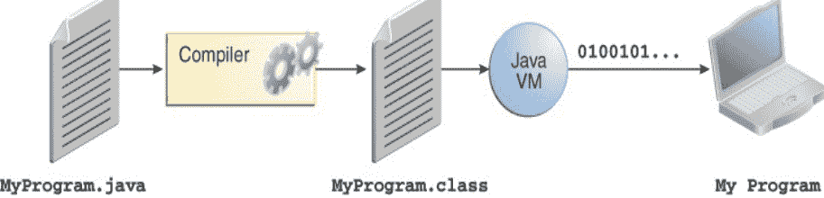

由于 Java 虚拟机可以在许多不同的操作系统上运行，相同的 `.class` 文件能够在 Microsoft Windows、Solaris 操作系统（Solaris OS）、Linux 或 Mac OS 上运行。某些虚拟机（例如《Java SE HotSpot 概览》³）会在运行时执行额外的步骤以为您的应用程序提供性能加速。这包括各种任务，例如寻找性能瓶颈以及对频繁使用的代码段进行重新编译（转换为原生代码）。

### 图 1.2. 通过 Java 虚拟机，同一个应用程序可以在多个平台上运行

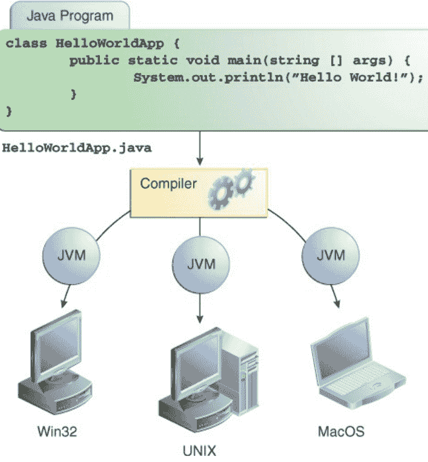

### Java Platform

平台是指程序运行的硬件或软件环境。我们已经提到了一些最流行的平台，如 Microsoft Windows、Linux、Solaris OS 和 Mac OS。大多数平台可以描述为操作系统和底层硬件的结合。Java 平台与其他平台的不同之处在于它是一个运行在其他硬件之上的纯软件平台。

Java 平台包含两个组件：

- Java 虚拟机
- 应用程序编程接口 (API)

你已经了解了 Java 虚拟机；它是 Java 平台的基础，并被移植到各种硬件平台上。API 是由现成的软件组件组成的庞大集合，提供了许多有用的功能；这些库被称为包（packages）。下一节“Java 能做什么？”重点介绍了由 API 提供的功能。

### 图 1.3. API 和 Java 虚拟机将程序与底层隔离开


### Java 能做什么？

作为一种与平台无关的环境，Java 平台的运行比原生代码慢一点。然而，编译器和虚拟机技术的进步正在使性能接近原生代码，且不丧失可移植性。通用高级的 Java 编程语言是一个强大的平台。Java 平台的每种实现都为你提供了以下特性：

- 开发工具：编译、运行、监控和记录你的应用程序所需的工具。作为一名新开发者，你将使用的主要工具是 `javac` 编译器、`java` 启动器和 `javadoc` 工具。
- 应用程序编程接口 (API)：API 提供了大量供应用程序使用的有用类。它涵盖了从基础对象到网络和安全，再到 XML 生成等所有内容。核心 API 非常大；要了解其包含的内容，请参阅《Java 平台标准版 8 文档》。
- 部署技术：JDK 提供了标准机制，如 Java Web Start 和 Java Plugin，用于将应用程序部署给最终用户。
- 用户界面工具包：JavaFX、Swing 和 Java 2D 工具包使得创建复杂的用户界面（GUI）成为可能。
- 集成库：如 Java IDL API、JDBC API、Java 命名和目录接口 (JNDI) API、Java RMI 以及基于 Internet ORB 协议的 Java 远程调用 (Java RMI-IIOP)，实现了数据库访问和远程对象的操作。

## Java 技术将改变我的生活？

如果你学习 Java 编程语言，我们无法保证带来名声、财富甚至一份工作。尽管它可能会让你的程序更好，并且比其他语言所需的精力更少。我们相信 Java 技术将帮助你做到：

- 快速上手：尽管 Java 编程语言是一种强大的面向对象语言，但它很容易学习，特别是对于已经熟悉 C 或 C++ 的程序员来说。
- 编写更少的代码：程序指标（类数量、方法数量等）的比较表明，用 Java 语言编写的程序可以比用 C++ 编写的相同程序小四倍。
- 编写更好的代码：Java 编程语言鼓励良好的编码实践，自动垃圾回收可以帮助你避免内存泄漏。它的面向对象性、JavaBeans 组件架构以及广泛易于扩展的 API 让你重用现有的、测试过的代码并引入更少的错误。
- 更快地开发程序：Java 语言比 C++ 简单，因此在使用它编写时你的开发速度可能快一倍。你的程序也需要更少的代码。
- 避免平台依赖：通过避免使用其他语言编写的库，你可以保持程序的可移植性。
- 一次编写，到处运行：因为用 Java 语言编写的应用程序被编译成平台无关的字节码，它们在任何 Java 平台上都能一致运行。
- 更容易分发软件：通过 Java Web Start，用户只需点击鼠标即可启动你的应用程序。启动时的自动版本检查确保用户始终使用软件的最新版本。如果有更新，Java Web Start 将自动更新他们的安装版本。

### “Hello World!”应用程序

本节提供了编译和运行简单的“Hello World!”应用程序的详细说明。第一部分提供了有关如何开始使用 NetBeans IDE 的信息，这是一种极大地简化了软件开发过程的集成开发环境。NetBeans IDE 运行在 Java 平台上，这意味着你可以在任何可用 JDK 的操作系统上使用它。这些操作系统包括 Microsoft Windows、Solaris OS、Linux 和 Mac OS X。我们建议尽可能使用 NetBeans IDE 而不是命令行。其余部分提供了在不使用集成开发环境的情况下开始运行的特定平台说明。这些说明分别为 Windows、Solaris OS 和 Linux 用户提供。（有关支持哪些操作系统版本的更多信息，请参阅《Oracle JDK 8 和 JRE 8 认证系统配置》⁵如果你遇到问题，请务必咨询常见问题部分；它为新用户遇到的许多问题提供了解决方案。）


### 针对 NetBeans IDE 的“HELLO WORLD!”

是时候编写你的第一个应用程序了！这些详细说明适用于 NetBeans IDE 的用户。NetBeans IDE 运行在 Java 平台上，这意味着你可以在任何可用 JDK 的操作系统上使用它。这些操作系统包括 Microsoft Windows、Solaris OS、Linux 和 Mac OS X。

## 检查清单

要编写第一个程序，你需要：

1. Java SE 开发工具包 (JDK)。参阅 Java SE 下载索引⁶
2. NetBeans IDE。要获取所有平台的版本，请参阅 NetBeans IDE 下载索引⁷

### 创建你的第一个应用程序

你的第一个应用程序 `HelloWorldApp` 将简单地显示“Hello World!”要创建此程序，你将：

- 创建一个 IDE 项目：当你创建一个 IDE 项目时，你就创建了一个构建和运行应用程序的环境。使用 IDE 项目消除了通常与命令行开发相关的配置问题。你可以通过选择 IDE 内的单个菜单项来构建或运行应用程序。
- 在生成的源文件中添加代码：源代码包含你和其他程序员可以理解的代码。作为创建 IDE 项目的一部分，会自动生成一个骨架源文件。你将修改源文件以添加“Hello World!”消息。
- 将源文件编译为 `.class` 文件：IDE 调用 Java 编程语言编译器 (`javac`)，它获取你的源文件并将其转换为 Java 虚拟机可以理解的指令。文件中的指令被称为字节码。
- 运行程序：IDE 调用 Java 应用程序启动器 (`java`)，它使用 Java 虚拟机运行你的应用程序。

通过进入 IDE 的 `bin` 目录并输入 `./netbeans` 来启动脚本。
- 在 Mac OS X 系统上，点击 NetBeans IDE 应用程序图标。

在 NetBeans IDE 中，选择 `File` | `New Project`（新建项目，图 1.4）。

## 图 1.4. 选择了 File | New Project 菜单的 Netbeans IDE

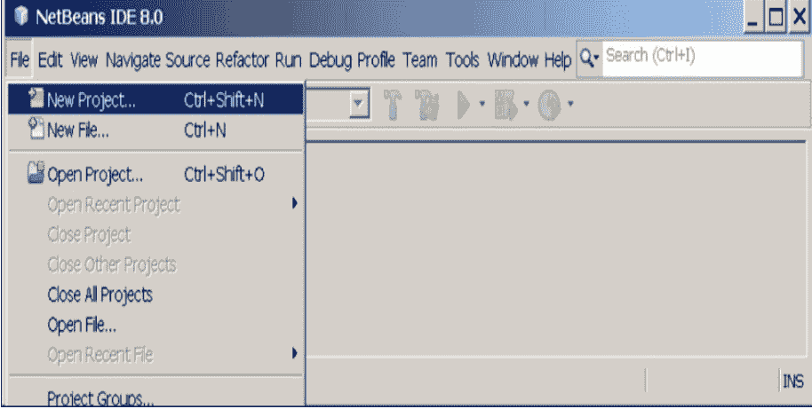

在 New Project 项目向导中，展开 Java 类别并选择 Java Application（图 1.5）：

## 图 1.5. Netbeans IDE，新建项目向导，选择项目页

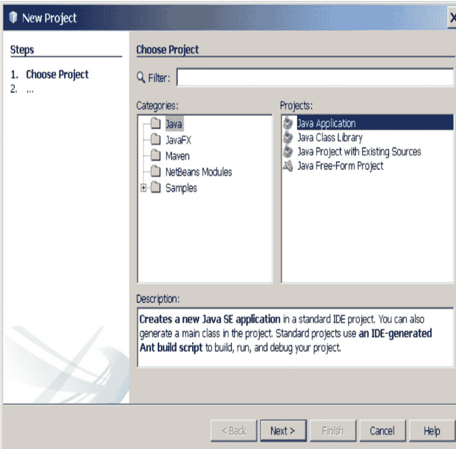

4. 在向导的 **Name and Location** 页面，执行以下操作（图 1.6）：

   - 在 **Project Name** 字段中，输入 Hello World App。
   - 在 **Create Main Class** 字段中，输入 `helloworldapp.HelloWorldApp`。

**图 1.6.** Netbeans IDE，新建项目向导，Name and Location 页面


5. 点击 Finish。

项目已创建并在 IDE 中打开（图 1.7）。你应该看到以下组件：

   - **Projects**（项目）窗口，它包含项目组件的树状视图，包括源文件、你的代码依赖的库等。
   - **Navigator**（导航器）窗口，你可以用它在所选类的元素之间快速导航。

**图 1.7.** 打开了 HelloWorldApp 项目的 Netbeans IDE

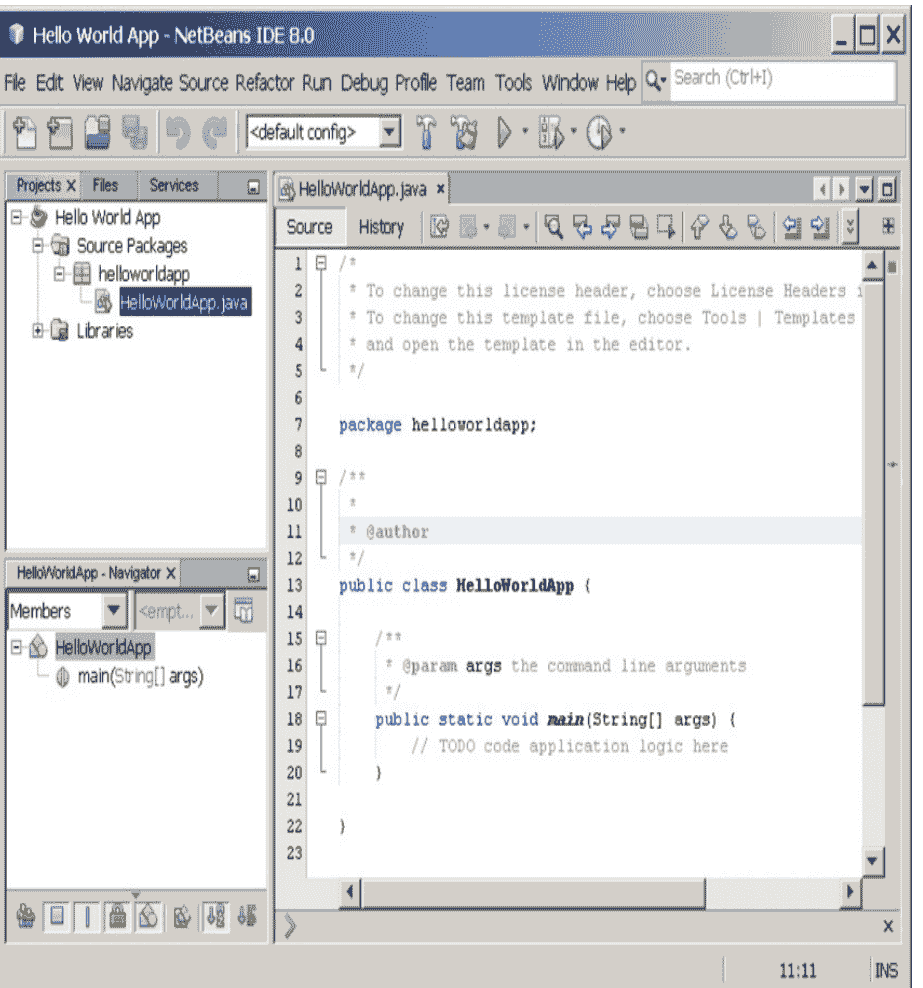

#### 将 JDK 8 添加到平台列表（如有必要）

可能需要将 JDK 8 添加到 IDE 的可用平台列表中。要执行此操作，选择 **Tools** | **Java Platforms**，如图 1.8 所示：

**图 1.8. 从 Tools 菜单选择 Java Platform Manager**

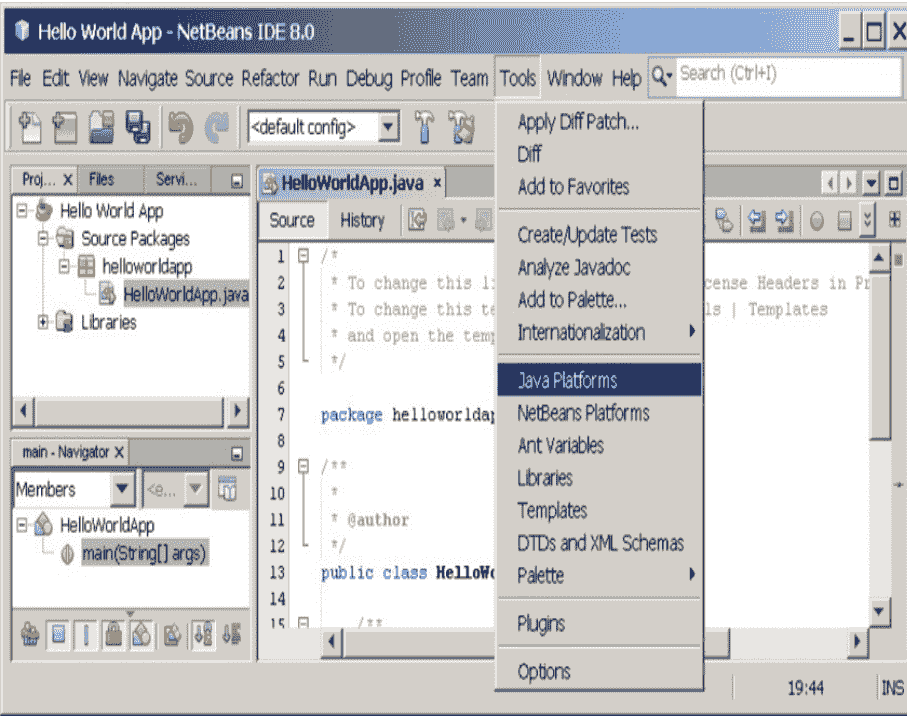

如果你在已安装列表中没有看到 JDK 8（它可能显示为 1.8 或 1.8.0），点击 Add Platform，导航到你的 JDK 8 安装目录并点击 Finish。你现在应该可以看到这个新添加的平台了：

## 图 1.9. Java Platform Manager

#### Java Platform Manager

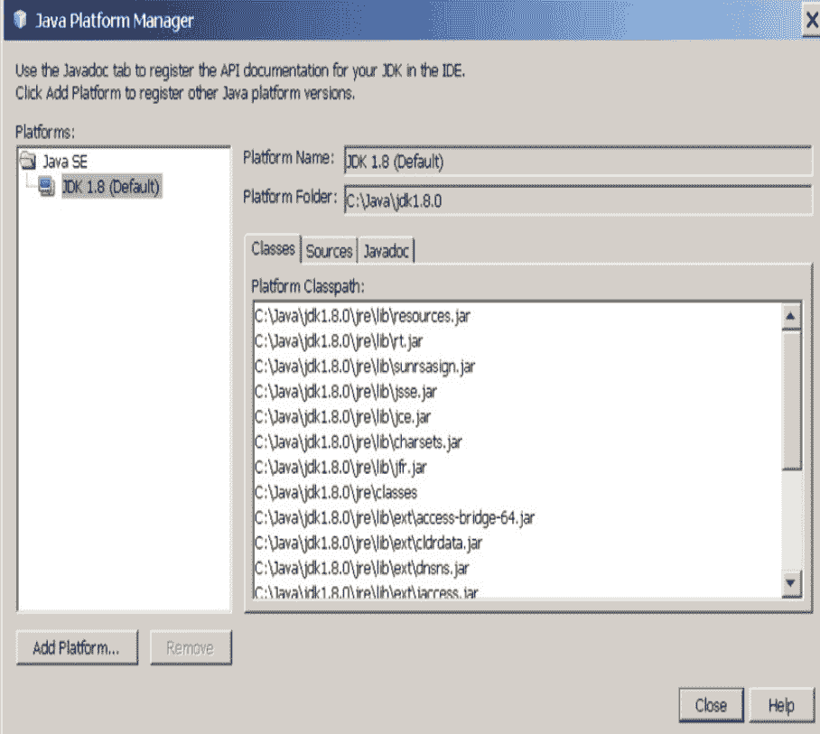

要把此 JDK 设置为所有项目的默认 JDK，你可以在命令行中使用 `--jdkhome` 切换运行 IDE，或者通过在 `INSTALLATION_DIRECTORY/etc/netbeans.conf` 文件的 `netbeans_j2sdkhome` 属性中输入 JDK 路径。

要为当前项目指定此 JDK，只需在 Projects 窗口中选择 Hello World App，选择 `File` | `Project Properties` (Hello World App)，点击 Libraries，然后在 Java Platform 下拉菜单中选择 JDK 1.8。你应该会看到类似于图 1.10 的界面。IDE 现在已配置为 JDK 8。

图 1.10. Hello World App 项目属性中的 Libraries 类别

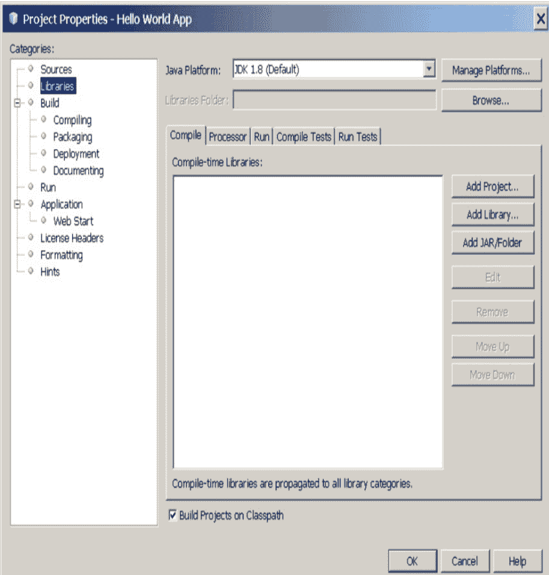

##### 在生成的源文件中添加代码

当你创建此项目时，在 **New Project** 向导中勾选了 **Create Main Class** 复选框。因此，IDE 已经为你创建了一个骨架类。你可以通过替换以下行来向骨架类添加“Hello World!”消息：

```java
// TODO code application logic here
```

替换为这行：

```java
System.out.println("Hello World!"); // 显示字符串。
```

可选，你可以将这四行生成的代码：

```java
/**
 *
 * @author
 */
```

替换为这些行：

```java
/**
 * The HelloWorldApp class implements an application that
 * simply prints "Hello World!" to standard output.
 */
```

这四行是代码注释，不会影响程序的运行。本教程的后续章节将解释代码注释的使用和格式。

> **注意**
>
> 请按照所示内容精确输入所有代码、命令和文件名。编译器 (`javac`) 和启动器 (`java`) 都是大小写敏感的，因此你必须保持大小写一致。
>
> `HelloWorldApp` 与 `helloworldapp` 不同。

通过选择 `File` | `Save` 保存你的更改。

文件看起来应该像下面：

```java
/*
 * To change this template, choose Tools | Templates
 * and open the template in the editor.
 */
package helloworldapp;

/**
 * HelloWorldApp class implements an application that
 * simply prints "Hello World!" to standard output.
 */
public class HelloWorldApp {

    /**
     * @param args
     */
    public static void main(String[] args) {
        System.out.println("Hello World!");
    }
}
```

### 编译源文件

要编译源文件，请使用图 1.11 所示的 IDE 输出。

## 图 1.11. 显示结果的输出窗口

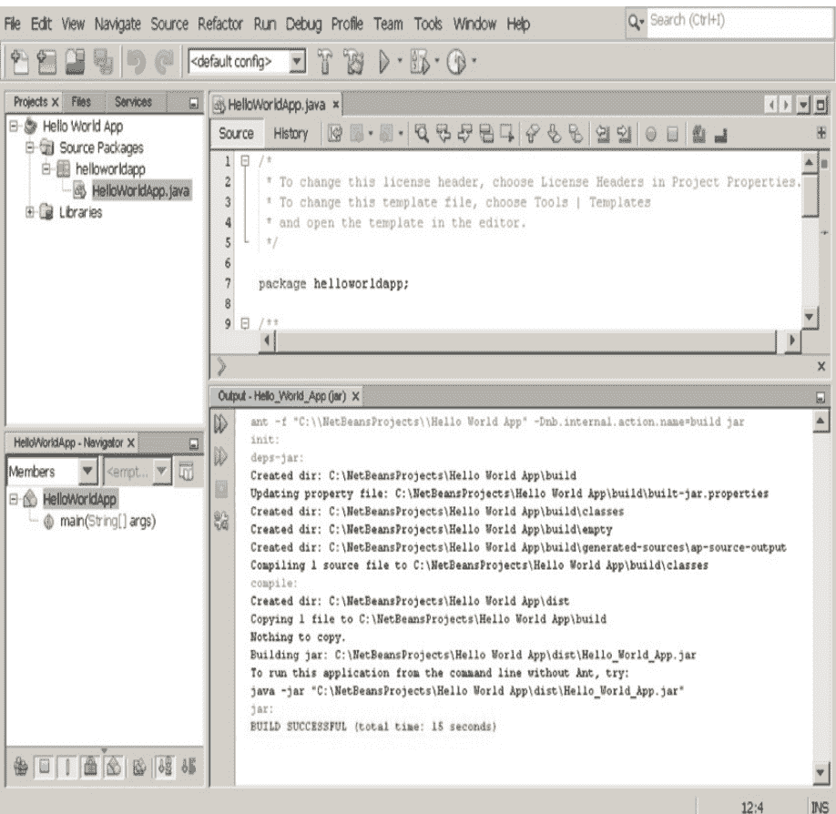

如果构建输出显示 SUCCESSFUL，恭喜你！如果构建输出显示 FAILED，你的代码可能存在语法错误。

## 图 1.12. 显示 .class 的输出窗口

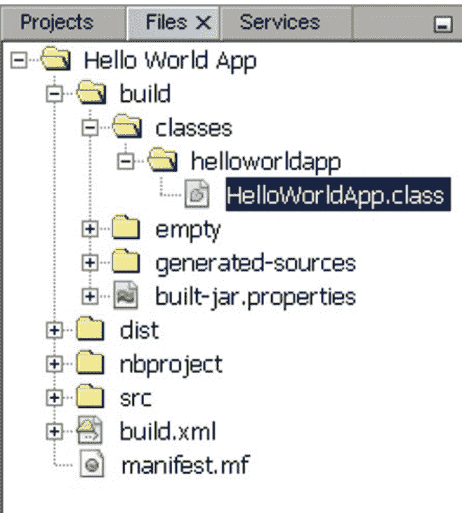

## 图 1.13. 显示程序的输出窗口

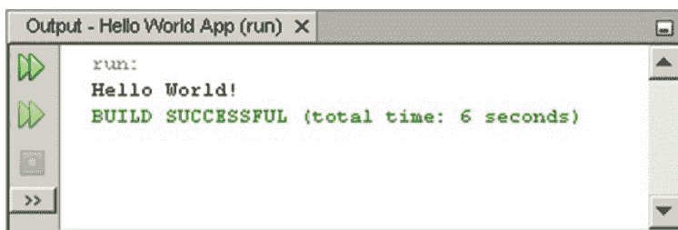

### 使用 IDE 继续教程

教程接下来将深入介绍功能并提供更多示例。以下是使用 IDE 的一些技巧：

- 创建项目后，你可以使用 New File 向导添加文件。选择 `File` | `New File`，然后选择一个模板（如 Empty File）。
- 当你在 IDE 中输入时，代码补全框可能会弹出。你可以忽略代码补全框继续输入，也可以选择建议的表达式。如果你不希望代码补全框自动弹出，可以关闭它。选择 `Tools` | `Options` | `Editor`，点击 Code Completion 选项卡并清除 Auto Popup Completion Window。
- 如果你想重命名 Projects 窗口中的源文件，从 IDE 主菜单中选择 Refactor。IDE 会弹出 Rename 对话框引导你重命名类并更新引用该类的代码。做出更改并点击 Refactor 应用更改。如果项目中只有一个类，这一系列操作似乎没有必要，但在修改影响项目其他部分时，它非常有用。
- 有关 NetBeans IDE 功能的更详细指南，请参考 NetBeans 文档。

## 针对微软 Windows 的“你好世界！”

是时候编写你的第一个应用程序了！以下说明适用于 Windows 用户。（有关受支持的操作系统版本的更多信息，请参见 Oracle JDK 8 和 JRE 8 认证系统配置。）

## 检查清单

编写你的第一个程序，你需要：

1. Java SE 开发工具包 (JDK 8)。你现在下载 Windows 版本。（确保下载的是 JDK 而不是 JRE）。请参阅安装说明。
2. 文本编辑器。在本例中，我们将使用 Windows 平台自带的简单编辑器 Notepad。你可以轻松适配

### 创建你的第一个应用程序

你的第一个应用程序 `HelloWorldApp` 将简单地显示问候语句“Hello world!”要创建此程序，你将：

1. 创建一个源文件。源代码包含用 Java 编程语言编写的代码，你和其他程序员都能读懂。你可以使用任何文本编辑器来创建和编辑源文件。
2. 将源文件编译为 `.class` 文件。Java 编程语言编译器 (`javac`) 会获取你的源代码并将其文本转换为 Java 虚拟机可以理解的指令。该文件中包含的指令被称为字节码。
3. 运行程序。Java 启动工具 (`java`) 使用 Java 虚拟机运行你的应用程序。

### 创建源文件

要创建一个源文件，你有两个选择：

- 你可以在电脑上直接保存 `HelloWorldApp.java` 文件，以避免大量的输入。然后，你可以直接跳转到“将源代码编译为 .class 文件”部分。
- 或者，你可以使用以下（较长的）指令。

首先，启动你的编辑器。你可以从开始菜单中选择“程序 > 辅助程序 > 记事本”来启动记事本编辑器。在一个新文档中输入以下代码：

```java
/**
 * The HelloWorldApp class implements an application that
 * simply prints "Hello World!" to standard output.
 */
class HelloWorldApp {
    public static void main(String[] args) {
        System.out.println("Hello World!"); // Display the string
    }
}
```

> **注意**
>
> 所有代码、命令和文件名必须与显示的内容完全一致。编译器 (`javac`) 和启动器 (`java`) 对大小写敏感，因此你必须保持大小写一致。`HelloWorldApp` 与 `helloworldapp` 是不同的。

将代码保存为名为 `HelloWorldApp.java` 的文件。在记事本中执行此操作，首先选择“文件 > 另存为”菜单项。然后在“另存为”对话框中：

1. 使用**保存类型**组合框，指定你将保存文件的文件夹（目录）。在本示例中，目录是 C 盘上的 myapplication。
2. 在**文件名**文本框中，输入 `"HelloWorldApp.java"`，包括引号。
3. 从**保存类型**组合框中，选择**文本文档 (*.txt)**。
4. 在**编码**组合框中，将编码保留为 ANSI。

完成后，对话框应该看起来像图 1.14。

# 图 1.14. 点击保存之前的另存为对话框

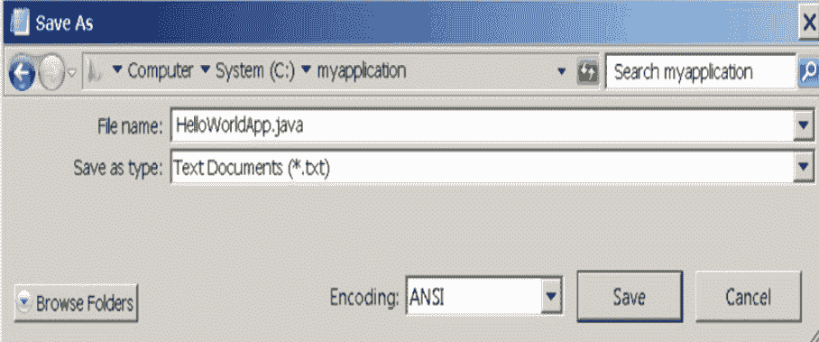

现在点击“保存”，并退出记事本。

### 将源代码编译为 .class 文件

打开一个 shell（外）或“命令”窗口。你可以从开始菜单中选择“运行...”，然后输入 `cmd` 执行此操作。shell 窗口看起来应该像图 1.15。

# 图 1.15. Shell 窗口

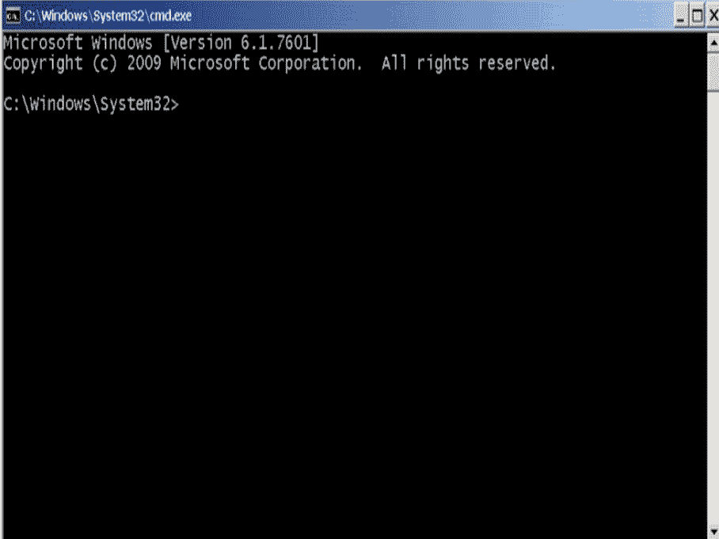

提示符显示你当前的目录。当你打开提示符时，你的当前目录通常是 Windows XP 的主目录（如上一图所示）。

要编译你的源文件，请将当前目录更改为你的文件所在的目录。例如，如果你的源目录是 C 盘上的 myapplication，请在提示符处输入以下命令并按**回车键**：

```bash
cd C:\myapplication
```

现在提示符应该变为 `C:\myapplication>`。

> **注意**
>
> 要切换到不同驱动器上的目录，你必须额外的命令：驱动器名称。例如，要切换到 D 盘上的特定目录，你必须如下输入 `D:`：
>
> ```bash
> C:>D:
> D\>cd application
> nD:\myapplication>
> ```

如果你在提示符处输入 `dir`，你应该能看到你的源文件，如下：

```bash
C:\>cd application
C:\myapplication>dir

Volume in drive C is System
Volume Serial Number is F2E8-C8CC

Directory of C:\myapplication
2014-04-24 01:34 PM <DIR> .
2014-04-24 01:34 PM <DIR> ..
2014-04-24 01:34 PM 267 HelloWorldApp.java
    1 File(s) 267 bytes
    2 Dir(s) 93,297,991,680 bytes free
C:\myapplication>
```

现在你已经准备好编译了。在提示符处输入以下命令并按回车。

```bash
javac HelloWorldApp.java
```

编译器已经生成了一个字节码文件 `HelloWorldApp.class`。在提示符处，输入 `dir` 查看生成的新文件，如下所示：

```bash
C:\myapplication>javac HelloWorldApp.java
C:\myapplication>dir

Volume in drive C is System
Volume Serial Number is F2E8-C8CC

Directory of C:\myapplication
2014-04-24 02:07 PM <DIR> 
2014-04-24 02:07 PM <DIR> ..
2014-04-24 02:07 PM 432 HelloWorldApp.class
2014-04-24 01:34 PM 267 HelloWorldApp.java
    2 File(s) 699 bytes
    2 Dir(s) 93,298,032,640 bytes free
C:\myapplication>
```

现在你已经有了 `.class` 文件，就可以运行你的程序了。如果在这一步的指令上遇到问题，请参考本章末的常见问题及其解决方案。

### 运行程序

在同一目录下，在提示符处输入以下命令：

```bash
java -cp . HelloWorldApp
```

你应该会在屏幕上看到：

```bash
C:\myapplication>java -cp . HelloWorldApp
Hello World!
C:\myapplication>
```

恭喜！你的程序运行成功！

## Solaris OS 和 Linux 的“HELLO WORLD!”

是时候编写你的第一个应用程序了！这些详细指令是针对 Solaris OS 和 Linux 用户的。

如果在本页面指令上遇到问题，请查阅“常见问题及其解决方案”章节。

## 检查清单

编写你的第一个程序，你需要：

1. Java SE 开发包 8 (JDK 8)。你可以现在下载 Solaris OS 或 Linux 版本。（确保下载的是 JDK 而不是 JRE。）请参考安装说明。
2. 一个文本编辑器。在示例中，我们将使用 Pico，这是一种适用于许多类 Unix 平台的编辑器。如果你使用不同的文本编辑器（如 vi 或 emacs），可以轻松调整这些指令。

这两项就是你编写第一个应用程序所需的所有内容。

保持大小写一致性。

`HelloWorld` 与 `helloworldapp` 不同。


将代码保存到名为 `HelloWorldApp.java` 的文件中。在 Pico 编辑器中，你可以通过输入 `Ctrl-O`，然后在底部看到 `File Name to write:` 提示符的地方，输入你想要创建文件的目录，并跟上 `HelloWorldApp.java`。例如，如果你想将 `HelloWorldApp.java` 保存到 `/tmp/examples/java` 目录，则输入 `/tmp/examples/java/HelloWorldApp.java` 并按回车。

你可以输入 `Ctrl-X` 退出 Pico。

### 将源文件编译为类文件

打开另一个窗口。要编译源文件，请将当前目录更改为文件所在的目录。例如，如果你的源目录是 `/tmp/examples/java`，在提示符处输入以下命令并按回车：

```
cd /tmp/examples/java
```

如果你在提示符处输入 `pwd`，你应该看到当前目录，在本例中，它已更改为 `/tmp/examples/java`。

如果你在提示符处输入 `ls`，你应该看到你的文件。

图 1.17. `ls` 命令的结果，显示了 .java 源文件

```
>cd /tmp/examples/java
>pwd
/tmp/examples/java
>ls
HelloWorld.java
./
>
```

现在你准备好编译源文件了。在提示符处输入以下命令并按**回车**。

```
javac HelloWorld.java
```

编译器生成了一个字节码文件 `HelloWorld.class`。在提示符处输入 `ls` 来查看生成的新文件，如图 1.18 所示：

**图 1.18. `ls` 命令的结果，显示生成的 .class 文件**

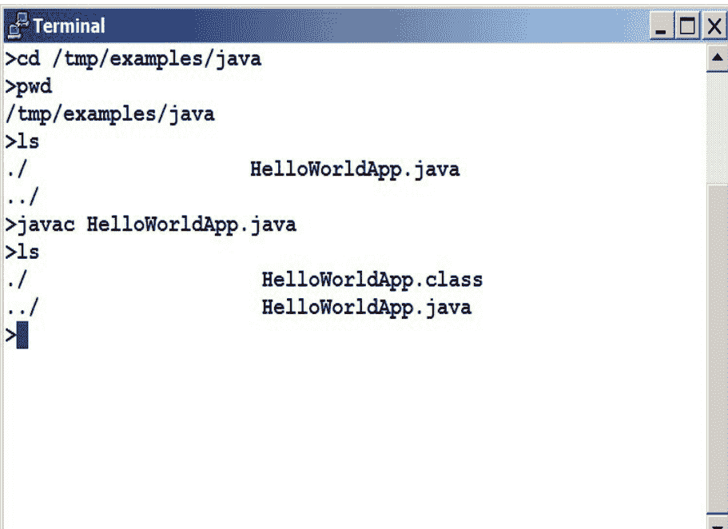

现在你已经有了 `.class` 文件，可以运行你的程序了。

如果在这一步的指令中遇到问题，请参考章节末尾的“常见问题（及其解决方案）”部分。

### 运行程序

在同一目录下，在提示符处输入：

```
java HelloWorldApp
```

图 1.19 显示了你现在应该看到的内容。

### 图 1.19. 输出在屏幕上打印“Hello World!”

```
>cd /tmp/examples/java
>pwd
/tmp/examples/java
>ls
    HelloWorld.java
    ..
>javac HelloWorld.java
>ls
    HelloWorld.class
    HelloWorld.java
    ..
>java HelloWorldApp
Hello World!
```

恭喜你！你的程序运行成功！

## 深入了解“HELLO WORLD!”应用程序

现在你已经看到了“Hello World!”应用程序（可能甚至编译并运行了它），你可能在想它是如何工作的。这里再次是它的代码：

```
class HelloWorldApp {
    public static void main(String[] args) {
        System.out.println("Hello World!"); // 显示字符串
    }
}
```

“Hello World!”应用程序由三个主要部分组成：源代码注释、`HelloWorldApp` 类定义和 `main` 方法。接下来的解释将让你对代码有一个基本的了解，更深层次的含义直到在你读完教程剩余部分后才会显现出来。

### 源代码注释

下面的粗体文本定义了“Hello World!”应用程序的注释：

```
/**
* HelloWorldApp 类实现了一个应用程序，
* 它只是向标准输出打印 "Hello World!"。
*/
class HelloWorldApp {
    public static void main(String[] args) {
        System.out.println("Hello World!"); // 显示字符串。
    }
}
```

注释会被编译器忽略，但对其他程序员很有用。Java 编程语言支持三种注释：

- `/* text */` 编译器忽略从 `/*` 到 `*/` 之间的所有内容。

- `/** documentation */` 这表示文档注释（简称 doc 注）。编译器忽略这种注释，就像它忽略使用 `/*` 和 `*/` 的注释一样。`javadoc` 工具在准备自动生成的文档时会使用文档注释。关于 javadoc 的更多信息，请参见 Javadoc 工具文档¹14。

- `// text` 编译器忽略从 `//` 到行尾的所有内容。

### HelloWorldApp 类定义

接下来的粗体文本是“Hello World!”应用程序的类定义块的开始：

```
/**
 * HelloWorldApp 类实现了一个应用程序，
 * 它只是向标准输出显示 "Hello World!"。
 */
class HelloWorldApp {
    public static void main(String[] args) {
        System.out.println("Hello World!"); // 显示字符串
    }
}
```

如上所示，类定义的基本形式是：

```
class name {
    ...
}
```

修饰符 `public` 和 `static` 可以任意顺序编写（`public static` 或 `static public`），但习惯是像上面所示使用 `public static`。你可以给参数命名任何名字，但大多数程序员选择“args”或“argv”。

`main` 方法类似于 C 和 C++ 中的 `main` 函数；它是你应用程序的入口点，随后将调用你程序所需的所有其他方法。

`main` 方法接受单个参数：一个 `String` 类型元素的数组。

```
public static void main(String[] args)
```

该数组是运行时系统向你的应用程序传递信息的机制。例如：

```
java MyApp arg1 arg2
```

数组中的每个字符串被称为命令行参数。命令行参数允许用户在不重新编译应用程序的情况下影响程序的操作。例如，一个排序程序可能允许用户通过此命令行参数指定数据降序排序：

- descending

“Hello World!”应用程序忽略了命令行参数，但你应该意识到此类参数的存在。

最后，这一行：

```
System.out.println("Hello World!");
```

使用核心库中的 `System` 类向标准输出打印“Hello World!”消息。该库的部分（称为“应用程序接口”，或“API”）将在教程的剩余部分进行讨论。

> **注意**
>
> 查看此书的在线主题¹15 下载完整源代码。

### 常见问题（及其解决方案）

#### 编译器问题

##### Windows 系统上的常见错误消息

`'javac' 不是内部或命令、可程序或批文件。` 如果你遇到此错误，Windows 找不到编译器 (`javac`)。

告诉 Windows 哪里找到 `javac` 的方法。假设你将 JDK 安装在 `C:\jdk.8.0`。在提示符处输入以下命令并按回车：

```
C:\jdk.8.0\bin\javac HelloWorld.java
```

如果你选择这种方案，每次编译或运行程序时，你都需要在 `javac` 命令前加上 `C:\jdk.8.0\bin`。为了避免这种重复输入，请参阅 JDK 安装说明中的更新 PATH¹⁶ 部分。

##### Solaris OS 和 Linux 上的常见错误消息

`javac: 找不到命令`。如果你遇到此错误，操作系统找不到编译器 `javac`。

告诉 Solaris OS 和 Linux 哪里找到 `javac` 的方法。假设你将 JDK 安装在 `/usr/local/jdk.8.0`。在提示符处输入以下命令并按回车：

```
/usr/local/jdk.8.0/javac HelloWorldApp.java
```

> **注意**
>
> 如果选择这种方案，每次编译或运行程序时，你都必须显式地为 `javac` 和 `java` 命令加上 `/usr/local/jdk.8.0/`。为了避免这种重复输入，可以将此信息添加到你的 PATH 变量中。具体步骤取决于你当前运行的是什么 shell。

##### 类名 'HelloWorld' 只在显式请求注解处理时才接受

#### 语法错误（所有平台）

如果你写错了程序的一部分，编译器可能会发出语法错误。信息通常显示错误类型、检测到错误的行号、该行的代码以及错误在代码中的位置。这里是一个由于在语句末尾省略分号（`;`）导致的错误：

```
testing.java:14: '; ' expected.
System.out.println("Input has " + count + " chars.")
        ^
1 error
```

有时编译器无法猜测你的意图，并打印出令人困惑的错误信息；如果错误跨越多行，则会打印多个错误信息。例如，下面的代码段在粗体行缺少了一个分号（`;`）：

```
while (System.in.read() != -1)

count++
System.out.println("Input has " + count + " chars.");
```

在处理这段代码时，编译器会发出两个错误信息：

```
testing.java:13: Invalid type expression.

count++
        ^\ntesting.java:14: Invalid declaration.

System.out.println("Input has " + count + " chars.")
        ^\n2 errors
```

编译器发出两个错误信息是因为在处理完 `count++` 之后，编译器的状态显示它正处于表达式的中间。如果没有分号，编译器无法知道该语句已经完成。

如果你看到任何编译器错误，说明你的程序没有成功编译，编译器也没有创建 `.class` 文件。请仔细检查程序，修复你检测到的任何错误，然后重试。

#### 语义错误

除了验证程序的语法是否正确外，编译器还会检查其他基本正确性。例如，每当你使用一个未初始化的变量时，编译器都会向你警告：

```
testing.java:13: Variable count may not have been initialized.

count++
      ^
testing.java:14: Variable count may not have been initialized.

System.out.println("Input has " + count + " chars.");
      ^
2 errors
```

同样，你的程序没有成功编译，编译器也没有创建 `.class` 文件。修复错误并重试。

#### 运行时问题

##### Microsoft Windows 系统上的错误消息

```
Exception in thread "main" java.lang.NoClassDefFoundError:
HelloWorldApp
```

如果你收到此错误，`java` 找不到你的字节码文件 `HelloWorldApp.class`。

`java` 尝试寻找 `.class` 文件的地方之一是你的当前目录。如果你的 `.class` 文件在 `C:\java`，你应该将当前目录更改到该位置。要更改目录，请在提示符处输入以下命令并按回车：

```
cd c:\java
```

提示符应该变为 `C:\java>`。如果你在提示符处输入 `dir`，你应该能看到你的 `.java` 和 `.class` 文件。现在再次输入 `java HelloWorldApp`。

如果你仍然遇到问题，你可能需要更改 `CLASSPATH` 变量。要检查这是否有必要，请尝试使用以下命令清除类路径：

```
set CLASPATH=
```

现在再次输入 `java HelloWorldApp`。如果程序现在可以运行，则你需要更改 `CLASSPATH` 变量。要设置此变量，请参阅 JDK 8 安装说明中的“更新 PATH 变量第17 节”。`CLASSPATH` 变量的设置方式相同。

`无法找到或加载主类 HelloWorldApp.class`

初级程序员经常犯的一个常见错误是尝试在编译器创建的 `.class` 文件上运行 `java` 启动器。例如，如果你尝试用 `java HelloWorldApp.class` 而不是 `java HelloWorldApp` 来运行程序，就会得到此错误。记住，参数是你想要使用的类名，而不是文件名。

`Exception in thread "main" java.lang.NoSuchMethodError: main`

Java 虚拟机要求你用它执行的类必须有一个 `main` 方法才能开始应用程序的执行。“深入了解 ‘Hello World!’ 应用程序”部分详细讨论了 `main` 方法。

##### Solaris OS 和 Linux 上的错误消息

```
Exception in thread "main" java.lang.NoClassDefFoundError: HelloWorld
```

如果你收到此错误，`java` 找不到你的字节码文件 `HelloWorldApp.class`。

`java` 尝试寻找字节码文件的地方之一是你的当前目录。例如，如果你的字节码文件在 `/home/jdoe/java`，你应该将当前目录更改到该位置。要更改目录，请在提示符处输入以下命令并按回车（Return）：

```
cd /home/jdoe/java
```

如果你在提示符处输入 `pwd`，你应该看到 `/home/jdoe/java`。如果你在提示符处输入 `ls`，你应该看到 `.java` 和 `.class` 文件。现在再次输入 `java HelloWorld`。

如果你仍然遇到问题，你可能需要更改 `CLASSPATH` 环境变量。要检查这是否有必要，请尝试使用以下命令清除类路径：

```
unset CLSPATH
```

现在再次输入 `java HelloWorld`。如果程序现在可以运行，你需要按照上述 `PATH` 变量相同的方法更改 `CLASSPATH` 变量。

```
Exception in thread "main" java.lang.NoClassDefFoundError:
HelloWorldApp/class
```

初级程序员经常犯的一个常见错误是尝试在编译器创建的 `.class` 文件上运行 `java` 启动器。例如，如果你尝试用 `java HelloWorldApp.class` 而不是 `java HelloWorldApp` 来运行程序，就会得到此错误。记住，参数是你想要使用的类名，而不是文件名。

```
Exception in thread "main" java.lang.NoSuchMethodError: main
```

Java 虚拟机要求你执行的类具有一个 `main` 方法才能开始应用程序的执行。“深入了解 ‘Hello World!’ 应用程序”部分详细讨论了 `main` 方法。

#### Applet 或 Java Web Start 应用程序被阻止

如果你通过浏览器运行应用程序并收到显示应用程序被阻止的安全警告，请检查以下项目：

- 验证 JAR 文件清单（manifest）中的属性是否已针对应用程序运行的环境正确设置。需要 `Permissions` 属性。在 NetBeans 项目中，你可以通过 NetBeans IDE 选项卡、展开项目文件夹并双击 `manifest.mf` 来打开清单文件。

- 验证应用程序已由有效证书签名，并且该证书位于 Signer CA 密钥库中。

- 如果你正在运行本地 applet，请设置一个用于测试服务器。你也可以将应用程序添加到异常站点列表中，该列表在 Java 控制面板的“安全”选项卡中管理。

## 问题与练习：入门

### 问题

**问题 1：** 当你编译用 Java 语言编写的程序时，编译器会将人类可读的源码转换为 Java 虚拟机可以理解的平台无关代码。这种平台无关的代码是什么？

**问题 2：** 下列哪项*不是*有效的注释：

- a. `/** comment */`

- b. `/* comment */`

- c. `/* comment`

- d. `// comment`

**问题 3：** 当你看到以下 `Exception in thread "main" java.lang.NoClassDefFoundError: HelloWorldApp.java` 时，你应该检查的第一件事是什么？

**问题 4：** `main` 方法的正确签名是什么？

**问题 5：** 在声明 `main` 方法时，哪个修饰符必须在前，`public` 还是 `static`？

**问题 6：** `main` 方法定义了哪些参数？

### 练习

**练习 1：** 修改 `HelloWorld.java` 程序，使其显示 `Hola Mundo!` 而不是 `Hello World!`。

**练习 2：** 你可以在此处找到 `HelloWorldApp` 的稍微修改版本：`HelloWorld2.java`

该程序有一个错误。修复该错误使程序能够成功编译并运行。错误是什么？

### 示例

### 答案

你可以在 http://docs.oracle.com/javase/getStarted/QandE/answers.html 找到这些问题和练习的答案。

# 第 1 章 | 笔记

- 1. http://www.oracle.com/technwork/java/langenv-140151


# 第 2 章 面向对象编程概念

如果你从未用过面向对象的编程语言，在开始编写任何代码之前，你需要学习一些基本概念。本章将向你介绍对象、类、继承、接口和包。每个节都侧重于这些概念如何与现实世界相关，同时提供 Java 编程语言的语法介绍。

第一节侧重于对象。对象是相关状态和行为的软件封装。软件对象通常用于模拟你在日常生活中遇到的现实世界对象。本节解释了状态和行为在对象内部是如何表示的，引入了数据封装的概念，并解释了以这种方式设计软件的好处。

第二节讨论类。类是创建对象的蓝图或原型。本节定义了一个模拟现实世界对象状态和行为的类。特意关注基础知识，展示了即使是一个简单的类也能整洁地模拟状态和行为。

第三节侧重于继承。继承为组织和构建你的软件提供了一种强大且自然的机制。本节解释了类如何从其父类继承状态和行为，并解释了如何使用 Java 编程语言提供的简单语法从一个类派生另一个类。

第四节讨论接口。接口是类与外部世界之间的契约。当一个类实现接口时，它承诺提供该接口发布的行为。本节定义了一个简单的接口，并解释了实现该接口的任何类所需的更改。

最后一节描述包。包是按逻辑方式组织类和接口的命名空间。将代码放入包中可以更容易管理大型软件项目。本节解释了为什么这样做有用，并向你介绍了 Java 平台提供的应用程序编程接口 (API)。

本章以问题和练习结束，以测试你对对象、类、继承、接口和包的理解。

## 什么是对象？

对象是理解面向对象技术的关键。环顾四周，你会发现很多现实世界对象的例子：你的狗、你的书桌、你的电视机、你的自行车。

现实世界对象共享两个特征：它们都具有状态和行为。狗有状态（名字、颜色、品种、是否饥饿）和行为（吠叫、取球、摇尾巴）。自行车也有状态（当前档位、当前踏频、当前速度）和行为（换挡、改变踏频、刹车）。识别现实世界对象的状态和行为是开始以面向对象编程思维的极佳方法。

现在花一分钟观察你所在区域的现实世界对象。对于你看到的每个对象，问自己问题：“这个对象可能处于什么状态？”以及“这个对象可以执行什么可能的行为？”确保写下你的观察结果。在此过程中，你会发现现实世界对象的复杂性各异；你的台灯可能只有两个可能的状态（开启和关闭）和两个可能的行为（开启、关闭），但你的桌面收音机可能有额外的状态（开启、关闭、当前音量、当前电台）和行为（开启、关闭、音量、减音量、搜索、扫描和调频）。你可能还会发现某些对象包含其他对象。这些现实世界的观察都转化为了面向对象编程的世界。

### 图 2.1. 软件对象

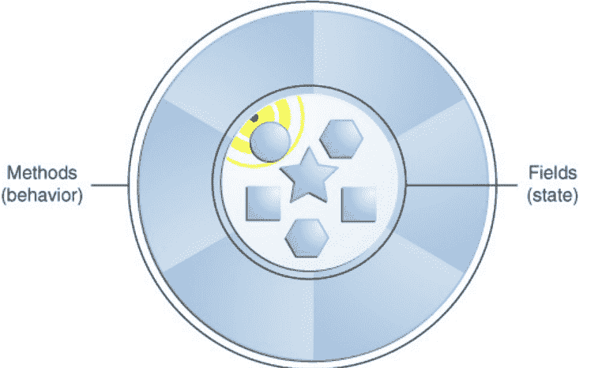

软件对象在概念上类似于现实世界对象。它们是相关状态和行为的软件封装。软件对象通常用于模拟你在日常生活中遇到的现实世界对象。本节解释了状态和行为在对象内部是如何表示的，引入了数据封装的概念，并解释了以这种方式设计软件的好处。

考虑一个自行车，例如：

### 图 2.2. 模拟为软件对象的自行车


通过方法对状态进行交互被称为`数据封装`——面向对象编程的基本原则。

将代码封装到对象中具有许多好处，包括：

- **模块化**：对象代码可以在系统中独立地编写和维护。
- **信息隐藏**：通过仅与方法交互，对象的内部实现对外部世界是隐藏的。
- **代码重用**：如果对象已经存在（可能是其他开发者编写），你可以在程序中使用。
- **可插拔性和调试便利**：如果某个对象出现问题，你可以简单地将其移除并插入另一个对象。

## 什么是类？

在现实世界中，你经常会发现同一种类型的对象。可能存在成千上万辆自行车，它们型号相同。在面向对象的术语中，我们说你的自行车是该类的实例。类是创建对象的蓝图。

以下 `Bicycle` 类是自行车的一种可能实现：

```java
class Bicycle {

  int cadence = 0;
  int speed = 0;
  int gear = 1;

  void changeCadence(int newValue) {
    cadence = newValue;
  }

  void changeGear(int newValue) {
    gear = newValue;
  }

  void speedUp(int increment) {
    speed = speed + increment;
  }

  void applyBrakes(int decrement) {
    speed = speed - decrement;
  }

  void printStates() {
    System.out.println("cadence:" + 
    cadence + " speed:" + 
    speed + " gear:" + gear);
  }
}
```

Java 编程语言的语法对你来说可能是全新的，但这个类的设计基于之前对对象的讨论。字段 `cadence`、`speed` 和 `gear` 代表对象的状态，而方法（如 `changeCadence`、`changeGear` 和 `speedUp`）定义了与外部世界的交互。

你可能注意到 `Bicycle` 类没有包含 `main` 方法。因为它并不是一个完整的应用程序；它只是自行车蓝图。创建和使用新对象的责任属于应用程序中的另一个类。

这是一个 `BicycleDemo` 类，它创建了两个独立的 `Bicycle` 对象并调用了它们的方法：

```java
class BicycleDemo {

    public static void main(String[] args) {
        // 创建两个不同的 Bicycle 对象
        Bicycle bike1 = new Bicycle();
        Bicycle bike2 = new Bicycle();

        // 运行这些对象的方法
        bike1.changeCadence(50);
        bike1.speedUp(10);
        bike1.changeGear(2);
        bike1.printStates();

        bike2.changeCadence(50);
        bike2.speedUp(10);
        bike2.changeGear(2);
        bike2.changeCadence(40);
        bike2.speedUp(10);
        bike2.changeGear(3);
        bike2.printStates();
    }
}
```

该测试的输出打印了这两辆自行车结束时的踏频、速度和档位：

```
cadence:50 speed:10 gear:2
cadence:40 speed:20 gear:3
```

### 什么是继承？

不同类型的对象之间通常会有某些共同点。例如，山地车、公路车、双人自行车等都共享自行车的特征（当前速度、踏频、当前档位）。然而，每种车也定义了使它们不同的特性：双人车有两个座椅和两组车把；公路车采用弯把手；某些山地车还有一个额外的链环盘，使其具有更低的齿比。

面向对象编程允许类从其他类继承通用的状态和行为。在这个示例中，`Bicycle` 现在变成了 `MountainBike`、`RoadBike` 和 `TandemBike` 的父类。在 Java 编程语言中，每个类允许有一个直接父类，而每个父类都拥有无限数量子类的潜力：

#### 图 2.3. 自行车类的层次结构

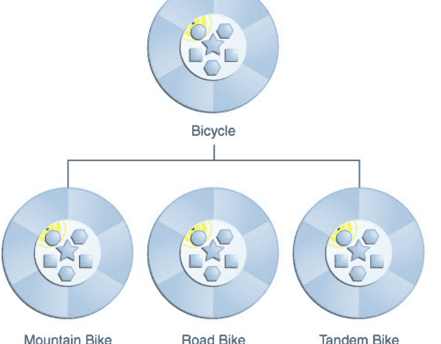

创建子类的语法非常简单。在类声明的开头，使用 `extends` 关键字，后跟要继承的类名：

```java
class MountainBike extends Bicycle {

  // 在此处定义
  // 山地车的新字段和方法

}
```

这使得 `MountainBike` 拥有与 `Bicycle` 相同的所有字段和方法，但允许其代码专门专注于使其与众不同的特性。这使得你的子类代码易于阅读。然而，你必须注意妥善记录每个父类定义的状态和行为，因为这些代码不会出现在每个子类的文件中。

### 什么是接口？

正如你已经学过的，对象通过它们暴露的方法来定义与外部世界的交互。方法构成了对象与外部世界的接口；例如，电视机正面的按钮就是你与塑料外壳另一侧电线之间的接口。你按下“电源”按钮来开启或关闭电视。

在最常见的形式中，接口是一组具有空方法体的相关方法。如果将自行车的行为指定为接口，它可能如下：

```java
interface Bicycle {

  // 每分钟轮转数
  void changeCadence(int newValue);
  void changeGear(int newValue);
  void speedUp(int increment);
  void applyBrakes(int decrement);
}
```

要实现此接口，你的类名将发生变化（例如变为特定品牌的自行车，如 `ACMEBicycle`），你将在类声明中使用 `implements` 关键字：

```java
class ACMEBicycle implements Bicycle {

  int cadence = 0;
  int speed = 0;
  int gear = 1;

  // 编译器现在要求方法
  // changeCadence, changeGear, speedUp 和 applyBrakes
  // 必须被实现。如果此类中缺少这些 
  // 方法，编译将失败。

  void changeCadence(int newValue) {
    cadence = newValue;
  }

  void changeGear(int newValue) {
    gear = newValue;
  }

  void speedUp(int increment) {
    speed = speed + increment;
  }

  void applyBrakes(int decrement) {
    speed = speed - decrement;
  }

  void printStates() {
    System.out.println("cadence:" + 
    cadence + " speed:" + 
    speed + " gear:" + gear);
  }
}
```

实现接口允许类就其承诺提供的行为变得更加正式。接口形成了类与外部世界之间的契约，这种契约在构建时由编译器强制执行。如果你的类声称实现某个接口，那么在该接口定义的所有方法都必须出现在类的源代码中，该类才能成功编译。

> **注意**
>
> 若要实际编译 `ACMEBicycle` 类，你需要在所实现的接口方法的开头添加 `public` 关键字。
>
> 你将在后续的第 4 章和第 6 章中学习其中的原因。

### 什么是包？

包（package）是一个组织一组相关类和接口的命名空间。从概念上说，你可以将包比作计算机上不同的文件夹。你可能将 HTML 页面放在一个文件夹中，将图片放在另一个中，将脚本或应用程序放在第三个。由于用 Java 编程语言编写的软件可能由成百上千个独立类组成，因此通过将相关的类和接口放在包中来保持有序是有意义的。

Java 平台提供了一个庞大的类库（一组包），适用于你自己的应用程序。该库被称为“应用程序编程接口”，简称“API”。它的包代表了与通用编程最相关的任务。例如，`String` 对象包含字符字符串的状态和行为；`File` 对象允许程序员轻松地创建、删除、检查、比较或修改文件。

```java
int gear = 1;
```


在第 2 章中，“什么是对象？”这一节向你介绍了字段（fields），但你可能仍然会有一些疑问，例如：命名字段的规则和约定是什么？除了 `int` 之外，还有其他数据类型吗？字段在声明时必须初始化吗？如果没有显式初始化，字段会被分配默认值吗？我们将在本章中探索这些问题的答案，但在此之前，你必须先意识到一些技术区别。在 Java 编程语言中，“字段（field）”和“变量（variable）”这两个术语都被使用了；这是新开发者之间产生困惑的常见源头，因为它们看起来通常指的是同一个东西。

Java 编程语言定义了以下类型的变量：

- **实例变量（非静态字段）：** 从技术上说，对象将其各个状态存储在“非静态字段”中，即没有使用 `static` 关键字声明的字段。非静态字段也被称为实例变量，因为它们的值对于类的每个实例都是唯一的（换句话说，对于每个对象而言）；例如，一辆自行车的 `currentSpeed` 与另一辆自行车的 `currentSpeed` 是相互独立的。

- **类变量（静态字段）：** 类变量是任何用 `static` 修饰符声明的字段；这告诉编译器，无论该类被实例化多少次，该变量都恰好存在一个副本。例如，定义特定自行车齿轮数量的字段可以标记为 `static`，因为从概念上讲，相同的齿轮数量适用于所有实例。代码 `static int numGears = 6;` 就会创建一个这样的静态字段。此外，可以添加 `final` 关键字表示齿轮数量永远不会改变。

- **局部变量：** 类似于对象在字段中存储其状态，方法通常会将其临时状态存储在*局部变量*中。声明局部变量的语法与声明字段相似（例如，`int count = 0;`）。没有特殊的关键字来将变量指定为局部的；这种判断完全取决于变量声明的位置——即位于方法的左括号和右括号之间。因此，局部变量仅对它们所在的方法可见；类的其他部分无法访问它们。

- **参数：** 你已经在 `Bicycle` 类和“Hello World!”应用程序的 `main` 方法中见过参数的示例了。回想 `main` 方法的签名 `public static void main(String[] args)`。在这里，`args` 变量是该方法的参数。需要记住的一点是，参数始终被归类为“变量”，而不是“字段”。这适用于你以后在教程中学习的其他参数处理结构（如构造函数和异常处理程序）。

尽管如此，本教程的剩余部分在讨论字段和变量时将遵循以下通用指南。当我们谈论“泛指字段”（不包括局部变量和参数）时，我们可以简单地说“字段”。如果讨论适用于“以上所有”，我们可以简单地说“变量”。如果上下文需要区分，我们将根据情况使用特定的术语（如静态字段或局部变量）。你可能偶尔也会看到“成员（member）”一词被使用。一个类型的字段、方法和嵌套类型统称为它的*成员*。

## 命名

每种编程语言对于允许使用的名称类型都有其各自的规则和约定，Java 编程语言也不例外。为变量命名的规则和约定可以总结如下：

- 变量名是区分大小写的。变量名可以是任何合法的标识符——即无限长度的 Unicode 字母和数字序列，开头为字母、美元符号 `$` 或下划线字符 `_`。然而，惯例是始终以字母开头你的变量名，而不是 `$` 或 `_`。此外，你可能会发现在某些情况下，自动生成的名称会包含美元符号，但你的变量名应避免使用它。下划线字符也有类似的惯例；虽然在技术上用 `_` 开头变量名是合法的，但这种做法是不鼓励的。不允许出现空格。

- 随后的字符可以是字母、数字、美元符号或下划线字符。约定（以及常识）也适用于此规则。在为你的变量选择名称时，使用单词而不是晦涩的缩写。这样做会让你的代码更容易阅读和理解。在许多情况下，它还将使你的代码自成文档；例如，命名为 `cadence`、`speed` 和 `gear` 的字段比缩写版本（如 `s`、`c` 和 `g`）更直观。请记住，你选择的名称不能是关键字或保留字。

- 如果你选择的名称由一个单词组成，请全小写该单词。如果它由多个单词组成，请将每个后续单词的首字母大写。名称 `gearRatio` 和 `currentGear` 是这种惯例的典型示例。如果你的变量存储常量值，例如 `static final int NUM_GEARS = 6`，惯例会发生微变化，将每个字母大写并用下划线字符分隔后续单词。按照惯例，下划线在其他地方从不被使用。

## 基本数据类型

Java 编程语言是静态类型的，这意味着所有变量在使用之前必须先声明。这涉及说明变量的类型和名称，正如你已经看到的：

```
int gear = 1;
```

这样做是告诉你的程序存在一个名为“gear”的字段，它持有数值数据，并且初始值为“1”。变量的数据类型决定了它所包含的值，以及可以对其执行的操作。除了 `int` 之外，Java 编程语言还支持其他基本类型。基本类型是由语言预定义的并用保留关键字命名的。基本值不与其他基本值共享状态。Java 支持的八种基本类型是：

- **byte**：`byte` 数据类型是 8 位符号补码整数。它的最小值为 -128，最大值为 127。`byte` 类型对于在大型数组中节省内存是有用的。

- **short**：`short` 数据类型是 16 位符号补码整数。它的最小值为 -32,768，最大值为 32,767（包含）。与 `byte` 一样，适用于相同的指南：你可以使用 `short` 在大型数组中节省内存。

- **int**：默认情况下，`int` 数据类型是 32 位符号整数，其最小值为 -2³¹，最大值为 2³¹-1。在 Java SE 8 及更高版本中，你可以使用 `int` 数据类型表示无符号 32 位整数，其最小值为 0，最大值为 2³²-1。使用 `Integer` 类将 `int` 数据类型作为无符号整数。`Integer` 类增加了 `compareUnsigned` 和 `divideUnsigned` 等静态方法以支持无符号整数的算术。

- **long**：`long` 数据类型是 64 位补码整数。符号 `long` 的最小值为 -2⁶³，最大值为 2⁶³-1。在 Java SE 8 及更高版本中，你可以使用 `long` 数据类型表示无符号 64 位 `long`，其最小值为 0，最大值为 2⁶⁴-1。当你需要比 `int` 数据类型提供的范围宽的值时，使用此数据类型。`Long` 类也包含 `compareUnsigned` 和 `divideUnsigned` 等方法以支持无符号 `long` 值的算术。

- **float**：`float` 数据类型是单精度 32 位 IEEE 754 浮点值。其值范围超出了本文讨论的范围，但在 Java 语言规范的浮点类型、格式和值章节中有规定。对于 `byte` 和 `short` 数据类型的建议一样，如果需要在大型浮点数数组中节省内存，请使用 `float` 值（而不是 `double` 值）。

`float` 永远不用于精确数值，例如货币。对于这种情况，你需要使用 `java.math.BigDecimal` 类。第 9 章将介绍 `BigDecimal` 以及 Java 平台提供的其他有用类。

- **double**：`double` 数据类型是双精度 64 位 IEEE 754 浮点值。它的值范围超出了本文讨论的范围，具体在《Java 语言规范》的“浮点类型、格式和值”部分中定义。对于小数值，该数据类型通常是默认选择。如上所述，该数据类型永远不用于精确数值，例如货币。

- **boolean**：`boolean` 数据类型只有两个可能的值：`true` 和 `false`。使用该数据类型用于跟踪真/假状态的简单标记。该数据类型表示一个位的信息，但它的“大小”并没有定义得那么精确。

- **char**：`char` 数据类型是单个 16 位的 Unicode 字符。它的最小值为 `'\u0000'`（或 0），最大值为 `'\uffff'`（或 65,535，包含）。

除了上述列出的原始数据类型外，Java 编程语言还通过 `java.lang.String` 类对字符字符串提供了特殊支持。将字符字符串包含在双引号内会自动创建一个新的 `String s = "this is a string";`；`String` 对象是不可变的，这意味着一旦创建，它们的值就无法更改。`String` 类在技术上不是一种原始数据类型，但考虑到语言对其提供的特殊支持，你可能会倾向于将其视为类型。你将在第 9 章学习更多关于 `String` 类的知识。

### 默认值

在声明字段时，并不总是需要赋值。已声明但未初始化的字段将由编译器设置一个合理的默认值。通常情况下，这个默认值将零或 null，取决于数据类型。然而，依赖此类默认值通常被认为是不良的编程风格。

下表总结了上述数据类型的默认值。

## 表 3.1. 数据类型的默认值

| 数据类型 | 默认值（用于字段） |
|---|---|
| byte | 0 |
| short | 0 |
| int | 0 |
| long | 0 |
| float | 0.0f |
| double | 0.0d |
| char | '\u0000' |
| String (或任何对象) | null |
| boolean | false |

局部变量略有不同；编译器永远不会为未初始化的局部变量分配默认值。如果你无法在声明处初始化局部变量，请确保在尝试使用它之前为其赋值。访问未初始化的局部变量将导致编译时错误。

### 字面量（Literals）

你可能已经注意到在初始化原始类型的变量时并不使用 `new` 关键字。原始类型是语言内置的特殊数据类型；它们不是从类创建的对象。字面量是固定值的源代码级表示形式；字面量直接表示在你的代码中，不需要计算。如下所示，可以将字面量赋值给原始类型的变量：

```
boolean result = true;
char capitalC = 'C';
byte b = 100;
short s = 10000;
int i = 100000;
```

### 整数字面量

如果整数字面量以字母 `L` 或 `l` 结尾，则它的类型为 `long`；否则类型为 `int`。建议使用大写字母 `L`，因为小写字母 `l` 很难与数字 `1` 区分。

`byte`、`short`、`int` 和 `long` 整数类型的值可以通过 `int` 字面量创建。超出 `int` 范围的 `long` 类型的值可以通过 `long` 字面量创建。整数字面量可以用这些进制表示：

- 十进制：10 进制，数字由数字 0 到 9 组成；这是你每天使用的进制
- 十六进制：16 进制，数字由数字 0 到 9 以及字母 A 到 F 组成
- 二进制：2 进制，数字由数字 0 和 1 组成（你可以在 Java SE 7 及更高版本中创建二进制字面量）

对于通用编程，十进制可能是你唯一使用过的进制。然而，如果你需要使用其他进制，下面的示例显示了正确的语法。前缀 `0x` 表示十六进制，`0b` 表示二进制：

```
// 十进制的数字 26
int decVal = 26;

// 十六进制的数字 26
int hexVal = 0x1a;

// 二进制的数字 26
int binVal = 0b11010;
```

### 浮点字面量

浮点字面量如果以字母 `F` 或 `f` 结尾，则其类型为 `float`；否则其类型为 `double`，并且可以以字母 `D` 或 `d` 结尾。

浮点类型（`float` 和 `double`）还可以使用 `E` 或 `e`（用于科学计数法）、`F` 或 `f`（32 位 `float` 字面量）以及 `D` 或 `d`（64 位 `double` 字面量；这是默认值且省略了惯例）。

```
double d1 = 123.45;

// 与 d1 相同的值，但使用科学计数法
double d2 = 1.234e2;

float f1 = 123.4f;
```

### 字符和字符串字面量

类型为 `char` 和 `String` 的字面量可以包含任何 Unicode (UTF-16) 字符。如果你的编辑器和文件系统允许，你可以在代码中直接使用这些字符。如果不允许，你可以使用“Unicode 转义”，如 `\u0108`（Ç，带抑扬符的大写 C），或 `"\u00ED Se\u00F1lor"`（西班牙语中的 Sí Señor）。对于 `char` 字面量始终使用‘单引号’，对于 `String` 字面量使用“双引号”。Unicode 转义序列可以用于程序的其他地方（例如字段名），而不仅仅是 `char` 或 `String` 字面量中。

Java 编程语言还对 `char` 和 `String` 字面量支持一些特殊的转义序列：`\b`（退格）、`\t`（制表符）、`\n`（换行符）、`\f`（分页符）、`\r`（回车符）、`\"`（双引号）、`\'`（单引号）和 `\\`（反斜杠）。

还有一个特殊的空字面量（null literal），可以作为任何引用类型的值。你可以为任何引用类型的变量赋值 `null`。除了测试其是否存在外，你对 `null` 值做不了什么。因此，`null` 经常在程序中被用作标记，表示某些对象不可用。

最后，还有一种特殊的类字面量，通过在类型后面加上 `.class` 形成。

### 在数值字面量中使用下划线

在 Java 7 及更高版本中，任意数量的下划线 (`_`) 可以出现在数字之间的任何位置。此功能允许你，例如，像使用逗号一样分隔数字组，从而提高代码的可读性。

例如，如果你的代码包含许多数字，可以使用下划线来分隔组。下面的示例显示了在数值字面量中使用下划线的其他方式：

```
long creditCardNumber = 1234_5678_9012_3456;
long socialSecurityNumber = 999_99_9999L;
float pi = 3.14_15F;
long hexBytes = 0xFF_EC_DE_5E;
long hexWords = 0xCAFE_BABE;
long maxLong = 0x7ffff_ffff_ffff;
byte nybbles = 0b0010_0101;
long bytes = 0b01101011_011010;
```

你只能在数字之间放置下划线；不能在以下位置放置下划线：

- 数字的开头或结尾
- 浮点字面量中相邻小数点的地方
- 在 `F` 或 `L` 后缀之前
- 在期望数字字符串的位置

下面的示例演示了数值字面量中有效和无效的下划线放置（高亮）：

```
// 无效：不能放置下划线
// 邻近小数点
float pi1 = 3_.1415F;

// 无效：不能放置下划线
// 邻近小数点
float pi2 = 3._1415F;
```

```
// OK（十进制字面量）
int x1 = 5_2;

// 无效：不能放置下划线
// 在字面量结尾
int x2 = 52_;

// OK（十进制字面量）
int x3 = 5____2;

// 无效：不能放置下划线
// 在 0x 进制前缀中
int x4 = 0_52;

// 无效：不能放置下划线
// 在数字开头
int x5 = 0x_52;

// OK（十六进制字面量）
int x6 = 0x5_2;
```

```
// 在数字的末尾
int x7 = 0x52_;
```

## 数组

数组是一个容器对象，用于持有固定数量的单一类型的值。数组的长度在数组创建时就已经确定。创建后，其长度是固定的。你已经在“Hello World!”应用程序的 `main` 方法中看到了数组的示例。本节将更详细地讨论数组。

### 图 3.1. 一个包含 10 个元素的数组

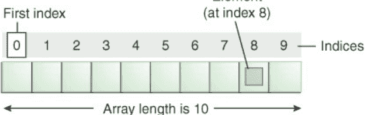

数组中的每一项被称为元素，每个元素通过其数字索引来访问。如前面的插图所示，编号从 0 开始。例如，第 9 个元素将通过索引 8 访问。

下面的程序 `ArrayDemo` 创建了一个整数数组，在数组中放入了一些值，并将每个值打印到标准输出。

```
class ArrayDemo {
    public static void main(String[] args) {
        // 声明一个整数数组
        int[] anArray;

        // 为 10 个整数分配内存
        anArray = new int[10];

        // 初始化第一个元素
        anArray[0] = 100;

        // 初始化第二个元素
        anArray[1] = 200;

        // 此类推
        anArray[2] = 300;
        anArray[3] = 400;
        anArray[4] = 500;
        anArray[5] = 600;
        anArray[6] = 700;
        anArray[7] = 800;
        anArray[8] = 900;
        anArray[9] = 1000;

        System.out.println("Element at index 0: " + anArray[0]);
        System.out.println("Element at index 1: " + anArray[1]);
        System.out.println("Element at index 2: " + anArray[2]);
        System.out.println("Element at index 3: " + anArray[3]);
        System.out.println("Element at index 4: " + anArray[4]);
        System.out.println("Element at index 5: " + anArray[5]);
        System.out.println("Element at index 6: " + anArray[6]);
        System.out.println("Element at index 7: " + anArray[7]);
        System.out.println("Element at index 8: " + anArray[8]);
        System.out.println("Element at index 9: " + anArray[9]);
    }
}
```

该程序的输出结果为：

```
Element at index 0: 100
Element at index 1: 200
Element at index 2: 300
Element at index 3: 400
Element at index 4: 500
Element at index 5: 600
Element at index 6: 700
Element at index 7: 800
Element at index 8: 900
Element at index 9: 1000
```


Element at index 1: 200

Element at index 2: 300

Element at index 3: 400

Element at index 4: 500

Element at index 5: 600

Element at index 6: 700

Element at index 7: 800

Element at index 8: 900

Element at index 9: 1000

在实际编程场景中，你可能会使用支持的循环结构之一来遍历数组的每个元素，而不是像前面的示例那样逐行单独编写。然而，该示例清楚地说明了数组的语法。你将在稍后的“控制流”章节中学习各种循环结构（`for`、`while` 和 `do-while`）。

## 声明一个引用数组的变量

前面的程序通过以下行代码声明了一个数组（命名为 `anArray`）：

```java
// 声明一个整数数组
int[] anArray;
```

与其他类型变量的声明类似，数组声明包含两个组成部分：数组的类型和数组的名称。数组的类型写为 `type[]`，其中 `type` 是所含元素的数据类型；括号是表示该变量持有数组的特殊符号。数组的大小不是其类型的一部分（这就是为什么括号是空的）。数组的名称可以是任何你想要的名字，只要它遵循之前在“命名”章节中讨论过的规则和约定。对于其他类型的变量，声明实际上并没有创建数组；它只是告诉编译器该变量将持有一个指定类型的数组。

同样，你也可以声明其他类型的数组：

```java
byte[] anArrayOfBytes;
short[] anArrayOfShorts;
long[] anArrayOfLongs;
float[] anArrayOfFloats;
double[] anArrayOfDoubles;
boolean[] anArrayOfBooleans;
char[] anArrayOfChars;
String[] anArrayOfStrings;
```

你也可以将括号放在数组名称之后：

```java
// 这种形式不被推荐
float anArrayOfFloats[];
```

然而，约定上不鼓励这种形式的括号；括号标识数组类型，并应该与类型标记一起出现。

## 创建、初始化和访问数组

创建数组的一种方法是使用 `new` 运算符。`ArrayDemo` 程序中的下一个语句分配了足够容纳 10 个整数元素的内存，并将数组赋值给数组变量。

```java
// 创建一个整数数组
anArray = new int[10];
```

如果缺少此语句，编译器将打印如下所示的错误，导致编译失败。

接下来的几行代码为数组元素赋值：

```java
anArray[0] = 100; // 初始化第一个元素
anArray[1] = 200; // 初始化第二个元素
anArray[2] = 300; // 此类推
```

数组元素通过其数字索引访问：

```java
System.out.println("Element at index 0: " 
      + anArray[0]);

System.out.println("Element at index 1: " 
+ anArray[1]);

System.out.println("Element at index 2: " 
+ anArray[2]);
```

或者，你可以使用大括号初始化来创建并初始化数组：

```java
int[] anArray = new int[]{100, 200, 300, 400, 500, 600, 700, 800, 900, 1000};
```

如你所见，该程序的输出是相同的，尽管它需要的代码行更少。

`java.util.Arrays` 类中的方法提供的其他有用操作包括：

- 在数组中搜索特定值以获取其所处的索引（使用 `binarySearch()` 方法）。
- 比较两个数组以确定它们是否相等（使用 `equals()` 方法）。
- 填充数组在每个索引处放置特定值（使用 `fill()` 方法）。
- 将数组按升序排序。这可以通过使用 `sort()` 方法顺序进行，也可以通过使用 Java SE 8 引入的 `parallelSort()` 方法并发进行。在多处理器系统上，对大数组进行并行排序比顺序数组排序更快。

## 变量总结

Java 编程语言在术语中同时使用“字段”（fields）和“变量”（variables）。实例变量（非静态字段）对于类的每个实例来说都是独一无二的。类变量（静态字段）是用 `static` 修饰符声明的字段；无论该类被实例化多少次，类变量恰好只有一个拷贝。局部变量存储方法内部的临时状态。参数是为方法提供额外信息的变量；局部变量和参数始终被归类为“变量”（而不是“字段”）。在命名字段或变量时，有你应该（或必须）遵循的规则和约定。

八种基本数据类型为：`byte`、`short`、`int`、`long`、`float`、`double`、`boolean` 和 `char`。`java.lang.String` 类表示字符字符串。编译器将为上述类型的字段分配合理的默认值；而局部变量永远不会分配默认值。字面量是固定值的源代码表示。数组是一个持有固定数量单一类型值的容器对象。数组的长度在创建时确定。创建后，其长度固定。

## 问题与练习：变量

### 问题

1. “实例变量”是 ___ 的另一种名称
2. “类变量”是 ___ 的另一种名称
3. 局部变量存储临时状态；它在 ___ 内部声明
4. 在方法签名的左、右括号内声明的变量被称为 ___
5. Java 编程语言支持的八种基本数据类型是什么？
6. 字符字符串由类 ___ 表示
7. 一个 ___ 是持有固定数量单一类型值的容器对象。

### 练习

1. 创建一个定义了一些字段的小型程序。尝试创建一些非法的字段名，看看编译器产生什么样的错误。以命名规则和约定作为指南。
2. 在你在练习1中创建的程序中，尝试让字段保持未初始化并打印它们的值。对局部变量也尝试相同的操作，看看你可以产生什么样的编译器错误。熟悉常见的编译器错误将有助于更容易识别代码中的错误。

你可以在 `http://doc-s.oracle.com/javase/tutorial/java/nutsandsbolts/QandE/answers_-variables.html` 找到这些问题和练习的答案。

# 运算符

现在已经学会了如何声明和初始化变量，你可能想知道如何对它们进行操作。学习 Java 编程语言的运算符是一个很好的开始。运算符是特殊符号，用于对一个、两个或三个*操作数*执行特定操作，然后返回结果。

在我们探索 Java 编程语言的运算符时，提前了解哪些运算符具有最高优先级对你可能会帮助。下表中的运算符按照优先级顺序列出。越靠近表格顶部的运算符，其求值越早于优先级相对较低的运算符。同一行的运算符优先级相等。当优先级相同的运算符出现在同一个表达式中时，必须有一条规则规定先求值哪个。除了赋值运算符外，所有二进制运算符都从左到右求值；赋值运算符从右到左求值。

### 表 3.2. 运算符优先级

| 运算符 | 优先级 |
| :--- | :--- |
| 后置 | `expr++` `expr--` |
| 一元 | `++expr` `--expr` `+expr` `-expr` `~` `!` |
| 乘法 | `*` `/` `%` |
| 加法 | `+` `-` |
| 移位 | `<<` `>>` `>>>` |
| 关系 | `<` `>` `<=` `>=` `instanceof` |
| 相等 | `==` `!=` |
| 位与 | `&` |
| 位异或 | `^` |
| 位或 | `|` |
| 逻辑与 | `&&` |
| 逻辑或 | `||` |
| 三元 | `? :` |
| 赋值 | `=` `+=` `-=` `*=` `/=` `%=` `&=` `^=` `|=` `<<=` `>>=` `>>>=` |

在通用编程中，某些运算符比其他运算符出现得频繁；例如，赋值运算符 `=` 远比无符号右移运算符 `>>>` 常见。考虑到这一点，接下来的讨论首先关注你最可能经常使用的运算符，最后关注那些不那么常用的运算符。每个讨论都附有你可以编译和运行的示例代码。研究它的输出有助于强化你所学的内容。

## 赋值、算术和一元运算符

### 简单赋值运算符

你遇到的最常见的运算符之一是简单赋值运算符 `=`。你在 `Bicycle` 类中见过这个运算符；它将右侧的值赋给左侧的操作数：

```java
int cadence = 0;
int speed = 0;
```

### 算术运算符

Java 编程语言提供了执行加、减、乘、除操作的运算符。以下程序 `ArithmeticDemo` 测试了算术运算符。

### 表 3.3. 算术运算符

| 运算符 | 描述 |
| :--- | :--- |
| `+` | 加法运算符（也用于连接） |
| `-` | 减法运算符 |
| `*` | 乘法运算符 |
| `/` | 除法运算符 |
| `%` | 取余运算符 |

```java
class ArithmeticDemo {
    public static void main(String[] args) {
        int result = 1 + 2;
        System.out.println("1 + 2 = " + result);

        result = result - 1;
        System.out.println("3 - 1 = " + result);

        result = result * 2;
        System.out.println("2 * 2 = " + result);

        result = result / 2;
        System.out.println("4 / 2 = " + result);

        result = result + 8;
        System.out.println("2 + 8 = " + result);

        result = result % 7;
        System.out.println("10 % 7 = " + result);
    }
}
```

该程序打印结果：

- 1 + 2 = 3
- 3 - 1 = 2
- 2 * 2 = 4
- 4 / 2 = 2
- 2 + 8 = 10
- 10 % 7 = 3

你还可以将算术运算符与简单赋值运算符结合创建复合赋值。例如，`x += 1;` 和 `x = x + 1;` 都会将 `x` 的值加 1。

`+` 运算符也可以用于连接（拼接）两个字符串，如下面的 `ConcatDemo` 程序所示：

```java
class ConcatDemo {
    public static void main(String[] args) {
        String firstString = "This is ";
        String secondString = " a concatenated string.";
        String thirdString = firstString + secondString;
        System.out.println(thirdString);
    }
}
```

程序结束时，变量 `thirdString` 包含 "This is a concatenated string."，并输出到标准输出。

### 一元运算符

一元运算符只需要一个操作数；它们执行各种操作，如增加/减少一个值或反转布尔值。

### 表 3.4. 一元运算符

| 运算符 | 描述 |
| :--- | :--- |
| `+` | 一元加运算符；表示正值（然而数字不加符号也是正的） |
| `-` | 一元减运算符；取表达式的负值 |
| `++` | 递增运算符；将值加 1 |
| `--` | 递减运算符；将值减 1 |
| `!` | 逻辑取反运算符；反转布尔值 |

以下程序 `UnaryDemo` 测试了一元运算符。

```java
class UnaryDemo {
    public static void main(String[] args) {
        int result = +1;
        // result is now 1
        System.out.println(result);

        result--;
        // result is now 0
        System.out.println(result);

        result++;
        // result is now 1
        System.out.println(result);

        result = -result;
        // result is now -1
        System.out.println(result);

        boolean success = false;
        // false
        System.out.println(success);
        // true
        System.out.println(!success);
    }
}
```

增量/递减运算符可以应用于操作数之前（前置）或之后（后置）。代码 `result++;` 和 `++result;` 的结果都会使 `result` 增加 1。唯一的区别是前缀版本（`++result`）的结果是增加后的值，而后置版本（`result++`）的结果是原始值。如果你只是在执行简单的增量/递减，那么选择哪一个版本并不重要。但如果你在一个较大表达式的部分使用此运算符，你选择的某一个可能会产生显著差异。

以下程序 `PrePostDemo` 演示了前缀/后置一元增量运算符：

```java
class PrePostDemo {
    public static void main(String[] args) {
        int i = 3;
        i++;
        // prints 4
        System.out.println(i);
        ++i;
        // prints 5
        System.out.println(i);
        // prints 6
        System.out.println(++i);
        // prints 6
        System.out.println(i++);
        // prints 7
        System.out.println(i);
    }
}
```

## 相等、关系和条件运算符

### 相等与关系运算符

相等和关系运算符确定一个操作数是否大于、小于、等于或不等于另一个操作数。这些运算符中的大部分可能对你也很熟悉。请记住，在测试两个基本值是否相等时使用 `==` 而不是 `=`。

| 运算符 | 描述 |
| :--- | :--- |
| `==` | 等于 |
| `!=` | 不等于 |
| `>` | 大于 |
| `>=` | 大于等于 |
| `<` | 小于 |
| `<=` | 小于等于 |

以下程序 `ComparisonDemo` 测试了比较运算符：

```java
class ComparisonDemo {
    public static void main(String[] args) {
        int value1 = 1;
        int value2 = 2;

        if (value1 == value2) {
            System.out.println("value1 == value2");
        }
        if (value1 != value2) {
            System.out.println("value1 != value2");
        }
        if (value1 > value2) {
            System.out.println("value1 > value2");
        }
        if (value1 < value2) {
            System.out.println("value1 < value2");
        }
        if (value1 <= value2) {
            System.out.println("value1 <= value2");
        }
    }
}
```

### 输出：

```
value1 != value2
value1 < value2
value1 <= value2
```

### 条件运算符

`&&` 和 `||` 运算符对两个布尔表达式执行条件与与条件逻辑或操作。这些运算符表现出“短路”行为，这意味着只有在需要时才会求值第二个运算符。

- `&&` 条件与
- `||` 条件逻辑或

以下程序 `ConditionalDemo` 测试了这些运算符：


```java
class ConditionalDemo {

    public static void main(String[] args) {
        int value1 = 1;
        int value2 = 2;

        if ((value1 == 1) && (value2 == 2)) {
            System.out.println("value1 is 1 AND value2 is 2");
        }
        if ((value1 == 1) || (value2 == 1)) {
            System.out.println("value1 is 1 OR value2 is 1");
        }
    }
}
```

另一个条件运算符是 `? :`，它可以被认为是 `if-then-else` 语句的简写（在本章的“控制流语句”部分讨论）。该运算符也被称为三元运算符，因为它使用了三个操作数。在下面的示例中，该运算符应该读作：“如果 `someCondition` 为真，则将 `value1` 的值赋给 `result`。否则，将 `value2` 的值赋给 `result`。”

以下程序 `ConditionalDemo2` 测试了 `? :` 运算符：

```java
class ConditionalDemo2 {

    public static void main(String[] args) {

        int value1 = 1;
        int value2 = 2;
        int result;
        boolean someCondition = true;

        result = someCondition ? value1 : value2;

        System.out.println(result);
    }
}
```

由于 `someCondition` 为真，此程序向屏幕打印“1”。如果使用 `? :` 运算符可以让你的代码更易读，请使用它代替 `if-then-else` 语句；例如当表达式紧凑且没有副作用（如赋值）时。

## 类型比较运算符 `instanceof`

`instanceof` 运算符将对象与指定的类型进行比较。你可以使用它来测试一个对象是否是某个类的实例、某个子类的实例，或者实现特定接口的类的实例。

以下程序 `InstanceOfDemo` 定义了一个父类（名为 `Parent`）、一个简单的接口（名为 `MyInterface`）和一个子类。

```java
class InstanceOfDemo {
    public static void main(String[] args) {
        Parent p = new Parent();
        Child c = new Child();
        MyInterface m = new MyInterface();

        System.out.println(p instanceof Parent);       // true
        System.out.println(c instanceof Parent);       // true
        System.out.println(c instanceof Child);        // true
        System.out.println(m instanceof MyInterface); // true
        System.out.println(m instanceof Child);        // false
        System.out.println(m instanceof Parent);      // false
    }
}

class Parent {}
class Child extends Parent {}
interface MyInterface {}
```

### 输出：

```
true
true
true
true
false
false
```

在使用 `instanceof` 运算符时，记住 `null` 不是任何东西的实例。

## 位与移运算符

Java 语言还提供了对整数类型执行位运算和移位的运算符。本节讨论的运算符并不常用，因此介绍只是为了让你了解这些运算符。

一元位取反运算符 `~` 反转位模式；它可以应用于任何整数类型，将每个“0”变为“1”，将每个“1”变为“0”。例如，一个字节包含8位；将此运算符应用于位模式为 `00000000` 的值会将其变为 `11111111`。

符号左移运算符 `<<` 将位模式左移，符号右移运算符 `>>` 将位模式右移。位模式由左操作数提供，移位位数由右操作数提供。无符号右移运算符 `>>>` 在左侧补零，而 `>>` 取决于符号扩展。

位 `&` 运算符执行位与操作。

位 `^` 运算符执行位异或操作。

位 `|` 运算符执行位或操作。

以下程序 `BitDemo` 使用位与运算符向标准输出打印数字“2”。

```java
class BitDemo {

    public static void main(String[] args) {

        int bitmask = 0x000F;
        int val = 0x2222;

        // prints "2"
        System.out.println(val & bitmask);
    }
}
```

## 运算符总结

下面的快速参考总结了 Java 语言支持的运算符。

### 简单赋值运算符

+ `=` 简单赋值运算符

### 算术运算符

+ `+` 加法（也用于字符串拼接）
+ `-` 减法运算符
+ `*` 乘法运算符
+ `/` 除法运算符
+ `%` 取余运算符

### 一元运算符

+ `+` 一元加运算符；表示正值（尽管没有这个运算符数字也是正的）
+ `-` 一元减运算符；否定表达式
+ `++` 增量运算符；将值增加 1
+ `--` 递减运算符；将值减少 1
+ `!` 逻辑取反运算符；反转布尔值

### 相等与关系运算符

+ `==` 等于
+ `!=` 不等于
+ `>` 大于
+ `>=` 大于等于
+ `<` 小于
+ `<=` 小于等于

### 条件运算符

+ `&&` 条件与 (AND)
+ `||` 条件或 (OR)
+ `?:` 三元运算符（`if-then-else` 语句的简写）

### 类型比较运算符

+ `instanceof` 将对象与指定的类型进行比较

### 位运算运算符和位移运算符

+ `~` 一元位取反
+ `<<` 有符号左移
+ `>>` 有符号右移
+ `>>>` 无符号右移
+ `&` 位与 (AND)
+ `^` 位异或 (XOR)
+ `|` 位或 (Inclusive OR)

## 问题与练习：运算符

### 问题

1. 考虑以下代码片段。

   ```
   arrayOfInts[j] > arrayOfInts[j+1]
   ```

   该代码片段使用了哪些运算符？

2. 考虑以下代码片段。

   ```java
   int i = 10;
   int n = i++ % 5;
   ```

   **a. 代码执行后，i 和 n 的值是多少？**

   **b. 如果不是使用后置增位运算符 (`i++`)，而是使用前置版本 (`++i`)，那么 i 和 n 的最终值是多少？**

3. 要反转一个布尔值，你会使用哪个运算符？

4. 哪个运算符用于比较两个值，即 `==`？

5. 解释以下代码示例：`result = someCondition ? value1 : value2;`

### 练习

1. 修改以下程序以使用复合赋值：

   ```java
   class ArithmeticDemo {
       public static void main(String[] args) {
           int result = 1 + 2; // result 现在是 3
           System.out.println(result);

           result = result - 1; // result 现在是 2
           System.out.println(result);

           result = result * 2; // result 现在是 4
           System.out.println(result);

           result = result / 2; // result 现在是 2
           System.out.println(result);

           result = result + 8; // result 现在是 10
           result = result % 7; // result 现在是 3
           System.out.println(result);
       }
   }
   ```

2. 在以下程序中，解释为什么值 "6" 被连续打印两次：

   ```java
   class PrePostDemo {
       public static void main(String[] args) {
           int i = 3;
           i++;
           System.out.println(i); // "4"
           i++;
           System.out.println(i); // "5"
           System.out.println(+i); // "6"
           System.out.println(i++); // "6"
           System.out.println(i++); // "7"
       }
   }
   ```

### 答案

你可以在 <http://docs.oracle.com/javase/tutorial/java/nutsandsbolts/QandE/answers_optimizers.html> 找到这些问题和练习的答案。

## 表达式、语句和块

现在你已经理解了变量和运算符，是学习表达式、语句和块了。运算符可以用于构建表达式，表达式用于计算值；表达式是语句的核心组件；语句可以被分组为块。

### 表达式

表达式是由变量、运算符和方法调用组成的结构，根据语言的语法构建并求值为单个值。你已经看到过表达式的示例，在下方已加粗标出：

```java
int cadence = 0;

anArray[0] = 100;

System.out.println("Element 1 at index 0: " + anArray[0]);
```

```java
int result = 1 + 2; // result 现在是 3

if (value1) {
    System.out.println("value2");
}
```

表达式的结果取决于所使用的运算符。例如，`1 + 2` 的结果是整数，而 `value1 == value2` 的结果是布尔值。

表达式的类型由其结果决定。在 Java 中，使用大括号 `{}` 来表示代码块。例如：

```java
if (condition) {
    System.out.println("Condition is true");
} else {
    System.out.println("Condition is false");
}
```

### 语句

语句大致相当于句子。语句形成一个完整的执行单元。以下是语句的一些类型：

* 赋值表达式
* 增量
* 方法调用
* 对象创建

除了表达式语句外，还有两种类型的语句：声明语句和控制流语句。声明语句声明一个变量：

```java
int result = 0;
```

最后，控制流语句调节执行顺序。你将在下一节中学习控制流。

### 块

块是花括号 `{}` 之间的零或多个语句的组，并可以用在任何允许单条语句的地方。下面的示例 `BlockDemo` 说明了块的使用：

```java
class BlockDemo {
    public static void main(String[] args) {
        boolean condition = true;
        if (condition) {
            System.out.println("Condition is true");
        } else {
            System.out.println("Condition is false");
        }
    }
}
```

### 问题与练习：表达式、语句和块

#### 问题

1. 运算符可以用于构建表达式，表达式用于计算值。
2. 表达式是语句的核心组件。
3. 语句可以被分组为块。
4. 下面是一个表达式示例：

   ```
   1 + 2
   ```

5. 语句大致相当于句子，但语句不是以句号结尾，而是以分号结尾。
6. 块是花括号 `{}` 之间的零或多个语句的组，并可以用在任何允许单条语句的地方。

#### 练习

识别以下语句类型：

* `int result = 0;`
* `i++;`
* `System.out.println("Hello World!");`
* `Bicycle bike = new Bicycle();`

## 控制流语句

### if-then 和 if-then-else 语句

#### if-then 语句

`if-then` 语句是所有控制流语句中最基础的。它告诉你的程序只有当特定测试为真时才执行某些代码。例如，`Bicycle` 类可以允许刹车仅在自行车处于运动状态的情况下降低自行车的速度。`applyBrakes` 方法的一种可能实现如下：

```java
void applyBrakes() {

    // "if" 子句：自行车必须正在移动
    if (isMoving) {

        // "then" 子句：减少当前速度
        currentSpeed--;

    }
}
```

如果此测试评估结果为假（意味着自行车未运动），控制将跳转到 `if-then` 语句的末尾。此外，只要“then”子句只包含一条语句，大括号的开启和关闭就是可选的：

```java
void applyBrakes() {

    // 与上面相同，但没有大括号
    if (isMoving)
        currentSpeed--;
}
```

决定何时省略大括号取决于个人喜好。省略大括号可能会使代码变得脆弱。如果以后在“then”子句中添加了第二个语句，常见的错误是忘记添加新需要的大括号。编译器无法捕获这种错误；你只会得到错误的结果。

#### if-then-else 语句

`if-then-else` 语句在“if”子句评估为假时提供了一条备选执行路径。你可以在 `applyBrakes` 方法中使用 `if-then-else` 语句，以便在自行车未运动时应用刹车时执行某些操作。在这种情况下，操作仅仅是打印一条错误消息，说明自行车已经停止。

```java
void applyBrakes() {

    if (isMoving) {
        currentSpeed--;
    } else {
        System.err.println("The bicycle has already stopped!");
    }
}
```

以下程序 `IfElseDemo` 根据测试分的值分配等级：分数 90% 及以上为 A，80% 及以上为 B，依此类推。

```java
class IfElseDemo {

    public static void main(String[] args) {

        int testscore = 76;
        char grade;

        if (testscore >= 90) {
            grade = 'A';
        } else if (testscore >= 80) {
            grade = 'B';
        } else if (testscore >= 70) {
            grade = 'C';
        } else if (testscore >= 60) {
            grade = 'D';
        } else {
            grade = 'F';
        }

        System.out.println("Grade = " + grade);
    }
}
```

程序的输出为：

```
Grade = C
```

你可能已经注意到 `testscore` 的值可以在复合语句中满足多个表达式：`76 >= 70` 和 `76 >= 60`。然而，一旦满足了某个条件，就会执行相应的语句（`grade = 'C'`）；剩余条件将不再被评估。

### switch 语句

与 `if-then` 和 `if-then-else` 语句不同，`switch` 语句可以有多个可能的执行路径。`switch` 适用于 `byte`、`char` 和 `int` 原始类型。它还适用于枚举类型（在第 4 章“Enum”中讨论）、`String` 类以及几个包装了原始类型的特殊类：`Character`、`Byte`、`Short` 和 `Integer`（在第 9 章中讨论）。

以下代码示例 `SwitchDemo` 声明了一个整型 `month`，其值代表一个月份。代码使用 `switch` 语句根据 `month` 的值显示月份的名称。


## Switch 语句

```java
public class SwitchDemo {

    public static void main(String[] args) {

        int month = 8;

        String monthString;

        switch (month) {

            case 1: monthString = "January";
            break;
            case 2: monthString = "February";
            break;
            case 3: monthString = "March";
            break;
            case 4: monthString = "April";
            break;
            case 5: monthString = "May";
            break;
            case 6: monthString = "June";
            break;
            case 7: monthString = "July";
            break;
            case 8: monthString = "August";
            break;
            case 9: monthString = "September";
            break;
            case 10: monthString = "October";
            break;
            case 11: monthString = "November";
            break;
            case 12: monthString = "December";
            break;
            default: monthString = "Invalid month";
            break;
        }
        System.out.println(monthString);
    }
}
```

在这种情况下，`August` 被打印到标准输出。`switch` 语句的体被称为 switch 块。switch 块中的语句可以使用一个或多个 `case` 或 `default` 标签进行标记。`switch` 语句评估其表达式，并执行匹配标签之后的所有语句。你也可以使用 `if-then-else` 语句显示月份的名称：

```java
int month = 8;

if (month == 1) {
    System.out.println("January");
} else if (month == 2) {
    System.out.println("February");
} //... 依此类推
```

决定使用 `if-then-else` 语句还是 `switch` 取决于可读性以及状态所测试的表达式。`if-then-else` 语句可以根据值的范围或条件测试表达式，而 `switch` 仅对单个整数、枚举值或 `String` 对象进行测试。

另一个有趣的点是 `break` 语句。如果没有 `break` 语句，`switch` 语句将继续执行后续标签的语句，直到遇到 `break` 语句或到达 switch 块结束。`break` 语句终止 `switch` 语句。使用 `break` 语句是推荐的，这样修改代码会更容易且不易出错。`default` 部分处理未被任何 `case` 显式处理的值。

以下代码示例 `SwitchDemo2` 显示状态如何具有多个 `case` 标签。代码示例计算月份的天数：

```java
class SwitchDemo2 {

    public static void main(String[] args) {

        int month = 2;
        int year = 2000;

        int numDays = 0;

        switch (month) {
            case 1: case 3: case 5:
            case 7: case 8: case 10:
            case 12:
                numDays = 31;
                break;
            case 4: case 6:
            case 9: case 11:
                numDays = 30;
                break;
            case 2:
                if ((year % 4 == 0) &&
                    ! (year % 100 == 0)
                    || (year % 400 == 0))
                    numDays = 29;
                else
                    numDays = 28;
                break;
            default:
                System.out.println("Invalid month.");
                break;
        }
        System.out.println("Number of Days = " + numDays);
    }
}
```

这是代码的输出：

```
Number of Days = 29
```

### 在 switch 语句中使用字符串

在 Java SE 7 及更高版本中，你可以在 `switch` 语句的表达式中使用 `String` 对象。以下代码示例 `StringSwitchDemo` 根据名为 `month` 的 `String` 值显示月份数字：

```java
public class StringSwitchDemo {

    public static int getMonthNumber(String month) {

        int monthNumber = 0;

        if (month == null) {
            return monthNumber;
        }
        switch (month.toLowerCase()) {
            case "january":
                monthNumber = 1;
                break;
            case "february":
                monthNumber = 2;
                break;
            case "march":
                monthNumber = 3;
                break;
            case "april":
                monthNumber = 4;
                break;
            case "may":
                monthNumber = 5;
                break;
            case "june":
                monthNumber = 6;
                break;
            case "july":
                monthNumber = 7;
                break;
            case "august":
                monthNumber = 8;
                break;
            case "september":
                monthNumber = 9;
                break;
            case "october":
                monthNumber = 10;
                break;
            case "november":
                monthNumber = 11;
                break;
            case "december":
                monthNumber = 12;
                break;
            default:
                monthNumber = 0;
                break;
        }

        return monthNumber;
    }

    public static void main(String[] args) {

        String month = "August";

        int returnedMonthNumber =
            StringSwitchDemo.getMonthNumber(month);

        if (returnedMonthNumber == 0) {
            System.out.println("Invalid month");
        } else {
            System.out.println(returnedMonthNumber);
        }
    }
}
```

这段代码的输出是 `8`。

`switch` 表达式中的字符串与每个 `case` 标签关联的表达式进行比较，因为使用了 `String.equals()` 方法。为了让 `StringSwitchDemo` 示例接受任何大小写写的月份，`month` 被转换为小写（使用 `toLowerCase()` 方法），并且所有与 `case` 标签关联的字符串也都是小写的。

> **注意**
>
> 此示例检查了 `switch` 语句中的表达式是否为 `null`。确保任何 `switch` 语句中的表达式不为 `null`，以防止抛出 `NullPointerException`。

## while 和 do-while 语句

`while` 语句在特定条件为真时会持续执行语句块。它的语法可以表示为：

```java
while (expression) {
    statement(s)
}
```

`while` 语句计算表达式，该表达式必须返回一个布尔值。如果表达式求值为真，则 `while` 语句执行 `while` 块中的语句。`while` 语句会继续测试表达式并执行其块，直到表达式求值为假。使用 `while` 语句打印从 1 到 10 的值可以像下面的 `WhileDemo` 程序一样：

```java
class WhileDemo {

    public static void main(String[] args) {

        int count = 1;

        while (count < 11) {

            System.out.println("Count is: " + count);

            count++;
        }
    }
}
```

你可以如下所示使用 `while` 语句实现无限循环：

```java
while (true) {
    // 在此处编写你的代码
}
```

Java 编程语言还提供了 `do-while` 语句，其表达式可以表示如下：

```java
do {
    statement(s)
} while (expression);
```

`do-while` 和 `while` 的区别在于 `do-while` 在循环底部评估其表达式，而不是顶部。因此，`do` 块中的语句至少会被执行一次，如下面的 `DoWhileDemo` 程序所示：

```java
class DoWhileDemo {
    public static void main(String[] args) {
        int count = 1;

        do {
            System.out.println("Count is: " + count);
            count++;
        } while (count < 11);

    }
}
```

## for 语句

`for` 语句提供了一种遍历值范围的紧凑方式。程序员通常称其为“for 循环”，因为它会不断循环，直到满足某个特定条件。`for` 语句的一般形式可以表示如下：

```java
for (initialization; termination; increment) {
    statement(s)
}
```

使用此版本的 `for` 语句时，请记住：

- `initialization`（初始化）表达式初始化循环；它在循环开始时执行一次。
- 当 `termination`（终止）表达式求值为假（`false`）时，循环终止。
- `increment`（递增/步进）表达式在循环每次迭代后都会被调用；该表达式增加值或创建一个值是完全可以的。

下面的程序 `ForDemo` 使用 `for` 语句的一般形式向标准输出打印数字 1 到 10：

```java
class ForDemo {
    public static void main(String[] args) {
        for(int i=1; i<11; i++) {
            System.out.println("Count is: " + i);
        }
    }
}
```

该程序的输出是：

```
Count is: 1
Count is: 2
Count is: 3
Count is: 4
Count is: 5
Count is: 6
Count is: 7
Count is: 8
Count is: 9
Count is: 10
```

注意变量是如何在 `for` 语句内部声明的。该变量的作用范围从声明开始延伸到块的结束，如果你以后需要使用它，最好在 `for` 语句之外声明该变量。为了演示，可以如下创建一个无限循环：

```java
for (;;) {
    // 在此处编写你的代码
}
```

`for` 语句还有另一种用于遍历数组的形式。这种形式被称为增强型 `for` 语句（`enhanced for`），可以使循环更加紧凑。

```java
class EnhancedDemo {
    public static void main(String[] args) {
        int[] numbers = {1,2,3,4,5,6,7,8,9,10};
        for (int item : numbers) {
            System.out.println("Count is: " + item);
        }
    }
}
```

在这个示例中，`item` 持有数组中的当前值。该程序的输出与之前相同：

```
Count is: 1
Count is: 2
Count is: 3
Count is: 4
Count is: 5
Count is: 6
Count is: 7
Count is: 8
Count is: 9
Count is: 10
```

## 分支语句

`break` 语句有两种形式：带标签的（`labeled`）和无标签的（`unlabeled`）。你在之前的 `switch` 语句讨论中见过无标签的形式。你也可以使用无标签 `break` 来终止 `for`、`while` 或 `do-while` 循环，如下面的 `BreakDemo` 程序所示：

```java
class BreakDemo {
    public static void main(String[] args) {
        int[][] arrayOfs = {
            {32, 87, 3, 589},
            {12, 1076, 2000, 8},
            {622, 127, 77, 955}
        };

        int searchfor = 12;

        int i;

        boolean foundIt = false;

        for (i = 0; i < arrayOfs.length; i++) {
            if (arrayOfs[i] == searchfor) {
                foundIt = true;
                break;
            }
        }

        if (foundIt) {
            System.out.println("Found " + searchfor + " at index " + i);
        } else {
            System.out.println(searchfor + " not in the array");
        }
    }
}
```

该程序在数组中搜索数字 `12`。加粗的 `break` 语句在找到该值时终止 `for` 循环。控制流随后转移到 `for` 循环之后的语句。该程序的输出是：

```
Found 12 at index 1
```

无标签 `break` 语句终止最内层的 `switch`、`for`、`while` 或 `do-while` 语句，但带标签的 `break` 可以终止外部语句。下面的程序 `BreakWithLabelDemo` 与之前的程序类似，但使用嵌套循环在二维数组中搜索值：


```java
class BreakWithLabelDemo {

    public static void main(String[] args) {

        int[][] arrayOfs = {
            {32, 87, 3, 589},
            {12, 1076, 2000, 8},
            {622, 127, 77, 955}
        };

        int searchfor = 12;

        int i;
        int j = 0;

        for (i = 0; i < arrayOfs.length; i++) {
            for (j = 0; j < arrayOfs[i].length; j++) {
                if (arrayOfs[i][j] == searchfor) {
                    break labeled-search;
                }
            }
        }
    }
}
```

```java
boolean foundIt = false;

search:
for (i = 0; i < arrayOfInts.length; i++) {
    for (j = 0; j < arrayOfInts[i].length; j++) {
        if (arrayOfInts[i][j] == searchfor) {
            foundIt = true;
            break search;
        }
    }
}

if (foundIt) {
    System.out.println("Found " + searchfor + " at " + i);
} else {
    System.out.println(searchfor + " not in the array");
}
}
```

这是程序的输出。

```
Found 12 at 1, 0
```

`break` 语句终止带标签的语句；它不会将控制流转移到标签。控制流将转移到紧跟在带标签（已终止）语句之后的语句。

### continue 语句

`continue` 语句跳过 `for`、`while` 或 `do-while` 循环的当前迭代。不带标签的形式跳转到最内层循环体的末尾，并评估控制循环的布尔表达式。下面的程序 `ContinueDemo` 遍历一个字符串，统计字母“p”出现的次数。如果当前字符不是 p，则 `continue` 语句将跳过循环的剩余部分并处理下一个字符。如果是“p”，程序将增加字母计数器。

```java
class ContinueDemo {

    public static void main(String[] args) {

        String searchMe = "peter piper picked a " + + "peck of pi";

        int max = searchMe.length();

        int numPs = 0;

        for (int i = 0; i < max; i++) {

// 仅关注 p
if (searchMe.charAt(i) != 'p') {
    continue;

    // 处理 p
    numPs++;
}
System.out.println("Found " + numPs + " p's in the string");
}
}
```

这是该程序的输出：

```
Found 9 p's in the string.
```

为了更清楚地看到这种效果，请尝试移除 `continue` 语句并重新编译。当你再次运行程序时，计数将是错误的，它会说找到了 35 个 p 而不是 9 个。

带标签的 `continue` 语句跳过给定标签的外层循环的当前迭代。下面的示例程序 `ContinueWithLabelDemo` 使用嵌套循环在另一个字符串中搜索子字符串。需要两个嵌套循环：一个迭代子字符串，另一个用于迭代被搜索的字符串。下面的程序 `ContinueWithLabelDemo` 使用带标签的 `continue` 来跳过外层循环中的迭代。

```java
class ContinueWithLabelDemo {
    public static void main(String[] args) {
        String searchMe = "Look for a substring in me";
        String substring = "sub";
        boolean foundIt = false;

        int max = searchMe.length() - 
                  substring.length();

        test:
            for (int i = 0; i <= max; i++) {
                int n = substring.length();
                int j = i;
                int k = 0;
                while (n-- != 0) {
                    if (searchMe.charAt(j++) != substring.charAt(k++)) {
                        continue test;
                    }
                }
            }
            foundIt = true;
    }

break test;
}
System.out.println(foundIt ? "Found it" : "Didn't find");
}
```

这是该程序的输出。

```
Found it
```

### return 语句

分支语句的最后是 `return` 语句。`return` 语句退出当前方法，控制流返回到调用方法的地方。`return` 语句有两种形式：一种返回值，另一种则不返回。要返回一个值，在 `return` 关键字后放置该值（或计算该值的表达式）。

```java
return ++count;
```

返回值的数据类型必须与方法的返回类型匹配。当方法声明为 `void` 时，使用不返回值的形式。

```java
return;
```

第 4 章介绍了关于编写方法的所有知识。

### 控制语句总结

`if-then` 语句是所有控制语句中最基本的。它告诉程序仅当特定测试为真时执行某些代码。`if-then-else` 语句在“if”子句为假时提供备用执行路径。与 `if-then` 和 `if-then-else` 不同，`switch` 语句允许许多可能的执行路径。`while` 和 `do-while` 语句在特定条件为真时持续执行语句块。`do-while` 和 `while` 的区别在于 `do-while` 在循环的底部评估其表达式。因此，`do` 块中的语句至少执行一次。`for` 语句提供了一种紧凑的方法遍历范围和数组。

### 问题与练习：控制语句

#### 问题

- 1. Java 语言支持的最基本的控制语句是 ___。

- 2. ___语句允许许多可能的执行路径。

- 3. ___语句与 `while` 语句相似，但它在循环的 ___ 表达式。

- 4. 如何使用 `for` 语句编写无限循环？

- 5. 如何使用 `while` 语句编写无限循环？

#### 练习

- 1. 考虑以下代码片段：

```java
if (aNumber >= 0)
  if (aNumber == 0)
```

```java
System.out.println("first string");
else System.out.println("second string");
System.out.println("third string");
```

- 等，让我重新格式化一下：

- a. 如果 `aNumber` 为 3，你认为代码产生什么输出？

- b. 编写包含上述代码片段的测试程序；让 aNumber 为 3。程序的输出是什么？符合你的预测吗？解释为什么输出是这样的；也就是说，代码片段的控制流是什么？

- c. 只使用空格和换行重新格式化代码片段，使控制流更容易理解。

- d. 使用大括号 `{` 和 `}` 进一步明确代码。

### 答案

你可以在 `http://docs.oracle.com/nutsand/` 找到这些问题和练习的答案。

## 第 3 章注释

- 1. `http://docs.oracle.com/javase/8/docs/lang/Integer`
- 2. `http://docs.oracle.com/javase/8/docs/lang/Long`
- 3. `http://docs.oracle.com/javase/8/specs/jls/html-4`
- 4. `http://docs.oracle.com/javase/8/docs/math/BigDecimal`
- 5. `http://docs.oracle.com/javase/8/specs/jls/html-4`
- 6. `http://docs.oracle.com/javase/8/docs/lang/String`
- 7. `http://docs.oracle.com/javase/8/docs/util/Arrays`
- 8. `http://docs.oracle.com/javase/8/docs/lang/String`
- 9. `http://docs.oracle.com/javase/8/docs/lang/String`
- 10. `http://docs.oracle.com/javase/8/docs/lang/Character`
- 11. `http://docs.oracle.com/javase/8/docs/lang/Byte`
- 12. `http://docs.oracle.com/javase/8/docs/lang/Short`
- 13. `http://docs.oracle.com/javase/8/docs/lang/Integer`
- 14. `http://docs.oracle.com/javase/8/docs/lang/String#equals-java.Object`
- 15. `http://docs.oracle.com/javase/8/docs/lang/String#toLowerCase`

# 第 4 章：类与对象

有了你现在掌握了 Java 语言基础的知识，你可以学习编写自己的类。在本章中，你将找到关于定义类的信息，包括声明成员变量、方法和构造方法。你将学习使用你的类来创建对象，以及如何使用你创建的对象。本章还涵盖了在类内部嵌套类以及枚举。

第一部分向你展示了类的结构，以及如何声明字段、方法和构造方法。第二部分涵盖了创建和使用对象。你将学习如何实例化对象，实例化后，如何使用点运算符访问对象的实例变量和方法。第三部分涵盖了类的更多方面，这些方面取决于你在上一节中学到的对象引用和点运算符：方法的返回值、`this` 关键字、类成员与实例成员以及访问控制。第四部分讨论了静态嵌套类、内部类、匿名内部类、本地类和 lambda 表达式。还讨论了何时使用哪种类或 lambda 表达式。最后部分介绍了枚举，允许你定义和使用一组常量特殊类。某些章节包含问题和练习。

## 类

第 2 章对面向对象概念的介绍以 `Bicycle` 类作为示例，以自行车、山地自行车和双人自行车作为子类。这里是一个可能的 `Bicycle` 类的实现，用于让你对类声明有一个概述。本章的后续章节将逐步支持并解释类声明。目前，请不要担心细节。

```java
public class Bicycle {

// Bicycle 类拥有

// 三个字段

public int cadence;

public int gear;

public int speed;

// Bicycle 类拥有

// 一个构造函数

public Bicycle(int startCadence, int startSpeed, int startGear) {
    gear = startGear;
    cadence = startCadence;
    speed = startSpeed;
}

// Bicycle 类拥有

// 四个方法

public void setCadence(int newValue) {
cadence = newValue;

}

public void setGear(int newValue) {
    gear = newValue;
}

public void applyBrake(int decrement) {
    speed -= decrement;
}

public void speedUp(int increment) {
    speed += increment;
}
```

一个作为 `Bicycle` 子类的 `MountainBike` 类的类声明可能所示：

```java
public class MountainBike extends Bicycle {

    // MountainBike 子类拥有
    // 一个字段
public int seatHeight;

// MountainBike 子类拥有

// 一个构造函数
public MountainBike(int startHeight, int startCadence,
    int startSpeed, int startGear) {
    super(startCadence, startSpeed, startGear);
    seatHeight = startHeight;
}

// MountainBike 子类拥有

// 一个方法
public void setHeight(int newValue) {
    seatHeight = newValue;
}
```

`MountainBike` 继承了 `Bicycle` 的所有字段和方法，并增加了 `seatHeight` 字段以及一个设置它的方法（山地车的座椅可以根据地形需要上下移动）。

### 声明类

你已经见过过以以下方式定义的类：

```java
class MyClass {

  // 字段、构造函数和

  // 方法声明

}
```

这是一个类声明。类体（大括号之间的区域）包含了所有为从该类创建的对象提供生命周期的代码：用于初始化新对象的构造函数、提供类及其对象状态的字段声明，以及实现类及其对象行为的方法。

前面的类声明是一个极简的。它只包含了类声明必需的组件。你可以在类声明的开头提供更多关于类的信息，例如其父类的名称、是否实现了任何接口等。例如，

```java
class MyClass extends MySuperClass implements YourInterface {

  // 字段、构造函数和

  // 方法声明

}
```

意味着 `MyClass` 是 `MySuperClass` 的子类，并且它实现了 `YourInterface` 接口。

你还可以在开头添加 `public` 或 `private` 等修饰符——你可以看到类声明的起始行可能会变得非常复杂决定其他类能否访问 `MyClass` 的 `public` 和 `private` 修饰符将在本章后面讨论。第六章将解释如何在类中使用以及以及使用 `extends` 和 `implements` 关键字。目前，你不需要担心这些额外的复杂性。

通常，类声明可以按顺序包含这些组件：

1. 修饰符，如 `public`、`private` 以及你之后会遇到的其他修饰符。
2. 类名，按照习惯首字母大写。
3. 类父类（超类）的名称（如果有），由关键字 `extends` 引导。一个类只能扩展（作为子类）一个父类。
4. 类实现的接口列表（如果有），由关键字 `implements` 引导并用逗号分隔。一个类可以实现多个接口。
5. 类体，由大括号 `{}` 包围。

### 声明成员变量

有几种变量：

- 类中的成员变量——这些被称为字段 (`fields`)。
- 方法或代码块中的变量——这些被称为局部变量 (`local variables`)。
- 方法声明中的变量——这些被称为参数 (`parameters`)。

`Bicycle` 类使用以下代码行定义它的字段：

```java
public int cadence;

public int gear;

public int speed;
```

字段声明由三个组件组成：

1. 零或多个修饰符，如 `public` 或 `private`。
2. 字段的类型。
3. 字段的。

`Bicycle` 的字段命名为 `cadence`、`gear` 和 `speed`，数据类型均为整数 (`int`)。`public` 关键字将这些字段识别为公共成员，可以被任何访问该类的对象访问。

#### 访问修饰符

使用的第一个（最左侧）修饰符允许你控制其他类可以访问成员字段。目前，请仅考虑 `public` 和 `private`。其他访问修饰符将在以后讨论。

- `public` 修饰符——字段对所有类可见。
- `private` 修饰符——字段仅在其所属类内可见。

出于封装的考虑，将字段设置为 `private` 是很常见的。这意味着它们只能从 `Bicycle` 类直接访问。然而，我们仍然需要访问这些值。可以通过添加为我们获取字段值的 `public` 方法来间接实现：


# Java 类与对象基础

## Bicycle 类示例

```java
public class Bicycle {
    private int cadence;
    private int gear;
    private int speed;

    public Bicycle(int startCadence, int startSpeed, int startGear) {
        gear = startGear;
        cadence = startCadence;
        speed = startSpeed;
    }

    public int getCadence() {
        return cadence;
    }

    public void setCadence(int newValue) {
        cadence = newValue;
    }

    public int getGear() {
        return gear;
    }

    public void setGear(int newValue) {
        gear = newValue;
    }

    public int getSpeed() {
        return speed;
    }

    public void applyBrake(int decrement) {
        speed -= decrement;
    }

    public void speedUp(int increment) {
        speed += increment;
    }
}
```

## 类型

所有变量必须有一个类型。你可以使用基本类型如 `int`、`float` 和 `boolean`。或者，你可以使用引用类型，如字符串、数组或对象。

## 变量名

所有变量（无论是字段、局部变量还是参数）都遵循“变量”部分中的命名规则。注意，相同的规则也适用于方法名和类名，但：

- 类名的首字母应该大写
- 方法名的第一个（或唯一）单词应该是动词

## 定义方法

这是一个典型的方法声明示例：

```java
public double calculateAnswer(double wingSpan, int numberOfEngines, double length, double grossTons) {
    // 在此处执行计算
}
```

方法声明的唯一元素是返回类型；名称；括号 `()` 以及大括号 `{}`。

更通俗地说，方法声明包含六个组件，顺序如下：

1. **修饰符**——如 `public`、`private` 以及你之后将学习的其他的。
2. **返回类型**——方法返回的值的数据类型，如果方法不返回值则使用 `void`。
3. **方法名**——字段名的规则适用于方法名，但习惯略有不同。
4. **括号中的参数列表**——由逗号分隔的输入参数，由其数据类型引导并用括号 `()` 包围。如果没有参数，必须使用空括号。
5. **异常列表**——将在以后讨论。
6. **方法体**，由大括号 `{}` 包围——方法的代码，包括局部变量的声明。修饰符、返回类型和参数将在本章后面讨论。

异常将在第十章讨论。

> **定义**：方法声明的两个组件构成了方法签名——方法名和参数类型。

上述声明的方法签名为：

```
calculateAnswer(double, int, double, double)
```

## 方法的命名

虽然方法名可以是任何合法标识符，但代码规范限制方法名。按照习惯，方法名应该是小写的动词，或者是以小写动词开头的多单词名称，跟着形容词、名词或其他单词来描述该方法的功能。在多单词名称中，第二个及后续每个单词的第一个字母应该大写。这里是一些示例：

```
run
runFast
getBackground
getFinalData
compareTo
setX
isEmpty
```

通常情况下，方法在它的类中有一个唯一的名称。然而，由于方法重载，一个方法可能与其他方法具有相同的名称。

## 方法重载

Java 编程语言支持方法重载，并且 Java 可以区分具有不同方法签名的方法。这意味着类中的方法如果具有不同的参数列表，就可以具有相同的名称。（关于此点有一些限制条件，将在第 6 章中进行讨论）。

假设你有一个类，它可以使用书法来绘制各种类型的数据（字符串、整数等），并且包含一个用于绘制每种数据类型的方法。为每个方法使用新名称是非常繁琐的——例如，`drawString`、`drawInteger`、`drawFloat` 等。在 Java 编程语言中，你可以为所有绘制方法使用相同的名称，但向每个方法传递不同的参数列表。因此，数据绘制类可能会声明四个名为 `draw` 的方法，每个方法都有不同的参数列表。

```java
public class DataArtist {
    public void draw(String s) {
    }

    public void draw(int i) {
        ...
    }

    public void draw(double f) {
        ...
    }

    public void draw(int i, double f) {
        ...
    }
}
```

重载方法是通过传递给方法的参数的数量和类型来区分的。在代码示例中，`draw(String s)` 和 `draw(int i)` 是不同且独特的方法，因为它们需要不同的参数类型。

你不能声明多个具有相同名称、相同参数数量和相同参数类型的方法，因为编译器无法区分它们。

编译器在区分方法时不考虑返回类型，因此即使两个方法的返回类型不同，你也不能声明两个具有相同签名的方法。

> **注意**：重载方法应该谨慎使用，因为它们会使代码的可读性大大降低。

## 为你的类提供构造函数

类包含构造函数，构造函数被用来从类蓝图创建对象。构造函数的声明看起来像方法声明——不同之处在于它们使用类名且没有返回类型。例如，`Bicycle` 有一个构造函数：

```java
public Bicycle(int startCadence, int startSpeed, int startGear) {
    gear = startGear;
    cadence = startCadence;
    speed = startSpeed;
}
```

为了创建一个名为 `myBike` 的新 `Bicycle` 对象，通过 `new` 运算符调用构造函数：

```java
Bicycle myBike = new Bicycle(30, 0, 8);
```

`Bicycle(30, 0, 8)` 为对象创建内存空间并初始化其字段。尽管 `Bicycle` 只有一个构造函数，但它可以有其他构造函数，包括一个无参数构造函数：

```java
public Bicycle() {
    gear = 1;
    cadence = 10;
    speed = 0;
}
```

`Bicycle yourBike = new Bicycle();` 调用无参数构造函数创建一个名为 `yourBike` 的新 `Bicycle` 对象。

这两个构造函数都可以在 `Bicycle` 中声明，因为它们具有不同的参数列表。Java 平台根据参数列表中参数的数量及其类型来区分构造函数。你不能为同一个类编写两个具有相同数量和类型参数的构造函数，因为平台无法区分它们。这样做会导致编译错误。

你不需要为你的类提供任何构造函数，但当你这样做时必须小心。编译器会为任何没有构造函数的类自动提供一个无参数的默认构造函数。这个默认构造函数将调用父类的无参数构造函数。在这种情况下，如果父类没有无参数构造函数，编译器将会报错，因此你需要验证它是否存在。如果你的类没有显式的父类，那么它有一个隐式的 `Object` 子类，`Object` 有一个无参数构造函数。

你可以自己使用父类构造函数。章节开头的 `MountainBike` 类就是这样做。这将在后面的第 6 章讨论。

你可以在构造函数的声明中使用访问修饰符来控制哪些其他类可以调用构造函数。

> **注意**

## 向方法或构造函数传递信息

方法或构造函数的声明声明了该方法或构造函数参数的数量和类型。例如，以下是一个根据贷款金额、利率、贷款期限（期数）和贷款的未来值计算房屋贷款月供的方法：

```java
public double computePayment(
    double loanAmt,
    double rate,
    double futureValue,
    int numPeriods) {

    double interest = rate / 100.0;
    double partial1 = Math.pow((1 + interest), -numPeriods);
    double denominator = (1 - partial1) / interest;
    double answer = (-loanAmt / denominator)
        + ((futureValue * partial1) / denominator);

    return answer;
}
```

此方法有四个参数：贷款金额、利率、未来值和期数。前三个是双精度浮点数，第四个是整数。这些参数在方法体中使用，并在运行时将取传入参数的值。

> **注意**：参数指的是方法声明中的变量列表。实参是指在调用方法时传入的实际值。当你调用一个方法时，

### 参数类型

你可以为方法的参数使用任何类型。这包括基元数据类型，如 `double`、`float` 和 `int`，以及引用类型，如对象。这里是一个接受数组的方法示例：

```java
public Polygon polygonFrom(Point[] corners) {
    // 方法体在这里
}
```

你可以使用一种名为变长参数的结构向方法传递任意数量的值。当你不知道会传递方法多少特定类型的值时，可以使用变长参数。要使用变长参数，在类型后面跟着三个点 `...`，一个空格，然后是参数名。该方法就可以带有任意数量的该参数，甚至为空。

```java
public Polygon polygonFrom(Point... corners) {
    int numberOfSides = corners.length;
    double squareOfidel, lengthOfidel;
    squareOfidel = (corners[1].x - corners[0].x)
        * (corners[1].x - corners[0].x)
        + (corners[1].y - corners[0].y)
        * (corners[1].y - corners[0].y);
    lengthOfidel = Math.sqrt(squareOfidel);

    // 更多创建并返回连接 Points 的方法体
    polygon ...
}
```

你可以看到，在方法内部，`corners` 被视为数组。该方法既可以用数组调用，也可以用参数序列调用。方法体中的代码在这两种情况下将参数视为数组。

你最常将变长参数用于打印方法；例如这个 `printf` 方法：

```java
public PrintStream printf(String format, Object... args)
```

它允许你打印任意数量的对象。它可以这样调用：

```java
System.out.printf("%s: %d, %s%n", name, idnum, address);
```

或者像这样：

```java
System.out.printf("%s: %d, %s, %s, %s%n", name, idnum, address);
```

或者带有不同数量的参数。

### 参数名称

当你为方法或构造函数声明参数时，为该参数提供一个名称。该名称在方法体内部用于引用传入的参数。

参数名称在它的作用域内必须唯一。它不能与同一方法或构造函数的另一个参数名称相同，也不能与方法或构造函数内部局部变量的名称相同。

参数名称可以与类的某个字段名称相同。如果是这种情况，则该参数被认为遮蔽了该字段。遮蔽字段会让你的代码难以阅读，并且习惯上仅仅在构造函数和设置特定字段的方法中使用。例如，考虑下面的 `Circle` 类及其 `setOrigin` 方法：

```java
public class Circle {
    private int x, y, radius;

    public void setOrigin(int x, int y) {
        ...
    }
}
```

`Circle` 类有三个字段：`x`、`y` 和 `radius`。`setOrigin` 方法有两个参数，每个参数的名称都与其中一个字段名称相同。每个方法参数都会遮蔽与其同名的字段。因此，在方法体中使用简单名称 `x` 或 `y` 指的是参数，而不是字段。要访问该字段，你必须使用限定名称。这将在稍后的“使用 `this` 关键字”章节中讨论。

### 传递基本数据类型参数

基本类型参数（如 `int` 或 `double`）是通过值传递给方法的。这意味着对参数值的任何更改都只存在于方法的作用范围内。当方法返回时，参数就会消失，对它们的任何更改也都会丢失。这是一个示例：

```java
public class PassPrimitiveByValue {
    public static void main(String[] args) {
        int x = 3;

        // 使用 x 作为参数
        // 调用 passMethod()
        passMethod(x);

        // 打印 x 查看其
        // 值是否发生了变化
        System.out.println("After invoking passMethod, x = " + x);
    }

    // 改变 passMethod() 中的参数
    public static void passMethod(int p) {
        p = 10;
    }
}
```

当你运行此程序时，输出是：

```
After invoking passMethod, x = 3
```

### 传递引用数据类型参数

引用数据类型参数（如对象）也是通过值传递给方法的。这意味着当方法返回时，传入的引用仍然指向原来的同一个对象。然而，如果对象的字段具有适当的访问级别，则在方法中可以更改对象字段的值。

例如，考虑任意类中一个用于移动 `Circle` 对象的方法：

```java
public void moveCircle(Circle circle, int deltaX, int deltaY) {
    // 将圆的原点移动到 x+deltaX, y+deltaY 代码
    circle.setX(circle.getX() + deltaX);
    circle.setY(circle.getY() + deltaY);

    // 为 circle 分配一个新的引用
    circle = new Circle(0, 0);
}
```

假设使用这些参数调用方法：

```java
moveCircle(myCircle, 23, 56)
```

在方法内部，`circle` 最初指向 `myCircle`。方法将 `circle` 所引用的对象的 `x` 和 `y` 坐标（在本例中为 `myCircle`）分别改变了 23 和 56。这些更改在方法返回时将会持续。然后，`circle` 被赋值指向 `x = y = 0` 的新 `Circle` 对象的引用。然而，这种重新赋值没有持久性，因为引用是通过值传递的，无法更改。在方法内部，`circle` 指向的对象已经改变了，但当方法返回时，`myCircle` 仍然指向调用方法之前的那个同一个 `Circle` 对象。

## 对象

典型的 Java 程序会创建许多对象，正如你所知，它们通过调用方法来相互交互。通过这些对象间的交互，程序可以执行各种任务，例如实现 GUI、运行动画或在网络上发送或接收信息。一旦对象完成了它被创建的任务，它的资源就会被回收供其他对象使用。

这是一个名为 `CreateObjectDemo` 的小型程序，它创建了三个对象：一个 `Point` 对象和两个 `Rectangle` 对象。你需要三个源文件来编译此程序。


```java
public class CreateObjectDemo {

    public static void main(String[] args) {
        // 声明并创建点对象和两个矩形
        Point originOne = new Point(23, 94);

        Rectangle rectOne = new Rectangle(originOne, 100, 200);

        Rectangle rectTwo = new Rectangle(50, 100);

        // 显示 rectOne 的宽度、高度和面积
        System.out.println("Width of rectOne: " + rectOne.width);
        System.out.println("Height of rectOne: " + rectOne.height);
        System.out.println("Area of rectOne: " + rectOne.getArea());

        // 设置 rectTwo 的位置
        rectTwo.origin = originOne;

        // 显示 rectTwo 的位置
        System.out.println("X Position of rectTwo: " + rectTwo.x);
        System.out.println("Y Position of rectTwo: " + rectTwo.y);

        // 移动 rectTwo 并显示其新位置
        rectTwo.move(40, 72);
        System.out.println("X Position of rectTwo: " + rectTwo.x);
        System.out.println("Y Position of rectTwo: " + rectTwo.y);
    }
}
```

该程序创建、操作并显示了各种对象的信息。以下是输出：

```
Width of rectOne: 100
Height of rectOne: 200
Area of rectOne: 20000
X Position of rectTwo: 23
Y Position of rectTwo: 94
X Position of rectTwo: 63
Y Position of rectTwo: 166
```

以下是 `Point` 类的代码：

```java
public class Point {
    public int x = 0;
    public int y = 0;
    // constructor
    public Point(int a, int b) {
        x = a;
        y = b;
    }
}
```

该类包含一个构造函数。你可以通过这种方式识别构造函数，因为它的声明使用了与类相同的名称，并且没有返回类型。`Point` 类中的构造函数接收两个整数参数，正如代码声明的那样 `(int a, int b)`。以下语句将 23 和 94 作为这些参数的值：

```
Point originOne = new Point(23, 94);
```

执行该语句的结果可以用接下来的图所示：

### 图 4.2. 变量 originOne 被初始化

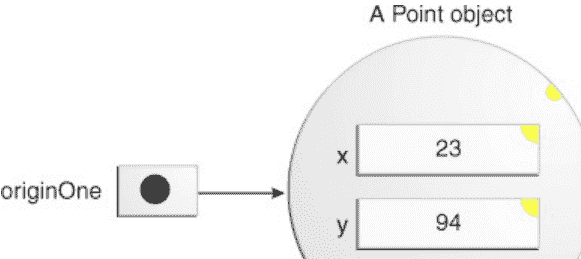

以下是 `Rectangle` 类的代码，它包含了四个构造函数：

```java
public class Rectangle {

    public int width = 0;

    public int height = 0;

    public Point origin;

    // four constructors

    public Rectangle() {
        origin = new Point(0, 0);
    }

    public Rectangle(Point p) {
        origin = p;
    }

    public Rectangle(int w, int h) {
        origin = new Point(0, 0);
        width = w;
        height = h;
    }

    public Rectangle(Point p, int w, int h) {
        origin = p;
        width = w;
        height = h;
    }

    // a method for moving the rectangle
    public void move(int x, int y) {
        origin.x = x;
        origin.y = y;
    }

    // a method for computing the area of the rectangle
    public int getArea() {
        return width * height;
    }
}
```

每个构造函数都允许你使用基本类型和引用类型为矩形的起点、宽度和高度提供初始值。如果一个类有多个构造函数，它们必须具有不同的签名。Java 编译器根据参数的数量和类型来区分构造函数。当 Java 编译器遇到以下代码时，它知道要调用 `Rectangle` 类中需要一个 `Point` 参数后跟两个整数参数的构造函数：

```
Rectangle rectOne = new Rectangle(originOne, 100, 200);
```

这调用了 `Rectangle` 的构造函数之一，将 `origin` 初始化为 `originOne`。此外，构造函数将 `width` 设置为 100，`height` 设置为 200。现在有两个指向同一个 `Point` 对象的引用——一个对象可以有多个引用，如下所示：

### 图 4.3. 指向 Point 对象的两个引用

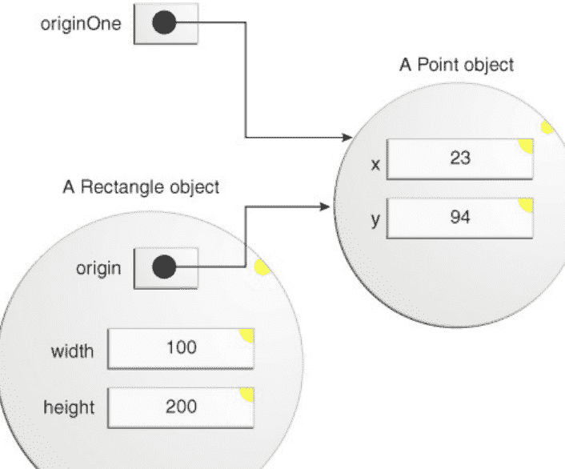

下一行代码调用了需要两个整数参数的 `Rectangle` 构造函数，为宽度和高度提供了初始值。如果你检查构造函数内部的代码，你会看到它创建了一个新的 `Point` 对象，其 `x` 和 `y` 值被初始化为 0：

```
Rectangle rectTwo = new Rectangle(50, 100);
```

以下语句中使用的 `Rectangle` 构造函数不接受任何参数，因此被称为无参数构造函数：

```
Rectangle rect = new Rectangle();
```

所有类都至少有一个构造函数。如果一个类没有显式声明任何构造函数，Java 编译器会自动提供一个无参数构造函数，称为默认构造函数。此默认构造函数会调用父类的无参数构造函数，如果该类没有其他父类，则调用 `Object` 构造函数。如果父类没有构造函数（`Object` 则有一个），编译器将拒绝该程序。

## 使用对象

一旦你创建了对象，你可能想用它做些事情。你可能需要使用其中一个字段的值、更改其中一个字段，或调用它的方法之一来执行操作。

### 引用对象的字段

对象字段通过其名称访问。你必须使用一个无歧的名称。

你可以在类自身的内部为字段使用简单名称。例如，我们可以在 `Rectangle` 类中添加一条打印宽度和高度的语句：

```
System.out.println("Width and height are: " + width + ", " + height);
```

在这种情况下，`width` 和 `height` 是简单名称。对象类之外的代码必须使用对象引用或表达式，后面跟着点运算符（`.`），然后是简单名称，如下：

```
objectReference.fieldName
```

因此，为了引用名为 `rectOne` 的 `Rectangle` 对象中的 `origin`、`width` 和 `height` 字段，`CreateDemo` 类必须分别使用名称 `rectOne.origin`、`rectOne.width` 和 `rectOne.height`。程序使用了这些名称中的两个来显示 `rectOne` 的高度：

```
System.out.println("Width of rectOne: " + rectOne.width);
System.out.println("Height of rectOne: " + rectOne.height);
```

尝试在 `CreateDemo` 类代码中使用简单名称 `width` 和 `height` 是没有意义的——这些字段只存在于对象内部——并且会导致编译器错误。稍后，程序使用类似代码显示关于 `rectTwo` 的信息。相同类型的对象拥有它们自己的实例字段副本。因此，每个 `Rectangle` 对象都有名为 `origin`、`width` 和 `height` 的字段。要通过对象引用访问字段，你可以使用指向对象的命名引用（如前面的示例所示），或者可以使用任何返回对象引用的表达式。记得 `new` 运算符返回一个对象的引用。因此，你可以使用从 `new` 返回的值来访问新对象的字段：

```
int height = new Rectangle().height;
```

该语句创建了一个新的 `Rectangle` 对象并立即获取其高度。本质上，该语句计算了 `Rectangle` 的高度。注意，在该语句执行后，程序不再拥有所创建的 `Rectangle` 的引用，因为程序从未在任何地方存储该引用。该对象未被引用，其资源可以由 Java 虚拟机自由回收。

### 调用对象的方法

你还使用对象引用来调用对象的方法。你将方法的简单名称附加到对象引用之后，中间用一个点（`.`）。此外，你还在包裹的括号内提供方法的任何参数。如果方法不需要任何参数，请使用空括号。

```
objectReference.methodName(argumentList);
```

或者：

```
objectReference.methodName();
```

`Rectangle` 类有两个方法：`getArea` 用于计算面积，`move` 用于改变矩形的起点。这里 `CreateDemo` 代码调用了这两个方法：

```
System.out.println("Area of rectOne: " + rectOne.getArea());
rectTwo.move(40, 72);
```

第一语句调用 `rectOne` 并显示结果。第二行移动了 `rectTwo`，因为 `move` 方法为 `origin.x` 和 `origin.y` 赋值。

`objectReference` 必须是对象的引用。你可以使用变量名，但也可以使用任何返回对象引用的表达式。`new` 运算符返回对象的引用，所以你可以使用 `new` 返回的值来调用新对象的方法：

```
new Rectangle(100, 50).getArea()
```

表达式 `new Rectangle(100, 50)` 返回一个指向 `Rectangle` 对象的引用。所示，你可以使用点符号调用 `Rectangle` 的 `getArea()` 方法来计算矩形的面积。

某些方法（如 `getArea()`）返回结果。对于返回结果的方法，可以在表达式中使用方法调用。你可以将返回值赋值给变量、决策或控制循环。此代码将 `getArea` 返回的值赋值给变量 `areaOfRectangle`：

```
int areaOfRectangle = new Rectangle(100, 50).getArea();
```

记得，调用对象的方法相当于向该对象发送消息。在这种情况下，`getArea` 调用的是构造函数返回的对象。

### 垃圾回收

某些面向对象的语言要求你跟踪创建的所有对象，并在不再需要时显式销毁它们。手动管理内存是枯燥且容易出错的。Java 平台允许你创建尽可能多的对象（当然受限于系统的承受能力），你不需要担心销毁它们。Java 运行时环境在确定对象不再被使用时删除它们。这个过程被称为垃圾回收。

当没有更多对象的引用时，对象符合垃圾回收条件。在变量中的引用通常会在变量作用域结束时丢失。或者，你可以通过将变量设置为 `null` 来显式放弃对象引用。记得一个程序可以对同一个对象有多个引用；只有当对象的所有引用都丢失时，该对象才符合垃圾回收条件。

Java 运行时环境有一个垃圾回收器，它定期释放不再被引用的内存。垃圾回收器会在机会合适时自动工作。

## 关于类的更多内容

本节涵盖了类的更多方面，这些方面依赖于对象引用和点运算符的使用，而你在之前关于对象的章节中已经学习了这些：

- 方法的返回值
- `this` 关键字
- 类成员与实例成员
- 访问控制

### 从方法返回值

方法在满足以下情况时会返回到调用它的代码：

- 完成方法中的所有语句，
- 到达一个 `return` 语句，或
- 抛出异常（稍后会介绍），

以先发生者为准。

你在方法的声明中声明方法的返回类型。在方法体内部，你使用 `return` 语句来返回值。

任何声明为 `void` 的方法都不返回值。它不需要包含 `return` 语句，但也可以包含。在这种情况下，`return` 语句可以用于跳出控制流块并退出方法，其用法如下：

```
return;
```

如果你尝试从一个声明为 `void` 的方法返回结果，将得到编译器错误。

任何未声明为 `void` 的方法必须包含一个带有相应返回值的 `return` 语句，如下所示：

```
return returnValue;
```

返回值的数据类型必须与方法的声明返回类型匹配；你不能从一个声明返回 `boolean` 的方法返回一个整数值。

在对象章节中讨论过的 `Rectangle` 类中的 `getArea` 方法返回一个整数：

```java
// 用于计算矩形面积的方法

public int getArea() {

    return width * height;
}
```

该方法返回表达式 `width * height` 求值后的整数。

`getArea` 方法返回一个原始类型。方法也可以返回一个引用类型。例如，在一个处理 `Bicycle` 对象的程序中，我们可能会有这样一个方法：

```java
public Bicycle seeWhosFastest(Bicycle myBike, Bicycle yourBike,
                               Environment env) {

    Bicycle fastest;

    // 代码计算哪辆自行车
    // 更快，给定每辆自行车的齿轮
    // 和踏频，以及给定
    // 环境（地形和风力）

    return fastest;
}
```

### 返回类或接口

如果这一节让你感到困惑，请跳过它，并在完成第 6 章后再回来查看。

当方法使用类名作为其返回类型时（例如 `whosFastest`），返回对象的类型类必须是返回类型的某个子类，或者与返回类型完全相同的类。假设你有一个类层次结构，其中 `ImaginaryNumber` 是 `java.lang.Number` 的子类，而 `Number` 又是 `Object` 的子类，如图 4.4 所示。

### 图 4.4. ImaginaryNumber 的类层次结构

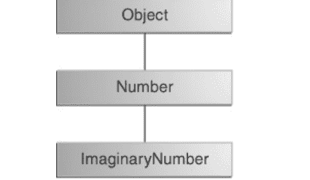

现在假设你有一个声明为返回 `Number` 的方法：

```java
public Number returnANumber() {
  ...
}
```

`returnANumber` 方法可以返回 `ImaginaryNumber` 但不能返回 `Object`。`ImaginaryNumber` 是一个 `Number` 是因为它是 `Number` 的子类。然而，`Object` 不一定是 `Number`——它可能是一个 `String` 或另一种类型。

你可以重写一个方法并定义它返回原始方法的子类，如下所示：

```java
public ImaginaryNumber returnANumber() {
    ...
}
```

这种技术被称为**协变返回类型**（covariant return type），意味着返回类型允许向子类相同的方向发生变化。

> **注意**
>
> 你也可以使用接口名称作为返回类型。在这种情况下，返回的对象必须实现指定的接口。

### 使用 this 关键字

在实例方法或构造函数内部，`this` 是对当前对象的引用——即正在调用的方法或构造函数的对象。你可以通过使用 `this` 在实例方法或构造函数内部引用当前对象的任何成员。

#### 在字段上使用 this

使用 `this` 关键字的最常见原因是字段被方法或构造函数参数遮蔽（shadowed）了。

例如，`Point` 类的写法是这样的：

```java
public class Point {
    public int x = 0;
    public int y = 0;

    // 构造函数
    public Point(int a, int b) {
        x = a;
        y = b;
    }
}
```

但也可以写成这样：

```java
public class Point {
    public int x = 0;
    public int y = 0;

    // 构造函数
    public Point(int x, int y) {
        this.x = x;
        this.y = y;
    }
}
```

构造函数的每个参数都遮蔽了对象的一个字段——在构造函数内部，`x` 是构造函数第一个参数的本地副本。为了引用 `Point` 字段 `x`，构造函数必须使用 `this.x`。

#### 在构造函数中使用 this


在构造函数内部，你还可以使用 `this` 关键字来调用同一类中的另一个构造函数。这样做被称为显式构造函数调用。这是另一个 `Rectangle` 类，其实现方式与本章“对象”部分的类不同。

```java
public class Rectangle {

    private int x, y;
    private int width, height;

    public Rectangle() {
        this(0, 0, 1, 1);
    }

    public Rectangle(int width, int height) {
        this(0, 0, width, height);
    }

    public Rectangle(int x, int y, int width, int height) {
        this.x = x;
        this.y = y;
        this.width = width;
        this.height = height;
    }
}
```

## 控制对类成员的访问

访问修饰符决定了其他类是否可以使用特定的字段或调用方法。有两种访问级别：

- 顶级级别——`public` 或包私有（无修饰符）。
- 成员级别——`public`、`protected` 或包私有（无修饰符）。

类可以使用 `public` 修饰符，此时该类对所有类可见。如果类没有修饰符（默认，即包私有），则仅对自己的包可见（包是相关类的分组——你将在第 8 章中学习它们）。

在成员级别，你也可以使用 `public` 修饰符或无修饰符（包私有），与顶级类相同且含义相同。对于成员，有两个额外的访问修饰符：`private` 和 `protected`。`private` 修饰符指定成员只能在类内部被访问。`protected` 修饰符指定成员只能在自己的包内（包私有）访问，此外还可以被另一个包中的子类访问。

下表显示了每个修饰符允许对成员的访问。

### 表 4.1. 访问级别

| 修饰符 | 类 | 包 | 子类 | 世界 |
| --- | --- | --- | --- | --- |
| public | Y | Y | Y | Y |
| protected | Y | Y | Y | N |
| 无修饰符 | Y | Y | N | N |
| private | Y | N | N | N |

第一列数据表示类本身是否有权访问由访问级别定义的。正如你看到的，类总是可以访问自己的成员。第二列表示与类相同的包（无论父子关系如何）中的类是否有权访问该成员。第三列表示该包的子类是否有权访问该成员。第四列表示类是否有权访问该成员。

访问级别从两个方面影响你。首先，当你使用来自其他来源类（例如 Java 平台中的类）时，访问级别决定了你的类可以使用这些类中的哪些成员。其次，当你编写一个类时，你需要确定你类中的每个成员变量和每个方法应该拥有的访问级别。

让我们看一组类，看看访问级别如何影响可见性。图 4.5 显示了此示例中的四个类以及它们之间的关系。

### 图 4.5 用于说明访问级别的示例中的类和包

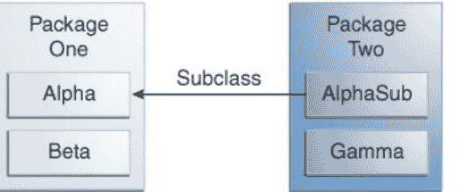

表 4.2 显示了对于可以应用于它们的每个访问修饰符，Alpha 类成员在何处可见的。

| 修饰符 | Alpha | Beta | Alphasub | Gamma |
| --- | --- | --- | --- | --- |
| public | Y | Y | Y | Y |
| protected | Y | Y | Y | N |
| 无修饰符 | Y | Y | N | N |
| private | Y | N | N | N |

选择访问级别的提示：如果其他程序员使用你的类，你希望确保不会因误用产生错误。访问级别可以帮助你实现这一点。

- 对于特定的成员，使用合理的最限制性访问级别。除非有充分理由，否则请使用 `private`。
- 除常量外，避免使用 `public` 字段。（教程中的许多示例使用了 `public` 字段。这可能有助于简洁地说明某些点，但不建议在生产代码中使用。）`public` 字段往往会使你与特定的实现挂钩，并限制你更改代码的灵活性。

## 理解类成员

在本节中，我们将讨论使用 `static` 关键字来创建属于类而不是类实例的字段和方法。

### 类变量

当从同一个类蓝图创建了多个对象时，它们各自拥有自己独特的实例变量副本。在 `Bicycle` 类的情况中，实例变量是 `cadence`、`gear` 和 `speed`。每个 `Bicycle` 对象都有这些变量的独立值，存储在不同的内存位置。

有时，你希望拥有所有对象共有的变量。这是通过 `static` 修饰符实现的。在声明中带有 `static` 修饰符的字段称为 `static 字段` 或 `类变量`。它们与类相关，而不是与任何对象相关。类的每个实例共享一个类变量，该变量位于内存中的一个固定位置。任何对象都可以更改类变量的值，但也可以在不创建类实例的情况下操作类变量。

例如，假设你想创建多个 `Bicycle` 对象并为每个对象分配一个序列号，从第一个对象从 1 开始。这个 ID 数字是每个对象唯一的，因此它是一个实例变量。同时，你需要一个字段来跟踪创建了多少 `Bicycle` 对象，以便你知道给下一个对象分配什么 ID。这样的字段与任何单独的对象无关，而是与整个类相关。为此，你需要一个类变量 `numberOfBicycles`，如下所示：

```java
public class Bicycle {

    private int cadence;
    private int gear;
    private int speed;
    // 为对象 ID 添加一个实例变量
    private int id;
    // 为实例化的 Bicycle 对象数量添加一个类变量
    private static int numberOfBicycles = 0;
    ...
}
```

类变量通过类名本身进行引用，例如 `Bicycle.numberOfBicycles`，这清楚地表明了它们是类变量。

> 注意
> 你也可以通过对象引用引用静态字段 `myBike.numberOfBicycles`，但这种做法是不推荐的，因为这不能清楚地表明它们是类变量。

你可以使用 `Bicycle` 构造函数来设置 `id` 实例变量并增加 `numberOfBicycles` 类变量：

```java
public class Bicycle {

    private int cadence;
    private int gear;
    private int speed;
    private int id;
    private static int numberOfBicycles = 0;

    public Bicycle(int startCadence, int startSpeed, int startGear) {
        gear = startGear;
        cadence = startCadence;
        speed = startSpeed;
        // 增加 Bicycle 的数量并分配 ID 号
        id = ++numberOfBicycles;
    }

    // 返回 ID 实例变量的新方法
    public int getID() {
        return id;
    }
    ...
}
```

### 类方法

Java 编程语言支持静态方法也支持静态变量。在声明中带有 `static` 修饰符的静态方法应该通过类名调用，而无需创建类的实例，例如 `ClassName.methodName(args)`。

> 注意
> 你也可以通过对象引用引用静态方法，如 `instanceName.methodName(args)`，但这种做法是不推荐的，因为这不能清楚地表明它们是类方法。

静态方法的一个常见用途是访问静态字段。例如，我们可以为 `Bicycle` 类添加一个静态方法来访问 `numberOfBicycles` 静态字段：

```java
public static int getNumberOfBicycles() {
    return numberOfBicycles;
}
```

并不是所有的实例与类变量及方法的组合都是允许的：

- 实例方法可以直接访问实例变量和实例方法。
- 实例方法可以直接访问类变量和类方法。
- 类方法可以直接访问类变量和类方法。
- 类方法不能直接访问实例变量或实例方法。

### 常量

`static` 修饰符结合 `final` 修饰符也用于定义常量。例如，名为 pi 的变量（圆周长与直径的比率）：

```java
static final double PI = 3.1415926535897;
```

> 注意
> 如果基本类型或字符串定义为常量，编译器会将代码中的常量名替换为它的值。这被称为编译时常量。按照惯例，常量名使用大写字母。

在本节的所有修改后，`Bicycle` 类如下：

```java
public class Bicycle {
    private int cadence;
    private int gear;
    private int speed;
    private int id;
    private static int numberOfBicycles = 0;

    public Bicycle(int startCadence, int startSpeed, int startGear){
        gear = startGear;
        cadence = startCadence;
        speed = startSpeed;
        id = ++numberOfBicycles;
    }

    public int getID() {
        return id;
    }

    public static int getNumberOfBicycles() {
        return numberOfBicycles;
    }

    public int getCadence() {
        return cadence;
    }

    public void setCadence(int newValue) {
        cadence = newValue;
    }

    public int getGear() {
        return gear;
    }

    public void setGear(int newValue) {
        gear = newValue;
    }

    public int getSpeed() {
        return speed;
    }

    public void applyBrake(int decrement) {
        speed -= decrement;
    }

    public void speedUp(int increment) {
        speed += increment;
    }
}
```

### 初始化字段

正如你所看到的，你通常可以在字段声明中为字段提供初始值：

```java
public class BedAndBreakfast {

    // 初始化为 10
    public static int capacity = 10;

    // 初始化为 false
    private boolean full = false;
}
```

当初始化值可用且初始化可以放在一行上时，这种形式效果很好。然而，这种初始化形式由于其简单性而具有局限性。如果初始化需要某些逻辑（例如错误处理或使用循环填充复杂的数组），简单的赋值是不够的。实例变量可以在构造函数中初始化。为了类变量提供相同的功能，Java 编程语言包含了静态初始化块。

> 注意
> 没有必要在类定义的开头声明字段，尽管这是最常见的做法。只需要在使用它们之前对其进行声明和初始化即可。

### 静态初始化块

静态初始化块是一个包含在花括号 `{ }` 中的普通代码块，并以 `static` 关键字开头。这是一个示例：

```java
static {
    // 初始化时需要的任何代码都放在这里
}
```

一个类可以有任意数量的静态初始化块，它们可以出现在类体的任何地方。运行时系统保证这些静态初始化块按照它们在源代码中出现的顺序被调用。

静态块还有另一种替代方案——你可以写一个私有的静态方法：

```java
class Whatever {
    public static varType myVar = initializeClassVariable();

    private static varType initializeClassVariable() {
        // 初始化代码放在这里
    }
}
```

私有静态方法的用处是，如果你需要重新初始化类变量，它们可以在之后被重用。

### 初始化实例成员

通常，你会在构造函数中编写初始化实例变量的代码。使用构造函数初始化实例变量还有两种替代方案：初始化块和 `final` 方法。

实例变量的初始化块看起来和静态初始化块非常相似，但没有 `static` 关键字：

```java
{
    // 初始化时需要的任何代码都放在这里
}
```

Java 编译器会将初始化块拷贝到每个构造函数中。因此，这种方法可以用于在多个构造函数之间共享一段代码块。

`final` 方法不能在子类中被重写。这在第 6 章中会讨论。这里有一个使用 `final` 方法初始化实例变量的示例：

```java
class Whatever {
    private varType myVar = initializeInstanceVariable();

    protected final varType initializeInstanceVariable() {
        // 初始化代码放在这里
    }
}
```

这对于可能想要重用初始化方法的子类来说特别有用。该方法被设为 `final`，是因为在实例初始化期间调用非 `final` 方法可能会导致问题。

### 创建和使用类与对象的总结

类声明定义了类的名称，并将类体封装在花括号之间。类名之前可以有修饰符。类体包含该类的字段、方法和构造函数。类使用字段来包含状态信息，使用方法来实现行为。初始化类新实例的构造函数使用类的名称，并且看起来像是不带返回类型的方法。

你以相同的方式控制类和成员的访问：通过在声明中使用访问修饰符（如 `public`）。

通过在成员声明中使用 `static` 关键字来指定类变量或类方法。未声明为 `static` 的成员隐式地为实例成员。类变量由类的所有实例共享，并且可以通过类名也可以通过实例引用进行访问。类的实例拥有每个实例变量的独立拷贝，必须通过实例引用进行访问。

你通过使用 `new` 运算符和构造函数从类创建对象。`new` 运算符返回指向所创建的对象的引用。你可以将该引用赋值给变量，或直接使用它。

对于声明地类外部可访问的实例变量和方法，可以使用限定名进行引用。实例变量的限定名格式如下：

```java
objectReference.variableName
```

方法的限定名如下：

```java
objectReference.methodName(argumentList)
```

或者：

```java
objectReference.methodName()
```

垃圾回收器会自动清理未使用的对象。如果程序不再持有该对象的引用，则该对象就是未被使用的。你可以通过将持有引用的变量设置为 `null` 来显式丢弃引用。

## 问题与练习：类

### 问题

1. 考虑以下类：

```java
public class IdentifyMyParts {
    public static int x = 7;
    public int y = 3;
}
```

a. 什么是类变量？

b. 什么是实例变量？

c. 下述代码的输出是什么：

```java
IdentifyMyParts a = new IdentifyMyParts();
IdentifyMyParts b = new IdentifyMyParts();
a.y = 5;
b.y = 6;
a.x = 1;
b.x = 2;
System.out.println("a.y = " + a.y);
System.out.println("b.y = " + b.y);
System.out.println("a.x = " + a.x);
System.out.println("b.x = " + b.x);
```

```java
System.out.println("IdentifyMyParts.x = " + IdentifyMyParts.x);
```

### 练习

1. 编写一个类，其实例代表扑克牌中的单张扑克牌。扑克牌有两个区分属性：点数（rank）和花色（suit）。请确保保留你的解决方案，因为你将在本章的“枚举类型”部分被重写它。

> 注意
> 你可以使用 `assert` 语句来检查你的赋值。你可以写：
> `assert (用于测试的布尔表达式);`
> 如果布尔表达式为假，你将得到一个错误信息。例如，
> `assert toString(ACE) == "Ace";`
> 应该返回 true，因此不会有错误信息。
> 如果你使用 `assert` 语句，必须带有 `-ea` 标志运行程序：
> `java -ea YourProgram.class`

2. 编写一个类，其实例代表一整副扑克牌。你也应该保留此解决方案。

3. 编写一个小型程序来测试你的牌组类和牌类。程序可以简单如下。


### 答案

你可以在 `http://docs.oracle.com/javase/tutorial/javaOO/objects.html` 找到这些问题的答案。

## 对象

### 问题

1.  下述程序有什么问题？

```java
public class SomethingWrong {
    public static void main(String[] args) {
        Rectangle myRect;
        myRect.width = 40;
        myRect.height = 50;
        System.out.println("myRect's area is " + myRect.area());
    }
}
```

2.  下述代码创建了一个数组和一个字符串。代码执行后有多少个引用？是否存在可以被垃圾回收的对象？

```java
String[] students = new String[10];
String studentName = "Peter Parker";
students[0] = studentName;
studentName = null;
```

### 练习

1.  给定以下类（`NumberHolder`），编写某些代码创建一个实例，初始化其成员变量，然后显示每个成员变量的值。

```java
public class NumberHolder {
    public int anInt;
    public float aFloat;
}
```

## 嵌套类

Java语言允许你在类内部定义类。这样的类被称为嵌套类，如下所示：

```java
class OuterClass {
    ...
    class NestedClass {
        ...
    }
}
```

**术语：** 嵌套类分为静态和非静态两类。声明为静态的嵌套类是静态嵌套类。非静态的嵌套类被称为内部类。

```java
class OuterClass {
    ...
    static class StaticNestedClass {
        ...
    }

    class InnerClass {
        ...
    }
}
```

嵌套类是其封装类（或外部类）的成员。非静态嵌套类（内部类）可以访问封装类的其他成员，即使它们声明为私有。静态嵌套类无法访问封装类的其他成员。作为类的成员，嵌套类可以声明为 `private`、`public`、`protected` 或 package private。（回想在“控制类的访问”章节中，顶层类只能声明为 `public` 或 package private。）

### 为什么要使用嵌套类？

使用嵌套类的有力理由包括：

-   **逻辑分组仅在一个地方使用的类的方法**：如果一个类仅对另一个类有用，那么将其嵌入该类并将它们放在一起是合理的。嵌套“辅助类”可以使包更加精简。
-   **增加封装**：考虑两个顶层类 `A` 和 `B`，`B` 需要访问 `A` 中声明为私有的成员。通过将 `B` 类隐藏在 `A` 类内部，`A` 的成员可以声明为私有，且 `B` 可以访问它们。此外，`B` 本身也可以对外部世界隐藏。
-   **可以产生更具可读性和易于维护的代码**：将小类嵌套在顶层类中可以使代码更靠近其使用的地方。

### 静态嵌套类

与类方法和变量一样，静态嵌套类与其外部类相关联。与静态类方法一样，静态嵌套类无法直接引用其包含类定义的实例变量或方法：它只能通过对象引用来使用它们。

> **注意**
>
> 静态嵌套类与其外部类的实例成员（以及其他类）的交互方式就像任何其他顶层类一样。实际上，静态嵌套类在行为上是一个为了方便封装而嵌套在另一个顶层类中的顶层类。

使用包含该类的类名来访问静态嵌套类：

```
OuterClass.StaticNestedClass
```

例如，要为静态嵌套类创建一个对象，使用以下语法：

```
OuterClass.StaticNestedClass nestedObject = new OuterClass.StaticNestedClass();
```

### 内部类

与实例方法和变量一样，内部类与其包含类的实例相关联，并且可以直接访问该对象的方法和字段。此外，由于内部类与实例相关联，它本身不能定义任何静态成员。

内部类的实例对象存在于外部类的实例内部。考虑以下类：

```java
class OuterClass {
  ...
  class InnerClass {
    ...
  }
}
```

`InnerClass` 的实例只能存在于 `OuterClass` 的实例内部，并且可以直接访问其包含实例的方法和字段。

要实例化内部类，必须先实例化外部类。然后，使用此语法在外部对象内部创建内部对象：

```
OuterClass.InnerClass innerObject = outerObject.new InnerClass();
```

内部类有两种特殊类型：局部类和匿名类。

### 遮蔽

如果在特定作用域（如内部类或方法定义）中的类型声明（如成员变量或参数名）与包含作用域内的另一个声明同名，则该声明会遮蔽包含作用域中的声明。你不能仅通过名称引用被遮蔽的声明。以下示例 `ShadowTest` 演示了这一点：

```java
public class ShadowTest {

    public int x = 0;

    class FirstLevel {

        public int x = 1;

        void methodInFirstLevel(int x) {
            System.out.println("x = " + x);
            System.out.println("this.x = " + this.x);
            System.out.println("ShadowTest.this.x = " + ShadowTest.this.x);
        }
    }

    public static void main(String... args) {
        ShadowTest st = new ShadowTest();
        ShadowTest.FirstLevel fl = st.new FirstLevel();
        fl.methodInFirstLevel(23);
    }
}
```

以下是该示例的输出：

```
x = 23
this.x = 1
ShadowTest.this.x = 0
```

此示例定义了三个名为 `x` 的变量：`ShadowTest` 类的成员变量、内部类 `FirstLevel` 的成员变量以及方法 `methodInFirstLevel` 中的参数。作为方法 `methodInFirstLevel` 参数定义的变量 `x` 遮蔽了内部类 `FirstLevel` 的变量。因此，当你在方法 `methodInFirstLevel` 中使用变量 `x` 时，它指的是内部类 `FirstLevel` 的成员参数；使用关键字 `this` 来表示包含的作用的作用域：

```
System.out.println("this.x = " + this.x);
```

通过它们所属的名称来引用封装更大作用域的成员变量。例如，以下语句从方法 `methodInFirstLevel` 访问了 `ShadowTest` 类的成员变量：

```
System.out.println("ShadowTest.this.x = " + ShadowTest.this.x);
```

### 序列化

强烈建议不对包括局部和匿名类在内的内部类进行序列化¹。当 Java 编译器编译某些结构（如内部类）时，它会创建合成结构；这些类、方法、字段和其他结构在源代码中没有对应的构造结构。合成结构使 Java 编译器能够在不更改 JVM 的情况下实现新的 Java 语言特性。然而，合成结构在不同的 Java 编译器实现之间可能有所不同，这意味着类文件在不同实现之间也会不同。因此，如果你序列化了一个内部类并使用不同的 JRE 实现²反序列化它，可能会遇到兼容性问题。

### 内部类示例

为了查看内部类的用法，首先考虑一个数组。在下面的示例中，你创建一个数组，用整数值填充它，然后按升序输出数组中偶数索引的值。

接下来的 `DataStructure.java` 示例包含：

-   `DataStructure` 外部类，包含一个创建一个 `DataStructure` 实例的构造函数，该实例包含一个填充了连续整数（0, 1, 2, 3 等）的数组，以及一个打印数组中具有偶数索引元素的方法。
-   `EvenIterator` 内部类，它实现了 `DataStructureIterator` 接口，该接口扩展了 `Iterator`³`<Integer>`⁴ 接口。迭代器用于遍历数据结构，通常具有用于测试最后一个元素、获取当前元素以及移动到下一个元素的方法。
-   一个 `main` 方法，它实例化 `DataStructure` 对象 (`ds`)，然后调用 `printEven` 方法打印 `arrayOfInts` 数组中具有偶数索引的元素。

```java
public class DataStructure {

    // 创建数组
    private final int SIZE = 15;
    private int[] arrayOfInts = new int[SIZE];

    public DataStructure() {
        // 用整数值填充数组
        for (int i = 0; i < SIZE; i++) {
            arrayOfInts[i] = i;
        }
    }

    public void printEven() {
        for (int i = 0; i < SIZE; i++) {
            if (i % 2 == 0) {
                System.out.println(arrayOfInts[i]);
            }
        }
    }

    interface DataStructureIterator extends Iterator<Integer> {}

    private class EvenIterator implements DataStructureIterator {

        private int nextIndex = 0;

        public boolean hasNext() {
            return nextIndex < SIZE;
        }

        public Integer next() {
            return arrayOfInts[nextIndex++];
        }
    }

    public static void main(String[] args) {
        DataStructure ds = new DataStructure();
        ds.printEven();
    }
}
```

输出是：

| 0 | 2 | 4 | 6 | 8 | 10 | 12 | 14 |

注意 `EvenIterator` 类直接引用了 `DataStructure` 的实例变量。

你可以使用内部类来实现此类辅助类，如示例所示。为了处理事件，你必须学会使用内部类，因为事件处理机制广泛使用了它们。

### 局部类和匿名类

内部类有两种额外类型。你可以在方法体内声明内部类，这些被称为局部类。你还可以在方法体内不命名类的情况下声明内部类，这些类被称为匿名类。

### 修饰符

你可以对内部类使用与外部类成员相同的修饰符。例如，你可以使用访问修饰符 `private`、`public` 和 `protected` 来限制内部类，正如你使用它们限制其他成员一样。

### 局部类

局部类是定义在块中的类，块是一组位于平衡括号之间的零或多个语句。你通常在方法体内发现局部类。

#### 声明局部类

你可以在任何块中定义局部类。（更多信息请参见第 3 章“表达式、语句和块”）。例如，你可以在方法体、`for` 子句或 `if` 子句中定义局部类。

```java
public class LocalClassExample {

    static String regularExpression = "[^0-9]";

    public static void validatePhoneNumber(String s) {
        class PhoneNumber {
            String number;

            PhoneNumber(String n) {
                number = n;
            }

            boolean isValid() {
                for (int i = 0; i < number.length(); i++) {
                    if (number.charAt(i).matches(regularExpression)) {
                        return false;
                    }
                }
                return number.length() == 10;
            }
        }

        PhoneNumber p1 = new PhoneNumber(s);
        if (p1.isValid()) {
            System.out.println(s + " is a valid phone number.");
        } else {
            System.out.println(s + " is not a valid phone number.");
        }
    }
}
```

```java
public static void validatePhoneNumber(String phoneNumber1, String phoneNumber2) {

    // 在 JDK 8 及后续版本中有效：
    int numberLength = 10;

    class PhoneNumber {

        String formattedPhoneNumber = null;

        PhoneNumber(String phoneNumber) {
            // numberLength = 7;
            String currentNumber = phoneNumber.replaceAll(
                regularExpression, "");
            if (currentNumber.length() == numberLength) {
                formattedPhoneNumber = currentNumber;
            } else {
                formattedPhoneNumber = null;
            }
        }

        public String getNumber() {
            return formattedPhoneNumber;
        }

        // 在 JDK 8 及后续版本中有效：
        // public void printOriginalNumbers() {
        //    System.out.println("Original numbers are " + 
        //    phoneNumber1 + " and " + phoneNumber2);
        // }
    }

    PhoneNumber myNumber1 = new PhoneNumber(phoneNumber1);
    PhoneNumber myNumber2 = new PhoneNumber(phoneNumber2);

    // 在 JDK 8 及后续版本中有效：
    myNumber1.printOriginalNumbers();

    if (myNumber1.getNumber() == null) {
        System.out.println("First number is invalid");
    } else {
        System.out.println("First number is " + myNumber1.getNumber());
    }

    if (myNumber2.getNumber() == null) {
        System.out.println("Second number is invalid");
    } else {
        System.out.println("Second number is " + myNumber2.getNumber());
    }

    public static void main(String... args) {
        validatePhoneNumber("123-456-7890", "456-7890");
    }
}
```

该示例通过首先移除电话号码中除数字 0 到 9 外的所有字符来验证电话号码。之后，它检查电话号码是否恰好包含十位数字（北美电话号码的长度）。该示例打印以下内容：

```
First number is 1234567890
Second number is invalid
```

### 访问闭包类的成员

局部类可以访问其闭包类的成员。在上一个示例中，`PhoneNumber` 构造函数访问了成员 `LocalClassExample.regularExpression`。


此外，局部类可以访问局部变量。但是，局部类只能访问声明为 `final` 的局部变量。当局部类访问闭包块的局部变量或参数时，它会捕获该变量或参数。例如，`PhoneNumber` 构造函数可以访问局部变量 `numberLength`，因为它声明为 `final`；`numberLength` 是一个被捕获的变量。

然而从 Java SE 8 开始，局部类可以访问闭包块中 `final` 或有效 final（effectively final）的局部变量和参数。如果一个变量或参数的值在初始化后从未改变，则它是有效 final。例如，假设变量 `numberLength` 没有声明为 `final`，你在 `PhoneNumber` 构造函数中添加了高亮的赋值语句：

```java
PhoneNumber(String phoneNumber) {

    numberLength = 7;

    String currentNumber = phoneNumber.replaceAll(
        regularExpression, "");

    if (currentNumber.length() == numberLength) {
        formattedPhoneNumber = currentNumber;
    } else {
        formattedPhoneNumber = null;
    }
}
```

由于这条赋值语句，变量 `numberLength` 不再是有效 final。结果是，Java 编译器生成类似于“从内部类引用的局部变量必须是 final 或有效 final”的错误信息，其中内部类 `PhoneNumber` 尝试访问变量 `numberLength`：

```java
if (currentNumber.length() == numberLength
```

从 Java SE 8 开始，如果你在方法中声明局部类，它可以访问该方法的参数。例如，你可以在 `PhoneNumber` 局部类中定义以下方法：

```java
public void printOriginalNumbers() {
    System.out.println("Original numbers are " + phoneNumber1 +
    " and " + phoneNumber2);
}
```

方法 `printOriginalNumbers` 访问了方法 `validatePhoneNumber` 的参数 `phoneNumber1` 和 `phoneNumber2`。

### 变量遮蔽与局部类

局部类中类型（如变量）的声明会遮蔽闭包作用域中同名的声明。更多信息请参见本章的“遮蔽”（Shadowing）部分。

### 局部类类似于内部类

局部类与内部类相似，因为它们不能定义或声明任何静态成员。静态方法中的局部类（例如在静态方法 `validatePhoneNumber` 中定义的 `PhoneNumber` 类）只能引用闭包类的静态成员。例如，如果你没有将成员变量 `regularExpression` 声明为 `static`，Java 编译器会生成类似于“静态变量 regularExpression 无法从静态上下文中引用”的错误信息。

局部类是非静态的，因为它们可以访问闭包块的实例成员。因此，它们不能包含大多数类型的静态声明。

你不能在块内部声明接口；接口本质上是静态的。例如，由于代码片段无法编译，因为接口 `HelloThere` 被定义在 `greetInEnglish` 方法体内部：

```java
public void greetInEnglish() {

    interface HelloThere {

        public void greet();
    }

    class EnglishHelloThere implements HelloThere {

        public void greet() {
            System.out.println("Hello " + name);
        }
    }

    HelloThere myGreeting = new EnglishHelloThere();

    myGreeting.greet();
}
```

你不能在局部类中声明静态初始化器或成员接口。接下来的代码片段无法编译，因为方法 `EnglishGoodbye.sayGoodbye` 被声明为 `static`。当编译器遇到此方法定义时，会生成类似于“修饰符 ‘static’ 仅允许常量变量声明”的错误：

```java
public void sayGoodbyeInEnglish() {
    class EnglishGoodbye {
        public static void sayGoodbye() {
            System.out.println("Bye bye");
        }
    }
    EnglishGoodbye.sayGoodbye();
}
```

局部类可以拥有静态成员，前提它们是常量变量。（常量变量是声明为 final 并用编译时常量表达式初始化的基本类型或 String。编译时常量表达式通常是可以编译时求值的字符串或算术表达式。（更多信息请参见“理解类成员”。）以下代码片段可以编译，因为静态成员 `EnglishGoodbye.farewell` 是常量变量：

```java
public void sayGoodbyeInEnglish() {
    class EnglishGoodbye {
        public static final String farewell = "Bye bye";
        public void sayGoodbye() {
            System.out.println(farewell);
        }
    }
    EnglishGoodbye myEnglishGoodbye = new EnglishGoodbye();
    myEnglishGoodbye.sayGoodbye();
}
```

### 匿名类

匿名类能够让代码更加简洁。它们允许你同时声明并实例化一个类。它们与局部类相似，不同之处它们没有名称。

## 声明匿名类

虽然局部类是类声明，但匿名类是表达式，这意味着你在另一个表达式中定义类。以下示例 `HelloWorldAnonymousClasses` 在局部变量 `frenchGreeting` 和 `spanishGreeting` 的初始化语句使用了匿名类，但变量 `englishGreeting` 的初始化使用了局部类：

```java
public class HelloWorldAnonymousClasses {

    interface HelloWorld {

        public void greet();

        public void greetSomeone(String someone);
    }

    public void sayHello() {

        class EnglishGreeting implements HelloWorld {

            String name = "world";

            public void greet() {
                greetSomeone("world");
            }

            public void greetSomeone(String someone) {
                name = someone;
                System.out.println("Hello " + name);
            }
        }

        HelloWorld englishGreeting = new EnglishGreeting();
    }
}
```

```java
HelloWorld frenchGreeting = new HelloWorld() {

    String name = "tout le monde";

    public void greet() {
        greetSomeone("tout le monde");
    }

    public void greetSomeone(String someone) {
        name = someone;
        System.out.println("Salut " + name);
    }
};

HelloWorld spanishGreeting = new HelloWorld() {

    String name = "mundo";

    public void greet() {
        greetSomeone("mundo");
    }

    public void greetSomeone(String someone) {
        name = someone;
        System.out.println("Hola, " + name);
    }
};
```

```java
};
englishGreeting.greet();
frenchGreeting.greetSomeone("Fred");
spanishGreeting.greet();

}

public static void main(String... args) {
    HelloWorldAnonymousClasses myApp =
    new HelloWorldAnonymousClasses();
    myApp.sayHello();
}
```

## 匿名类的语法

如前所述，匿名类是一个表达式。匿名类表达式的语法类似于构造函数的调用，不同之处在于代码块中包含了一个类定义。

考虑 `frenchGreeting` 对象的实例化：

```java
HelloWorld frenchGreeting = new HelloWorld() {
    String name = "tout le monde";
    public void greet() {
        greetSomeone("tout le monde");
    }
```

```java
}
public void greetSomeone(String someone) {
    name = someone;
    System.out.println("Salut " + name);
}
};
```

-   `new` 运算符

-   要实现的接口名或要扩展的类名。在本例中，匿名类实现了 `HelloWorld` 接口。

-   包含构造函数参数的括号，就像普通的类实例创建表达式一样。

> 注意
>
> 当你实现接口时，没有构造函数，因此你使用一对空括号，如本例所示。

-   一个体，即类声明体。更具体地说，体内部允许类声明和方法声明，但不允许包含语句。因为匿名类定义是一个表达式，它必须是语句的一部分。在本例中，匿名类表达式是实例化 `frenchGreeting` 对象的语句的一部分。（这解释了为什么大括号后面有一个分号。）

# 访问闭包作用域的局部变量，以及匿名类的成员声明与访问

与局部类一样，匿名类可以捕获变量；它们对闭包作用域的局部变量具有相同的访问权限：

-   匿名类可以访问其闭包类的成员。

-   匿名类无法访问闭包作用域中未声明为 `final` 或有效 final（effectively final）的局部变量。

-   与嵌套类一样，匿名类中的类型声明（如变量）会遮蔽闭包作用域中任何同名的其他声明。更多信息请参见“遮蔽（Shadowing）”部分。

匿名类在成员方面也与局部类具有相同的限制：

-   你不能在匿名类中声明静态初始化器或成员接口。

-   匿名类可以拥有静态成员，前提是它们是常量变量。

注意你可以在匿名类中声明以下内容：

-   字段

-   额外方法（即使它们没有实现父类型的任何方法）

-   实例初始化器

-   局部类

但是，你不能在匿名类中声明构造函数。

# 匿名类的示例

匿名类经常用于图形用户界面（GUI）应用程序。

考虑 JavaFX 示例 `HelloWorld.java`（来自《JavaFX 入门⁷ 中的“JavaFX 样式⁶”章节）。该示例创建了一个包含“Say 'Hello World’”按钮的框架。匿名类表达式被高亮显示：

```java
import javafx.event.ActionEvent;
import javafx.event.EventHandler;
import javafx.scene.Scene;
import javafx.scene.control.Button;
import javafx.scene.layout.StackPane;
import javafx.stage.Stage;

public class HelloWorld extends Application {
    public static void main(String[] args) {
        launch(args);
    }

    @Override
    public void start(Stage primaryStage) {
        primaryStage.setTitle("Hello World!");
        Button btn = new Button();
        btn.setText("Say 'Hello World'");
        btn.setOnAction(new EventHandler<ActionEvent>() {
            @Override
            public void handle(ActionEvent event) {
                System.out.println("Hello World!");
            }
        });

        StackPane root = new StackPane();

        root.getChildren().add(btn);

        primaryStage.setScene(new Scene(root, 300, 250));

        primaryStage.show();
    }
}
```

在示例中，`btn.setOnAction` 方法调用指定了点击“Say 'Hello World’”按钮时发生的情况。该方法需要一个 `EventHandler<ActionEvent>` 类型的对象。`EventHandler<ActionEvent>` 接口只包含一个方法 `handle`。我们使用匿名类表达式来实现该方法。注意这个表达式是传递给 `btn.setOnAction` 方法的参数。

由于 `EventHandler<ActionEvent>` 接口只包含一个方法，你可以使用 lambda 表达式代替匿名类表达式。更多信息请参见“Lambda 表达式”部分。

匿名类非常适合实现包含两个或多个方法的接口。以下 JavaFX 示例来自“UI 控件自定义”章节。高亮的代码通过匿名类通过重写方法创建了一个只接受数值的文本字段。

| 字段 | 描述 |
| --- | --- |
| 名称 | 对选定的成员执行操作 |
| 主要参与者 | 管理员 |
| 前提条件 | 管理员已登录系统 |
| 后置条件 | 操作仅对符合指定标准的成员执行。 |
| 主要成功场景 | 1. 管理员指定要执行某特定操作的成员标准。<br>2. 管理员指定要对这些所选成员执行的操作。<br>3. 管理员点击**提交** 按钮。<br>4. 系统找到所有符合指定标准的成员。<br>5. 系统对所有匹配的成员执行指定的操作 |

### 扩展

- 1a. 管理员在指定要执行的操作之前，或在点击**提交** 按钮之前，有一个预览这些符合指定标准的成员的选项。

### 发生频率

每天发生多次。

### Person 类

假设该社交网络应用的成员由以下 **Person** 类表示：

```java
public class Person {

    public enum Sex {

        MALE, FEMALE
    }

    String name;

    LocalDate birthday;

    Sex gender;

    String emailAddress;

    public int getAge() {
// ...

public void printPerson() {
    // ...
}
}
```

假设你的社交网络应用的成员存储在 `List<Person>` 实例中。

本节从处理此用例的朴素方法开始。通过本地类和匿名类改进这种方法，最后使用 lambda 表达式以一种高效且简洁的方法作为结束。你可以在示例 `RosterTest.9` 中找到本节描述的代码段。

## 方法 1：创建搜索符合某一特征成员的方法

一种简单的方法是创建几个方法；每个方法搜索符合一个特定特征（如性别或年龄）的成员。以下方法打印年龄大于指定年龄的成员：

```java
public static void printPersonsOlderThan(List<Person> roster, int age) {
    for (Person p : roster) {
        if (p.getAge() >= age) {
            p.printPerson();
        }
    }
}
```

> 注意


> `List` 是一个有序的集合（`Collection`）。集合是将多个元素组合成单个单元的对象。集合用于存储、检索、操作和通信聚合数据。有关集合的更多信息，请参阅第 12 章。

这种方法可能会让你的应用程序变得脆弱，脆弱性是指由于引入更新（例如新的数据类型）导致应用程序无法正常运行的可能性。假设你升级了应用程序并更改了 `Person` 类的结构，使其包含不同的成员变量；可能该类使用不同的数据类型或算法来记录和测量年龄。你将不得不重写很多 API 来适应这种变化。此外，这种方法具有不必要的限制性；例如，如果你想打印小于某个年龄的成员怎么办？

## 方法 2：创建更通用的搜索方法

以下方法比 `printPersonsOlderThan` 更具通用性；它打印指定年龄范围内的成员：

```java
public static void printPersonsWithinAgeRange(List<Person> roster, int low, int high) {
    for (Person p : roster) {
        if (low <= p.getAge() && p.getAge() < high) {
            p.printPerson();
        }
    }
}
```

如果你想打印特定性别的成员，或者特定性别和年龄范围的组合成员呢？如果你决定更改 `Person` 类并添加其他属性（如关系状态或地理位置）呢？虽然这种方法比 `printPersonsOlderThan` 更通用，但尝试为每个可能的搜索查询创建一个单独的方法仍然会导致代码脆弱。你反而可以将指定你想要搜索标准的代码分离到不同的类中。

## 方法 3：在本地类中指定搜索标准代码

以下方法打印符合你指定的搜索标准的成员：

```java
public static void printPersons(List<Person> roster, CheckPerson tester) {
    for (Person p : roster) {
        if (tester.test(p)) {
            p.printPerson();
        }
    }
}
```

该方法通过调用方法 `tester.test`，检查 `List` 参数 `roster` 中包含的每个 `Person` 实例是否满足 `CheckPerson` 参数 `tester` 中指定的搜索标准。如果方法 `tester.test` 返回真值（`true`），则在相应的 `Person` 实例上调用 `printPersons` 方法。

要指定搜索标准，你得实现实现 `CheckPerson` 接口：

```java
interface CheckPerson {
    boolean test(Person p);
}
```

以下类通过为方法 `test` 指定具体实现来实现 `CheckPerson` 接口。此方法过滤出符合美国**选择性兵役**（Selective Service）资格的成员：如果其 `Person` 参数为男性且年龄在 18 到 25 岁之间，则返回真值：

```java
class CheckPersonEligibleForSelectiveService implements CheckPerson {
    public boolean test(Person p) {
        return p.gender == Person.Sex.MALE &&
               p.getAge() >= 18 &&
               p.getAge() <= 25;
    }
}
```

要使用此类，你创建一个新实例并调用 `printPersons` 方法：

```java
printPersons(roster, new CheckPersonEligibleForSelectiveService());
```

虽然这种方法不那么脆弱——如果你更改它们，不需要重写方法——但你仍然需要为每个搜索声明一个新类。因为 `CheckPerson` 是一个接口，你想要执行的每个搜索都需要新类。

## 方法 4：在匿名类中指定搜索标准代码

以下 `printPersons` 调用中的一个参数是一个匿名类，用于过滤符合美国选择性兵役资格的成员：即年龄在 18 到 25 岁之间的男性：

```java
printPersons(
    roster,
    new CheckPerson() {
        public boolean test(Person p) {
            return p.gender == Person.Sex.MALE &&
                   p.getAge() >= 18 &&
                   p.getAge() <= 25;
        }
    }
);
```

这种方法减少了为每个搜索声明新类的需要。然而，考虑到 `CheckPerson` 只有一个方法，匿名类的语法显得臃肿。

## 方法 5：使用 Lambda 表达式指定搜索标准

`CheckPerson` 接口是一个函数接口。函数接口是指仅包含一个抽象方法的接口。（函数接口可以包含一个多个默认或静态方法。）由于函数接口只包含一个抽象方法，你在实现时可以省略该方法的名称。为了做到这一点，你不使用匿名类，而是使用 lambda 表达式，如下方法调用所示：

```java
printPersons(
    (Person p) -> p.getGender() == Person.Sex.MALE
      && p.getAge() >= 18
      && p.getAge() <= 25
);
```

参见“Lambda 表达式语法”部分了解如何定义 lambda 表达式。你可以使用标准函数接口来代替 `CheckPerson` 接口，这进一步减少了所需的代码量。

（例如泛型接口）在角括号 (`<>`) 内指定一个或多个类型参数。此接口仅包含一个类型参数 `T`。当你使用实际类型参数声明或实例化泛型类型时，你就得到了一个参数化类型。例如，参数化类型 `Predicate<Person>` 如下：

```java
interface Predicate<Person> {
    boolean test(Person t);
}
```

该参数化类型包含一个方法，其返回类型和参数与 `CheckPerson.boolean test(Person p)` 相同。因此，你可以像下面的方法所示所示，用 `Predicate<T>` 代替 `CheckPerson`：

```java
public static void printPersonsWithPredicate(
    List<Person> roster, Predicate<Person> tester) {
    for (Person p : roster) {
        if (tester.test(p)) {
            p.printPerson();
        }
    }
}
```

结果，下面的方法调用与你在方法 3 中调用 `printPersons` 以获取符合征兵兵役条件的成员的效果是一样的：

```java
printPersonsWithPredicate(
  roster,
  p -> p.getGender() == Person.Sex.MALE
  && p.getAge() >= 18
  && p.getAge() <= 25
);
```

这不是该方法中可以使用 Lambda 表达式的唯一地方。下面的方法建议了使用 Lambda 表达式的其他方法。

## 方法 7：在整个应用程序中使用 Lambda 表达式

重新考虑 `printPersonsWithPredicate` 方法，看看你还可以在哪里使用 Lambda 表达式：

```java
public static void printPersonsWithPredicate(
    List<Person> roster, Predicate<Person> tester) {
    for (Person p : roster) {
        if (tester.test(p)) {
            p.printPerson();
        }
    }
}
```

该方法检查列表参数 `roster` 中的每个 `Person` 实例是否满足 `Predicate` 参数 `tester` 中指定的标准。如果 `Person` 实例不满足 `tester` 指定的标准，则在该 `Person` 实例上调用 `printPerson` 方法。

与其调用 `printPerson` 方法，你可以对满足 `tester` 指定标准的 `Person` 实例指定执行不同的操作。你可以使用 Lambda 表达式来指定此操作。假设你使用与 `printPerson` 相似的 Lambda 表达式，它接受一个参数（一个 `Person` 对象）并返回 `void`。记住，使用 Lambda 表达式需要实现一个函数式接口。在这种情况下，你需要一个包含抽象方法的函数式接口，该方法可以接受一个 `Person` 类型的参数并返回 `void`。`Consumer<T>` 接口包含方法 `void accept(T t)`，它具有这些特征。使用 `Consumer<Person>` 实例调用 `p.printPerson()`，该实例调用 `accept` 方法：

```java
public static void processPersons(
    List<Person> roster,
    Predicate<Person> tester,
    Consumer<Person> block) {
    for (Person p : roster) {
            if (tester.test(p)) {
                block.accept(p);
            }
    }
}
```

结果，下面的方法调用与你在方法 3 中调用 `printPersons` 以获取符合征兵兵役条件的成员是一样的。用于打印成员的 Lambda 表达式已高亮：

```java
processPersons(
  roster,
  p -> p.getGender() == Person.Sex.MALE
  && p.getAge() >= 18
  && p.getAge() <= 25,
  p -> p.printPerson()
);
```

如果你想通过打印成员的个人资料来做更多事情会怎样？假设你想验证成员的个人资料或检索他们的联系信息？在这种情况下，你需要一个包含返回值的抽象方法的函数式接口。`Function<T, R>` 接口包含方法 `apply(T t)`。下面的方法检索参数 `mapper` 指定的数据，并对其执行由参数 `block` 指定的操作：

```java
public static void processPersonsWithFunction(
  List<Person> roster,
  Predicate<Person> tester,
  Function<Person, String> mapper,
  Consumer<String> block) {
    for (Person p : roster) {
        if (tester.test(p)) {
            String data = mapper.apply(p);
            block.accept(data);
        }
    }
}
```

下面的方法从 `roster` 中包含的每个符合征兵兵役条件的成员中获取电子邮件地址并将其打印出来：

```java
processPersonsWithFunction(
  roster,
  p -> p.getGender() == Person.Sex.MALE
  && p.getAge() >= 18
  && p.getAge() <= 25,
  p -> p.getEmailAddress(),
  email -> System.out.println(email)
);
```

### 方法 8：更广泛地使用泛型

重新考虑 `processPersonsWithFunction` 方法。以下是它的泛型版本，它接受一个包含任何数据类型元素的集合作为参数：

```java
public static <X, Y> void processElements(
    Iterable<X> source,
    Predicate<X> tester,
    Function<X, Y> mapper,
    Consumer<Y> block) {
    for (X p : source) {
        if (tester.test(p)) {
            Y data = mapper.apply(p);
            block.accept(data);
        }
    }
}
```

要打印符合征兵兵役条件的成员的电子邮件地址，请调用以下代码：

```java
processElements(
  roster,
  p -> p.getGender() == Person.Sex.MALE
  && p.getAge() >= 18
  && p.getAge() <= 25,
  p -> p.getEmailAddress(),
  email -> System.out.println(email)
);
```

此方法调用执行以下操作：

1. 获取集合源。
2. 根据谓词进行过滤。
3. 根据函数映射到另一个值。
4. 根据消费者执行操作。

## 方法 9：使用接受 Lambda 表达式的聚合操作

下面的示例使用聚合操作打印符合征兵兵役条件的成员的电子邮件地址：

```java
roster
  .stream()
  .filter(
    p -> p.getGender() == Person.Sex.MALE
    && p.getAge() >= 18
    && p.getAge() <= 25
  )
  .map(p -> p.getEmailAddress())
  .forEach(email -> System.out.println(email));
```

下表将每个操作映射到相应的聚合操作：

| 表 4.4. 聚合操作 | 操作 |
| --- | --- |
| 获取源 | `Stream<E> stream()` |
| 根据谓词过滤 | `Stream<T> filter(Predicate<? super T>)` |
| 根据函数映射到另一个值 | `<R> Stream<R> map(Function<? super T, ? extends R>)` |
| 根据消费者执行操作 | `void forEach(Consumer<? super T>)` |

`filter`、`map` 和 `forEach` 是聚合操作。聚合操作处理流，而不是直接处理集合（这就是示例中第一个方法是 `stream` 的原因）。

```java
btn.setOnAction(new EventHandler<ActionEvent>() {
    @Override
    public void handle(ActionEvent event) {
        System.out.println("Hello World!");
    }
});
```

`btn.setOnAction` 指定了选择 `btn` 对象表示的按钮时会发生什么。此方法需要一个 `EventHandler<ActionEvent>` 类型的对象。`EventHandler<ActionEvent>` 接口仅包含一个方法：`void handle(T event)`。该接口是一个函数式接口，因此你可以可以使用 Lambda 表达式来替换它：

```java
btn.setOnAction(
  event -> System.out.println("Hello World!")
);
```

# Lambda 表达式语法

Lambda 表达式由以下部分组成：

- 包在括号内的用逗号分隔的形式参数列表。`CheckPerson.test` 方法包含一个参数 `p`，它代表 `Person` 类的实例。

> **注意**
>
> 你可以在 Lambda 表达式中省略参数的数据类型。此外，如果只有一个参数，可以省略括号。例如，下面的 Lambda 表达式也是有效的：
>
> ```java
> p -> p.getGender() == Person.Sex.MALE
> && p.getAge() >= 18
> && p.getAge() <= 25
> ```

- 箭头标记， `->`

- 句体，由单个表达式或语句块组成。此示例使用了以下表达式：

```java
p.getGender() == Person.Sex.MALE
&& p.getAge() >= 18
&& p.getAge() <= 25
```

如果你指定了单个表达式，则 Java 运行时会评估该表达式并返回其值。或者，你可以使用 `return` 语句：

```java
p -> {
    return p.getGender() == Person.Sex.MALE
    && p.getAge() >= 18
    && p.getAge() <= 25;
}
```

`return` 语句不是表达式；在 lambda 表达式中，你必须将语句包含在大括号 `{ }` 中。然而，你不需要将 `void` 方法调用包含在大括号中。例如，以下是一个有效的 lambda 表达式：

```java
email -> System.out.println(email)
```

注意，lambda 表达式看起来非常像方法声明；你可以将 lambda 表达式视为匿名方法——即没有名称的方法。

下面的示例 `Calculator` 是接受多个形式参数的 lambda 表达式示例：


```java
public class Calculator {

    interface IntegerMath {
        int operation(int a, int b);
    }

    public int operateBinary(int a, int b, IntegerMath op) {
        return op.operation(a, b);
    }

    public static void main(String... args) {
        Calculator myApp = new Calculator();

        IntegerMath addition = (a, b) -> a + b;

        IntegerMath subtraction = (a, b) -> a - b;

        System.out.println("40 + 2 = " +
        myApp.operateBinary(40, 2, addition));

        System.out.println("20 - 10 = " +
        myApp.operateBinary(20, 10, subtraction));
    }
}
```

`operateBinary` 方法对两个整数操作数执行数学运算。操作本身由 `IntegerMath` 实例指定。该示例使用 lambda 表达式定义了两个操作：加法和减法。该示例打印以下内容：

```
40 + 2 = 42
20 - 10 = 10
```

## 访问闭包范围内的局部变量

像局部类和匿名类，lambda 表达式可以捕获变量；它们对闭包范围内的局部变量具有相同的访问权限。然而，与局部类和匿名类不同，lambda 表达式没有任何遮蔽问题（更多信息请参见“遮蔽”章节）。lambda 表达式是词法作用域的。这意味着它们不会从父类型继承任何名称，也不会引入新的作用域层级。lambda 表达式中的声明解释与其在闭包环境中的解释完全相同。下面的示例 `LambdaScopeTest` 展示了这一点：

```java
import java.util.function.Consumer;

public class LambdaScopeTest {
    public int x = 0;

    class FirstLevel {
        public int x = 1;

        void methodInFirstLevel(int x) {
            // 以下语句会导致编译器生成
            // 错误 "local variables referenced from a lambda
            // must be final or effectively final" 在语句中
            //
            // x = 99;

            Consumer<Integer> myConsumer = (y) -> {
                System.out.println("x = " + x); // Statement A
                System.out.println("y = " + y);
                System.out.println("this.x = " + this.x);
                System.out.println("LambdaScopeTest.this.x = " + LambdaScopeTest.this.x);
            };

            myConsumer.accept(x);
        }
    }

    public static void main(String... args) {
        LambdaScopeTest st = new LambdaScopeTest();
        LambdaScopeTest.FirstLevel fl = st.new FirstLevel();
        fl.methodInFirstLevel(23);
    }
}
```

此示例生成以下输出：

```
x = 23
y = 23
this.x = 1
LambdaScopeTest.this.x = 0
```

如果你在 lambda 表达式 `myConsumer` 的声明中用参数 `x` 替换 `y`，则编译器会生成一个错误：

```java
Consumer<Integer> myConsumer = (x) -> {
  // ...
}
```

编译器生成错误“variable x is already defined in methodInFirstLevel(int)”，因为 lambda 表达式没有引入新的作用域层级。因此，你可以直接访问闭包范围内的字段、方法和局部变量。例如，lambda 表达式直接访问了 `methodInFirstLevel` 方法的参数 `x`。要访问闭包类中的变量，请使用关键字 `this`。在此示例中，`this.x` 指成员变量 `FirstLevel.x`。

然而，与局部类和匿名类不同，lambda 表达式只能访问闭包块中 `final` 或有效 final（effectively final）的局部变量和参数。例如，假设你在 `methodInFirstLevel` 定义语句之后紧跟以下赋值语句：

```java
void methodInFirstLevel(int x) {
  x = 99;
  // ...
}
```

由于此赋值语句，变量 `FirstLevel.x` 不再是有效 final 的。

### 目标类型

这些方法期望的数据类型称为目标类型（target type）。你如何确定 lambda 表达式的类型？回 Java 编译器在以下情况下可以确定目标类型：

- 变量声明
- 赋值
- 返回语句
- 数组初始化
- 方法或构造函数参数
- Lambda 主体
- 条件表达式 `?:`
- 转换表达式

### 目标类型与方法参数

对于方法参数，Java 编译器通过两个语言特性确定目标类型：重载解析和类型推断。

考虑以下函数接口：

```java
public interface Runnable {
    void run();
}

public interface Callable<V> {
    V call();
}
```

`Runnable.run` 没有返回值，而 `Callable<V>.call` 有返回值。

假设你如下重载了 `invoke` 方法：

```java
void invoke(Runnable r) {
    r.run();
}

<T> T invoke(Callable<T> c) {
    return c.call();
}
```

在以下语句中将调用哪个方法？

```java
String s = invoke(() -> "done")
```

将调用 `invoke(Callable<T>)` 方法，因为该方法有返回值。在这种情况下，lambda 表达式 `() -> "done"` 的类型是 `Callable<T>`。

### 序列化

如果 lambda 表达式的目标类型及其捕获的参数是可序列化的，那么就可以对其进行序列化。然而，与内部类一样，强烈建议不要对 lambda 表达式进行序列化。

### 方法引用

使用 lambda 表达式来创建匿名方法。然而，有时 lambda 表达式仅仅是调用一个现有的方法。在这些情况下，通过名称引用现有方法通常更清晰。方法引用允许你这样做；它们是针对现有方法的简洁、易读的 lambda 表达式。

```java
public Calendar getBirthday() {
    return birthday;
}

public static int compareByAge(Person a, Person b) {
    return a.birthday.compareTo(b.birthday);
}
```

假设你的社交网络应用程序的成员包含在一个数组中，你想按年龄对数组进行排序。你可以使用以下代码（在示例 `MethodReferencesTest` 中可以找到本节描述的代码片段）：

```java
Person[] rosterAsArray = roster.toArray(new Person[roster.size()]);

class PersonAgeComparator implements Comparator<Person> {
    public int compare(Person a, Person b) {
        return a.getBirthday().compareTo(b.getBirthday());
    }
}

Arrays.sort(rosterArray, new PersonAgeComparator());
```

该 `sort` 调用的方法签名如下：

```java
static <T> void sort(T[] a, Comparator<? super T> c)
```

注意 `Comparator` 接口是一个函数接口。因此，你可以使用 lambda 表达式代替定义并创建一个实现 `Comparator` 的类的新实例：

```java
Arrays.sort(rosterAsArray,
  (Person a, Person b) -> {
    return a.getBirthday().compareTo(b.getBirthday());
  }
);
```

然而，比较两个 `Person` 实例出生日期的方法已经作为 `Person.compareByAge` 存在。你可以在 lambda 表达式体中调用此方法：

```java
Arrays.sort(rosterAsArray,
  (a, b) -> Person.compareByAge(a, b)
);
```

由于此 lambda 表达式调用了一个现有方法，你可以使用方法引用代替 lambda 表达式：

```java
Arrays.sort(rosterAsArray, Person::compareByAge);
```

方法引用 `Person::compareByAge` 在语义上与 lambda 表达式 `(a, b) -> Person.compareByAge(a, b)` 相同。它们都具有以下特征：

- 它的形式参数列表是从 `Comparator<Person>.compare` 复制的，即 `(Person, Person)`。
- 它的体调用了 `Person.compareByAge` 方法。

# 方法引用的种类

有四种方法引用：

| 类型 | 示例 |
| --- | --- |
| 对静态方法的引用 | `ContainingClass::staticMethodName` |
| 对特定对象的实例方法的引用 | `containingObject::instanceMethod` |
| 对特定类型任意对象的实例方法的引用 | `ContainingType::methodName` |
| 对构造函数的引用 | `ClassName::new` |

### 对静态方法的引用

方法引用 `Person::compareByAge` 是对静态方法的引用。

### 对特定对象的实例方法的引用

以下是对特定对象的实例方法的示例：

```java
class ComparisonProvider {
    public int compareByName(Person a, Person b) {
        return a.getName().compareTo(b.getName());
    }

    public int compareByAge(Person a, Person b) {
        return a.getBirthday().compareTo(b.getBirthday());
    }
}

ComparisonProvider myComparisonProvider = new ComparisonProvider();
Arrays.sort(rosterAsArray, myComparisonProvider::compareByName);
```

方法引用 `myComparisonProvider::compareByName` 调用了对象 `myComparisonProvider` 部分的方法 `compareByName`。JRE 推断出方法的类型参数，在这种情况下是 `(Person, Person)`。

### 对特定类型任意对象的实例方法的引用

以下是对特定类型任意对象的实例方法的示例：

```java
String[] stringArray = { "Barbara", "James", "Mary", "John",
"Patricia", "Robert", "Michael", "Linda" };

Arrays.sort(stringArray, String::compareToIgnoreCase);
```

方法引用 `String::compareToIgnoreCase` 的等效 lambda 表达式将形式参数列表 `(String a, String b)`，其中 `a` 和 `b` 是为了更好地描述此示例使用的任意名称。方法引用将调用方法 `a.compareToIgnoreCase(b)`。

### 对构造函数的引用

你可以像引用静态方法一样使用名称 `new` 来引用构造函数。以下方法将元素从一个集合拷贝到另一个集合：

```java
public static <T, SOURCE extends Collection<T>, DEST extends Collection<T>>
    transferElements(
    SOURCE sourceCollection,
    Supplier<DEST> collectionFactory) {

    DEST result = collectionFactory.get();

    for (T t : sourceCollection) {
        result.add(t);
    }

    return result;
}
```

函数接口 `Supplier` 包含一个不接受参数并返回对象的方法 `get`。因此，你可以如下使用 lambda 表达式调用 `transferElements` 方法：

```java
Set<Person> rosterSetLambda =
    transferElements(roster, () -> { return new HashSet<>(); });
```

你可以如下使用构造函数引用代替 lambda 表达式：

```java
Set<Person> rosterSet = transferElements(roster, HashSet::new);
```

Java 编译器推断出你想创建一个包含 `Person` 类型元素元素的 `HashSet` 集合。或者，你可以这样指定：

```java
Set<Person> roster = transferElements(roster, HashSet<Person>::new);
```

# 何时使用嵌套类、局部类、匿名类和 lambda 表达式

嵌套类、局部类、匿名类和 lambda 表达式允许对仅在一个地方使用的类进行逻辑分组，提高代码的可读性和维护性。

- **嵌套类**：如果你需要访问外部类的实例字段和方法，请使用它。
- **局部类**：如果你需要在方法或块中声明一个类型，请使用它。
- **匿名类**：如果你需要定义一个无名的类并一次性实例化，请使用它。
- **lambda 表达式**：如果你需要一个简单的行为单元，例如作为参数传递，请使用它。

## 问题与练习：嵌套类

### 问题

1. `program.java` 无法编译。你需要什么才能使其通过编译？为什么？
2. 使用 `Box` 的 Java API 文档帮助回答以下问题：
    a. `Box` 定义了哪些静态嵌套类？
    b. `Box` 定义了哪些内部类？
    c. 内部类的超类是什么？
    d. `Box` 的哪些嵌套类可以从任何类中使用？
    e. 如何创建 `Filler` 类的实例？

### 练习

1. 获取文件 `Class1.java`。编译并运行它。输出是什么？
2. 以下练习涉及修改 `DataStructure.java` 类：
    a. 定义名为 `print(DataIterator iterator)` 的方法。使用 `EvenIterator` 实例调用此方法，使其执行与 `printEven` 相同的功能。
    b. 调用 `print(DataIterator iterator)` 方法以打印具有奇值的元素。使用匿名类作为方法的参数而不是 `DataIterator` 实例。
    c. 定义名为 `print(Function<Integer, Boolean> iterator)` 的方法，其执行与 `print(DataIterator iterator)` 相同的功能。使用 lambda 表达式调用此方法以打印偶数索引元素。再次使用 lambda 表达式调用此方法以打印奇数索引元素。
    d. 定义两个方法，使得以下两个语句分别打印具有偶数索引和奇数索引的元素：

```java
DataStructure ds = new DataStructure();
// ...
ds.print(DataStructure::isEvenIndex);
ds.print(DataStructure::isOddIndex);
```

### 答案


你可以在此处找到这些问题和练习的答案：http://docs.oracle.com/tutorial/java/javaOO/QandE/nested-answer-s.html。

由于它们是常量，枚举类型字段的名称使用大写字母。

在 Java 语言中，你通过使用 `enum` 关键字来定义枚举类型。例如，你可以这样指定一个表示星期几的枚举类型：

```java
public enum Day {
    SUNDAY, MONDAY, TUESDAY, WEDNESDAY,
    THURSDAY, FRIDAY, SATURDAY
}
```

每当你需要表示一组固定的常量时，都应该使用枚举类型。这包括自然枚举类型，例如我们太阳系中的行星，以及在编译时你就已知所有可能值的数据集——例如，菜单上的选项、命令行标志等。

下面这段代码展示了你如何使用上面定义的 `Day` 枚举：

```java
public class EnumTest {
    Day day;

    public EnumTest(Day day) {
        this.day = day;
    }

    public void tellItLikeItIs() {
        switch (day) {
            case MONDAY:
                System.out.println("Mondays are bad.");
                break;
            case FRIDAY:
                System.out.println("Fridays are better.");
                break;
            case SATURDAY:
            case SUNDAY:
                System.out.println("Weekends are best.");
                break;
            default:
                System.out.println("Midweek days are so-so.");
                break;
        }
    }

    public static void main(String[] args) {
        EnumTest firstDay = new EnumTest(Day.MONDAY);
        firstDay.tellItLikeItIs();

        EnumTest thirdDay = new EnumTest(Day.WEDNESDAY);
        thirdDay.tellItLikeItIs();

        EnumTest fifthDay = new EnumTest(Day.FRIDAY);
        fifthDay.tellItLikeItIs();

        EnumTest sixthDay = new EnumTest(Day.SATURDAY);
        sixthDay.tellItLikeItIs();

        EnumTest seventhDay = new EnumTest(Day.SUNDAY);
        seventhDay.tellItLikeItIs();
    }
}
```

输出结果为：

```
Mondays are bad.
Midweek days are so-so.
Fridays are better.
Weekends are best.
Weekends are best.
```

Java 语言中的枚举类型比其他语言中的对应类型要强大得多。枚举声明定义了一个类（称为枚举类型）。枚举类的类体可以包含方法和其他字段。编译器在创建枚举时会自动添加一些特殊方法。例如，它们有一个静态的 `values()` 方法，用于返回一个包含枚举中所有值的数组，这些值按照它们声明的顺序排列。该方法通常与 `for-each` 结构结合使用，以遍历枚举类型的值。例如，下面 `Planet` 类示例中的这段代码遍历了太阳系中所有的行星。

```java
for (Planet p : Planet.values()) {
    System.out.printf("Your weight on %s is %f%n", p, p.surfaceWeight(mass));
}
```

> **注意**
>
> 所有枚举都隐式地继承了 `java.lang.Enum`。由于一个类只能继承一个父类（参见“声明类”章节），Java 语言不支持状态的多继承（参见“状态、实现和类型的多继承”章节），因此枚举不能继承其他任何内容。

在下面的示例中，`Planet` 是一个表示太阳系行星的枚举类型。它们被定义为具有质量和半径属性的常量。

每个枚举常量声明时都带有质量和半径参数的值。这些值在常量创建时被传递给构造函数。Java 要求常量必须在定义任何字段或方法之前先进行定义。此外，当存在字段和方法时，枚举常量列表必须以分号结束。

> **注意**
>
> 枚举类型的构造函数必须是包私有的（package-private）或私有的（private）访问。它会自动创建在枚举体开头定义的常量。你不能自己调用枚举构造函数。

除了属性和构造函数外，`Planet` 还有方法允许你获取对象在每个行星上的表面重力和重量。这是一个示例程序，它获取你在地球上的重量（任何单位），并计算并打印你在所有行星上的重量（相同的单位）：

```java
public enum Planet {
    MERCURY(3.303e+23, 2.4397e6),
    VENUS(4.869e+24, 6.0518e6),
    EARTH(5.976e+24, 6.37814e6),
    MARS(6.421e+23, 3.3972e6),
    JUPITER(1.9e+27, 7.1492e7),
    SATURN(5.688e+26, 6.0268e7),
    URANUS(8.866e+25, 2.5559e7),
    NEPTUNE(1.024e+26, 2.4746e7);

    private final double mass; // 单位千克
    private final double radius; // 单位米

    Planet(double mass, double radius) {
        this.mass = mass;
        this.radius = radius;
    }

    private double mass() { return mass; }
    private double radius() { return radius; }

    // 通用常量 (m^3 kg^-1 s^-2)
    public static double G = 6.673e-11;

    double surfaceGravity() {
        return G / radius;
    }

    double surfaceWeight(double otherMass) {
        return otherMass * surfaceGravity();
    }

    public static void main(String[] args) {
        if (args.length != 1) {
            System.err.println("Usage: java Planet <weight>");
            System.exit(-1);
        }

        double earthWeight = Double.parseDouble(args[0]);

        for (Planet p : Planet.values()) {
            System.out.printf("Your weight on %s is %f\n", p, p.surfaceWeight(earthWeight));
        }
    }
}
```

运行 `java Planet 175` 将得到如下输出：

```
Your weight on MERCURY is 24.735334
Your weight on VENUS is 88.873333
Your weight on EARTH is 175.000000
Your weight on MARS is 31.975000
Your weight on JUPITER is 243.333333
Your weight on SATURN is 89.033333
Your weight on URANUS is 40.333333
Your weight on NEPTUNE is 49.266667
```

# 第 5 章 注解基础

## 注解的格式

在最简单的形式下，注解看起来如下：

```java
@Entity
```

符号（`@`）指示编译器后面跟着一个注解。在下面的示例中，注解的名称是 `Override`：

```java
@Override
void mySuperMethod() { ... }
```

该注解可以包含*元素*，这些元素可以是命名的或未命名的，并且这些元素有值：

```java
@Author(
    name = "Benjamin Franklin",
    date = "3/27/2003"
)
class MyClass() { ... }
```

或者

```java
@SuppressWarnings(value = "unchecked")
void my() { ... }
```

如果仅有一个名为 `value` 的元素，则可以省略该名称，如下所示：

```java
@SuppressWarnings("unchecked")
void myMethod() { ... }
```

如果注解没有元素，则可以省略括号，如之前的 `@Override` 示例所示。

在同一个声明上使用多个注解也是可能的：

```java
@Author(name = "Jane Doe")
@EBook
class MyClass { ... }
```

如果注解的类型相同，则这被称为重复注解（repeating annotation）：

```java
@Author(name = "Jane Doe")
@Author(name = "John Smith")
class MyClass { ... }
```

从 Java SE 8 发布开始，支持重复注解。更多信息，请参见“重复注解”章节。

注解类型可以是 Java SE API 中 `java.lang` 或 `java.lang.annotation` 包中定义的类型之一。在之前的示例中，`Override` 和 `SuppressWarnings` 是预定义的 Java 注解。你也可以定义自己的注解类型。之前示例中的 `Author` 和 `Ebook` 注解是自定义注解类型。

## 注解可以使用的地方

注解可以应用于声明：类、字段、方法以及其他程序元素的声明。在用在声明上时，按照惯例，每个注解通常紧随其后，并单独占一行。从 Java SE 8 发布开始，注解也可以应用于类型的使用。以下是一些示例：

- 类实例创建表达式：
  `new @Interned MyObject();`
- 类型强制转换：
  `myString = (@NonNull String) str;`
- implements 子句：
  `class UnmodifiableList<T> implements @ReadOnly List<@ReadOnly T> { ... }`
- 抛出异常的声明：
  `void monitorTemperature() throws @Critical Exception { ... }`

这种形式的注解被称为类型注解（type annotation）。更多信息，请参见“类型注解与可插拔类型系统”章节。

### 声明注解类型

许多注解取代了代码中的注释。假设一个软件组传统上在每个类的开头使用注释来提供重要信息：

```java
public class Generation3List extends Generation2List {
    // Author: John Doe
    // Date: 3/17/2002
    // Current revision: 6
    // Last modified: 4/12/2004
    // By: Jane Doe
    // Reviewers: Alice, Bill, Cindy
    // class code goes here
}
```

要使用注解添加这些相同的元数据，你必须先定义注解类型。执行此操作的语法为：

```java
@interface ClassPreamble {
    String author();
    String date();
    int currentRevision() default 1;
    String lastModified() default "N/A";
    String lastModifiedBy() default "N/A";
    // 注意数组的使用
    String[] reviewers();
}
```

注解类型的定义看起来与接口定义相似，其中 `interface` 关键字前面有一个 `@` 符号（`@` = AT，在注解类型中所示）。注解类型是接口的形式，稍后会介绍。目前，你不需要理解接口。

上一个注解定义的体包含了注解类型元素声明，它们看起来非常像方法。注意它们可以定义可选的默认值。

定义注解类型后，你就可以使用该类型的注解并填充值了，如下所示：

```java
@ClassPreamble(
    author = "John Doe",
    date = "3/17/2002",
    currentRevision = 6,
    lastModified = "4/12/2004",
    lastModifiedBy = "Jane Doe",
    // 注意数组符号
    reviewers = {"Alice", "Bob", "Cindy"}
)
public class Generation3List extends Generation2List {
    // class code goes here
}
```

> **注意**
>
> 要让 `@ClassPreamble` 中的信息出现在 Javadoc 生成的文档中，你必须用 `@Documented` 注解标记 `@ClassPreamble` 的定义：
>
> ```java
> // 导入此包以使用 @Documented
> import java.lang.annotation.*;
>
> @Documented
> @interface ClassPreamble {
>     // 注解元素定义
> }
> ```

## 预定义的注解类型

Java SE API 中预定义了一组注解类型。某些注解类型由 Java 编译器使用，某些则应用于其他注解。

### Java 语言使用的注解类型

在 `java.lang` 中定义的预定义注解类型是 `@Deprecated`、`@Override` 和 `@SuppressWarnings`。

#### @Deprecated

`@Deprecated` 注解表示被标记的元素已弃用，不应再次使用。每当程序使用带有 `@Deprecated` 注解的方法、类或字段时，编译器就会生成一个警告。当一个元素被弃用时，还应该使用 Javadoc 的 `@deprecated` 标签对其进行说明，如下例所示。在 Javadoc 注释和注解中使用符号（`@`）并非巧合：它们在概念上是相关的。此外，注意 Javadoc 标签以小写 `d` 开头，而注解以大写 `D` 开头。

```java
// Javadoc 注释如下
/**
 * @deprecated
 * 解释为什么被弃用
 */
@Deprecated
static void deprecatedMethod() { }
```

#### @Override

`@Override` 注解告知编译器该元素旨在重写父类中的方法。重写方法将在第 6 节讨论。

```java
// 标记为重写的父类方法
@Override
int overriddenMethod() { }
```

#### @SuppressWarnings

`@SuppressWarnings` 注解告诉编译器抑制通常会生成的特定警告。在下面的示例中，使用了弃用方法，编译器通常会生成警告。在这种情况下，该注解会导致警告被抑制。

```java
// 使用弃用方法并告诉
// 不要生成警告
@SuppressWarnings("deprecation")
void deprecatedMethod() {
    // 弃用警告
    // 已抑制
    objectOne.deprecatedMethod();
}
```

每个编译器警告属于一个类别。Java 语言规范列出了两个类别：弃用和检查。检查警告发生在泛型出现之前的代码交互。要抑制多个类的警告，使用以下语法：

```java
@SuppressWarnings({"unchecked", "deprecation"})
```

#### @SafeVarargs

`@SafeVarargs` 注解应用于方法或构造函数时，断言代码没有对其可变参数执行潜在的不安全操作。使用此注解类型时，与可变参数相关的检查警告会被抑制。

#### @FunctionalInterface

`@FunctionalInterface` 注解在 Java 8 中引入，表示该类型声明旨在函数接口。

### 应用于其他注解的注解

应用于其他注解的注解被称为元注解（meta-annotations）。在 `java.lang.annotation` 中定义了几个元注解类型。

#### @Retention

`@Retention` 注解指定标记注解的存储方式：

- `RetentionPolicy.SOURCE`——标记的注解仅保留在源码级别，被编译器忽略。


- `RetentionPolicy.CLASS`—标记的注解在编译时保留，但 Java 虚拟机（JVM）忽略。
- `RetentionPolicy.RUNTIME`—标记的注解被 JVM 保留，以便在运行时环境中使用。

```
@Documented
```

`@Documented`⁷ 注解表示当使用指定的注解时，应该使用 Javadoc 工具这些元素。（默认情况下，注解不包含在 Javadoc 中。）更多信息，请参见 Javadoc 工具页面。

```
@Target
```

`@Target`⁹ 注解标记另一个注解，以限制该注解可以应用于哪些 Java 元素。目标注解指定以下元素类型之一作为值：

- `ElementType.ANNOTATION_TYPE` 可以应用于注解类型。
- `ElementType.CONSTRUCTOR` 可以应用于构造
- `ElementType.FIELD` 可以应用于字段或属性。
- `ElementType.LOCAL_VARIABLE` 可以应用于局部变量。
- `ElementType.METHOD` 可以应用于方法级别的注解。
- `ElementType.PACKAGE` 可以应用于包声明。
- `ElementType.PARAMETER` 可以应用于方法的参数。
- `ElementType.TYPE` 可以应用于类的任何元素。

`@Inherited`

`@Inherited`¹ 注解表示该注解类型可以从超类中继承。（默认情况下并非如此。）当用户查询该注解类型而该类没有该类型的注解时，系统将查询该类的父类以查找该注解的类型。此注解仅适用于类声明。

`@Repeatable`

`@Repeatable`¹ 注解在 Java SE 8 中引入，表示被标记的注解可以多次应用于同一个声明或类型。欲需更多信息，请参阅“重复注解”章节。

## 类型注解与可插的类型系统

在 Java SE 8 发布之前，注解只能应用于声明。从 Java SE 8 发布开始，注解也可以应用于任何类型使用。这意味着注解可以使用任何你使用类型的地方。以下是类型使用类型在类实例创建表达式（`new`）、类型转换、`implements` 子句和 `throws` 子句中的几个示例。这种形式的注解被称为类型注解，“注解基础”中提供了几个示例。

创建类型注解是为了支持对 Java 程序进行更改进的分析，并以确保更强的类型检查。Java SE 8 发布并没有提供类型检查框架，但它允许你编写（或下载）类型检查框架，该框架由一个或多个可插模块实现，并与 Java 编译器配合使用。

例如，你想确保程序中的特定变量永远不会赋值为 `null`；你希望触发 `NullPointerException`。你可以编写一个自定义插件来检查这一点。你可以修改代码为该特定变量添加注解，表示它从不赋值为 `null`。变量声明可能如下：

```
@NonNull String str;
```

当你编译代码时，在命令行中包含 Null 模块，编译器如果检测到潜在问题将打印警告，允许你修改代码以避免该错误。在纠正代码并移除所有警告后，程序运行时就不会发生这个特定的错误。

你可以使用多个类型检查模块，每个模块检查不同类型的错误。通过这种方式，你可以在 Java 类型系统之上进行构建，并在需要的地方添加特定的检查。

通过谨慎使用类型注解和使用可插类型检查器，你可以编写出更健壮且更不易出错的代码。

在许多情况下，你不需要编写自己的类型检查模块。有第三方已经为你完成了这些工作。例如，你可能想利用由华盛顿大学创建的 Checker Framework¹。该框架包含一个 `NonNull` 模块，以及一个正则表达式模块和一个互斥锁模块。

### 重复注解

在某些情况下，你可能希望对同一个声明或类型使用应用相同的注解。从 Java SE 8 开始，重复注解允许你执行此操作。

例如，你正在编写代码来使用定时器服务，该服务允许你在指定时间或按特定计划运行方法，类似于 UNIX 的 `cron` 服务。现在你想设置一个定时器在每月最后一天以及每个周五晚上 11:00 运行 `doPeriodicCleanup` 方法。要设置定时器运行，创建 `@Schedule` 注解并将其两次应用于 `doPeriodicCleanup` 方法。第一次使用指定每月最后一天，第二次使用指定周五晚上 11 点，如下代码示例所示：

```
@Schedule(dayOfMonth="last")

@Schedule(dayOfWeek="Fri", hour="23")

public void doPeriodicCleanup() { ... }
```

上一个示例将注解应用于方法。你可以在任何使用标准注解的地方重复注解。例如，你有一个用于处理未授权访问异常的类。你为该类注上一个 `@Alert` 注解用于经理，另一个 `@Alert` 注解用于管理员：

```
@Alert(role="Manager")

@Alert(role="Administrator")

public class UnauthorizedAccessException extends SecurityExcept
```

兼容性考虑，重复注解存储在由 Java 编译器自动生成的容器注解中。为了让编译器执行此操作，代码中需要两个声明。

## 步骤 1：声明可重复注解类型

该注解类型必须标记有 `@Repeatable` 元注解。以下示例定义了一个自定义的 `@Schedule` 重复注解类型：

```
import java.lang.annotation.Repeatable;

@Repeatable(Schedules.class)

public @interface Schedule {

    String dayOfMonth() default "first";

    String dayOfWeek() default "Mon";

    int hour() default 12;
}
```

`@Repeatable` 元注解的值（括号中）是 Java 编译器生成的用于存储重复注解的容器注解类型。在此示例中，容器注解类型是 `Schedules`，因此重复的 `@Schedule` 注解存储在 `@Schedules` 注解中。

在没有先声明其为可重复的情况下对声明应用相同的注解会导致编译时错误。

## 步骤 2：声明容器注解类型

容器注解类型必须具有一个数组类型的 `value` 元素。数组类型的组件类型必须是可重复注解类型。`Schedules` 容器注解类型的声明如下：

```
public @interface Schedules {
    Schedule[] value();
}
```

### 获取注解

反射 API 中有几种方法可以获取注解。返回单个注解的方法（如 `AnnotatedElement.getAnnotation(Class<T>)`）在请求的注解存在时保持不变，你可以通过获取容器注解来获取它们。Java 8 引入的其他方法可以通过容器注解获取多个注解。

### 设计考虑

设计注解类型时，你必须考虑注解的基数。如果注解类型被标记为 `@Repeatable`，则可以应用零次、一次或多次。仔细设计你的注解类型以确保使用它的程序员发现它是灵活且强大的。

### 问题与练习：注解

#### 问题

1. 下面的接口有什么问题？

```
public interface House {
    @Deprecated
    void open();
    void openDoor();
    void openBackDoor();
}
```

2. 考虑问题 1 所示的 House 的实现。

```
public class MyHouse implements House {
    public void open() {}
    public void openDoor() {}
    public void openBackDoor() {}
}
```

如果你编译此程序，编译器会因为 `open` 被弃用而产生警告。你可以做什么来消除该警告？

3. 下面代码会编译吗？为什么？

```
public @interface Meal { ... }

@Meal("breakfast","cereal")
@Meal("lunch","pizza")
@Meal("dinner","salad")
public void evaluateDiet() { ... }
```

#### 练习

1. 定义一个增强请求注解类型，带有 `id`、`synopsis`、`engineer` 和 `date` 元素。指定 `engineer` 的默认值为 `unassigned`，`date` 的默认值为 `unknown`。

## 回答

你可以在此处找到这些问题和练习的回答：http://docs.oracle.com/javase/tutorial/java/annotations/QandE/answers.html。

- 8. http://docs.oracle.com/javase/8/docs/technotes/guides/javadoc/index.html
- 9. http://docs.oracle.com/javase/8/docs/api/java/lang/annotation/Target.html
- 10. http://docs.oracle.com/javase/8/docs/api/java/lang/annotation/Inherited.html
- 11. http://docs.oracle.com/javase/8/docs/api/java/lang/annotation/Repeatable.html
- 12. http://types.cs.washington.edu/checker-framework
- 13. http://docs.oracle.com/javase/8/docs/api/java/lang/reflect/AnnotatedElement.html#getAnnotationByType-java.lang.Class-
- 14. http://docs.oracle.com/javase/8/docs/api/java/lang/reflect/AnnotatedElement.html#getAnnotations-java.lang.Class-
- 15. http://docs.oracle.com/javase/8/docs/api/java/lang/reflect/AnnotatedElement.html

# 第 6 章 接口与继承

在之前的章节中，你已经看到了实现接口的示例。你可以在在本章的第一节阅读更多关于接口的内容——它们是什么、为什么你可能需要编写接口，以及如何编写接口。本章的第二节描述了从一个类派生另一个类的方法。也就是说，子类如何从父类继承字段和方法。你将学习到所有类都派生自 Object 类，以及如何修改子类从父类继承的方法。本节还涵盖了接口和抽象类。每个节的最后都有问题和练习，以测试你的理解。

### 接口

在软件工程中，许多情况下，不同的程序员小组之间达成一份“合同”以阐明他们的软件如何交互是至关重要的。每个小组都应该能够在不了解另一组小组代码如何编写的情况下编写自己的代码。通常来说，接口就是这种合同。

例如，想象一个未来的社会，计算机控制的机器人汽车在没有人类操作员的情况下在城市街道上运输乘客。汽车制造商编写软件（当然是 Java）来操作汽车——停止、启动、加速、左转等。另一个工业小组——电子引导仪器制造商——制造计算机系统，接收 GPS（全球定位系统）数据以及交通状况的无线传输，并使用这些信息来驱动汽车。

汽车制造商必须发布一个行业标准接口，详细说明可以调用哪些方法来让汽车移动（任何制造商的任何汽车）。引导制造商随后可以编写软件，调用接口中描述的方法来控制汽车。这两个工业小组都不需要知道另一组小组的软件是如何实现的。事实上，每个小组都认为自己的软件是高度专有的，并保留了随时修改它的权利，只要它继续遵守遵循已发布的接口即可。

### Java 中的接口

在 Java 编程语言中，接口是一种引用类型，类似于类，但只能包含常量、方法签名、默认方法、静态方法和嵌套类型。方法体仅存在于默认方法和静态方法。接口不能被实例化——它们只能由类或其他接口实现。扩展将在本章稍晚些部分讨论。

定义接口与创建一个新类是类似的：

```java
public interface OperateCar {

    // 常量声明，如果有的话

    // 方法签名

    // 一个带有 RIGHT, LEFT 值的枚举
    int turn(Direction direction,
    double radius,
    double startSpeed,
    double endSpeed);

    int changeLanes(Direction direction),
    double startSpeed,
    double endSpeed);

    int signalTurn(Direction direction),
    boolean signalOn);

    int getRadarFront(double distanceToCar),
    double speedOfCar);

    int getRadarRear(double distanceToCar),
    double speedOfCar);

    ......
    // 更多方法签名
}
```

注意，方法签名没有大括号并以分号结束。

要使用接口，你需要编写实现该接口的类。当一个可实例化的类实现接口时，它为接口中声明的每个方法提供一个方法体。例如：

```java
public class OperateBMW760i implements OperateCar {

    // OperateCar 的方法签名，带有实现 --
    // 例如：

    int signalTurn(Direction direction, boolean signalOn) {

        // 开启 BMW 左转指示灯的代码
        // 关闭 BMW 左转指示灯的代码
        // 开启 BMW 右转指示灯的代码
        // 关闭 BMW 右转指示灯的代码
        // 根据需要的其他成员——例如，辅助类
        // 对接口客户端可见
    }
}
```

在上面的机器人汽车示例中，是汽车制造商将实现接口。当然，雪佛兰的实现与丰田的实现大不相同，但两家制造商都将遵循相同的接口。作为接口的引导制造商将使用基于汽车位置的 GPS 数据、数字街道地图和交通数据来驱动汽车。在此过程中，引导系统将调用接口方法：转弯、换道、刹车、加速等。

## 作为 API 的接口

机器人汽车示例展示了接口如何作为行业标准的应用程序接口 (API) 使用。API 在商业软件产品中也很常见。通常，一家公司销售一个包含复杂方法的包，另一公司想在自己的软件产品中使用这些方法。一个例子是销售一组数字处理方法包给制作终端用户图形程序的公司。图像处理公司编写类来实现一个接口，并将其公开。图形公司则使用接口中定义的签名和返回类型来调用图像处理方法。虽然公司的 API 是公开的，但其实现被严格保密——事实上，只要它继续实现客户所依赖的接口，它就可以以后修订实现。

### 定义接口

接口声明由修饰符、关键字 `interface`、接口、父接口的逗号列表（如果有）以及接口体组成。例如：

```java
public interface GroupedInterface extends Interface, Interface {

    // 自然对数的底
    double E = 2.71822;

    // 方法签名
    void doSomething (int i, double x);
    int doSomethingElse(String s);
}
```

访问限定符表示该接口可以在任何包中使用。如果你没有指定接口为 `public`，那么你的接口仅对定义在相同包中的类可见。

接口可以扩展其他接口，就像类可以扩展另一个类一样。然而，类只能扩展一个类，而接口可以扩展任意数量的接口。接口声明包含了它所扩展的所有接口的逗号列表。

### 接口体

接口体可以包含抽象方法、默认方法和静态方法。接口中的抽象方法以分号结尾，没有大括号（抽象方法不包含实现）。默认方法使用 `default` 修饰符定义，静态方法使用 `static` 关键字。接口中所有的抽象、默认和静态方法都是隐式 `public` 的，因此你可以省略 `public` 修饰符。

此外，接口可以包含常量声明。接口中定义的所有常量值都是隐式的 `public`、`static` 且 `final` 的。再次，你可以省略这些修饰符。

### 实现接口

要声明实现接口的类，你需要在类声明中包含 `implements` 子句。你的类可以实现多个接口，因此 `implements` 关键字后面跟着该类所实现的接口的逗号列表。

该类。按照约定，如果存在 `extends` 子句，`implements` 子句将随其后。

## 一个示例、相关的接口

考虑一个定义了如何比较对象大小的接口。

```java
public interface Relatable {

    // this（调用 isLargerThan 的对象）
    // 和 other 必须是同一个类的实例

    // 相同则返回 1, 0, -1

    // 如果 this 大于、
    // 等于、或小于 other

    public int isLargerThan(Relatable other);
}
```

如果你希望能够比较相似对象的大小，无论它们是什么种对象，那么实例化这些对象的类都应该实现 `Relatable` 接口。


只要有一种方法可以比较从该类实例化的对象的相对“大小”，任何类都可以实现 `Relatable`。对于字符串，可以是字符数；对于书籍，可以是页数；对于学生，可以是体重；以此类推。对于平面几何对象，面积是一个很好的选择（请参见下文的 `RectanglePlus` 类），而对于三维几何对象，体积是可行的。所有此类类都可以实现 `isLargerThan()` 方法。

如果你知道一个类实现了 `Relatable`，那么你就知道可以比较从该类实例化的对象的大小。

## 实现 Relatable 接口

这里是第 4 章“创建对象”中介绍的 `Rectangle` 类，被重写为实现 `Relatable`。

```java
public class RectanglePlus implements Relatable {
    public int width = 0;
    public int height = 0;
    public Point origin;

    // 四个构造函数
    public RectanglePlus() {
        origin = new Point(0, 0);
    }
    public RectanglePlus(Point p) {
        origin = p;
    }
    public RectanglePlus(int w, int h) {
        origin = new Point(0, 0);
        width = w;
        height = h;
    }
    public RectanglePlus(Point p, int w, int h) {
        origin = p;
        width = w;
        height = h;
    }

    // 移动矩形的方法
    public void move(int x, int y) {
        origin.x = x;
        origin.y = y;
    }

    // 计算
    // 矩形面积的方法
    public int getArea() {
        return width * height;
    }

    // 实现
    // Relatable 接口的方法
    public int isLargerThan(Relatable other) {

        RectanglePlus otherRect = (RectanglePlus)other;

        if (this.getArea() < otherRect.getArea()) {
            return -1;
        }
        else if (this.getArea() > otherRect.getArea()) {
            return 1;
        }
        else {
            return 0;
        }
    }
}
```

因为 `RectanglePlus` 实现了 `Relatable`，因此任何两个 `RectanglePlus` 对象的大小都可以进行比较。

> **注意**
>
> 在 `Relatable` 接口中定义的 `isLargerThan` 方法接收一个 `Relatable` 类型的对象。上一个示例中**粗粗**的代码行将 `other` 强制转换为 `RectanglePlus` 实例。类型转换（更多信息请参见“对象类型转换”章节）告诉编译器该对象到底是什么。直接在 `other` 实例上调用 `getArea`（`other.getArea()`）将无法编译，因为编译器并不理解 `other` 实际上是 `RectanglePlus` 的实例。

## 将接口作为类型

当你定义一个新的接口时，你正在定义一种新的引用数据类型。你可以在任何可以使用其他数据类型名称的地方使用接口名称。如果你定义了一个类型为接口的引用变量，那么赋值给它的任何对象都必须是实现该接口类的实例。

例如，这里有一个方法用于在一对对象中找到最大的对象，它适用于任何从实现了 `Relatable` 的类中实例化的对象：

```java
public Object findLargest(Object object1, Object object2) {

    Relatable obj1 = (Relatable)object1;

    Relatable obj2 = (Relatable)object2;

    if ((obj1).isLargerThan(obj2) > 0) {
        return object1;
    }
    else {
        return object2;
    }
}
```

通过将 `object1` 强制转换为 `Relatable` 类型（更多信息请参见“对象类型转换”章节），可以调用 `isLargerThan` 方法。

如果你在许多不同的类中实现了 `Relatable`，那么从任何这些类中实例化的对象都可以使用 `findLargest()` 方法进行比较——前提是两个对象都属于同一个类。同样，它们都可以通过以下方法进行比较：

```java
public Object findSmallest(Object object1, Object object2) {

    Relatable obj1 = (Relatable)object1;

    Relatable obj2 = (Relatable)object2;

    if ((obj1).isLargerThan(obj2) < 0) {
        return object1;
    }
    else {
        return object2;
    }
}
```

```java
public boolean isEqual(Object object1, Object object2) {

    Relatable obj1 = (Relatable)object1;

    Relatable obj2 = (Relatable)object2;

    if ((obj1).isLargerThan(obj2) == 0) {
        return true;
    }
    else {
        return false;
    }
}
```

这些方法适用于任何对象，无论它们是什么类。当实现 `Relatable` 时，它们可以从自己的类和接口中获得多重继承的优势。

## 接口的演进

考虑你开发的一个名为 `DoIT` 的接口：

```java
public interface DoIT {

    void doSomething(int i, double x);

    int doSomethingElse(String s);
}
```

假设以后你想为接口添加第三个方法，使其变为：

```java
public interface DoIT {

    void doSomething(int i, double x);

    int doSomethingElse(String s);

    boolean didItWork(int i, double x, String s);
}
```

如果你这样做，那么所有实现该接口的类都会崩溃，依赖该接口的程序员会抗议。尽量从一开始就预见到接口的所有用途。如果你想向接口添加方法，你有几种选择。你可以创建一个扩展 `DoIT` 的 `DoItPlus`：

```java
public interface DoItPlus extends DoIT {

    boolean didItWork(int i, double x, String s);
}
```

现在代码的用户可以选择继续使用旧接口或升级到新接口。或者，你可以将新方法定义为默认方法。以下示例定义了一个名为 `didItWork` 的默认方法：

```java
public interface DoIT {

    void doSomething(int i, double x);

    int doSomethingElse(String s);

    default boolean didItWork(int i, double x, String s) {

        // 方法体
    }
}
```

## 默认方法

注意，你必须为默认方法提供实现。你还可以在接口中定义新的静态方法。实现了默认或静态方法的接口的用户不需要修改或重新编译以适应这些额外方法。本节开头包含一个示例，涉及计算机控制汽车的制造商，他们发布了描述如何操作汽车的行业标准接口。如果那些计算机控制汽车的制造商为汽车增加了新功能（如飞行）？这些制造商需要指定新方法，以便其他公司（如电子仪器制造商）能够使其软件适应飞行汽车。这些制造商应该在哪里声明它们新的飞行相关方法？如果它们在原始接口中添加，那么实现这些接口的程序员将必须重写他们的实现。

```java
void setTime(int hour, int minute, int second);

void setState(int day, int month, int year);

void setDateAndTime(int day, int month, int year,
int hour, int minute, int second);

LocalDateTime getLocalDateTime();

}
```

以下类 `SimpleTimeClient` 实现了 `TimeClient`：

```java
package defaultmethods;

import java.time.*;
import java.lang.*;
import java.util.*;

public class SimpleTimeClient implements TimeClient {

    private LocalDateTime dateTime;

    public SimpleTimeClient() {
        dateTime = LocalDateTime.now();
    }

    public void setTime(int hour, int minute, int second) {
        LocalDate currentDate = LocalDate.from(dateTime);
        LocalTime timeToSet = LocalTime.of(hour, minute, second);
        dateTime = LocalDateTime.of(currentDate, timeToSet);
    }

    public void setState(int day, int month, int year) {
        LocalDate dateToSet = LocalDate.of(day, month, year);
        LocalTime currentTime = LocalTime.from(dateTime);
        dateTime = LocalDateTime.of(dateToSet, currentTime);
    }

    public void setDateAndTime(int day, int month, int year, int hour, int minute, int second) {
        LocalDate dateToSet = LocalDate.of(day, month, year);
        LocalTime timeToSet = LocalTime.of(hour, minute, second);
        dateTime = LocalDateTime.of(dateToSet, timeToSet);
    }

    public LocalDateTime getLocalDateTime() {
        return dateTime;
    }

    public String toString() {
        return dateTime.toString();
    }

    public static void main(String... args) {
        TimeClient myTimeClient = new SimpleTimeClient();
        System.out.println(myTimeClient.toString());
    }
}
```

假设你想为 `TimeClient` 接口添加新功能，例如通过 `ZonedDateTime` 对象指定时区的能力（该对象类似于 `LocalDateTime` 对象，不同在于它存储了时区信息）：

```java
public interface TimeClient {

    void setTime(int hour, int minute, int second);

    void setState(int day, int month, int year);

    void setDateAndTime(int day, int month, int year,
    int hour, int minute, int second);

    LocalDateTime getLocalDateTime();

    ZonedDateTime getZonedDateTime(String zoneString);
}
```

在对 `TimeClient` 接口进行此修改后，你还必须修改 `SimpleTimeClient` 类并实现 `getZonedDateTime` 方法。然而，与其将 `getZonedDateTime` 留为抽象（如上一个示例所示），你可以定义一个默认实现。（记住——抽象方法是未声明实现实现的方法。）

```java
package defaultmethods;

import java.time.*;

public interface TimeClient {

    void setTime(int hour, int minute, int second);

    void setState(int day, int month, int year);

    void setDateAndTime(int day, int month, int year,
    int hour, int minute, int second);

    LocalDateTime getLocalDateTime();

    static ZoneId getZoneId(String zoneString) {
        try {
            return ZoneId.of(zoneString);
        } catch (DateTimeException e) {
            System.err.println("Invalid zone: " + zoneString +
            "; using default time zone instead.");
            return ZoneId.systemDefault();
        }
    }

    default ZonedDateTime getZonedDateTime(String zoneString) {
        return ZonedDateTime.of(LocalDateTime.now(), ZoneId.of(zoneString));
    }
}
```

你指定接口中的方法定义是一个默认方法，通过在方法签名的开始处使用 `default` 关键字。接口中的所有方法声明（包括默认方法）都是隐式为 `public` 的，因此你可以省略 `public` 修饰符。

有了这个接口，你无需修改 `SimpleTimeClient` 类，任何实现 `TimeClient` 接口的类都将已经拥有 `getZonedDateTime` 方法。以下示例 `TestSimpleTimeClient` 从 `SimpleTimeClient` 实例调用了 `getZonedDateTime` 方法：

```java
package defaultmethods;
import java.time.*;
import java.lang.*;
import java.util.*;

public class TestSimpleTimeClient {
    public static void main(String... args) {
        TimeClient myTimeClient = new SimpleTimeClient();
        System.out.println("Current time: " + myTimeClient.toString());
        System.out.println("Time in California: " +
        myTimeClient.getZonedDateTime("Blah blah").toString());
    }
}
```

## 扩展包含默认方法的接口

当你扩展一个包含默认方法的接口时，可以执行以下操作：

- 完全不提到该默认方法，让你的扩展接口继承该默认方法。
- 重新声明该默认方法，使其变为抽象方法。
- 重新定义该默认方法，对其进行重写（override）。

假设你如下所示扩展 `TimeClient` 接口：

```java
public interface AnotherTimeClient extends TimeClient { }
```

任何实现 `AnotherTimeClient` 接口的类都将拥有 `TimeClient.getZonedDateTime` 默认方法指定的实现。

假设你如下所示扩展 `TimeClient` 接口：


```java
public interface AbstractZoneTimeClient extends TimeClient {
    ZonedDateTime getZonedDateTime(String zoneString);
}
```

任何实现 `AbstractZoneTimeClient` 接口的类必须实现 `getZonedDateTime` 方法；此方法是一个抽象方法，就像接口中所有其他非默认方法一样。

假设你如下所示扩展 `TimeClient` 接口：

```java
public interface HandleInvalidTimeClient extends TimeClient {
    default ZonedDateTime getZonedDateTime(String zoneString) {
        try {
            return ZonedDateTime.of(LocalDateTime.now(), ZoneId.of(zoneString));
        } catch (DateTimeException e) {
            System.err.println("Invalid zone: " + zoneString + " using default time zone instead.");
        }
    }
}
```

任何实现 `HandleInvalidTimeClient` 接口的类将使用该接口指定的 `getZonedDateTime` 实现，而不是 `TimeClient` 中的。

### 静态方法

除了默认方法，你还可以在接口中定义静态方法。（静态方法与定义的类关联，而不是与任何对象关联。）这使得你更容易组织库中的辅助方法；你可以将特定于接口的静态方法放在接口中，而不是单独的类中。以下示例定义了一个静态方法，用于根据时区标识符检索 `ZoneId`；如果没有对应标识符 `ZoneId` 对象，则使用系统默认时区。（作为结果，你可以简化 `getZonedDateTime` 方法）：

```java
public interface TimeClient {

// ...

    static ZoneId getZoneId(String zoneString) {

        try {
            return ZoneId.of(zoneString);
        } catch (DateTimeException e) {
            System.err.println("Invalid time zone: " + zoneString + "; using default time zone instead.");
            return ZoneId.systemDefault();
        }
    }

    default ZonedDateTime getZonedDateTime(String zoneString) {
        return ZonedDateTime.of(LocalDateTime.now(), getZoneId(zoneString));
    }
}
```

## 将默认方法集成到现有库中

默认方法允许你向现有接口添加新功能，并确保与这些接口旧版本的代码保持二进制兼容性。特别是，默认方法允许你向现有接口添加接受 Lambda 表达式作为参数的方法。本节演示了 `Comparator` 接口是如何通过默认方法和静态方法进行增强的。

考虑第 4 章“问题与练习：类”中描述的 `Card` 和 `Deck` 类。本示例将 `Card` 类和 `Deck` 类重写为接口。`Card` 接口包含两个枚举类型（`Suit` 和 `Rank`）和两个抽象方法（`getSuit` 和 `getRank`）：

```java
package defaultmethods;

public interface Card extends Comparable<Card> {

    public enum Suit {

        DIAMONDS (1, "Diamonds"),

        CLUBS (2, "Clubs"),

        HEARTS (3, "Hearts" ),

        SPADES (4, "Spades" );

    private final int value;

    private final String text;

    Suit(int value, String text) {

        this.value = value;

        this.text = text;
    }

    public int value() {return value;}
}
```

```java
public String text() {return text;}

public enum Rank {
    DEUCE (2, "Two" ),
    THREE (3, "Three"),
    FOUR (4, "Four" ),
    FIVE (5, "Five" ),
    SIX (6, "Six" ),
    SEVEN (7, "Seven"),
    EIGHT (8, "Eight"),
    NINE (9, "Nine" ),
    TEN (10, "Ten" ),
    JACK (11, "Jack" ),
    QUEEN (12, "Queen" ),
    KING (13, "King" ),
    ACE (14, "Ace" );

private final int value;

private final String text;

Rank(int value, String text) {
    this.value = value;
```

```java
this.text = text;
}
public int value() {return value;}
public String text() {return text;}
}
public Card.Suit getSuit();
public Card.Rank getRank();
}
```

`Deck` 接口包含了各种操作牌组中牌牌方法：

```java
package defaultmethods;

import java.util.*;
import java.util.stream.*;
import java.lang.*;

public interface Deck {

List<Card> getCards();
Deck deckFactory();
}
```

```java
int size();

void addCard(Card card);

void addCards(List<Card> cards);

void addDeck(Deck deck);

void shuffle();

void sort();

void sort(Comparator<Card> c);

String deckToToString();

Map<Integer, Deck> deal(int players, int numberOfCards)
throws IllegalArgumentException;

}
```

`PlayingCard` 类实现了 `Card` 接口，而 `StandardDeck` 类实现了 `Deck` 接口。`StandardDeck` 类对抽象方法 `Deck.sort` 实现如下：

```java
public class StandardDeck implements Deck {

    private List<Card> entireDeck;

    // ...
```

```java
// ...

public void sort() {

    Collections.sort(entireDeck);
}

// ...
}
```

`Collections.sort` 方法对元素类型实现了 `Comparable` 的 `List` 实例进行排序。成员变量 `entireDeck` 是 `List` 的实例，其元素类型为 `Card`，该类扩展了 `Comparable`。`PlayingCard` 类实现了 `Comparable.compareTo` 方法如下：

```java
public int hashCode() {

    return ((suit.value()-1)*13)+rank.value();
}

public int compareTo(Card o) {

    return this.hashCode() - o.hashCode();
}
```

`compareTo` 方法导致 `StandardDeck.sort()` 方法首先按花色（suit）排序，然后按点数（rank）排序。

如果如果你想先按点数再按花色排序牌组怎么办？你需要实现 `Comparator` 接口来指定新的排序标准，并使用 `sort(List<T> list, Comparator<? super T> c)` 方法（包含 `Comparator` 参数的 `sort` 方法版本）。你可以在 `StandardDeck` 类中定义以下方法：

```java
public void sort(Comparator<Card> c) {

    Collections.sort(entireDeck, c);

}
```

通过此方法，你可以指定 `Collections.sort` 如何对 `Card` 类实例进行排序。一种方法是实现 `Comparator` 接口以指定你想要的排序方式。示例 `SortByRankThenSuit` 正是这样做的：

```java
package defaultmethods;

import java.util.*;

import java.util.stream.*;

import java.lang.*;

public class SortByRankThenSuit implements Comparator<Card> {

    public int compare(Card firstCard, Card secondCard) {
```

以下调用按点数、后按花色对扑克牌组进行排序：

```java
StandardDeck myDeck = new StandardDeck();

myDeck.shuffle();

myDeck.sort(new SortByRankThenSuit());
```

然而，这种方法过于啰嗦；如果能够指定你想排序**什么**，而不是**如何**排序，会更好。假设你是编写 `Comparator` 接口的开发者。你可以在 `Comparator` 接口中添加哪些默认方法或静态方法，以便其他开发者能够轻松地指定排序标准？

首先，假设你想不分花色地直接按点数对扑克牌组进行排序。你可以如下所示调用 `StandardDeck.sort` 方法：

```java
StandardDeck myDeck = new StandardDeck();

myDeck.shuffle();

myDeck.sort(
    (firstCard, secondCard) ->
        firstCard.getRank().value() - secondCard.getRank()
);
```

（注：OCR 文本在后面几页存在重复/乱码部分，但根据 Java Comparator 接口的逻辑流，文本已重构，以反映关于 `comparing`、`thenComparing` 和 `reversed` 的标准技术说明。）

应当返回反转后的字符串。从书中选择一句话作为数据。编写一个简短的 `main` 方法来测试你的类；确保调用所有四个方法。

- 2. 假设你编写了一个时间服务器，它会定期通知其客户端当前的日期和时间。编写一个服务器可以使用的接口，用以对其客户端强制执行特定的协议。

### 答案

你可以在 http://docs.oracle.com/javase/tutorial/java/IandI/QandeE/interfaces-answer.html 找到这些问题和练习的答案。

## 继承

在前面的章节中，你已经多次看到过继承。在 Java 语言中，类可以派生自其他类，从而继承这些类的字段和方法。

> **定义**
>
> 派生自另一个类的类被称为子类（也称为派生类、扩展类或后代类）。子类所生出的那个类被称为超类（也称为基类或父类）。
>
> 除了没有子类的 `Object` 类之外，每个类都有且仅有一个直接超类（单继承）。在没有任何其他显式超类的情况下，每个类都是 `Object` 的子类。
>
> 类可以派生自派生自类的，而这些类又派生自其他类，依此类推，最终派生自最顶级类 `Object`。这样的类被认为是源自追溯到 `Object` 的继承链中所有的类。

继承的概念简单而强大：当你想要创建一个新类，并且已经有一个类包含了你需要的某些代码时，你可以从该现有类派生出你的新类。通过这样做，你可以重用现有类的字段和方法，而不需要自己编写（并调试！）它们。

子类继承其超类的所有的成员（字段、方法和嵌套类）。构造方法不是成员，因此它们不会被子类继承，但超类的构造方法可以被子类调用。

### Java 平台类层次结构

定义在 `java.lang` 包中的 `Object` 类定义并实现了所有类共有的行为——包括你编写的类。在 Java 平台中，许多类直接派生自 `Object`，另一些类派生自这些类中的某些类，依此类推，形成了一个类的层次结构。

图 6.1 Java 平台中的所有类都是 Object 的后代

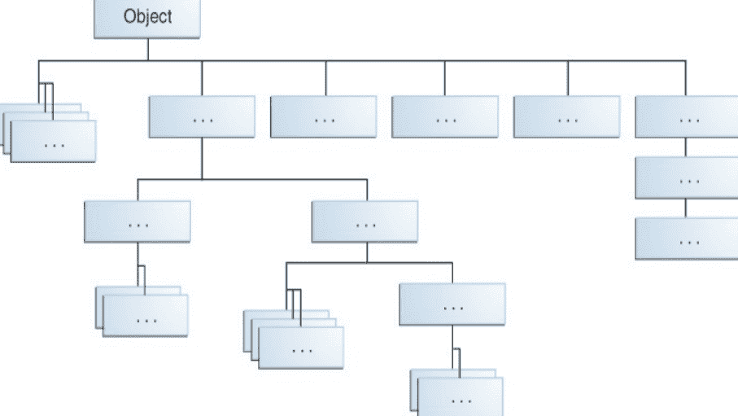

在层次结构的顶端，`Object` 是所有类中最通用的。位于层次结构底部的类提供更具专门化的行为。

### 继承示例

以下是第 4 章介绍的 `Bicycle` 类可能实现的示例代码：

```java
public class Bicycle {

    // Bicycle 类有三个字段

    public int cadence;

    public int gear;

    public int speed;

    // Bicycle 类有一个构造方法

    public Bicycle(int startCadence, int startSpeed, int startGear) {
        gear = startGear;
        cadence = startCadence;
        speed = startSpeed;
    }

    // Bicycle 类有四个方法

    public void setCadence(int newValue) {
        cadence = newValue;
    }
}
```

```java
public void setGear(int newValue) {

    gear = newValue;
}
```

```java
public void applyBrake(int decrement) {

    speed -= decrement;
}
```

```java
public void speedUp(int increment) {

    speed += increment;
}
```

一个作为 `Bicycle` 子类的 `MountainBike` 类声明可能如下所示：

```java
public class MountainBike extends Bicycle {

    // MountainBike 子类增加了一个字段

    public int seatHeight;

    // MountainBike 子类有一个构造方法

    public MountainBike(int startHeight,
                            int startCadence,
                            int startSpeed,
                            int startGear) {

        super(startCadence, startSpeed, startGear);
        seatHeight = startHeight;
    }
}
```

```java
// MountainBike 子类增加了一个方法

public void setHeight(int newValue) {

    seatHeight = newValue;
}
```

`MountainBike` 继承了 `Bicycle` 的所有字段和方法，并增加了 `seatHeight` 字段以及一个设置它的方法。除了构造方法外，这就像是你完全从零开始写了一个全新的 `MountainBike` 类，拥有四个字段和五个方法。然而，你并不需要完成所有的工作。如果 `Bicycle` 类中的方法非常复杂且花费了大量时间进行调试，那么这将是非常有价值的。

### 在子类中可以做什么

子类继承父类所有的公共（`public`）和保护（`protected`）成员，无论子类位于哪个包。如果子类与其父类在同一个包中，它还继承父类的包私（`package-private`）成员。你可以直接使用继承的成员，也可以替换它们、隐藏它们，或用新成员来补充它们：

- 继承的字段可以直接使用，就像任何其他字段一样。
- 你可以在子类中声明一个与超类中同名的字段，从而隐藏它（不建议这样做）。
- 你可以在子类中声明超类中没有的新字段。
- 继承的方法可以原样直接使用。
- 你可以在子类中编写一个与超类中方法签名相同的实例方法，从而对其进行重写（override）。
- 你可以在子类中声明超类中没有的新方法。
- 你可以使用任何访问修饰符（`public`, `protected`）重写超类的方法。


子类还可以通过其公共或保护方法访问超类的私有成员。

# 超类中的私有成员

子类不继承父类的私有成员。但是，如果子类拥有访问私有字段的公共或保护方法，这些方法是可以被子类使用的。

## 对象类型转换

我们已经看到对象的类型是其实例化时的类。例如，如果我们写：

```java
MountainBike myBike = new MountainBike();
```

那么 `myBike` 的类型是 `MountainBike`。`MountainBike` 派生自 `Bicycle` 和 `Object`。因此，`MountainBike` 是一个 `Bicycle` 也是一个 `Object`，可以在任何需要 `Bicycle` 或 `Object` 对象的地方使用。

反之并不一定：`Bicycle` 不一定是 `MountainBike`。同样，`Object` 不一定是 `Bicycle` 或 `MountainBike`。

类型转换显示了在继承和实现允许的情况下，用一种类型的对象代替另一种类型。例如，如果我们写：

```java
Object obj = new MountainBike();
```

那么 `obj` 是一个 `Object`，并且被赋值了另一个 `MountainBike` 对象。这就是隐式类型转换。

相反，如果我们写：

```java
MountainBike myBike = obj;
```

我们将得到编译时错误，因为编译器不知道 `obj` 是 `MountainBike`。但是，我们可以通过显式类型转换告诉编译器我们承诺向 `obj` 赋值一个 `MountainBike`：

```java
MountainBike myBike = (MountainBike) obj;
```

这种转换插入了一个运行时检查，确认 `obj` 是否为 `MountainBike`，这样编译器就可以安全地假设 `obj` 是 `MountainBike`。如果运行时 `obj` 不是 `MountainBike`，将抛出异常。

> **注意**
>
> 你可以使用 `instanceof` 运算符对特定对象的类型进行逻辑测试。这可以防止由于不当转换导致的运行时错误。例如：

```java
if (obj instanceof MountainBike) {
    MountainBike myBike = (MountainBike) obj;
}
```

在这里 `instanceof` 运算符验证了 `obj` 指向一个 `MountainBike`，因此我们进行类型转换时知道不会抛出运行时异常。

状态（state），是指从多个类中继承字段的能力。例如，假设你能够定义一个继承自多个类的新类。当你通过实例化该类来创建对象时，该对象将继承该类所有父类的字段。如果来自不同父类的方法或构造函数实例化了同一个字段会怎样？哪个方法或构造函数将具有优先级？由于接口不包含字段，因此你不需要担心由状态多重继承引起的问题。

实现的重继承（Multiple inheritance of implementation）是指从多个类继承方法定义的能力。这种多重继承会产生问题，例如名称冲突和歧义。当支持这种多重继承的编程语言编译器遇到包含相同名称方法的父类时，它们有时无法确定访问或调用哪个成员或方法。此外，程序员可能会在向父类添加新方法时无意中引入名称冲突。默认方法（Default methods）引入了实现多重继承的一种形式。一个类可以实现多个接口，这些接口可能包含同名的默认方法。Java 编译器提供了一些规则来确定特定类使用哪一个默认方法。

Java 编程语言支持类型多重继承（Multiple inheritance of type），即一个类实现多个接口的能力。一个对象可以有多个类型：它自身的类类型以及该类实现的所有接口的类型。这意味着，如果一个变量被声明为接口类型，那么它的值可以引用从任何实现接口的类的实例化的对象。这在“使用接口作为类型”章节中进行了讨论。

与实现的多重继承一样，类可以继承其所扩展的接口中定义的（默认或静态）方法的不同实现。在这种情况下，编译器或用户必须决定使用哪一个。

## 方法的覆盖与隐藏

### 实例方法

子类中与父类实例方法的签名（名称，加上参数的数量和类型）以及返回类型相同的实例方法将*覆盖*（overrides）父类的方法。

子类覆盖方法的能力允许一个类继承自一个行为“足够接近”的父类，然后根据需要修改行为。被覆盖方法的名称、参数数量、类型以及返回类型与它所覆盖的方法相同。覆盖方法还可以返回被覆盖方法所返回类型的子类型。这种子类型被称为*协变返回类型*（covariant return type）。

在覆盖方法时，你可能想要使用 `@Override` 注解，它告诉编译器你打算覆盖父类中的某个方法。如果由于某种原因，编译器检测到方法在其中一个父类中不存在，它将生成错误。有关 `@Override` 的更多信息，请参见第 5 章。

### 静态方法

如果子类定义了一个与父类中静态方法签名相同的静态方法，那么子类中的方法将*隐藏*（hides）父类中的方法。

隐藏静态方法与覆盖实例方法之间的区别具有重要的影响：

- 被调用的覆盖实例方法版本是子类中的版本。
- 被调用的隐藏静态方法版本取决于是从父类还是从子类调用的。

考虑一个包含两个类的示例。第一个是 `Animal`，它包含一个实例方法和一个静态方法：

```java
public class Animal {
    public static void testClassMethod() {
        System.out.println("The static method in Animal");
    }
    public void testInstanceMethod() {
        System.out.println("The instance method in Animal");
    }
}
```

第二个类是 `Animal` 的子类，称为 `Cat`：

```java
public class Cat extends Animal {
    public static void testClassMethod() {
        System.out.println("The static method in Cat");
    }
    public void testInstanceMethod() {
        System.out.println("The instance method in Cat");
    }
}
```

```java
public static void main(String[] args) {
    Cat myCat = new Cat();
    Animal myAnimal = myCat;
    Animal.testClassMethod();
    myAnimal.testInstanceMethod();
}
```

`Cat` 类覆盖了 `Animal` 中的实例方法，并隐藏了 `Animal` 中的静态方法。该类中的 `main` 方法创建了 `Cat` 的实例，并在类上调用 `testClassMethod()`，在实例上调用 `testInstanceMethod()`。

该程序的输出如下：

The static method in Animal

The instance method in Cat

正如承诺的，被调用的隐藏静态方法版本是父类中的版本，而被调用的覆盖实例方法版本是子类中的版本。

### 接口方法

接口中的默认方法和抽象方法像实例方法一样被继承。然而，当一个类或接口的父类型提供了多个相同签名的默认方法时，Java 编译器遵循继承规则来解决名称冲突。这些规则由以下两个原则驱动：

- 实例方法优于接口默认方法。考虑以下类和接口：

```java
public class Horse {
    public String identifyMyself() {
        return "I am a horse.";
    }
}
public interface Flyer {
    default public String identifyMyself() {
        return "I am able to fly.";
    }
}
public interface Mythical {
    default public String identifyMyself() {
        return "I am a mythical creature.";
    }
}
public class Pegasus extends Horse implements Flyer, Mythical {
    public static void main(String... args) {
        Pegasus myApp = new Pegasus();
        System.out.println(myApp.identifyMyself());
    }
}
```

方法 `Pegasus.identifyMyself` 返回 "I am a horse."。

- 被其他候选方法覆盖的方法会被忽略。这种情况发生在父类型共享共同祖先时。考虑以下接口和类：

```java
public interface Animal {
    default public String identifyMyself() {
        return "I am an animal.";
    }
}
public interface EggLayer extends Animal {
    default public String identifyMyself() {
        return "I am able to lay eggs.";
    }
}
public interface FireBreather extends Animal {}

public class Dragon implements EggLayer, FireBreather {
    public static void main(String... args) {
        Dragon my = new Dragon();
        System.out.println(my.identifyMyself());
    }
}
```

方法 `Dragon.identifyMyself` 返回 "I am able to lay eggs."。

如果两个或多个独立定义的默认方法冲突，或者默认方法与抽象方法冲突，Java 编译器将产生编译错误。你必须明确覆盖父类型方法。

考虑关于现在可以飞行的计算机控制汽车的示例。有两个接口（`OperateCar` 和 `FlyCar`）为相同方法（`startEngine`）提供了默认实现：

```java
public interface OperateCar {
    // ...
    default public int startEngine(EncryptedKey key) {
        // Implementation
    }
}

public interface FlyCar {
    // ...
    default public int startEngine(EncryptedKey key) {
        // Implementation
    }
}
```

实现 `OperateCar` 和 `FlyCar` 的类必须覆盖 `startEngine` 方法。你可以使用 `super` 关键字调用任何一个默认实现。

```java
public class FlyingCar implements OperateCar, FlyCar {
    // ...
    public int startEngine(EncryptedKey key) {
        FlyCar.super.startEngine(key);
    }
}
```

```java
OperateCar.super.startEngine(key);
```

`super` 之前的名称（在本例中为 `FlyCar` 或 `OperateCar`）必须引用一个定义或继承了被调用方法默认实现的直接父接口。这种方法调用形式并不限于区分包含具有相同签名的默认方法的实现接口。你可以使用 `super` 关键字来调用类和接口中的默认方法。

从类继承的实例方法可以重写接口的抽象方法。请考虑以下接口和类：

```java
public interface Mammal {
    String identifyMyself();
}
```

```java
public class Horse {
    public String identifyMyself() {
        return "I am a horse.";
    }
}
```

```java
public class Mustang extends Horse implements Mammal {
    public static void main(String... args) {
        Mustang MyApp = new Mustang();
        System.out.println(MyApp.identifyMyself());
    }
}
```

`Mustang.identifyMyself` 方法返回字符串 `I am a horse.`。`Mustang` 类继承了 `Horse` 类的 `identifyMyself` 方法，该方法重写了接口 `Mammal` 中同名的抽象方法。

> **注意**：接口中的静态方法永远不会继承。

### 修饰符

重写方法的访问限定符允许比被重写方法更多的访问，而不是更少。例如，父类中的 `protected` 实例方法可以在子类中变为 `public`，但不能变为 `private`。

如果你尝试将父类中的实例方法在子类改为静态方法，反之亦然，将导致编译错误。

### 总结

表 6.1 总结了定义与父类方法签名相同的方法的情况。

#### 表 6.1. 定义与父类方法签名相同的方法

| 子类实例方法 | 父类实例方法 | 父类静态方法 |
|---|---|---|
| 子类静态方法 | 重写 | 生成编译错误 |
| | 生成编译错误 | 隐藏 |

> **注意**：
>
> 这种重载方法既不隐藏也不重写父类的实例方法——它们是子类特有的新方法。

## 多态

多态的字典定义是指生物学中的一个原理，即有机或物种可以许多不同的形式或阶段。这一原理也可以应用于面向对象的编程和如 Java 等语言。类的子类可以定义自己独特的行为，并共享父类的一些相同功能。

可以通过对 `Bicycle` 类进行微调来演示多态。例如，可以为类添加一个 `printDescription` 方法，用于显示实例当前存储的所有数据。

```java
public void printDescription() {
    System.out.println("\nBike is " + "in gear " + this.gear \
    + " with a cadence of " + this.cadence +
    + " and travelling at a speed of " + this.speed + " ".");
}
```

为了演示 Java 语言中的多态特性，请通过 `MountainBike` 和 `RoadBike` 类扩展 `Bicycle` 类。对于 `MountainBike`，添加一个用于悬挂的字段 `suspension`，这是一个字符串值，表示自行车是否具有前避震器（`Front`），或者具有前后避震器（`Dual`）。以下是更新后的类：

```java
public class MountainBike extends Bicycle {
    private String suspension;

    public MountainBike(
        int startCadence,
        int startSpeed,
        int startGear,
        String suspensionType) {
        super(startCadence, startSpeed, startGear);
        this.setSuspension(suspensionType);
    }

    public String getSuspension() {
        return this.suspension;
    }

    public void setSuspension(String suspensionType) {
        this.suspension = suspensionType;
    }

    public void printDescription() {
        super.printDescription();
        System.out.println("The " + "MountainBike has a " +
        getSuspension() + " suspension.");
    }
}
```

注意被重写的 `printDescription` 方法。除了之前提供的信息外，输出中还包含了关于悬挂的额外数据。

接下来，创建 `RoadBike` 类。因为公路车或赛车的轮胎较细的，因此添加一个属性来跟踪胎宽。以下是 `RoadBike` 类：


```java
public class RoadBike extends Bicycle {
    // 毫米 (mm)
    private int tireWidth;

    public RoadBike(int startCadence,
                    int startSpeed,
                    int startGear,
                    int newTireWidth) {
        super(startCadence,
              startSpeed,
              startGear);
        this.setTireWidth(newTireWidth);
    }

    public int getTireWidth() {
        return this.tireWidth;
    }

    public void setTireWidth(int newTireWidth) {
        this.tireWidth = newTireWidth;
    }

    public void printDescription() {
        super.printDescription();
        System.out.println("The RoadBike" + " has " + getTireWidth() +
                           " MM tires.");
    }
}
```

注意，再次，`printDescription()` 方法被重写了。总结来说，有三个类：`Bicycle`、`MountainBike` 和 `RoadBike`。这是一个创建三个对象的测试程序：

```java
public class TestBikes {

    public static void main(String[] args) {
        Bicycle bike1 = new Bicycle();
        MountainBike bike2 = new MountainBike(0, 20, 1, "Dual");
        RoadBike bike3 = new RoadBike(0, 25, 2, 32);

        bike1.printDescription();
        bike2.printDescription();
        bike3.printDescription();
    }
}
```

以下是程序的输出：

```
Bike is in gear 0 with a cadence of 0 and travelling at a speed of 0 .
Bike is in gear 1 with a cadence of 20 and travelling at a speed of 0 .
MountainBike has Dual suspension.
Bike is in gear 2 with a cadence of 25 and travelling at a speed of 0 .
RoadBike has 32 MM tires.
```

调用父类构造函数必须是子类构造函数的第一行。调用父类构造函数的语法如下：

```
super();
```

或者

```
super(parameter list);
```

使用 `super()` 时，会调用父类的无参数构造函数。使用 `super(parameter list)` 时，会调用具有匹配参数列表的父类构造函数。

> **注意**
>
> 如果构造函数没有显式地调用父类构造函数，Java 编译器会自动插入对父类无参数构造函数的调用。如果父类没有无参数构造函数，你将得到编译时错误。`Object` 类拥有这样一个构造函数，因此如果 `Object` 是唯一的父类，就没有问题。
>
> 如果子类构造函数显式或隐式地调用了其父类的构造函数，你可能会认为会有整个构造函数链被调用，一直溯到 `Object` 的构造函数。事实上，这被称为构造函数链，当存在很长的类继承链时，你需要意识到这一点。

## 将 Object 作为父类

位于 `java.lang` 包中的 `Object` 类处于层次结构的顶端。每个类都是 `Object` 类的直接或间接后代。你使用的每个类都继承了 `Object` 的实例方法。你不需要使用这些方法中的任何一个，但如果你选择这样做，可能需要用特定于你类的代码来重写它们。继承自 `Object` 的方法将在本节中讨论：

- `protected Object clone() throws CloneSupportedException`——创建并返回此对象的副本。
- `public boolean equals(Object obj)`——指示某个对象是否“等于”此对象。
- `protected void finalize() throws Throwable`——当没有对该对象的引用时，由垃圾回收器调用。
- `public Class getClass()`——返回对象的运行时类。
- `public int hashCode()`——返回对象的哈希值。
- `public String toString()`——返回对象的字符串表示。

`Object` 的 `notify()`、`notifyAll()` 和 `wait()` 方法在同步程序中运行线程活动方面都起着作用，这将在后面的章节讨论，在此处涵盖。共有五个方法：

- `public final void notify()`
- `public final void notifyAll()`
- `public final void wait()`
- `public final void wait(long timeout)`
- `public final void wait(long timeout, int nanos)`

> **注意**
>
> 这些方法有一些微妙之处，特别是 `clone()` 方法。

## clone() 方法

如果一个类或其某个父类实现了 `Cloneable` 接口，你可以使用 `clone()` 方法从现有对象创建副本。要创建一个副本，你写道：

```
Object.clone();
```

`Object` 对此方法的实现会检查调用 `clone()` 的对象是否实现了 `Cloneable` 接口。如果没有实现，该方法将抛出 `CloneSupportedException`。异常处理将在后面的章节介绍。目前，你需要知道 `clone()` 必须声明为：

```java
protected Object clone() throws CloneSupportedException
```

或者

```java
public Object clone() throws CloneSupportedException
```

如果你准备写一个 `clone()` 方法来重写 `Object` 中的方法。`Object` 对 `clone` 方法的实现创建一个与原始对象相同类的对象，并将新对象的成员变量初始化为与原始对象的成员变量相同的值。使你的类变为可克隆的最简单方法是在类声明中实现 `Cloneable`。你的对象就可以调用 `clone()` 方法了。

对于某些类，`Object` 的 `clone` 方法的默认行为运行良好。然而，如果一个对象包含对外部对象的引用（例如 `ObjExternal`），你可能需要重写 `clone()` 以获得正确的行为。否则，一个对象对 `External` 的更改将在其克隆对象中可见。这意味着原始对象及其克隆对象不是独立的——为了解耦它们，你必须重写 `clone()`，使得对象和克隆是真正独立的。

## equals() 方法

`equals()` 方法比较两个对象的相等性，如果它们相等则返回 `true`。`Object` 类提供的 `equals()` 方法使用恒标识运算符 (`==`) 来判断两个对象是否相等。然而，对于原始数据类型，它并非如此。`Object` 提供的 `equals()` 方法测试对象引用是否相等——即所比较的对象是否是同一个对象。

要测试两个对象在等效性（包含相同信息）上是否相等，你必须重写 `equals()` 方法。这是一个重写了 `equals()` 的 `Book` 类示例：

```java
public class Book {
    ...
    public boolean equals(Object obj) {
        if (obj instanceof Book) {
            return ISBN.equals((Book)obj.getISBN());
        } else {
            return false;
        }
    }
}
```

考虑以下测试 `Book` 类两个实例是否等效性的代码：

```java
// Swing 教程，第5版
Book firstBook = new Book("0132761696");
Book secondBook = new Book("0132761696");
if (firstBook.equals(secondBook)) {
    System.out.println("objects are equal");
} else {
    System.out.println("objects are not equal");
}
```

尽管 `firstBook` 和 `secondBook` 引用两个不同的对象，该程序仍然显示对象相等。它们被认为是相等的是因为比较的对象包含相同的 ISBN 号。

如果恒标识运算符对于你的类不适用，你应该始终重写 `equals()` 方法。

> **注意**
>
> 如果你重写了 `equals()`，你也必须重写 `hashCode()`。

## finalize() 方法

`Object` 类提供了一个回调方法 `finalize()`，它在对象变成垃圾时可能会被调用。`Object` 对 `finalize()` 的实现什么都不做——你可以重写 `finalize()` 来执行清理，例如释放资源。

`finalize()` 方法可能会由系统自动调用，但它何时调用、甚至是否会被调用是不确定的。因此，你不应该依赖此方法为你完成清理。例如，如果你在执行 I/O 操作后不在代码中关闭文件描述符，并期望 `finalize()` 为你关闭，你可能会耗尽文件描述符。

## getClass() 方法

你无法重写 `getClass()`。`getClass()` 返回一个 `Class` 对象，你可以使用它的方法来获取类的信息，例如类名 (`getSimpleName()`)、父类 (`getSuperclass()`) 以及它实现的接口 (`getInterfaces()`)。例如，以下方法获取并显示对象的类名：

```java
void printClassName(Object obj) {
    System.out.println("The object's class is " + obj.getClass().getSimpleName());
}
```

对象的字符串表示完全取决于该对象本身，这就是为什么你需要在类中重写 `toString()`。

你可以结合 `toString()` 和 `System.out.println()` 使用来显示对象的文本表示，例如 `Book` 类的实例：

```
System.out.println(firstBook.toString());
```

对于一个正确重写的 `toString()` 方法，这将打印出有用的内容，如下：

> ISBN: 0132761696; The Swing Tutorial; A Guide to Constructing G

# 编写 final 类和方法

你可以将类中的部分或所有方法声明为 `final`。你在方法声明中使用 `final` 关键字来指示该方法不能被子类重写。`Object` 类就是这样做——它的许多方法都是 `final` 的。

如果一个方法的实现不应该被改变，并且对对象的一致状态至关重要，你可能希望将该方法设置为 `final`。例如，你可能希望将 `ChessAlgorithm` 类中的 `getFirstPlayer()` 方法声明为 `final`：

```java
class ChessAlgorithm {

    enum ChessPlayer { WHITE, BLACK }

    ...

    final ChessPlayer getFirstPlayer() {
        return ChessPlayer.WHITE;
    }
}
```

从构造函数中调用的方法通常应该声明为 `final`。

如果构造函数调用了非 `final` 方法，子类可能会重新定义该方法，导致产生意想不到或不理想的结果。

注意，你也可以将整个类声明为 `final`。声明为 `final` 的类不能被子类化。这非常有用，例如在创建像 `String` 类这样的不可变类时。

# 抽象方法和抽象类

`abstract class`（抽象类）是一个声明为 `abstract` 的类——它可能包含也可以不包含抽象方法。抽象类不能实例化，但它们可以被子类继承。

`abstract method`（抽象方法）是一个没有声明实现的方法（没有大括号，后面跟着一个分号），如下所示：

```java
abstract void moveTo(double deltaX, double deltaY);
```

如果一个类包含了抽象方法，那么该类本身`必须`被声明为 `abstract`，如下：

```java
public abstract class GraphicObject {

    // 声明字段

    // 声明非抽象方法

    abstract void draw();

}
```

当一个抽象类被子类化时，子类通常会为其父类中的所有抽象方法提供实现。然而，如果它没有，那么子类也必须被声明为 `abstract`。

> **注意**
>
> 接口中未声明为 `default` 或 `static` 的方法隐式是抽象的，因此接口方法不使用 `abstract` 修饰符。（可以使用，但没有必要。）

# 抽象类与接口的比较

抽象类与接口相似。你不能实例化它们，它们可能包含声明了实现或未声明实现的混合方法。然而，对于抽象类，你可以声明非 `static` 且 `final` 的字段，并定义 `public`、`protected` 和 `private` 的具体方法。在接口中，所有字段自动为 `public`、`static` 和 `final`，且你声明或定义（作为 `default` 方法）的所有方法都是 `public` 的。此外，你只能扩展一个类（无论该类是否抽象），而你可以实现任意数量的接口。

你应该使用抽象类还是接口？

- 如果以下任何陈述适用于你的情况，请考虑使用抽象类：
  - 你希望在几个密切相关的类之间共享代码。
  - 你希望扩展的抽象类拥有许多公共方法或字段，或者需要 `public` 以外的修饰符（如 `protected` 和 `private`）。
  - 你希望声明非 `static` 或非 `final` 的字段。这允许你定义可以访问并修改其所属对象状态的方法。

- 如果以下任何陈述适用于你的情况，请考虑使用接口：
  - 你预感到不相关的类会实现你的接口。例如，`Comparable` 和 `Cloneable` 接口被许多不相关的类实现。
  - 你想指定特定数据类型的行为，但不关心由谁来实现该行为。
  - 你想利用类型多继承的特性。

JDK 中抽象类的示例是 `AbstractMap`，它是集合框架的一部分。它的子类包括 `HashMap`、`TreeMap` 等，这些类共享了许多由 `AbstractMap` 定义的方法（包括 `get()`、`put()`、`isEmpty()`、`containsKey()` 和 `containsValue()`）。

JDK 中实现多个接口的类示例是 `HashMap`、`Cloneable` 和 `Map<K, V>`。通过读取这个接口列表，你可以推断出 `HashMap` 的实例（无论实现该类的开发者或公司是谁）是可以克隆的、可序列化的（这意味着它可以转换为字节流），并且具有 map 的功能。此外，`Map<K, V>` 接口增强了许多 `default` 方法，如 `merge()` 和 `forEach()`，使得实现此接口的类不需要定义这些方法。

注意，许多软件库同时使用抽象类和接口；`HashMap` 类实现了多个接口，并扩展了抽象类 `AbstractMap`。

# 抽象类示例

在一个面向对象的绘图应用程序中，你可以绘制圆、矩形、直线、贝塞尔曲线以及许多其他图形对象。这些对象共同具有某些状态（例如：位置、取向、线条颜色、填充颜色）和行为（例如：移动到新位置、旋转、调整大小、绘制）。这些状态和行为对于所有图形对象都是相同的（例如：位置、填充颜色和移动到新位置）。其他的则需要不同的实现（例如：调整大小或绘制）。所有的 `GraphicObject` 都必须能够自己绘制或调整自身的大小，只是实现方式不同。这是使用抽象父类的完美场景。你可以利用相似性，并声明所有图形对象都继承自同一个抽象父对象（例如 `GraphicObject`），如图 6.2 所示。

## 图 6.2. Rectangle、Line、Bezier 和 Circle 类继承自 GraphicObject

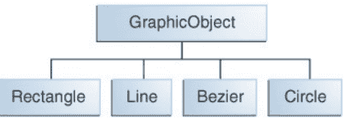

首先，你声明一个抽象类 `GraphicObject`，以提供所有子类完全的成员变量和方法，例如当前位置和 `moveTo()` 方法。`GraphicObject` 还为 `draw()` 或 `resize()` 等方法声明了抽象方法，这些方法需要所有子类实现，但必须以不同的方式实现。`GraphicObject` 类可能如下：

```java
abstract class GraphicObject {
    int x, y;

    ...
    void moveTo(int newX, int newY) {
      ...
    }

    abstract void draw();

    abstract void resize();

}
```


`GraphicObject` 的每个非抽象子类（如 `Circle` 和 `Rectangle`）必须为 `draw` 和 `resize` 方法提供实现：

```java
class Circle extends GraphicObject {

  void draw() {
    ...
  }

  void resize() {
    ...
  }
}

class Rectangle extends GraphicObject {

  void draw() {
    ...
  }

  void resize() {
    ...
  }
}
```

## 当抽象类实现接口时

在节中，我们提到实现接口的类必须实现接口的所有非 `default` 方法。然而，可以定义一个没有实现接口所有非 `default` 方法的类，只要该类被声明为 `abstract`。例如：

```java
abstract class X implements Y {
  // 实现了 Y 中除一个之外的所有方法
}
class XX extends X {
  // 实现了 Y 中剩余的方法
}
```

在这种情况下，类 X 必须是抽象的，因为它没有完全实现 `Y`，但类 `XX` 实际上实现了 `Y`。

## 类成员

抽象类可以拥有静态字段和静态方法。你可以通过类引用使用这些静态成员（为了考试——就像处理任何其他类一样使用 `AbstractClass.staticMethod()`。

## 继承总结

除了 Object 类外，一个类恰有一个直接父类，其字段和方法继承自所有的父类（无论是直接还是间接）。子类可以重写（override）它继承的方法，也可以隐藏（hide）它继承的字段或方法。（注意，隐藏字段通常是一种糟糕的编程实践。）

表 6.1 显示了声明一个与父类方法签名相同的方法的影响。

Object 类是类层级结构的顶端。所有类都是该类的后代，并继承了它的方法。从 Object 继承的有用方法包括 `toString()`、`equals()`、`clone()` 和 `getClass()`。

你可以通过在类声明中使用 `final` 关键字来防止类被子类化。同样，你可以通过将方法声明为 `final` 方法来防止其被子类重写。

抽象类只能被子类化；不能实例化。抽象类可以包含抽象方法——即声明了但没有实现的方法。子类则为这些抽象方法提供实现。

### 问题与练习：继承

#### 问题

1. 考虑以下两个类：

```java
public class ClassA {
    public void methodOne(int i) {
    }
    public void methodTwo(int i) {
    }
    public static void methodThree(int i) {
    }
    public static void methodFour(int i) {
    }
}

public class ClassB extends ClassA {
    public static void methodOne(int i) {
    }
    public void methodTwo(int i) {
    }
    public void methodThree(int i) {
    }
    public static void methodFour(int i) {
    }
}
```

- a. 哪个方法重写了父类的方法？
- b. 哪个方法隐藏了父类的方法？
- c. 其他方法的作用是什么？

2. 考虑你在第 4 章“问题与练习：类”中编写的 `Card`、`Deck` 和 `DisplayDeck` 类。这些类每个应该重写哪些 Object 方法？

#### 练习

1. 为第 2 题中回答的方法编写实现。

#### 答案

你可以在 http://docs-oracle.com/javase/tutorial/java/landI/QandE/inherit-answers.html 找到这些问题和练习的答案。

## 第 6 章笔记

1. http://docs-oracle.com/javase/8/docs/api/java/time/ZonedDateTime.html
2. http://docs-oracle.com/javase/8/docs/api/java/time/LocalDateTime.html
3. http://docs-oracle.com/javase/8/docs/api/java/time/ZoneId.html
4. http://docs-oracle.com/javase/8/docs/api/java/util/Comparator.html
5. http://docs-oracle.com/javase/8/docs/api/java/lang/Comparable.html
6. http://docs-oracle.com/javase/8/docs/api/java/lang/Comparator.html#compareTo-T-
7. http://docs-oracle.com/javase/8/docs/api/java/util/Comparator.html
8. http://docs-oracle.com/javase/8/docs/api/java/util/Comparator.html#sort-java.util.List-java.util.Comparator-
9. http://docs-oracle.com/javase/8/docs/api/java/util/Comparator.html#comparing-java.util.function.Function-java.util.Comparator-
10. http://docs-oracle.com/javase/8/docs/api/java/util/Comparator.html#comparingDouble-java.util.function.ToDoubleFunction-java.util.Comparator-
11. http://docs-oracle.com/javase/8/docs/api/java/util/Comparator.html#comparingLong-java.util.function.ToLongFunction-
12. http://docs-oracle.com/javase/8/docs/api/java/util/Comparator.html#thenComparing-java.util.Comparator-
13. http://docs-oracle.com/javase/8/docs/api/java/util/Comparator.html#thenComparingDouble-java.util.function.ToDoubleFunction-
14. http://docs-oracle.com/javase/8/docs/api/java/util/Comparator.html#thenComparingLong-java.util.function.ToLongFunction-
15. http://docs-oracle.com/javase/8/docs/api/java/util/Comparator-
16. http://docs-oracle.com/javase/8/docs/api/java/lang/Object.html
17. http://docs-oracle.com/javase/8/docs/api/java/lang/Object.html
18. http://docs-oracle.com/javase/8/docs/api/java/Class.html
19. http://docs-oracle.com/javase/8/docs/api/java/lang/Comparable.html
20. http://docs-oracle.com/javase/8/docs/api/java/Cloneable.html
21. http://docs-oracle.com/javase/8/docs/api/java/util/AbstractMap.html
22. http://docs-oracle.com/javase/8/docs/api/java/util/HashMap.html
23. http://docs-oracle.com/javase/8/docs/api/java/io/Serializable.html

# 泛型

泛型是一个对类型进行参数化的泛型类或接口。下面的 `Box` 类将通过修改来演示这一概念。

### 一个简单的 Box 类

首先检查一个操作任意类型的非泛型 `Box` 类。它只需要提供两个方法：`set`（将对象添加到箱中）和 `get`（检索该对象）：

```java
public class Box {
    private Object object;

    public void set(Object object) { this.object = object; }

    public Object get() { return object; }
}
```

由于它的方法接受或返回 `Object`，你可以自由地传递任何想要的内容，只要它不是基本类型即可。在编译时，无法验证该类的使用方式。代码的一个部分可能向箱中放入一个 `Integer` 并期望从中取出 `Integer`，而代码的另一部分可能会错误地传递一个 `String`，导致运行时错误。

### 泛型版本的 Box 类

泛型类的定义如下：

```java
class name<T1, T2, ..., Tn> { /* ... */ }
```

类型参数部分由尖括号 `<` 分隔，位于类名之后。它指定了类型参数（也称为类型变量）`T1`、`T2` 到 `Tn`。

要将 `Box` 更新为泛型，通过将代码 `public class Box` 改为 `public class Box<T>` 来创建一个泛型声明。这引入了类型变量 `T`，可以在类内部的任何地方使用。

通过此更改，`Box` 类变为：

```java
/**
 * Box 类的泛型版本。
 *
 * @param <T> 被装箱的值的类型
 */
public class Box<T> {

    // T 代表 "Type"

    private T t;

    public void set(T t) { this.t = t; }

    public T get() { return t; }

}
```

如你所见，所有的 `Object` 出现处都被替换为 `T`。类型变量可以是你指定的任何非原始类型：任何类类型、任何接口类型、任何数组类型，甚至是另一个类型变量。

这种技术同样可以用于创建泛型接口。

### 类型参数命名规范

按照约定，类型参数名称是单个大写字母。这与你已经了解的变量命名规范形成了鲜明对比，而且这很有道理：如果没有约定，很难区分类型变量和普通的类或接口名称。

最常用的类型参数名称有：

- E — Element（元素，被 Java 集合框架广泛使用）
- K — Key（键）
- N — Number（数字）
- T — Type（类型）
- V — Value（值）
- S, U, V 等 — 第 2、第 3、第 4 类型

你将在 Java SE API 以及本章的其他部分看到这些名称。

### 泛型类型的调用与实例化

要在代码中引用泛型 `Box` 类，你必须执行泛型类型调用，将 `T` 替换为某些具体的值，例如 `Integer`：

```java
Box<Integer> integerBox;
```

你可以将泛型类型调用比作普通的方法调用，但不是向方法传递参数，而是向 `Box` 类本身传递类型参数——在本例中为 `Integer`。

类型参数与参数术语：许多开发者交替使用“类型参数”（type parameter）和“类型参数”（type argument），但这两个术语并不相同。在编码时，通过提供类型参数来创建一个参数化类型。因此，`Foo<T>` 中的 `T` 是类型参数，而 `Foo<String> f` 中的 `String` 是类型参数。本章在使用这些术语时遵循这一定义。

与任何其他变量声明一样，这段代码实际上并没有创建一个新的 `Box` 对象。它只是声明了 `integerBox` 将持有对“Integer 的 Box”的引用，这就是 `Box<Integer>` 的读取方式。

泛型类型的泛被称为参数化类型（parameterized type）。要实例化此类，请像常一样使用 `new` 关键字，但在类名和括号之间放置 `<Integer>`：

```java
Box<Integer> integerBox = new Box<Integer>();
```

### 菱形 (The Diamond)

只要编译器能够从上下文确定或推断类型参数，你就可以将泛型类构造函数所需的类型参数替换为空类型参数集 (`<>`)。这对角括号 (`<>`) 正称为菱形。例如，你可以通过以下语句创建 `Box<Integer>` 的实例：

```java
Box<Integer> integerBox = new Box<>();
```

有关菱形符号和类型推断的更多信息，请参见本章后面的“类型推断”部分。

### 多类型参数

如前所述，泛型类可以有多个类型参数。例如泛型 `OrderedPair` 类，它实现了泛型 `Pair` 接口：

```java
public interface Pair<K, V> {
    public K getKey();
    public V getValue();
}
```

```java
public class OrderedPair<K, V> implements Pair<K, V> {

    private K key;
    private V value;

    public OrderedPair(K key, V value) {
        this.key = key;
        this.value = value;
    }

    public K getKey() { return key; }

    public V getValue() { return value; }
}
```

以下语句创建了 `OrderedPair` 两个实例化：

```java
Pair<String, Integer> p1 = new OrderedPair<String, Integer>("Even");
Pair<String, String> p2 = new OrderedPair<String, String>("hello");
```

代码 `new OrderedPair<String, Integer>` 将 `K` 实例化为 `String`，将 `V` 实例化为 `Integer`。因此，`OrderedPair` 构造函数的参数类型分别是 `String` 和 `Integer`。由于自动装箱（autoboxing），向该类传递 `String` 和 `int` 是合法的。

如前所述，由于 Java 编译器可以从声明 `OrderedPair<String, Integer>` 中推断出 `K` 和 `V` 类型，这些语句可以使用菱形符号简化：

```java
OrderedPair<String, Integer> p1 = new OrderedPair<>("Even", 8);
OrderedPair<String, String> p2 = new OrderedPair<>("hello", "world");
```

要创建一个泛型接口，请遵循与创建泛型类相同的约定。

### 参数化类型

你也可以用参数化类型（如 `List<String>`）替换类型参数（如 `K` 或 `V`）。例如，使用 `OrderedPair<K, V>` 示例：

```java
OrderedPair<String, Box<Integer>> p = new OrderedPair<>("primes");
```

### 原始类型 (Raw Types)

原始类型是不带任何类型参数的泛型类或接口的名称。例如，给定泛型 `Box` 类：

```java
public class Box<T> {

    public void set(T t) { /* ... */ }
}
```

```java
// 通用构造函数

public Pair(K key, V value) {

    this.key = key;
    this.value = value;
}

// 通用方法

public void setKey(K key) { this.key = key; }

public void setValue(V value) { this.value = value; }

public K getKey() { return key; }

public V getValue() { return value; }

}
```

调用此方法的完整语法如下：

```java
Pair<Integer, String> p1 = new Pair<>(1, "apple");

Pair<Integer, String> p2 = new Pair<>(2, "pear");

boolean same = Util.<Integer, String>compare(p1, p2);
```

该类型已显式提供，如 `加粗` 所示。通常情况下，可以省略它，编译器将推断出所需的类型：

```java
Pair<Integer, String> p1 = new Pair<>(1, "apple");

Pair<Integer, String> p2 = new Pair<>(2, "pear");
```


```java
boolean same = Util.compare(p1, p2);
```

这种特征被称为**类型推断**，允许你像调用普通方法一样调用通用方法，而无需在角括号中指定类型。此主题将在后的“类型推断”部分进行进一步讨论。

## 边界类型参数

有时，你可能希望限制作为参数化类型类型参数的类型。例如，一个对数字操作的方法可能只想接受 `Number` 及其子类的实例。这正是边界类型参数的用途。

要声明边界类型参数，请列出类型参数的名称，随后是 `extends` 关键字，然后是它的上界（在本例中为 `Number`）。请注意，在此语境下，`extends` 广义地使用，表示“继承”（如类）或“实现”（如接口）。

```java
public class Box<T> {

    private T t;

    public void set(T t) {
        this.t = t;
    }

    public T get() {
        return t;
    }

    public <U extends Number> void inspect(U u) {
        System.out.println("T: " + t.getClass().getName());

        System.out.println("U: " + u.getClass().getName());
    }

    public static void main(String[] args) {
        Box<Integer> integerBox = new Box<Integer>();

        integerBox.set(new Integer(10));

        integerBox.inspect("some text"); // ：这仍然是 String!
    }
}
```

通过修改我们的通用方法以包含此边界类型参数，编译现在将失败，因为我们对 `inspect` 的调用包含了 `String`：

```
Box.java:21: <U>inspect(U) in Box<java.lang.Integer> cannot
be applied to (java.lang.String)
integerBox.inspect("10");
^
1 error
```

除了限制你可以用于实例化泛型类型的类型外，边界类型参数还允许你调用在边界中定义的方法：

```java
public class NaturalNumber<T extends Integer> {

    private T n;

    public NaturalNumber(T n) { this.n = n; }

    public boolean isEven() {
        return n.intValue() % 2 == 0;
    }

    // ...
}
```

`isEven` 方法通过 `n` 调用了在 `Integer` 类中定义的 `intValue` 方法。

### 多边界

上一个示例说明了具有单一边界的类型参数的使用，但类型参数可以有多个边界：

```
<T extends B1 & B2 & B3>
```

具有多个边界的类型变量是边界中列出的所有类型的子类型。如果其中一个边界是类，则必须先指定。例如：

```java
class A { /* ... */ }

interface B { /* ... */ }

interface C { /* ... */ }

class D <T extends A & B & C> { /* ... */ }
```

如果边界 A 没有先指定，你将得到一个编译时错误：

```java
class D <T extends B & A & C> { /* ... */ }
```

## 通用方法与边界类型参数

边界类型参数是实现通用算法的关键。考虑以下方法，它用于统计数组中大于指定元素的个数：

```java
public static <T> int count(T[] array, T elem) {
    int count = 0;
    for (T e : array)
        if (e > elem) // 编译器错误
            count++;
    return count;
}
```

该方法的实现非常直观，但它无法编译，因为大于运算符 (`>`) 仅适用于原始类型，如 `short`、`int`、`long`、`float`、`byte` 和 `char`。你不能使用 `>` 来解决这个问题，可以使用受 `Comparable` 的类型参数：

```java
public interface Comparable<T> {
    int compareTo(T o);
}
```

生成的代码将是：

```java
public static <T extends Comparable<T>> int count(T[] array) {
    int count = 0;
    for (T e : array)
        if (e.compareTo(elem) > 0)
            count++;
    return count;
}
```

## 泛型、继承与子类型

如你所知，只要类型允许，就可以将一种类型的对象赋值给另一种类型的对象。例如，由于 `Object` 是 `Integer` 的父类，可以这样做：

```java
Object obj = new Integer();
Integer i = obj;
```

在面向对象的术语中，这被称为“是”关系。由于 `Integer` 是 `Object` 的子类型，这种赋值是有效的：

```java
Object obj = new Integer();
Integer i = obj;
```

只要类型兼容的，就可以在泛型调用中进行赋值。例如，由于 `Object` 是 `Integer` 的父类型，这样做是允许的：

```java
Object obj = new Integer();
Integer i = obj;
```

现在考虑以下方法：

```java
public void boxTest(Box<Number> n) { /* ... }
```

它接受什么类型的参数？通过查看签名，可以看到它接受 `Box<Number>`。但你是否允许传递 `Box<Integer>` 或 `Box<Double>`？答案是否定的，因为 `Box<Integer>` 和 `Box<Double>` 并不是 `Box<Number>` 的子类型。这在泛型编程中是一个常见的误解。

图 7.1. Box<Integer> 不是 Box<Number> 的子类型（img/787afe3ca2e4d558594c540be77ff3.png）

> **注意**
>
> 给定类型 A 和 B（例如 `Number` 和 `Integer`），无论 A 和 B 是否相关，`MyClass<A>` 与 `MyClass<B>` 之间都没有关系。它们的共同父类是 `Object`。

有关有关如何在泛型类之间创建子类型关系的信息，请参见“通配符与子类型”章节。

## 通用类与子类型

你可以通过扩展或实现来使通用类成为子类型。类或接口类型参数之间的关系由 `extends` 和 `implements` 子句决定。

以 `Collections` 类为例，`ArrayList<E>` 实现 `List<E>`，而 `List<E>` 扩展 `Collection<E>`。因此 `ArrayList<String>` 是 `List<String>` 的子类型，后者又是 `Collection<String>` 的子类型。只要你不改变类型参数，这种子类型关系就会保留。

图 7.2. 示例 Collections 层次结构

| Collection<String> |
| :--- |
| List<String> |
| ArrayList<String> |

现在假设我们想要定义列表接口 `PayloadList`，它为每个元素关联一个通用类型 `P` 的可选值。它的声明可能如下：

```java
interface PayloadList<E,P> extends List<E> {
  void setPayload(int index, P val);
...
}
```

以下 `PayloadList` 的参数化是 `List<String>` 的子类型：

- `PayloadList<String, String>`
- `PayloadList<String, Integer>`
- `PayloadList<String, Exception>`

图 7.3. 示例 PayloadList 层次结构（img/787afe3ca2e4d558594c540be77ff73.412.png）

## 类型推断

类型推断是 Java 编译器的一种能力，通过查看每个方法调用及其相应的声明，确定确定调用适用的类型参数（或参数）。类型推断算法确定参数的类型，如果可用，确定结果赋值或返回的类型。最后，类型推断算法尝试找到适用于所有参数的最特定类型。

为了说明最后一点，在下面的示例中，推断确定了传递给 `pick` 方法的第二个参数是 `Serializable` 类型：

```java
static <T> T pick(T a1, T a2) { return a2; }
```

### 类型推断与泛型方法

之前关于泛方法的讨论向你介绍了类型推断，它使你能够像调用普通方法一样调用泛型方法，而无需在角括号指定类型。考虑以下示例 BoxDemo，它需要 Box 类：

```java
public class BoxDemo {

    public static <U> void addBox(U u, java.util.List<Box<U>> boxes) {
        Box<U> box = new Box<U>();
        box.set(u);
        boxes.add(box);
    }

    public static <U> void outputBoxes(java.util.List<Box<U>> boxes) {
        int counter = 0;
        for (Box<U> box : boxes) {
            U boxContents = box.get();
            System.out.println("Box #" + counter + " contains [" + boxContents.toString() + "]");
            counter++;
        }
    }

    public static void main(String[] args) {
        java.util.ArrayList<Box<Integer>> listOfIntegerBoxes = new java.util.ArrayList<>();
        BoxDemo.<Integer>addBox(Integer.valueOf(10), listOfIntegerBoxes);
        BoxDemo.addBox(Integer.valueOf(20), listOfIntegerBoxes);
        BoxDemo.addBox(Integer.valueOf(30), listOfIntegerBoxes);
        BoxDemo.outputBoxes(listOfIntegerBoxes);
    }
}
```

以下是该示例的输出：

Box #0 contains [10]

Box #1 contains [20]

Box #2 contains [30]

泛型方法 `addBox` 定义了一个名为 `U` 的类型参数。通常，Java 编译器可以推断泛型方法调用的类型参数。因此，在大多数情况下，你不需要手动指定它们。例如，要调用泛型方法 `addBox`，你可以通过类型见证（type witness）如下指定类型参数：

```java
BoxDemo.<Integer>addBox(Integer.valueOf(10), listOfIntegerBoxes);
```

或者，如果你省略了类型见证，Java 编译器会自动（根据方法的参数）推断类型参数为 `Integer`：

```java
BoxDemo.addBox(Integer.valueOf(20), listOfIntegerBoxes);
```

### 类型推断与泛型类的实例化

只要编译器能够从上下文中推断类型参数，就可以将调用泛型类构造所需的类型参数替换为空的类型参数集（<>）。这对角括号被非正式称为“菱形”。例如，考虑以下变量声明：

```java
Map<String, List<String>> mMap = new HashMap<String, List<String>>();
```

你可以将构造函数的参数化类型替换为空的类型参数集（<>）：

```java
Map<String, List<String>> mMap = new HashMap<>();
```

注意，要在实例化泛型类时利用类型推断，必须使用菱形。在下面的示例中，编译器会生成未检查转换警告，因为 `HashMap()` 构造函数引用的是 `HashMap` 原始类型（raw type），而不是 `Map<String, List<String>>` 类型：

```java
Map<String, List<String>> myMap = new HashMap(); // unchecked conversion...
```

### 泛型类与非泛型类的泛型构造函数

注意，构造函数在泛型类和非泛型类中都可以泛型的（换句话说，它们可以声明自己的形式类型参数）。考虑以下示例：

```java
class MyClass<X> {
  <T> MyClass(T t) {
    // ...
  }
}
```

考虑类 `MyClass` 的以下实例化：

```java
new MyClass<Integer>("")
```

该语句创建了参数化类型 `MyClass<Integer>` 的实例；该语句显式为泛型类 `MyClass<X>` 的形式类型参数 `X` 指定了类型 `Integer`。注意，该泛型类的构造函数包含一个形式类型参数 `T`。编译器推断该泛型类构造函数的形式类型参数 `T` 的类型为 `String`（因为该构造函数的实际参数是一个 `String` 对象）。

Java SE 7 之前的版本的编译器能够推断泛型构造函数的实际类型参数，类似于泛型方法。然而，在 Java SE 7 及更高版本的编译器中，如果你使用菱形（<>），就可以推断出被实例化的泛型类的实际类型参数。考虑以下示例：

在例示例中，编译器为泛型类 `MyClass<X>` 的形式类型参数 `X` 推断出类型 `Integer`。它为该泛型类构造函数的形式类型参数 `T` 推断出类型 `String`。

> **注意**
>
> 重要的是，推断算法仅使用调用参数、目标类型以及可能的明显的预期返回类型来推断类型。推断算法不使用程序后续部分的结果。

#### 目标类型

Java 编译器利用目标类型（target typing）来推断泛型方法调用的类型参数。表达式的目标类型是 Java 编译器根据表达式出现的位置期望的数据类型。考虑方法 `Collection.emptyList()`它的声明如下：

```java
static <T> List<T> emptyList();
```

考虑以下赋值语句：

```java
List<String> listOne = Collections.emptyList();
```

该语句期望一个 `List<String>` 实例；这个数据类型就是目标类型。因为方法 `emptyList` 返回 `List<T>` 类型的值，编译器推断参数 `T` 为 `String`。

### 通配符

在泛型代码中，问号（?）被称为通配符（wildcard），表示未知类型。通配符可以在多种情况下使用：作为参数、字段或局部变量的类型；有时作为返回类型（尽管更好的编程实践是尽可能具体）。通配符从不作为泛型方法调用、泛型类实例化或超类型的类型参数。

后续章节将详细讨论通配符，包括上界通配符、下界通配符和通配符捕获。

## 上界通配符

可以使用上界通配符来放宽变量限制。例如，假设你想编写一个适用于 `List<Integer>`、`List<Double>` 和 `List<Number>` 的方法；你可以通过使用上界通配符来实现。

要声明上界通配符，使用通配符字符（?），后跟 `extends` 关键字，然后是它的上界。注意，在此上下文中，`extends` 以广义意义使用，表示“继承”（对于类）或“实现”（对于接口）。

为了编写处理 `Number` 及其子类型（如 `Integer`、`Double` 和 `Float`）列表的方法，你应该指定 `List<? extends Number>`。`List<Number>` 比 `List<? extends Number>` 更具限制性，因为前者只匹配 `Number` 类型列表，而后者匹配 `Number` 类型或其任何子类的列表。

考虑以下 `process` 方法：

```java
public static void process(List<? extends Foo> list) { /** ... *\n}
```

上界通配符 `<? extends Foo>`（其中 `Foo` 是任意类型）匹配 `Foo` 及其任何子类型。`process` 方法可以作为 `Foo` 类型访问列表元素：


## 无界通配符

无界通配符类型使用通配符字符（`?`）指定，例如 `List<?>`。这被称为未知类型的列表。在以下两种情况下，无界通配符是一种很有用的方法：

- 如果你正在编写一个可以使用 `Object` 类提供的功能来实现的方法。
- 当代码在使用泛型类中某些不依赖于类型参数的方法时。例如 `List.size()` 或 `List.clear()`。事实上，`Class<?>` 经常被使用，是因为 `Class<T>` 中的大多数方法并不依赖于 `T`。

考虑以下方法 `printList`：

```java
public static void printList(List<Object> list) {
    for (Object elem : list) {
        System.out.println(elem + " ");
    }
    System.out.println();
}
```

`printList` 的目标是打印任何任意类型的列表，但它未能实现该目标——它只打印 `Object` 实例的列表；它无法打印 `List<Integer>`、`List<String>`、`List<Double>` 等，因为它们不是 `List<Object>` 的子类型。要编写泛型的 `printList` 方法，请使用 `List<?>`：

```java
public static void printList(List<?> list) {
    for (Object elem : list) {
        System.out.print(elem + " ");
    }
    System.out.println();
}
```

因为对于任何具体类型 `A`，`List<A>` 都是 `List<?>` 的子类型，你可以使用 `printList` 打印任何类型的列表：

```java
List<Integer> li = Arrays.asList(1, 2, 3);
List<String> ls = Arrays.asList("one", "two", "three");
printList(li);
printList(ls);
```

> **注意**：本章中的示例使用了 `Arrays.asList()` 方法。该静态工厂方法转换指定的数组并返回一个固定大小的列表。

值得注意的是，`List<Object>` 和 `List<?>` **不是**相同的。你可以向 `List<Object>` 中插入一个 `Object` 或 `Object` 的任何子类型。但你只能向 `List<?>` 中插入 `null`。“通配符使用指南”部分提供了更多关于如何在给定情况下确定应该使用何种通配符（如果有）的信息。

## 上界通配符

上界通配符将未知类型限制为特定类型或该类型的子类型，并使用 `extends` 关键字表示。

`sumOfList` 方法返回列表中数字之和：

```java
public static double sumOfList(List<? extends Number> list) {
    double s = 0.0;
    for (Number n : list) {
        s += n.doubleValue();
    }
    return s;
}
```

以下代码使用了 `Integer` 对象的列表，打印 `sum = 6.0`：

```java
List<Integer> li = Arrays.asList(1, 2, 3);
System.out.println("sum = " + sumOfList(li));
```

`Double` 值的列表可以使用相同的 `sumOfList` 方法。以下代码打印 `sum = 7.0`：

```java
List<Double> ld = Arrays.asList(1.2, 2.3, 3.5);
System.out.println("sum = " + sumOfList(ld));
```

在 `foreach` 子句中，变量 `elem` 遍历列表中的每个元素。现在 `Foo` 类中定义的任何方法都可以用于 `elem`。

```java
public static void process(List<? extends Foo> list) {
    for (Foo elem : list) {
        // ...
    }
}
```

## 下界通配符

下界通配符将未知类型限制为特定类型或该类型的父类型。下界通配符使用通配符字符（`?`）表示，后跟 `super` 关键字，然后是其下界：`<? super A>`。

> **注意**：你可以为通配符指定上界，也可以指定下界，但不能两者都指定。

假设你想写一个方法将 `Integer` 对象放入列表。为了最大化灵活性，你希望该方法能够适用于 `List<Integer>`、`List<Number>` 和 `List<Object>`——任何可以容纳 `Integer` 值的列表。

要编写一个适用于 `Integer` 及其父类（如 `Integer`、`Number` 和 `Object`）列表的方法，你需要指定 `List<? super Integer>`。这比 `List<Integer>` 更具灵活性，因为前者匹配作为 `Integer` 父类的任何类型的列表，而后者仅匹配类型为 `Integer` 的列表。

以下代码将数字 1 到 10 添加到列表末尾：

```java
public static void addNumbers(List<? super Integer> list) {
    for (int i = 1; i <= 10; i++) {
        list.add(i);
    }
}
```

“通配符使用指南”部分提供了关于何时使用上界通配符以及何时使用下界通配符的指导。

## 通配符与子类型化

正如“泛型、继承与子类型”中描述的那样，泛型类或接口之间并非仅仅因为它们的类型之间存在关系就相关联。然而，你可以使用通配符在泛型类或接口之间建立关系。

给定以下两个普通（非泛型）类：

```java
class A { /* ... */ }
class B extends A { /* ... */ }
```

编写以下代码是合理的：

```java
B b = new B();
A a = b;
```

此示例表明普通类的继承遵循此子类型化规则：如果 `B` 扩展 `A`，则类 `B` 是类 `A` 的子类型。此规则不适用于泛型类型：

```java
List<B> lb = new ArrayList<>();
// List<A> la = lb; // 编译错误
```

由于 `Integer` 是 `Number` 的子类型，`List<Integer>` 和 `List<Number>` 之间的关系是什么？

### 图 7.4 公共父类


尽管 `Integer` 是 `Number` 的子类型，`List<Integer>` 并不是 `List<Number>` 的子类型，且事实上这两个类型之间没有关系。为了让代码能够访问 `Number` 的方法以便在这些类之间建立关系，请使用上界通配符：

```java
List<? extends Integer> intList = new ArrayList<>();
List<? extends Number> numList = intList; // OK
```

因为 `Integer` 是 `Number` 的子类型，`numList` 是 `Number` 对象的列表，因此 `intList` 和 `numList` 之间存在关系。

### 图 7.5 多个泛型声明的层级结构


| 层级 | 类型 |
| :--- | :--- |
| 1 | `List<?>` |
| 2 | `List<? extends Number>` / `List<? super Integer>` |
| 3 | `List<? extends Integer>` / `List<? super Number>` |

“通配符使用指南”部分提供了更多关于使用上下界通配符的影响。

## 通配符捕捉与辅助方法

在某些情况下，编译器会推断通配符的类型。例如，列表可能定义为 `List<?>`，但在评估表达式时，编译器会推断出一个特定的类型。这种场景被称为通配符捕捉。

大多数情况下，你不需要担心通配符捕捉，除非你看到包含“捕获...”字样的错误消息。

`WildcardError` 示例在编译时会产生捕捉错误：

```java
import java.util.List;

public class WildcardError {
    void foo(List<?> i) {
        i.set(0, i.get(0));
    }
}
```

在此示例中，编译器将输入参数 `i` 处理为 `Object` 类型。当 `foo` 方法调用 `List.set(int, E)` 时，编译器无法确认插入列表的对象的类型，从而产生错误。当发生此类类型错误时，通常意味着编译器认为你正在为变量分配错误的类型。泛型引入 Java 语言的原因就在于——在编译时强制类型安全。

使用 Oracle 的 JDK `javac` 实现编译时会生成以下错误：

```
WildcardError.java:6: error: method in interface List<E>
i.set(0, i.get(0));
^
required: int,CAP#1
found: int,Object
reason: actual argument Object cannot be converted to CAP#1
where E is a type-variable:
E extends Object declared in interface List
where CAP#1 is a fresh type-variable:
CAP#1 extends Object from capture of ?
```

在本示例中，代码试图执行一项安全操作，那么你如何绕过编译器错误呢？你可以通过编写一个捕获通配符的私有辅助方法来修复它。在这种情况下，你可以像 `WildcardFixed` 所示创建一个私有辅助方法 `fooHelper` 来解决这个问题：

```java
public class WildcardFixed {
    void foo(List<?> i) {
        fooHelper(i);
    }

    // 创建辅助方法是为了能够通过类型推断捕获通配符。
    private <T> void fooHelper(List<T> l) {
        l.set(0, l.get(0));
    }
}
```

得益于该辅助方法，编译器使用推断确定在调用时 `T` 是 `CAP#1`，即捕获变量。现在示例可以成功编译。

按照惯例，辅助方法通常命名为 `原方法名-Helper`。

现在考虑一个更复杂的示例，`WildcardErrorBad`：

```java
import java.util.List;

public class WildcardErrorBad {
    void swapFirst(List<? extends Number> l1, List<? extends Number> l2) {
        Number temp = l1.get(0);
        l1.set(0, l2.get(0)); // 需要一个 CAP#1 extends Number，
                              // 得到的却是 CAP#2 extends Number；
                              // 相同的边界，但不同的类型
        l2.set(0, temp); // 需要一个 CAP#1 extends Number
                         // 得到了一个 Number
    }
}
```

在这个示例中，代码试图执行一项不安全的操作。例如，考虑以下对 `swapFirst` 方法的调用：

```java
List<Integer> l1 = Arrays.asList(1, 2, 3);
List<Double> l2 = Arrays.asList(10.10, 20.20, 30.30);
swapFirst(l1, l2);
```

虽然 `List<Integer>` 和 `List<Double>` 都符合 `List<? extends Number>` 标准，但从 `Integer` 值列表中取出一个项并尝试将其放入 `Double` 值列表中显然是错误的。

使用 Oracle 的 JDK `javac` 编译器编译该代码会产生以下错误：

```
WildcardErrorBad.java:7: error: method set in interface List<E>
l1.set(0, l2.get(0)); // 需要一个 CAP#1 extends Number,
^
required: int,CAP#1
found: int,Number
reason: actual argument Number cannot be converted to CAP#1
where E is a type-variable:
E extends Object declared in interface List
where CAP#1 is a fresh type-variable:
CAP#1 extends Number from capture of ? extends Number

WildcardErrorBad.java:10: error: method set in interface List<E>
l2.set(0, temp); // 需要一个 CAP#1 extends Number,
^
required: int,CAP#1
found: int,Number
reason: actual argument Number cannot be converted to CAP#1
where E is a type-variable:
E extends Object declared in interface List
where CAP#1 is a fresh type-variable:
CAP#1 extends Number from capture of ? extends Number
```

这里没有辅助方法可以绕过这个问题，因为该代码在根本上是错误的。

## 通配符使用指南

在学习泛型编程时，最令人困惑的方面之一是确定何时使用上界通配符，何时使用下界通配符。本页提供了一些在设计代码时遵循的指南。

为了方便讨论，将变量视为提供以下两种功能之一是有帮助的：

- **“输入”（in）变量**：为代码提供数据。想象一个有两个参数的拷贝方法：`copy(src, dest)`。`src` 参数提供要拷贝的数据，因此它是“输入”参数。
- **“输出”（out）变量**：持有数据供其他地方使用。在 `copy` 示例中，`copy(src, dest)` 的 `dest` 参数接收数据，因此它是“输出”参数。

当然，有些变量既用于“输入”也用于“输出”——这种情况在指南中也得到了解决。

在决定是否使用通配符以及使用何种类型的通配符时，可以使用“输入”和“输出”原则。以下列表提供了遵循的指南：

- “输入”变量使用 `extends` 关键字定义上界通配符。
- “输出”变量使用 `super` 关键字定义下界通配符。
- 在可以使用 `Object` 类中定义的方法访问“输入”变量的情况下，使用无界通配符。
- 在代码需要同时作为“输入”和“输出”变量访问变量的情况下，不要使用通配符。

这些指南不适用于方法的返回类型。应该避免将通配符作为返回类型，因为这会迫使使用代码的程序员处理通配符。

由 `List<? extends ...>` 定义的列表可以非正式地认为是只读的，但并不是严格的保证。假设你有以下两个类：

```java
class A {}
class B extends A {}
```

```java
List<? extends A> list = new ArrayList<B>();
list.add(new B()); // 正确
list.add(new A()); // 编译错误
```

由 `List<? super ...>` 定义的列表可以非正式地认为是只写的，但那并不是严格的保证。假设你有以下两个类：

```java
class A {}
class B extends A {}
```


# 泛型方法的擦除

Java 编译器也会擦除泛型方法参数中的类型参数。考虑以下泛型方法：

```java
// 统计 anArray 中 elem 出现的次数。
public static <T> int count(T[] anArray, T elem) {
    int cnt = 0;
    for (T e : anArray) {
        if (e.equals(elem)) {
            ++cnt;
        }
    }
    return cnt;
}
```

由于 `T` 是无界的，Java 编译器将其替换为 `Object`：

```java
public static int count(Object[] anArray, Object elem) {
    int cnt = 0;
    for (Object e : anArray) {
        if (e.equals(elem)) {
            ++cnt;
        }
    }
    return cnt;
}
```

假设定义了以下类：

```java
class Shape { /* ... */ }
class Circle extends Shape { /* ... */ }
class Rectangle extends Shape { /* ... */ }
```

你可以写一个泛型方法来绘制不同的形状：

```java
public static <T extends Shape> void draw(T shape) { /* ... */ }
```

Java 编译器将 `T` 替换为 `Shape`：

```java
public static void draw(Shape shape) { /* ... */ }
```

# 类型擦除和桥接方法的影响

有时类型擦除会导致你可能没有料到的情况。下面的示例展示了这种情况是如何发生的。该示例（在“桥接方法”节描述）展示了编译器如何在类型擦除过程中创建一个名为“桥接方法”的合成方法。

给定以下两个类：

```java
public class Node<T> {
    private T data;
    public Node(T data) { this.data = data; }
    public void setData(T data) {
        System.out.println("Node.setData");
        this.data = data;
    }
}
```

```java
public class MyNode extends Node<Integer> {
    public MyNode(Integer data) { super(data); }
    public void setData(Integer data) {
        System.out.println("MyNode.setData");
        super.setData(data);
    }
}
```

考虑以下代码：

```java
Node mn = new MyNode(5);
Node n = mn; // 原始类型 - 编译器抛出未检查异常
n.setData("Hello"); // 导致 ClassCastException 异常
Integer x = mn.data;
```

类型擦除后，这段代码变为：

```java
MyNode mn = new MyNode(5);
Node n = (MyNode)mn;      // 原始类型 - 编译器抛出
n.setData("Hello");
Integer x = (String)mn.data; // 导致 ClassCastException
```

以下是代码执行时发生的情况：

- `n.setData("Hello")` 导致在 `MyNode` 类对象上执行了 `setData(Object)` 方法。`MyNode` 类从 `Node` 继承了 `setData(Object)`。
- 在 `setData(Object)` 的方法体中，由 `n` 引用的对象的 `data` 字段被赋值为 `String`。
- 通过 `mn` 引用的同一个对象的 `data` 字段可以被访问，并且预期是一个整数（因为 `mn` 是 `MyNode`，而 `MyNode` 是 `Node<Integer>`）。
- 尝试将 `String` 赋值给 `Integer` 会导致 Java 编译器在赋值处插入的强制转换产生 `ClassCastException`。

# 桥接方法

在编译扩展了参数化类或实现了参数化接口的类或接口时，编译器可能需要作为类型擦除过程的一部分创建一个合成方法，称为“桥接方法”。你通常不需要担心桥接方法，但如果在堆栈跟踪中出现一个，你可能会感到困惑。

类型擦除后，`Node` 和 `MyNode` 类变为：

```java
public class Node {
    private Object data;
    public Node(Object data) { this.data = data; }
    public void setData(Object data) { }
}

public class MyNode extends Node {
    public MyNode(Integer data) { super(data); }
    public void setData(Integer data) {
        super.setData(data);
    }
    public void setData(Object data) {
        setData((Integer)data);
    }
}
```

类型擦除后，`Node` 的方法签名不匹配。为了解决这个问题并保持泛型，Java 编译器为泛型方法生成了桥接方法，如下方法所示：

```java
public class Node {
    private Object data;
    public Node(Object data) { this.data = data; }
    public void setData(Object data) { }
}

public class MyNode extends Node {
    public MyNode(Integer data) { super(data); }
    public void setData(Integer data) {
        super.setData(data);
    }
    public void setData(Object data) {
        setData((Integer)data);
    }
}
```

如上文所示，`MyNode` 的 `setData(Integer)` 方法重写了 `Node` 的 `setData(Object)` 方法。在类型擦除后，`Node` 的方法签名不匹配。为了确保多态性正常工作，Java 编译器生成了桥接方法。

# 非可识别类型

“类型擦除”节讨论了类型擦除的过程。

## 堆污染

堆污染发生在混合原始类型和参数化类型时。包含变长参数的泛型方法会导致堆污染。考虑以下 `ArrayBuilder` 类：

```java
public class ArrayBuilder {
    public static <T> void addToList(List<T> listArg, T... elements) {
        for (T x : elements) {
            listArg.add(x);
        }
    }

    public static void faultyMethod(List<String>... l) {
        Object[] objectArgs = l; // 有效
        ...
    }
}
```

下面的示例 `HeaputionExample` 使用了 `ArrayBuilder` 类：

```java
public class HeaputionExample {
    public static void main(String[] args) {
        List<String> stringListA = new ArrayList<String>();
        List<String> stringListB = new ArrayList<String>();
        ArrayBuilder.addToList(stringListA, "Seven", "Eight", "Nine");
        ArrayBuilder.addToList(stringListA, "Ten", "Eleven", "Twelve");
        List<List<String>> listOfStringLists = new ArrayList<List<String>>();
        ArrayBuilder.addToList(listOfStringLists, stringListA, stringListB);
        ArrayBuilder.faultyMethod(Arrays.asList("Hello!"), Arrays.asList());
    }
}
```

编译时，`StringBuilder.addToList` 方法的定义产生了以下警告：

> 警告: [varargs] 可能存在堆污染

当编译器遇到变长参数方法时，它会将变长参数转换为数组。然而，Java 编程语言不允许创建参数化类型的数组。在 `StringBuilder.addToList` 方法中，编译器将变长参数 `T... elements` 转换为形式参数 `T[] elements`。由于类型擦除，编译器将变长参数转换为 `Object[] elements`。因此，存在堆污染的可能性。

以下语句将变长参数 `l` 赋值给 `Object` 数组 `objectArgs`：

```java
Object[] objectArgs = l;
```

该语句可能会引入堆污染。一个与变长参数 `l` 的参数化类型不匹配的值可以赋值给变量 `objectArgs`，并因此赋值给 `l`。然而，编译器在此语句处不会生成未检查警告。编译器在将变长形式参数 `List<String>... l` 翻译为形式参数 `List[] l` 时已经生成了警告。该语句是有效的；变量 `l` 的类型为 `List[]`，它是 `Object[]` 的子类型。

因此，如果你像本所示将任何类型的 `List` 对象赋值给 `objectArray` 的任何数组组件，编译器不会发出警告或错误：

```java
objectArray[0] = Arrays.asList(42);
```

该语句将 `objectArray` 数组的第一个数组组件赋值为一个包含一个 `Integer` 类型对象的 `List` 对象。

假设你使用以下语句调用 `ArrayBuilder.faultyMethod`：

```java
ArrayBuilder.faultyMethod(Arrays.asList("Hello!"), Arrays.asList());
```

在运行时，JVM 在以下语句处抛出 `ClassCastException`：

```java
// 在此处抛出 ClassCastException
String s = l[0].get(0);
```

变量 `l` 的第一个数组组件中存储的对象类型为 `List<Integer>`，但此语句期望的对象类型为 `List<String>`。

## 使用非可重化形式参数防止变长方法产生警告

如果你声明了一个具有泛化类型参数的变长方法，并确保方法体由于对变长形式参数的正确处理而不会抛出 `ClassCastException` 或其他类似的异常，可以通过在静态和非构造器方法声明中添加以下注解，来防止编译器为此类变长方法生成警告：

```java
@SafeVarargs
```

`@SafeVarargs` 注解是方法契约的文档部分；该注解断言方法的实现不会不当地处理变长形式参数。虽然这种做法不那么理想，但也可能通过在方法声明中添加以下内容来抑制此类警告：

```java
@SuppressWarnings({"unchecked", "varargs"})
```

然而，这种方法不会抑制方法调用处生成的警告。如果你熟悉 `@SuppressWarnings` 语法，请参阅第 5 章。

# 泛型的限制

为了有效使用 Java 泛型，你必须考虑以下限制。

## 不能使用基本类型类型实例化泛型类型

考虑以下泛化类型：

```java
class Pair<K, V> {
    private K key;
    private V value;
    public Pair(K key, V value) {
        this.key = key;
        this.value = value;
    }
    // ...
}
```

在创建 `Pair` 对象时，你不能用基本类型替换类型参数 `K` 或 `V`：

```java
Pair<int, char> p = new Pair<>(8, 'a'); // 编译错误
```

你只能用非基本类型替换类型参数 `K` 和 `V`：

```java
Pair<Integer, Character> p = new Pair<>(8, 'a');
```

注意 Java 编译器会将 `8` 装箱为 `Integer.valueOf(8)`，并将 `'a'` 装箱为 `Character('a')`：

```java
Pair<Integer, Character> p = new Pair<>(Integer.valueOf(8), new Character('a'));
```

关于自动装箱的更多信息，请参阅第 9 章“装箱与拆箱”。

## 不能创建类型参数的实例

你不能创建类型参数的实例。例如，以下代码会导致编译时错误：

```java
public static <E> void append(List<E> list) {
  E elem = new E(); // 编译错误
  list.add(elem);
}
```

作为替代方案，你可以通过反射创建类型参数的对象：

```java
public static <E> void append(List<E> list, Class<E> cls) throws Exception {
  E elem = cls.newInstance(); // OK
  list.add(elem);
}
```

你可以如下所示调用 `append` 方法：

```java
List<String> ls = new ArrayList<>();
append(ls, String.class);
```

## 不能声明类型为类型参数的静态字段

类的静态字段是类级变量，由该类的所有非静态对象共享。因此，不允许类型为类型参数的静态字段。考虑以下类：

```java
public class MobileDevice<T> {
    private static T os;
    // ...
}
```

如果允许类型为类型参数的静态字段，以下代码将令人困惑：

```java
MobileDevice<Smartphone> phone = new MobileDevice<>();
MobileDevice<Pager> pager = new MobileDevice<>();
MobileDevice<TabletPC> pc = new MobileDevice<>();
```

因为静态字段 `os` 被 `phone`、`pager` 和 `pc` 共享，`os` 的实际类型是什么？它不能同时是 `Smartphone`、`Pager` 和 `TabletPC`。因此，你不能创建类型为类型参数的静态字段。

## 不能对参数类型使用强制转换或 instanceof

由于 Java 编译器擦除了泛型代码中所有的类型参数，你无法在运行时验证泛型使用的是哪种参数类型：

```java
public static <E> void rtti(List<E> list) {
  if (list instanceof ArrayList<Integer>) { // 编译错误
    // ...
  }
}
```


传递给 `rtti` 方法的参数类型集合是：

`S = { ArrayList<Integer>, ArrayList<String>, LinkedList<Character> }`

运行时不跟踪类型参数，因此它无法确定正在使用哪种参数类型。你能做的最多的是使用通配符：

```java
public static <E> void rtti(List<?> list) {
  if (list instanceof ArrayList<?>) { // 编译
    // ...
  }
}
```

通常情况下，在某些情况下编译器知道某个类型参数总是有效并允许强制转换：

```java
List<String> l11 = new ArrayList<>();
ArrayList<String> l12 = (ArrayList<String>)l11; // OK
```

### 不能创建参数类型的数组

你不能创建参数类型的数组。例如，以下代码无效：

```
List<Integer>[] arrayLists = new List[];
```

以下代码说明了向数组中插入不同类型时会发生什么：

```
Object[] strings = new String[2];
strings[0] = "hi"; // OK
strings[1] = 100; // 抛出 ArrayStoreException。
```

如果你对泛型列表尝试相同的操作，将会产生问题：

```
Object[] stringLists = new List[];
stringLists[0] = new ArrayList<String>(); // OK
stringLists[1] = new ArrayList<Integer>(); // ArrayStoreException
```

### 不能创建、捕获或抛出参数类型的对象

泛型类不能直接或间接继承 `Throwable` 类。例如，以下类无法编译：

```java
// 间接继承 Throwable
class MathException<T> extends Exception { // }

// 直接继承 Throwable
class QueueFullException<T> extends Throwable { // }
```

方法不能捕获类型参数的实例：

```java
public static <T extends Exception, J> execute(List<J> jobs) {
    try {
        for (J job : jobs) {
            // ...
        }
    } catch (T e) { // 编译错误
        // ...
    }
}
```

然而，你可以在 `throws` 子句中使用类型参数：

```java
class Parser<T extends Exception> {
    public void parse(File file) throws T { // OK
        // ...
    }
}
```

### 不能重载形式参数类型擦除为相同类型的方法

类不能有两个擦除后具有相同签名的重载方法：

```java
public class Example {
    public void print(Set<String> strSet) { }
    public void print(Set<Integer> intSet) { }
}
```

重载方法将共享相同的类文件表示并产生编译错误。

## 问题与练习：泛型

1. 写一个泛型方法，统计集合中具有特定属性元素的数量（例如：奇数、质数、回文）。
2. 下面类能通过编译吗？如果不通过，为什么？

```java
public final class Algorithm {
    public static T max(T x, T y) {
        return x > y ? x : y;
    }
}
```

3. 编写一个泛型方法来交换数组中两个不同元素的位置。
4. 如果编译器在编译时擦除了所有的类型参数，为什么你还要使用泛型？
5. 类型擦除后，下面的类会被转换成什么形式？

```java
public class Pair<K, V> {
    public Pair(K key, V value) {
        this.key = key;
        this.value = value;
    }
    public K getKey() { return key; }
    public V getValue() { return value; }
    public void setKey(K key) { this.key = key; }
    public void setValue(V value) { this.value = value; }
    private K key;
    private V value;
}
```

6. 类型擦除后，下面的方法会被转换成什么形式？

```java
public static <T extends Comparable<T>>
    int findGreaterThan(T[] array, int at, T elem) {
    // ...
}
```

7. 下面的方法可以通过编译吗？如果不能，为什么？

```java
public static void print(List<? extends Number> list) {
    for (Number n : list) {
        System.out.print(n + " ");
    }
    System.out.println();
}
```

8. 编写一个泛型方法来找到列表中 `[begin, end)` 范围内的最大元素。
9. 下面的类可以通过编译吗？如果不能，为什么？

```java
public class Singleton<T> {
    public static T getInstance() {
        if (instance == null) {
            instance = new Singleton<T>();
        }
        return instance;
    }
    private static T instance = null;
}
```

10. 给定以下类：

```java
class Shape { /* ... */ }
class Circle extends Shape { /* ... */ }
class Rectangle extends Shape { /* ... */ }
class Node<T> { /* ... */ }
```

下面的代码可以通过编译吗？如果不能，为什么？

```java
Node<Circle> nc = new Node<>();
Node<Shape> ns = nc;
```

11. 考虑这个类：

```java
class Node<T> implements Comparable<T> {
    public int compareTo(T obj) { /* ... */
    // ...
}
```

下面的代码可以通过编译吗？如果不能，为什么？

```java
Node<String> node = new Node<>();
Comparable<String> comp = node;
```

12. 如何调用下面的方法，找到列表中第一个与指定整数列表互质的整数？

```java
public static <T>
int findFirst(List<T> list, int begin, int end,
UnaryPredicate<T> p)
```

注意，两个整数 $a$ 和 $b$ 互质的条件是 gcd(a, b) = 1，其中 gcd 是 greatest common divisor（最大公约数）的缩写。

### Answers

你可以在 http://docs.oracle.com/tutorial/java/generics/QandE/generics-answers-s.html 找到这些问题和练习的答案。

# 第 7 章笔记

1. http://docs.oracle.com/javase/tutorial/extra/generics/index.html
2. http://docs.oracle.com/javase/8/docs/api/java/util/Arrays.html#asList-T-...
3. http://docs.oracle.com/javase/8/docs/api/java/util/List.html#set-int-E-

# 第 8 章 包

本章解释了如何将类和接口封装到包中，如何使用包中的类，以及如何安排你的文件系统以便编译器能够找到你的源文件。

## 创建和使用包

为了让类型更容易被找到和使用，避免命名冲突并控制访问，程序员将一组相关的类型封装成包。

> **定义**
> 包（package）是相关类型的分组，提供了访问保护和命名空间管理。注意，“类型”指的是类、接口、枚举和注解类型。枚举和注解类型分别是特殊的特殊的类和接口，因此在本章中，类型通常被简单地称为类和接口。

Java 平台中的类型是各种包的成员，这些包按功能对类分组：基础类位于 `java.lang` 中，用于读写（输入输出）的类位于 `java.io` 中，以此类推。你也可以将你的类型放在包中。

假设你写了一组表示图形对象的类，如圆、矩形、线和点。你还写了一个接口 `Draggable`，如果类可以被鼠标拖动，则实现该接口。

```java
// 在 Draggable.java 文件中
public interface Draggable {
...
}
```

```java
// 在 Graphic.java 文件中
public abstract class Graphic {
  ...
}
```

```java
// 在 Circle.java 文件中
public class Circle extends Graphic
  implements Draggable {
    ...
  }
```

```java
// 在 Rectangle.java 文件中
public class Rectangle extends Graphic
  implements Draggable {
    ...
  }
```

```java
// 在 Point.java 文件中
public class Point extends Graphic
    implements Draggable {
        ..
    }
```

```java
// 在 Line.java 文件中
public class Line extends Graphic
    implements Draggable {
        ..
    }
```

你应该出于以下几个原因封装这些类：

- 你和其他程序员可以很容易地找到相关的类型。
- 你和其它程序员现在知道类型在哪里。
- 你可以允许包内的类型具有不受限制的访问。
- 你可以限制从外部的访问。

### 创建包

要创建一个包，你需要为包选择一个名称（命名将在下一节讨论），并在源文件的顶部放置 `package` 语句。例如，如果你想包含包，如下：

```java
// 在 Draggable.java 文件中
package graphics;
public interface Draggable {
...
}
```

```java
// 在 Graphic.java 文件中
package graphics;
public abstract class Graphic {
  ...
}
```

```java
// 在 Circle.java 文件中
package graphics;
public class Circle extends Graphic
  implements Draggable {
    ...
  }
```

```java
// 在 Rectangle.java 文件中
package graphics;
public class Rectangle extends Graphic
  implements Draggable {
    ...
  }
```

```java
// 在 Point.java 文件中
package graphics;
public class Point extends Graphic
    implements Draggable {
        ..
    }
```

```java
// 在 Line.java 文件中
package graphics;
public class Line extends Graphic
    implements Draggable {
        ..
    }
```

如果你不使用 `package` 语句，你的类型将位于未命名包中。通常情况下，未命名包仅用于小型应用程序或开发初期。否则，类和接口应该位于命名包中。

### 命名包

由于全球的程序员使用 Java 语言编写类和接口，许多程序员可能会为类型使用相同的名称。事实上，之前的示例就是这样做：在 `java.awt` 包中已经存在 `Rectangle` 类的情况下，定义了一个 `Rectangle` 类。尽管如此，编译器允许不同包中的类具有相同的名称。每个类的完全限定名包含了包名。也就是说，`graphics` 包中类的完全限定名是 `graphics.Rectangle`，而 `java.awt` 包中类的完全限定名是 `java.awt.Rectangle`。

除非独立程序员使用了相同的包名，否则这种方法非常好。是什么防止了这个问题？命名规范。

### 命名规范

包名全小写，以避免与类或接口的名称冲突。

公司使用反转的互联网域名作为包名的开头——例如，对于 `example.com` 的程序员创建名为 `mymypage` 的包，使用 `com.example.mypackage`。

公司内部发生的命名冲突需要通过公司内部规范处理，例如在公司名称之后包含区域或项目名称（例如 `com.example.region.mypackage`）。

### 表 8.1. 合法包名

#### 域名与包名对应的缀关系

| 域名 | 包名名前缀 |
| :--- | :--- |
| hyphenated-name.example.org | org.example.hyphenated_name |
| example.int | int_.example |
| 123name.example.com | com.example._123name |

### 使用包成员

构成包的类型被称为包成员（package members）。

要在包外部使用公共包成员，你必须执行以下操作之一：

- 通过其全限定名（fully qualified name）引用该成员
- 导入该包成员
- 导入该成员所在的整个包

正如后续章节所解释的每种方法都适用于不同的场景。

### 通过限定名引用包成员

到目前为止，本教程中的大多数示例都是通过类型的简单名（simple names，例如 `Rectangle` 和 `StackOfInt`）来引用类型的。如果你编写的代码与该成员处于同一个包中，或者该成员已经被导入，你就可以使用包成员的简单名。

然而，如果你尝试使用另一个包中的成员，且该包尚未被导入，你必须使用该成员的全限定名，其中包含了包名。这里是上一个示例中声明在 `graphics` 包中的 `Rectangle` 类的全限定名。

```
graphics.Rectangle
```

你可以使用这个限定名来创建 `graphics` 的实例：

```
graphics.Rectangle myRect = new graphics.Rectangle();
```

限定名适用于频繁使用的情况。当一个名称被重复使用时，反复输入该名称会变得冗长，且代码变得难以阅读。作为替代方案，你可以导入该成员或其包，然后使用它的简单名。

### 导入包成员

要将特定成员导入到当前文件，请在文件开头、任何类型定义之前、但在包语句（如果有）之后放置一个 `import` 语句。以下是如何从上一个节创建的 `graphics` 包中导入 `Rectangle` 类：

```
import graphics.Rectangle;
```

现在你就可以通过简单名引用 `Rectangle` 类了。

```
Rectangle myRectangle = new Rectangle();
```

如果你只使用 `graphics` 包中的少数成员，这种方法效果很好。但如果你使用了一个包中的许多类型，则应该导入整个包。

### 导入整个包

要导入特定包中包含的所有类型，请使用带有星号 (`*`) 通配符的 `import` 语句。

```
import graphics.*;
```

现在你就可以通过简单名引用 `graphics` 包中的任何类或接口了。

```
Circle myCircle = new Circle();
Rectangle myRectangle = new Rectangle();
```

`import` 语句中的星号只能用于指定包内的类，如下所示。它不能用于匹配包中的子类集合。例如，以下代码不会匹配 `graphics` 包中所有以 `A` 开头的类。


// 无法工作

```
import graphics.A.*;
```

相反，它会产生一个编译错误。通过 `import` 语句，你通常只导入单个包成员或整个包。

> **注意**
>
> 另一种不常见的导入形式允许你导入外部类内部的公共嵌套类。例如，如果 `graphics.Rectangle` 类包含了一些有用的嵌套类，如 `Rectangle.DoubleWide` 和 `Rectangle.Square`，你可以通过以下两个语句导入 `Rectangle` 及其嵌套类。
>
> ```
> import graphics.Rectangle;
> import graphics.Rectangle.*;
> ```
>
> 请注意，第二个 `import` 语句将不会导入 `Rectangle`。另一种不常见的导入形式——静态导入（static import）语句，将在本节末尾讨论。

为了方便起见，Java 编译器会自动为每个源文件导入两个包：(1) `java.lang` 包和 (2) 当前包（当前文件所在的包）。

### 包的表层层次

起初，包看起来是层级结构，但并非如此。例如，Java API 包含一个 `java.awt` 包、`java.awt.color` 包、`java.awt.font` 包以及许多以 `java.awt` 开头的包。然而，`java.awt.color` 包、`java.awt.font` 包以及其他 `java.awt.xxxx` 包并不包含在 `java.awt` 包中。前缀 `java.awt`（Java 窗口工具包）用于许多相关包以使关系显而可见，而不是表示包含关系。

导入 `java.awt.*` 会导入 `java.awt` 包中的所有类型，但它不会导入 `java.awt.color`、`java.awt.font` 或任何其他 `java.awt.xxxx` 包。如果你计划同时使用 `java.awt.color` 中的类和其他类型以及 `java.awt` 中的类型，你必须导入这两个包及其所有文件：

```
import java.awt.*;
import java.awt.color.*;
```

### 名称歧义

如果一个包中的成员与另一个包中的成员重名，且两个包都已导入，则你必须通过其限定名引用每个成员。例如，`graphics` 包定义了一个名为 `Rectangle` 的类。`java.awt` 包也包含一个 `Rectangle` 类。如果 `graphics` 和 `java.awt` 都已导入，以下代码将具有歧义性：

在这种情况下，你必须使用成员的全限定名来精确指示你想要哪一个 `Rectangle` 类。例如，

```
graphics.Rectangle rect;
```

### 静态导入语句

在某些情况下，你需要频繁访问来自一个或两个类中的 `static final` 字段（常量）和静态方法。反复为这些类的名称加上前缀会导致代码杂乱。静态导入语句提供了一种导入你想要使用的常量和静态方法的方法，这样你就不需要加上类名名前缀。

`java.lang.Math` 类定义了 `PI` 常量以及许多静态方法，包括计算正弦、余弦、平方根、最大值、最小值、指数等方法。例如，

```
public static final double PI = 3.14159265358973;

public static double cos(double a)
{
  ...
}
```

通常，在另一个类中使用这些对象时需要加上类名，如下：

```
double r = Math.cos(Math.PI);
```

你可以使用静态导入语句导入 `java.lang.Math` 的静态成员，这样你就不需要加上类名 `Math`。`Math` 的静态成员可以单独导入：

```
import static java.lang.Math.PI;
```

或者作为一个组导入：

```
import static java.lang.Math.*;
```

一旦导入，就可以无需限定直接使用。例如，之前的代码片段将变为：

```
double r = cos(PI * theta);
```

显然，你可以编写自己经常使用的常量和静态方法的类，然后使用静态导入语句。例如，

```
import static mypackage.MyConstants.*;
```

> **注意**
>
> 要谨慎地使用静态导入。过度使用静态导入会导致代码难以阅读和维护，因为代码阅读者不知道哪个类定义了静态对象。使用得当，静态导入可以通过消除类名重复提高代码的可读性。

## 管理源文件和类文件

许多 Java 实现依赖层级系统来管理源文件和类文件，尽管 Java 语言规范并未强制要求。策略如下。

将类、接口、枚举或注解的源代码放在与类型同名且扩展为 `.java` 的类型文件中。例如：

```
// 在 Rectangle.java 文件中

package graphics;

public class Rectangle {
  ...
}
```

然后，将源文件放在与该类型所属包名相同的目录中：

```
...\graphics\Rectangle.java
```

包成员的全限定名与文件的路径名是平行的，假设使用的是 Microsoft Windows 文件分隔符反斜杠（对于 Solaris、Linux 和 OS X，使用正斜杠）。

- 类名—`graphics.Rectangle`
- 文件路径—`graphics\Rectangle.java`

正如你可能记得的，按照惯例，公司使用其反转的互联网域名名作为包名。Example 公司的互联网域名为 example.com，它会在所有包名前之前加上 `com.example`。包名中的每个组件都对应一个子目录。因此，如果 Example 公司有一个包含 `Rectangle.java` 源文件的 `com.example.graphics` 包，那么该文件将包含包含在如下所示的一系列子目录中：

```
....com\example\graphics\Rectangle.java
```

当你编译源文件时，编译器会为其中定义的每种类型创建一个不同的输出文件。输出文件的基本文件名是类型的名称，扩展名为 `.class`。例如，源文件如下：

```java
//in Rectangle.java 文件中

package com.example.graphics;

public class Rectangle {

  ...

}

class Helper {

  ...
}
```

那么编译后的文件将位于：

```
<输出文件父目录路径>com\example\graphics\Rectangle.class
<输出文件父目录路径>com\example\graphics\Helper.class
```

与 `.java` 源文件一样，编译后的 `.class` 文件也应该位于一系列反映包名的目录中。然而，`.class` 文件的路径不必与 `.java` 源文件的路径相同。你可以单独安排源文件和类目录，如下：

```
<path_one>sources\com\example\graphics\Rectangle.java
<path_two>classes\com\example\graphics\Rectangle.class
```

通过这种方式，你可以将类目录交给其他程序员，而不泄露你的源代码。你还需要以这种方式管理源文件和类文件，以便编译器和 Java 虚拟机（JVM）能够找到程序程序使用的所有类型。

类目录的完整路径 `<path_two>\classes` 称为类路径（class path），它通过 `CLSPATH` 变量设置。编译器和 JVM 都会通过在类路径后添加包名来构建指向 `.class` 文件的路径。例如，如果

```
<path_two\classes>
```

是你的类路径，且包名为

```
com.example.graphics,
```

那么编译器和 JVM 将在以下位置查找 `.class` 文件：

```
<path_two\classes\com\example\graphics>
```

类路径可以包含多个路径，用分号（Windows）或冒号（Solaris、Linux 或 OS X）分隔。默认情况下，编译器和 JVM 会搜索当前目录以及包含 Java 平台类的 JAR 文件，因此这些目录会自动进入你的类路径。

### 设置 CLSPATH 系统变量

要显示当前的 CLSPATH 变量，在 Windows 以及 Solaris、Linux 和 OS X 中使用以下命令：

- Windows—`C:\> set CLSPATH`
- Solaris, Linux and OS X—`% echo $CLASSPATH`

要删除 CLSPATH 变量的当前内容，使用这些命令：

- Windows—`C:\> set CLSPATH=`
- Solaris, Linux and OS X—`unset CLSPATH; export CLSPATH`

要设置 CLSPATH 变量，使用以下命令（例如）：

- Windows—`C:\> set CLSPATH=C:\users\george\java\classes`
- Solaris, Linux and OS X—`% CLSPATH=/home/george/java/classes; export CLSPATH`

### 创建和使用包的总结

要为类型创建包，请将包含该类型（类、接口、枚举或注解类型）的包语句作为源文件中的第一个语句。

要使用不同包中的公共类型，你有三个选择：(1) 使用该类型的完全限定名，(2) 导入该类型，或 (3) 导入该类型所属的整个包。包的源文件和类文件的路径与包名镜像。

你可能需要设置 CLSPATH，以便编译器和 JVM 能够找到你的类型的 `.class` 文件。

## 问题与练习：创建和使用包

### 问题

假设你已经写了一些类。由于某种原因，你决定将它们拆分为三个包，如表表所示。此外，假设这些类目前位于默认包中（它们没有包语句）。

| 表 8.2. 目标包 |
| :--- | :--- |
| 包名 | 类名 |
| mygame.server | Server |
| mygame.shared | Utilities |
| mygame.client | Client |

1. 你需要在每个源文件中添加哪行代码，以将每个类置于正确的包中？
2. 为了遵循目录结构，你将需要在开发目录中创建一些子目录，并将源文件放在正确的子目录中。你必须创建哪些子目录？每个源文件进入哪个子目录？
3. 你认为你是否需要对源文件进行任何其他更改以确保它们正确编译？如果是，有哪些？

### 练习

下载此处处列出的源文件。

- Client
- Server
- Utilities

1. 使用你刚刚下载的源文件实现你在问题 1 到 3 中建议的更改。
2. 编译修改后的源文件。（提示：如果你是从命令行调用编译器的，而不是使用你刚刚创建的目录。）

### 答案

你可以在 http://docs.oracle.com/javase/tutorial/java/package/answers.html 找到这些问题的答案。

# 第 9 章 数字与字符串

本章从讨论 Number 类（在 `java.lang` 包中）及其子类开始，以及在何时使用这些类的实例化而不是原始类型。此外，本节还讨论了自动装箱和拆箱，这一功能可以简化你的代码。第二节讨论字符，第三节讨论字符串，字符串是字符序列。本章贯穿了问题和练习。

## 数字

本节从讨论 Number 类、其子类开始，以及在何时使用这些类的实例化而不是原始类型。本节还介绍了 PrintStream 和 DecimalFormat 类，它们提供了格式化输出的方法。最后，讨论了 Math 类。它包含了补充语言运算符的函数。

## 数字类

在处理数字时，大多数情况下使用原始类型。例如：

```java
int i = 500;

float gpa = 3.65f;

byte mask = 0xff;
```

然而，有理由使用对象代替原始类型，Java 平台为每个原始类型提供了包装类。这些类将原始类型封装在对象中。通常，这种封装是由编译器完成的——如果你使用原始类型对应的包装类。同样，如果你在需要原始类型的地方使用数字对象，编译器会为你拆箱。欲需更多信息，请参见“自动装箱和拆箱”节。

所有的数值包装类都是抽象类 Number 的子类：

# 图 9.1. Number 类的子类

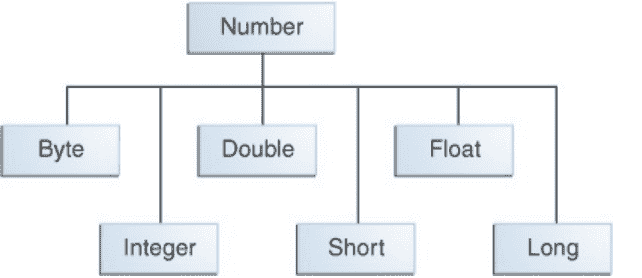

> **注意**
>
> 还有四个 Number 的子类在本文中未讨论。BigDecimal 和 BigInteger 用于高精度计算。

你可能使用 Number 对象 own原始类型的理由有三个：

- 作为期望对象的方法的参数（通常在操作数字集合时使用）。
- 使用类定义的常量，例如 MIN_VALUE 和 MAX_VALUE，它们提供了数据类型的上限和下界。
- 使用类方法将值转换为其他原始类型、从字符串转换，以及在不同数字系统（十进制、八进制、十六进制和二进制）之间转换。

下表列出了所有 Number 子类都实现的实例方法。

# 表 9.1. 所有 Number 子类实现的方法

| 方法 | 描述 |
| :--- | :--- |
| byte byteValue() | 将此 Number 对象的值转换为返回的原始数据类型。 |
| short shortValue() | |
| int intValue() | |
| long longValue() | |
| float floatValue() | |
| double doubleValue() | |
| int compareTo(Byte anotherByte) | 将此 Number 对象与参数进行比较。 |
| int compareTo(Double anotherDouble) | |
| int compareTo(Float anotherFloat) | |
| int compareTo(Integer anotherInteger) | |
| int compareTo(Long anotherLong) | |
| int compareTo(Short anotherShort) | |
| boolean equals(Object obj) | 判断此数字对象是否与参数相等。如果参数不为空、是相同类型且数值相同，则返回 true。对于 Double 和 Float 对象，Java API 文档中描述了一些额外要求。 |

每个 Number 类都包含其他用于数字与字符串之间转换、以及不同数字系统之间转换的方法。下表列出了 Integer 类中的这些方法。其他 Number 子类的方法也类似：

## 表 9.2. 转换方法，Integer 类

| 方法 | 描述 |
| :--- | :--- |
| static Integer decode(String s) | 将字符串解码为整数。可以接受十进制、八进制或十六进制数的字符串表示作为输入。 |
| static int parseInt(String s) | 返回一个整数（仅限十进制）。 |
| static int parseInt(String s, int radix) | 给输入的十进制、二进制、八进制或十六进制字符串（radix 分别等于 10, 2, 8 或 16），返回一个整数。 |
| static String toString() | 返回一个表示此 Integer 值的字符串。 |
| static String toString(int i) | 返回表示指定整数的字符串。 |
| static Integer valueOf(int i) | 返回一个持有原始类型值值的 Integer 对象。 |
| static Integer valueOf(String s) | 返回一个持有指定字符串表示值的 Integer 对象。 |
| static Integer valueOf(String s, int radix) | 返回一个持有指定字符串表示值的 Integer 对象，按 radix 值解析。例如，如果 s="333" 且 radix=8，该方法返回八进制数 333 对应的基整数。 |

### 格式化数值输出

之前你已经看到使用 `print` 和 `println` 方法将字符串打印到标准输出（System.out）。由于所有数字都可以转换为字符串（你将在本章稍后看到），你可以使用这些方法打印字符串和数字的任意混合。然而，Java 编程语言还有其他方法，允许你在包含数字时对打印输出进行更精细的控制。

### printf 和 format 方法

java.io 包包含 `PrintStream` 类，它拥有两个可以替代 `print` 和 `println` 的格式化方法。`format` 和 `printf` 方法是等价的。你熟悉的 `System.out` 正好就是一个 PrintStream 对象，因此你可以在 `System.out` 上调用 PrintStream 方法。所以，你可以在代码之前使用 `print` 或 `println` 的地方使用 `format` 或 `printf`。例如：

```
System.out.format(....);
```

这两个 java.io.PrintStream 方法的语法相同：

```
public PrintStream format(String format, Object... args);
```

其中 `format` 是一个指定所用格式的字符串，`args` 是一个要使用该格式打印的变量列表。一个简单的示例是：

```
System.out.format("The value of " + "the float variable is " + \
"%f, while the value of the " + "integer variable is %d, " + \
"and the string is %s", floatVar, intVar, stringVar);
```


第一个参数 `format` 是一个指定如何格式化第二个参数 `args` 中对象的字符串。格式字符串包含普通文本以及格式说明符（format specifiers），格式说明符是用于格式化 `Object... args` 参数的特殊字符。`Object... args` 的表示法被称为变长参数（varargs），意味着参数的数量可以变化。

格式说明符以百分号 (`%`) 开始，以转换器（converter）结束。转换器是一个指示要格式化的参数类型的字符。在百分号和转换器之间，可以有可选的标志（flags）和说明符。许多转换器、标志和说明符都记录在 `java.util.Formatter` 中。

这里是一个基础示例：

```java
int i = 461012;
System.out.format("The value of i is: %d%n", i);
```

`%d` 指定单个变量为十进制整数。`%n` 是一个平台无关换行符。输出是：

```
The value of i is: 461012
```

`printf` 和 `format` 方法是重载的。每个方法都有一个如下语法的版本：

```java
public PrintStream format(Locale l, String format, Object... args);
```

例如，要在法语系统中打印数字（在浮点数的英语表示法中，用逗号代替小数点），你将使用：

```java
System.out.format(Locale.FRANCE,
    "The value of the float " + "variable is %f, while the " + \
    "integer variable is %d, " + \
    "and the string is %s", floatVar, intVar, stringVar);
```

```java
public class DecimalFormatDemo {

    static public void customFormat(String pattern, double value) {

        DecimalFormat myFormatter = new DecimalFormat(pattern);
        String output = myFormatter.format(value);
        System.out.println(value + " " + pattern + " " + output);
    }

    static public void main(String[] args) {

        customFormat("###,###.###", 123456.789);
        customFormat("###.#####", 123456.789);
        customFormat("0000000.000", 123.78);
        customFormat("$###,###.###", 123456.67);
    }
}
```

### 输出如下：

```
123456.789 ###,###.### 123456.789
123456.789 ###.## 123456.79
```

下表解释了输出的每一行。

#### 表 9.5. DecimalFormat.java 输出

| 数 | 模式 | 输出 | 说明 |
| --- | --- | --- | --- |
| 123456.789 | ###,###.### | 123,456.789 | 井号 (`#`) 表示数字，逗号是分组分隔符的占位符，点是小数点分隔符的占位符。该值的小数点后有三位，但模式只有两位。`format` 方法通过四舍五入处理此情况。模式指定了前导零和尾零，因为它使用了 `0` 字符而不是井号 (`#`)。模式中的第一个字符是美元符号 (`$`)。请注意它紧跟在格式化输出中最左侧的数字之前。 |
| 123456.789 | ###.## | 123456.79 | |
| 123.78 | 000000.000 | 000123.780 | |
| 12345.67 | $$$,###.### | $12,345.67 | |

### 基础算术运算

Java 编程语言通过其算术运算符支持基础算术运算：`+`、`-`、`*`、`/` 和 `%`。`java.lang` 包中的 `Math` 类提供了用于高级数学计算的方法和常量。

`Math` 类中的方法都是静态的，因此你可以直接从类调用它们，例如：

```java
Math.cos(angle);
```

> **注意**
>
> 使用静态导入语言特性，你不需要在每个数学函数前面写 `Math`：
>
> ```java
> import static java.lang.Math.*;
> ```
>
> 这允许你通过简单名称调用 `Math` 类方法。例如：
>
> ```java
> cos(angle);
> ```

### 常量和基础方法

`Math` 类包含两个常量：

- `Math.E`，它是自然对数的底，
- `Math.PI`，它是圆周长与直径的比率。

`Math` 类还包含 40 多个静态方法。下表列出了一些基础方法。

#### 表 9.6. 基础 Math 方法

| 方法 | 描述 |
| --- | --- |
| `double abs(double d)` | 返回参数的绝对值。 |
| `float abs(float f)` | |
| `int abs(int i)` | |
| `long abs(long lng)` | |
| `double ceil(double d)` | 返回大于或等于参数的最小整数。以 double 类型返回。 |
| `double floor(double d)` | 返回小于或等于参数的最大整数。以 double 类型返回。 |
| `double rint(double d)` | 返回数值上最接近参数的整数。以 double 类型返回。 |
| `long round(double d)` | 根据方法的返回类型指示，返回与参数最接近的 long 或 int。 |
| `double min(double arg1, double arg2)` | 返回两个参数中较小的。 |
| `float min(float arg1, float arg2)` | |
| `int min(int arg1, int arg2)` | |
| `long min(long arg1, long arg2)` | |
| `double max(double arg1, double arg2)` | 返回两个参数中较大的。 |
| `float max(float arg1, float arg2)` | |
| `int max(int arg1, int arg2)` | |
| `long max(long arg1, long arg2)` | |

接下来的程序 `BasicMathDemo` 演示了如何使用这些方法中的一些：

```java
public class BasicMathDemo {

    public static void main(String[] args) {

        double a = -191.635;

        double b = 43.74;

        double c = 16, d = 45;

        System.out.printf("The absolute value of " + a + " is %.3f is %.0f%n",
                          a, Math.abs(a));

        System.out.printf("The ceiling of " + b + " is %.2f is %.0f%n",
                          b, Math.ceil(b));

        System.out.printf("The floor of " + b + " is %.2f is %.0f%n",
                          b, Math.floor(b));

        System.out.printf("The rint of %.2f is %.2f is %.0f%n",
                          b, Math.rint(b));

        System.out.printf("The max of %.2f is %.2f is %.0f%n",
                          c, Math.max(c));

        System.out.printf("The min of %.2f is %.2f is %.0f%n",
                          d, Math.min(d));
    }
}
```


| 123456.789 | ###,###.### | 123,456.789 | 井号 (`#`) 表示数字，逗号是分组分隔符的占位符，点是小数点分隔符的占位符。该值的小数点后有三位，但模式只有两位。`format` 方法通过四舍五入处理此情况。模式指定了前导零和尾零，因为它使用了 `0` 字符而不是井号 (`#`)。模式中的第一个字符是美元符号 (`$`)。请注意它紧跟在格式化输出中最左侧的数字之前。 |

| 123456.789 | ###.## | 123456.79 | |

| 123.78 | 000000.000 | 000123.780 | |

| 12345.67 | $$$,###.### | $12,345.67 | |

## 基础算术运算

Java 编程语言通过其算术运算符支持基础算术运算：`+`、`-`、`*`、`/` 和 `%`。`java.lang` 包中的 `Math` 类提供了用于更高级数学计算的方法和常量。

`Math` 类中的方法都是静态的，因此你可以直接从类调用它们，例如：

```
Math.cos(angle);
```

> **注意**
>
> 使用静态导入语言特性，你不需要在每个数学函数前面写 `Math`：
>
> ```java
> import static java.lang.Math.*;
> ```
>
> 这允许你通过简单名称调用 `Math` 类方法。例如：
>
> ```
> cos(angle);
> ```

## 常量和基础方法

`Math` 类包含两个常量：

- `Math.E`，它是自然对数的底，
- `Math.PI`，它是圆周长与直径的比率。

`Math` 类还包含 40 多个静态方法。下表列出了一些基础方法。

### 表 9.6. 基础 Math 方法

| 方法 | 描述 |
| --- | --- |
| `double abs(double d)` | 返回参数的绝对值。 |
| `float abs(float f)` | |
| `int abs(int i)` | |
| `long abs(long lng)` | |
| `double ceil(double d)` | 返回大于或等于参数的最小整数。以 double 类型返回。 |
| `double floor(double d)` | 返回小于或等于参数的最大整数。以 double 类型返回。 |
| `double rint(double d)` | 返回数值上最接近参数的整数。以 double 类型返回。 |
| `long round(double d)` | 根据方法的返回类型指示，返回与参数最接近的 long 或 int。 |
| `double min(double arg1, double arg2)` | 返回两个参数中较小的。 |
| `float min(float arg1, float arg2)` | |
| `int min(int arg1, int arg2)` | |
| `long min(long arg1, long arg2)` | |
| `double max(double arg1, double arg2)` | 返回两个参数中较大的。 |
| `float max(float arg1, float arg2)` | |
| `int max(int arg1, int arg2)` | |
| `long max(long arg1, long arg2)` | |

接下来的程序 **BasicMathDemo** 演示了如何使用这些方法中的一些：

```java
public class BasicMathDemo {

    public static void main(String[] args) {

        double a = -191.635;

        double b = 43.74;

        double c = 16, d = 45;

        System.out.printf("The absolute value of " + a + " is %.3f is %.0f%n",
                          a, Math.abs(a));

        System.out.printf("The ceiling of " + b + " is %.2f is %.0f%n",
                          b, Math.ceil(b));

        System.out.printf("The floor of " + b + " is %.2f is %.0f%n",
                          b, Math.floor(b));

        System.out.printf("The rint of %.2f is %.2f is %.0f%n",
                          b, Math.rint(b));

        System.out.printf("The max of %.2f is %.2f is %.0f%n",
                          c, Math.max(c));

        System.out.printf("The min of %.2f is %.2f is %.0f%n",
                          d, Math.min(d));
    }
}
```

### 该程序的输出如下：

```
The value of pi is 3.1416
The sine of 45.0 degrees is 0.7071
The cosine of 45.0 degrees is 0.7071
The tangent of 45.0 degrees is 1.0000
The arcsine of 0.7071 is 45.0000 degrees
The arccosine of 0.7071 is 45.0000 degrees
The arctangent of 1.0000 is 45.0000 degrees
```

## 随机数

`random()` 方法返回 0.0 到 1.0 之间的伪随机数。该范围包含 0.0 但不包含 1.0。换句话说：`0.0 <= Math.random() < 1.0`。若要获取不同范围内的数字，可以对 `random` 方法返回的值进行算术运算。例如，要生成一个 0 到 9 之间的整数，你可以写道：

```
int number = (int)(Math.random() * 10);
```

通过将该值乘以 10，可能值的范围变为 `0.0 <= number < 10.0`。

当你需要生成单个随机数时，使用 `Math.random` 就的。如果你需要生成一组随机数，应该创建一个 `java.util.Random` 实例并调用该对象的方法来生成数字。

## 自动装箱与拆箱

自动装箱是 Java 编译器在基本类型与其对应的对象包装类之间进行并完成的自动转换。例如，将 `int` 转换为 `Integer`，将 `double` 转换为 `Double` 等。如果转换反过来进行，则称为拆箱。

以下是自动装箱的最简单示例：

```
Character ch = 'a';
```

本节中的其余示例都使用了泛型。如果你还不熟悉泛型的语法，请参阅第 7 章。

考虑以下代码：

```
List<Integer> li = new ArrayList<>();
for (int i = 1; i < 50; i += 2)
    li.add(i);
```

尽管你将 `int` 值作为基本类型而非 `Integer` 对象添加到 `li` 中，但代码仍然是可以编译的。因为 `li` 是 `Integer` 对象的列表，而不是 `int` 值的列表，你可能会疑惑为什么 Java 编译器没有发出编译时错误。编译器没有生成错误，是因为它从 `i` 创建了一个 `Integer` 对象并将该对象添加到 `li` 中。因此，编译器在运行时将之前的代码转换为以下内容：

```
List<Integer> li = new ArrayList<>();
for (int i = 1; i < 50; i += 2)
    li.add(Integer.valueOf(i));
```

将基本值（例如一个 `int`）转换为相应包装类的对象（`Integer`）的过程被称为自动装箱。当基本值满足以下情况时，Java 编译器会应用自动装箱：

- 作为参数传递给一个期望对应包装类对象的方法。
- 赋值给对应包装类的变量。

考虑以下方法：

```java
public static int sumEven(List<Integer> li) {
    int sum = 0;
    for (Integer i : li) {
        if (i % 2 == 0) {
            sum += i;
        }
    }
    return sum;
}
```

因为取模运算符 (`%`) 和二元加运算符 (`+=`) 不适用于 `Integer` 对象，你可能会疑惑为什么 Java 编译器编译该方法时没有发出任何错误。编译器没有生成错误，是因为它在运行时调用了 `intValue` 方法将 `Integer` 转换为 `int`：

```java
public static int sumEven(List<Integer> li) {
    int sum = 0;
    for (Integer i : li) {
        if (i.intValue() % 2 == 0) {
            sum += i.intValue();
        }
    }
    return sum;
}
```

将包装类型的对象（`Integer`）转换为其对应的基本类型（`int`）值的过程被称为拆箱。当包装类对象满足以下情况时，Java 编译器会应用拆箱：

- 作为参数传递给一个期望对应基本类型值的方法。
- 赋值给对应基本类型的变量。

拆箱示例展示了它是如何工作的：

```java
import java.util.ArrayList;
import java.util.List;

public class Unboxing {
    public static void main(String[] args) {
        Integer i = new Integer(-8);

        // 1. 通过方法调用进行拆箱
        int absVal = absoluteValue(i);
        System.out.println("absolute value of " + i + " = " + absVal);

        List<Double> ld = new ArrayList<>();

        ld.add(3.1416);    // π 通过方法调用进行自动装箱

        // 2. 通过赋值进行拆箱
        double pi = ld.get(0);

        System.out.println("pi = " + pi);
    }

    public static int absoluteValue(int i) {
        return (i < 0) ? -i : i;
    }
}
```

程序打印以下内容：

```
absolute value of -8 = 8
pi = 3.1416
```

自动装箱和拆箱让开发者能够编写更整洁的代码使其更容易阅读。下表列出了基本类型及其对应的包装类：

### 基本类型与包装类

| 基本类型 | 包装类 |
| --- | --- |
| `boolean` | `Boolean` |
| `byte` | `Byte` |
| `char` | `Character` |
| `float` | `Float` |
| `int` | `Integer` |
| `long` | `Long` |
| `short` | `Short` |
| `double` | `Double` |

## 总结

自动装箱和拆箱让开发者能够编写更整洁的代码使其更容易阅读。`Number` 类包含了各种方法，将基本类型转换为字符串。`Math` 类也包含了许多有用的数学函数。

# 问题与练习：数字

## 问题

1. 使用 API 文档找到以下问题的答案：
   a. 使用什么方法将 `int` 转换为十六进制？例如，如何将 65 转换？
   b. 使用什么方法可以将“230” 转换为 `int`？显示代码。
   c. 使用什么方法可以检测浮点数是否具有特殊值 NaN？

2. 下列表达式的值是多少，为什么？

```
Integer.valueOf(1).equals(Long.valueOf(1))
```

## 练习

1. 将 `MaxVariables` 修改为显示最小值而不是最大值。删除所有与 `char` 相关的代码。

2. 创建一个程序从命令行读取任意数量的整数参数并相加。例如，假设你输入：

```
java Adder 1 3 2
```

程序应该显示 16 然后退出。如果用户只输入一个参数，程序应该显示错误信息。

3. 创建一个与上一个类似的程序，但有以下不同：
   - 它不是读取整数参数，而是读取浮点参数。
   - 它显示参数的和，小数点后恰好有两位。例如，假设你输入：

```
java FPAdder 1 1e2 3.0 4.754
```

程序将显示 108.75。根据你的区域，小数点可能是逗号 (`,`) 而不是点 (`.`)。

## 答案

你可以在此处找到这些问题和练习的答案：`http://docs.oracle.com/javase/tutorial/java/data/QandE/numbers-answers.html`

# 字符

大多数情况下，如果你在使用单个字符值，你会使用基本类型 `char`。例如：

```
char ch = 'a';

// 大写希腊字母 omega 字符的 Unicode
char uniChar = '\u03A9';

// 字符数组
char[] charArray = {'a', 'b', 'c', 'd', 'e' };
```

然而，有时你需要将 `char` 作为对象使用——例如，作为期望对象的方法参数。Java 编程语言提供了一个包装类，为此目的将 `char` 包装在 `Character` 对象中。类型为 `Character` 对象包含单个字段，其类型为 `char`。此 `Character` 类提供了许多有用的类方法（即静态方法）来处理字符。

你可以使用 `Character` 构造函数创建一个 `Character` 对象：

```
Character ch = new Character('a');
```

在某些情况下，Java 编译器也会为你创建一个 `Character` 对象。例如，如果你将原始类型 `char` 传递给一个期望对象类型的方法，编译器会自动将 `char` 转换为 `Character`。这种特性被称为自动装箱——如果转换反过来则称为自动拆箱。有关自动装箱和拆箱的更多信息，请参阅“自动装箱与拆箱”。

> **注意**
>
> `Character` 类是不可变的，因此一旦创建，`Character` 对象就无法更改。

下表列出了 `Character` 类中一些非常有用的方法，但并非穷尽。若要查看此类中所有方法的完整列表（超过 50 个），请参考 `java.lang.Character` API 规范。

### 表 9.10. Character 类中的实用方法

| 方法 | 描述 |
| --- | --- |
| `boolean isLetter(char ch)` | 确定指定的 `char` 值是否为字母或数字。 |
| `boolean isDigit(char ch)` | |
| `boolean isWhitespace(char ch)` | 确定指定的 `char` 值是否为空白字符。 |
| `boolean isUpperCase(char ch)` | 确定指定的 `char` 值是否为大写或小写。 |
| `boolean isLowerCase(char ch)` | |
| `char toUpperCase(char ch)` | 返回指定的 `char` 值的大写或小写形式。 |
| `char toLowerCase(char ch)` | |
| `toString(char ch)` | 返回一个表示指定字符值的 `String` 对象——即一个单字符字符串。 |

## 转义序列

以反斜杠 (`\`) 开头的字符是转义序列，对编译器具有特殊含义。下表显示了 Java 转义序列：

### 表 9.11. 转义序列

| 转义序列 | 描述 |
| --- | --- |
| `\t` | 在文本此处插入一个制表符。 |
| `\b` | 在文本此处插入一个退格符。 |
| `\n` | 在文本此处插入一个换行符。 |
| `\r` | 在文本此处插入一个回车符。 |
| `\f` | 在文本此处插入一个换分页符。 |
| `\'` | 在文本此处插入一个单引号字符。 |
| `\"` | 在文本此处插入一个双引号字符。 |
| `\\` | 在文本此处插入一个反斜杠字符。 |

在打印语句中遇到转义序列时，编译器会相应解释。例如，如果你想在引号内部包含引号，必须在内部引号上使用转义序列 `\"`。要打印句子

```
She said "Hello!" to me.
```

你应该这样写：

```
System.out.println("She said \"Hello!\" to me.");
```

## 字符串

字符串在 Java 编程中广泛使用，它是字符序列。在 Java 编程语言中，字符串是对象。Java 平台提供了 `String` 类来创建和操作字符串。

## 创建字符串

创建字符串最直接的方法是编写：

```
String greeting = "Hello world!";
```


在这种情况下，"Hello world!" 是一个字符串字面量——代码中用双引号括起来的一系列字符。每当编译器在代码中遇到字符串字面量时，都会创建一个带有其值的 `String` 对象——在此例，值是 Hello world。

与任何其他对象一样，你可以通过 `new` 关键字和构造函数来创建 `String` 对象。`String` 类有十三个构造函数，允许你使用不同的源提供字符串的初始值，例如字符数组：

```java
char[] helloArray = { 'h', 'e', 'l', 'l', 'o', '.', '.' };

String helloString = new String(helloArray);

System.out.println(helloString);
```

这段代码片段的最后一行显示 hello。

> **注意**
>
> `String` 类是不可变的，因此一旦创建，`String` 对象就无法更改。`String` 类有许多方法，其中一些将在下讨论，这些方法似乎会修改字符串。由于字符串是不可变的，这些方法实际执行的是创建并返回一个包含操作结果的新字符串。

## 字符串长度

用于获取对象信息的方法称为访问器方法（accessor methods）。你可以与字符串一起使用的访问器方法是 `length()` 方法，它返回字符串对象中包含的字符数。在执行以下两行代码后，`len` 等于 17：

```java
String palindrome = "Dot saw I was Tod";

int len = palindrome.length();
```

回文（palindrome）是指正称的单词或句子——在忽略大小写和标点符号的情况下，正读和反读是一样的。这里有一个简单但低效的反转回文字符串的程序。它调用了 `String` 方法 `charAt(int index)`，该方法返回字符串中指定索引处的字符。（注意字符串的第一个字符位于索引 0。）

```java
public class StringDemo {

    public static void main(String[] args) {

        String palindrome = "Dot saw I was Tod";

        int len = palindrome.length();

        char[] tempCharArray = new char[len];
        char[] charArray = new char[len];

        // 将原始字符串放入一个
        // 字符数组
        for (int i = 0; i < len; i++) {
            tempCharArray[i] = palindrome.charAt(i);
        }

        // 反转字符数组
        for (int j = 0; j < len; j++) {
            charArray[j] = tempCharArray[len - 1 - j];
        }

        String reversePalindrome = new String(charArray);
        System.out.println(reversePalindrome);
    }
}
```

运行该程序会输出：

```
do saw I to
```

为了完成字符串反转，程序必须将字符串转换为字符数组（第一个循环），反转数组（第二个循环），然后转换回字符串。`String` 类包含 `getChars()` 方法，可以将字符串或字符串的一部分转换为字符数组：

```java
palindrome.getChars(0, len, tempCharArray, 0);
```

## 字符串拼接

`String` 类包含一个连接两个字符串的方法：

```java
string1.concat(string2);
```

这返回一个在 `string1` 末尾添加了 `string2` 的新字符串。你也可以对字符串字面量使用 `concat()` 方法，例如：

```java
"My name is ".concat("Rumplestiltskin");
```

字符串更通常使用 `+` 运算符进行拼接，例如：

```java
"Hello," + " world" + "!";
```

结果为 "Hello, world!"

`+` 运算符广泛用于打印语句。例如：

```java
String string1 = "saw I was ";
System.out.println("Dot " + string1 + "Tod");
```

输出 Dot saw I Tod

这种拼接可以是任何对象的混合。对于每个非 `String` 对象，都会调用其 `toString()` 方法将其转换为 `String`。

> **注意**
>
> Java 编程语言不允许字符串字面量跨行，因此在多行字符串的每行末尾必须使用 `+` 拼接运算符。例如：
>
> ```java
> String quote = "Now is the time for all good " +
>     "men to come to the aid of their country.";
> ```
>
> 使用 `+` 运算符分割字符串在打印语句中再次非常常见。

## 创建格式化字符串

你已经见过使用 `printf()` 和 `format()` 方法打印格式化数字。`String` 类有一个等效的类方法 `format()`，它返回一个 `String` 对象而不是 `PrintStream` 对象。

使用 `String` 的静态 `format()` 方法允许你创建一个可以重复使用的格式化字符串，而不是一次性的打印语句。例如，与其使用：

```java
System.out.printf("The value of the float " +
    "variable is %f, while " +
    "the value of the " +
    "integer variable is %d, " +
    "and the string is %s",
    floatVar, intVar, stringVar);
```

你可以写：

```java
String fs;
fs = String.format("The value of the float " +
    "variable is %f, while " +
    "the value of the " +
    "integer variable is %d, " +
    "and the string is %s",
    floatVar, intVar, stringVar);
System.out.println(fs);
```

## 数字与字符串之间的转换

经常，程序结束时字符串对象中会包含数值数据——例如，用户输入的值。

`Number` 子类封装了原始数值类型（`Byte`、`Integer`、`Double`、`Float`、`Long` 和 `Short`），每个子类都提供一个名为 `valueOf` 的方法，可以将字符串转换为该类型的对象。这里有一个示例 `ValueOfDemo`，它从命令行获取两个字符串，将它们转换为数字，并对这些值进行算术操作：

```java
public class ValueOfDemo {

    public static void main(String[] args) {

        // 此程序需要两个

        // 命令行参数

        if (args.length == 2) {

            // 将字符串转换为数字

            float a = (Float.valueOf(args[0])).floatValue();

            float b = (Float.valueOf(args[1])).floatValue();

            // 执行一些算术操作
            System.out.println("a + b = " +
            (a + b));

            System.out.println("a - b = " +
            (a - b));

            System.out.println("a * b = " +
            (a * b));

            System.out.println("a / b = " +
            (a / b));

            System.out.println("a % b = " +
            (a % b));
        } else {
            System.out.println("This program " +
                "requires two command-line arguments.");
        }
    }
}
```

当你使用 4.5 和 87.2 作为命令行参数时，程序的输出如下：

```
a + b = 91.7
a - b = -82.7
a * b = 392.4
a / b = 0.05016055
a % b = 4.5
```

每个封装原始数值类型的 `Number` 子类还提供了一个 `parseXXX()` 方法（例如 `parseFloat()`），可用于将字符串转换为原始数字。由于返回的是对象内部原始类型，因此 `parseFloat()` 方法比 `valueOf()` 方法更直接。例如，在 `ValueOfDemo` 程序中，我们可以使用：

```java
float a = Float.parseFloat(args[0]);
float b = Float.parseFloat(args[1]);
```

## 将数字转换为字符串

有时，你需要将数字转换为字符串，因为你需要对其字符串形式的值进行操作。有几种简单的方法可以将数字转换为字符串：

```java
int i;

// 将 "i" 与空字符串拼接；转换由系统处理
String s1 = "" + i;
```

或者

```java
// 使用 valueOf 类方法。
String s2 = String.valueOf(i);
```

每个 `Number` 子类都包含一个类方法 `toString()`，它可以将其对应的原始类型转换为字符串。例如：

```java
int i;
double d;

String s3 = Integer.toString(i);
String s4 = Double.toString(d);
```

`ToStringDemo` 示例使用了 `toString` 方法将数字转换为字符串。随后程序使用一些字符串方法来计算小数点前后的位数：

```java
public class ToStringDemo {

    public static void main(String[] args) {

        double d = 858.48;

        String s = Double.toString(d);

        int dot = s.indexOf('.');

        System.out.println(dot + " digits " +
            "before decimal point.");

        System.out.println((s.length() - dot - 1) +
            " digits after decimal point.");

    }
}
```

该程序的输出为：

```
3 digits before decimal point.
2 digits after decimal point.
```

## 操作字符串中的字符

`String` 类有许多方法用于检查字符串内容、查找字符串中的字符或子串、改变大小以及其他任务。

## 通过索引获取字符和子串

你可以通过调用 `charAt()` 方法获取字符串特定索引处的字符。第一个字符的索引为 0，而最后一个字符的索引为 `length() - 1`。例如，以下代码获取字符串中索引 9 处的字符：

```java
String anotherPalindrome = "Niagara. O roar again!";
char aChar = anotherPalindrome.charAt(9);
```

索引从 0 开始，因此索引 9 处的字符是‘O’如下所示：

**图 9.2. 索引 9 处的字符**

| 0 | 1 | 2 | 3 | 4 | 5 | 6 | 7 | 8 | 9 | 10 | 11 | 12 | 13 | 14 | 15 | 16 | 17 | 18 | 19 | 20 | 21 |
|---|---|---|---|---|---|---|---|---|---|---|---|---|---|---|---|---|---|---|---|---|---|
| N | i | a | g | a | r | a | . | | O | | r | o | a | r | | a | g | a | i | n | ! |

```
charAt(0) charAt(9) charAt(length()-1)
```

如果你想从字符串中获取多个字符，可以使用 `substring` 方法。`substring` 方法有两个版本，如下表所示：

**表 9.12. Substring 方法**

| Method | Description |
| --- | --- |
| `String substring(int beginIndex, int endIndex)` | 返回从 beginIndex 到 endIndex 的序列。 |
| `String substring(int startIndex)` | 返回从 startIndex 到结束的字符串拷贝。 |

## 在字符串中查找字符和子串

这里是其他用于在字符串中查找字符或子串的方法。`String` 类提供了访问方法，返回特定字符在字符串中的位置。`indexOf()` 方法从字符串开始向前查找，而 `lastIndexOf()` 方法从字符串结束向后查找。如果未找到字符或子串，`indexOf()` 和 `lastIndexOf()` 将返回 -1。

`String` 类还提供搜索方法 `contains`，如果字符串包含指定的字符序列则返回 true。当你只需要知道字符串是否包含某个字符而不关心精确位置时，可以使用此方法。

下表描述了各种搜索方法。

**表 9.13. Search 方法**

| Method | Description |
| --- | --- |
| `int indexOf(int ch)` | 返回指定字符第一次（或最后）出现的索引。 |
| `int lastIndexOf(int ch)` | |
| `int indexOf(int ch, int fromIndex)` | 返回指定字符第一次（或最后）出现的索引，从 fromIndex 开始向前查找 |
| `int lastIndexOf(int ch, int fromIndex)` | 从指定的索引反向查找。 |
| `int indexOf(String str)` | 返回指定子串第一次（或最后）出现的索引。 |
| `int lastIndexOf(String str)` | |
| `int indexOf(String str, int fromIndex)` | 返回指定子串第一次（或最后）出现的索引，从 fromIndex 开始向前查找 |
| `int lastIndexOf(String str, int fromIndex)` | 从指定的索引反向查找。 |
| `boolean contains(CharSequence s)` | 如果字符串包含指定的字符序列则返回 true。 |

**表 9.14. Replace 方法**

| Method | Description |
| --- | --- |
| `String replace(char oldChar, char newChar)` | 返回一个新字符串，其中该字符串中所有出现的 `oldChar` 都替换为 `newChar`。 |
| `String replace(CharSequence target, CharSequence replacement)` | 将此字符串中每个匹配字面目标序列的子字符串替换为指定的字面替换序列。 |
| `String replaceAll(String regex, String replacement)` | 将此字符串中每个匹配给定正则表达式的子字符串替换为指定的替换字符串。 |
| `String replaceFirst(String regex, String replacement)` | 将此字符串中第一个匹配给定正则表达式的子字符串替换为指定的替换字符串。 |

### 示例

下面的 `Filename` 类说明了如何使用 `lastIndexOf()` 和 `substring()` 来分离名称的不同部分。

> **注意**
>
> 以下 `Filename` 类中的方法没有进行任何错误检查，并假设参数包含完整的目录路径和带有扩展的文件名。如果这些方法是生产代码，它们将验证参数是否构造正确。


```java
public class Filename {

    private String fullPath;

    private char pathSeparator;

    extensionSeparator;

    public Filename(String str, char sep, char ext) {
        fullPath = str;

        pathSeparator = sep;

        extensionSeparator = ext;
    }

    public String extension() {
        int dot = fullPath.lastIndexOf(extensionSeparator);

        return fullPath.substring(dot + 1);
    }

    // 获取不带扩展的文件名
    public String filename() {
        int dot = fullPath.lastIndexOf(extensionSeparator);
        int sep = fullPath.lastIndexOf(pathSeparator);

        return fullPath.substring(sep + 1, dot);
    }

    public String path() {
        int sep = fullPath.lastIndexOf(pathSeparator);

        return fullPath.substring(0, sep);
    }
}
```

这是一个程序 `FilenameDemo` 构造了一个 `Filename` 对象并调用了它的所有方法：

```java
public class FilenameDemo {
    public static void main(String[] args) {
        final String FPATH = "/home/user/index.html";
        Filename myHomePage = new Filename(FPATH, '/', '.');
        System.out.println("Extension = " + myHomePage.extension());
        System.out.println("Filename = " + myHomePage.filename());
        System.out.println("Path = " + myHomePage.path());
    }
}
```

这里是程序的输出结果：

```
Extension = html
Filename = index
Path = /home/user
```

如下所示所示，我们的 `extension` 方法使用 `lastIndexOf` 来定位文件名中点（.）的最后一次出现。然后 `substring` 使用 `lastIndexOf` 的返回值提取文件扩展名——即从点到字符串末尾的子字符串。这段代码假设文件名包含一个点；如果文件名没有点，`lastIndexOf` 将返回 -1，且 `substring` 方法将抛出 `StringOutOfBoundsException`。

## 图 9.4. 分离文件名的不同部分

```
substring (sep+1,dot)
/home/user/index.html
sep = lastIndexOfOf (/)
dot = lastIndexOfOf ('.')
```

此外，注意 `extension` 方法使用 `dot + 1` 作为 `substring` 的参数。如果点字符（.）是字符串的最后一个字符，`dot + 1` 等于字符串的长度，这比字符串中最大的索引大 1（因为索引从 0 开始）。这是 `substring` 的合法参数，因为该方法接受等于但不大于字符串长度的索引，并将其解释为“字符串的末尾”。

## 比较字符串和字符串子部分

`String` 类有许多用于比较字符串和字符串子部分的方法。下表列出了这些方法。

## 表 9.16. 比较字符串的方法

| 方法 | 说明 |
| --- | --- |
| boolean endsWith(String suffix) | 如果此字符串以方法参数指定的子字符串结尾或开头，则返回 true。 |
| boolean startsWith(String prefix, int offset) | 从索引 `offset` 处开始考虑字符串，如果它以参数指定的子字符串开头，则返回 true。 |
| int compareTo(String anotherString) | 按照字典顺序将两个字符串进行比较。返回一个整数，指示此字符串是大于（结果 > 0）、等于（结果 = 0）还是小于（结果 < 0）参数字符串。 |
| int compareIgnoreCase(String str) | 按照字典顺序比较两个字符串，忽略大小写差异。返回一个整数，指示此字符串是大于（结果 > 0）、等于（结果 = 0）还是小于（结果 < 0）参数字符串。 |
| boolean equals(Object anObject) | 当且仅当参数是一个 `String` 对象且其代表与此对象相同的字符序列时，返回 true。 |
| boolean equalsIgnoreCase(String anotherString) | 当且仅当参数是一个 `String` 对象且其代表与此对象相同的字符序列（忽略大小写）时，返回 true。 |
| boolean regionMatches(int toffset, String other, int offset, int len) | 测试此字符串的指定区域是否匹配 String 参数的指定区域。该区域长度为 `len`，并从此字符串的 `toffset` 开始。 |
| boolean regionMatches(boolean ignoreCase, int toffset, String other, int offset, int len) | 测试此字符串的指定区域是否匹配 String 参数的指定区域。boolean 参数表示是否应该忽略大小写。 |
| boolean matches(String regex) | 测试此字符串是否匹配正则表达式。正则表达式将在第 14 章讨论。 |

下面的程序 `RegionDemo` 使用 `regionMatches` 在另一个字符串中搜索字符串：

```java
public class RegionDemo {

    public static void main(String[] args) {
        String searchMe = "Green Eggs and Ham";

        String findMe = "Eggs";

        int searchLength = searchMe.length();

        int findMeLength = findMe.length();

        boolean foundIt = false;

        for (int i = 0; i <= (searchLength - findMeLength); i++) {
            if (searchMe.regionMatches(true, findMe, i, findMeLength)) {
                foundIt = true;
                System.out.println(searchMe.substring(i, i + findMeLength));
                break;
            }
        }
        if (!foundIt)
            System.out.println("No match found.");
    }
}
```

该程序的输出是 `Eggs`。程序逐字符地遍历字符串 `searchMe`。对于每个字符，程序调用 `regionMatches` 方法来确定从当前字符开始的子字符串是否匹配程序要查找的内容。

# StringBuilder 类

`StringBuilder` 对象类似于 `String` 对象，但它们是可以被修改的。在内部，这些对象被处理为包含字符序列的可变数组。在任何点，都可以通过方法更改序列的长度和内容。

应该始终使用 `String`，除非 `StringBuilder` 在代码简化（见本节末尾的示例程序）或性能方面具有优势。例如，如果你需要拼接大量字符串，使用 `StringBuilder` 更高效。

## 长度和容量

`StringBuilder` 类像 `String` 类一样，有一个 `length()` 方法返回构建器中字符序列的长度。

与字符串不同，每个 `StringBuilder` 还有一个容量，即分配的字符空间。通过 `capacity()` 方法返回的容量始终大于等于长度（通常大于），并会根据向构建器的添加情况自动扩展。

### 表 1.17. StringBuilder 构造函数

| 构造函数 | 描述 |
| --- | --- |
| StringBuilder() | 创建一个容量为 16（16 个元素）的空 StringBuilder。 |
| StringBuilder(CharSequence cs) | 构造一个包含与指定的 `CharSequence` 相同字符的 StringBuilder，并在 `CharSequence` 后面额外添加 16 个空元素。 |
| StringBuilder(int initCapacity) | 创建一个具有指定初始容量的空 StringBuilder。 |
| StringBuilder(String s) | 创建一个值由指定的字符串初始化的 StringBuilder，并在该字符串后面额外添加 16 个空元素。 |

例如，以下代码

```java
// 创建空构建器，容量为 16
StringBuilder sb = new StringBuilder();

// 在开头添加 9 个字符的字符串
sb.append("Greetings");
```

将产生一个长度为 9、容量为 16 的 StringBuilder：

## 图 9.5. 创建 StringBuilder

| 0 1 2 3 4 5 6 7 8 9 10 11 12 13 14 15 |
| --- |
| G r e t i n g s | | |
| length() = 9 | capacity() = 16 | |

`StringBuilder` 类具有一些与长度和容量相关的方法，而 `String` 类并没有这些方法：

## 表 9.18. 长度与容量方法

| 方法 | 说明 |
| --- | --- |
| void setLength(int maxLength) | 设置字符序列的长度。如果 newLength 小于 length()，则字符序列中末尾的字符将被截断。如果 newLength 大于 length()，则会在字符序列的末尾添加空字符。 |
| void ensureCapacity(int minCapacity) | 确保容量至少等于指定的最小容量。 |

许多操作（例如 `append()`、`insert()` 或 `setLength()`）可以增加 `StringBuilder` 中字符序列的长度，导致结果的 `length()` 大于当前的 `capacity()`。当发生这种情况时，容量会自动增加。

## StringBuilder 操作

`StringBuilder` 中 `String` 类不具备的主要操作是 `append()` 和 `insert()` 方法，这些方法经过了重载，可以接受任何类型的数据。每种方法都会将其参数转换为字符串，然后将字符串的字符附加或插入到 `StringBuilder` 的字符序列中。`append` 方法始终将这些字符添加到现有字符序列的末尾，而 `insert` 方法则将字符添加到指定位置。

以下是 `StringBuilder` 类的一些方法。

## 表 9.19. 各种 StringBuilder 方法

| 方法 | 说明 |
| --- | --- |
| StringBuilder append(boolean b) | 将参数附加到此字符串 |
| StringBuilder append(char c) | 在执行添加操作之前，将数据转换为字符串。 |
| StringBuilder append(char[] str) | |
| StringBuilder append(char[] str, int offset, int offset, int len) | |
| StringBuilder append(double d) | |
| StringBuilder append(float f) | |
| StringBuilder append(int i) | |
| StringBuilder append(long lng) | |
| StringBuilder append(Object obj) | |
| StringBuilder append(String s) | |
| StringBuilder delete(int start, int end) | 第一个方法删除 StringBuilder 字符序列中从 start 到 end-1（包含）的子序列。第二个方法删除位于指定索引处的字符。 |
| StringBuilder deleteCharAt(int index) | |
| StringBuilder insert(int offset, boolean b) | 将参数插入到 StringBuilder 中。第一个整数参数表示要插入数据之前的索引。在执行插入操作之前，将数据转换为字符串。 |
| StringBuilder insert(int offset, char c) | |
| StringBuilder insert(int offset, char[] str) | |
| StringBuilder insert(int index, char[] str, int offset, int len) | |
| StringBuilder insert(int offset, double d) | |
| StringBuilder insert(int offset, float f) | |
| StringBuilder insert(int offset, int i) | |
| StringBuilder insert(int offset, long lng) | |
| StringBuilder insert(int offset, Object obj) | |
| StringBuilder insert(int offset, String s) | |
| StringBuilder replace(int start, int end, String s) | 替换此 StringBuilder 中指定的字符。 |
| void setCharAt(int index, char c) | |
| StringBuilder reverse() | 反转 StringBuilder 中字符的顺序。 |
| String toString() | 返回一个包含构建器中字符序列的字符串。 |

> **注意**
>
> 你可以通过使用 `StringBuilder` 类的 `toString()` 方法将 `StringBuilder` 转换为字符串，以便在 `StringBuilder` 对象上使用任何方法。然后使用 `StringBuilder(String str)` 构造函数将字符串转换回 `StringBuilder`。

### 示例

在“Strings”节中列出的 `StringDemo` 程序是一个示例，如果使用 `StringBuilder` 代替 `String`，该程序将会更高。

`StringDemo` 反转了一个回文。这里再次是它的代码列表：

```java
public class StringDemo {
    public static void main(String[] args) {
        String palindrome = "Dot saw I was Tod";
        int len = palindrome.length();
        char[] tempCharArray = new char[len];
        char[] charArray = new char[len];

        // 将原始字符串放入
        // 字符数组中
        for (int i = 0; i < len; i++) {
            tempCharArray[i] = 
                palindrome.charAt(i);
        }

        // 反转字符数组
        for (int j = 0; j < len; j++) {
            charArray[j] = 
            tempCharArray[len - 1 - j];
        }

        String reversePalindrome = new String(charArray);

        System.out.println(reversePalindrome);

    }
}
```

运行程序产生此输出：

```
doT saw I was toD
```

为了实现字符串反转，程序将字符串转换为字符数组（第一个 for 循环），将数组反转为第二个数组（第二个循环），然后转换回字符串。


```java
nal.length());
/*3*/ result.insert(1, original.charAt(4));
/*4*/ result.append(original.substring(1,4));
/*5*/ result.insert(3, (original.substring(index, index+2
 + "\));

    System.out.println(result);
}
```

# 练习题

- 1. 显示两种连接以下两个字符串以得到字符串 "Hi, mom."的方法：

```java
String hi = "Hi, ";
String mom = "mom.";
```

- 2. 编写一个程序，根据你的全名计算并显示你的姓名缩写。

- 3. 异位词（anagram）是通过重组另一个单词或短语的字母形成的单词或短语；例如，“parliament”是“partial men”的异位词，“software”是“swear soft”的异位词。编写一个程序来判断一个字符串是否是另一个字符串的异位词。程序应该忽略空格和标点符号。

### 答案

你可以在 `http://docs-oracle.com/javase/tutorial/java/data/QandE/characters-answer.html` 找到这些问题和练习题的答案。

# 第 9 章笔记

- 1. `http://docs.oracle.com/javase/8/docs/api/java/lang/Number.html`
- 2. `http://docs.oracle.com/javase/8/docs/api/java/io/PrimitiveStream.html`
- 3. `http://docs.oracle.com/javase/8/docs/api/java/text/DecimalFormat.html`
- 4. `http://docs.oracle.com/javase/8/docs/api/java/lang/Math.html`
- 5. `http://docs.oracle.com/javase/8/docs/api/java/io/PrimitiveStream.html`
- 6. `http://docs.oracle.com/javase/8/docs/api/java/util/Formatter.html`
- 7. `http://docs.oracle.com/javase/8/docs/api/java/text/DecimalFormat.html`
- 8. `http://docs.oracle.com/javase/8/docs/api/java/lang/Math.html`
- 9. `http://docs.oracle.com/javase/8/docs/api/java/lang/Character.html`
- 10. `http://docs.oracle.com/javase/8/docs/api/java/lang/Character.html`
- 11. `http://docs.oracle.com/javase/8/docs/api/java/lang/String.html`
- 12. `http://docs.oracle.com/javase/8/docs/api/java/lang/String.html`
- 13. `http://docs.oracle.com/javase/8/docs/api/java/lang/Byte.html`
- 14. `http://docs.oracle.com/javase/8/docs/api/java/lang/Integer.html`
- 15. `http://docs.oracle.com/javase/8/docs/api/java/lang/Double.html`
- 16. `http://docs.oracle.com/javase/8/docs/api/java/lang/Float.html`
- 17. `http://docs.oracle.com/javase/8/docs/api/java/lang/Long.html`
- 18. `http://docs.oracle.com/javase/8/docs/api/java/lang/Short.html`
- 19. `http://docs.oracle.com/javase/8/docs/api/java/lang/StringBuilder.html`
- 20. `http://docs.oracle.com/javase/8/docs/api/java/lang/String.html`
- 21. `http://docs.oracle.com/javase/8/docs/api/java/lang/String.html`
- 22. `http://docs.oracle.com/javase/8/docs/api/java/lang/StringBuilder.html`

# 第 10 章 异常

Java 编程语言使用异常来处理错误和其他特殊事件。本章描述了何时以及如何使用异常。第一节定义了异常。异常是程序执行过程中发生的、中断指令正常流的事件。第二节讨论了捕获或指定的规范，并描述了三种异常。第三节涵盖了如何捕获和处理异常。讨论包括 `try`、`catch` 和 `finally` 块。第四节涵盖了如何指定方法抛出的异常。第五节涵盖了如何抛出异常以及如何创建异常类。第六节解释了由 `RuntimeException` 子类指示的未检查异常的正确和错误用法。最后一节讨论了使用异常来管理错误，这比传统的错误管理技术具有某些优势。本章以总结以及测试你知识的问题和练习题结束。

# 什么是异常？

“异常”（exception）一词是“特殊事件”（exceptional event）的缩写。

> 定义
>
> 异常是程序执行过程中发生的事件，它中断了程序指令的正常流。

当方法内部发生错误时，该方法会创建一个对象并交给运行时系统。该对象被称为异常对象，包含了有关错误的信息，包括它的类型以及错误发生时的程序状态。创建异常对象并将其交给运行时系统被称为抛出异常（throwing an exception）。

方法抛出异常后，运行时系统尝试寻找某些东西来处理它。处理它的可能的“东西”集合是调用栈。搜索从发生错误的方法开始，并按照方法调用的反向通过调用栈进行。当找到适当的处理器时，运行时系统会将异常传递给它。异常处理器被称为捕获异常。如果运行时系统在穷力搜索调用栈后仍找到适当处理器，它（即程序）就会终止。见图 10.1。

| | 发生错误的方法 | |
|---|---|---|
| 抛出异常 | |（寻找适当处理器）|
| 转发异常 | 无异常处理器的方法 | 寻找适当处理器 |
| 捕获某些异常 | 有异常处理器的方法 | |

# 捕获或指定的规范

有效的 Java 代码必须遵守捕获或指定的规范。这意味着可能抛出某些异常的代码必须包含以下之一：

- 捕获异常的 `try` 语句。`try` 必须提供异常处理器，见“捕获和处理异常”。
- 指定它可以抛出异常的方法。该方法必须提供列出异常的 `throws` 子句，见“指定方法抛出的异常”。

未能遵守捕获或指定的规范将无法编译。

并不是所有的异常都需要捕获或指定的。

为了理解这一点，我们需要查看异常的三种基本类型，只有一种适用于规范。

# 异常的三类

第一种异常是检查异常（checked exception）。这些是良好的应用程序应该预见到并恢复的特殊情况。例如，假设应用程序提示用户输入文件名，然后通过将名称传递给 `java.io.FileReader` 的构造函数来打开文件。通常，用户提供存在且可读的文件名，因此 `FileReader` 对象的构建成功，程序的执行正常进行。但有时用户提供不存在的文件名，构造函数就会抛出 `java.io.FileNotFoundException`。良好的程序会捕获此异常并通知用户该错误，可能提示输入修正的文件名。

检查异常适用于捕获或指定的规范。所有异常都是检查异常，由 `Error`、`RuntimeException` 及其子类指示的异常除外。

第二种异常是错误（error）。这些是应用程序外部的特殊情况，应用程序通常无法预见到或恢复。例如，假设应用程序成功打开了一个文件以供输入，但由于硬件或系统故障无法读取该文件。失败的读取将抛出 `java.io.IOError`。应用程序可能会选择捕获此异常以便通知用户该问题——但程序打印堆栈跟踪并退出可能更有意义。

错误不受捕获或指定的规范。错误是由 `Error` 及其子类指示的异常。

第三种异常是运行时异常（runtime exception）。这些是应用程序内部的异常状态，应用程序通常无法预测或从中恢复。它们通常指示编程错误，例如逻辑错误或对 API 的不当使用。例如，考虑之前描述的应用程序，它向 `FileReader` 的构造函数传递了一个文件名。如果逻辑错误导致将 `null` 传递给构造函数，构造函数将抛出 `NullPointerException`。应用程序可以捕获此异常，但消除导致异常发生的错误可能更有意义。

运行时异常不受“捕获或指定要求”（Catch or Specify Requirement）的。运行时异常是由 `RuntimeException` 及其子类指示的。

错误（Errors）和运行时异常统称为未检查异常（unchecked exceptions）。

## 绕过捕获或指定

某些程序员认为“捕获或指定要求”是异常机制中的严重缺陷，并通过使用未检查异常代替已检查异常来绕过它。通常情况下，不建议这样做。“未检查异常——争议”节节讨论了何时使用未检查异常是适当的。

## 捕获和处理异常

本节描述了如何使用三个异常处理器组件——`try`、`catch` 和 `finally` 块——来编写异常处理器。然后，解释了 `try-with-resources` 语句。该语句特别适用于使用 `Closeable` 资源的情况，如流。

本节的最后部分通过一个示例分析了在各种场景下发生的情况。

以下示例定义并实现了一个名为 `ListOfNumbers` 的类。构造时，`ListOfNumbers` 会创建一个 `ArrayList`，其中包含 10 个顺序值为 0 到 9 的 `Integer` 元素。`ListOfNumbers` 类还定义了一个方法 `writeList`，将数字写入名为 `OutFile.txt` 的文件中。此示例使用了 `java.io` 中定义的输出类，这些类将在第 11 章中介绍。

```java
// 注意：此类尚无法编译。

import java.io.*;
import java.util.List;
import java.util.ArrayList;

public class ListOfNumbers {

    private List<Integer> list;
    private static final int SIZE = 10;

    public ListOfNumbers() {
        list = new ArrayList<Integer>(SIZE);
        for (int i = 0; i < SIZE; i++) {
            list.add(new Integer(i));
        }
    }

    public void writeList() {
        // FileWriter 构造函数抛出 IOException，这
        PrintWriter out = new PrintWriter(new FileWriter("outFile.txt"));

        for (int i = 0; i < SIZE; i++) {
            // get(int) 方法抛出 IndexOutOfBoundsException
            out.println("Value at: " + i + " = " + list.get(i));
        }

        out.close();
    }
}
```

第一个语句是构造构造函数的调用。该构造函数在文件上初始化一个输出流。如果无法打开文件，构造函数将抛出 `IOException`。第二个语句是调用 `ArrayList` 类的 `get` 方法，如果其参数太小（小于 0）或太大（大于 `ArrayList` 当前包含的元素数量），该方法将抛出 `IndexOutOfBoundsException`。

如果你尝试编译 `ListOfNumbers` 类，编译器会打印出关于由 `FileWriter` 构造函数抛出的异常的错误信息。然而，它不会显示关于 `get` 方法抛出的异常的错误信息。原因是构造函数抛出的异常 `IOException` 是一个已检查异常，而 `get` 方法抛出的 `IndexOutOfBoundsException` 是一个未检查异常。

现在你已经熟悉了 `ListOfNumbers` 类以及其中可能抛出异常的位置，你准备好编写异常处理器来捕获并处理这些异常了。

## try 块

构建异常处理器的第一步是将可能抛出异常的代码封装在 `try` 块中。通常情况下，`try` 块如下：

示例中标记为 `code` 的部分包含一行或多行可能抛出异常的合法代码。（`catch` 和 `finally` 块将在后续节中解释。）

要为 `ListOfNumbers` 类中的 `List` 方法构造异常处理器，可以将 `List` 方法中抛出异常的语句封装在 `try` 块中。这种方法有多种。你可以将任何可能抛出异常的代码行放在它自己的 `try` 块中，并为每个块提供单独的异常处理器。或者，你可以将所有的 `writeList` 代码放在一个单一的 `try` 块中，并关联多个处理器。下面的列表为整个方法使用了一个 `try` 块，因为涉及的代码非常短。

```java
private List<Integer> list;
private static final int SIZE = 10;

public void writeList() {
  PrintWriter out = null;

  try {
    System.out.println("Entered try statement");
    out = new PrintWriter(new FileWriter("OutputFile.txt"));

    for (int i = 0; i < SIZE; i++) {
      out.println("Value at: " + i + " = " + list.get(i));
    }

  // catch and finally blocks . . .
}
```

如果在 `try` 块内发生异常，该异常将由与其关联的异常处理器处理。要与 `try` 块关联异常处理器，你必须在其之后放置一个 `catch` 块；下一节将展示如何操作。

## catch 块

你通过在 `try` 块之后直接提供一个或多个 `catch` 块与 `try` 块关联异常处理器。在 `try` 块的结束和第一个 `catch` 块的开始之间不能有任何代码。

```java
try {

} catch (ExceptionType name) {

} catch (ExceptionType name) {

}
```

每个 `catch` 块都是一个匹配异常类型的异常处理器。`ExceptionType` 必须是继承自 `Throwable` 的类。当异常抛出时，处理器可以引用 `name`。如果抛出的对象可以合法地赋值给处理器参数，则系统会调用该处理器。以下是 `writeList` 方法的两个异常处理器：

```java
try {

} catch (OutOfBoundsException e) {
    System.err.println("OutOfBoundsException: " + e.getMessage());
} catch (IOException e) {
    System.err.println("Caught IOException: " + e.getMessage());
}
```

异常处理器不仅仅是打印错误消息或停止程序。它们可以执行错误恢复、提示用户做出决定，或者通过通过链式异常将错误传递给上级处理器。

## 使用一个异常处理器捕获多种类型的异常

单个 `catch` 块可以处理多种类型的异常。这种功能可以减少代码重复并减少捕获过宽异常的诱惑。

在 `catch` 子句中，指定块可以处理的异常类型，并用竖线 `|` 分隔每个异常类型：

```java
catch (IOException|SQLException ex) {
    logger.log(ex);
    throw ex;
}
```

注意

如果 `catch` 块处理多种异常类型，则 `catch` 参数是隐式的 `final`。在示例中，`catch` 参数是 `final` 的，因此你不能在 `catch` 块中对其赋值。

## finally 块

当 `try` 块退出时，`finally` 块总是执行。这确保了即使发生了意外异常，`finally` 块也会执行。但 `finally` 的用处还允许程序员避免清理工作被 `return`、`continue` 或 `break` 跳过。即使在预期异常的情况下，将清理代码放在 `finally` 块中也是良好的做法。

注意

如果在执行 `try` 或 `catch` 代码时 JVM 退出，`finally` 块可能不会执行。同样，如果执行 `try` 或 `catch` 的线程被中断或杀死，即使应用程序 `finally` 块也不会执行。

你一直在处理的 `writeList` 方法的 `try` 块打开了一个 `PrintWriter`。程序在退出 `writeList` 方法之前应该关闭该流这产生了一个较为复杂的问题，因为 `writeList` 的 `try` 块可以以三种方式之一退出：

1. `new FileWriter` 语句失败并抛出 `IOException`。


## 2. `list.get(i)` 语句失败并抛出 `IndexOutOfBoundsException`

### 3. 一切执行成功，try 块正常退出

无论 try 块中发生了什么，运行时系统始终会执行 finally 块中的语句。它是执行清理工作的理想位置。

以下是 `writeList` 方法的 finally 块，它用于清理并关闭 `PrintWriter`。

```java
finally {
    if (out != null) {
        System.out.println("Closing PrintWriter");
        out.close();
    } else {
        System.out.println("PrintWriter not open");
    }
}
```

> **重要**：finally 块是防止资源泄漏的关键工具。在关闭文件或以其他方式恢复资源时，将代码放在 finally 块中，以确保资源始终能被恢复。

> 在这些情况下，可以考虑使用 try-with-resources 语句，它在不再需要时会自动释放系统资源。

下一节将包含更多信息。

### try-with-resources 语句

try-with-resources 语句是一种声明了一个或多个资源的 try 语句。资源是在程序处理完它后必须关闭的对象。try-with-resources 语句确保每个资源在语句结束时关闭。任何实现 `java.lang.AutoCloseable` 接口的对象（包括所有实现 `java.io.Closeable` 接口的对象）都可以作为资源。

下面的示例从文件中读取第一行。它使用 `BufferedReader` 实例从文件中读取数据。`BufferedReader` 是一个程序处理完后必须关闭的资源：

```java
static String readFirstLineFromFile(String path) throws IOException {

    try (BufferedReader br =
        new BufferedReader(new FileReader(path)))
    {
        return br.readLine();
    }
}
```

在这个示例中，try-with-resources 语句中声明的资源是 `BufferedReader`。声明语句紧跟在 `try` 关键字后的括号内。`BufferedReader` 类实现了 `java.lang.AutoCloseable` 接口。由于 `BufferedReader` 实例是在 try-with-resources 语句中声明的，无论 try 语句是正常完成还是异常终止（由于 `BufferedReader.readLine()` 方法抛出 `IOException` 导致），它都会被关闭。

你可以使用 finally 块代替 try-with-resources 语句来确保无论 try 语句是正常完成还是异常终止，资源都能被关闭。下面的示例使用了 finally 块代替了 try-with-resources 语句：

```java
static String readFirstLineFromFileWithFinallyBlock(String path) throws IOException {

    BufferedReader br = new BufferedReader(new FileReader(path))

    try {
        return br.readLine();

    } finally {
        if (br != null) br.close();
    }
}
```

然而，在这个示例中，如果 `readLine` 和 `close` 方法都抛出了异常，那么 `readFirstLineWithFinallyBlock` 方法将抛出从 finally 块中抛出的异常；而从 try 块抛出的异常会被抑制。相比之下，在 `readFirstLineFromFile` 示例中，如果 try 块和 try-with-resources 语句都抛出了异常，那么 `readFirstLineFromFile` 方法将抛出从 try 块抛出的异常；从 try-with-resources 块抛出的异常则被抑制。你可以获取被抑制的异常；更多信息请参阅“被抑制的异常”章节。

你可以在 try-with-resources 语句中声明一个或多个资源。以下代码获取封装在 `zipFileName` 压缩文件中的文件名，并创建一个包含这些文件名的文本文件：

```java
public static void writeToFileZipFileContents(String zipFileName, String outputFileName)
    throws java.io.IOException {

    java.nio.charset.Charset charset =
        java.nio.charset.StandardCharsets.US_ASCII;

    java.nio.file.Path outputPath =
        java.nio.file.Paths.get(outputFileName);

    // 使用 try-with-resources 语句
    // 打开 zip 文件并创建输出文件
    try (java.util.zip.ZipFile zf =
        new java.util.zip.ZipFile(zipFileName);
         java.io.BufferedWriter writer =
        java.nio.file.Files.newBufferedWriter(outputPath, charset))
    {
        // 遍历每个条目
        for (java.util.Enumeration entries = zf.entries(); entries.hasMoreElements()) {
            // 获取条目名称并将其写入输出文件
            String newLine = System.getProperty("line.separator");
            String entryName = ((java.util.zip.ZipEntry)entries.nextElement()).getName();
            writer.write(newLine);
            writer.write(entryName, 0, entryName.length());
        }
    }
}
```

在这个示例中，try-with-resources 语句包含两个用分号隔开的声明：`ZipFile` 和 `BufferedWriter`。当紧随其后的代码块结束时（无论是正常结束还是由于异常），`BufferedWriter` 和 `ZipFile` 对象的 `close` 方法会被自动调用。请注意，资源的 `close` 方法的调用顺序与它们的创建顺序相反。

下面的示例使用 try-with-resources 语句自动关闭 `java.sql.Statement` 对象：

```java
public static void tableView(Connection con) throws SQLException {

    String query = "select COFFEE_NAME, SUP_ID, PRICE, SALES, TOTAL";
    try (Statement stmt = con.createStatement()) {
        ResultSet rs = stmt.executeQuery(query);

        while (rs.next()) {
            String coffeeName = rs.getString("COFFEE_NAME");
            int supplierID = rs.getInt("SUP_ID");
            float price = rs.getFloat("PRICE");
            int sales = rs.getInt("SALES");
            int total = rs.getInt("TOTAL");

            System.out.println(coffeeName + ", " + supplierID + ", " + price + ", " + total);
        }
    } catch (SQLException e) {
        JDBCUtilities.printSQLException(e);
    }
}
```

> **注意**：try-with-resources 语句像普通 try 语句一样拥有 catch 和 finally 块。在 try-with-resources 语句中，任何 catch 或 finally 块都在资源关闭后执行。

## 被抑制的异常

try-with-resources 关联的代码块可能会抛出异常。在 `writeToFileFileContents` 示例中，try 块可能会抛出异常，try-with-resources 语句在尝试关闭对象时可能会抛出两个异常。如果 try 块抛出了异常，且 try-with-resources 语句抛出了一个或多个异常，则来自 try-with-resources 语句的异常会被抑制。你可以通过调用由 try 块抛出的异常的 `Throwable.getSuppressed` 方法来获取这些异常。

## 实现 AutoCloseable 或 Closeable 接口的类

请查看 `AutoCloseable`¹ 和 `Closeable` 接口的 Javadoc，获取实现其中任一接口的类列表。`Closeable` 接口继承自 `AutoCloseable` 接口。`Closeable` 接口的 `close` 方法抛出 `IOException`，而 `AutoCloseable` 接口的 `close` 方法抛出 `Exception`。因此，`AutoCloseable` 接口的子类可以重写 `close` 方法的行为，以抛出特定的异常（如 `IOException`）或异常。

之前的章节描述了如何为 `ListOfNumbers` 类中的 `writeList` 方法构建 try、catch 和 finally 块。现在，让我们遍历代码并研究可能发生的情况。

当所有组件组合在一起时，`writeList` 方法如下所示：

```java
public void writeList() {
    PrintWriter out = null;

    try {
        System.out.println("Entering" + " try statement");

        out = new PrintWriter(new FileWriter("OutFile.txt"));

        for (int i = 0; i < SIZE; i++) {
            out.println("Value at: " + i + " = " + list.get(i));
        }
    } catch (IndexOutOfBoundsException e) {
        System.err.println("Caught IndexOutOfBoundsException: " 
            + e.getMessage());
    } catch (IOException e) {
        System.err.println("Caught IOException: " + e.getMessage());
    } finally {
        if (out != null) {
            System.out.println("Closing PrintWriter");
            out.close();
        } else {
            System.out.println("PrintWriter not open");
        }
    }
}
```

如前所述，该方法的 `try` 块有三种退出可能性；这里是其中两种。

1. `try` 语句中的代码执行失败并抛出异常。这可能是由 `new FileWriter` 语句引起的 `IOException`，也可能是由 `for` 循环中错误的索引值引起的 `IndexOutOfBoundsException`。

2. 一切执行成功，`try` 语句正常退出。

让我们看看在上述两种退出可能性的情况下，`writeList` 方法中发生了什么。

### 场景 1：发生异常

创建 `FileWriter` 的语句可能由于多种原因而失败。例如，如果程序无法创建或写入指定的文件，`FileWriter` 的构造函数将抛出 `IOException`。

当 `FileWriter` 抛出 `IOException` 时，运行时系统立即停止执行 `try` 块；正在执行的方法调用将不会完成。运行时系统从方法调用的顶部开始搜索适当的异常处理器。在这个例中，当 `IOException` 发生时，`FileWriter` 构造函数位于调用栈的顶端。然而，`FileWriter` 构造函数没有适当的异常处理器，因此运行时系统检查方法调用栈中的下一个方法——`writeList` 方法。`writeList` 方法有两个异常处理器：一个用于 `IOException`，另一个用于 `IndexOutOfBoundsException`。

运行时系统按照异常处理器在 `try` 语句之后出现的顺序检查 `writeList` 的处理器。传递给第一个异常处理器的参数是 `IndexOutOfBoundsException`。这与抛出的异常类型不匹配，因此运行时系统检查下一个异常处理器——`IOException`。这与抛出的异常类型相匹配，因此运行时系统结束了对适当异常处理器的搜索。现在，由于运行环境已经找到了适当的处理器，将执行 `catch` 块中的代码。

在异常处理器执行完毕后，运行时系统将控制权移交给 `finally` 块。无论上面捕获到什么异常，`finally` 块中的代码都会执行。在这种场景下，`FileWriter` 从未被打开，因此不需要关闭。

`finally` 块执行完毕后，程序将继续执行 `finally` 块之后的第一个语句。

以下是当抛出 `IOException` 时，`ListOfNumbers` 程序显示的完整输出。

```
Entering try statement
Caught IOException: OutFile.txt
PrintWriter not open
```

以下列表中的代码显示了在该场景下执行的语句：

```java
public void writeList() {

    PrintWriter out = null;

    try {
        System.out.println("Entering try statement");

        out = new PrintWriter(new FileWriter("OutFile.txt"));

        for (int i = 0; i < SIZE; i++) {
            out.println("Value at: " + i + " = " + list.get(i));
        }

    } catch (IndexOutOfBoundsException e) {
        System.err.println("Caught IndexOfBoundsException: " +
            + e.getMessage());

    } catch (IOException e) {
        System.err.println("Caught IOException: " + e.getMessage());

    } finally {
        if (out != null) {
            System.out.println("Closing PrintWriter");

            out.close();
        }

        else {
            System.out.println("PrintWriter not open");
        }
    }
}
```

## 场景 2：`try` 块正常退出

在这种场景下，`try` 块范围内的所有语句都执行成功且没有抛出异常。执行到 `try` 块末尾时，运行时系统将控制权移交给 `finally` 块。由于一切执行成功，当控制权到达 `finally` 块时，`PrintWriter` 是打开的，随后会关闭 `PrintWriter`。同样，在 `finally` 块执行完毕后，程序继续执行 `finally` 块之后的第一个语句。

以下是在未抛出任何异常时，`ListOfNumbers` 程序的输出。

```
Entering try statement
```

示例代码中的代码显示了在该场景下执行的语句。


```java
public void writeList() {

    PrintWriter out = null;

    try {
        System.out.println("Entering try statement");

        out = new PrintWriter(new FileWriter("OutFile.txt"));

        for (int i = 0; i < SIZE; i++) {
            out.println("Value at: " + i + " = " + list.get(i));
        }

    } catch (IndexOutOfBoundsException e) {
        System.err.println("Caught IndexOfBoundsException: " +
            + e.getMessage());

    } catch (IOException e) {
        System.err.println("Caught IOException: " + e.getMessage());

    } finally {
        if (out != null) {
            System.out.println("Closing PrintWriter");

            out.close();
        } else {
            System.out.println("PrintWriter not open");
        }
    }
}
```

## 指定方法抛出的异常

前面的小节展示了如何为 `writeList` 方法编写异常处理器。有时，可能会捕获其内部发生的异常。然而，在其他情况下，让调用栈中更高的方法来处理异常更好。例如，如果你正在提供一个包，你可能无法预料用户的需求。

如果 `writeList` 方法没有捕获异常，它必须指定它可以抛出哪些异常。提醒你一下，这里是无法编译的 `writeList` 版本：

```java
public void writeList() {
    PrintWriter out = null;
    out = new PrintWriter(new FileWriter("OutFile.txt"));
    for (int i = 0; i < SIZE; i++) {
        out.println("Value at: " + i + " = " + list.get(i));
    }
    close();
}
```

要指定 `writeList` 可以抛出异常，请在方法声明中添加 `throws` 子句。`throws` 子句由 `throws` 关键字以及该方法抛出的所有异常的逗号列表组成。它位于方法名和参数列表之后，括号之前：

```java
public void writeList() throws IOException, IndexOutOfBoundsException {
```

记得 `IndexOutOfBoundsException` 是运行时异常；将其包含在 `throws` 子句并非强制。你可以写：

```java
public void writeList() throws IOException {
```

# 如何抛出异常

在捕获异常之前，某些代码必须抛出一个异常。任何代码都可以抛出异常：你的代码、他人编写的包（例如 Java 平台提供的包）或运行时环境。无论是什么代码抛出的异常，它都是通过 `throw` 语句抛出的。

正如你可能已经注意到的，Java 平台提供了大量的异常类。它们所有都是 `Throwable` 类的后代，并且允许程序区分在执行期间可能发生的各种类型的异常。

你也可以创建自己的异常类来表示你编写的类内部可能发生的问题。事实上，如果你是一个包开发者，你可能需要创建自己的异常类，以便用户将你的包中发生的错误与 Java 平台或其他包中的错误区分开来。

你还可以创建链异常。更多信息请参见“链式异常”章节。

# `throw` 语句

所有方法都使用 `throw` 语句来抛出异常。`throw` 语句需要一个参数：可 throwable 对象。可 throwable 对象是 `Throwable` 类任何子类的实例。下面是 `throw` 语句的示例：

```java
throw someThrowableObject;
```

让我们结合上下文来看 `throw` 语句。下面的 `pop` 方法取自一个实现常用栈对象的类。该方法从栈顶移除元素并返回对象。

```java
public Object pop() {

    Object obj;

    if (size == 0) {

        throw new EmptyStackException();
    }

    obj = objectAt(size - 1);

    setObjectAt(size - 1, null);

    size--;

    return obj;
}
```

`pop` 方法检查栈中是否包含任何元素。如果栈为空（其大小等于 0），`pop` 将实例化一个新的 `EmptyStackException` 对象（`java.util` 包中的一个成员）并将其抛出。“创建异常类”部分解释了如何创建你自己的异常类。目前，你都需要记住，你只能抛出继承自 `java.lang.Throwable` 类的对象。

注意，`pop` 方法的声明不包含 `throws` 子句。`EmptyStackException` 不是一个检查异常，因此 `pop` 不需要声明它可能会发生。

## Throwable 类及其子类

继承自 `Throwable` 类的对象包括直接后代（直接继承 `Throwable` 类的对象）和间接后代（继承自 `Throwable` 类的子类和孙类的对象的）。图 10.3 阐了 `Throwable` 类及其最重要子类的类层次结构。如你所示，`Throwable` 有两个直接后代：`Error` 和 `Exception`。

## 图 10.3. Throwable 类

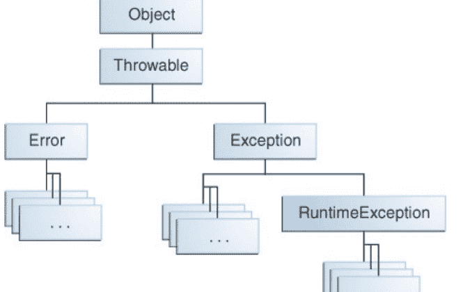

## Error 类

当 Java 虚拟机发生动态链接失败或其他硬性故障时，虚拟机会抛出一个 `Error`。简单程序通常不会捕获或抛出 `Error`。

## Exception 类

大多数程序抛出并捕获派自 `Exception` 类的对象。`Exception` 表示发生了问题，但这不是一个严重的系统问题。你编写的大多数程序抛出并捕获 `Exception` 而不是 `Error`。

Java 平台定义了 `Exception` 的许多后代。

这些后代表示可能发生的各种类型的异常。例如，`IllegalAccessException` 表示找不到特定方法，而 `NegativeArraySizeException` 表示程序尝试创建一个大小为负的数组。

一个 `Exception` 子类 `RuntimeException` 专门留给指示错误使用 API 的异常。运行时异常的一个示例是 `NullPointerException`，它在方法尝试通过空引用访问对象的成员时发生。“未检查的异常——争议”部分讨论了为什么应用程序不应该抛出运行时异常或继承自 `RuntimeException` 的子类。

## 链式异常

应用程序通常通过抛出另一个异常来响应异常。实际上，第一个异常导致了第二个异常。了解一个异常何时导致另一个异常是非常有用的。链式异常帮助编程人员做到这一点。

以下是 `Throwable` 中支持链式异常的方法和构造函数。

```java
Throwable getCause()

Throwable initCause(Throwable)

Throwable(String, Throwable)

Throwable(Throwable)
```

传递给 `initCause` 和 `Throwable` 构造函数的 `Throwable` 参数是导致当前异常的异常。`getCause` 返回导致当前异常的异常，而 `initCause` 设置当前异常的成因。

下面的示例展示了如何使用链式异常。

```java
try {
} catch (IOException e) {
    throw new SampleException("Other IOException", e);
}
```

在这个示例中，当捕获到 `IOException` 时，会创建一个新的 `SampleException` 并附带原始成因，并将异常链向上抛出给下一个高级异常处理器。

## 访问堆栈跟踪信息

现在，假设高级别的异常处理器想要以自己的格式转储堆栈跟踪。

> 定义
>
> 堆栈跟踪提供了有关当前线程执行历史的信息，并列出了在异常发生时调用的类和方法的名称。堆栈跟踪是一个非常有用的调试工具，你通常在抛出异常时会利用它。

下面的代码显示了如何在异常对象上调用 `getStackTrace` 方法。

```java
catch (Exception cause) {
    StackTraceElement elements[] = cause.getStackTrace();
    for (int i = 0, n = elements.length; i < n; i++) {
        System.err.println(elements[i].getFileName() +
        + ":" + elements[i].getLineNumber() +
        + "->" + elements[i].getMethodName() + "()");
    }
}
```

## 日志 API

下一个代码片段从 `catch` 块内部记录异常发生的位置。然而，它并没有手动解析堆栈跟踪并将输出发送到 `System.err()`，而是使用 `java.util.logging` 包中的日志设施将输出发送到文件。

```java
try {
    Handler handler = new FileHandler("OutFile.log");
    Logger.getLogger("").addHandler(handler);
} catch (IOException e) {
    Logger logger = Logger.getLogger("package.name");
    StackTraceElement elements[] = e.getStackTrace();
    for (int i = 0, n = elements.length; i < n; i++) {
        logger.log(Level.WARNING, elements[i].getMethodName());
    }
}
```

## 创建异常类

在选择要抛出的异常类型时，你可以使用别人编写的——Java 平台提供了许多类——或者你可以编写自己的。如果你回答以下问题的任何一个，你应该编写自己的异常类：

- Java 平台提供了吗？

- 区分它们对用户有帮助吗？

- 你的代码抛出了多个吗？

- 如果你计划分发，相关的异常应该打包在一起。

### 示例

假设你正在编写一个列表。该类支持以下方法以及其他方法：

- `ObjectAt(int)` 返回位置 n 的对象。如果参数小于 0 或大于列表数量，则抛出异常。

- `firstObject()` 返回第一个对象。如果列表为空，则抛出异常。

- `indexOf(Object o)` 在列表中查找指定的对象并返回其位置。如果对象不在列表中，则抛出异常。

列表可以抛出多种异常，并且可以使用一个异常处理器捕获所有异常。因此，列表应该提供自己的异常类集。图 9.4 展示了可能的类层次结构。

## 图 9.4. 类层次结构

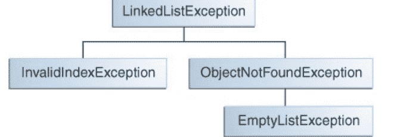

## 选择父类

任何 `Exception` 子类都可以作为 `LinkedList` 的父类。然而，快速浏览这些子类发现它们要么太专门要么与 `LinkedList` 无关。因此，`LinkedList` 的父类应该是 `Exception`。

你编写的大多数程序和应用程序将抛出 `Exception` 对象。`Error` 通常用于防止运行的严重错误。

> 注意
>
> 为了代码的可读性，良好的做法是在所有直接或间接继承自 `Exception` 类的类的名称后加上 `Exception` 字符串。

## 未检查异常——争议

由于 Java 编程语言不要求方法捕获或指定未检查异常（`RuntimeException`、`Error` 及其子类），编程人员可能会试图编写只有未检查异常的代码，或让所有异常类继承自 `RuntimeException`。这些快捷方法都允许编程人员在不担心编译器错误且不指定任何异常的情况下编写代码。尽管对于编程人员来说可能方便，但它规避了捕获或指定的意图，并给使用你类的人带来问题。

通过空引用访问对象；以及索引异常，例如尝试通过过大或过小的索引访问数组元素。

运行时异常可能发生在程序的任何地方，在典型的程序中，这些异常可能非常多。如果必须在每个方法声明中添加运行时异常，将会降低程序的清晰度。因此，编译器并不要求你捕获或指定运行时异常（尽管你可以这样做）。

抛出 `RuntimeException` 的一种常见做法是用户错误地调用了方法。例如，方法可以检查其参数是否错误地为 `null`。如果参数为 `null`，方法可能会抛出 `NullPointerException`，这是一种未检查异常。

通常情况下，不要仅仅因为不想被要求指定方法可能抛出的异常就抛出 `RuntimeException` 或创建 `RuntimeException` 的子类。

以下是底线指南：如果可以合理预期客户端从异常中恢复，请将其设置为检查异常。如果客户端无法采取任何操作来恢复异常，请将其设置为未检查异常。

## 异常的优势

现在你已经了解了异常是什么以及如何使用它们，是时候学习在程序中使用异常的优势了。

## 优势 1：将错误处理代码与“常规”代码分离

异常提供了一种手段，可以将发生异常情况时的处理细节与程序的主逻辑隔离开来。在传统编程中，错误检测、报告和处理往往会导致令人混乱的“意大利面条代码”。例如，考虑此处的伪代码方法，它将整个文件读取到内存中。

```
readFile {
    open the file;
    determine its size;
    allocate that much memory;
    read the file into memory;
    close the file;
}
```

初一看，这个函数似乎足够简单，但它忽略了所有可能的潜在错误。

- 如果无法打开文件会怎样？

- 如果无法确定文件长度会怎样？

- 如果无法分配足够的内存会怎样？

- 如果读取失败会怎样？

- 如果无法关闭文件会怎样？

为了处理这些情况，`readFile` 函数必须包含更多代码来进行错误检测、报告和处理。以下是该函数可能的形态。

```
errorTypeCode readFile {
    initialize errorCode = 0;
    open the file;

    if (theFileIsOpen) {
        determine the length of the file;
        if (gotFileLength) {
            allocate that much memory;
            if (gotEnoughMemory) {
                read the file into memory;
                if (readFailed) {
                    errorCode = -1;
                }
            } else {
                errorCode = -2;
            }
        }
    } else {
        errorCode = -3;
    }

    close the file;

    if (theFileDidntClose && errorCode == 0) {
        errorCode = -4;
    } else {
        errorCode = errorCode and -4;
    }
} else {
    errorCode = -5;
}
return errorCode;
}
```

这里有大量的错误检测、报告和返回，导致原始的七行代码在混乱中丢失。更糟糕的是，代码的逻辑流也丢失了，因此很难判断代码是否在正确执行：如果函数未能分配足够的内存，文件真的被关闭了吗？当你编写该方法三个月后修改它时，要确保代码继续正确运行变得更加困难。许多程序员通过简单地忽略它来解决这个问题——错误在程序崩溃时才会报告。

异常允许你编写代码的主流，并在其他地方处理特殊情况。如果 `readFile` 函数使用异常而不是传统的错误管理技术，它看起来会像下面：


# 异常处理优势与字符流 I/O

## 优势 1：组织错误处理代码

异常并不能免除检测、报告和处理错误的工作，但它们确实帮助你更有效地组织工作。

```java
readFile {
    open the file;
    determine its size;
    allocate that much memory;
    read the file into memory;
    close the file;
} catch (fileOpenFailed) {
    doSomething();
} catch (sizeDeterminationFailed) {
    doSomething();
} catch (memoryAllocationFailed) {
    doSomething();
} catch (readFailed) {
    doSomething();
} catch (fileCloseFailed) {
    doSomething();
}
```

## 优势 2：沿调用栈向上传播错误

异常的第二个优势是能够将错误报告沿方法的调用栈向上传播。假设 `readFile` 方法是主程序进行的一系列嵌套方法调用中的第四个方法：`method1` 调用 `method2`，`method2` 调用 `method3`，`method3` 最终调用 `readFile`。

```java
method1 {
    call method2;
}
method2 {
    call method3;
}
method3 {
    call readFile;
}
```

假设 `method1` 是唯一对 `readFile` 内部可能发生的错误感兴趣的方法。传统的错误通知技术迫使 `method2` 和 `method3` 将 `readFile` 返回的错误代码沿调用栈向上传播，直到错误代码最终到达对它们感兴趣的 `method1`。

```java
method1 {
    errorTypeCode error;
    error = call method2;
    if (error) {
        // handle error
    }
}
method2 {
    errorTypeCode error;
    error = call method3;
    if (error) {
        // handle error
    }
}
method3 {
    errorTypeCode error;
    error = call readFile;
    if (error) {
        // handle error
    }
}
```

等待，上面的逻辑只是一个概念性的表示。让我们看看传播实际上是如何工作的：

```java
method1 {
    try {
        call method2;
    } catch (exception e) {
        // handle error
    }
}
method2 {
    try {
        call method3;
    } catch (exception e) {
        // propagate error
    }
}
method3 {
    try {
        call readFile;
    } catch (exception e) {
        // propagate error
    }
}
```

实际上，运行时环境会回溯调用栈，寻找任何感兴趣处理该异常的方法。

```java
method1 {
    try {
        call method2;
    } catch (exception e) {
        doProcessing();
    }
}
method2 {
    try {
        call method3;
    } catch (exception e) {
        throw e;
    }
}
method3 {
    try {
        call readFile;
    } catch (exception e) {
        throw e;
    }
}
```

然而，如伪代码所示，逃避异常需要中间方法的某些努力。方法内部可能抛出的任何检查异常都必须在 `throws` 子句中指定。

## 优势 3：分组和区分错误类型

由于程序中抛出的所有异常都是对象，异常的分组或分类是类层次的自然结果。Java 平台中相关异常类的示例是 `java.io` 中定义的类——`IOException` 及其子类。`IOException` 是最通用的，代表执行输入/输出（I/O）操作时可能任何类型的错误。它的子类表示更具体的错误。例如，`FileNotFoundException` 意味着在磁盘上找不到文件。

方法可以编写特定的处理器来处理非常具体的异常。`FileNotFoundException` 类没有子类，因此以下处理器只能处理一种异常。

```java
catch (FileNotFoundException e) {
  ...
}
```

方法可以通过在 `catch` 语句中指定异常的任何父类来根据分组或通用类型捕获异常。例如，为了捕获所有的 I/O 异常，无论其具体类型如何，异常处理器指定 `IOException` 参数。

```java
catch (IOException e) {
  ...
}
```

此处理器能够捕获所有的 I/O 异常，包括 `FileNotFoundException`、`EOFException` 等。可以通过查询传递给异常处理器的参数来查找发生的情况。例如，使用以下代码打印堆栈跟踪。

```java
catch (IOException e) {
  // 输出到 System.err。
  e.printStackTrace();
  // 发送到 stdout。
  e.printStackTrace(System.out);
}
```

你甚至可以设置一个处理此处任何 `Exception` 的异常处理器。

```java
// 一个（过通用的）异常处理器
catch (Exception e) {
  ...
}
```

`Exception` 类位于 `Throwable` 类层次结构的顶端附近。因此，该处理器在捕获预期捕捉的异常之外，还会捕获许多其他异常。如果你只想让程序执行某些操作，例如为用户打印错误消息然后退出，你可能希望以此方式处理异常。

但在大多数情况下，你希望异常处理器越具体越好。这是因为处理器在决定最佳恢复策略之前，首先要做的是确定发生了什么类型的异常。实际上，通过不捕获错误，处理器必须适应任何可能性。过于通用的异常处理器可能会通过捕获并处理程序未预料到的、处理器并非设计用于处理的异常，从而导致代码容易出错。

如所述，你可以创建异常组并以通用的方式处理异常，也可以使用特定的异常类型来区分异常并以精确的方式处理异常。

### 总结

程序可以使用异常来指示发生了错误。要抛出异常，请使用 `throw` 语句并为其提供一个异常对象——`Throwable` 的子类——以提供有关所发生特定错误的详细信息。抛出未捕获的受检异常（checked exception）的方法必须在它的声明中包含 `throws` 子句。

程序可以通过组合 `try`、`catch` 和 `finally` 块来捕获异常。

- `try` 块标识可能发生异常的代码块。
- `catch` 块标识一个代码块，称为异常处理器，它可以处理特定类型的异常。
- `finally` 块标识一个保证会执行的代码块，它是关闭文件、恢复资源以及对 `try` 块中包含的代码进行其他清理的正确位置。

`try` 语句应至少包含一个 `catch` 块或一个 `finally` 块，并可以多个 `catch` 块。

异常对象的类指示了抛出的异常的类型。异常对象可以包含有关错误的进一步详细信息，包括错误消息。通过异常链（exception chaining），异常可以指向导致它的异常，而该异常又可以指向导致它的异常，依此类推。

# 习题与练习：异常

### 问题

1. 下面代码合法吗？

```java
try {

} finally {

}
```

2. 下面处理器可以捕获哪些类型的异常？

```java
catch (Exception e) {

}
```

使用这种类型的异常处理器有什么问题？

3. 下面编写的异常处理器有什么问题吗？这段代码能编译吗？

```java
try {

catch (Exception e) {
```

```
 } catch (ArithmeticException a) {
  }
```

4. 将第一个列表中的每种情况与第二个列表中的项进行匹配。

- a. `int[] A; A[0] = 0;`
- b. JVM 开始运行你的程序，但 JVM 找不到 Java 平台类。（Java 平台类位于 `classes.zip` 或 `rt.jar` 中。）
- c. 程序正在读取流并到达流的结束标记。
- d. 在关闭流之前且到达流结束标记之后，程序尝试再次读取流。

- 1. 运行时错误
- 2. 受检异常
- 3. 编译错误
- 4. 无异常

### 练习

1. 向 `ListOfNumbers.java` 中添加一个 `readList` 方法。该方法应该从文件中读取 `int` 值，打印每个值，并将它们附加到向量的末尾。你应该捕获所有适当的错误。你还需要一个包含要读取数字的文本文件。

2. 修改下面的 `cat` 方法使其通过编译。

```java
public static void cat(File file) {
  RandomAccessFile input = null;
```

```java
String line = null;

try {
    input = new RandomAccessFile(file, "r");
    while ((line = input.readLine()) != null) {
        System.out.println(line);
    }
}
```

# 答案

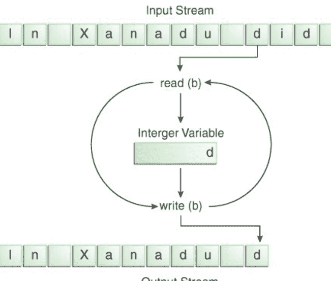

# 始终关闭流

在不再需要时关闭流是非常重要的——其重要性程度以至于 `CopyBytes` 使用了 `finally` 块来保证即使发生错误，两个流也能被关闭。这种做法有助于避免严重的内存泄漏。

一种可能的错误是 `CopyBytes` 无法打开一个或两个文件。当这种情况发生时，对应于文件的流变量从未从其初始的 `null` 值改变。这就是为什么 `CopyBytes` 在调用 `close` 之前会确保每个流变量都包含一个对象引用。

# 何时不使用字节流

`CopyBytes` 看起来像一个普通的程序，但它实际上代表了你应该避免的某种底层 I/O。由于 `xanadu.txt` 包含字符数据，最好的方法是使用字符流，如下一节所讨论的那样。还有用于更复杂数据类型的流。字节流应该只用于最原始的 I/O。

那么为什么要讨论字节流呢？因为所有其他类型的流都是构建在字节流之上的。

## 字符流

Java 平台使用 Unicode 规范存储字符值。字符流 I/O 会自动在这种内部格式与本地字符集之间进行转换。在西方区域中，本地字符集通常是 ASCII 的 8 位超集。

对于大多数应用程序来说，使用字符流进行 I/O 并不比使用字节流进行 I/O 更复杂。使用流类完成输入和输出会自动在本地字符集之间进行转换。使用字符流代替字节流的程序会自动适应本地字符集，并为国际化做好准备——而这一切都不需要程序员付出额外努力。

如果国际化不是首要任务，你可以直接使用字符流类，而不必关注字符问题。以后如果国际化变成了首要任务，你的程序可以进行调整而无需进行大量的重写。

## 使用字符流

所有的字符流类都继承自 `Reader` 和 `Writer`。与字节流一样，也有专门文件 I/O 的字符流类：`FileReader` 和 `FileWriter`。`CopyCharacters` 示例演示了这些类。

```java
import java.io.FileReader;
import java.io.FileWriter;
import java.io.IOException;

public class CopyCharacters {
    public static void main(String[] args) throws IOException {
        FileReader inputStream = null;
        FileWriter outputStream = null;

        try {
            inputStream = new FileReader("xanadu.txt");
            outputStream = new FileWriter("characteroutput.txt");

            int c;
            while ((c = inputStream.read()) != -1) {
                outputStream.write(c);
            }
        } finally {
            if (inputStream != null) {
                inputStream.close();
            }

            if (outputStream != null) {
                outputStream.close();
            }
        }
    }
}
```

`CopyCharacters` 与 `CopyBytes` 非常相似。最主要的区别是 `CopyCharacters` 使用 `FileReader` 和 `FileWriter` 进行输入和输出，代替了 `FileInputStream` 和 `FileOutputStream`。注意 `CopyBytes` 和 `CopyCharacters` 都使用一个 `int` 变量进行读写。然而，在 `CopyCharacters` 中，`int` 变量在其最后 16 位中持有一个值；在 `CopyBytes` 中，`int` 变量在其最后 8 位中持有一个字节值。

## 使用字节流的字符流

字符流通常是字节流的“包装器”。字符流使用字节流执行物理 I/O，而字符流处理字符与字节之间的转换。例如，`FileReader` 使用 `FileInputStream`，而 `FileWriter` 使用 `FileOutputStream`。

有两个通用的字节转字符“桥接”流：`InputStreamReader` 和 `OutputStreamWriter`。当没有预定义的满足你需求的字符流类时，使用它们来创建字符流。

## 以字符为方向的 I/O

字符 I/O 通常发生在比单个字符更大的单位。一个常见的单位是行：一个末尾带有行终止符的字符字符串。行终止符可以是回车/换行序列（`"\r\n"`）、单个回车（`"\r"`）或单个换行符（`"\n"`）。支持所有可能的行终止符允许程序读取在任何一种广泛使用的操作系统上创建的文本文件。

让我们修改 `CopyCharacters` 示例以使用面向行的 I/O。为了这一点，我们必须使用两个之前未见过的类：`BufferedReader` 和 `PrintWriter`。我们将在“文本文件的缓冲 I/O 方法”和“格式化”章节中深入探讨这些类。现在，我们只对它们对面向行 I/O 的支持感兴趣。

`CopyLines` 示例调用了 `BufferedReader.readLine()` 和 `PrintWriter.println()` 来逐行进行输入和输出。

```java
import java.io.FileReader;
import java.io.FileWriter;
import java.io.BufferedReader;
import java.io.PrintWriter;
import java.io.IOException;

public class CopyLines {
    public static void main(String[] args) throws IOException {

        BufferedReader inputStream = null;
        PrintWriter outputStream = null;

        try {
            inputStream = new BufferedReader(new FileReader("xanadu.txt"));
            outputStream = new PrintWriter(new FileWriter("characteroutput.txt"));

            String l1;
            while ((l1 = inputStream.readLine()) != null) {
                outputStream.println(l1);
            }
        } finally {
            if (inputStream != null) {
                inputStream.close();
            }
            if (outputStream != null) {
                outputStream.close();
            }
        }
    }
}
```

调用 `readLine` 返回带有行分隔符的文本行。`CopyLines` 使用 `println` 输出每行，它会追加当前操作系统的行终止符。这可能与输入文件中使用的行终止符不同。


除了字符和行，还有许多结构化文本输入输出的方法。更多信息请参阅“扫描与格式化”章节。

## 缓冲流

到目前为止我们看到的大多数示例都使用非缓冲 I/O。这意味着每次读或写请求都直接由底层操作系统处理。这会导致程序的效率大大降低，因为每个此类请求通常都会触发磁盘访问、网络活动或其他相对昂贵的操作。

为了减少这种开销，Java 平台实现了缓冲 I/O 流。缓冲输入流从称为缓冲区的区域读取数据；原生 API 只有在缓冲区为空时才调用。同样，缓冲输出流将数据写入缓冲区，原生 API 只有在缓冲区满时才调用。

程序可以使用我们已经多次使用的包装模式将非缓冲流转换为缓冲流，即将非缓冲流对象传递给缓冲流的构造函数。以下是如何修改 `CopyCharacters` 示例中的构造函数以使用缓冲 I/O：

```java
inputStream = new BufferedReader(new FileReader("xanadu.txt"));
outputStream = new BufferedWriter(new FileWriter("characteroutput.txt"));
```

有四个流类可以包装非缓冲流：`BufferedInputStream` 和 `BufferedOutputStream` 创建缓冲字节流，而 `BufferedReader` 和 `BufferedWriter` 创建缓冲字符流。

## 刷新缓冲区

在关键点写入缓冲区是有意义的，而不是等待填充。这被称为刷新缓冲区。

某些缓冲输出类支持自动刷新，通过可选的构造函数参数指定。当启用自动刷新时，某些事件会导致缓冲区被刷新。例如，自动刷新的 `PrintWriter` 对象在每次调用 `println` 或 `format` 时都会刷新缓冲区。更多关于这些方法请见“格式化”章节。

要手动刷新流，请调用其 `flush` 方法。`flush` 方法对任何输出流有效，但除非它是缓冲的，否则没有效果。

## 扫描与格式化

编程 I/O 通常涉及与人类喜欢工作的整洁格式数据之间的转换。为了帮助你完成这些工作，Java 平台提供了两个 API。扫描 API 将输入拆分为与数据位相关的标记。格式化 API 将数据组装成格式良好的人类易读的格式。

### 扫描

`Scanner` 对象有助于将格式化输入拆分为标记并根据其数据类型转换单个标记。

#### 将输入拆分为标记

默认情况下，扫描器使用空白分隔标记。空白字符包括空格、制表符和行终止符。有关完整列表，请参阅 `Character.isWhitespace` 的文档。

```java
import java.util.Scanner;
import java.io.BufferedReader;
import java.io.FileReader;
import java.io.IOException;

public class ScanXan {
    public static void main(String[] args) throws IOException {

        Scanner s = null;

        try {
            s = new Scanner(new BufferedReader(new FileReader("")));
            while (s.hasNext()) {
                System.out.println(s.next());
            }
        } finally {
            if (s != null) {
                s.close();
            }
        }
    }
}
```

注意 ScanXan 在完成 Scanner 对象的操作后调用了它的 `close` 方法。虽然 Scanner 不是一个流，但你仍然需要关闭它以表示你已完成对其底层流的操作。

ScanXan 的输出如下：

```
In
Xanadu
did
Kubla
Khan
A
stately
pleasure-dome
...
```

要使用不同的标记分隔符，请调用 `useDelimiter()` 并指定一个正则表达式。例如，假设你想让标记分隔符为逗号，后面可选跟空白字符。你需要调用：

```java
s.useDelimiter(",\s*");
```

#### 翻译单个标记

ScanXan 示例将所有输入标记视为简单的 `String` 值。Scanner 还支持 Java 语言所有基本类型（`char` 除外）的标记，以及 `BigInteger` 和 `BigDecimal`。此外，数值可以使用千分位分隔符。

因此，在美国区域（locale）下，Scanner 正确地将字符串“32,767”读取为整数值。

我们必须提到区域设置，因为千分位分隔符和小数点符号是特定区域的。因此，如果不指定 scanner 应该使用美国区域，下面的示例在所有区域下都无法正常工作。这是你通常需要担心的事情，因为你的输入数据通常来自与你相同的区域源。但这个示例是 Java 教程的一部分，并在全球分发。

ScanSum 示例读取了一组 `double` 值列表并将它们相加。以下是源码：

```java
import java.io.FileReader;
import java.io.BufferedReader;
import java.io.IOException;
import java.util.Scanner;
import java.util.Locale;

public class ScanSum {
    public static void main(String[] args) throws IOException {
        Scanner s = null;
        double sum = 0;

        try {
            s = new Scanner(new BufferedReader(new FileReader("")));
            s.useLocale(Locale.US);

            while (s.hasNext()) {
                if (s.hasNextDouble()) {
                    sum += s.nextDouble();
                } else {
                    s.next();
                }
            }
        } finally {
            if (s != null) {
                s.close();
            }
        }

        System.out.println(sum);
    }
}
```

这里是输入文件 `usnumbers.txt`：

```
8.5
32,767
3.14159
```

输出字符串是“1032778.74159”。句号在某些区域下可能是不同的字符，因为 `System.out` 是一个 `PrintStream` 对象，而该类没有提供覆盖默认区域的方法。我们可以为整个程序覆盖区域设置——或者我们可以像下一节描述的那样使用格式化。

### 格式化

实现格式化的流对象是 `PrintWriter`（字符流类）或 `PrintStream`（字节流类）的实例。

> **注意**
>
> 你可能唯一需要的 `PrintStream` 对象是 `System.out` 和 `System.err`。（参见“命令行 I/O”部分以获取更多关于这些对象的信息。）当你需要创建一个格式化输出流时，请实例化 `PrintWriter` 而不是 `PrintStream`。

像所有的字节和字符流对象一样，`PrintStream` 和 `PrintWriter` 的实例实现了一组用于字节和字符输出的标准写入方法。此外，`PrintStream` 和 `PrintWriter` 还实现了相同组将内部数据转换为格式化输出的方法。这里提供了两个级别的格式化：

- `print` 和 `println` 以标准方式格式化单个值。
- `format` 根据格式字符串格式化几乎任意数量的值，并有许多精确格式化的选项。

#### print 和 println 方法

调用 `print` 或 `println` 会在使用适当的 `toString` 方法转换值后输出单个值。我们可以在 Root 示例中看到这一点：

```java
public class Root {
    public static void main(String[] args) {
        int i = 2;
        double r = Math.sqrt(i);
        System.out.print("The square root of ");
        System.out.print(i);
        System.out.print(" is ");
        System.out.print(r);
        System.out.println(".");

        i = 5;
        r = Math.sqrt(i);
        System.out.println("The square root of " + i + " is " + r);
    }
}
```

2 的平方根是 1.4142135623730951。

5 的平方根是 2.23606797749979。

变量 `i` 和 `r` 被格式化了两次：第一次使用 `print` 重载方法中的代码，第二次由 Java 编译器自动生成的转换代码，该代码也利用了 `toString`。

#### format 方法

`format` 方法根据格式字符串格式化多个参数。格式字符串由嵌入文本和说明符组成。Root 示例显示了一些特性：

```java
public class Root {
    public static void main(String[] args) {
        int i = 2;
        double r = Math.sqrt(i);
        System.out.format("The square root of %d is %f%n", i, r);
    }
}
```

输出如下：

```
The square root of 2 is 1.414214
```

`format` 方法支持许多特性。除了转换之外，格式说明符还可以包含几个元素以进一步定制输出。这里有一个使用了所有可能元素的示例：

```java
public class Format {
    public static void main(String[] args) {
        int i = 2;
        double r = Math.sqrt(i);
        System.out.format("The square root of %d is %,.10f%n", i, r);
    }
}
```

输出如下：

```
The square root of 2 is 1.4142135624
```

元素必须按照所示顺序出现。从右侧开始，可选元素包括：

- **精度（Precision）**：对于浮点值，它是格式化值的数学精度。对于 `s` 和其他转换，它是格式化值的最大宽度；必要时会对进行右截断。
- **宽度（Width）**：格式化值的最小宽度；必要时会对进行填充。默认情况下在左侧填充空格。
- **标志（Flags）**：指定额外的格式化选项。在示例中，`+` 标志指定数字始终带符号格式化，`0` 标志指定 0 为填充字符。其他标志包括 `-`（右填充）和 `,`（按区域千分位分隔符格式化数字）。注意某些标志不能与其他标志或转换配合使用。
- **参数索引（Argument Index）**：允许显式匹配指定的参数。你也可以指定 `<` 来匹配上一个说明符的相同参数。因此示例可以写为：`System.out.format("%f, %<00.1f %n", Math.PI);`

## 命令行 I/O

标准流许多许多系统的特性。默认情况下，它们从键盘读取输入并将输出写入显示。它们还支持文件以及程序之间的 I/O，但该功能由命令行解释器控制，而不是程序。

Java 平台支持三个标准流：*标准输入*，通过 `System.in` 访问；*标准输出*，通过 `System.out` 访问；*标准错误*，通过 `System.err` 访问。

`System.out` 和标准错误（Standard Error），通过 `System.err` 访问。这些对象是自动定义的，不需要打开。标准输出和标准错误都用于输出；将错误输出分开允许用户将输出重定向到文件，同时仍然能够读取错误消息。更多信息，请参阅您使用的命令行解释器的文档。

你可能期望标准流（Standard Streams）是字符流，但由于历史原因，它们是字节流。`System.out` 和 `System.err` 被定义为 `PrintStream`。尽管它在技术上是字节流，但 `PrintStream` 利用内部的字符流对象来模拟字符流的功能。

相比之下，`System.in` 是一个没有字符流特征的字节流。要将标准输入作为字符流使用，可以将 `System.in` 包装在 `InputStreamReader` 中。

```java
InputStreamReader cin = new InputStreamReader(System.in);
```

## 控制台

标准流的一种更高级的备替代方案是控制台（Console）。这是一个类型为 `Console` 的单一预定义对象，它具有标准流提供的大部分功能以及其他功能。Console 特别适用于安全密码输入。Console 对象通过其读取和写入方法提供了真正的字符流的输入和输出流。

在程序使用 Console 之前，它必须尝试通过调用 `System.console()` 获取 Console 对象。如果 Console 对象可用，该方法将返回它。如果 `System.console` 返回 NULL，则不允许进行 Console 操作，可能是因为操作系统不支持，或者因为程序是在非交互式环境中启动的。

Console 对象通过其 `readPassword` 方法支持安全的密码输入。该方法通过两种方式帮助安全密码输入：首先，它抑制了回显（echoing），因此密码在用户的屏幕上不可见。其次，`readPassword` 返回一个字符数组，因此密码可以在不再需要时被覆盖，从而从内存中移除。

Password 示例是一个更改用户密码的示例程序。它演示了几个 Console 方法。

```java
import java.io.Console;
import java.util.Arrays;
import java.io.IOException;

public class Password {
    public static void main(String args[]) throws IOException {
        Console c = System.console();

        if (c == null) {
            System.err.println("No console.");
            System.exit(1);
        }

        String login = c.readLine("Enter your login: ");
        char [] oldPassword = c.readPassword("Enter your old password: ");

        if (verify(login, oldPassword)) {
            boolean noMatch;
            do {
                char [] newPassword1 = c.readPassword("Enter your new password: ");
                char [] newPassword2 = c.readPassword("Enter your new password: ");
                noMatch = ! Arrays.equals(newPassword1, newPassword2);
                if (noMatch) {
                    c.format("Passwords don't match. Try again.");
                } else {
                    change(login, newPassword1);
                    c.format("Password for %s changed.%n", login);
                }
                Arrays.fill(newPassword1, ' ');
                Arrays.fill(newPassword2, ' ');
            } while (noMatch);
        }

        Arrays.fill(oldPassword, ' ');
    }

    // 伪更改方法。
    static boolean verify(String login, char[] password) {
        // 此方法在示例中始终
        // 返回 true。
        // 修改此方法以根据你的规则
        // 验证密码。

        return true;
    }

    // 伪更改方法。
    static void change(String login, char[] password) {
        // 修改此方法以根据你的规则
        // 更改密码。
    }
}
```

Password 类遵循以下步骤：

1. 尝试获取 Console 对象。如果对象不可用，终止。
2. 调用 `Console.readLine` 提示并读取用户的登录名。


- 3. 调用 `Console.getPassword` 提示并读取用户的旧密码。
- 4. 调用 `verify` 确认密码（在此示例中，`verify` 是一个返回 `true` 的方法）。
- 5. 重复以下步骤直到密码匹配为止：
    - a. 调用 `Console.readLine` 提示并读取两次新密码。
    - b. 如果密码匹配，调用 `change` 更改它。
    - c. 将新密码填充为空。
- 6. 将旧密码填充为空。

## 数据流

数据流支持基本数据类型（`boolean`、`char`、`byte`、`short`、`int`、`long`、`float`、`double`）以及 `String` 值。数据流都实现了 `DataInput` 或 `DataOutput` 接口。本节关注这些最常用的实现：DataStreams 通过写入一组记录并再次读取它们来演示数据流。

### 表 11.1 数据

| 记录 | 类型 | 描述 | 输出方法 | 输入方法 | 示例值 |
|---|---|---|---|---|---|
| 1 | double | 价格 | `DataOutputStream.writeDouble` | `DataInputStream.readDouble` | 19.99 |
| 2 | int | 数量 | `DataOutputStream.writeInt` | `DataInputStream.readInt` | 12 |
| 3 | String |  | `DataOutputStream.writeUTF` | `DataInputStream.readUTF` | "Java Shirt" |

让我们看 DataStreams 中的关键代码。首先，程序定义了一些包含文件名和要写入数据的常量：

```java
static final String dataFile = "invoicedata";

static final double[] prices = { 19.99, 9.99, 15.99 };
static final int[] units = { 12, 8, 50 };
static final String[] descs = { "Java Shirt", "Java Mug", "Juggling Dolls" };
```

然后 DataStreams 打开一个输出流。由于 `DataOutputStream` 只能创建为现有字节流的包装，DataStreams 提供了一个缓冲输出流。

```java
out = new DataOutputStream(new BufferedOutputStream(
new FileOutputStream(dataFile)));
```

DataStreams 写入记录并关闭输出流。

```java
for (int i = 0; i < prices.length; i++) {
    out.writeDouble(prices[i]);
    out.writeInt(units[i]);
    out.writeUTF(descs[i]);
}
```

现在 DataStreams 回读数据。首先它必须提供一个输入流，以及存储输入数据的变量。和 `DataOutputStream` 一样，`DataInputStream` 必须构造为字节流的包装。

```java
in = new DataInputStream(new BufferedInputStream(new FileInputStream(dataFile)));

double price;

int unit;

String desc;

double total = 0.0;
```

现在 DataStreams 可以读取流中的每条记录，并报告遇到的遇到的数据。

```java
try {
    while (true) {
        price = in.readDouble();
        unit = in.readInt();
        desc = in.readUTF();
        System.out.format("You ordered %d units of %s at %d", unit, desc, price);
        total += unit * price;
    }
} catch (EOFException e) {
}
```

注意 DataStreams 通过捕获 `EOFException` 来检测文件结束条件，而不是测试无效的返回值。所有 `DataInput` 方法的实现都使用 `EOFException` 而不是返回值。

此外注意 DataStreams 中的每个专门写入操作都与相应的专门读取完全匹配。程序员需要确保输出类型和输入类型以这种方式匹配：输入流由简单的二进制数据组成，没有任何东西指示单个值的类型，或者它们在流中开始。

DataStreams 使用了一项非常糟糕的编程技术：它使用浮点数来表示货币值。通常情况下，浮点数对于精确值是有利的。它对于小数来说尤其为糟糕，因为常见的值（如 0.1）没有二进制表示。

用于货币值的正确类型是 `java.math.BigDecimal`。遗憾的是，`BigDecimal` 是一个对象类型，因此它无法用于数据流。然而，`BigDecimal` 可以用于对象流，这将在下一节中介绍。

### 对象流

正如数据流支持原始数据类型的 I/O 一样，对象流支持对象的 I/O。大多数（并非所有）标准类都支持对象的序列化。那些实现了 `Serializable` 标记接口的。

对象流类是 `ObjectInputStream` 和 `ObjectOutputStream`。这些类实现了 `ObjectInput` 和 `ObjectOutput`，它们是 `DataInput` 和 `DataOutput` 的子接口。这意味着“数据流”节中涵盖的所有原始数据 I/O 方法在对象流中也得到了实现。因此，对象流可以包含原始值和对象值的混合。ObjectStreams 创建了与 DataStreams 相同的应用程序，但有几个变化。首先，价格现在是 `BigDecimal` 对象，以便更好地表示分数值。其次，一个 `Calendar` 对象被写入数据文件，用于表示发票日期。

如果 `readObject()` 返回的不是预期的类型，尝试将其转换为正确类型可能会抛出 `ClassNotFoundException`。在这个简单的示例中，这种情况不会发生，因此我们没有尝试捕获异常。相反，我们通过在主方法的 `throws` 子句中添加 `ClassNotFoundException` 来通知编译器我们已经意识到这个问题。

### 复杂对象的输出和输入

`writeObject` 和 `readObject` 方法非常简单，但它们包含了一些复杂的对象管理逻辑。对于像 `Calendar` 这样封装了原始值的类来说，这并不重要。但许多对象包含其他对象的引用。如果 `readObject` 要从流中重构所有对象，它必须能够重建所引用的原始对象。这些额外的对象可能有它们自己的引用。因此，调用一次 `writeObject` 会遍历整个对象引用网络，并将该网络中的所有对象写入流中。因此，要写入流的对象非常多。

这在图 11.5 中得到了证明，其中调用 `writeObject` 来写入一个名为 `a` 的对象。该对象包含对对象 `b` 和 `c` 的引用，而 `b` 包含对 `d` 和 `e` 的引用。调用 `writeObject(a)` 不仅写入 `a`，还写入重构 `a` 需要的所有对象，该网络中的其他四个对象也被写入了。当 `a` 被 `readObject` 读回时，其他四个对象也被读回，所有的原始对象引用都被保留了。

#### 图 11.5 多个被引用对象的 I/O

```text
writeObject (a) -> c e d b a -> readObject ()
```

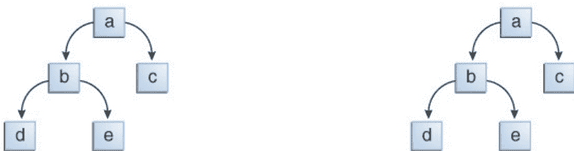

你可能会想，如果同一个流上的两个对象包含对同一个对象的引用会发生什么？它们在读回时指向同一个对象吗？答案是“是的”。流只能包含一个对象的副本，尽管它可以包含对该对象的任意数量引用。因此，如果你显式地向流写入两次对象，你实际上只写入了两次引用。例如，如果以下代码向流两次写入对象 `ob`：

```java
Object ob = new Object();

out.writeObject(ob);

out.writeObject(ob);
```

每个 `writeObject` 必须由一个 `readObject` 匹配，因此读取流的代码看起来像这样：

```java
Object obj1 = in.readObject();

Object obj2 = in.readObject();
```

这产生了两个变量 `obj1` 和 `obj2`，它们是对同一个对象的引用。

然而，如果一个对象被写入两个不同的流，它实际上就被复制了——读取这两个流的同一个程序将看到两个不同的对象。

# 文件 I/O（包含 NIO.2 特性）

`java.nio.file` 包及其相关包 `java.nio.file.attribute` 提供文件 I/O 和访问默认文件系统提供了全面的支持。尽管该 API 有许多类，但你只需要关注少数几个条目。你会发现这个 API 非常直观且易用。

教程从提问开始：什么是路径？然后，引入了 `Path` 类，它是该包的主要入口点。教程解释了 `Path` 类中与语法操作相关的方法。随后，教程转向包中的另一个主要类 `Files` 类，它包含了处理文件操作的方法。首先，引入了许多文件操作的概念。教程涵盖了检查、删除、复制和移动文件的方法。

教程展示了如何管理元数据，然后进入文件 I/O 和目录 I/O。解释了随机访问文件，并检查了符号链接和硬链接的问题。

接下来，涵盖了一些非常强大但更高级的主题。首先演示了递归遍历文件树的能力，随后是关于使用通配符搜索文件的信息。接下来，解释并演示了如何监控目录的变化。然后，对不属于其他地方的方法进行了一些关注。

最后，如果你在 Java SE 7 发布之前编写了文件 I/O 代码，这里有一份从旧 API 到新 API 的映射，以及关于 `File.toPath` 方法的重要信息，供想要利用新 API 重写现有代码的开发者使用。

# 什么是路径？（以及其他文件系统事实）

文件系统在某些介质（通常是一个或多个硬盘）上存储和组织文件，使其能够方便地检索。今天使用的大多数文件系统以树形（或层次结构）结构存储文件。树的顶部是一个（或多个）根节点。在 Microsoft Windows 中，根节点下有文件和目录（文件夹）。每个目录都可以包含文件和子目录，子目录又可以包含文件和子目录，以此类推，深度可能几乎无限。

### 什么是路径？

图 11.6 显示了一个包含单个根节点的示例目录树。Microsoft Windows 支持多个根节点。每个根节点映射到一个卷，例如 `C:\` 或 `D:\`。Solaris OS 支持单个根节点，用斜杠字符 `/` 表示。

#### 图 11.6 示例目录结构

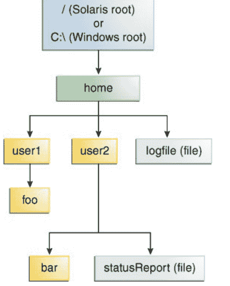

文件通过其在文件系统中的路径来标识，从根节点开始。例如，上图中 `statusReport` 文件在 Solaris OS 中的表示法如下：

```
/home/sally/statusReport
```

在 Microsoft Windows 中，statusReport 的表示法如下：

```
C:\home\sally\statusReport
```

用于分隔目录名称的字符（称为分隔符）特定于文件系统：Solaris OS 使用正斜杠 (`/`)，而 Microsoft Windows 使用反斜杠 (`\`)。

### 相对还是绝对？

路径是相对的或绝对的。绝对路径始终包含根元素和定位文件所需的完整目录列表。例如，`/home/sally/statusReport` 是一个绝对路径。定位文件所需的所有信息都在路径字符串中。

相对路径需要与另一个路径组合以访问文件。例如，`joe/foo` 是相对路径。如果没有更多信息，程序无法可靠地在文件系统中定位 `joe/foo` 目录。

### 符号链接

文件系统对象通常是目录或文件。每个人都熟悉这些对象。但某些文件系统还支持符号链接的概念。符号链接也被称为 symlink 或软链接。

符号链接是一个指向另一个文件的特殊文件。在大多数情况下，符号链接对应用程序是透明的，对符号链接的操作会自动重定向到链接的目标。（被指向的文件或目录被称为链接的目标。）异常情况是符号链接被删除或重命名，在这种情况下，链接本身被删除或重命名，而不是链接的目标删除或重命名。

在图 11.7 中，`logFile` 对用户来说似乎是一个普通文件，但它实际上是一个指向 `dir/logs/HomeLogFile` 的符号链接。`HomeLogFile` 是链接的目标。

#### 图 11.7 符号链接示例

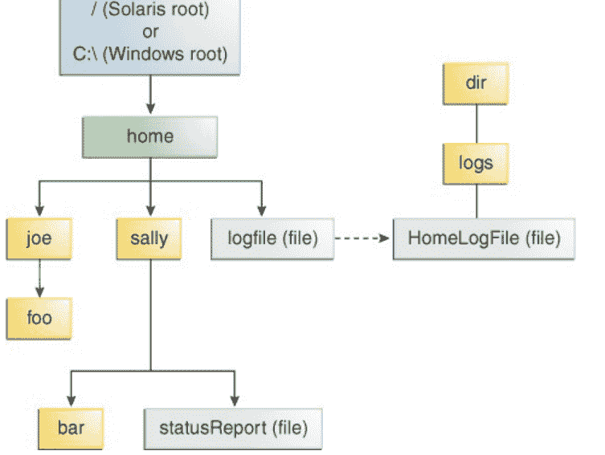

符号链接对用户通常是透明的。对符号链接进行读写与对任何其他文件或目录进行读写操作是相同的。

解析链接的意思是用文件系统的实际位置替换符号链接。在示例中，解析 `logFile` 得到 `dir/logs/HomeLogFile`。

在现实场景中，大多数文件系统都大量使用符号链接。偶尔，创建不当的符号链接会导致循环引用。当链接的目标指向回原始链接时，就会发生循环引用。循环引用可能是间接的：目录 a 指向目录 b，b 指向目录 c，而 c 包含一个指向目录 a 的子目录。当程序递归地遍历目录结构时，循环引用可能会造成混乱。然而，这种情况已经被考虑在内，不会导致你的程序陷入无限循环。

下一页将讨论 Java 编程语言中文件 I/O 支持的核心——`Path` 类。

### Path 类

`Path` 类是 `java.nio.file` 包的主要切入点之一。如果你的应用程序使用了文件 I/O，你将希望学习该类的强大功能。

> **版本说明**
>
> 如果你有之前使用 `java.io.File` 的 JDK7 之前的代码，你仍然可以通过 `File.toPath` 方法来利用 `Path` 类的功能。更多信息请参见“遗留 I/O 代码”章节。

正如其名所示，`Path` 类是文件系统中路径的程序化表示。`Path` 对象包含了用于构建路径的文件名和目录列表，并用于检查、定位和操作文件。

`Path` 实例反映了底层平台。在 Solaris 操作系统中，`Path` 使用 Solaris 语法（`/home/joe/foo`），在 Microsoft Windows 中，`Path` 使用 Windows 语法（`C:\home\joe\foo`）。`Path` 不是系统无关的。你无法比较来自 Solaris 文件系统的 `Path` 并期望它与来自 Windows 文件系统的 `Path` 匹配，即使目录结构相同且两个实例定位了同一个相对文件。

对应于 `Path` 的文件或目录可能不存在。你可以创建一个 `Path` 实例并以多种方式对其进行操作：你可以对其追加内容、提取部分内容、将其与其他路径进行比较。在适当的时机，你可以使用 `Files` 类中的方法来检查对应于 `Path` 文件是否存在、创建文件、打开文件、删除文件、更改其权限等。

下一页将详细检查 `Path` 类。

### Path 操作

`Path` 类包含了各种方法，可获取有关路径的信息、访问路径元素、将路径转换为其他形式或提取路径部分。还有匹配路径字符串的方法以及移除路径中冗余的方法。本节介绍了这些 `Path` 方法，它们有时被称为语法操作，因为它们作用于路径本身，而不访问文件系统。

### 创建 Path

`Path` 实例包含了用于指定文件或目录位置的信息。在定义时，`Path` 会被提供一系列一个或多个名称。可能包含一个根元素或文件名，但两者都不是必须的。一个 `Path` 可能仅由单个目录或文件名组成。

你可以通过使用 `Paths`（注意是复数）辅助类的以下方法之一轻松地创建 `Path` 对象：

```java
Path p1 = Paths.get("/tmp/foo");
Path p2 = Paths.get(args[0]);
Path p3 = Paths.get(URI.create("file://Users/joe/FileTest.java"));
```

`Paths.get` 方法是以下代码的简写：

```java
Path p4 = FileSystems.getDefault().getPath("/users/sally");
```

以下示例创建了 `/u/joe/logs/foo.log`，假设你的主目录是 `/u/joe`，或者如果你在 Windows 上，则为 `C:\joe\logs\foo.log`。

```java
Path p5 = Paths.get(System.getProperty("user.home"), "logs", "foo");
```

### 获取关于 Path 的信息

你可以将 `Path` 视为将这些名称元素存储为一个序列。目录结构中的最高元素位于索引 0。目录结构中的最低元素位于索引 `[n-1]`，其中 `n` 是 `Path` 中名称元素的数量。可以使用可用方法通过这些索引来获取 `Path` 的单个元素或子序列。

本节中的示例使用了图 11.6 所示的结构。以下代码段定义了一个 `Path` 实例，然后调用了几个方法来获取有关路径的信息：

```java
// 这些方法都不要求对应于
// Path 文件存在。
// Microsoft Windows 语法
Path path = Paths.get("C:\\home\\joe\\foo");

// Solaris 语法
Path path = Paths.get("/home/joe/foo");
```


```java
System.out.format("toString: %s%n", path.toString());
System.out.format("getFileName: %s%n", path.getFileName());
```

# 表 11.2. 绝对路径的输出

| 调用方法 | 在 Solaris 下返回 | 在 Windows 下返回 | 注释 |
| --- | --- | --- | --- |
| toString | /home/joe/foo | C:\home\joe\foo | 返回 Path 的字符串表示。如果使用 Filesystems.getDefault().getPath 创建（后者是一个便利方法），它将执行语法清理。例如，在 Unix 系统上，它将修正 //home/joe/foo。 |
| getFileName | foo | foo | 返回文件名或序列中的最后一个元素。 |
| getName(0) | home | home | 返回对应于指定索引的路径元素。0元素靠近根。 |
| getNameCount | 3 | 3 | 返回路径中的元素数量。 |
| subpath(0,2) | /home/joe | \home\joe | 返回由起始和结束索引指定的子序列（不包含根元素）。 |
| getParent | /home/joe | \home\joe | 返回父目录的路径。 |
| getRoot | / | C:\ | 返回路径的根。 |

之前的示例显示了绝对路径的输出。在下面的示例中，指定了相对路径：

```java
// Solaris 语法
Path path = Paths.get("sally/bar");

// Microsoft Windows 语法
Path path = Paths.get("sally\\bar");
```

# 表 11.3. 相对路径的输出

| 调用方法 | 在 Solaris 下返回 | 在 Windows 下返回 |
| --- | --- | --- |
| toString | sally/bar | sally\bar |
| getFileName | bar | bar |
| getName(0) | sally | sally |
| getNameCount | 2 | 2 |
| subpath(0,1) | sally | sally |
| getParent | sally | sally |
| getRoot | null | null |

### 从 Path 中移除冗余

许多文件系统使用“.”表示当前目录，使用“..”表示父目录。你可能会遇到路径包含冗余目录信息的情况。可能服务器配置为将日志文件保存在“/dir/logs/.”目录下，你想删除路径末尾的“.”标记。

以下示例都包含冗余：

```
/home/./joe/foo
/home/sally/../joe/foo
```

`normalize` 方法会移除任何冗余元素，包括任何“.”或“目录 /..”出现的情况。两个都归一化为 `/home/joe/foo`。

需要注意的是，`normalize` 在清理路径时不会检查文件系统。它是一个纯粹的语法层操作。在第二个示例中，如果 `sally` 是一个符号链接，移除 `sally..` 可能导致返回的不再指向目标文件的 `Path`。

要在确保结果定位正确文件的同时清理路径，你可以使用 `toRealPath` 方法。该方法将在下一节中描述。

### 转换路径

你可以使用三种方法转换 `Path`。如果你需要将路径转换为可以在浏览器中打开的字符串，可以使用 `toUri`。例如：

```java
Path p1 = Paths.get("/home/logfile");
// Result is file:///home/logfile
System.out.format("%s%n", p1.toUri());
```

`toAbsolutePath` 方法将路径转换为绝对路径。如果传入的路径已经是绝对路径，则返回相同的 `Path` 对象。在处理用户输入的文件名时，`toAbsolutePath` 方法非常有帮助。例如：

```java
public class FileTest {
    public static void main(String[] args) {
        if (args.length < 1) {
            System.out.println("usage: FileTest file");
            System.exit(-1);
        }
        // 将输入的 Path 转换为绝对路径。
        // 通常，这意味着在前面加上当前工作目录。
        // 如果此示例这样被调用：java FileTest foo
        // getRoot 和 getParent 方法在原始的 "inputPath" 实例上返回 null
        // 在 "fullPath" 实例上调用 getRoot 和 getParent 返回预期的值。
        Path fullPath = inputPath.toAbsolutePath();
    }
}
```

`toAbsolutePath` 方法转换用户输入并返回一个在查询时返回有用值的 `Path`。该方法工作时文件并不一定需要存在。

`toRealPath` 方法返回现有文件的真实路径。该方法一次性执行多个操作：

- 如果向此方法传递 `true` 且文件系统支持符号链接，则该方法将解析路径中的任何符号链接。
- 如果 `Path` 是相对路径，它将返回一个绝对路径。
- 如果 `Path` 包含任何冗余元素，它将返回一个删除了这些元素的路径。

如果文件不存在或无法访问，此方法将抛出异常。你可以在处理任何这些情况时捕获该异常。例如：

```java
try {
    Path fp = path.toRealPath();
} catch (FileNotFoundException x) {
    System.err.format("%s: no such " + " file or directory%n", p);
    // 文件不存在时的逻辑。
} catch (IOException x) {
    System.err.format("%s%n", x);
    // 其他类型文件错误的逻辑。
}
```

### 合并两个路径

你可以通过使用 `resolve` 方法组合路径。你传入一个部分路径（即不包含根元素的路径），该部分路径将附加到原始路径之后。

例如，考虑以下代码段：

```java
// Solaris
Path p1 = Paths.get("/home/joe/foo");
// Result is /home/joe/foo/bar
System.out.format("%s%n", p1.resolve("bar"));
```

```java
// Microsoft Windows
Path p1 = Paths.get("C:\\home\\joe\\foo");
// Result is C:\home\joe\foo\bar
System.out.format("%s%n", p1.resolve("bar"));
```

向 `resolve` 方法传递绝对路径将返回传入的路径：

```java
// Result is /home/joe
Paths.get("foo").resolve("/home/joe");
```

### 在两个路径之间创建路径

编写文件 I/O 代码时的一个常见需求是具备构建从文件系统一个位置到另一个位置的路径的能力。你可以使用 `relativize` 方法来实现。该方法构建一个从原始路径开始并到传入路径指定的结束路径。新路径相对于原始路径。

例如，考虑定义为 `joe` 和 `sally` 的两个相对路径：

```java
Path p1 = Paths.get("joe");
Path p2 = Paths.get("sally");
```

在没有其他任何信息的情况下，假设 `joe` 和 `sally` 是兄弟关系，即位于树结构中相同层级的节点。要从 `joe` 导航到 `sally`，你期望先向上导航一级到父节点，然后向下到 `sally`：

```java
// Result is ../sally
Path p1_to_p2 = p1.relativize(p2);
// Result is ../joe
Path p2_to_p1 = p2.relativize(p1);
```

考虑一个稍复杂的示例：

```java
Path p1 = Paths.get("home");
Path p3 = Paths.get("home/sally/bar");
// Result is sally/bar
Path p1_to_p3 = p1.relativize(p3);
// Result is ../
Path p3_to_p1 = p3.relativize(p1);
```

在这个示例中，路径共享同一个节点。要从 `home` 导航到 `bar`，你首先向下导航一级。如果两个路径中只有一个路径包含根元素，则无法构建相对路径。

### 比较两个路径

`Path` 类支持 `equals`，允许你测试相等性。`startsWith` 和 `endsWith` 方法允许你测试路径是否以特定字符串开头或结束。这些方法很容易使用。例如：

```java
Path path = ...;
Path otherPath = ...;
Path beginning = Paths.get("/home");
Path ending = Paths.get("/foo");

if (path.equals(otherPath)) {
    // 相等逻辑
} else if (path.startsWith(beginning)) {
    // 以 /home 开头
} else if (path.endsWith(ending)) {
    // 以 /foo 结尾
}
```

`Path` 类实现了 `Iterable`。`iterator` 方法返回一个允许遍历路径元素的对象。返回的第一个元素距离根。以下代码遍历路径并打印每个名称：

```java
Path path = ...;
for (Path name : path) {
    System.out.println(name);
}
```

`Path` 类还实现了 `Comparable`。你可以通过 `compareTo` 比较 `Path` 对象，这对排序很有用。

你还可以将 `Path` 对象放入集合。更多信息请参见章节。

当你想要验证两个 `Path` 对象定位相同文件时，可以使用 `isSameFile` 方法，如“检查两个路径是否定位相同文件”节所述。

## 文件操作

`Files` 类是 `java.nio.file` 包的另一个主要入口点。该类提供了丰富的静态方法用于读取、写入和操作文件及目录。`Files` 作用于 `Path` 实例。在继续后续章节之前，你应该熟悉以下概念。

## 释放系统资源

此 API 中使用的许多资源（如流或通道）实现或扩展了 `java.io.Closeable`。`Closeable` 资源的要求是在不再需要时调用 `close` 方法释放资源。忽略关闭资源会对应用程序性能产生负面影响。下一节描述的 `try-with-resources` 语句会自动处理此步骤。

### 捕获异常

在文件 I/O 中，意外情况是常态：预期的文件存在（不存在）、程序没有访问文件系统的权限、默认文件系统实现不支持特定功能等。可能会遇到许多错误。

所有访问文件系统的方法都可以抛出 `IOException`。最佳实践是通过将这些方法嵌入 `try-with-resources` 语句来捕获这些异常。`try-with-resources` 语句的优势在于编译器会自动生成在不再需要时关闭资源的代码。以下代码展示了如何这样做：

```java
Charset charset = Charset.forName("US-ASCII");
String s = ...;
try (BufferedWriter writer = Files.newBufferedWriter(file, charset)) {
    writer.write(s, 0, s.length());
} catch (IOException x) {
    System.err.format("IOException: %s%n", x);
}
```

更多信息，请参阅第 10 章“try-with-resources 语句”。

或者，你可以将文件 I/O 方法嵌入 `try` 块中，然后在 `catch` 块中捕获任何异常。如果你的代码打开了任何流或通道，你应该在 `finally` 块中关闭它们。之前的示例使用 `try-catch-finally` 方法的形式如下：

```java
Charset charset = Charset.forName("US-ASCII");
String s = ...;
BufferedWriter writer = null;
try {
    writer = Files.newBufferedWriter(file, charset);
    writer.write(s, 0, s.length());
} catch (IOException x) {
    System.err.format("IOException: %s%n", x);
} finally {
    if (writer != null) writer.close();
}
```

更多信息，请参阅第 10 章“捕获和处理异常”。

除了 `IOException` 之外，许多特定异常扩展了 `FileSystemException`。该类有一些有用的方法，可以返回涉及的文件 (`getFile()`)、详细信息字符串 (`getMessage()`)、文件系统操作失败的原因 (`getReason()`) 以及相关的“其他”文件 (`getOtherFile()`)。

下面的代码段显示了如何使用 `getFile` 方法：

```java
try (...) {
    // ...
} catch (FileNotFoundException x) {
    System.err.format("%s does not exist\n", x.getFile());
}
```

为了清晰起见，本节中的文件 I/O 示例可能没有异常处理，但你的代码应该始终包含它。

### 可变参数

当指定标志时，几个 `Files` 方法接受任意数量的参数。例如，在下面的方法签名中，`CopyOption` 参数后的省略号表示该方法接受变数量的参数，即通常说的的可变参数（varargs）：

```java
Path Files.move(Path, Path, CopyOption...)
```

当一个方法接受可变参数时，你可以传递一个逗号分隔的值列表或数组 (`CopyOption[]`)。

在 `move` 示例中，可以如下调用该方法：

```java
import static java.nio.file.StandardCopyOption.*;
Path source = ...;
Path target = ...;
Files.move(source, target, REPLACE_EXISTING, ATOMIC_MOVE);
```

关于可变参数语法的更多信息，请参阅第 4 章“任意数量的参数”。

### 原子操作

几个 `Files` 方法（如 `move`）在某些文件系统中可以执行原子操作。

原子文件操作是一种无法被中断或“部分”执行的操作。要么执行整个操作，要么操作失败。当你有多个进程对文件系统的同一区域进行操作，并且你需要保证每个进程访问的是完整的文件时，这是非常重要的。

### 方法链

许多文件 I/O 方法都支持方法链的概念。

你首先调用一个返回对象的方法。然后立即在该对象上调用另一个方法，该方法返回另一个对象，依此类推。许多 I/O 示例使用了以下技术：

```java
String value = Charset.defaultCharset().decode(buf).toString();
UserPrincipal group = file.getFileSystem().getUserPrincipalLookupService().lookupPrincipalByName("me");
```


这种技术产生了紧凑的代码，并允许你避免声明不需要的临时变量。

### 什么是 Glob？

`Files` 类中的两个方法接受 `glob` 参数，但 `glob` 是什么？

你可以使用 `glob` 语法来指定模式匹配行为。

Glob 模式被指定为字符串，并与其它字符串（如目录或文件名）进行匹配。Glob 语法遵循以下几个简单规则：

- 星号 (`*`)：匹配任意数量的字符（包括零个）。
- 双星号 (`**`)：作用与 `*` 类似，但可以跨越目录。这种语法通常用于匹配完整路径。
- 问号 (`?`)：匹配一个字符。

大括号 `{}` 指定子模式的集合。例如：

- `{sun,moon,stars*}` 匹配 "sun"、"moon" 或 "stars*"。
- `{temp*, tmp*}` 匹配所有以 "temp" 或 "tmp" 开头的字符串。

方括号 `[]` 传达单字符集，或者当使用连字符 (`-`) 时表示字符范围。例如：

- `[aeiou]` 匹配任何小写元音。
- `[0-9]` 匹配任何数字。
- `[A-Z]` 匹配任何大写字母。
- `[a-z, A-Z]` 匹配任何大小写字母。

在方括号内，`*`、`?` 和 `\` 匹配自身。
所有其他字符匹配自身。
要匹配 `*`、`?` 或其他特殊字符，你可以使用反斜字符 `\` 对其进行转义。例如，`\*` 和 `\?` 匹配问号。

以下是一些 glob 语法的示例：

- `*.html` — 匹配所有以 .html 结尾的字符串
- `???` — 匹配恰好三个字符
- `**/*.html` — 匹配任何目录下的所有 HTML 文件
- `*..{txt,log}` — 匹配以 .txt 或 .log 结尾的文件
- `[a-z]*` — 匹配以小写字母开头后跟任意字符的文件
- `[0-9]{3}` — 匹配恰好三个数字
- `{a,b}` — 匹配 "a" 或 "b"
- `[a-z]` — 匹配从 a 到 z 的任何字符

```java
} catch (DirectoryNotEmptyException x) {
    System.err.format("%s not empty%n", path);
} catch (IOException x) {
    // File permission problems are caught here.
    System.err.println(x);
}
```

`deleteIfExists(Path)` 方法也会在文件不存在时删除文件，且这种情况下不会抛出异常。当有多个线程在删除文件，且你不希望仅仅因为一个线程先执行操作就抛出异常时，静默失败是很有用的。

### 复制文件或目录

你可以使用 `copy(Path, Path, CopyOption...)` 方法复制文件或目录。如果目标文件存在，除非指定了 `REPLACE_EXISTING` 选项，否则复制将失败。

可以复制目录。但是，目录内部的文件不会被复制，因此即使原始目录包含文件，新目录也是空的。

当复制符号链接时，复制的是链接的目标。如果你想复制链接本身而不是链接的内容，请指定 `NOFOLLOW_LINKS` 或 `REPLACE_EXISTING` 选项。

此方法接受一个变长参数。支持以下 `StandardCopyOption` 和 `LinkOption` 枚举：

- `REPLACE_EXISTING`——即使文件已存在也执行复制。如果目标是符号链接，则复制该链接（而不是链接的目标）。如果目标是非空目录，则复制将抛出 `FileAlreadyExistsException` 异常。
- `COPY_ATTRIBUTES`——将与文件相关的文件属性复制到目标文件。支持的具体文件属性取决于文件系统和平台，最后修改时间（last-modified-time）跨平台支持并复制到目标文件。
- `NOFOLLOW_LINKS`——表示不跟随符号链接。如果要复制的文件是符号链接，则复制该链接（而不是链接的目标）。

如果你不熟悉枚举，请参阅第 4 节“枚举类型”。以下展示了如何使用 `copy` 方法：

```java
import static java.nio.file.StandardCopyOption.*;

...

Files.copy(source, target, REPLACE_EXISTING);
```

除了文件复制外，`Files` 类还定义了可能可以用于在文件和流（stream）之间进行复制的方法。`copy(InputStream, Path, CopyOptions...)` 方法可将从输入流的所有字节复制到文件。`copy(Path, OutputStream)` 方法可将从文件的所有字节复制到输出流。

`Copy` 示例使用了 `copy` 和 `Files.walkFileTree` 方法来支持递归复制。更多信息请参阅“遍历文件树”部分。

### 移动文件或目录

你可以使用 `move(Path, Path, CopyOption...)` 方法移动文件或目录。如果目标文件存在，除非指定了 `REPLACE_EXISTING` 选项，否则移动将失败。

可以移动空目录。如果目录为空，当可以在不移动该目录内容的情况下移动目录时，则允许移动。在 Solaris、Linux 和 OS X 系统中，在同一分区内移动目录通常只是重命名目录。在这种情况下，即使目录包含文件，该方法也能工作。

此方法接受一个变长参数——支持以下 `StandardCopyOption` 枚举：

- `REPLACE_EXISTING`——即使目标已存在也执行移动。如果目标是符号链接，则替换符号链接，但它指向的内容不受影响。
- `ATOMIC_MOVE`——作为原子文件操作执行移动。如果文件系统不支持原子移动，则会抛出异常。使用 `ATOMIC_MOVE`，你可以将文件移动到目录，并保证任何监控该目录的进程访问的都是完整的文件。

以下展示了如何使用 `move` 方法：

```java
import static java.nio.file.StandardCopyOption.*;

...

Files.move(source, target, REPLACE_EXISTING);
```

虽然你可以像示例所示在单个目录上实现 `move` 方法，但该方法通常用于配合文件树递归机制。更多信息请参阅“遍历文件树”部分。

# 管理元数据（文件和文件存储器属性）

管理元数据（IPC 和文件属性），

元数据的定义是“关于其他数据的数据”。在文件系统中，数据包含在文件和目录中，而元数据跟踪关于这些对象的每个信息：它是普通文件、目录还是链接？它的大小、创建日期、最后修改日期、文件所有者、组所有者和访问权限是什么？

文件系统的元数据通常称为文件属性（file attributes）。`Files` 类包含了用于获取文件单个属性或设置属性的方法。请参阅表 11.4。

## 表 11.4. BasicFileAttributes

| 方法 | 注释 |
| --- | --- |
| `size(Path)` | 以字节返回指定文件的大小。 |
| `isDirectory(Path, LinkOption)` | 如果指定的 `Path` 指向的文件是目录，则返回 true。 |
| `isRegularFile(Path, LinkOption...)` | 如果指定的 `Path` 指向的文件是普通文件，则返回 true。 |
| `isSymbolicLink(Path)` | 如果指定的 `Path` 指向的文件是符号链接，则返回 true。 |
| `isHidden(Path)` | 如果指定的 `Path` 指向的文件被文件系统视为隐藏，则返回 true。 |
| `getLastModifiedTime(Path, LinkOption...)` / `setLastModifiedTime(Path, FileTime)` | 返回或设置指定文件的最后修改时间。 |
| `getOwner(Path, LinkOption...)` / `setOwner(Path, Principal)` | 返回或设置文件的所有者。 |
| `getPosixFilePermissions(Path, LinkOption...)` / `setPosixFilePermissions(Path, Set<PosixPermission>)` / `getAttribute(Path, String, LinkOption...)` / `setAttribute(Path, String, Object, LinkOption...)` | 返回或设置文件的 POSIX 权限。返回或设置文件属性的值。 |

如果程序需要多个文件属性，使用获取单个属性的方法效率较低。反复访问文件系统以检索单个属性会产生不利影响。因此，`Files` 类提供了两个 `readAttributes` 方法，用于一次性获取文件的属性。请参阅表 11.5。

## 表 11.5. Files 类中用于读取属性的方法

| 方法 | 注释 |
| --- | --- |
| `readAttributes(Path, String, LinkOption...)` | 批量读取文件的属性。String 参数标识要读取的属性。 |
| `readAttributes(Path, Class<A>, LinkOption...)` | 批量读取文件的属性。Class<A> 参数是请求的属性类型，该方法返回该类的对象。 |

在展示 `readAttributes` 方法示例之前，应该提到不同的文件系统对于应该跟踪哪些属性有不同的理解。因此，相关的文件属性被分组为视图（views）。视图映射到特定的文件系统实现（如 POSIX 或 DOS），或映射到通用功能（如文件所有权）。

支持的视图如下：

- `BasicFileAttributeView`——提供所有文件系统实现都必须支持的基础属性视图。
- `DosFileAttributeView`——扩展基本属性视图，增加了支持 DOS 属性的文件系统上的标准四位属性。
- `PosixFileAttributeView`——扩展基本属性视图，增加了支持 POSIX 标准族（如 Solaris）的文件系统的属性。这些属性包括文件所有者、组所有者和九个相关的访问权限。
- `FileOwnerAttributeView`——被任何支持文件所有者概念的文件系统实现支持。
- `AclFileAttributeView`——支持读取或更新文件的访问控制列表（ACL）。支持 NFSv4 ACL 模型。支持任何 ACL 模型，例如 Windows ACL 模型，映射到 NFSv4 模型的定义映射可能也可以被支持。
- `UserDefinedFileAttributeView`——启用对用户定义元数据的支持。此视图可以映射到系统支持的任何扩展机制。例如，在 Solaris OS 中，你可以使用此视图来存储文件的 MIME 类型。

特定的文件系统实现可能只支持基本文件属性视图，也可能支持这些文件属性视图中的若干个。文件系统实现可能还支持未包含在此 API 中的其他属性视图。

在大多数情况下，你不必直接处理任何 `FileAttributeView` 接口。（如果你确实需要处理 `FileAttributeView`，可以通过 `getFileAttributeView(Path, Class<V>, LinkOption...)` 方法来访问它。）

`readAttributes` 方法使用泛型，并可用于读取任何文件属性视图的属性。本页其余部分的示例都使用了 `readAttributes` 方法。

### 基本文件属性

如前文所述，若要读取文件的基本属性，你可以使用 `Files.readAttributes` 方法之一，该方法可以在一次批量操作中读取所有基本属性。这比单独访问文件系统来读取每个单独属性要高效得多。变长参数目前支持 `LinkOption` 枚举 `NOFOLLOW_LINKS`。当你不希望跟随符号链接时，使用此选项。


基本属性包括三个时间戳：`creationTime`（创建时间）、`lastModifiedTime`（最后修改时间）和 `lastAccessTime`（最后访问时间）。特定的实现可能不支持这些时间戳之一，在这种情况下，相应的访问方法将返回一个特定实现的值。如果支持，时间戳将作为一个 `FileTime` 对象返回。

以下代码片段读取并打印给定文件的基本文件属性，并使用了 `BasicFileAttributes` 类中的方法。

```java
Path file = ...;

BasicFileAttributes attr = Files.readAttributes(file, BasicFileAttributes.class);

System.out.println("creationTime: " + attr.creationTime());
System.out.println("lastAccessTime: " + attr.lastAccessTime());
System.out.println("lastModifiedTime: " + attr.lastModifiedTime());
System.out.println("isDirectory: " + attr.isDirectory());
System.out.println("isOther: " + attr.isOther());
System.out.println("isRegularFile: " + attr.isRegularFile());
System.out.println("isSymbolicLink: " + attr.isSymbolicLink());
System.out.println("size: " + attr.size());
```

除了示例中所示的访问方法外，还有一个 `fileKey` 方法，它返回一个唯一标识文件的对象，或者在没有文件键时返回 `null`。

### 设置时间戳

以下代码片段以毫秒为单位设置最后修改时间：

```java
Path file = ...;

BasicFileAttributes attr = Files.readAttributes(file, BasicFileAttributes.class);

long currentTime = System.currentTimeMillis();
FileTime ft = FileTime.fromMillis(currentTime);
Files.setLastModifiedTime(file, ft);
```

### DOS 文件属性

DOS 文件属性在除 DOS 之外的文件系统（如 Samba）上也是支持。以下片段使用了 `DosFileAttributes` 类的方法。

```java
Path file = ...;

try {
    DosFileAttributes attr = Files.readAttributes(file, DosFileAttributes.class);
    System.out.println("isReadOnly is " + attr.isReadOnly());
    System.out.println("isHidden is " + attr.isHidden());
    System.out.println("isArchive is " + attr.isArchive());
    System.out.println("isSystem is " + attr.isSystem());
} catch (UnsupportedOperationException x) {
    System.err.println("DOS file attributes not supported:" + x);
}
```

然而，你可以使用 `setAttribute(Path, String, Object, LinkOption...)` 方法设置 DOS 属性，如下所示：

```java
Path file = ...;
Files.setAttribute(file, "dos:hidden", true);
```

### POSIX 文件权限

POSIX 是 UNIX 可移植操作系统接口（Portable Operating System Interface for UNIX）的缩写，是一组 IEEE 和 ISO 标准，旨在确保不同变体 UNIX 之间的互操作性。如果程序符合这些 POSIX 标准，则它应该能够轻松地移植到其他符合 POSIX 标准的操作系统。

除了文件所有者和组所有者外，POSIX 还支持九种文件权限：文件所有者、同组成员和“其他人”的读、写和执行权限。

以下代码片段读取给定文件的 POSIX 文件属性并将其打印到标准输出。代码使用了 `PosixFileAttributes` 类中的方法。

```java
Path file = ...;

PosixFileAttributes attr = Files.readAttributes(file, PosixFileAttributes.class);

System.out.format("%s %s %s%n",
    attr.owner().getName(),
    attr.group().getName(),
    PosixFilePermissions.toString(attr.permissions()));
```


`PosixFilePermissions103` 辅助类提供了几个实用的方法，如下：

- `toString` 方法（在之前的代码片段中使用）将文件权限转换为字符串（例如 `rw-r--r--`）。
- `fromString` 方法接受一个表示权限的字符串并构建一个文件权限 `Set`。
- `asAttribute` 方法接受一个文件权限 `Set` 并构建一个可以传递给 `Path.createFile` 或 `Path.createDirectory` 的 `FileAttribute`。

以下代码片段从一个文件读取属性并创建一个新文件，同时分配原始文件的属性：

```java
Path sourceFile = ...;

Path newFile = ...;

PosixFileAttributes attrs = Files.readAttributes(sourceFile, PosixFileAttributes.class);

FileAttribute<Set<PosixPermission>> attr = PosixFilePermissions.asAttribute(attrs.permissions());

Files.createFile(newFile, attr);
```

注意 `umask` 也会生效，因此新文件可能比请求的权限更安全。要使用硬编码的字符串设置文件的权限，可以使用以下代码：

```java
Path file = ...;

Set<PosixPermission> perms = PosixFilePermissions.fromString("rw-----");

Files.setPosixPermissions(file, perms);
```

类似于 `chmod` 工具更改文件的权限。

### 设置文件所有者或组所有者

要将名称转换为作为文件所有者或组所有者的对象，可以使用 `UserPrincipalService104` 服务。该服务通过字符串查找名称或组名，并返回表示该字符串的 `UserPrincipal` 对象。你可以使用 `FileSystem.getUserPrincipalService105` 方法获取默认文件系统的用户查找服务。

以下代码片段显示了如何使用设置文件所有者：

```java
Path file = ...;

UserPrincipal owner = file.getFileSystem().getUserPrincipalService().lookupPrincipalName("sally");

Files.setOwner(file, owner);
```

`Files` 类中没有用于设置组所有者的特殊方法。然而，一种安全的方法是通过 POSIX 文件属性视图，如下所示：

```java
Path file = ...;

GroupPrincipal group = file.getFileSystem().getUserPrincipalService().lookupPrincipalName("green");

Files.getFileAttribute(file, PosixFileAttribute.class).setGroup(group);
```

## 用户定义文件属性

如果你的文件系统实现支持的文件属性不能满足你的需求，可以使用 `UserDefinedAttributeView` 创建并跟踪你自己的属性。

某些实现将此概念映射到如 NTFS 备用数据流以及 ext3 和 ZFS 文件系统上的扩展属性。大多数实现对值的大小有限制，例如 ext3 将大小限制为 4 千字节。

可以使用以下代码段将文件的 MIME 类型存储为用户定义属性：

```java
Path file = ...;

DefinedFileAttributeView view = Files
    .getAttributeView(file, UserDefinedFileAttributeView.class);

view.write("user.mimetype");

Charset.defaultCharset().encode("text/html");
```

若要读取 MIME 类型属性，您将使用以下代码段：

```java
Path file = ...;

DefinedFileAttributeView view = Files
    .getFileAttributeView(file, UserDefinedFileAttributeView.class);

String name = "user.mimetype";

ByteBuffer buf = ByteBuffer.allocate(view.size(name));

view.read(name, buf);

buf.flip();

String value = Charset.defaultCharset().decode(buf).toString();
```

Xdd 示例展示了如何获取、设置和删除用户定义属性。

> 注意
> 在 Linux 中，你可能需要启用扩展属性（extended attributes）才能使用户定义属性生效。如果在尝试访问用户定义视图时收到 `UnsupportedOperationException`，你需要重新挂载文件系统。以下命令使用针对 ext3 文件系统的扩展属性重新挂载根分区。如果此命令不适用于你的 Linux 版本，请查阅相关文档。

```bash
$ sudo mount -o remount,user_xattr /
```

如果你想让更改永久生效，请向 `/etc/fstab` 添加一个条目。

### 文件存储属性

你可以使用 `FileStore` 类来获取有关文件存储的信息，例如可用空间。`getFileStore(Path)` 方法用于获取指定文件的文件存储。

以下代码段打印了特定文件所在文件存储的空间使用情况：

```java
Path file = ...;

FileStore store = Files.getFileStore(file);

long total = store.getTotalSpace() / 1024;

long used = (store.getTotalSpace() - store.getUnallocatedSpace()) / 1024;

long avail = store.getUsableSpace() / 1024;
```

`DiskUsage` 示例使用此 API 打印默认文件系统中所有存储的磁盘信息。该示例使用 `FileSystem` 类中的 `getFileStores` 方法来获取文件系统所有的文件存储。

# 读取、写入和创建文件

本节讨论了读取、写入、创建和打开文件的细节。有大量的许多文件 I/O 方法供选择。为了便于理解 API，图 11.8 按复杂度对文件 I/O 方法进行了排序。

# 图 11.8. 从低复杂度到高复杂度排序的文件 I/O 方法

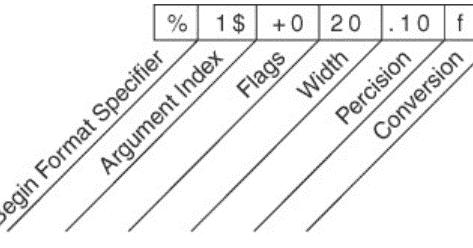

图表左侧是 `readAllBytes`、`readAllLines` 工具方法以及写入方法，它们专为简单的常用场景设计。它们右侧是用于迭代流或文本行的的方法，如 `newBufferedReader`、`newBufferedWriter`，然后 `newInputStream` 和 `newOutputStream`。这些方法可以与 `java.io` 包配合使用。它们右侧是处理 `ByteChannels`、`SeekableByteChannels` 和 `Buffers` 的方法，例如 `newByteChannel` 方法。最后，最右侧是使用 `FileChannel` 用于需要锁定或内存映射 I/O 的高级应用的方法。

> > 注意
> 创建新文件允许你为文件指定一组可选的初始属性。例如，在支持 POSIX 标准集的文件系统（如 Solaris）上，你可以在创建文件时指定文件所有者、组所有者或文件权限。“管理元数据”部分解释了文件属性以及如何访问它们。

### OpenOptions 参数

本节中的几个方法接收一个可选的 `OpenOptions` 参数。该参数是可选的，API 会告诉你当未指定参数时该方法的默认行为是什么。
支持以下 `StandardOpenOptions` 枚举：

- `WRITE`——以读写方式打开文件。
- `APPEND`——将新数据追加到文件末尾。此选项与 `WRITE` 或 `CREATE` 选项配合使用。
- `TRUNCATE_EXISTING`——将文件截断为零字节。此选项与 `WRITE` 选项配合。
- `CREATE_NEW`——创建一个新文件，如果文件已存在则抛出异常。
- `CREATE`——如果文件存在则打开它，如果不存在则创建一个新文件。
- `DELETE_ON_CLOSE`——在流关闭时删除文件。此选项对于临时文件很有用。
- `SPARSE`——提示新创建的文件将是稀疏文件。这种高级选项在某些文件系统（如 NTFS）上会被遵守，在这些系统中，带有数据“空隙”的大文件可以更高效地存储，因为这些空隙不占用磁盘空间。
- `SYNC`——保持文件（内容和元数据）与底层存储设备同步。
- `DSYNC`——保持内容与底层存储设备同步。

### 针对小文件的常用方法

#### 从文件中读取所有字节或行

如果你有一个较小的文件，并希望一次性地读取其全部内容，可以使用 `readAllBytes(Path)` 或 `readAllLines(Path)` 方法。这些方法会处理相关工作（如打开和关闭流），但并非用于大文件。以下代码段展示了如何使用这些方法：

```java
Path file = ...;

byte[] bytes = Files.readAllBytes(file);

List<String> lines = Files.readAllLines(file);
```

#### 向文件写入所有字节或行

你可以通过 `Files.write(Path, byte[])` 或 `Files.write(Path, Iterable<? extends String>)` 向文件写入所有字节或行。这些方法处理了大部分工作，如关闭流。以下代码段展示了如何使用这些方法：

```java
Path file = ...;

byte[] data = "Hello World".getBytes();

Files.write(file, data);

List<String> lines = Arrays.asList("Line 1", "Line 2");

Files.write(file, lines);
```

### 用于文本的缓冲 I/O 方法

`java.io` 包提供了缓冲 I/O 类，对于读取和写入文本更为高效。这些类使用内部缓冲区存储从底层读取或写入的数据，从而减少了系统操作次数。

#### 使用缓冲 I/O 读取文件

`newBufferedReader(Path, Charset)` 方法打开文件并返回一个用于读取文本的 `BufferedReader`。以下代码段展示了如何使用该方法：

```java
Path file = ...;

Charset charset = Charset.defaultCharset();

try (BufferedReader reader = Files.newBufferedReader(file, charset)) {

    String line = null;

    while ((line = reader.readLine()) != null) {

        System.out.println(line);

    }

} catch (IOException x) {

    System.err.println(x);

}
```

#### 使用缓冲 I/O 写入文件

`newBufferedWriter(Path, Charset)` 方法打开文件并返回一个用于写入文本的 `BufferedWriter`。以下代码段展示了如何使用该方法：

```java
Path file = ...;

Charset charset = Charset.defaultCharset();

try (BufferedWriter writer = Files.newBufferedWriter(file, charset)) {

    writer.write("Hello, World!");

} catch (IOException x) {

    System.err.println(x);

}
```

### 非缓冲流与 java.io 交互的方法

`newInputStream(Path, OpenOption...)` 方法打开文件并返回一个非缓冲输入流。以下代码段展示了如何使用该方法：

```java
Path file = ...;

try (InputStream in = Files.newInputStream(file)) {

    BufferedReader reader = new BufferedReader(new InputStreamReader(in));

    String line = null;

    while ((line = reader.readLine()) != null) {

        System.out.println(line);

    }

} catch (IOException x) {

    System.err.println(x);

}
```

`newOutputStream(Path, OpenOption...)` 方法打开文件并返回一个非缓冲输出流。以下代码段展示了如何使用该方法：

```java
Path file = ...;

try (OutputStream out = Files.newOutputStream(file)) {

    byte[] data = "Hello, World!".getBytes();

    out.write(data);

} catch (IOException x) {

    System.err.println(x);

}
```

### Channels 和 ByteBuffers 的方法

#### 使用 Channel I/O 读写文件

流 I/O 每次读取一个字符，而 channel I/O 每次读取一个缓冲区。`ByteChannel`¹¹⁷ 接口提供了基本的读写功能。`SeekableByteChannel`¹¹⁸ 是一种 `ByteChannel`，具有维护通道中位置并更改位置的能力。`SeekableByteChannel` 还支持截断与通道关联的文件以及查询文件的大小。

这种移动到文件中不同点并从该位置读取或写入该位置的能力使得对文件的随机访问成为可能。更多信息请参见“随机访问文件”部分。

读取和写入通道 I/O 有两种方法：

- `newByteChannel(Path, OpenOption...)`¹¹¹⁹
- `newByteChannel(Path, Set<? extends OpenOption>, FileAttribute<?>...)`¹¹²⁰

> 注意：`newByteChannel` 方法返回 `SeekableByteChannel` 实例。在默认文件系统中，你可以将此字节通道转换为 `FileChannel`¹¹²，从而访问更高级的功能，例如直接将文件的某个区域映射到内存中以加快访问、锁定文件的某个区域以防止其他进程访问，或从绝对位置读取和写入字节而不影响通道的当前位置。

两种 `newByteChannel` 方法都允许你指定 `OpenOption` 选项列表。支持 `newOutputStream` 方法使用的相同打开选项，外还有一个额外的选项：`SeekableByteChannel` 支持同时读取和写入，需要 `READ`。

指定 `READ` 将以读模式打开通道。指定 `WRITE` 或 `APPEND` 将以写模式打开通道。如果未指定这些选项之一，通道将以读模式打开。

以下代码片段读取文件并将其打印到标准输出：

```java
// 默认使用 READ

try (SeekableByteChannel sbc = Files.newByteChannel(file)) {

    ByteBuffer buf = ByteBuffer.allocate(10);

    // 使用此平台的适当编码读取字节

    // 如果你跳过这一步，你可能会看到类似 l

    // 中文字符的内容，而你预期的是拉丁风格的字符

    String encoding = System.getProperty("file.encoding");

    while (sbc.read(buf) > 0) {

        buf.rewind();

        System.out.print(Charset.forName(encoding).decode(buf));

        buf.flip();

    }

} catch (IOException x) {

    System.out.println("caught exception: " + x);

}
```

以下代码片段为 POSIX 文件系统编写，创建一个具有特定文件权限的日志文件。此代码会创建一个日志文件，如果日志文件已存在，则追加到日志文件中。创建的日志文件对所有者具有读写权限，对组只有读权限。

```java
import static java.nio.file.StandardCopyOption.*;

// 创建用于追加到文件的选项集。

Set<OpenOption> options = new HashSet<OpenOption>();

options.add(APPEND);

options.add(CREATE);

// 创建自定义权限属性。

Set<PosixFilePermission> perms =
```


```java
PosixFilePermissions.fromString("rw-r--r-");

FileAttribute<Set<PosixFilePermission>> attr =
    PosixFilePermissions.asFileAttribute(perms);

// 将字符串转换为 ByteBuffer。

String s = ...;

byte data[] = s.getBytes();

ByteBuffer bb = ByteBuffer.wrap(data);

try (SeekableByteChannel sbc = Files.newByteChannel(file, option)) {
    sbc.write(bb);
} catch (IOException x) {
    System.out.println("exception thrown: " + x);
}
```

### 创建普通文件和临时文件的方法

#### 创建文件

你可以使用 `Files.createFile(Path, FileAttribute<?>)` 方法创建一个具有初始属性 set 的空文件。例如，如果在创建时，你希望文件具有一组特定的文件权限，可以使用 `Files.createFile` 方法来这样做。如果你不指定任何属性，文件将使用默认属性创建。如果文件已存在，`Files.createFile` 将抛出异常。

`Files.createFile` 方法在单次原子操作中检查文件是否存在，并使用指定的属性创建该文件，这使得该过程对于恶意代码的防御更具安全性。

以下代码片段创建一个具有默认属性的文件：

```java
Path file = ...;

try {
    // 创建具有默认权限等的空文件
    Files.createFile(file);
} catch (FileAlreadyExistsException x) {
    System.err.format("file named %s" + " already exists%n", file);
} catch (IOException x) {
    // 其他类型的失败，例如权限问题。
    System.err.format("createFile error: %s%n", x);
}
```

记得“POSIX 文件权限”部分提供了一个使用 `Files.createFile(Path, FileAttribute<?>)` 创建具有预设权限的文件的示例。

你也可以使用 `Files.newOutputStream` 方法创建新文件，如“创建和写入文件流 I/O”部分所述。如果你打开一个新的输出流并立即关闭它，则会创建一个空文件。

#### 创建临时文件

你可以使用以下 `Files.createTempFile` 方法之一创建临时文件：

- `Files.createTempFile(Path, String, FileAttribute<?>)`
- `Files.createTempFile(String, String, FileAttribute<?>)`

第一个方法允许你指定目录，第二个方法允许你指定后缀。以下代码片段是第二种方法的示例：

```java
try {
    Path tempFile = Files.createTempFile(null, ".tmp");
    System.out.format("The temporary file has been created: %s%n", tempFile);
} catch (IOException x) {
    System.err.format("IOException: %s%n", x);
}
```

### 随机访问文件

随机访问文件允许对文件的非顺序（或随机）访问。要随机访问文件，你需要打开文件、跳转到特定位置并从该位置读取或写入。这种功能可以通过 `SeekableByteChannel` 接口实现。`SeekableByteChannel` 接口扩展了通道 I/O，增加了当前位置的概念。方法允许你设置或查询位置，你可以从该位置读取或写入数据。该 API 包含几个易用的方法：

- `position()` 返回通道的当前位置
- `position(long)` 设置通道的位置
- `read(ByteBuffer)` 从通道读取字节到缓冲区
- `write(ByteBuffer)` 从缓冲区写入字节到通道
- `truncate(long)` 截断文件

“使用通道 I/O 读写文件”部分显示 `Path.newByteChannel` 方法返回 `SeekableByteChannel` 实例。在默认文件系统中，你可以直接使用该通道，也可以将其转换为 `FileChannel`，从而访问更高级的功能，例如将文件的某个区域映射到内存中以加快访问、锁定文件的某个区域、或从绝对位置读取和写入字节而不影响通道的当前位置。

以下代码片段使用 `Files.newByteChannel` 方法之一以读写模式打开文件。返回的 `SeekableByteChannel` 被转换为 `FileChannel`。然后，从文件开头读取 12 个字节，并将字符串“I was here!”写入该位置。文件的当前位置移动到末尾，并追加开头的 12 个字节。最后，追加字符串“I was here!”，并关闭文件上的通道。

```java
String s = "I was here!\n";
byte data[] = s.getBytes();
ByteBuffer out = ByteBuffer.wrap(data);
ByteBuffer copy = ByteBuffer.allocate(12);

try (FileChannel fc = (FileChannel) Files.newByteChannel(file, READ, WRITE)) {
    // 读取文件的前 12 个字节
    int nread;
    do {
        nread = fc.read(copy);
    } while (nread != -1 && copy.hasRemaining());

    // 在文件开头写入 "I was here!"
    fc.position(0);
    while (out.hasRemaining()) {
        fc.write(out);
    }

    out.rewind();

    // 移动到文件末尾。将前 12 个字节复制到文件的结束。然后再次写入 "I was here!"。
    long length = fc.size();
    fc.position(length - 1);
    copy.flip();
    while (copy.hasRemaining()) {
        fc.write(copy);
    }
    while (out.hasRemaining()) {
        fc.write(out);
    }
} catch (IOException x) {
    System.out.println("I/O Exception: " + x);
}
```

### 创建和读取目录

我们之前讨论过的一些方法（如 `Files.delete`）适用于文件、链接*以及*目录。但你如何列出文件系统顶部的所有目录呢？你又如何列出目录的内容或创建一个目录呢？

#### 列出文件系统的根目录

你可以使用 `FileSystem.getRootDirectories()` 方法来列出文件系统的根目录。该方法返回一个 `Iterable`，使你能够使用增强 for 语句来遍历所有的根目录。

以下代码段打印了默认文件系统的根目录：

```java
Iterable<Path> dirs = FileSystems.getDefault().getRootDirectories();

for (Path name : dirs) {
    System.err.println(name);
}
```

#### 创建目录

你可以使用 `Files.createDirectory(Path, FileAttribute<?>)` 方法创建一个新目录。如果你不指定任何 `FileAttributes`，新目录将具有默认属性。例如：

```java
Path dir = ...;
Files.createDirectory(dir);
```

以下代码段在 POSIX 文件系统上创建一个具有特定权限的新目录：

```java
Set<PosixFilePermission> perms =
    PosixFilePermissions.fromString("rw-r-x---");

FileAttribute<Set<PosixFilePermission>> attr =
    PosixFilePermissions.asFileAttribute(perms);

Files.createDirectory(dir, attr);
```

当一个或多个父目录可能尚不存在时，如果你想创建一个深层几级的目录，可以使用便利方法 `Files.createDirectories(Path, FileAttribute<?>)`。与 `Files.createDirectory(Path, FileAttribute<?>)` 方法一样，你可以指定一个可选的初始文件属性集。以下代码段使用了默认属性：

```java
Files.createDirectories(Paths.get("foo/bar/test"));
```

目录会根据需要从上到下创建。在 `foo/bar/test` 示例中，如果 `foo` 目录不存在，则会被创建。接着，如果需要，会创建 `bar` 目录，最后创建 `test` 目录。

此方法可能会在创建某些但并非所有父目录后失败。

#### 创建临时目录

你可以使用其中一个 `Files.createTempDirectory` 方法来创建临时目录：

- `Files.createTempDirectory(Path, String, FileAttribute<?>...)`
- `Files.createTempDirectory(String, FileAttribute<?>...)`

第一个方法允许代码为临时目录指定位置，第二种方法在默认的临时文件目录下创建一个新目录。

#### 列出目录内容

你可以使用 `Files.newDirectoryStream(Path)` 方法列出目录的所有内容。该方法返回一个实现 `DirectoryStream` 接口的对象。实现 `DirectoryStream` 接口的类也实现了 `Iterable`，因此你可以遍历目录流并读取所有对象。这种方法对于非常大的目录扩展性良好。

> **注意**
>
> 返回的 `DirectoryStream` 是一个流。如果你没有使用 `try-with-resources` 语句，请不要忘记在 `finally` 块中关闭流。`try-with-resources` 语句会为你处理这一点。

以下代码段展示了如何打印目录的内容：

```java
Path dir = ...;

try (DirectoryStream<Path> stream = Files.newDirectoryStream(dir)) {
    for (Path file : stream) {
        System.out.println(file.getFileName());
    }
} catch (IOException | DirectoryIteratorException x) {
    // 迭代过程永远不会抛出 IOException。
    // 在此代码段中，它只可能由 newDirectoryStream 抛出
    System.err.println(x);
}
```

迭代器返回的 `Path` 对象是相对于目录解析的条目名称。因此，如果你列出 `/tmp` 目录的内容，返回的条目格式为 `/tmp/a`、`/tmp/b` 等。

此方法返回目录的所有内容：文件、链接、子目录和隐藏文件。如果你想对检索的内容更具选择性，可以使用其他的 `Files.newDirectoryStream` 方法，如本节稍后部分所述。

请注意，如果在目录迭代期间发生异常，则会抛出 `DirectoryIteratorException`，并将 `IOException` 作为原因。迭代器方法不能抛出异常。

#### 使用 Glob 模式过滤目录列出

如果你只想获取每个名称匹配特定模式的文件和子目录，可以使用 `Files.newDirectoryStream(Path, String)` 方法，该方法提供了一个内置的 glob 过滤器。如果你不熟悉 glob 语法，请参见“什么是 Glob?” 一节。

例如，以下代码段列出了与 Java 相关的文件：`.class`、`.java` 和 `.jar` 文件：

```java
Path dir = ...;

try (DirectoryStream<Path> stream = Files.newDirectoryStream(dir, "*.{class,java,jar}")) {
    for (Path entry : stream) {
        System.out.println(entry.getFileName());
    }
} catch (IOException x) {
    // 迭代过程永远不会抛出 IOException。
    // 在此代码段中，它只可能由 newDirectoryStream 抛出
    System.err.println(x);
}
```

#### 编写自定义过滤器

你可能想根据模式匹配以外的条件过滤目录内容。你可以通过实现 `DirectoryStream.Filter` 接口来创建自己的过滤器。该接口包含一个方法 `accept`，用于判断是否符合搜索。

例如，以下代码段实现了一个只检索目录的过滤器：

```java
DirectoryStream.Filter<Path> filter = new DirectoryStream.Filter<Path>() {
    public boolean accept(Path file) {
        try {
            return Files.isDirectory(file);
        } catch (IOException x) {
            // 确定是否为目录失败
            System.err.println(x);
            return false;
        }
    }
};
```

一旦创建过滤器，可以使用 `Files.newDirectoryStream(Path, DirectoryStream.Filter<? super Path>)` 方法调用它。以下代码段使用过滤器打印目录：

```java
Path dir = ...;

try (DirectoryStream<Path> stream = Files.newDirectoryStream(dir, filter)) {
    for (Path entry : stream) {
        System.out.println(entry.getFileName());
    }
} catch (IOException x) {
    System.err.println(x);
}
```

此方法用于过滤单个目录。然而，如果你想在文件树中查找所有子目录，可以使用“遍历文件树”部分描述的机制。

### 链接，无论是符号或其他

如之前所述，`java.nio.file` 包特别是 `Path` 类是“感知链接的”。每个 `Path` 方法要么在遇到符号链接时检测行为，要么提供一个选项来配置遇到符号链接时的行为。

之前的讨论一直是符号或软链接，但某些文件系统也支持硬链接。硬链接比符号链接更严格，如下：

- 链接的目标必须存在。
- 硬链接通常不允许跨分区或卷。因此，它们无法跨文件系统存在。
- 硬链接看起来和行为都像普通文件，因此很难找到。
- 硬链接在实际上与原始文件是同一个实体。它们具有相同的文件权限、时间戳等。所有属性都是相同的。

由于这些限制，硬链接的使用不像符号链接那样频繁，但 `Path` 方法与硬链接无缝工作。

#### 创建符号链接

如果你的文件系统支持，可以使用 `Files.createSymbolicLink(Path, Path, FileAttribute<?>)` 方法创建符号链接。第二个 `Path` 参数代表目标文件或目录，可能存在也可能不存在。以下代码段创建一个具有默认权限的符号链接：

```java
Path newLink = ...;
Path target = ...;

try {
    Files.createSymbolicLink(newLink, target);
} catch (IOException x) {
    System.err.println(x);
} catch (UnsupportedOperationException x) {
    // 某些文件系统不支持符号链接。
    System.err.println(x);
}
```

`FileAttributes` 可变参数允许你指定在创建链接时原子性设置的初始文件属性。然而，此参数旨在留供未来之用，目前尚未实现。

#### 创建硬链接

你可以使用 `Files.createLink(Path, Path)` 方法为现有文件创建一个硬链接（或普通链接）。第二个 `Path` 参数指向现有文件，且它必须存在，否则将抛出 `NoSuchFileException` 异常。下面的代码段展示了如何创建链接：

```java
Path newLink = ...;
Path existingFile = ...;

try {
    Files.createLink(newLink, existingFile);
} catch (IOException x) {
    System.err.println(x);
}
```


} catch (UnsupportedOperationException x) {
    // 某些文件系统不支持
    // 将已存在的文件
    // 添加目录中。
    System.err.println(x);
}

### 检测符号链接

要确定一个 `Path` 实例是否为符号链接，你可以使用 `isSymbolicLink(Path)` 方法。下面的代码段展示了如何操作：

```java
Path file = ...;
boolean isSymbolicLink = Files.isSymbolicLink(file);
```

更多信息，请参见“管理元数据”部分。

### 查找链接的目标

你可以使用 `readSymbolicLink(Path)` 方法获取符号链接的目标，如下：

```java
Path link = ...;
try {
    System.out.format("Target of link '%s' = '%s\n", link, Files.readSymbolicLink(link));
} catch (IOException x) {
    System.err.println(x);
}
```

如果 `Path` 不是符号链接，该方法将抛出 `NotLinkException`。

### 遍历文件树

你是否需要创建一个递归访问文件树中所有文件的应用程序？也许你需要删除树中的每个 `.class` 文件，或者查找在一年内未被访问过的每个文件。你可以通过 `FileVisitor` 接口来实现这一点。

### FileVisitor 接口

要遍历文件树，你首先需要实现 `FileVisitor`。`FileVisitor` 指定了在遍历过程关键点的所需的行为：当访问文件时、在访问目录之前、在访问目录之后或当发生失败时。该接口有四个方法，对应于这些情况：

- `preVisitDirectory` — 在访问目录之前调用。
- `postVisitDirectory` — 在目录中的所有条目都已访问后调用。如果遇到任何错误，将会将特定的异常传递给该方法。
- `visitFile` — 在正在被访问的文件上调用。该文件的 `BasicAttributes` 被传递给该方法，或者你可以使用文件属性包来读取特定的属性集。例如，你可以选择读取文件的 `DosFileAttributeView` 来判断该文件是否设置了“隐藏”位。
- `visitFileFailed` — 当无法访问文件时调用。特定的异常将传递给该方法。你可以选择是抛出异常、将其打印到控制台或日志文件中，等等。

如果你不需要实现所有的四个 `FileVisitor` 方法，与其实现 `FileVisitor` 接口，不如你可以扩展 `SimpleFileVisitor` 类。该类实现了 `FileVisitor` 接口，会访问树中的所有文件，并在遇到错误时抛出 `IOException`。你可以扩展此类并重写你需要的所有方法。

这是一个扩展 `SimpleFileVisitor` 以打印文件树中条目的示例。无论该条目是普通文件、符号链接、目录还是其他“未指定”类型的文件，它都会打印该条目。它还会打印每个文件的大小（以字节为单位）。遇到的任何异常都会打印到控制台。

`FileVisitor` 方法以粗体显示：

```java
import static java.nio.file.VisitResult.*;

public static class PrintFiles extends SimpleFileVisitor<Path> {
    // 打印关于
    // 每种类型文件的信息。
    @Override
    public FileVisitResult visitFile(Path file, BasicFileAttributes attr) {
        if (attr.isSymbolicLink()) {
            System.out.format("Symbolic link: %s ", file);
        } else if (attr.isRegularFile()) {
            System.out.format("Regular file: %s ", file);
        } else {
            System.out.format("Other: %s ", file);
        }
        System.out.println("" + attr.size() + "bytes");
        return CONTINUE;
    }

    // 打印每个访问过的目录。
    @Override
    public FileVisitResult postVisitDirectory(Path dir, IOException exc) {
        System.out.format("Directory: %s%n", dir);
        return CONTINUE;
    }

    // 如果访问文件时发生某些错误，让用户知道。
    // 如果你没有重写此方法且发生了错误，将抛出一个 IOException。
    @Override
    public FileVisitResult visitFileFailed(Path file, IOException exc) {
        System.err.println(exc);
        return CONTINUE;
    }
}
```

### 启动进程

一旦你实现了你的 `FileVisitor`，如何启动文件遍历？`Files` 类中有两个 `walkFileTree` 方法。

- `walkFileTree(Path, FileVisitor)`
- `walkFileTree(Path, Set<FileVisitOption>, int, FileVisitor)`

第一个方法只需要起始点和一个 `FileVisitor` 实例。你可以如下调用 `PrintFiles` 访问器：

```java
Path startingDir = ...;
PrintFiles pf = new PrintFiles();
Files.walkFileTree(startingDir, pf);
```

第二个 `walkFileTree` 方法允许你额外指定访问的层数和 `FileVisitOption` 集合。如果你想确保此方法遍历整个文件树，可以为深度参数指定 `Integer.MAX_VALUE`。

你可以指定 `FileVisitOption` 枚举 `FOLLOW_LINKS`，这指示跟随符号链接。下面的代码段展示了如何调用四参数方法：

```java
import static java.nio.file.VisitResult;
Path startingDir = ...;
EnumSet<FileVisitOption> opts = EnumSet.of(FOLLOW_LINKS);
Finder finder = new Finder(pattern);
Files.walkFileTree(startingDir, opts, Integer.MAX_VALUE, finder);
```

### 创建 FileVisitor 的注意事项

树是深度优先遍历的，但你无法对子目录的访问顺序做出任何假设。

如果你的程序将更改文件系统，你需要仔细考虑如何实现你的 `FileVisitor`。

例如，如果你正在编写递归删除，你需要先删除目录中的文件然后再删除目录本身。在这种情况下，你在 `postVisitDirectory` 中删除目录。

如果你正在编写递归复制，你在尝试复制文件之前在 `preVisitDirectory` 中创建新目录（在 `visitFile` 中）。如果你想保留源目录的属性（类似于 UNIX `cp -p` 命令），你需要在文件复制完成后在 `postVisitDirectory` 中这样做。Copy 示例展示了如何这样做。

如果你正在编写文件搜索，你在 `visitFile` 方法中执行比较。该方法找到所有标准的文件，但它不会找到目录。如果你想找到文件和目录，你还必须在 `preVisitDirectory` 或 `postVisitDirectory` 方法中进行比较。Find 示例展示了如何这样做。

你需要决定是否跟随符号链接。例如，如果你正在删除文件，跟随符号链接可能并不妥。如果你正在复制文件树，你可能希望。默认情况下，`walkFileTree` 不跟随符号链接。

`visitFile` 方法用于文件。如果你指定了 `FOLLOW_LINKS` 选项或你的文件树有父目录，循环目录将在 `visitFileFailed` 方法通过 `FileSystemLoopException` 报告。下面的代码段展示了如何捕获循环链接，并来自 Copy 示例：

```java
@Override
public FileVisitResult visitFileFailed(Path file, IOException exc) {
    if (exc instanceof FileSystemLoopException) {
        System.err.println("cycle detected: " + file);
    } else {
        System.err.format("Unable to copy: %s: %s%n", file, exc);
    }
    return CONTINUE;
}
```

这种情况只会在程序遵循符号链接时发生。

### 控制流程

也许你想要遍历文件树以寻找某个特定的目录，并在找到时让进程终止。或者，你可能想跳过特定的目录。

`FileVisitor` 方法返回一个 `FileVisitResult` 值。你可以通过在 `FileVisitor` 方法中返回的值，来中止文件遍历过程，或控制是否访问某个目录。

- `CONTINUE` — 表示应该继续文件遍历。如果 `preVisitDirectory` 方法返回 `CONTINUE`，则该目录将被访问。
- `TERMINATE` — 立即中止文件遍历。在返回此值后，将不再调用任何其他文件遍历方法。
- `SKIP_SUBTREE` — 当 `preVisitDirectory` 返回此值时，将跳过指定的目录及其子目录。该分支将从树中被“剪枝掉”。
- `SKIP_SIBLINGS` — 当 `preVisitDirectory` 返回此值时，不会访问指定的目录，不会调用 `postVisitDirectory`，且不会访问后续未访问的同级目录。如果从 `postVisitDirectory` 方法返回，则不会访问后续的同级目录。本质上，指定的目录内不再有任何后续操作。

在下面的代码片段中，任何名为 SCCS 的目录都会被跳过：

```java
import static java.nio.file.FileVisitResult.*;

public FileVisitResult preVisitDirectory(Path dir, BasicFileAttributes attrs) {
    if (dir.getFileName().toString().equals("SCCS")) {
        return SKIP_SUBTREE;
    }
    return CONTINUE;
}
```

在下面的代码片段中，一旦定位到特定的文件，文件名就会打印到标准输出，并终止文件遍历：

```java
import static java.nio.file.FileVisitResult.*;

// 我们正在寻找的文件。
Path lookingFor = ...;

public FileVisitResult visitFile(Path file, BasicFileAttributes attr) {
    if (file.getFileName().equals(lookingFor)) {
        System.out.println("Located file: " + file);
        return TERMINATE;
    }
    return CONTINUE;
}
```

### 示例

以下示例演示了文件遍历机制：

- Find — 递归遍历文件树以寻找匹配特定 glob 模式的文件和目录。此示例在“查找文件”部分进行了讨论。
- Chmod — 递归更改文件树上的权限（仅限 POSIX 系统）。
- Copy — 递归复制文件树。
- WatchDir — 演示了监控目录中文件被创建、删除或修改的机制。使用 `-r` 选项调用此程序可以监控整个树的变化。有关文件通知服务的更多信息，请参阅“监控目录变化”部分。

### 查找文件

如果你用过 shell 脚本，那么你很可能使用过模式匹配来定位文件。事实上，你可能已经广泛使用了它。如果你还没用过，模式匹配使用特殊字符创建一个模式，然后可以将文件名与该模式进行比较。例如，在大多数 shell 脚本中，星号 `*` 匹配任意数量的字符。例如，以下命令列出了当前目录下所有以 `.html` 结尾的文件：

```bash
% ls *.html
```

`java.nio.file` 包对这一有用功能提供了程序化支持。每个文件系统实现都提供一个 `PathMatcher`。你可以通过 `FileSystem` 类中的 `getPathMatcher(String)` 方法获取文件系统的 `PathMatcher`。下面的代码片段获取了默认系统的路径：

```java
String pattern = ...;
PathMatcher matcher = FileSystems.getDefault().getPathMatcher("glob:" + pattern);
```

传递给 `getPathMatcher` 的参数指定了语法类型和要匹配的模式。此示例指定了 glob 语法。如果你熟悉 glob 语法，请参阅“什么是 Glob”部分。

Glob 语法易用且灵活，但如果你愿意，可以使用正则表达式（regex）语法。关于正则表达式的更多信息，请参阅第 14 章。某些文件系统实现可能支持其他语法。

如果你想使用其他形式的基于字符串的模式匹配，可以自定义 `PathMatcher` 类。本页中的示例使用了 glob 语法。

一旦你创建了 `PathMatcher` 实例，就可以用它来匹配文件了。`PathMatcher` 接口有一个方法 `matches`，它接受一个 `Path` 参数并返回一个布尔值：匹配模式或不匹配。接下来的代码片段查找以 `.java` 或 `.class` 结尾的文件，并将这些文件打印到标准输出：

```java
PathMatcher matcher = FileSystems.getDefault().getPathMatcher("glob:*.{java,class}");
Path filename = ...;
if (matcher.matches(filename)) {
    System.out.println(filename);
}
```

（注：原始 OCR 导致在 glob 字符串中缺少一个右括号）

### 递归模式匹配

搜索匹配特定模式的文件与遍历文件树是相辅相成的。你曾多少次知道某个文件在文件系统的某处，但具体在哪里呢？或者，你可能需要在文件树中找到所有具有特定扩展名的文件。

Find 示例正是这一点。Find 类似于 UNIX 的 find 工具，但在功能上进行了精简。你可以扩展此示例以包含其他功能。例如，find 实用程序支持 `-prune` 标志来从搜索中排除整个子树。你可以通过在 `preVisitDirectory` 方法中返回 `SKIP_SUBTREE` 来实现这一点。

```java
return CONTINUE;
}

static void usage() {
    System.err.println("java Find <path> -name \"<glob_pattern>\"");
    System.exit(-1);
}

public static void main(String[] args) throws IOException {
    if (args.length < 3 || !args[1].equals("-name")) {
        usage();
    }
    Path startingDir = Paths.get(args[0]);
    String pattern = args[2];
    Finder finder = new Finder(pattern);
    Files.walkFileTree(startingDir, finder);
}

finder.done();
}
```


# 监听目录的变化

你是否曾遇到过这种情况：当你正在编辑一个文件或使用 IDE 时，另一个对话框出现，提示你打开的文件之一在文件系统中发生了变化，需要重新加载？或者，像 NetBeans IDE 那样，应用程序静静地更新了文件而不通知你。图 11.9 显示了在免费编辑器 jEdit 中这种通知的样式。

## 图 11.9. jEdit 显示检测到修改文件的对话框


为了实现这种被称为“文件更改通知”的功能，程序必须能够检测文件系统中相关目录正在发生的变化。其中一种方法是轮询文件系统以查找变化，但这种方法效率很低。它无法扩展到需要监控数百个打开的文件或目录的应用程序。

`java.nio.file` 包提供了一个文件更改通知 API，称为 Watch Service API。该 API 允许你将一个（或多个）目录注册到监听服务中。在注册时，你告诉服务你感兴趣的事件类型：文件创建、文件删除或文件修改。当服务检测到感兴趣的事件时，该事件将转发给注册的进程。注册进程有一个专门的线程（或线程池）用于监听它已注册的任何事件。当事件到达时，将根据需要进行处理。

### Watch Service 概述

Watch Service API 是相当低层级的，允许你对其进行自定义。你可以直接使用它，也可以选择在此机制之上创建一个高层 API，以适应你的特定需求。

实现监听服务所需的基本步骤如下：

- 为文件系统创建一个 `WatchService` “监听器”（watcher）。
- 对于你想要监控的每个目录，将其注册到监听器中。在注册目录时，你指定想要接收通知的事件类型。对于每个注册的目录，你会收到一个 `WatchKey` 实例。
- 实现一个无限循环来等待传入的事件。当事件发生时，键会被信号并放入监听器的队列中。
- 从监听器的队列中获取键。你可以从键中获取文件名。
- 获取键的每个待处理事件（可能多个事件）并根据需要进行处理。
- 重置键，并继续等待事件。
- 关闭服务：当线程退出或服务被关闭（通过调用其 `close()` 方法）时，监听服务将退出。

`WatchKey` 是线程安全的，可以与 `java.util.concurrent` 包一起使用。你可以为此工作专门分配线程池，这将在第 13 章中进行描述。

## 尝试一下

由于此 API 较为高级，请在继续之前尝试一下。将 `WatchDir` 示例保存到你的计算机并编译。创建一个将传递给示例的测试目录。`WatchDir` 使用单线程处理事件，因此它在等待事件时会阻塞键盘输入。你可以在单独的窗口中运行程序，或者在后台运行，如下所示：

```bash
java WatchDir test &
```

在测试目录中尝试创建、删除和编辑文件。当发生这些事件中的任何一个时，控制台会打印一条消息。完成后，删除测试目录 `WatchDir` 就会退出。或者，如果你愿意，也可以手动杀死进程。

你还可以通过指定 `-r` 选项来监控整个文件树。当你指定 `-r` 时，`WatchDir` 会遍历文件树，并将每个目录注册到监听服务。

## 创建监听服务并注册事件

第一步是使用 `FileSystem` 类中的 `newWatchService()` 创建一个新的 `WatchService`，如下：

```java
WatchService watcher = FileSystems.getDefault().newWatchService();
```

接下来，向监听服务注册一个或多个对象。任何实现 `Watchable` 接口的对象都可以注册。`Path` 类实现了 `Watchable` 接口，因此每个要监控的目录都作为 `Path` 对象被注册。

与任何 `Watchable` 一样，`Path` 类实现了两个 `register` 方法。本页使用两个参数的版本 `register(WatchService, WatchEvent.Kind<?>...)`。（三参数版本接受一个 `WatchEvent.Modifier`，该参数目前尚未实现。）

在向监听服务注册对象时，你指定想要监控的事件类型。`StandardWatchEventKinds` 事件类型如下：

- `ENTRY_CREATE`：创建了目录条目。
- `ENTRY_DELETE`：删除了目录条目。
- `ENTRY_MODIFY`：修改了目录条目。
- `OVERFLOW`：表示事件已丢失。你不需要注册它。

以下代码片段显示了如何注册所有事件类型：

```java
import static java.nio.file.StandardWatchEventKinds.*;

Path dir = ...;

try {
    WatchKey key = dir.register(watcher, ENTRY_CREATE, ENTRY_DELETE, ENTRY_MODIFY);
} catch (IOException x) {
    System.err.println(x);
}
```

### 处理事件

事件循环的顺序如下：

1. 获取监听键。提供了三种方法：
   - `poll()`：如果可用则返回键；如果不可用则立即返回 `null`。
   - `poll(long, TimeUnit)`：如果可用则返回键；如果立即不可用，则等待指定的时间。`TimeUnit` 参数决定了指定的时间是纳秒、毫秒还是其他单位。
   - `take()`：返回键。如果没有可用键，此方法将等待。
2. 获取键的待处理事件。你通过 `pollEvents()` 方法获取 `List<WatchEvent<?>>`。
3. 使用 `kind()` 方法获取事件类型。无论注册了什么事件，都可能接收到 `OVERFLOW` 事件。
4. 获取与事件关联的文件。文件名存储在事件的上下文，因此使用 `context()` 方法来获取。
5. 处理事件后，你需要通过调用 `reset()` 将键置回就绪状态。如果此方法返回 `false`，则键无效，循环可以退出。这一步**非常重要**。如果你没有调用 `reset()`，该键将不会接收任何后续事件。

监听键有一个状态。在任何给定时刻，其状态可能是以下之一：

- **Ready（就绪）**：表示键准备好接受事件。创建时，键处于就绪状态。
- **Signaled（已信号）**：表示队列中有一个或多个事件。一旦键被信号，在调用 `reset()` 方法之前，它不再处于就绪状态。
- **Invalid（无效）**：表示键不再活动。当发生以下事件时会进入此状态：
  - 进程通过 `cancel()` 方法显式取消键。
  - 目录变得不可访问。
  - 监听服务关闭。

这是一个事件处理循环示例。它取自 `Email` 示例，该示例监控目录并等待新文件的出现。当新文件可用时，将使用 `Files.probeContentType(Path)` 方法检查其是否为 `text/plain` 文件。意图是将 `text/plain` 文件发送到别名，但该部分的实现留给读者完成。

```java
for (;;) {
    // 等待信号被触发
    WatchKey key;
    try {
        key = watcher.take();
    } catch (InterruptedException x) {
        return;
    }

    for (WatchEvent<?> event : key.pollEvents()) {
        WatchEvent.Kind<?> kind = event.kind();

        // 此键仅注册了
        // 用于 ENTRY_CREATE 事件，
        // 但无论事件是否丢失
        // 或被丢弃，都可能发生 OVERFLOW 事件。
        if (kind == OVERFLOW) {
            continue;
        }

        // 文件名是事件的
        // 上下文。
        WatchEvent<Path> ev = (WatchEvent<Path>) event;
        Path filename = ev.context();

        // 验证新
        // 文件是否为文本文件。
        try {
            // 相对于目录解析文件名。
            // 如果文件名是 "test" 且目录是 "foo"
            // 则解析后的名称为 "foo/test"。
            Path child = dir.resolve(filename);
            if (!Files.probeContentType(child).equals("text/plain")) {
                continue;
            }
        } catch (IOException x) {
            System.err.println(x);
            continue;
        }

        // 将文件发送到
        // 指定的邮箱别名。
        System.out.format("Emailing file %s%n", filename);
        // 细节留给读者....
    }

    // 重置键 - 如果你想继续接收
    // 进一步的监听事件，此步至关重要。如果键不再
    // 可用，则退出循环。
    boolean valid = key.reset();
    if (!valid) {
        break;
    }
}
```

### 获取文件名

文件名是从事件上下文中获取的。`Email` 示例使用以下代码获取文件名：

```java
WatchEvent<Path> ev = (WatchEvent<Path>) event;
Path filename = ev.context();
```

当你编译 `Email` 示例时，会产生以下错误：

```
Note: Email.java 使用了未检查或安全的操作。
Note: 使用 -Xlint:unchecked 重新编译获取详情。
```

该错误是由于将 `WatchEvent<?>` 转换为 `WatchEvent<Path>` 的代码引起的。`WatchDir` 示例通过创建一个抑制未检查警告的实用转换方法来避免此错误，如下所示：

```java
@SuppressWarnings("unchecked")
static <T> WatchEvent<T> cast(WatchEvent<?> event) {
    return (WatchEvent<T>) event;
}
```

如果你不熟悉 `@SuppressWarnings` 语法，请参阅第 5 章。

### 何时使用和不使用此 API

Watch Service API 是为需要通知文件更改事件的应用程序设计的。它非常适用于任何应用程序，例如编辑器或 IDE，它们可能打开许多文件并需要确保文件与文件系统同步。它也适用于监控目录的应用程序服务器，可能等待 `.jsp` 或 `.jar` 文件的放入以便部署它们。

此 API 并不是为索引硬盘而设计的。大多数文件系统实现对文件更改通知都有原生支持。Watch Service API 在可用时利用了这种支持。然而，当文件系统不支持此机制时，Watch Service 将轮询文件系统以等待事件。

## 其他实用方法

一些实用的方法没有适合本节的其他部分，因此在此处进行介绍。

### 确定 MIME 类型

要确定文件的 MIME 类型，你可能会发现 `Files.probeContentType(Path)` 方法有用。例如：

```java
try {
    String type = Files.probeContentType(filename);
    if (type == null) {
        System.err.format("'%s' has an unknown filetype.%n", filename);
    }
} catch (IOException x) {
    System.err.println(x);
}
```

注意，如果无法确定内容类型，`probeContentType` 将返回 `null`。

该方法的实现高度依赖于平台，并且并非万无一失。内容类型是由平台的默认文件类型检测器指定的。例如，如果检测器根据 `.class` 扩展名确定文件的内容类型为 `application/x-java`，它可能会被欺骗。

如果默认值不能满足你的需求，你可以提供一个自定义的 `FileTypeDetector`。

`Email` 示例使用了 `probeContentType` 方法。

### 默认文件系统

要检索默认文件系统，使用 `getDefault()` 方法。通常，这是 `FileSystems` 方法（复数）链式调用到 `FileSystem` 方法（单数）上，如下所示：

```java
PathMatcher matcher = FileSystems.getDefault().getPathMatcher("glob:**");
```

### 路径字符串分隔符

POSIX 文件系统的路径分隔符是正斜线 `/`，而 Microsoft Windows 使用的是反斜线 `\`。其他文件系统使用其他分隔符。要检索默认文件系统的路径分隔符，可以使用以下方法之一：

```java
String separator = File.separator;
String separator = FileSystems.getDefault().getSeparator();
```

`getSeparator()` 方法也用于检索任何可用文件系统的路径分隔符。

### 文件系统的文件存储

文件系统有一个或多个文件存储来存放其文件和目录。文件存储代表底层存储设备。在 Solaris、Linux 和 OS X 操作系统上，每个挂载的文件系统由一个文件存储表示。在 Microsoft Windows 中，每个卷由一个文件存储表示：`C:`、`D:` 等。

要检索所有文件存储的列表，使用增强 for 语句遍历：

```java
for (FileStore store : FileSystems.getDefault().getFileStores()) {
    ...
}
```

如果你想检索特定文件所在的文件存储，使用 `Files.getFileStore(Path)` 方法，如下：

```java
Path file = ...;
FileStore store = Files.getFileStore(file);
```

### 与旧代码的交互性

在 Java SE 7 发布之前，`java.io.File` 类是用于文件 I/O 的机制，但它具有以下缺点：

- 许多方法在失败时不抛出异常，因此无法知道文件是否存在、用户是否有权限或是否存在其他问题。
- `renameTo()` 方法在不同平台之间工作不一致。
- 对符号链接没有真正的支持。
- 需要对元数据的更多支持，例如文件权限、所有者和其他属性。
- 访问元数据的效率低下。
- 许多 `File` 方法无法扩展。在服务器上请求大型目录会导致挂起。
- 大目录会导致内存资源问题，导致拒绝服务。
- 无法编写可以递归遍历树并相应响应符号链接的可靠代码。

也许你有使用 `java.io.File` 的旧代码，并希望在对影响最小的情况下利用 `java.nio.file.Path` 的功能。

`java.io.File` 类提供了 `toPath()` 方法，可以将旧式的 `File` 实例转换为 `java.nio.file.Path` 实例，如下：

```java
Path input = file.toPath();
```

然后你就可以利用 `Path` 类提供的丰富功能集。

例如，假设你有一些删除文件的代码：

```java
file.delete();
```

你可以修改这些代码使用 `Files.delete(Path)` 方法，如下：

```java
Path fp = file.toPath();
Files.delete(fp);
```


相反，`Path.ToFile` 方法为 `Path` 对象构造一个 `java.io.File` 对象。

### 将 java.io.File 功能映射到 java.nio.file

由于 Java 文件 I/O 实现在 Java SE 7 中被完全重构，你无法将一个方法替换为另一个方法。如果你想使用 `java.nio.file` 包提供的丰富功能，最简单的解决方案是如上一节所示使用 `File.toPath` 方法。然而，如果你不想使用这种方法或它不能满足你的需求，你就必须重写你的文件 I/O 代码。

这两个 API 之间没有一一对应的关系，但表 11.6 让你大致了解 `java.io.File` API 中的哪些功能映射到 `java.nio.file` API，并告诉你可以从哪里获取更多信息。

# 表 11.6. 从旧文件 I/O 到 NIO.2 的映射

| java.io.File 功能 | java.nio.file 功能 | 更多信息章节 |
| :--- | :--- | :--- |
| `java.io.File` | `java.nio.file.Path` | Path 类 |
| `java.io.RandomAccessFile` | `SeekableByteChannel` 功能 | 随机访问文件 |
| `File.canRead`, `canWrite` | `Files.Readable`, `Files.Writable`, `Files.Executable`。在 UNIX 文件系统中，“管理元数据”部分描述了用于检查九种权限的包 | 检查文件或目录元数据 |
| `File.isDirectory()`, `File.isFile()`, `File.length()` | `Files.isDirectory(Path, LinkOption...)`, `Files.isRegularFile(Path, LinkOption...)`, `Files.size(Path)` | 管理元数据 |
| `File.lastModified()` and `File.setLastModified(long)` | `Files.getLastModifiedTime(Path, LinkOption...)` and `Files.setLastModifiedTime(Path, FileTime)` | 管理元数据 |
| 更改属性的方法：`setExecutable`, `setReadable`, `setReadOnly`, `setWritable`, `new File(parent, "newfile")` | 这些方法被 `Files.setAttribute(Path, String, Object, LinkOption...).resolve("newfile")` 替代 | 路径操作 |
| `File.renameTo` | `Files.move` | 移动文件或目录 |
| `File.delete` | `Files.delete` | 删除文件或目录 |
| `File.createNewFile` | `Files.createFile` | 被 `createFile` 方法中指定的 `DELETE_ON_CLOSE` 选项替换 | 创建文件 |
| `File.createTempFile` | `Files.createTempFile(Path, String, FileAttributes<?>)`, `Files.createTempFile(Path, String, FileAttributes<?>)` | 创建文件；使用 Stream I/O 创建和写入文件；使用 Channel I/O 读写文件 |
| `File.exists` | `Files.exists` and `Files.notExists` | 验证文件或目录的存在 |
| `File.compareTo` and `equals` | `Path.compareTo` and `equals` | 比较两个路径 |
| `File.getAbsolutePath` and `getAbsoluteFile` | `Path.toAbsolutePath` | 转换路径 |
| `File.getCanonicalPath` and `getCanonicalFile` | `Path.toRealPath` or `normalize` | 转换路径 (`toRealPath`)；移除路径中的冗余 (`normalize`) |
| `File.toURI` | `Path.toURI` | 转换路径 |
| `File.isHidden` | `Files.isHidden` | 获取路径信息 |
| `File.list` and `listFiles` | `Path.newDirectoryStream` | 列出目录内容 |
| `File.mkdir` and `mkdirs` | `Path.createDirectory` | 创建目录 |
| `File.listRoots` | `FileSystem.getRootDirectories` | 列出系统根目录 |
| `File.getTotalSpace`, `File.getFreeSpace`, `File.getUsableSpace` | `FileStore.getTotalSpace`, `FileStore.getUnallocatedSpace`, `FileStore.getUsableSpace` | 文件存储器属性 |

### 总结

`java.io` 包包含许多程序可以用来读写数据的类。绝大多数类都实现了顺序访问流。顺序访问流可以分为两类：读写字节的流和读写 Unicode 字符的流。每个顺序访问流都有其特殊用途，例如从文件读取或写入文件、在读写时过滤数据，或者对对象进行序列化。

`java.nio.file` 包提供了文件和文件系统 I/O 广泛的支持。这是一个非常全面的 API，其关键入口点如下：

- `Path` 类具有用于操作路径的方法。
- `Files` 类具有文件操作方法，如移动、复制、删除，以及检索和设置文件属性的方法。
- `FileSystem` 类具有多种获取文件系统信息的方法。

关于 NIO.2 的更多信息可以在 java.net¹⁸⁷ 上的 JDK NIO¹⁸⁶ 项目网站上找到。该网站包含了 NIO.2 提供的功能，如多播、异步 I/O 以及实现你自己的文件系统。

### 问题与练习：基础 I/O

#### 问题

1. 使用什么类和方法读取大文件末部的几个数据？
2. 调用时，指示新行的最佳方法是什么？
3. 如何确定文件的 MIME 类型？
4. 使用什么方法确定文件是否为符号链接？

#### 练习

1. 编写一个程序统计文件中特定字符（如 e）出现的次数。可以在命令行指定 `xadu.txt`。
2. 文件以一个 `long` 开始，告诉你同一个文件中 `int` 数据的偏移量。编写一个程序获取 `int` 数据。

#### 答案

你可以在 <http://docs.oracle.com/javase/tutorial/essential/io/Q> 找到这些问题和练习的答案。

# 第1章笔记

1. <http://docs.oracle.com/javase/8/docs/api/java/io/InputStream.html>
2. <http://docs.oracle.com/javase/8/docs/api/java/io/OutputStream.html>
3. <http://docs.oracle.com/javase/8/docs/api/java/io/FileInputStream.html>
4. <http://docs.oracle.com/javase/8/docs/api/java/io/FileOutputStream.html>
5. <http://docs.oracle.com/javase/8/docs/api/java/io/Reader.html>
6. <http://docs.oracle.com/javase/8/docs/api/java/io/Writer.html>
7. <http://docs.oracle.com/javase/8/docs/api/java/io/FileReader.html>
8. <http://docs.oracle.com/javase/8/docs/api/java/io/FileWriter.html>
9. <http://docs.oracle.com/javase/8/docs/api/java/io/InputStreamReader.html>
10. <http://docs.oracle.com/javase/8/docs/api/java/io/OutputStreamWriter.html>
11. <http://docs.oracle.com/javase/8/docs/api/java/io/BufferedReader.html>
12. <http://docs.oracle.com/javase/8/docs/api/java/io/PrintWriter.html>
13. <http://docs.oracle.com/javase/8/docs/api/java/io/InputStream.html>
14. <http://docs.oracle.com/javase/8/docs/api/java/io/OutputStream.html>
15. <http://docs.oracle.com/javase/8/docs/api/java/io/BufferedReader.html>
16. <http://docs.oracle.com/javase/8/docs/api/java/io/BufferedWriter.html>
17. <http://docs.oracle.com/javase/8/docs/api/java/util/Scanner.html>
18. <http://docs.oracle.com/javase/8/docs/api/java/lang/Character.html>
19. <http://docs.oracle.com/javase/8/docs/api/java/io/PrintWriter.html>
20. <http://docs.oracle.com/javase/8/docs/api/java/io/PrintStream.html>
21. <http://docs.oracle.com/javase/8/docs/api/java/lang/System.html>
22. <http://docs.oracle.com/javase/8/docs/api/java/lang/System.html>
23. <http://docs.oracle.com/javase/8/docs/api/java/util/Formatter.html>
24. <http://docs.oracle.com/javase/8/docs/api/java/io/PrintStream.html>
25. <http://docs.oracle.com/javase/8/docs/api/java/io/Console.html>
26. <http://docs.oracle.com/javase/8/docs/api/java/io/DataInputStream.html>
27. <http://docs.oracle.com/javase/8/docs/api/java/io/DataOutputStream.html>
28. <http://docs.oracle.com/javase/8/docs/api/java/io/DataInputStream.html>
29. <http://docs.oracle.com/javase/8/docs/api/java/io/DataOutputStream.html>
30. <http://docs.oracle.com/javase/8/docs/api/java/io/EOFException.html>
31. <http://docs.oracle.com/javase/8/docs/api/java/math/BigDecimal.html>
32. <http://docs.oracle.com/javase/8/docs/api/java/io/Serializable.html>
33. <http://docs.oracle.com/javase/8/docs/api/java/io/InputStream.html>
34. <http://docs.oracle.com/javase/8/docs/api/java/io/ObjectOutputStream.html>
35. <http://docs.oracle.com/javase/8/docs/api/java/io/ObjectInputStream.html>
36. <http://docs.oracle.com/javase/8/docs/api/java/io/ObjectOutputStream.html>
37. <http://docs.oracle.com/javase/8/docs/api/java/math/BigDecimal.html>
38. <http://docs.oracle.com/javase/8/docs/api/java/util/Calendar.html>
39. <http://docs.oracle.com/javase/8/docs/api/java/lang/ClassNotFoundException.html>
40. <http://docs.oracle.com/javase/8/docs/api/java/nio/file/Path.html>
41. <http://docs.oracle.com/javase/8/docs/api/java/nio/file/package-summary.html>
42. <http://docs.oracle.com/javase/8/docs/api/java/nio/file/File.html#Path-->
43. <http://docs.oracle.com/javase/8/docs/api/java/nio/file/Files.html>
44. <http://docs.oracle.com/javase/8/docs/api/java/nio/file/Path.html>
45. <http://docs.oracle.com/javase/8/docs/api/java/nio/file/Paths.html>
46. <http://docs.oracle.com/javase/8/docs/api/java/nio/file/Path.html#toURI-->
47. <http://docs.oracle.com/javase/8/docs/api/java/nio/file/Path.html#toAbsolutePath-->
48. [`toRealPath`](http://docs.oracle.com/javase/8/docs/api/java/nio/file/Path.htm#toRealPath-java.nio.file.LinkOption-)
49. [`equals`](http://docs.oracle.com/javase/8/docs/api/java/nio/file/Path.htm#equals-java.lang.Object-)
50. [`startsWith`](http://docs.oracle.com/javase/8/docs/api/java/nio/file/Path.htm#startsWith-java.nio.file.Path-)
51. [`endsWith`](http://docs.oracle.com/javase/8/docs/api/java/nio/file/Path.htm#endsWith-java.nio.file.Path-)
52. [`Iterable`](http://docs.oracle.com/javase/8/docs/api/java/lang/Iterable.html)
53. [`iterator`](http://docs.oracle.com/javase/8/docs/api/java/nio/file/Path.htm#iterator--)
54. [`Comparator`](http://docs.oracle.com/javase/8/docs/api/java/lang/Comparator.html)
55. [`Files`](http://docs.oracle.com/javase/8/docs/api/java/nio/file/Files.html)
56. [`Closeable`](http://docs.oracle.com/javase/8/docs/api/java/nio/io/Closeable.html)
57. [`FileSystemException`](http://docs.oracle.com/javase/8/docs/api/java/nio/file/FileSystemException.html)
58. [`getFile`](http://docs.oracle.com/javase/8/docs/api/java/nio/file/FileSystemException.html#getFile--)
59. [`getMessage`](http://docs.oracle.com/javase/8/docs/api/java/nio/file/FileSystemException.html#getMessage--)
60. [`getReason`](http://docs.oracle.com/javase/8/docs/api/java/nio/file/FileSystemException.html#getReason--)
61. [`getOtherFile`](http://docs.oracle.com/javase/8/docs/api/java/nio/file/FileSystemException.html#getOtherFile--)
62. [`getPathMatcher`](http://docs.oracle.com/javase/8/docs/api/java/nio/file/FileSystemException.html#getPathMatcher-java.lang.String)
63. [`exists`](http://docs.oracle.com/java/8/docs/api/java/nio/file/Files.htm-#exists-java.nio.file.Path-java.nio.file.LinkOption...)
64. [`notExists`](http://docs.oracle.com/java/8/docs/api/java/nio/file/Files.html#notExists-java.nio.file.Path-java.nio.file.LinkOption...)
65. [`isReadable`](http://docs.oracle.com/java/8/docs/api/java/nio/file/Files.html#isReadable-java.nio.file.Path-)
66. [`isWritable`](http://docs.oracle.com/java/8/docs/api/java/nio/file/Files.html#isWritable-java.nio.file.Path-)
67. [`isExecutable`](http://docs.oracle.com/java/8/docs/api/java/nio/file/Files.html#isExecutable-java.nio.file.Path-)
68. [`isSameFile`](http://docs.oracle.com/java/8/docs/api/java/nio/file/Files.html#isSameFile-java.nio.file.Path-java.nio.file.Path-)
69. [`delete`](http://docs.oracle.com/java/8/docs/api/java/nio/file/Files.html#delete-java.nio.file.Path-)
70. [`deleteIfExists`](http://docs.oracle.com/java/8/docs/api/java/nio/file/Files.html#deleteIfExists-java.nio.file.Path-)
71. [`copy`](http://docs.oracle.com/java/8/docs/api/java/nio/file/Files.html#copy-java.nio.file.Path-java.nio.file.CopyOption-)
72. [`copy`](http://docs.oracle.com/java/8/docs/api/java/nio/file/Files.html#copy-java.io.InputStream-java.nio.file.Path-java.nio.file.CopyOption-)
73. [`copy`](http://docs.oracle.com/java/8/docs/api/java/nio/file/Files.html#copy-java.nio.file.Path-java.io.OutputStream-)
74. [`move`](http://docs.oracle.com/java/8/docs/api/java/nio/file/Files.html#move-java.nio.file.Path-java.nio.file.Path-java.nio.file.CopyOption-)
75. [`size`](http://docs.oracle.com/java/8/docs/api/java/nio/file/Files.html#size-java.nio.file.Path-)
76. [`isDirectory`](http://docs.oracle.com/java/8/docs/api/java/nio/file/Files.html#isDirectory-java.nio.file.Path-java.nio.file.LinkOption...)
77. [`isRegularFile`](http://docs.oracle.com/java/8/docs/api/java/nio/file/Files.html#isRegularFile-java.nio.file.Path-java.nio.file.LinkOption...)
78. [`symbolicLink`](http://docs.oracle.com/java/8/docs/api/java/nio/file/Files.html#symbolicLink-java.nio.file.Path-)
79. [`isHidden`](http://docs.oracle.com/java/8/docs/api/java/nio/file/Files.html#isHidden-java.nio.file.Path-)
80. [`getLastModifiedTime`](http://docs.oracle.com/java/8/docs/api/java/nio/file/Files.html#getLastModifiedTime-java.nio.file.Path-java.nio.file.LinkOption-)
81. [`setLastModifiedTime`](http://docs.oracle.com/java/8/docs/api/java/nio/file/Files.html#setLastModifiedTime-java.nio.file.Path-java.nio.file.FileTime)
82. [`getOwner`](http://docs.oracle.com/java/8/docs/api/java/nio/file/Files.html#getOwner-java.nio.file.Path-java.nio.file.LinkOption-)
83. [`setOwner`](http://docs.oracle.com/java/8/docs/api/java/nio/file/Files.html#setOwner-java.nio.file.Path-java.nio.file.attribute.UserPrincipal)
84. [`getPosixPermissions`](http://docs.oracle.com/java/8/docs/api/java/nio/file/Files.html#getPosixPermissions-java.nio.file.Path-java.nio.file.LinkOption-)
85. [`setPosixPermissions`](http://docs.oracle.com/java/8/docs/api/java/nio/file/Files.html#setPosixPermissions-java.nio.file.Path-java.nio.file.Set)
86. [`getAttribute`](http://docs.oracle.com/java/8/docs/api/java/nio/file/Files.html#getAttribute-java.nio.file.Path-java.lang.String-java.nio.file.LinkOption-)
87. [`setAttribute`](http://docs.oracle.com/java/8/docs/api/java/nio/file/Files.html#setAttribute-java.nio.file.Path-java.lang.String-java.lang.Object-java.nio.file.LinkOption-)
88. [`readAttributes`](http://docs.oracle.com/java/8/docs/api/java/nio/file/Files.html#readAttributes-java.nio.file.Path-java.lang.String-java.nio.file.LinkOption...)
89. [`readAttributes`](http://docs.oracle.com/java/8/docs/api/java/nio/file/Files.html#readAttributes-java.nio.file.Path-java.lang.Class-java.nio.file.LinkOption...)
90. [`BasicFileAttributeView`](http://docs.oracle.com/java/8/docs/api/java/nio/file/attribute/BasicFileAttributeView.html)
91. [`DosFileAttributeView`](http://docs.oracle.com/java/8/docs/api/java/nio/file/attribute/DosFileAttributeView.html)
92. [`PosixFileAttributeView`](http://docs.oracle.com/java/8/docs/api/java/nio/file/attribute/PosixFileAttributeView.html)
93. [`FileOwnerAttributeView`](http://docs.oracle.com/java/8/docs/api/java/nio/file/attribute/FileOwnerAttributeView.html)
94. [`AclFileAttributeView`](http://docs.oracle.com/java/8/docs/api/java/nio/file/attribute/AclFileAttributeView.html)
95. [`UserDefinedFileAttributeView`](http://docs.oracle.com/java/8/docs/api/java/nio/file/attribute/UserDefinedFileAttributeView.html)
96. [`getAttributeView`](http://docs.oracle.com/java/8/docs/api/java/nio/file/Files.html#getAttributeView-java.nio.file.Path-java.lang.Class-java.nio.file.LinkOption...)
97. [`LinkOption`](http://docs.oracle.com/java/8/docs/api/java/nio/file/LinkOption.html)
98. [`FileTime`](http://docs.oracle.com/java/8/docs/api/java/nio/file/attribute/FileTime.html)
99. [`BasicFileAttributes`](http://docs.oracle.com/java/8/docs/api/java/nio/file/attribute/BasicFileAttributes.html)
100. [`DosFileAttributes`](http://docs.oracle.com/java/8/docs/api/java/nio/file/attribute/DosFileAttributes.html)
101. [`setAttribute`](http://docs.oracle.com/javase/8/docs/api/java/nio/file/Files.htm#setAttribute-java.nio.file.Path-java.lang.String-java.lang.Object-java.nio.file.LinkOption...)
102. [`PosixFileAttributes`](http://docs.oracle.com/javase/8/docs/api/java/nio/file/attribute/PosixFileAttributes)
103. [`PosixFilePermissions`](http://docs.oracle.com/java/8/docs/api/java/nio/file/attribute/PosixFilePermissions)
104. [`UserPrincipal`](http://docs.oracle.com/java/8/docs/api/java/nio/file/attribute/UserPrincipal)
105. [`UserPrincipal`](http://docs.oracle.com/java/8/docs/api/java/nio/file/Files.html#UserPrincipal)
106. [`Files`](http://docs.oracle.com/java/8/docs/api/java/nio/file/Files.html)
107. [`size`](http://docs.oracle.com/java/8/docs/api/java/nio/file/Files.html#size-java.nio.file.Path-)
108. [`size`](http://docs.oracle.com/java/8/docs/api/java/nio/file/Files.html#size)
109. [`readAll`](http://docs.oracle.com/java/8/docs/api/java/nio/file/Files.html#readAll-java.nio.file.Path-)
110. [`readLines`](http://docs.oracle.com/java/8/docs/api/java/nio/file/Files.html#readLines-java.nio.file.Path-java.lang.String)
111. [`write`](http://docs.oracle.com/java/8/docs/api/java/nio/file/Files.html#write-java.nio.file.Path-java.nio.file.LinkOption-)
112. [`write`](http://docs.oracle.com/java/8/docs/api/java/nio/file/Files.html#write-java.nio.file.Path-java.lang.String-java.nio.file.LinkOption-)
113. [`newBufferedWriter`](http://docs.oracle.com/java/8/docs/api/java/nio/file/Files.html#newBufferedWriter-java.nio.file.Path-java.nio.charset-)
114. [`Files`](http://docs.oracle.com/java/8/docs/api/java/nio/file/Files.html)
115. [`newInputStream`](http://docs.oracle.com/java/8/docs/api/java/nio/file/Files.html#newInputStream-java.nio.file.Path-java.nio.file.LinkOption-)
116. [`newOutputStream`](http://docs.oracle.com/java/8/docs/api/java/nio/file/Files.html#newOutputStream-java.nio.file.Path-java.nio.file.LinkOption-)
117. [`ByteChannel`](http://docs.oracle.com/java/8/docs/api/java/nio/file/ByteChannel)
118. [`SeekableChannel`](http://docs.oracle.com/java/8/docs/api/java/nio/channel/SeekableChannel)
119. [`newByteChannel`](http://docs.oracle.com/java/8/docs/api/java/nio/file/Files.html#newByteChannel-java.nio.file.Path-java.nio.file.LinkOption-)
120. [`newByteChannel`](http://docs.oracle.com/java/8/docs/api/java/nio/file/Files.html#newByteChannel-java.nio.file.util.Set-java.nio.file.attribute.FileAttribute...)
121. [`FileChannel`](http://docs.oracle.com/java/8/docs/api/java/nio/channel/FileChannel)
122. [`createFile`](http://docs.oracle.com/java/8/docs/api/java/nio/file/Files.html#createFile-java.nio.file.Path-java.nio.file.attribute.FileAttribute...)
123. [`createTempFile`](http://docs.oracle.com/java/8/docs/api/java/nio/file/Files.html#createTempFile-java.nio.file.Path-java.nio.lang.String-java.lang.String-java.nio.file.FileAttribute...)
124. [`createTempFile`](http://docs.oracle.com/java/8/docs/api/java/nio/file/Files.html#createTempFile-java.nio.lang.String-java.lang.String-java.nio-file.FileAttribute...)
125. [`SeekableChannel`](http://docs.oracle.com/java/8/docs/api/java/nio/channel/SeekableChannel)
126. [`position`](http://docs.oracle.com/javaase/8/docs/api/java/nio/channel/SeekableByteChannel.html#position--)
127. [`position(long)`](http://docs.oracle.com/javaase/8/docs/api/java/nio/channel/SeekableByteChannel.html#position-long-)
128. [`read(java.nio.ByteBuffer)`](http://docs.oracle.com/javaase/8/docs/api/java/nio/channel/SeekableByteChannel.html#read-java.nio.ByteBuffer-)
129. [`write(java.nio.ByteBuffer)`](http://docs.oracle.com/javaase/8/docs/api/java/nio/channel/SeekableByteChannel.html#write-java.nio.ByteBuffer-)
130. [`truncate(long)`](http://docs.oracle.com/javaase/8/docs/api/java/nio/channel/SeekableByteChannel.html#truncate-long-)
131. [`FileChannel`](http://docs.oracle.com/javaase/8/docs/api/java/nio/channel/s/FileChannel.html)
132. [`getRootDirectories()`](http://docs.oracle.com/javaase/8/docs/api/java/nio/file/FileSystem.html#getRootDirectories--)
133. [`createDirectory(java.nio.file.Path, java.nio.file.attribute.FileAttribute)`](http://docs.oracle.com/javaase/8/docs/api/java/nio/file/Files.html#createDirectory-java.nio.file.Path-java.nio.file.attribute.FileAttribute-)
134. [`createDirectories(java.nio.file.Path, java.nio.file.attribute.FileAttribute)`](http://docs.oracle.com/javaase/8/docs/api/java/nio/file/Files.html#createDirectories-java.nio.file.Path-java.nio.file.attribute.FileAttribute-)
135. [`createTempDirectory(java.nio.file.Path, java.lang.String, java.nio.file.attribute.FileAttribute)`](http://docs.oracle.com/javaase/8/docs/api/java/nio/file/Files.html#createTempDirectory-java.nio.file.Path-java.lang.String-java.nio.file.attribute.FileAttribute-)
136. [`createTempDirectory(java.lang.String, java.nio.file.attribute.FileAttribute)`](http://docs.oracle.com/javaase/8/docs/api/java/nio/file/Files.html#createTempDirectory-java.lang.String-java.nio.file.attribute.FileAttribute-)
137. [`newDirectoryStream(java.nio.file.Path)`](http://docs.oracle.com/javaase/8/docs/api/java/nio/file/Files.html#newDirectoryStream-java.nio.file.Path-)
138. [`DirectoryStreamStream`](http://docs.oracle.com/javaase/8/docs/api/java/nio/file/DirectoryStreamStream.html)
139. [`newDirectoryStream(java.nio.file.Path, java.lang.String)`](http://docs.oracle.com/java/8/docs/api/nio/file/Files.htm#newDirectoryStream-java.nio.file.Path-lang.String-)
140. [`DirectoryStream.Filter`](http://docs.oracle.com/java/8/docs/api/nio/file/DirectoryStream.Filter.html)
141. [`newDirectoryStream(java.nio.file.Path, java.nio.file.DirectoryStream.Filter)`](http://docs.oracle.com/java/8/docs/api/nio/file/Files.htm#newDirectoryStream-java.nio.file.Path-nio.file.DirectoryStream.Filter-)
142. [`createSymbolicLink(java.nio.file.Path, java.nio.file.Path, java.nio.file.attribute.FileAttribute)`](http://docs.oracle.com/java/8/docs/api/nio/file/Files.htm#createSymbolicLink-java.nio.file.Path-java.nio.file.Path-java.nio.file.attribute.FileAttribute-)
143. [`createLink(java.nio.file.Path, java.nio.file.Path)`](http://docs.oracle.com/java/8/docs/api/nio/file/Files.htm#createLink-java.nio.file.Path-java.nio.file.Path-)
144. [`isSymbolicLink(java.nio.file.Path)`](http://docs.oracle.com/java/8/docs/api/nio/file/Files.htm#isSymbolicLink-java.nio.file.Path-)
145. [`readSymbolicLink(java.nio.file.Path)`](http://docs.oracle.com/java/8/docs/api/nio/file/Files.htm#readSymbolicLink-java.nio.file.Path-)
146. [`FileVisitor`](http://docs.oracle.com/java/8/docs/api/nio/file/FileVisitor.html)
147. [`preVisitDirectory(java.nio.file.attribute.BasicFileAttributes)`](http://docs.oracle.com/java/8/docs/api/nio/file/FileVisitor.html#preVisitDirectory-T-java.nio.file.attribute.BasicFileAttributes-)
148. [`postVisitDirectory(java.io.IOException)`](http://docs.oracle.com/java/8/docs/api/nio/file/FileVisitor.html#postVisitDirectory-T-java.io.IOException-)
149. [`visitFile(java.nio.file.attribute.BasicFileAttributes)`](http://docs.oracle.com/java/8/docs/api/nio/file/FileVisitor.html#visitFile-T-java.nio.file.attribute.BasicFileAttributes-)
150. [`visitFileFailed(java.io.IOException)`](http://docs.oracle.com/java/8/docs/api/nio/file/FileVisitor.html#visitFileFailed-T-java.io.IOException-)
151. [`Sim`](http://docs.oracle.com/java/8/docs/api/nio/file/Sim-
152. [`walkFileTree(java.nio.file.Path, java.nio.file.FileVisitor)`](http://docs.oracle.com/javase/8/docs/api/nio/file/Files.htm-l#walkFileTree-java.nio.file.Path-java.nio.file.FileVisitor-)
153. [`walkFileTree(java.nio.file.Path, java.nio.file.Set<Integer>, java.nio.file.FileVisitor)`](http://docs.oracle.com/javase/8/docs/api/nio/file/Files.htm-l#walkFileTree-java.nio.file.Path-java.nio.file.Set-int-java.nio.file.FileVisitor-)
154. [`FileOption`](http://docs.oracle.com/javase/8/docs/api/nio/file/FileOption.html)
155. [`FileVisitResult`](http://docs.oracle.com/javase/8/docs/api/nio/file/FileVisitResult.html)
156. [`PathMatcher`](http://docs.oracle.com/javase/8/docs/api/nio/file/PathMatcher.html)
157. [`getPathMatcher(String)`](http://docs.oracle.com/javase/8/docs/api/java/nio/file/FileSystem.html#getPathMatcher-java.lang.String-)
158. [`matches(java.nio.file.Path)`](http://docs.oracle.com/javase/8/docs/api/java/nio/file/PathMatcher.html#matches-java.nio.file.Path-)
159. [`SourceForge`](http://sourceforge.net/projects/)
160. [`WatchService`](http://docs.oracle.com/javase/8/docs/api/java/nio/file/WatchService.html)
161. [`newWatchService()`](http://docs.oracle.com/javase/8/docs/api/java/nio/file/FileSystem#newWatchService-)
162. [`Watchable`](http://docs.oracle.com/javase/8/docs/api/java/nio/file/Watchable.html)
163. [`register(java.nio.file.WatchService, java.nio.file.WatchEvent.Kind...`](http://docs.oracle.com/javase/8/docs/api/java/nio/file/Path.htm#register-java.nio.file.WatchService-java.nio.file.WatchEvent.Kind)
164. [`StandardWatchKinds`](http://docs.oracle.com/javase/8/docs/api/java/nio/file/StandardWatchKinds.html)
165. [`poll()`](http://docs.oracle.com/javase/8/docs/api/java/nio/file/WatchService.html#poll-)
166. [`poll(TimeUnit)`](http://docs.oracle.com/javase/8/docs/api/java/nio/file/WatchService.html#poll-long-java.util.concurrency.TimeUnit-)
167. [`take()`](http://docs.oracle.com/javase/8/docs/api/java/nio/file/WatchService.html#take-)
168. [`WatchEvent`](http://docs.oracle.com/javase/8/docs/api/java/nio/file/WatchEvent.html)
169. [`pollEvents()`](http://docs.oracle.com/javase/8/docs/api/java/nio/file/WatchKey.html#pollEvents-)
170. [`kind()`](http://docs.oracle.com/javase/8/docs/api/java/nio/file/WatchEvent.html#kind-)
171. [`context()`](http://docs.oracle.com/javase/8/docs/api/java/nio/file/WatchEvent.html#context-)
172. [`reset()`](http://docs.oracle.com/javase/8/docs/api/java/nio/file/WatchEvent.html#reset-)
173. [`reset()`](http://docs.oracle.com/javase/8/docs/api/java/nio/file/WatchKey.html#reset-)
174. [`cancel()`](http://docs.oracle.com/javase/8/docs/api/java/nio/file/WatchKey.html#cancel-)
175. [`close()`](http://docs.oracle.com/javase/8/docs/api/java/nio/file/WatchService.html#close-)
176. [`probeContentType(java.nio.file.Path)`](http://docs.oracle.com/javase/8/docs/api/java/nio/file/Files.html#probeContentType-java.nio.file.Path-)
177. [`probeContentType(java.nio.file.Path)`](http://docs.oracle.com/javase/8/docs/api/java/nio/file/Files.html#probeContentType-java.nio.file.Path-)
178. [`FileTypeDetector`](http://docs.oracle.com/javase/8/docs/api/java/nio/file/spi/FileTypeDetector.html)
179. [`getDefault()`](http://docs.oracle.com/javase/8/docs/api/java/nio/file/FileSystem.html#getDefault--)
180. [`getSeparator()`](http://docs.oracle.com/javase/8/docs/api/java/nio/file/FileSystem.html#getSeparator-)
181. [`getFileStores()`](http://docs.oracle.com/javase/8/docs/api/java/nio/file/FileSystem.html#getFileStores-)
182. [`getFileStore(java.nio.file.Path)`](http://docs.oracle.com/javase/8/docs/api/java/nio/file/Files.html#getFileStore-java.nio.file.Path-)
183. [`toPath()`](http://docs.oracle.com/javase/8/docs/api/java/io/File.html#toPath-)
184. [`toFile()`](http://docs.oracle.com/javase/8/docs/api/java/nio/file/Path.html#toFile-)
185. [`toPath()`](http://docs.oracle.com/javase/8/docs/api/java/io/File.html#toPath-)
186. [`NIO Project`](http://openjdk.java.net/projects/nio/)
187. [`Java Home`](http://home.java.net/)

# 第 12 章 集合

本章描述了 Java 集合框架。在这里，你将学习什么是集合，以及它们如何让你的工作更轻松、程序更好。你将学习构成 Java 集合框架的核心元素——接口、实现、聚合操作和算法。

第一节“集合简介”将告诉你什么是集合，以及它们将如何让你的工作更轻松、程序更好。你将学习构成集合框架的核心元素：接口、实现和算法。

第二节“接口”描述了集合接口，它们是 Java 集合框架的核心灵魂。你将学习有效使用这些接口的通用指南，包括何时使用哪种接口。你还将学习每个接口的惯用法，以帮助你充分利用接口的作用。

第三节“聚合操作”展示了聚合操作如何代表你遍历集合，这使你能够编写更简洁、高效的代码来处理存储在集合中的元素。

第四节“实现”描述了 JDK 的通用集合实现，并告诉你何时使用哪种实现。你还将学习包装实现，它们为通用实现增加了额外功能。

第五节“算法”描述了 JDK 提供的用于对集合操作的多态算法。如果运气好的话，你永远不需要自己编写排序程序了！

第六部分“自定义实现”将告诉你为什么你可能想要编写自己的集合实现（而不是使用 JDK 提供的通用实现之一），以及你该如何实现。借助 JDK 的抽象集合实现，这非常容易！

最后一部分“互操作性”将告诉你集合框架如何与在 Java 添加集合功能之前的旧版 API 交互。此外，它还会告诉你如何设计新的 API，以便它们能够与其他新 API 无缝运行。

本章节贯穿了许多问题和练习，以测试你的知识水平。

## 集合简介

集合——有时被称为容器——简单来说就是一个将多个元素组合成单个单元的对象。集合被用于存储、检索、操作和通信聚合数据。通常，它们代表形成自然分组的数据项，例如扑克牌手（一组牌的集合）、邮件文件夹（一封信的集合）或电话簿（名称到电话号码的映射）。如果你使用过 Java 编程语言——或者几乎任何其他编程语言——那么你已经对集合非常熟悉了。

### 什么是集合框架？

集合框架是一个用于表示和操作集合的统一架构。所有的集合框架都包含以下内容：

- **接口**：这些是表示集合的抽象数据类型。接口允许在不依赖其具体表示细节的情况下操作集合。在面向对象的语言中，接口通常形成一个层次结构。
- **实现**：这些是集合接口的具体实现。从本质上说，它们是可用的数据结构。
- **算法**：这些是在实现集合接口的对象上执行有用计算的方法，例如搜索和排序。这些算法被称为是具有多态性的：也就是说，同一个方法可以用于相应集合接口的许多不同实现。从本质上说，算法是可用的功能。

除了 Java 集合框架外，最为人知的集合框架是 C++ 标准模板库（STL）和 Smalltalk 的集合层次结构。从历史上来看，集合框架相当复杂，这使得它们有了学习曲线陡峭的声誉。我们相信 Java 集合框架打破了这一传统，正如你在本章中将学到的。

### Java 集合框架的优势

Java 集合框架提供了以下优势：

- **减少编程工作**：通过提供实用的数据结构和算法，集合框架让你能够专注于程序的重要部分，而不是为了让程序运行而编写底层的“管道”工作。通过促进无关 API 之间的互操作性，Java 集合框架让你免于编写连接 API 的适配对象或版本代码。
- **提高程序速度和质量**：该集合框架为实用的数据结构和算法提供了高性能、高质量的实现。每个接口的各种实现是可以交换的，因此可以通过切换集合实现来轻松调整程序。由于你被释放了编写自己数据结构的苦力工作中，你会有更多的时间投入到改进程序的质量和性能。
- **允许无关 API 之间的互操作性**：集合接口是 API 之间相互传递集合的通用语言。如果我的网络管理 API 提供了一个节点名称集合，而你的 GUI 工具包期望一个列标题集合，那么这些 API 就能无缝地运行，尽管它们是独立编写的。
- **减少学习和使用新 API 的工作**：API 自然地接受集合作为输入并将其作为输出。在过去，每个 API 都有一个小的 API 专门用于处理其集合。这些临时的集合子 API 之间几乎没有一致性，因此你必须从头开始学习每一个，而且在使用它们时很容易出错。随着标准集合接口的出现，这个问题消失了。
- **减少设计新 API 的工作**：这是前一个优势的另一面。设计者和实现者在每次创建依赖集合的 API 时，都不需要重复发明轮子；相反，他们可以使用标准的集合接口。
- **促进软件复用**：符合标准集合接口的新数据结构自然是可重用的。对于操作实现这些接口的对象的新算法来说也是如此。

### 接口

核心集合接口封装了不同类型的集合，如图所示。这些接口允许在不依赖其具体表示细节的情况下操作集合。核心集合接口是 Java 集合框架的基础。正如你在图 12.1 中所示，核心集合接口形成了一个层次结构。

# 图 12.1. 核心集合接口

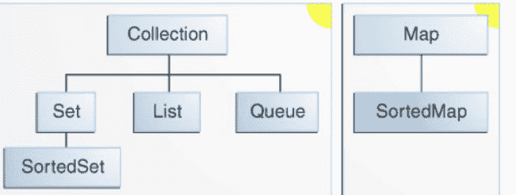

`Set` 是一种特殊的集合，`SortedSet` 是一种特殊的 `Set`，以此类推。注意，该层次结构由两个不同的树组成——`Map` 不是真正的 `Collection`。

注意，所有的核心集合接口都是泛型的。例如，这是 `Collection` 接口的声明。

```
```


public interface Collection<E>...

`<E>` 语法告诉你该接口是泛型的。当你声明一个 `Collection` 实例时，你可以并且应该指定集合中包含的对象类型。指定类型允许编译器（在编译时）验证你放入集合的类型是正确的，从而减少运行时错误。关于泛型类型的信息，请参见第 7 章。

当你理解了如何使用这些接口时，你将掌握关于 Java 集合框架的大部分知识。本章讨论了有效使用接口的通用指南，包括何时使用哪种接口。你将学习每个接口的编程习惯，以帮助你充分利用其功能。

为了保持核心集合接口的数量在可控范围内，Java 平台没有为每个集合类型的每个变体提供单独的接口。（这些变体可能包括不可变、固定大小和仅追加。）相反，每个接口中的修改操作被标记为可选——给定的实现可能会选择不支持所有操作。如果调用了不支持的操作，集合将抛出 `UnsupportedOperationException`。实现负责记录它们支持哪些可选操作。Java 平台的所有通用实现都支持所有的可选操作。

以下列表描述了核心集合接口：

- **Collection**——集合层次结构的根。集合表示一组被称为元素的对象组。`Collection` 接口是所有集合都实现的最小公分母，用于在需要最大通用性时传递和操作集合。某些类型的集合允许重复元素，而另一些不允许。有些是有序的而有些是无序的。Java 平台没有提供此接口的直接实现，但提供了特定子接口的实现，例如 `Set` 和 `List`。
- **Set**——不允许包含重复元素的集合。此接口模拟数学集合抽象，用于表示集合，例如组成扑克牌手的牌、构成学生课程表的牌或机器上运行的进程。
- **List**——有序集合（有时称为序列）。`List` 可以包含重复元素。`List` 的用户通常可以精确控制每个元素插入到列表中的位置，并可以通过整数索引（位置）访问元素。

……如果你用过 `Vector`，那么对 `List` 的通用用法就很熟悉。

- **Queue**（队列）——一种用于在处理前存储多个元素的集合。除了基本的 `Collection` 操作外，`Queue` 还提供了额外的插入、提取和检查操作。

队列通常（但并不一定）以先进先出（FIFO）的方式对元素排序。例外是优先级队列（priority queues），它们根据提供的比较器或元素的自然顺序对元素进行排序。无论使用何种排序，队列的头部（head）都是通过调用 `remove` 或 `poll` 方法将要移除的元素。在 FIFO 队列中，所有新元素都插入在队列的尾部。其他类型的队列可能使用不同的放置规则。每个 `Queue` 实现都必须指定其排序属性。

- **Deque**（双端队列）——一种用于在处理前存储多个元素的集合。除了基本的 `Collection` 操作外，`Deque` 还提供了额外的插入、提取和检查操作。

`Deque` 既可以用作 FIFO（先进先出），也可以用作 LIFO（后进先出）。在 `Deque` 中，所有新元素都可以在两端插入、检索和移除。

- **Map**（映射）——一个将键（keys）映射到值（values）的对象。`Map` 不能包含重复的键；每个键最多映射到一个值。如果你用过 `Hashtable`，就已经熟悉了 `Map` 的基础知识。

最后两个核心集合接口仅仅是 `Set` 和 `Map` 的排序版本：

- **SortedSet**（排序集合）——一种按升序顺序维护元素的 `Set`。提供了若干种额外操作以利用这种排序。`SortedSet` 用于自然排序的集合，例如单词列表和成员名单。
- **SortedMap**（排序映射）——一种按键的升序顺序维护映射关系的 `Map`。这是 `SortedSet` 的 `Map` 类比。`SortedMap` 用于自然排序的键值对集合，例如字典和电话簿。

# Collection 接口

`Collection` 代表一组被称为其“元素（elements）”的对象。`Collection` 接口用于传递对象集合，并在需要最大通用性的情况下使用。例如，按照惯例，所有通用集合实现都拥有一个接受 `Collection` 参数的构造函数。这种构造函数被称为转换构造函数（conversion constructor），它会初始化新集合以包含指定集合中的所有元素，无论给定集合的子接口或实现类型是什么。换句话说，它允许你转换集合的类型。

假设例如你有一个 `Collection<String> c`，它可能是 `List`、`Set` 或其他类型的 `Collection`。这种惯用法创建了一个新的 `ArrayList`（`List` 接口的实现），初始包含 `c` 中的所有元素。

```java
List<String> list = new ArrayList<String>(c);
```

或者你可以使用钻石操作符：

```java
List<String> list = new ArrayList<>(c);
```

`Collection` 接口包含了执行基本操作的方法，如 `int size()`、`boolean isEmpty()`、`boolean contains(Object element)`、`boolean add(E element)`、`boolean remove(Object element)` 和 `Iterator<E> iterator()`。

它还包含对整个集合操作的方法，如 `boolean containsAll(Collection<?> c)`、`boolean addAll(Collection<? extends E> c)`、`boolean removeAll(Collection<?> c)`、`boolean retainAll(Collection<?> c)` 和 `clear()`。

同时也存在数组操作的方法（如 `Object[] toArray()` 和 `<T> T[] toArray(T[])`）。

在 JDK 8 及更高版本中，`Collection` 接口还暴露了 `Stream<E> stream()` 和 `Stream<E> parallelStream()` 方法，用于从底层集合获取顺序或并行流。（有关使用流的更多信息，请参阅“聚合操作”章节。）

`Collection` 接口的功能正如你预期的那样，因为 `Collection` 代表一组对象。它有可以告诉你集合中有多少个元素的方法（`size`, `isEmpty`）、检查给定对象是否在集合中的方法（`contains`）、从集合中添加和删除元素的方法（`add`, `remove`）以及提供集合迭代器的方法（`iterator`）。

`add` 方法定义得通用，使得允许重复和不允许重复的集合都有意义。它保证在调用完成后 `Collection` 将包含指定的元素，如果集合因为调用发生了变化，则返回 `true`。同样，`remove` 方法设计用于从集合中移除指定元素的单个实例（假设集合最初包含该元素），并且如果集合因为结果被修改，则返回 `true`。

## 遍历集合

有三种遍历集合的方法：(1) 使用聚合操作 (2) 使用 for-each 结构以及 (3) 使用迭代器（Iterators）。

### 聚合操作

在 JDK 8 及更高版本中，遍历集合的首选方法是获取一个流并在上面执行聚合操作。聚合操作通常与 lambda 表达式结合使用，以使编程更有表现力，使用更少的代码行。以下代码顺序遍历一个形状集合并打印出红色对象：

```java
myShapesCollection.stream()
    .filter(e -> e.getColor() == Color.RED)
    .forEach(e -> System.out.println(e.getName()));
```

同样，你可以轻松请求一个并行流，如果集合足够大且你的计算机有足够的内核，这是有意义的。

```java
myShapesCollection.parallelStream()
    .filter(e -> e.getColor() == Color.RED)
    .forEach(e -> System.out.println(e.getName()));
```

使用此 API 收集数据有很多不同的方法。例如，你可能想将 `Collection` 的元素转换为 `String` 对象，然后用逗号将它们连接：

或者求和所有员工的工资：

```java
int total = employees.stream()
    .collect(Collectors.summingInt(Employee::getSalary));
```

这些是你使用流和聚合操作可以做的一些示例。有关更多信息和示例，请参阅后文的“聚合操作”章节。

Collections 框架一直为其 API 提供许多所谓的“批量操作（bulk operations）”。这些包括对整个集合操作的方法，如 `containsAll`、`addAll`、`removeAll` 等。不要将这些方法与 JDK 8 引入的聚合操作混淆。新聚合操作与现有批量操作（`containsAll`, `addAll` 等）的主要区别在于旧版本是可变的，意味着它们都会修改底层集合。相反，新的聚合操作不修改底层集合。在使用新的聚合操作和 lambda 表达式时，你必须避免变异，以防止在从并行流运行时引入问题。

## for-each 结构

for-each 结构允许你使用 for 循环简洁地遍历集合或数组——参见第 3 章“for语句”。
以下代码使用 for-each 结构将集合的每个元素单独打印。

```java
for (Object o : collection) {
    System.out.println(o);
}
```

## 迭代器（Iterators）

`Iterator` 是一个能够遍历集合并在需要时从集合中选择移除元素的对象。通过调用集合的 `iterator` 方法获取迭代器。以下是 `Iterator` 接口。

```java
public interface Iterator<E> {
    boolean hasNext();
    E next();
    void remove(); // 可选
}
```

`hasNext` 方法在迭代还有元素时返回 `true`，`next` 方法返回迭代中的下一个元素。`remove` 方法从底层集合中移除由 `next` 返回的最后一个元素。`remove` 方法每次调用 `next` 只能调用一次，如果违反此规则将抛出异常。

注意，`Iterator.remove` 是迭代期间修改集合的唯一安全方式；如果底层集合在迭代过程中被以任何其他方式修改，行为将未定义。

当你需要以下操作时，请使用 `Iterator` 代替 `for-each` 结构：

- 移除当前元素。`for-each` 结构隐藏了迭代器，因此你无法调用 `remove`。因此，`for-each` 结构不可用于过滤。
- 并行遍历多个集合。

下面的方法展示了如何使用 `Iterator` 过滤任意集合——即通过遍历集合并移除特定元素。

```java
static void filter(Collection<?> c) {
    for (Iterator<?> it = c.iterator(); it.hasNext(); ) {
        if (cond(it.next())) {
            it.remove();
        }
    }
}
```

这段简单的代码是多态的，这意味着它无论实现方式如何，都适用于任何 `Collection`。这个示例演示了使用 Java 集合框架编写多态算法是多么简单。

## Collection 接口批量操作

批量操作对整个 `Collection` 执行某种操作。虽然你可以使用基本操作来实现这些简写操作，但在大多数情况下，此类实现的效率会较低。以下是批量操作：

- `containsAll`——如果目标 `Collection` 包含指定 `Collection` 中的所有元素，则返回 `true`。
- `addAll`——将指定 `Collection` 中的所有元素添加到目标 `Collection` 中。
- `removeAll`——从目标 `Collection` 中移除所有包含在指定 `Collection` 中的元素。
- `retainAll`——从目标 `Collection` 中移除所有未包含在指定 `Collection` 中的元素。也就是说，它只保留目标 `Collection` 中也包含在指定 `Collection` 中的元素。
- `clear`——移除 `Collection` 中的所有元素。

如果在执行操作过程中目标 `Collection` 被修改，则 `addAll`、`removeAll` 和 `retainAll` 方法均将返回 `true`。

作为一个批量操作能力的简单示例，请考虑以下惯用法，用于从集合 `c` 中移除所有指定元素 `e` 的实例。

```java
c.removeAll(Collections.singleton(e));
```

更具体地说，假设你想从集合 `c` 中移除所有 `null` 元素。

```java
c.removeAll(Collections.singleton(null));
```

此惯用法使用了 `Collections.singleton`，这是一个静态工厂方法，返回一个只包含指定元素的不可变 `Set`。

## Collection 接口数组操作

`toArray` 方法作为集合与期望输入数组的旧 API 之间的桥梁。数组操作允许将 `Collection` 的内容转换为数组。不带参数的简单形式创建一个新的 `Object` 数组。更复杂的形式允许调用者提供一个数组或选择输出数组的运行时类型。

例如，假设 `c` 是一个 `Collection`。下面的代码段将 `c` 的内容转到一个新分配的 `Object` 数组中，其长度与 `c` 中的元素数量相同。

```java
Object[] a = c.toArray();
```

假设已知 `c` 只包含字符串（可能是因为 `c` 的类型为 `Collection<String>`）。下面的代码段将 `c` 的内容转到一个新分配的 `String` 数组中，其长度与 `c` 中的元素数量相同。

```java
String[] a = c.toArray(new String[0]);
```

## Set 接口

`Set` 不能包含重复元素。它模拟了数学抽象。`Set` 接口只包含继承自 `Collection` 的方法，并增加了禁止重复元素的限制。`Set` 还对 `equals` 和 `hashCode` 操作的行为增加了更强的契约，允许 `Set` 实例即使实现类型不同也能进行有意义的比较。如果两个 `Set` 实例包含相同的元素，则它们是相等的。

Java 平台包含三个通用 `Set` 实现：`HashSet`、`TreeSet` 和 `LinkedHashSet`。`HashSet` 将元素存储在哈希表中，性能最好；但它对迭代顺序不做任何保证。`TreeSet` 将元素存储在红黑树中，根据值对元素进行排序；它比 `HashSet` 慢得多。`LinkedHashSet` 实现为带有链表的哈希表，根据元素插入集合的顺序（插入顺序）对元素进行排序。`LinkedHashSet` 以仅略高的代价为客户端避免了 `HashSet` 提供的未指定且通常是混乱的排序。

这是一个简单但实用的 `Set` 惯用法。假设你有一个集合 `c`，你想创建一个包含相同元素但消除了所有重复元素的另一个集合。这一行代码就能解决问题。

```java
Collection<Type> noDups = new HashSet<Type>(c);
```

它的工作原理是创建一个 `Set`（根据定义，它不能包含重复元素），初始包含 `c` 中的所有元素。它使用了在“Collection 接口”部分描述的标准转换构造函数。

或者，如果使用 JDK 8 或更高版本，你可以轻松使用聚合操作收集到 `Set` 中：

```java
c.stream()
    .collect(Collectors.toSet()); // 无重复
```

这里是一个稍长的示例，将名称的 `Collection` 累加到 `TreeSet` 中：

```java
Set<String> set = people.stream()
    .map(Person::getName)
    .collect(Collectors.toCollection(TreeSet::new));
```

以下是第一个惯用法的变体，它在移除重复元素的同时保留原始集合的顺序：

```java
Collection<Type> noDups = new LinkedHashSet<Type>(c);
```

以下是一个封装了上述惯用法的泛型方法，返回一个与传入类型相同泛型的 `Set`。

```java
public static <E> Set<E> removeDups(Collection<E> c) {
    return new LinkedHashSet<E>(c);
}
```

## Set 接口基本操作

`size` 操作返回 `Set` 中的元素数量（其基数）。`isEmpty` 方法的作用正如你想的那样。`add` 方法在元素不存在时将指定元素添加到 `Set` 中，并返回指示元素是否被添加的布尔值。同样，`remove` 方法在元素存在时将其从 `Set` 中移除，并返回指示元素是否存在的布尔值。`iterator` 方法返回一个用于 `Set` 的 `Iterator`。

下面的程序打印参数列表中的所有不同的单词。提供了该程序的两个版本。第一个使用 JDK 8 聚合操作。第二个使用 `for-each` 结构。

### 使用 JDK 8 聚合操作：

```java
import java.util.*;
import java.util.stream.*;

public class FindDups {
    public static void main(String[] args) {
        Set<String> distinctWords = Arrays.asList(args).stream()
                .collect(Collectors.toSet());
        System.out.println(distinctWords.size() +
```


" distinct words: " + distinctWords);

}

}

```

### 使用 for-each 结构：

```java
import java.util.*;

public class FindDups {

    public static void main(String[] args) {

        Set<String> s = new HashSet<String>();

        for (String a : args) {

            s.add(a);

        }

        System.out.println(s.size() + " distinct words: ");

    }

}

```

现在运行任一版本的程序。

```
java FindDups i came i saw i left
```

产生如下输出：

```
4 distinct words: [left, came, saw, i]
```

注意代码始终通过接口类型（`Set`）引用集合而不是实现类型。这是一种强烈建议的编程实践，因为它提供了仅通过更改构造函数来更改实现的灵活性。如果存储集合的变量或传递集合的参数被声明为实现类型而不是接口类型，则更改实现类型时必须更改此类变量和参数。

此外，无法保证生成的程序能够正常工作。如果程序使用了存在于非标准的实现类型但在新版本中没有，程序将会失败。仅通过接口引用集合可以防止使用任何非标准操作。

前一个示例中 `Set` 的实现类型是 `HashSet`，它不保证 `Set` 中元素的顺序。如果你希望程序按字母顺序打印单词列表，只需将 `Set` 的实现类型从 `HashSet` 改为 `TreeSet` 即可。这一简单的单行更改使得前一个示例中的命令行生成了以下输出。

```
java FindDups i came i saw i left
4 distinct words: [came, i, left, saw]
```

## Set 接口批量操作

批量操作特别适用于 `Set`；应用时，它们会执行标准的集合代数操作。假设 `s1` 和 `s2` 是集合。以下是批量操作的功能：

- `s1.containsAll(s2)`——如果 `s2` 是 `s1` 的子集，则返回 true。（如果集合 `s1` 包含 `s2` 中的所有元素，则 `s2` 是 `s1` 的子集。）
- `s1.addAll(s2)`——将 `s1` 转换为 `s1` 和 `s2` 的并集。（两个集合的并集是包含这两个集合中所有元素的集合。）
- `s1.retainAll(s2)`——将 `s1` 转换为 `s1` 和 `s2` 的交集。（两个集合的交集是仅包含两个集合共同元素的集合。）
- `s1.removeAll(s2)`——将 `s1` 转换为 `s1` 和 `s2` 的（非对称）差集。（例如，`s1` 减 `s2` 的差集是包含所有于 `s1` 但不在 `s2` 中的元素的集合。）

若要破坏性地计算两个集合的并集、交集或差集（而不修改任何一个集合），调用者在调用相应的批量操作之前必须复制其中一个集合。以下是相应的惯用法。

```
Set<Type> union = new HashSet<Type>(s1);
union.addAll(s2);

Set<Type> intersection = new HashSet<Type>(s1);
intersection.retainAll(s2);

Set<Type> difference = new HashSet<Type>(s1);
difference.removeAll(s2);
```

在上述用法中，结果 `Set` 的实现类型是 `HashSet`，如所述，它是 Java 平台中最好的通用 `Set` 实现。然而，任何通用的 `Set` 实现都可以替换。

让我们重新回顾 `FindDups` 程序。假设你想知道参数列表中哪些单词只出现一次，哪些单词出现多次，但你不希望重复打印任何重复项。这种效果可以通过生成两个集合来实现——一个包含参数列表中的每个单词，另一个包含：

```java
import java.util.*;

public class FindDups2 {

    public static void main(String[] args) {

        Set<String> uniques = new HashSet<String>();

        Set<String> dups = new HashSet<String>();

        for (String a : args) {

            if (!uniques.add(a)) {

                dups.add(a);

            }

        }

        // 破坏性差集

        uniques.removeAll(dups);

        System.out.println("Unique words: " + uniques);

        System.out.println("Duplicate words: " + dups);

    }

}

```

当使用之前相同的参数列表（i came saw i left）运行时，程序产生以下输出。

| Unique words: | [left, saw, came] |
| Duplicate words: | [i] |

一种较不常见的集合代数操作是对称差集——包含在两个指定集合之一中但不包含于两者中的元素集合。以下代码非破坏性地计算两个集合的对称差。

```
Set<Type> symmetricDiff = new HashSet<Type>(s1);
symmetricDiff.addAll(s2);

Set<Type> tmp = new HashSet<Type>(s1);
tmp.retainAll(s2);

symmetricDiff.removeAll(tmp);
```

## Set 接口数组操作

数组操作对 `Set` 而言除了对任何 `Collection` 执行的操作之外没有特殊之处。这些操作在“Collection 接口”章节中描述。

## List 接口

`List` 是一个有序的 `Collection`（有时称为序列）。`List` 可以包含重复元素。除了继承自 `Collection` 的操作外，`List` 接口还包含以下操作：

- 位置访问——根据元素在列表中的数值位置来操纵元素。这包括了 `get`、`set`、`add`、`addAll` 和 `remove` 等方法。
- 搜索——在列表中查找指定对象并返回其数值位置。搜索方法包括 `indexOf` 和 `lastIndexOf`。
- 迭代——扩展了 `Iterator` 语义以利用列表的顺序特性。`listIterator` 方法提供了这种行为。
- 范围视图——`subList` 方法对列表执行任意操作。

Java 平台包含两个通用的 `List` 实现。`ArrayList` 通常是性能更好的实现，而 `LinkedList` 在某些情况下提供更好的性能。

## Collection 操作

继承自 `Collection` 的操作完全如你预期的那样工作，前提是你已经熟悉了它们。如果你不熟悉 `Collection` 中的这些操作，现在是阅读“Collection 接口”章节的好时机了。`remove` 操作总是从列表中删除指定元素的第一次出现处。`add` 和 `addAll` 操作总是将新元素追加到列表末尾。

## 位置访问和搜索操作

基本的位置访问操作有 `get`、`set`、`add` 和 `addAll`。（`set` 和 `remove` 操作返回被覆盖或移除的旧值。）其他操作（`indexOf` 和 `lastIndexOf`）返回指定元素在列表中的第一个或最后一个索引。`addAll` 操作在指定位置插入整个 `Collection`。该调用是 `Collection add` 的模拟。

```java
public static <E> void swap(List<E> a, int i, int j) {

    E tmp = a.get(i);

    a.set(i, a.get(j));

    a.set(j, tmp);

}

```

当然，有一个巨大的区别。这是一个多态算法：它可以交换任何 `List` 中的元素，无论其实现类型如何。这里是使用上述 `swap` 方法的另一个多态算法。

```java
public static void shuffle(List list, Random rnd) {

    for (int i = list.size(); i > 1; i--) {

        swap(list, i - 1, rnd.nextInt(i));

    }

}

```

该算法包含在 Java 平台的 `Collections` 类中，使用随机源随机排列指定的列表。它有点微妙：从底部反复将随机选择的元素交换到当前位置。与幼稚的洗牌尝试相比，它是公平的（假设随机源无偏差，所有排列概率相等）且快速的（只需要 `list.size() - 1` 次交换）。以下程序使用该算法随机顺序打印参数列表中的单词。

```java
import java.util.*;

public class Shuffle {

    public static void main(String[] args) {

        List<String> list = new ArrayList<String>();

        for (String a : args) {

            list.add(a);

        }

        Collections.shuffle(list, new Random());

        System.out.println(list);

    }

}

```

事实上，这个程序可以变得更短、更快。`Arrays` 类有一个名为 `asList` 的静态工厂方法，允许将数组视为 `List`。该方法不会复制数组。对 `List` 的更改会反映到数组，反之亦然。生成的 `List` 不是通用的 `List` 实现，因为它没有实现（可选的）`add` 和 `remove` 操作：数组是不可调整的。利用 `Arrays.asList` 并调用库版本的 `shuffle`（它使用默认随机源），你得到了下面这个微型程序，其行为与之前的程序完全相同。

```java
import java.util.*;

public class Shuffle {

    public static void main(String[] args) {

        List<String> list = Arrays.asList(args);

        Collections.shuffle(list);

        System.out.println(list);

    }

}

```

### 迭代器

正如你所预期的，`List` 的 `iterator` 操作返回的 `Iterator` 会按照正确的顺序返回列表的元素。`List` 还提供了一种更丰富的迭代器，称为 `ListIterator`，它允许你双向遍历列表、在迭代期间修改列表并获取迭代器的当前位置。

`ListIterator` 继承自 `Iterator` 的三个方法（`hasNext`、`next` 和 `remove`）在两个接口中的作用完全相同。`hasPrevious` 和 `previous` 操作是 `hasNext` 和 `next` 的等对应操作。前者指的是（隐式的）光标之前的元素，而后者指的是光标之后的元素。`previous` 操作将光标向后移动，而 `next` 则将其向前移动。

以下是反向遍历列表的标准惯用法。

```java
for (ListIterator<Type> it = list.listIterator(list.size()); it.hasPrevious(); ) {

    Type t = it.previous();

    ...

}

```

注意上述惯用法中 `listIterator` 的参数。`List` 接口有两种形式的 `listIterator` 方法。不带参数的形式返回一个位于列表开头的 `ListIterator`；带有一个 `int` 参数的形式返回一个位于指定索引的 `ListIterator`。该索引指的是初始调用 `next` 将返回的元素。初始调用 `previous` 则将返回索引为索引-1 的元素。在长度为 `n` 的列表中，索引有 `n+1` 个有效值，范围从 0 到 `n`（包含在内）。

从直觉上来说，光标始终位于元素之间——即调用 `previous` 返回的元素与调用 `next` 返回的元素之间。$n+1$ 个有效索引值对应于元素之间的 $n+1$ 个间隙，从第一个元素之前的间隙到最后一个元素之后的间隙。图 12.2 显示了包含四个元素的列表中的五种可能的光标位置。

# 图 12.2. 五种可能的光标位置

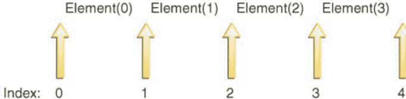

`next` 和 `previous` 的调用可以交叉进行，但你必须稍微小心。第一次调用 `previous` 返回与上一次调用 `next` 相同的元素。同样，在了一系列 `previous` 调用后，第一次调用 `next` 返回与上一次调用 `previous` 相同的元素。

并不意外的是，`nextIndex` 方法返回后续调用 `next` 将返回的元素的索引，而 `previousIndex` 则返回后续调用 `previous` 将返回的元素的索引。这些调用通常用于报告找到元素的位置，或者用于记录 `ListIterator` 的位置，以便创建一个具有相同位置的另一个 `ListIterator`。

并不意外的是，`nextIndex` 返回的数字总是大于 `previousIndex` 返回的数字。这暗示了两种边界情况的行为：(1) 当光标位于初始元素之前时，调用 `previousIndex` 返回 -1；以及(2) 当光标位于最后一个元素之后时，调用 `nextIndex` 返回 `list.size()`。为了使这一点具体化，以下是 `List.indexOf` 的一种可能实现。

```java
public int indexOf(E e) {

    for (ListIterator<E> it = listIterator(); it.hasNext(); ) {

        if (e == null ? it.next() == null : e.equals(it.next())) {

            return it.previousIndex();

        }

    }

    // 未找到元素

    return -1;

}

```

注意，尽管 `indexOf` 方法在正向遍历列表，它返回的是 `it.previousIndex()`。这是因为 `it.nextIndex()` 将返回我们即将检查的元素的索引，而我们想要返回刚刚检查的元素的索引。

`Iterator` 接口提供了 `remove` 操作，用于从集合中移除 `next` 返回的上一个元素。对于 `ListIterator`，该操作移除 `next` 或 `previous` 返回的上一个元素。`ListIterator` 接口提供了两个额外的操作来修改列表——`set` 和 `add`。`set` 方法用指定的元素覆盖 `next` 或 `previous` 返回的上一个元素。下面的多态算法使用 `set` 将所有指定值的出现处替换为另一个值。

```java
public static <E> void replace(List<E> list, E val, E newVal) {

    for (ListIterator<E> it = list.listIterator(); it.hasNext(); ) {

        if (val == null ? it.next() == null : val.equals(it.next()))

            it.set(newVal);

    }

}

```

这个示例中唯一的复杂之处在于 `val` 和 `it.next` 之间的等性测试。你需要检查 `val` 的值是否为 null 以防止出现 `NullPointerException`。

`add` 方法在当前光标位置之前向列表中插入一个新元素。接下来的多态算法说明了如何将所有指定值的出现处替换为指定列表包含的值序列。

```java
public static <E> void replace(List<E> list, E val, List<? extends E> newVals) {

    for (ListIterator<E> it = list.listIterator(); it.hasNext(); ) {

        if (val == null ? it.next() == null : val.equals(it.next())) {

            it.remove();

            for (E e : newVals) {

                it.add(e);

            }

        }

    }

}

```

# 范围视图操作 (Range-View Operation)

范围视图操作 `subList(int startIndex, int toIndex)` 返回一个列表视图，该列表部分的索引范围从 `startIndex`（包含）到 `toIndex`（不包含）。这种半开区间反映了典型的 `for` 循环。“视图（view）”一词意味着返回的 `List` 是由调用 `subList` 的列表支持的，因此前者的更改会反映在后者中。任何期望 `List` 的操作都可以通过传递 `subList` 而不是整个 `List` 来作为范围操作。例如，下面的惯用法从列表中删除了一个范围的元素。

```java


`list.subList(fromIndex, toIndex).clear();`

可以构造类似的惯用法来在范围内搜索元素。

```java
int i = list.subList(fromIndex, toIndex).indexOf(o);
int j = list.subList(fromIndex, toIndex).lastIndexOf(o);
```

注意，上述惯用法返回的是 `subList` 中的索引，而不是底层 List 中的索引。任何在 List 上操作的多态算法（例如 `replace` 和 `shuffle` 示例）都可以在 `subList` 返回的列表上工作。

以下是一个使用 `subList` 从牌组中发牌的多态算法。也就是说，它返回一个包含从指定列表末尾取的指定数量元素的列表（“手”）。返回的元素已从牌组中移除。

```java
public static <E> List<E> dealHand(List<E> deck, int n) {
    int deckSize = deck.size();
    List<E> handView = deck.subList(deckSize - n, deckSize);
    List<E> hand = new ArrayList<E>(handView);
    handView.clear();
    return hand;
}
```

```java
String[] suit = new String[] {
    "spades", "hearts",
    "diamonds", "clubs"
};
```

```java
String[] rank = new String[] {
    "ace", "2", "3", "4",
    "5", "6", "7", "8", "9", "10",
    "jack", "queen", "king"
};
```

```java
List<String> deck = new ArrayList<String>();
for (int i = 0; i < suit.length; i++) {
    for (int j = 0; j < rank.length; j++) {
        deck.add(rank[j] + " " + suit[i]);
    }
}
```

```java
// Shuffle the deck.
Collections.shuffle(deck);
```

```java
if (numHands * cardsPerHand > deck.size()) {
    System.out.println("Not enough cards.");
    return;
}
```

```java
for (int i = 0; i < numHands; i++) {
    System.out.println(dealHand(deck, cardsPerHand));
}

public static <E> List<E> dealHand(List<E> deck, int n) {
    int deckSize = deck.size();
    List<E> handView = deck.subList(deckSize - n, deckSize);
    List<E> hand = new ArrayList<E>(handView);
    handView.clear();
    return hand;
}
```

# 运行程序产生的输出如下。

```
% java Deal 4 5
[8 of hearts, jack of spades, 3 of spades, 4 of spades, king of diamonds]
[4 of diamonds, ace of clubs, 6 of clubs, jack of hearts, queen of hearts]
[7 of spades, 5 of spades, 2 of diamonds, queen of diamonds, 9 of clubs]
[8 of spades, 6 of diamonds, ace of spades, 3 of hearts, ace of hearts]
```

虽然 `subList` 操作非常强大，但在使用它时必须小心。如果通过返回 List 以外的其他方式向底层 List 添加或删除元素，则由 `subList` 返回的 List 的语义将变得未定义。因此，强烈建议你仅将 `subList` 返回的 List 作为临时对象——用于对底层 List 执行一次或一系列范围操作。你使用 `subList` 实例的时间越长，通过直接修改底层 List 或通过另一个 `subList` 对象来破坏它的概率就越大。注意，修改子列表的子列表是合法的，并且可以继续使用原始子列表（尽管不能并发使用）。

# List 算法

`Collections` 类中的大多数多态算法专门适用于 `List`。拥有所有这些算法使得操作列表变得非常容易。以下是这些算法的总结，在“算法”部分有更详细的描述。

- `sort`——使用合并排序算法对 List 进行排序，这提供了快速且稳定的排序。（稳定排序是不重排相等元素的排序。）
- `shuffle`——随机打乱 List 中的元素顺序。
- `reverse`——反转 List 中元素的顺序。
- `rotate`——按指定的距离旋转 List 中的所有元素。
- `swap`——交换 List 中指定位置的元素。
- `replaceAll`——将一个指定值的出现情况替换为另一个值。
- `fill`——用指定的值覆盖 List 中的每个元素。
- `copy`——将源 List 复制到目标 List。
- `binarySearch`——使用二分搜索算法在有序 List 中搜索元素。
- `indexOfSubList`——返回一个 List 中等于另一个 List 的第一个子列表的索引。
- `lastIndexOfSubList`——返回一个 List 中等于另一个 List 的最后一个子列表的索引。

# Queue 接口

队列（Queue）是一个用于在处理之前存放元素的集合。除了基本的 `Collection` 操作外，队列还提供了额外的插入、移除和检查操作。`Queue` 接口如下。

```java
public interface Queue<E> extends Collection<E> {
    E element();
    boolean offer(E e);
    E peek();
    E poll();
    E remove();
}
```

每个 `Queue` 方法都有两种形式：(1) 如果操作失败则抛出异常，(2) 另一种在操作失败时返回一个特殊值（取决于操作，返回 `null` 或 `false`）。接口的常规结构如表 12.1 所示。

# 表 12.1. Queue 接口结构

| 操作类型 | 抛出异常 | 返回特殊值 |
| --- | --- | --- |
| 插入 | `add(e)` | `offer(e)` |
| 移除 | `remove(e)` | `poll()` |
| 检查 | `element()` | `peek()` |

队列通常（但并非一定）以 FIFO（先进先出）的方式对元素排序。优先级队列根据其值对元素进行排序。无论使用何种排序方式，队列头都是通过 `remove` 或 `poll` 将移除的元素。在 FIFO 队列中，所有新元素都插入到队列尾。其他类型的队列可能使用不同的放置规则。每个 `Queue` 实现必须指定其排序属性。

`Queue` 实现可以限制其持有的元素数量，这种队列是有边界的。`Queue` 接口没有定义并发编程常见的阻塞方法。这些等待元素出现或空间可用的方法定义在 `java.util.concurrent.BlockingQueue` 接口中。

在以下示例中，使用队列实现了一个倒计时器。队列预加载了从命令行指定的数字到零的所有整数值，按降序排列。然后，每隔秒从队列中移除并打印值。该程序在不使用队列的情况下完成同样的任务更为自然，但它展示了使用队列在处理之前存储元素的方法。

```java
import java.util.*;

public class Countdown {
    public static void main(String[] args) throws InterruptedException {
        int time = Integer.parseInt(args[0]);
        Queue<Integer> queue = new LinkedList<Integer>();
        for (int i = time; i >= 0; i--) {
            queue.add(i);
        }
        while (!queue.isEmpty()) {
            System.out.println(queue.remove());
            Thread.sleep(1000);
        }
    }
}
```

在以下示例中，使用优先级队列对元素集合进行排序。同样，这个程序是人为的，因为没有理由用它替代 `Collections` 提供的 `sort` 方法，但它展示了优先级队列的行为。

```java
static <E> List<E> heapSort(Collection<E> c) {
    Queue<E> queue = new PriorityQueue<E>(c);
    List<E> result = new ArrayList<E>();
    while (!queue.isEmpty()) {
        result.add(queue.remove());
    }
    return result;
}
```

# Deque 接口

Deque 通常读作 "deck"，是一个双端队列。双端队列是一个支持在两个端点都插入和移除元素的线性集合。`Deque` 接口相比于 `Stack` 和 `Queue` 都是更丰富的抽象数据类型，因为它同时实现了栈和队列。`Deque` 接口定义了访问 Deque 实例端元素的方法。提供了插入、移除和检查元素的方法。预定义类如 `ArrayDeque` 和 `LinkedList` 实现了 `Deque` 接口。注意，`Deque` 接口可以作为后进先出栈，也可以作为先进先出队列使用。`Deque` 给出的方法：

接口分为三部分：

### 插入

`addFirst` 和 `offerFirst` 方法在 Deque 实例的头部插入元素。`addLast` 和 `offerLast` 方法在 Deque 实例的末尾插入元素。当 Deque 实例容量受限时，优先使用 `offerFirst` 和 `offerLast` 方法，因为 `addFirst` 在满时可能无法抛出异常。

### 移除

`removeFirst` 和 `pollFirst` 方法从 Deque 实例的头部移除元素。`removeLast` 和 `pollLast` 方法从末尾移除元素。如果 Deque 为空，`pollFirst` 和 `pollLast` 返回 `null`，而 `removeFirst` 和 `removeLast` 在 Deque 实例为空时抛出异常。

### 获取

`getFirst` 和 `peekFirst` 方法获取 Deque 实例的首元素。这些方法不会从 Deque 实例中移除该值。同样，`getLast` 和 `peekLast` 获取最后一个元素。如果 deque 为空，`getFirst` 和 `getLast` 抛出异常，而 `peekFirst` 和 `peekLast` 返回 `null`。

下表总结了 Deque 元素插入、移除和获取的 12 个方法：

## 表 12.2. Deque 方法

| 操作类型 | 首元素（Deque 实例头部） | 尾端元素（Deque 实例末尾） |
| --- | --- | --- |
| 插入 | `addFirst(e)`, `offerFirst(e)` | `addLast(e)`, `offerLast(e)` |
| 移除 | `removeFirst()`, `pollFirst()` | `removeLast()`, `pollLast()` |
| 检查 | `getFirst()`, `peekFirst()` | `getLast()`, `peekLast()` |

除了这些插入、移除和检查 Deque 实例的基本方法外，Deque 接口还有更多预定义方法。其中之一是 `removeFirstOccurrence`，如果指定元素在 Deque 实例中存在，该方法将移除第一个出现的该元素。如果元素不存在，则 Deque 实例将保持不变。另一个相似的方法是 `removeLastOccurrence`；该方法会移除 Deque 实例中指定元素的最后一个出现。这些方法的返回类型为 `boolean`，如果元素存在于 Deque 实例中，则返回 `true`。

# Map 接口

`Map` 是一个将键映射到值的对象。Map 不能包含重复的键：每个键最多映射到一个值。它模拟了数学上的函数抽象。`Map` 接口包含了基本操作（如 `put`、`get`、`remove`、`containsKey`、`containsValue`、`size` 和 `isEmpty`）、批量操作（如 `putAll` 和 `clear`）以及集合视图（如 `keySet`、`entrySet` 和 `values`）。

Java 平台包含了三个通用的 Map 实现：`HashMap`、`TreeMap` 和 `LinkedHashMap`。它们的行为和性能与“Set 接口”部分中描述的 `HashSet`、`TreeSet` 和 `LinkedHashSet` 完全相似。

本页剩余部分将详细讨论 Map 接口。在此之前，这里有一些使用 JDK 8 聚合操作收集到 Map 的更多示例。建模现实世界对象是面向对象编程中的常见任务，因此可以认为某些程序可能会按部门对员工进行分组：

```java
// 按部门分组员工
Map<Department, List<Employee>> byDept = employees.stream()
    .collect(Collectors.groupingBy(Employee::getDepartment));
```

或者计算每个部门的工资总和：

```java
// 按部门计算工资总和
Map<Department, Integer> totalByDept = employees.stream()
    .collect(Collectors.groupingBy(Employee::getDepartment,
        Collectors.summingInt(Employee::getSalary)));
```

或者按合格或不及格对学生分组：

```java
// 将学生分为合格和不合格
Map<Boolean, List<Student>> passingFailing = students.stream()
    .collect(Collectors.partitioningBy(s -> s.getGrade() >= PASS_THR));
```

你还可以按城市分组分组：

```java
// 按城市分类 Person 对象
Map<String, List<Person>> peopleByCity = personStream.collect(Collectors.groupingBy(Person::getCity));
```

甚至级联两个收集器来按州和城市分类人员：

```java
// 级联收集器
Map<String, Map<String, List<Person>>> peopleStateAndCity = personStream.collect(Collectors.groupingBy(Person::getState, Collectors.groupingBy(Person::getCity)));
```

再次，这些只是使用新 JDK 8 API 的少数示例。关于 lambda 表达式和聚合操作的深入介绍，请参见“聚合操作”部分。

## Map 接口基本操作

Map 的基本操作（`put`, `get`, `containsKey`, `containsValue`, `size` 和 `isEmpty`）的行为与 Hashtable 中的对应方法完全一致。以下程序生成了参数列表中列表中找到单词的频率表。该频率表将每个单词映射到它在参数列表中出现的次数。

```java
import java.util.*;

public class Freq {
    public static void main(String[] args) {
        Map<String, Integer> m = new HashMap<String, Integer>();
        // 从命令行初始化频率表
        for (String a : args) {
            Integer freq = m.get(a);
            m.put(a, (freq == null) ? 1 : freq + 1);
        }
        System.out.println(m.size() + " distinct words:");
        System.out.println(m);
    }
}
```

尝试使用以下参数运行此程序：

```bash
java Freq apple banana apple cherry banana apple
```

输出是：

```
3 distinct words:
```


{apple=3, banana=2, cherry=1}

假设你更喜欢按字母顺序查看频率表。你只需要将 `map` 的实现类型从 `HashMap` 更改为 `TreeMap`。此字符级的更改会导致程序从相同的命令行（使用相同的参数）生成以下输出：

```
3 distinct words:

{apple=3, banana=2, cherry=1}
```

同样，你只需要通过将实现类型更改为 `LinkedHashMap`，让程序按照在命令行首次出现的顺序打印频率表。这样做会导致以下输出：

```
3 distinct words:

{apple=3, banana=2, cherry=1}
```

这种灵活性有力地说明了基于接口的框架的力量。

与 `Set` 和 `List` 接口一样，`Map` 加强对 `equals` 和 `hashCode` 方法的要求，使得两个 `Map` 对象可以在不考虑其实现类型的情况下进行逻辑相等比较。如果两个 `Map` 实例表示相同的键值映射，则它们是相等的。

按照惯例，所有通用 `Map` 实现都提供了接收 `Map` 对象的构造函数，并初始化 `Map` 以包含指定 `Map` 中的所有键值映射。这种标准的 `Map` 构造函数与标准的 `Collection` 构造函数完全对应：它允许调用者创建一个所需实现类型的 `Map`，初始包含另一个 `Map` 的映射，无论另一个 `Map` 的实现类型如何。例如，假设你有一个名为 `m` 的 `Map`。以下行代码创建一个新的 `HashMap`，初始包含与 `m` 相同的键值映射。

```java
Map<K, V> copy = new HashMap<K, V>(m);
```

## Map 批量操作

`clear` 操作正如你认为的那样：它移除 `Map` 中的所有映射。`putAll` 操作是 `Collection` 接口 `addAll` 操作的 `Map` 类。除了将一个 `Map` 倒入另一个 `Map` 的明显用途外，它还有一个微妙的用途。`Map` 用于表示属性值对的集合；`putAll` 操作结合 `Map` 构造函数，为带有默认值的属性 map 创建提供了一种简洁的方法。以下是演示这种技术的静态工厂方法。

```java
static <K, V> Map<K, V> newAttributeMap(Map<K, V> defaults, Map<K, V> overrides) {
    Map<K, V> result = new HashMap<K, V>(defaults);
    result.putAll(overrides);
    return result;
}
```

### 集合视图

集合视图方法允许以这三种方式将 `Map` 视为集合：

- **key**—`Map` 中包含的键的集合（`Set`）。
- **values**—`Map` 中包含的值的集合（`Collection`）。这个集合不是 `Set`，因为多个键可以映射到同一个值。
- **entrySet**—`Map` 中包含的键值对的集合（`Set`）。`Map` 接口提供了一个名为 `Map.Entry` 的小型嵌套接口，它是该 `Set` 中元素的类型。

集合视图是遍历 `Map` 的唯一手段。此示例演示了使用 for-each 结构遍历 `Map` 中键的标准惯用法：

```java
for (KeyType key : m.keySet()) {
    System.out.println(key);
}
```

以及使用迭代器：

```java
// 根据键的某些属性过滤 map。
for (Iterator<Type> it = m.keySet().iterator(); it.hasNext(); ) {
    if (it.next().isBogus()) {
        it.remove();
    }
}
```

遍历值的惯用法类似。以下是遍历键值对的惯用法。

```java
for (Map.Entry<KeyType, ValType> e : m.entrySet()) {
    System.out.println(e.getKey() + " : " + e.getValue());
}
```

起初，很多人担心这些惯用法可能很慢，因为每次调用集合视图操作时，`Map` 都必须创建一个新的 `Collection` 实例。放心吧：`Map` 没有理由不能总是返回它请求的特定集合视图对象。这正是 `java.util` 中所有 `Map` 实现所做的。

通过三个集合视图，调用 `Iterator` 的 `remove` 操作会从底层 `Map` 中删除关联条目，前提是底层 `Map` 原身支持元素删除。前面的过滤惯用法就说明了这一点。

通过 `entry` 视图，还可以在迭代期间调用 `Map.Entry` 的 `setValue` 方法来更改与键关联的值（同样，前提是 `Map` 原身支持值的修改）。请注意，这些是在迭代期间修改 `Map` 的唯一安全方式；如果在迭代进行期间以任何其他方式修改底层 `Map`，其行为将是不指定的。

集合视图支持所有形式的元素删除——`remove`、`removeAll`、`retainAll` 和 `clear` 操作，以及 `Iterator` 的 `remove` 操作。（再次，这假设底层 `Map` 支持元素删除。）

集合视图在任何情况下都不支持元素添加。对于 `keySet` 和 `values` 视图来说，这没有意义；而对于 `entrySet` 视图来说，这是没有必要的，因为底层 `Map` 的 `put` 和 `putAll` 方法提供了相同的功能。

## 集合视图的高级用法：Map 代数

当应用于集合视图时，批量操作（`containsAll`、`removeAll` 和 `retainAll`）的效威力大得惊人。首先，假设你想知道一个 `Map` 是否是另一个 `Map` 的子 Map（submap）——即第一个 `Map` 是否包含了第二个 `Map` 中所有的键值映射。下面的惯用法可以解决这个问题。

```java
if (m1.entrySet().containsAll(m2.entrySet())) {
    ...
}
```

类似地，假设你想知道两个 `Map` 对象是否包含所有相同键的映射。

```java
if (m1.keySet().equals(m2.keySet())) {
    ...
}
```

假设你有一个表示属性-值对集合的 `Map`，以及两个分别代表必要属性和允许属性的 `Set`。（允许的属性包含了必要属性）。以下代码段确定属性 `Map` 是否符合这些约束条件，如果不符合，则打印详细的错误信息。

```java
static <K, V> boolean validate(Map<K, V> attrMap, Set<K> requiredAttrs, Set<K> permittedAttrs) {
    boolean valid = true;
    Set<K> attrs = attrMap.keySet();
    if (!attrs.containsAll(requiredAttrs)) {
        Set<K> missing = new HashSet<K>(requiredAttrs);
        missing.removeAll(attrs);
        System.out.println("Missing attributes: " + missing);
        valid = false;
    }
    if (!permittedAttrs.containsAll(attrs)) {
        Set<K> illegal = new HashSet<K>(attrs);
        illegal.removeAll(permittedAttrs);
        System.out.println("Illegal attributes: " + illegal);
        valid = false;
    }
    return valid;
}
```

假设你想知道两个 `Map` 对象共同的所有键。

```java
Set<KeyType> commonKeys = new HashSet<KeyType>(m1.keySet());
commonKeys.retainAll(m2.keySet());
```

类似的惯用法可以让你获取共同的值。到目前为止的所有惯用法都是无破坏性的；也就是说，它们不会修改底层 `Map`。这里有几个会修改的。假设你想删除一个 `Map` 与另一个 `Map` 共同的所有键值对。

```java
m1.entrySet().removeAll(m2.entrySet());
```

假设你想从一个 `Map` 中删除在另一个 `Map` 中映射的所有键。

```java
m1.keySet().removeAll(m2.keySet());
```

当你在同一个批量操作中混合使用键和值时会发生什么？假设你有一个名为 `managers` 的 `Map`，它将公司中的每位员工映射到他们的经理。我们将故意对键和值对象的类型保持模糊处理。只要它们是相同的就没关系。现在你想知道所有的“独立贡献者”（或非经理）。下面的代码段将准确地告诉你知道的信息。

```java
Set<Employee> individualContributors = new HashSet<Employee>(managers.keySet());
individualContributors.removeAll(managers.values());
```

假设你想知道所有直接向某人汇报的员工。注意这种惯用法利用了 `Collections.singleton`，这是一个包含单个元素的不可变 `Set` 的静态工厂方法。

```java
Set<Employee> slackers = new HashSet<>(Collections.singleton(managers.get("someManager")));
```

```java
try {
    Scanner s = new Scanner(new File(args[0]));
    while (s.hasNext()) {
        String word = s.next();
        String alpha = alphabetize(word);
        List<String> l = m.get(alpha);
        if (l == null) {
            m.put(alpha, l = new ArrayList<String>());
        }
        l.add(word);
    }
} catch (IOException e) {
    System.err.println(e);
    System.exit(1);
}

// Print all permutation groups above size threshold
for (List<String> l : m.values()) {
    if (l.size() >= minGroupSize) {
        System.out.println(l.size() + ": " + l);
    }
}
```

```java
private static String alphabetize(String s) {
    char[] a = s.toCharArray();
    Arrays.sort(a);
    return new String(a);
}
```

在一个包含 173,000 个单词的词典文件上运行此程序，并将最小字母位词组大小设置为八，会产生以下输出。

- 9: [estrin, inerts, insert, inters, niters, nitres, sinter, triens, trines]
- 8: [lapse, leaps, pales, peals, pleas, salep, sepal, spate]
- 8: [aspers, parses, passer, prases, repass, spares, sparse, spears]
- 10: [least, setal, slate, stale, steal, stela, taels, tales, teals, tesla]
- 8: [enters, nester, renest, rentes, resent, tenser, ternes, treens]
- 8: [arles, earls, lares, laser, learns, rales, reals, seral]
- 8: [earings, erasing, gainers, reagins, regains, reginas, searing, seringa]
- 8: [peris, piers, pries, prise, ripes, speir, spier, spire]
- 12: [apers, apres, asper, pares, parse, pears, prase, rapes, reaps, spare, spear]
- 11: [alerts, alters, artels, estral, laster, ratels, salter, slater, staler, stelar, talers]
- 9: [capers, crapes, escarp, pacers, parsec, recaps, scrape, secpar, spacer]
- 9: [palest, palets, pastel, petals, plates, pleats, septal, staple, tepals]
- 9: [anestri, antsier, nastier, ratines, retains, retinas, retsina, stainer, stearin]
- 8: [ates, east, eats, etas, sate, seat, seta, tease]
- 8: [carets, cartes, caster, caters, crates, reacts, recast, ntraces]

这些单词中有很多看起来似乎有些虚假，但并不是程序的错；它们就存在于词典文件中。我们使用的词典文件（`dictionary.txt`）源自公有 ENABLE 基准参考词表。

# 对象排序

列表可以按如下方式排序。

```java
Collections.sort(list);
```

如果列表包含 `String` 元素，它将按字母顺序排序。如果它包含 `Date` 元素，它将按时间顺序排序。这是如何实现的？`String` 和 `Date` 都实现了 `Comparable` 接口。`Comparable` 的实现为类提供了自然排序，允许该类的对象能够自动排序。表 12.3 总结了一些实现 `Comparable` 的重要 Java 平台类。

## 表 12.3. 实现 Comparable 的类

| 类 | 自然排序 |
| --- | --- |
| `Byte` | 有符号数值 |
| `Character` | 无符号数值 |
| `Long` | 有符号数值 |
| `Integer` | 有符号数值 |
| `Short` | 有符号数值 |
| `Double` | 有符号数值 |
| `Float` | 有符号数值 |
| `BigInteger` | 有符号数值 |
| `BigDecimal` | 有符号数值 |
| `Boolean` | `Boolean.FALSE` < `Boolean.TRUE` |
| `File` | 取决于系统的路径名称字典序 |
| `String` | 字典序 |
| `Date` | 时间顺序 |
| `CollationKey` | 特定区域的字典序 |

如果你尝试排序一个没有实现 `Comparable` 的元素的列表，`Collections.sort(list)` 将抛出 `ClassCastException`。同样，如果你尝试对一个无法使用 `comparator` 相互比较元素的列表进行排序，`Collections.sort(list, comparator)` 将抛出 `ClassCastException`。可以相互比较的元素被称为相互可比较。虽然不同类型的元素可能相互可比较，但这里列出的类没有一个允许类间比较。

如果你只是想对可比较元素的列表排序或创建它们的排序集合，那么关于 `Comparable` 接口，你只需要知道这些。如果你想实现自己的 `Comparable` 类型，下一节将让你感兴趣。

# 编写你自己的 Comparable 类型

`Comparable` 接口包含以下方法。

```java
public interface Comparable<T> {
    public int compareTo(T o);
}
```

`compareTo` 方法将接收对象与指定对象比较，并返回负整数、0 或正整数，取决于接收对象是小于、等于还是大于指定对象。

```java
import java.util.*;

public class Name implements Comparable<Name> {
    private final String firstName;
    private final String lastName;

    public Name(String firstName, String lastName) {
        if (firstName == null || lastName == null) {
            throw new NullPointerException();
        }
        this.firstName = firstName;
        this.lastName = lastName;
    }

    public String getFirstName() {
        return firstName;
    }
}
```


```java
public String getLastName() {
    return lastName;
}

@Override
public boolean equals(Object o) {
    if (this == o) return true;
    if (!(o instanceof Name)) return false;
    Name n = (Name) o;
    return firstName.equals(n.firstName) && lastName.equals(n.lastName);
}

@Override
public int hashCode() {
    return 31 * firstName.hashCode() + lastName.hashCode();
}

@Override
public int compareTo(Name n) {
    int lastCmp = lastName.compareTo(n.lastName);
    if (lastCmp != 0) return lastCmp;
    return firstName.compareTo(n.firstName);
}

@Override
public String toString() {
    return firstName + " " + lastName;
}
}
```

```java
public class NameSort {
    public static void main(String[] args) {
        Name nameArray[] = {
            new Name("John", "Smith"),
            new Name("Karl", "Ng"),
            new Name("Jeff", "Smith"),
            new Name("Tom", "Rich")
        };
        List<Name> names = Arrays.asList(nameArray);
        Collections.sort(names);
        System.out.println(names);
    }
}
```

如果你运行这个程序，它的输出内容如下。

`[Karl Ng, Tom Rich, Jeff Smith, John Smith]`

`compare` 方法的行为有四项限制，我们现在不会讨论这些限制，因为它们相当具有技术性且枯燥，最好留到 API 文档中。所有实现 `Comparable` 接口的类都遵守这些限制是非常非常重要的，所以如果你正在编写实现该接口的类，请阅读 `Comparable` 的文档。尝试对一个违反了这些限制的对象列表进行排序会导致未定义行为。从技术上说，这些限制确保了自然排序对于实现该接口类的对象的全序；这是确保排序定义良好的良性条件。

### 比较器 (Comparators)

如果你想按照自然排序以外的顺序对某些对象排序怎么办？或者你想对某些没有实现 `Comparable` 的对象排序怎么办？要实现其中任何一种，你需要提供一个 `Comparator`——一个封装了排序规则的对象。类似于 `Comparable` 接口，`Comparator` 接口包含一个方法。

```java
public interface Comparator<T> {
    int compare(T o1, T o2);
}
```

`compare` 方法比较它的两个参数，根据第一个参数是否小于、等于或大于第二个参数，返回一个负整数、0 或一个正整数。如果两个参数中的任何一个的类型与 `Comparator` 的类型不匹配，则 `compare` 方法将抛出 `ClassCastException`。

关于 `Comparable` 的大部分内容也适用于 `Comparator`。编写一个 `compare` 方法与编写 `compareTo` 方法几乎完全相同，区别在于前者接收作为参数的两个对象。`compare` 方法必须遵守与 `Comparable` 的 `compareTo` 方法相同的四项技术限制，原因相同——`Comparator` 必须对它所比较的对象诱导一个全序。

假设你有一个名为 `Employee` 的类，如下：

```java
public class Employee implements Comparable<Employee> {
    public Name name() { ... }
    public int number() { ... }
    public Date hireDate() { ... }
    ...
}
```

假设 `Employee` 实例的自然排序是基于员工姓名的 `Name` 排序（如上一个示例所示）。不幸的是，老板要求按资深程度排序一份员工列表。这意味着我们需要做一些工作，但不多。以下程序将产生所需的列表。

```java
import java.util.*;

public class EmpSort {
    static final Comparator<Employee> SENIORITY_ORDER = new Comparator<Employee> {
        public int compare(Employee e1, Employee e2) {
            return e2.hireDate().compareTo(e1.hireDate());
        }
    };

    // 员工数据库
    static final Collection<Employee> employees = ... ;

    public static void main(String[] args) {
        List<Employee> e = new ArrayList<Employee>(employees);
        Collections.sort(e, SENIORITY_ORDER);
        System.out.println(e);
    }
}
```

程序中的 `Comparator` 相当直观。它依赖于应用于 `hireDate` 访问方法返回值的自然排序。请注意，`Comparator` 将第二个参数的日期传递给它的第一个参数，而不是反过来。原因是最近入职的员工资深程度最低，按入职日期排序将使列表呈现出资深程度的倒序排列。人们有时使用的另一种实现此效果的技巧是保持参数顺序，但对比较结果取反。

```java
// 不要这样做！！
return -r1.hireDate().compareTo(r2.hireDate());
```

你应该始终使用第一种技术而不是后者——因为后者不保证能起作用。这是因为如果其参数小于其被调用的对象，`compareTo` 方法可以返回任何负整数。有一个负整数在取反符号后仍然是负数，尽管这听起来可能很奇怪。

```java
- Integer.MIN_VALUE == Integer.MIN_VALUE
```

前一个程序中的 `Comparator` 在排序 `List` 时运行良好，但它确实有一个缺陷：它不能用于对一个已排序的集合（如 `TreeSet`），因为它生成的排序与 `equals` 方法不兼容。这意味着这个 `Comparator` 将 `equals` 方法不认为相等的对象视为相等。特别是，任何两个在同一天入职的员工在比较时将是相等的。当你排序 `List` 时，这并不重要；但当你使用 `Comparator` 为已排序集合排序同一天入职的员工时，只有第一个会被添加到集合中；第二个会被视为重复元素并忽略。

要解决这个问题，只需调整 `Comparator` 使其产生与 `equals` 兼容的排序。换句话说，调整它，使得只有在 `compare` 时被视为相等的元素，在使用 `equals` 时也被视为相等的。这样做的方法是执行一个两部分的比较（如 `Name` 那样），其中第一部分是我们感兴趣的部分——在这种情况下是入职日期——第二部分是姓名。

```java
static final Comparator<Employee> SENIORITY_ORDER = new Comparator<Employee> {
    public int compare(Employee e1, Employee e2) {
        int cmp = e1.hireDate().compareTo(e2.hireDate());
        if (cmp != 0) {
            return cmp;
        }
        return e1.name().compareTo(e2.name());
    }
};
```

## 有排序集合接口 (SortedSet)

`SortedSet` 是一个根据自然排序或创建时提供的 `Comparator` 维护元素顺序 `Set`。除了普通的 `Set` 操作外，`SortedSet` 接口提供了以下操作：

- 范围视图——允许对集合进行任意范围操作
- 端点——返回第一个或最后一个元素
- 比较器访问——返回用于排序的 `Comparator`

`SortedSet` 接口的代码如下。

```java
public interface SortedSet<E> extends Set<E> {
    // 范围视图
    SortedSet<E> subSet(E fromElement, E toElement);
    SortedSet<E> headSet(E toElement);
    SortedSet<E> tailSet(E fromElement);
    // 端点
    E first();
    E last();
    // 比较器访问
    Comparator<? super E> comparator();
}
```

## Set 操作

`SortedSet` 继承自 `Set` 的操作在排序集合和普通集合上的行为相同，有两个例外：

- `iterator` 操作返回的迭代器按顺序遍历排序集合。
- `toArray` 返回的数组按顺序包含排序集合的元素。

尽管接口没有保证这一点，但 Java 平台 `SortedSet` 实现的 `toString` 方法返回一个包含排序集合所有元素按顺序排列的字符串。

## 标准构造函数

按照惯例，所有的 `Collection` 实现都提供一个接收 `Collection` 的标准转换构造函数；`SortedSet` 实现也不例外。在 `TreeSet` 中，该构造函数创建一个按其自然排序排序的实例。这可能是一个错误。更好的做法是动态检查指定的集合是否为 `SortedSet` 实例，如果是，则按照相同的准则（比较器或自然排序）排序新的 `TreeSet`。由于 `TreeSet` 采用了这种方法，它还提供了一个接收 `SortedSet` 的构造函数，返回一个包含相同元素的新 `TreeSet`。请注意，是参数的编译时类型决定了调用哪一个构造函数（以及是否保留排序准则）。

`SortedSet` 实现按惯例提供一个接收 `Comparator` 的构造函数，返回一个根据指定 `Comparator` 排序的空排序集合。

自然排序。

## 范围视图操作 (Range-View Operations)

范围视图操作与 List 接口提供的操作有些相似，但有一个巨大的区别。排序集合的范围视图即使在底层排序集合被直接修改后依然有效。这是可行的，因为排序集合范围视图的端点是元素空间中的绝对点，而不是底层集合中的特定元素（列表的情况如此）。排序集合的范围视图实际上是集合中位于元素空间指定部分的某个窗口。对范围视图的更改会写回到底层排序集合，反之亦然。因此，与列表的范围视图不同，长时间使用排序集合的范围视图是安全的。

排序集合提供了范围视图操作。第一个 `subSet` 接收两个端点，类似于 `subList`。端点不是索引，而是对象，并且必须与排序集合中的元素可比较，这取决于 Set 的 `Comparator` 或其元素的自然排序（取决于该 Set 使用哪种方式进行排序）。与 `subList` 类似，范围是半开的，包含低端点但不包含高端点。

因此，以下代码行告诉你，名为 `dictionary` 的字符串 `SortedSet` 中，“doorbell" 和 "pickle" 之间有多少个单词（包含 "doorbell" 但排除 "pickle"）：

```
int count = dictionary.subSet("doorbell", "pickle").size();
```

同样地，下面的单行代码删除了所有以字母 f 开头的元素。

```java
dictionary.subSet("f", "g").clear();
```

可以使用类似的技巧打印一个表格，告诉你每个字母开头的单词有多少个。

```java
for (char ch = 'a'; ch <= 'z'; ) {
    String from = String.valueOf(ch++);
    String to = String.valueOf(ch);
    System.out.println(from + " : " + dictionary.subSet(from, to));
}
```

假设你想查看一个闭区间（包含两个端点中的每一个），而不是一个开区间。如果元素类型允许计算元素空间中给定值的后继值（successor），只需请求从 `lowEndpoint` 到 `successor(highEndpoint)` 的 `subSet`。尽管这并不显而易见，但在 String 的自然排序中，字符串 `s` 的后继值是 `s + "\0"`——即在 `s` 后面追加空字符。

因此，接的单行代码告诉你，dictionary 中 "doorbell" 和 "pickle" 之间有多少个单词（包含 doorbell 和 pickle）。

```
count = dictionary.subSet("doorbell", "pickle\0").size();
```

可以使用类似的技术来查看一个开区间（即两个端点都不包含）。从 `lowEndpoint` 到 `highEndpoint` 的开区间是从 `successor(lowEndpoint)` 到 `highEndpoint` 的半开区间。使用以下代码计算 "doorbell" 和 "pickle" 之间的单词数（两者都不包含）。

```
count = dictionary.subset("doorbell\0", "pickle").size();
```

`SortedSet` 接口还包含两个范围视图操作——`headSet` 和 `tailSet`，它们都接收一个 `Object` 参数。前者返回底层 `SortedSet` 前部分的视图，但不包含指定的对象。后者返回 `SortedSet` 后部分的视图，从指定的对象开始到底层 `SortedSet` 的结束。因此，以下代码允许你将字典视为两个不相交的部分（a-m 和 n-z）。

```
SortedSet<String> volume1 = dictionary.headSet("n");
SortedSet<String> volume2 = dictionary.tailSet("n");
```

## 端点操作 (Endpoint Operations)

`SortedSet` 接口包含返回排序集合中第一个和最后一个元素的操作，意不意外地命名为 `first` 和 `last`。除了显而易见的用途外，`last` 为 `SortedSet` 接口的一个缺陷提供了变通。你想对 `SortedSet` 做的一件事是进入集合内部并正向或反向迭代。从内部正向移动很容易：只需获取一个 `tailSet` 并对其进行迭代即可。遗憾的是，没有简单的方法可以反向移动。

以下用法获取元素空间中小于指定对象 `o` 的第一个元素。

```
Object predecessor = ss.headSet(o).last();
```

这是一种从排序集合内部某点向后回退一个元素的良好方法。可以重复应用它来反向迭代，但这样非常低效，因为每个返回的元素都需要进行查找。

## 比较器访问 (Comparator Access)

`SortedSet` 接口包含一个名为 `comparator` 的访问方法，它返回用于排序集合的 `Comparator`；如果集合是根据元素的自然排序排序的，则返回 `null`。提供此方法是为了可以将排序集合复制到具有相同排序的新排序集合中。它被之前描述的 `SortedSet` 构造函数使用。

## SortedMap 接口

`SortedMap` 是一种 `Map`，它按升顺序维护其条目，根据键的自然排序排序，或者根据创建 `SortedMap` 时提供的 `Comparator` 排序。自然排序和 `Comparator` 在“对象排序”部分中讨论过。`SortedMap` 接口提供了普通的 Map 操作以及以下操作：

- 范围视图——在排序 map 上执行任意范围操作
- 端点——返回排序 map 中的第一个键或最后一个键
- 比较器访问——返回用于排序该 map 的 `Comparator`（如果有的话）

以下接口是 `SortedSet` 的 Map 对应物。

```java
public interface SortedMap<K, V> extends Map<K, V> {
    Comparator<? super K> comparator();
}
```


## SortedMap 接口方法

```java
SortedMap<K, V> subMap(K fromKey, K forKey);

SortedMap<K, V> headMap(K to);

SortedMap<K, V> tailMap(K fromKey);

K firstKey();

K lastKey();
```

## Map 操作

`SortedMap` 继承自 `Map` 的操作在排序 map 和普通 map 上的行为相同，有两个例外：

- 在任何排序 map 视图上执行 `iterator` 操作返回的迭代器按顺序遍历集合。
- 通过 `Collection` 视图的 `toArray` 操作返回的数组按顺序包含键、值或条目。

尽管接口没有保证，但在所有平台的 `SortedMap` 实现中 `Collection` 视图的 `toString` 方法返回的字符串包含视图中的所有元素，且有序。

### 标准构造函数

按照惯例，所有通用的 Map 实现都提供一个标准的转换构造函数，它接收一个 `Map`；`SortedMap` 实现也不例外。在 `TreeMap` 中，此构造函数创建一个实例，该实例根据键的自然排序对其条目进行排序。这可能是一个错误。更好的做法是动态检查指定的 `Map` 实例是否为 `SortedMap`，如果是，则按照相同的标准（`comparator` 或自然排序）对新 map 进行排序。由于 `TreeMap` 采取了这种方法，它还提供了一个接收 `SortedMap` 的构造函数，返回一个包含给定 `SortedMap` 相同映射并按相同标准排序的 `TreeMap`。注意，是参数的编译类型而不是运行时类型决定了调用 `SortedMap` 构造函数而不是普通的 map 构造函数。

`SortedMap` 实现按照惯例提供了一个接收 `Comparator` 并返回按指定 `Comparator` 排序的空 map 的构造函数。如果传递了 `null`，它将返回一个根据键自然排序排序的 Map。

## 与 SortedSet 的对比

由于此接口是 `SortedSet` 的精确 Map 对应物，“SortedSet 接口”部分中的所有习用法和代码示例只需微调即可适用于 `SortedMap`。

## 接口总结

核心集合接口是 Java 框架的基础。

Java 框架层次结构由两个不同的接口树组成：

- 第一棵树从 `Collection` 接口开始，它为所有集合提供了基本功能，例如 `add` 和 `remove` 方法。其子接口 `Set`、`List` 和 `Queue` 提供了更具体的集合。
- `Set` 接口不允许重复元素。这可用于存储如牌牌或学生记录之类的集合。`Set` 接口有一个子接口 `SortedSet`，它为集合中的元素提供了排序功能。
- `List` 接口提供了一个有序集合，适用于你需要控制每个元素插入位置的情况。你可以根据元素的实际位置从 `List` 中检索元素。
- `Queue` 接口允许额外的插入、提取和检查操作。`Queue` 中的元素通常按照先进先出（FIFO）的原则进行排序。
- `Deque` 接口允许在两端进行插入、删除和检查操作。`Deque` 中的元素既可以用于后进先出（LIFO），也可以用于先进先出（FIFO）。
- 第二棵树从 `Map` 接口开始，它类似于 Hashtable，将键（keys）和值（values）进行映射。
- `Map` 的子接口 `SortedMap` 按升序或由 `Comparator` 指定的顺序维护其键值对。

这些接口允许在不依赖其表示实现细节的情况下对集合进行操作。

### 问题与练习：接口

#### 问题

1. 在本节的开始部分，你学习了核心集合接口被组织成两个不同的继承树。其中一个接口不被视为真正的 Collection，因此位于它自己的树的顶部。这个接口的名称是什么？
2. 集合框架中的每个接口都使用 `<E>` 语法声明，这告诉你是泛型的。当你声明一个 `Collection` 实例时，指定它将包含的对象的类型有什么好处？
3. 哪个接口代表一个不允许重复元素的集合？
4. 哪个接口代表集合层次结构的根？
5. 哪个接口代表一个可能包含重复元素的有序集合？
6. 哪个接口代表一个在处理之前持有元素的集合？
7. 哪个接口代表将键映射到值的类型？
8. 哪个接口代表一个双端队列？
9. 列出遍历 `List` 元素的三种不同方法。
10. 正确或错误：聚合操作是修改底层集合的变异操作。

#### 练习

1. 编写一个程序按随机顺序打印参数。不要对参数数组进行复制。演示如何使用流（streams）和传统的增强 for 语句打印元素。
2. 取之前的 FindDups 示例并修改它，使用 `SortedSet` 代替 `Set`。指定一个 `Comparator`，以便在排序和识别元素时忽略大小写。
3. 编写一个方法，接收一个 `List<String>` 并对每个元素应用 `String.trim()`。
4. 考虑 `Set`、`List`、`Queue` 和 `Map` 这四个接口。对于以下四个任务中的每一个，指定这四个核心接口中哪一个合适，并解释如何使用它来实现该任务。
   a. Whimsical Toys Inc (WTI) 需要记录其所有员工的名字。每个月，将从这些记录中随机选择一名员工赠送免费玩具。
   b. WTI 决定每个新产品将以员工的名字命名，但只使用第一个名字，且每个名字只使用一次。准备一个唯一的第一个名字列表。
   c. WTI 决定只想对玩具使用最受欢迎的名字。统计拥有每个第一个名字的员工人数。
   d. WTI 购买了当地长棍球球队的季票，供员工共享。为这项热门运动创建一个候补列表。

#### 答案

你可以在 http://docs.oracle.com/javase/tutorial/collections/interfaces/Qand/answer-s.html 找到这些问题和练习的答案。

## 聚合操作

为了理解本节的概念，请回顾第 4 章“Lambda 表达式”和第 4 章“方法引用”。

你将集合用于什么？你并不是简单地将对象存储在集合中并将其留在那里。在大多数情况下，你使用集合是为了检索存储在其中的项目。

再次考虑第 4 章“Lambda 表达式”中描述的场景。假设你正在创建一个社交网络应用程序。你想创建一个功能，允许管理员对符合特定标准的社交网络成员执行任何操作，例如发送消息。

与之前一样，假设该社交网络的成员由以下 `Person` 类表示：

```java
public class Person {

    public enum Sex {
        MALE, FEMALE
    }

    String name;
    LocalDate birthday;
    Sex gender;
    String emailAddress;

    // ...

    public int getAge() {
        // ...
    }

    public String getName() {
        // ...
    }
}
```

下面的示例使用 for-each 循环打印名单中包含的所有成员的名字：

```java
for (Person p : roster) {
    System.out.println(p.getName());
}
```

下面的示例打印名单中包含的所有成员，但使用了聚合操作 `forEach`：

```java
roster
    .stream()
    .forEach(e -> System.out.println(e.getName()));
```

虽然在这个示例中，使用聚合操作的版本比使用 for-each 循环的版本要长，但你会发现，使用批量数据操作的版本对于更复杂的任务将更简洁。

在 BulkDataOperationsExamples 中查找本节描述的代码段。

## 流水线与流

流水线是操作的序列。下面的示例使用流水线计算名单中所有男性成员的平均年龄：

```java
double average = roster
  .stream()
  .filter(p -> p.gender() == Person.Sex.MALE)
  .mapToInt(Person::getAge)
  .average()
  .getAsDouble();
```

## 聚合操作与迭代器的区别

- **使用内部迭代**：聚合操作不包含类似 `next` 的方法来指示它们处理集合的下一个元素。在内部迭代中，你的应用程序决定遍历哪个集合，但 JDK 决定如何遍历集合。在外部迭代中，你的应用程序同时决定遍历哪个集合以及如何遍历。然而，外部迭代只能按顺序遍历集合的元素。内部迭代并不具有这种局限性。它可以更容易地利用并行计算，并行计算涉及将问题分解为子问题，同时解决这些问题，然后将子问题的解决方案合并。更多信息请参阅“并行性”章节。
- **它们从流中处理元素**：聚合操作从流中处理元素，而不是直接从集合中处理。因此，它们也被称为流操作。
- **它们支持将行为作为参数**：你可以为大多数聚合操作指定 lambda 表达式参数。这允许你自定义特定聚合操作的行为。

# 归约

“聚合操作”章节描述了以下流水线操作，该操作计算集合名单中所有男性成员的平均年龄：

```java
double average = roster
  .stream()
  .filter(p -> p.getGender() == Person.Sex.MALE)
  .mapToInt(Person::getAge)
  .average()
  .getAsDouble();
```

JDK 包含许多终端操作（例如 `average`、`sum`、`min`、`max` 和 `count`），它们通过组合流的内容来返回一个值。这些操作被称为归约操作。JDK 还包含返回集合而不是单个值的归约操作。许多归约操作执行特定任务，例如找到值的平均值或将元素分组到类别中。然而，JDK 为你提供了通用的归约操作 `reduce` 和 `collect`，本节将详细描述这些操作。

你可以在示例 ReductionExamples 中找到本节中描述的代码段。

## Stream.reduce 方法

`Stream.reduce` 方法是一种通用的归约操作。考虑以下流水线，它计算集合名单中男性成员的年龄之和。它使用了 `Stream.sum` 归约操作：

```java
Integer totalAge = roster
  .stream()
  .mapToInt(Person::getAge)
  .sum();
```

与以下流水线进行对比，后者使用 `Stream.reduce` 操作来计算相同的值：

```java
Integer totalAgeReduce = roster
  .stream()
  .map(Person::getAge)
  .reduce(
    0,
    (a, b) -> a + b);
```

此示例中的 `reduce` 操作接受两个参数：

- **identity (恒等元素)**：恒等元素既是归约的初始值，也是流中没有元素时的默认结果。在本示例中，恒等元素是 0；它是年龄总和的初始值，也是集合名单中不存在成员时的默认值。
- **accumulator (累加器)**：累加器函数接受两个参数：归约的部分结果（在本示例中，到目前已处理的所有元素的总和）以及流的下一个元素（在本示例中，一个整数）。它返回一个新的部分结果。在本示例中，累加器函数是一个 lambda 表达式，它相加两个 `Integer` 值并返回一个 `Integer` 值：`(a, b) -> a + b`。

`reduce` 操作总是返回一个新值。然而，累加器函数在每次处理流的元素时也会返回一个新值。假设你想将流的元素归约为一个更复杂的对象，例如集合。这可能会阻碍应用程序的性能。如果你的归约操作涉及将元素添加到集合中，那么每当累加器函数处理一个元素时，都会创建一个包含该元素的新集合，这是低效的。相反，更新现有集合会更高效。你可以使用 `Stream.collect` 方法来实现这一点，下一节将描述该方法。

## Stream.collect 方法

与 `reduce` 方法不同，`reduce` 方法在处理元素时总是创建一个新值，而 `collect` 方法则修改或改变一个现有值。

考虑如何找到流中值的平均值。你需要两个数据：值的总数和这些值的总和。然而，像 `reduce` 方法和其他所有归约方法一样，`collect` 方法只返回一个值。你可以创建一个新的数据类型，其中包含跟踪值总数和值总和的成员变量，如下所示 `Averager` 类：

```java
class Averager implements IntConsumer {

    private int total = 0;
    private int count = 0;

    public double average() {
        return count > 0 ? ((double) total)/count : 0;
    }

    public void accept(int i) { total += i; count++; }

    public void combine(Averager other) {
        total += other.total;
        count += other.count;
    }
}
```

以下流水线使用 `Averager` 类和 `collect` 方法计算所有男性成员的平均年龄：

```java
Averager averageCollect = roster.stream()
    .filter(p -> p.getGender() == Person.Sex.MALE)
    .map(Person::getAge)
    .collect(Averager::new, Averager::accept, Averager::combine);

System.out.println("Average age of male members: " + averageCollect.average());
```

此示例中的 `collect` 操作接受三个参数：

- **supplier (提供者)**：提供者是一个工厂函数；它构造新实例。对于 `collect` 操作，它创建结果容器的实例。在本示例中，它是 `Averager` 类的新实例。
- **accumulator (累加器)**：累加器函数将流元素整合到结果容器中。在本示例中，它通过将 `count` 变量加 1 并将流元素的值（一个代表男性成员年龄的整数）添加到 `total` 成员变量来修改 `Averager` 结果容器。
- **combiner (合并器)**：合并器函数接受两个结果容器并合并它们的内容。在本示例中，它通过将另一个 `Averager` 实例的 `count` 累加到 `total` 成员变量来修改 `Averager` 结果容器。

注意以下几点：

- 提供者是一个 lambda 表达式（或方法引用），而不是像 `reduce` 操作中的那种值。
- 累加器和合并器函数不返回值。
- 你可以在并行流上使用 `collect` 操作；更多信息请参阅“并行性”章节。（如果你在并行流上运行 `collect` 方法，那么合并器会创建一个新对象，在本示例中是 `Averager` 对象。因此，你不需要担心同步问题。）

尽管 JDK 提供了平均操作来计算流元素的平均值，但如果你需要从流元素中计算多个值，则可以使用 `collect` 操作和自定义类。

`collect` 操作最适用于集合。以下示例使用 `collect` 操作将男性成员的名字放入集合中：

```java
List<String> namesOfMaleCollect = roster
  .stream()
  .filter(p -> p.getGender() == Person.Sex.MALE)
  .map(p -> p.getName())
  .collect(Collectors.toList());
```


此版本的 `collect` 操作接受一个类型为 `Collector` 的参数。该类封装了三个参数的 `collect` 操作所需的函数（提供者、累加器、合并器函数）。

`Collectors` 类包含许多有归约操作，例如将元素积累到集合以及根据各种标准对元素进行汇总。这些归约操作返回 `Collector` 类的实例，因此你可以将它们作为 `collect` 操作的参数。

此示例使用了 `Collectors.toList()` 操作，它将流元素积累到 `List` 的新实例。与 `Collectors` 类中的大多数操作一样，`toList` 返回的是 `Collector` 的实例，而不是集合。

以下示例按性别对集合名单中的成员分组：

```java
Map<Person.Sex, List<Person>> byGender = 
  roster
  .stream()
  .collect(
    Collectors.groupingBy(Person::getGender));
```

`groupBy` 操作返回一个映射，其键是应用于作为参数传递的 lambda 表达式（称为分类函数）后产生的值。在本示例中，返回的映射包含两个键：`Person.Sex.MALE` 和 `Person.Sex.FEMALE`。键的对应值是 `List` 的实例，包含流的元素，这些元素在被分类函数处理时，与键值对应。例如，对应于键 `Person.Sex.MALE` 的值是一个包含所有男性成员的 `List` 实例。

以下示例获取了集合名单中每个成员的名字，并按性别对其进行分组：

```java
Map<Person.Sex, List<String>> namesByGender = 
    roster
    .stream()
    .collect(
        Collectors.groupingBy(
            Person::getGender,
            Collectors.mapping(
                Person::getName,
                Collectors.toList())
            )
        );
```

此示例中的 `groupBy` 操作接收两个参数：一个分类函数和一个 `Collector` 实例。`Collector` 参数被称为下游收集器。这是 Java 运行时应用于另一个收集器结果的收集器。因此，`groupBy` 操作允许你对由 `groupBy` 操作符创建的 `List` 值应用 `collect` 方法。此示例应用了映射收集器，它将映射函数 `Person::getName` 应用于流的每个元素。因此，结果流仅包含成员的名字。

像此示例这样包含一个或多个下游收集器的管道被称为多级归约。

以下示例获取了每个性别成员的总年龄：

```java
Map<Person.Sex, Integer> totalAgeByGender =
roster()
    .stream()
    .collect(
        Collectors.groupingBy(
            Person::getGender,
            Collectors.reducing(
                0,
                Person::getAge,
                Integer::sum)));
```

`reducing` 操作接收三个参数：

- **identity**（恒等值）：与 `Stream.reduce` 操作类似，恒等元素是归约的初始值，当流中没有元素时的默认结果。在此示例中，恒等元素为 `0`；这是年龄和的初始值，以及在不存在成员时的默认值。
- **mapper**（映射器）：`reducing` 操作将此映射器函数应用于所有流元素。在此示例中，映射器获取每个成员的年龄。
- **operation**（操作符）：操作函数用于归约映射后的值。在此示例中，该操作函数将 `Integer` 值相加。

以下示例获取了每个性别成员的平均年龄：

```java
Map<Person.Sex, Double> averageByGender = roster
    .stream()
    .collect(
        Collectors.groupingBy(
            Person::getGender,
            Collectors.averagingInt(Person::getAge));
```

# 并行性

并行计算涉及将问题分解为子问题，同时解决这些问题（并行运行，每个子问题在单独线程中运行），然后合并子问题的解决方案。Java SE 提供了 fork/join 框架，允许你在应用程序中轻松地实现并行计算。然而，使用此框架时，必须指定如何对问题进行划分（分区）。对于聚合操作，Java 运行时会为你完成这些解决方案的划分和合并。

在集合的应用中实现并行性的困难在于，集合不是线程安全的，这意味着多个线程无法在不引入线程干扰或内存一致性错误的情况下操作集合。集合框架提供了同步封装，可以为任意集合添加自动同步，使其线程安全。然而，同步会引入线程竞争。你希望避免线程竞争，因为它阻止线程并行运行。聚合操作和并行流允许你实现并行性，前提是你在操作集合时没有修改它。

注意，并行并不自动比串行操作更快，尽管如果你有足够的数据和处理器核心，情况可能是这样。虽然聚合操作让你能够更容易地实现并行性，但判断你的应用程序是否适合并行性仍然是你的责任。

你可以在示例 `ParallelismExamples` 中找到本节描述的代码段。

# 并行执行流

你可以以串行或并行的方式执行流。当流以并行方式执行时，Java 运行时将流划分为多个子流。聚合操作并行地遍历并处理这些子流，然后合并结果。

当你创建一个流时，除非另有指定，否则总是串行流。要创建并行流，调用 `Collection.parallelStream()` 操作。或者，调用 `BaseStream.parallel()` 操作。例如，以下语句并行计算了所有男性成员的平均值：

```java
double average = roster
.parallelStream()
.filter(p -> p.getGender() == Person.Sex.MALE)
.mapToInt(Person::getAge)
.average()
.getAsDouble();
```

# 并发归约

再次考虑以下示例（在“归约”章节中描述），它按性别对成员分组。此示例调用了 `collect` 操作，将集合名单归约为 `Map`：

```java
Map<Person.Sex, List<Person>> byGender =
    roster
    .stream()
    .collect(
        Collectors.groupingBy(Person::getGender));
```

以下是并行等效写法：

```java
ConcurrentMap<Person.Sex, List<Person>> byGender =
    roster
    .parallelStream()
    .collect(
        Collectors.groupingByConcurrent(Person::getGender));
```

这被称为并发归约。如果对于包含 `collect` 操作的特定管道满足所有条件，Java 运行时将执行并发归约：

- 流是并行的。
- `collect` 操作的参数（收集器）具有 `Collector.Characteristics.CONCURRENT` 特性。要确定收集器的特性，调用 `Collector.characteristics()` 方法。
- 流是无序的，或者收集器具有 `Collector.Characteristics.ORDERED` 特性。要确保流是无序，调用 `BaseStream.unordered()` 操作。

> **注意**
> 此示例返回的是 `ConcurrentHashMap` 实例而非 `Map`，并调用 `groupingByConcurrent` 操作而非 `groupingBy`。（有关 `ConcurrentMap` 的更多信息请参见第13章“并发集合”）。与 `groupingBy` 不同，`groupingByConcurrent` 在并行流上的性能较好。（因为它通过键合并两个 map，类似于 `Collectors.toConcurrentMap` 在并行流上的性能优于 `Collectors.toMap`）。

# 顺序

管道处理流元素的顺序取决于流是串行还是并行执行、流的源以及中间操作。例如，考虑以下示例，它多次使用 `forEach` 操作打印 `ArrayList` 实例的元素：

```java
Integer[] intArray = {1, 2, 3, 4, 5, 6, 7, 8};

List<Integer> listOfIntegers =
new ArrayList<>(Arrays.asList(intArray));
```

```java
System.out.println("listOfIntegers:");
```

```java
listOfIntegers
    .stream()
    .forEach(e -> System.out.print(e + " "));
```

```java
System.out.println("");
```

```java
System.out.println("倒序排序的 listOfIntegers:");
```

```java
Comparator<Integer> normal = Integer::compare;
Comparator<Integer> reversed = normal.reversed();
Collections.sort(listOfIntegers, reversed);
```

```java
System.out.println("");
```

```java
System.out.println("并行流");
```

```java
listOfIntegers
    .parallelStream()
    .forEach(e -> System.out.print(e + " "));
```

```java
System.out.println("");
```

```java
System.out.println("Another parallel stream:");
```

```java
listOfIntegers
  .parallelStream()
  .forEach(e -> System.out.print(e + " "));
System.out.println("");
```

```java
System.out.println("With forEachOrdered:");
```

```java
listOfIntegers
  .parallelStream()
  .forEachOrdered(e -> System.out.print(e + " "));
System.out.println("");
```

此示例包含五个流水线。它打印的输出类似于以下：

```
ListOfIntegers:
1 2 3 4 5 6 7 8

ListOfIntegers sorted in reverse order:
8 7 6 5 4 3 2 1

Parallel stream:
3 4 1 6 2 5 7 8

Another parallel stream:
6 3 1 5 7 8 4 2

With forEachOrdered:
8 7 6 5 4 3 2 1
```

此示例执行了以下操作：

- 第一条流水线按照元素添加到列表的顺序打印列表 `listOfIntegers` 中的元素。
- 第二条流水线在 `listOfIntegers` 经过 `Collections.sort()` 方法排序后打印其元素。
- 第三条和第四条流水线以一种看似随机的顺序打印列表中的元素。记住，流操作在处理流元素时使用内部迭代。同时，当您并行执行流时，除非流操作另有指定，否则 Java 编译器和运行时将决定处理流元素的顺序，以最大化并行计算的益处。
- 第五条流水线使用 `forEachOrdered()` 方法，该方法按照源指定的顺序处理流的元素，无论您是串行还是并行执行流。请注意，在并行流中使用如 `forEachOrdered` 等操作时，可能会丧失并行计算带来的优势。

# 副作用

如果一个方法或表达式除了返回或产生值之外，还修改了计算机的状态，则它就具有副作用。示例包括可变归约（使用 `collect` 操作的操作；有关更多信息请参阅“归约”部分）以及调用 `System.out.println` 方法进行调试。JDK 很好地处理流水线中的某些副作用。特别是 `collect` 方法被设计为以并行安全的方式执行具有副作用的最常见流操作。`forEach` 和 `peek` 等操作是为了副作用而设计的；返回 `void` 的 lambda 表达式（例如调用 `System.out.println` 的表达式）除了产生副作用外无事可做。尽管如此，您应该谨慎地使用 `forEach` 和 `peek` 操作；如果您在并行流中使用这些操作中的一个，Java 运行时可能会从多个线程并发调用您指定的作为参数的 lambda 表达式。此外，永远不要在 `filter` 和 `map` 等操作中传递具有副作用的 lambda 表达式作为参数。后续章节将讨论干扰和有状态 lambda 表达式，这两者都是副作用的来源，并可能返回不一致或不可预测的结果，特别是在并行流中。然而，我们先讨论惰性，因为它对干扰有直接影响。

# 惰性

所有的中间操作都是惰性的。如果一个表达式、方法或算法的值仅在需要它时才被求值，则它就是惰性的。（如果算法被立即求值或处理，则它是急切的）。中间操作是惰性的，因为它们在终端操作开始之前不会开始处理流的内容。惰性地处理流允许 Java 编译器和运行时优化它们处理流的方式。例如，在“聚合操作”部分描述的 `filter-mapToAverage` 流水线中，平均操作可以从 `mapToInt` 操作创建的流中获取前几个整数，而该操作从 `filter` 操作获取元素。平均操作将重复此过程，直到从流中获取所有所需的元素，然后计算平均值。

# 干扰

流操作中的 lambda 表达式不应产生干扰。当流水线处理流时流源被修改，就会发生干扰。例如，以下代码尝试拼接列表 `listOfStrings` 中包含的字符串。然而，它抛出了 `ConcurrentModificationException`：

```java
try {
  List<String> listOfStrings =
    new ArrayList<>(Arrays.asList("one", "two", "three"));
  
  Optional<String> concatenatedString = listOfStrings
    .stream()
    .peek(s -> listOfStrings.add("four")) // 干扰：修改源
    .reduce((s1, s2) -> s1 + s2);
  
  concatenatedString.ifPresent(s -> System.out.println("Concatenated string: " + s));
} catch (Exception e) {
  System.out.println("Exception caught: " + e.toString());
}
```

此示例使用 `reduce` 操作将 `listOfStrings` 中的字符串合并为 `Optional<String>` 值，这是一个终端操作。然而，流水线调用了中间操作 `peek`，它尝试向 `listOfStrings` 中添加新元素。记住，所有的中间操作都是惰性的。这意味着此示例中的流水线在终端操作被调用时开始执行，并在终端操作完成后结束执行。`peek` 操作的参数在流水线执行期间尝试修改字符串源，导致 Java 运行时抛出 `ConcurrentModificationException`。

# 有状态 lambda 表达式

避免在流操作中使用有状态的 lambda 表达式作为参数。有状态的 lambda 表达式的结果依赖于流水线执行期间可能变化的任何状态。以下示例使用 `map` 中间操作将列表 `listOfIntegers` 中的元素添加到新的 `List` 实例中。它执行了两次，首先使用串行流，然后使用并行流：

```java
List<Integer> serialStorage = new ArrayList<>();
```

```java
System.out.println("Serial stream:");
```

```java
listOfIntegers
  .stream()
  .map(e -> {
    serialStorage.add(e);
    return e;
  })
  .forEachOrdered(e -> System.out.print(e + " "));
```

```java
System.out.println("");
```

```java
System.out.println("Parallel stream:");
```

```java
List<Integer> parallelStorage = Collections.synchronizedList(
  new ArrayList<>());
```

```java
listOfIntegers
  .parallelStream()
  .map(e -> {
    parallelStorage.add(e);
    return e;
  })
  .forEach(e -> System.out.print(e + " "));
```

```java
System.out.println("");
```


lambda 表达式 `e -> { serialStorage.add(e); return e; }` 是一个有状态的 lambda 表达式。它的结果每次运行时都可能不同。此示例打印：

```
Serial stream:

8 7 6 5 4 3 2 1

Parallel stream:

8 7 6 5 4 3 2 1

1 3 6 2 4 5 8 7
```

`forEachOrdered` 操作按照流指定的顺序处理元素，无论流是串行还是并行执行。然而，当并行执行流时，`map` 操作按照 Java 运行时和编译器处理流元素。因此，lambda 表达式 `e -> { parallelStorage.add(e); return e; }` 将元素添加到列表 `parallelStorage` 的顺序每次运行时都可能不同。为了获得确定且预测的结果，请确保流操作中的 lambda 表达式参数没有状态的。

注意，此示例调用了 `synchronizedList` 方法，以便列表 `parallelStorage` 是线程安全的。记住集合不是线程安全的。这意味着多个线程不应同时访问特定的集合。假设您在创建 `parallelStorage` 时没有调用 `synchronizedList` 方法：

```java
List<Integer> parallelStorage = new ArrayList<>();
```

示例的行为变得异常，因为多个线程在没有同步机制来调度特定线程访问列表实例的情况下，并发访问并修改 `parallelStorage`。因此，示例的输出可能类似于以下：

```
Parallel stream:

8 7 6 5 4 3 2 1

null 3 5 4 7 8 1 2
```

# 问题与练习：聚合操作

### 问题

1. 一系列的聚合操作被称为 __。
2. 每个流水线（pipeline）包含零个或多个 __ 操作。
3. 每个流水线以一个 __ 操作结束。
4. 哪种操作会产生另一个流作为其输出？
5. 描述 `forEach` 聚合操作与增强型 for 语句或迭代器不同的一种点点。
6. 正确或错误：流（stream）与集合（collection）相似，因为它是一个存储元素的数据结构。
7. 识别代码中的中间操作和终端操作：

```java
double average = roster
    .stream()
    .filter(p -> p.getGender() == Person.Sex.MALE)
    .mapToInt(Person::getAge)
    .average()
    .getAsDouble();
```

8. 代码 `p -> p.getGender() == Person.Sex.Male` 是什么的示例？
9. 代码 `Person::getAge` 是什么的示例？
10. 合并流的内容并返回一个值的终端操作被称为什么？
11. 写出 `Stream.reduce` 方法与 `Stream.collect` 方法之间的一个重要区别。
12. 如果你想处理一个名称流，提取男性名称并将其存储在一个新的 List 中，使用 `Stream.reduce` 还是 `Stream.collect` 最合适的操作？
13. 正确或错误：聚合操作使得使用非线程安全的集合实现并行成为。
14. 除非另有说明，否则流总是串行的。你如何请求并行并行处理流？

### 练习题

1. 使用 lambda 表达式将以下增强型 for 语句写为流水线。提示：使用 `filter` 中间操作和 `forEach` 终端操作。

```java
for (Person p : roster) {
    if (p.Gender() == Person.Sex.MALE) {
        System.out.println(p.getName());
    }
}
```

2. 将以下代码转换为新的实现，使用 lambda 表达式和聚合操作代替嵌套循环。提示：创建一个按顺序调用 `filter`、`sorted` 和 `collect` 操作的流水线。

```java
List<Album> favs = new ArrayList<>();
for (Album a : albums) {
    boolean hasFavorite = false;
    for (Track t : a.tracks) {
        if (t.rating >= 4) {
            hasFavorite = true;
            break;
        }
    }
    if (hasFavorite) {
        favs.add(a);
    }
}
Collections.sort(favs, new Comparator<Album>() {
    public int compare(Album a1, Album a2) {
        return a1.name.compareTo(a2.name);
    }
});
```

### 答案

你可以在此处找到这些问题和练习题的答案：http://docs.oracle.com/javase/tutorial/collections/streams/QandE/answers.html

# 实现

实现是用于存储集合的数据对象，它们实现了“接口”部分中描述的接口。本节描述了以下几种实现：

- 通用实现（General-purpose implementations）是最常用的实现，专为日常使用设计。它们总结在名为“通用实现”的表格中。
- 特殊实现（Special-purpose implementations）为特殊情况下的使用设计，并表现出非标准的性能特性、使用限制或行为。
- 并发实现（Concurrent implementations）旨在支持高并发，通常以牺牲单线程性能为代价。这些实现是 `java.util.concurrent` 包的一部分。
- 包装实现（Wrapper implementations）与其他类型的实现（通常是通用实现）结合使用，以提供额外的或受限的功能。
- 便捷实现（Convenience implementations）是微实现，通常通过静态工厂方法提供，为特殊集合（例如单例集）提供了通用实现更方便、高效的替代方案。
- 抽象实现（Abstract implementations）是骨架实现，便于构建自定义实现。

通用实现总结在表 12.4 中。

# 表 12.4. 通用实现

| 接口 | 哈希表实现 | 可调整大小的数组实现 | 树实现 | 链表实现 | 哈希表 + 链接实现 |
| :--- | :--- | :--- | :--- | :--- | :--- |
| Set | HashSet | | TreeSet | | LinkedHashSet |
| List, Queue | | ArrayList | | LinkedList | |
| Deque, Map | HashMap | ArrayDeque | TreeMap | LinkedList | LinkedHashMap |

正如你从表格中所看到的，集合框架提供了 Set、List 和 Map 接口的几种通用实现。在任何情况下，如果所有条件都相等，其中一种实现——`HashSet`、`ArrayList` 和 `HashMap` 显然是适用于大多数应用程序的选择。请注意，`SortedSet` 和 `SortedMap` 接口在表中没有行。这些每个接口都有一个实现（`TreeSet` 和 `TreeMap`），并列在 Set 和 Map 行中。有两种通用的 Queue 实现——`LinkedList`（它也是一种 List 实现）和未在表中出的 `PriorityQueue`。这两种实现提供了不同的语义：`LinkedList` 提供先入先出（FIFO）语义，而 `PriorityQueue` 根据其值对其元素进行排序。

每个通用实现都提供了其接口包含的所有可选操作。它们都允许 null 元素、键和值。都不是同步的（线程安全）。它们都具有快速失败迭代器，迭代器可以在迭代期间检测到非法并发修改，并快速干净地失败，而不是承担任意修改的风险。

`LinkedHashSet` 比单纯的实现提供了更高的并发性。

作为规则，你应该考虑接口，而不是实现。通过这种方式，程序不会依赖于给定实现中的附加方法，允许根据性能关注或行为细节随时进行更改。

接下来的章节简要讨论这些实现。这些实现的性能使用常数时间、log、线性、n log(n) 和二次等词来描述，以引用操作时间的渐近上界。这些听起来很绕口，如果你不知道意味着什么，这并不重要。如果你感兴趣了解更多，请参考任何良好的算法教材。需要记住的一点是这种指标有其局限性。有时，理论上较慢的实现可能更快。有疑问时，请测量性能！

## Set 实现

Set 实现分为通用实现和特殊实现。

### 通用 Set 实现

有三种通用的 `Set` 实现——`HashSet`、`TreeSet` 和 `LinkedHashSet`。使用哪一个通常直而易懂。在所有条件相等的情况下，`HashSet` 比 `TreeSet` 快得多（大多数操作的常数时间对比对数时间），且不提供排序保证。如果你需要使用 `SortedSet` 接口中的操作，或按值迭代，请使用 `TreeSet`；否则，使用 `HashSet`。可以打赌你大多数时候会使用 `HashSet`。

`HashSet` 类有两个调优参数：初始容量和负载因子。初始容量是指哈希表创建时桶的数量。负载因子是衡量哈希表在其容量自动增加之前允许填充程度的指标。当哈希表中的条目数超过负载因子与当前容量的乘积时，哈希表将进行扩容操作（即重建内部数据结构，容量大约翻倍）。因此，选择过高的初始容量会浪费空间和时间。另一方面，选择过低的初始容量则会在每次数据结构被迫扩容时，通过复制数据结构来浪费时间。如果你不指定初始容量，默认值为 16。在过去，选择质数作为初始容量是有某些优势的，但现在已不再适用。在内部，容量会被向上取整到 2 的幂。可以使用 `int` 构造函数来指定初始容量。下一行代码分配了一个初始容量为 64 的 HashSet。

```java
Set<String> s = new HashSet<String>(64);
```

`HashSet` 类还有另一个调优参数，称为负载因子。如果你关心 `HashSet` 的空间消耗，请阅读 `HashSet` 文档以获取更多信息。否则，直接接受默认值即可；这几乎总是正确的做法。

如果你接受默认的负载因子但想指定初始容量，请选择一个大约是预期的集合增长大小两倍的数字。如果你的猜测有误，你可能会浪费一些空间、时间或两者，但这不太可能成为大问题。

`LinkedHashSet` 与 `HashSet` 有相同的调优参数，但迭代时间不受容量影响。`TreeSet` 没有调优参数。

### 特殊目的 Set 实现

有两个特殊目的的 Set 实现——`EnumSet` 和 `CopyOnWriteArraySet`。

`EnumSet` 是一种针对枚举类型的高性能 Set 实现。枚举的所有成员必须是同一种枚举类型。在内部，它由位向量表示，通常是一个单一的 `long` 类型。Enum sets 支持对枚举类型的范围进行迭代。例如，给定星期几的枚举声明，你可以对工作日进行迭代。`EnumSet` 类提供了一个静态工厂方法，使其操作变得简单。

```java
for (Day d : EnumSet.range(Day.MONDAY, Day.FRIDAY)) {
    System.out.println(d);
}
```

Enum sets 还提供了一个丰富的、类型安全的方案，用于替代传统的位标志。

```java
EnumSet.of(Style.BOLD, Style.ITALIC)
```

`CopyOnWriteArraySet` 是由写时复制数组支持的 Set 实现。所有变更操作（如 `add`、`set` 和 `remove`）都通过创建数组的新副本来实现；永远不需要锁定。即使是迭代也可以与元素的插入和删除并发进行。与 Set 实现不同，`add`、`remove` 和 `contains` 方法所需的时间与集合的大小成正比。这种实现仅适用于很少修改但频繁迭代的集合。它非常适合维护必须防止重复的事件处理器列表。

## List 实现

List 实现分为通用型实现和特殊目的实现。

### 通用 List 实现

有两个通用的 List 实现——`ArrayList` 和 `LinkedList`。在大多数情况下，你可能会使用 `ArrayList`，它提供了常数时间的位置访问，而且运行速度非常快。它不需要为 List 中的每个元素都分配一个节点对象，并且在需要同时移动多个元素时，可以利用 `System.arraycopy`。将 `ArrayList` 想象成没有同步开销的 `Vector`。

如果你频繁地向 List 的开头添加元素，或者通过遍历 List 来删除其内部的元素，你应该考虑使用 `LinkedList`。这些操作在 `LinkedList` 中是常数时间完成的，而在 `ArrayList` 中则需要线性时间。但你将在性能上付出巨大的代价。位置访问在 `LinkedList` 中需要线性时间，而在 `ArrayList` 中需要常数时间。此外，`LinkedList` 的常数因子要糟糕得多。如果你认为你想使用 `LinkedList`，请在做出选择之前，分别使用 `LinkedList` 和 `ArrayList` 测试你应用程序的性能；通常 `ArrayList` 更快。

`ArrayList` 有一个调优参数——初始容量，指的是 `ArrayList` 在必须扩容之前可以容纳的元素数量。`LinkedList` 没有调优参数，有七个可选操作，其中一个是 `clone`。其他六个是 `addFirst`、`removeFirst`、`addLast`、`getFirst` 和 `removeLast`。`LinkedList` 还实现了 `Queue` 接口。

### 特殊目的 List 实现

`CopyOnWriteArrayList` 是由写时复制数组支持的 List 实现。这种实现本质上与 `CopyOnWriteArraySet` 相似。不需要同步，即使在迭代期间，迭代器也保证永远不会抛出 `ConcurrentModificationException`。这种实现非常适合维护事件处理器列表，这种列表的变化很少，而遍历却频繁且可能耗时。

如果你需要同步，`Vector` 比通过 `Collections.synchronizedList` 同步的 `ArrayList` 稍微快一点。但 `Vector` 有许多遗留操作，所以请务必始终通过 List 接口来操作 `Vector`，否则你以后将无法更换实现类。

如果你的 List 大小是固定的——即你永远不会使用 `remove`、`add` 或任何包含 `containsAll` 的批量操作——你还有第三种绝对值得考虑的选项。请参阅“便利实现”部分中的 `Arrays.asList` 以获取更多信息。

## Map 实现

Map 实现分为通用型、特殊目的和并发实现。

### 通用 Map 实现

三个通用的 Map 实现是 `HashMap`、`TreeMap` 和 `LinkedHashMap`。如果你需要 `SortedMap` 操作或按键排序的集合视图迭代，请使用 `TreeMap`；如果你想要最高速度且不在乎迭代顺序，请使用 `HashMap`；如果你想要接近 `HashMap` 的性能且按插入顺序迭代，请使用 `LinkedHashMap`。在另一方面，Map 的情况与 Set 类似。同样，“Set 实现”部分中的其他所有内容也适用于 Map。

`LinkedHashMap` 提供了 `LinkedHashSet` 不具备的功能。当你创建一个 `LinkedHashMap` 时，可以根据访问而非插入来对其进行排序。换句话说，仅仅查找关联的值就会将该键移动到末尾。此外，`LinkedHashMap` 提供了 `removeEldestEntry` 方法，可以重写它以在添加新映射时移除过期映射。这使得实现缓存变得非常简单。

```java
private static final int MAX_ENTRIES = 100;

protected boolean removeEldestEntry(Map.Entry eldest) {
    return size() > MAX_ENTRIES;
}
```


## 特殊目的 Map 实现

有三种特殊目的的 Map 实现——`EnumMap`、`WeakHashMap` 和 `IdentityHashMap`。

`EnumMap` 内部实现为数组，是一种用于枚举键的高性能 Map 实现。这种实现结合了 Map 接口的丰富性和安全性，以及接近数组的速度。如果你想将枚举映射到值，应该始终优先使用 `EnumMap` 而不是数组。

`WeakHashMap` 是 Map 接口的一种实现，它对其键存储弱引用。仅存储弱引用允许键在 `WeakHashMap` 之外不再可达时，键值对可以被垃圾回收。该类提供了利用弱引用的简单方法。它适用于实现“注册类”数据结构，当键不再被任何线程可达时，其用处就会消失。

`IdentityHashMap` 是基于哈希表的等标识性 Map。该类适用于保持拓扑结构的对象图转换，例如序列化或深拷贝。为了执行此类转换，你需要维护一个等标识性的“节点表”来跟踪已见过的对象。等标识性 Map 也用于在动态调试器和类似系统中维护对象到元信息的映射。最后，等标识性 Map 有助于防止“欺骗攻击”，因为 `IdentityHashMap` 永远不会调用键的 `equals` 方法。这种实现的额外益处是它很快。

## 并发 Map 实现

`java.util.concurrent` 包包含 `ConcurrentMap` 接口（它扩展了 Map 并带了原子的 `putIfAbsent`、`remove` 和 `replace` 方法）以及该接口的实现类 `ConcurrentHashMap`。

`ConcurrentHashMap` 是一种基于哈希表的高并发、高性能实现。这种实现在执行检索时永远不会阻塞，并允许客户端选择更新的并发级别。它旨在作为 `Hashtable` 的无缝替代品：除了实现 `ConcurrentMap` 之外，它还支持所有 `Hashtable` 特有的遗留方法。再次，如果你不需要这些遗留操作，请小心地使用 `ConcurrentMap` 接口对其进行操作。

## 队列实现

队列实现分为通用型实现和并发实现。

### 通用型队列实现

如上一节所述，`LinkedList` 实现了 `Queue` 接口，为 `add`、`poll` 等操作提供了先进先出（FIFO）队列操作。

`PriorityQueue` 类是一个基于堆数据结构的优先级队列。该队列根据构造时指定的顺序对元素进行排序，该顺序可以是元素的自然排序，也可以是显式 `Comparator` 指定的排序。队列检索操作——`poll`、`remove`、`peek` 和 `element`——访问队列头部的元素。队列头部是根据指定排序的最小元素。如果多个元素的最小值相同，则头部为这些元素之一；平局被随机打破。

`PriorityQueue` 及其迭代器实现了 `Collection` 和 `Iterator` 接口的所有可选方法。方法 `iterator` 提供的迭代器不保证以任何特定顺序遍历 `PriorityQueue` 的元素。对于有序数组使用 `Arrays.sort(pq.toArray())`。

### 并发队列实现

`java.util.concurrent` 包包含一组同步的 `Queue` 接口和类。`BlockingQueue` 扩展了 `Queue`，其操作在检索元素时会等待队列变为空，在存储元素时会等待队列空间可用。该接口由以下类实现：

- `LinkedBlockingQueue`——由链式节点支持的可选边界型 FIFO 阻塞队列
- `ArrayBlockingQueue`——基于数组的边界型 FIFO 阻塞队列
- `PriorityBlockingQueue`——基于堆的无界阻塞优先级队列
- `DelayQueue`——基于堆的基于时间的调度队列
- `SynchronousQueue`——一种使用 `BlockingQueue` 接口的简单会合机制
- `TransferQueue` 是一种特殊的 `BlockingQueue`，其中向队列添加元素的代码有权等待（阻塞）另一个线程中的代码检索元素。`TransferQueue` 只有一个实现类：
- `LinkedTransferQueue`——基于链式节点的无界 Transfer-Queue

## 双端队列实现

`Deque` 接口读作“deck”，表示一个双端队列。`Deque` 接口可以实现为各种类型的 `Collection`。`Deque` 接口实现分为通用实现和并发实现。

### 通用型 Deque 实现

通用实现包括 `LinkedList` 和 `ArrayDeque` 类。`Deque` 接口支持在两端进行元素的插入、删除和检索。`ArrayDeque` 类是 `Deque` 接口的可调整数组实现，而 `LinkedList` 类是列表实现。

`Deque` 接口中的基本插入、删除和检索操作有 `addFirst`、`addLast`、`removeFirst`、`removeLast`、`getFirst` 和 `getLast`。`addFirst` 方法在头部添加元素，而 `addLast` 在 Deque 实例的尾部添加元素。

`LinkedList` 实现比 `ArrayDeque` 实现更灵活。`LinkedList` 实现了所有的可选列表操作。`LinkedList` 实现允许包含 null 元素，但 `ArrayDeque` 实现不允许。

从效率方面来看，对于两端的添加和删除操作，`ArrayDeque` 比 `LinkedList` 更高效。`LinkedList` 实现中最好的操作是在迭代期间删除当前元素。`LinkedList` 实现并不是理想的迭代结构。

`LinkedList` 实现消耗的内存比 `ArrayDeque` 实现多。对于 `ArrayDeque` 实例遍历，可以使用以下任何一种：

#### For-Each 循环

for-each 循环速度快，可以用于各种列表。

```java
ArrayDeque<String> aDeque = new ArrayDeque<String>();

// ...

for (String str : aDeque) {
    System.out.println(str);
}
```

#### 迭代器

`Iterator` 可用于所有类型数据的各种类型列表的前向遍历。

```java
ArrayDeque<String> aDeque = new ArrayDeque<String>();

// ...

for (Iterator<String> iter = aDeque.iterator(); iter.hasNext(); ) {
    System.out.println(iter.next());
}
```

本教程使用 `ArrayDeque` 类来实现 `Deque` 接口。本教程使用的示例的完整代码可以在 `ArrayDequeSample` 中找到。`LinkedList` 和 `ArrayDeque` 类都不支持多线程的并发访问。

### 并发 Deque 实现

`LinkedBlockingDeque` 是 `Deque` 接口的并发实现。如果队列为空，`takeFirst` 和 `takeLast` 等方法将等待元素出现，然后检索并移除该元素。

## 包装实现

包装实现将其所有实际工作委托给指定的集合，但在该集合提供的基础上增加了额外功能。对于设计模式爱好者来说，这是装饰器模式的一个示例。尽管它看起来有点奇特，但实际上非常简单。

这些实现是匿名的；库没有提供公共类，而是提供静态工厂方法。所有这些实现都在 `Collections` 类中，该类仅由静态方法组成。

### 同步包装

同步包装为任意集合添加自动同步（线程安全）。六个集合接口——`Collection`、`Set`、`List`、`Map`、`SortedSet` 和 `SortedMap` ——都有一个静态工厂方法。

```java
public static <T> Collection<T> synchronizedCollection(Collection<T> c)
public static <T> Set<T> synchronizedSet(Set<T> s)
public static <T> List<T> synchronizedList(List<T> l)
public static <K,V> Map<K,V> synchronizedMap(Map<K,V> m)
public static <T> SortedSet<T> synchronizedSortedSet(SortedSet<T> s)
public static <K,V> SortedMap<K,V> synchronizedSortedMap(SortedMap<K,V> m)
```

### 不可修改包装

不可修改包装拦截所有会修改集合的操作并抛出 `UnsupportedOperationException`。六个集合接口——`Collection`、`Set`、`List`、`Map`、`SortedSet` 和 `SortedMap` ——都有一个静态工厂方法。

```java
public static <T> Collection<T> unmodifiableCollection(Collection<? extends T> c)
public static <T> Set<T> unmodifiableSet(Set<? extends T> s)
public static <T> List<T> unmodifiableList(List<? extends T> list)
public static <K,V> Map<K,V> unmodifiableMap(Map<? extends K, ? extends V> m)
public static <T> SortedSet<T> unmodifiableSortedSet(SortedSet<? extends T> s)
public static <K,V> SortedMap<K,V> unmodifiableSortedMap(SortedMap<? extends K, ? extends V> m)
```

### 检查接口包装器

提供的 `Collections.checked` 包装器用于泛型集合。这些实现返回了指定集合的动态类型安全视图，如果客户端尝试添加错误类型的元素，该视图将抛出 `ClassCastException`。语言中的泛型机制提供了编译时（静态）类型检查，但这种机制是可以破解的。动态类型安全的视图完全消除了这种可能性。

## 便捷实现

本节描述了若干种小型实现，当你不需要它们的全部功能时，这些实现比通用型实现更高效、更方便。本节中的实现通过静态工厂方法提供，而不是公共类。

### 数组的 List 视图

`Arrays.asList()` 返回其数组参数的 List 视图。对 List 的更改会反映到数组，反之亦然。集合的大小等于数组的大小，且无法更改。如果在 List 上调用 `add` 或 `remove` 方法，将导致 `UnsupportedOperationException`。

这种实现的正常用法是作为基于数组和基于集合的 API 之间的桥梁。它允许你将数组传递给期望 `Collection` 或 `List` 的方法。然而，这种实现还有另一个用途。如果你需要固定大小的 List，它比任何通用的 List 实现都高效。这就是这种惯用法。

```java
List<String> list = Arrays.asList(new String[size]);
```

注意，并没有保留对底层数组的引用。

### 不变多拷贝列表

有时，你需要一个由多个相同元素拷贝组成的不可变 List。`Collections.nCopies()` 返回这样一个列表。这种实现有两个主要用途。第一个是初始化一个新创建的 List；例如，假设你想要一个初始包含 1,000 个 null 元素的 `ArrayList`。接下来的咒语可以实现：

```java
List<Type> list = new ArrayList<Type>(Collections.nCopies(1000, null));
```

当然，每个元素的初始值不需要是 null。第二个主要用途是扩展现有的 List。例如，假设你想在 `List<String>` 的末尾添加 69 个字符串 "fruit bat"。虽然不清楚你为什么要这么做，但让我们假设你确实这么做了。以下是操作方法。

```java
lovablePets.addAll(Collections.nCopies(69, "fruit bat"));
```

通过使用同时接受索引和 Collection 的 `addAll` 形式，你可以将新元素添加到 List 的中间，而不是末尾。

### 不变单例集合

有时，你需要一个不可变的单例 Set，它由一个指定的元素组成。`Collections.singleton()` 返回这样一个 Set。这种实现的一个用途是从集合中移除所有指定元素的所有出现项。

```java
c.removeAll(Collections.singleton(e));
```

一个相关的惯用法是从 Map 中移除所有映射到指定元素的元素。例如，假设你有一个 Map——`job`——它将人映射到他们的职业，假设你想消除所有律师。下面这一行代码就能完成任务。

```java
job.values().removeAll(Collections.singleton(LAWYER));
```

这种实现的另一个用途是为一个编写为接受值集合的方法提供单个输入值。

### 空 Set、List 和 Map 常量

`Collections` 类提供了方法来返回空 Set、List 和 Map——`emptySet()`、`emptyList()` 和 `emptyMap()`。这些常量的主要用途是当你完全不想提供任何值时，作为接收值集合的方法的输入，如下例所示。

```java
tourist.declarePurchases(Collections.emptySet());
```

## 实现总结

实现是用于存储集合的数据对象，它们实现了“接口”部分中描述的接口。

Java 集合框架提供了核心接口的若干种通用实现：

- 对于 `Set` 接口，`HashSet` 是最常用的实现。
- 对于 `List` 接口，`ArrayList` 是最常用的实现。
- 对于 `Map` 接口，`HashMap` 是最常用的实现。
- 对于 `Queue` 接口，`LinkedList` 是最常用的实现。
- 对于 `Deque` 接口，`ArrayDeque` 是最常用的实现。

每个通用实现都提供了其接口中包含的所有可选操作。

Java 集合框架还提供了若干种特殊用途实现，适用于需要非标准性能、使用限制或其他异常行为的情况。

`java.util.concurrent` 包包含若干集合实现，这些实现是线程安全的，但不受单一互斥锁的控制。

`Collections` 类（与 `Collection` 接口相反）提供了操作集合或返回集合的静态方法，这些方法被称为包装器实现。

最后，还有若干种便捷实现，当你不需要它们的全部功能时，它们比通用型实现更高效。便捷实现通过静态工厂方法提供。

## 问题与练习：实现

### 问题

1. 你计划编写一个使用几个基本集合接口的程序：`Set`、`List`、`Queue` 和 `Map`。你不确定哪种实现效果最好，所以你决定在更了解你的程序在现实世界中如何运行之前，使用通用实现。这些实现是哪些？
2. 如果你需要一个提供按值排序迭代的 `Set` 实现，你应该使用哪个类？
3. 你使用哪个类来访问包装器实现？

### 练习

1. 编写一个程序，读取由第一个命令行参数指定的文本文件并将其存入 `List`。然后程序应从文件中打印随机行，打印的行数由第二个命令行参数指定。编写程序时，应一次性分配大小正确的集合，而不是在读取文件时逐渐扩展。提示：要确定文件中的行数，使用 `java.io.File.length()` 获取文件大小，然后除以假设的平均行大小。

### 答案

你可以在 <http://docs.oracle.com/javase/tutorial/collections/implementation-s/QandE/answers.html> 找到这些问题和练习的答案。

# 算法

这里描述的多态算法是 Java 平台提供的可重用功能。它们都来自 `Collections` 类，并以静态方法的形式存在，第一个参数是要执行操作的集合。

## 排序

排序算法重排 `List`，使其元素按照排序关系按升序排列。提供了两种形式的操作。简单形式接收一个 `List` 并根据元素的自然排序对其排序。如果你不熟悉自然排序的概念，请阅读“对象排序”章节。

排序操作使用了一种稍微优化的归并排序算法，它是快速且稳定的：

- **快速**：它保证在 n log(n) 时间内运行，并在近似排序的列表中运行速度快得多。经验测试表明它与高度优化的快速排序一样快。快速排序通常被认为比归并排序快，但不是稳定的，且不保证 n log(n) 性能。

以下简单的程序按字典顺序打印其参数。

```java
import java.util.*;

public class Sort {
    public static void main(String[] args) {
        List<String> list = Arrays.asList(args);
        Collections.sort(list);
        System.out.println(list);
    }
}
```

让我们运行程序。

```bash
% java Sort i walk the line
```

产生了以下输出。

```
[i, line, the, walk]
```


# 乱序

shuffle 算法的作用与 sort 相反，它会破坏 `List` 中可能存在的任何顺序痕迹。也就是说，该算法根据来自随机源的输入对 `List` 重新排序，使得在随机源公平的情况下，所有可能的排列出现的概率相等。该算法在实现机会性游戏时非常有用。例如，它可以用于洗牌代表扑牌组的 `Card` 对象的 `List`。此外，它对于生成测试用例也有用。

此操作有两种形式：一种接收一个 `List` 和一个默认随机源，另一种则要求调用者提供一个 `Random`¹³⁵ 对象作为随机源。该算法的代码在本章之前已经提供过了¹³⁶。

# 常规数据处理

Collections 类提供了五种对 `List` 对象进行数据处理的算法，它们都非常直观：

- reverse——反转 `List` 中元素的顺序。
- fill——用指定的值覆盖 `List` 中的每个元素。此操作对于重新初始化 `List` 很有用。
- copy——接收两个参数，目标 `List` 和源 `List`，并将源的元素复制到目标中，覆盖其内容。目标 `List` 的长度至少与源一样。如果它更长，则目标 `List` 中的剩余元素不受影响。
- swap——交换 `List` 中指定位置的元素。
- addAll——将所有指定的元素添加到 `Collection` 中。要添加的元素可以单独指定或以数组形式指定。

# 搜索

binarySearch 算法在排序后的 `List` 中搜索指定的元素。该算法有两种形式。第一种接收一个 `List` 和要搜索的元素（“搜索键”）。这种形式假设 `List` 是按照元素的自然顺序升序排序的。第二形式除了接收 `List` 和搜索键外，还接收一个 `Comparator`，并假设 `List` 是按照该 `Comparator` 升序排序的。两种形式的返回值相同。如果列表包含搜索键，返回其索引；否则，返回 `-(插入点 + 1)`，其中插入点是第一个大于该元素的索引；如果 `List` 中的所有元素都小于该值，则为 `list.size()`。

```java
int pos = Collections.binarySearch(list, key);

if (pos < 0)
    list.add(-pos-1, key);
```

# 组合

frequency 和 disjoint 算法测试了一个或多个对象组合的某些方面：

- frequency——计算指定元素在指定集合中出现的次数
- disjoint——确定两个 `Collection` 是否不相交；即它们是否不包含公共元素

# 寻找极值

min 和 max 算法分别返回指定 `Collection` 中包含的最小和最大元素。这两个操作都有两种形式。简单形式只接收 `Collection` 并根据元素的自然顺序返回最小（或最大）元素。第二形式除了接收 `Collection` 外，还接收一个 `Comparator` 并根据指定的 `Comparator` 返回最小（或最大）元素。

# 自集合实现

许多程序员可能永远不需要实现自己的 `Collections`。使用本章前面部分描述的实现，你可以走得很远。但是，某一天你可能想要编写自己的实现。借助 Java 平台提供的抽象实现，这相当容易。

## 编写实现的理由

以下列表说明了你可能想要实现的自定义集合类型。这并不是详尽的：

- **持久化**：所有的内置集合实现都驻留在内存中，并在程序退出时消失。如果你希望在下次程序启动时集合仍然存在，你可以通过在外部数据库上构建一个层来实现。这种集合可能会被多个程序并发访问。
- **应用特定**：这是一个非常广泛的类别。例如，包含实时遥测数据的不可变 `Map`。键可以代表位置，值可以在响应 `get` 操作时从这些位置的传感器读取。
- **高性能、特殊用途**：许多数据结构利用限制用法来提供比通用实现更好的性能。例如，考虑一个包含大量相同元素值运行的 `List`。这类列表在文本处理中经常出现，可以进行行程长度编码——运行序列可以表示为包含重复元素及其连续重复次数的 get。这个例子很有趣，因为它在性能的两个方面进行了权衡：它比 `ArrayList` 需要更少的空间，但需要更多的时间。
- **高性能、通用性**：Java 集合框架的设计者试图为每个接口提供最好的通用实现，但实际上许多数据结构都是可选的，而且每天都有新的数据结构被发明。也许你可以设计出更快的实现！
- **增强功能**：假设你需要一个高效的包（bag）实现（也称为多集）：`Collection` 在允许重复元素的同时，提供了常数时间的包含性检查。在 `HashMap` 之上实现这样的集合是非常直接的。
- **便利性**：你可能需要比 Java 平台提供的更具便利性的实现。例如，你可能需要一个表示连续整数范围的 `List` 实例。
- **适配器**：假设你正在使用一个拥有其有的集合 API 的旧版 API。你可以编写一个适配器实现，允许这些集合在 Java 集合框架中运行。适配器实现是一个薄层壳，它包装了某种类型的对象，并通过将对后一种类型的操作翻译为前一种类型的操作，使其行为类似于另一种类型的对象。

## 如何编写自定义实现

编写自定义实现其实出奇地简单。Java 集合框架提供了专门为方便自定义实现而设计的抽象实现。我们将从以下 `Arrays.asList`¹³⁷ 实现示例开始。

```java
public static <T> List<T> asList(T[] a) {
    return new MyArrayList<T>(a);
}

private static class MyArrayList<T> extends AbstractList<T> {
    private final T[] a;

    MyArrayList(T[] array) {
        a = array;
    }

    public T get(int index) {
        return a[index];
    }

    public T set(int index, T element) {
        T oldValue = a[index];
        a[index] = element;
        return oldValue;
    }

    public int size() {
        return a.length;
    }
}
```

信不信由，这与 `java.util.Arrays` 中的实现非常接近。就这么简单！你只需要提供一个构造函数以及 `get`、`set` 和 `size` 方法，`AbstractList` 会处理其余所有工作。你免费获得了 `ListIterator`、批量操作、搜索操作、哈希码计算、比较和字符串表示。

假设你想让实现运行得快一点。抽象实现的 API 文档精确地描述了每个方法的实现方式，因此你知道应该重写哪些方法以获得你所需的性能。上述实现的性能尚可，但可以进一步改进。特别是 `toArray` 方法，它遍历 `List` 并一次复制一个元素。考虑到内部表示形式，直接克隆数组要快得多也更合理。

```java
public Object[] toArray() {
    return (Object[]) a.clone();
}
```

添加了这个重写方法以及其他几个类似的方法后，该实现就与 `java.util.Arrays` 中的找到实现完全一致了。坦诚地说，使用其他抽象实现会稍微困难一些，因为你必须编写自己的迭代器，但仍然并不困难。

以下列表总结了这些抽象实现：

- `AbstractCollection`¹³⁸——既不是 `Set` 也不是 `List` 的 `Collection`。至少，你必须提供 `iterator` 和 `size` 方法。
- `AbstractSet`¹³⁹——一个 `Set`；用法与 `AbstractCollection` 相同。
- `AbstractList`¹⁴⁰——由随机访问数据存储（如数组）支持的 `List`。至少，你必须提供位置访问方法（`get` 以及可选的 `set`、`remove` 和 `add`）以及 `size` 方法。抽象类处理了 `listIterator`（以及 `iterator`）。
- `AbstractSequentialList`¹⁴¹——由顺序访问数据存储（如链表）支持的 `List`。至少，你必须提供 `listIterator` 和 `size` 方法。抽象类处理了位置访问方法。（这与 `AbstractList` 恰相反）。
- `AbstractQueue`¹⁴²——至少，你必须提供 `offer`、`peek`、`poll` 和 `size` 方法，以及一个支持 `remove` 的迭代器。
- `AbstractMap`¹⁴³——一个 `Map`。至少，你必须提供 `entrySet` 视图。这通常是用 `AbstractSet` 类来实现的。如果 `Map` 是可修改的，你还必须提供 `put` 方法。

编写自定义实现的过程如下：

1. 从上述列表中选择合适的抽象实现类。
2. 为该类的所有抽象方法提供实现。如果你的自定义集合是可修改的，你还需要重写一个或多个具体方法。抽象实现类的 API 文档会告诉你应该重写哪些方法。
3. 测试并在必要时对实现进行调试。你现在有了一个可以运行的自定义集合实现。
4. 如果你担心性能，请阅读你所继承的每个实现方法的抽象实现类 API 文档。如果任何方法看起来很慢，就重写它们。如果你重写了任何方法，请务必测量重写前后方法的性能。在调优性能上投入的精力应该取决于该实现被使用的频率以及该使用对性能的至关性有多大。（通常这一步最好跳过。）

# 互操作性

在本节中，你将学习互操作性的以下两个方面：

- **兼容性**：本小节描述了如何让集合能够与 Java 平台添加 `Collections` 框架之前的旧 API 协同工作。
- **API 设计**：本小节描述了如何设计新 API，以便它们能够无缝地互操作。

## 兼容性

Java 集合框架的设计是为了确保核心集合接口与 Java 平台早期版本中表示集合的类型之间的完全互操作性：`Vector`¹⁴⁴、`Hashtable`¹⁴⁵、数组以及 `Enumeration`¹⁴⁶。在本节中，你将学习如何将旧集合转换为 Java 集合框架，反之亦然。

### 向上兼容性

假设你正在使用一个返回旧集合的 API，而另一个 API 需要实现集合的对象。为了让这两个 API 顺畅运行，你必须将旧集合转换为现代集合。幸运的是，Java 框架使得这变得简单。假设旧 API 返回对象数组，而新 API 需要 `Collection`。集合框架有一个便利实现，允许将对象数组视为 `List`。你使用 `Arrays.asList`¹⁷ 将数组传递给任何需要 `Collection` 或 `List` 的方法。

如果旧 API 返回的是 `Vector` 或 `Hashtable`，你不需要做任何工作，因为 `Vector` 已经重实现了 `List` 接口，而 `Hashtable` 已经重实现了 `Map` 接口。因此，`Vector` 可以直接传递给任何需要 `Collection` 或 `List` 的方法。

```java
Vector result = oldMethod(arg);
newMethod(result);
```

同样，`Hashtable` 可以直接传递给任何需要 `Map` 的方法。

```java
Hashtable result = oldMethod(arg);
newMethod(result);
```

较少的情况下，API 可能会返回一个表示对象集合 `Enumeration`。`Collections.list` 方法可以将 `Enumeration` 转换为 `Collection`。

```java
Enumeration e = oldMethod(arg);
newMethod(Collections.list(e));
```

### 向后兼容

假设你正在使用一个返回现代集合的 API，而另一个 API 要求你传入旧集合。为了让这两个 API 互操作，你必须将现代集合转换为旧集合。再次，Java 集合框架使得这变得简单。

假设新 API 返回 `Collection`，而旧 API 需要 `Object` 数组。正如你可能知道的，`Collection` 接口包含一个专门为此这种情况设计的 `toArray` 方法。

```java
Collection c = newMethod();
oldMethod(c.toArray());
```

如果旧 API 需要的是 `String` 数组（或其他类型）而不是 `Object` 数组呢？你只需要使用 `toArray` 的另一种形式——一个接收数组作为输入的形式。

```java
Collection c = newMethod();
oldMethod((String[]) c.toArray(new String[0]));
```

如果旧 API 需要 `Vector`，标准的集合构造非常有用。

```java
Collection c = newMethod();
oldMethod(new Vector(c));
```

旧 API 需要 `Hashtable` 的情况处理方式也是类似的。

```java
Map m = newMethod();
oldMethod(new Hashtable(m));
```

最后，如果旧 API 需要 `Enumeration` 应该怎么办？这种情况并不常见，但偶尔会发生，因此我们提供了 `Collections.enumeration()` 方法来处理它。这是一个静态工厂方法，它接收一个 `Collection` 并返回一个遍历该集合元素的 `Enumeration`。

```java
Collection c = newMethod();
oldMethod(Collections.enumeration(c));
```


# API 设计

在这个简短但重要的章节中，你将学习一些简单的指南，这些指南将使你的 API 能够与其他所有遵循这些指南的 API 进行无缝协作。从本质上说，这些规则定义了在集合世界中成为良好的“公民”需要具备的。

# 参数

如果你的 API 包含一个需要集合作为输入的方法，那么将相关参数类型声明为集合接口类型之一是至关重要的。**不要**使用实现类型，因为这违背了基于接口的集合框架的初衷，即允许在不考虑实现细节的情况下操作集合。

此外，你应该始终使用最有意义且最具体的类型。例如，如果用 `Collection` 就可以，就不要要求 `List` 或 `Set`。这并不是说你永远不能在输入时要求 `List` 或 `Set`；如果一个方法依赖于这些接口之一的属性，那么这样做是正确的。例如，Java 平台提供的许多算法要求输入为 `List`，因为它们依赖于列表是有序的这一事实。作为一个一般原则，输入时的最佳类型是最通用的：`Collection` 和 `Map`。

## 注意

永远不要定义你自己的临时（hoc）集合类，并在输入时要求该类的对象。通过这样做，你将失去 Java 集合框架提供的所有优势。

# 返回值

在返回值上，你可以比输入参数更加灵活。返回一个实现或扩展了某个集合接口的任意类型对象，或者一个扩展或实现了这些接口之一的特殊类型，都是可以的。

例如，可以想象有一个名为 `ImageList` 的图像处理包，它返回一个实现了 `List` 的新类的对象。除了 `List` 操作外，`ImageList` 还可以支持任何看似所需的特定应用程序操作。例如，它可能提供一个 `indexImage` 操作，返回一个包含 `ImageList` 中每个图形缩略图的图像。至关重要的一点是，即使 API 在输出时提供 `ImageList` 实例，它在输入时也应该接受任意的 `Collection`（可能是 `List`）实例。

返回值的行为应该与输入参数相反：最好返回最具体的适用接口，而不是最通用的。例如，如果你确定始终返回 `SortedMap`，那么你应该将相关方法的返回类型设置为 `SortedMap` 而不是 `Map`。构建 `SortedMap` 实例比普通的 `Map` 更耗时，但也更强大。既然你的模块已经投入时间构建了 `SortedMap`，让用户使用其增强的功能是合理的。此外，用户可以将返回的对象传递给要求 `SortedMap` 的以及接受任何 `Map` 的方法。

# 遗留 API

目前有许多 API 定义了自己的特定的临时集合类型。虽然这很遗憾，但考虑到 Java 平台的前两个主要版本中没有集合框架，这是生活常态。假设你使用了其中一个 API；这里是你可以采取的措施。

如果可能，将你的遗留集合类型重构为实现其中一个标准集合接口。这样，你返回的所有集合都将与其他基于集合的 API 顺畅运行。如果这是可能的（例如，因为一个或多个现有的类型签名与标准集合接口冲突），请定义一个适配器类来封装你的遗留集合对象，使其能够像标准集合一样工作。（适配器类是自定义实现的一个示例。）

如果可能，重构你的 API，使用遵循输入指南的调用来接受标准集合接口的对象。此类调用可以与接受遗留集合类型的调用共存。如果这是可能的，为你的遗留类型提供一个构造函数或静态工厂方法，接收标准接口的对象并返回包含相同元素（或映射）的遗留集合。这两种方法都允许用户将任意集合传递到你的 API。

# 第 12 章注释

- 1. http://docs.oracle.com/javaase/8/docs/api/java/lang/UnsupportedOperationException.html
- 2. http://docs.oracle.com/javaase/8/docs/api/java/util/Collection.html
- 3. http://docs.oracle.com/javaase/8/docs/api/java/util/Iterator.html
- 4. http://docs.oracle.com/javaase/8/docs/api/java/util/Set.html
- 5. http://docs.oracle.com/javaase/8/docs/api/java/util/Collection.html
- 6. http://docs.oracle.com/javaase/8/docs/api/java/util/HashSet.html
- 7. http://docs.oracle.com/javaase/8/docs/api/java/util/TreeSet.html
- 8. http://docs.oracle.com/javaase/8/docs/api/java/util/LinkedHashSet.html
- 9. http://docs.oracle.com/javaase/8/docs/api/java/util/LinkedHashSet.html
- 10. http://docs.oracle.com/javaase/8/docs/api/java/util/List.html
- 11. http://docs.oracle.com/javaase/8/docs/api/java/util/Collection.html
- 12. http://docs.oracle.com/javaase/8/docs/api/java/util/ArrayList.html
- 13. http://docs.oracle.com/javaase/8/docs/api/java/util/LinkedList.html
- 14. http://docs.oracle.com/javaase/8/docs/api/java/util/Set.html
- 15. http://docs.oracle.com/javaase/8/docs/api/java/util/Collections.html
- 16. http://docs.oracle.com/javaase/8/docs/api/java/util/Queue.html
- 17. http://docs.oracle.com/javaase/8/docs/api/java/util/Arrays.html
- 18. http://docs.oracle.com/javaase/8/docs/api/java/util/BlockingQueue.html
- 19. http://docs.oracle.com/javaase/8/docs/api/java/util/ArrayDeque.html
- 20. http://docs.oracle.com/javaase/8/docs/api/java/util/LinkedList.html
- 21. http://docs.oracle.com/javaase/8/docs/api/java/util/Map.html
- 22. http://docs.oracle.com/javaase/8/docs/api/java/util/HashMap.html
- 23. http://docs.oracle.com/javaase/8/docs/api/java/util/TreeMap.html
- 24. http://docs.oracle.com/javaase/8/docs/api/java/util/LinkedHashMap.html
- 25. http://docs.oracle.com/javaase/8/docs/api/java/util/Set.html
- 26. http://docs.oracle.com/javaase/8/docs/api/java/util/List.html
- 27. http://docs.oracle.com/javaase/8/docs/api/java/util/interfaces
- 28. http://docs.oracle.com/javaase/8/docs/api/java/lang/Comparable.html
- 29. http://docs.oracle.com/javaase/8/docs/api/java/lang/ClassCastException.html
- 30. http://docs.oracle.com/javaase/8/docs/api/java/util/Comparator.html
- 31. http://docs.oracle.com/javaase/8/docs/api/java/util/SortedSet.html
- 32. http://docs.oracle.com/javaase/8/docs/api/java/util/Set.html
- 33. http://docs.oracle.com/javaase/8/docs/api/java/util/SortedMap.html
- 34. http://docs.oracle.com/javaase/8/docs/api/java/util/Map.html
- 35. http://docs.oracle.com/javaase/8/docs/api/java/util/SortedSet.html
- 36. http://docs.oracle.com/javaase/8/docs/api/java/lang/String.html
- 37. http://docs.oracle.com/javaase/8/docs/tutorial/collections/examples/BulkData.java
- 38. http://docs.oracle.com/javaase/8/docs/api/java/util/stream/IntStream.html/average()
- 39. http://docs.oracle.com/javaase/8/docs/api/java/util/stream/IntStream.html/sum()
- 40. http://docs.oracle.com/javaase/8/docs/api/java/util/stream/Stream.html/min(java.util.Comparator)
- 41. http://docs.oracle.com/javaase/8/docs/api/java/util/stream/Stream.html/max(java.util.Comparator)
- 42. http://docs.oracle.com/javaase/8/docs/api/java/util/stream/Stream.html/count()
- 43. http://docs.oracle.com/javaase/8/docs/api/java/util/stream/Stream.html/reduce(java.util.function.BinaryOperator)
- 44. http://docs.oracle.com/javaase/8/docs/api/java/util/stream/Stream.html/collect(java.util.function.Supplier,java.util.function.BiConsumer,java.util.function.BiConsumer)
- 45. http://docs.oracle.com/javaase/8/docs/api/java/util/stream/Stream.html/reduce(java.util.function.BinaryOperator)
- 47. http://docs.oracle.com/javase/8/docs/api/java-util/stream/Stream.html#collect-java.util.function.Supplier-java-util.function.BiConsumer-java.util.function.BiConsumer-
- 48. http://docs.oracle.com/javase/8/docs/api/java-util/stream/Stream.html#collect-java.util.function.Supplier-java-util.function.BiConsumer-java.util.function.BiConsumer-
- 49. http://docs.oracle.com/javase/8/docs/api/java/util/stream/Collectors.html
- 50. http://docs.oracle.com/javase/8/docs/api/java/util/stream/Collectors.html
- 51. http://docs.oracle.com/javase/8/docs/api/java/util/stream/Collectors.html#toList--
- 52. http://docs.oracle.com/javase/8/docs/api/java/util/stream/Collectors.html#groupBy-java.util.function.Function-
- 53. http://docs.oracle.com/javase/8/docs/api/java/util/stream/Collectors.html#groupBy-java.util.function.Function-java-util.stream.Collector-
- 54. http://docs.oracle.com/javase/8/docs/api/java/util/stream/Collectors.html#mapping-java.util.function.Function-java-util.stream.Collector-java-util.stream.Collector-
- 55. http://docs.oracle.com/javase/8/docs/api/java/util/stream/Collectors.html#reducing-U-java.util.function.Function-java.util.function.BinaryOperator-
- 56. http://docs.oracle.com/javase/tutorial/collections/streams/examples/ParallelismExamples.java
- 57. http://docs.oracle.com/javase/8/docs/api/java/util/Collectors.html#parallelStream--
- 58. http://docs.oracle.com/javase/8/docs/api/java/util/stream/BaseStream.html#parallel--
- 59. http://docs.oracle.com/javase/8/docs/api/java/stream/Collector.Characteristics#CONCURRENT
- 60. http://docs.oracle.com/javase/8/docs/api/java/util/stream/Collector.Characteristics.html
- 61. http://docs.oracle.com/javase/8/docs/api/java/util/stream/Collector.Characteristics#UNORDERED
- 62. http://docs.oracle.com/javase/8/docs/api/java/util/stream/BaseStream.html#unordered--
- 63. http://docs.oracle.com/javase/8/docs/api/java/util/concurrency/ConcurrentMap.html
- 64. http://docs.oracle.com/javase/8/docs/api/java/util/stream/Collectors.html#groupingByConcurrent-java.util.Function-
- 65. http://docs.oracle.com/javase/8/docs/api/java/util/stream/Collectors.html#toConcurrentMap-java.util.Function-java.util.Function-
- 66. http://docs.oracle.com/javase/8/docs/api/java/util/stream/Collectors.html#toMap-java.util.function.Function-java.util.Function-
- 67. http://docs.oracle.com/javase/8/docs/api/java/util/Collections.html#sort-java.util.List-
- 68. http://docs.oracle.com/javase/8/docs/api/java/util/stream/Stream.html#forEachOrdered-java.util.function.Consumer-
- 69. http://docs.oracle.com/javase/8/docs/api/java/util/Collections.html#synchronizedList-java.util.List-
- 70. http://docs.oracle.com/javase/8/docs/api/java/util/Set.html
- 71. http://docs.oracle.com/javase/8/docs/api/java/util/List.html
- 72. http://docs.oracle.com/javase/8/docs/api/java/util/Map.html
- 73. http://docs.oracle.com/javase/8/docs/api/java/util/HashSet.html
- 74. http://docs.oracle.com/javase/8/docs/api/java/util/ArrayList.html
- 75. http://docs.oracle.com/javase/8/docs/api/java/util/HashMap.html
- 76. http://docs.oracle.com/javase/8/docs/api/java/util/SortedSet.html
- 77. http://docs.oracle.com/javase/8/docs/api/java/util/SortedMap.html
- 78. http://docs.oracle.com/javase/8/docs/api/java/util/TreeSet.html
- 79. http://docs.oracle.com/javase/8/docs/api/java/util/TreeMap.html
- 80. http://docs.oracle.com/javase/8/docs/api/java/util/LinkedList.html
- 81. http://docs.oracle.com/javase/8/docs/api/java/util/PriorityQueue.html
- 82. http://docs.oracle.com/javase/8/docs/api/java/util/Set.html
- 83. http://docs.oracle.com/javase/8/docs/api/java/util/HashSet.html
- 84. http://docs.oracle.com/javase/8/docs/api/java/util/TreeSet.html
- 85. http://docs.oracle.com/javase/8/docs/api/java/util/LinkedHashSet.html
- 86. http://docs.oracle.com/javase/8/docs/api/java/util/EnumSet.html
- 87. http://docs.oracle.com/javase/8/docs/api/java/util/CopyOnWriteSet.html
- 88. http://docs.oracle.com/javase/8/docs/api/java/util/List.html
- 89. http://docs.oracle.com/javase/8/docs/api/java/util/ArrayList.html
- 90. http://docs.oracle.com/javase/8/docs/api/java/util/LinkedList.html
- 91. http://docs.oracle.com/javase/8/docs/api/java/util/CopyOnWriteArrayList.html
- 92. http://docs.oracle.com/javase/8/docs/api/java/util/Map.html
- 93. http://docs.oracle.com/javase/8/docs/api/java/util/HashMap.html
- 94. http://docs.oracle.com/javase/8/docs/api/java/util/TreeMap.html
- 95. http://docs.oracle.com/javase/8/docs/api/java/util/LinkedHashMap.html
- 96. http://docs.oracle.com/javase/8/docs/api/java/util/EnumMap.html
- 97. http://docs.oracle.com/javase/8/docs/api/java/util/WeakHashMap.html
- 98. http://docs.oracle.com/javase/8/docs/api/java/util/IdentityHashMap.html
- 99. http://docs.oracle.com/javase/8/docs/api/java/util/concurrent/package-summary.html
- 100. http://docs.oracle.com/javase/8/docs/api/java/util/concurrent/ConcurrentMap.html
- 101. http://docs.oracle.com/javase/8/docs/api/java/util/concurrent/ConcurrentHashMap.html
- 102. http://docs.oracle.com/javase/8/docs/api/java/util/PriorityQueue.html
- 103. http://docs.oracle.com/javase/8/docs/api/java/util/concurrent/BlockingQueue.html
- 104. http://docs.oracle.com/javase/8/docs/api/java/util/concurrent/LinkedBlockingQueue.html
- 105. http://docs.oracle.com/javase/8/docs/api/java/util/concurrent/ArrayBlockingQueue.html
- 106. http://docs.oracle.com/javase/8/docs/api/java/util/concurrent/PriorityBlockingQueue.html
- 107. http://docs.oracle.com/javase/8/docs/api/java/util/concurrent/DelayQueue.html
- 108. http://docs.oracle.com/javase/8/docs/api/java/util/concurrent/SynchronousQueue.html
- 109. http://docs.oracle.com/javase/8/docs/api/java/util/concurrent/TransferQueue.html
- 110. http://docs.oracle.com/javase/8/docs/api/java/util/concurrent/LinkedTransferQueue.html
- 111. http://docs.oracle.com/javase/8/docs/api/java/util/ArrayDeque.html
- 112. http://docs.oracle.com/javase/8/docs/api/java/util/LinkedList.html
- 113. http://docs.oracle.com/javase/8/docs/api/java/util/concurrent/LinkedBlockingDeque.html
- 114. http://docs.oracle.com/javase/8/docs/api/java/util/Collections.html
- 115. http://docs.oracle.com/javase/8/docs/api/java/util/Collection.html
- 116. http://docs.oracle.com/javase/8/docs/api/java/util/Set.html
- 117. http://docs.oracle.com/javase/8/docs/api/java/util/List.html
- 118. http://docs.oracle.com/javase/8/docs/api/java/util/Map.html
- 119. http://docs.oracle.com/javase/8/docs/api/java/util/SortedSet.html
- 120. http://docs.oracle.com/javase/8/docs/api/java/util/SortedMap.html
- 121. http://docs.oracle.com/javase/8/docs/api/java/util/Vector.html
- 122. http://docs.oracle.com/javase/8/docs/api/java/util/ArrayList.html#ensureCapacity-int
- 123. http://docs.oracle.com/javase/8/docs/api/java/util/Arrays.asList-T..
- 124. http://docs.oracle.com/javase/8/docs/api/java/util/Collection.html#nCopies-int-
- 125. http://docs.oracle.com/javase/8/docs/api/java/util/Collection.html#singleton-T-
- 126. http://docs.oracle.com/javase/8/docs/api/java/util/Collection.html
- 127. http://docs.oracle.com/javase/8/docs/api/java/util/Collection.html#emptySet--
- 128. http://docs.oracle.com/javase/8/docs/api/java/util/Collection.html#emptyList--
- 129. http://docs.oracle.com/javase/8/docs/api/java/util/Collection.html#emptyMap--
- 130. http://docs.oracle.com/javase/8/docs/api/java/io/File.html#length--
- 131. http://docs.oracle.com/javase/8/docs/api/java/util/Collection.html
- 132. http://docs.oracle.com/javase/8/docs/api/java/util/List.html
- 133. http://docs.oracle.com/javase/8/docs/api/java/util/Collection.html
- 134. http://docs.oracle.com/javase/8/docs/api/java/util/Comparator.html
- 135. http://docs.oracle.com/javase/8/docs/api/java/util/Random.html
- 136. http://docs.oracle.com/javase/tutorial/collections/interfaces/list.html#shuffle
- 137. http://docs.oracle.com/javase/8/docs/api/java/util/Arrays.html#asList-T..
- 138. http://docs.oracle.com/javase/8/docs/api/java/util/AbstractCollection.html
- 139. http://docs.oracle.com/javase/8/docs/api/java/util/Abstrac
- 140. [AbstractList](http://docs.oracle.com/javase/8/docs/api/java/util/AbstractList.html)
- 141. [AbstractList](http://docs.oracle.com/javase/8/docs/api/java/util/AbstractList.html)
- 142. [AbstractQueue](http://docs.oracle.com/javase/8/docs/api/java/util/AbstractQueue.html)
- 143. [AbstractMap](http://docs.oracle.com/javase/8/docs/api/java/util/AbstractMap.html)
- 144. [Vector](http://docs.oracle.com/javase/8/docs/api/java/util/Vector.html)
- 145. [Hashtable](http://docs.oracle.com/javase/8/docs/api/java/util/Hashtable.html)
- 146. [Enumeration](http://docs.oracle.com/javase/8/docs/api/java/util/Enumeration.html)
- 147. [Arrays.asList(T-..)](http://docs.oracle.com/javase/8/docs/api/java/util/Arrays.html#asList-T-..)
- 148. [Collections.enumeration(java.util.Collection-)](http://docs.oracle.com/javase/8/docs/api/java/util/Collections.html#enumeration-java.util.Collection-)

## 第 13 章 并发

计算机用户认为他们的系统可以同时处理多件事。他们假设自己可以在文字处理器中继续工作，同时其他应用程序下载文件、管理打印队列并流式音频。即使是单个应用程序，通常也被预期同时执行多个任务。例如，该音频流应用程序必须同时从网络读取数字音频、对其进行解压缩、管理播放并更新显示。即使是文字处理器，无论是在格式化文本还是更新显示，也应该随时准备响应键盘和鼠标事件。能够执行此类任务的软件被称为并发软件。

Java 平台从底层开始设计为支持并发编程，Java 编程语言和 Java 类库中提供了基础的并发支持。从 Java SE 5 开始，Java 平台还包含了高级并发 API。本章将介绍平台的基础并发支持，并总结了 `java.util.concurrency` 包中的一些高级 API。

### 进程与线程

在并发编程中，有两个基本的执行单元：*进程和线程*。在 Java 编程语言中，并发编程主要关注线程。然而，进程也是重要的。

计算机系统通常有许多活跃的进程和线程。即使在只有单个执行核心的系统中也是如此，因此在任何时刻实际上只有一个线程在执行。单核的处理器时间通过一种称为“时间切片”的 OS 特性在进程和线程之间共享。

具有多个处理器或具有多个执行核心的处理器的计算机系统变得越来越常见。这大大增强了系统并发执行进程和线程的能力——即使在没有多个处理器或执行核心的简单系统中，并发也是可能的。

#### 进程

进程拥有一个自包含的执行环境。进程通常拥有一套完整的、私有的基本运行时资源；特别是每个进程都有自己的内存空间。

进程通常被视为程序或应用程序的同义词。然而，用户看到的单个应用程序实际上可能是一组协作的进程。为了方便进程之间的通信，大多数操作系统都支持进程间通信（IPC）资源，如管道和套接字。IPC 不仅用于同一系统内进程的通信，也用于不同系统间进程的通信。

大多数 Java 虚拟机实现都作为单进程运行。Java 应用程序可以使用 `ProcessBuilder` 对象创建额外的进程。多进程应用程序超出了本章的范围。

#### 线程

线程有时被称为轻级进程。进程和线程都提供执行环境，但创建一个新线程所需的资源比创建一个新进程少。

线程存在于进程内部——每个进程至少有一个线程。线程共享进程的资源，包括内存和打开的文件。这使得通信高效，但也可能产生问题。

多线程执行是 Java 平台的一项基本特性。每个应用程序至少有一个线程——如果算上负责内存管理和信号处理的“系统”线程，则更多。但从应用程序程序员的角度来看，你从一个线程开始，称为主线程（main thread）。该线程有创建额外线程的能力，我们将在下一节中演示。

### 线程对象

每个线程都与 `Thread` 类的实例相关联。使用 Thread 对象创建并发应用程序有两种基本策略：

- 直接控制线程的创建和管理，只需在应用程序需要启动异步任务时简单地实例化 `Thread`。
- 将应用程序的任务传递给执行器（executor），从而将线程管理从程序的其他部分抽象出来。

本节介绍了 Thread 对象的使用。执行器将在其他高级并发对象中讨论。

#### 定义和启动线程

创建 `Thread` 实例的应用程序必须提供将在线程中运行的代码。实现这一点有两种方法：

- 提供一个 `Runnable` 对象。`Runnable` 接口定义了一个单方法 `run`，用于包含在线程中执行的代码。`Runnable` 对象被传递给 `Thread` 构造函数，如 `HelloRunnable` 示例：

```java
```


public class HelloRunnable implements Runnable {

```java
public void run() {
    System.out.println("Hello from a thread!");
}
```

```java
public static void main(String args[]) {
    new Thread(new Runnable()).start();
}
```

- 子类 `Thread`。`Thread` 类本身实现了 `Runnable`，尽管它的 `run` 方法什么都不做。应用程序可以子类 `Thread` 并提供自己的 `run` 实现，如 `HelloThread` 示例：

```java
public class HelloThread extends Thread {
    public void run() {
        System.out.println("Hello from a thread!");
    }

    public static void main(String args[]) {
        new HelloThread().start();
    }
}
```

注意这两个示例都调用 `Thread.start` 来启动新线程。你应该使用哪种习惯？使用 `Runnable` 对象的第一种习惯更通用，因为 `Runnable` 对象可以子类除 `Thread` 以外的类。第二种习惯在简单应用程序中更容易使用，但受限于任务类必须是 `Thread` 的事实。本节关注第一种方法，它将 Runnable 任务与 Thread 对象分离。这种方法不仅更灵活，适用于后续介绍的高级线程管理 API。

`Thread` 类定义了许多用于线程管理的方法。这些包括静态方法，用于提供或影响调用方法的线程。其他方法由参与管理线程和 Thread 对象的线程调用。我们将在后续章节中检查其中一些方法。

### 使用 Sleep 暂停执行

`Thread.sleep` 导致当前线程在指定时间内挂起执行。这是将处理器时间提供给应用程序其他线程或其他计算机系统上运行的其他应用程序的有效手段。`sleep` 方法还可以用于节奏控制（pacing），如下例所示，以及等待另一个被理解为具有时间要求的线程，如稍后章节中的 `SimpleThreads` 示例。

`sleep` 有两个重载版本：一个指定毫秒级的睡眠时间，另一个指定纳秒级的睡眠时间。然而，这些睡眠时间不能保证精确，因为它们受限于底层 OS 提供的设施。此外，`sleep` 期间可以通过中断终止，我们将在稍后的章节中看到。无论如何，你不能假设调用 `sleep` 会让线程暂停精确指定的时间。

`SleepMessages` 示例使用 `sleep` 每隔四秒打印一次消息：

```java
public class SleepMessages {
    public static void main(String args[]) throws InterruptedException {
        String importantInfo[] = {
            "Mares eat oats",
            "Does eat oats",
            "Little lambs eat ivy",
            "A kid will eat ivy too"
        };

        for (int i = 0; i < importantInfo.length; i++) {
            //Pause for 4 seconds
            Thread.sleep(4000);
            //Print a message
            System.out.println(importantInfo[i]);
        }
    }
}
```

`main` 方法声明它会抛出 `InterruptedException`。当 `sleep` 方法在活动期间，如果另一个线程中断了当前线程，就会抛出此异常。由于此应用程序没有定义另一个线程来导致中断，因此没有费心去捕获 `InterruptedException`。

## 中断 (Interrupts)

中断是对线程的一种指示，指示它应该停止正在执行的操作并去做其他事情。线程具体如何响应中断由程序员决定，但线程终止是非常常见的。这是本节重点强调的用法。

线程通过在被中断线程的 `Thread` 对象上调用 `interrupt()` 方法来发送中断。为了让中断机制正常工作，被中断的线程必须支持它自己的中断。

## 支持中断 (Supporting Interruption)

线程如何支持自己的中断？这取决于它目前正在做什么。如果线程频繁调用会抛出 `InterruptedException` 的方法，它会在捕获到该异常后直接返回 `run` 方法。例如，假设 `SleepMessages` 示例中的中心消息循环位于线程 `Runnable` 对象的 `run` 方法中，那么可以将其修改如下以支持中断：

```java
for (int i = 0; i < importantInfo.length; i++) {
    // 暂停 4 秒
    try {
        Thread.sleep(4000);
    } catch (InterruptedException e) {
        // 我们被中断了：没有更多消息了。
        return;
    }
    // 打印消息
    System.out.println(importantInfo[i]);
}
```

许多抛出 `InterruptedException` 的方法（如 `sleep`）被设计为接收到中断时取消当前操作并立即返回。

如果一个线程很长时间没有调用抛出 `InterruptedException` 的方法怎么办？那么它必须定期调用 `Thread.interrupted()`，如果接收到了中断，该方法将返回 true。例如：

```java
for (int i = 0; i < inputs.length; i++) {
    heavyCrunch(inputs[i]);
    if (Thread.interrupted()) {
        // 我们被中断了：没有更多处理工作了。
        return;
    }
}
```

在这个简单的示例中，代码只需测试是否接收到了中断，如果是则退出线程。在更复杂的应用程序中，抛出一个 `InterruptedException` 可能更有意义：

```java
if (Thread.interrupted()) {
    throw new InterruptedException();
}
```

这允许将中断处理代码集中在 `catch` 子句中。

## 中断状态标志 (The Interrupt Status Flag)

中断机制是通过使用名为“中断状态”（interrupt status）的内部标志实现的。调用 `Thread.interrupt()` 会设置此标志。当线程通过调用静态方法 `Thread.interrupted()` 检查中断时，中断状态会被清除。非静态的 `isInterrupted()` 方法用于一个线程查询另一个线程的中断状态，它不会改变中断状态标志。

按照惯例，任何通过抛出 `InterruptedException` 退出的方法在退出时都会清除中断状态。然而，另一个线程调用 `interrupt()` 可能导致中断状态立即被再次设置。

## 等待 (Joins)

`join()` 方法允许一个线程等待另一个线程的完成。如果 `t` 是一个当前正在执行线程的 `Thread` 对象，

```java
t.join();
```

会导致当前线程暂停执行，直到 `t` 线程终止。`join` 的重载方法允许程序员指定等待时间。然而，与 `sleep` 不同，`join` 取决于操作系统的时序，因此你不应该假设 `join` 的等待时间恰好等于你指定的时间。

与 `sleep` 类似，`join` 通过抛出 `InterruptedException` 来响应中断。

## SimpleThreads 示例 (The SimpleThreads Example)

以下示例结合了本节的一些概念。`SimpleThreads` 由两个线程组成。第一个是每个 Java 应用程序都有的主线程。主线程从 `Runnable` 对象 `MessageLoop` 创建一个新线程并等待它完成。如果 `MessageLoop` 线程完成时间过长，主线程会中断它。

`MessageLoop` 线程打印一系列消息。如果在打印所有消息之前被中断，`MessageLoop` 线程将打印一条消息并退出。

```java
public class SimpleThreads {
    // 显示一条消息，前面紧跟
    // 当前线程的名字
    static void threadMessage(String message) {
        String threadName = Thread.currentThread().getName();
        System.out.format("%s: %s%n", threadName, message);
    }

    private static class MessageLoop implements Runnable {
        public void run() {
            String importantInfo[] = {
                "Mares eat oats",
                "Does eat oats",
                "Little lambs eat ivy",
                "A kid will eat ivy too"
            };

            try {
                for (int i = 0; i < importantInfo.length; i++) {
                    // 暂停 4 秒
                    Thread.sleep(4000);
                    // 打印消息
                    threadMessage(importantInfo[i]);
                }
            } catch (InterruptedException e) {
                threadMessage("I wasn't done!");
            }
        }
    }

    public static void main(String args[]) throws InterruptedException {
        // 如果存在命令行参数，给出秒为等待时间
        long patience;
        if (args.length > 0) {
            try {
                patience = Long.parseLong(args[0]) * 1000;
            } catch (NumberFormatException e) {
                System.err.println("参数必须是整数");
                System.exit(1);
            }
        } else {
            patience = 1000 * 60 * 60;
        }

        threadMessage("Starting MessageLoop thread");
        long startTime = System.currentTimeMillis();
        Thread t = new Thread(new MessageLoop());
        t.start();

        while (t.isAlive()) {
            threadMessage("Still waiting...");
            // 等待 MessageLoop 线程最多 1 秒
            t.join(1000);
            if ((System.currentTimeMillis() - startTime) > patience) {
                threadMessage("Tired of waiting!");
                t.interrupt();
                // 现在不应该
                t.join();
            }
        }
    }
}
```

## 同步 (Synchronization)

线程主要通过共享字段以及字段引用的对象进行通信。这种通信方式极其高效，但可能导致两种错误：线程干扰和内存一致性错误。防止这些错误的工具是同步。

然而，同步会引入线程竞争，即两个或多个线程尝试同时访问同一资源，会导致 Java 运行时执行一个或多个线程变慢，甚至挂起执行。饥饿和活锁是线程竞争的形式。更多信息请参见“活性”部分。

本节涵盖了以下主题：

- “线程干扰”描述了多个线程访问共享数据时是如何引入错误的。
- “内存一致性错误”描述了由于内存视图不一致导致的错误。
- “同步方法”描述了一种有效防止线程干扰和内存一致性错误的简单模式。
- “隐式锁与同步”描述了一种更通用的同步模式，并描述了同步是如何基于隐式锁的。
- “原子访问”讨论了不受其他线程干扰的操作通用概念。

### 线程干扰 (Thread Interference)

考虑一个简单的类名为 `Counter`：

```java
class Counter {
    private int c = 0;

    public void increment() {
        c++;
    }

    public void decrement() {
        c--;
    }

    public int value() {
        return c;
    }
}
```

`Counter` 的设计使得每次调用 `increment()` 都会给 `c` 加上 1，每次调用 `decrement()` 都会从 `c` 中减去 1。然而，如果一个 `Counter` 对象被多个线程引用，线程之间的干扰可能会导致这种操作无法按预期发生。

干扰发生在两个在不同线程中运行但作用于相同数据的操作发生交织时。这意味着这两个操作由多个步骤组成，且这些步骤的序列是重叠的。

`Counter` 实例上的操作似乎不可能交织，因为对 `c` 的两个操作都是单个、简单的语句。然而，即使是简单的语句也可以被虚拟机翻译为多个步骤。我们不必检查具体的步骤——只需知道单一表达式 `c++` 可以被分解为三个步骤：

1. 获取 `c` 的当前值。
2. 将获取到的值加 1。
3. 将增加后的值存回 `c`。

表达式 `c--` 也可以以相同的方式分解，只是第二步是减 1 而不是加 1。

假设 Thread A 在大约 Thread B 调用 `decrement()` 的同时调用了 `increment()`。如果 `c` 的初始值为 0，它们的交织动作可能遵循以下序列：

1. Thread A: 获取 `c`。
2. Thread B: 获取 `c`。
3. Thread A: 增加获取的值；结果为 1。
4. Thread B: 减小获取的值；结果为 -1。
5. Thread A: 将结果存入 `c`；`c` 现在是 1。
6. Thread B: 将结果存入 `c`；`c` 现在是 -1。

Thread A 的结果丢失了，被 Thread B 覆盖。这种特定的交织只是可能之一。在不同的情况下，丢失可能是 Thread B 的结果，或者根本没有错误。由于这些错误是不可预测的，线程干扰 bug 可能很难检测和修复。

### 内存一致性错误

当不同线程对应该是相同的数据具有不一致视图时，就会发生内存一致性错误。一致性错误的原因是复杂的，超出了本教程的范围。幸运的是，程序员不需要详细了解这些原因。需要的是一种避免它们的策略。

避免内存一致性错误的关键是理解“发生于”（happens-before）关系。这种关系仅仅是一种保证，即特定语句的内存写入对另一个特定语句可见的。为了理解这一点，考虑以下示例。假设定义并初始化了一个简单的 `int` 字段：

```java
int counter = 0;
```

`counter` 字段在两个线程 A 和 B 之间共享。假设 Thread A 增加 `counter`：

```java
counter++;
```

然后不久之后，线程 B 打印 `counter`：

```java
System.out.println(counter);
```

如果这两个语句是在同一个线程中执行的，那么假设打印出的值将是“1”是安全的。但如果这两个语句在不同的线程中执行，打印出的值可能是“0”，因为没有保证 thread A 对 `counter` 的修改对 thread B 可见——除非程序员在这两个语句之间建立了“发生于”关系。

有几种动作会创建“发生于”关系。其中之一就是同步（synchronization），我们将在接下来的章节中看到。

我们已经看到了两个创建“发生于”关系的动作。

- 当语句调用 `Thread.start()` 时，与该语句具有“发生于”关系的每个语句，也与新线程执行的每个语句具有“发生于”关系。导致创建新线程的代码产生的影响对新线程可见。
- 当一个线程终止并导致另一个线程中的 `Thread.join()` 返回时，那么终止线程所执行的所有语句与成功 join 之后的所有语句都具有“发生于”关系。线程中代码的影响现在对执行 join 的线程可见。

有关创建“发生于”关系的动作列表，请参阅 `java.util.concurrent` 包的 Summary 页面。

### 同步方法

Java 编程语言提供了两种基本的同步范式：同步方法（synchronized methods）和同步语句（synchronized statements）。两者中较复杂的同步语句将在下一节中描述。本节将介绍同步方法。

要使一个方法变为同步，只需在它的类声明中添加 `synchronized` 关键字即可：


```java
public class SynchronizedCounter {

    private int c = 0;

    public synchronized void increment() {
        c++;
    }

    public synchronized void decrement() {
        c--;
    }

    public synchronized int value() {
        return c;
    }
}
```

如果 `count` 是 `SynchronizedCounter` 的实例，那么使这些方法变为同步有两个效果：

- 第一，同一个对象上的两个同步方法的调用是不可能交织的。当一个线程正在执行某个对象的同步方法时，所有其他线程调用该对象的同步方法都会阻塞（挂起执行），直到第一个线程完成对该对象的操作。

- 第二，当同步方法退出时，它会自动与对同一对象的任何后续同步方法调用建立“发生于”关系。这保证了对象状态的变化对所有线程可见。

注意，构造函数不能是同步的——在构造函数中使用 `synchronized` 关键字是语法错误。同步构造函数没有意义，因为在对象构造期间，只有创建该对象的线程应该能够访问它。

> **警告**
>
> 在构造一个将在线程间共享的对象时，务必小心不要让对象的引用过早泄漏。例如，假设你想维护一个名为 `instances` 的列表，其中包含类的每个实例。你可能忍不住在构造函数中添加以下行：

```java
instances.add(this);
```

但这样在构造完成之前其他线程就可以访问该对象。同步方法提供了防止线程干扰和内存一致性错误的简单策略：构造后不可修改的字段可以通过非同步方法安全地读取。这种策略是有效的，但可能会出现活跃性问题，我们将在本章后面讨论。

## 内置锁与同步

同步建立在一个称为内置锁（intrinsic lock）或监视器锁（monitor lock）的内部实体之上。（API 规范通常将此实体称为“监视器”。）内置锁在同步中起作用：强制排斥访问状态并建立可见性所需的“发生于”关系。

每个对象都关联有一个内置锁。按照习惯，需要对对象字段进行排斥且一致访问的线程在访问之前获取对象的内置锁，完成后释放。线程在获取锁和释放锁之间被认为拥有内置锁。只要线程拥有内置锁，其他线程就无法获取相同的锁。其他线程尝试获取锁时会阻塞。

当线程释放内置锁时，该动作与后续获取相同的锁之间会建立“发生于”关系。

## 同步方法中的锁

当线程调用同步方法时，它会自动获取该方法的对象的内置锁并在方法返回时释放。即使返回是由未捕获的异常引起的，锁也会释放。

你可能会好奇调用静态同步方法时会发生什么，因为静态方法与类关联而不是对象。在这种情况下，线程获取与类关联的 `Class` 对象的内置锁。因此，类静态字段的访问受一个锁控制，该锁与类任何实例的锁是不同的。

## 同步语句

创建同步代码的另一种方法是同步语句。与同步方法不同，同步语句必须指定提供内置锁的对象：

```java
public void addName(String name) {
    synchronized(this) {
        lastName = name;
        nameCount++;
    }
    nameList.add(name);
}
```

在这个示例中，`addName` 方法需要同步 `lastName` 和 `nameCount` 的更改，但需要避免同步非最小化对其他对象方法的调用次数。（在同步代码中调用其他对象的方法可能会产生“活跃性”节中描述的问题。）如果没有 `synchronized` 语句，则必须有一个单独的、非同步的方法，专门用于调用 `nameList.add`。

`synchronized` 语句也有助于通过细粒度同步提高并发性。例如，假设 `Lunch` 类有两个实例字段 `c1` 和 `c2`，它们永远不会被一起使用。这些字段的所有更新都必须是同步的，但没有理由阻止 `c1` 的更新与 `c2` 的更新交替进行——这样做会通过产生不必要的阻塞来降低并发性。与其使用同步方法或以其他方式使用关联锁，我们创建了两个对象仅用于提供锁。

```java
public class MsLunch {
    private long c1 = 0;

    private long c2 = 0;

    private Object lock1 = new Object();

    private Object lock2 = new Object();

    public void inc1() {
        synchronized(lock1) {
            c1++;
        }
    }
}
```

```java
public void inc2() {
    synchronized(lock2) {
        c2++;
    }
}
```

使用这种惯用方法时要极其小心。你必须完全确定受影响字段的交替访问真的是安全的。

## 重入同步

回想，线程不能获取由另一个线程拥有的锁。但线程*可以*获取它已经拥有的锁。允许线程多次获取同一个锁就实现了*重入同步（reentrant synchronization）*。这描述了这样的情况：同步代码直接或间接地调用了另一个也包含同步代码的方法，并且两组代码都使用同一个锁。如果没有重入同步，同步代码将不得不采取许多额外的措施，以避免线程导致自身阻塞。

## 原子访问

在编程中，*原子（atomic）*操作是指实际上一次性发生的操作。原子操作不能在中间停止：它要么完全发生，要么根本不发生。在操作完成之前，原子操作的任何副作用都是不可见的。

我们已经看到，自增表达式（如 `c++`）并没有描述一个原子操作。即使是非常简单的表达式也可以定义可以分解为其他操作的复杂操作。然而，你可以指定的某些操作是原子的：

- 引用变量和大多数原始变量的读写是原子的（除 `long` 和 `double` 类型外的所有类型）。

- 所有声明为 `volatile` 的变量的读写都是原子的（包括 `long` 和 `double` 变量）。

原子操作不能交替执行，因此可以使用它们而不担心线程干扰。然而，这并没有消除同步所有原子操作的需求，因为仍然可能发生内存一致性错误。使用 `volatile` 变量减少内存一致性错误的风险，因为对 volatile 变量的任何写入都会与对该变量的后续读取建立先发生（happens-before）关系。这意味着对 volatile 变量的变化对线程总是可见的。此外，这意味着当线程读取 volatile 变量时，它不仅看到 volatile 的最新更改，还有导致该更改代码的副作用。

使用简单的原子访问比通过 `synchronized` 代码访问这些变量更高效，但需要程序员更加小心以避免内存一致性错误。额外的努力是否值得取决于应用程序的大小和复杂性。

`java.util.concurrent` 中的某些类提供了不依赖于同步的原子方法。我们将在“高级并发对象”节中讨论它们。

## 活跃性

并发应用程序及时执行的能力被称为其活跃性。本节描述了最常见的活跃性问题——死锁（deadlock），并继续简要描述了另外两个活跃性问题：饥饿（starvation）和活锁（livelock）。

## 死锁

死锁描述了两个或多个线程永远阻塞并等待对方的情况。这里有一个例子。Alphonse 和 Gaston 是好朋友，也是礼貌的坚定信者。礼貌的一项严格规则是，当你向朋友鞠躬时，你必须保持鞠躬，直到你的朋友有机会回礼。不幸的是，这个规则没有考虑到两个可能向对方鞠躬。这个示例程序 `Deadlock` 模型了这种可能性：

```java
public class Deadlock {
    static class Friend {
        private final String name;
        public Friend(String name) {
            this.name = name;
        }
        public String getName() {
            return this.name;
        }
        public synchronized void bow(Friend bower) {
            System.out.format("%s: %s",
                + " has bowed to me!%n",
                this.name, bower.getName());
            bower.bowBack(this);
        }

        public synchronized void bowBack(Friend bower) {
            System.out.format("%s: %s"
            + " has bowed back to me!%n",
            this.name, bower.getName());
        }
    }

    public static void main(String[] args) {
        final Friend alphonse = new Friend("Alphonse");
        final Friend gaston = new Friend("Gaston");

        new Thread(new Runnable() {
            public void run() { alphonse.bow(gaston); }
        }).start();

        new Thread(new Runnable() {
            public void run() { gaston.bow(alphonse); }
        }).start();
    }
}
```

当 `Deadlock` 运行时，两个线程在尝试 `bowBack` 时极有可能同时发生阻塞。任何阻塞都永远不会结束，因为每个线程都在等待另一个线程。

## 饥饿和活锁

饥饿和活锁比死锁常见得多，但仍然是并发软件设计者可能会遇到的问题。

### 饥饿

饥饿描述了线程无法获得共享资源的访问而无法进展的情况。这发生在共享资源被“贪婪”线程长时间占用的情况下。例如，假设一个对象提供一个返回时间很长的同步方法。如果线程频繁调用此方法，需要同步访问的线程通常会被阻塞。

### 活锁

线程经常会响应另一个线程采取行动。如果另一个线程的操作也是对另一个线程的响应，就会导致活锁。与死锁一样，活锁线程无法进一步进展。然而，线程并没有被阻塞——它们太忙于互相响应而无法恢复工作。这类似于两个人在走廊中试图错过：Alice 向左侧移动让 Gaston 通过，而看到他们仍在互相阻塞，Alice 向右侧移动，而 Gaston 向左侧移动。

## 守护块

线程经常需要协调它们的动作。最常见的协调惯用方法是守护块。此类块通过轮询在块继续之前必须为真的条件开始。为了正确执行这一点，有许多步骤。例如，假设 `guardedJoy` 是一个在共享变量 `joy` 被另一个线程设置之前不能继续的方法。理论上，这种方法可以简单地循环直到条件满足，但这种循环在等待时会持续执行，从而浪费资源。

```java
public void guardedJoy() {
    // 简单的循环守护。浪费
    // 处理器时间。不要这样做！
    while(!joy) {
        System.out.println("Joy has been achieved!");
    }
}
```

更高效的守护程序调用 `Object.wait` 来挂起当前线程。`wait` 的调用在另一个线程发出通知某些特殊事件可能发生之前返回——尽管不一定是该线程正在等待的事件：

```java
public synchronized void guardedJoy() {
    // 此守护只为每个特殊事件循环，
    // 可能正是我们等待的事件。
    while(!joy) {
        wait();
    }
}
```

```java
try {
    wait();
} catch (InterruptedException e) {
    System.out.println("Joy and efficiency have been achieved!");
}
```

> **注意**
>
> 始终在测试所等待条件的循环中调用 `wait`。不要假设中断是为了你正在等待的特定条件，也不要假设该条件仍然成立。

与许多挂起执行的方法一样，`wait` 可能会抛出 `InterruptedException`。在这个示例中，我们可以直接忽略该异常——我们只关心 `joy` 的值。

为什么这个版本的 `guardedJoy` 是同步的（`synchronized`）呢？假设 `d` 是我们用来调用 `wait` 的对象。当线程调用 `d.wait` 时，它必须拥有 `d` 的内部锁——否则将抛出错误。在 `synchronized` 方法内部调用 `wait` 是获取内部锁的一种简单方法。

当调用 `wait` 时，线程会释放锁并挂起执行。在未来的某个时刻，另一个线程将获取相同的锁并调用 `Object.notifyAll`，通知所有等待该锁的线程发生了某些重要的事情：

```java
public synchronized void notifyJoy() {
    joy = true;
    notifyAll();
}
```

在第二个线程释放锁一段时间后，第一个线程会重新获取锁并通过从 `wait` 调用中返回来继续执行。

> **注意**
>
> 有第二个通知方法 `notify`，它可以唤醒单个线程。由于 `notify` 不允许你指定被唤醒的线程，因此它只在大规模并行应用中有用——即具有大量线程且所有线程都在执行类似任务的程序。在这样的应用中，你并不关心哪个线程被唤醒。

让我们使用受保护的块来创建一个*生产者-消费者*应用程序。这种应用程序在两个线程之间共享数据：创建数据的*生产者*和对数据进行处理的*消费者*。这两个线程使用一个共享对象进行通信。协调至关重要：消费者不能在生产者交付数据之前尝试检索数据，而生产者在消费者检索旧数据之前也不得尝试投递新数据。

在这个示例中，数据是一系列文本消息，通过类型为 `Drop` 的对象共享：

```java
public class Drop {
    // 从生产者发送到
    // 消费者的消息。
    private String message;

    // 如果消费者应该等待
    // 生产者发送消息，则为 true
    // 如果生产者应该等待
    // 消费者检索消息，则为 false。
    private boolean empty = true;

    public synchronized String take() {
        // 等待消息可用。
        while (empty) {
            try {
                wait();
            } catch (InterruptedException e) {
            }
        }
        // 切换状态。
        empty = true;
        // 通知生产者
        // 状态已改变。
        notifyAll();
        return message;
    }

    public synchronized void put(String message) {
        // 等待消息被
        // 检索。
        while (!empty) {
            try {
                wait();
            } catch (InterruptedException e) {
            }
        }
        // 切换状态。
        empty = false;
        // 存储消息。
        this.message = message;
        // 通知消费者
        // 状态已改变。
        notifyAll();
    }
}
```

在 `Producer` 中定义的生产者线程发送一系列熟悉的消息。字符串“DONE”表示所有消息都已发送。为了模拟现实应用中的不可预测性，生产者线程在消息之间随机间隔地暂停。


```java
import java.util.Random;
public class Producer implements Runnable {
    private Drop drop;

    public Producer(Drop drop) {
        this.drop = drop;
    }

    public void run() {
        String importantInfo[] = {
            "Mares eat cats",
            "Does eat oats",
            "Little lambs eat ivy",
            "A kid will eat ivy too"
        };

        Random random = new Random();
        for (int i = 0; i < importantInfo.length; i++) {
            drop.put(importantInfo[i]);
            try {
                Thread.sleep(random.nextInt(5000));
            } catch (InterruptedException e) {
            }
        }
        drop.put("DONE");
    }
}
```

在 `Consumer` 中定义的消费者线程简单地检索消息并打印它们，直到检索到“DONE”字符串。该线程也会随机间隔地暂停。

```java
import java.util.Random;
public class Consumer implements Runnable {
    private Drop drop;

    public Consumer(Drop drop) {
        this.drop = drop;
    }

    public void run() {
        Random random = new Random();
        for (String message = drop.take();
            ! message.equals("DONE");
            message = drop.take()) {
            System.out.format("MESSAGE RECEIVED: %s%n", message);
            try {
                Thread.sleep(random.nextInt(5000));
            } catch (InterruptedException e) {
            }
        }
    }
}
```

最后，是在 `ProducerConsumerExample` 中定义的主线程，它启动了生产者和消费者线程。

```java
public class ProducerConsumerExample {
    public static void main(String[] args) {
        Drop drop = new Drop();
        new Thread(new Producer(drop)).start();
        new Thread(new Consumer(drop)).start();
    }
}
```

> 注意 `Drop` 类的编写是为了演示受保护的块。为了避免重复造轮子，请检查 Java 集合框架（第 12 章）中的现有数据结构后再尝试编写自己的。更多信息请参阅章节末尾的问题。

## 不变对象（Immutable Objects）

如果一个对象在构造后状态无法改变，则它被认为是*不可变的*。不可变对象在并发应用中特别有用。由于它们不会改变状态，因此不会被线程干扰或被观察到不一致的状态。

程序员往往不愿采用不可变对象，因为他们担心创建新对象而非更新对象的成本。创建对象的影响通常被高估了，与不可变对象相关的效率可以抵消这一点。这些效率包括减少垃圾回收开销以及消除保护可变对象的代码。下面的子节从一个实例可变的类派生出一个具有不可变实例的类。通过这样做，它们提供了这种转换的通用规则并演示了不可变对象的优势。

### 同步类示例

`SynchronizedRGB` 类定义了表示颜色的对象。每个对象用三个表示原颜值的整数和一个颜色名称的字符串来表示。

```java
public class SynchronizedRGB {
    // 值必须在 0 到 255 之间。
    private int red;
    private int green;
    private int blue;
    private String name;

    private void check(int red, int green, int blue) {
        if (red < 0 || red > 255
            || green < 0 || green > 255
            || blue < 0 || blue > 255) {
            throw new IllegalArgumentException();
        }
    }

    public SynchronizedRGB(int red, int green, int blue, String name) {
        check(red, green, blue);
        this.red = red;
        this.green = green;
        this.blue = blue;
        this.name = name;
    }

    public void set(int red, int green, int blue, String name) {
        check(red, green, blue);
        synchronized (this) {
            this.red = red;
            this.green = green;
            this.blue = blue;
            this.name = name;
        }
    }

    public synchronized int getRGB() {
        return ((red << 16) | (green << 8) | blue);
    }

    public synchronized String getName() {
        return name;
    }

    public synchronized void invert() {
        red = 255 - red;
        green = 255 - green;
        blue = 255 - blue;
        name = "Inverse of " + name;
    }
}
```

`SynchronizedRGB` 必须小心使用以避免在不一致的状态被看到。例如，假设一个线程执行了以下代码：

```java
SynchronizedRGB color = new SynchronizedRGB(0, 0, 0, "Pitch Black");
...
int myColorInt = color.getRGB(); // 语句1
String myColorName = color.getName(); // 语句 2
```

如果另一个线程在语句 1 之后、语句 2 之前调用了 `color.set`，则 `myColorInt` 的值将与 `myColorName` 的值不匹配。为了避免这种情况，必须将这两个语句绑定在一起：

```
synchronized (color) {
    int myColorInt = color.getRGB();
    String myColorName = color.getName();
}
```

这种不一致性只可能发生在可变对象上——对于 `SynchronizedRGB` 的不可变版本，不会出现这个问题。

## 定义不可变对象的策略

以下规则定义了创建不可变对象的简单策略。并不是所有标记为“不可变”的类都遵循这些规则。这并不意味着这些类的创建者很粗心——他们可能有理由相信这些类的实例在构造后永远不会改变。然而，此类策略需要复杂的分析，并不适合初学者。

1. 不要提供“setter”方法——即修改 `final` 和 `private` 修饰的字段或对象的方法。
2. 将所有字段设为 `final` 和 `private`。
3. 不要允许子类重写方法。最简单的方法是将类声明为 `final`。更高级的方法是将构造函数设为私有，并在工厂方法中构造实例。
4. 如果实例字段包含对可变对象的引用，不要允许这些对象被更改：
    - 不要提供修改可变对象的方法。
    - 不要共享可变对象的引用。永远不要存储传递给构造函数的外部可变对象的引用；如果必要，创建副本并存储对副本的引用。同样，有必要时创建内部可变对象的副本，以避免在方法中返回原始对象。

将此策略应用于 `SynchronizedRGB`，会产生以下步骤：

1. 该类有两个 setter 方法。第一个方法任意地转换对象，在类的可变版本中没有立足之地。第二个方法 `invert` 可以通过创建一个新对象而不是修改现有对象来适配。
2. 所有字段已经是 `private` 的了；它们被进一步限定为 `final`。
3. 类本身被声明为 `final`。
4. 只有一个字段引用了对象，而该对象本身是不可变的。因此，不需要防止更改“包含”的可变对象状态的保护措施。

在这些更改之后，我们得到了 `ImmutableRGB`：

```java
final public class ImmutableRGB {

    // 值必须在 0 到 255 之间。
    final private int red;
    final private int green;
    final private int blue;
    final private String name;

    private void check(int red,
        int green,
        int blue) {
        if (red < 0 || red > 255
            || green < 0 || green > 255
            || blue < 0 || blue > 255) {
            throw new IllegalArgumentException();
        }
    }

    public ImmutableRGB(int red,
        int green,
        int blue,
        String name) {
        check(red, green, blue);
        this.red = red;
        this.green = green;
        this.blue = blue;
        this.name = name;
    }

    public int getRGB() {
        return ((red << 16) | (green << 8) | blue);
    }

    public String getName() {
        return name;
    }

    public ImmutableRGB invert() {
        return new ImmutableRGB(255 - red,
            255 - green,
            255 - blue,
            "Inverse of " + name);
    }
}
```

## 高级并发对象

到目前为止，本章重点关注 Java 平台从一开始就包含的低级 API。这些 API 对于非常基础的任务是够的，但对于更高级的任务，需要高级的构建模块。对于充分利用当今多处理器和多核系统的大规模并发应用程序来说尤其如此。

在这一节中，我们将查看一些高级并发特性，它们大部分实现在 `java.util.concurrent` 包中。Java 集合框架中也存在并发数据结构。

- `Lock` 对象支持简化许多并发应用程序的锁习语。
- `Executors` 定义了用于启动和管理线程的高级 API。`java.util.concurrent` 提供的 `Executor` 实现提供了适用于大规模应用的线程池管理。
- 并发集合（Concurrent collections）使得管理大型数据集合变得更容易，并可以大大减少对同步的需求。
- 原子变量（Atomic variables）具有最小化同步并帮助避免内存一致性错误的特性。
- `ThreadLocalRandom` 提供了从多个线程高效生成伪随机数。

## Lock 对象

`synchronized` 代码依赖于一种简单的重入锁。这种锁易于使用，但有很多局限性。`java.util.concurrent.locks` 包支持更复杂的锁习语。我们不会详细检查这个包，而是关注它最基础的接口 `Lock`。

`Lock` 标识的工作方式与 `synchronized` 代码使用的隐式锁非常相似。使用隐式锁时，一次只能有一个线程拥有 `Lock` 对象。`Lock` 对象还通过其关联的 `Condition` 对象支持等待/通知机制。`Lock` 对象优于隐式锁的巨大优势是它们能够感知到锁何时可用。

## 执行器 (Executors)

在之前所有的示例中，由 `Runnable` 对象定义的线程执行的任务与由 `Thread` 对象定义的线程本身之间存在紧密的联系。这对于小型应用程序很好，但在大型规模应用程序中，将线程管理和创建与应用程序的其他部分分离开来是有意义的。封装这些函数的对象被称为执行器（executors）。接下来的小节将详细介绍这些执行器。

- “Executor 接口”定义了三种执行器对象类型。
- “线程池”是最常见的执行器实现类型。
- “Fork/Join”是一个利用多处理器的框架。

## Executor 接口 (Executor Interfaces)

`java.util.concurrent` 包定义了三个执行器接口：

- `Executor`：一个支持启动新任务的简单接口。
- `ExecutorService`：`Executor` 的子接口，增加了有助于管理单个任务以及执行器本身生命周期的功能。
- `ScheduledExecutorService`：`ExecutorService` 的子接口，支持任务的未来执行和/或定期执行。

通常，引用执行器对象的变量被声明为这三个接口类型之一，而不是执行器类类型。

## Executor 接口 (The Executor Interface)

`Executor` 接口提供了一个方法 `execute`，设计用于常用线程创建惯用法的替代方案。如果 `r` 是一个 `Runnable` 对象，而 `e` 是一个 `Executor` 对象，你可以将

```
new Thread(r).start();
```

替换为

```
e.execute(r);
```

然而，`execute` 的定义并不具体。低层惯用法创建一个新线程并立即启动它。根据 `Executor` 的实现，`execute` 可能会执行相同的操作，但更有可能使用现有的工作线程来运行 `r`，或者将 `r` 放入队列中等待工作线程可用。（我们将在“线程池”部分描述工作线程。）

`java.util.concurrent` 中的 `Executor` 实现设计用于充分利用更高级的 `ExecutorService` 和 `ScheduledExecutorService` 接口，尽管它们也可以与基础 `Executor` 接口配合工作。

## ExecutorService 接口 (The ExecutorService Interface)

`ExecutorService` 接口通过类似但更通用的 `submit` 方法补充了 `execute`。像 `execute` 一样，它会提交 `Runnable` 对象，但也接受 `Callable` 对象，这允许任务返回值。`submit` 方法返回一个 `Future` 对象，用于检索 `Callable` 的返回值并管理 `Callable` 和 `Runnable` 任务的状态。

`ExecutorService` 还提供了用于提交大量 `Callable` 对象集合的方法。最后，`ExecutorService` 提供了许多用于管理执行器关闭的方法。为了支持立即关闭，任务应该处理中断（interrupts）。

## ScheduledExecutorService 接口 (The ScheduledExecutorService Interface)

`ScheduledExecutorService` 接口通过 `schedule` 方法补充了其父接口 `ExecutorService` 的方法，可以在延迟后执行 `Runnable` 或 `Callable` 任务。此外，该接口定义了 `scheduleAtFixedRate` 和 `scheduleWithFixedDelay`，它们按照定义的间隔重复执行指定的任务。

## 线程池 (Thread Pools)


`java.util.concurrent` 中的大多数执行器实现都使用线程池，线程池由工作线程组成。这种线程独立于它执行的 `Runnable` 和 `Callable` 任务，通常用于执行多个任务。

使用工作线程可以尽量减少线程创建的开销。`Thread` 对象使用大量内存，在大型规模应用程序中，分配和释放许多线程对象会产生巨大的内存管理开销。

一种常见的线程池类型是固定线程池。这种池始终有指定数量的线程在运行；如果某个线程在使用过程中意外终止，它将自动被新线程替换。任务通过内部队列提交到池，当活动任务多于线程时，队列会持有额外的任务。

固定线程池的一个重要优势是使用它的应用程序会优雅地降级。为了理解这一点，考虑一个 Web 服务器应用程序，每个 HTTP 请求由一个单独的线程处理。如果应用程序为每个新的 HTTP 请求创建一个新线程，而系统接收到的请求超过其能立即处理的数量，那么当所有线程的开销超过系统容量时，应用程序将突然停止响应所有请求。通过限制可以创建线程的数量，应用程序不会按照 HTTP 请求产生的速度来处理它们，但它将以系统能够承受的速度来处理它们。

创建一个使用固定线程池的执行器的简单方法是调用 `java.util.concurrent.Executors` 中的 `newFixedThreadPool` 工厂方法。该类还提供了以下工厂方法：

- `newCachedThreadPool` 方法创建一个具有可扩展线程池的执行器。该执行器适用于启动许多短寿命任务的应用程序。
- `newSingleThreadExecutor` 方法创建一个一次执行单个任务的执行器。
- 几个上述执行器的 `ScheduledExecutorService` 版本的工厂方法。

如果上述工厂方法提供的任何执行器都不满足你的需求，构造 `java.util.concurrent.ThreadPoolExecutor` 或 `java.util.concurrent.ScheduledThreadPoolExecutor` 实例将为你提供额外的选择。

## Fork/Join

fork/join 框架是 `Executor` 接口的一种实现，它可以帮助你利用多个处理器。它是为可以递归地分解成更小部分的工作设计的。目标是使用所有可用的处理能力来增强应用程序的性能。

与任何 Executor 实现一样，fork/join 框架将任务分配给线程池中的工作线程。fork/join 框架的独特之处在于它使用了工作窃取（work-stealing）算法。没有任务执行的工作线程会从仍在忙碌的线程中窃取任务。

fork/join 框架的核心是 `ForkJoinPool` 类，它是 `AbstractExecutorService` 的扩展。`ForkJoinPool` 实现窃取算法并可以执行 `ForkJoinTask` 进程。

## 基本用法

使用 fork/join 框架的第一步是编写执行部分工作的代码。你的代码应该类似于下面的伪代码：

```
if (我的工作部分足够小)
    直接执行工作
else
    将我的工作分成两
```

将此代码封装在 `ForkJoinTask` 子类中，通常使用其更特殊的类型 `RecursiveTask`（可以返回结果）或 `RecursiveAction`。

当 `ForkJoinTask` 子类准备好后，创建一个表示所有工作的对象并将其传递给 `ForkJoinPool` 实例的 `invoke` 方法。

## 为了清晰化

为了帮助你理解 fork/join 框架是如何工作的，请考虑以下示例。假设你想模糊一张图像。原始图像由整数数组表示，每个整数包含单个像素的颜色值。模糊后的目标图像也由与源图像相同的整数数组表示。

模糊通过逐个处理源数组来实现。每个像素都与其周围的像素取平均值（红、绿、蓝分量取平均），并将结果放在目标数组中。由于图像是一个巨大的数组，这个过程可能需要很长时间。通过使用 fork/join 框架实现算法，你可以利用多处理器系统上的并发处理。这里是一种可能的实现：

```java
public class ForkBlur extends RecursiveAction {

    private int[] mSource;
    private int mStart;
    private int mLength;
    private int[] mDestination;
    // 处理窗口大小；应为奇数;
    private int mBlurWidth = 15;

    public ForkBlur(int[] src, int start, int length, int[] dst) {
        mSource = src;
        mStart = start;
        mLength = length;
        mDestination = dst;
    }

    protected void computeDirectly() {
        int sidePixels = (mBlurWidth - 1) / 2;
        for (int index = mStart; index < mStart + mLength; index++) {
            // 计算平均值
            float rt = 0, gt = 0, bt = 0;
            for (int mi = -sidePixels; mi <= sidePixels; mi++) {
                int index = Math.min(Math.max(mi + index, 0), mSource.length - 1);
                int pixel = mSource[index];
                rt += (float)((pixel & 0x00ff0000) >> 16) / mBlurWidth;
                gt += (float)((pixel & 0x0000ff00) >> 8) / mBlurWidth;
                bt += (float)((pixel & 0x000000ff) >> 0) / mBlurWidth;
            }
            // 重新组合目标像素
            int dpixel = (0xff000000) | ((int)rt) << 16) | ((int)gt) << 8) | ((int)bt) << 0;
            mDestination[index] = dpixel;
        }
    }
}
```

现在你实现抽象的 `compute()` 方法，该方法要么直接模糊，要么将其拆分为两个较小的任务。简单的数组长度阈值有助于判断是执行工作还是拆分工作。

```java
protected static int sThreshold = 100000;

protected void compute() {
    if (mLength < sThreshold) {
        computeDirectly();
        return;
    }

    int split = mLength / 2;

    invokeAll(new ForkBlur(mSource, mStart, split, mDestination),
               new ForkBlur(mSource, mStart + split, mLength - split, mDestination));
}
```

如果前面的方法位于 `RecursiveAction` 类的子类中，那么设置任务在 `ForkJoinPool` 中运行是直简单的，并涉及以下步骤：

1. 创建一个表示所有待执行工作的任务。

```java
// 源图像像素在 src 中
// 目标图像像素在 dst 中
ForkBlur fb = new ForkBlur(src, 0, src.length, dst);
```

2. 创建运行该任务的 ForkJoinPool。

```java
ForkJoinPool pool = new ForkJoinPool();
```

3. 运行任务。

```java
pool.invoke(fb);
```

有关完整的源代码（包括创建目标图像文件的额外代码），请参阅 ForkBlur 示例。

## 标准实现

除了使用 fork/join 框架来为在多处理器系统上并发执行的任务自定义算法（如上一节中的 `ForkBlur.java` 示例）外，Java SE 中还有一些使用 fork/join 框架实现的通用实用功能。

其中一种实现在 Java 8 中引入的 `java.util.Arrays` 类的 `parallelSort()` 方法。这些方法与 `sort()` 类似，但通过 fork/join 框架利用了并发性。在多处理器系统上，大型数组的并行排序比顺序排序更快。然而，这些方法具体如何利用 fork/join 框架超出了 Java 教程的范围。有关这些信息，请参阅 Java API 文档。

fork/join 框架的另一个实现用于 `java.util.streams` 包中的方法。有关更多信息，请参阅第 12 章“并行性”。

## 并发集合

`java.util.concurrent` 包包含了对 Java 集合框架的许多补充。这些内容可以通过提供的集合接口进行最简单的分类：

- `BlockingQueue` 定义了一个先进先出的数据结构，当你尝试向全满的队列添加元素或从空队列中检索元素时，它会阻塞或超时。
- `ConcurrentMap` 是 `java.util.Map` 的子接口，定义了实用的原子操作。这些操作仅在键存在时移除或替换键值对，或仅在键不存在时添加键值对。执行这些操作有助于避免同步。`ConcurrentMap` 的标准通用实现是 `ConcurrentHashMap`，它是 `HashMap` 的并发对应类。
- `ConcurrentNavigableMap` 是 `ConcurrentMap` 的子接口，支持近似匹配。`ConcurrentNavigableMap` 的标准通用实现是 `ConcurrentSkipListMap`，它是 `TreeMap` 的并发对应类。

所有这些集合通过在向集合中添加对象的操作与后续访问或移除该对象的操作之间定义“先行发生”（happens-before）关系，从而避免了内存一致性错误。

## 原子变量

`java.util.concurrent.atomic` 包定义了支持对变量执行原子操作的类。所有类都具有 `get` 和 `set` 方法，它们对 `volatile` 变量进行读写操作。也就是说，`set` 操作与同一变量上的任何后续 `get` 操作之间存在“先行发生”关系。原子的 `compareAndSet` 方法也具有这些内存一致性特性，简单的原子算术方法也是如此。

为了查看此包如何使用，让我们来看 `Counter`：

```java
import java.util.concurrent.atomic.AtomicInteger;

class Counter {
    private AtomicInteger c = new AtomicInteger(0);

    public void increment() {
        c.incrementAndGet();
    }

    public void decrement() {
        c.decrementAndGet();
    }

    public int value() {
        return c.get();
    }
}
```

或者，为了演示线程干扰，我们可以使用 `BadThreads`：

```java
public class BadThreads {
    static int c = 0;

    static class Corrector extends Thread {
        public void run() {
            for (int i = 0; i < 1000; i++) c++;
        }
    }

    public static void main(String[] args) throws InterruptedException {
        Thread t1 = new Corrector();
        Thread t2 = new Corrector();
        t1.start();
        t2.start();
        t1.join();
        t2.join();
        System.out.println(c);
    }
}
```

该程序应该打印 2000。它保证总是这样做吗？如果不是，为什么？改变两次调用的参数有帮助吗？你如何保证对消息的所有更改在主线程中可见？

将 `int` 字段替换为 `AtomicInteger` 允许我们在不使用同步的情况下防止线程干扰：

```java
import java.util.concurrent.atomic.AtomicInteger;

class AtomicCounter {
    private AtomicInteger c = new AtomicInteger(0);

    public void increment() {
        c.incrementAndGet();
    }

    public void decrement() {
        c.decrementAndGet();
    }

    public int value() {
        return c.get();
    }
}
```

## 随机数

`java.util.concurrent` 包包含一个便利类 `ThreadRandom`，适用于预期在多个线程中使用随机数的应用程序。使用 `ThreadRandom` 代替 `Math.random()` 可以减少竞争，最终获得更好的性能。你只需要调用 `ThreadRandom.current()`，然后调用它的方法。这里是一个示例：

```java
int r = ThreadRandom.current().nextInt(4, 7);
```

- 9. [package-summary](http://docs.oracle.com/javase/8/docs/api/java/util/concurrency-locks/package-summary.html)
- 10. [Lock](http://docs.oracle.com/javase/8/docs/api/java/util/concurrency-locks/Lock.html)
- 11. [Condition](http://docs.oracle.com/javase/8/docs/api/java/util/concurrency-locks/Condition.html)
- 12. [Executor](http://docs.oracle.com/javase/8/docs/api/java/util/concurrent/Executor.html)
- 13. [ExecutorService](http://docs.oracle.com/javase/8/docs/api/java/util/concurrent/ExecutorService.html)
- 14. [Callable](http://docs.oracle.com/javase/8/docs/api/java/util/concurrency/Callable.html)
- 15. [Future](http://docs.oracle.com/javase/8/docs/api/java/util/concurrent/Future.html)
- 16. [ScheduledExecutorService](http://docs.oracle.com/javase/8/docs/api/java/util/concurrent/ScheduledExecutorService.html)
- 17. [newFixedThreadPool-int](http://docs.oracle.com/javase/8/docs/api/java/util/concurrent/Executors.html#newFixedThreadPool-int)
- 18. [newCachedThreadPool-int](http://docs.oracle.com/javase/8/docs/api/java/util/concurrent/Executors.html#newCachedThreadPool-int)
- 19. [newCachedThreadPool-int](http://docs.oracle.com/javase/8/docs/api/java/util/concurrent/Executors.html#newCachedThreadPool-int)
- 20. [newSingleThreadPoolExecutor-int](http://docs.oracle.com/javase/8/docs/api/java/util/concurrent/Executors.html#newSingleThreadPoolExecutor-int)
- 21. [ThreadPoolExecutor](http://docs.oracle.com/javase/8/docs/api/java/util/concurrency/ThreadPoolExecutor.html)


- 22. [ScheduledThreadPoolExecutor](http://docs.oracle.com/javase/8/docs/api/java/util/concurrency/ScheduledThreadPoolExecutor.html)
- 23. [ForkJoinPool](http://docs.oracle.com/javase/8/docs/api/java/util/concurrent/ForkJoinPool.html)
- 24. [ForkJoinTask](http://docs.oracle.com/javase/8/docs/api/java/util/concurrent/ForkJoinTask.html)
- 25. [RecursiveTask](http://docs.oracle.com/javase/8/docs/api/java/util/concurrent/RecursiveTask.html)
- 26. [RecursiveAction](http://docs.oracle.com/javase/8/docs/api/java/util/concurrent/RecursiveAction.html)
- 27. [Arrays](http://docs.oracle.com/javase/8/docs/api/java/util/Arrays.html)
- 28. [BlockingQueue](http://docs.oracle.com/javase/8/docs/api/java/util/concurrent/BlockingQueue.html)
- 29. [ConcurrentMap](http://docs.oracle.com/javase/8/docs/api/java/util/concurrent/ConcurrentMap.html)
- 30. [Map](http://docs.oracle.com/javase/8/docs/api/java/util/Map.html)
- 31. [ConcurrentHashMap](http://docs.oracle.com/javase/8/docs/api/java/util/concurrent/ConcurrentHashMap.html)
- 32. [HashMap](http://docs.oracle.com/javase/8/docs/api/java/util/HashMap.html)
- 33. [ConcurrentNavigableMap](http://docs.oracle.com/javase/8/docs/api/java/util/concurrent/ConcurrentNavigableMap.html)
- 34. [ConcurrentSkipListMap](http://docs.oracle.com/javase/8/docs/api/java/util/concurrent/ConcurrentSkipListMap.html)
- 35. [TreeMap](http://docs.oracle.com/javase/8/docs/api/java/util/TreeMap.html)
- 36. [package-summary](http://docs.oracle.com/javase/8/docs/api/java/util/concurrent/atomic/package-summary.html)
- 37. [package-summary](http://docs.oracle.com/javase/8/docs/api/java/util/concurrent/package-summary.html)
- 38. [ThreadLocalRandom](http://docs.oracle.com/javase/8/docs/api/java/util/concurrent/ThreadLocalRandom.html)

# 第 14 章 正则表达式

本章解释了如何使用 `java.util.regex` API 通过正则表达式进行模式匹配。虽然该包接受的语法与 Perl² 编程语言相似，但并不要求具备 Perl 知识。本章从基础开始，逐步构建并涵盖更高级的技术。

引言部分提供了正则表达式的概述。它还介绍了构成此 API 的核心类。

其他章节执行了以下操作：

- 定义一个用于测试正则表达式模式匹配的简单应用程序。
- 介绍基础模式匹配、元字符和引用。
- 描述简单的字符类、否定、范围、并集、交集中的包含以及减法。
- 描述用于空白字符、单词和数字字符的基础预定义字符类。
- 解释用于匹配指定 x 次的贪婪性、懒惰性以及占有性量化。
- 解释如何将多个字符视为单个单元。
- 描述行、单词和输入边界。
- 检查 `Pattern` 类的其他有用方法，并探索高级功能，如使用标志编译和使用嵌入标志表达式。
- 描述 `Matcher` 类常用的方法。
- 描述如何检查 `PatternSyntaxException`。

要了解更多关于正则表达式的知识，请参阅“附加资源”部分。

# 引言

## 什么是正则表达式？

正则表达式是描述字符串集合的方式，基于特定的规则。`java.util.regex` API 的语法与 Perl、Tcl、Python、PHP 和 awk 等语言相似。正则表达式可以用于搜索、编辑或操作文本。正则表达式在世界中有很多变体，但一旦你理解了它们是如何构建的，你就能掌握其语法。

## 正则表达式在包中是如何表示的？

`java.util.regex` 主要由三个类组成：`Pattern`、`Matcher` 和 `PatternSyntaxException`。

- `Pattern` 对象是正则表达式的编译表示。`Pattern` 类没有公共构造函数。要创建模式，必须首先调用它的静态编译方法，这将返回一个 `Pattern` 对象。
- `Matcher` 对象是解释模式并对字符串执行匹配操作的引擎。与 `Pattern` 一样，`Matcher` 没有公共构造函数。通过在 `Pattern` 对象上调用 `matcher()` 方法获取 `Matcher` 对象。
- `PatternSyntaxException` 对象是一个运行时异常，表示正则表达式中的语法错误。

最后几个章节将详细介绍每个类。但在之前，你必须理解正则表达式是如何构建的。

## 测试框架

本节定义了一个可重用的测试框架 `RegexH.java`，用于探索此 API 的构造。运行此代码的命令是 `java RegexH`；它接受命令行参数。应用程序循环运行，提示用户输入正则表达式和字符串。使用此测试框架是可选的，但你可能会发现它对于后续页面中的用例非常方便。

```java
import java.io.Console;
import java.util.regex.Pattern;
import java.util.regex.Matcher;

public class RegexHarness {
    public static void main(String[] args) {
        Console console = System.console();

        if (console == null) {
            System.err.println("没有控制台.");
            System.exit(1);
        }

        while (true) {
            Pattern pattern = Pattern.compile(console.readLine("%nEnter your regex: "));
            Matcher matcher = pattern.matcher(console.readLine("Enter input string to search: "));

            boolean found = false;
            while (matcher.find()) {
                console.format("我找到了文本" +
                    "\"%s\" 起于 " +
                    "索引 %d 并结束于索引 %d.%n",
                    matcher.group(),
                    matcher.start(),
                    matcher.end());
                found = true;
            }

            if (!found) {
                console.format("未找到匹配项.%n");
            }
        }
    }
}
```

## 字符串字面量

此 API 支持的最基本的模式匹配形式是字符串字面量的匹配。例如，如果正则表达式是 `foo` 而输入字符串是 `foo`，则匹配将成功，因为字符串是相同的。请在测试框架中尝试一下：

```
Enter your regex: foo
Enter input string to search: foo
我找到了文本 foo 起于索引 0 并结束于索引 3.
```

该匹配成功。请注意，虽然输入字符串长度为 3 个字符，但起始索引为 0，结束索引为 3。按照惯例，范围包含起始索引但不包含结束索引，如图所示：

### 图 14.1 字符串字面量 Foo，带有编号单元和索引值

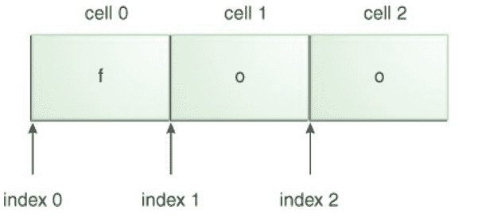

字符串中的每个字符都位于自己的单元中，索引位置指向每个单元之间。字符串“foo”从索引 0 开始，到索引 3 结束，尽管字符本身占据了单元格 0、1 和 2。

在随后的匹配中，你会注意到一些重叠；下一次匹配的起始索引与上一次匹配的结束索引相同：

```
Enter your regex: foo
Enter input string to search: foofoofoo
I found the text foo starting at index 0 and ending at index 3.
I found the text foo starting at index 3 and ending at index 6.
I found the text foo starting at index 6 and ending at index 9.
```

## 元字符

此 API 还支持许多影响模式匹配方式的特殊字符。将正则表达式更改为 `cat.`，并将输入字符串更改为 `cats`。输出将如下所示：

```
Enter your regex: cat.
Enter input string to search: cats
found the text cats starting at index 0 and ending at index 4
```

尽管输入字符串中不存在点号 `.`，但匹配仍然成功。它之所以成功，是因为点号 `.` 是一个元字符——一种由匹配器解释的具有特殊含义的字符。元字符 `.` 意味着“任何字符”，这就是为什么在例例中匹配成功了的原因。

此 API 支持的元字符为：`< ([\^=$!|])\?\.*`

> **注意事项**
>
> 在某些情况下，上述列出的特殊字符不会被视为元字符。当你学习更多关于正则表达式构造的知识时，会遇到这种情况。不过，你可以使用此列表来检查特定字符是否会被视为元字符。例如，`@` 和 `#` 字符永远不会带有特殊含义。

有两种方法可以强制将元字符视为普通字符：

- 在元字符前加一个反斜杠 `\`，或者
- 将其封装在 `\Q`（开始引号）和 `\E`（结束引号）之间。

使用此技术时，`\Q` 和 `\E` 可以放置在表达式中的任何位置，只要 `\Q` 位于前面即可。

## 字符类

如果你浏览 `Pattern` 类规范，你将看到总结了支持的正则表达式构造的表格。在“字符类”（Character Classes）部分，你会找到以下内容：

### 表 14.1. 正则表达式构造

| 构造 | 描述 |
| --- | --- |
| `[abc]` | a, b, 或 c（简单类） |
| `[^abc]` | 除 a, b 或 c 以外的任何字符（否定） |
| `[a-zA-Z]` | a 到 z，或 A 到 Z，包含边界（范围） |
| `[a-d[m-p]]` | a 到 d，或 m 到 p: `[a-dm-p]`（并集） |
| `[a-z&&[def]]` | d, e, 或 f（交集） |
| `[a-z&&[^bc]]` | a 到 z，但不包括 b 和 c: `[ad-z]`（差集） |
| `[a-z&&[^m-p]]` | a 到 z，且不通过 p: `[a-iq-z]`（差集） |

左列指定了正则表达式构造，右列描述了每种构造进行匹配的条件。

> **注意事项**
>
> “字符类”短语中的“类”（class）不是指 `.class` 文件。在正则表达式的语境下，字符类是封装在方括号内的一个字符集。它指定了能够成功匹配给定输入字符串中单个字符的字符。

### 简单类

字符类最基本的形式是简单地将一组字符并放在方括号内。例如，正则表达式 `[bcr]at` 将匹配单词“bat”、“cat”或“rat”，因为它将一个字符类（接受“b”、“c”或“r”之一）定义为它的第一个字符。

```
Enter your regex: [bcr]at
Enter input string to search: bat
I found the text "bat" starting at index 0 and ending at index 3.
Enter your regex: [bcr]at
Enter input string to search: cat
I found the text "cat" starting at index 0 and ending at index 3.
Enter your regex: [bcr]at
Enter input string to search: rat
I found the text "rat" starting at index 0 and ending at index 3.
Enter your regex: [bcr]at
Enter input string to search: hat
No match found.
```

在上面的示例中，只有当第一个字母匹配字符类中定义的字符之一时，整体匹配才会成功。

### 否定

要匹配所有*除*列出的字符以外的字符，可以在字符类的开头插入元字符 `^`。这种技术被称为*否定*（negation）。

```
Enter your regex: [^bcr]at
Enter input string to search: bat
No match found.
Enter your regex: [^bcr]at
Enter input string to search: cat
No match found.
Enter your regex: [^bcr]at
Enter input string to search: rat
No match found.
Enter your regex: [^bcr]at
Enter input string to search: hat
I found the text "hat" starting at index 0 and ending at index 3.
```

在上面的示例中，只有当第一个字母匹配字符类定义的字符时，整体匹配才会成功。

### 范围

有时你想要定义一个包含范围的字符类。要指定范围，只需在第一个和最后一个字符之间插入连字符 `-`。例如，`[a-z]` 匹配从 a 到 z 的任何小写字母。

```
Enter your regex: [a-z]
Enter input string to search: apple
I found the text "apple" starting at index 0 and ending at index 5.
Enter your regex: [a-z]
Enter input string to search: banana
I found the text "banana" starting at index 0 and ending at index 6.
Enter your regex: [a-z]
Enter input string to search: cherry
I found the text "cherry" starting at index 0 and ending at index 6.
Enter your regex: [a-z]
Enter input string to search: 123
No match found.
```

在上面的示例中，只有当第一个字母匹配字符类定义的字符时，整体匹配才会成功。

### 并集

你还可以使用并集创建一个由两个或多个独立类组成的字符类。要创建并集，只需将一个类嵌套在另一个类中，例如 `[0-4[6-8]]`。这个特定的并集创建的字符类匹配数字 0, 1, 2, 3, 4, 6, 7 和 8。

```
Enter your regex: [0-4[6-8]]
Enter input string to search: 0
I found the text "0" starting at index 0 and ending at index 1.
Enter your regex: [0-4[6-8]]
Enter input string to search: 5
No match found.
Enter your regex: [0-4[6-8]]
Enter input string to search: 6
I found the text "6" starting at index 0 and ending at index 1.
Enter your regex: [0-4[6-8]]
```


Enter input string to search: 8

I found the text "8" starting at index 0 and ending at index 1.

Enter your regex: `[0-4[6-8]]`

Enter input string to search: 9

No match found.

## 交集

要创建一个仅匹配所有嵌套类共同字符的单一字符类，请使用 `&&`，例如 `[0-9&&[345]]`。这个特定的交集创建的单一字符类匹配两个字符类共同的数字：3, 4 和 5。

```
Enter your regex: [0-9&&[345]]
Enter input string to search: 3
I found the text "3" starting at index 0 and ending at index 1.
Enter your regex: [0-9&&[345]]
Enter input string to search: 4
I found the text "4" starting at index 0 and ending at index 1.
Enter your regex: [0-9&&[345]]
Enter input string to search: 5
I found the text "5" starting at index 0 and ending at index 1.
Enter your regex: [0-9&&[345]]
Enter input string to search: 2
No match found.
Enter your regex: [0-9&&[345]]
Enter input string to search: 6
No match found.
```

### 这是一个展示两个范围取交集的示例：

```
Enter your regex: [2-8&&[4-6]]
Enter input string to search: 3
No match found.
Enter your regex: [2-8&&[4-6]]
Enter input string to search: 4
I found the text "4" starting at index 0 and ending at index 1.
Enter your regex: [2-8&&[4-6]]
Enter input string to search: 5
I found the text "5" starting at index 0 and ending at index 1.
Enter your regex: [2-8&&[4-6]]
Enter input string to search: 6
I found the text "6" starting at index 0 and ending at index 1.
Enter your regex: [2-8&&[4-6]]
Enter input string to search: 7
No match found.
```

### 减法

最后，你可以使用减法来否定一个或多个嵌套字符类，例如 `[0-9&&[^345]]`。这个示例创建了一个单个字符类，它可以匹配从 0 到 9 的所有数字，但数字 3、4 和 5 除外。

```
Enter your regex: [0-9&&[^345]]
Enter input string to search: 2
I found the text "2" starting at index 0 and ending at index 1.
Enter your regex: [0-9&&[^345]]
Enter input string to search: 3
No match found.
Enter your regex: [0-9&&[^345]]
Enter input string to search: 4
No match found.
Enter your regex: [0-9&&[^345]]
Enter input string to search: 5
No match found.
Enter your regex: [0-9&&[^345]]
Enter input string to search: 6
I found the text "6" starting at index 0 and ending at index 1.
Enter your regex: [0-9&&[^345]]
Enter input string to search: 9
I found the text "9" starting at index 0 and ending at index 1.
```

现在我们已经学习了如何创建字符类，在继续下一节之前，你可能想要复习表 14.1。

## 预定义字符类

Pattern API 包含了许多预定义的字符类，它们为常用的正则表达式提供了方便的简写：

| 构造符 | 说明 |
| --- | --- |
| `.` | 任意字符（可能匹配也可能不匹配终止符） |
| `\d` | 数字：`[0-9]` |
| `\D` | 非数字：`[^0-9]` |
| `\s` | 空白字符：`[ \t\n\x0B\f\r]` |
| `\S` | 非空白字符：`[^\s]` |
| `\w` | 单词字符：`[a-zA-Z_0-9]` |
| `\W` | 非单词字符：`[^\w]` |

在表中，左侧列中的每个构造符都是右侧列中字符类的简写。例如，`\d` 表示数字范围（0-9），而 `\w` 表示单词字符（任何小写字母、任何大写字母、下划线字符或任何数字）。尽可能使用预定义类，它们能让你的代码更易读，并消除由格式错误的字符类引入错误。

以反斜杠开头的构造符称为转义构造。我们在“字符串字面量”部分中预览了转义构造，那里我们提到了使用反斜杠以及 `\Q` 和 `\E` 来处理引号。如果你在字符串字面量中使用转义构造，必须在反斜杠前面再加一个反斜杠，字符串才能编译。例如：

```
private final String REGEX = "\\d"; // 单个数字
```

在此示例中，`\d` 是正则表达式；额外的反斜杠是代码编译所必需的。然而，测试程序直接从控制台读取表达式，因此额外的反斜杠是不必须的。

以下示例演示了预定义字符类的用法。

```
Enter your regex: .
Enter input string to search: @
I found the text "@" starting at index 0 and ending at index 1.
Enter your regex: .
Enter input string to search: 1
I found the text "1" starting at index 0 and ending at index 1.
Enter your regex: .
Enter input string to search: a
I found the text "a" starting at index 0 and ending at index 1.
```

```
Enter your regex: \d
Enter input string to search: 1
I found the text "1" starting at index 0 and ending at index 1.
```

```
Enter your regex: \d
Enter input string to search: a
No match found.
```

```
Enter your regex: \D
Enter input string to search: 1
No match found.
```

```
Enter your regex: \D
Enter input string to search: a
I found the text "a" starting at index 0 and ending at index 1.
```

```
Enter your regex: \s
Enter input string to search:  
I found the text " " starting at index 0 and ending at index 1.
```

```
Enter your regex: \s
Enter input string to search: a
No match found.
```

```
Enter your regex: \S
Enter input string to search:  
No match found.
```

```
Enter your regex: \S
Enter input string to search: a
I found the text "a" starting at index 0 and ending at index 1.
```

```
Enter your regex: \w
Enter input string to search: a
I found the text "a" starting at index 0 and ending at index 1.
```

```
Enter your regex: \w
Enter input string to search:  
No match found.
```

## 量化符

量化符允许你指定匹配的次数。乍一看，`?`、`*`、`+` 似乎含义相同。它们之间存在微妙差异将在节末尾解释。

让我们通过创建三个不同的正则表达式开始观察贪婪量化符：字母“a”后面跟着 `*` 或 `+`。看看当这些表达式针对空字符串 `""` 进行测试时会发生什么：

```
Enter your regex: a?
Enter input string to search: 
Found the text "" starting at index 0 and ending at index 0.
Enter your regex: a*
Enter input string to search: 
Found the text "" starting at index 0 and ending at index 0.
Enter your regex: a+
Enter input string to search: 
No match found.
```

### 表 14.3 量化符

| 贪婪 | 懒惰 | 占有 | 含义 |
| --- | --- | --- | --- |
| `?` | `??` | `?+` | 一次或不匹配 |
| `*` | `*?` | `*+` | 零次或多次 |
| `+` | `+?` | `++` | 一次或多次 |
| `{n}` | `{n}?` | `{n}+` | 严格 n 次 |
| `{n,}` | `{n,}?` | `{n,}+` | 至少 n 次 |
| `{n,m}` | `{n,m}?` | `{n,m}+` | 至少 n 次，最多 m 次 |

### 零长度匹配

在上面的示例中，前两种情况匹配成功，是因为 `a?` 和 `a*` 允许字母 a 出现零次。你还会注意到开始和结束索引都是 0，这与我们为止看到的任何示例都不同。空字符串 `""` 没有长度，因此测试在索引 0 处简单匹配到空内容。这种匹配被称为零长度匹配。零长度匹配可能发生在几种情况：在空字符串中、在字符串开头、在字符串最后一个字符之后，或者在字符串的任意两个字符之间。零长度匹配很容易识别，因为它们总是开始并结束于同一个索引位置。

让我们通过更多示例来探索零长度匹配。将输入字符串更改为字母“a”，你会发现一些有趣的现象：

```
Enter your regex: a?
Enter input string to search: a
I found the text "a" starting at index 0 and ending at index 1.
I found the text "" starting at index 1 and ending at index 1.
Enter your regex: a*
Enter input string to search: a
I found the text "a" starting at index 0 and ending at index 1.
I found the text "" starting at index 1 and ending at index 1.
```

```
Enter your regex: a+
Enter input string to search: a
I found the text "a" starting at index 0 and ending at index 1.
```

所有三个量符都找到了字母 “a”，但前两个在索引 1 处也找到了零长度匹配；也就是说，在输入字符串最后一个字符之后。请记住，匹配器将字符 “a” 视为位于索引 0 和索引 1 之间的单元格中，而我们的测试框架会一直循环，直到无法找到匹配为止。取决于所使用的量符，最后一个字符之后索引处的“无内容”可能会触发匹配，也可能不会触发。

现在，将输入字符串更改为连续五个字母 “a”，你将得到以下结果：

```
Enter your regex: a?
Enter input string to search: aaaaa
I found the text "a" starting at index 0 and ending at index 1.
I found the text "a" starting at index 1 and ending at index 2.
I found the text "a" starting at index 2 and ending at index 3.
I found the text "a" starting at index 3 and ending at index 4.
I found the text "a" starting at index 4 and ending at index 5.
I found the text "" starting at index 5 and ending at index 5.
Enter your regex: a*
Enter input string to search: aaaaa
I found the text "aaaaa" starting at index 0 and ending at index 5.
I found the text "" starting at index 5 and ending at index 5.
Enter your regex: a+
Enter input string to search: aaaaa
I found the text "aaaaa" starting at index 0 and ending at index 5.
```

表达式 `a?` 为每个字符找到单独的匹配，因为它在 “a” 出现零次或一次时进行匹配。表达式 `a*` 找到了两个单独的匹配：第一个匹配项是所有的字母 “a”，第二个匹配项是索引 5 处最后一个字符后的零长度匹配。最后，`a+` 找到了字母 “a”的所有出现位置，忽略了最后一个索引处“无内容”的存在。

此时，你可能会想知道如果前两个量符遇到的是 “a” 以外的字母，结果会是什么。例如，如果遇到字母 “b”，如 “ababaaaab?”，会发生什么？让我们找找：

```
Enter your regex: a?
Enter input string to search: ababaaaab
I found the text "a" starting at index 0 and ending at index 1.
I found the text "" starting at index 1 and ending at index 1.
I found the text "a" starting at index 2 and ending at index 3.
I found the text "" starting at index 3 and ending at index 3.
I found the text "a" starting at index 4 and ending at index 5.
I found the text "a" starting at index 5 and ending at index 6.
I found the text "a" starting at index 6 and ending at index 7.
I found the text "a" starting at index 7 and ending at index 8.
I found the text "" starting at index 8 and ending at index 8.
I found the text "" starting at index 9 and ending at index 9.
```

```
Enter your regex: a*
Enter input string to search: abaaaaab
I found the text "a" starting at index 0 and ending at index 1.
I found the text "" starting at index 1 and ending at index 1.
I found the text "a" starting at index 2 and ending at index 3.
```


I found the text "" starting at index 3 and ending at index 3.

I found the text "aaaa" starting at index 4 and ending at index 8.

I found the text "" starting at index 8 and ending at index 8.

I found the text "" starting at index 9 and ending at index 9.

```
Enter your regex: a+
Enter input string to search: abaaaaab
I found the text "a" starting at index 0 and ending at index 1.
I found the text "a" starting at index 2 and ending at index 3.
I found the text "aaaa" starting at index 4 and ending at index 8.
```

尽管字母 “b” 出现在单元格 1、3 和 8 中，但输出在这些位置报告了零长度匹配。正则表达式 `a?` 并不是专门在寻找字母 “b”；它仅仅是在寻找 “a” 的存在（或不存在）。如果量符允许 “a” 匹配零次，那么输入字符串中任何不是 “a” 的内容都会显示为零长度匹配。剩余的 “a” 将按照之前示例中讨论的规则进行匹配。

要精确匹配 $n$ 次模式，只需在花括号内指定数字即可：

```
Enter your regex: a{3}
Enter input string to search: aa
No match found.

Enter your regex: a{3}
Enter input string to search: aaa
I found the text "aaa" starting at index 0 and ending at index 3.

Enter your regex: a{3}
Enter input string to search: aaaa
I found the text "aaa" starting at index 0 and ending at index 3.
```

```
Enter your regex: a+
Enter input string to search: a
I found the text "a" starting at index 0 and ending at index 1.
```

所有三个量符都找到了字母 “a”，但前两个在索引 1 处也找到了零长度匹配；也就是说，在输入字符串最后一个字符之后。请记住，匹配器将字符 “a” 视为位于索引 0 和索引 1 之间的单元格中，而我们的测试框架会一直循环，直到无法找到匹配为止。取决于所使用的量符，最后一个字符之后索引处的“无内容”可能会触发匹配，也可能不会触发。

现在，将输入字符串更改为连续五个字母 “a”，你将得到以下结果：

```
Enter your regex: a?
Enter input string to search: aaaaa
I found the text "a" starting at index 0 and ending at index 1.
I found the text "a" starting at index 1 and ending at index 2.
I found the text "a" starting at index 2 and ending at index 3.
I found the text "a" starting at index 3 and ending at index 4.
I found the text "a" starting at index 4 and ending at index 5.
I found the text "" starting at index 5 and ending at index 5.
```

```
Enter your regex: a*
Enter input string to search: aaaaa
I found the text "aaaaa" starting at index 0 and ending at index 5.
I found the text "" starting at index 5 and ending at index 5.
```

```
Enter your regex: a+
Enter input string to search: aaaaa
I found the text "aaaaa" starting at index 0 and ending at index 5.
```

表达式 `a?` 为每个字符找到单独的匹配，因为它在 “a” 出现零次或一次时进行匹配。表达式 `a*` 找到了两个单独的匹配：第一个匹配项是所有的字母 “a”，第二个匹配项是索引 5 处最后一个字符后的零长度匹配。最后，`a+` 找到了字母 “a”的所有出现位置，忽略了最后一个索引处“无内容”的存在。

此时，你可能会想知道如果前两个量符遇到的是 “a” 以外的字母，结果会是什么。例如，如果遇到字母 “b”，如 “ababaaaab”，会发生什么？
让我们找找：

```
Enter your regex: a?
Enter input string to search: ababaaaab
I found the text "a" starting at index 0 and ending at index 1.
I found the text "" starting at index 1 and ending at index 1.
I found the text "a" starting at index 2 and ending at index 3.
I found the text "" starting at index 3 and ending at index 3.
I found the text "a" starting at index 4 and ending at index 5.
I found the text "a" starting at index 5 and ending at index 6.
I found the text "a" starting at index 6 and ending at index 7.
I found the text "a" starting at index 7 and ending at index 8.
I found the text "" starting at index 8 and ending at index 8.
I found the text "" starting at index 9 and ending at index 9.
```

```
Enter your regex: a*
Enter input string to search: abaaaaab
I found the text "a" starting at index 0 and ending at index 1.
I found the text "" starting at index 1 and ending at index 1.
I found the text "a" starting at index 2 and ending at index 3.
I found the text "" starting at index 3 and ending at index 3.
I found the text "aaaa" starting at index 4 and ending at index 8.
I found the text "" starting at index 8 and ending at index 8.
I found the text "" starting at index 9 and ending at index 9.
```

```
Enter your regex: a+
Enter input string to search: abaaaaab
I found the text "a" starting at index 0 and ending at index 1.
I found the text "a" starting at index 2 and ending at index 3.
I found the text "aaaa" starting at index 4 and ending at index 8.
```

尽管字母 “b” 出现在单元格 1、3 和 8 中，但输出在这些位置报告了零长度匹配。正则表达式 `a?` 并不是专门在寻找字母 “b”；它仅仅是在寻找 “a” 的存在（或不存在）。如果量符允许 “a” 匹配零次，那么输入字符串中任何不是 “a” 的内容都会显示为零长度匹配。剩余的 “a” 将按照之前示例中讨论的规则进行匹配。

要精确匹配 $n$ 次模式，只需在花括号内指定数字即可：

```
Enter your regex: a{3}
Enter input string to search: aa
No match found.

Enter your regex: a{3}
Enter input string to search: aaa
I found the text "aaa" starting at index 0 and ending at index 3.

Enter your regex: a{3}
Enter input string to search: aaaa
I found the text "aaa" starting at index 0 and ending at index 3.
```

贪婪量词、懒惰量词和占有量词之间存在细微的差别。

贪婪量词被认为是“贪婪的”，是因为它们强制匹配器在尝试第一次匹配之前读入（或“吃掉”）整个输入字符串。如果第一次匹配尝试（整个输入字符串）失败，匹配器会将输入字符串向后回溯一个字符并重试，重复此过程直到找到匹配项或没有更多字符可以回溯为止。取决于表达式中使用的量词，它最后尝试匹配的内容是 1 个或 0 个字符。

然而，懒惰量词采取相反的方法：它们从输入字符串的开头开始，然后不情愿地一次一次“吃掉”一个字符以寻找匹配项。它们最后尝试的是整个输入字符串。

最后，占有量词总是会吃掉整个输入字符串，并尝试一次（且仅尝试一次）匹配。与贪婪量词不同，占有量词永远不会回溯，即使这样做可以使整个匹配成功。

为了说明这一点，请考虑输入字符串 `xfooxxxxxxfoo`。


```
Enter your regex: .*foo // greedy quantifier

Enter input string to search: xfooxxxxxxfoo

I found the text "xfooxxxxxxfoo" starting at index 0 and ending

nEnter your regex: ..*?foo // reluctant quantifier

Enter input string to search: xfooxxxxxxfoo

I found the text "xfoo" starting at index 0 and ending at index
I found the text "xxxxxxxxx" starting at index 4 and ending at

Enter your regex: .*+foo // possessive quantifier

ter input string to search: xfooxxxxxfoo

Match found.
```

第一个示例使用了贪婪量词 `.*` 零或多次，后面跟着字母 "f" "o" "o"。因为量词是贪婪的，表达式的 `.*` 部分首先吃掉了整个输入字符串。此时，整个表达式无法成功，因为最后三个字母（"f" "o" "o"）已经被消耗了。匹配器缓慢地一次回溯一个字母，直到最右侧出现的 "foo" 被吐出来，此时匹配成功，搜索结束。

然而，第二个示例是懒惰的，所以它首先开始消耗“无”。"foo"并没有出现在字符串的开头，它被迫吞下第一个字母（"x"），这触发了索引 0 和 4 处的首次匹配。我们的测试框架继续该过程，直到输入字符串耗尽。它在 4 和 13 找到另一个匹配。第三个示例未能找到匹配，因为该量词是占有的。在这种情况下，整个输入字符串被 `.*` 消耗，没有剩余的内容来满足表达式末尾的 "foo"。当你想捕获所有内容且永不回溯时，请使用占有量词；在无法立即找到匹配项的情况下，它的性能会优于等效的贪婪量词。

# 捕获组

在上一节中，我们看到了量词是如何一次一次地附加到单个字符、字符类或捕获组上的。但直到现在，我们还没有详细讨论过捕获组的概念。

捕获组是将多个字符视为单个单元的方法。它们通过将要包含在内的字符放在一组括号中来创建。例如，正则表达式 `(dog)` 创建了一个包含字母 "d" "o" 和 "g" 的单个组。匹配捕获组的输入字符串部分将保存在内存中，以便稍后通过反向引用调用（在“反向引用”部分中所讨论）。

## 编号

正如 `Pattern` API 中描述的，捕获组通过从左到右计算左括号的数量来编号。例如，在表达式 `((A) (B(C)))` 中，有四个组：

- 1. `((A) (B(C)))`
- 2. `(A)`
- 3. `(B(C))`
- 4. `(C)`

要找出表达式中存在多少个组，请在匹配器对象上调用 `groupCount()` 方法。`groupCount()` 方法返回一个整数（`int`），显示匹配器模式中存在的捕获组数量。在这个示例中，`groupCount()` 将返回 4，表示该模式包含 4 个组。

还有一个特殊的组——组 0，它始终代表整个表达式。该组不包含在 `groupCount()` 报告的总数中。以 `(?` 开头的组是纯的非捕获组，它们不捕获文本也不计入组总数。（你稍后将在“Pattern 类的方法”部分中看到非捕获组的示例。）

理解组是如何编号的，因为某些 `Matcher` 方法接受一个指定特定组编号的整数作为参数：

- `public int start(int group)`：返回上一次匹配操作期间由给定组捕获的子序列的起始索引。
- `public int end(int group)`：返回上一次匹配操作期间由给定组捕获的子序列的最后一个字符索引加一。
- `public String group(int group)`：返回上一次匹配操作期间由给定组捕获的输入子序列。

## 反向引用

匹配捕获组的输入字符串部分将保存在内存中，以便稍后通过反向引用调用。反向引用在正则表达式中指定为一个反斜杠 (`\`) 后面跟一个指示要引用的组编号的数字。例如，表达式 `(\d\d)` 定义了一个匹配连续两个数字的捕获组，稍后可以在表达式中通过 `\1` 引用它。要匹配任何两个数字，你会使用 `(\d\d)\1` 作为正则表达式：

```
Enter your regex: (\d\d)\1

Enter input string to search: 1212

I found the text "1212" starting at index 0 and ending at index
```

如果你更改最后两个数字，匹配将失败：

```
Enter your regex: (\d\d)\1
input string to search: 1234
No match found.
```

# 边界匹配器

在此为止，我们只关心特定输入字符串的范围内是否找到了匹配。我们从未关心匹配发生在字符串的哪个位置。你可以通过指定边界匹配器来使模式匹配更精确。例如，你可能对寻找特定的单词感兴趣，但前提是它出现在行的开头或结尾。或者你可能想知道匹配是否发生在单词边界上，或者上一次匹配的结尾。

下表列出了解释了所有的边界匹配器。

## 表 14.4 用于定义边界的构造

| 边界构造 | 描述 |
| :--- | :--- |
| `^` | 行开头 |
| `$` | 行末尾 |
| `\b` | 单词边界 |
| `\B` | 非单词边界 |
| `\A` | 输入的开头 |
| `\G` | 上一次匹配的结尾 |
| `\Z` | 输入的结尾（除非有最后的终止符） |
| `\z` | 输入的结尾 |

以下示例演示了边界匹配器 `^` 和 `$` 的用法。如所述，`^` 匹配开头，而 `$` 匹配结尾。

```
Enter your regex: ^dog$
Enter input string to search: dog
I found the text "dog" starting at index 0 and ending at index

Enter your regex: ^dog$
Enter input string to search: dog
No match found.

Enter your regex: \s*$
nEnter input string to search: dog
I found the text "  dog" starting at index 0 and ending

Enter your regex: ^dog\w*
Enter input string to search: dogblahblah
I found the text "dogblahblah" starting at index 0 and ending
```

第一个示例成功了，是因为模式占据了整个输入字符串。第二个示例失败了，是因为输入字符串开头有额外的空格。

行尾的“dog”。第四个示例要求行首出现“dog”，并在后跟着任意数量的单词字符。

要检查一个模式是否在单词边界上开始和结束（而不是长字符串中的子字符串），请在两侧都使用 `\b`；例如 `\bd\b`。

```
Enter your regex: \bd\b
nEnter input string to search: The dog plays in the yard.

I found the text "dog" starting at index 4 and ending at index

Enter your regex: \bd\b
Enter input string to search: The doggie plays in the yard.

No match found.
```

要在非单词边界上匹配表达式，请使用 `\B`：

```
Enter your regex: \bd\B
Enter input string to search: The dog plays in the yard.
No match found.
```

```
Enter your regex: \bd\B
Enter input string to search: The doggie plays in the yard.
I found the text "dog" starting at index 4 and ending at index
```

要要求匹配仅发生在上一个匹配的末尾，请使用 `\G`：

```
Enter your regex: dog
Enter input string to search: dog dog
I found the text "dog" starting at index 0 and ending at index
I found the text "dog" starting at index 4 and ending at index
nEnter your regex: \Gdog
Enter input string to search: dog dog
I found the text "dog" starting at index 0 and ending at index
```

在这里，第二个示例只找到一个匹配，因为第二个“dog”的起始位置并不是在上一个匹配的末尾。

# Pattern 类的方法

到目前为止，我们只使用测试框架来创建最基本形式的 `Pattern` 对象。本节将探索高级技术，例如带有标志的模式以及使用嵌入式标志表达式。它还探索了一些我们尚未讨论的额外有用方法。

## 使用标志创建模式

`Pattern` 类定义了一个备选的 `compile()` 方法，它接受一组影响模式的标志。`flags` 参数是一个位掩码，可能包含以下任何公共静态字段：

- `Pattern.CANON_EQ`——启用规范等效性。当指定此标志时，当且仅当两个字符的完整规范分解完全匹配时，这两个字符将被认为匹配。例如，指定此标志后，表达式 `"a\u030AA"` 将匹配字符串 `"\u00E5"`。默认情况下，匹配不考虑规范等效性。指定此标志可能会带来性能开销。
- `Pattern.CASE_INSENSITIVE`——启用不区分大小写匹配。默认情况下，不区分大小写匹配假设只匹配 US-ASCII 字符集中的字符。通过在配合此标志的同时指定 `UNICODE_CASE` 标志可以启用 Unicode 感知的不区分大小写匹配。也可以通过嵌入式标志表达式 `(?i)` 启用不区分大小写匹配。指定此标志可能会带来轻微的性能影响。
- `Pattern.COMMENTS`——允许在模式中使用空白和注释。在此模式下，空白会被忽略，以 `#` 开头的嵌入式注释将被忽略到行尾。注释模式也可以通过嵌入式标志表达式 `(?x)` 启用。
- `Pattern.DOTALL`——启用单行模式。在单行模式下，表达式 `.` 匹配任何字符，包括行终止符。默认情况下此表达式不匹配行终止符。单行模式也可以通过嵌入式标志表达式 `(?s)` 启用。（`s` 是“single-line”模式的记忆符号，这在 Perl 中是这种）。
- `Pattern.LITERAL`——启用模式的字面解析。当指定此标志时，指定模式的输入字符串被视为字面字符序列。输入序列中的元字符或转义序列将不再具有特殊含义。当与此标志结合使用时，`CASE_INSENSITIVE` 和 `UNICODE_CASE` 标志仍会保留其对匹配的影响。其他标志将变得多余。没有用于启用字面解析的嵌入式标志字符。
- `Pattern.MULTILINE`——启用多行模式。在多行表达式中，`^` 和 `$` 分别匹配行终止符或输入序列末尾的之后或之前。默认情况下，这些表达式仅匹配整个输入序列的开头和结尾。多行模式也可以通过嵌入式标志表达式 `(?m)` 启用。
- `Pattern.UNICODE_CASE`——启用 Unicode 感知的大小折叠。当指定此标志时，通过 `CASE_INSENSITIVE` 标志启用的不区分大小写匹配将以与 Unicode 标准一致的方式进行。默认情况下，不区分大小写匹配假设只匹配 US-ASCII 字符集中的字符。Unicode 感知的大小折叠也可以通过嵌入式标志表达式 `(?u)` 启用。指定此标志可能会产生性能影响。
- `Pattern.UNIX_LINES`——启用 UNIX 行模式。在此模式下，在 `.`、`^` 和 `$` 的行为中仅识别 `\n` 行终止符。UNIX 行模式也可以通过嵌入式标志表达式 `(?d)` 启用。

在接下来的步骤中，我们将修改测试框架 `RegexTestHarness.java` 以创建一个不区分大小写匹配的模式。

首先，修改模式以调用替代版本的 `compile()`：

```
Pattern.compile(console.readLine("%nEnter your regex: "),
Pattern.CASE_INSENSITIVE);
```

然后编译并运行测试框架获得以下结果：

```
Enter your regex: dog

Enter input string to search: DoGDo

found the text "DoG" starting at index 0 and ending at index

found the text "DoG" starting at index 3 and ending at index
```

如你所见，字符串字面量 `"dog"` 匹配所有出现情况，无论大小写。使用位或运算符 `|` 分隔要包含的多个标志。为了清晰起见，以下代码硬编码了正则表达式而不是从 `Console` 读取：

```
pattern = Pattern.compile("[az$", Pattern.MULTILINE |
```

你也可以指定一个 `int` 变量：

```
final int flags = Pattern.CASE_INSENSITIVE | 
```

## 嵌入式标志表达式

可以使用嵌入式标志表达式来启用各种标志。嵌入式标志表达式是 `compile()` 方法双参数版本的替代方案，并指定在正则表达式内部。以下示例使用了原始测试框架 `RegexTestHarness.java` 以及启用不区分大小写匹配的 `(?i)`：

```
Enter your regex: (?i)foo

Enter input string to search: FOofofo

found the text "FOO" starting at index 0 and ending at index
I found the text "foo" starting at index 3 and ending at index
I found the text "FoO" starting at index 6 and ending at index
I found the text "foo" starting at index 9 and ending at index
```

再次，所有匹配均成功。与 `Pattern` 公共字段对应的嵌入式标志表达式如下表所示：

## 表 14.5 嵌入式标志常量

| Pattern | 嵌入式标志表达式 |
|---|---|
| `CANON_EQ` | None |
| `CASE_INSENSITIVE` | `(?i)`|
| `COMMENTS` | `(?x)`|
| `MULTILINE` | `(?m)`|
| `DOTALL` | `(?s)`|
| `LITERAL` | None |
| `UNICODE_CASE` | `(?u)`|
| `UNIX_LINES` | `(?d)`|

## 使用 matches(String, CharSequence) 方法

`Pattern` 类定义了一个方便的 `matches()` 方法，允许你快速检查模式是否存在于输入字符串。与所有公共静态方法一样，你应该通过类名调用它，例如 `Pattern.matches("\d","1")`。在这个示例中，方法返回 `true`，因为数字 "1" 匹配正则表达式 `\d`。

## 使用 split(String) 方法

`split()` 方法是收集匹配模式两侧文本的绝佳工具。如下所示的 `SplitDemo.java`，`split()` 方法可以从字符串“one:two:three:four:five”提取单词“one two three four five”：

```
import java.util.regex.Pattern;
import java.util.regex.Matcher;

public class SplitDemo {

    private static final String REGEX = ":";
    private static final String INPUT = "one:two:three:four:five";

    public static void main(String[] args) {
        Pattern p = Pattern.compile(REGEX);
        String[] items = p.split(INPUT);
        for(String s : items) {
            System.out.println(s);
        }
    }
}
```

输出：

```
one
two
three
four
five
```

为了简单起见，我们匹配了一个字符串字面量——冒号（:），而不是复杂的正则表达式。由于我们仍然使用 `Pattern` 和 `Matcher` 对象，你可以使用 `split()` 来获取位于正则表达式任意两侧的文本。这里是相同的示例 `SplitDemo2.java`，它被修改为按数字拆分：


```java
import java.util.regex.Pattern;
import java.util.regex.Matcher;

public class SplitDemo2 {
    private static final String REGEX = "\\d";
    private static final String INPUT = "one9two4three7fourfive";

    public static void main(String[] args) {
        Pattern p = Pattern.compile(REGEX);
        String[] items = p.split(INPUT);
        for (String s : items) {
            System.out.println(s);
        }
    }
}
```

输出：

```
one
two
three
four
five
```

### 其他实用方法

你可能发现以下方法也很有用：

- `public static String quote(String s)`：为指定的字符串返回一个字面量模式字符串。此方法产生的字符串可用于创建一个 `Pattern`，该 `Pattern` 将像字面量模式一样匹配字符串 `s`。输入序列中的元字符或转义序列将被赋予非特殊含义。
- `public String toString()`：返回此模式的字符串表示。这是编译该模式的正则表达式。

## java.lang.String 中的 Pattern 方法等效实现

`java.lang.String` 也通过几个方法支持正则表达式，这些方法模拟了 `java.util.regex.Pattern` 的行为。为了方便起见，下面列出了它们 API 的摘录。

- `public boolean matches(String regex)`：告知此字符串是否匹配给定的正则表达式。以 `.matches` 形式调用此方法产生的结果与表达式 `Pattern.matches(regex, str)` 相同。
- `public String[] split(String regex, int limit)`：围绕给定表达式的匹配项拆分此字符串。以 `.split(regex, n)` 形式调用此方法产生的结果与表达式 `Pattern.compile(regex).split(str, n)` 相同。
- `public String[] split(String regex)`：围绕给定正则表达式的匹配项拆分此字符串。此方法的工作原理与调用带有给定表达式和限制参数零的两个参数 `split` 方法相同。末尾空字符串不会包含在结果数组中。

还有一个 `replace` 方法，它可以将一个 `CharSequence` 替换为另一个：

- `public String replace(CharSequence target, CharSequence replacement)`：将此字符串中每个匹配字面量目标序列的子字符串替换为指定的字面量替换序列。替换过程从字符串开始持续到结束，例如，在字符串“aaa”中将“aa”替换为“b”将得到“ba”而不是“ab”。

## Matcher 类的方法

本节描述了 `Matcher` 类的一些额外有用方法。为了方便起见，下面列出的方法根据功能进行了分组。

### 索引方法

索引方法提供了用的索引值，精确显示在输入字符串中找到匹配的位置：

- `public int start()`：返回上一次匹配的起始索引。
- `public int start(int group)`：返回上一次匹配操作中由给定分组捕获的子序列的起始索引。
- `public int end()`：返回上一个匹配字符之后的偏移量。
- `public int end(int group)`：返回上一次匹配操作中由给定分组捕获的子序列最后一个字符之后的偏移量。

### 查询方法

查询方法检查输入字符串并返回一个布尔值，表示是否找到模式。

- `public boolean lookingAt()`：尝试从区域开始将输入序列与模式进行匹配。
- `public boolean find()`：尝试查找输入序列中匹配模式的下一个子序列。
- `public boolean find(int start)`：重置此匹配器，然后尝试从指定的索引开始查找输入序列中匹配模式的下一个子序列。
- `public boolean matches()`：尝试将整个区域与模式匹配。

### 替换方法

替换方法是用于替换输入字符串文本的有用方法。

- `public Matcher appendReplacement(StringBuilder sb, String replacement)`：实现非终止的追加并替换步骤。
- `public String appendTail(StringBuffer sb)`：实现终止的追加并替换步骤。
- `public String replaceAll(String replacement)`：将输入序列中每个匹配模式的子序列替换为给定的替换字符串。
- `public String replaceFirst(String replacement)`：将输入序列中第一个匹配模式的子序列替换为给定的替换字符串。
- `public static String quoteReplacement(String s)`：为指定的字符串返回一个字面量字符串。此方法产生的字符串将在 `Matcher` 类的 `appendReplacement` 方法中作为字面量替换 `s` 使用。产生的字符串将匹配 `s` 中的字符序列（将其视为字面量序列）。斜杠 (`\`) 和美元符号 (`$`) 将不具有特殊含义。

## 使用 start 和 end 方法

这是一个示例 `MatcherDemo.java`，它统计了 `"dog"` 在输入字符串中出现的次数。`start` 方法提供了关于匹配发生位置的有用信息，而 `end` 返回最后一个字符的索引加一。

```java
import java.util.regex.Pattern;
import java.util.regex.Matcher;

public class MatcherDemo {
    private static String REGEX = "\\bdog";
    private static String INPUT = "The dog says meow. All dogs say meow.";

    public static void main(String[] args) {
        Pattern p = Pattern.compile(REGEX);
        // get a matcher object
        Matcher m = p.matcher(INPUT);

        int count = 0;
        while (m.find()) {
            count++;
            System.out.println("Match number " + count);
            System.out.println("start(): " + m.start());
            System.out.println("end(): " + m.end());
        }
    }
}
```

输出：

```
Match number 1
start(): 0
end(): 3
Match number 2
start(): 4
end(): 7
Match number 3
start(): 8
end(): 11
```

## 使用 matches 和 lookingAt 方法

`matches` 和 `lookingAt` 方法都尝试将模式匹配模式。然而，区别在于 `matches` 要求匹配整个序列，而 `lookingAt` 不需要。这两个方法都从字符串的开始开始。这里是完整的代码 `MatchesLooking.java`：

```java
import java.util.regex.Pattern;
import java.util.regex.Matcher;

public class MatchesLooking {
    private static String REGEX = "foo";
    private static String INPUT = "foooooooaaaaaaa";
    private static Pattern pattern;
    private static Matcher matcher;

    public static void main(String[] args) {
        // Initialize
        pattern = Pattern.compile(REGEX);
        matcher = pattern.matcher(INPUT);

        System.out.println("Current REGEX is: " + REGEX);
        System.out.println("Current INPUT is: " + INPUT);

        System.out.println("lookingAt(): " + matcher.lookingAt());
        System.out.println("matches(): " + matcher.matches());
    }
}
```

输出：

```
Current REGEX is: foo
Current INPUT is: fooooooooaaaaaaa
lookingAt(): true
matches(): false
```

## 使用 replaceFirst(String) 和 replaceAll(String)

`replaceFirst` 和 `replaceAll` 方法替换匹配正则表达式的文本。如名称所示，`replaceFirst` 替换第一个出现项，而 `replaceAll` 替换所有出现项。这里是 `ReplaceDemo.java` 代码：

```java
import java.util.regex.Pattern;
import java.util.regex.Matcher;

public class ReplaceDemo {
    private static String REGEX = "dog";
    private static String INPUT = "The dog says meow. All dogs say meow.";
    private static String REPLACE = "cat";

    public static void main(String[] args) {
        Pattern p = Pattern.compile(REGEX);
        // get a matcher object
        Matcher m = p.matcher(INPUT);
        INPUT = m.replaceAll(REPLACE);
        System.out.println(INPUT);
    }
}
```

输出：

```
The cat says meow. All cats say meow.
```

在第一个版本中，所有的 `dog` 都会被替换为 `cat`。但为什么要止于此呢？与其替换像 `dog` 这样简单的字面量，不如你可以替换匹配任何正则表达式的文本。该方法的 API 规定：“给定正则表达式 `a*b`，输入 `aabfoaaabfoabfoob` 以及替换字符串 `-`，对该表达式的匹配器上调用该方法将产生字符串 `-foo-foo-foo-`。”

以下是 `ReplaceDemo2.java` 代码：

```java
import java.util.regex.Pattern;
import java.util.regex.Matcher;

public class ReplaceDemo2 {
    private static String REGEX = "a*b";
    private static String INPUT = "aabfoaaabfoabfoob";
    private static String REPLACE = "-";

    public static void main(String[] args) {
        Pattern p = Pattern.compile(REGEX);
        // 获取一个匹配器对象
        Matcher m = p.matcher(INPUT);
        INPUT = m.replaceAll(REPLACE);
        System.out.println(INPUT);
    }
}
```

输出：

```
-foo-foo-foo-
```

要只替换模式的第一次出现，只需调用 `replaceFirst` 而不是 `replaceAll`。它接受相同的参数。

### 使用 appendReplacement(StringBuffer, String) 和 appendTail(StringBuffer)

`Matcher` 类还提供了 `appendReplacement` 和 `appendTail` 方法用于文本替换。下面的示例 `RegexDemo.java` 使用了这两个方法来实现与 `replaceAll` 相同的效果。

```java
import java.util.regex.Pattern;
import java.util.regex.Matcher;

public class RegexDemo {
    private static String REGEX = "a*b";
    private static String INPUT = "aabfoooabfoabfoob";
    private static String REPLACE = "-";

    public static void main(String[] args) {
        Pattern p = Pattern.compile(REGEX);
        Matcher m = p.matcher(INPUT); // 获取一个匹配器对象
        StringBuilder sb = new StringBuilder();
        while (m.find()) {
            m.appendReplacement(sb, REPLACE);
        }
        m.appendTail(sb);
        System.out.println(sb.toString());
    }
}
```

输出：

```
-foo-foo-foo-
```

## java.lang.String 中的 Matcher 方法等价项

为了方便，`String` 类也模拟了一些 `Matcher` 方法：

- `public String replaceFirst(String regex, String replacement)`：将此字符串中第一个匹配给定正则表达式的子字符串替换为指定的替换字符串。形如 `str.replaceFirst(regex, repl)` 的方法调用，产生的结果与表达式 `Pattern.compile(regex).matcher(str).replaceFirst(repl)` 完全相同。
- `public String replaceAll(String regex, String replacement)`：将此字符串中每个匹配给定正则表达式的子字符串替换为指定的替换字符串。形如 `str.replaceAll(regex, repl)` 的方法调用，产生的结果与表达式 `Pattern.compile(regex).matcher(str).replaceAll(repl)` 完全相同。

## PatternSyntaxException 类的方法

`PatternSyntaxException` 是一个未检查异常，表示正则表达式中存在语法错误。`PatternSyntaxException` 类提供了以下方法帮助你确定哪里出了问题：

- `public String getDescription()`：获取错误的描述。
- `public int getIndex()`：获取错误索引。
- `public String getPattern()`：获取错误的正则表达式模式。
- `public String getMessage()`：返回一个多行字符串，包含语法错误的描述及其索引、错误的正则表达式模式，以及模式中错误索引的视觉化显示。

以下源码 `RegexTestHarness2.java` 更新了我们的测试框架，以检查格式不正确的正则表达式：


```java
import java.io.Console;
import java.util.regex.Pattern;
import java.util.regex.Matcher;
import java.util.regex.PatternSyntaxException;

public class RegexTestHarness2 {

    public static void main(String[] args) {

        Pattern pattern = null;

        Matcher matcher = null;

        Console console = System.console();

        if (console == null) {
            System.err.println("No console.");
            System.exit(1);
        }

        while (true) {
            try {
                pattern = Pattern.compile(console.readLine("\nEnter输入您的正则: "));
                matcher = pattern.matcher(console.readLine("输入输入字符串: "));
            } catch (PatternSyntaxException pse) {
                console.format("正则表达式存在问题!%n", console);
                console.format("所涉及模式是: %s%n", pse.getPattern());
                console.format("描述是: %s%n", pse.getDescription());
                console.format("消息是: %s%n", pse.getMessage());
                console.format("索引是: %s%n", pse.getIndex());
            }
        }
    }
}
```

你可以在此处找到这些问题和练习题的答案：[问题与练习题的答案](http://docs-oracle.com/javase/tutorial/essential/regex/QandE/answers.html)。

# 第 14 章笔记

1. <http://docs.oracle.com/javase/8/docs/api/java/util/regex/package-summary.html>
2. <http://www.perl.com>
3. <http://docs.oracle.com/javase/8/docs/api/java/util/regex/Pattern.html>
4. <http://docs.oracle.com/javase/8/docs/api/java/util/regex/Matcher.html>
5. <http://docs.oracle.com/javase/8/docs/api/java/util/regex/PatternSyntaxException.html>
6. <http://docs.oracle.com/javase/8/docs/api/java/util/regex/Matcher.html#start-int->
7. <http://docs.oracle.com/javase/8/docs/api/java/util/regex/Matcher.html#end-int->
8. <http://docs.oracle.com/javase/8/docs/api/java/util/regex/Matcher.html#group-int->
9. <http://docs.oracle.com/javase/8/docs/api/java/util/regex/Pattern.html#matches-java.lang.String-java.lang.CharSequence->
10. <http://docs.oracle.com/javase/8/docs/api/java/util/regex/Pattern.html#split-java.lang.CharSequence->
11. <http://docs.oracle.com/javase/8/docs/api/java/util/regex/Pattern.html#quote-java.lang.String->
12. <http://docs.oracle.com/javase/8/docs/api/java/util/regex/Pattern.html#toString-->
13. <http://docs.oracle.com/javase/8/docs/api/java/lang/String.html#matches-java.lang.String->
14. <http://docs.oracle.com/javase/8/docs/api/java/lang/String.htm#split-java.lang.String-int->
15. <http://docs.oracle.com/javase/8/docs/api/java/lang/String.htm#split-java.lang.String->
16. <http://docs.oracle.com/javase/8/docs/api/java/lang/String.htm#replace-java.lang.CharSequence-java.lang.CharSequence->
17. <http://docs.oracle.com/javase/8/docs/api/java/util/regex/Matcher.html#lookingAt->
18. <http://docs.oracle.com/javase/8/docs/api/java/util/regex/Matcher.html#find-->
19. <http://docs.oracle.com/javase/8/docs/api/java/util/regex/Matcher.html#find-int->
20. <http://docs.oracle.com/javase/8/docs/api/java/util/regex/Matcher.html#matches->
21. <http://docs.oracle.com/javase/8/docs/api/java/util/regex/Matcher.html#appendReplacement-java.lang.StringBuilder-java.lang.String->
22. <http://docs.oracle.com/javase/8/docs/api/java/util/regex/Matcher.html#appendTail-java.lang.StringBuilder->
23. <http://docs.oracle.com/javase/8/docs/api/java/util/regex/Matcher.html#replaceAll-java.lang.String->
24. <http://docs.oracle.com/javase/8/docs/api/java/util/regex/Matcher.html#replaceFirst-java.lang.String->
25. <http://docs.oracle.com/javase/8/docs/api/java/util/regex/Matcher.html#quoteReplacement-java.lang.String->
26. <http://docs.oracle.com/javase/8/docs/api/java/lang/String.html#replaceFirst-java.lang.String-java.lang.String->
27. <http://docs.oracle.com/javase/8/docs/api/java/lang/String.htm#replaceAll-java.lang.String-java.lang.String->
28. <http://docs.oracle.com/javase/8/docs/api/java/util/regex/PatternSyntaxException.html>
29. <http://docs.oracle.com/javase/8/docs/api/java/util/regex/PatternSyntaxException.html#getDescription-->
30. <http://docs.oracle.com/javase/8/docs/api/java/util/regex/PatternSyntaxException.html#getIndex-->
31. <http://docs.oracle.com/javase/8/docs/api/java/util/regex/PatternSyntaxException.html#getPattern-->
32. <http://docs.oracle.com/javase/8/docs/api/java/util/regex/PatternSyntaxException.html#getMessage-->
33. <http://docs.oracle.com/javase/8/docs/api/java/lang/Character.UnicodeScript.html#forName-java.String->
34. <http://www.unicode.org/unicode/standard/standard.html>
35. <http://docs.oracle.com/javase/8/docs/api/java/lang/Character.html>
36. <http://docs.oracle.com/javase/8/docs/api/java/util/regex/Matcher.html>

# 运行时环境

应用程序运行在操作系统、虚拟机、类库以及各种环境中。本章描述了在应用程序启动时使用的属性。后续章节介绍了这些属性。本节剩余部分解释了如何使用属性来管理配置。

## 配置工具

## 属性

属性以键值对的形式管理。为了管理属性，请使用 `Properties` 类。`Properties` 继承自 `Hashtable`，并支持以下操作：

- 测试属性对象中是否存在某个键
- 获取键值对的数量
- 移除键
- 向属性对象添加键值对
- 遍历属性键
- 根据键获取值

> **安全考虑**：属性的访问取决于安全管理器。本节中的示例代码假设应用程序没有安全管理器。Applet 中的相同代码可能取决于其运行的浏览器。

`System` 类维护了一个定义当前环境的属性对象。更多关于这些属性的信息，请参阅“系统属性”部分。本节将介绍如何使用属性管理配置。

## 属性的生命周期

下图展示了典型应用程序如何在执行过程中通过 `Properties` 对象管理配置数据。

### 图 15.1 应用程序生命周期中的属性管理


* **启动**：前三个框的操作发生在应用程序启动时。首先，应用程序从已知位置加载默认属性。通常，默认属性存储在磁盘上，与应用程序的 `.class` 文件和其他资源文件在一起。接下来，应用程序创建另一个 `Properties` 对象，并加载上次运行应用程序保存的属性。许多应用程序按用户存储属性，因此在此步骤加载的属性通常位于用户目录中维护的特定文件中。最后，应用程序使用默认和记忆属性进行初始化。这里的关键是一致性。应用程序必须始终将属性保存到相同的位置，以便下次执行时找到它们。
* **运行**：应用程序运行期间，用户可能会更改某些设置（例如在设置窗口中），并更新属性对象以反映这些更改。如果要在未来的会话中记住用户的更改，则必须保存它们。
* **退出**：退出时，应用程序将属性保存到已知位置，以便在下次启动时再次加载。

## 设置属性对象

以下 Java 代码执行了前一节描述的前两个步骤：加载默认属性和加载记忆属性：

```java
// 创建并加载默认属性
Properties defaultProps = new Properties();
InputStream in = new FileInputStream("defaultProperties");
defaultProps.load(in);
in.close();

// 创建带有默认属性的应用程序属性
Properties applicationProps = new Properties(defaultProps);
```

```java
// now load properties from last invocation
in = new FileInputStream("appProperties");
applicationProps.load(in);
in.close();
...
```

首先，应用程序设置了一个默认的 `Properties` 对象。该对象包含了一组在其他地方没有显式设置值时将使用的属性。然后，`load` 方法会从磁盘上一个名为 `defaultProperties` 的文件中读取默认值。

接下来，应用程序使用不同的构造函数创建了第二个 `Properties` 对象 `applicationProps`，其默认值包含在 `defaultProps` 中。当检索属性时，这些默认值就会生效。如果从 `applicationProps` 中找不到该属性，则会搜索其默认列表。

最后，代码从名为 `appProperties` 的文件中将一组属性加载到 `applicationProps` 中。该文件中的属性是应用程序上次被调用时保存的属性，正如下一节所解释。

# 保存属性

以下示例使用 `Properties.store` 写出上一个示例中的应用程序属性。默认属性不需要每次保存，因为它们永远不会改变。

```java
FileOutputStream out = new FileOutputStream("appProperties");
applicationProps.store(out, "---No Comment---");
out.close();
```

`store` 方法需要一个写入的流，以及一个作为输出顶部注释的字符串。

# 获取属性信息

一旦应用程序设置了其 `Properties` 对象，就可以查询该对象以获取其包含的各种键和值的信息。应用程序在启动后从 `Properties` 对象获取信息，以便根据用户的选择进行自我初始化。`Properties` 类有几个方法用于获取属性信息：

- `contains(Object value)` 和 `containsKey(Object key)`：如果值或键在 `Properties` 对象中，则返回 true。`Properties` 从 `Hashtable` 继承了这些方法。因此，它们接受 `Object` 类型参数，但应仅使用 `String` 值。
- `getProperty(String key)` 和 `getProperty(String key, String default)`：返回指定属性的值。第二个版本提供了默认值。如果未找到键，则返回默认值。
- `list(PrintStream s)` 和 `list(PrintWriter w)`：将所有属性写入指定的流或写入器。这对于调试非常有用。
- `elements()`、`keys()` 和 `propertyNames()`：返回一个包含 `Properties` 对象中键或值（如方法名所示）的 `Enumeration`。`keys` 方法只返回对象本身的键；`propertyNames` 方法还会返回默认属性的键。
- `stringPropertyNames()`：类似于 `propertyNames`，但返回一个 `Set<String>`，并且仅返回键和值均为字符串的属性名称。注意，`Set` 对象不受 `Properties` 对象支持，因此其中一个的更改不会影响另一个。
- `size()`：返回键/值对的数量。

# 设置属性

用户在应用程序运行期间与程序的交互可能会影响属性设置。这些更改应该反映在 `Properties` 对象中，以便在应用程序退出（并调用 `store` 方法）时被保存。以下方法更改 `Properties` 对象中的属性：

- `setProperty(String key, String value)`：将键/值对放入 `Properties` 对象中。
- `remove(Object key)`：移除与键关联的键值对。

> **注意**
>
> 上述某些方法定义在 `Hashtable` 中，并接受 `String` 以外的键和值参数。始终对键和值使用 `Strings`，即使方法允许其他类型。此外，不要在 `Properties` 对象上调用 `Hashtable.set` 或 `Hashtable.setAll`；始终使用 `Properties.setProperty`。

# 命令行参数

Java 应用程序可以从命令行接受任意数量的参数。这允许用户在启动应用程序指定配置信息。

用户在调用应用程序时输入命令行参数，并在运行的类名之后指定它们。例如，假设有一个名为 `Sort` 的 Java 应用程序对文件中的行进行排序。对名为 `friends.txt` 的文件进行排序，用户将输入：

```bash
java Sort friends.txt
```

当启动应用程序时，运行时系统通过字符串数组将命令行参数传递给应用程序的 `main` 方法。在前一个示例中，传递给 `Sort` 应用程序的命令行参数在一个包含单个字符串 `"friends.txt"` 的数组中。


# 回显命令行参数

`Echo` 示例将其每个命令行参数单独占行显示：

```java
public class Echo {
    public static void main(String[] args) {
        for (String s: args) {
            System.out.println(s);
        }
    }
}
```

以下示例显示了用户可能如何运行 `Echo`。用户输入为*斜体*。

```bash
java Echo Drink Hot Java

Drink
Hot
Java
```

注意，应用程序将每个单词——Drink、Hot 和 Java——单独占行显示。这是因为空格字符分隔了命令行参数。为了让 Drink、Hot 和 Java 被解释为单个参数，用户需要通过用引号将它们括起来。

```bash
java Echo "Drink Hot Java"

Drink Hot Java
```

# 解析数值命令行参数

如果应用程序需要支持数值命令行参数，它必须将代表数字的字符串参数（例如“34"）转换为数值。以下是将命令行参数转换为 `int` 的代码段：

```java
int firstArg;

if (args.length > 0) {
    try {
        firstArg = Integer.parseInt(args[0]);
    } catch (NumberFormatException e) {
        System.err.println("Argument" + args[0] + " must be an integer");
        System.exit(1);
    }
}
```

# 其他配置实用程序

这里是其他配置实用程序的摘要。

`Preferences API` 允许应用程序在依赖于实现的存储中存储和检索配置数据。它支持异步更新，并且同一组偏好可以被多个线程甚至多个应用程序安全地更新。更多信息，请参阅《Preferences API 指南》⁶。

部署在 `JAR` 存档中的应用程序使用清单（manifest）来描述存档的内容。更多信息，请参阅第 16 章。

`Java Web Start` 程序的配置包含在 `JNLP` 文件中。更多信息，请参阅第 17 章。

`Java` 插件 applet 的配置部分由嵌入网页的 applet 时使用的 `HTML` 标签决定。取决于 applet 和浏览器，这些标签可能包括 `<applet>`、`<object>`、`<embed>` 和 `<param>`。更多信息，请参阅第 18 章。

`java.util.ServiceLoader`⁷ 提供了一个简单的服务提供者机制。服务提供者是服务的实现——一组著名的接口和（通常是抽象的）类。服务提供者中的类通常实现这些接口并派生服务中定义的类的子类。服务提供者可以作为扩展⁸安装。也可以通过将它们添加到类路径或通过某些其他平台特定的手段可用。

# 系统实用程序

`System`⁹ 类实现了许多系统实用程序。其中一些已在前节中介绍过。本节涵盖了其他一些系统实用程序。

# 命令行 I/O 对象

`System` 提供了几个预定义的 I/O 对象，这些对象对于旨在从命令行启动的 `Java` 应用程序非常有用。它们实现了大多数操作系统提供的标准 I/O 流，还包含一个用于输入密码的控制台对象。更多信息，请参阅第 11 章“来自命令行的 I/O”。

# 系统属性

在“属性”部分中，我们研究了应用程序如何使用 `Properties` 对象来维护其配置。`Java` 平台本身使用 `Properties` 对象来维护自身的配置。`System` 类维护了一个描述当前工作环境配置的 `Properties` 对象。系统属性包含了有关当前用户、`Java` 运行时当前版本以及分隔文件路径名组件的字符的信息。

表 15.1 描述了一些最重要的系统属性。

# 表 15.1. 系统属性

| 键 | 含义 |
| :--- | :--- |
| `file.separator` | 分隔文件路径组件的字符。在 `UNIX` 上是 `/`，在 `Windows` 上是 `\`。 |
| `java.class.path` | 用于查找包含类文件的目录和 `JAR` 存档的路径。类路径中的元素由属性 `path.separator` 中指定的平台特定字符分隔。 |
| `java.home` | `Java` 运行时环境 (`JRE`) 的安装目录 |
| `java.vendor` | `JRE` 供应商名称 |
| `java.vendor.url` | `JRE URL` |
| `java.version` | `JRE` 版本名称 |
| `line.separator` | 操作系统用于分隔文本文件中行之间使用的序列 |
| `os.arch` | 操作系统架构 |
| `os.name` | 操作系统名称 |
| `os.version` | 操作系统版本 |
| `path.separator` | `java.class.path` 中使用的路径分隔符 |
| `user.dir` | 用户工作目录 |
| `user.home` | 用户主目录 |
| `user.name` | 用户账户名 |

> 对系统属性的访问可以被安全管理器限制。这在 applet 中最为常见，applet 被禁止读取某些系统属性，禁止写入任何系统属性。关于在 applet 中访问系统属性，请参阅第 19 章“系统属性”。

# 安全考虑

# 读取系统属性

`System` 类有两个方法用于读取系统属性：`getProperty` 和 `getProperties`。

`System` 类有两个不同版本的 `getProperty`。它们都检索参数列表中指定的属性值。在两个 `getProperty` 方法中，较简单的一个方法接受单个参数，即属性键（property key）。例如，要获取 `path.separator` 的值，请使用以下语句：

```
System.getProperty("path.separator");
```

`getProperty` 方法返回一个包含属性值的字符串。如果该属性不存在，此版本的 `getProperty` 将返回 `null`。

另一个版本的 `getProperty` 需要两个 `String` 参数：第一个参数是要查找的键，第二个参数是在如果找不到键或其没有值时要返回的默认值。例如，以下对 `getProperty` 的调用查找了名为 `subliminal.message` 的系统属性。这不是一个有效的系统属性，该方法没有返回 `null`，而是返回作为第二个参数提供的默认值：“Buy StayPuft Marshmallows!”

```
System.getProperty("subliminal.message", "Buy StayPuft Marshmallows!");
```

`System` 类提供的访问属性值的最后一个方法是 `getProperties` 方法，它返回一个 `Properties`¹⁰ 对象。该对象包含完整的系统属性定义。

# 写入系统属性

要修改现有的系统属性集，请使用 `System.setProperties`。该方法接受一个 `Properties` 对象，该对象已初始化为包含要设置的属性。此方法用 `Properties` 对象表示的新集合替换整个系统属性集。

> 警告
>
> 修改系统属性具有潜在的危险，应该审慎地进行。许多系统属性在启动后不会被重新读取，且仅用于信息提示。更改某些属性可能会产生意外的副作用。

接下来的示例 `PropertiesTest` 创建了一个 `Properties` 对象并从 `myProperties.txt` 初始化它。

```
subliminal.message=Buy StayPuft Marshmallows!
```

`PropertiesTest` 然后使用 `System.setProperties` 设置系统属性。

```java
import java.io.FileInputStream;
import java.util.Properties;

public class PropertiesTest {
    public static void main(String[] args) throws Exception {
        // 从文件 "myProperties.txt" 设置属性对象
        FileInputStream propFile = new FileInputStream("myProperties.txt");
        Properties p = new Properties(System.getProperties());

        // 加载额外的属性
        p.load(propFile);

        // 设置系统属性
        System.setProperties(p);

        // 显示新属性
        System.getProperties().list(System.out);
    }
}
```

注意 `PropertiesTest` 如何使用系统属性创建 `Properties` 对象 `p`：

```
Properties p = new Properties(System.getProperties());
```

还要注意属性的值会被覆盖！例如，如果 `myProperties.txt` 包含以下行，`java.vendor` 系统属性将被覆盖：

```
java.vendor=Acme Software Company
```

通常，小心覆盖系统属性。`setProperties` 方法更改当前运行应用程序的系统属性。这些更改不是持久的。也就是说，在应用程序内部更改系统属性不会影响对此或其他应用程序的 `Java` 解释器的调用。运行时系统在每次启动时都会重新初始化系统属性。如果系统属性的更改需要持久化，那么应用程序必须在退出之前将值写入某些文件，并在启动时再次读取。

# 安全管理器

安全管理器是一个为应用程序定义安全策略的对象。该策略规定了危险或敏感的操作。任何未被安全策略的操作都会抛出 `SecurityException`。应用程序还可以查询其安全管理器以发现哪些操作是允许的。

通常，网络 applet 由浏览器或 `Java Web Start` 插件提供的安全管理器运行。其他类型的应用程序通常在没有安全管理器的情况下运行，除非应用程序本身定义了一个。如果没有安全管理器，应用程序就没有安全策略且不受限制地运行。

本节解释了应用程序如何与现有的安全管理器交互。有关更详细的信息，包括有关设计安全管理器的信息，请参阅“安全指南”¹²。

## 与安全管理器交互

安全管理器是一个类型为 `SecurityManager`¹³ 的对象；要获取此对象的引用，请调用 `System.getSecurityManager`。

```
SecurityManager appsm = System.getSecurityManager();
```

如果没有安全管理器，此方法将返回 `null`。一旦应用程序拥有了安全管理器对象的引用，就可以请求执行特定操作的权限。标准库中的许多类都是这样做的。例如，`System.exit` 会根据指定的退出状态终止 `Java` 虚拟机，但它会调用 `SecurityManager.checkExit` 以确保当前线程有权限关闭应用程序。

`SecurityManager` 类定义了许多其他用于验证其他类型操作的方法。例如，`SecurityManager.checkAccess` 验证线程访问，而 `SecurityManager.checkProperty` 验证对指定属性的访问。每个操作或一组操作都有自己的 `checkxx()` 方法。

此外，`checkxx()` 方法表示已受安全管理器保护的操作 set。通常情况下，应用程序不需要直接调用 `checkxx()` 方法。

## 识别安全违规

在没有安全管理器的情况下是常规的操作，在带有安全管理器的情况下运行时可能会抛出 `SecurityException`。即使调用一个没有记录为会抛出 `SecurityException` 的方法也是如此。例如，考虑以下用于读取文件的代码：

```
reader = new FileReader("xanadu.txt");
```

在没有安全管理器的情况下，只要 `xanadu.txt` 存在且可读，该语句就会无错误地执行。但假设该语句被插入到 Web 小程序（applet）中，小程序通常运行在不允许文件输入的安全管理器下。这可能会导致以下错误消息：

```
appletviewer fileApplet.html

Exception in thread "AWT-EventQueue-1" java.security.AccessContl
at java.security.AccessControlContext.checkPermission(AccessContro
at java.security.AccessController.checkPermission(AccessController
at java.lang.SecurityManager.checkPermission(SecurityMa
at java.lang.SecurityManager.checkWrite(SecurityManager
at java.io.FileOutputStream.<init>(FileOutputStream.jav
at java.io.FileOutputStream.<init>(FileOutputStream.jav
at java.io.FileWriter.<init>(FileWriter.java:46)
...
```

请注意，此例中抛出的特定异常 `java.security.AccessControlException`¹⁴ 是 `SecurityException` 的子类。

## System 中的杂项方法

本节描述了 `System` 中之前的章节未涵盖的一些方法。

`arrayCopy` 高效地在数组之间复制数据。更多信息请参阅第 4 章。

`currentTimeMillis`¹⁵ 和 `nanoTime()` 方法用于测量应用程序执行期间的时间间隔。要测量毫秒级的时间间隔，请在间隔的开始和结束各调用一次 `currentTimeMillis`，并从第二个返回值中减去第一个值。同样，调用 `nanoTime` 可以以纳秒为单位测量间隔。

> 注意
>
> `currentTimeMillis` 和 `nanoTime` 的准确性都受到操作系统提供的时间服务的限制。不要假设 `currentTimeMillis` 精确到毫秒，或者假设 `nanoTime` 精确到纳秒。此外，不应使用 `currentTimeMillis` 或 `nanoTime` 来确定当前时间。请使用高级方法，例如 `java.util.Calendar.getInstance()`¹⁷。

`exit`¹⁸ 方法导致 `Java` 虚拟机关闭，并带有参数指定的整数退出状态。该退出状态对于启动应用程序的进程是可用的。按照惯例，退出状态 0 表示应用程序正常终止，而任何其他值都是错误代码。

## PATH 和 CLASSPATH

本节解释了如何在 `Microsoft Windows`、`Solaris` 和 `Linux` 上使用 `PATH` 和 `CLASSPATH` 环境变量。请参阅您的 `Java` 开发工具包（`JDK`）软件包随附的安装说明以获取最新信息。

安装软件后，`JDK` 目录将具有所示结构。

# 图 15.2 安装 JDK 后的结构


`bin` 目录包含编译器和启动器。

## 更新 PATH 环境变量（Windows）

可以通过安全管理器设置 `PATH` 环境变量，以便在任何目录下运行 `javac.exe`、`java.exe`、`javadoc.exe` 等。

在 `Microsoft Windows` 上，`PATH` 环境变量是由分号（;）分隔的目录序列。`Windows` 从左到右查找程序，如果已经存在一个，可以更新该特定的项。以下是 `PATH` 环境变量的一个示例：

```
C:\Java\jdk1.8.0\bin;C:\Windows
```

永久设置 `PATH` 环境变量，这样它在重启后仍然有效。对 `PATH` 环境变量进行永久更改请使用控制面板。具体步骤取决于 `Windows` 版本：

### Windows XP

- 点击“开始”，选择“控制面板”。双击“系统”，切换到“高级”选项卡。
- 点击“环境变量”。在“系统变量”部分找到 `PATH` 环境变量并选择它。点击“编辑”。如果环境变量不存在，点击“新建”。
- 在“编辑环境变量”或“新建环境变量”窗口中，指定 `PATH` 的值。点击“确定”。关闭所有剩余窗口。

### Windows Vista

- 从桌面上右键点击“计算机”。
- 从内容菜单中选择“属性”。
- 点击“高级系统”链接。
- 点击“环境变量”。在“系统变量”部分找到 `PATH` 环境变量并选择它。点击“编辑”。如果环境变量不存在，点击“新建”。
- 在“编辑环境变量”或“新建环境变量”窗口中，指定 `PATH` 的值。点击“确定”。关闭所有剩余窗口。

### Windows 7

- 从桌面上右键点击“计算机”。
- 从内容菜单中选择“属性”。
- 点击“高级系统设置”链接。
- 点击“环境变量”。在“系统变量”部分找到 `PATH` 环境变量并选择它。点击“编辑”。如果环境变量不存在，点击“新建”。
- 在“编辑环境变量”或“新建环境变量”窗口中，指定 `PATH` 的值。点击“确定”。关闭所有剩余窗口。

> 注意
>
> 当你从控制面板编辑 `PATH` 环境变量时，可能会看到类似下面的的内容：
>
> ```
> %JAVA_HOME%bin;%SystemRoot%\system32;%SystemRoot%;%SystemRoot%\System32\Wbem
> ```


百分号（`%`）包围的变量是现有的环境变量。如果在控制面板的环境变量窗口列出了其中之一（例如 `JAVA_HOME`），你可以编辑它的值。如果它没有出现，那么它是操作系统定义的特殊环境变量。例如，`SystemRoot` 是 Microsoft Windows 系统文件夹的位置。要获取环境变量的值，请在命令提示符输入以下内容（此示例获取 `SystemRoot` 环境变量的值）：

# 更新 PATH 变量（Solaris、Linux 和 OS X）

你可以在不设置 PATH 变量的情况下运行 JDK，也可以选择性地将其设置以方便操作。然而，如果你希望能够在任何目录下运行可执行文件（`javac`、`java`、`javadoc` 等）而无需输入命令的完整路径，那么就应该设置路径变量。如果你没有设置 PATH 变量，每次运行可执行文件时都需要指定该执行文件的完整路径，例如：

```bash
% /usr/local/jdk1.8.0/bin/javac MyClass.java
```

要检查路径是否设置正确，请执行：

```bash
% java -version
```

如果可以找到 java 工具，这将打印出工具的版本。如果版本较旧或你收到错误 `java: Command not found`，则说明路径没有设置正确。

要永久设置路径，请在你的启动文件中设置路径。对于 C shell (csh)，请编辑启动文件（`~/.cshrc`）：

```csh
set path=(usr/local/jdk1.8.0/bin $path)
```

对于 bash，编辑启动文件（`~/.bashrc`）：

```bash
PATH=/usr/local/jdk1.8.0/bin:$PATH
export PATH
```

对于 ksh，启动文件由环境变量 ENV 命名。设置路径如下：

```ksh
PATH=/usr/local/jdk1.8.0/bin:$PATH
export PATH
```

对于 sh，编辑配置文件（`~/.profile`）：

```sh
PATH=/usr/local/jdk1.8.0/bin:$PATH
export PATH
```

然后加载启动文件并重复执行 java 命令来验证路径已设置（csh）：

对于 C shell：

```csh
% source ~/.cshrc
% java -version
```

对于 ksh、bash 或 sh：

```bash
% ./.profile
% java -version
```

# 检查 CLSPATH 变量（所有平台）

CLSPATH 变量是告诉应用程序（包括 JDK 工具）去何处查找用户类的一种方式。（属于 JRE、JDK 平台和扩展的类应该通过其他手段定义，例如引导程序类路径或扩展目录。）

指定类路径的首选方法是使用 `-cp` 命令行开关。这允许为每个应用程序单独设置 CLSPATH，而不影响其他应用程序。设置 CLSPATH 可能会很复杂，因此应谨慎执行。

类路径的默认值是 `.`，意味着只搜索当前目录。指定 CLSPATH 变量或 `-cp` 命令行开关都会覆盖此值。

要检查 Microsoft Windows 上是否设置了 CLSPATH，请执行以下命令：

```cmd
C:> echo %CLASSPATH%
```

在 Solaris、Linux 或 OS X 上，执行以下命令：

```bash
% echo $CLASSPATH
```

如果未设置 CLSPATH，你将得到 `CLASSPATH: Undefined variable` 错误（Solaris、Linux 或 OS X）或直接显示 `%CLASSPATH%`（Microsoft Windows）。

要修改 CLSPATH，请使用与设置 PATH 变量时相同的步骤。

类路径通配符允许你在类路径中包含整个 `.jar` 文件目录，而无需显式地逐一命名。更多信息，包括类路径通配符的解释以及如何清理 CLSPATH 环境变量的详细说明，请参见“设置类路径”技术备注¹19。

# 习题与练习：平台环境

### 问题

1. 你安装了一个包含在 `.jar` 文件中的新库。为了在你的代码中访问该库，你将 CLASSPATH 变量指向新的 `.jar` 文件。现在你发现当尝试启动简单应用程序时会收到错误消息：

```
java Hello
Exception in thread "main" java.lang.NoClassDefFoundError:
Hello
```

在这种情况下，Hello 类已编译成当前目录下的 `.class` 文件——但 java 命令似乎找不到它。哪里出什么问题了？

### 练习

1. 编写一个名为 `PersistentEcho` 的应用程序，并具有以下功能：

    - 如果带命令行参数运行 `PersistentEcho`，它会将打印到属性中的字符串打印出来并将属性保存到名为 `PersistentEcho.txt` 的文件中。
    - 如果不带命令行参数运行 `PersistentEcho`，它会寻找名为 `PERSISTENTECHO` 的环境变量。如果该变量存在，`PersistentEcho` 会打印其值，并以与命令行参数相同保存该值。
    - 如果不带命令行参数运行 `PersistentEcho` 且未定义 `PERSISTENTECHO` 环境变量，它将从 `PersistentEcho.txt` 获取属性值并打印出来。

### 答案

你可以在此处找到这些问题和练习的答案：http://docs.oracle.com/javase/tutorial/essential/environment/QandE/answer-s.html。

# 第 15 章注释

1. http://docs.oracle.com/javase/8/docs/api/java/lang/String.html
2. http://docs.oracle.com/javase/8/docs/api/java/util/Properties.html
3. http://docs.oracle.com/javase/8/docs/api/java/util/Hashtable.html
4. http://docs.oracle.com/javase/8/docs/api/java/lang/System.html#getenv--
5. http://docs.oracle.com/javase/8/docs/api/java/lang/ProcessBuilder.html
6. http://docs.oracle.com/javase/8/docs/technotes/guides/preferences/index.html
7. http://docs.oracle.com/javase/8/docs/api/java/util/ServiceLoader.html
8. http://docs.oracle.com/javase/8/tutorial/ext/index.html
9. http://docs.oracle.com/javase/8/docs/api/java/lang/System.html
10. http://docs.oracle.com/javase/8/docs/api/java/util/Properties.html
11. http://docs.oracle.com/javase/8/docs/api/java/lang/SecurityException.html
12. http://docs.oracle.com/javase/8/docs/technotes/guides/security/index.html
13. http://docs.oracle.com/javase/8/docs/api/java/lang/SecurityManager.html
14. http://docs.oracle.com/javase/8/docs/api/java/security/AccessControl.html
15. http://docs.oracle.com/javase/8/docs/api/java/lang/System.html#currentTimeMillis
16. http://docs.oracle.com/javase/8/docs/api/java/lang/System.html
17. http://docs.oracle.com/javase/8/docs/api/java/.html
19. http://docs.oracle.com/javase/8/docs/technotes/tools/windows/-classpath

# 第 16 章 在 JAR 文件中打包程序

Java 归档（JAR）文件格式允许将多个文件打包到一个归档中。通常 JAR 文件包含类文件和辅助资源。

JAR 格式提供了许多优势：

- 安全性：你可以对软件进行数字签名。识别你签名的用户可以授予软件本无法获得的安全权限。
- 缩短下载时间：如果你的小程序封装在 JAR 文件中，可以在一次 HTTP 连接中下载到浏览器，而无需为每个文件打开新连接。
- 压缩：JAR 格式允许你对文件进行压缩以实现高效存储。
- 扩展打包：扩展框架提供了为 Java 平台添加功能的方法，而 JAR 文件格式定义了扩展的打包方式。通过使用 JAR 格式，你也可以将软件转换为扩展。
- 包密封：存储在 JAR 文件中的包可以选择性密封，以强制版本一致。密封 JAR 文件中的包意味着该包定义的所有类必须位于同一个 JAR 文件。
- 包版本：JAR 文件可以包含有关其文件的数据，例如供应商和版本信息。
- 可移植性：处理 JAR 文件的机制是 Java 平台核心 API 的一部分。

本章分为四部分。第一部分演示如何执行基本的 JAR 操作以及如何运行封装在 JAR 文件中的软件。第二部分解释清单文件以及如何自定义它们以便执行如密封包和设置应用程序入口等操作。第三部分演示如何对 JAR 文件进行数字签名并验证签名 JAR 文件的签名。第四部分解释相关的 API。本章以问题和练习结束，以测试你对 JAR 文件的理解程度。

# 使用 JAR 文件：基础

要执行基本的 JAR 操作，你需要使用 JDK 提供的 Java Archive 工具。因为 Java Archive 工具是通过使用 `jar` 命令调用的，因此本教程将其称为“Jar 工具”。

| 操作 | 命令 |
| --- | --- |
| 创建 JAR 文件 | `jar cf jar-file input-file(s)` |
| 查看 JAR 文件的内容 | `jar tf jar-file` |
| 提取 JAR 文件的内容 | `jar xf jar-file` |
| 从 JAR 文件中提取特定文件 | `jar xf jar-file archived-file(s)` |
| 运行封装为 JAR 文件的应用程序（需要 Main-class 清单文件头） | `java -jar app.jar` |
| 调用封装为 JAR 文件的 applet | `<applet code=AppletName.class archive="JarFileName.jar" width=width height=height></applet>` |

本节将向你展示如何执行最常见的 JAR 文件操作，并为每项基本功能提供示例。

# 创建 JAR 文件

创建 JAR 文件的命令基本格式为：

```
jar cf jar-file input-file(s)
```

该命令中使用的选项和参数如下：

- `c` 选项表示你想创建一个 JAR 文件。
- `f` 选项表示你希望将输出定向到文件而不是标准输出 (stdout)。
- `jar-file` 是你希望生成的 JAR 文件的名称。你可以为 JAR 文件使用任何文件名。按照惯例，JAR 文件名带有 .jar 扩展名，尽管这不是强制要求的。
- `input-file(s)` 参数是一个由空格分隔的文件列表，包含你想放入 JAR 文件中的一个或多个文件。`input-file(s)` 参数可以包含通配符 `*`。如果任何“输入文件”是目录，则这些目录的内容将递归地添加到 JAR 存档中。

`c` 和 `f` 选项的顺序可以任意，但它们之间不能有空格。

此命令将生成一个压缩的 JAR 文件并将其放在当前目录。该命令还会为 JAR 存档生成一个默认的清单文件。

> **注意**
>
> JAR 文件中的元数据（如条目名称、注释和清单的内容）必须使用 UTF8 编码。

你可以向基本命令的 `cf` 选项添加任何这些额外选项：

# 表 16.2. jar 命令选项

| 选项 | 描述 |
| --- | --- |
| v | 在构建 JAR 文件时在标准输出上产生输出。详细输出会告诉你每个文件在添加到 JAR 文件时的名称。 |
| 0 (zero) | 表示你不想对 JAR 文件压缩。 |
| M | 表示不产生默认清单文件。 |
| m | 用于包含现有清单文件的信息。该选项的格式为：`jar cm existing-manifest jar-file input-file(s)`。请参考“修改清单”部分获取更多关于该选项的信息。**警告：**清单必须以换行符结束，否则最后一行将无法正确解析。 |
| -C | 在执行命令期间更改目录。见下示例。 |

> **注意**
>
> 当你创建 JAR 文件时，创建时间会存储在 JAR 文件中。因此，即使 JAR 文件的内容没有变化，多次创建 JAR 文件时，生成的文件并不完全相同。在使用 JAR 文件时应注意这一点。建议使用清单文件中的版本信息而不是创建时间来控制 JAR 文件的版本。请参考“版本信息”部分。

### 示例

让我们来看一个示例，简单的 TicTacToe applet。你可以通过下载 Java SE Demos and Samples 来查看此 applet 的源代码。此示例包含类文件、音频文件和图像结构：

# 图 16.1. TicTacToe 文件夹层次结构


audio 和 images 子目录包含了 applet 使用的声音文件和 GIF 图像。要将此示例封装成名为 TicTacToe.jar 的单个 JAR 文件，你需要在 TicTacToe 目录下运行此命令：

```
jar cvf TicTacToe.jar TicTacToe.class TicTacToe$1.class example
```

`audio` 和 `images` 参数代表目录，因此 JAR 工具将它们及其内容递归地放入 JAR 文件中。生成的 TicTacToe.jar 将被放在当前目录。由于命令使用了 `v` 选项进行详细输出，你会看到类似下面的输出：

```
added manifest
adding: audio/(in = 0) (out= 0) (stored 0%)
adding: audio/beep.au(in = 4032) (out = 3572) (deflated 11%)
adding: audio/ding.au(in = 2566) (out = 2055) (deflated 19%)
adding: audio/return.au(in = 6558) (out = 4401) (deflated 32%)
adding: audio/yahoo.au(in = 7834) (out = 6985) (deflated 10%)
adding: audio/yahoo2.au(in = 7463) (out = 4607) (deflated 38%)
adding: example1.html(in = 424) (out = 238) (deflated 43%)
adding: images/(in = 0) (out = 0) (stored 0%)
adding: images/cross.gif(in = 157) (out = 160) (deflated -1%)
adding: images/not.gif(in = 158) (out = 161) (deflated -1%)
adding: TicTacToe.1.class(in = 550) (out = 369) (deflated 32%)
adding: TicTacToe.class(in = 3705) (out = 2232) (deflated 39%)
adding: TicTacToe.java(in = 9584) (out = 2973) (deflated 68%)
```

你可以从此输出看到 TicTacToe.jar JAR 文件被压缩了。JAR 工具默认压缩文件。你可以通过 `0` (zero) 选项关闭压缩功能，因此命令看起来如下：

```
jar cvf0 TicTacToe.jar TicTacToe.class TicTacToe$1.class example
```

你可能希望避免压缩，例如为了提高浏览器加载 JAR 文件的速度。未压缩的 JAR 文件通常比压缩文件加载得更快，因为消除了加载期间解压文件的需要。然而，权衡是，对于较大的未压缩文件，网络下载时间可能会更长。

JAR 工具会接受使用通配符 `*` 的参数。只要 TicTacToe 目录下没有不需要的文件，你就可以使用此替代命令来构建 JAR 文件：

```
jar cvf TicTacToe.jar *
```

尽管详细输出没有指示，但 JAR 工具会自动向 JAR 存档添加一个路径为 `META-INF/MANIFEST.MF` 的清单文件。请参考“使用清单文件：基础”部分获取有关清单文件的信息。

在上面的示例中，相对路径保留了它们的目录结构。JAR 工具提供了 `-C` 选项，你可以用它创建一个不保留相对路径的 JAR 文件。例如，假设你想将 TicTacToe 示例使用的音频文件和 GIF 图像放入 JAR 文件中，并且你希望所有文件都在顶层。你可以在 images 和 audio 目录的父目录下执行此命令：


```
jar cf ImageAudio.jar -C images -C audio .
```

命令的 `-C images` 部分引导 JAR 工具进入 `images` 目录，随后的 `-C audio` 引导 JAR 工具归档该目录的内容。生成的 JAR 文件将具有以下目录：

```
META-INF/
META-INF/MANIFEST.MF
cross.gif
not.gif
beep.au
ding.au
return.au
yahoo1.au
yahoo2.au
```

```
audio/
audio/beep.au
audio/ding.au
audio/return.au
audio/yahool.au
audio/yahoo2.au
example1.html
images/
images/cross.gif
images/not.gif
TicToe$1.class
TicToe.class
TicToe.java
```

该 JAR 文件包含了预期的 `TicToe` 类文件以及音频和图像目录。输出还显示 JAR 文件包含一个默认清单文件 `META-INF/MANIFEST.MF`，该文件是由 JAR 工具自动放置在归档中的。更多信息，请参阅“理解默认清单”部分。

无论你使用什么平台或操作系统，所有路径名都使用正斜杠显示。JAR 文件中的路径始终是相对路径；例如，你永远看不到以 `C:` 开头的路径。

如果你使用 `v` 选项，JAR 工具将显示额外信息：

```
jar tvf TicTacToe.jar
```

例如，`TicTacToe` JAR 文件的详细输出看起来如下所示：

```
0 Thu Aug 21 12:58:34 EDT 2014 META-INF/
68 Thu Aug 21 12:58:34 EDT 2014 META-INF/MANIFEST.MF
0 Wed Jul 30 21:42:36 EDT 2014 audio/
4032 Wed Jul 30 21:42:36 EDT 2014 audio/beep.au
2566 Wed Jul 30 21:42:36 EDT 2014 audio/ding.au
6558 Wed Jul 30 21:42:36 EDT 2014 audio/return.au
7834 Wed Jul 30 21:42:36 EDT 2014 audio/yahoo.au
7463 Wed Jul 30 21:42:36 EDT 2014 audio/yahoo.2.au
424 Wed Jul 30 21:42:36 EDT 2014 example1.html
0 Wed Jul 30 21:42:36 EDT 2014 images/
157 Wed Jul 30 21:42:36 EDT 2014 images/cross.gif
158 Wed Jul 30 21:42:36 EDT 2014 images/not.gif
550 Wed Jul 30 21:42:36 EDT 2014 TicTacToe$1.class
3705 Wed Jul 30 21:42:36 EDT 2014 TicTacToe.class
9584 Wed Jul 30 21:42:36 EDT 2014 TicTacToe.java
```

# 提取 JAR 文件的内容

用于提取 JAR 文件内容的基本命令是：

```
jar xf jar-file [archived-file(s)]
```

让我们来看一下该命令中的选项和参数：

- `x` 选项表示你想要从 JAR 归档中提取文件。
- `f` 选项表示要从中提取文件的 JAR 文件是在命令行中指定的，而不是通过标准输入（`stdin`）。
- `jar-file` 参数是用于从中提取提取的 JAR 文件的文件名（或路径和文件名）。
- `archived-file(s)` 是可选参数，由空格分隔的要从归档中提取的文件列表组成。如果不存在此参数，Jar 工具将提取归档中的所有文件。

与通常一样，`x` 和 `f` 选项在命令中出现的顺序并不重要，但它们之间不能有空格。提取文件时，Jar 工具会获取所需文件的副本并将其写入当前目录，重现归档中的文件目录结构。原始 JAR 文件保持不变。

> **注意**：当它提取文件时，Jar 工具将覆盖任何路径相同的现有文件。

### 示例

让我们从之前的节中使用的 `TicTacToe` JAR 文件中提取一些文件。记住 `TicTacToe.jar` 的内容：

```
META-INF/
META-INF/MANIFEST.MF
audio/
audio/beep.au
audio/ding.au
audio/return.au
audio/yahool.au
audio/yahoo2.au
example1.html
images/
images/cross.gif
images/not.gif
TicTacToe$1.class
TicTacToe.class
TicTacToe.java
```

假设你想从 JAR 文件中提取 `TicTacToe` 类文件和 `cross.gif` 图像。你可以使用以下命令：

```
jar xf TicTacToe.jar TicTacToe.class images/cross.gif
```

此命令做了两件事：

- 将 `TicTacToe.class` 副本放在当前目录。
- 如果 `images` 目录不存在，则创建它并在其中放入 `cross.gif` 副本。

原始 `TicTacToe` JAR 文件保持不变。

- 可以相同地从 JAR 文件中提取多个文件。当命令没有指定要提取的文件时，JAR 工具会提取归档中的所有文件。例如，你可以使用此命令提取 `TicTacToe` 归档中的所有文件：

```
jar xf TicTacToe.jar
```

# 更新 JAR 文件

Jar 工具提供了 `u` 选项，你可以通过修改清单或添加文件来更新现有 JAR 文件的内容。添加文件的基本命令格式如下：

```
jar uf jar-file input-file(s)
```

在此命令中：

- `u` 选项表示要更新一个现有的 JAR 文件。
- `f` 选项指定的要更新的是现有 JAR 文件。
- `input-file(s)` 是要添加到 Jar 文件的一个或多个文件的空格分隔列表。

归档中与添加的文件路径相同的任何文件将被覆盖。

在创建新 JAR 文件时，你可以可选地使用 `-C` 选项切换目录。更多信息，请参阅“创建 JAR 文件”部分。

### 示例

记住 `TicTacToe.jar` 包含这些内容：

```
META-INF/
META-INF/MANIFEST.MF
audio/
audio/beep.au
audio/ding.au
audio/return.au
audio/yahool.au
audio/yahoo2.au
example1.html
images/
images/cross.gif
images/not.gif
TicTacToe$1.class
TicTacToe.class
TicTacToe.java
```

假设你想向 JAR 文件添加 `images/new.gif`。你可以通过 `images` 目录的父目录执行此命令来实现：

```
jar uf TicTacToe.jar images/new.gif
```

修订后的 JAR 文件将具有此目录：

- `META-INF/`
- `META-INF/MANIFEST.MF`
- `audio/`
- `audio/beep.au`
- `audio/ding.au`
- `audio/return.au`
- `audio/yahool.au`
- `audio/yahoo2.au`
- `example1.html`
- `images/`
- `images/cross.gif`
- `images/new.gif`
- `images/not.gif`
- `TicTacToe$1.class`
- `TicTacToe.class`

# 运行 JAR 包软件

现在你已经了如何创建 JAR 文件，如何实际运行代码？考虑以下场景：

- 你的 JAR 文件包含一个在浏览器中运行的 applet。
- 你的 JAR 文件包含一个从命令行启动的应用程序。
- 你的 JAR 文件包含你想作为扩展的代码。

本节将涵盖前两种情况。请参见关于 JAR 文件作为扩展使用的在线教程。

# JAR 文件中的 Applet

要从 HTML 文件启动在浏览器中运行的 applet，可以使用 `applet` 标签。关于部署 applet 的其他方法信息，请参见第 18 章。如果 applet 被封装为 JAR 文件，唯一需要的不同操作是使用 `archive` 参数指定 JAR 文件的相对路径。

例如，使用 `TicTacToe` 演示 applet。HTML 文件显示 applet 的标记如下：

```
<applet code="TicTacToe.class" width="120" height="120">
```

如果 `TicTacToe` 演示被封装在名为 `TicTacToe.jar` 的 JAR 文件中，可以通过添加 `archive` 参数来修改 `applet` 标签：

```
<applet code="TicTacToe.class"
      archive="TicTacToe.jar"
      width="120" height="120">
</applet>
```

`archive` 参数指定包含 `TicTacToe.class` 的 JAR 文件的相对路径。在本示例中，假设 JAR 文件和 HTML 文件在同一个目录。如果不是，你必须在 `archive` 参数的值中包含 JAR 文件的相对路径。例如，如果 JAR 文件位于 HTML 文件下方名为 `applets` 的目录中，`applet` 标签将如下：

```
<applet code="TicTacToe.class"
      archive="applets/TicTacToe.jar"
      width="120" height="120">
</applet>
```

# 作为应用程序的 JAR 文件

你可以使用 Java 启动运行 JAR 包的应用程序（`java` 命令）。基本命令是：

```
java -jar jar-file
```

`-jar` 标志告诉启动器应用程序是以 JAR 文件格式封装的。你只能指定一个 JAR 文件，该文件必须包含所有特定特定的代码。

在执行此命令之前，请确保运行时环境已获取关于 JAR 文件中哪个类是应用程序入口点的信息。

要指定哪个类是应用程序的入口点，你必须在 JAR 文件的清单（manifest）中添加 `Main-Class` 头部。头部格式如下：

```
Main-Class: classname
```

头部的值 `classname` 是作为应用程序入口点的类名。

更多信息，请参见“设置应用程序入口点（Setting an Application’s Entry Point）”部分。

当清单文件中设置了 `Main-Class` 时，你可以从命令行运行应用程序：

```
java -jar app.jar
```

要从另一个目录下的 JAR 文件运行应用程序，你必须指定该目录的路径：`java -jar path/app.jar`

# 操作清单文件：基础

JAR 文件支持广泛的功能，包括电子签名、版本控制、包密封等。是什么让 JAR 文件具有如此多功能性？答案是 JAR 文件的清单。

清单是一个特殊文件，可以包含关于封装在 JAR 文件中的文件的信息。通过定制清单包含的这些“元”信息，你可以让 JAR 文件用于各种用途。

本节将解释清单文件的内容，并向你展示如何操作它，并附带基础功能的示例。

# 理解默认清单

当你创建一个 JAR 文件时，它会自动获得一个默认清单文件。归档中只能有一个清单文件，它的路径始终为：

```
META-INF/MANIFEST.MF
```

当你创建一个 JAR 文件时，默认清单文件仅包含以下内容：

```
Manifest-Version: 1.0
Created-By: 1.8.0_20 (Oracle Corporation)
```

这些行显示清单条目采用“头部:值”对的形式。头部的名称与其值用冒号隔开。默认清单符合清单规范的 1.0 版本，是由 1.8.0_20 版本的 JDK 创建的。

清单还可以包含关于归档中封装的其他文件的信息。清单中应该记录哪些文件信息取决于你打算如何使用该 JAR 文件。默认清单对于应该记录其他文件的哪些信息不做任何假设。

摘要（Digest）信息未包含在默认文件中。要了解更多关于摘要和签名的信息，请参见“签名并验证 JAR 文件（Signing and Verifying JAR Files）”部分。

# 修改清单文件

使用 `m` 命令选项在创建 JAR 文件期间向清单添加自定义信息。本节描述了 `m` 选项。

Jar 工具会自动将路径为 `META-INF/MANIFEST.MF` 的默认清单放入你创建的任何 JAR 文件中。你可以通过修改默认清单来启用特殊的 JAR 功能，例如包密封。通常，修改清单涉及向清单添加特殊用途的头部，以允许 JAR 文件执行特定的所需功能。

要修改清单，你必须首先准备一个包含你想要添加到清单中的信息的文本文件。然后使用 Jar 工具的 `m` 选项将你文件中的信息添加到清单中。

> **警告**

创建清单的文本文件必须以换行符或回车符结束。如果最后一行不以换行符或回车符结束，将无法正确解析。

基本命令格式如下：

```
jar cfm jar-file manifest-addition input-file(s)
```

让我们看看此命令中使用的选项和参数：

- `c` 选项表示你想创建一个 JAR 文件。
- `m` 选项表示你想要将来自现有文件的信息合并到你正在创建的 JAR 文件的清单文件中。
- `f` 选项表示你想让输出指向文件（你正在创建的 JAR 文件），而不是标准输出。
- `manifest-addition` 是现有文本文件的名称（或路径名），你想将其内容添加到 JAR 清单的内容中。
- `jar-file` 是你希望生成的 JAR 文件拥有的名称。
- `input-file(s)` 参数是一个由空格分隔的文件列表，包含你想要放在 JAR 文件中的一个或多个文件。

`m` 和 `f` 选项的顺序必须与相应参数的顺序一致。

> **注意**

清单的内容必须以 UTF8 编码。

本章的其余部分将演示你可能对清单文件进行的特定修改。

# 设置应用程序入口点

如果你有一个封装在 JAR 文件中的应用程序，你需要某种方法来指定 JAR 文件中的哪个类是你的应用程序的入口点。你通过清单中的 `Main-Class` 头部提供此信息，其通用格式为：

```
Main-Class: classname
```

值 `classname` 是作为应用程序入口点的类名。

回想入口点是一个具有签名为 `public static void main(String[] args)` 方法的类。

在清单文件中设置了 `Main-Class` 头部后，你可以使用以下格式的 `java` 命令运行 JAR 文件：

```
java -jar app.jar
```

### 示例

我们希望在运行 JAR 文件时执行 `MyClass` 类的 `main` 方法。我们首先创建一个名为 `Manifest.txt` 的文件，内容如下：

```
Main-Class: MyClass
```

> **警告**

创建清单的文本文件必须以换行符或回车符结束。如果最后一行不以换行符或回车符结束，将无法正确解析。

我们通过输入以下命令创建一个名为 `MyJar.jar` 的 JAR 文件：

```
jar cfm MyJar.jar Manifest.txt MyPackage/*.class
```

这将创建一个如下清单的 JAR 文件：

```
Manifest-Version: 1.0
Created-By: 1.8.0_20 (Oracle Corporation)
Main-Class: MyPackage.MyClass
```

当你使用以下命令运行 JAR 文件时，将执行 `MyClass` 的主方法：

```
java -jar MyJar.jar
```

# 使用 JAR 工具设置入口点

`e` 标志（用于 entrypoint）会创建或覆盖清单的 `Main-Class` 属性。它可以在创建或更新 JAR 文件时使用。使用它可以在不编辑或创建清单文件的情况下指定应用程序入口点。

例如，此命令创建一个 `app.jar`，其清单中的 `Main-Class` 属性设置为 `MyApp`：

```
jar cfe app.jar MyApp.class
```

你可以通过运行以下命令直接调用此应用程序：

```
java -jar app.jar
```

如果入口点类位于包中，可以使用 `.`（点）作为分隔符。例如，如果 `Main.class` 在包 `foo` 中，可以通过以下方式指定入口点：

```
jar cfe Main.jar foo.Main
```

# 向 JAR 类路径添加类

你可能需要在 JAR 文件中引用其他 JAR 文件的类。

例如，在典型情况下，applet 封装在一个 JAR 文件中，其清单引用另一个 JAR 文件（或多个不同文件）作为该 applet 的工具。

你在 applet 或应用程序的清单文件的 `Class-Path` 头部中指定要包含的类。`Class-Path` 头部格式如下：

```
Class-Path: jar1-name jar2-name directory-name/jar3-name
```

通过使用清单中的 `Class-Path` 头部，你可以避免在调用 Java 运行应用程序时指定长的 `-classpath` 标志。


> 注意 `ClassPath` 头部指向本地网络上的类或 JAR 文件，而不是 JAR 文件中的 JAR 文件或通过互联网协议访问的类。要将 JAR 文件中的 JAR 文件类加载到类路径中，必须使用自定义代码加载这些类。例如，如果 `MyJar.jar` 包含另一个名为 `MyUtils.jar` 的 JAR 文件，你无法通过 `MyJar.jar` 清单中的 `Class-Path` 头部将 `MyUtils.jar` 中的类加载到类路径中。

### 示例

我们希望将 `MyUtils.jar` 中的类加载到类路径中，以便在 `MyJar.jar` 中使用。这两个 JAR 文件位于同一个目录下。

我们首先创建一个名为 `Manifest.txt` 的文本文件，内容如下：

```
Class-Path: MyUtils.jar
```

> 警告
>
> 文本文件必须以换行符或回车符结束。如果最后一行不以换行符或回车符结束，将无法被正确解析。

然后，我们通过输入以下命令创建一个名为 `MyJar.jar` 的 JAR 文件：

```
jar cfm MyJar.jar Manifest.txt MyPackage/*.class
```

这将创建一个包含以下内容清单文件的 JAR 文件：

```
Manifest-Version: 1.0
Class-Path: MyUtils.jar
Created-By: 1.8.0_20 (Oracle Corporation)
```

当你运行 `MyJar.jar` 时，`MyUtils.jar` 中的类现在会被加载到类路径中。

# 设置包版本信息

你可能需要在 JAR 文件的清单（manifest）中包含包版本信息。你通过清单文件中的以下头字段来提供这些信息：

## 表 16.3. 清单中的头字段

| 头字段 | 定义 |
| --- | --- |
| Name | 规范名称。 |
| Specification-Title | 规范的标题。 |
| Specification-Version | 规范的版本。 |
| Specification-Vendor | 规范的供应商。 |
| Implementation-Title | 实现的标题。 |
| Implementation-Version | 实现的构建版本。 |
| Implementation-Vendor | 实现的供应商。 |

每个包可以分配此类头字段之一。版本头字段应该出现在包的 `Name` 头字段下方。此示例显示了所有的版本头字段：

```
Name: java/util/
Specification-Title: Java Utility Classes
Specification-Version: 1.2
Specification-Vendor: Example Tech, Inc.
Implementation-Title: java.util
Implementation-Version: build57
Implementation-Vendor: Example Tech, Inc.
```

关于包版本头字段更多信息，请参阅包版本规范³。

### 示例

我们希望将上述示例中的头字段包含在 `MyJar.jar` 的清单文件中。

我们首先创建一个名为 `Manifest.txt` 的文本文件，内容如下：

```
Name: java/util/
Specification-Title: Java Utility Classes
Specification-Version: 1.2
Specification-Vendor: Example Tech, Inc.
Implementation-Title: java.util
Implementation-Version: build57
Implementation-Vendor: Example Tech, Inc.
```

> 警告
>
> 文本文件必须以换行符或回车符结束。如果最后一行不以换行符或回车符结束，将无法被正确解析。

然后，我们通过输入以下命令创建一个名为 `MyJar.jar` 的 JAR 文件：

```
jar cfm MyJar.jar Manifest.txt MyPackage/*.class
```

这将创建一个包含以下内容清单文件的 JAR 文件：

```
Manifest-Version: 1.0
Created-By: 1.8.0_20 (Oracle Corporation)
Name: java/util/
Specification-Title: Java Utility Classes
Specification-Version: 1.2
Specification-Vendor: Example Tech, Inc.
Implementation-Title: java.util
Implementation-Version: build57
Implementation-Vendor: Example Tech, Inc.
```

# 密封 JAR 文件中的包

JAR 文件中的包可以可选地进行密封（sealed），这意味着该包中定义的所有类必须归档在同一个 JAR 文件中。你可能想要密封一个包，例如，以确保软件中类之间的版本一致性。

你通过在清单中添加 `Sealed` 头字段来密封 JAR 文件中的包，其通用格式如下：

```
Name: myCompany/myPackage/
Sealed: true
```

值 `myCompany/myPackage/` 是要密封的包名。

注意，包名必须以“/”结尾。

### 示例

我们首先在 JAR 文件 `MyJar.jar` 中密封两个包：`firstPackage` 和 `secondPackage`。

我们首先创建一个名为 `Manifest.txt` 的文本文件，内容如下：

```
Name: myCompany/firstPackage/
Sealed: true
Name: myCompany/secondPackage/
Sealed: true
```

> 警告
>
> 文本文件必须以换行符或回车符结束。如果最后一行不以换行符或回车符结束，将无法被正确解析。

然后，我们通过输入以下命令创建一个名为 `MyJar.jar` 的 JAR 文件：

```
jar cmf MyJar.jar Manifest.txt MyPackage/*.class
```

这将创建一个包含以下内容清单文件的 JAR 文件：

```
Manifest-Version: 1.0
Created-By: 1.8.0_20 (Oracle Corporation)
Name: myCompany/firstPackage/
Sealed: true
Name: myCompany/secondPackage/
Sealed: true
```

# 密封 JAR 文件

如果你想保证包中的所有类都来自同一个代码源，请使用密封功能。密封的 JAR 文件指定由该 JAR 定义的所有包都是密封的，除非在包级别上被重写。

要密封 JAR 文件，请使用值为 `true` 的 `Sealed` 清单头字段。例如：

```
Sealed: true
```

指定此归包中的所有包都是密封的。

# 使用清单属性增强安全性

可以使用以下清单属性确保你的 applet 的安全性。`Permissions` 属性是必需的。

- `Permissions` 属性用于限制 Java 代码沙箱。使用此属性防止未经授权的代码运行。
- `Codebase` 属性用于识别你的应用程序所在的域。使用此属性防止他人重新部署你的应用程序。
- `Application-Name` 属性用于提供在安全提示中显示的标题。
- `Application-Library-Allowable-Codebase` 属性用于识别预期找到应用程序的位置。
- `Caller-Allowable-Codebase` 属性用于识别 JavaScript 代码可以调用的域。
- `Entry-Point` 属性用于识别允许作为入口的类。
- `Trusted-Only` 属性用于防止不可信的组件被加载。
- `Trusted-Library` 属性用于允许特权 Java 代码运行，无需提示用户请求权限。

请参阅“修改清单文件”部分以获取有关向清单文件中添加这些属性的信息。

对文件进行签名和验证是 Java 平台安全架构的重要部分。安全性由运行时生效的安全策略控制。你可以配置该策略以向 Java 小程序（applet）和应用程序授予安全权限。例如，你可以授予 applet 执行某些通常被禁止的操作，例如读取和写入本地文件或运行本地可执行程序。如果你从受信任实体下载了某些代码，你可以将其作为准据，决定为代码分配哪些安全权限。

一旦你（或你的浏览器）验证了 applet 来自受信源，你就可以让平台放宽安全限制，允许 applet 执行通常会被禁止的操作。受信任的 applet 可以拥有现行策略文件中指定的自由度。

Java 平台通过使用特殊的数字、公钥和私钥来实现签名和验证。公钥和私钥成对出现，它们之间起着互补的作用。

私钥是电子“笔”，你可以用它对文件进行签名。正如其名称所示，你的私钥只有你自己知道，因此其他人无法“伪造”你的签名。用私钥签名的文件可以使用相应的公钥进行验证。

然而，仅有公钥和私钥不足以真正验证签名。即使你已经验证了签名文件包含匹配的密钥对，你仍然需要某种方法来确认该公钥确实来自它声称的签名者。

因此，为了使签名和验证生效，还需要另一个元素。这个额外元素是签名者包含在签名 JAR 文件中的证书。证书是由认可的认证机构颁发的数字签名声明，它指示了特定公钥的所有者。认证机构是实体（通常是专门从事数字安全的公司），它们在整个行业中受信任，负责为密钥及其所有者签名并颁发证书。在签名 JAR 文件的情况下，证书指示了 JAR 文件中包含的公钥的所有者。

当你对 JAR 文件进行签名时，你的公钥会被放入归包中，并附带相关的证书，以便任何想要验证你签名的人都能轻松使用。

总结数字签名：

- 签名者使用私钥对 JAR 文件进行签名。
- 相应的公钥及其证书一起被放在 JAR 文件中，以便任何想要验证签名的人都可以使用。

## 摘要与签名文件

当你对 JAR 文件进行签名时，归包中的每个文件都会在归包清单（manifest）中获得一个摘要条目。以下是此类条目可能内容的示例：

```
Name: test/classes/ClassOne.class
SHA1-Digest: TD1Gzt8G11dXY2p4olSZPc5Rj64=
```

摘要值是文件在签名时的哈希值或编码表示。只有当文件本身发生变化时，文件的摘要才会发生变化。

当 JAR 文件被签名时，会自动生成一个签名文件并放在 JAR 文件的 `META-INF` 目录中，该目录与包含归包清单的目录相同。签名文件的扩展名为 `.SF`。以下是签名文件内容的示例：

```
Signature-Version: 1.0
SHA1-Digest-Manifest: h1yS+K9TDyHtZrtI+LxvgqaMYM=
Created-By: 1.8.0_20 (Oracle Corporation)
Name: test/classes/ClassOne.class
SHA1-Digest: fcav7ShIG6i86xPepmitOvovWY=
Name: test/classes/ClassTwo.class
SHA1-Digest: xrQem9snnPhLysDIZyclMlsFdtM=
Name: test/images/ImageOne.gif
SHA1-Digest: kdHbE7kl9ZHLk7AkhtTYV4XA0=
Name: test/images/ImageTwo.gif
SHA1-Digest: mF0D5zp68R4oaxEqoS9Q7nh60=
```

如你所示，签名文件包含了归包文件的摘要条目，这些看起来与清单中的摘要值条目相似。然而，清单中的摘要值是根据文件本身计算的，而签名文件中的摘要值是根据清单中相应的条目计算的。签名文件还包含整个清单的摘要值（参见上例示例中的 `SHA1-Digest-Manifest` Header）。

在验证签名的 JAR 文件时，其每个文件的摘要都会被重新计算，并与清单中记录的摘要进行比较，以确保 JAR 文件的内容自签名以来没有发生变化。作为额外的检查，清单文件本身的摘要值也会重新计算，并与签名文件中记录的值进行比较。

你可以在 JDK 文档的 Manifest Format¹² 页面阅读关于签名文件的更多信息。

## 签名块文件

除了签名文件外，当 JAR 文件被签名时，`META-INF` 目录下会自动放置一个签名块文件。与清单文件或签名文件不同，签名块文件不是人类可读的。

签名块文件包含两个对验证至关重要的元素：

- 使用签名者私钥生成的 JAR 文件的数字签名
- 包含签名者公钥的证书，供任何想要验证签名 JAR 文件的人使用

签名块文件名通常具有 `.DSA` 扩展名，表示它们是由默认的数字签名算法创建的。如果使用与其它标准算法相关的密钥进行签名，则可能使用其他文件名扩展名。

## 相关文档

有关密钥、证书和认证机构的更多信息，请参阅：

- JDK Security Tools¹³
- X.509 Certificates¹⁴

有关 Java 平台安全架构的更多信息，请参阅此相关文档：

- Security Features in Java SE¹¹5
- Java SE Security¹16
- Security Tools¹17

## 签名 JAR 文件

使用 JAR 签名和验证工具对 JAR 文件进行签名并对签名进行时间标记。你通过使用 `jarsigner` 命令调用 JAR 签名和验证工具，因此我们将其简称为“Jarsigner”。

要对 JAR 文件进行签名，你必须先有一个私钥。私钥及其相关的公钥证书存储在受密码保护的数据库（keystores）中。keystore 可以持有多个潜在签名者的密钥。例如，别名可能是“rita”。

签名 JAR 文件的基本命令形式为：

```
jarsigner jar-file alias
```

在此命令中：

- `jar-file` 是要签名的 JAR 文件路径。
- `alias` 是用于签名的密钥的标识符。

`Jarsigner` 工具会提示你输入 keystore 和别名的密码。

此基本形式假设使用的 keystore 位于名为 `.keystore` 的文件中。它将创建 x.SF 和 x.DSA 签名文件，其中 x 是转换为大写字母的别名。此命令将用签名后的 JAR 文件覆盖原始文件。

在实践中，你可能希望使用可用选项中的一个或多个。例如，建议对签名进行时间标记，以便任何部署你应用程序的工具都能验证签名该文件的证书在签名时是有效的。如果没有包含时间标记，`Jarsigner` 工具将发出警告。

选项位于 `jar-file` 路径之前。下表描述了可用选项：

### 表 16.4. Jarsigner 命令

| 选项 | 说明 |
| --- | --- |
| -keystore | 如果不想使用默认的 `.keystore` 数据库，则指定使用的 keystore。 |
| -storepass | 允许在命令行输入 keystore 的密码，而不是提示输入。 |
| -keypass | 允许在命令行输入别名的密码，而不是提示输入。 |
| -sigfile | 如果不想使用别名作为文件名，则指定 `.SF` 和 `.DSA` 文件的基名。文件名必须由大写字母 (A-Z)、数字 (0-9)、连字符 (-) 和下划线 (_) 组成。 |
| -signedjar | 如果不想覆盖原始未签名文件，则指定生成的签名 JAR 文件名。 |
| -tsa | 使用 URL 标识的时间戳权威 (TSA) 为签名生成时间戳。 |
| -tsacert | 使用别名标识的 TSA 公钥为签名生成时间戳。 |
| -altsigner | 表示使用替代签名机制标记签名。全限定类名标识该类。 |
| -altsignerpath | 为 `altsigner` 选项指定的类及其依赖的任何 JAR 文件提供路径。 |

### 示例

让我们看看使用 `Jarsigner` 工具对 JAR 文件签名的几个示例。在这些示例中我们假设：

- 别名是 "johndoe"。
- 你想要使用的密钥库（keystore）位于当前工作目录中名为“mykeys”的文件。
- 密钥库的密码是“abc123”。
- 你想要用于签名签名时间戳的 TSA 位于 `http://example.tsa.url`。

在这些假设下，你可以使用此命令对名为 `app.jar` 的 JAR 文件签名：

```
jarsigner -keystore mykeys -storepass abc123 -tsa http://example.tsa.url app.jar johndoe
```

系统会提示你输入密钥库密码。由于此命令没有使用 `-sigfile` 选项，它创建的 `.SF` 和 `.DSA` 文件将被命名为 `JOHNDOE.SF` 和 `JOHNDOE.DSA`。由于命令没有使用 `-signedjar` 选项，生成的签名文件将覆盖原始的 `app.jar` 版本。

让我们看看如果你使用了不同的选项组合，会发生什么：

```
jarsigner -keystore mykeys -sigfile SIG -signedjar SignedApp.jar -tsacert testalias app.jar johndoe
```


这一次，系统会提示你输入密钥库和别名（`alias`）的密码，因为没有在命令行中指定密码。签名和签名块文件将分别命名为 `SIG.SF` 和 `SIG.DSA`，签名的 JAR 文件 `SignedApp.jar` 将放在当前目录下。原始的未签名 JAR 文件将保持不变。此外，签名将使用标识为 `testalias` 的 TSA 公钥证书进行时间戳标记。

## 附加信息

JAR 签名和验证工具的完整参考页面已在线：安全工具摘要¹18

> **注意**
>
> 当证书是自签名的时，`UNKNOWN` 将显示为应用程序的发布者。更多信息请参阅[运行来自列为 UNKNOWN 的发布者的应用程序是否安全？](https://wiki.example.org/safety)19。

## 验证签名的 JAR 文件

通常，签名 JAR 文件的验证将由你的 Java 运行时环境（JRE）负责。你的浏览器将验证它下载的签名 applet。使用解释器的 `jar` 选项运行的签名应用程序将由运行时环境进行验证。

不过，你可以使用 Jarsigner 工具自己验证签名的 JAR 文件。你可能想这样做，例如，测试你准备的签名 JAR 文件。

用于验证签名的 JAR 文件的基本命令是：

```
jarsigner -verify jar-file
```

此命令将验证 JAR 文件的签名，并确保归包中的文件自签名以来没有发生更改。如果验证成功，你将看到以下消息：

```
jar verified.
```

如果你尝试验证未签名的 JAR 文件，将得到以下消息：

```
jar is unsigned. (signatures missing or not parsable)
```

如果验证失败，将显示适当的消息。例如，如果 JAR 文件的内容自签名以来已发生了变化，当你尝试验证该文件时，将得到类似以下的消息：

```
jarsigner: java.lang.SecurityException: invalid SHA1 signature file digest for test/classes/Manifest.class
```

## 使用 JAR 相关的 API

Java 平台包含了几个用于 JAR 文件的类。其中一些 API 如下：

- `java.util.jar` 包²20
- `java.net.JarConnection` 类²21
- `java.net.URLClassLoader` 类²22

为了让你了解这些新 API 开启的可能，本节将引导你了解名为 JarRunner 的示例应用程序的内部机制。

## 示例：JarRunner 应用程序

JarRunner 允许你通过在命令行指定 JAR 文件的 URL 来运行封装在 JAR 文件中的应用程序。例如，如果一个名为 TargetApp 的应用程序被封装在 `http://www.example.com/TargetApp.jar` 的 JAR 文件中，你可以使用此命令运行应用程序：

```
java JarRunner http://www.example.com/TargetApp.jar
```

为了让 JarRunner 工作，它必须执行以下操作，这些通过使用 URL 完成：

- 与远程 JAR 文件建立连接。
- 查看 JAR 文件的清单（manifest）。
- 加载 JAR 文件中的类。

该 JarRunner 应用程序由两个类组成：`JarRunner` 和 `JarClassLoader`。在继续之前，我们将通过 `java.net.URLClassLoader` 类查看 `JarClassLoader` 许多 JAR 文件的任务，如下所示：

- `JarRunner.java`
- `JarClassLoader.java`

## JarClassLoader 类

`JarClassLoader` 类继承自 `java.net.URLClassLoader`。正如其名称所示，`JarClassLoader` 设计用于加载通过 URL 指定的资源。

除了子类 `URLClassLoader` 之外，`JarClassLoader` 还利用了其他 JAR 相关的 API：`java.util.jar` 包和 `java.net.JarConnection` 类。在本节中，我们将详细查看构造函数和方法。

## JarClassLoader 构造函数

构造函数接受一个 `java.net.URL` 实例作为参数。

```java
public JarClassLoader(URL url) {

    super(new URL[] { url });

    this.url = url;

}
```

传递给此构造函数的 URL 将用于 `JarClassLoader` 的其他地方。

## getClassName 方法

一旦构造了 `JarClassLoader` 对象，就需要一种方法来确定 JAR 文件中的哪个类是应用程序的入口点。这就是 `getClassName` 方法的任务：

```java
public String getClassName() throws IOException {

    URL u = new URL("jar", "", url + "!");

    JarURLConnection uc = (JarURLConnection)u.openConnection();

    Attributes attr = uc.getMainAttributes();

    return attr != null
        ? attr.getValue(Attributes.Name.MAIN_CLASS)
        : null;

}
```

## JarURLConnection 类和 JAR URL

`getClassName` 方法使用 `java.net.JarURLConnection` 类指定的 JAR 格式。JAR URL 的语法如下：

```
jar:http://www.example.com/jarfile/
```

终止分隔符表示 URL 指向整个 JAR 文件。分隔符后的任何内容都指向特定的 JAR 文件内容，如下：

```
http://www.example.com/jarfile.jar!mypackage/myclass.class
```

`getClassName` 方法的第一行是：

```java
URL u = new URL("jar", "", url + "!");
```

此语句构造了一个表示 JAR URL 的新 `URL` 对象，为创建 `JarClassLoader` 实例使用的 URL 添加了 `!` 分隔符。

## java.net.JarURLConnection 类

该类表示应用程序与 JAR 文件之间的通信链接。它拥有访问 JAR 文件清单的方法。`getClassName` 的第二行是：

```java
JarURLConnection uc = (JarURLConnection)u.openConnection();
```

在此语句中，第一行创建的 `URL` 实例打开了一个 `URLConnection`。该 `URLConnection` 实例随后转换为 `JarURLConnection`，以便利用 `JarURLConnection` 功能。

## 获取清单属性：java.util.jar.Attributes

当 `JarURLConnection` 打开 JAR 文件后，你可以通过使用 `JarURLConnection` 的 `getMainAttributes` 方法访问 JAR 文件清单中的头信息。该方法返回一个 `java.util.jar.Attributes` 实例，该类将 JAR 清单中的名称与其关联的字符串值映射起来。`getClassName` 的第三行创建了一个 `Attributes` 对象：

```java
Attributes attr = uc.getMainAttributes();
```

该方法的参数 `Attributes.Name.MAIN_CLASS` 指定了你想要的 `Main-Class` 头部字段的值。（`Attributes.Name` 类还提供了静态字段，如 `MANIFEST_VERSION`、`CLASS_PATH` 和 `SEALED`，用于指定其他标准清单头文件）。

## invokeClass 方法

我们已经了解了 `JarURLClassLoader` 如何识别 JAR 封装应用程序中的主类。最后一个需要考虑的方法 `JarURLClassLoader.invokeClass` 允许调用该主类来启动 JAR 封装应用程序：

```java
public void invokeClass(String name, String[] args)
throws ClassNotFoundException,
NoSuchMethodException,
InvocationTargetException
{
    Class c = loadClass(name);

    Method m = c.getMethod("main", new Class[] { args.getClass() });
    m.setAccessible(true);

    int mods = m.getModifiers();

    if (m.ReturnType() != void.class || !Modifier.isStatic(mods)
        !Modifier.isPublic(mods)) {
        throw new NoSuchMethodException("main");
    }
}
try {

```java
m.invoke(null, new Object[] { args });

} catch (IllegalAccessException e) {

    // 这不应该发生，因为我们已经禁用了访问 c
}
```

`invokeClass` 方法接受两个参数：应用程序入口类的名称，以及传递给入口类 `main` 方法的字符串参数数组。首先，加载主类：

```java
Class c = loadClass(name);
```

`loadClass` 方法继承自 `java.lang.ClassLoader`。

一旦加载了主类，将使用 `java.lang.reflect` 包中的反射 API 将参数传递给该类并启动它。你可以参考关于“反射 API²³”的教程来回顾反射机制。

## JarRunner 类

`JarRunner` 应用程序通过如下形式的命令启动：

```bash
java JarRunner url [arguments]
```

在上一节中，我们已经看到 `JarClassLoader` 如何能够从给定的 URL 识别并加载 JAR 封装应用程序的主类。因此，为了完成 `JarRunner` 应用程序，我们需要能够从命令行获取 URL 和任何参数，并将它们传递给 `JarClassLoader` 的实例。这些任务属于 `JarRunner` 类，它是 `JarRunner` 应用程序的入口点。

它从命令行指定的 URL 开始创建一个 `java.net.URL` 对象：

```java
public static void main(String[] args) {
    if (args.length < 1) {
        usage();
    }

    URL url = null;

    try {
        url = new URL(args[0]);
    } catch (MalformedURLException e) {
        fatal("Invalid URL: " + args[0]);
    }
}
```

如果 `args.length < 1`，意味着命令行没有指定 URL，因此打印用法信息。如果第一个参数是一个有效的 URL，则创建一个新的 `URL` 对象来表示它。

接下来，`JarRunner` 创建 `JarClassLoader` 的实例，并将命令行指定的 URL 传递给构造函数：

```java
JarClassLoader cl = new JarClassLoader(url);
```

正如我们在上一节看到的，`JarRunner` 正通过 `JarClassLoader` 接入 JAR 处理 API。

传递给 `JarClassLoader` 构造函数的 URL 是你想运行的 JAR 封装应用程序的 URL。`JarRunner` 接下来调用类加载器的 `getMainClassName` 方法来识别应用程序的入口类：

```java
String name = null;
try {
    name = cl.getMainClassName();
} catch (IOException e) {
    System.err.println("I/O error while loading JAR file:");
    e.printStackTrace();
    System.exit(1);
}
if (name == null) {
    fatal("Specified jar file does not contain a 'Main-Class' manifest attribute");
}
```

关键语句已**加粗**显示。其他语句用于错误处理。

一旦 `JarRunner` 识别出应用程序的入口类，只剩下两个步骤：将任何参数传递给应用程序并实际启动应用程序。`JarRunner` 通过以下代码执行这些步骤：

```java
// 获取应用程序的参数

String[] newArgs = new String[args.length - 1];

System.arraycopy(args, 1, newArgs, 0, newArgs.length);

// 调用应用程序的主类
try {
    cl.invokeClass(name, newArgs);
} catch (ClassNotFoundException e) {
    fatal("Class not found: " + name);
} catch (NoSuchMethodException e) {
    fatal("Class does not define a 'main' method: " + name);
} catch (InvocationTargetException e) {
    e.getTargetException().printStackTrace();
    System.exit(1);
}
```

记得第一个命令行参数是 JAR 封装应用程序的 URL。因此，任何传递给该应用程序的参数都在 `args` 数组的索引 1 及之后的元素中。

`JarRunner` 获取这些元素，并创建一个名为 `newArgs` 的新数组传递给应用程序（上方的**加粗行**）。然后，`JarRunner` 将入口类名和新的参数列表传递给 `JarClassLoader` 的 `invokeClass` 方法。正如我们在上一节看到的，`invokeClass` 将加载该应用程序。

## 问题与练习

- 如何以 JAR 文件的形式启动 Java 应用程序？
- JAR 文件中清单（manifest）的意义是什么？
- 如何修改清单文件？

### 答案

你可以在 http://www.java.com/download/faq/ 找到这些问题的答案。

- 通过 Java Web Start 软件，你可以将 Java 应用程序放置在 Web 服务器上，部署到包括 Windows、Linux 和 Solaris 在内的各种平台。
- Java Web Start 软件支持多个版本的 Java 平台。应用程序可以请求特定版本的 Java 运行时环境（JRE）软件，而不会与其他应用程序的需求产生冲突。
- 用户可以创建桌面快捷方式，在浏览器之外启动 Java Web Start 应用程序。
- Java Web Start 利用 Java 平台固有的安全性。默认情况下，应用程序对本地磁盘和网络资源的访问是限制的。
- 使用 Java Web Start 软件启动的应用程序会在本地进行缓存以提高性能。
- 当 Java Web Start 应用程序从用户本地运行时，其更新将自动下载。

桌面。

Java Web Start 软件作为 JRE 软件的一部分进行安装。

用户无需单独安装 Java Web Start 软件，无需执行额外任务即可使用 Java Web Start 。

## 附加参考

本章旨在让你上手 Java Web Start 技术，并不包含所有可用文档。有关 Java Web Start 技术的更多信息，请参考以下内容：

- *Java Web Start 指南¹*
- *Java Web Start 常见问题解答²*
- JNLP 规范³
- `javax.jnlp` API 文档⁴
- **Java Web Start 开发者网站⁵**

## 开发 JAVA WEB START 应用

使用基于组件的架构设计的软件可以很容易作为 Java Web Start 应用开发和部署。考虑一个基于 Swing 图形用户界面（GUI）的 Java Web Start 应用示例。通过基于组件的设计，可以使用较小的构建块或组件来构建 GUI。使用以下通用步骤创建应用程序的 GUI：

- *创建一个作为 `JPanel` 子类的 `MyJPanel` 类。*
  在 `MyJPanel` 类的构造函数中布局你应用程序的 GUI 组件。
- 创建一个名为 `MyApplication` 的类，它是 `JFrame` 类的子类。
- 在 `MyApplication` 类的 `main` 方法中，实例化 `MyJPanel` 类并将其设置为 `JFrame` 的内容面板（content pane）。

以下章节将通过 Dynamic Tree Demo 应用详细探讨这些步骤。

### 创建顶层 JPanel


# 创建作为 JPanel 子类的类

此顶层 `JPanel` 是你所有其他 UI 组件的容器。在以下示例中，`DynamicTreePanel` 类是顶层 `JPanel`。`DynamicTreePanel` 类的构造函数调用其他方法来正确创建并布局 UI。

```java
public class DynamicTreeSuffix extends JPanel implements ActionListener {

    private int newNodeSuffix = 1;

    private static String ADD_COMMAND = "add";

    private static String REMOVE_COMMAND = "remove";

    private static String CLEAR_COMMAND = "clear";

    private DynamicTree treePanel;

    public DynamicTreePanel() {

        super(new BorderLayout());

        // Create组件.
        treePanel = new DynamicTree();

        populateTree(treePanel);
    }
}
```

```java
JButton addButton = new JButton("Add");

addButton.setActionCommand(ADD_COMMAND);

addButton.addActionListener(this);
```

```java
JButton removeButton = new JButton("Remove");

....
```

```java
JButton clearButton = new JButton("Clear");

...
```

```java
// 布局一切。

treePanel.setPreferredSize(
    new Dimension(300, 150));

add(treePanel, BorderLayout.CENTER);
```

```java
JPanel panel = new JPanel(new GridLayout(0,3));

panel.add(addButton);

panel.add(removeButton);

panel.add(clearButton);

add(panel, BorderLayout.SOUTH);
```

```java
}

// ...
}
```

## 创建应用程序

对于具有 Swing GUI 的应用程序，创建一个作为 `javax.swing.JFrame` 子类的类。

在应用程序的 `main` 方法中实例化你的 `JPanel` 类，并将其设置为 `JFrame` 的内容面板。`DynamicTreeApplication` 类的 `main` 方法在 AWT 事件调度器线程中调用 `createGUI` 方法。

```java
package webstartComponentArch;

import javax.swing.JFrame;

public class DynamicTreeApplication extends JFrame {
    public static void main(String [] args) {
        DynamicTreeApplication app = new DynamicTreeApplication();
        app.createGUI();
    }

    private void createGUI() {
        // 创建并设置内容面板.
        DynamicTreePanel newContentPane = new DynamicTreePanel();
        newContentPane.setOpaque(true);
        setContentPane(newContentPane);
        setDefaultCloseOperation(JFrame.EXIT_ON_CLOSE);
        pack();
        setVisible(true);
    }
}
```

## 将核心功能与最终部署机制分离的优势

创建应用程序的另一种方法只是移除抽象层（分离的顶层 `JPanel`），直接在应用程序的 `main` 方法中布局所有控件。直接在应用程序 `main` 方法中创建 GUI 的缺点是，如果你以后选择将其功能作为 applet 部署，它将变得更加困难。

在 Dynamic Tree Demo 示例中，核心功能被分离到 `DynamicTreePanel` 类中。现在将 `DynamicTreePanel` 类拖入 `JApplet` 并将其部署为 applet 变得而易举。

因此，为了保持可移植性并保持部署选项开放，请遵循本主题中描述的基于组件的设计。

## 获取资源

使用 `getResource` 方法从 JAR 文件读取资源。例如，以下代码从 JAR 文件检索图像。

```java
// 获取当前类加载器
ClassLoader cl = this.getClass().getClassLoader();

// 创建图标
Icon saveIcon = new ImageIcon(cl.getResource("images/save.gif"));

Icon cutIcon = new ImageIcon(cl.getResource("images/cut.gif"));
```

示例假设应用程序的 JAR 文件存在以下条目：

- `images/save.gif`
- `images/cut.gif`

# 部署 JAVA WEB START 应用

要部署你的 Java Web Start 应用，首先编译源码，将其打包为 JAR 文件并对 JAR 文件进行签名。

Java Web Start 应用通过 Java 网络启动协议（JNLP）启动。因此，你必须创建一个 JNLP 文件来部署你的应用程序。

部署工具包脚本（Deployment Toolkit script）包含了实用的 JavaScript 函数，可用于在网页上部署 Java Web Start 应用。

如果你熟悉这些部署技术，请在继续之前查看第 20 章。

以下是打包和部署 Java Web Start 应用的步骤说明。Dynamic Tree 应用用于说明 Java Web Start 应用的部署。你可能需要设置脚本来执行以下步骤：

1. 编译你的代码，并确保图像等资源位于独立的目录中。在 Dynamic Tree 应用中，编译后的类位于 `build/classes` 目录。
2. 创建包含 applet 需要的任何 JAR 属性的文本文件。对于 Dynamic Tree applet，在 `build/classes` 目录创建一个名为 `mymanifest.txt` 的文件，由于 applet 不需要访问用户系统，因此在权限中使用 sandbox。使用你加载代码的域，例如 `myserver.com`。

```
Permissions: sandbox
Codebase: myserver.com
Application-Name: Dynamic Tree
```

3. 创建包含应用程序类的 JAR 文件。包含之前步骤创建的 `manifest.txt` 文件中的属性。例如，以下命令在 `build/classes` 目录中创建 JAR 文件：

（此处省略命令细节）

4. 为你的 applet 签名 JAR 文件并签名时间戳。使用受信任证书机构颁发的有效数字签名证书向用户保证运行该 applet 是安全的。更多信息请参阅第 16 章“签名 JAR 文件”。如果你想使用签名 JNLP 文件来实现安全，请按照下一步创建 JNLP 文件并在签名之前将其包含。请参见《Java RIA 开发与部署指南》中的签名 JNLP 文件。

5. 创建描述应用程序如何启动的 JNLP 文件。这里是用于启动 Dynamic Tree 应用的 JNLP 文件。该应用未请求权限，因此在沙箱中运行。`dynamictree_webstart.jnlp` 的源码如下：

```xml
<?xml version="1.0" encoding="UTF-8"?>
<jnlp spec="1.0" codebase="http://docs.oracle.com/javase/tutorial/JWS/samples/deployment/webstart_ComponentArch_DynamicTreeDemo" href="dynamictree_webstart.jnlp">
<information>
  <title>Dynamic Tree Demo</title>
  <vendor>Dynamic Team</vendor>
</information>
<resources>
  <!-- Application Resources -->
  <j2se version="1.7+" href="http://java.sun.com/products/au-tdl/j2se/" />
  <jar href="DynamicTreeDemo.jar" main="true" />
</resources>
<application-desc
  name="Dynamic Tree Demo Application"
  main-class="webstartComponentArch.DynamicTreeApplication"
  width="300"
  height="300">
</application-desc>
<update check="background"/>
</jnlp>
```

## 第 20 章，“JNLP 文件结构”描述了 JNLP 文件的语法和选项。

> 当部署运行在至少 Java SE 6 update 18 或更高版本的 Java Web Start 应用时，`codebase` 和 `href` 属性是可选的。当部署运行在之前的 Java 运行时环境软件版本的 Java Web Start 应用时，你必须指定 `codebase` 和 `href` 属性。

6. 创建启动应用程序的 HTML 页面。调用 Deployment Toolkit 函数来部署 Java Web Start 应用。在示例中，Dynamic Tree Demo 应用被部署在 `JavaWebStartApp-Page.html` 中。

```html
<body>
<!-- ... -->
<script src="https://www.java.com/js/deployJava.js"></script>
<script>
// 使用 JavaScript 获取 JNLP 文件
// 相对于 HTML 页面的路径
var dir = location.href.substring(0,
location.href.lastIndexOf('/')+1);
var url = dir + "dynamictree_webstart.jnlp";
deployJava.createWebStartLaunchButton(url,'1.7.0');
</script>
<!-- ... -->
</body>
```

如果你不确定最终用户是否在浏览器中启用了 JavaScript 解释器，可以通过如下方式创建指向 JNLP 文件的链接来直接部署 Java Web Start 应用：

```html
<a href="JNLP 文件的绝对路径/dynamictree-webstart.jnlp">启动记事本应用程序</a>
```

如果你使用直接链接部署 Java Web Start 应用，则将无法利用 Deployment Toolkit 函数所提供的额外检查功能。请参阅第 20 章，“部署 Java Web Start 应用”。

7. 将应用程序的 JAR 文件、JNLP 文件和 HTML 页面放置在相应的文件夹中。对于此示例，将 `DynamicTreeDemo.jar`、`dynamictree_webstart.jnlp` 和 `JavaWebAppContext.html` 放置在本地机器或 Web 服务器的同一目录下。优先使用 Web 服务器。要从本地机器运行，你必须将应用程序添加到异常站点列表中，该列表由 Java 控制面板的安全性选项卡管理。

8. 在浏览器中打开应用程序的 HTML 页面以查看应用程序。在出现提示时同意运行应用程序。检查 Java 控制台日志以查看错误和调试信息。

# 设置 Web 服务器

你可能需要配置 Web 服务器以处理 Java 网络协议 (JNLP) 文件。如果 Web 服务器设置不当，当你点击指向 JNLP 文件的链接时，Java Web Start 应用将无法启动。

配置 Web 服务器，使扩展名为 `.jnlp` 的文件设置为 `application/x-java-jnlp-file` MIME 类型。

设置 JNLP MIME 类型的具体步骤取决于 Web 服务器的类型。例如，要配置 Apache 服务器，你应该在 `mime.types` 文件中添加以下行：

```
application/x-java-jnlp-file JNLP
```

对于其他服务器，请检查文档获取设置 MIME 类型的说明。

# 显示自定义的加载进度指示

Java Web Start 应用可以显示自定义的加载进度指示，显示应用程序资源下载的进度。

考虑 Weather 应用程序和 `CustomProgress` 类来了解如何为 Java Web Start 应用实现自定义的加载进度指示。为了演示大型且长时间的下载，此 Java Web 应用的 JAR 文件被人为放大了，`customprogress_webstart.jnlp` 文件指定了额外的 JAR 文件作为资源。

## 开发自定义的加载进度指示

要为你的 Java Web Start 应用开发自定义的加载进度指示，创建一个实现 `DownloadServiceListener` 接口的类。

进度指示类的构造函数不有任何参数。

```java
import javax.jnlp.DownloadServiceListener;
import java.awt.Container;
import java.applet.AppletStub;
import netscape.javascript.*;

// ...
public class CustomProgress
    implements DownloadServiceListener {

    JFrame frame = null;

    JProgressBar progressBar = null;

    boolean uiCreated = false;

    public CustomProgress() {
    }

...
}
```

下面的代码段显示了如何构建进度指示器的 UI：

```java
private void create() {

    JPanel top = createComponents();

    frame = new JFrame(); // 顶层自定义进度

    // 指示器 UI
    frame.getContentPane().add(top,
          BorderLayout.CENTER);

    frame.setBounds(300,300,400,300);

    frame.pack();

    updateProgressUI(0);
}

private JPanel createComponents() {
  JPanel top = new JPanel();

  top.setBackground(Color.WHITE);

  top.setLayout(new BorderLayout(20, 20));

  String lblText =
    "<html><font color=green size=+2> " +
    ">JDK Documentation</font><br>" +
    "Java 启化的一站式商店！ <br/></html>";

  JLabel lbl1 = new JLabel(lblText);

  top.add(lbl1, BorderLayout.NORTH);

  progressBar = new JProgressBar(0, 100);

  progressBar.setValue(0);
  progressBar.setStringPainted(true);

  top.add(progressBar, BorderLayout.SOUTH);

  return top;
}
```

根据 `overallPercent` 参数在以下方法中创建并更新进度指示。这些方法由 Java Web Start 定期调用，以通信下载进度。

```java
public void progress(URL url, String version, long soFar,
long total, int overallPercent) {
    updateProgressUI(overallPercent);
}

public void upgrading(URL url, String version, int patchPercent,
int overallPercent) {
    updateProgressUI(overallPercent);
}

public void validating(URL url, String version, long entry,
long total, int overallPercent) {
    updateProgressUI(overallPercent);
}
```


```java
private void updateProgressUI(int overallPercent) {
    if (overallPercent > 0 && overallPercent < 99) {
        if (!uiCreated) {
            // 只有当还有工作要做时才创建 UI，
            // 意味着 overallPercent > 0 且 < 100，防止缓存加载时闪烁
            uiCreated = true;
            create();
        }
        progressBar.setValue(overallPercent);
        SwingUtilities.invokeLater(new Runnable() {
            public void run() {
                frame.setVisible(true);
            }
        });
    } else {
        // 当 overallPercent 超过 99 时隐藏帧
        SwingUtilities.invokeLater(new Runnable() {
            public void run() {
                frame.setVisible(false);
                frame.dispose();
            }
        });
    }
}
```

编译进度指示器类并构建一个包含显示进度指示器所需资源的 JAR 文件。在类路径中包含 `<your JRE directory>/lib/javaws.jar` 文件以启用编译。

进度指示器类现在可以使用。下一步是将此进度指示器 JAR 文件指定为 Java Web Start 应用的进度指示。

# 为 Java Web Start 应用指定自定义加载进度指示

要为 Java Web Start 应用指定自定义加载进度指示，请在应用程序的 JNLP 文件中包含以下信息：

- 带有 `download="progress"` 属性的 `jar` 标签
- 带有自定义进度指示类全限定名称的 `progress-class` 属性

来自 `customprogress_webstart.jnlp` 的代码片段显示了 `download="progress"` 和 `progress-class` 属性的使用。

```xml
<jnlp spec="1.0+" codebase=
  "http://docs.oracle.com/javase/tutorialJWS/samples/deployment
  href="customprogress_webstartJWSProject/customprogress_web
  <!--
    ... 
  -->
  <resources>
    <j2se version="1.7+"/>
    <jar href="webstart_AppWithCustomProgressIndicator/webstart_AppWith
    <jar href="webstart_CustomProgressIndicator/webstart_CustomProgress
      download="progress" /> />
  </resources>
</jnlp>
```

```xml
<jar href="webstart_AppWithCustomProgressIndicator/lib/IconDemo.jar">
<jar href="webstart_AppWithCustomProgressIndicator/lib/SplitPaneDemo.jar">
<jar href="webstart_AppWithCustomProgressIndicator/lib/SplitPaneDemo2.jar">
<jar href="webstart_AppWithCustomProgressIndicator/lib/TextBatchPriority.jar">
<jar href="webstart_AppWithCustomProgressIndicator/lib/ToolBarDemo.jar">
<jar href="webstart_AppWithCustomProgressIndicator/lib/ToolDemo2.jar">
<jar href="webstart_AppWithCustomProgressIndicator/lib/SwingSet2.jar">
</resources>
<application-desc
  main-class="customprogressindicatordemo.Main"
  progress-class="customprogressindicator.CustomProgress"
/>
<!-- ... -->
</jnlp>
```

有关自定义富互联网应用 (RIA) 加载体验，请参阅第 19 章“自定义加载体验”。

# 运行 JAVA WEB START 应用程序

用户可以通过以下方式运行 Java Web Start 应用程序。

> 注意
>
> 要运行使用 Java Web Start 技术部署的应用程序，必须拥有兼容版本的 Java 运行时环境 (JRE) 软件。不需要完整的 Java 开发包 (JDK)。

## 从浏览器运行 Java Web Start 应用程序

你可以通过点击指向应用程序 JNLP 文件的链接从浏览器运行 Java Web Start 应用程序。以下文本是 JNLP 文件链接的示例。

```html
<a href="some/path/Notepad.jnlp">启动记事本应用程序</a>
```

Java Web Start 软件根据 JNLP 文件中的指令加载并运行应用程序。

## 从 Java 缓存查看运行 Java Web Start 应用程序

你可以通过 Java 缓存查看运行 Java Web Start 应用程序。

当 Java Web Start 软件首次加载应用程序时，应用程序 JNLP 文件中的信息将存储在本地 Java 缓存查看中。要再次启动应用程序，你无需返回首次启动它的网页；可以从 Java 缓存查看启动它。

要打开 Java 缓存查看：

1. 打开控制面板。
2. 双击 **Java** 图标。打开 Java 控制面板。
3. 选择 **常规 (General)** 选项卡。
4. 点击 **查看 (View)**。打开 Java 缓存查看。

应用程序列在 Java 缓存查看屏幕上。

### 图 17.1. Java 缓存查看应用程序

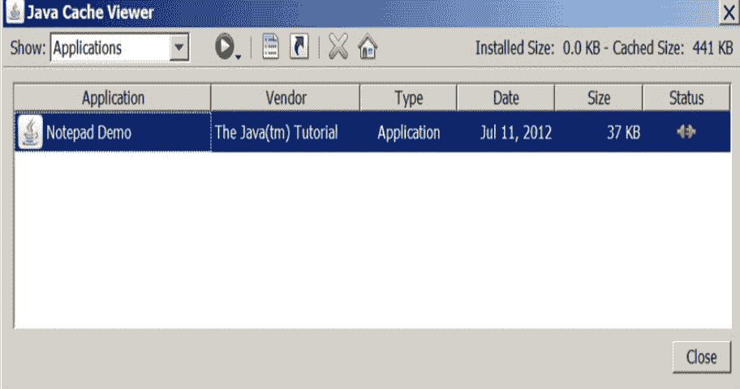

要运行应用程序，选择它并点击 **运行 (Run)** 按钮或双击应用程序。应用程序的启动方式与从网页启动时相同。

## 从桌面运行 Java Web Start 应用程序

你可以为 Java Web Start 应用程序添加桌面快捷方式。在 Java 缓存查看中选择该应用程序。右键并选择 **安装快捷方式 (Install Shortcuts)** 或点击 **安装 (Install)** 按钮。桌面将添加一个快捷方式。你可以像启动任何原生应用程序一样启动 Java Web Start 应用程序。

# JAVA WEB START 与安全

本节介绍了通过 Java Web Start 部署的应用程序的安全基础知识，包括：

使用 Java Web Start 启动的应用程序默认运行在受限环境中，即“沙箱”。在沙箱中，Java Web Start：

- 保护用户免受影响本地文件的恶意代码的影响
- 保护企业免受尝试访问或破坏网络数据的代码的影响

由 Java Web Start 启动的沙箱应用程序仍留在沙箱中，这意味着它们无法访问本地文件或网络。请参阅第 18 章“富互联网应用中的安全”获取信息。

## HTTPS 证书的动态下载

Java Web Start 像浏览器一样动态导入证书。为了做到这一点，Java Web Start 使用 `java.protocol.handler.pkgs` 系统属性设置自己的 https 处理器，以初始化 `SSLSocketFactory` 和 `HostnameVerifier` 的默认值。它通过 `HttpURLConnection.setDefaultSocketFactory` 和 `HttpsURLConnection.setDefaultHostnameVerifier` 方法设置默认值。

如果你的应用程序使用了这些方法，它们将在 Java Web Start 初始化 https 处理器后调用，否则你的自定义处理器会被 Java Web Start 处理器替换。

你可以通过以下任一种确保使用你自定义的 `SSLSocketFactory` 和 `HostnameVerifier`：

- 安装你自己的 https 处理器，以替换 Java Web Start 的 https 处理器。
- 在你的应用程序中，仅在创建第一个 https URL 对象后调用 `HttpsURLConnection.setSSLSocketFactory` 或 `HttpsURLConnection.setDefaultHostnameVerifier`，这会先执行 Java Web 的处理器初始化代码。

# 常见 JAVA WEB START 问题

本节涵盖了在开发和部署 Java Web Start 应用程序时可能遇到的常见问题。每个问题后面列出了可能的原因和解决方案。

**“我的浏览器将应用程序的 Java 网络启动协议 (JNLP) 文件显示为纯文本”**

很可能是，你的 Web 服务器不识别 JNLP 文件的正确 MIME 类型。请参阅“设置 Web 服务器”部分获取更多信息。

此外，如果你正在使用代理服务器，请确保返回文件的更新版本，通过更新 Web 服务器上资源的时间戳，使代理更新其缓存。

**“当我尝试启动我的 JNLP 文件时，获取了以下错误”**

很可能是，你的 Web 服务器不识别 JNLP 文件的正确 MIME 类型。请参阅“设置 Web 服务器”部分获取更多信息。

此外，如果你正在使用代理服务器，请确保返回文件的更新版本，通过更新 Web 服务器上资源的时间戳，使代理更新其缓存。

**“我的浏览器将应用程序的 Java 网络启动协议 (JNLP) 文件显示为纯文本”**

很可能是，你的 Web 服务器不识别 JNLP 文件的正确 MIME 类型。请参阅“设置 Web 服务器”部分获取更多信息。

此外，如果你正在使用代理服务器，请确保返回文件的更新版本，通过更新 Web 服务器上资源的时间戳，使代理更新其缓存。

**“当我尝试启动我的 JNLP 文件时，获取了以下错误”**

很可能是，你的 Web 服务器不识别 JNLP 文件的正确 MIME 类型。请参阅“设置 Web 服务器”部分获取更多信息。

此外，如果你正在使用代理服务器，请确保返回文件的更新版本，通过更新 Web 服务器上资源的时间戳，使代理更新其缓存。

**“我的浏览器将应用程序的 Java 网络启动协议 (JNLP) 文件显示为纯文本”**

很可能是，你的 Web 服务器不识别 JNLP 文件的正确 MIME 类型。请参阅“设置 Web 服务器”部分获取更多信息。

此外，如果你正在使用代理服务器，请确保返回文件的更新版本，通过更新 Web 服务器上资源的时间戳，使代理更新其缓存。

# 第 18 章 Applets（小程序）

本章讨论了 Java applet 的基础知识、如何开发与其环境进行丰富交互的 applet，以及如何部署 applet。

Java applet 是一种特殊的 Java 程序，支持 Java 技术的浏览器可以从互联网上下载并运行它。applet 通常嵌入在网页中，并在浏览器的上下文中运行。applet 必须是 `java.applet.Applet` 类的子类。`Applet` 类提供了 applet 与浏览器之间的标准接口。

Swing 提供了 `Applet` 类的一个特殊子类，即 `javax.swing.JApplet`。对于所有使用 Swing 组件构建图形用户界面（GUI）的 applet，应该使用 `JApplet` 类。

浏览器的 Java 插件软件负责管理 applet 的生命周期。

请使用 Web 服务器测试本章中的示例。不建议使用本地 applet，且当 Java 控制面板中的安全级别设置为“高”（High）或“极高”（Very High）时，本地 applet 会被拦截。

> 注意
>
> Java applet 的某些功能在 OS X 上可能不按照描述的方式工作。这是由于 Java 插件软件与 OS X 上浏览器的交互方式导致的。

## 开始使用 Applets

Hello World applet 是一个显示“Hello World”字符串的类。

以下是 Hello World applet 的源代码：

```java
import javax.swing.JApplet;
import javax.swing.SwingUtilities;
import javax.swing.JLabel;

public class HelloWorld extends JApplet {
    // 当此 applet 加载到浏览器时被调用
    public void init() {
        // 在事件分发线程上执行任务；创建
        try {
            SwingUtilities.invokeAndWait(new Runnable() {
                public void run() {
                    JLabel lbl = new JLabel("Hello World");
                    add(lbl);
                }
            });
        } catch (Exception e) {
            System.err.println("createGUI didn't complete success");
        }
    }
}
```

像这样的 applet 通常由浏览器中的 Java 插件软件管理和运行。

## 定义 Applet 子类

每个 Java applet 必须定义 `Applet` 或 `JApplet` 类的子类。在 Hello World applet 中，该子类被称为 `HelloWorld`。以下是 `HelloWorld` 类的源码。

```java
import javax.swing.JApplet;
import javax.swing.SwingUtilities;
import javax.swing.JLabel;

public class HelloWorld extends JApplet {
    // 当此 applet 加载到浏览器时被调用。
    public void init() {
        // 在事件分发线程上执行任务；创建
        try {
            SwingUtilities.invokeAndWait(new Runnable() {
                public void run() {
                    JLabel lbl = new JLabel("Hello World");
                    add(lbl);
                }
            });
        } catch (Exception e) {
            System.err.println("createGUI didn't complete success");
        }
    }
}
```

Java applet 从 `Applet` 或 `JApplet` 类中继承了大量功能，包括与浏览器通信以及向用户展示图形用户界面（GUI）的能力。将使用 Swing（Java 的 GUI 工具包）中的 GUI 组件的 applet 应该扩展 `javax.swing.JApplet` 基类，该类提供了与 Swing GUI 设施的最佳集成。

`JApplet` 提供了一个根面板（root pane），其顶层组件结构与 `JFrame` 和 `JDialog` 组件相同，而 `Applet` 仅提供一个基础面板。当 applet 不使用 Swing 的 GUI 组件时，它可以扩展 `java.applet.Applet` 类。

## 里程碑方法

`Applet` 类提供了一个 applet 执行的框架，定义了系统在发生里程碑事件时调用的方法。里程碑是 applet 生命周期中的重大事件。大多数 applet 都会重写这些方法的部分或全部，以对里程碑做出适当响应。

### init 方法

`init` 方法用于耗时不较长的一次性初始化。`init` 方法通常包含你通常放在构造函数中的代码。applet 通常没有构造函数的原因是，在 `init` 方法被调用之前，无法保证拥有完整的环境。保持 `init` 方法的短小，以便你的 applet 可以快速加载。

### start 方法

每个在初始化后执行任务（直接响应用户操作除外）的 applet 必须重写 `start` 方法。`start` 方法启动 applet 的执行。从 `start` 方法中快速返回是一个良好的习惯。如果你需要执行计算密集型操作，最好为此目的启动一个新线程。

### stop 方法

许多重写了 `start` 的 applet 也应该重写 `stop` 方法。`stop` 方法应该暂停 applet 的执行，这样当用户不在查看 applet 页面时，它就不会占用系统资源。例如，显示动画的 applet 在用户未查看它时应该停止尝试绘制动画。

### destroy 方法


许多 applet 不需要重写 `destroy` 方法，因为它们的 `stop` 方法（在 `destroy` 之前调用）将执行关闭 applet 执行所需的所有任务。然而，对于需要释放额外资源的 applet，`destroy` 方法是可选的。

> **注意**
>
> 保持 `destroy` 方法的实现尽可能短，因为无法保证它执行完成。Java 虚拟机可能会在 `destroy` 方法之前退出。

# Applet 的生命周期

applet 可以响应以下情况：

- 它初始化自己。
- 它开始运行。
- 它停止运行。
- 它执行最后的清理。

本节介绍了 applet，由于我们没有扩展 `JApplet`。以下是 `Simple` 的源码，它使用了 `StringBuilder`。

```java
import java.applet.Applet;
import java.awt.Graphics;

public class Simple extends Applet {

    StringBuffer buffer;

    public void init() {
        buffer = new StringBuilder();
        addItem("initializing...");
    }

    public void start() {
        addItem("starting...");
    }

    public void stop() {
        addItem("stopping...");
    }

    public void destroy() {
        addItem("preparing for unloading...");
    }

    private void addItem(String newWord) {
        System.out.println(newWord);
        buffer.append(newWord);
        repaint();
    }

    public void paint(Graphics g) {
        // 在 applet 周画一个矩形
        g.drawRect(0, 0, getWidth() - 1, getHeight() - 1);

        // 在矩形内绘制当前字符串
        g.drawString(buffer.toString(), 5, 15);
    }
}
```

> **注意**
>
> 在本示例中扩展了 `Applet` 类，不需要添加 Swing 组件。

# 加载 Applet

由于 applet 加载，你应该看到“initializing... starting...”。当 applet 加载时，发生以下情况：

- 创建 applet 控制类（`Applet` 子类）的实例。
- applet 初始化自己。
- applet 开始运行。

# 离开并返回 applet 页面

当用户离开页面（例如跳转到另一个页面）时，浏览器停止销毁 applet。applet 的状态不会保留。当用户返回页面时，浏览器会初始化 applet 的新实例。

# 重新加载 Applet

当你刷新或重新加载浏览器页面时，当前的 applet 实例会被停止销毁并创建一个实例。

# 退出浏览器

当用户退出浏览器时，applet 有机会停止自身并执行最后的清理。下载 Simple Applet⁶ 示例的源码进行进一步实验。

# Applet 执行环境

applet 在浏览器的上下文中运行。浏览器中的 Java 插件软件控制 Java applet 的启动和执行。浏览器还有一个 JavaScript 解释器，用于运行网页上的 JavaScript 代码。

# Java 插件

Java 插件软件为每个 Java applet 创建工作线程。它在 Java 运行时环境（JRE）实例中启动 applet。通常，所有 applet 运行在同一个 JRE 实例。当 applet 请求在特定版本的 JRE 中执行时，Java 插件软件会启动一个新的 JRE 实例。

当 applet 指定其自身的 JRE 启动参数（例如堆大小）时，如果 applet 的需求是现有 JRE 的子集，它将使用现有的 JRE；否则将启动一个新的 JRE 实例。

如果满足以下条件，applet 将在现有 JRE 中运行：

- applet 需要的 JRE 版本与现有 JRE 匹配。
- JRE 的启动参数满足 applet 的需求。

下图显示了 applet 如何在 JRE 中执行。

## 图 18.1. Java 插件在不同版本的 JRE 上运行 applet 的图示

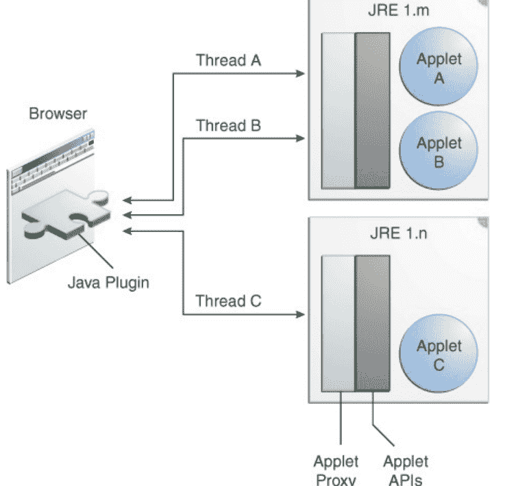

## Java 插件与 JavaScript 解释器的交互

Java applet 可以调用网页中存在的 JavaScript 函数。JavaScript 函数也允许调用同一网页上嵌入的 applet 方法。Java 插件软件和 JavaScript 解释器负责协调 Java 代码到 JavaScript 代码的调用以及 JavaScript 代码到 Java 代码的调用。

Java 插件软件是多线程的，而 JavaScript 解释器在单线程上运行。因此，为了避免线程相关问题（特别是当多个 applet 同时运行时），请保持 Java 代码与 JavaScript 代码之间的调用尽可能短，并避免往返多次。如需更多信息，请参阅本章中的“从 applet 调用 JavaScript 代码”和“从 JavaScript 代码调用 applet 方法”章节。

## 开发 applet

使用基于组件的架构设计的应用程序可以开发为 Java applet。以基于 Swing 的图形用户界面（GUI）的 Java applet 为例。通过基于组件的设计，可以使用较小的构建块或组件构建 GUI。创建 applet GUI 通常使用以下通用步骤：

- 创建一个类 `MyJPanel`，它是 `javax.swing.JPanel` 的子类。在 `MyJPanel` 类的构造函数中布局 applet 的 GUI 组件。
- 创建一个名为 `MyApplet` 的类，它是 `javax.swing.JApplet` 的子类。
- 在 `MyApplet` 的 `init` 方法中实例化 `MyJPanel` 并将其设置为 applet 的内容面板。

接下来的章节将通过使用 Dynamic Tree Demo applet 详细探讨这些步骤。

## 创建顶层 JPanel 类

创建一个 `JPanel` 的子类。此顶层 JPanel 作为你所有其他 UI 组件的容器。在以下示例中，`DynamicTreePanel` 类是最顶层的 JPanel。

`DynamicTreePanel` 构造函数调用其他方法来正确创建并布局 UI 控制器。

```java
public class DynamicTreePanel extends JPanel implements ActionListener {

    private int newNodeSuffix = 1;

    private static String ADD_COMMAND = "add";

    private static String REMOVE_COMMAND = "remove";

    private static String CLEAR_COMMAND = "clear";

    private DynamicTree treePanel;

    public DynamicTreePanel() {
        super(new BorderLayout());
        // 创建组件。
        treePanel = new DynamicTree();
        populateTree(treePanel);

        JButton addButton = new JButton("Add");
        addButton.setActionCommand(ADD_COMMAND);
        addButton.addActionListener(this);
        JButton removeButton = new JButton("Remove");
    }
}
```

```java
// ...

JButton clearButton = new JButton("Clear");

// ...

// 布局所有内容。
treePanel.setPreferredSize(
    new Dimension(300, 150));
add(treePanel, BorderLayout.CENTER);

JPanel panel = new JPanel(new GridLayout(0,3));

panel.add(addButton);
panel.add(removeButton);
panel.add(clearButton);
add(panel, BorderLayout.SOUTH);

}
// ...
}
```

## 创建 applet

对于具有基于 Swing 的 GUI 的 Java applet，创建一个不是 `javax.swing.JApplet` 子类的类。一个不包含基于 Swing 的 GUI 的 applet 可以扩展 `java.applet.Applet` 类。

重写 applet 的 `init` 方法以实例化你的顶层 JPanel 并创建 applet 的 GUI。`DynamicTreeApplet` 类的 `init` 方法在 AWT 事件分发线程中调用 `createGUI` 方法。

```java
package appletComponentArch;
import javax.swing.JApplet;
import javax.swing.SwingUtilities;
public class DynamicTreeApplet extends Applet {
    // 当此 applet 加载到浏览器时调用。
    public void init() {
        // 在事件分发线程上执行任务；创建
        try {
            SwingUtilities.invokeAndWait(new Runnable() {
                public void run() {
                    createGUI();
                }
            });
        } catch (Exception e) {
            System.err.println("createGUI didn't complete successfully");
        }
    }

    private void createGUI() {
        // 创建并设置内容面板。
        DynamicTreePanel newContentPane = new DynamicTreePanel();
        newContentPane.setOpaque(true);
        setContentPane(newContentPane);
    }
}
```

## 将核心功能与最终部署机制分离的优势

创建 applet 的另一种方法是仅移除抽象层（分离的 JPanel）并并在 applet 自身的 `init` 方法中布局所有控件。创建 applet 的缺点是维护和测试变得更加困难。通过将 UI 逻辑与应用程序逻辑分离，你可以使代码更加模块化。

在 Dynamic Tree Demo 示例中，核心功能位于 `DynamicTreePanel` 类中。因此，为了保持可移植性并开放部署选项，请遵循所述的基于组件的设计。

## 部署 applet

要部署 applet，首先要编译代码，将其封装为 JAR 文件，并对 JAR 文件进行签名。Java applet 可以通过两种方式启动：

- 你可以使用 Java 网络启动（JNLP）启动 applet。通过 JNLP 启动的 applet 可以访问强大的 API 和扩展。
- 或者，你可以通过直接指定 applet 标签启动 applet。但这种部署方式会对 applet 实施安全限制。

部署工具包含用于部署 applet 的有用函数。如果你不这些部署技术，请在此之前回顾第 20 章。

以下是部署 applet 的步骤说明。使用 Dynamic Tree Demo applet 进行演示。

1. 编译你的 applet 代码，并确保所有类文件和资源都在独立的目录中。对于 Dynamic Tree applet，编译后的类放置在 `build/classes/appletArch` 目录。

2. 创建一个包含 applet 需要的 JAR 文件清单属性的文件。对于 Dynamic Tree applet，在 `build/classes` 目录下创建一个名为 `manifest.txt` 的文件，并添加 `Permissions`、`Codebase` 和 `Application-Name` 属性。

```
Permissions: sandbox
Codebase: myserver.com
Application-Name: Dynamic Tree
```

其他清单属性可限制 applet 仅使用信任代码，并为需要从特权 Java 代码和沙箱 Java 代码调用的 applet 提供安全性。请参见第 16 章“使用清单属性增强安全性”以了解更多可用清单属性。

3. 创建包含你的 applet 类文件和资源的 JAR 文件。在上一步中创建的 `manifest.txt` 文件中包含清单属性。例如，以下命令创建一个包含 `build/classes/appletArch` 目录下的类文件和 `build/classes` 目录下的清单文件的 JAR 文件。

```
% cd build/classes
% jar cvfm DynamicTreeDemo.jar mymanifest.txt appletComponent
```

参见第 16 章了解更多关于创建和使用 JAR 知识。

4. 对你的 applet JAR 文件签名并对签名进行时间戳处理。使用受信任证书机构颁发的有效的、当前的代码签名证书为你的用户提供保证，确保它运行该 applet 是安全的。更多信息请参见第 16 章“签名 JAR 文件”。如果你想出于安全考虑使用经过签名的 JNLP 文件，请按照下一步描述创建 JNLP 文件，并在签名 JAR 文件之前将其包含在 JAR 文件中。信息请参阅《Java RIA 开发与部署指南》中的“签名的 JNLP 文件8”。

5. 创建一个 JNLP 文件来描述如何启动你的 applet。以下是用于启动 Dynamic Tree Demo applet 的 JNLP 文件。`dynamictree_ap-applet.jnlp` 的源码如下：

```xml
<?xml version="1.0" encoding="UTF-8"?>
<jnlp spec="1.0+" codebase="" href="">
<information>
  <title>Dynamic Tree Demo</title>
  <vendor>Dynamic Team</vendor>
</information>
<resources>
  <!-- Application Resources -- -->
  <j2se version="1.7" href="http://java.sun.com/products/autodl/j2se" />
  <jar href="DynamicTreeDemo.jar" main="true" />
</resources>
<applet-desc>
  name="Dynamic Tree Demo Applet"
  main-class="components.DynamicTreeApplet"
  width="300"
  height="300"
</applet-desc>
<update check="background"/>
</jnlp>
```

注意，JNLP 文件中不存在请求额外权限的 security 元素，因此 applet 仅在安全沙箱中运行。请参见第 20 章“JNLP 文件结构”，该章节描述了 JNLP 文件的语法和选项。

6. 创建显示 applet 的 HTML 页面。调用 Deployment Toolkit（部署工具包）函数来部署 applet。在示例中，Dynamic Tree Demo applet 部署在 `AppletPage.html` 中。

```html
<body>
  <!-- ... -->
  <script src="https://www.java.com/js/deployJava.js"></script>
  <script>
    var attributes = {
      code:'components.DynamicTreeApplet', width:300,
      height:300};
    var parameters = {jnlp_href:'dynamictree_applet.jnlp'};
    deployJava.runApplet(attributes, parameters, '1.7');
  </script>
  <!-- ... -->
</body>
```

7. 将 applet 的 JAR 文件、JNLP 文件和 HTML 页面放置在相应的文件夹中。对于此示例，将 `DynamicTreeDemo.jar`、`dynamictree_applet.jnlp` 和 `AppletPage.html` 放置在本地机器或 Web 服务器的同一目录下。优先使用 Web 服务器。若要从本地机器运行，必须将你的应用程序添加到异常站点列表，该列表通过 Java 控制面板的“安全”选项卡进行管理。

8. 在浏览器中打开 applet 的 HTML 页面以查看 applet。在提示时同意运行 applet。检查 Java 控制台日志以获取错误和调试信息。

# 使用 `<applet>` 标签部署


如果你不确定终端用户的浏览器是否启用了 JavaScript 解释器，你可以通过手动编写 `<applet>` HTML 标签来部署 Java applet，而不是使用 Deployment Toolkit 函数。根据你需要支持的浏览器，你可能需要使用 `<object>` 或 `<embed>` HTML 标签来部署 Java applet。请检查 W3C HTML 规范⁹ 获取有关这些标签使用的详细信息。

你可以使用 Java 网络启动协议 (JNLP) 启动 applet，或直接在 `<applet>` 标签中指定启动属性。

# 准备部署

按照“部署 applet”部分描述的步骤编译你的源码、创建并签名 JAR 文件，并在必要时创建 JNLP 文件。部署的整体步骤仍然适用，但你包含 applet 的 HTML 页面内容会发生变化。

# 手动编写 `<applet>` 标签并使用 JNLP 启动

`AppletPageWithAppletTag.html` 使用手动编写的 `<applet>` 标签部署 Dynamic Tree Demo applet（这意味着 applet 不是使用自动生成所需 HTML 的 Deployment Toolkit 部署的）。applet 仍使用 JNLP 启动。JNLP 文件在 `jnlp_href` 属性中指定。

```html
<applet code='appletComponentArch.DynamicTreeApplet'
      jnlp_href='dynamictree_applet.jnlp'
      width=300
      height=300 />
```

# 手动编写 `<applet>` 标签，不使用 JNLP 启动

使用 JNLP 是部署 applet 的选择方式；然而，你也可以在没有 JNLP 文件的情况下部署 applet。`AppletPage_WithAppletTagNoJNLP.html` 按照下面的代码片段部署动态 Tree Demo applet。

```html
<applet code='appletComponentArch.DynamicTreeApplet'
archive='DynamicTreeDemo.jar'
width=300
height=300><param name="permissions" value="sandbox" /></applet>
```

其中

- `code` 是 applet 类的名称。
- `archive` 是包含 applet 及其源码的 jar 文件名。
- `width` 是 applet 的宽度。
- `height` 是 applet 的高度。
- `permissions` 表示 applet 是否在沙箱中运行。

# 深入使用 applet 功能

Java applet 让你能够利用 applet 与浏览器之间的关系。API 由 `javax.swing.JApplet` 类和 `java.applet.Applet` 接口提供。applet 的执行使其能够与环境交互以产生丰富的用户体验。applet 的高级功能将在后续主题中探讨。请参见第 19 章。

# 查找和加载数据

每当 Java applet 需要从相对 URL（即未完整指定文件的 URL）加载数据时，applet 通常使用 code base 或 document base 来形成完整 URL。

由 `JApplet.getCodeBase()` 返回的 code base 指定了加载 applet 类的目录。对于本地部署的 applet，`getCodeBase()` 返回 `null`。

由 `JApplet.getDocumentBase()` 返回的 document base 指定包含 applet 的 HTML 页面的目录。对于本地部署的 applet，`getDocumentBase()` 返回 `null`。

除非 `<applet>` 标签指定了 code base，否则 code base 和 document base 指向同一服务器上的同一目录。applet 可能需要的或依赖的备份的数据通常相对于 code base 指定。applet 通常通过参数指定的数据通常相对于 document base 指定。

> **注意**
>
> 出于安全考虑，浏览器限制不受信任的 applet 可以读取的 URL。例如，大多数浏览器不允许不受信任的 applet 使用 `..` 访问 code base 或 document base 之上的目录。此外，由于不受信任的 applet 无法读取其源主机以外的文件，如果文档和不受信任的 applet 位于不同的服务器，则 document base 通常没有用处。

`JApplet` 类定义了方便的图像加载和声音加载方法，允许你相对于基础 URL 指定图像和声音。例如，假设 applet 按照下图所示的目录结构之一设置。

# 图 18.2 带有包语句和不带包语句的代码目录结构

## Applet 代码中无包语句

```text
package com.myco.myproject

img/787afe3ca2e4d558594c5409be77ff73_1165_0.png
```

为了创建一个使用 `imgDir` 下 `a.gif` 图像文件的 `Image` 对象，applet 可以使用以下代码：

```java
Image image = getImage(getCodeBase(), "imgDir/a.gif");
```

# 定义和使用 applet 参数

参数对于 Java applet 就像命令行参数对于应用程序。它们允许你自定义 applet 的操作。通过定义参数，你可以增加 applet 的灵活性，使其在无需重新编码和重新编译的情况下工作于多种情况。

# 指定 applet 的输入参数

你可以在 applet 的 Java 网络启动协议（JNLP）文件或 `<applet>` 标签的 `<parameter>` 元素中指定 applet 的输入参数。通常最好在 applet 的 JNLP 文件中指定参数，这样即使 applet 部署在多个网页上，参数也能保持一致。如果 applet 的参数随网页而变化，则你应该在 `<applet>` 标签的 `<parameter>` 元素中指定参数。

如果你不熟悉 JNLP，请参阅第 20 节“Java 网络启动协议”获取更多信息。

考虑一个接受三个参数的 applet。`paramStr` 和 `paramInt` 参数在 applet 的 JNLP 文件 `appletsparparams.jnlp` 中指定。

```xml
<?xml version="1.0" encoding="UTF-8"?>
<jnlp spec="1.0+" codebase="" href="">
<!-- ... -->
  <applet-desc
    name="Applet Takes Params"
    main-class="AppletTakesParams"
    width="800"
    height="50">
    <param name="paramStr"
      value="someString"/>
    <param name="paramInt" value="22"/>
  </applet-desc>
<!-- ... -->
</jnlp>
```

`paramOutsideJNLPFile` 参数是在 `AppletPage.html` 中传递给 Deployment Toolkit 的 `runApplet` 函数的 `parameters` 变量中指定的。

```html
<html>
<head>
  <title>Applet Takes Params</title>
  <meta http-equiv="Content-Type" content="text/html;charset=windows-1252">
</head>
<body>
  <h1>Applet Takes Params</h1>
  <script src="https://www.java.com/js/deployJava.js"></script>
  <script>
    var attributes = { code:'AppletTakesParams.class', archive:'applet_AppletWithParameters.jar', width:800, height:50 };
    var parameters = {jnlp_href: 'appletsparams.jnlp', paramOutsideJNLPFile: 'fooOutsideJNLP' };

    deployJava.runApplet(attributes, parameters, '1.7');
  </script>
</body>
</html>
```

请参阅第 20 节“部署 applet”获取有关 `runApplet` 函数的更多信息。

# 获取 applet 的输入参数

你可以通过使用 `Applet` 类的 `getParameter` 方法获取 applet 的输入参数。`AppletTakesParams.java` applet 获取并显示了所有的输入参数（`paramStr`、`paramInt` 和 `paramOutsideJNLPFile`）。

```java
import javax.swing.JApplet;
import javax.swing.SwingUtilities;
import javax.swing.JLabel;

public class AppletTakesParams extends JApplet {

    public void init() {
        final String inputStr = getParameter("paramStr");
        final int inputInt = Integer.parseInt(getParameter("paramInt"));
        final String inputOutsideJNLFile = getParameter("paramOutsideJNLPFile");

        try {
            SwingUtilities.invokeAndWait(new Runnable() {
                public void run() {
                    createGUI(inputStr, inputInt, inputOutsideJNLFile);
                }
            });
        } catch (Exception e) {
            System.err.println("createGUI didn't successfully complete");
        }
    }

    private void createGUI(String inputStr, int inputInt, String inputOutsideJNLFile) {
        String text = "Applet's parameters are - inputStr: " + inputStr +
            " inputInt: " + inputInt +
            " paramOutsideJNLFile: " + inputOutsideJNLFile;

        JLabel lbl1 = new JLabel(text);
        add(lbl1);
    }
}
```

# 显示短状态字符串

所有浏览器都允许 Java applet 显示短状态字符串。页面上所有的 Java applet 以及浏览器本身共享同一个状态栏。

永远不要在状态栏中放置关键信息。如果许多用户可能需要该信息，请在 applet 区域内显示该信息。如果只有少数高级用户可能需要该信息，请考虑将信息发送到标准输出（参见“向标准输出和错误流写入诊断信息”节）。

状态栏通常并不显眼，可能会被其他 applet 或浏览器覆盖。由于这些原因，它最好用于偶然的、瞬时的信息。例如，加载几个图像文件的 applet 可以显示它当前正在加载的图像文件名。

Applet 通过 `showStatus` 方法显示状态栏，该方法从 `Applet` 类继承自 `JApplet` 类中。

以下是此用法的一个示例：

```java
showStatus("MyApplet: Loading image file " + file);
```

> **注意**：不要在状态栏中放置滚动文本。浏览器用户会觉得这种行为很烦。

# 在浏览器中显示文档

Java applet 可以使用 `java.applet.AppletContext` 类中的 `showDocument` 方法在浏览器窗口中加载网页。

以下是 `showDocument` 的两种形式：

```java
public void showDocument(java.net.URL url)
public void showDocument(java.net.URL url, String targetWindow)
```

# 从 applet 调用 JavaScript 代码

Java applet 可以调用与 applet 位于同一网页上的 JavaScript 函数。LiveConnect 规范描述了 JavaScript 如何与 Java 通信的细节。

```html
</script>

<!-- ... -->

<p id="summary"/> // 此 HTML 元素包含 summary

<!-- ... -->

</body>
```

接下来，考虑一个名为 `DataSummaryApplet` 的 applet 类。`DataSummaryApplet` 类执行以下操作：

- 调用 `JObject` 的 `setMember` 方法将 `userName` 变量设置为 "John Doe"。
- 获取年龄、地址和电话号码，并构建一个包含这些数据摘要的字符串。
- 调用 `writeSummary` JavaScript 函数将摘要写回网页。

此 applet 首先需要按照如下方式获取 `JObject` 的引用：

```java
...
JObject window = JObject.getWindow(this);
...
```

将上述语句放在 `try ...catch..` 块中，以处理 `netscape.javascript.JSException`。

现在 applet 已经有了 `JObject` 的引用，它就可以使用 `JSOObject` 的 `eval` 和 `call` 方法调用相关的 JavaScript 函数。

```java
package javatojs;

import java.applet.Applet;
import netscape.javascript.*; // 将 plugin.jar 添加到类路径

public class DataSummaryApplet extends Applet {
    public void start() {
        try {
            JSObject window = JSObject.getWindow(this);

            String userName = "John Doe";

            // 设置 JavaScript 变量
            window.setMember("userName", userName);

            String addressStr = (String) address.getMember("street") + ", " + (String) address.getMember("city") + ", " +
            (String) address.getMember("state");

            // 从 JavaScript 获取数组并检索其内容
            JSObject phoneNums = (JSObject) window.eval("getPhoneNumbers()");

            String phoneNumStr = (String) phoneNums.getSlot(0) +
            (String) phoneNums.getSlot(1);

            // 动态更改页面中的 HTML；写入数据摘要
            String summary = userName + " : " + age + " : " +
            addressStr + " : " + phoneNumStr;

            window.call("writeSummary", new Object[] {summary});
        } catch (JSException e) {
            e.printStackTrace();
        }
    }
}
```

编译引用了 `netscape.javascript` 包中类的 Java 代码时，请在类路径中包含 `<your JDK path>/jre/lib/plugin.jar`。在运行时，Java Plug-in 软件会自动为 applet 提供这些类。

Data Summary applet 在网页上显示如下结果：

```
此页面上 applet 对 JavaScript 进行 Java 用的结果

John Doe : 25 : 1 Example Lane, Santa Clara, CA : 408-555-0100
```

# 从 JavaScript 调用 Applet 方法

网页上的 JavaScript 代码可以与嵌入在页面上的 Java applet 交互。JavaScript 代码可以执行以下操作：

- 调用 Java 对象上的方法
- 获取和设置 Java 对象中的字段
- 获取和设置 Java 数组元素

LiveConnect 规范¹⁷ 描述了 JavaScript 代码如何与 Java 代码通信的细节。


当 JavaScript 代码调用 Java applet 时，会显示安全警告。要消除这些警告，请在 JAR 清单文件中添加 `Caller-Allowable-Codebase` 属性。指定允许调用 applet 的 JavaScript 代码的位置。有关 `Caller-Allowable-Codebase` 属性的信息，请参阅 JAR File Manifest Attributes for Security¹⁸。

本主题通过 Math applet 示例（在从 Applet 调用 JavaScript 代码示例¹⁹ 中）探索 JavaScript 代码到 Java applet 的通信。`MathApplet` 类和辅助 `Calculator` 类提供了一系列公共方法和变量。

网页上的 JavaScript 代码调用并评估这些公共成员，以传递数据并检索计算结果。

# Math Applet 及相关类

以下是 `MathApplet` 类的源代码。`getCalculator` 方法返回 `Calculator` 辅助类的引用。

```java
package jjstava;

import java.applet.Applet;

public class MathApplet extends Applet {

    public String userName = null;

    public String getGreeting() {
        return "Hello " + userName;
    }

    public Calculator getCalculator() {
        return new Calculator();
    }

    public DateHelper getDateHelper() {
        return new DateHelper();
    }

    public void printOut(String text) {
        System.out.println(text);
    }
}
```

`Calculator` 类中的方法允许用户设置两个值、相加数字并获取范围内的数字。

```java
package jstojava;

public class Calculator {
    private int a = 0;
    private int b = 0; //  b > a

    public void setNums(int numA, int numB) {
        a = numA;
        b = numB;
    }

    public int add() {
        return a + b;
    }

    public int[] getNumInRange() {
        int x = a;
        int len = (b - a) + 1;
        int[] range = new int[len];
        for (int i = 0; i < len; i++) {
            range[i] = x++;
            System.out.println(": " + i + ": " + range[i]);
        }
        return range;
    }
}
```

`DateHelper` 的 `getDate` 方法返回当前日期。

```java
package jstojava;

import java.util.Date;
import java.text.SimpleDateFormat;

public class DateHelper {
    public static String label = null;

    public String getDate() {
        SimpleDateFormat sdf = new SimpleDateFormat("MM/dd/yy hh:mm a");
        return label + sdf.format(new Date());
    }
}
```

# 部署 Applet

接下来，在 `AppletPage.html` 中添加 JavaScript 代码。JavaScript 代码能够处理基本类型、数组和对象类型。

```javascript
<script language="javascript">
    function enterNums() {
        var numA = prompt('输入 a?', '0');
        var numB = prompt('输入 b (应该大于 a)');

        // 设置 applet 的公共变量
        mathApplet.userName = "John Doe";

        // 调用 applet 方法
        var greeting = mathApplet.getGreeting();

        // 获取 applet 引用的另一个类
        // 调用它的方法
        var calculator = mathApplet.getCalculator();

        calculator.setNums(numA, numB);

        // applet 返回的基本类型
        var sum = calculator.add();

        // applet 返回的数组
        var numRange = calculator.getNumInRange();

        // 在 Java 控制台查看此消息
        mathApplet.printOut("Testing printing to System.out");

        // 获取另一个类，设置静态字段并调用它的方法
        var dateHelper = mathApplet.getDateHelper();
        dateHelper.label = "Today's date: ";
        var dateStr = dateHelper.getDate();

        <!-- ... -->
    }
</script>
```

当数字 a = 0 且 b = 5 时，Math applet 在网页上显示如下结果：

```
a = 0 ; b = 5
```

和：5

今天的日期是： 5/28/13 4:12 PM //显示当前日期

在浏览器中打开 `AppletPage.html` 以查看 Math applet。

> 注意
>
> 如果你没有看到 applet 正在运行，你可能需要在浏览器中启用 JavaScript 解释器，以便 Deployment Toolkit 脚本正常运行。

# 使用事件处理程序处理初始化状态

在 applet 初始化之前，它无法处理来自网页中 JavaScript 代码的请求。JavaScript 代码调用 applet 方法或访问 applet 变量的操作将被阻塞，直到 applet 的 `init()` 方法完成或 applet 首次调用其部署所在网页中的 JavaScript 代码。

在许多浏览器中，JavaScript 的实现是单线程的，在 applet 启动期间网页可能会出现冻结。

你可以在 applet 加载时检查其状态变量，以确定 applet 是否准备好处理来自 JavaScript 代码的请求。你还可以注册事件处理程序，这些程序会在 applet 的各个阶段自动被调用。要利用此功能，部署 applet 时应将 `java_status_events` 参数设置为 "true"。

在 Status and Event Handler 示例 2 中，JavaScript 代码向 applet 注册了一个 `onload` 处理程序。当 applet 初始化完成后，Java 插件软件会自动调用 `onload` 处理程序。该处理程序会调用 applet 的其他方法在网页上绘制图表。`Drawing` 类的 `init` 方法睡眠两秒以模拟较长的 applet 初始化时间。

以下步骤描述了如何注册事件处理程序并检查 applet 的状态。请参考 Applet Status and Event Handlers21 获取 applet 状态值以及可以注册事件处理程序的 applet 事件的完整列表。

1. 创建一个 JavaScript 函数来注册事件处理程序。以下代码段显示了 `registerAppletStateHandler` 函数，如果 applet 尚未加载，则会注册一个 `onload` 事件处理程序。

```javascript
<script>
<!-- ... -->
var READY = 2;
function registerAppletStateHandler() {
    // 如果 applet 尚未
    // 加载则注册 onload 处理程序
    if (drawApp.status < READY) {
        drawApp.onload = onLoadHandler;
    } else if (drawApp.status >= READY) {
```

```javascript
// applet 已经加载或
// 发生了错误
document.getElementById("mydiv").innerHTML =
// Applet 事件处理程序未注册，因为
// applet 状态为：" + drawApp.status;
}

function onLoad() {
    // 就绪状态的事件处理器
document.getElementById("mydiv").innerHTML =
    "Applet has loaded";
    draw();
}
<!-- ... -->
</script>
```

2. 在 `body` 标签的 `onload` 方法中调用之前创建的 `registerAppletStateHandler` 函数。这确保在注册 applet 事件处理程序之前，applet 的 HTML 标签已经在网页的文档对象模型 (DOM) 树中创建。

```html
<body onload="registerAppletStateHandler()">
```

3. 部署 applet 并将 `java_status_parameter` 设置为 "true"。

```html
<script src="https://www.java.com/js/deployJava.js"></script>
<script>
    // 将 java_status_events 参数设置为 true
    var attributes = { id:drawApplet,
    code:'DrawingApplet.class',
    archive:'appletStatusAndCallback.jar',
    width:600, height:400};
    var parameters = {java_status_events: 'true', permissions:'sandbox' };
    deployJava.runApplet(attributes, parameters, '1.7');
</script>
```

### Applet 网页的 DOM

每个网页由一系列嵌套对象组成。这些对象构成了文档对象模型 (DOM)。Java applet 可以使用 Common DOM API² 遍历并修改其父网页的对象。

考虑一个 Java applet 示例，它会转储其父网页的内容（参见 DOM Dump 示例²³）。

为了遍历和操作 DOM 树，你必须首先获取网页的 `Document` 对象的引用。你可以通过 `com.sun.java.browser.plugin2.DOM` 类中的 `getDocument` 方法来实现。以下代码段在 `DOMDump` applet 的 `start` 方法中获取了 `Document` 对象的引用。请参阅代码中的内联注释。

```java
public void start() {

try {
    // 使用反射获取 document
    Class c = Class.forName("com.sun.java.browser.plugin2.DOM");

    Method m = c.getMethod("getDocument",
    new Class[] { { java.applet.Applet.class });

    // 将返回的对象强制转换为 HTMLDocument；
    // 然后遍历或修改 DOM
    HTMLDocument doc = (HTMLDocument) m.invoke(null,
    new Object[] { { this } });
```

```java
HTMLBodyElement body = (HTMLBodyElement) doc.getBody();

dump(body, INDENT);

} catch (Exception e) {

    System.out.println("New Java Plug-In not available");

    // 在这种情况下，你可以退回到旧的
    // 引导机制，该机制可用于
    // com.sun.java.browser.plugin.dom 包
}
```

现在你已经有了 `Document` 对象的引用，可以使用 Common DOM API 遍历并修改 DOM 树。Dump applet 会遍历 DOM 树并将其内容写入 Java 控制台日志中。

```java
private void dump(Node root, String prefix) {

    if (root instanceof Element) {
        System.out.println(prefix + ((Element) root).getTagName() + " / " + root.getClass().getName());
    } else if (root instanceof CharacterData) {
        String data =
```

```java
((CharacterData) root).getData().trim();

        if (!data.equals("")) {
            System.out.println(prefix + "CharacterData: " + data);

        } else {
            System.out.println(prefix + root.getClass().getName());
        }

        NamedNodeMap attrs = root.getAttributes();

        if (attrs != null) {
            int len = attrs.getLength();
            for (int i = 0; i < len; i++) {
                Node attr = attrs.item(i);
                System.out.print(prefix + "attribute " + i + ": ");
                if (attr instanceof Attr) {
                    System.out.print(" = " + ((Attr) attr).getValue());
                }
            }
        }
```

```java
    System.out.println();

    if (root.hasChildNodes()) {
        NodeList children = root.getChildNodes();
        if (children != null) {
            int len = children.getLength();
            for (int i = 0; i < len; i++) {
                dump(children.item(i), prefix + INDENT);
            }
        }
    }
}
```

### 显示自定义加载进度条

Java applet 可以显示一种自定义加载进度条，显示下载进度以及 applet 数据。

考虑 Weather applet 和 `CustomProgress` 类（参见 Applet with Customized Indicator 示例²⁴），以了解如何为 Java applet 实现自定义进度条。为了演示下载，此 applet 的 JAR 文件已解压，`customprogress.jnlp` 指定了额外的资源。

#### 开发自定义加载指示

要为你的 applet 开发自定义进度条，请创建一个实现 `DownloadListener`² 的类。

进度指示器的构造函数将取决于要显示的 UI 以及类所需的功能。应遵循以下指南：

- 若要在独立窗口显示加载进度条，请创建一个无任何参数的构造函数。

- 若要在 applet 构造中显示加载进度条，请创建一个接收 `Object` 参数的构造函数。该 `Object` 参数可以强制转换为 `java.awt.Container`⁶ 类实例。

- 如果进度指示器需要访问 applet 的参数，请创建两个构造函数：

    - 创建之前类似的接收 `Object` 参数的构造函数。


- 创建接收两个 `Object` 类型参数的构造函数。第一个参数可以强制转换为 `java.awt.Container` 类实例，第二个参数可以强制转换为 `java.applet.AppletStub` 类实例。

Java 插件软件根据客户端机器 JRE 软件的能力调用相应的构造函数。

```java
import javax.jnlp.DownloadServiceListener;
```

```java
import java.awt.Container;
import java.applet.AppletStub;
import netscape.javascript.*;

// ...

public class CustomProgress implements DownloadListener {
    Container surfaceContainer = null;
    AppletStub appletStub = null;
    JProgressBar progressBar = null;
    JLabel statusLabel = null;
    boolean uiCreated = false;

    public CustomProgress(Object surface) {
        init(surface, null);
    }

    public CustomProgress(Object surface, Object stub) {
        init(surface, stub);
    }
}
```

```java
public void init(Object surface, Object stub) {
    try {
        surfaceContainer = (Container) surface;
        appletStub = (AppletStub) stub;
    } catch (ClassCastException cce) {
        // ...
    }
}
// ...
```

下面的代码段显示了如何为加载进度指示器构建 UI。使用 `java.applet.AppletStub` 类的实例来获取 applet 的参数。调用 `JSObject.getWindow(null)` 方法获取 applet 父 Web 页面的引用，并在该页面上执行 JavaScript 代码。

```java
private void create() {
    JPanel top = createComponents();
    if (surfaceContainer != null) {
        // 在给定的 Container 中布局加载进度 UI
    }
    surfaceContainer.add(top, BorderLayout.NORTH);
    surfaceContainer.invalidate();
    surfaceContainer.validate();
}

private JPanel createComponents() {
    JPanel top = new JPanel();
    // ...

    // 使用 AppletStub 类的实例获取 applet 参数，
    // applet 的 JNLP 文件中指定的 "tagLine" 参数
    String tagLine = "";
    if (appletStub != null) {
        tagLine = appletStub.getParameter("tagLine");
    }

    String lblText = "<html><font color=red size=+2>JDK Documentation</font><br>" +
            tagLine + " <br/><</html>>";

    JLabel lbl1 = new JLabel(lblText);
    top.add(lbl1, BorderLayout.NORTH);

    // 使用 JSObject.getWindow(null) 方法检索
    // Web 页面的引用并进行 JavaScript
    // 调用。如果网页中的 displayLogo 变量
    // 被设为 "true"，则显示 Duke 徽标
    String displayLogo = "false";

    JSObject window = JSObject.getWindow(null);
    if (window != null) {
        displayLogo = (String) window.getMember("displayLogo");
    }

    if (displayLogo.equals("true")) {
        JLabel lbl = new JLabel();
        ImageIcon logo = createImageIcon("images/DukeWave.gif");
        lbl.setIcon(logo);
        top.add(lbl, BorderLayout.EAST);
    }

    statusLabel = new JLabel(
            "html<font color=green size=-2>" +
            "Loading applet...</font></html>");

    top.add(statusLabel, BorderLayout.CENTER);

    // 进度条显示进度
    progressBar = new JProgressBar(0, 100);
    progressBar.setValue(0);
    progressBar.setStringPainted(true);
    top.add(progressBar, BorderLayout.SOUTH);

    return top;
}
```

根据 `overallPercent` 参数在以下方法中创建并更新进度指示器。Java 插件软件定期调用这些方法，以通信 applet 下载的进度。当资源下载和验证完成 100% 时，Java 插件软件将始终发送一条消息。

```java
public void progress(URL url, String version,
        long readSoFar, long total,
        int overallPercent) {
    // 检查下载进度并更新显示
    updateProgressUI(overallPercent);
}

public void upgradingArchive(java.net.URL url,
        java.lang.String version,
        int patchPercent,
        int overallPercent) {
    updateProgressUI(overallPercent);
}

public void validating(java.net.URL url,
        java.lang.String version,
        long entry,
        long total,
        int overallPercent) {
    updateProgressUI(overallPercent);
}

private void updateProgressUI(int overallPercent) {
    if (!uiCreated && overallPercent > 0
            && overallPercent < 100) {
        // 只有当还有更多工作需要完成时，
        // 创建自定义进度指示器的 UI，
        // 意味着 overallPercent > 0 且
        // < 100，这防止了 RIA
        // 从缓存中加载时的闪烁
        create();
        uiCreated = true;
    }
    if (uiCreated) {
        progressBar.setValue(overallPercent);
    }
}
```

编译加载进度指示器类，并构建一个包含显示加载进度指示器所需所有资源的 JAR 文件。在你的 `classpath` 中包含以下 JAR 文件以启用编译：

- `<your JRE directory>/lib/javaws.jar`
- `<your JRE directory>/lib/plugin.jar` —— 此 JAR 文件仅当你的加载进度指示器类使用 `JSObject.getWindow` 方法在 applet 父页面中调用 JavaScript 代码时需要。

加载进度指示器类现在已准备就绪。下一步是将此加载进度指示器 JAR 文件指定为 applet 的加载进度指示器。

# 为 Applet 指定加载进度指示器

要为 applet 指定自定义的加载进度指示器，请在 applet 的 JNLP 文件包含以下信息：

- 带有 `download="progress"` 属性的 jar 标签
- 带有加载进度类完全限定名的 `progress-class` 属性

来自 `customprogress_applet.jnlp` 的代码段显示了 `download="progress"` 和 `progress-class` 属性的使用。

```xml
<jnlp spec="1.0+">
    <resources>
        <jar href="applet/dist/AppletWithProgress.jar" download="true" />
        <jar href="applet/dist/CustomIndicator.jar" download="progress" />
    </resources>
    <applet-desc
        name="customprogress_applet"
        main-class="customprogressideemo.WeatherApplet"
        progress-class="customindicator.CustomIndicator"
        width="600" height="200">
        <param name="tagLine" value="Information straight from the mouth!" />
    </applet-desc>
</jnlp>
```

在网页中部署进度指示器。在浏览器中打开 `AppletPage.html` 以查看进度指示器。

# 与 Applet 集成进度指示器

你还可以将进度指示器集成到 applet 中。在浏览器中打开 `AppletPage.html` 以查看集成进度指示器。查看 `IntegratedProgress` 类（在“集成进度”示例中）获取更多信息。

参见第 19 章“自定义加载体验”，获取更多关于 RIA 的信息。

# 向标准输出和错误流写入诊断

Applet 可以向标准输出和错误流写入诊断。在调试 applet 时，向标准输出写入诊断是非常有用的工具。

下面的代码段向标准输出写入消息。检查 Java 控制台以查看写入标准输出的消息。要将消息存储在文件中，请在控制面板中启用日志。消息将写入到用户的家目录（例如，在 Windows 上，可能是 `C:\Documents and Settings\someuser\Application Data\Sun\Java\Deployment\log`）。

> **注意**
>
> 在发布 applet 之前，确保禁用所有调试输出。

# 开发可拖拽 Applet

通过指定参数，applet 可以被拖出浏览器并动态转换为 Java 应用程序。applet 可以通过按下 Alt 键和鼠标左键进行拖拽。拖拽操作开始时，applet 从其父容器（Applet 或 JApplet）中移除并放入一个新的顶层窗口（Frame 或 JFrame）。拖拽的 applet 旁边会显示一个小的浮动关闭按钮。点击浮动关闭按钮，applet 将返回浏览器。以后可以拖拽的 applet 称为可拖拽 applet。

你可以通过以下方式自定义可拖拽 applet 的行为：

- 更改将 applet 拖出浏览器的按键和鼠标按钮序列。
- 添加可以在浏览器之外启动应用程序的桌面快捷方式。
- 定义 applet 在拖出浏览器后如何关闭。

接下来的章节描述了如何实现和自定义可拖拽 applet。`MenuChooserApplet` 类（来自“可拖拽 Applet”示例）用于演示开发和部署可拖拽 applet。在浏览器中打开 `AppletPage.html` 以查看 Menu Chooser applet。

# 启用 Applet 的拖拽功能

在部署 applet 时，通过将 `draggable` 参数设置为 `true`，可以启用拖拽功能，如下代码段所示：

```html
<script src="https://www.java.com/js/deployJava.js"></script>
<script>
    var attributes = { code:'MenuChooserApplet', width:900, height:600 };
    var parameters = { jnlp_href:'draggableapplet.npj', draggable:'true' };
    deployJava.runApplet(attributes, parameters, '1.6');
</script>
```

# 修改拖动 Applet 的按键和鼠标序列

你可以通过实现 `isAppletDragStart` 方法来更改用于拖动 applet 的按键和鼠标序列。在以下代码段中，按下左鼠标键并移动鼠标即可拖动 applet：

```java
public boolean isAppletDragStart(MouseEvent e) {
    if (e.getID() == MouseEvent.MOUSE_DRAGGED) {
        return true;
    } else {
        return false;
    }
}
```

# 当 Applet 与浏览器断开连接时启用添加桌面快捷方式

如果用户将 applet 拖出页面后关闭了浏览器窗口或离开页面，则认为 applet 与浏览器断开了连接。你可以在 applet 断开连接时为其创建一个桌面快捷方式。该快捷方式可用于在浏览器之外启动应用程序。要启用创建桌面快捷方式，请在 applet 的 Java 网络启动协议 (JNLP) 文件中添加 `offline-allowed` 和 `shortcut` 标签。

```xml
<information>
    <!-- ... -->
    <offline-allowed />
    <shortcut online="false">
        <desktop />
    </shortcut>
</information>
```

> **注意**
>
> 根据用户 Java 控制面板中“快捷方式创建 (Shortcut Creation)”的设置，在创建快捷方式之前可能会提示用户进行确认。

# 定义 Applet 的关闭方式

你可以定义如何关闭 applet。例如，你的 Swing applet 可以拥有一个 `JButton` 来关闭 applet，而不是依赖默认的悬浮关闭按钮。

Java 插件软件为 applet 提供 `ActionListener` 类的实例。该 `ActionListener` 类实例（也称为关闭监听器）可以修改 applet 的默认关闭行为。

要定义如何关闭 applet，请在你的 applet 中实现 `setAppletCloseListener` 和 `appletRestored` 方法。

在以下代码段中，`MenuChooserApplet` 类接收关闭监听器并将其传递给 `MenuItemChooser` 实例：

```java
MenuItemChooser display = null;

// ...

display = new MenuItemChooser();

// ...

public void setAppletCloseListener(ActionListener cl) {
    display.setCloseListener(cl);
}

public void appletRestored() {
    display.setCloseListener(null);
}
```

`MenuItemChooser` 类负责控制 applet 的用户界面。`MenuItemChooser` 类定义了一个标记为“Close (关闭)”的 `JButton`。当用户点击此关闭按钮时，将执行以下代码：

```java
private void close() {
    // 调用来自 Java 插件软件的 closeListener 的 actionPerformed 方法
    if (closeListener != null) {
        closeListener.actionPerformed(null);
    }
}
```

# 请求并自定义 Applet 装饰

在部署 applet 时，你可以指定被拖动的 applet 窗口应使用默认或自定义的窗口标题进行装饰。

要启用拖动 applet 的窗口装饰，请将 `java_decorated_frame` 参数指定为 `"true"`。要启用自定义窗口标题，请指定 `java_applet_title` 参数。该参数的值应为窗口标题的文本。

```html
<script src="https://www.java.com/js/deployJava.js"></script>
<script>
    var attributes = { code:'SomeDraggableApplet', width:100, height:100 };
</script>
```


# 与其他 Applet 通信

Java applet 可以通过父级网页中的 JavaScript 函数与其他 Java applet 进行通信。JavaScript 函数能够通过接收来自一个 applet 的消息并调用其他 applet 方法来实现 applet 之间的通信。有关 Java 代码与 JavaScript 代码之间交互的更多信息，请参阅本章的“从 Applet 调用 JavaScript 代码 (Invoking JavaScript Code From an Applet)”和“从 JavaScript 代码调用 Applet 方法 (Invoking Applet Methods From JavaScript Code)”章节。

（注：原文此处存在大量重复，已去重）

要启用 applet 之间的通信，你应该避免使用以下机制查找 applet 并共享数据：

- 避免使用静态变量来共享 applet。
- 避免使用 `getApplet` 和 `findApplets` 方法。

```
width:300, height:50 ;

var parameters = { permissions:'sandbox' };

deployJava.runApplet(attributes, parameters, '1.6');

</script>
```

## 与服务端应用程序交互

Java applet 与其他 Java 程序一样，可以使用 `java.net` 包中定义的 API 进行跨网络通信。Java applet 可以与运行在 applet 相同主机上的服务器应用程序进行通信。这种通信不需要在服务器上进行任何特殊设置。

> **注意**
>
> 取决于 applet 载入的网络环境以及运行 applet 的浏览器，applet 可能无法与其源主机进行通信。例如，运行在防火墙内部主机上的浏览器通常无法获取防火墙外部的信息。因此，某些浏览器可能不允许 applet 与防火墙之外的主机进行通信。

当 applet 部署到 Web 服务器上时，使用 Applet 的 `getCodeBase` 方法和 `java.net.URL` 的 `getHost` 方法来确定 applet 来自哪个主机，如下所示：

```
String host = getCodeBase().getHost();
```

如果 applet 部署在本地，`getCodeBase` 方法将返回 `null`。建议使用 Web 服务器。

> **注意**
>
> 并非所有浏览器都能完美地支持所有网络代码。例如，一种广泛使用的兼容 Java 技术的浏览器并不支持向 URL 发送数据（posting）。

有关实现作为网络客户端的 applet 示例，请参见“网络客户端 applet 示例”章节。

## 网络客户端 applet 示例

`QuoteApplet` 类允许你从运行在此 applet 相同主机上的服务端应用程序获取报价。该类还显示了从服务器接收到的报价。

`QuoteServer.java` 和 `QuoteServerThread.java` 类组成了返回报价的端应用程序。文本文件 `one-liners.txt` 包含许多报价。

执行以下步骤测试 QuoteApplet。

1. 下载并保存以下文件到你的本地机器。
   - `QuoteApplet.java`³34
   - `QuoteServer.java`³35
   - `QuoteServerThread.java`³36
   - `one-liners.txt`³37
   - `quoteApplet.html`³38

2. 在网页中包含以下 HTML 代码以部署 QuoteApplet。

```
<script src=
  "https://www.java.com/js/deployJava.js"></script>
<script>
  var attributes =
    { code:'QuoteApplet.class', width:500,
height:100 };
  var parameters =
```

```
{ codebase_lookup:'true', permissions:'sandbox' };
deployJava.runApplet(attributes, parameters, '1.6');
</script>
```

或者，你也可以使用已经包含此 HTML 代码的 `quoteApplet.html` 页面。

3. 编译 `QuoteClientlet` 类。将生成的类文件复制到保存网页的相同目录。

4. 编译服务端应用程序的类 `QuoteServer.java` 和 `QuoteServerThread.java`。

5. 将 `one-liners.txt` 文件复制到包含服务端应用程序类文件的目录（在上一步中生成的）。

6. 启动服务端应用程序。

```
java QuoteServer
```

你应该能看到一个带有端口号的消息，如下例所示。注意端口号。

```
QuoteServer listening on port:3862
```

7. 通过输入网页的 URL 在浏览器中打开包含你的 applet 的网页。URL 中的主机名应与运行服务端应用程序的主机名称相同。

例如，如果服务端应用程序运行在名为 `JohnDoeMachine` 的机器上，你应该输入类似的 URL。确切的端口号和路径取决于你的 Web 服务器设置。

```
http://JohnDoeMachine:8080/quoteApplet/quoteApplet.html
```

`QuoteClientApplet` 将显示在网页上。

8. 在 applet 的文本字段中输入你服务端应用程序的端口号并点击 OK。将显示一条报价。

这里是 applet 运行的截图。

## 图 18.3. QuoteServer 示例输出


# Applet 可以做什么和不能做什么

当用户访问包含 applet 的页面时，Java applet 会加载到客户端。Java applet 背后的安全模型设计目标是保护用户免受恶意 applet 的影响。applet 客户端是沙箱 applet，要么是特权 applet。沙箱 applet 在安全沙箱中运行，只允许一组安全操作。特权 applet 可以在安全沙箱之外运行，并具有访问客户端的广泛能力。

未签名的 applet 被限制在安全沙箱中，并且仅在用户接受 applet 时运行。由认可的证书颁发机构签名的 applet 只能在沙箱中运行，或者可以请求在沙箱外运行。在任何情况下，用户必须接受 applet 的安全证书，否则 applet 将被阻止。

建议使用 Java 网络启动协议 (JNLP) 启动你的 applet，以利用扩展功能并提高用户体验。请参见“部署 applet”章节获取 applet 部署的步骤说明。

建议即使为了测试，也将你的 applet 部署到 Web 服务器上。可以通过 Java 控制面板的“安全”选项卡将 applet 添加到列表中。

现在我们将讨论 applet 的安全限制。

## 沙箱 applet

沙箱 applet 被限制在安全沙箱中，可以执行以下操作：

- 它们与其源主机和端口建立网络连接。
- 它们可以使用 `java.applet.AppContext` 的 `document` 方法显示 HTML 文档。
- 它们可以调用同一页面上其他 applet 的公共方法。
- 从本地文件系统（CLASSPATH 中的目录）加载的 applet 没有网络加载 applet 的限制。
- 它们可以读取安全系统属性。参见第 19 章“系统属性”。

当使用 JNLP 启动时，沙箱 applet 还可以执行以下操作：

- 它们可以在客户端打开、读取和保存文件。
- 它们可以访问共享系统剪贴板。
- 它们可以访问打印功能。
- 它们可以在客户端存储数据，决定 applet 如何下载和缓存等。有关使用 JNLP API 开发 applet 的更多信息，请参见第 19 章“JNLP API”。

沙箱 applet 无法执行以下操作：

- 它们无法访问客户端资源，如本地文件系统、执行文件、系统剪贴板和打印机。
- 它们无法与任何第三方服务器（源服务器之外的服务器）连接或检索资源。
- 它们无法加载原生库。
- 它们无法更改 `SecurityManager`。
- 它们无法读取某些系统属性。参见第 19 章“系统属性”获取禁止的属性列表。

## 特权 applet

特权 applet 没有施加在沙箱 applet 上的安全限制，可以在安全沙箱之外运行。

> **注意**
>
> JavaScript 代码被视为签名代码。当从 HTML 页面中的 JavaScript 代码访问特权 applet 时，applet 在安全沙箱内执行。这意味着特权 applet 实际上表现得像沙箱 applet。

参见第 19 章“富交互式应用程序中的安全”获取有关处理 applet 的信息。

编写 Java applet 时遇到的问题。每个问题后面都列出了可能的原因和解决方案。

## “我的 Applet 不显示”

- 检查 Java 控制台日志是否有错误。
- 检查 applet 的 Java 网络启动协议 (JNLP) 文件的语法。错误的 JNLP 文件是导致在没有明显错误的情况下运行失败的最常见原因。
- 如果使用部署工具包的 `runApplet` 函数进行部署，请检查 JavaScript 语法。详情请参见第 20 章“部署 Applet”。

## “Java 控制台日志显示 java.lang.ClassNotFoundException”

- 确保你的 Java 源文件已正确编译。
- 如果使用 `<applet>` 标签进行部署，请检查 `archive` 属性中是否准确指定了 applet JAR 文件的路径。
- 如果启动 JNLP 文件，请检查 JNLP 文件中 `jar` 标签的路径。
- 确保 applet 的 JAR 文件、JNLP 文件和网页位于正确的目录中，并且彼此之间的引用准确。

## “我曾经成功构建过代码，但现在即使没有编译错误，构建仍然失败”

- 关闭浏览器并重新运行构建。浏览器可能锁定了 JAR 文件，导致构建过程无法重新生成 JAR 文件。

## “当我尝试加载带有 applet 的网页时，浏览器在没有任何警告的情况下将我重定向到 www.java.com”

- 网页上的 applet 可能是使用部署工具包脚本部署的。applet 可能需要比客户端当前存在的更高版本的 Java 运行时环境软件。检查 applet 网页中 `runApplet` 函数的 `minimumVersion` 参数。详情请参见第 20 章“部署 Applet”。

## “修复了一些错误并重新构建了 applet 的源代码。当我重新加载 applet 网页时，我的修复没有显示”

- 你可能正在查看之前缓存的 applet 版本。关闭浏览器。打开 Java 控制面板并删除临时 Internet 文件。这将从缓存中移除你的 applet。尝试再次查看你的 applet。

# 问题与练习：APPLETS

## 问

1. applet 可以继承哪些类？
2. `start()` 方法是做什么的？
3. 正确或错误：applet 可以与互联网上的任何主机建立网络连接。
4. 如何在 applet 代码中获取 JNLP 文件中指定的参数值？
5. 哪个类允许 applet 与 applet 网页中的 JavaScript 代码交互？
6. 正确或错误：applet 可以修改父网页的内容。

## 练习

1. Exercise applet 的父网页有一个名为 `memberId` 的 JavaScript 变量。编写代码在 applet 的 `start` 方法中将 `memberId` 的值设置为“123489”。

## 答案

你可以在 http://doc-s.oracle.com/javase/tutorial/deployment/applet/QandE/answers.html 找到这些问题和练习的答案。

# 第 18 章笔记

1. http://docs.oracle.com/javase/tutorial/deployment/applet/exam-ples/zipfiles/applet_HelloWorld.zip
2. http://docs.oracle.com/javase/8/docs/api/java/swing/JAP-plet.html
3. http://docs.oracle.com/javase/8/docs/api/java/applet/Applet.html
4. http://docs.oracle.com/javase/8/docs/api/java/applet/Applet.html
5. http://docs.oracle.com/javase/tutorial/deployment/applet/exam-ples/applet_Simple/src/Simple.java
6. http://docs.oracle.com/javase/tutorial/deployment/applet/exam-ples/zipfiles/applet_Simple.zip
7. http://docs.oracle.com/javase/tutorial/deployment/applet/exam-ples/zipfiles/applet_ComponentArch_DynamicTreeDemo.zip
8. http://docs.oracle.com/javase/8/docs/technotes/guides/jweb/se-curity/signedJNLP.html
9. http://www.w3.org/TR/1999/REC-html401-19991224/
10. http://docs.oracle.com/javase/8/docs/api/java/applet/Applet.htm-lgetParameter-java.lang.String-
11. http://docs.oracle.com/javase/tutorial/deployment/applet/exam-ples/zipfiles/applet_AppletWithParameters.zip
12. http://docs.oracle.com/javase/8/docs/api/java/applet/Applet.htm#showStatus-java.lang.String-
13. http://docs.oracle.com/javase/8/docs/api/java/applet/AppletCon-text.html
14. http://docs.oracle.com/javase/tutorial/deployment/applet/examples/zipfiles/applet_ShowDocument.zip
15. http://docs.oracle.com/javase/tutorial/deployment/applet/examples/zipfiles/applet_ShowDocument.zip
16. http://docs.oracle.com/javase/tutorial/deployment/applet/
17. http://docs.oracle.com/javase/tutorial/deployment/applet/exam-ples/zipfiles/applet_ShowDocument
18. http://docs.oracle.com/javase/8/docs/technotes/guides/jweb/se-curity/signedJNLP.html
19. http://www.w3.org/TR/1999/REC-html401-19991224/
20. http://docs.oracle.com/javase/8/docs/api/java/applet/Applet.htm-lgetParameter-java.lang.String-
21. http://docs.oracle.com/javase/tutorial/deployment/applet/exam-ples/zipfiles/applet_AppletWithParameters.zip
22. http://docs.oracle.com/javase/8/docs/api/java/applet/Applet.htm#showStatus-java.lang.String-
23. http://docs.oracle.com/javase/8/docs/api/java/applet/AppletCon-text.html


- 24. `http://docs.oracle.com/javase/tutorial/deployment/applet/examples/zipfiles/applet_ShowDocument.zip`
- 25. `http://docs.oracle.com/javase/tutorial/deployment/applet/examples/zipfiles/applet_ShowDocument.zip`
- 26. `http://docs.oracle.com/javase/tutorial/deployment/applet/`
- 27. `http://docs.oracle.com/javase/tutorial/deployment/applet/exam-ples/zipfiles/applet_ShowDocument`
- 28. `http://docs.oracle.com/javase/8/docs/technotes/guides/jweb/se-curity/signedJNLP.html`
- 29. `http://www.w3.org/TR/1999/REC-html401-19991224/`
- 30. `http://docs.oracle.com/javase/8/docs/api/java/applet/Applet.htm-lgetParameter-java.lang.String-`
- 31. `http://docs.oracle.com/javase/tutorial/deployment/applet/exam-ples/zipfiles/applet_AppletWithParameters.zip`
- 32. `http://docs.oracle.com/javase/8/docs/api/java/applet/Applet.htm#showStatus-java.lang.String-`
- 33. `http://docs.oracle.com/javase/8/docs/api/java/applet/AppletCon-text.html`
- 34. `http://docs.oracle.com/javase/tutorial/deployment/applet/examples/zipfiles/applet_ShowDocument.zip`
- 35. `http://docs.oracle.com/javase/tutorial/deployment/applet/examples/zipfiles/applet_ShowDocument.zip`
- 36. `http://docs.oracle.com/javase/tutorial/deployment/applet/`
- 37. `http://docs.oracle.com/javase/tutorial/deployment/applet/exam-ples/zipfiles/applet_ShowDocument`
- 38. `http://docs.oracle.com/javase/8/docs/technotes/guides/jweb/se-curity/signedJNLP.html`
- 39. `http://www.w3.org/TR/1999/REC-html401-19991224/`
- 40. `http://docs.oracle.com/javase/8/docs/api/java/applet/Applet.htm-lgetParameter-java.lang.String-`

## 第 19 章 深入使用 Java 丰富应用程序

通过 Java 网络启动协议 (JNLP) 启动的 applet 具有与 Java Start 应用程序相似的能力。本章包含 applet 和 Java Start 应用程序（统称为丰富应用程序）开发的共同主题。如果你对 applet 或 Java Start 应用程序熟悉，可以在以下章节中了解更多：

- 要了解更多 applet 的开发和部署，请参见第 17 章。
- 要了解 Java Start 应用程序的开发和部署，请参见第 16 章。

## 设置信任参数和安全属性

你可以在丰富应用 (RIA) 的 Java 网络启动协议 (JNLP) 文件中为其设置某些 Java 虚拟机参数和属性。对于 applet，你可以在 `<applet>` 标签的 `java_arguments` 参数中设置参数。虽然有一组预定义的安全属性，但你也可以通过在属性名称前加上“jnnlp.”或“javaws.”来定义新属性。可以使用 `System.getProperty` 方法在 RIA 中检索属性。

考虑属性和参数演示 applet。以下 Java 虚拟机参数和属性设置在 applet 的 JNLP 文件 `appletpropsargs.jnlp` 中。

- `Xmx`——一个安全参数设置为“256M”
- `sun.java2d.noddraw`——一个预定义的安全属性，其值为“true”
- `jnlp.myProperty`——一个用户定义的安全属性，其值为“a user-defined property”

```xml
<?xml version="1.0" encoding="UTF-8"?>
<jnlp spec="1.0" codebase href="">
<information>
  <title>Properties and Arguments Demo Applet</title>
  <vendor>Dynamic Team</vendor>
</information>
<resources>
  <!-- Application Resources -->
  <j2se version="1.6+"
       href="http://java.sun.com/products/autodl/j2se">
    <!-- secure java vm argument -->
    java-vm-args="-Xmx256M"
    <jar href="applet_PropertiesAndVMArgs.jar" main=""/>
      <!-- secure properties -->
      <property name="sun.java2d.noddraw" value="true"/>
      <property name="jnlp.myProperty" value="a user-defined property"/>
    </jar>
  </j2se>
</resources>
<applet-desc>
  name="Properties and Arguments Demo Applet"
  main-class="PropertiesArgsDemoApplet"
  width="800"
  height="50">
</applet-desc>
<update check="background"/>
</jnlp>
```

`PropertiesArgsDemoApplet` 类使用 `System.getProperty` 方法来获取 `java.version` 属性以及在 JNLP 文件设置的其他属性。`PropertiesArgsDemoApplet` 类还会显示这些属性。

```java
import javax.swing.JApplet;
import javax.swing.SwingUtilities;
import javax.swing.JLabel;

public class PropertiesArgsDemoApplet extends JApplet {
    public void init() {
        final String javaVersion = System.getProperty("java.version");
        final String swing2dNoDrawProperty = System.getProperty("swing2dNoDrawProperty");
        final String jnlpMyProperty = System.getProperty("jnlpMyProperty");

        try {
            SwingUtilities.invokeAndWait(new Runnable() {
                public void run() {
                    createGUI(javaVersion, swing2dNoDrawProperty);
                }
            });
        } catch (Exception e) {
            System.err.println("createGUI didn't successfully create");
        }
    }

    private void createGUI(String javaVersion, String swing2dNo
```

请参阅“系统属性”部分获取 RIA 可以访问的完整系统属性列表。

## 系统属性

本主题列出了富互联网应用程序（RIAs）可以访问的系统属性，这些应用程序受限于安全沙箱，并使用或不使用 Java 网络启动协议（JNLP）启动。某些系统属性无法被沙箱 RIA 访问。

### 所有 RIA 可访问的安全系统属性

所有 RIA 都可以检索以下安全系统属性：

- `java.class.version`
- `java.vendor`
- `java.vendor.url`
- `java.version`
- `os.name`
- `os.arch`
- `os.version`
- `file.separator`
- `path.separator`
- `line.separator`

### 使用 JNLP 启动的 RIA 可访问的安全属性

使用 JNLP 启动的 RIA 可以设置和检索以下安全属性：

- `awt.useSystemAAFontSettings`
- `http.agent`
- `http.keepAlive`
- `java.awt.syncLWRequests`
- `java.awt.Window.locationByPlatform`
- `javaws.cfg.authenticator`
- `javax.swing.defaultltf`
- `sun.awt.noerasebackground`
- `sun.awt.erasebackgroundonresize`
- `sun.java2d.d3d`
- `sun.java2d.dpiaware`
- `sun.java2d.noddraw`
- `sun.java2d.opengl`
- `swing.boldMetal`
- `swing.metalTheme`
- `swing.noxp`
- `swing.useSystemFontSettings`

### 禁止的系统属性

沙箱 RIA 无法访问以下系统属性：

- `java.class.path`
- `java.home`
- `user.dir`
- `user.home`
- `user.name`

## JNLP API

富互联网应用程序（RIAs）可以使用 Java 网络启动协议（JNLP）API 对用户环境执行广泛操作。当使用 JNLP 启动时，即使是未签名的 RIA 也可以在用户允许执行以下操作：

- 它们可以使用 `FileOpenService` 和 `FileSaveService` API 访问用户的文件系统。
- 它们可以使用 `ClipboardService` API 访问系统级剪贴板。
- 它们可以使用 `PrintService` API 访问打印功能。
- 它们可以使用 `PersistenceService` API 访问持久化存储。
- 它们可以使用 `DownloadService` API 控制 RIA 的下载和缓存方式。
- 它们可以使用 `DownloadServiceListener` API 确定 RIA 的下载进度。
- 它们可以使用 `SingleInstanceService` API 决定在启动多个 RIA 实例时如何处理参数。
- 它们可以使用 `ExtendedService` API 请求许可打开某些以前未打开过的文件。

请检查 JNLP API 文档以查看通过使用 JNLP 启动的 RIA 可用的功能完整列表。

## 使用 JNLP 访问客户端

当通过 Java 网络启动协议（JNLP）启动时，富互联网应用程序（RIAs）可以访问客户端环境。要使用 JNLP 服务，请先按照下面的代码获取服务的引用：

```java
private static synchronized void initialize() {
    if (foss != null) {
        return;
    }

    try {
        foss = (FileOpenService) ServiceManager.lookup("java
        fss = (FileSaveService) ServiceManager.lookup("java
    } catch (UnavailableServiceException e) {
        foss = null;
        fss = null;
    }
}
```

在获取所需服务的引用后，调用服务的方法执行必要的操作。`FileHandler` 的 `open` 方法会显示文件选择器：

```java
public static String open() {
    initialize();
    try {
        fc = fos.openFileDialog(null, null);
        return readFromFile(fc);
    } catch (IOException ioe) {
        ie.printStackTrace(System.out);
        return null;
    }
}
```

同样，`FileHandler` 的 `save` 和 `saveAs` 方法会调用 `FileSaveService` 的对应方法：

```java
public static void saveAs(String txt) {
    initialize();

    try {
        if (fc == null) {
            // 如果尚未保存。
            // 另存为类似于保存
            save(txt);
        } else {
            fc = fss.saveAsFileDialog(null, null, fc);
            save(txt);
        }
    } catch (IOException ioe) {
        io.printStackTrace(System.out);
    }
}
```

在运行时，当 RIA 尝试打开或保存文件时，用户会看到安全对话框，询问他们是否允许该操作。只有在用户允许 RIA 访问其环境时，操作才会继续。


```java
public static void save(String txt) {
  initialize();

  try {
    // 如果没有提供名称，则显示保存对话框
    if (fc == null) {
      fc = fss.saveFileDialog(null, null,
          new ByteArrayInputStream(txt.getBytes()));
    }

    // 文件已保存，完成
    return;

    // 仅在文件名已知时使用
    if (fc != null) {
      writeToFile(txt, fc);
    }
  } catch (IOException ioe) {
    ioe.printStackTrace(System.out);
  }
}

// 显示 saveAsAsFileDialog 并使用 FileSaveS 保存文件
public static void saveAs(String txt) {
  initialize();

  try {
    if (fc == null) {
      // 如果尚未保存。另存为等同于保存
      save(txt);
    } else {
      fc = fss.saveAsFileDialog(null, null, fc);
      save(txt);
    }
  } catch (IOException ioe) {
    ioe.printStackTrace(System.out);
  }
}

private static void writeToFile(String txt, FileContents fc) {
  int sizeNeeded = txt.length() * 2;
  if (sizeNeeded > fc.getMaxLength()) {
    fc.setMaxLength(sizeNeeded);
  }

  BufferedWriter os = new BufferedWriter(new OutputStreamStream(fc));
  os.write(txt);
  os.close();
}

private static String readFromFile(FileContents fc) throws IOException {
    if (fc == null) {
        return null;
    }

    BufferedReader br = new BufferedReader(new InputStreamReader(fc));

    StringBuilder sb = new StringBuilder((int) fc.getLength());

    String line = br.readLine();

    while (line != null) {
        sb.append(line);
        sb.append("\n");
        line = br.readLine();
    }

    br.close();

    return sb.toString();
}
```

## 注意

编译引用了 `javax.jnlp` 包中类的 Java 代码时，请将 `<your JDK path>/jre/lib/javaws.jar` 包含在路径中。在运行时，Java 运行环境会自动为 RIA 提供这些类。

# Cookies

Web应用程序通常是一系列超文本传输协议（HTTP）请求和响应。由于 HTTP 是一个无状态协议，信息不会在 HTTP 请求之间自动保存。Web 应用程序使用 Cookie 在客户端存储状态信息。Cookie 可用于存储有关用户、用户的购物车等信息。

# Cookie 的类型

主要有以下两种类型的 Cookie：

-   **会话 Cookie（Session cookies）**——会话 Cookie 存储在内存中，只要用户在使用 Web 应用程序就可以访问。当用户退出 Web 应用程序时，会话 Cookie 将丢失。此类 Cookie 由会话 ID 识别，最常用于存储购物车详情。
-   **持久 Cookie（Permanent cookies）**——持久 Cookie 用于存储长期信息，例如用户偏好和用户标识信息。持久 Cookie 存储在持久化存储中，在用户退出应用程序时不会丢失。持久 Cookie 在过期时将丢失。

# 富互联网应用程序中的 Cookie 支持

富互联网应用程序（applet 和 Java Web Start 应用程序）支持会话持久 Cookie。底层的 Cookie 存储取决于客户端的浏览器和操作系统。

要了解更多关于 Cookie 的信息，请参考：

- Java 教程在线版中的“使用 Cookies”15 课程
- `CookieManager`16 和相关类的 API 文档

# 访问 Cookie

你可以在你的富互联网应用程序（RIA）中设置和检索 Cookie。Cookie 可以增强你 RIA 的功能。例如，考虑你在多个页面上都有 applet 的场景。网页上的 applet 无法直接访问或与另一个网页上的 applet 共享信息。在这种情况下，Cookie 在 applet 之间提供了一个重要的连接，并帮助一个 applet 将信息传递给不同网页上的另一个 applet。Java Web Start 应用程序也可以使用 Cookie 在客户端存储信息。

Cookie Applet 示例17 包含一个用于检索和设置 Cookie 的 `CookieAccessor`18 类。

# 检索 Cookie

下面的代码段显示了 `CookieAccessor` 类中的 `getCookieUsingCookieHandler` 方法：

```java
public void getCookieUsingCookieHandler() {

  try {
    //  CookieManager;
    // 确保设置了 CookiePolicy
    CookieManager manager = new CookieManager();
    manager.setCookiePolicy(CookiePolicy.ACCEPT_ALL);

    CookieHandler.setDefault(manager);

    // 从 URLConnection 获取内容；
    // cookies 由网站设置
    URL url = new URL("http://host.example.com");
    URLConnection connection = url.openConnection();
    connection.getContent();

    // 从底层的
    // CookieStore 获取 cookies
    CookieStore cookieJar = manager.getCookieStore();
    List<HttpCookie> cookies = cookieJar.getCookies();

    for (HttpCookie cookie: cookies) {
      System.out.println("CookieHandler retrieved cookie: ");
    }
  } catch (Exception e) {
    System.out.println("Unable to get cookie using CookieHandler");
    e.printStackTrace();
  }
}
```

`CookieManager`9 类是 Cookie 管理的主要入口。创建一个 `CookieManager` 类的实例并设置其 `CookiePolicy`20。将此 `CookieManager` 实例设置为默认 `CookieHandler`21。

打开指向你所选网站的 `URLConnection`22。

接下来，使用 `getCookies` 方法从底层的 `CookieStore`23 检索 cookies。

# 设置 Cookie

下面的代码段显示了 `CookieAccessor` 类中的 `setCookieUsingCookieHandler` 方法：

```java
public void setCookieUsingCookieHandler() {
  try {
    // 实例化 CookieManager
    CookieManager manager = new CookieManager();
    CookieHandler.setDefault(manager);
    CookieStore cookieJar = manager.getCookieStore();

    // 创建 cookie
    HttpCookie cookie = new HttpCookie("Username", "John Doe");

    // 将 cookie 添加到 CookieStore
    // 特定的 URL
    URL url = new URL("http://host.example.com");
    cookieJar.add(url.toURI(), cookie);
    System.out.println("Added cookie using cookie handler");
  } catch (Exception e) {
    System.out.println("Unable to set cookie using");
    e.printStackTrace();
  }
}
```

正如“检索 Cookie”部分所示，`CookieManager` 类是 Cookie 管理的主要入口。创建一个 `CookieManager` 类的实例并设置其 `CookiePolicy`20。将此 `CookieManager` 实例设置为默认 `CookieHandler`21。

带有必要的信息的 `HttpClient`。

接下来，将 cookie 存储。

# 运行 Applet 示例

要访问 Cookie，你必须对 JAR 文件进行签名并请求运行沙箱外的权限。查看 `jarsigner`24 工具的文档以了解如何签名 JAR 文件。查看“应用程序安全”部分获取有关请求权限的信息。

应用。

请遵循以下指南来帮助保护您的 RIA（富互联网应用）。

-   使用来自认可机构颁发的证书对 RIA 的 JAR 文件进行签名。更多信息请参阅...
-   JNLP 文件仅可以包含由同一证书签名的 JAR 文件。如果您有使用不同证书签名的 JAR 文件，请在单独的 JNLP 文件中指定它们。在 RIA 的主 JNLP 文件中，指定 `component-desc` 元素，以将其他 JNLP 文件作为组件扩展包含进来。更多信息请参阅第 20 章“JNLP 文件的结构”。
-   RIA 的安全模型不允许在显式启用此功能的情况下，Web 页面的 JavaScript 代码调用已签名 JAR 文件中的安全敏感代码。在已签名的 JAR 文件中，将您希望让 JavaScript 代码调用的代码部分封装在 `AccessController.doPrivileged` 块中。这允许 JavaScript 代码在执行 `doPrivileged` 代码块中的代码时以提升权限运行。
-   如果可能，请避免在 RIA 中混合特权组件和沙箱组件，因为它们可能会引发关于混合代码的安全警告。更多信息请参阅“混合特权代码与沙箱代码$^{27}$”。
-   在 JAR 文件清单中包含 `Permissions` 和 `Codebase` 属性，以确保您的 RIA 仅请求您指定的权限，并确保 RIA是从正确的位置访问的。更多信息请参阅“防止 RIA 被重用$^{28}$”。
-   JAR 文件属性允许您限制对您的 RIA 的访问，并帮助确保您的代码不被篡改。有关所有可用的 JAR 文件清单属性的信息，请参阅第 16 章“通过清单属性增强安全性”。

## 富互联网应用安全指南

以下指南提供了您可以采取的步骤，以减少您提供给用户的富互联网应用（RIA）的漏洞。

## 遵循安全编码指南

请遵循《Java 编程语言安全编码指南$^{29}$》中的建议。第 4 节“可访问性与扩展性”描述了如何限制对类和包的访问性，从而减少您的代码的漏洞。

JavaScript 代码被认为是不安全的，默认被限制在安全沙箱中。尽量减少您的 RIA 与 JavaScript 代码之间的交互。谨慎使用 `AccessController.doPrivileged` 块，因为它允许任何 HTML 页面或 JavaScript 代码进行访问。

## 使用最新版本的 JRE 进行测试

确保您的 RIA 运行在最新、安全的 JRE 版本上。Java 平台支持 RIA 指定运行 RIA 所需的 Java 版本，但要求用户维护多个版本的 JRE（尤其是较旧的、不安全的版本）对用户来说是一个安全风险。

RIA 的优点之一是，更新版本的 RIA 会自动下载到用户的系统中。请针对 JRE 的每次更新对您的 RIA 进行测试，并确保其运行正常。如果需要更改，请在服务器上更新您的 RIA，以便用户在安装了最新 JRE 后仍能运行 RIA。

## 包含清单属性

在 JAR 文件中添加描述 RIA 属性的属性。JNLP 文件或 `applet` 标签中的值将与清单中的值进行比较，以验证运行的是正确的代码。

当您的 RIA 不需要访问安全沙箱之外的资源时，请请求沙箱权限。Java 沙箱为用户提供了额外的保护，如果用户不理解为什么应用程序请求对其系统进行无限制访问，他们可能不会运行特权应用程序。

清单属性还可以标识访问您的 RIA 的位置。这包括 JavaScript 代码调用您的 RIA 的位置，以及可以启动您的 RIA 的 JNLP 文件或 `applet` 标签的位置。有关可用清单属性的信息，请参阅第 16 章“通过清单属性增强安全性”。

## 使用签名的 JNLP 文件

如果您的 RIA 需要访问非安全的系统属性或 JVM 参数，请使用签名的 JNLP。如果需要外部和内部 JNLP 文件之间存在差异，请使用 JNLP 模板。更多信息请参阅《Java RIA 开发与部署指南》中的“签名的 JNLP 文件30”。

要访问非安全的系统属性或 JVM 参数，请按照“设置信任参数和安全属性”节所述，在 JNLP 文件中包含该属性或参数。

## 对 JAR 文件进行签名和时间戳

从信任的证书机构获取代码签名证书，并使用它对 RIA 的 JAR 文件进行签名。仅向用户部署使用有效证书签名的 RIA。

签名 JAR 文件时，同时也对签名进行时间戳处理。时间戳验证证书在 JAR 文件签名时是有效的，因此当证书过期时，RIA 不会被自动拦截。有关签名和时间戳的信息，请参阅第 16 章“对 JAR 文件签名”。

自签名和未分配的 RIA 被认为是不安全的，除非设置了异常站点列表或部署规则来允许特定应用程序，否则不允许运行。然而，自签名对于测试目的可能是很有用的。要使用您的自签名 RIA 进行测试，您可以将自签名证书导入到信任密钥库中。

## 使用 HTTPS 协议

用户获取您的 RIA 的 Web 服务器应使用 HTTPS 协议。HTTPS 协议经过加密并由服务器验证，使得任何人都篡改您的 RIA 变得困难。

## 避免本地 RIA

本地 RIA 不用于生产环境。为了确保用户运行的是您希望他们运行的代码，请将您的 RIA 托管在应用程序服务器上。

测试建议使用 Web 服务器。另一个选项是将应用程序添加到异常站点列表，该列表在 Java 的“安全”选项卡中管理。

## 问题与练习：深入使用富互联网应用

-   1. 富互联网应用（RIA）可以通过在名称前加上前缀“jnlp”来实现安全。
-   2. 只有 RIA 可以在客户端使用 JNLP。
-   3. 向以下 JNLP 文件添加名为 jnlp 的属性并设置其值。

```xml
<?xml version="1.0" encoding="UTF-8"?>
<jnlp spec="">
  <information>
    <title>Dynamic Tree</title>
    <vendor>Dynamic Team</vendor>
  </information>
  <resources>
    <!-- Application Resources -->
    <j2se version="1.6+" href="http://java.sun.com/autodl/"
    <jar href="DynamicTree.jar" main="true" />
  </resources>
  <applet name="Dynamic Tree Applet"
    main-class="components.DynamicTreeApplet"
    width="300"
    height="300">
```

您可以在 http://docs-s.oracle.com/javase/deployment/doMoreWithRIA/QandE.html 找到这些问题的答案。

## 第19 章笔记

-   1. http://docs.com/deployment/doMoreWithRIA/examples/zip/applet_Proper-tiesAndVMArgs
-   2. http://docs.oracle.com/javase/8/jre/api/javaws/jnlp-/javax/jnnlp/FileSystemService.html
-   3. http://docs.oracle.com/javase/8/jre/api/javaws/jnlp-/javax/jnnlp/FileSystemService.html
-   4. http://docs.oracle.com/javase/8/jre/api/javaws/jnlp-/javax/jnnlp/ClipboardService.html


## 参考链接

- 5. http://docs.oracle.com/javase/8/jre/api/javaws/jnlp-/javax/jnlp/PrintService.html
- 6. http://docs.oracle.com/javase/8/jre/api/javaws/jnlp-/javax/jnlp/PersistenceService.html
- 7. http://docs.oracle.com/javase/8/jre/api/javaws/jnlp-/javax/jnlp/DownloadService.html
- 8. http://docs.oracle.com/javase/8/jre/api/javaws/jnlp-/javax/jnlp/DownloadServiceListener.html
- 9. http://docs.oracle.com/javase/8/jre/api/javaws/jnlp-/javax/jnlp/SingleInstanceService.html
- 10. http://docs.oracle.com/javase/8/jre/api/javaws/jnlp-/javax/jnlp/ExtendedService.html
- `javax/jnlp/package-summary.html`
- 12. http://docs.oracle.com/javase/tutorial/deployment/doingMoreRIA/examples/zipfiles/applet_JNLP_API.zip
- 13. http://docs.oracle.com/javase/8/docs/jre/api/javaws/jnlp/javax/FileSaveService.html
- 14. http://docs.oracle.com/javase/tutorial/deployment/doingMoreRIA/examples/applet_JNLP_API/src/FileHandler.java
- 15. http://docs.oracle.com/javase/tutorial/networking/cookies/index.html
- 16. http://docs.oracle.com/javase/8/docs/api/java/net/CookieManager.html
- 17. http://docs.oracle.com/javase/tutorial/deployment/doingMoreRIA/examples/zipfiles/applet_AccessingCookies.zip
- 18. http://docs.oracle.com/javase/tutorial/deployment/doingMoreRIA/examples/applet_AccessingCookies/src/CookieAccessor.java
- 19. http://docs.oracle.com/javase/8/docs/api/java/net/CookieManager.html
- 20. http://docs.oracle.com/javase/8/docs/api/java/net/CookiePolicy.html
- 21. http://docs.oracle.com/javase/8/docs/api/java/net/CookieHandler.html
- 22. http://docs.oracle.com/javase/8/docs/api/java/net/URLConnection.html
- 23. http://docs.oracle.com/javase/8/docs/api/java/net/CookieStore.html
- 24. http://docs.oracle.com/javase/8/docs/technotes/tools/index.html
- 25. http://docs.oracle.com/javase/8/docs/technotes/guides/jweb/customizerRIALoadingExperience.html
- 26. http://docs.oracle.com/javase/8/docs/api/java/security/AccessController.html
- 27. http://docs.oracle.com/javase/8/docs/technotes/guides/jweb/security/mixed_code.html
- 28. http://docs.oracle.com/javase/8/docs/technotes/guides/jweb/security/no_redeploy.html
- 29. http://www.oracle.com/technetwork/java/seccodeguide-139067.html
- 30. http://docs.oracle.com/javase/8/docs/technotes/guides/jweb/security/signedJNLP.html

## 第 20 章：深度部署

富互联网应用（RIA）部署涉及多种技术和工具，例如 Java 网络启动协议（JNLP）、部署工具包（Deployment Toolkit）、`pack200`、`jarsigner` 等。本章将探索这些技术和工具如何帮助开发者部署 RIA（Applet 和 Java Web Start 应用）。

RIA 部署的主要组件包括：

- 部署 RIA 的 HTML 页面
- RIA 的 JNLP 文件
- 包含 RIA 的类文件和资源的 JAR 文件

后续主题将涉及这些组件。

## RIA 的用户验收

为了安全起见，用户在首次启动 RIA 之前会被提示是否授予运行权限，即使该应用程序已签名或不需要访问安全沙箱之外的资源。根据正在运行的 RIA，提示包含以下信息：

- RIA 的名称，或关于应用程序未签名的通知
- 如果应用程序使用受信任机构的证书签名，则包含发布者信息。如果证书过期，将包含警告。如果应用程序是自签名，发布者将显示为“未知”（UNKNOWN）。
- 如果证书过期、撤销或无法检查撤销状态，将显示警告。
- 访问应用程序的位置。
- 所需的访问级别。限制访问将应用程序限制在安全沙箱内，无限制访问将允许应用程序访问用户系统上的资源。
- 如果缺少 JAR 文件清单中推荐的属性，将发出警告。
- 对于未签名或自签名的应用程序，用户必须勾选复选框以接受应用程序。
- 在某些情况下，提供“不再显示此提示”的选项。

有关提示的说明，请参见“当我看到 Java 安全提示时该怎么办？¹”

如果用户运行的是过时的 JRE，也会收到警告，并在运行应用程序之前获得更新到最新版本的机会。用户还可以选择使用系统中的 JRE 运行，或阻止应用程序运行。

Java 控制面板中的安全级别设置决定了用户是否获得运行 RIA 的机会。默认设置“高”（High）会提示用户许可运行具有有效证书签名且在主 JAR 文件的清单中包含 `Permissions`（权限）属性的应用程序。如果无法检查应用程序的撤销状态，在用户许可的情况下允许运行该应用程序。

对您的 RIA 进行签名为用户提供了某种信任度。在准备您的应用程序时，请考虑以下因素：

- 认可的证书提供最佳体验。
- 不允许运行自签名应用程序。

## 部署工具包

部署工具包是一组函数，帮助开发者跨浏览器一致地部署富互联网应用（RIA）。部署工具包评估浏览器和操作系统，并部署 RIA。

### 部署工具包的位置

工具包脚本存在于：

- http://www.oracle.com/js/deploylet
- https://www.oracle.com/js/deploylet

JavaScript 代码已经过压缩，以便快速加载。客户端应启用 JavaScript 解释器，以便部署工具包能够正常运行。

### 部署 Applet

可以使用部署工具包的 `runApplet` 函数来部署 Applet。`runApplet` 函数确保客户端存在所需的最小版本 JRE 并运行 Applet。

可以通过指定 `<applet>` 标签属性作为部署选项来部署 Applet。您也可以在 Java 网络启动协议（JNLP）文件中指定部署选项以利用高级功能。有关此协议的更多信息，请参阅“Java 网络启动协议”章节。

因为键值对会被写为属性和生成的 `<applet>` 标签中嵌套的 `<param>` 标签。最好按照如下方式作为属性指定 applet 的宽度和高度：

```javascript
<script src="https://www.java.com/js/deployJava.js"></script>
<script>
  var attributes = { code:'java2d.Java2DemoApplet', width:710 };
  var parameters = { jnlp_href: 'java2d.jnlp' };

  deployJava.runApplet(attributes, parameters, '1.6');
</script>
```

如果某些部署选项在属性键值对和 JNLP 文件中的值不同，遵循以下指南将有所帮助：

- 将宽度和高度指定为属性键值对（不要在 JNLP 文件中指定）。
- 将 `image` 和 `boxbgcolor` 等参数指定为参数键值对（不要在 JNLP 文件中指定）。这些参数在 applet 启动过程早期是需要的。
- 在 JNLP 文件中，将 `codebase` 留空或指定绝对 URL。当 `codebase` 属性留空时，它默认为包含 JNLP 文件的目录。
- 如果使用 JNLP 文件启动 applet，则 `code`、`codebase` 和 `archive` 属性的值将从 JNLP 文件中获取。如果这些属性也单独作为属性键值对指定，则这些属性键值对将被忽略。

### 自定义加载屏幕

当 applet 在网页中被加载时，会显示默认的加载屏幕。你可以在部署 applet 时通过指定以下参数来显示自定义的启动屏：

- `image`——在启动屏中显示的图像
- `boxbgcolor`——applet 将显示区域的背景颜色
- `boxborder`——applet 是否应该有一个边框；默认值为 `true`
- `centerimage`——图像的位置；默认值为 `false`

启动屏可以显示静态图像或动画 gif。

来自 `AppletPage.html` 的代码段展示了如何自定义启动屏，以显示 Java 吉祥物 Duke 的动画。

```javascript
<script src="https://www.java.com/js/deployJava.js"></script>

<script>
  var attributes = {code:'SwingSet2Applet.class',
  archive:'SwingSet2.jar', width:695, height:525};

  <!-- customize splash screen display options -->

  var parameters = {jnlp_href: 'SwingSet2.jnlp',
    image: 'dukeanimated.gif',
    boxbgcolor: 'cyan',
    boxborder: 'true',
    centerimage: 'true'
  };
</script>

<script>
  deployJava.runApplet(attributes, parameters, '1.6');
</script>
```

请参阅第 18 章“显示自定义的加载进度指示”，获取有关在 applet 资源正在下载时显示自定义的加载进度指示的信息。

### 在 applet 标签中嵌入 JNLP 文件

当使用 Java 网络启动协议 (JNLP) 部署 applet 时，Java 插件软件会在从网络下载 JNLP 文件后启动 applet。你可以通过将 JNLP 文件嵌入网页本身中，来缩短 applet 启动所需时间，这样在第一次加载 applet 时就可以避免额外的网络请求。这将使得 applet 在浏览器中快速启动。

在网页中部署 applet 时，可以将 Base64 编码的 JNLP 文件嵌入到 `jnlp_embedded` 参数中。`<jnlp>` 元素的属性应满足以下限制：

- `href` 属性应包含相对路径。
- 不应指定 `codebase` 属性。这意味着 codebase 将从加载 applet 的网页 URL 获取。

以下步骤描述了如何在网页中嵌入 JNLP 文件以部署 applet。

1. 为你的 applet 创建一个 JNLP 文件。接下来显示一个示例文件。

```xml
<?xml version="1.0" encoding="UTF-8"?>
<!-- href 属性包含相对路径；
   codebase 属性未指定 -->
<jnlp href="dynamictree_applet.jnlp">
  <information>
    <title>Dynamic Tree Demo</title>
    <vendor>Dynamic Team</vendor>
  </information>
  <resources>
    <!-- Application Resources -->
    <j2se version="1.7+" />
    <jar href="dist/applet_ComponentArch_DynamicTreeDemo/DynamicTreeDemo.jar"
      main="true" />
  </resources>
  <applet-desc
    name="Dynamic Tree Demo Applet"
    main-class="appletComponentArch.DynamicTreeApplet"
    width="300"
    height="300">
  </applet-desc>
  <update check="background"/>
</jnlp>
```

2. 使用 Base64 方案对 JNLP 文件的内容进行编码。

你可以使用任何 Base64 编码工具来编码 JNLP 文件。检查工具的使用以创建一个带有 Base64 编码的字符串。一些工具和网站示例如下：

- UNIX 命令——`base64`、`uuencode`
- 网站——Base64 Encode and Decode, Base64 Encoder

3. 在网页中部署 applet 时，指定 `jnlp_embedded` 参数并将其值设置为 Base64 编码的 JNLP 字符串。确保只包含实际的 Base64 字节，而不包含任何特定工具特定的头或尾。

```javascript
<script src="https://www.java.com/js/deployJava.js"></script>
var attributes = {};
```

```javascript
<!-- 为了可读性，省略了 Base64 编码字符串 -->
var parameters = { jnlp_href: 'dynamictree.applet.jnlp', jnlp_embedded: 'PCEtLSANCIi8dQQogKiBdb ... bmxpg==' };
deployJava.runApplet(attributes, parameters, '1.6');
</script>
```

某些编码工具会将编码字符串封装成几行。要在 JavaScript 中使用此多行属性值，请将属性值指定为连接的字符串。如果直接使用 `<applet>` 标签部署 applet，可以包含多行属性值。

### 部署 Java Web Start 应用

你可以使用 `createWebStart` 函数部署 Java Web Start 应用。Java Web Start 应用使用 Java 网络启动协议 (JNLP) 启动。`createWebStart` 函数生成指向 Java Web Start 应用 JNLP 文件的锚标签。当用户点击按钮时，部署脚本将安装适当的 Java 运行时 (JRE) 然后启动 Java Web Start 应用。

### 自定义加载屏幕（Java Web Start）

当 applet 在网页中加载时，会显示默认的加载屏幕。你可以在部署 applet 时通过指定以下参数来显示自定义的启动屏：

- `image`——在启动屏中显示的图像
- `boxbgcolor`——applet 将显示区域的背景颜色
- `boxborder`——applet 是否应该有一个边框；默认值为 `true`
- `centerimage`——图像的位置；默认值为 `false`

启动屏可以显示静态图像或动画 gif。

来自 `AppletPage.html` 的代码段展示了如何自定义启动屏，以显示 Java 吉祥物 Duke 的动画。


```javascript
<script src="https://www.java.com/js/deployJava.js"></script>

<script>
  var attributes = {code:'SwingSet2Applet.class',
  archive:'SwingSet2.jar', width:695, height:525};

  <!-- customize splash screen display options -->

  var parameters = {jnlp_href: 'SwingSet2.jnlp',

    image: 'dukeanimated.gif',

    boxbgcolor: 'cyan',

    boxborder: 'true',

    centerimage: 'true'

};
```

```javascript
deployJava.runApplet(attributes, parameters, '1.6');

</script>
```

请参第 18 章“显示自定义的加载进度指示”，获取有关在 applet 资源正在下载时显示自定义的加载进度指示的信息。

# 在 applet 标签中嵌入 JNLP 文件

当使用 Java 网络启动协议 (JNLP) 部署 applet 时，Java 插件软件会在从网络下载 JNLP 文件后启动 applet。你可以通过将 JNLP 文件嵌入网页本身中，来缩短 applet 启动所需，这样在第一次加载 applet 时就可以避免额外的网络请求。这将使得 applet 在 浏览器中快速启动。

在网页中部署 applet 时，可以将 Base64 编码的 JNLP 文件嵌入到 `jnlp_embedded` 参数中`<jnlp>` 元素的属性应满足以下限制：

-   `href` 属性应包含相对路径。
-   不应指定 `codebase` 属性。这意味着 codebase 将从加载 applet 的网页 URL 获取。

以下步骤描述了如何在网页中嵌入 JNLP 文件以部署 applet。

1.  为你的 applet 创建一个 JNLP 文件。接下来显示一个示例文件。

```xml
<?xml version="1.0" encoding="UTF-8"?>
<!-- href 属性包含相对路径；
   codebase 属性未指定 -->
```

```xml
<jnlp href="dynamictree_applet.jnlp">
<information>
  <title>Dynamic Tree Demo</title>
  <vendor>Dynamic Team</vendor>
</information>
<resources>
  <!-- Application Resources -->
  <j2se version="1.7+" />
  <j2arc href="dist/applet_ComponentArch_DynamicTreeDemo/DynamicTreeDemo.jar"
    main="true" />
</resources>
<applet-desc
name="Dynamic Tree Demo Applet"
  main-class="appletComponentArch.DynamicTreeApplet"
  width="300"
  height="300"
</applet-desc>
<update check="background"/>
</jnlp>
```

# 2. 使用 Base64 方案对 JNLP 文件的内容进行编码。

你可以使用任何 Base64 编码工具来编码 JNLP 文件。检查工具的使用以创建一个带有 Base64 编码的字符串。一些工具和网站示例如下：

-   UNIX 命令—`base64`, `uuencode`
-   网站—Base64 Encode and Decode, Base64 Encoder

# 3. 在网页中部署 applet 时，指定 `jnlp_embedded` 参数并将其值设置为 Base64 编码的 JNLP 字符串。确保只包含实际的 Base64 字节，而不包含任何特定工具特定的头或尾。

```javascript
<script src="https://www.java.com/js/deployJava.js"></script>
var attributes = {};
```

```javascript
<!-- 为了可读性，省略了 Base64 编码字符串 -->
var parameters = { jnlp_href: 'dynamictree.applet.jnlp', jnlp_embedded: 'PCEtLSANCIi8dQQogKiBdb ... bmxpg==' };
deployJava.runApplet(attributes, parameters, '1.6');
</script>
```

某些编码工具会将编码字符串封装成几行。要在 JavaScript 中使用此多行属性值，请将属性值指定为连接的字符串。如果直接使用 `<applet>` 标签部署 applet，可以包含多行属性值。

# 无需 codebase 的部署

你不需要为 Java Start 应用的 Java 网络启动协议 (JNLP) 文件中的 `codebase` 属性指定绝对路径。你可以在不同的环境中开发和测试你的应用程序，而无需修改路径中的 codebase 属性。如果没有指定 codebase，Java Web Start 软件将假设 codebase 相对于启动 Java Web Start 应用程序的网页。

当 JNLP 文件不包含 codebase 属性时，可以使用 Deployment Toolkit 脚本的以下函数在网页页中部署 Java Web Start 应用：

- `launchWebStartApplication`——在 HTML 链接中使用此函数来部署您的 Java Web Start 应用。
- `createWebStartLaunchButtonEx`——使用此函数为您的 Java Web Start 应用创建一个“启动（Launch）”按钮。

函数签名：`launchWebStartApplication:function(jnlp)`

## 参数：

`jnlp`——指向包含 Java Web Start 应用部署信息的 JNLP 文件的路径。该路径可以相对于部署 Java Web Start 应用的网页。

## 用：

在下面的示例中，`launchWebStartApplication` 函数是在 HTML 锚点（`<a>` 标签）的 `href` 属性中被调用的。

使用 `dynamictree_webstart_no_codebase.jnlp` JNLP 文件来部署 Dynamic Tree 应用。

```
<script src="https://www.java.com/js/deployJava.js"></script>
<a href="javascript:deployJava.launchWebStartApplication('dynam
```

当用户点击生成的 HTML 链接时，Java Web Start 应用程序将启动。

函数签名：`createWebStartLaunchButtonEx: function(jnlp)`

## 参数：

`jnlp`——指向包含 Java Web Start 应用部署信息的 JNLP 文件的路径。该路径可以相对于部署 Java Web Start 应用的网页。

## 用：

下面的示例显示了 `createWebStartButtonEx` 函数的用法。

使用 `dynamictree_webstart_no_codebase.jnlp` JNLP 文件来部署 Dynamic Tree Demo 应用。

```
<script src="https://www.java.com/js/deployJava.js"></script>
<script>
  var jnlpFile = "dynamictree_webstart_no_codebase.jnlp";
  deployJava.createWebStartLaunchButtonEx(jnlpFile);
</script>
```

当用户点击生成的启动按钮时，Java Web Start 应用程序将启动。

# 检查客户端 JRE 软件版本

有很多原因可以检查客户端机器上是否有特定版本的 Java 运行环境（JRE）软件。例如，您可能想根据客户端的 JRE 软件版本启动不同版本的富互联网应用（RIA），或将用户重定向到不同的页面。

使用 Deployment Toolkit 脚本的 `versionCheck` 函数来检查客户端是否安装了特定版本或特定范围的 JRE 版本。

**函数签名：** `versionCheck: function(versionPattern)`

**参数：**

- `versionPattern`——指定要检查的版本或版本范围的字符串，例如 "1.4"、"1.5.0*"（1.5.x 系列）和 "1.6.0_02+"（任何大于或等于 1.6.0_02 的版本）。

**用例：根据客户端的 JRE 软件版本创建不同的用户体验**

在例例中，只有当客户端上的 JRE 软件版本大于或等于 1.6 时，才会为 Notepad 应用程序创建一个启动按钮。如果不是，浏览器会将他们重定向到 `oracle.com`。

```
<script src="https://www.java.com/js/deployJava.js"></script>
<script>
  if (deployJava.versionCheck('1.6+')) {
    var url = "http://docs.oracle.com/javase/tutorialJWS/deploy/";

    <!-- 你也可以在此处调用 deployJava.runApplet -->
    deployJava.createWebStartLaunchButton(url, '1.6.0');
  } else {
    document.location.href="http://oracle.com";
  }
</script>
```

> 注意

根据客户端的操作系统和 Java 平台版本，您可能可以在主版本级别（例如 1.6）或更精细的更新级别（例如 1.6.0_10）上验证 JRE 软件的版本信息。

# JAVA 网络启动协议

Java 网络启动协议（JNLP）允许应用程序通过使用托管在远程 Web 服务器上的资源在客户端桌面启动。Java Plug-in 软件和 Java Web Start 软件被认为是 JNLP 客户端，因为它们可以在客户端桌面上启动远程托管的 applet 和应用程序。详情请参阅《Java Network Launching Protocol and API Specification Change Log》⁵。

部署技术的最新改进使我们能够使用 JNLP 启动富互联网应用（RIA）。applet 和 Java Web Start 应用程序都可以通过此协议启动。使用 JNLP 启动的 RIA 还可以访问 JNLP API。这些 JNLP API 允许 RIA 在获得用户许可的情况下访问客户端桌面。

JNLP 由 RIA 的 JNLP 文件启用。JNLP 文件描述了 RIA。JNLP 文件指定了主 JAR文件的名称、运行 RIA 所需的 Java 运行环境软件版本、名称和显示信息、可选包、运行时参数、系统属性等。

您可以在以下章节中找到关于使用 JNLP 部署 RIA 的更多信息：

- 第 17 节，“部署 Java Web Start 应用”
- 第 18 节，“部署 Applet”
- 第 19 节，“JNLP API”
- 本章中的“JNLP 文件的结构”

# JNLP 文件的结构

本主题描述了 Java 网络启动协议（JNLP）用于富互联网应用（RIA）的语法。

下面的代码片段显示了一个 Java Web Start 应用程序示例 JNLP 文件：

```
<?xml version="1.0" encoding="UTF-8"?>
<jnlp spec="1.0+" codebase="">
<information>
    <title>Dynamic Tree</title>
    <vendor>Dynamic Team</vendor>
    <icon href="sometree-icon.jpg"/>
</information>
<resources>
    <!-- Application Resources -->
    <jse version="1.6+" href="http://java.sun.com/products/autodl/">
    <jar href="DynamicTree.jar"
        main="true" />
</resources>
<application-desc
  name="Dynamic Tree"
  main-class="webstartComponent"
  width="300"
  height="300">
</application-desc>
<update check="background"/>
</jnlp>
```

表 20.1 描述了 JNLP 中常用的元素和属性。点击链接查看元素的父级。

# 表 20.1 JNLP 中常用的元素和属性

| 元素 | 属性 | 说明 | 是否必须 |
| --- | --- | --- | --- |
| jnlp | | JNLP 文件的顶级元素。 | 是 |
| | spec | 值可以是 1.0、1.5 或 6.0，也可以使用通配符。表示此 JNLP 文件可以工作的 JNLP 规范版本。 | |
| | codebase | J 文件中所有相对 URL 的基准位置。 | |
| | href | JNLP 文件的 URL。 | |
| | version | 启动的 RIA 版本，以及 JNLP 文件的版本。 | |
| information | | 可能描述 RIA 的其他元素。 | 是 |
| | os | 考虑此信息的操作系统。 | |
| | arch | 考虑此信息的架构。 | |
| | platform | 考虑此信息的平台。 | |
| | locale | 考虑此信息的本地/区域。 | |
| | title | RIA 的标题。 | 是 |
| | vendor | RIA 的提供者。 | 是 |
| | homepage | RIA 的主页。 | |
| | href | 指向有关此 RIA 信息的 URL。 | |
| | description | 描述 RIA 的短说明。 | |
| | kind | 描述类型的指示。合法值为 one-line、short 和 tooltip。 | |
| icon | 用于向用户识别 RIA 的图标。 | | |
| | href | 指向图标文件的 URL。可以是以下格式之一：gif, jpg, png, ico。 | 是 |
| | kind | 指示图标的建议用途，可以是：default, selected, disabled, splash 或 shortcut。 | |
| | width | 可用于指示图像的宽度。 | |
| | height | 可用于指定图像的分辨。 | |
| | depth | 可用于指定图像的分辨。 | |
| offline-allowed | | 表示此 RIA 在客户端系统断开网络时可以运行。 | |
| shortcut | | 可表示 RIA 对桌面集成的偏好。 | |
| desktop | | 可用于描述 RIA 创建在线或离线运行的快捷方式的偏好。 | |
| menu | | 可表示 RIA 在用户桌面上放置快捷方式的偏好。 | |
| | sub-menu | 可表示 RIA 在用户开始菜单中放置菜单项的偏好。 | |
| | | 可表示 RIA 对菜单项位置的偏好。 | |
| association | | 可用于提示 JNLP 客户端，RIA 希望注册到操作系统中作为某些扩展名和 MIME 类型的默认处理程序。如果包含此元素，则必须包含 offline-allowed 元素，或者为 jnlp 元素设置 href 属性。 | |
| | extensions | RIA 请求注册以处理的文件扩展名列表（用空格分隔）。 | |
| | mime-type | RIA 请求注册以处理的 MIME 类型。 | |
| related-content | | 可以与 RIA 整合的额外相关内容。 | |
| | href | 指向相关内容的 URL。 | 是 |
| update | | JNLP 客户端处理 RIA 更新的偏好。 | |
| | check | JNLP 客户端检查更新的偏好。值可以是 always（始终）、timeout（超时）或 background（后台）。 | |
| | policy | 当 RIA 启动之前可用新版本时，JNLP 客户端处理 RIA 更新的偏好。可以是 always（始终）、prompt-update（提示更新）或 prompt-run（提示运行）。 | |
| security | | 可用于请求增强权限。如果不包含此元素，应用程序将在安全沙箱中运行。 | |
| | all-permissions | 请求以所有权限运行 RIA。 | |
| | j2ee-application-client-permissions | 请求以符合 J2EE 客户端环境安全规范的权限集运行 RIA。 | |
| resources | | 描述 RIA 需要的所有资源。 | 是 |
| | os | 应考虑 resources 元素对应的操作系统。 | |
| | arch | 应考虑 resources 元素对应的架构。 | |


|---|---|---|---|

| locale | | 应考虑 resources 元素对应的本地化 |

| java or j2se | | 用于运行 RIA 的 Java 软件版本。 | |

| version | | | 使用的版本范围的有序列表。 | |

| href | | | 表示该版本 Java 软件供应商的 URL，以及可以从哪里下载。 | |

| java-vm-args | | | RIA 倾向于启动 JRE 软件时让 JNLP 客户端使用的额外标准和非标准虚拟机参数。 | |

| initial-heap-size | | | Java 堆的初始大小。 | |

| max-heap-size | | | Java 堆的最大大小。 | |

| jar | | | RIA 类路径路径的 JAR 文件。 | |

| href | | | JAR 文件的 URL。 | |

| version | | | 请求的 JAR 文件版本。需要使用基于版本的下载协议 | |

| main | | | 表示此 JAR 文件是否包含包含 RIA 主方法的类。 | |

| download | | | |此 JAR 文件可以按需下载。 | |

| size | | | JAR 文件的下载大小（字节）。 | |

| | | | |

|---|---|---|---|

| part | | | 可将资源组合在一起，以便它们同时下载。 | |

| nativelib | | | 在根目录下包含原生库的 JAR 文件。 | |

| href | | | JAR 文件的 URL。 | 是 |

| version | | | 请求的 JAR 文件版本。需要基于版本的下载协议 | |

| download | | | 此 JAR 文件可以按需下载。 | |

| size | | | JAR 文件的下载大小（字节）。 | |

| part | | | 可将资源组合在一起，以便它们同时下载。 | |

| extension | | | 指向 component-desc 或 installer-desc，用于此 RIA。 | |

| href | | | 附加 JNLP 文件的 URL。 | 是 |

| version | | | 附加 JNLP 文件的版本。 | |

| name | | | 附加 JNLP 文件的名称。 | |

| ext-download | | | 用于 extension 元素，表示 component 中的部分。 | |

| ext-part | | | 预计在 extension 中找到部分的名称。 | 是 |

| download | | | |此 extension 可以预先下载或按需下载。 | |

| part | | | 在包含 extension 的 JNLP 文件中指定部分的名称。 | |

| package | | | 用于指示 JNLP 客户端哪些 JAR 文件实现了这些包。 | |

| name | | | 对应 part 的 JAR 文件中的包名。 | 是 |

| part | | | 包含给定包名的 JAR 文件的部分。 | 是 |

| recursive | | | 用于以给定 name 开头的所有包。 | |

| property | | | |

|---|---|---|---|

| name | | | 系统属性的名称。 | 是 |

| value | | | 系统属性的值。 | 是 |

| | | | 表 20.1 不包含 JNLP 文件的所有可能内容。更多信息请参见 Java 网络启动协议。 | |

| application-desc | | | |这是 application 的 JNLP 文件。 | |

| main-class | | | 包含 static void main(String[]) 的类名。 | |

| argument | | | 传递给 main 的每个参数。 | |

| applet-desc | | | |这是 applet 的 JNLP 文件。 | |

| main-class | | | Java 运行环境名称。 | |

| documentbase | | | applet 的 URL。 | |

| name | | | applet 的名称。 | |

| width | | | applet 的宽度（像素）。 | |

| | | | |

|---|---|---|---|

| height | | | applet 的高度（像素）。 | 是 |

| param | | | 可以传递给 applet 的参数集。 | |

| name | | | 参数的名称。 | 是 |

| value | | | 参数的值。 | 是 |

| component-desc | | | |这是 component 的 JNLP 文件。 | |

| installer-desc | | | |这是 installer 的 JNLP 文件。 | |

| main-class | | | 包含 static void main(String[]) 的类名。 | |

Java Start 软件支持 Java 平台支持的任何编码的 JNLP 文件编码。有关 Java 平台字符编码的更多信息，请参见支持的编码指南。要对 JNLP 文件编码，可以在 XML 声明中指定编码。例如，以下行表示 JNLP 文件采用 UTF-16 编码。

```xml
<?xml version="1.0" encoding="utf16"?>
```

> 注意：XML 声明本身必须是 UTF-8 。

# 部署最佳实践

可以使用本主题中描述的最佳实践来提高富交互应用程序 (RIA) 的体验。

- 使用认可的证书颁发机构证书对 RIA 签名。确保所有制品都已签名，并且证书未过期。有关签名的信息请参见第 16 章“签名和验证 JAR 文件”。

- 请求所需的最小权限。如果 RIA 不需要对用户系统的无限制访问，请将权限级别指定为沙箱。更多安全指南请参阅第 19 章“富交互应用程序中的安全”。

- 优化 JAR 文件和相关资源的大小，以便 RIA 能够快速加载。优化技术请参见“减少下载时间”部分。

- 启用版本下载协议和后台更新检查，以便 RIA 能够快速启动。使用“避免必要的更新检查”部分了解更多关于版本下载协议和更新检查的信息。

- 确保客户端拥有所需的 Java 运行环境软件版本。参见“确保 JRE 软件的存在”部分，了解如何使用部署工具脚本实现此目的的详细信息。

- 将 JNLP 文件的内容嵌入 `<applet>` 标签中以避免从网络加载 JNLP 文件。参见“将 JNLP 文件嵌入 applet 标签”部分，学习如何将 applet 文件内容嵌入网页中。

- 如果可能，预加载您的 Java Web Start 。如果您计划在具有某些管理权限的企业中将 RIA 部署为 Java Web Start ，您可以将您的应用程序预加载到各种客户端，以便进行缓存并准备好使用。使用以下命令预加载您的 Java Web Start 应用程序：

```
javaws -import -silent <jnlp url>
```

## 减少下载时间

富交互应用 (RIA) 在用户尝试访问时会从网站下载。（在初始下载后，可以对 RIA 进行缓存以提高性能）。下载 RIA 所花费取决于 RIA JAR 文件的大小。JAR 文件越大，下载时间就越长。

您可以通过应用以下技术来缩短 RIA 的下载时间：

- 使用 `pack200` 工具压缩您的 RIA 的 JAR 文件。

- 从 Java 网络启动协议 (JNLP) 文件和 JavaScript 文件中删除不必要的空白字符。

- 优化图像和动画。

以下步骤描述了如何为签名的 RIA 创建并部署压缩的 JAR 文件。

1. 使用 `-repack` 选项归一化 JAR 文件。

此步骤可确保在启动 RIA 时，安全证书和 JAR 文件将通过验证检查。

```
pack200 --repack DynamicTreeDemo.jar
```

2. 对归一化的 JAR 文件进行签名。

```
jarsigner -keystore myKeyStore DynamicTreeDemo.jar me
```

其中 `myKeyStore` 是密钥库的名称，`me` 是密钥库的别名。

3. 打包签名的 JAR 文件

```
pack200 DynamicTreeDemo.jar.pack.gz DynamicTreeDemo.jar
```

4. 在 RIA 的 JNLP 文件中将 `jnlp.packEnabled` 属性设置为 `true`。

```xml
<resources>
<j2se version="1.6+"
href="http://java.sun.com/products/autodl/j2se"
max-heap-size="128m" />
<jar href="DynamicTreeDemo.jar"
main="true"/>
<property name="jnlp.packEnabled"
value="true"/>
<!-- ... -->
</resources>
```

当在 JNLP 文件中设置 `jnlp.packEnabled` 属性时，Java 插件软件会寻找具有 `.pack.gz` 扩展名的压缩 JAR 文件（例如 `DynamicTreeDemo.jar.pack.gz`）。如果找到，Java 插件软件会自动打包并加载 JAR 文件。如果没有找到带有 `.pack.gz` 扩展的文件，则 Java 插件软件将尝试加载常规 JAR 文件（例如 `DynamicTreeDemo.jar`）。

> 注意
>
> 您需要在 Web 服务器上部署您的 RIA，以测试 `jnlp.packEnabled` 属性。

## 避免不必要的更新检查

富交互应用 (RIA) 缓存在本地以提高启动速度。然而，在启动 RIA 之前，启动软件会检查以确保 RIA 的 Java 网络启动协议 (JNLP) 文件中引用的每个 JAR 文件都是最新的。换句话说，启动软件会确保您运行的是 RIA 的最新版本，而不是旧的缓存副本。取决于 JAR 文件的数量和网络速度，这些更新检查可能会几数百毫秒。使用本主题中描述的技术可以避免不必要的更新检查并增强您的 RIA 的启动时间。

> 注意
>
> 此处使用的“启动软件”一词统指 Java 插件软件和 Java Web Start 软件。Java 插件启动 applet，而 Java Web Start 软件启动 Java Start 应用程序。

## 利用版本下载协议

您可以利用版本下载协议来消除不必要的版本检查。请参考以下步骤启用此协议。

1. 将 JAR 文件重命名为包含版本号后缀，遵循以下命名规范：

```
<JAR fileName>__<version number>.jar
```

例如，将 `DynamicTreeDemo.jar` 重命名为 `DynamicTreeDemo__V1.0.jar`。

2. 在 JNLP 文件中为每个 JAR 文件指定版本，并将 `jnlp.versionEnabled` 属性设置为 `true`。

```xml
<resources>
  <!-- Application Resources -->
  <j2se version="1.6+"
    href="http://java.sun.com/products/otdl/j2se"
    max-heap-size="128m" />
  <jar href="DynamicTreeDemo.jar"
    main="true" version="1.0"/>
<jar href="SomeOther.jar" version="2.0"/>
<property name="jnlp.versionEnabled"
value="true"/>
<!-- --> -->
</resources>
```

当启用 `jnlp.versionEnabled` 属性时，启动软件仅执行一次更新检查，以确保 JNLP 文件是最新版本。软件会将 JNLP 文件中指定的版本号与相应的 JAR 文件版本（根据步骤1中提到的命名规范）进行比较，并更新过期的 JAR 文件。这种方法是高效的，因为只有 JNLP 文件的更新检查通过网络进行。所有其他版本检查都在本地进行。如果未找到正确版本号的文件，启动软件将尝试加载默认 JAR 文件（例如 `DynamicTreeDemo.jar`）。

## 在后台执行更新检查

如果对用户立即运行您的 RIA 最新版本并不关键，您可以指定所有更新检查应在后台进行。在这种情况下，启动软件会启动本地缓存副本供立即使用，并在后台下载较版本的 RIA。当用户下次尝试使用您的 RIA 时，将启动较版本的 RIA。要启用后台更新检查，请在您的 JNLP 文件中添加以下行：

```xml
<update check='background'/>
```

以下代码片段显示了启用了后台更新检查的示例 JNLP 文件：

```xml
<?xml version="1.0" encoding="UTF-8"?>
<jnlp spec="1.0+" codebase="" href="">
  <information>
    <title>Applet Takes Params</title>
    <vendor>Dynamic Team</vendor>
  </information>
  <resources>
    <!-- Application Resources -->
    <j2se version="1.6+" href="http://java.sun.com/products/autodl/j2se"/>
    <jar href="applet_AppletWithParameters.jar"
      main="true" />
  </resources>
  <applet-desc>
    <name="Applet Takes Params"
    main-class="AppletTakesParams"
    width="800"
    <param name="paramStr" value="someString"/>
    <param name="paramInt" value="22"/>
  </applet-desc>
  <update check="background"/>
</jnlp>
```

## 确保 JRE 软件的存在

富交互应用 (RIA) 通常需要客户端上存在最小版本的 Java 运行环境 (JRE)。部署 RIA 时，您需要确保客户端拥有所需的 JRE 软件，以便您的 RIA 正常运行。通过部署工具包，您至少有两种方式处理此问题：

- 在用户访问您的网站时检查客户端 JRE 版本，并在必要时安装。

- 让用户浏览网站，仅在他们尝试使用您的 RIA 时检查并安装最新 JRE。

### 在用户访问您的网站时检查并安装最新 JRE

以下示例检查用户是否安装了至少 1.6.0_13 版本的 JRE。如果没有，代码将安装最新的 JRE。请查看代码中的内注释。

```html
<script src="https://www.java.com/js/deployJava.js"></script>
<script>
// 检查当前 JRE 版本是否大于 1.6
alert("versioncheck " + deployJava.versionCheck('1.6.0_10+'));

if (deployJava.versionCheck('1.6.0_10+')) == false) {
  userInput = confirm("您需要最新的 Java(TM) 运行环境。现在更新吗？");

  if (userInput == true) {
    // 设置 deployJava.returnPage 以确保用户在安装 JRE 后
    // 返回您的网站
    deployJava.returnPage = location.href;

    // 安装最新 JRE 或重定向用户到其他页面
    deployJava.installLatestJRE();
  }
}
</script>
```

### 仅在用户尝试使用您的 RIA 时安装正确的 JRE

当在 `runApplet` 或 `createWebStartLaunchButton` 函数中指定 JRE 软件的最小版本时，部署工具包会在运行 RIA 之前确保客户端存在所需的 JRE 软件。

使用 `runApplet` 函数部署 applet，如示例所示。`runApplet` 函数的最后一个参数是运行 applet 所需的最小版本（版本 1.6）。

```html
<script src="https://www.java.com/js/deployJava.js"></script>

<script>
  var attributes = { code:'components.DynamicTreeApplet',
  width:300, height:300};

  var parameters = {jnlp_href:'dynamictree_applet.jnlp'};

  deployJava.runApplet(attributes, parameters, '1.6');
</script>
```

要部署 Java Web Start 应用，请使用 `createWebStartLaunchButton` 函数并传入正确的最小版本参数（1.6.0）。

```html
<script src="https://www.java.com/js/deployJava.js"></script>

<script>
  var url = "dynamictree_applet.jnlp";

  deployJava.createWebStartLaunchButton(url, '1.6.0');
</script>
```


`runApplet` 和 `createWebRequestLaunchButton` 函数会检查客户端的 JRE 软件版本。如果没有安装最小版本，这些函数将安装最新版本的 JRE 软件。

# 习与练习：深度部署

### 问题

- 1. 哪个脚本包含了部署 applet 和 Java Web Start 应用的函数？

- 2. 对或错：你应该始终对你的 RIA 进行签名，以确保它始终能够工作。

### 练习

- 1. 编写 JavaScript 代码，使用 `ex.jnlp` 文件部署 Exercise applet。

### 答案

你可以在 http://docs.oracle.com/javase/tutorial/deployment/deployInDepth/QandE/answers.html 找到这些问题和练习的答案。

# 第 20 章笔记

- 1. http://java.com/faq-securityprompts

- 2. https://www.java.com/js/deployJava.txt

- 3. http://base64encode.org/

- 4. http://www.opinionatedgeek.com/dotnet/tools/base64encode/

- 5. http://www.oracle.com/technetwork/java/javase/jnlp-spec-log-139509.html

- 6. http://docs.oracle.com/javase/8/docs/technotes/guides/intl/en-coding.doc.html

- 7. http://docs.oracle.com/javase/8/docs/technotes/tools/windows/-pack200.html

# 第 21 章：JavaFX 简介

JavaFX 是一组图形和媒体包，允许开发者设计、创建、测试、调试和部署在不同平台上一致运行的富客户端应用程序。

通过 JavaFX，你可以构建许多类型的应用程序。通常，它们是网络感知型应用程序，部署在多个平台上，并在包含音频、视频、图形和动画的高性能现代用户界面中显示信息。

由于 JavaFX 库是用 Java API 编写的，因此 JavaFX 应用程序代码可以引用任何 Java 库的 API。例如，JavaFX 应用可以使用 Java API 库来访问原生系统功能，并连接到基于服务器的中间件应用程序。

你可以使用层叠样式表（CSS）自定义 JavaFX 应用的外观和样式，将外观和样式与实现分离，这样你就可以专注于编写代码。图形设计师可以通过 CSS 轻松地自定义应用程序的外观和样式。如果你具有 Web 设计背景，或者想将用户界面（UI）与后端逻辑分离，那么你可以在 FXML 脚本语言中开发 UI 的呈现部分，并使用 Java 代码处理应用程序逻辑。如果你倾向于在不写代码的情况下设计 UI，请使用 JavaFX Scene Builder。当你设计 UI 时，Scene Builder 会创建 FXML 标记，这些标记可以迁移到集成开发环境（IDE），以便开发者添加业务逻辑。

JavaFX API 作为 Java SE 运行时环境（JRE）和 Java 开发工具包（JDK）的完全集成功能可用。由于 JDK 适用于所有主流桌面平台（Windows、OS X 和 Linux），你可以编写一次 JavaFX 应用并在任何地方运行它。

## 第 3 章：数组

## 第 5 节：使用循环结构

- 项目 1：创建和使用 while 循环

  + • 第 3 章：while 和 do-while 语句

- 项目 2：创建和使用 for 循环，包括增强 for 循环

  + • 第 3 章：For 语句

- 项目 3：创建和使用 do-while 循环


## 第 3 章：while 和 do-while 语句

## 第 3 章：控制流语句总结

## 第 3 章：分支语句

## 第 6 节：方法与封装的使用

### 项目 1：创建带有参数和返回值的方法，包括方法重载方法
- 第 4 章：从方法返回值

### 项目 2：对方法和字段应用 `static` 关键字
- 第 3 章：变量
- 第 4 章：理解类成员

### 项目 3：创建并重载构造函数，包括对默认构造函数的影响
- 第 4 章：定义方法

### 项目 4：应用访问修饰符
- 第 4 章：为类提供构造函数

### 项目 5：对类应用封装原则
- 第 4 章：控制类成员的访问

### 项目 6：确定对象引用和原始值在传入改变其值的方法时的影响
- 第 4 章：内部类示例
- 第 4 章：嵌套类
- 第 6 章：继承

## 第 7 节：继承的使用

### 项目 1：描述实现继承的层次结构
- 第 6 章：继承
- 第 6 章：方法的重写与隐藏

### 项目 2：开发演示多态使用的代码，包括重写以及对象类型与引用类型
- 第 6 章：多态

### 项目 3：确定何时需要进行类型转换
- 第 6 章：继承

### 项目 4：使用 `super` `this` 访问对象和构造函数
- 第 4 章：使用 `this` 关键字
- 第 6 章：使用 `super` 关键字

### 项目 5：使用抽象类和接口
- 第 6 章：抽象方法与类
- 第 6 章：定义接口
- 第 6 章：实现接口

## 第 8 节：异常处理

### 项目 1：区分受检异常、非检异常和错误
- 第 10 章：捕获或指定要求

### 项目 2：创建 `try-catch` 块并确定异常如何改变正常程序流
- 第 10 章：捕获和处理异常
- 第 10 章：`catch` 块
- 第 10 章：`try` 块

### 项目 3：描述异常处理的优势
- 第 10 章：异常的优势
- 第 10 章：什么是异常？

### 项目 4：创建并调用抛出异常的方法
- 第 11 章：捕获异常

### 项目 5：识别常见的异常类（如 `NullPointerException`、`ArithmeticException`、`ArrayIndexOutOfBoundsException` 和 `ClassCast`）

## 第 9 节：使用 Java API 中的选类

### 项目 1：使用 `StringBuilder` 类及其方法操作数据
- 第 9 章：`StringBuilder` 类

### 项目 2：创建和操作 `String` 对象
- 第 9 章：字符串

### 项目 3：使用 `java.time` 包中的这些类创建和处理日历数据：`LocalDateTime`、`LocalDate`、`LocalTime`、`DateTimeFormatter` 和 `Period`
- 时间概述：http://docs.oracle.com/javase/tuti-tutorial/datetime/overview/index.html
- 日期类：http://docs.oracle.com/javase/tutorial/date-time/iso/date.html
- 日期时间类：http://docs.oracle.com/javase/tutorial/datetime/iso/datetime.html
- `Instant` 类：http://docs.oracle.com/javase/tutorial/date-time/iso/instant.html
- Period 和 Duration：http://docs.oracle.com/javase/tutorial/datetime/iso/period.html

### 项目 4：声明并使用给定类型的 `ArrayList`
- 第 12 章：`List` 接口

### 项目 5：编写一个消耗 lambda 谓词表达式的简单 lambda 表达式
- 第 4 章：Lambda 表达式

## 程序员 II 级考试

Java SE 8 程序员 II 考试与“Oracle Certified Professional, Java SE 8 Programmer”证书相关。在本书出版时，该考试的细节尚未公布。请访问 http://education.oracle.com 获取有关此考试的更多信息。

## JAVA SE 8 升级考试

本节讨论了 Java SE 8 程序员更新考试涵盖的内容。该考试与“Oracle Certified Professional, Java SE 8 Programmer”证书相关，包含九个主题。

## 第 1 节：Lambda 表达式

### 项目 1：描述 Java 内部类并开发使用 Java 内部类的代码（如嵌套类、静态类、本地类和匿名类）
- 第 4 章：匿名类
- 第 4 章：本地类
- 第 4 章：嵌套类

### 项目 2：定义并编写函数接口
- 第 4 章：Lambda 表达式

### 项目 3：描述 lambda 表达式，包括类型推断和目标类型；重构代码

## 第 2 节：使用内置类型

你可以在第 4 章“Lambda 表达式”中找到关于这些主题的大多数信息。

### 项目 1：描述 `java.util.function` 中的内置接口

### 项目 2：使用 `Function` 接口

### 项目 3：使用 `Consumer` 接口

### 项目 4：使用 `Supplier` 接口

### 项目 5：使用 `UnaryOperator` 接口

### 项目 6：使用 `Predicate` 接口

### 项目 7：使用 `java.util.function` 中的原始接口

### 项目 8：使用方法引用

## 第 3 节：使用 Lambda 过滤集合

### 项目 1：使用 `forEach` 开发遍历集合的代码
- 第 12 章：聚合操作

### 项目 2：描述 `Stream` 接口和管道
- 第 12 章：聚合操作

### 项目 3：使用 lambda 表达式过滤集合
- 第 12 章：聚合操作

### 项目 4：识别延迟 lambda 操作
- 第 12 章：并行

## 第 4 节：使用 Lambda 操作集合

### 项目 1：使用 `Map` 接口从对象中提取数据
- 第 12 章：`Map` 接口

### 项目 2：使用 `Stream` 接口中的搜索方法数据，包括 `findFirst`、`findAny`、`anyMatch`、`allMatch` 和 `noneMatch`

### 项目 3：描述 `Optional` 的独特特性

### 项目 4：使用 `count`、`min`、`average` 和 `sum` 方法进行计算
- 第 6 章：默认方法
- 第 12 章：规

### 项目 5：使用 lambda 表达式排序集合
- 第 6 章：默认方法
- 第 12 章：并行

### 项目 6：使用 `collect` 方法和 `Collector` 类将结果保存到集合，包括 `averagingDouble`、`groupingBy`、`joining` 和 `partitioningBy` 等方法
- 第 12 章：规

## 第 5 节：并行流

### 项目 1：开发使用并行流的代码
- 第 12 章：并行

### 项目 2：在流中实现分解、规
- 第 12 章：规

## 第 6 节：Lambda 食南

### 项目 1：使用 Java SE 8 集合改进：`Collection.removeIf`、`List.replaceAll`、`Map.computeIfAbsent` 和 `computeIfPresent` 以及 `Map.forEach` 开发代码

### 项目 2：使用 `Files` 中的 lambda 改进读取文件：`find`、`lines` 和 `walk`

### 项目 3：对集合使用 `Map.merge` 和 `flatMap`（在 `Optional` 和 `Stream` 类中）方法

### 项目 4：描述其他流源，`Arrays.stream` 和 `IntStream.range`

## 第 7 节：方法增强

### 项目 1：向接口添加静态方法
- 第 6 章：静态方法

### 项目 2：定义并使用接口的默认方法；描述默认方法的继承规则
- 第 6 章：默认方法

## 第 8 节：使用 Java SE 8 日期时间 API

### 项目 1：创建和管理基于日期的基于时间的事件，包括使用将日期和时间合并为单个对象
`LocalDate`、`LocalTime`、`LocalDateTime`、`Instant`、`Period` 和 `Duration` 类

- [日期时间概述](http://docs.oracle.com/javase/tutorial/datetime/overview/index.html)
- [日期类](http://docs.oracle.com/javase/tutorial/datetime/iso/date.html)
- [日期和时间类](http://docs.oracle.com/javase/tutorial/datetime/iso/datetime.html)
- [Instant 类](http://docs.oracle.com/javase/tutorial/date-time/instant.html)
- [Period 和 Duration](http://docs.oracle.com/javase/tutorial/datetime/iso/period.html)

### 项目 2：跨时区处理日期和时间，并管理由夏令时引起的更改
- [时区和偏移量类](http://docs.oracle.com/javase/tutorial/datetime/iso/timezones)

### 项目 3：定义和创建时间戳、周期和时长；对本地和时区的日期与时间应用格式化
- [Instant 类](http://docs.oracle.com/javase/tutorial/date-time/iso/instant.html)
- [解析和格式化](http://docs.oracle.com/javase/tutorial/datetime/iso/format.html)

## 第 9 节：使用 Nashorn 在 Java 上运行 JavaScript

更多信息请参阅《Java 平台标准版 Nashorn 用户指南第 20》。

### 项目 1：开发 JavaScript 代码以创建和使用 Java 成员，例如 Java 对象、方法、JavaBeans、数组、集合和接口

### 项目 2：开发代码以在 Java 中评估 JavaScript、将 Java 对象传递给 JavaScript、调用 JavaScript 函数，并调用 JavaScript 对象上的方法

## 附录. 注

1. http://docs.oracle.com/javase/8/docs/api/java/util/function/package-summary.html
2. http://docs.oracle.com/javase/8/docs/api/java/util/function/Function.html
3. http://docs.oracle.com/javase/8/docs/api/java/util/function/Consumer.html
4. http://docs.oracle.com/javase/8/docs/api/java/util/function/Supplier.html
5. http://docs.oracle.com/javase/8/docs/api/java/util/function/UnaryOperator.html
6. http://docs.oracle.com/javase/8/docs/api/java/util/function/Predicate.html
7. http://docs.oracle.com/javase/8/docs/api/java/util/function/package-summary.html
8. http://docs.oracle.com/javase/8/docs/api/java/util/stream/Stream.html
9. http://docs.oracle.com/javase/8/docs/api/java/util/Optional.html
10. http://docs.oracle.com/javase/8/docs/api/java/util/stream/Collector.html
11. http://docs.oracle.com/javase/8/docs/api/java/util/Collection.html#removeIf-java.util.function.Predicate
12. http://docs.oracle.com/javase/8/docs/api/java/util/List.html#replaceAll-java.util.function.UnaryOperator-
13. http://docs.oracle.com/javase/8/docs/api/java/util/Map.html#computeIfAbsent-K-java.util.function.Function-
14. http://docs.oracle.com/javase/8/docs/api/java/util/Map.html#computeIfPresent-K-java.util.function.BiFunction-
15. http://docs.oracle.com/javase/8/docs/api/java/util/Map.html#forEach-java.util.function.BiConsumer-
16. http://docs.oracle.com/javase/8/docs/api/java/nio/file/Files.html
17. http://docs.oracle.com/javase/8/docs/api/java/util/Map.html#merge-K-V-java.function.BiFunction-
18. http://docs.oracle.com/javase/8/docs/api/java/util/Arrays.html
19. http://docs.oracle.com/javase/8/docs/api/java/util/stream/IntStream.html#range-int-int
20. http://docs.oracle.com/javase/8/docs/technotes/guides/scripting/nashorn-toc.html

# 目录

- 目录 2
- 前言 9
- 谁应该读这本书？ 11
- 如何使用本书 12
- 致谢 14
- 关于作者 15
- 第 1 章. 入门 17
  - Java 技术现象 17
  - Java 技术能做什么？ 20
  - Java 技术将如何改变我的生活？ 21
  - “Hello World!”应用程序 22
  - 针对 NetBeans IDE 的“Hello World!” 23
  - 针对 Microsoft Windows 的“Hello World!” 37
  - 针对 Solaris OS 和 Linux 的“Hello World!” 44
  - 详细观察“Hello World!”应用程序 51
  - 常见问题（及其解决方案）56
  - 思考与练习：入门 63
  - 第 1 章笔记 64
- 第 2 章. 面向对象编程概念 66
  - 什么是对象？ 67
  - 什么是类？ 70
  - 什么是继承？ 73
  - 什么是接口？ 75
  - 什么是包？ 78
  - 思考与练习：面向对象编程概念 79
- 第 3 章. 语言基础 81
  - 变量 81
  - 运算符 106
  - 表达式、语句和代码块 124
  - 控制流语句 129
  - 第 3 章笔记 159
- 第 4 章. 类与对象 161
  - 类 161
  - 对象 182
  - 关于类的更多 196
  - 嵌套类 221
  - 枚举类型 286
  - 第 4 章笔记 294
- 第 5 章. 注解 296
  - 注解基础 296
  - 声明一个注解类型 299
  - 预定义注解类型 302
  - 类型注解和可插类型系统 306
  - 重复注解类型 310
- 第 10 章 Applets 1143
  - Applets 入门 1143
  - 进阶使用 Applets 1163
  - 解决常见的 Applet 问题 1219
  - 问题与练习：Applets 1221
  - 第 18 章笔记 1222
- 第 19 章 深入使用 Java 富互联网应用 1226
  - 设置信任参数和安全属性 1226
  - JNLP API 1231
  - Cookie 1240
  - 自定义加载体验 1244
  - 富互联网应用中的安全 1245
  - 富互联网应用安全保障指南 1247
  - 问题与练习：深入使用富互联网应用 1250
  - 第 19 章笔记 1251
- 第 20 章 深度解析部署 1254
  - 用户对 RIA 的接受度 1254
  - 部署工具包 1256
  - Java 网络启动协议 (JNLP) 1269
  - 部署最佳实践 1282
  - 问题与练习：深度解析部署 1290
  - 第 20 章笔记 1291
- 第 21 章 JavaFX 简介 1292
- 附录：Java 语言认证准备 1294
  - 程序员级 I 考试 1294


- 程序员级 II 考试 1300
- Java SE 8 升级考试 1300
- 附录：笔记 1305
