# Java 入门指南（基础基础课程）

## Java 集合框架的优势

## 自定义实现

### 同步类示例

### 检查 `CLASSPATH` 变量（所有平台）

## 答案

### 创建 JAR 文件

### 查看 JAR 文件内容

### 提取 JAR 文件内容

### 运行 JAR 包好的软件

### 将功能与最终部署机制分离的优势

### 获取资源

### 部署 Java Web Start 应用程序

### Applet 能做什么和不能做什么

### 解决常见的 Applet 问题

### “我的 Applet 不显示”

### “Java 控制台显示 `java.lang.ClassNotFoundException`”

### “我曾经成功构建过代码，但现在即使没有编译错误，构建也失败了”

## 当我尝试加载包含 Applet 的网页时，我的浏览器在没有任何警告的情况下将我重定向到 www.java.com

## 我修复了一些错误并重新构建了 Applet 的源代码，但当我重新加载 Applet 网页时，我的修复并没有显示

## 问题与练习：Applets

### 问题

### 练习

### 答案

# 第 18 章 使用 Java 富网络网络应用实现更多功能

## 设置受信任参数和安全属性

### 系统属性

### JNLP API

### 使用 JNLP API 客户端

### Cookies

#### Cookie 的类型

#### RIA 中的 Cookie 支持

#### 访问 Cookies

## 自定义加载体验

## RIA 中的安全性

## 问题与练习：使用 Java 富网络网络应用实现更多功能

### 问题

### 练习

### 答案

# 第 19 章 深入部署

## 部署工具包

### 部署工具包脚本的位置

### 部署一个 Applet

### 部署 Java Web Start 应用

### 检查客户端 JRE 软件版本

## Java 网络启动协议

### JNLP 文件的结构

## 部署最佳实践

### 缩短下载时间

### 避免不必要的更新检查

### 仅在需要时对 JAR 文件签名

### 确保 JRE 软件的存在

## 问题与练习：深入部署

### 问题

### 练习

### 答案

# 附录 准备 Java 语言认证

## 程序员级级考试

### 第 1 节：Java 基础

### 第 2 节：处理 Java 数据类型

### 第 3 节：使用运算符和决策结构

### 第 4 节：创建和使用数组

### 第 5 节：使用循环结构

### 第 6 节：处理方法与封装

### 第 7 节：处理继承

### 第 8 节：异常处理

## 程序员级级考试

### 第 1 节：类设计

### 第 2 节：高级类设计

### 第 3 节：面向对象设计原则

### 第 4 节：泛型与集合

### 第 5 节：字符串处理

### 第 6 节：异常与断言

### 第 7 节：Java I/O 基础

### 第 8 节：Java I/O (NIO.2)

### 第 9 节：使用 JDBC 构建数据库应用

### 第 10 节：线程

### 第 11 节：并发

### 第 12 节：本地化

## 前言

自 2010 年初 Oracle 收购 Sun 公司以来，Java 语言经历了一个令人兴奋的时代。正如本书所示，Java 正在不断进化。除了涵盖新功能外，之前的章节也经过重写，以包含新的信息，例如 `try`-with-resources` 语句、在一个处理程序中捕获多种类型异常、对二进制字面量的支持以及使代码更整洁的菱形语法。

书中的信息通常被称为“核心教程”，对于大多数初级和中级程序员来说至关重要。在掌握了这些内容后，你可以在网站上探索 Java 平台的其他文档。如果你对开发复杂的富网络应用（RIA）感兴趣，请查看 JavaFX，这是一个全新的顶级 Java 图形界面（GUI）工具包。从 Java SE 7 更新 5 开始，你在下载 JDK 时会自动获得 JavaFX 软件开发包（SDK）。欲了解更多，请访问以下 URL 的 Java 文档：

`http://docs.oracle.com/javafx`

所有内容都经过了 Oracle 工程人员的彻底审查，以确保信息的准确性和实时性。本书基于 Oracle 网站托管的在线教程：

`http://docs.oracle.com/javase/tutorial`

一如既往，我们的目标是编写一本易于阅读、实用的程序员指南，帮助你学习如何利用 Java 提供的丰富环境构建应用程序、applet 和组件。去编程吧！

### 谁应该读这本书？

本书旨在面向初学者和经验丰富的程序员。

- `新程序员` 可以从头到尾读这本书中获益最多，其中包含了第 1 章中关于编译和运行你的第一个程序的逐步说明，以及“快速上手”。

- `熟悉过程化语言的程序员`（如 `C` 语言）可能想从关于面向对象概念和 Java 编程语言特性的材料开始学习。

- `经验丰富的程序员`可能想直接进入更高级的话题，例如泛型、并发或部署。

本书包含了满足各种经验水平程序员学习需求的信息。

### 如何使用本书

本书的设计使你既可以一气呵读，也可以在不同主题之间跳跃阅读。信息按逻辑顺序呈现，并尽可能地避免了后向引用。

本教程中的示例是针对 `JDK 7` 版本编译的。*你需要下载此版本（或更高版本）才能编译和运行大多数示例。*

书中引用的某些材料可以在网上找到（例如：可下载的示例、问题和练习的解答、`JDK 7` 指南以及 API 规范）。你会看到如下脚注：

`7/docs/api/java/lang/Class.html`

以及

`tutorial/java/generics/examples/BoxDemo.java`

Java 教程还有两种电子书格式：

- 适用于 Kindle 的 `mobi` 电子书文件

- 适用于 iPad、Nook 以及其他支持 `ePub` 格式设备的 `ePub` 电子书文件

每本电子书包含单一路径，这相当于书中的几个相关章节。你可以通过 Java 教程首页上的“书籍格式”（In Book Form）链接下载电子书：

[`docs.oracle.com/javase/tutorial/index.html`](http://docs.oracle.com/javase/tutorial/index.html)

欢迎对本版本提供反馈。如需联系我们，请参阅教程反馈页面：

[`docs.oracle.com/javase/feedback.html`](http://docs.oracle.com/javase/feedback.html)

如果没有 Oracle Java 工程团队不懈地审查我们写作的技术内容，这本书就不会有今天。对于本书的这个版本，我们特别感谢 Alan Bateman、Alex Buckley、Calvin Cheung、Maurizio Cimadamore、Joe Darcy、Andy Herrick、Stuart Marks、Igor Nekrestyanov、Thomas Ng、Nam Nguyen 以及 Daniel Smith。

插图 Jordan Douglas 和 Dawn Tyler 快速高效地创建了我们的专业图形。Devika Gollapudi 通过为我们的发布捕取截图提供了宝贵的帮助。

编辑 Deborah Owens 和 Susan Shepard 为我们的 `JDK 7` 工作提供了细致且彻底的文字编辑。

感谢我们团队的支持：Bhavesh Patel、Devika Gollapudi 和 Santhosh La。

最后但同样重要的是，感谢我们管理层的支持：Alan Sommerer，他带我们经历了收购及以后；Barbara Ramsey；Sophia Mikulinsky 以及最近晋升为团队经理的 Sowmya Kannan。

### 关于作者

**Sharon Biocca Zakhour** 是 Oracle 公司的高级技术作家，曾任职于 Sun Microsystems。她贡献 Java SE 平台文档已十多年，包括《The Java™ Tutorial，第四版》（Addison-Wesley, 2007）和《The JFC Swing Tutorial，第二版》（Addison-Wesley, 2004）。她毕业于加利州大学伯克利分校，获得计算机科学学士学位，并担任程序员、开发支持工程师和技术作家工作了三十。

**Sowmya Kannan** 曾是 Oracle 公司和 Sun Microsystems 的高级技术作家。她目前是 Java SE 文档团队经理，在 Java 平台、基于 Java 的中间件和 Web 应用的设计、开发和文档方面拥有十五以上的经验。

**Raymond Gallardo** 是 Oracle 公司的技术作家。他之前的经历包括大学讲师、IBM 技术作家和自行车快递员。他在多伦多大学获得了计算机科学和英语学士学位，在纽约市立学院获得了创意写作硕士学位。

# 1. 快速上手

章节内容

- Java 技术的现象
- “Hello World!”应用程序
- 深入研究“Hello World!”应用程序
- 常见问题（及解决方案）
- 问题与练习：快速上手

本章提供了你开始学习 Java 编程语言所需的所有知识。第一节提供了 Java 技术的整体概述。它讨论了 Java 编程语言和平台，对这项技术可以做什么以及它将如何让你的生活变得更容易提供了广泛概述。第二节提供了“Hello World!”应用程序的信息。这种实操方法描述了在创建一个简单的“Hello World!”应用程序时需要下载、安装和输入什么。它为 NetBeans 集成开发环境（`NetBeans IDE`）、Microsoft Windows、Solaris 和 Linux 提供了单独说明。第三节讨论了“Hello World!”应用程序，详细描述了代码的每个部分。它涵盖了源代码注释、`HelloWorldApp` 类以及 `main` 方法。第四节介绍了常见问题。如果在编译或运行时遇到问题，请阅读此节。章节以问题和练习结束。

### Java 技术现象

关于 Java 技术的讨论无处不在，但它到底是什么？本节解释了 Java 技术既是一种编程语言，也是一个平台，并概述了这项技术能为你做什么。

#### Java 编程语言

Java 编程语言是一种高级语言，可以用以下词汇来描述：

- 简单
- 面向对象
- 分布式
- 多线程
- 动态
- 与架构无关
- 可移植
- 高性能
- 健壮
- 安全

上述每个词在 James Gosling 和 Henry McGilton 写的白皮书《Java Language Environment》中都有解释。

在 Java 编程语言中，所有的源代码首先写在以 `.java` 结尾的文本文件中。这些源文件由 `javac` 编译器编译成 `.class` 文件。`.class` 文件不包含你的处理器的原生代码，而是包含*字节码*——Java 虚拟机（`Java VM`）的机器语言。`java` 启动工具通过 Java 虚拟机实例运行你的应用程序。

由于 Java 虚拟机适用于许多操作系统，相同的 `.class` 文件可以在 Microsoft Windows、Solaris、Linux 或 Mac OS X 上运行。某些虚拟机（如 Java HotSpot 虚拟机）会在运行时执行额外的步骤以提升应用程序的性能。这包括寻找性能瓶颈和重新编译（为原生代码）频繁使用的代码段。

#### Java 平台

*平台*是程序运行的硬件或软件环境。我们已经提到了一些流行的平台，如 Microsoft Windows、Linux、Solaris 和 Mac。大多数平台可以描述为操作系统和底层硬件的结合。Java 平台与其他许多其他平台不同在于，它是一个运行在其他硬件平台之上的软件平台。

Java 平台包含两个组件：

- Java 虚拟机（JVM）
- Java 应用程序编程接口（API）

你已经了解了 Java 虚拟机；它是 Java 平台的基础，并被移植到各种基于的平台上。

图 1.1. 软件开发流程概述

图 1.2. 通过 Java 虚拟机，同一个应用程序可以在多个平台上运行

API 是一个由现成软件组件组成的集合，提供了许多实用的功能。它被分组为相关类和接口的库；这些库被称为 `packages`（包）。下一节“Java 技术能做什么？”重点介绍了 API 提供的一些功能。作为一个与平台无关的环境，Java 平台的运行速度可能比原生代码慢一些。然而，编译器和虚拟机技术的进步正在使性能接近原生代码，且不会威胁到可移植性。

## Java 技术能做什么？

通用高级的 Java 编程语言是一种强大的软件平台。每个 Java 平台的完整实现都为你提供了以下特性：

- **开发工具。** 开发工具为你提供了编译、运行、监控、调试和记录应用程序所需的所有工具。作为一名新开发者，你将使用的主要工具是 `javac` 编译器、`java` 启动器和 `javadoc` 文档工具。

- **API。** API 提供了 Java 编程语言的核心功能。它提供了大量现成的类，可供你的应用程序直接使用。它涵盖了从基础对象到网络和安全，再到 XML 生成和数据库访问等各个领域。核心 API 非常大；要了解其内容，请参阅 Java 平台标准版（Java SE）7 文档。

- **部署技术。** Java SE 开发工具包（JDK）软件提供了标准机制，例如 Java Web Start 软件和 Java 插件软件，用于将你的应用程序部署给最终用户。

- **用户界面工具包。** JavaFX、Swing 和 Java 2D 工具包使得创建复杂的图形用户界面（GUI）成为可能。

- **集成库。** 集成库如 Java 交互数据语言（IDL）API、Java 数据库连接（JDBC）API、Java 命名和目录接口（JNDI）API、Java 远程方法调用（RMI）以及基于 Internet Inter-ORB 协议技术的 Java RMI-IIOP 技术，实现了数据库访问和对远程对象的操作。

## Java 技术将如何改变我的生活？

如果你学习 Java 编程语言，我们无法保证名声、财富甚至一份工作。尽管如此，它可能会让你的程序更好，并且比其他语言更省力。我们相信 Java 技术将帮助你完成以下工作：

图 1.3. API 和 Java 将程序与底层硬件隔离

- **快速上手。** 虽然 Java 语言是一种强大的面向对象语言，但它很容易学习，特别是对于已经熟悉 C 或 C++ 的程序员来说。

- **代码更少。** 程序指标（类数量、方法数量等）的比较表明，用 Java 语言编写的程序可以比用 C++ 编写相同程序小四倍。

- **编写更好的代码。** Java 语言鼓励良好的编码实践，自动垃圾回收有助于你避免内存泄漏。它的面向对象特性、JavaBeans 组件架构以及广泛且易于扩展的 API 让你重用现有的经过测试的代码，从而帮助你减少 Bug。

- **更快速开发程序。** Java 语言比 C++ 简单，因此用它编写程序时，你的开发速度可以快一倍。你的程序也需要的代码更少。

- **避免平台依赖。** 通过避免使用其他语言编写的库，你可以保持程序的可移植性。

- **一次编写，到处运行。** 因为用 Java 语言编写的应用程序被编译成与无关的字节码，它们在任何 Java 平台上都能一致运行。

- **更容易发布软件。** 通过 Java Web Start 软件，用户只需点击鼠标即可启动你的应用程序。启动时的自动版本检查确保用户始终使用的是软件最新版本。如果有更新，Java Web Start 软件会自动更新其安装。

## “Hello World!”应用程序

本节提供了编译和运行简单的“Hello World!”应用程序的详细说明。它提供了关于如何开始使用 NetBeans IDE 信息，这是一种集成开发环境，极大地简化了软件开发过程。NetBeans IDE 运行在所有流行的平台上；对于不使用 IDE 的启动，提供了针对特定平台的说明。首先，我们为 NetBeans IDE 用户提供说明。NetBeans IDE 运行在 Java 平台上，这意味着你可以在任何提供 JDK 7 的操作系统上使用它。我们建议尽可能使用 NetBeans IDE 而不是命令行。

接下来，我们为 Microsoft Windows 用户提供了命令行指令。我们也为 Solaris 和 Linux 用户提供了这些命令行指令。最后，我们列出了一些常见问题（及其解决方案）；如果你在编译或运行应用程序时遇到问题，请参阅本节末。

### 用于 NetBeans IDE 的“Hello World!”

时候编写你的第一个应用程序了！这些详细说明是为 NetBeans IDE 用户提供的。如前所述，NetBeans IDE 运行在 Java 平台上；你可以在任何提供 JDK 7 的操作系统上使用它。

#### 清单

要编写你的第一个程序，你需要：

1. **Java SE 开发工具包（本示例选择了 JDK 7）。** 要获取所有平台的此工具包，请参阅 Java SE 下载索引。

2. **NetBeans IDE。** 要获取所有平台的此工具包，请参阅 NetBeans IDE 下载索引。

### 创建你的第一个应用程序

你的第一个应用程序 `HelloWorldApp` 将简单地显示问候语“Hello World!”创建此程序，请执行以下操作：

1. **创建一个 IDE 项目。** 当你创建一个 IDE 项目时，你创建了一个构建和运行应用程序的环境。使用 IDE 项目可以消除通常与命令行开发相关的配置问题。你可以通过选择 IDE 内的单个菜单项来构建或运行你的应用程序。


## 在生成的源文件中添加代码

源文件包含用 Java 编程语言编写的代码，你和其他程序员都能理解。作为创建 IDE 项目的一部分，系统会自动生成一个骨架源文件。然后你修改源文件以添加“Hello World!”消息。

## 将源文件编译为 `.class` 文件

IDE 调用 Java 编程语言编译器（`javac`），它将你的源文件翻译成 Java 虚拟机可以理解的指令。文件中的指令被称为字节码。

## 运行程序

IDE 调用 Java 应用程序启动工具（`java`），它使用 Java 虚拟机运行你的应用程序。

## 启动 NetBeans IDE

- 在 Microsoft Windows 系统上，使用**开始**菜单中的 NetBeans IDE 项目。
- 在 Solaris 和 Linux 系统上，导航到 IDE 的`bin`目录并输入`./netbeans`来执行 IDE 启动脚本。
- 在 Mac OS X 系统上，点击 NetBeans IDE 图标。

## 在 NetBeans IDE 中，选择 **File**（文件），然后选择 **New Project**（新建项目）（图 1.4）。

图 1.4 选择了“新建项目”菜单的 NetBeans IDE

## 在新项目向导中，展开 Java 类别并选择 **Java Application**（Java 应用程序）（图 1.5）。

图 1.5. NetBeans IDE、新项目向导、选择项目页面

## 在向导的名称和位置页面中，执行以下操作（图 1.6）：

图 1.6. NetBeans IDE、新项目向导、名称和位置页面

- 在 Project Name（项目名称）字段中，输入`Hello World App`。
- 在 Create Main Class（创建主类）字段中，输入`helloworldapp.HelloWorldApp`。
- 保持 Set as Main Project（设置为主项目）复选框勾选。

## 点击 **Finish**（完成）

项目已在 IDE 中创建并打开（图 1.7）。你应该能看到以下组件：

- Projects（项目）窗口，包含项目组件的树形视图，包括源文件、代码依赖的库等
- Source Editor（源编辑器）窗口，打开了一个名为`HelloWorldApp`的文件
- Navigator（导航器）窗口，你可以用它在所选类的各个元素之间快速导航

图 1.7 打开了 HelloWorldApp 项目的 NetBeans IDE

### 向平台列表添加 JDK 7（如有必要）

可能需要向 IDE 的可用平台列表添加 JDK 7。执行此操作，选择 **Tools**（工具），然后选择 **Java Platforms**（Java 平台），如图 1.8 所示。

图 1.8 从工具菜单中选择 Java 平台管理器

如果你在已安装列表中没有看到 JDK 7（它可能显示为 1.7 或 1.7.0），点击 **Add Platform**（添加平台），导航到你的 JDK 7 安装目录，并点击 **Finish**。你现在应该能看到图 1.9 所示的新添加的平台。

图 1.9 Java 平台管理器

若要将此 JDK 设置为所有项目的默认 JDK，你可以在命令行中使用带有`--jdkhome`切换运行 IDE。你也可以通过在`INSTALLATION_DIRECTORY/etc/netbeans.conf`文件的`netbeans_j2sdkhome`属性输入 JDK 路径来实现。

若仅为当前项目指定此 JDK，在 Projects 格中选择 **Hello World App**，选择 **File** 然后选择 **Project Properties**（项目属性）(Hello World App)，点击 **Libraries**（库），然后在 Java Platform 下拉菜单下选择 **JDK 7**。你将看到一个与图 1.10 类似的屏幕。IDE 现在已配置为 JDK 7。

图 1.10 Hello World App 项目属性中的 Libraries（库）类别

### 在生成的源文件中添加代码

当你创建此项目时，你在新项目向导中勾选了 Create Main Class（创建主类）复选框。因此，IDE 为你创建了一个骨架类。你可以通过替换以下行向骨架代码中添加“Hello World!”消息：

```
// TODO code application logic here
```

替换为该行：

```
System.out.println("Hello World!"); // Display the string.
```

可选地，你可以将这四行生成的代码：

```java
/**
 *
 * @author
 */
```

替换为这些行点击此处查看代码图像：

```java
/**
 * The HelloWorldApp class implements an application that
 * simply prints "Hello World!" to standard output.
 */
```

这四行是代码注释，不会影响程序的运行方式。本章的后续章节将解释代码注释的使用和格式。

> 注意：按照所示精确输入所有代码、命令和文件名。编译器（`javac`）和启动器（`java`）对大小写敏感，因此必须保持大小写一致。例如，`HelloWorldApp` 与 `helloworldapp` 不同。

选择 **File** 然后选择 **Save**（保存）来保存更改。文件看起来应该如下：

点击此处查看代码图像

```java
/*
 * To change this template, choose Tools | Templates
 * and open the template in the editor.
 */
package helloworldapp;

/**
 * The HelloWorldApp class implements an application that
 * simply prints "Hello World!" to standard output.
 */
public class HelloWorldApp {
    /**
     * @param args
     */
    public static void main(String[] args) {
        System.out.println("Hello World!"); // Display the string.
    }
}
```

### 将源文件编译为 `.class`

要编译源文件，从 IDE 菜单选择 **Run** 然后选择 Build Project。Output（输出）窗口将打开并显示类似图 1.11 的内容。

图 1.11 显示构建结果的输出窗口

如果构建输出以`BUILD SUCCESSFUL`结束，那么恭喜你！如果构建输出以`BUILD FAILED`结束，说明你可能存在错误。错误将以超链接的形式显示在输出窗口中。你可以双击这些超链接跳转到错误处，然后再次选择 **Run** 并 Build Project 来修复错误。

当你构建项目时，会生成字节码文件`HelloWorldApp.class`。你可以通过打开 Files 窗口并展开`Hello World App/build/classes/helloworldapp`节点查看其生成位置，如图 1.12 所示。

图 1.12 显示生成的 `.class` 文件窗口

### 运行程序

从 IDE 菜单栏选择 **Run** 然后选择 **Run Main Project**。图 1.13 显示了你现在应该看到的内容。恭喜！程序运行正常！

图 1.13 程序向输出窗口打印“Hello!”以及来自构建脚本的其他输出

#### 继续使用 NetBeans IDE

本章剩余部分将解释此简单应用程序的代码。后续章节将深入探讨语言特性并提供更多示例。虽然本书其余部分没有给出使用 NetBeans IDE 的具体说明，但你可以轻松使用 IDE 编写和运行示例代码。以下是使用 IDE 的提示以及对可能看到的 IDE 行为的解释：

- 在 IDE 中创建项目后，可以使用 New File（新建文件）向导向项目添加文件。选择 **File** 然后选择 **New File**，并在向导中选择一个模板，例如 Empty Java File。
- 你可以使用 IDE 的 Compile File（`F9`）和 Run File（`Shift+F6`）命令编译并运行单个文件（而不是整个项目）。如果你使用 Run Main Project 命令，IDE 将运行与其关联的为主项目主类的文件。因此，如果你在 HelloWorldApp 项目中创建了另一个类并尝试使用 Run Main Project 运行该文件，IDE 将运行`HelloWorldApp`文件。
- 对于包含多个源文件的示例应用程序，你可能想要创建独立的 IDE 项目。
- 当你在 IDE 中输入代码时，代码补全框可能会周期性地出现。你可以忽略代码补全框继续输入，也可以选择建议的表达式之一。如果你不希望代码补全框自动出现，可以关闭此功能。选择`Tools`（工具）、`Options`（选项），然后是`Editor`（编辑器）。点击 Code Completion 选项卡，取消勾选`Auto Popup Completion Window`复选框。
- 如果你想在 Projects（项目）窗口中重命名源文件的节点，请从 IDE 主菜单中选择`Refactor`（重构）。IDE 会弹出`Rename`（重命名）对话框，并引导你完成重命名`class`以及更新引用该类的代码选项。进行更改并点击`Refactor`以应用更改。如果你的项目中只有一个类，这一系列点击似乎是没必要的，但在大型项目中，当你的更改影响到代码的其他部分时，它将非常有用。
- 有关 NetBeans IDE 功能的更详尽指南，请参阅 NetBeans 文档页面。

## Microsoft Windows 版本的“Hello World!”

是时候编写你的第一个应用程序了！以下指令适用于 Windows 用户。

### 检查清单

要编写你的第一个程序，你需要以下内容：

1. **JDK 7**。你可以下载 Windows 版本（确保下载的是 JDK 而不是 Java 运行时环境即`JRE`）。请参考指令。
2. **一个文本编辑器**。在本例中，我们将使用记事本（Notepad），这是 Windows 平台自带的简单编辑器。如果你使用不同的文本编辑器，可以轻松调整这些指令。

这两项就是你编写第一个应用程序所需的所有内容。

### 创建你的第一个应用程序

你的第一个应用程序`HelloWorldApp`将简单地显示问候语句“Hello World!”要创建此程序，请执行以下操作：

1. **创建一个源文件**。源文件包含用 Java 编程语言编写的代码，你和其他程序员都能理解它。你可以使用任何文本编辑器来创建和编辑源文件。
2. **将源文件编译为 `.class` 文件**。Java 编程语言编译器（`javac`）获取你的源文件并将其文本翻译成 Java 虚拟机可以理解的指令。如前所述，该文件中包含的指令被称为*字节码*。
3. **运行程序**。Java 应用程序启动工具（`java`）使用 Java 虚拟机运行你的应用程序。

#### 创建源文件

要创建源文件，你有两个选择：你可以在计算机上保存文件`HelloWorldApp.java`以避免大量输入，或者你可以使用以下（较长的）指令。

首先，启动你的编辑器，例如记事本。在一个新文档中，输入以下代码：

点击此处查看代码图像

```java
/**
 * HelloWorldApp 类实现了一个
 * 简单地向标准输出打印 "Hello World!" 的应用程序。
 */
class HelloWorldApp {
    public static void main(String[] args) {
        System.out.println("Hello World!"); // 显示字符串。
    }
}
```

注意：完全按照所示内容输入所有代码、命令和文件名。编译器（`javac`）和启动器（`java`）对大小写敏感，因此你必须大写。例如，`HelloWorldApp` 与 `helloworldapp` 不相同。

将代码保存为名为`HelloWorldApp.java`的文件。在记事本中，在菜单栏中选择`File`（文件），然后是`Save As`（另存为）。然后，在`Save As`对话框中执行：

1. 使用`Save`组合框指定你要保存文件的文件夹（目录）。在本例中，目录是`C`盘上的`java`。
2. 在`File`文件名文本字段中，输入`"HelloWorldApp.java"`，包括引号。
3. 从`Save as`类型选择框中，选择`Text Documents (*txt)`。
4. 在`Encoding`（编码）组合框中，将编码留为 ANSI。

完成后，对话框应该类似于图 1.14。现在点击`Save`（保存），并退出记事本。

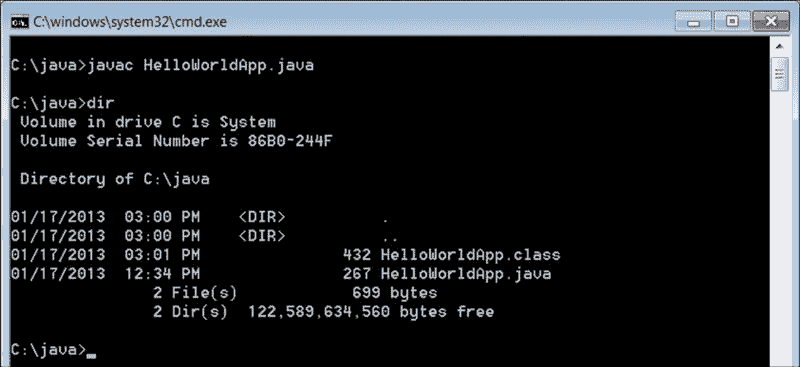

#### 将源文件编译为 `.class` 文件

打开一个 shell 窗口或“命令”窗口。你可以从`Start`（开始）菜单通过选择`Command Prompt`（命令提示符）或选择`Run...`（运行...）然后输入`cmd`来实现。shell 窗口应该类似于图 1.15。

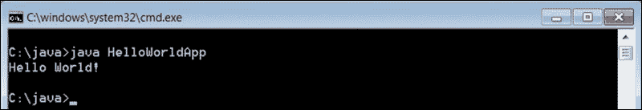

提示符显示你的当前目录。当你打开提示符时，你的当前目录通常是你的主目录，如图 1.15 所示。要编译你的源文件，请将当前目录更改为文件所在的目录。例如，如果你的源目录是`C`盘上的`java`，在提示符处输入以下命令并按 **Enter**（回车）：

```cmd
cd C:\java
```

现在提示符应该变为`C:\java>`。

注意：要切换到不同驱动器上的目录，你必须输入额外的命令：驱动器号。例如，要切换到`D`盘上的`java`目录，你需要在提示符处输入`D:`，如图 1.16 所示。

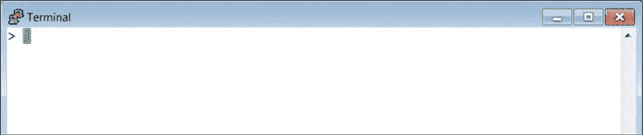

注意：如果你在提示符处输入`dir`，你应该看到你的源文件，如图 1.17 所示。现在你准备好编译了。在提示符处输入以下命令并按 **Enter**（回车）：

```cmd
javac HelloWorldApp.java
```


编译器生成了一个字节文件`HelloWorldApp.class`。在提示符处输入`dir`查看生成的文件，如图 1.18 所示。现在你有了`.class`文件，就可以运行你的程序了。


#### 运行程序

在同一目录下，在提示符处输入以下命令：

```cmd
java HelloWorldApp
```

图 1.19 显示了现在应该看到的内容。恭喜！你的程序运行成功！如果你在本节或其他任何步骤中遇到问题，请参阅本章末尾的“常见问题（及其解决方案）”。

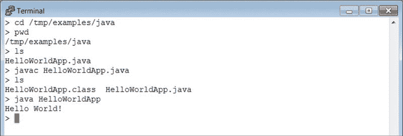

图 19. 程序在屏幕上打印“Hello World!”

## 将源文件编译为 `.class` 文件

Java 编程语言编译器（`javac`）会获取你的源文件并将其文本翻译成 Java 虚拟机（JVM）可以理解的指令。如前所述，此`.class`文件包含的指令被称为`bytecodes`（字节码）。

## 运行程序

Java 应用程序启动工具（`java`）使用 Java 虚拟机来运行你的应用程序。

### 创建源代码

要创建一个源代码，你有两个选择：你可以在计算机上保存`HelloWorldApp.java`文件以避免大量输入，或者你可以使用以下（较长的）指令。

首先，打开一个 shell 或“终端（terminal）”窗口，如图 1.20 所示。当你首次看到提示符时，你的`current directory`（当前目录）通常是你的`home directory`（主目录）。你可以随时在提示符处输入`cd`并按`Return`（回车）将当前目录更改为主目录。

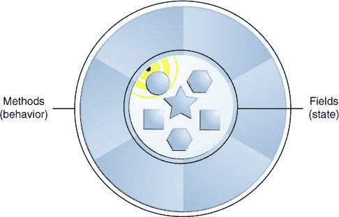

图 1.20。一个新的终端窗口

你创建的源文件应该保存在单独目录下。你可以使用`mkdir`命令创建一个目录。例如，要在`/tmp`目录中创建`examples/java`目录，请使用以下命令：

```
cd /tmp
mkdir examples
cd examples
mkdir java
```

要将当前目录更改到此新目录，请输入：

```bash
cd /tmp/examples/java
```

现在你可以开始创建源文件了。在提示符处输入`pico`并按`Return`启动`pico`编辑器。如果系统返回消息`pico: command not found`，那么可能是`pico`不可用。请咨询你的系统管理员获取更多信息，或使用其他编辑器。当你启动`pico`时，它将显示一个全新的空白`buffer`（缓冲区）。这是你输入代码的区域。

在新缓冲区中输入以下代码：

点击此处查看代码图像

```java
/**
 * HelloWorldApp 类实现了一个应用程序，
 * 直接向标准输出打印 "Hello World!"。
 */
class HelloWorldApp {
    public static void main(String[] args) {
        System.out.println("Hello World!"); // 显示字符串。
    }
}
```


`System.out.println("Hello World!"); // 显示字符串。`

```
}
```

---

注意

请按照所示的内容精确输入所有代码、命令和文件名。编译器 (`javac`) 和启动器 (`java`) 都是**区分大小写**的，因此你必须保持大小写一致。例如，`HelloWorldApp` 与 `helloworldapp` 是不同的。

---

将代码保存为名为 `HelloWorldApp.java` 的文件。在 `pico` 编辑器中，操作方法是输入 `Ctrl+O`，然后在底部看到提示符 `File Name to Write:` 处输入想要创建文件的目录，紧接着输入 `HelloWorldApp.java`。例如，如果你想将 `HelloWorldApp.java` 保存在 `/tmp/examples/java` 目录下，则输入 `/tmp/examples/java/HelloWorldApp.java` 并按 `Return`。你可以输入 `Ctrl+X` 退出 `pico`。

### 将源文件编译为 .class 文件

打开另一个 shell 窗口。要编译源文件，请将当前目录更改为文件所在的目录。例如，如果你的源目录是 `/tmp/examples/java`，在提示符处输入以下命令并按 `Return`：

```bash
cd /tmp/examples/java
```

如果你在提示符处输入 `pwd`，你应该看到当前目录，在本例中它已更改为 `/tmp/examples/java`。如果你在提示符处输入 `ls`，你应该看到你的文件。

现在你准备好编译源文件了。在提示符处输入以下命令并按 `Return`：

```bash
javac HelloWorldApp.java
```

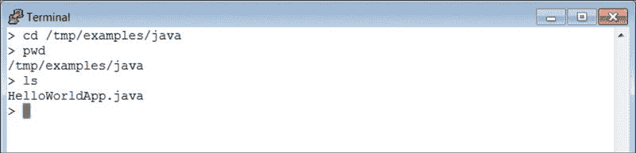

图 1.21。`ls` 命令显示 `.java` 源文件的结果

编译器生成了一个字节码文件 `HelloWorldApp.class`。在提示符处输入 `ls` 查看生成的新文件，如图 1.22 所示。现在你已经有了 `.class` 文件，可以运行你的程序了。

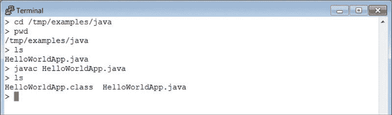

图 1.22。`ls` 命令显示生成的 `.class` 文件的结果

### 运行程序

在同一目录下，在提示符处输入以下命令：

```bash
java HelloWorldApp
```

图 1.23 显示了你现在应该看到的内容。恭喜！你的程序运行了！


图 1.23。输出在屏幕上打印“Hello World!”

### 深入观察“Hello World!”应用程序

现在你已经看了“Hello World!”应用程序（可能还编译并运行了它），你可能会好奇它是如何工作的。这里再次是它的代码：

点击此处查看代码图像

```java
class HelloWorldApp {

    public static void main(String[] args) {

        System.out.println("Hello World!"); // 显示字符串。

    }

}
```

“Hello World!”应用程序由三个主要部分组成：源代码注释、`HelloWorldApp` 类定义和 `main` 方法。接下来的解释将为你提供基础理解，但更深层次的影响将在读完剩余内容后显现。

#### 源代码注释

以下文本定义了“Hello World!”应用程序的注释：

点击此处查看代码图像

```java
/**
 * HelloWorldApp 类实现了一个应用程序，
 * 直接向标准输出打印 "Hello World!"。
 */
class HelloWorldApp {

    public static void main(String[] args) {

        // 直接向输出打印字符串。

    }

}
```

注释会被编译器忽略，但对程序员非常有帮助。Java 编程语言支持三种注释：

`/* text */` 编译器忽略 `/*` 到 `*/` 之间的内容。

`/** documentation */` 这表示文档注释（简称为 `doc comment`）。编译器同样忽略这种注释，`Javadoc` 工具在准备自动生成的文档时会使用这种注释。有关 `Javadoc` 的更多信息，请参阅 `Javadoc` 文档¹。

`// text` 编译器忽略从 `//` 到行尾的内容。

#### HelloWorldApp 类定义

以下文本是“Hello World!”应用程序的类定义块：

点击此处查看代码图像

```java
/**
 * HelloWorldApp 类实现了一个应用程序，
 * 直接向标准输出打印 "Hello World!"。
 */
class HelloWorldApp {

    public static void main(String[] args) {

        // 直接向输出打印字符串。

    }

}
```

如之前所示，类的最基本形式如下：

```java
class name {

    . . .

}
```

`class` 关键字开始名为 `name` 的类的定义，每个类的代码位于加粗标记的圆括号之间。第 2 章提供了类的类的概述，而第 4 章详细讨论了类。现在，你只需要知道每个应用程序都始于类定义即可。

#### main 方法

以下文本是 `main` 方法的定义：

点击此处查看代码图像

```java
/**
 * HelloWorldApp 类实现了一个应用程序，
 * 直接向标准输出打印 "Hello World!"。
 */
class HelloWorldApp {

    public static void main(String[] args) {

        // 直接向输出打印字符串。

    }

}
```

在 Java 编程语言中，每个应用程序必须包含一个签名如下的 `main` 方法：

```java
public static void main(String[] args)
```

修饰符 `public` 和 `static` 可以以任何顺序编写（`public static` 或 `static public`），但惯例是像此处所示使用 `public static`。你可以为参数命名任何名称，但大多数程序员会选择 `args` 或 `argv`。

`main` 方法与 `C` 和 `C++` 中的 `main` 函数类似；它是应用程序的入口点，并随后将调用你程序所需的所有其他方法。`main` 方法接受单个参数：一个 `String` 类型的元素数组。

```java
public static void main(String[] args)
```

该数组是运行时系统向你的应用程序传递信息的机制。以下是一个示例：

```bash
java MyApp arg1 arg2
```

数组中的每个字符串被称为*命令行参数*（command-line argument）。命令行参数允许用户在不重新编译的情况下影响应用程序的操作。例如，排序程序可能允许用户通过此命令行参数指定数据按降序排序：

```bash
-descending
```

“Hello World!”应用程序忽略了命令行参数，但你应该意识到此类参数是确实存在的。最后，看此行：

```java
System.out.println("Hello World!");
```

这使用核心库中的 `System` 类向标准输出打印“Hello World!”消息。该库的部分内容（也称为*应用程序接口*，或 *API*）将在后面的章节中进行讨论。

## 常见问题（及其解决方案）

### 编译器问题

#### Microsoft Windows 系统上的常见错误信息

`'javac' 不是内部或外部命令、可运行的程序或批处理文件`

如果你收到此错误，Windows 找不到编译器 (`javac`)。有一种告诉 Windows 在何处找到 `javac` 的方法。假设你将 JDK 安装在 `C:\jdk1.7.0`。在提示符处，你输入以下命令并按**回车**（Enter）：

```bash
C:\jdk1.7.0\bin\javac HelloWorldApp.java
```

如果你选择此选项，则每次编译或运行程序时，都必须在 `javac` 和 `java` 命令前加上 `C:\jdk1.7.0\bin\`。为了避免这些额外输入，请参阅 JDK 7 安装说明。

`类名 'HelloWorldApp' 仅被接受 if annotation processing is explicitly requested`

如果你收到此错误，说明你在编译程序时忘记包含 `.java` 后缀；命令是 `javac HelloWorldApp.java` 而不是 `javac HelloWorldApp`。

#### UNIX 系统上的常见错误信息

`javac: Command not found`

如果你收到此错误，UNIX 找不到编译器 `javac`。有一种告诉 UNIX 在何处找到 `javac` 的方法。假设你将 JDK 安装在 `/usr/local/jdk1.7.0`。在提示符处，你输入以下命令并按**回车**（Enter）：

```bash
/usr/local/jdk1.7.0/javac HelloWorldApp.java
```

如果你选择此选项，每次编译或运行程序时，都必须在 `javac` 和 `java` 命令前加上 `/usr/local/jdk1.7.0/`。为了避免这些额外输入，你可以将此信息添加到你的 `PATH` 变量中。执行此操作的步骤取决于你当前运行哪种 shell。

`类名 'HelloWorldApp' 仅被接受 if annotation processing is explicitly requested`

如果你收到此错误，说明你在编译程序时忘记包含 `.java` 后缀。记住，命令是 `javac HelloWorldApp.java` 而不是 `javac HelloWorldApp`。

#### 语法错误（所有平台）

如果你误写了程序的部分，编译器可能会发出语法错误。消息通常会显示错误类型、检测到错误的行号、该行上的代码以及错误在代码中的位置。以下是一个由于语句末尾缺少分号引起的错误：

```bash
testing.java:14: ';' expected.
System.out.println("Input has " + count + " chars.")
                                 ^
1 error
```

如果你看到任何编译器错误，说明你的程序没有成功编译，编译器没有创建 `.class` 文件。请仔细检查程序，修复你检测到的任何错误，并重试。

#### 语义错误

除了验证程序在语法上正确外，编译器还会检查其他基本正确性。例如，每当你使用未初始化的变量时，编译器都会向你警告：

```bash
testing.java:13: Variable count may not have been initialized.
  count++;
  ^
testing.java:14: Variable count may not have been initialized.
  System.out.println("Input has " + count + " chars.");
```

### 运行时问题

#### Windows 系统上的错误信息

`Exception in thread "main" java.lang.NoClassFoundError: HelloWorldApp`

如果你收到此错误，`java` 找不到你的 `.class` 文件。注意，`java` 会尝试在当前目录（以及其他地方）查找它。因此，如果你的 `.class` 文件在 `C:\java`，你需要更改当前目录。要更改目录，输入以下命令并按**回车**（Enter）：

```bash
cd c:\java
```

提示应变为 `C:\java>`。如果你在提示符处输入 `dir`，你应该看到你的 `.java` 和 `.class` 文件。现在再次输入 `java HelloWorldApp`。如果你仍然有问题，可能需要更改 `CLASSPATH` 变量。要查看是否有必要，尝试用以下命令清除 `CLASSPATH`：

```bash
set CLASSPATH=
```

再次输入 `java HelloWorldApp`。如果程序现在运行正常，你需要按照之前提供的 `PATH` 变量的方法更改 `CLASSPATH` 变量。

初学者的一个常见错误是尝试对编译器创建的 `.class` 文件运行 `java` 启动。例如，如果你尝试用 `java HelloWorldApp.class` 而不是 `java HelloWorldApp` 来运行程序，就会得到此错误。记住，参数是你想使用的*类名*，而不是*文件名*。

`Exception in thread "main" java.lang.NoSuchMethodError: main`

Java 虚拟机要求你用它执行的类有一个 `main` 方法以便开始应用程序的执行。

#### UNIX 系统上的错误信息

`Exception in thread "main" java.lang.NoClassFoundError: HelloWorldApp`

如果你收到此错误，`java` 找不到你的 `.class` 文件。注意，`java` 会尝试在当前目录（以及其他地方）查找它。因此，如果你的字节码文件在 `/home/jdoe/java`，你需要更改当前目录。要更改目录，在提示符处输入以下命令并按返回（Return）：

```bash
cd /home/jdoe/java
```

如果你在提示符处输入 `pwd`，你应该看到 `/home/jdoe/java`。如果你在提示符处输入 `ls`，你应该看到你的 `.java` 和 `.class` 文件。现在再次输入 `java HelloWorldApp`。如果你仍然有问题，可能需要更改 `CLASSPATH` 环境变量。要查看是否有必要，尝试用以下命令清除 `CLASSPATH`：

```bash
unset CLASSPATH
```

再次输入 `java HelloWorldApp`。

初级程序员常犯的一个错误是尝试在编译器生成的 `.class` 文件上运行 `java` 启动器。例如，如果你用 `java HelloWorldApp.class` 而不是 `java HelloWorldApp` 来运行程序，你将会得到这个错误。记住，参数是你想要使用的类名，而不是文件名。

```bash
Exception in thread "main" java.lang.NoSuchMethodError: main
```

Java 虚拟机要求你用它执行的类必须有一个 `main` 方法，以便开始应用程序的执行。`深入探讨“Hello World!”应用程序` 章节详细讨论了 `main` 方法。

#### 问题与练习：入门

## 问题

**1.** 当你编译用 Java 编程语言编写的程序时，编译器会将人类可读源文件转换为 Java 虚拟机可以理解的平台无关代码。这种平台无关的代码称为什么？

**2.** 下列哪一个不是有效的注释？

**a.** `/** comment */`

**b.** `/* comment */`

**c.** `/* comment`

**d.** `// comment`

**3.** 如果你在运行时看到以下错误，你应该检查的第一项内容是什么？

点击此处查看代码图像

```bash
Exception in thread "main" java.lang.NoClassDefFoundError:
HelloWorldApp.java.
```

**4.** `main` 方法的正确签名是什么？

**5.** 在声明 `main` 方法时，哪个修饰符必须在前面，`public` 还是 `static`？

**6.** `main` 方法定义了哪些参数？

## 练习

**1.** 修改 `HelloWorldApp.java` 程序，使其显示 `Hola Mundo!` 而不是 `Hello World!`

**2.** 这里是 `HelloWorldApp` 的稍作修改版本：

点击此处查看代码图像

```java
// HelloWorldApp2.java
// 故意编写无法编译的代码！
/**
 * HelloWorldApp 类实现了一个
 * 简单地向标准输出打印 "Hello World!" 的应用程序。
 */
class HelloWorldApp2 {

  public static void main(String[] args) {

    System.out.println("Hello World!"); // 显示字符串。

  }

}
```


该程序有一个错误。定义该错误并修复它，使程序能够成功编译并运行。

## 答案

你可以在此处找到这些问题和练习的答案：[`http://docs.oracle.com/javase/tutorial/getStarted/QandE/answers.html`](http://docs.oracle.com/javase/tutorial/getStarted/QandE/answers.html)。

## 2. 面向对象编程概念

### 章节目录

- 什么是对象？
- 什么是类？
- 什么是继承？
- 什么是接口？
- 什么是包？
- 问题与练习：面向对象编程概念

如果你从未用过面向对象的编程语言，在开始编写代码之前你需要学习一些基本概念。本章将向你介绍对象、类、继承、接口和包。每个节都关注这些概念如何与现实世界相关，同时提供对 Java 编程语言语法的介绍。

第一节关注对象。对象是包含相关状态和行为的软件包。软件对象通常用于模拟日常生活中遇到的现实世界对象。本节解释了状态和行为在对象内部是如何表示的，引入了数据封装的概念，并解释了以此方式设计软件的好处。

第二节讨论类。类是创建对象的蓝图或原型。本节定义了一个模拟真实世界对象状态和行为的类。它刻意侧重于基础知识，展示了即使是一个简单的类也可以如何整洁地建模状态和行为。

第三节关注继承。继承为组织和构建你的软件提供了一种强大且自然的机制。本节解释了类如何从其超类继承状态和行为，并解释了如何使用 Java 编程语言提供的简单语法从一个类派生另一个类。

第四节讨论接口。接口是类与外部世界之间的契约。当一个类实现接口时，它承诺提供该接口发布的行为。本节定义了一个简单的接口，并解释了任何实现该接口的类所需的更改。

最后一节描述包。包是用于以逻辑方式组织类和接口的命名空间。将代码放入包中可以使大型软件项目更易管理。本节解释了为什么这样做很有用，并向你介绍由 Java 平台提供的应用程序编程接口 (API)。

本章以问题和练习结束，以测试你对对象、类、继承、接口和包的理解情况。

### 什么是对象？

对象是理解面向对象技术的关键。现在环顾四周，你会发现许多现实世界对象的例子：你的狗、你的书桌、你的电视、你的自行车。

现实世界对象共享两个特征：它们都具有状态和行为。狗有状态（名字、颜色、品种）和行为（吠叫、取回球、摇尾巴）。自行车也有状态（当前档位、当前踏频频率、当前速度）和行为（换挡、改变踏频频率、制动刹车）。现在花一分钟观察你所在区域的现实世界对象。对于你看到的每个对象，问自己两个问题：“这个对象可能处于哪些状态？”以及“这个对象可能展示出哪些行为？”确保写下你的观察结果。在你做的过程中，你会发现现实世界对象的复杂性各异；你的台灯可能只有两个状态（开启和关闭）和两个可能的行为（开启、关闭），但你的桌面收音机可能有额外的状态（开启、关闭、当前音量、当前电台）和行为（开启、关闭、增大音量、减小音量、搜索、扫描、调频）。你可能还会发现某些对象反过来包含其他对象。这些现实世界的观察都转化为面向对象编程的世界。

软件对象在概念上与现实世界对象相似：它们同样由状态和相关行为组成。对象将其状态存储在`字段`中（在某些编程语言中称为`变量`），并通过`方法`（在某些编程语言中称为函数）暴露其行为。方法对对象的内部状态进行操作，并作为对象间通信的主要机制。隐藏内部状态并要求所有交互都通过对象的方法进行，被称为`数据封装`——这是面向对象编程的基本原理。


Figure 2.1. 一个软件对象

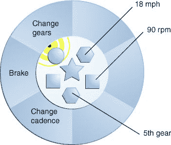

Figure 2.2. 建模为软件对象的自行车

1. **模块化。** 对象的源代码可以独立于其他对象的源代码进行编写和维护。一旦创建，对象就可以在系统内部轻松传递。

2. **信息隐藏。** 用户只与对象的方法交互；因此，其内部实现的细节对外部世界是隐藏的。

3. **代码复用。** 如果一个对象已经存在（可能是由另一个软件开发者编写的），你就可以在程序中使用该对象。这允许专业人员实现、测试和调试复杂的、针对特定任务的对象，然后你就可以放心地让它们在你自己的代码中运行。

4. **可插拔性和更易调试。** 如果某个特定对象被证明是有问题的，你可以简单地从应用程序中移除它，并插入另一个不同的对象作为替代。这比现实世界中修理机械问题更简单。如果螺丝断了，你更换的是螺丝，而不是整台机器。

### 什么是类？

在现实世界中，你经常会发现许多相同的个体对象。可能存在成千上万辆其他的自行车，它们具有相同的品牌和型号。每辆自行车都是根据同一套蓝图建造的，因此包含相同的组件。在面向对象的术语中，我们说你的自行车是被称为“自行车”的`class of objects`的一个`instance`（实例）。`class`是创建单个对象的蓝图。

下面的`Bicycle`类展示了自行车的一种可能的实现方式：

```java
class Bicycle {

    int cadence = 0;

    int speed = 0;

    int gear = 1;

    void changeCadence(int newValue) {

        cadence = newValue;

    }

    void changeGear(int newValue) {

        gear = newValue;

    }

    void speedUp(int increment) {

        speed = speed + increment;

    }

    void applyBrakes(int decrement) {

        speed = speed - decrement;

    }

    void printStates() {

        System.out.println("cadence:" +

            cadence + " speed:" +

            speed + " gear:" + gear);

    }

}
```

Java 语言的语法对你来说可能很新，但这个类的设计是基于之前对自行车对象的讨论。字段`cadence`、`speed`和`gear`代表对象的状态，而方法（`changeCadence`、`changeGear`、`speedUp`等）定义了它与外部世界的交互。

你可能已经注意到`Bicycle`类不包含`main`方法。那是因为它不是完整的应用程序；它只是可能用于应用程序的自行车蓝图。创建和使用新`Bicycle`对象的责任属于应用程序中的其他某个类。

这是一个`BicycleDemo`类，它创建了两个独立的`Bicycle`对象并调用了它们的方法：

```java
class BicycleDemo {

    public static void main(String[] args) {

        // 创建两个不同的

        // Bicycle 对象

        Bicycle bike1 = new Bicycle();

        Bicycle bike2 = new Bicycle();

        // 调用这些

        // 对象的方法

        bike1.changeCadence(50);

        bike1.speedUp(10);

        bike1.changeGear(2);

        bike1.printStates();

        bike2.changeCadence(50);

        bike2.speedUp(10);

        bike2.changeGear(2);

        bike2.printStates();

    }

}
```

Java 平台提供了庞大的类库（一组包），适用于你自己的应用程序。这个库被称为`Application Programming Interface`（**应用程序编程接口**），简称`API`。它的这些包代表了与通用编程最常见的相关的任务。例如，`String`对象包含字符字符串的状态和行为；`File`对象允许程序员轻松地在文件系统上创建、删除、检查、比较或修改文件；`Socket`对象允许网络套接字的创建和使用；各种图形用户界面 (GUI) 对象则控制按钮、复选框以及其他与 GUI 相关的内容。这里有数以千计的类供你选择。这使得你作为程序员能够专注于特定应用程序的设计，而不是关注使其程序运行所需的底层基础设施。

Java 平台 API 规范包含了 Java SE 平台提供的所有包、接口、类、字段和方法的完整列表。在浏览器中加载该页面并将其书签。作为一名程序员，它将成为你最重要的参考文档。

### 问题与练习：面向对象编程概念

#### 问题

1. 现实世界中的对象包含 ___ 和 ___。
2. 软件对象的状态存储在 ___ 中。
3. 软件对象的行为通过 ___ 暴露。
4. 将内部数据隐藏在外部世界之外并仅通过公开暴露的方法进行访问，被称为数据 ___。
5. 软件对象的蓝图被称为 ___。
6. 共同行为可以在 ___ 中定义，并使用`___`关键字继承到 ___ 中。
7. 一组没有实现体的方法被称为 ___。
8. 一个按功能组织类和接口的命名空间被称为 ___。
9. `API`术语代表什么？

#### 练习

1. 为你在本章开头观察到的每个现实世界对象创建新类。如果你忘记了所需的语法，请参考`Bicycle`类。
2. 为你创建的每个新类创建一个定义其行为的接口，然后要求你的类去实现该接口。漏掉一个或两个方法并尝试编译。错误信息看起来是什么样子的？

#### 答案

你可以在`http://docs.oracle.com/javase/tutorial/java/concepts/QandE/answers.html`找到这些问题和练习的答案。

## 3. 语言基础

### 章节内容

- `Variables`（变量）
- `Operators`（运算符）
- `Expressions, Statements, and Blocks`（表达式、语句和代码块）
- `Control Flow Statements`（控制流语句）

你已经学习过对象在字段中存储状态。然而，Java 编程语言也使用`variable`术语。本章的第一节讨论了这种关系，外加变量命名和规范、基本数据类型（原始类型、字符字符串和数组）、默认值和字面量。第二节描述了 Java 语言的运算符。它首先介绍了最常用的，最后介绍了较不常用的。运算符可以用于构建计算值的表达式。表达式是语句的核心组件。第三节使用你已经见过的示例代码讨论了表达式、语句和代码块。最后一部分描述了 Java 语言支持的控制流语句。它涵盖了决策、循环和分支语句，使你的程序能够根据条件执行特定的代码块。注意，每个章节都包含自己的问题和练习以测试你的理解。

### 变量

正如你在上一章中所学的，对象在字段中存储其状态：

```java
int cadence = 0;

int speed = 0;

int gear = 1;
```

在`Chapter 2`中，“什么是对象？”节向你介绍了字段，但你可能还有几个问题：命名字段的规则和规范是什么？除了`int`，还有什么其他数据类型？字段在声明时必须初始化吗？如果字段没有显式初始化，它们会被分配默认值吗？我们将在本章中探索这些问题的答案，但在那之前，有几个你必须首先注意的区别。在 Java 编程语言中，`field`（字段）和`variable`（变量）这两个术语都被使用；这是新开发者之间一个常见的困惑来源，因为它们通常指的是同一个东西。Java 编程语言定义了以下几种变量：

- **实例变量（非静态字段）。** 从技术上说，对象将它们各自的状态存储在非静态字段中——即没有使用`static`关键字声明的字段。非静态字段也被称为`instance variables`（实例变量），因为它们的值对于类的每个`instance`（实例）都是唯一的（例如，一台自行车的`currentSpeed`与另一辆自行车的`currentSpeed`是独立的）。
- **类变量（静态字段）。** `class variable`是任何使用`static`修饰符声明的字段；这告诉编译器，无论该类被实例化多少次，该变量在内存中恰好存在一个拷贝。定义特定类型自行车齿轮数量的字段可以被标记为`static`，因为从概念上讲，相同的齿轮数量适用于所有实例。代码`static int numGears = 6;`会创建一个这样一个静态字段。此外，可以添加`final`关键字来表示齿轮数量永远不会改变。
- **局部变量。** 类似于对象在字段中存储状态的方式，方法通常会在`local variables`（局部变量）中存储其临时状态。声明局部变量的语法与声明字段相似（例如，`int count = 0;`）。没有特殊的关键字将变量指定为局部的；这种判断完全取决于变量声明的位置——即它在方法的左括号和右括号之间。因此，局部变量对于声明它们的方法可见；它们无法从类的其他部分访问。
- **参数。** 你已经在`Bicycle`类和“Hello World!”应用程序的`main`方法中看到过参数的示例了。记住`main`方法的签名是`public static void main(String[] args)`。在这里，`args`变量是该方法的参数。需要记住的点是，参数始终被分类为`variables`（变量），而不是`fields`（字段）。这同样适用于你将在后续章节中学到的其他接受参数的结构（如构造函数和异常处理器）。

尽管如此，从现在开始，我们在讨论字段和变量时遵循以下通用指南。如果我们讨论的是`fields in general`（泛指字段，不包括局部变量和参数），我们可以直接使用`fields`术语。如果讨论适用于上述所有内容，我们可以直接使用`variables`。如果上下文需要区分，我们将在适当的地方使用特定术语（静态字段、局部变量等）。你可能偶尔也会看到`member`（成员）这一术语。一个类型的字段、方法和嵌套类型统称为它的`members`（成员）。

### 命名

每种编程语言对于允许使用的名称都有自己的一套规则和规范，Java 编程语言也不例外。变量命名的规则和规范可以总结如下：

- 变量名是区分大小写的。变量名可以是任何合法的标识符——一个无限长度的 Unicode 字母和数字序列，以字母、美元符号（`$`）或下划线字符（`_`）开头。然而，惯例是始终用字母开始变量名，而不是美元符号或下划线。此外，按照惯例，永远不使用美元符号。你可能会发现某些自动生成的名称包含美元符号的情况，但你的变量名应该始终避免使用它。下划线字符也有类似的惯例；虽然在技术上以下划线开头变量名是合法的，但这种做法是不鼓励的。不允许包含空格。

- 随后的字符可以是字母、数字、美元符号或下划线字符。惯例（以及常识）也适用于此规则。在为变量选择名称时，请使用完整的单词而不是晦涩的缩写。这样做会让你的代码更易阅读和理解。在许多情况下，它还会让你的代码具有自文档性；例如，命名为`cadence`、`speed`和`gear`的字段比缩写版本（如`s`、`c`和`g`）要直观得多。还要记住，你选择的名称不能是关键字或保留字。

- 如果你选择的名称只有一个单词，请用全小写字母写该单词。如果包含多个单词，请将每个后续单词的首字母大写。`gearRatio`和`currentGear`是这种惯例的绝佳示例。如果你的变量存储的是常量值，例如`static final int NUM_GEARS = 6`，惯例会有所变化，将每个字母都大写并用下划线字符分隔后续单词。按照惯例，下划线字符在其他地方永远不用。

### 原始数据类型

Java 编程语言是静态类型语言，这意味着所有变量在使用之前必须先声明。这涉及说明变量的类型和名称，正如你已经看到的：

```java
int gear = 1;
```


这样做是告诉程序存在一个名为`gear`的字段，它持有数值数据，并且初始值为`1`。变量的数据类型决定了它可能包含的值以及可以对其执行的操作。除了`int`之外，Java 编程语言还支持其他七种原始数据类型。原始类型由语言预定义，并由保留关键字命名。原始值与其他原始值不共享状态。Java 语言支持的八种原始数据类型如下：

1. `byte`数据类型是 8 位有符号补码整数。它的最小值为 –128，最大值为 127（包含）。在内存节省实际上关重要的情况下，`byte`数据类型对于在大型数组中节省内存有用。它们也可以用来替代`int`，此时它们的局限性有助于阐明你的代码；变量范围受限这一事实可以作为一种文档说明的形式。

2. `short`数据类型是 16 位有符号补码整数。它的最小值为 –32,768，最大值为 32,767（包含）。与`byte`相同，适用于相同的准则：在内存节省实际上关重要的情况下，你可以使用`short`来节省大型数组中的内存。

3. `int`数据类型是 32 位有符号补码整数。它的最小值为 –2,147,483,648，最大值为 2,147,483,647（包含）。对于整数值，除非有理由选择其他类型，否则该数据类型通常是默认选择。该数据类型对于你的程序将使用的数字可能足够大，但如果你需要更宽的值范围，请使用`long`。

4. `long`数据类型是 64 位有符号补码整数。它的最小值为 –9,223,372,036,854,775,808，最大值为 9,223,372,036,854,775,807（包含）。当你需要比`int`提供的更宽的值范围时，使用这种数据类型。

5. `float`数据类型是单精度 32 位 IEEE 754 浮点数。它的值范围超出了本文讨论的范围，但在 Java 语言规范中有所规定。与`byte`和`short`的建议相同，如果你需要在大型浮点数数组中节省内存，请使用`float`（而不是`double`）。这种数据类型永远不应用于精确的值，例如货币。对于这一点，你需要使用`java.math.BigDecimal`类。

6. `double`数据类型是双精度 64 位 IEEE 754 浮点数。它的值范围超出了本文讨论的范围，但在 Java 语言规范中有所规定。对于小数，该数据类型通常是默认选择。如前所述，这种数据类型永远不应用于精确的值，例如货币。

7. `boolean`数据类型只有两个可能的值：`true`和`false`。使用这种数据类型用于跟踪真假状态的简单标志。这种数据类型表示 1 位信息，但它的“大小”并不是一个被精确定义的。

8. `char`数据类型是单 16 位 Unicode 字符。它的最小值为`'\u0000'`（或 0），最大值为`'\ffff'`（或 65535）。

除了八种原始数据类型外，Java 编程语言还通过`java.lang.String`类对字符串提供了特殊支持。将字符字符串包含在双引号中会自动创建一个`String`对象；例如`String s = "this is a string";` `String`对象是不可变的，这意味着一旦创建，其值就无法更改。`String`类在技术上不是原始数据类型，但考虑到语言提供的特殊支持，你可能会倾向于将其视为原始类型。

## 默认值

在声明字段时并不总是需要赋值。声明但未初始化的字段将被编译器设置一个合理的默认值。通常情况下，取决于数据类型，此默认值为零或`null`。然而，依赖此类默认值通常被认为是不良好的编程习惯。表 3.1 数据类型的默认值

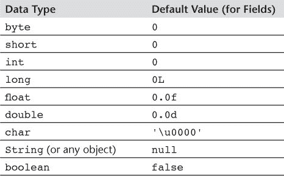

局部变量稍不同；编译器从未为未初始化的局部变量分配默认值。如果你无法在声明时初始化局部变量，请确保在使用尝试之前对其赋值。访问未初始化的局部变量会导致编译错误。

## 字面量

你可能注意到在初始化原始类型变量时没有使用`new`关键字。原始类型是内置的特殊数据类型；它们不是从类创建的对象。字面量是固定值的源码表示；字面量直接在你的代码中，不需要计算。如下所示，可以将字面量赋值给原始类型的变量：

```java
boolean result = true;

char capitalC = 'C';

byte b = 100;

short s = 10000;

int i = 100000;
```

*整数字面量*

如果整数字面量以字母`L`或`l`结尾，则它的类型为`long`；否则，它的类型为`int`。建议使用大写字母`L`，因为小写字母`l`很难与数字`1`区分。

`byte`、`short`、`int`和`long`整型类型的值可以由`int`字面量创建。超出`int`范围的`long`类型的值可以由`long`字面量创建。整数字面量可以用以下数制表示：

* **十进制。** 10 进制，其数字由数字 0 到 9 组成（这是你每天使用的数制。）
* **十六进制。** 16 进制，其数字由数字 0 到 9 以及字母 A 到 F 组成
* **二进制。** 2 进制，其数字由数字 0 和 1 组成（在 Java SE 7 及更高版本中你可以创建二进制字面量。）

对于通用编程，十进制可能是你唯一使用过的数制。然而，如果你需要使用其他数制，下面的示例显示了正确的语法。前缀`0x`表示十六进制，`0b`表示二进制：

```java
// 十进制的数字 26
int decVal = 26;

// 十六进制的数字 26
int hexVal = 0x1a;

// 二进制的数字 26
int binVal = 0b11010;
```

### 浮点数字面量

如果浮点字面量以字母`F`或`f`结尾，则它的类型为`float`；否则，它的类型为`double`，并且可以选择字母`D`或`d`结尾。浮点类型（`float`和`double`）也可以使用`E`或`e`（用于科学计数法）、`F`或`f`（32 位浮点字面量）以及`D`或`d`（64 位双精度字面量，这是默认值且按照习惯被省略）：

```java
double d1 = 123.4;

// 与 d1 相同的值，但使用科学计数法
double d2 = 1.234e2;

float f1 = 123.4f;
```

### 字符和字符串字面量

`char`和`String`类型的字面量可以包含任何 Unicode (UTF-16）字符。如果你的编辑器和文件系统允许，你可以直接在代码中使用这些字符。如果不允许，你可以使用“Unicode 转义字符”，例如`'\u0108'`（带有扬音符号的大写字母 C，Ĉ）或`"S\u00ED Se\u00F1or"`（西班牙语中的 *Sí Señor*）。`char`字面量始终使用“单引号”，`String`字面量始终使用“双引号”。Unicode 转义序列可以用于程序的其他地方（例如在字段名中），而不仅仅是`char`或`String`字面量。

Java 语言还支持用于`char`和`String`字面量的几个特殊转义序列：`\b`（退格）、`\t`（制表符）、`\n`（换行符）、`\f`（分页）、`\r`（回车）、`\"`（双引号）、`\'`（单引号）和`\\`（反斜杠）。还有一个特殊的`null`字面量，可以作为任何引用类型的值；`null`可以赋值给任何变量，基本类型变量除外。除了测试其是否存在，你对`null`值做不了什么。因此，`null`在程序中经常用作标记，指示某些对象不可用。

最后，还有一种特殊的字面量称为*类字面量*（class literal），它通过在类型名称后附加`.class`形成（例如`String.class`）。它指向表示类型本身的对象（类型为`Class`）。

#### 在数字字面量中使用下划字符

在 Java SE 7 及更高版本中，数字字面量中数字之间可以出现任意数量的下划字符（`_`）。此功能允许你对数字字面量中的数字进行分组，从而提高代码的可读性。例如，如果你的代码中包含许多数字的数字，可以使用下划线每三一组分隔数字，类似于你使用逗号或空格作为分隔符。下面的示例显示了在数字字面量中使用下划线的其他方式：

```java
long creditCardNumber = 1234_5678_9012_3456L;

long socialSecurityNumber = 999_99_9999L;

float pi = 3.14_15F;

long hexBytes = 0xFF_EC_DE_5E;

long hexWords = 0xCAFE_BABE;

long maxLong = 0x7fff_ffff_ffff_ffffL;

byte nybbles = 0b0010_0101;

long bytes = 0b11010010_01101001_10010100_10010010;
```

你只能在数字之间放置下划线；你不能在以下位置放置下划线：

* 数字开头
* 小数点旁边
* `F`后缀之前

以下显示了数字字面量中有效的下划线用法：

在实际编程场景中，你可能会使用支持的`looping constructs`（循环结构）来遍历数组的每个元素，而不是像这里这样逐行编写每一个元素。然而，这个示例清楚地展示了数组的语法。你将在本章的“控制流”部分之后学习各种循环结构（`for`、`while`和`do-while`）。

### 声明一个引用数组的变量

之前提供的程序通过以下代码行声明了`anArray`：

```java
// 声明一个整数数组
int[] anArray;
```

与其他类型的变量声明一样，数组声明包含两个组成部分：数组的类型和数组的名称。数组的类型写为`type[]`，其中`type`是所包含元素的数据类型。方括号`[]`是特殊符号，表示该变量持有一个数组。数组的大小不是其类型的一部分（这就是为什么括号是空的）。数组的名称可以是你喜欢的任何名称，只要遵循之前在“命名”部分中讨论过的规则和约定即可与其他类型的变量一样，声明并不会真正创建数组；它只是告诉编译器该变量将持有一个指定类型的数组。

同样，你也可以声明其他类型的数组：

```java
byte[] anArrayOfBytes;

short[] anArrayOfShorts;

long[] anArrayOfLongs;

float[] anArrayOfFloats;

double[] anArrayOfDoubles;

boolean[] anArrayOfBooleans;

char[] anArrayOfChars;

String[] anArrayOfStrings;
```

你也可以将方括号放在数组名称之后：

```java
// 这种形式不被推荐
float anArrayOfFloats[];
```

然而，约定不建议使用这种形式；括号标识数组类型，并应该与类型说明一起出现。

### 创建、初始化和访问数组

创建数组的一种方法是使用`new`运算符。`ArrayDemo`程序中的下一条语句分配了一个足够容纳十个整数元素的内存空间，并将该数组赋值给变量`anArray`：

```java
// 创建一个整数数组
anArray = new int[10];
```

如果缺少这条语句，编译器将打印类似下面的错误，编译将失败：

`ArrayDemo.java:4: Variable anArray may not have been initialized.`

接下来的几行为数组的每个元素赋值：

```java
anArray[0] = 100; // 初始化第一个元素
anArray[1] = 200; // 初始化第二个元素
anArray[2] = 300; // 等此类推
```

每个数组元素通过其数字索引进行访问：

```java
System.out.println("Element 1 at index 0: " + anArray[0]);
System.out.println("Element 2 at index 1: " + anArray[1]);
System.out.println("Element 3 at index 2: " + anArray[2]);
```

或者，你也可以使用快捷语法来创建和初始化数组：

```java
int[] anArray = {
    100, 200, 300,
    400, 500, 600,
    700, 800, 900, 1000
};
```

在这里，数组的长度是由`{`和`}`之间提供的值的数量决定的。

你还可以使用两组或多组方括号来声明数组数组（也称为`multidimensional`多维数组），例如`String[][] names`。因此，每个元素必须通过相应数量的索引值来访问。

在 Java 语言中，多维数组仅仅是一个组件本身也是数组的数组。这与 C 或 Fortran 中的数组不同。因此，如下面的`MultiDimArrayDemo`程序所示，行的长度是可以变化的：

```java
class MultiDimArrayDemo {
    public static void main(String[] args) {
        String[][] names = {
            {"Mr. ", "Mrs. ", "Ms. "},
            {"Smith", "Jones"}
        };
        // Mr. Smith
        System.out.println(names[0][0] + names[1][0]);
        // Ms. Jones
        System.out.println(names[0][2] + names[1][1]);
    }
}
```

该程序的输出为：
Mr. Smith
Ms. Jones

最后，你可以使用`length`属性来确定任何数组的大小。

### 复制数组

`System`类有一个`arraycopy`方法，你可以用它高效地将数据从一个数组复制到另一个数组：

```java
public static void arraycopy(Object src, int srcPos, Object dest, int destPos, int length)
```

`int`参数指定源数组、目标数组以及复制的长度。以下程序使用`arraycopy`复制序列：

```java
class ArrayDemo {
    public static void main(String[] args) {
        int[] fromArray = {100, 200, 300, 400, 500, 600, 700, 800, 900, 1000};
        int[] toArray = new int[7];
        System.arraycopy(fromArray, 0, toArray, 0, 7);
        System.out.println(java.util.Arrays.toString(toArray));
    }
}
```


#### 变量总结

Java 编程语言使用 `fields`（字段）和 `variables`（变量）作为术语。实例变量（非静态字段）每个类实例独有。类变量（静态字段）无论类被实例化多少次，都只有一份。局部变量表示方法内部的临时状态。参数是提供额外信息的变量；局部变量和参数始终被归类为变量（而不是字段）。在命名字段或变量时，你应当或必须遵循某些规则和约定。

八种原始类型为 `byte`、`short`、`int`、`long`、`float`、`double`、`boolean` 和 `char`。`String` 类表示字符串。编译器会为这些类型的字段分配合理的默认值。对于局部变量，永远不会赋值默认值。字量（字面量）是固定值的源代码表示。数组是一个持有单一类型固定数量值的容器对象。数组的长度在创建数组时确定。创建后，其长度是固定的。

#### 问题与练习：变量

**问题**

1. 实例变量是 ___ 的另一种名称。
2. 类变量是 ___ 的另一种名称。
3. 局部变量存储临时状态；它声明在 ___ 内部。
4. 方法签名左右括号内的变量称为 ____。
5. Java 语言支持的八种原始类型是什么？
6. 字符串由 ___ 表示。
7. ___ 是持有单一类型固定数量值的容器对象。

**练习**

1. 创建一个定义字段的小程序。尝试创建一些非字段名称，看看编译器产生什么类型的错误。以命名规则和约定作为指南。

2. 在你创建的程序中，尝试让字段保持未初始化状态并打印它们的值。对局部变量也进行同样的操作，看看你能产生什么种编译器错误。熟悉常见的编译器错误将有助于你更容易识别代码中的错误。

#### 答案

你可以在 [`http://docs.oracle.com/javase/tutorial/java/nutsandbolts/QandE/answers_variables.html`](http://docs.oracle.com/javase/tutorial/java/nutsandbolts/QandE/answers_variables.html) 中找到这些问题和练习题的答案。

### 运算符

既然你已经学习了如何声明和初始化变量，你可能想知道如何对它们进行*一些操作*。学习 Java 编程语言的运算符是一个很好的开始。运算符是某些特殊的符号，它们可以对一个、两个或三个操作数执行特定的操作，然后返回一个结果。

在我们探索 Java 编程语言的运算符时，提前了解哪些运算符具有最高优先级对你可能会帮助。表 3.2 中的运算符按照优先级顺序列出。运算符在表格中越靠上，其优先级越高。高优先级运算符会在优先级相对较低的运算符之前求值。同一行的运算符优先级相等。当优先级相同的运算符出现在同一个表达式中时，必须有一条规则规定先计算哪一个。除了赋值运算符外，所有二元运算符都从左到右求值；赋值运算符从右到左求值。

#### 表 3.2 运算符优先级

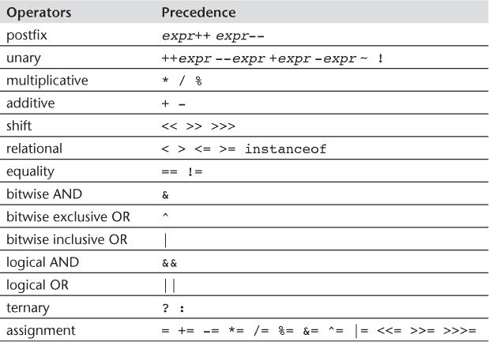

在通用编程中，某些运算符的出现频率比其他运算符更高；例如，赋值运算符（`=`）比无符号右移运算符（`>>>`）常用得多。考虑到这一点，接下来的讨论将首先关注你最可能经常使用的运算符，然后关注那些不那么常用的运算符。每个讨论都附带了你可以编译和运行的示例代码。研究它的输出将有助于加强你刚刚学的内容。

#### 赋值、算术和一元运算符

##### 简单赋值运算符

你会遇到的最常见的运算符之一是简单赋值运算符`=`。你在`Bicycle`类中看到过这个运算符；它将右侧的值赋给左侧的操作数：

```java
int cadence = 0;
int speed = 0;
int gear = 1;
```

该运算符也可以用于对象以分配对象引用，这将在第 4 章 “创建对象”中详细讨论。

##### 算术运算符

Java 编程语言提供了执行加、减、乘、除法的运算符。你可以通过它们在基础数学中的对应符号来识别它们。唯一让你觉得新的符号是`%`，它将一个操作数除以另一个，并将余数作为结果返回。

- `+` 加（也用于字符串拼接）
- `-` 减运算符
- `*` 乘运算符
- `/` 除运算符
- `%` 余运算符

以下程序`ArithmeticDemo`测试了算术运算符：

```java
class ArithmeticDemo {
    public static void main (String[] args){
        // result 现在是 3
        int result = 1 + 2;
        System.out.println(result);
        // result 现在是 2
        result = result - 1;
        System.out.println(result);
        // result 现在是 4
        result = result * 2;
        System.out.println(result);
        // result 现在是 2
        result = result / 2;
        System.out.println(result);
        // result 现在是 10
        result = result + 8;
        // result 现在是 3
        result = result % 7;
        System.out.println(result);
    }
}
```

你还可以将算术运算符与简单赋值结合创建复合赋值。例如，`x+=1;` 和 `x=x+1;` 都会让`x`的值加 1。`+`运算符也可以用于连接（连接）两个字符串，如下面的`ConcatDemo`程序所示：

```java
class ConcatDemo {
    public static void main(String[] args){
        String firstString = "This is";
        String secondString = " concatenated string.";
        String thirdString = firstString+secondString;
        System.out.println(thirdString);
    }
}
```

在该程序结束时，变量`thirdString`包含`"This is concatenated string."`，并被打印到标准输出。

##### 一元运算符

一元运算符只需要一个操作数；它们执行各种操作，例如将值加一或减一、对表达式取反或反转布尔值的值：

- `+` 一元加运算符；表示正值（然而，没有这个符号数字本身就是正的）
- `-` 一元减运算符；对表达式取反
- `++` 递增运算符；将值加 1
- `--` 递减运算符；将值减 1
- `!` 逻辑取反运算符；反转布尔值的值

以下程序`UnaryDemo`测试了一元运算符：

```java
class UnaryDemo {
    public static void main(String[] args){
        // result 现在是 1
        int result = +1;
        System.out.println(result);
        // result 现在是 0
        result--;
        System.out.println(result);
        // result 现在是 1
        result++;
        System.out.println(result);
        // result 现在是 -1
        result = -result;
        System.out.println(result);
        boolean success = false;
        // false
        System.out.println(success);
        // true
        System.out.println(!success);
    }
}
```

递增/递减运算符可以应用在操作数之前（前缀）或之后（后置）。代码`result++;`和`++result;`都会导致`result`增加 1。区别在于前缀版本（`++result`）求值的是增加后的值，而后置版本（`result++`）求值的是原始值。如果你只是进行简单的递增/递减，选择哪个版本并不重要。但如果你将此运算符作为较大表达式的一部分，你的选择可能会产生显著差异。

以下程序`PrePostDemo`展示了前缀/后置递增运算符：

```java
class PrePostDemo {
    public static void main(String[] args){
        int i = 3;
        i++;
        // 打印 4
        System.out.println(i);
        ++i;
        // 打印 5
        System.out.println(i);
        // 打印 6
        System.out.println(i++);
        // 打印 7（实际上 i 变成了 7）
        System.out.println(i);
    }
}
```

#### 相等、关系和条件运算符

##### 相等和关系运算符

相等和关系运算符判断一个操作数是否大于、小于、等于或不等于另一个操作数。这些运算符中的大部分可能看起来也很熟悉。记住，在测试两个基本值是否相等时，必须使用`==`而不是`=`。

- `==` 等于
- `!=` 不等于
- `>` 大于
- `>=` 大于等于
- `<` 小于
- `<=` 小于等于

以下程序`ComparisonDemo`测试了比较运算符：

```java
class ComparisonDemo {
    public static void main(String[] args){
        int value1 = 1;
        int value2 = 2;
        if(value1 == value2)
            System.out.println("value1 == value2");
        if(value1 != value2)
            System.out.println("value1 != value2");
        if(value1 > value2)
            System.out.println("value1 > value2");
        if(value1 < value2)
            System.out.println("value1 < value2");
        if(value1 <= value2)
            System.out.println("value1 <= value2");
    }
}
```

输出如下：

```
value1 != value2
value1 <  value2
value1 <= value2
```

#### 条件运算符

`&&`和`||`运算符对两个布尔表达式执行`条件与`（Conditional-AND）和`条件或`（Conditional-OR）操作。这些运算符表现出“短路”行为，这意味着只有在需要时才会评估第二个操作数的值。

- `&&` 条件与
- `||` 条件或

以下程序`ConditionalDemo1`测试了这些运算符：

```java
class ConditionalDemo1 {
    public static void main(String[] args){
        int value1 = 1;
        int value2 = 2;
        if((value1 == 1) && (value2 == 2))
            System.out.println("value1 is 1 AND value2 is 2");
        if((value1 == 1) || (value2 == 1))
            System.out.println("value1 is 1 OR value2 is 1");
    }
}
```

另一个条件运算符是`?:`，它可以被看作`if-then-else`语句的简写（在本章的“控制流语句”部分中讨论过）。该运算符也被称为三元运算符，因为它使用了三个操作数。在下一个示例中，该运算符应读作：“如果`someCondition`为`true`，则将`value1`的值赋值给`result`。否则，将`value2`的值赋值给`result`。”

以下程序`ConditionalDemo2`测试了`?:`运算符：

```java
class ConditionalDemo2 {
    public static void main(String[] args){
        int value1 = 1;
        int value2 = 2;
        int result;
        boolean someCondition = true;
        result = someCondition ? value1 : value2;
        System.out.println(result);
    }
}
```

由于`someCondition`为真，程序会在屏幕上打印`1`。如果使用`?:`运算符可以让你的代码更具可读性，请使用它代替`if-then-else`语句（例如当表达式紧凑且没有副作用时，如赋值）。

#### 类型比较运算符 instanceof

`instanceof`运算符将对象与指定的类型进行比较。你可以用它来测试对象是否是某个类的实例、子类的实例，或者是实现特定接口的类的实例。

以下程序`InstanceofDemo`定义了一个父类（命名为`Parent`）、一个简单的接口（命名为`MyInterface`）以及一个继承自父类并实现该接口的子类（命名为`Child`）。

```java
class InstanceofDemo {
    public static void main(String[] args) {
        Parent obj1 = new Parent();
        Parent obj2 = new Child();
        System.out.println("obj1 instanceof Parent: " + (obj1 instanceof Parent));
        System.out.println("obj1 instanceof Child: " + (obj1 instanceof Child));
        System.out.println("obj1 instanceof MyInterface: " + (obj1 instanceof MyInterface));
        System.out.println("obj2 instanceof Parent: " + (obj2 instanceof Parent));
        System.out.println("obj2 instanceof Child: " + (obj2 instanceof Child));
        System.out.println("obj2 instanceof MyInterface: " + (obj2 instanceof MyInterface));
    }
}

class Parent {}
class Child extends Parent implements MyInterface {}
interface MyInterface {}
```

输出如下：

```
obj1 instanceof Parent: true
obj1 instanceof Child: false
obj1 instanceof MyInterface: false
obj2 instanceof Parent: true
obj2 instanceof Child: true
obj2 instanceof MyInterface: true
```


在使用`instanceof`时，请记住`null`不是任何东西的实例。

## 位运算和移位运算符

Java语言还提供了对整数类型执行位运算和移位操作的运算符。本节中的运算符并不常见，因此对其进行了简要介绍；其目的是让你了解它们的存在。

一元按位取反运算符`~`会反转位模式；它可以应用于任何整数类型，将每个0变为1，将每个1变为0。例如，一个`byte`包含8位；对一个位模式为`00000000`的值应用此运算符将将其模式更改为`11111111`。有符号左移运算符`<<`将位模式向左移动，有符号右移运算符`>>`将位模式向右移动。位模式由左侧操作数给出，移位次数由右侧操作数给出。无符号右移运算符`>>>`将零移入最左侧位置，而`>>`之后的左侧位置取决于符号扩展。按位`&`运算符执行按位与操作。按位`^`运算符执行按位异或操作。按位`|`运算符执行按位包含或操作。

以下程序`BitDemo`使用按位与运算符将数字2输出到标准输出：

```java
class BitDemo {
    public static void main(String[] args) {
        int bitmask = 0x00F;
        int val = 0x2222;
        // prints "2"
        System.out.println(val & bitmask);
    }
}
```

## 运算符总结

下表快速总结了Java语言支持的运算符。

### 简单赋值运算符
`=` 简单赋值运算符

### 算术运算符
`+` 加法运算符（也用于`String`拼接）
`-` 减法运算符
`*` 乘法运算符
`/` 除法运算符
`%` 取模运算符

### 一元运算符
`+` 一元加运算符；表示正值
`-` 一元负运算符；取表达式负
`++` 递增运算符；值加1
`--` 递减运算符；值减1
`!` 逻辑取反运算符；反转布尔值

### 等于关系运算符
`==` 等于
`!=` 不等于
`>` 大于
`>=` 大于等于
`<` 小于
`<=` 小于

### 条件运算符
`&&` 条件与
`||` 条件或
`?:` 三元（`if-then-else`语句的简写）

### 类型比较运算符
`instanceof` 将对象与指定的类型进行比较

### 位运算和移位运算符
`~` 一元按位取反
`<<` 有符号左移
`>>` 有符号右移
`>>>` 无符号右移
`&` 按位与
`^` 按位异或
`|` 按位包含或

## 问题与练习：运算符

### 问题

**1.** 考虑以下代码片段：
`arrayOfInts[j] > arrayOfInts[j+1]`
该代码包含哪些运算符？

**2.** 考虑以下代码片段：
```java
int i = 10;
int n = i++%5;
```
**a.** 执行代码后，`i`和`n`的值是多少？
**b.** 如果不是使用后置递增运算符（`i++`），而是使用前置版本（`++i`），`i`和`n`的最终值是多少？

**3.** 要反转布尔值，你会使用哪种运算符？

**4.** 哪个运算符用于比较两个值：`=`还是`==`？

**5.** 解释以下代码示例：`result = someCondition ? value1 : value2;`

### 练习题

#### 1. 修改以下程序，使其使用复合赋值：

```java
class ArithmeticDemo {
    public static void main (String[] args){
        int result = 1 + 2; // result 现在是 3
        System.out.println(result);
        result = result - 1; // result 现在是 2
        System.out.println(result);
        result = result * 2; // result 现在是 4
        System.out.println(result);
        result = result / 2; // result 现在是 2
        System.out.println(result);
        result = result + 8; // result 现在是 10
        result = result % 7; // result 现在是 3
        System.out.println(result);
    }
}
```

#### 2. 在以下程序中，解释为什么值`6`被连续打印了两次：

```java
class PrePostDemo {
    public static void main(String[] args){
        int i = 3;
        i++;
        System.out.println(i);     // "4"
        ++i;
        System.out.println(i);     // "5"
        System.out.println(++i);  // "6"
        System.out.println(i++);   // "6"
        System.out.println(i);     // "7"
    }
}
```

## 答案

你可以在此处处找到这些问题和练习的答案：[`http://docs.oracle.com/javase/tutorial/java/nutsandbolts/QandE/answers_operators.html`](http://docs.oracle.com/javase/tutorial/java/nutsandbolts/QandE/answers_operators.html)。

## 表达式、语句和块

现在你已经理解了变量和运算符，是时候学习*表达式*、*语句*和*块*了。运算符可以用于构建计算值的表达式。表达式是语句的核心组件，而语句可以组成块。

### 表达式

*表达式*是由变量、运算符和方法调用（根据语言语法构建）构成的结构，它会求出一个单一的值。你已经见过表达式的示例，在此处以**粗体**形式标出：

```java
int cadence = 0;
anArray[0] = 100;
System.out.println("Element 1 at index 0: " + anArray[0]);
int result = 1 + 2; // result 现在是 3
if (value1 == value2)
    System.out.println("value1 == value2");
```

表达式返回的值的数据类型取决于表达式中使用的元素。表达式`cadence = 0`返回一个`int`，因为赋值运算符返回与其左侧操作数相同数据类型的值；在这种情况下，`cadence`是一个`int`。正如你从其他表达式所示，表达式也可以返回其他类型的值，例如`boolean`或`String`。

Java语言允许你从各种较小的表达式构建复合表达式，只要表达式的某部分所需的数据类型与另一部分的数据类型匹配。这里是一个复合表达式的示例：

`1 * 2 * 3`

在这个特定的示例中，表达式求值的顺序并不重要，因为乘法的结果独立于顺序；无论被相乘数字的顺序如何，结果总是相同的。然而，这并不是所有表达式都如此。例如，以下表达式根据你执行加法和除法操作的顺序会有不同的结果：

`x + y / 100`  // 歧义

你可以使用括号来精确指定表达式将如何求值。例如，为了让之前的表达式消除歧义，你可以写如下内容：

`(x + y) / 100`  // 无歧义，推荐

如果你不显式指定执行操作的顺序，则顺序将由表达式内部使用的运算符的优先级决定。优先级较高的运算符先被求值。例如，除法运算符的优先级高于加法运算符。因此，以下两个语句是等价的：

`x + y / 100`

`x + (y / 100)`  // 无歧义，推荐

在编写复合表达式时，要明确并用括号标出哪些运算符应该先求值。这种做法使得代码更易读、更易维护。

### 语句

*语句*大致等于自然语言中的句子。语句形成一个完整的执行单元。通过在表达式末尾加上分号，可以将以下类型的表达式转变为语句：

* 赋值表达式
* 任何对`++`或`--`的使用
* 方法调用
* 对象创建表达式

此类语句被称为*表达式语句*（expression statements）。以下是一些表达式语句的示例：

```java
// 赋值语句
aValue = 8933.234;

// 递增语句
aValue++;

// 方法调用语句
System.out.println("Hello World!");

// 对象创建语句
Bicycle myBike = new Bicycle();
```

除了表达式语句，还有两种类型的语句：*声明语句*和*控制流语句*。*声明语句*声明变量。你已经见过许多声明语句的示例：

```java
// 声明语句
double aValue = 8933.234;
```

*控制流语句*调节语句的执行顺序。你将在本章稍后的部分学习控制流语句。

### 块

*块*是花括号之间的零或多个语句的组，可以使用任何允许语句的地方。下面的示例`BlockDemo`展示了块的使用：

```java
class BlockDemo {
    public static void main(String[] args) {
        boolean condition = true;
        if (condition) { // 块 1
            System.out.println("Condition is true.");
        } else { // 块 2
            System.out.println("Condition is false.");
        } // 结束块 2
    }
}
```

### 问题与练习：表达式、语句和块

## 问题

1. 运算符可以用于构建计算值的 ___。
2. 表达式是语句的核心组件。
3. 语句可以组成 ___。
4. 以下代码片段是 ___ 的示例：`1 * 2 * 3`。
5. 语句大致等于自然语言中的句子，但它们不是以句号结束，而是以 ___ 结束。
6. 块是花括号之间的零或多个语句的组，可以使用任何允许语句的地方。

### 练习题

识别以下类型的表达式语句：

* `aValue = 8933.234;`
* `aValue++;`
* `System.out.println("Hello World!");`
* `Bicycle myBike = new Bicycle();`

## 答案

你可以在此处处找到这些问题和练习的答案：[`http://docs.oracle.com/javase/tutorial/java/nutsandbolts/QandE/answers_expressions.html`](http://docs.oracle.com/javase/tutorial/java/nutsandbolts/QandE/answers_expressions.html)。

## 控制流语句

源文件中的语句通常是从上到下、按照它们出现的顺序执行的。然而，*控制流语句*通过采用决策、循环和分支打破执行流，允许你的程序*条件地*执行特定的代码块。本节介绍了Java编程语言支持的决策语句（`if-then`、`if-then-else`、`switch`）、循环语句（`for`、`while`、`do-while`）和分支语句（`break`、`continue`、`return`）。

### if-then 和 if-then-else 语句

`if-then`语句是所有控制流语句中最基础的。它告诉程序*仅当*特定测试结果为`true`时，才执行某部分代码。回到我们的自行车示例，`Bicycle`类可以允许刹车*仅当*自行车已经在运动中时才降低其速度。`applyBrakes`方法的一种可能实现方式如下：

```java
void applyBrakes() {
    // "if" 子句：自行车必须正在移动
    if (isMoving){
        // "then" 子句：减少当前速度
        currentSpeed--;
    }
}
```

如果该测试结果为`false`（意味着自行车没有运动），控制流将跳转到`if-then`语句的末尾。

此外，只要“then”子句只包含一条语句，大括号和小括号就是可选的：

```java
void applyBrakes() {
    // 与上面相同，但没有大括号
    if (isMoving)
        currentSpeed--;
}
```

决定何时省略括号取决于个人喜好。省略括号可能会使代码变得脆弱。一个常见的错误是在 *then* 子句中添加第二个语句时，忘记添加新所需的大括号。编译器无法捕获这类错误；你只会得到错误的结果。

### if-then-else 语句

`if-then-else`语句在 *if* 子句求值为`false`时提供了一条次要执行路径。你可以在`applyBrakes`方法中使用`if-then-else`语句，在自行车未运动时应用刹车时执行某些操作。在这种情况下，该操作只是打印一条错误消息，说明自行车已经停止：

```java
void applyBrakes() {
    if (isMoving) {
        currentSpeed--;
    } else {
        System.err.println("The bicycle has " + "already stopped!");
    }
}
```

以下程序`IfElseDemo`根据测试分数的值分配等级：90%及以上为A，80%及以上为B，依此类推：

```java
class IfElseDemo {
    public static void main(String[] args) {
        int testscore = 76;
        char grade;
        if (testscore >= 90) {
            grade = 'A';
        } else if (testscore >= 80) {
            grade = 'B';
        } else if (testscore >= 70) {
            grade = 'C';
        } else if (testscore >= 60) {
            grade = 'D';
        } else {
            grade = 'F';
        }
        System.out.println("Grade = " + grade);
    }
}
```

该程序的输出如下：
Grade = C

你可能已经注意到，`testscore`的值可以满足复合语句中的多个表达式：`76 >= 70`和`76 >= 60`。然而，一旦某个条件满足，相应的语句就会执行（`grade = 'C';`），剩余条件将不再被评估。

### switch 语句

与`if-then`和`if-then-else`语句不同，`switch`语句可以有多个可能的执行路径。`switch`适用于`byte`、`short`、`char`和`int`原始类型。它还适用于枚举类型、`String`类以及几个包装原始类型的特殊类：`Character`、`Byte`、`Short`和`Integer`。

以下代码示例`SwitchDemo`声明了一个名为`month`的`int`变量，其值代表一个月份。代码使用`switch`语句根据`month`的值显示月份：

```java
public class SwitchDemo {
    public static void main(String[] args) {
        int month = 8;
        String monthString;
        switch (month) {
            case 1: monthString = "January"; break;
            case 2: monthString = "February"; break;
            case 3: monthString = "March"; break;
            case 4: monthString = "April"; break;
            case 5: monthString = "May"; break;
            case 6: monthString = "June"; break;
            case 7: monthString = "July"; break;
            case 8: monthString = "August"; break;
            case 9: monthString = "September"; break;
```


### switch 语句

```java
case 10: monthString = "October"; break;
case 11: monthString = "November"; break;
case 12: monthString = "December"; break;
default: monthString = "Invalid month"; break;
}

System.out.println(monthString);
```

在这种情况下，`August` 被输出到标准输出。`switch` 语句的主体被称为 *switch 块*（switch block）。`switch` 块中的语句可以使用一个或多个 `case` 或 `default` 标签标记。`switch` 语句评估其表达式并执行匹配的 `case` 标签之后的所有语句。

你也可以用 `if-then-else` 语句显示月份：

```java
int month = 8;
if (month == 1) {
    System.out.println("January");
} else if (month == 2) {
    System.out.println("February");
} // 依此类推
```

选择 `if-then-else` 语句还是 `switch` 语句取决于可读性以及测试的表达式。`if-then-else` 语句可以测试值的范围或条件，而 `switch` 语句仅测试单个整数、枚举值或 `String` 对象。

另一个值得关注点是 `break` 语句。每个 `break` 语句都会终止封装的 `switch` 语句。控制流从 `switch` 块后的第一个语句继续。`break` 语句是必要的，因为如果没有它们，`switch` 块中的语句会 *贯穿*（fall through）：匹配 `case` 标签之后的所有语句按顺序执行，无论后续 `case` 标签的表达式如何，直到遇到 `break` 语句。程序 `SwitchDemoThrough` 展示了 `switch` 块中的贯穿语句。该程序显示整数 `month` 对应的月份以及该年份之后的月份：

```java
public class SwitchDemoThrough {
    public static void main(String args[]) {
        java.util.ArrayList<String> futureMonths = new java.util.ArrayList<String>();
        int month = 8;
        switch (month) {
            case 1: futureMonths.add("January");
            case 2: futureMonths.add("February");
            case 3: futureMonths.add("March");
            case 4: futureMonths.add("April");
            case 5: futureMonths.add("May");
            case 6: futureMonths.add("June");
            case 7: futureMonths.add("July");
            case 8: futureMonths.add("August");
            case 9: futureMonths.add("September");
            case 10: futureMonths.add("October");
            case 11: futureMonths.add("November");
            case 12: futureMonths.add("December");
                break;
            default: break;
        }
        if (futureMonths.isEmpty()) {
            System.out.println("Invalid month number");
        } else {
            // ... 逻辑继续
        }
    }
}
```

```java
for (String monthName : futureMonths) {
    System.out.println(monthName);
}
```

这是该代码的输出：

```
August
September
October
November
December
```

从技术上讲，最后的 `break` 不是必须的，因为流会跳出 `switch` 语句。建议使用 `break`，这样修改代码会更加容易且不易出错。`default` 部分处理所有未被某个 `case` 显式处理的值。

接下来的代码示例 `SwitchDemo2` 展示了语句如何拥有多个 `case` 标签。该代码示例计算了特定月份的天数：

```java
class SwitchDemo2 {
    public static void main(String[] args) {
        int month = 2;
        int year = 2000;
        int numDays = 0;
        switch (month) {
            case 1: case 3: case 5:
            case 7: case 8: case 10:
            case 12:
                numDays = 31;
                break;
            case 4: case 6:
            case 9: case 11:
                numDays = 30;
                break;
            case 2:
                if (((year % 4 == 0) &&
                    !(year % 100 == 0))
                    || (year % 400 == 0))
                    numDays = 29;
                else
                    numDays = 28;
                break;
            default:
                System.out.println("Invalid month.");
                break;
        }
        System.out.println("Number of Days = " + numDays);
    }
}
```

这是该代码的输出：

```
Number of Days = 29
```

### 在 switch 语句中使用字符串

在 Java SE 7 及更高版本中，你可以在 `switch` 语句的表达式中使用 `String` 对象。接下来的代码示例 `StringSwitchDemo` 根据名为 `month` 的 `String` 的值显示月份数字：

```java
public class StringSwitchDemo {
    public static int getMonthNumber(String month) {
        int monthNumber = 0;
        if (month == null) {
            return monthNumber;
        }
        switch (month.toLowerCase()) {
            case "january":
                monthNumber = 1;
                break;
            case "february":
                monthNumber = 2;
                break;
            case "march":
                monthNumber = 3;
                break;
            case "april":
                monthNumber = 4;
                break;
            case "may":
                monthNumber = 5;
                break;
            case "une":
                monthNumber = 6;
                break;
            case "july":
                monthNumber = 7;
                break;
            case "august":
                monthNumber = 8;
                break;
            case "september":
                monthNumber = 9;
                break;
            case "october":
                monthNumber = 10;
                break;
            case "november":
                monthNumber = 11;
                break;
            case "december":
                monthNumber = 12;
                break;
            default:
                monthNumber = 0;
                break;
        }
        return monthNumber;
    }
    public static void main(String[] args) {
        String month = "August";
        int returnedMonthNumber = StringSwitchDemo.getMonthNumber(month);
        if (returnedMonthNumber == 0) {
            System.out.println("Invalid month");
        } else {
            System.out.println(returnedMonthNumber);
        }
    }
}
```

此代码的输出是 `8`。

`switch` 表达式中的 `String` 与每个 `case` 标签关联的表达式进行比较，就像使用 `String.equals` 方法一样。为了让 `StringSwitchDemo` 示例不区分大小写接受任何月份，`month` 被转换为小写（使用 `toLowerCase()` 方法），并且所有的 `case` 标签都是小写的。

### while 和 do-while 语句

`while` 语句在特定条件为 `true` 时持续执行代码块。其语法可以表示为：

```java
while (expression) {
    statement(s)
}
```

`while` 表达式计算一个 `boolean` 值。如果计算结果为 `true`，则执行 `while` 语句的代码块。使用 `while` 语句打印 1 到 10 可以通过以下 `While` 程序实现：

```java
class WhileDemo {
    public static void main(String[] args){
        int count = 1;
        while (count < 11) {
            System.out.println("Count is: " + count);
            count++;
        }
    }
}
```

你也可以使用 `while` 实现无限循环：

```java
while (true){
}
```

Java 语言还提供了 `do-while` 语句，其可以表示如下：

```java
do {
    statement(s)
} while (expression);
```

`do-while` 和 `while` 的区别在于 `do-while` 在循环的底部计算其表达式。因此，`do` 块中的语句至少执行一次，如下面的 `DoDemo` 程序所示：

```java
class DoDemo {
    public static void main(String[] args){
        int count = 1;
        do {
            System.out.println("Count is: " + count);
            count++;
        } while (count < 11);
    }
}
```

### for 语句

`for` 语句提供了一种迭代值范围的紧凑方式。程序员通常因为它循环直到满足特定条件的方式而称其为 *for 循环*。`for` 语句的一般形式可以表示如下：

```java
for (initialization; termination; increment) {
    statement(s)
}
```

使用此版本的 `for` 语句时，请记住以下因素：

- *initialization*（初始化）表达式初始化循环；它在循环开始时执行一次。
- 当 *termination*（终止）表达式计算为 `false` 时，循环终止。
- *increment*（递增）表达式在每次循环迭代后被调用；该表达式增加 *或* 减少一个值都是完全可以接受的。

接下来的程序 `ForDemo` 使用 `for` 语句的一般形式向标准输出打印从 1 到 10 的数字：

```java
class ForDemo {
    public static void main(String[] args){
        for(int i=1; i<11; i++){
            System.out.println("Count is: " + i);
        }
    }
}
```

该程序的输出如下：

```
Count is: 1
Count is: 2
Count is: 3
Count is: 4
Count is: 5
Count is: 6
Count is: 7
Count is: 8
Count is: 9
Count is: 10
```

注意代码如何在初始化表达式中声明变量的。该变量的作用范围从它的声明处延伸到 `for` 语句控制的块的结束，因此它也可以在终止表达式和递增表达式中使用。如果控制 `for` 语句的变量在循环外部不再需要，最好在初始化表达式中声明该变量。`i`、`j` 和 `k` 名字经常用于控制 `for` 循环；在初始化表达式中声明它们可以限制它们的生命周期并减少错误。

`for` 循环的三个表达式是可选的；可以如下所示创建一个无限循环：

```java
// 无限循环
for ( ; ; ) {
    // 在此处编写你的代码
}
```

`for` 语句还有另一种形式，设计用于遍历集合和数组。这种形式有时被称为“增强型 `for` 语句”，可以用于使你的循环更加紧凑且易读。为了演示这一点，请考虑以下数组，它包含了从 1 到 10 的数字：

`int[] numbers = {1,2,3,4,5,6,7,8,9,10};`

下面的程序 `EnhancedForDemo` 使用增强型 `for` 遍历数组：

```java
class EnhancedForDemo {
    public static void main(String[] args){
        int[] numbers =
            {1,2,3,4,5,6,7,8,9,10};
        for (int item : numbers) {
            System.out.println("Count is: " + item);
        }
    }
}
```


在这个示例中，变量`item`保存了来自`numbers`数组的当前值。该程序的输出与之前相同：

```
Count is: 1
Count is: 2
Count is: 3
Count is: 4
Count is: 5
Count is: 6
Count is: 7
Count is: 8
Count is: 9
Count is: 10
```

我们建议尽可能使用这种形式的`for`语句而不是通用形式。

## 分支语句

### break 语句

`break`语句有两种形式：带标签和不带标签。你在之前讨论`switch`语句时见过不带标签的形式。你也可以使用不带标签的`break`来终止`for`、`while`或`do-while`循环，如下面的`BreakDemo`程序所示：

点击此处查看代码图片

```java
class BreakDemo {

    public static void main(String[] args) {

        int[] arrayOfInts = { 32, 87, 3, 589, 12, 1076, 2000, 8, 622, 127 };

        int searchfor = 12;

        int i;

        boolean foundIt = false;

        for (i = 0; i < arrayOfInts.length; i++) {

            if (arrayOfInts[i] == searchfor) {

                foundIt = true;

                break;

            }

        }

        if (foundIt) {

            System.out.println("Found " + searchfor + " at index " + i);

        } else {

            System.out.println(searchfor + " not in the array");

        }

    }

}
```

该程序在数组中搜索数字`12`。当找到该值时，`break`语句（加粗显示）会终止`for`循环。控制流随后转移到`for`循环之后的语句。以下是程序的输出：

```
Found 12 at index 4
```

不带标签的`break`语句终止最内层的`switch`、`for`、`while`或`do-while`语句，但带标签的`break`会终止一个外部语句。下面的程序`BreakWithLabelDemo`与之前的程序类似，但使用嵌套的`for`循环在二维数组中搜索值。当找到该值时，带标签的`break`会终止外部的`for`循环（标签为`search`）：

点击此处查看代码图片

```java
class BreakWithLabelDemo {

    public static void main(String[] args) {

        int[][] arrayOfInts = {

            { 32, 87, 3, 589 },

            { 12, 1076, 2000, 8 },

            { 622, 127, 77, 955 }

        };

        int searchfor = 12;

        int i;

        int j = 0;

        boolean foundIt = false;

        search:

        for (i = 0; i < arrayOfInts.length; i++) {

            for (j = 0; j < arrayOfInts[i].length; j++) {

                if (arrayOfInts[i][j] == searchfor) {

                    foundIt = true;

                    break search;

                }

            }

        }

        if (foundIt) {

            System.out.println("Found " + searchfor + " at " + i + ", " + j);

        } else {

            System.out.println(searchfor + " not in the array");

        }

    }

}
```

这是该程序的输出：

```
Found 12 at 1, 0
```

不带标签的`break`语句终止最内层的`switch`、`for`、`while`或`do-while`语句，但带标签的`break`会终止一个外部语句。

### continue 语句

`continue`语句跳过`for`、`while`或`do-while`循环的当前迭代。不带标签的`continue`跳到循环体的末尾并处理下一个字符。下面的程序`ContinueDemo`遍历字符串，统计`p`的次数。如果当前字符不是`p`，`continue`语句将跳过循环的剩余部分：

点击此处查看代码图片

```java
class ContinueDemo {

    public static void main(String[] args) {

        String searchMe = "peter picked a peck of peppers";

        int max = searchMe.length();

        int numPs = 0;

        for (int i = 0; i < max; i++) {

            if (searchMe.charAt(i) != 'p') {

                continue;

            }

            numPs++;

        }

        System.out.println("Found " + numPs + " s in the string.");

    }

}
```

这是该程序的输出：

```
Found 9 s in the string.
```

为了更清楚地观察这种效果，尝试移除`continue`语句并重新编译。当你再次运行程序时，计数将错误的，显示发现了 35 个。

带标签的`continue`语句跳过带有标签循环的当前迭代。下面的示例`ContinueLabelDemo`使用嵌套循环在另一个字符串中搜索子字符串。需要两个嵌套循环：一个遍历子字符串，另一个遍历被搜索的字符串。下面的程序`ContinueLabelDemo`使用`continue`语句的带标签形式跳过外部循环的迭代：

点击此处查看代码图片

```java
class ContinueLabelDemo {

    public static void main(String[] args) {

        String searchMe = "Look for a substring in me";

        String substring = "sub";

        boolean foundIt = false;

        int max = searchMe.length() - substring.length();

        test:

        for (int i = 0; i <= max; i++) {

            int n = substring.length();

            int j = i;

            int k = 0;

            while (n-- != 0) {

                if (searchMe.charAt(j++) != substring.charAt(k++)) {

                    continue test;

                }

            }

            foundIt = true;

            break test;

        }

        System.out.println(foundIt ? "Found it" : "Didn't find it");

    }

}
```

### return 语句

最后一个分支语句是`return`语句。`return`语句会退出当前方法，控制流返回到调用方法的地方。`return`语句有两种形式：一种返回一个值，另一种不返回。若要返回一个值，只需在`return`关键字之后放置该值（或计算该值的表达式）：

```java
return ++count;
```

返回值的数据类型必须与方法声明的返回值类型匹配。当方法声明为`void`时，请使用不返回值的`return`形式：

```java
return;
```

第 4 章涵盖了你编写方法时需要的所有知识。

### 控制流语句总结

`if-then`语句是所有控制流语句中最基础的。它告诉程序*仅当*特定测试评估为`true`时才执行代码的某部分。`if-then-else`语句在`if`子句评估为`false`时提供一条次要执行路径。与`if-then`和`if-then-else`不同，`switch`语句允许任意数量可能的执行路径。`while`和`do-while`语句在特定条件为`true`时持续执行一个语句块。`do-while`和`while`的区别在于`do-while`在循环的底部评估其表达式，而不是顶部。因此，`do`块中的语句至少会被执行一次。`for`语句提供了一种遍历值范围的紧凑方法。它有两种形式，其中一种设计用于遍历集合和数组。

#### 问题与练习题：控制流语句

## 问题

**1.** Java 编程语言支持的最基本的控制流语句是 ___ 语句。

**2.** ___ 语句允许任意数量可能的执行路径。

**3.** ___ 语句与`while`语句相似，但它在循环的 ___ 评估其表达式。

**4.** 你如何使用`for`语句编写一个无限循环？

**5.** 你如何使用`while`语句编写一个无限循环？

#### 练习题

**1.** 考虑以下代码段：

点击此处查看代码图像

```java
if (aNumber >= 0)

    if (aNumber == 0)

        System.out.println("first string");

else System.out.println("second string");

System.out.println("third string");
```

**a.** 如果`aNumber`为 3，你认为代码会产生什么输出？

**b.** 编写一个包含上述代码段的测试程序；将`aNumber`设为 3。程序的输出是什么？它符合你的预判吗？解释为什么输出是那个结果。换句话说，该代码段的控制流是什么？

**c.** 仅使用空格和换行符，重新格式化代码段，使控制流更易理解。

**d.** 使用大括号进一步明确代码。

## 答案

你可以在此处找到这些问题和练习的答案：[`http://docs.oracle.com/javase/tutorial/java/nutsandbolts/QandE/answers_flow.html`](http://docs.oracle.com/javase/tutorial/java/nutsandbolts/QandE/answers_flow.html)。

## 4. 类与对象

***

章节目录

- 类
- 对象
- 关于类的更多信息
- 嵌套类
- 枚举类型
- 注解

***

现在你已经掌握了 Java 编程语言的基础知识，你可以学习编写自己的类。在本章中，你将找到有关定义类的信息，包括声明成员变量、方法和构造函数。你将学习如何使用类来创建对象以及如何使用你创建的对象。本章还涵盖了在类内部嵌套类、枚举和注解。

第一部分向你展示类的结构以及如何声明字段、方法和构造函数。第二部分涵盖了对象的创建和使用。你将学习如何实例化对象，以及一旦实例化，如何使用`dot`运算符访问对象的实例变量和方法。第三部分涵盖了依赖于对象引用和`dot`运算符的类的方面：从方法返回值、`this`关键字、类成员与实例成员，以及访问控制。第四部分讨论了静态嵌套类、内部类、匿名内部类和局部类。第五部分涵盖了枚举——允许你定义和使用常量集合的特殊类。最后部分描述了你应该了解的三个内置注解。注解允许你向程序添加实际上并非程序一部分的信息。选章节包含问题和练习题以测试你的理解。

### 类

第 2 章中面向对象概念的介绍使用了`Bicycle`类作为示例，并将公路自行车、山地自行车和双人自行车作为子类。以下是`Bicycle`类可能的实现代码，让你对类声明有一个概述。本章后续章节将逐步支持并解释类声明。目前，请不要担心细节。

点击此处查看代码图像

```java
public class Bicycle {

    // Bicycle 类拥有

    // 三个字段

    public int cadence;

    public int gear;

    public int speed;

    // Bicycle 类拥有

    // 一个构造函数

    public Bicycle(int startCadence, int startSpeed, int startGear) {

        gear = startGear;

        cadence = startCadence;

        speed = startSpeed;

    }

    // Bicycle 类拥有

    // 四个方法

    public void setCadence(int newValue) {

        cadence = newValue;

    }

    public void setGear(int newValue) {

        gear = newValue;

    }

    public void applyBrake(int decrement) {

        speed -= decrement;

    }

    public void speedUp(int increment) {

        speed += increment;

    }

}
```

作为`Bicycle`子类的`MountainBike`类的声明可能如下所示：

点击此处查看代码图像

```java
public class MountainBike extends Bicycle {

    // MountainBike 子类拥有

    // 一个字段

    public int seatHeight;

    // MountainBike 子类拥有

    // 一个构造函数

    public MountainBike(int startHeight, int startCadence, int startSpeed, int startGear) {

        super(startCadence, startSpeed, startGear);

        seatHeight = startHeight;

    }

    // MountainBike 子类拥有

    // 一个方法

    public void setHeight(int newValue) {

        seatHeight = newValue;

    }

}
```

`MountainBike`继承了`Bicycle`的所有字段和方法，并增加了字段`seatHeight`以及一个设置它的方法。（山地自行车的座椅可以根据地形需要上下移动）。

#### 声明类

你已经以以下方式看到定义：

```java
class MyClass {

    // 字段、构造函数和

    // 方法声明

}
```

这就是*类声明*。类体*（大括号之间的区域）包含了为从类创建的对象提供支持的代码：初始化新对象的构造函数、提供类及其对象状态的字段声明以及实现类及其对象行为的方法。

前面的类声明是最小化的。它只包含类声明所需的组件。你可以在类声明的开头提供更多关于类的信息，例如父类的名称、它是否实现了任何接口等。这里有一个例子：

```java
class MyClass extends MySuperClass implements YourInterface {

    // 字段、构造函数和

    // 方法声明

}
```


这意味着`MyClass`是`MySuperClass`的子类，并且它实现了`YourInterface`接口。

你也可以在最开始添加如`public`或`private`等修饰符。因此可以看出，类声明的第一行可能会变得相当复杂。`public`和`private`修饰符决定了其他类能否访问`MyClass`，它们将在本章稍后部分讨论。第 5 章将解释在类声明中使用以及为何使用`extends`和`implements`关键字。目前，你不需要担心这些额外的复杂性。

通常情况下，类声明可以按顺序包含以下组件：

1. **修饰符**，例如`public`、`private`以及你之后会遇到的许多其他修饰符。
2. **类名**，按照惯例，首字母大写。
3. **父类（超类）的名称**，如果有的话，前面跟有关键字`extends`（注意：一个类只能`extend`一个父类）。
4. **该类实现的接口逗号分隔列表**，如果有的话，前面跟有关键字`implements`（注意：一个类可以`implement`多个接口）。
5. **类体**，由大括号`{}`包围。

## 声明成员变量

变量有几种类型：

* **类中的成员变量**。这些被称为`fields`（字段）。
* **方法或代码块中的变量**。这些被称为`local variables`（局部变量）。
* **方法声明中的变量**。这些被称为`parameters`（参数）。

`Bicycle`类使用以下代码行定义它的字段：

```java
public int cadence;
public int gear;
public int speed;
```

字段声明由三个组件组成，顺序如下：

1. **零或多个修饰符**，例如`public`或`private`。
2. **字段类型**。
3. **字段名称**。

`Bicycle`的字段命名为`cadence`、`gear`和`speed`，数据类型均为整数（`int`）。`public`关键字将这些字段标识为公共成员，任何可以访问该类的都可以访问。

## 访问修饰符

第一个（最左侧的）修饰符允许你控制其他类可以访问哪些字段。目前，请仅考虑`public`和`private`，它们的定义如下。其他访问修饰符将在后讨论：

* `public`修饰符。字段可从所有类访问。
* `private`修饰符。字段仅在其所属类内部可访问。

出于封装的精神，将字段设置为`private`是常见做法。这意味着它们只能从`Bicycle`类*直接*访问。然而，我们仍然需要访问这些值。可以通过添加`public`方法来获取我们的字段值，从而*间接*地实现：

```java
public class Bicycle {
    private int cadence;
    private int gear;
    private int speed;

    public Bicycle(int startCadence, int startSpeed, int startGear) {
        gear = startGear;
        cadence = startCadence;
        speed = startSpeed;
    }

    public int getCadence() {
        return cadence;
    }

    public void setCadence(int newValue) {
        cadence = newValue;
    }

    public int getGear() {
        return gear;
    }

    public void setGear(int newValue) {
        gear = newValue;
    }

    public int getSpeed() {
        return speed;
    }

    public void applyBrake(int decrement) {
        speed -= decrement;
    }

    public void speedUp(int increment) {
        speed += increment;
    }
}
```

## 类型

所有变量必须有类型。你可以使用`int`、`float`、`boolean`等原始类型，也可以使用引用类型，如字符串、数组或对象。

## 变量命名

所有变量（无论是字段、局部变量还是参数）都遵循第 3 章中讨论过的命名规则和惯例。注意，方法名和类名也使用相同的命名规则和惯例，但例外：

* 类名的首字母应该大写。
* 方法名的首字母应该小写。

## 定义方法

这是一个方法的示例：

```java
public double calculateAnswer(double, int, double) {
    // ...
}
```

## 方法的命名

虽然方法名可以是任何合法的标识符，但代码规范限制了方法名。按照惯例，方法名应该是小写的动词，有时后面跟着形容词。这里是一些示例：`run`、`runFast`、`getBackground`、`getFinal`、`isEmpty`。

## 方法重载

Java 编程语言支持方法*重载*（overloading），Java 可以区分具有不同*签名*（signatures）的方法。这意味着类中的方法如果参数列表不同，可以同名。（注意，对此限制将在第 5 章中讨论。）

假设你有一个可以绘制各种类型数据（字符串、整数等）的类，并包含一个用于绘制每种类型的方法。为每个方法使用新名称是麻烦的（例如`drawString`、`drawInteger`、`drawFloat`）。在 Java 编程语言中，你可以为所有绘制方法使用相同的名称，但为每个方法传递不同的参数列表。因此，绘制类可能会声明四个名为`draw`的方法，每个方法都有不同的参数列表：

```java
public class DataArtist {
    public void draw(String s) {
        // ...
    }

    public void draw(int i) {
        // ...
    }

    public void draw(double f) {
        // ...
    }

    public void draw(int i, double f) {
        // ...
    }
}
```

重载方法通过传入方法的参数的数量和类型来区分。在代码示例中，`draw(String s)`和`draw(int i)`是不同且独特的方法，因为它们需要不同的参数类型。你不能声明多个名称相同且参数数量和类型相同的方法，因为编译器无法区分它们。

编译器在区分方法时不考虑返回类型，因此你不能声明两个签名相同的方法，即使它们的返回类型不同。

**注意**
应慎用方法重载，因为它们会极大地降低代码的可读性。

## 为你的类提供构造函数

类包含构造函数，这些函数被调用以从类蓝图中创建对象。构造函数的声明看起来像方法声明，但它们使用类名且没有返回类型。例如，`Bicycle`有一个构造函数：

```java
public Bicycle(int startCadence, int startSpeed, int startGear) {
    gear = startGear;
    cadence = startCadence;
    speed = startSpeed;
}
```

要创建一个名为`myBike`的新`Bicycle`对象，需要通过`new`操作符调用构造函数：

```java
Bicycle myBike = new Bicycle(30, 0, 8);
```

`new Bicycle(30, 0, 8)`为对象分配内存空间并初始化其字段。

尽管`Bicycle`只有一个构造函数，但它也可以有其他的，包括无参构造函数：

```java
public Bicycle() {
    gear = 1;
    cadence = 10;
    speed = 0;
}
```

`Bicycle yourBike = new Bicycle();`调用无参构造函数来创建一个名为`yourBike`的新`Bicycle`对象。

这两个构造函数都可以在`Bicycle`中声明，因为它们的参数列表不同。与方法一样，Java 平台根据参数列表中参数的数量和它们的类型来区分构造函数。你不能为同一个类编写两个参数数量和类型都相同的构造函数，因为平台无法区分它们。这样做会导致编译时错误。

你不一定需要为你的类提供任何构造函数，但如果你选择提供构造函数，就必须小心。编译器会自动为任何没有构造函数的类提供一个无参的默认构造函数。这个默认构造函数会调用父类的无参构造函数。在这种情况下，如果父类没有无参构造函数，编译器将会报错，因此你必须验证它是否存在。如果你的类没有显式的父类，那么它就有一个`Object`类型的隐式父类，而`Object`*确实*有一个无参构造函数。

你可以自己使用父类构造函数。本章开头的`MountainBike`类恰恰是这样做。这将在第 5 章中讨论。你可以在构造函数的声明中使用访问修饰符来控制哪些其他类可以调用该构造函数。

## 向方法或构造函数传递信息

方法或构造函数的声明定义了该方法或构造函数参数的数量和类型。例如，以下是一个根据贷款金额、利率、贷款期限（期数）和贷款未来值来计算房屋贷款每月还款的方法：

```java
public double computePayment(
    double loanAmt,
    double rate,
    double futureValue,
    int numPeriods) {
    double interest = rate / 100.0;
    double partial1 = Math.pow((1 + interest), - numPeriods);
    double denominator = (1 - partial1) / interest;
    double answer = (-loanAmt / denominator) - ((futureValue * partial1) / denominator);
    return answer;
}
```

该方法有四个参数：贷款金额、利率、未来值和期数。前三个是双精度浮点数，第四个是整数。这些参数在方法体中使用，并将在运行时获取传入参数的值。

**注意**
`Parameters`（参数）指的是方法声明中的变量列表。`Arguments`（实参）是指实际传入的实际值。

### 参数类型

你可以为参数使用任何类型。这包括原始类型（如`double`、`int`）和引用类型（如对象）。这里是一个接受数组的方法示例：

```java
public Polygon(Point[] corners) {
    // 方法体
}
```

### 任意数量的参数

当你不知道将传递多少个参数时，可以使用`varargs`（变长参数）。要使用变长参数，在类型后加上省略号（`...`）。注意，该参数被视为数组。

```java
public Polygon(Point... corners) {
    int numberOfSides = corners.length;
}
```

如你所见，在方法内部，`corners`被视为数组。该方法既可以使用数组调用，也可以使用一系列参数调用。你最常见在打印方法中使用变长参数。这里是`printf`的示例：

```java
public void printf(String format, Object... args)
```

这允许你打印任意数量的对象。可以这样调用它（或使用不同数量的参数）：

```java
System.out.printf("%s: %d, %s%n", name, idnum, address);
```

也可以这样调用：

```java
System.out.printf("%s: %d, %s, %s, %s%n", name, idnum, address, phone, email);
```

### 参数命名

当你为方法或构造函数声明参数时，为该参数提供一个名称。该名称在方法体内用于引用传入的参数。

参数名称必须在其范围内是唯一的。它不能与同一方法的另一个参数同名，也不能与方法或构造函数内部的局部变量同名。

参数名称可以与类的某个字段名称相同。如果是这种情况，则称该参数*遮蔽*了该字段。遮蔽字段会使代码变得难以阅读，传统上遮蔽仅用于构造函数和设置特定字段的方法中。例如，考虑以下`Circle`类及其`setOrigin`方法：

```java
public class Circle {
    private int x, y, radius;

    public void setOrigin(int x, int y) {
        // ...
    }
}
```

`Circle`类有三个字段：`x`、`y`和`radius`。`setOrigin`方法有两个参数，每个参数的名称都与其中一个字段相同。每个方法参数都会遮蔽（shadows）与其同名的字段。因此，在方法体内部使用简单名称`x`或`y`指的是参数，*而不是*字段。要访问该字段，你必须使用限定名称。这将在本章稍后标题为“使用 this 关键字”的节中进行讨论。

## 传递基本数据类型参数

基本数据类型参数（如`int`或`double`）是通过*值传递*（by value）传递给方法的。这意味着对参数值的任何更改只存在于方法的作用域内。当方法返回时，参数就会消失，对它们的任何更改也都会丢失。这里是一个示例：

```java
public class PassPrimitiveByValue {
    public static void main(String[] args) {
        int x = 3;

        // 调用 passMethod() 并
        // x 作为参数
        passMethod(x);

        // 打印 x 以查看其
        // 值是否改变
        System.out.println("After invoking passMethod, x = " + x);
    }

    // 在 passMethod() 中更改参数
    public static void passMethod(int p) {
        p = 10;
    }
}
```

当你运行此程序时，输出如下：

```
After invoking passMethod, x = 3
```

## 传递引用数据类型参数

引用数据类型参数（如对象）也是通过*值传递*传递给方法的。这意味着当方法返回时，传递的引用仍然指向原来的同一个对象。*但是*，如果对象的字段具有适当的访问级别，则在方法中*可以*更改这些对象字段的值。

例如，考虑任意类中一个移动`Circle`对象的方法：

```java
public void moveCircle(Circle circle, int deltaX, int deltaY) {
    // 移动圆的原点
    // 到 x+deltaX, y+deltaY
    circle.setX(circle.getX() + deltaX);
    circle.setY(circle.getY() + deltaY);

    // 为圆分配一个
    // 新引用
    circle = new Circle(0, 0);
}
```

假设使用这些参数调用该方法：

`moveCircle(myCircle, 23, 56)`

在方法内部，`circle`初始指向`myCircle`。该方法将`circle`所引用对象（即`myCircle`）的`x`和`y`坐标分别改变了 23 和 56。这些更改在方法返回时将保持持久。然后，`circle`被赋值了一个指向一个`x = y = 0`的新`Circle`对象的引用。然而，这种重新赋值没有持久性，因为引用是通过值传递进去的，无法更改。在方法内部，`circle`指向的对象发生了变化，但当方法返回时，`myCircle`仍然指向调用方法之前的原来的一个`Circle`对象。

## 对象

典型的 Java 程序会创建很多对象，正如你所知的，这些对象通过调用方法来相互作用。通过这些对象的相互作用，程序可以执行各种任务，例如实现图形用户界面（GUI）、运行动画或在网络上发送和接收信息。一旦对象完成了为它而创建的工作，它的资源就会被回收供其他对象使用。

这里有一个名为`CreateObjectDemo`的小程序，它创建了三个对象：一个`Point`对象和两个`Rectangle`对象。你需要所有三个源文件来编译此程序：

```java
public class CreateObjectDemo {
    public static void main(String[] args) {
        // 声明并创建一个点对象
        // 以及两个矩形对象。
        Point originOne = new Point(23, 94);
```


`Circle` 类有三个字段：`x`、`y` 和 `radius`。`setOrigin` 方法有两个参数，每个参数的名称都与其中一个字段相同。每个方法参数都会遮蔽（shadows）与其同名的字段。因此，在方法体内部使用简单名称 `x` 或 `y` 指的是参数，*而不是*字段。要访问该字段，你必须使用限定名称。这将在本章稍后标题为“使用 this 关键字”的节中进行讨论。

## 传递基本数据类型参数

基本数据类型参数（如 `int` 或 `double`）是通过*值传递*（by value）传递给方法的。这意味着对参数值的任何更改只存在于方法的作用域内。当方法返回时，参数就会消失，对它们的任何更改也都会丢失。这里是一个示例：

```java
public class PassPrimitiveByValue {
    public static void main(String[] args) {
        int x = 3;
        // 调用 passMethod() 并
        // x 作为参数
        passMethod(x);
        // 打印 x 以查看其
        // 值是否改变
        System.out.println("After invoking passMethod, x = " + x);
    }
    // 在 passMethod() 中更改参数
    public static void passMethod(int p) {
        p = 10;
    }
}
```

当你运行此程序时，输出如下：

```
After invoking passMethod, x = 3
```

## 传递引用数据类型参数

引用数据类型参数（如对象）也是通过*值传递*传递给方法的。这意味着当方法返回时，传递的引用仍然指向原来的同一个对象。*但是*，如果对象的字段具有适当的访问级别，则在方法中*可以*更改这些字段的值。

例如，考虑任意类中一个移动 `Circle` 对象的的方法：

```java
public void moveCircle(Circle circle, int deltaX, int deltaY) {
    // 移动圆的原点
    // 到 x+deltaX, y+deltaY
    circle.setX(circle.getX() + deltaX);
    circle.setY(circle.getY() + deltaY);
    // 为圆分配一个
    // 新引用
    circle = new Circle(0, 0);
}
```

假设使用这些参数调用该方法：

`moveCircle(myCircle, 23, 56)`

在方法内部，`circle` 初始指向 `myCircle`。该方法将 `circle` 所引用对象（即 `myCircle`）的 `x` 和 `y` 坐标分别改变了 23 和 56。这些更改在方法返回时将保持持久。然后，`circle` 被赋值了一个指向一个 `x = y = 0` 的新 `Circle` 对象的引用。然而，这种重新赋值没有持久性，因为引用是通过值传递进去的，无法更改。在方法内部，`circle` 指向的对象发生了变化，但当方法返回时，`myCircle` 仍然指向调用方法之前的原来的 `Circle` 对象。

## 对象

典型的 Java 程序会创建很多对象，正如你所知的，这些对象通过调用方法来相互作用。通过这些对象的相互作用，程序可以执行各种任务，例如实现图形用户界面（GUI）、运行动画或在网络上发送和接收信息。一旦对象完成了为它而创建的工作，它的资源就会被回收供其他对象使用。

这里有一个名为 `CreateObjectDemo` 的小程序，它创建了三个对象：一个 `Point` 对象和两个 `Rectangle` 对象。你需要所有三个源文件来编译此程序：

```java
public class CreateObjectDemo {
    public static void main(String[] args) {
        // 声明并创建一个点对象
        // 以及两个矩形对象。
        Point originOne = new Point(23, 94);
        Rectangle rectOne = new Rectangle(originOne, 100, 200);
        Rectangle rectTwo = new Rectangle(50, 100);
        // 显示 originOne 的宽度、
        // 高度
        System.out.println("originOne's width: " + rectOne.getWidth());
        System.out.println("originOne's height: " + rectOne.getHeight());
        // 显示 originOne 的面积
        System.out.println("originOne's area: " + rectOne.getArea());
        // 显示 rectOne 的宽度、
        // 高度
        // 面积
        System.out.println("rectOne's width: " + rectOne.getWidth());
        System.out.println("rectOne's height: " + rectOne.getHeight());
        System.out.println("rectOne's area: " + rectOne.getArea());
        // 显示 rectTwo 的宽度、
        // 高度
        // 面积
        System.out.println("rectTwo's width: " + rectTwo.getWidth());
        System.out.println("rectTwo's height: " + rectTwo.getHeight());
        System.out.println("rectTwo's area: " + rectTwo.getArea());
    }
}
```


`Circle` 类有三个字段：`x`、`y` 和 `radius`。`setOrigin` 方法有两个参数，每个参数的名称都与其中一个字段相同。每个方法参数都会遮蔽（shadows）与其同名的字段。因此，在方法体内部使用简单名称 `x` 或 `y` 指的是参数，而不是字段。要访问该字段，你必须使用限定名称。这将在本章稍后标题为“使用 this 关键字”的节中进行讨论。

## 传递基本数据类型参数

基本数据类型参数（如 `int` 或 `double`）是通过值传递（by value）传递给方法的。这意味着对参数值的任何更改只存在于方法的作用域内。当方法返回时，参数就会消失，对它们的任何更改也都会丢失。这里是一个示例：

点击此处查看代码图像

```java
public class PassPrimitiveByValue {
    public static void main(String[] args) {
        int x = 3;
        // 调用 passMethod() 并
        // x 作为参数
        passMethod(x);
        // 打印 x 以查看其
        // 值是否改变
        System.out.println("After invoking passMethod, x = " + x);
    }
    // 在 passMethod() 中更改参数
    public static void passMethod(int p) {
        p = 10;
    }
}
```

当你运行此程序时，输出如下：

```
After invoking passMethod, x = 3
```

## 传递引用数据类型参数

引用数据类型参数（如对象）也是通过值传递传递给方法的。这意味着当方法返回时，传递的引用仍然指向原来的同一个对象。但是，如果对象的字段具有适当的访问级别，则在方法中可以更改这些字段的值。

例如，考虑任意类中一个移动 `Circle` 对象的的方法：

点击此处查看代码图像

```java
public void moveCircle(Circle circle, int deltaX, int deltaY) {
    // 移动圆的原点
    // 到 x+deltaX, y+deltaY
    circle.setX(circle.getX() + deltaX);
    circle.setY(circle.getY() + deltaY);
    // 为圆分配一个
    // 新引用
    circle = new Circle(0, 0);
}
```

假设使用这些参数调用该方法：

`moveCircle(myCircle, 23, 56)`

在方法内部，`circle` 初始指向 `myCircle`。该方法将 `circle` 所引用对象（即 `myCircle`）的 `x` 和 `y` 坐标分别改变了 23 和 56。这些更改在方法返回时将保持持久。然后，`circle` 被赋值了一个指向一个 `x = y = 0` 的新 `Circle` 对象的引用。然而，这种重新赋值没有持久性，因为引用是通过值传递进去的，无法更改。在方法内部，`circle` 指向的对象发生了变化，但当方法返回时，`myCircle` 仍然指向调用方法之前的原来的 `Circle` 对象。

## 对象

典型的 Java 程序会创建很多对象，正如你所知的，这些对象通过调用方法来相互作用。通过这些对象的相互作用，程序可以执行各种任务，例如实现图形用户界面（GUI）、运行动画或在网络上发送和接收信息。一旦对象完成了为它而创建的工作，它的资源就会被回收供其他对象使用。

这里有一个名为 `CreateObjectDemo` 的小程序，它创建了三个对象：一个 `Point` 对象和两个 `Rectangle` 对象。你需要所有三个源文件来编译此程序：

点击此处查看代码图像

```java
public class CreateObjectDemo {
    public static void main(String[] args) {
        // 声明并创建一个点对象
        // 以及两个矩形对象。
        Point originOne = new Point(23, 94);
        Rectangle rectOne = new Rectangle(originOne, 100, 200);
        Rectangle rectTwo = new Rectangle(50, 100);
        // ... (rest of code truncated for brevity)
    }
}
```

`new` 运算符需要单个后置参数：即对构造函数的调用。构造函数的名称提供了要实例化的类名。

`new` 运算符返回它所创建对象的引用。该引用通常被赋值给相应类型的变量：

```java
Point originOne = new Point(23, 94);
```

`new` 运算符返回的引用并不需要赋值给变量。它也可以直接在表达式中使用。这是一个示例：

```java
int height = new Rectangle().height;
```

此语句将在下一节中讨论。

## 初始化对象

以下是 `Point` 类的代码：

```java
public class Point {
    public int x = 0;
    public int y = 0;
    //constructor
    public Point(int a, int b) {
        x = a;
        y = b;
    }
}
```

该类包含一个构造函数。你可以识别出构造函数，因为它的声明使用了与类相同的名称，并且没有返回类型。`Point` 类中的构造函数接受两个整数参数，如代码 `(int a, int b)` 所示。以下语句为这些参数提供了 23 和 94 的值：

```java
Point originOne = new Point(23, 94);
```

执行此语句的结果如图 4.2 所示。

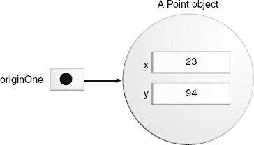

图 4.2. 初始化 originOne 变量

以下是 `Rectangle` 类的代码，它包含了四个构造函数：

点击此处查看代码图像


```java
public class Rectangle {
    public int width = 0;
    public int height = 0;
    public Point origin;
    // four constructors
    public Rectangle() {
        origin = new Point(0, 0);
    }
    public Rectangle(Point p) {
        origin = p;
    }
    public Rectangle(int w, int h) {
        origin = new Point(0, 0);
        width = w;
        height = h;
    }
    public Rectangle(Point p, int w, int h) {
        origin = p;
        width = w;
        height = h;
    }
    // a method for moving the rectangle
    public void move(int x, int y) {
        origin.x = x;
        origin.y = y;
    }
    // a method for computing the area
    // of the rectangle
    public int getArea() {
        return width * height;
    }
}
```

每个构造函数都允许你使用基本类型和引用类型为矩形的大小和宽度提供初始值。如果一个类有多个构造函数，它们必须具有不同的签名。Java 编译器根据参数的数量和类型来区分构造函数。当 Java 编译器遇到以下代码时，它知道调用 `Rectangle` 类中需要一个 `Point` 参数后两个整数参数的构造函数：

```java
Rectangle rectOne = new Rectangle(originOne, 100, 200);
```

这调用了 `Rectangle` 的构造函数之一，将 `origin` 初始化为 `originOne`。此外，该构造函数将 `width` 设置为 100，`height` 设置为 200。现在有两个指向同一个 `Point` 对象的引用。一个对象可以有多个指向它的引用，如图图 4.3 所示。

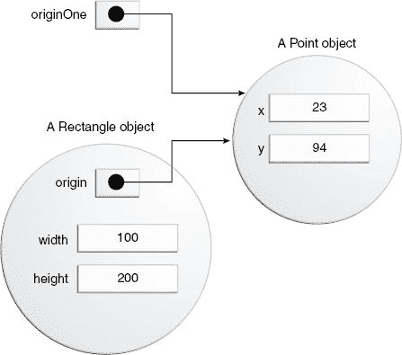

图 4.3. Point 对象的两个引用

下一行代码调用了 `Rectangle` 构造函数，它需要两个整数参数为 `width` 和 `height` 提供初始值。如果你检查构造函数内部的代码，你会发现它创建了一个新的 `Point` 对象，其 `x` 和 `y` 值被初始化为零：

```java
Rectangle rectTwo = new Rectangle(50, 100);
```

在后续语句使用的 `Rectangle` 构造函数不接受任何参数，因此它被称为无参数构造函数：

```java
Rectangle rect = new Rectangle();
```

所有类都至少有一个构造函数。如果一个类没有显式声明任何构造函数，Java 编译器会自动提供一个无参数构造函数，称为默认构造函数。此默认构造函数调用父类的无参数构造函数或 `Object` 构造函数（如果该类没有其他父类）。如果父类没有构造函数（而 `Object` 有），编译器将拒绝该程序。

## 使用对象

一旦创建了对象，你可能想用它做一些事情。你可能需要使用其中一个字段的值、更改其中一个字段，或调用其中一个方法来执行操作。

### 引用对象的字段

对象字段通过它们的名称访问。你必须使用无歧义的名称。你可以在字段内的字段使用简单名称。（注意：原文在此部分包含了一些重复/乱码的句子，已清理以保持访问字段的核心含义）。

例如，访问字段：

```java
System.out.println("Width of rectOne: " + rectOne.width);
```

### 调用对象的方法

你也应该使用对象引用来调用对象的方法。你在对象引用后面附加方法的简单名称，中间通过一个点运算符 (`.`)。你还应该在括号中为方法提供任何参数：

```java
objectReference.methodName(argumentList);
```

如果方法不需要任何参数，请使用空括号：

```java
objectReference.methodName();
```

`Rectangle` 类有两个方法：用于计算矩形面积的 `getArea()` 和用于更改矩形原点的 `move()`。以下是调用这两个方法的 `CreateObjectDemo` 代码：

点击此处查看代码图像

```java
System.out.println("Area of rectOne: " + rectOne.getArea());

// . . .

rectTwo.move(40, 72);
```

与实例字段一样，`objectReference` 必须是一个指向对象的引用。你可以使用变量名，也可以使用任何返回对象引用的表达式。`new` 操作符返回一个对象引用，因此你可以使用 `new` 返回的值来调用新对象的方法：

```java
new Rectangle(100, 50).getArea()
```

表达式 `new Rectangle(100, 50)` 返回一个指向 `Rectangle` 对象的引用。所示，你可以使用点操作符（`dot` notation）来调用新 `Rectangle` 的 `getArea()` 方法，以计算新矩形的面积。

某些方法（例如 `getArea()`）会返回一个值。对于返回值的方法，你可以在表达式中使用方法调用。你可以将返回值赋值给变量，并用它来做决策或控制循环。这段代码将 `getArea()` 返回的值赋值给变量 `areaOfRectangle`：

```java
int areaOfRectangle = new Rectangle(100, 50).getArea();
```

请记住，在特定对象上调用方法等同于向该对象发送消息。在这种情况下，调用 `getArea()` 的对象是构造函数返回的矩形。

### 垃圾回收器

某些面向对象的语言要求你跟踪所创建的所有对象，并在它们不再需要时显式地销毁它们。显式管理内存是枯燥且容易出错的。Java 平台允许你创建任意数量的对象（当然，受限于你系统的处理能力），而你不需要担心销毁它们。Java 运行时环境在确定对象不再被使用时会删除它们。这个过程被称为 `垃圾回收`（`garbage collection`）。

当对一个对象不再有任何引用时，该对象就符合垃圾回收条件。变量中持有的引用通常在变量超出范围时被丢弃。你也可以通过将变量设置为特殊值 `null` 来显式地丢弃对象引用。请记住，一个程序可以对同一个对象有多个引用；在对象的所有引用都被丢弃之前，该对象才可以被垃圾回收。

Java 运行时环境有一个垃圾回收器，它会定期释放不再被引用的对象所使用的内存。垃圾回收器在确定时机合适时会自动执行其工作。

### 关于类的更多内容

本节涵盖了依赖对象引用和点操作符（`dot`）的类的更多方面。

#### 从方法返回值

当方法完成其内部的所有语句、到达 `return` 语句或抛出异常（后文将讨论）时（以先发生者为准），方法会返回到调用它的代码。你在方法声明中声明方法的返回类型。在方法体内部，你使用 `return` 语句返回结果。

任何声明为 `void` 的方法都不返回结果。它不需要包含 `return` 语句，但也可以包含。在这种情况下，可以使用 `return` 语句来跳出控制流块并退出方法。它的用法如如下所示：

```java
return;
```

如果你尝试从一个声明为 `void` 的方法返回结果，将得到编译器错误。任何未声明为 `void` 的方法必须包含一个带有相应返回值的 `return` 语句：

```java
return returnValue;
```

返回值的类型必须与方法声明的返回类型匹配。例如，你不能从一个声明返回 `boolean` 的方法返回整数（`int`）值。

之前讨论的 `Rectangle` 类中的 `getArea()` 方法返回一个整数：

点击此处查看代码图像

```java
// 一个计算矩形面积的方法
public int getArea() {
    return width * height;
}
```

该方法返回从表达式 `width * height` 得到的整数。

`getArea` 方法返回一个原始类型。方法也可以返回一个引用类型。例如，在一个操作 `Bicycle` 对象的程序中，我们可能会有这样一个方法：

点击此处查看代码图像

```java
public Bicycle seeWhosFastest(Bicycle myBike, Bicycle yourBike, Environment env) {
    Bicycle fastest;
    // 代码用于计算哪辆自行车
    // 更快，给定每辆自行车的齿轮
    // 和踏频，以及给定
    // 环境（地形和风力）
    return fastest;
}
```

#### 返回类或接口

如果这一节让你感到困惑，请跳过它并在读完第 5 章 后回来。

当方法使用类名作为其返回类型时（如 `whosFastest` 所示），返回对象的类型的类必须是返回类型的子类或完全相同的类。假设你有一个类层级结构，其中 `ImaginaryNumber` 是 `java.lang.Number` 的子类，而 `java.lang.Number` 又是 `Object` 的子类，如图 4.4](#part0008.html_ch04) 所示。


现在假设你有一个声明为返回 `Number` 的方法：

点击此处查看代码图像

```java
public Number getNumber() {
    // . .
}
```

`getArea` 方法返回一个原始类型。方法也可以返回引用类型。

#### this 关键字

在实例方法或构造函数中，`this` 是当前对象的引用——即被调用的对象。

##### 在字段中使用 this

使用 `this` 的常见原因是字段被参数遮蔽了。例如，`Point` 类如下：

```java
class Point {
    int x = 0;
    int y = 0;
    // 构造函数
    Point(int a, int b) {
        x = a;
        y = b;
    }
}
```

然而，它可以写成：

```java
class Point {
    int x = 0;
    int y = 0;
    // 构造函数
    Point(int x, int y) {
        this.x = x;
        this.y = y;
    }
}
```

构造函数的每个参数都遮蔽了对象的一个字段；在构造函数内部 `x` 是构造函数参数的局部副本。为了引用 `Point` 字段 `x`，构造函数必须使用 `this.x`。

##### 在构造函数中使用 this

从构造函数，你还可以使用 `this` 关键字调用同一类的另一个构造函数。这样做被称为 `显式构造函数调用`。这是一个另一个 `Rectangle` 类，其实现与本章对象节中的不同：

点击此处查看代码图像

```java
class Rectangle {
    private int x, y;
    private int width, height;

    public Rectangle() {
        this(0, 0, 0, 0);
    }

    public Rectangle(int width, int height) {
        this(0, 0, width, height);
    }

    public Rectangle(int x, int y, int width, int height) {
        this.x = x;
        this.y = y;
        this.width = width;
        this.height = height;
    }
}
```

该类包含一组构造函数。每个构造函数都会初始化矩形的部分或全部成员变量。构造函数为任何未通过参数提供初始值的成员变量提供默认值。例如，无参数构造函数会调用带有四个零值的四参数构造函数，而双参数构造函数会调用带有两个零值的四参数构造函数。与之前一样，编译器根据参数的数量和类型来决定调用哪个构造函数。如果存在，则对另一个构造函数的调用必须是构造函数的第一行。

## 控制类成员的访问权限

访问级别修饰符决定了其他类是否可以使用特定的字段或调用特定的方法。访问控制有两个级别：

- 在顶层级别。`public` 或包私有（无显式修饰符）
- 在成员级别。`public`、`private`、`protected` 或包私有（无显式修饰符）

可以使用 `public` 修饰符声明一个类，在这种情况下，该类对所有地方的所有类都是可见的。如果一个类没有修饰符（默认值，也称为 `package-private`），则它仅在自己的包内可见。（`Packages` 是相关类的命名组——你将在第 7 章中学习它们。）

在成员级别，你也可以使用 `public` 修饰符或不使用修饰符（`package-private`），这两个修饰符含义与在顶层类中相同。对于成员，有两个额外的访问修饰符：`private` 和 `protected`。`private` 修饰符指定成员只能在自己的类中被访问。`protected` 修饰符指定成员只能在自己的包内被访问（与 `package-private` 相同），还可以被另一个包中的子类访问。

表 4.1 显示了每个修饰符允许的成员访问权限。第一数据列表示类本身是否具有访问访问级别定义的成员。正如你所看到的，类总是可以访问自己的成员。第二列表示与类在相同包中的类（无论其父类如何）是否具有访问该成员。第三列表示在该包之外声明的类的子类是否具有访问该成员。第四列表示所有类是否具有访问权限。

表 4.1 访问级别

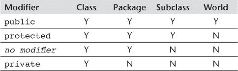

访问级别通过两个方面影响你。首先，当你使用来自其他来源的类（例如 Java 平台中的类），访问级别决定了你的类可以使用这些类的哪些成员。其次，当你编写一个类时，你需要决定类中的每个成员变量和每个方法应该具有什么访问级别。

让我们来看一组类，看看访问级别如何影响可见性。图 4.5 显示了示例中的四个类以及它们之间的关系。表 4.2 显示了对于可以应用于 alpha 类的每个修饰符，其成员在何处可见的。

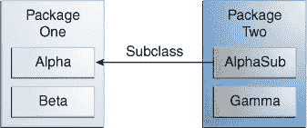

图 4.5 用于说明访问级别的示例中的类和包

表 4.2 可见性

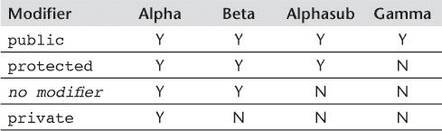

***

注意

如果其他程序员使用你的类，你希望确保不会因误用产生错误。访问级别可以帮助你做到这一点：

- 对于特定成员，使用合理的最限制性访问级别。除非有充分理由，否则使用 `private`。
- 避免使用 `public` 字段，常量除外；`public` 字段往往会将你与特定的实现绑定，并限制你更改代码的灵活性。

***

## 理解实例成员和类成员

在本节中，我们将讨论使用 `static` 关键字创建属于类而不是类实例的字段和方法。

### 类变量

从同一个类蓝图创建多个对象时，它们各拥有自己独特的 `instance variables` 副本。在 `Bicycle` 类中，实例变量是 `cadence`、`gear` 和 `speed`。每个 `Bicycle` 对象都拥有这些变量的独立值，存储在不同的内存位置。

有时你希望拥有一个所有对象共有的变量。这是通过 `static` 修饰符实现的。在声明中带有 `static` 修饰符的字段被称为 `static fields` 或 `class variables`。它们与类相关，而不是与任何对象相关。类的每个实例共享一个类变量，它位于内存中的一个固定位置。任何对象都可以更改类变量的值，但也可以在创建类实例的情况下操作类变量。

例如，假设你想创建多个 `Bicycle` 对象并为每个对象分配一个序列号，从第一个对象开始。这个 ID 数字对每个对象都是唯一的，因此是一个实例变量。同时，你需要一个字段来跟踪创建了多少个 `Bicycle` 对象，以便知道给下一个对象分配哪个 ID。这样的字段与任何单个对象无关，而与整个类相关。为此，你需要一个类变量 `numberOfBicycles`，如下：

点击此处查看代码图像

```java
public class Bicycle{

    private int cadence;
    private int gear;
    private int speed;
    private int id;
    static int numberOfBicycles = 0;

    // ...
}
```

### 类方法

Java 编程语言支持静态方法以及静态变量。在声明中带有 `static` 修饰符的静态方法应该通过类名调用，而无需创建类的实例：

`ClassName.methodName(args)`

***

注意

你也可以通过对象引用引用静态方法：

`instanceName.methodName(args)`

然而，这种做法是不被鼓励的，因为不清楚这些是类方法。

***

静态方法的一个常见用途是访问静态字段。例如，我们可以为 `Bicycle` 类添加一个静态方法来访问 `numberOfBicycles` 静态字段：

点击此处查看代码图像

```java
public static int getNumberOfBicycles() {
    return numberOfBicycles;
}
```


并不是所有实例与类变量及方法的组合都是允许的：

- 实例方法可以直接访问实例变量和实例方法。
- 实例方法可以直接访问类变量和类方法。
- 类方法可以直接访问类变量和类方法。
- 类方法*不能*直接访问实例变量或实例方法——它们必须使用对象引用。此外，类方法不能使用`this`关键字，因为没有供`this`指向的实例。

### 常量

`static`修饰符结合`final`修饰符也用于定义常量。`final`修饰符表示该字段的值不能改变。

例如，下面的变量声明定义了一个名为`PI`的常量，其值是圆周率的近似值（圆周与直径的比值）：

```java
static final double PI = 3.141592653589793;
```

以这种方式定义的常量无法被重新赋值，如果你的程序尝试这样做，将得到编译时错误。按照惯例，常量值的名称使用大写字母。如果名称由多个单词组成，则用下划线（`_`）分隔。

***

**注意**

如果基本类型或字符串被定义为常量，且该值在编译时已知，编译器会将代码中所有的常量名替换为它的值。这被称为*编译时常量*。如果外部世界的常量值发生了变化（例如，如果规定圆周率实际上应该是 3.975），你需要重新编译任何使用该常量的类以获取当前值。

***

### Bicycle 类

在完成本节中的所有修改后，`Bicycle`类现在如下：

```java
public class Bicycle{
    private int cadence;
    private int gear;
    private int speed;
    private int id;
    private static int numberOfBicycles = 0;
    public Bicycle(int startCadence,
                   int startSpeed,
                   int startGear){
        gear = startGear;
        cadence = startCadence;
        speed = startSpeed;
        id = ++numberOfBicycles;
    }

    public int getID() {
        return id;
    }

    public static int getNumberOfBicycles() {
        return numberOfBicycles;
    }

    public int getCadence(){
        return cadence;
    }

    public void setCadence(int newValue){
        cadence = newValue;
    }

    public int getGear(){
        return gear;
    }

    public void setGear(int newValue){
        gear = newValue;
    }

    public int getSpeed(){
        return speed;
    }

    public void applyBrake(int decrement){
        speed -= decrement;
    }

    public void speedUp(int increment){
        speed += increment;
    }
}
```

### 字段初始化

正如你所看到的，你通常可以在字段的声明中为其提供初始值：

```java
public class BedAndBreakfast {
    // 初始化为 10
    public static int capacity = 10;
    // 初始化为 false
    private boolean full = false;
}
```

当初始化值可用且初始化可以写在一行时，这种方法效果很好。然而，这种初始化形式由于其简单性具有局限性。如果初始化需要某些逻辑（例如错误处理或填充复杂数组的`for`循环），简单的赋值是不够的。实例变量可以在构造函数中初始化，在构造函数可以使用错误处理或其他逻辑。

### 静态块

*静态块*是用花括号括的代码块，并在其前面带有`static`关键字。这里有一个示例：

```java
static {
    // 这里可以放置任何代码
}
```

一个类可以有任意数量的静态块，它们出现在类体的任何地方。运行时系统保证它们按照出现的顺序进行初始化。使用构造函数的替代方案是：

```java
class Whatever {
    // 这里可以放置任何代码
}
```

### 初始化实例成员

通常，你会使用构造函数来初始化一个实例。使用构造函数有两种替代方案：初始化块和字段声明。

```java
{
    // 这里可以放置任何代码
}
```

该方法将在子类中讨论。这是一个示例：

```java
class Whatever {
    // 这里可以放置任何代码
}
```

### 创建和使用类的总结

类声明为类命名，并在花括号之间包含类体。类名之前可以有修饰符。类体包含该类的字段、方法和构造函数。类使用字段来包含状态信息，使用方法来实现行为。用于初始化类的新实例的构造函数使用类名，并且看起来像没有返回类型的方法。

你以相同的方式控制类和成员的访问：在它们的声明中使用如`public`等访问修饰符。你通过在成员声明中使用`static`关键字来指定类变量或类方法。未声明为`static`的成员隐式地是实例成员。类变量由类的所有实例共享，可以通过类名以及实例引用进行访问。类的实例拥有每个实例变量的副本，必须通过实例引用进行访问。

你通过使用`new`操作符和构造函数从类创建对象。`new`操作符返回所创建对象的引用。你可以将该引用赋值给变量或直接使用。

声明所在类外部可访问的实例变量和方法可以使用限定名来引用。实例变量的限定名格式如下：`objectReference.variableName`。方法的限定名格式如下：`objectReference.methodName(argumentList)`。或者，方法的限定名也可以像这样：`objectReference.methodName()`。

垃圾回收器会自动清理未使用的对象。如果程序不再持有该对象的引用，则该对象就是未使用的。你可以通过将持有引用的变量设置为`null`来显式丢弃引用。

#### 思考与练习：类

##### 题

1. 考虑以下类：

```java
public class IdentifyMyParts {
    public static int x = 7;
    public int y = 3;
}
```

**a.** 哪些是类变量？

**b.** 什么是实例变量？

**c.** 下面代码的输出是什么？

```java
IdentifyMyParts a = new IdentifyMyParts();
IdentifyMyParts b = new IdentifyMyParts();

a.y = 5;
b.y = 6;

a.x = 1;
b.x = 2;

System.out.println("a.y = " + a.y);
System.out.println("b.y = " + b.y);
System.out.println("a.x = " + a.x);
System.out.println("b.x = " + b.x);
System.out.println("IdentifyMyParts.x = " + IdentifyMyParts.x);
```

##### 练习

**1.** 编写一个类，其实例代表扑克牌中的单张牌。请记住，扑克牌有两个区分属性：点数（rank）和花色（suit）。（务必保留你的解决方案，因为在本章的稍后部分要求你重写它，请将其放在枚举类型部分。）

***

**注意**

你可以使用`assert`语句来检查你的赋值。编写以下内容：

```java
assert (boolean expression to test);
```

如果`boolean`布尔表达式为假，你将得到一条错误消息。例如：

```java
assert toString(ACE) == "Ace";
```

该语句应该返回`true`，因此不会有错误消息。如果你使用`assert`语句，必须带有`ea`标记运行程序：

```bash
java -ea YourProgram.class
```

***

**2.** 编写一个类，其实例代表一整副扑克牌。（你也应该保留此解决方案以备后用。）

**3.** 编写一个小型程序来测试你的牌组和牌类。该程序可以简单到创建一个牌组并显示这些牌。

##### 答案

你可以在以下地址找到这些问题和练习的答案：[`http://docs.oracle.com/javase/tutorial/java/javaOO/QandE/creating-answers.html`](http://docs.oracle.com/javase/tutorial/java/javaOO/QandE/creating-answers.html)。

### 问题与练习：对象

#### 问题

**1.** 下面程序有什么问题？

```java
public class SomethingIsWrong {
    public static void main(String[] args) {
        Rectangle myRect;
        myRect.width = 40;
        myRect.height = 50;
        System.out.println("myRect's area is " + myRect.area());
    }
}
```

**2.** 下面代码创建了一个数组和一个字符串对象。代码执行后，有多少个指向这些对象的引用？是否有任何对象符合垃圾回收条件？

```java
String[] students = new String[10];
String studentName = "Peter Parker";
students[0] = studentName;
studentName = null;
```

**3.** 程序如何销毁它创建的对象？

#### 练习

**1.** 修复问题 1 中的`SomethingIsWrong`程序。

**2.** 给定以下名为`NumberHolder`的类，编写代码创建类的实例，初始化它的两个成员变量，然后显示每个成员变量的值：

```java
public class NumberHolder {
    public int anInt;
    public float aFloat;
}
```

#### 答案

你可以在以下地址找到这些问题和练习的答案：[`http://docs.oracle.com/javase/tutorial/java/javaOO/QandE/objects-answers.html`](http://docs.oracle.com/javase/tutorial/java/javaOO/QandE/objects-answers.html)。

### 嵌套类

Java 语言允许你在另一个类内部定义一个类。这样的类被称为嵌套类，此处所示：

```java
class OuterClass {
    ...
    class NestedClass {
        ...
    }
}
```

#### 定义

嵌套类分为两类：静态和非静态。声明为`static`的嵌套类简单地称为静态嵌套类。非静态嵌套类被称为内部类（inner classes）。

```java
class OuterClass {
    ...
    static class StaticNestedClass {
        ...
    }
    class InnerClass {
        ...
    }
}
```

嵌套类是其外层类的成员。非静态嵌套类（内部类）可以访问外层类的其他成员，即使它们被声明为`private`。静态嵌套类无法访问外层类的其他成员。作为`OuterClass`的成员，嵌套类可以声明为`private`、`public`、`protected`或包私有（package private）。（记住，外层类只能声明为`public`或包私有。）

#### 为什么要使用嵌套类？

使用嵌套类有几个极具说服力的理由，包括：

- **类的逻辑分组。** 如果一个类仅对另一个类有用，那么将其嵌入到该类中并将它们放在一起是符合逻辑的。嵌套此类“助手类”可以使它们的包结构更加精简。
- **增强封装性。** 考虑两个顶层类 A 和 B，其中 B 需要访问 A 的成员，而这些成员通常情况下会被声明为`private`。通过将类 B 隐藏在类 A 内部，A 的成员可以声明为`private`且 B 能够访问。
- **提高代码的可读性和可维护性。** 将小类嵌套在类内部可以使代码更加集中。

#### 静态嵌套类

与方法和变量一样，静态嵌套类与其外层类相关。而且像静态方法一样，静态嵌套类无法直接引用外层类的实例变量或方法。

***

**注意**

静态嵌套类通过外层类名访问：

`OuterClass.StaticNestedClass`

为了方便使用，例如，要创建一个静态嵌套类的对象，使用以下语法：

```java
OuterClass.StaticNestedClass nestedObject =
    new OuterClass.StaticNestedClass();
```

#### 内部类

与方法和变量一样，内部类与其实例相关，并可以直接访问该实例的字段。此外，由于内部类与实例相关，它本身不能定义任何静态成员。

内部类的实例存在于外层类的实例内部。考虑以下类：

```java
class OuterClass {
    ...
    class InnerClass {
        ...
    }
}
```

`InnerClass`的实例只能存在于`OuterClass`的实例内部，并且可以直接访问其方法和字段。

要实例化内部类，必须先实例化外层类。然后在外层对象内部创建内部对象，语法如下：

```java
OuterClass.InnerClass innerObject = outerObject.new InnerClass();
```

此外，还有两种特殊的内部类：局部类和匿名类（也称为匿名内部类）。它们都将在下一节简要讨论。

***

**注意**

如果你想了解更多关于 Java 编程语言中不同类型类的分类信息（这很难用简洁、清晰且准确的方式描述），请参考 Joseph Darcy 博客上的“Nested, Inner, Member and Top-Level Classes”。^(1)

***

#### 内部类示例

为了看到内部类的用法，让我们先考虑数组。在下面的示例中，我们将创建一个数组，用整数值填充它，然后按升序仅输出偶数索引的值。给出的`DataStructure`类包含以下内容：

- `DataStructure`外层类包含将整数添加到数组以及打印数组偶数索引值的方法。
- `InnerEvenIterator`内部类类似于标准的 Java 迭代器。迭代器用于遍历数据结构，通常具有用于测试是否为最后一个元素、获取当前元素以及移动到下一个元素的方法。
- `main`方法实例化了一个`DataStructure`对象（`ds`），并使用它为`arrayOfInts`数组填充整数值（0, 1, 2, 3 等）。然后，它调用了`printEven`方法打印出`arrayOfInts`中偶数索引的值。


```java
public class DataStructure {
    // 创建一个数组
    private final static int SIZE = 15;
    private int[] arrayOfInts = new int[SIZE];

    public DataStructure() {
        // 用升序的整数值填充数组
        for (int i = 0; i < SIZE; i++) {
            arrayOfInts[i] = i;
        }
    }

    public void printEven() {
        // 打印数组偶数索引的值
        InnerEvenIterator iterator = this.new InnerEvenIterator();
        while (iterator.hasNext()) {
            System.out.println(iterator.getNext() + " ");
        }
    }

    // 内部类实现迭代器模式
    private class InnerEvenIterator {
        // 从开始开始遍历数组
        private int next = 0;

        public boolean hasNext() {
            // 检查当前元素是否是数组中的最后一个
            return (next <= SIZE - 1);
        }

        public int getNext() {
            // 记录数组偶数索引的值
            int retValue = arrayOfInts[next];
            // 获取下一个偶数元素
            next += 2;
            return retValue;
        }
    }

    public static void main(String s[]) {
        // 用整数值填充数组并只打印
        // 偶数索引的值
        DataStructure ds = new DataStructure();
        ds.printEven();
    }
}
```

输出结果如下：

```
0 2 4 6 8 10 12 14
```

注意，`InnerEvenIterator` 类直接引用了 `DataStructure` 对象的实例变量 `arrayOfInts`。

内部类可以用于实现示例所示的辅助类。如果你计划处理用户界面事件，将需要知道如何使用内部类，因为事件处理机制大量使用了它们。

### 局部内部类和匿名内部类

还有两种类型的内部类。你可以在方法体内声明一个内部类，这种类被称为局部内部类。你也可以在方法体内声明一个没有命名的内部类。这些类被称为匿名内部类。你在高级 Java 编程中会遇到此类类。

### 修饰符

你可以对内部类使用与外部类其他成员相同的修饰符。例如，你可以使用访问修饰符——`private`、`public` 和 `protected` 来限制对内部类的访问，就像对待其他类成员时一样。

### 嵌套类总结

在另一个类内部定义的类被称为嵌套类。和其他类的其他成员一样，嵌套类可以声明为静态的（`static`）也可以不是静态。非静态嵌套类被称为内部类。内部类的实例只能存在于其所属类的实例中，并且即使所属类的成员被声明为 `private`，内部类也可以访问它们。表 4.3 显示了嵌套类的类型。

#### 表 4.3. 嵌套类的类型

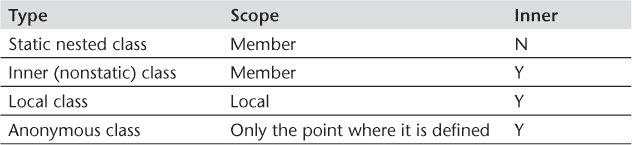

### 问题与练习：嵌套类

## 问题

**1.** 程序 `Problem.java` 无法编译。你需要做什么才能使其编译？为什么？

**2.** 使用 `Box` 类（位于 `javax.swing` 包中）的 Java API 文档来帮助回答以下问题：

**a.** `Box` 定义了什么静态类？

**b.** `Box` 定义了什么内部类？

**c.** `Box` 的内部类的父类是什么？

**d.** `Box` 的哪些嵌套类可以从任何类中使用？

**e.** 你如何创建 `Box` 的 `Filler` 类的实例？

## 练习

**1.** 获取文件 `Class1.java`。编译并运行 `Class1`。输出是什么？

## 答案

你可以在 [`http://docs.oracle.com/javase/tutorial/javaOO/QE/nested-answers`](http://docs.oracle.com/javase/tutorial/javaOO/QE/nested-answers) 找到这些问题和练习的答案。

### 枚举类型

枚举类型是由一组固定常量组成的类型。常见的例子包括方向（`NORTH`、`SOUTH`、`EAST`、`WEST`）和星期。因为它们是常量，枚举类型字段的名称全大写。在 Java 语言中，你通过 `enum` 关键字定义枚举类型。例如，你可以如下指定一个 `days` 枚举类型：

```java
public enum Day {
    SUNDAY, MONDAY, TUESDAY, WEDNESDAY, THURSDAY, FRIDAY, SATURDAY
}
```

每当你需要表示一组固定常量时，都应该使用枚举。这包括自然类型（如我们太阳系中的行星）以及在编译时已知所有值的数据集（例如菜单上的选项、命令行标志）。以下代码展示了如何使用之前定义的 `Day` 枚举：

```java
public class EnumTest {
    Day day;

    public EnumTest(Day day) {
        this.day = day;
    }

    public void tellItItIs() {
        switch (day) {
            case MONDAY:
                System.out.println("Mondays are bad.");
                break;
            case FRIDAY:
                System.out.println("Fridays are better.");
                break;
            case SATURDAY: 
            case SUNDAY:
                System.out.println("Weekends are best.");
                break;
            default:
                System.out.println("Midweek days are so-so.");
                break;
        }
    }

    public static void main(String[] args) {
        EnumTest firstDay = new EnumTest(Day.MONDAY);
        firstDay.tellItItIs();
        EnumTest thirdDay = new EnumTest(Day.WEDNESDAY);
        thirdDay.tellItItIs();
        EnumTest fifthDay = new EnumTest(Day.FRIDAY);
        fifthDay.tellItItIs();
        EnumTest sixthDay = new EnumTest(Day.SATURDAY);
        sixthDay.tellItItIs();
        EnumTest seventhDay = new EnumTest(Day.SUNDAY);
        seventhDay.tellItItIs();
    }
}
```

输出结果如下：

```
Mondays are bad.
Midweek days are so-so.
Fridays are better.
Weekends are best.
Weekends are best.
```

注意

*所有* 枚举隐式地继承 `java.lang.Enum`。由于 Java 不支持多重继承，枚举不能继承其他任何类。

在接下来的示例中，`Planet` 是一个表示太阳系中行星的枚举类型。它们通过常量质量和半径属性进行定义。每个枚举常量在声明时都带有质量和半径参数的值。这些值在常量创建时被传递给构造函数。Java 要求必须在定义任何字段或方法之前定义常量。此外，当存在字段和方法时，枚举常量的列表必须以分号结束。

### 注意

枚举类型的构造函数必须是包级私有的（`package-private`）或私有的（`private`）。它会自动创建在枚举体头部定义的常量。你不能自己调用枚举构造函数。

除了属性和构造函数外，`Planet` 还拥有方法，允许你获取物体在每个行星上的表面重力和重量。这是一个示例程序，它接收你在地球上的重量（任何单位），并计算并打印你在所有行星上的重量（相同单位）：

```java
public enum Planet {
    MERCURY (3.303e+23, 2.4397e6),
    VENUS   (4.869e+24, 6.0518e6),
    EARTH   (5.976e+24, 6.37814e6),
    MARS    (6.421e+23, 3.3972e6),
    JUPITER (1.9e+27,   7.1492e7),
    SATURN  (5.688e+26, 6.0268e7),
    URANUS  (8.686e+25, 2.5559e7),
    NEPTUNE (1.024e+26, 2.4746e7);

    private final double mass;   // in kilograms
    private final double radius; // in meters

    Planet(double mass, double radius) {
        this.mass = mass;
        this.radius = radius;
    }

    private double mass() { return mass; }
    private double radius() { return radius; }

    // universal gravitational constant  (m3 kg-1 s-2)
    public static final double G = 6.67300E-11;

    double surfaceGravity() {
        return G * mass / (radius * radius);
    }

    double surfaceWeight(double otherMass) {
        return otherMass * surfaceGravity();
    }

    public static void main(String[] args) {
        if (args.length != 1) {
            System.err.println("Usage: java Planet <earth_weight>");
            System.exit(-1);
        }
        double earthWeight = Double.parseDouble(args[0]);
        double mass = earthWeight/EARTH.surfaceGravity();
        for (Planet p : Planet.values())
            System.out.printf("Your weight on %s is %f%n",
                              p, p.surfaceWeight(mass));
    }
}
```

如果你在命令行中带参数 175 运行 `Planet.class`，你将得到以下输出：

```
$ java Planet 175
Your weight on MERCURY is 66.107583
Your weight on VENUS is 158.374842
Your weight on EARTH is 175.000000
Your weight on MARS is 66.279007
Your weight on JUPITER is 442.847567
Your weight on SATURN is 186.552719
Your weight on URANUS is 158.397260
Your weight on NEPTUNE is 199.20743
```

#### 枚举类型

## 问题

1. 正确或错误：一个枚举类型可以是 `java.lang.String` 的子类。

##### 练习题

1. 重写“问题：类”章节中练习的 `Card` 类，使其使用枚举类型来表示牌牌的点数和花色。

2. 以同样的方式重写 `Deck` 类。

## 答案

你可以在这里找到这些问题的答案，也可以在 `http://docs.oracle.com/javase/tutorial/javaOO/QandE/enum-answers.html` 查看。

### 注解

注解提供了关于程序但并非程序本身的数据。它们对所注解代码的操作没有直接影响。注解有多种用途，包括：

* 编译器的信息。编译器可以使用注解来检测错误或抑制警告。

* 编译时和部署时处理。软件工具可以处理注解信息以生成代码、XML 文件等等。

* 运行时处理。某些注解可以在运行时进行检查。

注解可以应用于程序中类、字段和其他元素的声明。注解首先出现（按照惯例，独占一行），并可能包含带有命名或未命名命值的 `elements`（元素）：

```java
@Author(
    name = "Benjamin Franklin",
    date = "3/27/2003"
)
class MyClass { }
```

这是另一个示例：

```java
@SuppressWarnings(value = "unchecked")
void myMethod() { }
```

如果只有一个名为 `value` 的元素，则可以省略名称：

```java
@SuppressWarnings("unchecked")
void myMethod() { }
```

此外，如果注解没有元素，则可以省略括号：

```java
@Override
void myMethod() { }
```

#### 文档

许多注解取代了本应是代码中的注释。假设一个软件小组传统上在每个类的体部用注释提供重要信息：

```java
public class Generation3List extends Generation2List {
    // Author: John Doe
    // Date: 3/17/2002
    // Current revision: 6
    // Last modified: 4/12/2004
    // By: Jane Doe
    // Reviewers: Alice, Bill, Cindy
    // class goes here
}
```

要使用注解添加这些相同的元数据，你必须先定义注解类型。执行此操作的语法如下：

```java
@interface Classreamble {
    String author();
    String date();
    int currentRevision() default 1;
    String lastModified() default "N/A";
    String lastModifiedBy() default "N/A";
    // 注意数组用法
    String[] reviewers();
}
```

注解类型定义看起来很像接口，`interface` 关键字前面有一个 `@` 符号（如“AT”）。注解类型实际上是接口的一种，将在第 5 章中介绍。

注解体包含声明，看起来非常像方法。注意这些方法可以定义默认值。

一旦定义了注解类型，你就可以使用该注解并填充值，如下：

```java
@Classreamble (
    author = "John Doe",
    date = "3/17/2002",
    currentRevision = 6,
    lastModified = "4/12/2004",
    lastModifiedBy = "Jane Doe",
    // 注意数组表示
    reviewers = {"Alice", "Bob", "Cindy"}
)
public class Generation3List extends Generation2List {
    // 类代码在此
}
```

### 注意

要让 `@Classreamble` 中的信息出现在 Javadoc 生成的文档中，你必须对 `@Classreamble` 定义本身也注解 `@Documented` 注解：


```java
// 此以使用 @Documented
import java.lang.annotation.*;

@Documented
@interface Classreamble {
    // 注解元素定义
}
```

## 编译器使用的注解

有三种语言规范本身预定义的注解类型：`@Deprecated`、`@Override` 和 `@SuppressWarnings`。

`@Deprecated` 注解表示被标记的元素已过时。当程序使用带有 `@Deprecated` 注解的方法、类或字段时，编译器会生成警告。当元素过时时，还应该使用 Javadoc `@deprecated` 标签进行记录，如下所示。在 Javadoc 注释和注解中使用 `@` 符号并非巧合——它们在概念上是相关的。此外，注意 Javadoc 标签以小写 `d` 开头，而注解以大写 `D` 开头：

```java
// Javadoc 注释如下
/**
 * @deprecated
 * 解释为什么
 * 它过时了
 */
@Deprecated
static void deprecatedMethod() { }
```

`@Override` 注解告知编译器该元素旨在重写父类中声明的元素。（重写方法将在[第 5 章]中讨论。）

```java
// mark method as a superclass method
// that has been overridden
@Override
int overriddenMethod() { }
```

虽然重写方法时并不强制使用此注解，但它可以帮助防止错误。如果标记了 `@Override` 的方法未能正确重写其任一父类中的方法，编译器将生成错误。

`@SuppressWarnings` 注解告诉编译器抑制它原本会生成的特定警告。在下面的示例中，使用了一个已弃（deprecated）的方法，这通常会导致编译器生成警告。在这种情况下，该注解抑制了警告：

```java
// use a deprecated method and tell
// compiler not to generate a warning
@SuppressWarnings("deprecation")
void useDeprecatedMethod() {
    // deprecation warning
    // - suppressed
    objectOne.deprecatedMethod();
}
```

每个编译器警告都属于一个类别。Java 语言规范列出了两个警告类别：`deprecation`（弃用）和 `unchecked`（未检查）。当与泛型出现之前编写的遗留代码进行交互时，可能会发生未检查警告（[第 6 章]）。要抑制多个类别的警告，可以使用以下语法：

```java
@SuppressWarnings({"unchecked", "deprecation"})
```

## 注解处理

注解的高级用法包括编写注解处理器，该处理器可以读取 Java 程序并根据注解采取行动。例如，注解处理器可以生成辅助源代码，让程序员无需创建始终遵循预测模式的样板代码。为了方便这项工作，Java SE 开发包（JDK）5.0 版本包含了一个名为 `apt` 的注解处理工具。从 JDK 6 版本开始，`apt` 的功能成为 Java 编译器的标准部分。

要在运行时提供注解信息，注解类型本身必须标记为 `@Retention(RetentionPolicy.RUNTIME)`，如下：

```java
import java.lang.annotation.*;

@Retention(RetentionPolicy.RUNTIME)
@interface AnnotationForRuntime {
    // Elements that give information
    // for runtime processing
}
```

## 问题与练习题：注解

### 问题

**1.** 下面接口哪里出了问题？

```java
public interface House {
    @Deprecated
    void open();
    void openFrontDoor();
    void openBackDoor();
}
```

**2.** 考虑问题 1 所示的 `House` 接口实现：

```java
public class MyHouse implements House {
    public void open() {}
    public void openFrontDoor() {}
    public void openBackDoor() {}
}
```

如果你编译此程序，编译器会抱怨 `open` 已被弃用（在接口中）。你可以做什么来消除该警告？

### 练习

**1.** 为增强请求定义一个注解类型，包含元素 `id`、`synopsis`、`engineer` 和 `date`。指定 `engineer` 的默认值为 `unassigned`，`date` 的默认值为 `unknown`。

### 答案

你可以在此处找到这些问题和练习题的答案：[`http://docs.oracle.com/javase/tutorial/java/javaOO/QandE/annotations-answers.html`](http://docs.oracle.com/javase/tutorial/java/javaOO/QandE/annotations-answers.html)。

## 5. 接口与继承

章节内容

- 接口

你之前已经在[第 4 章]中看到了实现接口的示例。你可以在本章的第一节阅读更多关于接口的内容：它们的用途、你为什么可能编写接口以及如何编写接口。本章的第二节描述了从一个类派生另一个类的方法——即子类如何从父类继承字段和方法。你将学习所有类都派生自 `Object` 类，并学习如何修改子类从父类继承的方法。本节涵盖了类似接口的抽象类。每个节结束都有问题和练习题，以测试你的理解。

### 接口

在软件工程中，许多情况下，不同的程序员小组同意一个“合同”来规定它们的软件如何相互作用是非常关重要的。每个小组都应该能够在不了解另一组代码实现的情况下编写自己的代码。通常来说，`interfaces` 就是这种合同。

例如，想象一个未来的社会，计算机控制的机器人汽车在没有人类操作员的情况下在街道上运输乘客。汽车制造商编写运行汽车的软件（当然是 Java）——停止、启动、加速。另一组电子引导制作接收交通状况并使用这些信息驱动汽车的系统。制造商必须发布一个接口，详细说明可以调用哪些方法。两组都不需要知道软件是如何实现的；事实上，只要遵守接口，每一组都保留随时修改它的权利。

#### Java 中的接口

在 Java 语言中，`interface` 是一种引用类型，类似于类，可以包含常量、方法签名和嵌套类型。它们没有方法体。接口不能被实例化——它们只能由类实现或由接口扩展。扩展将在稍后讨论。

定义接口类似于创建一个新类：

```java
public interface OperateCar {
    // constant declarations, if any
    // method signatures
    // enum with values
    int turn(Direction direction, double radius, double startSpeed, double endSpeed);
    int changeLanes(Direction direction, double startSpeed, double endSpeed);
    int signalTurn(Direction direction, boolean signalOn);
    int getRadarFront(double distanceToCar, double speedOfCar);
    int getRadarRear(double distanceToCar, double speedOfCar);
    // ... ...
    // more method signatures
}
```

请注意，方法签名没有大括号，并以分号结束。

要使用接口，你需要编写一个 `implements` 该接口的类。当可实例化的类实现接口时，它为接口中声明的每个方法提供方法体。这是一个示例：

```java
public class OperateBMW760i implements OperateCar {
    // the OperateCar method signatures, with implementation
    // for example:
    int signalTurn(Direction direction, boolean signalOn) {
        // 处开启 BMW 左转转向指示灯的代码
        // 处关闭 BMW 左转转向指示灯的代码
        // 处开启 BMW 右转转向指示灯的代码
        // 处关闭 BMW 右转转向指示灯的代码
    }
    // 其他成员，根据需要——例如，对接口客户端不可
    // 见的的辅助类
}
```

在这个机器人汽车的示例中，由汽车制造商来实现该接口。当然，雪佛兰的实现将与丰田的大不相同，但两家制造商都将遵循相同的接口。导航制造商作为接口的客户端，将构建系统，利用汽车位置的 GPS 数据、数字地图和交通数据来驱动汽车。在此过程中，导航系统将调用接口方法：`turn`、`change lanes`、`brake`、`accelerate` 等。

### 接口作为 API

机器人汽车的示例展示了接口如何被用作行业标准的应用程序编程接口（API）。API 在商业软件产品中也很常见。通常，一家公司会出售一个软件软件包，其中包含了另一家公司希望在自己的软件产品中使用的复杂方法。例如，一组数字图像处理方法包被出售给制造终端用户图形程序的公司。图像处理公司编写其类来实现一个接口，并将其向客户公开。然后，图形公司就使用接口中定义的签名和返回类型来调用图像处理方法。虽然图像处理公司的 API 是公开的（面向其客户），但其对 API 的实现被视为严密保护的秘密——事实上，只要该公司继续实现客户所信赖的原始原始接口，它就可以在以后修改该实现。

### 接口与多继承

接口在 Java 编程语言中还有另一个非常重要的作用。接口不是类层次的一部分，尽管它们与类结合工作。Java 编程语言不允许多重继承，但提供了一种替代方案。（继承将在本章稍后讨论。）

在 Java 中，一个类只能继承一个类，但它可以实现多个接口。因此，对象可以拥有多种类型：它们所属类的类型，以及它们所实现的所有接口的类型。这意味着，如果一个变量被声明为接口类型，则它的值可以引用从任何实现该接口的类中实例化的任何对象。这将在本章的“使用接口作为类型”节中讨论。

### 定义接口

接口声明由修饰符、`interface` 关键字、接口名称、用逗号分隔的父接口列表（如果有）以及接口体组成。这是一个示例：

```java
public interface GroupedInterface extends Interface1, Interface2, Interface3 {
    // 常量声明
    // 自然对数的底
    double E = 2.718282;

    // 方法签名
    void doSomething (int i, double x);
    int doSomethingElse(String s);
}
```

`public` 访问修饰符表示接口可以被任何包中的任何类使用。如果你不指定接口为 `public`，则你的接口仅对定义在接口相同包中的类可见。

接口可以扩展其他接口，就像类可以扩展或子类另一个类一样。然而，类只能扩展另一个类，而接口可以扩展任意数量的接口。接口声明包含了它所扩展的所有接口的逗号分隔列表。

#### 接口体

接口体包含了接口中包含的所有方法的声明。接口内部的方法声明后面跟着一个分号，但没有大括号，因为接口不为其内部声明的方法提供实现。接口中声明的所有方法都是隐式为 `public` 的，因此可以省略 `public` 修饰符。

接口除了方法声明外，还可以包含常量声明。接口中定义的所有常量值都是隐式 `public`、`static` 和 `final` 的。再次，这些修饰符可以省略。

### 实现接口

要声明一个实现接口的类，请在类声明中包含 `implements` 子句。你的类可以实现多个接口，因此 `implements` 关键字后面跟着一个用逗号分隔的类实现的接口列表。按照惯例，如果存在 `extends` 子句，则 `implements` 子句在其之后。

#### 示例接口：Relatable

考虑一个定义了如何比较对象大小的接口：

```java
public interface Relatable {
    // this (调用 isLargerThan 的对象)
    // 和 other 必须是
    // 同一个类的实例，返回 1, 0, -1
    // 如果 this 大于 // 大于
    // 等于，或小于于 other
    public int isLargerThan(Relatable other);
}
```

如果你想能够比较相似对象的大小，无论它们是什么，实例化它们的类都应该实现 `Relatable`。

只要有某种方法可以比较从该类中实例化的对象的相对“大小”，任何类都可以实现 `Relatable`。对于字符串，可以是字符数；对于书本，可以是页数；对于学生，可以是体重；以此此类推。对于平面几何对象，面积是一个很好的选择（请参阅后文的 `RectanglePlus` 类），而对于三维几何对象，体积是可行的。所有此类类都可以实现 `isLargerThan()` 方法。如果你知道一个类实现了 `Relatable`，你就可以比较大小。

```java
class RectanglePlus implements Relatable {
    public int width = 0;
    public int height = 0;
    public Point origin;

    public RectanglePlus() {
        origin = new Point(0, 0);
    }

    public RectanglePlus(Point p) {
        origin = p;
    }

    public RectanglePlus(int w, int h) {
        origin = new Point(0, 0);
        width = w;
        height = h;
    }

    public void move(int x, int y) {
        origin.x = x;
        origin.y = y;
    }

    public int getArea() {
        return width * height;
    }

    public int isLargerThan(Relatable other) {
        RectanglePlus otherRect = (RectanglePlus)other;
        if (this.getArea() < otherRect.getArea()) {
            return -1;
        } else if (this.getArea() > otherRect.getArea()) {
            return 1;
        } else {
            return 0;
        }
    }
}
```

因为 `RectanglePlus` 实现了 `Relatable`，所以任意 `RectanglePlus` 对象的大小是可以比较的。

***

注意

在 `Relatable` 接口中定义的 `isLargerThan` 方法接收一个 `Relatable` 类型的对象。加粗的代码行将 `other` 强制转换为 `RectanglePlus` 实例。类型转换告诉编译器该对象的真实类型。在 `other` 实例上直接调用 `getArea`（`other.getArea()`）将编译失败，因为编译器并不理解 `other` 实际上是 `RectanglePlus` 的实例。

当你定义一个新的接口（interface）时，你是在定义一个新的的引用数据类型。你可以在任何可以使用其他数据类型名称的地方使用接口名称。如果你定义了一个类型为接口的引用变量，赋值给它的任何对象*必须*是实现该接口的类的实例。

例如，这里有一个用于在一对对象中寻找最大对象的方法，适用于*任何*实现了 `Relatable` 接口的类所实例化的对象：

```java
public Object findLargest(Object object1, Object object2) {
    Relatable obj1 = (Relatable)object1;
    Relatable obj2 = (Relatable)object2;
    if ((obj1).isLargerThan(obj2) > 0)
        return object1;
    else
        return object2;
}
```

由于 `object1` 已经强制转换为 `Relatable` 类型，它现在可以调用 `isLargerThan` 方法了。

如果你特意在许多类中实现 `Relatable`，那么只要两个对象属于同一个类，从这些*任何*类中实例化的对象都可以使用 `findLargest()` 方法进行比较。同样，它们都可以使用以下方法进行比较：


```java
public Object findSmallest(Object object1, Object object2) {
    Relatable obj1 = (Relatable)object1;
    Relatable obj2 = (Relatable)object2;
    if ((obj1).isLargerThan(obj2) < 0)
        return object1;
    else
        return object2;
}

public boolean isEqual(Object object1, Object object2) {
    Relatable obj1 = (Relatable)object1;
    Relatable obj2 = (Relatable)object2;
    if ((obj1).isLargerThan(obj2) == 0)
        return true;
    else
        return false;
}
```

这些方法适用于任何“可比较”的对象，无论它们的类继承关系如何。当它们实现`Relatable`时，它们既可以是它们自身所属的类（或父类）类型，也可以是`Relatable`类型。这使得它们具有多重继承的一些优势，即它们可以同时拥有来自父类和接口的行为。

## 重写接口

考虑你开发的一个名为`DoIt`的接口：

点击此处查看代码图片

```java
public interface DoIt {
    void doSomething(int i, double x);
    int doSomethingElse(String s);
}
```

假设在以后某个时候，你想为`DoIt`添加第三个方法，按如下方式更改接口：

点击此处查看代码图片

```java
public interface DoIt {
    void doSomething(int i, double x);
    int doSomethingElse(String s);
    boolean didItWork(int i, double x, String s);
}
```

如果你进行了此更改，所有实现旧`DoIt`接口的类都会报错，因为它们不再实现了该接口。依赖此接口的程序员会强烈抗议。

尝试预测你的接口的所有用途，并从一开始就对其进行完整规范。考虑到这通常是不可能的，你可能需要在稍后创建更多接口。例如，你可以创建一个扩展`DoIt`的`DoItPlus`接口：

点击此处查看代码图片

```java
public interface DoItPlus extends DoIt {
    boolean didItWork(int i, double x, String s);
}
```

现在，你代码的用户可以选择继续使用旧接口或升级到新接口。

## 接口总结

接口定义了两个对象之间的通信协议。接口声明包含一组方法的签名，但没有实现体，并且还可能包含常量定义。实现接口的类必须实现接口中声明的所有方法。接口名称可以在任何可以使用类型的地方使用。

## 思考与练习：接口

### 思考

**1.** 实现`java.lang.CharSequence`接口的类需要实现哪些方法？

**2.** 下面的接口哪里有问题？

点击此处查看代码图片

```java
public interface SomethingIsWrong {
    void aMethod(int aValue){
        System.out.println("Hi Mom");
    }
}
```

**3.** 修复第 2 题中的接口。

**4.** 下面的接口有效吗？

```java
public interface Marker {
```

## 练习

**1.** 写一个实现`lang`包中`CharSequence`的类。

**2.** 假设你有一个服务器定期通知其客户端当前的日期和时间。编写一个简单的`main`方法进行测试。

## 答案

你可以在`http://docs.oracle.com/javase/tutorial/IandE/interfaces.html`找到这些问题和练习的答案。

### 继承

你已经多次看到*继承*（inheritance）。在 Java 语言中，类可以被*派生*（derived）。

### 定义

派自另一个类的类被称为*子类*（subclass，也称为*派生类*、*子类*）。派生自出的类被称为*父类*（superclass，也称为*基类*、*父类*）。除了没有父类的`Object`，每个类只有一个直接父类。

继承的概念简单而强大：当你想要创建一个新类，并且已经有一个类包含了其中的部分代码时，你可以从该类派生出你的新类。这样做，你可以重用现有类的字段和方法，而无需编写（以及调试！）它们。

子类继承父类的所有*成员*（字段、方法、内部类）。构造方法不是成员，因此不会被继承，但可以在子类中调用父类的构造方法。

#### Java 平台层次结构

`Object`类（见文 _ch5fn1）定义在`lang`包中，定义并实现了所有类的公共行为——包括你写的类。在 Java 平台上，许多类直接派自`Object`，其他类派生自这些类，依此类推，形成了一个类层次结构（见图 5.1](#part0009.html_ch5fig01)).在层次结构的顶端，`Object`是所有类中最通用的。位于底部的类提供了更具体的行为。

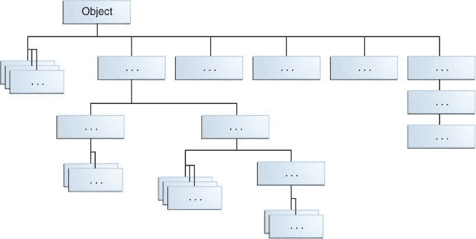

图 5.1 Java 平台上所有的类都是 Object 的后代

#### 继承示例

这是第 4 章](#part0008.html_ch04)中介绍的`Bicycle`类的可能实现示例代码：

点击此处查看代码图片

```java
public class Bicycle {
    // Bicycle 类有
    // 三个字段
    public int cadence;
    public int gear;
    public int speed;

    // Bicycle 类有
    // 一个构造方法
    public Bicycle(int startCadence, int startSpeed, int startGear) {
        gear = startGear;
        cadence = startCadence;
        speed = startSpeed;
    }

    // Bicycle 类有
    // 四个方法
    public void setCadence(int newValue) {
        cadence = newValue;
    }
}
```

```java
public void setGear(int newValue) {
    gear = newValue;
}
public void applyBrake(int decrement) {
    speed -= decrement;
}
public void speedUp(int increment) {
    speed += increment;
}
}
```

一个作为`Bicycle`子类的`MountainBike`类的声明可能如下：

点击此处查看代码图片

```java
public class MountainBike extends Bicycle {
    // MountainBike 子类增加了
    // 一个字段
    public int seatHeight;
    // MountainBike 子类有一个
    // 构造函数
    public MountainBike(int startHeight,
                        int startCadence,
                        int startSpeed,
                        int startGear) {
        super(startCadence, startSpeed, startGear);
        seatHeight = startHeight;
    }

    // MountainBike 子类增加了
    // 一个方法
    public void setHeight(int newValue) {
        seatHeight = newValue;
    }
}
```

`MountainBike`继承了`Bicycle`的所有字段和方法，并添加了字段`seatHeight`以及一个设置它的方法。除了构造函数之外，这就像是你完全从零写了一个全新的`MountainBike`类，包含四个字段和五个方法。然而，你并不需要完成所有工作。如果`Bicycle`类中的方法非常复杂并且花费了大量时间调试，那么这样做将特别有价值。

### 你可以在子类中做什么

无论子类位于哪个包，它都会继承其父类所有的`public`和`protected`成员。如果子类与其父类在同一个包中，它还会继承父类的`package-private`（包级私有）成员。你可以直接使用这些继承来的成员，也可以替换它们、隐藏它们或用新成员来补充它们：

- 你可以直接使用继承的字段，就像使用任何其他字段一样。

- 你可以在子类中声明一个与父类中同名的字段，从而将其“隐藏（hiding）”（不建议这样做）。

- 你可以在子类中声明父类中不存在的新字段。

- 你可以直接按原样使用继承的方法。

- 你可以在子类中写一个与父类中方法具有相同签名的`instance`方法，从而对其进行“重写（overriding）”。

- 你可以在子类中写一个与父类中方法具有相同签名的`static`方法，从而将其“隐藏（hiding）”。

- 你可以在子类中声明父类中不存在的新方法。

- 你可以写一个子类构造函数来调用父类的构造函数，可以是隐式的，也可以通过使用`super`关键字。

本章的后续章节将扩展介绍这些主题。

#### 父类中的私有成员

子类不继承父类的`private`成员。然而，如果父类具有公共或受保护的方法来访问其私有字段，那么这些方法也可以被子类使用。

嵌套类可以访问其外部类所有的私有成员——包括字段和方法。因此，子类继承的公共或受保护嵌套类可以间接访问父类的所有私有成员。

### 对象类型转换

我们已经看到，给定对象的数据类型是其实例化所属类的类型。这里有一个示例：

```java
MountainBike myBike = new MountainBike();
```

在这种情况下，`myBike`的类型是`MountainBike`。`MountainBike`继承自`Bicycle`和`Object`。因此，一个`MountainBike`既是一个`Bicycle`也是一个`Object`，可以在任何需要`Bicycle`或`Object`对象的地方使用它。反之则未必：一个`Bicycle`可能是一个`MountainBike`，但并不一定。同样，一个`Object`可能是一个`Bicycle`或`MountainBike`，但也不一定是。

`类型转换（Casting）`显示了在继承和实现允许的对象之间，用一种类型的对象代替另一种类型。这里有一个示例：

```java
Object obj = new MountainBike();
```

在这种情况下，`obj`既是一个`Object`也是一个`MountainBike`（直到`obj`被赋值另一个不是`MountainBike`的对象）。这被称为`隐式转换（implicit casting）`。

另一方面，我们可以写如下代码：

```java
MountainBike myBike = obj;
```

在这里我们将得到一个编译错误，因为编译器不知道`obj`是一个`MountainBike`。然而，我们可以通过`显式转换（explicit casting）`告诉编译器，我们承诺给`obj`赋值一个`MountainBike`：

```java
MountainBike myBike = (MountainBike)obj;
```

这种转换插入了一个运行时检查，在给`obj`赋值`MountainBike`时，这样编译器就可以安全地假设`obj`是一个`MountainBike`。如果运行时`obj`不是`MountainBike`，则会抛出异常。

***

**注意**

你可以使用`instanceof`运算符进行逻辑测试以确定特定对象的类型。这可以防止不当的类型转换。这里有一个示例：

```java
if (obj instanceof MountainBike) {
    MountainBike myBike = (MountainBike)obj;
}
```

### 重写与隐藏方法

#### 实例方法

子类中与父类实例方法具有相同签名（名称以及参数类型）和返回类型的`instance`方法对父类方法进行`重写（overrides）`。子类的重写能力允许类继承一个行为“足够”的父类，然后根据需要对其进行修改。重写方法还可以返回返回类型的子类型。这被称为`协变返回类型（covariant return type）`。

在重写方法时，你可能想使用`@Override`注解，它指示编译器你打算重写父类中的方法。如果由于某种原因编译器检测到该方法不存在，它将生成错误。有关`@Override`的更多信息，请参阅第 4 章。

#### 类方法

如果子类定义了一个与父类类方法具有相同签名的类方法，则子类方法会对父类方法进行`隐藏（hides）`。隐藏与重写的区别具有重要的影响。被调用的方法版本取决于是从父类还是子类调用的。

```java
public class Animal {
    public static void testClassMethod() {
        System.out.println("The class method in Animal.");
    }
    public void testInstanceMethod() {
        System.out.println("The instance method in Animal.");
    }
}
```

第二个类是`Animal`的子类——`Cat`：

```java
public class Cat extends Animal {
    public static void testClassMethod() {
        System.out.println("The class method in Cat.");
    }
    public void testInstanceMethod() {
        System.out.println("The instance method in Cat.");
    }
    public static void main(String[] args) {
        Cat myCat = new Cat();
        Animal myAnimal = myCat;
        Animal.testClassMethod();
        myAnimal.testInstanceMethod();
    }
}
```

`Cat`类重写了`Animal`中的实例方法，并隐藏了`Animal`中的类方法。该类中的`main`方法创建了一个`Cat`实例，并在类上调用了`testClassMethod()`在实例上调用了`testInstanceMethod()`。此程序的输出如下：

Animal 中的类方法。

Cat 中的实例方法。

正如所承诺的，被调用的隐藏方法版本是父类中的，而被调用的重写方法版本是子类中的。

### 修饰符

重写方法的访问修饰符可以允许比被重写方法更多的访问权限（但不能更少）。例如，父类中的一个`protected`实例方法在子类中可以变为`public`，但不能变为`private`。如果你尝试将父类中的实例方法更改为子类中的类方法（反之亦然），将得到编译时错误。

### 总结

表 5.1 总结了当你定义一个与父类方法签名相同的方法时发生的情况。

表 5.1. 定义与父类方法签名相同的方法


***

注意

在子类中，你可以重载继承自父类的方法。这些重载的方法既不隐藏也不重写父类方法——它们是新的方法，是子类特有的。

***

### 多态性

*Polymorphism*的字典定义指的是生物学中的一个原理，即生物或物种可以许多不同的形式或阶段。这一原理也可以应用于面向对象的编程和像 Java 这样的语言。类的子类可以定义自己独特的行为，同时共享父类的一些相同功能。

通过对`Bicycle`类进行微改可以演示多态性。例如，可以向类中添加一个`printDescription`方法，用于显示当前存储在实例中的数据：

点击此处查看代码图片

```java
public void printDescription(){
    System.out.println("\nBike is " + "in gear " + this.gear
        + " with a cadence of " + this.cadence +
        " and traveling at a speed of " + this.speed + ". ");
}
```


为了在 Java 语言中演示多态特性，通过扩展`Bicycle`类创建`MountainBike`和`RoadBike`类。对于`MountainBike`，添加一个`suspension`字段，它是一个`String`值，用于指示自行车是否有前避震器（`Front`）或前后避震器（`Dual`）。

以下是更新后的类：

点击此处查看代码图片

```
public class MountainBike extends Bicycle {
    private String suspension;
    public MountainBike(
            int startCadence,
            int startSpeed,
            int startGear,
            String suspensionType){
        super(startCadence,
            startSpeed,
            startGear);
        setSuspension(suspensionType);
    }
    public String getSuspension(){
        return this.suspension;
    }
    public void setSuspension(String suspensionType) {
        this.suspension = suspensionType;
    }
    public void printDescription() {
        super.printDescription();
        System.out.println("The " + "MountainBike has a" + getSuspension() + " suspension.");
    }
}
```

注意被重写的`printDescription`方法。除了提供的信息外，还包含了关于避震器的额外数据。

接下来，创建`RoadBike`类。由于公路车或赛车有细轮胎，因此添加一个属性来跟踪轮胎宽度（`tireWidth`）。以下是`RoadBike`类：

点击此处查看代码图片

```
public class RoadBike extends Bicycle{
    // 以毫米 (mm) 计算
    private int tireWidth;
    public RoadBike(int startCadence,
            int startSpeed,
            int startGear,
            int newTireWidth){
        super(startCadence,
            startSpeed,
            startGear);
        this.setTireWidth(newTireWidth);
    }
    public int getTireWidth(){
        return this.tireWidth;
    }
    public void setTireWidth(int newTireWidth){
        this.tireWidth = newTireWidth;
    }
    public void printDescription(){
        super.printDescription();
        System.out.println("The RoadBike" + " has " + getTireWidth() + " MM tires.");
    }
}
```

注意，再次重写了`printDescription`方法。这次，显示了关于轮胎宽度的信息。

总结来说，有三个类：`Bicycle`、`MountainBike`和`RoadBike`。两个子类重写了`printDescription`方法并打印独特信息。

这是一个创建了三个`Bicycle`变量的测试程序。每个变量被分配给三个自行车类之一。然后打印每个变量：

点击此处查看代码图片

```
public class TestBikes {
  public static void main(String[] args){
    Bicycle bike01, bike02, bike03;
    bike01 = new Bicycle(20, 10);
    bike02 = new MountainBike(20, 10, 5, "Dual");
    bike03 = new RoadBike(40, 20, 8, 23);
    bike01.printDescription();
    bike02.printDescription();
    bike03.printDescription();
  }
}
```

`Cat`类重写了`Animal`中的实例方法，并隐藏了`Animal`中的类方法。该类中的`main`方法创建了一个`Cat`实例，并在类上调用了`testClassMethod()`在实例上调用了`testInstanceMethod()`。此程序的输出如下：

Animal 中的类方法。

Cat 中的实例方法。

正如所承诺的，被调用的隐藏方法版本是父类中的，而被调用的重写方法版本是子类中的。

### 修饰符

重写方法的访问修饰符可以允许比被重写方法更多的访问权限（但不能更少）。例如，父类中的一个`protected`实例方法在子类中可以变为`public`，但不能变为`private`。如果你尝试将父类中的实例方法更改为子类中的类方法（反之亦然），将得到编译时错误。

### 总结

表 5.1 总结了当你定义一个与父类方法签名相同的方法时发生的情况。

表 5.1. 定义与父类方法签名相同的方法

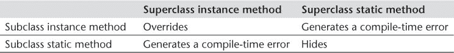

***

注意

在子类中，你可以重载继承自父类的方法。这些重载的方法既不隐藏也不重写父类方法——它们是新的方法，是子类特有的。

***

### 多态性

*Polymorphism*的字典定义指的是生物学中的一个原理，即生物或物种可以许多不同的形式或阶段。这一原理也可以应用于面向对象的编程和像 Java 这样的语言。类的子类可以定义自己独特的行为，同时共享父类的一些相同功能。

通过对`Bicycle`类进行微改可以演示多态性。例如，可以向类中添加一个`printDescription`方法，用于显示当前存储在实例中的数据：

点击此处查看代码图片

```
public void printDescription(){
    System.out.println("\nBike is " + "in gear " + this.gear
        + " with a cadence of " + this.cadence +
        " and traveling at a speed of " + this.speed + ". ");
}
```

为了在 Java 语言中演示多态特性，通过扩展`Bicycle`类创建`MountainBike`和`RoadBike`类。对于`MountainBike`，添加一个`suspension`字段，它是一个`String`值，用于指示自行车是否有前避震器（`Front`）或前后避震器（`Dual`）。

以下是更新后的类：

点击此处查看代码图片

```
public class MountainBike extends Bicycle {
    private String suspension;
    public MountainBike(
            int startCadence,
            int startSpeed,
            int startGear,
            String suspensionType){
        super(startCadence,
            startSpeed,
            startGear);
        setSuspension(suspensionType);
    }
    public String getSuspension(){
        return this.suspension;
    }
    public void setSuspension(String suspensionType) {
        this.suspension = suspensionType;
    }
    public void printDescription() {
        super.printDescription();
        System.out.println("The " + "MountainBike has a" + getSuspension() + " suspension.");
    }
}
```


注意被重写的 `printDescription` 方法。除了提供的信息外，还包含了关于避震器的额外数据。

接下来，创建 `RoadBike` 类。由于公路车或赛车有细轮胎，因此添加一个属性来跟踪轮胎宽度（`tireWidth`）。以下是 `RoadBike` 类：

点击此处查看代码图片

```
public class RoadBike extends Bicycle{
    // 以毫米 (mm) 计算
    private int tireWidth;
    public RoadBike(int startCadence,
            int startSpeed,
            int startGear,
            int newTireWidth){
        super(startCadence,
            startSpeed,
            startGear);
        this.setTireWidth(newTireWidth);
    }
    public int getTireWidth(){
        return this.tireWidth;
    }
    public void setTireWidth(int newTireWidth){
        this.tireWidth = newTireWidth;
    }
    public void printDescription(){
        super.printDescription();
        System.out.println("The RoadBike" + " has " + getTireWidth() + " MM tires.");
    }
}
```

注意，再次重写了 `printDescription` 方法。这次，显示了关于轮胎宽度的信息。

总结来说，有三个类：`Bicycle`、`MountainBike` 和 `RoadBike`。两个子类重写了 `printDescription` 方法并打印独特信息。

这是一个创建了三个 `Bicycle` 变量的测试程序。每个变量被分配给三个自行车类之一。然后打印每个变量：

点击此处查看代码图片

```
public class TestBikes {
  public static void main(String[] args){
    Bicycle bike01, bike02, bike03;
    bike01 = new Bicycle(20, 10);
    bike02 = new MountainBike(20, 10, 5, "Dual");
    bike03 = new RoadBike(40, 20, 8, 23);
    bike01.printDescription();
    bike02.printDescription();
    bike03.printDescription();
  }
}
```

以下示例说明了如何使用 `super` 关键字来调用父类的构造函数。回顾 `Bicycle` 示例，`MountainBike` 是 `Bicycle` 的子类。这里是 `MountainBike`（子类）的构造函数，它调用了父类的构造函数并添加了自己的初始化代码：

点击此处查看代码

```java
public MountainBike(int startHeight,
                    int startCadence,
                    int startSpeed,
                    int startGear) {
    super(startCadence, startSpeed, startGear);
    seatHeight = startHeight;
}
```

调用父类构造函数必须是子类构造函数的第一行。调用父类构造函数的语法如下：

```
super();
```

这里是另一种形式：

```
super(parameter list);
```

在 `super()` 中，调用的是父类的无参数构造函数。在 `super(parameter list)` 中，调用的是具有匹配参数列表的父类构造函数。

### Note

如果构造函数没有显式地调用父类构造函数，Java 编译器会自动插入对父类无参数构造函数的调用。如果父类没有无参数构造函数，你将得到编译错误。`Object` 确实有这样一个构造函数，因此如果 `Object` 是唯一的父类，就没有问题。

如果子类构造函数显式或隐式地调用了其父类的构造函数，你可能会认为会调用整个构造函数链，一直追溯到 `Object` 的构造函数。事实上，确实如此。这被称为*构造函数链*，当类继承链很长时你需要注意到这一点。

### Object 作为父类

在 `java.lang` 包中，`Object` 类位于类层次树的顶部。每个类直接或或继承自 `Object` 类。你使用的或编写的每个类都继承 `Object` 的实例方法。你不需要使用这些方法中的任何一个，但如果你选择使用，可能需要用特定类的代码来重写它们。以下是本节讨论的从 `Object` 继承的方法：

- `protected Object clone() throws CloneNotSupportedException`—创建并返回此对象的副本

- `public boolean equals(Object obj)`—指示另一个对象是否“等于”此对象

- `protected void finalize() throws Throwable`—当垃圾回收器决定不再有该对象的引用时，在对象上调用此方法

- `public final Class getClass()`—返回对象的运行时类

- `public int hashCode()`—返回对象的哈希码值

- `public String toString()`—返回对象的字符串表示

`Object` 的 `notify`、`notifyAll` 和 `wait` 方法在同步程序中独立运行线程的活动方面都起着作用，将在后面的章节中详细讨论。这共有五个方法：

- `public final void notify()`

- `public final void notifyAll()`

- `public final void wait()`

- `public final void wait(long timeout)`

- `public final void wait(long timeout, int nanos)`

### Note

这些方法中的许多方法有一些微妙的方面，特别是 `clone` 方法。

### The clone() Method

如果一个类或其某个父类实现了 `Cloneable` 接口，你就可以使用 `clone()` 方法从现有对象创建一个副本。使用以下代码创建克隆：

```
aCloneableObject.clone();
```

`Object` 对此方法的实现会检查调用 `clone()` 的对象是否实现了 `Cloneable` 接口。如果对象没有实现，该方法将抛出 `CloneNotSupportedException` 异常。异常处理将在第 9 章中介绍。目前，如果你打算编写一个 `clone()` 方法来重写 `Object` 中的方法，你需要将其声明如下：

```java
protected Object clone() throws CloneNotSupportedException
```

这里是另一种形式：

```java
public Object clone() throws CloneNotSupportedException
```

如果调用 `clone()` 的对象实现了 `Cloneable` 接口，`Object` 的 `clone()` 方法会创建一个与原始对象相同类的对象，并将新成员变量初始化为与原始对象的成员变量相同的值。使你的类可克隆的最简单方法是在类声明中添加 `implements Cloneable`。然后你的对象就可以调用 `clone()` 方法了。

对于某些类，`Object` `clone()` 方法的默认行为运行良好。但是，如果对象包含指向外部对象的引用（例如 `ObjExternal`），你可能需要重写 `clone()` 来实现这一点。

### The equals() Method

`Object` 提供的 `equals()` 方法使用标识运算符 (`==`) 来判断对象是否相等。对于基本类型，这会得到正确的结果。对于对象，则不然。要测试对象在等效性（包含相同信息）上相等，你必须重写 `equals()` 方法。这是一个重写了 `equals()` 的 `Book` 类示例：

点击此处查看代码

```java
public class Book {
    ...
    public boolean equals(Object obj) {
        if (obj instanceof Book)
            return ISBN.equals((Book)obj.getISBN());
        else
            return false;
    }
}
```

考虑这段测试两个 `Book` 实例是否相等的代码：

点击此处查看代码

```java
// Swing Tutorial, 5th edition
Book firstBook = new Book("0132761696");
Book secondBook = new Book("0132761696");

if (firstBook.equals(secondBook)) {
    System.out.println("objects are equal");
} else {
    System.out.println("objects are not equal");
}
```

即使 `firstBook` 和 `secondBook` 引用两个不同的对象，此程序也会显示 `objects are equal`。它们被认为是相等的是因为比较的对象包含相同的 ISBN 编号。如果标识运算符对于你的类不适用，你应该始终重写 `equals()` 方法。

### Note

如果你重写了 `equals()`，你也必须重写 `hashCode()`。

### The finalize() Method

`Object` 类提供了一个回调方法 `finalize()`，当对象变成垃圾时，可能会在对象上调用该方法。`Object` 对 `finalize()` 的实现什么都不做——你可以重写 `finalize()` 来执行清理工作，包括释放资源。

系统可能会自动调用 `finalize()` 方法，但不确定它何时调用以及是否会被调用。因此，你不应该依赖此方法来为你完成清理工作。

你不能重写 `getClass`。`getClass()` 方法返回一个 `Class` 对象，该对象包含你可以使用的方法来获取有关该类的信息，例如它的名称（`getSimpleName()`）、父类（`getSuperclass()`）以及它实现的接口（`getInterfaces()`）。例如，以下方法可以获取并显示对象的类名：

点击此处查看代码图片

```java
void printClassName(Object obj) {
    System.out.println("The object's" + " class is " +
        obj.getClass().getSimpleName());
}
```

位于 `java.lang` 包中的 `Class` 类拥有大量方法（超过五十个）。例如，你可以测试该类是否为注解（`isAnnotation()`）、接口（`isInterface()`）或枚举（`isEnum()`）。你可以查看字段（`getFields()`）或方法（`getMethods()`）等。

## hashCode() 方法

`hashCode()` 返回的值是对象的哈希码（hash code），它是对象以十六进制形式表示的内存地址。根据定义，如果两个对象相等，它们的哈希码也必须相等。如果你重写了 `equals()` 方法，你就改变了两个对象相等的方式，此时 `Object` 对 `hashCode()` 的实现不再有效。因此，如果你重写了 `equals()` 方法，必须也重写 `hashCode()` 方法。

## toString() 方法

你应该始终考虑在你的类中重写 `toString()` 方法。`Object` 的 `toString()` 方法返回对象的 `String` 表示，这对于调试非常有用。对象的字符串表示完全取决于对象本身，这就是为什么你需要在类中重写 `toString()` 的原因。

你可以将 `toString()` 配合 `System.out.println()` 来显示对象的文本表示，例如 `Book` 实例：

```java
System.out.println(firstBook.toString());
```

对于一个经过正确重写的 `toString()` 方法，这将打印出有用的信息，如下所示：

ISBN: 0132761696; The Swing Tutorial; A Guide to Constructing GUIs, 5th Edition

## 编写 final 类和方法

你可以将类的一些或全部方法声明为 `final`。方法声明中使用 `final` 关键字用于指示该方法不能被子类重写。`Object` 类就是这样做的——它的许多方法都是 `final` 的。

如果一个方法的实现不应该被改变并且对对象的一致状态至关重要，你可能希望将该方法设置为 `final`。例如，你可能希望将 `ChessAlgorithm` 类中的 `getFirstPlayer` 方法设为 `final`：

点击此处查看代码图片

```java
class ChessAlgorithm {
    enum ChessPlayer { WHITE, BLACK }
    . . .
    final ChessPlayer getFirstPlayer() {
        return ChessPlayer.WHITE;
    }
    . . .
}
```

从构造函数调用的方法通常应该声明为 `final`。如果构造函数调用了非 final 方法，子类可能会重新定义该方法，产生意外或不利的结果。

注意，你还可以将整个类声明为 `final`。声明为 `final` 的类不能被子类。这非常有用，例如在创建一个像 `String` 类这样的不可变类时。

## 抽象方法和类

`abstract class`（抽象类）是声明为 `abstract` 的类——它可能包含也可能不包含抽象方法。抽象类不能实例化，但可以被子类。

`abstract method`（抽象方法）是声明时没有实现的方法（即没有大括号并在后跟分号）。这是一个示例：

```java
abstract void moveTo(double deltaX, double deltaY);
```

如果一个类包含了抽象方法，则该类本身必须声明为 `abstract`：

点击此处查看代码图片

```java
public abstract class GraphicObject {
    // 声明字段
    // 声明非抽象方法
    abstract void draw();
}
```

当抽象类被子类化时，子类通常会为其父类中的所有抽象方法提供实现。然而，如果没有提供，则子类也必须被声明为 `abstract`。

> **注意**

> `interface`（接口）中的所有方法都是*隐式*的抽象方法，因此接口方法不使用 `abstract` 修饰符。（可以使用——只是没有必要。）

## 抽象类与接口


与接口不同，抽象类可以包含不是`static`且`final`的字段，并且可以包含已实现的方法。此类抽象类与接口类似，但它们提供了部分实现，留给子类去完成实现。如果一个抽象类*仅*包含抽象方法声明，则应该被声明为接口。

类可以从类层次结构中的任何地方实现多个接口，无论它们之间是否存在任何关系。例如，考虑`Comparable`或`Cloneable`。

相比之下，抽象类最常见的子类化形式是为了共享实现片段。一个抽象类会被具有许多共同点（抽象类的已实现部分）但也有某些差异（抽象方法）的相似类所子类化。

## 抽象类示例

在一个面向对象的绘图应用程序中，你可以绘制圆、矩形、线段、贝塞尔曲线以及许多其他图形对象。这些对象都具有某些状态（例如位置、朝向、线条颜色、填充颜色）并且某些行为（例如位置、填充颜色、移动）对于所有图形对象都是通用的。而另一些行为（例如缩放、绘制）需要不同的实现。这正是抽象父类的完美场景。图 5.2)

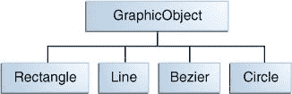

图 5.2 矩形、线、Bezier 和圆继承自 GraphicObject

首先声明一个抽象类`GraphicObject`来提供所有子类共享的成员变量和方法，例如当前的位置和`moveTo`方法。`GraphicObject`还声明了抽象方法，例如`draw`或`resize`，这些方法需要由子类实现但必须以不同的方式实现。`GraphicObject`类看起来如下：

点击此处查看代码图片

```java
abstract class GraphicObject {
    int x, y;
    . . .
    void moveTo(int newX, int newY) {
        . . .
    }
    abstract void draw();
    abstract void resize();
}
```

`GraphicObject`的非抽象子类（如`Circle`和`Rectangle`）必须为`draw`和`resize`方法提供实现：

点击此处查看代码图片

```java
class Circle extends GraphicObject {
    void draw() {
        . . .
    }
    void resize() {
        . . .
    }
}

class Rectangle extends GraphicObject {
    void draw() {
        . . .
    }
    void resize() {
        . . .
    }
}
```

## 当抽象类实现接口时

在上一节中，我们提到实现接口的类必须实现*所有*接口方法。然而，可以定义一个没有实现所有方法的类，前提是该类被声明为`abstract`。这是一个示例：

点击此处查看代码图片

```java
abstract class X implements Y {
    // 实现了 Y 中除一个之外的方法
}

class XX extends X {
    // 实现 Y 中剩余的方法
}
```

在这种情况下，类`X`必须是`abstract`（抽象的），因为它没有完全实现`Y`，但类`XX`实际上实现了`Y`。

### 类成员

抽象类可以拥有`static`字段和`static`方法。你可以像使用任何其他类一样，通过类引用使用这些静态成员（例如，`AbstractClass.staticMethod()`）。

### 继承总结

除`Object`类外，一个类恰有一个直接父类。一个类从它所有的父类中继承字段和方法，无论是直接继承还是间接继承。子类可以重写它所继承的方法，也可以隐藏它继承的字段或方法。（请注意，正如前文提到的，隐藏字段通常是一种糟糕的编程习惯。）[表 5.1 显示了声明一个与父类中方法相同签名的方法的影响。

`Object`类是类层级结构的顶端。所有类都是该类的后代，并继承了它的方法。从`Object`继承的有用方法包括`toString()`、`equals()`、`clone()`和`getClass()`。

你可以通过在类声明中使用`final`关键字来防止类被子类化。同样，你可以通过将方法声明为`final`方法来防止其被子类重写。

抽象类只能被子类化；不能被实例化。抽象类可以包含抽象方法——即已声明但未实现的方法。子类则为这些抽象方法提供实现。

### 问题与练习：继承

## 问题

**1.** 考虑以下两个类：

点击此处查看代码图像

```java
public class ClassA {
    public void methodOne(int i) {

    }
    public void methodTwo(int i) {

    }
    public static void methodThree(int i) {

    }
    public static void methodFour(int i) {

    }
}

public class ClassB extends ClassA {
    public static void methodOne(int i) {

    }
    public void methodTwo(int i) {
    }
    public void methodThree(int i) {
    }
    public static void methodFour(int i) {
    }
}
```

**a.** 哪个方法重写了父类中的方法？

**b.** 哪个方法隐藏了父类中的方法？

**c.** 其他方法是做什么的？

**2.** 考虑你在第 4 章中“问题与练习：类”编写的`Card`、`Deck`和`DisplayDeck`类。这些类分别应该重写哪些`Object`方法？

## 练习

**1.** 为你对问题 2 的答案中的方法编写实现。

## 答案

你可以在[`http://docs.oracle.com/javase/tutorial/java/IandI/QandE/inherit-answers.html`](http://docs.oracle.com/javase/tutorial/java/IandI/QandE/inherit-answers.html)找到这些问题和练习的答案。

# 6. 泛型 (Generics)

* *

章节目录

- 为什么要使用泛型？

- 泛型类型

- 泛型方法

- 边界类型参数

- 泛型、继承与子类型

- 类型推断

- 通配符

- 类型擦除

- 泛型的限制

- 问题与练习：泛型

* *

在任何非复杂的软件项目中，bug 都是生活常态。细致的规划、编程和测试有助于减少它们的泛滥性，但无论在何处、何时，它们总会找到渗透进你代码中的方法。随着新功能的引入以及你代码库规模和复杂性的增长，这一点变得尤为明显。

幸运的是，某些 bug 比其他更更容易检测。例如，编译时 bug 可以很早被发现；你可以使用编译器的错误信息来找出问题所在并立即修复。然而，运行时 bug 可能棘手得多；它们并不总是立即出现，而当它们出现时，可能是在程序中距离实际问题原因很远的地方。泛型在 Java SE 中引入。（注：此处原文断断）

### 为什么要使用泛型？

在任何非复杂的软件项目中，bug 都是生活常态。细致的规划、编程和测试有助于减少它们的泛滥性，但无论在何处、何时，它们总会找到渗透进你代码中的方法。随着新功能的引入以及你代码库规模和复杂性的增长，这一点变得尤为明显。

幸运的是，某些 bug 比其他更更容易检测。例如，编译时 bug 可以很早被发现；你可以使用编译器的错误信息来找出问题所在并立即修复。然而，运行时 bug 可能棘手得多；它们并不总是立即出现，而当它们出现时，可能是在程序中距离实际问题原因很远的地方。泛型在 Java SE 中引入。

### 泛型类型

*泛型类型*（generic type）是对类型进行参数化的泛型类或接口。

#### 一个简单的盒子

首先检查一个操作任何类型的非泛型`Box`类。它只需要两个方法：`set`（将一个对象添加到盒子中）以及`get`（将其取出来）：

```java
public class Box {
    private Object object;
    public void set(Object object) { this.object = object; }
    public Object get() { return object; }
}
```

由于它的方法接受或返回`Object`，你可以自由地传递任何想要的内容，只要它不是基本类型即可。在编译时，没有方法可以验证该类是如何使用的。代码的一个部分可能向盒子中放入一个`Integer`并期望从中取出`Integer`，而代码的另一部分可能会错误地传递一个`String`，导致运行时错误。

#### Box 类的泛型版本

要将`Box`类更新为使用泛型，你通过将代码`public class Box`更改为`public class Box<T>`来创建一个*泛型类型声明*。这引入了类型变量`T`，它可以用于类内部任何地方。

```java
/**
 * Box 类的泛型版本。
 * @param <T> 被包装的值的类型
 */
public class Box<T> {
    // T 代表 "Type"
    private T t;
    public void set(T t) { this.t = t; }
    public T get() { return t; }
}
```

正如你所见，所有的`Object`出现处都被`T`取代了。类型变量可以是你指定的任何非基本类型：任何类类型、接口类型、数组类型，甚至是另一个类型变量。这种技术同样应用于创建泛型接口。

#### 类型参数命名规范

按照惯例，类型参数名称使用单个大写字母。这与你已经熟悉的变量命名规范形成鲜明对比，且理由理由：如果没有这种约定，很难区分类型变量和普通的类或接口名称。

最常用的类型参数名称如下：

• `E`—Element（元素，Java 集合框架广泛使用）

• `K`—Key（键）

• `N`—Number（数字）

• `T`—Type（类型）

• `V`—Value（值）

• `S`, `U`, `V` 等——第二、第三和第四类型

你将在 Java SE 应用程序接口（API）以及本书的其他部分中使用这些名称。

### 调用和实例化泛型类型

要在代码中引用泛型`Box`类，必须执行*泛型类型调用*，将`T`替换为某些具体的值，例如`Integer`：

```java
Box<Integer> integerBox;
```

你可以将泛型类型调用比作普通的方法调用，但不是向方法传递参数，而是向`Box`类本身传递一个*类型参数*（在本例中为`Integer`）。

**注意**

许多开发者经常混用*类型参数*（type parameter）和*类型参数*（type argument）这两个术语，但它们并不相同。在代码中，提供类型参数是为了创建参数类型。因此，`Foo<T>`中的`T`是类型参数，而`Foo<String> f`中的`String`是类型参数。本章在使用这些术语时遵循这一定义。

与任何变量声明一样，这段代码并没有实际上创建一个新的`Box`对象。它只是声明`integerBox`将持有指向“一个`Integer`的`Box`”的引用，这就是`Box<Integer>`的读取方式。

泛型类型的调用通常被称为*参数类型*（parameterized type）。要实例化该类，请像通常一样使用`new`关键字，但在类名和括号之间放置`<Integer>`：

```java
Box<Integer> integerBox = new Box<Integer>();
```

### 菱形

在 Java SE 7 及更高版本中，只要编译器能够从上下确定或推断出类型参数，就可以空类型参数（`<>`）替换调用泛型类构造函数所需的类型参数。这对角括号（`<>`）非正式地称为*菱形*（the diamond）。例如，你可以使用以下语句创建`Box<Integer>`的实例：

```java
Box<Integer> integerBox = new Box<>();
```

关于菱形符号和类型推断的更多信息，请参见本章后面的“类型推断”部分。

#### 多类型参数

如前所述，泛型类可以有多个类型参数。一个示例是泛型`OrderedPair`类，它实现了泛型`Pair`接口：

点击此处查看代码图片

```java
public interface Pair<K, V> {
    public K getKey();
    public V getValue();
}

public class OrderedPair<K, V> implements Pair<K, V> {
    private K key;
    private V value;
    public OrderedPair(K key, V value) {
        this.key = key;
        this.value = value;
    }
    public K getKey() { return key; }
    public V getValue() { return value; }
}
```

以下语句创建了`OrderedPair`类的两次实例化：

点击此处查看代码图片

```java
Pair<String, Integer> p1 = new OrderedPair<String, Integer>("Even", 8);
Pair<String, String> p2 = new OrderedPair<String, String>("hello", "world");
```

代码`new OrderedPair<String, Integer>`将`K`实例化为`String`，将`V`实例化为`Integer`。因此，`OrderedPair`构造函数的参数类型分别为`String`和`Integer`。由于自动装箱（autoboxing），向该类传递`String`和`int`是有效的。

如前所述，因为 Java 编译器可以从声明`OrderedPair<String, Integer>`中推断出`K`和`V`类型，这些语句可以使用菱形符号缩短：

点击此处查看代码图片

```java
OrderedPair<String, Integer> p1 = new OrderedPair<>("Even", 8);
OrderedPair<String, String> p2 = new OrderedPair<>("hello", "world");
```

创建泛型接口时，遵循与创建泛型类相同的约定。

### 参数类型

你也可以用参数类型（例如`List<String>`）替换类型参数（例如`K`或`V`）。这里有一个示例，使用了`OrderedPair<V, K>`：

点击此处查看代码图片

```java
OrderedPair<V, K>
```

### 原始类型

*原始类型*（raw type）是不带任何类型参数的泛型类或接口名称。以下是泛型`Box`的示例：

点击此处查看代码图片

```java
class Box<T> {
    public void set(T t) { }
}
```

要创建一个参数类型，你需要提供类型参数：

```java
Box<Integer> intBox = new Box<>();
```

然而，如果你省略了类型参数，就会得到原始类型：

```java
Box rawBox = new Box();
```

原始类型绕过了泛型检查，将错误捕获推迟到运行时。因此，你应该避免使用原始类型。

### 未检查错误消息

如前所述，当将旧代码与泛型代码混合时，你可能会遇到类似下面的警告信息：

点击此处查看代码图片

```text
Note: Example.java uses unchecked or unsafe operations.
Note: Recompile with -Xlint:unchecked for details.
```

当在使用在原始类型上的旧版 API 时发生这种情况，如下例所示：

点击此处查看代码图片

```java
public class WarningDemo {
    public static void main(String[] args){
        Box<Integer> bi;
        bi = createBox();
    }
    static Box createBox(){
        return new Box();
    }
}
```

*unchecked*（未检查）一词意味着编译器没有足够的类型信息来执行确保类型安全所需的所有类型检查。默认情况下，未检查警告是禁用的，尽管编译器给出了提示。要查看所有未检查警告，请使用`-Xlint:unchecked`重新编译。

使用`-Xlint:unchecked`重新编译之前的示例会显示以下额外信息：

```text
WarningDemo.java:4: warning: [unchecked] unchecked conversion
found: Box
required: Box<java.lang.Integer>
    bi = createBox();
               ^
```

# 1 警告

要完全禁用未检查的警告，请使用`-Xlint:-unchecked`标志。`@SuppressWarnings("unchecked")`注解可以抑制未检查的警告。如果你熟悉`@SuppressWarnings`语法，请参见第 4 章中的“注解”。

## 泛型方法


泛型方法是引入自己的类型参数的方法。这与声明泛型类型类似，但类型参数的作用范围仅限于其定义的方法。允许静态和非静态泛型方法，也允许泛型类构造函数。

泛型方法的语法包括一个位于角括号内的类型参数，它出现在方法的返回类型之前。对于静态泛型方法，类型参数部分必须出现在方法的返回类型之前。

`Util` 类包含一个泛型方法 `compare`，它用于比较两个 `Pair` 对象：

```java
public class Util {
    // 泛型静态方法
    public static <K, V> boolean compare(Pair<K, V> p1, Pair<K, V> p2) {
        return p1.getKey().equals(p2.getKey()) &&
               p1.getValue().equals(p2.getValue());
    }
}

public class Pair<K, V> {
    private K key;
    private V value;
    // 泛型构造函数
    public Pair(K key, V value) {
        this.key = key;
        this.value = value;
    }
    // 泛型方法
    public void setKey(K key) { this.key = key; }
    public void setValue(V value) { this.value = value; }
    public K getKey()   { return key; }
    public V getValue() { return value; }
}
```

调用此方法的完整语法如下：

```java
Pair<Integer, String> p1 = new Pair<>(1, "apple");
Pair<Integer, String> p2 = new Pair<>(2, "pear");
boolean same = Util.<Integer, String>compare(p1, p2);
```

类型已显式提供，如**加粗**所示。通常情况下，可以省略它，编译器将推导出所需的类型：

```java
Pair<Integer, String> p1 = new Pair<>(1, "apple");
Pair<Integer, String> p2 = new Pair<>(2, "pear");
boolean same = Util.compare(p1, p2);
```

这种特性被称为类型推断，允许你像调用普通方法一样调用泛型方法，而无需在角括号之间指定类型。该主题在稍后的“类型推断”中会有进一步讨论。

## 边界类型参数

有时，你可能希望限制在参数化类型作为类型参数使用的类型。例如，一个操作数字的方法可能只想接受 `Number` 或其子类的实例。这正是边界类型参数的用途。

要声明边界类型参数，请列出类型参数的名称，随后是 `extends` 关键字，最后是它的上界（在本例中是 `Number`）。注意，在此语境下，`extends` 被广义地使用，表示继承（如类）或实现（如接口）：

```java
public class Box<T> {
    private T t;
    public void set(T t) {
        this.t = t;
    }
    public T get() {
        return t;
    }
    public <U extends Number> void inspect(U u){
        System.out.println("T: " + t.getClass().getName());
        System.out.println("U: " + u.getClass().getName());
    }
    public static void main(String[] args) {
        Box<Integer> integerBox = new Box<Integer>();
        integerBox.set(new Integer(10));
        integerBox.inspect("some text"); // 错误
    }
}
```

如果我们修改泛型方法以包含这个边界类型，现在编译将会失败，因为我们对 `inspect` 的调用包含一个 `String`：

```
Box.java:21: <U>inspect(U) in Box<java.lang.Integer> cannot be applied to (java.lang.String)
^
error
```

除了限制你实例化泛型类型时使用的类型外，边界类型参数还允许你调用边界定义的方法：

```java
public class NaturalNumber<T extends Integer> {
    private T n;
    public NaturalNumber(T n) { this.n = n; }
    public boolean isEven() {
        return n.intValue() % 2 == 0;
    }
}
```

`isEven` 方法通过 `n` 调用了 `Integer` 类中的 `intValue` 方法。

### 多重边界

上一个示例说明了单个边界的用法，但类型参数可以有多个边界：`A & B & C`。如果第一个边界是类，则它必须是类：

```java
class A { /* ... */ }
interface B { /* ... */ }
interface C { /* ... */ }
```

如果是接口，将得到编译错误：

```java
class D extends B & C { // 错误
```

### 泛型方法与边界类型参数

边界类型参数是调用边界中定义的方法的关键。考虑以下方法，它计算 `T[]` 中大于指定元素 `elem` 的数量：

```java
public static <T> int count(T[] anArray, T elem) {
    int count = 0;
    for (T e : anArray) {
        if (e > elem) // 错误
            count++;
    }
    return count;
}
```

`>` 运算符对于基本类型，如 `short`、`int`、`double`、`long`、`float`、`byte` 和 `char` 是有效的，但它不能比较对象。要解决这个问题，使用边界为 `Comparable<T>` 的接口：

```java
public interface Comparable<T> {
    public int compareTo(T o);
}
```

结果如下：

```java
public static <T extends Comparable<T>> int count(T[] anArray, T elem) {
    int count = 0;
    for (T e : anArray) {
        if (e.compareTo(elem) > 0)
            count++;
    }
    return count;
}
```

## 泛型、继承与子类型

众周知，只要类型兼容，就可以将一种对象赋值给另一种类型。例如，你可以将 `Integer` 赋值给 `Object`，因为 `Object` 是 `Integer` 的父类型之一：

```java
Object someObject = new Object();
Integer someInteger = new Integer(10);
someObject = someInteger; // OK
```

在面向对象的术语中，这种关系被称为*是*关系。因为 `Integer` *是* `Object` 的一种，所以赋值是允许的。但 `Integer` 也是 `Number` 的一种，因此以下代码也是有效的：

```java
public void someMethod(Number n) { /* ... */ }
someMethod(new Integer(10)); // OK
someMethod(new Double(10.1)); // OK
```

泛型也是如此。你可以执行泛型类型调用，传递 `Number` 作为其类型参数，如果参数与 `Number` ，则后续的 `add` 调用都是允许的：

```java
Box<Number> box = new Box<Number>();
box.add(new Integer(10)); // OK
box.add(new Double(10.1)); // OK
```

现在考虑以下方法：

```java
public void boxTest(Box<Number> n) { /* ... */ }
```

它接受什么类型的参数？通过查看它的签名，你可以看到它接受类型为 `Box<Number>` 的单个参数。但这意味着什么？你是否可以如预期的那样传递 `Box<Integer>` 或 `Box<Double>`？答案是**否**的，因为正如图 6.1 所示，`Box<Integer>` 和 `Box<Double>` 并不是 `Box<Number>` 的子类型。这是在使用泛型进行编程时一个常见的误解，是一个重要的学习概念。

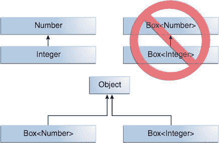

图 6.1。即使 `Integer` 是 `Number` 的子类型，`Box<Integer>` 也不是 `Box<Number>` 的子类型

### Note

给定两个具体类型 `A` 和 `B`（例如 `Number` 和 `Integer`），无论 `A` 和 `B` 是否相关，`MyClass` 与 `MyClass<B>` 之间都没有关系。`MyClass` 和 `MyClass<B>` 的共同父类是 `Object`。

有关当类型参数相关时如何在两个泛型类之间创建类似于子类型的关系的信息，请参见本章稍后的“通配符与子类型”部分。

### 泛型类与子类型

你可以通过扩展或实现一个泛型类或接口来使其成为子类型。一个类或接口的类型参数与另一个类的类型参数之间的关系由 `extends` 和 `implements` 子句决定。

以 `Collections` 类为例，如图 6.2 所示，`ArrayList<E> implements List<E>`，且 `List<E> extends Collection<E>`。因此 `ArrayList<String>` 是 `List<String>` 的子类型，而 `List<String>` 是 `Collection<String>` 的子类型。只要你不改变类型参数，类型之间的子类型关系就会保留。

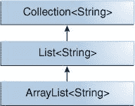

图 6.2。示例 `Collections` 层次结构

现在假设我们想定义自己的列表接口 `PayloadList`（图 6.3），它将每个元素与一个泛型类型 `P` 的可选值关联。其声明可能如下：

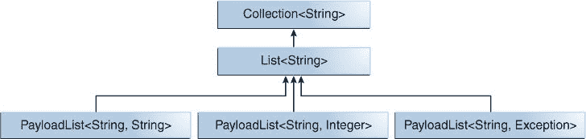

图 6.3。示例 `PayloadList` 层次结构

```
interface PayloadList<E,P> extends List<E> {
  void setPayload(int index, P val);
  . . .
}
```

以下 `PayloadList` 的参数化是 `List<String>` 的子类型：

- `PayloadList<String,String>`
- `PayloadList<String,Integer>`
- `PayloadList<String,Exception>`

## 类型推断

*类型推断*是 Java 编译器通过查看每次方法调用及其相应的声明，来确定使调用有效的类型参数（或参数）的能力。推断算法确定参数的类型，如果可用，还会确定结果被赋值或返回的类型。最后，推断算法尝试找到一个适用于所有参数的*最具体*类型。

为了说明最后一点，在下面的示例中，推断确定传递给 `pick` 方法的第二个参数类型为 `Serializable`：

```
static <T> T pick(T a1, T a2) { return a2; }
Serializable s = pick("d", new ArrayList<String>());
```

### 类型推断与泛型方法

之前对泛型方法的讨论介绍了类型推断，它让你能够像调用普通方法一样调用泛型方法，而不需要在角括号之间指定类型。考虑下面的示例 `BoxDemo`，它需要 `Box` 类：

```
public class BoxDemo {
  public static <U> void addBox(U u,
      java.util.List<Box<U>> boxes) {
      Box<U> box = new Box<>();
      box.set(u);
      boxes.add(box);
  }
  public static <U> void outputBoxes(java.util.List<Box<U>> boxes) {
    int counter = 0;
    for (Box<U> box: boxes) {
      U boxContents = box.get();
      System.out.println("Box #" + counter + " contains [" +
              boxContents.toString() + "]");
      counter++;
    }
  }
  public static void main(String[] args) {
    // ... 正文中描述的逻辑 ...
  }
}
```

（注：提供的文本包含对 `BoxDemo` 逻辑的重复描述；已将核心逻辑合并到代码块中以保持清晰。）

Java SE 7 之前的版本的编译器能够推断泛型构造函数的实际类型参数，类似于泛型方法。然而，在 Java SE 7 及之后的编译器中，如果你使用钻石符号（`<>`），它可以推断出被实例化泛型类的实际类型参数。考虑以下示例：

```java
MyClass<Integer> myObject = new MyClass<>("");
```

在这个示例中，编译器为泛型类 `MyClass<X>` 的形式类型参数 `X` 推断出类型 `Integer`。它为该泛型类构造函数的形式类型参数 `T` 推断出类型 `String`。

**注意**

需要注意的是，推断算法仅使用调用参数以及可能的、易见的预期返回类型来推断类型。推断算法不会使用程序后续部分的结果。

## 通配符

在泛型代码中，问号（`?`）被称为“通配符”（wildcard），代表一个未知类型。通配符可以用于多种情况：作为参数、字段或局部变量的类型，有时也可以作为返回类型（尽管更具体的类型是更好的编程习惯）。通配符永远不会作为泛型方法调用、泛型类实例创建或父类型的类型参数。

接下来的章节将详细讨论通配符，包括上界通配符、下界通配符和通配符捕获。

### 上界通配符

你可以使用上界通配符来放宽变量的限制。例如，假设你想写一个可以处理 `List<Integer>`、`List<Double>` 和 `List<Number>` 的方法；你可以通过使用上界通配符来实现这一点。

要声明上界通配符，使用通配符字符（`?`），后跟跟 `extends` 关键字，然后是它的“上界”（upper bound）。请注意，在此语境下，`extends` 是广义的，指的是 `extends`（如类）或 `implements`（如接口）。

要编写一个处理 `Number` 及其子类型（如 `Integer`、`Double` 和 `Float`）列表的方法，你需要指定 `List<? extends Number>`。`List<Number>` 比 `List<? extends Number>` 更具限制性，因为前者只匹配类型为 `Number` 的列表，而后者匹配类型为 `Number` 或其任何子类的列表。

考虑以下 `process` 方法：

```java
public static void process(List<? extends Foo> list) { /* . . . */ }
```

上界通配符 `<? extends Foo>`（其中 `Foo` 是任意类型）匹配 `Foo` 以及 `Foo` 的任何子类型。`process` 方法可以以 `Foo` 类型访问列表元素：

```java
public static void process(List<? extends Foo> list) {
    for (Foo elem : list) {
        // . . .
    }
}
```

在 `foreach` 子句中，`elem` 变量遍历列表中的每个元素。现在可以在 `Foo` 类中定义的任何方法都可以用在 `elem` 上。

`sumOfList` 方法返回列表中所有数字之和：


```java
public static double sumOfList(List<? extends Number> list) {
    double s = 0.0;
    for (Number n : list)
        s += n.doubleValue();
    return s;
}
```

以下代码使用`Integer`对象列表，打印`sum = 7.0`：

```java
List<Integer> li = Arrays.asList(1, 2, 3);
System.out.println("sum = " + sumOfList(li));
```

`Double`值列表可以使用相同的`sumOfList`方法。以下代码打印`sum = 7.0`：

```java
List<Double> ld = Arrays.asList(1.2, 2.3, 3.5);
System.out.println("sum = " + sumOfList(ld));
```

## 无界通配符

无界通配符类型使用通配符字符（`?`）指定——例如`List<?>`。这被称为“未知类型列表”。有两种场景非常有方法：

- 如果你编写一个可以使用`Object`类提供的功能实现的方法，它是很有用的。
- 当代码使用泛型类中不依赖类型参数的方法时（例如`List.size`或`List.clear`），它是很有用的。事实上，`Class<?>`经常被使用，因为`Class<T>`中的大部分方法都不依赖于`T`。

考虑以下方法`printList`：

```java
public static void printList(List<Object> list) {
    for (Object elem : list) {
        // ...
    }
}
```

## 下界通配符

`上界通配符`章节显示了上界通配符将未知类型限制为特定类型或其子类型，并使用`extends`关键字表示。类似地，下界通配符将未知类型限制为特定类型或其父类型。下界通配符使用通配符字符（`?`），后跟`super`关键字，然后是它的“下界”（lower bound）：`<? super A>`。

**注意**

你可以为通配符指定上界或下界，但不能两者都指定。

如前文在“泛型、继承与子类型”中所述，泛型类或接口之间并非因为它们的类型之间存在关系就具有关联。然而，你可以使用通配符在泛型类或接口之间建立关系。

考虑以下两个普通（非泛型）类：

```java
class A { /* . . . */ }
class B extends A { /* . . . */ }
```

对于这些类，编写以下代码是合理的：

```java
B b = new B();
A a = b;
```

这个示例表明，普通类的继承遵循子类型规则：如果类`B`继承`A`，则类`B`是类`A`的子类型。该规则不适用于泛型类型：

```java
List<B> lb = new ArrayList<>();
List la = lb; // 编译错误
```

鉴于`Integer`是`Number`的子类型，那么`List<Integer>`和`List<Number>`之间是什么关系？虽然`Integer`是`Number`的子类型，但`List<Integer>`并不是`List<Number>`的子类型，实际上，这两个类型是不相关的。`List<Number>`和`List<Integer>`的共同父类是`List<?>`（图 6.4）。

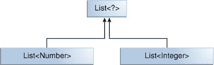

图 6.4 共同父类是`List<?>`

为了在这些类之间建立关系，以便代码可以通过`List<Integer>`的元素访问`Number`的方法，可以使用上界通配符：

```java
List<? extends Integer> intList = new ArrayList<>();
// OK. List<? extends Integer> 是 List<? extends Number> 的子类型
List<? extends Number> numList = intList;
```

由于`Integer`是`Number`的子类型，且`numList`是`Number`对象的列表，现在`intList`（一个`Integer`对象的列表）和`numList`之间存在关系。图 6.5 显示了使用上界和下界通配符声明的几个`List`类之间的关系。

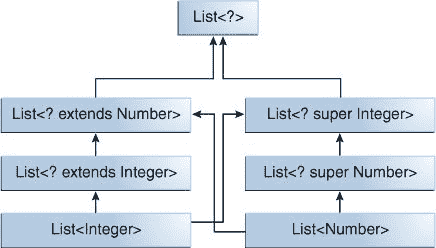

图 6.5 多个泛型列表类声明的层次结构

本章后面的“通配符使用指南”部分关于使用上界和下界通配符的影响提供了更多信息。

### 通配符捕获与辅助方法

在某些情况下，编译器会推断通配符的类型。例如，一个列表可以定义为`List<?>`，但在评估表达式时，编译器会从代码中推断出一个特定类型。这种场景被称为`通配符捕获 (wildcard capture)`。大多数情况下，你不需要担心通配符捕获，除非看到包含`capture of`短语的错误信息。

`WildcardError`示例在编译时产生捕获错误：

```java
import java.util.List;

public class WildcardError {
    void foo(List<?> i) {
        i.set(0, i.get(0));
    }
}
```

在此示例中，编译器将输入参数`i`处理为`Object`类型。当`foo`方法调用`List.set(int, E)`^(2)时，编译器无法确认要插入对象的类型。由于`Integer`是`Number`的子类型，且`numList`是`Number`对象的列表，现在`intList`（一个`Integer`对象的列表）和`numList`之间存在关系。这种类型错误通常意味着编译器认为你正在将错误的类型赋值给列表。`WildcardError`示例在通过`javac`编译时会产生以下错误：

```
WildcardError.java:6: 错误：方法中的 set 无法应用到给定类型;
    i.set(0, i.get(0));
      ^
    需要: int,CAP#1
    找到: int,Number
    原因: 实际参数 Number 无法转换为 CAP#1
    调用转换
    where E 是一个类型变量:
      E 在接口 List 中声明为 Object
    where CAP#1 是一个新的类型变量:
      CAP#1 捕获自 ?
```

在此示例中，代码正尝试执行不安全的操作，那么如何解决类型错误呢？你可以通过编写一个辅助方法来修复它，该辅助方法捕获了通配符。在这种情况下，如`WildcardFixed`所示：

```java
public class WildcardFixed {
    void foo(List<?> i) {
        fooHelper(i);
    }
    // 通过辅助方法使得通配符可以被捕获
    private <T> void fooHelper(List<T> l) {
        l.set(0, l.get(0));
    }
}
```

由于有了辅助方法，编译器推断出`T`是`CAP#1`，现在编译成功。按照惯例，辅助方法通常命名为`originalNameHelper`。现在考虑一个更复杂的示例`WildcardErrorBad`：

```java
import java.util.List;
public class WildcardError {
    void swapFirst(List<? extends Number> l1, List<? extends Number> l2) {
        Number temp = l1.get(0);
        l2.set(0, temp);
    }
}
```

在此示例中，代码正尝试执行不安全的操作。例如，考虑以下对`swapFirst`方法的调用：

```java
List<Integer> li = Arrays.asList(1, 2, 3);
List<Double> ld = Arrays.asList(10.1, 20.2, 30.3);
swapFirst(li, ld);
```

虽然`List<Integer>`和`List<Double>`都符合`List<? extends Number>`的标准，但将来自`Integer`列表的项尝试放入`Double`列表显然是错误的。使用 Oracle 的`javac`编译器编译代码会产生以下错误：

```
WildcardErrorBad.java:7: 错误：接口 List 中的 set 方法无法应用到给定类型;
    l2.set(0, temp);
      ^
    需要: int,CAP#1
    找到: int,Number
    原因: 实际参数 Number 无法转换为 CAP#1
    通过方法调用转换
    where E 是一个类型变量:
      E 在接口 List 中声明为 Object
    where CAP#1 是一个新的类型变量:
      CAP#1 捕获自 ?

WildcardErrorBad.java:10: 错误：接口 List 中的 set 方法无法应用到给定类型;
    l1.set(0, temp);
      ^
    需要: int,CAP#2
    找到: int,Number
    原因: 实际参数 Number 无法转换为 CAP#2
    通过方法调用转换
    where E 是一个类型变量:
      E 在接口 List 中声明为 Object
    where CAP#2 是一个新的类型变量:
      CAP#2 捕获自 ?
```

没有辅助方法可以解决此问题，因为这段代码从根本上是错误的。

在学习泛型编程时，最令人困惑的方面之一是确定何时使用上界通配符（upper-bounded wildcard），何时使用下界通配符（lower-bounded wildcard）。本节为设计代码提供了一些可以遵循的指南。

为了方便讨论，将变量视为承担两种功能之一是有帮助的：

- `in`变量为代码提供数据。想象一个带有两个参数的拷贝方法：`copy(src, dest)`。`src`参数提供要复制的数据，因此它是`in`参数。
- `out`变量持有数据以供其他地方使用。在拷贝的示例`copy(src, dest)`中，`dest`参数接收数据，因此它是`out`参数。

当然，某些变量既用于输入也用于输出，正如后文讨论的那样。在决定是否使用通配符以及使用什么种类型的通配符时，你可以使用`in`和`out`原则。以下列表提供了你应该遵循的指南：

- 使用`extends`关键字使用上界通配符定义不可变变量。
- 使用`super`关键字使用下界通配符定义`out`变量。
- 在`in`变量可以通过`Object`类中定义的方法访问的情况下，使用无界通配符。
- 在代码需要同时作为`in`变量和`out`变量访问变量的情况下，不要使用通配符。

这些指南不适用于方法的返回类型。应该避免将通配符作为返回类型，因为这迫使使用该代码的程序员处理通配符。

由`List<? extends . . . >`定义的列表可以非正式地认为是只读的，但并不是严格的保证。假设你有以下两个类：

```java
class NaturalNumber {
    private int i;
    public NaturalNumber(int i) { this.i = i; }
    // . . .
}

class EvenNumber extends NaturalNumber {
    public EvenNumber(int i) { super(i); }
    // . . .
}
```

考虑以下代码：

```java
List<EvenNumber> le = new ArrayList<>();
List<? extends NaturalNumber> ln = le;
ln.add(new NaturalNumber(35));  // 编译错误
```

由于`List<EvenNumber>`是`List<? extends NaturalNumber>`的子类型，因此你可以将`le`赋值给`ln`。但你不能使用`ln`向偶数列表添加一个自然数。对列表执行以下操作是可能的：

- 你可以添加`null`。
- 你可以调用`clear`。
- 你可以获取迭代器并调用`remove`。
- 你可以捕获通配符并写入从列表中读取的元素。

你可以看到，由`List<? extends NaturalNumber>`定义的列表在严格意义上并不是只读的，但你可能会这样认为它，因为你无法在列表中存储新元素或更改现有的元素。

## 类型擦除 (Type Erasure)

泛型引入 Java 语言是为了在编译时提供更严格的类型检查，并支持泛型编程。为了实现泛型，Java 编译器应用类型擦除来实现以下目标：

- 将泛型类型中的所有类型参数替换为它们的边界；如果类型参数是无界的，则替换为`Object`。因此，生成的字节码只包含普通的类、接口和方法。
- 在必要时插入类型转换以保持类型安全。
- 生成桥接方法（bridge methods）以保留扩展泛型中的多态性。

类型擦除确保不会为参数化类型创建新类；因此，泛型不会产生运行时开销。

## 泛型类型的擦除 (Erasure of Generic Types)

在类型擦除过程中，Java 编译器会擦除所有类型参数，如果类型参数有边界，则将其替换为第一个边界；如果类型参数是无界的，则将其替换为`Object`。

考虑以下表示单链表节点的泛型类：

```java
public class Node<T> {
    private T data;
    private Node<T> next;
    public Node(T data, Node<T> next) {
        this.data = data;
        this.next = next;
    }
    public T getData() { return data; }
    // . . .
}
```

由于类型参数`T`是无界的，Java 编译器将其替换为`Object`：

```java
public class Node {
    private Object data;
    private Node next;
    public Node(Object data, Node next) {
        this.data = data;
        this.next = next;
    }
    public Object getData() { return data; }
    // . . .
}
```

在下面的示例中，泛型`Node`类使用了有边界类型参数：

```java
public class Node<T extends Comparable<T>> {
    private T data;
    private Node<T> next;
    public Node(T data, Node<T> next) {
        this.data = data;
        this.next = next;
    }
    public T getData() { return data; }
    // . . .
}
```

Java 编译器将有边界类型参数`T`替换为第一个边界`Comparable`：

```java
public class Node {
    private Comparable data;
    private Node next;
    public Node(Comparable data, Node next) {
        this.data = data;
        this.next = next;
    }
    public Comparable getData() { return data; }
    // . . .
}
```

## 泛型方法的擦除 (Erasure of Generic Methods)

Java 还会擦除泛型方法中的类型参数。考虑以下泛型方法：

```java
public static <T> int count(T[] anArray, T elem) {
    int cnt = 0;
    for (T e : anArray) {
        if (e.equals(elem))
            ++cnt;
    }
    return cnt;
}
```

由于`T`是无界的，Java 编译器将其替换为`Object`：


```java
public static int count(Object[] anArray, Object elem) {
    int cnt = 0;
    for (Object e : anArray) {
        if (e.equals(elem))
            ++cnt;
    }
    return cnt;
}
```

如果 `T` 有边界，Java 编译器将其替换为第一个边界：

```java
public static <T extends Comparable> int count(Comparable[] anArray, Comparable elem) {
    int cnt = 0;
    for (Comparable e : anArray) {
        if (e.equals(elem))
            ++cnt;
    }
    return cnt;
}
```

## 桥接方法 (Bridge Methods)

有时类型擦除会导致你意料之外的情况。下面的示例展示了这种情况是如何发生的。该示例展示了编译器在类型擦除过程中有时创建一个合成方法，称为桥接方法。

考虑以下两个类：

```java
public class Node<T> {
    private T data;
    public Node(T data) { this.data = data; }
    public void setData(T data) {
        System.out.println("Node.setData");
        this.data = data;
    }
}

public class MyNode extends Node<Integer> {
    public MyNode(Integer data) { super(data); }
    public void setData(Integer data) {
        System.out.println("MyNode.setData");
        super.setData(data);
    }
}
```

现在，考虑以下代码：

```java
MyNode mn = new MyNode(5);
Node n = mn;  // 原始类型 - 编译器抛出警告
n.setData("Hello");  // 会抛出 ClassCastException。
Integer x = mn.data;
```

在类型擦除后，代码将变为如下：

```java
MyNode mn = new MyNode(5);
Node n = (MyNode)mn;  // 原始类型 - 编译器抛出警告
n.setData("Hello");
```

为了保持多态性，编译器会在 `Node` 类中生成一个桥接方法：

```java
public void setData(Object data) {
    setData((T)data);
}
```

`Integer x = (String)mn.data;` // 会导致抛出 `CastException`。

以下是代码执行时的过程：

* `n.setData("Hello");` 导致在 `MyNode` 类的对象上执行 `setData(Object)` 方法。（`MyNode` 类从 `Node` 继承了 `setData(Object)`。）
* 在 `setData(Object)` 的体中，由 `n` 引用用的对象的 `data` 字段被赋值为一个 `String`。
* 通过 `mn` 访问的同一个对象的 `data` 字段可以被访问，并且被预期为整数（因为 `mn` 是一个 `MyNode`，它是一个 `Node<Integer>`）。
* 尝试将 `String` 赋值给 `Integer` 会导致 Java 编译器在赋值处插入的强制转换产生 `ClassCastException`。

## 桥接方法 (Bridge Methods)

在编译扩展参数化类或实现参数化接口的类或接口时，编译器可能需要创建一个“桥接方法”的合成方法作为类型擦除过程的一部分。你通常不需要担心桥接方法，但如果堆栈跟踪中出现它，你可能会感到困惑。

类型擦除后，`Node` 和 `MyNode` 类如下：

```java
public class Node {
    private Object data;
    public Node(Object data) { this.data = data; }
    public void setData(Object data) {
        System.out.println("Node.setData");
        this.data = data;
    }
}

public class MyNode extends Node {
    public MyNode(Integer data) { super(data); }
    public void setData(Integer data) {
        System.out.println(Integer data);
        super.setData(data);
    }
}
```

类型擦除后，方法签名不再匹配。`Node` 方法变成了 `setData(Object)`，而 `MyNode` 方法变成了 `setData(Integer)`。因此，`MyNodesetData` 方法没有重写 `NodesetData` 方法。

为了解决这个问题并在类型擦除后保留泛型的多态性，Java 编译器会生成一个桥接方法以确保子类型工作按预期进行。对于 `MyNode` 类，编译器为 `setData` 生成了以下桥接方法：

```java
class MyNode extends Node {
    // 编译器生成的桥接方法
    public void setData(Object data) {
        setData((Integer) data);
    }
    public void setData(Integer data) {
        System.out.println("MyNode.setData");
        super.setData(data);
    }
    // . . .
}
```

如你所示，桥接方法与类型擦除后 `Node` 类的 `setData` 方法具有相同的方法签名，它委托给了原始的 `setData` 方法。

## 非可具体化类型 (Nonreifiable Types)

类型擦除 章节讨论了编译器移除与类型参数和类型参数相关的过程。类型擦除与变长参数（也称为 `varargs`）以及变长形式参数包含非可具体化类型的方法有关后果。关于变长参数方法的更多信息，请参阅第 4 章“向方法或构造函数传递信息”。

### 非可具体化类型的定义

`可具体化类型`（reifiable type）是指运行时类型信息完全类型。这包括原始类型、非泛型类型、原始类型以及无界通配符的调用。

`非可具体化类型`是在编译时通过类型擦除移除了信息的类型——未定义为无界通配符的泛型调用。非可具体化类型在运行时并不具备所有信息。非可具体化类型的示例有 `List<String>` 和 `List<Number>`；Java 虚拟机 (Java VM) 在运行时无法区分这些类型。正如本章稍后的章节“泛型的限制”所示，在某些情况下无法使用非可具体化类型（例如在 `instanceof` 表达式中或作为数组的元素）。

## 堆污染 (Heap Pollution)

当参数化类型的变量引用一个并非该参数化类型的对象时，就会发生`堆污染`。如果程序执行了某些操作导致编译时产生未检查警告，就会出现这种情况。如果……则会生成`未检查警告`。

## 带有非可具体化类型的变长参数方法的潜在漏洞

包含变长参数的泛型方法可能会导致污染。考虑以下 `ArrayBuilder` 类：

```java
public class ArrayBuilder {
    public static <T> void addToList(List<T> listArg, T... elements) {
        for (T x : elements) {
            listArg.add(x);
        }
    }
    public static void faultyMethod(List<String> l) {
        Object[] objectArray = l;
        String s = (String) objectArray[0];
    }
}
```

以下示例 `HeapPollution` 使用了 `ArrayBuilder`：

```java
public class HeapPollution {
    public static void main(String[] args) {
        List<String> stringListA = new ArrayList<>();
        List<String> stringListB = new ArrayList<>();
        ArrayBuilder.addToList(stringListA, "Seven", "Eight", "Nine");
        ArrayBuilder.addToList(stringListB, "Ten", "Eleven", "Twelve");
        List<List<String>> listOfStringLists = new ArrayList<List<String>>();
        ArrayBuilder.addToList(listOfStringLists, stringListA, stringListB);
        ArrayBuilder.faultyMethod(Arrays.asList("Hello!"));
    }
}
```

因此，如语句所示，当你将任意类型的 `List` 对象赋值给 `objectArray` 数组的任何数组组件时，编译器不会发出警告或错误：

```
objectArray[0] = Arrays.asList(42);
```

`objectArray` 数组的第一个数组组件被赋值了一个包含一个 `Integer` 类型对象的 `List` 对象。

假设你通过以下语句调用了 `ArrayBuilder.faultyArray`：

```
ArrayBuilder.faultyMethod(Arrays.asList("Hello!"), Arrays.asList("World!"));
```

在运行时，Java VM 在以下语句处抛出了 `ClassCastException`：

```java
// 在此处抛出 ClassCastException
String s = l[0].get(0);
```

变量 `l` 的第一个数组组件中存储的对象类型为 `List<Integer>`，但该语句期望的是一个 `List<String>` 类型的对象。

## 防止非可重化形式参数的变长方法产生警告

如果你声明了一个具有泛型类型参数的变长（varargs）方法，并且确保方法体不会因为对变长形式参数的处理不当而抛出 `ClassCastException` 或类似的异常，你可以通过在静态和非构造方法声明上添加以下注解，来防止编译器为这些类型的变长方法生成警告：

```java
@SafeVarargs
```

`@SafeVarargs` 注解是方法契约的文档部分；该注解断言方法的实现不会不当地处理变长形式参数。

虽然也可以在方法声明中添加以下内容来抑制此类警告，但这种方法并不那么理想：

```java
@SuppressWarnings({"unchecked", "varargs"})
```

然而，这种方法无法抑制从方法调用处生成的警告。如果你不熟悉 `@SuppressWarnings` 语法，请参阅第 4 章，“注解](#part0008.html_ch04lev1sec6)”。

## 泛型的限制

要有效使用 Java 泛型，你必须考虑以下限制。

### 不能使用基本类型类型实例化泛型类型

考虑以下泛化类型：

```java
class Pair<K, V> {
    private K key;
    private V value;
    public Pair(K key, V value) {
        this.key = key;
        this.value = value;
    }
    // . . .
}
```

在创建 `Pair` 对象时，你不能用基本类型代替类型参数 `K` 或 `V`：

```java
Pair<int, char> p = new Pair<>(8, 'a');  // 编译错误
```

你只能用非基本类型代替类型参数 `K` 和 `V`：

```java
Pair<Integer, Character> p = new Pair<>(8, 'a');
```

注意，Java 编译器会将 `8` 装箱为 `Integer.valueOf(8)`，并将 `'a'` 装箱为 `Character('a')`：

```java
Pair<Integer, Character> p = new Pair<>(Integer.valueOf(8), new Character('a'));
```

关于自动装箱的更多信息，请参阅第 8 章。

### 不能创建类型参数的实例

你不能创建类型参数的实例。例如，以下代码会导致编译错误：

```java
public static <E> void append(List<E> list) {
    E elem = new E();  // 编译错误
    list.add(elem);
}
```

作为变通方法，你可以通过反射创建类型参数的对象：

```java
public static <E> void append(List<E> list, Class<E> cls) throws Exception {
    E elem = cls.newInstance();  // OK
    list.add(elem);
}
```

你可以按照如下方式调用 `append` 方法：

```java
List<String> ls = new ArrayList<>();
append(ls, String.class);
```

### 不能声明类型为类型参数的静态字段

类的静态字段是类级变量，由该类的所有非静态对象共享。因此，不允许类型为类型参数的静态字段。考虑以下类：

```java
public class MobileDevice<T> {
    private static T os;
    // . . .
}
```

如果允许类型为类型参数的静态字段，那么以下代码将产生义：

```java
MobileDevice<Smartphone> phone = new MobileDevice<>();
MobileDevice<Pager> pager = new MobileDevice<>();
MobileDevice<TabletPC> pc = new MobileDevice<>();
```

由于 `os` 被 `phone`、`pager` 和 `pc` 共享，它的类型是什么？它不能同时是 `Smartphone`、`Pager` 和 `TabletPC`。

### 不能对泛化类型使用强制转换或 instanceof

由于 Java 会擦除类型参数，你无法在运行时验证类型：

```java
public static <E> void rtti(List<E> list) {
    if (list instanceof ArrayList) { // 编译错误
    }
}
```

你能做的是使用无界通配符：

```java
public static void rtti(List<?> list) {
    if (list instanceof ArrayList<?>) { // OK
    }
}
```

然而，在某些情况下，编译器知道某个类型是有效的并允许强制转换：

```java
List<Integer> li = new ArrayList<>();
List<Number> l = (List<Number>) li; // OK
```

### 不能创建泛化类型的数组

你不能创建泛化类型的数组。例如，以下代码无法编译：

```java
List<Integer>[] arrayOfLists = new List<Integer>[2]; // 编译错误
```

以下说明了当向数组插入不同类型时发生的情况：

```java
Object[] strings = new String[2];
strings[0] = "hi"; // OK
strings[1] = 100; // 抛出 ArrayStoreException
```

如果你对泛型列表尝试相同操作，就会出现问题：


```java
Object[] stringLists = new List<String>[];
stringLists[0] = new ArrayList<String>(); // OK
stringLists[1] = new ArrayList<Integer>(); // 无法检测
```

## 不能创建、捕获或抛出泛化类型的对象

泛型类不能直接或间接地继承 `Throwable` 类。例如，以下类无法编译：

```java
// 间接继承 Throwable
class MathException<T> extends Exception { } // 编译错误

// 直接继承 Throwable
class QueueFullException<T> extends Throwable { } // 编译错误
```

方法不能捕获类型参数的实例：

```java
public static <T extends Exception, J> void execute(List<J> jobs) {
    try {
        for (J job : jobs)
            // . . .
    } catch (T e) {   // 编译错误
        // . . .
    }
}
```

但是，你可以在 `throws` 子句中使用类型参数：

```java
class Parser<T extends Exception> {
    public void parse(File file) throws T {     // 正确
        // . . .
    }
}
```

## 不能重载形式参数类型在类型擦除后变为相同原始类型的方法

一个类不能拥有两个在类型擦除后具有相同签名的重载方法：

```java
public class Example {
    public void print(Set<String> strSet) { }
    public void print(Set<Integer> intSet) { }
}
```

这些重载方法将共享相同的 `classfile` 表示，这将导致编译时错误。

## 问题与练习：泛型

### 问

**1.** 下述类可以通过编译吗？如果不可以，为什么？

```java
public final class Algorithm {
    public static T max(T x, T y) {
        return x > y ? x : y;
    }
}
```

**2.** 如果编译器在编译时擦除了所有类型参数，为什么你还要使用泛型？

**3.** 下述类在类型擦除后转换成了什么？

```java
public class Pair<K, V> {
    public Pair(K key, V value) {
        this.key = key;
        this.value = value;
    }
    public K getKey(); { return key; }
    public V getValue(); { return value; }
    public void setKey(K key)     { this.key = key; }
    public void setValue(V value) { this.value = value; }
    private K key;
    private V value;
}
```

**4.** 下述方法在类型擦除后转换成了什么？

```java
public static <T extends Comparable<T>>
    int findFirstGreaterThan(T[] at, T elem) {
    // . . .
}
```

**5.** 下述方法可以通过编译吗？如果不可以，为什么？

```java
public static void print(List<? extends Number> list) {
    for (Number n : list)
        System.out.print(n + " ");
    System.out.println();
}
```

**6.** 下述类可以通过编译吗？如果不可以，为什么？

```java
public class Singleton<T> {
    public static T getInstance() {
        if (instance == null)
            instance = new Singleton<T>();
        return instance;
    }
    private static T instance = null;
}
```

**7.** 检查以下类：

```java
class Shape { /* . . . */ }
class Circle extends Shape { /* . . . */ }
class Rectangle extends Shape { /* . . . */ }
class Node<T> { /* . . . */ }
```

下述代码可以通过编译吗？如果不可以，为什么？

```java
Node<Circle> nc = new Node<>();
Node<Shape>  ns = nc;
```

**8.** 考虑这个类：

```java
class Node<T> implements Comparable<T> {
    public int compareTo(T obj) { /* . . . */ }
    // . . .
}
```

下述代码可以通过编译吗？如果不可以，为什么？

```java
Node<String> node = new Node<>();
Comparable<String> comp = node;
```

## 练习

**1.** 写一个泛型方法，统计集合中具有特定属性（例如奇数、质数、回文数）的元素数量。

**2.** 写一个泛型方法来交换元素。

**3.** 写一个泛型方法来找到数组中的最大元素。

## 答案

（原文中未提供答案）。

---

## 7. 包 (Packages)

### 目录

- 创建包
- 包命名
- 使用包成员
- 管理源和文件
- 问题与练习：创建和使用包

本章解释了如何将类封装成包、如何使用它们以及如何安排源文件以避免命名冲突。

*包*（package）是相关类型的分组，提供了访问控制和命名空间管理。注意*类型*（types）指的是类、枚举和注解类型。

假设你有一组类型，如圆、矩形、线和点。出于以下原因，你应该将它们封装成一个包：

- 你和其它程序员可以很容易地判断它们是相关的。
- 你和其它程序员知道在哪里找到图形相关的函数。
- 你的类型名称不会与其他包中的类型名称冲突，因为包创建了命名空间。
- 你可以允许包内的类型不受限制地相互访问，同时限制包外部类型的访问。

### 创建包

要创建一个包，你需要为包选择一个名称（命名规范将在下一节讨论，包命名）。然后，在包含你想包含在包中的类型（类、接口、枚举和注解类型）的*每个源文件*顶部写上带有该名称的 `package` 语句。

`package` 语句必须是源文件的第一行。每个源文件中只能有一个 `package` 语句，并且它适用于文件中的所有类型。

你可以将非公共类型与公共类型包含在同一个文件中，但强烈不建议这样做，除非这些非公共类型较小且与公共类型紧密相关。无论如何，只有公共类型可以从包外部访问。所有的顶层非公共类型都将`包私有`（package private）。

***

如果你将上一节列出的图形接口和类放在一个名为 `graphics` 的包中，你需要六个源文件：

```java
//in Draggable.java file
package graphics;

public interface Draggable {
    . . .
}
```

```java
//in Graphic.java file
package graphics;

public abstract class Graphic {
    . . .
}
```

```java
//in Circle.java file
package graphics;

public class Circle extends Graphic
    implements Draggable {
    . . .
}
```

```java
//in Rectangle.java file
package graphics;

public class Rectangle extends Graphic
    implements Draggable {
    . . .
}
```

```java
//in Point.java file
package graphics;

public class Point extends Graphic
    implements Draggable {
    . . .
}
```

```java
//in Line.java file
package graphics;

public class Line extends Graphic
    implements Draggable {
    . . .
}
```

如果你不使用 `package` 语句，你的类型将位于一个未命名的包中。通常来说，未命名包仅用于小型或临时应用程序，或者当你正处于开发过程初期时。否则，类和接口应该属于命名的包。

### 为包命名

随着全球范围内的程序员使用 Java 编程语言编写类和接口，可能会有许多程序员为不同的类型使用相同的名称。事实上，上一个示例恰恰就是这样：当 `java.awt` 包中已经存在一个 `Rectangle` 类时，它又定义了一个 `Rectangle` 类。尽管如此，只要这两个类位于不同的包中，编译器允许它们具有相同的名称。每个 `Rectangle` 类的全限定名包含了包名。也就是说，`graphics` 包中 `Rectangle` 类的全限定名是 `graphics.Rectangle`，而 `java.awt` 包中 `Rectangle` 类的全限定名是 `java.awt.Rectangle`。

这种方式运行良好，除非两个独立的程序员为他们的包使用了相同的名称。什么防止了这种问题？约定。

### 命名规范

包名全小写字母，以避免与类或接口的名称冲突。公司使用反转的互联网域名作为包名的开头（例如，对于由 `example.com` 的程序员创建的名为 `mypackage` 的包，使用 `com.example.mypackage`）。

公司内部发生的名称冲突需要通过公司内部的约定来处理，或许通过在公司名后包含地区或项目名称（例如，`com.example.region.mypackage`）。Java 语言本身的包以 `java.` 或 `javax.` 开头。

在某些情况下，互联网域名可能不是一个有效的包名。这可能发生在：域名名包含连字符或其他特殊字符、包名以数字或其他在 Java 名称开头不被允许的字符开头，或者包名包含了 Java 预留关键字（如 `int`）。在这种情况下，建议的约定是添加一个下划线（表 7.1）。

表 7.1. 包名的合法化

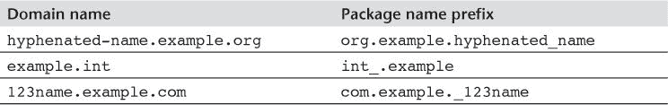

### 使用包成员

构成包的类型被称为`包成员`（package members）。要从包外部使用 `public` 包成员，你必须执行以下操作之一：

- 通过其全限定名引用该成员。
- 导入该包成员。
- 导入成员所在的整个包。

正如随后的章节所解释，每种方法适用于不同的情况。

### 通过全限定名引用包成员

到目前为止，书中的大多数示例都是通过简单名引用类型，例如 `Rectangle` 和 `StackOfInts`。如果你正在编写的代码与该成员位于同一个包中，或者该成员已经被导入，你就可以使用成员的简单名。

然而，如果你尝试使用来自另一个包的成员，且该包未被导入，则必须使用该成员的全限定名，其中包含了包名。以下是上一个示例中在 `graphics` 包中定义的 `Rectangle` 类的全限定名：

`graphics.Rectangle`

你可以使用这个全限定名来创建 `graphics.Rectangle` 的实例：

```java
graphics.Rectangle myRect = new graphics.Rectangle();
```

全限定名对于低频率的使用是完全可以。然而，当一个名称被重复使用时，反复输入该名称会变得繁琐，代码也会变得难以阅读。作为替代，你可以 `import` 该成员或其包，然后使用它的简单名。

### 导入包成员

要将特定成员导入到当前文件，请在文件开头、任何类型定义之前、但在 `package` 语句之后（如果有的话）放置一个 `import` 语句。以下是如何从上一节创建的 `graphics` 包中导入 `Rectangle` 类：

```java
import graphics.Rectangle;
```

现在你可以通过简单名引用 `Rectangle` 类了：

```java
Rectangle myRectangle = new Rectangle();
```

如果你只使用 `graphics` 包中的少数几个成员，这种方法效果很好。但如果你使用了一个包中的许多类型，就应该导入整个包。

### 导入整个包

要导入特定包中的所有类型，请使用 `import` 语句配合通配符 `*`：

```java
import graphics.*;
```

现在你可以通过简单名引用 `graphics` 包中的任何类或接口：

```java
Circle myCircle = new Circle();
Rectangle myRectangle = new Rectangle();
```

`import` 语句中的星号仅用于指定包内的所有类，如所示。它不能用于匹配包的子集。例如，以下代码无法匹配 `graphics` 包中所有以 `A` 开头的类：

```java
//无效
import graphics.A*;
```

相反，这会导致编译错误。通过 `import` 语句，你通常导入单个包成员或整个包。为了方便，Java 编译器为每个源文件自动导入两个包：(1) `java.lang` 包和 (2) 当前包。

***

注意

另一种不常见的 `import` 形式允许你导入类的嵌套类。例如，如果 `graphics.Rectangle` 类包含了有用的嵌套类，如 `Rectangle.DoubleWide` 和 `Rectangle.Square`，你可以通过以下*两个*语句导入 `Rectangle` 及其嵌套类：

```java
import graphics.Rectangle;
import graphics.Rectangle.*;
```

请注意，第二个导入语句*不会*导入 `Rectangle`。

另一种不常见的 `import` 形式——`static import` 语句将在本章后面讨论。

***

#### 包的表观层次结构

起初，包似乎是层次化的，但事实并非如此。例如，Java 应用程序接口（API）包含了 `java.awt` 包、`java.awt.color` 包、`java.awt.font` 包以及许多其他以 `java.awt` 开头的包。然而，`java.awt.color` 包、`java.awt.font` 包以及其他 `java.awt.xxxx` 包*并不包含*在 `java.awt` 包中。前缀 `java.awt`（Java 抽象窗口工具包）用于许多相关的包，以使这种关系显而易见，但它并不是表示包含关系。

导入 `java.awt.*` 会导入 `java.awt` 包中的所有类型，但它不会导入 `java.awt.color`、`java.awt.font` 或任何其他 `java.awt` 包。如果你计划同时使用 `java.awt.color` 以及 `java.awt` 中的类和其他类型，那么你必须同时导入这两个包及其包含的所有文件：

```java
import java.awt.*;
import java.awt.color.*;
```

#### 命名冲突

如果一个包中的成员与另一个包中的成员同名，且两个包都已导入，那么你必须通过每个成员的完全限定名来引用它们。例如，`graphics` 包定义了一个名为 `Rectangle` 的类。`java.awt` 包也包含一个 `Rectangle` 类。如果 `graphics` 和 `java.awt` 都已导入，下面的代码将是歧义的：

```java
Rectangle rect;
```

在这种情况下，你必须使用成员的全限定名来准确指明你想要哪一个 `Rectangle` 类。这里有一个示例：

```java
graphics.Rectangle rect;
```

#### 静态导入语句

在某些情况下，你需要频繁访问一个或两个类中的静态 final 字段（常量）和静态方法。反复为这些类加上名前缀会导致代码混乱。`static import` 语句提供了一种导入你需要的常量和静态方法的方法，这样你就不需要加上类名前缀。

`java.lang.Math` 类定义了 `PI` 常量和许多静态方法，包括计算正弦、余弦、正切、平方根、最大值、最小值、指数等许多方法。这里有一个示例：

```java
import static java.lang.Math.PI;
import static java.lang.Math.cos;
import static java.lang.Math.sin;

public class TrigonometricDemo {
    public static void main(String[] args) {
        double angle = PI / 2;
        System.out.println("sin(" + angle + ") = " + sin(angle));
        System.out.println("cos(" + angle + ") = " + cos(angle));
    }
}
```


```java
public static final double PI = 3.141592653589793;

public static double cos(double a)
{
    . . .
}
```

通常，为了从另一个类使用这些对象，你需要加上类名前缀，如下所示：

```java
double r = Math.cos(Math.PI * theta);
```

你可以使用静态导入语句来导入`java.lang.Math`的静态成员，这样就不需要加上类名`Math`前缀了。`Math`的静态成员可以单独导入：

```java
import static java.lang.Math.PI;
```

它们也可以作为一个组导入：

```java
import static java.lang.Math.*;
```

一旦导入了这些成员，就可以在不加限定的情况下使用。例如，这里是前面代码段的修订版本：

```java
double r = cos(PI * theta);
```

你可以编写自己的类，其中包含你频繁使用的常量和静态方法，然后使用静态导入语句。这里有一个示例：

```java
import static mypackage.MyConstants.*;
```

**注意**

要谨慎地使用静态导入。过度使用静态导入会导致代码难以阅读和维护，因为代码的阅读者不知道哪个类定义了特定的静态对象。使用得当，静态导入通过消除类名的重复来提高代码的可读性。

## 管理源文件和类文件

Java 平台的许多实现依赖于分级文件系统来管理源文件和类文件，尽管 Java 语言规范并没有要求这样做。策略如下：

将类、接口、枚举或注解类型的源代码放在一个文本文件中，其文件名为该类型的简单名，扩展名为`.java`。这里有一个示例：

```java
//in the Rectangle.java file
package graphics;

public class Rectangle {
    . . .
}
```

然后，将源文件放在一个名称反映该类型所属包名称的目录中：

`. . . . .\graphics\Rectangle.java`

包成员的完全限定名（`graphics.Rectangle`）和文件的路径（`graphics\Rectangle.java`）是平行的，假设使用 Microsoft Windows 文件名分隔符反斜杠。（对于 Unix，请使用正斜杠。）

请记住，按照惯例，公司使用其反转的互联网域名作为包名。因此，互联网域名为`example.com`的公司，其所有包名都会以`com.example`开头。包名中的每个组件都对应一个子目录。所以，如果这家公司有一个包含`Rectangle.java`源文件的`com.example.graphics`包，它将包含在系列子目录中，如下所示：

`. . . . \com\example\graphics\Rectangle.java`

当你编译一个源文件时，编译器会为其中定义的每个类型创建一个不同的输出文件。输出文件的基本名是类型的名称，扩展名为`.class`。这里有一个源文件示例：

```java
//in the Rectangle.java file
package com.example.graphics;

public class Rectangle {
    . . .
}

class Helper{
    . . .
}
```

该源文件的编译文件将位于如下：

点击此处查看代码图片

`<path to parent directory of output files>\com\example\graphics\Rectangle.class`

`<path to parent directory of output files>\com\example\graphics\Helper.class`

与`.java`源文件一样，编译后的`.class`文件应该位于一系列反映包名称的目录中。然而，`.class`文件的路径不需要与`.java`源文件的路径相同。你可以分别安排源文件目录和类目录：

点击此处查看代码图片

`<path_one>\sources\com\example\graphics.java`

`<path_two>\classes\com\example\graphics.class`

通过这种方式，你需要设置`CLASSPATH`，以便编译器和 Java VM 能够找到程序使用的所有类型。指向`classes`目录的完整路径称为类路径：`<path_two>\classes`。这是通过`CLASSPATH`变量设置的。编译器和 Java VM 在此处查找`.class`文件：`com.example`

类路径可能包含多个路径，用分号（Windows）或冒号（Unix）分隔。默认情况下，编译器和 Java VM 会搜索当前目录和包含 Java 平台类的 JAR 文件，因此这些目录会自动在你的类路径中。

## 设置 CLASSPATH 变量

要显示当前的`CLASSPATH`变量，请在 Windows 和 Unix 使用这些命令：

Windows: `set CLASSPATH`

Unix: `% echo $CLASSPATH`

要删除`CLASSPATH`变量当前的内容，请使用这些命令：

点击此处查看代码图片

Windows: `set CLASSPATH=`

Unix: `% unset CLASSPATH; export CLASSPATH`

要设置`CLASSPATH`变量，请使用这些命令（例如）：

点击此处查看代码图片

Windows: `set CLASSPATH=C:\users\george\java\classes`

Unix: `% CLASSPATH=/home/george/java/classes; export CLASSPATH`

## 包总结

要为类型创建包，需要在包含该类型（类、接口、枚举或注解类型）的源文件中放置`package`语句。

要使用不同包中的公共类型，你有三个选择：(1) 使用类型的完全限定名，(2) 导入类型，或 (3) 导入该类型所属的整个包。

包的源文件和类文件的路径反映包名。

你可能需要设置`CLASSPATH`，以便编译器和 Java VM 能够找到程序类型的`.class`文件。

## 问题与练习题：创建和使用包

### 问题

假设你已经写了一些类。后来，你决定将它们拆分为三个包，如表 7.2 所示。此外，假设这些类目前位于默认包中（即它们没有`package`语句）。

#### 1. 包的声明

1. 为了将每个类放在正确的包中，你需要在每个源文件中添加哪一行代码？

#### 2. 目录结构

2. 为了符合目录结构，你需要在开发目录（development）中创建一些子目录，并将源代码放在正确的子目录中。你必须创建哪些子目录？每个源文件放在哪个子目录中？

#### 3. 编译变更

3. 你认为你是否需要对源代码进行任何其他更改以使其正确编译？如果是，需要哪些更改？

#### 表 7.2. 目标包

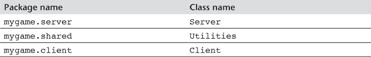

#### 练习题

下载此处列出的源代码：

• `Client.java`^(1)

• `Server.java`^(2)

• `Utilities.java`^(3)

1. 使用刚刚下载的源文件实现你在问题 1 到 3 中提出的更改。

2. 编译修改后的源文件。*提示：* 如果你是从命令行调用编译器（而不是使用构建器），请从你创建的包含`mygame`目录的目录调用编译器。

### 答案

你可以在[`http://docs.oracle.com/javase/tutorial/java/package/QandE/packages-answers.html`](http://docs.oracle.com/javase/tutorial/java/package/QandE/packages-answers.html)找到这些问题和练习题的答案。

## 8. 数字和字符串

章节内容

- 数字
- 字符
- 字符串

本章首先讨论了`Number`类（位于`java.lang`包中）及其子类。特别是第一节讨论了在什么情况下你会使用这些类的实例化，而不是原始数据类型。此外，本节还讨论了在处理数字时可能需要使用的其他类，例如格式化或使用数学函数来补充语言内置的运算符。最后，本节讨论了自动装箱（autoboxing）和自动拆箱（unboxing），这些编译器特性可以简化你的代码。

第二节讨论了字符，第三节讨论了字符串。字符串在 Java 编程中被广泛使用，它是字符序列。在 Java 编程语言中，字符串是对象。本节介绍了如何使用`String`类创建和操作字符串。它还比较了`String`和`StringBuilder`类。章节 throughout 问题和练习旨在测试你的知识。

### 数字

本节首先讨论了`java.lang`包中的`Number`^(1)类、其子类，以及在什么情况下你会使用这些类的实例化而不是原始数字类型。本节还介绍了`PrintStream`^(2)和`DecimalFormat`^(3)类，它们提供了写入格式化数值输出的方法。最后，讨论了`java.lang`中的`Math`^(4)类。它包含了数学函数，可以补充语言内置的运算符。该类拥有三角函数、指数函数等方法。

#### 数字类

在处理数字时，大多数情况下你在代码中使用原始类型。以下是一个示例：

```java
int i = 500;
float gpa = 3.65f;
byte mask = 0xff;
```

然而，有理由使用对象代替原始类型，Java 平台为每个原始数据类型提供了包装类（wrapper classes）。这些类将原始类型“包装”在一个对象中。通常，编译器会完成包装工作——如果你在需要对象的地方使用原始类型，编译器就会将该原始类型包装在它的包装类中为你处理。同样地，如果你在需要原始类型的地方使用数字对象，编译器会为你拆箱该对象。更多信息，请参阅本章节后面的“自动装箱和拆箱”节。

> **注意**
>
> 此处未讨论`Number`的另外四个子类。`BigDecimal`和`BigInteger`用于高精度计算。`AtomicInteger`和`AtomicLong`用于多线程应用程序。

所有的数字包装类都是抽象类`Number`的子类（图 8.1）。你可能使用`Number`对象而不是原始类型的原因有三个：

1. 作为期望接收对象的方法的参数（通常在操作数字集合时使用）
2. 使用类定义的常量，例如`MIN_VALUE`和`MAX_VALUE`，这些常量提供了数据类型的上界和下界
3. 使用类方法在字符串与数值之间进行转换以及进制转换（十进制、十六进制、二进制）

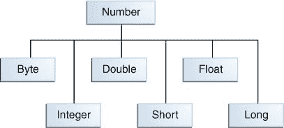

图 8.1 Number 的子类表 8.1 列出了所有子类实现的实例方法。

#### 格式化数字输出

之前你看到了使用`print`和`println`方法向标准输出（`System.out`）打印字符串。由于所有数字都可以转换为字符串（将在本章后面所示），你可以使用这些方法打印字符串和数字的混合。然而，Java 编程语言还有其他方法，可以在包含数字时对打印输出进行更多的控制。

##### printf 和 format 方法

`java.io`包包含一个`PrintStream`类，它有两个格式化方法可以替换`print`和`println`。这两个方法`format`和`printf`是等价的。你熟悉的`System.out`恰好是一个`PrintStream`对象，因此你可以在`System.out`上调用`PrintStream`方法。因此你可以在代码中任何可以使用`print`或`println`的地方使用`format`或`printf`。这里有一个示例：

```java
System.out.format(. . . . .);
```

这两个`java.io.PrintStream`^(5)方法的语法相同：

```java
public PrintStream format(String format, Object . . . args)
```

这里，`format`是一个指定如何格式化第二个参数`args`中对象的字符串，而`args`是要使用该格式打印的变量列表。一个简单的示例如下：点击查看代码图像

```java
System.out.format("The value of " + "the float variable is " +
"%f, while the value of the " + "integer variable is %d, " +
"and the string is %s", floatVar, intVar, stringVar);
```

第一个参数`format`是一个格式字符串，指定第二个参数`args`中的对象如何进行格式化。格式字符串包含普通文本以及*格式占位符*（format specifiers），它们是格式化`Object . . . args`参数的特殊字符。（`Object . . . args`这种表示被称为可变参数 *varargs，这意味着参数的数量是可以变化的。）

格式说明符以百分号`%`开始并以`converter`结束。转换器是一个字符，表示要格式化的参数类型。在百分号和转换器之间，你可以包含可选的标志（flags）和说明符（specifiers）。有很多转换器、标志和说明符，它们的文档都记录在`java.util.Formatter`中。

这是一个基础示例：

```java
int i = 461012;
System.out.format("The value of i is: %d%n", i);
```

`%d`指定单个变量为十进制整数。`%n`是与平台相关的换行符。输出如下：

```
The value of i is: 461012
```

`printf`和`format`方法是重载的。每个方法都有一个具有以下语法的版本：

```java
public PrintStream format(Locale l, String format, Object . . . args)
```

例如，若要在法语系统（使用逗号代替小数点）中打印数字，你可以使用以下代码：

```java
System.out.format(Locale.FRANCE,
    "The value of the float " + "variable is %f, while the " +
    "value of the integer variable " + "is %d, and the string is %s%n",
    floatVar, intVar, stringVar);
```

### 示例

以下程序`TestFormat.java`展示了使用`format`方法可以实现的一些格式化操作。（注意：表 8.3 列出了此示例程序中使用的一些转换器和标志。）输出显示在嵌入注释的双双引号内：

```java
import java.util.Calendar;
import java.util.Locale;

public class TestFormat {
    public static void main(String[] args) {
        long n = 461012;
        System.out.format("%d%n", n);      //  --> "461012"
        System.out.format("%08d%n", n);   //  --> "00461012"
        System.out.format("%+8d%n", n);   //  --> " +461012"
        System.out.format("%,8d%n", n);    //  --> " 461,012"
        System.out.format("%+,8d%n%n", n); //  --> "+461,012"
        double pi = Math.PI;
        System.out.format("%f%n", pi);      // --> "3.141593"
        System.out.format("%.3f%n", pi);    // --> "3.142"
        System.out.format("%10.3f%n", pi);   // --> "      3.142"
        System.out.format("%-10.3f%n", pi);  // --> "3.142"
        System.out.format(Locale.FRANCE,
                          "%-10.4f%n%n", pi); // --> "3,1416"
        Calendar c = Calendar.getInstance();
        System.out.format("%tB %te, %tY%n", c, c, c); // --> "May 29, 2006"
        System.out.format("%tl:%tM %tp%n", c, c, c);  // --> "2:34 am"
        System.out.format("%tD%n", c);      // --> "05/29/06"
    }
}
```

表 8.3. TestFormat.java 中使用的转换器和标志

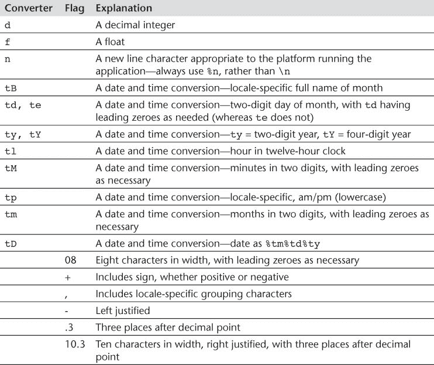


注意：本节的讨论仅涵盖了`format`和`printf`方法的基础知识。更多细节可以在[第 10 章]中找到。此外，使用`String.format`创建字符串在“[Strings]”部分有所介绍。

---

### DecimalFormat 类

你可以使用`java.text.DecimalFormat`类来控制前导和后缀零显示、前缀和后缀、分组（千位）分隔符以及小数点分隔符。`DecimalFormat`在数字格式化方面提供了极大的灵活性，但它可能会让你的代码变得复杂。

下面的示例通过向`DecimalFormat`构造函数传递模式字符串来创建一个`DecimalFormat`对象`myFormatter`。然后，由`myFormatter`调用从`NumberFormat`继承来的`format()`方法——它接受一个`double`值作为参数并返回格式化后的数字字符串。以下是一个说明`DecimalFormat`用法的示例程序：

```java
import java.text.*;

public class DecimalFormatDemo {
    static public void customFormat(String pattern, double value ) {
        DecimalFormat myFormatter = new DecimalFormat(pattern);
        String output = myFormatter.format(value);
        System.out.println(value + "  " + pattern + "  " + output);
    }
    static public void main(String[] args) {
        customFormat("###,###", 123456.789);
        customFormat("###.##", 123456.789);
        customFormat("00000.000", 23.78);
        customFormat("$###,###", 12345.67);
    }
}
```

输出如下：

```
123456.789  ###,###  123,457
123456.789  ###.##  123456.79
23.78  00000.000  23.780
12345.67  $###,###  $12,346
```

---

格式说明符以百分号`%`开始并以`converter`结束。转换器是一个字符，表示要格式化的参数类型。在百分号和转换器之间，你可以包含可选的标志（flags）和说明符（specifiers）。有很多转换器、标志和说明符，它们的文档都记录在`java.util.Formatter`中。

这是一个基础示例：

```java
int i = 461012;
System.out.format("The value of i is: %d%n", i);
```

`%d`指定单个变量为十进制整数。`%n`是与平台相关的换行符。输出如下：

```
The value of i is: 461012
```

`printf`和`format`方法是重载的。每个方法都有一个具有以下语法的版本：

```java
public PrintStream format(Locale l, String format, Object . . . args)
```

例如，若要在法语系统（使用逗号代替小数点）中打印数字，你可以使用以下代码：

```java
System.out.format(Locale.FRANCE,
    "The value of the float " + "variable is %f, while the " +
    "value of the integer variable " + "is %d, and the string is %s%n",
    floatVar, intVar, stringVar);
```

### 示例

以下程序`TestFormat.java`展示了使用`format`方法可以实现的一些格式化操作。（注意：表 8.3 列出了此示例程序中使用的一些转换器和标志。）输出显示在嵌入注释的双双引号内：

```java
import java.util.Calendar;
import java.util.Locale;

public class TestFormat {
    public static void main(String[] args) {
        long n = 461012;
        System.out.format("%d%n", n);      //  --> "461012"
        System.out.format("%08d%n", n);   //  --> "00461012"
        System.out.format("%+8d%n", n);   //  --> " +461012"
        System.out.format("%,8d%n", n);    //  --> " 461,012"
        System.out.format("%+,8d%n%n", n); //  --> "+461,012"
        double pi = Math.PI;
        System.out.format("%f%n", pi);      // --> "3.141593"
        System.out.format("%.3f%n", pi);    // --> "3.142"
        System.out.format("%10.3f%n", pi);   // --> "      3.142"
        System.out.format("%-10.3f%n", pi);  // --> "3.142"
        System.out.format(Locale.FRANCE,
                          "%-10.4f%n%n", pi); // --> "3,1416"
        Calendar c = Calendar.getInstance();
        System.out.format("%tB %te, %tY%n", c, c, c); // --> "May 29, 2006"
        System.out.format("%tl:%tM %tp%n", c, c, c);  // --> "2:34 am"
        System.out.format("%tD%n", c);      // --> "05/29/06"
    }
}
```

表 8.3. `TestFormat.java`中使用的转换器和标志


格式说明符以百分号 `%` 开始并以 `converter` 结束。转换器是一个字符，表示要格式化的参数类型。在百分号和转换器之间，你可以包含可选的标志（flags）和说明符（specifiers）。有很多转换器、标志和说明符，它们的文档都记录在 `java.util.Formatter` 中。

这是一个基础示例：

```
int i = 461012;
System.out.format("The value of i is: %d%n", i);
```

`%d` 指定单个变量为十进制整数。`%n` 是与平台相关的换行符。输出如下：

The value of i is: 461012

`printf` 和 `format` 方法是重载的。每个方法都有一个具有以下语法的版本：

```java
public PrintStream format(Locale l, String format, Object . . . args)
```

例如，若要在法语系统（使用逗号代替小数点）中打印数字，你可以使用以下代码：

```java
System.out.format(Locale.FRANCE,
    "The value of the float " + "variable is %f, while the " +
    "value of the integer variable " + "is %d, and the string is %s%n",
    floatVar, intVar, stringVar);
```

### 示例

以下程序 `TestFormat.java` 展示了使用 `format` 方法可以实现的一些格式化操作。（注意：表 8.3 列出了此示例程序中使用的一些转换器和标志。）输出显示在嵌入注释的双双引号内：

```java
import java.util.Calendar;
import java.util.Locale;

public class TestFormat {
    public static void main(String[] args) {
        long n = 461012;
        System.out.format("%d%n", n);      //  --> "461012"
        System.out.format("%08d%n", n);   //  --> "00461012"
        System.out.format("%+8d%n", n);   //  --> " +461012"
        System.out.format("%,8d%n", n);    //  --> " 461,012"
        System.out.format("%+,8d%n%n", n); //  --> "+461,012"
        double pi = Math.PI;
        System.out.format("%f%n", pi);      // --> "3.141593"
        System.out.format("%.3f%n", pi);    // --> "3.142"
        System.out.format("%10.3f%n", pi);   // --> "      3.142"
        System.out.format("%-10.3f%n", pi);  // --> "3.142"
        System.out.format(Locale.FRANCE,
                          "%-10.4f%n%n", pi); // --> "3,1416"
        Calendar c = Calendar.getInstance();
        System.out.format("%tB %te, %tY%n", c, c, c); // --> "May 29, 2006"
        System.out.format("%tl:%tM %tp%n", c, c, c);  // --> "2:34 am"
        System.out.format("%tD%n", c);      // --> "05/29/06"
    }
}
```

表 8.3. `TestFormat.java` 中使用的转换器和标志


***

注意 本节的讨论仅涵盖了 `format` 和 `printf` 方法的基础知识。更多细节可以在[第 10 章]中找到。此外，使用 `String.format` 创建字符串在“[Strings]”部分有所介绍。

***

### DecimalFormat 类

你可以使用 `java.text.DecimalFormat` 类来控制前导和后缀零显示、前缀和后缀、分组（千位）分隔符以及小数点分隔符。`DecimalFormat` 在数字格式化方面提供了极大的活性，但它可能会让你的代码变得复杂。

下面的示例通过向 `DecimalFormat` 构造函数传递模式字符串来创建一个 `DecimalFormat` 对象 `myFormatter`。然后，由 `myFormatter` 调用从 `NumberFormat` 继承来的 `format()` 方法——它接受一个 `double` 值作为参数并返回格式化后的数字字符串。以下是一个说明 `DecimalFormat` 用法的示例程序：

```java
import java.text.*;

public class DecimalFormatDemo {
    static public void customFormat(String pattern, double value ) {
        DecimalFormat myFormatter = new DecimalFormat(pattern);
        String output = myFormatter.format(value);
        System.out.println(value + "  " + pattern + "  " + output);
    }
    static public void main(String[] args) {
        customFormat("###,###", 123456.789);
        customFormat("###.##", 123456.789);
        customFormat("00000.000", 23.78);
        customFormat("$###,###", 12345.67);
    }
}
```

# 表 8.6. 指数和对数方法

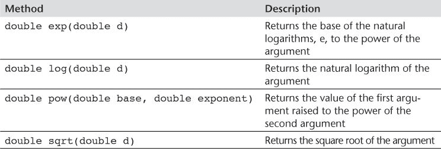

运行 `ExponentialDemo` 时你会看到的输出如下：

e 的值为 2.7183

`exp(11.635)` 是 112983.831

`log(11.635)` 是 2.454

`pow(11.635, 2.760)` 是 874.008

`sqrt(11.635)` 是 3.411

## 三角函数

`Math` 类还提供了一组三角函数，这些函数在表 8.7 中进行了汇总。传递给这些每个方法的值是以弧度表示的角度。你可以使用 `toRadians` 方法将度转换为弧度。

### 表 8.7. 三角函数方法

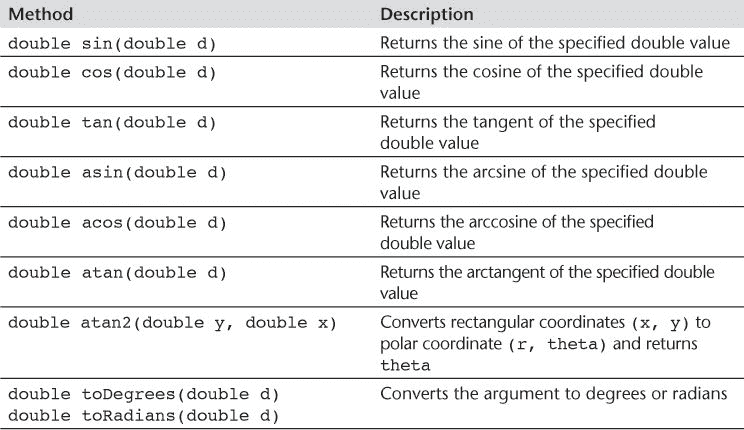

以下是一个程序 `TrigonometricDemo`，它使用了表 8.7 中列出的每个方法来计算 45 度角的各种三角函数值：

点击此处查看代码图像

```java
public class TrigonometricDemo {
    public static void main(String[] args) {
        double degrees = 45.0;
        double radians = Math.toRadians(degrees);
        System.out.format("The value of pi " + "is %.4f%n", Math.PI);
        System.out.format("The sine of %.1f " + "degrees is %.4f%n", degrees,
                            Math.sin(radians));
        System.out.format("The cosine of %.1f " + "degrees is %.4f%n", degrees,
                            Math.cos(radians));
        System.out.format("The tangent of %.1f " + "degrees is %.4f%n", degrees,
                            Math.tan(radians));
        System.out.format("The arcsine of %.4f " + "is %.4f degrees %n",
                            Math.sin(radians),
                            Math.toDegrees(Math.asin(Math.sin(radians))));
        System.out.format("The arccosine of %.4f " + "is %.4f degrees %n",
                            Math.cos(radians),
                            Math.toDegrees(Math.acos(Math.cos(radians))));
        System.out.format("The arctangent of %.4f " + "is %.4f degrees %n",
                            Math.tan(radians),
                            Math.toDegrees(Math.atan(Math.tan(radians))));
    }
}
```

该程序的输出如下：

The value of pi is 3.1416

The sine of 45.0 degrees is 0.7071

The cosine of 45.0 degrees is 0.7071

The tangent of 45.0 degrees is 1.0000

The arcsine of 0.7071 is 45.0000 degrees

The arccosine of 0.7071 is 45.0000 degrees

The arctangent of 1.0000 is 45.0000 degrees

## 随机数

`random()` 方法返回一个 0.0 到 1.0 之间的伪随机选择数字。范围包括 0.0 但不包括 1.0。换句话之，`0.0 <= Math.random() < 1.0`。要获取不同范围内的数字，你可以对方法返回的值进行算术运算。例如，要生成一个 0 到 9 之间的整数，你可以编写以下代码：

```java
int number = (int)(Math.random() * 10);
```


通过将值乘以 10，可能值的范围变为 `0.0 <= number < 10`。当你需要生成单个随机数时，`Math.random` 效果良好。如果你需要生成一系列随机数，应该创建一个 `java.util.Random` 实例并调用该对象的方法来生成数字。

## 自动装箱和拆箱

自动装箱（Autoboxing）是 Java 编译器在基本类型与其包装类之间完成的自动转换。例如，将 `int` 转换为 `Integer`，将 `double` 转换为 `Double` 等此类推。如果转换反过来，则称为拆箱（unboxing）。

这里是自动装箱的最简单示例：

```java
Character ch = 'a';
```

本节中的其余示例使用了泛型。如果你不熟悉泛型的语法，请参第 6 章。考虑以下内容：

```java
List<Integer> li = new ArrayList<>();
for (int i = 1; i < 50; i += 2)
    li.add(i);
```

尽管你将 `int` 值作为基本类型而不是 `Integer` 对象添加到 `li` 中，但代码仍然可以编译。因为 `li` 是 `Integer` 对象的列表，而不是 `int` 值的列表，你可能会奇怪为什么 Java 编译器没有发出编译时错误。编译器没有生成错误，因为它创建了一个 `Integer` 对象。

为了对包含数字的字符串进行格式化输出，你可以使用 `PrintStream` 类中的 `printf()` 或 `format()` 方法。或者，你也可以使用 `NumberFormat` 类通过模式来自自定义数值格式。

`Math` 类包含了多种用于执行数学运算的类方法，包括指数、对数和三角方法。`Math` 类还包含了基础算术函数，如绝对值和四舍五入，以及一个用于生成随机数的方法 `random()`。

## 问题与练习：数字

### 问题

**1.** 请使用 API 文档找到以下问题的答案：

**a.** 你可以使用哪种 `Integer` 方法将一个 `int` 转换为以十六进制表示该数字的字符串？例如，哪个方法能将整数 65 转换为字符串 "41"？

**b.** 你将使用哪种 `Integer` 方法将五进制表示的字符串转换为等值的 `int`？例如，你将如何将字符串 "230" 转换为整数值 65？请展示你完成此任务将将使用的代码。

**c.** 你可以使用哪种 `double` 方法来检测浮点数是否具有特殊值“非数字” (`NaN`)？

**2.** 下述表达式的值是多少？为什么？

`Integer.valueOf(1).equals(Long.valueOf(1))`

### 练习

**1.** 修改 `MaxVariablesDemo` 以以显示最小值而不是最大值。你可以删除所有与变量 `aChar` 和 `aBoolean` 相关的代码。输出是什么？

**2.** 创建一个程序，从命令行读取任意数量的整数参数并将它们相加。例如，假设你输入了以下内容：

`java Adder 1 3 2 10`

该程序应该显示 `16` 然后退出。如果用户只输入了一个参数，程序还应该显示错误信息。你可以基于 `ValueOfDemo` 编写你的程序。

**3.** 创建一个与上一个相似但具有以下差异的程序：

- 不是读取整数参数，而是读取浮点数参数。

- 显示参数之和，小数点后恰好保留两位。

例如，假设你输入了以下内容：

`java FPAdder 1 1e2 3.0 4.754`

程序将显示 `108.75`。根据你的区域设置，小数点可能是逗号而不是句号。

### 答案

你可以在 `http://docs.oracle.com/javase/tutorial/java/data/QandE/numbers-answers.html` 找到这些问题和练习的答案。

## 字符

大多数情况下，如果你使用单个字符值，将使用基本数据类型 `char`。这是一个示例：

```java
char ch = 'a';

// 大写希腊字母 omega 字符的 Unicode 编码
char uniChar = '\u039A';

// 一个字符数组
char[] charArray = { 'a', 'b', 'c', 'd', 'e' };
```

但是，有时你需要将 `char` 作为对象使用（例如，在期望对象的方法的参数中）。Java 编程语言提供了一个包装类，为了此目的将 `char` “包装”在一个 `Character` 对象中。`Character` 类型的对象包含一个单一字段，其类型为 `char`。该 `Character` 类还提供了许多实用的类方法（即静态方法）来操作字符。

你可以使用 `Character` 构造函数创建一个 `Character` 对象：

```java
Character ch = new Character('a');
```

在某些情况下，Java 编译器也会为你创建一个 `Character` 对象。例如，如果你将一个基本类型 `char` 传递给一个期望对象的方法，编译器会自动为你将 `char` 转换为 `Character`。如前所述，此特征称为自动装箱（autoboxing）——如果转换反过来则称为自动拆箱（unboxing）。

> **注意**

> `Character` 类是不可变的，因此一旦创建，`Character` 对象就无法更改。

表 8.9 列出了 `Character` 类中一些最常用的方法，但并非详尽。要查看该类中所有方法的完整列表（超过 50 个），请参考 `java.lang.Character` API 规范。

**表 8.9. Character 类中的实用方法**

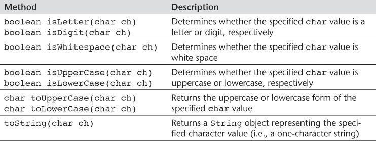

### 转义序列

由反斜杠 (`\`) 前导的字符是转义序列，对编译器具有特殊含义。表 8.10 展示了 Java 转义序列。

**表 8.10. 转义序列**

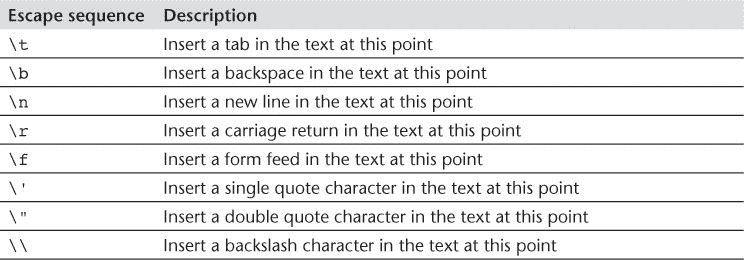

当在打印语句遇到转义序列时，编译器会进行相应的解释。例如，如果你想在引号内放置引号，必须对内部的引号使用转义序列 `\"`。考虑以下句子：

She said "Hello!" to me.

为了打印这个句子，你应该写成：

```java
System.out.println("She said \"Hello!\" to me.");
```

## 字符串

字符串在 Java 编程中被广泛使用，它是字符序列。在 Java 编程语言中，字符串是对象。Java 平台提供了 `String` 类来创建和操作字符串。

### 创建字符串

创建字符串最直接的方法是编写：

```java
String greeting = "Hello world!";
```

在这种情况下，`"Hello world!"` 是字符串字面量——双引号中的一系列字符。每当编译器遇到字符串字面量时，它都会创建一个该值的 `String` 对象。

与其他任何对象一样，你可以通过使用 `new` 关键字和构造函数创建 `String` 对象。`String` 类有多个构造函数允许使用不同的来源提供字符串的初始值，例如字符数组：

```java
char[] helloArray = { 'h', 'e', 'l', 'l', 'o' };
String helloString = new String(helloArray);
System.out.println(helloString);
```

> **注意**

> `String` 类是不可变的。`String` 类提供了许多看似修改字符串的方法，稍后将讨论。由于字符串是不可变的，这些方法实际上是创建并返回一个包含结果的新字符串。

### 字符串长度

用于获取对象信息的方法被称为访问方法。你可以与字符串一起使用的访问方法是 `length()` 方法，它返回字符串中包含的字符数量。考虑以下两行代码：

```java
String palindrome = "Dot saw I Tod";
int len = palindrome.length();
```

当执行这些行时，`len` 等于 17。回文是一个是对称的单词或句子——在忽略大小写和标点符号的情况下，正读反读都是样的。这里有一个短但（如我们将看到的）效率下的反转回文字符串程序。它调用了 `String` 方法 `charAt(i)`，该方法返回字符串中的第 i 个字符，从 0 开始计数：

```java
public class StringDemo {
    public static void main(String[] args) {
        String palindrome = "Dot saw I Tod";
        int len = palindrome.length();
        char[] tempCharArray = new char[len];
        char[] charArray = new char[len];
        // 将原始字符串放入字符数组
        for (int i = 0; i < len; i++) {
            tempCharArray[i] = palindrome.charAt(i);
        }
        // 反转字符数组
        for (int j = 0; j < len; j++) {
            charArray[j] = tempCharArray[len - 1 - j];
        }
        String reversePalindrome = new String(charArray);
    }
}
```

```java
new String(charArray);

System.out.println(reversePalindrome);

}

}
```

运行程序会产生此输出：

```
doT saw I was toD
```

为了实现字符串反转，程序必须将字符串转换为字符数组（第一个 `for` 循环），将数组反转为第二个数组（第二个 `for` 循环），然后转换回字符串。`String` 类包含一个名为 `getChars()` 的方法，可以将字符串或字符串部分转换为字符数组，因此我们可以用以下代码替换程序中的第一个 `for` 循环：

```java
palindrome.getChars(0, len, tempCharArray, 0);
```

### 字符串的拼接

`String` 类包含一个用于拼接两个字符串的方法：

```java
string1.concat(string2);
```

该方法返回一个新字符串，该字符串在 `string1` 的末尾添加了 `string2`。你也可以对字符串字面量使用 `concat()` 方法：

```java
"My name is ".concat("Rumplestiltskin");
```

然而，字符串更常用使用 `+` 运算符进行拼接：

```java
"Hello," + " world" + "!"
```

结果如下：

```
"Hello, world!"
```

`+` 运算符被广泛用于 `print` 语句。考虑以下示例：

```java
String string1 = "saw I was ";

System.out.println("Dot " + string1 + "Tod");
```

这产生了以下结果：

```
Dot saw I was Tod
```

这种拼接可以是任何对象的混合。对于每个不是 `String` 的对象，都会调用其 `toString()` 方法将其转换为 `String`。

> **注意**

> Java 编程语言不允许字符串字面量在源文件中跨行显示，因此你必须在多行字符串的每行末尾使用 `+` 拼接运算符。这是一个示例：

```java
String quote =
    "Now is the time for all good " +
    "men to come to the aid of their country.";
```

在 `print` 语句中使用 `+` 拼接运算符将字符串跨行断开是非常常见的做法。

### 创建格式化字符串

你已经见过使用 `printf()` 和 `format()` 方法打印带有格式化数字的输出。`String` 类有一个等价的类方法 `format()`，它返回一个 `String` 对象而不是 `PrintStream` 对象。

使用 `String` 的静态 `format()` 方法允许你创建一个可以重复的格式化字符串，而不是一次性的打印语句。考虑以下示例：

```java
System.out.printf("The value of the float " +
                  "variable is %f, while " +
                  "the value of the " +
                  "integer variable is %d, " +
                  "and the string is %s",
                  floatVar, intVar, stringVar);
```

与此相比，你可以写如下代码：

```java
String fs;

fs = String.format("The value of the float " +
                    "variable is %f, while " +
                    "the value of the " +
                    "integer variable is %d, " +
                    " and the string is %s",
                    floatVar, intVar, stringVar);

System.out.println(fs);
```

### 数字与字符串之间的转换

#### 将字符串转换为数字

通常，程序最后会得到位于字符串中的数值型数据——用户输入的值。包装原始类型的 `Number` 子类（`Byte`, `Integer`, `Double`, `Float`, `Long`, `Short`）都提供了一个名为 `valueOf` 的方法，可以将字符串转换为该类型的对象。以下示例 `valueOfDemo` 从命令行获取两个字符串，将转换为数字，并对这些值进行算术运算：

```java
public class ValueOfDemo {
    public static void main(String[] args) {
        // 此程序需要两个
        // 命令行参数
        if (args.length == 2) {
            // 将字符串转换为数字
            float a = (Float.valueOf(args[0])).floatValue();
            float b = (Float.valueOf(args[1])).floatValue();
            // 进行一些算术运算
            System.out.println("a + b = " + (a + b));
            System.out.println("a - b = " + (a - b));
            System.out.println("a * b = " + (a * b));
            System.out.println("a / b = " + (a / b));
            System.out.println("a % b = " + (a % b));
        } else {
            System.out.println("This program " + "requires two command-line arguments.");
        }
    }
}
```

当你使用 `4.5` 和 `87.2` 作为命令行参数时，程序的输出如下：

```
a + b = 91.7
a - b = -82.7
a * b = 392.4
a / b = 0.0516055
a % b = 4.5
```

> **注意**

> 每个包装原始数值类型的 `Number` 子类也提供了一个 `parseXXXX()` 方法（例如 `parseFloat()`），可以用于将字符串转换为数字。由于返回的是原始类型而不是对象，`parseFloat()` 比 `valueOf()` 方法更直接。

#### 将数字转换为字符串

有时你需要将数字转换为字符串，因为你需要以字符串的形式对值进行操作。有几种简单的方法可以将数字转换为字符串：

- 将 `i` 与空字符串拼接；转换会自动处理。

```java
String s1 = "" + i;
```

- 使用 `valueOf` 方法。

```java
String s2 = String.valueOf(i);
```

- 每个 `Number` 子类都包含一个类方法 `toString()`，它将将其原始类型转换为字符串。这是一个示例：

```java
String s3 = Integer.toString(i);
String s4 = Double.toString(d);
```

`ToStringDemo` 示例使用 `toString` 方法将数字转换为字符串。随后程序使用一些字符串方法计算小数点前后的数字：


```java
public class ToStringDemo {
    public static void main(String[] args) {
        double d = 858.48;
        String s = Double.toString(d);
        int dot = s.indexOf('.');
        System.out.println(dot + " digits before decimal point.");
        System.out.println((s.length() - dot - 1) + " digits after decimal point.");
    }
}
```

该程序的输出如下：

```
3 digits before decimal point.
2 digits after decimal point.
```

## 操作字符串中的字符

### 通过索引获取字符和子字符串

你可以通过调用`charAt()`访问方法获取字符串中特定索引处的字符。第一个字符的索引是字母`O`，而最后一个字符的索引是`length()-1`。例如，以下代码获取了字符串中索引为 9 处的字符：

```java
String anotherPalindrome = "Niagara. O roar again!";
char aChar = anotherPalindrome.charAt(9);
```

索引从 0 开始，因此索引 9 的字符是字母`O`，如图 8.2 所示。如果你想从字符串中获取多个连续的字符，可以使用`substring`方法。`substring`方法有两个版本，如表 8.11 所示。

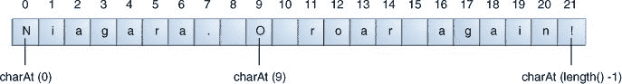

图 8.2. 索引 9 处的字符

表 8.11. `String`类中的`substring`方法

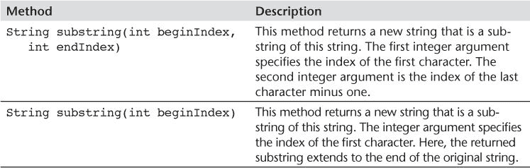

回到“Niagara”回文，以下代码获取了从索引 11 开始到但不包含索引 15 的子字符串，即单词“roar”（如见图 8.3）：

点击此处查看代码图像

```java
String anotherPalindrome = "Niagara. O roar again!";
String roar = anotherPalindrome.substring(11, 15);
```


图 8.3. 从索引 11 到 15 的子字符串

### 处理字符串的其他方法

表 8.12 展示了其他几个处理字符串的`String`类方法。

表 8.12. `String`类中处理字符串的其他方法

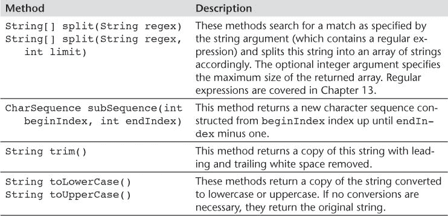

## 在字符串中搜索字符和子字符串

这里是其他用于在字符串内查找字符或子字符串的`String`方法。`String`类提供了访问器方法，用于返回特定字符或子字符串在字符串中的位置：`indexOf()`和`lastIndexOf()`。`indexOf()`方法从字符串开始处向前搜索，而`lastIndexOf()`方法从字符串末尾向后搜索。如果未找到字符或子字符串，`indexOf()`和`lastIndexOf()`将返回`–1`。

`String`类还提供了一个搜索方法`contains`，如果字符串包含特定的字符序列，则返回`true`。当你只需要知道字符串是否包含某个字符序列而不需要确切位置时，请使用此方法。表 8.13 描述了各种字符串搜索方法。

表 8.13. `String`类中的搜索方法

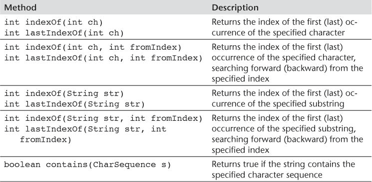

> 注意：`CharSequence`是一个由`String`类实现的接口。因此，你可以将字符串作为`contains()`方法的参数。

## 在字符串中替换字符和子字符串

`String`类中用于向字符串中插入字符或子字符串的方法非常少。通常情况下，这些方法并不是必需的：你可以通过将已从字符串中移除的子字符串与想要插入的子字符串进行拼接，创建一个新字符串。然而，`String`类确实有四个方法用于替换已找到的字符或子字符串，如表 8.14 所示。

表 8.14. `String`类中处理字符串的方法

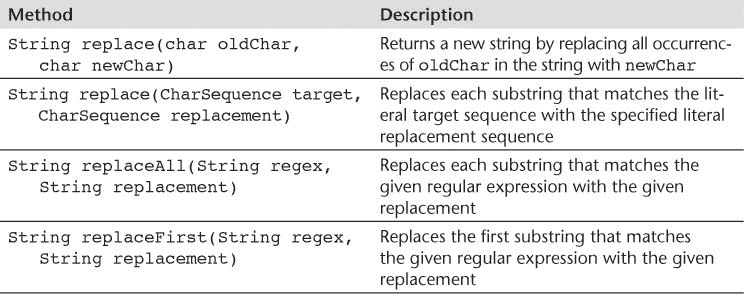

### 示例

以下类`Filename`说明了如何使用`lastIndexOf()`和`substring()`来分离文件名的不同部分：

> 注意：以下`Filename`类中的方法没有进行任何错误检查，并假设其参数包含完整的目录路径和带有扩展名的文件名。如果这些方法是生产环境代码，它们将验证参数是否构造得正确。

点击此处查看代码图像

```java
public class Filename {
    private String fullPath;
    private char pathSeparator, extensionSeparator;

    public Filename(String str, char sep, char ext) {
        fullPath = str;
        pathSeparator = sep;
        extensionSeparator = ext;
    }

    public String extension() {
        int dot = fullPath.lastIndexOf(extensionSeparator);
        return fullPath.substring(dot + 1);
    }

    // 获取不带扩展名的文件名
    public String filename() {
        int dot = fullPath.lastIndexOf(extensionSeparator);
        int sep = fullPath.lastIndexOf(pathSeparator);
        return fullPath.substring(sep + 1, dot);
    }

    public String path() {
        int sep = fullPath.lastIndexOf(pathSeparator);
        return fullPath.substring(0, sep);
    }
}
```

这是一个程序`FilenameDemo`，它构造了一个`Filename`对象并调用了它的所有方法：

点击此处查看代码图像

```java
public class FilenameDemo {
    public static void main(String[] args) {
        final String FPATH = "/home/user/index.html";
        Filename myHomePage = new Filename(FPATH, '/');
        System.out.println("Extension = " + myHomePage.extension());
        System.out.println("Filename = " + myHomePage.filename());
        System.out.println("Path = " + myHomePage.path());
    }
}
```

以下是程序的输出：

```
Extension = html
Filename = index
Path = /home/user
```

如图 8.4 所示，我们的`extension`方法使用`lastIndexOf`定位文件名中`.`的最后出现位置。然后`substring`使用`lastIndexOf`的返回值提取文件扩展名——即从点到字符串结束的子字符串。这段代码假设文件名包含点；如果文件名没有点，`lastIndexOf`返回`–1`，`substring`方法将抛出`StringIndexOutOfBounds`异常。

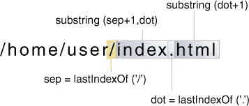

图 8.4. 分离名的不同部分

### StringBuilder 类

`StringBuilder`对象类似于`String`对象，区别在于它们是可以修改的。在内部，这些对象被视为包含字符序列的可变数组。在任何时刻，都可以通过调用方法更改序列的长度和内容。

除非`StringBuilder`在性能更优或代码更简洁方面具有优势，否则应始终使用`String`。（请参阅本节末尾的示例程序。）例如，如果你需要拼接大量的字符串，向`StringBuilder`对象中追加内容会更高效。

## 长度与容量

`StringBuilder`类和`String`类一样，有一个`length()`方法，用于返回构建器中字符序列的长度。与字符串不同，每个`StringBuilder`都有一个`capacity`（容量）——已分配的字符空间数。通过`capacity()`方法的的始终大于或等于长度（通常大于），并且会根据需要自动扩展以适应向`StringBuilder`中添加的内容。例如，以下代码将产生一个长度为 9、容量为 16 的`StringBuilder`（图 8.5）：

点击此处查看代码图像

```java
// creates empty builder, capacity 16
StringBuilder sb = new StringBuilder();

// adds 9 character string at beginning
sb.append("Greetings");
```

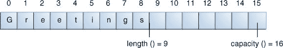

图 8.5. 创建一个`StringBuilder`

表 8.16. `StringBuilder`构造器

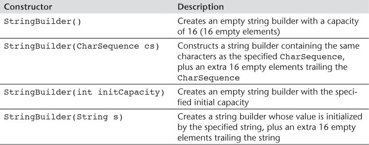

`StringBuilder`类有一些与长度和容量相关的方法，而`String`类并不具备（表 8.17）。许多操作（例如`append()`、`insert()`或`setLength()`）可以增加`StringBuilder`中字符序列的长度，导致结果`length()`大于当前的`capacity()`。当发生时，容量会自动增加。

表 8.17. 长度与容量方法

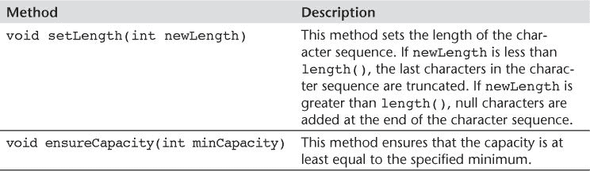

## StringBuilder 操作

`StringBuilder`中`String`不具备的主要操作是`append()`和`insert()`方法，这些方法经过重载，可以接受任何类型的数据。每个方法都会将其参数转换为字符串，然后将该字符串的字符追加或插入到`StringBuilder`的字符序列中。`append`方法始终将这些字符添加到现有字符序列的末尾，而`insert`方法则将字符添加到指定位置。表 8.18 显示了`StringBuilder`类的一些方法。

表 8.18. 各种`StringBuilder`方法

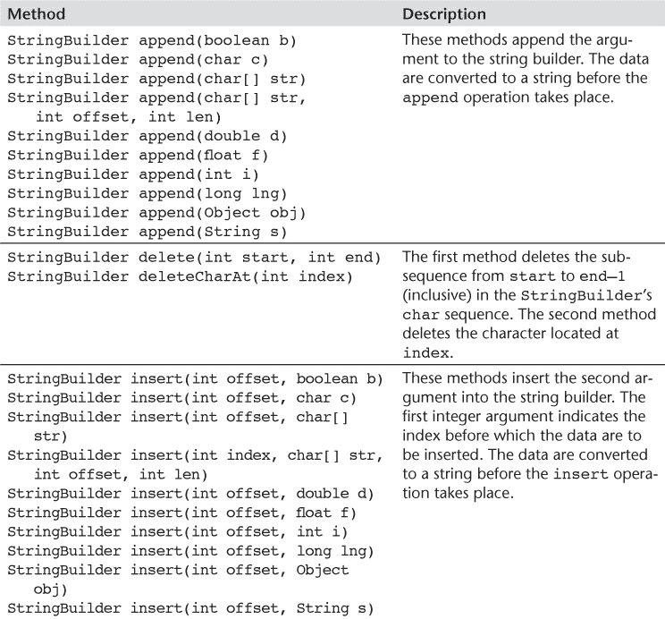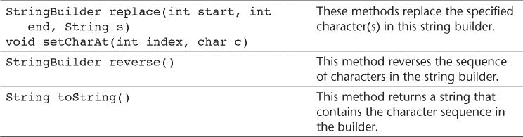

***

注意

你可以先通过`StringBuilder`类的`toString()`方法将`StringBuilder`对象转换为字符串，从而在构建对象上使用任何`String`方法。然后使用`StringBuilder(String str)`构造器将字符串转换回`StringBuilder`。

***

## 示例

在“字符串”节中列出的`StringDemo`程序是一个示例，如果使用`StringBuilder`代替`String`，该程序将会高效。`StringDemo`反转了一个回文。这里再次是它的代码列表：

点击此处查看代码图像

```java
public class StringDemo {
    public static void main(String[] args) {
        String palindrome = "Dot saw I was Tod";
        int len = palindrome.length();
        char[] tempCharArray = new char[len];
        char[] charArray = new char[len];
        // put original string in an
        // array of chars
        for (int i = 0; i < len; i++) {
            tempCharArray[i] = palindrome.charAt(i);
        }
        // reverse array of chars
        for (int j = 0; j < len; j++) {
            charArray[j] = tempCharArray[len - 1 - j];
        }
        String reversePalindrome = new String(charArray);
        System.out.println(reversePalindrome);
    }
}
```

点击此处查看代码图像

```java
public class ComputeResult {
    public static void main(String[] args) {
        String original = "software";
        StringBuilder result = new StringBuilder("hi");
        int index = original.indexOf('a');
        /*1*/   result.setCharAt(0, original.charAt(0));
        /*2*/   result.setCharAt(1, original.charAt(original.length()-1));
        /*3*/   result.insert(1, original.charAt(4));
        /*4*/   result.append(original.substring(1,4));
        /*5*/   result.insert(3, (original.substring(index, index+2) + " "));
        System.out.println(result);
    }
}
```

### 练习题

**1.** 展示两种合并以下两个字符串以得到字符串`"Hi, mom."`：

`String hi = "Hi, ";`

`String mom = "mom.";`

**2.** 编写一个程序，根据你的全名计算你的姓名首字母并显示它们。

**3.** 字母异位词（anagram）是通过转换另一个单词或短语的字母形成的单词或短语；例如，*parliament*是*partial men*的字母异位词，*software*是*swear oft*的字母异位词。编写一个程序判断一个字符串是否为另一个字符串的字母异位词。该程序应忽略空格和标点符号。

## 答案

你可以在此处找到这些问题的答案：[`http://docs.oracle.com/javase/tutorial/java/data/QandE/characters-answers.html`](http://docs.oracle.com/javase/tutorial/java/data/QandE/characters-answers.html)。

# 9. 异常

章节内容

- 什么是异常？
- 捕获或指定要求
- 捕获和处理异常
- 指定方法抛出的异常
- 如何抛出异常
- 未检查异常：争议
- 异常的优势
- 异常总结
- 问题与练习题：异常

Java 编程语言使用*异常*来处理错误和其他特殊事件。本章描述了何时以及如何使用异常。

第一节定义了`exception`（异常）。异常是程序执行过程中中断指令正常流的事件。第二节讨论了`捕获或指定要求`并描述了三类异常。第三节涵盖了如何捕获和处理异常。讨论包括`try`、`catch`和`finally`块，以及链式异常和日志记录。它包含了关于`try`-with-resources语句的信息。第四节涵盖了如何指定方法抛出的异常。第五节涵盖了如何抛出异常、链式异常以及创建异常类。第六节解释了由`RuntimeException`子类指示的未检查异常的正确和错误用法。最后一节讨论了使用异常来管理错误，这比传统的错误管理技术具有某些优势。本章以总结以及测试你知识的问题和练习结束。

## 什么是异常？

`exception`一词是`exceptional event`（特殊事件）的缩写。

### 定义

`exception`是程序执行过程中发生的中断程序指令正常流的事件。

当方法内部发生错误时，该方法会创建一个对象并将其交给运行时系统。该对象被称为`exception object`（异常对象），包含有关错误的信息，包括它的类型和错误发生时的程序状态。创建异常对象并将其交给运行时系统被称为`throwing an exception`（抛出异常）。

方法抛出异常后，运行时系统会尝试寻找处理它的方法。调用一个处理异常方法的有序列表。这个方法列表被称为`call stack`（调用栈）（图 9.1）。

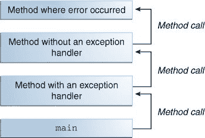

图 9.1. 调用栈


运行时系统在调用栈中搜索包含可以处理异常的代码块。该代码块被称为`exception handler`（异常处理器）。搜索从发生错误的方法开始，并按照方法被调用的反序通过调用栈进行。当找到合适的处理器时，运行时系统将异常传递给该处理器。如果抛出的异常对象的类型与可以处理的类型相匹配，则认为该异常处理器是合适的。异常处理器被称为`catch the exception`（捕获异常）。如果运行时系统搜尽了整个调用栈仍未找到异常处理器，如 9.2 所示，程序将终止。

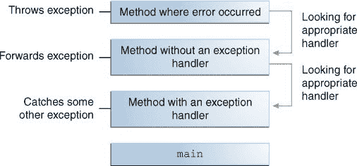

图 9.2. 在调用栈搜索异常处理器

使用异常管理错误比传统的错误管理技术具有某些优势。你可以在本章后续的异常的优势了解更多。

### 捕获或指定要求

有效的 Java 编程代码必须遵守`捕获或指定要求`。这意味着可能抛出某些异常的代码必须由以下之一包含：

- 捕获异常的`try`语句。`try`语句必须为异常提供处理器，详见后续的捕获和处理异常。
- 指定它可以抛出异常的方法。该方法必须提供`throws`子句来列出异常，详见后续的指定方法抛出的异常。

未能遵守捕获或指定要求的代码将无法编译。然而，并不是所有的异常都适用于该要求。为了理解为什么，我们需要查看异常的基本分类，其中只有一类适用于要求。

#### 三类异常

第一类异常是`checked exception`（受检异常）。这些是良好的应用程序应该预见到并恢复的异常情况。例如，假设应用程序提示用户输入文件名，然后通过将名称传递给`java.io.FileReader`的构造函数来打开文件。通常，用户提供存在且可读的文件名，因此`FileReader`对象的构建成功，应用程序正常进行。但有时用户提供不存在的文件名，构造函数将抛出`java.io.FileNotFoundException`。良好的程序会捕获此异常并通知用户错误，可能提示输入更正的文件名。

受检异常适用于捕获或指定要求。所有异常都是受检异常，但`Error`、`RuntimeException`及其子类指示在外。

第二类异常是`error`（错误）。这些是应用程序外部的异常情况，应用程序通常无法预见到或恢复。例如，假设应用程序成功打开了一个输入文件，但由于硬件或系统故障无法读取该文件。读取失败将抛出`java.io.IOError`。应用程序可能会选择捕获此异常以通知用户问题，但让程序打印堆栈并退出可能更有意义。

错误（Errors）不受捕获（catch）或指定（specify）要求的限制。错误是由`Error`及其子类指示的异常。

第三种异常是运行时异常（runtime exception）。这些是应用程序内部的异常状态，应用程序通常无法预料或从从中恢复。这些异常通常表示程序错误，例如逻辑错误或对应用程序编程接口（API）的使用不当。例如，考虑之前描述的应用程序，它将文件名传递给`FileReader`的构造函数。如果逻辑错误导致将`null`传递给构造函数，构造函数将抛出`NullPointerException`。应用程序可以捕获此异常，但消除导致异常发生的原始错误可能更有意义。

运行时异常不受捕获或指定要求的限制。运行时异常是由`RuntimeException`及其子类指示的异常。

***

## Definition

错误和运行时异常合称为`unchecked exceptions`（未检查的异常）。

***

### 绕过捕获或指定

某些程序员认为“捕获或指定”要求是异常处理机制中的一个严重缺陷，并通过使用未检查的异常代替检查异常来绕过这一要求。通常情况下，不建议这样做。在本章稍后的部分，“未检查的异常：争议”节将讨论何时适合使用未检查的异常。

### 捕获和处理异常

本节描述了如何使用三个异常处理器组件——`try`、`catch`和`finally`块来编写一个异常处理器。然后，解释了 Java SE 7 中引入的`try`-with-resources语句。`try`-with-resources语句特别适用于使用`Closeable`资源（如流）的情况。本节的最后部分通过一个示例并分析了在各种场景下的发生情况。

下面的示例定义并实现了一个名为`ListOfNumbers`的类。在构造时，`ListOfNumbers`会创建一个`ArrayList`，其中包含 10 个值为 0 到 9 的顺序`Integer`元素。`ListOfNumbers`类还定义了一个名为`writeList`的方法，将数字列表写入名为`OutFile.txt`的文本文件中。此示例使用了`java.io`中定义的输出类，这些类将在第 10 章中介绍。

点击此处查看代码图像

```
// 注意：此类在设计上无法编译！

import java.io.*;

import java.util.List;

import java.util.ArrayList;

public class ListOfNumbers {
    private List<Integer> list;

    private static final int SIZE = 10;

    public ListOfNumbers () {
        list = new ArrayList<Integer>(SIZE);
        for (int i = 0; i < SIZE; i++) {
            list.add(new Integer(i));
        }
    }

    public void writeList() {
        PrintWriter out = new PrintWriter(new FileWriter("OutFile.txt"));
        for (int i = 0; i < SIZE; i++) {
            out.println("Value at: " + i + " = " + list.get(i));
        }
        out.close();
    }
}
```

第一行**粗体**是构造函数的调用。该构造函数初始化了文件上的输出流。如果无法打开文件，构造函数将抛出`IOException`。第二行**粗体**是调用`ArrayList`类的`get`方法，如果参数的值太小（小于 0）或太大（大于`ArrayList`当前包含的元素数量），则该方法将抛出`IndexOutOfBoundsException`。

如果你尝试编译`ListOfNumbers`类，编译器会打印出关于`FileWriter`构造函数抛出异常的错误信息。然而，它不会显示关于`get`方法抛出异常的错误信息。原因是因为构造函数抛出的异常`IOException`是一个检查异常，而`get`方法抛出的异常`IndexOutOfBoundsException`是一个未检查异常。

现在你已经熟悉了`ListOfNumbers`类以及异常在类中可能抛出的位置，你已经准备好编写异常处理器来捕获并处理这些异常了。

#### try 块

构建异常处理器的第一步是将可能抛出异常的代码封装在`try`块中。通常情况下，`try`块的形式如下：

```
try {
    code
}
catch and finally blocks . . .
```

示例中标记为`code`的部分包含一行或多行可能抛出异常的合法代码行。（`catch`和`finally`块将在接下来两个小节中解释。）

要为`ListOfNumbers`类中的`writeList`方法构建异常处理器，可以将抛出异常的语句封装在`try`块中。这种方法有多种方法：你可以将每一行可能抛出异常的代码放在它各自的`try`块中。你也可以将`writeList`代码放在单个`try`块中，因为代码非常短：

点击此处查看代码图像

```
private List<Integer> list;

private static final int SIZE = 10;
PrintWriter out = null;

try {
    System.out.println("Entered statement");
    out = new PrintWriter(new FileWriter("OutFile.txt"));
    for (int i = 0; i < SIZE; i++) {
        out.println("Value at: " + i + " = " + list.get(i));
    }
}
catch and finally statements . . .
```

如果`try`块内发生了异常，与该异常相关的异常处理器将处理它。要与`try`块关联异常处理器，你必须在其之后放置`catch`块；下一节将展示如何操作。

#### catch 块

通过在`try`块之后直接提供一个或多个`catch`块，可以将异常处理器与之关联。`try`块结束处与第一个`catch`块开始处不能有任何代码：

```
try {
} catch (ExceptionType name) {
} catch (ExceptionType name) {

```

每个`catch`块都是一个异常处理器，处理其参数指示的异常类型。参数类型`ExceptionType`声明了处理器可以处理的异常类型，必须是自`Throwable`类。处理器可以使用`name`来引用异常。

`catch`块包含异常处理器被调用时执行的代码。当异常处理器是调用栈中第一个`ExceptionType`与异常类型匹配的处理器时，运行时系统会调用该处理器。如果抛出的对象可以合法地赋值给异常处理器的参数，系统将认为匹配成功。

以下是`writeList`方法的两个异常处理器——针对`try`语句中可能抛出的两种检查异常类型中的每一种一个：

点击此处查看代码图像

```
try {
} catch (FileNotFoundException e) {
    System.err.println("FileNotFoundException: " + e.getMessage());
    throw new SampleException(e);
} catch (IOException e) {
    System.err.println("Caught IOException: " + e.getMessage());
}
```

两个处理器都会打印错误信息。第二个处理器没有做其他操作。通过捕获未被第一个处理器捕获的任何`IOException`，它允许程序继续执行。

第一个处理器除了打印消息外，还抛出了一个自定义异常。（抛出异常将在本章稍后的“如何抛出异常”节中详细介绍。）

在这个示例中，当捕获到`FileNotFoundException`时，它会抛出一个名为`SampleException`的自定义异常。如果你希望程序在这种情况下以特定方式处理异常，你可能需要这样做。

异常处理程序不仅仅可以打印错误信息或停止程序。它们还可以执行错误恢复、提示用户做出决策，或者使用链式异常（chained exceptions）将错误传播到更高层次的处理器程序，这在本章稍后的“链式异常”节中会有描述。

### 使用单个异常处理器捕获多种类型的异常

在 Java SE 7 及更高版本中，单个`catch`块可以处理多种类型的异常。此功能可以减少代码重复，并减少捕获过于宽泛异常的倾向。

在`catch`子句中，指定该块可以处理的异常类型，并用管道符（`|`）分隔每个异常类型：

```java
catch (IOException|SQLException ex) {
    logger.log(ex);
    throw ex;
}
```

**注意**

如果一个`catch`块处理多种异常类型，则`catch`参数隐式地为`final`。在本示例中，`catch`参数`ex`是`final`的，因此你不能在`catch`块内对其赋值任何值。

### finally 块

当`try`块退出时，`finally`块*总是*执行。这确保了即使发生了意外异常，`finally`块也会执行。但`finally`的用途不仅限于处理异常——它允许程序员避免清理代码被`return`、`continue`或`break`意外跳过。将清理代码放在`finally`块中始终是一个良好的做法，即使没有预料到异常。

**注意**

如果 Java 虚拟机（Java VM）在执行`try`或`catch`代码时退出，则`finally`块可能不会执行。同样，如果执行`try`或`catch`代码的线程被中断或杀死，即使整个应用程序继续运行，`finally`块也可能不会执行。

你在这里使用的`writeList`方法的`try`块打开了一个`PrintWriter`。程序应该在退出`writeList`方法之前关闭该流。这产生了一个相当复杂的问题，因为`writeList`的`try`块可以通过三种方式之一退出：

1. `new FileWriter`语句失败并抛出`IOException`。
2. `vector.elementAt(i)`语句失败并抛出`ArrayIndexOutOfBoundsException`。
3. 一切成功且`try`块正常退出。

无论`try`块内部发生了什么，运行时系统始终执行`finally`块中的语句。因此，它是执行清理工作的完美位置。

以下是用于`writeList`方法的`finally`块，用于清理并关闭`PrintWriter`：

点击此处查看代码图像

```java
finally {
    if (out != null) {
        System.out.println("Closing PrintWriter");
        out.close();
    } else {
        System.out.println("PrintWriter not open");
    }
}
```

在`writeList`示例中，你可以在没有`finally`块干预的情况下提供清理工作。例如，你可以将关闭`PrintWriter`的代码放在`try`块的末尾，并再次放在`ArrayIndexOutOfBoundsException`的异常处理器中，如下所示：

点击此处查看代码图像

```java
try {
    // 不要这样做；这会导致代码重复。
    out.close();
} catch (FileNotFoundException e) {
    // 不要这样做；这会导致代码重复。
    out.close();
    System.err.println("Caught FileNotFoundException: " + e.getMessage());
    throw new RuntimeException(e);
} catch (IOException e) {
    System.err.println("Caught IOException: " + e.getMessage());
}
```

然而，这会导致代码重复，从而使得当你稍后修改代码时，这些代码变得难以阅读且容易出错。例如，如果你在`try`块中添加了可能抛出新类型异常的代码，你必须记得在新的异常处理器中关闭`PrintWriter`。

**注意**

`finally`块是防止资源泄漏的关键工具。在关闭文件或其他恢复资源时，将代码放在`finally`块中，以确保资源*始终*被恢复。

如果你正在使用 Java SE 7 或更高版本，请考虑在这些情况下使用`try`-with-resources语句，它在资源不再需要时会自动释放系统资源。

### try-with-resources 语句

`try`-with-resources语句是一种声明了一个或多个资源的`try`语句。*资源*是一个在程序完成使用后必须关闭的对象。`try`-with-resources语句确保每个资源在语句结束时被关闭。任何实现`java.lang.AutoCloseable`的对象（包括所有实现`java.io.Closeable`的对象）都可以用作资源使用。

以下示例从文件中读取第一行。它使用`BufferedReader`实例从文件中读取数据。`BufferedReader`是一个在程序完成使用后必须关闭的资源：

点击此处查看代码图像

```java
static String readFirstLineFromFile(String path) throws IOException {
    try (BufferedReader br =
            new BufferedReader(new FileReader(path))) {
        return br.readLine();
    }
}
```

在这个示例中，在`try`-with-resources语句中声明的资源是`BufferedReader`。声明出现在`try`关键字后的括号内。在 Java 7 及更高版本中，`BufferedReader`实现`java.lang.AutoCloseable`。由于`BufferedReader`实例是在`try`-with-resource中声明的，因此无论`try`语句是正常完成还是由于`readLine`抛出`IOException`而结束，它都会被关闭。

在 Java 7 之前，你可以使用`finally`块来确保资源关闭，无论`try`语句是否正常完成。以下示例使用了`finally`块而不是`try`-with-resources：

点击此处查看代码图像


```java
static String readFirstLineFromFileFinallyBlock(String path) throws IOException {
    BufferedReader br = new BufferedReader(new FileReader(path));
    try {
        return br.readLine();
    } finally {
        if (br != null) br.close();
    }
}
```

然而，在例例中，如果`readLine`和`close`方法都抛出了异常，那么`readFirstLineFinallyBlock`将抛出从`finally`块抛出的异常；从`try`块抛出的异常被抑制了。相比之下，在`readFirstLine`示例中，如果`try`块和`try`-with-resources语句都抛出了异常，那么方法`readFirstLine`将抛出从`try`块抛出的异常；从`try`-with-resources块抛出的异常被抑制了。在Java 7及更高版本中，你可以检索被抑制的异常；更多信息请参见本章后面的“抑制异常”。

你可以在`try`-with-resources语句中声明一个或多个资源。以下示例获取zip文件`zipFileName`包中的文件名，并创建一个包含这些文件名的文本文件：

```java
public static void writeToFileZipFileContents(String zipFileName, String outputFileName)
    throws java.io.IOException {
    java.nio.charset.Charset charset =
        java.nio.charset.StandardCharsets.US_ASCII;
    java.nio.file.Path outputFilePath = java.nio.file.Paths.get(outputFileName);

    // 使用 try-with-resources 语句打开 zip 文件
    // 并创建输出文件
    try (
        java.util.zip.ZipFile zf =
            new java.util.zip.ZipFile(zipFileName);
        java.io.BufferedWriter writer =
            java.nio.file.Files.newBufferedWriter(outputFilePath, charset)
    ) {
        // 遍历每个条目
        for (java.util.Enumeration entries =
                          zf.entries(); entries.hasMoreElements();) {
            // 获取条目名称并写入输出文件
            String newLine = System.getProperty("line.separator");
            String zipEntryName =
                ((java.util.zip.ZipEntry)entries.nextElement()).getName() +
                newLine;
            writer.write(zipEntryName, 0, zipEntryName.length());
        }
    }
}
```

在这个示例中，`try`-with-resources语句包含两个用分号分隔的声明：`ZipFile`和`BufferedWriter`。当紧随其后的代码块结束（无论是正常结束还是由于异常结束），`BufferedWriter`和`ZipFile`对象的`close`方法将按照此顺序自动调用。请注意，资源的`close`方法是按照它们创建的反顺序调用的。

下面的示例使用`try`-with-resources语句来自动关闭`java.sql.Statement`对象：

```java
public static void viewTable(Connection con) throws SQLException {
    String query = "select COF_NAME, SUP_ID, PRICE, SALES, TOTAL from COFFEES";
    try (Statement stmt = con.createStatement()) {
        ResultSet rs = stmt.executeQuery(query);
        while (rs.next()) {
            String coffeeName = rs.getString("COF_NAME");
            int supplierID = rs.getInt("SUP_ID");
            float price = rs.getFloat("PRICE");
            int sales = rs.getInt("SALES");
            int total = rs.getInt("TOTAL");
            System.out.println(coffeeName + ", " + supplierID + ", " + price + ", " + sales + ", " + total);
        }
    } catch (SQLException e) {
        JDBCTutorialUtilities.printSQLException(e);
    }
}
```

此示例使用的资源`java.sql.Statement`是Java Database Connectivity 4.1及更高版本API的一部分。

### Note

`try`-with-resources语句可以像普通的`try`语句一样拥有`catch`和`finally`块。在`try`-with-resources语句中，任何`catch`或`finally`块会在声明的资源关闭后执行。

### 抑制异常 (Suppressed Exceptions)

与`try`-with-resources语句相关的代码块可能会抛出异常。在`writeToFileZipFileContents`示例中，`try`块可能会抛出异常，当`try`-with-resources语句尝试关闭`ZipFile`和`BufferedWriter`对象时，可能会抛出多两个异常。如果`try`块抛出了异常，且`try`-with-resources语句也抛出了一个或多个异常，则`try`块抛出的异常会被抑制。你可以通过调用`Throwable.getSuppressed()`方法获取这些被抑制的异常。

### 实现 AutoCloseable 或 Closeable 的类

请参见实现这些接口的类`AutoCloseable`和`Closeable`。

### 整合在一起

之前的章节描述了如何为`writeList`方法构建`try`、`catch`和`finally`块。现在让我们过一遍代码并调查可能发生的情况。当所有组件组合在一起时，`writeList`方法类似于所示：

```java
void writeList() {
    PrintWriter out = null;
    try {
        System.out.println("Entering try statement");
        out = new FileWriter("Out.txt");
        for (int i = 0; i < SIZE; i++) {
            System.out.println("Value at " + i);
        }
    } catch (ArrayIndexOutOfBoundsException e) {
        System.err.println("Caught ArrayIndexOutOfBoundsException: " + e);
    } catch (IOException e) {
        System.err.println("Caught IOException: " + e);
    } finally {
        if (out != null) {
            System.out.println("Closing PrintWriter");
            out.close();
        } else {
            System.out.println("PrintWriter not open");
        }
    }
}
```

捕获到`IOException`：`OutFile.txt`

`PrintWriter`未打开

在下面的列表中，粗体代码显示了在此场景下执行的语句：

```java
public void writeList() {
    PrintWriter out = null;
    try {
        System.out.println("Entering try statement");
        out = new PrintWriter(new FileWriter("OutFile.txt"));
        for (int i = 0; i < SIZE; i++)
            out.println("Value at: " + i + " = " + vector.elementAt(i));
    } catch (ArrayIndexOutOfBoundsException e) {
        System.err.println("Caught ArrayIndexOutOfBoundsException: "
                                    + e.getMessage());
    } catch (IOException e) {
        System.err.println("Caught IOException: " + e.getMessage());
    } finally {
        if (out != null) {
            System.out.println("Closing PrintWriter");
            out.close();
        }
        else {
            System.out.println("PrintWriter not open");
        }
    }
}
```

### 场景 2：try 块正常退出

在此场景中，`try`块范围内的所有语句都执行成功且没有抛出任何异常。执行到`try`块的结束后，运行时系统将控制权交给`finally`块。由于一切操作成功，当控制权到达`finally`块时，`PrintWriter`是打开状态，随后随后关闭了`PrintWriter`。同样，在`finally`块执行完毕后，程序继续执行`finally`块之后的第一个语句。

以下是`ListOfNumbers`程序在未抛出异常时的输出：

```
Entering try statement
Closing PrintWriter
```

在下面的示例中，粗体代码显示了在此场景下执行的语句：

```java
public void writeList() {
    PrintWriter out = null;
    try {
        System.out.println("Entering try statement");
        out = new PrintWriter(new FileWriter("OutFile.txt"));
        for (int i = 0; i < SIZE; i++)
            out.println("Value at: " + i + " = " + vector.elementAt(i));
    } catch (ArrayIndexOutOfBoundsException e) {
        System.err.println("Caught ArrayIndexOutOfBoundsException: "
                                    + e.getMessage());
    } catch (IOException e) {
        System.err.println("Caught IOException: " + e.getMessage());
    } finally {
        if (out != null) {
            System.out.println("Closing PrintWriter");
            out.close();
        }
        else {
            System.out.println("PrintWriter not open");
        }
    }
}
```

### 指定方法抛出的异常

上一个节展示了如何为`ListOfNumbers`类中的`writeList`方法编写异常处理程序。在某些情况下，让代码捕获其内部可能发生的异常是合适的。然而，在其他情况下，让调用栈中更上层的方法来处理异常会更好。例如，如果你将`ListOfNumbers`类作为包的一部分提供，你可能无法预测所有用户的需求。在这种情况下，最好不要捕获异常，而是允许调用栈中更上层的方法来处理它。

如果`writeList`方法没有捕获其内部发生的检查异常（checked exceptions），则`writeList`方法必须指定它可能抛出的异常。让我们修改原始的`writeList`方法，以指定它可能抛出的异常，而不是捕获它们。作为提醒，这里是无法编译的`writeList`原始版本：

```java
// 注意：此方法将无法编译
public void writeList() {
    PrintWriter out = new PrintWriter(new FileWriter("OutFile.txt"));
    for (int i = 0; i < SIZE; i++) {
        out.println("Value at: " + i + " = " + vector.elementAt(i));
    }
    out.close();
}
```

要指定`writeList`可以抛出两个异常，请在`writeList`方法的声明中添加一个`throws`子句。`throws`子句由`throws`关键字以及由该方法抛出的所有异常的逗号分隔列表组成。该子句位于方法名和参数列表之后，定义作用域的大括号之前。这是一个示例：

```java
public void writeList() throws IOException, ArrayIndexOutOfBoundsException
```

请记住`ArrayIndexOutOfBoundsException`是一个未检查异常（unchecked exception）；将其包含在`throws`子句中并不是强制。你可以直接写：

```java
public void writeList() throws IOException
```

### 如何抛出异常

在捕获异常之前，某些地方的代码必须先抛出一个异常。任何代码都可以抛出异常：你的代码、他人编写的包代码（例如随Java平台自带的包），或Java运行时环境。无论是什么抛出的异常，它总是通过`throw`语句抛出的。

正如你可能已经注意到的，Java平台提供了大量的异常类。所有这些类都是`Throwable`类的子类，它们都允许程序区分程序执行过程中可能发生的各种类型的异常。

你也可以创建自己的异常类来表示你的类内部可能发生的问题。事实上，如果你是一个包开发者，你可能需要创建自己的异常类，以便用户区分发生在你包中的错误和Java平台或其他包中的错误。你还可以创建链式异常。更多信息请参阅链式异常。

#### throw 语句

所有方法使用`throw`语句来抛出异常。`throw`语句需要一个参数：一个可throwable对象。可throwable对象是`Throwable`类任何子类的实例。这是一个`throw`语句的示例：

```java
throw someThrowableObject;
```

让我们在上下查看`throw`语句。下面的`pop`方法取自一个栈类。该方法移除栈顶元素并返回该对象：

```java
public Object pop() {
    Object obj;
    if (size == 0) {
        throw new EmptyStackException();
    }
    obj = objectAt(size - 1);
    setObjectAt(size - 1, null);
    size--;
    return obj;
}
```


`pop` 方法检查栈是否存在元素。如果栈为空（即其大小为 0），`pop` 会实例化一个新的 `EmptyStackException`（`java.util` 的成员）并将其抛出。本章的创建异常类部分解释了如何创建你自己的异常类。现在你只需要记住，你可以抛出继承自 `java.lang.Throwable` 的对象。

注意 `pop` 方法的声明不包含 `throws` 子句。`EmptyStackException` 不是检查异常，因此 `pop` 不需要声明它可能会发生。

当 Java VM 中发生动态链接失败或其他严重故障时，虚拟机会抛出一个错误（error）。简单的程序通常不会捕获或抛出错误。

## 异常类

大多数程序抛出并捕获派自 `Exception` 类的对象。异常表示发生了问题，但它不是严重的系统问题。你编写的大多数程序会抛出和捕获异常，而不是错误。

Java 平台定义了 `Exception` 类的许多后代类。这些后代类表示可能发生的各种类型的异常。例如，`IllegalAccessException` 表示无法找到特定方法，而 `NegativeArraySizeException` 表示程序尝试创建一个大小为负数的数组。

`Exception` 的一个子类 `RuntimeException` 预留给用于指示不当使用 API 的异常。运行时异常的一个示例是 `NullPointerException`，它发生在方法尝试通过 `null` 引用访问对象的成员时。本章稍后的“未检查的异常：争议”部分讨论了为什么大多数应用程序不应该抛出运行时异常或作为 `RuntimeException` 的子类。

## 链式异常

应用程序通常通过抛出另一个异常来响应异常。实际上，第一个异常导致了第二个异常。了解一个异常何时导致另一个异常是非常有用的。链式异常帮助程序员做到这一点。

以下是 `Throwable` 中支持链式异常的方法和构造函数：

```java
Throwable getCause()
Throwable initCause(Throwable)
Throwable(String, Throwable)
Throwable(Throwable)
```

传递给 `initCause` 和 `Throwable` 构造函数的 `Throwable` 参数是导致当前异常的异常；`getCause` 返回导致当前异常的异常，而 `initCause` 设置当前异常的成因。

接下来的示例展示了如何使用链式异常：

```java
try {

} catch (IOException e) {
    throw new SampleException("Other IOException", e);
}
```

在这个示例中，当捕获到 `IOException` 时，会创建一个新的 `SampleException` 异常，并附带原始原因，然后异常链被向上抛出给更高层级的异常处理器。

### 访问堆栈跟踪信息

现在假设高层异常处理器想要以其自己的格式转储堆栈跟踪。

**定义**

堆栈跟踪提供了当前线程的执行历史信息，并列出了在异常发生时被调用的类和方法的名称。堆栈跟踪是一个有用的调试工具，你通常在抛出异常时会利用它。

以下代码显示了如何调用异常对象上的 `getStackTrace` 方法：

```java
catch (Exception cause) {
    StackTraceElement elements[] = cause.getStackTrace();
    for (int i = 0, n = elements.length; i < n; i++) {
        System.err.println(elements[i].getFileName()
            + ":" + elements[i].getLineNumber()
            + ">> "
            + elements[i].getMethodName() + "()");
    }
}
```

### 日志 API

下一个代码片段在 `catch` 块内部记录异常发生的位置。然而，它并没有手动解析堆栈跟踪并将输出发送到 `System.err()`，而是使用 `java.util.logging` 包中的日志设施将输出发送到文件：

```java
try {
    Handler handler = new FileHandler("OutFile.log");
    Logger.getLogger("").addHandler(handler);
} catch (IOException e) {
    Logger logger = Logger.getLogger("package.name");
    StackTraceElement elements[] = e.getStackTrace();
    for (int i = 0, n = elements.length; i < n; i++) {
        logger.log(Level.WARNING, elements[i].getMethodName());
    }
}
```

## 创建异常类

在选择要抛出的异常类型时，你既可以使用别人编写的，也可以编写你自己的。Java 平台提供了许多你可以使用的异常类，但如果你对以下任何问题的回答是“是”，你就应该编写自己的异常类：

- 你是否需要一个 Java 平台未表示的异常类型？
- 如果用户能够将你的异常与其他供应商编写的类所抛出的异常区分开来，是否会对他们有帮助？
- 你的代码是否抛出了多个相关的异常？
- 如果你使用别人的异常，用户是否有权访问这些异常？

### 示例

假设你正在编写一个链表。该类支持以下方法（以及其他）：

- `objectAt(int n)`——返回列表中的第 `n` 个对象，如果参数小于零或多于列表中现有的对象数量，则抛出异常。
- `firstObject()`——返回列表中的第一个对象，如果列表不包含任何对象，则抛出异常。
- `indexOf(Object o)`——在列表中搜索指定的 `Object`，返回它在列表中的位置，如果对象不在列表中，则抛出异常。

链表类可以抛出多个异常，用一个异常处理器捕获列表抛出的所有异常将是非常方便的。此外，如果你计划在包中分发你的链表，所有相关代码都应该打包在一起。因此，链表应该提供自己的一组异常。图 9.4 阐明了链表抛出的异常的一种可能的类层次结构。

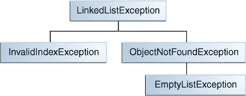

图 9.4 异常类示例

### 选择父类

任何 `Exception` 子类都可以作为 `LinkedListException` 的父类。然而，快速浏览这些子类可以发现它们是不合适的，因为它们要么太专门，要么与 `LinkedListException` 完全无关。因此，`LinkedListException` 的父类应该是 `Exception`。

你编写的大多数小程序和应用程序将抛出异常对象。错误通常用于系统的严重故障，例如阻止 Java VM 运行的故障。

**注意**：为了代码的可读性，良好的做法是在所有直接或间接继承自 `Exception` 类的类名称后附加 `Exception` 字符串。

## 未检查异常：争议

由于 Java 编程语言不要求方法捕获或指定未检查异常（`RuntimeException`、`Error` 及其子类），程序员可能会倾向于编写只抛出未检查异常的代码，或者让所有的异常子类都继承自 `RuntimeException`。这两种快捷方法允许程序员在编写代码时无需担心编译错误，也不必指定或捕获任何异常。尽管这对程序员来说似乎很方便。

为什么 Java 编程语言的设计者决定强制方法指定在其作用范围内可能抛出的所有未捕获的检查异常？任何由方法抛出的异常都是该方法公共编程接口的一部分。调用方法的人必须知道方法可能抛出的异常，以便他们决定如何处理它们。这些异常与方法的参数和返回值一样，都是该方法编程接口的一部分。

这引出了我们面对的另一个问题：既然记录方法的 API（包括它可能抛出的异常）是这么好的做法，为什么不也指定运行时异常呢？运行时异常代表由于编程问题引起的问题，因此，API 客户端代码无法被合理地预期从中恢复或以任何方式进行处理。此类问题包括算术异常（例如除以零）、指针异常（例如尝试通过空引用访问对象）以及索引异常（例如尝试通过过大或过小的索引访问数组元素）。

运行时异常可能发生于程序的任何地方，在典型的程序中，它们可能非常多。在每个方法声明中都必须添加运行时异常会降低程序的清晰度。因此，编译器并不要求你捕获或指定运行时异常（尽管你可以这样做）。

抛出 `RuntimeException` 的一种常见情况是用户错误地调用了方法。例如，一个方法可以检查其参数之一是否被错误地为 `null`。如果参数为 `null`，该方法可能会抛出 `NullPointerException`，这是一个未检查异常。

总的来说，不要仅仅因为不想指定方法可能抛出的异常就抛出 `RuntimeException` 或创建 `RuntimeException` 的子类。底线原则是：如果可以合理地预期客户端从异常中恢复，请将其变为受检查异常。如果客户端无法采取任何操作从异常中恢复，请将其变为未检查异常。

## 异常的优势

现在你已经知道异常是什么以及如何使用它们，是时候学习在程序中使用异常的优势了。

### 优势 1：将错误处理代码与“常规”代码分离

异常为程序员提供了手段，用于整理当程序主逻辑发生异常情况时该做什么的细节。在传统编程中，错误检测、报告和处理往往会导致混乱的“意大利面条代码”。例如，考虑这里将整个文件读入内存的伪代码方法：

```java
readFile {
    open the file;
    determine its size;
    allocate that much memory;
    read the file into memory;
    close the file;
}
```

乍一看，这个函数似乎足够简单，但它忽略了所有可能的潜在错误：

- 如果无法打开文件会怎样？
- 如果无法确定文件长度会怎样？
- 如果无法分配足够的内存会怎样？
- 如果读取失败会怎样？
- 如果无法关闭文件会怎样？

为了处理这些情况，`readFile` 函数必须有更多用于错误检测、报告和处理的代码。以下是该函数可能的样式：

```java
errorCodeType readFile {
    initialize errorCode = 0;
    open the file;
    if (theFileIsOpen) {
        determine the length of the file;
        if (gotTheFileLength) {
            allocate that much memory;
            if (gotEnoughMemory) {
                read the file into memory;
                if (readFailed) {
                    errorCode = -1;
                }
            } else {
                errorCode = -2;
            }
        } else {
            errorCode = -3;
        }
        close the file;
        if (theFileDidntClose && errorCode == 0) {
            errorCode = -4;
        } else {
            errorCode = -4;
        }
    } else {
        errorCode = -5;
    }
    return errorCode;
}
```

这里有大量的错误检测、报告和返回，导致原始代码行在混乱中丢失。更糟糕的是，代码的逻辑流也丢失了，很难判断代码是否在执行正确的事情。如果函数未能分配足够的内存，文件是否真的关闭了？在你编写方法后对其进行修改时，确保代码继续执行正确的事情变得更加困难。许多程序员通过简单地忽略它来解决这个问题：错误在程序崩溃时会被报告。

异常允许你编写代码的主流，并在其他地方处理异常情况。如果 `readFile` 函数使用异常而不是传统的错误管理，它看起来会更像这样：

```java
readFile {
    try {
        open the file;
        determine its size;
        allocate that much memory;
        read the file into memory;
        close the file;
    } catch (fileOpenFailed) {
        doSomething;
    } catch (sizeDeterminationFailed) {
        doSomething;
    } catch (memoryAllocationFailed) {
        doSomething;
    } catch (readFailed) {
        doSomething;
    } catch (fileCloseFailed) {
        doSomething;
    }
}
```

注意，异常并不能免除你检测、报告和处理错误的工作，但它们确实能帮助你更有效地组织工作。

### 优势 2：沿调用栈向上传播错误

异常的第二个优势是能够将错误报告沿方法的调用栈向上传播。假设 `readFile` 方法是主程序的一系列嵌套方法调用中的第四个方法：`method1` 调用 `method2`，`method2` 调用 `method3`，最后调用 `readFile`：

```java
method1 {
    call method2;
}
method2 {
    call method3;
}
method3 {
    call readFile;
}
```

同样假设 `method1` 是唯一对 `readFile` 中可能发生的错误感兴趣的方法。传统的错误通知技术强迫 `method2` 和 `method3` 将 `readFile` 返回的错误码沿调用栈传播，直到到达 `method1`：

```java
method1 {
    errorCodeType error;
    error = call method2;
    if (error) {
        doErrorProcessing;
    } else {
        proceed;
    }
}
errorCodeType method2 {
    errorCodeType error;
    error = call method3;
    if (error) {
        return error;
    } else {
        proceed;
    }
}
errorCodeType method3 {
    errorCodeType error;
    error = call readFile;
    if (error) {
        return error;
    } else {
        proceed;
    }
}
```

回想 Java 运行时环境会回溯调用栈，以寻找任何对特定异常感兴趣的方法。方法可以躲避（duck）在其内部抛出的任何异常，从而允许调用栈更上层的方法捕获它。因此，只有关心错误的方法需要担心检测错误：

```java
method1 {
    try {
        call method2;
    } catch (exception e) {
        doErrorProcessing;
    }
}
method2 throws exception {
    call method3;
}
method3 throws exception {
    call readFile;
}
```

然而，正如伪代码所示，躲避异常需要中间方法的付出努力。方法内部可能抛出的任何受检查异常都必须在 `throws` 子句中指定。

### 优势 3：分组并区分错误类型

由于程序中抛出的所有异常都是对象，异常的分组或分类是类层次结构的自然结果。Java 平台中相关异常类的一个示例是定义在 `java.io` 中的类——`IOException` 及其子类。`IOException` 是最通用的，代表执行 I/O 时可能发生的任何类型的错误。它的子类代表了更具体的错误。例如，`FileNotFoundException` 意味着在磁盘上找不到文件。

方法可以编写特定的处理程序来处理非常特定的异常。`FileNotFoundException` 类没有子类，因此以下处理程序只能处理一种类型的异常：

```java
catch (FileNotFoundException e) {
    . . .
}
```

方法可以通过在 `catch` 语句中指定异常的任何父类，根据其组或通用类型来捕获异常。例如，为了捕获所有的 I/O 异常（无论其具体类型是什么），异常处理器可以指定 `IOException` 参数：

```java
catch (IOException e) {
    . . .
}
```

该处理程序能够捕获所有的 I/O 异常，包括 `FileNotFoundException`、`EOFException` 等。你可以通过查询传递给异常处理器的参数来查找发生错误的详情。例如，使用以下代码打印堆栈跟踪：


```java
catch (IOException e) {
    // 输出到 System.err。
    e.printStackTrace();
    // 将跟踪信息发送到 stdout。
    e.printStackTrace(System.out);
}
```

你甚至可以使用以下处理器设置一个处理任何异常的异常处理器：

```java
// 一个（过于）通用的异常处理器
catch (Exception e) {
    . . .
}
```

`Exception` 类位于 `Throwable` 类层次结构的顶端附近。因此，该处理器除了旨在捕获的异常异常外，还会捕获许多其他异常。如果你程序只想做的事情（例如）为用户打印错误消息然后退出，你可能想以这种方式处理异常。

但在大多数情况下，你希望异常处理器越具体越好。原因是处理器在决定最佳恢复策略之前，首先必须确定发生了哪种类型的异常。实际上，由于没有捕获特定的错误，处理器必须适应任何可能性。过于通用的异常处理器可能会通过捕获和处理程序员未预料到且处理器并非意图处理的异常，从而使代码更容易出错。

如所述，你可以创建异常组并以通用的方式处理异常，也可以使用特定的异常类型来区分异常并以精确的方式处理异常。

## 异常总结

程序可以使用异常来表示发生了错误。要抛出异常，请使用 `throw` 语句并提供一个异常对象——`Throwable` 的子类——以提供有关所发生特定错误的信息。抛出未捕获的检查异常（checked exception）的方法必须在其声明中包含 `throws` 子句。

程序可以通过组合 `try`、`catch` 和 `finally` 块来捕获异常：

- `try` 块识别一个可能发生异常的代码块。
- `catch` 块识别一个代码块，称为*异常处理程序*（exception handler），它能够处理特定类型的异常。
- `finally` 块识别一个保证执行的代码块，它是关闭文件、恢复资源以及对 `try` 块中的代码进行其他清理的正确位置。

`try` 语句应至少包含一个 `catch` 块或一个 `finally` 块，并可以有多个 `catch` 块。

异常对象的类指示了抛出异常的类型。异常对象可以包含有关错误的进一步信息，包括错误消息。通过异常链链（exception chaining），一个异常可以指向导致它的异常，而该异常又可以指向导致它的异常，依此类推。

### 问题与练习题：异常

#### 问题

**1.** 下列代码是法的吗？

```java
try {
} finally {
}
```

**2.** 下列处理程序可以捕获哪些类型的异常？

```java
catch (Exception e) {
}
```

使用这种类型的异常处理器有什么问题？

**3.** 按照目前的编写方式，这个异常处理器有问题吗？这段代码可以编译吗？

```java
try {
} catch (Exception e) {
} catch (ArithmeticException a) {
}
```

**4.** 将第一个列表中的每种情况与第二个列表中的项匹配。

**a.** `int[] A;`

`A[0] = 0;`

**b.** Java VM 启动运行你的程序，但找不到 Java 平台类。（Java 平台类位于 `classes.zip` 或 `rt.jar` 中。）

**c.** 程序正在读取流并到达`end of stream`（流结束）标记。

**d.** 在关闭流之前且到达`end of stream`标记之后，程序尝试再次读取流。

__ 错误

__ 检查异常

__ 编译错误

__ 无异常

#### 练习题

**1.** 为 `ListOfNumbers.java` 添加一个 `readList` 方法。该方法应该从文件中读取 `int` 值，打印每个值，并将它们添加到 vector 的末尾。你应该捕获所有适当的错误。你还需要一个包含要读取数字的文本文件。

**2.** 修改下面的 `cat` 方法使其能够编译：

```java
public static void cat(File file) {
    RandomAccessFile input = null;
    String line = null;
    try {
        input = new RandomAccessFile(file, "r");
        while ((line = input.readLine()) != null) {
            System.out.println(line);
        }
        return;
    } finally {
        if (input != null) {
            input.close();
        }
    }
}
```

### 答案

你可以在 [`http://docs.oracle.com/javase/tutorial/essential/exceptions/QandE.html`](http://docs.oracle.com/javase/tutorial/essential/exceptions/QandE.html) 找到这些问题和练习的答案。

## 基础 I/O 和 NIO.2

* *

章节目录

- I/O 流
- 文件 I/O (包含 NIO.2)
- 基础 I/O 和 NIO.2 总结
- 问题与练习题：基础 I/O 和 NIO.2

* *

本章介绍了用于基础 I/O 的 Java 平台类。首先关注流，这是一个极大简化 I/O 的强大概念。章节还讨论了序列化，它允许程序将整个对象写入流并再次读回。然后，章节讨论了文件 I/O，包括随机访问文件。

“I/O 流”节中涵盖的类位于 `java.io` 包。“文件 I/O”节中涵盖的类位于 `java.nio.file` 包。

### I/O 流

*I/O 流*代表一个输入源或输出目的地。流可以表示许多不同的源和目的地，包括磁盘文件、设备、其他程序和内存数组。

流支持许多类型的数据，包括简单的字节、原始数据类型、本地化字符和对象。某些流只是传递数据；其他流则以有效的方式处理和转换数据。无论它们内部如何工作，所有流对使用它们的程序呈现出相同的简单模型：流是一个数据序列。程序使用*输入流*从源读取数据，一次一个项目，如图 10.1（part0014.html_ch10fig01）所示。程序使用*输出流*向目的地写入数据，一次一个项目，如图 10.2（part0014.html_ch10fig02）所示。在本章中，我们将看到能够处理各种数据的流。

在下一节中，我们将使用最基本的流——字节流（byte streams），来演示 I/O 流的常用操作。对于示例输入，我们将使用示例文件 `xanadu.txt`，它包含以下诗句：

在奢纳奴，忽比汗下令建造了一座宏伟的乐宫：

阿尔法河，那神圣的河流，穿过人类无法测量的深洞，

流向一片无日的海。

### 字节流

程序使用字节流来执行 8 位字节的输入和输出。所有字节流类都继承自 `InputStream` 和 `OutputStream`。

有很多字节流类。为了演示字节流的工作原理，我们将重点关注文件 I/O 字节流：`FileInputStream` 和 `FileOutputStream`。其他类型的字节流的使用方法几乎相同；它们的主要区别在于构造方式。

#### 使用字节流

我们将通过检查一个名为 `CopyBytes` 的示例程序来探索 `FileInputStream` 和 `FileOutputStream`，该程序使用字节流逐字节地地复制 `xanadu.txt`：

点击此处查看代码图像

```java
import java.io.FileInputStream;
import java.io.FileOutputStream;
import java.io.IOException;

public class CopyBytes {
    public static void main(String[] args) throws IOException {
        FileInputStream in = null;
        FileOutputStream out = null;
        try {
            in = new FileInputStream("xanadu.txt");
            out = new FileOutputStream("outagain.txt");
            int c;
            while ((c = in.read()) != -1) {
                out.write(c);
            }
        } finally {
            if (in != null) {
                in.close();
            }
            if (out != null) {
                out.close();
            }
        }
    }
}
```

`CopyBytes` 大部分时间花费在一个简单的循环中，该循环逐字节地读取输入流并写入输出流，如图 10.3 所示。注意 `read()` 返回一个 `int` 值。如果输入是一个字节流，为什么 `read()` 不返回一个 `byte` 值呢？使用 `int` 变量作为返回类型允许 `read()` 使用 `-1` 来表示已到达流的末尾。

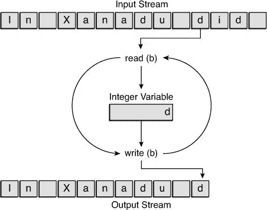

图 10.3 简单的字节流输入和输出

#### 始终关闭流

在不再需要时关闭流是非常重要的——重要到让 `CopyBytes` 使用了 `finally` 块来保证即使发生错误，两个流都会被关闭。这种做法有助于避免严重的资源泄漏。

一种可能的错误是 `CopyBytes` 无法打开一个或两个文件。当发生这种情况时，对应于文件的流变量永远不会从其初始值 `null` 。这就是为什么 `CopyBytes` 在调用 `close` 之前会确保每个流变量都包含一个对象引用。

#### 何时不使用字节流

`CopyBytes` 看起来是一个普通的程序，但它实际上代表了你应该避免的低级 I/O。由于 `xanadu.txt` 包含字符数据，最好的方法是使用字符流，正如下一节将讨论的。还有用于更复杂数据类型的流。字节流应该只用于最原始的 I/O。

那么，为什么要讨论字节流呢？因为所有其他类型的流都是构建在字节流之上的。

### 字符流

Java 平台使用 Unicode 标准存储字符值。字符流 I/O 自动将这种内部格式与本地字符集之间进行转换。在西方地区，本地字符集通常是 ASCII 的 8 位超集。对于大多数应用程序来说，使用字符流进行 I/O 与使用字节流进行 I/O 并不复杂。使用类完成输入和输出会在本地字符集之间进行转换。使用字符流代替字节流的程序可以适应本地字符集并为国际化做好准备——而完全不需要程序员付出额外努力。如果国际化不是优先考虑，你可以简单地使用字符类而无需过多关注设置问题。以后，如果国际化成为优先事项，你的程序可以在不进行大量重写的情况下进行。

#### 使用字符流

所有流类都继承自 `Reader` 和 `Writer`。类似于字节流，有一些专门用于文件 I/O 的字符流类：`FileReader` 和 `FileWriter`。`CopyCharacters` 示例了这些类：

```java
import java.io.FileReader;
import java.io.FileWriter;
import java.io.IOException;

public class CopyCharacters {
    public static void main(String[] args) throws IOException {
        FileReader inputStream = null;
        FileWriter outputStream = null;
        try {
            inputStream = new FileReader("xanadu.txt");
            outputStream = new FileWriter("characteroutput.txt");
            int c;
            while ((c = inputStream.read()) != -1) {
                outputStream.write(c);
            }
        } finally {
            if (inputStream != null) {
                inputStream.close();
            }
            if (outputStream != null) {
                outputStream.close();
            }
        }
    }
}
```

`CopyCharacters` 与 `CopyBytes` 非常相似。最重要的区别是 `CopyCharacters` 使用 `FileReader` 和 `FileWriter` 进行输入输出，代替了 `FileInputStream` 和 `FileOutputStream`。注意 `CopyBytes` 和 `CopyCharacters` 都使用 `int` 变量进行读取和写入。然而，在 `CopyCharacters` 中，`int` 变量的最后 16 位中保存一个字符值；在 `CopyBytes` 中，`int` 变量的最后 8 位中包含一个 `byte` 值。

##### 使用字节流的字符流

字符流通常是字节流的“包装器”。字符流使用字节流执行物理 I/O，而字符流处理字符与字节之间的转换。例如，`FileReader` 使用 `FileInputStream`，而 `FileWriter` 使用 `FileOutputStream`。

有两种通用的字节到字符“桥接”流：`InputStreamReader` 和 `OutputStreamWriter`。当没有预封装的字符流类满足你的需求时，使用它们来创建字符流。

### 行定向 I/O

字符级 I/O 通常发生在更大的单位上，而不是单个字符。一个常见的单位是行：一组末尾带有行终止符的字符字符串。行终止符可以是回车/换行符序列（`\r\n`）、单个回车（`\r`）或单个换行符（`\n`）。支持所有可能的行终止符允许程序读取任何广泛使用的操作系统创建的文本文件。

让我们修改 `CopyCharacters` 示例以使用行定向 I/O。为了实现这一点，我们必须使用两个之前没见过的类：`BufferedReader` 和 `PrintWriter`。我们将在本章后面的“文本文件的缓冲 I/O 方法”和“格式化”章节中深入探讨这些类。现在，我们只对它们支持行定向 I/O 感。

`CopyLines` 示例调用 `BufferedReader.readLine` 和 `PrintWriter.println` 逐行进行输入和输出：

点击此处查看代码图像

```java
import java.io.IOException;

public class CopyLines {
    public static void main(String[] args) throws IOException {
        BufferedReader inputStream = null;
        PrintWriter outputStream = null;
        try {
            inputStream = new BufferedReader(new FileReader("xanadu.txt"));
            outputStream = new PrintWriter(new FileWriter("characteroutput.txt"));
            String l;
            while ((l = inputStream.readLine()) != null) {
                outputStream.println(l);
            }
        } finally {
            if (inputStream != null) {
                inputStream.close();
            }
            if (outputStream != null) {
                outputStream.close();
            }
        }
    }
}
```

调用 `readLine` 会返回带有行终止符的一行文本。`CopyLines` 使用 `println` 输出每一行，该方法会追加当前操作系统的行终止符。这可能与输入文件中使用的行终止符不同。

除了字符和行，还有许多结构化文本输入输出的方法。更多信息，请参阅本章节后面的“扫描与格式化”部分。

### 缓冲流

我们目前为止的大多数示例都使用*非缓冲* I/O。这意味着每个读或写请求都直接由底层操作系统处理。这可能会导致程序运行效率大大降低，因为每个此类请求通常都会触发磁盘访问、网络活动或其他相对昂贵的操作。

为了减少这种开销，Java 平台实现了*缓冲* I/O 流。缓冲输入流从一个称为*缓冲区*（buffer）的内存区域读取数据；只有当缓冲区为空时，才会调用原生输入应用程序编程接口（API）。同样，缓冲输出流将数据写入缓冲区，只有当缓冲区满时，才会调用原生输出 API。


程序可以使用我们已经使用多次的包装范式（wrapping idiom）将非缓冲流转换为缓冲流，即将非缓冲流对象传递给缓冲流类的构造函数。以下是你可以如何修改`CopyCharacters`示例中的构造调用以使用缓冲 I/O：

```java
inputStream = new BufferedReader(new FileReader("xanadu.txt"));
outputStream = new BufferedWriter(new FileWriter("characteroutput.txt"));
```

有四种缓冲流类用于包装非缓冲流：`BufferedInputStream`和`BufferedOutputStream`创建缓冲字节流，而`BufferedReader`和`BufferedWriter`创建缓冲字符流。

## 刷新缓冲流

在关键点写出缓冲区而不等待其填满，通常是有意义的。这被称为*刷新*（flushing）缓冲区。

某些缓冲输出类支持*自动刷新*（autoflush），它通过可选的构造函数参数指定。当启用自动刷新时，某些关键事件会导致缓冲区刷新。例如，开启了自动刷新的`PrintWriter`对象在每次调用`println`或`format`时都会刷新缓冲区。有关这些方法的更多信息，请参阅本章节后面的“格式化”部分。

要手动刷新流，请调用其`flush`方法。`flush`方法对任何输出流有效，但除非流是缓冲的，否则它没有作用。

## 扫描与格式化

编程 I/O 通常涉及到与人类喜欢处理的整洁格式数据之间的转换。为了帮助你完成这些工作，Java 平台提供了两个 API：扫描 API 将输入拆分为单独的标记（tokens）。格式化 API 将数据组装成格式良好、用户友好的形式。

### 扫描

`Scanner`类型的对象非常用于将格式化输入分解为标记，并根据其类型翻译单个标记。

#### 将输入拆分为标记

默认情况下，扫描器使用空白字符来分隔标记（空白字符包括空格、制表符和行终止符。完整列表请参阅`Character.isWhitespace`的文档。）。要了解扫描是如何工作的，让我们看看`ScanX`程序，该程序读取`xanadu.txt`中的每个单词并将它们打印出来，每行一个：

```java
import java.io.*;
import java.util.Scanner;

public class ScanX {
    public static void main(String[] args) throws IOException {
        Scanner s = null;
        try {
            s = new Scanner(new BufferedReader(new FileReader ("xanadu.txt")));
            while (s.hasNext()) {
                System.out.println(s.next());
            }
        } finally {
            if (s != null) {
                s.close();
            }
        }
    }
}
```

注意`ScanX`在完成扫描器工作后调用了`Scanner`的`close`方法。尽管扫描器不是流，你仍需要关闭它以表示你已完成对其底层流的操作。

`ScanX`的输出如下：

```
In
Xadu
did
Kubla
Khan
stately
pleasure-dome
. .
```

要使用不同的标记分隔符，请调用`useDelimiter()`并指定正则表达式。例如，假设你想让标记分隔符为逗号，后面可选跟随空格。你可以调用：

```java
s.useDelimiter("\\s*");
```

#### 翻译单个标记

`ScanX`示例将所有输入标记视为简单的`String`值。`Scanner`还支持 Java 语言所有原始类型（`char`除外）的标记，以及`BigInteger`和`BigDecimal`。此外，数值可以使用千分位分隔符。因此，在美国区域（locale）中，`Scanner`正确地将字符串`32,767`为整数值。

我们必须提到区域，因为千分位分隔符和小数符号是特定于区域。如果不指定扫描器应该使用美国区域，下面的示例在所有区域中都无法正常工作。这通常不是你担心的事情，因为你的输入数据通常来自与你相同的区域源。

`ScanSum`示例读取一个`double`值列表并将其相加。源码如下：

```java
import java.io.FileReader;
import java.io.BufferedReader;
import java.io.IOException;
import java.util.Scanner;
import java.util.Locale;

public class ScanSum {
    public static void main(String[] args) throws IOException {
        Scanner s = null;
        double sum = 0;
        try {
            s = new Scanner(new BufferedReader(new FileReader ("usnumbers.txt")));
            s.useLocale(Locale.US);
            while (s.hasNext()) {
                if (s.hasNextDouble()) {
                    sum += s.nextDouble();
                } else {
                    s.next();
                }
            }
        } finally {
            if (s != null) {
                s.close();
            }
        }
        System.out.println(sum);
    }
}
```

这里是示例输入文件`usnumbers.txt`：

```
8.5
32,767
3.14159
1,000,000.1
```

输出字符串为`1032778.74159`。在某些区域，句号将是不同的字符，因为`System.out`是一个`PrintStream`对象，该类没有提供覆盖默认区域的方法。我们可以覆盖整个程序的区域——或者我们可以像下一节描述直接使用格式化。

### 格式化

实现格式化的流对象是`PrintWriter`（字符流类）或`PrintStream`（字节流类）的实例。

你可能需要的`PrintStream`对象只有`System.out`和`System.err`。（有关这些对象的更多信息，请参阅“命令行中的 I/O”章节。）当你需要创建一个格式化输出流时，请实例化`PrintWriter`而不是`PrintStream`。

***

与所有的字节流和字符流对象一样，`PrintStream`和`PrintWriter`的实例实现了一组标准的`write`方法，用于简单的字节和字符输出。此外，`PrintStream`和`PrintWriter`都实现了同一组方法，用于将内部数据转换为格式化输出。提供了两个级别的格式化：

- `print`和`println`方法以标准方式格式化单个值。
- `format`方法根据格式化字符串对任意数量的值进行格式化，并有许多精确格式化的选项。

### print 和 println 方法

调用`print`或`println`会在使用适当的`toString`方法转换值后输出该值。我们可以在`Root`示例中看到这一点：

```java
public class Root {
    public static void main(String[] args) {
        int i = 2;
        double r = Math.sqrt(i);
        System.out.print("The square root of ");
        System.out.print(i);
        System.out.print(" is ");
        System.out.print(r);
        System.out.println(".");
        i = 5;
        r = Math.sqrt(i);
        System.out.println("The square root of " + i + " is " + r + ".");
    }
}
```

这里是`Root`的输出：

```
The square root of 2 is 1.4142135623730951.
The square root of 5 is 2.23606797749979.
```

变量`i`和`r`被格式化了两次：第一次使用`print`的重载方法中的代码，第二次使用 Java 编译器自动生成的转换代码，该代码也利用了`toString`。你可以用这种方式格式化任何值，但你对结果没有太大的控制权。

### format 方法

`format`方法根据*格式字符串*对多个参数进行格式化。格式字符串由嵌入了*格式说明符*的静态文本组成；除了格式说明符外，格式字符串将按原样输出。

格式字符串支持许多功能。在书中，我们将涵盖一些基础知识。要获得完整的描述，请参考 Java API 规范。

`Root2`示例通过单次`format`调用格式化了两个值：

```java
public class Root2 {
    public static void main(String[] args) {
        int i = 2;
        double r = Math.sqrt(i);
        System.out.format("The square root of %d is %f.%n", i, r);
    }
}
```

这里是输出：

```
The square root of 2 is 1.414214.
```

所有的格式说明符（如本示例中使用的三个）都以百分号（`%`）开头，并以一个或两个字符的*转换符*结束，指定了要生成的格式化输出类型。这里使用的三个转换如下：

- `d`将整数值格式化为十进制值。
- `f`将浮点值格式化为十进制值。
- `n`输出特定平台的行终止符。

这里是其他一些转换：

- `x`将整数格式化为十六进制值。
- `s`将任何值格式化为字符串。
- `tB`将整数格式化为特定区域的月份名称。

此外，还有许多其他转换。

***

**注意**

除`%%`和`%n`之外，所有的格式说明符必须与一个参数匹配。如果不匹配，将抛出异常。

在 Java 编程语言中，转义字符`\n`总是生成换行符（`\u000A`）。除非你明确想要换行符，否则不要使用`\n`。要获取本地平台正确的换分隔符，请使用`%n`。

***

除了转换之外，格式说明符还可以包含几个额外的元素，以进一步自定义格式化输出。这里有一个示例`Format`，它使用了每种可能的元素：

```java
public class Format {
    public static void main(String[] args) {
        int i = 2;
        double r = Math.sqrt(i);
        System.out.format("The square root of %d is %f.%n", i, r);
    }
}
```

这里是输出：

```
The square root of 2 is 1.414214.
```

`Format`示例使用了以下元素：

- **精度 (Precision)**：指定小数点后的数字位数。
- **宽度 (Width)**：指定输出的最小字符数。
- **标志 (Flags)**：提供对齐和填充等选项。
- **参数索引 (Argument index)**：指定使用哪个参数。

### 命令行中的 I/O

程序通常从命令行运行并与用户交互。Java 平台通过两种方式支持这一点：通过*标准流*和*控制台*。

#### 标准流

标准流是许多操作系统的特性。默认情况下，它们从键盘读取输入并向显示器输出。它们还支持文件和程序之间的 I/O，但此功能由命令行解释器控制，而不是程序。

Java 平台支持三个标准流：*标准输入*（通过`System.in`访问）、*标准输出*（通过`System.out`访问）以及*标准错误*（通过`System.err`访问）。这些对象是自动定义的，不需要打开。标准输出和标准错误都是输出；分开分开允许用户重定向普通输出，同时能够读取错误消息。

你可能认为标准流应该是字符流，但由于历史原因，它们是字节流。`System.out`和`System.err`被定义为`PrintStream`对象。尽管它实际上是字节流，但`PrintStream`利用内部字符流对象来模拟许多字符流的特征。

相比之下，`System.in`是没有字符流功能的字节流。要将标准输入作为字符流使用，可以将`System.in`封装在`InputStreamReader`中：

```java
InputStreamReader cin = new InputStreamReader(System.in);
```

#### 控制台

标准流更高级的替代方案是控制台。这是一个单一的、预定义的`Console`类型对象，它具有标准流提供的大部分功能以及更多。控制台对于安全的密码输入特别有用。控制台对象通过其`reader`和`writer`方法提供了真正的字符流输入和输出流。

在程序可以使用控制台之前，它必须尝试通过调用`System.console()`获取控制台对象。如果控制台对象可用，该方法将返回该对象。如果`System.console`返回`NULL`，则不允许进行控制台操作，可能是因为操作系统不支持，或者因为程序是在非交互环境中启动的。

控制台对象通过其`readPassword`方法支持安全的密码输入。该方法通过两种方式帮助确保密码输入的安全：首先，它会抑制回显，因此密码在用户的屏幕上可见。其次，`readPassword`返回的是一个字符数组而不是`String`，因此密码可以在不再需要时立即被覆盖，从而从内存中移除。

`Password`示例是一个修改用户密码的演示程序。它演示了几个`Console`方法。


```java
import java.io.Console;
import java.util.Arrays;
import java.io.IOException;

public class Password {
    public static void main (String args[]) throws IOException {
        Console c = System.console();
        if (c == null) {
            System.err.println("No console.");
            System.exit(1);
        }
        String login = c.readLine("Enter your login: ");
        char [] oldPassword = c.readPassword("Enter your old password: ");
        if (verify(login, oldPassword)) {
            boolean noMatch;
            do {
                char [] newPassword1 = c.readPassword("Enter your new password: ");
                char [] newPassword2 = c.readPassword("Enter new password again: ");
                noMatch = ! Arrays.equals(newPassword1, newPassword2);
                if (noMatch) {
                    c.format("Passwords don't match. Try again.%n");
                } else {
                    change(login, newPassword1);
                    c.format("Password for %s changed.%n", login);
                }
                Arrays.fill(newPassword1, ' ');
                Arrays.fill(newPassword2, ' ');
            } while (noMatch);
        }
        Arrays.fill(oldPassword, ' ');
    }
    // Dummy change method.
    static boolean verify(String login, char[] password) {
        // This method always returns
        // true in this example.
        // Modify this method to verify
        // password according to your rules.
        return true;
    }
    // Dummy change method.
    static void change(String login, char[] password) {
        // Modify this method to change
        // password according to your rules.
    }
}
```

`Password` 类遵循以下步骤：

1. 尝试获取控制台对象。如果对象不可用，则终止。
2. 调用 `Console.readLine` 提示并读取用户的登录名。
3. 调用 `Console.readPassword` 提示并读取用户的现有密码。
4. 调用 `verify` 确认用户是否有权更改密码。（在例示例中，`verify` 是一个始终返回 `true` 的占位方法。）
5. 重复以下步骤，直到用户两次输入相同的密码：
   - a. 两次调用 `Console.readPassword` 以提示并读取新密码。
   - b. 如果用户两次输入的密码相同，则调用 `change` 进行修改。（同样，`change` 是一个占位方法。）
   - c. 用空格覆盖两个密码。
6. 用空格覆盖旧密码。

### 数据流

数据流支持原始数据值（`boolean`、`char`、`byte`、`short`、`int`、`float` 和 `double`）二进制以及 `String` 值。所有数据流都实现了 `DataInput` 或 `DataOutput` 接口。本节重点介绍这些接口的常用实现：`DataInputStream` 和 `DataOutputStream`。

`DataStreams` 示例通过写入一组数据记录然后再次读取它们来演示数据流。每个记录包含三个与发票相关的数值，如表 10.1 所示。

**表 10.1 DataStreams 示例使用的数据**


让我们检查 `DataStreams` 中的关键代码。首先，程序定义了一些包含文件名和要写入其中数据的常量：

```java
static final String dataFile = "invoice";
static final double[] prices = { 19.99, 9.99, 15.99, 3.99, 4.99 };
static final int[] units = { 12, 8, 29, 50 };
static final String[] descs = {
    "Java T-shirt",
    "Java Mug",
    "Duke Juggling Dolls",
    "Java Pin",
    "Java Key Chain"
};
```

然后 `DataStreams` 打开一个输出流。由于 `DataOutputStream` 只能创建作为现有字节流的包装器，因此 `DataStreams` 提供了一个缓冲文件输出流：

```java
out = new DataOutputStream(new BufferedOutputStream(new FileOutputStream(dataFile)));
```

`DataStreams` 写入记录并关闭输出流：

```java
for (int i = 0; i < prices.length; i ++) {
    out.writeDouble(prices[i]);
    out.writeInt(units[i]);
    out.writeUTF(descs[i]);
}
```

`writeUTF` 方法以 UTF-8 的修改形式输出 `String` 值。这是一种变宽字符编码，对于常见的字符只需要一个字节。

现在 `DataStreams` 读回数据。首先它必须提供一个输入流和用于存储输入数据的变量。与 `DataOutputStream` 类似，`DataInputStream` 必须构造为字节流的包装器：

```java
in = new DataInputStream(new BufferedInputStream(new FileInputStream(dataFile)));
double price;
int unit;
String desc;
double total = 0.0;
```

现在 `DataStreams` 可以读取流中的每个记录，对其遇到的数据进行报告：

```java
try {
    while (true) {
        price = in.readDouble();
        unit = in.readInt();
        desc = in.readUTF();
        System.out.format("You ordered %d" + " units of %s at%.2f%n",
            unit, desc, price);
        total += unit * price;
    }
} catch (EOFException e) {
}
```

注意 `DataStreams` 通过捕获 `EOFException` 而不是测试无效返回值来检测文件结束条件。所有 `DataInput` 方法都使用 `EOFException`。

注意 `DataStreams` 中的每个专用 `write` 与对应的专用 `read` 精确匹配。程序员负责确保输出类型和输入类型以这种方式匹配：输入流由简单的二进制数据组成，没有任何指示单个值的类型或它们在流中的起始位置。

`DataStreams` 使用了一种非常糟糕的编程技术：它使用浮点数表示货币值。通常，浮点数对于精确值是有利的。它对于小数来说特别糟糕，因为常见值（如 `0.1`）没有二进制表示。

用于货币值的正确类型是 `java.math.BigDecimal`。遗憾的是，`BigDecimal` 是一个对象类型，因此不能与数据流一起。然而，`BigDecimal` *可以* 与对象流工作，对象流将在下一节讨论。

正如数据流支持原始数据类型的 I/O 一样，对象流也支持对象的 I/O。大多数（并非所有）标准类都支持对象的序列化。那些支持的类实现了标记接口 `Serializable`。

对象流类为 `ObjectInputStream` 和 `ObjectOutputStream`。这些类实现了 `ObjectInput` 和 `ObjectOutput`，它们是 `DataInput` 和 `DataOutput` 的子接口。这意味着在“数据流”节中涵盖的所有原始数据 I/O 方法在对象流中也得到了。因此，对象流可以包含原始值和对象值的混合。`ObjectStreams` 示例说明了这一点。`ObjectStreams` 创建了与 `DataStreams` 相同的应用程序，但进行了一些更改。首先，价格现在是 `BigDecimal` 对象，以便更好地表示小数值。其次，一个 `Calendar` 对象被写入到数据文件中，表示发票日期。

如果 `readObject()` 返回的不是预期的类型，尝试将其强制转换为正确类型可能会抛出 `ClassNotFoundException`。在这个简单的示例中，这种情况不会发生，因此我们没有尝试捕获该异常。相反，我们通过在 `main` 方法的 `throws` 子句中添加 `ClassNotFoundException` 来通知编译器我们已经意识到了这个问题。

### 复杂对象的输出与输入

`writeObject` 和 `readObject` 方法的使用非常简单，但它们包含了一些非常复杂的对象管理逻辑。对于像 `Calendar` 这样仅封装了原始值的类来说，这并不重要。但许多对象包含了对其他对象的引用。如果 `readObject` 要从流中重构一个对象，它必须能够重构原始对象所引的所有对象。这些额外的对象可能有它们自己的引用，依此类推。在这种情况下，`writeObject` 会遍历整个对象引用网络，并将该网络中的所有对象写入流中。因此，调用一次 `writeObject` 可能导致大量对象被写入流中。

这在图 10.5 中得到了演示，其中调用 `writeObject` 来写入一个名为 `a` 的单个对象。该对象包含对对象 `b` 和 `c` 的引用，而 `b` 包含了对 `d` 和 `e` 的引用。调用 `writeobject(a)` 不仅写入 `a`，还写入重构 `a` 所需的所有对象，因此该网络中的其他四个对象也被写入了。当 `a` 被 `readObject`读回时，其他四个对象也被读回，并且所有的原始对象引用都被保留了。

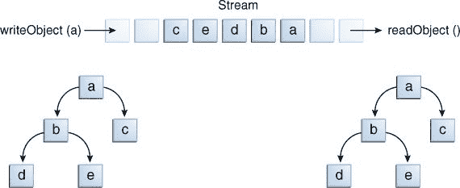

图 10.5. 多个引用对象的 I/O

你可能会想，如果同一个流上的两个对象都包含对同一个对象的引用会发生什么？它们在被读回时会指向同一个对象吗？答案是*是的*。一个流只能包含对象的一个副本，尽管它可以包含指向该对象的任意数量引用。因此，如果你显式地向流写入两次对象，你实际上只写入了两次引用。例如，考虑以下代码，它尝试向流写入两次对象 `ob`：

```
Object ob = new Object();
out.writeObject(ob);
out.writeObject(ob);
```

每个 `writeObject` 必须与一个 `readObject` 匹配，因此读回流的代码看起来像这样：

```
Object ob1 = in.readObject();
Object ob2 = in.readObject();
```

这产生了两个变量 `ob1` 和 `ob2`，它们都指向同一个单一对象。

然而，如果将一个对象写入两个不同的流中，它实际上被复制了——一个读回两个流的程序将看到两个不同的对象。

### 文件 I/O（基于 NIO.2）

`java.nio.file` 包及其相关包 `java.nio.file.attribute` 提供了对文件 I/O 以及对访问默认文件系统的全面支持。尽管 API 有许多类，但你只需要关注少数几个入口。你会发现这个 API 非常直观且易用。我们通过问一个问题开始本节：什么是路径？然后介绍了 `Path` 类，它是该包的主要入口。接着解释了 `Path` 类中与语法操作相关的方法。然后，我们转到包中的另一个主要类——`Files` 类，它包含了处理文件操作的方法。首先，介绍了许多文件操作通用的某些概念。然后，我们涵盖了检查、删除、复制和移动文件的方法。本节随后展示了在处理文件 I/O 和目录 I/O 之前如何管理元数据。解释了随机访问文件，并检查了符号链接和硬链接的特定问题。

接下来，涵盖了一些非常强大但更高级的主题。首先，演示了递归遍历文件树的能力，随后是关于如何使用通配符搜索文件的信息。接下来，我们解释并演示了如何监控目录的变化。然后，对一些不适合其他地方的方法给予了关注。

最后，如果你有在 Java SE 7 之前编写的文件 I/O 代码，这里有一份从旧 API 到新 API 的映射，以及关于 `File.toPath` 的重要信息。

#### 什么是路径？（以及文件系统事实）

文件系统在某种形式的介质（通常是一个或多个硬盘硬盘）上存储和组织文件，以便于方便地检索。今天使用的大多数文件系统将文件存储在树形（或*分层*）结构中。树的顶端是一个（或多个）根节点。在根节点下，有文件和目录（Microsoft Windows 中称为*文件夹*）。每个目录可以包含文件和子目录，依此类推，深度可能是无限的。

##### 什么是路径？

图 10.6 显示了一个包含单个根节点的示例目录树。Microsoft Windows 支持多个根节点。每个根节点映射到一个卷，例如 `C:\` 或 `D:\`。Solaris 支持单个根节点，由斜杠字符（`/`）表示。

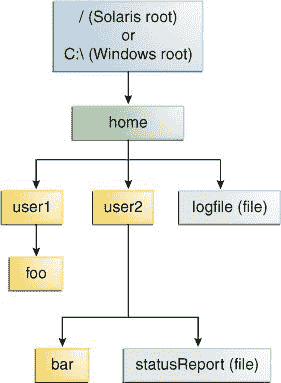

图 10.6. 示例目录结构

文件通过其在文件系统中的路径来标识，从根节点开始。例如，图 10.6 中的 `statusReport` 文件在 Solaris 中的表示法为：

`/home/sally/statusReport`

在 Microsoft Windows 中，`statusReport` 的表示法为：

`C:\home\sally\statusReport`

分隔目录名的字符（也称为*分隔符*）特定于文件系统：Solaris 使用正斜杠（`/`），而 Microsoft Windows 使用反斜杠（`\`）。

##### 相对还是绝对？

路径要么是*相对*的，要么是绝对。绝对路径始终包含根元素和定位文件所需的完整目录列表。例如，`/home/sally/statusReport` 是绝对路径。定位文件所需的所有信息都包含在路径字符串中。

相对路径需要与其他路径结合才能访问文件。例如，`joe/foo` 是相对路径。如果没有更多信息，程序无法可靠在文件系统中定位 `joe/foo` 目录。

##### 符号链接

文件系统对象通常是目录或文件。每个人对这些对象都很熟悉。但某些文件系统还支持符号链接的概念。符号链接也被称为 *symlink* 或软链接。

`symbolic link`（符号链接）是一种特殊文件，作为指向另一个文件的引用。在大多数情况下，符号链接对应用程序是透明的，对符号链接的操作会自动重定向到链接的目标。（被指向的文件或目录被称为链接的*target*（目标）。）当符号链接被删除或重命名时，会有例外情况，在这种情况下，链接本身会被删除或重命名——而不是链接的目标。

在图 10.7 中，`logFile` 对用户来说是一个普通文件，但它实际上是指向 `dir/logs/HomeLogFile` 的符号链接。`HomeLogFile` 是该链接的目标。

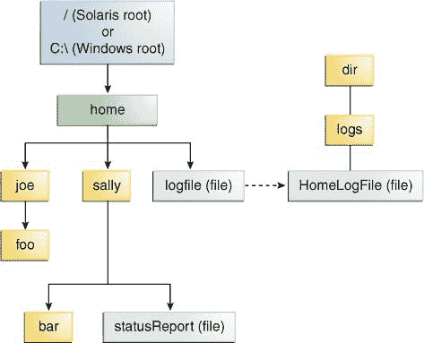

图 10.7 符号链接示例

符号链接通常对用户是透明的。对符号链接进行读取或写入与对任何其他文件或目录进行读写相同。

*解析链接*（resolving a link）短词的意思是用文件系统中的实际位置替换符号链接。在示例中，解析 `logFile` 得到 `dir/logs/HomeLogFile`。

在现实场景中，大多数文件系统大量使用符号链接。偶尔，创建得不留意的符号链接会导致循环引用。当链接的目标指向原始链接时，就会发生循环引用。循环引用可能是间接的：目录 *a* 指向目录 *b*，*b* 指向目录 *c*，而 *c* 包含一个指向目录 *a* 的子目录。当程序递归遍历目录结构时，循环引用可能会导致混乱。然而，这种情况已经考虑在内，不会导致你的程序无限循环。

下一节将讨论 Java 编程语言中文件 I/O 支持的核心：`Path` 类。

## Path 类

`Path` 类在 Java SE 7 发布中引入，是 `java.nio.file` 包的主要入口点之一。如果你的应用程序使用文件 I/O，你将希望学习该类的强大功能。


> 注意：如果你有在 Java SE 7 之前创建的用于 `java.io.File` 的代码，你仍然可以使用 `File.toPath` 方法来利用 `Path` 类的功能。更多信息请参阅本章末尾的“遗留文件 I/O 代码”节。

顾其名，`Path` 类是文件系统中路径的程序化表示。`Path` 对象包含用于构建路径的文件名和目录列表，并用于检查、定位和操作文件。

`Path` 实例反映了底层平台。在 Solaris 中，`Path` 使用 Solaris 语法（`/home/joe/foo`），在 Microsoft Windows 中，`Path` 使用 Windows 语法（`C:\home\joe\foo`）。`Path` 并不独立于系统。你不能比较一个来自 Solaris 文件系统的 `Path` 并期望它与一个来自 Windows 文件系统的 `Path` 匹配，即使目录结构相同且两个实例定位了同一个相对文件。

与 `Path` 对应的文件或目录可能不存在。你可以创建一个 `Path` 实例并以各种方式对其进行操作：你可以向其追加内容、提取它的部分，并将其与另一个路径进行比较。在适当的时间，你可以使用 `Files` 类中的方法来检查与 `Path` 对应的文件是否存在、创建文件、打开它、删除它、更改其权限等。

下一节将详细检查 `Path` 类。

## Path 操作

`Path` 类包含各种方法，可用于获取路径的信息、访问路径的元素、将路径转换为其他形式或提取路径的部分。还有用于匹配路径字符串的方法以及移除路径中冗余的方法。本节将介绍这些 `Path` 方法，它们有时被称为*语法*（*syntactic*）操作，因为它们作用于路径本身，而不访问文件系统。

### 创建 Path

`Path` 实例包含用于指定文件或目录位置的信息。在定义时，会为 `Path` 提供一系列一个或多个名称。可能包含根元素或文件名，但这两者都不是必须的。一个 `Path` 可能仅由单个目录名或文件名组成。

你可以通过 `Paths`（注意是复数）辅助类中的以下 `get` 方法之一轻松地创建 `Path` 对象：

```
Path p1 = Paths.get("/tmp/foo");

Path p2 = Paths.get(args[0]);

Path p3 = Paths.get(URI.create("file:///Users/joe/FileTest.java"));
```

`Paths.get` 方法是以下代码的简写：

```
Path p4 = FileSystems.getDefault().getPath("/users/sally");
```

以下示例创建 `/u/joe/logs/foo.log`，假设你的主目录是 `/u/joe`（Solaris）或 `C:\joe\logs\foo`：

```java
Path p5 = Paths.get(System.getProperty("user.home"),"logs", "foo.log");
```

### 获取关于 Path 信息

你可以将 `Path` 理解为将这些名称元素作为一个序列。目录结构中的最高元素位于索引 0。目录结构中的最低元素位于索引 `n-1`，其中 `n` 是元素的数量。本节中的示例使用了图 10.6 所示的结构。

以下代码片段定义了一个 `Path` 实例，然后调用多个方法来获取其信息：

```java
// Microsoft Windows 语法
Path path = Paths.get("C:\\home\\joe\\foo");

// Solaris 语法
Path path = Paths.get("/home/joe/foo");

System.out.format("toString: %s\n", path.toString());

System.out.format("getFileName: %s\n", path.getFileName());

System.out.format("getName(0): %s\n", path.getName(0));

System.out.format("getNameCount: %d\n", path.getNameCount());

System.out.format("subpath(0,2): %s\n", path.subpath(0,2));

System.out.format("getParent: %s\n", path.getParent());

System.out.format("getRoot: %s\n", path.getRoot());
```

表 10.2 显示了 Microsoft Windows 和 Solaris 的输出。

之前的示例显示了绝对路径的输出。在以下示例中，指定了相对路径：

```java
// Solaris 语法
Path path = Paths.get("sally/bar");

// Microsoft Windows 语法
Path path = Paths.get("sally\\bar");
```

表 10.3 显示了 Windows 和 Solaris 的输出。

### 从 Path 中移除冗余内容

许多文件系统使用点（`.`）表示当前目录，使用两个点（`..`）表示父目录。你可能会遇到 `Path` 包含冗余目录信息的情况。可能服务器配置将日志文件保存在 `/dir/logs/.` 目录中，你想删除路径末尾的 `/.` 标记。

以下示例都包含冗余：

`/home/./joe/foo`

`/home/sally/../joe/foo`

`normalize` 方法移除任何冗余元素，包括任何点（`.`）或双点（目录`/..`）出现。上述两个示例归一化后均为 `/home/joe/foo`。

需要注意的是，`normalize` 在清理路径时不会检查文件系统。它是一个纯粹的语法层操作。在第二个示例中，如果 `sally` 是一个符号链接，删除 `sally/..` 可能会导致 `Path` 不再定位到预期的文件。

在清理路径的同时确保结果定位到正确的文件，你可以使用 `toRealPath` 方法。该方法将在下一节中描述。

## 转换路径

你可以使用三种方法来转换 `Path`。如果你需要将路径转换为可以在浏览器中打开的字符串，可以使用 `toUri`。以下是一个示例：

```
Path p1 = Paths.get("/home/logfile");

// 结果是 file:///home/logfile

System.out.format("%s%n", p1.toUri());
```

`toAbsolutePath` 方法将路径转换为绝对路径。如果传入路径已经是绝对路径，它将返回相同的 `Path` 对象。在处理用户输入的文件名时，`toAbsolutePath` 方法非常有帮助。这是一个示例：

```java
public class FileTest {

    public static void main(String[] args) {
        if (args.length < 1) {
            System.out.println("usage: FileTest file");
            System.exit(-1);
        }
        // 将输入字符串转换为 Path 对象。
        Path inputPath = Paths.get(args[0]);
        // 将输入的 Path
        // 转换为绝对路径。
        // 通常，这意味着要在前面
        // 添加当前工作
        // 目录。如果这样
        // 调用此示例：
        //     java FileTest foo
        // 那么 getRoot 和 getParent 方法
        // 在原始的 "inputPath"
        // 实例上将返回 null。在 "fullPath"
        // 实例上调用 getRoot 和
        // getParent 将返回预期的值。
        Path fullPath = inputPath.toAbsolutePath();
    }
}
```

`toAbsolutePath` 方法转换用户输入并返回一个在查询时返回有用值的 `Path`。该方法不需要文件存在即可工作。

`toRealPath` 方法返回现有文件的*真实*路径。该方法一次性执行了多项操作：

- 如果向此方法传递 `true` 且文件系统支持符号链接，则该方法将解析路径中的任何符号链接。
- 如果 `Path` 是相对的，它将返回绝对路径。
- 如果 `Path` 包含任何冗余元素，它将返回一个移除这些元素的路径。

如果文件不存在或无法访问，该方法将抛出异常。你可以在需要处理其中任何一种情况时捕获该异常。这是一个示例：

```java
try {
    Path fp = path.toRealPath(true);
} catch (NoSuchFileException x) {
    System.err.format("%s: no such" + " file or directory%n", path);
    // 文件不存在时的逻辑。
} catch (IOException x) {
    System.err.format("%s%n", x);
    // 其他类型文件错误的逻辑。
}
```

## 合并两个路径

你可以通过 `resolve` 方法来组合路径。你传入一个*部分路径*（即不包含根元素的路径），该部分路径将被附加到原始路径之后。

例如，考虑以下代码片段（适用于 Solaris）：

或者，考虑以下代码（适用于 Windows）：

## 创建路径

`resolve` 方法是组合路径的一种强大方式。当你将相对路径传递给 `resolve` 时，它将其附加到基础路径之后。如果你传递绝对路径，它将直接返回该路径。这是动态构建文件路径时的常用模式。

## 比较两个路径

`Path` 类支持 `equals`，允许你测试两个路径的相等性。`startsWith` 和 `endsWith` 方法允许你测试路径是否以特定字符串开头或结尾。这些方法非常易用。这是一个示例：

```java
Path path = Paths.get("/home/user");
Path other = Paths.get("/home");
if (path.startsWith(other)) {
    // 逻辑
}
```

此 API 中使用的许多资源（如流 streams 或通道 channels）都对实现或扩展了 `java.io.Closeable` 接口。`Closeable` 资源的要求是在不再需要时，必须调用 `close` 方法来释放资源。忽略关闭资源会对应用程序的性能产生负面影响。`try-with-resources` 语句可以为你处理这一步骤。

## 捕获异常

在文件 I/O 中，意料之外的情况是生活常态：文件在预期时并不存在、程序没有访问文件系统的权限、默认的文件系统实现不支持特定功能等。可能会遇到许多错误。

所有访问文件系统的方法都可能抛出 `IOException`。最佳实践是将这些方法嵌入到 Java SE 7 引入的 `try-with-resources` 语句中，以捕获这些异常。通过 `try-with-resources` 语句，编译器会在资源不再需要时自动生成关闭资源的代码。以下代码展示了这种写法：

```
Charset charset = Charset.forName("US-ASCII");
String s = . . . ;
try (BufferedWriter writer = Files.newBufferedWriter(file, charset)) {
    writer.write(s, 0, s.length());
} catch (IOException x) {
    System.err.format("IOException: %s%n", x);
}
```

更多信息，请参阅 第 9 章 中的“try-with-resources 语句”节。

或者，你可以将文件 I/O 方法嵌入 `try` 块，然后在 `catch` 块中捕获任何异常。如果你的代码打开了任何流或通道，你应该在 `finally` 块中关闭它们。上一个示例使用 `try-catch-finally` 方法的如下所示：

```
Charset charset = Charset.forName("US-ASCII");
String s = . . . ;
BufferedWriter writer = null;
try {
    writer = Files.newBufferedWriter(file, charset);
    writer.write(s, 0, s.length());
} catch (IOException x) {
    System.err.format("IOException: %s%n", x);
} finally {
    if (writer != null) writer.close();
}
```

更多信息，请参阅 第 9 章 中的“捕获和处理异常”。

除了 `IOException` 之外，许多特定异常扩展了 `FileSystemException`。该类具有一些实用方法，可以返回涉及的文件（`getFile`）、详细的消息字符串（`getMessage`）、文件系统操作失败的原因（`getReason`）以及涉及的“其他”文件（`getOtherFile`）。

以下代码段展示了如何使用 `getFile` 方法：

```
try ( . . . ) {
    . . .
} catch (NoSuchFileException x) {
    System.err.format("%s does not exist\n", x.getFile());
}
```

为了清晰起见，本章的文件 I/O 示例可能没有显示异常处理，但你的代码应该始终包含它。

## 可变参数 (Varargs)

在指定标志位时，多个 `Files` 方法接受任意数量的参数。例如，在下面的方法签名中，`CopyOption` 参数后的省略号表示该方法接受数量数量的参数，或者正如通常所说的*可变参数*：

`Path Files.move(Path, Path, CopyOption . . . )`

当方法接受可变参数参数时，你可以传递用逗号分隔的值列表或值的数组（`CopyOption[]`）。

在 `move` 示例中，可以如下调用该方法：

```
import static java.nio.file.StandardCopyOption.*;
Path source = . . . ;
Path target = . . . ;
Files.move(source, target, REPLACE_EXISTING, ATOMIC_MOVE);
```

关于可变参数语法的更多信息，请参阅 第 4 章 中的“任意数量的参数”节。

## 原子操作

多个 `Files` 方法（如 `move`）可以在某些文件系统中以原子方式执行某些操作。*原子文件操作*是一种无法被中断或“部分”执行的操作。要么执行整个操作，要么操作失败。当你有多个进程在文件系统的同一区域进行操作，并且需要保证每个进程访问的是完整文件时，这一点非常重要。

## 方法链式

许多文件 I/O 方法支持*方法链式*概念。你首先调用一个返回对象的方法。然后立即在*该*对象上调用另一个方法，该方法返回另一个对象，以此此类推。许多 I/O 示例使用了以下技术：

```
String value = Charset.defaultCharset().decode(buf).toString();
UserPrincipal group =
    file.getFileSystem().getUserPrincipalLookupService().
        lookupPrincipalByName("me");
```

这种技术产生了紧凑的代码，并使你能够避免声明不需要临时变量。

## 什么是 Glob？

`Files` 类中的两个方法接受 glob 参数，但什么是*glob*呢？你可以使用 glob 语法来指定模式匹配行为。Glob 模式被指定为字符串，并与其他字符串（如目录或文件名）进行匹配。Glob 模式指定为字符串并匹配文件名，遵循以下简单规则：

- 星号（`*`）匹配任意数量的字符（包括零）。
- 双星号（`**`）的作用与单星号（`*`）相似，但可以跨越目录边界。这种语法通常用于匹配完整路径。
- 问号（`?`）匹配任意一个字符。
- 大括号（`{}`）指定一组子模式。示例：
  - `{sun,moon,stars}` 匹配 `sun`、`moon` 或 `stars`。
  - `{temp*,tmp*}` 匹配以 `temp` 或 `tmp` 开头的字符串。
- 中括号（`[]`）表示字符集，或者当使用连字符（`-`）时表示字符范围。示例：
  - `[aeiou]` 匹配任何小写元音。
  - `[0-9]` 匹配任何数字。
  - `[A-Z]` 匹配任何大写字母。
  - `[a-z,A-Z]` 匹配任何大小写字母。
- 在中括号内，`*`、`?` 和 `\` 匹配自身。所有其他字符也匹配自身。
- 要匹配 `*`、`?` 或其他特殊字符，你可以使用反斜杠（`\`）对其进行转义。示例：
  - `\\` 匹配反斜杠。
  - `\?` 匹配问号。

Glob 语法的示例：

- `*.html`——匹配所有以 `.html` 结尾的字符串。
- `???`——匹配所有三个字母或数字的字符串。
- `*[0-9]*`——匹配所有包含数字的字符串。


- `*.{htm,html,pdf}`——匹配任何以 `.htm`、`.html` 或 `.pdf` 结尾的字符串。
- `a?*.java`——匹配以 `a` 开头、中间至少有一个字母或数字、并以 `.java` 结尾的字符串。
- `{foo*,*[0-9]*}`——（此处原文重复错误）

如果你在输入 glob 模式时包含特殊字符，必须将模式括起来（`"*"`）、使用反斜杠（`\*`）或使用命令行支持的转义机制。Glob 语法强大且易用。但如果它不能满足你的需求，你也可以使用正则表达式。更多信息请参阅第 13 章。

关于 glob 语法的更多信息，请参阅 `FileSystem` 类中 `getPathMatcher` 方法的 API 规范。

### 链接感知

`Files` 类是“感知链接”的。每个 `Files` 方法要么会在遇到符号链接时检测相应操作，要么提供一个选项允许你配置遇到符号链接时的行为。

## 检查文件或目录

假设你有一个代表文件或目录的 `Path` 实例。该文件在文件系统中真实存在吗？它是否可读？是否可写？是否可执行？

### 验证文件或目录的存在性

`Path` 类中的方法是语法层面的，这意味着它们在 `Path` 实例上操作，但最终你必须访问文件系统来验证特定的 `Path` 是否存在或不存在。你可以使用 `exists(Path, LinkOption...)` 和 `notExists(Path, LinkOption...)` 方法来实现。请注意，`!Files.exists(path)` 并不等同于 `Files.notExists(path)`。在测试文件的存在性时，可能有三种结果：

- 文件经证实已存在。
- 文件经证实不存在。
- 文件的状态未知。当程序没有权限访问该文件时，可能会出现此结果。

如果 `exists` 和 `notExists` 都返回 `false`，则无法验证文件的存在性。

### 检查文件的可访问性

为了验证程序能够根据需要访问文件，可以使用 `isReadable(Path)`、`isWritable(Path)` 和 `isExecutable(Path)` 方法。

以下代码段验证了特定文件是否存在，以及程序是否具有执行该文件的能力：

```
Path file = . . . ;
boolean isRegularExecutableFile = Files.isRegularFile(file) &
        Files.isReadable(file) & Files.isExecutable(file);
```

注意：一旦这些方法中的任一个完成，并不能保证文件一定可以被访问。许多应用程序中一个常见的安全漏洞是先进行检查再访问文件。欲需更多信息，请使用你喜爱的搜索引擎查找 `TOCTTOU`（读音为 `TOCK-too`）。

### 检查两个路径是否指向同一个文件

当你使用符号链接的文件系统时，可能有两个不同的路径指向同一个文件。`isSameFile(Path, Path)` 方法比较两个路径，以确定它们在文件系统中是否指向同一个文件。以下是一个示例：

```
Path p1 = . . . ;
Path p2 = . . . ;
if (Files.isSameFile(p1, p2)) {
    // 当两个路径指向同一个文件时的逻辑
}
```

## 删除文件或目录

你可以删除文件、目录或链接。对于符号链接，删除的是链接本身——而不是链接的目标。对于目录，该目录必须为空，否则删除将失败。

`Files` 类提供了两种删除方法：`delete(Path)` 方法删除文件，或在删除失败时抛出异常。例如，如果文件不存在，则会抛出 `NoSuchFileException`。你可以捕获异常来确定删除失败的原因，如下：

```java
try {
    Files.delete(path);
} catch (NoSuchFileException x) {
    System.err.format("%s: no such" + " file or directory%n", path);
} catch (DirectoryNotEmptyException x) {
    System.err.format("%s not empty%n", path);
} catch (IOException x) {
    // 文件权限问题在这里被捕获。
    System.err.println(x);
}
```

`deleteIfExists(Path)` 方法也会删除文件，但如果文件不存在，则不会抛出异常。当你有多个线程删除文件，且你不希望因为其中一个线程先执行就抛出异常时，这种静默失败是非常有用的。

## 复制文件或目录

你可以使用 `copy(Path, Path, CopyOption...)` 方法复制文件或目录。如果目标文件存在，复制将失败，除非指定了 `REPLACE_EXISTING` 选项。

目录是可以复制的。但目录内部的文件不会被复制，因此即使原始目录包含文件，新目录也是空的。

在复制符号链接时，复制的是链接的目标。如果你想复制链接本身而不是链接的内容，请指定 `NOFOLLOW_LINKS` 或 `REPLACE_EXISTING` 选项。

该方法接受一个变长参数（varargs）。支持以下 `StandardCopyOption` 和 `LinkOption` 枚举：

- `REPLACE_EXISTING`——即使目标文件已存在，也会执行复制操作。如果目标是符号链接，则复制链接本身（而不是链接的目标）。如果目标是非空目录，复制将抛出 `FileAlreadyExistsException` 异常。
- `COPY_ATTRIBUTES`——将与文件相关的属性复制到目标文件。支持的精确文件属性取决于文件系统和平台，但 `last-modified-time` 是跨平台支持的并复制到目标文件的。
- `NOFOLLOW_LINKS`——表示不跟随符号链接。如果要复制的文件是一个符号链接。

如果你不熟悉枚举（enums），请参阅枚举类型。以下显示了如何使用 `copy` 方法：

```java
import static java.nio.file.StandardCopyOption.*;
// ... code content ...
Files.copy(source, target, REPLACE_EXISTING);
```

此外，`Files` 类还定义了在文件和流之间复制的方法。`copy(InputStream, Path, CopyOptions...)` 方法可以将输入流复制到文件。`copy(Path, OutputStream)` 方法可以从文件复制到输出流。

`copy` 示例使用了 `Files.walkTree` 来支持递归复制。请参阅“遍历文件树”获取更多信息。

## 移动文件或目录

你可以使用 `move(Path, Path, CopyOption...)` 方法移动文件或目录。如果目标文件存在，移动将失败，除非指定了 `REPLACE_EXISTING` 选项。

空目录是可以移动的。如果目录为空，只有在不需要移动内容的情况下允许移动。在 UNIX 系统上，在分区内移动目录通常涉及重命名。在这种情况下，即使目录包含文件，该方法也有效。

该方法需要一个变长参数。支持以下 `StandardCopyOption` 枚举：

- `REPLACE_EXISTING`——即使目标文件存在，也会执行移动。如果目标是符号链接，则替换符号链接而不是它指向的内容。
- `ATOMIC_MOVE`——将移动作为原子文件操作。如果文件系统不支持原子移动，则抛出异常。

以下显示了如何使用 `move` 方法：

```java
import static java.nio.file.StandardCopyOption.*;
// ... code content ...
Files.move(source, target, REPLACE_EXISTING);
```

虽然你可以像示例所示对单个目录实现 `move` 方法，但该方法通常与文件树递归机制配合使用。欲需更多信息，请参见本章后面的“遍历文件树”。

## 管理元数据（文件和文件存储属性）

元数据的定义是*关于其他数据的数据*。在文件系统中，数据包含在文件和目录中，而元数据跟踪这些对象的信息：它是普通文件、目录还是链接？它的大小、创建日期、最后修改日期、文件所有者、组所有者访问权限是什么？

文件系统的元数据通常被称为其*文件属性*。`Files` 类包含了可用于获取文件单个属性或设置属性的方法（见表 10.4）。

### 表 10.4. BasicFileAttributes 方法


如果程序在同一时间需要多个文件属性，那么使用检索单个属性的方法将是低效的。反复访问文件系统以检索单个属性会对性能产生不利影响。出于这个原因，`Files` 类提供了两个 `readAttributes` 方法，用于在一次批量操作中获取文件的属性（见表 10.5）。

### 表 10.5. Files 类中读取属性的方法


在展示 `readAttributes` 方法的示例之前，应该提到，不同的文件系统对于哪些属性应该被跟踪有不同的定义。出于这个原因，相关的文件属性被分组到视图（views）中。`view` 映射到特定的文件系统实现（例如 POSIX 或 DOS），或映射到通用功能（例如文件所有权）。

支持的视图如下：

- `BasicFileAttributeView`^(40)——这提供了一个基本属性视图，所有文件系统实现都必须支持这些属性。
- `DosFileAttributeView`^(41)——它在基本属性视图的基础上，增加了支持 DOS 属性的文件系统所支持的标准 4 位。
- `PosixFileAttributeView`^(42)——它在基本属性视图的基础上，增加了支持 POSIX 族标准（如 UNIX）的文件系统所支持的属性。这些属性包括文件所有者、组所有者以及九个相关的访问权限。
- `FileOwnerAttributeView`^(43)——由任何支持文件所有者概念的文件系统实现支持。
- `AclFileAttributeView`^(44)——这支持读取或更新文件的访问控制列表 (ACL)。支持 NFSv4 ACL 模型。任何与 NFSv4 模型有明确映射的 ACL 模型（例如 Windows ACL）也可能被支持。
- `UserDefinedFileAttributeView`^(45)——这支持用户定义的元数据。此视图可以映射到系统支持的任何扩展机制。例如，在 Solaris 中，你可以使用此视图存储文件的 MIME 类型。

特定的文件系统实现可能只支持基本文件属性视图，也可能支持这些文件属性视图中的多个。文件系统实现可能支持此 API 中未包含的其他属性视图。

在大多数情况下，你不必直接处理任何 `FileAttributeView` 接口。（如果确实需要直接处理 `FileAttributeView`，你可以通过 `getFileAttributeView(Path, Class<V>, LinkOption...)` 方法访问它。）

`readAttributes` 方法使用泛型，并可用于读取任何文件属性视图的属性。接下来的后续章节中的示例都使用了 `readAttributes` 方法。

### 基本文件属性 (Basic File Attributes)

如前所述，要读取文件的基本属性，你可以使用 `Files.readAttributes` 方法之一，该方法会在一次批量操作中读取所有基本属性。这比单独访问文件系统来读取每个属性要高效得多。可变参数目前支持 `LinkOption`^(46) 枚举 `NOFOLLOW_LINKS`。当你不想跟随符号链接时，请使用此选项。

**注意**

基本属性集包括三个时间戳：`creationTime`、`lastModifiedTime` 和 `lastAccessTime`。在特定的实现中可能不支持任何时间戳，在这种情况下，相应的访问器方法将返回一个特定实现的值。如果支持，时间戳将作为 `FileTime`^(47) 对象返回。

以下代码段读取并打印给定文件的基本文件属性，并使用了 `BasicFileAttributes`^(48) 类中的方法：

```java
Path file = . . . ;

BasicFileAttributes attr = Files.readAttributes(file,
    BasicFileAttributes.class);

System.out.println("creationTime: " + attr.creationTime());
System.out.println("lastAccessTime: " + attr.lastAccessTime());
System.out.println("lastModifiedTime: " + attr.lastModifiedTime());
System.out.println("isDirectory: " + attr.isDirectory());
System.out.println("isOther: " + attr.isOther());
System.out.println("isRegularFile: " + attr.isRegularFile());
System.out.println("isSymbolicLink: " + attr.isSymbolicLink());
System.out.println("size: " + attr.size());
```

除了示例中所示的访问方法外，还有一个 `fileKey` 方法，它返回一个唯一标识文件的对象，或者在没有文件键时返回 `null`。

### 设置时间戳 (Setting Time Stamps)

以下代码段以毫秒设置最后修改时间：

```java
Path file = . . . ;
BasicFileAttributes attr = Files.readAttributes(file,
    BasicFileAttributes.class);
long currentTime = System.currentTimeMillis();
FileTime ft = FileTime.fromMillis(currentTime);
Files.setModifiedTime(file, ft);
```

### DOS 文件属性 (DOS File Attributes)

除 DOS 之外的文件系统（如 Samba）也支持 DOS 属性。以下代码段使用了 `DosFileAttributes`^(49) 类中的方法：

```java
Path file = . . . ;
try {
    DosFileAttributes attr = Files.readAttributes(file, DosFileAttributes.class);
    System.out.println("isReadOnly is " + attr.isReadOnly());
    System.out.println("isHidden is " + attr.isHidden());
    System.out.println("isArchive is " + attr.isArchive());
    System.out.println("isSystem is " + attr.isSystem());
} catch (UnsupportedOperationException x) {
    System.err.println("DOS attributes not supported:" + x);
}
```

然而，你可以使用 `setAttribute(Path, String, LinkOption...)` 方法来设置 DOS 属性，如下：

```java
Path file = . . . ;
Files.setAttribute(file, "dos:hidden", true);
```

### POSIX 文件权限 (POSIX File Permissions)

`POSIX` 是 UNIX 的 `Portable Operating System Interface`（可移植操作系统接口）的缩写，是一系列 IEEE 和 ISO 标准，旨在确保不同版本的 UNIX 之间的操作性。如果程序符合这些 POSIX 标准，则它应该很容易地移植到其他符合 POSIX 的操作系统。

除了文件所有者和组所有者外，POSIX 还支持九种文件权限：针对文件所有者、同组成员以及“其他人”的读、写和执行权限。

以下代码段读取给定文件的 POSIX 文件属性并将其打印到标准输出。该代码使用了 `PosixFileAttributes`^(50) 类中的方法：

```java
Path file = . . . ;
PosixFileAttributes attr = Files.readAttributes(file, PosixFileAttributes.class);
System.out.format("%s %s %s%n",
    attr.owner().getName(),
    attr.group().getName(),
    PosixFilePermissions.toString(attr.permissions()));
```

`PosixFilePermissions`^(51) 辅助类提供了几个有用方法，如下：

- `toString` 方法（在之前的代码中使用）将文件权限转换为字符串（例如 `rw-r--r--`）。
- `fromString` 方法接收表示文件权限的字符串并构建文件权限的 `Set`。


`asFileAttribute` 方法接收文件权限的`Set`并构建一个可以传递给`Path.createFile`或`Path.createDirectory`方法的文件属性。

以下代码段从一个文件读取属性并创建一个新文件，将原始文件的属性分配给新文件：

```
Path sourceFile = . . . ;
Path newFile = . . . ;
PosixFileAttributes attrs =
    Files.readAttributes(sourceFile, PosixFileAttributes.class);
FileAttribute<Set<PosixFilePermission>> attr =
    PosixFilePermissions.asFileAttribute(attrs.permissions());
Files.createFile(file, attr);
```

`asFileAttribute` 方法将权限封装为`FileAttribute`。随后代码尝试使用这些权限创建一个新文件。请注意，`umask` 也会生效，因此新文件的安全性可能比请求的权限更高。

要将文件的权限设置为硬编码字符串表示的值，你可以使用以下代码：

```
Path file = . . . ;
Set<PosixFilePermission> perms =
    PosixFilePermissions.fromString("rw-------");
FileAttribute<Set<PosixFilePermission>> attr =
    PosixFilePermissions.asFileAttribute(perms);
Files.setPosixFilePermissions(file, perms);
```

`Chmod` 示例以类似于 Unix `chmod` 工具的方式递归地更改文件的权限，该工具用于设置文件权限。

### 设置文件或组所有者

要将名称转换为可以存储为文件所有者或组所有者的对象，你可以使用`UserPrincipalLookupService` 服务。该服务根据字符串查找名称或组名，并返回表示该字符串的`UserPrincipal` 对象。你可以通过使用`FileSystem.getUserPrincipalLookupService` 方法获取默认文件系统的用户查找服务。

以下代码段展示了如何使用`setOwner` 方法设置文件所有者：

```
Path file = . . . ;
UserPrincipal owner = file.GetFileSystem().getUserPrincipalLookupService()
        .lookupPrincipalByName("sally");
Files.setOwner(file, owner);
```

`Files` 类中没有用于设置组所有者的特殊用途方法。然而，直接进行此操作的一种安全方法是通过 POSIX 文件属性视图，如下所示：

```
Path file = . . . ;
GroupPrincipal group =
    file.getFileSystem().getUserPrincipalLookupService()
        .lookupPrincipalByGroupName("green");
Files.getFileAttributeView(file, PosixFileAttributeView.class)
    .setGroup(group);
```

### 用户定义文件属性

如果你的文件系统实现所支持的文件属性不能满足你的需求，你可以使用`UserDefinedAttributeView` 创建并跟踪自己的文件属性。

某些实现将此概念映射到如 NTFS 备用数据流以及 ext3 和 ZFS 等文件系统上的扩展属性。大多数实现对文件大小有限制。例如，ext3 将大小限制为 4 千字节。

可以使用以下代码段将文件的 MIME 类型存储为用户定义属性：

```
Path file = . . . ;
UserDefinedFileAttributeView view = Files
    .getFileAttributeView(file, UserDefinedFileAttributeView.class);
view.write("user.mimetype",
          Charset.defaultCharset().encode("text/html"));
```

要读取 MIME 类型属性，你需要使用此代码段：

```
Path file = . . . ;
UserDefinedFileAttributeView view = file
    .getFileAttributeView(UserDefinedFileAttributeView.class);
String name = "user.mimetype";
ByteBuffer buf = ByteBuffer.allocate(view.size(name));
view.read(name, buf);
buf.flip();
String value = Charset.defaultCharset().decode(buf).toString();
```

`Xdd` 展示了如何获取、设置和删除用户定义属性。

***

**注意**

在 Linux 中，你可能需要启用扩展属性以便用户定义属性生效。如果你在尝试访问用户定义属性视图时收到`UnsupportedOperationException`，你需要重新挂载文件系统。以下命令使用扩展属性为 ext3 文件系统重新挂载根分区。如果该命令对你的 Linux 版本不起作用，请查阅文档：

```bash
sudo mount -o remount,user_xattr /
```

如果你想让更改永久生效，请向`/etc/fstab` 添加条目。

***

### 文件存储器

你可以使用`FileStore` 打印磁盘空间信息。以下代码段展示了指定文件的用法：

```
Path file = . . . ;
FileStore store = Files.getFileStore(file);
long total = store.getTotalSpace();
long used = store.getTotalSpace() - store.getUnallocatedSpace();
long avail = store.getUsableSpace();
```

#### 读取、写入和创建文件

本节讨论了读取、写入和创建文件的细节。有许多方法可以选择。


*图 10.8 从简单到复杂的排列的文件 I/O 方法*

图表的最左侧是实用方法`readAllBytes` 和`readAllLines`，以及为简单常见情况设计的`write` 方法。它们右侧是用于迭代流或行的的方法，例如`newBufferedReader` 和`newBufferedWriter`、`newInputStream` 和`newOutputStream`。这些方法与`java.io` 包具有操作性。它们右侧是处理`ByteChannels`、`SeekableByteChannels` 和`ByteBuffers` 的方法，例如`newByteChannel` 方法。最后，最右侧是使用`FileChannel` 用于需要锁定或内存映射 I/O 的高级的应用。

***

**注意**

创建新文件的方法允许为文件指定可选的初始属性集。例如，在支持 POSIX 标准的文件系统（如 UNIX）上，你可以在创建文件时指定文件所有者、组所有者或文件权限。“管理元数据（文件和存储属性）”部分解释了文件属性以及如何访问和设置它们。

***

### OpenOptions 参数

本节中的许多方法接受可选的`OpenOptions` 参数。该参数是可选的，API 会告诉你在未指定参数时的方法默认行为。

支持以下`StandardOpenOptions` 枚举：

- `WRITE`—此选项以写模式打开文件。

- `APPEND`—此选项将新数据追加到文件末尾。它与`WRITE` 或`CREATE` 选项配合使用。

- `TRUNCATE_EXISTING`—此选项将文件截断为零字节。它与`WRITE` 选项配合使用。

- `CREATE_NEW`—此选项创建一个新文件，如果文件已存在则抛出异常。

- `CREATE`—此选项在文件存在时打开它，如果不存在则创建新文件。

- `DELETE_ON_CLOSE`—此选项在流关闭时删除文件。它对于临时文件非常有用。

- `SPARSE`—此高级选项提示新创建的文件将是稀疏文件。它在某些文件系统（如 NTFS）上会被遵守，其中带有数据“间隙”的大文件可以以更高效的方式存储，这些空间隙不会占用磁盘空间。

- `SYNC`—这保持文件（包括内容和元数据）与底层存储设备同步。

- `DSYNC`—这保持文件内容与底层存储设备同步。

## 用于小文件的常用方法

### 从文件中读取所有字节或行

如果你有一个较小的文件，并想一次性读取其全部内容，可以使用`readAllBytes(Path)` 或`readAllLines(Path, Charset)` 方法。这些方法会为你处理大部分大部分工作，例如打开和关闭流，但它们并不是为了处理大文件的。下面的代码显示了如何使用`readAllBytes` 方法：

```
Path file = . . . ;
byte[] fileArray;
fileArray = Files.readAllBytes(file);
```

### 向文件写入所有字节或行

你可以使用其中一个写入方法向文件写入字节或行：

- `write(Path, byte[], OpenOption . . . )`

- `write(Path, Iterable< extends CharSequence>, Charset, OpenOption . . . )`

下面的代码片段显示了如何使用`write` 方法：

```
Path file = . . . ;
byte[] buf = . . . ;
Files.write(file, buf);
```

### 用于文本文件的缓冲 I/O 方法

`java.nio.file` 包支持通道 I/O，它在缓冲区中移动数据，绕过了某些可能导致流 I/O 瓶颈的层级。

#### 使用缓冲流 I/O 读取文件

`newBufferedReader(Path, Charset)` 方法打开文件进行读取，返回一个`BufferedReader`，可以以高效的方式从文件中读取文本。下面的代码片段显示了如何使用`newBufferedReader` 方法从文件读取。该文件编码为 US-ASCII：

```
Charset charset = Charset.forName("US-ASCII");
try (BufferedReader reader = Files.newBufferedReader(file, charset)) {
    String line = null;
    while ((line = reader.readLine()) != null) {
        System.out.println(line);
    }
} catch (IOException x) {
    System.err.format("IOException: %s%n", x);
}
```

#### 使用缓冲流 I/O 写入文件

你可以使用`newBufferedWriter(Path, Charset, OpenOption . . . )` 方法使用`BufferedWriter` 写入文件。下面的代码片段显示了如何使用此方法创建一个并为 US-ASCII 编码的文件：

```
Charset charset = Charset.forName("US-ASCII");
String s = . . . ;
try (BufferedWriter writer = Files.newBufferedWriter(file, charset)) {
    writer.write(s, 0, s.length());
} catch (IOException x) {
    System.err.format("IOException: %s%n", x);
}
```

### 用于非缓冲流并与 java.io API 操作的方法

#### 使用流 I/O 读取文件

要打开文件进行读取，请使用`newInputStream(Path, OpenOption . . . )` 方法。该方法返回一个非缓冲的输入流，用于从文件中读取字节：

```
Path file = . . . ;
try (InputStream in = Files.newInputStream(file);
     BufferedReader reader =
      new BufferedReader(new InputStreamReader(in))) {
    String line = null;
    while ((line = reader.readLine()) != null) {
        System.out.println(line);
    }
} catch (IOException x) {
    System.err.println(x);
}
```

#### 使用流 I/O 创建并写入文件

你可以使用`newOutputStream(Path, OpenOption . . . )` 方法创建文件、追加到文件或写入文件。该方法打开或创建一个文件以写入字节，并返回一个非缓冲的输出流。

该方法接受一个可选的`OpenOption` 参数。如果没有指定任何打开选项且文件不存在，则创建一个新文件。如果文件存在，则会将其截断。此选项等同于使用带有`CREATE` 和`TRUNCATE_EXISTING` 选项调用该方法。下面的代码片段打开了一个日志文件。如果文件不存在，则创建它；如果文件存在，则以追加模式打开它：

```java
import static java.nio.file.StandardOpenOption.*;
Path file = . . . ;
// 将字符串转换为
String s = . . . ;
byte[] data = s.getBytes();
try (OutputStream out = Files.newOutputStream(file, CREATE, APPEND)) {
    out.write(data, 0, data.length);
} catch (IOException x) {
    System.err.println(x);
}
```

### 用于通道和缓冲器的方法

#### 通过通道 I/O 读取和写入文件

虽然 I/O 是一次读取一个字符，但通道 I/O 每次读取一个缓冲区。`ByteChannel` 提供了基本的`read` 和`write` 功能。有两种用于读取和写入的方法：

- `newByteChannel(Path, OpenOption . . . )`

- `newByteChannel(Path, Set<? extends OpenOption>, FileAttribute<?>)`

注意：`newByteChannel` 方法返回`SeekableChannel` 实例。在默认文件系统中，你可以将此可寻通道转换为`FileChannel`，从而访问更高级的功能，如将文件区域映射到内存、锁定文件区域以防止其他进程访问。两个`newByteChannel` 方法允许你指定`OpenOption` 列表。`newOutputStream` 方法使用的打开选项也受支持，此外还有一个：由于通道支持读取和写入，指示`READ` 是必需的。指定`WRITE` 或`APPEND` 将以写入模式打开通道。如果未指定这些选项之一，则通道将以读取模式打开。

下面的代码片段读取文件并将其打印到标准输出：

```java
// 默认读取
try (SeekableChannel sbc = Files.newByteChannel(file)) {
    ByteBuffer buf = ByteBuffer.allocate(10);
    // 使用平台的正确编码读取字节。如果你跳过此步，在期望看到拉丁字符时可能会看到看起来像汉字的内容。
    String encoding = System.getProperty("file.encoding");
    while (sbc.read(buf) > 0) {
        buf.rewind();
        System.out.print(Charset.forName(encoding).decode(buf));
        buf.flip();
    }
} catch (IOException x) {
    System.out.println("caught exception: " + x);
}
```

下面的代码片段为 UNIX 和其他 POSIX 文件系统编写，使用特定的文件权限创建日志文件。此代码创建一个日志文件，如果日志文件已存在，则追加到日志文件中。创建日志文件时，所有者具有读写权限，组具有只读权限：


```java
import static java.nio.file.StandardCopyOption.*;
// 创建追加到文件的选项集。
Set<OpenOption> options = new HashSet<OpenOption>();
options.add(APPEND);
```

```java
options.add(CREATE);

// 创建自定义权限属性。

Set<PosixFilePermission> perms =
    PosixFilePermissions.fromString("rw-r------");

FileAttribute<Set<PosixFilePermission>> attr =
    PosixFilePermissions.asFileAttribute(perms);

// 将字符串转换为 ByteBuffer。

String s = . . . ;

byte data[] = s.getBytes();
ByteBuffer bb = ByteBuffer.wrap(data);

try (SeekableByteChannel sbc = Files.newByteChannel(file, options, attr)) {
    sbc.write(bb);
} catch (IOException x) {
    System.out.println("exception thrown: " + x);
}
```

# 创建普通和临时文件的方法

## 创建文件

你可以使用`createFile(Path, FileAttribute<?>)`方法创建一个具有初始属性集合的空文件。例如，如果你在创建时希望文件具有特定的文件权限，可以使用`createFile`方法来实现。如果你不指定任何属性，该文件将使用默认属性创建。如果文件已经存在，`createFile`将抛出异常。

在单个原子操作中，`createFile`方法会检查文件是否存在，并使用指定的属性创建文件，这使得该过程针对恶意代码更加安全。

以下代码段创建了一个具有默认属性的文件：

```java
Path file = . . . ;

try {
    // 创建具有默认权限等的空文件。
    Files.createFile(file);
} catch (FileAlreadyExistsException x) {
    System.err.format("file named %s" +
        " already exists%n", file);
} catch (IOException x) {
    // 其他种类型的失败，例如权限问题。
    System.err.format("createFile error: %s%n", x);
}
```

请记住，“POSIX 文件权限”节提供了一个示例，使用`createFile(Path, FileAttribute<?>)`创建了具有预设权限的文件。

你还可以使用“使用流式 I/O 创建和写入文件”节中描述的`newOutputStream`方法创建一个新文件。如果你打开一个新的输出流并立即将其关闭，则会创建一个空文件。

### 创建临时文件

你可以使用以下`createTempFile`方法之一创建临时文件：

- `createTempFile(Path, String, String, FileAttribute<?>)`

- `createTempFile(String, String, FileAttribute<?>)`

第一种方法允许代码为临时文件指定目录，第二种方法在默认临时文件目录创建一个新文件。两种方法都允许你为文件指定后缀，第一种方法还允许你指定前缀。以下代码段提供了第二种方法的示例：

```java
try {
    Path tempFile = Files.createTempFile(null, ".myapp");
    System.out.format("The temporary file has been created: %s%n", tempFile);
} catch (IOException x) {
    System.err.format("IOException: %s%n", x);
}
```

运行此文件的结果将类似于：

临时文件已创建：`/tmp/5096870297453718.myapp`

临时文件的命名格式取决于平台。

### 随机访问文件

随机访问文件允许对文件内容进行非顺序或随机访问。要随机访问文件，你需要打开文件，寻找到特定位置，并对该文件进行读取或写入。

这种功能可以通过`SeekableChannel`接口实现。`SeekableChannel`接口扩展了通道 I/O，增加了当前位置的概念。方法允许你设置或查询位置，然后你可以读取数据或向该位置写入。该 API 包含几个易用的方法：

- `position`—返回通道的当前位置

- `position(long)`—设置通道的位置

- `read(ByteBuffer)`—从通道读取字节到缓冲区

- `write(ByteBuffer)`—从缓冲区将字节写入到通道

- `truncate(long)`—截断连接到通道的文件（或其他实体）

前一节“使用通道 I/O 读取和写入文件”显示`Path.newByteChannel`方法返回`SeekableChannel`实例。在默认文件系统中，你可以直接使用该通道，也可以将其强制类型转换为`FileChannel`，从而让你可以使用更高级的功能，例如将文件的区域映射到内存中以加快访问、锁定文件的某个区域，或者在不影响通道当前位置的情况下从绝对位置读取和写入字节。

以下代码段使用`newByteChannel`方法之一以读写双模式打开一个文件。返回的`SeekableChannel`被强制转换为`FileChannel`。然后，从文件开头读取 12 个字节，并在该位置写入字符串`"I was here!"`。文件中的当前位置移动到末尾，并从开头追加 12 个字节。最后，追加字符串`"I was here!"`，并关闭文件上的通道。

```java
String s = "I was here!\n";
byte data[] = s.getBytes();
ByteBuffer out = ByteBuffer.wrap(data);
ByteBuffer copy = ByteBuffer.allocate(12);
try (FileChannel fc = (FileChannel.open(file, READ, WRITE))) {
    // 读取文件的前 12 个字节。
    int nread;
    do {
        nread = fc.read(copy);
    } while (nread != -1 && copy.hasRemaining());
    // 在文件开头写入 "I was here!"。
    fc.position(0);
    while (out.hasRemaining()) {
        fc.write(out);
    }
    out.rewind();
    // 移动到文件末尾。将前 12 个字节复制到
    // 文件末尾。然后写入 "I was here!"。
    long length = fc.size();
    fc.position(length-1);
    copy.flip();
    while (copy.hasRemaining()) {
        fc.write(copy);
    }
    while (out.hasRemaining()) {
        fc.write(out);
    }
} catch (IOException x) {
    System.out.println("IOException: " + x);
}
```

# 创建和读取目录

之前讨论的一些方法（如`delete`）适用于文件、链接和目录。但如何列出文件系统顶部的目录？如何列出目录的内容或创建一个目录？

## 列出文件系统的根目录

你可以使用`FileSystem.getRootDirectories`方法列出文件系统所有的根目录。该方法返回一个`Iterable`，允许你使用增强 for 语句遍历所有根目录。

以下代码段打印默认文件系统的根目录：

```java
Iterable<Path> dirs = FileSystems.getDefault().getRootDirectories();
for (Path name: dirs) {
    System.err.println(name);
}
```

## 创建目录

你可以使用`createDirectory(Path, FileAttribute<?>)`方法创建一个新目录。如果你不指定任何`FileAttributes`，新目录将具有默认属性。这是一个示例：

```java
Path dir = . . . ;
Files.createDirectory(path);
```

以下代码段在 POSIX 文件系统中创建一个具有特定权限的新目录：

```java
Set<PosixFilePermission> perms =
    PosixFilePermissions.fromString("rwxr-x---");

FileAttribute<Set<PosixFilePermission>> attr =
    PosixFilePermissions.asFileAttribute(perms);

Files.createDirectory(file, attr);
```

当一个或多个父目录可能不存在时，要创建一个深层级的目录，可以使用方便方法`createDirectories(Path, FileAttribute<?>>)`。与`createDirectory(Path, FileAttribute<?>)`方法一样，你可以指定一组可选的初始文件属性。下面的代码片段使用了默认属性：

```java
Files.createDirectories(Paths.get("foo/bar/test"));
```

目录会根据需要从上到下创建。在`foo/bar/test`示例中，如果`foo`目录不存在，则会创建它。接着，如果需要，会创建`bar`目录，最后创建`test`目录。注意，该方法可能会在创建了部分（而非所有）父目录后失败。

## 创建临时目录

你可以使用`createTempDirectory`方法之一来创建临时目录：

- `createTempDirectory(Path, String, FileAttribute<?> . . . )`

- `createTempDirectory(String, FileAttribute<?> . . . )`

第一种方法允许代码指定临时目录的位置，第二种方法在默认的临时文件目录创建一个新目录。

## 列出目录内容

你可以使用`newDirectoryStream(Path)`方法列出目录的所有内容。该方法返回一个实现`DirectoryStream`接口的对象。实现`DirectoryStream`接口的类也实现了`Iterable`，因此你可以遍历目录流并读取所有对象。这种方法对于非常大的目录扩展性良好。

> **注意：** 返回的`DirectoryStream`是一个*流*。如果你没有使用`try-with-resources`语句，请记得在`finally`块中关闭该流。`try-with-resources`语句会为你处理这一点。

下面的代码片段展示了如何打印目录的内容：

```java
Path dir = . . . ;

try (DirectoryStream<Path> stream = Files.newDirectoryStream(dir)) {
    for (Path file: stream) {
        System.out.println(file.getFileName());
    }
} catch (IOException | DirectoryIteratorException x) {
    // IOException 永远不会在迭代过程中抛出。
    // 在此片段中，它只能由 newDirectoryStream 抛出。
    System.err.println(x);
}
```

迭代器返回的`Path`对象是相对于目录解析的条目名称。因此，如果你列出`/tmp`目录的内容，返回的条目格式为`/tmp/a`、`/tmp/b`等。

此方法返回目录的所有内容：文件、链接、子目录和隐藏文件。如果你想对检索的内容更具选择性，可以使用本章节稍后描述的其它`newDirectoryStream`方法之一。

注意，如果在目录迭代期间发生异常，则会抛出`DirectoryIteratorException`并以`IOException`作为原因。迭代器方法无法将异常抛出给异常。

## 使用 Glob 通配符过滤目录列表

如果你只想获取每个名称都匹配特定模式的文件和子目录，可以使用`newDirectoryStream(Path, String)`方法，该方法提供了内置的 glob 过滤器。如果你不熟悉 glob 语法，请参阅上一节，“什么是 Glob？”。

例如，下面的代码片段列出了与 Java 相关的文件：`.class`、`.java`和`.jar`文件：

```java
Path dir = . . . ;

try (DirectoryStream<Path> stream =
      Files.newDirectoryStream(dir, "*.{java,class,jar}")) {
    for (Path entry: stream) {
        System.out.println(entry.getFileName());
    }
} catch (IOException x) {
    // IOException 永远不会在迭代过程中抛出。
    // 在此片段中，它只能由 newDirectoryStream 抛出。
    System.err.println(x);
}
```

## 编写自定义的目录过滤器

你可能想根据模式匹配以外的条件来过滤目录内容。你可以通过实现`DirectoryStream.Filter<T>`接口来创建自己的过滤器。该接口包含一个方法`accept`，它决定了文件是否满足搜索需求。

例如，下面的代码片段实现了一个只检索目录的过滤器：

```java
DirectoryStream.Filter<Path> filter =
    new DirectoryStream.Filter<Path>() {
        public boolean accept(Path file) throws IOException {
            try {
                return Files.isDirectory(file);
            } catch (IOException x) {
                // 无法确定它是否为目录。
                System.err.println(x);
                return false;
            }
        }
    };
```

一旦创建了过滤器，就可以通过`newDirectoryStream(Path, DirectoryStream.Filter<? super Path>)`方法调用。下面的代码片段使用`filter`来打印子目录：

```java
Path dir = . . . ;

try (DirectoryStream<Path> stream = Files.newDirectoryStream(dir, filter)) {
    for (Path entry: stream) {
        System.out.println(entry.getFileName());
    }
} catch (IOException x) {
    System.err.println(x);
}
```

此方法用于过滤单个目录。但如果你想查找文件树中的所有子目录，可以使用本章稍后在“遍历文件树”节中描述的机制。

### 链接，符号链接还是其他

如前所述，`java.nio.file`包，特别是`Path`类，是“感知链接的”。每个`Path`方法要么检测遇到符号链接时该做什么，要么提供一个配置遇到链接时行为的选项。

之前的讨论是符号链接或软链接，但某些文件系统也支持硬链接。硬链接比符号链接限制更多，如下：

- 链接的目标必须存在。

- 通常不允许对目录创建硬链接。

- 硬链接不允许跨分区或卷。因此它们不能跨文件系统。

- 硬链接类似于普通文件，因此很难发现。

- 硬链接在实际上与原始文件是同一个实体。它们具有相同的权限、时间戳等。所有属性都是相同的。

由于这些限制，硬链接的使用没有符号链接那么频繁，但`Path`方法与硬链接无缝工作。

## 创建符号链接

如果你的文件系统支持，可以使用`createSymbolicLink(Path, Path, FileAttribute<?>)`方法创建符号链接。第二个`Path`参数代表目标文件或目录（可能存在也可能不存在）。下面的代码片段使用默认权限创建一个符号链接：


```java
Path newLink = . . . ;
Path target = . . . ;

try {
    Files.createSymbolicLink(newLink, target);
} catch (IOException x) {
    System.err.println(x);
} catch (UnsupportedOperationException x) {
    // 某些文件系统不支持符号链接。
    System.err.println(x);
}
```

`FileAttributes` 可变参数允许你指定创建链接时原子设置的初始文件属性。然而，该参数供未来使用，目前尚未实现。

你可以使用 `createLink(Path, Path)` 方法为现有文件创建硬链接（或普通链接）。第二个 `Path` 参数用于定位现有文件，它必须已经存在，否则将抛出 `NoSuchFileException`。下面的代码段显示了如何创建链接：

```java
Path newLink = . . . ;
Path existingFile = . . . ;

try {
    Files.createLink(newLink, existingFile);
} catch (IOException x) {
    System.err.println(x);
} catch (UnsupportedOperationException x) {
    // 某些文件系统不支持
    // 将已存在的文件
    // 添加到目录中。
    System.err.println(x);
}
```

### 检测符号链接

要确定一个 `Path` 实例是否为符号链接，你可以使用 `isSymbolicLink(Path)` 方法。下面的代码段显示了如何操作：

```java
Path file = . . . ;
boolean isSymbolicLink =
    Files.isSymbolicLink(file);
```

有关更多信息，请参阅本章中的“管理元数据（文件和文件存储属性）”节。

### 查找链接的目标

你可以使用 `readSymbolicLink(Path)` 方法获取符号链接的目标，如下：

```java
Path link = . . . ;
try {
    System.out.format("Target of link" +
        " '%s' is '%s'%n", link,
        Files.readSymbolicLink(link));
} catch (IOException x) {
    System.err.println(x);
}
```

如果该 `Path` 不是符号链接，此方法将抛出 `NotLinkException`。

### 遍历文件树

你是否需要创建一个能够递归访问文件树中所有文件的应用程序？也许你需要删除树中的每个 `.class` 文件，或者查找过去一年未被访问过的每个文件。你可以通过 `FileVisitor` 接口来实现。

#### FileVisitor 接口

要遍历文件树，你首先需要实现一个 `FileVisitor`。`FileVisitor` 指定了在遍历过程的关键点所需的行为：当访问文件时、在访问目录之前、在访问目录之后或当发生故障时。该接口有四个方法对应于这些情况：

- `preVisitDirectory`——该方法在访问目录条目之前被调用。
- `postVisitDirectory`——该方法在访问目录中的所有条目后调用。如果遇到任何错误，会将特定的异常传递给该方法。
- `visitFile`——该方法在正在被访问的文件上调用。该文件的 `BasicFileAttributes` 包会被传递给该方法，或者你可以使用文件属性包来读取特定的属性集。例如，你可以选择读取文件的 `DosFileAttributeView` 来判断该文件是否设置了“隐藏”位。
- `visitFileFailed`——该方法在无法访问文件时被调用。特定的异常会被传递给该方法。你可以选择抛出异常、将其打印到控制台或日志文件中等。

如果你不需要实现所有的四个 `FileVisitor` 方法，那么与其实现 `FileVisitor` 接口，不如扩展 `SimpleFileVisitor` 类。该类实现了 `FileVisitor` 接口，会访问树中的所有文件并在遇到错误时抛出 `IOError`。你可以扩展此类并仅重写你需要的方法。

这里是一个扩展 `SimpleFileVisitor` 以打印文件树中所有条目的示例。无论条目是普通文件、符号链接、目录还是其他“未指定”类型的文件，它都会进行打印。它还会打印每个文件的大小（以字节为单位）。遇到的任何异常都将打印到控制台。

`FileVisitor` 方法以粗体显示：

```java
import static java.nio.file.FileVisitResult.*;

public static class PrintFiles
    extends SimpleFileVisitor<Path> {
    // 打印关于
    // 每个类型文件的信息。
    @Override
    public FileVisitResult visitFile(Path file,
                                     BasicFileAttributes attr) {
        if (attr.isSymbolicLink()) {
            System.out.format("Symbolic link: %s ", file);
        } else if (attr.isRegularFile()) {
            System.out.format("Regular file: %s ", file);
        } else {
            System.out.format("Other: %s ", file);
        }
        System.out.println("(" + attr.size() + "bytes)");
        return CONTINUE;
    }
    // 打印每个访问的。
    @Override
    public FileVisitResult postVisitDirectory(Path dir,
                                             IOException exc) {
        System.out.format("Directory: %s%n", dir);
        return CONTINUE;
    }
    // 如果访问文件时发生
    // 某些错误，让用户知道。
    // 如果你不重写此方法
    // 且发生了错误，将抛出
    // IOException
    @Override
    public FileVisitResult visitFileFailed(Path file,
                                         IOException exc) {
        System.err.println(exc);
        return CONTINUE;
    }
}
```

### 启动过程

一旦实现了 `FileVisitor`，如何启动遍历？`Files` 类有两个 `walkFileTree` 方法：

- `walkFileTree(Path, FileVisitor)`
- `walkFileTree(Path, Set<FileVisitOption>, int, FileVisitor)`

第一个方法只需要一个起始点和 `FileVisitor` 实例。你可以如下调用 `PrintFiles` 访问：

```java
Path startingDir = . . . ;
PrintFiles pf = new PrintFiles();
Files.walkFileTree(startingDir, pf);
```

第二个方法允许你额外指定访问的深度以及 `FileVisitOption` 枚举。如果你想确保此方法遍历整个文件树，可以在深度参数上指定 `Integer.MAX_VALUE`。你可以指定 `FileVisitOption` 枚举 `FOLLOW_LINKS`，表示跟随符号链接。此代码段显示了如何调用四个参数的方法：

```java
import static java.nio.file.FileVisitResult.*;

Path startingDir = . . . ;
EnumSet<FileVisitOption> opts = EnumSet.of(FOLLOW_LINKS);
Finder finder = new Finder(pattern);
Files.walkFileTree(startingDir, opts, Integer.MAX_VALUE, finder);
```

### 创建 FileVisitor 的注意事项

文件树是按深度优先遍历的，但你无法对子目录的访问顺序做任何假设。如果你的程序将更改文件系统，你需要仔细考虑如何实现 `FileVisitor`。例如，如果你正在编写递归删除程序，你必须先删除目录中的文件，然后再删除目录本身。在这种情况下，你在 `postVisitDirectory` 中删除目录。

如果你正在编写递归复制，你在 `preVisitDirectory` 中创建新目录，以便将文件复制到其中（在 `visitFile` 中）。如果你想保留源目录的属性（类似于 UNIX `cp -p` 命令），你需要在文件复制完成后这样做，在 `postVisitDirectory` 中。`Copy` 示例显示了如何操作。

如果你正在编写文件搜索，你在 `visitFile` 方法中进行比较。该方法查找所有匹配条件的文件，但不会查找目录。如果你想同时查找文件和目录，你必须在 `preVisitDirectory` 或 `postVisitDirectory` 方法中也进行比较。`Find` 示例显示了如何操作。

`visitFile` 方法会在文件被调用。如果您指定了 `FOLLOW_LINKS` 选项且你的文件树存在指向父目录的循环链接，则会在 `visitFileFailed` 方法中通过 `FileSystemLoopException` 报告循环目录。下面的代码段展示了如何捕获循环链接，它来自 `Copy` 示例：

```java
@Override
public FileVisitResult visitFileFailed(Path file, IOException exc) {
    if (exc instanceof FileSystemLoopException) {
        System.err.println("cycle detected: " + file);
    } else {
        System.err.format("Unable to copy:" + " %s: %s%n", file, exc);
    }
    return CONTINUE;
}
```

这种情况只有在程序正在遵循符号链接时才会发生。

### 控制流

也许您想遍历文件树以寻找某个特定的目录，并在找到时终止进程。或者您可能想跳过特定的目录。

`FileVisitor` 方法返回一个 `FileVisitResult` 值。您可以通过在 `FileVisitor` 方法中返回的值来中止文件遍历过程，或控制某个目录是否被访问：

- `CONTINUE`——这表示应该继续文件遍历。如果 `preVisitDirectory` 方法返回 `CONTINUE`，则访问该目录。
- `TERMINATE`——这立即中止文件遍历。在返回此值后，将不再调用任何文件遍历方法。
- `SKIP_SUBTREE`——当 `preVisitDirectory` 返回此值时，指定的目录及其子目录将被跳过。该分支将从树中被“剪剪掉”。
- `SKIP_SIBLINGS`——当 `preVisitDirectory` 返回此值时，指定的目录将不会被访问，不会调用 `postVisitDirectory`，且不会访问后续其他未访问的兄弟目录。如果从 `postVisitDirectory` 方法返回此值，则不会访问后续的兄弟目录。本质上，在指定的目录内不再发生任何后续操作。

在下面的代码段中，任何名为 `SCCS` 的目录都会被跳过：

```java
import static java.nio.file.FileVisitResult.*;

public FileVisitResult preVisitDirectory(Path dir, BasicFileAttributes attrs) {
    if (dir.getFileName().toString().equals("SCCS")) {
        return SKIP_SUBTREE;
    }
    return CONTINUE;
}
```

在下面的代码段中，一旦定位到特定文件，文件名就会被打印到标准输出并终止文件遍历：

```java
import static java.nio.file.FileVisitResult.*;
// 我们正在寻找的文件。
Path lookingFor = . . ;

public FileVisitResult visitFile(Path file, BasicFileAttributes attr) {
    if (file.getFileName().equals(lookingFor)) {
        System.out.println("Located file: " + file);
        return TERMINATE;
    }
    return CONTINUE;
}
```

### 示例

下面的示例演示了文件遍历机制：

- `Find`——它递归遍历文件树，寻找匹配特定 glob 模式的文件和目录。在下一节将讨论一个示例，即“查找文件”。
- `Chmod`——它递归地更改文件树上的权限（仅限 POSIX 系统）。
- `Copy`——它递归地复制文件树。
- `WatchDir`——它演示了监控目录文件创建、删除或修改的机制。使用 `-r` 选项运行此程序可以监控整个树的变化。有关关于文件通知服务的更多信息，请参阅本章后半部分的“监控目录变化”。

#### 查找文件

如果您曾经用过 shell 脚本，那么您很可能使用过模式匹配来定位文件。事实上，您可能已经广泛地使用了它。如果您没有用过，模式匹配使用特殊字符创建一个模式，然后可以将文件名与该模式进行比较。例如，在大多数 shell 脚本中，星号（`*`）匹配任意数量的字符。例如，以下命令列出了当前目录下所有以当前目录结尾的文件：

```bash
ls *
```

`java.nio.file` 包提供了这种功能的支持。每个文件系统实现都提供一个 `PathMatcher`。您可以通过使用 `FileSystem` 获取 `PathMatcher`。下面的代码段获取了 `PathMatcher`：

```java
String pattern = . . ;
PathMatcher matcher = FileSystems.getDefault().getPathMatcher("glob:" + pattern);
```

`getPathMatcher` 的字符串参数指定了要匹配的类型和模式。如需复习 glob，请参阅什么是 Glob？。Glob 语法易于使用且灵活，但如果您愿意，也可以使用正则表达式（或 regex 语法）。关于正则表达式的更多信息，请参见第 13 章。某些文件系统实现可能支持额外的语法。如果您想使用其他形式的基于字符串的匹配，可以使用自己的 `PathMatcher`。本节的示例使用了 glob 语法。一旦您创建了 `PathMatcher` 实例，就可以匹配文件了。`PathMatcher` 接口有一个方法 `matches`，它接受一个 `Path` 参数并返回一个布尔值：它要么匹配模式，要么不匹配。下面的代码段查找以 `.java` 或 `.class` 结尾的文件，并将它们打印到标准输出：

```java
PathMatcher matcher = FileSystems.getDefault().getPathMatcher("glob:*.java,class}");
Path filename = . . ;
if (matcher.matches(filename)) {
    System.out.println(filename);
}
```

#### 递归模式匹配

搜索特定模式的文件与遍历文件树是相辅相成的。您有多少次知道某个文件在文件系统的某处，但找不到确切的位置？

`Find` 示例正是做这一点。`Find` 类似于 UNIX 的 `find` 工具，但在功能上经过了简化。您可以扩展此示例以包含其他功能。例如，`find` 工具支持 `-prune` 标志，用于从搜索中排除整个子树。您可以通过在 `preVisitDirectory` 方法中返回 `SKIP_SUBTREE` 来实现这一点。要实现 `-L` 选项（遵循符号链接），可以使用四个参数的 `walkFileTree` 方法并传入 `FOLLOW_LINKS` 枚举（但请确保在 `visitFile` 方法中测试了循环链接）。

要运行 `Find`，使用以下格式：

```bash
java Find <path> -name "<glob_pattern>"
```

模式被放在引号内，这样 shell 就不会解释任何通配符：


```bash
java Find . -name "*.html"
```

这里是`Find`示例的源代码：

点击此处查看代码图片

```java
/**
 * 查找指定 glob 模式文件的示例代码。关于 glob 模式的更多信息请参见
 * http://docs.oracle.com/javase/tutorial/essential/io/fileOps.html#glob
 *
 * 匹配模式的文件或目录将打印到
 * 标准输出。匹配的数量也会被打印。
 *
 * 执行此应用程序时，您必须将 glob 模式放在引号中，
 * 以免 shell 扩展任何通配符：
 * java Find . -name "*.java"
 */
import java.io.*;
import java.nio.file.*;
import java.nio.file.attribute.*;
```

```java
import static java.nio.file.FileVisitResult.*;
import static java.nio.file.FileVisitOption.*;
import java.util.*;

public class Find {
    public static class Finder extends SimpleFileVisitor<Path> {
        private final PathMatcher matcher;
        private int numMatches = 0;

        Finder(String pattern) {
            matcher = FileSystems.getDefault()
                               .getPathMatcher("glob:" + pattern);
        }

        // Compares the glob pattern against
        // the file or directory name.
        void find(Path file) {
            Path name = file.getFileName();
            if (name != null && matcher.matches(name)) {
                numMatches++;
                System.out.println(file);
            }
        }

        // Prints the total number of
        // matches to standard out.
        void done() {
            System.out.println("Matched: " + numMatches);
        }

        // Invoke the pattern matching
        // method on each file.
        @Override
        public FileVisitResult visitFile(Path file, BasicFileAttributes attrs) {
            find(file);
            return CONTINUE;
        }

        // Invoke the pattern matching
        // method on each directory.
        @Override
        public FileVisitResult preVisitDirectory(Path dir, BasicFileAttributes attrs) {
            find(dir);
            return CONTINUE;
        }

        @Override
        public FileVisitResult visitFileFailed(Path file, IOException exc) {
            System.err.println(exc);
            return CONTINUE;
        }
    }

    static void usage() {
        System.err.println("java Find <path>" + " -name \"<glob_pattern>\"");
        System.exit(-1);
    }

    public static void main(String[] args) throws IOException {
        if (args.length < 3 || !args[1].equals("-name"))
            usage();
        Path startingDir = Paths.get(args[0]);
        String pattern = args[2];
        Finder finder = new Finder(pattern);
        Files.walkFileTree(startingDir, finder);
        finder.done();
    }
}
```

递归遍历文件树在上一节中已经介绍。

### 监控目录更改

你是否曾遇到过在使用集成开发环境（IDE）或其他编辑器编辑文件时，系统弹出一个对话框通知你其中一个打开的文件已更改并需要重新加载？或者，像 NetBeans 那样，应用程序直接更新了文件而没有通知你？图 10.9 jEdit 检测到文件修改的对话框

为了实现这种称为文件更改通知的功能，程序必须能够检测相关目录正在发生的变化。一种方法是轮询文件系统的变化，但这种方法效率低下，且无法扩展到拥有数百个打开文件或目录的应用程序。这就允许你向监控服务注册一个或多个目录。在注册时，你告诉服务你感兴趣的事件类型：文件创建、文件删除或文件修改。当服务检测到感兴趣的事件时，该事件会被转发给已注册的进程。该进程有一个专用线程（或线程池）用于监听任何事件。当事件发生时，将根据需要进行处理。

### Watch Service 概述

`WatchService` API 相当低级，允许你对其进行自定义。你可以直接使用它，也可以选择在此机制之上创建一个适用于你特定需求的高级 API。以下是实现监控服务的步骤步骤：

- 为文件系统创建一个`WatchService`“监控器”。

- 注册你想要监控的每个目录。在注册目录时，指定你想要接收通知的事件类型。每个目录都会收到一个`WatchKey`实例。

- 实现一个无限循环来等待事件。当事件发生时，键会被发出信号并放入监控器的队列中。

- 从监控器的队列中获取键。

- 获取该键的每个待处理事件（可能多个事件）。根据需要进行处理。

- 重置键并继续等待事件。

- 关闭服务。当线程退出或服务被关闭（通过调用其`close`方法）时，监控服务退出。`WatchKeys`是线程安全的，可以与`java.nio.concurrent`包一起使用。这项工作将在第 12 章中描述。

### 尝试运行

由于此 API 较为高级，请尝试一下。将`WatchDir`示例保存到你的计算机并编译它。创建一个传递给示例的`test`目录。`WatchDir`使用单个线程处理所有事件，因此它在等待事件时会阻塞。按照如下方式在单独窗口或后台运行该程序：

```
java WatchDir test
```

尝试在`test`目录中创建、删除和编辑文件。当发生任这些事件之一时，控制台都会打印一条消息。当你完成后，删除`test`目录`WatchDir`就会退出。或者，如果你愿意，也可以手动杀死进程。你还可以通过指定`-r`选项监控整个文件树。当你指定`-r`时，`WatchDir`会遍历文件树，并将每个目录注册到监控服务。

### 创建监控服务并注册事件

第一步使用`FileSystem`类中的`newWatchService`方法创建一个新的`WatchService`，如下：

```java
WatchService watcher = FileSystems.getDefault().newWatchService();
```

接下来，向监控服务注册一个或多个对象。任何实现`Watchable`接口的对象都可以注册。`Path`类实现了`Watchable`接口，因此要监控的目录都作为`Path`对象注册。与任何`Watchable`接口一样，`Path`类实现了`register`方法。示例使用的是双参数的版本`register(WatchService, WatchEvent.Kind<?>...)`。（三参数的版本接收`WatchEvent.Modifier`，目前尚未实现。）

在向监控服务注册对象时，指定你想要监控的事件类型。支持的`StandardWatchEventKinds`事件类型如下：

- `ENTRY_CREATE`：目录项被创建。

- `ENTRY_DELETE`：目录项被删除。

- `ENTRY_MODIFY`：目录项被修改。

- `OVERFLOW`：表示事件可能丢失或丢弃。你不需要注册`OVERFLOW`事件即可接收它。

下面的代码段显示了如何为`Path`实例注册所有事件类型：

```java
import static java.nio.file.StandardWatchEventKinds.*;
Path dir = ...;
try {
    WatchKey key = dir.register(watcher,
                              ENTRY_CREATE,
                              ENTRY_DELETE,
                              ENTRY_MODIFY);
} catch (IOException x) {
    System.err.println(x);
}
```

### 处理事件

以下是事件处理循环中事件按时间顺序的分解：

**1.** 获取监控键。提供了三种方法：

- `poll`—如果可用，则返回队列中的键；如果不可用，则立即返回`null`值。

- `poll(long, TimeUnit)`—如果可用，则返回队列中的键。如果队列中没有可用的键，程序将等待到指定的时间。`TimeUnit`参数决定了指定的时间是纳秒、毫秒还是其他时间单位。

- `take`—如果可用，则返回队列中的键。如果没有可用的队列键，此方法将一直等待。

**2.** 对该键的待处理事件进行处理。你从`pollEvents`方法获取`WatchEvents`的`List`^(70)。

**3.** 使用`kind`方法获取事件类型。无论该键注册了什么事件，都可能接收到`OVERFLOW`（溢出）事件。你可以选择处理溢出或忽略它，但你应该对其进行测试。

**4.** 获取与事件关联的文件名。文件名存储在事件的上下文中，因此使用`context`方法来获取。

**5.** 在处理完该键的事件后，你需要调用`reset`将键放回`ready`状态。如果此方法返回`false`，则该键失效，循环可以退出。*这一步非常重要*。如果你未能调用`reset`，该键将无法接收任何后续事件。

监听键有一个状态。在任何给定时刻，它的状态可能是以下之一：

- `Ready`表示键已准备好接收事件。在首次创建时，键处于 ready 状态。

- `Signaled`表示队列中有一个或多个事件。一旦键被信号，在调用`reset`方法之前，它将不再处于 ready 状态。

- `Invalid`表示键不再活动。当发生以下事件之一时，会出现此状态：

    - 进程通过`cancel`方法显式取消键。

    - 目录变得不可访问。

    - 监听服务关闭。

这是一个事件处理循环示例。它来自一个监控目录的程序，等待新文件的出现。当新文件可用时，会对其进行检查，通过`probeContentType(Path)`方法确定其是否为`text/plain`文件。其意图是将`text/plain`文件通过邮件发送别名，但该实现细节留给读者自行处理。

`WatchService` API 特有的方法已用粗体显示：

点击此处查看代码图片

```java
for (;;) {
    // 等待键被信号
    WatchKey key;
    try {
        key = watcher.take();
    } catch (InterruptedException x) {
        return;
    }
    for (WatchEvent<?> event: key.pollEvents()) {
        WatchEvent.Kind<?> kind = event.kind();
        // 此键仅注册了
        // ENTRY_CREATE 事件，
        // 但无论事件是否
        // 丢失或丢弃，都可能
        // 发生 OVERFLOW 事件。
        if (kind == OVERFLOW) {
            continue;
        }
        // 文件名是
        // 事件的内容
        WatchEvent<Path> ev = (WatchEvent<Path>)event;
        Path filename = ev.context();
        // 验证新
        // 文件是否为文本文件。
        try {
            // 目录解析文件名。
            // 如果文件名是 "test" 而目录是 "foo"，
            // 解析后的名称是 "test/foo"。
            Path child = dir.resolve(filename);
            if (!Files.probeContentType(child).equals("text/plain")) {
                System.err.format("New file '%s'" + " is not a text file.%n", filename);
                continue;
            }
        } catch (IOException x) {
            System.err.println(x);
            continue;
        }
        // 将文件发送到
        // 指定的别名。
        System.out.format("Emailing file %s%n", filename);
        // 细节留给读者 . . .
    }
    // 重置键——如果你想接收
    // 后续事件，此步至关重要。如果键不再有效，
    // 或者目录不可访问，则退出循环。
    boolean valid = key.reset();
    if (!valid) {
        break;
    }
}
```

### 获取文件名

文件名是从事件中获取的。`Email`示例使用以下代码获取文件名：

点击此处查看代码图片

```java
WatchEvent<Path> ev = (WatchEvent<Path>)event;
Path filename = ev.context();
```

当你编译`Email`示例时，会产生以下错误：

点击此处查看代码图片

`Note: Email.java uses unchecked or unsafe operations.`

`Note: Recompile with -Xlint:unchecked for details.`

此错误是由于代码中将`WatchEvent<T>`强制转换为`WatchEvent<Path>`引起的。`WatchDir`示例通过创建一个抑制未检查警告的工具方法`cast`来避免此错误，如下所示：

点击此处查看代码图片

```java
@SuppressWarnings("unchecked")
static <T> WatchEvent<T> cast(WatchEvent<?> event) {
    return (WatchEvent<Path>)event;
}
```

如果你熟悉`@SuppressWarnings`语法，请参阅第四章。

### 何时使用此 API

`WatchService` API 设计用于需要被文件变更通知的应用程序。它适用于任何应用程序，例如编辑器或 IDE，它们可能有大量文件并需要与文件系统同步。它也适用于监控目录以等待`.jsp`或`.jar`文件落地的应用程序服务器。

此 API *并不是* 设计用于索引硬盘的。大多数文件系统支持文件变更通知。`WatchService` API 在可用时利用这种支持。然而，当文件系统不支持此机制时，监听服务将轮询文件系统。

#### 其他有用方法

本章未涵盖的一些方法在本节介绍。

##### MIME 类型

要确定文件的 MIME 类型，你可能会发现`probeContentType(Path)`方法很有用。这是一个示例：

点击此处查看代码图片


```java
try {
    String type = Files.probeContentType(filename);
    if (type == null) {
        System.err.format("'%s' has an" + " unknown filetype.%n", filename);
    } else if (!type.equals("text/plain")) {
        System.err.format("'%s'" + " is not a text file.%n", filename);
        continue;
    }
} catch (IOException x) {
    System.err.println(x);
}
```

注意，如果无法确定内容类型，`probeContentType` 将返回 `null`。

该方法的实现高度取决于平台且可能会出错。内容类型由平台的默认文件类型检测器决定。例如，如果检测器根据 `.class` 扩展名确定文件的内容类型为 `application/x-java`，可能会被欺骗。

如果默认值无法满足你的需求，你可以提供自定义的 `FileTypeDetector`。例如，`Email` 示例使用了 `probeContentType` 方法。

### 默认文件系统

获取默认文件系统，使用 `getDefault` 方法。通常，此 `FileSystems` 方法（注意复数）与 `FileSystem` 方法（注意单数）链用，如下：

```java
PathMatcher matcher = FileSystems.getDefault().getPathMatcher("glob.*.*");
```

### 路径字符串分隔符

POSIX 文件系统的路径分隔符是正斜杠（`/`），而 Microsoft Windows 则使用反斜杠（`\`）。其他文件系统可能使用其他分隔符。要获取默认文件系统的路径分隔符，可以使用以下方法之一：

```java
String separator = File.separator;

String separator = FileSystems.getDefault().getSeparator();
```

`getSeparator` 方法也用于获取任何可用文件系统的路径分隔符。

## 文件系统的文件存储

一个文件系统拥有一个或多个文件存储（file stores）来存放其文件和目录。`file store` 代表底层存储设备。在 UNIX 操作系统，每个挂载的文件系统都由一个文件存储表示。在 Microsoft Windows 中，每个卷都由一个文件存储表示：`C:`、`D:` 等。

要获取文件系统所有文件存储的列表，你可以使用 `getFileStores` 方法。该方法返回一个 `Iterable`，允许你使用第 3 章中描述的增强 `for` 语句来遍历所有根目录：

```java
for (FileStore store: FileSystems.getDefault().getFileStores()) {
    . . .
}
```

如果你想获取特定文件所在的文件存储，可以使用 `Files` 类中的 `getFileStore` 方法，如下：

```java
Path file = . . . ;

FileStore store= Files.getFileStore(file);
```

`DiskUsage` 示例使用了 `getFileStores` 方法。

## 遗留文件 I/O 代码

### 与遗留代码的互操作

在 Java SE 7 发布之前，`java.io.File` 类是用于文件 I/O 的机制，但它存在若干个缺点：

- 许多方法在失败时不会抛出异常，因此无法获取有用的错误信息。例如，如果删除文件失败，程序会收到一个 `delete fail`，但不知道是因为文件不存在、用户没有权限还是或其他问题。

- `rename` 方法在不同平台上的表现并不一致。

- 对符号链接没有真正的支持。

- 希望对元数据有更多支持，例如文件权限、文件所有者和其他安全属性。

- 访问文件元数据的效率低下。

- 许多 `File` 方法缺乏扩展性。在服务器上请求大型目录列表可能会导致挂起。大型目录还导致内存资源问题，从而引发拒绝服务。

- 无法编写可靠的代码来递归遍历文件树，并在存在循环符号链接时做出恰当响应。

也许你有一段使用 `java.io.File` 的旧遗留代码，并希望在对代码影响最小的情况下，利用 `java.nio.file.Path` 的功能。`java.io.File` 类提供了 `toPath` 方法，它可以将旧式的 `File` 实例转换为 `java.nio.file.Path` 实例，如下所示：

```java
Path input = file.toPath();
```

然后你就可以利用 `Path` 类提供的丰富功能集了。例如，假设你有一段删除文件的代码：

```java
file.delete();
```

你可以修改这段代码来使用 `Files.delete` 方法，如下：

```java
Path fp = file.toPath();

Files.delete(fp);
```

相反，`Path.toFile` 方法为 `Path` 对象构造一个 `java.io.File` 对象。

### 将 java.io.File 功能映射到 java.nio.file

由于 Java 文件 I/O 实现在 Java SE 7 发布中经过完全重新设计，你不能用一种方法替换另一种方法。如果你想使用 `java.nio.file` 包提供的丰富功能，最简单的解决方案是按照上一节建议使用 `File.toPath` 方法。然而，如果你不想使用该方法或它无法满足你的需求，则必须重写你的文件 I/O 代码。

这两个 API 之间没有一一对应的关系，但表 10.6 可以让你大致了解 `java.io.File` API 中的功能与 `java.nio.file` API 的映射关系，并告诉你可以在哪里获取更多信息。

表 10.6. 从遗留文件 I/O 到 NIO.2 的映射


## 基础 I/O 和 NIO.2 总结

`java.io` 包包含许多程序可以用来读取和写入数据的类。大多数类都实现了顺序访问流。顺序访问流可以分为两类：读取和写入字节的流以及读取和写入 Unicode 字符的流。每个顺序访问流都有其特殊用途，例如从文件读取或写入文件、过滤读取或写入的数据，或者序列化对象。

`java.nio.file` 包为文件和文件系统 I/O 提供了广泛的支持。这是一个非常全面的 API，但关键入口点如下：

- `Path` 类具有用于操作路径的方法。

- `Files` 类具有文件操作的方法。

- `FileSystem` 类具有获取文件系统信息的方法。

关于 NIO.2 的更多信息可以在 OpenJDK 项目网站上找到。

第三部分描述了 Java 开发包（JDK）的通用集合实现，并告诉你在何时使用何种实现。你还将学习包装类（wrapper）实现，它们为通用实现增加了额外功能。

第四部分描述了 JDK 提供的用于操作集合的多态算法。如果运气好的话，你可能再也不需要编写自己的排序程序了！

第五部分将告诉你为什么你可能想要编写自己的集合实现（而不是使用 JDK 提供的通用实现）以及如何实现。得益于 JDK 的抽象集合实现，这非常容易！

第六部分将告诉你集合框架如何与在 Java 添加集合功能之前的旧版应用程序接口（APIs）相互操作。它还告诉了你如何设计新的 API，以便它们能与其他新 API 无缝衔接。

本章到处都有问题和练习，以测试你的知识水平。

## 集合简介

`collection`（集合）——有时称为 `container`（容器）——简单是将多个元素分组成单个单元的对象。集合用于存储、检索、操纵和传递聚合数据。通常，它们代表形成自然分组的数据项，例如扑克牌（牌组的集合）、邮件文件夹（信件的集合）或电话簿（名称到电话号码的映射）。

### 什么是集合框架？

如果你用过 Java 语言——或者几乎任何其他编程语言——你已经熟悉集合了。`collections framework`（集合框架）是一种用于表示和操作集合的统一架构。所有的集合框架包含以下内容：

- **接口（Interfaces）。** 这些是表示集合的抽象数据类型。接口允许独立于表示细节来对集合进行操作。在面向对象的语言中，接口通常形成一个层次结构。

- **实现（Implementations）。** 这些是集合接口的具体实现。本质上，它们是可重用的数据结构。

- **算法（Algorithms）。** 这些是在实现集合接口的对象上执行有用计算的方法，例如搜索和排序。这些算法被称为 `polymorphic`（多态的）——也就是说，同一个方法可以用于相应集合接口的许多不同实现。本质上，算法是可重用的功能。

除了 Java 集合框架外，最著名的集合框架示例是 C++ 标准模板库（STL）和 Smalltalk 的集合层次结构。从历史上看，集合框架非常复杂，这使得它们有学习曲线陡峭的声誉。我们相信，正如你本章中学到的，Java 集合框架打破了这一传统。

## Java 集合框架的优势

Java 集合框架提供了以下优势：

- **减少编程工作。** 通过提供实用的数据结构和算法，集合框架让你能够专注于程序的重要部分，而不是为了让程序运行而所需的底层“水管”工作。通过促进无关 API 之间的互操作性，Java 集合框架让你无需编写适配器对象或转换代码来连接 API。

- **提高程序速度和质量。** 该集合框架提供了有用数据结构和算法的高性能、高质量实现。每个接口的不同实现是可以互换的，因此可以通过切换集合实现来轻松调整程序。由于你免于编写自己数据结构的苦差，你有更多的时间来提高程序的质量和性能。

- **无关 API 之间的互操作性。** 集合接口是 API 传递集合的通用语言。如果一个现有的网络管理 API 提供节点名称集合，而你的图形用户界面（GUI）工具包期望一个列标题集合，尽管这两个 API 是独立编写的，它们也能无缝地操作。

- **减少学习和使用新 API 的努力。** 许多 API 自然地接受集合作为输入并将其作为输出。在过去，每个此类 API 都有一个小的子 API 专门用于处理其集合。这些临时的集合子 API 之间几乎没有一致性，因此你必须从头开始学习每一个，而且在使用它们时很容易出错。随着标准集合接口的出现，这个问题就消失了。

- **减少设计新 API 的努力。** 这是前一个优势的有利另一面。设计者和实现者在每次创建依赖集合的 API 时，都不需要重复发明轮子；相反，他们可以使用标准的集合接口。

- **增加软件重用性。** 符合标准集合接口的新数据结构本质上是可重用的。操作这些接口的对象的新算法也是如此。

## 接口

`core collection interfaces`（核心集合接口）封装了不同类型的集合，如图 11.1 所示。这些接口允许独立于表示细节来对集合进行操作。核心集合接口是 Java 集合框架的基础。正如你在图 11.1 中所所示，核心集合接口形成了一个层次结构。


图 11.1 核心集合接口

`Set` 是 `Collection` 的特殊类型，`SortedSet` 是 `Set` 的特殊类型，依此类推。注意，该层次结构由两个不同的树组成——`Map` 并不是真正的 `Collection`。此外，注意所有的核心集合接口都是泛型的。例如，这里是 `Collection` 接口的声明：

```java
public interface Collection<E> . . .
```

`<E>` 语法告诉你是接口是泛型的。当你声明一个 `Collection` 实例时，并且应该指定集合中包含的对象类型。指定类型允许编译器在编译编译运行时验证你放入集合的类型类型是否正确，从而减少运行时的错误。有关泛型类型的信息，请参见第 6 章。

当你理解了如何使用这些接口时，你就掌握了关于 Java 集合框架的大部分知识。本章提供了有效使用接口的通用指南，包括在何时使用何种接口。

为了保持核心集合接口的数量在可范围内，Java 平台没有为每种集合类型的每种变体（例如不可变、固定大小和仅允许追加）提供单独的接口。相反，每个接口中的修改操作被标记为 `optional`（可选的）——特定的实现可能选择不支持所有操作。如果调用了不支持的操作，集合将抛出 `UnsupportedOperationException`。实现类负责文档它们支持哪些可选操作。所有 Java 通用实现都支持所有可选操作。

以下列表描述了核心集合接口：

- `Collection`—这是集合层次结构的根节点。一个集合表示一组被称为 `elements`（元素）的对象。`Collection` 接口是所有集合都实现的最小公约数，用于在需要最大通用性时传递集合并对其进行操作。某些集合允许重复元素，而另一些不允许。有些是有序的，另一些是无序的。Java 平台没有提供此接口的直接实现，但提供了更具体的子接口的实现，例如 `Set` 和 `List`。

- `Set`—这是一个不能包含重复元素的集合。它模拟了数学中的集合抽象，用于表示集合，例如组成扑克牌的牌、组成学生课表的课程或机器上运行的进程。

- `List`—这是一个有序集合（有时称为序列 `sequence`）。`List` 可以包含重复元素。`List` 的用户通常对每个元素的插入位置有精确的控制，并可以通过整数索引（位置）访问元素。如果你用过 `Vector`，那么对 `List` 的基本特征就很熟悉了。

- `Queue`—这是一个用于在处理之前存放多个元素的集合。除了基本的 `Collection` 操作外，`Queue` 还提供了额外的插入、提取和检查操作。`Queue` 通常（但并非一定）以 FIFO（先进先出）的方式对元素排序。异常是优先级队列，它根据提供的比较器或元素的自然排序对元素进行排序。无论使用何种排序，`queue` 的头部都是调用 `remove` 或 `poll` 时将移除的元素。在 FIFO 队列中，所有新元素都插入到队列末尾。其他类型的队列可能使用不同的放置规则。每个 `Queue` 实现必须指定其排序属性。

- `Map`—这是一个将键（keys）映射到值（values）的对象。`Map` 不能包含重复的键；每个键最多映射到一个值。如果你用过 `Hashtable`，就已经熟悉了 `Map` 的基础知识。

最后两个核心集合接口仅仅是 `Set` 和 `Map` 的排序版本：

- `SortedSet`—这是一个按升序顺序维护元素的 `Set`。它提供了几个额外操作以利用排序特性。`SortedSet` 用于自然排序的集合，例如单词列表和成员名单。

- `SortedMap`—这是一个按键升序顺序维护映射关系的 `Map`。它是 `SortedSet` 的 `Map` 对应物。`SortedMap` 用于自然排序的键值对集合，例如字典和电话簿。

## Collection 接口

`Collection` 表示一组被称为 `elements` 的对象。`Collection` 接口用于在需要最大通用性时传递对象集合。例如，按照惯例，所有通用集合实现都拥有一个接受 `Collection` 参数的构造函数。这种构造函数被称为转换构造函数（conversion constructor），它会初始化新集合以包含指定集合中的所有元素，无论给定的集合是什么种子接口或实现类型。换句话说，它允许你转换 `convert` 集合的类型。

假设你有一个 `Collection<String> c`，它可能是一个 `List`、`Set` 或其他类型的 `Collection`。这种惯用法创建一个新的 `ArrayList`（`List` 接口的实现），初始包含 `c` 中的所有元素：

```java
List<String> list = new ArrayList<String>(c);
```

这里是 `Collection` 接口：

```java
public interface Collection<E> extends Iterable<E> {

    // 基本操作
    int size();

    boolean isEmpty();

    boolean contains(Object element);

    // 可选
    boolean add(E element);

    // 可选
    boolean remove(Object element);
    Iterator<E> iterator();

    // 批量操作
    boolean containsAll(Collection<?> c);

    // 可选
    boolean addAll(Collection<? extends E> c);

    // 可选
    boolean removeAll(Collection<?> c);

    // 可选
    boolean retainAll(Collection<?> c);

    // 可选
    void clear();

    // 数组操作
    Object[] toArray();

    <T> T[] toArray(T[] a);
}
```

该接口的功能符合你的预期，因为 `Collection` 表示一组对象。该接口提供了方法来告诉你集合中有多少元素（`size`、`isEmpty`）、检查给定对象是否在集合中（`contains`）、从集合中添加和删除元素（`add`、`remove`），以及提供集合的迭代器（`iterator`）。

`add` 方法的定义足够通用，使得允许重复元素的集合和不允许重复元素的集合都适用。它保证在调用后 `Collection` 将包含该元素。同样，`remove` 方法设计用于从集合中删除单个实例，如果集合被修改，则返回 `true`。

## 遍历集合


遍历集合有两种方法：(1) 使用 `for-each` 结构和 (2) 使用 `Iterator`。

## for-each 结构

`for-each` 结构允许你使用 `for` 循环简洁地遍历集合或数组。参见 `#part007.html_ch3`。以下代码使用 `for-each` 结构在单独行上打印集合的每个元素：

```java
for (Object o : collection)
    System.out.println(o);
```

## Iterator

`Iterator` 是一个允许你遍历集合并在需要时选择性移除元素的对象。你通过调用集合的 `iterator` 方法获取该集合的 `Iterator`。以下是 `Iterator` 接口：

```java
public interface Iterator<E> {
    boolean hasNext();

    E next();

    void remove(); //可选
}
```

`hasNext` 方法在迭代还有更多元素时返回 `true`，`next` 方法返回迭代中的下一个元素。`remove` 方法从底层 `Collection` 中移除由 `next` 返回的最后一个元素。注意，`Iterator.remove` 是迭代期间修改集合的唯一安全方法；如果在迭代过程中以任何其他方式修改底层集合，其行为是不定义的。当你需要执行以下操作时，请使用 `Iterator` 而不是 `for-each` 结构：

- 遍历多个集合
- 当前元素

注意 `for-each` 结构隐藏了迭代器，因此你无法调用 `remove`。因此，`for-each` 结构不可用于过滤。

以下方法展示了如何使用 `Iterator` 过滤任意 `Collection`（即遍历集合并移除特定元素）：

```java
static void filter(Collection<?> c) {
    for (Iterator<?> it = c.iterator(); it.hasNext(); ) {
        if (!cond(it.next()))
            it.remove();
    }
}
```

这段简单的代码是多态的，这意味着无论实现如何，它都有效。这个示例演示了使用 Java 集合框架编写多态算法是多么简单。

## 批量操作

`Bulk operations`（批量操作）对整个 `Collection`（集合）执行操作。你可以使用基本操作来实现这些简写操作，尽管在大多数情况下，这种实现方式的效率会较低。以下是常用的批量操作：

- `containsAll`—如果目标 `Collection` 包含指定 `Collection` 中的所有元素，则返回 `true`。
- `addAll`—将指定 `Collection` 中的所有元素添加到目标 `Collection` 中。
- `removeAll`—从目标 `Collection` 中移除所有同样包含指定 `Collection` 中的元素。
- `retainAll`—从目标 `Collection` 中移除所有不包含在指定 `Collection` 中的元素（即：仅保留目标 `Collection` 中同样包含在指定集合中的元素）。
- `clear`—移除 `Collection` 中的所有元素。

`addAll`、`removeAll` 和 `retainAll` 方法可以通过基本操作来实现，尽管在大多数情况下，这种实现方式的效率会较低。

这是一种简单但常用的 `Set` 技巧：假设你有一个 `Collection` `c`，你想创建一个包含相同元素但去重复的 `Collection`。以下单行代码即可实现：

```java
Collection<Type> noDups = new HashSet(c);
```

这里是该技巧的一个微变体，可以保留原始的顺序：

```java
Collection<Type> noDups = new LinkedHashSet(c);
```

### Set 接口基础操作

`size` 操作返回 `Set` 中的元素数量。`isEmpty` 方法的功能正如你所想的。`add` 方法在元素不在 `Set` 中时将其添加，并返回一个指示是否已添加的布尔值。同样，`remove` 方法在元素存在时将其从 `Set` 中移除，并返回一个指示是否移除的布尔值。`iterator` 方法返回对 `Set` 的迭代器。

以下程序获取参数列表中的单词，并打印出重复单词、不同单词数量以及去重后的单词列表：

```java
import java.util.*;

public class FindDups {
    public static void main(String[] args) {
        Set<String> s = new HashSet<>();
        for (String a : args) {
            if (!s.add(a)) {
                System.out.println("Duplicate detected: " + a);
            }
        }
        System.out.println(s.size() + " distinct words: " + s);
    }
}
```

我们可以运行该程序：

```
java FindDups i came i saw i left
```

产生如下输出：

```
Duplicate detected: i
Duplicate detected: i
4 distinct words: [i, left, saw, came]
```

前一个示例中 `Set` 的实现类型是 `HashSet`，它对 `Set` 中元素的顺序不做任何保证。如果你希望程序按字母顺序打印单词列表，只需将 `Set` 的实现类型从 `HashSet` 改为 `TreeSet` 即可。这一易易的一行更改使得前一个示例中的命令行生成了如下输出：

```java
java FindDups i came i saw i left

Duplicate detected: i

Duplicate detected: i

4 distinct words: [came, i, left, saw]
```

### Set 接口的批量操作

批量操作特别适用于 `Set` 对象；应用时，它们执行标准的集合代数运算。假设 `s1` 和 `s2` 是 `sets`。以下是批量操作的作用：

- `s1.containsAll(s2)`——如果 `s2` 是 `s1` 的 `subset`（子集），则返回 `true`；如果集合 `s1` 包含 `s2` 中的所有元素，则 `s2` 是 `s1` 的子集。
- `s1.addAll(s2)`——这将 `s1` 转换为 `s1` 和 `s2` 的 `union`（并）。两个集合的并是指包含其中一个集合中所有元素的集合。
- `s1.retainAll(s2)`——这将 `s1` 转换为 `s1` 和 `s2` 的 `intersection`（交）。两个集合的交是指仅包含两个集合共同元素的集合。
- `s1.removeAll(s2)`——这将 `s1` 转换为 `s1` 和 `s2` 的 `(asymmetric) set difference`（非对称差）。例如，`s1` 减 `s2` 的差集是包含所有于 `s1` 中但不在 `s2` 中的元素的集合。

要非破坏性地（不修改任何集合）计算两个集合的并、交或差集，调用者必须在调用相应的批量操作之前复制一个集合。以下是相应的惯用法：

```java
Set<Type> union = new HashSet<Type>(s1);
union.addAll(s2);

Set<Type> intersection = new HashSet<Type>(s1);
intersection.retainAll(s2);

Set<Type> difference = new HashSet<Type>(s1);
difference.removeAll(s2);
```

上述惯用法中结果 `Set` 的实现类型是 `HashSet`，如前所述，它是 Java 平台中最好的 `Set` 实现。然而，任何通用的 `Set` 实现都可以被替换。

让我们重新回顾 `FindDups` 程序。假设你想知道参数列表中的哪些单词只出现了一次，哪些出现了多次，但你不希望重复打印任何重复项。这可以通过生成两个集合来实现——一个包含参数列表中的每个单词，另一个只包含重复项。只出现一次的单词是这两个集合的差集，我们知道如何计算它。最终生成的程序如下所示：

```java
import java.util.*;

public class FindDups2 {
    public static void main(String[] args) {
        Set<String> uniques = new HashSet<String>();
        Set<String> dups   = new HashSet<String>();
        for (String a : args)
            if (!uniques.add(a))
                dups.add(a);
        // 破坏性差集
        uniques.removeAll(dups);
        System.out.println("Unique words:    " + uniques);
        System.out.println("Duplicate words: " + dups);
    }
}
```

当使用之前相同的参数列表（`i came i saw i left`）运行时，程序产生如下输出：

```
Unique words:    [left, saw, came]
Duplicate words: [i]
```

一种不那么常见的集合代数运算是 `symmetric set difference`（对称差）——包含于两个指定集合之一但不同于两者共同集的元素集合。以下代码非破坏性地计算两个集合的对称差：

```java
Set<Type> symmetricDiff = new HashSet<Type>(s1);
symmetricDiff.addAll(s2);
Set<Type> tmp = new HashSet<Type>(s1);
tmp.retainAll(s2));
symmetricDiff.removeAll(tmp);
```

### Set 接口的数组操作

数组操作对 `Set` 对象没有做任何特殊处理；应用时，它们执行标准的集合代数运算。

## List 接口

`List` 是一个有序的 `Collection`（有时称为 `sequence` 序列）。`List` 可以包含重复元素。除了继承自 `Collection` 的操作外，`List` 接口还包含以下内容：

- 位置访问。根据位置操作元素。
- 搜索。搜索指定对象并返回其位置。
- 迭代。扩展了 `Iterator`。
- 范围视图。执行任意操作。

`List` 接口如下：

```java
interface List<E> extends Collection<E> {
    // 位置访问
    E get(int index);
    // 可选
    E set(int index, E element);
    // 可选
    boolean add(E element);
    // 可选
    void add(int index, E element);
    // 可选
    E remove(int index);
    // 可选
    boolean addAll(Collection<? extends E> c);
    // 搜索
    int indexOf(Object o);
    int lastIndexOf(Object o);
    // 迭代
    ListIterator<E> listIterator();
    ListIterator<E> listIterator(int index);
    // 范围视图
    List<E> subList(int from, int to);
}
```

Java 平台包含两个通用 `List` 实现：`ArrayList`（9）通常性能更好，以及 `LinkedList`（10）在某些情况下提供更好的性能。此外，`Vector` 也被改造以实现 `List`。

### 与 Vector 的比较

如果你用过 `Vector`（11），你已经熟悉 `List` 的基础。（当然，`List` 是接口，而 `Vector` 是具体实现）。`List` 修复了 `Vector` 的几个 API 缺陷。常用的 `Vector` 操作，如 `elementAt` 和 `setElementAt`，被赋予了更短的名字。当你考虑到这两个操作是数组方括号的类比时，显然短名称是非常理想的。考虑以下赋值语句：

```java
a[i] = a[j].times(a[k]);
```

这是 `Vector` 的等效写法：

```java
v.setElementAt(v.elementAt(j).times(v.elementAt(k)), i);
```

这是 `List` 的等效写法：

```java
v.set(i, v.get(j).times(v.get(k)));
```

你可能已经注意到替换 `setElementAt` 的 `set` 方法也反转了参数顺序，使其与相应的操作匹配。考虑以下赋值语句：

```java
gift[5] = "golden rings";
```

这是 `Vector` 的等效写法：

```java
gift.setElementAt("golden rings", 5);
```

这是 `List` 的等效写法：

```java
gift.set(5, "golden rings");
```

为了一致性，替换 `insertElementAt(Object, int)` 的方法 `add(int, E)` 也反转了参数顺序。

`Vector` 中的三个范围操作（`indexOf`、`lastIndexOf` 和 `setSize`）被单一的范围视图操作（`subList`）取代，后者强大得多且一致。

### Collection 操作

继承自 `Collection` 接口的操作方式完全符合预期，假设你已经熟悉它们。`remove` 操作总是从列表中移除指定的第一个出现项。`add` 和 `addAll` 操作总是将新元素（或元素）添加到列表的末尾。因此，以下惯用法将一个列表连接到另一个列表：

```java
list1.addAll(list2);
```

这是该习语的一种非破坏性形式，它会产生第三个 `List`，其内容是将第二个列表附加在第一个列表之后：

```java
List<Type> list3 = new ArrayList<Type>(list1);
list3.addAll(list2);
```


注意，该习语的非破坏性形式利用了`ArrayList`的标准转换构造函数。

类似于`Set`接口，`List`增强了对`equals`和`hashCode`方法的要求，使得两个`List`对象可以在不考虑其具体实现类的情况下进行逻辑相等性比较。如果两个`List`对象包含相同顺序的相同元素，则它们是相等的。

### 位置访问与搜索操作

基本的位置访问操作（`get`、`set`、`add`和`remove`）的行为与`Vector`中同名较长的方法（`elementAt`、`setElementAt`、`insertElementAt`和`removeElementAt`）完全相同，但有一个值得注意的例外：`set`和`remove`操作会返回被覆盖或删除的旧值；而`Vector`的对应方法（`setElementAt`和`removeElementAt`）则没有返回值（`void`）。搜索操作`indexOf`和`lastIndexOf`的行为与`Vector`中同名的操作完全一致。

`addAll`操作从指定位置开始插入指定`Collection`中的所有元素。元素插入的顺序取决于指定`Collection`迭代器返回元素的顺序。此调用是`Collection`的`addAll`操作的位置访问对应项。

这是一个用于交换`List`中两个索引值的小方法。它看起来可能让你在“编程 101”中感到眼熟：

```java
public static <E> void swap(List<E> a, int i, int j) {
    E tmp = a.get(i);
    a.set(i, a.get(j));
    a.set(j, tmp);
}
```

当然，这里有一个很大的区别：这是一个多态算法。它可以交换任何`List`中的两个元素，无论其实现类型是什么。这里是另一个使用上述`swap`方法的多态算法：

```java
public static void shuffle(List<?> list, Random rnd) {
    for (int i = list.size(); i > 1; i--)
        swap(list, i - 1, rnd.nextInt(i));
}
```

该算法被包含在 Java 平台的`Collections`类中，它使用指定的随机源随机打乱指定列表的顺序。它有点微妙：它从列表底部向上遍历列表，反复将一个随机选择的元素交换到当前位置。与大多数朴素的洗牌尝试不同，它是公平的（在假设随机源无偏倚的情况下，所有排列出现的概率相等）并且是快速的（恰好需要`list.size()-1`次交换）。以下程序使用该算法按随机顺序打印参数列表中的单词：

```java
import java.util.*;

public class Shuffle {
    public static void main(String[] args) {
        List<String> list = new ArrayList<String>();
        for (String a : args)
            list.add(a);
        Collections.shuffle(list, new Random());
        System.out.println(list);
    }
}
```

事实上，这个程序可以变得更短、更快。`Arrays`类有一个名为`asList`的静态工厂方法，它允许将数组视为一个`List`。该方法不会复制数组。`List`中的更改会影响数组。由于`Arrays.asList`允许数组被视为`List`，且该方法不复制数组，利用`Arrays.asList`并使用无偏的随机源，可以得到如下更短的程序：

```java
import java.util.*;

public class Shuffle {
    public static void main(String[] args) {
        List<String> list = Arrays.asList(args);
        Collections.shuffle(list, new Random());
        System.out.println(list);
    }
}
```

并不意外的是，`nextIndex`返回的数值总是比`previousIndex`返回的数值大一。这意味着了两种边界情况的行为：当光标在初始元素之前时，调用`previousIndex`会返回`-1`；当光标在最后一个元素之后时，调用`nextIndex`会返回`list.size()`。为了让这一切具体化，以下是`List.indexOf`的一种可能实现：

```java
public int indexOf(E e) {
    for (ListIterator<E> it = listIterator(); it.hasNext(); )
        if (e == null ? it.next() == null : e.equals(it.next()))
            return it.previousIndex();
    // 未找到元素
    return -1;
}
```

请注意，尽管`indexOf`方法是在正向遍历列表，但它返回的是`it.previousIndex()`。原因是`it.nextIndex()`返回的是我们*即将*检查的元素的索引，而我们想要返回的是*刚刚*检查的元素的索引。

`Iterator`接口提供了`remove`操作，用于从`Collection`中移除`next`返回的最后一个元素。对于`ListIterator`，该操作移除`next`或`previous`返回的最后一个元素。`ListIterator`接口提供了两个修改列表的额外操作——`set`和`add`。`set`方法用指定的元素覆盖`next`或`previous`返回的最后一个元素。接面的多态算法使用`set`将所有指定值的出现处替换为另一个值：

```java
public static <E> void replace(List<E> list, E val, E newVal) {
    for (ListIterator<E> it = list.listIterator(); it.hasNext(); )
        if (val == null ? it.next() == null : val.equals(it.next()))
            it.set(newVal);
}
```

这个示例中唯一棘手的部分是`val`与`it.next`之间的等性测试。你需要对`val`为`null`的情况进行特殊处理，以防止出现`NullPointerException`。

`add`方法将新元素插入到当前光标位置之前。该方法在下面的多态算法中得到了演示，用于将指定值的所有出现处替换为指定列表中包含的值序列：

```java
public static <E> void replace(List<E> list, E val, List<? extends E> newVals) {
    for (ListIterator<E> it = list.listIterator(); it.hasNext(); ){
        if (val == null ? it.next() == null : val.equals(it.next()))
            it.remove();
        for (E e : newVals)
            it.add(e);
    }
}
```

##### 范围视图：列表

范围操作`subList(int fromIndex, int toIndex)`返回该列表部分的`List`视图，其索引范围从`fromIndex`（包含）到`toIndex`（不包含）。这种半开区间反映了典型的`for`循环：

```java
for (int i = fromIndex; i < toIndex; i++) { ... }
```

正如*view*（视图）一词所暗示，返回的`List`由调用`subList`的`List`支持，因此前者的更改会反映在后者中。该方法消除了对显式范围操作（类似于数组中的那种）的需求。任何期望`List`操作都可以通过传递`subList`视图而不是整个`List`来作为范围操作。例如，下面的惯用法从`List`中移除一个范围：

```java
list.subList(fromIndex, toIndex).clear();
```

可以构造类似的惯用法来在范围内搜索元素：

```java
int i = list.subList(fromIndex, toIndex).indexOf(o);
int j = list.subList(fromIndex, toIndex).lastIndexOf(o);
```

请注意，上述惯用法返回的是找到元素在`subList`中的索引，而不是底层`List`中的索引。

任何在`List`上操作的多态算法（例如`replace`和`shuffle`示例）都可以与`subList`返回的`List`配合。这里有一个多态算法，其实现使用`subList`从一副牌中发牌。换句话说，它返回一个新的`List`（手），包含从指定`List`（牌）末尾取出的指定数量的元素。返回手中的元素会从牌中移除：

```java
public static <E> List<E> dealHand(List<E> deck, int n) {
    int deckSize = deck.size();
    List<E> handView = deck.subList(deckSize - n, deckSize);
    List<E> hand = new ArrayList<E>(handView);
    handView.clear();
    return hand;
}
```

请注意，该算法从牌的*末尾*移除手。对于许多常见的`List`实现（如`ArrayList`），从列表末尾移除元素比从列表开头移除元素要容易且快速得多。

以下是一个使用`dealHand`方法结合`Collections.shuffle`来从标准的 52 张牌中生成牌的程序。该程序接受两个命令行参数：(1) 要发的牌数和 (2) 每手牌的牌数。

```java
import java.util.*;

public class Deal {
    public static void main(String[] args) {
        if (args.length < 2) {
            System.out.println("Usage: Deal hands cards");
            return;
        }
        int numHands = Integer.parseInt(args[0]);
        int cardsPerHand = Integer.parseInt(args[1]);
        // 制作一个标准的 52 张牌牌。
        String[] suit = new String[] {
            "spades", "hearts",
            "diamonds", "clubs"
        };
        String[] rank = new String[] {
            "ace", "2", "3", "4", "5", "6", "7", "8", "9", "10",
            "jack", "queen", "king"
        };
        List<String> deck = new ArrayList<>();
        for (int i = 0; i < suit.length; i++) {
            for (int j = 0; j < rank.length; j++) {
                deck.add(rank[j] + " " + suit[i]);
            }
        }
        // 洗牌牌。
        Collections.shuffle(deck);
        for (int i = 0; i < numHands; i++) {
            List<String> hand = dealHand(deck, cardsPerHand);
            for (String card : hand) {
                System.out.println(card);
            }
            System.out.println();
        }
    }

    public static <E> List<E> dealHand(List<E> deck, int n) {
        int deckSize = deck.size();
        List<E> handView = deck.subList(deckSize - n, deckSize);
        List<E> hand = new ArrayList<E>(handView);
        handView.clear();
        return hand;
    }
}
```

以下是该程序的输出示例：

`Collections`类中的大多数多态算法都专门适用于`List`。拥有这些算法可供使用使得操作列表变得简单。以下是这些算法的摘要，详细内容在“算法”节中会有更详细的描述：

* `sort`—使用归并排序算法对`List`进行排序，提供一种快速且稳定的排序（即不会重新排列相等元素的排序）
* `shuffle`—随机打乱`List`中的元素
* `reverse`—反转`List`中元素的顺序
* `rotate`—按指定的距离旋转`List`中的所有元素
* `swap`—交换`List`中指定位置的元素
* `replaceAll`—将一个指定值的所有出现处替换为另一个值
* `fill`—用指定的值覆盖`List`中的每个元素
* `copy`—将源`List`复制到目标`List`中
* `binarySearch`—使用二分查找算法在有序的`List`中搜索元素
* `indexOfSubList`—返回一个`List`中与另一个`List`相等的第一个`SubList`的索引
* `lastIndexOfSubList`—返回一个`List`中与另一个`List`相等的最后一个`SubList`的索引

### Queue 接口

`Queue`^(14)是用于在处理前存储元素的集合。除了基本的`Collection`操作外，队列还提供了额外的插入、移除和检查操作。`Queue`接口如下：

```java
public interface Queue<E> extends Collection<E> {
    E element();
    boolean offer(E e);
    E peek();
    E poll();
    E remove();
}
```

每个`Queue`方法都以两种形式存在：一种在操作失败时抛出异常，另一种在操作失败时返回一个特殊值（取决于操作，返回`null`或`false`）。该接口的常规结构如表 11.1 所示。

表 11.1. Queue 接口结构


队列通常（但并非一定）以先进先出（FIFO）的方式对元素排序。异常包括优先级队列，它根据元素的值对元素进行排序。无论使用何种排序方式，队列头都是调用`remove`或`poll`时将移除的元素。在 FIFO 队列中，所有新元素都插入到队列尾部。其他类型的队列可能使用不同的放置规则。每个`Queue`实现都必须指定其排序属性。

`Queue`实现可能会限制其所持有的元素数量；此类队列被称为有界（bounded）。`java.util.concurrent`中的某些`Queue`实现是有界的，但`java.util`中的实现不是。

`Queue`继承自`Collection`的`add`方法会插入元素，除非该操作会违反队列的容量限制，在那种情况下，它会抛出`IllegalStateException`。`offer`方法专门设计用于有界队列，它与`add`的区别仅在于通过返回`false`来指示元素插入失败。

`remove`和`poll`方法都移除并返回队列头。具体移除哪个元素取决于队列的排序策略。`remove`和`poll`方法仅在队列为空时行为有所不同。在这种情况下，`remove`抛出`NoSuchElementException`，而`poll`返回`null`。

`element`和`peek`方法返回但不移除队列头。它们之间的区别方式与`remove`和`poll`完全相同：如果队列为空，`element`抛出`NoSuchElementException`，而`peek`返回`null`。


`Queue` 实现通常不允许插入 `null` 元素。为了实现 `Queue` 而进行重构的 `LinkedList` 实现是一个例外。由于历史原因，它允许 `null` 元素，但你应该避免利用这一点，因为 `null` 被 `poll` 和 `peek` 方法用作一种特殊的返回值。

`Queue` 实现通常不定义基于元素的 `equals` 和 `hashCode` 方法版本，而是继承自 `Object` 的基于身份的版本。

`Queue` 接口没有定义在并发编程中常见的阻塞队列方法。这些等待元素出现或等待空间可用的方法定义在 `java.util.concurrent.BlockingQueue` 接口中，^(15)该接口继承了 `Queue`。

在下面的示例程序中，使用队列实现了一个倒计时器。队列预先加载了从命令行指定的数字到零的所有整数值，按降序排列。然后从队列中移除这些值并每隔秒打印一次。该程序是人为构造的，因为不使用队列完成同样的事情更自然，但它说明了如何使用队列在后续处理之前存储元素：

点击此处查看代码图片

```java
import java.util.*;

public class Countdown {
    public static void main(String[] args) throws InterruptedException {
        int time = Integer.parseInt(args[0]);
        Queue<Integer> queue = new LinkedList<>();
        for (int i = time; i >= 0; i--) {
            queue.add(i);
        }
        while (!queue.isEmpty()) {
            System.out.println(queue.remove());
            Thread.sleep(1000);
        }
    }
}
```

在接的示例中，优先级队列被用于对集合进行排序。再次，这个程序是人为构造的，因为没有理由使用它而不是 `Collections` 提供的 `sort` 方法，但它说明了优先级队列的行为：

```java
static <E> List<E> heapSort(Collection<E> c) {
    Queue<E> queue = new PriorityQueue<>(c);
    List<E> result = new ArrayList<>();
    while (!queue.isEmpty()) {
        result.add(queue.remove());
    }
    return result;
}
```

### Map 接口

`Map`^(16)是将键映射到值的对象。`Map` 实例不包含重复键：每个键最多映射到一个值。它模拟了函数抽象。`Map` 接口如下：

点击此处查看代码图片

```java
public interface Map<K,V> {
    // 基本操作
    V put(K key, V value);
    V get(Object key);
    V remove(Object key);
    boolean containsKey(Object key);
    boolean containsValue(Object value);
    int size();
    boolean isEmpty();
    // 批量操作
    void putAll(Map<? extends K, ? extends V> m);
    void clear();
    // 集合视图
    public Set<K> keySet();
    public Collection<V> values();
    public Set<Map.Entry<K,V>> entrySet();
    // entrySet 元素的接口
    public interface Entry {
        K getKey();
        V getValue();
        V setValue(V value);
    }
}
```

Java 平台包含了三个通用的 `Map` 实现：`HashMap`^(17)、`TreeMap`^(18) 和 `LinkedHashMap`^(19)。它们的行为和性能与之前在“Set 接口”节中描述的 `HashSet`、`TreeSet` 和 `LinkedHashSet` 对应。此外，`Hashtable` 也被重构以实现 `Map`。

#### 与 Hashtable 的比较

如果你用过 `Hashtable`，你已经熟悉 `Map` 的基础知识。（当然，`Map` 是一个接口，而 `Hashtable` 是一个具体的实现。）以下是主要的区别：

- `Map` 提供 `Collection` 视图，而不是直接支持通过 `Enumeration` 对象进行迭代。正如本节后面讨论的，`Collection` 视图极大地增强了接口的表达能力。

- `Map` 允许你对键、值或键值对进行迭代；而 `Hashtable` 并不提供第三种选项。

- `Map` 提供了一种在迭代过程中安全移除条目的方法；`Hashtable` 则不支持。

请注意，`Map` 修复了 `Hashtable` 接口中的一个小缺陷：`Hashtable` 有一个名为 `contains` 的方法，如果 `Hashtable` 包含给定的 `value`，它将返回 `true`。根据它的命名，你可能会错误地认为该方法会在 `Hashtable` 包含给定 `key` 时返回 `true`，因为键是 `Hashtable` 的主要访问机制。`Map` 接口通过将该方法重命名为 `containsValue` 消除了这种困惑。这也增加了接口的一致性——`containsValue` 与 `containsKey` 并行。

## Map 接口基本操作

`Map` 的基本操作（`put`, `get`, `containsKey`, `containsValue`, `size` 和 `isEmpty`）的行为与它们在 `Hashtable` 中的对应方法完全一致。以下程序生成参数列表中所在单词的频率表。该频率表将每个单词映射到它在参数列表中出现的次数：

点击此处查看代码图片

```java
import java.util.*;

public class Freq {
    public static void main(String[] args) {
        Map<String, Integer> m = new HashMap<String, Integer>();
        // 从命令行初始化频率表
        for (String a : args) {
            Integer freq = m.get(a);
            m.put(a, (freq == null) ? 1 : freq + 1);
        }
        System.out.println(m.size() + " distinct words:");
        System.out.println(m);
    }
}
```

这个程序唯一棘手的地方在于 `put` 语句的第二个参数。该参数是一个条件表达式，如果单词从未出现过，它可能会将频率设置为 1；如果单词已经出现过，则将其设置为当前值加 1。尝试使用命令运行此程序：

`java Freq if it is to be it is up to me to delegate`

程序产生以下输出：

点击此处查看代码图片

8 distinct words:

{to=3, delegate=1, be=1, it=2, up=1, if=1, me=1, is=2}

假设你希望按字母顺序查看频率表。你只需要将 `Map` 的实现类型从 `HashMap` 更改为 `TreeMap` 即可。这四个字符的变化使得程序从相同的命令行生成了如下输出：

点击此处查看代码图片

8 distinct words:

{be=1, delegate=1, if=1, is=2, it=2, me=1, to=3, up=1}

同样，你只需通过将 map 的实现类型更改为 `LinkedHashMap`即可让程序按照单词在命令行中首次出现的顺序打印频率表。这样做会产生以下输出：

点击此处查看代码图片

8 distinct words:

{if=1, it=2, is=3, to=3, be=1, up=1, me=1, delegate=1}

这种灵活性有力地说明了基于接口的框架的威力。

类似于 `Set` 和 `List`^(20) 接口，`Map` 强化了对 `equals` 和 `hashCode` 方法的要求，使得两个 `Map` 对象可以在不考虑其实现类型的情况下进行逻辑相等性比较。如果两个 `Map` 实例表示相同的键值映射，它们就是相等的。

按照惯例，所有通用的 `Map` 实现都提供了构造函数，该构造函数接收一个 `Map` 对象并初始化新的 `Map` 以包含指定 `Map` 中的所有键值映射。这种标准的 `Map` 转换构造函数与标准的 `Collection` 构造函数非常相似：它允许调用者创建一个所需实现类型的 `Map`，该 初始包含另一个 `Map` 中的所有映射，无论另一个 `Map` 的实现类型如何。例如，假设你有一个名为 `m` 的 `Map`。以下单行代码创建了一个新的 `HashMap`，初始包含与 `m` 相同的所有键值映射：

`Map<K, V> copy = new HashMap<K, V>(m);`

## Map 接口批量操作

`clear` 操作正如你想象的那样：它从 `Map` 中移除所有映射。`putAll` 操作是 `Collection` 接口 `addAll` 操作的 `Map` 对应物。除了将一个 `Map` 倾倒入另一个 `Map` 的显然用途外，它还有一个更微妙的用途。假设使用 `Map` 表示属性值对集合；`putAll` 操作结合 `Map` 转换构造函数，提供了一种带有默认值的属性映射的整洁方法。以下是一个演示此技术的静态工厂方法：

点击此处查看代码图片

```java
static <K, V> Map<K, V> newAttributeMap(Map<K, V>defaults,
    Map<K, V> overrides) {
    Map<K, V> result = new HashMap<K, V>(defaults);
    result.putAll(overrides);
    return result;
}
```

## Collection 视图

`Collection` 方法允许以三种方式将 `Map` 视为 `Collection`：

- `keySet`——这指向 `Map` 中键的 `Set`。

- `values`——这指向 `Map` 中值的 `Collection`。

- `entrySet`——这指向 `Map` 中键值对的 `Set`。注意 `Map` 接口提供了一个名为 `Map.Entry` 的小嵌套接口来显示类型。

`Collection` 视图提供了迭代 `Map` 的*唯一*手段。以下示例说明了使用 `for-each` 结构迭代键的标准惯用法：

```java
for (KeyType key : m.keySet())
    System.out.println(key)
```

这是一个使用 `iterator` 的示例：

点击此处查看代码图片

```java
// 根据键的某些属性过滤 map。
for (Iterator<Type> it = m.keySet().iterator(); it.hasNext(); ) {
    if (it.next().isBogus())
        it.remove();
}
```

迭代值的惯用法类似。以下是迭代键值对的惯用法：

点击此处查看代码图片

```java
for (Map.Entry<KeyType, ValType> e : m.entrySet())
    System.out.println(e.getKey() + ": " + e.getValue());
```

起初，很多人担心这些惯用法可能会慢，因为每次调用 `Collection` 视图操作时 `Map` 都会创建一个新的 `Collection` 实例。然而，并没有理由每次请求 `Collection` 视图都不能返回相同的对象。这正是 `java.util` 中所有 `Map` 实现所做的。

对于所有三个 `Collection` 视图，调用 `Iterator` 的 `remove` 操作都会从底层 `Map` 中移除相应的条目，前提是底层 `Map` 支持元素移除。这在之前的过滤惯用法所示。

通过 `entrySet` 视图，还可以在迭代期间通过 `Map.Entry` 的 `setValue` 方法来更改与键关联的值（再次，假设 `Map` 支持值修改）。注意，这些是在迭代期间修改 `Map` 的*唯一*安全方法；如果在迭代进行期间以任何其他方式修改底层 `Map`，其行为是未定义的。

`Collection` 视图在任何情况下都不支持添加元素。对于 `keySet` 和 `values` 视图来说这没有意义，对于 `entrySet` 视图来说也是必要的，因为底层 `Map` 的 `put` 和 `putAll` 方法提供了相同的功能。

### Collection 视图的妙用：Map 代数

当应用于 `Collection` 视图时，批量操作（`containsAll`、`removeAll` 和 `retainAll`）是出奇强大的工具。首先，假设你想知道一个 `Map` 实例是否是另一个子集——即第一个 `Map` 是否包含了第二个 `Map` 中所有的键值映射。以下惯用法可以解决这个问题：

```java
if (m1.entrySet().containsAll(m2.entrySet())) {
    . . .
}
```

同样假设你想知道两个 `Map` 对象是否包含所有相同键的映射：

```java
if (m1.keySet().equals(m2.keySet())) {
    . . .
}
```

假设你有一个代表属性值对集合的 `Map`，以及两个分别代表必需属性和许可属性的 `Set`。（许可属性包含必需属性）。以下代码段可以判断属性 map 是否符合这些约束，如果不符合，则打印详细的错误信息：

点击此处查看代码图像

```java
static <K, V> boolean validate(Map<K, V> attrMap, Set<K> requiredAttrs, Set<K> permittedAttrs) {
    boolean valid = true;
    Set<K> attrs = attrMap.keySet();
    if (! attrs.containsAll(requiredAttrs)) {
        Set<K> missing = new HashSet<K>(requiredAttrs);
        missing.removeAll(attrs);
        System.out.println("Missing attributes: " + missing);
        valid = false;
    }
    if (! permittedAttrs.containsAll(attrs)) {
        Set<K> illegal = new HashSet<K>(attrs);
        illegal.removeAll(permittedAttrs);
        System.out.println("Illegal attributes: " + illegal);
        valid = false;
    }
    return valid;
}
```

假设你想知道两个 `Map` 对象共同所有的键。你可以使用以下方法：

点击此处查看代码图像

```java
Set<KeyType>commonKeys = new HashSet<KeyType>(m1.keySet());
commonKeys.retainAll(m2.keySet());
```

类似的惯用法可以获取共同的值。

到目前为止的所有惯用法都是非破坏性的——也就是说，它们不会修改底层的 `Map`。这里有一些会修改的操作。假设你想删除一个 `Map` 与另一个 `Map` 共同所有的键值对：

```java
m1.entrySet().removeAll(m2.entrySet());
```

或者你想从一个 `Map` 中删除所有在另一个 `Map` 中有映射的键：

```java
m1.keySet().removeAll(m2.keySet());
```

在同一个批量操作中混合键和值会发生什么？假设你有一个名为 `managers` 的 `Map`，将公司的每位员工映射到其经理。我们将故意对键和值对象的类型进行模糊处理。只要它们是相同的没关系。现在假设你想知道所有的 `individualContributors`（或非经理）是谁。以下代码段可以确切告诉你你想知道的信息：

点击此处查看代码图像

```java
Set<Employee> individualContributors = new HashSet<Employee>(managers.keySet());
individualContributors.removeAll(managers.values());
```

假设你想解雇所有直接向经理 Simon 汇报的员工：

点击此处查看代码图像


```java
Employee simon = . . . ;
managers.values().removeAll(Collections.singleton(simon));
```

注意，这种惯用法使用了`Collections.singleton`——这是一个静态工厂方法，返回一个包含单个指定元素的不可变`Set`。

一旦你完成了这些操作，你可能会发现一批员工，他们的经理已经不在公司工作了（如果 Simon 的团队成员本身也是经理）。以下代码将告诉你哪些员工的经理不再公司工作了：

```java
Map<Employee, Employee> m = new HashMap<Employee, Employee>(managers);
m.values().removeAll(managers.keySet());
Set<Employee> slackers = m.keySet();
```

这个例子有点复杂。它创建了`Map`的临时拷贝，并从临时拷贝中删除了所有（经理）值是原始`Map`中键的条目。记住原始`Map`为每个员工都有条目。因此，临时`Map`中剩余的条目都是原始`Map`中那些（经理）值不再是员工的条目。临时拷贝中的键正代表了我们正在寻找的员工。

本节中还有许多类似的惯用法，但要把它们全部列出来是不现实且枯燥的。一旦你掌握了它，在需要时找到正确的用法并不困难。

## 多值映射 (Multimaps)

`multimap`类似于`Map`，但它可以将每个键映射到多个值。Java 集合框架没有包含 multimap 接口，因为它们并不常见。使用一个值为`List`实例的`Map`来实现 multimap 是件简单的事。这种技术在下一个代码示例中演示，它读取每行一个单词的列表并打印所有的异位词组。异位词组是一组字母相同顺序不同的单词。程序接受两个参数：(1) 字典文件名 (2) 要打印的异位词组的最小大小。以下是该技术的直接实现：

```java
import java.util.*;
import java.io.*;

public class Anagrams {
    public static void main(String[] args) {
        int minGroupSize = Integer.parseInt(args[1]);
        // 从文件读取单词并放入 multimap
        Map<String, List<String>> m = new HashMap<String, List<String>>();
        try {
            Scanner s = new Scanner(new File(args[0]));
            while (s.hasNext()) {
                String word = s.next();
                String alpha = alphabetize(word);
                List<String> l = m.get(alpha);
                if (l == null) {
                    m.put(alpha, new ArrayList<String>());
                }
                l.add(word);
            }
        } catch (IOException e) {
            System.err.println(e);
            System.exit(1);
        }
        // 打印高于阈值的排列组
        for (List<String> l : m.values()) {
            if (l.size() >= minGroupSize) {
                System.out.println(l.size() + ": " + l);
            }
        }
    }

    private static String alphabetize(String s) {
        char[] a = s.toCharArray();
        Arrays.sort(a);
        return new String(a);
    }
}
```

在一个包含 173,000 个单词的字典文件上运行此程序，并将最小异位词组大小设置为 8，会产生如下输出：

```text
9: [estrin, inerts, insert, inters, niters, nitres, sinter, triens, trines]
8: [lapse, leaps, pales, peals, pleas, salep, sepal, spale]
8: [aspers, parses, passer, prases, repass, spares, sparse, spears]
10: [least, setal, slate, stale, steal, stela, taels, tales, teals, tesla]
8: [enters, nester, renest, rentes, resent, tenser, ternes, treens]
8: [arles, earls, lares, laser, lears, rales, reals, seral]
8: [earings, erasing, gainers, reagins, regains, reginas, searing, seringa]
8: [peris, piers, pries, prise, ripes, speir, spier, spire]
12: [apers, apres, asper, pares, parse, pears, prase, presa, rapes, reaps, spare, spear]
11: [alerts, alters, artels, estral, laster, ratels, salter, slater, staler, stelar, talers]
9: [capers, crapes, escarp, pacers, parsec, recaps, scrape, secpar, spacer]
9: [palest, palets, pastel, petals, plates, pleats, septal, staple, tepals]
9: [anestri, antsier, nastier, ratines, retains, retinas, retsina, stainer, stearin]
8: [ates, east, eats, etas, sate, seat, seta, teas]
8: [carets, cartes, caster, caters, crates, reacts, recast, traces]
```

这些词中的很多看起来有些莫名其妙，但这并不是程序的错；它们存在于字典文件中。

## 对象排序

`List`可以按照以下方式进行排序：

```java
Collections.sort(l);
```

如果`List`包含`String`元素，它将按照字母顺序排序。如果它包含`Date`元素，它将按照时间顺序排序。这是如何实现的呢？`String`和`Date`都实现了`Comparable`接口。`Comparable`的实现为类提供了一种*自然排序*（natural ordering），这使得该类的对象可以自动排序。表 11.2 汇总了一些实现`Comparable`的重要 Java 平台类。

### 表 11.2 实现 Comparable 的类


如果你尝试排序一个元素没有实现`Comparable`的`List`，`Collections.sort(list)`将抛出`ClassCastException`。同样，如果你尝试对一个元素无法使用`comparator`进行比较的列表进行排序，`Collections.sort(list, comparator)`将抛出`ClassCastException`。可以相互比较的元素被称为*相互可比较的*（mutually comparable）。虽然不同类型的元素可能是相互可比较的，但这里列出的类中没有类允许类间比较。

如果你只是想对可比较元素的列表进行排序，或者创建这些元素的排序集合，那么关于`Comparable`接口你真的只需要知道这些了。如果你想实现自己的`Comparable`类型，下一节将会你感兴趣。

## 编写你自己的 Comparable 类型

`Comparable`接口包含以下方法：

```java
public interface Comparable<T> {
    public int compareTo(T o);
}
```

`compareTo`方法将接收器对象与指定对象进行比较，并返回一个负整数、零或正整数，取决于接收器对象是小于、等于还是大于指定对象。如果指定对象无法与接收器对象比较，该方法将抛出`ClassCastException`。

以下表示人名的类实现了`Comparable`：

```java
import java.util.*;

public class Name implements Comparable<Name> {
    private final String firstName, lastName;
    public Name(String firstName, String lastName) {
        if (firstName == null || lastName == null)
            throw new NullPointerException();
        this.firstName = firstName;
        this.lastName = lastName;
    }
    public String firstName() { return firstName; }
    public String lastName() { return lastName; }
    public boolean equals(Object o) {
        if (!(o instanceof Name))
            return false;
        Name n = (Name) o;
        return firstName.equals(firstName) && lastName.equals(lastName);
    }
    public int hashCode() {
        return 31 * firstName.hashCode() + lastName.hashCode();
    }
    public String toString() {
        return firstName + " " + lastName;
    }
    public int compareTo(Name n) {
        int lastCmp = lastName.compareTo(n.lastName);
        return (lastCmp != 0 ? lastCmp : firstName.compareTo(n.firstName));
    }
}
```

为了延续前面的示例，该类有一定的局限性：它不支持中间名，要求同时有姓和名，并且没有进行任何国际化处理。尽管如此，它说明了以下点：

- `Name`对象是*不可变的*。在其他条件相同的情况下，不可变类型是更好的选择，特别是对于将用作`Set`元素或`Map`键的对象。如果你在元素位于集合时修改它们，这些集合就会损坏。

- 构造函数检查参数是否为`null`。这确保了所有`Name`对象都是良好的，这样其他方法就永远不会抛出`NullPointerException`。

- `hashCode`方法被重写。这对于任何重写了`equals`方法的类都是至关重要的。`equals`方法在指定对象为`null`或类型不匹配时返回`false`。这是`Comparable`契约的要求。

- `toString`方法被重写，以便能以人类可读的形式打印`Name`。这对于要放入集合的对象来说总是个好主意。各种集合类型的`toString`方法依赖于其元素、键和值的`toString`方法。

为了证明这一切都运行正常，这里有一个构建名称列表并对其进行排序的程序：

```java
import java.util.*;

public class NameSort {
    public static void main(String[] args) {
        Name nameArray[] = {
            new Name("John", "Smith"),
            new Name("Karl", "Ng"),
            new Name("Jeff", "Smith"),
            new Name("Tom", "Rich")
        };
        List<Name> names = Arrays.asList(nameArray);
        Collections.sort(names);
        System.out.println(names);
    }
}
```

如果你运行这个程序，输出的内容如下：

```text
[Karl Ng, Tom Rich, Jeff Smith, John Smith]
```

`compareTo`方法的行为有四项限制，我们现在不会深入讨论这些限制，因为它们相当技术化且枯燥，最好留存在 API 文档中。对于所有实现`Comparable`的类来说，遵守这些限制至关重要，因此如果你正在编写一个实现该接口的类，请务必阅读`Comparable`的文档。尝试对违反这些限制的对象列表进行排序将导致未定义行为。从技术上讲，这些限制确保了自然排序是实现`Comparable`接口的类对象的*全序*（total order）；这对于确保排序是有定义的是必要的。

## 比较器 (Comparators)

如果你想按照自然排序以外的顺序对某些对象进行排序怎么办？或者你想对某些没有实现`Comparable`的对象进行排序怎么办？对于其中任何一种，你需要提供一个`Comparator`——一个封装了排序规则的对象。与`Comparable`一样，`Comparator`接口包含一个方法：

```java
public interface Comparator<T> {
    int compare(T o1, T o2);
}
```

`compare`方法比较它的两个参数，返回一个负整数、零或正整数，取决于第一个参数是小于、等于还是大于第二个参数。如果其中一个参数的类型与`Comparator`不匹配，则`compare`方法将抛出`ClassCastException`。

关于`Comparable`的大部分内容也适用于`Comparator`。编写`compare`方法与编写`compareTo`方法几乎完全相同，区别在于前者将两个对象都作为参数传入。出于相同的原因，`compare`方法必须遵守与`Comparable`的`compareTo`方法相同的四项技术限制——`Comparator`必须对它所比较的对象诱导出一个全序。

假设你有一个名为`Employee`的类，如下：

```java
public class Employee implements Comparable<Employee> {
    public Name name() { . . }
    public int number() { . . }
    public Date hireDate() { . . }
    . .
}
```

假设`Employee`实例的自然排序是基于员工名称（如上一个示例定义）的`Name`排序。不幸的是，老板要求按资历排序列出员工列表。这意味着我们需要做一些工作，但并不多。以下程序将生成所需的列表：

```java
import java.util.*;

public class EmpSort {
    static final Comparator<Employee> SENIORITY_ORDER =
        new Comparator<Employee>() {
            public int compare(Employee e1, Employee e2) {
                return e2.hireDate().compareTo(e1.hireDate());
            }
        };

    // Employee database
    static final Collection<Employee> employees = . . ;

    public static void main(String[] args) {
        List<Employee> e = new ArrayList<Employee>(employees);
        Collections.sort(e, SENIORITY_ORDER);
        System.out.println(e);
    }
}
```


程序中的`Comparator`相当直观。它依赖于应用于`hireDate`访问方法返回值的`Date`自然排序。请注意，`Comparator`将第二个参数的入职日期传递给第一个参数（而不是反过来）。原因是最近入职的员工资历最浅；按入职日期排序将使列表从最低资历（而非最高资历）开始。人们有时使用的实现这种效果的另一种技术是保持参数顺序，但对比较结果取反。

```java
// 不要这样做！！
return -r1.hireDate().compareTo(r2.hireDate());
```

你应该始终使用前一种技术而不是后一种，因为后者不保证能生效。原因是如果其参数小于……，`compareTo`方法可能会返回任何负`int`。

针对`SENIORITY_ORDER`的修正后逻辑：

```java
static final Comparator<Employee> SENIORITY_ORDER =
    new Comparator<Employee>() {
        public int compare(Employee e1, Employee e2) {
            int dateCmp = e2.hireDate().compareTo(e1.hireDate());
            if (dateCmp != 0)
                return dateCmp;
            return e1.number() < e2.number() ? -1 : (e1.number() == e2.number() ? 0 : 1);
        }
    };
```

`SortedSet`继承自`Set`的操作在排序集合和普通集合上的行为完全相同，但有两个例外：

- 由`iterator`操作返回的`Iterator`会按顺序遍历排序集合。
- 由`toArray`返回的数组按顺序包含排序集合的元素。

尽管接口没有保证这一点，但 Java 平台中`SortedSet`实现类的`toString`方法返回的字符串包含了排序集合中的所有元素，且是按顺序排列的。

### 标准构造函数

按照惯例，所有通用的`Collection`实现类都提供一个接收`Collection`的标准转换构造函数。`SortedSet`的实现类也不例外。在`TreeSet`中，该构造函数创建一个根据其自然排序对其元素进行排序的实例。这可能是一个错误。更好的做法是动态检查指定的集合是否为`SortedSet`实例，如果是，则按照相同的准则（比较器或自然排序）对新的`TreeSet`进行排序。由于`TreeSet`采用了这种方法，它还提供了一个接收`SortedSet`的构造函数，返回一个新的包含相同元素且按相同准则排序的`TreeSet`。注意，决定调用这两个构造函数之一取决于参数的编译时类型，而不是运行时类型（这决定了排序准则是否被保留）。

`SortedSet`实现类按照惯例还提供了一个接收`Comparator`的构造函数，返回一个根据指定的`Comparator`排序的空集合。如果向此构造函数传递`null`，它将返回一个根据自然排序对其元素进行排序的集合。

### 范围视图操作：集合

范围视图操作与`List`接口提供的操作有些相似，但有一个很大的区别：即使直接修改了底层的排序集合，排序集合的范围视图仍然有效。这是可行的，因为排序集合范围视图的端点是元素空间中的绝对点，而不是像列表那样是底层集合中的特定元素。排序集合的范围视图实际上只是指向集合中位于元素空间指定部分的一个窗口。对范围视图的更改会写回底层的排序集合，反之亦然。因此，在排序集合上长时间使用范围视图是可以的，这与列表的范围视图不同。

- 排序集合提供了三个范围视图操作：`subSet`、`headSet`和`tailSet`。第一个`subSet`接收两个端点，类似于`subList`。端点不是索引，而是对象，并且必须与排序集合中的元素可比较，使用`Set`的`Comparator`或其元素的自然排序——取决于该`Set`使用哪种方式进行排序。像`subList`一样，该范围是半开的，包含低端点但不包含高端点。

因此，下行代码告诉你在名为`dictionary`的字符串`SortedSet`中，`"doorbell"`和`"pickle"`之间（包含`"doorbell"`但排除`"pickle"`）有多少个单词：

```java
int count = dictionary.subSet("doorbell", "pickle").size();
```

同样，下面的单行代码删除了所有以字母`f`开头的元素：

```java
dictionary.subSet("f", "g").clear();
```

类似的技巧可以打印一个表格，告诉你每个字母开头的单词数量：

```java
for (char ch = 'a'; ch <= 'z'; ) {
    String from = String.valueOf(ch++);
    String to = String.valueOf(ch);
    System.out.println(from + ": " + dictionary.subSet(from, to).size());
}
```

假设你想查看一个包含两个端点的*闭区间*，而不是开区间。如果元素类型允许计算元素空间中给定值的后继值，只需请求从`lowEndpoint`到`successor(highEndpoint)`的`subSet`。尽管这并不完全明显，但在`String`的自然排序中，字符串`s`的后继是`s + "\0"`——即追加了`null`字符的`s`。

因此，下行单行代码告诉你在字典中`"doorbell"`和`"pickle"`之间（同时包含`"doorbell"`和`"pickle"`）有多少个单词：

```java
count = dictionary.subSet("doorbell", "pickle\0").size();
```

类似的技术可以用于查看一个不包含任何端点的*开区间*。从`lowEndpoint`到`highEndpoint`的开区间视图是从`successor(lowEndpoint)`到`highEndpoint`的半开区间。使用以下行来计算`"doorbell"`和`"pickle"`之间的单词数，两者都排除：

```java
count = dictionary.subSet("doorbell\0", "pickle").size();
```

`SortedSet`接口还包含两个范围视图操作——`headSet`和`tailSet`，它们都接收一个`Object`参数。前者返回底层`SortedSet`前部的视图，包含但不包含指定的对象。后者返回底层`SortedSet`后部部分的视图，从指定的对象开始并持续到底层`SortedSet`的末尾。因此，以下代码允许你将字典视为两个不相交的`volumes`（`a-m`和`n-z`）：

```java
SortedSet<String> volume1 = dictionary.headSet("n");
SortedSet<String> volume2 = dictionary.tailSet("n");
```

### 端点操作

`SortedSet`接口包含返回排序集合中第一个和最后一个元素的操作，不意外地命名为`first`和`last`。除了显而易见的用途外，`last`为`SortedSet`接口的缺陷提供了一种变通方法。你想对`SortedSet`执行的一件事是进入`Set`内部并正向或反向遍历。从内部正向移动很容易：只需获取一个`tailSet`并对其进行迭代。遗憾的是，没有简单的方法反向移动。

下面的惯用法获取元素空间中小于指定对象`o`的第一个元素：

```java
Object predecessor = ss.headSet(o).last();
```

这是从排序集合内部某点向后移动一个元素的良好方法。可以重复应用以反向遍历，但这样非常低效，每个返回的元素都需要进行查找。

### Comparator 访问器

`SortedSet`接口包含一个名为`comparator`的访问器方法，返回用于排序集合的`Comparator`，如果集合根据自然排序排序则返回`null`。提供此方法是为了可以将排序集合复制到新的排序集合中。它被之前描述的`SortedSet`构造函数使用。

#### SortedMap 接口

`SortedMap`是一个按升顺序维护其条目的`Map`，根据键的自然排序或根据创建`SortedMap`时提供的`Comparator`进行排序。自然排序和`Comparator`在“对象排序”部分进行了讨论。`SortedMap`接口提供了普通`Map`操作以及以下操作的操作：

- *范围视图*。在排序映射上执行任意的范围操作。
- *端点*。返回排序映射中的第一个或最后一个键。
- *Comparator 访问*。返回用于排序映射的`Comparator`（如果有）。

以下接口是`SortedSet`的`Map`类比接口：

```java
public interface SortedMap<K, V> extends Map<K, V>{
    Comparator<? super K> comparator();
    SortedMap<K, V> subMap(K fromKey, K toKey);
    SortedMap<K, V> headMap(K toKey);
    SortedMap<K, V> tailMap(K fromKey);
    K firstKey();
    K lastKey();
}
```

`SortedMap`的操作在排序映射和普通映射上的行为完全相同，但有两个例外：

- 在排序映射的任何`Collection`视图上执行`iterator`操作，返回的`Iterator`会按顺序遍历集合。
- `Collection`视图上执行`toArray`操作返回的数组将按顺序包含键、值或条目（entries）。

虽然接口并没有保证这一点，但在 Java 平台中所有`SortedMap`实现中，`Collection`视图的`toString`方法返回的字符串包含该视图中的所有元素，且按顺序排列。

## 标准构造函数

按照惯例，所有通用的`Map`实现都提供一个接受`Map`参数的标准转换构造函数。`SortedMap`的实现也不例外。在`TreeMap`中，此构造函数创建一个实例，并根据其键的自然顺序对其条目进行排序。与`TreeSet`一样，这可能是一个错误。更好的做法是动态检查指定的`Map`实例是否为`SortedMap`，如果是，则按照相同的标准（比较器或自然排序）对新`Map`进行排序。由于`TreeMap`采用了上述方法，它还提供了一个接受`SortedMap`的构造函数，并返回一个新的`TreeMap`，该对象包含与给定的`SortedMap`相同的映射，并按照相同的标准排序。请注意，是参数的编译时类型（而非运行时类型）决定了是调用`SortedMap`构造函数还是普通的`Map`构造函数。

`SortedMap`实现还按照惯例提供了一个接受`Comparator`的构造函数，并返回一个按照指定`Comparator`排序的空`Map`。如果向此构造函数传递`null`，它将返回一个根据键的自然顺序对其映射排序的`Map`。

## 与 SortedSet 的比较

由于此接口是`SortedSet`的精确`Map`类比，因此“SortedSet 接口”节中的所有习用法和代码示例都适用于`SortedMap`，只需进行简单的修改。

## 接口总结

核心集合接口是 Java 集合框架的基础。Java 集合框架层次结构由两个不同的接口树组成。

第一棵树从`Collection`接口开始，它提供了所有集合使用的基本功能，例如`add`和`remove`方法。其子接口——`Set`、`List`和`Queue`——提供了更专门的集合。

`Set`接口不允许重复元素。这对于存储如牌牌或学生记录之类的集合非常有用。`Set`接口有一个子接口`SortedSet`，它对集合中的元素进行排序。

`List`接口提供了一个有序集合，当你需要精确控制每个元素的插入位置时它非常有用。你可以通过精确的位置从`List`中检索元素。

`Queue`接口允许额外的插入、提取和检查操作。`Queue`中的元素通常按先入先出（FIFO）原则进行排序。

第二棵树从`Map`接口开始，它类似于`Hashtable`，用于映射键和值。`Map`的子接口`SortedMap`按升序或由`Comparator`指定的顺序维护其键值对。

这些接口允许独立于其表示的细节来对集合进行操作。

## 问题与练习：接口

## 问题

**1.** 本章提到了三种遍历`List`的方法。描述这些方法，并注意每种方法的局限性。

**2.** 考虑四个核心接口：`Set`、`List`、`Queue`和`Map`。对于以下四个任务中的每一个，请指定哪一个核心接口最合适，并解释如何使用该核心接口来实现该任务。

**a.** 公司需要记录所有员工的姓名。每个月，将从这些记录中随机选择一名员工，以赠送一件免费产品。

**b.** 公司决定每件新产品将以员工的名字命名。仅使用名字，且每个名字只使用一次。准备一个唯一的名字名列表。

**c.** 公司决定它只想为其产品使用最受欢迎的名字。统计拥有每个名字的员工人数。

**d.** 公司购买了当地足球球队的季季票，供员工共享。为这项热门运动创建一个候补列表。

**3.** 下面程序本应该打印字符串`"Blue"`。但与相反的是，它抛出了一个错误。为什么？

```java
import java.util.*;

public class SortMe {
    public static void main(String args[]) {
        SortedSet<StringBuffer> s = new TreeSet<StringBuffer>();
        s.add(new StringBuffer("Red"));
        s.add(new StringBuffer("White"));
        s.add(new StringBuffer("Blue"));
        System.out.println(s.first());
    }
}
```

## 练习

**1.** 编写一个按随机顺序打印参数的程序。不要对参数数组进行复制。

**2.** 取之前提供的`FindDups`示例并修改它，使用`SortedSet`代替`Set`。指定一个`Comparator`，在排序和识别集合元素时忽略大小写。

**3.** 编写一个方法，接受`List<String>`并对每个元素应用`String.trim`^(28)。为了实现这一点，你需要从问题 1 中描述的三种迭代习用法中选择一种。其中两种将无法给你想要的结果，因此务必编写一个程序来证明该方法确实有效！

## 答案

这些问题和练习的答案可以在[`http://docs.oracle.com/javase/tutorial/collections/interfaces/QandE/answers.html`](http://docs.oracle.com/javase/tutorial/collections/interfaces/QandE/answers.html)找到。

## 实现

*实现*是用于存储集合的数据对象，它们实现了之前在“接口”节中描述的接口。本节介绍了以下类型的实现：

- *通用实现*是最常用的实现，设计用于日常使用。它们如表 11.3 所示。

表 11.3. 通用实现


- *特殊实现*设计用于特殊情况，并表现出非标准的性能特性、使用限制或行为。

- *并发实现*设计用于支持高并发，通常以单线程性能为代价。这些实现位于`java.util.concurrent`包中。

- *包装实现*通常与其他类型的实现（通常是通用实现）结合使用，以提供额外的或受限制的功能。

- *便利实现*是微型实现，通常通过静态工厂方法提供，并为特殊集合（例如单例集）提供比通用实现更方便、高效的替代方案。

- *抽象实现*是骨架实现，有助于构建自定义实现。

如从表 11.3 所示，Java 集合框架为`Set`、`List`和`Map`接口提供了几种通用实现。在任何情况下，在其他条件相等的情况下，相应的实现（`HashSet`、`ArrayList`和`HashMap`）显然都是大多数应用程序的选择。注意，`SortedSet`和`SortedMap`接口在表中并没有行。这些接口各各有一个实现（`TreeSet`和`TreeMap`），并列在`Set`和`Map`行中。有两种通用的`Queue`实现：`LinkedList`（它也是一个`List`实现）和`PriorityQueue`（后者未列在表中）。这两种实现提供了完全不同的语义：`LinkedList`提供先进先出（FIFO）语义，而`PriorityQueue`则根据元素的值对其元素进行排序。


每个通用实现都提供了其接口中包含的所有可选操作。它们都允许 `null` 元素、键和值。它们都不是同步的（线程安全）。它们都具有`快速失败迭代器（fail-fast iterators）`，可以在迭代期间检测到非法的并发修改，并快速、干净地失败，而不是在未来的某个不确定时间面临任意的、非确定性的行为。它们都是可序列化的（`Serializable`），并且都支持一个公共的 `clone` 方法。

这些实现是非同步的这一事实代表了与过去的断裂：旧的集合 `Vector` 和 `Hashtable` 是同步的。目前采取这种方法是因为集合在频繁使用时，同步往往并无益处。此类用例包括单线程使用、只读使用，以及作为具有自身同步功能的较大数据对象的一部分使用。通常，良好的 API 设计实践是不让用户为他们不使用的功能付出额外代价。此外，不必要的同步在某些情况下会导致死锁。

如果你需要线程安全的集合，后文描述的“[包装实现]”同步包装器允许`任意`集合转换为同步集合。因此，对于通用实现来说，同步是可选的，而对于旧实现来说，同步是强制的。此外，`java.util.concurrent` 包提供了 `BlockingQueue` 接口（扩展 `Queue`）和 `ConcurrentMap` 接口（扩展 `Map`）的并发实现。这些实现提供了比单纯的同步实现高得多的并发性。

原则上，你应该思考接口，*而不是*实现。这就是为什么在本节中没有编程示例。在大多数情况下，实现的选择只影响性能。正如在“接口””节中提到的，首选样式是在创建 `Collection` 时选择一种实现，并立即将新集合赋值给相应接口类型的变量（或将集合传递给期望该接口类型作为参数的方法）。这样，程序就不会依赖于给定实现中添加的任何方法，让程序员可以在由于性能考量或行为细节需要时随时更改实现。

接下来的章节将简要讨论这些实现。实现的性能将使用`常数时间（constant time）`、`log`、`线性（linear）`、`n log(n)` 和`二次（quadratic）`等术语来指代执行该操作的时间复杂度的渐近上界。这些听起来很绕口，如果你不知道它们的意思，也没关系。如果你想了解更多，请参考任何优秀的算法教科书。需要记住的一点是，这种性能指标有其局限性。有时，名义较慢的实现可能更快。如果有疑问，请测量性能！

## Set 实现

`Set` 实现分为通用实现和特殊用途实现。

### 通用 Set 实现

有三种通用的 `Set` 实现：`HashSet`、`TreeSet` 和 `LinkedHashSet`。选择这三者中的哪一个通常是简单的。`HashSet` 比 `TreeSet` 快得多（大多数操作下是常数时间对比对数时间），但它不提供任何排序保证。如果你需要使用 `SortedSet` 接口中的操作，或者需要按值排序的迭代，请使用 `TreeSet`；否则，使用 `HashSet`。可以肯定的是，你大多数时候都会使用 `HashSet`。

`LinkedHashSet` 在某种意义上是 `HashSet` 和 `TreeSet` 之间的中间体。它实现为一个贯穿链表的哈希表，提供了`插入顺序（insertion-ordered）`迭代（从最久插入到最近插入），且运行速度接近 `HashSet`。`LinkedHashSet` 实现为客户端避免了由 `HashSet` 提供的未说明的、通常是混乱的排序，而无需承担与 `TreeSet` 相关的增加成本。

关于 `HashSet` 有一点需要记住，它的迭代时间与条目数和桶数（容量 `capacity`）的总和成线性关系。因此，选择一个过高的初始容量会浪费空间和时间。另一方面，选择一个过低的初始容量则会在每次数据结构被迫增加容量时通过复制数据结构来浪费时间。如果你不指定初始容量，默认是 `16`。在过去，选择质数作为初始容量有一些优势，现在已不再适用。在内部，容量始终向上舍入为 2 的幂。初始容量使用 `int` 构造函数指定。以下代码分配了一个初始容量为 64 的 `HashSet`：

```
Set<String> s = new HashSet<String>(64);
```

`HashSet` 类还有另一个调优参数，称为负载因子因子（ factor factor）。如果你非常在意 `HashSet` 的空间消耗，请阅读 `HashSet` 文档以获取更多信息。否则，直接接受默认值；这几乎总是正确的做法。

如果你接受默认负载因子但想指定初始容量，请选择一个约为预期集合增长两倍的数字。如果你的判断偏差很大，可能会浪费一些空间、时间或两者，但不太可能成为大问题。

`LinkedHashSet` 与 `HashSet` 相同的调优参数，但迭代时间不受容量影响。`TreeSet` 没有调优参数。

### 特殊用途 Set 实现

有两种特殊用途的 `Set` 实现：`EnumSet` 和 `CopyOnWriteArraySet`。

`EnumSet` 是针对枚举类型的高性能 `Set` 实现。枚举集的所有成员必须是同一种枚举类型。在内部，它通过位向量表示，通常是一个 `long`。枚举集支持对枚举类型的范围进行迭代。例如，给出一个星日的枚举声明，你可以遍历工作日。`EnumSet` 类提供了一个静态工厂方法使其变得简单：

```
for (Day d : EnumSet.range(Day.MONDAY, Day.FRIDAY)) {
    System.out.println(d);
}
```

枚举集还为传统的位标志提供了丰富的、类型安全的替代方案。

`CopyOnWriteArraySet` 是一个基于写时复制（copy-on-write）数组的 `Set` 实现，这种策略优化了资源的使用。所有变异操作（如 `add`、`set` 和 `remove`）都通过创建数组的新副本来实现；始终不需要锁定。即使是迭代也可以与元素的插入和删除安全地并发进行。与大多数 `Set` 实现不同，`add`、`remove` 和 `contains` 方法所需的时间与集合的大小成正比。这种实现 `仅` 适用于那些很少修改但频繁迭代的集合。它非常适合维护必须防止重复的事件处理器列表。

## 列表实现

`List` 实现分为通用型实现和特殊用途实现两类。

### 通用列表实现

有两个通用的 `List` 实现：`ArrayList` 和 `LinkedList`。在大多数情况下，你可能会使用 `ArrayList`，它提供了常数时间的位置访问，而且速度非常快。它不需要为 `List` 中的每个元素分配一个节点对象，并且在需要同时移动多个元素时可以利用 `System.arraycopy`。可以将 `ArrayList` 想象成没有同步开销的 `Vector`。

如果你频繁向 `List` 的头部添加元素，或者通过遍历 `List` 删除其内部元素，你应该考虑使用 `LinkedList`。这些操作在 `LinkedList` 中需要常数时间，而在 `ArrayList` 中需要线性时间，但你为此付出了性能代价。位置访问在 `LinkedList` 中需要线性时间，而在 `ArrayList` 中需要常数时间。此外，`LinkedList` 的常数因子要糟糕得多。如果你认为你想使用 `LinkedList`，请在做选择之前分别使用 `LinkedList` 和 `ArrayList` 测量应用程序的性能；通常 `ArrayList` 更快。

`ArrayList` 有一个调优参数——初始容量（initial capacity），它指的是 `ArrayList` 在必须扩之前可以容纳的元素数量。`LinkedList` 没有调优参数，有七个可选操作，其中之一是 `clone`。其他六个是 `addFirst`、`getFirst`、`removeFirst`、`addLast`、`getLast` 和 `removeLast`。`LinkedList` 还实现了 `Queue` 接口。

### 特殊用途列表实现

`CopyOnWriteArrayList` 是基于写时复制数组的 `List` 实现。这种实现本质上与 `CopyOnWriteArraySet` 相似。不需要同步，即使在迭代期间也是如此，迭代器保证永远不会抛出 `ConcurrentModificationException`。这种实现非常适合维护事件处理器列表，在类列表中变化很少，而遍历很频繁且可能耗时。

如果你需要同步，`Vector` 会比通过 `Collections.synchronizedList` 同步的 `ArrayList` 稍微快。但 `Vector` 拥有大量的遗留操作，因此要始终通过 `List` 接口来操作 `Vector`，否则你以后将无法更换该实现。

如果你的 `List` 大小是固定的（即你永远不会使用 `remove`、`add` 或除 `containsAll` 之外的任何批量操作），那么你还有一个绝对值得考虑的第三选择。请参阅本章节后面“便利实现”部分中的 `Arrays.asList` 以获取更多信息。

## Map 实现

`Map` 实现分为通用型、特殊用途型和并发实现三类。

### 通用 Map 实现

三个通用的 `Map` 实现是 `HashMap`、`TreeMap` 和 `LinkedHashMap`。如果你需要 `SortedMap` 操作或按键排序的 `Collection` 视图迭代，请使用 `TreeMap`。如果你想要最高速度且不在乎迭代顺序，请使用 `HashMap`。如果你想要接近 `HashMap` 的性能且按插入顺序迭代，请使用 `LinkedHashMap`。在这方面，`Map` 的情况与 `Set` 类似。同样，“Set 实现”部分中的其他所有内容也适用于 `Map` 实现。

`LinkedHashMap` 提供了两个 `LinkedHashSet` 不具备的功能。当你创建一个 `LinkedHashMap` 时，你可以根据键的访问顺序而不是插入顺序来对其排序。也就是说，仅仅查找与键关联的值就会将该键移动到 map 的末尾。此外，`LinkedHashMap` 提供了 `removeEldestEntry` 方法，可以通过重写该方法来在向 map 添加新映射时自动移除过旧映射的策略。这使得实现自定义缓存变得简单。

例如，此重写将允许 map 增长到最多 100 个条目，然后每次添加新条目时它都会删除最旧的条目，保持 100 个条目的稳定状态：

```
private static final int MAX_ENTRIES = 100;

protected boolean removeEldestEntry(Map.Entry eldest) {
    return size() > MAX_ENTRIES;
}
```

### 特殊用途 Map 实现

有三个特殊用途的 `Map` 实现：`EnumMap`、`WeakHashMap` 和 `IdentityHashMap`。`EnumMap` 内部实现为数组（`array`），是用于枚举键的高性能 `Map` 实现。这种实现结合了 `Map` 接口的丰富性与安全性，以及接近数组的速度。如果你想将一个枚举映射到一个值，你应该始终使用 `EnumMap` 而不是数组。

`WeakHashMap` 是 `Map` 接口的实现，它只存储对其键的弱引用（weak references）。仅存储弱引用允许当键在 `WeakHashMap` 外部不再被引用时，该键值对可以被垃圾回收。该类提供了利用弱引用力量的最简单方法。它适用于实现“注册表”数据结构，在这种结构中，当键不再被任何线程可时，其效用就会消失。

`IdentityHashMap` 是一个基于哈希表的基于标识（identity-based）的 `Map` 实现。该类适用于拓扑保持的对象图转换，例如序列化或深拷贝。为了执行此类转换，你需要维护一个基于标识的“节点表”，以跟踪哪些对象已经被见过。基于标识的 Map 也用于动态调试器和类似系统中维护对象到元信息的映射。最后，基于标识的 Map 有助于防止由于故意扭曲的 `equals` 方法导致的“欺骗攻击”，因为 `IdentityHashMap` 永远不会调用其键的 `equals` 方法。该实现的一个额外好处是它很快。

### 并发 Map 实现

`java.util.concurrent` 包包含了 `ConcurrentMap` 接口，它扩展了 `Map` 并提供了原子的 `putIfAbsent`、`remove` 和 `replace` 方法，以及该接口的 `ConcurrentHashMap` 实现。

`ConcurrentHashMap` 是一个基于哈希表的高并发、高性能实现。该实现在执行检索操作时永远不会阻塞，并允许客户端选择更新的并发级别。它旨在作为 `Hashtable` 的无缝替换：除了实现 `ConcurrentMap` 之外，它支持所有 `Hashtable` 特有的遗留方法。再次强调，如果你不需要遗留操作，请小心通过 `ConcurrentMap` 接口来操作它。

## 队列实现

`Queue` 的实现分为通用实现和并发实现。

### 通用队列实现

如上一节所述，`LinkedList` 实现了 `Queue` 接口，为 `add`、`poll` 等操作提供了 FIFO 队列操作。

`PriorityQueue` 类是一个基于 `heap` 数据结构的优先级队列。该队列根据构造构造时指定的顺序对元素进行排序，该顺序可以是元素的自然排序，也可以通过显式的 `Comparator` 实施加排序。

队列检索操作——`poll`、`remove`、`peek` 和 `element`——访问队列头部的元素。**队列头部（head of the queue）**是相对于指定排序的最小元素。如果有多个元素的最小值相同，则头部为这些元素之一；平局情况是随机打破的。

`PriorityQueue` 及其迭代器实现了 `Collection` 和 `Iterator` 接口的所有可选方法。方法 `iterator` 提供的迭代器不保证以任何特定顺序遍历 `PriorityQueue` 的元素。如需进行有序遍历，请考虑使用 `Arrays.sort(pq.toArray())`。

### 并发队列实现

`java.util.concurrent` 包包含一组同步的 `Queue` 接口和类。`BlockingQueue` 扩展了 `Queue`，其操作在检索元素时会等待队列变为非空，在存储元素时会等待队列留出可用空间。该接口由以下类实现：

- `LinkedBlockingQueue`——一个基于链式节点、可选有界的 FIFO 阻塞队列
- `ArrayBlockingQueue`——一个基于数组的有界 FIFO 阻塞队列
- `PriorityBlockingQueue`——一个基于堆的无界阻塞优先级队列
- `DelayQueue`——一个基于堆的基于基于调度调度队列
- `SynchronousQueue`——一个使用 `BlockingQueue` 接口的简单会合机制

在 JDK 7 中，`TransferQueue` 是一种特殊的 `BlockingQueue`，其中向队列添加元素的代码可以选择等待（阻塞），直到另一个线程检索该元素。`TransferQueue` 只有一个实现，即 `LinkedTransferQueue`，它是一个基于链式节点的无界 `TransferQueue`。

## 包装实现

包装实现将其所有实际工作委托给指定的集合，但在该集合提供的基础上增加了额外功能。对于设计模式粉丝来说，这是 `decorator`（装饰器）模式的一个示例。尽管它看起来有点新奇，但实际上非常简单。

这些实现是匿名的；库没有提供公共类，而是提供了一个静态工厂方法。所有这些实现都在 `Collections` 类中，该类仅包含静态方法。

### 同步包装器

同步包装器为任意集合添加自动同步（线程安全）。六个核心集合接口中的——`Collection`、`Set`、`List`、`Map`、`SortedSet` 和 `SortedMap`——都有一个静态工厂方法：

```java
public static <T> Collection<T> synchronizedCollection(Collection<T> c);
public static <T> Set<T> synchronizedSet(Set<T> s);
public static <T> List<T> synchronizedList(List<T> list);
public static <K,V> Map<K,V> synchronizedMap(Map<K,V> m);
public static <T> SortedSet<T> synchronizedSortedSet(SortedSet<T> s);
public static <K,V> SortedMap<K,V> synchronizedSortedMap(SortedMap<K,V> m);
```

这些方法中的每个都返回一个由指定集合支持的同步（线程安全）`Collection`。为了保证串行访问，对底层集合的**所有**访问必须通过返回的集合完成。保证此点的简单方法是不保留对底层集合的引用。使用以下技巧创建同步集合：

```java
List<Type> list = Collections.synchronizedList(new ArrayList<Type>());
```

以这种方式创建的集合与普通的同步集合（如 `Vector`）一样线程安全。

在面对并发访问时，用户在遍历返回的集合时，必须手动对返回的集合进行同步。这是因为迭代是通过多次调用集合完成的，这些调用必须被组合成单一的原子操作。以下是遍历包装同步集合的惯用方法：

```java
Collection<Type> c = Collections.synchronizedCollection(myCollection);
synchronized(c) {
    for (Type e : c)
        foo(e);
}
```


如果使用显式迭代器，必须在 `synchronized` 块内部调用 `iterator` 方法。不遵守此建议可能会导致不确定的行为。遍历同步 `Map` 的 `Collection` 视图的惯用法类似。在遍历其任何 `Collection` 视图时，用户必须对同步 `Map` 进行同步，而不是对 `Collection` 视图本身进行同步，如下例：

```java
Map<KeyType, ValType> m = Collections.synchronizedMap(new HashMap<KeyType, ValType>());
// . . .
Set<KeyType> s = m.keySet();
// 对 m 而不是 s 进行同步
synchronized(m) {
    for (KeyType k : s)
        foo(k);
}
```

使用包装实现的一个缺点是你无法执行实现中的任何`非接口`操作。例如，在前面的`List`示例中，你无法对被包装的`ArrayList`调用`ensureCapacity`操作。

## 不可修改包装器

与同步包装器向包装集合添加功能不同，不可修改包装器是移除功能。特别是，它们通过拦截所有修改集合的操作并抛出`UnsupportedOperationException`来消除了修改集合的能力。不可修改包装器有两个主要用途，如下：

- 它们使集合一旦构建就不可变。在这种情况下，不维护对底层集合的引用是良好的做法。这绝对保证了不可变性。

- 它们允许某些客户端对你的数据结构进行只读访问。你保留底层集合的引用，但分发包装器的引用。这样，客户端可以看但不能修改，而你保持完全的访问权限。

与同步包装器一样，六个核心`Collection`接口都有一个静态工厂方法：

```java
public static <T> Collection<T> unmodifiableCollection(Collection<? extends T> c);
public static <T> Set<T> unmodifiableSet(Set<? extends T> s);
public static <T> List<T> unmodifiableList(List<? extends T> list);
public static <K,V> Map<K, V> unmodifiableMap(Map<? extends K, ? extends V> m);
public static <T> SortedSet<T> unmodifiableSortedSet(SortedSet<? extends T> s);
public static <K,V> SortedMap<K, V> unmodifiableSortedMap(SortedMap<K, ? extends V> m);
```

`Collections.checked`接口包装器用于泛型集合。这些实现返回一个对指定集合的`dynamically`（动态）类型安全的视图，如果客户端尝试添加错误类型的元素，该视图将抛出`ClassCastException`。语言中的泛型机制提供了编译时（静态）类型检查，但这种机制是可以被绕过的。动态类型安全的视图完全消除了这种可能性。

## 便捷实现

本节描述了若干种小型实现，当你不需要它们的全部功能时，这些实现可能比通用型实现更方便、更有效率。本节中的所有实现都是通过静态工厂方法提供的，而不是通过`public`类提供。

### 数组的列表视图

`Arrays.asList`方法返回其数组参数的`List`视图。对`List`的更改会写回数组中，反之亦然。集合的大小等于数组的大小，且无法更改。如果在`List`上调用`add`或`remove`方法，将导致产生`UnsupportedOperationException`。

这种实现通常用作基于数组的 API 和基于集合的 API 之间的桥梁。它允许你将数组传递给期望`Collection`或`List`的方法。然而，这种实现还有另一个用途。如果你需要一个固定大小的`List`，它比任何通用`List`实现都更高效。这里是这种惯用法：

```java
List<String> list = Arrays.asList(new String[size]);
```

注意，并没有保留底层数组的引用。

### 不变多拷贝列表

有时你需要一个由多个相同元素拷贝组成的不可变`List`。`Collections.nCopies`方法返回这样一个列表。这种实现有两个主要用途：第一个是初始化新创建的`List`；例如，假设你想让`ArrayList`包含 1000 个`null`元素。下面的咒语可以做到：

```java
List<Type> list = new ArrayList<Type>(Collections.nCopies(1000, (Type) null);
```

当然，每个元素的初始值并不非得`null`。

第二个主要用途是扩展现有的`List`。例如，假设你想向`List<String>`的末尾添加 69 个字符串`"fruit bat"`。虽然不清楚为什么要这样做，但让我们假设你确实这样做。操作方法如下：

```java
lovablePets.addAll(Collections.nCopies(69, "fruit bat"));
```

通过使用同时接受索引和`Collection`的`addAll`形式，你可以将新元素添加到`List`的中间，而不是末尾。

### 不变单例集

有时你需要一个由单个指定元素组成的不可变`singleton set`（单例集）。`Collections.singleton`方法返回这样一个`Set`。这种实现可以用于从`Collection`中移除所有指定的指定元素：

```java
c.removeAll(Collections.singleton(e));
```

一个相关的惯用法是从`Map`中移除所有映射到指定值的元素。例如，假设你有一个`Map`——`job`——它将人映射到他们的职业，假设你想消除所有的律师。下面这单行代码就能完成任务：

```java
job.values().removeAll(Collections.singleton(LAWYER));
```

这种实现还可以为编写为接受值集合的方法提供单个输入值。

### 空集合、列表和 Map 常量

`Collections`类提供了用于返回空`Set`、`List`和`Map`的方法：`emptySet`、`emptyList`和`emptyMap`。这些常量主要用作输入到接收值`Collection`的方法中，当你完全不想提供任何值时，如下例所示：

```java
tourist.declarePurchases(Collections.emptySet());
```

## 实现总结

`Implementations`（实现）是用于存储集合的数据对象，它们实现了在“Interfaces”章节中描述的接口。Java 集合框架提供了核心接口的若干种通用实现：

- 对于`Set`接口，`HashSet`是最常用的实现。

- 对于`List`接口，`ArrayList`是最常用的实现。

- 对于`Map`接口，`HashMap`是最常用的实现。

- 对于`Queue`接口，`LinkedList`是最常用的实现。

每个通用实现都提供了其接口中包含的所有可选操作。

Java 集合框架还提供了若干种特殊用途的实现，用于需要非标准性能、使用限制或其他异常行为的情况。

`java.util.concurrent`包包含了若干个集合实现，它们是线程安全的，但不受单一互斥锁的控制。

`Collections`类（区别于`Collection`接口）提供了操作集合或返回集合的静态方法，这些被称为包装器实现（wrapper implementations）。

## 问题与练习：实现

### 问题

1. 你计划编写一个使用几种集合接口的程序：`Set`、`List`、`Queue`和`Map`。你不确定哪些实现可以工作，因此你决定在进一步了解你的程序将如何工作之前使用通用实现。这些实现是哪些？

2. 如果你需要一个提供按值排序迭代的`Set`实现，你应该使用哪个类？

3. 你使用哪种类来访问包装器实现？

### 练习

1. 编写一个程序，读取由第一个命令行参数指定的文本文件并存入`List`。然后程序应该从文件中打印随机行，打印的行数由第二个命令行参数指定。编写该程序以便一次性分配正确大小的集合，而不是在读取文件时扩展。*提示：*要确定文件的行数，使用`java.io.File.length()`获取文件大小，然后除以假设的平均行大小。

### 答案

你可以在以下地址找到这些问题和练习的答案：[`docs.oracle.com/tutorial/collections/implementations/QandE/answers.html`](http://docs.oracle.com/tutorial/collections/implementations/QandE/answers.html)。

## 算法

这里描述的`多态性算法`是 Java 平台提供的可重用功能单元。它们都来自`Collections`类，并以静态方法的形式存在，第一个参数是待执行操作的集合。Java 平台提供的多数算法作用于`List`实例，但有少数算法作用于任意`Collection`实例。本节简要描述了这些算法。

### 排序

`sort`算法重新排列`List`，使其元素根据某种排序关系按升序排列。该操作提供了两种形式。第一种形式接收一个`List`并根据其元素的`natural ordering`（自然排序）对其排序。如果你不熟悉自然排序的概念，请重新“Object Ordering”章节。

`sort`操作使用了一种稍微优化的`归并排序`（merge sort）算法，该算法既快速又稳定：

- 该算法保证在`n log(n)`时间内运行，并且在近有序的列表中运行速度快得多。经验测试表明，它的速度与高度优化的快速排序一样快。快速排序通常被认为比合并排序快，但它不是稳定的，且不能保证`n log(n)`的性能。

- 它不会重新排列相等元素。如果你根据不同的属性对同一个列表反复排序，这一点非常重要。如果邮件程序的用户先按邮件日期对收件箱排序，然后按发送者排序，用户自然地期望来自同一发送者的现在连续的邮件列表（仍）是按邮件日期排序的。只有在第二次排序是稳定的情况下，这一点才能得到保证。

下面这个简单的程序按字典顺序（字母顺序）打印它的参数：

```java
import java.util.*;

public class Sort {
    public static void main(String[] args) {
        List<String> list = Arrays.asList(args);
        Collections.sort(list);
        System.out.println(list);
    }
}
```

让我们运行该程序：

```bash
% java Sort i walk the line
```

产生以下输出：

`[i, line, the, walk]`

包含此程序仅是为了向你展示，算法确实像它们看起来那样简单易用。

`sort`的第二形式除了接收一个`List`外，还接收一个`Comparator`并使用该`Comparator`对元素进行排序。假设你想按大小的反序打印我们之前示例中的字母异义词组——最大的异义词组在前。接下来的示例向你展示如何借助`sort`方法的第二种形式来实现这一点。

记住，字母异义词组存储在`Map`的值中，形式为`List`实例。修改后的打印代码遍历`Map`的值视图，将每个通过最小大小测试的`List`放入一个`List`的`List`中。然后，代码使用一个期望`List`实例的`Comparator`对该`List`进行排序，并实现反向的大小排序。最后，代码遍历排序后的`List`，打印它的元素（字母异义词组）。以下代码替换了之前提供的`Anagrams`示例中`main`方法末尾的打印代码：

```java
// 创建所有大于阈值的字母异义词组的列表。
List<List<String>> winners = new ArrayList<List<String>>();

for (List<String> l : m.values())
    if (l.size() >= minGroupSize)
        winners.add(l);

// 按大小对字母异义词组排序
Collections.sort(winners, new Comparator<List<String>>() {
    public int compare(List<String> o1, List<String> o2) {
        return o2.size() - o1.size();
    }
});

// 打印字母异义词组。
for (List<String> l : winners)
    System.out.println(l.size() + ": " + l);
```

在与“Map 接口”章节相同的字典上运行该程序，使用相同的最小异义词组大小（八），产生以下输出：

```java
12: [apers, apres, asper, pares, parse, pears, prase,
presa, rapes, reaps, spare, spear]
11: [alerts, alters, artels, estral, laster, ratels,
salter, slater, staler, stelar, talers]
10: [least, setal, slate, stale, steal, stela, taels,
tales, teals, tesla]
9: [estrin, inerts, insert, inters, niters, nitres,
sinter, triens, trines]
9: [capers, crapes, escarp, pacers, parsec, recaps,
scrape, secpar, spacer]
9: [palest, palets, pastel, petals, plates, pleats,
septal, staple, tepals]
9: [anestri, antsier, nastier, ratines, retains, retinas,
retsina, stainer, stearin]
8: [lapse, leaps, pales, peals, pleas, salep,
```

#### 洗牌

`shuffle`算法的作用与`sort`相反，因此所有排列都以等概率发生。该算法有两种形式：一个接收一个`List`并使用默认排序，另一个要求调用者提供一个`Comparator`。可以在调用`shuffle`之前使用`sort`算法对`List`进行排序。

#### 常规数据处理

`Collections`类提供了五种对`List`进行常规处理的算法，所有的都是直观的：

- `reverse`——反转`List`中元素的顺序。
- `fill`——用指定的值覆盖`List`中的每个元素。
- `copy`——接收两个参数，目标`List`和源`List`，并将源列表中的元素复制到目标列表中。目标`List`的长度至少与源列表一样。如果它更长，`List`中剩余的元素不受影响。
- `swap`——交换`List`中指定位置的元素。
- `addAll`——将所有指定的元素添加到`Collection`中。要添加的元素可以单独指定，也可以以数组形式指定。

#### 搜索

`binarySearch`算法在排序的`List`中搜索指定的元素。该算法有两种形式：第一种接收一个`List`和要搜索的元素（`搜索键`）。这种形式假设`List`是根据元素的自然排序排序的。第二种形式除了`List`和搜索键外还接收一个`Comparator`，假设`List`是根据指定的`Comparator`升序排序的。可以在调用二分搜索之前使用`sort`算法对`List`进行排序。

两种形式的返回值相同。如果`List`包含搜索键，则返回其索引。如果不包含，则返回`(-(插入点) - 1)`，其中插入点是该值插入到`List`中的位置，或者是大于该值的元素的索引；如果`List`中的所有元素都小于指定值，则为`list.size()`。这个诚然丑陋的公式保证了只有当找到搜索键时，返回值才`>= 0`。这基本上是一个为了将布尔值（是否找到）和一个整数（索引）合并到单个`int`返回值中的黑技巧。

以下惯用法适用于两种形式的`binarySearch`操作，它会查找指定的搜索键，如果不存在，则将其插入到适当的位置：

```java
int pos = Collections.binarySearch(list, key);

if (pos < 0)
    l.add(-pos-1);
```


#### 组合

`frequency` 和 `disjoint` 算法测试一个或多个 `Collections` 组合的某些方面：

- `frequency`——计算指定元素在指定集合出现的次数。
- `disjoint`——确定两个 `Collections` 是否相交——即它们是否包含公共元素。

`min` 和 `max` 算法分别返回指定 `Collection` 中包含的最小元素和最大元素。这两个操作都有两种形式。简单形式仅接收一个 `Collection`，并根据元素的自然顺序返回最小（或最大）元素。另一种形式除了接收 `Collection` 外还会接收一个 `Comparator`，并根据指定的 `Comparator` 返回最小（或最大）元素。

## 自定义 Collection 实现

许多程序员可能永远不需要实现自己的 `Collection` 类。使用本章之前章节描述的实现，你就可以走得很很远了。但是，有一天，你可能想要编写自己的实现。借助 Java 平台提供的抽象实现，做到这一点相当容易。在我们讨论如何编写实现之前，让我们先讨论为什么你可能想要编写一个。

### 编写实现的理由

以下列表说明了你可能想要实现的自定义 `Collection` 类型。该列表并不是详尽的：

- **持久性（Persistent）。** 所有内置的 `Collection` 实现都位于主内存中，并在程序退出时消失。如果你希望集合在下一次程序启动时仍然存在，可以通过在外部数据库上构建一个薄壳层（veneer）来实现它。这种集合可以被多个程序并发访问。
- **应用特定（Application specific）。** 这是一个非常广泛的类别。一个例子是包含实时遥测数据的不可修改 `Map`。键可以代表位置，值可以在响应 `get` 操作时从这些位置的传感器中读取。
- **高性、特殊用途（High performance, special purpose）。** 许多数据结构利用限制用法来提供比通用实现更好的性能。例如，考虑一个包含大量连续相同元素值的 `List`。这种列表在文本处理中经常出现，可以进行游程编码——游运行序列可以表示为包含重复元素和连续重复次数的 `get`。这个例子很有趣，因为它权衡了性能的两个方面：它比 `ArrayList` 需要更少的空间但需要更多的时间。
- **高性能、通用（High performance, general purpose）。** Java Collections Framework 的设计者试图为每个接口提供最好的通用实现，但许多许多数据结构都有可选，而且新的结构每天都在被发明。也许你可以想出更快的方案！
- **功能增强（Enhanced functionality）。** 假设你需要一个高效的包实现（也称为多集 multiset——一个既提供常数包含性检查又允许重复元素的 `Collection`。在 `HashMap` 之上实现这样的集合是非常直接的。
- **便利性（Convenience）。** 你可能想要提供比 Java 平台提供的额外便利性的实现。例如，你可能频繁需要表示连续 `Integer` 范围的 `List` 实例。
- **适配器（Adapter）。** 假设你正在使用带有自己的临时集合 API 的遗留 API。你可以编写一个适配器实现，允许这些集合在 Java Collections Framework 中运行。适配器实现是一个薄壳层，包装一种类型的对象，并通过将对另一种类型的操作翻译为对原有类型的操作，使其行为像另一种类型的对象。

## 如何编写自定义实现

编写自定义实现出奇地简单。Java Collections Framework 提供了专门为便于自定义实现而设计的抽象实现。我们将从以下 `Arrays.asList` 实现示例开始：

```java
public static <T> List<T> asList(T[] a) {
    return new MyArrayList<T>(a);
}

private static class MyArrayList<T> extends AbstractList<T> {
    private final T[] a;

    MyArrayList(T[] array) {
        a = array;
    }

    public T get(int index) {
        return a[index];
    }

    public T set(int index, T element) {
        T oldValue = a[index];
        a[index] = element;
        return oldValue;
    }

    public int size() {
        return a.length;
    }
}
```

信你不信，这与 `java.util.Arrays` 中的实现非常接近。就这么简单！你提供一个构造函数以及 `get`、`set`、`size` 方法，`AbstractList` 完成其余所有工作。你免费获得了 `ListIterator`、批量操作、搜索操作、哈希码计算、比较和字符串表示。

假设你想让实现再快一点。抽象实现的 API 文档准确描述了每个方法的实现方式，因此你会知道需要重写哪些方法以获得你想要的性能。之前的实现性能尚可，但可以再改进一下。特别是 `toArray` 方法遍历了 `List` 并一次复制一个元素。考虑到内部表示，直接克隆数组要快得多且合理：

```java
public Object[] toArray() {
    return (Object[]) a.clone();
}
```

加上这个重写方法以及几个类似的方法，这个实现就与 `java.util.Arrays` 中找到的一完全一样。坦诚地说，使用其他抽象实现会困难一点，因为你必须编写自己的迭代器，但仍然并不困难。

以下列表总结了抽象实现：

- `AbstractCollection`——这是一个既不是 `Set` 也不是 `List` 的 `Collection`。至少，你必须提供 `iterator` 和 `size` 方法。
- `AbstractSet`——这是一个用法与 `AbstractCollection` 相同的 `Set`。
- `AbstractList`——这是一个由随机访问数据存储器（如数组）支持的 `List`。至少，你必须提供位置访问方法（`get` 以及可选的 `set`、`remove` 和 `add`）以及 `size` 方法。抽象类负责处理 `listIterator`（以及 `iterator`）。
- `AbstractSequentialList`——这是一个由顺序访问数据存储（如链表）支持的 `List`。至少，你必须提供 `listIterator` 和 `size` 方法。抽象类负责处理位置访问方法。（这与 `AbstractList` 相反。）
- `AbstractQueue`——至少，你必须提供 `offer`、`peek`、`poll`、`size` 方法以及一个支持 `remove` 的 `iterator`。
- `AbstractMap`——至少你必须提供 `entrySet` 视图。这通常用 `AbstractSet` 类实现。如果 `Map` 是可修改的，你还必须提供 `put` 方法。

编写自定义实现的过程如下：

1. 从上述列表中选择合适的抽象实现类。
2. 为该类的所有抽象方法提供实现。如果你的自定义集合是可修改的，你还必须重写一个或多个具体方法。抽象实现类的 API 文档会告诉你需要重写哪些方法。
3. 测试并在必要时对实现进行调试。你现在拥有了一个可以运行的自定义集合实现。
4. 如果你担心性能，请阅读你所继承的所有方法的抽象实现类的 API 文档。如果发现任何方法运行得太慢，请重写它们。如果你重写了任何方法，请务必在重写前后测量该方法的性能。你在性能优化上投入了多少精力，取决于该实现被使用的频繁程度以及该用途对性能的关键性。（通常最好跳过这一步。）

## 互操作性 (Interoperability)

在本节中，你将学习互操作性的以下两个方面：

- `兼容性`（Compatibility）。本小节描述了如何让集合与早于 Java 平台添加 `Collection` 之前的旧 API 协作。
- `API 设计`（API design）。本小节描述了如何设计新的 API，以便它们之间能够无缝互操作。

### 兼容性

Java 集合框架（Java Collections Framework）的设计旨在确保核心集合接口与 Java 平台早期版本中表示集合的类型之间的完全互操作性：`Vector`、`Hashtable`、数组和 `Enumeration`。在本节中，你将学习如何将旧集合转换为 Java 集合框架集合，反之亦然。

#### 向上兼容性 (Upward Compatibility)

假设你正在使用一个返回旧版集合的 API，同时使用另一个需要实现集合接口对象的 API。为了让这两个 API 顺畅地互操作，你必须将旧集合转换为现代集合。幸运的是，Java 集合框架使这变得简单。

假设旧 API 返回一个对象数组，而新 API 需要一个 `Collection`。集合框架提供了一个便利实现，允许将对象数组被一个 `List`。你可以使用 `Arrays.asList` 将数组传递给任何需要 `Collection` 或 `List` 的方法：

```java
Foo[] result = oldMethod(arg);
newMethod(Arrays.asList(result));
```

如果旧 API 返回的是 `Vector` 或 `Hashtable`，那么你什么都不需要做，因为 `Vector` 已经经过重构实现了 `List` 接口，而 `Hashtable` 也已经经过重构实现了 `Map` 接口。因此，可以将 `Vector` 直接传递给任何调用 `Collection` 或 `List` 的方法：

```java
Vector result = oldMethod(arg);
newMethod(result);
```

同样，`Hashtable` 可以直接传递给任何调用 `Map` 的方法：

```java
Hashtable result = oldMethod(arg);
newMethod(result);
```

较少的情况下，API 可能会返回一个表示对象集合的 `Enumeration`。`Collections.list` 方法可以将 `Enumeration` 转换为 `Collection`：

```java
Enumeration e = oldMethod(arg);
newMethod(Collections.list(e));
```

#### 向后兼容性 (Backward Compatibility)

假设你正在使用一个返回现代集合的 API，同时使用另一个需要你传入旧集合的 API。为了让这两个 API 顺畅地互操作，你必须将现代集合转换为旧集合。同样，Java 集合框架使这变得简单。

假设新 API 返回一个 `Collection`，而旧 API 需要一个 `Object` 数组。正如你可能意识到的，`Collection` 接口包含一个专门为这种情况设计的 `toArray` 方法：

```java
Collection c = newMethod();
oldMethod(c.toArray());
```

如果旧 API 需要 `String` 数组（或其他类型）而不是 `Object` 数组呢？你只需要使用 `toArray` 的另一种形式——即以数组作为输入的形式：

```java
Collection c = newMethod();
oldMethod((String[]) c.toArray(new String[0]));
```

如果旧 API 需要一个 `Vector`，标准的集合构造函数就可以派上用场：

```java
Collection c = newMethod();
oldMethod(new Vector(c));
```

旧 API 需要 `Hashtable` 的情况处理方式类似：

```java
Map m = newMethod();
oldMethod(new Hashtable(m));
```

最后，如果旧 API 需要 `Enumeration` 你该怎么办？这种情况并不常见，但偶尔会发生，此时我们提供了 `Collections.enumeration` 方法来处理它。这是一个静态工厂方法，它接收一个 `Collection` 并返回一个遍历该 `Collection` 元素的 `Enumeration`：

```java
Collection c = newMethod();
oldMethod(Collections.enumeration(c));
```


### API 设计

在这个简短但重要的小节中，你将学习一些简单的指南，这些指南将允许你的 API 与所有遵循这些指南的其他 API 进行无缝互操作。从本质上说，这些规则定义了在集合世界中成为良好的“公民”需要具备什么。

#### 参数

如果你的 API 包含一个输入需要集合的方法，那么将相关参数类型声明为集合接口类型之一是至关重要的。*永远*使用实现类型；这违背了基于接口的集合框架的初衷，该框架应该允许在不考虑实现细节的情况下操作集合。

此外，你应该始终使用在合理范围内最具体的类型。例如，如果 `Collection` 就足够了，就不要要求 `List` 或 `Set`。这并不是说你永远不要在输入时要求 `List` 或 `Set`；如果一个方法依赖于这些接口之一的某个属性，那么这样做是正确的。例如，Java 平台提供的许多算法输入时需要 `List`，因为它们依赖于列表是有序的这一事实。但根据一般原则，输入时使用的最佳类型是最通用的：`Collection` 和 `Map`。

> **注意**
> 永远不要定义自己的临时的 `Collection` 类并在输入中要求该类的对象。这样做，你将失去 Java 集合框架提供的所有好处。

#### 返回值

在返回值上，你可以比输入参数更具灵活性。返回任何实现或扩展了集合接口的类型对象都是可以的。这可以是接口之一，也可以是实现或扩展了这些接口的特殊类型。

例如，可以想象有一个名为 `ImageList` 的图像处理包，它返回实现 `List` 的新类对象。除了 `List` 操作外，`ImageList` 还可以支持任何所需的特定操作。例如，它可以提供一个 `indexImage` 操作，返回包含 `ImageList` 中每个图形的缩略图。至关重要的是，即使 API 在输出时提供了 `ImageList` 实例，它在输入时应该接受任意的 `Collection`（可能是 `List`）实例。

在某种意义上，返回值的行为与输入参数相反：最好返回最相关的集合接口，而不是最通用的。例如，如果你确定总是返回 `SortedMap`，那么你应该将相关方法的返回类型设置为 `SortedMap` 而不是 `Map`。`SortedMap` 实例的构建比普通的 `Map` 实例更耗时，也更强大。鉴于你的模块已经投入时间构建了 `SortedMap`，让用户可以使用其增强的功能是合理的。此外，用户可以将返回的对象传递给任何要求 `SortedMap` 的方法，也可以传递给接受任何 `Map` 的方法。

目前有许多 API 定义了它们各自时的（ad hoc）集合类型。虽然这很遗憾，但这是一个既定事实，因为在 Java 平台的前两个主要版本中并没有集合框架。假设你拥有这些 API 之一；这里你可以采取的措施：如果可能，将你的遗留集合类型重构以实现其中一个标准集合接口。这样，你返回的所有集合都将与其他基于集合的 API 无缝互操作操作。如果这是不可行的（例如，因为一个或多个现有的类型签名与标准集合接口冲突），则定义一个 `Adapter` 类来封装你的一个遗留集合对象，使其能够像标准集合一样工作。（`Adapter` 类是自定义实现的一个示例。）

如果可能，为你的 API 增加遵循输入指南的新调用，用以接受标准集合接口的对象。此类调用可以与接受遗留集合类型的调用并存。如果这是不可行的，请为你的遗留类型提供一个构造函数或静态工厂方法，接收一个标准接口的对象并返回一个包含相同元素（或映射）的遗留集合。这两种方法中的任何一种都能允许用户将任意集合传入你的 API。

# 12. 并发

### 章节内容
- 进程与线程
- 线程对象
- 同步
- 活跃性
- 守护块
- 不可变对象
- 高级并发对象
- 问题与练习：并发

计算机用户理所当然地认为他们的系统可以同时做多件事。他们期望在文字处理器工作的同时，其他应用程序可以下载文件、管理打印队列并流式音频。即使是单个应用程序，通常也被期望能同时做多件事。例如，该流媒体应用程序必须同时从网络读取数字音频、对其进行解压缩、管理播放并更新显示。即使是文字处理器，也被期望响应键盘和鼠标事件，无论它在格式化文本或更新显示时有多忙。能够执行此类任务的软件被称为 `concurrent` 软件。

Java 平台从底层就开始设计为支持并发编程，在 Java 编程语言和 Java 类库中提供了基础的并发支持。从 5.0 版本开始，Java 平台还包含了高级并发应用程序编程接口（API）。本章介绍了该平台的基础并发支持，并总结了 `java.util.concurrent` 包中的一些高级 API。

### 进程与线程

在并发编程中，有两个基本的执行单位：进程（processes）和线程（threads）。在 Java 编程语言中，并发编程主要关注线程。然而，进程同样重要。

计算机系统通常有许多活跃的进程和线程。即使在只有一个执行核心的系统中（因此在任何时刻都只有一个线程在实际执行）也是如此。单核的处理时间通过一种称为 `time slicing`（时间分片）的开源特性在进程和线程之间共享。

计算机系统拥有多个处理器或具有多个执行核心的处理器变得越来越普遍。这大大增强了系统并发执行进程和线程的能力，但即使在没有多个处理器或执行核心的简单系统中，并发也是可能的。

#### 进程

进程具有一个自包含的执行环境。进程通常拥有一套完整的、私有的基础运行时资源；特别是，每个进程都有自己的内存空间。

进程通常被视为程序或应用程序的同义词。然而，用户看到的单个应用程序实际上可能是一组协作进程。为了方便进程之间的通信，大多数操作系统都支持进程间通信（IPC）资源，如管道和套接字。IPC 用于同一系统上的进程以及不同系统上的进程之间的通信。

大多数 Java 虚拟机（Java VM）的实现都作为单个进程运行。Java 应用程序可以使用 `ProcessBuilder` 对象创建额外的进程。多进程应用程序超出了本章的范围。

#### 线程

线程有时被称为 `lightweight processes`。进程和线程都提供执行环境，但创建一个新线程所需的资源比创建一个进程要少。

线程存在于进程内部——每个进程至少有一个线程。线程共享进程的资源，包括内存和打开的文件。这使得通信虽然高效但可能存在问题。

多线程执行是 Java 平台的一项基本特性。每个应用程序至少有一个线程——如果你计算那些执行内存管理和信号处理等任务的“系统”线程，则会有多个。但从应用程序程序员的角度来看，你从一个线程开始，被称为 `main thread`（主线程）。该线程具有创建额外线程的能力，正如我们在下一节将演示的那样。

#### 线程对象

每个线程都与 `Thread` 类实例关联。使用 `Thread` 对象创建并发应用程序有两种基本策略：

- 为了直接控制线程的创建和管理，只需在应用程序需要启动异步任务时实例化 `Thread`。
- 为了将线程管理从应用程序的其他部分抽象出来，将应用程序的任务传递给 `executor`。

本节记录了 `Thread` 对象的使用。`Executors` 将在其他高级并发对象中讨论。

#### 定义并启动线程

创建 `Thread` 实例的应用程序必须提供在该线程中运行的代码。有两种方法可以实现：

- **提供一个 `Runnable` 对象。** `Runnable` 接口定义了一个方法 `run`，用于包含在线程中执行的代码。`Runnable` 对象被传递给 `Thread` 构造函数，如下所示：

```java
public class HelloRunnable implements Runnable {

    public void run() {

        System.out.println("Hello from a thread!");

    }

    public static void main(String args[]) {

        (new Thread(new HelloRunnable())).start();

    }

}
```

- **子类 `Thread`。** `Thread` 类本身实现了 `Runnable`，尽管它的 `run` 方法什么都不做。应用程序可以子类 `Thread` 并提供它自己的 `run` 实现，如下所示：

```java
public class HelloThread extends Thread {

    public void run() {

        System.out.println("Hello from a thread!");

    }

    public static void main(String args[]) {

        (new HelloThread()).start();

    }

}
```

注意这两个示例都调用了 `Thread.start` 来启动新线程。

你应该使用这两种惯用法中的哪一种？第一种惯用法使用了 `Runnable` 对象，它更通用，因为 `Runnable` 对象可以继承除 `Thread` 以外的任何类。第二种惯用法在简单应用程序中更容易使用，但受限于你的任务类必须是 `Thread` 的子类。本节重点介绍第一种方法，它将 `Runnable` 任务与执行该任务的 `Thread` 对象分离。这种方法不仅更灵活，而且适用于后文将介绍的高级线程管理 API。

`Thread` 类定义了许多用于线程管理的方法。这些包括 `static` 方法，它们提供了有关调用该方法的线程的信息（或影响该线程的状态）。其他方法则是由参与管理该线程和 `Thread` 对象的其他线程调用的。我们将在接下来的章节中检查其中的一些方法。

## 使用 Sleep 暂停执行

`Thread.sleep` 会导致当前线程挂起执行指定的一段时间。这是为应用程序的其他线程或其他可能在计算机系统上运行的其他应用程序释放处理器时间的一种有效手段。`sleep` 方法还可以用于节奏控制（如下例所示），以及等待另一个已知有时间要求的任务的线程（如后文章节中的 `SimpleThreads` 示例所示）。

提供了两个重载版本的 `sleep`：一个指定到毫秒的睡眠时间，另一个指定到纳秒的睡眠时间。然而，这些睡眠时间无法保证是精确的，因为它们受底层操作系统提供的设施。此外，睡眠期可以被中断终止，我们将在稍后的章节看到这一点。在任何情况下，你不能假设调用 `sleep` 会让线程恰好挂起指定的时间。

下面的示例使用 `sleep` 每隔四秒打印一次消息：

```java
public class SleepMessages {

    public static void main(String args[])

        throws InterruptedException {

        String importantInfo[] = {

            "Mares eat oats",

            "Does eat oats",

            "Little lambs eat ivy",

            "A kid will eat ivy too"

        };

        for (int i = 0;

            i < importantInfo.length;

            i++) {

            //暂停 4 秒

            Thread.sleep(4000);

            //打印一条消息

            System.out.println(importantInfo[i]);

        }

    }

}
```

注意 `main` 声明了它 `throws InterruptedException`。这是当另一个线程在 `sleep` 激活时中断当前线程，`sleep` 会抛出的异常。由于此应用程序没有定义另一个线程导致中断，因此没有特意捕获 `InterruptedException`。

## 中断

`interrupt` 是对线程的一种指示，指示它应该停止正在做的事情并去做其他事情。线程具体如何响应中断取决于程序员的决定，但线程终止是非常常见的（这是本章强调的用法）。

线程通过在 `Thread` 对象上调用 `interrupt()` 来发送中断。为了让中断机制正常工作，被中断的线程必须支持它自己的中断。

### 支持中断

线程如何支持自己的中断？这取决于它当前正在做什么。如果线程频繁调用会抛出 `InterruptedException` 的方法，它只需在捕获到该异常后从 `run` 方法返回。例如，假设 `SleepMessages` 示例中的中心消息循环位于线程的 `Runnable` 对象的 `run` 方法中。它可以被修改如下以支持中断：

```java
for (int i = 0; i < importantInfo.length; i++) {

    // 暂停 4 秒

    try {

        Thread.sleep(4000);

    } catch (InterruptedException e) {

        // 我们被中断了：没有更多消息。

        return;

    }

    // 打印一条消息

    System.out.println(importantInfo[i]);

}
```

许多抛出 `InterruptedException` 的方法（如 `sleep`）设计为在接收中断时取消当前操作并立即返回。如果一个线程很长时间没有调用抛出 `InterruptedException` 的方法怎么办？它必须定期调用 `Thread.interrupted()`，如果接收到了中断，该方法将返回 `true`。这是一个示例：

```java
for (int i = 0; i < inputs.length; i++) {

    heavyCrunch(inputs[i]);

    if (Thread.interrupted()) {

        // 我们被中断了：停止处理。

        return;

    }

}
```

在这个简单的示例中，代码仅测试是否有中断，如果接收到中断则退出线程。在更复杂的应用程序中，抛出 `InterruptedException` 可能会更有意义：

```java
if (Thread.interrupted()) {

    throw new InterruptedException();

}
```

这允许将中断处理代码集中在 `catch` 语句中。

### 中断状态

中断机制通过一个名为“中断状态”的内部标志实现。调用 `Thread.interrupt()` 会设置此标志。当线程通过调用静态方法 `Thread.interrupted()` 检查中断时，中断状态会被清除。非静态的 `isInterrupted()` 方法由一个线程查询另一个线程的中断状态，它不会改变中断标志。按照约定，任何通过抛出 `InterruptedException` 退出的方法都会清除中断状态。然而，中断状态可能会被另一个调用 `interrupt()` 的线程再次设置。

## Join

`join()` 方法允许一个线程等待另一个线程完成。如果 `t` 是一个正在执行的 `Thread` 对象，考虑以下示例：

```java
t.join();
```

这会导致当前线程挂起执行，直到 `t` 线程终止。

`join` 的重载允许程序员指定等待时间。然而，与 `sleep` 一样，`join` 取决于操作系统，因此你不应假设 `join` 会精确等待指定的时间。与 `sleep` 一样，`join` 通过退出 `InterruptedException` 来响应中断。

## SimpleThreads 示例

下面的示例结合了本节的一些概念。`SimpleThreads` 由两个线程组成。第一个是应用程序拥有的主线程。主线程从 `Runnable` 对象 `MessageLoop` 创建新线程并等待完成。如果 `MessageLoop` 线程运行超时，主线程会中断它。`MessageLoop` 线程打印一系列消息。如果在打印完所有消息之前被中断，`MessageLoop` 线程将打印一条消息并退出：

```java
public class SimpleThreads {

    // 显示消息，带有

    // 当前线程的名字

    static void threadMessage(String message) {

        String threadName = Thread.currentThread().getName();

        System.out.format("%s: %s%n", threadName, message);

    }

    private static class MessageLoop implements Runnable {

        public void run() {

            String importantInfo[] = {

                "Mares eat oats",

                "Does eat oats",

                "Little lambs eat ivy",

                "A kid will eat ivy too"

            };

            try {

                for (int i = 0; i < importantInfo.length; i++) {

                    Thread.sleep(4000);

                    threadMessage(importantInfo[i]);

                }

            } catch (InterruptedException e) {


# 线程同步示例

```java
i++) {
    // 暂停 4 秒
    Thread.sleep(4000);
    // 打印消息
    threadMessage(importantInfo[i]);
}
} catch (InterruptedException e) {
    threadMessage("I wasn't done!");
}
}
}
}

public static void main(String args[]) throws InterruptedException {
    // 在中断 MessageLoop 线程之前等待的毫秒数
    // （默认一小时）。
    long patience = 1000 * 60 * 60;
    // 如果存在命令行参数，提供以秒为单位的等待时间
    if (args.length > 0) {
        try {
            patience = Long.parseLong(args[0]) * 1000;
        } catch (NumberFormatException e) {
            System.err.println("Argument 必须是整数.");
            System.exit(1);
        }
    }
    threadMessage("Starting MessageLoop thread");
    long startTime = System.currentTimeMillis();
    Thread t = new Thread(new MessageLoop());
    t.start();
    threadMessage("Waiting for MessageLoop thread to finish");
    // 循环直到 MessageLoop 线程退出
    while (t.isAlive()) {
        threadMessage("Still waiting . . . ");
        // 等待 MessageLoop 线程完成最多 1 秒
        t.join(1000);
        if (((System.currentTimeMillis() - startTime) > patience) && t.isAlive()) {
            threadMessage("Tired of waiting!");
            t.interrupt();
            // 现在应该不多久了 ——无限等待
            t.join();
        }
    }
    threadMessage("Finally!");
}
```

## 同步

线程主要通过共享字段和对象的引用访问来相互通信。这种通信形式非常高效，但可能导致两种错误：*线程干扰*和*内存一致性错误*。防止这些错误所需的工具是*同步*。

### 线程干扰

本节描述了当多个线程访问共享数据时错误是如何引入的。考虑一个简单的类 `Counter`：

```java
class Counter {
    private int c = 0;
    public void increment() {
        c++;
    }
    public void decrement() {
        c--;
    }
    public int value() {
        return c;
    }
}
```

`Counter` 的设计使得每次调用 `increment()` 都会给 `c` 加 1，每次调用 `decrement()` 都会从 `c` 减 1。然而，如果从多个线程引用一个 `Counter` 对象，线程之间的干扰可能会导致这种情况无法按照预期发生。

当运行在不同线程但作用于相同数据的操作*交替执行*时，就会发生干扰。这意味着这两个操作由多个步骤组成，且步骤序列是重叠的。对 `Counter` 实例的操作发生交替似乎是不可能的，因为对 `c` 的两个操作都是单条、简单的语句。然而，即使是简单的语句在虚拟机中也可以翻译为多个步骤。我们不必检查虚拟机所采取的具体步骤——只需知道表达式 `c++` 可以被分解为三个步骤即可：

1. 获取 `c` 的当前值。
2. 将获取的值加 1。
3. 将增加后的值存回 `c`。

表达式 `c--` 可以以相同的方式分解，只是第二步是减 1 而不是加。假设 `Thread A` 调用 `increment()` 的同时 `Thread B` 调用了 `decrement()`。如果 `c` 的初始值为 `0`，它们的交替操作可能遵循以下序列：

1. `Thread A`——获取 `c`。
2. `Thread B`——获取 `c`。
3. `Thread A`——增加获取的值；结果为 `1`。
4. `Thread B`——减小获取的值；结果为 `-1`。
5. `Thread A`——将结果存入 `c`；`c` 现在是 `1`。
6. `Thread B`——将结果存入 `c`；`c` 现在是 `-1`。

`Thread A` 的结果丢失了，被 `Thread B` 覆盖。这种特定的交替只是一种可能。在不同的情况下，可能是 `Thread B` 的结果丢失，或者根本没有错误。由于这些错误是不可预测的，线程干扰 bug 难以检测和修复。

### 内存一致性错误

当不同的线程对应该是相同的数据具有不一致的视图时，就会发生*内存一致性错误*。内存一致性错误产生的原因非常复杂，超出了本书的范围。幸运的是，程序员不需要详细了解这些原因。所需要的是避免它们的策略。

避免内存一致性错误的关键是理解*先发生（happens-before）*关系。这种关系简单来说就是保证：一个特定语句的内存写入对另一个特定语句可见。考虑以下示例。假设定义并初始化了一个简单的 `int` 字段：

```java
int counter = 0;
```

`counter` 字段在两个线程 `A` 和 `B` 之间共享。假设 `Thread A` 增加了 `counter`：

```java
counter++;
```

在不久之后，`Thread B` 打印 `counter`：

```java
System.out.println(counter);
```

如果这两个语句是在同一个线程中执行的，假设打印出的值是 `1` 是安全的。但如果这两个语句在不同的线程中执行，打印出的值可能是零，因为没有保证 `Thread A` 对 `counter` 的更改对 `Thread B` 可见。

#### 同步方法

Java 编程语言提供了两种基本的同步范式：*同步方法*和*同步语句*。两者中复杂的同步语句将在下一节中描述。本节重点关注同步方法。

要使方法成为同步的，只需在其声明中添加 `synchronized` 关键字：

```java
public class SynchronizedCounter {
    private int c = 0;
    public synchronized void increment() {
        c++;
    }
    public synchronized void decrement() {
        c--;
    }
    public synchronized int value() {
        return c;
    }
}
```

如果 `count` 是 `SynchronizedCounter` 的实例，那么使这些方法同步化有两个效果：

- 同一个对象的同步方法的调用不可能交替执行。当一个线程执行某个对象的同步方法时，所有调用该对象同步方法的线程都会阻塞（挂起执行），直到第一个线程完成对对象的操作。
- 当同步方法退出时，它会自动与对同一对象的任何后续同步方法调用建立一个发生先行（happens-before）的关系。这保证了对对象状态的更改对所有线程可见的。

注意，构造函数是不能同步的；在构造函数在使用 `synchronized` 关键字是语法错误。同步构造函数是没有意义的，因为在对象构造期间，只有创建该对象的线程应该能够访问它。

#### 注意

在构造一个将在线程间共享的对象时，请务必小心不要让对象的引用过早“泄漏”。例如，假设你想维护一个名为 `instances` 的 `List`，其中包含该类的每个实例。你可能倾向于在构造函数中添加以下这行代码：

```java
instances.add(this);
```

但如果你这样做，其他线程可以在对象构造完成之前通过 `instances` 访问该对象。

同步方法提供了一种用于防止线程干涉和内存一致性错误的简单策略：如果一个对象对多个线程可见，那么对该对象变量的所有读取或写入操作都应该通过同步方法来完成。（这里有一个重要的例外：`final` 字段在对象构造后无法修改，一旦对象构造完成，就可以通过非同步方法安全地读取。）这种策略是有效的，但可能会带来存活性（liveness）问题，正如我们在本章稍后所看到的。

#### 内锁与同步

同步是围绕一个被称为*内锁*（intrinsic lock）或*监视器锁*（monitor lock）的内部实体构建。（API 规范通常将该实体简单称为*监视器*（monitor）。）内锁在同步的两个方面都起作用：强制对对象状态进行排他访问，以及建立对可见性至关重要的发生先行关系。

每个对象都有与其相关的内锁。按照惯例，需要对对象字段进行排他且一致访问的线程在访问这些字段之前必须 `acquire`（获取）对象的内锁，并在完成后 `release`（释放）内锁。线程在获取锁到释放锁之间这段被认为 `own`（拥有）该内锁。只要一个线程拥有内锁，其他线程就无法获取相同的锁。另一个线程在尝试获取锁时将被阻塞。

当线程释放内锁时，该操作与后续对相同锁的任何获取操作之间会建立一个发生先行的关系。

##### 同步方法中的锁

当线程调用同步方法时，它会自动获取该方法对应对象的内锁，并在方法返回时释放它。即使返回是由未捕获的异常引起的，锁也会被释放。

你可能会奇当调用静态同步方法时会发生什么，因为静态方法与类相关，与对象相关。在这种情况下，线程获取与类相关的 `Class` 对象的内锁。因此，对类静态字段的访问由一个与该类的任何实例的锁然不同的锁来控制。

##### 同步语句

创建同步代码的另一种方法是使用*同步语句*（synchronized statements）。与同步方法不同，同步语句必须指定提供内锁的对象：

```java
public void addName(String name) {
    synchronized(this) {
        lastName = name;
        nameCount++;
    }
    nameList.add(name);
}
```

在这个示例中，`addName` 方法需要对 `lastName` 和 `nameCount` 的更改进行同步，但需要避免对其他对象的方法调用同步。（在同步代码中调用其他对象的方法可能会产生问题，这些问题将在本章稍后的“存活性”节中进行描述。）如果没有同步语句，则必须有一个单独的、非同步的方法专门用于调用 `nameList.add`。

同步语句对于通过细粒度同步提高并发性也有用。例如，假设类 `MsLunch`有两个实例字段 `c1` 和 `c2`，它们从不被一起使用。这些字段的所有更新都必须是同步的，但没有理由阻止 `c1` 的更新与 `c2` 的更新交替——而且这样做会产生不必要的阻塞而降低并发性。与其使用同步方法或其他使用与 `this` 相关的锁，我们创建了两个对象仅用于提供锁：

```java
public class MsLunch {
    private long c1 = 0;
    private long c2 = 0;
    private Object lock1 = new Object();
    private Object lock2 = new Object();
    public void inc1() {
        synchronized(lock1) {
            c1++;
        }
    }
    public void inc2() {
        synchronized(lock2) {
            c2++;
        }
    }
}
```

##### 重入同步

记住，线程不能获取由另一个线程拥有的锁。但线程*可以*获取它已经拥有的锁。允许线程多次获取相同的锁实现了*重入同步*（reentrant synchronization）。这描述了这样的情况：同步代码直接或间接地调用了另一个也包含同步的方法，并且两组代码使用相同的锁。如果没有重入同步，同步代码将不得不采取许多额外的措施来避免自身阻塞。

#### 原子访问

在编程中，一个*原子*（atomic）操作是指实际上一次性发生的操作。原子操作不能在中间停止：它要么完全发生，要么完全不发生。在操作完成之前，原子操作的任何副作用都是不可见的。

我们已经看到，自增表达式（如 `c++`）并没有描述一个原子操作。即使是非常简单的表达式也可以定义可以分解为其他操作的复杂操作。然而，你可以指定的某些操作是原子的：

- 对引用变量和大多数原始类型变量（`long` 和 `double` 类型）的读取和写入是原子的。
- 对所有声明为 `volatile` 的变量的读取和写入都是原子的（包括 `long` 和 `double`）。

原子操作不能交叉，因此可以使用而无需担心线程干涉。然而，这并没有消除所有同步原子操作的需求，因为内存一致性错误仍然可能。使用 `volatile` 变量减少了内存一致性错误的风险，因为对 `volatile` 变量的任何写入与对相同变量的后续读取之间建立了发生先行关系。这意味着对 `volatile` 变量的更改对其他线程可见。这意味着当线程读取 `volatile` 变量时，看到的不仅是最新更改，还有导致该更改的代码副作用。

使用简单的原子变量访问比通过同步代码访问这些变量更高效，但需要程序员更加小心以避免内存一致性错误。这种额外努力是否值得取决于应用程序的大小和复杂性。

`java.util.concurrent` (6) 包中的某些类提供了不依赖同步的原子方法。我们将在本章稍后的“高级并发对象”节中讨论它们。

## 活跃性

并发应用及时执行的能力被称为其 `liveness`（活跃性）。本节描述了最常见的活跃性问题——`deadlock`（死锁），并简要描述了另外两种活跃性问题：`starvation`（饥饿）和 `livelock`（活锁）。

### Deadlock

`deadlock` 描述了两个或多个线程永久阻塞并等待对方的情况。这是一个示例。

Alphonse 和 Gaston 是朋友，也是礼貌的信者。礼貌的一项严格规则是：当你向朋友鞠躬时，必须保持鞠躬，直到你的朋友有机会回礼。不幸的是，这条规则没有考虑到两个朋友可能同时互相鞠躬的情况。下面的示例程序模拟了这种情况：

```java
public class Deadlock {
    static class Friend {
        private final String name;
        public Friend(String name) {
            this.name = name;
        }
        public String getName() {
            return this.name;
        }
        public synchronized void bow(Friend bower) {
            System.out.format("%s: %s"
                + "  has bowed to me!%n",
                this.name, bower.getName());
            bower.bowBack(this);
        }
        public synchronized void bowBack(Friend bower) {
            System.out.format("%s: %s"
                + " has bowed back to me!%n",
                this.name, bower.getName());
        }
    }
    public static void main(String[] args) {
        final Friend alphonse = new Friend("Alphonse");
        final Friend gaston = new Friend("Gaston");
        new Thread(new Runnable() {
            public void run() { alphonse.bow(gaston); }
        }).start();
        new Thread(new Runnable() {
            public void run() { gaston.bow(alphonse); }
        }).start();
    }
}
```


当 `Deadlock` 运行时，两个线程在尝试调用 `bowBack` 时极有可能同时阻塞。任何一个阻塞都不会结束，因为每个线程都在等待另一个线程退出 `bow` 方法。

## Starvation and Livelock

饥饿和活锁比死锁常见得多，但它们仍然是每个并发软件设计者可能遇到的问题。

### Starvation

`starvation` 描述了一种线程无法定期获取共享资源并无法进展的情况。这发生在共享资源被“贪婪”线程长时间处于不可用状态时。例如，假设一个对象提供了一个同步方法，该方法通常需要很长时间才能返回。如果一个线程频繁调用此方法，其他同样需要频繁对该对象进行同步访问的线程将经常被阻塞。

### Livelock

线程通常会根据另一个线程的动作做出响应。如果另一个线程的动作也是对另一个线程的响应，就可能导致 `livelock`。与死锁一样，活锁线程无法进展。然而，这些线程并没有阻塞；它们只是太忙于互相响应，而无法恢复工作。这好比两个人在走廊里试图互相错让：Alphonse 向左侧移动以让 Gaston 通过，而 Gaston 向右侧移动。看到他们仍在互相阻挡，Alphonse 又向右侧移动，而 Gaston 又向左侧移动。

## Guarded Blocks

线程通常需要协调它们的动作。最常见的惯用法是 `guarded block`（守护块）。这种块通过轮询一个条件开始，该条件在块继续之前必须为真。例如，假设 `guardedJoy` 是一个在另一个线程设置了共享变量 `joy` 之前不能继续的方法。理论上，这种方法可以简单地循环，直到条件满足，但这种循环是浪费的，因为它在等待时会持续执行：

```java
public void guardedJoy() {
    // 简单的循环。浪费了处理器时间。不要这样做！
    while(!joy) {}
    System.out.println("Joy has been achieved!");
}
```

注意：务必在测试所等待条件的循环内部调用 `wait`。不要假设中断是为了你正在等待的特定条件，也不要假设该条件仍然成立。

一种更高效的守护调用 `Object.wait` 来挂起当前线程。`wait` 的调用在另一个线程发布通知某些特殊事件已发生之前不会返回——该事件不一定是此线程正在等待的事件：

```java
public synchronized void guardedJoy() {
    // 此守护块为每个事件循环一次，这可能不是我们等待的事件。
    while(!joy) {
        try {
            wait();
        } catch (InterruptedException e) {}
    }
    System.out.println("Joy and efficiency have been achieved!");
}
```

与许多挂起执行的方法一样，`wait` 可以抛出 `InterruptedException`。在这个示例中，我们可以忽略该异常；我们只关心 `joy` 的值。

为什么这个版本的 `guardedJoy` 是同步的？假设 `d` 是我们用于调用 `wait` 的对象。当线程调用 `d.wait` 时，它拥有 `d` 的内在锁；否则将抛出错误。在 `synchronized` 方法内部调用 `wait` 是获取内在锁的一种简单方法。当调用 `wait` 时，线程释放锁并挂起执行。在未来的某个时刻，另一个线程将获取相同的锁并调用 `Object.notifyAll`，通知所有等待该锁的线程发生了某些事情：

```java
public synchronized void notifyJoy() {
    joy = true;
    notifyAll();
}
```

在第二个线程释放锁一段时间后，第一个线程重新获取锁并通过从 `wait` 调用返回来继续执行。

注意：还有第二个通知方法 `notify`，它会唤醒单个线程。因为 `notify` 不允许你指定被唤醒的线程，它只在大规模并行应用中很有用——即具有大量线程且都在执行任务的程序。在这样的应用中，你并不关心哪个线程被唤醒。

让我们使用守护块创建一个 `producer–consumer`（生产者-消费者）应用。这种应用在两个线程之间共享数据：创建数据的 `producer` 和对其进行操作的 `consumer`。两个线程使用共享对象进行通信。协调是至关重要的：消费者线程不能在生产者线程交付数据之前尝试检索数据，并且在消费者没有检索旧数据的情况下，生产者线程不能尝试交付新数据。在这个示例中，数据是一系列文本消息，通过类型 `Drop` 类型的对象共享：

```java
public class Drop {
    // 从生产者发送到消费者的消息。
    private String message;
    // 如果消费者应该等待生产者发送消息，则为真
    // 如果生产者应该等待消费者检索消息，则为假。
    private boolean empty = true;

    public synchronized String take() {
        // 等待消息可用。
        while (empty) {
            try {
                wait();
            } catch (InterruptedException e) {}
        }
        // 切换状态。
        empty = true;
        // 通知生产者状态已改变。
        notifyAll();
        return message;
    }
}
```

```java
public synchronized void put(String message) {
    // 等待消息被检索。
    while (!empty) {
        try {
            wait();
        } catch (InterruptedException e) {}
    }
    // 切换状态。
    empty = false;
    // 存储消息。
    this.message = message;
    // 通知消费者状态已发生变化。
    notifyAll();
}
```

在 `Producer` 中定义的生产者线程发送一系列熟悉的消息。字符串 `"DONE"` 表示所有消息已发送完毕。为了模拟现实应用中不可预测的特性，生产者线程在消息之间随机间隔暂停。

```java
import java.util.Random;

public class Producer implements Runnable {
    private Drop drop;

    public Producer(Drop drop) {
        this.drop = drop;
    }

    public void run() {
        String importantInfo[] = {
            "Mares eat oats",
            "Does eat oats",
            "Little lambs eat ivy",
            "A kid will eat ivy too"
        };
        Random random = new Random();

        for (int i = 0; i < importantInfo.length; i++) {
            drop.put(importantInfo[i]);
            try {
                Thread.sleep(random.nextInt(5000));
            } catch (InterruptedException e) {}
        }
        drop.put("DONE");
    }
}
```

在 `Consumer` 中定义的消费者线程只是检索消息并打印它们，直到检索到 `"DONE"` 字符串为止。该线程也会随机间隔暂停：

```java
import java.util.Random;

public class Consumer implements Runnable {
    private Drop drop;

    public Consumer(Drop drop) {
        this.drop = drop;
    }

    public void run() {
        Random random = new Random();
        for (String message = drop.take(); !message.equals("DONE"); message = drop.take()) {
            System.out.format("MESSAGE RECEIVED: %s%n", message);
            try {
                Thread.sleep(random.nextInt(5000));
            } catch (InterruptedException e) {}
        }
    }
}
```

最后，这里是启动生产者和消费者线程的主线程：

```java
public class ProducerConsumerExample {
    public static void main(String[] args) {
        Drop drop = new Drop();
        new Thread(new Producer(drop)).start();
        new Thread(new Consumer(drop)).start();
    }
}
```

注意：`Drop` 类的编写是为了演示受保护块（guarded blocks）。为了避免重复轮询，在尝试编写自己的数据共享对象之前，请检查 Java 集合框架中现有的数据结构。更多信息请参阅章节末的问题和练习题。

### 不变对象 (Immutable Objects)

如果一个对象在构造后状态无法改变，则该对象被认为是不可变的。对不可变对象的极大依赖被广泛接受为创建简单、可靠代码的策略。不可变对象在并发应用程序中特别有用。由于它们不可改变，因此不会被线程干扰而损坏，也不会被观察到不一致的状态。程序员往往不愿使用不可变对象，因为他们担心创建新对象的代价高于原地更新对象的成本。对象创建的影响往往被高估了，并且可以通过不可变对象相关的效率来抵消。这些包括垃圾回收开销的减少，以及消除了保护可变对象不被损坏的代码。接下来的小节将一个实例是可变的类，并从中派生出一个具有不可变实例的类。在此过程中，它们为这种转换提供了通用规则，并展示了不可变对象的某些优势。

### 同步类示例

`SynchronizedRGB` 类定义了颜色。每个对象用三个整数和一个给出颜色的字符串表示颜色。

```java
public class SynchronizedRGB {
    // 值必须在 0 到 255 之间。
    private int red;
    private int green;
    private int blue;
    private String name;

    private void check(int red, int green, int blue) {
        if (red < 0 || red > 255 || green < 0 || green > 255 || blue < 0 || blue > 255) {
            throw new IllegalArgumentException();
        }
    }

    public SynchronizedRGB(int red, int green, int blue, String name) {
        check(red, green, blue);
        this.red = red;
        this.green = green;
        this.blue = blue;
        this.name = name;
    }

    public void set(int red, int green, int blue, String name) {
        check(red, green, blue);
        synchronized (this) {
            this.red = red;
            this.green = green;
            this.blue = blue;
            this.name = name;
        }
    }

    public synchronized int getRGB() {
        return ((red << 16) | (green << 8) | blue);
    }

    public synchronized String getName() {
        return name;
    }

    public synchronized void invert() {
        red = 255 - red;
        green = 255 - green;
        blue = 255 - blue;
        name = "Inverse of " + name;
    }
}
```

`SynchronizedRGB` 必须谨慎使用以避免被观察到不一致的状态。假设，一个线程执行了以下代码：

```java
SynchronizedRGB color = new SynchronizedRGB(0, 0, 0, "Black");
// ...
int myColorInt = color.getRGB(); // 语句 1
String myColorName = color.getName(); // 语句 2
```

如果另一个线程在语句 1 之后、语句 2 之前调用了 `color.set`，`myColorInt` 的值将与 `myColorName` 的值不匹配。为了避免这种结果，这两个语句必须绑定：

```java
synchronized (color) {
    int myColorInt = color.getRGB();
    String myColorName = color.getName();
}
```

### 定义不变对象的策略

以下规则定义了创建不变对象的简单策略。并不是所有标记为*不可变*的类都遵循这些规则。这并不意味着这些类的创建者是粗率的——他们有理由相信类的实例在构造后不会改变。然而，这种策略需要复杂的分析，对于初学者：

1. 不要提供修改字段的*setter* 方法。
2. 将所有字段变为 `final`。
3. 不要允许子类重写方法。最简单的方法是将类声明为 `final`。更复杂的方法是将构造函数设为 `private` 并在工厂方法中构造实例。
4. 如果实例包含可变对象的引用，不要允许这些对象被改变。


```java
import java.util.Random;

public class Producer implements Runnable {
    private Drop drop;

    public Producer(Drop drop) {
        this.drop = drop;
    }

    public void run() {
        String importantInfo[] = {
            "Mares eat oats",
            "Does eat oats",
            "Little lambs eat ivy",
            "A kid will eat ivy too"
        };
        Random random = new Random();
        for (int i = 0; i < importantInfo.length; i++) {
            drop.put(importantInfo[i]);
            try {
                Thread.sleep(random.nextInt(5000));
            } catch (InterruptedException e) {}
        }
        drop.put("DONE");
    }
}
```

在`Consumer`中定义的消费者线程只是检索消息并打印它们，直到检索到`"DONE"`字符串为止。该线程也会随机间隔暂停：

点击此处查看代码图片

```java
import java.util.Random;

public class Consumer implements Runnable {
    private Drop drop;

    public Consumer(Drop drop) {
        this.drop = drop;
    }

    public void run() {
        Random random = new Random();
        for (String message = drop.take(); ! message.equals("DONE"); message = drop.take()) {
            System.out.format("MESSAGE RECEIVED: %s%n", message);
            try {
                Thread.sleep(random.nextInt(5000));
            } catch (InterruptedException e) {}
        }
    }
}
```

最后，这里是启动生产者和消费者线程的主线程：

点击此处查看代码图片

```java
public class ProducerConsumerExample {
    public static void main(String[] args) {
        Drop drop = new Drop();
        new Thread(new Producer(drop)).start();
        new Thread(new Consumer(drop)).start();
    }
}
```

注意：`Drop`类的编写是为了演示受保护块。为了避免重复轮造，在尝试编写自己的数据共享对象之前，请检查 Java 集合框架 (#15.html_ch1) 中现有的数据结构。更多信息请参阅章节末的问题和练习题。

- 不要共享可变对象的引用。永远不要存储传递给构造函数的外部可变对象的引用；如果有必要，请创建副本并存储副本的引用。同样，在必要时创建内部可变对象的副本，以避免在方法中返回原始对象。

将此策略应用于`SynchronizedRGB`会得到以下步骤：

1. 该类中有两个 setter 方法。第一个方法`set`任意地转换对象，在类的不可变版本中没有它的用武之地。第二个方法`invert`可以进行调整，通过创建一个新对象而不是修改现有对象来实现。

2. 所有字段都已经是`private`的了；它们被进一步限定为`final`。

3. 该类本身被声明为`final`。

4. 只有一个字段引用对象，且该对象本身是不可变的。因此，不需要防止更改“包含”的可变对象状态的保护措施。

应用这些更改后，我们得到了如下：

点击此处查看代码图片

```java
final public class ImmutableRGB {
    // Values must be between 0 and 255.
    final private int red;
    final private int green;
    final private int blue;
    final private String name;

    private void check(int red,
                       int green,
                       int blue) {
        if (red < 0 || red > 255
            || green < 0 || green > 255
            || blue < 0 || blue > 255) {
            throw new IllegalArgumentException();
        }
    }

    public ImmutableRGB(int red,
                        int green,
                        int blue,
                        String name) {
        check(red, green, blue);
        this.red = red;
        this.green = green;
        this.blue = blue;
        this.name = name;
    }

    public int getRGB() {
        return ((red << 16) | (green << 8) | blue);
    }

    public String getName() {
        return name;
    }

    public ImmutableRGB invert() {
        return new ImmutableRGB(255 - red,
                               255 - green,
                               255 - blue,
                               "Inverse of " + name);
    }
}
```

### 高级并发对象

到目前为止，本章主要关注作为 Java 平台从一开始就有的低级 API。这些 API 足于非常基础的任务，但对于更高级的任务，需要更高级的构建块。这对于充分利用当今多处理器和多内核系统的大并发应用尤为如此。

在本节中，我们将查看 Java 平台 5.0 版本引入的一些高级并发特性。这些特性中的大部分都实现在新的`java.util.concurrent`包中。Java 集合框架中也有新的并发数据结构：

- `Lock`对象支持简化许多并发应用的锁模式（idioms）。

- `Executors`定义了启动和管理线程的高级 API。由`java.util.concurrent`提供的`Executor`实现提供了适用于大型应用程序的线程池管理。

- 并发集合使得管理大型数据集合变得更容易，并可以大大减少对同步的需求。

- 原子变量具有可以最小化同步并帮助避免内存一致性错误的的特性。

- `ThreadLocalRandom`（在 Java SE 开发工具包 [JDK] 7 中）提供了从多个线程高效生成伪随机数的功能。

#### 锁对象

`synchronized`代码依赖于一种简单的重入锁。这种锁很容易使用，但有很多局限性。`java.util.concurrent.locks`包支持更复杂的模式。我们不会详细检查这个包，而是将重点关注它最基础的接口`Lock`。

`Lock`对象的的工作方式与`synchronized`代码使用的隐式锁非常相似。作为隐式锁，一次只有一个线程可以拥有`Lock`对象。`Lock`对象还通过其关联的`Condition`对象支持`wait/notify`机制。`Lock`对象相对于隐式锁最大的优势是它们能够撤回获取锁的尝试。`tryLock`方法在锁不可用或在超时之前（如果指定了）会撤回。`lockInterruptibly`方法在另一个线程在获取锁之前发送中断信号时会撤回。

让我们使用`Lock`对象来解决我们之前看到的死锁问题。Alphonse 和 Gaston 训练自己去注意朋友何时要鞠躬。我们通过要求这种改进进行建模，即要求`Friend`对象在进行鞠躬之前必须获取两个锁。这里是改进模型`Safel`的源代码。为了演示这种模式的通用性，我们假设 Alphonse 和 Gaston 对他们新发现的安全鞠躬能力如此着迷，至于无法停止互相鞠躬：

```java
import java.util.concurrent.locks.Lock;
import java.util.concurrent.locks.ReentrantLock;
import java.util.Random;

public class Safel {
    static class Friend {
        private final String name;
        private final Lock lock = new ReentrantLock();

        Friend(String name) {
            this.name = name;
        }

        public String getName() {
            return name;
        }

        public boolean impendingBow(Friend bower) {
            Boolean myLock = false;
            Boolean yourLock = false;
            try {
                myLock = lock.tryLock();
                yourLock = bower.tryLock();
            } finally {
                if (!(myLock && yourLock)) {
                    if (myLock) {
                        lock.unlock();
                    }
                    if (yourLock) {
                        bower.lock.unlock();
                    }
                }
            }
            return myLock && yourLock;
        }

        public void bow(Friend bower) {
            if (impendingBow(bower)) {
                try {
                    System.out.format("%s: %s has" + " bowed to me!%n",
                            this.name, bower.getName());
                    bower.bowBack(this);
                } finally {
                    lock.unlock();
                    bower.lock.unlock();
                }
            } else {
                System.out.format("%s: %s started to bow to me, but I was bowing to him.%n",
                        this.name, bower.getName());
            }
        }

        public void bowBack(Friend bower) {
            System.out.format("%s: %s has" + " bowed to me!%n",
                    this.name, bower.getName());
        }
    }

    static class BowLoop implements Runnable {
        private Friend bower;
        private Friend bowee;

        BowLoop(Friend bower, Friend bowee) {
            this.bower = bower;
            this.bowee = bowee;
        }

        public void run() {
            Random random = new Random();
            for (;;) {
                try {
                    Thread.sleep(random.nextInt(10));
                } catch (InterruptedException e) {}
                bowee.bow(bower);
            }
        }
    }

    public static void main(String[] args) {
        final Friend alphonse = new Friend("Alphonse");
        final Friend gaston = new Friend("Gaston");

        new Thread(new BowLoop(alphonse, gaston)).start();
        new Thread(new BowLoop(gaston, alphonse)).start();
    }
}
```

在之前的示例中，新线程执行的任务（由其`Runnable`对象定义）与线程本身（由`Thread`对象定义）之间存在着紧密的联系。这对于小型应用程序很好，但在大规模应用程序中，将线程的管理和创建与应用程序的其他部分分离出来是有意义的。封装这些功能的对象被称为`executors`（执行器）。接下来的小节将详细介绍执行器。

## Executor 接口

`java.util.concurrent`包定义了三个执行器接口：

- `Executor`：一个支持启动新任务的简单接口。

- `ExecutorService`：`Executor`的子接口，增加了有助于管理单个任务以及执行器本身生命周期的功能。

- `ScheduledExecutorService`：`ExecutorService`的子接口，支持任务的未来执行和或周期性执行。

通常，引用执行器对象的变量被声明为这三类接口类型之一，而不是具体的执行器类类型。

### Executor 接口

`Executor`接口提供了一个方法`execute`，设计用于作为常用线程创建惯用法的无缝替换。考虑以下示例：

```
(new Thread(r)).start();
```

如果`r`是一个`Runnable`对象而`e`是一个`Executor`对象，你可以将其替换为：

```
e.execute(r);
```

然而，`execute`的定义并没有那么具体。低级惯用法创建一个新线程并立即启动。根据`Executor`的实现，`execute`可能执行相同的操作，但更有可能使用现有的工作线程来运行`r`，或者将`r`放入队列等待工作线程可用。（我们将在本章后面的“[线程池]”部分描述工作线程。）

`java.util.concurrent`中的执行器实现旨在充分利用更高级的`ExecutorService`和`ScheduledExecutorService`接口，尽管它们也可以与基础`Executor`接口配合。

### ExecutorService 接口

`ExecutorService`接口通过一个相似但多功能的`submit`方法补充了`execute`。与`execute`类似，`submit`接受`Runnable`对象，但也接受`Callable`对象，允许任务返回值。`submit`方法返回一个`Future`对象，用于获取`Callable`的返回值并管理`Callable`和`Runnable`任务的状态。


`ExecutorService` 还提供了提交大量 `Callable` 对象集合的方法。最后，`ExecutorService` 提供了若干用于管理执行器关闭的方法。为了支持立即关闭，任务应该正确处理中断。

## `ScheduledExecutorService` 接口

`ScheduledExecutorService` 接口通过 `schedule` 方法补充其父接口 `ExecutorService` 的方法，它可以在指定的延迟后执行 `Runnable` 或 `Callable` 任务。此外，该接口定义了 `scheduleAtFixedRate` 和 `scheduleWithFixedDelay`，按定义的间隔重复执行指定任务。

## 线程池

`java.util.concurrent` 中的大多数执行器实现都使用 `thread pools`（线程池），它由 `worker threads`（工作线程）组成。这种线程独立于它执行的 `Runnable` 和 `Callable` 任务，通常用于执行多个任务。

工作线程减少了线程带来的开销。线程对象消耗大量内存，在大规模应用程序中，分配和释放许多线程对象会产生巨大的内存管理开销。

线程池的一种类型是 `fixed thread pool`（固定线程池）。这种类型的池始终有指定数量的线程在运行；如果某个线程在使用过程中意外终止，它会被一个新线程自动替换。任务通过内部队列提交到池中，当活动任务多于线程时，队列会持有额外的任务。

固定线程池的一个重要优势是使用它的应用程序可以 `degrade gracefully`（优雅下降）。为了理解这一点，考虑一个 Web 服务器应用程序，每个 HTTP 请求都由一个单独线程处理。如果应用程序为每个新的 HTTP 请求创建一个新线程，并且系统收到的请求超过其立即处理的能力，那么当所有线程的开销超过系统容量时，应用程序将突然停止响应 `all` 所有请求。通过限制可以创建线程的数量，应用程序将不再以请求产生的速度快速处理 HTTP 请求；相反，它将以系统能够维持的速度来提供服务。

创建一个使用固定线程池的执行器的简单方法是调用 `java.util.concurrent.Executors` 中的 `newFixedThreadPool` 工厂方法。该类还提供了以下工厂方法：

- `newCachedThreadPool` 方法创建一个带有可扩展线程池的执行器。该执行器适用于启动许多短寿命任务的应用程序。
- `newSingleThreadExecutor` 方法创建一个一次执行单个任务的执行器。
- 几个工厂方法是上述执行器的 `ScheduledExecutorService` 版本。

如果这些工厂方法提供的任何执行器都不满足你的需求，构造 `java.util.concurrent.ThreadPoolExecutor` 或 `java.util.concurrent.ScheduledThreadPoolExecutor` 的实例将为你提供更多选择。

### Fork/Join

Fork/join 框架在 Java SE 7 中引入，是 `ExecutorService` 接口的一种实现，帮助你利用多个处理器。它是为可以递归分解为更小部分的工作设计的。其目标是使用所有可用处理能力来增强应用程序的性能。

与任何 `ExecutorService` 一样，fork/join 框架将任务分配给线程池中的工作线程。fork/join 框架的独特之处在于它使用了 `work-stealing`（工作窃）算法。用完任务的工作线程可以从仍在忙的线程窃取任务。

fork/join 框架的核心是 `ForkJoinPool` 类，它是 `AbstractExecutorService` 的扩展。`ForkJoinPool` 实现了核心的工作窃算法并可以执行 `ForkJoinTask`。

#### 基本用法

使用 fork/join 框架非常简单。第一是编写执行部分工作的代码。你的代码应该类似于：

```
if (我的工作部分足够小)
    直接执行工作
else
    将我的工作分成两部分
    调用这两部分并等待结果
```

将此代码封装为 `ForkJoinTask` 子类，通常作为其更特殊的类型之一 `RecursiveTask`（可以返回结果）或 `RecursiveAction`。

当你的 `ForkJoinTask` 准备就绪后，创建一个代表所有待工作任务，并将其传递给 `ForkJoinPool` 实例的 `invoke()` 方法。

#### 模糊处理以提高清晰度

为了帮助你理解 `fork/join` 框架的工作原理，请考虑一个简单的示例。假设你想对一张图像进行简单的模糊处理。原始 `source` 图像由整数数组表示，其中每个整数包含单个像素的颜色值。模糊后的 `destination` 图像也由整数数组表示，其大小与源图像相同。

模糊处理是通过逐个处理源数组中的像素来实现的。每个像素都与其周围的像素取平均值（红、绿、蓝分量取平均值），并将结果存放在目标数组中。以下是一种可能的实现方式：

```java
public class ForkBlur extends RecursiveAction {

    private int[] mSource;
    private int mStart;
    private int mLength;
    private int[] mDestination;

    // 处理窗口大小，应为奇数。
    private int mBlurWidth = 15;

    public ForkBlur(int[] src, int start, int length, int[] dst) {
        mSource = src;
        mStart = start;
        mLength = length;
        mDestination = dst;
    }

    protected void computeDirectly() {
        int sidePixels = (mBlurWidth - 1) / 2;
        for (int index = mStart; index < mStart + mLength; index++) {
            // 计算平均值。
            float rt = 0, gt = 0, bt = 0;
            for (int mi = -sidePixels; mi <= sidePixels; mi++) {
                int mindex = Math.min(Math.max(mi + index, 0),
                                              mSource.length - 1);
                int pixel = mSource[mindex];
                rt += (float)((pixel & 0x00ff0000) >> 16) / mBlurWidth;
                gt += (float)((pixel & 0x0000ff00) >> 8) / mBlurWidth;
                bt += (float)((pixel & 0x000000ff) >> 0) / mBlurWidth;
            }
            // 重新组合目标像素。
            int dpixel = (0xff000000     ) |
                         (((int)rt) << 16) |
                         (((int)gt) << 8) |
                         (((int)bt) << 0);
            mDestination[index] = dpixel;
        }
    }
}
```

现在你实现抽象的 `compute()` 方法，它要么直接执行模糊，要么将其分为两个较小的任务。简单的数组长度可以帮助判断是执行工作还是拆分工作。

```java
protected static int sThreshold = 100000;

protected void compute() {
    if (mLength < sThreshold) {
        computeDirectly();
        return;
    }
    int split = mLength / 2;
    invokeAll(new ForkBlur(src, mStart, split, mDestination),
              new ForkBlur(mSource, mStart + split, mLength - split, mDestination));
}
```

如果前面的方法位于 `RecursiveAction` 类的子类中，将它们设置为在 `ForkJoinPool` 中运行是非常简单的。现在，创建一个代表所有待完成工作的任务：

```java
// 源图像像素在 src 中
// 目标图像像素在 dst 中
ForkBlur fb = new ForkBlur(src, 0, src.length, dst);

// 创建运行该任务的 ForkJoinPool：
ForkJoinPool pool = new ForkJoinPool();

// 最后，运行任务：
pool.invoke(fb);
```

有关完整的源代码，包括一些在窗口中显示源和目标图像的额外代码，请参见之前提供的 `ForkBlur` 类。

### 并发集合 (Concurrent Collections)

`java.util.concurrent` 包包含了对 Java 集合框架的许多新增。这些内容最可以通过以下集合接口进行分类：

- `BlockingQueue` 定义了一个 FIFO（先进先出）数据结构，当你尝试向满队列添加元素或从空队列中检索元素时，它会阻塞或超时。
- `ConcurrentMap` 是 `java.util.Map` 的子接口，定义了有原子操作。这些操作仅在键存在时才移除或替换键值对，或在键不存在时才添加键值对。使这些操作原子化有助于避免同步。`ConcurrentMap` 的标准通用实现是 `ConcurrentHashMap`，它是 `HashMap` 的并发版本。
- `ConcurrentNavigableMap` 是 `ConcurrentMap` 的子接口，支持近似匹配。`ConcurrentNavigableMap` 的标准通用实现是 `ConcurrentSkipListMap`，它是 `TreeMap` 的并发版本。

这些并发集合通常用于多线程环境，由于它们内部处理了同步，可以简化并发程序的编写。

### 原子变量 (Atomic Variables)

`java.util.concurrent.atomic` 包提供了许多对 Java 集合框架的新增。这些内容最可以通过以下集合接口进行分类：

- `AtomicInteger` 提供对 `int` 值的原子操作。
- `AtomicLong` 提供对 `long` 值的原子操作。
- `AtomicReference` 提供对对象引用的原子操作。

这些类利用底层的 CAS（比较并交换）指令来实现原子性，而无需加锁，从而提高了性能。

为了看到如何使用这些原子类，让我们回到最初用于演示线程冲突的 `Counter` 类：

```java
class Counter {
    private int c = 0;
    public void increment() {
        c++;
    }
    public void decrement() {
        c--;
    }
}
```

让 `Counter` 安全的一种方法是将其方法同步，如 `SynchronizedCounter` 所示：

```java
class SynchronizedCounter {
    private int c = 0;
    public synchronized void increment() {
        c++;
    }
    public synchronized void decrement() {
        c--;
    }
    public synchronized int value() {
        return c;
    }
}
```

对于这个简单的类，同步是可以接受的解决方案。但对于更复杂的类，我们可能希望避免不必要的同步带来的影响。将 `int` 字段替换为 `AtomicInteger` 可以在不使用同步的情况下防止线程冲突：

```java
import java.util.concurrent.atomic.AtomicInteger;

class AtomicCounter {
    private AtomicInteger c = new AtomicInteger(0);
    public void increment() {
        c.incrementAndGet();
    }
    public void decrement() {
        c.decrementAndGet();
    }
    public int value() {
        return c.get();
    }
}
```

### 并发随机数 (Concurrent Random Numbers)

在 JDK 7 中，`java.util.concurrent` 包含一个便利类 `ThreadLocalRandom`，适用于在多线程或 `ForkJoinTask` 中使用随机数的应用程序。对于并发访问，使用 `ThreadLocalRandom` 代替 `Math.random()` 可以减少竞争，并获得更好的性能。你只需要调用 `ThreadLocalRandom.current()`；然后调用它的任一方法来获取随机数。这是一个示例：

```java
int r = ThreadLocalRandom.current().nextInt(4, 77);
```

### 问题与练习：并发 (Questions and Exercises: Concurrency)

#### 问题

1. 你可以将 `Thread` 对象传递给 `Executor.execute` 吗？这种调用是否有意义？

#### 练习

1. 编译并运行 `BadThreads.java`：

```java
public class BadThreads {
    static String message;
    private static class CorrectorThread
```

```java
extends Thread {
    public void run() {
        try {
            sleep(1000);
        } catch (InterruptedException e) {}
        // Key statement 1:
        message = "Mares do eat oats.";
    }
    public static void main(String args[])
        throws InterruptedException {
        (new CorrectorThread()).start();
        message = "Mares do not eat oats.";
        Thread.sleep(2000);
        // Key statement 2:
        System.out.println(message);
    }
}
```

该程序应该输出 "Mares do eat oats."。这能保证总是这样做吗？如果不能，为什么？改变两次 `Sleep` 调用的参数会有帮助吗？你如何保证对 `message` 的所有更改在主线程中可见？

2. 修改“Guarded Blocks”节中的生产者-消费者示例，使用标准库类代替 `Drop` 类。

#### 答案

你可以在 [`http://docs.oracle.com/javase/tutorial/essential/concurrency/QandE/answers.html`](http://docs.oracle.com/javase/tutorial/essential/concurrency/QandE/answers.html) 找到这些问题和练习的答案。

# 13. 正则表达式

***

章节目录

- 引言
- 测试用架
- 字符串字面量
- 字符类
- 预定义字符类
- 量词
- 捕获组
- 边界匹配器
- `Pattern` 类的方法
- `Matcher` 类的方法
- `PatternSyntaxException` 类的方法
- Unicode 支持
- 其他资源
- 问题与练习：正则表达式

***

本章解释了如何使用 `java.util.regex` 应用程序编程接口 (API) 来通过正则表达式进行模式匹配。虽然该包接受的语法与 Perl 编程语言相似，但了解 Perl 并不是先决条件。本章从基础知识开始，逐渐过渡到更高级的技术。引言部分提供了正则表达式的概概述。它还介绍了构成此 API 的核心类。其他章节涵盖了以下内容：

- 定义一个用于模式匹配的简单应用程序
- 介绍基础模式匹配、元字符和引用


- 描述简单的字符类、否定、并集和减法
- 描述空白、单词和数字字符的基础字符类
- 解释贪婪、懒惰和占有量词，用于匹配指定的 `x` 次
- 解释如何将多个字符视为单个单元
- 描述行、单词和输入边界
- 检查 `Pattern` 类的其他有用方法，并探索高级特性，如使用标志编译和使用嵌入表达式
- 描述 `Matcher` 类的常用方法
- 解释如何匹配 Unicode 代码点以及如何在 Unicode 属性上搜索
- 描述如何检查 `PatternSyntaxException`

要了解更多关于正则表达式的信息，请参阅“其他资源”节，并使用章节末的问题和练习来测试你的知识。

## 引言

### 什么是正则表达式

正则表达式是根据集合中每个字符串的共同特征来描述字符串集合的方法。它们用于搜索、编辑或处理文本和数据。你必须学习特定的语法来创建正则表达式——这种语法超出了 Java 编程语言的普通语法。正则表达式的复杂程度不一，但一旦你理解了它们的构建基础，就能破译（或创建）任何正则表达式。

本章教授了 `java.util.regex` API 支持的正则表达式语法，并提供了几个工作示例来说明各种对象是如何交互的。在正则表达式的世界里，有许多口味供选择，例如 grep、Perl、Tcl、PHP 和 awk。`java.util.regex` API 中的正则表达式语法与 Perl 中的最相似。

### 正则表达式在该包中是如何表示的

`java.util.regex` 包主要由三个类组成：`Pattern`、`Matcher` 和 `PatternSyntaxException`。

- `Pattern` 对象是正则表达式的编译表示。`Pattern` 类没有提供公共构造函数。要创建模式，你必须首先调用其中一个 `public static compile` 方法，该方法将返回一个 `Pattern` 对象。这些方法接受正则表达式作为第一个参数；本章的前几节将教你所需的语法。
- `Matcher` 对象是解释模式并对输入字符串执行匹配操作的引擎。像 `Pattern` 类一样，`Matcher` 没有定义构造函数。你通过在 `Pattern` 对象上调用 `matcher` 方法来获取 `Matcher` 对象。
- `PatternSyntaxException` 对象是一个运行时异常，指示正则表达式模式中的语法错误。

本章的最后几节将详细介绍每个类。但在之前，你必须理解正则表达式是如何构建的。下一节引入了一个用于反复探索语法的测试用架。

## 测试用架

本节定义了一个可重用的测试用架 `RegexTestHarness.java`，用于探索此 API 支持的正则表达式。运行此代码的命令是 `java RegexTestHarness`；它不接受参数。应用程序循环运行，提示用户输入正则表达式和字符串。使用此测试用架是可选的，但可能会发现它对于探索后续页面讨论的用例非常方便。

```java
import java.io.Console;
import java.util.regex.Pattern;
import java.util.regex.Matcher;

public class RegexTestHarness {
    public static void main(String[] args){
        Console console = System.console();
        if (console == null) {
            System.err.println("No console.");
            System.exit(1);
        }
        while (true) {
            Pattern pattern = Pattern.compile(console.readLine("enter regex: "));
            Matcher matcher = pattern.matcher(console.readLine("Enter string to search: "));
            boolean found = false;
            while (matcher.find()) {
                console.format("I found the text \"%s\" starting at index %d and ending at index %d.%n",
                    matcher.group(),
                    matcher.start(),
                    matcher.end());
                found = true;
            }
            if(!found){
                console.format("No match found.%n");
            }
        }
    }
}
```

此 API 支持的最基本的模式匹配形式是字符串字面量的匹配。例如，如果正则表达式为 `foo` 且输入字符串为 `foo`，则匹配将成功，因为这些字符串是相同的。请通过测试用具进行尝试：

```
Enter your regex: foo
Enter input string to search: foo
I found the text foo starting at index 0 and ending at index 3
```

这次匹配成功了。请注意，虽然输入字符串为 3 个字符，但起始索引为 0，结束索引为 3。按照惯例，范围包含起始索引但不包含结束索引，如图 13.1 所示。


图 13.1. 字符串字面量 Foo，带有编号单元格和索引值

字符串中的每个字符都位于自己的 `cell` 中，索引位置指向每个单元格之间。字符串 `foo` 从索引 0 开始，到索引 3 结束，尽管字符本身只占据了单元格 0、1 和 2。

在随后的匹配中，你会注意到一些重叠；下一次匹配的起始索引与上一次匹配的结束索引相同：

```
Enter your regex: foo
Enter input string to search: foofoofoo
I found the text foo starting at index 0 and ending at index 3.
I found the text foo starting at index 3 and ending at index 6.
I found the text foo starting at index 6 and ending at index 9.
```

## 元字符

此 API 还支持若干影响模式匹配方式的特殊字符。将正则表达式改为 `cat.` 并将输入字符串改为 `cats`。输出将如下：

```
Enter your regex: cat.
Enter input string to search: cats
I found the text cats starting at index 0 and ending at index 4
```

匹配仍然成功，尽管输入字符串中并不存在点（`.`）。它之所以成功是因为点是一个 `metacharacter`（元字符）——一种由匹配器解释的具有特殊含义的字符。元字符（`.`）表示`任意字符`，这就是为什么在这个示例中匹配成功了。此 API 支持的元字符如下：`<([{\^-=$!|]})?*+.>`

> 注意
> 在某些情况下，这里列出的特殊字符将不会被视为元字符。当你学习更多关于如何构建正则表达式的知识时将会遇到这种情况。不过，你可以使用此列表来检查特定字符是否会被视为元字符。例如，`@` 和 `#` 字符永远不会带有特殊含义。

有两种方法可以强制将元字符视为普通字符：

- 在元字符之前放置一个反斜杠 `\`。
- 将元字符封装在 `\Q`（开始引号）和 `\E`（结束引号）之间。

使用此技术时，只要 `\Q` 位于最前面，`\Q` 和 `\E` 可以放置在表达式中的任何位置。

## 字符类

如果你浏览 `Pattern` 类规范，你会看到总结了支持的正则表达式构造的表格。表 13.1 是这些表格之一的示例。

表 13.1. 正则表达式构造


左列指定了正则表达式构造，而右列描述了每个构造匹配的条件。

> 注意
> 短语 `character class` 中的单词 `class` 并不是指 Java 的 `.class` 文件。在正则表达式的上下文中，`character class`（字符类）是指封装在方括号内的字符集合。它指定了能够成功匹配给定输入字符串中单个字符的字符。

### 简单类

字符类最基本的形式是简单地将一组字符并排放在方括号内。例如，正则表达式 `[bcr]at` 将匹配单词 `bat`、`cat` 或 `rat`，因为它定义了一个字符类（接受 `b`、`c` 或 `r` 之一）作为它的第一个字符。

```
Enter your regex: [bcr]at
Enter input string to search: bat
I found the text "bat" starting at index 0 and ending at index 3.

Enter your regex: [bcr]at
Enter input string to search: cat
I found the text "cat" starting at index 0 and ending at index 3.

Enter your regex: [bcr]at
Enter input string to search: rat
I found the text "rat" starting at index 0 and ending at index 3.

Enter your regex: [bcr]at
Enter input string to search: hat
No match found.
```

在这些示例中，只有当第一个字母匹配字符类中定义的字符之一时，整体匹配才会成功。

### 否定

要匹配除列出的字符以外的所有字符，请在字符类的开头插入元字符 `^`。这种技术被称为 `negation`（否定）：

```
Enter your regex: [^bcr]at
Enter input string to search: bat
No match found.

Enter your regex: [^bcr]at
Enter input string to search: cat
No match found.

Enter your regex: [^bcr]at
Enter input string to search: rat
No match found.

Enter your regex: [^bcr]at
Enter input string to search: hat
I found the text "hat" starting at index 0 and ending at index 3.
```

只有当输入字符串的第一个字符不包含字符类中定义的任何字符时，匹配才会成功。

### 范围

有时你可能想要定义一个包含值范围的字符类，例如字母 `a` 到 `h` 或数字 `1` 到 `5`。要指定范围，只需在要匹配的第一个和最后一个字符之间插入元字符 `-`，例如 `[1-5]` 或 `[a-h]`。你也可以在类中并排放不同的范围以扩展匹配范围。例如，`[a-zA-Z]` 将匹配字母表中的 `a` 到 `z`（小写）或 `A` 到 `Z`（大写）。

以下是一些范围和否定的示例：

```
Enter your regex: [a-c]
Enter input string to search: a
I found the text "a" starting at index 0 and ending at index 1.

Enter your regex: [a-c]
Enter input string to search: b
I found the text "b" starting at index 0 and ending at index 1.

Enter your regex: [a-c]
Enter input string to search: c
I found the text "c" starting at index 0 and ending at index 1.

Enter your regex: [a-c]
Enter input string to search: d
No match found.

Enter your regex: foo[1-5]
Enter input string to search: foo1
I found the text "foo1" starting at index 0 and ending at index 4.

Enter your regex: foo[1-5]
Enter input string to search: foo5
I found the text "foo5" starting at index 0 and ending at index 4.

Enter your regex: foo[1-5]
Enter input string to search: foo6
No match found.

Enter your regex: foo[¹-5]
Enter input string to search: foo1
No match found.

Enter your regex: foo[¹-5]
Enter input string to search: foo6
I found the text "foo6" starting at index 0 and ending at index 4.
```

### 并集

你还可以使用 `unions`（并集）创建一个由或多个独立字符类组成的单个字符类。要创建并集，只需将一个类嵌套另一个类内部，例如 `[0-4[6-8]]`。这个并集创建了一个匹配数字 `0`、`1`、`2`、`3`、`4`、`6`、`7` 和 `8` 的单个字符类。

```
Enter your regex: [0-4[6-8]]
Enter input string to search: 0
I found the text "0" starting at index 0 and ending at index 1.

Enter your regex: [0-4[6-8]]
Enter input string to search: 5
No match found.

Enter your regex: [0-4[6-8]]
Enter input string to search: 6
I found the text "6" starting at index 0 and ending at index 1.

Enter your regex: [0-4[6-8]]
Enter input string to search: 8
I found the text "8" starting at index 0 and ending at index 1.

Enter your regex: [0-4[6-8]]
Enter input string to search: 9
No match found.
```

## 交集

要创建一个仅匹配所有嵌套类中共同字符的单一字符类，请使用 `&&`，例如 `[0-9&&[345]]`。这个特定的交集创建了一个单一字符类，仅匹配两个字符类共有的数字：`3`、`4` 和 `5`。

```
Enter your regex: [0-9&&[345]]
Enter input string to search: 3
I found the text "3" starting at index 0 and ending at index 1.

Enter your regex: [0-9&&[345]]
Enter input string to search: 4
I found the text "4" starting at index 0 and ending at index 1.

Enter your regex: [0-9&&[345]]
Enter input string to search: 5
I found the text "5" starting at index 0 and ending at index 1.

Enter your regex: [0-9&&[345]]
Enter input string to search: 2
No match found.

Enter your regex: [0-9&&[345]]
Enter input string to search: 6
No match found.
```

这里有一个展示两个范围交集的示例：

```
Enter your regex: [2-8&&[4-6]]
Enter input string to search: 3
No match found.

Enter your regex: [2-8&&[4-6]]
Enter input string to search: 4
I found the text "4" starting at index 0 and ending at index 1.

Enter your regex: [2-8&&[4-6]]
Enter input string to search: 5
I found the text "5" starting at index 0 and ending at index 1.

Enter your regex: [2-8&&[4-6]]
Enter input string to search: 6
I found the text "6" starting at index 0 and ending at index 1.

Enter your regex: [2-8&&[4-6]]
Enter input string to search: 7
No match found.
```

## 减法

最后，你可以使用减法来否定一个或多个嵌套字符类，例如 `[0-9&&[³⁴⁵]]`。这个示例创建了一个单一字符类，它匹配从 `0` 到 `9` 的所有内容，但数字 `3`、`4` 和 `5`：

```
Enter your regex: [0-9&&[³⁴⁵]]
Enter input string to search: 2
I found the text "2" starting at index 0 and ending at index 1.

Enter your regex: [0-9&&[³⁴⁵]]
Enter input string to search: 3
No match found.

Enter your regex: [0-9&&[³⁴⁵]]
Enter input string to search: 4
No match found.
```


未找到匹配项。

输入你的正则表达式：`[0-9&&[³⁴⁵]]`

输入要搜索的字符串：`5`

未找到匹配项。

输入你的正则表达式：`[0-9&&[³⁴⁵]]`

输入要搜索的字符串：`6`

我找到了文本 "6"，起始于索引 0，结束于索引 1。

输入你的正则表达式：`[0-9&&[³⁴⁵]]`

输入要搜索的字符串：`9`

我找到了文本 "9"，起始于索引 0，结束于索引 1。

既然我们已经涵盖了字符类的创建方法，在继续下一节之前，你可能想回顾一下表 13.1。

## 预定义字符类 (Predefined Character Classes)

`Pattern` API 包含许多有用的预定义字符类，它们为常用的正则表达式提供了方便的简写形式：

在表 13.2 中，左侧列的每个构造都是右列字符类的简写。例如，`\d` 意味着数字范围（0 到 9），`\w` 意味着单词字符（任何小写字母、任何大写字母、下划线或任何数字）。尽可能使用预定义类。它们能让你的代码更易读，并消除由格式错误的字符类引入的错误。

表 13.2 字符构造


以反斜杠开头的构造被称为转义构造。我们在字符串字面量节中预习过转义构造，在那里提到了使用反斜杠以及 `\Q` 和 `\E` 来处理引号。如果你在字符串字面量中使用转义构造，必须在反斜杠前面再加一个反斜杠，字符串才能编译。这里有一个示例：

```
private final String REGEX = "\\d"; // 单个数字
```

在前三个示例中，正则表达式仅仅是元字符 (`.`)，它表示任何字符。因此，匹配在三种情况下都是成功的（一个随机选择的 `@` 字符、一个数字和一个字母）。其余示例使用了表 13.2 中的单个构造。你可以参考表确定每个匹配的逻辑：

- `\d` 匹配数字
- `\s` 匹配空格
- `\w` 匹配单词字符

相反，大字母表示相反：

- `\D` 匹配非数字
- `\S` 匹配非空格
- `\W` 匹配非单词字符

## 量词 (Quantifiers)

量词允许你指定匹配的次数。为了方便，`Pattern` API 中描述贪婪、懒惰和占有量词的三个部分在表 13.3 中。初看之下，量词 `X?`、`X??` 和 `X?+` 似乎完全相同，因为它们都承诺匹配“X，一次或不匹配”。但它们存在微妙的实现差异，将在本节末尾解释。

让我们通过创建三个不同的正则表达式来观察贪婪量词：字母 `a` 后跟 `?`、`*` 或 `+`。让我们看看当这些表达式针对空输入字符串 `""` 测试时会发生什么：

点击此处查看代码图像

输入你的正则表达式：`a?`

输入要搜索的字符串：

我找到了文本 ""，起始于索引 0，结束于索引 0。

输入你的正则表达式：`a*`

输入要搜索的字符串：

我找到了文本 ""，起始于索引 0，结束于索引 0。

输入你的正则表达式：`a+`

输入要搜索的字符串：

未找到匹配项。

### 零长度匹配

在在上例中，匹配在头两种情况下都是匹配的，因为表达式 `a?` 和 `a*` 都允许字母 `a` 出现零次。你还会注意到起始和结束索引都是 0，这与我们目前为止看到的任何示例都不同。空输入字符串 `""` 没有长度，因此测试只是在索引 0 处没有匹配到任何内容。这种类型的匹配被称为*零长度匹配*（zero-length matches）。零长度匹配可能发生在几种情况：在空输入字符串中、在输入字符串的开头、在输入字符串最后一个字符之后，或者在输入字符串任意两个字符之间。零长度匹配很容易识别，因为它们总是从同一个索引位置开始并结束。

让我们通过更多示例来探索零长度匹配。将输入字符串更改为单个字母 `a`，你会发现一些有趣的现象：

点击此处查看代码图像

```
Enter your regex: a?
Enter input string to search: a
I found the text "a" starting at index 0 and ending at index 1.
I found the text "" starting at index 1 and ending at index 1.

Enter your regex: a*
Enter input string to search: a
I found the text "a" starting at index 0 and ending at index 1.
I found the text "" starting at index 1 and ending at index 1.

Enter your regex: a+
Enter input string to search: a
I found the text "a" starting at index 0 and ending at index 1.
```

这三个量符都找到了字母 `a`，但前两个在索引 1 处也找到了一个零长度匹配——即输入字符串的最后一个字符之后。记住，匹配器认为字符 `a` 位于索引 0 和索引 1 之间的单元格中，而我们的测试框架会一直循环，直到无法再找到匹配为止。取决于所使用的量符，最后一个字符之后索引处的“无”的存在可能会触发也可能不会触发匹配。

现在，将输入字符串更改为连续五个字母 `a`，你得到以下结果：

点击此处查看代码图像

```
Enter your regex: a?
Enter input string to search: aaaaa
I found the text "a" starting at index 0 and ending at index 1.
I found the text "a" starting at index 1 and ending at index 2.
I found the text "a" starting at index 2 and ending at index 3.
I found the text "a" starting at index 3 and ending at index 4.
I found the text "a" starting at index 4 and ending at index 5.
I found the text "" starting at index 5 and ending at index 5.

Enter your regex: a*
Enter input string to search: aaaaa
I found the text "aaaaa" starting at index 0 and ending at index 5.
I found the text "" starting at index 5 and ending at index 5.

Enter your regex: a+
Enter input string to search: aaaaa
I found the text "aaaaa" starting at index 0 and ending at index 5.
```

表达式 `a?` 为每个字符找到单独的匹配，因为当 `a` 出现零次或一次时它都会匹配。表达式 `a*` 找到了两个独立的匹配：第一次匹配中所有的字母 `a`，以及索引 5 处最后一个字符之后的零长度匹配。最后，`a+` 匹配了所有出现的字母 `a`，忽略了最后一个索引处“无”的存在。

此时，你可能会想，如果前两个量符遇到 `a` 以外的字母，结果会怎样？例如，如果遇到字母 `b` 会怎样，如 `ababaaaab` 中？让我们来看看：

点击此处查看代码图像

```
Enter your regex: a?
Enter input string to search: ababaaaab
I found the text "a" starting at index 0 and ending at index 1.
I found the text "" starting at index 1 and ending at index 1.
I found the text "a" starting at index 2 and ending at index 3.
I found the text "" starting at index 3 and ending at index 3.
I found the text "a" starting at index 4 and ending at index 5.
I found the text "a" starting at index 5 and ending at index 6.
I found the text "a" starting at index 6 and ending at index 7.
I found the text "a" starting at index 7 and ending at index 8.
I found the text "" starting at index 8 and ending at index 8.
I found the text "" starting at index 9 and ending at index 9.

Enter your regex: a*
Enter input string to search: ababaaaab
I found the text "a" starting at index 0 and ending at index 1.
I found the text "" starting at index 1 and ending at index 1.
I found the text "a" starting at index 2 and ending at index 3.
I found the text "" starting at index 3 and ending at index 3.
I found the text "aaaa" starting at index 4 and ending at index 8.
I found the text "" starting at index 8 and ending at index 8.
I found the text "" starting at index 9 and ending at index 9.

Enter your regex: a+
Enter input string to search: ababaaaab
I found the text "a" starting at index 0 and ending at index 1.
I found the text "a" starting at index 2 and ending at index 3.
I found the text "aaaa" starting at index 4 and ending at index 8.
```

尽管字母 `b` 出现在单元格 1、3 和 8 中，但输出结果在这些位置报告了零长度匹配。正则表达式 `a?` 并不是专门在寻找字母 `b`；它仅仅是在寻找字母 `a` 的存在性（或不存在）。如果量符允许 `a` 匹配零次，那么输入字符串中任何不是 `a` 的内容都将显示为零长度匹配。剩余的 `a` 则根据之前示例中讨论的规则进行匹配。

要精确匹配 *n* 次模式，只需在一组花括号中指定该数字即可：

点击此处查看代码图像

```
Enter your regex: a{3}
Enter input string to search: aa
No match.

Enter your regex: a{3}
Enter input string to search: aaa
I found the text "aaa" starting at index 0 and ending at index 3.

Enter your regex: a{3}
Enter input string to search: aaaa
I found the text "aaa" starting at index 0 and ending at index 3.
```

在这里，正则表达式 `a{3}` 寻找的是连续三次 `a`。第一次测试失败，是因为输入字符串没有足够的 `a` 来匹配。第二次测试在开头恰好有三个 `a`，触发了匹配。此之后的任何内容对第一次匹配而言。如果模式在该点之后再次出现，将触发后续匹配：

点击此处查看代码图像

```
Enter your regex: a{3}
Enter input string to search: aaaaaaaaa
I found the text "aaa" starting at index 0 and ending at index 3.
I found the text "aaa" starting at index 3 and ending at index 6.
I found the text "aaa" starting at index 6 and ending at index 9.
```

要要求模式至少出现 *n* 次，在数字后添加一个逗号：

点击此处查看代码图像

```
Enter your regex: a{3}
Enter input string to search: aaaaaaaaa
I found the text "aaaaaaaaa" starting at index 0 and ending at index 9.
```

在相同的输入字符串下，此测试只找到了一个匹配，因为连续九个 `a` 满足了“至少”三次 `a` 的需求。最后，若要指定出现次数的上限，在花括号内添加第二个数字：

点击此处查看代码图像

```
Enter your regex: a{3,6} // find 连续至少 3 个（但不超过 6 个）a
Enter input string to search: aaaaaaaaa
I found the text "aaaaaa" starting at index 0 and ending at index 6.
I found the text "aaa" starting at index 6 and ending at index 9.
```

在这里，第一次匹配被强制在六个字符的上限处停止。第二次匹配包含了剩余的所有内容，恰好是三个 `a`——这是该匹配允许的最小字符数。如果输入字符串再短一个字符，将不会有第二次匹配，因为只会剩下两个 `a`。

## 带量字的捕获组和字符类

到目前为止，我们只在包含单个字符的输入字符串上测试了量词。事实上，量词一次只能作用于一个字符，因此正则表达式 `abc+` 意味着 `a` 后面跟着一个 `b`，然后是一个一个或多次的 `c`。它并不意味着 `abc` 出现一次或多次。然而，量词也可以作用于字符类和捕获组，例如 `[abc]+`（`a` 或 `b` 或 `c` 出现一次或多次）或 `(abc)+`（组 `abc` 出现一次或多次）。

让我们通过连续指定三次组 `(dog)` 来来说说明：

点击此处查看代码图片

```
Enter your regex: (dog){3}

Enter input string to search: dogdogdogdogdogdog

I found the text "dogdogdog" starting at index 0 and ending at index 9.

I found the text "dogdogdog" starting at index 9 and ending at index 18.

Enter your regex: dog{3}

Enter input string to search: dogdogdogdogdogdog

No match found.
```

在这里，第一个示例找到了三个匹配项，因为量词作用于整个捕获组。然而，如果去掉括号，匹配就会失败，因为量词 `{3}` 现在只作用于字母 `g`。

同样，我们可以将量词应用于整个字符类：

点击此处查看代码图片

```
Enter your regex: [abc]{3}

Enter input string to search: abccabaaaccbbbc

I found the text "abc" starting at index 0 and ending at index 3.

I found the text "cab" starting at index 3 and ending at index 6.

I found the text "aaa" starting at index 6 and ending at index 9.

I found the text "ccb" starting at index 9 and ending at index 12.

I found the text "bbc" starting at index 12 and ending at index 15.

Enter your regex: abc{3}

Enter input string to search: abccabaaaccbbbc

No match found.
```

在第一个示例中，量词 `{3}` 作用于整个字符类，但在第二个示例中，它只作用于字母 `c`。

## 贪婪、懒惰和占有量词的区别

贪婪量词、懒惰量词和占有量词之间存在微妙的区别。

**贪婪量词**被认为是“贪婪的”，因为它们强制匹配器在尝试第一次匹配之前读取（或称“吃掉”）整个输入字符串。如果第一次匹配尝试（整个输入字符串）失败，匹配器会将输入字符串向回退一个字符并重试，重复此过程，直到找到匹配项或没有更多字符可以回溯为止。取决于表达式中使用的量词，它最后尝试匹配的是 1 个或 0 个字符。

然而，**懒惰量词**采取相反的方法：它们从输入字符串的开始处开始，不情愿地一次吃掉一个字符以寻找匹配项。它们最后尝试的是整个输入字符串。

最后，**占有量词**总是吃掉整个输入字符串，只尝试一次（且仅一次）匹配。与贪婪量词不同，占有量词永远不会回溯，即使这样做可以让整个匹配成功。

为了说明，考虑输入字符串 `xfooxxxxxxfoo`：


点击此处查看代码图片

```
Enter your regex: .*foo  // 贪婪量词

Enter input string to search: xfooxxxxxxfoo

I found the text "xfooxxxxxxfoo" starting at index 0 and ending at index 13.

Enter your regex: .*?foo  // 懒惰量词

Enter input string to search: xfooxxxxxxfoo

I found the text "xfoo" starting at index 0 and ending at index 4.

I found the text "xxxxxxfoo" starting at index 4 and ending at index 13.

Enter your regex: .*+foo // 占有量词

Enter input string to search: xfooxxxxxxfoo

No match found.
```

第一个示例使用贪婪量词 `.*` 来查找零次或多次的任意内容，跟随 `foo`。因为量词是贪婪的，表达式的 `.*` 部分首先吃掉了整个输入字符串。此时，整个表达式无法成功，因为最后三个字母（`foo`）已经被消耗了。所以匹配器缓慢地一次回退一个字母，直到 `foo` 的最右侧出现处被吐出来，此时匹配成功，搜索结束。

然而，第二个示例是懒惰的，所以它首先从什么都不消耗。因为 `foo` 没有出现在字符串开头，它被迫吞下第一个字母（`x`），从而触发了 0 和 4 处的第一次匹配。我们的测试框架继续该过程，直到输入字符串耗尽。它在 4 和 13 找到另一个匹配。

第三个示例未能找到匹配，是因为量词是占有的。在这种情况下，整个输入字符串被 `.*+` 消耗，没有剩余满足表达式末尾的 `foo`。在需要获取某物的所有实例且永远不回溯的情况下可以使用占有量词；在无法立即找到匹配的情况下，它的性能会优于等效的贪婪量词。

## 捕获组

在上一节中，我们看到了量词如何作用于单个字符、字符类或捕获组。但到目前为止，我们还没有详细讨论过捕获组的概念。

捕获组将多个字符视为单个单元。它们通过将要分组的字符放在括号内来创建。例如，正则表达式 `(dog)` 创建了一个包含字母 `d`、`o` 和 `g` 的单个组。匹配该组的输入字符串部分将保存在内存中，以便稍后通过反向引用进行回溯（将在本书的后续部分讨论）。

### 编号

如 `Pattern` API 所示，捕获组通过从左到右计算左括号来编号。例如，在表达式 `((A)(B(C)))` 中，有四个这样的组：

1. `((A)(B(C)))`
2. `(A)`
3. `(B(C))`
4. `(C)`

要确定表达式中存在多少组，请在匹配器上调用 `groupCount` 方法。`groupCount` 方法返回一个 `int`，表示存在的组数。在这个示例中，`groupCount` 将返回数字 4，显示该模式包含 4 个捕获组。

还有一个特殊的组——组 0，它始终代表整个表达式。该组不包含在 `groupCount` 报告的总数中。以 `(?` 开头的组是纯粹的非捕获组，它们不捕获文本也不计入总数。（你将在本书的后面部分看到非捕获组的示例。）

理解组如何编号是非常重要的，因为某些 `Matcher` 方法接受一个 `int`，将特定的组号作为参数：

- `start(int group)`：返回在上一次匹配操作期间由给定组捕获的子序列的起始索引
- `end(int group)`：返回在上一次匹配操作期间由给定组捕获的子序列的最后一个字符索引加一
- `group(int group)`：返回在上一次匹配操作期间由给定组捕获的输入子序列

### 反向引用

匹配捕获组（或组）的字符串部分保存在内存中，以便稍后通过反向引用进行回溯。反向引用在正则表达式中指定为反斜杠（`\`）后跟一个指示要回溯组编号的数字。例如，表达式 `(\d\d)` 定义了一个匹配连续两个数字的捕获组，稍后可以在表达式中通过反向引用 `\1` 它。

要匹配任何两个数字后跟随完全相同的两个数字，您将使用 `(\d\d)\1` 作为正则表达式：

点击此处查看代码图片

输入你的正则表达式：`(\d\d)\1`

输入要搜索的字符串：`1212`

我找到了文本 "1212"，起始于索引 0，结束于索引 4。

如果你更改最后两个数字，匹配将失败：

输入你的正则表达式：`(\d\d)\1`

输入要搜索的字符串：`1234`

未找到匹配项。

对于嵌套捕获组，反向引用的工作方式完全相同：指定一个反斜杠，后跟要回调的组编号即可。

## 边界匹配器 (Boundary Matchers)

到为止，我们只关注在特定输入字符串的某处位置是否找到了匹配项。我们从未关心匹配发生在字符串的哪个位置。

你可以通过使用边界匹配器（boundary matchers）指定此类信息，使你的模式匹配更加精确。例如，你可能感兴趣寻找某个特定的单词，但仅当它出现在行的开头或结尾时。或者，你可能知道匹配是否发生在单词边界上或位于上一次匹配的末尾。表格 13.4 列出并解释了所有的边界匹配器。

表格 13.4 用于定义边界的构造


以下示例演示了边界匹配器 `^` 和 `$` 的用法。如前所述，`^` 匹配行，而 `$` 匹配行尾：

点击此处查看代码图片

输入你的正则表达式：`^dog$`

输入要搜索的字符串：`dog`

我找到了文本 "dog"，起始于索引 0，结束于索引 3。

输入你的正则表达式：`^dog$`

输入要搜索的字符串：`      dog`

未找到匹配项。

输入你的正则表达式：`\s*dog$`

输入要搜索的字符串：`          dog`

我找到了文本 "          dog"，起始于索引 0，结束于索引 15。

输入你的正则表达式：`^dog\w*`

输入要搜索的字符串：`dogblahblah`

我找到了文本 "dogblahblah"，起始于索引 0，结束于索引 11。

第一个示例成功了是因为该模式占据了整个输入字符串。第二个示例失败了是因为输入字符串在开头包含额外的空格。第三个示例指定了一个表达式，允许无限数量的空格，随后是行尾的*dog*。第四个示例要求*dog* 出现在行的开头，后跟无限数量的单词字符。

要检查模式是否在单词边界上开始和结束（而不是长字符串中的子字符串），只需在两侧都使用 `\b`（例如，`\bdog\b`）。

点击此处查看代码图片

输入你的正则表达式：`\bdog\b`

输入要搜索的字符串：`The dog plays in the yard.`

我找到了文本 "dog"，起始于索引 4，结束于索引 7。

输入你的正则表达式：`\bdog\b`

输入要搜索的字符串：`The doggie plays in the yard.`

未找到匹配项。

要在非单词边界上匹配该表达式，请使用 `\B` 代替：

点击此处查看代码图片

输入你的正则表达式：`\bdog\B`

输入要搜索的字符串：`The dog plays in the yard.`

未找到匹配项。

输入你的正则表达式：`\bdog\B`

输入要搜索的字符串：`The doggie plays in the yard.`

我找到了文本 "dog"，起始于索引 4，结束于索引 7。

要要求匹配仅发生在上一次匹配的末尾，请使用 `\G`：

点击此处查看代码图片

输入你的正则表达式：`dog`

输入要搜索的字符串：`dog dog`

我找到了文本 "dog"，起始于索引 0，结束于索引 3。

我找到了文本 "dog"，起始于索引 4，结束于索引 7。

输入你的正则表达式：`\Gdog`

输入要搜索的字符串：`dog dog`

我找到了文本 "dog"，起始于索引 0，结束于索引 3。

在这里，第二个示例只找到一个匹配项，因为第二个 *dog* 的出现并不是从上一次匹配的末尾开始的

## Pattern 类的方法

到为止，我们只使用测试框架来创建最基本形式的 `Pattern` 对象。本节探索了高级技术，例如创建带有标志的模式以及使用嵌入的标志表达式。它还探索了一些我们尚未讨论的其他有用方法。

### 创建带有标志的模式

`Pattern` 类定义了一个备选的 `compile` 方法，该方法接受一组影响模式匹配方式的标志。`flags` 参数是一个位掩码，可能包含以下任何公共静态字段：

- `Pattern.CANON_EQ`: 启用规范等效性。当指定此标志时，当且仅当两个字符的完整规范分解匹配时，这两个字符才被视为匹配。例如，表达式 `"a\u030A"` 将匹配字符串 `"\u00E5"`。
- `Pattern.CASE_INSENSITIVE`: 启用不区分大小写的匹配。默认情况下，不区分大小写的匹配假设只匹配美国 ASCII 字符集中的字符。可以通过指定 `UNICODE_CASE` 标志来启用 Unicode 感的大小转换。
- `Pattern.COMMENTS`: 允许在模式中使用空格和注释。在此模式下，空格会被忽略，以 `#` 开头的注释将被忽略到行尾。
- `Pattern.DOTALL`: 启用单行模式。在单行模式下，`.` 匹配任何字符，包括换行符。默认情况下，此表达式不匹配换行符。
- `Pattern.LITERAL`: 启用模式的字面解析。当指定此标志时，指定模式的输入字符串被视为字面字符序列。
- `Pattern.MULTILINE`: 启用多行模式。在多行模式下，`^` 和 `$` 分别在换行符之后或之前进行匹配。默认情况下，这些表达式仅在整个输入序列的开头和结尾匹配。
- `Pattern.UNICODE_CASE`: 启用 Unicode 感的大小写转换。当指定此标志时，不区分大小写的匹配（由 `CASE_INSENSITIVE` 标志启用）将以符合 Unicode 标准的方式进行。
- `Pattern.UNIX_LINES`: 启用 Unix 换模式。在此模式下，只有 `'\n'` 换行符会在 `.`、`^` 和 `$` 的行为中被识别。

接下来的步骤中，我们将修改测试框架 `RegexTestHarness.java` 来创建一个不区分大小写匹配的模式。首先，修改代码以调用 `compile` 的备选版本：

```java
Pattern pattern =
Pattern.compile(console.readLine("%nEnter your regex: "),
Pattern.CASE_INSENSITIVE);
```

然后编译并运行测试框架以获得以下结果：

输入你的正则表达式：dog

输入要搜索的字符串：DoGDOg

我在索引 0 处找到并在索引 3 处结束文本 "DoG"。

我在索引 3 处找到并在索引 6 处结束文本 "DOg"。

如你所示，字符串字面量 `dog` 匹配这两种情况，无论大小写如何。要编译包含多个标志的模式，请使用位“或”运算符 `|` 分隔要包含的标志。为了清晰起见，以下代码示例硬编码了正则表达式，而不是从 `Console` 读取它：

```
pattern = Pattern.compile("[az]$", Pattern.MULTILINE | Pattern.UNIX_LINES);
```

你也可以指定一个 `int` 变量：

点击此处查看代码图像

```java
final int flags = Pattern.CASE_INSENSITIVE | Pattern.UNICODE_CASE;

Pattern pattern = Pattern.compile("aa", flags);
```

### 嵌入式标志表达式

可以使用嵌入式标志表达式（embedded flag expressions）来启用各种标志。嵌入式标志表达式是 `compile` 双参数版本的替代方案，并直接在正则表达式本身中指定。以下示例使用了原始测试用具 `RegexTestHarness.java`，配合嵌入式标志表达式 `(?i)` 来启用忽略大小写的匹配：

点击此处查看代码图像

```
Enter your regex: (?i)foo

Enter input string to search: FOOfooFoOfoO
```

我在索引 0 处找到并在索引 3 处结束文本 "FOO"。

我在索引 3 处找到并在索引 6 处结束文本 "foo"。

我在索引 6 处找到并在索引 9 处结束文本 "FoO"。

我在索引 9 处找到并在索引 12 处结束文本 "foO"。

再次，无论大小写如何，所有匹配均成功。与 `Pattern` 公共访问字段对应的嵌入式标志表达式列在表 13.5 中。

表 13.5 嵌入式标志表达式的常量


### 使用 matches(String,CharSequence) 方法

`Pattern` 类定义了一个 `matches` 方法，允许你快速检查给定的输入字符串中是否存在某个模式。与所有公共静态方法一样，你应该通过类名来调用 `matches`，例如 `Pattern.matches("\\d","1");`。在这个示例中，该方法返回 `true`，因为数字 1 匹配正则表达式 `\d`。

### 使用 split(String) 方法

`split` 方法是收集位于匹配模式两侧文本的绝佳工具。如下例所示，`split` 方法可以从字符串 `one:two:three:four:five` 中提取单词 `one two three four five`：

点击此处查看代码图像

```java
import java.util.regex.Pattern;

import java.util.regex.Matcher;

public class SplitDemo {
    private static final String REGEX = ":";

    private static final String INPUT =
        "one:two:three:four:five";

    public static void main(String[] args) {
        Pattern p = Pattern.compile(REGEX);
        String[] items = p.split(INPUT);
        for(String s : items) {
            System.out.println(s);
        }
    }
}
```

OUTPUT:

```
one
two
three
four
five
```

为了简单起见，我们匹配了一个字符串字面量冒号（`:`），而不是复杂的正则表达式。由于我们仍然使用 `Pattern` 和 `Matcher` 对象，你可以使用 `split` 来获取任何正则表达式两侧的文本。这里是相同的示例 `SplitDemo2.java`，被修改为按数字分割：

点击此处查看代码图像

```java
import java.util.regex.Pattern;

import java.util.regex.Matcher;

public class SplitDemo2 {
    private static final String REGEX = "\\d";

    private static final String INPUT =
        "one9two4three7four1five";

    public static void main(String[] args) {
        Pattern p = Pattern.compile(REGEX);
        String[] items = p.split(INPUT);
        for(String s : items) {
            System.out.println(s);
        }
    }
}
```

OUTPUT:

```
one
two
three
four
five
```

### 其他实用方法

你可能会发现以下方法很有用：

- `public String quote(String s)` 返回一个带转义的模式字符串。
- `public String toString()` 返回此模式的表示。

### java.lang 中的等效方法

正则表达式支持也存在于 `java.lang.String` 中，通过几个模拟 `Pattern` 的方法：

- `public boolean matches(String regex)` 告知字符串是否匹配模式。
- `public String[] split(String regex, int limit)` 围绕正则表达式的匹配项分割字符串。
- `public String[] split(String regex)` 的工作方式与调用限制为 0 的双参数 split 相同。结果数组不包含末尾的空字符串。

还有一个 `replace` 方法，可以将 `CharSequence` 替换为另一个：

- `public String replace(CharSequence target, CharSequence replacement)` 替换字符串中每个匹配目标序列的子字符串。替换操作从字符串的开始到结束进行。例如，在字符串 *aaa* 中将 *aa* 替换为 *b* 将得到 *ba*。

### Matcher 类的方法

本节描述了 `Matcher` 类的一些额外实用方法。为了方便起见，它们根据功能进行了分组。

#### 索引方法

索引方法提供了有用的索引值，精确显示匹配在输入字符串中找到的位置：

- `public int start()` 返回上一次匹配的起始索引。
- `public int start(int group)` 返回上一次匹配操作期间组捕获的子序列的起始索引。
- `public int end()` 返回最后一个匹配字符之后的偏移量。


`public int end(int group)` 返回上一次匹配操作期间组捕获的子序列最后一个字符之后的偏移量。

## 查询方法

查询方法检查输入字符串并返回一个布尔值，表示是否找到了模式：

- `public boolean lookingAt()` 尝试从区域开始将输入序列与模式进行匹配。
- `public boolean find()` 重置此匹配器，然后尝试在输入序列中找到模式的下一个子序列。
- `public boolean find(int start)` 重置此匹配器，然后从指定的索引开始尝试在输入序列中找到模式的下一个子序列。
- `public boolean matches()` 尝试将整个区域与模式进行匹配。

## 替换方法

替换方法是用于替换输入字符串中文本的有用方法：

- `public Matcher appendReplacement(StringBuffer sb, String replacement)` — 这实现了一个非终止的追加并替换步骤。
- `public StringBuffer appendTail(StringBuffer sb)` — 这实现了一个终止的追加并替换步骤。
- `public String replaceAll(String replacement)` — 这将输入序列中匹配模式的所有子序列替换为指定的替换字符串。
- `public String replaceFirst(String replacement)` — 这将输入序列中第一个匹配模式的子序列替换为指定的替换字符串。
- `public static String quoteReplacement(String s)` — 这为指定的`String`返回一个字面量替换`String`。该方法产生的`String`在`Matcher`类的`appendReplacement`方法中作为字面替换`s`使用。产生的`String`将匹配`s`中的字符序列，且被视为字面序列。反斜杠（`\`）和美元符号（`$`）将不再具有特殊含义。

## 使用 start 和 end 方法

下面的示例演示了统计输入字符串中单词`dog`出现的次数：

点击此处查看代码图片

```java
import java.util.regex.Pattern;
import java.util.regex.Matcher;

public class MatcherDemo {
    private static final String REGEX = "\\bdog\\b";
    private static final String INPUT = "dog dog dog doggie dogg";

    public static void main(String[] args) {
        Pattern p = Pattern.compile(REGEX);
        // get a matcher object
        Matcher m = p.matcher(INPUT);
        int count = 0;
        while(m.find()) {
            count++;
            System.out.println("Match number " + count);
            System.out.println("start(): " + m.start());
            System.out.println("end(): " + m.end());
        }
    }
}
```

OUTPUT:

```
Match number 1
start(): 0
end(): 3
Match number 2
start(): 4
end(): 7
Match number 3
start(): 8
end(): 11
```

你可以看到，这个示例使用了单词边界来确保字母`d`、`o`、`g`不仅仅是长单词中的子字符串。它还提供了关于匹配发生在输入字符串什么部分的有用信息。`start`方法返回在上次匹配操作期间指定组捕获的子序列的起始索引，而`end`返回匹配的最后一个字符的索引加一。

## 使用 matches 和 lookingAt 方法

`matches`和`lookingAt`方法都尝试将输入序列与模式进行匹配。区别在于，`matches`要求匹配整个输入序列，而`lookingAt`则不需要。这两个方法始终从输入字符串的开头开始。这里是完整的代码`MatchesLooking.java`：

点击此处查看代码图片

```java
import java.util.regex.Pattern;
import java.util.regex.Matcher;

public class MatchesLooking {
    private static final String REGEX = "foo";
    private static final String INPUT = "oooooooo";
    private static Pattern pattern;
    private static Matcher matcher;

    public static void main(String[] args) {
        // Initialize
        pattern = Pattern.compile(REGEX);
        matcher = pattern.matcher(INPUT);
        System.out.println("Current REGEX is: " + REGEX);
        System.out.println("Current INPUT is: " + INPUT);
        System.out.println("lookingAt(): " + matcher.lookingAt());
        System.out.println("matches(): " + matcher.matches());
    }
}
```

OUTPUT:

```
Current REGEX is: foo
Current INPUT is: oooooooo
lookingAt(): true
matches(): false
```

## 使用 replaceFirst(String) 和 replaceAll(String)

`replaceFirst`和`replaceAll`方法替换匹配给定正则表达式的文本。如其名称所示，`replaceFirst`替换第一次出现的情况，而`replaceAll`替换所有出现的情况。这里是`ReplaceDemo.java`代码：

点击此处查看代码图片

```java
import java.util.regex.Pattern;
import java.util.regex.Matcher;

public class ReplaceDemo {
    private static final String REGEX = "dog";
    private static String INPUT = "The dog says meow. All dogs say meow.";
    private static String REPLACE = "cat";

    public static void main(String[] args) {
        Pattern p = Pattern.compile(REGEX);
        // get a matcher object
        Matcher m = p.matcher(INPUT);
        INPUT = m.replaceAll(REPLACE);
        System.out.println(INPUT);
    }
}
```

OUTPUT: `The cat says meow. All cats say meow.`

在第一个版本中，所有的`dog`都被替换为`cat`。但为什么要止于此呢？与其替换像`dog`这样简单的字面量，不如替换匹配*任意*正则表达式的文本。该方法的 API 说明：“给定正则表达式`a*b`，输入`aabfooaabfoofoob`以及替换字符串`-`，对该表达式的匹配调用此方法将产生字符串`-foo-foo-foo-`。”

这里是`ReplaceDemo2.java`代码：

点击此处查看代码图片

```java
import java.util.regex.Pattern;
import java.util.regex.Matcher;

public class ReplaceDemo2 {
    private static final String REGEX = "a*b";
    private static String INPUT = "aabfooaabfoofoob";
    private static String REPLACE = "-";

    public static void main(String[] args) {
        Pattern p = Pattern.compile(REGEX);
        // get a matcher object
        Matcher m = p.matcher(INPUT);
        INPUT = m.replaceAll(REPLACE);
        System.out.println(INPUT);
    }
}
```

OUTPUT: `-foo-foo-foo-`

要仅替换模式的第一次出现，只需调用`replaceFirst`而不是`replaceAll`。它接受相同的参数。

## 使用 appendReplacement(StringBuffer) 和 appendTail(StringBuffer)

`Matcher`类还提供了`appendReplacement`和`appendTail`方法用于文本替换。下面的示例使用了这两个方法来实现与`replaceAll`相同的效果：

点击此处查看代码图片

```java
import java.util.regex.Pattern;
import java.util.regex.Matcher;

public class RegexDemo {
    private static final String REGEX = "a*b";
    private static String INPUT = "aabfooaabfoofoob";
    private static String REPLACE = "-";

    public static void main(String[] args) {
        Pattern p = Pattern.compile(REGEX);
        Matcher m = p.matcher(INPUT); // get a matcher object
        StringBuffer sb = new StringBuffer();
        while(m.find()){
            m.appendReplacement(sb,REPLACE);
        }
        m.appendTail(sb);
        System.out.println(sb.toString());
    }
}
```

OUTPUT: `-foo-foo-foo-`

## java.lang.String 中的 Matcher 方法等效实现

为了方便，`String`类也模拟了几个`Matcher`方法：

- `public String replaceFirst(String regex, String replacement)` — 这将此`String`中第一个匹配给定正则表达式的子字符串替换为指定的替换字符串。形式为`str.replaceFirst(regex, repl)`的方法调用产生与表达式`Pattern.compile(regex).matcher(str).replaceFirst(repl)`完全相同的结果。
- `public String replaceAll(String regex, String replacement)` — 这将此`String`中每个匹配给定正则表达式的子字符串替换为给定的替换字符串。此方法`str.replaceAll(regex, repl)`的调用产生的结果与表达式`Pattern.compile(regex).matcher(str).replaceAll(repl)`完全相同。

### PatternSyntaxException 类的方法

`PatternSyntaxException`是一个未检查的异常，表示正则表达式模式存在语法错误。`PatternSyntaxException`类提供了以下方法来帮助你确定出了什么问题：

- `public String getDescription()` — 获取错误描述
- `public int getIndex()` — 获取错误索引
- `public String getPattern()` — 获取错误的正则表达式模式
- `public String getMessage()` — 返回一个包含多行的字符串，其中包含语法错误的描述及其索引、错误的正则表达式模式，以及模式中错误索引的视觉化指示。

以下源代码`RegexTestHarness2.java`更新了我们的测试用程序，以检查格式不正确的正则表达式：


```java
import java.io.Console;

import java.util.regex.Pattern;
import java.util.regex.Matcher;
import java.util.regex.PatternSyntaxException;

public class RegexTestHarness2 {
    public static void main(String[] args){
        Pattern pattern = null;
        Matcher matcher = null;
        Console console = System.console();
        if (console == null) {
            System.err.println("No console.");
            System.exit(1);
        }
        while (true) {
            try{
                pattern =
                Pattern.compile(console.readLine("%nEnter your regex: "));
                matcher =
                pattern.matcher(console.readLine("Enter input string to
                    search: "));
            }
            catch(PatternSyntaxException pse){
                console.format("There is a problem" +
                              " with the regular expression!%n");
                console.format("The pattern in question is: %s%n",
                              pse.getPattern());
                console.format("The description is: %s%n",
                              pse.getDescription()); 
                console.format("The message is: %s%n",
                              pse.getMessage());
                console.format("The index is: %s%n",
                              pse.getIndex());
                System.exit(0);
            }
            boolean found = false;
            while (matcher.find()) {
                console.format("I found the text" +
                              " \"%s\" starting at " +
                              "index %d and ending at index %d.%n",
                              matcher.group(),
                              matcher.start(),
                              matcher.end());
                found = true;
            }
            if(!found){
                console.format("No match found.%n");
            }
        }
    }
}
```

运行此测试时，输入 `?i)foo` 作为正则表达式。这种错误很常见——程序员忘记了嵌入标志标志表达式 `(?i)` 中的左括号。这样做会产生以下结果：

```text
Enter your regex: ?i)
There is a problem with the regular expression!
The pattern in question is: ?i)
The description is: Dangling meta character '?'
The message is: Dangling meta character '?' near index 0
?i)
^
The index is: 0
```

从此输出中，我们可以看到语法错误是索引 0 处的悬悬元字符（`?`）。缺失左括号是罪魁祸首。

## Unicode 支持

在 JDK 7 发布中，正则表达式模式匹配的功能扩展到了支持 Unicode 6.0。

### 匹配特定的代码点

你可以使用形如 `\uFFFF` 的转义序列来匹配特定的 Unicode 代码点，其中 `FFFF` 是你想要匹配的代码点的十六进制值。例如，`\u6771` 匹配汉字“东”。

另一种，你可以使用 Perl 风格的十六进制表示法 `\x{ . . . }` 来指定代码点。这里是一个示例：

```java
String hexPattern = "\x{" + Integer.toHexString(codePoint) + "}";
```

### Unicode 字符属性

除了值之外，每个 Unicode 字符都有某些属性或特性。你可以使用表达式 `\p{prop}` 匹配属于特定类的单个字符。你可以使用表达式 `\P{prop}` 匹配*不属于*特定类的单个字符。

支持的三种属性类型是脚本（scripts）、区块（blocks）和“通用”（general）类别。

#### Scripts（脚本）

要确定代码点是否属于特定的脚本，你可以使用 `script` 关键字，`\p{script=Hiragana}`。有效的脚本名称是 `UnicodeScript` 支持的名称。

#### Blocks（区块）

可以使用 `block` 关键字或简写形式 `blk` 指定区块，`\p{block=Mongolian}`。或者，你可以用 `In` 作为区块名称，例如 `\p{InMongolian}`。有效的区块名称是 `UnicodeBlock` 支持的名称。

#### General Category（通用类别）

例如，`general_category=Lu` 匹配字母类别。也可以通过 `gc=Lu` 指定类别。支持的类别是 `Character` 类中的类别。

## PATH 和 CLASSPATH

## 问题与练习：平台环境

应用程序运行在由底层操作系统、Java 虚拟机 (Java VM)、类库以及应用程序启动时提供的各种配置数据所定义的平台环境中。本章描述了应用程序用于检查和配置其平台环境的一些应用程序编程接口 (APIs)。

第一部分描述了用于访问应用程序部署时提供的配置数据或应用程序用户提供的数据 API。第二部分描述了在 `System` 和 `Runtime` 类中定义的杂杂 API。第三部分描述了用于配置 Java SE 开发工具包 (JDK) 工具和其他应用程序的环境变量。章节末有一些问题和练习，以测试你的理解程度。

### 配置工具

本节描述了某些帮助应用程序访问其启动上下文的配置工具。

#### Properties（属性）

`Properties` 是作为`键/值对`（key/value pairs） 管理的配置值。在每一对中，键和值都是 `String` 类型的值。键用于标识并检索值，就像变量名用于检索变量的值一样。例如，一个能够下载文件的应用程序可能会使用一个名为 `download.lastDirectory` 的属性来跟踪上次下载时使用的目录。

要管理属性，请创建 `java.util.Properties` 实例。该类提供了以下方法：

- 从流中将键/值对加载到 `Properties` 对象

- 根据键检索值

- 列出所有键及其对应的值

- 遍历所有键

- 将属性保存到流中

关于流的介绍，请参阅[第 10 章]“[I/O 流]”。

`Properties` 继承自 `java.util.Hashtable`。从 `Hashtable` 继承的某些方法支持以下操作：

- 测试特定的键或值是否存在于 `Properties` 对象中

- 获取当前键/值对的数量

- 移除一个键及其对应的值

- 向 `Properties` 列表添加一个键/值对

- 遍历所有值或键

- 根据键检索值

- 检查 `Properties` 对象是否为空

**注意**

对属性的访问取决于当前安全管理器的批准。本节中的示例代码段假设运行在独立应用程序中，这些程序默认没有安全管理器。在 applet 中运行相同的代码可能无法工作，这取决于运行 applet 的浏览器。关于 applet 安全限制的信息，请参阅[第 17 章]（特别是“[Applet 能做什么和不能做什么”）。

`System` 类维护一个 `Properties` 对象，它定义了当前工作环境的配置。更多关于这些属性的信息，请参阅本章的“[系统属性]”部分。本节的其余部分解释了如何使用属性来管理应用程序配置。

#### 应用程序生命周期中的属性

[图 14.1] 展示了典型应用程序在执行过程中如何通过 `Properties` 对象管理其配置数据：

- **启动。** 前三个框中给出的操作发生在应用程序启动时。首先，应用程序从已知位置将默认属性加载到 `Properties` 对象中。通常，默认属性存储在磁盘上的文件中，并与应用程序的 `.class` 和其他资源文件一起。

接下来，应用程序创建另一个 `Properties` 对象，并加载上次运行运行时保存的属性。许多应用程序按用户存储属性，因此在这一步中加载的属性通常位于该应用程序在用户主目录下维护的特定目录下的特定文件中。最后，应用程序使用默认属性和记忆的属性来初始化自己。

这里的关键在于一致性。应用程序必须始终在相同的位置加载和保存属性，以便在下次执行时能够找到它们。


图 14.1. 应用程序生命周期中的属性管理

- **运行。** 在应用程序执行期间，用户可能会更改设置（可能在偏好窗口中），并更新 `Properties` 对象以反映这些更改。如果要在未来的会话中记住用户的更改，则必须保存它们。

- **退出。** 退出时，应用程序将属性保存到已知位置，以便下次启动时再次加载。

#### 设置 Properties 对象

以下 Java 代码执行上一节描述的前两个步骤（加载默认属性和加载记忆的属性）：

[点击此处查看代码]

```java
// 创建并加载默认属性
Properties defaultProps = new Properties();
FileInputStream in = new FileInputStream("defaultProperties");
defaultProps.load(in);
in.close();

// 使用默认值创建应用程序属性
Properties applicationProps = new Properties(defaultProps);

// 现在加载属性
// 来自上次调用
in = new FileInputStream("appProperties");
applicationProps.load(in);
in.close();
```

首先，应用程序设置了一个默认的 `Properties` 对象。该对象包含一组在其他地方没有显式设置值时使用的属性。然后，`load` 方法从磁盘上名为 `defaultProperties` 的文件中读取默认值。

接下来，应用程序使用不同的构造函数来创建第二个 `Properties` 对象 `applicationProps`，其默认值包含在 `defaultProps` 中。当检索属性时，默认值会起作用。如果从 `applicationProps` 中找不到该属性，则会搜索其默认列表。

最后，代码从名为 `appProperties` 的文件中将一组属性加载到 `applicationProps`。该文件中的属性是应用程序上次调用时保存的属性，正如下一节所解释的。

#### 保存属性

以下示例使用 `Properties.store` 写入上一个示例中的应用程序属性。默认属性不需要每次保存，因为它们不会更改：

[点击此处查看代码]

```java
FileOutputStream out = new FileOutputStream("appProperties");
applicationProps.store(out, "---注释---");
out.close();
```

`store` 方法需要一个用于写入的流，以及一个作为输出顶部注释的字符串。

#### 获取属性信息

一旦应用程序设置了其 `Properties` 对象，应用程序就可以查询对象以获取其包含的各种键和值的信息。应用程序在启动后从 `Properties` 对象中获取信息，以便根据用户所出的选择进行初始化。`Properties` 类有几个方法用于获取属性信息：

- `contains(Object value)` 和 `containsKey(Object key)`——如果值或键在 `Properties` 对象中，则返回 `true`。`Properties` 从 `Hashtable` 继承了这些方法。因此，它们接受 `Object` 参数，但应使用 `String` 值。

- `getProperty(String key)` 和 `getProperty(String key, String default)`——这些方法返回指定属性的值。第二个版本提供了一个默认值。如果未找到键，则返回默认值。

- `list(PrintStream s)` 和 `list(PrintWriter w)`——这些方法将所有属性写入指定的流或写入器，对调试非常有用。

- `elements()`、`keys()` 和 `propertyNames()`——这些方法返回一个 `Enumeration` 对象，其中包含 `Properties` 对象中包含的键或值（如方法名所示）。`keys` 方法只返回对象本身的键；而 `propertyNames` 方法还会返回默认属性的键。

- `stringPropertyNames()`——这些方法与 `propertyNames` 类似，但它们返回的是一个 `Set<String>`，并且只返回键和值均为字符串的属性名称。注意，`Set` 对象不受 `Properties` 对象的支持，因此对其中一个的更改不会影响另一个。

- `size()`——此方法返回当前键/值对的数量。

#### 设置属性

用户在程序执行期间与程序的交互可能会影响属性设置。这些更改应该反映在 `Properties` 对象中，以便在程序退出（并调用 `store` 方法）时保存。以下方法可以更改 `Properties` 对象中的属性：

- `setProperty(String key, String value)`——将键/值对放入 `Properties` 对象中。

- `remove(Object key)`——移除与键关联的键/值对。

**注意**

这里描述的一些方法定义在 `Hashtable` 中，因此它们接受 `String` 以外的键和值参数类型。请始终使用 `String` 作为键和值，即使该方法允许其他类型。此外，不要在 `Properties` 对象上调用 `Hashtable.set` 或 `Hastable.setAll`；请始终使用 `Properties.setProperty`。

#### 命令行参数

Java 程序可以从命令行接受任意数量的参数。这允许用户在启动时指定配置信息。

用户在调用程序时输入命令行参数，并在运行的类名之后指定它们。例如，假设有一个名为 `Sort` 的 Java 程序对文件中的行进行排序。为了对名为 `friends.txt` 的文件进行排序，用户将输入以下内容：

```bash
java Sort friends.txt
```

当启动程序时，运行时系统通过一个 `String` 数组将命令行参数传递给程序的 main 方法。在前面的示例中，传递给 `Sort` 程序的命令行参数在一个包含单个 `String` 的数组中：`friends.txt`。

#### 回显命令行参数

`Echo` 示例将它的每个命令行参数单独成行显示：

```java
public class Echo {
    public static void main (String[] args) {
        for (String s: args) {
            System.out.println(s);
        }
    }
}
```

下面的示例展示了用户如何运行 `Echo`。用户输入为*斜体*：

```bash
java Echo Drink Hot Java
```

Drink

Hot

Java

注意，程序将每个单词——`Drink`、`Hot` 和 `Java`——单独成行显示。这是因为空格字符分隔了命令行参数。要让 `Drink`、`Hot` 和 `Java` 被解释为单个参数，用户需要通过用引号将它们括起来。

```bash
java Echo "Drink Hot Java"
```

Drink Hot Java

#### 解析数值命令行参数

如果程序需要支持数值命令行参数，它必须将代表数字（如 34）的 `String` 参数转换为数值值。以下是将命令行参数转换为 `int` 的代码段：


```java
int firstArg;
if (args.length > 0) {
    try {
        firstArg = Integer.parseInt(args[0]);
    } catch (NumberFormatException e) {
        System.err.println("Argument" + " must be an integer");
        System.exit(1);
    }
}
```

如果 `args[0]` 的格式无效，`parseInt` 会抛出 `NumberFormatException`。`Number` 类——`Integer`、`Float`、`Double` 等——拥有 `parseXXX` 方法，可以将代表数字的字符串转换为其对应类型的对象。

### 环境变量

许多操作系统使用环境变量将配置信息传递给程序。与 Java 平台的属性一样，环境变量是键/值对，键和值都是字符串。设置和使用环境变量的约定在不同的操作系统以及不同的命令行解释器之间有所不同。要学习如何向你的系统程序传递环境变量，请参阅你的系统文档。

### 查询环境变量

在 Java 平台上，程序使用 `System.getenv` 来检索环境变量的值。在不带参数的情况下，`getenv` 返回一个只读的 `java.util.Map` 实例，其中映射键是环境变量名称，值是环境变量的值。如下例所示：

```java
import java.util.Map;

public class EnvMap {
    public static void main (String[] args) {
        Map<String, String> env = System.getenv();
        for (String envName : env.keySet()) {
            System.out.format("%s=%s%n", envName, env.get(envName));
        }
    }
}
```

带有 `String` 参数时，`getenv` 返回指定变量的值。如果变量未定义，`getenv` 返回 `null`。`Env` 示例如下使用了 `getenv`：

```java
public class Env {
    public static void main (String[] args) {
        for (String env : args) {
            String value = System.getenv(env);
            if (value != null) {
                System.out.format("%s=%s%n", env, value);
            } else {
                System.out.format("%s is not assigned.%n", env);
            }
        }
    }
}
```

部署在 `JAR archive` 中的应用程序使用 `manifest` 来描述归包的内容。更多信息，请参阅第 15 章。

`Java Web Start application` 的配置包含在 `JNLP file` 中。更多信息，请参阅第 16 章。

`Java Plug-In applet` 的配置部分取决于用于将 applet 嵌入网页的 HTML 标签。根据 applet 和浏览的不同，这些标签可能包括 `<applet>`、`<object>`、`<embed>` 和 `<param>`。更多信息，请参阅第 17 章。

类 `java.util.ServiceLoader`^(7) 提供了一个简单的 `service provider`set。服务提供者是 `service` 的实现——服务是一组已知的接口和（通常是抽象的）类。服务提供者中的类通常实现这些接口，并对服务中定义的类进行子类。服务提供者可以作为扩展安装。也可以通过将它们添加到类路径或通过其他平台特定的手段使其可用。

## 系统工具

`System`^(8) 类实现了许多系统实用程序。其中一些已经在上一节中涵盖过。本节涵盖了其他一些系统实用程序。

### 命令行 I/O 对象

`System` 提供了几个预定义的 I/O 对象，这些对象对于旨在从命令行启动的 Java 应用程序有用。它们实现了大多数操作系统提供的标准 I/O 流，以及一个用于输入密码的控制台对象。更多信息，请参阅第 10 章，“来自命令行的 I/O](#part0014.html_ch10lev2sec5)”。

### 系统属性

在“属性”部分，我们研究了应用程序如何使用 `Properties` 对象来维护其配置。Java 平台本身使用 `Properties` 对象来维护自身的配置。`System` 类维护一个描述当前工作环境配置的 `Properties` 对象。系统属性包括有关当前用户、当前 Java 运行时版本以及用于分隔文件路径名组件的字符的信息。表 14.1 描述了一些最重要的系统属性。

表 14.1. 系统属性


> 注意：对系统属性的访问可以被安全管理器限制。这在 applet 中非常常见，applet 被禁止读取某些系统属性以及写入*任何*系统属性。有关在 applet 中访问系统属性的更多信息，请参阅第 18 章，“系统属性](#part0022.html_ch18lev2sec1)”。

#### 读取系统属性

`System` 类有两个用于读取系统属性的方法：`getProperty` 和 `getProperties`。`getProperty` 有两个不同的版本。它们都获取参数列表中指定的属性的值。两个 `getProperty` 方法中简单的那个接受一个参数——属性键。例如，要获取 `path.separator` 的值，使用以下语句：

```
System.getProperty("path.separator");
```

`getProperty` 方法返回一个包含属性值的字符串。如果属性不存在，此版本的 `getProperty` 返回 `null`。

另一个版本的 `getProperty` 需要两个 `String` 参数：第一个参数是用于查找的键，第二个参数是如果找不到该键或该键没有值时返回的默认值。例如，以下对 `getProperty` 的调用查找了名为 `subliminal.message` 的 `System` 属性。这不是一个有效的系统属性，因此该方法没有返回 `null`，而是返回作为第二个参数提供的默认值：`Buy StayPuft Marshmallows!`。

```
System.getProperty("subliminal.message", "Buy StayPuft Marshmallows!");
```

`System` 类提供的用于访问属性值的最后一个方法是 `getProperties` 方法，它返回一个 `Properties`^(9) 对象。该对象包含全 set 系统属性定义。

#### 写入系统属性

要修改现有的系统属性集，使用 `System.setProperties`。该方法接受一个 `Properties` 对象，该对象已初始化为包含要设置的属性。此方法用 `Properties` 对象表示的新集合替换整个系统属性集。

> 注意：更改系统属性具有潜在的危险性，应该谨慎进行。许多系统属性在启动后不会被重新读取，因此仅供信息目的。更改某些属性可能会产生意想不到的副作用。

下一个示例 `PropertiesTest` 创建了一个 `Properties` 对象并从 `myProperties.txt` 初始化它：

```
subliminal.message=Buy StayPuft Marshmallows!
```

`PropertiesTest` 然后使用 `System.setProperties` 将新的 `Properties` 对象安装为当前的系统属性集：

点击此处查看代码图片

```java
import java.io.FileInputStream;

import java.util.Properties;

public class PropertiesTest {
    public static void main(String[] args) throws Exception {
        // set up new properties
        FileInputStream propFile = new FileInputStream("myProperties.txt");
        // set up properties
        Properties p = new Properties(System.getProperties());
        // from myProperties.txt
        p.load(propFile);
        // set the system properties
        System.setProperties(p);
        // display new properties
        System.getProperties().list(System.out);
    }
}
```

通常，Web Applet 在浏览器或 Java Web Start 插件提供的安全管理器下运行。其他类型的应用程序通常在没有安全管理器的情况下运行，除非应用程序本身定义了安全管理器。如果不存在安全管理器，应用程序将没有安全策略，并在不受限制的情况下运行。

本节解释了应用程序如何与现有的安全管理器交互。有关更多详细信息，包括关于如何设计安全管理器的信息，请参考安全指南)。

## 与安全管理器交互

安全管理器是一个类型为 `SecurityManager`的对象.^(12)。要获取此对象的引用，请调用 `System.getSecurityManager`：

```
SecurityManager appsm = System.getSecurityManager();
```

如果没有安全管理器，该方法将返回 `null`。

一旦应用程序拥有了安全管理器对象的引用，就可以请求执行特定操作的权限。标准库中的许多类都是这样做。例如，`System.exit` 以指定的退出状态终止 Java VM，它会调用 `SecurityManager.checkExit` 以确保当前线程有权限关闭应用程序。

`SecurityManager` 类定义了许多其他方法用于验证其他类型的操作。例如，`SecurityManager.checkAccess` 验证线程访问，而 `SecurityManager.checkPropertyAccess` 验证对指定属性的访问。每个操作或一组操作都有它们自己的 `checkXXX()` 方法。

此外，`checkXXX()` 方法的集合代表了已经受安全管理器保护的操作集。通常，应用程序不需要直接调用任何 `checkXXX()` 方法。

## 识别安全违规

在没有安全管理器时是常规操作的许多操作，在带有安全管理器运行时可能会抛出 `SecurityException`。即使调用一个未说明会抛出 `SecurityException` 的方法时，情况也是如此。例如，考虑以下用于读取文件的代码：

```
reader = new FileReader("xanadu.txt");
```

在没有安全管理器的情况下，只要 `xanadu.txt` 存在且可读，该语句就会无错误地执行。但假设此语句被插入到 Web Applet 中，Web Applet 通常在不允许文件输入的安全管理器下运行。可能会导致以下错误信息：

点击此处查看代码图像

```
appletviewer fileApplet.html

Exception in thread "AWT-EventQueue-1" java.security.AccessControlException: access denied (java.io.FilePermission characteroutput.txt write)

      at java.security.AccessControlContext.checkPermission(AccessControl
          Context.java:323)
      at java.security.AccessController.checkPermission(AccessController.
          java:546)
      at java.security.SecurityManager.checkPermission(SecurityManager.
          java:532)
      at java.security.SecurityManager.checkWrite(SecurityManager.java:962)
      at java.io.FileOutputStream.<init>(FileOutputStream.java:169)
      at java.io.FileOutputStream.<init>(FileOutputStream.java:70)
      at java.io.FileWriter.<init>(FileWriter.java:46)
. . .
```

请注意，在这种情况下抛出的特定异常 `java.security.AccessControlException`^(13) 是 `SecurityException` 的子类。

## System 中的杂杂方法

本节描述了 `System` 中未在前面的节中涵盖的方法。

`arrayCopy` 方法高效地在数组之间复制数据。有关更多信息，请参考第 3 章“数组”。

`currentTimeMillis`^(14) 和 `nanoTime`^(15) 方法用于测量应用程序执行期间的时间间隔。要测量毫秒级的时间间隔，请在间隔的开始和结束调用两次 `currentTimeMillis`，并用第二个返回值减去第一个值。同样，调用两次 `nanoTime` 可以以纳秒为单位测量间隔。

***

**注意**

`currentTimeMillis` 和 `nanoTime` 的准确性受到操作系统提供的计时服务的限制。不要假设 `currentTimeMillis` 准确到最毫秒，或 `nanoTime` 准确到最纳秒。此外，不应使用 `currentTimeMillis` 或 `nanoTime` 来确定当前时间。请使用高级级方法，例如 `java.util.Calendar.getInstance()`。

### PATH 和 CLASPATH

`exit`^(17) 方法导致 Java VM 根据参数指定的退出状态进行关闭。永久设置 `PATH` 环境变量是有用的，这样它在重启后仍然存在。要对 `PATH` 变量进行永久更改，请点击控制面板中的系统图标。具体步骤取决于 Windows 的版本：

#### 更新 PATH 环境变量（Microsoft Windows）

即使不设置 `PATH` 变量，你也可以正常运行 Java 应用程序。设置它的目的是为了方便从任何目录运行可执行文件（`javac.exe`、`java.exe`、`javadoc.exe` 等），而无需输入命令的全路径：

```
C:\Java\jdk1.7.0\bin\javac My.java
```

`PATH` 环境变量是由分号（`;`）分隔的目录系列。Microsoft Windows 会按照从左到右顺序在 `PATH` 目录中查找程序。你应该在路径中只保留一个 JDK 的 `bin` 目录（因为第一个之后的会被忽略），所以如果已经存在，你可以更新该特定条目。

以下是 `PATH` 变量的一个示例：

```
C:\Java\jdk1.7.0\bin;C:\Windows\System32\;C:\Windows\;C:\Windows\System32\Wbem
```

**5.** 在“编辑系统变量”（或新建系统变量）窗口中，指定 `PATH` 环境变量的值。点击`确定`。点击`确定` 关闭所有剩余窗口。

### Windows 7

1. 在桌面上，右键点击`计算机`图标。

2.  从右键菜单中选择`属性`。

3.  点击`高级系统设置`链接。

4.  点击`环境变量`。在“系统变量”部分，找到 `PATH` 环境变量并选择它。点击`编辑`。如果不存在 `PATH` 环境变量，点击`新建`。

5. 在“编辑系统变量”（或新建系统变量）窗口中，指定 `PATH` 环境变量的值。点击`确定`。点击`确定` 关闭所有剩余窗口。

***

#### 注意事项

当你从控制面板编辑 `PATH` 环境变量时，可能会看到类似下面的 `PATH` 环境变量：

`%JAVA_HOME%\bin;%SystemRoot%\system32;%SystemRoot%;%SystemRoot%\System32\Wbem`

用百分号（`%`）括起来的变量是已存在的环境变量。如果控制面板的“环境变量”窗口中列出了这些变量之一（例如 `JAVA_HOME`），那么你就可以编辑它的值。如果它没有出现，那么它是操作系统定义的特殊环境变量。例如，`SystemRoot` 是 Microsoft Windows 系统文件夹的位置。要获取环境变量的值，请在命令提示符中输入以下内容。此示例获取 `SystemRoot` 环境变量的值：

```
echo %SystemRoot%
```

***

#### 更新 PATH 变量（Solaris 和 Linux）


与 Windows 中一样，你可以在不设置`PATH`变量的情况下正常运行 JDK，或者你也可以为了方便而可选地设置它。但是，如果你希望能够从任何目录运行可执行文件（`javac`、`java`、`javadoc` 等）而无需输入命令的完整路径，你应该设置路径变量。如果你不设置`PATH`变量，则每次运行它时都需要指定可执行文件的完整路径：

```
% /usr/local/jdk1.7.0/bin/javac MyClass.java
```

要检查路径是否设置正确，请执行以下操作：

```
% java -version
```

如果可以找到`java`工具，它将打印出版本号。如果版本较旧或你收到错误`java: Command not found`，则说明路径没有设置正确。要永久设置路径，请在你的启动文件中设置路径。对于`C shell`（`csh`），编辑启动文件`~/.cshrc`：

```bash
set path=(/usr/local/jdk1.7.0/bin )
```

对于`bash`，编辑启动文件（`~/.bashrc`）：

```bash
PATH=/usr/local/jdk1.7.0/bin:
export PATH
```

对于`ksh`，启动文件由环境变量`ENV`命名。按如下方式设置路径：

```bash
PATH=/usr/local/jdk1.7.0/bin:
export PATH
```

对于`sh`，编辑配置文件（`~/.profile`）：

```bash
PATH=/usr/local/jdk1.7.0/bin:
export PATH
```

然后加载启动文件并重复`java`命令以验证路径已设置。对于`C shell`（`csh`），输入以下内容：

```bash
% source ~/.cshrc
% java -version
```

对于`ksh`、`bash`或`sh`，输入以下内容：

```bash
% . /.profile
% java -version
```

## 检查 CLASSPATH 变量（所有平台）

`CLASSPATH`变量告诉应用程序（包括 JDK 工具）去哪里查找用户类的一种方法。（属于 JRE、JDK 平台和扩展的类应通过其他方式定义，例如引导程序类路径或扩展目录。）

指定类路径的首选方法是使用`-cp`命令行开关。这允许为每个应用程序单独设置`CLASSPATH`，而不会影响其他应用程序。设置`CLASSPATH`可能会很复杂，应该谨慎执行。

类路径的默认值是点号操作符（`.`），意味着只搜索当前目录。指定`CLASSPATH`变量或`-cp`命令行开关都会覆盖此值。

要检查在 Microsoft Windows 上是否设置了`CLASSPATH`，请执行以下操作：

```
C:> echo %CLASSPATH%
```

在 Solaris 或 Linux 上，执行以下操作：

```
% echo $CLASSPATH
```

如果未设置`CLASSPATH`，你将得到`CLASSPATH: Undefined variable`错误（Solaris 或 Linux）或仅显示`%CLASSPATH%`（Microsoft Windows）。要修改`CLASSPATH`，请使用与`PATH`变量相同的步骤。

类路径通配符允许你在无需显式单独命名的情况下将整个 JAR 文件目录包含在类路径中。更多信息，包括类路径通配符的解释以及如何清理`CLASSPATH`环境变量的详细说明，请参见设置类路径技术笔记。

## 问题与练习：平台环境

### 问

1. 程序员安装了一个包含在 JAR 文件中的新库。为了从代码中访问该库，他将`CLASSPATH`环境变量指向新的 JAR 文件。现在他发现当尝试启动简单应用程序时会收到错误消息：

点击此处查看代码图像

```bash
java Hello
Exception in thread "main" java.lang.NoClassDefFoundError: Hello
```

在这种情况下，`Hello`类被编译为当前目录下的`.class`文件——但`java`命令似乎找不到它。哪里出了问题？

### 练习

1. 编写一个名为`PersistentEcho`的应用程序，具有以下功能：

- 如果带有命令行参数运行`PersistentEcho`，它将打印出这些参数。它还将将打印出的字符串保存到属性中，并将该属性保存到名为`PersistentEcho.txt`的文件中。

- 如果在没有命令行参数的情况下运行`PersistentEcho`，它将查找名为`PERSISTENTECHO`的环境变量。如果该变量存在，`PersistentEcho`将打印出它的值并以处理命令行参数相同的方式保存该值。

- 如果在没有命令行参数的情况下运行`PersistentEcho`，且没有定义`PERSISTENTECHO`环境变量，它将从`PersistentEcho.txt`检索属性值并将其打印。

### 答案

你可以在此处找到这些问题和练习的答案：[`docs.oracle.com/tutorial/essential/environment/QandE/answers.html`](http://docs.oracle.com/tutorial/essential/environment/QandE/answers.html)。

- **包密封。** 存储在 JAR 文件中的包可以选择性地密封，以便包能够强制版本一致性。在 JAR 文件中密封包意味着该包中定义的所有类都必须在同一个 JAR 文件中。

- **包版本控制。** JAR 文件可以包含关于其包含的文件的数据，例如供应商和版本信息。

- **可移植性。** 处理 JAR 文件的机制是 Java 平台核心 API 的标准部分。

本章包含四个部分：第一部分向你展示如何执行基础的 JAR 文件操作，以及如何运行封装在 JAR 文件中的软件。第二部分解释了清单文件（manifest files）以及如何自定义它们，以便执行诸如密封包和设置应用程序入口等操作。第三部分向你展示如何对 JAR 文件进行数字签名，并验证已签名 JAR 文件的签名。第四部分解释了 JAR 相关的 API。本章以问题和练习结束，以测试你对 JAR 文件的学习情况。

## 使用 JAR 文件：基础

JAR 文件使用 ZIP 文件格式打包，因此你可以将它们用于无损数据压缩、归档、解压缩和归档包解包等任务。这些任务是 JAR 文件最常见的用途之一，你仅通过这些基础功能就可以实现许多 JAR 文件的用处。

即使你想利用 JAR 文件格式提供的高级功能（例如电子签名），你首先也需要熟悉基本操作。

要对 JAR 文件执行基础任务，你需要使用 Java SE 开发工具包（JDK）提供的 Java 归档工具。由于通过使用`jar`命令调用 Java 归档工具，因此本书将其称为`JAR tool`。作为本节将涵盖的一些主题的摘要和预览，表 15.1 总结了常见的 JAR 文件操作。

表 15.1. 常见的 JAR 文件操作


本节向你展示如何执行最常见的 JAR 文件操作，并为每种基础功能提供了相应的示例。

### 创建 JAR 文件

创建 JAR 文件的命令的基本格式如下：

```
jar cf jar-file input-file(s)
```

以下是该命令使用的选项和参数：

- `c`选项表示你想`create`（创建）一个 JAR 文件。

- `f`选项表示你想让输出重定向到一个`file`（文件）而不是标准输出（`stdout`）。

- `jar-file`是你希望生成的 JAR 文件具有的。你可以为 JAR 文件使用任何文件名。按照惯例，JAR 文件名赋予`.jar`扩展名，尽管这不是强制要求的。

- `input-file(s)`参数是用空格分隔的列表，包含包含在 JAR 文件中的一个或多个文件。`input-file(s)`参数可以包含通配符`*`符号。如果任何输入文件是目录，这些目录的内容将递归地添加到 JAR 归档中。

`c`和`f`选项可以任意顺序出现，但它们之间不能有任何空格。此命令将生成一个压缩的 JAR 文件并将其放在当前目录。该命令还会为 JAR 归档生成默认的清单文件。

> **注意**

> JAR 文件中的元数据（如条目名称、注释和清单）必须使用 UTF-8 编码。

> **注意**

> 你还可以将表 15.2 中列出的任何选项添加到`jar`命令中。

> **注意**

> 当你创建 JAR 文件时，会存储 JAR 文件的时间。因此，即使 JAR 文件的内容没有变化，当你多次创建它时，生成的文件是不相同的。你应该使用清单中的版本信息，而不是创建时间。

### 示例

让我们来看一个示例：一个简单的`java`[点击此处查看](http://oracle.com/part0019.html_ch15lev1sec2)。


图 15.1 层次结构

在之前的示例中，归档中的文件保留了它们的相对路径名称和目录结构。JAR 工具提供了`-C`选项，你可以用它创建一个不保留归档文件相对路径的 JAR 文件。它是模仿 TAR 的`-C`选项设计的。

例如，假设你想将`TicTacToe`演示中使用的音频文件和 GIF 图像放入 JAR 文件中，并希望所有文件都位于顶层，没有目录层次结构。你可以在`images`和`audio`目录的父目录下执行此命令来实现这一点：

```
jar cf ImageAudio.jar -C images . -C audio .
```

你可以从此输出看出 JAR 文件`TicTacToe`被压缩了。JAR 工具默认压缩文件。你可以通过使用`0`（零）选项来关闭压缩功能。

JAR 工具将接受使用通配符`*`符号的参数。只要`TicTacToe`目录下没有任何不需要的文件，你就可以使用这个备用命令来构建 JAR 文件：

```
jar cvf TicTacToe.jar *
```

尽管详细输出（verbose output）没有标明这一点，但 JAR 工具会自动向 JAR 归档中添加一个路径名为`META-INF/MANIFEST.MF`的清单文件。本章稍后的“处理清单文件：基础”部分将为你提供更多关于清单文件的信息。

此命令中的`-C images`部分指示 JAR 工具进入`images`目录，紧随`-C images`之后的点 (`.`) 则指示 JAR 工具归档该目录下的所有内容。命令中的`-C audio .`部分对`audio`目录执行相同的操作。生成的 JAR 文件将具有以下目录结构：

```
META-INF/MANIFEST.MF
cross.gif
not.gif
beep.au
ding.au
return.au
yahoo1.au
yahoo2.au
```

相比之下，假设你使用了一个没有采用`-C`选项的命令：

```
jar cf ImageAudio.jar images audio
```

生成的 JAR 文件将具有以下目录结构：

```
META-INF/MANIFEST.MF
images/cross.gif
images/not.gif
audio/beep.au
audio/ding.au
audio/return.au
audio/yahoo1.au
audio/yahoo2.au
```

## 查看 JAR 文件的内容

查看 JAR 文件内容的基本命令格式如下：

```
jar tf jar-file
```

让我们来看该命令中使用的选项和参数：

- `t`选项表示你想查看 JAR 文件的目录列表。

- `f`选项表示要查看内容的 JAR 文件是在命令行中指定的。

- `jar-file`参数是你想要查看内容的 JAR 文件的路径和名称。

`t`和`f`选项可以以任意顺序出现，但它们之间不能有任何空格。此命令会将 JAR 文件的目录列表显示到标准输出 (`stdout`)。你可以可选地添加详细选项`v`，以在输出中生成有关文件大小和最后修改日期额外信息。

### 示例

让我们使用 JAR 工具列出上一节中创建的`TicTacToe.jar`文件的内容：

```
jar tf TicTacToe.jar
```

此命令将 JAR 文件的内容显示到`stdout`：

```
META-INF/MANIFEST.MF
TicTacToe$1.class
TicTacToe.class
audio/
audio/beep.au
audio/ding.au
audio/return.au
audio/yahoo1.au
audio/yahoo2.au
example1.html
images/
images/cross.gif
images/not.gif
```

如预期所示，该 JAR 文件包含`TicTacToe`类文件以及音频和图像目录。输出还显示该 JAR 文件包含一个默认清单文件`META-INF/MANIFEST.MF`，该文件是由 JAR 工具自动放置在归档中的。更多信息，请参阅“理解默认清单”部分。

无论你使用什么平台或操作系统，所有路径名称都使用正斜杠显示。JAR 文件中的路径始终是相对路径；例如，你永远不会看到以`C:`开头的路径。

如果你使用`v`选项，JAR 工具将显示额外信息：

```
jar tvf TicTacToe.jar
```

例如，`TicTacToe` JAR 文件的详细输出看起来如下所示：

点击此处查看代码图片

```
    0 Thu Nov 01 20:00:40 PDT 2012 META-INF/
   68 Thu Nov 01 20:00:40 PDT 2012 META-INF/MANIFEST.MF
  553 Mon Sep 24 21:57:48 PDT 2012 TicTacToe$1.class
3708 Mon Sep 24 21:57:48 PDT 2012 TicTacToe.class
9584 Mon Sep 24 21:57:48 PDT 2012 TicTacToe.java
    0 Mon Sep 24 21:57:48 PDT 2012 audio/
4032 Mon Sep 24 21:57:48 PDT 2012 audio/beep.au
2566 Mon Sep 24 21:57:48 PDT 2012 audio/ding.au
6558 Mon Sep 24 21:57:48 PDT 2012 audio/return.au
7834 Mon Sep 24 21:57:48 PDT 2012 audio/yahoo1.au
7463 Mon Sep 24 21:57:48 PDT 2012 audio/yahoo2.au
  424 Mon Sep 24 21:57:48 PDT 2012 example1.html
    0 Mon Sep 24 21:57:48 PDT 2012 images/
  157 Mon Sep 24 21:57:48 PDT 2012 images/cross.gif
  158 Mon Sep 24 21:57:48 PDT 2012 images/not.gif
```

## 提取 JAR 文件的内容

用于提取 JAR 文件内容的基本命令如下：

```
jar xf jar-file [archived-file(s)]
```

让我们来看该命令中使用的选项和参数：

- `x`选项表示你想从 JAR 档中提取文件。

- `f`选项表示要提取内容的 JAR 文件是在命令行中指定的。

- `jar-file`参数是你想要提取内容的 JAR 文件的路径和名称。

- `archived-file(s)`是可选参数，要提取的文件列表。

`x`和`f`选项可以以任意顺序出现，但它们之间不能有任何空格。归档中具有相同路径名的文件将被覆盖。

### 示例

假设`TicTacToe.jar`具有以下内容：

```
META-INF/MANIFEST.MF
TicTacToe$1.class
TicTacToe.class
audio/
audio/beep.au
audio/ding.au
audio/return.au
audio/yahoo1.au
audio/yahoo2.au
example1.html
images/
images/cross.gif
images/not.gif
```

假设你想提取`TicTacToe`类文件和`cross.gif`图像。为了实现这一点，你可以使用此命令：

```
jar xf TicTacToe.jar TicTacToe.class images/cross.gif
```

此命令执行了两件事：

- 将`TicTacToe.class`放在当前目录。

- 如果`images`目录不存在则创建并将其其中。

## 更新 JAR 文件

JAR 工具提供了`u`选项，你可以通过修改清单或添加文件来更新现有 JAR 文件。

添加文件的基本命令格式如下：

```
jar uf jar-file input-file(s)
```

这是该命令中的选项和参数：

- `u`选项表示你想更新 JAR 文件。

- `f`选项表示要更新的 JAR 文件是在命令行中指定的。

- `jar-file`是要更新的现有 JAR 文件。

- `input-file(s)`是要添加到 JAR 文件的空格分隔列表。

归档中具有相同路径名的文件将被覆盖。在创建新 JAR 文件时，你可以可选地使用`-C`选项来更改目录。更多信息，请参见本章的“创建 JAR 文件”。

### 示例

记得`TicTacToe.jar`具有以下内容：


```
META-INF/MANIFEST.MF
TicTacToe$1.class
TicTacToe.class
audio/
audio/beep.au
audio/ding.au
audio/return.au
audio/yahoo1.au
audio/yahoo2.au
example1.html
images/
images/cross.gif
images/not.gif
```

假设你想向 JAR 文件中添加 `images/new.gif` 文件。你可以通过从 `images` 目录的父目录执行以下命令来实现：

```
jar uf TicTacToe.jar images/new.gif
```

生成的 JAR 文件将具有以下目录结构：

```
META-INF/MANIFEST.MF
TicTacToe$1.class
TicTacToe.class
audio/
audio/beep.au
audio/ding.au
audio/return.au
audio/yahoo1.au
audio/yahoo2.au
example1.html
images/
images/cross.gif
images/not.gif
images/new.gif
```

你可以使用 `-C` 选项在执行命令期间“更改目录”。这里有一个示例：

```
jar uf TicTacToe.jar -C images new.gif
```

此命令会在将 `new.gif` 添加到 JAR 文件之前切换到 `images` 目录。当 `new.gif` 被添加到归包时，`images` 目录不会包含在路径名中，生成的目录结构如下：

```
META-INF/MANIFEST.MF
TicTacToe$1.class
TicTacToe.class
audio/
audio/beep.au
audio/ding.au
audio/return.au
audio/yahoo1.au
audio/yahoo2.au
example1.html
images/
images/cross.gif
images/not.gif
new.gif
```

## 运行封装好的 JAR 软件

现在你已经学会了如何创建 JAR 文件，那么你究竟该如何运行你封装好的代码呢？请考虑以下三种场景：

- 你的 JAR 文件包含一个要在浏览器内运行的 applet（小程序）。
- 你的 JAR 文件包含一个要从命令行调用的应用程序。
- 你的 JAR 文件包含你想要作为扩展使用的代码。

## 封装在 JAR 文件中的 Applet

要从 HTML 文件调用任何 applet 以在浏览器中运行，你可以使用 `applet` 标签。有关部署 applet 的其他方法的更多信息，请参见第 17 章。如果 applet 被封装成一个 JAR 文件，你唯一需要改变的操作是使用 `archive` 参数来指定 JAR 文件的相对路径。

例如，让我们重新回顾 `TicTacToe` 演示 applet。显示该 applet 的 HTML 文件中的 `applet` 标签可以这样标记：

```html
<applet code=TicTacToe.class width="120" height="120">
</applet>
```

如果 `TicTacToe` 演示被封装在名为 `TicTacToe.jar` 的 JAR 文件中，你只需简单添加 `archive` 参数即可修改 `applet` 标签：

```html
<applet code=TicTacToe.class archive="TicTacToe.jar" width="120" height="120">
</applet>
```

`archive` 参数指定了包含 `TicTacToe.class` 的 JAR 文件的相对路径。此示例假设 JAR 文件和 HTML 文件在同一目录下。如果它们不在同一目录，你需要在 `archive` 参数的值中包含 JAR 文件的相对路径。例如，如果 JAR 文件位于 HTML 文件所在目录下名为 `applets` 的子目录，则 `applet` 标签将如下：

```html
<applet code=TicTacToe.class archive="applets/TicTacToe.jar" width="120" height="120">
</applet>
```

## 作为应用程序的 JAR 文件

你可以使用 Java 启动器（`java` 命令）运行封装的 JAR。基本命令如下：

```
java -jar jar-file
```

`-jar` 标志告诉启动器应用程序是以 JAR 文件格式封装的。你只能指定一个 JAR 文件，该文件必须包含所有应用程序特定的代码。

在执行此命令之前，请确保运行时环境拥有 JAR 文件中哪一个类是应用程序的入口点的信息。要指示哪个类是应用程序的入口点，你必须在 JAR 文件的清单（manifest）中添加 `Main-Class` 头部。该头部的形式如下：

```
Main-Class: classname
```

该头部的值 `classname` 是应用程序入口点类的名。如需更多信息，请参阅本章中的“设置应用程序的入口点”节。

当清单文件中设置了 `Main-Class` 时，你可以从命令行运行应用程序：

```
java -jar app.jar
```

要运行位于其他目录的 JAR 文件，我们需要如下指定该目录的路径，其中 `path` 是 `app.jar` 所在的目录路径：

```
java -jar path/app.jar
```

## 使用清单文件：基础

JAR 文件支持广泛的功能，包括电子签名、版本控制、包密封等。是什么赋予了 JAR 文件这种灵活性？答案是 JAR 文件的清单。

清单是一个特殊文件，可以包含关于封装在 JAR 文件中的文件的信息。通过定制清单中的这些“元信息”，你可以让 JAR 文件用于各种用途。

本节将解释清单文件的内容，并向你展示如何操作它，同时包含一些基础功能的示例。

### 理解默认清单

当你创建一个 JAR 文件时，它会自动获得一个默认清单文件。归包中只能有一个清单文件，它始终具有以下路径名：

```
META-INF/MANIFEST.MF
```

当你创建一个 JAR 文件时，默认清单文件仅包含以下内容：

```
Manifest-Version: 1.0
Created-By: 1.7.0_06 (Oracle Corporation)
```

这些行显示清单条目以“头部: 值”对的形式存在。头部名称与其值之间通过冒号分隔。默认清单符合清单规范的 1.0 版本，并由 1.7.0_06 版本的 JDK 创建。

清单还可以包含关于归包中封装的其他文件的信息。清单中应该记录哪些文件信息取决于你打算如何使用该 JAR 文件。默认清单对于应该记录关于其他文件的信息不做任何假设。

摘要（Digest）信息未包含在默认清单中。要了解更多关于摘要和签名的信息，请参阅本章中的“签名和验证 JAR 文件”节。

### 修改清单文件

在创建 JAR 文件期间，你使用命令行选项 `m` 向清单添加自定义信息。本节描述了 `m` 选项。

JAR 工具会自动将路径名为 `META-INF/MANIFEST.MF` 的默认清单放入你创建的任何 JAR 文件中。你可以通过修改默认清单来启用特殊的 JAR 文件功能，例如包密封。通常，修改默认清单涉及向清单添加特殊用途的头部，以允许 JAR 文件执行特定的所需功能。

要修改清单，你必须首先准备一个包含你想要添加信息的文本文件。然后使用 JAR 工具的 `m` 选项将信息添加到清单中。

注意：用于创建清单的文本文件必须以换行符或回车符结束。如果最后一行没有换行符结束，将无法正确解析。

基本命令格式如下：

```
jar cfm jar-file manifest-addition input-file(s)
```

让我们查看此命令使用的选项和参数：

- `c` 选项表示你想创建一个 JAR 文件。
- `m` 选项表示你想将现有文件的信息与正在创建的 JAR 文件的清单合并。
- `f` 选项表示你想将输出到文件（正在创建的 JAR 文件）而不是标准输出。
- `manifest-addition` 是你想要添加到 JAR 文件清单内容的现有文本文件的名称（或路径和名称）。
- `jar-file` 是你希望生成的 JAR 文件具有的名称。
- `input-file(s)` 参数是你想要放入 JAR 文件中的一个或多个文件的空格分隔列表。

`m` 和 `f` 选项的顺序必须与相应的参数一致。

注意：清单的内容必须采用 UTF-8 编码。

本章的剩余部分演示了你可能对清单文件进行的特定修改。

### 设置应用程序的入口点

如果你有一个封装在 JAR 文件中的应用程序，你需要某种方法指示 JAR 文件中的哪个类是你的应用程序的入口点。你通过清单中的 `Main-Class` 头部提供此信息，其通用形式为：

```
Main-Class: classname
```

回想一下，入口是一个具有签名为 `public static void main(String[] args)` 方法的类。在清单文件中设置了 `Main-Class` 头部后，使用以下格式的 `java` 命令运行 JAR 文件：

```
java -jar JAR-name
```

将执行在 `Main-Class` 头部中指定的类的 `main` 方法。

### 示例

我们希望在运行 JAR 文件时，执行包 `MyPackage` 包下 `MyClass` 类中的 `main` 方法。我们首先创建一个名为 `Manifest.txt` 的文本文件，内容如下：

```text
Main-Class: MyPackage.MyClass
```

* * *

注意

文本文件必须以换行或回车符结束。如果最后一行不以换行或回车符结束，将无法被正确解析。

* * *

然后我们通过输入以下命令创建一个名为 `MyJar.jar` 的 JAR 文件：

```bash
jar cfm MyJar.jar Manifest.txt MyPackage/*.class
```

这创建了一个包含以下内容的清单的 JAR 文件：

点击此处查看代码图像

```text
Manifest-Version: 1.0
Created-By: 1.7.0_06 (Oracle Corporation)
Main-Class: MyPackage.MyClass
```

当使用以下命令运行 JAR 文件时，`MyClass` 的 `main` 方法将执行：

```bash
java -jar MyJar.jar
```

### 使用 JAR 工具设置入口点

JDK 6 中引入的 `e` 标志（代表 `entry point`）创建或覆盖清单的 `Main-Class` 属性。它可以在创建或更新 JAR 文件时使用。使用它可以在不编辑或创建清单文件的情况下指定应用程序的入口点。

例如，此命令创建了 `app.jar`，其中清单中的 `Main-Class` 属性值设置为 `MyApp`：

```bash
jar cfe app.jar MyApp MyApp.class
```

你可以通过运行以下命令直接调用此应用程序：

```bash
java -jar app.jar
```

如果入口类名在包中，它可能使用点字符（`.`）作为分隔符。例如，如果 `Main.class` 在一个名为 `foo` 的包中，可以按以下方式指定入口点：

```bash
jar cfe Main.jar foo.Main foo/Main.class
```

### 将类添加到 JAR 文件的类路径中

你可能需要从 JAR 文件内部引用其他 JAR 文件中的类。例如，在典型情况下，applet 被封装在一个 JAR 文件中，该文件的清单引用了另一个 JAR 文件（或多个不同的 JAR 文件），这些文件作为该 applet 的工具。

你可以在 applet 或应用程序的清单文件的 `Class-Path` 头部字段中指定要包含的类。`Class-Path` 头部采用以下格式：

```text
Class-Path: jar1-name jar2-name directory-name/jar3-name
```

通过使用清单中的 `Class-Path` 头部，你可以避免在调用 Java 运行应用程序时指定长长的 `-classpath` 标志。

* * *

注意

`Class-Path` 头部指向本地网络上的类或 JAR 文件，而不是 JAR 文件内部的 JAR 文件或通过 Internet 协议访问的类。要将 JAR 文件内 JAR 文件中的类加载到类路径中，你必须编写自定义代码来加载这些类。例如，如果 `MyJar.jar` 包含另一个名为 `MyUtils.jar` 的 JAR 文件，你不能通过 `MyJar.jar` 清单中的 `Class-Path` 头部将 `MyUtils.jar` 中的类加载到类路径中。

* * *

### 示例

我们希望将 `MyUtils.jar` 中的类加载到类路径中，供 `MyJar.jar` 使用。这两个 JAR 文件位于同一个目录下。

我们首先创建一个名为 `Manifest.txt` 的文本文件，内容如下：

```text
Class-Path: MyUtils.jar
```

* * *

注意

文本文件必须以换行或回车符结束。如果最后一行不以换行或回车符结束，将无法被正确解析。

* * *

然后我们通过输入以下命令创建一个名为 `MyJar.jar` 的 JAR 文件：

```bash
jar cfm MyJar.jar Manifest.txt MyPackage/*.class
```

这创建了一个包含以下内容的清单的 JAR 文件：

点击此处查看代码图像

```text
Manifest-Version: 1.0
Class-Path: MyUtils.jar
Created-By: 1.7.0_06 (Oracle Corporation)
```

当你运行 `MyJar.jar` 时，`MyUtils.jar` 中的类现在会被加载到类路径中。

### 设置包版本信息

你可能需要在 JAR 文件的清单包含包版本信息。你通过表 15.3 所示的头部提供这些信息。

表 15.3 清单中的头部


每个包可以分配一组此类头部。版本控制头部应该直接出现在包的 `Name` 头部下方。此示例显示了所有的版本头部：

点击此处查看代码图像

```text
Name: java/util/
Specification-Title: Java Utility Classes
Specification-Version: 1.2
Specification-Vendor: Example Tech, Inc.
Implementation-Title: java.util
Implementation-Version: build57
```

### 示例

我们希望将上一个示例中的头部包含在 `MyJar.jar` 的清单中。我们首先创建一个名为 `Manifest.txt` 的文本文件，内容如下：

点击此处查看代码图像

```text
Name: java/util/
Specification-Title: Java Utility Classes
Specification-Version: 1.2
Specification-Vendor: Example Tech, Inc.
Implementation-Title: java.util
Implementation-Version: build57
```

* * *

注意

文本文件必须以换行或回车符结束。如果最后一行不以换行或回车符结束，将无法被正确解析。

* * *

然后我们通过输入以下命令创建一个名为 `MyJar.jar` 的 JAR 文件：

```bash
jar cfm MyJar.jar Manifest.txt MyPackage/*.class
```

这创建了一个包含以下内容的清单的 JAR 文件：

```text
Manifest-Version: 1.0
Created-By: 1.7.0_06 (Oracle Corporation)
Name: java/util/
Specification-Title: Java Utility Classes
Specification-Version: 1.2
Specification-Vendor: Example Tech, Inc.
Implementation-Title: java.util
Implementation-Version: build57
```

### 在 JAR 文件内封存包

JAR 文件中的包可以可选地进行密封（sealed），这意味着该包中定义的所有类必须归档在同一个 JAR 文件中。例如，你可能希望密封一个包，以确保软件中类之间的版本一致性。

### 在 JAR 文件内进行密封

### 示例

我们希望在 JAR 文件 `MyJar.jar` 中密封两个包：`firstPackage` 和 `secondPackage`。我们首先创建一个名为 `Manifest.txt` 的文本文件，内容如下：

```text
Name: myCompany/firstPackage/
Sealed: true
Name: myCompany/secondPackage/
Sealed: true
```

* * *

注意

文本文件必须以换行或回车符结束。如果最后一行不以换行或回车符结束，将无法被正确解析。

* * *

然后我们通过输入以下命令创建一个名为 `MyJar.jar` 的 JAR 文件：

```bash
jar cmf MyJar.jar Manifest.txt MyPackage/*.class
```

这创建了一个包含以下内容的清单的 JAR 文件：

点击此处查看代码图像


```text
Manifest-Version: 1.0
Created-By: 1.7.0_06 (Oracle Corporation)
Name: myCompany/firstPackage/
Sealed: true
Name: myCompany/secondPackage/
Sealed: true
```

### 密封 JAR 文件

如果你想保证包中的所有类都来自同一个代码源，可以使用 JAR 密封。密封的 JAR 文件指定了该 JAR 定义的所有包都是密封的，除非按包进行覆盖。

要密封一个 JAR 文件，请使用值为 `true` 的 `Sealed` 清单文件标头。例如，`Sealed: true` 指定此归档中的所有包都是被密封的，除非在清单文件条目中使用 `Sealed` 属性对特定程序包进行了显式覆盖。

## 签名和验证 JAR 文件

你可以选择性使用你的电子“签名”对 JAR 文件进行签名。验证你签名的用户可以授予你的 JAR 捆绑软件其通常不具备的安全权限。相反，你也可以对你想要使用的已签名 JAR 文件的签名进行验证。本节将介绍介绍如何使用 JDK 提供的工具对 JAR 文件进行签名和验证。

## 理解签名和验证

Java 平台允许你对 JAR 文件进行数字签名。你对文件进行数字签名的原因与你用笔和墨水签署纸质文档的原因相似——让读者知道文档是由你写的，或者文档已经过你的批准。

例如，当你签署一封信时，所有认出你签名的人都可以确认这封信是你写的。同样，当你对一个文件进行数字签名时，任何“识别”出你数字签名的人都知道该文件来自你。这种“识别”电子签名的过程被称为 `verification`。

签名和验证文件的能力是 Java 平台安全架构的重要部分。安全性由运行时生效的安全 `policy`（策略）控制的。你可以配置该策略来向 applet 和应用程序授予安全权限。例如，你可以允许一个 applet 执行通常被禁止的操作，如读取和写入本地文件或运行本地可执行程序。如果你下载了某些由受信任实体签名的代码，你可以将这一事实作为决定为代码分配哪些安全权限的依据。

一旦你（或你的浏览器）验证了 applet 来自可信源，就可以让平台放宽限制，允许 applet 执行通常被禁止的操作。受信任的 applet 可以拥有 `policy file` 中指定的自由。

Java 平台通过使用称为公钥和私钥 `keys`（密钥）的特殊数字来实现签名和验证。公钥和私钥成对出现，并起着互补的作用。

私钥是你用来对文件签名的电子“笔”。正如其名称所暗示，你的私钥只有你自己知道，因此其他人无法“伪造”你的签名。用你的私钥签名的文件只能通过相应的公钥进行验证。

然而，仅凭公钥和私钥不足以真正验证签名。即使你已经验证了已签名文件包含匹配的密钥对，你仍然需要某种方法来确认公钥确实来自它所声称的签名者。

因此，还需要另一个元素来使签名和验证生效。这个额外的元素是签名者包含在已签名 JAR 文件中的 `certificate`（证书）。证书是由受认可的 `certification authority`（认证机构）签名的数字签名声明，指示了特定公钥的所有者。认证机构是实体（通常是专门从事数字安全的公司），在整个行业中受信任，为密钥及其所有者签名并发布证书。在已签名 JAR 文件的情况下，证书指示了 JAR 文件中包含的公钥的所有者。

当你对 JAR 文件进行签名时，你的公钥将与关联证书一起放在归档中，以便任何想要验证你签名的用户都能轻松使用。

以下是数字签名过程的简要回顾：

* 签名者使用私钥对 JAR 文件进行签名。

* 相应的公钥连同证书一起放在 JAR 文件中，以便任何想要验证签名的人可以使用。

### 摘要和签名文件

当你对 JAR 文件进行签名时，归档中的每个文件都会在归档的清单中获得一个摘要条目。以下是此类条目的可能示例：

点击此处查看代码图片

```
Name: test/classes/ClassOne.class
SHA1-Digest: TD1GZt8G11dXY2p4olSZPc5Rj64=
```

摘要值是 `hashes`（哈希值），即文件在签名时内容的编码表示。仅当文件本身发生变化时，文件的摘要才会改变。

当 JAR 文件被签名时，会自动生成一个 `signature`（签名）文件并将其放在 JAR 文件的 `META-INF` 目录中——即包含归档清单文件的相同目录。签名文件的扩展扩展名为 `.SF`。以下是签名文件的内容示例：

点击此处查看代码图片

```
Signature-Version: 1.0
SHA1-Digest-Manifest: h1yS+K9T7DyHtZrtI+LxvgqaMYM=
Created-By: 1.7.0_06 (Oracle Corporation)
Name: test/classes/ClassOne.class
SHA1-Digest: fcav7ShIG6i86xPepmitOVo4vWY=
Name: test/classes/ClassTwo.class
SHA1-Digest: xrQem9snnPhLySDiZyclMlsFdtM=
Name: test/images/ImageOne.gif
SHA1-Digest: kdHbE7kL9ZHLgK7akHttYV4XIa0=
Name: test/images/ImageTwo.gif
SHA1-Digest: mF0D5zpk68R4oaxEqoS9Q7nhm60=
```

如你所示，签名文件包含了归档文件的摘要条目，看起来与清单中的条目相似。

当 JAR 文件被签名时，会自动生成一个 `signature` 文件并将其放在 JAR 文件的 `META-INF` 目录中——即包含归档清单文件的相同目录。签名文件的文件名扩展名为 `.SF`。

如你所示，签名文件包含了归档文件的摘要条目，看起来与清单中的条目相似。然而，清单中的摘要值是从文件本身计算的，而签名文件中的摘要值是从清单计算的。

当验证已签名的 JAR 文件时，会重新计算其每个文件的摘要，并与清单中记录的摘要进行比较，以确保 JAR 文件的内容自签名以来没有发生变化。作为额外的检查，会对清单本身进行重新计算并与签名文件中的值进行比较。

你可以在 JDK 文档的清单格式页面阅读更多关于签名文件的信息。

### 签名块

除了签名文件外，在签名 JAR 文件时还会自动生成一个签名块文件。签名块文件的文件名通常具有 `.DSA` 扩展名，表示它们是由数字签名算法创建的。如果使用与其他标准算法关联的密钥签名，可能会有其他文件名扩展名。

### 参考

关于密钥、证书和认证机构的更多信息，请参考以下资源：

* JDK 安全工具(4)

* X.509 证书(5)

关于 Java 平台安全架构的更多信息，请参考以下相关文档：

* Java SE 安全特性(6)

* Java SE 安全(7)

签名 JAR 文件

你使用 JAR 签名和验证工具对 JAR 文件进行签名。JAR 签名和验证工具通过 `jarsigner` 命令调用，因此我们简称为地称为“JAR signer”。

要签署 JAR 文件，你必须先有一个私钥。私钥及其相关的公钥证书存储在名为 `keystores`（密钥库）的密码保护数据库中。一个密钥库可以包含许多潜在签名者的密钥。密钥库中的每个密钥都可以通过别名（alias）来标识，别名通常是拥有该密钥的签名者的名称。例如，属于 Rita Jones 的密钥别可能是 `rita`。

签署 JAR 文件的基本命令格式如下：

```
jarsigner jar-file alias
```

以下是该命令的详情：

- `jar-file` 是要签名 JAR 文件的路径名。

- `alias` 是标识用于签名 JAR 文件的私钥及其关联证书的别名。

JAR 签名工具将提示你输入密钥库和别名的密码。

此命令的基本形式假设要使用的密钥库位于你主目录下名为 `.keystore` 的文件中。它将分别创建名为 `x.SF` 和 `x.DSA` 的签名文件和签名块文件，其中 `x` 是别名的前八个字母，并已全部转换为大写。此基本命令将 `overwrite`（覆盖）原始 JAR 文件以生成签名后的 JAR 文件。

在实践中，你可能希望将此命令与以下一个或多个选项结合，这些选项必须位于 `jar-file` 路径之前：

Table 15.4. JAR 签名命令选项


### 示例

让我们来看两个使用 JAR 签名工具签署文件的示例。在这些示例中，我们假设以下情况：

- 你的别名是 `johndoe`。

- 你要使用的密钥库位于当前工作目录下名为 `mykeys` 的文件中。

- 密钥库密码为 `abc123`。

基于这些假设，可以使用此命令签署名为 `app.jar` 的 JAR 文件：

```
jarsigner -keystore mykeys -storepass abc123 app.jar johndoe
```

系统将提示输入密钥库密码。由于此命令没有使用 `-sigfile` 选项，它创建 `.SF` 和 `.DSA` 文件命名为 `JOHNDOE.SF` 和 `JOHNDOE.DSA`。由于命令没有使用 `-signedjar` 选项，生成的签名文件将覆盖 `app.jar` 的原始版本。

让我们看看如果使用不同的选项组合会发生什么：

点击此处查看代码图像

```
jarsigner -keystore mykeys -sigfile SIG
          -signedjar SignedApp.jar app.jar johndoe
```

这一次，系统将提示你输入密钥库和别名的密码，因为密码没有在命令行中指定。签名文件和签名块文件将被命名为 `SIG.SF` 和 `SIG.DSA`，签名后的 JAR 文件 `SignedApp.jar` 将被放在当前目录下。原始未签名的 JAR 文件将保持不变。

### 附加信息

JAR 签名和验证工具的完整参考页面可以在网上找到；请参阅《安全工具摘要》。

> **Note**：当证书为自签名时，`unknown` 将显示为应用程序的发布者。

### 验证已签名的 JAR 文件

通常，验证已签名 JAR 文件是 Java 运行时环境的职责。你的浏览器会验证它下载的签名 applet。使用解释器的 `-jar` 选项调用的签名应用程序将由运行时环境验证。

然而，你可以使用 JAR 签名工具自己验证已签名的 JAR 文件。例如，你可能想这样做来测试你准备的签名 JAR 文件。

以下是验证已签名 JAR 文件的基本命令：

```
jarsigner -verify jar-file
```

此命令将验证 JAR 文件的签名，并确保存档中的文件自签名以来未发生更改。如果验证成功，你将看到以下消息：

```
jar verified.
```

如果你尝试验证一个未签名的 JAR 文件，将得到以下消息：

```
jar is unsigned. (signatures missing or not parsable)
```

如果验证失败，将显示适当的消息。例如，如果 JAR 文件的内容自 JAR 文件签名以来发生了变化，当你尝试验证该文件时，将产生类似以下的消息：

点击此处查看代码图像

```
jarsigner: java.lang.SecurityException: invalid SHA1
signature file digest for test/classes/Manifest.class
```

### 使用 JAR 相关 API

Java 平台包含了几个用于用于 JAR 文件的类。以下是一些示例：

- `java.util.jar` 包

- `java.net.JarURLConnection` 类

- `java.net.URLClassLoader` 类

为了让你了解这些新 API 所开启的可能性，本节将引导你了解一个名为 `JarRunner` 的示例应用程序的内部机制。

#### 示例：JarRunner 应用程序

`JarRunner` 允许通过在命令行指定 JAR 文件的 URL 来运行封装在 JAR 文件中的应用程序。例如，如果一个名为 `TargetApp` 的应用程序被封装在 `http://www.example.com/TargetApp.jar` 的 JAR 文件中，你可以使用以下命令运行程序：

```
java JarRunner http://www.example.com/TargetApp.jar
```

为了让 `JarRunner` 工作，它必须能够能够任务，这些任务都是通过新 API 完成：

- 访问 JAR 文件并与其建立连接。

- 检查 JAR 属性以查看哪个类是主类。

- 加载类。

`JarRunner` 应用程序由两个类组成：`JarClassLoader` 和 `JarRunner`。`JarRunner` 将大部分 JAR 处理任务委托给 `JarClassLoader` 类。你应该浏览 `JarClassLoader` 和 `JarRunner` 类的源代码。

#### JarClassLoader 类

`JarClassLoader` 继承自 `java.net.URLClassLoader`。正如其名，`URLClassLoader` 设计用于通过 URL 加载类。URL 可以指向目录或 JAR 文件。

除了子类 `URLClassLoader` 之外，`JarClassLoader` 还使用了另外两个 JAR 相关 API 的功能：`java.util.jar` 包和 `java.net.JarURLConnection` 类。在本节中，我们将检查构造函数和两个方法。

#### JarClassLoader 构造函数

构造函数接收一个 `java.net.URL` 实例作为参数。传递给构造函数的 URL 将 `JarClassLoader` 中的其他地方用于查找 JAR 文件：

```java
public JarClassLoader(URL url) {
    super(new URL[] { url });
    this.url = url;
}
```

`URL` 对象被传递给父类的构造函数，该函数接收 `URL[]` 数组而不是单个 `URL` 实例。

#### getMainClassName 方法

一旦使用 JAR 文件的 URL 构建了 `JarClassLoader` 对象，它需要确定 JAR 文件中的哪个类是应用程序的入口。这就是 `getMainClassName` 方法的任务：

点击此处查看代码图像

```java
public String getMainClassName() throws IOException {
    URL u = new URL("jar", "", url + "!/");
    JarURLConnection uc = (JarURLConnection)u.openConnection();
    Attributes attr = uc.getMainAttributes();
    return attr != null
        ? attr.getValue(Attributes.Name.MAIN_CLASS)
        : null;
}
```

你可能记得，JAR 封装应用程序的入口是由 JAR 文件清单（manifest）中的 `Main-Class` 头部指定的。为了理解 `getMainClassName` 如何访问 `Main-Class` 头部的值，让我们详细查看该方法，特别关注它所使用的新 JAR 处理功能。

### JarURLConnection 类和 JAR URL

`getMainClassName` 方法使用了由 `java.net.JarURLConnection` 类指定的 JAR URL 格式。以下是 JAR 文件 URL 的语法：

`jar:http://www.example.com/jarfile.jar!/`

终止的分隔符 `!/` 表示该 URL 指向整个 JAR 文件。分隔符之后的任何内容都指代特定的 JAR 文件内容，如下例所示：

`jar:http://www.example.com/jarfile.jar!/mypackage/myclass.class`

以下是 `getMainClassName` 方法的第一行：

```java
URL u = new URL("jar", "", url + "!/");
```

该语句构造了一个代表 JAR URL 的新 `URL` 对象，在用于创建 `JarClassLoader` 实例的 URL 后面追加了 `!/` 分隔符。

### java.net.JarURLConnection 类

该类代表应用程序与 JAR 文件之间的通信链接。它拥有访问 JAR 文件清单的方法。以下是 `getMainClassName` 的第二行：

```java
JarURLConnection uc = (JarURLConnection)u.openConnection();
```

在该语句中，第一行创建的 `URL` 实例打开了一个 `URLConnection`。然后将该 `URLConnection` 实例强制转换为 `JarURLConnection`，以便利用 `JarURLConnection` 的 JAR 处理功能。

### 获取清单属性：java.util.jar.Attributes

当打开指向 JAR 文件的 `JarURLConnection` 时，你可以通过 `JarURLConnection` 的 `getMainAttributes` 方法访问 JAR 文件清单中的头部信息。该方法返回一个 `java.util.jar.Attributes` 实例，该类将 JAR 文件清单中的头部名称与其关联字符串值进行映射。`getMainClassName` 的第三行创建了一个 `Attributes` 对象：

```java
Attributes attr = uc.getMainAttributes();
```

为了获取清单中 `Main-Class` 头部的值，`getMainClassName` 的第四行调用了 `Attributes.getValue` 方法：

点击此处查看代码图像


```java
return attr != null
       ? attr.getValue(Attributes.Name.MAIN_CLASS)
       : null;
```

方法的参数`Attributes.Name.MAIN_CLASS`指定了我们想要的内容：`Main-Class`头部的值。（`Attributes.Name`类还提供了静态字段，如`MANIFEST_VERSION`、`CLASS_PATH`和`SEALED`，用于指定其他标准清单头部。）

### invokeClass 方法

我们已经看到`JarURLClassLoader`如何识别 JAR 封装应用程序中的主类。最后一个需要考虑的方法`JarURLClassLoader.invokeClass`允许调用该主类以启动 JAR 封装的应用程序：

点击此处查看代码图像

```java
public void invokeClass(String name, String[] args)
    throws ClassNotFoundException,
             NoSuchMethodException,
             InvocationTargetException {
    Class c = loadClass(name);
    Method m = c.getMethod("main", new Class[] { args.getClass() });
    m.setAccessible(true);
    int mods = m.getModifiers();
    if (m.getReturnType() != void.class || !Modifier.isStatic(mods) ||
        !Modifier.isPublic(mods)) {
        throw new NoSuchMethodException("main");
    }
    try {
        m.invoke(null, new Object[] { args });
    } catch (IllegalAccessException e) {
        // 这不应该发生，因为我们禁用了访问检查
    }
}
```

`invokeClass`方法接受两个参数：应用程序入口类的名称，以及一个传递给入口类`main`方法的字符串参数数组。首先，加载主类：

```java
Class c = loadClass(name);
```

`loadClass`方法继承自`java.lang.ClassLoader`。

一旦加载了主类，将使用`java.lang.reflect`包的反射 API 将参数传递给该类并启动它。有关反射的更多信息，请参阅反射 API 教程.^(14)

### JarRunner 类

`JarRunner`应用程序通过以下命令启动：

`java JarRunner url [arguments]`

上一节向我们展示了`JarClassLoader`如何从给定的 URL 识别并加载 JAR 封装应用程序的主类。因此，为了完成`JarRunner`应用程序，我们需要能够从命令行获取 URL 和任何参数，并将它们传递给`JarClassLoader`实例。这些任务属于`JarRunner`类，它是`JarRunner`应用程序的入口点。

这从从命令行指定的 URL 创建`java.net.URL`对象开始：

点击此处查看代码图像

```java
public static void main(String[] args) {
    if (args.length < 1) {
        usage();
    }
    URL url = null;
    try {
        url = new URL(args[0]);
    } catch (MalformedURLException e) {
        fatal("Invalid URL: " + args[0]);
    }
}
```

如果`args.length < 1`，则命令行上没有指定 URL，因此打印用法信息。如果第一个命令行参数是一个有效的 URL，则创建一个新的`URL`对象来表示它。

接下来，`JarRunner`创建一个`JarClassLoader`的新实例，并将命令行指定的 URL 传递给构造函数：

```java
JarClassLoader cl = new JarClassLoader(url);
```

正如我们在上一节中看到的，`JarRunner`正通过`JarClassLoader`接入 JAR 处理 API。

传递给`JarClassLoader`构造函数的 URL 是你想要运行的 JAR 应用程序的 URL。`JarRunner`接下来调用类加载器的`getMainClassName`方法来识别入口类：

点击此处查看代码图像

```java
String name = null;
try {
    name = cl.getMainClassName();
} catch (IOException e) {
    System.err.println("I/O error while loading JAR file:");
    e.printStackTrace();
    System.exit(1);
}

if (name == null) {
    fatal("Specified jar file does not contain a 'Main-Class' attribute");
}
```

关键语句已加粗。其他语句用于错误处理。

一旦`JarRunner`识别了应用程序的入口类，剩余两个步骤：传递参数并启动应用程序。`JarRunner`使用以下代码执行这些步骤：

点击此处查看代码图像

```java
// 获取应用程序的参数
String[] newArgs = new String[args.length - 1];
System.arraycopy(args, 1, newArgs, 0, newArgs.length);

// 启动应用程序的主类
try {
    cl.invokeClass(name, newArgs);
} catch (ClassNotFoundException e) {
    fatal("Class not found: " + name);
} catch (NoSuchMethodException e) {
    fatal("Class does not define a 'main' method: " + name);
} catch (InvocationTargetException e) {
    e.getTargetException().printStackTrace();
    System.exit(1);
}
```

### 3. JAR 文件中清单文件（manifest）的意义是什么？

### 4. 如何修改 JAR 文件的清单文件？

## 答案

你可以在[`http://docs.oracle.com/javase/tutorial/deployment/jar/QandE/answers.html`](http://docs.oracle.com/javase/tutorial/deployment/jar/QandE/answers.html)找到这些问题的答案。

## 16. Java Web Start

Java Web Start 目录

- 开发 Java Web Start 应用程序
- 部署 Java Web Start 应用程序
- 在 Java Web Start 中显示进度指示器
- 运行 Java Web Start 应用程序
- Java Web Start 与安全性
- Java Web Start 常见问题
- Java Web Start 练习题

Java Web Start 应用程序具有通过点击链接启动完整应用程序的功能，无需手动安装。Java Web Start 通过一个清单文件（JNLP）来启动应用程序，该文件可以下载、缓存并运行。

Java Web Start 软件提供了以下优势：

- Java Web Start 软件支持多种平台（包括 Windows, macOS, Linux 等）。
- Java Web Start 应用程序可以根据 Java 运行时（JRE）的版本进行部署。
- Java Web Start 应用程序可以从浏览器中启动。
- Java Web Start 应用程序可以从桌面面的快捷方式启动。
- Java Web Start 应用程序在本地是受信任的。
- Java Web Start 应用程序的更新是自动下载的。

```java
Icon saveIcon = new ImageIcon(cl.getResource("images/save.gif"));
Icon cutIcon = new ImageIcon(cl.getResource("images/cut.gif"));
```

此示例假设应用程序的 JAR 文件存在以下内容：

- `images/save.gif`
- `images/cut.gif`

### 部署 Java Web Start 应用

要部署您的 Java Web Start 应用，首先需要编译源代码并将其打包为 JAR 文件。Java Web Start 应用是通过 JNLP 启动的。因此，您必须创建一个`JNLP`文件来部署您的应用程序。Deployment Toolkit 脚本包含了实用的 JavaScript 函数，可在网页上部署 Java Web Start 应用。如果您不熟悉这些部署技术，请在继续操作之前参阅第 19 章。

以下是打包和部署应用程序的逐步步骤说明。Dynamic Tree Demo 应用^(7) 被用于说明 Java Web Start 应用的部署。您可能希望设置构建脚本来执行以下某些步骤：

1. **编译您的应用程序的 Java 代码**，并确保所有类文件和资源（如图像）都在单独的目录。在 Dynamic Tree Demo 应用中，编译后的类被放置在`build/classes/webstartComponentArch`目录下。

2. **创建一个 JAR 文件**，包含应用程序的类文件和资源。请参阅第 15 章了解更多关于创建和使用 JAR 知识。例如，以下命令创建一个包含`build/classes/webstartComponentArch`目录中类文件的 JAR 文件：

点击此处查看代码图像

```bash
% cd build/classes
% jar cvf DynamicTreeDemo.jar webstartComponentArch
```

3. **创建一个 JNLP 文件**，描述您的应用程序应如何启动。第 19 章中的“JNLP 文件的结构”描述了 JNLP 文件的语法和选项。以下是用于启动 Dynamic Tree Demo 应用的 JNLP 文件。`dynamictree-webstart.jnlp`的源码如下：

点击此处查看代码图像

```xml
<?xml version="1.0" encoding="UTF-8"?>
<jnlp spec="1.0+" codebase="http://docs.oracle.com/javase/tutorialJWS/deployment/webstart/ex6/webstart_ComponentArch_DynamicTreeDemo" href="dynamictree-webstart.jnlp">
    <information>
        <title>Dynamic Tree Demo</title>
        <vendor>Dynamic Team</vendor>
    </information>
    <resources>
        <!-- Application Resources -->
        <j2se version="1.6+" href="http://java.sun.com/products/autodl/j2se"/>
        <jar href="DynamicTreeDemo.jar" main="true" />
    </resources>
    <application-desc name="Dynamic Tree Demo Application" main-class="webstartComponentArch.DynamicTreeApplication" width="300" height="300">
    </application-desc>
    <update check="background"/>
</jnlp>
```

**注意**

当部署运行在 JDK 6 update 18 或更高版本上的 Java Web Start 应用时，`codebase`和`href`属性是可选的。当部署在较旧版本 JRE 软件上的 Java Web Start 应用时，必须指定`codebase`和`href`属性。

4. **创建 HTML 页面**，从该页面启动您的应用程序。调用 Deployment Toolkit 函数来部署 Java Web Start 应用。在示例中，Dynamic Tree Demo 应用被部署在`JavaWebStartAppPage.html`中：

点击此处查看代码图像

```html
<body
    <!-- . . . -->
    <script src="http://www.java.com/js/deployJava.js"></script>
    <script>
        // 使用 JavaScript 获取 JNLP 文件的位置
        // 相对于 HTML 页面的相对路径
        var dir = location.href.substring(0, location.href.lastIndexOf('/')+1);
        var url = dir + "dynamictree-webstart.jnlp";
        deployJava.createWebStartButton(url, '1.6');
    </script>
    <!-- . . . -->
</body
```

如果您不确定最终用户是否在浏览器中启用了 JavaScript 解释器，可以通过以下方式创建指向 JNLP 文件的链接直接部署 Web Start 应用：

点击此处查看代码图像

```html
<a href="/absolute path to JNLP/dynamictree-webstart.jnlp">Launch Application</a>
```

如果您使用直接链接部署 Java Web Start 应用，则将无法利用 Deployment Toolkit 提供的额外检查。详情请参阅第 19 章中的“部署 Java Web Start 应用”。

5. **将应用程序的 JAR 文件、JNLP 文件和 HTML 页面**放置在相应目录。对于此示例，将`DynamicTree.jar`、`dynamictree-webstart.jnlp`和`JavaWebStartPage.html`放置在本地机器或服务器上。

6. **在浏览器中打开应用程序的 HTML 页面**。查看 Java 控制台中的错误消息。

#### 设置 Web 服务器

您可能需要配置 Web 服务器来处理 JNLP 文件。如果 Web 服务器设置不当，Java Web Start 应用无法启动。例如，为了配置 Apache 服务器，应在`mime.types`文件中添加以下行：

`application/x-jnlp JNLP`

### 显示自定义加载指示

Java Web Start 应用可以显示资源下载的自定义加载指示。考虑以下示例以理解如何为 Java Web Start 实现自定义加载指示。为了演示长时间下载，示例 Java Web Start 应用的 JAR 文件已人为膨胀，且`customprogress-webstart.jnlp`指定了额外的 JAR 文件。

#### 开发自定义加载指示

要为 Java Web Start 应用开发自定义加载指示，请创建一个实现`DownloadServiceListener`^(8)接口的类。加载指示类的构造函数不应有任何参数：

点击此处查看代码图像

```java
import javax.jnlp.DownloadServiceListener;
import java.awt.Container;
import java.applet.AppletStub;
import netscape.javascript.*;
// . . .
public class CustomProgress implements DownloadServiceListener {
    JFrame frame = null;
    JProgressBar progressBar = null;
    boolean uiCreated = false;
    public CustomProgress() {
    }
// . . .
}
```

以下代码片段显示了如何构建加载指示的用户界面：

点击此处查看代码图像


```java
private void create() {
    JPanel top = createComponents();
    frame = new JFrame(); // 顶级自定义进度
    // 指示 UI
    frame.getContentPane().add(top,
                             BorderLayout.CENTER);
    frame.setBounds(300,300,400,300);
    frame.pack();
    updateProgressUI(0);
}

private JPanel createComponents() {
    JPanel top = new JPanel();
    top.setBackground(Color.WHITE);
    top.setLayout(new BorderLayout(20, 20));
    String lblText =
        "<html><font color=green size=+2" +
        ">JDK Documentation</font><br/> " +
}
```

```java
"The one-stop shop for Java enlightenment! <br/></html>";

JLabel lbl = new JLabel(lblText);

top.add(lbl, BorderLayout.NORTH);

. . .

progressBar = new JProgressBar(0, 100);
progressBar.setValue(0);
progressBar.setStringPainted(true);
top.add(progressBar, BorderLayout.SOUTH);

return top;
}
```

请根据`overallPercent`参数在以下方法中创建并更新加载进度指示。这些方法由 Java Web Start 软件定期调用，用于显示应用程序下载的进度。当资源的下载和验证完成 100% 时，Java Web Start 软件将发送消息：

点击此处查看代码图片

```java
public void progress(URL url, String version, long readSoFar, long total, int overallPercent) {
    updateProgressUI(overallPercent);
}

public void upgradingArchive(java.net.URL url, java.lang.String version, int patchPercent, int overallPercent) {
    updateProgressUI(overallPercent);
}

public void validating(java.net.URL url, java.lang.String version, long entry, long total, int overallPercent) {
    updateProgressUI(overallPercent);
}

private void updateProgressUI(int overallPercent) {
    if (overallPercent > 0 && overallPercent < 99) {
        if (!uiCreated) {
            uiCreated = true;
            // 只有当还有更多工作需要完成时
            // 才创建自定义进度指示器的 UI
            // 意味着 overallPercent > 0 且
            // < 100，这可以防止 RIA 从缓存加载时 出现闪烁
            create();
        }
        progressBar.setValue(overallPercent);
        SwingUtilities.invokeLater(new Runnable() {
            public void run() {
                frame.setVisible(true);
            }
        });
    } else {
        // 当 overallPercent
        // 超过 99 时隐藏帧
        SwingUtilities.invokeLater(new Runnable() {
            public void run() {
                frame.setVisible(false);
                frame.dispose();
            }
        });
    }
}
```

编译加载进度指示器类，并构建包含显示加载进度指示器所需所有资源的 JAR 文件。在`classpath`中包含`<your JRE directory>/lib/javaws.jar`文件以启用编译。

加载进度指示器类现在已准备就绪。下一步是将此加载进度指示器 JAR 文件指定为 Java Web Start 应用程序的进度指示器。

## 为 Java Web Start 指定自定义加载进度指示器

要为 Java Web Start 应用程序指定自定义加载进度指示器，请在应用程序的 JNLP 文件中包含以下信息：

带有`download="progress"`属性的`jar`标签

- 进度类的完全限定名的`progress-class`

下面的代码段显示了`download="progress"`和`progress-class`的用法：

点击此处查看代码图片

```xml
<?xml version="1.0" encoding="UTF-8"?>
<jnlp version="1.0" xmlns="http://java.sun.com/xml/ns/jnlp1">
    <description>
        <title>Custom Progress Indicator</title>
    </description>
    <application codebase="http://example.com/app/" 
                 download="progress" 
                 progress-class="com.example.CustomProgress">
        <resources>
            <jar href="CustomProgress.jar"/>
        </resources>
    </application>
</jnlp>
```

Java Web Start 像浏览器一样动态导入证书。为了实现这一点，Java Web Start 使用`java.protocol.handler.pkgs`系统属性设置其自己的`https`处理器，以初始化`SSLSocketFactory`和`HostnameVerifier`的默认值。它通过`HttpsURLConnection.setDefaultSSLSocketFactory`和`HttpsURLConnection.setDefaultHostnameVerifier`方法设置默认值。

如果你的应用程序使用了这两个方法，请确保它们在 Java Web Start 初始化`https`处理器之后被调用；否则，你的自定义处理器将被 Java Web Start 的默认处理器所替换。

你可以通过采取以下步骤之一来确保使用你自定义的`SSLSocketFactory`和`HostnameVerifiter`：

* 安装你自己的`https`处理器以替换 Java Web Start 的`https`处理器。

* 在你的应用程序中，仅在创建第一个`https URL`对象后调用`HttpsURLConnection.setDefaultSSLSocketFactory`或`HttpsURLConnection.setDefaultHostnameVerifier`，这将先执行 Java Web Start 的`https`处理器初始化代码。

## 常见的 Java Web Start 问题

本节涵盖了在开发和部署 Java Web Start 时可能会遇到的一些常见问题。每个问题后都列出了可能的原因和解决方案。

### “我的浏览器将我的 JNLP 文件显示为纯文本”

最可能是你的 Web 服务器没有识别 JNLP 文件的正确 MIME 类型。请参阅本章的“设置 Web 服务器”部分获取更多信息。

此外，如果你在使用代理服务器，请确保通过更新 Web 服务器上资源的时间戳来返回更新版本的文件，以便代理服务器更新其缓存。

### “当我尝试启动 JNLP 文件时，遇到了错误”

以下是错误信息：

点击此处查看代码图像

```
MissingFieldException[ The following required field is missing from the launch
file: (<application-desc>|<applet-desc>|<installer-desc>|
    <component-desc>)]
      at com.sun.javaws.jnl.XMLFormat.parse(Unknown Source)
      at com.sun.javaws.jnl.LaunchDescFactory.buildDescriptor
          (Unknown Source)
      at com.sun.javaws.jnl.LaunchDescFactory.buildDescriptor
          (Unknown Source)
      at com.sun.javaws.jnl.LaunchDescFactory.buildDescriptor
          (Unknown Source)
      at com.sun.javaws.Main.launchApp(Unknown Source)
      at com.sun.javaws.Main.continueInSecureThread(Unknown Source)
      at com.sun.javaws.Main.run(Unknown Source)
      at java.lang.Thread.run(Unknown Source)
```

这通常发生在你的 XML 格式不正确时。你可以盯着代码看直到弄清楚为止，但对文件运行 XML 语法检查器会简单得多。（NetBeans IDE 和 jEdit 均提供了 XML 语法检查器。）

此错误也可能发生在其他情况下；在这里，它是由一个原本格式良好的 XML 文件中的以下行引起的：

点击此处查看代码图像

```xml
<description kind="short">Demonstrates choosing the drop location in the
    target <code>TransferHandler</code></description>
```

该行包含了非法嵌入的`code`标签。

## 思考与练习：Java Web Start

### 思考

1. 在运行 Java Web Start 应用程序的链接中，哪个文件被指定为`a`标签的`href`属性？

2. Web 服务器为了托管 Java Web Start 应用程序必须识别哪个 MIME 类型？

3. 在应用程序的`JNLP`文件中，`resources`元素内必须指定哪元素？

4. 哪个接口提供了控制 Java Web Start 应用程序资源缓存的方式？

   * a. `BasicService`

   * b. `DownloadService`

   * c. `PersistenceService`

   * d. `ExtendedService`

5. 正确或错误：Java Web Start 应用程序默认在安全沙箱中运行。

6. 正确或错误：如果 Java Web Start 应用程序在安全沙箱中运行，应用程序的 JAR 文件可以位于不同的服务器。

7. 为了让 Java Web Start 应用程序支持安全沙箱之外的操作，你必须对其 JAR 文件进行什么？

## 练习

1. 编写你要添加到`JNLP`文件中的 XML 代码，以请求应用程序对客户端系统具有完全访问权限。

2. 对于一个 Java Web Start 应用程序，你在 JAR 文件的`images`目录下有两个图标`one.gif`和`two.gif`。编写你用于访问这些图像的应用程序代码。

## 答案

你可以在[`http://docs.oracle.com/javase/tutorial/deployment/webstart/QandE/answers.html`](http://docs.oracle.com/javase/tutorial/deployment/webstart/QandE/answers.html)找到这些问题和练习的答案。

## 17. Applets

目录内容

* Applet 入门

* 深入使用 Applet

* 显示自定义的 Applet

* 解决 Applet 问题

* Applet 思考与练习

本章讨论 applet 的基础、如何开发与浏览器交互的 applet 以及如何部署 applet。applet 是一种特殊的 Java 程序，可以从 Internet 下载并在网页内部运行。`java.applet.Applet`类提供了 applet 与浏览器之间的标准接口。Swing 提供了`Applet`类的子类`javax.swing.JApplet`，应用于使用图形用户界面（GUI）的 applet。

### Applet 入门

`HelloWorld` applet 是显示“Hello World”字符串的 Java 类。以下是源代码：

某些 applet 功能在 Mac 上可能无法按照描述的方式工作。这是由于 Java 插件软件与浏览器交互的方式。为了正确查看本章中的 applet，你需要安装 Java SE 开发包 (JDK) 6 更新 2。如果你之前查看过 applet，请在查看之前使用 Java 控制面板清理缓存。你将无法看到已缓存 applet 的进度。而且如果你没有看到示例在运行，你可能需要在浏览器中启用 JavaScript 解释器，以便部署脚本能够运行。

```java
import javax.swing.JApplet;
import javax.swing.SwingUtilities;
import javax.swing.JLabel;

public class HelloWorld extends JApplet {
    // 当此 applet 加载到浏览器时调用。
    public void init() {
        // 在事件派发线程执行任务；创建
        // applet 的 GUI。
        try {
            SwingUtilities.invokeAndWait(new Runnable() {
                public void run() {
                    JLabel lbl = new JLabel("Hello World");
                    add(lbl);
                }
            });
        } catch (Exception e) {
            System.err.println("createGUI didn't complete successfully");
        }
    }
}
```

这样的 applet 通常由浏览器中的 Java 插件软件管理和运行。

#### 定义 Applet 子类

每个 Java 小程序（applet）必须定义`Applet`或`JApplet`类的子类。在`HelloWorld`小程序中，该子类被称为`HelloWorld`。以下是`HelloWorld`类的源代码：

点击此处查看代码图片


```java
import javax.swing.JApplet;

import javax.swing.SwingUtilities;
import javax.swing.JLabel;

public class HelloWorld extends JApplet {
    // 当此 applet 加载到浏览器时调用。
    public void init() {
        // 在事件分发线程上执行任务；创建此
        // applet 的 GUI。
        try {
            SwingUtilities.invokeAndWait(new Runnable() {
                public void run() {
                    JLabel lbl = new JLabel("Hello World");
                    add(lbl);
                }
            });
        } catch (Exception e) {
            System.err.println("createGUI didn't complete successfully");
        }
    }
}
```

Java 小程序继承了`Applet`或`JApplet`类的重要功能，包括与浏览器通信以及向用户展示 GUI 的能力。使用 Swing（Java 的 GUI 工具包）组件的小程序应该扩展`javax.swing.JApplet`基类，该类提供了与 Swing GUI 设施的良好集成。`JApplet`提供了一个根面板（root pane），其结构与 Swing 的`JFrame`和`JDialog`组件具有相同的顶层组件结构，而`Applet`仅提供一个基础面板。当小程序不使用 Swing 的 GUI 组件时，可以扩展`java.applet.Applet`类。

## 里程碑方法 (Methods for Milestones)

`Applet`类为程序的执行提供了一个框架，定义了系统在里程碑发生时调用的方法。*Mil*（阶段）是小程序生命周期中的重大事件。大多数小程序都会重写这些方法的部分或全部，以对里程碑做出适当响应。

### init 方法

`init`方法用于耗时不长的单次初始化。`init`方法通常包含你通常会放在构造函数中的代码。小程序通常没有构造函数的原因是，在它们的`init`方法被调用之前，无法保证它们拥有完整的环境。保持`init`方法尽可能短，以便你的小程序可以快速加载。

### start 方法

每个在初始化后执行任务（直接响应用户操作除除外）的小程序都必须重写`start`方法。`start`方法启动小程序的执行。从`start`方法快速返回是一个良好的习惯。如果你需要执行计算密集型操作，可能为此目的启动一个新线程会更好。

### stop 方法

大多数重写了`start`的小程序也应该重写`stop`方法。`stop`方法应该挂起小程序的执行，这样当用户未查看小程序所在的页面时，它就不会占用系统资源。例如，显示动画的小程序在用户未查看它时应该停止尝试绘制动画。

### destroy 方法

许多小程序不需要重写`destroy`方法，因为它们的`stop`方法（在`destroy`之前被调用）执行了关闭小程序执行所需的所有任务。然而，对于需要释放额外资源的小程序，`destroy`方法是可用的。

**注意**

保持`destroy`方法的实现尽可能短，因为无法保证该方法会被完全执行。Java 虚拟机 (Java VM) 可能会在耗时的`destroy`方法完成之前退出。

## 小程序的生命周期 (Life Cycle of an Applet)

小程序可以通过以下方式对重大事件做出反应：

- 它可以*初始化*自己。
- 它可以*启动*运行。
- 它可以*停止*运行。
- 它可以可以在准备卸载时执行*最终清理*。

本节介绍了一个新的小程序`Simple`，它使用了所有这些方法。与 Java 应用程序不同，小程序*不需要*实现`main`方法。以下是`Simple`小程序的源代码。每当小程序在其生命中遇到重大里程碑时（例如用户访问小程序所在的页面），它都会显示一个描述性字符串：

点击此处查看图片

```java
import java.applet.Applet;
import java.awt.Graphics;
// 不需要扩展 JApplet，因为我们没有添加任何组件；
// 我们只是进行绘制。
public class Simple extends Applet {
    StringBuffer buffer;
    public void init() {
        buffer = new StringBuffer();
        addItem("initializing . . ");
    }
    public void start() {
        addItem("starting . . ");
    }
    public void stop() {
        addItem("stopping . . ");
    }
    public void destroy() {
        addItem("preparing for unloading . . ");
    }
    private void addItem(String newWord) {
        System.out.println(newWord);
        buffer.append(newWord);
        repaint();
    }
    public void paint(Graphics g) {
        // 在程序的显示区域画一个矩形。
        g.drawRect(0, 0, getWidth() - 1, getHeight() - 1);
        // 在矩形内绘制当前字符串。
        g.drawString(buffer.toString(), 5, 15);
    }
}
```

**注意**

在此示例中，扩展的是`Applet`类而不是`JApplet`，因为我们没有添加任何组件。

### 加载小程序 (Loading the Applet)

加载小程序的结果是你会看到“initializing . . starting .”。当加载小程序时，发生了：

- 创建了一个子类实例。
- 小程序初始化。
- 小程序启动。

### 离开并返回小程序页面 (Leaving and Returning to the Applet)

当用户离开页面（例如前往另一个页面）时，浏览器停止并销毁小程序。的状态不会保留。当用户返回页面时，浏览器初始化并启动一个新的实例。

### 重新加载小程序 (Reloading the Applet)

当你刷新或重新加载浏览器页面时，当前的小程序实例停止并销毁，并创建一个。

### 退出浏览器 (Quitting the Browser)

退出浏览器时，小程序有机会停止并执行最终清理。下载`Simple`示例进行进一步实验。

## 小程序的执行环境 (Applet’s Execution Environment)

小程序在浏览器上下文中运行。浏览器中的 Java 插件控制小程序的启动和执行。浏览器还有一个 JavaScript 解释器，运行网页上的 JavaScript 代码。本主题描述了 Java Platform SE 6 update 10 中的 Java 插件。

### Java 插件 (Java Plug-In)

Java 插件为每个小程序创建一个工作线程。它在 Java 运行时环境 (JRE) 实例中启动小程序。通常，所有小程序都运行同一个 JRE 实例。Java 插件在以下情况下会启动新的 JRE 实例：

- 小程序请求在特定版本的 JRE 中执行。
- 小程序指定了自己的 JRE 启动参数（例如，堆大小）。如果小程序的需求是现有 JRE 的子集，则使用现有 JRE。否则，将启动新的 JRE 实例。

如果满足以下条件，小程序将在现有的 JRE 中运行：

- 小程序要求的 JRE 版本与现有 JRE 匹配。
- JRE 的启动参数满足小程序的需求。

图 17.1 显示了如何在 JRE 中执行小程序。


图 17.1. 在不同 JRE 版本上通过 Java 插件运行小程序

### Java 插件与 JavaScript 解释器的交互 (Java Plug-In and JavaScript Interpreter Interaction)

Java applet 可以调用网页中存在的 JavaScript 函数。JavaScript 函数也允许调用嵌入在同一网页上的 applet 方法。Java Plug-In 软件和 JavaScript 解释器协调从 Java 代码到 JavaScript 代码的调用以及 JavaScript 代码到 Java 代码的调用。

Java Plug-In 软件是多线程的，而 JavaScript 解释器在单线程上运行。因此，为了避免线程相关的问题（特别是当多个 applet 同时运行时），请尽可能保持 Java 代码与 JavaScript 代码之间的调用简短，并避免往返多次。更多信息，请参阅本章中的“[从 Applet 调用 JavaScript 代码”和“[从 JavaScript 代码调用 Applet 方法-wait-#part0021.html_ch17lev2sec12)”节。

## 开发 Applet

使用基于组件架构设计的应用程序可以开发为 Java applet。以具有基于 Swing 的 GUI 的 Java applet 为例。通过组件化设计可以使用较小的构建块或组件来构建 GUI。使用以下通用步骤创建 applet GUI：

- 创建一个类`MyTopJPanel`，它是`javax.swing.JPanel`的子类。在`MyTopJPanel`类的构造函数中布局你的 applet GUI 组件。
- 创建一个名为`MyApplet`的类，它是`javax.swing.JApplet`的子类。
- 在`MyApplet`的`init`方法中实例化`MyTopJPanel`并将其设置为 applet 的内容面板。

接下来的章节将通过使用`Dynamic Tree Demo` applet 详细探讨这些步骤。

### 创建顶层 JPanel 类

创建一个`JPanel`子类。这个顶层`JPanel`充当你所有其他用户界面组件的容器。在下面的示例中，`DynamicTreePanel`类是顶部的`JPanel`。`DynamicTreePanel`类的构造函数调用其他方法来正确创建并布局用户界面控件：

点击此处查看代码图片

```java
public class DynamicTreePanel extends JPanel implements ActionListener {

    private int newNodeSuffix = 1;
    private static String ADD_COMMAND = "add";
    private static String REMOVE_COMMAND = "remove";
    private static String CLEAR_COMMAND = "clear";
    private DynamicTree treePanel;

    public DynamicTreePanel() {
        super(new BorderLayout());
        //Create the components.
        treePanel = new DynamicTree();
        populateTree(treePanel);
        JButton addButton = new JButton("Add");
        addButton.setActionCommand(ADD_COMMAND);
        addButton.addActionListener(this);
        JButton removeButton = new JButton("Remove");
        // . . .
        JButton clearButton = new JButton("Clear");
        // . . .
        //Lay everything out.
        treePanel.setPreferredSize(
            new Dimension(300, 150));
        add(treePanel, BorderLayout.CENTER);
        JPanel panel = new JPanel(new GridLayout(0,3));
        panel.add(addButton);
        panel.add(removeButton);
        panel.add(clearButton);
        add(panel, BorderLayout.SOUTH);
    }
    // . . .
}
```

### 创建 Applet

对于具有基于 Swing 的 GUI 的 Java applet，创建一个`javax.swing.JApplet`的子类。不包含基于 Swing 的 GUI 的 applet 可以扩展`java.applet.Applet`类。

重写 applet 的`init`方法以实例化你的顶层`JPanel`类并创建 applet 的 GUI。`DynamicTreeApplet`类`init`方法在抽象窗口工具 (AWT) 事件分发线程中调用`createGUI`方法：

点击此处查看代码图片

```java
package appletComponentArch;

import javax.swing.JApplet;
import javax.swing.SwingUtilities;

public class DynamicTreeApplet extends JApplet {

    //Called when this applet is loaded into the browser.
    public void init() {
        //Execute a job on the event-dispatching thread; creating this
        // applet's GUI.
        try {
            SwingUtilities.invokeAndWait(new Runnable() {
                public void run() {
                    createGUI();
                }
            });
        } catch (Exception e) {
            System.err.println("createGUI didn't complete successfully");
        }
    }

    private void createGUI() {
        //Create and set up the content pane.
        DynamicTreePanel newContentPane = new DynamicTreePanel();
        newContentPane.setOpaque(true);
        setContentPane(newContentPane);
    }
}
```

### 将功能与部署分离的好处

创建 applet 的另一种方法是仅移除`JPanel`并布局`init`方法。在 applet 中创建 GUI 的缺点是它会变得难以部署。在`Dynamic Tree` applet 中，如果你选择这样做，功能将位于`JFrame`中。

#### 部署 Applet

要部署你的 applet，首先要反序列化代码并确保所有 applet 都在一个目录中。`Dynamic Tree Demo` applet 编译后的类在`build/classes`中。

1. **编译你的 Java 代码**并确保所有 applet 都在一个目录中。对于`Dynamic Tree` applet，编译后的类在`build/classes`中。
2. **创建一个包含 applet 资源的 JAR 文件**。参阅第 15 章 了解更多关于创建和使用 JAR 文件的信息。例如，以下命令在目录中创建一个 JAR：
3. **创建一个 JNLP 文件**，以描述如何启动你的 applet。这里是用于启动`Dynamic Tree` applet 的 JNLP 文件。（注意，第 19 章“[JNLP 文件的结构”描述了 JNLP 文件的语法和选项。）

点击此处查看代码图片


```xml
<?xml version="1.0" encoding="UTF-8"?>
<jnlp spec="1.0+" codebase="" href="">
  <information>
    <title>Dynamic Tree Demo</title>
    <vendor>Dynamic Team</vendor>
  </information>
  <resources>
    <!-- Application Resources -->
    <j2se version="1.6+" href="http://java.sun.com/products/autodl/j2se" />
    <jar href="DynamicTreeDemo.jar" main="true" />
  </resources>
  <applet-desc name="Dynamic Tree Demo Applet" main-class="components.DynamicTreeApplet" />
</jnlp>
```

```xml
width="300"
height="300">
    </applet-desc>
    <update check="background"/>
</jnlp>
```

#### 4. 创建显示 applet 的 HTML

调用 Deployment Toolkit 函数来部署 applet。在示例中，`Dynamic Tree Demo` applet 部署在`AppletPage.html`中：

点击此处查看代码图片

```html
<body
    <!-- . . . -->
    <script src="http://www.java.com/js/deployJava.js"></script>
    <script>
        var attributes = {
            code:'components.DynamicTreeApplet', width:300,
            height:300} ;
        var parameters = {jnlp_href: 'dynamictree-applet.jnlp'} ;
        deployJava.runApplet(attributes, parameters, '1.6');
    </script>
    <!-- . . . -->
</body>
```

### 5. 将 applet 的 JAR 文件、JNLP 文件和 HTML 页面放在相应的文件夹中

对于我们的示例，将`DynamicTreeDemo.jar`、`dynamictree-applet.jnlp`和`AppletPage.html`放在本地机器或 Web 服务器的同一目录下。测试此 applet 不需要 Web 服务器。

### 6. 在浏览器中打开 applet 的 HTML 页面以查看 applet

检查 Java 控制台日志以获取错误和调试信息。

#### 使用 Applet 标签部署

如果你不确定最终用户的浏览器是否启用了 JavaScript 解释器，你可以通过手动编码`<applet>`HTML 标签来部署你的 Java applet，而不是使用 Deployment Toolkit 函数。根据你需要支持的浏览器，你可能需要使用`<object>`或`<embed>`HTML 标签来部署 Java applet。查看 W3C HTML ^(6) 获取有关这些标签使用的详细信息。你可以使用 JNLP 启动 applet，或直接在`<applet>`标签中指定启动属性。

##### 准备部署

遵循“部署 Applet”节中描述的步骤编译源码，并在时创建 JAR 文件或 JNLP 文件。部署的总体步骤仍然适用。只有包含 applet 的 HTML 页面内容会发生变化。

##### 手动编码 Applet 标签并使用 JNLP 启动

`AppletPage_WithAppletTag.html`页面使用手动编码的`<applet>`标签部署`Dynamic Tree Demo`applet（即 applet 不是使用 Deployment Toolkit 部署的，该 Toolkit 会自动生成所需的 HTML）。applet 仍使用 JNLP 启动。JNLP 文件在`jnlp_href`属性中指定：

点击此处查看代码图片

```html
<applet code = 'appletComponentArch.DynamicTreeApplet'
      jnlp_href = 'dynamictree-applet.jnlp'
      width = 300
      height = 300 />
```

##### 手动编码 Applet 标签且不使用 JNLP 启动

如果你的 applet 不需要特殊权限来执行某些敏感操作，你也可以在没有 JNLP 文件的情况下部署 applet。`AppletPage_WithAppletTagNoJNLP.html`如下代码片段所示部署了`Dynamic Tree Demo`applet：

点击此处查看代码图片

```html
<applet code = 'appletComponentArch.DynamicTreeApplet'
      archive = 'DynamicTreeDemo.jar'
      width = 300
      height = 300 />
```

在此代码片段中，以下是成立的：

- `code`是 applet 类的名称。
- `archive`是包含 applet 及其资源的 JAR 文件的名称。
- `width`是 applet 的宽度。
- `height`是 applet 的高度。

### 使用 Applets 的更多功能

Java applet API 允许你利用 applet 与浏览器之间的紧密关系。该 API 由`javax.swing.JApplet`类和`java.applet.AppletContext`接口提供。applet 执行架构允许 applet 与其环境交互，从而产生丰富的用户体验。applet 可以操作其父 Web 页面，与网页中的 JavaScript 代码交互，查找在同一网页中运行的其他 applet 等。

Java applet 的高级功能将在随后的章节中探讨。请参 第 18 节 以获取有关 applet 和 Java Web Start 应用程序高级主题的更多信息（例如使用 JNLP API 设置参数和属性）。

#### 查找和加载数据文件

每当 Java applet 需要从用相对 URL 指定的文件（即未完全指定文件位置的 URL）加载数据时，applet 通常使用代码基（code base）或文档基（document base）来形成完整的 URL。

由`JAppletgetCodeBase`方法返回的代码基是一个指定加载 applet 类目录的 URL。由`getDocumentBase`方法返回的文档基指定了 applet 的目录。

注意：出于安全考虑，浏览器限制了不可信 applet 可以读取的 URL。此外，大多数浏览器不允许不可信 applet 使用`..`访问上级目录。

`JApplet`类定义了方便加载图像和声音的形式。例如，假设 applet 设置了`imgDir`，applet 可以使用以下代码：

```java
Image image = getImage(getCodeBase(), "imgDir/a.gif");
```

#### 定义和使用 Applet 参数

参数对于 Java applet 就像命令行参数对于应用程序。它们允许用户自定义 applet 操作。通过定义参数，你可以增加 applet 的灵活性，使其无需重新编码即可适用于多种情况。

##### 指定 Applet 的输入

你可以在 JNLP 文件或`<applet>`标签中指定 applet 的输入参数。通常在 JNLP 文件中指定更好，这样即使 applet 部署在多个页面，参数也能保持一致。如果 applet 的参数根据网页不同，则你应该在`<applet>`标签中指定它们。如果你不熟悉 JNLP，请参阅第 19 节](#part0023.html_ch19)”Java 网络协议”获取更多信息。

考虑一个接受三个参数的 applet。`paramStr`和`paramInt`参数在 applet 的 JNLP 文件`applettakesparams.jnlp`中指定：

```xml
<?xml version="1.0" encoding="UTF-8"?>
<jnlp spec="1.0+" codebase="" href="">
    <!-- . . . -->
    <applet-desc
        name="Applet Takes Params"
        main-class="AppletTakesParams"
        width="800"
        height="50">
        <param name="paramStr" value="someString"/>
        <param name="paramInt" value="22"/>
    </applet-desc>
    <!-- . . . -->
</jnlp>
```

`paramOutsideJNLPFile`参数在传递给`AppletPage.html`中 Deployment Toolkit 脚本的`runApplet`函数的`parameters`变量中指定：

点击此处查看代码

```html
<html>
  <head>
    <title>Applet Takes Params</title>
    <meta http-equiv="Content-Type" content="text/html; charset=windows-1252">
  </head>
  <body>
    <h1>Applet Takes Params</h1>
    <script src="http://www.java.com/js/deployJava.js"></script>
    <script>
        var attributes = { code:'AppletTakesParams.class',
          archive:'applet_AppletWithParameters.jar',
          width:800, height:50} ;
        var parameters = {jnlp_href: 'applettakesparams.jnlp',
          paramOutsideJNLPFile: 'fooOutsideJNLP'} ;
        deployJava.runApplet(attributes, parameters, '1.4');
    </script>
  </body>
</html>
```

有关`runApplet`函数的更多信息，请参阅第 19 章 中的部署 Applet”。

### 获取 Applet 的输入参数

你可以使用`Applet`类的`getParameter`方法获取 applet 的输入参数。`AppletTakesParams.java`applet 获取并显示了它所有的输入参数（`paramStr`、`paramInt`和`paramOutsideJNLPFile`）：

点击此处查看代码

```java
import javax.swing.JApplet;
import javax.swing.SwingUtilities;
import javax.swing.JLabel;

public class AppletTakesParams extends JApplet {
    public void init() {
        final String inputStr = getParameter("paramStr");
        final int inputInt = Integer.parseInt(getParameter("paramInt"));
        final String inputOutsideJNLPFile =
          getParameter("paramOutsideJNLPFile");
        try {
            SwingUtilities.invokeAndWait(new Runnable() {
                public void run() {
                    createGUI(inputStr, inputInt, inputOutsideJNLPFile);
                }
            });
        } catch (Exception e) {
            System.err.println("createGUI didn't successfully complete");
        }
    }
    private void createGUI(String inputStr, int inputInt,
      String inputOutsideJNLPFile) {
        String text = "Applet's parameters are -- inputStr: " + inputStr +
          ",    inputInt: " + inputInt +
          ",    paramOutsideJNLPFile: " + inputOutsideJNLPFile;
        JLabel lbl = new JLabel(text);
        add(lbl);
    }
}
```

### 显示短状态字符串

所有浏览器都允许 Java applet 显示简短的状态字符串。页面上的所有 Java applet 以及浏览器本身共用同一个状态栏。

永远不要将关键信息放在状态栏中。如果许多用户可能需要该信息，请在 applet 区域显示该信息。如果只有少数高级用户可能需要该信息，请考虑将信息发送到标准输出。（参见本章中的“向标准输出和错误流写入诊断信息”章节。）

状态栏通常并不显眼，并且可能会被其他 applet 或浏览器覆盖。出于这些原因，它最好用于偶发性的、瞬时的信息。例如，一个加载多个图像文件的 applet 可能会显示它当前正在加载的文件名。

Applet 使用`showStatus`方法显示状态栏，该方法从`Applet`类继承自`JApplet`类。以下是其用法的示例：

```java
showStatus("MyApplet: Loading image file " + file);
```

**注意**

不要在状态栏中放置滚动文本。浏览器用户会觉得这种行为非常烦人。

### 在浏览器中显示文档

Java applet 可以使用`java.applet.AppletContext`类中的`showDocument`方法在浏览器窗口中加载网页。

以下是`showDocument`的两种形式：

点击此处查看代码

```java
public void showDocument(java.net.URL url)
public void showDocument(java.net.URL url, String targetWindow)
```

`showDocument`的单参数形式指示浏览器显示文档，而不指定要在哪个窗口。`showDocument`的双参数形式允许你指定显示文档的窗口或框架（frame）。第二个参数可以是以下值之一：

- `"_blank"`：在新窗口中显示文档。
- `"windowName"`：在名为`windowName`的窗口中显示文档。
- `"_self"`：在 applet 的框架内显示文档。如果 applet 没有框架，则其行为与`"_self"`相同。
- `"_top"`：在顶层框架中显示文档。如果 applet 的框架就是顶层框架，则其行为与`"_self"`相同。

*注：在此讨论中，frame 不是指 Swing 框架。*

`ShowDocument`applet 允许你尝试两种形式。它打开一个窗口，让你输入 URL 并为`target`参数选择选项。

```java
class URLWindow extends Frame {
    URLWindow(AppletContext appletContext) {
        this.appletContext = appletContext;
    }
    public boolean action(Event event, Object o) {
        String urlString; // 用户输入
        URL url = null;
        try {
            url = new URL(urlString);
        } catch (MalformedURLException e) { ... }
        if (url != null) {
            appletContext.showDocument(url, /* 指定窗口 */);
        }
    }
}
```

#### 从 Applet 调用 JavaScript 代码

Java applet 可以调用存在于同一页面中的 JavaScript 函数。LiveConnect 规范描述了 JavaScript 与 Java 代码通信的细节。


`netscape.javascript.JSObject` 类允许 Java applet 获取 JavaScript 对象的引用并与网页交互。下文 `Data Summary` applet 调用 JavaScript 代码从网页获取信息，并将数据摘要写回网页。

假设你有一个包含 JavaScript 函数的网页。示例 `AppletPage.html` 具有获取年龄、地址和电话的 JavaScript 函数。还有一个初始没有值的变量 `userName`：

点击此处查看代码

```html
<head>
<title>Data Summary Applet Page - Java to JavaScript LiveConnect</title>
<meta http-equiv="Content-Type" content="text/html; charset=windows-1252"/>
<script language="javascript">
var userName = "";
  // 返回数字
  function getAge() {
    return 25;
  }
  // 返回对象
  function address() {
    this.street = "1 Example Lane";
    this.city = "Santa Clara";
    this.state = "CA";
  }
  // 返回数组
  function getPhoneNums() {
```

```javascript
return ["408-555-0100", "408-555-0102"];
}

function writeSummary(summary) {
    summaryElem = document.getElementById("summary");
    summaryElem.innerHTML = summary;
}
```

</script>

<!-- . . . -->

</head>

<body>

    <script src="http://www.java.com/js/deployJava.js"></script>

    <script>

        <!-- . . . -->

        deployJava.runApplet(attributes, parameters, '1.6');

    </script>

    <!-- . . . -->

    <p id="summary"/> // 此 HTML 元素包含摘要

    <!-- . . . -->

</body>
```

接下来，考虑一个名为 `DataSummaryApplet` 的 applet 类。`DataSummaryApplet` 类执行以下操作：

- 调用 `JSObject` 的 `setMember` 方法将 `userName` 变量设置为“John Doe”。
- 获取年龄、地址和电话号码，并构建一个包含这些数据摘要的字符串。
- 调用 JavaScript 函数 `writeSummary` 将摘要写回网页。

此 applet 首先需要获取对 `JSObject` 的引用，如下所示：

```javascript
. . .
JSObject window = JSObject.getWindow(this);
. . .
```

将上述语句放在 `try . . catch` 块中以处理 `netscape.javascript.JSException`。现在 applet 已经有了 `JSObject` 的引用，它可以使用 `JSObject` 的 `eval` 和 `call` 方法调用相关的 JavaScript 函数：

点击此处查看代码图片

```java
package javatojs;

import java.applet.Applet;
import netscape.javascript.*; // 编译时将 plugin.jar 添加类路径

public class DataSummaryApplet extends Applet {
    public void start() {
        try {
            JSObject window = JSObject.getWindow(this);
            String userName = "John Doe";
            // 设置 JavaScript 变量
            window.setMember("userName", userName);
            // 调用 JavaScript 函数
            Number age = (Number) window.eval("getAge()");
            // 获取一个 JavaScript 对象并检索其内容
            JSObject address = (JSObject) window.eval("new address();");
            String addressStr = (String) address.getMember("street")
                + ", " +
                (String) address.getMember("city") + ", " +
                (String) address.getMember("state");
            // 从 JavaScript 获取一个数组并检索其内容
            JSObject phoneNums = (JSObject) window.eval("getPhoneNums()");
            String phoneNumStr = (String) phoneNums.getSlot(0) + ", " +
                    (String) phoneNums.getSlot(1);
            // 动态更改页面中的 HTML；写入数据摘要
            String summary = userName + " : " + age + " : " +
                addressStr + " : " + phoneNumStr;
            window.call("writeSummary", new Object[] {summary});
        } catch (JSException jse) {
            jse.printStackTrace();
        }
    }
}
```

编译引用 `netscape.javascript` 中类的 Java 代码时，请在类路径中包含 `<your JDK>/jre/lib/plugin.jar`。运行时，Plug-In 软件会让这些类对 applet 可用。`DataSummary` applet 在网页上显示以下结果：

点击此处查看代码图片

此页面上 applet 调用 JavaScript 的结果：

`John Doe : 25 : Lane, CA : 408-555-0100, 408-555-0102`

### 从代码中调用 Applet 方法

网页上的 JavaScript 代码可以与嵌入页面的 applet 交互。JavaScript 代码可以执行此类操作：

- 在 Java 对象上调用方法。
- 获取和设置 Java 对象中的字段。
- 获取和设置数组元素。
- 创建 Java 对象的数实例。

LiveConnect 规范 (`#028.html_17fn1`) 描述了 JavaScript 代码如何与 Java 代码通信。本节将通过 `MathApplet` 示例探索 JavaScript 代码与 applet 之间的通信。`MathApplet` 类和 `Calculator` 类提供了一组公共方法和变量。网页上的 JavaScript 代码调用这些公共成员来传递数据并检索结果。

#### Math Applet 及相关类

以下是 `MathApplet` 类的源代码。`getCalculator` 方法返回对 `Calculator` 类的引用：

点击此处查看代码图片

```java
package jstojava;
import java.applet.Applet;
public class MathApplet extends Applet{
    public String userName = null;
    public String getGreeting() {
        return "Hello " + userName;
    }
    public Calculator getCalculator() {
        return new Calculator();
    }
}
```

`Calculator` 类中的方法允许用户设置两个值、相加数字并检索范围内的数字：

点击此处查看代码图片

```java
package jstojava;
public class Calculator {
    private int a = 0;
    private int b = 0;
    public void setNums(int a, int b) {
        this.a = a;
        this.b = b;
    }
    public int add() {
        return a + b;
    }
    public int[] getNums(int start, int end) {
        int[] res = new int[end - start + 1];
        for (int i = start; i <= end; i++) {
            res[i - start] = a + i;
        }
        return res;
    }
}
```

`DateHelper` 类的 `getDate` 方法返回当前日期：

点击此处查看代码图片

```java
package jstojava;
import java.util.Date;
import java.text.SimpleDateFormat;
public class DateHelper {
    public static String label = null;
    public String getDate() {
        return label + " " + new SimpleDateFormat().format(new Date());
    }
}
```

##### 部署 Applet

在网页 `AppletPage.html` 中部署 applet。部署 applet 时，务必指定 applet 的 `id`。该 `id` 之后将用于获取 applet 对象的引用：

点击此处查看代码图片

```html
<script src="http://www.java.com/js/deployJava.js"></script>
<script>
    <!-- applet id 可用于获取 applet 对象 -->
    var attributes = { id:'mathApplet', code:'jstojava.MathApplet', width:1, height:1} ;
    var parameters = {jnlp_href: 'math-applet.jnlp'} ;
    deployJava.runApplet(attributes, parameters, '1.6');
</script>
```

接下来，在 `AppletPage.html` 网页上添加一些 JavaScript 代码。JavaScript 代码可以使用 applet `id` 作为 applet 对象的引用并调用其方法。在以下示例中，JavaScript 设置了 applet 的公共变量、调用公共方法并检索 applet 引用的另一个对象（`Calculator`）。JavaScript 代码能够处理基本类型、数组和对象返回类型。JavaScript 代码还可以使用 `Packages` 关键字调用其他包中类或对象的方法：

点击此处查看代码图片

```javascript
<script language="javascript">
function enterNums(){
    var numA = prompt('Enter number \'a\'?','0');
    var numB = prompt('Enter number \'b\' (should be greater than number \'a\' ?','1');
    // 设置 applet 公变量
    mathApplet.userName = "John Doe";
    // 调用公共 applet 方法
    var greeting = mathApplet.getGreeting();
    // 获取 applet 引用的另一个类并
    // 调用它的方法
    var calculator = mathApplet.getCalculator();
    calculator.setNums(numA, numB);
    // applet 返回的基本数据类型
    var sum = calculator.add();
    // applet 返回的数组
    var range = calculator.getNums(0, 5);
    for (var i = 0; i < range.length; i++) {
        System.out.println("i: " + i + "]: " + range[i]);
    }
}
</script>
```

```javascript
var numRange = calculator.getNumInRange();

// "Packages" keyword; check Java console log
// for this message
_mathApplet.Packages.java.lang.System.out.println("Testing printing to System.out");

// Set static field using "Packages" keyword;
// static methods may be similarly invoked
mathApplet.Packages.jstojava.DateHelper.label = "Today\'s date is: ";

// Create an instance of a class and invoke
// method using "Packages" keyword
var dateHelper = new mathApplet.Packages.jstojava.DateHelper();
var dateStr = dateHelper.getDate();
<!-- . . . -->
```</script>
```

当数字 `a = 0` 且 `b = 5` 时，Math applet 在网页上显示以下结果：

JavaScript 到 Java 的通信结果

`Hello John Doe`

`a = 0 ; b = 5`

`Sum: 5`

范围数组中的数字: `[ 0, 1, 2, 3, 4, 5 ]`

`Today's date is: 11/13/12 10:12 AM` //显示当前日期

在浏览器中打开 `AppletPage.html` 以查看 Math applet。检查对 JavaScript 代码调用的 applet 所设置的安全限制。

***

### 注意

如果你没有看到 applet 运行，你需要安装至少 `JDK 6 update 10`。你可能需要在浏览器中启用 JavaScript 解释器，以便部署工具包脚本能够正常工作。

### 使用事件处理程序处理初始化状态

在 applet 完成初始化之前，它无法处理来自网页中 JavaScript 代码的请求。JavaScript 代码对 applet 方法的调用或对 applet 变量访问访问被阻塞，直到 applet 的 `init()` 方法完成或 applet 第一次从其部署的网页中调用 JavaScript 代码。由于 JavaScript 在许多浏览器中是单线程的，在 applet 启动期间网页可能显示为冻结状态。

从 `JDK 7` 版本开始，你可以在 applet 加载期间检查其 `status` 变量，以判断 applet 是否准备好处理来自 JavaScript 代码的请求。你还可以注册事件处理程序，它们会在 applet 初始化的各个阶段自动调用。要利用此功能，部署 applet 时应将 `java_status_events` 参数设置为 `"true"`。

在下面的状态和事件处理程序示例中，JavaScript 代码向 applet 注册了一个 `onLoad` 处理器。当 applet 初始化完成后，Java Plug-In 软件会自动调用 `onLoad` 处理器。`onLoad` 处理器调用 applet 的其他方法在网页上绘制图表。`DrawingApplet` 类的 `init` 方法睡眠了两秒，以模拟长时间的 applet 初始化。

以下步骤描述了如何注册事件处理程序并检查 applet 的状态。可以注册可以程序的 applet 状态值和 applet 事件的完整列表。

**1. 创建一个 JavaScript 函数来注册事件处理程序。** 以下代码段显示了 `registerAppletStateHandler` 函数，如果 applet 尚未加载，它将注册 `onLoad` 事件处理器：


```javascript
<!-- . . . -->
var READY = 2;
function registerAppletStateHandler() {
    // 如果 applet 尚未加载，则注册 onLoad 处理器
    if (drawApplet.status < READY) {
        drawApplet.onLoad = onLoadHandler;
    } else if (drawApplet.status >= READY) {
        // applet 已经加载或发生了错误
        document.getElementById("mydiv").innerHTML = "Applet event handler not registered because applet is: " + drawApplet.status;
    }
}
function onLoadHandler() {
    // 就绪状态的事件处理器
    document.getElementById("mydiv").innerHTML = "Applet has loaded";
    draw();
}
<!-- . . . -->
```

2. 在 `body` 标签的 `onload` 方法中调用之前创建的 `registerAppletStateHandler` 函数。这确保了在注册 applet 事件处理程序之前，网页的文档对象模型（DOM）树中已创建 applet 的 HTML 标签：

```html
<body onload="registerAppletStateHandler()">
```

3. 将 `java_status_events` 参数设置为 `"true"` 并部署 applet：

```html
<script src="http://www.java.com/js/deployJava.js"></script>
<script>
    // 将 java_status_events 参数设置为 true
    var attributes = {
        id:'drawApplet',
        code:'DrawingApplet.class',
        archive: 'applet_StatusAndCallback.jar',
        width:600, 
        height:400
    };
    var parameters = {java_status_events: 'true'} ;
    deployJava.runApplet(attributes, '1.7');
</script>
```

## 操控 applet 网页的 DOM

每个网页都由一系列嵌套对象组成。这些对象构成了 DOM。Java applet 可以使用 `Common API` 遍历并修改其父网页的对象。

考虑一个转储其父网页内容的 Java applet 示例。为了遍历和操纵 DOM 树，你必须先获取网页 `Document` 对象的引用。你可以使用 `com.sun.java.browser.plugin2.DOM` 类中的 `getDocument` 方法。以下代码段显示如何在 `DOMDump` applet 的 `start` 方法中获取 `Document` 对象的引用。参见代码中的注释：

```java
public void start() {
    try {
        // 使用反射获取文档
        Class c = Class.forName("com.sun.java.browser.plugin2.DOM");
        Method m = c.getMethod("getDocument", new Class[] { java.applet.Applet.class });
        // 将返回的对象强制转换为 HTMLDocument;
        // 然后遍历或操纵 DOM
        HTMLDocument doc = (HTMLDocument) m.invoke(null, new Object[] { this });
        HTMLBodyElement body = (HTMLBodyElement) doc.getBody();
        dump(body, INDENT);
    } catch (Exception e) {
        System.out.println("New Java Plug-In not available");
    }
}
```

```java
if (root.hasChildNodes()) {
    NodeList children = root.getChildNodes();
    if (children != null) {
        int len = children.getLength();
        for (int i = 0; i < len; i++) {
            dump(children.item(i), prefix + INDENT);
        }
    }
}
```

## 显示自定义加载进度指示器

Java applet 可以显示自定义加载进度指示器，显示 applet 资源的下载进度以及其他 applet 特定的数据。

考虑本节描述的 `Weather` applet 和 `CustomProgress` 类，以了解如何为 Java applet 实现自定义加载进度指示器。为了演示大型且长时间的下载，此 applet 的 JAR 文件经过了人为增大，且 `customprogress-applet.jnlp` 文件指定了额外的 JAR 文件作为资源。

### 开发自定义加载进度指示器

要为你的 applet 开发自定义加载进度指示器，请创建一个实现 `DownloadServiceListener` 接口的类。加载进度指示器类的构造函数将取决于用户界面的显示方式以及类所需的功能。应遵循以下指南：

- 若要在独立的顶层窗口中显示加载进度指示器，请创建一个无任何参数的构造函数。
- 若要在 applet 容器中显示 applet 的加载进度指示器，请创建一个接受 `Object` 作为参数的构造函数。该 `Object` 参数可以转换为 `java.awt.Container` 类的实例。
- 如果加载进度指示器类需要访问 applet 的参数，请创建两个构造函数：
  - 创建一个接受 `Object` 参数的构造函数（如前所述）。
  - 创建一个接受两个 `Object` 类型参数的构造函数。第一个参数可以转换为 `java.awt.Container` 类的实例，第二个参数可以转换为 `java.applet.AppletStub` 类的实例。

Java Plug-In 软件将根据客户端上 JRE 软件的功能调用相应的构造函数。

以下实现 `DownloadServiceListener` 接口的类：

```java
import javax.jnlp.DownloadServiceListener;
import java.awt.Container;
import java.applet.AppletStub;
import netscape.javascript.*;

// . . .

public class CustomProgress implements DownloadServiceListener {
    Container surfaceContainer = null;
    AppletStub appletStub = null;
    JProgressBar progressBar = null;
    JLabel statusLabel = null;
    boolean uiCreated = false;

    public CustomProgress(Object surface) {
        init(surface, null);
    }

    public CustomProgress(Object surface, Object stub) {
        init(surface, stub);
    }

    public void init(Object surface, Object stub) {
        try {
            surfaceContainer = (Container) surface;
            appletStub = (AppletStub) stub;
        } catch (ClassCastException cce) {
            // . . .
        }
    }
// . . .
}
```

下面的代码段显示了如何构建加载进度指示器的用户界面。使用 `java.applet.AppletStub` 实例来获取 applet 的参数。调用 `JSObject.getWindow(null)` 方法获取 applet 父 Web 页的引用，并在该页面上执行 JavaScript 代码：

```java
private void create() {
    JPanel top = createComponents();
    if (surfaceContainer != null) {
        // 在给定的
        // Container 中布局加载进度 UI
        surfaceContainer.add(top, BorderLayout.NORTH);
        surfaceContainer.invalidate();
        surfaceContainer.validate();
    }
}

private JPanel createComponents() {
    JPanel top = new JPanel();
    // . . .
    // 使用 AppletStub 类的实例
    // 获取 applet 参数，即在 applet 
    // JNLP 文件中指定的的 "tagLine" 参数
    String tagLine = "";
    if (appletStub != null) {
        tagLine = appletStub.getParameter("tagLine");
    }
    String lblText = "<html><font color=red size=+2>Documentation</font><br/>" + tagLine + " <br/>";
    JLabel lbl = new JLabel(lblText);
    top.add(lbl, BorderLayout.NORTH);
    // 使用 JSObject.getWindow(null) 方法获取
    // Web 页的引用并进行
    // 调用。如果网页中的 displayLogo 
    // 变量被设置为 "true"，则显示 logo
    String displayLogo = "false";
    JSObject window = JSObject.getWindow(null);
    if (window != null) {
        displayLogo = (String)window.getMember("displayLogo");
    }
    if (displayLogo.equals("true")) {
        lbl = new JLabel();
        ImageIcon logo = createImageIcon("images/DukeWave.gif", "logo");
        lbl.setIcon(logo);
        top.add(lbl, BorderLayout.EAST);
    }
    statusLabel = new JLabel("html><font color=green size=-2>Loading applet . . </font></html>");
    top.add(statusLabel, BorderLayout.CENTER);
    // 进度条显示进度
    progressBar = new JProgressBar(0, 100);
    progressBar.setValue(0);
    progressBar.setStringPainted(true);
    top.add(progressBar, BorderLayout.SOUTH);
    return top;
}
```

在以下方法中根据 `overallPercent` 参数创建并更新进度指示器。Java Plug-In 软件定期调用这些方法以通信 applet 的下载进度。当下载和验证完成 100% 时，Java Plug-In 软件将始终发送一条消息。

```java
public void progress(URL url, String version, long readSoFar, long total, int overallPercent) {
    // 检查下载进度并更新显示
    updateProgressUI(overallPercent);
}

public void upgradingArchive(java.net.URL url, java.lang.String version, int patchPercent, int overallPercent) {
    updateProgressUI(overallPercent);
}

public void validating(java.net.URL url, java.lang.String version, long entry, long total, int overallPercent) {
    updateProgressUI(overallPercent);
}

private void updateProgressUI(int overallPercent) {
    if (!uiCreated && overallPercent > 0 && overallPercent < 100) {
        // 只有当还有更多工作要做时才创建
        // 进度指示器的 UI，意味着 overallPercent > 0
        // 且 < 100，这防止了 RIA 从缓存加载时的
        // 闪烁
        create();
        uiCreated = true;
    }
    if (uiCreated) {
        progressBar.setValue(overallPercent);
    }
}
```

要为小程序（applet）指定自定义的加载进度指示器，请在小程序的 JNLP 文件包含以下信息：

- 带有 `download="progress"` 属性的 `jar` 标签
- 带有加载进度类完全限定名的 `progress-class` 属性

来自 `customprogress-applet.jnlp` 文件的代码片段显示了 `download="progress"` 和 `progress-class` 属性用法：

点击此处查看代码图像

```xml
<jnlp spec="1.0+"
  codebase="http://docs.oracle.com/javase/tutorial/deployment"
  href="">
  <!-- . . . -->
  <resources>
    <!-- . . . -->
    <jar
      href="applet/examples/dist/applet_AppletWithCustomProgressIndicator"
      main="true" />
    <jar href="applet/examples/dist/applet_CustomProgressIndicator/applet_CustomProgressIndicator.jar"
      download="progress" />
  </resources>
  <applet-desc
    name="customprogressindicatordemo.WeatherApplet"
    main-class="customprogressindicatordemo.WeatherApplet"
    progress-class="customprogressindicator.CustomProgress"
    width="600"
    height="200">
    <param
      name="tagLine"
      value="Information straight from the horse's mouth!"/>
  </applet-desc>
<!-- . . . -->
</jnlp>
```

在网页中部署该小程序。在浏览器中打开 `AppletPage.html` 以查看 `Weather` 小程序的加载进度指示器。

## 将加载进度指示器集成到小程序的用户界面

你还可以将加载进度指示器集成到小程序的界面中。在浏览器中打开 `AppletPage.html` 以查看集成到 Weather 小程序界面中的加载进度指示器。查看 `IntegratedProgressIndicator.java` 类及其内联注释以获取更多信息。

请参阅第 18 章，“自定义加载体验](#part0022.html_ch18lev1sec4)”，了解更多关于自定义富互联网应用（RIA）加载体验的信息。


### 将诊断信息写入标准输出和错误流

Java 小程序可以将消息写入标准输出流和标准错误流。在调试 Java 小程序时，将诊断信息写入标准输出可以是一个非常有价值的工具。以下代码片段将消息写入标准输出流和标准错误流：

```java
// 在声明实例变量 own 处：
boolean DEBUG = true;
// . . .
// 稍后，当我们需要打印某些状态时：
if (DEBUG) {
    try {
        // . . .
        // 抛出异常的代码
        System.out.println("Called someMethod(" + x + "," + y + ")");
    } catch (Exception e) {
        e.printStackTrace()
    }
}
```

检查 Java 控制台日志查看写入标准输出流或标准错误流的消息。要将消息存储在日志文件中，请在 Java 控制面板中启用日志。消息将写入用户目录下的日志文件中（例如，在 Windows 上，日志文件可能位于 `C:\Documents and Settings\someuser\Application Data\Sun\Java\Deployment\log`）。

> **注意**
>
> 在发布小程序之前，务必禁用所有调试输出。

### 开发可拖动的小程序

通过指定 `draggable` 参数部署的 Java 小程序可以被拖出浏览器并动态转换为 Java Web Start 应用程序。按住 `Alt` 键和左鼠标并移动鼠标来拖动 Java 小程序。当拖动操作开始时，小程序将从父容器（`Applet` 或 `JApplet`）中移除并放置在一个新的无装饰顶层窗口（`Frame` 或 `JFrame`）中。拖动的小程序旁边会显示一个小的浮动关闭按钮。点击浮动关闭按钮时，小程序将放回浏览器。可以被拖出浏览器的 Java 小程序有时被称为可拖拽小程序。

你可以通过以下方式自定义可拖拽小程序的行为：

- 你可以更改用于将小程序拖出浏览器的按键和鼠标按钮序列。
- 你可以添加桌面快捷方式，用于在浏览器外启动您的应用程序。
- 你可以定义小程序在拖出浏览器后应如何关闭。

后续章节描述了如何实现和自定义可拖拽的小程序。`MenuChooserApplet` 类用于演示可拖拽小程序的开发和部署。在浏览器中打开 `AppletPage.html` 在新页面上查看菜单选择器小程序。

#### 启用拖动小程序的能力

你可以在部署小程序时通过将 `draggable` 参数设置为 `true` 来启用拖动小程序的功能，如下代码片段所示：

```html
<script src="http://www.java.com/deploy.js"></script>
<script>
var attributes = {code:'MenuChooserApplet', width:900, height:300 };
var parameters = {jnlp_href: 'applet.jnlp', draggable: 'true'};
</script>
```

#### 更改用于拖动小程序的按键和鼠标按钮序列

你可以通过实现 `isAppletDrag` 方法更改用于将小程序拖出浏览器的按键和鼠标按钮序列。在以下代码片段中，可以通过按下左鼠标来拖动小程序：

```java
public boolean isAppletDrag(MouseEvent e) {
    if(e.getID() == MouseEvent.DRAGGED) {
        return true;
    } else {
        return false;
    }
}
```

#### 当小程序与浏览器断开连接时启用添加桌面快捷方式

如果用户在拖动小程序出浏览器后关闭浏览器窗口或离开页面，则被称为小程序与浏览器分离。你可以为小程序创建桌面快捷方式。要启用创建快捷方式，请在小程序的 JNLP 文件中添加 `offline-allowed` 和 `shortcut` 标签：

```xml
<information>
  <!-- . . . -->
  <offline-allowed />
  <shortcut online="false">
    <desktop />
  </shortcut>
</information>
```

> **注意**
>
> 根据用户控制面板中快捷方式创建的设置，创建快捷方式之前可能会提示用户。

#### 定义小程序应如何关闭

你可以定义你的小程序如何关闭。例如，你的 Swing 小程序可以使用 `JButton` 来关闭小程序，而不是依赖默认的关闭按钮。

Java 插件软件为小程序提供 `ActionListener` 类的实例。该 `ActionListener` 类的实例也称为*关闭监听器*，可用于修改小程序的默认关闭行为。

要定义小程序如何关闭，请在你的小程序中实现 `setAppletCloseListener` 和 `appletRestored` 方法。在以下代码片段中，`MenuChooserApplet` 类接收监听器并将其传递给 `MenuItemChooser` 类实例：

```java
MenuItemChooser display = null;
// . . .
display = new MenuItemChooser();
// . . .
public void setAppletCloseListener(ActionListener cl) {
    display.setCloseListener(cl);
}

public void appletRestored() {
    display.setCloseListener(null);
}
```

`MenuItemChooser` 类负责控制 applet 的用户界面。`MenuItemChooser` 类定义了一个标签为 `Close`（关闭）的 `JButton`。当用户点击此 `Close` 按钮时，将执行以下代码：

```java
private void close() {
    // 调用从 Java 插件软件接收到的 
    // closeListener 的 actionPerformed 方法。
    if (closeListener != null) {
        closeListener.actionPerformed(null);
    }
}
```

### 请求和自定义 Applet 装饰

从 JDK 7 发布开始，在部署 applet 时，你可以指定被拖动的 applet 窗口使用默认或自定义的窗口标题进行装饰。

要启用被拖动 applet 的窗口装饰，请指定值为 `"true"` 的 `java_decorated_frame` 参数。要启用自定义的窗口标题，请同样指定 `java_applet_title` 参数。该参数的值应该是窗口标题的文本。

```html
<script src="http://www.java.com/js/deployJava.js"></script>
<script>
    var attributes =
      { code:'SomeDraggableApplet', width:100, height:100 };
    var parameters =
      {jnlp_href: 'somedraggableapplet.jnlp',
          java_decorated_frame: 'true',
          java_applet_title: 'A Custom Title'
      };
    deployJava.runApplet(attributes, parameters, '1.7');
</script>
```

`java_decorated_frame` 和 `java_applet_title` 参数也可以在 applet 的 JNLP 文件中指定，如下面的代码段所示：

```xml
<applet-desc main-class="SayHello" name="main test" height="150"
    width="300">
    <param name="java_decorated_frame" value="true" />
    <param name="java_applet_title" value="" />
</applet-desc>
```

### 与其他 Applet 通信

Java applet 可以通过父级网页中的 JavaScript 函数与其他 Java applet 进行通信。JavaScript 函数能够通过接收来自一个 applet 的消息并调用其他 applet 的方法来实现 applet 之间的通信。关于 Java 代码与 JavaScript 代码之间交互的更多信息，请参见本章中的“从 Applet 调用 JavaScript 代码”和“从 JavaScript 代码中调用 Applet 方法”。

你应该避免使用某些机制来查找 applet 以及 applet 之间共享数据：

- 避免使用静态变量在 applet 之间共享数据。
- 不要使用 `AppletContext` 类的 `getApplet` 和 `getApplets` 方法来查找 applet。这些方法只能找到在相同 JRE 中运行的 applet。

Applet 必须来自服务器上的同一目录才能相互通信。接下来将讨论 `Sender` 和 `Receiver` applet。当用户点击按钮增加计数器时，`Sender` applet 会调用 JavaScript 函数向 `Receiver` applet 发送请求。接收请求后，`Receiver` applet 会增加计数并显示变量的值。

要启用与另一个 applet 通信，请获取 `netscape.javascript.JSObject` 类实例的引用。使用此实例调用 JavaScript 函数。`Sender` applet 使用 `netscape.javascript.JSObject` 类的实例来调用名为 `sendMsgIncrementCounter` 的 JavaScript 函数：

```javascript
try {
    JSObject window = JSObject.getWindow(this);
    window.eval("sendMsgIncrementCounter()");
} catch (JSException jse) {
    // . . .
}
```

编译引用了 `netscape.javascript` 包中类的 Java 代码时，请在你的类路径中包含`<your JDK path>/jre/lib/plugin.jar`。在运行时，Java 插件软件会自动让这些类对 applet 可用。

编写接收来自一个 applet 请求并调用另一个 applet 方法的 JavaScript 函数。`sendMsgIncrementCounter` JavaScript 函数会调用 `Receiver` applet 的 `incrementCounter` 方法。

```html
<script>
    function sendMsgIncrementCounter() {
        receiver.incrementCounter();
    }
</script>
```

注意，JavaScript 代码使用名称 `receiver` 来获取网页上 `Receiver` applet 的引用。此名称应与你部署 `Receiver` applet 时的 `id` 属性值相匹配。

`Receiver` applet 的 `incrementCounter` 方法如下：

```java
public void incrementCounter() {
    ctr++;
    String text = " Current Value Of Counter: " + (new Integer(ctr)).toString();
    ctrLbl.setText(text);
}
```

如下面的代码段所示，在网页上部署 applet。你可以在 `AppletPage.html` 中查看 `Sender` 和 `Receiver` applet 以及相关的 JavaScript 代码：

```html
<!-- Sender Applet -->
<script src="http://www.java.com/js/deployJava.js"></script>
<script>
    var attributes = { code:'Sender.class',
          archive:'examples/dist/applet_SenderReceiver/applet_SenderReceiver.jar',
          width:300, height:50} ;
    var parameters = {};
    deployJava.runApplet(attributes, parameters, '1.6');
</script>

<!-- Receiver Applet -->
<script>
    var attributes = { id:'receiver', code:'Receiver.class',
          archive:'examples/dist/applet_SenderReceiver/applet_SenderReceiver.jar',
          width:300, height:50} ;
    var parameters = {};
    deployJava.runApplet(attributes, parameters, '1.6');
</script>
```

### 与服务端应用程序交互

Java applet 与其他 Java 程序一样可以使用 `java.net` 包定义的 API 进行跨网络通信。Java applet 可以与运行相同主机上的服务器应用程序通信。这种通信不需要特殊设置。

注意：取决于 applet 加载的网络环境以及运行 applet 的浏览器，applet 可能无法与其原始主机通信。例如，运行在防火墙内部主机上的浏览器通常无法获取有关防火墙外世界的许多信息。

要确定 applet 的来源，请使用 `getCodeBase` 方法和 `java.net.URLgetHost` 方法，如下：

```java
String host = getCodeBase().getHost();
```

注意：并不是所有浏览器都支持所有的网络代码。例如，一种广泛使用的兼容 Java 技术的浏览器不支持向 URL 发布数据。

下一节提供一个实现网络客户端的 applet 示例。

### 网络 Applet 示例

`QuoteClientApplet` 类允许从运行此 applet 相同主机上的服务端应用程序获取引言。该类还显示从服务器接收到的引言。

执行以下步骤测试 `QuoteClientApplet`：

**1.** 下载并保存以下文件到本地机器：

- `QuoteClientApplet`
- `QuoteServer.java`
- `QuoteServerThread.java`
- `one-liners.txt`
- `quoteApplet.html`

**2.** 将 `quoteApplet.html` 文件中的 HTML 代码复制到你的网页中，如下所示：

```javascript
var attributes =
    { code:'QuoteClientApplet.class', width:500, height:100} ;
var parameters =
    {codebase_lookup:'true'};

deployJava.runApplet(attributes, parameters, '1.6');
```

或者，你也可以使用已经包含此 HTML 代码的 `quoteApplet.html` 页面。

**3.** 编译 `QuoteClientApplet.java` 类。将生成的类文件复制到保存网页页的相同目录中。

**4.** 编译服务端应用程序的类，即 `QuoteServer.java` 和 `QuoteServerThread.java`。

**5.** 将文件 `one-liners.txt` 复制到包含服务端应用程序类文件的目录（在上一步中生成）。

**6.** 启动服务端应用程序：

```bash
java QuoteServer
```

你应该能看到一条包含端口号的消息，如下所示（请注意端口号）：

```
QuoteServer listening on port:3862
```

**7.** 通过输入网页 URL 在浏览器中打开包含你的 applet 的网页。URL 中的主机名应与运行服务端应用程序的主机名相同。例如，如果服务端应用程序运行在名为 `JohnDoeMachine` 的机器上，你应该输入类似的 URL。确切的端口号和路径将取决于你的 Web 服务器设置：

```
http://JohnDoeMachine:8080/quoteApplet/quoteApplet.html
```

`QuoteClientApplet` 将显示在网页上。

**8.** 在 applet 的文本字段中输入你服务端应用程序的端口号，并点击 **OK**。将显示一条引言。

## Applet 能做和不能做的事

当用户访问包含 applet 的页面时，Java applet 会被加载到客户端。Java applet 背后的安全模型旨在保护用户免受恶意 applet 的影响。


未使用安全证书签名的 applet 是不可信的，被称为 `unsigned applets`（未签名的 applet）。在客户端上运行时，未签名的 applet 在安全沙箱内运行，该沙箱仅允许一组安全操作。

Applet 可以安全证书进行签名，以指示它们来自受信源。已签名的 applet 在安全沙箱之外运行，具有访问客户端的广泛能力。只有当用户接受 applet 的安全证书时，已签名的 applet 才会在沙箱之外运行。如果用户拒绝接受证书，applet 将在安全沙箱内运行，类似于未签名的 applet。

随着最近 Java Plug-In 软件的改进，使用 JNLP 启动的未签名 applet 可以在用户允许的情况下安全地访问客户端。建议使用 JNLP 启动 applet 以利用扩展的功能并提高用户体验。请参阅本章的“部署 Applet”部分获取 applet 部署的逐步说明。在本节中，我们将讨论 applet 的安全限制和能力。

## 未签名 Applet (Unsigned Applets)

未签名的 applet 可以执行以下操作：

- 它们可以与其来源的主机建立网络连接。
- 它们可以使用 `java.applet.AppletContext` 类的 `showDocument` 方法显示 HTML 文档。
- 它们可以调用同一页面上其他 applet 的公共方法。
- 它们可以读取安全的系统属性。请参见第 18 章“系统属性”安全系统属性列表。
- 当使用 JNLP 启动时，未签名的 applet 还可以执行以下操作：
  - 它们可以在客户端打开、读取和保存文件。
  - 它们可以访问全局共享剪贴板。
  - 它们可以访问打印功能。
  - 它们可以在客户端存储数据，决定 applet 应如何下载和缓存等。请参见第 18 章“JNLP API”以获取更多关于使用 JNLP API 开发 applet 的详细信息。

未签名的 applet 无法执行以下操作：

- 它们无法访问全局共享剪贴板。
- 它们无法访问打印功能。
- 它们无法在客户端存储数据，决定 applet 应如何下载和缓存等。
- 它们无法访问本地库。
- 它们无法更改 `SecurityManager`。
- 它们无法创建 `ClassLoader`。

## 已签名 Applet (Signed Applets)

已签名的 applet 在安全沙箱之外运行，具有访问客户端的广泛能力。只有当用户接受 applet 的安全证书时，已签名的 applet 才会沙箱之外运行。如果用户拒绝接受证书，applet 将在沙箱内运行，类似于未签名的 applet。

已签名的 applet 可以执行以下操作：

- 它们可以访问本地库。
- 它们可以更改 `SecurityManager`。
- 它们可以创建 `ClassLoader`。

### 注意

`QuoteClientApplet` 中的 applet 将显示在网页上。

## 附加信息

有关 applet 对话框的更多信息，请参见 `oracle.com`。

## 解决常见的 Applet 问题

本节涵盖了你在编写 applet 时可能会遇到的一些问题。每个问题后面列出了可能的原因。

### 我的 Applet 不显示

- 检查 Java 控制台是否有错误。
- 检查 applet JNLP 文件的语法。错误的 JNLP 文件是导致没有明显错误却失败的最常见原因。
- 如果使用 `runApplet` 函数部署，请检查 JavaScript。详情请参阅第 19 章“部署 Applet”。

### Java 控制台显示 java.lang.ClassNotFoundException

- 确保你的 Java 文件编译正确。
- 如果使用 `<applet>` 标签部署，检查 `archive` 属性中是否准确指定了 applet JAR 文件的路径。
- 如果使用 JNLP 文件启动，检查 JNLP 文件中 `jar` 标签中的路径。
- 确保 applet 的 JAR 文件、JNLP 文件和网页位于正确的目录并相互引用。

### 我曾经成功构建过代码，但现在即使没有编译错误构建也失败了

- 关闭浏览器并重新运行构建。浏览器可能锁定了 JAR 文件，由于由于，构建过程无法重新生成 JAR 文件。

### 当我尝试加载包含 applet 的网页时，浏览器在没有任何警告的情况下将我重定向到 www.java.com

- 网页上的 applet 可能是使用 Deployment Toolkit 脚本部署的。applet 可能比客户端当前更高的 JRE 软件版本。检查 applet 网页中 `runApplet` 函数的 `minimumVersion` 参数。详情请参阅第 19 章“部署 Applet”。

### 我修复了一些 bug 并重新构建了 applet 源码，但当我重新加载 applet 网页时，修复没有显示

- 你可能正在查看之前缓存的 applet 版本。关闭浏览器。打开 Java 控制面板并删除临时 Internet 文件。这将从缓存中移除你的 applet。再次尝试查看你的 applet。

## 思考与练习：Applets

### 思考

1. applet 可以继承哪些类？
2. 你应该在什么时候使用 `start()` 方法？
3. 正或错：小程序（applet）可以与互联网上的任何主机建立网络连接。
4. 如何在 applet 代码内部获取 JNLP 文件中指定的参数值？
5. 哪个类允许 applet 与 applet 网页中的 JavaScript 代码进行交互？
6. 正或错：applet 可以修改父级网页的内容。

### 练习

1. `Exercise` applet 的父级网页有一个名为 `memberId` 的 JavaScript 变量。请编写代码在 applet 的 `start` 方法中将 `memberId` 的值设置为 `123489`。
2. 尝试一个关于 Java applet 的 `oracle.com` 验^(27)。

### 答案

你可以在 `http://docs.oracle.com/javase/tutorial/deployment/applet/QandE/answers.html` 中找到这些问题和练习的答案。

# 18. 使用 Java 富互联网应用实现更多功能

章节目录

- 设置受信任参数和安全属性
- JNLP API
- Cookies
- 自定义加载体验
- RIA 中的安全性
- 问题与练习：使用 Java 富互联网应用实现更多功能

通过 JNLP 启动的 applet 具有与 Java Web Start 应用程序相似的能力。本章包含了 applet 和 Java Web Start 应用程序在开发和部署中共同的主题（统称为富互联网应用，或 RIA）。如果你不熟悉 applet 或 Java Web Start 应用程序，可以在后续章节中学习更多：

- 要了解更多关于 applet 的开发和部署，请参阅第 17 章。
- 要了解更多关于 Java Web Start 应用程序的开发和部署，请参阅第 16 章。

## 设置受信任参数和安全属性

你可以在 JNLP 文件中为 RIA 设置某些 Java 虚拟机（Java VM）参数和安全属性。对于 applet，你也可以 `<applet>` 标签的 `java_arguments` 参数中设置参数。虽然有一组定义的安全属性，但你也可以通过在属性名称前加上 `jnlp.` 或 `javaws.` 来定义新的安全属性。在 RIA 中，可以使用 `System.getProperty` 方法获取这些属性。

考虑 `Properties and Arguments Demo` applet。在 applet 的 JNLP 文件 `appletpropsargs.jnlp` 中设置了以下 Java VM 参数和属性：

- `-Xmx`—一个设置为 `"256M"` 的安全参数集。
- `sun.java2d.noddraw`—一个设置为 `"true"` 的预定义安全属性。
- `jnlp.myProperty`—一个设置为 `"a user-defined property"` 的用户定义安全属性。

这里是 applet：

```xml
<?xml version="1.0" encoding="UTF-8"?>

<jnlp spec="1.0+" codebase="" href="">
    <information>
        <title>Properties and Arguments Demo Applet</title>
        <vendor>Dynamic Team</vendor>
    </information>
    <resources>
        <!-- Application Resources -->
        <j2se version="1.6+"
              href="http://java.sun.com/products/autodl/j2se"
              <!-- secure java vm argument -->
              java-vm-args="-Xmx256M"/>
        <jar href="applet_PropertiesAndVMArgs.jar"
              main="true" />
              <!-- secure properties -->
        <property name="sun.java2d.noddraw"
              value="true"/>
        <property name="jnlp.myProperty"
              value="a user-defined property"/>
    </resources>
    <applet-desc
              name="Properties and Arguments Applet"
              main-class="PropertiesArgsApplet"
              width="800"
              height="500">
    </applet-desc>
    <update check="background"/>
</jnlp>
```

`PropertiesArgsApplet` 类使用 `System.getProperty` 方法获取 `java.version` 属性以及在 JNLP 文件中设置的其他属性。`PropertiesArgsApplet` 类还显示了属性：

```java
import javax.swing.JApplet;
import javax.swing.SwingUtilities;
import javax.swing.JLabel;

public class PropertiesArgsApplet extends JApplet {
    public void init() {
        final String javaVersion = System.getProperty("java.version");
        final String swing2dNoDrawProperty =
              System.getProperty("sun.java2d.noddraw");
        final String jnlpMyProperty =
              System.getProperty("jnlp.myProperty");
        try {
            SwingUtilities.invokeAndWait(new Runnable() {
                public void run() {
                    createGUI(javaVersion, swing2dNoDrawProperty, jnlpMyProperty);
                }
            });
        } catch (Exception e) {
            System.err.println("createGUI didn't complete");
        }
    }
    private void createGUI(String javaVersion, String swing2dNoDrawProperty, String jnlpMyProperty) {
        String text = "Properties: java.version = " + javaVersion +
              ", sun.java2d.noddraw = " + swing2dNoDrawProperty +
              ", jnlp.myProperty = " + jnlpMyProperty;
        JLabel lbl = new JLabel(text);
        add(lbl);
    }
}
```

后续章节提供了 RIA 可以访问的完整系统属性集。

### 系统属性

本节列出了未签名的 RIA 也可以访问的系统属性。

#### 所有 RIA 均可访问的安全属性

所有 RIA 可以获取以下安全属性：

- `java.class`
- `java.vendor`
- `java.version`
- `os.name`
- `os.arch`
- `os.version`
- `file.separator`
- `path.separator`
- `line.separator`

#### 通过 JNLP 启动的 RIA 可访问的安全属性

通过 JNLP 启动的 RIA 可以设置并获取以下属性：

- `awt.useSystemFont`
- `http.agent`
- `http.keepAlive`
- `java.awt.syncRequests`
- `java.awt.Window.locationByPlatform`
- `javaws.cfg.authenticator`
- `swing.defaultlf`
- `sun.awt.noerasebackground`
- `sun.awt.erasebackgroundresize`
- `sun.java2d.d3d`
- `sun.java2d.dpiaware`
- `sun.java2d.noddraw`
- `sun.java2d.opengl`
- `swing.boldMetal`
- `swing.metalTheme`
- `swing.noxp`
- `swing.useSystemSettings`

#### 禁止的系统属性

未签名的 RIA 无法访问以下系统属性：

- `java.class.path`
- `java.home`
- `user.dir`
- `user.home`
- `user.name`

## JNLP API

RIA 可以使用 JNLP 应用程序接口 (API) 对环境执行广泛操作。通过 JNLP 启动时，即使是未签名的 RIA 也可以用户权限执行以下操作：

- 它们可以使用 `FileOpenService` 和 `FileSaveService` API 访问文件系统。
- 它们可以使用 `ClipboardService` API 访问共享系统剪贴板。
- 它们可以使用 `PrintService` API 访问打印功能。
- 它们可以使用 `PersistenceService` API 访问持久化存储。
- 它们可以使用 `DownloadService` API 控制 RIA 的下载和缓存。
- 它们可以使用 `DownloadServiceListener` API 确定 RIA 的下载进度。
- 它们可以使用 `SingleInstanceService` API 来决定在启动多个 RIA 实例时如何处理参数。
- 它们可以使用 `ExtendedService` API 请求权限打开以前未打开过的某些文件。

查看 `JNLP API documentation` 以查看通过使用 JNLP 启动的 RIA 可用的完整功能列表。

## 使用 JNLP API 访问客户端

当通过 JNLP 启动时，RIA 可以在用户许可的情况下访问客户端。参考 applet 示例 `TextEditor` 来了解如何使用基于 JNLP API 的服务。`TextEditor` 有一个文本区域和标记为 `Open`（打开）、`Save`（保存）和 `Save As`（另存为）的按钮。可以使用 `TextEditor` 打开现有文本文件、进行编辑并保存回磁盘。

`TextEditor` 和 `TextEditorApplet` 类布局了用户界面并以 applet 显示显示。`FileHandler` 类包含了使用基于 JNLP API 服务的核心功能。请记住，本主题中描述的技术适用于 Java Web Start。

要使用 JNLP 服务，首先要获取服务的引用。`FileHandler` 类的 `initialize` 方法如下面的代码所示获取 JNLP 服务的引用：


```java
private static synchronized void initialize() {
    . . .
    try {
        fos = (FileOpenService)
            ServiceManager.lookup("javax.jnlp.FileOpenService");
        fss = (FileSaveService)
            ServiceManager.lookup("javax.jnlp.FileSaveService");
    } catch (UnavailableServiceException e) {
        . . .
    }
}
```

在获取所需服务的引用后，调用服务上的方法来执行必要的操作。`FileHandler` 类的 `open` 方法调用 `FileOpenService` 类的 `openFileDialog` 方法显示文件选择器。`open` 方法返回所选文件的内容：

```java
public static String open() {
    initialize();
    try {
        fc = fos.openFileDialog(null, null);
        return readFromFile(fc);
    } catch (IOException ioe) {
        ioe.printStackTrace(System.out);
        return null;
    }
}
```

同样，`FileHandler` 类的 `save` 和 `saveAs` 方法调用 `FileSaveService` 类的相应方法，使用户可以选择文件名并将文本区域的内容保存到磁盘：

```java
public static void saveAs(String txt) {
    initialize();
    try {
        if (fc == null) {
            // 如果尚未保存。
            // 另存为类似于保存
            save(txt);
        } else {
            fc = fss.saveAsFileDialog(null, null, fc);
            save(txt);
        }
    } catch (IOException ioe) {
        ioe.printStackTrace(System.out);
    }
}
```

在运行时，当 RIA 尝试打开或保存文件时，用户会看到一个安全对话框，询问是否想要允许此操作。只有当用户允许 RIA 访问其环境时，操作才会继续。

以下是 `FileHandler` 类的源代码：

```java
// 在编译期间将 javaws.jar 添加到类路径

import javax.jnlp.FileOpenService;
import javax.jnlp.FileSaveService;
import javax.jnlp.FileContents;
import javax.jnlp.ServiceManager;
import javax.jnlp.UnavailableServiceException;
import java.io.*;

public class FileHandler {
    static private FileOpenService fos = null;
    static private FileSaveService fss = null;
    static private FileContents fc = null;
    // 获取 JNLP 服务的引用
    private static synchronized void initialize() {
        if (fss != null) {
            return;
        }
        try {
            fos = (FileOpenService)
                ServiceManager.lookup("javax.jnlp.FileOpenService");
            fss = (FileSaveService)
                ServiceManager.lookup("javax.jnlp.FileSaveService");
        } catch (UnavailableServiceException) {
            fos = null;
            fss = null;
        }
    }
    // 使用 FileOpenService 显示打开对话并读取所选文件
    public static String open() {
        initialize();
        try {
            fc = fos.openFileDialog(null, null);
            return readFromFile(fc);
        } catch (IOException ioe) {
            ioe.printStackTrace(System.out);
            return null;
        }
    }
    // 使用 SaveService 显示 saveFileDialog 并保存文件
    public static void save(String txt) {
        initialize();
        try {
            // 如果已经给了名称
            if (fc == null) {
                fc = fss.saveFileDialog(null, null,
                    new ByteArrayInputStream(txt.getBytes()), null);
                // 文件已保存，完成
                return;
            }
            // 仅当文件名已知时使用
            if (fc != null) {
                writeToFile(txt, fc);
            }
        } catch (IOException ioe) {
            ioe.printStackTrace(System.out);
        }
    }
    // 使用 FileSaveService 显示 saveAsFileDialog 并保存文件
    public static void saveAs(String txt) {
        initialize();
        try {
            if (fc == null) {
                // 如果尚未保存。另存为类似于保存
                save(txt);
            } else {
                fc = fss.saveAsFileDialog(null, null, fc);
                save(txt);
            }
        } catch (IOException ioe) {
            ioe.printStackTrace(System.out);
        }
    }
    private static void writeToFile(String txt, FileContents fc) throws IOException {
        int sizeNeeded = txt.length() * 2;
        if (sizeNeeded > fc.getLength()) {
            fc.setMaxLength(sizeNeeded);
        }
        BufferedWriter os = new BufferedWriter(new OutputStreamWriter(fc.getOutputStream(true)));
        os.write(txt);
        os.close();
    }
    private static String readFromFile(FileContents fc) throws IOException {
        if (fc == null) {
            return null;
        }
        BufferedReader br = new BufferedReader(new InputStreamReader(fc.getInputStream()));
        StringBuffer sb = new StringBuffer((int) fc.getLength());
        String line = br.readLine();
        while (line != null) {
            sb.append(line);
            sb.append("\n");
            line = br.readLine();
        }
        br.close();
        return sb.toString();
    }
}
```

### 注意

要编译引用 `javax.jnlp` 包中类的 Java 代码，请将 `<你的 JDK 路径>/jre/lib/javaws.jar` 添加到类路径中。在运行时，Java 运行环境 (JRE) 软件会自动为 RIA 提供这些类。

### Cookie

Web 应用程序通常是一系列 HTTP 请求和响应。由于 HTTP 是无状态协议，信息不会在 HTTP 请求之间自动保存。Web 应用程序使用 Cookie 在客户端存储状态信息。Cookie 可以存储有关用户、用户购物车等信息。

#### Cookie 类型

有两种类型的 Cookie：

- **会话 Cookie**。它们存储在内存中，只要用户正在使用 Web 应用程序就可以访问。当用户退出 Web 应用程序时，会话 Cookie 将丢失。此类 Cookie 由会话 ID 标识，最常用于存储购物车详情。

- **持久性 Cookie**。这些用于存储长期信息，例如用户偏好和用户识别信息。持久性 Cookie 存储在持久性存储中，用户退出应用程序时不会丢失。持久性 Cookie 只有在过期时才会丢失。

#### RIA 中的 Cookie 支持

RIA（applet 和 Java Web Start）支持会话 Cookie 和持久性 Cookie。底层的 Cookie 存储取决于客户端的浏览器和操作系统。

要了解更多关于 Cookie 的信息，请参阅：

- Java 教程在线版本中的“处理 Cookie”课程
- `CookieManager` 以及相关类的 API 文档

## 访问 Cookie

你可以在 RIA 中设置和检索 Cookie。Cookie 可以增强你 RIA 的功能。例如，考虑在多个网页上都部署 applet 的场景。网页上的 applet 无法直接访问或与其他网页上的 applet 共享信息。在这种情况下，Cookie 在 applet 之间提供了重要的连接，并帮助一个 applet 将信息传递到不同网页上的另一个 applet。Java Web Start 应用程序也可以使用 Cookie 在客户端存储信息。

在后续章节讨论的 `Cookie` applet 示例包含一个 `CookieAccessor` 类，该类用于检索和设置 Cookie。

### 检索 Cookie

以下代码片段显示了 `CookieAccessor` 类的 `getCookieUsingCookieHandler` 方法：

```java
public void getCookieUsingCookieHandler() {
    try {
        // Instantiate CookieManager;
        // make sure to set CookiePolicy
        CookieManager manager = new CookieManager();
        manager.setCookiePolicy(CookiePolicy.ACCEPT_ALL);
        CookieHandler.setDefault(manager);
        // get content from URLConnection;
        // cookies are set by web site
        URL url = new URL("http://www.example.com");
        URLConnection connection = url.openConnection();
        connection.getContent();
        // get cookies from underlying
        // CookieStore
        CookieStore cookieJar = manager.getCookieStore();
        List <HttpCookie> cookies = cookieJar.getCookies();
        for (HttpCookie cookie: cookies) {
            System.out.println("CookieHandler retrieved cookie: " + cookie);
        }
    } catch(Exception e) {
        System.out.println("Unable to get cookie using CookieHandler");
        e.printStackTrace();
    }
}
```

`CookieManager` 类是 Cookie 管理的主入口。创建一个 `CookieManager` 类的实例并设置其 `CookiePolicy`。将此 `CookieManager` 实例设置为默认的 `CookieHandler`。

打开到你选择的网站的 `URLConnection`。在示例中，检索了由网站 `www.example.com` 设置的 Cookie。

接下来，使用 `getCookies` 方法从底层的 `CookieStore` 中检索 Cookie。

### 设置 Cookie

以下代码片段显示了 `CookieAccessor` 类的 `setCookieUsingCookieHandler` 方法：

```java
public void setCookieUsingCookieHandler() {
    try {
        // instantiate CookieManager
        CookieManager manager = new CookieManager();
        CookieHandler.setDefault(manager);
        CookieStore cookieJar = manager.getCookieStore();
        // create cookie
        HttpCookie cookie = new HttpCookie("name", "value");
        cookieJar.add(cookie);
    } catch (Exception e) {
        e.printStackTrace();
    }
}
```

（注：第二个方法的源代码在输入中是碎片化的，已根据提供的文本逻辑进行了重构。）

- RIA 的安全模型不允许来自未签名 JAR 文件的代码或来自网页的 JavaScript 代码调用已签名 JAR 文件中的安全敏感代码，除非你显式地启用此项。在签名的 JAR 文件中，将你想让未签名代码调用的部分封装在 `AccessController.doPrivileged` 块中。这允许未签名代码在执行 `doPrivileged` 代码块中的代码时以提升权限运行。

- 如果可能，请避免在 RIA 中混合使用签名和未签名的 JAR 包，因为它们可能会引发关于混合代码的安全警告。更多信息请参阅“混合签名和未签名代码”。

## 问题与练习：深入使用 Java 富客户端互联网应用程序

### 问题

1. 正确或错误：富客户端互联网应用程序（RIA）可以通过在属性名称前加上 `jnlp.` 前缀来设置安全属性。

2. 正确或错误：只有签名的 RIA 才能使用 JNLP API 访问客户端上的文件。

### 练习

1. 在以下 JNLP 文件中添加一个名为 `jnlp.foo` 的安全属性，并将其值设置为 `true`：


```xml
<?xml version="1.0" encoding="UTF-8"?>

<jnlp spec="1.0+" codebase="" href="">
    <information>
        <title>Dynamic Tree Demo</title>
        <vendor>Dynamic Team</vendor>
    </information>
    <resources>
        <!-- Application Resources -->
        <j2se version="1.6+" href=
            "http://java.sun.com/products/autodl/j2se" />
        <jar href="DynamicTreeDemo.jar" main="true" />
    </resources>
    <applet-desc
        name="Dynamic Tree Demo Applet"
        main-class="components.DynamicTreeApplet"
        width="300"
        height="300">
    </applet-desc>
    <update check="background"/>
</jnlp>
```

## 答案

你可以在`http://docs.oracle.com/javase/tutorial/deployment/doingMoreWithRIA/QandE/answers.html`找到这些问题和练习的答案。

## 19. 深入部署

***

### 章节内容

- 部署工具包
- Java 网络启动协议
- 部署最佳实践
- 问题与练习：深入部署

***

富客户端互联网应用程序 (RIA) 的部署涉及多种技术和工具，例如 Java 网络启动协议 (JNLP)、部署工具包、pack200、jarsigner 等。本章将探索这些技术和工具如何帮助开发者部署 RIA（applet 和 Java Web Start 应用程序）。

涉及 RIA 部署的主要组件包括：

- 部署 RIA 的 HTML 页面
- RIA 的 JNLP 文件
- 包含 RIA 类文件和资源的 JAR 文件

这些组件将在整个章节中进行详细讨论。

## 部署工具包

Deployment Toolkit 脚本是一组 JavaScript 函数，可以帮助开发者在各种浏览器和操作系统配置上一致地部署富客户端互联网应用程序 (RIA)。部署工具包脚本会评估底层浏览器和操作系统，并使用正确的 HTML 部署 RIA。该脚本还可以确保客户端机器存在所需的 Java 运行时环境 (JRE) 软件。Deployment Toolkit 是在 Java Platform SE 6 update 10 版本中引入的。

### 部署工具包脚本的位置

Deployment Toolkit 脚本存在以下网络地址：

- `http://www.java.com/js/deployJava.js`
- `https://www.java.com/js/deployJava.js`——当在安全页面上部署 applet 时，使用此安全位置的部署工具包脚本以避免页面加载时出现混合内容警告。

这些位置的 JavaScript 代码经过了压缩，以便快速加载。网上还提供了人类可读的 JavaScript 代码。

***

**注意**：浏览器应启用 JavaScript 解释器，以便部署工具包脚本能够正确运行并部署你的 RIA。

***

### 部署 Applet

你可以使用部署工具包脚本的`runApplet`函数来部署 applet。`runApplet`函数确保客户端存在所需的 JRE 软件最低版本，然后运行 applet。`runApplet`函数根据提供的信息生成 HTML `<applet>` 标签。

***

**注意**：根据浏览器的类型，当你尝试查看网页源代码时，可能无法查看部署工具包脚本生成的 HTML。要查看生成的 HTML，请尝试在页面加载后保存 HTML 页面，或使用如 Firebug（一种 Mozilla Firefox 扩展）之类的工具。

***

你可以通过将部署选项指定为 `<applet>` 标签的属性和参数来部署 app。你也可以在 JNLP 文件中指定部署选项以利用高级功能。更多信息请参见 Java 网络启动协议。

***

**注意**：如果客户端没有所需的 JRE，部署工具包脚本会将浏览器重定向到`www.java.com`下载最新的 JRE。

本节剩余部分显示如何在 HTML 页面中使用`runApplet`。这是第一个函数：`runApplet(attributes, parameters, minimumVersion)`。

以下是参数：

- `attributes`——`<applet>` 标签的名称和值
- `parameters`——`<param>` 标签的名称和值
- `minimumVersion`——所需的 JRE 软件的最低版本

```javascript
var attributes = {code:'java2d.Java2DemoApplet', width:710, height:540};
var parameters = {jnlp_href: 'java2d.jnlp'};
deployJava.runApplet(attributes, parameters, '1.6');
```

**指定属性和参数的键值对以及 JNLP 文件。** 使用 JNLP 部署的 Applet 只有在终端用户浏览器中运行了下一代 Java Plug-In 软件时才会运行。如果您希望 applet 也能在旧的 Java Plug-In 软件上运行，请使用属性和参数键值对以及 JNLP 文件来指定部署选项：

```html
<script src="http://www.java.com/js/deployJava.js"></script>
<script>
var attributes = {code:'java2d.Java2DemoApplet.class', archive:'http://java.sun.com/products/plugin/1.5.0/demos/plugin/jfc/Java2D/Java2Demo.jar', width:710, height:540};
var parameters = {fontSize:16, jnlp_href:'java2d.jnlp'};
var version = '1.6';
deployJava.runApplet(attributes, parameters, version);
</script>
```

如果某些部署选项在属性键值对和 JNLP 文件中具有不同的值，则以下指南将有所帮助：

- 将`width`和`height`指定为属性键值对（不要在 JNLP 文件中指定）。
- 将`image`和`boxbgcolor`等参数指定为参数键值对（不要在 JNLP 文件中指定）。这些参数在 applet 启动过程早期是需要的。
- 在 JNLP 文件中，将`codebase`属性留空或指定绝对 URL。当`codebase`属性为空时，它默认为包含 JNLP 文件的目录。
- 如果使用 JNLP 文件启动 applet，则`code`、`codebase`和`archive`属性的值将从 JNLP 文件中获取。如果这些属性也作为属性键值对被单独指定，则这些属性键值对将被忽略。

### 自定义加载界面

当网页中加载 applet 时，会显示默认的加载界面。您可以通过在部署 applet 时指定以下参数来显示自定义的启动屏（splash screen）：

- `image`—显示在启动屏中的图像
- `boxbgcolor`—applet 显示区域的背景颜色
- `boxborder`—定义 applet 是否应该有一个边框（默认为`true`）
- `centerimage`—图像的位置（默认为`false`）

启动屏可以显示静态图像或动画 gif。

来自`AppletPage.html`的代码段展示了如何自定义启动屏以显示 Java 吉祥物 Duke（公爵）的动画：

```html
<script src="http://www.java.com/js/deployJava.js"></script>
<script>
var attributes = {code:'SwingSet2Applet.class', archive:'SwingSet2.jar', width:695, height:25};
<!-- customize splash screen options -->
var parameters = {jnlp_href: 'SwingSet2.jnlp', image: 'animated.gif', boxbgcolor: 'cyan', boxborder: 'true', centerimage: 'true'};
deployJava.runApplet(attributes, parameters, '1.6');
</script>
```

请参阅第 17 章“显示自定义加载指示器”，获取有关在下载 applet 资源时显示自定义加载指示器的信息。

### 在 Applet 中嵌入 JNLP 文件

当通过 JNLP 部署 applet 时，Java Plug-In 软件会在从网络下载 JNLP 文件后启动 applet。从 JDK 7 开始，您可以通过将 JNLP 文件嵌入网页中来缩短 applet 的启动时间，从而在第一次加载 applet 时避免额外的网络请求。这将导致 applet 在网页浏览器中快速启动。

在在网页中部署 applet 时，可以将 Base64 编码的 JNLP 文件嵌入到`jnlp_embedded`参数中。`<jnlp>` 元素的属性应满足以下条件：

- `href`属性应包含相对路径。
- 不应指定`codebase`属性。这意味着代码库将将自加载 applet 的网页的 URL。

以下步骤描述了如何在网页中嵌入 JNLP 文件以部署 applet：

**1. 为您的 applet 创建一个`JNLP`文件。** 下面是一个示例：

```xml
<?xml version="1.0" encoding="UTF-8"?>
<!-- href 包含相对路径；未指定 codebase -->
<jnlp href="dynamictree-applet.jnlp">
  <information>
    <title>Dynamic Tree</title>
    <vendor>Dynamic Team</vendor>
  </information>
  <resources>
    <!-- Application Resources -->
    <j2se version="1.6+" />
    <jar href="dist/applet_ComponentArch_DynamicTreeDemo/DynamicTreeDemo.jar" main="true" />
  </resources>
  <applet-desc name="Dynamic Tree Applet" main-class="appletArch.DynamicTreeApplet" width="300" height="300"></applet-desc>
  <update check="background"/>
</jnlp>
```

**2. 使用 Base64 方案编码 JNLP 文件的内容。** 您可以使用任何 Base64 编码工具编码 JNLP 文件。检查工具用法以创建 Base64 编码字符串。常用的工具示例如下：

- Unix 命令—`base64`, `uuencode`
- 网站—Base64 Encode and Decode

**3. 在网页中部署 applet 时，指定`jnlp_embedded`参数并将其设置为 Base64 编码的 JNLP 字符串。** 确保仅包含实际 Base64 字节，而不包含任何编码工具特定的头或尾：

```html
<script src="http://www.java.com/js/deployJava.js"></script>
<script>
var attributes = {};
<!-- 为了可读性，Base64 字符串已截断 -->
var parameters = {jnlp_href: 'dynamictree-applet.jnlp', jnlp_embedded: 'PCEtLSAKLyoKICogQ29we . . . HA+Cg=='};
deployJava.runApplet(attributes, parameters, '1.6');
</script>
```

某些编码工具可能会将编码后的字符串折分为每行 76 列的多行。为了在 JavaScript 代码中使用此多行属性值，请将属性值指定为一组连接的字符串。如果直接使用 `<applet>` HTML 标签部署 applet，则可以直接包含该多行属性值。

根据浏览器类型，当你尝试查看网页源代码时，可能无法查看由部署工具包（Deployment Toolkit）脚本生成的 HTML（如前所述）。要查看生成的 HTML，请尝试在页面加载后保存该 HTML 页面，或使用如 Firebug（Mozilla Firefox 扩展）工具。此外，如果客户端没有所需的最低版本的 JRE 软件，部署工具包脚本会将浏览器重定向到[`www.java.com`](http://www.java.com)，以允许用户下载最新的 JRE 软件。

* * *

以下是函数：`createWebStartLaunchButton: function(jnlp)` 或 `createWebStartLaunchButton: function(jnlp, minimumVersion)`。

以下是参数：

- `jnlp`—包含 Java Web Start 应用程序部署信息的 JNLP 文件的 URL（该路径应为绝对路径）
- `minimumVersion`—运行此应用程序所需的 JRE 软件的最低版本

以下是一些使用场景：

**指定运行该应用程序所需的 JRE 软件的最低版本：**

```html
<script src="http://www.java.com/js/deployJava.js"></script>

<script>
    var url = "http://java.sun.com/javase/technologies/desktop/
              javawebstart/apps/notepad.jnlp";
    deployJava.createWebStartLaunchButton(url, '1.6.0');
</script>
```

**允许 Java Web Start 应用程序在任何版本的 JRE 软件上运行。** 如果你的应用程序没有最低 JRE 软件版本要求，请使用`createWebStartLaunchButton: function(jnlp)`函数。

* * *

### 注意

当使用之前提到的任何`createWebStartLaunchButton`函数进行部署时，必须在 Java Web Start 应用程序的 JNLP 文件中指定绝对代码库（code base）。这允许 Java Web Start 应用程序通过`javaws <path/to/local JNLP file>`命令从命令行启动。

* * *

### 更改启动按钮

如果你不喜欢默认的启动按钮或有另一个标准图像，可以更改 Java Web Start 应用程序的启动按钮图像。使用`deployJava.launchButtonPNG`变量通过备用图像的 URL 指向你的启动按钮图像位置。

以下示例将记事本应用程序的启动按钮更改为 Duke 挥手的图像：

```html
<script src="http://www.java.com/js/deployJava.js"></script>

<script>
    deployJava.launchButtonPNG='http://docs.oracle.com/javase/tutorial/
                              images/DukeWave.gif';
    var url = "http://docs.oracle.com/javase/tutorialJWS/deployment/
              webstart/examples/Notepad.jnlp";
    deployJava.createWebStartLaunchButton(url, '1.6.0');
</script>
```

### 不带代码库部署

从 JDK 7 发布开始，你不再在 Java Web Start 应用程序的 JNLP 文件中为`codebase`属性指定绝对路径。你可以在不同的环境中开发和测试应用程序，而无需修改`codebase`属性中的路径。如果没有指定代码库，Java Web Start 软件将假设代码库相对于启动 Java Web Start 应用程序的网页。

当 JNLP 文件不包含`codebase`属性时，可以使用部署工具包脚本的以下函数在网页中部署 Java Web Start 应用程序：

- `launchWebStartApplication`—在 HTML 链接中使用此函数部署你的 Java Web Start 应用程序。


`createWebStartLaunchButtonEx` — 使用此函数为你的 Java Web Start 应用程序创建启动按钮。

### 注意

使用之前指定的函数部署的 Java Web Start 应用程序至少需要 JDK 7 版本。如果客户端没有至少 JDK 7 版本，这些函数将指示用户在启动 Java Web Start 应用程序之前安装所需的 JRE 软件。

这是第一个函数：`launchWebStartApplication: function(jnlp)`。

以下是参数：

- `jnlp` — 包含 Java Web Start 应用程序部署信息的 JNLP 文件的路径，该路径可以相对于部署 Java Web Start 应用程序的网页。

这是一个使用场景：在下面的示例中，`launchWebStartApplication` 函数在 HTML 锚点标签 `(a)` 的 `href` 属性中被调用。使用 `dynamictree-webstart-no-codebase.jnlp` JNLP 文件来部署 `Dynamic Tree` 应用程序。

点击此处查看代码图像

```html
<script src="http://www.java.com/js/deployJava.js"></script>
<a href="javascript:deployJava.launchWebStartApplication('dynamictree-webstart-no-codebase.jnlp')">Launch</a>
```

这是第二个函数：`createWebStartLaunchButtonEx: function(jnlp)`。

- `jnlp` — 包含 Java Web Start 应用程序部署信息的 JNLP 文件的路径，该路径可以相对于部署 Java Web Start 应用程序的网页。

这是一个使用场景：在下面的示例中，`createWebStartLaunchButtonEx` 函数在 HTML 锚点标签 `(a)` 的 `href` 属性中被调用。

点击此处查看代码图像

```html
<script src="http://www.java.com/js/deployJava.js"></script>

<script>
    var jnlp = "dynamictree-webstart-no-codebase.jnlp";
    deployJava.createWebStartLaunchButtonEx(jnlp);
</script>
```

#### 检查客户端 JRE 版本

有许多原因可以检查客户端是否有特定版本的 JRE 软件。例如，你可能想根据客户端的 JRE 版本启动不同的版本或将用户重定向到不同的页面。

使用部署工具包的 `versionCheck` 函数检查客户端是否安装了特定版本或范围的 JRE 版本。

这是函数：`versionCheck:function(versionPattern)`。

以下是参数：

- `versionPattern` — 指定要检查的版本或版本范围的字符串，例如 `1.4`、`1.5.*` (`1.5.` 系列）和 `1.6.0_02+`（任何大于或等于 `1.6.0_02` 的版本）。

这是一个使用场景：在示例中，我们根据客户端的 JRE 版本创建了不同的用户体验。在这里，只有当 JRE 软件版本大于或等于 1.6 时，才会为记事本应用程序创建一个启动按钮。如果不是，浏览器会将用户重定向到 `oracle.com`：

点击此处查看代码图像

```html
<script src="http://www.java.com/js/deployJava.js"></script>

<script>
    if (deployJava.versionCheck('1.6+')) {
        var url = "http://docs.oracle.com/javase/tutorialJWS/deployment/
                  webstart/examples/Notepad.jnlp";
        deployJava.createWebStartLaunchButton(url, '1.6.0');
    } else {
        document.location.href="http://oracle.com";
    }
</script>
```

Java 网络启动协议 (JNLP) 允许通过使用远程 Web 服务器托管的资源在客户端桌面上启动应用程序。Java Plug-In 软件和 Java Web Start 软件被视为 JNLP 客户端，因为它们可以在客户端桌面启动远程托管的 applet 和应用程序。详细信息请参阅 Java 网络启动协议和 API 规范)。

部署技术的最新改进使我们能够通过 JNLP 启动 RIA（富应用程序）。applet 和 Java Web Start 都可以通过此协议启动。通过 JNLP 启动的 RIA 还可以访问 JNLP API。这些 JNLP API 允许 RIA 在用户许可的情况下访问客户端桌面。

RIA 的 JNLP 文件启用了 JNLP。JNLP 文件描述了 RIA。JNLP 文件指定了主 `JAR` 文件的名称、运行 RIA 所需的 `JRE` 软件版本、名称和显示信息、可选包、运行时参数、系统属性等。

你可以在以下章节中找到关于使用 JNLP 部署 RIA 的更多信息：

- 第 16 章，“部署 Java Web Start 应用程序”
- 第 17 章，“部署 Applet”
- 第 18 章，“JNLP API”
- 本章中的“JNLP 文件的结构”

### JNLP 文件的结构

本节描述了 RIA 的 JNLP 文件的语法。下面的代码段显示了一个 Java Web Start 应用程序的示例 JNLP 文件：

点击此处查看代码图像

```xml
<?xml version="1.0" encoding="UTF-8"?>

<jnlp spec="1.0+" codebase="" href="">

    <information>

        <title>Dynamic Tree Demo</title>

        <vendor>Dynamic Team</vendor>

        <icon href="sometree-icon.jpg"/>

        <offline-allowed/>

    </information>

    <resources>

        <!-- Application Resources -->

        <j2se version="1.6+" href="http://java.sun.com/products/autodl/j2se"/>

        <jar href="DynamicTreeDemo.jar" main="true" />

    </resources>

    <application-desc

        name="Dynamic Tree Demo Application"

        main-class="webstartComponentArch.DynamicTreeApplication"

        width="300"

        height="300">

    </application-desc>

    <update check="background"/>

</jnlp>
```

表 19.1 描述了 JNLP 文件中常用的元素和属性。

表 19.1\. JNLP 文件中常用的元素和属性


> **注意**
> 表 19.1 不包含 JNLP 文件的所有可能内容。更多信息，请参阅 Java 网络启动协议和 API 规范。

### 编码 JNLP 文件

Java Web Start 软件支持 Java 平台支持的任何字符编码对 JNLP 文件进行编码。有关 Java 平台中字符编码的更多信息，请参阅支持的编码指南)。要编码 JNLP 文件，请在该文件的 XML 头部中指定编码。例如，以下行表示 JNLP 文件是用 UTF-16 编码的：

```xml
<?xml version="1.0" encoding="utf-16"?>
```

> **注意**
> XML 本身必须是 UTF-8 编码的。

## 部署最佳实践

你可以使用以下最佳实践改进 RIA 的用户体验：

- 优化 `JAR` 文件和相关资源的大小，以便你的 RIA 可以快速加载。请参见缩短下载时间章节获取优化技术。
- 启用版本下载协议并使用后台检查，使你的 RIA 快速启动。请参见避免不更新章节了解更多关于版本下载协议和更新检查的信息。
- 仅在必要时对 `JAR` 文件签名。请参见必要时对 JAR 文件章节了解何时对你的 RIA 签名。
- 确保客户端具有所需版本的 `JRE` 软件。请参见确保 JRE 软件的存在章节了解如何使用部署工具实现此目的的详情。
- 将你的 applet 的 JNLP 文件的内容嵌入 `<applet>` 标签中，以避免从网络加载 JNLP 文件。此功能是在 JDK 7 中引入的。请参见在 Applet 标签中嵌入 JNLP 文件章节学习如何将你的 applet 的 JNLP 文件的内容嵌入网页中。
- 如果可能，预加载你的 Java Web Start 应用程序。如果你计划在具有某些管理权限的企业中将 RIA 部署为 Java Web Start 应用程序，你可以预加载应用程序到各种客户端，使其被缓存并就绪可用。使用以下命令预加载你的 Java Web Start 应用程序：

```bash
javaws -import -silent <jnlp>
```

### 缩短下载时间

当用户尝试访问 RIA 时，会从网站下载（初始下载后可以缓存 RIA 以提高性能）。下载 RIA 所花费取决于 RIA 的 `JAR` 文件的大小。较大的 `JAR` 文件下载时间更长。

你可以通过应用以下技术来缩短 RIA 的下载时间：

- 使用 `pack200`(7) 工具压缩 RIA 的 `JAR` 文件。
- 移除 JNLP 文件中不必要的空间。
- 优化图像和动画。

以下章节讨论了针对未签名 RIA 的 `pack200` 压缩。

##### 为未签名 RIA 压缩 JAR 文件

以下步骤描述了如何为未签名 RIA 创建并部署压缩的 JAR 文件：

1. 压缩 RIA 的 `JAR` 文件：点击此处查看代码图像 将 `DynamicTreeDemo.jar` 压缩为 `DynamicTreeDemo.jar.gz`。

```bash
pack200 ....gz
```

2. 在 RIA 的 JNLP 文件中将 `jnlp.packEnabled` 属性设置为 `true`：点击此处查看代码图像

```xml
<resources>

    <j2se version="1.6+" href="http://java.sun.com/products/autodl/j2se" max-heap-size="128m" />

    <jar href="DynamicTreeDemo.jar" main="true"/>

    <property name="jnlp.packEnabled" value="true"/>

    <!-- . . -->

</resources>
```

##### 压缩并签名 RIA JAR 文件

以下步骤描述了如何为签名的 RIA 创建并部署压缩的 JAR 文件。请参见本章中的必要时对 JAR 文件签名章节了解对 JAR 文件签名的影响：

1. 使用 `--repack` 选项规范化 JAR 文件。此步骤确保安全证书和 JAR 文件在 RIA 启动时通过验证检查：

```bash
pack200 --repack DynamicTreeDemo.jar
```

2. 对规范化的 JAR 文件签名。在这里，`myKeyStore` 是密钥库的名称，`me` 是密钥库的别名：

```bash
jarsigner -keystore myKeyStore DynamicTreeDemo.jar me
```

3. 对签名的 JAR 文件进行打包：

```bash
pack200 DynamicTreeDemo.jar.pack.gz DynamicTreeDemo.jar
```

当 JNLP 文件中设置了 `jnlp.packEnabled` 属性时，Java 插件软件会寻找扩展名为 `.pack.gz` 的压缩 JAR 文件（例如 `DynamicTreeDemo.jar.pack.gz`）。如果找到该文件，Java 插件软件会自动解压并加载该 JAR 文件。如果没有找到扩展名为 `.pack.gz` 的文件，Java 插件将尝试加载普通的 JAR 文件（例如 `DynamicTreeDemo.jar`）。

> **注意**
> 你需要在 Web 服务器上部署 RIA 来测试 `jnlp.packEnabled` 属性。

### 避免不必要的更新检查

RIA 在本地缓存以提高启动速度。但在启动 RIA 之前，启动程序会检查 RIA 的 JNLP 文件引用的每个 JAR 文件都是最新的。换句话说，启动程序确保你运行的是最新版本的 RIA 而不是缓存副本。这些更新检查取决于 JAR 数量和网络速度可能需要数百毫秒。使用本节描述的技术可以避免不必要的更新并提高 RIA 的启动速度。

> **注意**
> 此处的“启动程序”统指 Java 插件软件和 Java Web Start 。Java 插件软件启动 applet，而 Java Web Start 启动应用程序。

### 利用版本下载协议

你可以利用版本下载协议来消除不必要的版本检查。参考以下步骤启用该协议：

1. **按照以下命名约定为 JAR 文件重命名包含版本后缀：**

`<JAR 文件名>__V<版本号>.jar`

例如，将 `DynamicTreeDemo.jar` 重命名为 `DynamicTreeDemo__V1.0.jar`。

2. **在 JNLP 文件为每个 JAR 文件指定版本，并将 `jnlp.versionEnabled` 属性设置为 `true`：**

点击此处查看代码

```xml
<resources>

    <!-- Application Resources -->

    <j2se version="1.6+"

          href="http://java.sun.com/products/autodl/j2se"

          max-heap-size="128m" />

    <jar href="DynamicTreeDemo.jar"

          main="true" version="1.0"/>

    <jar href="SomeOther.jar" version="2.0"/>

    <property name="jnlp.versionEnabled"

          value="true"/>

    <!-- . . -->

</resources>
```

当启用 `jnlp.versionEnabled` 属性时，启动程序仅执行*一次*更新检查以确保 JNLP 文件是新的。软件会将 JNLP 文件指定的版本与相应的 JAR 文件版本进行比较，仅更新过时的 JAR 文件。这种方法是高效的，因为只有 JNLP 文件的检查是通过网络进行的，其他版本检查都在本地进行。如果没有找到正确版本的文件，启动程序将尝试加载默认 JAR 文件（例如 `DynamicTreeDemo.jar`）。

### 在后台执行更新检查

如果用户不需要立即运行最新版本的 RIA，你可以指定所有更新检查在后台进行。在这种情况下，启动程序启动缓存副本供立即使用，并在后台下载新版本的 RIA。当用户下次尝试使用 RIA 时，将启动新版本。要启用后台更新检查，请在 JNLP 文件中添加以下行：

```xml
<update check='background'/>
```

以下代码段显示了启用了后台更新的 JNLP 文件示例：

点击此处查看代码图像

```xml
<?xml version="1.0" encoding="UTF-8"?>

<jnlp spec="1.0+" codebase="" href="">

    <information>

        <title>Applet Takes Params</title>

        <vendor>Dynamic Team</vendor>

    </information>

    <resources>

        <!-- Application Resources -->

        <j2se version="1.6+" href=

              "http://java.sun.com/products/autodl/j2se"/>

        <jar href="applet_AppletWithParameters.jar"

              main="true" />

    </resources>

    <applet-desc

          name="Applet Takes Params"

          main-class="AppletTakesParams"

          width="800"

          height="50">

              <param name="paramStr" value="someString"/>
```


### 仅需要时对 JAR 文件签名

签名的 RIA 在用户尝试启动时会显示警告。因此，你应该仅在以下情况下对 RIA 签名：

- **访问 RIA 以外的服务。** 过去，RIA 只能与服务器通信。Java 插件和 Java Web Start 现在支持跨域。
- **设置 Java 虚拟机参数和属性。** 你不需要为了在 JNLP 文件中设置参数或属性而对 RIA 签名。
- **访问特定资源。** 由 JNLP 启动的 RIA 可以访问客户端资源。

有关 RIA 的更多信息，请参见以下章节：
- 第 16 章（Java Web Start 与安全）
- 第 17 章（Applet 可以做什么）

### 确保 JRE 的存在

在 RIA 部署 RIA 时，你需要确保客户端拥有所需的 JRE，以便你的 RIA 良好运行。通过部署工具，你至少有两种处理方法：

- 你可以在用户访问你的网站时立即检查客户端 JRE 版本，并在时安装最新版本。
- 你可以让用户浏览网站并在尝试使用你的 RIA 时检查并安装最新的 JRE。

### 用户访问网站时检查并安装最新的 JRE 软件

以下示例检查用户是否拥有至少 1.6.13 版本的 JRE。如果不是，代码将安装最新的 JRE。请查看代码中的行内注释。

点击此处查看代码图像

```javascript
<script src="http://www.java.com/js/deployJava.js"></script>
<script>
    // 当前 JRE 版本是否大于 1.6.0
    alert("versioncheck " + deployJava.versionCheck('1.6_10+'));
    if (deployJava.versionCheck('1.6_10+') == false) {
        userInput = confirm(
            "你需要最新的 Java(TM) 运行时环境。" +
            "你想现在更新吗？");
        if (userInput == true) {
            // 设置 deployJava.returnPage 以确保用户在安装 JRE 后
            // 返回你的网站
            deployJava.returnPage = location.href;
            // 安装最新的 JRE 或重定向用户到另一个页面获取 JRE
            deployJava.installLatestJRE();
        }
    }
</script>
```

### 仅在用户尝试使用您的 RIA 时安装正确的 JRE 软件

当你在 `runApplet` 或 `createWebStartLaunchButton` 函数中指定 JRE 软件的最低版本时，Deployment Toolkit 会在运行您的 RIA 之前确保客户端上存在所需的 JRE 软件版本。

如下例所示，使用 `runApplet` 函数来部署 applet。`runApplet` 函数的最后一个参数是运行您的 applet 所需的最低版本（版本 1.6）。

点击此处查看代码图像

```html
<script src="http://www.java.com/js/deployJava.js"></script>
<script>
    var attributes = { code:'components.DynamicTreeApplet',
        width:300, height:300};
    var parameters = {jnlp_href: 'dynamictree-applet.jnlp'};
    deployJava.runApplet(attributes, parameters, '1.6');
</script>
```

要部署 Java Web Start 应用，请使用正确的最低版本参数（版本 1.6）调用 `createWebStartLaunchButton` 函数。

点击此处查看代码图像

```html
<script src="http://www.java.com/js/deployJava.js"></script>
<script>
    var url = "dynamictree-applet.jnlp";
    deployJava.createWebStartLaunchButton(url, '1.6.0');
</script>
```


`runApplet` 和 `createWebStartLaunchButton` 函数会检查客户端的 JRE 软件版本。如果没有安装最低版本，这些函数将安装最新版本的 JRE 软件。

## 思考与练习：深度理解部署

### 问题

1. 哪个脚本包含了部署 applet 和 Java Web Start 应用的函数？
2. 正或错：为了确保 RIA 始终能够工作，你应该始终对它进行签名。

### 练习

1. 编写 JavaScript 代码，使用 `ex.jnlp` 文件部署 `Exercise` applet。

### 答案

你可以在 [`http://docs.oracle.com/javase/tutorial/deployment/deploymentInDepth/QandE/answers.html`](http://docs.oracle.com/javase/tutorial/deployment/deploymentInDepth/QandE/answers.html) 找到这些问题和练习的答案。

# 附录 准备 Java 语言认证

---

目录

- 程序员级 I 考试
- 程序员级 II 考试
- Java SE 7 升级考试

---

Oracle 为 Java SE 7 程序员提供了三项认证考试和两份证书。本书可以是帮助你准备考试的宝贵资源。有关 Oracle Java 认证和 Oracle Java 培训的更多信息（包括类、考试信息），请访问 `oracle.com` 并点击 Training 选项卡。本附录描述了这三个考试；它列出了本书的章节以及包含用于这些考试的相关的有价值信息的外部资源。

## 程序员级 I 考试

本节讨论了 Java SE 7 Programmer I 考试涵盖的内容。该考试与“Oracle Certified Associate, Java SE 7 Programmer”证书相关，包含八个主题。

### 第 1 节：Java 基础

**项目 1:** 定义变量的作用范围。（第 3 章）
**项目 2:** 定义 Java 类的结构。（第 1 章：深入查看 Hello World 应用程序）
**项目 3:** 创建带有 `main` 方法的可执行 Java 应用程序。（第 1 章：针对 NetBeans IDE、Windows、Solaris OS 和 Linux 的 Hello World）
**项目 4:** 导入其他 Java 包以便在你的代码中访问它们。（第 7 章）

### 第 2 节：使用数据类型

**项目 1:** 声明并初始化变量。（第 3 章）
**项目 2:** 区分对象引用变量和原始变量。（第 3 章）
**项目 3:** 读取或写入对象字段。（第 5 章）
**项目 4:** 解释对象的生命周期。（第 4 章）
**项目 5:** 在对象上调用方法。（第 4 章）
**项目 6:** 使用 `StringBuilder` 类及其方法处理数据。（第 8 章）
**项目 7:** 创建和操作字符串。（第 8 章）

### 第 3 节：使用运算符和决策结构

**项目 1:** 使用 Java 运算符。（第 3 章：赋值、算术和一元运算符；相等、关系和条件运算符；位运算符和位移运算符）
**项目 2:** 使用括号覆盖运算符优先级。（第 3 章）
**项目 3:** 使用 `==` 和 `equals()` 测试字符串与其他对象之间的等等性。（第 5 章）
**项目 4:** 创建并使用 `if-else` 结构。（第 3 章）
**项目 5:** 使用 `switch` 语句。（第 3 章）

### 第 4 节：创建和使用数组

**项目 1:** 声明、实例化、初始化和使用一维数组。（第 3 章）
**项目 2:** 声明、实例化、初始化和使用多维数组。（第 3 章）
**项目 3:** 声明并使用 `ArrayList`。

### 第 5 节：使用循环结构

**项目 1:** 创建并使用 `while` 循环。
- [第 3 章]: `while` 和 `do-while` 语句

**项目 2:** 创建并使用 `for` 循环，包括增强 `for` 循环。
- [第 3 章]: `for` 语句

**项目 3:** 创建并使用 `do-while` 循环。
- [第 3 章]: `while` 和 `do-while` 语句

**项目 4:** 比较循环结构。
- [第 3 章]: 控制语句总结

**项目 5:** 使用 `break` 和 `continue`。
- [第 3 章]: 分支语句

### 第 6 节：方法与封装

**项目 1:** 创建带有参数和返回值的方法。
- [第 4 章]: 从方法返回值

**项目 2:** 对方法和字段应用 `static` 关键字。
- [第 3 章]: 变量
- [第 4 章]: 理解实例和类成员

**项目 3:** 创建一个重载方法。
- [第 4 章]: 定义方法

**项目 4:** 区分默认构造函数和用户定义的构造函数。
- [第 4 章]: 为类提供构造函数

**项目 5:** 应用访问修饰符。
- [第 4 章]: 控制类成员的访问

**项目 6:** 对类应用封装原则。
- [第 5 章]: 继承
- [第 4 章]: 内部类示例
- [第 4 章]: 嵌套类

**项目 7:** 确定当对象引用和原始类型值传递到改变值的方法时，其产生的影响。
- [第 4 章]: 向方法或构造函数传递信息

### 第 7 节：使用继承

**项目 1:** 实现继承。
- [第 5 章]: 继承
- [第 5 章]: 重写与隐藏方法

**项目 2:** 开发演示多态使用的代码。
- [第 5 章]: 多态

**项目 3:** 区分引用类型和对象的类型。
- [第 4 章]: 创建对象
- [第 4 章]: 使用对象

**项目 4:** 确定何时需要类型转换。
- [第 5 章]: 继承

**项目 5:** 使用 `super` 和 `this` 访问对象和构造函数。
- [第 5 章]: 使用 `super` 关键字
- [第 4 章]: 使用 `this` 关键字

**项目 6:** 使用抽象类和接口。
- [第 5 章]: 抽象方法与类
- [第 5 章]: 定义接口
- [第 5 章]: 实现接口

### 第 8 节：处理异常

**项目 1:** 区分受检异常、`RuntimeException` 和 `Error`。
- [第 9 章]: 异常

**项目 2:** 创建 `try-catch` 块并改变正常流。
- [第 9 章]: 捕获
- [第 9 章]: `try` 块
- [第 9 章]: `catch` 块

**项目 3:** 描述异常的用途。
- [第 9 章]: 什么是异常？
- [第 9 章]: 优势

**项目 4:** 调用一个抛出异常的方法。
- [第 10 章]: `catch` 块

**项目 6:** 识别常见的异常类别。

## 程序员级 II 考试

### 第 1 节：Java 类

**项目 1:** 使用访问修饰符。
- [第 4 章]: 控制类成员的访问

**项目 2:** 重写方法。
- [第 5 章]: 重写与隐藏方法
- [第 4 章]: 定义方法
- [第 5 章]: 使用 `super` 关键字

**项目 3:** 使用 `instanceof` 运算符和类型转换。
- [第 5 章]: 继承

**项目 4:** 创建顶层类和嵌套类。
- [第 4 章]: 声明类
- [第 4 章]: 嵌套类

**项目 5:** 使用枚举类型。
- [第 4 章]: `Enum` 类型

### 第 2 节：高级类设计

**项目 1:** 识别何时以及如何应用抽象类。
- [第 5 章]: 抽象方法与类

**项目 2:** 构建抽象类和子类。
- [第 5 章]: 抽象方法与类

**项目 3:** 使用 `static` 和 `final` 关键字。
- [第 3 章]: 变量
- [第 4 章]: 理解实例和类成员

**项目 4:** 使用 `package` 和 `import` 语句。
- [第 7 章]: 包

### 第 3 节：面向对象设计原则

本书不涵盖设计模式。以下参考涵盖了使用 Java 编程语言的设计模式：

- Elizabeth Freeman 等著的 *Head First Design Patterns*
- Tony Bevis 著的 *Java Design Pattern Essentials*

**项目 1:** 编写声明、实现和/或扩展接口的代码。
- [第 5 章]: 定义接口
- [第 5 章]: 实现接口

**项目 2:** 在接口继承和类继承之间进行选择。
**项目 3:** 开发实现“是”（is-a）和/或“拥有”（has-a）关系的代码。
**项目 4:** 应用对象组合原则。
**项目 5:** 使用 `singleton` 设计模式设计一个类。
**项目 6:** 编写代码实现数据访问对象（DAO）模式。
**项目 7:** 使用工厂设计和创建对象，并使用 API 中的工厂。

### 第 4 节：泛型与集合

第 6 章和第 11 章包含了关于泛型和集合最多的信息，但请特别参考以下章节。

**项目 1:** 创建一个泛型类。
- [第 6 章]: 泛型类型

**项目 2:** 使用菱形语法创建集合。
- [第 6 章]: 菱形

**项目 3:** 分析使用原始类型和泛型类型的集合之间的互操作性。
- [第 6 章]: 原始类型
- [第 6 章]: 泛型类的类型推断与实例化

**项目 4:** 使用包装类和自动装箱。
- [第 8 章]: 自动装箱与拆箱
- [第 11 章]: 包装类实现

**项目 5:** 创建并使用 `List`、`Set` 和 `Deque`。
- [第 11 章]: `List` 接口
- [第 11 章]: `List` 实现
- [第 11 章]: `Set` 接口
- [第 11 章]: `Queue` 接口
- [第 11 章]: `Queue` 实现

**项目 6:** 创建并使用 `Map`。
- [第 11 章]: `Map` 接口
- [第 11 章]: `Map` 实现

**项目 7:** 使用 `java.util.Comparator` 和 `java.lang.Comparable`。
- [第 11 章]: 对象排序
- [第 11 章]: `SortedMap` 接口
- [第 11 章]: `SortedSet` 接口

**项目 8:** 排序和搜索数组及列表。
- [第 11 章]: 算法
- [第 11 章]: `List` 接口
- [第 11 章]: 对象排序
- [第 11 章]: `SortedSet` 接口
- [第 11 章]: `SortedMap` 接口

### 第 5 节：字符串处理

**项目 1:** 搜索、解析和构建字符串。
- [第 8 章]: 字符串
- [第 8 章]: 数字与字符串之间的转换
- [第 8 章]: 比较字符串及其部分
- [第 8 章]: 操作字符串中的字符

**项目 2:** 使用正则表达式搜索、解析和替换字符串。
- [第 13 章]: `Pattern` 类的方法
- [第 13 章]: `Matcher` 类的方法

**项目 3:** 使用格式化。
- [第 8 章]: 字符串
- [第 8 章]: 数值格式化

### 第 6 节：异常与断言

**项目 1:** 使用 `throw` 和 `throws` 语句。
- [第 9 章]: 方法指定的异常
- [第 9 章]: 如何抛出异常

**项目 2:** 使用带有 `catch` 和 `finally` 子句的 `try` 语句。
- [第 9 章]: 捕获和处理异常
- [第 9 章]: `try` 块
- [第 9 章]: `catch` 块
- [第 9 章]: `finally` 块

**项目 3:** 使用 `try-with-resources` 自动关闭资源。
- [第 9 章]: `try-with-resources` 语句

**项目 4:** 创建自定义异常。
- [第 9 章]: 异常类

**项目 5:** 使用断言进行测试。
- [第 4 章]: 问题与练习

### 第 7 节：Java I/O 基础

**项目 1:** 从控制台读写数据。
- [第 10 章]: I/O 流
- [第 10 章]: 字节流
- [第 10 章]: 命令行中的 I/O

**项目 2:** 使用流读写文件。
- [第 10 章]: 文件 I/O (包含 NIO.2)
- [第 10 章]: 读取、写入和创建文件
- [第 10 章]: 创建和读取目录
- [第 10 章]: 随机访问文件

### 第 8 节：Java 文件 I/O (NIO.2)

**项目 1:** 使用 `Path` 类操作文件和目录路径。
- [第 10 章]: 什么是 Path？（以及其他文件系统）
- [第 10 章]: Path 操作

**项目 2:** 使用 `Files` 类检查、删除、拷贝或移动文件或目录。
- [第 10 章]: 文件操作
- [第 10 章]: 检查文件或目录
- [第 10 章]: 删除文件或目录
- [第 10 章]: 拷贝文件或目录
- [第 10 章]: 移动文件或目录

**项目 3:** 读取并更改文件和目录属性。
- [第 10 章]: 管理元数据（文件和文件系统属性）

**项目 4:** 递归访问目录树。
- [第 10 章]: 遍历文件树

**项目 5:** 使用 `PathMatcher` 类查找文件。
- [第 10 章]: 查找文件
- [第 10 章]: 什么是 Glob？

**项目 6:** 使用 `WatchService` 监控目录变化。
- [第 10 章]: 监控目录变化

### 第 9 节：使用 JDBC 构建数据库应用程序

**项目 1:** 定义 JDBC API 的布局。
- JDBC 基础—入门：[`http://docs.oracle.com/javase/tutorial/jdbc/basics/gettingstarted.html`](http://docs.oracle.com/javase/tutorial/jdbc/basics/gettingstarted.html)

**项目 2:** 使用 JDBC 驱动程序连接数据库。
- 建立连接：[`http://docs.oracle.com/javase/tutorial/jdbc/basics/connecting.html`](http://docs.oracle.com/javase/tutorial/jdbc/basics/connecting.html)
- 使用 `DataSource` 对象连接：[`http://docs.oracle.com/javase/tutorial/jdbc/basics/sqldatasources.html`](http://docs.oracle.com/javase/tutorial/jdbc/basics/sqldatasources.html)

**项目 3:** 更新和查询数据库。
- 使用 JDBC 处理 SQL 语句：[`http://docs.oracle.com/javase/tutorial/jdbc/basics/processingsqlstatements.html`](http://docs.oracle.com/javase/tutorial/jdbc/basics/processingsqlstatements.html)

**项目 4:** 自定义 JDBC 事务行为并提交事务。
- 使用事务：[`http://docs.oracle.com/javase/tutorial/jdbc/basics/transactions.html`](http://docs.oracle.com/javase/tutorial/jdbc/basics/transactions.html)

**项目 5:** 使用 JDBC 4.1 的 `RowSetProvider`、`RowSetFactory` 和 `RowSet` 接口。
- 使用 `RowSet` 对象：[`http://docs.oracle.com/javase/tutorial/jdbc/basics/rowset.html`](http://docs.oracle.com/javase/tutorial/jdbc/basics/rowset.html)
- 使用 `JdbcRowSet` 对象：[`http://docs.oracle.com/javase/tutorial/jdbc/basics/jdbcrowset.html`](http://docs.oracle.com/javase/tutorial/jdbc/basics/jdbcrowset.html)

### 第 10 节：线程

**项目 1:** 创建和使用 `Thread` 类和 `Runtime` 接口。
- [第 12 章]: 定义和启动线程

**项目 2:** 管理和控制线程生命周期。
- [第 12 章]: 使用 Sleep 暂停执行
- [第 12 章]: 中断
- [第 12 章]: 等待

**项目 3:** 同步线程对共享数据的访问。
- [第 12 章]: 同步
- [第 12 章]: 线程干扰
- [第 12 章]: 同步方法
- [第 12 章]: 内在锁与同步

**项目 4:** 识别潜在的线程问题。
- [第 12 章]: 内存一致性错误
- [第 12 章]: 死锁

### 第 11 节：并发

**项目 1:** 使用 `java.util.concurrent` 集合。
- [第 12 章]: 并发集合

**项目 2:** 应用原子变量和锁。
- [第 12 章]: 原子变量

**项目 3:** 使用 `Executors` 和 `ThreadPools`。
- [第 12 章]: `Executors`
- [第 12 章]: `Executor` 接口
- [第 12 章]: 线程池

**项目 4:** 使用并行 `Fork/Join` 框架。
- [第 12 章]: `Fork/Join`

### 第 12 节：本地化

**项目 1:** 通过 `Locale` 对象读取和设置区域设置。
- 设置区域设置：[`http://docs.oracle.com/javase/tutorial/i18n/locale/index`](http://docs.oracle.com/javase/tutorial/i18n/locale/index)
- 创建区域设置：[`http://docs.oracle.com/javase/tutorial/i18n/locale/create`](http://docs.oracle.com/javase/tutorial/i18n/locale/create)

**项目 2:** 为每个区域设置构建资源包。
- 关于 `ResourceBundle` 类：[`http://docs.oracle.com/javase/tutorial/i18n/resbundle/concept`](http://docs.oracle.com/javase/tutorial/i18n/resbundle/concept)
- 使用 Properties 文件支持 `ResourceBundle`：[`http://docs.oracle.com/javase/tutorial/i18n/resbundle/propfile`](http://docs.oracle.com/javase/tutorial/i18n/resbundle/propfile)

**项目 3:** 在应用程序中加载资源包。
- 自定义资源包加载：[`http://docs.oracle.com/javase/tutorial/i18n/resbundle/control`](http://docs.oracle.com/javase/tutorial/i18n/resbundle/control)

**项目 4:** 使用 `NumberFormat` 和 `DateFormat` 对文本进行本地化。
- 数字和货币：[`http://docs.oracle.com/javase/tutorial/i18n/format/numberintro`](http://docs.oracle.com/javase/tutorial/i18n/format/numberintro)
- 日期和时间：[`http://docs.oracle.com/javase/tutorial/i18n/format/dateintro`](http://docs.oracle.com/javase/tutorial/i18n/format/dateintro)

## Java SE 7 升级考试

本节介绍了 Java SE 7 程序员考试的内容。该考试与“Oracle Certified Professional, Java SE 7 Programmer”认证相关。

### 第 1 节：语言增强

**项目 1:** 在 `switch` 中使用 `String`。
- [第 12 章]: `switch` 语句

**项目 2:** 使用带下划线的字面量。
- [第 12 章]: 原始数据类型

**项目 3:** 使用 `try-with-resources`。
- [第 12 章]: `try-with-resources`

**项目 4:** 在异常中使用 `multicatch`。
- [第 12 章]: `catch` 块

**项目 5:** 在泛型声明中使用菱形语法。
- [第 12 章]: 菱形推断

**项目 6:** 在异常中使用精确重抛。
- 带有更精确类型检查的重新抛出异常：[`http://docs.oracle.com/javase/7/docs/technotes/language/catch-multiple`](http://docs.oracle.com/javase/7/docs/technotes/language/catch-multiple)

### 第 2 节：设计模式

Java 教程未涵盖设计模式。以下引用了 Java 语言的设计模式：
- Elizabeth Freeman 的 *Head First Design Patterns*
- Tony Bevis 的 *Java Design Pattern Essentials*

**项目 1:** 使用 `singleton` 设计模式设计类。
**项目 2:** 识别何时以及如何使用组合解决业务问题。
**项目 3:** 编写实现 DAO 模式的代码。
**项目 4:** 使用工厂设计模式设计类。

### 第 3 节：使用 JDBC 的数据库应用程序

**项目 1:** 描述 JDBC API。
- JDBC 基础—入门：[`http://docs.oracle.com/javase/tutorial/jdbc/basics/gettingstarted.html`](http://docs.oracle.com/javase/tutorial/jdbc/basics/gettingstarted.html)

**项目 2:** 识别使用 JDBC 连接数据库所需的 Java 语句。
- 建立连接：[`http://docs.oracle.com/javase/tutorial/jdbc/basics/connecting.html`](http://docs.oracle.com/javase/tutorial/jdbc/basics/connecting.html)
- 使用 `DataSource` 对象连接：[`http://docs.oracle.com/javase/tutorial/jdbc/basics/sqldatasources.html`](http://docs.oracle.com/javase/tutorial/jdbc/basics/sqldatasources.html)

**项目 3:** 使用 JDBC 4.1 的 `RowSetProvider`、`RowSetFactory` 和新的 `RowSet` 接口。
- 使用 `RowSet` 对象：[`http://docs.oracle.com/javase/tutorial/jdbc/basics/rowset.html`](http://docs.oracle.com/javase/tutorial/jdbc/basics/rowset.html)
- 使用 `JdbcRowSet` 对象：[`http://docs.oracle.com/javase/tutorial/jdbc/basics/jdbcrowset.html`](http://docs.oracle.com/javase/tutorial/jdbc/basics/jdbcrowset.html)

**项目 4:** 使用 JDBC 事务。
- 使用事务：[`http://docs.oracle.com/javase/tutorial/jdbc/basics/transactions.html`](http://docs.oracle.com/javase/tutorial/jdbc/basics/transactions.html)

**项目 5:** 使用适当的 JDBC API 提交查询并从数据库读取结果。
- 使用 JDBC 处理 SQL 语句：[`http://docs.oracle.com/javase/tutorial/jdbc/basics/processingsqlstatements.html`](http://docs.oracle.com/javase/tutorial/jdbc/basics/processingsqlstatements.html)

**项目 6:** 使用 JDBC `PreparedStatement` 和 `CallableStatement`。
- 使用高级数据类型：[`http://docs.oracle.com/javase/tutorial/jdbc/basics/sqltypes.html`](http://docs.oracle.com/javase/tutorial/jdbc/basics/sqltypes.html)
- 使用存储过程：[`http://docs.oracle.com/javase/tutorial/jdbc/basics/storedprocedures.html`](http://docs.oracle.com/javase/tutorial/jdbc/basics/storedprocedures.html)

### 第 4 节：并发

**项目 1:** 识别潜在的线程问题。
- [第 12 章]: 内存一致性错误
- [第 12 章]: 死锁

**项目 2:** 使用 `java.util.concurrent` 集合。
- [第 12 章]: 并发集合

**项目 3:** 使用原子变量和锁。
- [第 12 章]: 原子变量

**项目 4:** 使用 `Executors` 和 `ThreadPools`。
- [第 12 章]: `Executors`
- [第 12 章]: `Executor` 接口
- [第 12 章]: 线程池

**项目 5:** 使用并行 `Fork/Join` 框架。
- [第 12 章]: `Fork/Join`

### 第 5 节：本地化

**项目 1:** 描述应用程序本地化的优势。
- 国际化——简介：[`http://docs.oracle.com/javase/tutorial/i18n/intro/index.html`](http://docs.oracle.com/javase/tutorial/i18n/intro/index.html)

**项目 2:** 定义本地区域（locale）的含义。
- 设置本地区域：[`http://docs.oracle.com/javase/tutorial/i18n/locale/index.html`](http://docs.oracle.com/javase/tutorial/i18n/locale/index.html)

**项目 3:** 使用 `Locale` 对象读取和设置本地区域。
- 设置本地区域：[`http://docs.oracle.com/javase/tutorial/i18n/locale/index.html`](http://docs.oracle.com/javase/tutorial/i18n/locale/index.html)
- 创建本地区域：[`http://docs.oracle.com/javase/tutorial/i18n/locale/create.html`](http://docs.oracle.com/javase/tutorial/i18n/locale/create.html)

**项目 4:** 为每个本地区域构建资源包。
- 关于 `ResourceBundle` 类：[`http://docs.oracle.com/javase/tutorial/i18n/resbundle/concept.html`](http://docs.oracle.com/javase/tutorial/i18n/resbundle/concept.html)
- 使用属性文件支持 `ResourceBundle`：[`http://docs.oracle.com/javase/tutorial/i18n/resbundle/propfile.html`](http://docs.oracle.com/javase/tutorial/i18n/resbundle/propfile.html)

**项目 5:** 在应用程序中调用资源包。
- 自定义资源包：[`http://docs.oracle.com/javase/tutorial/i18n/resbundle/control.html`](http://docs.oracle.com/javase/tutorial/i18n/resbundle/control.html)

**项目 6:** 根据本地区域选择资源包。
- 关于 `ResourceBundle` 类：[`http://docs.oracle.com/javase/tutorial/i18n/resbundle/concept.html`](http://docs.oracle.com/javase/tutorial/i18n/resbundle/concept.html)

**项目 7:** 使用 `NumberFormat` 和 `DateFormat` 为本地化格式化文本。
- 数字和货币：[`http://docs.oracle.com/javase/tutorial/i18n/format/numberintro.html`](http://docs.oracle.com/javase/tutorial/i18n/format/numberintro.html)
- 日期和时间：[`http://docs.oracle.com/javase/tutorial/i18n/format/dateintro.html`](http://docs.oracle.com/javase/tutorial/i18n/format/dateintro.html)

### 第 6 节：Java 文件 I/O (NIO.2)

**项目 1:** 使用 `Path` 类操作文件和目录。
- [第 10 章]: 什么是路径？（其他文件系统）
- [第 10 章]: `Path` 操作

**项目 2:** 使用 `Files` 类检查、删除、拷贝或移动文件或目录。
- [第 10 章]: 文件操作
- [第 10 章]: 检查文件或目录
- [第 10 章]: 删除文件或目录
- [第 10 章]: 拷贝文件或目录
- [第 10 章]: 移动文件或目录

**项目 3:** 读取并更改文件和目录属性。
- [第 10 章]: 管理元数据（文件和存储属性）

**项目 4:** 递归访问目录树。
- [第 10 章]: 遍历文件树

**项目 5:** 使用 `PathMatcher` 类查找文件。
- [第 10 章]: 查找文件
- [第 10 章]: 什么是 Glob？

**项目 6:** 使用 `WatchService` 监控目录变化。
- [第 10 章]: 监控目录变化

## 索引

### 符号

- `-`（减号）
  - 运算符，56–59, 224–225
  - 在正则表达式中，488–490
- `--` 运算符，56, 58, 63
- `_`（下划线）
  - 在常量名中，114
  - 在数字字面量中，48–49, 688
  - 在包名中，207
  - 在预定义字符类中，492
  - 在变量名中，43–44
- `,`（逗号）
  - 在数字中，48, 222, 225
  - 在正则表达式中，498
- `;`（分号）
  - 在类路径中，213, 536
  - 声明抽象方法，158
  - 在语句中，25, 66, 267
  - 列出枚举类型，126
  - 结束方法签名，136, 138
- `:`（冒号）
  - 在类路径中，213
- `!` 运算符，58, 63
- `!=` 运算符，56, 59–60
- `?`（问号）
  - 在正则表达式中，179–182, 323
- `?:` 运算符，56, 60
- `/`（正斜杠）
  - 文件名分隔符，211, 310, 364, 530, 548
  - 运算符，56–57, 224–225
- `//` 在注释中，11, 23
- `/*` 在注释中，23
- `/**` 在注释中，23
- `/=` 运算符，56
- `.`（点）
  - 在 `class paths` 中，314–315, 539
  - 在 `JAR file commands` 中，546, 557
  - 在 `method invocations` 中，85, 103–106
  - 在 `numbers` 中，225, 234, 246, 299
  - 在 `regular expressions` 中，487, 494
  - 在 `variable names` 中，104
- `. . .` (省略号), 95
- `^` (脱字符符号) `operator`, 56, 62–63
  - 在 `regular expressions` 中，489, 502–503, 504
- `^=` `operator`, 56
- `~` `operator`, 56, 63
- `''` (单引号), `escape sequence for`, 48, 235
- `""` (双引号) `escape sequence for`, 49, 235
  - 在 `literals` 中，236
- `()` (括号)
  - 在 `annotations` 中，130
  - 在 `declarations` 中，90, 104–105, 266
  - 在 `expressions` 中，66, 677
  - 在 `generics` 中，166
  - 在 `regular expressions` 中，499–501
- `[]` (方括号)
  - 在 `arrays` 中，51–52, 386
  - 在 `regular expressions` 中，323, 488, 519
- `{}` (大括号)
  - 在 `blocks` 中，67, 69, 116
  - 在 `declarations` 中，87–88, 90–91
  - 在 `methods` 中，42
  - 在 `regular expressions` 中，323, 497–498
- `@` (at)
  - 在 `annotations` 中，129–130
  - 在 `Javadoc` 中，132
- `$` (美元符号)
  - 在 `DecimalFormat` 模式中，225
  - 在 `variable names` 中，43
- `*` (星号)
  - 在 `import` 语句中，208
  - `operator`, 56–57, 224–225
  - 在 `regular expressions` 中，322, 354
- `*/` 在 `comments` 中，24
- `*=` `operator`, 56
- `\` (反斜杠)
  - 在 `escape sequences` 中，48, 235, 310, 493
  - `file name` 分隔符，211, 364, 530
  - 在 `regular expressions` 中，323, 488, 502
- `&` (与符号) `operator`, 56, 62–63
- `&&` `operator`, 56, 60, 63
- `&=` `operator`, 56
- `#` (井符号)
  - 在 `DecimalFormat` 模式中，225
  - 在 `regular expressions` 中，487
- `%` (百分号符号)
  - `format specifier`, 221–223, 301
  - `operator`, 56–57, 224–225
- `%=` `operator`, 56
- `+` (加号符号)
  - `operator`, 56–58, 63, 224–225
  - 在 `regular expressions` 中，487
- `++` `operator`, 56, 58–59, 63, 66
- `+=` `operator`, 56
- `<` `operator`, 56, 59, 630
- `<<` `operator`, 56, 62, 63
- `<<=` `operator`, 56
- `<=` `operator`, 56, 59, 63
- `<>` (尖括号), 165, 167, 170–171, 176
- `=` `operator`, 56
- `-=` `operator`, 56
- `==` `operator`, 56, 59, 63, 677
- `>` `operator`, 56, 59, 63
- `>=` `operator`, 56, 59, 63
- `>>` `operator`, 56, 62, 63
- `>>=` `operator`, 56
- `>>>` `operator`, 55, 62, 63
- `>>>=` `operator`, 56
- `|` (竖线)
  - 在 `exception handling` 中，264
  - `operator`, 56, 62–63
  - 在 `regular expressions` 中，506
- `|=` `operator`, 56
- `||` `operator`, 56, 60, 63

### A

- `abs` 方法, 226
- `abstract classes`，158–161, `example`，159–160
  - 作为一种服务的实现，529
  - `implementations`，439–440
  - 方法，158–161
  - `numeric wrapper classes`，218
  - 相对于 `interfaces`，159, 161
- `Abstract Window Toolkit (AWT)`，209, 578, 599
- `access control list (ACL)`，329
- `access modifiers`
  - `classes and`，87–90, 111
  - `constants and`，138
  - `default`，110
  - `fields and`，146
  - `interfaces and`，138
  - `levels of`，110–111
  - `methods and`，90, 146, 152
- `private` 关键字，89, 110–111, 146
- `protected`，110–111
- `public`，89, 110–111, 138
- `AccessControlException`，534–535
- 访问方法, 237, 242, 244, 330, 410, 415
- `acos` 方法, 228
- `add` 方法, 377, 381, 391, 395
- `addAll` 方法
  - 在 `Collection` 接口中, 376, 379, 436
  - 泛型以及, 178
  - 在 `List` 接口中的, 385, 387, 430
  - 在 `Map` 接口中的, 400
  - 在 `Set` 接口中的, 380, 383–384
- `addFirst` 方法, 423
- `addLast` 方法, 423
- 算法（集合）, 371–374, 432–437
  - 在 `Collections` 类中的, 435–436
  - 组合, 436
  - 使用寻找极值, 437
  - 泛型, 164, 173, 176
  - 互操作性以及, 443
  - 列出数据, 394
  - 多态，定义, 372
  - 例行数据操作, 435–436
  - 搜索数据, 436
  - 洗牌数据, 435
  - 签名文件以及, 563
  - 排序数据, 433–435
  - 类型推断, 176, 179
  - 工作窃取, 475
- `Anagrams` 示例, 404, 434
- 角括号。*参见* `<>`
- 注解, 129–134
  - 文档, 130–131
  - 处理, 133
  - 编译器使用的, 132–133
- APIs（应用程序接口）
  - 基于数组的, 430
  - 基于集合的, 430
  - 兼容性, 440–442
  - 设计, 443–444
  - 作为接口, 137
  - JAR 相关的, 567–573
  - Java 核心, 4, 32, 38
  - 日志, 277
- `append` 方法, 197, 250
- `appendReplacement` 方法, 511, 514–515
- `appendTail` 方法, 511, 514–515
- `Applet` 类, 591, 595, 599, 606–607, 609
- `applet` 标签, 552, 600–602
  - 使用部署, 601–602
  - JAR 文件, 552
  - JNLP 与, 602, 653–655, 667
  - 手动编码, 602
- `AppletContext` 接口, 603, 607–608, 627, 631
- applets, 591–634
  - API 的, 597, 603
  - 背景颜色, 653
  - 能力, 603–617
  - 类和子类, 592–593
  - 常见问题, 632–633
  - 与 applets 通信, 626–628
  - 核心功能机制, 600
  - 调试, 623
  - 定义并使用 applet 参数, 604–606
  - 部署, 600–602, 650–655
  - 开发, 597
  - 目录的, 600–601, 604
  - 显示自定义加载指示, 618–632
  - 显示文档, 607–608
  - 显示短状态字符串, 606–607
  - 可拖拽, 623–626
  - 事件处理以及, 614–616
  - 执行环境, 596–597
  - 最终清理, 594, 596
  - 查找并加载数据文件, 603–604
  - GUIs 中的, 598–600
  - JavaScript 函数以及, 597, 601–614
  - 离开并返回网页, 596
  - 生命周期, 594–496
  - 加载, 595–596
  - 里程碑, 593–594
  - 在 JAR 文件中打包, 600–601
  - 参数中的, 604–606
  - 限定名称, 584, 622
  - 退出浏览器, 596
  - 重新加载, 596
  - 安全性以及, 522, 603
  - 服务器端应用, 628–630
  - 签名的, 632
  - 线程中的, 596
  - 未签名的, 631–632
- `appletviewer` 应用, 534
- 应用程序。*参见* 富交互应用程序 (RIAs)
- `archive` 属性, 633, 652
- `args` 变量, 43, 221, 527, 572
- 参数
  - 任意数量的, 95–96
  - 命令行。*参见* 命令行参数
  - 相对（versus）参数，94
- 算术算符，56–58, 62–63
- `ArithmeticDemo` 示例，57, 64
- `ArrayBlockingQueue` 类，426
- `arraycopy` 方法，53–54, 423, 535, 572
- `ArrayCopyDemo` 示例，53–54
- `ArrayDemo` 示例，49–50, 52
- `ArrayIndexOutOfBoundsException`，265, 269–273
- `ArrayList`
  - 在 `Collection` 接口以及，377–378
  - 与 `Vector` 的比较，423
  - 异常处理与，261
  - 通用 `List` 实现，385, 387, 392, 419, 423
  - 泛型以及，175–176
  - 不变多拷贝列表，430
  - 初始容量以及，423
  - 线性时间与位置访问与，423
  - 参数化类型错误，199
  - ...的速度，423, 437
  - 类型参数以及，175–176, 198–199
  - 包装类与，428
- 数组，49–54
  - 给...赋值，52
  - 字符的，236–237
  - 拷贝，53–54
  - 创建，52
  - ...的长度，50, 53, 477
  - ...的 `List` 视图，429–430
  - 循环遍历，82
  - 多维的，52–53
  - 字符串的，243, 379, 442, 526
- `asin` 方法，228
- 作为便利实现，429–430
- 向上兼容性与，441
- 定义实现，438
- `asList` 方法，180–181, 388–389
- `assert` 语句，119, 684
- 使用 `assert` 检查，119
- 复合的，57, 64
- 条件算符与，61
- `atan` 方法，228–229
- 原子文件操作，322, 327, 341, 459, 478
  - 访问，459
  - 操作，459
  - 方法，425
  - 同步，428, 459, 478
  - 变量，469, 478–479, 687, 690
- `ATOMIC_MOVE` 枚举，322, 327
- `AtomicCounter` 示例，479
- `AtomicInteger` 类，218, 479
- `AtomicLong` 类，218
- `Attributes` 类，569–570
- 自动装箱，167, 197, 230–232, 234, 683
- `AutoCloseable` 接口，266, 269
- 自动刷新，296

### B

- 反斜杠 `\`。*参见* `\`
- 退格符，48, 235
- `BadThreads` 示例，480
- `BasicMath` 示例，225–226
- `BasicService` 接口，589
- `Bicycle` 类，33–93, 107, 111–115, 144, 150–153
- `BicycleDemo` 示例，35
- `BigDecimal` 类，45, 218, 298, 307
- `BigInteger` 类，218, 298
- 二进制数字，47, 219–220
- `binarySearch` 方法，394, 436
- 位移算符，62, 63, 677
- `BitDemo` 示例，62
- 位运算算符，62, 63, 506, 677
  - 优先级，56
- `BlockDemo` 示例，67
- `BlockingQueue` 实现，396, 420, 426–427, 477
- 块，67
- `boolean` 数据类型，45
  - 默认值，46
  - ...上的一元操作，58
- `BorderLayout` 类，577, 582–583, 598–599, 619–620
- 装箱。*参见* `autoboxing`; `unboxing`
- 大括号。*参见* `{}`
- 分支语句，41, 68, 78–82, 678
- `break` 语句，71–72, 78–80
- `BreakDemo` 示例，78–79
- `BreakWithLabelDemo` 示例，78–80
- 浏览器。*参见* `web browsers`
- `BufferedInputStream` 类，296, 306
- `BufferedOutputStream` 类，296, 306
- `BufferedReader` 类，266–267, 294–298, 337–338
- `BufferedWriter` 类，267–268, 296, 320–321, 337
- 缓冲区，295–296
- 错误。*参见* 错误
- `byte` 数据类型，44–45
  - 数据流和，305
  - 默认值，46
  - `switch` 语句和，70
- 字节流，290–293
  - 带缓冲的，296
  - 字符流和，293–294
  - 类，299
  - 关闭，292
  - I/O 流和，303, 306
  - 标准流和，303
  - 使用，291–292
  - 何时不使用，292
- 字节码，2, 5, 7, 18
  - 在 HelloWorld 示例中，12, 15, 18, 20, 27–28
  - 类型擦除和，188
- `byteValue` 方法，219, 232

### C

- `Calendar` 类，307–308, 535
- 调用栈
  - 异常处理，258–259, 263, 270, 272, 283
  - 将错误向上传播，282–283
- `Callable` 对象，473–474, 690
- 捕获组，499, 500–502
- `catch` 块，263–264, 270, 277, 285, 321
- 捕获或指定要求 (Catch or Specify Requirement)，257–259, 680
  - 绕过，260
- `cd` 命令，16, 20, 27–28
- `ceil` 方法，226
- `char` 数据类型，45
  - 字符和字符串字面量，47–48, 236
  - 转换为字符串，236
  - 在数据流中，305
  - 默认值，46
  - 转义序列，48, 235
  - 泛型方法和边界参数，173
  - 通过索引获取，242
  - 翻译标记，298
  - 包装类。*参见* `Character` 类
- `Character` 类，234–253, 488
  - 实现 `Comparable`，406
  - 泛型的限制，197
  - `switch` 语句和，70
  - 在方法中的，235
  - 作为包装类，234
- 字符类，488–495
  - 交集，419–420
  - 否定，489
  - 预定义的，492–495
  - 量词和，498–499
  - 范围，489–490
  - 正则表达式和，488, 493
  - 简单的，488–489
  - 减法，420
  - 并集，490–491
- 字符流，293–295
- `charAt` 方法，80–81, 237, 242–243, 252–254
- `CharSequence` 接口，142–143, 243–245, 249, 337, 507, 509
- `ChessAlgorithm` 示例，158
- `Class` 类，157
- 类文件，157
- 类库。*参见* Java API
- 类路径，212, 213, 529–530, 539, 557–558, 611, 627, 643, 664
- 类变量。*参见* 字段
- `ClassException`，191–192, 194–196, 406–407, 429
- 类，34–35, 86–87, 117–118。*另见* 继承; 嵌套类
  - 抽象的，158–161
  - 访问修饰符和，89–90
  - 适配器，444
  - 基类或父类。*参见* 超类
  - 子类、派生类。*参见* 子类
  - 构造函数，92–93
  - 声明的，87–88
  - 最后的，158
  - 层级结构，144
  - 实例化，100
  - 实现的接口，88, 139
  - 方法和，90–92
  - 命名，90
  - 数字，218–220
  - 传递信息，94–97
  - 静态初始化块中的，116
  - 静态变量（静态字段），42, 54, 111–114, 116–118
  - wrapper, 218–219, 230–232, 683
- `ClassNotFoundException`, 307–308, 570, 572, 633
- `CLASSPATH` 系统变量, 27–28, 213–214, 521, 535, 537, 539–540, 632
- `ClipboardService` 接口, 639
- `clone` 方法, 155–156, 420
- `Cloneable` 接口, 155, 159
- `CloneNotSupportedException`, 154–155
- `close` 方法, 268–269, 297, 320
- `Closeable` 接口, 261, 266, 269, 320
- `cmd` 命令, 16

```


`code`


# 索引

## A

- 大小写敏感性, 12, 16, 21, 43
- 错误处理, 280–282
- 容易出错, 72, 105, 265, 285
- 平台无关, 4, 29
- 可读性, 28, 92, 121, 211, 265, 279

## C

- `codebase` 属性, 652, 655, 657
- `Collation` 类, 406
- `Collection` 接口, 374–376, 386
  - 数组操作, 379–380
  - 向后兼容与, 442
  - 批量操作, 378–379, 480
  - 实现, 429
  - 视图, 400–403, 416, 428
  - 包装器, 432
- 集合, 371–444
  - 并发, 477–478
  - 元素, 209
  - 旧 API 与, 169, 379, 440
  - 有序, 375–376, 384, 417, 424
  - 只读访问, 429
  - 同步, 420, 427–428
  - 遍历, 377–378
- `Collections` 类, 175, 394, 435, 437
  - 向后兼容与, 168–169, 174
  - 方法, 427, 431–433
  - 多态算法中的, 294
- 冒号. 查看 `:`
- 逗号. 查看 `,`
- 命令行参数, 240–241, 526–527
  - 类 applet 参数, 604
  - 回显, 527
  - 数值, 526–527
  - 测试用具, 485
  - URL 与, 571–572
- 注释, 23
  - 注解与, 130, 132
  - `Pattern` 方法, 504, 506
- `Comparable` 接口, 406–409
- `Comparator` 接口, 409–418, 426, 434, 436–437, 683
- `compare` 方法, 409
- 自定义 `compareTo` 方法, 406–411
  - 遗留文件 I/O, 386
  - 针对对象, 319
  - 针对基本类型, 219
  - 针对字符串, 248
- `compareToIgnoreCase` 方法, 248
- `ComparisonDemo` 示例, 59–60
- 类之间的比较, 406
  - 数字的, 56–60
  - 对象的, 61–62
- 兼容性, 441–443
  - 向后兼容, 442–443
  - 向上兼容, 441–442
- 编译方法, 485, 504
- 编译错误. 查看 `errors`
- 编译时, 129, 147
  - 类型, 374
- `Compute` 类, 254
- `concat` 方法, 38
- `ConcatDemo` 示例, 57–58
- 并发, 445–448
  - 集合, 477–478
  - 高层对象, 469–480
  - 随机数值, 480
- `ConcurrentHashMap` 实现, 425, 478
- `ConcurrentMap` 接口, 420, 425, 478
- `ConcurrentNavigableMap` 接口, 478
- `ConcurrentSkipListMap` 接口, 478
- 条件操作符, 60–62, 63, 677
- `ConditionalDemo1` 示例, 60
- `ConditionalDemo2` 示例, 60
- 常量, 114
  - 编译时, 114
  - 数据流与, 305
  - 嵌入标志表达式, 506
  - 空, 431
  - 枚举类型与, 126–128
  - 导入, 210–211
  - 接口与, 130, 132
  - 命名, 44, 126
- 构造函数, 85–87, 94–98
  - 调用, 108–109
  - 链式, 154
  - 转换, 376
  - 声明, 87, 92–99
  - 默认, 93
  - 用于枚举类型, 127
  - 泛型, 178–179
  - 继承和, 144, 153–154
  - 方法和, 93, 158
  - 无参, 93, 102, 109, 153, 154
  - 同步和, 456
- 容器。*参见* collections
- `contains` 方法, 244, 422
- `containsAll` 方法, 378, 383, 401–402, 423
- `containsKey` 方法, 398, 525
- `containsValue` 方法, 398
- `continue` 语句, 80–81
- `ContinueDemo` 示例, 80
- `ContinueWithLabelDemo` 示例, 81
- 控制流语句, 68–83
  - 分支, 78–82
  - 决策, 68–72
- 控制访问。*参见* access modifiers
- 转换器, 221–223
- cookies
  - 访问, 644–646
  - 种类, 643
  - 富互联网应用 (RIAs) 和, 643–646
- `copy` 方法, 187, 326
- `CopyBytes` 示例, 291–292
- `CopyCharacters` 示例, 293–294, 296
- `CopyLines` 示例, 295
- `CopyOnArrayList` 实现, 423
- `CopyOnArraySet` 实现, 422–423
- 核心集合接口, 371, 374–376, 417。*另参见*特定类型
  - 兼容性, 441
  - 层次结构, 209
  - 实现, 427–429
- `cos` 方法, 225, 228
- `Countdown` 示例, 396
- `Counter` 示例, 453
- `CreateObject` 示例, 98–99, 104–105
- `createTempFile` 方法, 341, 368
- `currentTimeMillis` 方法, 535
- 自定义加载
  - 在 applet 中, 653
  - 在 Java Web 应用中, 581–585

## D

- 数据封装, 31, 33
- 数据类型, 41–44, 46, 94, 292。*另参见*特定类型
  - 高级, 690
  - 引用, 94
  - 由表达式返回, 65, 90
  - `switch` 语句和, 70
- `DataInput` 接口, 305–307
- `DataInputStream` 类, 305–306
- `DataOutput` 接口, 305, 307
- `DataOutputStream` 类, 305, 306
- `DataStreams` 示例, 305–307
- 日期, 143, 223
- `Deadlock` 示例, 460
- 死锁, 420, 459–461, 470
- `Deal` 示例, 392–393
- 十进制数字, 45, 47, 219–220
- `DecimalFormat` 类, 218, 224–225
- 声明语句, 67, 266。*参见*特定类型
- `decode` 方法, 220
- `DelayQueue` 类, 426
- `delete` 方法, 365
- `deleteOnExit` 方法, 367
- 部署, 649–674
  - applet 中, 650–655
  - 最佳实践, 667–673
  - Java Web 应用中, 581–585
  - 用法, 651–652
- 部署, 579–580, 592, 600
- `@Deprecated` 注解, 132–133
- `@deprecated` javadoc 标签, 132
- `destroy` 方法, 594
- 菱形, 166–177, 179, 683, 689
- `dir` 命令, 18, 27
- 目录, 16–18, 27
  - 检查, 324–325
  - 拷贝, 325–326
  - 创建, 19–21, 343–344
  - 当前, 16, 19
  - 删除, 325
  - 分隔符, 310
  - 涉及错误信息, 27
  - 过滤, 345–346
  - 目录, 16, 19
  - 列出内容, 18, 344–345
  - 移动, 326–327
  - 包, 211–212
  - 根, 313, 343
  - 临时, 344
  - 验证存在, 325
  - 观察变化, 357–363
- 文档, 130–131
- 源代码注释, 23
- 美元符号。*参见* `$`
- 点。*参见* `.`
- `double` 数据类型, 45
- 双引号。*参见* `"`
- `doubleValue()` 方法, 219
- `do-while` 语句, 51, 68, 75–76, 78–80, 82, 678
- `DoWhileDemo` 示例, 76
- `DownloadService` 接口, 589, 639
- `DownloadServiceListener` 接口, 582, 618–619, 639

## E

- `E` 常量, 225
  - 在科学计数法中, 47
  - 作为类型参数命名规范, 166
- `Echo` 示例, 526–527
- `element()` 方法, 395
- `elementAt()` 方法, 265, 385–387
- 元素（集合中）, 375–376
  - 添加, 377, 379, 387
  - 检查, 378
  - 计数, 377, 381
  - 光标位置和, 390
  - 不重复, 381
  - `null`, 379
  - 排序, 375, 380–381
  - 移除, 377–379, 381, 386
  - 搜索, 381
  - 交换, 388
- 省略号。*参见* `. . .`
- `else` 语句, 69, 71
- `emacs` 编辑器, 19
- `emptyList()` 方法, 431
- `emptyMap()` 方法, 431
- `emptySet()` 方法, 431
- `EmptyStackException`, 274
- 封装, 212
- `end()` 方法, 511–512
- `endsWith()` 方法, 248, 319
- `EnhancedForDemo` 示例, 78
- `ensureCapacity()` 方法, 250, 428
- `entrySet()` 方法, 397, 400–402, 440
- `enum` 关键字, 126
- enum 类型, 70, 126–129, 422
  - 构造函数, 127–128
  - 命名, 126
- 枚举类型。*参见* enum types
- `Enumeration` 集合, 203, 398, 525
  - 兼容性, 441–442
- `EnumMap` 实现, 424–425
- `EnumSet` 实现, 422
- `EnumTest` 示例, 126–127
- `Env` 示例, 528
- 环境, 521–527
  - 属性, 522–526
  - 受限制, 586, 646
- 环境变量, 527–529, 535–540
  - `CLASSPATH`, 27, 28, 539
  - 常见问题, 27
  - 传递给新进程, 528
  - `PATH`, 535–539
  - 平台依赖问题, 528–529
  - 查询, 527–528
- `EnvMap` 示例, 527–528
- `EOFException`, 284, 306–307
- 相等性运算符。*参见* comparisons
- `equals()` 方法, 156, 157, 408, 411, 425
- `equalsIgnoreCase()` 方法, 248
- `Error` 类, 275
- 错误信息, 261–263
  - 旧文件 I/O 代码, 265
  - Microsoft Windows, 25, 27
  - 未检查, 169–170
  - UNIX 系统, 25, 27
  - 用于赋值, 119
  - 通配符捕获, 184
- 错误, 27, 28
  - 编译器, 编译时, 46, 93, 147, 149, 164, 172, 183, 197
  - 分组类型, 283–285
  - 内存一致性, 453, 454–456, 459, 469, 687
  - 在...中传播, 282
  - 运行时, 27–28
  - 语义, 26–27
  - 语法, 26

## 异常

- 构造, 269–272
- 异常, 257–287
  - 优势, 279–280
  - 捕获, 261–272
  - 链式, 276–277
  - 检异常, 260–261
  - 类层次结构, 278
  - 创建异常类, 277–279
  - 外部. *参阅* 错误
  - 文件操作中的, 320–321
  - 种类, 259–260
  - 日志, 257, 277, 623
  - 通过方法指定, 272–279
  - 抑制, 268–269
  - 抛出, 273–279
  - 未检异常, 279–280
- 感叹号. *参阅* `!`

## 接口与方法

- `Executor` 接口, 472–473, 687, 690
- `ExecutorService` 接口, 472–475
- `exit` 方法, 535
- `exp` 方法, 227–228
- `ExponentialDemo` 示例, 227–228
- 指数, 210
- 表达式语句, 66–68
- 表达式, 65–66
- `ExtendedService` 接口, 589, 639
- `extends` 关键字, 36, 171, 179, 182, 187
- 扩展, 529, 539, 541, 600, 662

## 字段与变量

- 32 位浮点字面量中的 `F` 或 `f`, 47
- 字段, 32, 152, 676, 678. *参阅* 变量
  - 声明, 116
  - 默认值, 46
  - final, 210, 456
  - 隐藏, 152, 161
  - 继承, 146
  - 初始化, 115, 117, 676
  - 与成员对比, 43
  - 非静态, 42, 54
  - 私有, 146
  - 限定限定名称, 96
  - 引用, 103–104
  - 影蔽, 96
  - 静态, 42, 112–113, 196
  - static final. *参阅* 常量
  - 同步, 453, 457
- FIFO (先入先出), 375, 395
  - 实现, 420, 426, 477–478

## 文件操作

- `Queue` 接口与, 417
- `File` 类, 365
- 文件描述符, 157
- 文件操作, 320–324
  - 原子子的, 322
  - 捕获异常, 320–321
  - 方法链式, 322
  - 释放系统资源, 320
  - 可变参数在, 321–322
- 文件路径, 309–312
  - 检查符号链接, 325
  - 比较, 319–320
  - 转换, 316–317
  - 在两个之间创建路径, 318–319
  - 创建, 313
  - 合并两个, 317–318
  - 相对与绝对, 311
  - 从...移除冗余, 314–316
  - 获取关于信息, 314
  - 符号链接与, 311–312

## 文件类与服务

- `FileInputStream` 类, 291, 294
- `Filename` 类, 245
- `Filename` 示例, 246
- `FileNotFoundException`, 260, 263–265, 283–284
- `FileOpen` 接口, 639
- `FileOutputStream` 类, 291, 294
- `FileReader` 类, 260, 293–298
- 访问性, 325
- 基础属性, 330
- 检查, 324–325
- 拷贝, 325–326
- 创建, 338, 340
- 删除, 325
- DOS 属性, 331
- 文件存储, 364
- 查找, 354–357
- I/O 与, 309–368
- 移动, 326–327
- POSIX 权限, 331
- 随机访问, 309, 342, 343, 367, 685
- 读取, 338
- 设置所有权, 333
- 时间戳, 330–331
- 用户定义属性, 333–334
- 验证是否存在, 325
- 写入, 338–240
- `FileSave` 接口, 639–642
- `FileSystem` 类, 323, 335, 354, 359, 366
- `FileVisitor` 接口, 349–353
- `FileWriter` 类, 261–262, 265, 269–273, 293–295
- `final` 修饰符, 114, 138
- `finalize` 方法, 154, 157
- `finally` 块, 262, 264–266
- `find` 方法, 510
- `FindDups` 示例, 381–383, 418
- `FindDups2` 示例, 383
- `first` 方法, 414–415
- `float` 数据类型, 45
  - 默认值, 46
- `floatValue` 方法, 240
- `floor` 方法, 226–227
- `flush` 方法, 296
- `for` 语句, 76–78, 82
  - 增强, 78, 343, 364
  - 嵌套, 79
  - 跳过当前迭代, 80
  - 终止, 77
- `ForDemo` 示例, 77–78
- `for-each` 结构, 127, 377–278, 400
- fork/join 框架, 475–477, 687, 691
- 换符, 48, 235
- `Format` 示例, 302
- `format` 方法, 221–222, 225, 232, 239, 299–302
  - 格式说明符, 221, 239, 299–302
  - 格式字符串, 221, 299–300
- `Formatter` 类, 221
- 格式化
  - 数字打印输出, 220–224
  - 流对象, 296, 299–302
- 正斜杠。参见 `/`
- `frequency` 方法, 398–399
- 函数。参见 `methods`
- `Future` 对象, 473

## G

- 垃圾回收, 5, 105–106, 118, 120
  - 空引用, 154
  - 不可变对象, 465–466
  - 内存泄漏, 5
  - 弱引用, 425
- 泛型方法, 170–171
- 泛型对象, 163–202
  - 边界类型, 173
  - 擦除, 188–190
  - 实例化, 166, 177
  - 调用, 166
  - 子类型, 175–176
  - 类型推断, 176–179
- 泛型类型, 164–170, 183, 188, 192–193, 374, 683
- `get` 方法, 157, 261–262, 313
- `getAbsolutePath` 方法, 368
- `getApplet` 方法, 627
- `getCanonicalPath` 方法, 368
- `getCause` 方法, 276
- `getChars` 方法, 238
- `getClass` 方法, 154, 157, 161, 171
- `getCodeBase` 方法, 603–604, 629
- `getDescription` 方法, 515–516
- `getEnv` 方法, 527–528
- `getFields` 方法, 157
- `getFirst` 方法, 423
- `getHost` 方法, 629
- `getImage` 方法, 603–604
- `getIndex` 方法, 515–516
- `getInterfaces` 方法, 157
- `getLast` 方法, 423
- `getMainAttributes` 方法, 568–570
- `getMainClassName` 方法, 568–572
- `getMessage` 方法, 321, 516
- `getName` 方法, 315, 316
- `getParameter` 方法, 606
- `getParent` 方法, 314–317
- `getPattern` 方法, 516
- `getProperty` 方法, 525, 531, 635–665
- `getResource` 方法, 579
- `getSecurity` 方法, 533–534
- `getSimpleName` 方法, 157
- `getStackTrace` 方法, 277
- `getSuper` 方法, 157
- `getValue` 方法, 570
- globbing, 322, 344–346, 685, 692
  - 目录列表, 345–346
  - 文件, 353–357
- 图形界面 (GUIs), 4, 8, 98, 373, 576–578, 591–593, 597–600
- `groupCount` 方法, 501
- 保护块, 461–465

## H

- 硬链接, 309, 347
- `hashCode` 方法, 154, 156–157, 380, 387, 396, 399, 407–408
- `HashMap` 实现, 177–178, 397–400, 424–425
- `HashSet` 实现, 380–384, 419, 421–422
- `Hashtable` 集合, 375, 417, 522, 525–526
  - 与 `Map` 的比较, 397–398
  - 兼容性与, 441–442
  - 通过 `ConcurrentHashMap` 实现并发, 425
  - 同步与, 420
- `hasNext` 方法, 377–378, 389–391
- `headSet` 方法, 412–415
- 堆污染, 193–195
- `HelloRunnable` 示例, 447–448
- `HelloThread` 示例, 448
- `HelloWorld`, 6–24, 591–592
  - applet, 591–592
  - 适用于 Microsoft Windows, 14–18
  - 适用于 Solaris 和 Linux, 18–21
  - 适用于 NetBeans IDE, 6–13
- 十进制体系, 47, 159, 219–220, 301
- HTML. *另请* 网络浏览器; 网页页面
  - 生成的代码, 650, 655
  - 规范, 603
- HTTP 请求, 474, 643
- HTTPS 证书, 587

## I

- I/O, 289–369
  - 原子的, 322
  - 二进制的, 305
  - 缓冲的, 295–296
  - 通道, 339–340, 342
  - 关闭的, 157, 292
  - 从命令行输入的, 302–305
  - 命令行对象, 530
  - 异常, 283–284, 320–321
  - 间操作性, 365–366
  - 行的, 294–295
  - 内存映射的, 335
  - 方法链式, 322
  - NIO.2, 309–366
  - 对象, 307–309
  - 原始类型值, 305
  - 随机访问, 342
  - 扫描与格式化, 296–302
  - 流, 289, 290, 530. *查看* 流, I/O
- 图标, 662
- IDE 项目, 7–9
- `IdentityHashMap` 实现, 424–425
- `IfElse` 示例, 69
- `if-then` 语句, 68–69, 82, 677
- `if-then-else` 语句, 69–71, 82, 677
- `IllegalAccessException`, 275
- `IllegalStateException`, 395
- 不可变对象, 465–469
  - 定义, 467–469
- 不可变单例集, 430–431
- `ImmutableRGB` 示例, 468–469
- 实现, 418–433
  - 抽象, 419, 437–440
  - 适配器, 438
  - 匿名, 427
  - 并发, 419, 425, 426
  - 便利性, 419, 429–431
  - 自定义, 437–444
  - 文档化, 375
  - 通用, 418, 419, 421–422, 424, 426
  - 特殊, 419, 422, 423–425
  - 包装, 419, 427–429
  - 写入, 437–440
- `implements` 关键字, 37, 88, 139
- `import` 语句, 208–211, 681
- `indexOf` 方法, 244, 278, 385–387, 390, 392
- `indexOfSubList` 方法, 394
- 信息隐藏, 34
- 继承, 31–32, 36–37, 143–163, 679, 682
  - 示例, 144–146
  - 多个, 127, 137–139
- `init` 方法, 593, 594, 598–600, 615
- `initCause` 方法, 276
- 初始化块, 117
- 内部类, 85, 120, 122–125
  - 匿名, 122, 124
  - 控制访问, 121, 125
  - 示例, 123–125
  - 实例化, 122
  - Java 语言编程认证, 679
  - 局部, 124
  - 修饰符, 124–125
- `InputStream` 类, 291, 326, 338
- `InputStreamReader` 类, 294, 303
- `insert` 方法, 250
- `insertElementAt` 方法, 386–387
- 实例成员, 85, 117, 121
- 实例变量, 42, 54, 111–114, 117–118, 121, 124
  - 限定名, 118
- `instanceof` 运算符, 56, 61–63, 147, 198, 617, 681
- `InstanceofDemo` 示例, 61
- 实例, 34, 42, 100, 112
  - 类成员和, 111–115
  - 内部类和, 122
  - 测试, 61–62
- `int` 数据类型, 44
  - 默认值的, 46
  - `switch` 语句和, 70
- `Integer` 类, 172, 220
- 接口, 37–38, 135–143
  - 抽象类和, 159, 161
  - 作为 API, 137
  - 主体, 138
  - 集合. *参见* 核心集合
  - 定义, 138
  - 实现, 139–140
  - 多重继承和, 137–138
  - 重写, 142
  - 作为类型, 141
- 国际化, 293
- 互联网域名, 206–207, 211
- Internet Explorer. *参见* 网络浏览器
- 互操作性, 440–444
  - API 设计, 443–444
  - 兼容性, 441–442
  - 与旧代码代码, 365–366, 367
- 进程间通信 (IPC) 资源, 446
- 中断机制, 450–451
- 中断状态, 450–451
- `interrupted` 方法, 450–451
- `InterruptedException`, 449–452, 462–465, 471, 480
- `intValue` 方法, 172, 219
- `invokeClass` 方法, 570–572
- `IOError`, 260, 349
- `IOException`, 261–273
- `isAnnotation` 方法, 157
- `isEmpty` 方法, 377, 380–381, 396–398
- `isEnum` 方法, 157
- `isInterface` 方法, 157
- `isInterrupted` 方法, 450
- `isLetter` 方法, 235
- `isLowerCase` 方法, 235
- `isUpperCase` 方法, 235
- `isWhitespace` 方法, 235, 297
- `Iterator` 类, 376–381, 385, 389, 391, 400–401, 412, 416, 426
- `iterator` 方法, 123, 188, 319, 345, 376–381, 387, 389, 400, 412, 416, 426, 428, 439–440
- `Iterator` 对象, 377–378
- 迭代器, 376–381
  - 快速失败, 420

## J

- `JApplet` 类, 578, 591–595, 598–599, 603, 606–607, 624, 636
- `JAppletgetCodeBase` 方法, 603
- `JAppletgetDocumentBase` 方法, 603
- JAR 工具, 542
- Java 归档 (JAR) 文件, 541–573, 554
  - 句点, 556–557
  - `ClassLoader` 类, 567–572
  - `JarRunner` 示例, 567–572
  - `JarURLConnection` 类, 567–572
- Java 2, 5
- Java 接口, 5, 32, 38, 125, 300. *另请* API
  - 包的层次结构, 209
  - 旧版, 168–169
  - 原始类型, 168–169
  - 运行时异常, 260, 275, 279
  - 将类添加到类路径, 557–558
  - 打包在 applet 中的, 552
  - 作为应用程序, 553
  - 优点, 541–542
  - 创建, 542–546
  - 解压内容, 548–550
  - 清单文件, 553–560
  - 路径中的, 548
  - 运行 JAR 打包的软件, 552–553
  - 密封, 559–560
  - 签名, 560–566, 671–672
  - 未压缩, 545
  - 更新, 550–551
  - 使用, 542–553
  - 使用 JAR 相关的 API, 561
  - 验证, 560–564, 566
  - 查看内容, 546–548
- Java 归档工具。*参见* JAR 工具
- Java 缓存查看器, 585–586
- Java 集合框架。*参见* 集合
- Java 数据库连接 (JDBC) API, 4, 686, 689–690
- Java HotSpot 虚拟机, 2
- Java 交互式数据语言 (IDL) API, 4
- `java` 启动工具, 2, 4, 27–28, 553
- Java 命名和目录接口 (JNDI) API, 4
- Java 网络启动启动协议。*参见* JNLP 文件
- Java 平台, 2–5, 521–540
  - API 规范。*参见* Java 应用程序接口 (API)
  - 命令行参数, 526–527
  - 配置工具, 521–529
  - 环境变量, 527–529
  - 语言, 2–4
  - 属性, 522–526, 530–533
  - 支持的编码。*参见* Unicode 编码
  - 系统工具, 529–535
- Java Plug-In 软件, 596–597, 626
- Java 编程语言认证, 675–692
  - Java SE 7 升级考试, 688–692
  - 程序员级 I 考试, 675–680
  - 程序员级 II 考试, 680–688
- Java 远程调用 (RMI), 4
- 基于 Internet-ORB 的 Java 远程方法调用 (Java RMI-IIOP), 4
- Java SE 开发包 7, *参见* JDK 7
- Java 运行时环境。*参见* JRE
- Java 虚拟机 (Java VM), 2–3, 212–214
- Java Web 应用程序, 575–581
  - 更改按钮, 656
  - 常见问题, 587–588
  - 不带 `codebase` 属性部署, 657–658
  - 部署, 579–581, 655
  - 开发, 576–579
  - 显示自定义进度指示器, 581–585
  - Java 缓存查看器, 585–586
  - 检索资源, 579
  - 运行, 585–586
  - 安全性, 586–587
  - 将核心功能与部署分离, 578–579
  - 为服务器设置, 581
- `java.awt` 包, 206, 209–210, 618–619
- `java.io` 包, 221, 260–261, 266–267, 283, 289
- `java.lang.Character` API, 235
- `java.nio.*` 包, 289, 309, 312, 320, 337, 347, 354, 358, 366–367
- `java.util.concurrent.atomic` 包, 478–479
- `java.util.concurrent.locks` 包, 470
- `java.util.jar` 包, 567–569
- `java.util.regex` 包, 483–485, 507–509, 511–514, 516, 519
- JavaBeans, 5
- `javac` 编译器, 2, 4, 7
  - 大写敏感性, 12
- `javadoc` 工具, 23
- JavaFX, 4
- JavaScript applet 和, 597, 600–614
  - 部署工具脚本, 579, 600
  - 解释器, 581, 592, 596–597
- `javax.nlp` 包, 576, 643
- `javax.swing.Applet` 类, 591–593, 598–599, 603
- `JButton`, 577, 598, 625
- `JDialog`, 593
- JDK 7 (Java SE 7), 4, 6
  - 添加到平台, 9
  - 注解处理, 133
  - 并发数字, 480
  - 默认清单, 554, 556
  - 目录结构, 535–539
  - 用型, 168
  - 高级并发对象和, 469
  - JAR 工具中, 542
  - `ThreadLocalRandom`, 469, 480
  - `TransferQueue` 实现, 427
  - Unicode 6.0 支持, 517
  - 查看 applet 中, 592, 614–615
- `JFrame` 类, 577
- JNLP 文件, 659–667
  - 常用元素和属性, 661–666
  - 在 `Applet` 标签中嵌入, 653–655
  - 编码, 660
  - 富交互网络应用程序 (RIAs) 和, 638–643
  - ...结构, 660–667
- `join` 方法, 451
- `JPanel` 类, 577–578, 598–599
- `JProgressBar` 对象, 582, 583, 619, 620
- JRE (Java SE Runtime 环境), 530
  - 检查客户端版本, 658–659
  - 确保存在, 672–673

## K

- `K` 类型参数命名惯例, 166
- `keys` 方法, 525
- `keySet` 方法, 400–403
- 关键字, 88。参见各具体类型

## L

- `last` 方法, 531, 570
- `lastIndexOf` 方法, 244–246, 385–387
- `lastIndexOfSubList` 方法, 394
- `length` 方法, 237, 249
- 换行, 48, 294, 301
- 行终止符, 294–295, 297, 301, 493, 505
- 链接感知, 324, 347
- `LinkedBlockingQueue` 类, 426
- `LinkedHashMap` 实现, 397, 399, 419, 424
- `LinkedHashSet` 实现, 380–381, 397, 419, 421–422
- `LinkedList` 实现, 198, 385, 395–396, 419–420, 423, 426, 431
- 硬链接, 309, 347–348
- 符号链接, 311–312, 315–317, 324, 347–348
- Linux。参见 `UNIX`
- `List` 接口, 384–394
  - 算法, 394
  - 集合操作, 386–387
  - 与 `Vector` 比较, 385–386
  - 实现, 422–424
  - 迭代器, 389–391
  - 方法, 441
  - 位置访问和搜索, 387–389
  - 范围操作, 391–394
- `listIterator` 方法, 385, 389–391, 439–440
- `ListOfNumbers` 示例, 261–262, 269–271, 286
- `listRoots` 方法, 368
- 列表中的光标位置, 390–391
  - 向后迭代, 389
- 字面量, 41, 46–49, 238, 688
  - 字符和字符串, 47–48
  - 类, 48
  - 浮点数, 47
  - 整数, 47
  - 使用下划线字符, 48–49
- LiveConnect 规范, 608, 611
- 区域, 293, 298–299, 663
- `lockInterrupt` 方法, 470
- 锁, 469, 470–472
  - 死锁, 460
  - 内生的, 457–458
  - 活锁, 461
  - 饥饿, 461
  - 同步化, 457–458
- 对数, 138, 225, 227–228
- 逻辑运算符, 55–62
- 逻辑位运算, 52
- `Long` 类, 219, 232–233, 240, 406, 452
- `long` 数据类型, 45
  - 默认值, 46
- `longValue` 方法, 219
- `lookingAt` 方法, 510, 512–513
- 循环, 76–81, 678
  - 无限的, 76–78
  - 更紧凑, 78
  - 嵌套的, 79, 81
- 测试平台架, 485, 496
- `ls` 命令, 21–22, 28, 181, 197, 354

## M

- Mac OS, 2, 7
- `main` 方法, 23–24
- 清单文件, 542–545, 553–560, 563, 573
  - 默认, 554
  - 摘要项, 562–563
  - 获取属性, 569–570
  - 修改, 554–555
  - 设置应用入口, 555–557
  - 设置包版本信息, 558–559
  - 签名块文件, 563
  - 签名文件, 562–563
- `Map` 接口, 397–405, 417, 419, 425, 431
  - 基本操作, 398–399
  - 批量操作, 400
  - 与 `Hashtable` 的比较, 397–398
  - 的实现, 424–425
  - 视为 `Collection`, 400–401
- `Matcher` 类, 484, 509–515, 684
- `MatcherDemo` 示例, 511–512
- `MatchesLooking` 示例, 512–513
- `Math` 类, 210, 225–229, 233
- `MAX_VALUE` 常量, 219, 232, 351
- 成员, 43
  - 访问控制, 146
- 内存
  - 分配足够的内存, 52, 99–100
  - 一致性错误, 454–455
  - 错误处理, 280
  - 垃圾回收, 105–106
  - 内存泄漏, 5
  - 位置, 112
  - 为变量预留内存, 93
  - 在大数组中存储, 44–45
- 元数据, 327–335
- 方法签名, 55
  - 在接口声明中, 136–137
  - 在方法声明中, 91
  - 载载方法与, 91–92
  - 泛擦除与, 192–193
- 方法, 32–34. 另参见具体类型
  - 抽象, 158–161
  - 访问修饰符, 90, 146, 152
  - 访问器, 237, 242, 244, 330, 410, 415
  - applet 里程碑, 593–594
  - 原子性的, 425
  - 桥, 191–193
  - 链式, 322
  - 类, 113–114
  - 定义, 90–92
  - final, 158
  - 泛型的, 170–171
  - 隐藏, 148–149
  - 实例, 148
  - 命名, 91
  - 载载的, 91–92
  - 重写, 148–149
  - 包私有的, 110
  - 全限定名, 118
  - 返回类或接口, 107–108
  - 返回值, 106–107
  - 同步的, 455–457
  - 通配符, 184–186
- Windows 访问控制列表 (ACL), 329
- 在 `CLASSPATH` 中, 539
- 常见错误, 25–28
- 环境变量, 528–530
- 文件名, 211
- HelloWorld, 14–18, 676
- 日志文件, 623
- 在 `PATH` 中, 312–316, 318, 536–537
- 路径分隔符, 213–214, 364
- 根目录, 310–311
- 系统文件存储, 364
- Windows 7, 537
- Windows Vista, 537
- Windows XP, 536–537
- MIME 类型, 239, 333–334, 368
  - 确定, 363
  - JNLP 和 Web 服务器, 581, 588–589, 662
- `MIN_VALUE` 常量, 219, 232, 411
- 修饰符. 另参见 访问修饰符
- 模块化, 34
- 监视器锁. 另参见 锁
- Mozilla Firefox 扩展, 650, 655
- `MultiDimArray` 示例, 53
- 多映射, 403–405
- 多集合, 438

## N

- `N` 类型参数命名规范, 166
- `NameSort` 示例, 408–409
- 类的, 90
- JAR 文件的, 670
- 方法的, 90, 91
- 包的, 206–207
- 类型参数的, 165–166
- 变量的, 43–44, 54–55, 90
- `nanoTime` 方法, 535
- `nCopies` 方法, 430
- `NegativeArraySizeException`, 275
- 嵌套类, 120–129
  - 访问控制与, 146
  - 导入, 209
  - 继承与, 144
  - 内部. 另参见 内部类
  - 非静态的, 120–121
  - 静态的, 121–122
- NetBeans IDE, 1, 4–10, 12–14, 357, 676
  - HelloWorld, 6–13
- `new` 关键字, 46, 99, 166, 236
- `newCachedThreadPool` 方法, 474
- `newFixedThreadPool` 方法, 474
- 新行. 另参见 行终止符
- `newSingleThreadExecutor` 方法, 474
- `next` 方法, 378, 389
- `nextIndex` 方法, 389–390
- NIO.2, 309–366
- `NoSuchElementException`, 395
- `NoSuchMethodError`, 28
- `Notepad` 示例, 581, 585, 656–658
- Notepad 文本编辑器, 15–16
- `notifyAll` 方法, 154–155, 462–464
- `null` 值, 48, 292, 360
- `NullPointerException`, 75, 260, 275–276, 279, 391, 407–408
- `Number` 类, 217, 219–220, 232, 527
  - 进制系统, 47
  - 相互转换, 219–220
  - 十进制, 45, 47, 219–220
  - 十六进制, 47, 159, 219–220, 301
  - 八进制, 219–220
- `NumberFormatException`, 452, 527
- 数字, 217–234
  - 字符串与之间的转换, 240–242
  - 货币值, 45, 307
  - 格式化, 220–224, 301
  - 随机, 230

## O

- `Object` 类, 135, 154–161, 181, 187, 681
- 对象排序, 405–412
- 对象引用, 56, 85, 106, 156, 308, 679
- `ObjectInput` 接口, 307
- `InputStream` 类, 307
- 面向对象编程, 31–39, 150
- `ObjectOutput` 接口, 307
- `OutputStream` 类, 307
- 对象, 32–34, 98–106, 117–118
  - 作为超类, 154–158, 677
  - 调用方法, 104–105
  - 类型转换, 146–147
  - 创建, 99–103
  - 声明引用变量, 99–100
  - 哈希码, 154, 157, 408
  - 不可变性, 465–469
  - 初始化, 100–103
  - 锁, 470–472
  - 引用字段, 103–104
- `ObjectStreams` 示例, 307
- 八进制系统, 219–220
- `offer` 方法, 395
- 运算符, 55–65。 *另参见* 按单个类型
  - 赋值, 56, 62
  - 优先级, 55–56, 66, 677
  - 前缀/后缀, 56, 58–59, 100
- `OutputStream` 类, 291, 293–295, 326, 338
- `OutputStreamWriter` 类, 294, 642
- `@Override` 注解类, 132, 148

## P

- 包成员, 207
  - 导入包, 208
  - 引用包, 207–208
  - 使用包, 207–211
- `package` 语句, 205–206, 208, 214, 604
- 包, 4, 31, 32, 38, 203–215, 676
  - 显式层次结构, 209
  - 创建, 205–206
  - 导入, 208–209
  - 名称歧义, 209–210
  - 命名, 206–207
  - 限定名称, 206–211
  - 使用包成员, 207–211
- 页。*参见* 网页
- 回文, 202, 237–238, 242
- `Panel` 类, 577
- 泛型类型, 166, 166
  - 赋值原始类型, 168–169
  - 向后兼容性, 168
  - 边界的, 171
  - 类型转换, 198
  - 泛型, 196
  - 堆污染与, 193, 195
  - 原始类型, 196
  - 限制, 196, 198–199
  - 类型擦除与, 188
  - 类型推推与, 177–178
  - 变变方法与, 195–196
- 参数, 43
  - 命名, 96
  - 类型, 94
- 括号。*参见* `()`
- `PATH` 变量, 26, 28, 535–539
- `Pattern` 类, 484, 485, 488, 504, 507. 参见 正则表达式
- `PatternSyntaxException`, 483–485, 518
  - 方法, 515–517
- `peek` 方法, 395
- 百分号。参见 `%`
- Perl, 483–484, 505, 517
- `PI` 常量, 114, 210–211, 222, 225, 301–302
- `Planet` 类, 127–129
- `poll` 方法, 360, 375, 394–395, 426, 440
- 多态, 150–152
  - 在集合中, 372, 378, 388, 391–392, 394, 432
  - 在泛型中, 188, 192
- 井井号。参见 `#`
- `pow` 方法, 94, 227, 228
- Preferences API, 529
- `PrePostDemo` 示例, 59, 64–65
- 基数据数据类型, 44–49, 55–56. 参见按单个类型分类；数字
- `print` 方法, 299–300
- `printf` 方法, 95–96, 239
- `printIn` 方法, 299–300
- `PriorityBlockingQueue` 类, 426
- `PriorityQueue` 实现, 419–420, 426
- `private` 关键字, 89, 110–111, 146
- 属性。参见 错误
- `ProcessBuilder` 对象, 446, 528
- 进程, 446
- 句量级。参见 线程
- `Producer` 示例, 464–465
- `Consumer` 示例, 465
- 程序。参见 应用程序
- 属性, 523
  - 保存, 525–526
  - 设置, 525–526
  - 系统, 531–533, 637–638
- `PropertiesTest` 示例, 532
- `propertyNames` 方法, 525
- `protected` 修饰符, 110–111
- `public` 修饰符, 89, 110–111, 138
- `put` 方法, 440
- `putAll` 方法, 397, 400–401
- `pwd` 命令, 21, 28

## Q

- 限定名称
  - 在 applet 中, 584, 622
  - 字段, 96
  - 实例变量, 118
  - 方法, 118
  - 包中, 206–211
- 量符, 484, 495–500
- 问号。参见 `?`
- `Queue` 实现, 425–427
- `Queue` 接口, 394–396, 417, 423, 431
- 队列, 394–396
  - 有界的, 395
  - 优先级, 375
- `QuoteClientApplet` applet, 629–630
- `quoteReplacement` 方法, 511
- `QuoteServer` applet, 629–630

## R

- 弧, 228–229
- 随机访问文件, 339, 342–343, 367, 685
- `random` 方法, 230, 233
- 随机数, 230, 233, 469, 480
- `RandomAccessFile` 类, 286, 367
- 原始类型, 168, 178, 193, 200, 683
- `readDouble` 方法, 505
- `readInt` 方法, 505
- `readObject` 方法, 505–506
- `readUTF` 方法, 505–506
- `Receiver` applet, 627, 628
- `RegexHarness` 示例, 485–486, 505–506
- `RegexHarness2` 示例, 516–517
- `regionMatches` 方法, 247–248
- `RegionMatches` 示例, 247
- 正则表达式, 354, 483–519, 684
  - 反向引用, 502
  - 边界匹配, 502–504
  - 捕获组, 498–499, 500–502
  - 字符类, 488–492, 492–495, 498–499
  - 贪婪量符, 499
  - 交叉, 491–192
  - `Matcher` 类, 509–515
  - 元字符, 487–488
  - 否定, 489
  - 计数组, 501
  - `Pattern` 类, 504–509
  - `PatternSyntaxException` 类, 515–517
  - 占有量化符, 500
  - 中的量化符, 495–500
  - 范围, 489–490
  - 懒惰量化符, 499
  - 字符串字面量, 486–488
  - 减法, 492
  - 测试用例, 485–486
  - Unicode 支持, 517–518
  - 并集, 490–491
  - 零长度匹配中的, 495–498
- `Relatable` 接口, 139–141
- 关系运算符. *参见* 比较
- `remove` 方法, 377, 378, 381, 417, 430
- `removeAll` 方法, 379, 383–384, 401–403
- `removeDups` 方法, 381
- `removeEldest` 方法, 424
- `removeElement` 方法, 387
- `removeFirst` 方法, 423
- `renameTo` 方法, 367
- `replace` 方法, 425
- `REPLACE_EXISTING` 举值, 325–327
- `replaceAll` 方法, 245, 394, 511, 513–515
- `ReplaceDemo` 示例, 513–514
- `Replace2` 示例, 514
- `replaceFirst` 方法, 245, 511, 513–515
- 留字. *参见* 关键字
- `retainAll` 方法, 377–379, 380, 383–384, 401–402
- `return` 语句, 82, 106, 411
- 返回类型, 90–92
  - 构造函数, 101
  - 协变, 108, 148
  - 泛型, 170
  - 使用的实现, 137
  - 推断, 179
  - 实例方法, 148
  - 接口名称作为, 117
  - JavaScript 代码和, 613
  - 方法, 90, 106–108
  - 通配符和, 179, 187
- `reverse` 方法, 251–253
- 丰富的 Internet 应用 (RIAs), 635–648
  - cookies 和, 643–646
  - 自定义加载体验, 646
  - 安全中的, 646–647
  - 设置安全属性, 635–637
  - 设置信任参数, 635–637
  - 系统属性, 637–638
  - 使用 JNLP API, 638–643
- `print` 方法, 226–227
- `Root` 示例, 299–300
- `Root2` 示例, 300–301
- `round` 方法, 226
- `run` 方法, 448–450
- `Runnable` 接口, 447–448
- 运行时, 2, 24
  - 检查, 147, 169
  - 错误, 27–28
  - 检查注解, 129, 133
- `RuntimeException`, 257, 260, 275–276, 279–280, 680

## S

- `S` 类型, 166
- `SafeLock` 示例, 470–472
- 沙箱, 586–589, 631–632, 646–647
- `Scanner` 类, 297–298, 404
- 扫描, 296–297
- `ScanSum` 示例, 298–299
- `ScanX` 示例, 297–298
- `ScheduledExecutorService` 接口, 472–475
- `ScheduledThreadPoolExecutor` 类, 475
- security
  - Applets 和, 522, 603
  - 证书, 631
  - 数字签名文件, 541, 560
  - JAR 文件, 541, 560–562, 668, 671
  - Java Web 应用和, 586–587
  - 密钥库和, 564
  - 遗留 I/O 代码和, 365
  - 管理器, 522, 531, 533
  - 密码条和, 303–304
  - 公钥和私钥, 561, 564
  - 相关文档, 564–565, 566
  - 丰富的 Internet 应用 (RIAs) 和, 646–647
  - 沙箱, 631–632
  - TOCTTOU, 324
  - 违规, 534–535
  - 浏览器和, 603
- `SecurityException`, 533–535, 567
- `SecurityManager` 类, 533–534, 632
- 分号. *参见* `;`
- `Sender` Applet, 627–628
- 序列. *参见* 集合, 有序
- `Serializable` 接口, 176, 307, 420
- 服务器, 589, 603. *参见* web 服务器
- `ServiceLoader` 类, 529
- `Set` 实现类, 421–422
- `Set` 接口, 380–384, 387, 417, 431
  - 数组操作, 384
  - 基本操作, 381–282
  - 批量操作, 383–384
- `set` 方法, 386, 391, 478
- `setDefaultHostnameVerifier` 方法, 587
- `setDefaultSSLSocketFactory` 方法, 587
- `setElementAt` 方法, 385–387
- `setLastModified` 方法, 367
- `setLayout` 方法, 582
- `setLength` 方法, 250
- `setProperties` 方法, 531–533
- `setProperty` 方法, 526
- `setSize` 方法, 386
- `Short` 类, 70, 219, 232, 240, 406
- `short` 数据类型, 45
  - 默认值, 46
  - `switch` 语句和, 70
- `shortValue` 方法, 219, 232
- `ShowDocument` applet, 608
- `showDocument` 方法, 607–608, 631
- `showStatus` 方法, 607
- `Shuffle` 示例, 388–389, 393
- 签名块文件, 563
- 签名文件, 562–563
- `Simple` applet, 594
- `SimpleThreads` 示例, 448, 451–453
- `sin` 方法, 228–229
- 单引号. *参见* `'`
- `singleton` 方法, 379, 419, 430–431, 682, 689
- `size` 方法, 439–440
- 斜杠. *参见* `/`
- `sleep` 方法, 448–449
- `SleepMessages` 示例, 449–450
- Smalltalk 集合, 373
- `Socket` 类, 38
- sockets, 38, 446
- 软件. *参见* applications
- Solaris, 676. *参见* UNIX
  - HelloWorld, 18–22
  - 路径中的, 310–317
  - PATH 变量, 538–539
- `sort` 方法, 396, 434
- `SortedMap` 接口, 376, 415–417, 443–444, 683
- `Sorted` 与 `SortedSet`, 416
- `Sorted` map 操作, 416
- `Sorted` 标准转换中的, 416
- `SortedSet` 接口, 374, 376, 412–419, 421, 427, 429, 683
  - `Sortedcomparator` 访问器, 415
  - `Sorted` 与 `SortedMap`, 416
  - `Sorted` 端点操作中的, 414–415
  - `Sorted` 范围视图操作, 413–414
  - `Sorted` set 操作, 412
  - `Sorted` 标准转换构造函数, 413
- 源文件, 21–22
- 源编译, 12, 15–18, 20–23
- 源创建, 14–15, 19–20
- 源管理, 211–215
- 源骨架, 10
- `split` 方法, 477, 507, 509
- `SplitDemo` 示例, 507
- `SplitDemo2` 示例, 508
- `sqrt` 方法, 95, 227–228, 299–300
- 方括号. *参见* `[]`
- 方根, 210, 227, 300
- `SSLSocket` 类, 587
- 栈跟踪跟踪, 192, 284
  - 访问, 276
  - 打印, 260
- `StackOfs` 类, 207
- 标准错误, 302, 623
- 标准输入, 302–303
- 标准输出, 306, 623
- `start` 方法, 512, 594, 616, 634
- `startsWith` 方法, 248, 319
- 语句, 66–67
- 同步, 455, 457–458
- 静态导入, 210–211
- 静态初始化块, 116
- `stop` 方法, 594
- 流, I/O, 289–309
  - 对象, 307–309
  - 使用读取文件, 338
  - 无缓冲, 295
  - 使用写入文件, 338
- 字符串构建器, 249–254
- `String` 类, 45, 46, 158, 217, 236, 238, 239, 242, 244, 247, 249, 250, 253, 515
- `StringBuilder` 类, 217, 247–253, 677
- `StringDemo` 示例, 237, 250
- `StringIndexOutOfBoundsException`, 246
- `stringPropertyNames` 方法, 525
- 字符串, 236–254
  - 容量的, 249–250
  - 比较部分内容, 247, 248
  - 拼接, 238–239
  - 数字与字符串之间的转换, 240–242
  - 创建格式化字符串, 239
  - 创建, 236–255
  - 通过索引获取, 242
  - 长度, 237–238, 249–250
  - 在字符串中操作字符, 242–247
  - 在字符串中替换字符, 244
  - 在字符串内搜索, 244
- `StringSwitchDemo` 示例, 73–75
- 子类, 36–37, 86–88, 111, 146, 681
  - 抽象方法和, 158–160
  - 访问级别和, 110
  - 能力的, 146
  - 构造函数, 153–154
  - 创建, 36–37
  - final 方法和, 116, 158–159
  - 继承和, 36–37, 135, 144
  - 方法重载中的, 149
  - 多态中的, 150
  - 返回, 107–108
- `subList` 方法, 385–386, 391–394, 413
- `submit` 方法, 473
- `subSequence` 方法, 243
- `subSet` 方法, 412–414
- `substring` 方法, 242, 246
- 子类型化, 175, 183, 192
- `super` 关键字, 152–154, 182, 187
- 父类, 143, 677
  - 访问, 152–153
  - 选择, 278
  - 用于的构造函数, 93, 153–154
  - 声明, 87–88
  - 隐藏隐藏, 147–149, 152
  - 继承和, 36–37, 143–144, 161
  - `Object` 类, 154–158
  - 重写方法, 147
  - 私有成员中的, 146
- `@SuppressWarnings` 注解类型, 130, 132–133, 170, 196, 362
- `swap` 方法, 387–388, 394, 436
- Swing, 4, 156。参见图形用户界面 (GUIs)
- `switch` 块, 71–72
- `switch` 语句, 70–75
  - 穿透, 71–72
  - 在...中使用字符串, 73–75
- `SwitchDemo` 示例, 70
- `SwitchDemo2` 示例, 73
- `SwitchDemoFallThrough` 示例, 72
- 同步
  - 符号链接, 311–312, 315–317, 324, 347
  - 同步, 453–459
  - 原子访问, 459
  - 内生锁和, 457–458
  - 可重入, 458
  - 同步块/类, 466
- `synchronized` 关键字, 455–456
- `synchronizedCollection` 方法, 427–428
- `Synchronized` 示例, 455–456, 479
- `synchronizedList` 方法, 423, 427–428
- `synchronizedMap` 方法, 427–428
- `SynchronizedRGB` 示例, 466–468
- `synchronizedSet` 方法, 427
- `synchronizedSortedMap` 方法, 427
- `synchronizedSortedSet` 方法, 427
- `SynchronousQueue` 类, 426

## T

- 三元运算符, 56, 60, 63
- 测试用架, 485–486
- `TestFormat` 示例, 222–223
- `this` 关键字, 85, 108–109, 114
  - 在构造函数中使用 using, 109
  - 在字段中使用 using, 108–109
- `Thread` 类, 448, 686
- 线程池, 358, 469, 473–475, 687, 690
- `ThreadLocalRandom`, 469, 480
- `ThreadPoolExecutor` 类, 475
- 线程, 446–447
  - 在 applet 中, 596
  - 定义, 447–448
  - 受保护块和, 461–465
  - 干扰, 453
  - 中断, 449–451
  - 等待 (joins), 451
  - 锁和, 460–461
  - 多线程应用, 218
  - 暂停, 448–449
  - 启动, 447–448
  - 线程对象的同步化, 453–459
  - 线程对象, 447–453
  - 线程池, 474
  - 线程安全的, 253
  - 工作线程, 473–474
- `throw` 语句, 273–274, 285
- `Throwable` 类, 199, 263, 269, 273–276, 284–285
- `throws` 关键字, 273
- `TicTacToe` 示例, 544–552
- 时间, 143, 223
- `toArray` 方法, 379–380, 412, 416, 426, 439, 442
- TOCTOU, 324
- `toDegrees` 方法, 228–229
- 标记, 296–298
- `toLowerCase` 方法, 74–75, 235, 243, 253
- `toRadians` 方法, 228–229
- `toString()` 方法, 157–158
- `ToStringDemo` 示例, 241–242
- `toUpperCase` 方法, 235, 243, 253
- `TransferQueue` 实现, 427
- `TreeMap` 实现, 397, 399, 416, 419, 424, 478
- `TreeSet` 实现, 380, 382, 397, 411, 413, 416, 418–419, 421–422
- `TrigonometricDemo` 示例, 228–229
- 三角学, 218, 228–229, 233
- `trim` 方法, 243, 418
- 排故障。*参见* 错误
- `try` 块, 262–271, 285, 321, 680
- `tryLock` 方法, 470–471
- `try-with-resources` 语句, 261, 266–269, 320, 345, 684, 688
- 类型擦除, 188–196, 200–201
  - 桥接方法, 191–193
  - 影响, 191–193
- 类型推断, 167, 171, 176–179, 185
- 类型参数, 97, 164–168, 170–175, 177–179, 181, 188–190, 193, 196–200
  - 有界的, 171–173
  - 多个边界, 172
  - 多重, 167–168
- 类型变量, 165, 172
- 类型。*另见*按单个类型
  - 可具体化的, 193–196
  - 参数化的。*参见* 泛型类型
  - 原始类型, 168–170

## U

- `U` 类型参数, 166
- 一元运算符, 56, 58–59, 63, 231, 677
- `UnaryDemo` 示例, 58
- 拆箱, 217, 230–232, 234, 683
- 下划线。*参见* `_`
- Unicode 编码
  - 字符属性, 518
  - 正则表达式和, 517–518
- UTF-8, 306, 543, 555, 667
- UTF-16, 47
- 统一资源标识符 (URI), 313, 368
- UNIX/Linux。*另见* Solaris
  - 常见错误信息上的, 25, 28
  - HelloWorld, 18–22
- `unset` 命令, 28, 214
- `URLClassLoader` 实现, 567–568, 570
- `useDelimiter` 方法, 298
- UTF. *参见 Unicode 编码*

## V

- `V` 类型参数, 166
- `valueOf` 方法, 177, 197, 220, 232–233, 240–241, 253, 414
- `ValueOfDemo` 示例, 233, 240–241
- `values` 方法, 127
- 可变参数 (varargs), 95
  - 潜在漏洞, 194–195
  - 防止警告产生, 195–196
- 变量, 42–55. *参见各类型的变量；字段*
  - 子的子的, 478–479
  - 类. *参见 字段*, 静态 (static)
  - 环境, 527–529, 535–540
  - 实例. *参见 实例变量*
  - 局部, 42
  - 命名规范, 43–44, 54–55, 90
  - 引用对象, 99–100
- `Vector` 集合, 375
  - 比较 `ArrayList`, 423
  - 比较 List, 385–386
  - 兼容性与, 420
- 竖线. *参见 `|`*
- `vi` 编辑器, 19
- `volatile` 关键字, 459, 478

## W

- `wait` 方法, 154
- 警告消息, 169
- `WarningDemo` 示例, 169
- 监听键, 360–361
- `WatchService` API, 358–363
- `WeakHashMap` 实现, 424–425
- web
  - 浏览器中的文档, 607–608
  - 帧中的帧, 607–608
  - web 中的安全, 603
  - HTML 页面, 607–608
  - 运行 applet, 552, 601–603, 629–632
  - Java 应用程序, 580–581. *参见 Java Web Start*
- servers
  - applet 与, 401
  - 放置于, 575, 581
  - LP 中的错误, 588
  - 测试, 669
  - 设置, 581, 650
- `while` 语句, 75–76, 82
- `WhileDemo` 示例, 75–76
- white
  - 允许, 504
  - 字符结构用于, 493
  - 清理, 668
  - 确定存在, 235
  - 禁止的 43
  - 导头的, 503
  - 令牌与, 255, 298
  - 尾部的, 243
- 通配符, 179–188, 661
  - 捕获与, 184–186
  - 使用指南, 187–188
  - 辅助方法与, 184–186
  - 下下界的, 182
  - 子类型与, 182–183
  - 无上界的, 180–181
  - 上下界的, 179–180
- Windows. *参见 Microsoft Windows*
- 包装, 218, 230–234, 253, 294, 306, 371, 420, 518, 618
  - `checked` 接口, 567
  - 实现, 568, 570
  - 同步, 478–479
  - 不可修改, 429

## 参考文献

### 第 3 章

1. `7/docs/api/java/math/BigDecimal.html`
2. `specs/jls/se7/html/jls-4.html#jls-4.2.3`
3. `7/docs/api/java/lang/String.html`
4. `7/docs/api/java/lang/String.html`
5. `7/docs/api/java/lang/String.html`
6. `7/docs/api/java/lang/Character.html`
7. `7/docs/api/java/lang/Byte.html`
8. `7/docs/api/java/lang/Short.html`
9. `7/docs/api/java/lang/Integer.html`
10. `7/docs/api/java/lang/String.html#equals(java.lang.Object)`
11. `7/docs/api/java/lang/String.html#toLowerCase()`

### 第 4 章

1. [`https://blogs.oracle.com/darcy/entry/nested_inner_member_and_top`](https://blogs.oracle.com/darcy/entry/nested_inner_member_and_top)
2. `tutorial/java/javaOO/QandE/Problem.java`
3. `7/docs/api/javax/swing/Box.html`
4. `tutorial/java/javaOO/QandE/Class1.java`
5. `7/docs/api/java/lang/Deprecated.html`
6. `7/docs/api/java/lang/Override.html`
7. `7/docs/api/java/lang/SuppressWarnings.html`

### 第 5 章

1. `7/docs/api/java/lang/Object.html`
2. `7/docs/api/java/lang/Object.html`
3. `7/docs/api/java/lang/Class.html`

### 第 6 章

1. `7/docs/api/java/util/Arrays.html#asList(T...)`
2. `7/docs/api/java/util/List.html#set(int,E)`

### 第 7 章

1. `tutorial/java/package/QandE/question/Client.java`
2. `tutorial/java/package/QandE/question/Server.java`
3. `tutorial/java/package/QandE/question/Utilities.java`

### 第 8 章

1. `7/docs/api/java/lang/Number.html`
2. `7/docs/api/java/io/PrintStream.html`
3. `7/docs/api/java/text/DecimalFormat.html`
4. `7/docs/api/java/lang/Math.html`
5. `7/docs/api/java/io/PrintStream.html`
6. `7/docs/api/java/util/Formatter.html`
7. `7/docs/api/java/text/DecimalFormat.html`
8. `7/docs/api/java/lang/Math.html`
9. `7/docs/api/java/lang/Character.html`
10. `7/docs/api/java/lang/String.html`
11. `7/docs/api/java/lang/String.html`
12. `7/docs/api/java/lang/Byte.html`
13. `7/docs/api/java/lang/Integer.html`
14. `7/docs/api/java/lang/Double.html`
15. `7/docs/api/java/lang/Float.html`
16. `7/docs/api/java/lang/Long.html`
17. `7/docs/api/java/lang/Short.html`
18. `7/docs/api/java/lang/StringBuilder.html`
19. `7/docs/api/java/lang/String.html`
20. `7/docs/api/java/lang/String.html`
21. `7/docs/api/java/lang/StringBuilder.html`

### 第 9 章

1. `7/docs/api/java/lang/AutoCloseable.html`
2. `7/docs/api/java/io/Closeable.html`
3. `7/docs/api/java/lang/Throwable.html`
4. `7/docs/api/java/lang/Error.html`
5. `7/docs/api/java/lang/Exception.html`
6. `7/docs/api/java/util/logging/package-summary.html`

### 第 10 章

1. `7/docs/api/java/io/InputStream.html`
2. `7/docs/api/java/io/OutputStream.html`
3. `7/docs/api/java/io/FileInputStream.html`
4. `7/docs/api/java/io/FileOutputStream.html`
5. `7/docs/api/java/io/Reader.html`
6. `7/docs/api/java/io/Writer.html`
7. `7/docs/api/java/io/FileReader.html`
8. `7/docs/api/java/io/FileWriter.html`
9. `7/docs/api/java/io/InputStreamReader.html`
10. `7/docs/api/java/io/OutputStreamWriter.html`
11. `7/docs/api/java/io/BufferedReader.html`
12. `7/docs/api/java/io/PrintWriter.html`
13. `7/docs/api/java/io/BufferedInputStream.html`
14. `7/docs/api/java/io/BufferedOutputStream.html`
15. `7/docs/api/java/io/BufferedReader.html`
16. `7/docs/api/java/io/BufferedWriter.html`
17. `7/docs/api/java/util/Scanner.html`
18. `7/docs/api/java/io/PrintStream.html`
19. `7/docs/api/java/io/PrintStream.html`
20. `7/docs/api/java/io/Console.html`
21. `7/docs/api/java/io/Input.html`
22. `7/docs/api/java/io/Output.html`
23. `7/docs/api/java/io/DataInputStream.html`
24. `7/docs/api/java/io/DataOutputStream.html`
25. `7/docs/api/java/io/EOFException.html`
26. `7/docs/api/java/io/Serializable.html`
27. `7/docs/api/java/io/ObjectInputStream.html`
28. `7/docs/api/java/io/ObjectOutputStream.html`
29. `7/docs/api/java/util/Calendar.html`
30. `7/docs/api/java/lang/ClassNotFoundException.html`
31. `7/docs/api/java/nio/file/Path.html`
32. `7/docs/api/java/nio/file/Files.html`
33. `7/docs/api/java/nio/file/Path.html`
34. `7/docs/api/java/nio/file/Paths.html`
35. `7/docs/api/java/lang/Iterable.html`
36. `7/docs/api/java/lang/Comparable.html`
37. `7/docs/api/java/nio/file/Files.html`
38. `7/docs/api/java/io/Closeable.html`
39. `7/docs/api/java/nio/file/FileSystemException.html`
40. `7/docs/api/java/nio/file/attribute/BasicFileAttributeView.html`
41. `7/docs/api/java/nio/file/attribute/DosFileAttributeView.html`
42. `7/docs/api/java/nio/file/attribute/PosixFileAttributeView.html`
43. `7/docs/api/java/nio/file/attribute/FileOwnerAttributeView.html`
44. `7/docs/api/java/nio/file/attribute/AclFileAttributeView.html`
45. `7/docs/api/java/nio/file/attribute/UserDefinedFileAttributeView.html`
46. `7/docs/api/java/nio/file/LinkOption.html`
47. `7/docs/api/java/nio/file/attribute/FileTime.html`
48. `7/docs/api/java/nio/file/attribute/BasicFileAttributes.html`
49. `7/docs/api/java/nio/file/attribute/DosFileAttributes.html`
50. `7/docs/api/java/nio/file/attribute/PosixFileAttributes.html`
51. `7/docs/api/java/nio/file/attribute/PosixFilePermissions.html`
52. `7/docs/api/java/nio/file/attribute/UserPrincipalLookupService.html`
53. `7/docs/api/java/nio/file/FileStore.html`
54. `tutorial/essential/io/examples/DiskUsage.java`
55. `7/docs/api/java/nio/channels/ByteChannel.html`
56. `7/docs/api/java/nio/channels/SeekableByteChannel.html`
57. `7/docs/api/java/nio/channels/FileChannel.html`
58. `7/docs/api/java/nio/channels/FileChannel.html`
59. `7/docs/api/java/nio/file/DirectoryStream.html`
60. `7/docs/api/java/nio/file/DirectoryStream.Filter.html`
61. `7/docs/api/java/nio/file/FileVisitor.html`
62. `7/docs/api/java/nio/file/SimpleFileVisitor.html`
63. `7/docs/api/java/nio/file/FileVisitOption.html`
64. `7/docs/api/java/nio/file/FileVisitResult.html`
65. `7/docs/api/java/nio/file/PathMatcher.html`
66. [`http://sourceforge.net/projects/jedit`](http://sourceforge.net/projects/jedit)
67. `7/docs/api/java/nio/file/WatchService.html`
68. `7/docs/api/java/nio/file/Watchable.html`
69. `7/docs/api/java/nio/file/StandardWatchEventKinds.html`
70. `7/docs/api/java/nio/file/WatchEvent.html`
71. `7/docs/api/java/nio/file/spi/FileTypeDetector.html`
72. [`http://openjdk.java.net/projects/nio`](http://openjdk.java.net/projects/nio)

### 第 11 章

1. `7/docs/api/java/lang/UnsupportedOperationException.html`
2. `7/docs/api/java/util/Collection.html`
3. `7/docs/api/java/util/Iterator.html`
4. `7/docs/api/java/util/Set.html`
5. `7/docs/api/java/util/HashSet.html`
6. `7/docs/api/java/util/TreeSet.html`
7. `7/docs/api/java/util/LinkedHashSet.html`
8. `7/docs/api/java/util/List.html`
9. `7/docs/api/java/util/ArrayList.html`
10. `7/docs/api/java/util/LinkedList.html`
11. `7/docs/api/java/util/Vector.html`
12. `7/docs/api/java/util/Collections.html`
13. `7/docs/api/java/util/Arrays.html`
14. `7/docs/api/java/util/Queue.html`
15. `7/docs/api/java/util/concurrent/BlockingQueue.html`
16. `7/docs/api/java/util/Map.html`
17. `7/docs/api/java/util/HashMap.html`
18. `7/docs/api/java/util/TreeMap.html`
19. `7/docs/api/java/util/LinkedHashMap.html`
20. `7/docs/api/java/util/List.html`
21. `tutorial/collections/interfaces/examples/dictionary.txt`
22. `7/docs/api/java/lang/Comparable.html`
23. `7/docs/api/java/lang/ClassCastException.html`
24. `7/docs/api/java/util/Comparator.html`
25. `7/docs/api/java/util/SortedSet.html`
26. `7/docs/api/java/util/SortedMap.html`
27. `7/docs/api/java/util/SortedSet.html`
28. `7/docs/api/java/lang/String.trim()`
29. `7/docs/api/java/util/ArrayList.html`
30. `7/docs/api/java/util/HashMap.html`
31. `7/docs/api/java/util/TreeMap.html`
32. `7/docs/api/java/util/LinkedList.html`
33. `7/docs/api/java/util/PriorityQueue.html`
34. `7/docs/api/java/util/HashSet.html`
35. `7/docs/api/java/util/EnumSet.html`
36. `7/docs/api/java/util/concurrent/CopyOnArraySet.html`
37. `7/docs/api/java/util/List.html`
38. `7/docs/api/java/util/ArrayList.html`
39. `7/docs/api/java/util/LinkedList.html`
40. `7/docs/api/java/util/concurrent/CopyOnWriteArrayList.html`
41. `7/docs/api/java/util/HashMap.html`
42. `7/docs/api/java/util/TreeMap.html`
43. `7/docs/api/java/util/EnumMap.html`
44. `7/docs/api/java/util/WeakHashMap.html`
45. `7/docs/api/java/util/IdentityHashMap.html`
46. `7/docs/api/java/util/concurrent/package-summary`
47. `7/docs/api/java/util/concurrent/ConcurrentMap.html`
48. `7/docs/api/java/util/concurrent/ConcurrentHashMap.html`
49. `7/docs/api/java/util/PriorityQueue.html`
50. `7/docs/api/java/util/concurrent/BlockingQueue.html`
51. `7/docs/api/java/util/concurrent/LinkedBlockingQueue.html`
52. `7/docs/api/java/util/concurrent/ArrayBlockingQueue.html`
53. `7/docs/api/java/util/concurrent/PriorityBlockingQueue.html`
54. `7/docs/api/java/util/concurrent/DelayQueue.html`
55. `7/docs/api/java/util/concurrent/SynchronousQueue.html`
56. `7/docs/api/java/util/concurrent/TransferQueue.html`
57. `7/docs/api/java/util/concurrent/LinkedTransferQueue.html`
58. `7/docs/api/java/util/List.html`
59. `7/docs/api/java/util/SortedSet.html`
60. `7/docs/api/java/util/SortedMap.html`
61. `7/docs/api/java/util/Vector.html`
62. `7/docs/api/java/util/ArrayList.html#ensureCapacity(int)`
63. `7/docs/api/java/util/Arrays.html#asList(T...)`
64. `7/docs/api/java/util/Collections.html#nCopies(int,%20T)`
65. `7/docs/api/java/util/Collections.html#singleton(T)`
66. `7/docs/api/java/util/Collections.html#emptySet()`
67. `7/docs/api/java/util/Collections.html#emptyList()`
68. `7/docs/api/java/util/Collections.html#emptyMap()`
69. `7/docs/api/java/io/File.html#length()`
70. `7/docs/api/java/util/List.html`
71. `7/docs/api/java/util/Comparator.html`
72. `7/docs/api/java/util/Random.html`
73. `tutorial/collections/interfaces/list.html#shuffle`
74. `7/docs/api/java/util/Arrays.html#asList(T...)`
75. `7/docs/api/java/util/AbstractCollection.html`
76. `7/docs/api/java/util/AbstractSet.html`
77. `7/docs/api/java/util/AbstractList.html`
78. `7/docs/api/java/util/AbstractSequentialList.html`
79. `7/docs/api/java/util/AbstractQueue.html`
80. `7/docs/api/java/util/AbstractMap.html`
81. `7/docs/api/java/util/Vector.html`
82. `7/docs/api/java/util/Hashtable.html`
83. `7/docs/api/java/util/Enumeration.html`
84. `7/docs/api/java/util/Arrays.html#asList(T...)`
85. `7/docs/api/java/util/Collections.html#enumeration(java.util.Collection)`

### 第 12 章

1. `7/docs/api/java/lang/ProcessBuilder.html`
2. `7/docs/api/java/lang/Thread.html`
3. `7/docs/api/java/lang/Runnable.html`
4. `7/docs/api/java/lang/Thread.html#interrupt()`
5. `7/docs/api/java/util/concurrent/package-summary.html#MemoryVisibility`
6. `7/docs/api/java/util/concurrent/package-summary.html`
7. `7/docs/api/java/lang/Object.html#wait()`
8. `7/docs/api/java/lang/Object.html#notifyAll()`
9. `7/docs/api/java/util/concurrent/locks/package-summary.html`
10. `7/docs/api/java/util/concurrent/locks/Lock.html`
11. `7/docs/api/java/util/concurrent/locks/Condition.html`
12. `7/docs/api/java/util/concurrent/Executor.html`
13. `7/docs/api/java/util/concurrent/ExecutorService.html`
14. `7/docs/api/java/util/concurrent/Callable.html`
15. `7/docs/api/java/util/concurrent/Future.html`
16. `7/docs/api/java/util/concurrent/ScheduledExecutorService.html`
17. `7/docs/api/java/util/concurrent/Executors.html#newFixedThreadPool(int)`
18. `7/docs/api/java/util/concurrent/Executors.html`
19. `7/docs/api/java/util/concurrent/Executors.html#newCachedThreadPool(int)`
20. `7/docs/api/java/util/concurrent/Executors.html#newSingleThreadExecutor(int)`
21. `7/docs/api/java/util/concurrent/ThreadPoolExecutor.html`
22. `7/docs/api/java/util/concurrent/ScheduledThreadPoolExecutor.html`
23. `7/docs/api/java/util/concurrent/ForkJoinPool.html`
24. `7/docs/api/java/util/concurrent/ForkJoinTask.html`
25. `7/docs/api/java/util/concurrent/RecursiveTask.html`
26. `7/docs/api/java/util/concurrent/RecursiveAction.html`
27. `7/docs/api/java/util/concurrent/BlockingQueue.html`
28. `7/docs/api/java/util/concurrent/ConcurrentMap.html`
29. `7/docs/api/java/util/Map.html`
30. `7/docs/api/java/util/concurrent/ConcurrentHashMap.html`
31. `7/docs/api/java/util/HashMap.html`
32. `7/docs/api/java/util/concurrent/ConcurrentNavigableMap.html`
33. `7/docs/api/java/util/concurrent/ConcurrentSkipListMap.html`
34. `7/docs/api/java/util/TreeMap.html`
35. `7/docs/api/java/util/concurrent/atomic/package-summary.html`
36. `7/docs/api/java/util/concurrent/package-summary.html`
37. `7/docs/api/java/util/concurrent/ThreadLocal.html`

### 第 13 章

1. `7/docs/api/java/util/regex/package-summary.html`
2. `http://www.perl.com`
3. `7/docs/api/java/util/regex/Pattern.html`
4. `7/docs/api/java/util/regex/Matcher.html`
5. `7/docs/api/java/util/regex/PatternSyntaxException.html`
6. `examples/RegexHarness.java`
7. `7/docs/api/java/util/regex/Pattern.html`
8. `7/docs/api/java/util/regex/Pattern.html`
9. `7/docs/api/java/util/regex/Matcher.html#start(int)`
10. `7/docs/api/java/util/regex/Matcher.html#end(int)`
11. `7/docs/api/java/util/regex/Matcher.html#group(int)`
12. `7/docs/api/java/util/regex/Pattern.matches(java.lang.String, java.lang.CharSequence)`
13. `7/docs/api/java/util/regex/Pattern.split(java.lang.CharSequence)`
14. `7/docs/api/java/util/regex/Pattern.quote(java.lang.String)`
15. `7/docs/api/java/util/regex/Pattern.toString()`
16. `7/docs/api/java/lang/String.matches(java.lang.String)`
17. `7/docs/api/java/lang/String.split(java.lang.String, int)`
18. `7/docs/api/java/lang/String.split(java.lang.String)`
19. `7/docs/api/java/lang/String.replace(java.lang.CharSequence, java.lang.CharSequence)`
20. `7/docs/api/java/util/regex/Matcher.start()`
21. `7/docs/api/java/util/regex/Matcher.end()`
22. `7/docs/api/java/util/regex/Matcher.lookingAt()`
23. `7/docs/api/java/util/regex/Matcher.find()`
24. `7/docs/api/java/util/regex/Matcher.find(int)`
25. `7/docs/api/java/util/regex/Matcher.matches()`
26. `7/docs/api/java/util/regex/Matcher.appendReplacement(java.lang.StringBuffer, java.lang.String)`
27. `7/docs/api/java/util/regex/Matcher.appendTail(java.lang.StringBuffer)`
28. `7/docs/api/java/util/regex/Matcher.replaceAll(java.lang.String)`
29. `7/docs/api/java/util/regex/Matcher.replaceFirst(java.lang.String)`
30. `7/docs/api/java/util/regex/Matcher.quoteReplacement(java.lang.String)`
31. `7/docs/api/java/lang/String.replaceFirst(java.lang.String, java.lang.String)`
32. `7/docs/api/java/lang/String.replaceAll(java.lang.String, java.lang.String)`
33. `7/docs/api/java/util/regex/PatternSyntaxException.html`
34. `7/docs/api/java/util/regex/PatternSyntaxException.html#getDescription()`
35. `7/docs/api/java/util/regex/PatternSyntaxException.html#getIndex()`
36. `7/docs/api/java/util/regex/PatternSyntaxException.html#getPattern()`
37. `7/docs/api/java/util/regex/PatternSyntaxException.html#getMessage()`
38. `7/docs/api/java/lang/Character.UnicodeScript.forName(java.lang.String)`
39. `http://www.perl.org/unicode/standard.html`
40. `7/docs/api/java/lang/Character.html`
41. `7/docs/api/java/util/regex/Pattern.html`
42. `7/docs/api/java/util/regex/Matcher.html`
43. `7/docs/api/java/util/regex/PatternSyntaxException.html`

### 第 14 章

1. `7/docs/api/java/lang/String.html`
2. `7/docs/api/java/util/Properties.html`
3. `7/docs/api/java/util/Hashtable.html`
4. `7/docs/api/java/lang/System.getenv()`
5. `7/docs/api/java/lang/ProcessBuilder.html`
6. `7/docs/technotes/guides/preferences/index.html`
7. `7/docs/api/java/util/ServiceLoader.html`
8. `7/docs/api/java/lang/System.html`
9. `7/docs/api/java/util/Properties.html`
10. `7/docs/api/java/lang/SecurityException.html`
11. `7/docs/technotes/guides/security/index.html`
12. `7/docs/api/java/lang/SecurityManager.html`
13. `7/docs/api/java/security/AccessControlException.html`
14. `7/docs/api/java/lang/System.html#currentTimeMillis()`
15. `7/docs/api/java/lang/System.html#nanoTime()`
16. `7/docs/api/java/util/Calendar.html#getInstance()`
17. `7/docs/api/java/lang/System.html#exit(int)`
18. `7/docs/technotes/tools/windows/classpath.html`

### 第 15 章

1. [`http://www.oracle.com/technetwork/java/javase/downloads/index.html`](http://www.oracle.com/technetwork/java/javase/downloads/index.html)
2. `7/docs/technotes/guides/versioning/spec/versioning2.html#wp89936`
3. `7/docs/technotes/guides/jar/jar.html#JAR%20Manifest`
4. `7/docs/technotes/tools/index.html#security`
5. `7/docs/technotes/guides/security/cert3.html`
6. `tutorial/security/index.html`
7. [`http://www.oracle.com/technetwork/java/javase/tech/index-jsp-136007.html`](http://www.oracle.com/technetwork/java/javase/tech/index-jsp-136007.html)
8. `7/docs/technotes/guides/security/SecurityToolsSummary.html`
9. [`http://www.java.com/en/download/faq/self_signed.xml`](http://www.java.com/en/download/faq/self_signed.xml)
10. `7/docs/api/java/util/jar/package-summary.html`
11. `7/docs/api/java/net/JarURLConnection.html`
12. `7/docs/api/java/net/URLClassLoader.html`
13. `tutorial/deployment/jar/examples/JarRunner.java`
14. `tutorial/reflect/index.html`

### 第 16 章

1. `7/docs/technotes/guides/javaws/developersguide/contents.html`
2. `7/docs/technotes/guides/javaws/developersguide/faq.html`
3. [`http://jcp.org/en/jsr/detail?id=56`](http://jcp.org/en/jsr/detail?id=56)
4. `7/docs/jre/api/javaws/jnlp/index.html`
5. [`http://www.oracle.com/technetwork/java/javase/javawebstart/index.html`](http://www.oracle.com/technetwork/java/javase/javawebstart/index.html)
6. `tutorial/uiswing/events`
7. `tutorial/deployment/webstart/zipfiles/webstart_DynamicTree.zip`
8. `7/docs/jre/api/javaws/jnlp/javax/jnlp/DownloadServiceListener.html`
9. `7/docs/api/java/net/ssl/SSLSocketFactory.html`
10. `7/docs/api/java/net/ssl/HostnameVerifier.html`
11. `7/docs/api/java/net/ssl/HttpsURLConnection.html#setDefaultLSocketFactory(javax.net.ssl.SSLSocketFactory)`
12. `7/docs/api/java/net/ssl/HttpsURLConnection.html#setDefaultHostnameVerifier(javax.net.ssl.HostnameVerifier)`

### 第 17 章

1. [`http://www.oracle.com/technetwork/java/javase/downloads/index.html`](http://www.oracle.com/technetwork/java/javase/downloads/index.html)
2. `7/docs/api/java/swing/JApplet.html`
3. `7/docs/api/java/applet/Applet.html`
4. `7/docs/api/java/applet/Applet.html`
5. `tutorial/deployment/applet/examples/applet/src/Simple.java`
6. [`http://www.w3.org/TR/1999/REC-html401-1999124`](http://www.w3.org/TR/1999/REC-html401-1999124)
7. `7/docs/api/java/applet/Applet.html#getParameter(java.lang.String)`
8. `7/docs/api/java/applet/Applet.html#showStatus(java.lang.String)`
9. `7/docs/api/java/applet/AppletContext.html`
10. [`http://www.oracle.com/technetwork/java/javase/plugin2-142482.html#LIVENECT`](http://www.oracle.com/technetwork/java/javase/plugin2-142482.html#LIVENECT)
11. [`http://www.oracle.com/technetwork/java/javase/plugin2-142482.html#LIVENECT`](http://www.oracle.com/technetwork/java/javase/plugin2-142482.html#LIVENECT)
12. [`http://www.oracle.com/technetwork/java/javase/downloads/index.html`](http://www.oracle.com/technetwork/java/javase/downloads/index.html)
13. `7/docs/technotes/guides/jweb/applet.html`
14. `7/docs/jre/api/plugin/index.html`
15. `tutorial/deployment/applet/zipfiles/webstart_DynamicTree.zip`
16. `7/docs/jre/api/javaws/jnlp/DownloadServiceListener.html`
17. `7/docs/api/java/awt.html`
18. `7/docs/api/java/awt.html`
19. `7/docs/api/java/applet.html`
20. `7/docs/api/java/applet.html`
21. `tutorial/deployment/applet/examples/applet/src/CustomProgress`
22. `tutorial/deployment/applet/examples/dist/WithCustomIndicator.html`
23. `tutorial/deployment/applet/examples/dist/WithIntegratedProgress.html`
24. `tutorial/deployment/applet/examples/src/IntegratedProgress.java`
25. `7/docs/api/java/applet/AppletContext.html`
26. [`http://www.oracle.com/technetwork/java/javase/applet-13502.html`](http://www.oracle.com/technetwork/java/javase/applet-13502.html)
27. `tutorial/JWS/Applet.html`

### 第 18 章

1. `7/docs/jre/api/javaws/jnlp/javax/jnlp/FileService.html`
2. `7/docs/jre/api/javaws/jnlp/javax/jnlp/FileSaveService.html`
3. `7/docs/jre/api/javaws/jnlp/javax/jnlp/ClipboardService.html`
4. `7/docs/jre/api/javaws/jnlp/javax/jnlp/PrintService.html`
5. `7/docs/jre/api/javaws/jnlp/javax/jnlp/PersistenceService.html`
6. `7/docs/jre/api/javaws/jnlp/javax/jnlp/DownloadService.html`
7. `7/docs/jre/api/javaws/jnlp/javax/jnlp/DownloadServiceListener.html`
8. `7/docs/jre/api/javaws/jnlp/javax/jnlp/SingleInstanceService.html`
9. `7/docs/jre/api/javaws/jnlp/javax/jnlp/ExtendedService.html`
10. `7/docs/jre/api/javaws/jnlp/javax/jnlp/package-summary.html`
11. `tutorial/deployment/doingMoreWithRIA/examples/applet_JNLP_API/src/TextEditor.java`
12. `7/docs/jre/api/javaws/jnlp/javax/jnlp/FileSaveService.html`
13. `tutorial/deployment/doingMoreWithRIA/examples/applet_JNLP_API/src/FileHandler.java`
14. `tutorial/networking/cookies/index.html`
15. `7/docs/api/java/net/CookieManager.html`
16. `tutorial/deployment/doingMoreWithRIA/examples/applet_AccessingCookies/ src/CookieAccessor.java`
17. `7/docs/api/java/net/CookiePolicy.html`
18. `7/docs/api/java/net/CookieHandler.html`
19. `7/docs/api/java/net/URLConnection.html`
20. `7/docs/api/java/net/CookieStore.html`
21. `7/docs/api/java/net/HttpCookie.html`
22. `7/docs/technotes/tools/index.html#security`
23. `7/docs/api/java/security/AccessController.html`
24. `7/docs/technotes/guides/jweb/mixed_code.html`

### 第 19 章

1. [`www.java.com/js/deployJava.txt`](http://www.java.com/js/deployJava.txt)
2. `tutorial/deployment/deploymentInDepth/examples/dist/depltoolkit_CustomizingSplashScreen/AppletPage.html`
3. [`base64encode.org`](http://base64encode.org)
4. [`www.opinionatedgeek.com/dotnet/tools/base64encode`](http://www.opinionatedgeek.com/dotnet/tools/base64encode)
5. [`www.oracle.com/technetwork/java/javase/downloads/download-spec-142476.html`](http://www.oracle.com/technetwork/java/javase/downloads/download-spec-142476.html)
6. `7/docs/technotes/guides/intl/encoding.doc.html`
7. `7/docs/technotes/tools/share/pack200.html`
