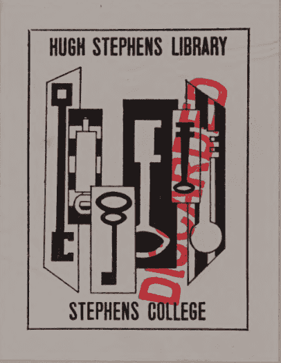
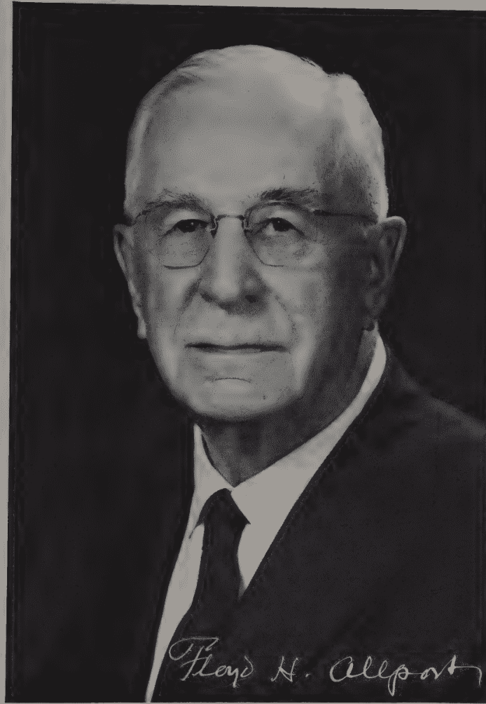
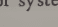
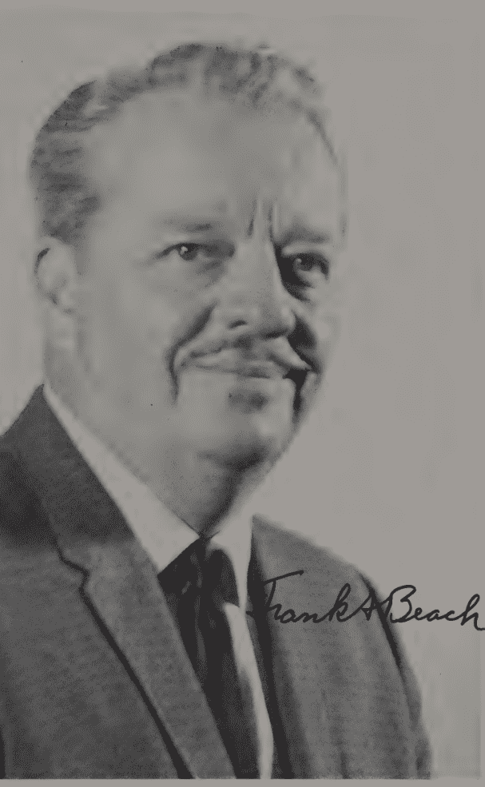
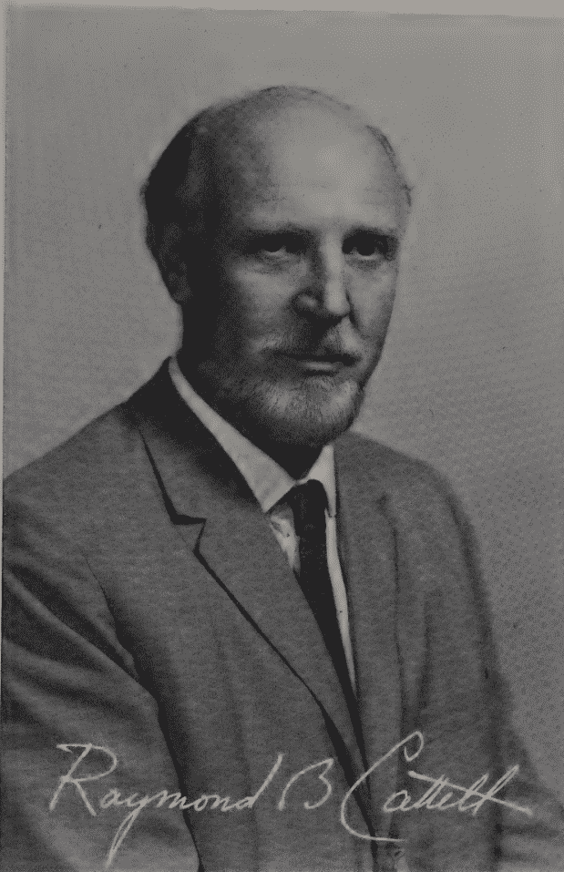
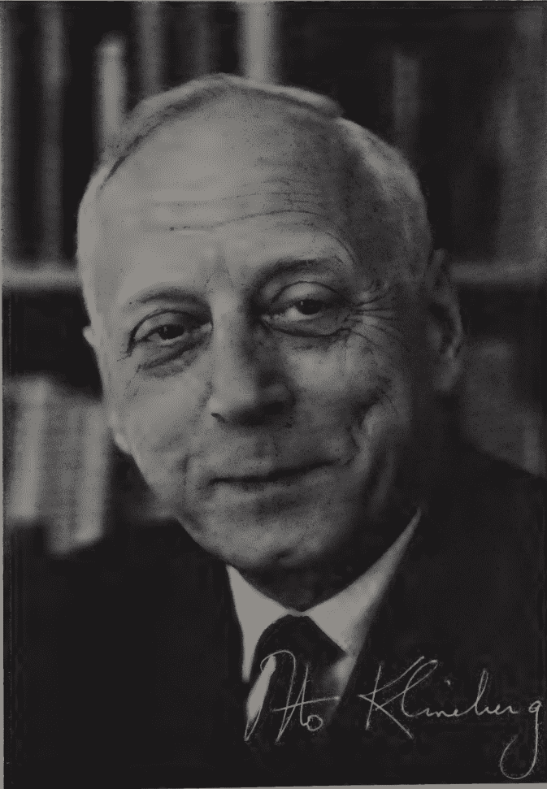
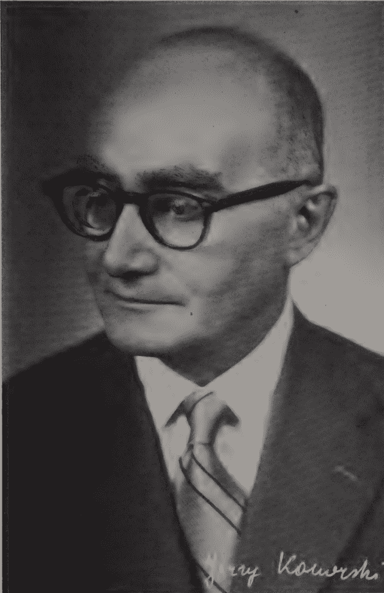
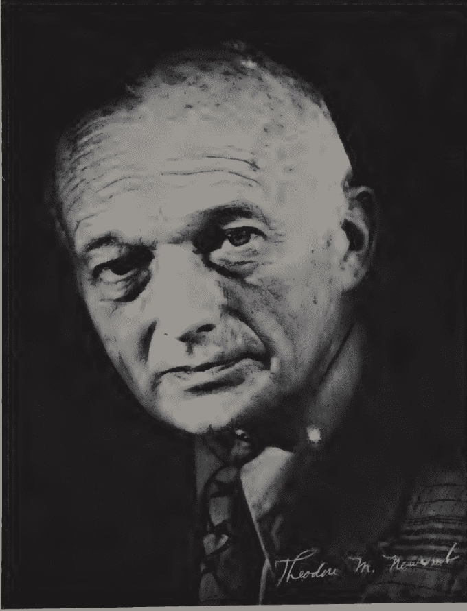

# Java 虚拟机规范，Java SE 8 版

## 自传

### 第六卷

## 前言

历史可以以多种形式呈现。其中最亲切、真实的形式之一就是自传。虽然这种方式记录的事件可能会受到个人需求和视角不足而导致的散光影响，但由于作者生活中只有他本人才能直接获知的背景因素和事件，这些内容得到了极大的丰富。因此，如果自传者愿意，他可以为历史学习者提供在其他情况下几乎无法获得的信息。本书中的文章与该系列其他卷一样，在揭示个人职业发展及心理学本身发展周围的主观决定因素和个人经历方面，程度各不相同。然而，在理想状态下，它们记录了许多从客观记录中无法恢复的内容。

这些自传在心理学这一短期领域内有着相当悠长的传统——超过四十年。心理学家作为自然科学与人文科学之间的中间地带，通常对回顾自己的过去持保留态度。该系列曾两次从遗忘中被挽救（首次由 Edwin Boring 完成，随后由 Boring 和 Gardner Lindsey 完成），这并不意外。目前，该系列的未来似乎有所保障，人们可能会推测，美国心理学会的形成表明心理学家对自身起源的关注有所改善。本卷的最初计划始于 1966 年，次年第五卷出版后，成立了新的编辑委员会。成员包括 Edwin G. Boring、Gardner Lindsey、Kenneth MacCorquodale、Roger Russell 和 Seymour Wapner。因此，其成员包括几位曾在前五卷编辑委员会任职的人，以及两位曾为该系列贡献自传的成员。邀请函于 1968 年发出，到 1970 年大部分手稿已到齐。在最后阶段，我们有十五位贡献者的承诺。结果发现，没有全部实现，且有四位贡献者在自传编写完成后、出版前去世了。

## 第六卷序言

因此，最终卷仅包含了十三篇自传，而不是我们预期的十五篇。编辑委员会的成员们根据个人对美国心理学的影响或影响做出了判断。由于，尽管有这种某种民族主义的标准，我们还是邀请了几位欧洲心理学家和几位非心理学家。我们很高兴该系列包含了来自美国以外的心理学家的贡献，只遗憾的是他们的人数不够多。根据我们对本卷的有限经验，欧洲心理学家和心理分析师比美国心理学家更乐意编写传记。我们深表遗憾 Edwin G. Boring 教授在本卷准备期间去世了。他不仅积极参与了该系列每一卷的准备，而且给 Carl Murchison 的信促成了系列的建立。鉴于这些情况，本卷献给 Boring 教授似乎是恰当的。本书的一个特殊之处是，它包含了 Boring 术中的第一个“讣”，其形式为 Luria 教授的自传。Luria 教授发现自己无法为前卷做出贡献，但在 Boring 的邀请下立即开始为下一卷准备自传，以确保他即使不在世也能被代表。幸运的是，Luria 教授仍然在世。不幸的是，我们的三位贡献者 Clarence H. Graham、Jerzy Konorski 和 S. S. Stevens 在自传编写完成后、出版前去世了。选择贡献者的过程与前卷（重印在随后的页面上）中描述的本质相同。我们也为贡献者提供了相同的编写书目指南。贡献者们再次同意，本卷获得的微薄版税将捐给美国心理基金会。

Gardner Lindsey

## 第五卷序言

自传随着年龄增长而变为历史。当《心理学史》第一卷于 1930 年出现时，心理学家发现很有趣。它的读者大多熟悉书中讲述的男女的作品；他们通常认识这些传记作者，或者至少听过他们的话，并从观察一位知名人士如何看待自己的工作，以及他赋予那些塑造他生活的事件多大重要性中获益。然而，在撰写时，这些故事几乎处于当下，因为——除了对童年如何塑造人的推测外——一份跨越四十年的自传直到很以后才认为自己在谈论过去。现在，自从那最初三卷（1930-1936 年）出版以来已经三十年，书中描述的生活现在已成为足够的历史，让心理学家能够让他们的学生感受到前一代的态度以及他们赖发展的氛围，那是心理学更小、更不复杂且更亲切的时代精神。

观察序言结尾的表格时，目前努力的价值随时间的推移而增加是显而易见的。贡献前四卷的五八名心理学家中，仅五人仍在世。在前三卷写作的四十三人中，只剩下一个——Frederic Bartlett 士。在所描述的生活即将完成之前，这些记录个人记录。目前的委员会损失了 Werner，他在接受我们的贡献邀请之前去世了，但幸运的是我们包含了 Kurt Goldstein，他在去世前完成了传记。另外三位心理学家（Heymans、Hoffding、de Sanctis）在包含他们贡献的卷册出版前去世了，另外三位（Calkins、Zwaardermaker、Hull）在出版当年去世。

然而总之，心理学伟大的男女女性的命运并不好过。在写作日期，已去世的五四位贡献者中，只有 Woodworth 一人活到了 90 岁。去世最年轻的是 Klemm，54 岁，其次年轻的是 Franz，59 岁。这些自传作者去世时的中位年龄目前在 77 岁到 79 岁之间，介于 Drever 和 Terman 之间。

处于 50 多岁；11 人处于 60 多岁；15 人处于 70 多岁；25 人处于 80 多岁；1 人处于 90 多岁。

在 20 世纪 20 年代末，当新心理学的新历史学家们抱怨，关于他们负责描述的那些命名性人物的生平（以及他们的动机）的信息不足时，卡尔·默奇森（Carl Murchison）和克拉克大学出版社部（Clark University Press）启动了这一系列丛。当时，委员会要求贡献者讲述引导他们从事职业生涯的动机，而并未充分意识到动机心理学已经达到了何种认知水平——即一个渺小的人如何能够准确地了解自己的动机。在经历了最初由于足够成熟的心理学家储备枯竭、随后又因世界大战的干扰而导致的中断后，项目在二十年后重新启动，其征稿邀请已更改，变得更加强调意识动机和生活中的事件。以下是 1952 年出版的第四卷序言节选。

本卷读者将看到，我们的自传在努力的性质上有有多不同。也许它们最大的不同在于它们对生活统一性的发现程度。推测其中某人可能希望将自己的学术史视为单一目的的演变，因为完整性是好的，简洁是优雅的。不，当然，没有人能完全完成这项任务，因为每个人的故事都受到其所有者环境紧迫要求的限制。

这些叙述中，有些比其他的更具理智色彩，这可能是因为它们显示了更大的统一性，因为某些无关的内容从生平史中省略了，或者是因为实际上（至少在某种程度上）在活跃生活中被省略了。另一些叙述则更具环境性，因为社会和制度事件以及意外在其中占据了如此巨大的地位。环境主义自传记录者可能有一个主要的长期目标，并追求了它，而且取得了相当的成功，但他可能觉得，生活中不可预见的意外决定了他的生活的大部分，甚至可能改变了他的目标。另一方面，如果我们可以称其为知识分子的话，他所遭受的计划中断比他的同事少，但他可能也会对外部力量对其产生的影响感兴趣。

没有人，即使是我们这群卓越心理学家的成员，能希望充分地处理其动机的源泉。然而，他们关于自己的描述以及他们展示的价值观，可以在很大程度上指导读者人类动机如何推动科学进步。生活中的意外似乎与它们所运作的进步无关，因为这些意外是以书中所示的方式在发挥作用的。自传中的心理学可以是完整的，但它可以为心理学史做出一份独一无二的贡献。

## 第五卷序言

以下是本卷对贡献者的邀请函节选。它是对 1952 年说明的扩展和修改。

关于你自传内容的重要决定权完全掌握在你自己手中。然而，我们希望这份文件能关注你生活中的历史细节。在生活的事实方面，我们希望你在出生地和日期、重要的教育和职业经历以及家庭等事务上认同自己的身份。当然，我们对你生活中的智力和职业方面特别感兴趣，因为这些方面受到了心理学领域事件、思想和人的影响，同时也影响了这些因素。你对你一生中心理学内部重大发展和问题的感知，以及你与这些事件的关系将具有特别的意义。对于任何关于你的感受、动机和愿望，或能增加读者对你以及你对心理学贡献理解的重大事件的讨论，我们不胜感激。简而言之，我们对你的智力生平史感兴趣，但同时我们认为，通过你愿意并能够透露的关于你个人背景和内在动机的信息，应该使之变得更加清晰。

委员会面临着巨大的压力，要求包含一份此类人物的完整参考文献，每个人的引用将从 100 条到 500 多条不等。心理学家们曾渴望看到默奇森 1932 年的《心理学登记册》（Psychological Register）并希望对其进行更新，但委员会既没有空间只容纳 15 份每份 2,000 字的自传，而且增加参考文献会减少这些自传的数量。此外，还会产生重复，因为对于卓越的心理学家，完整的参考文献通常会在其他地方出版。学院的回录有时也会包含它们。此外，已经可以获得在 1894 年至 1958 年间出版物在《心理学索引》（Psychological Index）和《心理学摘要》（Psychological Abstracts）中列出的心理学家的相当完整的参考文献；它们包含在波士顿 G.K. Hall 和公司于 1960 年出版的四卷系列丛书的作者索引（Author Index）中。

为什么本卷仅包含美国人作为贡献者？早期卷的比例大约是八个美国人对七个欧洲人。当然，心理学在当时是、现在更是主要是美国化的；这本书的语言是英语，其特征也是美国式的。尽管如此，本委员会开始时的预期是，通过选择那些对美国心理学思想留下印象的外国人（欧洲人或其他在美国看来最重要的人士），将确保其美国特征，即便他们是在自己的国家最重要的人士。本委员会委员会通过选择那些对美国心理学思想留下印象的外国人（欧洲人或其他在美国看来最重要的人士），确保其美国特征。我们确实与一些欧洲人取得了联系，但很快遭遇了两次拒绝。我们决定的关键因素是欧洲及其他地区那些影响美国思想的心理学家非常匮乏，他们没有贡献过之前的卷册，且年龄已超过 60 岁。另一方面，本委员会的权威随着本卷的出版而结束，我们期待一个再次具有国际性的第六卷。随着六大洲心理学家的增加，挑选优秀的名字比心理学仅限于西欧、英国和美国时要困难，但这种筛选是不可能的。

在第一卷中邀请了 61 位心理学家做出贡献（卡特尔、莱舍利和柯勒）。对于本卷，我们征集了 22 位心理学家。沃纳去世了。三位本想参加，但任务太繁。他们认为如果第六卷能尽早联系他们，他们接受。另外三个人出于个人原因拒绝了。

本委员会是增增形成的。复兴这一系列的想法始于林西（Lindsey），他获得了阿普尔顿-世纪出版社（Appleton-Century Crofts）出版的协议。博林（Boring）曾参加所有五个委员会，并与克拉克大学的杰斐逊总统协商将权利从克拉克大学转让阿普尔顿-世纪出版社，他同意如果林西担任执行官，他就担任主席。委员会对杰斐逊总统和克拉克大学放弃这些权利投入这项历史科学事业表示感谢。马科夸代尔（MacCorquadale）被纳入是因为他与林西以及阿普尔顿-世纪出版社在编辑世纪心理学系列方面有长期合作。瓦普纳（Wapner）是该系列的自然延续。纽布鲁（Newbrough）和夏普（Sharp）曾是前一届委员会的成员。沃纳自发地对心理学家进行了调查，以评估复兴该系列的可行性。美国心理学会曾被要求赞助这项事业，因为它拥有第四卷，并在认为明智的情况下会任命一个新委员会，但它拒绝了，认为本委员会不需要它的帮助。尽管如此，我们认为我们的委员会可以从更多的智力支持中获益，我们将比奇（Beach）和霍布斯（Hobbs）加入了我们的成员。本委员会准备了本卷，但它不是自动延续的。然而，我们认为威利（Willey）在卷与卷之间将是该系列利益的合格照顾者。我们特别感谢莱斯莉·塞格纳（Leslie Segner）小姐在手稿最终准备过程中不可或缺的帮助。

我们感谢贡献者。他们将不会获得版税，但我们希望他们从我们能给予他们的这种永生中获得满足。他们现在已经为观众赢得了名声，在他们去世多年后依然如此

## 第五卷序言

他们虽已离去，仍能向那些作为他们后代的心理学家倾诉。本书销售产生的小额版税已恰当得捐给了美国心理学会。

弗兰克·A·比奇（Frank A. Beach）

加州大学

埃德温·G·博林（Edwin G. Boring），主席

哈佛大学

尼古拉斯·霍布布斯（Nicholas Hobbs）

乔治·皮纳鲍迪师范学院

加德纳·林赛（Gardner Lindsey），执行官

德克萨斯大学

肯内思·麦科尔奎多代尔（Kenneth MacCorquodale）

明尼苏达大学

J. R. 纽布鲁豪（J. R. Newbrough）

国立精神健康研究所

约瑟夫·C·夏普（Joseph C. Sharp）

华尔特·里德陆军研究所

西穆尔·瓦普纳（Seymour Wapner）

克拉克大学

1967 年 1 月

埃尔西与罗兰德·沃尔夫工作室

根据我母亲的叙述，我于 1890 年 8 月 22 日出生于威斯康星州密尔基。虽然我哥哥比我早十八个月出生，且已在该市进行了妥善登记，但并没有关于我的记录。我的哥哥戈登（他的自传《戈登如此》（Gordon to Gordon，在我看来是在本系列丛第五卷中）详细地描述了我们早年的生活和家庭环境；我将只增加一些个人回忆。我也记得我们的父亲是一个精力充沛的人，除了医学专业外还从事许多创业，并全身心地照顾家庭，信奉“勤奋”的福音。然而，在回首过去，我觉得他在处理各项事业时，不仅是审慎，而且富有想象力和创造力。

对于我们早年生活中那种我认为是相当宗教的影响，我的反应可能与戈登不同。我的外祖母是纽约州富尔顿自由卫公公会的创始人之一，我母亲也继承了她父母的许多虔诚。在我的童年和青少年时期，我们参加了许多竞争活动、营地聚会之类的活动。在随后的岁月里，我母亲变得更加开明、富有哲学思想，甚至对许多传统思想持有批判态度。在那些较早的日子里，我渴望获得某种形式的个人宗教体验，内心非常强烈。我经历了一两次危机，在“改悔”之后，情感热潮消退后感到非常失落。无疑，这种经历对我成年后的态度产生了一些影响。当我上大学时，我们会就科学与宗教进行长时间而友好的争论。我并不想夸大这一背景的重要性。总的来说，我们的家是一个和平但受保护的地方，每天都表现出善意。对于父母对我生活产生的良好影响，我怀着深切的感激之情，这种影响使我对自然产生了深刻且持久的好奇和兴趣。从高中毕业后，我进入哈佛大学，于 1913 年获得学位。毕业后几年，我回到研究生阶段，首先是人类学，然后是心理学。为了这一目的，我进入美国，在普拉茨伯格（Platsburgh）接受训练，并被授予炮兵少尉。1917 年 10 月，在我们团出发法国的前几天，我结婚了。那后的夏天，我被派回在南卡罗来纳州担任副官。在我的回忆中，最生动的经历之一发生在我第一次飞行期间，当时我们遭到德国人的火力攻击，我安全地降落在阵后。尽管我获得了法国十字勋章（Croix de Guerre），并在法国指挥官的命令下执行任务，但我很快发现这没有什么英雄主义色彩。在军官餐厅的各种香槟在活动之后，我怀疑这种经历可能对我没有益处。战争结束后，我回来撰写了博士论文，并在 1919 年获得了博士学位。我与伊特尔（Ethel）的婚姻是在仓促中开始的，我认为这在很大程度上归因于我自己的局限性。二十年后，这段婚姻以离婚告终。我幸运地拥有了三个孩子：爱德华（Edward）、多萝西（Dorothy）和凯琳（Karen），我为他们感到自豪。我还有孙女：伊芙琳（Evelyn）。1938 年，我与哈特莉（Hartley，原姓威利）结婚，她是锡立拉大学的英语教授，也是该领域的杰出人物。她的魅力、对问题的深刻理解，以及她的忠诚和奉献，对我来说是无法估量的。1965 年她的去世令我倍感凄凉。

在这样的自传记述中，作者的惯例是从列出他认为的显著特征开始的。然而，由于空间有限，而且我觉得我所要描述的在这一背景下才能被理解，我尝试从这个清单开始。不久前，我的哥哥戈登在加利福尼亚探望我们。在餐桌旁，我的妻子向他描述了我的“优点”。除了这些科学发现的特征外，最让我感到惊讶和困惑的时刻，是她毫不犹豫地提到：“他还是固执、懒惰且拖延吗？”回首我的生活，并在撰写这篇回忆录时，我意识到这些每一个特征可能是正确的。然而，我确实也有其他特征，我的哥哥无疑表现过。固执这种特质体现在许多方面。其中之一是不接受信仰，而是对每一点进行分析和审查直到最后。对我某部作品的批评者提到了他所谓的“阿波特痛苦的逻辑”。一种特别偏执的倾向是我一直努力避免这种逻辑，这让我的妻子大笑，这被称为“对确定性的恐慌”。由于这一特质，我对于传统信仰和习俗没有表现出基本的尊重。在很大程度上，是因为我天生孤僻，不与同事或同伴往来。结合上述特征，我有足够的野心和自我进取，正如后文提到的，一种完全不实际的目标。

在账目良好的一面（至少是我认为良好的一面），我认为我可以声称对个人和智力诚实的坚实追求，尤其是对自然有着近乎狂热的好奇。后者这种特征表现为对获取新真理的冲动欲望，且完全独立于任何预设或实用价值。这种对人类在涉及生命和自身本质的问题上可能达到的完全客观性的追求，这种以近乎狂热的热情追求的任务，在我的智力动力中扮演了不可分割的角色。我记得在哈佛大学上的一门生物学课程中，学生被要求对狗鱼进行解剖绘图。教授可能注意到有些图画得很漂亮，于是警告我们不要把艺术重点置于对事实的严谨忠实之上。“当然，”他补充道，“你们知道那鱼是对的。”这句话一直一直留在我的脑海中。另一个场合，我记得在一次天文现象发生时看到一条新闻标题。上面写着：“日食迟到了二十秒”。我没有以它原本想的幽默方式来接受（大多数人也会那样接受），对我来说这是一个令人排斥的

# 回顾与研究历程

## 早期实验与社会促进理论

回到我的博士论文及其续篇，最初是霍戈·明斯滕伯格（Hugo Munsterberg）建议我，个体单独行为与在群体中行为之间的差异是一个值得研究的问题。此前在德国和本国对该问题的研究已经表明了某些效应，我们认为值得跟进。

我设计了这项实验：让受试者在第一组实验中独自在不同的房间完成一些简单的心理任务，并为他们提供蜂鸣器所需的计时信号；而在另一组实验（即集体情境）中，让他们小组完成同等的问题。小组人数从三人到七八人不等，由我亲自向他们提供时间信号。由于我想从“纯粹由于同事存在”这一基本角度来发现效应，因此不允许他们与他人进行讨论或比较结果。受试者工作得非常独立。我也尽力将任何竞争倾向降至最低。

尽管这项实验的控制仍有不尽之处，且我会以不同的方式进行实验，但结果似乎显示，与共同工作相比，工作量确实存在真实差异；小组中的工作质量并没有提高，在某些情况下甚至恶化了。由于在共同工作时表现量持续增加，我将这些结果归纳为“社会促进”（`social facilitation`）这一理论概念，将其描述为：在执行相同任务的他人面前，表现出投入更大能量和更强度的倾向或设定。

另一个重要发现是，在判断一系列刺激（例如气味的愉悦程度或重量的轻重）时，受试者在工作时表现出明显的规避量表两端的倾向，使得他们的判断比单独判断时更接近该系列指标的水平分布。这些发现从假设上被泛化为群体情境下的从众态度，或“产生从众的倾向”。后来，我在体系中为了理论目的而引入的概念还有社会投影、普遍性印象和多元化的无知。这些术语现在在社会心理学中已广为人知。

## 教科书《社会心理学》与理论立场

到1923年，我完成了名为《社会心理学》的教科书，这在部分基于上述我自己的发现及其解释。在这部作品，我强烈拒绝了在此类集体现象中存在某种“超”心理实体或“群体心理”的观点。后来，我也拒绝了将群体本身视为实体或机构的倾向。我将群体和群众的影响、以及组织的影响，都归因于个体单独行动的行为，但这种行为是个体在特定社会条件下行动时的自然本能。

自这些早期实验以来，对群体条件效应的研究已被他人扩展到群体成员的广泛行为和动机中，以及他们各种关联或归属的情境中。在我最近的工作中，我一直在尝试一种观点，即构成社会心理学的这几乎所有的、目前尚有些“无家可归”的大量发现，是可以被归纳到一个单一的、更具普遍性的表述下的。这种可能性通过尝试构建一个站得住脚的集体结构理论来实现，并在我们在锡拉丘兹大学的研究中产生了我被称为“结构动力学”（`structural dynamics`）的公式。这一公式以及基于此的调查路线将在后文中描述。

我假设我的教科书《社会心理学》（近期已重印）受到的广泛关注主要源于两个新特征：
1. 它是从心理学而非社会学的角度对该主题进行的客观构思且具有系统性的呈现；
2. 它至少暗示了建立一种新的社会心理学实验科学的可能性。

## 锡拉丘兹大学时期

1924年秋，在弗兰克林·H·吉丁斯（Franklin H. Giddings）的推荐下，我受聘为锡拉丘兹大学教授，新麦克斯韦公民与公共事务研究生学院的一员。我被授予社会政治心理学教授的头衔。我在这一职位一直工作直到1957年退休。

麦克斯韦学院主要是一个从事社会科学和公共管理研究生研究的机构，在这种环境中，我与实验心理学及心理学同事的接触处于某种孤立状态。然而，我是心理系的正式成员，承担了本科教学，并按照严格的心理学路线对研究生进行社会心理学培训。这种安排在许多方面都是令人幸运的。它在让我追求研究兴趣时给予了他们最大限的自由和大量的物质援助，而且教学任务也变得越来越轻松。

我相信我是一个优秀的课堂教师，尽管有时我也会投身于某些主要对我个人感兴趣的推测线条中。学生曾说，有时“奥尔波特（Allport）跳窗出去了”。不过，幸运的是，他们也补充道，“他回来时是值得等待的”。我每年教授结构方法和理论，我一直很享受。

关于我在指导研究生完成博士和硕士论文方面，有一点应该被记住，因为这与我自己的效率密切相关。我并没有让学生放任去处理所选问题并让他们自己开发，然后偶尔检查他们的进度和结果，而是与他们保持持续的紧密接触。当然，基础性工作留给了学生，但学生实际上也是一个实验的伙伴，这个实验在很大程度上是由我帮助构思和设计的。结果是，产出的论文在某种程度上既是我个人的专业出路，也是学生获得学位的依据。我意识到这里存在自私的成分，因为我自己的理论兴趣可能超过了学生独立发展的机会。

由于我自己的倾向，我在锡拉丘兹大学的长期任期是有些孤立的。这种做法在很大程度上是因为我渴望亲手发现新事实。我没有参加许多科学会议，也没有许多旅行和与其他心理学家交流的机会，这一点我后来感到遗憾。不过，我有过一个学期的海外休假。

## 研究生产力的两个阶段

在讨论我在锡拉丘兹大学的生产性工作时，我想将其分为两个部分。第一部分代表1925年至1937年期间，当时涉及许多领域的问题。第二部分虽然在1937年后正式开始，但其实始要早得多，并构成了我职业生涯中的主要主题。

### 第一阶段（1925-1937）：态度研究与从众行为

早期项目之一是与丹尼尔·卡茨（Daniel Katz）合作对锡拉丘兹学生的态度、意见和学术动机进行的大规模问卷调查。这项研究引起了从事态度研究者的极大兴趣，并在其他语境下被他人重复研究。卡茨是我最早的研究生之一，在很多时候都是我的资源。

对态度和意见的研究还扩展到了其他领域。戴尔·哈特曼（Dale Hartman）和我开发出了一种相当粗浅的测量态度的方法，并应用于衡量保守和激进倾向的问题上。这些早期尝试被索恩（Thorne）感谢地认为是他开发经典态度量表方法的起点。在二战后期，我的研究生小组组成了一个“士气研讨会”。

研究的问题包括对颠覆性谣言的信仰原因、轴国宣传对听者的影响，以及好与坏消息标题对读者士气的比较影响。

大约在1930年，我的学生理查德·L·申克在纽约州伊顿顿（Eaton）农村社区收集各种社会问题的意见。他发现，这些问题的态度在所使用的量表上完全不是呈正态分布（这与我们最初预期的不符），而是往往呈现出极大偏斜或不规则（Schanck, 1932）。此外，是在私下提问还是在更广泛的社区背景下提问，其分布也会产生差异——即申克所说的“公共与私人态度”。

这些意料之外的发现暗示了一个想法，促使我发展了我的从众行为S曲线假设（`S-curve Hypothesis of Conformity Behavior`）。在这一理论中，我试图描述一种曲线，研究证明这种曲线是舆论场合、习惯习俗以及一般的制度化表现中态度或行为分布的特征。该理论进一步开发了一种技术，用于量表上衡量每个案例中所表现出的从众性；这种衡量并非“不从众”（那将导致同义反复），而是一个代表“习惯”或“制度”可能实现的某些目标程度的连续体。这种构念被称为目的连续体（`telic continuum`）。

一个“四因素”假设被提出解释人群中此类分布的原因。文中描述了各种制度实践中相当广泛的从众情况，产生了J型曲线分布。米尔顿·迪克斯斯（Milton Dickens）在其关于交通行为的博士论文、观察教会和宗教习俗的巴西亚·赞布罗斯基（Basia Zambrowski）以及其他人对这项研究做出了贡献。后来，吴江林（Chiang Lin Woo）和我曾进行了一项特别有趣的调查，涉及第七种美国男性习俗情境下观察到的行为行为的J型曲线分布。这些研究发表在多篇论文中，引起了社会心理学家和社会学者的极大兴趣，并在许多部著作中被引用。

我觉得这些研究没有得到充分的重视，是因为这些数据有时被解释为对从众的直接描述。事实上，在几乎所有情况下，量表的阶梯都代表一个表达`习惯或制度目的实现程度（从最大程度到最小程度）`的连续体，这不仅展示了从众的分布并使其在特定情境下变得可测量（这是最重要的），还让我们更好地理解了其可能存在的内在动力机制。这些事实揭示了对同义反复指控的处理程序。

### 人格研究：目的性趋势

另一个曾被有力追求一段时间的话题是对人格的研究，但并非基于熟悉的“特质”（`traits`）概念，而是根据一种新的表述，我称之为“目的性趋势”（`teleonomic trends`）。这种方法与我兄弟的区别在于，我试图在社会观察到的这些特征（或在实际生活中被评价的特征）与实际上代表个人在整个日常行为中特有的正在尝试做的深层倾向之间做出严锐的区分。

我的论点是，后者的这些方面如果我们能识别它们，并可能在机体中找到它们的依据，将被认为是真正的个体动机因素。个体根据其通过“特质”概念或“外在”社会参考系所通常感知的“人格”，将仅仅是这些趋势特征的部分转化。观察者将在不同的、具有社会相关性或规范性的语境中感知到趋势的表达。稍后将描述一项旨在测试这一假设的重大研究。

有人指出，我兄弟无疑对人格的某些方面很有感觉，而我称为“趋势”的特征可能在他教材的修订中找到位置，被归类在个人倾向（区别于普通特质）、核心倾向和人格统一性等目下。然而，他并没有在方法论上做出这种严锐的区分；通过阐明属性的改变或作为观察者在描述人格时，所谓的“趋势描述”似乎拒绝了这种观点。

对我来说，这似乎很重要，因为我认为用于特质描述和评价的“领域”（即同伴归因于人格的普通特质）对于个体所属的一种“集体结构化”（`collective structuration`）来说是不可替代的，这种结构化是个体所处的状态，而趋势图则是当我们寻找他内在更亲近的诉求时，对同一个个体所能看到的内容。我的学生在特质理论方面做了非常优秀的工作，我遗憾的是其中大部分内容尚未发表。也许我在督促其出版方面的疏忽，正是我自身“拖延症”（而非趋势症）特质的一个体现。

我想顺带说明一个事实：我一直旨在形成比特质或趋势所定义的关于目的或价值的隐性概念更客观的心理学和社会行为表述，在早期的方法中几乎没有可能这样做。我所努力做的是让“目的性”（`teleonic`）变量更加显性化，以便它们可以被量化并用于可测试的假设中。

## 与戈登·奥尔波特的学术差异

让我们暂时离题一下，讨论一下我与戈登（Gordon）关系的其他阶段。除了对人格特征的解释外，我们在社会心理学方面还有几点意见不一致。其中之一涉及态度的本质。这将在将在稍后描述的一项调查中显而易见。另一个涉及族群敌意与偏见之间的关系。

他当时正在写他的书《偏见的本质》（`The Nature of Prejudice`）。在我们的通信中，我建议，族群之间的“冲突”或“敌意”本质可能提供一个更好的起点，因为偏见似乎是产生于这种冲突的。他坚定地回答说他的书不是关于冲突的，而是关于偏见的。

后来，在书出版后，我根据我们在锡拉丘兹大学的发现，质疑了“替罪羊假设”的重要性。在她的研究中，南希·莫斯（Nancy Morse，现汉斯·萨姆森夫人）使用细致且有判别力的方法发现，在七个假设中，向外群体投射挫败感或内在冲突的元素意义相对较小（Morse and Allport, F. H., 1952）。我与戈登就此主题有过一些交流。

莫斯实际上发现的是，在她的假设中，唯一与反犹太主义产生显著相关性的是民族忠诚和对国家的认同。在随后的出版物中讨论这一发现时，我兄弟将其解读为：那种与民族情感如此密切接触的人，很可能具有偏执的人格。我觉得这种解释是毫无根据的，并且不利地损害了我的立场。

虽然我同意人格差异允许人们在他人的敌意或偏见中发挥作用，并且这些情感有时与民族情感有关，在我看来，这种现象具有更深层的意义，即个体参与了一个长期的“集体结构”，他们在其中生活，并可能（无论正确或否）感知到来自外群体成员的威胁。推断人格特质是民族参与和族群敌意的根源，对我来说是一个长期的假设。它忽略了民族参与在至少部分也是个体行为的结果，并且必须与他们的动机产生某种联系。忽视这一事实，或者通过假设国家是一个个体仅仅“属于”的超个体实体来掩盖它，可能意味着未能检查某些提供或构成了族群偏见现象的关键数据。这并不是针对国家，而是针对一般的社会总体的、长期以来向心理学和社会科学领域的同事们提出的挑战。

然而，戈登和我之间的这种分歧案例是非常少见的。我提到它们仅仅是为了说明观点上的某些特征差异。他许多生动表达的直觉，在某种程度上确实与我一直试图发展的想法一致。这对于他关于个人倾向、核心特征和人格一致性的概念，以及关于谣言的本质和他对“生成”过程的重大处理都是如此（See Allport, G. W., 1954, 1955, and 1961）。我相信，后代心理学家将对他建立个体人类特征的一致性、自主、独特和动态一致的本质负债深远。

他在许多方面都帮助过我，并在许多危机时刻守在我的身边。在我六十岁生日时，我收到了他的一封温暖的感谢信，回想起了他在早年里认为对我这个“弟弟”所做的一切。他一如既往地拥有一种温柔、一种内在的宁静以及对终极事物的信仰，这些是我无法达到的；这些特质赋予了他的性格一种从容和坚韧，这在某种程度上促成了他的成功。他去世时，世界失去了一位睿智而深邃的学者，和一个真正伟大的人。

## 个人生活与绘画

在生命中的某些场合，我曾经历过神经性抑郁发作，但这些得到了充分的克服。光明的一面，除了从第二次婚姻中获得的幸福外，这段时期有两个非常美好的回忆脱颖而出。其中之一是在安大略湖的墨西哥湖湖点（Mexico Point）与家人及学术内外的朋友们度过的夏天。另一个关于我在1931年至1948年间在水画领域的冒险。在此期间，我创作了一系列色彩斑斓的纽约中心场景，现在装饰在我的公寓里。我还担任过当地协会——锡拉丘兹联合艺术家协会一年的主席。就此，我必须记录我对我的老朋友兼老师维纳纳·比施（Weiner Bisch）持久的感激。正是他建议我尝试绘画，并通过并肩绘画旅行，为我开启了这整个创造力与美的领域。

## 第二阶段（1937年后）：结构动力学与社会影响的理论深化

现在转向我1937年以来的研究兴趣，它们构成了一个或多连贯的故事，我们实际上必须回到那个日期之前（并且在我们讨论的这段时期之前），回到我在埃默森·赫尔（Emerson Hull）的早年岁月、我1924年的博士论文以及教科书。

我思考了当时我获得的实验结果。这些结果该如何解释呢？有明显的证据表明，在有同事现场的情况下，智力和体力活动的速度和能量似乎有所增加。但特别引人注目的是，当个体之间完全没有交流，或者不注意邻居在做什么时，这种效应也发生了。个体间的比较或竞争倾向的想法已经消除或减少到最低。然而，在这些安静且略带内向的环境下，这里有社会影响的明显证据。

同样引人注目的发现是：在判断一系列客观刺激的任务中，如果判断是在小组中进行的，尽管彼此之间没有交流或知道他人的反应，但在判断尺度的极端部分，其判断范围比受试者单独工作时要收得窄得多。这些效应该如何解释呢？显然，在社会背景中一定发生着某种与受试者单独行动时不同的事情。这无疑是某种类的“社会现实”的经历；但常识似乎要求这种经历在个体身上具有位置和运作。

我最终将所有这些效应归因于某种特征态度（也许“定势”是一个更准确的术语），个体在彼此面前执行相似活动时会在很大程度上无意识地采纳这些态度。他们的反应似乎就像在与其他就工作进行交流并接收他人的交流，尽管事实上并没有。他们似乎有一种感觉：“别人在工作，所以我也必须工作”，或者“别人正在判断这些相同的刺激，所以我必须小心不要对它们做出异常或极端的判断”。因此，受试者在这些共同活动中对他人的所为表现出一种普遍的增强敏感性。这种敏感性似乎紧邻泛化的“顺从态度”。

## 与谢里夫的对话与社会规范理论

我记得不久后在哥本哈根的国际心理学大会上见到了谢里夫（Sherif）。他最近一直在进行关于运动幻觉的实验，或者对黑暗房间里看到的点光点的虚拟运动程度进行判断。然而，与我的受试者不同，他们会大声表达判断；因此当他们在一起工作时，他们意识到彼此的反应。

这些受试者有一半从孤独状态开始，逐渐进入小组状态；另一半从小组开始，后来进入个人或孤独状态。从单独开始后移动到小组状态的受试者，一旦处于这种状态，他们的判断就变得更加接近。这种趋同在随后的协作场合中持续或增加。从小组状态开始的受试者在开始时相当接近，并在随后的课程中保持不变。在这些程序中获得的结果基本上与我的相似。社会影响（我们可以这样称它）无论是在工作计划开始时引入还是经常产生，都会增加相关人员行为的趋同性或顺从性。

然而，谢里夫向我保证，我对结果的解释是错误的。他当时正在发展他著名的社会规范理论。根据该理论，在非结构化的小组或刺激情境中，感知的“规范”会随着正在执行的任何任务而经常上升。这种规范的效应也会持续相当的时间。人们公认，这种规范具有稳定和统一小组行为的作用。

尽管我对谢里夫深表尊重，并对他设计社会实验的才华表示钦佩，但在这种情况下，我更倾向于我之前呈现的对顺从情况的解释。感知或判断的“小组规范”产生并控制个体的集体行为，这种想法在我看来是不切实际的。我观察到，谢里夫所指的“社会”并不意味着任何具体实体。事实可能是如此，但同样地，我们并没有关于什么是社会规范的明确陈述——一个可以与行为某些确定方面联系起来的陈述。社会规范似乎是一种统计标签。它是对什么是可接受的标记，而不是一种支配顺从规范行为的力量或决定原则。

因此，我对社会影响采取的批判性立场使我进一步攻击社会因果学说。我攻击的不是显而易见的真理，而是未能赋予它们更具体的意义。令我印象深刻的是，社会科学使用的许多术语和概念化实际上是拟人化或其他集体隐喻。关于“政府”做什么或“公司或国家的行为”的概念，这些在实际生活中是有用的泛泛术语，但它们有时会引起混淆或掩盖……这些短语所暗示的机制没有明确的指代对象；而当我们观察个体时，无法以自足的方式描述在这些共同活动中发生了什么。这种敏感性似乎紧邻泛化的“顺从态度”。

在我看来，需要的是一种能用明确术语描述这些情境的科学。将被反对说个体的行为是如此巨大、多样且复杂，以无法用经验术语描述，只能用集体实体及其功能来描述。没有这种制度术语，社会科学将无法建立。我回答道：“如果不真的尝试，我们如何知道呢？”

显而易见，我对小组影响的辩论注定不会提高我在科学同事中的声望。人们说我有“制度情结”，并在攻击一个替人受罪的稻草人。我成了社会学家们的替罪羊。高峰出现在美国社会学年会上的一次演讲中，我在其中被公开指责。我不在场，但一位朋友向我转述了这件事，他报告了演讲者的陈述。他说，在中世纪人们对亚里士多德的追求是如此激烈，有时毫无目的，以至于有人必须站出来说在亚里士多德那里没有……现在，”他继续道，“我说在弗洛德·奥波特那里没有真理。”在这一点，当他做出扫过的手势时，他的手撞到了水晶吊灯，碎片在房间里飞舞。当我听到这时，对我被如此戏剧地归为一类感到震惊，以至于完全忽略了演讲者想要表达的。

Wiehof

17

在《制度行为》（*Institutional Behavior*）中，我通过对群体实体化及其相关虚构概念的批判，与对更具实质层面的分析相结合，做了一个可以说仅仅是开端的工作。我关注了制度行为——尽管其必要性通常被公认，并为人类带来了利益，但它们同样能够淹没个性，通过多元化的辩解或在面对社会诉求时的无能来减轻责任。它们还倾向于排斥或疏远人口中的许多个人或阶层。我将这种分析贯于政治、经济、家庭和教育领域。在这里，我与其说是在主张转向任何新形式的制度，不如说实际上是在质疑制度本身的效力。我没有为这些问题提供任何解决方案，因为我并不具备。然而，我确实没有呼吁消除这些现实——即呼吁无秩序状态或无政府状态。

社会学学生或公众对这样一本书以及书中包含的彻底评估并未做好准备。另一个不争实是，它写于我生命中一个动荡且困难的时期，那时的基调有时是夸大的、单面的或情绪化的，并包含了一些我现在不再认同的陈述。尽管这本书本身很快被遗忘了，但我现在认为，我对我们今天看到的许多现象提供了预示或预见。这体现在极端民族主义的兴起、国际冲突与紧张局势、快速的技术和自动化扩张、家庭关系的破解以及女性“解放”运动的兴起、教育动荡以及制度性宗教中。我未能预见到的是，对所谓的稳固制度（被称为“精英阶层”）的冲击会如此迅速且如此剧烈，这种冲击源于被疏远化群体的行动，其中包括（悲剧性的）许多年轻人。

在这本书写成后不久，我的理论观点出现了一个转折点。这与其说是一个转折点，不如说是我研究范围的拓宽。它将质疑重新推回了我在埃默森大堂（`Emerson Hall`）早期困扰我的问题中，并更新了我对有机体持续的好奇心。一位深思熟虑的批评者写信给我，大意如下：“你最好小心如何攻击群体概念或使用‘群体谬误’这一术语。个体不简单是许多部分或过程的整合吗，这些过程往往无法详细解释或阐述。你对‘群体虚构’的描述是完全正确的。这让我意识到，这并不是让我放弃对群体概念的批判，而是引导我在对基本现实的探寻中将个体的本质也纳入其中。”从1937年到1943年，我承担了这项几乎不可置信的任务。由于我是在一个模糊的概念“个体间结构化”下构建了社会问题，因此我试图发展一种涵盖个体和集体的“自然结构”的通用理论。个体内部的情况应通过有机体内的“事件结构”来解释，这涉及神经系统、神经运动系统或整个身体发生的事件。

集体结构化，即个体所处的结构，被构想为处于个体之间显性的接触或事件。当然，它们总是涉及个体的显性行为，而在这些第一种互补性结构化之下或伴随其后的，是个体内部神经生理或结构性事件的隐性纽带。通用格式（或结构原则）被假设在两个水平上是相同的。这一观点并非我所特有，而是隐含在早期对“社会有机体”的类比以及诸如“一般系统”等复杂理论中。这种理论将不仅涵盖社会科学和心理学学科的事实，还必须深入生物学、生物化学乃至物理层面。对于任何个人来说，承担这样一个庞大的问题似乎确实是自命且愚蠢的，更不用说在涉及的某些学科中没有专长的心理学家了。尽管如此，这是我为自己设定的道路。随着我的发展，我给这一理论起过各种名称，如`事件系统`、`事件结构理论`，以及最近的“结构化发生”（`enurence`）。

由于发表的内容如此之少，且在发展过程中经过了如此久的时间，这一雄心勃勃的计划的本质没有被很好理解，这是自然的。由于我现在谈论的是似乎“超越”了某些东西结构，我的一些早期批评者宣称我发生了180度的大转变。他们说，增加任何形式的社会现实，等同于相信我之前的陈述——即一切“社会”事物都可以完全从个体角度来解释——这种改变取消了我在后一个概念下终身的工作。这种说法完全是不准确的。首先，在1927年之后，当我第一三、四篇论文发表后，我并没有发表过任何暗示纯个体过程在解释社会现象方面具有万能性的陈述。我很快意识到，在我的社会心理学著作中，没有充分考虑到社会学家所说的“社会现实”所提出的问题，也没有充分赏他们解决该问题的努力。我在1927年之后的所有工作，无论是实验性的还是理论性的，都反映了一个事实：我意识到了这个问题，并正尝试帮助解决它。也许我可以通过科学层级的视角来展示其中的内在性。一个被公认的事实是，当科学家以其“感知粒度”或操作的某种程度的精细来接近自然的某个层次时，他可能会观察到或遇到某种与该精细程度相适应的物体。如果我们通过观察来细化我们的粒度，这些物体将分解为更小的实体，并意识到我们所看到的东西没有外部。

对于有机体。然而，当我们试图从最后一个水平上升到社会现象水平时，奇怪的事情发生了。我们发现社会实体没有外部！即使我们极度地粗化我们的粒度，我们也无法识别它（或其内部的任何集体性）。社会现象与个体的意义和行为紧密相连。在我看来，这种解释并不等同于否定社会现实；它正是社会现实的领域。我所批判的是那种做法：为这种现实发明一个外部方面，或者在不存在的地方通过代表集体生物和代理的术语赋予它“实体”，从而将注意力从更本质的方面转移开。

于锡拉丘大学

正如许多心理学理论处于早期阶段，研究必须根据对理论形式层面的某种“直觉”或感悟进行。我们的起点仅仅是给结构概念提供足够的实体，以便调查能够继续进行。“集体”结构的概念似乎是合理的理解的。现在的问题是识别和定义“有机体”结构，即个体内部的结构。在不假装描述大部分未知的神经生理细节的情况下，作为一个工作假设，个体内部所有相当稳定且可预测的行为意（如动机、趋势、习惯、准则和认知）都是准自闭和自维持的“事件结构”。作为一个整体的个体包含许多这样的结构，这些结构整合在一起。每个结构都被认为具有其自身的特征能量（事件密度）。由于它们在有机体的模式中如此紧密连接，推测当特定事件的能量通过环境事件被升高或降低时，其他“切线”结构的能量也会相应受到影响，并与涉及的强度按一定比例产生影响。这种情况被认为存在于内部（有机体）和外部（集体）类特定结构之中及之间。个体这些每个结构的内在能量最初被被称为“参与强度”（`potency of involvement`），后来称为“结构化指数”（`index of structurance`）在

所关注的结构。任何一个结构与另一个结构之间的关系（概率问题）被称为其对后者的“相关性”（后来称为“间结构性”，即 `interstructure`）。这样表述后，该理论就可以是可以进行定量测试的。这项工作和以前一样，是由我的研究生在一段时间内完成的，作为他们博士论文的基础。而且，我与他们大多数人都保持了紧密的合作。这些学生表现出的客观性、对问题的投入、耐心以及科学的严谨性，是我最珍视的记忆之一。由于这项实验计划占据了我大量的时间，并产生了一些未在其他地方报道的结果，我想更详细地描述它。

起初，定量定理并没有系统地推导。之前已经提到过南西·莫斯（`Nancy Morse`）的研究，这表明个人对外群体的敌意或偏见的产生，并不取决于其对所属国家结构的参与强度（效能），而（这仅是推测）他可能在某种程度上（无论对错）被认为具有威胁性（负相关性）。另一项由阿诺德·塔南鲍姆（`Arnold Tannenbaum`）进行的研究，调查了受试者所雇佣的行业的作用和态度。基本的独立变量是个人各种性格趋势的强度（效能），以及这些趋势与就业计划某些阶段的相关性。结果再次符合假设的方向。

为了更充分地测试该假设的泛化能力，引入了以下方程：`$S_1 = (S_1) + S_{121} + S_{131} + \dots + S_{in1}$`。在这个公式中，因变量 `$S_1$` 代表特定结构（例如结构 1）的总能量，即该结构的“固有”或典型能量；而 `$i_{21}$`、`$i_{31}$` 等是后继结构“典型”能量的程度；而 `$S_2$`、`$S_3$` 等则代表与 `$S_1$` 的间结构程度。个人所有相关结构（2 到 `$n$`）的范围都包含在求和中，它们包含了个人的性格趋势，也包含了他所所属的集体结构。后者可以归类为面对面的（初级群体）或制度性的。间结构对 `$S_1$` 的贡献可以是负的，也可以是正的。

在这种系统形式下，该理论首先通过约翰·范伦丁（`John Valentine, 1953`）对态度因果关系的一项重大且细致的研究进行了测试。`$S_1$` 由对某些社会问题的态度的强度或强度程度组成。其他 `$S$` 代表在其他结构中参与的强度。为了确定这些基础结构的身份和强度，受试者填写了详尽的问卷。`$i$`，即这些后期结构与态度（`$S_1$`）的间结构程度，由各领域的专业人士进行独立估计。范伦丁的研究结果清楚地

证实了假设。此外，发现独立变量（`$S_2 \dots S_n$`）中包含的结构类别或类型越多，相关性就越高。除了这项实验外，范伦丁（和雷默 `Reimer`）还对学习进行了一项类似的研究，结果同样是积极的。我认为范伦丁关于态度的工作是一项重大发现。人们通常认为态度本身是动态的实体或动机力量。我相信，这些发现能够导致一种全新的态度观念。在这里，态度被认为不是首要动机，而是其他环境的结果，即具有结构特征的环境。在尝试灌输或改变态度的过程中，应当将这一发现牢记心中。

另一项由夏洛特·西蒙（`Charlotte Simon, 1952`）进行的重要调查，探索了该假设对人格的预测价值。这项研究利用了之前提出的特质与趋势描述的区别。西蒙取了因变量 `$\delta_1$`，即受试者熟人通过评分表获得的受试者特质程度。三种特质——进取性、责任和外向性均被使用。对于方程右侧的变量（`$S'$`），她使用了从个人许多独立趋势中获得的强度，这些强度是从另一份熟人调查卷中获得的。每个趋势相对于特定特质的间结构值由西蒙判断，但她在完全不了解受试者素材的情况下进行这些判断的。这个变量代表了个人中该特质可能导致其伴侣感知到的此类特质出现的概率（实际上是特质与趋势之间预期的协方差）。这项严谨的研究也支持了事件-结构假设，并为之前描述的人格评价“部分转化”理论提供了清晰的证据。西奥多尔·范斯（`Theodore Vance, 1950`）用类似于范伦丁的方法对该公式进行了另一项测试，试图预测个人对宣传诉求的易感性。这项研究并未在主要观点上支持该假设；但一方面对宣传强度的感受与另一方面的事件-结构变量之间存在相关性。

我将通过描述一个我喜欢回想的研究来结束这篇回顾。那是一件策略与优雅并存的小“杰作”——但结局很遗憾。我想起，我的中国学生江林武（`Chiang Lin Woo`）曾用非常细致的技术完成了一篇关于习俗情中 J 曲线分布的博士论文（`Woo, 1948`）。因此，他能够根据他收集数据的 11 种习俗进行排名，标准是他观察到的个人对这些习俗的遵循程度。这 11 种习俗行为包括诸如男子为女性伴侣开门、在餐厅将刀叉放在盘子上、宗教活动参与者被预期的行为，以及国歌奏响时等。

还认为这一发现对文化人类学家可能有价值。吴要回到中国，他将带上数据并进行更详细的计算。他问我是否不想保留一份完整的副本。我无法想象当时是什么驱使我——那是那种难以解释的事情；但我当时愿意把整件事交给他，他一旦完成计算就发给我。吴先回到了香港，随后回到了中国大陆，那里正在经历政权的更迭。从他回到中国本土已经二十年了，在此期间我没有收到他的任何消息。由于我的记录非常简陋，直到现在我都没有发表这项实验或其发现。现在我只能请求读者接受我的说法。我遗憾自己没有保留数据的完整副本，认为这是我职业生涯中最严重的错误之一。

总来说，在锡拉丘大学我的指导下进行的这七项调查中，有六项支持了结构动力假设。第七项整体上没有支持，但在部分支持了它。我非常遗憾地报告，上述描述的研究中只有两项已经出版。鉴于这些发现的意义以及

# 洛伊德·H·奥波特

由于这种方法的新颖性，读者确实可能会疑惑，为什么这些材料会被任之枯萎。这在某种程度上归因于我惯常的“拖延症”，导致我没有发表它们，也没有督促我的学生们去发表。也许吧。但还有一个更深层且实质的原因：其在于假设本身的晦涩性，在于我所“结构”一词的模糊性，以及在表述“结构性”变量时的困难——必须清晰到足以将它们与动机、价值观和感知等传统的心理学构念区分开来。事实上，这个问题是由一位收到过我稿件的编辑提出的。当然，其中的教训是，尽管定量指标在研究中无疑至关重要，但仅凭数量（即使是清晰果定的）也无法构成一个良好的理论。我一点也不遗憾我和我的学生为了获得这些清晰且确定的结果所花费的时间，我确定这些结果终将发挥它们的全部意义。

为我自己辩护，我应该说，我在给学生授课时已经积累了大量的理论性结构阐释；并制定了许多关于有机体和集体结构的启发性图表或示意。然而，这些材料不足以弥合理论与研究之间的鸿沟。我比以往任何时候都更加致力于建立一种关于个人的基本理论——可能是一种具有准结构特征的理论。我觉得自己正处于正确的道路上；因为我们的研究揭示了许多关于“动机”和“感知”的事实，而心理学对这些术语的传统使用提供理解的基础——而且结果本身总体上惊人地一致。但显而易见，迫切需要让理论更加显性化，并可能将其不仅与外显行为、态度和趋势联系起来，还要与有机体深处的神经生理和微观活动联系起来。通过这种方式，我们在叙acuse研究计划的发现或许能获得它们应有的成果。

我与研究生们的工作于1953年结束，我可以全心地投入到我理论的进一步发展中——至少我是是这样想的。然而，由于对自己完成这项任务的能力并不自信，我起初让自己致力于阅读我能找到的所有相关心理学理论以寻求建议。在此过程中，我被感知理论所吸引，以至于没有再继续深入下去。于是，我根据结构概念对这些理论进行了阐述和讨论，计划在结尾处加上我自己理论的说明。当然，我曾不时撰写过关于该假设的文章，但此作将是我主要的、决定性的陈述。

# 24 自传传中的心理学史

这本名为《感知理论与结构概念》的书于1955年出版。我对其成功感到非常高兴，并为它似乎为感知研究学生提供的帮助感到欣慰。但显而易见的是，它的受欢迎程度仅仅（甚至是间接地）依赖于最后一章对我自身理论的阐述。那部分说明仍然是一个“初步”的陈述，而且对学生和同事来说仍然很晦涩。我有时在想，写这本书是否是一种逃避，帮助我推迟了对我所投入任务的进攻。这难道是我固执和拖延的另一个典型例子吗？也许吧，但这很难称之为懒惰。那些想要追踪我迄为止发表的更广泛理论进展的读者，可以沿着参考文献中用双星号（`***`）标记的项目来追踪其发展。这些文献应该按顺序阅读。

1957年，在我们退休后，我与妻子搬到了加利福尼亚，在那里我们可以靠近她的姐姐米尔德里德·米切尔夫人。我在加利福尼亚大学伯克利分校教了一个学期的研讨会，后来在斯坦福大学结识了许多朋友并建立了许多有帮助的联系。我发现，我对于有机体底层结构和社会隐性“上层结构”的方法现在已经——正如我一直预料到的一样——进入了一个更加复杂的时代。生命科学中翻覆性的智力变革影响了我的思考。我现在正尝试吸收现代从头神经生理学、生物化学和分子生物学近期一些令人印象的发现。为了变得具有重要意义，我的理论必须与此类背景建立联系。我也试图保持与控制论、信息论和广义系统理论当前思维模式的联系。

在不贬低这些任何进展重要性的前提下，我将提到两个相关的方面，即它们似乎并没有朝着我所问题的方向发展。第一点特别适用于系统理论，即试图设计心理生物过程的构想或计算机模型。我认为，通过设计有机体如何运作的理论或模型来解释或模拟有机体的努力，规避了关于它是什么或它是如何产生并持续存在的更深层的问题。新理论似乎仅仅假设有机体的存在是一个先验的、未解释的条件（本体论假设）。这种观点忽视了我的理论深切关注的问题。

我的第二个顾虑涉及我所认为的新生物和生物化学在解释生物和心理过程时的主观或目的论倾向。理论似乎已成为对精心执行的结果和卓越实验给出的“强力性”解释。然而，对于一个寻求尽可能最大客观性的人来说，诸如有机体中的“编码与解码”、“信使”RNA、“信息处理”以及有机体作为“识别和拒绝”入侵者等概念，尽管它们在我们宏观的人类层面上很熟悉，但应用于抗体、细胞和基因时似乎是多余的且拟人化的。这些概念引发了比它们试图解决的问题更深的问题。在宏观心理学的黄金时代，人们认为不应该尝试解释有机体内部的情况，而应该等到神经病学家或生物学家发现必要的实实。正如社会学家未能明确社会现实的本质，生物学家似乎无法有力地应对个体难以捉摸的本质。后者似乎发现了许多相关事实，但客观解释的需求仍然处于缺求状态。也许除了显微镜，我们还需要更清晰地感知和理解我们所看到的东西。如果我们能离开唯我主义的象牙塔足够长的时间以获得一个真正的客观视角！认为我可能为这些迷团提供任何新光，似乎是自以为是的。但如果我要继续我的寻找，我没有逃避；因为显然，只有当个体问题得到澄清时，群体问题才能解决。

我觉得我有责任向读者对目前作为四年工作成果的“委任理论”尝试进行简要的概述或预告。我发现有必要从一开始避开一些旧的陷阱。我首先通过建立一种新的物理现实和充分客观性的标准来实现。这就是我用希腊字母 chi 指出的标准，它指的是实际的、物理的可遭遇性。通过在有机体或其内外行为上应用这一标准，人们可以在现实或想象中将有机体视为一条线、一个表面或一种遭遇的模式。这种“限定法”（`limination`）构成了理论的概念方法，它所描绘的各种被称为“希经验”。

# 在试图描述和概括个体单独或群体活动的行为时

第二个困难是无法摆脱目的论以及将代理行为作为解释手段的习惯。通过严格运用 `chi` 标准，采取了系统地规避这种用法的努力。因此，描述是以准地理学或拓扑的方式进行的，这不涉及任何目的性的假设。当然，这样做的努力与关于生命和行为本质的所有言论分道扬镳。人们当然意识到，目的被视为生命不可或缺的特征，是一个我们在实际生活中无法离开的概念。我这里的想法是，如果我理论中提出的建议能够维持得住，那么在理论完成后，目的可以作为物理学解释的跨概念化被带回到舞台。这也被认为是解决心身之谜的哲学统一尝试的一个可能步骤。

该理论需要新的新颖假设。人们指出，尽管目前阐述的自然物理规律和热力学定律在有生命和无生命领域中始终适用，但对于对有机体内部卓越秩序的完整描述和解释是不够的。此处提出一个假设：除了物理学中通常惯例表达的“长度”、“速度”和“质量”这些模态外，还有另一种在物理和生物领域的理论中几乎未被注意到且被忽视的模态。我将这种被忽视的真正的物理模态称为“同质性”（`homadicity`）。它本质上是一种非随机属性，与定量方面（异质性，`hetericity`）一起出现在每一个现象中，但它本身无法通过测量来定义。它不是以程度变化的，而是以“是”或“否”（或分类）的方式存在，本质上是一种贯穿于整个相关元素或模式以及该模式每个部分的特征。换句话说，存在与元素或模式测量幅度或能量并存的整体属性。然而，这并不是格式心理学所假设的那种“整体属性”。出乎意料的是，已经发现了一种经验逻辑，用于定义和陈述这些自然中非定量的元素。

生命的一个显著特征也出现在集体中：存在某些不变性，这种不变性本身无法完全通过定量方式表达，但它在所有不同的环境和幅度中持续存在，直到实现目标。例如，支架的行为在受到某一环境中粒子的扰动时，会一个接一个执行一系列动作，直到将动物从该状况释放出来。这几个动作可以被视为基于幅度、数量或部件运动的差异。换句话说，定量图景可能提供无限的可能性，而非定量的（同质性）因素则保留了其非定量的特征。我的理论认为，生命和一般的行为都是这样的。基本的同质性属性是形态行为和有机作用的不变性；而异质性属性可能存在于有限且数量的数量；其中部分是现象的形状以及其能量密度。因此，自然中存在的秩序并不简单。只有一部分是能量的作用（通常被定义为做功的能力）。对于其余部分或其他类型的秩序，是这种我们称之为“同质体”（`homade`）的另一种非能量因素的补充。秩序的产生是一个双重过程，需要这两种物理模态及其法则，这些法则现在还有待更充分地

上述段落包含了该理论的主要策略。认为，这两种独特模态的共同运作将为理解消化、呼吸、循环、生长等生理过程的本质，以及现在所谓的“机制”的本质提供更好的背景。

因此，有机体内有两个时间箭头而不是而不是。其中一个是热力学第二定律所阐述的贯穿宇宙的长期熵增或平衡过程。另一个是同质性属性稳定和结合的结果。它在长度上限于有机体的寿命或一个物种的存在。这两个箭头可以在时间上共同运行，因为它们所指向的秩序-无序类型不是一种东西，而是两种：一方面是随着负熵变为熵而达到物理平衡的秩序；另一方面是较短的、重复的排序，这体现在发育中有机体在生长和分化过程中的命运中，或者在物种演化中所看到的秩序。这种双重秩序总是涉及两种类型的属性。它使能量的本质作为事件（能力）的分布发挥作用，这些事件是这一流形中的交汇点。有机体的存在（我们也可以说集体）存在于能量密度的两个极端或阈值之间。存在一个上限阈值，在此之上产生“拥挤熵”，以及一个下限阈值，在此之下存在“匮乏熵”及其特征性的概率波动。达尔文理论中通过自然选择和生存适应所解释的生命起源，在这里被修正为代表组装和聚集，并随着环境或有机体本身的变化（内源性形成，`enathrostatement`），各种同质和异质元素发生位移。

虽然现在还太早知道这些思想是否会为理解有机体和有机集体的谜团做出贡献，但我希望它们能够做到。我不希望我的幽灵回来，继续在埃默森大厅的走廊里进行无休止的启蒙搜寻。

我的一生中担任的职务很少，获得的荣誉也很少。这本该如此，因为我希望这种认可是由于我对心理学和科学做出的这一特定贡献，而我觉得到目前为止这种贡献尚未实现。我曾是美国心理学会研究奖之一的获得者；令我非常满意和快乐的是，我获得了1968年美国心理基金会金奖。除此之外，我得到了学生、同事和朋友持久的忠诚和支持。我认为这种认可已经足够了。我在许多方面都是幸运的，过着受保护且总的是充实的生活；尽管由于我长期致力于这样一个深远且对某些人来说令人生畏的问题，我曾感到感到孤独。我母亲说，在我小时候，她认为我是一个“预言者”。这可能是因为我似乎总是在寻找更深层次的答案。她也称我为“忧伤之子”。也许这两种想法在本质上存在某种联系。如果我哥哥可以被归类为当代心理学界的“以赛亚”，那么我或许可以被称为“耶利米亚”。

最后的词很可能是对笛卡尔著名格言的反转，将其从“我思故我在”变为“我故我在”（`Sum ergo cogit`）。

## 参考文献

1. 感知理论与结构概念。纽约：Wiley，1955。（\*\*）
2. （与 A. S. Tannbaum 合作）人格结构与群体结构：通过事件-结构假设对其关系进行解释性研究。J. abnorm. soc. Psychol., 1956, 53, 272-280. (\*\*)
3. 行为的结构论构想：个体与集体。I. 结构理论与社会心理学的核心问题。J. abnorm. soc. Psychol., 1962, 64, 3-30. (\*\*)
4. 涌现理论（事件-结构理论）。Amer. Psychol., 1967, 22, 1, 1-24. (\*\*)

## 其他引用的文献

# 前言

这一系列自传的贡献者对一项共同的任务采取了完全不同的方法。有些人从追溯到至少两代的家谱开始。另一些从作者的出生开始，并包含了童年、兄弟姐妹互动等描述。我的决定是，读者主要感兴趣的是我从首次接触这一领域直到现在的心理学家的经历。因此，我重点关注了职业发展和活动。

我希望自己是一个足够优秀的心理学家，能够意识到一个人的职业生活在逻辑上无法与其历史的其他方面分离，但为了强调那些对心理学历史似乎最相关的事实，我刻意省略了许多这些“其他方面”。写一部完整的自传会很有趣，但最终产品将包含许多与心理学无关的内容，这些内容只会对作者及其直系属感兴趣，并且将大大超过本书对贡献者施加的页数限制——这些限制被证明即使对于准备随后的概述性描述也十分局限且令人沮丧。

# 与心理学的首次接触

我与“精神生活科学”的四十年情缘始于大学大三时期（1930-1931年），当时我参加了一门实验心理学课程。当时，我并没有意识到这种偶然的邂逅会发展成一种严肃的关系。我的主修是英语，志向是在高中教书。我就读的学校是埃波利亚堪萨斯州立教师学院，我的父亲在那里担任音乐系教授兼主任。

在大一，当我十七岁时，我玩得非常开心，以至于我的成绩里包含了九个小时的 D 和 F。我被放逐到安第奥克学院读大二，并在大三时回到教师学院，满怀决心。我的成绩确实有所提高，我仍然能够参与广泛的课外活动。这些包括编辑校报、在欢乐合唱团和一个无阿卡拉小组中唱歌、在乐队中打大鼓并在交响乐团中打定音鼓、参加校内篮球、在大四时编辑校年鉴、担任学生会成员，并为那些未被邀请加入现有兄弟会的男士组织了一个兄弟会。

我不记得自己为什么报了心理学课程，但事实证明这次选择是极具事件意义的。在当今的术语中，实验心理学“点燃了我”。我们关于感觉、感知、学习、记忆和情绪的实验室练习似乎极其重要，因为它们阐明了对人类经验的一种种客观的、实验性的方法。我几乎无法想象……[为了行文流畅已省略]

## 早期实验探索

线圈，这是一种随着T型车出现而消失的极其实用的设备。实际上，点火线将电压放大了约100倍。然后，为了确保600伏的电击具有真正的威慑力，我在测试用箱的启动箱地板上上灌了1英尺深的水。

在第一次试验中，我的受试者不幸地选择了错误的门。当四只脚都踩在铜条上时，我合上开关，点火线发出了特征性的嗡嗡声，那只老鼠跳起三英尺高，越过了装置侧面，掉落在下方的五楼。它并没有永久性受伤，但在随后四或五周的许多测试中，那只老鼠稳定地从启动箱中出来。我发现了“单次学习”，但当时太天真，没有利用我的发现。

最终，技术错误得到了修正，论文完成，总样本N为3。结果结论性地表明我的老鼠是“色盲的”。我对这次实验感到非常自豪，并梦想向《比较心理学杂志》提交报告进行发表。对我而言，对动物心理学而言，当我在更衣室边做边学时，匹兹堡大学的诺曼·芒恩（Norman Munn）博士正以一种专业且精密的方式研究相同的问题。他的实验在我完成后不久就发表了；他的实验优雅得多，但我们的结论是一样的。

当论文完成后，我带走了一些失业的老鼠和一些额外的时间，尽管不足以进行第二次实验。我读过拉什利（Lashley）的几篇论文，描述了新大脑皮层区对老鼠学习的影响。进行脑手术的想法听起来非常兴奋，我决定尝试一下。在尝试过程中，并不缺乏详细的指导程序，因为拉什利的文章非常详尽。这并不意味着没有问题，因为我正在进入一个几乎未知的领域，既没有指南，手里又拿着一张我并不太读懂的地图。

首先，用乙醚麻醉老鼠。（如何给老鼠使用乙醚呢？）其次，剃掉头顶的毛。第三，用颅钻在头骨上钻出一个或多个孔。（颅钻是什么？）第四，通过将电灼器穿过颅钻孔来破坏所需的皮层组织。（电灼器？）最后缝合头皮，并用胶水覆盖缝合处。（胶水是什么？）

我一个一个地处理这些问题，手忙脚乱地应，将它们放入装有乙醚的大果瓶里，留到它们变得不动，然后在呼吸停止前将它们取出。由于没有颅钻，我用解剖刀在头骨上钻孔，当开口大到足以容一对剪刀夹的尖端时，我折断小块骨头将孔扩大到任何所需的尺寸。我用两根粗铜线（用轮胎胶带绝缘）、一小圈德国银丝和我弟弟电小火车的变压器，简易就地制成了一个原始但实用的电灼器。使用这种自制的设备，在完全没有指导或建议的情况下，完全通过试错来摸索，我最终学会了在大脑皮层中做出相当干净的病变，而没有导致过高的死亡率。这是我的目标，它的实现带给我极大的满足感。这并非为了研究，实际上真的是一种游戏，但它产生了一个重要的结果，让我有信心认为不需要指导、不需要复杂且昂贵的设备也可以学到很多东西。我相信这在今天仍然成立，至少在某些心理学领域，我怀疑很少有研究生甚至年轻教职工会认同这种观点。

尽管我在第一次全面的心理学实验中体验到了乐趣，而且我被授予了硕士学位，但我仍然保持对英语最初的喜爱和投入。然而，在1933年的春天，找不到任何高中的教学工作。如果我想教心理学，这个科目在中学阶段并没有开设。非学术性的就业机会同样难以获得。有家室的男人渴望工作，但他们中许多人都在“领取救济金”。有时可以作为劳工打几天工，或者在麦田的收获小组中工作，每天3美元，但即使在这种情况下，有家室的人也会被优先。

# 逃离心理学的无用尝试

我并没有继续读研究生的强烈愿望，因为我最迫切的希望是找一份稳定的工作维持生计。我相信对于我这一代在青少年晚期经历过大萧条影响的年轻人来说，情况通常如此。财务安全至关重要。尽管如此，我找不到稳定的工作，研究生学习是一个值得探索的替代方案。我与吉姆·克奇（Jim Crouch）讨论了这个问题，问他我应该申请哪里，我的专业方向是什么。我仍然没有意识到心理学对我建立有多大影响，继续将我们的关系视为一段过过的调情，而不是一段严肃的感情。克奇博士推荐了他自己的母校——芝加哥大学，并作为心理学的替代方案，他建议我考虑攻读人类学博士学位。

我曾对该领域学过一两门本科课程，因此在1933年6月，我乘火车前往芝加哥，探索人类学研究生奖学金的可能性。从人类学系主任雷德菲尔（Redfield）教授那里得知，令人沮丧的是只有两个奖学金，而且它们是留给具有比我更广泛的人类学背景的高学生的。我被人类学系录取了，我现在可能是某些教育机构的人类学教授，但命运注定我不会如此轻易地逃脱与心理学情葛带来的后果。

离开雷德菲尔教授的办公室，我准备放弃研究生生涯的打算，由于我在大学期间，我觉得有礼貌地去心理学系介绍一下自己，并转达学生吉姆·克奇的问候。我不知道斯特劳德和克奇之间是否有任何联系，但无论如何，克奇博士接待我非常友好。我们的谈话转向了心理学培训的可能性以及学生的经费。得知有一个符合条件的奖学金，尽管还没有确定。夏天晚些，我收到芝加哥大学心理学系的录取，并获得了1933-1934学年的400美元服务金。为了获得奖学金，我预计每季度要在图书馆工作80小时。每季度100美元的学费需要在学期初支付，补贴将在学末发放。显然，寻找额外的收入来源对我来说至关重要。

芝加哥的第一年（1933-1934）繁忙但充满活力，在大多数方面都是令人享受。我习惯了在家里和小镇生活。大城市生活的自由偶尔会让我迷失自我，结果第二天我的头就会报复。总的来说，我在学业和维持生计方面都非常努力。

幸运的是，前两个季度我不需要支付任何租金，我住在朋友家里，那里离大学大约一英里。然而，仍然需要挣钱来支付食物、衣服、医疗费用、书籍和杂费。我研究生期间在不同时期担任的职位部分列表包括食堂洗碗工、大学咖啡馆的服务员、大学教堂的导游、教堂座椅的“唱诗班”、各种扩展课程的阅改老师等。自给自力的必要性并没有给我带来过分的困难。我的同学们也处于同样的处境地。

政府资助的奖学金、不需要工作的大学奖学金以及从教职工研究经费中支付的研究助理金在遥远的未来。

我对芝加哥第一年的记忆是一片人、课程、考试、实验室、挫折、焦虑以及偶尔的小胜利的海洋。我最清晰、最深刻的印象是关于人的。

系主任哈维·A·卡奇（Harvey A. Carr）是最后的功能主义者之一。他的兴趣集中在学习和感知上，但他是一个

# 弗兰克·A·比奇

一位具有最优秀传统的普通心理学家，也可能是我在芝加哥大学遇到过的最好的老师。他擅长极其技巧地引导学生得出结论，以至于学生认为自己是独立发现了答案。他的《心理学：心理活动的研究》于1925年首次出版，在四年内经过了四次印刷，是当时最好的入门读物之一。

# 回忆录片段

## 芝加哥大学时期的导师与同窗

卡尔（Carr）为人谦虚，甚至有些直率和简单，是一个典型的中西部人，可能在农场里长大。他敏捷而聪明，尽管并不才华横溢，但他拥有很好的幽默感，并能够与学生产生真正的共情。在职业生涯后期，他对大学的态度变得稍微好了一些。晚些年他告诉我，校层从未批准过他关于新聘或晋升的任何建议。相反，卡尔声称，院长总是向部门里的“明星”征求意见，即拉什利（Lashley）和瑟斯顿（Thurston）。我非常喜欢卡尔，我认为他也喜欢我，因为正如我后将提到的，他从退休中回来参加我的论文答辩，期间他替我挡住了一个名叫戴尔·沃尔夫（Dael Wolfe）的年轻助理教授。

路易·瑟斯顿（Louis Thurston）是教职员工中的大人物。他的分析方法正处于流行的巅峰，许多优秀的学生都想和他一起工作。我跟着瑟斯顿上了两门课程，曾一段时间，我深信因素分析将解决心理学的许多复杂问题。然而，当我学会了如何旋转轴以及该技术涉及的其他仪式后，最后却只得到了一些难以命名的因子负荷时，我对整个系统失去了信心。这种幻灭感产生了深远的影响，以至于今天我对那些远超平均值、简单相关性之类的统计程序深表怀疑。时代正对许多研究领域产生着有害的影响。有些学生对计算机运行的速度印象如此深刻，以至于他们忘记了计算机不能替他们思考，仅仅因为某些统计操作是可行的，并不自动意味着它们是值得执行的。

初次见面时，我认为瑟斯顿冷酷而严苛，但实际上他是一个友善的人，对学生有着持久的兴趣。他也是一位卓越的老师——至少对于我这样的初学者来说是。他在黑板上工作时，他习惯性地在加法或乘法上出错，即便如此，我也确信这是故意的。这给了学生一个纠正老师的机会，而这对学生的士气总是有利的。瑟斯顿是一个完美的讲解者，引导即使是基础最低的学生也一步步通过复杂的数学论证，并且在确保上一个阶段被完全理解之前，绝不进入下一个阶段。

我记忆中另一个栩栩生生的第三位教职员工是卡尔·拉什利（Karl Lashley）。他教生理心理学，他的课程完全困扰了我。按照我惯常的标准来看，拉什利是一个糟糕的、甚至可以说是极不可忍受的课堂讲师。他说话太快，而且总是显得很紧张。他的阅读作业是不可能完成的，经常达到每周数百页，并且通常涉及远超最聪明的学生理解范围的高技术性材料。我记得他曾给我布置过一份俄语作业！但对于我们大多数研究生来说，“惯常的标准”并不适用于拉什利。我忍受甚至钦佩他那些奇特的方法，因为他的讲座所激发的兴奋感和具有感染力的热情。当然，他已经是一个非常著名的心理学家，这一事实并没有削弱他对新手的吸引力，但他的受欢迎程度不仅于此。我认为这主要取决于他对学科知识的完全投入，加上他迷人的谦虚和低调。他总是认真对待自己的研究，但从不对待自己。

也许引导我在芝加哥大学职业发展的最强影响，来自于在拉什利指导下实验室获得的经验。他完全是一个自力更生的实验家，除非学生寻求指导，否则他完全让他们自己。即使这种指导有时也增长缓慢。他会就研究问题的选择提供建议，并在演示技术方面非常慷慨，如果学生遇到困难，预计他能在可能的情况下解围。

拉什利的实验室住着几位研究非常精彩的资深工作者。我在那里时，海因里希·克鲁弗（Heinrich Kluver）和张森（T. S. Tsang）很活跃。在我到达前的一年，T. C·斯尼尔拉（T. C. Schnirla）曾在那里。

## 早期研究尝试与高中教学

首先，我在芝加哥大学建造了一个触控笔式迷宫，其模式与我之前测试大鼠的迷宫相同。我找来几位我的高中学生进行实验，并将他们的学习得分与饥饿大鼠的得分进行了对比。根据我的记忆，结果倾向于学生的一方胜出，但优势并不大。

第二条“研究”线索实际上是一种教学手段。学生们和我都急于了解学生群体及其父母对我们报纸的感受如何。我们设计了一份问卷，对其进行了预测试，并将其分发给所有学生和家长。我们使用非常简单的统计方法对结果进行了分析，随后将同一份问卷发给了四所相邻学校的英语老师。当结果收回时，我们拥有了 650 名学生和 300 名家长的样本。由我的学生完成的分析显示，根据临界比测量，家长的喜好与学生的喜好之间存在显著差异。

顺便提一下，整个报纸项目为我提供了前两篇论文。它们分别是《创办校报的第一步》（*Quill & Scroll*，第 10 卷，1935 年，第 10-16 页）和《你正在打印读者想看的内容吗？》（*Scholastic Editor*，第 15 卷，1936 年，4-22 页）。

尽管高中教学确实非常有趣，但我很快意识到我不想以此为职业。对心理学研究生工作的两年接触以及对这种“病毒”的感染，在某种程度上决定了我的职业未来。我迷上了心理学。起初是一场轻微的调情，后来演变成了一场严肃的热恋。最终，这种依恋威胁要演变成三角恋，但那可以以后再说。我很清楚，我必须回到芝加哥，凭借我的博士学位谋生。因此，我写信给卡尔（Carr）教授寻求资金支持。1935 年 4 月 1 日，我收到通知，获得了一项金额为 500 美元的大学奖金。报酬将包括每学期 100 元的学费代金，剩余的 100 美元将按月支票支付。

## 重返芝加哥与论文选题

1935 年夏初回到芝加哥时，我发现发生了几处变化。拉斯里（Lashley）接受了哈佛大学的研究教授职位，他原来的实验室由一个名叫大卫·克雷切夫斯基（David Krechevsky，后改为 David Krech）的人占据，他是一位来自伯克利托尔曼（Tolman）实验室的国家研究委员会研究员。他在我 1934 年离开后到达，留在心理系担任研究助理。起初，我对克雷奇有些敬畏，但我们很快成为了朋友，并在西尔文阿姆斯公寓楼（Sylvan Arms Apartment House）合住。在那里，许多夜晚投入到了以三牌抽牌形式学习“应用统计学”，以及一种令人眼花缭乱的扑克版本（包含高低牌且底牌为王）。这种游戏最终被称为“西尔文手臂特制”，目前仍在伯克利的一小群老年爱好者中流传。

迅速选择论文题目至关重要，因为我下定要在学年结束前完成研究生学习。我在堪萨斯州教师学院做了一年的工作，芝加哥又做了一年，共三年对于博士学位似乎已经足够了，尽管在那个时代很多学生需要四五年。我向卡尔教授提出了一个又一个绝妙的计划，结果每个项目都被拒绝了。我与克雷奇讨论了我的困境，我们其中一人（我不记得是谁）想起了以前拉斯里曾提到过一个问题。那是关于新皮层损伤对“本能”行为模式可能影响的研究。在没有向卡尔说任何话的情况下，我写信给拉斯里，询问他是否认为此类方向的研究重要且值得。他给了肯定的回答。

我准备了一份计划书，概述了对皮层破坏对初产母行为影响的调查。1935 年 8 月 13 日，我收到一份通知，我的关于“皮层破坏对初产母行为影响”的博士论文提案获得了批准。事实上，克雷奇对这项研究的“神经基础”非常感兴趣。在拉斯里离开后，这项研究让问题变得更有吸引力。

## 求职波折与婚姻

为了继续我的研究，我写信给 Lashley，申请一份组织学家的工作，希望能有时间和设施来进行研究。我还写信给了加利福尼亚大学伯克利分校的 C. W. Brown，当时 E. E. Ghiselli 正在研究皮层下损伤对大鼠学习和感官辨别的影响。我的论文已经表明，皮层损伤会破坏母性行为，我认为探索皮层下损伤对相同反应的影响将非常有趣。

1 月份，我收到了来自 Stroud 的第一个回复。这是如此令人鼓舞，我确定在埃波利亚（Emporia）的工作铁没了。基于这种信念，我在 3 月与安娜·贝斯·奥登纳勒（Anna Beth Odeneller）结婚，她是一个堪萨斯女孩，芝加哥艺术学院歌剧学校的学生。我们在去年秋见过，我们都是大学教堂合唱团的成员。

Lashley 在 2 月写信说，他很乐意让我进入他的实验室，并正在向国家研究委员会（N.R.C.）性问题研究小组申请一项特别资助，每月提供 75.00 美元的工资，这足够了。C. W. Brown 的回复表示他愿意在他的研究空间为我留一个位置，并遗憾他能提供的唯一报酬是两个学期的讲座金，每学期 100 美元。

当时就业形势的总体氛围反映在 Carr 给我们四个人的一封信中，我们当时都希望在 1936 年那个春天能拿到学位。Carr 教授在信中写道，他已将我们的名字推荐给了路易斯安那大学的 C. H. Bean 教授，后者正在寻找一名新讲师。Carr 的信内容如下：“他希望在 6 月 5 日在伊利诺伊中央火车站与你在上午 9 点到 11 点之间（标准时间）会面面试。他建议你向他询问火车播报员的信息，并建议他将坐在公告板附近。” Carr 注意到 Bean 教授没有说明是上午还是下午，因此建议早上去，如有必要则在晚上回来（单程路程两小时）。大家都是！

6 月，我收到了来自堪萨斯大学雷蒙德·H·惠勒（Raymond H. Wheeler）教授的信，我部分引用了它，因为它揭示了心理学中仍然存在的派系斗争。Wheeler 表示，他有一个讲师空缺，并且“申请者如云如至”。他补充道，“名单已缩减到四个人，你就是其中之一。”工资是三年 1,500 美元，如果讲师表现满意，之后将晋升为副教授。信中最有趣的部分在后面。

> “我们正在寻找一位受过实验训练的年轻博士，他对比格式塔（Gestalt）观点表示同情，但不一定完全认同，并且愿意与一个团队共事，该团队成员主要都是格式塔心理学家。”

我没有跟进那份工作，并不是因为对格式塔心理学家有任何反感，而是因为当时我确信埃波利亚的工作已经稳操拿了。不久后，Stroud 写信说，教师学院院长对聘用离开学院仅两年的学生持怀疑态度，但在 6 月底，我收到了以下电报：“情况看起来更乐观了，可以等到 7 月 1 日前出决定。Stroud。”6 月的第三周，我收到了 Lashley 提供的正式聘用通知，时间从 1936 年 7 月 1 日到 1937 年 6 月 30 日，月薪 75 美元。Bean 教授在 8 月写信道：“你仅次于一个已经获得其他录用通知的人，”在此之前，埃波利亚的职位已经彻底泡汤了，而我已经接受了 Lashley 的提议。事实上，我和妻子已经安顿在剑桥了。在职业上，我已不可挽回地投身于研究和心理学，尽管那时我并没有意识到她将我如此紧紧地拥入在怀中。我实际上还以为自己还有一些选择余地。

## 哈佛岁月与职业转折

当我到达哈佛大学时，我有三个明确的目标：(1) 分析论文结果并准备发表；(2) 进行涉及母性行为的刺激实验；(3) 学习德语和法语。第三项很重要，因为我必须通过语言测试才能获得博士学位。在一年中，我完成了前两个目标，但由于全职研究的机会太有吸引力，我没有时间学语言。

在我们剑桥期间，发生了一个非常重要的事件：我们的第一个孩子出生了。孩子出生时，我的生活已经满足了。我对家庭和工作感到完全满意——这种状态只有年轻人才能获得，并能持续一段时间。我本很乐意在哈佛继续工作几年，但我遭遇了巨大的震惊。1937 年夏天初，Lashley 通知我，他已推荐我担任纽约自然历史博物馆实验生物学系的助理策展员职位。这是我第一次听说这个职位，甚至听说这个博物馆。我向 Lashley 强烈暗示我更愿意留在他的实验室，但他非常坚定地建议我如果获得这份工作就接受它。不的迹象已经显而易见。我正被踢出窝巢！

# 回忆录片段

## 博物馆岁月

多年后，我得知在哈佛期间，Carr 曾询问 Lashley 是否会建议聘用我去芝加哥大学担任讲师。Lashley 建议不要接受那个提议，而我对此一所不知。

博物馆发出的邀约伴随着每年 1800 美元的优厚薪水。我当然接受了，并在 1937 年 9 月，我们搬到了位于长岛皇后区的杰克逊海高地（Jackson Heights）的一套公寓。我对纽约市产生了立即且持久的反感。一年后，当我们搬到新西州的恩格尔伍德（Englewood）时，生活条件有所改善，但通勤市区既疲惫又厌味。1942 年我们的女儿在恩格尔伍德出生，在我看来，我的家庭规划没有比这更好的了。

在美国自然历史博物馆的工作是全新的且充满挑战的。我们的博物馆是世界上唯一拥有实验生物部的博物馆，是由一位非常寻常且才华横溢的人格拉林·金斯利·诺布尔博士（Dr. Gladlyn Kingsley Noble）创立的。整个部门配备超过大多数大学的生物系，致力于动物行为的研究。我唯一的责任就是进行研究。

我本该是幸福的，但有一块大绊脚。这块绊脚就是我的老板。G. K. 诺布尔是我唯一无法相处的人。他对待研究的态度与我完全不同，他部门的学术氛围与我在研究生阶段以及在哈佛大学莱希利（Lashley）实验室所习惯的一切完全背道而驰。诺布尔明显地讨厌并骚扰我，到第二年结束时，我已经在考虑在大学里找个职位。

情况并非所有方面都是令人不快的。我拥有极佳的研究设施和全职的研究时间。我可以利用一些分配给我的 WPA（公共事业进展署）工人作为研究助理。其中许多人受过良好教育，非常聪明，且在研究技术上具有培养性。我可以进入博物馆内非常优秀的图书馆。因此，我每年都能发表相当数量的研究论文。

一个极其重要的因素是，结识那些对我来说非常陌科学领域工作的年轻人，是一种新颖且极具刺激的体验。我学了一些关于爬行学、鸟类学、昆虫学、鱼类学、古生物学、地质学以及被更名为“系统学”的新分类学的皮毛。比获取特定领域的知识更重要的是，是接触到一种在实验实验室从未遇到过的科学哲学或观点。这很难描述，其核心主题与演化研究、适应性状、影响自然种群的因素等密切相关。在此之前我将科学等同于实验，而在博物馆的最初几年极大地开宽了我的眼界。

### 激素与行为研究的起点

我在纽约第一年发生的一件事对我后的三十年工作产生了直接而持久的影响。正如此前提到的，在哈佛大学我开始研究新皮层病变对雄鼠交配行为的影响。在离开剑桥之前，我完成了术前测试并进行了脑手术。我的博物馆实验室一投入运行，我就将大鼠从哈佛运过来，开始术后测试，结果显示，一些大脑受损的雄鼠继续交配，而另一些则失败了。

我担心脑手术后性行为丧失可能是由于对内分泌系统的间接干扰，并导致睾酮分泌减少。因此，我对所有不交配的术后大鼠注射了丙酸睾酯。这种治疗复活了部分而非所有注射大鼠的交配行为，但这些发现在这里并不重要。重要的是，这种通过激素治疗调节行为的经历激发了我去学习更多内分泌学知识。

我获得了许可，听由纽约大学罗伯特·甘特博士（Dr. Robert Gaunt）教授的内分泌学课程。这门课程在许多方面都很出色，但几乎没有提到关于行为的内容。当我抱怨时，甘特博士提出为我专门开一节课，回顾激素对行为的影响。这让我去了图书馆，我在那里发现没有关于相关证据的综合总结，关于激素影响行为的引用散落在许多不同的期刊中。作为甘特课程的期末论文，我准备了一份涵盖 75 到 100 项研究的综述。在后的扩展格式中，这篇综述变成了我的第一本书《激素与行为》（Hormones and Behavior），并于 1948 年出版。

### 博士学位与部门保卫战

G. K. 诺布尔做的一件好事是督促我完成博士学位的要求。我从未有过语言天赋，在学校里唯一的一种语言是拉丁语。尽管如此，我还是自学了足够的德语和法语，通过了芝加哥大学的笔试。然后，我必须返回芝加哥参加关于论文的口头考试，我的论文在三年前已经发表。这是 1940 年的事，卡尔（Carr）已经退休三年了，但他被列为我的考官之一。其他还有金斯伯里（Kingsbury）、瑟斯顿（Thurston）以及部门的助理教授戴尔·沃尔夫（Dael Wolfe）。在我拿到论文的出版复印本后，提问开始了。卡尔说：“没有问题。”索恩说：“没有问题。”金斯伯里说：“我没有问题。”沃尔夫爆发了！他向我提了一个关于 N. R. F. 迈尔近期的一篇论文的相当复杂的问题，涉及皮层病变对大鼠“推理”的影响。我读过那篇论文，但并不太记得细节。然而，我装出一副自信的样子，给出了我能给出的最好的答案。

他不得不保持沉默，他和我都很清楚卡尔至少十五年没有翻过任何心理学期刊的封面了。

尽管我完成了很多研究，但我在博物馆的处境变得越来越不舒服和沮丧，我寻找其他职位的努力日益增加。随后在我缺席参加一个科学会议期间，诺布尔发生了腹膜炎脓肿并发。这发生在 1940 年 12 月 9 日。博物馆主任罗伊·查普曼博士（Dr. Roy Chapman）把我叫到他的办公室，询问完成进行中的研究需要多久，以便关闭实验生物部。安德鲁斯（Andrews）对该部门没有意见，只是认为没有了创始人就无法运作。作为一名在博物馆只工作了三年的二十八助理策展人，我并没有足够的资历来领导一个部门。然而，我并不打算就此待毙。

我说服了 N.R.C 性问题研究委员会主席 R. M. 耶克斯（R. M. Yerex）写信给安德鲁斯主任，认为该部门应该继续下去，我有能力经营它。莱斯（Lesley）也做了同样的事。然后，凭借热情和这种政治技巧，我自己发起了一场运动，赢得了其他部门主席和董事会成员的支持，他们认为实验生物部的位置在博物馆里是不恰当的。博物馆员工中的怀疑者渴望获得我们部门占据的空间。这场权力斗争的完整故事读起来会非常幽默，但转折在于我将部门更名为“动物行为部”，并暗示任何认为此类部门不属于自然博物馆的人都是错误的。我坚持认为另一种选择等同于承认博物馆只处理化石、鸟皮和其他标本。最终结果是，动物行为部得到了承认并与其他部门享有平等地位。1942 年，我的职称升为高级策展人，并被任命为主任。

如果最初顺从了罗伊·安德鲁斯的愿望，部门无疑会被消除。相反，三十年后它依然存在，并继续作为动物行为顶级研究的活跃中心。我在保护部门方面的角色一直是我巨大的成就感和自豪感的来源。

### 团队建设

诺布尔时期，我永久科学人员的唯一成员是来自各种资助的研究人员，但他们都没有策展人职称。其中之一是莱斯特·阿隆森（Lester Aronson），他在帕佩（Pape）那里获得了神经病学硕士学位。阿隆森被任命为策展人（我不记得具体职称），在他的帮助和建议下，我设法逐渐增加了永久员工。第一个加入的是一位实验爬行学家普·布莱尔（Pl Blair）。我试图说服泰德·C·施内里拉（T. C. Schneirla）辞去他在纽约大学的心理学助理教授职位，进入博物馆担任全职副策展人。泰德不愿与大学切断所有联系，但他确实接受了动物行为系的一个半职职位。在我离开博物馆几年后，他成为一名全职策员，并一直从事研究和教学，直到 1968 年去世。

## 耶鲁大学时期

当我到达耶鲁大学时，我已经离开研究生院十年了。我从没有当过助理教授或副教授，从未教过大学生，而且对学术界的各种规矩一无所知。也许最重要的是，在十年里，我与心理学或心理学家几乎没有过联系。

在耶鲁大学工作的这些年里，我的教学负担很轻，而且完全由自己决定。它由小型研讨会加上大量指导研究生和高年级本科生的研究的时间组成。大部分工作我都非常享受。

1950 年，大学校长和董事会将我的头衔改为斯特尔林心理学教授（Sterling Professor of Psychology），这是一项殊荣，令我非常欣慰。同时，我也很高兴当选东部心理学协会主席。（十五年后，我当选了西部心理学协会主席，当时我在想，如果在中西部协会当选同一职位，该有多幽默，从而有获得 M.V.P.M.L.（大联盟最有价值的主席）的称号。）

### 学术服务与讲座

在耶鲁大学，我为美国心理学会（APA）以及许多国家委员会和小组提供了各种类型的“服务工作”。我的哲学是，职业科学家应该投入一定的时间精力支持和发展自己的学科，尽管这种债务的程度是有限的，不需要永久偿还。在二战后 APA 重组期间，我曾在多个机构任职，包括出版委员会和政策规划委员会。我还是佛罗里达州奥古斯丁海洋研究中心和海洋研究实验室的咨询委员会成员。我还担任了缅因州巴哈港的罗斯科·B·杰克逊纪念实验室（Roscoe B. Jackson Memorial Laboratories）科学董事会成员，并最终成为该机构的主席。当国会建立国家科学基金会时，我是 1951 年开始的心理生物小组的创会成员。从 1955 年开始的近十年里，我是一个国家研究委员会（N.R.C.）的小组主席，该小组授予生理心理学领域的特别高级博士后学金。这笔资金由约翰·加德纳（John Gardner）提供，他当时的卡内基基金会主席，后来在林登·约翰逊总统任内担任卫生、教育和福利部长。我们的学金获得者中有几位晋到了科学界声望的职位。1955 年，我成为 N.R.C. 性问题研究委员会成员，两年后被任命为主席。这个委员会在 1936 年曾给莱斯利（Lesley）资金来支付我在哈佛的工资。

另一种形式的校外活动是在其他大学进行主要讲座。其中最重要且具有历史意义的是 1950-1951 年在哈佛的威廉·詹姆斯讲座（William James Lectures）。我在这些讲座上花费了大量精力，它们最终被仔细地完整记录，但在那时我觉得它们还没有准备好出版。值得感谢的是，我违背了与哈佛的“绅士协议”。然而，我还没有死，仍然可以完成工作。当威廉·詹姆斯讲座进行期间，我在纽哈文和剑桥之间往返，以便在哈佛大学心理系进行研究生研讨会并担任大学的访问教授。这段经历是愉快且富有教育意义的，我很好地了解了几位此前熟悉的心理学家。他们包括鲍林（Boring）、比比（Beebe）和斯蒂文斯（Stevens）。

### 研究与同事

在耶鲁大学的实验室，我想对行为的神经和激素控制进行研究——特别是性行为。通过大鼠、仓鼠、猫和鸽子进行，但在 1948 年，我指导了一项持续了二十年的狗的研究计划。

在耶鲁大学的期间，一个特别有收获的方面是与其他教员建立了许多交情和友谊。不同时期的成员包括 R.M. 耶克斯（R. M. Yerkes）、A. 塞尔（A. Gesell）、C.L. 赫尔（C. L. Hull）、卡尔·霍兰（Karl Hovland）、约翰（John）、伦纳德·欧因文（Leonard Irving）、弗雷德·谢尔德（Fred Sheffield）、西摩尔·拉斯曼（Seymour Rasmussen）和克劳德·巴克斯顿（Claude Buxton）。

耶克斯虽然在退休名单上，但他经常出现在办公室，我相当了解他。在他担任耶鲁灵长类生物学实验室（后来更名为耶克斯实验室）主任时，他被认为是一个严厉的人，但我认识他时，他已经变得和蔼，对年轻同事非常友善。赫尔长期患病，工作的时间仅够检查他的研究助理。在我到达后不久，我感觉到系里的许多学生正在进行与赫尔学习理论相关的研究，其中很大一部分人对反驳该理论也感兴趣。

尼尔·米勒（Neal Miller）教授学习课程，并坚信“直接还原”是所有形式学习的必要条件。作为实验设计的大师和清晰、逻辑性极强的阐述者，米勒培养了许多顶尖学生。起初，我对他的方法以及系里霍兰等人的方法感到非常困惑。我完全不熟悉那种完全源于特定理论并旨在测试该理论某一个推论或预测的研究。我意识到这种范式是从物理科学借用的，它在物理科学中效果非常好，但我怀疑赫尔理论或任何心理学学习理论是否足够详尽和精确，以证明当时投入在测试其各种分支上的巨大时间和精力的合理。

此外，我因那种方法产生的负面结果毫无价值的感受而深感困扰。很多时候，这些结果被解释为实验的缺陷而非理论的缺陷；无论如何，如果理论是错误的，那么未能支持该理论的研究就完全是浪费时间。二十年来对学习理论的额外接触并没有消除我的怀疑。

我在耶鲁大学度过的岁月受益匪浅的方面包括以下几点，不一定按重要性顺序排列：
1. 学习在顶尖私立大学担任教职人员生活和工作的意义；
2. 获得教本科生和研究生教学的快乐经验，特别是在指导他们的研究工作方面；
3. 有机会与一群优秀的心理学家以及其他系系的少数成员建立相识和友谊；
4. 有机会在良好的工作条件下，通常与研究生研究助理合作，进行我自己的研究。

### 合著《性行为模式》

在博物馆，我读到了一本非常有趣的单行著作《人类生殖比较研究》，书中包含了大量关于世界不同地区各种社会性行为的信息。作者 C. S. 福德是耶鲁大学的人类学副教授，他在人类关系研究所的办公室就在我办公室的二楼。“乔·福德和我结成了好朋友，并在 1950 年合作写了一部书，书名为《性行为模式》。乔撰写了关于不同社会性实践的章节，我处理了除人类以外的动物证据，以及关于性行为生理控制的材料。我们紧密合作，重写了彼此的原始草稿，使得最终作品看起来像是出自一笔之手。这是一次极具教育意义且在情感上收获丰丰的历程。”

### 斯坦福行为科学高级研究中心

在耶鲁大学的第十年，我决定休假一年，完全离开实验室——这是一个好主意，因为从二十年前开始写论文以来，我没有离开时间超过过两周。这一决定是因为收到了一份邀请，去加利福尼亚州斯坦福的行为科学高级研究中心担任一年的研究员。我从耶鲁大学请假，并于 1957 年 6 月与家人一起到达该中心。

该中心的过去和现在都是为了为其少数研究员提供机会，让他们脱离日常工作，花费一年的时间做任何他们认为能改善或增强其职业生活和贡献的事。该中心位于斯坦福大学校园区以西海岸丘陵的东坡，建筑和物理布局极具吸引力。每位研究员都是独立的学生，那里有一个公共食堂、研讨会室、一个小型图书馆，以及许多漂亮的露台和户外聚集场所，研究员可以在那里有或没有同事陪伴的情况下喝晨间下午咖啡。

每位研究员都完全做他们选择的事。这里没有规则或规定，没有对成就物质证据的期望，也没有除了在图书馆可以进行之外的研究规定。研究员们花时间组织和进行研讨会，其他人只是为了交流思想。所代表的专业领域非常广泛。我在那里的那一年，研究员包括心理学家、律师、人类学家、精神病学家、小说家、神经生理学家、遗传学家和一位诗人。

大多数研究员在那里度过了很多时间，我也是这么做的。我的原始目标是：
1. 准备出版几项在耶鲁大学进行的实验；
2. 根据我的威廉·詹姆斯讲座写一本书。

我完成了第一个目标，但没有完成第二个。失败并非由于缺乏投入。我写了又写了十六章，我希望这些内容能作为比较心理学的教科书。当第十六章写完时，我感到彻底的困惑和疲惫。对我来说，并没有一个实质性的比较心理学领域。充其量，可能有一个“动物心理学”，但那不是我想写的。我写手稿时决心在一年左右后回来继续写。十三年已经过去了，我没有在那个项目上做过更多工作；我并没有永远放弃它。

在我在“中心”那一年的结束之初，我收到了两个年轻男子的拜访，他们是加利福尼亚大学伯克利分校心理系的助理教授。我在耶鲁大学就认识了他们两个。杰里·麦克林（Jerry McClean）曾是助理教授，莱曼·波特（Lyman Porter）几年前在耶鲁获得了博士学位。杰里和“波特”来询问我是否会考虑接受伯克利的教授职位。

## 伯克利岁月

我被任命加利福尼亚大学伯克利分校心理系教授的时间是 1958 年 7 月 1 日，此时我在这里待了十五年。这是一段丰收的时光。

当然，与耶鲁有许多不同之处，有利有坏。大学的规模对我的情况影响不大。我继续教授一个针对本科生的小研讨会和另一个针对研究生的课程。本科生前 10% 的素质似乎与耶鲁大学的相当。从自利的角度来看，我更喜欢加州的学生而非我们过去耶鲁的学生，原因在于：当我在耶鲁时，我们系的声誉主要基于哈尔及其同事对学习理论的研究。因此，许多优秀学生来到纽哈文是因为对该特殊领域先有兴趣并投入。对生理学或比较心理学有主要兴趣的一年学生稀少。我得到过优秀的学生并为他们感到自豪，但有些年份选择非常有限。相比之下，伯克利每年的新生级更加多元化，几乎包括一些尚未做出承诺、可以被引导研究问题的男女。在过去的十五年里，我花了大量时间与研究生一起工作。特别是，他们许多人首先作为我的学徒，然后发展成为独立的科学家。这种教学形式是训练研究人员的唯一方法，我在伯克利的许多“最终产品”带给我极大的满足感和自豪感。

### 建立野外研究站

在与系主任李·波斯特曼（Leo Postman）以及当时的伯克利校长克拉克·凯尔（Clark Kerr）进行了数周的深思和长时间会议后，我决定搬迁。我和凯尔、波斯特曼的安排包括同意保留我在耶鲁时享有的权利，即决定教学任务；分配全职秘书；充足的研究空间；以及承诺我永远不会被要求担任系主任。

搬到伯克利的一项主要改进是有机会建立一个动物行为研究站。在我到达两年后，我咨询了心理学、动物学、人类学和生理学系的教员，以确定是否存在兴趣。

自 1963 年开放以来，该野外站已被证明是一个独特且非常有用的研究辅助设施。各个部门成员对其使用的频率逐渐但稳定地增加，我觉得在启动这项工作方面，我为大学做出了实出的贡献。

## 结语

# 自传片段：心理学的演变与个人历程

## 心理学的分化与专业化

在近四十年的时间里，我见证了心理学经历了许多变化。其中最引人注目的是源于持续的扩张、多样化和日益增长的专业化。思考这些现象时，我不禁想起许多动植物的进化史。起初存在一个祖先原型——一个包含相当遗传多样性的群体，生活在包含许多不同生态位的多变环境中。原始群体的不同部分移动或被迫进入各种环境，它们通过基因突变和不同环境施加的差异化压力继续进化。

它们分离的时间越长，后代群体就变得越独特，直到它们不再具有生育能力并达到独立物种的地位。这些物种中有的可能会繁荣，继续它们的辐射和进化过程；另一些则变得静态、过度专业化，抵抗变化的环境可能需要的变化，并且无法利用此类变化带来的新机会。当一个物种达到这种状态时，它就走向了灭绝。

显然，我们已经拥有了多种心理学。临床心理学和工业心理学相互独立，并与该领域的所有专业分支不同。社会心理学和生理心理学几乎没有共同点。在不久的将来，心理学可能会完全分为几个不同的学科，拥有完全不同的课程、独立的学位等，这似乎是完全可能的。

我自己的专业——比较心理学经历了一系列有趣的变化。在本世纪的前十五年里，它曾很繁荣，随后陷入冷落。在过去的几十年里，兴趣出现了适度的复苏，这在某种程度上源于一群自称为动物行为学的小动物学家对主要在德国和荷兰进行的研究进行的英文翻译。在随后的十几年到十五年里，比较心理学在美国缓慢但稳定地取得了进展，至少在我看来是这样的。

我发现心理学事业是令人兴奋且收获丰富的。以对未来的计划来结束一份自传似乎可能很奇怪，但我更倾向于将这段描述归类为一份进展报告，而不是终结性文件。我的计划是逐渐减少大约 75% 投入在研究上的时间和精力，将更多的职业努力投入到写作和教学中。我特别想在本科阶段进行更多教学，这是我过去几乎近乎羞愧地忽视了的义务。如果我活得足够久并且学习努力，我甚至可能获得在我的专业领域撰写一本相当权威的教科书所需的智慧，这将是我与心理学长久缘分中一个非常令人满足的高潮或圆满。

心理学家记录了历代智者一直所知的事实：人的童年经历、遗传和历史文化根源将光芒投射到生命中最具智力的活动中。人们如果能知道柏拉图、圣保罗或阿基米德的童年，愿意付出什么呢？

## 家世与童年

至于我的父亲和祖父，他们都是在英国中部地区经营自己业务的工程师设计师，将他们置于维多利亚时代中产阶级自由主义的洪流中毫无困难。我从小就听着父亲谈论巴瑟姆（Batham）的美德、自由贸易、达尔文、哈克斯莱、非国教主义、格莱斯顿以及科学进步。卡特尔家族（Cattells）拥有苏格兰血统，远可以追溯到挪威（这个名字是由 Ketyl 英语化来的，意为“大锅”）。我母亲的人来自斯特拉福德（Stratford-on-Avon）地区，正如当切斯特顿（Chesterton）说“伯明翰变大了，斯特拉福德依然很小时”，他们作为不情愿的家族成员进入了工业游戏。我还能记得祖父对自由主义的热爱，以及贵族家族的脸孔。当我偶尔被带到祖父的弹簧和轴工厂时，看着巨大的蒸汽锤击打白热锭子溅出的金色火花。尽管餐桌周围的智力刺激来自我的父亲，他对比较历史和文学的热爱正如他工作中的应用科学，但当我成为心理学家并胆敢测试父母的智商时，发现父亲的智商只有 120，而我母亲有 150。这在家族的职业记录中得到了体现。

当我六岁时，在第二次世界大战爆发三年前，我们搬到了德文郡（Devon）海岸的一栋房子，那里有壮丽的海景。在我们花园尽头的大石墙延伸出的海滩上，拿破仑曾接近踏上土地——作为囚犯停留在离岸的贝勒波芬号（Bellerophon）。在两英里外的海角，奥治威廉（William of Orange）登陆以维持新教继承顺序。在森林后的康普顿城堡（Compton Castle），还居住着亨弗莱·吉尔伯特（Humphrey Gilbert）的后裔，他在北美建立了第一个英国殖民地。西南三十英里处是普利茅斯（Plymouth）以及签署《五月花号公约》的地方。在“已知世界”的南方边缘（就我童年的小船旅行而言，确切说是七英里！）处是达特茅斯（Dartmouth）和它的双子城堡，狮心王理查（Richard Coeur de Lion）从那里出发参加十字军。

在这一切之中，带着成人认为孩子会经历的更深层次的历史、情感认同，我的兄弟、村里的男孩和我一起航行、战斗、探索洞穴、在岩石岛着陆，有时还会溺水或掉下悬崖。我的父母被仔细保护着，不让他们知道险些被吹入大海的情况。我的许多朋友在学校玩有组织的运动，尽管我最喜欢的游戏是和那些最亲密的伴侣一起造船、探索达特穆尔荒原（Dartmoor）、在苹果果园的“化学实验室”里制作火药等等。对我们来说，这些活动远比在皮球上能找到更多的乐趣。而且博读广泛。我特别记得在 10 岁时，我“发现”了 H.G. 威尔斯（H. G. Wells）、凡尔纳（Verne）、米氏百科全书（Mee’s Encyclopedia）、柯南·道尔（Conan Doyle）以及无数其他人。

## 战争岁月与早期觉醒

接着战争爆发了，很多人认为战争会在三个月内结束，但我的父亲以预见性的准确性说战争将持续四五年，并补充说我们在结束之前就会挨饿。海童军（其中包括我，一个未成年的“新兵”）被认为拥有敏锐的年轻眼睛，有助于从海岸守卫哨站发现潜望镜。我曾很享受其中，尽管对鱼雷和地雷在钢板上炸出的如房屋般大的洞深深感畏。随后，是来自陆地登陆舰（阿拉拉斯、圣昆丁、帕舍钱讷勒）运来的长长伤员，他们仍处于西线，距离这里仅三英里，身上还裹着血迹斑斑的绷带。作为侦察兵，我在胜格公司（辛格缝纫机公司）的豪宅里帮忙，那里离家半英里，被变成了一座巨大的医院。在那里，一种持久的严肃感悄然进入了我的生活，并伴随着一种对这些人无法再更加奉献的感觉，以及一种对于孩子来说，对生命的短暂以及在尚有力时必须有所作为的新觉醒。我相信，这其中的一个结果可能是对浪费的研究资金感到不耐烦，这导致我比如今某些随意的科研人员所认为适当的更加易怒。

早些时代年轻人的情感经历，通过维拉·布里斯坦的《青春之证》得到了比我所能驾驭更为忠实且更有文学美感的表达。

与此同时，学业仍在，尽管我们托尔奎文法学校（一所奖学金性质的“选拔中学”）的优秀老师人数在减少，且一两个老师回来时少了一手或眼睛。校长是一个非常聪明且行事严厉的人，他是吉普林的表亲，而且长得与他非常像。对我而言，他将时间分配在对我进行科学和数学的特殊个人辅导上，以及因我各种偏离校规的原创行为而训斥我。这实际上都表达了对我未来的特殊关注（其他方式也表现了这一点），但当我发现吉普林诗歌《如果》的前四行很有帮助时，这其实都是缓和的时刻。

我们父权制的家庭模式正如预期的那样，在我哥哥（长子）和父亲之间产生了一个弗洛伊德式的俄狄浦斯困境。在这条战线背后，我追求那些避开父亲注意的兴趣，并在沉迷于三个儿子的母亲的温暖支持下获得成长。我哥哥性格坚强而温暖，如果他的智慧能等同这一点，他将在世界上留下记录。（我们数有一百多人视他为真正的朋友，并在他的葬礼上哀悼他。）但在学校里，我经常紧跟在他脚后（因为我们按能力而非年龄升级），在老师们的一点圆滑处理下，这导致了巨大的争吵（在我父母明智地将他转学到一所老牌公立学校之前）。如果我承认我的性格中带有不信任的独立性，那也是源于在一个比我大三岁的、强大的哥哥面前，维持我发展自由所承受的严峻压力，他是可以被算计，但无法被战胜。

## 学业抉择与学科转向

十五岁时，我通过了剑桥入学考试（“剑桥高级考试”），我在考试中获得了一等荣誉学位，但由于我的科学兴趣指向伦敦大学，而且我的父母当时不愿让我独自留在伦敦，所以我直到十六岁时才去那儿。凭借着那种本质上是男孩式的兴趣的驱动力，我继续学习物理和化学，并在十九岁时毕业（一等荣誉学位：美国术语中的优等毕业生 Magna cum laude）。看起来我似乎一直忠于物理科学；但伦敦对一个年轻人来说是一个开阔且具有启发性的地方。许多领域的名流在剑桥和牛津那种相对封闭的避风港，或是其他的省级大学里是找不到的。我在阅读中呼吸了科学之外的空气，并参加讲座——伯特兰·罗素、H. G. 威尔斯、赫胥和萧伯纳是我最喜欢的演讲者。（在国王学院的一次会议上，他使我转变为素食主义者——整整两年的时间！）

在我从事物理科学工作的最后一年，各种情况的共同作用使那种在战后五年里一直等待萌芽的对社会问题的严肃关注感结晶化了。首先是青春期的躁动本身，是伦敦物理上的枯燥，以及它财富与贫困的极端，这与我在西部的伊甸园中那种自尊的中产阶级价值观形成了鲜明对比。与我现在所知的首都相比，东京之于布拉格，或莫斯科之于堪培拉，伦敦是一个温和、邻近且“宜居”的。但是，尽管有我提到的智力刺激，与我所经历过的相比，它是一片由廉价街道构成的肮脏蔓延（当然除了西区，每个访客都知道）。第三，在布鲁姆斯伯里社会主义为主的团体中存在“知识分子”或至少是讨论氛围，我们认为那是“先进的”。

因此，我的实验台开始显得很小，而世界的问题是如此巨大。然而，就像火车站的人一样，看着火车离开知道它们不属于自己，我拒绝了所有政党或宗教派提供的标准方案。我逐渐得出结论，要超越非理性的，必须研究心灵本身的运作。这项任务看起来是巨大的——对于青年的乐观主义来说是沮丧的。从那一刻起，在我获得科学学位几个月前，我意识到心理学将是我一生的兴趣。正如当人在黑暗中驾小船驶向新航线时，灯标及时的闪光，当时我有智力上的权利去听西里尔·伯特爵士关于弗朗西斯·高尔顿研究的讲座。当我收拾我的烧瓶和冷凝器时，我不得不忍受化学家同事们的善意嘲笑，因为心理学在当时毫无根据地被认为是一个怪人的学科。更严肃地说，我的亲友们试图劝阻我，理由是我只有六年的训练，将会饿死。我的朋友们证明了心理学职位的匮乏，为了在顶级大学的职位上生存，我不得不采取教育学者的保护色。但在埃克塞特大学的这个职位上（回到德文郡的乡村，漫步在达特穆尔的荒野上），我的脑子里已经充满了研究计划。对我来说很清楚，正如约翰·斯图亚特·密尔所说的那样，结构和因果关系的唯一证明在于协变，而相关性以及斯皮尔曼创造的新工具——因素分析，现在可以有效地应用于广泛的领域——人格结构，解决寻找行为动态根源的难题。心理学是当时英国心理学的“热潮”（它比美国的巅峰早二十年才到达英国）；但临床方法显然只是对驱动结构以及“自我”、“超我”、冲突、焦虑以及人类气质的其他维度，这需要测量、实验和多元分析。各种无效的分类已经失败了，但心理学如果要在科学领域中占有一席，仍然需要经历定量分类的新生。

## 研究生涯的奠基

在一年内，我设计了大部分策略，事实证明（但我几乎没有预料到），这项策略需要我一生去执行！当然，它的战术发生了变化和发展，但我当时与心理学家朋友们争论出的基本概念仍然立足。斯皮尔曼并没有意识到人格领域的这些可能性，但在那时他达到了退休年龄并去了美国。在那里，正如我们一些人惊讶地看到的那样，他开始了新的职业生涯！唉，

然而，正如科学界经常发生的那样，他的晚年生活都花在了讲座、解释和辩护（主要是为了反驳荒谬且无知的批评）那些无法独立阅读的人所需要的“g-”理论上。因此，我的新提议很大程度上在伯特身上进行了尝试，他证明自己是一个同情且极具洞察力的评论者（我在 1933-1934 年发表的关于气质结构和测量的论文很大程度上归功于他）。

通过与伯特的交流，我明确了将工作重心从学术研究转向临床工作的五年的目标。在学校和大学，实验室已经伴随了我十年，但从一开始，我就感觉到，即使在意图良好的仪器心理学中，也存在着一些不足和引导不当的地方。其中大部分工作只是在走过场，披着科学的外衣，与这门新科学所面临的新问题的本质并没有任何真正的关联。学习理论，尤其是感觉和感知，在当时看来，似乎被赋予了一些模型，例如“反射”，这些模型规避了对整体性问题和生活现实的检验。它们面临着演变成一种传统的中国官式文化的危险，即写得越来越多，涉及的内容却越来越少。承认，一些非常优秀的人遵循了冯特的这种立场，模仿物理科学，而且可能一种“戏剧化”且符号性的“仪器化”姿态是必要的，以强调心理学需要成为一门严谨的科学。但我强烈感觉到，比起模仿物理，我们需要更微妙的东西。我们的问题完全不同，需要创造性的思维来开发我们自己的新方法论。多年后，我最终终于在《多变量实验心理学手册》中以整合的形式表达了这一点。

与此同时，人格和动机数据显然必须从临床实践开始，而且这些数据在临床中非常丰富，而在实验室尚未如此。幸运的是，莱斯特市当时领先于几乎整个伦敦，建立了一个学校心理服务和诊所。在接受其指导时，我争取到了对患者进行检查和治疗的划分，其心理侧和医学侧划分比以往精神病学主导的传统所允许的更加清晰。我曾有力地论述过执业心理学家获得完全、有地位的权利，例如在伯格和佩尼·卡特尔（1954）的作品中，我相信我的传教没有徒劳。在那些年里，我积累了所需的经验，以平衡我的实验因素分析方法论与对人格真实问题的感知。我开发了马雷的投射测试设计（同年出版，1935-1936 年），我的不同之处在于它是口头的且选择性回答，以便进行客观评分；而他的（TAT）是形象的且回答形式具有创造性。

我曾问及这是否也是“投射测试”一词的首次使用，由于没有查阅文献，我无法确定，但我在 1936 年的书籍《心理测试指南》中描述了源自精神分析投射的原理，并将其称为“投射测试”，以区别于为其他客观非量表人格测试设备所描述的原理。在莱斯特，我还撰写了《童年及以后的扭曲人格》（1938）：这是一本关于儿童指导工作的普及读物；《你的心灵与我的心灵》（1934）（这是我写过最易读、阅读也最畅销的书）；并从德语翻译了克雷奇默的《天才男性的心理学》。

尽管如此，我总是遗憾，生命中某些最具研究潜力的若干年流失在了当年的朝九晚五工作制行政和临床工作中。我被困于一种三中心竞争中：既想让这第一项心理服务成为一项真正的服务，说服其他城市，又要花时间连接人格动力学的基础研究，并致力于作为我转向心理学过程中主要组成部分的社会改革问题。在最后一个领域，我成功写了一本学术性著作《心理学与社会进步》（1933），它收获了好评（但销量很差）。接着，在某个点，我看到了将研究与实践相结合的机会。在日常实践中，我注意到智力与家庭规模之间的相关性正在下降。事实是，我已经开始开发智力测试，这些测试在整个城市范围内智力分数的显示，通过一项正式政府调查的计划，将家庭规模与智力得分的关系结合在一起。

在某种程度上，我不记得（尽管我怀疑）与罗纳德·费舍尔爵士、查尔斯·达尔文的儿子遗传学学会主席莱纳德·达尔文，以及非常有帮助的教育局长阿米蒂奇（他也是一位科学家）；以及国王的医生洛德（他们都是更卓越的人士）。这些序言引起了媒体关注，甚至出现了几篇头条文章。几年后，一个皇家委员会对智力和出生率进行了调查（以伯特和汤姆森为证人）。

左翼知识分子圈中（包括霍格本和拉斯基）对我关于智力天赋成分与社会地位之间存在正相关（0.25）的断言的敌对反应，标志着我“知识分子具有特殊洞察力和无偏见偏见”这一青春幻觉的终结。但这促使我进一步研究一个在英国（且仅在英国）没有偏见的问题。

各组别之间的首次检查是令人鼓舞的。但大约在那时，我的工作中断了。多年来的积累结果开始在我的家庭生活和健康中显现。至于健康，我一直患有功能性障碍（这种障碍被诊断为胃溃疡所拒绝），而且奇怪的是，睡眠习惯发生了变化，从每晚睡七个半小时变成需要睡九小时。能够过上正常生活的展望——在大学职位上从事心理研究而不需要兼两份工作——正如我的化学家朋友所预测的那样，依然遥遥无期。任何需要支出的事物在英国无法发展，英国刚刚从大萧条中蹒跚出来，立即将所有国家资源投入军备。就个人而言，这一历史转向意味着在可见的未来英国心理学不会发展。一些教授在年前就拥有同样的职位（这令人沮丧且由衷地）；似乎我的大好年华将被昂贵的琐碎常规所耗尽。我的妻子是一位艺术家的女儿（他曾是艺术学院的院长），习惯了优雅的生活，在阴暗潮湿的地下室公寓里靠 1200 美元的工资已接近忍耐极限。（即使考虑到通货膨胀，这与当今繁荣时代博士后五年的心理学家所习惯的相比也差得多。）由于我忙碌，她不得不忍受忽视以及处境拮据。我们的情感和兼容性就像在正常压力范围内成功的婚姻一样大。但当她最终离开我时，我并不能怪她，在两年的黄昏时光里，我们像两个仍然活着但遥远相隔的人一样通信，随后她嫁给了更舒适的环境。如果我们早知道，那些日子是黎明前黑暗的时刻。我曾考虑过去美国，由于大学的进步态度。

那里的大学无疑是心理学的机遇之乡。但英国已深深刻入骨髓。在任何国家（除非有一次在雅加达，那里我被误认为是个荷兰人），人们认同我除了英国人以外的任何身份。甚至我那美国孩子也对这种时代错位感感到不满。这对于我内心的依恋也是如此。“她在埃文河的心灵中流淌。”正如由于在德文郡度过了极度充实且满意的童年，离开那片似乎是永恒的、奥迪康比（Oddicombe）的白色沙滩——它们在红色悬崖间像白牙一样微笑——以及在带有露水的、林立的山谷中沉睡的苹果园——的想法是令人无法忍受的。对于那些“旅行日志”读者，我在《航行于红德文郡》（*Under Sail Through Red Devon*, 1937）中描述了那些早年生活的和谐，讲述了那里的河流、河口，以及那些伊丽莎白时代的人坐在码头并与我交谈的港口登陆。

我当时面临着个人危机，几近绝望，与当时的社会危机交织，考验了斯考恩·布伦特（Scawen Blunt）诗句的真谛：“他永远没有避风港，可以逃避毁灭。”破碎的婚姻和暗淡的未来是可以面对的。但我能从那些塑造我灵魂纤维的东西中抽离吗？有一天，我收到了 E·桑代克（E. Thorndike）的一封极具说服力的信，邀请我担任他一年的研究助理。当然，我了解桑代克的工作，在我看来，那是我在美国所知最具想象力且最基础的工作，尽管赫尔（Hull）、索恩代克（Thorndike）、托尔曼（Tolman）和拉什利（Lashley）也强烈吸引我的科学品味。这种荣幸和可能性触动了我，在经历了三天的情感斗争后，我决定动身。毕竟，这仅仅是一年。桑代克那种“千里之行”和独立性的典型特征在于，他向一个数千里外的陌生人伸出手，而他并没有个人的“关系”。他纯粹是根据我在出版物中发现的内容做出的反应。我也在尝试为后来的心理学家做同样的事，根据表现来判断，而非根据“老派的人脉关系”。

在某种意义上，索恩迪克像把一只杜鹃带进了他的巢穴，因为起初我用有些异质的批评扰乱了包括伍德德（Woodward）和洛奇（Lodge）在内的忠实追随者的实验室圈子。索恩迪克生命的最后五年留给了社会心理学，当时，我们三个人作为研究助理，他转向了一种在我看来比社会学家所想过的更具实证精神且在方法上更具想象力的社会结构方法。在索恩迪克的请求下，我那年从头到尾读了《社会科学百科全书》（*Encyclopedia of the Social Sciences*）。关于这本书，我属于少数派——它在两年后以《自传》的形式出版——首先是因为由于我那教条主义的布鲁姆斯里（Bloomsbury）价值观，我认为索恩迪克对文化的定义过于中产阶级；其次，是因为我主张使用瑟斯顿（Thurston）最近的多变量分析，而不是假设一个单一的优劣维度。关于第一点我并不清楚，但在那年于纽约，我一直感到低落，责备自己在那状态下没有像预想的那样对索恩迪克有所帮助。然而，他是一个敏感的人，感应到了我的乡愁，对我极其友善。事实上，后来我得知在乔治（George）、马斯洛（Maslow）和我度过的那些年，他研究生涯中最具刺激性的事情就是说我从索恩迪克那里学到了很多。那并非技术性的学习，而是我科学观念的一场革命的开始。我开始看到学术学者与有效研究人员之间的区别，这种区别后来变得愈发清晰。它将一方面的地中海古典学问与另一方面在我长大的英语国家（实证主义在这些国家或许得到了最充分的表达）联系在一起。英吉海峡并不宽到足以阻止大量辞藻和主观“理论概念”的入侵。柯普莱林（Kipling）诗句中的真理（凭记忆，我可能记错了）：噢，每个人的努力无论如何都有其益处，而在生活中，我们的实证主义者对真实理论在实际发挥作用时缺乏兴趣感到惊恐。在我自己的领域，我特别想到了那些因素分析师，他们只考虑“压缩数据”，而不忽略因素分析可以包含的极优美的人格结构；对智力的态度是“智力就是智力测试测量的东西”；还有那种冰冷的凝视。与索恩迪克度过的宝贵一年以我通过克拉克大学（Clark University）回到英国终终。G·斯丹利·霍尔（G. Stanley Hall）教授席对一个年轻人来说像是一块肥肉，但它之所以空缺主要是因为大多数人都知道克拉克大学是一所不快的大学。穆奇森（Murchison）和亨特（Hunter）在相处半年后同时离开，他们之间仅通过系秘书保持联系。克拉克大学所有看起来像是个人的恩怨，在很大程度上可以用黑格尔主义线条来解释——或者，如果是具体的但具有历史精神，可以解释为霍尔（Hall）和克拉克（Clark）的幽灵继续他们为一所精英大学和一所穷人学院而进行的致命斗争。那是另一个故事了，但足以说明一个新来者[的处境]。

实验室规模可能会萎缩。我完全无法同意波林（Boring）的观点，即珍珠港事件是“最后一个可以心安理得地进行纯学术研究的日子”（《自传中的心理学史》，第四卷，1952年）。那是一个孤独的时期。然而，当理查森（关于 K-R 公式）解决了问题后，参谋长办公室给了我一个机会去从事基础研究领域最核心的内容，即构建并尝试客观人格测试（以军官选拔为实际目标）。

参谋长办公室的心理学家是一个非常投投的群体，他们通过讨论日复一日地推进基础研究问题的方式，让我开了眼界：通常的大学系每个人在自己的领域都相对孤立，远非研究（而非教学）的理想环境——当理查森、Bogden、Werry、Rundquist 和 Tudhenden 坐在桌旁时，心理测量学问题倾向于产生比任何 APA 会议或系办公室里通常达到的更好的解决方案。正是这种经历，部分促使我后来成立了多元实验心理学会以及独立于大学的道德与调整研究所。

其他所有人都在研究问卷或态度量表，而我完全独立投入我的客观人格测试中。三个月来，由于那种有时在恰当时刻降的创意浪潮，我疯狂地设计了各种新的诊断微型情境。也许最终在《客观人格与动机测试》（1967）中出现的四百多项测试中，有四分之一是那时设计的，其余来自伊利诺伊时期。期间，这些测试在本宁堡进行了实施——理查森、Rundquist 等对我带着一种友好但戏谑的怀疑态度，就像老练的水手观察第一艘蒸汽船那样。

丰硕的收获被收集起来进行评分，我准备坐下来迎接该领域首次因子分析解析将提供的好奇心盛宴。事实上，是否存在一个定义良好的结构？因子是多是少？与已知的来源特征有多大联系？唉，在那一刻，盛宴被扫清。和平被宣布。组织以惊人的速度蒸发了：每个人的想法都转向了个人目标。所有的进一步支出都停止了，我那大量的 IBM 卡片被正式送往某个尘封的虚无之地，只有得到参谋长的命令才能释放它们。（我第一次意识到这意味着什么，是在早上一架轰炸机低飞过我们在麦士顿道的参谋长办公室并撞上帝国大厦之后。对于当时处于紧张状态的军方来说，个人重新调整的突然需求甚至比战争号召更令人不安。）

## 雷蒙德·B·卡特尔

## 人生从四十岁开始

最后，在四十岁时，我终于能够围绕研究来组织我的生活。随着这一点的落实，我“安定下来”。我在哈佛大学学习期间在拉德克夫学院认识的凯伦·舒特勒（Karen Schuetteler）成为了我的妻子和好伴侣，在过去的十年里，我们养了四个孩子，他们的表现（各种意义上）令我们感到快乐。在她的数学帮助下（她在韦尔斯利学院教），我们还将研究和测试构建转化为标准化且实用的出版物，否则我可能无法独立完成这项工作。

此时，我与一系列研究助理和同事开始了一段深感满意的合作并持续到今天，这种关系也具有家庭生活的性质。我不会感性地说我展示过的每一个人都表现出高水平的智力生产并成长为一流研究人员，但如果我真的要写关于人格和日常研究过程的文章，我认为关于研究中各种人员的组织方面，我有足够有见地的经验和总结，可以为任何需要构建研究小组的地方提供帮助。

列出与我合作并发表过作品的生产力最高的人，不追求生动，但为了给读者提供视角，我会提到：Adcock, Baggaley, Bartlett, Barton, Bartsch, Bjersted, Blewett, Bursald, Bolz, Cable, Cash, Coon, Connor, Curran, Darman, Dehees, DeYoung, Dickson, Dielman, Dreger, Drevdahl, Dubin, Gibb, Gibbons, Gorsh, Gruhn, Gumann, Hernandez, Horn, Horsworth, Hundlele, Klein, Ishikawa, Jaspars, Kawash, Korth, Krug, Luborsky, Mealand, Meredich, Meshiero, Nosel로드, Nichols, Pilwalk, Peterson, Pearson, Porter, Radcliffe, Rickels, Saunders, Schadie, Scheier, Schmidt, Schneewind, Schoemann, Schuerger, Sealy, Stice, Sullivan, Weney, Tollefson, Vaughan, Warburton, White, Williams, Winder, Wisp.

发电机效率的问题。多年来，我很少在晚上 11 点之前离开实验室，那时我通常深陷于思考或讨论中，以至于我能找到自己的车仅仅是因为它是停车场里最后的一辆！这是一个幸运的意外——它也契合了我偏好的多元方法，该方法在伊利诺伊州是第一所（与哈佛大学并列）开发出强大计算机（我们称之为“神圣伊利亚克号”）的大学，这恰好是我的工作所需的。（尽管如此，在 Illiac 计算机准备好之前，戴夫·桑德斯已经在 IBM 商店设计出了一种极其巧妙的因子法。）

由此，这项宏大的项目开始了，并一直持续到写作时的这二十七多年。该项目旨在描绘我们自身及其他文化中人类性格的主要维度，并跨越评分、问卷和客观测量进行协调。由于无论统计技巧多么巧妙，都无法让原始实验数据中不存在的维度显现出来，因此之前的主要创造性任务是发明微型模拟（客观测试），其行为涵盖了“性格领域”概念。在与沃伯森（1967年）合著的书中，我处理了将性格转化为特定实验情景的迷问题。我们讨论了如何通过观察性格领域在 L-data（生活、评分、准则领域）和 Q-data（问卷）在维度和概念上的发展，从而在创作过程中保持视角，并实现我们在三个领域之间的协调。

对于许多希望区分这种性格研究的心理学家来说，在伊利诺伊州，特点是使用了复杂的、因子分析及相关的多元计算机方法。在经常使用这些技术的各种实验室中——例如 ETS、南加州、科罗拉多州、俄勒冈研究院、密歇根州、华盛顿——我们实验室的特别重点（顺便提到，我们与罗伊斯在阿尔伯塔省的高级理论中心进行合作，还与伦敦的艾斯斯森克、丹佛的霍恩，以及宾夕法尼亚大学的内塞尔罗德和巴尔茨斯进行去中心化合作）实际上处于另一个方向。其重点与其说是数学统计学的发展，倒不如说是为了测试性格和动机理论本身的现实模型所必需的数学统计进展。现这一代成年心理学家成长时，性格理论与动机理论（例如弗洛伊德、奥尔波特和默瑞的理论）与心理测量学之间几乎完全完全分离。可以说毫不夸张，如今的性格理论教科书（例如比肖夫 1964-1972 年的作品）毫不回避地将其十分之九的空间留给了没有定量、实验表达的理论，而量表和心理测学的教科书则将其十分之九留给了与任何开发的性格或动力学模型无关的程序。

三十年来，我的经历必然是生活在一个“无人地带”：成熟的理论与临床、实验、生理和社会心理学相联系并协调了三种媒介，但这些理论一方面被批评为对于一般的本科生性格研究来说过于抽象且难以理解，从另一方面又被心理测量学家批评为根据传统的心理测量标准并不总是精确。当我本周写下这些时，沃伯森和我合著的书中（哥伦比亚大学出版社教材）的一位审稿人列出了 400 个新的客观（微型情境）测试，这些测试记录了实现跨越性格因子空间的新雄心，却因我们提供了完整的常模标准而严厉地批评了我们！

## 性格研究中全球经济性的尝试

如果不能意识到在任何试错过程中，某些浪费是不可避免的，就无法长期从事研究。通过调查心理学在知识和控制方面的实际收益，与另一方面在无数期刊上不断发表的层出不穷的文章之间的差异，人们不禁感到，我们的学科比大多数学科都更需要一种方向感和视角。特别是，我们似乎需要：(1) 更复杂的方法，(2) 实验室之间计划性研究的协调，以及(3) 每个实验室内部更明确且稳定维持的策略。至于第二点，人们很快就会发现需要限制，因为我现在确信，正确的设计是让几位领先科学家完全完全自由，他们各自与自己胜任的团队合作。委员会无法进行研究，尽管它们可以提供建议，但存在持续的危险，即它们会延续其更平庸成员的保守共识。

但在一个实验室内部——拥有一个三到十几个成员的团队——最理想的是某种全球且经济的设计，以更具策略优雅感包围并捕获未知，并保持最少的人时消耗。我实验室关于寻找性格中显著结构的主导策略，最初是在我在伊利诺伊州的两年期间构想的，并在 1946 年和 1957 年的书中阐述。但在目前的历史行动背景下，如果我在这里简要总结我的观点，可能会看得清楚。

1. 在开始时不受任何关于主要性格结构可能的当前偏见而导致方向扭曲；事实上，要遵循性格领域概念中涉及的分层“采样”原则，从文化内部的广泛变量群体开始。

2. 检查这些变量在性格行为观察三种媒介——L-data、Q-data 和 T-data 中的协调关系。

3. 为普通的因子分析技术引入辅助的方法论。这些辅助例如我们发明的 P- 和 dR- 技术，以及我们针对当时存在的多元方法中某些缺陷和不确定性所引入的补救措施。

4. 在（希望）在足够的成年正常年龄分析中（那里的执行问题最少）复制因子后，为了发展心理学，在系列较低年龄水平上进行平行横截面，同样在异常行为的临床领域进行。

5. 同样，在三个到十几个不同的国家文化中重复相同标记的分析，以测试这些概念的普遍性程度。

6. 持续进入新的刺激-反应情境（这些情境是在新的客观测量中创建的），但要以计划的方式进行，以确保结构的稳定映射。这涉及到通过识别旧因子来识别新因子，通过携带早期研究中的最佳标记变量来实现。

7. 开发关于个体结构及其相互作用方式的理论概念，并联系天文学、植物学或化学中使用的精确索引系统。这里的首要目标是获得模式建立与模式解释之间的清晰分离。这涉及：(a) 为每个模式附上一个识别用的“通用索引”（U.I.）编号，然后给出一个描述性的新标题，以免通过过早解释或使用旧术语来误导心理学家（包括我们自己）；(b) 在一旦良好复制后，调查模式在基因或环境来源中的解释和主要起源。这样，理论推测的可能从一开始就被减少了。

8. 一旦获得了足够的秩序，将方法从一般性格特征扩展到个体动态动机结构。

阐明你认为自己要去哪里，以及你如何看待与心理学大趋势的“匹配”，我一直认为是对其他心理学家的一种责任。在对数学或科学史训练较少的心理学家中，一种常见的误解是认为整个计划是“静态”的，并且对获得发展性的、“动态”规律感兴趣。相反，我们的计划认为获得动力的、发展的规律如此重要，以至于二十五年的系统横截面工作对于能够获得这些规律似乎代价很小。我们的目标是（已有许多证据证明了成功）让心理学家带着有效的心理测量效度进入发展和实验操纵研究，例如 16 P.F.、O–A 电池、斯坦州电池、MAT 和 SMAT。它旨在通过使用共同参考而不是无尽的随意测量的主观特征测试目录来实现这一点。在这一追求过程中，我们希望与一群显然具有统计技能、计算机辅助以及随之所需的安排的同伴小组一起讨论理论问题，但这种实验室社区的交叉检查直到今天仍未达到一个严肃发展的科学可能合理预期的程度。

为了产出。我们的交流涉及了所有这些学者：Adcock（新西兰）、Arnold（维尔茨堡）、Baltes、Broggen、Dermen、Eysenc、Dreger、Fahrenberg（弗莱堡）、Fiske、French、Goldberg（牛津）、Guildford、Haktian、Hammond（澳大利亚）、Harman、Jackson、Kline（英国）、Rolle、Lushene、Mischieri（乌尔比诺）、Nesselroad、Pawlik（汉堡）、Pichot（巴黎）、Royce（阿尔伯塔）、Norman、Rican（普拉格）、Schaie、Schnewwind、Schmidt（德国）、Sells、Thorne（感知人格因素）、Tsujioka、Tapes、Vidal（法国）、Wardell 和 Howarth（加拿大）、Warburton（曼彻斯特）、Wiggins、Wilde、Witten-born 以及 Vaughan，他们是在其他大学中进行更好、计划周密且相互关联的研究，使得跨比较成为可能（尽管除四项研究外，均仅通过问卷进行）。

这种关键互动群体的规模较小（我省略了上述那些在实验室内部工作的人）是一个巨大的遗憾，或许从通常的科学史来看这是可以接受的。另一方面，除了与我们的科学领域沟通不畅外，没有其他理由来解释缺乏第二类型的互动和反馈：即利用已因素化的参考测量值对各种临床和其他标准进行对比。临床领域的心理学家他们自己可能缺乏复杂的系统多变量研究的培训和/或设施，但他们逻辑上理解这些方法所产生的结果，那么这对于引入和塑造涉及的人格概念可能具有巨大的价值。

最终，在解决这种令人遗憾的科学关系方面找到了解决方案，但方向是出乎意料的。尽管对我们文章中报道的数百种设备在详细客观测试、管理说明等有着中等（有时甚至是“贪婪的好奇”）的需求，但我们的两位文职助手也有一半的时间花在处理材料请求上。但当时转向大型且知名的测试出版商并没有得到最细微的回应，因为[除了 Thorne (SRA) 之外，他们并不准备相信因素化测试的未来，也没有人愿意承担修订新类型测试所需的成本、风险和担忧（这在开发文化公平的智力测试和客观动机测量中也是必要的）]。1949年，在几位对让此类测试电池更易获得感兴趣的研究人员参加的会议上，决定建立人格与能力测试学院（IPAT）。由于研究人员业务上的不切实际、缺乏资金，并没有安排明确的组织。尽管如此，一些非常有能力的人仍然从事测试的选择、设计和开发，但是零星的。结果是，二十年来，IPAT 实际上其协调并因此的存在取决于我妻子的全职协调工作！直到1970年，任何可能为她支付工资或为我（以及某些情况下为其他测试设计者）支付版税的都被重新投入了研究。但这种松散的组织有效地提供了合理的测量方法，并在任何大型出版社或“官方”APA 来源这样做之前，在过去五年更受推崇的 IPAT 中，在我妻子 Janet Bijou、Tatsuoka、Krug、Campero 等人的领导下，这些因素测试被延续下去，并将年龄范围（问卷中的 16 PF、高人格问卷、CPQ、ESQP、PSPQ）；客观测试中的 Hundley 的 OA 电池和 Schuerger 的 HSAO扩展到客观动态测量（带有动机分析测试和学校 MAT），以及文化公平智力测试、扩展的原能力和状态电池。

这种由一群敏锐的、在某种程度上领先于普通保守意见的研究人员所能做的事情，对于一个在萧肖和威尔士社会主义全盛时期曾是社会主义学生的人来说，是启发性的。在这一测试开发领域，在共产主义国家和一些社会主义国家，政府官僚机构或专业等级制度已经证明了任何垄断的缺点——缺乏企业精神，并且不愿变动最坚定的传统派别。在1950年，测试是不可接受的，文化公平智力测试被保守权威刻薄地批评为“测试中的矛盾”，而人格测试被认为是“未经证明的”。大企业——事实上任何种“建制派”——可能并不感兴趣，因为他们只准备迎合缓慢的大多数派。

我们的冒险在获得基于有意义结构和定义状态（焦虑、抑郁、退行）的研究结果方面，比临床和教育文献可能出现的时间早了十年，这一成功表明，这可能是正确的道路。正如众所周知的，将研究引入该领域需要一些努力和说服。在科学的发展过程中，正如巴斯德的工作所示，既有近似的时间，也有精确的时间，就像显微镜既有低倍数也有高倍数的时间一样。

# 80 自传中的心理学史

然而，随着二阶和三阶结构的突破（这始于15年前，现在正趋于足够的复制性），拼图的一部分开始使媒介与媒介相匹配。评分和问卷初级测试并行运行，但客观测试相对于这些处于二阶。我深感宽慰地看到确认性研究的销钉被固定，留下了一个本质清晰的整体结构，使得资源较少的研究人员从现在可以在自己的领域工作。对整体“完形”（gestalt）说此，会产生一种认为不再需要“加紧关节”、推动某些领域的扩展以及加强其他领域检查的幻想。尽管我明确解释了为什么因素分析研究的性质在精确化部分之前需要“锁定整体图像——这种精确化比百子测试探索电池所需的更长、更可靠且有效的测量——但这项巨大的任务，除了客观测试发明本身的创造性工作以及我尚未提到的分析方法的统计创新之外。在组织层面，这意味着每年都要担心有能力且投入的研究人员的选择，并在三十年来放弃了休假（事实上，任何离开实验室的时间都会让研究前沿出现极端“问题”）。在研究艺术方面，它意味着对实验序列的预见、及时让合作人员熟练掌握技术、默化地关闭新研究人员反复发现的死胡同，以及为每一位寻求挑战的年轻“流浪研究者”找到合适的矛长度。

## 雷蒙德·B·卡特尔

## 81

由于在名为策略性经济计划的第七个步骤中（见第77页），要求在一旦人格模式能够被良好确认，就要确定遗传与养的比例，因此，通过回顾遗传学中一次收获丰的探险来结束人格研究故事是恰当的。（顺便提，最后一句中的“确认”之后应该接“并可有效测量”，因为因子模式可靠地复制五年或更久的情况并不罕见——evia-invia 就是例——但却无法找到一组足够载荷的客观子因素，以产生“消费者摘要”为日常测试用户所认为的效度。）

研究者带着着迷和畏惧开启了自己领域的一个特殊、新分支。因为正如我们在这项行为遗传学研究中所做的那样——为了清晰地处理所有将展开的分支，尤利西斯可能在计划只去一次的情况下开启了为期二十年的旅程。在20世纪30年代后期，与 Maltenbro 发表了双胞胎和家族遗传研究（Cattell and Maltenbro, 1940），以及与 Wilson 发表的研究（Wilson and Wilson, 1938），我从一开始就意识到标准双胞胎方法的各种和缺陷。在 Woodrow 和 Saunders 的帮助下（他们对我想要整合进更全局设计中的某些可能过于大胆的步骤给予了宽慰），我尝试了一个分析的新方向，这种方法后来被称为多元抽象方差分析法或 MAVA 方法（1953）。我不确定自己是否看到了一个噩梦的幻象，于是我趁着回家的机会，在罗纳德·费舍爵士（Sir Ronald Fisher）面前将其“入狱”。如既往地，他以同样的热情投入其中，仿佛那是我自己的发明一样，在我极大的宽慰中，MAVA 像一个健康的孩子一样被开创了。但它一直在不断成长，大约三年后（1957年），当我访问位于加尔各答的印度统计学院时，C. R. Rao 对其进行了第二次审检查。在我和 Nesserode 写下我们的《人类行为遗传学》（最后准备阶段，1974年）之前，它再次受益于 Kempthorne、Norton、Loflin、Fulker、Jinks 等人的批评。

1954年，Beloff、Blewett、Kritz、Stice 和我将 MAVA 应用于源特质的问卷和客观测量。尽管结果具有启发性并对塑造人格理论有所帮助，但我们的发现存在了大多数先驱性工作的缺陷。或许是因为在行为遗传学尚未被如此重视的时期获得了慷慨的 NIMH（美国国立卫生研究院）资金，我们太急于交付结果了。我们确实学到了（没有人能预先知道错误）需要更大的样本。此外，由于随后对 Loflin、Jinks 和 Fulker 的宝贵反应，我们停止了设计中的其他一些“漏洞”。1971年，我们能够带着改进的 MAVA 设计、改进的源特质测量以及充足样本计划回到数据收集。遗憾的是，我和 Klein 刚刚获得足够的样本（约2000个案例），1972年的年的预算削减就威胁要让这些数据在书架上落灰。

对于研究者而言（即便不是这项研究本身），在邻近的遗传学科学中这十年的停留产生了一种令人愉悦且振提头脑的效果，即进入了一个在方法论和概念上比大多数其他社会科学更严谨的领域。（让我们不要误认为，在 Fisher、Haldane、Malecot 和 Wright 手中，遗传学是一门社会科学。）

## 自传传中的心理学历史

在描述我在伦敦期间从物理科学转向心理学的日子时，我指出了两个主要主题：对支配人格规律的关注——人格是感知或学习等所有过程研究核心的整合实体；以及对能够比当前经验法则更好地解决社会政治问题的社会科学的关注。关于第二者在我生命中的作用，或者随着多年推移以对科学方法和模型产生积极审美愉悦感的形式增长的第三者，此前还一直有较少的论述。但现在我将对第二者所引起的警报和游历做一些说明。

我关注的是引入社会科学研究来弥补政治的一些不理性，并遏制那些我和许多人认为是退化的（例如，当今社会生活的趋势），这种关注一如既往地。我将这些补救措施视为基础研究，而非所谓的“行动研究”，后者往往是伪装的党派政治，而且在任何情况下都比计划良好的基础研究更贪婪地吞噬研究资金。但由于我生活中对不断折叠的人格研究设计有着不可避免的需求，我在这三十年来完成的任何社会研究都是零星的。在我开始的小组动力学以及文化模式动力学工作中，我只能呈现这场戏的第一幕。他们的发现使得这些活动成为极具前景的章节，这一事实并不能变出完成整场戏所需的时间。

显然，任何种组织的团体由于具有生物体的属性，都需要接受与人格相同的分类和结构分析。社会学家已经产了许多“沙发军式”分类，但在1950年，尽管当时小组动力学的兴趣浪潮抬头，但还没有尝试对群体（无论大小）的维度进行自然主义调查。究竟该如何定量地描述一个群体？我提议研究群体属性及其从人口属性和角色规则结构中衍的模型，已经在 Geldard 的书中（1961年）给出了最最终的形式。

## 警报与游历

## 雷蒙德·B·卡特尔

83

这些在后期形式下进行的研究结论性地证明了（1）我们在 R 技术中所谓的特质会变动，而在它们的真实模式中，在 P 技术中也会清晰地出现；（2）已经找到了一种方法，可以唯一地定义和衡量心理学（自冯特以来）非常关注的“状态”——如焦虑、抑郁、觉醒等状态。顺便提一下，回顾起来，我们现在可以意识到我的第一篇发表（1928年）本质上是关于觉醒的。它给了第一个

# 84 自传中的心理学史

证明了（据我所知）高水平的兴奋和激活状态与低皮肤电电阻有关。我们现在将许多可能的生理测量指标（如文献中的双变量研究所示）与内省和行为测量结合起来，并在接后的十五年里（1946-1961年）中，整合了 P 技术和 d 技术（最终体现在 Scheier 和我关于焦虑和神经质的研究（1961年）中，以及 Curran 和 Nesselrode 关于问卷的研究（1970年）中），定义了八种状态模式。在 Dimascio、Rickels 等人手中，这些技术为精神活性药物的精确研究开辟了一个新世界。

当时，我们的实验室在追求状态研究时由于精确的模型和方法（P 技术和 d 技术），不幸地处于近乎孤立的程度；而现在整个领域正幸运地受到 Baltes, Barton, Bartsch, Bolz, Corballis, Curran, De Young, Fahrenberg, Lazarus, Lebo, Sarason, Schrader, Spielberger，尤其是最突出的 Nesselrode 等人的积极追求。对基本模型本身的调查，特别是在关于调节理论方面，以及分离得分的个体内差异方面（例如），比预想的要慢得多。如上所述并在下文中提到的，描述性的创新几乎不断地涉及各种方法。一方面，像 Horst、Kaiser（带有他富有想象力的 alpha 分析）或 MacDonald（通过其非线性分析取得突破）这样的数学统计学家，与另一方面的实验者之间的鸿沟阻碍了心理学理论的发展。然而，我认为，状态和角色的调节理论与模型是一个严密数据观察与数学模型发明相结合的案例。我预测，未来十年的状态研究将以一种有趣的方式发展这一模型。

人格的结构性研究最初对我（以及对许多处于多元实验传统中的人）来说，是对一般性特质和状态的研究。精神分析学家试图解开的个体运动的纤细线索，首先超出了心理测量实验的边界。然而，在 60 年代后期的某个，我面对这个问题并意识到，通过对因子分析方法（主要是 DR 技术和 P 技术）进行适当开发，就可以检查所谓驱动力的本质，以及它们之间的许多相互作用和冲突。

然而，首先需要的是对任何兴趣或态度本身建立更客观的测量基础，在此，我对兴趣强度的表现进行了广泛研究，观察性心理学家已经在学习、精神分析、生理动机研究、感知、动物行为学等领域定义了这些。对这些的分析——Maxwell, Meier, Heist, Light, Strauss 和 Unger 等研究助理积极投入其中——揭示了此前未被发现的事实：动机通过两个独立的因素表现出来，我们称之为整合成分和未整合成分。

## 瑞蒙德·B·卡特尔

85

这种客观测量反过来为确定动态结构奠定了基础。我们很快在后者中发现了我们所谓的“历经模式”（ergodic patterns）——例如性、恐惧、饥饿、主张、探索等的能量（ergs）。这些模式对弗伊德和 Murray 的支持相对较弱，人类驱动力最接近这些客观因子设计的设计见于 McDougall 的行为学“倾向”和 Harlow 的实验发现。从这里发展出的态度向量测量概念、代数冲突模型、动态演算法和动态格点概念，已经耗费了我已投入的大量时间来进入通用的动机实验，但也许对于某种根本性的新事物来说，这仅仅是不可避免的。此外，也许所谓的动态演算法要求比典型的博士生能掌握的更精细的统计技巧和对该领域更深入的沉浸，以产生设计实验所需的理论精确性。长期的僵局直到二十年后才开始移动，正如 Barton, Bartsch, Kawash, Krug 尤其是 Willey, DeYoung, Child 和 Kline 的工作所示，这些以双变量实验者所理解的方式对操纵实验做出反应。事实上，一些相当精确的方程正在能量水平和从剥夺条件下被制定。

由于我不喜欢在过度脱离实验的情况下开发理论，直到十二年后，我才觉得是时候开发动态演算法对学习理论的影响，我在 60 年代末的伦敦和莫斯科国际心理学大会上做了这件事。对我而言，使用行为的三向量设计对人类学习的显著可能性，我将回来讨论。同时，多年来的经验让我得出的重要真理是因子分析结合方差分析减半了整个方法论领域。它们是：(1) 接受事件因素决定的模型是心理学的绝对要求，尽管我们无法像物理科学那样“控制”和“操纵”大部分微小效应；(2) 所有有机体都有特质属性，我们越快通过客观方法发现这一点，就越能进行操纵实验；(3) 尽管因子模型中丢失的非线性关系最终必须被追求，但能够从线性近似开始任何领域是一种仁慈的简化。

109

## 自传中的心理学史

在某些案例中，这些创新最初是由建立某些理论驱动的，或为了说服批评者，从数学角度来看可能并不如我想那样优雅，但它们至关重要。例如，基本关系矩阵和协变图（1946年）的构想揭示了另外三个尚未使用的可能性。它引导我通过两次思维扩张（花费一年左右），得到了十维基本关系矩阵或通用箱（1966年），全面关注了因子分析和方差分析的可能性。回顾起来，无论是我自己的工作还是别人的工作，我惊讶地发现迈向下一步需要长时间——如果下一步没有名字且从未出现过。因此，1945 年只有 R、Q 和 P 技术是知的，但今天，看着数据箱（data box），思考十分分钟似乎足以意识到 R 技术和类似技术之外还有十七种设计。

回到实质方面——人格和动机概念——我认为，开辟主要人类人格结构的先驱时代基本上已经结束了，尽管那些远离数据的内容似乎

## 雷蒙德·B·卡特尔

意识到这一点。确实，最近艾森克（Eysenck）、霍华斯（Howarth）和米歇（Mische）注意到有一波攻击，他们针对基本人格结构概念提出了另一种不同的替代方案。对于米歇对共同结构是否存在的怀疑，我想回答的是，这是一个经验问题，无数研究结果（包括艾森克和霍华斯的）显示，任何广泛行为中超过一半的方差都被包含在共同结构中。但《自然》杂志的批评者和最近的因子分析学家将我视为那些错过了会议第一部分的发言者的附庸。在获取该领域的协调观点方面，面临的问题之一是，在样本量、信度、旋转唯一性、因子匹配和显著性方面，一些最重要的著作发表在文献中的深度远比当代人通常研究的要早得多。在我最近的著作《问卷人格与情绪》(Personality and Mood by Questionnaire (1973)) 中，我试图系统地回答这些怀疑。

尽管现在对二十个或更多基本因子和八个以上因素系统的攻击引起关注很少，但在这项工作的第一个十年里，由于方法是新的且尚未出现交叉检查，先驱工作者曾对错误产生过不安的记忆。通常，我们世界的理论基础会受到怀疑的攻击，随后又因工作规模之大而陷入绝望。我第一次记得当汤姆（Thomson）显示斯皮曼（Spearman）的结果可以用随机因子模型解释时，我在基本概念附近经历了这种感觉。可以说，在我自己身上，通过与 Dickman (1962)、Jasper (1967) 和 Gorsuch (1963) 对胞质的研究重新排列发现，解决了这个问题。但因子分析的喀琉斯之踵仍然存在：只要我们必须依赖简单结构来获得最终解决，在寻找结构方面技能和毅力程度不异的研究者就会继续提供不同的“解决方案”。这种困难——它极大地导致了旁观者对因子分析是否如此的这种不可理喻的怀疑——在其他科学中并不罕见。拥有不纯样本的化学家无法确认熔点，某些实验室无法培养微生物培养物。我冒着得罪的风险指出，在目前被编辑接受发表的因子分析中，超过一半缺乏满足充分因子分析的六或七项要求中的一项或多项，即使在这样做是明智的情况下 (1973)。需要明确认识到，我们处于这样一个科学领域，经验、技能以及花费大量时间的意愿是关键的，而那种伪的按钮计算程序则不然。

尽管如此，主观性可以渗透其中的状况并不令人满意，我和同事试图通过两种方式来克服这个问题。首先，因为任何因子旋转都可能偏离，我们本质上试图通过在大规模上比其他领域认为认为更频繁地重复研究来“抑制误差”。编辑和其他人误解为仅仅是重复性劳动的大部分内容其实具有这种非常必要的逻辑。其次，从我最早接触简单结构问题开始（大约1935-1940年），我认为我的方法将引向一种被称为平行、等比例剖面或因子旋转的激进方法。关于这种解决方案的唯一性而非如何在给定案例中找到它的证明是在1944年发表的。过了11年后，在我妻子（一位数学家）的帮助下，正交旋转的确定解决方案得以发表。然而，为了大多数实际目的的精确性，我们需要一个倾斜解，而该领域最顶尖的人才宣布这是不可能的。奇怪的是，我对这个问题的回归似乎以十一年（日落？）为一个周期，因为我的下一次洞见是在1966年，并由此发表了初步的倾斜解，不久后我在牛津SME会议上读了它。这也需要特殊条件，而且目前，我仍在探测那些被证明是我研究生涯中最阴暗的西北海峡。

总之，显而易见，关于人格和动机结构的研究、整合高阶概念以及发布客观测试，为结构提供了具体的定义，这些构成了我贡献的核心。这些是“超空间的旅行”。我几乎无法指望看到可能实现的发育和临床发现，尽管在过去的十年里，我竭力通过特殊研究说明了在这些领域使用结构性测量的效能。这项关于群体动力和文化模式的社会心理学工作是间性的探索，而方法论的发展是每座建筑所必不可少的支架。如果我被问及哪个领域对我来说最迷人，我会说，在早期，是与人的“临床”观察相关的创建400个或更多客观微型情境测试；而在过去的二十年，是开发动态演算和使其概念成为可能的结构化学习理论。

这些构成了我生命的职业、科学骨架，而在之外，是令人愉快的文学领域——尤其是诗歌——以及历史，对自然、航海和山的热爱。然而，某些东西桥接了两者，即将科学整合进生活，并通过这种支持对其加强。这些整合的社会关注线索，我已经描述过它们始于我从化学转向心理学，从我1936年的书籍《为我们的国家情报而战》(The Fight for Our National Intelligence)，到偶尔的文章和《心理学与宗教探索》(Psychology and the Religious Quest (1938))，一直到我在《科学的新纪律：超越主义》(A New Morality from Science: Beyondism (1972)) 中的最终思考。这要求我们超越“右”和“左”的政治规则以及智力上难以接受的启示宗教，转向一种基于科学内在价值的进化革命。更深层的问题不是将道德价值观引入科学——例如，奥本海等许多科学家敦促的那样——而是通过与其他领域产生新知识相同的方法开发新的价值观。

顺便提一下，有趣的是，伊利诺伊大学的研究教授（1948年的Mower）和哈佛的斯金纳（Skinner）几乎在同一时间提出了整合心理学的尝试。看到观点是如此多样以及它们是通过什么论据得出的，是令人振新的，如果不是令人安心的话。

## 雷蒙德·B·卡特尔

## 研究人员与交流渠道

在我生命的大部分时间，我出于对问题的内在兴趣而从事研究。除了我厌恶浪费和对进步的一些顾虑外，我几乎不会费精力发表论文。但在过去的二十年里，我意识到即使是最热衷的研究者——如果他真实关心研究——也对伴随研究的社会过程付出了贡献。如果哥伦布没有航行，新世界将基本上保持未知。如果一个研究者走得太远而不关注联系，那么有价值的调查领域的反馈就不会到来。人们必须用枯燥的过度简单的术语（这平滑了微妙之处），并为每一个真正的新概念进展提供一项或二三项说明性研究。此外，在不同于哲学或数学的科学中，是不可能的领先。基本因子的因子分析定位了张力公式及其与焦虑的关系。但直到整合和未整合动机测量的效度得到提高之前，测量的精确性还无法对这些进一步的理论进行真实测试。为了提高那些效度，可能需要三十个人的研究，例如尝试另外五十种设备。强化取决于交流，因为人们获得博士学位后很少改变领域和方法，交流必须传递到本科教科书中。科学在这方面——也许因为我对交流问题的意识较晚——我意识到我做得糟糕。主要和次要人格源特质的概念以及通过P技术区分状态进入教科书，但除了每天使用它们的临床医生和应用心理学家之外，大多数学生并不医学生了解解剖那样了解单个因子的含义。最糟糕的情况涉及动态演算，我从本科老师那里听到（学生在那里获得终身受益的思想）这些公式“太难了”。然而事实上，这些基础的

## 心理学自传史

动作操作规范和冲突公式与化学或物理学本科生被认为不可或缺的概念相比，要简单得多。一些更直率的多元变量实验者曾说，老师是在投影他们自身缺陷的教育。这让我想起第奥真在亚历山大大帝问他如何帮助这位卑微的哲学家时给出的回答：“你可以离开我的光了。”我坚信，心理学专业的本科生与物理科学领域一样聪明，他们正等待着那些不满足于留在自身成长阴影下的老师的挑战。当然，一种严谨的科学心理学方法目前受到一种“人文主义”伪字面主义心理学风潮的削弱，但它几年内就会消亡。对于那些不想面对心理学内在真实复杂性或不愿面对实际预测挑战的人，一种体面的辩护方法是在心理学家（多元变量实验心理学协会的成员）周围划定一个“隔离区”，将他们归类为“因素分析师”或更多的心理测量学家。当一个双腿人——一个通过多元变量和双变量实验方法进步的人——被认为异常时，我们确实处于一种跛态。

作为我在多元变量发展中贡献的独特特征，这可能导致了利用上的滞后，一些批评者认为我创造了学习新语言的需求。确实，我的同事发现许多以前不存在的专业术语非常方便。心理学家们理所当然对心理学的这种恶习感到厌倦，威廉·詹姆斯将这种恶习描述为用没人听懂的语言谈论所有人都知道的事情。试图在新的名称下推销旧思想的骗子行为在心理学中尤为猖獗。我们如此频繁地喊出“词”，以至于自动反应就是认为它一定是假的。但对于我自己的工作，我准备证明，除非需要将一个新概念从模糊且未定义定义的背景中区分出来，否则我从未使用过新术语。我的言辞上的道歉将首先指出，因素分析是一种极佳的发现技术。像协同作用（`synergy`）、`premsia`、`premteria` 和 `exvia` 这样新颖且意义的术语，给心理学家带来的困难，绝不比物理学家随口说出的`π 介子`和`反夸子`等新词更多。

在任何理性的基础上，很难否认我和同事在三十年里复制的四十多个因素，只能通过“放弃”更优、不断变化的语言来精确指代。但对于其他概念的新颖性，可能需要描述。至少在这一领域三十到四十名活跃研究者的群体中，我们发现了一个稳定的符号系统和语言，这对于有限时间内的精确交流非常有帮助——随着其他人渴望同样的精确性，这个圈子也在扩大。诸如`自我`（`ipsative`）、`数据箱`（`data-box`）、`P 技术`、`动态晶格`（`dynamic lattice`）、`斯坦`（`sten`）、`普罗克鲁斯特旋转`（`procrustrates rotation`）、`行为指数`、`检验信度`、`裂隙`（`chasms`）、`流体智能`、`能量张力`（`erg tension`）、`辅助因素`、`工具因素`、`汇流学习`（`confluence learning`）、`MAVA 方法`、`调制动作`、`原始投影`（`naive projection`）、`L 数据`、`Q 数据` 和 `T 数据`、

## 雷蒙德·B·卡特尔

## 91

`迁移系数`（`transferability coefficient`）、`三向量学习`、`未整合动机成分`和`间接效度系数`，这些在我们实验室成长的概念，要么代表了全新的功能概念，要么在之前的迂辞中没有精确的等效词。当然，人们可以回到那些迂辞中，就像希特勒为了清除非雅利人起源的德国词汇那样，但科学如何能与排外主义共存？

研究生活带给我巨大的回报，远超那些微小的困扰——正如我指出的，这些困扰主要出现在试图交流发现和招募外部研究力量的领域。（对于改进捕鼠夹的发明者和遥远金矿的前景来说，起初都是孤独的人。）我们被告诉，麦哲伦环球之旅的幸存者到达葡萄牙时因为庆祝圣人日而晚了一天受到指责。另一位世界旅行者在这里像哥伦布一样，在被允许回到祖国之前遭受了最后一次微小的海关检查。尽管研究教授的生活有时是令人羡慕的，但在处理大学生活的主流时，它面临着这类问题，这也是我主张（1973年）建立在行政上独立于大学但与大学共生的研究机构组织的原因之一。尽管大学有“教师-研究者”这一非常传统的理想，但教师和研究者的动机系统和需求远比他们通常愿意承认的要大得多。例如，对于前者，老师的大部分奖励来自于日常的自我表达和学生（可能非常微弱）的掌声，但研究者的生活是一场与困难的长期孤独斗争，导向遥远且无形的奖励。此外，研究生活中有一种内在的不适应特质，因为它吸引了那些被巴斯斯德称为“实验室的宁静”的“后台型”人物，然而当它带来一些名声或可见度时，相关个体很容易遭受那些野蛮的暗杀（即上述提到的名誉暗杀，带着新故事再次出现）。他打破了当代思想的坚硬外壳，必须面对随之而来的敌意。即便如此，像牛顿这样看似稳固的人，当他遇到霍克和惠根关于其色散理论的无尽嘲讽时，也发出了绝望的基调，表示他有时希望自己没有发表过原始著作。从对其著作最底线的防御来看，他自然更倾向于更有力地投入创作工作。有时，编辑曾敦促我对我问卷领域初级和二级结构理论的批评做出更有力的回应，例如来自艾森克（`Eysenc`）和霍沃斯的批评。在因素分析这样复杂的程序中，出错的方法有数百种，而只有一种能给出可靠复制的真理，因此，除了我最近正在建设性开发的书之外，我没有觉得必要重复这些。

## 92 心理学自传史

真实的其他领域

另一方面，我认为有对这种简称为“动态计算”的发展进行更多辩论。但在二战后，研究已成为一项公认的义务，并享受了持续且慷慨的支持。正如我提到的，例外是在我的动态研究领域，最近去年`NIMH` 委员会拒绝了我的一项提，理由是它忽视了动机领域大多数研究者的工作。我们的研究进入了一个转折点，我们在旧设计上无法做得更多了。

尽管我坚持资助管理机制可以得到大幅改进，但除了一个例外，否则我不对在合适的地方从 `NIMH`、`ONR`、伊利诺伊大学研究委员会以及更多私人渠道（如人类进步基金会）获得的帮助感到不满。然而，在 40 岁之前（1945年），除了来自尔文的 1500 美元外，我什么也没有得到过，只能依靠志愿者和熬夜。那是那个时代的氛围，今天幸运的博士生们难以想象。

## 雷蒙德·卡特尔 (RAYMOND CATTELL)

93

那些热衷于研究的人几乎无不愿意担任这些委员会成员，因此职位落到了保守派手中。在申请者方面，由于研究已获得了一种社区声誉，在我的一生中，我看到从一个将研究视为痴迷爱好的人转变为职业性质的资助申请者，这种变化是令人震惊的。现在大多数申请书在设计和统计分析上都符合经过洗练的、衣装得体的正确性标准，但这些研究与那些跨越山脉的富有灵感的研究之间，仍然存在着天壤之别。人比设计更重要，而我们没有仪器来探测他。对研究的研究应该是资助机构的下一项工作。

与此同时，当我回顾我在 1959 年对内布拉斯加动机研讨会（`Nebraska Symposium of Motivation`）的贡献时，我意识到它并没有按照其问题所指示的研究而在现在早已过时。除了一项资助和几篇硕士论文外，这种用一个在概念上更具操作性、临床上更精确的框架来取代弗洛伊德动力学的承诺并未付诸实施。在那些几年里，由于缺乏我认为本可能存在的（例如，一种用于个体分析的强力 `P 技术`），大多数临床医生厌倦了精神分析主观性的详尽阐述，转而抓住行为疗法可能实现的表面修补工作。如果临床研究领域掌握资金的人能够意识到这种动力学计算对临床实践的意义，那么现在已经可以在各地以不同的可靠性水平进行实践了。在中间这些年里，随着机会的流逝，我的脑海中经常浮现出莎士比亚在阿金库尔战役面临威胁性失败时对威斯特莫兰所说的话：“噢，如果我们现在在英格兰拥有一千个像今天这样不工作的英国人就好了。”而朋友的慰藉则变成了《亨利五世》中的诡辩：“人越少，荣誉的份额越大。”

我们在 1950 年左右开始（如上所述）调查了动机强度的客观测量，到 1959 年，通过发现 `U` 和 `I` 组件，以及`能级`（`ergs`）和情感结构，已经发展成了目前所定义的动力学计算。在 20 世纪 60 年代中期，尽管我们没有资源进行扩展（甚至巩固），但对我来说显而易见的是，这种计算在理论、行为、至少在人格领域有大量的需要学习。伟大的发明家皮克里克（`Pickering`）认为，一个领域的新发展需要“某种程度的智慧无知”，由于我独立地得出了同样的结论，我培养了对更具教条性的反射主义表述的无知。（我甚至经常将 II 类“条件反射”强化简单地称为“奖励”。）我们的研究开启了测量`能级张力`及其变化的新能力，使得对任何给定奖励进行完整的向量测量成为可能。同时，`行为指数`（载荷）和`调制指数`的量化，结合对单一特质和张力的更精确测量，已经实现了迄今无法实现的

# 94 自传中的心理学史 (A HISTORY OF PSYCHOLOGY IN AUTOBIOGRAPHY)

对学习变化描述的完整性。这导致了我在结构化学习理论中所谓的“三向量原理”。尽管我很遗憾，某些委员会拒绝了本可以为这些发展提供更多实质性内容的研究资源，但至少动力学计算的原则现在正通过敏锐的教科书和章节作者，如 Lindsey、Hall、Horn、Bischof、Delhees、Butcher、Kreslin、Pervin、Seemonoff、Sahakian、Levy、Pawlik、Wiggins 等人，更自由地接触年轻心理学家。英国心理学家 Child (1973) 与我最近进行的语义阐述将许多不同的研究者纳入了一个视角。

虽然研究中避免这种僵局是可以避免的，但我曾努力弥补了这一代行为科学中许多复杂的进展停滞的主要原因之一，我指的是心理学学生缺乏对多元实验设计和概念的教育。这一代大多数心理学家——以及几乎所有英语国家、德国、斯堪的纳维亚和日本——都错过了对多元实验方法概念的教育，并对此持有防御态度。尽管我不喜欢花时间在“政治”活动上，但这显然是我所抱怨的局势的根源，我像在 1959 年和 1960 年那样组织了多元实验心理学学会（`Society for Multivariate Experimental Psychology`）。由于其与研究问题的相关性得到了增强，年轻成员们（特别是美国的 Eber、Howard、Sells、Cartwright、Sweney、Burdsal、Pierson、Harman 和 Merfield，以及欧洲的 Child、Pawlik、Summer、Ehrenberg 和 Warburton）发展了地区学会，而真正才华横溢的群体正是这些人，编写了《多元实验心理学手册》（1966），并与 Cartwright 和 Fiske 一起编辑了新期刊《多元行为研究》（`Multivariate Behavioral Research`）。在短短十年内，人们看到多元研究在规划和执行的胆识和复杂性上有了令人兴奋的增长。另一个十年将看到能够理解其与人格、动机、学习和社会心理学相关性的心理学家相应增加。Pierson 新办的《多元实验人格与临床杂志》（`Journal of Multivariate Experimental Personality and Clinical`）可能为人格和临床研究注入更多方法。

如果我没有通过讲述我对道德的兴趣来为我的职业生涯画上句号，这个故事是不完整的，正如我 1972 年关于《超越道德》（`Beyond Morality`）的书，整合了社会研究，功能一个复杂的

## 118

# 雷蒙德·卡特尔 (RAYMOND B. CATLL)

显然，当我离开伊利诺伊州优秀的组织时，我将无法完成什么成就，除了把它交给最才华的年轻心理学家。我留下的很大程度上，至少是一个关于人格和动机测量的可靠框架。当测量准备就绪，心理学的真正的研究就可以开始了。

## 参考文献 (REFERENCES)

## 雷蒙德·卡特尔精选著作 (Selected Publications by Raymond Cattell)

- 心理生理实验中实际阻力的意义。Brit. J. Psychol., 1928, 19, 34-43.

- 酒精和咖啡因对智力表现的影响。Brit. J. Med. Psychol., 1930, 13, 20-33.

- 心理学与进步。伦敦：Daniel, 1933.

- 性格测试：I：性格。Brit. J. Psychol., 1933, 23, 308-329.

- 性格测试：II：测试。Brit. J. Psychol., 1934, 24-49.

- 天才心理学。伦敦：Kegan Paul, 1934.

- 你的大脑与我的大脑：心理学的普及介绍。伦敦：Harrap, 1934.

- 职业智力标准与成人智力测试的标准化。Brit. J. Psychol., 1934, 25, 1-28.

- 智力测试指南。伦敦：伦敦大学出版社, 1936.

- 国家智力正在下降吗？Eugen. Rev., 1937, 29, 171-179.

- 为我们的国家智力战斗。伦敦：King, 1937.

- 航行于红德沃郡。伦敦：Machehurst, 1937.

- 学校中的智力下降——教育与出生率。Schoolmaster, 1937, CCCXI, 452. (a)

- 智力、生育率和社会经济因素之间的进一步关系。Eugen. Rev., 1937, 29, 171-179. (b)

- 扭曲人格：临床心理学介绍。伦敦：Century, 1938. (a)

## 自传中的心理学史

- 对国家智力储备的研究。*Human Factor*, 1938, 12, 127-136. (b)

- 智商下降社区中社会生活的某些变化。*Brit. J. Psychol.*, 1938, 28, 430-450.

- 成人智力教学中的某些理论问题。*Psych. Bull.*, 1941, 38, 592.

- 心理测量：常态的、特定的、交互的。*Psych. Rev.*, 1944, 51, 292-303.

- “平行比例剖图”以及通过旋转确定因素选择的其他原理。*Psychometrika*, 1944, 9, 267-283.

- 人格的描述与测量。纽约：Harcourt Brace Jovanovich, 1946.

- 群体普遍性测量中的概念与方法。*Psych. Rev.*, 1948, 55, 48-63.

- 通过民族性格因素分析划分文化模式维度。*J. Abnor. Soc. Psych.*, 1949, 44, 443-469.

- Rho 和其他模式相似性系数。*Psychometrika*, 1949, 14, 279-298.

- 关于因子方差与因子识别的说明。*Brit. J. Psychol.*, 1949, II, 134-138.

- 人格：一项系统的理论与实证研究。纽约：McGraw-Hill, 1950.

- 在现有国家普遍性维度中发现的主要文化模式。*J. Soc. Psychol.*, 1950, 32, 215-255.

- “超越”的科学伦理。*J. Soc. Issues*, 1950, 6, 21-27.

- P 技术：一种分析个人动机结构的方法。*Trans. New York Acad. Sci.*, Ser. II, 1951, 14, 29-34.

- 关于群体学习理论。*J. Soc. Psychol.*, 1953, 37, 27-52.

- 心理遗传学中的研究设计，特别参考多方差法。*Amer. J. Human Genet.*, 1953, 5, 76-93.

- 临床心理学的意义。收录 L. A. Pennington (编) 与 I. A. Berg 的《临床心理学导论》中。纽约：Ronald Press, 1954, 3-25.

- 人格与动机结构及其测量。纽约：World Book, 1957.

- 心理因子的通用指数。*Psychologia*, 1957, 1, 74-85.

- 动态演算法：一种源自客观动机测量的概念体系。收录 G. Lindsey (编)《人类动机评估》中。纽约：Holt, Rinehart and Winston, 1958, 197-238.

- 动态演算法：概念与关键实验。收录 M. R. Jones (编)《内布拉斯加动机研讨会》中。林肯，内布拉斯加：Nebraska Press, 1954, 84-134.

- 从多元定量研究中发展的人格理论。收录 S. Koch (编)《心理学：一门科学》中。纽约：McGraw-Hill, 1959, 257-327.

- 多重抽象方差分析方程与解：用于连续变量遗传与养成的研究。*Psych. Rev.*, 1960, 67, 353-372. 群体理论、人格与角色：实验研究模型。防御心理学。纽约：Pergamon Press, 1961, 209-258.

## 雷蒙德·B·卡特尔

- 人格结构研究中的情境、工具、二阶及折射因子理论。*Psychol. Bull.*, 1961, 58, 160-174.

- 焦虑与抑郁的心理测量：一种定量方法。*Canad. Psychiat. Assoc. J.*, 1962, 7, 11-23.

- 等距与绝对标度的等关系单纯形理论。*Acta Psychol.*, 1962, 20, 139-158.

- 变化 P 技术与增量 R 技术的结构。收录 C. W. Harris (编)《测量中的问题》中。麦迪逊，威斯康星：Univ Wisconsin Press, 1963.

- 人格、角色、情绪与情境：调节器的统一理论。*Psychol. Rev.*, 1963, 70, 1-18.

- 效度与信度：适当的基础概念集。*J. Educ. Psychol.*, 1964, 55, 1-22.

- 权威型人格的父母性假设。*U. J. Genet.*, 1964, 106, 333-349.

- 人格的科学分析。巴尔的摩：Penguin Books, 1965.

- 多元实验心理学手册。斯基基，伊利诺州：Rand McNally, 1966.

- 焦虑与动机：理论与关键实验。收录 C. B. Spielberger (编)《焦虑与行为》中。纽约：Academic Press, 1966, 23-62.

- 多元行为研究与整合挑战。*Multivar. Behav. Res.*, 1966, 1, 4-23.

- 因子数量信度检验。*Multivar. Behav. Res.*, 1966, 1, 140-161.

- 评分与自评扰动的特质视角：其在问卷中的应用。*Psychol. Rev.*, 1968, 73, 2-96.

- 通过多元实验设计取得临床心理学进展。*Mult. Behav. Res.*, 特刊, 1968, 4-8.

- 跨不同人群因子的心理测量学原理。*Brit. J. Math. Statist.*, 1970, 23, 1, 23-41.

- 发展数据中的外源性、内源性与生源曲线。*Develop. Psychol.*, 1970, 3, 151-162.

- 能力：其结构、增长与作用。波士顿：Houghton Mifflin, 1971.

# 参考文献

- 真实分析。*Multivar. Behav. Res. Monogr.*, 1971, 8, 7-33.
- 科学的新道德。纽约：Pergamon, 1972.
- 情绪状态的本质与起源：关于焦虑、抑郁及其他状态的理论模型。收录 C. B. Spielberger (编)《理论与研究的现状》。纽约：Academic Press, 1972.
- 动机理论的关键问题（特别参考动态演算法）。收录 J. R. Royce (编)《多元心理学：基础人格结构》中。纽约：Academic-Hill, 1972, 1-30.
- 问卷法人格测量。旧金山：Jossey-Bass, 1973.

## 自传中的心理学史

- 通过比较法与结构化学习方法揭示成熟与学习发展。收录 J. R. Royce 和 H. W. Reese (编)《发展心理学》中。纽约与伦敦：Academic Press, 1973.
- 因子分析中的旋转问题。收录 Enline (编)《社会科学计算机程序》中。1973.
- 大学独立研究的组织。*Higher Education*, 1973, 2, 1-14.
- 因子匹配程序：s 指数的改进。合作 Karel R. Balcar, J. L. Horn, J. R. Royce。*Educ. Psych. Measure.*, 1969, 24, 481-792.
- 配偶人格中的真实与感知相似性：“相似性”与“完全性”理论测试。*Psychological Reports*, 1972, 31, 15-18.
- 与 D. B. Blewett 和 J. R. Beloff 合作人格遗传：Q 数据中主要因子的自然-养成比例多方差分析。*Amer. J. Human Genet.*, 1955, 7, 122-146.
- 与 H. Breland 和 H. P. Hartman 合作现代国家普遍性维度的精确定义。*Amer. Soc. Rev.*, 1952, 17, 408-421.
- 与 A. K. S. Cattell 合作旋转剖图的因子旋转：解析解与示例。*Brit. J. Statist.*, 1955, 8, 83-92.
- 与 A. K. S. Cattell 和 R. M. Rhymer 合作P 技术在确定个体心理生理源特质中的应用。*Psychometrika*, 1947, 12, 267-288.
- 与 D. Child 合作动机原理与动态结构。伦敦与纽约：Holt Rinehart and Winston (中), 1973.
- 与 G. E. DeYong 合作因子分解。*Multivar. Behav. Res. Monogr.*.
- 与 K. Dickman 合作物理影响的动态模型，证明倾斜简单结构的必要性。*Psych. Bull.*, 1962, 59, 389-400.
- 与 J. M. Digman 合作人格研究中观察评分与问卷数据的扰动理论。*Behav. Sci.*, 1964, 9, 4-351.
- 与 M. J. Foster 合作用于多重、单平面视觉引导旋转的 rotplot 程序。*Behav. Sci.*, 1963, 8, 156-165.
- 与 R. L. Gorsch 合作通过对比“自然结构”与“随机结构”数据证明简单结构的独性和意义。*Psychometrika*, 1963, 28, 55-67.
- 与 M. Adelson 合作通过 P 技术确定的美国社会变化维度。*Soc. Forces*, 1951, 30, 190-201.
- 与 A. B. Herbst, P. A. Herbst 和 R. G. Stewart 合作动态特质的客观测量。*Educ. Psych.*, 1950, 10, 224-248.
- 与 J. Jaspers 合作用于因子分析练习与研究的通用模式（No. 30-10-5-2）。*Multivar. Behav. Res. Monogr.*, 1967, 67, 3, 1-212.
- 与 G. F. Kawash 和 G. E. DeYong 合作人体动力张力客观测量的去连接：对视觉刺激的反应。*Journal of Experimental Research in Personality*, 1972, 6, 1-76.

## 雷蒙德·W·卡特尔 (RAYMOND W. CATTELL)

- (与 G. W. Kawash 和 T. E. Dielman) 实验室控制操纵下恐惧动机客观测量指标的变化。《Psychological Reports》， 1972, 30, 59-63。
- (与 E. F. Maxwell, B. H. Light 和 M. P. Unger) 态度的客观测量。《Brit. J. Psychol.》，1949, 40, 81-90。
- (与 E. V. Molteno) 关于心理遗传的贡献：II. 性格特质。《J. Genet. Psychol.》， 1940, 57, 31-47。
- (与 J. L. Mueller) 用于因素旋转至倾斜简单结构的“maxplane”程序。《Educ. Psychol. Measure.》， 1960, 20, 569-590。
- (与 J. R. Nesselrode) 通过16项人格因素测验（F.P. measures）对稳定与不稳定的婚姻夫妻进行相似性与完整性理论检验。《J. Pers. Soc. Psychol.》， 1967, 7, 4, 351-361。
- (与 J. R. Nesselrode) 人类行为遗传学，筹备中, 1973。
- (与 K. E. Nichols) 基于10项研究对Q数据中二阶人格因素的改进定义（带有跨文化检验）。《Journal of Social Psychol.》， 1972, 86, 187-203。
- (与 J. A. Radcliffe) 简单与扩展加权及缓冲因素的信度与变异性。《Brit. J. Statist. Psychol.》， 1962, 15, 113-128。
- (与 I. H. Scheier) 通过分析精神科医生与焦虑障碍的临床价值。《Amer. J. Orthopsychiat.》， 1958, 28, 699-713。
- (与 I. H. Scheier) 神经质与焦虑的意义与测量。纽约：Ronald Press, 1961。
- (与 G. Schroeder 和 A. Wagner) 德语版16人格因素问卷（16 P.F. Questionnaire）结构的验证。《Psychol. Forsch.》， 1969, 32, 369-386。
- (与 G. F. Stice) 基于性格选择领导者的四种公式。《Human Relations》，1974, 4, 493-507。
- (与 G. F. Stice) 群体维度与其成员行为的关系。伊利诺伊州，尚普槟：人格与能力测试学院，1960。
- (与 G. F. Stice 和 N. F. Kristy) 客观测试中十个主要人格因素天性与比例的初步估算。《J. Abnor. Soc. Psychol.》， 1957, 54, 143-159。
- (与 W. Sullivan) 因素的科学本质：通过咖啡杯的演示。《Behav. Sci.》， 1962, 7, 184-193。
- (与 B. Tsujoka) 测试量表中因素真实性与效度相对于同质性和正交性的重要性。《Educ. Psychol. Measure.》，1964, 24, 3-30。
- (与 F. W. Warburton) 客观人格与动机测试。理论介绍与实践指南。伊利诺伊州，尚普槟：伊利诺伊大学出版社，1967。
- (与 J. L. Willson) 关于心理遗传的贡献。I. 智力。《Brit. J. Educ. Psychol.》， 1938, 8, 129-149。
- Gorsuch, Richard L., 和 R. B. Cattell. 在问卷领域通过16 P.F. 定义的二层人格因素。《Behav. Res.》， 1967, 2, 211-224。
- Horn, J. L., 和 R. B. Cattell. 流体智力与结晶智力一般理论的完善与测试。《J. Educ. Psychol.》， 1966, 57, 5, 253-270。

# 100：自传中的心理学史

- Handley, J. D., K. Pawlik, 和 R. B. Cattell. 客观测试设备中的人格因素。加利福尼亚州，圣地亚：R. R. Knapp & Co.,1965。
- Pawlik, K., 和 R. B. Cattell. 某些人格因素与皮层唤醒测量之间的关系。《Neuropsychology》，1965, 3, 129-151。
- Ricksels, K., 和 R. B. Cattell. 焦虑回归的临床因素效度与真实性。《J. Clin. Psychol.》，1965, 21, 257-264。
- Schnewwind, K., 和 R. B. Cattell. 关于因素识别的问题：客观测试的人格因素系数分布与置信区间。《Psychol. Beit.》，1970, XII, 214-226。

上述 71 篇文章、22 本著作和 11 个章节，选自 310 篇文章、22 本著作和 11 个章节。

## 早年生活与教育

我于1906年1月6日出生于马萨诸塞州的塞彻特，是四个孩子中的长。我的父母在塞彻特相识，在我出生前结婚了三年。我的姨妈，我叫她玛格（Maggie），对我产生了显著影响。

1923年，我从高中毕业，并在假期期间在美国钢铁钢线公司工作，每周工作48小时赚取40美分，这在当时是一笔相当可观的工资。我的姨妈玛格在克拉克大学成立之初就了解了它，作为一个自学者，她对斯丹利·霍尔（G. Stanley Hall）时期存在的知识与学术氛围非常尊重。无论如何，她决定我要去那里。在自己的积蓄和她的支持下，我于1923年9月进入克拉克大学，花了三年的时间决定遵循什么课程计划以及主修专业。我从化学转到文学，并尝试了其他主题，并在三年级时修读了由获得学位不久的约翰·保罗·内菲（John Paul Nafe）教授的心理学课程。我无法说内菲课程的内容令人难忘，但内菲有一种教学方式，并不是教导学生，而是将他们视为自身具有魅力的人格。这些学生后来成为了著名的心理学家。

我最终成为了一名心理学学生，并在大四时随内菲修了实验心理学。我的学长弗兰克·盖塞尔罗德（Frank Geldard）开始准备他的博士论文并开始招募受试者，结果我成了他光适应研究的实验员。我记得当我坐在暗室里昏暗的光线中，看着刺激的呈现，听着伴随的点击声，随后在盖塞尔罗德的指导下看到数据的形成时，有一种近乎喜悦的感觉。

## 克莱伦斯·H·格拉汉姆

计算。那年的活动无疑让那个正在生长的分支以一种持续的方式发生了偏移。

1927年，我在克拉克大学开始研究生学习。教职工除了内费（Nafe）外，还有卡尔·米奇森、维尔农·琼斯，尤其是沃尔特·亨特。《心理学摘要》的副编辑雷蒙德·威洛基也是学生中中一位极具影响力的人物，特别是在发育和异常心理学领域，否则这些领域几乎没有代表性。当然，对我产生主要影响的两个人是内费和亨特。很快，我通过研讨会《灵魂！行为与心理学原理》（Anima! Behavior and Principles of Psychology）受到了亨特的影响。这一课程培养了我对客观心理学的欣赏，特别是某些实验标准和对问题的细致分析。尽管我对亨特的陈述做出了积极回应，但我记得在某件事上，我选择了一种系统的方法，而班级里的其他学生都没有支持这种方法。在我们研究詹宁斯（Jennings）和洛布（Loeb）所代表的观点时，我倾向于洛布。当然，我已经意识到詹金斯的方法可能会被行为学领域的许多或大多数学生青睐，即使在当时，我觉得对我来说，对行为的解释需要一些更明确且可测试的变量作为研究目标。因此，我对感觉和感知的兴趣遵循了赫姆霍兹、麦克斯韦、赫林、马赫以及（再次重复）洛布等工作者铺就的道路，这并不意外。

在研究生学习最后一年，我修了亨特的《心理学原理》，这门课程反映了亨特早期的哲学训练。那是1929年，亨特已经在他的系统取向上趋于稳定：他是一个行为主义者，我相信他已经想通了自己的立场，或许没有达到后来J·R·坎托尔（J. R. Kantor）所表现出的那种微妙程度，但对学生来说无疑很有分量。他从不为了获得个人的支持而进行思想灌输；这并不是说他不会辩护自己的观点。与他在一起，你不仅要知道自己在何时不同意，还要知道为什么。我特别记得我们讨论过他布置的一篇论文《受试者的报告》（The Subject's Report, Hunter, 1925）。我的观点是，受试者的报告应该从心理学的角度像任何其他反应一样被处理。亨特不同意，据我记忆，理由是这两种情况下设定标准的方式将会有巨大差异。

我是在内费的指导下完成论文的，但遗憾的是，在我最后一个学期他正在欧洲进行学术休假，不在学校。我完成了论文，其中是一项关于双目求和的研究（Graham, 1930）。后来我发现我在哥伦比亚大学的同事兼前学生莱昂·马丁（Leon Matin）通过改进后的技术研究了相同的问题，并证明了在小部分相关的心理物理功能上存在着非常微小的效应（Matin, 1962）。

在克拉克大学读研究生期间，我发现自己身处优秀的才辈之中。当时在不同阶段那里的其他学生包括弗兰克·盖尔达德（Frank Geldard）、利伯塔·哈登登（Liberta Harden）、多萝特亚·约翰森（Dorothea Johansson）、哈里·埃沃特（Harry Ewert）、韦恩·迪尼斯（Wayne Dennis）、诺曼·芒恩（Norman Munn）、路易斯·盖尔曼（Louis Gellermann）、梅森·克鲁克（Mason Crook）和罗伯特·利珀（Robert Leeper），最后五个人和我一起在1930年毕业。

## 宾夕法尼亚大学与约翰逊基金会

1930年对于学术工作来说是艰难的一年（那是大萧条的第一年）。我在年初申请了国家研究奖学金但未成功（我小组的路易斯·盖尔曼确实获得了一个），我尝试通过各种手段联系罗伯特·利珀和梅森·克鲁克，寻找可能遇到过或至少知道有年轻心理学家空缺的人士。最后，克鲁克在达特茅斯获得了一个职位，利珀在阿肯色州收到一封信（这是他写出的约一百封信中的回信），告诉他宾夕法尼亚大学有一个空缺。他是否有兴趣申请？由于他已经同意去阿肯色州，他写信说他将提名一位名叫格拉汉姆的同事。不久后，我见到了宾夕法尼亚大学系主任西德斯·L·波尔顿（Thaddeus L. Bolton），1930年9月，我被任命在宾夕法尼亚大学任期一年，接替一位在俄亥俄州立大学读博士期间的职员。

我非常喜欢波尔顿，由于我了解他早期的一些论文的一些内容，而且由于他早期也曾在克拉克大学待过，这种感觉更加增强了。他是沃特森之前的早期行为主义者之一，我认为他以一种洞察力的方式处理感知的客观版本。他是一位卓越的学者，但在20世纪20年代在内布拉斯加大学和宾夕法尼亚大学任教期间，他的兴趣转向了行政工作。曾有一段时间，他还是后者的校长。

在宾夕法尼亚大学的教职工中，我和休伯·汉密顿（Hugh Hamilton）比其他人有更多共同语言；他是一个来自哥伦比亚大学的实验学家，直到最近一直指导着宾夕法尼亚大学的实验计划。他后来被菲利普·伯斯（Philip Bers）取代，在哥伦比亚大学读研究生期间，我曾与他进行过许多启发性的讨论。

学年开始时，我见了詹姆斯·利奇（James Leach），他是宾夕法尼亚大学的一位生物学家，去参观他在宾夕法尼亚大学攻读学位期间工作的生物实验室。在访问期间，我去了生理学系，在那里我遇到了H.C·巴泽特（H. C. Bazett）。巴泽特和我进行了一次长谈，他向我介绍了了他最近的一些研究。在那个谈话期间，我发现巴泽特盖尔布（Gelb）是一位志同道合的灵魂。他非常友好，向我讲述了他关于触觉的一些工作。在讨论过程中，他建议我去见一位来自赫尔辛基的、名叫拉格纳·格拉特（Ragnar Granit）的瑞典人（我后来得知他在获得医学学位之前曾在约翰逊基金会从事心理学工作）。约翰逊基金会由德列夫·W·布隆克（Detlev W. Bronk）领导和指导，他最近刚刚卸任罗克菲勒大学校长，几年前曾担任美国科学院院长。

无论如何，我见了格拉特和布隆克，由于我在宾夕法尼亚大学的教学安排，他们似乎都很乐意我在基金会工作。我担心我在基金会花费的时间比在宾夕法尼亚大学还要多。这是因为我的教学是每周五天从9点到中午。我在宾夕法尼亚大学的四门普通心理学课程和一门教育心理学课程可能会因此受到影响。学年中，波尔顿告诉我，尽管被我取代的人要回来了，他仍将额外支持我一年。但到那时，我已经决定再次申请国家研究奖学金，以便我能全职待在约翰逊基金会。我的申请得到了格拉特、布隆克巴泽特的支持。我在1931年2月收到了奖学金，并告诉波尔顿我将不再留在宾夕法尼亚大学。

正是在那时，约翰·保罗·内费（John Paul Nafe）提供了圣路易斯华盛顿大学心理学系的主任职位。克拉克大学系起初尝试寻找一些资深心理学家来取代他，但面对大萧条的发展，由于资金短缺他们放弃了寻找；他们决定寻找一名年轻职员，并向我提供了这个职位。当然，由于已经接受了1931年7月1日开始的NRC基金，我无法接受克拉克大学的任命。这个问题通过将我的任命定于1932年7月1日开始而解决了。非常重要的是，事实证明这种安排节省的资金可以用于在1931-1932年期间装修克拉克实验室，为我的到来做准备。

在1930-1931整个学年期间，我在宾夕法尼亚大学教学，并在约翰逊基金会与格拉特合作。我们研究的主要结果是一篇关于确定各种条件下临界闪烁频率的联合论文（Graham and Granit, 1931）。我们发现，两个亮度和频率相同的相邻半圆，在另一个半圆存在的情况下，其临界频率比单独的任何一个都要高。这种效应被解释为视网膜累加的过程。另一方面，当两个半圆中一个的亮度降低（而另一个保持不变）时，较暗半圆的临界频率与其单独值基本没有变化。在不同亮度条件下临界频率没有变化被解释为较亮侧对较暗半圆的抑制消除了累加。这种发现后来通过格拉特和我（分别单独或与学生一起）在抑制实验中得到了扩展。

在约翰逊基金会的第二个学期末，凯费尔·哈特莱恩（Keffer Hartline）结束了在巴尔的摩和慕尼黑三年的物理学习回到。

## 自传中的心理学史

他在霍普金斯大学获得了医学学位。因此，格兰尼特（Granit）和哈特林（Hartline）这两个未来的诺贝尔奖得主被带到了同一个实验室。哈特林对脊椎动物眼睛的视网膜电图进行了大量研究（这也是对他未来研究的预演），以及对伍兹霍洞大量存在的�螯马（Limulus）眼睛的研究。1931年的夏天我与哈特林在一起度过，在此期间，他在我的帮助下成功记录了来自�螯马视神经单根纤维的冲动，将其建立为测试光感受器活动简化模型的近乎完美的制备（Hartline and Graham, 1932）。

1931年9月，我们回到了费城，我在直到翌6月的这段时间里学习了一些实验技术和设备设计原理。我沿着格兰尼特之前的工作路线，对闪烁实验做了更多研究。这项工作并未发表。

在此期间，克拉克大学（Clark）实验室的翻新工作正在进行。主席卡尔·默奇森（Carl Murchison）对我的计划产生了浓厚兴趣，并投入大量精力监督了两个大暗室、一个相光暗室、直流发电机的安装，以及我订购的光学和电气记录设备的购买。

## 克拉克

我于1932年7月回到克拉克，度过了一个悠闲的夏天，准备实验室并为闪烁和阈值刺激开发了一些新设备。我的工作在9月正式开始，期间教了多门课程，包括《普通心理学》、《实验心理学》、《感觉心理学》、《选选高级课题》，以及一门新课程（基于我与夕法尼亚州普通生理学家 H. M. Jacobs 教授合作的工作）——《定量处理》。这门课程涉及具有生理和心理学应用的问题中的拟合率和积分。

我很快沉浸在学生的工作中，在那个时代，学生被要求在到达后的圣诞节之前就开始开始他们的硕士论文。我开始与罗伯特·贝特尔（Robert Beitel）、J·罗伊·史密斯（J. Roy Smith，两人后来都成了医生）、罗伯特·R·布朗（Robert R. Brown）、哈里·卡恩（Harry Karn）以及埃莱恩·福雷克（Elaine Foraker）一起工作。在他们第一年的大约九个月里，这些人人必须完成一项短期实验，学习如何开发设备、运行受试者并获得一个可以接受的范例。这种程序的益处在他们第三年从事博士论文时会变得显而易见，甚至在他们的第二年，他们就有时间参加了哈德森·霍格兰德（Hudson Hoagland）全面的生理学课程，他们所有人都修读了这门课。

1932年9月，卡尔·默奇森请我为他的《普通实验心理学手册》写一个章节，希望我能写出一份手稿，以取代近期去世的L·T·特罗兰德（L. T. Troland）。事实证明是，特罗兰德的章节在他去世前已经完成了，因此我写了一个没有重复他任何材料的章节。我的章节标题为《视觉：某些神经相关》（1934b），对“交互作用”（interaction）这一课题进行了早期阐述，这一课题在过去的二十年里焕发了新的活力，已被证明在几乎所有类型的视觉过程（包括适应）中起着尤为重要的作用。这一章节以及我对这一课题的兴趣深刻地影响了我的学生，当时他们中有三个人做了关于交互作用的论文。

罗林·里格斯（Lorrin Riggs）于1933年进入克拉克大学，很快表现出与我相似的兴趣。我们组装了一个放大器和一个弦式电流计（原是德比尔用于他的铁丝模型实验并由哈德森·霍格兰德借给我们的），通过它我们确定了白鼠的根曲线（Graham and Riggs, 1935），后来又与博士后学生爱德华·肯普（Edward Kemp）一起确定了鸽子的根曲线（Graham, Kemp, and Riggs, 1935）。后来，里格斯利用放大器弦式电流计设备展示了青蛙视网膜电图中预适应的影响（1937）。这项工作表明，柯尔道（Kohlrausch）各种形状的视网膜电图可以通过强度的变化来复制。同年，凯弗·哈特林（Keffer Hartline）和我完成了一项关于�螯马亮度曲线的研究（Graham and Hartline, 1935）。为了完成这项工作，我不规律地在伍彻斯特和费城之间往返。

## 布朗

1936年，沃尔特·亨特（Walter Hunter）受邀来到布朗大学担任心理学主任，此前莱纳德·卡米歇尔（Leonard Carmichael）搬到了罗彻斯特。爱德华·肯普在1935-1936年期间与哈洛威尔·戴斯（Hallowell Davis）一起获得国家研究委员会（NRC）奖金，他已被卡米歇尔聘用，并在亨特到达时已经在布朗。随后的J·McV·亨特（J. McV. Hunt）刚在伍彻斯特州医院完成了NRC奖金，因此我们在克拉克对他非常熟悉。随亨特从克拉克来的是雷蒙德·威洛比（Raymond Willoughby，担任《摘要》副编辑）以及我，新任布朗大学的助理教授。哈罗德·斯洛斯伯格（Harold Schlosberg）和赫伯特·贾斯珀（Herbert Jasper）在我们抵达普罗维登时欢迎了我们。在经历了不可避免的短期调整后，我们发现自己在普罗维登像如家一样。与克拉克相比，最大的区别在于本科课程的规模，在克拉克规模一直很小。布朗的课程是由卡米歇尔开发的，非常受欢迎。据我记忆，第一年课程大约有630名学生，而在克拉克大约是130人。由于随亨特从克拉克来的是雷蒙德·威洛比以及我，新任布朗大学的助理教授）。我们对这门课程投入了大量精力，我发现自己以一种以前所未有的方式关注教学。我在布朗讲授的其他课程是研讨会，并增加了一门系统性的课程。

一旦教学计划就绪，我们便准备好组织研究。肯普·哈特林（Keffer Hartline）和我（Graham and Kemp, 1938）开始了在克拉克定义的关于视锐度的研究。这项调查涉及持续时间（τ）对亮度增加（ΔI）的影响。持续时间从2到500毫秒不等。在这些公式中，当τ小于临界持续时间时，关系为`ΔI·τ = cf(I)`，当τ等于或大于τ时，关系为`ΔI/τ = fc(I)`。其中I代表流行强度，f(I)项可以等同于赫希（Hecht）亮度方程中的一个表达式。

这项研究很重要，因为它对两种效应提出了理论公式：亮度识别及其对闪光持续时间的依赖，正如伯恩-罗斯科（Burns-Roscoe）的光化学路线描述的那样。

1936年至1940年在布朗大学的时光是我生命中最快乐的时光。除了之前提到的，员工成员还包括：罗伯特·盖内（Robert Gagné）、尼尔·巴特利特（Neil Bartlett）、弗雷·莫特（Fred Mote）、威廉·弗普兰（William Verplanck）、玛丽特·凯勒（Margaret Keller）、查尔斯·芬格（Charles Finger）和帕克·约翰（Parker Johnson）。与盖内一起，我对白鼠的延迟进行了实验（Graham and Gagné, 1940），这是我在离开克拉克之前对该项目进行的许多初步观察。

与弗雷·莫特和鲍勃·布朗（Bob Brown，从克拉克来的）一起研究了视觉中的面积-强度问题（Graham, Brown, and Mote, 1939）。我们的公式解释了为什么视觉中心和周围的强度阈值随着刺激面积的增加而降低，这涉及到基础过程的整合。

## 克莱伦斯·H·格拉汉姆

国家研究委员会（NDRC）是在范内瓦·布什（Vannevar Bush）领导的科学研究与发展办公室（OSRD）下组织的，旨在动员美国科学人才从事与国防相关的项目。心理学领域的参与得较晚。1942年，国家研究委员会心理学分部成立了人员选拔与培训委员会，当时的主席是莱纳德·卡迈克尔尔（Leonard Carmichael）。约翰·斯托尔克（John Stalker）继任委员会主席，并在军方各分支开发了相关项目。该委员会很快被位于 NDRC 的应用心理学小组所取代。早期委员会的组织和工作由布雷（Bray,1948）在其对应用心理学小组工作的描述中总结，当时该小组在沃尔特·亨特（Walter Hunter）的领导下，随着成员的扩大得到了发展。小组成员担任主管、行政人员和研究人员等职责。

我在小组中的角色主要负责与射击控制相关的计划，并得到了其他几位心理学家的协助，特别是 W. E. Kappauff、W. G. Bogden、William Biel 和 Douglas Ellson。除了射击工作外，我还与沃尔特·威利（Walter Willey）一起监督开发了“个人人格清单”（Personal Inventory），作为一种在各种军事活动中选拔情绪不稳定人员的工具。该清单被用于加速心理学家在纽波特海军训练站（Newport Naval Training Station）等地的招募兵以及新伦敦（New London）的潜艇兵方面的工作。

个人人格清单的工作可能与我 1936 年后多年心理分析的经验有关。我不打算尝试评估心理分析对我产生的细节影响。我想，一个主要影响是，随着计划的进展，我变得不再那么痴迷了。无论如何，有趣的是，作为一名心理生理学家，在选拔和心理测量领域的心理学家认为这种方法前景寥寥时，我觉得情绪稳定性问题至少应该进行基本的检查。事实上，这在军事环境中的结果比预期的要好，人们可能比比常更自由地表达情感，并从中获得次生利益。

我在 NDRC 赞助下的第一次经历始于 1941 年早春，当时我在第 7 分部（火控部门）开始研究测距仪和双目测距仪的操作问题。我一直工作到 1945 年研究双目测距仪问题，尽管在 1942 年之后这种仪器主要作为雷达的备用设备。尽管如此，第 7 分部认为应该继续下去。

我的战争研究经历使我熟悉了几个新的活动领域。主要是，我学习了比通常更大的研究组织形式以及其中产生的问题。在布朗大学的一段时间里，我管理着一个计划，在约12 个分散的机构中拥有约150 名心理学家和技术人员。

布朗大学的许多研究生参与了 NDRC 的工作。他们包括 Richard Berry、Richard Blackwell、Conrad Mueller、Richard Solomon、Eliot Stellar，其中之前提到的一些人此时已获得学位：Bartlett、Mote 和 Verplanck。

## 自传中的心理学史

他们中的大多数人参加了一年、两年或三年。他们最终被征入武装部队或根据实验人员的需求转到其他项目上。最后，1945 年胜利日（V-day）到来，随后在原子弹爆炸后是日本胜利日（V-J day）。

1945 年，哥伦比亚大学的亨利·加雷特（Henry Garrett）找到我，探听了我在 9 月前往纽约的可能性。我与沃尔特·亨特讨论了这一前景，他和我最终同意我应该搬家。我很遗憾离开布朗大学，但似乎对我和其他许多其他心理学家来说，战后对新人员的需求使得这是一个必然的结果。亨特知道将发生什么。在战斗结束的一年内，我们分散了。唐纳德·林西（Donald Linsley）、J. McV. Hunt 搬到了其他岗位，正如斯丹利·威廉姆斯（Stanley Williams）一样，他在战争早期在布朗大学待过很短。我得知罗林·里格斯（Lorrin Riggs）在完成 NDRC 工作后将留在布朗大学，我感到很高兴。今天，在20 世纪30 和 40 年代的布朗大学小组中，只有他一个留了下来。亨特喜欢说，他从未后悔看到一个优秀的人离开他去承担责任更大的工作。他认为心理学和这个人都会受益。

当我到达哥伦比亚大学时，伍德沃斯（Woodworth）刚刚退休，我从一些感觉和感知的主题开始。

# 克莱伦斯·H·格拉汉姆

## NDRC 时期的研究经历

我在 NDRC 赞助下的第一次经历始于 1941 年早春，当时我在第 7 分部（火控部门）开始研究测距仪和双目测距仪的操作问题。我一直工作到 1945 年研究双目测距仪问题，尽管在 1942 年之后这种仪器主要作为雷达的备用设备。尽管如此，第 7 分部认为应该继续下去。

我的战争研究经历使我熟悉了几个新的活动领域。主要是，我学习了比通常更大的研究组织形式以及其中产生的问题。在布朗大学的一段时间里，我管理着一个计划，在约 12 个分散的机构中拥有约 150 名心理学家和技术人员。布朗大学的许多研究生参与了 NDRC 的工作。他们包括 Richard Berry、Richard Blackwell、Conrad Mueller、Richard Solomon、Eliot Stellar，其中之前提到的的一些人此时已获得学位：Bartlett、Mote 和 Verplanck。他们中的大多数人参加了一年、两年或三年。他们最终被征入武装部队或根据实验人员的需求转到其他项目上。最后，1945 年胜利日（V-day）到来，随后在原子弹爆炸后是日本胜利日（V-J day）。

## 转至哥伦比亚大学

1945 年，哥伦比亚大学的亨利·加雷特（Henry Garrett）找到我，探听了我在 9 月前往纽约的可能性。我与沃尔特·亨特讨论了这一前景，他和我最终同意我应该搬家。我很遗憾离开布朗大学，但似乎对我和其他许多其他心理学家来说，战后对新人员的需求使得这是一个必然的结果。亨特知道将发生什么。战斗结束的一年内，我们分散了。唐纳德·林西（Donald Linsley）、J. McV. Hunt 搬到了其他岗位，正如斯丹利·威廉姆斯（Stanley Williams）一样，他在战争早期在布朗大学待过很短。我得知罗林·里格斯（Lorrin Riggs）在完成 NDRC 工作后将留在布朗大学，我感到很高兴。今天，在 20 世纪 30 和 40 年代的布朗大学小组中，只有他一个留了下来。亨特喜欢说，他从未后悔看到一个优秀的人离开他去承担责任更大的工作。他认为心理学和这个人都会受益。

当我到达哥伦比亚大学时，伍德沃斯（Woodworth）刚刚退休，我从一些感觉和感知的主题开始。

## 早期委员会工作与人格清单

早期委员会的组织和工作由布雷（Bray, 1948）在其对应用心理学小组工作的描述中总结，当时该小组在沃尔特·亨特的领导下，随着成员的扩大得到了发展。小组成员担任主管、行政人员和研究人员等职责。我在小组中的角色主要负责与射击控制相关的计划，并得到了其他几位心理学家的协助，特别是 W. E. Kappauff、W. G. Bogden、William Biel 和 Douglas Ellson。

除了射击工作外，我还与沃尔特·威利（Walter Willey）一起监督开发了“个人人格清单”，作为一种在各种军事活动中选拔情绪不稳定人员的工具。该清单被用于加速心理学家在纽波特海军训练站（Newport Naval Training Station）等地的招募兵以及新伦敦（New London）的潜艇兵方面的工作。个人人格清单的工作可能与我 1936 年后多年心理分析的经验有关。我不打算尝试心理分析对对我产生的细节影响。我想，一个主要影响是，随着计划的进展，我变得不再那么痴迷了。无论如何，有趣的是，作为一名心理生理学家，在选拔和心理测量领域的心理学家认为这种方法前景寥寥时，我觉得情绪稳定性问题至少应该进行基本的检查。事实上，这在军事环境中的结果比预期的要好，人们可能比常更自由地表达情感，并从中获得次生利益。

## 关于光学的研究

Hsia 和我从 1948 年左右开始，在正常和色盲个体上进行了一系列实验。这些研究建立了一些新事实，特别是关于亮度（即光谱亮度）函数。

第一系列涉及能量测定的实验（Hsia and Graham, 1952）是在几个正常受试者身上完成的。结果显示，亮度在 560 nm 附近最大，数据显示在光谱两端值下降，呈现出具有结构的曲线。特别是，它们在 460 nm 处有一个明显的低谷，在 600 nm 处有一个较小的低谷。这些低谷被认为归于色彩基础过程。

另一系列实验（Hsia and Graham, 1958）是在与正常受试者相同的条件下对色盲受试者进行的。色盲组由两类组成：红盲和绿色盲，即可以通过两种原色匹配任何光谱颜色的人。与以前的一些解释相反，但与 Hecht 和 Hsia 较的估计一致，六名绿色盲在绿色区域的亮度下降。这一发现的意义是重要的，将在我们单侧色彩的工作时进行讨论。

巴纳学院的一位年轻女性（Graham, Sperling, Hsia, and Coulson, 1961）被发现一只眼睛具有三色色视觉（可能是正常的），而另一只眼睛是色盲视觉。这种病例被称为“单侧色盲”，这种病例非常罕见。尽管已有大约十个案例得到了研究并获益。

## 自传中的心理学历史

在过去的一百年里，所使用的技术方法和设备在大多数情况下未能实现可靠的分类。此外，由于受试者无法在足够的时间内被观察，限制了广泛的分析。单侧色盲病例的分析对色彩理论非常重要，因为只有在单侧色盲的情况下，人们才能推断出色盲者在正常视觉下可能会看到什么颜色。

夏（Hsia）和我（Graham and Hsia, 1958）对一位右眼具有三色视觉、左眼具有色觉的受试者进行了绝对亮度研究，发现她的右眼对蓝光和绿光的敏感度远高于色盲眼；两只眼睛对红色的敏感度似乎相同。

另一个具有理论意义的问题涉及该受试者与其色觉眼睛相比所看到的颜色。我们进行了一项双眼色匹配实验，结果显示该受试者在其色觉眼睛中只能看到两种色调。她用三色视觉眼中看到的 570 nm 黄色，匹配了所有大于中性点（在 502 nm 处被视为白色的波长）的波长；她用色觉眼中看到的 470 nm 蓝色，匹配了短于中性点的波长。

上述事实为双色视觉理论提出了一个重要的理论问题：如果对绿色的敏感性完全或在很大程度上丧失，眼睛如何看到黄色呢？此外，人们可能会询问对于短于中性点的所有波长看到单一蓝色调的机制。关于后者将不作赘述，但黄色问题必须被考虑。

例如，假设在绿色色盲（deuteropia）中，受试者的通常受体连接到发出黄色颜色信号的细胞上，而绿色受体发出类似的黄色信号。这种安排的结果是看到红色或绿色的刺激。为了产生适当的损失，光谱吸收的精确修正是显而易见的。Ed Berger 与夏以及我合作，对光谱亮度匹配和闪烁进行了进一步的工作（Berger, Graham, and Hsia, 1958）。

大约十年后，我们研究了双色视觉者和单侧双色视觉受试者，我和 Harris Rips 以及 Irwin Siegel 参加了一项实验（Siegel, Graham, Rips, and Hsia, 1966），他们是两位曾在哥伦比亚大学学习过的学生，现在是纽约大学医学中心眼科实验室的研究员和科学家。我们进行测定的那位年轻女性此前由剑桥大学的 William Rushton 在任职 NIH 期间进行过研究。Rushton 证明了该受试者在低光视亮度下是完全色盲的；因此推测她仅表现出视杆型视觉。事实上，Rushton 展示了一条代表视杆功能的单一类型暗适应曲线。

我们对受试者的检查显示，尽管她的视觉在低光视亮度下是完全色盲的，但她在范斯沃斯（Farnsworth）测试的结果显示她有视缺陷（“蓝盲”），这种缺陷叠加在锥细胞敏感性的普遍降低之上。这项研究的重要性在于，它展示了几乎完全色盲的受试者如何在锥细胞敏感性降低的背景下表现出某种程度的双色视觉效应（在本例中，为蓝视缺陷）。

我和夏合作的最后一项研究（Graham and Hsia, 1969）是关于黄中心无色区间的，即黄中心色觉阈值与无色阈值对数之间的差值。我们发现，色觉阈值曲线的形式类似于随波长变化的色纯度曲线；也就是说，它是饱和曲线的倒数，而不具有亮度函数的形状。无色阈值曲线位于色觉阈值曲线下方，且形状不同。

有人指出，色纯度阈值和色觉阈值似乎是饱和度的倒测量。色觉阈值在估计饱和方面可能有优势，因为它们不涉及颜色与白色的物理混合。这并不是说没有无色成分（白色）参与；色和无色成分是内在的。

由于研究生的博士论文往往反映了资助人的兴趣，我的几位学生进行过色彩实验这可能并不意外。其中包括 Shantaka Balaraman，他曾与夏和我合作进行了一些实验（Balaraman, Graham, and Hsia, 1962）并写了一篇关于色盲的历史记述（1962）；Alleeza Bear（1963），她对颜色命名进行了一些重要实验；以及 Joan Pollock（1968），她通过 W. J. McGill 资助的一项反应时间研究确定了亮度曲线。Gerald Howell 和 Gary Yonemura 在国家标准局工作多年，继续了他们对视觉的兴趣。

学生进行的这些色彩实验可以被视为我在指导学生博士项目初始阶段所遵循的原则的说明。只要我可以指导这些论文课题的选择，我就会尝试与学生就某个主题达成共识，该主题可以作为一项研究计划的导论，其中一个部分将引导另一个部分。我发现大多数学生都对自己的课题感兴趣，并且通常会深入跟进，并取得有用且重要的结果。

我有时认为我在研究中没有遵循自己的准则。诚然，我关注的是视觉和视觉感知，但明显的是，在我所选领域内，我参加了许多种实验，从电生理记录到对艾姆斯窗（Ames window）感知的研究。与夏关于色彩视觉的工作是在 1948 年至 1968 年间在哥伦比亚进行的，另一组研究则是遵循我与学生工作时所设定的路径进行的。后期实验主要涉及相互作用和各种心理物理参数等主题。

## 关于哥伦比亚大学的更多

我的研究生进行了大量关于心理物理参数的实验。成员包括 Leonard Diamond (1953)，他曾从事对比的研究；Celeste McCullough (1955) 研究马赫带；Howard Baker (1949) 研究光适应；Robert Herrick (1956) 研究强度辨别；John Coulson 研究费希纳悖论（未出版）；Joel Pokorney (1968) 研究视力敏锐度；Muneira Akita (1964) 与 Hsia 共同研究色彩对比；以及其他人。

Conrad Mueller (1951) 独立研究了亮度增量的泊松分布对亮度辨别的影响。Florence Veniar (1948) 一项关于矩形形状可感知畸变的实验得出了一个不同乎寻常的结论：对于这类形状的辨别，韦伯定律在所研究的流行刺激的全范围内均适用。

另一个感兴趣的领域是由 Elias Hammer (1949) 研究的，我自 1949 年起一直与她幸福地生活在一起。她关于形状后效应受时间影响的论文研究了后效应是如何随观察图形的暴露时间而变化的，以及其衰减是如何随呈现观察与测试之间的时间间隔而变化的。

## 运动辨别与艾姆斯窗研究

我在第二次世界大战后开始对运动辨别产生兴趣，当时我认为单眼运动视差的阈值是迫切需要的。单眼视差是深度的一种强烈且基础的线索。当在空间中移动的人类固定一个静止物体时，看向该固定物体与另一个物体的视线之间存在一个变化的角度差。如果环境中的物体在移动，而观察者的眼睛保持不动，则相对于主视线存在一种类似的角度差变化状态。

我们确定了单眼运动视差阈值（即差异角速度）是受试者额面内流行刺激的运动速率的函数（Graham, Baker, Hecht, and Lloyd, 1948）。在某些条件下，要求受试者用一只眼睛跟随刺激（例如两根垂直针）的运动，并注视它们之间微小的间隙区域。随着眼睛跟随针的运动，他调整下方的针的位置，直到两根针看起来处于同一个额面内。

阈值差异角速度随背景亮度、流行标准针的运动速率以及运动视轴的变化而变化。角速度的差异确实可以被辨别；阈值在每秒 30 到 60 角的数量级。非常有趣的是，通过单眼运动视差可以在任何视觉轴方向上进行辨别，而双目视觉仅发生在水平轴存在视差的情况下。Aubert (1886) 通过一种指向另一个目标的方法，以及我的前学生 Richard Zeg 父亲 (1948) 也得到了类似的结果。

自然界中适用于差异运动辨别的情况当然是多种。例如，每当一个运动物体在空间中改变取向时，该物体上任意选取的一对点之间存在一个差异角速度。这种效应的一个显著表现是在艾姆斯梯形窗（Ames' trapezoid window）中得到了体现。这个梯形窗由木头或金属切割出的平面组成，涂成像带有玻璃窗格和其他特征的窗户。窗户的一侧在垂直维度上比另一侧大。窗口绕一个比短端更近的点以恒速率旋转。当受试者观察窗口时，他发现窗口并不是绕旋转中心圆周运动，而是在垂直于额面的法线附近中心往复地摆动。

关于产生这种表观运动的刺激条件，我曾在 1963 年基于两类线索的分析进行过：
1. 受试者眼睛处窗口表面选定点产生的差异角速度；
2. 由长短垂直边提供的线性透视。

研究已经证明，眼睛处的角差分速度 $d\theta$，对于顺时针旋转，对于额面之前的某些点位置为负值，而对于额面前方分布恰当的点则为正值。由于这些条件，受试者无法判断窗口上的点是从额面向他靠近，还是从他身后移开。在这种情况下，受试者是如何看到窗口运动的？答案是，他依靠透视线索消除了运动视差的歧义。短边似乎在额面后方交替地向受试者靠近和远离，在平均跨越额面 180° 的角度范围内进行周期性的摆动运动。长端在额面前方似乎以一种更为相似的方式运动。

在最近的一项研究中，我的同事 Barbara Gillam 和我（Graham and Gillam, 1970）测试了艾姆斯窗的反转是解决歧义角速度线索的结果。我们使用窗口在光学玻璃屏幕上的平行投影作为刺激。我们的受试者几乎报告每次旋转出现两次表观反转。图形的短垂直边始终明显在长垂直边的前方。这些结果被解释为符合理论预期。

我的前学生对空间和运动的各个方面进行了其他工作：Alfred Lit (1949) 他从他的博士论文开始广泛研究了 Plerner 效应；Vivian Smith (1969) 研究了小区域部分的融合感知；John Foley (1964) 研究了空间辨别的鲁内贝格理论；以及 David Henderson (1970) 对运动辨别的阈值刺激进行了量纲分析。

如果根据电记录研究的结果来判断，视觉运动是一种辨别，它表现出精密且复杂的神经相互作用现象，尤其是抑制性质的。这种类型主义似乎为视网膜细胞表现出的方向敏感性提供了基础（Barlow and Hill, 1963）。

我的学生 Barbara Mates 和我（Mates and Graham, 1970）报告了关于速度阈值的新数据。当刺激对象的长度增加而宽度保持不变时，我们发现速度阈值也增加了。这些发现与 Diamond 关于对比的一些心理物理实验进行了讨论，这些实验显示通过对比（使用较高的诱导场）使测试场变暗是长度的函数。

刺激长度对阈值的影响与 Barlow 和 Levick (1965) 关于尺寸对运动的影响相似。他们说：“当运动物体扩散到感受野之外的周围区域时，其产生的冲动比在感受野内要少。这必须是提高大点和小点阈值的抑制机制。”从这个角度来看，较长的刺激线应该比短刺激线提供更高的阈值。关于这种关系的一种可能性由 Tillyer 在 1963 年的光学会演讲中提出：“在较暗背景上增加亮物体的尺寸会降低阈值。这可能意味着长度的增加在其长度以及相邻的未刺激区域（特别是领先和尾边缘）产生变化。给定点的效应由于较长刺激存在更多汇聚单元而增加（或根据对比关系而减少）。”

## 形成

从我的研究生时代起，理论和系统性问题对我心理学的思考起着重要作用。这篇文章《心理物理学与行为》（1934a）是在我在拉克大学期间发表的（但最早是在 1932 年我在约翰逊基金会期间构思），它是关于感知领域及其作为客观心理学领域的定义的系列文章的引言。我在哥伦比亚大学期间发表了该类的第二篇文章，题为《行为、感知与心理物理方法》（1950）。在后者出版后，我在 APA 的一次研讨会上做了受邀演讲，试图根据那两篇论文（1952）中给出的表述来解释近期某些实验的系统状态。我选择了讨论 Kohler 关于硬币形状价值的实验、Bruner 关于硬币价值估值的实验，以及 Luneberg 的非欧几里得空间理论。在我的处理中我探讨了现象学背景，并试图将其重塑为一种客观的表述。在回顾了提到的论文后，我清楚地意识到，要对这些内容（以及我在1951年《史蒂文斯手册》一章中简短形式出现的系统性讨论）进行更详尽的描述，才能对客观心理学中的感知表述做到大致的公正。我利用1956年在东部心理学协会会议上担任主题演讲的机会，讨论了“客观心理学中的感觉与感知”这一主题（1958b）。在论文中，我尝试对心理物理实验提供更广泛的描述，从比通常的恒刺激法、极限法和调节法更广泛的术语对其进行讨论。例如，我将一项颜色命名的实验视为一种心理物理研究。我还尝试对内省法进行处理，将其与通常的心理物理实验进行对比。讨论的其他方面涉及感觉与感知之间基础的特定差异。我显然决定，这两者的本质上不存在任何操作上的差异。至于涉及定义和规格说明的差异，那可能是另一回事了。似乎可以根据任何合理的标准将元素纳入其中任何一类；然而，这种分类背后必须有某些实证基础。

关于我对客观心理学中感知的思考，现在可能没有更多可以说的了。关于这一主题的其他方面，人们已经提供了许多额外的处理。

## 日本

我与心理学相关的两次值得记忆的旅行经历于同年，即1952年。那夏天，我受伊利诺伊大学邀请，参加京都大学的美国研究计划，该计划由罗克菲勒基金会赞助。我们五人在8月初从旧金山出发京都，七周后返回，期间参加了一个旨在展示各个领域美国项目案例的项目：政治学、美国文学、教育、经济学和实验心理学。我非常幸运能与一群年轻的心理学家举行座讨会，他们的学术职称从讲师到副教授不等，汇集自日本各大大学。高级教授也经常参加。我们主要关注视觉、视觉感知和条件反射等主题。我很快发现，我的主要贡献是在感觉的讨论上。在其他领域，特别是感知领域，日本参与者对德国文献有广泛接触，展现了非常清晰且博学的背景。他们精通条件反射，我们的课程由充满活力的观点交流组成。座讨会为双方都提供了温暖愉快的间插，而这种互动的良好情谊持续至今。我曾在哥伦比亚大学接待过多位日本教授，逗留时间从两天到一年不等。我特别记得东北大学的本川教授的访问，他在这里呆了一个月。我心中对几位年轻教授留有温暖的位置：庆义大学的印藤教授、千叶大学的大山教授和京都工业大学的秋田教授。我很高兴能将印藤教授介绍给哈佛大学的史蒂文斯教授，他们共同度过了充实且愉快的三年。大山教授的工作在美国文献中广为人知，他在哥伦比亚大学呆了一年，那里实验的优雅给我们留下了深刻印象。秋田教授在哥伦比亚大学作为学生和博士后研究员学习了四年（他在哥伦比亚大学获得博士学位）。

在第一次访问八年后，我有机会和我妻子一起进行一次旅行。这次我没有大部分时间待在一个地方。在这次由美国国务院和国家科学基金会联合赞助的旅行中，我访问了十二个最活跃且广受声誉的心理实验室。它们包括（从南到北）九州、广岛、关学院、名古屋、东京、东京教育大学、早稻田、庆义大学、东北和北海道。我们在实验室和讲座中花了大约七周。访问涉及与研究人员和教学人员交流，对实验、人员和实验室设备进行了详尽的记录。有时这个计划占据一天，有时则是两或三天，特别是当我被邀请主讲时。

## 伦敦海军研究办公室

1952-1953学年是我的第一次休学术。尽管我从1930年起就是几所学术机构的成员，但事实是，除了一两个大学外，休学术在大萧条和二战期间停止了。战后开始恢复，我的轮到了1952年。在8月离开日本之前，我安排在伦敦海军研究办公室担任科学联络员工作，我和妻子于10月抵达了那里。

科学联络员的职责包括访问各国心理学及相关实验室，对正在进行的工作、执行人员以及背景进行描述性说明。这些报告随后发放给美国同事和其他感兴趣的人。

这项活动的一个部分涉及发放美国实验室的印本和报告。生命科学（生物学、医学、心理学）的联络员很少接触分类研究（我不记得是否报告或传输过机密材料），但其他科学的代表（主要是物理）在某种程度上处理机密文件。

联络员与其欧洲同事之间的联系产生了许多良好的关系。我相信这些变化的整体对所有参与的科学家都有益的。对我来说，这段经历在个人上是令人满意的。我访问了大约五个实验室并讨论了许多问题。我还参加了多次专业会议。我遇到了许多活跃且著名的科学家，包括心理学及相关领域的领人物。我记得一些宝贵的讨论，特别是与斯德哥尔摩卡罗林斯学院的老朋友格兰特，以及与佛罗伦斯光学学院的托拉尔多教授。在对马赫带进行回顾前的几个月里，我与托拉尔多教授讨论了这一话题，他在该领域的工作一直非常卓越。

## 书：视觉与视觉感知

1948年，我与约翰·威利父子公司的代表进行了多次会话，其中最重要的是普林斯顿大学的心理学顾问编辑 Langfeld 教授。我们讨论了撰写一本关于视觉书籍的可能性，尽管我知道这个项目将漫长而艰巨，但我最终同意了。很快就明显看出，这本书的工作量超出了一个人的承担范围，因此我决定邀请一群以前的学生和同事为这本大书贡献不同的章节，由我担任编辑并作为其中之一的作者。如果我们能预见到在1965年出版《视觉与视觉感知》这本书之前将面临的问题和困难，我怀疑我们最初在决定写写它时，会比现在更加犹豫。合作者包括 John Bott、Neil R. Bartlett、夏云（Yun Hsia）、Conrad G. Mueller、Lorrin A. Briggs 以及我自己。这本书通常受到了许多评稿人的好评，尤其是欧洲的一些人士的评价。

## APA 项目

作为美国心理学会（APA）政策与规划委员会的成员，该委员会在1948年制定了一项发展为项目 A 和项目 B 的计划，我担任指导委员会成员。项目 A 关注作为科学学科的心理学，由当时任教杜克大学的西格蒙·科（Sigmund Koch）指导。项目 B 关注人员和培训问题；其主任是当时任教明尼苏达大学的 Kenneth E. Clark。我的贡献主要是项目 A，以及 Koch 系列著作的贡献者。1952-1953年，当 Koch 在伦敦大学学院担任富布莱特学者期间，我在伦敦与他见过很多次。我为就关于色觉、其数据及其系统性撰写了一篇相当长的手稿，用于第一卷（1958a），并与 Philburn Ratoosh 合作在第4卷（1962年）撰写了一篇文章。后者包含了 Ratoosh 贡献的关于我其他理论论文的某些讨论方面的内容，以及我自己的一些新材料。第一卷中关于色觉的文章可以被看作《视觉与视觉感知》中章节的第一版本；事实上，在细节上它更为详尽。

## 结语

我在心理学方面的工作一直关注研究和研究生的培养。除了曾致力于白大鼠跑步行为以及战时选择和培训程序的经历的短暂间隙外，我的调查都涉及视觉和视觉感知的问题。从我的观点来看，同样等重要的是我对理论和系统性问题的兴趣，特别是在客观心理学中对心理物理和感知行为的表述。

这些努力使我获得了许多荣誉，包括被当选为美国国家科学院、美国哲学学会、美国艺术与科学院成员，并获得了实验心理学会的沃伦奖（Warren Medal）、美国光学学会的蒂利奖（Tilly Medal）、美国心理学会卓越贡献奖、总统功勋证书以及金纳堡奖学金。

事实上，我关注的这一领域并非心理学中最流行的，但尽管如此，对我来说，它是一个极具智力刺激和吸引力的领域。它无疑满足了我作为一名科学家在发展过程中的需求。我很兴，我的活动让我不仅参与了心理学的有名领域，还参与了生理学等相关科学领域。对于某些人来说，科学范围的扩大感是额外的奖励。然而，我很高兴地报告，在三十三年间三次参加“强职业兴趣量表”（分别在1935年、1948年和1968年）后，我的最高分具有极大可靠性地出现在心理学。我乐认为，如果我将这一发现视为对我职业选择的快乐确认，我是会被原谅的。

## 参考文献

- Akita, M., C. H. Graham, and Y. Hsia. 在不同背景颜色下的绝对色维持. Vision Res., 1964, 4, 539-556.
- Ames, A. 视觉感知与旋转的梯形窗. Psych. Monogr., 1951, No. 324.
- Aubert, H. Die Bewegungsempfindung. Arch. ges. Physiol., 1886, 39, 347-370.
- Baker, H. 通过强度增量测量的黄凹中心光适应历程. J. Opt. Soc. Amer., 1949, 39, 172-179.
- Baralaman, S. 色觉研究与三色视觉理论：历史回顾. Psych. Bull., 1962, 59, 434-448.
- ---. C. H. Graham, and Y. Hsia. 某些色盲细胞的波长识别. J. Gen. Psych., 1962, 66, 185-201.
- Barlow, H. B., and R. M. Hill. 视网膜运动节细胞对方向的选择性敏感性. Science, 1963, 139, 412-414.
- ---. and W. R. Levick. 兔子视网膜中方向选择性单元的机制. J. Psych., 1965, 178, 477-504.
- Beare, A. 色名作为波长的函数. Amer. J. Psych., 1963, 76, 248-256.
- Berger, E., C. H. Graham, and Y. Hsia. 光谱区域的某些视觉功能. J. Opt. Amer., 1958, 48, 614-622.
- Bray, C. W. 心理学与熟练度：防御研究委员会, Princeton: University Press, 1948.
- Brown, R. H., and F. A. Mote. 人眼刺激与强度的关系：I：白光阈值. Experimental Psych., 1939, 24, 555-573.
- Diamond, A. 黄凹中心亮度. J. exp. Psych., 1953, 45, 304-314.
- Foley, J. M. 视觉空间中的德赛格特性. J. Opt. Amer., 1964, 54, 684-692.
- Graham, C. H. 双眼加和的研究. Gen. Psych., 1930, 10, 299-310.
- ---. 心理物理与行为. In C. Murchison (Ed.), 通用心理学手册, Worcester: Clark Press, 1934, pp. 829-879.
- ---. 视觉：In S. Koch (Ed.), 心理学：一门科学. 第1卷 感觉、感知与生理基础. New York: McGraw-Hill, 1958, pp. 145-287.
- ---. 客观心理学中的感觉与感知. Psych. Rev., 1958, 63, 65-70.
- ---. 关于真实运动运动运动的某些方面. J. Opt. Amer., 1963, 53, 1015-1025.
- ---. (编) 视觉与视觉感知. New York: Wiley, 1965.
- with K. E. Baker, M Recht, and V. V. Lloyd. 影响单视的因素. J. exp. Psych., 1948, 38, 205-223.
- with N. R. Bartlett. 人眼刺激与强度的关系：II：红光和紫光的阈值. J. exp. Psych., 1939, 24, 574-587.
- with C. C. Cook. 视觉敏锐度作为强度和曝光时间的函数. Amer. J. Psych., 1937, 49, 654-661.
- with R. M. Gagné. 条件操作反应的习得、消退与自发恢复. J. exp. Psych., 1940, 26, 251-280.
- with B. J. Gilliam. Ames窗旋转期间理论正确反应的出现. Percept. Psychophys., 1970, 8, 257-260.
- with R. M. Granit. 外周与中心视网膜的比较研究：VI：视网膜脉冲的抑制、加和与同步. Amer. J. Physiol., 1931, 89, 664-673.
- with H. K. Hartline. 单个视觉细胞对不同波长光的响应。J. gen. Physiol., 1935, 18, 917-931.
- with Y. Hsia. 正常与双色视试者的亮度曲线。第十四届国际心理学大会论文，1954, 114。
- with Y. Hsia. 色缺陷与色彩理论：对正常及色盲者的研究，包括一名单侧双色视者。Science, 1958, 127, 675-682.
- with Y. Hsia. 饱和度与黄中心无色阈值。J. Opt. Soc. Amer., 1969, 59, 993-997.
- with E. H. Kemp. 亮度辨别随增加时间变化的函数。J. gen. Physiol., 1938, 21, 635-650.
- with E. H. Kemp and L. A. Riggs. 色觉眼对不同波长光的视网膜响应分析。J. gen. Psychol., 1935, 13, 275.
- with P. Roatoosh. 论感觉心理学、感知与行为的一些关系。收录 S. Koch (编)，《心理学：一科学的研究》，第4卷，纽约：麦格霍尔，1962, pp. 483-514。
- with L. A. Riggs. 由不同波长光视网膜响应决定的白鼠可见性。J. gen. Phys. Psychol., 1935, 12, 279.
- with H. G. Sperling, Y. Hsia and A. H. Coulson. 单侧色盲者某些视觉功能的测定：方法与结果。J. Psychol., 1961, 51, 3-32.
- Hammer. 后效应中的时间因素。Amer. J. Psychol., 1949, 62, 337-354.
- Hartline, H. K., and C. H. Graham. 眼内单个感受器的神经冲动。J. Cellular Phys., 1932, 1, 277-295.
- Henderson, D. 时间、距离与强度作为运动辨别决定因素之间的关系。Percept. Psychophys., 1971, 10, 313-320.
- Herrick, R. M. 黄中心辨别随减小或增加时间变化的函数。J. Comp. Physiol. Psychol., 1956, 49, 437-443.
- Hsia, Y., and C. H. Graham. 暗适应人眼锥体细胞的光谱敏感性。Proc. Nat. Acad. Sci., 1952, 38, 80-85.
- --- and C. H. Graham. 红色视盲、绿色视盲者及正常视试者的光谱光亮度曲线。Proc. Nat. Acad. Sci., 1958, 43, 1011-1019.
- Hunter, W. S. 受试者报告。Psych. Rev., 1952, 32, 153-170.
- Lit, A. 普尔里希现象的幅度随所有照度水平下双眼强度差异函数。Amer. J. Psychol., 1949, 62, 159-181.
- Mates, B., and C. H. Graham. 矩形长度对真实运动速度阈值的影响。J. Nat. Acad. Sci., 1970, 65.

## 参考文献

Matin, L. 双眼整合随绝对阈值变化的视觉。J. Opt. Soc. Amer., 1962, 127.

McCollough, C. 赫姆条随宽度和位置变化的函数。J. exp. Psychol., 1955, 141-152.

Mueller, C. 随强度变化的频率函数。J. gen. Physiol., 1951, 34-463.

Pokack, J. 目标随波长变化的反应时间。Vision Res., 1968, 534-555.

Ratoosh, P., 和 C. H. Graham. 视网膜黄中心亮度的效应。J. exp. Psychol., 1951, 42-367.

Riggs, L. A. 由视网膜电信号决定的暗适应。J. Cellular Phys. Physiol., 1937, 491-510.

Siegel, I., 和 Y. Hsia. 视色觉函数的分析。J. Opt. Soc. Amer., 1966, 16.

Smith, V., 和 C. H. Graham. 视色觉函数的差异。Vision Res., 1969, 66.

Veni, R., 和 C. H. Graham. 刺激阈值。J. gen. Phys. Physiol., 1948, 18-24.

## 童年与生活

在一个小镇长大，领导机会有限，尽管在几个朋友帮助下我们维持了一个童军军团，直到领队辞职我们才找到继替者。我的责任并不重，没有给丧偶的母亲增加负担，而且有自由时间探索新的领域。

广泛的活动和兴趣让我偏离了化学领域。我父亲在1918年去世。我模糊地期望继承他的脚步。当进入大学选择专业时，我并没有考虑过医学。由于当时的爱国主义氛围，我自愿成为一名医官。我也开始从事演讲，因为被邀请在电影院间隙鼓励民众购买自由债券。

在大学期间，我投入了课外活动。我是部门开放日委员会的一级成员；大二时开始负责年刊，大三成为主编辑。大约这段，我开始积极参与青年协会，并作为代表参加大西洋市会议，在那里我见到了福斯迪牧师。这给了我第一次去纽约的机会，我拜访了表哥奥斯瓦德·加逊·维尔德（《国家》杂志编辑）以及他的母亲芬尼·加逊·维尔德（亨利·维尔德的遗孀，他年轻时将姓改为希尔加德，罗德·加逊的女儿）。她请我喝茶，并带给我一些书籍回家，从而强化了我们已经发展的自由价值观。在青年协会内部，我还当了学生会副主席，并入选高级活动荣誉社。在当时，我对这次选举的重视程度超过了获得的学术荣誉。

由于一些我不完全理解的原因，我拒绝了一份用于化学研究生学习的丰厚助学金。相反，我心不在焉地尝试根据我的学位找一份工业工作。随后，我获得了一个留校担任青年协会秘书的机会，专门负责讨论小组规划和管理大学学生就业办公室。这给了我一个像埃里克森所描述的那样的“延期”年的希望，在那一年里我可能会发现自己想要什么，于是我接受了这一提议。

## 埃内斯特·罗皮奎特·希尔加德 133

接受讨论小组项目的邀请，源于我一年前获得的一个机会。1923年圣诞假期，正值我大四那年，印第纳波利斯举行了一场大型学生志愿者大会。我受邀担任讨论小组的小组长之一。我的小组研究的是种族不公的问题，我记得当时在黑板上画出重叠的概率曲线，以说明如果不同种族之间可能存在平均差异，那么仅根据种族身份是不可能对个人做出任何断言的。那是三K党在印第安纳州非常盛行的时期，偏见和不公的问题似乎像今天一样具有紧迫性。

那一年，著名牧师福斯迪克（Fosdick）多次访问大学。在我的基督教青年协会上级的督促下，他向我介绍了新的肯特奖学金（Kent Fellowships），该奖学金提供了宗教领域研究生的机会。他们的目标群体是那些打算从事教学而非传教的人。我提交了申请并被录用，因此转入耶鲁大学神学院进行全年的课程学习。那是美好的一年，从某种意义上延续了“休年”，因为我建立了深厚的友谊，参与了无尽的讨论，学习了更多哲学，以及一些希腊语、圣经和社会伦理学。他们中，随后的多年对我意义重大的朋友包括尤金·亚当斯（Eugene Adams，后来任职于科尔特学院）、霍华·杰斐逊（Howard Jefferson，后来任克拉克大学校长）、约翰·梅森（John Mason，相继担任斯沃斯莫学院和卡尔顿学院院长）以及亨利·斯普林克（Henry Sprinkle，《世界展望》杂志编辑）。

社会伦理课程由杰罗·戴斯（Jerome Davis）指导，他性格激进，同时是一个极具宗教虔诚且富有人道精神的人。他为长岛海湾边缘的一栋小小屋筹集了资金，被称为“亨利·莱特小屋”（Henry Wright Cottage），以一位早期的耶鲁传道士命名。在这里，优美的环境中，神学院的学生可以带上朋友和受邀宾客讨论相关问题。一位热心的主人提供食物和咖啡。我记得与那些正成为我终生朋友的人们度过的愉快时光，听取那些热情的社会改革者的演讲。戴斯教授还安排了我们几人在次年夏天去底特律地区的福特工厂（和其他汽车工厂）担任临时工，以此亲手研究美国工业。我的任务是将我带到了密歇根州福特市的福特工厂，我在那里做过各种工作——在装配线、玻璃厂、就业办公室、发电厂，整个夏天都有白班和夜班。（我们当时在制造T型福特车，但已经有关于一种新车的传闻，后来变成了A型。）然后，我们这群大约十二个人会在晚上聚在一起，对我们的经历进行持续研讨会，并邀请了演讲者，如来自工业民主联盟的哈里·莱德勒（Harry Laidler）。当时的氛围无疑是自由的，但从那个角度来看，

## 134 自传中的心理学史

这很难被认为是激进的；我们大多数都在主张工会，而当时那个行业正竭力试图将工会排除在外。夏天结束时举行了一场论文竞赛，亨利·福特被列为评委之一，尽管我认为他并没有读过那些论文；我凭借我的论文获得了一等奖，那篇论文揭示（并反对）了亨利·福特防止其工厂工化的方法。戴斯教授后来被耶鲁大学解雇，表面上是因为疏职；我尽我所能地为他辩护，并收到了耶鲁大学校长詹姆斯·罗兰·安格尔（James Rowland Angell）的长信，他向我保证已尽力做到公正。

转向心理学的转变是多种因素共同作用的结果。虽然我在神学院期间表现良好（实际上因为领导班级而获得了一项奖励），但我仍然对科学和数学工作的严谨性和客观性感到很自在。在获得了如果需要的话就能处理其他智力问题的信心后，我已准备好回到更科学的研究中。心理学可以被看作是一个赫格尔式的合成——将科学（正题）与宗教（对立题）结合。研究生阶段，我在耶鲁大学的人事处工作，那里A.B.克劳福德（B. Crawford）对我非常友好。

在决定如何继续我的心理学学习之前，我作为肯特奖学金获得者在哈佛大学跟随罗斯·马歇尔（Ross Marshall）。我也结识了戈登·奥波特（Gordon Allport），他当时是博林（Boring）的一名年轻成员。

## 136 自传中的心理学史

（当时的校长）凯特尔、拉德-弗兰克林、麦杜加尔、桑代克、华兹沃斯等数百人。在这一类复杂的会议中，我承担了许多服务性工作；最令我愉快的是受安格尔校长（President Angell）之邀，在他主办大学校长为他们举行的招待会上，逐一向他们介绍宾客。他的要求是精益求微，并要用学者之间那种优美的字迹记录；在某些事情上，我必须注意到他的一只耳朵不好，并且我要称呼所有外国访客为“Mister”，以防混淆适当头衔；他本人并没有博士学位，总是希望被称为“Herr Angell”。然而，他非常敏锐，知道什么时候该说“Herr Geheimrat Professor”，在那之后，我就会因为称呼了“Mister”而遭到访客的白眼。伍德教授（Professor Woodworth）带着他那慈善风格来到我面前，说人们正试图猜测我是谁；他眨着眼睛补充道，认为也许我可能是罗伯特·哈钦斯（Robert Hutchins），他正引起轰动——那是耶鲁大学的年轻人，刚当选芝加哥大学校长。

到1929年秋季，我完成了资格考试，回起来，这些考试提供了一个极佳的机会。耶鲁大学的课程设置并不系统，我们中有些人正密切关注哈佛大学，那里博林（Boring）提供了一个为期两年的、高度事实化且系统的心理科学课程。我们上过的最有系统的课程是一个为期两年的研讨会，主要由学生主持，每人针对一位古代哲学家-心理学家或某个运动（或许源自布雷特（Brett）那几卷本的心理学史）。我仍然保留着我准备关于圣奥古斯丁心理学的论文。由于对课程作业某些不满，研究生们像一个班级组织了自己的作为“期刊俱乐部”和讨论论坛的研讨会，并对洞见、本能和现象学等问题发表意见，而这些问题在课堂上从未以任何一种兴奋的方式出现过。第一次研讨会的领军人物是唐纳德·K·亚当斯（Donald K. Adams）、朱尼斯·F·布朗（Junius F. Brown）、C·M·劳特蒂（C. M. Louttit）和卡尔顿·N·斯科菲尔（Carleton N. Scofield），他们的博士准备比我领先一点，尽管我从一开始就和他们在一起。这个研讨会持续到今天，但承担着新的用途。因为我们的课程并没有为资格考试做好准备，我们不得不进行大量的独立准备。有时我想，教学的匮乏是我们能得到的最好的教学。

资格考试包括对“特殊作者”的考试，这些作者是我们提前挑选的：一位在世，一位已故。我选择了詹姆斯·詹普（James Janpes）和威廉·麦杜加尔（William McDougal）。人们假设我们读过他们大部分的作品，至少是心理学上重要的作品，因此准备好详细讨论他们的观点。我从未后悔过我的选择，因为这些人擅长我所谓的“心理学化”（psychizing）——即提出相关的心理学观察，从而为心理学设定问题，而不是局限于“实验证实的事实”，这些事实往往让心理学看起来像是一门脆弱且匮乏的人类学科学。

## 恩内斯特·罗皮奎特·希尔加德（ERNEST ROPIQUET HILGARD）

## 137

我在1930年完成了论文并获得了博士学位。那篇关于条件反射的论文由多奇教授（Professor Dodge）指导，并发表于他当时编辑的专著丛书上（Hilgard, 1931）。

在耶鲁大学担任导师的教学机会对我来说是非常丰厚的。我有过一些有趣的本科生——其中包括罗伯特·瓦格纳（Robert Wagner，后来的纽约市长）和温特斯洛普·洛克菲勒（Winthrop Rockefeller，后来的阿肯萨斯州州长）——我所教的实验心理学必修课将所有新生都带到了我的课堂。

一段时间内，我们将入门课程分为几个不同的侧重点，例如社会心理学（由E. S. 罗宾森教授教授）和我教的比较心理学。因为在我计划教这门课时缺乏这方面的经验，我与耶克斯教授（Professor Yerkes）协商，在1931年的夏天在佛罗里达州的橙色公园（Orange Park）度过，那里有耶鲁实验室。

## 斯坦福的一位教授

我们开着一辆新的 Essex Terraplane 汽车横跨了整个国家，沿途欣赏风景。在斯坦福，特曼夫妇给了我们热烈的欢迎，并邀请我们在他们那里住，直到我们找到房子。我们在这方面进展有点慢，我确信特曼夫妇曾想过我们是否会离开，但他们并没有表现出任何迹象。约瑟芬决定通过学习医学来将她的职业与我分开，这总算实现了一个模糊的愿望，因为她是一位医生的独女。这意味着她必须在一年内挤进医学院的要求——物理、无机和有机化学、定量分析、胚胎学、微生物学。对于一个在一个世界新环境里适应新大学的年轻教职妻子来说，这是艰难的一年，因为她在获得博士学位后本以为自己的学业已经结束了。尽管如此，我们都很年轻且健康；她表现出色，成功被医学院录取，并在毕业时被选入医学荣誉学会 Alpha Omega Alpha。

我从耶鲁大学带来了摆摆计时器，我曾用它完成了博士论文以及随后的研究。在阿尔伯特·沃尔顿的得力协助下，设备很快就投入了使用，他刚刚通过担任一种兼职讲师和实验室助手完成了了自己的论文。（不仅如此，他还借给了我们足够的钱供我们度过第一年！）

事实证明，斯坦福的晋升比耶鲁快得多，到 1938 年，我已经成为正教授，这种加速的晋升无疑受到了其他地方邀约的推动。我追随特曼教授和麦克马尔教授的足迹，接受了教育学院的兼任（尽管心理学在当时和现在都属于大学的文科部分，起初在社会科学学院，现在是人文与科学学院的一部分）。因此，多年来，我在正式头衔上既是心理学教授也是教育学教授。

## 暂时离开斯坦福

我的第一个学术休年是在芝加哥大学度过的（1940-1941年）。我受邀参加一项由美国教育委员会赞助、与教育相关的儿童发展计划，该计划在丹尼尔·普雷斯库的领导下进行，总部设在教育大楼的朱德厅。当时，《条件与学习》一书已经出版，约瑟芬完成了医学博士学位，这是一个扩展视野的好时机。她能够在芝加哥心理分析学院接受心理分析训练，同时在青少年研究所工作；我变得熟悉了各种儿童的生理和心理测量方法，并从像内维特·桑福德这样来我们小组做座的人那里学习了投影测试。该小组包含了具有不同观点的人，例如西奥多尔·珀金斯，他的有机心理学（与雷蒙德·惠勒合作开发）在教育工作者中仍然很流行；还有霍勒斯·B·英格利希，一位兴趣广泛的人士，这部分体现在他编纂的字典中。在索恩度过的夏天，我受到了欢迎，在亚瑟·科恩豪瑟的指导下从事了一些社会活动工作，更深入地认识了哈罗德·古利肯、萨缪尔·斯托克弗、拉尔夫·泰勒和戴尔·沃尔夫勒，总的来说，那是我心理视野扩张的一年；这些经历对我后来的朋友和同事来说意义重大。

我于 1941 年秋季回到斯坦福，将约瑟芬和我们幼子亨利留在芝加哥，因为她的分析还需要一些时间。随后发生了珍珠港事件，1942 年初，我受老朋友雷恩西斯·利克特的邀请前往华盛顿，参加一项与战争努力相关的平民调查计划。约瑟芬和亨利随后与我汇合，她能够在栗树木小屋和华盛顿精神学院继续她的心理分析工作。我与利克特会面，直到一些行政变动将我暂时调往纽约与埃尔莫·C·威尔逊合作，并在战争信息办公室的国内分部工作。然后，我回到战争信息办公室的海外情报局与尤金·卡茨一起工作。最后一次变动是在平民需求办公室的消费者调查处，在那里，查尔斯·E·诺伊斯——我伊州州化学教授的儿子，我在本科时期就认识了他——他认为我可以发挥作用。我的心理学朋友海伦·皮克和露丝·托尔曼不久加入。除了学习抽样、采访、编码以及调查研究中的其他技术外，由于来自许多学科的人士提供了广泛的人脉，这些经历是极具价值的。在调查领域，我很快认识了乔治·盖洛普、保罗·拉扎斯菲尔、弗兰克·斯坦顿、埃尔默·罗等其他人，他们的经验涵盖了当时古德文·沃森领导的小组未曾接触的外国广播监测领域。我多年前在纽约师范学院的夏天就结识了古德文·沃森，我的老朋友西奥多尔·魏斯和约翰·加德纳也在那里；新相识的汉斯·斯皮尔、内森·莱特斯和伯纳德·贝雷尔森。我们自己的员工包括人类学家鲁丝·本尼迪特和杰弗里·戈尔，社会学家麦克奎肯·德格拉斯和赫尔伯·布鲁默，以及心理学家莱昂·洛布和海伦·皮克（在她随我去平民需求办公室之前）。后期的消费者研究让我接触了经济学家，其中最著名的是西蒙·库兹内特。我还与年轻的经济学家霍华德·R·鲍恩（后来的爱荷华大学大学校长）非常愉快地参与了一项关于小规模战争的研究。在战争期间，许多不同背景的人愿意共同解决共同问题，说明只要有动力，这种合作在智力上是可能的。

一个小型讨论小组偶尔在华盛顿的一家小酒店私人包房里聚餐讨论，提供了一次愉快的社交和学术体验。据我记得，成员有莱曼·布鲁索克、劳伦斯·K·弗兰克、雷恩西斯·利克特、玛格丽特·米德和古德文·沃森。这种由热情且投入的工作所进行的讨论，预示了二十年后我作为行为和社会科学委员会主席时参加的讨论。

## 系主任职位

随着欧洲战争的结束，我渴望回到斯坦福。在特曼于 1942 年退休后，我被任命为代理系主任。我刚接到来自洛斯阿拉莫斯的罗伯特·奥本海默的电话，邀请我来研究一个非常有趣的、许多科学家合作的案例——在他战期间访问华盛顿期间，我们经常在鲁丝和理查德·托尔曼的家中讨论过（此类）相关问题（不涉及具体内容）。我觉得我当时任务在身，错过了以这种方式参与原子弹剧变的机会。

特曼教授从 1923 年到 1942 年担任斯坦福的系主任，在他的领导下，该系虽然规模较小，但赢得了全国性的声誉。在他吸引的教职工中，有五位成为了美国心理学会的主席，许多拥有斯坦福博士学位的人士也取得了成就。我认为，斯坦福的系主任职位提供了更多的领导机会，因为它不像像许多大学那样根据固定任期进行轮换。轮换制度的系主任职位通常被视为一项项枯燥的差事，而不是开展建设性倡议和规划的机会；此外，系里并不总有足够的优秀领导者来维持轮换。我发现自己面临着系主任的常见问题：资金、空间、员工，以及教学和研究问题。由于受《退伍军人权利法案》支持的退伍军人的影响，本科和研究生专业的学生涌入几乎超过了我们小规模员工团队的承受能力；奖学金和助手的缺乏不再能维持平衡，因此学生来了，但没有足够的员工资金。课程变得越来越大，我们教授的课程越来越多，并在很大程度上依靠兼职帮助，直到一个教职支持不断增加的新阶段逐渐出现。我将不详述我的系管理过程，只需说明它包括搬到教育大楼内更新且更充足的（很快就要搬走），以及在退伍军人援助下的大型临床心理学计划。

## 自传中的心理学史

行政工作提供了几乎一切支持：实验室和设备，学生和员工的津贴。霍华德·F·亨特曾提供过有力的领导，直到他离开芝加哥。与此同时，我渴望在坚实的基础上建立儿童心理学，设立一个受发展部门控制的托儿学校，使其同时作为儿童发展实验室运行。在战争期间在此过的罗杰·巴克已经开发了一所小型合作性托儿学校，因此氛围非常恰当；在名为“半岛志愿者”的当地妇女组织的帮助下，以及来自国家心理健康学院的支持，该计划很快变成了现实。这些服务由路易斯·米克·斯尔茨设计（尽管是兼职），他此前负责哥伦比亚大学教师学院的工作。通过引入塔玛拉·德波和贝特丽丝·莱特的一项关于可见物理创伤心理后果的研究项目，部门的学术氛围得到了拓宽，他们是库特·刘斯的学生；还有海伦·詹宁斯，她在莫雷诺下从事社会测量学工作。在我任任期间，员工的增加很少，只有唐纳德·W·泰勒和道格拉斯·劳伦斯作为普通和实验领域的助理教授加入，其他领域的人员大多进进出出，除了我从战后回来时在的几位长期员工：莫德·梅里尔·詹姆斯、卡尔文·P·斯通、爱德华·K·强世士、奎因·麦克马尔和保罗·R·法恩斯沃斯。

## 研究院院长

当斯特林校长于1951年就研究生院院长一职时，我认为这是一个很好的机会。它将为部门提供一个引进一位资深人士的机会，我直觉这对部门是一件好事，尽管我一直无法找到这笔资金；而且现在正是大学在社会科学领域飞速发展的时机，我觉得我的经验可以派上用场。因此，在达成了一些协议，将院长办公室的职责包括对研究资金请求的监控，以及对不属于部门的各个学院和实验室预算审查的特殊责任后，我接受了这一职位。第一个目标是加强心理系，结果促成了罗伯特·R·希尔斯从哈佛大学聘任院长，这一举措通过他充满活力的领导，正如我所希望的那样加强了部门。第二个目标是通过我的办公室建立社会科学，这也进展得非常顺利，部分原因得益于福特基金会行为科学部对社会科学支持的良好时机，该分部在成立之初深受朋友兼合作者唐纳德·马基斯的影响，并很快由我的一位战时盟友伯尔纳德·贝尔森指导。斯坦福大学获得了10万美元的免费赠款以加强行为科学。我在建立一个由当时我们统计系主任阿尔伯特·鲍克尔担任主席的资金委员会方面发挥了关键作用，用于利用这笔资金。阿尔弗雷德·德·格拉齐亚建立了一个小型社会研究学院，温德尔·波特领导了一个调查设施。经济系开始考虑经济发展方面的研究，并邀请了西蒙·库兹尼内特（我在华盛顿认识过他）主持一场跨学科研讨会。因此，产生了一些热度；这笔资金旨在催化其他项目，事实也确实做到了。然后是另一项针对行为科学现状和前景进行自学研究的资助，由斯图亚特·休斯领导。这导致向福特基金会申请了约50万美元，主要用于非常需要的“临时”教授职位。也就是说，这些教授职位将获得大约五年的支持，到那时希望通过退休或其他方式由大学提供资金保障。这使得通过增加莱昂·费斯廷格尔、威尔伯·施拉姆、萨姆埃尔·卡尔林和桑福德·多姆布什等人，立即加强了大学。我在将行为科学高等研究中心带到斯坦福方面也发挥了小部分作用。这并不是斯坦福的一部分，而是一个位于斯坦福土地内山丘上的极具吸引力的专业和科学邻居。我曾担任福特基金会的顾问，为此类中心制定计划。

作为研究生院长的效力由于一系列不快的经历而削弱，当对我的忠诚性产生怀疑时，我不得不请求我的朋友保卫我。这种困难发生在我担任福特基金会顾问、为该中心制定计划期间，我曾作为斯坦福的委员会成员在福特基金会工作。在海军的审查下，当我的忠诚性问题出现时，我接受了阿尔文里奇的访问请求。我后来发现，海军听到了我的观点，我没有再次担任任何委员会。委员会的审查结果被拒绝了，这自然影响了我的安全审查，导致我无法再以研究生院长的身份审查机密项目。行政工作当时非常支持我，安排了其他渠道，在福特基金会期间，我离开。

## 恩内斯特·罗皮奎特·希尔加德

继续我们之前中断的学习。这也意味着要在塔维斯托克见到鲍比和特里斯特，并见到杰弗里·维克斯斯，一位对心理健康有浓厚兴趣的煤化学（和我一样！由于艾德安夫人对心理健康的关注，我受到了她的学院院长艾德安爵士（著名的生理学家）的邀请，在剑桥三学院的主桌参加了一顿非常愉快的晚宴，当然没有她；晚餐后，我们去他们的私人住所与她进行了愉快的拜访，此时艾萨克·牛顿的钟仍在门旁滴答作响。

这次访问的时机很好，还有另外两个原因。首先是在日内瓦召开的精神分析国际大会，我们在那里遇见了恩内斯特·琼斯，他自豪地携着他的弗洛伊德传记第二卷；我们再次见到了安娜·弗洛伊德以及梅兰妮·克莱因，尽管他们拒绝同时出现在台上。第二个是家庭活动，在德国莱茵河畔的巴拉拉赫举行的希尔加德家族与恩格尔曼家族重聚，这两个家族在多年前首次在那里通了婚。（我父亲名叫乔治·恩格尔曼·希尔加德是因为他有一位恩格尔曼的祖母，并为了纪念一位出色的圣路易斯表哥，他是著名的肖恩植物园的创始人。）

这是我们第一次访问欧洲，我的妻子和两个孩子都陪同，这对我们所有人来说都是一次令人焕新的经历，随后我在秋季回归了学术生活。

## 回归教学与研究

虽然在研究生期间我一直从事教学——包括每年至少负责一个导论课程的讲座——但我不得不放弃研究，所以我需要做一些调整。

福特基金会的行为科学部在1953年初初向社会科学研究委员会提供了一笔资助，以便让一个工作小组与咨询委员会合作，制定一份计划建议，以协助福特基金会启动对心理健康研究的支持。我担任工作小组的主席，我们三个人（梅尔顿·吉尔、大卫·沙科和我）在7月于斯坦福大学制定了建议书的草案，此前我们还在今年早些时候与咨询小组开了几次会议，该小组由约翰·罗马诺主持，成员精神科医生、心理学家、社会学家和政治科学家。我的学生M·布鲁斯特·史密担任 S.S.R.C. 的工作人员代表。报告寄给了咨询委员会，并在10月在纽约会议上讨论的建议后，由工作小组成员进行了重新编辑并提交给了福特基金会。在1952财年，国立心理健康研究所投入了约1,400,000美元用于心理健康研究；因此，当我们的委员会建议福特基金会在未来十年内每年花费3,000,000美元时，这一建议似乎特别的大胆，尽管尽管按照后来的研究支出标准来看——

## 自传中的心理学史

福特基金会收到了报告，分配了15,000,000美元而非30,000,000美元，并在基金会内部任命了一个新委员会来分配这笔资金。尽管对利益冲突感到有些尴尬（因为我也在在该委员会中），但总额中的500,000美元最终分配给斯坦福大学建立一个人类发展实验室，由希尔斯和希尔加德家族运营其中的项目。这使得我在从院长职位回到部门后，规划要做什么变得稍微容易了一些。

在对心理动力学领域所需研究的讨论中，建议书在多处建议对催眠的研究，吉尔和沙科在这一领域都有经验，而我（虽然经验很少）也对这一领域产生了兴趣。我曾将我在斯坦福研究建议书中负责的部分导向了这一通用领域，随着现在承诺的资金，我必须准备进行研究。在结束院长职务后，我花了一年完成了两本书的修订，然后在行为科学高级研究中心担任了一年的研究员。

除了决定开始催眠研究外，我又做出了另一个决定。那就是我将扔掉所有的旧讲义笔记，重新开始，除了导论课程外，只教我以前没教过的课程。因此，我开始教授异常心理学、动力心理学（一门关于弗洛伊德及其他相关观点课程）以及一门全新的人类动机研究生课程。我发现这种新方向是一次令人兴奋的经历，带我带着新鲜感进入了我的退休生活，而不是无聊。我于1969年7月成为退休教授，当我现在写下这些文字时（1970年底），我正处于退休后的第二年。得益于斯坦福大学和心理系的慷慨，我继续拥有研究设施，并根据自己的意愿进行一些教学。

## 教学与研究之外的活动

领先大学的大多数教授教学任务很轻，但生活非常忙。人们经常说他们一半的时间花在教学和相关工作中，另一半用于研究。对于我们许多人来说，这是一个扭曲的画面。虽然我们可能在教学和研究之间平均分配一些时间（如果把指导研究生算作教学的话），但我们要做的事情非常多，因此至少对我而言，更真实的画面可能是：教学占25%，研究占25%，剩下的50%用于其他事务。如果这些自传要作为对职业的描述，我认为是值得尝试的。

### 写作

学术写作至少分为两大类：研究报告，它们是研究事业的一部分；以及所有其他专业写作，如论文、文献综述、教科书或各种报告的编写。

写作占据了我大量的精力，首先是与马基合作关于条件的书，然后是关于学习的书，以及导论教科书。《条件与学习》在1961年由金布修订；马基和我我都没有参与修订；相反，《学习理论》和导论教科书现在已出版第五版。一本关于催眠敏感性的书比我之前的任何书都更依赖研究。此外，还有书中的章节，以及为教育研究学会编写的年鉴。《学习理论》和《心理学导论》被广泛采用教科书，后者的销量总计达到150万册，还不包括其他语言的版本。因此，教科书的影响可能远大于研究报告。

### 演讲

大学教授是许多受欢迎的讲师来源：教师学院、校友会议、商业会议或福利机构。我在耶鲁大学担任教师时开始收到邀请。

早早获得尝试系列大众讲座的机会，是因为康涅狄格州的梅里登（Meriden）社区论坛允许一个对成人教育感兴趣的机构进行调查。为了看看他们的调查是否现实，他们从问卷回复中推导出了一系列主题，并邀请我就这些主题进行讲座：如果情况良好，这些主题是

- 什么塑造了人格
- 与人相处
- 影响他人
- 职业规划心理学
- 恐惧、焦虑与心理健康
- 如何成功生活

我在1931年春天做了这些讲座；它们反响非常好，我在秋天又做了一系列。他们敦促我出版讲座，但我认为这样做并不妥。次年，丹尔·卡内基 Dale Carnegie 在同样的支持下就类似的话进行了讲座，他的畅销书《人性的影响力》就是其成果（1936）。

我的档案中存有100多篇在各种场合的未发表讲稿；它们通常是全文写的以确保长度合适，尽管当讲座是大众性的而非科学性的，我更倾向于根据提纲发言。我对某些邀请感到特别愉快，例如在某大学新心理学大楼落成典礼上的。

## 自传中的心理学史

1940年的加利福尼亚州洛杉矶（我曾与备受尊敬的乔治·M·斯特拉顿同台），多年后，我受邀在加利福尼亚大学伯克利分校托尔曼心理学与教育学院落成仪式上发表致辞演讲。

## 大学内的委员会职责

在我担任院长之前，以及卸任该职位之后，我继续从事教职人员在教学和研究之外被要求承担的大学事务。由于我的职业背景，我很早被任命斯坦福大学职业指导委员会（当时称为学生人员问题教职委员会）的主席。在职业生涯的后期，我相继担任了教学院两个主要选修委员会的主席，并在新楼建设期间担任了教职工俱乐部主席。我还担任了与大学重大融资活动相关的教职工顾问委员会主席，并担任了若干负责选拔院长或其他大学官员的临时委员会成员。我提到这些活动是为了指出，花在这些职责上的时间会与认的学术工作产生冲突；然而，这是某些人为了公共利益必须做的工作，而且这种工作本身并没有带来成就感。

## 对心理学的专业服务

我很早就开始活跃于美国心理学会（APA）的工作，担任理事会成员，并在国家研究委员会和社会科学研究委员会代表学会，最终成为该委员会的主席，并多次以不同身份任职。

在这些服务中，最有趣的之一是与第二次世界大战期间修订美国心理学会章程的相关工作。当时，APA 与美国应用心理学协会（AAAP）之间的分歧日益加剧。这些在1937年成立新组织的应用心理学家们认为 APA 受学术界控制过严，并威胁要退出。导致这一裂痕愈合的步骤值得在此回顾，因为它们对心理学作为一门科学和一职业的发展具有重要意义，而且我深度参与了其中。

1942年初，在罗伯特·M·耶克斯（Robert M. Yerkes）的主持下，成立了紧急委员会调查与规划分小组。其最初成员除主席外，还包括埃德温·G·鲍灵、艾莉丝·I·布莱恩、埃加·A·多尔、理查德·M·埃利奥特、卡尔文·P·斯通和我。小组的首次会议于1942年6月14日至20日在新泽西州文兰的文内兰训练学校（Vineland Training School）作为客座举行。卡尔·罗杰斯（Carl Rogers）和伦西·利克特（Rensis Likert）后来加入。在该小组的建议下，1943年5月在鲍灵教授的主持下召集了一次跨学会宪法大会。我几乎没有获得与会权——只有通过激活一个名为“国家心理学研究所”（National Institute of Psychology）的纸面上的组织，我才成为了一名代表。事实证明，利昂纳德·卡迈克尔（Leonard Carmichael）和我共同完成了新法律的大部分写作，我们交替口述和书写，并有人在身后看着我们；这为会议提供了具体的内容，并将会议达成的协议转化为易于理解的形式。会议决定首选方案是修订现有的 APA 章程，而不是留给会议选择的另一种方案。主要的后续方向是部门结构，由此所有利益都能得到代表，而代表委员会将成为公正的——各部门代表。因此创建了两个活跃委员会，不知为何我同时成为了这两个委员会的主席：宪法延续委员会，除主席约翰·E·安德森外，还有艾莉丝·I·布莱恩、C·M·劳特提、西德·普雷西和威尔尔德·L·瓦尔丁。这在 APA 和 AAAP 圈内的声望的人士之间取得了平衡。另一个委员会被称为部门组织委员会，其职能为每个新部门提议主席和秘书人选，帮助他们建立、自我组织并选举正式官员。委员会成员包括霍拉斯斯·B·英语、阿尔尔文·C·尤里希、大卫·沙科夫和罗伯特·M·耶克斯。这经历了大量的谈判和选票邮寄，更不用咨询律师了，但最终新章程被采纳并生效，为二战结束后心理学的巨大扩张铺平了道路。

这类工作并不是一劳永逸的；现在25年过去了，发生了另一种类型的分歧，心理身心医学学会（Psychosomic Society）出于一个与 APA 对称但相反的原因，主张保持其自主性。

## 埃内斯特·乔约皮奎特·希尔加德（ERNEST NJOPIQUET HILGARD）

## 公共与服务

我接受的一些邀约是因为我的社会兴趣，而另一些则源于我对研究和专业服务的兴趣。多年来，我曾担任多个咨询机构的成员，例如1946年的美国日本教育使团、20世纪50年代初的国家心理健康委员会，以及最近的总统科学奖委员会成员。我有机会担任国内外许多所大学的顾问和顾问，最近一次是希伯来大学的顾问。

在1967年至1969年期间，我在大学之外的主要投入是由国家科学院和社会研究委员会联合任命的“行为与社会科学调查委员会”。国家科学院通过其科学与公共政策委员会，已经发布了一系列关于各个科学领域的报告，审查了其目前的状况、支持程度和未来需求。该委员会的心理学家成员卡尔·帕法夫曼（Carl Pfaffmann）认为行为科学和社会科学也应该参与这种自评，他帮助了我，最终成立了一个由同意在各个社会科学学科准备专家小组的主席、副主席以及其他少数人组成的国家委员会。我被指定为总主席；我的副主席亨利·W·里肯（Henry W. Riecken）和我们的执行官斯蒂文·怀德（Steven Wider）组成了一个执行团队，管理了相当复杂的领域调查，并引导专家小组的成果出版。我们提交了一份中心报告（国家科学院/社会研究委员会，1969年）以及九份不同专业领域的专家小组报告，其中一份是由肯尼·E·克拉克和乔治·A·米勒编辑的心理学报告（1970年）。我希望这些报告能作为大学和政府内部的规划文件；已经有迹象表明它们受到了关注。

我的自由主义哲学使我参与了一些旨在以各种方式改善共同生活质量的组织。消费者合作运动在大萧条条初期极具吸引力，我曾帮助组织了一个当地协会，并担任过该协会的早期主席。该运动持续至今，在我们社区内设有几家零售店。多年来，我一直是美国公民自由联盟北加州分会的董事成员，并与帕森斯主教、亚历山大·米克尔约翰、罗伯特·奥本海默以及凯瑟琳·托尔曼保持着友好的联系。曾有一段时间，我还活跃于各种教师工会和协会。

其他职责还包括密苏里州斯蒂芬斯学院的董事会成员。近年来，我一直担任新日学校（New Day School）董事会主席，这是一所位于邻近社区的小型私立学校，致力于高潜力儿童的教育，希望为强调创造性的新教学方法提供试验场。

人们自然会问到，作为一个致力于推动心理学科学化的人，我投入大量精力在离开书桌和实验室的事务上，我的时间是否花得值？我只想说，没有人强迫我做这些事，而我所做的一切，我都乐在其中。

## 研究

如果一个人致力于研究性大学的科学事业，他倾向于高度重视他通过研究所做的贡献。他希望能够发现新的事实或关系，希望能够制定出某些具有自己个人特色的法律或理论，或者可能开辟新的且重要的调查方向。许多科学家在这一方面实现了目标；发现实验问题比发现可解决的问题更容易，而进行精确且令人满意的调查比进行革命性的调查更容易。事实上，我确实对自己科学贡献的局限性感到过失望。

我的研究报告当然是公开记录，详细回顾这些报告并没有太大意义。我曾有十年时间研究狗、猴子和人类的眼睑协调，其中包括该领域的几篇论文，并最终形成了与马基斯（Marquis）合作的著作。还有关于人类学习的研究，主要是关于运动技能，以及几项关于语言学习的研究。有些关于抱负水平的研究，包括群体效应。第二次世界大战意味着向社会调查的转折。那时，我启动了一项关于问题解决的研究计划，但因我担任研究生院长而中断。通向现在的最后阶段，是指导一个致力于催眠研究的实验室，该实验室已进入第十四年。这是我参与过的最广泛、最连贯的研究计划。

尽管我的研究看起来范围广泛且多样化，但贯穿始终有一个核心，虽然他人并不总能察觉，但我自己对此了如指掌。这个核心是对人类动机某些方面的关注，这些方面涉及：

## 自传中的心理学史

计划与选择。我进入心理学领域是因为对职业困境如何解决具有应用兴趣。我很快转而研究反射、条件反射和自愿行为之间的关系；后期关于条件判别的工作使自愿行为与非自愿的条件反应产生冲突。与个人自身设定目标相关的抱负水平实验。即使在第一次世界大战期间，我也曾进行过项调查，以检测对自愿参与（如购买战争债券）或非自愿/强制参与（如纳税或配给）的态度。最后，催眠的本质在于实现或放弃控制。因此，尽管在解决核心问题上绕过了一些弯路，但这些研究的统一性比表面看到的要大得多。

## 反思

当我回顾目前这段叙述中所概述的职业生涯时，我问自己：我是什么样的人？作为一个心理学家，我代表了什么？这些问题本质上是一个人无法回答的，但在自传中，应当对生命中的事件进行更客观的记录。

如果一个人取决于他人对他的看法（正如马克·梅所说，他的“社会刺激价值”），那么我也拥有自己的认可。我很早被选为实验心理学家学会成员，这给我了一个良好的开端，并在1940年获得他们的沃伦奖章增强了这一点；我曾荣幸当选美国心理学会主席（以及西部协会和加州协会主席），以及社会问题心理学研究学会主席；被授予英国心理学学会荣誉会员；随后成为美国科学院、美国教育科学院、美国哲学学会、美国艺术与科学院的成员；在职业生涯后期，我获得了美国心理学会卓越科学贡献奖。1971年毕业典礼上，耶鲁大学授予我威尔伯·克罗斯奖，该奖项授予那些取得某些成就的人。在此之前，我获得了肯恩学院的荣誉理学博士学位。

## 自传中的心理学史

关于智力风格，以及在我学生时代来到耶鲁大学的研究生和博士后研究员所持有的各种观点，我一直尝试向任何认真试图理解人类行为和经验的人学习。与此同时，我广博的视野也让我对夸大保持警惕；因此，在保持开放心态的同时，我也保持着批判性和辩论的立场。

与其他风格的心理学家相比（这并不意味着地位对等），我发现自己在许多方面更像华兹沃斯斯（Wordsworth）或博林（Boring），而不是胡尔（Hull）、卢因（Lewin）、皮亚杰（Piaget）和托尔曼（Tolman）。伍德沃（Woodworth）和博林涉及广泛的话题，包括社会性，但他们被强烈认为是实验心理学家；即使他们的实验贡献并不显著。人们记住他们作为通才和心理学家，而不是因为他们的实验发现或理论体系。相比之下，提到的其他人（胡尔、卢因、皮亚杰、托尔曼）最重要的是才华横溢且富有创造，或许系统到了过的地步。回想起来，我宁愿更像他们。我的这些“反思”就此为止。

# 一些可能具有挑战性的想法

在最后，我想指出几个在过程中产生的想法，这些想法总是与学生和同事互动产生的。它们以某种微小的方式进入了心理学思维的主流，并以这种方式保持了它的流动。

- 1. 短间隔的回忆。在遗忘曲线开始下降之前，通过回忆练习使其上升。刘易斯·沃德（Lewis Ward）在耶鲁大学与我开始了对回忆的研究，假设这种效应将会存在。其推理非常简单，具有“功能主义”方法的特征。如果试验之间有适中的间隔，受试者从一次试验到下一次试验获益，那么在遗忘发生之前，在上一次试验之后必须有一个明显的时间间隔。艾宾浩斯首先测试的是20分钟，此时遗忘已经非常显著。因此，在20分钟内的某个时间点，曲线既有上升也有下降，我发现胡尔在他的一个笔记本中预测了同样的内容，但方式不同，将其视为自发恢复与遗忘之间的干扰。沃德的论文（Ward, 1937）是一项无意义音节学习与记忆的范范研究；它还展示了一条“学习学习”的曲线，以某种方式预示了哈洛（Harlow）的一些工作，并对Underwood报告的累积主动抑制实施了某些限制。

- 2. 部分强化效应。洛伊德·汉弗莱斯（Lloyd Humphreys）关于部分强化后消灭抗力更强的论文（Humphreys, 1939a）是一系列关于PRE（“部分强化效应”）研究的开始，以及他的语言类比实验，受试者必须猜测第一盏光亮后是否会有第二盏光亮（Humphreys, 1939b）。这不仅在人类条件反射中引入“期待”概念具有重要意义，而且与后来关于概率匹配的研究有关。

- 3. “经典性” vs “工具性”条件反射。与马基斯（Marquis）合作编写的书将条件反射和其他类型的学习整合进了一个合理的综合。引入了“经典”和“工具”条件反射的术语，作为斯金纳（Skinner）“反应性”和“操作性”的替代，以表明主要区别在于实验安排而非底层过程。我早在斯金纳的书出版之前，在对条件反射文献的评论中首次提出过这种观点（Hilgard, 1937）。这一观点是正确的，现在已由尼尔·米勒（Neal Miller）在“任何可以通过条件反射做到的都可以通过操作条件反射做到”的通口号下得到了充分证明。我们做了一个小小的贡献（因为功劳属于马基斯），即将书目作为作者索引，这种做法在随后的文本中被广泛遵循：对作者来说是巨大的麻烦，但对读者来说非常方便。

- 4. 斯诺迪（Snoddy）增长假设。对斯诺迪假设的多次测试（即运动学习中分布式练习的效应可以由一种随时间变化的、独立于特定练习的增长过程来解释）证明了这一点（例如，Hilgard and Smith, 1942），但结果证明其通用性不足。它说明了科学研究中涉及的那种“运气”：分布式练习的问题可能确实通过这种方式得到解决。如果是那样的话，会有许多影响随之而来。

- 5. 《学习理论》中的观点。一些引入在很大程度上是说明性的书籍中的想法，往往不像作为理论文章发表那样进入争议性讨论。我想指出《学习理论》（1948）中的一些想法，在我看来有些超前：

    (a) 提出对洛伊德·摩根（Lloyd Morgan）大锤的反转。“心理思维有时会被赋予一种特殊的扭曲，形式为：一个过程为了具有科学信誉，必须证明它在低等动物身上发生。如果它只发生在人类身上，它就会被排除，因为人类拥有语言或相关能力。最好反转这一观点：只有当人类学习中可以证明的过程在低等动物中也能证明时，比较法在研究中才有用”（Hilgard, 1948, p. 329）。

    (b) 临时试验。[桑恩迪克试错法概念的替代方案]是，原始行为并不是早期习惯在新情境中的流露，而是发现目标路径的真实尝试。这种解释使得原始调整成为一种临时试验，通过其成功或失败来确认或否定”（Hilgard, 1948, p. 336）。此时反馈（feedback）的概念尚未兴起，但临时试验显然是基于反馈概念作为解释的。

    (c) 刺激反应概念并非必不可少。“源自谢灵顿（Sherrington）和帕甫洛夫（Pavlov）的威望使得刺激反应概念被这样捆绑。然而，刺激和反应的历史一直是一个妥协和修正的过程”（Hilgard, 1948, p. 349）。这种批评在随后的几年增加了（例如，Miller, Ganter, and Pribram, 1960）。

    (d) 建议回归自然观察。认为学习理论存在某些可以通过回归自然观察来修正的问题（Hilgard, 1948, p. 351），这不仅通过巴克（Barker, 1968）的生态研究得到了间接支持，还通过对Head Start计划的关注，以及在实验室中对学习者带来的语言“编码”的意识，以及重新引入想象记忆辅助手段。行为学的整体影响在当时是无法预见的。

- 6. 《心理学导论》中的观点。在每一个版本中，《心理学导论》都包含了超越剖析近期文献努力的“心理学”内容。互动式教科书往往对心理学文献做出严肃贡献。书评者将其作为教学工具进行讨论，很少讨论它们可能包含的新见解。一位严肃的教科书作者不仅对呈现心理学负责，还对推动它负责。

在没有对后续版本进行进一步描述的情况下，我仅提到两个在我看来代表了某种原创性的“心理化”示例。

第一个与尝试整合情感和动机有关。爱与嫉妒的三角形、野心与未实现的实现的悲剧主题，无疑既是情感的也是动机的，在我看来心理学家在关注情感表达时遗漏了一些东西。因此，我提出在现有的动机语言中，可以将情感视为 (a) 驱动或 (b) 激励，但还需要第三类类别：(c) 动机活动的副产物，例如在达到目标之前的努力中的快乐。我们在第三版中展示了一个总结图表（1962, p. 162），以这种形式表达了这些关系，我今天仍然认为它是对理解情感和动机的贡献。

作为第二个示例，后期版本通过承认很大程度上行为是根据发展模式（顺序的、历史性的）进行分析的，实现了某种统一。

## 埃内斯特·罗皮奎特·希尔加德

交互模式（当代的、动态的、历史的）。我在图中总结了这些关系，以展示它们如何导致了人格理解与评估方法的差异化（1962, p. 487）。

尽管教科书中的此类贡献很少进入专业文献，但它们被大量学生阅读，而且通过它们，无论存在何种贡献都能获得关注。

- 7. 催眠的本质。这是一个尚未完成的故事，因为我正积极地与所有研究生和同事进行研究。关于我们现在对催眠的某些了解，与15年前相比我们远不确定，现在可以得出结论：催眠易感性是一个相对稳定且持久的特征，与智商一样稳定（具有可改变性）；没有显著的性别差异；易感性的高峰出现在青少年时期，之后逐渐下降；与受试者的被催眠能力相比，催眠师引发催眠行为的技巧（或性别）并不重要；催眠前，易催眠者与不易催眠者之间存在静息脑电图alpha波差异；同双胎胎在易感性上的高相关性（与其他双胎或普通兄弟姐妹相比）暗示了可能的遗传联系；易感受试者可以减轻本会严重的疼痛，支持证据是他们在通常产生疼痛的压力下，由于血压未升高而证明了其没有疼痛感；高度易感者带入催眠的是一种想象性参与的能力，在许多情况下，他们童年时期有纪律性，并倾向于利用想象来防御这种纪律。催眠治疗可能非常有用，但必须学会区分哪些属于催眠本身，哪些属于作为辅助的治疗。我们的实验室在得出这些结论方面并非孤单，但每一项结论都得到了我们实验室发表的作品的支持。一个全新的理论化方向（新解离理论）刚刚开始显现。

奇怪的是，催眠领域的一个显著贡献是源于我进入该领域。许多来自其他大学的研究生曾写信给我，说他们的导师允许他们从事催眠研究，因为我帮助让它变得体面起来。我协助在美国心理学会内部建立了心理催眠分会，并作为其主席，我曾担任（目前仍担任）美国心理催眠审查委员会成员，该委员会致力于通过认可专业且严肃的人士来提升催眠领域的工作。临床与实验催眠学会认为授予我莫顿·普林斯奖。进入这一领域是及时的，因为对意识扩张的新兴趣、药物文化的谜团、以及通过生物反馈控制意识状态，都使得我们所做的实验与当今的利益息相关。

## 从学生身上获得成就

在有机会时与旧学生相见并与他们相聚，是学术生涯的成就之一，正如观察他们职业生涯的进展一样。像我这种折中立场的代价是，学生随后的活动方向迥异，因此没有明确的“师父-弟子”模式。第一位在我指导下完成论文的学生是安格斯·坎贝尔（Angus Campbell，他从事条件反射研究），现在是密歇根大学社会研究所的所长。在那些研究眼睑条件反射的学生中，只有大卫·A·格兰特（David A. Grant）延续了其论文中的实验，并通过自己和自己学生的优秀研究扩展了发现。

也许我接受社会责任的模式对学生的影响可能不亚于我的研究风格。虽然我不倾向于界定任何因果关系，但有趣的是，许多早期与我一起工作的学生，如休·M·贝尔（Hugh M. Bell）、约翰·W·加德纳（John W. Gardner）、约翰·S·赫尔里克（John S. Helmick）、洛义德·G·汉普斯（Lloyd G. Humphreys）、席尔·J·卡普兰（Sylvan J. Kaplan）、亚瑟·A·卢姆斯代尔（Arthur A. Lumsdale）、M·布鲁斯特·史密斯（M. Brewster Smith）和约翰·T·威尔逊（John T. Wilson），目前转向大学、政府或其他机构的行政职位。

自从催眠研究开始，在我指导下完成论文的人数大大增加。然而，他们处于职业生涯早期，我不尝试列出他们，尽管我已经从他们和他们的工作中获得了满足。

## 结语

关于我与家人的私人生活、我们的朋友、旅行我很少提及，偶尔作为专业同事和盟友提到妻子；她的办公室就在我隔壁，现在在同一区域工作，但拥有她自己的清新与活力（例如，J. R. Hilgard, 1970）。她是我们孩子们忠实的妻子和母亲；如果仅提到她职业的一面，将对我们幸福的生活给出一个非常错误的画面。我们的儿子亨利（Henry）拥有医学博士和哲学学位，正投身于学术和科学事业，并在免疫学研究中发现了我的研究从未有过的火花。我们的女儿莉玲（Libling）没有高级学位，热爱她的家庭和动物，可能已经找到了与我们其他人完全满意的生活方式。我们对孩子的配偶以及他们给我们的孙辈感到高兴。

如果一切重来，我还会这样做吗？这句修辞性问题；如果我现在想有所不同，取决于我，因为未来还有若干年。

## 参考文献

### 埃内斯特·R·希尔加德选编著作

更完整的书目请参阅 APA科学奖委员会，杰出科学贡献奖。1967。Amer. Psychologist, 1967, 22, 1131-1135.

（与 Donald G. Marquis 合作）《条件反射与学习》。纽约：Appleton-Century-Crofts, 1940.

《学习理论》。纽约：Appleton-Century-Crofts, 1948. [第2版，1956；第三版（与 Gordon H. Bower 合作），1966。]

（与 Lawrence S. Bukie 和 Eugene Pumpian 合作）《精神分析作为科学》。斯坦福：Stanford Univ. Press, 1952.

《心理学导论》。纽约：Horaceovich, 1953. [第2版，1956；第三版，1962；第四版（与 Richard C. Atkinson 合作），1967；第五版（与 Richard C. Atkinson 和 Rita L. Atkinson 合作），1971。]

（编）《学习与教学理论》。美国教育学会第六十三届年度报告。芝加哥：Univ. Chicago Press, 1964.（3、8、17章及后记作者）

《催眠易感性》。纽约：Horaceovich, 1965. （1968年发表于 *The experience of hypnosis*）。

### 其他引用文献

Barker, R. G. 《生态心理学》，斯坦福：Stanford Univ. Press, 1968.

Carnegie, D. 《如何赢得朋友并影响他人》。纽约：Simon and Schuster, 1936.

Clark, K. E., 与 G. A. Miller（编）.《心理学（行为与社会调查）》。恩格尔伍悬崖，N.J.：Prentice-Hall, 1970.

Cohen, L. H., E. R. Hilgard 与 G. R. Wendt. 通过强化-抑制和条件反射研究的盲光敏感性。Yale J. Biol. Med., 1933, 6, 61-67.

Edwards, R. H., 与 E. R. Hilgard. 学生咨询。伊塔卡，N.Y.：高等教育宗教委员会，公告VII, 1928.

German, W., J. C. Fox 等人。单侧脑叶切术后的观察。Prox. Assoc. Res. Nerv. Ment. Dis., 1932, 18, 378-434.

Hilgard, E. R. 基于袜子反射的光刺激条件反应。心理学专著，1931, 41, No. 184.

Hilgard, E. R. 条件应答与自愿学习实验之间的关系。Psychol. Bull., 1937, 34, 61-102.

Hilgard, E. R., 与 M. B. Smith. 运动学习中的间隔练习：每日课程及日间的评分变化。J. Exp. Psychol., 1942, 30, 136-146.

# 160 自传中的心理学史

Hilgard, Josephine R. 《人格与催眠：想象性参与的研究》。芝加：芝加大学出版社，1970。

Humphreys, L. G. 强化随机交替对条件性眼睑反应获得与消退的影响。J. Exp. Psychol., 1939, 25, 141-158 (a)。

Humphreys, L. G. 类比反射情境下语言期待的获得与消退。J. Exp. Psychol., 1939, 25, 294-301 (b)。

Miller, G. A., E. Galanter, and K. H. Pribbram. 《计划与行为结构》。纽约：Holt, Rinehart and Winston, 1960。

美国科学院/社会科学研究委员会. 《行为与社会科学：展望与需求》。新泽利州恩格伍利夫斯：普伦蒂出版社，1969。

Ward, L. B. 回忆与机械记忆。Psych. Monogr., 1937, 49, No. 220。

Wirth, L., E. R. Hilgard, and I. J. Quillen. 《平民生活的社区规划》。加利福尼亚州斯坦福福：斯坦福大学出版社，1946。

让·拉特（Jean Lattes）

161

## 奥托·克莱因伯（Otto Klineberg）

在学生时代，我曾为学院文学杂志写过一些诗，题目为《错位的分子的歌》。我还记得其中一节，内容如下：

- 我本该像别人一样，
- 我本该去别人去的地方，
- 因为某种失算，
- 我错过了目的地，
- 我本该是个凡人，却成了分子。

这并不是对我生活的完全总结，但确实具有某种关联。我将对心理学的持续兴趣与倾向于花费大量时间在某些可以被合理认为不足道的方向上结合在了一起。我经常想，如果我把在读侦探小说、做填字游戏、看棒球赛和电视上的老电影、听轻音乐和严肃音乐、打网球和演奏室内乐，以及参加纯粹社交或社交活动上浪费的时间都花掉，我会做些什么呢？

我生活中这种严肃与纯粹趣味的结合使我变得成了一个谜，尤其是对我的欧洲朋友来说。我记得很久以前，我和两个在意大利图游险的意大利人很难相信我是一个哲学博士，因为我当时跳了那么多舞。

当然，我可以辩称，“凡无非人性（nihil humanum）”对心理学来说确实是外来的。所有课外活动确实增加了我生活的乐趣。无论如何，我总是发现很难在工作和娱乐之间做出真正的界限。教学心理学，我从未将其仅仅视为是一项必须完成的任务；它带给我如此满足，以至于我偶尔觉得我应该为教学的特权付费，而不是将其作为谋生的手段。在生命早期很早阶段，我就对人类为何会那样行为产生了强烈且持久的好奇心。我喜欢公开演讲，这让教学变得轻松而愉快。我也有清晰快速写作的能力，因此我的初稿总是非常接近最终的出版版本。尽管我的兴趣如此广泛，这仍然帮助我创作了大量的书籍和文章。

## 自传中的心理学史

## 成为一名心理学家

我于1899年11月2日出生于魁北克市，但当我大约五岁时，我们家搬到了蒙特利尔，我并在那里读了公立学校，然后是蒙特利尔高等中学和麦吉尔大学。我的父母受教育程度都都很有限；他们出生在旧奥匈匈利帝国的不同地区，并在小时候被带到加拿大。我们有八个孩子，在友好温暖的氛围和保守的犹太教传统中长大，这种传统对教育和学识有非常的强调。我们并不富有，但我们所有人都读了大学并继续读了研究生。我滥用了这种机会带来的权利。

到我二十岁时，我已经从麦吉尔大学毕业获得文学士学位。1915年，当加拿大正处于战争期间时，我加入了军队。我是一个优秀的学生，以一等荣誉和王子奖章从麦吉尔大学毕业。1919年，我获得了硕士学位。1920年，我进入了麦吉尔大学医学院。这是一项五年的课程，最后一年是实习。在课程一半时，我决定这不适合我。医学中唯一感兴趣的部分是精神病学，而那时在麦吉尔大学几乎不存在。我在1925年完成了医学课程。

我一离开麦吉尔大学，就进入了哥伦比亚大学心理学系，从暑期班开始。我感到我唯一想做的事是教学；学术生活的教学面吸引了我。我没有忘记那些建议，但我现在下决心了。也许我会努力奋斗一段时间。也许我会住在阁楼房里，为了取暖而烧掉手稿和家具。没有什么能阻止我。

我我没有忘记那些建议，但我现在下决心了。也许我会努力奋斗一段时间。也许我会住在阁楼房里，为了取暖而烧掉手稿和家具，就像《波希米亚生活》那样。没有什么能阻止我。我感到我唯一想做的事是教学；学术生活的教学面吸引了我。

我经常问自己，在成为心理学家的道路上医学是否值得。在拉丁美洲许多地区，以及意大利和西班牙，很大比例的心理学家是医生，这显然基于一种假设：医学训练是非常理想的，甚至是必不可少的。对我来说，这在许多方面非常有帮助。当我写《种族差异》时，我大量使用了来自医学和生理文献的材料，如果没有医学训练，我可能无法发现这些材料，也无法对其进行评估。这是一个高昂的代价（五年），尽管当我参与世界精神卫生联合会时，医生学位是一项优势。此外，医生们愿意和我交流！如果学生问我是否应该效法我的做法，我的建议是他们上几门课程（例如生理学、神经解剖学、精神病学）会受益更多，而不是花费完成医学院的时间。

我本可以从我的医学学位中获得收益。当我与勒内·斯皮茨（René Spitz）和其他卓越的精神病学家和精神分析师建立友谊，他们敦促我做兼职，并提议介绍一些病人让我开始。但到那时，我的兴趣已经远离了精神病学和精神病学；此外，与执业者相比，教师拥有相对自由，加上我对旅行的核心兴趣，使我拒绝了他们的慷慨提议。我从未后悔过那个决定。

## 自传中的心理学史

## 哥伦比亚大学：博士阶段

在哥伦比亚大学两年的研究生学习（1925-1927）对我余生的学术生涯产生了决定性的影响，在某种程度上也是偶然的。第一年充满了丰富的新人际接触，以及对心理学内容日益增长的认知。R. S. 伍德沃思（Woody）不是世界上伟大的演说家，但他是一位卓越的老师，他的课程（包括一门社会心理学）让我洞察了折衷的方法，而我一直遵循这一方法。A. T. 波芬伯格格（Poff）是我帮助和鼓励的恒久源泉。我经常穿过 120 街（可能是世界上最宽的街道？）去听 E. L. 桑恩迪克的讲座，他本人就是善良的化身。那一年标志着我首次与加德纳·墨菲（Gardner Murphy）接触。在很久以后，当他提名我获得社会问题心理研究学会的库特·刘易斯纪念奖时，我对他的性介绍回应道：在 1925 年我坐在那里就再也没有离开过。我无法充分表达我们的友谊（包括我们的妻子）对我来说意味着什么。

在哥伦比亚大学的这一年对我发现人类学也同样重要。我对全人类的好奇心促使我参加了由爱德华·萨皮尔（Edward Sapir）主讲的“文化与人格”暑期课程，我发现他和他的工作令我着迷。在学年期间，为了为了心理学的“学分”而工作外，我尽可能多地旁听了人类学的课程，甚至是由伟大的弗兰斯·波波斯（Franz Boas）指导的系研讨会，露丝·本尼迪克（Ruth Benedict）和其他教职人员也参加了。我与人类学的接触对我的影响就像一种宗教皈依。当心理学家只知道一种人类时，他们如何能谈论人类属性和人类行为呢？尽管背景和文化经验存在差异，我们如何知道“本能”在世界范围内的功能是一样的？是否存在所谓的“通性”心理学？如果书不是由欧洲人和美国人而是由霍特族或爱斯基人写的，我们的领域会变成什么样？

我深度参与了作为心理学的人类学研究，能被这两个学科的学生和教师所接受是我的极大幸运。波波斯也是我的“弗兰斯爸爸”，在我从萨摩亚回来后，我参加了家中那些愉快的夜晚，当时玛格丽特·米德（Margaret Mead）在那里朗读。正是我与人类学研究生们的亲密友谊，导致了改变我工作模式的“意外”。

当我从医学院转向心理学时，我的意图是利用我在精神病理学方面的医学训练，从该领域的博士论文开始。尽管我对人类学的兴趣日益增长，但在哥伦比亚大学第一年结束时，这仍然我的想法。意外的是，一位人类学研究生，已故的梅尔维尔·雅各布斯 OTTO KINEBERG（长期任教于西雅盛顿大学教授），开着一辆旧福特车前往西海岸进行语言学野外，邀请我一起去。也许我可以对印第人做些什么：比如测试？我抓住这个主意，部分是因为我对印第人好奇，但更多是因为我想横跨整个大陆。我询问伍德沃思和波波斯是否有研究经费可用。我问伍德沃思，如果我将对印第人的研究作为博士论文的至少部分基础，他能否为我提供一小笔资金。我迅速在心理上完成了从异常心理学到“种族”的转变，并同意了。那改变了我的生活。

我想，通过公众以及同事的反应，我在种族领域的工作，特别是我关于心理学研究不能为相信种族能力等级制度提供依据的观点，构成了合理的认可诉求。这始于我将表现测试应用于雅基马（Yakima）印第人儿童以及华盛顿州托彭尼什市（Toppenish）的白人身上。在此之前，我对种族或种族问题没有特别兴趣，除非我受到波波斯和其他人类学家立场的影响。相反，在来到哥伦比亚大学之前，我一直对种族之间的遗传性差异产生兴趣。这次第一次研究经历带给我一个未预料到的结果，即族群比较的时间。无论我如何重复“尽快”，他们付出了关注。在哥伦比亚大学的第二年，我完成了论文，并在亨利·加勒特（Henry Garrett）那里担任助理助理。我觉得我没有忽略心理学的这一方面。

然而，存在一种挫败感。随着心理学在密歇根、哈哈佛和加州大学（伯克利）等地快速且有效地发展，我觉得哥伦比亚大学心理系提供的培训是不完全的。我的同事们大多合作友好，他们有其他的研究和教学兴趣。许多计划从事社会心理学的决定去其他地方学习。显然，哥伦比亚大学有足够的人才可以提供一流的社会心理学培训。Good·沃森（Goodwin Watson）当时在教师学院，我担任社会心理学委员会的联合主席，该委员会被授权直接研究博士学位，学位由大学直接授予而非通过系。我们加入了当时在应用社会研究所的理查德·克里斯蒂（Richard Christie）；社会学的保罗·拉扎斯菲德（Paul Lazarsfeld）和赫伯特·海曼（Herbert Hyman）；人类学的康拉德·阿伦斯（Conrad Arens）；以及教师学院的欧文·乔治（Irving Lorge）。我们在1953年开始了该计划，很快发现我们的跨学科培训吸引了许多优秀学生。我们非常成功，很快就需要更多工作人员。

## 早期经历

我一直有强烈的旅行冲动，后来我获得了国家研究委员会的欧洲研究学金。在学金下拨之前，我获得了纽约市立学院（City College of New York）的讲师职位。那个时代工作非常稀缺，我所有的朋友和同学都建议我接受。在一段时间内，我在布朗克斯维尔的莎拉学院（Sarah College）教学。我对教学的兴趣是我进入学术生活的首要动力，从未离开过我。十年后，我仍然享受与年轻人的接触。我记得多年来一直友好的戈登·奥波特（Gordon Allport）敦促心理学家将他们的知识带入市场；我认为觉得我没有忽略心理学家任务的这一方面。

在哥伦比亚大学，我能够参与许多学生的职业生涯，这感到非常满足。我培养许多优秀的学生，至少部分是在我的指导下。最近一任美国心理学会主席的肯尼迪·B·克拉克（Kenneth B. Clark）曾和我一起进行研究，N·舍恩菲尔德（N. Schoenfeld）等许多人也是如此。穆扎费·谢里（Muzafer Sherif）、S· E·阿什（S. E. Asch）、欧文·詹尼斯（Irving Janis）、约瑟夫·斯通（Joseph Stone）、尤金·哈特利（Eugene Hartley）、查尔斯·瓦格利（Charles Wagley）、M·吉伯特（M. Gilbert）和奥斯卡·刘易斯（Oscar Lewis）都是上过我课程的人。作为老师，我最大的快乐就是知道这些人以及许多其他人取得了良好的成就。（对未提及姓名的人表歉意。）

# 170 自传中的心理学史

我直接处于社会心理学领域。因此，大学在1961年设立了独立的社会心理学系，包括克里斯汀和我，以及斯坦利·沙赫特（Stanley Schachter）和威廉·麦格尔（William McGuire）；我担任了第一任主任，直到1962年离开巴黎。在退休年龄之前的几年前放弃哥伦比亚大学的教学工作时，我已经是罗伯特·约翰斯顿·尼文社会心理学荣誉教授。大学后来决定将社会心理学与整体心理学重新整合，但正如过去一样，它是一个重要的分支。从这个角度来看，我认为我们的实验是成功的。

## 这一时期的出版物

除了已经提到的关于黑人迁徙的小书外，我的《种族差异》（*Race Differences*）也于同年（1935年）出版。这本书是 Harper & W 出版社心理学系列编辑加德纳·墨菲（Gardner Murphy）建议的。我试图从医学、生理学以及心理学、社会学、物理和文化人类学收集相关的理论和实证材料。随后是我的《社会心理学》（*Social Psychology*，1940年和1954年），这是出版商根据伍德沃（Woodworth）的建议要求我写的。我利用这个机会向心理学学生介绍了文化人类学对更好地理解人类行为的巨大贡献。这本教科书，特别是第二版非常成功，被翻译成多种语言，包括波斯语和阿拉伯语。这本书在美国已经过时了，那里出现了更多关于该主题的现代著作，但在法语和其他竞争不那么激烈的语言中仍在销售。

在这里我必须提到我的妻子。我们于1931年在威廉斯斯堡的政治夏季学院相识，当时她是那里的周末客人，并于1933年结婚。她是维也纳大学毕业生，拥有巴黎大学的法国史博士学位，她不仅是我认识过最聪明的人之一，而且是一个令人愉快的伴侣，增添了这些年生活的快乐。我们有许多共同兴趣，包括对旅行的热爱，我们在许多不同的方式上度过了很多快乐时光。我的工作真正变成了我们的工作。在我们结婚之前，我口述了关于选择性迁徙书的手稿，她在写作过程中对其进行批评和改进。我把那本书献给了她。至于《种族差异》，她听了我关于这个主题的课程并用速记记下了全部，这样我们就有了一份准备好修改的初稿。在序言中我写道：“我要向我的妻子感谢，也代表我本人。”同样的评论适用于我写过的几乎每一件事。当我之前提到由于我的初稿通常非常接近最终出版版本，所以我节省了大量时间时，我应该说是“我们的”初稿。没有什么语言能充分表达对这种伙伴关系的感激之情。

## 战争岁月，1941-1943

尽管在战争的大部分时间里我能够继续某种程度的教学，但也参与了三个不同的联邦机构，心理学家可以在其中发挥作用。第一个是位于华盛顿的联邦通信委员会外国广播情报分局的分析处。该部门由古德温·沃特森（Goodwin Watson）指导，包括许多卓越的同事，如 T. M. 纽康姆（T. M. Newcomb，我从那时起非常珍惜这段友谊）、约翰·加德纳（John Gardner）、汉斯·斯派尔（Hans Speier）、内森·莱特斯（Nathan Leites）、唐·麦格拉汉（Don McGranahan）等许多人。我们的主要任务是将内容分析技术应用于来自友军和敌方的入境无线广播，以评估士气，对未来发展做出预测，并总的来说解释当地局势。我不禁报告那段困难时期的一件趣事。在一段时期里，我负责对盟国的广播进行分析；这些广播通常在晚上进行监听，抄稿在第二天早晨放在我的办公桌上。其中一份抄稿是澳大利亚广播报道的外交部长埃万斯先生（Mr. Evans）在1940年法国投降后对英国发表的一场演讲，当时的整个战争形势确实非常黯淡。埃万斯先生说了一些鼓舞的话，并以一首短诗结束，我将其转录给我，如下：

> And we shall say to all the world
>
> That kinship conquers peace,
>
> And he who fights the British boys
>
> Must fight the British rice

由于我在加拿大学会了英语，所以我能为那些困惑的美国同事翻译这段话。任何遇到困难的人都可以得到这个提醒的帮助：许多澳大利亚人发“basin”一词时，听起来就像写成“bison”一样。

一年后，我离开华盛顿前往战争信息办公室（O.W.I.）的纽约分支工作。我的任务是“控制”部门的一员，负责确保我们的对外广播遵循华盛顿总部指令。我特别关注（但不限于）德语，一度甚至还自己制作过一次短的每周德语广播；我的同事们想要一个会说德语的人，但又不能好到会被人误认为是德国难民。我从未确定我之前的心理学训练是否与我在 O.W.I. 的活动有关，除非它帮助我与那些可能反感自己的文本被“控制”的作家们保持良好关系。

第三，也是最后，我在当时由战争部开展的美国战略轰炸调查局的士气部门（Morale Division）度过了几个月。该部门由另一位老友伦西斯·利肯斯（Rensis Likens）指导，并再次包含了泰德·纽康姆（Ted Newcomb）、理查德·克鲁菲尔（Richard Crufield）、赫伯特·海曼（Herbert Hyman）、阿尔弗雷德·梅特罗克斯（Alfred Metraux）、加布里尔·亚伯拉罕（Gabriel Abraham）、亨利·大卫（Henry David）以及许多其他知名人士。我的首要任务之一是面试并聘用一名会说德语的人，我的“员工”中包括 W. H. 艾登（W. H. Aden），尽管他拥有英国国籍，但他获得了特别的安全许可。我忘记提一下，我于1938年入了美国籍，并在伦敦待了一段时间，在那里我结识了塔维斯小组，特别是亨利·希克斯（Henry Hicks）、A. T. 威尔逊（A. T. Wilson）和已故的罗纳德·哈格维斯（去德国之前）。德国士气的研究是社会心理学的，因为它涉及到对轰炸经历有系统差异的社区进行仔细访谈。

## 成为国际心理学家

我在欧洲的头两年旅行（1927-29）激发了我对了解更多地方和不同人的渴望。下一次机会是鲁斯·本尼迪特（Ruth Benedict）安排在1933年夏天去墨西哥胡丘尔族（Huichol）的民族志考察。尽管我已经在心理学系教学，但我至少与人类学家接触得更近；我心中有一个关于哪一个学科将构成我最终确定的学术身份的问题。此外，本尼迪特本人对文化的心理方面深感兴趣，并想给我一个机会对胡丘尔族进行所谓的心理学观察。我在他们那里停留的时间还不够，没有完成详尽的工作，但至少她认为我的报告足够好，因此在《美国人类学家》（American Anthropologist）上发表了《胡丘尔族记》。当时塞尔玛和我结婚了；她和本尼迪特都很怀疑我会带上新妻子参加此类考察。由于我怀疑她嫁给我我是为了分享墨西哥之行，所以我赢了一局，而且尽管我们的生活条件实际上非常艰苦，我们仍然觉得这种经历非常刺激。

## 奥托·克莱恩伯格

## 173

对所谓的“中国人的不可捉摸性”进行研究。我们发现中国人不可捉摸，是因为他们的面部表情太少，还是因为他们表现出的东西表达方式不同？是表达较少，还是另一种不同类型的表达？1935-1936年的古根海姆奖学金为我们提供了一直寻找的机会。在研究方面，我发现这两种解释都是正确的，至少部分如此。中国人会表现出某些情绪，只是以不同的方式表现出来。在个人方面，我们度过了美好的一年，并进行了一次环球旅行。我们如此喜欢中国和中国人，以至于计划我五十岁时退休，这样我们就可以在北京度过晚年。我们本想再留一年进行研究，但在我们访问结束时，由于中日局势变得过于紧张，我们按计划返回了。由于我们已经学会了良好的中文口语甚至阅读，以享受私人交往，我们对离开感到非常遗憾，但对那的一年充满感激。

接下来是巴西。1944年，著名的哥伦比亚大学遗传学家西奥西乌斯·多班斯基（Theodosius Dobansky）邀请我去见他的学生安德·德雷夫斯，他是巴西圣保罗大学哲学、科学和文学学院院长。德雷夫斯正在寻找一位美国心理学家加入他的学院，至少两年，以帮助建立心理学系。他说这个人必须能用葡萄牙语或其他语言（法语、西班牙语或意大利语）授课的人。他本人英语说得很少，我们一直用法语交流。他问我是否可以推荐人。我顺水推舟，提到了几位我认为可能合适的同事的名字。接着，关键问题来了：“你本人感兴趣来这里吗？”我回答了等同于“那当然！”并因此成为了圣保罗大学的第一位心理学教授。

我们在圣保罗度过了两个快乐、满意的年份，仍然与那里的许多老朋友保持着联系。那时我们已经有了三个孩子，年龄在五到八岁之间，他们当然也和我们一起来了。这是第一次（但不是最后）塞尔玛为我们五个人建立一个新家，但对她来说，她对旅行的热情弥补了这种不便。我们都学会了葡萄牙语和英语，我们的朋友不仅在大学同事中，而且在艺术家、音乐家、建筑师甚至商人中。起初我计划用法语讲课，但塞尔玛认为对我和我的学生来说说一种完全陌生的语言很困难，因此我决定尝试用葡萄牙语。前两个三个月，我写下讲稿并请人翻译；然后我转为直接用葡萄牙语授课，很快就能应对刃有余了。我访问的结果之一是在圣保罗聚拢了一群心理学家，他们通常互不见面，但他们都参加了我介绍的一场高级研讨会。这是一本葡萄牙语版的《现代心理学》（*Modern Psychology*），每个人都针对自己的专业领域进行撰写。我们从以下开始编写这本书

## 自传中的心理学史

1946年开始写此书，但直到你953年才出版，这导致一位不耐烦的合作者建议我们将标题改为《古代心理学》。

在结束了横跨南美大部分地区的夏季旅行后，我们于1947年秋回到斯卡斯代尔（Scarsdale），我回到了哥伦比亚大学。我们本打算呆几年。不久前，联合国教科文组织（UNESCO）在巴黎设立了总部，并在其计划中以“影响国际理解的紧张局势”为总标题涵盖了若干社会科学课题（如民族特性、刻板印象等）。在时任教科文组织社会科学部门代理主任挪威社会学家阿尔维德·布罗德尔森（Arvid Brodersen）访问纽约期间，国际和平基金会召集了许多社会科学家，就就该项目可能采取的方向提出建议。

我长期以来对社会科学（特别是社会心理学）在国际事务中的可能应用感兴趣。1931年夏天，我担任了廉姆斯学院政治学院心理学与国际关系圆桌会议的秘书，该会议由G·M·斯特拉顿（G. M. Stratton）指导。1943年，我在美国心理学学会（SPSS）的年度会议上发表了题为《民族性格科学》的主演。因此，与布罗德尔森的讨论积累了一些背景，国际和平基金会将会将我的名字报给教科文组织，推荐我担任“紧张局势项目”的主管。与此同时，教科文组织总部邀请了已故的哈德·坎特里尔（Hadley Cantrill）担任该职位；他接受了，但前提是他只能呆留几个月。我被要求接替他，从1948年春季开始。我们还没有打包好所有的书籍和杂物箱；我们开始填满空箱。正如预料的那样，哥伦比亚大学当局对我从巴西回来不久就提出的请假请求持冷淡态度，但还是给予了必要的许可。我将永远感谢大学在我度过这段兴奋且（我希望）有用的海外时光期间表现出的理解。我恰好知道其他大学在这方面从未如此慷慨过。

在巴黎教科文组织的这份工作持续了大约十五个月，从1948年5月到1949年9月。在我到达后，坎特里尔又留了几个月，我们和谐合作，规划了国际关系领域的进一步社会科学研究。与此同时，国际和平基金会和社会科学研究委员会要求我对该领域的可用材料进行批判性综述。我在巴黎完成了这项工作，由和平基金会于1950年出版，书名为《影响国际理解的紧张局势》（*Tensions Affecting International Understanding*）。随后，教科文组织将其翻译成法语。这篇专著使我在哥伦比亚大学获得了巴特勒奖，很大程度上是由于我的好朋友珀贝格（Pberger）的建议。我觉得在巴黎的这一年是非常收获的，尽管我和我的同事并不能说国际紧张局势得到了极大缓解。作为

奥托·克莱恩伯格

## 175

序列。在我看来，最成功的尝试之一是响应联合国经济及社会委员会的要求，这导致了对“种族与科学”项目的准备。这产生了一系列教科文组织最畅销的出版物，以及社会科学家和生物学家对种族问题的一系列声明。当时朱利安·赫胥黎（Julian Huxley）担任总干是一个巨大的幸运；他亲切且易于相处，与这位天才的大脑接触是一次愉快的经历。在我回到哥伦比亚大学的前几个月，阿尔维德·布罗德尔森辞职，我成为了社会科学部门主任。

教科文组织的经历加强了我对社会科学（特别是心理学）为更好地理解国际事务所能做贡献的兴趣。我在1956年获得国际心理学学会（SPSI）颁发的库特·刘因奖时，发表了题为“心理学在国际事务中的角色”的演讲。后来，我写了一本小书《国际事务中的人类维度》（*Human Dimension in International Affairs*），于1964年出版。我曾希望能对公众舆产生某种微小影响，在这方面我失望了，因为这本书大多是学生阅读，很少有大学之外的人阅读。然而，它被翻译成了多种语言，包括挪威语、德语和日语。教科文组织的经历还为我的国际活动增加了两个重要维度。世界精神卫生联盟即将成立，教科文组织作为观察员参加了在伦敦外的科菲（Coffey）举行的跨专业小组小组会议。该小组由已故的约翰·R·里斯（John R. Rees）召集，他是该联盟的第一任主席兼主任，成员包括哈里·苏尔曼（Harry Sullivan）、玛格丽特·米德（Margaret Mead）、劳伦斯·K·弗兰克（Lawrence K. Frank）、亨利·希克斯（Henry Hicks）、约翰·科恩（John Cohen）等心理学界的名士。世界卫生组织总干布洛克·奇肖姆（Brock Chisholm）曾与小组共度了一段时间，我有幸成为了这位真正伟大的人的朋友，他的去世对所有认识他的人都是一个打击。我还参加了在瑞士克拉伦斯（Clarens）在贵格会集会下举行的多次外交官会议，延续了我此前担任美国几所种族关系研究所主任时与贵格会们的联系。

## 自传中的心理学史

……为国际大会做准备工作。1948年至1949年当我在巴黎时，Pieron 是该委员会的主席，Langfeld 是他的秘书；在 Pieron 的邀请下，我成为了一员。很大程度上在教科文组织社会科学部门的刺激下（该部门在建立社会学、经济学和政治科学国际协会方面起了关键作用），心理学家们也敢于组织起来了。国际心理科学联盟于1951年在斯德哥尔摩成立；然而，当时正值第十三届国际大会。Pieron 被选为主席，Langfeld 为总秘书。三年后，皮亚杰成为主席，我接替了 Langfeld，在肖特（Michotte）担任主席的期间继续担任秘书，随后在1960年至1963年间我自己担任主席。在这些活动中（我一直留在执行委员会直到1969年，那时皮亚杰和我返回，以给年轻同事让出位置），我与世界各地的心理学家见面并相识，建立了许多对我来说重要的友谊。我自豪地拥有比利时、英国、加拿大、法国、菲律宾、西班牙和瑞典心理学会的荣誉成员或会员身份。我执行委员会的同事们一致推荐我获得联合国人权奖，我感到非常自豪。（虽然我没拿到，但没关系……）

回溯过去，我在1953年至1955年间曾在教科文组织秘书处担任过第二任成员。在时任应用社会科学处处长阿尔瓦·米尔达尔（Alva Myrdal）的邀请下，我遇到了米尔达尔夫妇，多年前古纳（Gunnar）正在研究他的经典著作《美国困境》（*American Dilemma*）。我曾帮助他收集背景材料，并编辑了该系列中的一本书《美国黑人的特征》（1942年）。在巴黎的这两年过得愉快且太快了；在我的关于“心理学家在国际事务中的作用”的论文中，我描述了我们部门参与的许多活动，以及我们面临的一些困难。当时正值麦卡锡时期，当需要通过“审查”时，要获得美国社会科学者的合作有时会面临不可逾越的障碍。从那以后情况有了大大改善，但麦卡锡留下的阴影并未完全消失。

至于教科文组织的研究，我曾将自己的角色比作“接产士”而非“母亲”。只要我还是总部工作的秘书处成员，我就可以阅读和书写（一点点），但我从来没有时间出去收集新数据。至少有两次“接生”带给了我极大的满足感。我参与了派送加德纳（Gardner）和洛伊斯·墨菲（Lois Murphy）前往印度，这不仅促成了加德纳书籍《人类心灵》（*In the Minds of Men*, 1953）的出版，还让加德纳和洛伊斯提供培训的印度同事进行了大量的额外研究。我还帮助了让·斯托泽（Jean Stoetzel）前往日本，使他的著作《菊花剑》（*Without the Chrysanthemum and the Sword*, 1955）得以出版。这些成功弥补了因文书工作和官僚主义带来的挫败感，而这些在大型组织中似乎是不可避免的。

## 奥托·克莱因伯 177

在教科文组织的插曲之后，我的下一个行程是1958年作为卡内基访问教授在夏威夷檀香山大学留了一个学期。这几乎算不上出国旅行，但那里的氛围足够不同，让我们觉得并不完全是在美国。接着在1960年，在波恩国际大会召开之前，我和妻子受美国心理学会的邀请，访问了我们优先名单上的第三个国家：苏联。我们回过两次，一次是参加1966年的国际大会，另一次是在次年参加联合国儿童（UNICEF）赞助的研讨会。简而言之，我想我们喜欢那里的人（我们访问了列昂捷季耶夫 Leonitiev、里留亚 Luria 等老友），但发现那里的氛围太封闭。最后一次旅行去了一些听起来很浪漫的地方，如塔什肯、撒马尔罕和特比里斯斯；我们可以赞赏他们在提高普遍生活水平方面取得的进步，但几乎没有浪漫色彩。

在离开这个国际章节之前，我必须提一下外语。有几件事让与不同国家的人直接交流的能力带给我和我妻子更大的满足感。我们用法语、葡萄牙语、德语、意大利语和西班牙语进行教学或讲座——绝不是总是很好，但足以让人理解。我妻子会所有这些语言，在某些情况下比我还要好；我们可以用中文和俄语交流（她的好得多），她还能应付挪威语和芬兰语。我来自麦吉尔大学的朋友华莱士·兰伯特（Wallace Lambert）说，人们之所以成功学习外语，是因为他们对涉及的人类和文化感兴趣，通常不是因为他们有语言“天赋”。无疑，我们都有这种兴趣，并对语言为我们的经验增加的维度表示感谢。如果说有什么我觉得我有能力给年轻心理学家提出的建议，特别是如果他们想在海外工作，那就是：能够与人交流是无可替代的。

## 巴黎岁月

1960年，我受让·斯托泽（Jean Stoetzel）的邀请，加入他所在的巴黎大学索学院从事社会心理学教学。（顺便提一下，索学院是一座建筑，而不是一个机构；合理的说法我们是在巴黎大学的索学院教学，如果讲座恰好在那里举行的话。）然而，法国制度不允许任命非法国籍且未在法国大学获得“大学位”（*doctorat d’état*）的人担任教授。现在一切都处于变化中，但在我受邀时，只能任命外籍人士担任副教授（*professeur associé*，译为访问教授），为期仅两年。尽管如此，我们还是接受了，两年后乐观地认为会有其他机会。

事实证明是，我在索学院只呆了一年，于1965年进入高等学院（*Ecole des Hautes Etudes*），这是一所直属教育部的机构，专注于研究培训。直到去年10月，我才开始第九年的工作。我的“讲座”（*Direction d’études*）是族群心理学，这让我和我研讨会上的学生有机会处理种族问题、少数民族、国家特征以及文化与人格大框架内的所有问题。”所有的教学都在较小的研讨会中进行，与我在索学院举办的大型讲座不同，在一次讲座中我有超过一千名学生。很大程度上由于这个原因，高等学院躲避了1968年通常被称为“五月风暴”（*les événements de mai*）的大学危机。

与我一起工作的学生大多数已经准备或正在准备第三循环博士（*doctorat troisième cycle*），这大约相当于美国的博士学位；或者是“文凭”（*diplôme*），这多对应于硕士论文。我经常被问及我的法国学生与我在哥伦比亚大学指导研究的学生相比如何。总来说，尽管有许多例外，我的美国学生通常对社会心理学的内容了解更多，但我的法国学生无论做什么，表达得更丰富。无论如何，我已经很有幸地看到我一些以前的学生在巴黎担任研究和教学工作，不仅是在法国，还在其他国家，特别是法语非洲。

……并不是去梵蒂冈。在过去的几年里，我一直用意大利语进行讲座，但受其他拉丁语系影响的意大利语学生经常告诉我，他们确信我的西班牙语或葡萄牙语很好。自1963年以来，我一直在美国研究学院授授一门课程，该学院最初由美国大使馆和美国信息服务处建立，现在是纽约州立大学的一个海外分部。这些课程用英语面向法国学生授授，涉及美国生活的各个方面。我的讲座主要关于社会科学在美国的应用。在过去的三年里，我一直担任着哥伦比亚大学和巴纳德学院在巴黎度过大三学生的导师。

当我搬到高等等学院（Ecole des Hautes Etudes）时，我们在高等学院和国际社会科学委员会的共同支持下，成立了国际群体关系研究中心，该中心得到了阿奎那斯基金（Aquinas Fund）的慷慨支持。我仍然担任主任，马丽莎·扎瓦洛尼（Marisa Zavalloni，出生于意大利，拥有法国“执照”的硕士学位和哥伦比亚大学社会心理学博士学位）担任副主任。我们共同出版了一本书《非洲学生中的民族主义与部落主义》（*Nationalism and Tribalism Among African Students*, 1969），我们根据联合国教科文组织委托的一项调查报告了在六所非洲大学应用问卷的结果，其主要目的是确定部落身份与国家身份相比的相对显著性和重要性。另一项与摩洛哥研究伙伴珍·本布里卡（Jeanne Ben Brika）合作的关于在四个欧洲国家就读的发展中国家学生适应情况的研究，于1972年在巴黎出版。在我们中心支持下进行的研究涉及13个不同国家的学生态度，主要是为了发现在多大程度上可以说存在通用的“青年文化”，以及国家之间存在怎样的差异。另一项在大学校长国际委员会支持下的研究，由加州大学圣塔芭芭拉分校的弗农·切德尔（Vernon Cheadle）校长担任主席，涉及七个国家教职员工和学生对国际交流项目的评估。我的工作是协调当地调查人员正在进行的各项研究。我与罗马Pro Deo机构的同事一起出版了一本意大利语编写的著作《宗教与偏见》（*Religion and Prejudice*, 1968），该书报告了对西班牙语和意大利语天主教学校文本的内容分析结果，旨在发现根据宗教和族群划分的不同处理方式。

这让我对巴黎内外的活动保持了相当的关注。我应该补充一点，在这里生活让我能够接受许多离这里不远且有趣的邀请活动。我在贝尔法斯特的英国心理学会年会上和伦敦的英国社会学会年会上分别发表了受邀演讲；我在纽伦堡的美国之馆（Amerika Haus）参加了座讨会，并在帕尔马德马约卡和赫尔辛基的欧洲精神卫生联盟会议上参加了会议；我曾向瑞典、挪威、芬兰和丹麦的心理健康协会进行过演讲。与我关于国际大学交流的研究项目有关，塞尔玛和我访问了德里、东京和加利福尼亚。通过担任国际父母教育联盟（由安德烈·伊萨伯特 André Isambert创立）副主席的活动，我参加了加拉加斯、卢布雅那、内沙泰、突尼斯和布鲁塞尔的会议；作为世界精神健康联盟的一员，我曾去曼谷、耶路撒、利马和悉尼。美国信息服务处（USVIS）邀请我去非洲法语区进行一些讲座，这带我们去了扎埃尔的金沙萨、塞内加尔的达喀尔、科特迪瓦、马里、马达加斯加、毛里求斯、两次摩洛哥以及三次突尼斯。科特迪瓦政府曾在阿比让举办了一场心理学会议，我是受邀三个法国心理学家之一。我还参加了加纳和尼日利亚的会议，最近在蒙特利尔、帕勒莫、卡迪夫、圣保罗和斯德哥尔摩的讲座。

这是近期旅行的完整清单：在迈阿密受总统肯尼斯·B·克拉克（Kenneth B. Clark）邀请作为受邀嘉宾参加了美国心理学会（APA）会议。我一直试图让心理学家关注跨文化比较的重要性；注意到目前在偏远地区开展心理学研究的巨大发展，这无疑是鼓舞人心的。

（注：由于原文末尾存在大量重复文本，此处已按逻辑处理翻译）

## 引用文献

- Boas, F. *The primitive man*. New York: Macmillan, 1911, 1938.
- Brigham, C. C. *A study of American intelligence*. Princeton, N.J.: Princeton Univ. Press, 1923.
- Brigham, C. C. *Intelligence tests of immigrant groups*. *Psych. Rev.*, 1930, 137, 158-165.
- McDougall, W. *Is America safe for democracy?* New York: Scribner's, 1921.
- Murphy, G. *In the minds of men*. New York: Basic Books, 1953.
- Myrdal, G. et al. *An American dilemma*. New York: Harper & Row, 1944.
- Stoenzel, J. *Without the chrysanthemum and the sword*. Paris: UNESCO, 1955. UNESCO series on the race question in modern science, first published in 1951.

摄影工作室

Leonard Siemiaszko

183

## 耶日·康科尔斯基

这部著作献给斯特凡·米勒（Stefan Miller），他在很久以前的密切合作对于这些页中所描述的成就起了决定性作用；献给我在美国的所有朋友，我深表感激，特别是：罗伯特·林斯顿（Robert Livingston）、尼尔·米勒（Neal Miller）、莫蒂默尔·米什金（Mortimer Mishkin）、哈尔·罗斯菲德（Hal Rosfeld）、理查德·所罗门（Richard Solomon）、埃利特·斯泰拉（Eliot Stellar）和露西尔·特纳（Lucille Turner）。

## 第一步（1927-1931）

出于某种原因对科学家传记感兴趣的读者会想知道他出生在哪里以及是如何成为科学家的。为了满足这种好奇心，我将提到我于1903年12月1日出生于罗兹（Łódź），那是一个拥有五十万人口的波兰工业城市，当时属于沙俄俄罗斯。我的父亲是一位律师，是他四个孩子中最小的那个。1910年，我进入了一所波兰文中学，那是小学和中学的结合体。当时波兰城市里要么有俄国公立中学，也有波兰中学（后者是私立或半私立）。然而，将孩子送往受到社会抵制的俄国学校是完全不爱国的行为。

在波兰独立后，我于1921年中学毕业。据我记忆，我那时就已经想成为一名科学家，尽管我的兴趣很广泛且尚未明确。在校期间，我阅读了社会学书籍，由于我对数学也感兴趣，我梦想能以某种方式将这两个学科结合起来。

由于对选择专业缺乏决心，我开始在华沙州大学学习数学，但很快意识到我在这个领域并没有天赋。然后，我对人类大脑如何运作产生了兴趣，并认为如果我学习心理学，就能为当时困扰我的所有问题找到答案。遗憾的是，在学习一年后，我感到完全无聊和失望，因为我在心理学的经典教科书或大学教授的人类心理学课程中没有找到答案。然而，在这一年里我获得了一个巨大的收获：不是在心理系，而是在法学院。

# 186 自传中的心理学史

那里有来自著名的法学教授伊格纳齐奥·佩特拉齐茨基（Ignacy Petrazycki）的讲座，他是从圣彼得堡来到波兰的。他开发了自己的一套心理学体系，这在当时是完全原创的。根据他的观点，精神生活的本质过程是情感：恐惧、饥饿、好奇心等许多其他。他认为这些过程既是传入的，也是传出的；也就是说，它们被认为既包含了接收体验，也包含了以特定方式做出反应的冲动。他认为，感知和感觉与意志行为，都源于情感。他的书《情感心理学基础》（*The Foundations of Emotional Psychology*）最初用俄语出版（Petrazycki, 1908），后翻译成意大利语，尽管他的思想非常超前，事实上，其中大部分现在仍然被认为是是非常现代的。这也许是第一本影响我的思维并帮助塑造我思想的科学著作。我最终决定学习医学，希望神经内科和精神病学能告诉我大脑是如何运作的。我对脑生理学无所知，除了波兰生理学教科书中提供的寥少事实之外。

我的医学学习是另一连的失望。解剖学的学习包含了大量必须背诵的数据，对我来说毫无用处。特别是颅骨和大脑的解剖学，有无数细节需要记忆，但完全没有任何功能性意义。这对我来说非常沮丧，因为被迫学习大量关于人体解剖学、生理学和病理学的知识，我仍然无法学到任何关于大脑如何运作的知识。

这种绝望境地的转机完全是意外地出现了。这发生在1927年，我医学的第三年。当时我和同事斯特凡·米勒关系非常密切，他的科学兴趣和我完全一样。我们偶然发现了巴尔洛夫关于条件反射的书籍，这些书当时刚刚出版（Pavlov, 1925, 1926）。

## 耶日·康科尔斯基

## 187

经过一些考虑，我们得出结论，范式如下：

- 如果将一个给定刺激（节拍器声）与一个给定的动作（抬腿）结合，并且它随后被奖励强化，而同样的刺激单独呈现时不是（也就是说，当动作是获得食物的必要条件时），那么动物应该动作。
- 反之，当跟随刺激的动作被有害刺激强化，而刺激本身不是时，那么动物应该拒绝动作。

由于我们认为这种反射与巴尔洛夫的反射本质不同，我们决定将其称为第二类条件反射，而将巴尔洛夫的条件反射称为第一类。在确定了实验计划后，我们开始寻找可以进行实验的实验室。因此，我们接触了几位医学教授，请求他们提供房间和设施。然而，我们的询问完全没有成功。失败的原因是显而易见的，我不认为应该怪这些教授。毕竟，这里有两个年轻学生试图说服一位著名的教授，他们计划进行的实验是对巴尔洛夫研究的重要补充，而那位教授（不熟悉相关领域）对这些请求者表示怀疑，并打走了他们。

我不记得是谁建议我们去找塞格尔教授（Professor Segal），他在自由波兰大学设有心理学讲座，该机构类似于巴黎的法国学院。出意外的是，塞格尔教授完全理解了我们的想法，并对它们产生了兴趣，为我们提供了他部门的一间小房间，位于实际上是一栋公寓楼的第三楼。我们没有资金支持，但被允许利用部门内少少的设备，这些设备主要用于教学。我们第一个实验室的建立于1928年2月1日，从此以后我们将这一天庆祝为我们的纪念日。

我们必须做的第一件事就是买一条狗。为此，我们去了市场，那里有人在卖狗，经过长时间的考虑，我们选择了一只年轻可爱的斗犬，花费10兹罗提（约1美元）。我们管它叫波贝克（Bobek）。它立刻变得对我们很友好，我们带回了……

## 188 自传中的心理学史

……将他带来到我们的“实验室”。管家同意让他留住在她的公寓里。

我们的下一次任务是在分配给我们的房间里建立一个条件反射实验室。我们通过摆放两个正方形凳子制作了一个“巴甫洛夫支架”，并用硬纸板做了屏风。碗是锡制成的，固定在支架的前部。实验人员从屏风上的小孔投掷食物碎片。我不记得支架上方的横杆是如何固定的，以确保在实验期间让那只动物固定在挽带吊具中。由于心理学系有一台带有长胶带的照相机，我们利用它来记录狗的动作。很长一段时间内，我们使用一种卫生纸条，这种纸既便宜又方便，只要它足够平滑且没有横向孔眼。你可以想象那个滑稽的画面：两个年轻人去纸用品店，要求他们展示所有可能的卫生纸品种，经过仔细检查，并挑选出同时符合这两个条件的那种。动作的记录是通过一个非常原始且粗糙的装置实现的，主要由金属丝碎片组成。

第一次实验是这样进行的：将连接到感应线圈的带系在狗的左后腿上。我们用手风琴（可能是从实验室找到的）发出声音，几秒钟后对后腿施加轻微电击。当狗抬起腿时，立即有一根香肠被投进碗里。偶尔我们只发出声音而不进行电击和强化。

在经过几天这样的程序后，当波贝克（Bobek）开始在没有电击的情况下抬起左腿，立即转向碗并期待食物时，我们认为这是一个巨大的胜利。起初，他在听到声音时和在间隙会这样做，但很快这种内部动作就消失了。因此，我们首次在实验条件下成功建立了 II 型条件反射。

我们实验的下一步是尝试通过被动抬腿来建立 II 型条件反射。该实验的理论依据是假设：形成 II 型条件反射的必要条件是，动作的本体感受应成为 I 型条件刺激，即食物呈现的信号。我们打开放在支架前面的电灯，然后通过拉动连接在手腕上的绳子来抬起波贝克的左前肢；这种复合动作通过食物进行强化，而在没有被动运动的情况下开灯则不予强化。一段时间后，波贝克开始主动抬起前肢；起初他在整个实验过程中都这样做，后来只对光做出反应。

接着，我们纯偶然地发现了以下事实：当记录带系在左后腿上时，波贝克会对声音和灯光做出该腿的动作；当记录带系在左前肢上时，他会对条件刺激抬起那条腿。当记录系系在右腿之一上时，没有产生动作。我们将这种现象称为“运动泛化”，并对这一意外发现留下了深刻印象。

## 尔基·康诺尔斯基 (JERZY KONORSKI)

我将不再描述我们在实验工作的几个月里进行的所有实验。我们对这只狗非常幸运，它聪明得惊人，并且很快学会了面对它的所有条件反射任务。

为了加快实验工作，我们决定同时训练狗完成两项任务：一项在上午训练涉及食物条件反射的任务，另一项在下午训练涉及防御条件反射的任务。狗忍受了面临的所有困难，看起来相当乐意。只有一次，当我们试图让它对一个刺激伸出后腿以躲避电击，并对另一个刺激抬起同一条腿以食物时，它拒绝了。与此同时，它产生了一个有趣的现象：当被放在支架上时，它处于一种僵直状态，后腿持续抬起，眼睛半闭。然而，当我们停止这种类型的实验时，它就恢复了正常。

## 耶日·科诺尔斯基

自主行为的生理模型，我们认为它们的机制与巴甫洛夫（I型）条件反射有很大不同。

与此同时，我们与巴甫洛夫的联系并未中断。在他的一封信中，他建议我们去列宁格讨论我们的结果，或许还可以开展一些工作。既然我们已经毕业了，这是完全可能的。

当时，波兰和苏联俄罗斯之间存在着一道真正的“铁幕”，两国之间的联系几乎不存在。因此，我们去列宁格的想法对我们的许多同事来说似乎是非常奇特的。我们这次行动的成功完全归功于巴甫洛夫，他在俄罗斯和波兰的权威都极高，以至于祖布尔斯基教授和卢涅耶夫斯基教授协助我们获得了前往苏联俄罗斯的护照，我们也顺利地获得了苏联签证。

1931年后期，在一个雾气迷迷的11月晨，我们登上了前往苏联边境的火车，随后乘坐苏联火车到达莫斯科，并从第二天出发前往列宁格。我们的大冒险险就此开始了。

## 在列宁格（1931-1933）

按照时间顺序来描述我在列宁格的留留将是不合理且不可能的，包括讲述我如何逐渐适应艰苦且不寻常的生活，如何开始理解并掌握俄语，并变得熟悉这座城市和周围的人。我在列宁格的这段时期在我的记忆中就像一个具有明确空间维度但没有时间坐标的实体。我无法想起具体是如何运作的，也无法想起事件随我个人经历发展的顺序。因此，我将描述我工作的研究所的氛围，我自己的工作，或许最重要的，我将向大家详述我记忆中那时的巴甫洛夫。

当我和米勒到达列宁格时，我们并不知道会留多久。米勒在我们的旅程前不久刚结婚，因此他只能在列宁格留几个月。而对我来说，我是单身的，可以完全自由地做任何我想做的事，对未来没有精确的计划。在我们留宿之初，与巴甫洛夫几次讨论后，事实很清楚：如果我留在列宁格并进行一些系统性的实验工作将是有益的。因此，我被巴甫洛夫接受为他实验室的一员，并成为了“巴甫洛夫的学生”之一，拥有了这个小圈子所有的特权，以及它所有的优点和缺点。

# 巴甫洛夫实验室与自传中的心理学史

巴甫洛夫当时领导着两个位于列宁格勒不同区域的大型实验室。一个是实验医学研究所的生理学系。该研究所主要是在19世纪末为了巴甫洛夫而建立的，位于市郊。在这个部门里，进行过巴甫洛夫关于消化腺体生理学的著名研究，这些研究后来荣获了诺贝尔奖。

## 自传中的心理学史

1910年，莫斯科的一位商人为巴甫洛夫提供了资金，使他能够建立条件反射研究室——一个带有隔音室的特殊实验室，即著名的“沉默之塔”。这是一座墙厚的建筑，外界的噪音或震动无法渗透。在列宁格勒期间，沉默之塔的一个隔音室被分配给我和一位同事共用。第二个实验室位于市中心，属于苏联科学院。尽管这两个实验室在行政上是分开的，但在科学家以及在其中开展的科学工作方面是统一的。约有四十名科研人员在两个实验室工作。

巴甫洛夫在两个实验室之间交替工作。周三没有实验工作，因为中午前，两个实验室的所有科研人员会开会，讨论当前的实验工作；而下午则在由巴甫洛夫的两位同事指导的精神神经病或精神病诊所开会；在这里，从巴甫洛夫关于脑病理生理学的观点分析并讨论特别有趣的神经症或精神病病例。

在早晨会议期间，巴甫洛夫通常是唯一的发言者。他对其中一位同事的工作非常熟悉，可以在不借助笔记的情况下凭记忆演示材料。事实上，他卓越的记忆是闻名的，在他当时——他82岁了——记忆并没有退化。通常，在谈了大约20分钟后，他会问是否有任何问题或意见。大多数讨论都是有限的，偶尔才会发生争论。

巴甫洛夫很少反对。批评意见非常微弱，通常会被这样的措辞所绕过：“伊万·彼得罗维奇，你如何解释这个或那个？”通常情况下，巴甫洛夫非常强势，事实上，巴甫洛夫对一个人的态度是决定小组内部等级的主要因素。此外，在巴甫洛夫不在时，学生们之间对于谁离他更近存在明显的嫉妒。学生的另一个特点是，尽管他们互相争吵，但在面对其他科学小组时是团结的，拥有一种优越感和自我重要。当然，我完全认同这种感觉。总之，小组内盛行的氛围仍然像是王室宫廷的那种，巴甫洛夫是无可争议的国王。

由于巴甫洛夫实验室所开展的实验的一般特征，美国心理学家并不熟悉，我将简要描述一下：

- 实验室的每个成员都有几只狗（3到8只），他在它们身上进行实验。
- 通常，这些狗会在实验室里留多年，它们接受了大量的实验任务训练，所有的都是关于经典的唾液条件反射。

实验程序的常规非常严谨，且整个实验室基本上是相同的。每天（除周日和周三外），动物都会在完全相同的时间从动物房带到隔室。所有的狗都有一个耳腺瘘，这使得测量唾液反应成为可能。通常，当狗被带到隔室时，它会立即跳到实验台上，实验者用特殊的蜡在瘘处将其脸颊上密封一个玻璃胶囊。胶囊连接一根插入实验前方的水平玻璃管，管内盛有彩色液体。狗分泌唾液，液体的液面移动，从而记录下唾液分泌。

所有实验中使用的强化物由碎饼干粉末和碎肉混合制成。在每次实验开始前，实验者按等比例将两种粉末混合，并加入定量的水。这样一来，粉末具有湿沙的质地，动物易于咀嚼和吞咽，产生大量的唾液。

这些碗安装在喂食器顶部的圆盘周围，并且在狗的正前方有一个开口。通过气动控制，实验者将盛有食物的碗移动到指定位置，使动物能够获得食物。进食过程持续约20到30秒。

每个实验环节由6-10次试验组成，每次试验之间的间隔约为5分钟。在当时进行的大多数实验中，在给定的实验系列中，试验间间隔始终是相同的。

条件刺激包括听觉的（节拍器的声音、音调、水流声、哨子声、嗡嗡声等）、视觉的（连续或节律的光线、旋转或振荡的物体等）以及触觉的（安装在皮肤上的小装置，通过气动控制，实验者能够产生触觉刺激）。对于训练良好的动物，条件刺激的操作早于食物呈现20-30秒，这样实验者就可以在较长的时间跨度内记录条件唾液分泌率。除了正性条件刺激外，还使用了负性条件刺激。这些与正性刺激相似，但在没有食物强化的情况下呈现：例如，不同频率的节拍器声、应用于身体其他部位的触觉刺激，以及与作为正性刺激使用的强度不同的光。这种由呈现（强化）刺激和负性（非强化）刺激组成的训练被称为“区分”。通常在实验中，每只狗都会使用包括正性和负性的多种条件刺激。需要注意的是，根据实验室的习惯，负性刺激每个环节中只呈现一次或两次，因为发现如果呈现太频繁，正性条件反射的强度就会变得不再规律。

每个实验环节通常持续30-45分钟。环节结束时，一个男孩会进入房间，将动物带出去，并带入下一只。在动物舍里，狗在固定的时间喂食定量的带骨谷物。这种高度定型的实验进行方式导致了对每种条件刺激产生惊人的恒定且稳定的反应，以及动物在实验期间表现出惊人的常态化行为。

当米勒和我在巴甫洛夫实验室开始研究II型条件反射工作时，我们必须修改这种稳定的常规流程。需要许多安排来教导动物对条件刺激抬起腿、记录它们的运动反应等等。

我们拿到了五只狗，它们之前参加过许多实验研究。我们收到了它们的完整传记、其年龄、来到实验室的日期、其条件反射生涯的完整故事，以及训练中使用的所有正性和负性条件刺激的列表。因此，我们需要做的是引入一些新刺激，并训练动物进行II型条件反射。

在巴甫洛夫实验室的工作对我来说至关重要，并决定了我的整个未来。虽然我们在华沙进行的关于条件反射的工作带有某种业余色彩，但在这里，我们可以从这个大型科学中心的传统和经验中获益。此外，由于我们收到的狗已经建立了稳固的正性和负性经典条件反射，这为我们引入II型条件反射以及研究这两种类型之间的相互关系提供了极佳的背景。最后，只有在巴甫洛夫实验室，唾液条件反射的方法才发展得完善，因此可以研究唾液反应与运动反应之间的关系。

此外，我还有机会彻底了解关于条件反射过去和现在的所有工作，从而成为该领域受过良好训练的专家。

在列宁格勒期间，我的主要成就是什么？首先，在更严谨的实验条件下证实了我们在华沙发现的结果，即正性I型（经典）食物条件刺激会完全抑制II型反应，而II型条件刺激甚至可能增加这种反应。第二，我们进行了重要的实验，在实验中，给刺激被食物强化，但伴随该刺激的被动屈曲没有被强化。结果，狗学会了在刺激下伸直腿，同时抵抗被动屈曲。第三，通过将酸这一无条件刺激引入狗口中，我们建立了回避条件反射，并在这些相当不寻常的情况下研究了运动反应与唾液反应之间的关系。所有这些结果都发表在《巴甫洛夫实验室论文集》的一篇论文中（Konorski and Miller, 1936），它们为关于II型条件反射机制的思想进一步发展奠定了基础。

为了结束对我在列宁格勒最后两年的生活的描述，我想谈谈我与巴甫洛夫的关系。事实上，这种关系远非简单。毫无疑问，巴甫洛夫非常赏识我们对条件反射领域贡献的重要性，根据他自己的话说，这导致了“对意志运动的生理理解”。然而，他强烈反对我们关于存在两种类型条件反射的假设。他对此如此敏感，以至于在我们为他的期刊撰写上述论文时，我们简单地没有使用自己的术语，将II型条件反射称为“运动条件反射”或“运动分析器的条件反射”。这两个术语都具有误导性。

需要注意的是，对巴甫洛夫的这种负态度对俄罗斯这些条件反射研究的发展产生了不利影响。事实上，如果巴甫洛夫接受了这种特殊性，情况将会明朗，这种类型条件反射的实验工作无疑会在俄罗斯发展，正如它在美国独立于我们的工作而发展的那样，在美国，II型条件反射被称为“工具性”或“操作性”反应。然而，当该领域的权威称II型反射根本不存在时，这意味着俄罗斯没有进行沿着这一路线的专门调查。此外，当1949年正统主义被引入苏联时，“II型条件反射”术语被谴责为修正主义倾向的表现并受到反对。

## 回华沙 (1933-1939)

1933年6月，我有一天收拾了所有的行李（主要是书籍、期刊和实验材料），回了华沙。我面临的首要问题是如何安排我的未来。当然，对我来说回到普鲁斯兹夫克的精神医院很容易，史蒂芬·米勒在那里工作，那里有很多朋友；但我坚定地决定全身心投入科学工作，并知道这在医院是不可能的。

奇怪的是，未来的问题在我到达后的第二天就决定了。因此，我的回国日期早已已知，波兰领先生物学家之一的扬·德波夫斯基教授为我安排了一场关于我工作的报告。在听众中有一个年轻女性，她在报告后就巴甫洛夫关于抑制问题以及谢林顿与巴甫洛夫观点之间的关系向我提出了几个专业的问题。这就是莉莉娜·卢宾斯卡博士；在我离开列宁格勒六个月前，她在索邦学院学习过，获得了博士学位，是著名神经生理学家路易·拉皮克的学生。

### 耶热·康诺斯基

从科学角度来看，我与 Lubińska 的协作对我来说非常有价值。事实上，从我科学生涯之初，我就一直致力于条件反射的研究。然而，当时我对神经生理学的通用知识非常匮乏。相比之下，Lubińska 在这一领域拥有渊博知识，她曾在欧洲最顶级的神经生理学中心之一工作了多年。因此，她在方法和理论方面都教了我许多关于神经生理学的知识。

这种情况对我科学思想的进一步发展具有决定性意义。在巴甫洛夫实验室工作期间，我深受他的思想和人格的感召。尽管在 II 型条件反射的问题上与他有过争论，但在其他所有方面，我都支持他的观点，并坚信他关于大脑皮层活动理论的正确性。当我回到华沙后，我通过在许多的讲座、研讨会和文章广泛地传播了这些思想。

随着我对谢林顿式神经生理学的深入了解，我意识到这两位科学家的观点是完全不相容的。根据巴甫洛夫的观点，大脑皮层活动的总体图大致如下：兴奋和抑制过程被认为是在皮层的特定“点”产生的，作为兴奋和抑制刺激的结果。这两种过程以波浪的方式在皮层上进行，影响较大或较小的区域，并相互限制。兴奋过程的区域越大，兴奋对抑制的主导性就越强；抑制过程的区域越大，抑制的支配地位越强。如果抑制过程扩散到整个皮层和皮下中心，就会导致睡眠。通常兴奋区域会被抑制区域包围，这种现象被巴甫洛夫称为负诱导，被标记为正诱导。巴甫洛夫设想，兴奋与抑制过程之间的相互作用是大脑正常活动的本质——换句话说，就是主体上发生的心理过程。如果倾向于占据皮层同一位置的兴奋和抑制过程之间发生冲突，就会发生所谓的神经症的病理状态。巴甫洛夫实验室狗身上获得的所有实验结果，以及在巴甫洛夫控制的心理和精神诊所对人类患者的观察，都根据上述理论得到了解释。

而谢林顿关于神经过程的观点则完全不同。它是基于拉蒙·卡哈尔在其巨著中提出的中枢神经系统结构的神经元理论。根据该理论，神经过程的传递总是单向的，从细胞体通过轴突到达其他神经元。谢林顿已经证明，沿着轴突到达特定神经元的神经冲动既可以激活该神经元使其放电，也可以抑制它，即阻断通过其他轴突带来的能量。因此，每个神经元都是兴奋和抑制影响的汇点，这些影响决定了该神经元产生的放电强度，并反过来通过轴突传递给其他神经元。

我很清楚，巴甫洛夫式和谢林顿式的神经系统功能概念是无法调和的，甚至无法找到一种“字典”来将一套概念翻译成另一套。简单来说，应该完全抛弃其中一种理论，并将目前由被抛弃理论所解释的事实放在另一种理论的框架内重新解释。

那时我毫不怀疑应该被抛弃的是巴甫洛夫的理论。我越思考巴甫洛夫对条件反射领域各种事实的解释并试图分析这些解释，就越发现巴甫洛夫对事实的解释存在不一致和矛盾。因此，我脑海中产生了一个念头：用谢林顿的中枢神经系统功能原理来解释巴甫洛夫派收集的所有实验工作。

除了在此期间进行的这些理论工作外，我还深度参与了与 Lubińska 和 Miller 合作进行的条件反射实验工作。不幸的是，这些工作大部分在战争前完成，且实验材料已经丢失。也许我关注的最重要的出版著作是关于食物性和防御性 II 型反射之间相互关系的问题。这些实验的程序是：利用狗，确立了食物性和防御性的 II 型条件反射。将抬起前肢作为食物性 II 型反应（主动规避）。结果表明，动物永远不会为了食物性反应而逃避防御性反应，反之亦然。另一方面，当训练动物对两个刺激做出两个动作的反应时（均在食物强化下），这些反应之间经常发生交换。这项工作在战争不久前以波兰语发表在一本几乎不为人知的科学期刊上（Konorski, 1939）。

也许应该指出的是，那时 Miller 和我与 Skinner 陷入了一场有趣的讨论。1935年，Skinner 发表了一篇题为《两种类型的条件反射和一种伪类型》的论文（Skinner, 1935）。在这篇文章中，他发展了与我们有些相似的思想，展示了两类条件反应的存在。Skinner 将其称为 I 型和 II 型，但他所谓的 I 型是我所说的 II 型，反之亦然。直到后来他引入了现在通用的“反应行为”（respondent behavior）和“操作行为”（operant behavior）术语。正是因为我们对他区分这两类反应的方法不认同才引发了讨论（Konorski and Miller, 1937b; Skinner, 1937; Konorski and Miller, 1937a）。

对我来说，这场讨论似乎已经过时了。Skinner 基于他现在广为人知的实验程序进行了实验（“Skinner箱”）：将一只饥饿的动物（通常是大鼠）引入一个带有杠杆的箱子里；动物反复按压杠杆，随后是食物的呈现。因此，Skinner 认为操作反应的形成会导致频率的增加。由于 Miller 和我使用的是完全不同的技术，即我们通过被动弯曲或电刺激肢体来诱发给定动作，我们认为 Skinner 的解释是站不住脚的，因为我们的实验情况是零频率起始。

这些是我们 30 年代的主要科学活动。它们在 1939 年 9 月 1 日德国入侵波兰时突然中断。在几周内，我们的国家失败了，这导致了生活方式的彻底改变和长期的不安。

## 战争（1939-1945）

我不认为描述战争初期的日子是有意义的，我对那些日子记忆非常清晰且详细。民众的恐慌、火灾的烟味、德国军向华沙的快速推进——五天他们就到达市郊——对 Nenc 研究所的炮击（该研究所位于华沙西郊，被德国人误认为是附近的军事建筑）、华沙局势逐渐恶化，直到供水、电力、交通和电话联系中断——这一切都超出了本文叙述的范围，本文应该是一部科学自传。

经由斯堪的纳维亚到达伦敦。许多人选择了那条路线，这条路并不特别困难。因为边境地区极其混乱，当时国家间的旅行并不十分危险。因此，我们决定向东到达里加。然而，在我们抵达比亚乌斯托克（一个当时被苏联军队占领的波兰城市）几天后，俄罗斯与拉脱维亚之间的边界被关闭了，除非冒极大的危险，否则没有越过的可能。

由于我们必须留在比亚乌斯托克，我开始在市附近的一所精神医院工作。我与列宁格勒巴甫洛夫实验室的同事取得了联系，他们为我们提供了帮助。我获得了一份正式邀请函，前往列宁格勒参加一个关于条件反射的科学会议并发表论文。这封邀请函使苏联当局为我们的旅行提供了便利，于是于1940年5月，我与妻子抵达了列宁格勒，在那里我们得到了俄罗斯同事的良好照顾和帮助。顺便提一下，这显示了全球科学工作者之间巨大的团结。英国同事为了接我们去那个国家所付出的努力，以及他们对我们这些巴甫洛夫实验室人员的关注，都是这种团结的卓越典范。

俄罗斯同事的乐于助人甚至更进一步，他们提议让我担任高加索地区苏呼米灵长类生物站的生理学系主任，那里是一所著名的灵长类研究中心。这一切安排得非常迅速，以至于1940年6月初，我们发现自己处在一个位于黑海岸边、极其美丽的山麓地带。战争距离这里非常遥远，以至于人们几乎可以忘记它的存在，这在我们当时的处境中显然是不可思议的。卢宾斯卡博士和我获得了一个非常棒的实验室（该实验室此前位于另一个地方），我们可以完全自由地根据自己的计划开展科学工作。

苏呼米灵长类生物站的首要目标是繁殖猴子，要么将它们用于实验室的科学目的，要么将它们送往其他从事动物实验的机构。根据第一个目的，该站设立了灵长类生物学、心理学、生理学、高级神经活动、免疫学和癌症研究实验室。

我决定继续从事关于II型条件反射的工作，现在用猴子代替狗。我有两个良好的隔音室，并配备了若干台作为操纵对象的仪器。那里有可以按的杠杆、可以拉的链条、可以按的按钮。动物们经过训练，对各种条件刺激做出各种反应，或者建立链条件反射，在这些反射中，必须按照特定的顺序执行反应。

我们相对平静的生活仅被对朋友命运的担忧所扰乱，但在1941年6月22日戛然而止，当时电台宣布德国军队进入苏联俄罗斯，并宣布了战争。

### 杰尔齐·科诺尔斯基 (JERZY KONORSKI)

我们立刻意识到，沿着原来的路线继续工作将完全不合适，于是我们决定从事对临床医学可能有价值的领域工作。因此，我们启动了一些非常新的项目，包括许多关于外伤神经及其治疗的研究，以及在狗和猴子身上进行的神经切断后神经再生的研究。在最后一个课题上，我们发现神经再生的速度比迄今为止认为的要快得多（每天3到4毫米，而不是1毫米），而且通过其再生纤维极度增强的机械兴奋性（对极轻敲击的反应），很容易找到再生纤维的末端。

尽管在战争初期我们的生活没有明显变化，但情况逐渐变得愈发令人痛苦。德国闪电战的速胜最令人沮丧，该站的许多年轻人被征召，经济状况迅速从好转变糟。曾有一段时间德国军队靠近苏呼米，于是决定将研究所部分迁往中亚，另一部分迁往格鲁吉亚首府第比利斯。由于这个原因，我们不得不离开苏呼米并迁往那里。在这个困难时期，我在第比利斯留了几个月；由于当时战线非常近，我研究了许多脑外伤病例。苏联民众的非凡毅力扭转了局势是令人惊叹的。我认为，只有经历过这一转变的人才能真正领会并给予赞誉。事实上，在当时苏联似乎处于崩溃边缘，这种转变对我们所有人来说是不可思议的。只有在1943年夏天，当对德国的攻势被粉碎，苏联军队开始大规模推进时，才变得清晰战争已经胜利，而结果当时尚不确定。那段时期极其艰难。苏联到处都是饥荒，但现在确定这种苦难终将结束。

1945年春天，我们决定结束在苏呼米的停留，尽快回到波兰。我们已经开始考虑新的生活和科学的复兴。在列宁格勒，我们见到了科诺洛夫研究所的前任主任之一丹鲍夫斯基教授。

## 战后时期（1945-1955）

华沙一片废墟。只有位于维斯瓦河右岸的华沙郊区普拉格没有被完全破坏，因为那里较早被苏联解放。因此，几乎所有人都住在那里，政府也设在那里。看到办公室如此迅速地建立，令人印象深刻且鼓舞。

我们见到的第一批人是尼姆尔科夫妇，他们是战前在研究所工作的老朋友。我们再次一起讨论了未来问题，并决定重建科诺洛夫研究所。我们带着这个项目去了教育部，在那里我们见到了新成立的科学司长阿诺尔德教授，一位著名的波兰历史学家，并向他展示了我们的计划。直到8月，我们才得知有多少亲密的朋友在战争中去世了。其中包括斯蒂芬·米勒和他的妻子，他们死于纳粹灭杀犹太人的期间。

由于华沙在战后完全成为废墟，我们战前的研究所几乎被完全摧毁，显然我们需要将研究所放在另一个城市，至少是暂时的。经过犹豫，我们决定定在洛兹，那里因为德国人撤离非常快，没有战斗而保持完好。吸引我们决定的其他原因是，洛兹正在建立新大学，我们非常亲密的朋友、著名哲学家科托尔斯基教授被为院长。问题在五分钟内就解决了；科托尔斯基教授分别为尼姆尔科教授和我提供了动物生理学和神经生理学的教授席。决定我们将有两个职位，一个在大学，另一个在科诺洛夫研究所。

我们拜访了市长，他得知著名的科学机构将安置在洛兹，感到非常高兴。应当指出

### 耶热齐·科尔斯基

### 203

在战争之前，卢兹（Łódź）仅仅是一个工业城市；在文化生活方面就像是一个灰姑娘姑娘。卢兹的新当局有着极高的文化抱负，并致力于建立几所高等院校，包括大学、一所高等技术学校以及其他。

卢兹总督为我们临时提供了一栋小建筑，我和妻子尼梅尔科（Niemerkos）可以住在简陋的公寓里，研究所的萌芽也可以在那里建立。一年后，当局信守了承诺，为我们提供了一栋更合的建筑，在那里可以安排常规的实验室。

1947年，研究所准备好开始实验工作。它由三个主要部门组成：生物学系，由德姆鲍斯基教授在从莫斯科归来后领导；生物化学系，由尼梅尔齐奇教授领导；以及神经生理学系，由我担任负责人。教授

我将省略对组织我们研究所时相关的那些看似不可逾越的困难的描述。我们在完全的真空中工作，没有设备，没有经过培训的人员，甚至没有家具。然而，尽管这些在我现在看来是多么非寻常，但在那个时代是非常典型且常的；每个人都面临着同样的处境。我无法想象当时波兰知识分子的热情。没有官僚的障碍和限制，只要有精力和奉献，就能让任何项目变为现实。

我们处境的困难在于，在我们这一代（45到60岁的人）与非常年轻的人（约20岁）之间存在代沟，大多数本该30岁左右的人已死于战争或华华沙起义中。因此，在组建科研队伍时，我们直接录取了那些大一学生。我们在大学是他们的老师，在研究所是他们的老板。他们如此早地开始科学职业并不寻常，但别无选择。我们太渴望开始工作了，以至于不得不让我们的年轻同事暴露在一种不正确的教育顺序中。

应该补充的是，这些人成功地克服了这些劣势，成为了高水平的科研工作者。他们中的大多数留在了研究所，目前仍在那里工作。不久后，少数之前的研究所工作人员加入了我们，这群人构成了他们员工骨干的核心。

现在回到我自己的经历，情况是这样的：1945年回到俄罗斯后，我写一本书将整个条件反射领域“翻译”成现代神经生理学语言的想法已经完全成熟了。由于从1946年起研究所并没有什么可做的——工作直到1947年才开始——我决定将大部分时间花在写这本书上。在莫斯科期间，我每天都待在列宁图书馆，在那里我学习了所有关于条件反射的实验性著作

### 204 自传中的心理学史

现在有了这些材料，而且我的想法已完全成熟，组织它们对我来说并没有很大困难，不到一年，这本书的波兰语手稿就准备就绪。我与英国的沃丁顿博士（Dr. Waddington）取得了联系，他是剑桥生物系列丛的编辑，并向他解释了这个项目。他欣然接受了，并建议我在英国找一个胜任的翻译人员与之合作。我从我们的教育部获得了一笔微薄的资金前往英国，我的开销由英国文化协会承担。1946年初，我去了伦敦，在那里我遇到了许多老朋友，其中包括我于1939年从波兰移民的哥哥。他在住宿方面给了我很大的帮助，我很幸运地找到了一位优秀的翻译，史蒂芬·加里（Mr. Stephen Garry）先生。

由于加里先生不是相关专家，所有的技术翻译都落在我身上，而他的职责是恰当地组织句子和短语。因此，我大部分时间都花在图书馆里从关于条件反射的书学习英语表达。在那段时间，我如此彻底地熟悉该领域使用的术语和习语，以至于从那时起就能用英文我所有的著作，可能不完全准确，但没有特别困难。

经过四个月的工作，翻译完成，并提交给了沃丁顿博士。它看起来相当不错，只有几位热心阅读手稿的科学家做了几处改正。

这本书于1948年由剑桥大学出版社出版。书名是《条件反射与神经元组织》（Conditioned Reflexes and Neuron Organization, Konorski, 1948）。它的评价普遍是好面的，尽管我住在波兰，与西方科学家没有联系，我并不知道关于它如何被接受的反馈。我的感觉是，这本书在英国变得非常流行广为人知，但在美国几乎没有被注意到，因为涉及条件反射问题的论文和专著中对其引用非常稀少。我对这一事实的解释是，当时（1948年）实验心理学是强斯金纳式的或休尔式的，而对条件反射机制的生理学解释完全是平庸之谈。我怀疑，要么人们根本没有读这本书，没有被它的标题吸引（这个标题在我看来非常有吸引力），要么如果他们拿到了书，也拒绝了它。苏联对这本书的态度则完全不同。在1949年莫斯科举行的一场大型会议后，所有从事神经活动研究的苏联科学家都认为，巴甫洛夫的概念被宣布为强制性的，任何偏离都是不被允许的。因此，难怪当这本书进入苏联时，也引起了激烈的批评和反对。许多顶级科学家，如奥尔别（Orbeli）、贝里特托夫（Beritoff）和阿诺金（Anochin），被指责为修正主义者并受到严厉批评。这反映反映了我的

### 205 耶热齐·科尔斯基

立场。尽管这种情况为我们的研究所带来了困难的处境，我们的研究工作仍在正常进行，我们没有屈从任何被的要求。

我们在卢兹期间，我们的实验室有十二名科研工作者，他们是从本科开始的，几年后才获得学位。在那段时间，我的主要目标是进行与书中提出的假设直接相关的实验研究。另一个目标是恢复战争期间中断的二型条件反射的研究。

也许该领域最重要的成就是内部抑制观点的彻底转变，这是由我们完全意料的实验结果引起的（Konorski and Szwejkowska, 1950, 1956）。我在1948年的专书中提出的观点认为，在条件反射消失过程中产生的内部抑制是一个突触过程，条件反射是由于条件刺激中心和无条件刺激中心形成了抑制性突触。这些抑制性突触被认为与兴奋性突触一起生长，因此抑制反射被认为本质上是一种兴奋-抑制反射，因为两个中心之间的连接被认为既是兴奋的又是抑制的。进一步假设抑制性连接的发展是因为先存在兴奋条件连接；因此，条件反射的强度被认为与其形成的兴奋反射强度呈正相关。然而，令我非常惊讶，我们新实验的结果恰恰相反：结果对给定条件刺激的原始兴奋反射越强，产生的抑制反射就越弱，这种连接并没有被增强，反而被阻止了生长。换句话说，抑制性连接已经在那儿了。相反，根据转化为兴奋反射的难度来判断，最强的条件抑制反射是在给定刺激从呈现开始就没有被无条件刺激加强的情况下建立的。

当然，这一发现迫使我彻底改变了对内部抑制的看法。

第二条研究路线与第一条同样重要，是对工具性（二型）条件反射机制的研究。这项研究的第一项成就是维维卡（Wywicka, 1952）提出的条件反射范式。根据她的实验，她得出结论，连接条件刺激“中心”与工具性动作“中心”之间存在双重连接。一方面，存在通过无条件刺激中心的间接连接——在食物反射的情况下，通过食物中心；另一方面，存在连接两个中心的直接连接。两种连接

### 206 自传中的心理学史

它们必须共同工作，才能产生工具性条件反射。事实证明，工具性条件反射领域的许多实验事实都可以通过参考这一模型得到很好的解释。

在这一时期，我们的实验室还开启了一个新的研究领域。我强烈地感觉到，我们应该通过对接受过各种类型条件训练的动物进行切除手术，研究大脑皮层的功能组织来扩大我们的研究工作。遗憾的是，我从未有过学习神经外科的机会。但我们再次很幸运，因为一位著名的神经外科医生卢西扬·斯蒂皮涅（Lucian Stepień）博士对我们的科学工作产生了浓厚兴趣并加入了我们。事实上，他向整个小组教授了脑部手术，并将这项重要技术在我们实验室提高到了很高的水平。

在该领域进行的第一项研究是关于皮层前额叶区域的切除。进入这一问题的主要原因证明是完全错误的。我感到很失望，因为我们的狗太“聪明”了，它们不会像条件反射那样以规律且可预测的方式对我们的刺激做出自动反应。相反，它们经常根据给定的条件刺激的其实际意义做出不当反应，或者根本不反应。它们根据条件反射课程的刻板印象对更复杂的线索做出反应，这使得它们能够判断下一个刺激是正面的还是负面的。我想前额叶区域可能负责这种高级别的行为，而且当我们切除这一区域时，动物将变成一种条件反射自动机，类似于谢灵顿实验中去脑术后获得的脊髓反射自动机。

这一假设并没有得到证实；相反，我们发现了一个重要的事实：在前额叶病变后，抑制性条件反射被强烈地释放，而兴奋性反射保持不变。这一发现后来经过了非常详细的检查，并进行了许多实验研究以阐明这一现象的机制（Brutkowski 等人，1956年）。

这一时期开发的另一个项目是关于工具性反应中运动区域的水平。工作假设是该区域是工具性反应的“位点”，切除它后这些反应应该消失。

这一预测被证明是错误的，因为虽然手术后工具性反应通常会受损，甚至消失，但在一段时间后，它们在没有任何额外训练的情况下总是会恢复。由于我们认为这种自发性恢复是因为损伤范围较小，我们对一个实验对象连续进行了数次手术。总来说，所有这些手术确实在不同程度上损害了运动性能，但未能消除作为行为行为的运动。

### 杰杰·康科尔斯基（JERZY KONORSKI）

用简单的话说，动物知道自己必须做什么，尽管动作的执行是有缺陷的（Stępień 等人，1961年）。

这一时期，我也对人类大脑皮层病变的影响感兴趣。在这里，与斯蒂皮涅教授的合作似乎异常富有成效。我们对失语症问题特别感兴趣，并尝试根据大脑皮层病变的位置建立言语障碍的分类。在我们回到华沙后，这项工作得到了进一步的开展和扩展。

### 二战后第二个时期（1956-1970）：回到华沙

至少有两个理由可以将我的战后生活划分为截然不同的时期，分界点是是955年。首先，1955年是斯大林去世两年后，“解冻”开始的一年，赫鲁晓夫在苏联上台，并与斯大林时期坚决地断绝关系，将其某种委婉地谴责为“个人崇拜”。这立即反映在苏联文化生活的各个领域，在波兰更是如此。在我自己的领域，这种伪巴甫洛夫式的教化停止了——我不再是一个修正主义者资本主义的仆人。相反，我变得比以前更受欢迎了，因为我早期的支持者现在可以公开站在我这一边，而我的对手们只是对他们之前的行为感到羞愧并试图道歉。这种态度根本性变化的标志是，波兰科学院院长德姆波夫斯基（Dempowski）教授委派我组织一个关于大脑与行为的研讨会，并由我担任主讲人。文化宫的一座大型讲堂内座无虚席，观众们用热烈的掌声迎接我。我被选为波兰科学院成员，这项荣誉曾由于表面上是作为对我罪恶的“惩罚”而拒绝授予我。

随着这种后来被证明是永久性的改变，我们不再由无能的人指导和教导思维中什么是正确的、什么是不正确的，科学氛围变得非常正常。在斯大林时期，我们与西方科学家完全隔绝，而这道屏障现在被消除了。

1955年发生的重大变化在于，我们的研究所从罗兹（Łź）搬回了华沙，那里已经建立了一座新的特殊建筑。战后研究建立在柯达克（Kodak）是因为战前建筑被纳粹摧毁了，对我们所有人来说，回到华沙是理所应当的。政府的这一决定无疑是因为我们的主任德姆波夫斯基教授在战后波兰的科学组织中发挥了重要作用，并是波兰科学院的首任院长。此外，研究所很高的科学声誉及其长期存在也是当时促成这一决定的重要因素，当时一种恢复过去和回归旧传统的强烈趋势占据主导地位。

### 自传中的心理学史

尽管是因为德姆波夫斯基才让研究所搬回华沙的，但制定计划的主要负担再次落在了我妻子和我身上。工作的困难之处在于，要求的建筑类型在华沙是比较新的，工程师们完全没有能力对其进行适当的设计和建造。而且，由于研究所的工作始于斯大林时期，我们不得不依靠匮乏的经验。

总的来说，所在许多方面都是领先的。除外，我的部门拥有十间用于训练狗的隔音室、神经外科手术室（由斯蒂皮涅计划）以及一个用于实验动物的大型动物圈。我将所有这些细节视为我自传的一部分，因为真正每一个细节都是由我计划的。我可以自豪地说，神经生理学部无论优缺点，都是我自己的孩子。

对我以及我们的部门来说，另一个重要事件是，很快，我被波兰科学院派往美国访问几个月，以熟悉科学中心。我的访问发生在1957年底，得益于一个人，我终生都对他感激。这个人是罗伯特（鲍）利文斯顿（Bob Livingstone）。他当时是国立卫生研究院神经科学与精神医学的基础研究主任，安排我的访问总部位于贝塞达。我不记得是如何与他联系上的，但我记得他赞助了我的访问并安排得非常好。他规划了我所有的行程，挑选了他认为对我来说特别有趣的地方。由于我给了他一份关于我们部门工作的十场讲座清单，在我访问的每个地方都安排了一两次讲座。

我在1957年12月离开华沙，在美国留了三个月。首先，我访问了贝塞达并探索了我感兴趣的所有实验室。之后，我对美国进行了大游，访问了所有涉及生理心理学的重要中心。我访问了东海岸（贝塞达、纽约、哈文）和西岸（洛杉矶、斯坦福、伯克利），以及中西部地区（安阿伯堡、布鲁明顿、麦迪逊、罗彻斯特、厄巴纳）。

尽管从那时起我经常频繁访问美国，但我最清楚地记得那次最初访问的印象。

### 杰尔齐·科尔斯基 209

我的第一印象是行程安排得极其高效，东主们也充满了热情。在每一个地方，我都有一位主人在机场接我，并在我留期间期间 care照顾我。事实上，我是战后第一位从波兰访问这个国家的从事脑研究的科学家，可能也是来自东欧的第一位，因为在之前的时代，这在实践上是不可能的。也许这正是我每去到哪里都会引起好奇的原因。但无论去到哪里，收到的都是最友好的接待。

其次，令我非常惊讶和高兴的是，我发现自己在美国并不无名。由于在此之前我所有的论文都是用波兰语或俄语发表的（我1948年的专著除外），我以为人们甚至没有听说过我的名字。有时确实如此，但并不常见。

第三，我原本预料要见到的大多数人都是斯金纳学派（Skinnerian），因此我无法与他们找到共同的科学语言。我预料他们会与我激烈争论，并且不承认行为现象的生理学方法——也就是我所代表的这种方法。事实并非如此。我没有意识到过去几年美国发生了多大的变化，以及我的方法是多么受欢迎。显而易见，美国已经开启了一个新时代，一个脑生理学与行为科学日益密切合作的时代。因此，我并没有发现科学对手和敌手，而是在我访问的几乎每个地方发现了科学朋友。

既然如此，我在各地的访问立即与我所遇到的人建立了亲密切的友谊关系，这种关系起初是科学上的，后来也变成了个人的。这些关系被证明是持久的，因为它们一直持续到现在并变得更加紧密。

我很高兴地得知，尽管美国和波兰之间距离遥远且缺乏直接联系，但我对新成就却非常熟悉：无论我去到哪里，我都能预先知道正在进行的研究。这是由于我们在恩茨基学院（Nencki Institute）建立了一个极佳的图书馆，并拥有该领域的所有重要期刊。

我的第一次访问美国对我们科学工作的进一步发展以及与美国正在进行的工作具有重大的意义。由于我与美国科学家的联系，我们实验室的几乎每个成员都能去美国访问一两年，这给了他（或她）有机会直接接触美国的研究；这极大地开宽了他们的科学视野。因此，我们的工作在美国科学家中的知名度比以前高得多。

**如果说科学信息的交流可以被视为某种“智力市场”，其中代表研究结果的智力商品被买买卖，那么我们的实验室——令我非常满意——也被包含在这个市场中，因此，长期的孤立状态结束了。**

### 210 自传中的心理学史

当然，1956年开始的新政治时期（以冷战边缘为特征）使得我们不仅能够与美国，而且与西欧的大多数国家建立科学关系。

我们小组与东欧国家科学家之间的关系也有很大改善。在之前，由于他们对我的抵制（这种抵制延伸到了我的整个实验室），这些关系几乎不存在。事实上，这种抵制对我来说相当有利，因为我可以避免那个时期典型的伪科学讨论，那种讨论对年轻一代的发展有相当负面的影响。

现在，苏联科学家对我的态度几乎一夜之间发生了变化。他们变得友好，并开始邀请改善我们的关系，觉得过去的就让过去吧。

由于这种氛围的变化，三个处理中枢神经系统生理学的实验室——苏联科学院的高级神经活动与神经生理学研究所（在阿斯拉提安教授的帮助下）、捷克斯洛伐克科学院生理学研究所（由古特曼博士代表）以及我们的实验室——决定安排一次共同研讨会，该会议于1959年在波兰举行。

这次研讨会在科学和社会方面都取得了巨大的成功。我们获知在另外两个研究所也有非常优秀且宝贵的科学工作者。实验室之间的友谊变得稳定，此后我们每三或四年安排一次研讨会。

回到我们与美国的关系，我们的实验室与在H. E. 罗斯华德博士帮助下的美国精神健康研究所（NIMH）神经心理科建立了最紧密的纽带。当时提出了一个非常高明的想法：波兰对美国的、以波兹提支付的债务应该被用于科学用途。这样做的方式是：根据第480号公共法，利用这些资金支持美国科学的某些波兰项目。1962年，我们与NIMH神经生理学科签署了协议。这从财务角度来说对我们非常有价值，也导致了两个小组科学家之间建立了非常密切的科学和个人接触。该协议目前仍在运行，且范围已经扩大。

我之所以这么多提到我们实验室的生活，是因为所有这些都是我自传的一部分，与它密不可分。

由于我频繁访问美国，以及许多从事脑研究的美国学生访问华沙，我在美国变得越来越受欢迎。人们意识到我们（斯特凡·米勒 Stefan Miller和我本人）是第一批将工具性反应引入条件实验的调查者。也许这就是我被选为美国科学院外科学院的主要原因。当然，从客观角度来看，谁做了某项发现并不重要；但对于做出该发现的人来说，这很重要。尽管对于科学家来说，同事的尊重和认可确实起着决定性作用，但它们不能被忽视。同样，如果一个科学家认为某项发现被其他专家忽视了，他会感到沮丧；但如果他是发现者却被归功他人，他会感到更加不快。我认为这些感觉根植于我们每个人心中，如果有人缺乏这些感觉，我会感到惊讶。当斯特凡·米勒和我发现第二类条件反射与帕甫洛夫条件反射不同时，我们充分意识到这是一个重大发现，并清楚地看到了将这些现象引入条件反射研究所开辟的广阔前景。由于我们不在科学市场的中心而是在边缘，而且在战前期间只发表过几篇论文，我们认为自己无人问津是自然的。随后战争爆发了，我们的工作在美国科学家中获得了认可，这令我非常满意。唯一的遗憾是斯特凡·米勒早逝了，没能看到这种认可。

### 212 自传体中的心理学史

这一事实结合其他一些数据，使我们得出结论：只有由传入性输入（包括对感觉皮层的刺激）所激发的运动才能被工具性条件化。

最后，Ellison 和 Konorski (1965) 的实验表明，食物性工具性反应（或更准确地说是其运动感）并不像我们最初的工具性条件反射理论假设的那样一定会引起唾液反应。

这些事实很大地澄清了我关于工具性反应机制的观点。另一组发现帮助我更好地理解了条件反射中心机制的整体组织。这包括 Wrywicka (Wrywicka et al., 1960) 和 Fonberg (1967, 1969) 对下丘脑和杏仁核进行的实验结果，这使我区分出决定动物行为的两个并行系统：一个是丘脑-皮层系统，另一个是下丘脑-杏仁核系统。

这一切——结合 Soltsik 提出的一个最大胆的想法，即消费性食物条件反射（由丘脑-皮层系统介导）会抑制由饥饿驱动产生并由下丘脑-杏仁核系统介导的工具性反应——导致了对条件化机制的新观点。这种观点与我之前的概念以及其他研究人员提出的概念大不相同。

另一条研究线始于之前的时期，即对大脑皮层不同区域的功能组织的研究也获得了动力。最重要的任务是在分析中进行前额叶病变对动物行为的影响。研究发现，负性条件反射的抑制和延迟反应的损害（Ławicka 在我们的实验室对狗和猫的这种反应进行了详细研究）取决于不同的前额叶区域（Brutkowski and Dąbrowska, 1966; Ławicka et al., 1966）。

为了结束这份关于过去十五年我们某些研究进展的极短报告，我应该提到我们对局灶性脑病变对患者行为影响的持续，这项工作是在神经外科医院与 Lucjan Stepień 教授及其小组合作的。我们集中在语言障碍问题上，并对各种形式失语症的物理治疗得出了结论。对这一问题感兴趣的读者应该查阅我关于这方面的最新论文（Konorski, 1970）。

从这些证据中，一个连贯的整合行为图景开始结晶，这个图景让我能够理解动物行为研究和人类心理学领域的大量数据。巩固这一知识并为皮层活动架构提供基础的原理，是从近年来感知过程心理学中的重要发现中推导出来或说是外推出来的。这里首先包括 Hubel 和 Wiesel 关于视觉感知的研究。根据这些研究，大脑皮层中的视觉表示并非由刺激模式的复杂组合组成，也不是像 Hebb 早期假设的那样由神经层组成，而是对给定模式做出选择性反应的单个神经元。这种选择性是通过汇聚原理实现的（即给定模式的元素指向给定的神经元），以及通过侧向抑制实现的（即过滤掉模式中的异质元素）。从这些发现中迈一步可以得出假设：所有各种模态刺激对象（已知的视觉物体、声音、气味等）的“单一感知”都在“联想”或“认知”皮层场中由独立的单元表示的。通过这种方式，我们得到了感知过程的通用模型，而各种认知场单元之间的相互连接为各种经验之间的关联提供了基础。

在考虑了所有这些想法后，我觉得在专门的专著中系统地呈现它们是合理的。决定是否承担这项任务绝非易事。一方面，我有强烈的冲动去这样做，根据大自然的一种普遍缺陷，伯纳德·肖表达得很好，他说：“当一个人有话要说时，困难就在于。”另一方面，由于我已经六十岁了，我担心无法完成这项需要巨大精力和记忆力（我的记忆正在退化）的任务。考虑到我大量的科学和行政职责，这个决定变得更加困难。

在这些犹豫中，我意外收到了芝加哥大学的一封信，询问我是否决定写专著。1963 年在华盛顿召开国际心理学大会期间，我遇到了大学的 Richter，讨论后问题得到了解决。我在这本书上花了三个半，经历了许多起伏，很多时候感到兴奋和充满热情，很多时候感到精疲力竭。困难性甚至是因为书籍是用波兰语写的，翻译成英语会更加困难。最后，在 1966 年夏天，书籍完成并提交给了出版社（Konorski, 1667）。

## 214 自传体中的心理学史

与我的预期不同，对这本书的反应相当冷淡。我感觉许多朋友不喜欢它，或者没有读过，甚至不知道它的存在，因为宣传不足。我有一种印象，这本书是被冷淡甚至不友好的方式接收的。

我现在对这本书的看法是：我像在写它时一样认为，这本书是良好且重要的。我的一些假设被证明是不完善的或错误的，但这表明它们是良好的实验起点。例如，书中关于小脑功能的假设就是这样。从这个假设开始，我对小脑进行了实验，证明了我之前的概念是错误的，但这些实验引导我们得到了看似正确的解决方案（见 Konorski 和 Taricki, 1970）。另一方面，我提出的其他假设是非常大胆的。这也适用于我对认知单元的想法（Charles Gross，私人通信），或关于下丘脑中分别负责饥饿和食物味道的两种单元的想法（Gallistel et al., 1969）。

这本书的很大缺点是太简洁了，因为我在一书中压缩了本应在两卷中呈现的内容。这使得这本书很困难，需要仔细阅读和重读。我的同事还告诉我某些段落不够清晰。我很好奇这本书的最终命运是什么：尽管有这些缺陷，它最终会获得应有的地位，还是对行为科学的进一步发展产生没有重要影响？我担心后者可能会占据主导，因为关于条件化机制的研究仍在实验心理学家手中，他们根本不在乎现象的生理解释，而且他们的参考框架与书中应用的框架不同。

我正接近我科学自传的终点。你们已经看到它始于五十年前，当我第一次问自己这个问题时：“大脑是如何工作的？”起初我完全处于黑暗中，因为我没有发现那些第一束光，那束光来自巴甫洛夫的作品，激励了我与 Stefan Miller 合作开始对该主题进行研究。

# 耶热齐·科纳尔斯基

当我通过 Lubińska 了解到基于拉蒙·卡卡耶尔神经系统解剖组织概念的谢林顿式神经系统生理学时，我可以将条件反射的研究投影到大脑的实际网络中。我通过撰写我早期的论文（Konorski, 1948）完成了这项任务。此后，我在战后实验室进行了二十五年的研究，在此期间，我的工作范围大大扩大，我不仅了解了动物、也了解了人类脑病变的影响。这使我在理解大脑功能方面迈出了新一步，因为我能够通过纳入感知、联、熟练动作、行为活动和驱动力来拓宽我思想的理论。因此，我能够基于新事实和新概念，对大脑的整合活动提出一种新的综合（Konorski, 1967）。根据我的经验，科学思想的完整更新周期大约需要二十年，这可能是我对大脑功能思考的最后一个版本了。因此，我的科学传记似乎真的画上了句号。

## 参考文献

### 耶热齐·科纳尔斯基选编著作

- [关于运动条件反射的可变性。条件转换的原理。] Przeg. Fizjol. Rucha, 1939, 9-151.
- 条件反射与神经元组织。伦敦：剑桥大学出版社, 1948.
- 大脑整合活动。芝加哥：芝加哥大学, 1967.
- 基于失语研究的语言病理生理机制。Acta Neurobiol Exp., 1970, 30, 189-210.
- (与 S. Miller 合作) 绝对和条件兴奋性对唾液-运动的影响。C. R. Séanc. Soc. Biol., 1930(b), 104, 907-910.
- (与 S. Miller 合作) 绝对和条件兴奋性对测量分析器条件反射的影响。C. R. Séanc. Soc. Biol., 1930(a), 14, 911-914.
- (与 S. Miller 合作) 后获得运动、条件反射的生理学理论基础（波兰语）。华沙, 1933.
- (与 S. Miller 合作) [运动分析器的条件反射] Tr. Fiziol. Lab. I. P. Pavlova, 1936, No. 1, 119-278（俄语）。
- (与 S. Miller 合作) 关于两种类型条件反射的进一步说明。J. Gen. Psychol., 1937(a), 17, 405.
- (与 S. Miller 合作) 关于两种类型条件反射。J. Gen. Psychol., 1937(b) 16, 264-272.
- (与 G. Szwejkowska 合作) 条件反射的慢性性消退与恢复。I. 在兴奋背景下的消退。Acta Biol. Exp. (Warsaw), 1950, 15, 155-170.
- (与 G. Szwejkowska 合作) 条件反射的慢性性消退与恢复 II。条件反射消退与恢复过程如何取决于条件刺激的“历史”（首次训练的优先原则）。Acta Biol. Exp. (Warsaw), 1956, 16, 95-113.
- (与 R. Tarnecki 合作) 小脑中的浦金野细胞：它们对猫姿态刺激的反应。Proc. Nat. Acad. Sci., 1970, 65, 897.

### 自传中的心理学史

#### 被引用的著作

- Brutkowski, S., 和 J. Dąbrowska. 前额叶皮层对犬差异化行为的控制。Acta Biol. Exp. (Warsaw), 1966, 26, 425-439.
- Brutkowski, S., J. Konorski, W. Ławicka, 和 L. Stepień. 切除大脑皮层前额叶对运动条件反射的影响。Acta Biol. Exp. (Warsaw), 1956, 17, 167-188.
- Ellison, G., 和 J. Konorski. 仪器表现期间唾液反应与运动反应关系的研究。Acta Biol. Exp. (Warsaw), 1965, 25, 297-315.
- Fonberg, E. 下丘脑在行为中的动机作用。Acta Biol. Exp. (Warsaw), 1967, 27, 303-318.
- Fonberg, E. 杏仁核核在行为中的作用。Prog. Brain Res., 1969, 22, 273-281.
- Gallistel, C., E. Rolls, 和 D. Greene. 从不应期的行为和电生理估算推断神经元功能。Science, 1969, 16, 1028-1030.
- Górska, T., 和 E. Jankowska. 感觉缺失对犬的仪器（II型）条件反射的影响。Acta Biol. Exp. (Warsaw), 1961, 21, 219-234.
- Ławicka, W., M. Mishkin, J. Kreiner, 和 S. Brutkowski. 选择性切除额回后犬的延迟反应。Acta Biol. Exp. (Warsaw), 1966, 26, 309-322.
- Miller, S., 和 J. Konorski. 条件运动的泛化现象。C. R. Séanc. Soc. Biol., 1928(a), 99, 1155-1158.
- Pavlov, I. R. [动物高级神经活动的二十年客观研究]（俄语），第3版，1925.
- Pavlov, I. P. [大脑半球功能讲座]（俄语），1926.
- Petracki, I. [法律与道德研究导论。情感心理学基础] 俄语，1908；波兰语版，华沙：PWN, 1959。
- Skinner, B. F. 两种类型的条件反射和A型（注：原文为a-type，可能指A-type）。J. Gen. Psych., 1935, 12, 66-77.
- Skinner, B. F. 两种类型的条件反射：对 Konorski 和 Miller 的回复。J. Gen. Psych., 1937, 16, 264-272.
- Stępień, I., L. Stępień, 和 J. Konorski. 单侧和双侧感觉运动皮层切除对犬的仪器（II型）食物条件反射的影响。Acta Biol. Exp. (Warsaw), 1961, 21, 121-140.
- Tarnecki, R. 直接刺激猫的感觉运动皮层形成仪器条件反射。Acta Biol. Exp. (Warsaw), 1962, 22, 114-124.
- Wyrwicka, W. 运动条件反射的研究。V. 关于反应机制。Acta Biol. Exp. (Warsaw), 1952, 18, 175-193.
- Wyrwicka, W., C. Dobrzecka, 和 R. Tarnecki. 电刺激饱足羊下丘脑中心对食物条件反射的影响。Acta Biol. Exp. (Warsaw), 1960, 20, 121-136.

# 大卫·克雷奇

我曾当过法学学生、心理学家、新马克思主义双周刊编辑、政治官员（“美国本土革命军”力量）、美国农业部首席经济分析师、陆军中士，现在再次作为心理学家撰写这篇自传。作为心理学家，我研究过动物学习、脑病变对记忆的影响、脑化学与行为、社会心理学理论、美国穷人的自我感知，以及被轰炸的德国和日本。我的心理信仰从未始终。我曾信奉过：威尔逊的行为主义、托尔曼的有目的行为主义、隐性格式塔主义、认知心理学以及（某种意义上的）还原论。

作为心理学家所相信和所做的，深受生活中吹起的各种科学和社会思潮的影响。要以清晰地追溯我心理概念的发展，我必须将这个故事与学术界的反犹太主义、1930年代的大萧条、我因政治原因被美国大学开除、第二次世界大战以及那个世纪般的1960年代交织在一起。

## 222 自传中的心理学史

以及其他那些年龄比我稍大或更小的兄弟姐妹。我不记得和任何兄弟或姐妹之间发生过什么深刻的兄弟竞争问题，除了一些微不足道且间歇性的冲突。（我想，这可以理解为：兄弟间的竞争确实存在，但它是如此深层且无处不在，以至于被压抑到了极致。）

虽然我无法在自己身上发现任何明显的兄弟影响，但我发现很容易识别父母的影响。事实上，我在自己身上看到了一种父母影响构成的马赛克图案：许多从我父母双方那里完整继承的、互不融合且相互矛盾的特征和倾向。

我的父亲是白俄罗斯一脉成功（据我推测是小规模的）犹太商人的后代。我的其中一位祖先（姓“Epstein”）为了不让孩子们在沙皇军中遭受残酷的二十岁征兵之苦，向他的波兰贵族 Krechevsky 欠了一笔巨债，条件是让 Krechevsky 收养 Epstein 一家的儿子，因为贵族的合法子女可以免于征兵。正是由于对征兵的恐惧，我们付出了巨大的代价获得了“Krechevsky”这个姓氏。

我的祖父足够富有，能够满足父亲对学习和学术的兴趣，他住在祖父家里并得到祖父的全支持。后来，父亲接管了从父亲继承的松油提取和出口业务，但我印象中他的业务活动是业余的。他主要的关注点是学习塔勒德；在他的一生中，他对学者们保持着最高的尊重——尤其是在高层场合。

父亲对于为人处世有一套明确关于尊严和诚实的信念，并努力活出这些标准。每当父亲妥协并违反了这些标准时，通常会导致错失赚钱的机会，并引发对美国事务（以及其他一切）的持久痛苦和退缩。

父亲是一个自尊的人，当感到尊严受到侮辱时很容易愤怒。在家庭内部，我们非常尊重他的尊严、诚实，甚至他的自傲。他对于书籍的冷淡态度总是被原谅的，我想。我们全家人对学习、诚实甚至他的自傲感到自豪。我们非常尊重他并深爱他。

作为一个出生于贫民的孩子，母亲对这些高尚品质完全放松。她赞同诚实、学习和虔诚，但认为对其中任何一点崇拜都是愚蠢。显然，这些品质不被允许干扰孩子的健康、教育或福利。当母亲微薄的收入威胁到这些时，她会责备他“夸大”的诚实和花在书上的时间。这会导致泪水和整天的头痛。我很好记得自己许下的许多誓言：长大后成为一名富翁，永远不对这种痛苦负责。

母亲是宗教的博学实践者，她喜欢与机智、聪明和快乐的人在一起。关于母亲我我最多的是她的笑声、她的幽默、她的调侃以及对活泼音乐的热爱。

母亲（Sarah Rabinowitz）出身于“显贵世家”，是一个世代拉比和塔勒德学者的后裔。她的曾祖父可以追溯到意大利帕多瓦犹太学院的领袖 Judah ben Eliezer Mintz（约1408-1508），他是这一支系中最著名的人物。

是母亲渴望美国，那是一个犹太学生不会遭受俄罗斯大学众多压迫、每个人只要努力就能过上生活的地方。是母亲不停地唠和恳求，直到父亲非常不情愿地放弃了他作为学者和商人的生活来到美国。他的第一次移民没有成功，他无法忍这个国家。但母亲不让他休息（尤其是二儿子正接近成年——长子已经逃到了美国），在1913年5月，我们全部移民了，这次是定居。

我们在康涅狄格州的新布里顿定居，那里父亲的叔叔在那里建立了杂货生意。父亲起初担任叔叔的销售，后来成为一家煤炭公司的合伙人，然后是一家纸张供应公司的合伙人。

我长大的新布里顿是一个中等规模（人口约5万）的纽英格兰工厂镇，由巨大、丑陋、被烟熏黑的工厂主导，这些工厂在和平时期生产叉子、锁、螺栓和小工具，在第一次世界大战期间生产用来“刺刺凯撒”的刺刀。它的劳动力人口主要是波兰人、意大利人和爱尔兰人；它的职业生活掌握在“美国人”手中；它的犹太商人几乎是垄断；它的教育系统由少数剩余的“扬基人”控制；它的工业和财富几乎完全属于外地所有者。这一切构成了一个极其多样化的伙伴群体（我可以诚实地说，最好的朋友中没有一个是犹太人），和一个优秀的教育系统。

## 早期教育

我在学校里几乎一直是个好孩子，成绩几乎总是第一名（至少在初中），并很快变成了一个快乐且热情的读者。我写过犹太语和英语诗歌，写过一部（受 Clarence Buddington 启发）的冒险小说，以及为初中杂志写的幽默文章。

## 224 自传中的心理学史

事实上，我发现高中的学业很轻松，部分是因为怎么说呢，我已经开始选择较简单的课程了。发现拉丁语和法语都很困难，我只修了要求的最低学分（勉强及格）。我喜欢并在英语、历史和数学上表现良好。

随着毕业临近，我开始考虑一所自己的大学。我的选择自由受到几个明显的限制。我必须生活得廉价；父母对遥远的地方有抵触；大学必须足够开放以录取 Isadore（“Yitzhok-Eizik”的美国化版本）Krechevsky；到那时我知道美国实行沙皇的许多阶级制度；最后，我想住在纽约市，我一个最好的朋友刚搬到那里。在一位朋友的建议下，他认为纽约华盛顿广场学院符合我所有的要求，我选择了纽约大学（NYU）。

关于我为什么要上大学，这有稍多的考量。我和家人都同意我要获得大学学位，这其中有一个结果。我也考虑了两种职业可能性。受辛克莱的《阿罗斯密斯传》的启发，我认为成为一名科学家是一件高尚的事。我主要的顾虑在于我不确定自己能否成为一名伟大的科学家。我在高中只上过一门科学课程（物理），而在大学里将会是“困难的”，我开始畏恶需要大量记忆的课程。我的第二个选择是法律。当时最高法官路易斯·布兰迪斯几乎是每个犹太家庭的英雄，我认为成为最高大法官不仅可以让我成功（我记得母亲的痛苦），而且可以实现（我内化了父亲的教诲）。

# 大卫·克雷奇

## 225

## 纽约大学与心理学导论

叔叔提供的500美元大学贷款支付了一个学期的学费，并购买了我的书籍和用品。我开始寻找工作。我的第一份工作是教新来的移民英语。在接下来的四年里，我做过跑腿的、加油站的“油漆工”、夏季度假村的服务生，以及其他非技术性工作。

在华盛顿广场学院的两年经历强化我来时所带的一些观念，改变了我对自己的某些评价，粉碎了我对法律的幻象，并为心理学奠定了基础。

我发现，在大学里和高中一样，我在历史和英语方面表现得很好。我还发现，最接近法律课程的课程——《英国法律与宪法史》，实际上是犹德经研究与历史的混合（我在那门课上表现出色）。我参加了选拔加入了大一辩论队（我父亲非常震惊，因为我们被要求以充满活力且“诚意”地维护我们日程表中每一个问题的任何一方！）。但我也遇到了几次挫折。在高级代数和微积分方面，我的表现均很糟糕。在生物课上，我被班上竞争异常激烈的同学击败，作为一名预法科学生，我“不需要”生物，所以我只花了足够的精力（尽管我对此产生了兴趣）来获得一个体面的成绩。

我最感到幻灭的是法律。当然，很快，我摒弃了那种法律毕业后很快就能成为大法法官的观念。这对我并没有什么困扰，因为我准备好等待必要的年限，但极度困扰我的是那些等待的岁月该如何填充。我认识的法学院学生或年轻律师中，很少有人是我我想象中大学毕业生应该有的样子。他们几乎没有人对学术研究或行善感兴趣；他们似乎一心只致力于取得优异成绩。而大多数取得优异的方法看起来要么是无味的、要么阴暗的，或是愤世嫉俗的。到大二时期，我失去了对法律学习或实践的所有兴趣。在同一年，根据预科课程的要求，我选了《心理学导论》，并几乎深陷其中。

我们的教授是威廉·达比·格伦（William Darby Glenn），他刚从教堂山的莱谢利（Lashley）实验室出来。我们使用伍德德的教材，但格伦认为它既不够严谨也不够心理学化。我记得我填了好几个笔记本关于神经系统解剖学的讲座材料。让我迷上心理学的是两个奇妙的发现。我最终终于领会了格伦的观点：通过心理学可以客观、科学地审视人类。这一革命性的发现（对我而言）使其成为一门科学而非仅仅是艺术。以此为光，我的第二个洞察是非常令人欢迎且令人宽慰的：心理学是一门容易的科学。显然，为了完成教科书中描述的那些实验，一个人不需要经过专门训练、适应或满脑子背诵记忆细节（格伦的神经解剖学似乎与这些毫无关系）。我也成为一名科学家——而且不需要流泪。

虽然这两个发现让我强烈倾向于心理学，但格伦的个人影响是决定性因素。他成为了我的伴侣和朋友。正在我需要的时候，当我后来试图进入当时几乎完全温和的学术界时，他的鼓励和信念给了我必要的安慰。

在没有咨询或告诉父母的情况下，我放弃了上法学院的所有念头，选修了所有的“科学”心理学课程。我本可以成为一个坚定的行为主义者，不再对行善或优异感兴趣；我只对“从事科学”感兴趣。因此，在和与T·C·施尼尔拉（T. C. Schneirla）上完第一门课（当时的教材是约翰·B·沃特森1914年的《行为：比较心理学导论》）后，我很清楚，只有通过蚂蚁和老鼠的跑，我们才能对人类获得真正的科学理解。

到大四时，我完全投入了心理学。我帮助组织了本科心理学协会；我读了《比较心理学杂志》每一期过去和现在的，以及许多其他期刊；并获得了我在心理学的第一份工作，担任施尼尔拉的实验室助理（照顾他的老鼠和动物）。但那年发生的最重要的两件事是弗朗西斯·霍登（Frances Holden）决定成为我的赞助人，以及我患了流感。

自从和弗朗西斯·霍登上第一门实验心理学课程开始，我一直是她的极大仰慕者。大年初初，她建议如果我愿意，她会帮助我实现自己进行动物研究的可能性。当然，我愿意！她的帮助是绝对的（在我非常可行的协助下），设计并建造了后来被称为“我的”假设箱（Hypothesis Box）。实际上，这个盒子是一个格式塔-莱谢利的判别装置，是由C·P·斯通（C. P. Stone）在1928年的《遗传心理学杂志》上首次描述的。不久，我就在几个奇特的测试判别问题中跑老鼠。到年底，我正走在成为一名老练“跑鼠员”的道路上——我学会了热爱它。

那个冬天我患了流感，我的“女孩”来探望我，带了一份病礼物，我从那时开始了我的“老鼠上的假设”——这是一个持续了十年的阶段。礼物是莱谢利的《大脑机制与智能》（Brain Mechanisms and Intelligence），该书刚于1929年出版。在病床上我除了阅读别无他事，所以我仔细地阅读了莱谢利——比我原本打算要得多。我如此仔细地读这本书，以至于我在其中发现了一个被所有评论者都忽略的关键章节，它几乎让我——

对我来说，这确实是一片异乡。我知道自己远离旧金山、新不列颠市和纽约。然而，我并没有在这片陌生的土地上感到陌生。我不仅受到了弗朗西斯·霍登（Frances Holden）在火车站的迎接，而且第二天就见到了爱德华·托尔曼（Edward Tolman）和罗伯特·特隆（Robert Tryon）——我立刻就有了家的感觉。

我记得第一次见到托尔曼。他发现我当时在最近搬入的新生命科学大楼走廊里游荡。托尔曼领我进入他的办公室，立刻将我留在了记忆中[注：OCR文本为"imprinted me on asking"，可能可能是"imprinted on me"]，并让我给他讲讲我的硕士研究。我告诉了他，但并没有详述，因为我刚给出一个研究结果的简要概述，他就兴奋了起来，从椅子上跳起来，几乎大喊道：“老鼠的假设！”从那时起，我们就聚在一起大声谈论实验。多年后（也许二十年或更久），当我提醒托尔曼这件事时，他坚持认为“假设”这个词是我自己提出的。我很清楚那是我的词，尽管我很快接受了他的建议，并且很快它就成了我的词汇——但这并不是我第一次抓到托尔曼在眨眼暗示，试图让他的学生相信他们是自己想出了想法，而这些想法本质上是托尔曼的。

第一次会话成为了我对教师托尔曼所有记忆的蓝本。他当时正在完成《动物与人的目的性行为》（*Purposive Behavior in Animals and Men*）的终稿，他的每周研讨会是极佳的教育活动。研讨会以一种轻松的方式开始，由学生对最近的期刊进行评论，或者是他自己的研究报告。在学生还没深入之前，托尔曼就会介入——带着评论、重新诠释或突然产生的兴奋的新假设出现。有时我们也不得不加入，因为托尔曼开始后，我们所有人都会参与其中，口沫横飞地讨论着计划新实验。我没有从托尔曼那里上过其他课程，只参加了他四个学期的研讨会。

在伯克利期间，除了和特隆的一学期课程外，我没有向其他人那里上过任何课程。但从特隆那里，我从他在非法私酒派对上的谈话（我们处于禁酒令时代）以及实验室谈话中学到的，比任何正式课程都要多。

当特隆第一次向我演示他选择性的“明亮”和“暗淡”老鼠时，我仍然能想起那种兴奋。被测试的动物被放置在一个旋转装置周围的隔间内，使得明亮和暗淡亲鼠的后代能够交替顺序送入自动记录的迷宫。动物在迷宫中的进展由一个电触发的针笔记录，每当动物进入死胡同时，针笔就会在移动纸带上标记一个错误。特隆当时处理到第八代或第九代，某些特定的动物已经在迷宫中经过了数天的训练。“现在，教授”（因为我们对特隆统称为“教授”），他对我低声说，“下一个角色（对托尔曼来说，每只动物都是‘孩子’或‘角色’；从不去人格化为‘受试者’）是一只暗淡的。看，看！”随着装置旋转，那只暗淡“角色”进入迷宫，针笔很快开始记录一个接一个错误。老鼠终于到达了迷宫尽头，进入目标箱，转盘移动到下一个位置，一只明亮的老鼠进入并开始穿过迷宫。针笔保持安静。这种情况一个接一个老鼠持续：明亮的，沉默；暗淡的，针笔咯吱作响。

我无法假装自己正看到基因本身在移动的纸张上写下每只动物的遗传故事。我不认为在此之前或之后，我曾在任何科学演示中感到如此兴奋。当然，我所看到的是心理学的经典实验之一，这项实验奠定了行为遗传学作为一门实验科学的地位。而当我那带有强烈环境主义偏好的行为主义信仰再次遭受打击时……。在我充分体验了这一场深刻的演示后，特隆带我进入相邻的房间，我们进行了交谈。我现在想不起来他说了什么（主动抑制的力量无疑是强大的），但这是许多此类实验室谈话中的第一次。我从他那里学到的唯一一点就是：要警惕对特异个体的心理研究与群体研究之间的差异，后者那种在心理学中产生了许多幻影理论的苍白抽象。

托尔曼的研讨会学生组成了一个精英群体。这些人中，我记得有L·布洛克（L. Bullock）、Jackey、Edwin E·吉塞利（Edwin E. Ghiselli）、卡文·霍尔（Calvin Hall）、詹姆斯·A·汉密尔顿（James A. Hamilton）、查尔斯·洪齐（Charles Honzik）、约翰·霍罗维茨（John Horowitz）和埃斯特·罗宾森（Esther Robinson）。我们组成了一个小组。我们不仅一起学习和工作。

在伯克利二年级初，显然我可以在那时获得博士学位。我已经通过了大部分考试，并且已经发表或在印十篇文章。其中大部分内容在《心理评论》（*Psychological Review*，1932）和《比较心理学杂志》（*Journal of Comparative Psychology*，1933）上得到了总结。

我开始考虑工作，托尔曼开始着这个问题。但那是1933年，大萧条最严重的时期。我们甚至连一点机会都没有。他写了多少封信以及回复又是如何，我清楚，除了一个例外。大学高地大学学院（不是纽约大学）的Flyer教授写信给托尔曼，说他需要一个动物心理学专家。托尔曼回复道，列出了三个人：Charles Honzik、John Horowitz，而Flyer认为他能考虑的只是这三个人唯一的非犹太人。然后Flyer又写了类似的话，说“以色列之子”回到纽约，这个新耶路撒冷，真是很有趣。”托尔曼完全愤怒了，既是因为Flyer公然的反犹太主义，也是因为这个人的波西米亚作风。对我而言，我热爱的心理学中发生这样的事让我非常悲伤和受伤，但对于我们在其他地方比学术就业市场更好并不完全意外（我怀疑哪个犹太人会对反犹太主义感到真正的意外）。只有一个地方可以寻找，那就是国家研究委员会（NRC），它提供了几个心理学博士后研究奖金。我决定“放手一搏在芝加哥的莱谢利（Lashley）那里申请奖金。莱谢利不仅是美国顶尖的实验心理学家，而且我让自己相信他可能会认可我的研究。另一个原因是，由于对“心灵”的恐惧，怀疑大脑可能隐藏心灵而将其从心理学研究中驱出去。因此，成为一名神经心理学家将是

## 232 自传中的心理学史

这是一件幸运的事，而且在1933年，任何想成为或假装成为神经心理学领域的人，都必须进行病变实验。还有什么比拉什利（Lashley）更适合来学习这门艺术与科学的呢？

我已经完成了在伯克利的所有工作。我完全一无所有，几乎没有理由继续留下来。在获得缺位毕业的许可后，在收到华盛顿关于NRC奖学金的消息之前，我就准备离开纽约了。（我已经和系秘书“梅杰”（Major）安排好，让她在华盛顿的答复到达时给我发电报。）尽管对我对未来的任何客观评估确实如此，但我感到并不完全快乐，而世界是明亮闪光的。从任何人的角度来看，我都取得了巨大的成就：我拥有博士学位；我在实验心理学家中已声名鹊噪，收到了来自外的重印请求；我确信自己还能取得更多。我与研究生们建立了持久的友谊，其中一些直到现在才被死亡夺去。我在托尔曼（Tolman）身上找到了一位老师、一位伟大的科学家和一个值得爱的人。他对我的感情随着1959年他的去世而结束；而我对自己的感情依然持续。特隆（Tryon）也是如此，最后，我知道（尽管她并不知道）遇到了将成为我妻子的女孩——或者至少本应该是我的妻子。

希尔达·西德尼·格鲁伯格（Hilda Sidney Gruenberg）在斯沃斯学院大三假期期间从伯克利来学习心理学。当我遇到她发现她正报名参加托尔曼的课程时，我与梅杰安排让希尔达分到我的班级。我向她求婚，她拒绝了我；那场战斗持续到1943年9月17日周五，我们在华盛顿特区结婚，当时我还是美国陆军的一下士。在这样的时刻，我能为希迪（Hildy）写些什么呢？让我只写我们曾深爱彼此、互相激励、彼此需要、彼此珍惜。

## 芝加哥

我从伯克利登上“陆地限速号”（Overland Limited），坚信自己不仅能设法留在心理学领域，而且有一天将以教授的身份回到伯克利。出发后两天，我的第一个信念就实现了。普尔曼车员拿着梅杰的电报走了过来：（我获得了奖学金！）我喜若狂狂。我背下了奖学金的条款：为期12个月，金额为1620美元——从时间角度来看这是一是一个永恒，对于一个就在不久前还一无所有的24岁年轻人来说，这是一笔巨额收入。我将进入拉什利的实验室。我打破了反犹太人的障碍，成为了一名受认可、有地位且高薪的科学家。（直到1945年，即十二多年后，我没有再次获得过那么多薪水，也没有被任命心理学领域如此理想的位置。）

## 大卫·克雷（DAVID KRECH）

当“夜车号”（Overnight）到达芝加哥时，我在继续向东进之前在那里停留了几个小时。我想看看“我的”新实验室，见见拉什利，并告诉他这个好消息！我知道拉什利的实验室在库尔弗山（Culver Hill），当我发现它位于三楼时，那是芝加哥炎热的一天，透过一个摆满大鼠笼的大谷仓般房间的敞门，我看到了拉什利（我隐约知道他穿着衬衫，站在一个“拉什利跳跃”装置旁*抽打*（用一小皮带系在一只不愿从平台上跳下的老鼠尾巴上！）。拉什利抬头，继续抽打那只老鼠，并让我进去，等那只动物完成跳跃。我进入房间，老鼠跳了，拉什利再次看向我。我告诉他我的名字，以及我刚刚获知获得了NRC奖学金。他让我等动物完成一系列试验，然后我们再详谈。我惊讶地看着拉什利进行他的实验：他描述了他那套早已著名的装置，说明他是通过抽打老鼠来让它们跳跃。这显然不是正统的科学。

当老鼠完成了规定的跳跃次数并回到笼子里时，拉什利领我进入办公室，欢迎我，向我保证他乐意教我所知的并指导我，但我必须学习并完成自己的脑部手术和组织学工作。

## 大卫·克里奇

Rosenweig，我将它们用于我们脑化学研究的最初指导性假设。

在我奖学金年度结束之际，似乎我再次无法继续从事心理学了，我再次获得了一次最后的宽限。拉沙利（Lashley）为我提供了明年一年的研究助理职位（每月100美元）。我抓住了机会，不仅是因为我别无选择，而是因为我在芝加哥的这一年必须是非常收获的，而明年注定会更好。现在我已经是一个发表过论文的脑科学研究人员；我喜欢这种新的研究；我有足够的财富过上奢侈的生活，甚至可以给父亲寄一些钱（他现在病了，无法无法工作）；而且拉沙利实验室周围的人是一群极非常有刺激性的群体。

在1933-1935年期间，同事包括：C. W. Luh，他正从心理学教授和燕京大学校长职位休假；Robert Leeper 和 L. A. Pennington，他们也作为 NRC 研究金获得在这里；Y. C. Tsang，他正在撰写博士论文，他在一小时大大鼠身上进行的精妙脑实验是实验室的奇迹；还有作为研究生而来的 Donald Hebb 和 Frank Beach。在拉沙利离开芝加哥去哈佛之前，实验室一直人声鼎沸。

当拉沙利离开哈佛时，在他的建议下，我获得了一个监督库尔弗大厅（Culver Hall）实验室的工作（每年1000美元），直到找到一个“合适”的继替者为止。我没有花时间做决定。虽然资金不足，而且这个职位大大轻人（实验室的其他博士们正开始在各个机构的学术阶梯上攀爬，而我得到的只是一份临时看守的工作），但我将能够在心理学领域保持一个立足点，我将时间和设施继续研究，最后且令人信服的是，我没有其他选择。

我在那里又留了两年。我完成了另外十二个实验，其中我测量了大鼠体内的左文毒素（Lewinubicin）张力，并在1935年的布林茅斯（Bryn Mawr）拓扑学会议上报告了结果。在我后来是最后一个芝加哥实验中，我提出了问题解决的非连续假设（*Psychol. Rev.*, 1938）。我为此使用的术语证明具有重要的领土意义，因为在芝加哥的最后一年，我自己故事的非连续种子已经种下。

尽管我沉浸在我的大鼠中，但我越来越意识到外部情况并没有好转，我没能找到学术工作不仅反映了经济不景时期，也反映了一个糟糕的社会。我变得心心意离了。

大约那时，我加入了“新美国”（New America）。新美国总部位于芝加哥，大部分（规模很小）成员在中西部地区，是一个令人敬畏的马克思主义革命组织。它具有自觉的本土性，从美国本土环境中汲取风格，并轻描写写地行其马克思主义。虽然我严谨地避免了攻击共产主义，但它的大多数成员对共产党和苏联都持有极高的看法。在公共意识形态和内部活动中，它是完全且强制性地民主的。新美国吸引了许多知识分子、科学家、学生和作家；一些零散的教育和宗教领袖；甚至还有钢铁和汽车工人（我们通常对他们进行培训）。我学了许多关于新美国之外世界的的知识，而我还有很多要学。

受到新美国目标的启发，我构思了一个想法，即激励更多心理学家将他们的投入到创建一个新的、更好的美国去。我和两个“新美国”同事 Ward Halstead（当时医学院的讲师）和 Lorenz Meyer（一名研究生）一起，与俄拉荷马市《美国卫士报》（*The American Guardian*，一份充满活力、质朴、独立的社会主义报纸）编辑 Oscar Ameringer 安排，在头版刊登一个特殊的“框”来宣布我们的目标。我们花了14.26美元，将该期杂志寄给一份包含712名心理学家的名单。给所有1800名APA成员分发将花费36美元，而我们无法完全负担。

这是1936年1月的事，到了2月初，我们就收到了回复，知道我们正走在正确的道路上。在回复的人中，我们成立了一个“国家组织委员会”，并为1936年的APA会议做准备，我们希望在那里成立这个新协会。1936年9月1日晚上，在达特茅斯校区的麦纳特大厅（McNutt Hall），社会问题心理研究学会（SSI）正式成立。我们同意，包括“促进对争议性的话题进行心理学研究，特别是与经济和政治核心领域相关的话题，并鼓励将心理学发现应用于社会问题”。对于那个时代和对于一群学者来说，这是一个“另辟蹊径”的激进声明。

截至1937年1月1日（当章程关闭时），SSI有333名成员，有一份不定期发行的《公报》（Bulletin），其活动正在进行中。该学会（APA的第9分会）是建制阶层的公认成员，成员超过三千人。它现在的理念与1936年相比如何，我并不清楚。我应该指出，为了让现在的成员放心，新美国从未尝试过“利用”SSI。这对于我以及我的“新美国”同事来说是完全不可所及的，也是徒劳的。

1938年底，卡尔·辛格（Karl Muenzinger）问我是否愿意来到波尔德担任一份半职助理教授（这似乎是不可避免的），薪水1,000美元。从任何标准来看，这都是一个非常低廉的报价，但我将其视为一次巨大的突破。这是我第一次收到接受录用的邀请。“我很乐接受录用，”我收拾好行李，出发前往俄亥俄州的哥伦布斯（那年的APA会议就在那里举行）。这一次，我正穿过整个大陆去争取助理教授的职位了！

## 大卫·克雷奇

当我到达酒店时，发现了一封转给我的由科罗拉多大学校长乔治·诺林（George Norlin）发出的关于担任半职讲师的正式任用信。这种学术界新搞出的卑劣行径让我感到完全不知所措。穆辛格敦促我还是来波尔德，并向我保证明年一切都会恢复正轨。我忍了了气，再次在别无选择的情况下，接受了讲师的职位。

到底发生了什么？我得知，当我的任命呈交给波尔德的摄事会时，他们犹豫于采取行动（从这里起我将引用几年后AAUP干预我时由诺林编写的一份文件）“其中一名[摄事会成员]收到了一个秘密消息，称克雷夫斯基基博士是个难相处的人——一个麻烦制造者。任命被推迟，直到进行进一步调查。”

随后，我写信给了托尔曼（Tolman）教授……拉斯谢利（Lashley）教授……卡（Carr）教授……Smartmore的艾德洛特（Aydelotte）校长以及塔利亚费弗罗（Taliaferro）院长。塔利亚费弗罗院长写道：“他在芝加哥期间表现出明显的极左翼倾向，并在几次游威活动中表现活跃[此处唯一可能指的是签署‘纪念日大屠杀’抗议活动]。此外，据我了解，是一个具有激进倾向的青年心理学家协会的秘书。”

然而，其他的信件却非常令人放心……根据我掌握的证据，我建议任命克雷夫斯基基博士为半职讲师。[!]

尽管有一个如此不顺的开端，我在波尔德度过了良好的一年。我满怀热情地投入教学，仿佛突然挣脱了束缚的绳索。我发现自己喜欢教学，并寻求且享受学生的认可。我成了一个受欢迎的讲师。但我也发现，每一场看似云流水、毫不费力的讲座都要花费数小时来准备。很久以后我发现，这种情况将一直持续下去。

我们在波尔德没有动物实验室，所以我转而向穆辛格寻求写作。我们开始着手项宏大的工程：写一本关于学习心理学的书，将在一个系统的原则体系内涵盖所有的学习——从狗的条件反射到人类的逻辑推理。我们的系统被证明是托尔曼的目的行为理论（Purposive Behavior），其基础是泛化的格式塔派感知组织法则，并以拉斯谢利和场论神经学点缀（我们的大纲要求写三章脑行为研究）。我们还计划探索我们的系统对教育实践的影响，因为穆辛格和我我都不想在科学上表现得清高自俗，事实上我从未渴望过那种形式的圣洁。我想，如果我在那个领域犯了错，那是因为我乐于公开推测实验室发现的社会影响。

## 240 自传中的心理学史

穆辛格和我花了几个月时间讨论这个项目，说服自己相信其可行性，甚至取得了实质性的进展。我的图书馆里仍留有一份九页的计划书详细大纲，以及我为四个章节撰写的约40,000字。但那本书从未完成。

## 失乐园

临年底，穆辛格、哈罗德·本杰明（Harold Benjamin，心理学所属的教育学院院长）、学院的范克（Van Ek）院长连同诺林校长一致向摄事会推荐，将我提升为薪水2,000美元的助理教授。6月初，诺林叫我去他的办公室。摄事会遗憾地通知我，他们对我的任命感到不安，因此将其修改为讲师，且薪水更低。我理解我的痛苦，诺林向我保证，我作为科学家和教师有光明的未来，他不希望看到我危及这种未来。至少当时，大学校长告诉我，因为我是犹太人，我应该感激地接受这份任命。

我被彻底击垮了。1939年6月，在波尔德，在德国时期——我被大学告知，因为我是犹太人，我应该感激地接受这份工作！

接下来的故事很快就发生了。第二天早上，我给诺林写了一封信，在信中（为了记录纠正我可能误解的地方）总结了他对我说的话并得出结论：“在考虑了摄事会的行动以及你提供的信息后……我决定无法接受这项任命，请求你敦促摄事会重新考虑。”

此事很快传于开。穆辛格发起了一场教职抗议，美国教师联邦以及SSIP也准备进行调查，但均无济于事。无论我如何努力，诺林的报告证实我确实是个麻烦制造者，该报价被撤回了。

## 大卫·克雷奇

就这样，在1939年6月10日，我被科罗拉多大学开除，并被学术界驱逐。

现在我寻找其他途径，通过一些斯沃茅朋友的介绍，我在美国农业部的食品票券机构获得了一个职位。我的任务是调查城市贫困的态度，他们有资格获得食品票券补贴，但并没有充分利用。我发现其他问题是，穷人有尊心，并拒绝使用公开宣布为慈善的票券，但他们的尊严阻止了他们告诉我这一点。我写了长篇而混乱的报告。这是我接触社会心理学工作以及感知意见研究复杂性的开始。

一年后，我转到利克曼的项目调查处（位于战部），在那里学习了大量关于态度研究的知识。在那里的三个月使我对这一研究领域的评价发生了深刻且持久的改变。我再也不会对态度研究持有那种傲慢的态度，那种态度受到许多“硬脑筋”科学家的影响。我学会了尊重利克曼及其同仁所做工作的科学诚信、方法论的复杂性、心理学思维和社会价值。

我离开利克曼是因为食品票券机构的人员因征兵导致而锐减（因为我的视力问题我被军队拒绝了），他们请求我来帮助华盛顿办公室，那里仍在试图救济穷人。在食品票券机构担任“首席经济分析师”个月后，军队决定我的视力问题而非年龄（33岁）使我不符合条件，于是1942年12月5日，我成为了美国陆军的伊萨多尔·克雷夫斯基（Isadore Krechevsky）士兵。

在战争期间，我在军队内外的活动是多样的，并以社会心理学的实地训练为补充。我请求拒绝了一份军队办公室的工作和军官衔；我想尽快前往海外。

## 自传中的心理学历史

也许是可能的。然而，我和军队很快就意识到我并不是一名战斗士兵，因此，当当时在华盛顿担任 OSS（战略情报局）办公室负责人的特隆（Tryon）写信询问我是否愿意转到 OSS 从事“重要但秘密的工作”时，我同意了。

在华盛顿，我最初被分配到士气部门，负责编造谣言，让 OSS 特工在占领区散布，这些谣言的设计初衷是为了骚扰或扰乱德国军队及其合作者。显然，我的上校对我的谣言非常认可，不仅很快将我晋升为军士（M/Sgt.），还提议我在战后加入他，帮助他收回由于失落给“不道德”竞争对手的大型企业业务。我的工作（我通常会为此获得报酬）是发明并散布特隆的有效谣言，以败名他那些不道德的竞争对手。

在特隆的调解下，我很快从上校办公室转到华盛顿郊外的 OSS 评估站。我在那里发现了许多伯克利的老同事以及其他自愿前往敌军占领区从事 OSS 工作（破坏、暗杀、间谍等）的心理学家和精神科医生。评估工作由亨利·穆里（Henry Murray）上校指挥，并在唐纳德·麦金农（Donald MacKinnon）直接监督。我想，没有人会知道我们的工作是否真的有效。对于那些被送往遥远地区秘密执行杀戮任务的人，对他们的心理预测几乎是不可能验证的。但我们相信自己在创建一个全新的、价值的心理测试计划。事实上，正如我在士气部门的上校一样，我也想将我们的经验用于和平时期。战后，当唐纳德·麦金农通过在伯克利建立“人格与评估研究学院”来实现这一点时，我们感到非常高兴。

我在 OSS 待了两年，期间，我帮助在西海岸建立了一个站点（由约翰·加德纳 John Gardner 指挥，当时他是海军陆战队的中尉），以协助前往太平洋战场的特工。此外，在那段时间我结婚了并改了姓。最后这两个事件并非毫无关系。因为“克雷切夫斯基”（Krechevsky）这个姓，我遭受了许多耻辱，因为如果我有儿子的话，必须延续这个姓（我确实有一个儿子）。这个名字似乎能警觉并激发每一个美国排外主义者。我不否认自己的犹太人身份，但也没有义务延续一个在流散时期统治过我祖先的古代波兰贵族的姓氏。因此，我们将姓氏改为我在伯克利研究生期间朋友们都称呼我的昵称“克雷切”（Krech），而第一个名，我们选择了“大卫”（David），一个我们喜欢的名字，顺便提一下，这也是一个古代希伯来贵族的名字（他也有些放荡）。

1945年初，利克特（Likert）邀请我加入 USSBS（美国轰炸调查）研究。计划是让利克特的小组跟随美国入侵军横扫德国，对德国平民进行深度访谈，以确定盟军轰炸对他们的士气产生了什么影响。（调查结果将用于制定日本战场的政策。）这项工作需要平民研究员，因此在1945年3月20日，我获得了退伍证明（“出于政府需要”），并准备带着问卷去进入德国。

利克特的 USSBS 研究似乎完全是一项 SSI（社会科学研究所）行动。在德国的人员中包括多温·卡特维特（Dorwin Cartwright）、丹尼尔·卡茨（Daniel Katz）、赫伯特·海曼（Herbert Hyman）、理查·克奇菲尔德（Richard Cruchfield）——每一个人都是 SSIPS（社会心理学研究所）的官员。许多晚上在达姆斯塔特（Darmstadt）和巴德诺伊海姆（Bad Neuheim）规划美国战后社会心理学的未来以及 SSIPS 可以的角色。

我在德国四个月的职责为我提供了调查方法的密集实地训练，并说服了我，拥有心理学家的学术界才是我的归宿；在其他地方我很难获得快乐。

## 大卫·克雷切

## 重返天堂

麦克劳德（MacLeod）再次相助，我第一次获得了一个助理教授职位。当然，我乐意地接受了。我在斯沃斯学院的两年时间是在远距离监督日本 USSBS 小组的工作。我的第一批社会心理出版物标志着这一点，其中三篇发表于1946年。在1946年的《心理评论》（Psychological Review）上，发表了我在出版中断七年后的第一篇论文。署名为“大卫·克雷切”，并引用了“克雷切夫斯基”的文章，那些文章被描述为“优秀”。

## 大卫·克雷奇

## 245

奥斯陆大学的社会科学学生，有一个非常浪漫的故事要讲述。在德国占领期间，一位奥斯陆的哲学学生活跃于地下运动，逃往英国并通过飞机空投返回国内执行间谍工作。他的战友们在秘密会点集合迎接他；那人从飞机上跳下，但降伞没有打开，当场死亡。奥伯特参加活动是为了取回他的装备，在死者的无线电发射设备等物品中，有乔治·伦德伯的《社会研究》（*Social Research*）。正如奥伯特所说，这本书成为了他的“某种火种”。奥伯特和他的小组被这本书和其他读物点燃了愿景：建立一种能够从世界上永远消除战争及其恐怖的人类科学。他们决定在战后（他们确定希特勒不会获胜），将挪威变成这门新人文学科的主要中心。（命运最终发现了为什么那个男人的女友后来在瑞典成为了一名社会学家）。为了履行誓言，奥斯陆的社会科学和哲学学生派遣奥伯特去考察美国的社会科学家，寻求那些最可能推动他们目标的者的帮助。奥伯特并不知道他一直在旁听我的社会心理学课程，现在他带着这个任务以及在奥斯卢度过一年的邀请来了。他已经与奥斯陆大学安排好让我担任那里的客座教授。希拉里或我都没有拒绝这种请求。

在奥斯卢的一年产出极高。我讲授了社会心理学，协助了保罗·拉斯菲尔德（Paul Larsfeld）上次访问时开始的调查项目，并与埃里克·林德（Erik Rinde）共同制定了机构的计划，该机构在他的领导下变成了备受推誉的社会研究所。

但与在伯克利一样，我的活动并不完全限于社会心理学。我还讲授了学习理论和实验心理学研究。一个学生建立了一个（短暂的）大鼠实验室，另一个学生佩尔·索格斯塔德（Per Saugstad）追随了他的兴趣，他现在是奥斯陆大学的实验心理学教授。我还为以后在脑化学方面的工作奠定了基础，完成了一系列论文，这些论文让我的思考回归生理学，甚至让我遭到了“还原论者”的指责（特别看我1950年发表在*Psychol. Rev.*上的两篇论文），其次，是通过与一位伯克利同事的偶遇。

那年春天，来自伯克利的梅尔文·卡尔文（Melvin Calvin）教授作为客座记者访问了奥斯卢。我们在伯克利仅是点头之交，却在远离家乡的地方紧相拥。那时我与卡尔文讨论了用化学方法进行脑行为研究的可能性。我一直认为，病变技术的解剖学方法充其只能写出脑机制的统计数据；我想要的是一种理解动态的方法。这是我从1935年在莱希（Lashley）实验室写的第一篇论文起就有的目标。也许，我现在向卡尔文建议，用化学方法进行脑行为研究恰恰可以做到这一点。

## 自传中的心理学历史

我在卡尔文身上发现了一个同身受的倾听者，他敏锐而活跃的兴趣几乎让他成为了话题的核心。显然，他是一个“化学帝国主义探险家”：他似乎认为任何科学问题都能通过化学家得到最好的解决，而且他对他未涉足过的新科学领域特别感兴趣。我们离开时留下了模糊的承诺，等我回到实验室后，将探索利用化学进行脑研究的可能性。

我没有按时回到实验室，因为那是“誓言之年”。在我们离开伯克利的一周或之前，爱德华·托尔曼（Edward Tolman）在强大的学术议院中崛起，并宣布他不会签署由董事会（Regents）新设立的政治誓言，董事会坚持要求在人在大学教学前必须签署。董事会态度坚决，拒绝解雇（在他们看来的）任何拒绝签字的人，无论其职级如何。托尔曼原则性的拒绝签字清楚地定义了一个学术自由问题，大学现在正处于深层次的危险之中。我害怕回到伯克利，因为我几乎近乎偏执症地看待董事会的这一行动。我曾以为在伯克利担任副教授可以完全避免在那场我开始看作“学术界 vs. 我”的反复出现的噩梦中扮演我那沉闷的角色。但“他们”又来找我了，我知道我可能会再次失败。

正当我内心极度不安时，布鲁纳（Bruner）从剑桥打来电话，邀请我明年去哈佛大学担任访问学者。我记得这种跨大西洋的电话“天降神兵”式的解决方案给我带来了兴奋的解脱感。转而告诉希尔达（Hilda）我受到了哈佛的邀请，她的回答是“风暴中的避风港！”我接受了，并在1950-1951学年作为“伯克利难民”、社会心理学客座讲师以及社会关系实验室的研究助理在哈佛大学。

然而，这个避风港并没有提供我希望的庇护。我填了申请从伯克利休假的表格，并划掉了忠诚誓言。斯普鲁尔（Sproul）校长驳回，董事会规定我未签署誓言将意味着从大学开除。我签字了。

在哈佛的一年是孤独、不愉快但非常忙碌的一年。除了到处奔集资金以帮助在伯克利继续战斗（托尔曼和其他其他拒绝签字的人为我们赢得了胜利），我还有一门新课要教，即与布鲁纳共同教授的“认知过程”；我与乔治·克莱因（George Klein，他也是那一年哈佛的访问学者）合作对脑受损者进行实验，并在大学出版社编辑《新展望》（*New Look*）；并与肯尼迪·克拉克（Kenneth Clark）合作，在1951年美国有进步协会（NAACP）代表南卡罗来州克拉伦登县黑人儿童提出的诉讼中，为“隔离平等”原则提供了社会心理学证词。根据我的律师瑟古德·马歇尔（Thurgood Marshall）的话，这是法院首次允许社会心理学家作为专家证人作证。

## 大卫·克雷奇

## 247

当我回到伯克利时，“忠诚誓言”的战斗已经结束，大多数教职工已经复职（也有人不想回来），每个人似乎都松了口气，大学没有被完全毁灭。我转向了实验心理学。

## 脑化学

回到后一年，我回到生命科学大楼五楼，在那个研究生时期工作过的同一个实验室里跑大鼠。但这并非完全的圆满。事实上，我开始承担一项完全全新的任务。我终于抽出时间跟进我在奥斯卢与卡尔文的对话；他仍然感兴趣，并向我介绍了了他的研究助理爱德华·L·贝内特（Edward L. Bennett），一位生物化学家。贝内特同意合力进攻脑化学与行为，我也请了罗森伯格（Rosenberg）的帮助。后来，玛丽安·戴蒙（Marian Diamond）也加入了我们，她的神经解剖学工作对小组的研究做出了贡献。

我们首先尝试测试这样一个假设：我在莱希实验室分离并描述的、分别控制视觉和空间行为的原子级界定的皮层区域“V”和“S”，在胆碱酯酶（ChE）活性水平上也存在相应的差异。（关于ChE的建议是贝内特提出的。）也就是说，我们预测空间类动物在“S”区域将显示出较高的ChE水平，而在“V”区域则较低。我们错了。但我们发现，空间类大鼠的ChE活性水平比视觉类大鼠一致且具有统计学意义地更高。对这种脑化学与行为之间意料之外的关系的事后解释很容易编造出来，我们的第一篇论文发表在1954年12月的《科学》（*Science*）杂志。

这是一个持续了15多年的合作研究项目的开始，我在在科学礼仪问题上与一位同事闹翻后退出。在这15年里，该项目在占据的实验室数量、收到和支出的数十万美元、发表的论文、参加的国际会议以及获得的认可上不断增长。在整个过程中，卡尔文慷慨地支持（事实上是使）我们的工作成为可能。当我们开始研究时，我怀疑世界上范围内没有超过三个实验室对脑化学与行为进行过严肃且系统的研究。

## 自传中的心理学史

今天，我怀疑世界上是否还有任何严肃的生物或心理学实验室没有从事这样的工作。时代精神（Zeitgeist）与我们。

这一定是时代精神使，因为显而易见，如今脑化学和行为领域的广泛工作并非源于我们的研究。我们的工作特点是分析水平相对适中；几乎局限于对乙酰碱-乙酰胆碱酯系统的研究；并主要关注大脑皮层中正常发生的生理事件。我们在实验中仅通过操纵动物的“心理”环境来进行干预。另一方面，几乎所有其他实验室的大部分工作（包括我们的学生离开“巢穴”后的工作，以及某些像 McGaugh 和 Petrovin 那样已经离开的同事）更多地关注分子分析；研究了各种化学化合物；并且通常涉及实验干预，例如注射或投喂药物产生非生理性影响，然后观察其对行为无影响。

我认为这两种方法是互补的，我们可能很快就会看到两者的融合。无疑，在我看来，我们的方法已经付出了回报。我们提供了大量的证据来支持两个命题，这两个命题泛泛来说：(1) 皮层特定化学和解剖特征的差异在某种程度上是适应性行为的决定因素；(2) 环境的差异在某种程度上是皮层特定化学和解剖变化的决定因素。在生物学中，因即果，果即因。也许最令我满意的一篇论文是 1960 年的那篇，我们在其中首次宣布了这第二个发现（发表在一家期刊上，该期刊在我首次登载后也改了名字，现在是《比较与生理心理学杂志》）。然而，这些命题具有广泛的普遍性，在过去的几年里，我经常在公共论坛上提醒公众这些发现可能具有潜在的社会危险和前景。

我现在在哪里呢？大约五年前，我离开了我们的脑化学项目。除了一些关于化学转移的实验（Donley 与 Bennett 完成），我花了几年时间教书（作为一名家庭主夫和巡回讲师），有一年或时间作为一个有些“激进的伯克利教授”专门研究越南战争问题（“活跃”的意思是指对土地上蔓延的邪恶进行许多大声的抗议，安慰并尝试将支持性的学生送到真正的活跃学生，签署请愿书并偶尔发表演讲），并撰写心理学著作（我发现我对这个学科还有很多想说的，它未来可以成为所有科学中最高贵的）。两年前，在 62 岁时，我申请了提前退休并在学术界获得了无可争议的永久终身教：我现在是荣誉教授。

## 大卫·克里奇

## 结语

让我对我自己说第一句也是最后一句，并在它们之间夹杂我对心理学的一些夸张色彩的信念。敏锐的读者将从这份 1973 年的信念教答书中看到之前的所有内容；如果不是，就让之前的所有内容作为警示吧。

- 1. 大约在 1947 年，由于无法记得的原因，我参加了强化职业兴趣测试。我在以下职业中获得了“A”级评价：艺术家、心理学家、医生、化学家、广告人、律师、作者/记者以及制造企业总裁。

- 2. 我相信，从老鼠（或鸽子、狗、猴子等）身上学到的学习规律对于理解人类的精神生活仅具有微道的价值。而且这对于情感、社交和动机生活也是如此。我之所以相信，是因为人类大脑不同于鸟脑，鸟脑又不同于鼠脑，以此类推；而且因为语言使人类拥有动物世界中独特的精神和情感生活。

- 3. 我相信，从老鼠（或鸽子、狗、猴子等）身上学到的脑生理学对于帮助我们理解人类大脑功能具有绝对价值。我相信同种蛋白质和酶在鸟类神经元的细胞体或树突、轴突和突触区域的运作方式，与人体内的基本相同。我的指导原则可以表述为：分析单位越小（或越简单、越“基础”），跨物种的发现其普遍性就越高。

- 4. 我没有发现统一学习理论及其通用规律的开端。当我们以及何时得出一个相当体面的理论及其通用规律时，它们将同时涵盖每种物种的行为变量。

- 5. 我赞同“分离性”学说，这对于每个个体都是必须的。

- 6. 在过去的四十年里，我没有发现“全才型”心理学家的价值。

## 自传中的心理学史

这就是为什么这些页面就足够总结数据了。我于 1902 年出生在喀山的一个医生家庭。我的父亲是一位著名且有才华的医生，革命后成为医学界的领先人物之一。我于 1921 年毕业于喀山大学，获得人文科学学位，并立即开始从事心理学工作。意识到自然科学对心理学研究的意义，我进入了喀山大学医学院。然而，直到 1936 年我在莫斯科第一医学学院才完成了医学教育。

1923 年，我搬到了莫斯科，开始在莫斯科大学心理研究所工作，该所由 `K. N. Kornilov` 教授领导。我是在这里遇见了 `L. S. 维果茨基`，他将成为我一生中决定性的影响。在最初几年里，我致力于利用我发明的综合方法对情感过程进行客观研究。同时，我在 `N. K. 克鲁普斯基教育学院` 的心理系进行教学和研究。

1931 年，我与 `L. S. 维果茨基` 和 `A. N. 列昂夫` 共同创立了乌克兰心理神经学院的心理中心，除了在莫斯科工作外，我在那里工作了三年。1934 年至 1936 年期间，我开始在莫斯科遗传医学学院从事发展心理学工作，在那里担任心理部门，并进行了一系列针对同卵双胎的实验，旨在阐明儿童发育过程中遗传与环境变化之间的关系。

1936 年，我转向了神经心理学领域。我在神经外科研究所（后来的 `N. N. 伯尔登科神经外科研究所`）创建了神经心理学实验室，并开始开发用于研究局部脑损伤的神经生理学方法。二战期间，我继续这项工作，领导了乌拉尔神经外科康复医院，回到莫斯科后，我在神经外科研究所继续这项工作。唯一偏离这一轨迹时期是 1953 年至 1959 年，在此期间我对异常状态进行了心理生理研究。

# A. R. 卢里亚

他曾任教于教育科学学院缺陷学院。在此期间，我担任莫斯科大学心理学系教授，兼顾科研与教学工作。多年来，我教授心理学基础课程，并指导了大量的学生和研究生。目前，我是莫斯科大学心理学院神经心理学系的主任。

1936年，我辩护了教育科学博士（心理学）学位，并在1943年辩护了医学博士学位。1967年，我获得了莱斯特大学（英国）和奈梅根（荷兰）的科学博士荣誉学位。1945年，我被选为教育科学院（当时为苏联科学院）通讯院士，1947年成为正式院士。1966年，我成为美国教育与艺术科学院外籍院士，1968年成为美国国家科学院外籍院士。

作为苏联心理学会的组织者之一，我长期领导该学会的精神生理学和医学心理学分会。1960年，我成为英国心理学协会荣誉会员，随后又成为瑞士心理学会、哥伦比亚心理学学会和法国神经学会的荣誉会员。多年来，我一直是《心理问题》（`Problems in Psychology`）杂志的编委会成员，近期担任《神经心理学》（`Neuropsychology`）、《皮层》（`Cortex`）、《认知》（`Cognition`）等期刊的共同编辑。1966年，我担任第18届国际心理大会计划委员会主席，1969-1972年担任国际心理科学联合副主席。

## 氛围

正如许多作者指出的，二十世纪苏联俄罗斯的科学氛围非常独特，甚至是独一无二。历史上最大的社会革命刚刚发生。它发生在一个经济落后的国家，但这个国家却拥有深厚的知识传统。

这些传统中，某些根于沙俄时期的传统构成了科学思想发展的障碍。其中之一是唯心主义哲学传统，它通过坚持心理学不应属于自然科学、不应因果分析的主体，将心理学学科与其他科学学科隔离开来。

精确心理实验技术的引入（19世纪末几十年，俄罗斯的一些大学开设了实验心理学实验室，1911年在莫斯科创立了心理学学院）并没有击败官方哲学的不可知论立场，反而加强了这些立场。这种方法本会将心理学引向死胡同，这是显而易见的。

然而，在革命前的俄罗斯，存在另一种革命性的传统，即19世纪中叶俄罗斯革命民主主义者——赫尔森、切尔尼雪夫斯基、多布罗留波夫和彼萨列夫的人文主义传统。他们的传统是用自然科学方法研究人类的精神生活。他们试图通过应用其他科学的客观方法来理解人类、其社会存在以及内在世界。

19世纪后叶，该传统影响了谢申诺夫方法的形成。谢申诺夫可以被同样地视为俄罗斯生理学和科学心理学之父。他从1861年出版《脑反射》开始，在书中他论证了反射是所有心理过程的基础，并认为可以使用客观方法研究它们。他后来的著作将心理学定义为“心理活动形成的科学”，并在19世纪末出版的一部著作《神经中心生理学》中提出，科学应该研究心理活动发展中的复杂过程，在此过程中，“感觉变成了动机和目的，运动变成了动作”。谢申诺夫客观研究心理过程并将其视为发展产物的方法，成为了苏联心理学的一项强大传统。

巴甫洛夫的研究以及在某种程度上贝尔赫杰托夫的研究，标志了对心理过程进行客观研究的开始，这在这一世纪前半叶是苏联心理学发展的总路线。然而，巴甫洛夫和贝尔赫杰托夫将复杂的心理活动视为生理分析的对象，具有一定的局限性。这种方法未能为人类更复杂的形式——如意识、记忆和抽象思维——提供足够的方法。

## 258 自传中的心理学史

人格的完备性在精神分析这一新领域得到了最好的体现。人们认为，精神分析对个体具体心理生活的研究，已经通过在理论科学（解释普遍规律但丢失了其个体特征）与个别科学（又译作 *idiographic sciences*，描述个体特征但无法将其整合为普遍规律）的极端之间寻求平衡，找到了真理的捷径。许多人认为，个体的律性概念，即弗洛伊德和阿德勒所研究的“具体心理学”，为科学方法开辟了道路。这是作者的一部具有青年风格的著作，即《现实心理学基础》（1922年），该书一直未出版，仅具有历史价值。然而，这些年轻的心理学家拒绝了那种在精神分析中已成为其特征的任意阐释。他们接受了必须使用客观方法来分析情感状态、现实和受压抑的情绪情结，并从客观的生理学立场接近心理生活的具体动力。因此，作者开始了他的第一系列严肃的实验，这些实验持续了近十年，并在《人类冲突的本质》（1932年）中通过发表一系列关于“联合运动法”的调查达到了巅峰。

众所周知，联想过程有时会正确发生，而有时会伴随着干扰其宁静进程的奇异现象。在人的内心生活中，存在着情感扰动，会导致行为的紊乱和神经症。人如何客观地研究这些现象呢？人如何建立它们的症状学，发现产生它们的机制，并研究克服它们的方法？

精神分析的尝试是奇幻的，且超出了精确科学的边界。精神分析未能提供一种发现确定情感状态“客观症状学”的方法——如呼吸、脉搏和电生理变化——而这些在当时才刚刚被发现。精神分析的发现可靠性不足，建立在意识之下发生的深层过程的假设性且不稳定的指标之上。苏联客观心理学的发展得益于一种观点：将内在状态与其外部运动表现统一成一个功能系统，创建一个单一的动态轮廓，在这个轮廓中，内在变化——即与情感状态融合的言语情感过程——必然反映在外部可观察的运动过程中。“联合运动法”就是由此发明的。这种方法在系列报告中（鲁里亚，1928年，1932年等）被描述，作为一种广泛使用的“客观研究情感过程的方法”的开端。通过收集大量关于自然情感过程的比较材料、对罪犯进行调查（后来，这项工作在最初方法的基础上经过简化修改，被应用于“测谎器”的制造），以及对神经症患者的研究，客观方法被广泛应用于研究情感过程。将该技术应用于人工诱发的冲突（甚至包括催眠状态下的冲突），证明对于分析情感状态起源的某些机制非常有用（鲁里亚，1932年）。

当时开展的调查使我们能够在人类身上复制巴甫洛夫在动物身上观察到的关于“冲突”和“断裂”的实验。这种对实验诱发的冲突作为剧烈情感状态来源的分析，可以被看作是对客观研究人类行为解体机制的贡献，尽管它是由一群刚刚开始其职业生涯的年轻心理学家完成的。

关于这一点的一个重要事实是，研究并没有长久停留于对情感情结的客观症状及生理条件的研究上，后者很快就开始（部分是由于维果茨基的影响）反映出行为的新紊乱。这些调查反映了新的主题，而这些主题直到很久以后才在苏联心理学中得到充分发展，并在20世纪50年代才成为研究的中心。

这些早期的研究者越来越对克服情感状态的方法感兴趣，发现可以用于控制紊乱行为、控制情感发作并减少冲突的手段。

现在，回首40年前的这些调查，显而易见的是，这些年轻科学家在决定通过客观方法研究情感过程时，采取了正确的路径。

# A. R. 卢里亚

## 259 自传中的心理学史

一个错误的结论是，这种兴趣的改变源于我研究的内在逻辑。影响这种改变的根本因素是维果茨基思想的影响。从20世纪2年代末直到1934年去世，我和同事 `A. N. 列昂捷夫` 紧密联系着 `L. S. 维果茨基`，他的工作多年来定义了苏联心理学的发展轨迹。

`L. S. 维果茨基` 于1896出生于戈梅。在获得良好的语言教育后，维果茨基写了一系列关于艺术心理学的著作（1968年才出版），他发表了早期作品《教育心理学》（1926年），并在1924年在我的提议下离开了莫斯科。这时他开始对许多普通心理学和发展心理学理论问题进行研究；那时他开始基础研究并教学。他阐述了成为苏联心理学中心的方向。

维果茨基坚决地摒弃了当时唯心主义心理学典型的基于现象学描述的主观内省法。在承认所有、甚至是最复杂的心理过程都有反射基础的基础上，他认为将心理活动还原为反射系统的尝试是错误的。他认为，认为心理过程可以还原为简单的反射，意味着在分析心理活动时未能分离出每一个保留整体质量的单元，而是将其分解为最终构成了所有心理过程但仍不包含其特定特征的元素。“元素分析”将导致把观察到的过程提升到普遍水平——这种普遍水平不仅适用于心理过程，也适用于更基础的生理过程，但仍然无法反映心理的基本属性。

可能这些研究中的某些虽然直白且天真，但在现在仍具有意义。它们无疑代表了研究言语在行为组织中作用的早期尝试。即使在这些实验开始近五年后，我依然怀着感激记得我的朋友和老师 `L. S. 维果茨基`。

## A. R. 卢里亚

是否能够构建一个简单的模型，使其在反射结构中运行，但又能获得只有人类心理过程才具有的新属性？维果茨基认为，这种作为人类意识特征的初级单元是在中介过程中产生的；这种中介产生于人类社会，源于对旨在掌握环境的工具的使用以及对旨在控制人类行为的符号的使用。

人类无法超越自然规律的局限，也无法通过“意志的力量”移动外部世界的任何一个分子；他无法通过自由意志来支配自己的行为、抑制自己的反射或让自己移动仅仅一毫米。他一切只能根据自然的客观规律，仅利用现有的反射过程，并以此为基础创造出组织自己行为的手段。“*Natura parendo vincitur*”（自然因顺从而被征服）——这是罗杰·培根在其著作《行为史论从》（维果茨基与卢里亚，1930）中提出的观点，这一观点与另一个理念结合在一起：*Nec manus nuda, nisi intellectus sib permissus, multum valent*（非智力许可，否则赤手无策）。通过工具和辅助，事物得以完善。

这些作为人类心理生活特征的“工具”和“手段”，为何在维果茨基的作品中占据如此核心的地位，以至于他曾提议将其系统命名为“工具心理学”。

众所周知，动物的行为具有反射结构，可以用 `S-R` 符号表示。然而，人类由于无法直接克服这种依赖性，可能通过一种间接的中介路径来实现：通过向外部世界引入变化，人类使自己从于所创造的改变了条件；通过作用于自然，人类同样在作用于自身；通过掌握自然，他主宰了自己。在此过程中，构成动物行为本质的反射过程既保留了又发生了变化。`S-R` 模式被更复杂的 `S-XR` 模式所取代。简单的反射被复杂的反射系统所取代；指向外部世界的工具的应用被用作指向自身的符号。反射模式的决定论依然存在，但在此基础上增加了具有复杂形式的“自愿性”、组织化行为所具有的特征。

维果茨基对这些过程建立的模型剥离了精神世界的“精神本质”，使这些过程变得可以客观研究。此外，他的立场迫使人们拒绝过度简化的研究方法。维果茨基建立了一种不同于易用于动物研究的简单刺激-反应法的方法，他称之为“工具法”或“双重刺激法”。在向主体呈现某项任务 (`S`) 的同时，他也给了他某些手段或符号 (`X`)，通过这些他可以掌握任务并获得适当的反应 (`R`)。根据复杂心理过程的基本模型，这种方法体现了必要的形式 (`S→X→R`)，而研究的目标变成了主体使用辅助手段 (`X`) 的方式以及他使用该手段的程度。研究“意义性”活动（形成和使用符号的活动）成为高级心理功能客观研究的核心任务。这构成了维果茨基与其年轻学生 L. S. 萨哈罗夫（萨哈罗夫早逝去世）所完成的工作的基础，萨哈罗夫研究了词语或符号在概念形成中的作用。该研究于其死后后出版（1934）。它构成了 A. N. 昂捷廖夫的《记忆的发展》（1930）的理论基础，该著作引入了“中介记忆法”，并首次客观研究了人类高级活动记忆形式发展的基本路径。维果茨基与萨哈罗夫的研究是系列使用“象图”法（以图片作为记忆辅助）的意义活动研究的基础，在维果茨基的指导下，由我和一组年轻研究人员（A. V. 扎波罗热谢茨、L. I. G. 莫罗佐娃等）进行了研究，他们后来成为了发展维果茨基思想的心理学家核心。

维果茨基在20 世纪20 年代和30 年代发展的概念具有双重意义。通过为复杂心理过程的本质提供新方法，他的概念逃避了心理学的危机；根据他（1927）的说法，这种危机在于心理学在以决定论方法分析基础心理生理过程时，继续将高级功能视为一种无法解释的“精神生活”现象。研究人员现在有了一种接近心理生活最复杂现象的方法，以适当的“单元”对其进行分析，并在实验模型中复制其最复杂的形式。

其次，这一概念说服地证明了，对人类意识进行科学分析要求我们不仅要抛弃心理现象的精神主义和自然主义方法，还要在社会历史中寻找高级心理活动形式的核心——从人类最古老的社会到工具的使用，再到语言的发展，而语言反过来变成了人类心理过程形成最重要的因素。马克思和恩格斯关于生产性客体活动（`Tätigkeit`）社会基础的观点，构成了心理学家们开始进行的重组的基础。

将人类高级心理过程视为社会发展产物的概念，并仅仅是维果茨基及其同事的一个理论性立场。它成为了当时开始的一系列发展心理学研究的基础。如果人类生活中自愿注意、意义记忆和抽象思维等现象并非只能描述的内在形式，那么是否可能指示它们是如何形成的？“心理活动形成”的问题在50年前由谢霍夫提出，但对于维果茨基及其同事来说是一个具体的研究课题。通过观察儿童的早期发育，维果茨基得出结论：自愿引导并非自然发展的产物。最初受成人指令引导，孩子根据“给我杯”移动手，或在回答“杯在哪里？”时改变目光；但在某个阶段，孩子将自己的指令包含在语言中，结果他能够调节自己的行为。“最初由两人共享的功能倾向于转向自身或缩短，从而变成一种内在的形式。”在这一人际过程向个体内组织的转化中，维果茨基看到了高级心理形式的社会起源，这些形式在他密切的同事圈内发展起来，并在后来被纳入他自己的著作（1934, 1956, 1960）以及同事的作品（昂捷廖夫，1959；扎波罗热谢茨，1960；加尔佩林，1959；等）中。

## 自传中的心理学历史

基因型因素，在发育后期，如记忆等过程的可变性在语言的影响下被重构，脱了与基因型的直接联系，并开始密切依赖于与环境影响相关的旁系因素。人们发现，在心理发展过程中，儿童不仅改变了自身的结构，而且在某种程度上改变了其心理功能的性质，这在逻辑上导致了一系列关于高阶心理过程起源的调查。这一系列研究由维果茨基在 20 世纪 20 年代末 30 年代初开始，并在很大程度上定义了随后几年苏联心理学者的兴趣。

这种观点认为，最复杂的心理过程是社会-历史发展的产物，并且它们与人类普遍经验的掌握有关（这种经验的哲学意义直到最近才由 A. N. 列昂尼夫（1959）充分评估），这自然地将兴趣引向对具体事实的分析，这些事实表明，最重要的心理因素在社会-历史发展的过程中改变了它们的结构。这一观点还认为，感知结构、有意义意义和抽象思维等心理过程的基本范畴是历史联系的产物，在这个过程中，日常经验日益渗透着抽象语言，而这一过程对基本心理过程的重构产生了决定性影响，这些过程不仅改变了其内容，也改变了其结构。

列·布鲁尔（Levi-Bruhl）的观点认为，社会历史过程中引发的意识质变与从魔法思维向现实思维的转变有关，维果茨基和他的同事从一开始就认为这种观点是不正确的。从上述概念得出的发现让我们认为，高阶心理功能的历史形成过程是完全不同的。必要将意识的质变为表现为从一种心理活动的具体形式（其中实践形式起领导作用）向复杂的抽象和概括行为类型、基于语言的知识形式形式的转变。

这些与维果茨基合作发展的思想，引导我从事了一系列致力于基本心理范畴历史形成的具体表现的作品。在快速经济、社会和文化转型的影响下，取得的巨大进步在当年的苏联农村尤为明显，那里经历了从落后技术向现代技术以及进步社会关系的快速转变。这些情况促使我们关注一个问题：在社会-历史进步的影响下，有意义感知和抽象思维等过程的内容及其结构是如何发生变化的。正是在这些年，我们收集了独特的实验材料，使我们能够以具体的形式追踪在变化的社会-历史条件影响下发生的心理过程结构的变化。

这些由作者和大量同事获得的材料，表明了这种关于心理过程历史发展构想的正确性。遗憾的是，这些材料直到 1970 年才被出版。它们首次出现在 1971 年《国际心理学杂志》（International Journal of Psychology）的一篇论文中；更完整的叙述可以在我 1973 年出版的最新著作《认知过程的历史形成》（On Historical Formation of Cognitive Processes）中找到。

# A. R. 卢利亚

# 40 年代与对高阶心理功能的脑机制分析

在发展高阶心理过程形成的理论时，维果茨基在 20 世纪 20 年代末开始了一项新的调查路线，这条路线越来越多地占据了他的，并在未来成为他同事关注的核心领域之一。

在研究高阶心理功能的结构时，维果茨基开始关注其脑机制的分析。这项事业将以物质基础的形式为高阶心理功能理论提供支撑，从而将新心理学引入自然科学学科的范围。

如果高阶心理功能是社会-历史发展的产物，为什么有必要将它们的脑机制表现为严格局限且预先建立的“皮层中心”呢？脑功能狭窄局化的思想——他认为每个心理功能都拥有自己的作为其物质基质的“脑中心”——对于这一新理论是不可接受的。那些起始于产前发育过程、通过语言使用中介并代表复杂功能系统的功能，不可能拥有履行恒定功能的有限神经细胞作为其物质基础。新心理学理论同样对拉什利（Lashley）提出的等能性理论表示不满，并在某种程度上赞同 K·戈尔德斯坦（K. Goldstein）等格式塔派心理学者的观点。

对失语症患者行为的观察引发了维果茨基思考：语言障碍对行为的影响比初看看上去的要大得多，而且失去中心语言机制的患者可能在感知、思维和行为组织方面遭受严重的干扰。这段期间对失语症患者的观察为我们提供了一种观察这些引发看似特定的失语症状的跨功能系统性变化的方法，并加强了我们对高阶心理过程系统组织的信念。

与此同时，另一系列观察的开始，注定将成为进一步重要研究的试金石。科学家们是在 20 年代首次开始研究如脑炎和产生帕金森症状的皮下结构障碍等疾病的。

维果茨基将帕金森患者的行为作为特别研究的对象，这导致了完全意外的结果。

众所周知，帕金森患者表现出自动运动的严重障碍；他们可能走两三步，之后肌肉张力紊乱和特征性的震颤使得无法进一步移动。然而，同一患者可以很容易地上或下楼梯，如果地板上散落着若干纸箱，他们也可以轻松地在其中行走，而没有感到明显的困难。执行任何运动动作的刺激，以及用在皮层水平执行的一系列孤立动作取代下皮层自动化，使得重建整个功能系统并在新的、安全的基础上执行给定的动作成为可能。

导致失语症的局灶性脑损伤也会导致更复杂的组织活动形式的破坏，并经常将整个行为范围推向更窄的功能水平。下皮层结构的损伤会导致运动动作的基本形式变得不可能，而同时保持复杂的、中介的形式。我在早期的著作之一（1932年）中发表了关于这两类患者（特别是帕金森患者）功能方案重构的观察。这些观察不仅允许我确定脑损伤的基本形式，还为复杂活动形式的系统性、动态分析开启了广泛的可能。正是这些研究允许维果茨基开始对脑的工作进行系统性构想，他在去世前不久（1934年）的一次演讲中展示了这一构想，并对脑在发育后期表现出的跨功能关系的变化阐述了一个极其大胆的假设。

这一在维果茨基 1934 年的文章《心理学与功能定位》（Psychology and Localization of Functions）中提出的重要假设，直到他去世后才出版。（它于 1965 年发表在《神经心理学》（Neuropsychology）杂志第 3 卷）。它可以总结为：如果儿童局灶性损伤干扰了脑的一个“中心”，阻碍了高级形式的进一步发育并导致了更高、更发达的基础“中心”的功能障碍，那么成年人在同一“中心”的局灶性损伤将影响依赖它的更基础的功能，并导致其下方中心的紊乱。这一假设为我们产生功能的“年代学定位”提供了具体的可能，并为研究心理发育后期的功能脑活动开启了新视角。人们只能遗憾，这一假设的基本意义仍未被充分重视，它对脑功能科学进一步的发展没有产生应有的影响。

# A. R. 卢里亚

## 267

对失言症期间心理功能系统性变化的研究，我是与维果茨基共同开始，并在在他去世后继续的。这促使我对脑功能和言语过程进行了更深入的分析，从而引出了一系列更系统的、面向临床的心理学研究。在获得了额外的医学培训（在此之前几乎是空白）后，我在哈尔科夫的乌克兰心理神经学院，以及后来的莫斯科，开展了一项新的失言症临床研究计划。

当时在神经外科医院进行的研究取得了巨大成功，这使我能够分析这些由于局灶性脑病变引起的高级心理功能的变化。通过对经过神经外科治疗的经证性脑病变病例进行严密分析，表明了高级心理功能障碍可能表现出的多种且复杂的形态。我们能够以更具分析的方法来探讨不同形式言语障碍背后的特定皮层机制问题。通过对这些导致不同形式言语障碍的皮层机制及其干扰因素进行研究，我们能够详细描述影响言语活动脑组织的各种因素。这些研究为分析高级皮层功能的结构开辟了新的神经心理学路径。

这项工作于20世纪30年代后半叶在神经外科研究所开始，随后在第二次世界大战期间在全联盟实验医学研究所的神经疾病分支机构（后来的医学科学院神经病研究所）继续，由我负责指导。这项工作持续了30多年，最终在两个问题的分析上达到了顶峰，这两个问题对科学心理学的发展具有同等重要的意义。

其中第一个问题在作者的两篇未出版的专著（1940a, 1940b）中进行了部分描述，并在《外伤性失言》（1947a；1970年出版英文版）一书中进行了全面阐述，它涉及对高级（系统性）心理功能特别是言语过程的脑基础的分析。第二个问题在《脑外外伤后的功能恢复》（1948；1963年出版英文版）一书中进行了讨论，涉及受脑病变扰乱的高级心理功能的重构这一密切相关的问题。这两本书虽然处理的是神经病学材料，但是对维果茨基开始研究的那些心理问题的进一步发展。

本工作中发现的高级皮层功能生理结构的系统表示，消除了对大脑中心化的各种寻找，并引导我们提出：高级皮层功能（包括言语）是通过皮层复杂区域的相互作用实现的，每个区域都带有更通用的功能，但区域之间的联系是在具体活动和对客观系统语言的掌握过程中形成的。这意味着，心理活动（尤其是言语过程）皮层基础的研究者，必须仔细研究皮层基础区域的非言语功能，以便随后在更好的基础上，研究这些区域在复杂言语活动组织中所起的作用。

仔细的研究表明，支持某一或类“分析器”（听觉、视觉、触觉、运动）工作的皮层独立区域也表现出更具普遍性的性质。例如，位于皮层枕叶-顶区范围内的区域可以被视为支持将不同的（假设的）刺激在不同的同时（空间）组织的组中进行合成的机制。而皮层颞区和前中央区的区域则执行着不同的功能，保证了刺激在顺序（连续）系列中的合成。I. M. 塞申诺夫关于两种合成类型的观点（这种观点对于反映环境的影响具有决定性意义）在这项工作中得到了具体的支持。我们在该时期形成并发表在纪念这位伟大心理学家周年著作中的（Grashenkov和Luria, 1945）关于皮层中两种合成活动的观点，代表了对特定作用理解的实质性进展。

这种高级皮层功能生理结构的系统表示，消除了对大脑中心化的各种寻找，并引导我们提出：高级皮层功能（包括言语）是通过皮层复杂区域的相互作用实现的，每个区域都带有更通用的功能，但区域之间的联系是在具体活动和对客观系统语言的掌握过程中形成的。这意味着，心理活动（尤其是言语过程）皮层基础的研究者，必须仔细研究皮层基础区域的非言语功能，以便随后在更好的基础上，研究这些区域在复杂言语活动组织中所起的作用。

仔细的研究表明，支持某一或类“分析器”工作的皮层独立区域也表现出更普遍性的性质。例如，位于皮层枕叶-顶区范围内的区域可以被视为支持将不同的（假设的）刺激在不同的同时（空间）组织的组中进行合成的机制。而皮层颞区和前中央区的区域则执行着不同的功能，保证了刺激在顺序（连续）系列中的合成。I. M. 塞申诺关于两种合成类型的观点（这种观点对于反映环境的影响具有决定性意义）在这项工作中得到了具体的支持。我们在该时期形成并发表在纪念这位伟大心理学家周年著作中的（Grashenkov和Luria, 1945）关于皮层中两种合成活动的观点，代表了对特定作用理解的实质性进展。

通过对这些导致不同形式言语障碍的皮层机制及其干扰因素进行研究，我们能够详细描述影响言语活动脑组织的各种因素。这些研究为分析高级皮层功能的结构开辟了新的神经心理学路径。

这项工作于20世纪30年代后半叶在神经外科研究所开始，随后在第二次世界大战期间在全联盟实验医学研究所的神经疾病分支机构（后来的医学科学院神经病研究所）继续，由我负责指导。这项工作持续了30多年，最终在两个问题的分析上达到了顶峰，这两个问题对科学心理学的发展具有同等重要的意义。

其中第一个问题在作者的两篇未出版的专著（1940a, 1940b）中进行了部分描述，并在《外伤性失言》（1947a；1970年出版英文版）一书中进行了全面阐述，它涉及对高级（系统性）心理功能特别是言语过程的脑基础的分析。第二个问题在《脑外外伤后的功能恢复》（1948；1963年出版英文版）一书中进行了讨论，涉及受脑病变扰乱的高级心理功能的重构这一密切相关的问题。这两本书虽然处理的是神经病学材料，但是对维果茨基开始研究的那些心理问题的进一步发展。

本工作中发现的高级皮层功能生理结构的系统表示，消除了对大脑中心化的各种寻找，并引导我们提出：高级皮层功能（包括言语）是通过皮层复杂区域的相互作用实现的，每个区域都带有更通用的功能，但区域之间的联系是在具体活动和对客观系统语言的掌握过程中形成的。这意味着，心理活动（尤其是言语过程）皮层基础的研究者，必须仔细研究皮层基础区域的非言语功能，以便随后在更好的基础上，研究这些区域在复杂言语活动组织中所起的作用。

仔细的研究表明，支持某一或类“分析器”工作的皮层独立区域也表现出更普遍性的性质。例如，位于皮层枕叶-顶区范围内的区域可以被视为支持将不同的（假设的）刺激在不同的同时（空间）组织的组中进行合成的机制。而皮层颞区和前中央区的区域则执行着不同的功能，保证了刺激在顺序（连续）系列中的合成。I. M. 塞申诺关于两种合成类型的观点（这种观点对于反映环境的影响具有决定性意义）在这项工作中得到了具体的支持。我们在该时期形成并发表在纪念这位伟大心理学家周年著作中的（Grashenkov和Luria, 1945）关于皮层中两种合成活动的观点，代表了对特定作用理解的实质性进展。

通过对这些导致不同形式言语障碍的皮层机制及其干扰因素进行研究，我们能够详细描述影响言语活动脑组织的各种因素。这些研究为分析高级皮层功能的结构开辟了新的神经心理学路径。

概念化皮层基础区域的非言语功能，尤其是言语过程，使我们能够描述导致言语过程障碍的因素。左皮层颞区病变导致听觉障碍和感觉性失症的这种症状。皮层枕顶区病变导致无法完成的复杂代码的这种症状。左半球枕顶区病变导致语法和数字理解等现象的生理基础得到了解释。

然而，对言语活动脑组织的分析只是二战后研究的一个方面。另一个同样重要的问题是如何恢复受局灶脑病变扰乱的功能。我们的研究表明，阅读、写字、计数等智力操作（更不用说言语本身）都会受到局灶脑病变的影响，但如果研究者能找到可以替代受损部分的系统连接，可以在一定程度上得到恢复。我们发现，合理利用这些方法可以恢复那些被认为不可丢失的过程。这些研究再次有力地表明，“高级心理功能”实际上是复杂的功能系统，并使得追踪其形成的基本阶段成为可能。这一系列研究最重要的成就就是证实了我们的假设：功能系统的形成是“从外部向内部”进行的。首先，功能系统基于外部手段的使用，随后在特定条件下，它转变为心理活动的重构。这种重构功能系统的方法在恢复言语方面是成功的，在恢复复杂过程方面也是如此。

## 268 自传心理史

展望未来，我继续认为这些关于额叶受损后智力活动重构和恢复的实验，是我在多年心理过程脑组织研究中开展的最有趣的实验。

对脑作为局灶病变结果所发挥的功能的研究，再次使研究者回到与高级心理过程发展相关的理论考量，以及维果茨基及其同事早期步骤中占据核心地位的实验尝试。对复杂类型心理活动的研究结果，特别是对用于分析的适当模型模型的研究，导致了对“程序化知识掌握”心理研究的广泛领域，这在苏联心理学界占据了近二十年的核心地位，并在同事 L. S. 茨韦特科娃最新的著作《局灶脑病变的康复训练》（1972；英文版将由海顿出版社出版）中得到了极好的描述。

## 20世纪50年代与对言语的研究

### 言语调节功能

我们已经指出，20世纪20年代与维果茨基一起工作的年轻苏联心理学家对人类社会历史性的高级心理功能的客观研究最感兴趣。

> \*“功能系统”的概念由卓越苏联生理学家 P. K. 阿诺霍金进行了广泛阐述。

## 270 自传中的心理学史

其起源是通过言语作为其基本结构组成部分的中介参与实现的，并以自愿导向作为其功能特征。在上述研究中，我们相对研究了高级心理过程的自愿调节机制，因此这些机制再次成为关注焦点是理所当然的；而在苏联心理学发展的第一个十年引起如此巨大兴趣的语言调节功能，也再次成为研究的中心，但这一次是在新的水平上。

20世纪50年代初，苏联科学对巴尔洛夫及其同事研究的高级神经过程的生理机制兴趣回升。对巴尔洛夫关于“第二信号系统”的观点给予特别关注是自然的，因为这些观点不仅为言语过程的生理分析开辟了道路，而且与维果茨基所强调的语言调节功能的核心问题相契合。因此，几位苏联心理学家的努力致力于对这些过程进行更详细的描述。语言调节心理过程进程的机制在他们的研究中占据了领先地位。

尽管言语的听觉结构、运动结构以及其词汇、语法和句法结构已被研究多年，但语言对行为过程的调节影响——其“实用”方面——长期以来未受到关注。然而，恰恰是通过语言对所有心理过程的形成和进程所起的影响，人们才能研究人类意识的基本特征。因此，有理由假设，人类行为最高水平的形成可能与语言所获得的调节作用有关，而一系列发育异常和病理状态的起源可能可以发现于语言及其调节功能的丧失。在几位年轻同事的帮助下，我成功进行了一系列研究，以澄清这些重要问题。我们开始了一系列语言功能的研究，这些描述于若干专门出版物（1956, 1958, 1959, 1961）。

众所周知，例如，言语的语音方面是在第三和第四年建立的，此时言语的命名和语义功能经历了一系列发展水平。但在这些年龄，儿童言语的调节方面是什么样子的呢？

我和同事进行的实验表明，成人的言语指令能够启动1½到2岁儿童的运动，但仍然无法建立这种运动的停止，也无法为完成复杂运动创建准备程序，或克服已经开始的动作惯性。被要求完成某项简单任务（如出示杯子、指出鱼等）的1½-2岁儿童仍然没有完全受成人言语的控制；他的运动仍然受到言语领域之外因素的调节，例如即时感知、直接定向反射或先前动作的惯性痕迹。因此，在响应“把鱼给我”的指令时，2½岁的儿童看着鱼却转向了一只更亮、更有趣或更近的鸡，我们可以得出结论：选择是由未中介的定向反射激发的，这种反射主导了这一年龄儿童的行为。只有逐渐，随着儿童接近三岁，成人言语的调节影响才开始主于非中介印象；一个新的功能系统开始形成，其中言语痕迹强烈地引导儿童动作的产生并获得主导意义（1956, 1958, 1959, 1961）。

言语要成为行为的“最高调节者”，必须具备什么样的心理特征？言语活动背后的心理过程必须具备足够的持久性、专注流动性，这似乎是理所当然的。没有这些，言语痕迹无法保存，言语系统无法与运动系统建立起保证其调节影响所必要的联系。幼儿的言语系统是否具备这些属性？他将其与运动动作建立为足够强力联系的关系或关联，是否获得了强大且灵活的调节影响？

对这个问题的实验回答需要新的实验方法；这些方法由`E. D. Homskaya`提出，并被纳入一系列研究，致力于系统地分析儿童生命连续阶段以及存在不同形式发育异常时语言调节影响的形成。从表面上看，这些方法与我在20世纪20年代使用的“结合运动法”相似，但它们与这种早期方法有本质的区别。

孩子被要求对每个条件信号挤压一个气球（在更复杂的实验中，在另一个抑制信号出现时制止按）。这些与`S. V. Yakoveleva`和`O. K. Tikhomirov`共同进行的实验（1956, 1958）表明，2½到3岁的儿童不能以足够的控制完成任务：实验激发的兴奋仍然过于弥散，导致儿童一旦按了气球，就无法等待间隔。如何克服这种言语的初始弥散性？可以使用儿童自己的言语来实现这一目的吗？为了回答这个问题，我们将儿童的言语替代了运动反应；当积极信号他似乎说“去！”时，2½岁的儿童挤了气球；对于抑制信号他似乎说“不！”时，他没有这样做。这表明这一年龄儿童的言语系统并不具备所需的灵活性，因为言语反应和运动反应一样弥散。

对2½到3岁儿童的观察（Luria, 1956, 1958）显示，儿童无法将这两个部分结合为一个动作，且儿童在响应“去！”时在明显的延迟后才做出反应。显然，儿童在这个阶段的发育尚未达到言语可以赋予调节功能的程度。只有到了三岁，言语神经动力学的弥散和迟钝才开始减轻；正如`O.K. Tikhomirov`的实验所示，3岁的儿童能够容易对给出的信号做出言语反应，并将其与运动反应结合。然而，这一点很重要：言语与运动反应结合同步系统并不意味着儿童言语已达到其调节作用且复杂的功能系统已经形成。

这些实验产生了相当惊人的结果。将积极言语（如“去！”）与运动反应整合，为这一阶段儿童的行为引入了某种秩序。在儿童自身言语指令的强化下，运动反应变得更快、更有组织，多余的运动兴奋和不足的维度消失了。然而，虽然这一年龄儿童言语的兴奋（冲动）功能似乎已足够建立，抑制功能仍然没有形成。对负面信号说出“不！”时，3岁的儿童给出了加强的运动反应。在这个阶段，儿童受的影响不是言语指令的语义内容，而是其未中介的冲动效应。将调节影响分为“冲动”和“语义”维度是一项重要发现，使我们能够描述言语发展中一个新的、在此之前未被很好理解的阶段。在4到4½岁的儿童中，言语非中介（冲动）与语义影响的关联出现了。

这些发现还使我们能够从新的角度处理长期以来科学难以攻克的发育异常和异常心理学的重要问题。

# A. R. Luria

## 273

在临床上，已经反复描述了各种形式的异常发育和心理过程的病理变化。在这些描述的基础上，研究人员试图确定病理偏离的普遍规律，并在可能的情况下发现基本的生理过程，希望这些过程能够对各种病理状态进行分组，并作为其理性分类的起点。苏联研究人员在研究了伴随不同类型病理状态的高级神经活动特征后，认为可能通过分析神经过程在强度、集中力和易感性方面的特征变化来区分病理状态，并在此基础上建立异常行为的病理生理学。然而，这种将这些病理状态还原为兴奋和抑制过程一般变化的尝试，不可避免地具有了维果斯基所批评的那种过度泛化的缺陷。这种观点隔绝了反映心理生活形式中区分病理状态的真实且多方面特征的可能性。

我们采取了不同的方法：是否可能通过对正常发育过程中高级心理过程形成的观察，提出一种分析病理状态的新方法，并用更符合其复杂性的单位来表达它们呢？

对正常发育的观察使我们提出：儿童异常发育或心理过程病理状态的一个充分且丰富的指标，可能是那些在儿童时期建立的复杂功能系统丧失的不同形式。

众所周知，所有异常心理发育的形式可以从许多方面被认为是相互对立的。一种通常被描述为“衰弱型”状态，它是由于创伤或某种全身感染引起的。在大多数情况下，它保留了智力，但导致了中性过程的减弱，表现为儿童兴奋或抑制倾向的增强，以及由于基础神经过程受到破坏而导致的不当持续或注意力分散。另一种异常发育形式是认知功能低下症（oligophenrenia），在这种情况下，智力功能主要受到基础干扰，即神经动力学存在严重的紊乱，这种紊乱最终分布在所有类型的神经过程中（Luria, 1956, 1958）。是否可以使用这两个“模型”来验证我们刚刚提出的病理状态心理生理学分析的新方法？由`E. D. Homskaya`、`E. N. Martynovskaya`、`A. I. Meshcheryakovsky`、`V. I. Lub`等进行的实验（Luria, 1956, 1958）为这个问题提供了答案。

Homskaya研究的“脑衰弱综合征”儿童（Luria, 1956, 1958-1959, 1961）表现出兴奋和抑制过程平衡的严重紊乱；然而，这些神经动力学的病理特征虽然在运动反应中表现得很明显，

## 274 自传中的心理学史

在他们的语言过程中表现得并不那么明显。使用上述描述的结合运动和语言过程的方法，就足以看出语言的调节作用在本质上仍然得到了保留，而在其中语言控制心理过程流的复杂活动功能系统，在这种情况下仅以次要的方式受到了干扰。

相比之下，在认知功能低下儿童身上，神经动力过程的病理变化体现在更基础的行为水平上，但在语言活动中表现得更为显著，使语言具有更加迟缓和不稳定的特征。对于这些儿童，所有将语言和运动结合进单一系统中以保持语言调节作用的尝试都失败了。实验客观地表明，这些儿童复杂心理系统所发生的丧失程度非常深。这些病理状态的形式因此得到了非常清晰的表征。

# 20世纪60年代和70年代与神经心理学

过去几年的工作使得形成一种新的心理科学——神经心理学进入下一个合成阶段成为必要。我在20世纪60年代的大量工作都致力于这个主题，并且一直持续至今。

这项工作包括准备一系列出版著作，这些著作总结了早期的研究，我希望通过它们为人类心理活动的脑基础科学建立坚实基础做出贡献，并将实验心理研究方法应用于局灶性脑病变的诊断以及受损脑功能的康复。它还包括在我工作早期阶段准备的心理活动脑机制的一系列后期研究。在整个期间，

## 298 A. R. Luria

## 275

心理过程。了解各个系统所起的作用对普通心理学具有重要意义。早在20世纪40年代，我就尝试建立高级功能系统的通用概念，并寻找分析局灶脑病变引起的心理活动的新方法。1947年，我出版了《创伤性失语》（Luria, 1947），这是基于二战期间收集的数据；1948年，出版了《战争性脑伤后的功能恢复》；同一时期，与`N. I. Grashchenkov`教授共同发表了论文《大脑皮层功能的系统定位》（1945），该论文概述了我对心理过程系统定位及其由于局灶脑病变引起紊乱的观点。

由于20世纪60年代的新研究，早期关于弹伤引起的高级功能障碍的发现得到了大量关于脑瘤引起的行为心理分析材料的补充。神经外科的成功使得获得关于功能定位的清晰且验证的数据成为可能。脑肿瘤患者的神经心理检查被引入神经外科临床，其任务是更精确地诊断病变。局灶脑病变导致心理过程紊乱的恢复变成了一个重要的应用问题。这一切使得收集关于脑病变心理分析的重要材料成为可能。神经心理学的通用概念——这一处于心理学与神经科临床边界的新科学领域——是这些活动的结果。

1962年，作者的第一本著作《人类高级皮层功能》（1962年出版，1966年出版英文版）问世，1963年他的《人类大脑与心理过程》（1966年出版英文版）问世。1970年，经过修订并显著扩充的《创伤性失语》英文版出版。持续的深入研究使得有必要准备我的基础著作《人类高级皮层功能》的第二版（大幅扩充版），该书由莫斯科大学于1969年出版，其译本分别于1964年英文版、1970年德语版出版，法语译本在俄语版出版的同时开始翻译。与此同时，第二卷《人类大脑与心理过程》也出版（Luria, 1970），我在在该书中讨论了意识活动神经心理分析的问题，并包含了理论文章和针对额叶病变患者的神经心理研究。大约同一时间，我们的实验室完成了一部著作《额叶皮层与心理过程的调节》。

本书与我最亲的同事`E. D. Homskaya`合作修订，以及另一本由`L. S. Tsvetkova`合著的《问题解决的神经心理学分析》（1966年；1967年法文出版）。

这些作品的出版使我总结了关于神经心理学作为一门科学及其各个领域的的基本立场。致力于神经心理学通用原理的论文包括《失语症的因素与形式》（1964a）、《神经语言学的问题与事实》（1967b）、在1968年巴黎的`IBRO-NEASEO`脑与人类行为研究会议上发表的《心理过程的复杂机制》（1964a）、在1968年阿姆斯特丹第16届国际应用心理学大会上宣读的《神经心理学作为一门科学》（1968b），以及在1969年伦敦第19届国际应用心理学大会上做的晚间讲座《意识活动的起源与大脑组织结构》。此外，关于神经心理学的某些重要研究包括两卷著作：正在为哈佛大学出版社准备的《神经心理学基本问题》，以及由海顿出版社（海牙）出版的《神经病学基本问题》。而一系列与额叶层功能神经心理学分析有关的作品包含在`K. H. Pribram`和我主编、学术出版社出版的《额叶叶行为心理生理学》一书中。最后，一本关于神经心理学的综合著作《工作大脑》由`Penguin`心理学丛、`Allan Lane`和`Basic Books`于1973年出版，另一篇综述《苏联心理学研究》则于1973年发表在《美国科学院纪要》上。

上述所确定的心理学基本立场是什么？它相关的基本工作路线又是什么？这个问题的答案并不困难：这项耗费长时间的科学研究，其逻辑和大部分结构源于前几页已经描述过的工作。在这方面，可以引用维果茨基在20世纪20年代的论述：心理学实际上被分为两门科学，其中一门描述了人类精神生活中最复杂的现象，但拒绝因果分析；而另一分支则转向了基础过程的生理机制，将意识活动的复杂领域排除在它的兴趣范围之外。维果茨基认为，解决这一危机的出路在于建立一种心理科学，这种科学研究最复杂的意识活动形式的起源和规律，同时不否定对其因果解释的决定论方法。

其他苏联心理学家（`A. N. Leontev`、`V. Y. Gal'perin`、`A. V. Zaporozhets`和`D. B. Elkonin`）继续了由`L. S. Vygotsky`开启的路线，即研究个体发生发育中心理过程的发展，并从这些原则开始构建心理学理论。我承担的任务是，尝试就复杂心理活动的大脑机制建立同样的立场，并开发一条通往其神经分析的路径。为了这项任务，我投入了大约40年的时间。

# A. R. Luria

我对神经心理学的方法可以总结为：高级心理过程代表了复杂的功能系统，在起源上具有社会性，结构上具有中介性，并由大脑工作关节的复合体执行，同时应用了特定的社会（“脑外”）工具和机制。具有最根本意义的一点是，大脑的每个区域（包括皮层）都根据其特定的角色进入功能系统，并对整个功能系统的工作做出特定的贡献。因此，大脑任何区域的损害都可能导致整个功能系统的缺失，但每个受损区域都会从给定系统中排除一个特定因素。结果是不同位置的大脑病变以不同的方式影响系统。正是这一事实使我们能够根据局灶性脑病变引起的高心理过程障碍对病变部位进行定位诊断。

在随后的出版中（1968b,1969,1973），我描述了区分大脑三个基础区域的尝试，这些区域参与（即使是最基本的）心理活动，每个区域对心理过程的组织都产生特殊影响。第一个通用部分包括脑干和肢体皮层，被条件地命名为肌力区域或能量区域（过去十年，该区域的功能在生理文献中得到了特别研究）。第二部分包括皮层后部（枕叶、顶叶、颞），被命名为信息的接收、处理和存储区域。第三部分包括额叶皮层，被命名为运动活动的规划、调节和控制区域。这三个通用区域在心理活动组织中所发挥的功能详细分析，是我从20世纪30年代开始的研究课题，并持续了约40年。

构成三个通用区域之一的结构的脑形成物的作用，是我对这一主题的首次研究，该研究始于二战前，并在随后的几年中继续。大脑颞区域及其在执行音位听力方面的作用分析，以及大脑顶枕区域及其对传入信息同步空间合成意义的分析，是……

# 心理学自传史

临床上众所周知，额叶遭受大性损伤（弹伤或脑肿瘤）的患者会出现自发行为障碍和一种

# A. R. Luria

## 279

无法意识到自己的困难。然而，对这些障碍的详细实验心理学和生理学研究非常有限，且缺乏一个基于充分根据的假设来解释这些障碍背后的神经生理学因素。

目前的语境允许我们对关于额叶功能研究的最基本结果进行一个总结，这些结果并非按时间顺序，而是按逻辑顺序呈现的。通过使用大量的反应测量（定向反射的容积描图和皮肤电反应成分、`α`节律及其变化的频率分析、`α`节律电位非对称增加和减少的前部动态波变化，以及诱发电位），`E.D. Homskaya`、`E. U. Artemev`、`O. P. Baranovska`、`A. Ioshpa`、`E. G. Simernitskaya`以及`N. A. Filippicheva`（菲里切娃）表明，额叶功能障碍不会消除定向反射的自主诱发指标。在所有正常受试者和所有脑后部障碍患者中，呈现一个具有微小意义的刺激（如“数数”、“寻找信号的变化”），都会导致所有定向指标的稳定，并延迟其通常随适应功能而消失的出现。

额叶功能障碍（尤其是额叶内侧区域）患者表现出完全不同的行为模式。实验表明，在额叶功能障碍患者中，无法诱发出稳定的指令，而且定向反射的植物神经和电生理指标的稳定（这些指标在脑后部障碍患者中得以保留，在正常受试者中也已建立）在这些患者中完全缺失，或仅以一种极度减少且不稳定的形式出现。

这些发现在Homskaya的研究之前在文献中是未知的，它们使得额叶相对于大脑皮层其他区域处于一个完全特殊的地位。通过这些研究，我们可以将额叶视为一个直接参与皮层注意力调节的装置，这种调节对于皮层维持警醒的工作状态至关重要。特别重要的是，额叶与下层结构相连，特别是与网状体的广泛输入输出系统相连，这是一个保证活动条件调节的装置，而这种调节是在语言系统的密切参与下进行的。（这些发现可以在`E. D. Homskaya`的新著作《大脑与激活》，莫斯科大学出版社，1972年，以及由`K. H. Pribram`和我编辑的1973年卷书中讨论。）

我们从20世纪40年代开始的研究已经表明，在额叶严重障碍的患者中，基本的运动反射是被保留的；虽然没有偏瘫或瘫痪的表现，但将这些运动置于指令控制下的能力受到了干扰。这些研究在后期部分发表（Luria, 1962, 1966, 1969, 1970a, 1973a, 等），表明即使在根据语言指令执行的简单运动反应中（如“当铃声响起时举手”），额叶严重障碍的患者做出反应也非常困难，且反应表现得非常不稳定。有严重额叶病损的患者（尤其是有明显“额叶综合征”的患者）很容易记住指令，即使在经过长时间后也能重复它；然而，在执行几次反应后他们就会停止执行任务，重复说“是的，是的，我必须举手！”，而不做任何动作。尽管指令的语义面得到了保留，但指令的调节功能消失了（`A. I. Meshcheryakov`）。实验更清楚地体现了语言调节功能的障碍。这一组的患者很容易学会指令“看到红灯时按右键，由于额叶严重障碍，患者能以极大困难做出反应，且对“看到红灯时按右键”的反应变得非常不稳定。有严重额叶病损的患者（尤其是有明显“额叶综合征”的患者）很容易记住指令，即使在经过长时间后也能重复它；然而，在执行几次反应后他们就会停止执行任务，重复说“是的，是的，我必须举手！”，而不做任何动作。尽管指令的语义面得到了保留，但指令的调节功能消失了（`A. I. Meshcheryakov`）。实验更清楚地体现了语言调节功能的障碍。这一组的患者很容易学会指令“看到红灯时按右键，由于额叶严重障碍，患者能以极大困难做出反应，且对“看到红灯时按右键”的反应变得非常不稳定。有严重额叶病损的患者（尤其是有明显“额叶综合征”的患者）很容易记住指令，即使在经过长时间后也能重复它；然而，在几次几次后后就会停止停止执行执行任务，执行执行执行任务动作。在在在感到的感与指令发生冲突时，这些缺陷表现得特别清晰（例如，要求患者对信号做出反应，由于额叶严重障碍，患者对两个信号做出反应，或者对快速信号做出缓慢反应）。这些由Homskaya和马鲁谢夫斯基（Maruszevskii）在1966年进行的实验表明，额叶严重障碍的患者迅速停止了对指令的调节，转而对信号做出简单的反应。

很容易看到，额叶障碍导致的语言调节功能破坏了功能系统，正如我们的早期实验所示，这些系统在额叶发育高峰期形成，且只有在治疗这些区域的临床上才能观察到它们的丧失。

# A. R. 卢里亚

## 对额叶严重障碍期间行为的分析

对额叶严重障碍期间行为的分析并不局限于这些相对简单的运动反应形式。在 20 世纪 40 年代，我们进行的研究表明，额叶障碍患者丧失了独立制定复杂活动计划的能力。这最初在 S. G. 加杰齐耶夫（Gadzhiev）的作品中显示，随后在 L. S. 茨维特科娃（Tsvetkova）的作品中显示。在这两种情况下，患者都明显无法构建计划，他们的行为与后部（顶枕叶）区域障碍的患者有显著区别。

## 额叶障碍患者感知能力的分析

类似的发现在对额叶障碍患者感知能力的分析中获得。它们显示在活动上存在缺陷，这种活动允许人类收集所需的信息并使感知成为一个主动过程。这些数据是由 O. K. 提霍米尔罗夫（Tikhomirov）在我的实验室于 1964 年获得的，并在对复杂图像感知的眼动实验中得到了研究（V. A. 卡尔波夫，A. R. 卢里亚，1968）。

## 解决问题方面变化的研究

这一系列实验通过对额叶障碍患者在解决问题方面变化的研究得以完成。在茨维特科娃（Tsvetkova）和我进行的实验中（Luria and Homskaya, 1966；Luria and Tsvetkova, 1966），我们清楚地展示了额叶在智力过程调节中起着重要作用。实验使我们将关于“抽象集合”障碍的不具说服力和过度泛化的概念，与额叶在活动规划、调节和控制中显著更可靠的理念进行了对比。

## 神经心理学在功能恢复中的应用

与我们的大部分工作一样，额叶功能的研究一直关注将神经心理学应用于局部脑病损引起的功能恢复。我们在战争期间，我和同事在专门研究眼动的神经外科医院工作的经验，使我们能够对创伤后的大脑功能恢复形成理论假设（Luria, 1948）。在之后的几年里，我们的原则在一系列康复训练的研究中得到了验证和扩展，这些研究的基础是与茨维特科娃（1964）合作开发的，并在 L. S. 茨维特科娃的最新著作《局部脑病损的康复训练》（1972）中进行了总结。

## 大脑深层结构的作用

我已经详细阐述了经过多年发展并具有相对完成的神经心理学方面。我将简要提到心理学这一大领域的一部分，它是当前研究的主题，其完成是未来的问题。这涉及到大脑深层结构在复杂心理活动组织中起的作用，特别是进入我上述的三个“基础区域”中第一个区域的部分，这些区域支持皮层的张力和激活水平。在近几十年的科学史表明，生理学家对脑干、网状体和边缘系统功能的详细研究给予了巨大的关注。因此继续不关注大脑机制的垂直组织结构将是完全站不住脚的。因此，我面临着这样一个问题：大脑的这些深层结构对于人类高级心理活动的形式结构具有什么意义？

使用研究知觉、执行、语言和思维的常规方法，对脑干上部区域（下丘脑、丘脑区域及边缘系统）病损的患者进行研究，并未产生任何实质性结果；因此，我被迫寻找新的方法，来评估这些脑部构形成在复杂形式的心理活动中所做出的贡献。在过去几年中开展的各种尝试都取得了实质性成果，为未来的研究指明了方向。事实，正如许多领先的研究者所指出的，深层结构的病变结合皮层一般张力的破坏，会导致记忆的严重破坏，这一事实促使我和我的同事近几年致力于研究此类病变所引起的记忆变化的本质。

## 额叶内侧区域肿瘤患者的研究

在 1961 年，我与 E. D. Homskaya、S. M. Blinkov 以及 MacDonald Critchley 对一个额叶内侧区域肿瘤患者进行的研究结果得到了发表。这些观察表明，大脑这些区域的病变并不会导致知觉、执行和语言出现明显的紊乱，但会引发皮层张力降低，这种状态使得精细的选择性心理过程变得不再可能；在这种情况下，旧的、无关的联系会变得稳固，从而干扰行为，并作为实质性且必要的联系轻易发生。这种心理过程选择性结构的变化被证明是该组患者的特征。

## 深层脑结构在心理活动中的作用

进一步的研究证实，这是看待深层脑结构在复杂形式心理活动流中作用的正确方式。事实证明，每当脑干上部与其边缘皮层（包括海马体）的连接发生病变时，干扰因素抑制痕迹的程度就会增加。正是这种现象导致了作为这类脑病理特征的主要记忆障碍的发生。还发现，这些病例中出现的记忆障碍没有表现出任何种态性，在所有类型的活动（视觉、听觉、运动、语言）中表现一致。最后，我们发现，虽然脑干上部的有限病变在症状上可能仅表现为痕迹抑制的增加，但在该区域发生严重干扰的情况下（沿中线分布的深层结构肿瘤），不仅有痕迹抑制的增强，还有我们上述提到的选择性障碍，这种障碍显然引发了功能较弱皮层特有的“痕迹兴奋相等性”现象。当在该区域障碍的同时，还有导致额叶皮层内侧区域功能障碍的病变（肿瘤或动脉痉挛引起）时，症状会表现为特别尖锐的形式，神经心理学能够研究意识状态改变的潜在机制，而这些混乱是尔萨科夫综合征的组成部分。这些发现发表在我的合作者（L. T. Popowa、M. Klimkowski、N. K. Kyashenko、Pham Ming H 和 N. A. Akbarova）的一系列著作中，以及 A. R. Luria、A. N. Konovalov 和 A. Ya. Podgornaya（1970）的专书中，N. K. Kyashenko、L. Moskovichute、O. T. Feller 等人即将出版的书中，以及两卷本《记忆神经心理学》（出版中）。

这些研究表明，神经心理学分析在评估大脑深层结构对高级心理活动复杂形式流的贡献方面是有成效的。此外，它们为分析激活和意识的内部机制开启了新的视角，而这些在以前是无法触及的。

## 失语研究与语言神经心理学

记忆障碍的神经心理学分析只是我 20 世纪 70 年代初工作的一个课题。另一个是一系列通向一个新科学分支的研究。

对语言底层皮层过程的分析是我们的失语研究的起点，这种研究是一系列，始于 20 世纪 30 年代，于 1947 年总结在《创伤性失语》中，随后是一系列关于失语的专门论文，使我从一个新的视角回归语言的基本问题。在过去的几十年里，产生了一个新的分支，许多作者转向对音位、词汇、句法特征的描述。如果没有这个新分支，忽视这些成就并继续研究语言是不可能的。

在 20 世纪 60 年代和 70 年代初，我们转向了失语的基本问题，试图重新考虑局灶性变化的机制。我们开始研究语言过程的编码和解码，并形成了一些新的失语概念，如“传导失语”、“皮层失语”、“感觉失语”和“遗忘失语”。这些观察的结果发表在系列论文中：“失语的因素与形式”（1964）、“失语的问题”（1971）、“失语的形式”（1973）等。语言神经心理学分析的新视野变得清晰，我觉得有必要将这些总结在我的最后几本书中。

我仍然觉得，这项工作对于这一新分支的发展具有意义，而且我和同事、朋友们一起可以对知识的发展做出贡献。神经心理学研究占据了我科学生活的很大一部分，它们帮助了我想作为这些文字结尾的立场。

## “综合征分析法”

对所考虑现象的研究是从心理过程的“综合征”研究开始的，并说服了我这条尚未成为现代心理学路径是有效的。众所周知，心理学家总是将研究集中在一个有趣的过程中，建立假设，并开发研究该过程的策略。他们获得的数据可靠性通过统计分析和重复来证明。对其他心理过程的忽视，以及将兴趣缩小到单一过程的研究上，是其研究逻辑的必要条件。

完全不同的逻辑描述了临床（包括神经心理学）研究。神经心理学家在研究大脑某一系统在复杂心理活动流中所起的作用时，发现自己处于完全不同的处地。通常情况下，可以对其假设进行研究的局灶病变病例非常有限，且研究结果的可靠性无法通过统计方法确定。因此，神经心理学家必须选择另一种方法。这种方法在临床研究中被广泛称为“综合征分析”。其精髓由领先的神经学家库尔特·戈尔德斯坦表述如下：研究者选择一个在局灶脑病变后通常出现的系统，然后假设某些因素的包含导致了这种综合征的出现（例如，顶枕叶病变导致的瞬时空间综合障碍，额叶前运动区病变导致的连续性运动综合障碍，等）。为了验证这一假设的正确性，研究者转向对其他并非其主要任务的心理过程进行详细分析。反之也是需要的：未进入该因素的心理过程必须保持完好。通过这种分析，我们可以获得一组相互关联的症状或一个“综合征”，它所包含的相关属性越丰富，我们对该假设的确定性就越高。

“综合征分析法”是神经心理学的基础方法，它允许人们对单个个体进行一种独特的“因素分析”，并已确立为临床心理学的通用方法。然而，它的意义远超限于临床的范畴。在这里，它是普通心理学中最困难的领域之一——人格心理学最极具前景的方法之一，而人格心理学通常具有描述性特征。

我曾尝试将这种“综合征分析法”应用于一个非凡记忆的案例，该案例发表在名为《忆症者的思维》（1968d）的小书中。在本书中，我试图分析一个拥有卓越（在实践中是无限的）综合记忆能力的人格结构。我关注的重点与其说是他记忆的特殊特征，不如说是这种非凡记忆对整个人格结构所产生的影响。在另一本书中，我采取了同样的方法，研究了一个大脑顶枕叶受损并伴有空间关系和复杂记忆障碍的个体。该书于 1971 年以俄语出版，书名为《失落与重获的世界》，于 1972 年以英语出版，书名为《破碎世界的人》（Luria, 1972c）。

我希望这一初步尝试能代表一个小小的“开端”，可能引发相关的神经心理学研究，以探索心理学整体上的重要问题。

## 未解决的问题与展望

这份对我过去近 50 年工作所遵循路径的总结，不可避免地被写得很长。而对于仍然未解决的问题和未来展望的某些思考当然可以简短得多。这是可以理解的，因为人们自然会认为，对过去的总结比对未来的窥见基于更丰富的信息，而且留给更多工作的时间与我已经在所描述的路径上花费的时间相比要不可比拟地短得多。

正如研究人员在思考未解决的问题时经常发生的那样，我感受到了真实的不满感，并且清楚地“未知之山”之大程度远大于已知的一小部分。但正如此类情况下经常发生的那样，我试图从这种想法中获得安慰：每个人所能成就的一小部分，特别是在那些才华平平的情况下，仅仅是一个群体工作的一部分，也是特定科学领域研究体系中的一个组成部分。这种想法可以作为一种支持，即《自传中的心理学史》中的这一章应该以对未来研究展望的一些反思作为结束。

在我所有的工作中，基本上都致力于高级皮层功能的发育和丧失，以及对人类脑功能的神经心理学分析，我意识地假设了三类抽象的有效性。我们从丰富的临床材料中将现象抽提出来；我们没有对病理生理学数据进行神经动力学分析；我们与某些邻近科学领域过于隔绝，特别是与现代语言学的进展；最后，我们将所研究的心理过程从一个事件的概率矩阵中抽提出来。

这种三位一体的抽象在我们当时的发展水平上是不可避免的，但在未来将是不被允许的。在我们面前的是一项整体性任务，即超越迄今为止指导我们工作的方案的限制，这些方案虽然作为模型是正确的，但对于更密切地分析整个现象范围来说是不够的。

在描述人类大脑各系统基本功能方面，我几乎没有什么可以添加的内容，特别是关于额叶，因为它是我们分析的主要对象。然而，这些功能的丰富性以及它们之间的差异是巨大的（不同病变产生也是如此），以实际发生的情况远超我所能描述的范围。

关于人类大脑各系统基本功能的描述，我几乎没有什么可以添加的内容。然而，这些功能的丰富性以及它们之间的差异是巨大的，以实际发生的情况远超我所能描述的范围。密切分析表明，皮层的基本区域并不代表一个整体。临床经验说服我们，基底叶、前额叶和额叶的病变会导致完全不同的综合征，这对于不同的脑系统同样适用。如果我们再加上，这些系统的病变发生在皮层下和皮层条件下，且左（优势）半球与右（非优势）半球的意义是不同的，我们就能看到神经心理学面临着巨大的任务。我仅采取了这项工作的初步步骤，与同事 E. K. Homskaya 一起思考“症状的多样性”，与其他同事（特别是 E. G. Simernitskaya, T. O. Faber, N. K. Kyasenko 等）讨论深部脑变和右半球病变的神经心理学分析。而且很有可能我无法在该问题上取得重大进展，其他人将会这样做。

在过去的几年里，我们意识地忽略了对观察到的现象进行生理（神经动力学）分析。现在这种忽视正成为未来工作的障碍。众所周知，病理灶不仅会干扰大脑特定部分的某个因素；它还会改变神经过程的正常进程，这种变化有时是通性的，有时是特性的。

我们现在开始发现，皮层的病理改变会改变张力并干扰“强度定律”，即反应强度是刺激强度的线性函数。我们面前的任务是回顾已确立的的事实，并通过神经动力学的棱镜对其进行分析。无需说明，这项已成为神经心理学未来核心的工作需要多年时间，并将必须是研究人员关注的焦点。

## 认知过程的概率本质

这些过程的发生概率各异，词汇的选择和最终问题的解决都是在替代方案中选择的结果。

这些对任何复杂心理过程结构的构想必须用于心理学研究。问题的解决基于有组织且有选择性的高级神经过程流，无论病理灶对皮层正常状态的影响是局限于单个系统还是整个大脑，“解决问题”的组织化过程都可能受到实质性的干扰。从这一观点观察认知症或运动症、言语障碍或意识活动障碍的现象，将揭示一组与心理过程流相关的深层内在机制，这比我们许多早期研究基础的现象线性延续观点要深刻得多。这让我认为，对正常和异常变化的心理过程进行分析，并评估其结构的概率性质，将为以往研究收集的数据提供全新的视角。

显而易见，必须对所有这些现象建立一种理性的统计方法；但同样清楚的是，用于描述局部脑病变患者症状可靠性的数学工具是不够的，必须建立一种新的、适用于较少病例综合征分析的数学工具。我们曾在与 E. Yu. Artemiev (1971) 合作的论文中尝试对这种工具表达了关于此类工具的一些想法，并我们希望继续这种探索。

在此，我深信我们自己研究已经获得的事实必须从这一新视角进行审视，这将为早期的研究重建提供新的视角。无疑，这种我才刚刚开始的重建将耗费多年，并且只有通过未来的研究者才能取得实质性进展。毕竟，在科学探索的背景下过一生是非常短暂的，每一位行走在看似漫长道路上的研究者都必须对自己的工作进行回顾性总结，指明在他不再参与的情况下未来将遵循的视角。

但我写这些笔记时的想法是：人走楼留，那些坚实的工作留了下来，通过个体研究者的努力完成的工作将根据其内在逻辑在未来继续下去。我只希望在我自己的情况下也是如此。

## 参考文献

### A. R. 卢里亚部分选著

- 现实主义心理学基础。喀山（未出版手稿），1922. 综合运动法及其在传入过程研究中的应用，1928。（也发表于《Psychol. Forsch., 12, No. 2-3, 1929。））
- 人类冲突的本质。纽约：H. Liverpool, 1932. 双胞胎精神功能的发展。《Charac. & Pers., 1936, 5, 35-47。》
- 从脑病学角度研究言语症。第一部分：颞叶言语症（博士论文）；第二部分：顶叶（语义）言语症（未发表研究），1940。
- 脑病变对 set 和行为的干扰。心理学研究所著作。格鲁吉亚苏维埃埃共和国：科学院，1945。纪念 D. N. Uznazde 的纪念卷。
- (a) 运动前言语症和运动障碍。Uch. Zap. Mosk. Univ., 1945, No. 90。(b) 创伤性言语症。莫斯科：Izd-vo. Akad. Med. Nauk, 1947。（英文版，Traumatic aphasia. 海牙：Mouton, 1970。）
- (b) 大脑皮层的两种综合活动。Trud. Odessa. Univ., 1947, No. 147（后发表于《人类大脑与心理过程》）。（英文版，纽约：Harper & Row, 1966。）
- 战争引起脑损伤后的功能恢复。莫斯科：Izd-vo. Akad. Med. Nauk., 1948。（英文版，Elmsford, N.Y.: Pergamon Press, 1963。）
- 运动分析器与运动的皮层结构。Vopr. Psychol. 1957, No. 2.
- 书写心理生理学论文集。莫斯科：Acad. Pedag. Sci. Publ. House, 1950。
- 正常与异常儿童的高级神经活动问题，第一卷。莫斯科：Izd-vo. Akad. Nauk, 1956。
- 正常与异常儿童的高级神经活动问题，第二卷。莫斯科：Izd-vo. Akad. Nauk, 1958。
- 异常儿童精神发育的动态方法。在《异常儿童高级神经活动实验研究》，第二卷，1958, 3。莫斯科：Acad. Pedag. Sci. Publ. House。
- 言语在发育与消解中的指令功能。Word, 1959, 15, No. 2-3. 智力儿童。莫斯科：Izd-vo. Akad. Nauk, 1960。（英文版，The feeble-minded child. Elmsford, N.Y.: Pergamon Press, 1963。）
- 言语在调节正常与异常行为中的作用。Elmsford, N.Y.: Pergamon Press, 1961。
- 人类高层皮层功能。莫斯科：Izd-vo. Mosk. Univ., 1962, 第二修订版，1969。（英文版，纽约：Basic Books。）
- (与 A. N. Konovalov 和 A. Ya. Podgornaya) 前前交通动脉动脉瘤临床综合征中的记忆障碍。莫斯科大学出版社，1970年。
- (与 E. Y. Artemiev) 提高心理数据可靠性的两种方法。《心理问题》，1971年。
- (与 V. D. Naydin, L. S. Tsvetkova 和 E. N. Vinarskaya) 局部脑损伤后高级皮层功能的恢复。见 P. J. Vinken 和 G. W. Bryan (编)，《临床神经学手册》，第四卷。阿姆斯特丹：北荷兰出版社，1970年。
- (与 K. H. Pribram 合编) 前额叶的行为生理学。纽约：学术出版社，1973年。
- (与 K. H. Pribram 和 E. D. Homskaya) 左额叶蛛网膜内动脉（脑膜瘤）引起行为障碍的实验性分析。《神经心理学》，1964年, 2, 257-280。
- (与 T. A. Karaseva) 左颞叶深部病变中的听觉语音记忆障碍。《神经心理学》，1968年, 6。
- (与 M. Klimowski 和 E. N. Sokolov) 左颞叶损伤记忆障碍的神经动力分析。《神经心理学》，1967年, 5。
- (与 E. G. Simernitskaya 和 B. Tyulevich) 与大脑组织相关的心理过程结构。《神经心理学》，1970年, 8。
- (与 L. S. Tsvetkova) 动态性语症的机制。见 M. Biczwich 和 K. Heidold (编)，《语言学进展》。海牙：Mouton出版社，1970年。
- (与 L. S. Tsvetkova) 解决问题的神经生理学分析。莫斯科：Izdvo-Proveschenie，1966年。（法语译本：Les tries de solution des problèmes.巴黎：Gautier-Villard，1967年）

## 参考文献

### 作者著作

- (与 L. S. Tsvetkova) 局部脑病变中的康复活动程序。《神经心理学》，1964年, 2, 95-107。
- (与 O. S. Vinogradova) 语义系统动态的客观研究。《英国心理杂志》，1959年, 50。
- (与 F. Y. Yudovich) 语言与心理过程的发展。莫斯科：Izd-vo. Akad. Pedag. Nauk，1956年。（英文版：伦敦：Staples Press，1959年；巴尔的摩：Penguin Books，1971年）。

### 引用的其他文献

- N. I. Grashenkov 大脑皮层功能的系统性定位。《神经病学与精神杂志》，1945年，第1期。
- V. A. Karpov, A. R. Luria 和 A. L. Yarbuss。脑后部和头部病变中的主动感知结构障碍。《神经心理学》，1968年, 6, 157-166。
- L. S. Vygotsky 和 A. R. Luria。行为历史随集。莫斯科：国家出版社，1930年。
- P. Y. Gal'perin. 关于学生智力活动的发展。《苏联心理学科学》，第二卷。莫斯科：Izd-vo. Akad. Pedag. Nauk，1959年。
- E. D. Homskaya 脑与激活。莫斯科大学出版社，1973年。
- A. N. Leont'ev 记忆的发展。莫斯科：Izd-vo. Akad. Komm. Vospit. im. Krupskoi，1930年。
- A. N. Leont'ev 心理发展中的问题。莫斯科：Izd-vo. Akad. Pedag. Nauk，1959年。
- L. S. Tsvetkova 局部脑病变中的康复性性训练。莫斯科：莫斯科大学出版社，1973年。
- L. S. Vygotsky 教学心理学。莫斯科：1926年。
- L. S. Vygotsky 心理学的历史危机（未出版手稿），1927年。
- L. S. Vygotsky 思维与语言。莫斯科：Sotsekgiz，1934年。（英文版：马萨诸塞剑桥：M.I.T. Press，1962年）
- L. S. Vygotsky 选选心理研究。莫斯科：Izd-vo. Akad. Pedag. Nauk，1956年。
- L. S. Vygotsky 心理学与功能定位。见《高级心理功能的发展》。莫斯科：Izd-vo. Akad. Pedag.-Nauk，1960年。（英文文本：Psychology and the localization of functions, Neuropsychology, 1965, 3, 381-386.）
- L. S. Vygotsky 高级心理功能的发展。莫斯科：Izd-vo. Akad. Pedag. Nauk，1960年。
- L. S. Vygotsky 高级心理功能的发展与丧失。见《高级心理功能的发展》。莫斯科：Izd-vo. Akad. Pedag. Nauk，1960年。
- L. S. Vygotsky 高级心理功能的发展。莫斯科：Izd-vo. Akad. Pedag. Nauk，1960年。
- L. S. Vygotsky 艺术的心理学。莫斯科：Izd-vo. Iskusstvo，1968年。
- A. V. Zaporozhets 活动的发展。莫斯科：Izd-vo. Akad. Pedag. Nauk，1960年。

## 童年背景

玛格丽特·米德（Margaret Mead）曾说：“一个社会的真正衡量标准在于它如何对待儿童。”对我来说也是如此。我的父母都是老师，他们认为孩子具有与生的能力，应该被作为理性的个体来对待。家庭氛围是自由与纪律的结合，但首要目的是培养安全感和好奇心。我的父亲是一个充满好奇心的人，他收集了许多艺术品，并鼓励我接近每个人并尊重他们。我的母亲是一个敏感的女性，她教会了我同理心和语言的力量。我们经常一起读诗，她会和我讨论诗句的含义。在这样的环境中，我了解到世界是一个广阔的待探索的地方，而我在其中的位置是可以通过努力去发现的。

## 格丽特·米德

在我撰写课堂演讲作业并将其“背诵”的那段时期，这些作品经常受到尖锐、严厉的批评，但并不无情。就像当我十三岁时，为一篇题为“如果德国曾……”的演讲稿写道：“除非德国的启明星升起到地平线上足够的高度，使她能够向奥地利伸出援手，否则后果将可怕到无法设想。”父亲说：“很好，女儿，你那儿有一个很棒的比喻，但我们就不计较这个了。”这些各种能力——对无意义音节和理智材料的极佳记忆；在诗歌中进行创新的才华；构建比实际发生的情况更合情合理且更易接受的情境（例如声称我鼻子上的伤口是妹妹的指甲造成的，而不是我被禁止使用的折刀造成的，很久以后我才发现是折刀造成的）；以及创造愉悦且详尽梦境的能力，那些梦中没有任何一个诡异的细节表明那是梦境——这些特加在一起，使我变得谨谨慎。

我们是那种会在吃饭时为历史事实和引言争论的家庭，因此查阅百科全书和字典是贯穿始终的。对于什么是事实，我们没有任何形而上学的怀疑，我父亲认为世界上最有价值的活动是“向知识库中增加准确的事实”。我可以记住任何东西，可以用一种无法察觉的方式对其进行扭曲，但真实的、经过核实的、不可辩驳的、未受想象力或廉价影响的事实，才是世界上最重要的东西。

我很早就发现，记录下日期、姓名列表和事件序列是有必要的。由于我们一年搬四次家，有大量的素材可以处理：地址、电话号码、邻居，以及我们所有人患上麻疹的日子，或者街上所有孩子的名字。

我的祖母在我没有上学的那些年里是我正式老师，她拥有一颗严谨的心脑，对观察和归纳法教学怀有极大尊重。她会阅读格雷《植物学》中对某类植物的描述，然后把我放到草地和林地里，寻找该类的三个例子作为当天的课。她对教育进行过很多思考——家里回荡着培斯塔洛齐、福布尔、蒙特梭利和斯宾塞的名字。她得出结论：代数比算术更适合作为数学训练的。但令我母亲遗憾的是，她并不相信机械训练。

我学会了尊重书。我的祖父在我父亲年轻时就去世了，他是个书呆子。我们仍然留着他的书架，书架可以为了运输而拧上螺丝门，因为他是一位进取的学校校长，每年都会得到精疲力竭的校董事会带着最高评价请他调走。听人说，祖父无法通过这种行为来读纸质书，比如把翻开的书面朝下放，或者折起书角来标记位置。书签必须是纸片或花朵。我十六岁时才偶然发现一本被做过标记的书，那是萧伯的《易生主义精髓》，在页边上，我的女主人写了“胡说道（Bosh）”。这种人可以和书辩论的想法令我非常欣喜和着迷。我喜欢读那些别人做过标记的书，但我自己把笔记写在书的最后。书属于人，是由你认识的人写的，有各种种类和形状，其中一些书是被禁止的，比如霍拉肖·阿尔格的作品，不是因为它们的内容，而是因为它们写得太糟糕。所以我秘密阅读它们，并研究其风格上的问题。有一次听母亲说，她的家族是像艾默生那样的人，于是我在她的书架上寻找艾默生，结果发现的是他的诗而不是散文，我读了一遍并注意到，这是关于家庭口味的一个我不理解的点点。

对我不理解且无法以可能获得答案的形式表达的事物发表评论，这种习惯很早就建立了。其中大多数是行为问题——那个盲人，作为社会的支柱，却被所有人排挤，她什么都没做——所以是这样说的——那个雇工在她听见的情况下强奸了女孩。那个肥胖的中年男子在发现妻子怀孕后殴打了她，结果孩子出生后在乡村杂货店送掉了。

这些复杂的事件被储存了起来，当我上大学时，我写了短故事来解释它们。后来我发现，理解这些事件发生的文化比对角色进行虚构重构更具成就感。在第一次实地考察后，我停止了写小说，再也没有恢复的念头。我知道，我缺乏想象力去构建任何像文化传统那样复杂且通过几个世纪的想象力塑造的东西。如果一个人能学习关于全人类的知识并详细记录，那么他就为全人类保留了它，包括那些在遇到现代世界时失去了自身独特文化的人，这种文化是一种艺术品，正如目前的术语那样，它是多感官和多维的。但我们才缓慢地获得了做到这些点的技术手段，当我开始实地调查时，我完全依赖笔录，用文字记录我观察到的现象，用文字将我学到的东西“转化”，以便他人理解。

我的母亲对我的婴儿期做了非常仔细的记录，包括她对孩子的期望，她仔细抄了威廉·詹姆斯关于教学所有感觉的引言。她还记录了她正在写的百科全书词条，并注意到我的姐姐是左撇子。祖母对专家权威深信不疑，带她们去了宾夕法尼亚大学的心理学系，认为这样可以更好地发展天生的手性。

夏天搬到一个新地方，当我十岁时，我们搬到了宾夕法尼亚州巴克斯县的伯金汉谷。对于人类学家来说，这些是宝贵的经验，如果他们想要做好，必须对自己的身份有坚定的把握，并对文化形式的相对性有敏锐的感知。

## 心理学自传史（节选）

以及行为科学中缺乏连续性的问题，那些优秀的、有充分支持的作品将如何被过度应用，然后又由于反应性被抛弃的。在研究生阶段，我写过的一篇关于“意志”的论文，结果发现这个主题已经过时了——而且还没有回来——而且威廉·詹姆斯在他博大而折衷主义的想象力中，已经预言了后世作家必须说出来的话。我研究工具箱一些非常有用的工具是一些暂时过时的概念，例如“从负担中解放”（freedom from load），它完美地描述了巴厘尼人；还有“同类治疗的迷失”（allopathic disorientation），当国家精神健康研究所坚持使用一个仅包含少数字母的标题时，我以“同类治疗的取向”（allopathic orientation）的形式挽救了这一词。由于我在官方分类中未被归类为心理学家，所以我不受时尚潮流的限制，也没有承担决定对大鼠或人类进行实验是否在“护理方面”更有回报的负担。

但在家里，这些事情总会被讨论，因为每个孩子都会带来新的见解，或者新的思想会进入知识分子世界。我第一次接触弗洛伊德是在一组名为《大理石手结婚的人》的杂志文章，其中早期经历的决定性重要性被强调得很透彻。当时我正学习早期人类，而我最小的妹妹正拿着一本名为《圣经中的自相矛盾》的小册，并援引古生物学。

比较神话也是我早期教育的一部分，我们读了希腊神话（并附有明确标记的拉丁语诗句），然后是北欧神话，还讨论了北欧神与希腊神之间的平行关系。母亲给我讲过德语版的基督道道肉降故事，在那个版本中，具体的不合理性会更加明显。但当我十岁时，我已通过对不同宗教环境的一系列尝试，获得了对宗教的兴趣，我的房间被细致地分为异教和和基督教两部分；异教部分摆放着古多·雷尼的《曙光》，和一个米罗的维纳斯的小雕像，为了买它，我攒了一个整个冬天的零花钱；基督教部分有圣母像、一个在拍卖会上意外买到的精美雕刻老石像，以及一个用圣地土制的小陶罐。顶部环绕着州议会大厅壁画的滚版复制，描绘了宾夕法尼亚州的各个教派。

来自威廉·莫里斯（我婴儿时期睡在莫里斯椅上）、约翰·鲁斯金以及早期德国和瑞士教育者的混合传统，在我父母之前让他们艺术工艺教育的重要性。无论我们住在哪里，母亲都会寻找有技能的人教我们陶艺、编织、木工和织造。所有这些经历在我后来必须学习和记录原始人的艺术时对我大有裨益。在我八岁时，我就制作了一台织机和用来雕刻的泥土模型。

母亲和祖母的所有经历都是她们在做这些事情时讨论的——相互之间，和我们之间，以及和朋友之间。我们有一个

## 玛格丽特·米德（续）

在费城，有一位邻居是儿童心理学家，他让我们读《小黑人姆姆》；另一位邻居是一位讲师和艺术赞助人的妻子，她是雷蒙和伊莎多拉·邓肯的朋友，她预先决定了她的孩子将成为什么样。我读了祖母童年时的书，我父母读过的书，然后是为我们这一代孩子写的书。这三套书在技术和文化上的差异、雅各·阿伯特对《罗罗系列》的道德化、《小校官系列》的情感化，以及对那个世纪阶级贫困的显性讨论，都是值得思考的。

一本儿童教育杂志上有一组关于“吉普赛母亲和父亲”的故事，他们在孩子出生后放弃了游牧生活；还有基普林的《那独自行走的猫》——那是别人寄给我们的一份报纸剪报——以及伦敦的《在亚当之前》，这些都提供了早期人类生活的不同版本。

母亲购买了第一批带有比较音乐的胜利留声机片。我被一首《阿波罗赞美歌》迷住了，那首歌附有一段注释，说没有人真正知道它是否正确。我们所做的一切在比较意义上与过去相关，在活力和伦理上与现在相关，并充满希望地与正在创造的未来相关。在某种意义上，我们就像一群难民，总是与当地习俗格格不入，为自己的遗产自豪，忙于为未来做准备。

## 血缘

现存有足够的族谱，所以我觉得没有义务介绍我祖先的客观事实，只需介绍那些呈给我、并塑造了我与过去关系的那些。我所有的祖先都在革命战争之前来到这个国家，八条血脉中的七条可以追溯到在革命中战斗过的祖先；那八位是来自纽约州北部迁移到加拿大的托利党（Tories）；母亲总是说托利党可能是最好的一拨人，但她将与后期移民的所有婚姻（无论是来自加拿大的麦马斯特家族还是波兰犹太管风琴设计师的后裔）都归类为“嫁给外国人”。我的祖父母中有三个出生在匹兹堡西部，第四位，我的外祖父出生在老德尔菲尔德（Old Deerfield）。父亲总是说文明止于匹兹堡，而母亲出生在“大火”发生前不久的芝加哥，从未厌倦比较宾夕法尼亚州那些落后的学校（这些学校受到对晚期移民虚假自豪感的支持——宾夕法尼亚直到 17 世纪末才被定居）与芝加哥的中学相比，那里的每个孩子都有显微镜。我母亲的家人是商人；批发和零售之间的区别至关重要，当我母亲在韦尔斯学院（Wellesley）读高二时，我的外祖霍格（Hogg）的批发生意失败了；她有家里的帮助，最终毕业于芝加哥大学，并在那里遇到了我父亲。我父亲的母亲出生威斯康星州的普雷里迪申（Prairie De Chien），我知道我们拥有英国、苏格兰、爱尔兰和威尔士血统，并被告诉我的祖先为了宗教自由遭受了苦难，朝民者、清教徒和立约者不得不躲在洞穴里逃避迫害。他们历经艰辛跨越海洋和和平原，从肯塔基州到俄亥俄州，我的两个曾祖父在那里创立了温彻斯特（Winchester）小镇，我的祖母就出生在那里。他们的曾祖父拉姆赛（Ramsay）曾在他那个小镇当过类似乡士的人，一名家具匠，拥有若干农场，并在当地议会担任过期。牧师遇到了我母亲讲述的关于那个小镇的真实故事，那个我在六十年后才看到的小镇，它为我提供了一个关于社区的确定知识，而我母亲……（那个小镇）为我提供了一个关于社区的确定知识。

## 玛格丽特·梅德（续）

那时存在着足够的族谱，所以我觉得没有义务介绍我祖先的客观事实，只需介绍那些呈给我、并塑造了我与过去关系的那些。那时还有父亲和母亲的朋友，来自圣公会的人们，他们是“优秀的女性”，以及父亲的朋友，来自奥伯林（Oberlin）、德波肖（DePauw）的人——他们是“那种会无息借钱的人”。父亲后来成为沃顿学院的金融学教授，他用货币术语表达所有价值；而母亲在理想主义、带有淡淡社会主义倾向的时期对 1917 年俄国革命的消息感到欢喜，并在 1950 年因冷战离世。我有一个兄弟理查德（Richard），比我小两岁，目前从加州大学退休；我有三个姐姐，其中一个是凯瑟琳（Katherine），九个月大去世了；另一个比我小七岁的伊莉莎白（Elizabeth），现在是莱斯学院的艺术教授；还有一个一个（Priscilla），她在1959 年去世。凯瑟琳的去世将家庭分成了两个，“婴儿们”成了研究和孤独的对象。当我的姐姐伊莉莎白出生时，我发现她是对小妹妹几乎完美的补偿，并以此追溯这种乐观的倾向。但最后一个妹妹也与一个想象中的姐姐合并了，她被吉普赛人或海盗偷走了，我有时寻找她，而有时我梦见自己被偷走，被允许学习许多外语和其他技能，如肖像画，之后我回来，被我之前疏远的关系认出“我自己”。当我五岁摔倒割伤手腕时，我庆幸现在再也不会被丢失或错过，我是无可辨认的。像许多困扰我同龄人的问题一样，我在六岁前就陷入了认同危机。

我父母在宾夕法尼亚大学读研究生时结婚，我父亲在那里教了一辈子。他帮助创立了晚间学校和延伸课程，多年来他每周有三个晚上去州北部授课。年轻时，他一直在研究产生黄金的数量理论，并写过本关于黄金的小书（E. S. Mead, 1908），并逐渐更多地进入技术领域——公司和信托金融（E. S. Mead, 1903, 1914, 1923），另一方面，进入不断变化的技术，新商业农业的影响（E. S. Mead and Ostrolenk, 1928, 1933），交通工具不断变化的问题——我哥哥后来专门研究这些领域，投资与兴衰落行业的关系（E. S. Mead and

## 格罗廷斯基（1939），资源检索问题、抗温过程以及水循环。

# 玛格丽特·米德

当我的父亲在八十三岁去世时，他正致力于分析宾夕法尼亚大学到底出了什么问题，当时那里一位院长失去了对教职员工的信任。他的学生们个个都做了大量的实地研究，对自己的家族企业发表评论，他常说，在东北部没有哪家银行是他找不到某位前学生坐在管理层办公桌背后的。他对比乌托邦主义和不成熟的计划感到不耐烦，直到他六十多岁时，才开始对黑人作为人类的一员产生完全的情感共鸣，并认同社会保障和福利化医疗的有效性。他在去世时仍在学习；然而，当我参加我举办的研讨会时，无论学生和我认为自己是多么前卫，评论和问题总是是最尖锐的。他开始忘记一些他从未表现过多少兴趣的小事，在他过去曾挥霍无度的地方变得了吝啬——他的格言一直是“如果你需要更多钱，就去赚”，他经常担任以前学生的顾问，他总是设法只为那些陷入困境的公司提供咨询，因为对他没有利润。我的奶奶（她的母亲）在突然死于肺炎时，神智完全清醒；我的母亲在七十多岁时中风并经历了一段失语期，后来完全康复了。她现年九十九岁的姐姐仍在读一些我从未听过的书。而我的外祖母与其他老人约会，打算在佛罗里达或夏威夷见面，或者在两年后的九十岁时见面。我作为家族传承的一部分，对我我正在经历的这种老年生活有一种感触，但我信，和我大多数同龄人一样，作为一个经历过所有童年疾病的孩子，学会了在任何情况下都要活下去。如果我们不畏惧老，我们也——除非我们采取特殊的预防措施并留下禁止在意识消失后人工维持生命的“生前遗嘱”——就像要固执地活下去，尽管在有选择的情况下，我们并不会选择这样做。

我自己的祖先、我收养的姨叔婶，构成了我先辈中的先锋，关于我写过的内容：

> 他们的披风降落在你的肩上
>
> 轻如抚摸
>
> 你们，年龄的继承者们，会回答吗，
>
> 那些说“是”的圣人与智者。

这是我在高中时为班级写的一首班级诗，因为他们没有诗人。

我拥有一种不寻常且增强力量的经历，总是被告诉我是一个“完全满意的孩子”，一个从每个父母那里都获得最好照顾的孩子。我的父亲坚决拒绝那些试图通过我女儿的声誉来接近他的人，而我的母亲从未吝啬过，反而为我能充分地过她本想过的生活而感到欣喜。奶奶用她那些幽默的小道德故事让我的脚踏实地。我也只经历过一种“横向流动”，那是成功的一种最令人满意的形式，即在父母的领域内继续发展，但从事规模更大或更广泛的同类工作。我的父亲和母亲在《纽约时报》上都有专科医生介绍，我母亲是因为她多年来作为费城公民的贡献，那里直到她去世，她在那里一直被视为局外人；而我自从小以后就没有住在那儿，却被像本地人一样受到尊重。我自己的成功来得很早，有时在一次座会上我是比大家小二十岁的那个；但对我来说这是一种自然状态，正如在我所处的任何群体中智力都是最高的一样。我贯穿始终的白日梦是找到一群同龄人，他们智力上与我平等或优于我，我愉快地记得1948年的第一次会议，那里最有趣的人比我小二十岁。

## 正规教育

作为教育热衷者的孩子，我自己的正式教育反映了他们的偏好和偏见。我的奶奶曾是一名幼儿教师，在法律上有资格在家里教导我们。所以我我被送进了幼儿园——这是未来的潮流——但没有进入小学的低年级。我的奶奶每天给我上一小时课，其余时间我可以自由地阅读和探索附近的森林和田野。当我八岁时，我们我们搬到了斯沃斯莫尔（Swarthmore），那里的学校很好；在我们在那儿期间，我们帮助引进了“盖瑞制度”，并安排我每天上半天课，这是一种老师和我的同学拒绝的特殊特权，其中两人至今仍是我的亲密朋友。第一个月我在算术上得了二十分，这很令人沮丧，但最后我提高到了九十分。我每周有十美分的零用钱，开始每天花一分钱买柠檬棒，直到我变得极度恐惧，担心自己上瘾了，并在不告诉任何人的情况下慢慢变得穷光了。我的奶奶在家里教我弟弟和其他三个邻居的小孩。我热爱学校，对于我父母认为坐那几个小时是不必要的且对孩子不好的观点几乎没有同情。我也穿灯笼裤，所有的女孩都穿衬裙和裤子，我在一年前成功地反叛了。所有的女孩都穿着衬裙和裤子，我穿年前。在肺炎的一年，我们患了肺炎，家里被笼罩在……由于这很痛苦，我们在家里学习，我读了狄更斯。

在肺炎的一年，我们患了肺炎，在家里接受教导，我渴望其他孩子的陪伴。在肺炎的一年，我们卖了房子，买下了巴克斯县的一座农场，我再次在家里接受教导，我被允许随地离开学校。新学校有一个很好的图书馆，我读了那里所有的书，包括“垃圾”，就像`B级`那样接近核心文化。然后，我们搬到了邻近的县城多伊尔斯敦（Doylestown），我在那里读了两年高中，再次学习了拉丁语，那位拉丁语老师给了我高分，因为我理解维吉是诗歌。这是世界大战中期，在我学习了两年德语后，德语被取消了。我十六岁毕业，比班上其他人都小两岁，没有为威尔士学院做好准备，因此家庭搬到了新霍普（New Hope），那是我们农场另一侧的艺术家聚居地。我们就读于霍姆奎斯特学校，那是一所极其理想化、昂贵的小私立学校，在那里我第一次发现老师的标准开始与我每天在家经历的标准相比较。在学校发生的一切在家里都有不断的检查，父母对孩子老师谦卑的想法对我来说是陌生的，以至于我在20世纪40年代的布朗克斯遇到它时感到震惊。

在霍姆奎斯特学校，我从一位优雅的老太太那里学了三年的法语，在一个由笔筒改建的华丽房间里学了三角函数。我觉得自己与其他女孩格格不入，她们都还没有注定上大学；我也私下订了婚。当时还是战争时期——停战发生在那个秋天——我为家里打理家——母亲直到六十岁才学做饭——我愉快地沉浸于业余戏剧。接着，危机出现了。父亲开始挑剔威尔士学院，说那些老处女教了我母亲，而且如果我计划结婚，我需要什么大学教育。母亲开始采取策略，开始讨论让我去……

## 迪诺大学（DePauw）

迪诺大学（DePauw）是我父亲因打牌被奥伯林学院开除（或即将被开除）后毕业的地方。父亲开始白日梦他的老同学中谁在那里：当然，我一定会成为 Theta 姐妹会的成员，那会很有趣。那里比韦尔斯利学院（Wellesley）便宜得多，加上800英里的路费，于是我去了那里，体验我经历过的最好的教学——以及最糟糕的社交生活。作为一名东部人、一名圣公徒，我甚至不符合女子基督会（Y.W.C.A.）的标准：我晚餐时穿正装，没有合适的大学同学，喜欢书，房间里有图片和茶具，而且没有曾担任希腊字母姐妹会成员的女性长。姐妹会很不错，但很少有人发表过“论文”；教学是他们被要求去做的事。但我坐在图书馆里读《纽约时报》，这是我以前从未读过的报纸，每当我读到剧评时，我渴望去纽约。

我了解了少数群体；我研究了非姐妹会协会获得成功的可能性，为宿舍写剧，建立了英语学会，撰写了年度盛会的节目，并观察了那些少数群体女孩——她们都希望有一天能被选中——是如何不愿共同努力或互为朋友的。我让那些姐妹会处于一种无法忽视我的境地。我本打算明年加入的，到时候我将是一个不可理喻的存在。。试图领导一群甚至为了获得入会名额而愿意背叛室友的人——这同样是不可理喻的。没有任何办法让这变得可以接受。姐妹会和兄弟会的制度显然必须消失，正如今天“整合”制度——一个一个地挑选可以接受的黑人并心不情愿地为他们提供体制内的位置——也必须消失一样。（这段经历让我更容易将“整合”视为实现正义的主要社会机制，并预见到黑人权力运动的走向。）

迪诺大学也是我在现实政治方面的唯一经历；我策划了迪诺大学历史上第一位非姐妹会成员副主席的选举。

在迪诺大学，我接触到了旧约圣经先知的社会信息，以及对先知和福音书的解释，这种解释让我受益匪浅，直到神学再次引起了我的兴趣。由一位后来担任院长的、充满斗志且目光炯炯的热情者所教授的“作为过去伦理的历史”，他强调了没有人有义务一次性说出所有的真相。

到年底，我父亲的家况有所好，我说服他带我我去巴纳德学院（Barnard），那里还有一个额外的吸引力：我的未婚夫在总神学学院。关于约会还是不约会的长久忧虑将迎刃解，而且有充足的时间学习。

在去巴纳德学院之前，我的正式教育与我在家中的教育不同节拍，更多是对社交风格的探索，而非新视野的开启。我曾以为自己会成为一名作家——在十六岁时放弃绘画，是因为我被告知必须去艺术学院而不是大学——而我在迪诺大学盛会上的成功暗示，社区盛会是那种可以作为牧师妻子身份的补充性且灵活的职业。我曾宣布主修是英语。在巴纳德学院，我遇到了当时女子学院所提供的教育水平：男女教师都是一流的人才。我选了“入门心理学”，以此度过一个学期的“入门哲学”，并感到完全无聊。第二年我选了实验心理学，发现自己在重复那些答案已知的实验时毫无刺激。当然，这本是一门基础科学课程的核心功能；只有那些打算将科学作为事业的人才能忍受它，也许他们甚至不应该忍受。我学习的是实验，而不是学习有趣的人。然后我又修了霍尔沃斯（Holworth）的发展心理学，我觉得这很有趣，因为我已经了解孩子了。我们从未见过孩子，从未做过观察，也没有可以从中学习的电影。教材是基于他人对孩子进行的系统性或非系统性的观察。然而，霍尔沃斯对重新整合、情感感知有讨论，而我们笔记本的形状恰好可以在不同比例的矩形中进行选择。莱塔·霍尔沃斯（Leta Holworth）同时在研究青少年期，她的工作也得到了反映。我开始感觉到，写作到底不是我的出路。然后我跟随弗朗茨·波波斯（Franz Boas）学习了人类学。在学期中，读了《原始人》（1911年），在加强对荣格（Jung）理解的同时，我得出了结论：“如果你无法画出或绘制出（我现在会补充‘模型化’）一个你不理解的思想，那么你就不真正理解它。”

我开始感觉到，写作到底不是我的出路。然后我跟随弗朗茨·波波斯（Franz Boas）学习了人类学。在学期中，读了《原始人》（1911年），在加强对荣格（Jung）理解的同时，我得出了结论：“如果你无法画出或绘制出（我现在会补充‘模型化’）一个你不理解的想法，那么你就不真正理解它。”

## 312 自传中的心理学史

在我当时的课程未在教师学院（Teachers College）列出的期间，我曾公开且明确地表示，我不会对一个200人的班级（年龄从20到60岁不等，经验从护士培训到哈佛研究生不等，预期从三年级教师到研究语言学家或运动学家不等）按照“正态分布曲线”进行评分。我让每位学生制作一张带有照片的自传卡片，并根据该学生的过去和未来对每场考试进行评分。但归结底，我也学习了心理学中的个体差异。后来对曲线评分法的持续抨击，以及拒绝将耶鲁大学本科生视为“正态群体”的做法，有助于20世纪60年代“通过/不及格”制度的接受。

## 后期职业生涯中的心理兴趣

所以，这是一位心理学家的奇特自传，此人在22岁时就决定对学术心理学做出主要的长期投入。我认为，这可以作为一个衡量学术训练能为后来转向其他科学领域的学生提供什么帮助的有用衡量标准。我想先讨论一下我当时学到并延续下来的东西，其次是与个体心理学家以及各种心理企业合作带给我的东西。

我很好地学习测试，因此能够追踪并吸收测试的长期发展，包括投射测试、客观测试、皮亚杰认知测试，以及谢里（Sherif）和威特金（Witkin）的工作。我对测试有足够的了解，可以在该领域设计自己的测试；我在萨摩亚岛构建了自己的对立测试和“图片阐释测试”，在马努斯岛（Manus）设计了墨迹测试测试和其他针对回忆性思维的测试。如今流行的“画人测验”最初为我使用儿童绘画提供了动力，我在马努斯岛绘制了一系列3500幅画，在其他文化中也进行了一系列选择性的比较系列。迷宫测试为理解“文化无关测试”（如斯图特环谜题测试）铺平了道路，并有助于理解认知与文化之间关系的微妙问题。同时，威特金为我的野外工作者提供了一个极佳的训练设备，对于人类学，我们需要那些不会过早发现模式的野外工作者，让他们在努力后能看清模式。我最初的兴趣是大卫·列维（David Levy）类型的测试；他在1932年给了我罗夏肖测试，我那一年也带了一个娃娃去阿拉佩斯（Arapeš），同时也带了罗夏肖测试。十五年后，克洛珀（Kloper）积累了足够的跨文化测试经验，能够阅读阿拉佩斯的罗夏肖测试（最初由他进行评分），因此我们只有我最初完成的那一个。其他的（用母语完成的）——在我在阿拉佩斯和1947年之间加入了其他四种文化后，它们显得太冷冰，无法赋予完美的形态。

西奥多拉·米德·阿贝尔（Theodora Mead Abel）和我伍德沃斯（Woodworth）的课上坐在一起，从那时起，通过她在罗夏肖及其他投射测试方面的广泛工作，到分析跨文化测试，我们的工作一直相互启发；包括她在1954年发议利用这些测试（Mead and Metraux, 1954e）为美国心理学协会会议准备不同文化投射测试的比较展览。

玩具和儿童绘画的使用，构成了通往埃里克森（Erikson）儿童游戏配置（Erikson, 1951）后期启蒙的完美开端，而这反过来是对亨利·穆里（Henry Murray）20世纪30年代关于主题统测测试应用（Murray and others, 1938）工作的介绍。1953年，美国自然历史博物馆的海军领远险使用了三张穆里卡片、三张专门为密克罗尼西亚的人类学研究开发的卡片，以及三张根据马努斯人被遗弃的原始生活的老照片绘制的卡片。对测试早期且持续的兴趣使我能够研究玛格丽特·洛芬海姆（Margaret Lowenheim）丰富的见解以及启发这些见解的测试——马赛克（Mosaics）、花筒（Kaleidoscope）、多块（Polybloc）和世界游戏，这反过来有助于区分儿童对周围人类关系系统及其自身的反应（Lowenheim, 1939, 1950）。

格式心理学的初步阅读为我使用“理念模式”做好了准备，正如鲁斯·本尼迪特（Ruth Benedict）、萨丕尔（Sapir）和我一样从科尔勒（Koehler）和卡夫卡（Kafka）的作品中学习到的——以及随后整合了对文化配置、仪式以及仔细记录的文化实例意义的分析——例如巴厘岛母亲之间的戏剧性竞争——罗海姆（Roheim, 1934）从心理分析得出的基本文化创伤概念。对格式的早期熟悉也为与库尔·莱文（Kurt Lewin）以及加德纳·墨菲（Gardner Murphy）关于人格结构中认知的表述（Murphy, 1947）的工作形成了自然的序曲。

练习法则和效果法则为赫尔（Hull）后期的工作铺平了道路，通向文化、心理分析和学习理论的整合，这在约翰·道勒（John Dollar）的《生活史标准》（1935）以及格雷高里·戈雷尔（Gregory Gorer）在耶鲁工作期间对心理分析和学习理论的整合中得到了体现。1939年与伍德（Wooder, 1939）的一次谈话（带着刚结束与赫尔合作的经验）帮助格雷高里·贝特森（Gregory Bateson）继续对文化分析中单元的探索（这始于纳文 Naven, Bateson, 1936），我得以对饮食习惯的研究进行系统化，并识别出更复杂的文化变化单元（这是学科专家马林诺斯基 Malinowski 的一个悲剧，，他从优秀的学生那里学习，却没有发现心理学理论的启示）。对非语言线索的感知从达尔文（Darwin）的最初动力持续到整个符号学领域的发展以及行为视听录像的使用。我在1935年在布莱茅（Bryn Maw）的一次会议上结识了库尔·莱文，这开启了一场长期而活跃的合作，直到他去世才结束，涉及他的学生巴维海姆（Bavelas）、利皮特（Lippitt）和赞德（Zander），他们对群体过程作为研究课题以及研究模式和跨学科行为产生了兴趣。第二次世界大战期间，当我担任国家研究委员会人类学与心理学部门习惯委员会执行秘书时，库尔·莱文在爱荷华大学的小组提供了一个持续的实验室；许多群体动力学的原理和程序就是在那那些年产生的。我的文化风格片段和巴维海姆对他实验的描述，自从我们最初开始阐述它们以来，就提供了不断的灵感来源。

## 315

我在这里省略了精神病学中具体的刺激理论，因为当时的精神病学医生至少在某种意义上也是心理学家。然而，劳伦斯·K· 弗兰克（Lawrence K. Frank）在1934年至1968年去世期间（米德，1969b）发起的各项事业均具有跨学科性质，都汲取了加德纳·墨菲、库特·刘易、玛丽·费舍尔、路易斯·巴克莱·墨菲、戈塔德·波尔斯、阿诺德·盖塞尔、尤金·勒纳等许多人的见解，因此可以说它们具有心理学根源。这为我这个成长于心理学传统的人提供了一个完美的平台：在1934年的哈佛研讨会上，在对精神分析领域的最初探索中，在瓦萨大学和莎拉·洛伦斯大学与梅西基金项目的合作中，在食物习惯领域发展为生活习惯再到技术变革中，最后致力于建立能够监测、评估和修改一头式文化变革的机构。

罗纳德·哈格里亚（Ronald Hargrea）在20世纪50年代发挥了类似但短暂的角色，汇集了一群对心理学、脑电图、行为学和儿童发育感兴趣的独特群体（Tanner and Inholder,1957-1960）。我在1928年关于皮亚杰假设的初创工作（米德，1930）最终与皮亚杰本人结合，并结合我、埃里克、鲍尔比所提出的观点，与脑科学和比较动物行为的新兴领域结合在一起。

我早期对理论和来自大鼠实验的接触使我能够适度地使用此类实验的结果，乐意接受“物种”概念（即实验动物的特定特征）的引入，欢迎行为学丰富的材料，将此类实验作为卡尔霍恩对拥挤问题的的回应，将婴儿期研究与母婴行为中生物给定的因素联系起来，并处理目前流行的攻击性课题——这源于对挫败和攻击的各种天真假设的长期久历史（米德，1964b）。

在整个职业生涯中，我最初简短的心理学教育、与心理学家持续的友谊与合作，以及我将心理学工作作为理论构建核心部分的意愿（甚至是渴望），意味着我受到了许多邀请参与具有特定心理学背景的任务。这些任务涵盖了最初的《蒙逊森森编著的儿童心理学手册》（米德，1931a），当时我关于原始儿童的文章还是一项研究计划；到《卡迈克尔手册》（米德，1946d），在这些书中我不得不承担巨大的精神分析进法负担，并在那里我开创了调查未发表研究的先例；到参加关于意识的梅西会议（Abramson,1951-1955）以及关于母性行为的会议；教科文组织对紧张研究的评估；世界卫生组织的儿童发育研究小组（Tanner and Inholder,1957-1960）；关于群体过程的梅西会议；关于人类情感表达的会议（米德，1963f）；最后是受邀为本书撰稿稿。由于我的工作在很大程度上取决于与合作者的面对面紧密工作——其中包括我的朋友、我的科学家前丈夫和我的学生——这些与心理学家及在心理学背景下工作的持续邀请具有极高的价值。

## 316 自传中的心理学史

# 玛格丽特·米德

很难准确地界定在战争期间达到顶峰的国家性格研究的整个脉络。从社会科学研究委员会的心理委员会要求我开发一系列关于合作与竞争习惯的文化研究（米德，1937）开始——正如加德纳·墨菲所说，“我们没有那种人类学式的对整体文化的坚持”，我们已经意识到了社会文化形式与性格之间的关系，这一立场通过约翰·道勒为同一项目编写的生史标准（1935）得到了加强，该项目还由格雷戈里·贝特森、杰弗里·戈埃尔和鲁斯·本尼迪克特参与。精神分析对该领域的涉足自萨皮尔对性格的评论以来就引起了我的兴趣，拉里·弗兰克在1920年代发起了一场研讨会。当我们开始这些研究时，加入了几位重要的合作者：受精神分析训练的心理学家玛莎·沃尔夫斯坦；受文学训练的人类学家罗达·梅特拉克斯；以及专注于围产心理学的大学学生尼尔斯·牛顿（米德和Newton,1967）。此外，在心理健康研究所玛格丽特·洛恩的项目中，我们继续对心理学与文化关系的研究，这导致了我们在1970年的《文化与承诺》（*Culture and Commitment*, 1970）中，对生物学、心理学、文化和情境定义的单一尝试。正如斯蒂芬·理查森关于分娩的书，以及尼尔斯·牛顿的文章一样，那些在二战期间对性格的研究同样是难以分类的。

另一类工作是那些与戈登·奥尔波特间断但愉快的接触。在“合作与竞争项目”中，约翰·道勒建议我们写下这些主题的历史，戈登也确实如此。后来在第二次世界大战期间，在士气委员会中，我们试图组织人类科学对美国参与战争的贡献。最后，我感谢奥尔波特对自由主义的永恒描述。

## 参考文献

### 玛格丽特·米德入选出版物

- 种族测试的方法论及其对社会学的意义，《美国社会学杂志》，第31卷，第5期（1926年3月），657-667。
- 意大利儿童的群体智力测试与语言障碍，《学校与社会》，第25卷，第62期（1927年4月16日），465-468。
- 成年：对西方文明原始青年的心理学研究。纽约：Morrow出版社，1928年。（a）
- 原始民族中万灵论的衰失，《Psy》杂志，第9卷，第1期（1928年7月），72-77。（b）
- 关于波利尼西亚文化稳定性问题的探讨。（“哥伦比亚大学人类学论文集，第9卷”）。纽约：哥伦比亚大学出版社，1928年；1969年重印。纽约：AMS出版社。（c）
- 原始与现代社会中的青少年期。收录于《新一代：现代父母与孩子的亲密问题》，V. F. Carleton 和 S. D. Schmalhausen 编。纽约：Macaulay出版社，1930年，169-188。（a）
- 一位民族学家对《图腾与禁忌》的注脚，《精神分析评论》，第17卷，第3期（1930年7月），297-304。（b）
- 在新几内亚长大：原始教育的比较研究。纽约：1930年。（c）
- 自由在教育中意义的意义，《进步教育》，第8卷，第2期（1931年2月-3月），107-111。（a）
- 原始儿童。收录于《儿童心理学手册》，Carl Murchison 编。伍彻斯特：克拉克大学出版社，1931年，669-686。（b）
- 两次南洋教育实验及其对美国的影响。收录于第18届年度学校教师周会议论文，1931年3月18-21日，宾夕法尼亚大学教育学院公报，第31卷，第6期（1931年6月20日），493-497。（c）
- 原始社会的对比与比较，《美国政治与社会科学学院报》，第160卷，第2409期（1932年3月），23-28。
- 三个原始社会中的性别与性格。纽约：Morrow出版社，1935年。
- 关于女性的制度性角色与性格形成，《社会研究杂志》，第5卷，第1期（1936年），69-75。
- （编）。原始民族的合作与竞争。纽约：McGraw-Hill出版社，1937年。
- 社会变化与替代角色，《教育社会学杂志》，第14卷，第2期（1940年10月），92-109。
- 青少年时期民主化形成的行政贡献，《国家妇女院长协会杂志》，第4期，第2期（1941年1月），51-57。（a）
- 贝特森·格雷戈里与玛格丽特·米德。道德建设原则，《教育社会学杂志》，第15卷，第4期（1941年12月），206-220。（b）
- 保持你的火药干燥：一位人类学家的美国观察。纽约：Morrow出版社，1942年，1971年。（a）
- 文化的比较研究与民主价值观的目的性培养。收录于《科学、哲学与宗教：第二次研讨会》，Lyman Bryson 和 Louis Finkelstein 编。纽约：科学、哲学与宗教与民主生活方式之关系会议，1942年，56-69。（b）
- 原始社会研究揭示的社会环境的教育影响。收录于《环境与教育》，E. W. Burgess 编。（人类教育系列，1.补充教育专著，54）。芝加哥：芝加哥大学出版社，1942年，48-61。（c）
- 本能问题的人类学数据。收录于心理动力学与实验医学第二次座谈会，《心身医学》，第4期（1942年10月），396-397。（d）
- 贝特森·格雷戈里与玛格丽特·米德。巴厘岛行为（纽约科学院特别出版物，II.）。纽约：1952年。1962年再版。（e）
- 贝特森·格雷戈里与玛格丽特·米德。巴厘岛行为。收录于《心理学公告》，第40卷，第4期（1943年4月），290-293。
- 地区专家的培训。收录于《战后心理动力学》，Gregory Bateson 编，《心理学杂志》，第14卷（3月），311-312。
- 文化的文化基础。收录于《心理学基础》，Philip Lawrence 编。纽约：1945年，40-51。
- 性格发展的文化因素。收录于《心理学百科全书》，Ernest Johnson 编。伦敦：1946年，77-88。（b）
- 职业教育中的问题。收录于《文化变化》，Mary Mead 编，《精神医学杂志》，第10卷，第1期（1947年2月），57-76。
- 原始儿童的研究。收录于《心理学手册》，Leonard Carmichael 编。纽约：1946年，667-706。（d）
- 性格成熟模式。收录于《精神心理学杂志》，第17卷，第2期（1947年4月），231-240。（a）
- 人类学技术的应用。收录于《纽约科学院学报》，第2卷，第1期（1947年2月），133-152。（b）
- 文化的概念。收录于《精神健康国际会议》，Martin Reymert 编。纽约：McGraw-Hill，1947年，49-55。（c）
- 文化变化对性格发展的影响。收录于《精神医学杂志》，第17卷，第4期（1947年10月），633-664。（d）
- 社会人类学与精神医学的一些关系。收录于《动态精神医学》，Franz Alexander 和 Helen Ross 编。芝加哥：芝加哥大学出版社，1952年，401-448。
- 跨文化交流。收录于《社会研究》，Lyman Bryan 编。纽约：约西亚·梅西基金会，1948年，209-229。
- 民族性格。收录于《社会结构》，Radcliffe-Brown 编。伦敦：Clarendon，1949年，198-234。（a）
- 集体罪恶感。收录于《国际健康会议》，Paul Hoch 编。伦敦：H. Lewis，1949年，57-66。（b）
- 心理断奶：儿童与青少年。收录于《健康与疾病》，Mary Mead 编。纽约：Grune & Stratton，1949年，124-135。（d）
- 关于罪恶感的人类学考虑。收录于《穆斯心脏座谈会》，Martin Reymert 编。纽约：McGraw-Hill，1950年，362-373。（a）
- 文化的比较研究与民主价值观的培养。收录于《动荡年代的》，Lyman Bryan, Louis Finkelstein 和 R. Macver 编。纽约：Harper，1950年，85-108。（b）
- 学习原始语言的经验。收录于《控制论：生物与社会系统中的循环因果与反馈机制》，第七次会议论文，Heinz von Foster 编。纽约：Josiah Macy，1951年，159-185。（a）
- 当代文化研究。收录于《群体、领导与人》，Harold Guetzkow 编。匹兹堡：卡内基技术学院，1951年，106-117。（b）
- 美国文化中的学校。（英格里斯演讲，1950年。）剑桥：哈佛大学出版社，1951年。（c）
- 苏联对权威的观点。纽约：McGraw-Hill，1951年。（d）
- 玛格丽特·米德与弗朗西斯·库克·格雷戈里（Gregory Bateson 摄影）。成长与文化：巴厘岛童年的摄影研究。纽约：Putnam，1951年。（e）
- 文化模式与技术变革：由世界精神健康联合会编写的手册。《紧张与技术系列》。巴黎：UNESCO，1953年。（a）
- 民族性格。收录于《今日人类学：百科全书》，A. L. Kroeber 编。芝加哥：芝加哥大学出版社，1953年，642-667。（b）
- 距离文化研究。Margaret Mead 和 Rhoda Metraux 编。芝加哥：Univ. Chicago Press，1953年。（c）
- 当代美国文化中的资赋儿童，《教师教育杂志》，第5卷，第3期（1954年9月），211-214页。（a）
- 文化不连续性与人格蜕变，《社会问题期刊》，系列丛，第8期（1954年），3-16页。（b）
- 关于母子分离问题的某些理论思考，《美国骨形外科杂志》，第24卷，第3期（1954年7月），471-483页。（c）
- 包裹假说：其接受情况，《美国人类学家》，第56卷，第3期（1954年6月），395-409页。（d）
- 米德，玛格丽特，与罗达·梅特拉克斯著《法国文化中的主题：法国社区研究前言》（霍佛研究所研究系列，D系列，社区第1号）。斯坦福：斯坦福大学出版社，1954年。（e）
- 人类学实野工作模式对自然性格研究中跨学科交流的影响，《社会问题期刊》，第11卷，第2期（1955年5月），31-41页。（a）
- 米德与玛莎·沃尔夫斯坦主编《当代文化中的童年》。芝加哥：芝加哥大学出版社，1955年。（b）
- 应用人类学。收于《人类学的用途：理论与应用》，约瑟夫·B·卡萨格兰德与托马斯·格拉拉迪斯编辑，华盛顿：华盛顿人类学学会，1956年，94-108页。（a）
- 人格研究的跨文化方法。收于《人格心理学：六种现代方法》，J. L. 马卡里编辑。纽约：1956年，201-252页。（b）
- 文化与人格研究中的部分静态摄影。收于《个人文化与文化研究》，道格拉斯·G·哈林顿著，第3修订版。雪瑞华大学：雪瑞华大学出版社，1956年，79-105页。（c）
- 城市文化中父母关系模式的改变，《国际精神分析杂志》，第38卷，第6部分（1957年），369-378页。（a）
- 疾病作为一种心理防御。收于《个人问题与心理前沿》，约翰·E·法尔柴尔德编辑。纽约：谢里登书屋，1957年，60-78页。（b）
- 迈向更生动的乌托邦，《科学》，第126卷，第3280号（1957年11月8日），957-961页。（c）
- 米德，玛格丽特，与西奥多尔·施瓦茨著《高中生中的科学家方法：一项初步研究》，《科学》，第126卷，第3270号（1957年8月30日），384-390页。（d）
- 行为的文化决定因素。收于《行为与演化》，安·罗与乔治·盖尔洛德·辛普森编辑。新亥文：耶鲁大学出版社，1958年，480-503页。
- 工作中的人类学家：鲁思·本尼迪克特文集。霍格顿·米菲林，1959年。（a）
- 超越波亚斯的学徒制。收于《弗兰茨·波亚斯的人类学》，沃尔特·戈尔斯施密特编辑（美国人类学协会回忆，第89）。《美国人类学家》，第61卷，第5期，第2部分（1959年10月），29-45页。（b）
- 跨文化视角下的创意。收于《创意及其培养》，哈罗德·H·安德森编辑。纽约：Harper & Row出版社，1959年，222-235页。（c）
- 社区教育计划中的文化因素。收于《社区教育：全球经验的原则与实践》（国家教育研究协会五十八年鉴，第一部分）。芝加哥：芝加哥大学出版社，1959年，66-96页。（d）
- 野性儿童与水生儿童，《美国社会学杂志》，第65卷，第1期（1959年7月），75页。（e）
- 民俗学与遗存研究的新型框架。收于《人类与文化：第五届国际人类学与伦理科学大会论文选》，费城，1956年9月1-9日，安东尼·F·C·华莱士编辑。费城：宾夕法尼亚大学出版社，1960年，168-174页。（a）
- 晚期青少年与青年人的问题。收于《60年代的儿童与：为1960年白宫儿童青少年会议准备的调查》。华盛顿特区：1960年白宫儿童青少年金周年会议，1960年，3-12页。（b）
- 米德，玛格丽特，与西奥多尔·施瓦茨著《作为压缩社会过程的崇拜》，《群体过程：第五次会议交易记录》，1958年10月12-15日，贝特拉姆·谢费尔编辑。纽约：约赛亚·梅·二世基金会，1960年，85-187页。（c）
- 科学间的人类学，《美国人类学家》，第63卷，第3期（1961年6月），475-482页。（a）
- 性行为的文化决定因素。收于《性与内在秘密》，两卷，第三版，威廉·C·杨编辑。巴尔的摩：Williams & Wilkins出版社，1961年，II卷，143-149页。（b）
- 民族性格与人类学科学。收于《社会性格：大卫·里斯曼的作品》，西摩·M·利普塞与里奥·洛恩塔尔编辑。纽约：自由出版社出版社，1961年，15-26页。（c）
- 精神病学与民族。收于《当代精神病：研究与实践》，III卷，H·格莱等人编辑。柏林：Springer出版社，1961年，452-470页。（d）
- 施瓦茨，西奥多尔，与玛格丽特·米德著《文化演化的微观与宏观模型》，《人类语言学》，第3卷，第1期（1961年1月），1-7页。（e）
- 文化人类学护理方法。收于《公共卫生：重新评估》，日内瓦：世界卫生组织，1962年，5-62页。（a）
- 回顾与展望。收于《人类行为人类学》，托马斯·C·斯图万特编辑。华盛顿特区：人类学，1962年，115-149页。（b）
- 人类学家的社会责任，《高等教育》，第33卷，第1期（1962年1月），1-12页。（c）
- 文化与人格。收于《心理健康百科全书》，六卷，阿尔伯特·德伊奇与海伦·费希什曼编辑。纽约：Watts出版社，1963年，415-426页。
- 欠发达地区科技应用的全球变化模式。收于《国际服务的人员选拔》，莫顿·托雷编辑。日内瓦：世界健康组织，1963年，3-22页。（b）
- 战争心理学。收于《无界世界》，亚瑟·拉森编辑。纽约：McGraw-Hill出版社，1963年，131-142页。预印于《捕捉未来》，《周六评论》（1963年6月1日），10-13页。（d）
- 社会化与文化化，收于“纪念梅尔维尔·J·赫尔斯科维茨的论文，《当代人类学》，第4卷，第2期（1963年4月），184-188页。（e）
- 某些一般考虑。收于《人类情感的表达》，彼得·H·克纳普编辑。纽约：国际大学出版社，1963年，318-324页。（f）
- 重新审视图腾与禁忌，《梅宁诊杂志》，第27卷，第4期（1963年7月），185-199页。（g）
- 文化史视角下的暴力。收于《暴力与战争》，朱尔·马塞曼编辑。纽约：Group & Stratton出版社，1963年，93-106页。（h）
- 文化演化的连续性。新亥文：耶鲁大学出版社，1964年。（a）
- 病态杀人成因与预防中的文化因素，《梅宁诊杂志》，第28卷，第1期（1964年1月），11-22页。（b）
- 饮食习惯：60年代的问题。出版1225。华盛顿特区：国家科学院-国家研究委员会，1964年。（c）
- 全信息过程研究的变迁。收于《符号学方法》，托马斯·A·洛布、阿尔弗雷德·S·海耶斯与玛丽·凯瑟琳·贝特森编辑。海牙：Mouton出版社，1964年，第277-287页。（d）
- 作为建立共同文化的未来，《达达卢斯》（1965年冬季），135-155页。（a）

- 米德，玛格丽特，与罗达·梅特拉克斯著《人类冲突的人类学》。收于《人类冲突的本质》，埃尔顿·B·麦尼尔编辑。英格伍德悬崖：Prentice-Hall，1965年，116-138页。(b)

- 《战争的替代方案》。收于“战争：武装冲突与攻击的人类学，《自然史》，第76卷，第10期（1967年12月），65-69页。(a)

- 《老的行为学方面，《心理生理》，第8卷，第2部分（1967年7-8月），33-37页。(b)

- 《生命周期及其变异：角色分配，《达达卢斯》（1967年夏季），871-875页。(c)

- 米德，玛格丽特，与尼尔斯·牛顿著《围产行为的文化模式》。收于《分娩——社会与心理方面》，史蒂芬·A·理查森与艾兰·F·古塔彻编辑。巴尔的摩：Williams & Wilkins出版社，1967年，142-244页。(d)

- 《会议》。收于《国际社会科学百科全书》，十七卷，大卫·L·西尔斯编辑。纽约：麦克与自由出版社，1968年，第3卷，215-220页。(a)

- 《起始系统的控制论：美国控制学会首届年度研讨会论文》，H·冯·福斯特等人编辑。纽约：斯巴达克斯书（Spartan Books），1968年，1-11页。(b)

- 《乱伦》。收于《国际社会科学百科全书》，十七卷，大卫·L·西尔斯编辑。纽约：麦克与自由出版社，1968年，第7卷，115-122页。(c)

- 《人格研究的问题与进展》。收于《人格研究》，爱德华·诺贝贝克等人编辑。纽约：Holt, Rinehart and Winston出版社，1968年，373-381页。(d)

## 自传中的心理学史

狼之子。在《大英百科全书》中，Warren E. Preece 等，编选。芝加哥：Benton, 1968, 507, (e)

米德，玛格丽特（Mead）与保尔·拜斯（Paul Byers）。小型会议：交流的创新。（国际社会科学委员会出版物，9.）。海牙：Moulton, 1968。(f)

《传播研究中从直觉到分析，《符号学》，第1卷 (1969), 13-25。(a)

劳伦斯·凯洛·弗兰克（Lawrence Kelo Frank）1890-1968，美国社会学家，第4卷，第1期 (1969年2月), 57-58。(b)

《暴力与调节：孩子是如何学会控制自己的暴力冲动的？《美国正畸精神学杂志》，第39卷，第2期 (1969年3月), 227-229。(c)

《食物意义的演变，《美国科学家》，第58卷，第2期 (1970年3月), 176-181。(a)

《文化与承诺：代沟研究》。纽约州，花园城市：Natural History Press/Doubledey, 1970。(b)

戈尔德，佩奇（Golde），编。《玛格丽特·菲尔德在太平洋岛的野外工作，1925-1967》。收于《野外工作的女性》。芝加哥：Aldine, 1970, 293-331。(e)

米德，玛格丽特与罗达·梅特罗克斯（Rhoda Metraux）。《观察之道》。纽约：McCall, 1970。(d)

## 其他引用的出版物

- 阿布拉姆森，哈罗德·A.（Abramson, Harold A.），编。《意识的问题》，共5卷。纽约：Josiah Macy, Jr. 基金会，1951-1955。

- 贝特森，格雷高里（Bateson, Gregory）。《纳文》（Naven）。英国剑桥：剑桥大学出版社，1936；第2版，美国加利福尼亚州斯坦福：斯坦福大学出版社，1958。

- 贝特森，格雷高里。《社会规划与“二阶学习”的概念》。收于“科学、哲学与宗教与其民主生活方式的关系会议”，选定研讨会。纽约：科学、哲学与宗教，1942, 81-97。

- 贝尼迪克，鲁丝（Benedict, Ruth）。《文化模式》。波士顿：Houston Mifflin,1934；1961年重印，Sentry版第8。波士顿：Houston Mifflin。

- 波拿破仑，马克（Bonaparte, Marc）。《埃德加·艾伦·波波的人生与作品》。伦敦：Image, 1949。

- 波亚兹，弗兰茨（Boaz, Franz）。《原始人的心灵》。纽约：Macmillan, 1911。

- 多拉德，约翰（Dollard, John）。《生活史标准》。纽约：Peter Smith, 1935。

- 杜霍克，H. C. J.（Duijker, H. C. J.）与 N. H. 弗里德雅（Friedja）。《民族性格与刻板印象：为科学哲学联盟准备的趋势报告》。阿姆斯特丹：North-Holland, 1960；纽约：Humanities 1961。

- 埃弗隆，大卫（Efron, David）。《手势与环境》。纽约：King’s Crown Press, 1941。

- 埃里克森，E. H.（Erikson, E. H）。青少年配置中的性别差异，《美国正畸精神学杂志》，第21卷，第4期 (1951年10月), 667-692。

- 加雷，亨利·E.（Garrett, Henry E.）。《教室去种族化如何运作》。弗吉尼亚州里士满：Patrick Henry Press, 1965。

- 塞尔，阿诺德（Gesell, Arnold）与弗朗西斯·伊尔格（Frances Ilg）。《当代文化中的婴儿与儿童》。纽约：Harper, 1943。

# 玛格丽特·米德

- 吉尔·梅尔顿（Gill Merton）与玛格丽特·布雷曼（Margaret Brenman）。《催眠与相关状态》。纽约：International Universities Press, 1959。

- 希斯，芭芭拉·H.（Heath, Barbara H.）与 J. E. 林赛（J. E. Lindsay）。马努斯岛、巴布亚和新几亚内亚的儿童模式：修正方法对增长的研究，《美国人类学杂志》，第35卷，第1期 (1971年7月), 49-67。

- 詹森，亚瑟·R.（Jensen, Arthur R.）。我们如何提高IQ，《哈佛评论》，第39卷，第1期 (1969年冬季), 1-123。

- 荣格，C. G.（Jung, C. G.。《心理类型》。纽约：Harcourt, 1923。

- 洛文菲尔德，玛格丽特（Lowenfield, Margaret）。儿童的世界图像：记录与研究的方法，《英国医学心理学》，第18卷 (1939), 68-101。

- 洛文菲尔德，玛格丽特（Lowenfield, Margaret）。洛文菲尔德方法在儿童与成人工作性质与应用，《心理学杂志》，第30卷 (1950), 325-331。

- 洛文菲尔德，玛格丽特（Lowenfield, Margaret）。马赛克测试》。伦敦：Newmaname, 1954。

- 马格劳，M. B.（McGraw, M. B.）。增长：约翰和吉米的研究》。纽约：Appleton-Century, 1935。

- 梅耶，菲利普（Mayer, Philip），编。《社会化：从人类学视角》。伦敦，纽约：Tavistock, 1970。

- 米德，爱德华·S.（Mead, Edward S.）。谨慎的财务》。纽约：Appleton, 1903。

- 米德，爱德华·S.（Mead, Edward S.）。黄金的故事》。纽约：Lippincott, 1904。

- 米德，爱德华·S.（Mead, Edward S.）。《公司财务》，第5版修订扩充。纽约：Appleton, 1923。

- 米德，爱德华·S.（Mead, Edward S.）与伯纳德·奥斯特伦克（Bernard Ostrolenk）。农业革命的研究》。费城：：宾夕法尼亚大学出版社, 1928。

- 米德，爱德华·S.（Mead, Edward S.）与伯纳德·奥斯特伦克（Bernard Ostrolenk）。自愿分配：计划生产的研究》。费城：：宾夕法尼亚大学出版社, 1933。

- 米德，爱德华·S.（Mead, Edward S.）与朱利斯·格罗丁斯基（Julius Grodinsky）。投资的涨落》。纽约：Appleton-Century, 1939。

- 迈尔斯，艾莉（Myers, Emily）。移民研究，《美国局报》，第14卷 (1907年5月), 473-533。

- 瑞，加德纳（Murray, Gardner）。《性格》。纽约：Harper, 1947。

- 瑞，亨利·A.（Murray, Henry A.）与等。《性格的探索》。纽约：Oxford Press, 1938。

- 米德，盖扎（Mead, Géza）。《斯芬斯的谜 riddle》。伦敦：Hogarth, 1934。

- 米德，C. G.（Mead, C. G.）。人类学视角与心理理论，《皇家人类学会杂志》，第62卷 (1932), 193-228。

- 尚夫纳，伯特拉姆（Schaffner, Bertram），编。《群体过程》，共5卷。纽约：Josiah Macy, Jr. 基金会, 1955-1960。

- 伍杰，约瑟夫·H.（Woodger, Joseph H.）。构建技术》。芝加哥：芝加哥大学出版社, 1939。

- 范布伦，索尔斯坦（Veblen, Thorstein）。《和平本质及其延续探究》。纽约：Huebsch, 1919。

## O. 霍巴特·莫勒

尽管西格蒙德·弗洛伊德（Sigmund Freud）今天不是我喜欢的作家之一，但有一段时间我热烈地阅读他的著作，当我开始写我的生活时，我想起了他一个用来澄清“升华”概念的例子：一个受到抑制的年轻人发现自己具有艺术天赋，并通过它能够表达某些普遍愿望，这给他带来了名声、金钱和女性的爱（弗洛伊德, 1920, p. 328）。通过这种方式，这个人不仅实现了冲动的间接（升华的）满足，而且最终对他压抑的部分进行了部分“抵消”，并获得了最初被剥夺的少量直接满足。

升华在它的批评者或朋友眼中，证明不是弗洛伊德最充实的概念之一；但他在此背景下使用的例子对我的经历过程具有非凡的意义。青少年时期，由于我稍后将探讨的原因，我与自己的情感以及他人严重地“脱节”。我成为一个“知识分子”几乎不是偶然。认知领域是我运作得较为自如的领域，而且我的运作甚至具有明确的强迫性和驱动特质。

但最终，我的工作尽管是强迫且驱动的，却带我走向了我无能的领域。今天，我主要和职业兴趣是“整合小组”，其目标是提供一个社会环境，让人们可以在其中学习（其他）更好地接触彼此以及他们自己的情感生活。现在我正人入中年，我仍然具有体质和性格上的特殊性，这可能会阻止我永远成为那种所谓的“心理健壮”的人。但我找到了人，也找到了情感；我将永远知道什么是“良好的生活”，即使有时我可能无法体验它。我在职业上取得了一定程度的“知名度”（Myers, 1970; 《谁在世界上》， 1971-1972年版），过着优的生活，有一个忠诚的家庭，今天不仅享受女性的爱，而且拥有更广阔的爱和接受爱的能力。

## O. 霍巴特·莫沃勒

在追溯到19世纪70年代，他在乡村学校只读了三四年的短学中学，并一直渴望成为一名律师。他显然看到了一种前景，即认为在适当的鼓励下，我可能会成为他一直渴望成为的那种专业人士。我和我父亲的兄弟们一起住在主街西端（即“富华”区）那些相当气派的房子里；我的表哥克劳德和他那群孩子也住在附近。

对我来说，1913年至1921年是那段田园诗般的岁月，我已在其他地方详细描述过（Mower, 1966）。尽管我我和我的直系家人并不属于我们所谓的社区“社会上阶层”，但从家庭、玩耍空间以及让这类男孩快乐的自然设施来说，镇上没有哪个年轻人比我更享有特权。然而，这个世界在1920年3月20日我父亲去世时突然崩塌，那时我刚满13岁。在一年半后，我们的房子被卖了，母亲想去乡下和我姐姐一起住，而我开始在镇上一处破旧地带的小寄宿房读高中。在高中最后三年里，由于我和母亲一起住在镇上简陋的住房里，情况有所好转。我是一个好学生，获得过许多班级荣誉；但我的同学在《毕业年鉴》中对我给出了恰当的“定性”，他们在我的照片下写道：“他非常看重霍巴特自己。”正如我稍后将指出的那样，我其实非常孤独，自尊心极低；但我并不是一个擅长“社交”的人，我确信自己给人留下了冷漠和自傲的印象。

## 大学与研究生阶段

高中毕业后去密苏里大学哥伦比亚分校就读，这几乎是定论般的必然结果。我从1925年秋季到1929年春季在那里就读。对我来说，那是充实且事事云云的几年；由于我已经在之前引用的自传中详述了这些经历，我将局限于在该文档中的描述，即那段我在大学期间经历过的最精彩、如果不能说绝对最辉赫的插曲。

关于我大四那年的三个值得特别注意的事实是：(a) 我“认准”了一位才华的钢琴家；(b) 参加了一场演讲比赛，尽管我“忘记”了背好的演讲稿并不得不下台（比赛中只有我们三个人！），但我还是获得了第三名；(c) 引发了1929年密苏里大学的“性问题丑闻”。后者已在其他地方有详细记载（Esper, 1964），此处仅需略微提一下。第二学期，我正在修一门关于“家庭”的社会学课程，作为课程作业的一部分，学生需要两人一组进行某种小型的研究项目。在2世纪20年代后期，关于“性别标准改变”的讨论非常多（就像今天一样），我与一名同学决定，让一组随机的大学学生及其父母填写同一份问卷会很有趣，以观察这一领域的实际趋势究竟是什么。问卷的草案得到了社会学讲师、我的系主任主任麦克斯·F·迈耶博士的批准，并被另外两三位教职员工看过。随后，我们将其打印并邮寄给了学生。结果立即引发了一场对大学的爆发性批评，导致该名社会学教授被解雇，迈耶教授被停职（但允许继续作为学生）。作为抗议的表示，我向大学申请退学。

我不会尝试列出导致这场“闹剧”的所有个人和政治因素，但随后美国大学教授协会进行的一项调查导致了校长辞职。他曾是……（注：原文此处似乎中断，翻译随原文截断）。

## 自传中的心理学史

这是一个巨大的圆柱形结构，直径约为40英尺，由沉重的木板垂直放置而成，并用钢缆在外部环绕固定。这个圆柱体有一个木质地板，还有一个被称为“斜墙”的木板区域（长度可能为30英寸），它以45度的倾角从地板延伸到圆柱体内部的（即“直墙”）上。

这种结构的目的是为了给摩托车的特技表演提供平台。骑手会在圆柱体的地板上开始移动，当他获得一点速度后，就会爬上斜墙；当他积聚更大的动量时，他就会爬上直墙；如果现场有“明星”，他还会表演诸类的特技，例如当摩托车在赛车场内以近乎水平的位置疾驰时，站在摩托车的座上。在圆顶外部有一个带有护栏的圆形平台，观众可以越过边缘观察这些活动。

通常情况下，重力的作用方向是垂直的，这与树木、电线杆、房屋等引起的视觉感受一致，并与地平线垂直。但在摩托车场的直墙上行驶的摩托车（速度约为35英里/小时）受到的离心力约为重力的四倍。当这种力与自然重力结合时，会产生一个仅偏水平面17°的合力矢量。因此，前庭系统和视觉信号陷入了剧烈的冲突；我发现自己在想，随着经验的增加，这种冲突会导致什么样的结果：是视觉信号最终占据主导地位，让骑手感知到巨大的圆柱体是垂直的，他和摩托车与之垂直；还是合在一起的重力和离心力（总计约4g）压倒了视觉信号，给骑手一种印象，即圆柱体是卧着的，在他行驶时绕着他旋转？我询问了多位与赛车场相关的骑手，他们都报告说的是后者的感知现象。后来，我安排由一位最经验丰富的骑手带领我爬上直墙。在Gibson和Mowrer（1938）的一篇论文中，我曾如下报告了我的经历：

作者第一次跟随专业骑手进入赛车场时，唯一可以描述的经历是完全的空间定向迷调。运动是可以感知到的，但无法给出一个任何明确的方向参考。这好像一个复杂的、预期的感知机制完全崩溃了；我们推测，这正是所发生的情况。视觉和姿势因素发生了如此剧烈的冲突，以至于无法产生任何稳定的感知组织。然而，在第二次骑行（就在第一次之后仅几分钟后），这种混乱消失了，资深骑手所描述的空间幻觉被生动地体验到了（第317-318页）。

## O. 霍伯特·莫威尔勒

在口头讲述这些经历时，我有时提到赛车场的“表演”之一是，一个年轻女性骑着一辆带边斗车的摩托车爬上直墙，她在边斗车里带着一只看起来相当不修边、忧郁的狮子作为乘客。偶尔会有传言说，在我的“实验”中，我代替了边斗车里的狮子。对于现存的所有人以及所有后世，我想说明事实并非如此：我在赛车场和那位“领头人”骑过两次车，使用的是普通的摩托车，我侧坐在他正前方的油箱上！

尽管在一定范围内，通过操控视觉信号可以产生关于垂直性的幻觉（如在另一种被称为“魔法秋千”的装置中那样），但回想起来，很容易发现，在像赛车场这样的情况下，重力本质上主导了感知：如果就后者的角度而言人“偏离了轨迹”，人可能会摔倒并受伤或死亡；而只要能保持正确的重力对齐，视觉信号与个人身体取向之间的差异就并不重要。

我之前提到过，除了我的研究，我在读研究生期间发生的另一个重大事件就是我的婚姻，妻子是另一位研究生，来自乔治亚州的亚特兰斯的威莉·梅伊·考克斯（Willie Mae Cox）。我们是在1929年秋季共同进入研究生阶段的；因为她一如既往的热情、快乐、周到和个人魅力，她深受教职工和同学们的尊重和喜爱。随着月份推移，我意识到自己对这个年轻女孩的情感日益加深，但我确定她对我并没有特别兴趣，因此克制了没有尝试与她“结伴”。但在之后的一个周六下午——我想是1931年1月——发生了一件非常了的事情。心理学大楼里只有我们几个学生，我正在木工坊制作一台设备；我之前注意到威莉·梅伊正在系里的图书馆学习。这时，令我震惊又狂喜的是，她走进了木工坊，走到一扇窗前，对刚开始下的雪（这在她的乔治亚州是罕见的）的美了赞叹。那一刻，我第一次意识到自己有多爱着这个女孩；在40多年后的今天，我更深情、更忠诚地爱着她。1931年3月26日，我们在几位亲密朋友的见证下，在弗吉亚州的亚历山大举行了“秘密”婚礼；第二天，即9月9日，我们的婚姻在威莉·梅伊位于乔治亚州的家中举行了公开仪式。

在她完成（1931年6月）博士学位（当她来到霍普金斯大学时就已经拥有硕士学位）后的九年里……

O. 霍巴特·莫沃勒

# 自传中的心理学史

## 耶鲁人类关系研究所时期

我在雷蒙德·多奇（Raymond Dodge）教授的赞助下获得并担任了两年的职位，他的部分研究工作与我当时从事的调查方向相关。在这两年里，可以说，我“完善”了对前庭和视觉功能的研究，并对1929年成立的耶鲁人类关系研究所（Yale Institute of Human Relations）内部进行的“核心”活动变得越来越感兴趣。该研究所由耶鲁大学校长詹姆斯·罗兰·安杰尔（James Roland Angel）、法学院代理院长罗伯特·梅纳德·哈奇奇（Robert Maynard Hutch）以及医学院院长M.C·温特尼茨（M. C. Winternitz）构想并创立，最初的十年资金由罗克菲勒基金会资助。其核心理念是将心理学、精神分析学和社会科学在结合的教学和研究背景下汇聚，从而实现新的且强大的“整合”或科学“突破”。除了我提到的雷蒙德·多奇外，与该研究所相关的资深心理学家还有克拉克·L·赫尔（Clark L. Hull）、罗伯特·耶克斯（Robert M. Yerkes）、沃尔特·R·米尔斯（Walter R. Miles）、马克·A·梅（Mark A. May）、R·P·安吉尔（R. P. Angier）和阿诺德·盖塞尔（Arnold Gesell），他们分别代表了构成研究所项目的其他学科的重要人物。在那期间，心理学领域还有许多年轻的男女，包括基层学术人员和研究生，其中至少有六人后来成为了美国心理学会的主席。（1936年至1940年间，我在耶鲁大学职位是心理学讲师和人类关系研究所的研究员。）

简而言之，耶鲁人类关系研究所可能是世界上最令人兴奋、最具刺激且最高水平的同类机构。正在这里，我自己的兴趣和研究活动开始向新的方向发展。由于与克拉克·赫尔、尼尔·米勒（Neal Miller）、唐·马奎斯（Don Marquis）、希莉·斯普拉格（Shirley Sprague）和肯尼斯·斯宾斯（Kenneth Spence）的接触与刺激，我投入了学习心理学；通过约翰·多拉德（John Dollard）和厄尔·齐恩（Earl Zinn）的影响，我也对弗洛伊德精神分析产生了兴趣。由于研究所计划的主要目标之一是实现学科间的“交叉授粉”，我与多拉德、米勒、罗伯特·希尔斯（Robert Sears）等人尝试“整合”精神分析与学习理论，将精神分析概念“翻译”为学习理论，并尽可能产生实验室类比（例如，见 Dollard 等人，1939）。

由于我在耶鲁从事这些方面工作后发表的大部分论文（在我搬到另一所大学后又持续了几年）已再版，并以《学习理论与人格动力》（*Learning Theory and Personality Dynamics*, 1950）一书的形式轻松获取，因此无需在此逐一引用。然而，我想说，我当时正处于心理学和社会科学中一个非常“热门”的领域；我的工作很快就受到了慷慨且通常积极的关注（见 Kanfer and Phillips, 1970, pp. 78-79）。在我研究学习与精神分析之间的相互作用后，发表的第一篇论文之一名为《焦虑的刺激反应分析及其作为强化剂的作用》（1939年），该文已被广泛引用，激发了大量的研究，并在六本读物汇集中被收录（包括上述的1950年卷）。

1935年，我的妻子辞去了约翰斯·霍普金斯大学的职位，并与我一起来到新哈文，她在新哈文儿童社区中心担任心理学家，那是一个收留受扰和被忽视儿童的寄宿设施。在这里，我们进行了一些小型研究，并共同发表了一篇名为《尿症——一种研究与治疗方法》（*Enuresis—A Method for Its Study and Treatment*, 1938）的主要论文，该论文现在经常被认为是将学习理论应用于“临床”问题的首批成功案例之一。因此，它是后来被称为“行为治疗法”的先驱（见 Ullmann and Krasner, 1996, pp. 538-540）。

由于资金链的中断，我认为耶鲁人类关系研究所现在已正式解散；但那栋建筑所在地——橡树街入口的照片仍挂在我的办公桌上方，提醒着我往昔的辉煌与快乐。在那些美好的岁月中，能与这项大胆（尽管未完全实现）的事业联系在一起，是我的极大幸运和荣幸。

## 哈佛研究生教育学院的转折（1940-1948）

1940年5月10日（周一），纳粹入侵了低地国家——而我正从新哈文前往马萨诸塞州的剑桥，参加哈佛大学研究生教育学院一个职位的面试。校长最近任命了弗朗索瓦·斯帕尔丁（François Spalding）为院长，使命是使该学院现代化，将其从一个平庸的“教师培训”机构转变为大学更具创造力和以研究为导向的部分。斯帕尔丁在这方面的策略之一是，尽可能任命受过心理学以及社会、生物或物理科学训练的人员，而不是受过教育训练的人员。我的资历被接受了，我于同年9月以教育助理教授的身份在研究生学院任教，并在心理学系（当时设在埃默森厅）拥有一个礼聘教职和办公室。

我不知道自己能为哈佛教育学院的复兴做出多少贡献；但遗憾的是，我发现那里是一个相当无聊的地方，从未让我感到很有挑战或受到刺激。在我职业生涯中第一次也是唯一一次，我承担了定期的（我认为是可以接受的）教学任务（在教育心理学和学习领域），但我主要的关注点继续集中在我在耶鲁期间产生的研究上（即已提到的1950年的书籍）。

在哈佛期间，我的研究从未“真正启动”。我与心理学系的许多成员（该系被紧张地极化为两个派系）保持着友好但不亲密的关系；但在亨利·A·穆里（Henry A. Murray）指导的心理诊所，我找到了一个友好且投缘的避风港。通过他，我认识并与克莱德·克拉克曼（Clyde Kluckmann）合作，还结识了社会学领域的塔尔科特·帕森（Talcott Parsons）。我们最终组成了一个小俱乐部——出于某种原因被称为“平民者”（*The Levelers*），成员包括戈登·奥尔波特（Gordon Allport）和伯纳德·德沃沃托（Bernard DeVoto，曾任英语系，现在是成功的历史小说家）。这个小组最终形成了哈佛新社会关系系的核心。关于我在哈佛度过的岁月，只需要提到另外两个进展。1944年春天，我接受了华盛顿战略情报局（Office of Strategic Services, OSS）的任命，我在那里服务了大约一年（直到欧洲战事结束后）。由于我在战略局的工作，我在此之前关于人格的学术知识接受了实践检验（对参加海外危险任务的男女进行评估）。通过我们“圈子”内的其他心理学家和精神科医生，我认识了安娜·弗洛伊德（Anna Freud）和哈里·斯塔·苏利文（Harry Stack Sullivan），并在1945年春天，我在华盛顿精神病学院参加了苏利文博士的研讨会。由于这些综合因素，我的“临床”兴趣被一个激进的新转变所激发，我将在以后详细描述。

我应该在这里提到的另一个进展是，当我离开耶鲁去哈佛时，我发现自己对语言心理学产生了兴趣，特别参考了将学习理论作为基础。我在1954年美国心理学会主席就职演讲中发展的基本思想是在我留哈佛期间构思的，正如我1960年著作《学习理论与符号过程》（*Learning Theory and the Symbolic Processes*）中的许多观点一样。

尽管我对比哈佛大学整体产生了一种非常温暖和敬畏的情感（我们热爱在剑桥华盛顿大道、即“绞架山”上居住的那栋旧维多利亚式房子），但我必须带着些许遗憾说，1948年，我获得了伊利诺伊大学的研究教授职位。在哈佛的根本性困难不在于我是一个“没有国家的人”，而是因为我没有一个让我产生强烈认同感的系部。在许多方面，我总有一种“边缘化”的感觉，这与我在耶鲁大学享有的深刻认同感和参与感形成了鲜明对比。

## 职业活动与事件 (1948-1960)

在大家普遍得知我辞去哈佛大学接受伊利诺伊大学的职位后，一位心理学家对我表示惊讶，认为我竟然会做这样的决定：从哈佛还能离学术殿堂有多近呢？我回答说，我做出改变绝不是出于地理或气候的原因，而是因为财务上的优势，而且对方提供的职位是研究教授，没有教学职责，而且在前两年我不会进行大量的研究。我朋友回答道：“我猜你比那份工作更好！”早些时候，伊利诺伊大学向我提供过教育系的第一个奖学金，随后又是心理学系的奖学金，我都拒绝了。但研究教授可以由大学管理层通过学院直接任命；一种非正式的约定是，在1948年至1950年间，如果我接受这一任命，我将承担一些小的行政职责，并在我愿意的情况下，在该时期结束时为担任心理学系主任做准备。

我起初并不知道这些，但很快令我沮丧的是，当时大学正深陷激烈的内部行政冲突中，这首先导致了一系列高层官员的“辞职”，并在1953年夏天导致了校长本人的“离职”。作为大学研究委员会的成员和心理诊所的代理主任，我发现自己陷入了某种对我而言完全无法理解的、来自各方的“交火”中，因此决定从事长期研究工作，而非转向行政工作。我从未后悔过那个决定——它也没有剥夺学术界任何特殊的行政人才。

在回顾的期间，我的研究、写作和讲座偶尔汇合，但通常是三个独立的渠道：临床心理学（后文将讨论）和学习理论。我1953年的著作《心理治疗：理论与研究》（与他人合作完成）是对前者兴趣的表达；而1960年同时出版的《学习理论与行为》和《学习理论与符号过程》，在所有方面都结束了我在这一领域25年的工作。由于我已经整整十年没有研究或撰写过学习心理学，也没有回到这个领域的意图，在此时此刻，可以开始对我这一领域的贡献进行“去粗取精”。

我在该领域的首次实验性研究始于我还在耶鲁大学期间，主要涉及所谓的“回避性学习”，但在今天（在 B. F. 斯金纳的技术性术语影响下），它通常被称为“厌恶条件反射”。在这里，首先向实验室动物呈现某种初始的中性刺激，随后紧接着呈现一个有害刺激（例如电击），受试者只有通过执行某种特定反应（如跳起）才能终止该刺激。目前，在对这两个刺激进行几次配对呈现后，可以观察到受试会在有害刺激（即“信号”）发生之前，对第一个刺激做出跳起的反应——而根据实验设计，有害刺激现在不再发生（即被回避了）——因此有了“回避性学习”这一说法。

从一开始，似乎无论是桑代克著名的效应律还是帕夫洛夫的经典条件反射原理（至少按传统的表述），都无法解释这一现象。桑代克几乎完全关注通过使用“奖励”培养习惯，以及通过使用“惩罚”消除习惯。在回避性学习中，不涉及任何奖励（桑代克意义上的奖励）；而且产生的是反应而非抑制，因此同样可以预期不会出现“惩罚”。从表面上看，似乎帕夫洛夫的条件反射原理或“刺激替代”可以解释回避性学习。1938年，布罗登、利普曼和库伦对这一假设表示严重怀疑；在 R. R. 拉莫罗和我1946年报告的一项实验中，我们证明了可以对条件刺激建立一种回避反应，这种反应与“非条件”反应完全不同（即受试者必须为了“逃离有害刺激”而产生的反应）。显然，简单的刺激替代或“经典条件反射”原理无法处理这一现象。

长期以来，我怀疑回避性学习涉及的不是一种而是两种——完全不同的学习。在我看来，在回避性学习中，学习者必须学习三件事：(1) 作为逃避有害无条件刺激的手段该做什么；(2) 当预示危险的条件刺激出现时感到恐惧；(3) 作为减少或逃避由其产生的恐惧的手段该做什么，这涉及到回避有害的无条件刺激。通过对桑代克奖励概念的轻微扩展（包括任何类型的驱动力消除），可以解释在(1)和(3)下发生的学习，而帕夫洛夫条件反射则充分解释了(2)下发生的学习。基于这些证据，我于1947年发表了一篇题为《学习的双重性质——对“条件反射”和“问题解决”的重新诠释》的论文，其核心论点被称为“双因素学习理论”（关于我在此之前工作的评价，见 Rescorla and Solomon, 1967）。

桑代克在很大程度上忽略了条件反射现象；赫尔（1943）在许多方面都是桑代克的追随者，他试图证明条件反射虽然真实，但可以从他修改的效应律中得出。与这些“一元论”解释相反，我在1947年的观点是两个独立的过程（见 Miller and Konorski, 1937）。具有讽刺的是，到1960年两本书出版时，我已经回到了“一元论”解释，并采取了这种观点：从分析来看，所有的学习都可以还原为帕夫洛夫条件反射（帕夫洛夫在1932年曾过相反的尝试，但并未成功证明习惯形成可以通过条件反射来解释）。

我继续论证存在两种强化类型，即条件反射发生的两种情况：(1) 发生在驱动力突然出现时（惩罚），以及(2) 发生在驱动力终止时（奖励）。我进一步认为，与驱动力相关的刺激具有产生恐惧的能力，而与驱动力终止相关的刺激具有产生希望的能力。基于这两种条件反射，我（与 Konorski，1948）论证可以推导出(1)回避性学习、(2)趋近性学习、(3)习惯和(4)抑制。这一论证的细节较为复杂，在此不再重复。只需说明，直到今天，该论证依然非常站得住脚。

无论是独立的还是与反应相关的刺激，在时间上与有害驱动力的出现相关并产生恐惧的能力是显而易见的证明，且从未受到严肃质疑。然而，对于与驱动力终止相关的刺激产生希望情绪（正性二次强化）的能力，一直存在一些怀疑。从1957年完成博士论文开始，维克大学的罗伯特·C·贝克（Robert C. Beck）对这一问题投入了大量精力（见 Beck and Brooks, 1967，以及 Segundo 等，1961）；最近贝克寄给我了一份名为《人类对带有冲击和终止刺激的反应》的未发表稿（Sutterer and Beck, 1969），随附一封信，其最后一句是：“如果你今天在写《学习理论与行为》，你会发现证据（在这方面）多到你用不完”（也见 Gray, 1971）。

1960年两书中阐述的学习或行为修正的概念认为，当希望被条件化到外部独立刺激（或“信号”）上时，会产生趋近行为；当恐惧被条件化时（在适当的情况下——见上文），会产生回避行为。外部的、独立的刺激，习惯的形成是通过将“希望”对受奖励反应所产生的本体感觉和其他感官反馈进行条件化形成的，而当此类刺激被条件化为恐惧情绪时，习惯就会受到抑制。尽管矛盾的证据仍具有某种模糊性，但现在已绝非确定，反应产生的刺激是否恰恰是以这种方式参与习惯的形成和消除的。关于这方面最相关的负面证据，读者应查阅 Greenwald (1968) 和 Konorski (1969)。

此处涉及的特定且唯一的争议点在于：上述勾勒的习惯“反馈”概念可以很好地解释对先前受奖励反应的抑制，以及一旦此类反应开始发生时对奖励反应的促进，但它无法解释为什么在最初从无数反应中选定并启动的是特定的某一个。在 1960 年的书中，我并没有意识到这个问题（特别参见标题为“反应启动与相关问题”的章节，第 283-288 页，Mowrer, 1960b）。我提出了两个方案，但 Ishikawa 对 1960 年的书发表了批判，他认为习惯没有得到充分的承认，由此产生的不完善性破坏了整个方法论。McCall 和 Hart (1962) 迅速发表了在我看来逻辑严密且有说服力的回复；McMahon (1973) 刚刚发表了一篇文章，他的立场与 McCall 和 Hart 的立场相比比 Ishikawa 的立场更为一致（另见 Sheehan, 1972）。可能在 McCall 和 Hart 所追求和阐述的这一推理路线中，存在着解决 Konorski 和 Greenwald 所提困难的方案。换句话说，在写本书时，1960 年书中支持的整体理论立场相当完美地解释了广泛的行为数据，而那些看似矛盾的证据仍然是微弱的。归根结底，可能会开发出更好的概念体系；但在经过十多年的逻辑和实证测试后，所讨论的理论似乎仍然具有实质价值——总的来说，我对它“感觉良好”。即使是 Konorski，在一篇基于非常细致且复杂的新研究的论文（1970）中，也回到了一个立场，大大缓解了他早期对自己 1948 年假设（我 1960 年书籍的基础）的否定。在这篇论文中，Konorski 用以下三句话总结了他所陈述的情况：

> 在肢体去神经支配后，动物仍然可以用该肢体执行工具性反应，如果这些反应是简单的或经过良好训练的。另一方面，如果反应需要精确性，则无法通过去神经的肢体完成。可能，青少年对熟练动作的训练也需要相关肢体的传入输入（第 49 页，斜体为后加）。

关于 1960 年的两卷著作是如何被我的专业领域“正式”接收的（即在《当代心理学》中被评论），请参阅 Ainsel (1961) 和 Jeffrey (1961)；关于后续的一些评估，请参见 Bugels (1964)、Sahakian (1970) 和 D'Amato (1970)。

在我于耶鲁人类关系研究所期间，正如已经提到的，我发表了一些关于精神分析“动力”的实验室（动物）范式。在哈佛留职期间，在心理学和教育学学生的帮助下，我曾尝试展示“持续性非适应性行为”（参见 Shaffer, 1930）如何从诸如学习原则等的基础上推导出来并从实验产生。在对我在学习领域的这些工作做出总结时，我应该简要提到这些研究以及它们激发的一些进一步工作。1945 年，A. D. Ullman 和我发表了一篇题为《整合学习的决定因素时间》的论文，我们证明了如果任何动作既有奖励又有惩罚后果，如果奖励先出现而惩罚延迟，它可以持续（尽管惩罚比奖励大）；反之，如果惩罚先出现而奖励延迟，反应将被抑制。这项研究引发了一系列由 Renner 进行的证实性和扩展性研究。三年后，Peter Viek 和我发表了一篇题为《无力感恐惧的实验类比》的论文，证明了在恰当的情况下，电击可以被用来维持习惯而非抑制它。关于这一路线的后续研究，参见例如 Maier 和 Geer (1968)。这些材料的优秀总结最近由 Azrin 和 Holtz (1966) 提供。显然，上述引用的研究与行为治疗领域相关，但它们只得到了边缘性的认可。

O. HOBART MOWRER

# 反复性抑郁症的顺序及其表面意义

我的第一次抑郁发生在我高中一年级（1921年），当时我十四岁。那是我父亲去世一年半后，几乎在我们家庭破碎和变卖房屋后不久——这一点我在叙述的开头提到过。那次抑郁的主要特征是人格解体感和现实感，持续了两年多。针对我的困扰，我们咨询了多位医生，其中一位医生认为我轻微增大的扁桃体内有“局灶感染”，并立即将其切除；另一位医生则在我的尿中发现了微量白蛋白，并处开了卧床休息和特殊饮食。我当时私下的推测是，问题源于性冲突，但我从未敢向任何人讨论这些。在那个年代，学校辅导员还不存在，我在一个教会长大，在那里，不像愚蠢的天主教徒，我们不向“另一个人类”忏罪，而是将苦恼带给“静默祈祷中的上帝”。在这种意识形态下，我祈祷了，但毫无效果——并保持了沉默！正是这段经历，比其他任何事情都更让我决定将心理学作为一种职业。我当时在寻找一个“答案”，而这个答案显然在我成长的“文化”中并不存在。

第二次抑郁（1929年）发生在八年后，当时我已经离开了密苏里州的哥伦比亚，进入巴尔的摩的研究学院。这次变动意味着离开老朋友、熟悉的环境以及我的未婚妻，进入了一个完全陌生且陌生的处境。随着这次抑郁的发作，我咨询了一位医生，他开出了威尔·米切尔疗法，包括几周的完全卧床和一些镇静药物。从之前的医院出院后，我短暂地尝试了精神分析。在这里，我第一次承认了性方面的负罪秘密，但分析师将其斥为无关紧要；我并没有从这些或我们其他的讨论中获得任何缓解。通常在了一个小时的分析后，我感觉更糟而不是更好，因此在两三个月后，我停止了分析。

我能为第三次抑郁（1933年）找到的唯一理由（那发生于我在西北大学博士后研究员年结束之际）是因为我“工作过头了”。对于这段痛苦的时期，我没有采取任何行动，它在接下来的几个月里逐渐缓解了。（我应该补充一下，此时我已经结婚了，在学年期间必须分居。然而，抑郁是在夏天“袭击”了我的，当时我和妻子正幸福地生活在一起。）

第四次抑郁（1935年）同样在没有明显诱发原因的情况下发生，在我开始耶鲁大学工作几个月后。随后，我的妻子来到纽哈文与我汇合，不久后我们开始了为期三年的经典弗洛伊德式精神分析，每周五天，结果似乎良好。我的分析师和我工作的基础假设是：我对焦虑和抑郁的倾向源于“性、性欲和攻击性”，我们试图释放这些情绪。然而，在分析结束一年半后，当我与妻子离开纽哈文搬到马萨诸塞州的剑桥时，抑郁再次来袭（1940年）。很自然地，她和我发现我终究没有被“治愈”，感到沮丧；但我们决定，也许我之前的分析以某种模糊但至关重要的方式变得“不完整”，我应该再次尝试。这一次，我获得了一位非常和蔼、聪明且友好的男士——汉·萨克斯的服务，他是弗洛伊德最亲密的同事和朋友之一，也是弗洛伊德思想和方法的忠诚且勤奋的学生。在这里，我终于能找到我困扰的解决方案！在几个月后，抑郁缓解了，分析宣告结束。然而，在我的家人于1944年春天搬到华盛顿后不久，我再次陷入抑郁，并从职位上请假回到波士顿与萨克斯博士进行密集工作了一个月，随后在很长一段时间的周末从华盛顿往返波士顿与他进行一或两次面谈。

然而，随着几个月的流逝，我的心理状态似乎没有太大变化；我最终感到如此沮丧，不仅是因为我与特定分析师一起的工作，更是因为对整个精神分析感到失望，以至于我决定彻底放弃它。不久之后，我有机会参加了哈里·斯塔克·苏利文的研讨会，正如我之前提到的，那是我人生的一个转折点。

在1944年抑郁九年后，我再次以这种方式遭受折磨（1953年）；这次发作（第七次）是我经历过最严重的。它发生在我个人生活和职业生活都进展顺利的时期，从任何外部环境的角度来看都是无法解释的。这一次，我极度焦虑，发现自己在非常认真地考虑自杀，并被送入了由我们大学精神医学中心管理的医院。我在几周内所遭受的折磨可以用一个词来准确描述：地狱！这对我个人而言意味着极大的“丢脸”，因为这发生时，我不仅是美国心理学会的当选主席，还计划在每次会议上发表主席演讲，而那是我努力了20多年的机会，就这样无法挽回地失去了。然而，最终我的痛苦开始缓解，在住院三个半月后，我回了家，尽管在之后的几个月里我继续去看那位帮助我度过急性期的精神医生。我接受的治疗很大程度上是支持性的，并辅以药物。

# 关于精神病理学及一般抑郁原因的进一步讨论

由于我现在将讨论的原因——或者也许纯粹是偶然，我并不确定——直到1966年我才发生下一次抑郁，距离描述的那一次已经过去了13年。由于这段时间的跨度，我曾认为自己找到了自己以及许多人困扰的原因和治疗方法；尽管我仍然坚信自己发现了一些东西，但这显然不是万能药。今天人们公认，严重的人格障碍通常认为是两个或多个相关变量相互作用的结果（即易感性压力假设；例如 Shields, 1968, p. 119）；在我的情况下，我可以识别出六个具有不同程度持久性和影响力的因素。

- Cooper 和 Walk（1968）回顾了七项独立研究的结果（通过比较同卵双胎和异卵双胎之间抑郁症的“一致性”，或共同发生率），这些研究结合在一起，在统计学上以极高的水平证明了遗传因素在障碍中的作用。长期以来，我并没有重视我母亲及某些亲属的抑郁史，并简单地忽略了从经验双胎研究中积累的证据。然而，尽管发生了我稍后将要描述的进展，我在1966年仍然陷入了抑郁，加上我对目前可用的抗抑郁药物（哌咪林和西平）反应良好，迫使我承认我自己的抑郁倾向中存在体质因素，并耐心地阅读了一些现在关于抑郁遗传因素的大量文献，并发现在情绪障碍的理性生化（酶学）解释及其治疗方面至少已经采取了初步的步骤（Mowrer, 1973b）。

- 还有大量的证据表明，在童年或青少年时期失去父亲或母亲之一有利于日后的抑郁倾向（例如，Bowlby, 1970; Keeler, 1954）。正如之前报道的，我的父亲在我满13岁时去世了，那时我远没有准备好理清了对他的“矛盾情感”。在1966年出版的自传中，我曾提到过这一点：

> 我父亲的去世源于一次非常短暂的疾病和一次失败的手术之后。这对我们所有人来说都是一个巨大的震惊，因为我们几乎没有预警，实际上也没有机会做好“准备”。我的母亲陷入了某种“衰退”，之后再未康复（尽管她又活了大约27年）；而我被一种麻木感所困扰，这种感觉一方面反映了我深重的丧失感（多年来我一直梦见父亲还活着），另一方面（我很羞愧地说）也感到了一口气，因为他现在已经“扫清了障碍”，我可以尽可能地按照自己的意愿行事了（第6页）。

父亲没有去世（或被“复活”了）的梦通常表现为收到某人的报告，说他们刚刚在某地看到了他。我会感到非常快乐并冲向所指的地方，结果醒来后发现自己是在做梦。直到最近，我还不知道还有其他人在父母去世后有过这种梦。但正如Keeler在已引过的《儿童对父母去世的反应》一章中所提到的：

> 与去世父母重逢是第二常见的症状，出现在8个[11]案例中……与去世父母的重逢是通过儿童的幻想、五名儿童的梦境以及三名儿童的视觉和听觉幻觉实现的。这些显然充当了防御机制和愿望实现的手段（第116-117页）。

我可能补充一点，在父亲去世时我无法哀伤，直到多年以后，我才能够更充分地体验和表达这种情感。

3. 在本章较早些时候，我提到了家庭对我个人成就显而易见的期望，而我乐意地接受并引入了这些期望。Adler经常强调野心或对他所所谓的“人格优越感”的斗争具有病理性本质，以及对“社会兴趣”的忽视（见Ansbacher and Ansbacher 1964, 第240-241页；以及Mowrer, 1971a）。Ayd在《识别抑郁症患者》（1961）中提到，抑郁症患者在非抑郁期间通常非常执着，并且“为了按照自己的标准完成事情，会将自己推向崩溃边缘，结果‘往往人际关系紧张’”（第5页），抑郁症患者的“病前人格”通常是轻躁狂的，他“享有‘工作狂人’的名声”（第81页），“大多数抑郁症患者都有良好的工作记录”（第125页），而且“他们执着的人格使他们成为勤奋且可靠的工人”（第126页）。Rose Spiegel在最近的一篇文章（1969年）中谈到了抑郁症被“掩饰”的各种方式，并提到了“通过压过……作为另一种逃避方式”（第20页）。Grosser（1966）提到了“Mabel Cohen及其同事（1954）所主张的假设，即躁郁症患者的历史中可以发现向上流动的压力或担忧”（第52页）。

对于那些主要关注“向上”和“领先”的人来说，“失败”或“拒绝”显然更具灾难性，并且更容易让他们丧失鼓励并进行自我惩罚；而对于那些具有更大“社会兴趣”并乐于“与他人接触”的人来说，则不然。（Mowrer, 1971a）。

- 4. 尽管弗洛伊德所构想的压抑概念在今天的强调程度不如以前，但人们仍然能听到关于与感受脱节以及对他人的“迟钝”现象的描述；并且花费了大量时间在某些形式的团体治疗中，来提高感受和与他人互动的能力。我的父亲是一个公正且在许多方面善良的人，但他是一个严厉的“律师”，不会让孩子们“顶嘴”或表现出愤怒（尽管他自己也会发发脾气！）。在他去世后，我倾向于接受他的这些价值观（尽管我以前很讨厌它们）；在高中期间，我倾向于接受他在这些方面的价值观（尽管我以前很讨厌它们）……[此处OCR内容高度重复/损坏，我将提供可用的文本]。

（尽管《雅各书》5:16 是这么说的）；相反，我们将自己的过错“通过沉默的祈祷直接向上帝诉说”。当我在青少年时期产生某些性冲突和一种沉闷的负罪感负担时，我从未想过可以就我的问题与任何人进行有效的交流。我唯一的途径就是祈祷——但事实证明，对我来说这并没有什么帮助。

我已经评论过从家庭那里获得的个人成就动力。当我处于青少年中期时，我有了另一个更具说服力的理由去“让自己有所成就”：当我的自尊心在道德领域极低时，那么在外界成就上表现优异就越显得是我的分内。人们经常指出（而且天主教作家并不经常如此指出），天主教徒似乎更有野心、多产且富有创造力。在存在过度简化的风险下，我推测，这是因为在新教圈子里，个人负罪感的处理比天主教更为妥当（尽管这方面仍有许多不足），而且这种与新教工作伦理相关的“动力”反映了并在某种程度上体现了这种尝试——即通过成就来补偿本应以完全不同方式解决的个人负罪感。

因此，在抑郁负罪感方面，我不仅遭受了“三击”，而是双倍。然而，阿尔弗雷德·阿德勒及其追随者认为，人的命运与其说取决于发生了什么，不如说取决于他对生活处境的反应，以及他为此做了什么！我知道我犯过许多严重的错误，但面对逆境似乎也做出了一些积极的反应。也许甘地的观察是正确的：“任何具有根本意义的事情必须以痛苦作为代价。”

# 人际心理学与“群体”兴趣的起源与果实

在最后这部分，我想主要谈谈1960-1970年十年间发生的进展。但为了使这段讨论具有充分的意义，有必要回到四个世纪前的1944-1945年，那时我与弗洛伊德精神分析决裂，并首次接触哈里·斯塔·苏利文及其同事时期。这主要归于我在二战期间战略情报局的工作，以及我在1945年春季在华盛顿心理学院参加的苏利文研讨会。到此为止，在精神分析的影响下，我一直认为精神病理是由个人带在脑中的性格“心理动力”和“复合体”组成的，而这些只有在精神分析情境提供的移情关系中才能得到建设性的修饰。与此相反，我很快发现苏利文本人作为一名前弗洛伊德者，他暗示精神病理可以说“存在”于所谓的“人际空间”中，它是个人与生活中“重要他人”的关系性质和质量的一种功能。（我不记得苏利文是否对体质变量在精神病理学中的作用发表过许多见解。）

在弗洛伊德式治疗的背景下，个人“自己”能做的非常少。“分析的工作”是在躺椅上进行的，在分析师的面前，人们在那里进行自由联想，谈论童年的记忆和感受，并重复梦（弗洛伊德称之为通往无意识的黄金道路）。分析之外被鼓励与他人交谈，理由是会削弱移情；而且在分析完成、个人的洞察力和判断力提高之前，不能做出任何重要的生活决定或生活方式的改变。由于我与苏利文的接触（尽管是边缘性的），很快对我变得明显：他所说的是真实的，弗洛伊德式的注入是有治疗作用的，人们应当(1) 一旦发现旧的方法会适得其反，就开始以新的、不同的方式开始与重要他人交流并建立联系；(2) 如果其他生活方式的改变（新习惯）有望比旧习惯更有用，也应立即予以尝试。

在苏利文的研讨会上参加了几个周后，我付诸这一推理实践，并采取了一项我那三个弗洛伊德分析师从未建议过的行动——我确信他们对此会强烈反对（正如大多数新教和天主教神父那样）：我尽力仔细、温和且大量地与我的妻子分享了我青少年时期那些被严格守护的秘密——以及我在婚后获得的一些额外秘密。她感到惊讶、同情，在某些方面又感到愤怒，但我想比起其他任何事情，她更多的是宽慰和安心；因为这是导致如此痛苦的反复性抑郁的一个可能线索，并表明我正在拒绝某些形式的偏差（隐秘的、不诚实的）行为。

正如我现在看来的情况那样，我在1945年春季向妻子做出的披露产生了三个主要影响：(1) 改善了我与她的关系（让我们拉近了距离，我们更真正地“志同道合”）；(2) 让我不再陷入抑郁（因为负罪感减轻了），(3) 为我对整个精神病理学问题提供了一个新的“视角”。作为一个受过训练的实验心理学家，当人们以前寻求我对“神经症”性问题的帮助时，我会立即将他们“转诊”。但在我和家人于1945年秋季回到剑桥后，如果陷入情感困难的人进入我的办公室，我可能不会请他们“拉把椅子”并告诉我他们在想什么。那时，我是基于两个非常简单而有力的前提的：(1) “神经症”患者的生活中往往有很多持续的欺骗，(2) 他们的良知试图让他们承认这种欺骗时，会遇到意识（自我）抵抗，随之而来的是良知（超我）的压抑和承诺形成（症状），这与弗洛伊德认为个人压抑其本能或冲动生活（本能）的情况相似（Mowrer, 1950, 1953）。

如果通过这种改变后的症状解释方法，我们发现了秘密的负罪感，或者一个人直接承认了它，那么我通常会问他为什么不对问题发起正面进攻，并向那个对他最不公平或伤害最大的人承认负罪秘密。几乎一律的回答是：“但上一个我的精神科医生[分析师、心理学家、神职人员、社会工作者]告诉我无论我做什么都不能那样做！那会严重伤害对方的。”我会接着问在仁爱的关怀之名下继续采取双重标准的效果如何。这个人现在向我咨询这一事实本身就包含了一个答案。有时，重要的披露会随之而来，并在鼓励下，会扩展到其他人那里，无论是在私下还是在我的办公室，并带来戏剧性的缓解和和解。

但有两类人对这种方法无效：(1) 那些在经过数小时直接提问和症状解释后仍没有任何负罪感的人；(2) 那些虽然向我透露了秘密，但拒绝向其他人透露的人。有时在50年代中期（来到伊利诺伊大学后），我偶然发现了一种对克服第一类困难异常有效的设备：如果对方坚持否认秘密的负罪感，我会这样做今天被称为“榜样”（建模）（例如，Franks, 1969, Mowrer, 1966b; Yalom, 1970）。即我会做“病人”应该做的事——对自己说出真话，只是我做得比他们更好。一次又一次，这种“分享”的设备突破了此前不可破的秘密的防御，这些秘密随后也会与家庭成员、朋友和其他人分享。

受到这一“实验”良好结果的鼓舞，我开始扩大我们的“小组”；我们很快发现，这种通过与仔细挑选的“陌生人”进行亲密交谈而获得的练习，赋予了个人成员勇气（以及鼓励），让他们对那些迄今为止一直避开和疏远的重要他人做出艰难的披露。在向小组之外的人员——配偶、父亲或儿子、母亲或女儿或亲密朋友——做出此类披露后，他们可能会受邀加入小组，而且往往得到了积极的回应。

在20世纪50年代中期和中后期，小组治疗不再稀奇（Rosenbaum and Berger, 1963）；我曾多次询问：“在你们的小组中，你们所做的事情与大多数[精神分析、以客户为中心或‘折衷主义’]小组有什么不同？”通常我指出，在我们的小组中，有一种系统性的尝试，在人们生活中寻找那些此前被隐藏的、真实的而非所谓的虚假或“想象出的”负罪感；当这些情感表现出来时，我们并不是去安慰充满负罪感的人，通常会说这样的话：“你终于揭示了这些秘密的缺点这很好；但现在的问题是：你打算对它们怎么办？换句话说，你打算如何为你通过欺骗所获得的直接利益，以及你对自己或他人造成的长期损害做出赔偿？”这通常足以说服提问者认为确实存在差异，但经常也有人辩称我们的小组具有很强的“道德主义色彩”，既不具有“科学性”，也不具有“治疗性”。

## 诚实与责任原则

因此，我们将诚实、坦诚或透明的原则（Jourad, 1964）提升到我们小组中首要重要地位——诚实不仅是对治疗师诚实，不仅是对其他小组成员诚实，而且在任何需要的时候，对日常生活中具有重要意义关联的人诚实（Schwab, 1971）。在此基础上，我们逐渐增加了第二个原则，即责任原则，也就是说不仅愿意承认，还愿意做出赔偿（这从字面上意思是，将某物放回它应该在的地方，使事情回到正轨）。

在一个宽容教养的时代，在精神分析、以客户为中心的“接纳”以及新教和天主教教会的秘密忏悔的时代，不言而喻，这种方法并没有得到太热烈的赞誉。在那个年代（20世纪50年代后期和60年代初期），我们非常孤立无援——而且被高度怀疑——这一事实事实。苏尔文的人际精神病学为这一方向的小组治疗提供了一个自然的框架，尽管他的追随者由于原因在追求这一优势方面进展缓慢（尽管这后来为我所谓的帕洛奥托精神病学派提供了灵感，该学派强调沟通——Watzlawick et al., 1967; Harris, 1967）。当时盛行的假设仍然是个体治疗是首疗法。然而，我开始了解一些匿名戒酒者的知识，并发现他们的“十二步康复计划”（1939）也非常强调诚实（“承认我们是……”）。

## 自传中的心理学史

责任（“弥补过错”）。我还个人结识了 Anton T. Boisen，他几乎凭一己之力创立了牧养咨询运动（1936, 1960）；他毫无保留地支持，尽管他自己发起的运动现在已在很大程度上抛弃了他，并加入了弗洛伊德和罗杰斯的行列。大约1958年，我出乎意料地收到了来自 Lilly 基金会 Harold Duling 的信，表达了对我们理论立场的认可以及对我们小组工作的赞同，并暗示如果需要可能会提供资金支持。在经过初步谈判后，我于1960年提交申请并在1961年获得了一笔资助，允许三位神学教授、牧师或牧养咨询师在我们的校园停留一个学年，进行综合性的心理-理论研究。这个项目运行了五年；尽管这些人大多是具有不同信仰的“虔诚者”，但我对他们产生了深厚的尊重和持久的情感，并且他们今天仍是我最亲密、最珍贵的朋友（例如来自该计划的出版物，Belgium, 1963）。

随后支持从另一个来源出现：学术和专业领域。接连不断地出现了其他人的文章或书籍，尽管这些观点与我们的立场实践并不完全一致（Mower, 1973）。此外，我们发现与阿尔弗雷德的追随者有很多共同之处。作为一个研究生，我曾读过阿尔弗雷德的作品，却无法从中获得太多东西。四十年后，我发现阿尔弗雷德对“社会兴趣”的强调在大多数精神分析作家中是遗憾缺失的；直到今天，当我们意识到个人疏离是时代的瘟疫时，我们才开始真正欣赏阿尔弗雷德所说的东西（Mower, 1971）。

进一步的支持源于我们对“秘密罪”的强调（Ellenberger, 1966）以及忏悔和赔偿的重要性。由于与 Synanon 的早期接触，我们很快发现纽约精神病学家 Daniel S. Casriel（1962）开发了一种对“情感释放”给予特殊关注的疗法，且充满敌意的爱（Bass, 1965）。

## O. HOBART MOWER

从这些接触中，我们开始在小组中引入第三个原则。尽管我们没有走向加利福尼亚 Esalen 那种极端，但我们开始通过身体接触而非纯粹语言手段进行“交流”（see *Psychotherapy: Research, and Practice*）。这为我们的小组增加了一个有力的维度，并开始将小组不仅视为一种“治疗”，而是一种生活方式。随着成员的增加，管理程序也变得更加民主，责任也更加共享。

由于需要，小组发展的历史许多部分（特别是过去十年中）不得不省略。然而，有四篇论文值得特别提到。在《冲突、良知与忏悔》（1969）中，勾勒了一种经验伦理，一方面是道德绝对主义，另一方面是 Fletcher 的“情境”伦理。1968年出版的一本名为《关于精神病本质的新证据》的专著回顾了至少十二项实证研究，这些研究一致反驳了弗洛伊德的观点，即神经质者是过度社交的、“太好”的人；一篇名为《对病理性秘密的延迟临床承认》（1973a）的论文从心理健康的角度展示了软性与硬性的证据，证明诚实是“最佳策略”，并具有真正的治疗力量。

最后，应该关注标题为《小组：其原则与目标》（1972）的总结性论文。我们认为小组在概念上已经有了坚实的基础，进一步的实证验证将继续积累。（在本文之后，我收到了一封来自英国 Bexley 医院研究助理 W. Pen 的信，描述了 Graham Foulds 在1965年发表的一项研究，其中收集的数据支持了上述1968年专著中的发现。）

多年来，我和妻子一直在按照上述指导进行一种可以被称为小组过程的“私人实验室”；但我们对于在大学里开设关于这种方法的正式课程或研讨会一直犹豫不决。我们长期与周四晚上小组相关的人坚信，付费领导者或“治疗师”的存在会导致我们整个事业的快速瓦解，因为我们的事业是基于互助而非“专业”帮助的原则（see Bixenstine, 1970; Hurwitz, 1970）。

## 自传中的心理学史

许多此类群体已经演变为专业的助助机构，如果这些群体的鼓励能成为正式社区心理健康计划的主要目标，还会有更多群体发展起来。

深受这些考虑的鼓舞，1969年秋季，我和妻子首次举办了题为“完整性小组——理论与实践”的认证研讨会，该课程包括每周一次两小时的教学讲座和每周一次涉及深度小组体验的三小时实践课。在第一个学期，我们有16名学生（来自心理学、教育学、社会工作、儿童发展和传播学领域）；第二个学期人数翻了一番。由于我们在小组方面拥有丰富经验，实践环节进展得非常顺利，许多学生在研讨会正式结束后仍继续参与“小组”活动。然而，在课程的教学部分，我们的小组参与程度较少，但现在由于过去一年积累的经验，我们对这部分感到更有自信。我们亚当斯研究生社会工作学院的安东尼·J·瓦塔诺（Anthony J. Wattano）教授加入了我们的这项事业；我们刚刚完成了该研讨会的第六个学期，并仍在成长与学习中。

恰好在1969年期间，美国几乎每本大发行量的杂志都刊登了关于小组运动兴趣高涨的专题（关于该主题的还有电影和电视节目）。这种兴趣迅速增长的原因并不难理解。我们四个主要的社会机构——家庭、教会、学校和社区——如今都处于不同程度的混乱和失效状态。大量的人们无法找到他们曾拥有的身份认同感、情感温暖和宇宙意义。似乎在随之产生的“身份认同危机”中，他们越来越多地发起了即兴的或“刻意”的小组，这些小组在不同程度上满足了老旧机构已无法满足的需求。这些新小组是补充并修复了旧机构，还是在某些情况下取代了旧机构，尚有待观察；无论如何，现在看来小组运动将持续下去，它不再仅仅是一种“治疗”，而是一种迫切的新社会机构（Gendlin, 1970）。完整性小组只是这整个运动的一个小侧面，但我们认为它是一个稳健且具有意义的方面。

我的生活从未像现在这样充满意义或令人满足。我的家庭忠诚、和谐且充满爱。多年来在许多领域遭受职业上的忽视和排斥，我发现我们的小组方法正如我最近对一位朋友开玩笑说的那样，“既体面又受欢迎。”然而，像古代的保罗一样，我有一根“肉体里的刺”。由于在小组中广泛、往往痛苦但能产生改变的经历，我觉得我已经在很大程度上克服了年轻时期的许多性格缺陷，在某些方面，我今天是一个更好的人。但我引用的内容可以作为强有力的证据，证明我倾向于一种很大程度上是体质或“内源性”的抑郁。与反应性、神经质性和非自主性抑郁不同，这种类型的抑郁似乎来去去，往往没有太多的韵理；我在整个成年生活中一直受到这种周期性疾病的困扰。

## 霍伯特·莫沃

长期以来，我试图把我的抑郁和其他许多事情一起保密，觉得如果被为人知，会在职业上给我留下污名并对我不利。随着我在其他领域学到真理的救赎力量，我也越来越多地对生活的这一方面敞开了内心。

幸运的是，现在已经有了药物形式（单胺氧化酶抑制剂结合各种镇静剂），它们通常能让人在这种抑郁期间继续维持功能。他并不能确定是否能完全摆脱不适、“症状”或“副作用”，但他不必丧失能力，这对他自己以及周围的人来说都是一个非常大的祝福。（正如前面提到的，我个人对在最近一次——我不说是“最后一次”——抑郁期间通过药物获得的缓解深表不尽。）此外，在抑郁对药物不产生反应的情况下，由于一些尚未被完全理解的原因（Rothman, 1970），通常可以通过电休克治疗得到显著缓解。

从某个角度看，似乎经过两三代人，情绪障碍可以通过一种启明的遗传学计划或“遗传咨询”被几乎完全消除。我希望看到针对这一问题及类似问题进行广泛的优生学攻击；但该领域有许多知情人士反对此类计划（例如，Karlsson, 1966），他们认为“精神疾病”的感觉非常复杂，可能在不消除或损害对我们充分发挥至重要的品质的情况下，无法通过这种方式被驱逐。大卫·罗斯森塔尔（David Rosenthal）的一本名为《遗传理论与异常行为》（1970）的书刚刚出版，在我看来，它提供了该领域目前最好的概述。作为国家心理健康研究所心理学实验室的主任，罗斯森塔尔博士很难说他写作时带有“医学偏见”。他的写作表现出一种客观性和科学严谨性，这在心理学或医学界都是罕见的。在他的书籍序言中，他写道：

> 多年来，我不断惊讶地发现，心理健康对他们正在研究和教学的现象中可能的遗传贡献关注如此之少。这不仅包括临床心理学家，还精神科医生、精神社会工作者、护士、社会科学家、咨询师、医生以及其他处理心理异常人员的人员（第 ix 页）。

然后是关于“疯狂”与创造力或“天才”之间关系的古老问题。在《医学心理学史》（1941）中，齐尔伯里（Zilbourry）有这样一句难忘的话：“整个问题——什么是精神疾病，它如何在人体内运作，以及它是如何让人类运作的——正在敲着19世纪末的大门（第464页）。这个问题仍然敲着我们的门。在目前，似乎可以通过遗传学

## 参考文献

### 霍伯特·莫沃的选集

- 准备集（预期）——动机中的决定因素。*Psychol. Rev.*, 1938, 45, 61-91.
- 焦虑的刺激反应分析及其作为强化剂的作用。*Psychol. Rev.*, 1939, 46, 553-565.（b）
- 人格遗传的动物研究。*Trans. New York Acad. Sci.*, Series II, 1939, 3, 1-4。
- 关于学习的双重性质——对“条件反射”和“解决问题”的重新诠释。*Harvard Educ. Rev.*, 1947, 17, 102-128。
- *学习理论与人格动力*。纽约：Ronald Press, 1950。
- *心理治疗：理论与研究*。纽约：Ronald Press, 1953。
- *学习理论与行为*。纽约：Wiley, 1960。（b）
- *学习理论与符号过程*。纽约：Wiley, 1960。（b）
- 正常反应或行为？在 J. Vernon (编)，《心理学导论——自选教材》。杜比克，爱荷华州：Wmn. C. Brown Co., 美，1966。
- 行为疗法，特别提到建模和模仿。*Amer. J. Psychother.*, 1966, 20, 439-461。
- 关于精神病理学性质的新证据。在 Marvin J. Feldman (编)，《心理治疗与行为改变研究》，布法罗，纽约：布法罗大学出版社，1968。第111-193页。
- 冲突、良知与告白。*交易*（马凯卫特医学院精神科），1969, 1, 7-19。
- 阿德勒的基本概念：神经质的野心与社会兴趣。在 A. Niko (编)
- 完整性小组：原则与程序。*The Counseling Psychologist*, 1972, 3, 7-32。
- 对“病理性秘密”迟来的“临床”承认。在 A. R. Mahr (编)，《心理治疗的创造性发展》，第三卷，1973。（a）

### O. HOBART MOWERER

- 压力、体质、性格与正直性小组。*Psychother. Theory Res. Pract.*, 1973 (待出版)。
- （与 Helen M. Jones 合作）消退与行为变异性作为努力-任务的函数。*J. Exp. Psychol.*, 1943, 33, 369-386.
- （与 J. D. Keehn 合作）惯性“回避”反应是如何被强化的？*Psych. Rev.*, 1958, 65, 209-221.
- （与 R. R. Lamoreaux 合作）恐惧作为回避性条件作用中的中间变量。*J. Comp. Psychol.*, 1946, 39, 29-50.
- （与 Willie Mac Mowerer 合作）遗尿——一种其研究与治疗的方法。*Amer. J. Orthopsychiatrist.*, 1938, 8, 436-459.
- （与 A. D. Ullman 合作）时间作为整合学习的决定因素。*Psych. Rev.* 1945, 52, 61-90.
- （与 P. Vick 合作）无助感产生恐惧的实验类比。*J. abnor. soc. Psychol.*, 1948, 83, 193-220.

### 其他引用的文献

- Amsel, A. 希望带给学习理论。*Contemp. Psych.*, 1961, 6, 33-36.
- Anonymous. *匿名戒酒者协会*。纽约：Alcoholics Anonymous World Service, Inc., 1939.
- Ansbacher, H. L., and R. R. Ansbacher. *优越感与社会兴趣：阿尔弗雷德·阿德勒后期著作集*。伊利诺伊州埃文斯斯顿：西北大学出版社, 1964.
- Ayd, F. J. *识别抑郁患者*。纽约：Green & Stratton, 1961.
- Azzin, N. H., and W. C. Holtz. 惩罚。收录于 W. K. Honig (编), *操作行为：研究与应用领域*。纽约：Appleton-Century-Crofts, 1966.
- Beck, R. C. 二次强化与电击动机的判别。未完成的博士论文，厄尔巴纳：伊利诺伊大学大学, 1957.
- Beck, R. C., and C. I. Brooks. 人对电击开始和结束相关的判断。*Psychonom. Sci.*, 1967, 8, 327-328.
- Belgum, D. *负罪：心理学与宗教的交汇点*。新泽西州恩格伍德崖：P-Hall, 1963.
- Bixenstene, E. *社区健康及其群体：社区心理健康的新方法*。俄亥州肯特：肯塔州立大学（微型识别），1970.
- Boisen, A. R. *内心世界的探索*。纽约：Harper & Row, 1936.
- Bowby, J. *依恋与丧失*。纽约：Basic Books, 1970.
- Bogdan, W. J., E. A. Lipman, and C. Cutler. 条件作用与学习中激励的作用。*Amer. J. Psychol.*, 1938, 51, 109-117.
- Brown, J. S. 影响自惩罚性运动行为的因素。收录于 B. A. Campbell and R. M. Church (编), *惩罚与厌恶行为*。纽约：Appleton-Century-Crofts, 1969.
- Bugelski, B. R. *应用于教学的学习心理学*。印第纳波利斯：Bobbs-Merrill, 1964.
- Casriel, D. *到目前为止房子：Synanon的故事*。新泽西州恩格伍德崖：Prentice-Hall, 1962.
- Cohen, Mabel B., Grace Barker, R. A. Cohen, Frieda Fromm-Reichmann, Edith Weiger. 两个躁郁精神病病例的深度研究。*Psychiatry*, 1954, 17, 103-137.
- Coppen, A., and A. Walk. *情感障碍的进展：座讨会*。肯特郡阿什福：英国：Brothers, Ltd., 1968.
- D'Amato, M. *实验心理学：方法论、心理物理学与学习*，纽约：McGraw-Hill, 1970.
- Dollard, J. W. Doob, N. E. Miller, O. H. Mower, and R. R. Sears. *挫折与攻击*。
- Dollard, J., and O. H. Mower. 测量文件中紧张感的方法。*J. anor. soc. Psychol.*, 1947, 42, 3-32.
- Drakeford, J. W. *身份治疗法：对心理健康新方法的基督教式评估*。田纳西州纳什维尔：Broadman Press, 1967.
- Ellenberger, H. F. 心理源性秘密及其疗法。*J. Hist. Behav. Sci.*, 1966, 2, 29-42.
- Erickson, E. H. *身份、青少年与危机*。纽约：Norton, 1968.
- Esper, E. A. *心理学史*。费城：Saunders, 1964.
- Fischer, Gloria, W. Vine, J. Knight, and N. Johnson. 反应复发作为一种因素。*Quart. Exp.*, 1968, 22, 301-324.

## 参考文献

- Foulds, G. *心理学与遗传的回复*. 新泽西州恩格伍德崖：Prentice-Hall, 1965.
- Franks, C. *对Mower的回应*. Psych. Rev., 1966, 71, 149.
- Hull, C. *行为原理*. 纽约：Appleton, 1938.
- Hurwitz, N. *抑郁*. 纽约：Prentice-Hall, 1970.
- Ishihara, I. *对Mower的评论*. Psychologia, 1962, 41, 1970.
- Jeffrey, W. *的基础*. Hill, 1970.
- Kanfer, F. *遗传理论与异常行为*. 纽约：McGraw-Hill, 1970.
- Karlsson, J. *习得无助的缓解*. 纽约：1970.
- Keeler, W. 收录于 J. F. Sears (编), *异常行为*. 纽约：Wiley, 1968.
- Miller, S. R. *实验分析行为*. J. Exp. Anal., 1969, 12, 187-189.
- Myers, C. R. *现代心理学中的文献引用*. Amer. Psychol., 1970, 25, 1041-1048.
- Pavlov, I. *心理学回复*. Psych. Rev., 1932, 39, 91-127.
- Renner, K. *一致的自我引导与价值观*. 纽约科学院纪报, 1972, 193, 175-184.
- Rescorla, R., and R. L. Solomon. *双过程学习：条件作用与工具学习之间的关系*. Psych. Rev., 1967, 71, 151-182.
- Rosenbaum, M., and M. Berger. *团体治疗与群体功能*. 纽约：Basic Books, 1963.
- Rosenthal, D. *遗传理论与异常行为*. 纽约：McGraw-Hill, 1970.
- Rothman, W. *精神护理模式的变化*. 纽约：Crown Publishers, 1970.
- Sahajian, W. S. *学习心理学：系统、模型与理论*. 芝加哥：Markham, 1970.
- Schwab, F. J. *诚实的痛苦*. 纽约里科：Exposition Press, 1971.
- Segundo, J. P., C. Galeano, J. A. Sommer-Smith, and J. A. Rio. *停止疼痛刺激作为“强化”的信号的行为和EEG效应*. 收录于 J. F. Delafresnage (编), *大脑机制与学习*. Oxford：Blackwell, 1961, pp. 265-291.
- Seligan, M. E. P., S. F. Maier, and J. H. Geer. *缓解狗的习得性无助*. J. Abnorm. Psychol., 1968, 73, 256-262.

## 364 自传中的心理学史

- Shaffer, L. F. *调整心理学*. 波士顿: Houghton Mifflin, 1930.
- Sheehan, P. W. *意象的功能与性质*. 纽约: Academic Press, 1972.
- Shelly, J. A., and A. Bassin. *Daytop Lodge–一种针对成瘾者的新治疗方法*. Correct Psychiat., 1965, 11, 186-195.
- Shields, J. *遗传证据总结*. 收录 D. Rosenthal 和 S. S. Kety (编), *精神分裂症的传递*. Elmsford, 1968.
- Skinner, B. F. *有机体的行为*. 纽约: Appleton-Century-Crofts, 1938.
- Spiegel, Rose. *抑郁症*. Med-World News (Psychiat.), 1969, 18-21.
- Sutterer, J. R., and R. C. Beck. *对与冲击开始和结束相关的刺激的人类反应*. 威斯顿-塞姆，北卡罗来纳州：Wake Forest Univ. (手稿), 1969.
- Tolman, E. C. *动物与人的目的性行为*. 纽约: Appleton-Crofts, 1973.
- Ullmann, L. P., and L. Krasner. *异常行为的心理学方法*. 恩格伍德悬崖，新泽西州：Prentice-Hall, 1969.
- Watzlawick, P., Janet H. Beavin, and D. D. Jackson. *人际传播的实用学：互动模式、病态与悖论的研究*. 纽约: Norton, 1967.
- Wendt, U. E. *前庭功能*. 收录 S. S. Stevens (编), *实验心理学手册*. 纽约: Wiley, 1960.
- Whiteis, J. *惩罚对恐惧和回避的影响*. Harvard Educ. Rev., 1956, 26, 360-373.
- Woodworth, R. S. *实验心理学*. 纽约: Holt, Rinehart and Winston, 1938.
- Yablonsky, L. *回头的隧道：Synanon*. 纽约: Macmillan, 1965.
- Yalom, I. D. *团体心理治疗的理论与实践*. 纽约: Basic Books, 1970.
- Zililboorg, G. *医疗心理学史*. 纽约: Norton, 1941.

## 西奥多尔·M·纽康姆

我于1903年7月24日出生，在俄亥俄州阿什塔布拉县的罗克克里克，我的父母是奥托·罗宾森和科拉·米德·纽康姆（我记得，那里人口约80人，海平面海拔约700米）。我的父亲是一位公理会牧师，牧区位于农村；在我童年的许多许多年里，除了他服务的某座教堂，周围几里内没有教堂。我的母亲——在那个时代非常罕见——在阿拉巴马州图加卢的一所黑人学校教书之前就拥有硕士学位。我们的家族还有一位祖母，她的父母在1821年骑马从新英格兰来到俄亥俄州的西部储备区。我们是一个将识字能力与虔诚信仰同等重要的家庭，如果正如我们的亲戚所想的，我们花在书上的时间比吃培根的多，我们就用家族自豪感来弥补这一点。

正是这些影响不可避免地将我的哥哥和我（当时刚满17岁）送往奥伯林学院——尽管我的妹妹康斯坦斯·埃克夫人没有去，但她活了下来并发挥了影响力，尤其是通过她在高中的教学，对公共事务和自由事业产生了影响。我的哥哥罗宾森获得了经济学博士学位，先后在华盛顿特区和国际任务中担任了更具责任的职位。我想补充说，我们在青少年时期由于两年的年龄差异，经历了通常的同性竞争。由于性格契合、居住地近以及缺乏早期兄弟竞争，我与妹妹的关系比与哥哥更亲密。

在奥伯林，摆脱了与公理教会的正式束缚，我发现自己是一名学生志愿者，正如那些计划去海外的人们一样。在大学期间里，我想我对思想生活和（新教的）服务几乎没有怀疑。然而，我记得一位受尊敬的教授（查尔斯·韦格）似乎引用了金斯利的诗句：“要善良，要诚实，要聪明。”也许正在那次小冲击之后，我开始意识到束缚我的两根纤维（“精神上的”和“智力上的”）可以向相反的方向拉。

## 368 自传中的心理学史

在这次小冲击后不久，我的父亲在我记得的极少数几次布道中，提出了一个主题：有一颗善良的心是不够的；人必须做出道德判断，并充分了解在特定环境下什么才构成道德行为。我想，他自己的信息很大程度上来自《国家》（The Nation），我的父母也是该杂志的读者——正如他们所认为的，“知晓道德”比“灵性”开始吸引我。这种早期影响来自于家庭，而非学院。我带入后世界的宗教部分完全不是教旨主义；此时我的父母已经与达尔文进化论达成了和解，进化仅仅是上帝运作的方式，而旧约应被视为普遍性的而非真理。当然，这也包括我个人身体的瘦弱和缺乏运动技能。除了学校之外，直到我在俄亥俄州克利夫兰读高中的第一年，偶尔出现的“牧师”绰号并不受欢迎。我最初的好奇被通常的抱负心所取代；从那天起，无疑，我注定要在毕业时成为优等生。我清楚地记得在毕业典礼上，高中校长既没有批准也没有禁止关于最近的不公正发表演讲，这带来了额外的满足。我还获得了法语优异的特别奖章，因此在继续发展之前，我在奥伯林大二拒绝了修读六门课程（包括两门最难的课程）的建议。我用法语优等而非优等会钥匙弥补了这一过失。

## 西奥多尔·M·纽康姆

新教伦理成就动机发生了另一个转折。大一结束时，我的大学前储蓄已经耗尽，我从未需要向父母解释没有资金援助。因此，在穷途末路之下，我带着深深的忧虑接受了一份向主妇销售铝制厨具的夏季工作。令我惊讶的是，我发现这是可以做到的，并在夏天结束时创下了当年所有大学生的销售记录。我的净收入超过了1000美元（几乎相当于父亲的年薪）。加上奖学金和贷款，这为我大学剩下的两年提供了一笔财富。尽管我厌恶那份工作，但它让我在非学术领域获得了一种自信，“自由”的方式无疑减轻了我除了学术技能外无可依靠的感觉——即便这些技能也不是最好的。

在教了一年高中法语和英语并还清了大学贷款后，我进入纽约的联合神学学院。这一决定是一个自然的下一步；该机构在传统和“自由”派方式的学术上都享有卓越声誉；我无法忍受教旨主义的环境。此外，我在奥伯林的几个亲密朋友也在那里。另一个考虑因素是哥伦比亚大学及其教师学院就在“百老汇大道对面”。我已经投向了教学职业；我的传教意图现在开始动摇，我的“妥协”计划是在某地成为一名大学宗教教师——无论在国内还是国外。

随后的几年证明对我来说是决定性的。在这个距离之外，我很难理清几种影响来源。首先，也许是我发现自己以前从未真正面对过一个智力问题。我钦佩地看着我的教授们（尤其是旧约教授朱利斯·鲍尔）描述并说明了圣经出埃及的过程，在我看来，他们是以不妥协的客观性完成的。同时，我知道我注定成为他们中的一个——仅仅因为希腊语和希伯来语的障碍既晦涩又令人生畏。然而，我对旧约先贤的崇仰至今仍未减少；我仍然引用他们，我那些并不总是很感激的孩子可以证明这一点。

比较宗教课程也给我留下了深刻的印象。例如，我无法从对《乌潘尼沙德》或《论语》的阅读中，像我的教授那样得出基督教优于所有其他宗教的结论。对于他认为基督教显然优于印度教的观点（因为在美国没有种姓制度），我感到愤怒。我费尽精力在基督教与其他经文之间寻找相似之处——例如，“黄金法则”在许多经书中都以类似的形式出现。我记得对我那篇论文的唯一评论是：“你总能找到你正在寻找的东西。”

这些有时不合常理的结论我们

## 370 心理学自传中的历史

这些观点的出现从未在“正确性”上受到过，而仅仅根据其产生的过程而受到考量。哈里·沃德教授教授的一门基督教伦理学课程对我产生的影响，反映了我那时的个人倾向，也反映了联合神学学院的情况。我相信，“社会福音”是美国基督教界一个相当较新的发展，而沃德对我们在学院的许多人来说，是最虔诚的宣讲者。我们听过，而且我们大多数人也相信，如果没有伦理行为，这种福音就是空洞；而如果没有社会行动，伦理行为又是毫无意义。他引用了昨天发生的事件和某些特定事件——尤其是工业界和媒体界“文盲男爵”们引发的事件。有一次，在司法部“暴徒”们对他的办公室进行了破坏性袭击后，他在回应评论请求时唯一的回答是：“我只希望他们能读读他们偷来的那些书。”我可能觉得他是一个比我父亲更老练、更洗练的版本。

与此同时，我逐渐增加了我在哥伦比亚大学“街对面”课程的比例。在威廉·H·柯尔特帕克教授指导的一门教育哲学单一课程（“杜威没有上帝，柯尔特帕克是他的先知”）中，我发现它具有启发性，并且深切关注学习过程的本质而非官僚的装点——而且他努力做到言行合一。

我正式转入师范学院（该学院愿意接受我从联合神学学院获得的许多学分）是在我在纽约的第二年某一个瞬间被“决定”的。每个周二和周四上午9:00，我都会离开古德温·沃特森的《性格心理学》课，去神学院上一门必修的《新约解经》课。在某一个周二的后节课结束时，教授刚刚花了一整个小时讲解希腊语中的“立即”（straightway）一词（该词几乎唯一出现在《圣马可福音》中），他宣布周四还需要整整一个小时来讲解这个词。这与《性格心理学》的对比（还是与沃特森的对比？）对我来说太强烈了。

那一刻，我“决定”不再完成神学学位；我不确定自己是否回过那门《新约》课。无论如何，沃特森很快成为并一直是我在哥伦比亚大学的两位导师之一。他一如既往地具有启发性、博学且乐于帮助。几年后，我与他建立了其他亲密的关系。在二十年里，我没有比他欠得更多，我们现在仍分享着兴趣和活动。

爱德华·李·桑代克和罗伯特·S·伍德沃斯无疑是20世纪20年代后期哥伦比亚大学心理学的主导人物，而在师范学院，桑代克的影响力更为深远。我从未深入了解他，直到在他三十多年卓越工作中阐明了全方位心理学问题之后，我才领会了他的价值。尽管如此，他的无论是直接还是间接的影响，都使我想成为一名“经验主义者”。关于周二的一个轶闻（无论真假）在那个日子经常被反复提及。转而提到右手助手艾尔文·路易斯，据说他曾评论道：“十分分钟后我要有课了。如果我为此做准备，或者我计算另一个相关性，对科学利益更有利？我想我会做相关性。也许我记得那个轶闻，只是为了给随后的几年中偶尔选择相同的方案提供一个方便的合理化。”

我的另一位主要导师是加德纳·墨菲，我选修他的心理学史课程，是因为我听说是世界上学习心理学最好的方法。我没有感到失望，它改变了我的生活。他让最深奥的问题显得重要，并从发展的角度跟进每一个问题。发现他显然在没有任何支持的情况下工作——在提到名字、日期和地点时极其从容且具有显而易见的专业学养，这也很令人敬畏。我亲眼见过他，并在那段时期（那时我正在编纂他的《现代心理学历史导论》（1939）的第一版）发现——

## 372 心理学自传中的历史

三年前，我独自生活并很喜欢其中。三年后，我也进入了精神分析。我是在一种轻松的心态寻求它，那时一年的分析是不被视为正统的。我有胆量向纽约最著名的分析师之一的弗兰克·威廉姆斯解释，我寻求帮助是试图让自己变得更好。他实际上回答道：“年轻人，我建议你回家去吧。当你觉得你有问题时再回来。”——我确实这样做了，那几个月往往令人挫败，但我仍然记得那些豁然开朗的时刻。我特别欣赏他的直率和乐于帮助，以及不受教条限制。我也记得在我离开后的几个月，他作为《精神卫生》杂志的编辑以专业身份给我写信，请我评述一本书。从精神分析的角度来说，我最终变得比他更正统，但我对他帮助的感激从未减少。

因此，就在我二十六岁生日前不久，我接受了博士学位以及莱亥大学心理学助理教授职位。我无疑认为自己获得了博士学位，但我对新工作有许多疑问，因为我知道自己的心理学训练既不长也不广。我为“世俗”领域教学感到自豪，尽管我跨越了界限。如果我有任何遗憾，主要是出于对我父亲的考虑；我记得试图说服他，“进入心理学”对我来说等同于进入事奉。我不确定我们是否都曾完全相信。

从某种意义上说，我的职业生活始于1926年，当时我是几位来自晨之地的研究生之一，在伊利湖湖岸的一个夏令营担任导师，该夏令营的目的是“研究”来自俄亥俄州克利夫兰儿童指导诊所的问题男孩，那里有一位驻院精神科医生。尽管资金总是不稳定，但时任西储大学应用科学学院院长的威尔伯·纽塞特设法筹到了无数个夏天所需的资金。从那时以后我常说，我对夏令营唯一的感激除了妻子（玛丽·谢泼德，我在相邻的夏令营相识）、博士论文和我的职业。我热衷地参与频繁的临床讨论，我们所有人都在尝试将业余的精神分析观点应用于某个“案例”；我们过去常说，我们在夏天实践精神病理学，在冬天阅读它。我的论文（1929）试图测试（根据导师的每日评分以及我对男孩行为事件记录的数千次观察）每个男孩的一致性。

与此同时，当我再次感受到对自己数据集的渴望时，在1931年，即我在克利夫兰的第一年，我开始了一项让我投入了几年的研究。（我记得我向我的老师——仔细的埃利斯博士，一位来自克拉克大学、生活在G. 斯坦利·霍尔时代的心理学家——申请资金来启动这项研究。不知为何，他找到了25.00美元。这是我第一次也是最容易的一次获得资助的经历。）这项研究涉及父母孩子在态度上的相似性；在我看来，可以从弗洛伊德那里推导出例外，即儿子和女儿在与同性别及异性别父母之间会表现出不同的相似模式。此外，我对L. L. 瑟斯顿用于测量态度的新量表设备感到兴奋，想要尝试一下。在学生乔治·斯韦拉不懈（尽管是无酬的）帮助下，从数百个家庭的成员那里获得了三个态度量表的回答。关于相似和不同父母子对的发现，不如一组意想不到的结果更具启发性。对选定子群的几类分析表明，家庭成员在相同宗教或族群身份中的共同嵌入性，不仅解释了单一态度中的许多家庭内部相似性，而且每个成员群体内部多种态度的相似模式对于每个群体来说都是独特的。个体父母对孩子的影响似乎被更大的群体影响所“携带”了。这并不是我最后一次通过仔细研究自己的数据，从而导致我在群体影响的矩阵中看到个体心理过程。

我在本宁顿学院开办之前就了解了它，因此，当我朋友、以前在西储的同事基斯·斯沃德拒绝去那里的邀请并推荐了我的名字时，我接受了随后的低薄报酬。这是我第一个在被提供之前就想要的工作。我想，它的吸引力主要源于它的“实验性”性质；毕竟，我是在“进步教育”的温床中长大的（得益于杜威、柯尔特里克和古德温·沃森），我一直被洛德·墨菲对莎拉·劳伦斯学院的描述所吸引，那所学院与本宁顿有着兄弟般的相似性。事实证明，在那里的七年完全没有令人失望。正是在那里，我通过自己的经历确信了我已经超过半相信的事情——即学生与教授的老师之间没有必然的关系。正是在那里，我发现这种关系可以通过与实验共同加入并实施来激发，该实验报告最终发表了（1942年）。

我在格林山脉优美的环境中体验了家庭生活的深层满足，成为一个活跃且志同道合社区社区，并与几位同事和学生建立了亲密关系；我仍然与后几个人保持着某种程度的联系。除了这些考虑因素，我发现自己再次投入了另一项艰巨的任务。在离开克利夫兰之前，我同意负责修订加德纳·墨菲和洛伊斯·墨菲（Gardner and Lois Murphy）的《实验社会心理学》（1931）的三分之一。收到他们的邀请时我非常难以置信——谁，我？——并对报酬感到满意。我把前两个月的冬季假期（期间本宁顿的学生在校外工作）在哥伦比亚大学的图书馆度过，大部分夏天和周末都在家里工作。我想，我从未对某一领域的出版文献感到如此完全掌握。我的贡献——“成年人格的测量”和“社会态度及其测量”——在修订版中占据了不到288页。

**西奥多·M·纽康姆**

(1937年)。它们对我自身理论发展的重要性可以通过书的最后一句话很好地说明：“态度的社会心理学是通过对决定个体对群体影响敏感性的心理因素的理解而启亮的态度社会学。”我开始工作时并没有预料会以这样的话结尾，但它表明了我认为对可用研究的研读把我带到了什么程度。到那时，34岁的我很清楚，社会心理学将是我的专业。

## 西奥多·M·纽康姆

在成立教师工会和纺织工人组织地方分会（佛蒙特首个 CIO 工会）的过程中，以及在两者之间建立工作性联系方面，我也曾公开支持西班牙的忠诚派。此后，一些“言不慎”引发了人们对我政府任职安全审查的质疑；截至1970年，我仍拥有某些政府机构的咨询服务许可，但在另一些机构则没有。

从专业角度来看，更重要的问题是：我作为介于校园自由派与激进校园派之间的某种身份，对我任教贝宁顿学院的学生产生了什么影响。目前，我有两点看法。第一，我坦诚地在《个人与社会变化》一书中报告了这种可能的“污染效应”。第二，我的判断是，我的个人声誉影响了学生的反应，它放大了那些倾向于赞同我被赋予的任何态度的学生与反对这些的学生之间的差异。证据（无论是行为还是态度的）清楚地显示前者占绝多数，据此我结论：并不是我的影响力影响了反应，而是可能我对某些事业的认同，对于学生受访者而言，导致大多数普遍认同我的学生夸大了他们的立场，而另一些学生可能也同样以相反的方向夸大了他们的立场。至少，这些是一个人在研究自己所属的本质时必须面对的问题。

与此同时（因为我的叙述领先了时间线），我从1941年起就在密歇根大学了。在贝宁顿的七年是充满启发性的，且几乎总是愉快的，但那里的生活有些闭塞，我怀念男学生（其中女性学生比例可能对心理学产生更大的职业兴趣），而且我特别想要研究生。奇怪的是，我的邀请来自社会学系，在查尔斯·库里（Charles Cooley）长期任职期间，该系对社会心理学产生了浓厚兴趣，我一直非常钦佩他的著作。当时的心理学系对该学科几乎不感兴趣，我认为对于他的长期主席 W. B. 皮尔斯伯里教授也是如此，他在31年前曾担任美国心理学会主席。我的社会学同事们热烈地欢迎了我，尤其是他们的主席罗伯特·安格尔（Robert Angell），对他产生了强烈的钦佩和喜爱。

我现在不仅来到了一所大型大学，而且是唯一的（无论是在副教授还是其他职级上）唯一任务是社会心理学的讲师。我埋头苦读，读了又读——尤其是我对此并不完全熟悉的社会学。对我来说，我认为这是世界上最好的工作。但几周后，我被敦促接受华盛顿的一份工作，正如其他几十个心理学家一样，因为各种国防机构正为了应对不可避免的战争到来而组建人员。1月底，我几乎不敢去上我的最后一节课，在随后的近四年里，我几乎没有再次回到安娜伯堡。

## 378 自传中的心理学史

在那段时期的大部分时间里，我在外国广播情报服务处（Foreign Broadcast Intelligence Service）的分析处工作，我们的主要任务是报告和分析敌方的广播，这很大程度上基于我们自己设计的内容分析法（我们通常被华盛顿的其他部门称为宣传分析师）。人员已经集结完毕，并在戈德温·沃森（Godwin Watson）的明智领导下运作，直到他被国会的一项法令撤职——该规定他、罗伯特·莫塞莱特（Robert Morselett）和威廉·多德（William Dodd，指名名）均不得被美国政府聘用（这显然是定罪法，若干年后最高法院一致裁定该法违宪）。此后我继了他的工作。我们的团队——包括奥托·克莱恩伯（Otto Klineberg）、唐纳德·麦格拉汉（Donald McGranahan）、亚历克斯·乔治（Alex George）、汉斯·皮埃尔（Hans Pierre）、伯纳德·贝尔森（Bernard Berelson）和约翰·加德纳（John Gardner）等——在沃森的领导下建立了卓越的团队精神。我们努力工作，获得了一些特殊技能，并在解读纳粹广播的言外之意以及推测宣传指令及其未公开的原因方面取得了一些辉煌成就，这些发现有时在战后从纳粹文件中发现的文件中得到了证实。

我这一时期的最后十八个月，先后在农业经济局的计划调查处度过，在那里我与伦西·利克特（Rensis Likert）、多温·卡特莱特（Dorwin Cartwright）、安格斯·坎贝尔（Angus Campbell）、乔治·卡托纳（George Katona）等人（他们后来都加入了密歇根大学社会研究学院）学习了我的第一门调查研究课程；在战略服务处，我们还有爱德华·托尔曼（Edward Tolman）、唐纳德·麦金金农（Donald Mackinnon）、詹姆斯·G·米勒（James G. Miller）、尤里·布芬费伦纳（Urie Bronfenbrenner）、唐纳德·菲斯基（Donald Fiskiske）和鲁丝·托尔曼（Ruth Tolman）。

## 西奥多·M·纽康姆

379

后来成为了……的子理论。

如果这本书有任何独特的主题，那就是这个：我认为，群体与个体行为的决定因素一样真实且不可避免——尽管

## 380 自传中的心理学史

前者的影响无疑是由后者介的。毕竟，心理学研究的是不是真空环境中的个体行为，而是在环境设定中的个体行为；在一个社会或一个群体中（环境）仅仅是选定社会影响的场所。因此，要理解行为，我们必须理解环境——特别是那些通过角色规范产生影响的环境。

在20世纪50年代的大部分时间里，我的精力投入一项雄心勃勃的研究计划。两个兴趣——一个旧，一个新——决定了它的本质。态度形成的发育方面一直吸引着我，但此时我已经看出个人的人际态度与其某些其他属性之间存在相互依赖关系。我首次在《心理学评论》（1953）上形式化了这一观点，该杂志的编辑卡罗·普拉特（Carroll Pratt）在我接替他的编辑工作之前，将我的文章挤进了最后一期。我大量借鉴了莱昂·费斯廷格（Leon Festinger）关于认知失调的“非正式社会交流”（1950），并（与沙赫特和Back，1950）提供了平衡的概念，这对于我的理论构建至关重要。另一个来源是海德（Heider）的命题（1950），即互动频率与喜好程度相互变化，反之亦然。最后，我自己对贝宁顿学院学生早期研究（未完全发表）的分析使我得出的结论：至少在这一设定下，人际吸引力以及我们自身的态度是独立发展的。基于所有这些来源，我提出了一种理论，认为这些态度变量之间的不平衡会导致信息的改变，其结果是可能会向平衡状态转变。

我的“自然实验”以《相识过程》（1961）为名发表，其目标是测试从该理论中得出的某些命题。通过对两组连续的完全陌生人的群体每周反应进行分析（这些人从某一时刻起开始共同生活了几个月），结果对这些核心概念得到了显著支持。然而，研究中有一个方面比我能够追踪的更让我感兴趣，它不仅追踪了**个体平衡**的发展（从受体的态度及其对他人态度的归因来看），还追踪了**人际平衡**的发展（仅指两个或更多个体之间的“态度”）。后者的假设由前者的假设推导出如下：如果两个或多个个人中至少有一个（其彼此之间处于平衡状态且共同的）错误地将态度归因于他人（即该二元组或更大的群体在“客观”上是不平衡的），那么在持续交流的情况下，这种错误可能会被发现——可能的结果是一个或多个成员将向心理平衡转变。很容易证明，这种变化倾向于导致“客观”平衡。我想，没有什么比我最近关注的问题更具代表性了，我喜欢从内部也从外部寻找个人和群体问题的来源。

## 西奥多·M·纽康（THEODORE M. NEWCOMB）

这种关注通过我后期两篇论文的标题得到了说明：“变化的变化的稳定性……”（1963）和“人际恒常性……”（1965）。

在启动最初的贝宁顿研究近25年后，我开始计划进行一项后续研究。第一次时，我能够事后指出某些区分个体与未改变态度的个体的个人特征。我还表明，在贝宁顿的两个“控制”校区，变化既更广泛也更深，但对于区分该学校与另外两个学校的学院特征，我只能推测。如果正如我相信的那样，贝宁顿学院及其学生态度变化的普遍性在过去的四个世纪里已经大幅增加，那么我可能对早期个人与社区之间的相互作用效应提供更多线索。此外，我对最初观察到的态度的持续性感到好奇；毕竟，预期的大多数贝宁顿女孩可能已经结婚并回到了最初所在的社区，从而导致向其大学态度的回归，这是合理的。当然，问题在于这是否发生在了她们每个人身上，以及回归发生和不发生的条件究竟是什么。我对这个问题有一些想要测试的想法。

于是，我与三位不知疲倦且富有想象力的学生（Kathryn Koenig（凯瑟·科尼）、Richard Flacks和Daniel Warwick）开始工作。这次，我的经费筹措能力遭到了严峻考验；我低估了成本，但最终从三个渠道筹集了约80,000美元。（我的第一笔资助是1930年的25.00美元；1960年的第二次贝宁顿研究是1,500美元——增加了40倍；这又增加了50多倍。）无论如何，我们获得了几乎所有1938年、1939年和1940年级毕业生的访谈；大量老届校友和以前学生的调查问卷回复；以及来自目前贝宁顿学院学生的广泛数据。这一次，可以使用打孔片和计算机，而不是铅笔和台式计算器。

事实证明（Newcomb等，1967），持续性而非回归才是规律。至少在一个特定问题上，很清楚，四分之一年前就读过贝宁顿学院这一事实至关重要：我们受访者毕业于贝宁顿学院的姐妹和嫂妹，在1964年选举中对约翰逊的偏好率与受访者本人相同均为90%，而所有其他姐妹和嫂妹的相应比例仅为66%，与当年的总票数相似。我们还发现了充分但非结论性的证据，表明以各种方式保持持续性的人支持他们的态度，而回归者通常不这样做。

对于绝大多数人来说，至少这一点很清楚：四分之一年前就读过贝宁顿学院这一事实至关重要：我们受访者毕业于贝宁顿学院的姐妹和嫂妹，在1964年选举中对约翰逊的偏好率与受访者本人相同均为90%，而所有其他姐妹和嫂妹的相应比例仅为66%，与当年的总票数相似。

## 自传中的心理学史

我们还发现了充分但非结论性的证据，表明以各种方式保持持续性的人支持他们的态度，而回归者通常不这样做。对于绝大多数人来说，至少这一点很清楚：四分之一年前就读过贝宁顿学院这一事实至关重要：我们受访者毕业于贝宁顿学院的姐妹和嫂妹，在1964年选举中对约翰逊的偏好率与受访者本人相同均为90%，而所有其他姐妹和嫂妹的相应比例仅为66%，与当年的总票数相似。

1950年代和60年代出现的引起我们兴趣的般性问题的各种形式，其中大部分源于海德（1958），特别是费斯廷（1957）以及Osgood和Tannenbaum（1955）。我后来标记为“人际平衡”（1968）的版本直接源于海德，我发现与他志同道合——无疑是因为他关注人际事件。无论如何，我开始将大量的人类心理问题描述为“三重冲突”——即个体需要同时应对三类需求：(1) 来自另一个世界的物体和想法，并产生态度；(2) 与之互动且同样应对同一世界的人，并对他们进行归因；以及(3) 个体内部对“一致性”的需求（见1961年第15章）。

回顾起来，几乎我的博士后研究都考察了这一观点的一个或多个方面。对我家庭内部关系的早期研究发现，态度相似性与（推测）良好的人际吸引力相关，由共同的学院影响介导。我对贝宁顿学生最初的研究报告，态度相似性与社会经济变化密切相关——再次与社区地位反映出的学院影响密切相关。我的参考群体研究表明（至少在特定条件下），态度相似性与对同一宗教群体或同一学院社区的认同有关。我的《相识》研究表明，在给定上述条件下，相互吸引个体的二元组或更大群体倾向于产生，其新形成的小圈子成员持有相似的态度。所有这些发现都可以从人际角度进行预测，尽管事实上只有最后一项被这样预测了。

我后来的另一个理论观点并没有那样清晰地受到早期工作的影响。1947年，在描写“自闭敌意”时，我注意到，当一个人对他人产生强烈的厌恶或敌意状态时，可能的结果是中断交流，导致获取有关该冒犯者的信息的可能性减少。

## 西奥多·M·纽康姆

## 383

这种萎缩的、带有敌意的态度不太可能改变。在很久以后的（1968年），我提出的证据表明，海德平衡（在由两个人和他们共同的态度对象构成的三元组中）在人际态度为负面时，其可靠性低于在态度为正面时。这是因为仅凭“自闭性敌意假设”是无法做出这一预判的，因为自闭症（在没有得到新信息纠正的情况下）会让心理决定的平衡自由发挥。我假设，这种差异主要源于这样一个事实：可用数据很少包含以极端敌意和沟通中断为特征的人际关系。到目前为止，我[还没有]任何数据可以检验这一假设。

我想，我在教学、阅读、研究和写作等“学术”活动上花费的人工大约与我大多数专业同事相当，我的职业自我形象与这些活动紧密相连。然而，我大部分的时间、精力和投入投入到了另外两项活动中，而这些活动仅在间接意义上具有学术性。

其中第一项是1947年至1963年间，小规模开展的一项跨部门社会心理学博士生计划，正如我已经指出的那样。我们非常重视该项目的联合性，尽管心理学系的研究生院规模可能比社会学系更大。我们下心要避免大多数大学两个部门之间普遍存在的状况——即两个在各自部门内开展的、尽管在某种程度上是——对立的计划。这并不意外，因为标记为“社会心理学”的课程在世纪初确实同时源于这两个领域。在这十六年里，有近200名申请者被该计划录取，他们每人均已完成了一年或以上的研究生课程，通常是在心理学或社会学专业（我们招收的人数大致相等）。

我来自两个部门的二十位同事偶尔或持续地分担该项目的责任，但没有人像我工作二十年的同事、相交三十年的朋友丹尼尔·卡茨（Daniel Katz）那样全身投入。但当然，我对该项目有着非常紧密的认同感，并且在我在1963年辞职（原因与后续发展无关）之前，无疑认为自己是它的首席守门人。

该计划既没有预算，也没有任命权——这种安排需要对两个部门的密切依赖。鉴于这些紧密的联系，双方对该计划相当大的学术自主权并不太担心。事实上，人们对这种独特的安排感到非常自豪。自然地，我们这些与之紧密相关的人觉得这种自豪是理应得的。在五年内，我们每年“产出”的博士人数比大学里任何一个系培养的四五个还要多。而且正如后来的发展所示，不仅我们学生的博士后论文在社会心理学期刊上的被引用频率不成比例地高，而且他们中很大一部分人在该领域获得了国家性的认可。

## 384 自传中的心理学史

为该计划提供的可用心理学家远多于社会学家的这一“结构性”事实，从一开始就是后一部门某些成员的潜在威胁来源。心理学系已成为一个非常大的部门，它通过在研究生阶段建立实际上是几个分系的方法来适应规模问题的；；每个分系都行使着相当大的自主权，因此社会心理学计划仅在跨部门赞助方面是异质的。另一方面，社会学系日益倾向于“收紧大网”，至少有一个成员认为这种做法也应适用于这一跨部门计划。社会学系倾向于一种单一模式，不仅对委员会任命保持中央监督，还对课程事务保持监督。该计划政策委员会的来自两个部门的其他成员认为，在学生和老师都觉得该计划的发展需要更多自主权的时候，新的限制正在被提出来。该计划和社会学系在二十年期间都取得了显著的成就，这本身就足以证明理由，因为由于继续这项政策，在经历了许多几个月的反复尝试寻求双方都能接受的解决方案后，未能找到任何妥协。在1967年晚些时候，由于该计划的发展需要更多自主权，我们达成了解散该计划的共识（尽管我觉得它比任何计划都要好），我多年来一直深度参与并指导了这项计划。

## 386 自传中的心理学史

安排？我很快发现，我的两位同事（院长，以及后来的学术副校长罗杰·海因斯和威尔伯特·竹内教授）正有着类似的想法。在他们的支持下，从**1961年**开始，我们准备了各种提案并经过了正式考虑，在三年内，文学、科学与艺术学院批准了一项计划。经过另外三年的详细规划，所谓的“居住学院（Residential College）”迎来了它的第一批220名学生。我们同意接受母学院的目标，但将以我们**自己的、自主的方式来实现。我们开发了属于自己的核心课程，专门为大一和大二级学生提供“共同智力体验”，重点强调问题导向而非学科导向，且没有固定的学分小时或字母等级。我们制定了一个管理机构，其中一半成员是学生，对所有社区关注的事务（课程除外）拥有最终决定权。我们的问题——特别是资金问题和稳定教职员工的招聘——一直存在，这让院长詹姆斯·罗伯逊展现出的才华备受挫折。但我认为，没有人会质疑这样一种说法：他们的学生的人际和智生活并没有受到脱节的影响。这项事业带给我深感满足的之一，是继续与那些成为同事的前学生保持关系——包括艾兰·古斯金、帕特里夏·古里林，尤其是罗伯特·凯恩，我在密歇根大学几乎每一项工作中都与他共事。

我曾坚持过

如今，我对衡量学院对学生影响的理论和程序方面都变得越来越好奇。因此，我乐意接受了纽约卡内基基金会的邀请，查阅当时与该问题相关的大量的文献。肯尼斯·费尔德曼（一位年轻同事，也是我的学生）花费了几乎全部的时间（比我多得多）对这些文献进行了批判性回顾，这些回顾最终

## 西奥多尔·M·纽康 (Feldman and Newcomb, 1969). 387

以两卷本的形式出版（尽管存在几个极其复杂的程序性问题以及大多数可用研究的局限性）——为了对学生的初始选择、不同学院环境、校外影响以及个人特征之间相互依赖的影响给出一个解释。

这项研究中完全吸引我的方面是一个我们标记为“强化（accentuation）”的现象——通过这一过程，最初在某些特征上是独特的学生，往往以一种相反的方式，在我们这里变得更加独特。足够的证据表明，关键事件是学生自发选择了某个与该特征相合的环境——也许是某所学院，或某个特定的学术专业——使得该特征得到增强，且这些学生与其他人的最初差异随之增大。当然，这种过程几乎是特别令人惊讶的，因为它是非常普遍的现象，绝非限于大学生。但“强化”的概念确实提供了一个有用的范式，将我们着手研究其效应的几组变量整合在一起。

我的生活不仅仅是当一名心理学家，但我认为，我职业的一面已经占据了足够的地位，足以揭示我生活的其他部分。无论如何，两项强有力的动力指引着我的职业生活。首先，从我博士最后一年开始，我就渴望获得作为心理学家的合法性。我基于在神学学院、教师学院以及哥伦比亚大学心理系所做的工作获得了博士学位——这在世界上并不是一个特别好的认可，而我本希望它是受青睐的。而且，在那很久以前，我就至少有某种程度渴望被喜欢。直到很晚，我才不得不承认并接受后一个因素——无疑是因为它与我某些我并不特别自豪的方面交织在一起。这两条动机主线与早期的理智性和对社会事业的关注交织在一起，现在似乎已经将我职业生涯的大部分部分系在了一起。

在回顾我写过的内容时，我发现了我在研究数据中经常发现的现象：一致性（有时“好得令人难以置信”）以及矛盾、惊喜和谜团。也许因为我习惯性地在每一组主要数据中，我总是发现了比我自己的计划可能更多的东西。这对于我自己的生活也可以这样说吗？也许可能性是存在的，但我对那些数据既没有兴趣，也没有天赋处理它们。尽管如此，我发现一些谜团引人入胜。例如，为什么一个年轻人（他认为自己正在成为一名心理学家）会放弃大城市里有前途的工作，去佛蒙特州的一所小学院？

### 自传中的心理学史

吸引了我。我怀疑，是进步教育的“事业”（当时贝宁顿学院被等同于此）以及社区生活的展望吸引了我。我并没有意识到我正在让自己的职业处于危险，也从未考虑过这一点。尽管如此，正是在这些几年，我解决了我的身份问题——不是针对整个心理学，而是针对我所看待的心理学子领域；我后来认为我的社会心理学问题既是社会学的也是心理学的。在这几年，我不仅完成了一部主要的专著，还有五六部其他出版物，它们非常耗费时间。除了专著之外，没有人知道我在做这些，我怀疑是否有人听说过它们。是什么激励了我？引人入胜，我只能说每一项任务对我来说都是一个问题，我无法离开。我在做我想做的事。

在密歇根大学工作的早期，我自己在不经意的情况下获得了一些激进派的名声，但方式并不突出。主要的例外发生在1965年，我仍然是第一次越南反对活动的原始策划者之一，我仍然对那个角色感到某种自豪。也许我应该将其视为另一个未解决的问题，我仍然相当的精力日益投入到职业方向，而且日益是在国家而非地方。我显然没有寻求过这样的职责，例如`SSPSI`的秘书和主席、《心理学评论》（`Psychological Review`）的主编（我最初拒绝了，从未真正想要）、`APA`董事会任期十年的成员，以及`APA`主席。至于最后的荣誉，我想我本应该觉得它完全赋予了我作为心理学家的地位合法性，但我无法诚实地说我是那样解释它的。到1954年，当我当选为主席时，我将这一结果解释为某些`APA`成员希望看到一位不仅出版过书籍，而且与社会问题联系在一起的人。

而且为什么，在那些我为自己开辟某种领域的日子里，我参加了几项“激进”活动？这种“行动主义”的参与，正如我提到的，并没有得到一些同事和许多镇民的积极赞赏。天真，我只是为了获得主席对学术自由的支持——事实上我得到了，尽管我对他付出的代价没有足够的充分的。而且，从职业导向来看，比这些任何事情更糟糕的是，我为`SSPSI`编辑了一本关于工业冲突的书，被合同出版商认为具有攻击性，导致合同被取消（`Hartman and Newcomb, 1939`），这在`SSPSI`内部也引起了一场小风波。

#### 西奥多尔·M·纽康姆

因此，在我的生活中正如在我的研究中，可以发现的东西比经过仔细规划所能呈现的要多。关于研究，我从那些“涌现性”的结果中学会了许多——这一事实也是我倾向于在自然环境中而非实验室中工作的理由之一。我职业生涯中那些“非计划”的方面也可以这样说吗？最初，我并没有计划成为一名心理学家，后来也没有成为一名社会心理学家。在做出这些决定期间或之后，我并没有计划过参与“社会事业”；事实上，如果对这两者进行经过计算的规划，那不是天真，说就是愚蠢了。我并没有计划成为一名教育行政人员，或美国心理学会机构的一名官员。或许，促使我去做这些事情的情况可以被看作一系列投影测试，揭示了一个人的某些特质——恰恰是因为它们是预先计划好的。如果是这样，那么这个人既渴望独立，又渴望社会归属感；在某些领域因科学好奇心而满足，在另一些领域因过度确定性而满足；并且智力道德价值观对他具有重大意义。他从未真正学会，这些配对中的每一项都包含了不兼容性。事实上，他很少像在检查研究数据时经常做的那样，在生活事件的阵列中寻找偶然惊喜。当他注意到其中一些发现时（正如在写这篇叙述时），他是带着某种矛盾的情感，被一种念头所主导：毕竟，这是一段充满热忱的生活。

### 参考文献

#### 西奥多尔·纽康姆选著

- 51名问题少年中某些外向-内向行为模式的一致性。*Contributions to education*, No. 385, New York: Teachers College, Columbia Univ., 1929, pp. 123.
- 一项旨在测试评分技术有效性的实验。`J. Educ. Psychol.`, 1931, 32, 279-289.
- （与 `G. Murphy` 和 `Lois B. Murphy` 合作）实验社会心理学。New York: Harper & Row, 1937, pp. xi, 1121.
- （与 `G. Svehla` 合作）态度中的家庭内部关系。*Sociometry*, 1937, 1, Nos. 1-2, 180-205.
- 通过行为观察衡量某些互动侧面的技术。在 `W. I. Newsetter`, `M. J. Feldstein`, and `T. M. Newcomb`, *Group adjustment: a study in experimental sociology*. Cleveland: Western Reserve Univ., 1938, pp. 66-92.
- （与 `G. Hartmann` 合编）工业冲突。New York: Cordon, 1939, pp. xi, 583.
- 新闻与士气：一个微实验。在 `Goodwin Watson` (Ed.), *Civilian mor.* Boston: Houghton Mifflin, 1942, pp. 175-185.
- 人格与社会变。New York: Holt, Rinehart and Winston, 1943, 225. (1957年重版)。
- 自闭症敌意与社会现实。`J. Human Relations`, 1947, I, 66-88. (与 `E. L. Hartley` 合编)*Readings in social psychology*. New York: Holt, Rinehart and Winston, 1947, pp. 698.
- 社会心理学。New York: Holt, Rinehart and Winston, 1950, pp. 690.
- 以参考群体为函数的态度发展：本宁顿研究。在 `G. E. Swanson`, `T. M. Newcomb`, and `E. L. Hartley` (Eds.), *Readings in social psychology*, rev. ed New York: Holt, Rinehart and Winston, 1952, pp. 420-430. 重印于第3版，由 `E. E. Maccoby`, `T. M. Newcomb`, and `E. L. Hartley` 编。
- （与 `W. Charters, Jr.` 合作）成员群体显著性增加的一些态度影响。在*Readings in social psychology*. New York: Holt, Rinehart and Winston, 1952, pp. 415-430.
- 沟通行为研究的一种方法。`Psychol. Rev.`, 1953, 60, No. 6, 393-404.
- 结识过程。New York: Holt, Rinehart and Winston, 1961, pp. xv-303.
- 学生同伴影响。在 `N. Sanford` (Ed.), *The American college*. New York: Wiley, 1962, pp. 463-488.
- 人际吸引力的深层变化。`Abnorm. Psychol.`, 66, No. 4, 1963, 376-386.
- 人际对比：心理学与社会学方法。在 `Otto Klineberg` and `Richard` (Eds.), *Perspectives in social psychology*. New York: Holt, Rinehart and Winston, 1965, pp. 38-49.
- （与 `E. K. Wilson` 合编）大学学院同伴群体。Chicago: Aldine-Atherton, 1966.
- （与 `K. E. Koenig`, `R. Flacks`, and `D. Warwick` 合作）持续与变化：本宁顿及其学生25年后。New York: Wiley, 1967, pp. 292.
- 人际平衡。在 `R. P. Abelson` et al. (Eds.), *Theories of cognitive consistency*. (与 `Kenneth Feldman` 合作）大学对学生的影响，第I、II卷。San Francisco: Jossey-Bass, 1969, pp. 474-571.
- （与 `D. R. Brown`, `J. A. Kulik`, `D. Reimer`, and `R. Rolle` 合作）自我选择与变化。在 `J. Gaff` (Ed.), *The cluster*. San Francisco: Jossey-Bass, pp. 137-160.

#### 其他引用的文献

- `Festinger, L.` 认知失调理论。New York: Harper & Row, 1957.
- `Festinger, L.`, `Back` 等人. 社会传播中的理论与实验。Ann Arbor: Institute for Social Research, Univ. Michigan, 1950.
- `Festinger, L.`, `S. Schachter`, and `K. Back`. 人际群体中的社会压力。New York: Harper & Row, 1950.
- `Homans, G.` 群体心理学。New York: Harper & Row, 1950.
- `Heider, F.` 人际关系。New York: Wiley, 1958.
- `Likert, R.` 测量某些态度的技术。`Arch. Psychol.`, 1932, No. 140.
- `Muenzinger, K.` 行为心理学。New York: Harper & Row, 1942.
- `Murphy, G.`, 与 `Lois B.` 现代心理学导论。New York: Harper & Row, 1929.
- `Osgood, C. E.`, 与 `P. H. Tannenbaum`. 态度预测原则。`Psychol. Rev.`, 1955, 62, 42-55.
- `Stagner, R.` 法西斯主义：一项探索性研究。`J. Soc. Psychol.`, 1936, 7, 303-319.

---

### S. S. 史文斯

1929年，我叔叔送我去斯坦福大学学习法律，至少他是这样想的。我想成为一名作家或艺术家，至少我是这样想的。作家写作，画家作画，如果你多年来一直没有握笔或拿刷，你既不是作家也不是艺术家。那么我想做什么？一个答案在一个温暖的夜晚跳了出来，当时月光照亮了犹他大学校园上沃萨奇山的雪地。两名学生正向未来投射愿景，而我那个从小到大的女朋友却选择了作为喜剧剧的观众。那个女孩，菲利斯，充满了目标感，她在剧界赢得了赞誉，并拥有一座以她命名的纽约剧院。她问，我为什么没有志向？

于是我冲向斯坦福读大三，只为了沉溺于那些承诺会有宽泛讨论和概念兴奋的课程。科学方面没有，数学方面没有，只有些空泛的话题。哲学家看起来最合我意。主要是，在斯坦福的第一年，我遭受了隔绝的冲击。我谁也不认识，而之前在犹他大学几乎认识所有人。加入辩论小组有帮助，但意义不大。我们输给了来自牛的一些聪明人，但我们赢了伯克利山后方的圣玛利亚学院。当时著名的圣玛利亚足球队让观众大获丰收。

威尔西没有抽出时间投入到实验室的苦差中。他在旧金山的冒险经历让他有了一位妻子（他的第二任），并获得了一份经纪人的工作。但市场正在崩盘，一天早晨，他吃完早餐后起身，走进卧室，并用子弹结束了生命——那个我曾在那间宽敞的房子里，为了反复争论过支持与反对、并彻夜谈论（此处应指自杀）的终结方式。

实验室的工作很无味，但我喜欢练习中的某些部分。也许我现在正变得安稳，因为宽敞房子的日子已经过去了。在春假期间，我乘火车回了盐湖城，令我惊讶的是，我带回了一个名叫麦克辛（`Maxine`）的漂亮年轻妻子。宽敞房子里没人，所以我们不得不爬上胡桃树到达后门台的屋顶寻找一扇开着的窗户。房东和她老花眼的女对我们的婚姻进展持冷态度，我们很快搬到了库基普林街 228 号的一栋双层公寓。

适应斯坦福大学在某种程度上受到了年龄的影响。我比大多数同学大三岁。在 17 岁高中毕业后，我参加了摩门教为期 3 年的使命。我的父母都在 1924 年同一年去世了，我经营着父亲的电气业务——史文斯销售公司，那是我放学后一直在那里工作的地方。生意兴隆，气氛愉快。朋友们，以`Richard L. Evans`为首，会在下班时聚集，我们开着我那辆新的 1924 年奥弗兰（`Overland`），它有着巨大的气轮胎，可以在西部尘土飞扬的未铺道路上的散碎石上高高行驶。然而，这种快乐在从蒙特利尔到利物浦的晕船之旅中，以及从哈维奇到安特卫普的夜船航程中消退了。我在比利时列日的日办事处被报到，那时却完全不懂法语，于是被分配了一位“倒计时”等待释放的同伴。他是一个音乐家，我必须通过每周接触歌剧来提升我的品味，但我总是在第二幕中睡过去。

在第三个月结束前某个时候，那种像机枪扫射般的闲聊法语（此前一直以断续的节奏出现）开始汇成单词。云雾正在消散。我开始在讲台上，用破碎的、带有双元音口音的法语教导信徒。但两年后，我的思考和白日梦已经离开了法语，我自己开始将其翻译成英语。

每隔四个月左右，传教士就会有一个新同伴，通常伴随着环境的变换。我和年轻的`Nelson`兄弟一起被派到沙尔罗瓦（`Charleroi`）的分部，那里是一个充满矿场和玻璃工厂的小镇。我们租了一个带有气暖器和水壶的楼上房间。你需要从地面提水上来。这栋房子属于两个姐妹，她们体态棱角、消瘦，有点像滴水嘴兽。她们为我们准备早餐，并对我们对其不足的抗议嗤之以鼻。当我们发现一个带有一个浴缸的后房间时，他们拒绝清理那里存放的罐子瓶子。他们说，如果你不能用抹布和盆保持清洁，可以在当地酒店买个澡。

几周以来，我们敲开门，分发传单和告示单，宣布我们在租用的一间酒店大厅即将举行的会议。会议当天在比利时式的狂暴大雨中降临，我们不得不向两名女房东、一名服务员和几位来自附近城镇的传教士传道。这是一个糟糕的开始，但听我说，后来许多人加入了沙尔罗瓦的摩门教会。

列日已经有一个繁荣的分部，早些的传教士在那里建立了一座配备了煤气灯、舞台和阳台的旧军营。后台有一个手枪射击场和一个拳击台。1927 年 7 月初，当两个同伴提前结束任务时，我获得了三个月的休假，陪他们去埃及和巴勒斯坦。旅行的风格和范围取决于他们积攒的 362 美元资金。传教士自负担旅行费用，当然也得到了家人的帮助；教会只支付回程费用。通过每天只吃一饭（用橘子和巧克力补充），并在铁路上乘坐三等座，在船上坐在甲板上，我们骑骆驼到了阶梯金字塔，一直到了死海。游泳的感觉就像在我们自己的大盐湖，我们像空瓶一样漂浮。从特拉维夫乘船到达黑海的罗马尼亚，然后回到土耳其，最后乘火车穿越巴尔干半岛进入瑞士，我在瑞士报到并被负责法语教区的瑞士分会。我驻扎在洛山，但我的行程范围从法国贝贝松到汝山的拉肖德封德（`La Chaud de Fonds`），我的主要任务是跟当地传教士并访问教徒。

1927 年我进入犹他大学，开始了从头到尾的教育，从哲学、政治科学、日本社会学、历史等高级课程开始。这些是很丰富的课程，但本应该包含一些数学。事实上，我注册了大学代数，但加入`Pi Kappa Alpha`兄弟会会让我在练习上落后太多，以至于不得不放弃。灾难！但一个学生如何知道只有通过回放才能揭示的事情呢？

使命和大学的资金主要来自我父亲的保险金，大约 1.5 万美元，并辅以在法语语音学实验室教学等工作。萨默在爱达荷电力公司工作，从一名杂工开始（此处文本似乎变得乱码/OCR 错误）。

我的母亲非常担心我，也担心那些在女孩时期患猩红热期间到处玩耍和争斗的男孩子们。我们住在东区8区，那里的房子从棚陋屋到豪宅都有。那时，我们中有些人进过学校，也进过少年法院，我现在看来，即使在男孩时期，我们也知道自己中哪些是为了凑热闹而同流的坏孩子。后来有三个真正的惯犯进入了州立监狱，其中一人还犯了死刑罪。

有一天，当我刚开始上四年级时，母亲问我想不想去洛根生活。多么不得了的问题啊！我父亲的哮喘发作了，生意也岌岌可危。在洛根我们可以吃得更好，那里我们会住在玛姬阿姨那里，是我母亲的大姐姐。她的丈夫威尔是当地杂货店的总书记，是一个体壮的大型人，精力充沛的男人，他每天晚上骑着自行车来回去，拎着一个装满硬币的大皮袋去清点。那个圣诞节，两个小表弟根据对一个“话包”的冒犯性言论提出了一个理论，认为大针会让威尔叔叔漏气。当他俯身对着煤铲时，他们测试了这个假设，所有人都看到威尔叔叔疯了，因为他在颤抖的愤怒中尖叫着，抓住了其中一个逃跑的实验者。

# 自传中的心理学史

但大人的苦难对我们这些孩子来说大多是无感的，尽管晚上围着炉炉时，大人的谈话提到了苦难——也有喜剧。无论正在进行什么童年游戏，你都会留一只耳朵听着萨莉的声音——但表面上看起来又并不听。当终于被送上床时，你可以钻进厨房温暖的炉子下面，那里面包正放在盖着抹布的大锅里发酵，你可以伸进手指进去，拔出一块酸酸的面团来慰藉胃部，帮助缓解深入黑暗时那冰冷瞬间带来的冲击。

我后来得知，哮喘并不是困扰我父亲的唯一问题。还有另一个女人。我那半废的母亲正准备离开。后来他们离婚了，但又没有。很多时候，当我晚上回到家里时，爸爸正坐在她床边，有一次他们告诉我他们复婚了。天哪，这让我很快乐。母亲的血液循环变得越来越糟，几年后她中风去世了。从那以后，在我读高中最后一年期间，爸爸和我分担做饭。我们一直合作在一起，无论是在工作中还是旅行中，并且一直这样做，总是话少无几，因为我们两个都不是话多的人。我们的沉默从不急于打破。

一个下午，我在州立辩论赛决赛结束了一场艰辛但令人振奋的战斗后回到学校，却被告知他们在找我。发生了一场车祸，爸爸快不行了。他才42岁，大家都说“死得太年轻了”。我当时17岁，心想父母怎么可能不如此年轻。

爸爸失去父亲时只有18岁，他也被派去执行过任务——前往荷兰。他回来后在犹他州的奥根市开了一家电器生意，我于1906出生在那个小镇斯斯图特街（Stewart Lane）的一间小木屋里，那里现在被称为奥根大道。生意失败了，我们搬到了盐湖市，爸爸在费伯斯-摩尔公司（Fairbanks-Morse）工作，直到他能重新开始自己的事业。他的技术训练是通过函授学校完成的，因为父亲的去世使他无法上大学，并结束了他的医学学习。

爸爸的父亲托马斯·J·史文斯出生于英国布里斯托，正值加州发现黄金的日子。不久后他的父母加入了摩尔门教，16岁时，他赶着两对牛从密苏里河跨越平原到达犹他州的山脉。他出身于机械师家庭，曾学过铁匠手艺，在联合太平洋铁路工作过，随后他的兄弟们在奥根建立了了自己的铸造厂和机车。后来，他作为几家机构的财务主管以及国民卫队的物资总长留下了足迹。他担任摩尔门教第五教区的主教长了13年。主教是一种工作经理，是杂务的总主管，是灵性管理与世俗关怀之间链条上的纽扣。主教负责收缴什一税、建造、建设、咨询、祝福、仲裁、主持婚礼、洗礼、探望病人，并为穷人送食物和燃料。

## 自传中的心理学史

无论正在进行什么童年游戏，你都会留一只耳朵听着萨莉的声音——但表面上看起来又并不听。当终于被送上床时，你可以钻进厨房温暖的炉子下面，那里面包正放在盖着抹布的大锅里发酵，你可以伸进手指进去，拔出一块酸酸的面团来慰藉胃部，帮助缓解深入黑暗时那冰冷瞬间带来的冲击。

我后来得知，哮喘并不是困扰我父亲的唯一问题。还有另一个女人。我那半废的母亲正准备离开。后来他们离婚了，但又没有。很多时候，当我晚上回到家里时，爸爸正坐在她床边，有一次他们告诉我他们复婚了。天哪，这让我很快乐。母亲的血液循环变得越来越糟，几年后她中风去世了。从那以后，在我读高中最后一年期间，爸爸和我分担做饭。我们一直合作在一起，无论是在工作中还是旅行中，并且一直这样做，总是话少无几，因为我们两个都不是话多的人。我们的沉默从不急于打破。爸爸的父亲托马斯·J·史文斯出生于英国布里斯托，正值加州发现黄金的日子。不久后他的父母加入了摩尔门教，16岁时，他赶着两对牛从密苏里河跨越平原到达犹他州的山脉。他出身于机械师家庭，曾学过铁匠手艺，在联合太平洋铁路工作过，随后他的兄弟们在奥根建立了了自己的铸造厂和机车。后来，他作为几家机构的财务主管以及国民卫队的物资总长留下了足迹。他担任摩尔门教第五教区的主教长了13年。主教是一种工作经理，是杂务的总主管，是灵性管理与世俗关怀之间链条上的纽扣。主教负责收缴什一税、建造、建设、咨询、祝福、仲裁、主持婚礼、洗礼、探望病人，并为穷人送食物和燃料。

一个下午，我在州立辩论赛决赛结束了一场艰辛但令人振奋的战斗后回到学校，却被告知他们在找我。发生了一场车祸，爸爸快不行了。他才42岁，大家都说“死得太年轻了”。我当时17岁，心想父母怎么可能不如此年轻。

爸爸失去父亲时只有18岁，他也被派去执行过任务——前往荷兰。他回来后在犹他州的奥根市开了一家电器生意，我于1906出生在那个小镇斯斯图特街（Stewart Lane）的一间小木屋里，那里现在被称为奥根大道。生意失败了，我们搬到了盐湖市，爸爸在费伯斯-摩尔公司（Fairbanks-Morse）工作，直到他能重新开始自己的事业。他的技术训练是通过函授学校完成的，因为父亲的去世使他无法上大学，并结束了他的医学学习。

但大人的苦难对我们这些孩子来说大多是无感的，尽管晚上围着炉炉时，大人的谈话提到了苦难——也有喜剧。无论正在进行什么童年游戏，你都会留一只耳朵听着萨莉的声音——但表面上看起来又并不听。当终于被送上床时，你可以钻进厨房温暖的炉子下面，那里面包正放在盖着抹布的大锅里发酵，你可以伸进手指进去，拔出一块酸酸的面团来慰藉胃部，帮助缓解深入黑暗时那冰冷瞬间带来的冲击。

哮喘，我后来得知，并不是困扰我父亲的唯一问题。还有另一个女人。我那半废的母亲正准备离开。后来他们离婚了，但又没有。很多时候，当我晚上回到家里时，爸爸正坐在她床边，有一次他们告诉我他们复婚了。天哪，这让我很快乐。母亲的血液循环变得越来越糟，几年后她中风去世了。从那以后，在我读高中最后一年期间，爸爸和我分担做饭。我们一直合作在一起，无论是在工作中还是旅行中，并且一直这样做，总是话少无几，因为我们两个都不是话多的人。我们的沉默从不急于打破。

无论正在进行什么童年游戏，你都会留一只耳朵听着萨莉的声音——但表面上看起来又并不听。当终于被送上床时，你可以钻进厨房温暖的炉子下面，那里面包正放在盖着抹布的大锅里发酵，你可以伸进手指进去，拔出一块酸酸的面团来慰藉胃部，帮助缓解深入黑暗时那冰冷瞬间带来的冲击。

在另一个令人不安的问题被提出后，我放弃了家长班：科学与宗教之间是否存在冲突。但在方法论上，我试图论证，科学与宗教必须对立。信仰是一个理想的科学家（如果存在的话）应该完全自由的质。只有证据对他有意义，并且以冷静客观的视角审视证据。抑制强烈的信念很难。完全无法做到。年轻人几乎做不到。

## 402 自传中的心理学史

我对这类美德的指控报以高度怀疑的态度。我开始渴望进入一种“悬置判断”的状态。

我在斯坦福大学的毕业曾因未能攻读任何专业而面临威胁。我从未读过课程目录，除了为了选课以外，而且在大四时开始修读医学预科似乎并不符合规定。就在那时，我的化学教授（他兼任注册员）从记忆中回想起了一段被遗忘已久的法律，该法律规定，任何能在六个不同的社会科学领域中至少提供一门课程的人，都可以自选专业。我完全毫不费力就能做到这一点。但有一个代价：尽管在大三下学结束时被选入菲贝·卡帕荣誉会（Phi Beta Kappa），由于我在大四期间修读大一课程，被判定无法获得荣誉毕业。课程规则总会有各种奇特的转折。我警告学生不要让课程干扰了他们的教育。

大四时修的那些大一科学课程让我明白，我之前的学习虽然可以谈论任何话题，但实际上毫无获。没有获得任何技能，没有掌握任何程序，也没有学到任何手艺。诚然，那时我已经在实验室里接触具体的实验了，但在二十五岁时，你应该是开始，而非结束。我在斯塔克教授的比较解剖学课上深受鼓舞，他喜欢称自己人生的主要使命是把错误的人挡在医学院之外。我在一次考试中得了100分，他告诉全班学生这以前从未有过满分，于是我发现自己被录取了哈佛医学院，但带有两个条件：(1) 支付五十美元，(2) 在暑假期间修读有机化学。这两个条件看起来都不太吸引人。当我犹豫不决时，一个被拒绝过的学生提出5000美元替我入学。

决定对我来说从来都不容易，而且试图去做某事往往比直接去做更让我心力交瘁。于是我徘徊不决，截止日期过去了，我手里还有50美元，而且不需要在医学院里受四年的苦磨。该怎么办？有人向我推荐了E. K. 斯特朗正在开发的职业兴趣测试。它告诉我的是兴趣而非能力，它告诉我我的兴趣与数学家、心理学家以及其他几种学术类型的人高度相关，而与YMCA秘书的兴趣相关极低。数学之路自然被排除了，因为我与C. P. 史通谈了话，他被被称为“老鼠人”，但也教异常心理学，并教过带学生去医院考察的课程，在那门课上向我们展示了经典精神病综合征的典型案例。史通建议不要学精神病，在那个年代，这意味着照顾医院似乎是找工作的最好途径，而随着大萧条的加剧，工作变得日益匮乏。史通捕捉了我去哈佛的想法，转而进入了耶鲁，他新成立的人类关系预示了未来的希望。我承诺只在哈佛呆一年，这似乎平复了教授的心，随后他给了我中肯的建议：“无论你去哪里，”他说，“先要问问教授，看他有没有什么小问题是可以为他解决的。”

通往哈佛的路首先通往洛杉矶，参加了一个暑期学校和新婚蜜月。我开车前往UCLA的新校区，笨拙的建筑从一片光秃秃的丘陵和被侵蚀的沟壑中升起，显得孤独又滑稽。除了惊动的兔子，似乎空无一物。我漫步发现了奈特·邓拉普（Knight Dunlap）的办公室，我听过这个名字，但家里没人。我回到市区，在南加州大学（USC）报名，那里的情况变得充满活力。我发现了一位来自犹他州的老友范·坦纳（Van Tanner），他是另一个大学流浪者和生活享受家，负责学生活动，并通过担任电影群众演员和特技演员来对抗无聊。他带我经历了许多新奇的经历，作为哲学和心理学课程的良好补充。我从H. E. 加雷特学了统计学，从J. F. 达希埃利里学了历史，这两位都是卓越的引进人才。对于分系一，你可以坐在米尔顿·梅特费尔（Milton Metfell）曾经实验室的旧木屋里，看着喜剧演员乔·E·梅金（Joe E.）与USC橄榄球球队一起拍电影（注：原文此处有断句，推测为Making a movie with...）。

我们在九月的细雨中开车进入剑桥，买了一份报纸，并在网上看到一则广告，招租位于萨默路（Sumner Road）的房间。每周10美元，有两个用帘子隔的小房间，其中一间兼作浴室和厨房。克拉克太太是一位维多利亚风格的遗孀，当我们说可能搬进来时，她非常惊恐。“你们是谁？”她想道。“也许我们可以再来，”她建议道。“你们认识可以叫的人吗？”剑桥没人。随着谈话的继续，她的忧虑消失了，我们租了下来。

在放弃了医学院后，我开始寻找其他途径。似乎，我一直在寻找最简单的方法。在查阅我现在决定阅读的课程目录时，我发现了一个有趣的事实：教育学院的学费只要300美元。我们正在为麦金辛在拉德学院的学费借钱（400美元），因此任何便宜的选择都是物所当然。当我出现在劳伦斯厅（Lawrence Hall）的办公室时——那里是1876年威廉·詹姆斯曾建立过“物理实验室”的建筑——秘书告诉我我无法注册，因为我没有申请入学。“你不能直接走进来，”她警告道。

## 404 自传中的心理学史

考试。我没什么可失去的，功率函数是什么？那一刻他转头看向我；然后挥了挥手打发了我，说：“在数学上产生自卑感的唯一方法就是学点数学。”这是我与B. F. 斯金纳（B. F. Skinner）第一次也可能是最有收获的相遇。

在埃默森厅（Emerson Hall），我找到了哈佛当地的心理学教授E. G. 波林（E. G. Boring），他是不存在部门的实际主席，因为心理学是哲学的一部分。波林准许了关于感知的“系统性”课程，尽管他怀疑这适合教育学院的学生。然后，波林开始询问我是否可以为他解决某个问题。“嗯，也许吧。”他听说，如果你在颜色上混合红色和绿色，只有当你站在正确的距离时，它看起来才是灰色。这听起来很有趣，而在阁楼的梁下，我找到了可以尝试的地方。效果很好，但那又呢？

就在一个下午，我的科学生涯开始了。发生了那种研究者的狂喜，那种“灵光一现”！我突然感觉到有一条定律等待被推导。你可以在黑白色中混合一些绿色，你可以以一种恰好抵消这种效果的方式改变它的量距离变化的函数。函数是可以被测量的！那天晚上，我满心欢喜地从阁楼冲下楼，一路跑回夏季路（Summer Road）。

关于教育学院的学生及其匮乏背景，波林说得对。在第一个学期的大多数关于感知的讲座中，我感到自己淹没在一种奇异的、无结构的晦涩词汇和概念流中。感知没有正面、反面或侧面。期末考试结束后，波林给我写了他那著名的“废纸条”之一，宣布我不及格，但出于给了我一个及格分的面子——我并不是一个心理学研究生。

当第一次失败的暴击粉碎了你的前景和新建立的科学事业家园时，你该怎么办？我爬上阁楼的临时办公桌旁坐下。沮丧的情绪时而被一阵弥散的愤怒所取代。最后我回家告诉麦克辛（Maxine），我搞砸了。

不久后，我请教克罗齐尔（Crozier）生理学课程的一位老师如何获得生物学学位。他说有很多必修课程，但他自己拿的是实验心理学学位。他解释说，在那里你只需要通过“预备考试”并写一篇论文。我为什么不试试呢？为什么不试呢，尽管我已经访问了耶鲁大学并安排了转学那里。那是二月，恰好100天后，为期4小时的笔试就将开始。如果我能在100天内每天阅读并掌握100页，总共10,000页，这应该能说明智力上的进步是否适合我。

于是，苦修战开始了。波林同意允许我参加预备考试，尽管我在拉德克菲尔学院（Radcliffe）就读，尽管院长最初向所有人保证过学院已经满员，且从犹他大学转入是不可能的。但我还是被录取了。她后来加入了派贝塔卡基会（Phi Beta Kappa），并以哲学专业的优异成绩毕业；在那100天里，她自己也忙于反对我每天工作16小时的强度。随着疲劳的加剧，紧张情绪不断积累，随着我愈发坚信博士遥不可及，精神也随之低落。毕竟，我告诉自己，我是两个家族中第一个上大学的人，我为什么要定那么高的目标？接着，当考试结束、对结果的残酷等待开始时，从走廊里波林、比比中心（Beebe-Center）和其他命运裁决者看我的眼神——或者不看我的眼神，我确定自己搞砸了。

并非如此！事实上，成绩出来时，波林对我的表现似乎非常满意，以至于让人以为及格的是他。现在，波林说，如果我从教育学院转出来，他们将提供给我半时间的埃默森厅（Emerson Hall）助理津金，工资为900美元。想象一下！你既可以赚钱又能上学。别再想耶鲁大学了，取消转学申请。不用再担心我们是否能挺过去了。

## 406 自传中的心理学史

相反，我们收拾行李，乘着“不来梅”号（Bremen）前往欧洲，因为当时的往返票价正处于120美元的历史最低点，三等舱，且随随吃。

国际心理学大会于1932年夏天在哥本哈根举行，所以我第一次见到了我一直读过的一些人。我听了帕夫洛夫（Pavlov）一场激动的讨论，他的儿子担任翻译。年长的卡特尔（Cattell）避开了会议，但在台阶上巡视，抽着大雪茄。沃伦（Warren）在德国的一处裸体营度过了夏天，并见证了衣服的人造性。柯普勒（Köhler）在其中一次会议上显得既英俊又冷静优越。对于一个研究生来说，这幅面面非常震撼。

在离开欧洲之前，我向一家杂志寄了一篇关于调色轮视觉实验的文章。继续进行视觉研究似乎是明智的，但后来发生了一些导致缺陷中断的小事故。P. M. 索尔（Zoll）本人被录取了医学院。索尔是使用振荡器的人——那是一种神奇的新仪器，你可以从中获得纯音的保证——而波林建议我可以接手索尔关于音量的实验。事实证明，当时的听觉领域是一个充满巨大变革的科学，由一种新工具真空管放大器产生。听觉确实是大有作为的地方。写一篇关于音量的论文很容易，但我真正的兴奋源于发现——纯音具有频率、频率、响度的属性，纯音具有密度。

到1933年5月，我完成了学士（A.B.）和博士（Ph.D.）学位。

## S. S. STEVENS

## 407

减轻我作为实验室助理效率的消遣之一是经纪业务。每天上午10:00到下午3:00，哈佛广场办公室的行情带会发出咔哒哒声，显示着价格的起伏。斯坦福大学的丹·威利利（Dan Willey）向我介绍了股票和债券的世界，1930年我买了10股通用汽车的股票，迅速盈利。从市场中赚钱似乎是支持一个优秀科学家的简单方法。但行动被学术研究所抑制了，我是指市场的学术研究。我吞噬了股票图表阅读，吞噬了所有的经纪人建议手册。然后我翻遍了哈佛商学院的图书馆，带回了一大堆书。由于我日益增长的学识偶尔会在经纪办公室的后室被咨询，我曾尝试过成为一名职业证券分析师。我的性格排除了股票交易，为了获得成功，你必须平均每天做出两个正确的决定。而我天生对做出哪怕一个决定——无论对错——都毫无兴趣。

我的另一个需求是医学院的电生理学。一天，我走进C栋，问哈洛威尔·戴维斯（Hallowell Davis）我是否可以帮助一项实验。是的，我可以记录记录，即写下戴维斯或德比郡（Derbyshire）叫出的每一个。这是一份枯燥的工作，但是一次一流的学徒训练，一段时间后他们允许我对动物进行操作并运行一些实验。明年，国家研究委员会（NRC）奖学金让我能够

## 408 自传中的心理学史

我曾花全部时间在医学院，通过破坏柯氏器不同位置的毛细胞来绘制豚猪耳蜗的频率响应图，并记录电学反应的变化。我们在医学院的活动以我和戴维斯在1938年出版的《听力》（Hearing）一书作为顶点。

# 自传中的心理学史

在医学院开始工作不久后，戴维斯允许我进行一次医学生参加的小组报告。于是，我，一个医学院的辍学生，对着我曾经读过的班级的学生授课——我向他们要了 50 美元。戴维斯还安排我加入了神经学超级俱乐部（Neurological Super Club），这是一个活跃、能言善辩、致力于交流讨论和新思想的群体。艾什莱加入了俱乐部，诺伯特·维纳也是如此，控制论正诞生于那里——关于通过信息和反馈控制身体运动的争论。多年后的 1948 年，维纳在他的著作《控制论》（Cybernetics）中叙述了这些起源。

当国家研究委员会（NRC）获知后，我申请延续奖学金的要求引起了洛克菲勒基金会一部分人的注意，他们希望通过赞助第二门科学研究来培养跨学科研究。他们讨论让我回到学校进行为期三年的修习，这次是物理和化学领域。这听起来很棒，尽管他们坚持研究必须是持续性的（假期除外），而且他们还提供了一份年薪 2,500 美元的心理学讲师工作。因此，我拒绝了那份工作，成为利曼实验室（Lyman Laboratory）的一名物理学研究员，我之前已经在那里旁听了物理和数学的课程。但人吸收的知识是有限的。当达到一个饱和阶段时，他丢掉知识的速度会和吸收的速度一样快。因此，在接下来的一年即 1936 年，当薪水提高到 2,750 美元时，我放弃了物理成为一名心理学家——直到后来改变了其核心关注点。我教了实验室课程和《心理学导论》的四个班级。后来，我为心理学家们开发了一门数学课程。

心理学的优点在于，它为那些无法决定以什么为职业准则的人提供了一个避风港。如果一个人在医学院继续工作，并涉足从电子电路设计到哲学的各种活动，还能在哪里被认为是在正当其事呢？为了多赚点钱，我向其他实验室出售各种电子设备，并为几个愿意随身携带箱装式放大器的客户制作了辅助设备。

但哲学和测量理论占据了我大量的非实验时间。哲学家们住在埃默森厅（Emerson Hall）的一楼，去听他们的讲座非常方便。A. N. 怀特海是 20 世纪 30 年代初的灵魂人物，但在该年代末，从欧洲涌入了一批人，特别是来自维也纳学派的人引发了巨大的波动。鲁道夫·卡尔纳普有一天来到我的实验室，建议我们成立一个学术俱乐部来讨论“科学的科学”。我发出了邀请，在 1940 年的万圣节，我们通过听……歌剧主义（operism）开启了月会。

![S. S. 史蒂文正在听 P. W. 布里格曼辩护他的唯我主义风格的操作主义。]

许多著名人物随之而来。G. D. 比尔霍夫被一位历史学家称为美国最伟大的数学家，他发表了关于不变性（invariance）的演讲。他坚持认为，科学的核心问题是确定这些不变性。

在整个 30 年代，我自己的核心问题是测量，因为除非正确理解测量的本质，否则感官属性的量化似乎是不可能的。在 1939 年的科学统一大会上，我曾试图描述测量的本质，并用感官物理学的例子来说明不同类型的标度。这是一次失败。似乎还有某些东西缺失了，但我感觉到我正朝着正确的方向成长。除了原始标度外，我还区分了强度标度（intensive scales）和广度标度（extensive scales），并试图将它们与差异和比例的确定联系起来。在随后的辩论（大多是关于语义问题的）之后，我开始列出各种标度以及创建它们所需的各种操作。然后情况变得很清楚：每种标度都允许不同的数学变换，突然在埃默森厅的一个晚上，画面变得清晰——存在一种标度层次体系，这种体系由保持标度形式不变的数学变换所定义。

简单原理的发现会产生两种矛盾的情绪：由于新的洞察而产生的欣喜，以及由于没能早日发现而产生的尴尬。

剩下的工作就是发明新术语来完善术语，即间距标度（interval scale）和比例标度（ratio scale），起初我并不喜欢这些名字，但现在已成为标准。当我拜访维纳图书馆比尔霍夫的办公室邀请他为我们演讲时，我试图引起他对标度问题的兴趣。我的实证导向可能阻碍了沟通，但他听到变换特征时振光了，并谈到了标度的结构。这足以让我去数学图书馆学习更多关于数学群的知识。

在 1941 年的下一次科学统一大会上，我准备好了一篇论文，以一种形式概述了标度理论，这种形式从后已被广泛接受，事实上，接受得如此广泛，以至于许多作者认为没有必要引用其来源。

实际上，我第一次根据群论不变性定义测量的方案，是在 1940 年心理学圆桌会议（PRT）的一场研讨会上，那是一场由五个人发起的青年反叛。其他人——格拉汉姆、亨特、雅各布森、马基斯和纽曼和我一起赞助邀请。我们将其称为实验心理学学会，这就足够引起了我的不悦。PRT 像哈佛大学一样，变成由一个自我延续的小少数人治理。

## 410 自传中的心理学史

一条关键规则被执行了：40 岁以上的人不行。当我教他们时，这些弟兄们聚集在康涅狄格州的新伦敦，他们在那里考虑并否决了那套本应管理一切的规则。

1936 年，在我们儿子彼得出生后不久，一位患有产后精神症的麦克辛进出不同的医院，电击或胰岛素治疗使她的状态发生了暂时变化。在她比较清醒的一个时期，她回到犹他州与父母住在一起，并在几十年后在那里去世。我对那些痛苦日子的反应是狂热地投入手头的工作。工作似乎是通往解的唯一道路。当彼得还小到可以放在篮子里携带时，我可以带着他去实验室，但他很快超过了我独自照顾他的能力。于是他住在附近一位热心、像母亲一样的女士那里。彼得现在是一位建筑师，三个孩子的父亲，并在此获得古根海姆奖学金在哈佛学习。

无事可做时，提高效率很容易，我可以工作一整天直到深夜。鲍林在某一年注意到，我的论文产生的摘要条目超过了任何其他心理学家，并警告说可能会导致产量过剩的请求。但研究和写作不能减慢，特别是当它们进展顺利时。在我的一次写作冲动中，一篇名为《心理学与科学的科学》的 65 页文章在 9 月初到 10 月的 APA 会议之间自己写成了。编辑从未完全相信这一点。

而在不写自己的论文时，我有时也为别人写作。W. H. 谢尔登带着一大堆关于体型和气质的照片、数据和表格出现在哈佛大学。这对我来说，这项挑战似乎体现在测量问题上：你真的能识别并量化人类体型的主要成分吗？

我进行了一个测试，看看一个人在仅给定简短指令的情况下，能如何使用 7 分标度对照片中 50 个男性的三个体型成分进行评分。20 个人配合了，三个成分的相关性都很高，达到 0.9，这足以说服了我。

S. S. STEVENS

谢尔登天生就是一个观察者、一个自然主义者现象的系统学者。他曾是一位鸟类学家，作为一名钱币学家，他写了一本关于早期美国美分（大铜币）的迷人且权威的著作，为此，他设计了一套系统，结束了 327 种已知品种分类的混乱。我天性恰恰相反：更对抽象原理感兴趣，而不是具体的事实。然而，我们一起取得了富有成效的合作，创作了两本书，一本关于物理学，另一本关于性格。谢尔登教我去观察和观察，或者至少他尝试过。经常给我留下深刻印象的是，心理学家和生物学家之间的主要区别在于，心理学家不愿意审视他的研究对象。相反，他保持距离，不允许任何比笔试测试或按按钮更近的接触。观察自然主义者观察转椅（或狐狸的方式，或许可以告诉心理学家自然对社会发生所施加的局限性，以及那种“经验在空白板上书写”的具有诱惑性的神话。

1937 年，戴维斯和我正在写关于听力的书。当我梳理心理物理学文献时，很清楚，一位名叫乔尔治·贝克西（George Békésy）的匈牙利物理学家的工作将在书中占据大量空间，只要我们相信他的主张。他对流程的描述留下了很多空白。在美国耳科学会的资助下，我于 1937 年去布达佩斯，看看贝克西是否真实。幸运的是，和我一起去的 E. B. 纽曼精通德语。在电车线的尽头，我们走过一条满是灰尘的道路，在匈牙利邮电报局的一栋大建筑里发现了贝克西。贝克西的地方看起来就像匈牙利的贝尔电话实验室，他对于时间旅行存着活跃的怀疑，要说服我们认真的并不容易。他什么都没给我们看，但他并没有拒绝我们第二天拜他的请求。第二天，我们去看了贝克西的一些实验，并了解到由于无法方便获得美国制造的高级放大设备而感到沮丧。随着我们变得熟悉，贝克西邀请我们第二天早晨（周六）回来，这样他可以带我们游览城市。晚餐时，在一个巨大的拱顶大厅里，纽曼和我说想尝试真正的匈牙利牛肉。哪一种？我们不知道。于是服务员在一个转盘上端上了大六种不同的菜，我们都尝了尝。然后，贝克西推荐了一份当地特产作为甜点，结果是玉米棒。

25 年后，在贝克西成为心理声学实验室成员后，他因对该设备的早期工作赢得了诺贝尔奖。贝克西确实是真实的。

尽管几个月后才落实，但心理声学实验室于 1940 年开始运行，比日本袭击珍珠港早了一年多。从那时起我的研究一直得到公共资金的支持，这可能使我成为世界上最长时间不停的科学工作者。

## 412 自传中的心理学史

过程始于空军的丹特尉（Captain Dent）召集了声学专家会议，询问如何才能消除军事飞机内的噪音，因为这种噪音被认为会导致长飞行后着陆时的飞行员失误。上尉希望进行一些研究。一位年轻的物理老师 L. L. 贝拉内克（L. L. Beranek）准备了一份研究飞机静音所需的设备估算。他可以借用大部分仪器，但如果他聘用一名兼职助理，至少需要几千美元。上尉问，如果增加十倍的钱，速度能快多少？贝拉内克咽了口唾沫说：“快得多。速度正是我们需要的，”上尉说。他转而转向我，询问一个确定我们噪音影响的项目是否需要达到像现在这样庞大的规模。离开会议的两个年轻科学家感到心魂震颤，且不可置信，因为我们从未设想过有这么多钱用于研究。

接下来开始了一场对产生噪音场所的疯狂搜寻。B. J. 约翰逊（B. J. Johnson）搜遍了哈佛大学每一栋看起来都可能产出实验室的建筑的阁楼和地下室，甚至在体育场下方围隔了一块区域。正当我们感到彻底灰心时，约翰逊想出了一个主意。“我们去纪念堂（Memorial Hall）看看吧，”他说。哈佛这栋华丽的哥特式建筑建于 1875 年，正如威廉·詹姆斯（William James）所说，是为了向逝者和生者致以敬意。在废弃厨房的尽头，我们发现了一个巨大的锅炉房，自 1915 年起一直未使用，且落满了烟尘。我说不行，但约翰逊辩论说他可以拆掉管道、地板，产出一间一流实验室。他是对的。

我们把受试者放在锅炉房里，让他们承受了 115 分贝、持续 7 小时的噪音轰击。受试者从一项测试到另一项测试，完成了一系列任务，旨在衡量我们所能衡量的一切。我们证明了噪音会导致暂时性听力损失。更重要的是，当我们尝试使用标准的飞机通话器在噪音中进行通信时，结果非常糟糕，导致通信设备的设计和测试成为我们研究的重点。到德国投降时，通话器的所有组件都经过了重新设计。尾机枪手现在即使在高空也能理解飞行员在说什么。他得益于一个以我的名字专利并大量生产的耳机垫。对于专利权，我本应从政府那里获得 1 美元。我仍在等待。

（注：提供的 OCR 文本后半部分存在大量段落重复。我已根据提供的独特片段清理了文本，以提供逻辑叙流。）

## 自传中的心理学史（续）

由于资金支持，而且我曾担任首席导师，后来我获得了贝尔特隆学院（Beltone Institute）颁发的奖牌和 1000 美元，以表彰我作为教育工作者的成就！在三十多岁时，我当选了国家科学院，随后还担任了国家研究委员会分会的主席。这意味着我需要往返华盛顿，并坐在各种委员会、小组、研究部门和专家小组中。我正变成官僚体系工作中的一个轮子——科学的行政开销。当艾森豪威尔总统邀请二十位科学家参加白宫的国宴时，我也位列其中，穿着白领结和燕尾服。但不知为何，通往华盛顿的路变得越来越暗淡。

在我四十二岁那年，我开始了滑雪——用的是一双别人留在实验室的老旧雪板。这种谨慎带我走向了新罕布什尔州的银湖（Silver Lake），并买下了一栋被 75 岁老太太遗弃的旧农场，因为那里的什么都不好用。朋友、学生和同事提议装修那里，将其变成一个拥有 18 张床位、一张台球桌和谷场后练习滑雪道的滑雪小屋。如果说幸福曾像是一条无尽的球道，那么现在它看起来像是一片雪地。但我发现，雪板并不尽如人意，我开始尝试它们并为滑雪杂志写文章。由于长度是一个主要变量，我将一些雪板剪成各种尺寸（从 2 英尺以上），并确定我的标准雪板其实长了两倍。我那新的 40 英寸雪板让高阿尔卑斯山的奇观变成了一个让一个六旬老人（尽管他一直在运动）充满吸引力的游乐场。

我真的不是一个中体型者（mesomorph），体型上只有 4-4-4，即身体三个部分——脂肪、肌肉和瘦肉的分布几乎相等。谢尔登（Sheldon）说我很幸运，因为中体型分只有 4 分，我幸免了激烈竞争的巨大陷阱。我从未完全进入过球队。有时感觉，这三个要素之间的平衡让你坐上了一匹试图同时向三个方向奔跑的马。

七年时间里有三年被浪费在了《实验心理学手册》上。那本百万字的撰写、编辑和重写是一项耗费精力的苦差——但贡献者的卓越表现使其变得生动且升华，其中 17 人当选了国家科学院。大部分编辑工作实际上是杰拉德·斯通（Gerald Stone）完成的，他自实验室成立以来就一直负责……为了庆祝这一时刻，我们的朋友在华盛顿山顶附近的雪地上举行了香槟招待会，然后我们滑下了塔克尔峡谷（Tucker's Ravine）。

当你过了中年，因长期指导他人而变得生疏时，该如何开始开展自己的研究呢？1953 年，障碍似乎是坚不可摧的。如果我想拿起一台设备，我的店助手们就想替我做。当我的办公桌上满了急需处理的重要文件时，我又要如何能握起我那神奇的铁锤来修理松动的连接处呢？我是否能冒着在一项可能失败的研究上表现得愚蠢，而同时，高层委员会那些躁动不安的桌子也需要我的出席？如果你坚持要做自己的研究，你就必须亲手去做琐事并放弃宏大目标。

实际上，是一个老学生救了我。W. R. 加纳对响度的等分和分级进行了一些非常详尽的实验，这两个问题困扰了我整整二十年。难道等分和分级得出的结果与加纳发现的差异如此大吗？如果间距与比例不一致，那么主观响度量表还有什么用？这个问题严重困扰着我，以至于在 1953 年春天，我接手了一个小房间，组装了一些设备，并开始招募被试。每个经过的人都受到欢迎并被要求进行响度判断。我又一次在做自己的研究了！

有一天在休息期间，理查德·赫尔德（Richard Held）指责我表现得好像人有一个内置的响度量表，可以从中读取数值。这是一个很有趣的想法。为什么不试试呢？我给出了一系列无序的强度，赫尔德给它们分配了数字，而且显然毫不费力。这种方法——量值估计（magnitude estimation），要求将数字与感知强度相匹配，很快改变了心理物理学。

S. S. STEVENS

417

事实是一个奇妙的匹配仪器。以令人惊讶的一致性，他可以为他看来在程度上变化的任何自然现象分配数字，并能让这些数字与他主观印象的强度成正比。已经有 40 多种感知连续体通过简单的数字匹配进行了标度——这被称为“量值估计”。同样重要的是，人类受试者可以将任何一种变量与其他变量进行匹配，例如表观响度与表观亮度，或握力与皮肤温度等，等等；以及表观持续时间与表观面积。这种跨模态匹配的证明性成功意味着所有主观变量之间的相互关系是可以量化的。所有感觉系统运行特性的确定性描述已触手可及。仍有许多工作等待完成。这一前景令我兴奋。

## 结语

在我步入六十五岁这一年之际，我在此处收笔，以便对上述职业生涯的设计进行评论，并询问是否有任何残留物预示着生存希望。

职业生涯本身并没有表现出任何计划或目的，没有过度的策略，只有在环境遭遇欲望时所采取的战术行动。然而，其中的任何部分都不是一系列意外，因为在这些偶然的相遇中，有些会产生影响，而面对另一些暴露，人就像接种了某种天然抗体一样，仿佛根深蒂固性对外来言辞产生了免疫力。一个人的伟大导师，可能是另一个人的骗子。

时间与时机的偶然似乎决定了我职业生涯的内容，当然也包括所使用的语言和所学到的原则。你无法研究尚未被发现的发现。但如果换成另一个人在场，重演所有情况，可能不会产出一位心理物理学教授。未能理解该学科优处的学生多如牛毛，这是好事，因为这避免了所有人挤在同一个实验台前苦作战的灾难。

作为一名本科生，我曾快乐地沉浸在哲学和社会科学的言语腐肥中。为什么那种接触没有产生一个社会学家或类似的人才？为什么我现在会被那种多音节术语的吟诵所排斥——科学家们将名词变成修饰语，将相关性变成因果关系？人是一个猎人，不是为了我们祖先寻找的食物，而是为了生活的一致路径。有些人能先嗅到愉快的踪迹，但另一些人必须继续狩猎几十年才能找到契合的志向。

当我在这以威廉·詹姆斯命名的塔楼第 9 层写下这些文字时，我俯瞰他在欧文斯特街上的房子，他的孙子曾在此送给我一幅

## 自传中的心理学史（终章）

一幅由威廉·詹姆斯二世（威廉·詹姆斯的艺术家儿子）所画的新罕布什尔州风景画。想想威廉·詹姆斯是如何挣扎着寻找他合适的事业的。他读了医学院，成为生理学讲师，并建立了一个心理物理学实验室。但随后他缓慢地滑入了哲学。他的本性被一个与我截然不同的模板所编码，因为我的漂移方向完全相反。我在詹姆斯结束的地方开始，并在他开始的地方结束。第 9 层现在被称为心理物理学实验室。我们曾是哈佛的同僚，我们的关注点曾短暂重合——也许在詹姆斯将兴趣从情绪生理学转向意志心理学的地方。尽管各处游历，我的职业生涯一直集中在感觉功能的心理物理学上，这曾是实验心理学的核心，但现在可能已足够遥远，以形成一个独立的学科。学生们问，为什么要放弃心理学？事实恰恰相反：是心理学放弃了心理物理学。心理学家可能只有 30,000 人，他们并不关心感觉测量，也不关心感觉器官转换器如何运作以产生感觉的奇迹。心理学已向社会相关性移动，并广泛溢出到媒体和市场，以至于那些守着旧式实验工作坊的人必须为他们的职业寻找新标签。我自己的选择是成为心理物理学教授，这是在 1962 年从大学获得的头衔，代价是我辞去心理学实验室主任的职位。我正因为试图阻碍当时被称为“进步”的事而被开除。他在电梯里坚持了几年，试图维持研究活动，但他最终提交了辞职。

S. S. STEVENS

419

可能再次出现，然而，在旗帜下，442

"What's the matter with you scientists?" 谁知道?

我的职业生涯是否有对未来感兴趣？

## 参考文献

### S. S. Stevens 精选著作

- 饱和度与视网膜图像的关系。Amer. J. Psych., 1934, 70-79.
- 音调密度。Amer. J. Psych., 1934, 17, 585-592.
- 音量与强度。Amer. J. Psych., 1934, 46, 397-408.
- 心理学的运作基础。Amer. J. Psych., 1935, 47, 323-330.
- （与 Davis 和 Lurie）基底膜上的音高定位。J. gen. Psych., 1935, 13, 297-315.
- （与 Davis）听力：其心理学与生理学。New York: Wiley, 1938.
- 心理学与科学科学。Psych. Bull., 1939, 36, 221-263.
- （与 Volkmann）音高与频率的关系：修正后的标度。Amer. J. Psych., 1940, 53, 329-353.

# 420 自传中的心理学史

（与 C. T. Morgan 和 Volkmann）响度和音高辨别中的神经量子理论。Amer. J. Psych., 1941, 54, 315-335.

（与 W. H. Sheldon）气质的种类。New York: Harper & Row, 1942.

关于测量标度的理论。Science, 1946, 103, 677-680.

数学、测量与心理物理学。在 S. S. Stevens (Ed.), Hand-book of experimental psychology. New York: Wiley, 1951, pp. 1-49.

光的亮度与声音的响度。Science, 1953, 118, 576.

响度的测量。J. Acoust. Soc. Amer., 1955, 27, 815-829.

复杂噪声响度的计算。J. Acoust. Soc. Amer., 1956, 28, 807-832.

关于心理物理学定律。Psych. Rev., 1957, 64, 153-181.

（与 E. Galanter 合作）十二种感知连续体的比例量表和分类量表。J. exp. Psych., 1957, 54, 377-411.

响度、振动和电击主观量表的跨模态验证。J. exp. Psych., 1959, 57, 201-209.

（与 C. Stevens 和 J. D. Mack 合作）手握力测量的七种连续体上的感觉增长。J. exp. Psych., 1960, 59, 60-67.

为了纪念费希纳并终结一生。Science, 1961, 133, 80-86.

响度计算程序，Mark VI。J. Acoust. Soc. Amer., 1961, 33, 1577-1585.

感觉功能的物理学。见 W. A. Rosenblith (编)，Sensory communication, Cambridge, Mass.: MIT Press, 1961, pp. 1-33.

感觉指标惊人的简单性。Amer. Psychologist, 1962, 17, 29-39.

（与 C. Stevens 合作）亮度函数：适应的影响。J. Opt. Soc. Amer., 1963, 53, 375-385.

（与 M. Galanter 和 A. W. Lawson 合作）响度，音量乘以密度。J. exp. Psych., 1965, 69, 503-510.

（与 F. Warshofsky 和《生活》杂志编辑合作）声音与听觉，纽约：Time Inc., 1965.

社会共识的指标。Science, 1966, 151, 530-541.

眩光、掩蔽和募集作用下的幂群变换。J. Acoust. Soc. Amer., 1966, 39, 725-735.

（与 H. Greenbaum 合作）心理物理判断中的回归效应。Percept. & Psychophys., 1966, 1, 439-446.

测量、统计学与图式视角。Science, 1968, 161, 849-856.

关于预测跨模态匹配指数的预测。Perc. & Psychophys., 1969, 6, 251-256.

神经事件与心理物理学定律。Science, 1970, 170, 1043-1050.

心理物理测量中的问题。Psych. Rev., 1971, 78, 426-450.

感觉辨别中的神经量子。Science, 1972, 177, 749-762.

由 Mark VII (E) 感知的噪声水平。J. Acoust. Soc. Amer., 1972, 51, 575-601.

心理物理学与社会标度。Morristown, N.J.: General Learning Press, 1972. 27 页.

心理物理学（由 G. Stevens 准备遗作出版）。
