# Java SE 8 版 Java 虚拟机规范

## 关于本 eBook

ePUB 是一种开放的行业标准 eBook 格式。然而，阅读设备和应用程序对 ePUB 及其许多功能的支持程度不同。请使用您的设备或应用设置来根据您的喜好自定义显示。您可以自定义的设置通常包括字体、字号、单栏或双栏、横屏或竖屏模式，以及可以点击或触摸放大的图片。有关您的阅读设备或应用的设置和功能的更多信息，请访问设备制造商的网站。

许多书目包含编程代码或配置示例。为了优化这些元素的显示效果，请在单栏横屏模式下查看 eBook，并将字体大小调整为最小设置。除了以重流文本格式显示代码和配置外，我们还包含了代码图像，以模拟打印本中的显示效果；因此，当重流格式可能会损害代码列表的显示时，您将看到一个“点击此处查看代码图像”链接。点击该链接查看高保真代码图像。要返回之前查看的页面，请点击设备或应用上的返回按钮。

Tim Lindholm

Frank Yellin

Gilad Bracha

Alex Buckley

献给 Sophia 和 Susan，表示最深切的谢意。

## 3 为 Java 虚拟机编译

### 3.1 示例的格式

### 3.2 常量、局部变量和控制结构的使用

### 3.3 算术运算

### 3.4 访问运行时常量池

### 3.5 更多控制示例

### 3.6 接收参数

### 3.7 调用方法

### 3.8 get 类实例的操作

### 3.9 数组

### 3.10 编译 switch

### 3.11 操作数栈上的操作

### 3.12 抛出和处理异常

### 3.13 编译 `finally`

### 3.14 同步

### 3.15 注解

## 4 `class` 文件格式

### 4.1 `ClassFile` 结构

### 4.2 名的内部形式

#### 4.2.1 二进制类名和接口名

#### 4.2.2 非限定名

### 4.3 描述符

#### 4.3.1 语法表示法

#### 4.3.2 字段描述符

#### 4.3.3 方法描述符

### 4.4 常量池

#### 4.4.1 `CONSTANT_Class_info` 结构

#### 4.4.2 `CONSTANT_Fieldref_info`、`CONSTANT_Methodref_info` 和 `CONSTANT_InterfaceMethodref_info` 结构

#### 4.4.3 `CONSTANT_String_info` 结构

#### 4.4.4 `CONSTANT_Integer_info` 和 `CONSTANT_Float_info` 结构

#### 4.4.5 `CONSTANT_Long_info` 和 `CONSTANT_Double_info` 结构

#### 4.4.6 `CONSTANT_NameAndType_info` 结构

#### 4.4.7 `CONSTANT_Utf8_info` 结构

#### 4.4.8 `CONSTANT_MethodHandle_info` 结构

#### 4.4.9 `CONSTANT_MethodType_info` 结构

#### 4.4.10 `CONSTANT_InvokeDynamic_info` 结构

### 4.5 字段

### 4.6 方法

### 4.7 属性

#### 4.7.1 定义和命名新属性

#### 4.7.2 `ConstantValue` 属性

#### 4.7.3 `Code` 属性

#### 4.7.4 `StackMapTable` 属性

#### 4.7.5 `Exceptions` 属性

#### 4.7.6 `InnerClasses` 属性

#### 4.7.7 `EnclosingMethod` 属性

#### 4.7.8 `Synthetic` 属性

#### 4.7.9 `Signature` 属性

##### 4.7.9.1 签名

#### 4.7.10 `SourceFile` 属性

#### 4.7.11 `SourceDebugExtension` 属性

#### 4.7.12 `LineNumberTable` 属性

#### 4.7.13 `LocalVariableTable` 属性

#### 4.7.14 `LocalVariableTable` 属性

#### 4.7.15 `Deprecated` 属性

#### 4.7.16 `RuntimeAnnotations` 属性

#### 4.7.17 `RuntimeAnnotations` 属性

#### 4.7.18 `RuntimeAnnotations` 属性

#### 4.7.19 `RuntimeAnnotations` 属性

#### 4.7.20 `RuntimeType` 属性

#### 4.7.21 `RuntimeAnnotations` 属性

#### 4.7.22 `AnnotationDefault` 属性

#### 4.7.23 `BootstrapMethods` 属性

#### 4.7.24 `Parameters` 属性

### 4.8 格式

### 4.9 约束

#### 4.9.1 静态

#### 4.9.2 结构性

### 4.10 验证

#### 4.10.1 类型验证

#### 4.10.2 指令验证

#### 4.10.3 帧验证

#### 4.10.4 代码验证

#### 4.10.5 约束验证

#### 4.10.6 类型约束验证

#### 4.10.7 方法验证

#### 4.10.8 类型检查验证

#### 4.10.9 类型约束验证

#### 4.10.10 验证器验证

#### 4.10.11 字节码验证

#### 4.10.12 抽象方法验证

#### 4.10.13 类型约束验证

#### 4.10.14 成员验证

Java SE 8 的一个主题是 Java SE 平台库与 Java 虚拟机共同演进。一个虽小但实用的例子是支持运行时的方法参数名称：在 `class` 文件结构中存储此类名称，与提供用于检索这些名称的标准 API（`java.lang.reflect.Parameter`）是相辅相成的。这说明了 `class` 文件结构多年来的一个有趣发展：该规范的第一版定义了六个属性，其中三个被认为对 Java 虚拟机至关重要；而 Java SE 8 版定义了 23 个属性，其中五个被认为对 Java 虚拟机至关重要；也就是说，属性现在主要为了支持库和工具，而不是 Java 虚拟机本身。为了帮助读者理解 `class` 文件结构，本规范更清晰地记录了每个属性的作用以及对其施加的约束。

Java 平台组的许多同事为本规范提供了宝贵支持：Mandy Chung, Joe Darcy, Joel Franck, Staffan Friberg, Yuri Gaevsky, Jon Gibbons, Jeannette Hung, Eric McCorkle, Matherey Nunez, Mark Reinhold, John Rose, Georges Saab, Steve Sides, Bernard Traversat, Michel Trudeau 和 Mikael Vidstedt。特别感谢 Dan Heidinga (IBM), Karen Kinnear, Keith McGuigan 和 Harold Seigel，他们流行的 Java 虚拟机实现对兼容性和安全性的坚定承诺。

Alex Buckley

加利福尼亚州，圣塔克拉

2014 年 3 月

## 第 1 章 引言

### 1.1 背景

Java^® 编程语言是一种通用的、并发的面向对象的语言。它的语法与 C 和 C++ 相似，但省略了许多让 C 和 C++ 变得复杂、困惑且不安全的特性。Java 平台最初是为了解决为网络化消费设备构建软件的问题。它的设计旨在支持多个主机架构，并允许软件组件的安全交付。为了满足这些需求，编译代码必须在跨网络传输中生存，能够在任何客户端上运行，并向客户端保证运行是安全的。

万维网的普及使得这些属性变得更加有趣。网页浏览器让数百万能够能够简单的方式上网并访问丰富的媒体内容。终于有一种媒介，无论你使用何种机器，无论它是连接到快速网络还是慢速调制调器，你看到和听到的内容基本上是相同的。

Web 爱好者很快发现，Web 的 HTML 文档格式支持的内容太太限了。HTML 扩展（如表单）仅凸显了这些局限性，同时也表明没有任何浏览器能包含用户想要的所有功能。可扩展性就是答案。

HotJava 浏览器通过将程序嵌入 HTML 页面中，首次展示了 Java 编程语言和平台的有趣特性。程序会与其所在的 HTML 页面一起透明地下载到浏览器中。在被浏览器接受之前，程序会经过仔细检查以确保它们是安全的。与 HTML 页面一样，编译后的程序独立于网络和主机。无论程序来自何处，无论被加载并运行在何种机器上，它们的行为都是相同的。

结合 Java 平台的 Web 浏览器不再限于一组预定义的能力。包含动态内容的网页的访问者可以确保，他们的机器不会被这些内容损坏。程序员可以编写一次程序，它将在任何提供 Java 运行环境的机器上运行。

### 1.2 Java 虚拟机

Java 虚拟机是 Java 平台的基石。它是该技术中负责硬件和操作系统无关性、编译代码小体积以及保护用户免受恶意程序侵害的组件。

Java 虚拟机是一个抽象的计算机。与真实的计算机一样，它有一套指令集并在运行时操纵各种内存区域。使用虚拟机实现编程语言是非常常见的；最为人知的虚拟机可能是 UCSD Pascal 的 P-Code 机器。

Java 虚拟机的第一个原型实现在 Sun Microsystems, Inc. 完成的，它在一种类似于当时个人数字助理（PDA）的手持设备上托管的软件中模拟了 Java 虚拟机指令集。Oracle 目前的实现在移动、桌面和服务器设备上模拟 Java 虚拟机，但 Java 虚拟机不假设任何特定的实现技术、主机硬件或主机操作系统。它本质上不是解释执行的，也可以通过将其指令集编译为硅基 CPU 的指令集来实现。它也可以在微码或直接在硅片中实现。

Java 虚拟机对 Java 编程语言一无所知，只知道特定的二进制格式，即 `class` 文件格式。`class` 文件包含 Java 虚拟机指令（或字节码）、符号表以及其他辅助信息。

为了安全起见，Java 虚拟机对 `class` 文件中的代码施加了严格的语法和结构约束。然而，任何可以用有效的 `class` 文件表达其的语言都可以由 Java 虚拟机托管。受通用的、机器无关的平台的吸引，其他语言的实现者可以将 Java 虚拟机作为其语言的交付媒介。

此处指定的 Java 虚拟机与 Java SE 8 平台兼容，并支持《Java 语言规范，Java SE 8 版》中指定的 Java 编程语言。

### 1.3 规范结构

第 2 章 概述了 Java 虚拟机架构。

第 3 章 介绍了将 Java 编程语言编写的代码编译为 Java 虚拟机指令集。

第 4 章 规定了 `class` 文件格式，即用于表示编译后的类和接口的独立硬件和操作系统的二进制格式。

第 5 章 规定了 Java 虚拟机的启动以及类和接口的加载、链接和初始化。

第 6 章 规定了 Java 虚拟机的指令集，按操作码助记符的字母顺序给出指令。

第 7 章 给出了按操作码值索引的 Java 虚拟机操作码助记符表。

在《Java^® 虚拟机规范》第二版中，第 2 章提供了 Java 编程语言的概述，旨在支持 Java 虚拟机的规范，但其本身并不是规范的一部分。在《Java 虚拟机规范，Java SE 8 版》中，读者应参考《Java 语言规范，Java SE 8 版》以获取有关 Java 编程语言的信息。形如 (JLS §x.y) 的引用表示此处是必要的。

在《Java^® 虚拟机规范》第二版中，第 8 章详细说明了解释 Java 虚拟机线程与共享主内存交互的低级操作。在《Java 虚拟机规范，Java SE 8 版》中，读者应参考《Java 语言规范，Java SE 8 版》的第 17 章以获取有关线程和锁的信息。第 17 章反映了由 JSR 133 专家小组产生的《Java 内存模型和线程规范》。

### 1.4 符号表示

在本规范中，我们指的是源自 Java SE 平台 API 的类和接口。当我们使用单个标识符 `N` 引用类或接口时（示例中声明的类或接口除外），预期的引用是指 `java.lang` 包中名为 `N` 的类或接口。对于来自 `java.lang` 以外其他包的类或接口，我们使用全限定名。

每当我们引用声明在 `java` 包或其任何子包中的类或接口时，预期的引用是指由启动类加载器加载的该类或接口（见节 §5.3.1）。

每当我们引用名为 `java` 的包的子包时，预期的引用是指由启动类加载器确定的该子包。

本规范中字体的使用如下：

- `fixed width`（等宽宽）字体用于 Java 虚拟机数据类型、异常、错误、`class` 文件结构、Prolog 代码和 Java 代码片段。
- *斜体*（Italic）用于 Java 虚拟机“汇编语言”、其操作码和操作数，以及 Java 虚拟机运行时数据区域中的项目。它也用于引入新术语或仅用于强调。

旨在澄清规范的非规范性信息以较小的、缩进的文本给出。

这是非规范性信息。它提供了直觉、原理、建议、示例等。

### 1.5 反馈


读者可以将关于本规范错误、遗漏和歧义的反馈发送至 `jvms-comments_ww@oracle.com`。

关于 `javac`（Java 编程语言的引用编译器）对 `class` 文件的生成和处理的问题可以发送至 `compilerdev@openjdk.java.net`。

## 第 2 章 Java 虚拟机的结构

本文规定了一种抽象机器。它没有描述 Java 虚拟机的任何特定实现。

要正确实现 Java 虚拟机，你只需要能够读取 `class` 文件格式并正确执行其中指定的操作。不属于 Java 虚拟机规范的实现细节将不必要地限制实现者的创造力。例如，运行时数据区域的内存布局、使用的垃圾回收算法以及 Java 虚拟机指令的任何内部优化（例如将其翻译为机器码）均由实现者自行决定。

本规范中对 Unicode 的所有引用均相对于 *Unicode 标准第 6.0.0 版*，该标准可通过 [`http://www.unicode.org/`](http://www.unicode.org/) 获取。

### 2.1 class 文件格式

供 Java 虚拟机执行的编译代码使用一种与硬件和操作系统的二进制格式表示，该格式通常（但并非）存储在文件中，被称为 `class` 文件格式。`class` 文件格式精确地定义了类或接口的表示，包括字节序等细节，这些细节在特定平台的对象文件格式中可能是被所当然的。

第 4 章、“`class` 文件格式”详细涵盖了 `class` 文件格式。

## 2.2 数据类型

与 Java 编程语言一样，Java 虚拟机对两种类型操作：`primitive types`（原始类型）和 `reference types`（引用类型）。相应地，有两种可以存储在变量中、作为参数传递、由方法返回并进行操作的值：`primitive values`（原始值）和 `reference values`（引用值）。

Java 虚拟机期望几乎所有的类型检查都在运行时之前完成（通常由编译器完成），而不由 Java 虚拟机本身完成。原始类型的值不需要标记或通过其他方式检查以便在运行时确定其类型，或将其与引用类型的值区分开。相反，Java 虚拟机的指令集使用用于操作特定类型值的指令来区分其操作数类型。例如，`iadd`、`ladd`、`fadd` 和 `dadd` 都是添加两个数值并产生数值结果的 Java 虚拟机指令，但每个指令都针对其操作数类型专门化：分别为 `int`、`long`、`float` 和 `double`。关于 Java 虚拟机指令集中类型支持的摘要，见 §2.11.1。

Java 虚拟机对对象提供了显式支持。对象可以是动态分配的类实例或数组。对象的引用被认为具有 Java 虚拟机类型 `reference`。`reference` 类型的值可以被视为指向对象的指针。一个对象可能存在多个引用。对象始终通过 `reference` 类型的值进行操作、传递和测试。

### 2.3 原始类型和值

Java 虚拟机支持的原始数据类型是 `numeric types`（数值类型）、`boolean` 类型（§2.3.4）以及 `returnAddress` 类型（§2.3.3）。

数值类型包括 `integral types`（整数类型）（§2.3.1）和 `floating-point types`（浮点类型）（§2.3.2）。

整数类型为：

- `byte`，其值为 8 位带符号位补码整数。
- `short`，其值为 16 位带符号位补码整数。
- `int`，其值为 32 位带符号位补码整数。
- `long`，其值为 64 位带符号位补码整数。
- `char`，其值为 16 位无符号整数，表示多语言平面中的 Unicode 代码点。

浮点类型为：

- `float`，其值为 `float` 值集合的元素，或者在支持的情况下，为 `float` 扩展值集合的元素。
- `double`，其值为 `double` 值集合的元素，或者在支持的情况下，为 `double` 扩展值集合的元素。

`boolean` 类型编码真值 `true` 和 `false`，默认值为 `false`。

`returnAddress` 类型的值是 Java 虚拟机指令操作码的指针。

IEEE 754 标准不仅包含正、负符号位数值，还包括正、负零，正、负 `infinities`（无穷大）以及一个特殊的非数字值（以下简写为“NaN”）。`NaN` 值用于表示某些无效操作的结果，例如零除以零。

每个 Java 虚拟机的实现都要求支持两组标准的浮点数值集，称为 `float value set` 和 `double value set`。此外，Java 虚拟机的实现可以根据其选择，支持两个扩展指数浮点数值集中的一个或两个，分别称为 `float-extended-exponent value set` 和 `double-extended-exponent value set`。在某些情况下，这些扩展指数数值集可以用来替代标准数值集来表示 `float` 或 `double` 类型的值。

任何浮点数值集中的有限非零值均可以表示为形式 `s` · `m` · `2^((e` − `N` + 1))`，其中 `s` 等于 `+1` 或 `−1`，`m` 是小于 `2*N` 的正整数，`e` 是介于 `E[min]` = `−(2^(K−1)−2)` 和 `E[max]` = `2^(K−1)−1` 之间的整数（包含边界），其中 `N` 和 `K` 是取决于该数值集的参数。某些值可以用多种方式以这种形式表示；例如，假设数值集中的某个值 `v` 可以使用某些 `s`、`m` 和 `e` 值以这种形式表示，那么如果恰好 `m` 为偶数且 `e` 小于 `2^(K-1)`，则可以将 `m` 减半并将 `e` 加 `1`，从而为相同的值 `v` 产生第二种表示。如果 `m` ≥ `2^(N-1)`，则这种形式表示被称为 `normalized`（规格化的）；否则，该表示被称为 `denormalized`（非规格化的）。如果数值集中的某个值无法以满足 `m` ≥ `2^(N-1)` 的方式表示，则该值被称为 `denormalized value`（非规格化值），因为它没有规格化的表示。

对于两个必需和两个可选的浮点数值集，参数 `N` 和 `K`（以及派生的参数 `E[min]` 和 `E[max]`）的约束总结在表 2.3.2-A 中。

**表 2.3.2-A. 浮点数值集参数**

如果实现支持一个或两个扩展指数数值集，则对于每个支持的扩展指数数值集，都有一个特定于实现的常量 `K`，其值受表 2.3.2-A 的约束；该值 `K` 反过来决定了 `E[min]` 和 `E[max]` 的值。

四个数值集中的每一个不仅包含上述分配给它的有限非零值，还包含了五个值：正零、负零、正无穷、负无穷和 `NaN`。

请注意，表 2.3.2-A 中的约束旨在确保 `float value set` 的每一个元素必然也是 `float-extended-exponent value set`、`double value set` 以及 `double-extended-exponent value set` 的元素。同样，`double value set` 的每一个元素必然也是 `double-extended-exponent value set` 的元素。每个扩展指数数值集的指数范围都比相应的标准数值集大，但精度并不更高。

`float value set` 的元素完全是使用 IEEE 754 标准中定义的单精度浮点格式可以表示的值，但其中只有一个 `NaN` 值（IEEE 754 规定了 `2²⁴-2` 个不同的 `NaN` 值）。`double value set` 的元素完全是使用 IEEE 754 标准中定义的双精度浮点格式可以表示的值，但其中只有一个 `NaN` 值（IEEE 754 规定了 `2⁵³-2` 个不同的 `NaN` 值）。然而，注意，此处定义的 `float-extended-exponent` 和 `double-extended-exponent` 数值集的元素 *并不* 对应于使用 IEEE 754 单精度扩展和双精度扩展格式可以表示的值。本规范未强制浮点数值集的值具有特定的表示方法，除非浮点值必须以 `class` 文件格式表示（§4.4.4，§4.4.5）。

`float`、`float-extended-exponent`、`double` 和 `double-extended-exponent` 数值集并不是类型。Java 虚拟机的实现使用 `float value set` 中的元素来表示 `float` 类型的值始终是正确的；但在某些语境下，实现使用 `float-extended-exponent value set` 中的元素可能是允许的。同样，实现使用 `double value set` 中的元素来表示 `double` 类型的值始终是正确的；但在某些语境下，实现使用 `double-extended-exponent value set` 中的元素可能是允许的。

#### 2.3.3 returnAddress 类型和值

`returnAddress` 类型被 Java 虚拟机的 *jsr*、*ret* 和 *jsr_w* 指令使用（§*jsr*、§*ret*、§*jsr_w*）。`returnAddress` 类型的值是 Java 虚拟机指令的操作码的指针。该类型不对应于任何 Java 语言类型，且无法由运行程序修改。

#### 2.3.4 boolean 类型

尽管 Java 虚拟机定义了 `boolean` 类型，但对其支持有限。没有专门用于操作 `boolean` 的 Java 虚拟机指令。相反，Java 语言中操作 `boolean` 值的表达式被编译为使用 Java 虚拟机 `int` 数据类型。

Java 虚拟机直接支持 `boolean` 数组。其 *newarray* 指令（§*newarray*）允许创建 `boolean` 数组。`boolean` 数组通过 `byte` 数组指令 *baload* 和 *bastore* 进行访问。

在 Oracle 的 Java 虚拟机实现中，Java 语言中的 `boolean` 数组被编码为 Java 虚拟机 `byte` 数组，每个 `boolean` 元素占用 8 位。

Java 虚拟机使用 `1` 表示 `true`，使用 `0` 表示 `false` 来编码 `boolean` 数组组件。当 Java 语言 `boolean` 值被编译器映射为 Java 虚拟机 `int` 值时，编译器必须使用相同的编码。

### 2.4 引用类型和值

有三种 `reference` 类型：类类型、数组类型和接口类型。它们的值是对动态创建的类实例、数组或实现接口的类实例或数组的引用。

数组类型由一个单维的 `component type` 组成（其长度不由类型给出）。数组类型的组件类型本身也可以是数组类型。如果从任何数组类型开始，考虑它的组件类型，然后（如果该类型也是数组类型）再考虑该类型的组件类型，依此类推，最终将将到达一个不是数组类型的组件类型；这被称为数组类型的 `element type`（元素类型）。数组类型的元素类型必然是基本类型、类类型或接口类型。

`reference`（引用）值也可以特殊的空引用，即不指向任何对象的引用，在此处用 `null` 表示。`null` 引用最初没有运行时类型，但可以被强制转换为任何类型。`reference` 类型的默认值是 `null`。

本规范并不强制要求 `null` 的具体值编码。

## 2.5 运行时数据区域

Java 虚拟机定义了在程序执行期间使用的各种运行时数据区域。这些数据区域中的某些在 Java 虚拟机启动时创建，并且仅在 Java 虚拟机退出时才销毁。其他数据区域是每个线程的。每个线程的数据区域在线程创建时创建，在线程退出时销毁。

### 2.5.1 pc 寄存器

Java 虚拟机可以同时支持许多执行线程（JLS §17）。每个 Java 虚拟机线程都有自己的 `pc`（程序计数器）寄存器。在任何时刻，每个 Java 虚拟机线程都在执行单个方法的代码，即该线程当前的方法（§2.6）。如果该方法不是 `native`，`pc` 寄存器包含正在执行的 Java 虚拟机指令的地址。如果线程当前执行的方法是 `native`，则 Java 虚拟机 `pc` 寄存器的值是未定义的。Java 虚拟机的 `pc` 寄存器的宽度足够容纳特定平台上的 `returnAddress` 或原生指针。

### 2.5.2 Java 虚拟机栈

每个 Java 虚拟机线程都有一个私有的 `Java Virtual Machine stack`（Java 虚拟机栈），它与线程同时创建。Java 虚拟机栈存储帧（§2.6）。Java 虚拟机栈类似于传统语言（如 C）的栈：它保存局部变量和部分结果，并在方法调用和返回中起作用。因为 Java 虚拟机栈除了推送和弹出帧外从不被直接操作，因此帧可以在堆上分配。Java 虚拟机栈的内存不需要是连续的。

在 *The Java^® Virtual Machine Specification* 的第一版中，Java 虚拟机栈被称为 `Java stack`。

本规范允许 Java 虚拟机栈是固定大小的，也可以根据计算需要动态扩展和收缩。如果 Java 虚拟机栈是固定大小的，则在创建该栈时可以独立选择每个 Java 虚拟机栈的大小。

Java 虚拟机实现可以为程序员或用户提供对 Java 虚拟机栈初始大小的控制，在动态扩展或收缩 Java 虚拟机栈的情况下，提供最大和最小大小的控制。

以下异常情况与 Java 虚拟机栈相关：

- 如果线程中的计算需要比允许的更大的 Java 虚拟机栈，则 Java 虚拟机将抛出 `StackOverflowError`。
- 如果 Java 虚拟机栈可以动态扩展，并且尝试扩展但无法提供足够的内存来执行扩展，或者无法提供足够的内存为新线程创建初始 Java 虚拟机栈，则 Java 虚拟机将抛出 `OutOfMemoryError`。

### 2.5.3 堆

Java 虚拟机有一个供所有 Java 虚拟机线程共享的 `heap`（堆）。堆是分配所有类实例和数组内存的运行时数据区域。

堆在虚拟机启动时创建。对象的堆存储由自动存储管理系统（称为 `garbage collector`，垃圾回收器）回收；对象永远不会被显式释放。Java 虚拟机不假设特定类型的自动存储管理系统，存储管理技术可以根据实现者的系统需求进行选择。堆可以是固定大小的，也可以根据计算需要进行扩展，并在较大的堆不再需要时进行收缩。堆的内存不需要是连续的。

Java 虚拟机实现可以为程序员或用户提供对堆初始大小的控制，在堆可以动态扩展或收缩的情况下，提供最大和最小堆大小的控制。

以下异常情况与堆相关：

- 如果计算需要的堆比自动存储管理系统能提供的多，则 Java 虚拟机将抛出 `OutOfMemoryError`。

### 2.5.4 方法区域

Java 虚拟机有一个供所有 Java 虚拟机线程共享的 `method area`（方法区域）。方法区域类似于传统语言编译代码的存储区域，或类似于操作系统进程中的“text”（文本）段。它存储每个类的结构，如运行时常量池、字段和方法数据，以及方法和构造函数的代码，包括用于类、实例初始化以及接口初始化的特殊方法（§2.9）。

方法区域在虚拟机启动时创建。虽然方法区域在逻辑上是堆的一部分，但简单的实现可以选择不对其进行垃圾回收或压缩。本规范并不强制方法区域的位置或用于管理编译代码的策略。方法区域可以是固定大小的，也可以根据计算需要进行扩展，并在较大的方法区域不再需要时进行收缩。方法区域的内存不需要是连续的。

Java 虚拟机实现可以为程序员或用户提供对方法区域初始大小的控制，在方法区域大小变化的情况下，提供最大和最小方法区域大小的控制。

以下异常情况与方法区域相关：

- 如果无法提供内存以满足分配请求，Java 虚拟机将抛出 `OutOfMemoryError`。

### 2.5.5 运行时常量池

`run-time constant pool`（运行时常量池）是每个类或接口的 `class` 文件中 `constant_pool` 表（§4.4）的运行时表示。它包含了多种常量，从编译时已知的数字字面量到运行时必须解析的方法和字段引用。运行时常量池的功能类似于传统编程语言的符号表，尽管它包含的数据范围比典型的符号表广。

每个运行时常量池从 Java 虚拟机的方法区域分配（§2.5.4）。类或接口的运行时常量池在 Java 虚拟机创建该类或接口时构建（§5.3）。

以下异常情况与类或接口运行时常量池的构建相关：

- 在创建类或接口时，如果构建运行时常量池需要的内存比 Java 虚拟机方法区域提供的多，则 Java 虚拟机将抛出 `OutOfMemoryError`。

有关运行时常量池构建的信息，请参阅 §[5 (加载、链接和初始化)。

## 2.5.6 原生方法栈 (Native Method Stacks)

Java 虚拟机的实现可以使用传统的栈（通俗称为“C 栈”）来支持 `native` 方法（用 Java 编程语言以外的语言编写的方法）。原生方法栈也可能由使用 C 等语言实现的 Java 虚拟机指令集解释器使用。对于无法加载 `native` 方法且本身不依赖于传统栈的 Java 虚拟机实现，不需要提供原生方法栈。如果提供了，原生方法栈通常在每个线程创建时按线程进行分配。

本规范允许原生方法栈的大小是固定的，也可以根据计算需要动态扩展和收缩。如果原生方法栈是固定大小的，则可以在创建该栈时独立地选择每个原生方法栈的大小。

Java 虚拟机实现可以允许程序员或用户对原生方法栈的初始大小进行控制，并且在变长原生方法栈的情况下，可以对最大和最小方法栈大小进行控制。

以下异常情况与原生方法栈相关：

- 如果线程中的计算所需的原生方法栈大于允许的大小，Java 虚拟机将抛出 `StackOverflowError`。
- 如果原生方法栈可以动态扩展，但在尝试扩展原生方法栈时无法提供足够的内存，或者为新线程创建初始原生方法栈时无法提供足够的内存，Java 虚拟机将抛出 `OutOfMemoryError`。

## 2.6 帧 (Frames)

`frame` 用于存储数据和部分结果，并用于执行动态链接、方法返回值以及分发异常。


每次调用方法时，都会创建一个新帧。当方法调用完成时，帧会被销毁，无论该完成是正常的还是异常的（即抛出了未捕获的异常）。帧从创建该帧的线程的 Java 虚拟机栈（§2.5.2）中分配。每个帧都有自己的局部变量数组（§2.6.1）、自己的操作数栈（§2.6.2）以及指向当前方法类的运行时常量池（§2.5.5）的引用。

帧可以使用额外的特定于实现的信息进行扩展，例如调试信息。

局部变量数组和操作数栈的大小在编译时确定，并与与帧关联的方法代码一起提供（§4.7.3）。因此，帧数据结构的大小仅取决于 Java 虚拟机的实现，而这些结构所需的内存可以在方法调用时同时分配。

在给定的控制线程中，任何时刻只有一个帧（即正在执行方法的帧）是激活的。此帧被称为`当前帧`（current frame），其对应的方法被称为`当前方法`（current method）。定义当前方法的类是`当前类`（current class）。对局部变量和操作数栈的操作通常相对于当前帧。

如果帧的方法调用了另一个方法或其方法完成，该帧将不再是当前帧。当调用方法时，会创建一个新帧，并在控制转移到新方法时成为当前帧。在方法返回时，当前帧将其方法调用的结果（如果有）传回上一个帧。随后，由于上一个帧变为当前帧，当前帧被丢弃。

注意，由线程创建的帧局部于该线程，不能被任何其他线程引用。

## 2.6.1 局部变量（Local Variables）

每个帧（§2.6）包含一个名为`局部变量`（local variables）的变量数组。帧的局部变量数组的长度在编译时确定，并与帧关联的方法代码一起在类或接口的二进制表示中提供（§4.7.3）。

单个局部变量可以持有`boolean`、`byte`、`char`、`short`、`int`、`float`、`reference`或`return`类型的值。一对局部变量可以持有`long`或`double`类型的值。

局部变量通过索引进行寻址。第一个局部变量的索引为零。当且仅当一个整数在零到局部变量数组大小减一的范围内时，该整数才被视为局部变量数组的索引。

`long`类型或`double`类型的值占用两个连续的局部变量。此类值只能使用较小的索引进行寻址。例如，存储在局部变量数组索引`n`处的`double`类型的值实际上占用索引为`n`和`n+1`的局部变量；然而，无法从索引`n+1`处的局部变量加载。但可以将其存储其中。不过，这样做会导致局部变量`n`的内容失效。

Java 虚拟机并不要求`n`为偶数。从直观上讲，`long`和`double`类型的值在局部变量数组中不需要进行 64 位对齐。实现者可以决定使用两个预留给该值的局部变量来表示此类值的适当方法。

Java 虚拟机使用局部变量在方法调用时传递参数。在类方法调用时，任何参数从局部变量`0`开始的连续局部变量传递。在实例方法调用时，局部变量`0`始终用于传递调用实例方法的对象的引用（Java 语言中的`this`）。后续参数从局部变量`1`开始的连续局部变量传递。

## 2.6.2 操作数栈（Operand Stacks）

每个帧（§2.6）包含一个被称为`操作数栈`（operand stack）的后进先出（LIFO）栈。帧的操作栈的最大深度在编译时确定，并与帧关联的方法代码一起提供（§4.7.3）。

在上下文明确的情况下，我们会将当前帧的操作栈简称为操作数栈。

当包含它的帧创建时，操作数栈是空的。Java 虚拟机提供了将常量或局部变量、字段的值加载到操作数栈的指令。其他 Java 虚拟机指令从操作数栈获取操作数，对其进行操作并将结果推回操作数栈。操作数栈还用于准备传递给方法的参数以及接收方法结果。

例如，`iadd`指令（§*iadd）将两个`int`值相加。它要求相加的`int`值是操作数栈顶两个值，由之前的指令推入。两个`int`值都会从操作数栈中弹出。它们被相加，其和被推回操作数栈。子计算可以嵌套在操作数栈上，产生可供封装计算使用的值。

操作数栈上的每个条目都可以持有任何 Java 虚拟机类型的值，包括`long`类型或`double`类型的值。

操作数栈中的值必须以与其类型相符的方式进行操作。例如，无法推入两个`int`值后将它们视为`long`，或者推入两个`float`值后随后使用`iadd`指令对它们进行加法。极少数 Java 虚拟机指令（`dup`指令（dup）和`swap`（swap））以原始值的形式操作运行时数据区域，而不考虑它们的特定类型；这些指令的定义方式使得它们不能被用于修改或拆分单个值。对操作数栈操作的这些限制通过`class`文件验证（4.10）来强制。

在任何时刻，操作数栈都有一个关联的深度，其中`long`或`double`类型的值对深度贡献两个单位，而其他任何类型的值贡献一个单位。

## 2.6.3 动态链接

每个帧（2.6）都包含一个指向当前方法运行时常量池（2.5.5）的引用，以支持方法代码的*动态链接*。方法的`class`文件代码通过符号引用引用要调用的方法和要访问的变量。动态链接将这些符号方法引用转换为具体的的方法引用，在需要时加载类以解析尚未定义的符号，并将变量访问转换为与这些变量运行时位置相关的存储结构中的适当偏移量。

这种对方法和变量的晚期绑定使得方法所使用的其他类发生变化时，破坏该代码的概率降低。

## 2.6.4 方法调用的正常完成

如果方法调用没有导致异常（2.10）（无论是直接由 Java 虚拟机抛出，还是作为执行显式`throw`语句的结果），则该方法调用*正常完成*。如果当前方法的调用正常完成，则可能向调用方法返回一个值。这发生在被调用的方法执行了返回指令之一（2.11.8）时，这些指令的选择必须与返回值的类型（如果有）匹配。

在这种情况下，当前帧（2.6）被用于恢复调用者的状态，包括其局部变量和操作数栈，同时调用者的程序计数器被适当增加，以跳过方法调用指令。执行随后在调用方法的帧中正常继续，并将返回的值（如果有）推入该帧的操作数栈中。

## 2.6.5 方法调用的异常完成

如果在方法内执行 Java 虚拟机指令导致 Java 虚拟机抛出异常（2.10），且该异常未在方法内被处理，则该方法调用的执行方式为*异常完成*。执行`athrow`指令（athrow）也会导致显式抛出异常，如果该异常未被当前方法捕获，将导致方法调用的异常完成。异常完成的方法调用永远不会向调用者返回值。

## 2.7 对象的表示

Java 虚拟机并不规定对象的任何特定内部结构。

在 Oracle 的某些 Java 虚拟机实现中，类实例的引用是指向*句柄*的指针，句柄本身是一对指针：一个指向包含对象方法的查找表，以及一个指向表示对象类型的`Class`对象的指针；另一个指向从堆中分配给对象数据的内存。

## 2.8 浮点数算术

Java 虚拟机包含了《二进制浮点数算术 IEEE 标准》（ANSI/IEEE Std. 754-1985, New York）中指定的浮点算术的子集。

### 2.8.1 Java 虚拟机浮点数算术与 IEEE 754

Java 虚拟机支持的浮点算术与 IEEE 754 标准之间的主要区别是：

- Java 虚拟机的浮点操作不会抛出异常、陷获或其他通过方式信号 IEEE 754 的无效操作、除零、溢出、欠溢或不精确等异常情况。Java 虚拟机没有信号 NaN 值。

- Java 虚拟机不支持 IEEE 754 信号浮点数比较。

- Java 虚拟机的舍入操作始终使用 IEEE 754 舍入最近模式。不精确的结果被舍入到最近的可表示值，平分时向最低位为零的值舍入。这是 IEEE 754 的默认模式。但将浮点类型值转换为整型类型值的 Java 虚拟机指令会向零舍入。Java 虚拟机没有提供任何更改浮点舍入模式的手段。

- Java 虚拟机不支持 IEEE 754 单精度扩展或双精度扩展格式，除非双精度和双扩展指数值集可以被认为支持单精度扩展格式。可选支持的浮点扩展指数值集和双精度扩展指数值集并不对应于 IEEE 754 扩展格式：IEEE 754 扩展格式需要扩展精度。

### 2.8.2 浮点模式

每个方法都有一个*浮点模式*，该模式要么是严格的，要么是非严格的。方法的浮点模式由定义方法的`method_info`（4.6）中`access_flags`项的`ACC_STRICT`标志决定。设置了该标志的方法是严格的；否则是非严格的。注意，`ACC_STRICT`标志的映射意味着由 JDK 1.1 或更早版本编译的方法实际上是非严格的。

当创建操作数栈帧的方法具有特定浮点模式时，我们将该操作数栈视为该浮点模式。同样，当包含该指令的方法具有特定浮点模式时，我们将该 Java 虚拟机指令视为该浮点模式。

如果支持单精度扩展指数值集（2.3.2），则非严格的操作数栈中的`float`类型值可以在该值集范围内变化，除非受到值集转换（2.8.3）的限制。如果支持双精度指数值集（2.3.2），则非严格的操作数栈中的`double`类型值可以在该值集范围内变化，除非受到值集转换的限制。

在所有其他上下文中，无论是在操作数栈还是其他地方，无论浮点模式如何，类型为`float`和`double`的浮点值只能分别在`float`值集和`double`值集范围内变化。特别是，类和实例字段、数组元素、局部变量和方法参数只能包含从标准值集提取的值。

### 2.8.3 值集转换

支持扩展浮点值集的 Java 虚拟机实现允许或要求在特定情况下，将关联浮点类型的值在扩展值集和标准值集之间进行映射。这种*值集转换*不是类型转换，而是相同类型相关值集之间的映射。

在指示需要值集转换时，实现允许对一个值执行以下操作之一：

- 如果该值类型为`float`且不是浮点数值集中的元素，则将该值映射到浮点数值集中最近的元素。

- 如果该值类型为`double`且不是双精度数值集中的元素，则将该值映射到双精度数值集中最近的元素。

此外，在指示需要值集转换时，需要执行某些操作：

- 假设执行非 FP-strict 的 Java 虚拟机指令导致类型为`float`的值被推入 FP-strict 的操作数栈中、作为参数传递、或存储到局部变量、字段或数组元素中。如果该值不是浮点数值集中的元素，则将该值映射到浮点数值集中最近的元素。

- 假设执行非 FP-strict 的 Java 虚拟机指令导致类型为`double`的值被推入 FP-strict 的操作数栈中、作为参数传递、或存储到局部变量、字段或数组元素中。如果该值不是双精度数值集中的元素，则将该值映射到双精度数值集中最近的元素。

此类强制的值集转换可能由于在方法调用期间传递浮点类型的参数而发生，包括`native`方法调用；从非 FP-strict 的方法向 FP-strict 方法返回浮点类型的值；或者在非 FP-strict 的方法中将浮点类型的值存储到局部变量、字段或数组中。

并不是所有来自扩展指数值集的值都能精确映射到对应标准值集中的某个值。如果被映射的值太大而无法精确表示（其指数超过了标准值集允许的范围），则将其转换为对应类型的（正或负的）无穷大。如果被映射的值太小而无法精确表示（其指数小于标准值集允许的范围），则将其舍入到相同符号的可表示的正规化值或零中最近的数值。

值集转换保留无穷大和 NaN，且不能改变被转换值的符号位。值集转换对非浮点类型的值没有影响。

## 2.9 特殊方法

在 Java 虚拟机层面，用 Java 语言编写的每个构造方法（JLS §8.8）都表现为一个具有特殊名称`<init>`的*实例初始化方法*。该名称由编译器提供。由于名称`<init>`不是有效的标识符，因此在用 Java 语言编写的程序中无法直接使用。实例初始化方法只能在 Java 虚拟机通过`invokespecial`指令调用，且只能在未初始化的类实例上调用。实例初始化方法继承其派生自构造方法的访问权限（JLS §6.6）。

一个类或接口最多有一个*类或接口初始化方法*，并通过调用该方法进行初始化。类或接口的初始化方法具有特殊名称`<clinit>`，不接受参数，且返回类型为`void`。

`class`文件中其他名为`<clinit>`的方法没有意义。它们不是类或接口初始化方法。它们不能被任何 Java 虚拟机指令调用，也永远不会被 Java 虚拟机本身调用。

在版本号为 51.0 或以上的`class`文件中，该方法必须额外设置其`ACC_STATIC`标志才能作为类或接口初始化方法。

这一要求是在 Java SE 7 中引入的。在版本号为 50.0 或以下的`class`文件中，名为`<clinit>`、返回类型为`void`且不接受参数的方法被视为类或接口初始化方法，无论其`ACC_STATIC`标志如何设置。

名称`<clinit>`由编译器提供。由于名称`<clinit>`不是有效的标识符，因此在用 Java 语言编写的程序中无法直接使用。类和接口初始化方法由 Java 虚拟机隐式调用；它们永远不会从任何 Java 虚拟机指令直接调用，而是作为类初始化过程的一部分间接被调用。

如果满足以下所有条件，则该方法是*签名多态的*（signature polymorphic）：

- 它声明于`java.lang.invoke.MethodHandle`类。

- 它有一个类型为`Object[]`的单一形式参数。

- 它的返回类型为`Object`。

- 它设置了`ACC_VARARGS`和`ACC_NATIVE`标志。

在 Java SE 8 中，唯一的签名多态方法是`java.lang.invoke.MethodHandle`类的`invoke`和`invokeExact`方法。

Java 虚拟机在`invokevirtual`指令中对签名多态方法进行特殊处理，以实现*方法句*（method handle）的调用。方法句是一个指向底层方法、构造方法、字段或类似的低级操作的强类型、直接执行的引用。这些转换是非常通用的，包含了转换、插入和替换等模式。更多信息请参见 Java SE 平台 API 中的`java.lang.invoke`包。

## 2.10 异常

Java 虚拟机中的异常由`Throwable`类的实例或其子类之一表示。抛出异常会导致控制从抛出异常点立即发生非局部转移。

大多数异常是同步发生的，其由于其发生所在线程的操作导致的。相比之下，异步异常可能在程序执行的任何点发生。Java 虚拟机出于三个原因之一抛出异常：

- 执行了`athrow`指令。

- Java 虚拟机同步检测到异常执行状态。这些异常不会在程序的任意点抛出，而是在执行以下指令后同步抛出的：

    - 指令将异常指定为可能的结果，例如：

        - 指令包含了违反 Java 语言语义的操作，例如访问数组边界之外。

        - 在加载或链接程序部分时发生错误。

    - 导致某些资源限制被超出，例如使用内存过多。

- 发生异步异常是由于：

    - 调用了`Thread`类或`ThreadGroup`类的`stop`方法，或

    - Java 虚拟机实现内部发生了错误。

Java 虚拟机可能会在抛出异步异常之前允许少量的但有界的执行发生。允许这种延迟是为了优化后的代码能够在符合 Java 语言语义的实际点检测并抛出这些异常。

一种简单的实现可以在每个控制转移指令点对异步异常进行轮询。由于程序的大小是有限的，这为检测异步异常的总延迟提供了一个边界。由于在控制转移之间不会发生异步异常，代码生成器具有一定的灵活性，可以重新排列控制转移之间的计算顺序以提高性能。建议进一步阅读 Marc Feeley 写的论文 *Polling Efficiently on Stock Hardware*，发表于 *Proc. 1993 Conference on Functional Programming and Computer Architecture*，丹麦哥本哈根，第 179-187 页。

Java 虚拟机（Java Virtual Machine）抛出的异常是精确的：当控制转移发生时，抛出异常点之前执行的所有指令的影响必须表现为已经发生。异常抛出点之后的任何指令都不应该表现为已经评估。如果优化后的代码推测执行执行了异常发生点之后的某些指令，则此类代码必须准备好将这种推测执行从程序的用户可见状态中隐藏。

Java 虚拟机中的每个方法都可能关联零个或多个*异常处理器*（exception handlers）。异常处理器指定了实现该方法的 Java 虚拟机代码中异常处理器的偏移量范围，描述了异常处理器能够处理的异常类型，并指定了用于处理该异常的代码位置。如果导致异常的指令偏移量在异常处理器的偏移量范围内，且异常类型与异常处理器处理的异常类相同或为其子类，则异常与异常处理器匹配。当抛出异常时，Java 虚拟机会在当前方法中搜索匹配的异常处理器。如果找到匹配的异常处理器，系统将跳转到由匹配处理器指定的异常处理代码。

如果在当前方法中没有找到此类异常处理器，则当前方法的调用将异常终止（§2.6.5）。在异常终止时，当前方法调用的操作数栈和局部变量被丢弃，其栈帧被弹出，恢复调用者方法的栈帧。随后，异常将在调用者栈帧的范围内重新抛出，依此类推，沿着方法调用链继续向上。如果在到达方法调用链顶端之前没有找到合适的异常处理器，则抛出异常的线程的执行将终止。

搜索方法异常处理器以匹配的顺序是非常重要的。在`class`文件中，每个方法的异常处理器存储在一个表中（§4.7.3）。运行时，当抛出异常时，Java 虚拟机按照它们在`class`文件对应的异常处理器表中出现的顺序搜索当前方法的异常处理器，从该表的开始处。

注意，Java 虚拟机并不强制方法异常表条目的嵌套或任何排序。Java 编程语言的异常处理语义仅通过与编译器的协作来实现（§3.12）。当通过其他手段生成`class`文件时，定义的搜索程序确保了所有 Java 虚拟机实现的行为是一致的。

## 2.11 指令集摘要

Java 虚拟机指令由一个字节的`opcode`（操作码）组成，用于指定要执行的操作，随后是零或多个`operands`（操作数），用于提供操作操作所需的参数或数据。许多指令没有操作数，仅由一个`opcode`组成。


忽略异常，Java 虚拟机解释器的内部循环实际上是：

```
do {
    atomically calculate pc and fetch opcode at pc;
    if (operands) fetch operands;
    execute the action for the opcode;
} while (there is more to do);
```

操作数的数量和大小由`opcode`决定。如果操作数的大小大于一个字节，则它以*大端*（big-endian）顺序存储——高位字节在前。例如，指向局部变量的无符号 16 位索引存储两个无符号字节`byte1`和`byte2`，其值为（`byte1` << 8) | `byte2`）。

字节码指令流仅按字节对齐。两种异常是`lookupswitch`和`tableswitch`指令（§*lookupswitch*、§*tableswitch*），这些指令经过填充，以强制其某些操作数在 4 字节边界上进行内部对齐。

将 Java 虚拟机的操作码限制为一个字节，并放弃编译后代码中的数据对齐的决定，反映了对紧凑性的意识偏好，这可能是以牺牲某些实现中的性能为代价的。单字节操作码也限制了指令集的大小。不假设数据对齐意味着在许多机器上，大于一个字节的立即数据必须在运行时从字节构造出来。

## 2.11.1 类型与 Java 虚拟机

Java 虚拟机指令集中的大多数指令都编码了关于其执行的操作类型信息。例如，`iload`指令（§*iload*）将局部变量的内容（必须是`int`）加载到操作数栈上。`fload`指令（§*fload*）对`float`值执行相同的操作。这两条指令可能具有相同的实现，但具有不同的操作码。

对于大多数类型化指令，指令类型通过操作码中的字母明确表示：`i`表示`int`操作，`l`表示`long`，`s`表示`short`，`b`表示`byte`，`c`表示`char`，`f`表示`float`，`d`表示`double`，`a`表示引用。某些类型明确的指令，其助记符中不包含类型字母。例如，`arraylength`始终操作一个数组对象。某些指令（如无条件转移的`goto`）不操作类型操作数。

由于 Java 虚拟机单字节操作码的大小，将类型编码进操作码对其指令集的设计带来了压力。如果每个类型化指令都支持 Java 虚拟机的所有运行时数据类型，那么指令数量将超过字节表示表示范围。相反，Java 虚拟机的指令集对某些操作提供了较低水平的类型支持。换句话说，指令集故意不是正交的。必要时，可以使用单独的指令在不支持的支持的数据类型之间进行转换。

表 2.11.1-A 总结了 Java 虚拟机指令集中的类型支持。特定的带有类型信息的指令通过将操作码列中指令模板中的*T*替换为类型列中的字母来构建。如果某些指令模板和类型的类型列为空，则不存在支持该类型操作的指令。例如，有一个类型`int`的加载指令`iload`，但没有类型`byte`的加载指令。

注意，表 2.11.1-A 中的大多数指令没有为 `byte`、`char` 和 `short` 整数类型提供形式。没有指令为 `boolean` 类型提供形式。编译器在对 `byte` 和 `short` 类型字面值进行加载时，使用 Java 虚拟机指令，这些指令在编译时或运行时将这些值符号扩展为 `int` 类型的值。对 `boolean` 和 `char` 类型字面值的加载是使用某些指令进行编码的，这些指令在编译时或运行时将字面值零扩展为 `int` 类型的值。同样，从 `boolean`、`byte`、`short` 和 `char` 类型值的数组加载是使用 Java 虚拟机指令进行编码的，这些指令将值符号扩展或零扩展为 `int` 类型的值。因此，对实际类型 `boolean`、`byte`、`char` 和 `short` 值的大多数操作都是通过操作计算类型 `int` 值的指令正确完成的。

**表 2.11.1-A. Java 虚拟机指令集中的类型支持**

Java 虚拟机实际类型与 Java 虚拟机计算类型之间的映射总结在表 2.11.1-B 中。

**表 2.11.1-B. Java 虚拟机中的实际类型和计算类型**

某些 Java 虚拟机指令如 `pop` 和 `swap` 在操作数栈上操作时不考虑类型；然而，这些指令被限制仅用于某些特定计算类型的值，这些类型在表 2.11.1-B 中给出。

## 2.11.2 加载和存储指令

加载和存储指令在 Java 虚拟机帧（§2.6）的局部变量（§2.6.1）和操作数栈（§2.6.2）之间传输值：

- 将局部变量加载到操作数栈：`iload`, `iload_<n>`, `lload`, `lload_<n>`, `fload`, `fload_<n>`, `dload`, `dload_<n>`, `aload`, `aload_<n>`。

- 将操作数栈中的值存储到局部变量：`istore`, `istore_<n>`, `lstore`, `lstore_<n>`, `fstore`, `fstore_<n>`, `dstore`, `dstore_<n>`, `astore`, `astore_<n>`。

- 将常量加载到操作数栈：`bipush`, `sipush`, `ldc`, `ldc_w`, `ldc2_w`, `aconst_null`, `iconst_m1`, `iconst_<i>`, `lconst_<l>`, `fconst_<f>`, `dconst_<d>`。

- 使用更宽的索引或更大的立即数访问更多的局部变量：`wide`。

访问对象字段和数组元素（§2.11.5）的指令也与操作数栈之间传输数据。上述所示带有角括号间后缀字母的指令助记符（例如，`iload_<n>`）表示一族指令（对于 `iload_<n>`，成员为 `iload_0`、`iload_1`、`iload_2` 和 `iload_3`）。此类族是接受一个操作数的额外通用指令（`iload`）的特化。对于特化指令，操作数是隐式的，不需要存储或获取。角括号之间的字母指定了该族隐式操作数的类型：对于`<n>`，是非负整数；对于`<i>`，是 `int`；对于`<l>`，是 `long`；对于`<f>`，是 `float`；对于`<d>`，是 `double`。许多情况下，类型 `int` 的形式被用于对 `byte`、`char` 和 `short` 值执行操作（§2.11.1）。这种指令族的表示法贯穿始终。

## 2.11.3 算术指令

算术指令计算一个结果，该结果通常是操作数栈上两个值的函数，并将结果推回操作数栈。算术指令主要分为两类：操作整数值的指令和操作浮点数值的指令。在每种类型中，算术指令都针对 Java 虚拟机的数值类型进行了特化。对于 `byte`、`short` 和 `char` 类型的值没有直接的整数算术支持（§2.11.1），对于 `boolean` 类型的值也没有直接支持；这些操作由操作类型 `int` 值的指令处理。整数和浮点指令在溢出和除以零的行为上也不同。算术指令如下：

- 加法：`iadd`, `ladd`, `fadd`, `dadd`。

- 减法：`isub`, `lsub`, `fsub`, `dsub`。

- 乘法：`imul`, `lmul`, `fmul`, `dmul`。

- 除法：`idiv`, `ldiv`, `fdiv`, `ddiv`。

- 余数：`irem`, `lrem`, `frem`, `drem`。

- 取负：`ineg`, `lneg`, `fneg`, `dneg`。

- 移位：`ishl`, `ishr`, `ushl`, `lshr`, `lushr`。

- 位或：`ior`, `lor`。

- 位与：`iand`, `land`。

- 位异或：`ixor`, `lxor`。

- 局部变量自增自减：`iinc`。

- 比较：`dcmpg`, `dcmpl`, `fcmpg`, `fcmpl`, `lcmp`。

Java 语言运算符对浮点值的操作语义（JLS §4.2.4）由 Java 虚拟机指令集直接支持。Java 虚拟机在整数类型上进行算术运算时不指示溢出。唯一会抛出异常的整数操作是除法指令（`idiv` 和 `ldiv`）和余数指令（`irem` 和 `lrem`），当除数为零时。

Java 虚拟机对浮点数的操作遵循 IEEE 754 标准。溢出操作产生符号无穷，下溢操作产生规格化值或符号零，而无数学上确定结果的操作产生 NaN。所有以 NaN 为操作数的数值运算都会产生 NaN。

Java 虚拟机的浮点运算符不抛出运行时异常（与 IEEE 754 浮点异常混淆）。Java 虚拟机完全支持 IEEE 754 规格化浮点数，这使得证明特定算法的属性变得更容易。

Java 虚拟机要求浮点运算的行为是将无限精确的结果舍入到结果精度。如果两个最近的可表示值相等，则选择最低位为零的那个。这是 IEEE 754 标准的默认舍入模式，被称为“舍入到最近”。

Java 虚拟机在将浮点值转换为整数时使用 IEEE 754 “向零舍入”模式。这导致数字被截断；操作数值表示部分的任何位都被丢弃。向零舍入模式选择在绝对值上接近且不大于无限精确结果的类型值。

## 2.11.4 类型转换指令

类型转换指令允许在 Java 虚拟机数值类型之间进行转换。这些指令可以用于用户代码中的显式转换，或缓解 Java 虚拟机指令集缺乏正交性的问题。

Java 虚拟机直接支持以下宽数值转换：

- `int` 到 `long`、`float` 或 `double`

- `long` 到 `float` 或 `double`

- `float` 到 `double`

扩展数值转换指令有 `i2l`、`i2f`、`i2d`、`l2f`、`l2d` 和 `f2d`。由于类型指令的命名约定以及将 2 用于表示“到”（to）的用法，这些操作码的助记符直观易懂。例如，`i2d` 指令将 `int` 值转换为 `double`。

大多数扩展数值转换不会丢失关于数值整体量级的信息。事实上，从 `int` 到 `long` 以及从 `int` 到 `double` 的扩展转换完全没有丢失任何信息；数值被精确地保留。从 `float` 到 `double` 且符合 FP 严格（FP-strict，§2.8.2) 的扩展转换也会精确保留数值；只有此类非 FP 严格的转换可能会丢失关于转换值整体量级的信息。

从 `int` 到 `float`、从 `long` 到 `float`、或从 `long` 到 `double` 的转换可能会丢失`精度`，即可能会丢失数值的某些低有效位；生成的浮点值是使用 IEEE 754 舍舍入模式对整数值进行正确舍入后的版本。

尽管可能会发生精度的损失，但扩展数值转换永远不会导致 Java 虚拟机抛出运行时异常（不要与 IEEE 754 浮点异常混淆）。

从 `int` 到 `long` 的扩展数值转换仅是将 `int` 值的补码表示进行符号扩展，以填充更宽的格式。从 `char` 到整型类型的扩展数值转换是将 `char` 值的表示进行零扩展，以填充更宽的格式。

注意，并不存在从整型类型 `byte`、`char` 和 `short` 到类型 `int` 的扩展数值转换。正如 §2.11.1 所述，`byte`、`char` 和 `short` 类型的值在内部被扩展为 `int` 类型，使得这些转换是隐式的。

Java 虚拟机还直接支持以下收缩数值转换：

- `int` 到 `byte`、`short` 或 `char`

- `long` 到 `int`

- `float` 到 `int` 或 `long`

- `double` 到 `int`、`long` 或 `float`

收缩数值转换指令有 `i2b`、`i2c`、`i2s`、`l2i`、`f2i`、`f2l`、`d2i`、`d2l` 和 `d2f`。收缩数值转换可能导致不同的符号、不同的数量级或两者都有；因此可能会丢失精度。

从 `int` 或 `long` 到整型 `T` 的收缩数值转换简单丢弃除 *n* 个低位以外的所有位，其中 *n* 是表示类型 `T` 所使用的位数。这可能导致结果值与输入值具有不同的符号。

在浮点值到整型 `T` 的收缩数值转换中（其中 `T` 为 `int` 或 `long`），浮点值的转换方式如下：

- 如果浮点值为 NaN，则转换结果为 `int` 或 `long` 的 `0`。

- 否则，如果浮点值不是无穷大，则使用 IEEE 754 向零舍入模式将浮点值舍入为整数值 `V`。有两种情况：

  - 如果 `T` 是 `long` 且该整数值可以表示为 `long`，则结果为 `long` 值 `V`。

  - 如果 `T` 是 `int` 类型且该整数值可以表示为 `int`，则结果为 `int` 值 `V`。

- 否则：

  - 或者该值太小（大数量级的负值或负无穷），结果为类型 `int` 或 `long` 的最小可表示值。

  - 或者该值太大（大数量级的正值或正无穷），结果为类型 `int` 或 `long` 的最大可表示值。

从 `double` 到 `float` 的收缩数值转换遵循 IEEE 754 标准。结果使用 IEEE 754 舍入舍入模式进行正确舍入。小到无法表示为 `float` 的值被转换为 `float` 的正零或负零；大到无法表示为 `float` 的值被转换为正无穷或负无穷。`double` NaN 总是转换为 `float` NaN。

尽管可能会发生溢出、下溢或精度损失，但数值类型之间的收缩转换永远不会导致 Java 虚拟机抛出运行时异常（不要与 IEEE 754 浮点异常混淆）。

## 2.11.5 创建与操作

尽管类实例和数组都是对象，但 Java 虚拟机使用不同的指令集来创建和操作类实例及数组：

- 创建新类实例：`new`。

- 创建新数组：`newarray`、`anewarray`、`multianewarray`。

- 类的字段（`static` 字段，称为类变量）和类实例字段（非 `static` 字段，称为实例变量）：`getfield`、`putfield`、`getstatic`、`putstatic`。

- 将数组组件加载到操作栈：`baload`、`caload`、`saload`、`iaload`、`laload`、`faload`、`daload`、`aaload`。

- 将操作栈的值存储为数组组件：`bastore`、`castore`、`sastore`、`iastore`、`lastore`、`fastore`、`dastore`、`aastore`。

- 获取数组长度：`arraylength`。

- 检查类实例或数组：`instanceof`、`checkcast`。

## 2.11.6 操作栈管理指令

提供了若干直接操作操作栈的操作：`pop`、`pop2`、`dup`、`dup2`、`dup_x1`、`dup2_x1`、`dup_x2`、`dup2_x2`、`swap`。

## 2.11.7 跳转指令

跳转指令条件或无条件地导致 Java 虚拟机执行跳转指令之外的指令。它们是：

- 条件分支：`ifeq`、`ifne`、`iflt`、`ifle`、`ifgt`、`ifge`、`ifnull`、`ifnonnull`、`if_icmpeq`、`if_icmpne`、`if_icplt`、`if_icple`、`if_icmpgt`、`if_icmpge`、`if_acmpeq`、`if_acmp`。

- 复合条件分支：`tableswitch`、`lookupswitch`。

- 无条件分支：`goto`、`goto_w`、`jsr`、`jsr_w`、`ret`。

Java 虚拟机拥有针对 `int` 和引用类型的不同条件跳转指令集。它还有用于测试空引用的条件跳转指令，因此不需要为 `null` 指定具体值（§2.4）。

`boolean`、`byte`、`char` 和 `short` 类型之间的条件跳转通过 `int` 比较指令执行（§2.11.1）。`long`、`float` 或 `double` 类型之间的条件跳转通过比较数据并产生 `int` 比较结果的指令启动（§2.11.3）。随后的 `int` 比较指令测试此结果并实现条件跳转。由于强调了 `int` 比较，Java 虚拟机为 `int` 类型提供了丰富的条件跳转指令。

所有 `int` 条件跳转指令均执行符号比较。

## 2.11.8 方法调用与返回指令

以下五条指令调用方法：

- `invokevirtual` 调用对象的实例方法，根据对象的（虚拟）类型进行分发。这是 Java 编程语言中标准的方法分发。

- `invokeinterface` 调用接口方法，搜索特定运行时对象实现的方法以找到合适的方法。

- `invokespecial` 调用需要特殊处理的实例方法，无论是实例初始化方法（§2.9）、`private` 方法或父类方法。

- `invokestatic` 调用命名类中的类（`static`）方法。

`invokedynamic` 调用绑定到 `invokedynamic` 指令的调用点对象的目标方法。由于 Java 虚拟机在首次执行该指令之前运行了引导方法（bootstrap method），虚拟机会将调用点对象绑定到 `invokedynamic` 指令的一个特定的词法出现位置。因此，与其他调用方法的指令不同，每个 `invokedynamic` 指令的出现处都有一个唯一的链接状态。

方法返回指令根据返回类型进行区分，包括 `ireturn`（用于返回类型为 `boolean`、`byte`、`char`、`short` 或 `int` 的值）、`lreturn`、`freturn`、`dreturn` 和 `areturn`。此外，`return` 指令用于从声明为 `void` 的方法、实例初始化方法以及类或接口初始化方法中返回。

## 2.11.9 抛出异常

可以使用 `athrow` 指令在程序中抛出异常。如果各种 Java 虚拟机指令检测到异常状态，它们也可以抛出异常。

## 2.11.10 同步

Java 虚拟机通过单一同步构造结构——`monitor` 支持对方法以及方法内部指令序列的同步。


方法级同步是作为方法调用和返回的一部分隐式执行的（§2.11.8）。`synchronized` 方法通过运行时常量池中的 `method_info` 结构（§4.6）中的 `ACC_SYNCHRONIZED` 标志来加以区分，方法调用指令会检查该标志。当调用设置了 `ACC_SYNCHRONIZED` 方法时，执行线程进入 monitor，调用方法本身，并无论方法调用是正常完成还是异常终止都会退出 monitor。在执行线程拥有 monitor 的期间，其他线程均无法进入。如果在调用 `synchronized` 方法期间抛出异常，且该方法没有处理该异常，则在异常重新抛出 `synchronized` 方法之前，该方法的 monitor 将被自动退出。

指令序列的同步通常用于编码 Java 编程语言中的 `synchronized` 块。Java 虚拟机提供了 `monitorenter` 和 `monitorexit` 指令来支持此类语言结构。`synchronized` 块的正确实现需要目标为 Java 虚拟机的编译器的配合（§3.14）。

结构化锁是指在方法调用期间，给定 monitor 的每次退出都与该 monitor 之前的某次进入相匹配。由于无法保证所有提交到 Java 虚拟机的代码都会执行结构化锁，Java 虚拟机的实现允许但并不要求强制执行以下两个保证结构化锁的规则。设 `T` 为线程，`M` 为 monitor。那么：

1. 在方法调用期间，`T` 在 `M` 上执行的 monitor 进入次数必须等于 `T` 在该方法调用期间在 `M` 上执行的 monitor 退出次数，无论方法调用是正常完成还是异常终止。

2. 在方法调用期间的任何时刻，`T` 自方法调用以来在 `M` 上执行的 monitor 退出次数不得超过 `T` 自方法调用以来在 `M` 上执行的 monitor 进入次数。

注意，在调用 `synchronized` 方法时虚拟机自动执行的 monitor 进入和退出被认为发生在调用方法的执行期间。

## 2.12 类库

Java 虚拟机必须为 Java SE 平台类库的实现提供足够的支持。这些类库中的某些类如果没有 Java 虚拟机的配合将无法实现。

可能需要 Java 虚拟机特殊支持的类包括：

- 反射，例如 `java.lang.reflect` 包中的类和 `Class` 类。
- 类或接口的加载与创建。最明显的例子是 `ClassLoader` 类。
- 类或接口的链接与初始化。上述引用的类也属于这一类。
- 安全性，例如 `java.security` 包中的类以及如 `SecurityManager` 等类。
- 多线程，例如 `Thread` 类。
- 弱引用，例如 `java.lang.ref` 包中的类。

上述列表仅用于说明，而非详尽列。这些类或它们提供的功能的详尽列表超出了本规范的范围。详情请参阅 Java SE 平台类库规范。

## 2.13 公共设计、私有实现

到目前为止，本规范描绘了 Java 虚拟机的公共视图：`class` 文件格式和指令集。这些组件对于 Java 虚拟机的硬件、操作系统和实现上的无关性至关重要。实现者可能倾向于将它们视为在各个实现 Java SE 平台的宿主机之间安全通信程序片段的手段，而非必须严格遵循的蓝图。

理解公共设计与私有实现之间的界限在哪里至关重要。Java 虚拟机实现必须能够读取 `class` 文件，并必须精确实现其中 Java 虚拟机代码的语义。实现此点的一种方法是将本文视为规范并从字面上地实现该规范。但实现者在规范的限制范围内对实现进行修改或优化也是完全可行且理想的。只要 `class` 文件格式可以被读取且其代码的语义得以维护，实现者可以以任何方式实现这些语义。只要仔细维护了正确的外部接口，"内部实现"如何是实现者的事务。

但存在一些例外：调试器、性能分析器和即时（代码）生成器每个可能都需要访问通常被认为是"内部实现"的 Java 虚拟机元素。在适当的情况下，Oracle 与其他 Java 虚拟机实现者以及工具供应商合作，开发供此类工具使用的 Java 虚拟机通用接口，并在整个行业内推广这些接口。

实现者可以利用这种灵活性，针对高性能、低内存占用或可移植性来定制 Java 虚拟机实现。在给定的实现中，什么合理取决于该实现的目标。实现方案的范围包括：

- 在加载时或执行期间将 Java 虚拟机代码转换为另一个虚拟机的指令集。
- 在加载时或执行期间将 Java 虚拟机代码转换为宿主机 CPU 的原生指令集（有时称为*即时*，或 *JIT*，代码生成）。

精确定义的虚拟机和对象文件格式的存在，并不需要极大地限制实现者的创造力。Java 虚拟机的设计目标是支持多种不同的实现，在提供新颖有趣的解决方案的同时，保持实现之间的兼容性。

Java 虚拟机（Java Virtual Machine）的设计是为了支持 Java 编程语言。Oracle 的 `JDK` 软件包含一个编译器，它可以将 Java 语言编写的源代码编译为 Java 虚拟机指令集，以及一个实现 Java 虚拟机本身的运行时系统。理解编译器如何利用 Java 虚拟机，对于潜在的编译器编写者以及试图理解 Java 虚拟机本身的人来说，都是非常有用的。本章中的编号章节并非强制性。

请注意，"编译器"一词有时也用于指从 Java 虚拟机指令集到特定 CPU 指令集的翻译器。这种翻译器的一个例子是即时编译（JIT）代码生成器，它只在 Java 虚拟机代码被加载后才生成针对特定平台的指令。本章不涉及代码生成相关的问题，仅涉及将 Java 编程语言编写的源代码编译为 Java 虚拟机指令的问题。

## 3.1 示例格式

本章主要由源代码示例，以及 Oracle `JDK` 版本 1.0.2 中的 `javac` 编译器为这些示例生成的 Java 虚拟机代码列表组成。Java 虚拟机代码是用随 `JDK` 发布的 `javap` 工具输出的非正式"虚拟机汇编语言"编写的。你可以使用 `javap` 生成编译方法的额外示例。

示例的格式对于任何读过汇编代码的人来说都是熟悉的。每条指令的格式如下：

```
<index> <opcode> [ <operand1> [ <operand2>... ]] [<comment>]
```

`<index>` 是该方法对应的 Java 虚拟机代码字节数组中，指令操作码（opcode）的索引。或者，`<index>` 可以被看作从方法开始的字节偏移。`<opcode>` 是指令操作码的助记符，而一个或多个 `<operandN>` 是指令的操作数。可选的 `<comment>` 采用行尾注释语法给出：

```
8   bipush 100     // Push int constant 100
```

注释中的部分内容由 `javap` 输出，其余部分由作者提供。置于每条指令之前的 `<index>` 可以作为控制转移指令的目标。例如，`goto 8` 指令将控制转移到索引为 8 的指令。注意，Java 虚拟机控制转移指令的实际操作数是相对于这些指令操作码地址的偏移量；这些操作数由 `javap` 显示（在本章中显示）为更易读的方法内偏移量。

我们在表示运行时常量池索引的操作数前加上一个哈希符号 `#`，并在指令后跟一个注释，以标识所引用的运行时常量池项，如下所示：

```
10  ldc #1           // Push float constant 100.0
```

或者：

```
9   invokevirtual #4   // Method Example.addTwo(II)I
```

为了本章的目的，我们不关心指定操作数大小等细节。

Java 虚拟机对局部变量的某些非常频繁的操作进行了专门处理。`iinc` 指令通过一个单字节的符号整数值来增加局部变量的内容。`spin` 示例中的 `iinc` 指令将第一个局部变量（其第一个操作数）增加 `1`（其第二个操作数）。在实现循环结构时，`iinc` 指令非常好。

`spin` 的 `for` 循环主要通过这些指令完成：

```
5   iinc 1 1        // 将局部变量 1 增加 1 (i++)
8   iload_1        // 将局部变量 1 (i) 推入栈
9   bipush 100      // 推入 int 常数 100
11  if_icmplt 5     // 如果小于则循环 (i < 100)
```

`bipush` 指令将值 `100` 作为 `int` 推入操作数栈，然后 `if_icmplt` 指令从操作数栈弹出该值并将其与 `i` 进行比较。如果比较成功（变量 `i` 小于 `100`），控制转移到索引 `5` 并开始 `for` 循环的下次迭代。否则，控制传递到 `if_icmplt` 之后的指令。

如果 `spin` 示例使用了 `int` 以外的数据类型作为循环计数器，编译后的代码将被迫更改以反映不同的数据类型。例如，如果 `spin` 示例使用 `double` 而不是 `int`，如下所示：

```java
void dspin() {
    double i;
    for (i = 0.0; i < 100.0; i++) {
        ;    // 循环体为空
    }
}
```

编译后的代码为：

```
Method void dspin()
0   dconst_0        // 推入 double 常数 0.0
1   dstore_1        // 存储到局部变量 1 和 2
2   goto 9           // 第一次通过时不递增
5   dload_1        // 推入局部变量 1 和 2
6   dconst_1        // 推入 double 常数 1.0
7   dadd            // 加法；没有 dinc 指令
8   dstore_1        // 将结果存储到局部变量 1 和 2
9   dload_1        // 推入局部变量 1 和 2
10  ldc2_w #4       // 推入 double 常数 100.0
13  dcmpg           // 没有 if_dcmplt 指令
14  iflt 5          // 如果小于则循环 (i < 100.0)
17  return          // 完成后返回 void
```

对类型数据操作的指令现在针对 `double` 类型进行了专门化。（`ldc2_w` 指令将在本章稍后部分讨论。）

记住，`double` 值占用两个局部变量，尽管它们仅通过这两个局部变量中索引较小的那个进行访问。`long` 类型的值也是如此。再次举例：

```java
double doubleLocals(double d1, double d2) {
    return d1 + d2;
}
```

变为：

```
Method double doubleLocals(double,double)
0   dload_1        // 局部变量 1 和 2 中的第一个参数
1   dload_3        // 局部变量 3 和 4 中的第二个参数
2   dadd
3   dreturn
```

注意，在 `doubleLocals` 中用于存储 `double` 值的局部变量对，绝不能单独操作。

Java 虚拟机的操作码大小为 1 字节，导致其编译后的代码非常紧凑。然而，1 字节的操作码意味着 Java 虚拟机指令集必须保持较小。作为折中，Java 虚拟机没有为所有数据类型提供等的支持：它并不是完全正交的（表 2.11.1-A）。

例如，示例 `spin` 中 `for` 语句对 `int` 类型值的比较可以使用单个 `if_icmplt` 指令实现；然而，Java 虚拟机指令集中没有单一指令可以对 `double` 类型的值执行条件分支。因此，`dspin` 必须使用 `dcmpg` 后跟 `iflt` 来实现对 `double` 的比较。

Java 虚拟机为 `int` 提供了最直接的支持。这部分是因为考虑到典型程序中 `int` 数据的频率。`byte`、`char`、`short` 等类型的直接支持较少。这里是使用 `short` 的 `spin` 示例：

```java
void spin() {
    short i;
    for (i = 0; i < 100; i++) {
        // 循环体为空
    }
}
```

它必须如下编译为 Java 虚拟机，使用 `int`：

```
Method void spin()
0   bipush 0        // 推入常数 0
1   istore_1        // 存储到局部变量 1
2   goto 9           // 第一次通过时不递增
5   iload_1        // 推入局部变量 1
6   bipush 1        // 推入常数 1
7   i              // 加法；没有 isinc 指令
8   istore_1        // 将结果存储到局部变量 1
9   iload_1        // 推入局部变量 1
10  bipush 100      // 推入 int 常数 100
11  if_icmplt 5     // 如果小于则循环 (i < 100)
12  return          // 完成后返回 void
```

Java 虚拟机对 `byte`、`char`、`short` 缺乏直接支持并不痛苦，因为这些类型在运算期间符号扩展为 `int`。

## 3.3 算术

Java 虚拟机通常在其操作数栈上进行算术运算。（异常是 `iinc` 指令，它直接增加局部变量。）例如，`align2` 方法将 `int` 值对齐到 2 的幂：

```java
int align2(int i, int grain) {
    return (i + grain-1) & ~(grain-1);
}
```

算术操作数从操作数栈弹出，结果推回栈。因此，计算结果可以嵌套。例如，`~(grain-1)` 的计算由以下指令处理：

```
5   iload_2        // 推入 grain
6   iconst_1        // 推入常数 1
7   isub            // 减法；推入结果
8   iconst_m1       // 推入 int -1
9   ixor            // 异或；推入结果
```

首先 `grain-1` 是使用局部变量 *2* 的内容和一个 `int` 值 `1` 计算的。这些操作数从操作数栈弹出，其结果被推回栈。

整个方法的代码如下：

```
Method int align2(int,int)
0   iload_1
1   iload_2
2   iadd
3   iconst_1
4   isub
5   iload_2
6   iconst_1
7   isub
8   iconst_m1
9   ixor
10  iand
11  ireturn
```

许多数值常量，以及对象、字段和方法，都是通过当前类的运行时常量池访问的。对象的访问将在稍后讨论（§3.8）。`int`、`long`、`float` 和 `double` 类型的数据以及对 `String` 类实例的引用，是使用 `ldc`、`ldc_w` 和 `ldc2_w` 指令管理的。

`ldc` 和 `ldc_w` 指令用于访问运行时常量池（包括 `String` 类的实例）中除 `double` 和 `long` 以外类型的值。只有当运行时常量池项非常多且需要较大的索引来访问某个项时，才使用 `ldc_w` 指令来代替 `ldc`。`ldc2_w` 指令用于访问所有 `double` 和 `long` 类型的值；该指令没有非宽格式的变体。

`byte`、`char` 或 `short` 类型的整数常量以及较小的 `int` 值，可以使用 `bipush`、`sipush` 或 `iconst_<i>` 指令编译（§3.2）。某些较小的浮点常量可以使用 `fconst_<f>` 和 `dconst_<d>` 指令编译。

在所有这些情况下，编译都是直接的。例如，以下常量的：

```java
void useManyNumeric() {
    int i = 100;
    int j = 1000000;
    long l1 = 1;
    long l2 = 0xffffffff;
    double d = 2.2;
    ...do some calculations...
}
```

其设置如下：

```
Method void useManyNumeric()
0   bipush 100   // 使用 bipush 推入较小的 int 类型常量
2   istore_1
3   ldc #1        // 使用 ldc 推入大的 int 类型常量 (1000000)
5   istore_2
6   lconst_1      // 一个极小的 long 值使用快速的 lconst_1
7   lstore_3
8   ldc2_w #6     // 推入 long 类型 0xffffffff (即 int 类型 -1)
      // 任何 long 类型常量值都可以用 ldc2_w 推入
11  lstore 5
13  ldc2_w #8     // 推入 double 类型常量 2.200000
      // 不罕见的 double 值也使用 ldc2_w 推入
16  dstore 7
...do those calculations...
```

## 3.5 更多控制示例


`for`语句的编译在前面的章节中展示过（§3.2）。Java 编程语言的其他大多数控制结构（`if-then-else`、`do`、`while`、`break`和`continue`）也是以显而易见的方式编译的。`switch`语句的编译在单独的章节中处理（§3.10），异常的编译（§3.12）以及`finally`子句的编译（§3.13）也是如此。

作为一个示例，`while`循环是以显而易见的方式编译的，尽管 Java 虚拟机提供的特定控制传输指令随数据类型而异。按照惯例，对`int`类型的支持更多，例如：

```java
void whileInt() {
    int i = 0;
    while (i < 100) {
        i++;
    }
}
```

编译为：

```
Method void whileInt()
0   iconst_0
1   istore_1
2   goto 8
5   iinc 1 1
8   iload_1
9   bipush 100
11  if_icmplt 5
14  return
```

注意，`while`语句的测试（使用`if_icmplt`指令实现）位于 Java 虚拟机循环的底部。（这在`spin`示例中也是如此）。测试位于循环底部强制要求使用`goto`指令在第一次迭代之前跳转到测试。如果该测试失败，则永远不会进入循环体，这条额外的指令就白白浪费了。然而，`while`循环通常在预期循环体会运行多次迭代时使用。对于随后的迭代，将测试放在循环底部每次循环可以节省一条虚拟机指令：如果测试在循环顶部，则循环体末尾需要一个尾随的`goto`指令来返回顶部。

涉及其他类型的控制结构以类似的方式编译，但必须使用适用于那些类型的指令。这导致了某种效率上的低效，因为需要更多的虚拟机指令，例如：

```java
void whileDouble() {
    double i = 0.0;
    while (i < 100.1) {
        i++;
    }
}
```

类（`static`）方法没有实例，因此对于它们来说，这种对局部变量`0`的使用是没有必要的。类方法从索引`0`开始使用局部变量。如果`addTwo`方法是一个类方法，它的参数传递方式将与第一个版本类似：

```java
static int addTwoStatic(int i, int j) {
    return i + j;
}
```

编译为：

```text
Method int addTwoStatic(int,int)
0   iload_0
1   iload_1
2   iadd
3   ireturn
```

唯一的区别是方法参数从局部变量`0`开始出现，而不是从`1`。

## 3.7 调用方法

实例方法的普通调用根据对象的运行时类型进行分发。（在 C++ 术语中，它们是虚方法。）这种调用使用`invokevirtual`指令实现，该指令的参数是一个运行时常量池条目的索引，该索引给出对象类型二进制名称的内部形式、要调用的名称以及该方法的描述符（§4.3.3）。要调用之前定义为实例方法的`addTwo`方法，我们可以写：

```java
int add12and13() {
    return addTwo(12, 13);
}
```

这编译为：

```text
Method int add12and13()
0   aload_0              // 推入局部变量 0 (this)
1   bipush 12             // 推入 int 常数 12
3   bipush 13             // 推入 int 常数 13
5   invokevirtual #4     // Method Example.addtwo(II)I
8   ireturn              // 返回操作栈顶部的 int
                      // 它是 addTwo() 的 int 结果
```

调用的设置是：首先将当前实例`this`的引用推入操作栈。然后推入方法调用的参数，即`int`值`12`和`13`。当`addTwo`方法的帧被创建时，传递给方法的参数成为新帧局部变量的初始值。也就是说，由调用者推入操作栈的`this`引用和两个参数将成为被调用方法局部变量`0`、`1`和`2`的初始值。

最后，调用了`addTwo`。当它返回时，其`int`返回值被推入调用者帧（即`add12and13`方法）的操作栈中。因此，返回值被放置好，以便立即返回给`add12and13`的调用者。

来自`add12and13`的返回由`add12and13`的`ireturn`指令处理。`ireturn`指令获取当前帧操作栈上`addTwo`返回的`int`值，并将其推入调用者帧的操作栈。然后它将控制权给调用者，使调用者的帧成为当前帧。Java 虚拟机为其许多数值类型和`reference`类型提供了不同的返回指令，还为没有返回值的方法提供了一个`return`指令。所有类型的方法调用都使用同一组返回指令。

`invokevirtual`指令的操作数（在示例中为运行时常量池索引`#4`）并不是方法在类实例中的偏移量。编译器不知道类实例的内部布局。相反，它生成指向实例方法的符号引用，这些引用存储在运行时常量池中。这些运行时常量池条目在运行时被解析，以确定实际的方法位置。所有其他访问类实例的 Java 虚拟机指令也是如此。

调用`addTwoStatic`（`addTwo`的类（`static`）变体）类似的，所示：

```java
int add12and13() {
    return addTwoStatic(12, 13);
}
```

尽管使用了不同的 Java 虚拟机方法调用指令：

```text
Method int add12and13()
0   bipush 12
2   bipush 13
4   invokestatic #3     // Method Example.addTwoStatic(II)I
7   ireturn
```

编译类（`static`）方法的调用与编译实例方法的调用非常相似，不同在于它不是由调用者传递的。因此，方法参数将从局部变量`0`开始接收（§3.6）。`invokestatic`指令始终用于调用类方法。

必须使用`invokespecial`指令来调用实例初始化方法（§3.8）。在调用超类（`super`）方法时也会使用它。例如，给定的`Near`和`Far`类：

```java
class Near {
    int it; // 一个实例变量
    private int getIt() {
        return it;
    }
}

class Far extends Near {
    public int getIt() {
        return super.getIt();
    }
}
```

`Near.getIt`（调用私有方法）编译为：

```text
Method int getIt()
0   aload_0
1   invokespecial #5 // Method Near.getIt()
4   ireturn
```

`Far.getIt`（调用超类方法）编译为：

```text
Method int getIt()
0   aload_0
1   invokespecial #4 // Method Near.getIt()
4   ireturn
```

注意使用`invokespecial`调用的方法总是将`this`作为第一个参数。按照惯例，它位于局部变量`0`。为了调用方法句柄，编译器必须根据其自身的类型将参数推入栈。编译器不对参数进行方法转换；相反，它必须按照它们自身的类型将其推入栈。按照惯例，将方法句柄的引用推入栈。编译器发射一个引用描述符的`invokevirtual`指令。通过特殊的运行时解析（§5.4.3），调用`java.lang.MethodHandle`的`invokeExact`或`invoke`方法的`invokevirtual`指令将始终链接。

### 3.8 处理类实例

Java 虚拟机使用`new`指令创建类实例。回想，构造函数显示为具有编译器提供的名称`<init>`方法。这个特殊命名的方法被称为实例初始化方法（§2.9）。对于给定的类，可能存在多个对应多个构造器的实例初始化方法。一旦创建了类实例及其实例变量（包括所有超类的）已初始化为默认值，就可以调用类实例的实例初始化方法。例如：

```java
Object create() {
    return new Object();
}
```

编译为：

```text
Method java.lang.Object create()
0   new #1              // Class java.lang.Object
3   dup
4   invokespecial #4 // Method java.lang.Object.<init>()V
7   areturn
```

类实例的传递和返回（作为`reference`类型）与数值值非常相似，尽管`reference`类型有自己的互补指令，例如：

```java
int i; // 一个实例变量

MyObj example() {
    MyObj o = new MyObj();
    return silly(o);
}

MyObj silly(MyObj o) {
    if (o != null) {
        return o;
    } else {
        return o;
    }
}
```

变为：

Method `MyObj example()`

```
0   new #2               // Class MyObj
3   dup
4   invokespecial #5    // Method MyObj.<init>()V
7   astore_1
8   aload_0
9   aload_1
10  invokevirtual #4    // Method Example.silly(LMyObj;)LMyObj;
13  areturn
```

Method `MyObj silly(MyObj)`

```
0   aload_1
1   ifnull 6
4   aload_1
5   areturn
6   aload_1
7   areturn
```

类实例的字段（实例变量）通过`getfield`和`putfield`指令进行访问。如果`i`是类型为`int`的实例变量，则定义如下的`setIt`和`getIt`方法：

```java
void setIt(int value) {
    i = value;
}

int getIt() {
    return i;
}
```

变为：

Method `void setIt(int)`

```
0   aload_0
1   iload_1
2   putfield #4        // Field Example.i I
5   return
```

Method `int getIt()`

```
0   aload_0
1   getfield #4        // Field Example.i I
4   ireturn
```

与方法调用指令的操作数一样，`putfield`和`getfield`指令的操作数（运行时常量池的索引`#4`）并不是字段在类实例中的偏移量。编译器生成指向实例字段的符号引用，这些引用存储在运行时常量池中。这些运行时常量池项会在运行时被解析，以确定字段在被引用对象中的位置。

## 3.9 数组

Java 虚拟机数组也是对象。数组使用一组特定的指令来创建和操作。`newarray`指令用于创建数值类型类型的数组。以下代码：

```java
void createBuffer() {
    int buffer[];
    int bufsz = 100;
    int value = 12;
    buffer = new int[bufsz];
    buffer[10] = value;
    value = buffer[11];
}
```

可能会被编译为：

Method `void createBuffer()`

```
0   bipush 100      // 推 int 常数 100 (bufsz)
2   istore_2          // 将 bufsz 存入局部变量 2
3   bipush 12          // 推 int 常数 12 (value)
5   istore_3          // 将 value 存入局部变量 3
6   iload_2           // 推 bufsz...
7   newarray int      // ...并根据该长度创建新的 int 数组
9   astore_1          // 将新数组存入 buffer
10  aload_1          // 推 buffer
11  bipush 10          // 推 int 常数 10
13  iload_3          // 推 value
14  astore            // 将 value 存入 buffer[10]
15  aload_1          // 推 buffer
16  bipush 1          // 推 int 常数 1
18  iaload            // 推 buffer[1] 的值...
19  istore_3          // ...将其存入 value
20  return
```

`newarray`指令也用于创建对象的一维数组，例如：

```java
void createArray() {
    Thread threads[];
    int count = 10;
    threads = new Thread[count];
    threads[0] = new Thread();
}
```

变为：

Method `void createArray()`

```
0   bipush 10          // 推 int 常数 10
2   istore_2          // 初始化 count 为该值
3   iload_2           // 推 count，供 anew 使用
4   newarray class #1 // 创建 Thread 类型的新数组
7   astore_1          // 将新数组存入 threads
8   aload_1           // 推 threads 的值
9   iconst_0           // 推 int 常数 0
10  new #1             // 创建 Thread 实例
13  dup               // 创建一个的引用...
14  invokespecial #5  // ...用于 Thread 的构造函数
                    // 方法 java.lang.Thread.<init>()V
17  aastore            // 将新 Thread 存入数组 0 处
18  return
```

`newarray`指令也可以用于创建对象的一维数组。此外，`newarray`指令也可以用于创建多维数组。例如，这个三维数组：

```java
int[][][] createDArray() {
    int[][][] grid = new int[10][5][2];
    return grid;
}
```

变为：

Method `int createDArray()`


`newarray` 指令也可以用于创建一维数组。此外，`newarray` 指令也可以用于创建多维数组。例如，这个三维数组：

```java
int[][][] createDArray() {
    int[][][] grid = new int[10][5][2];
    return grid;
}
```

变为：

点击此处查看代码图像

Method `int createDArray()`

```
0   bipush 10          // 推 int 常数 10
2   istore_2          // 将 10 存入局部变量 2
3   iload_2           // 推 10
4   newarray type [][] // 创建 int[][] 类型的新数组
7   astore_1          // 将新数组存入 grid
8   aload_1           // 推 grid
9   bipush 5           // 推 int 常数 5
10  istore_3          // 将 5 存入局部变量 3
11  iload_3           // 推 5
12  newarray type []  // 创建 int[] 类型的新数组
13  astore_2          // 将新数组存入局部变量 2
14  aload_2           // 推局部变量 2
15  bipush 2           // 推 int 常数 2
16  istore_4          // 将 2 存入局部变量 4
17  iload_4           // 推 2
18  newarray type I   // 创建 int 类型的新数组
19  astore_3          // 将新数组存入局部变量 3
20  aload_3           // 推局部变量 3
21  aload_2           // 推局部变量 2
22  dup               // 创建重复的引用
23  aastore            // 将引用存入数组 0 处
24  aload_2           // 推局部变量 2
25  dup               // 创建重复的引用
26  aastore            // 将引用存入数组 1 处
27  aload_2           // 推局部变量 2
28  dup               // 创建重复的引用
29  aastore            // 将引用存入数组 2 处
30  aload_1           // 推局部变量 1
31  areturn
// 返回 grid
```

### 3.10 编译 Switch

`switch` 语句的编译使用 `tableswitch` 和 `lookupswitch` 指令。`tableswitch` 指令用于 `switch` 的情况可以有效地表示为偏移量表。`switch` 的 `default` 目标在 `switch` 的值超出有效范围时使用。例如：

```java
int chooseNear(int i) {
    switch (i) {
        case 0: return 0;
        case 1: return 1;
        case 2: return 2;
        default: return -1;
    }
}
```

编译为：

点击此处查看代码图像

Method `int chooseNear(int)`

```
0   iload_1           // 推局部变量 1 (参数 i)
1   tableswitch 0 to 2: // 有效索引为 0 到 2
    0: 28              // 如果 i 是 0，跳转到 28
    1: 30              // 如果 i 是 1，跳转到 30
    2: 32              // 如果 i 是 2，跳转到 32
    default:34         // 否则，跳转到 34
28  iconst_0           // i 为 0，推 int 常数 0...
29  ireturn            // ...并
30  iconst_1           // i 为 1，推 int 常数 1...
31  ireturn            // ...并
32  iconst_2           // i 为 2，推 int 常数 2...
33  ireturn            // ...并
34  iconst_m1          // 否则推 int 常数 -1...
35  ireturn            // ...并
```

Java 虚拟机的 `tableswitch` 和 `lookupswitch` 指令仅对 `int` 数据操作。由于对 `byte`、`char` 或 `short` 值的操作在内部会被提升为 `int`，因此表达式结果为这些类型之一的 `switch` 编译方式就像其求值为为 `int` 类型一样。如果 `chooseNear` 方法使用的是 `short` 类型编写的，生成的 Java 虚拟机指令将与使用 `int` 类型时相同。其他数值类型必须收窄为 `int` 类型才能用于 `switch`。

当 `switch` 的情况较少时，`tableswitch` 指令的表格表示法在空间上变得低效。此时可以使用 `lookupswitch` 指令。`lookupswitch` 指令将 `int` 键（`case` 标签的值）与表中的目标偏移量配对。当执行 `lookupswitch` 指令时，会将 `switch` 表达式的值与表中的键进行比较。如果某个键与表达式的值匹配，则执行在相关的目标偏移量处继续。如果没有匹配的键，则执行在 `default` 目标处继续。例如，以下代码的编译后代码：

```java
int chooseFar(int i) {
    switch (i) {
        case -100: return -1;
        case 0:     return  0;
        case 100:  return  1;
        default:   return -1;
    }
}
```

看起来与 `chooseNear` 的代码一样，区别仅于 `lookupswitch` 指令：

```
Method int chooseFar(int)
0   iload_1
1   lookupswitch 3:
        -100: 36
          0: 38
          100: 40
      default: 42
36  iconst_m1
37  ireturn
38  iconst_0
39  ireturn
40  iconst_1
41  ireturn
42  iconst_m1
43  ireturn
```

Java 虚拟机规定 `lookupswitch` 指令的表必须按键排序，以便实现类可以使用比线性扫描更高效的搜索。尽管如此，`lookupswitch` 指令仍然必须搜索其键以进行匹配，而不是像 `tableswitch` 那样只需执行边界检查并索引到表。因此，在空间允许选择的情况下，`tableswitch` 指令可能比 `lookupswitch` 更高效。

### 3.11 对操作数栈上的操作

Java 虚拟机有一系列指令，可以将操作数栈的内容作为无类型值进行处理。这些指令非常有用，因为 Java 虚拟机依赖于对操作数栈的精细操作。例如：

```java
public long nextIndex() {
    return index++;
}

private long index = 0;
```

被编译为：

```
Method long nextIndex()
0   aload_0          // Push this
1   dup              // Make a copy of it
2   getfield #4      // One of the copies of this is consumed
                    // pushing long field index,
                    // above the original this
5   dup2_x1         // The long on top of the operand stack is
                    // inserted into the operand stack below the
                    // original this
6   lconst_1         // Push long constant 1
7   ladd             // The index value is incremented...
8   putfield #4      // ...and the result stored in the field
11  lreturn          // The original value of index is on top of
                    // the operand stack, ready to be returned
```

注意，Java 虚拟机不允许操作数栈操作指令修改或破坏操作数栈上的单个值。

## 3.12 抛出和处理异常

程序使用 `throw` 关键字抛出异常。其编译非常简单：

```java
void cantBeZero(int i) throws TestExc {
    if (i == 0) {
        throw new TestExc();
    }
}
```

变为：

```
Method cantBeZero(int)
0   iload_1          // Push 1 (i)
1   ifne 12          // If i==0, allocate instance and throw
4   new #1           // Create instance of TestExc
7   dup              // One reference goes to its constructor
8   invokespecial #7 // Method TestExc.<init>()V
1   athrow            // Second reference is thrown
2   return           // Never get here we threw TestExc
```

`try-catch` 构造的编译是直接的。例如：

```java
void catchOne() {
    try {
        tryOut();
    } catch (TestExc e) {
        handleExc(e);
    }
}
```

编译为：

```
Method catchOne()
0   aload_0          // Beginning of try block
1   invokevirtual #6  // Method Example.tryOut()V
4   return           // End of try block; normal return
5   astore_1         // Store thrown value in local 1
6   aload_0          // Push this
7   aload_1          // Push thrown value
8   invokevirtual #5 // Invoke handler method:
                   // Example.handleExc(LTestExc;)V
11  return           // Return after handling TestExc
```

异常表：

| From | To | Target | Type |

| --- | --- | --- | --- |

| 0 | 4 | 5 | Class TestExc |

仔细观察，`try` 块的编译方式就像没有 `try` 一样：

```
Method catchOne()
0   aload_0          // Beginning of try block
1   invokevirtual #6  // Method Example.tryOut()V
4   return           // End of try block; normal return
```

如果在执行 `try` 块期间没有抛出异常，它的行为就好像 `try` 不存在一样：`tryOut` 被调用且 `catchOne` 返回。

`try` 块之后是实现该 `catch` 子句的 Java 虚拟机代码：

```
5   astore_1         // Store thrown value in local 1
6   aload_0          // Push this
7   aload_1          // Push thrown value
8   invokevirtual #5 // Invoke handler method:
                   // Example.handleExc(LTestExc;)V
11  return           // Return after handling TestExc
```

异常表：

| From | To | Target | Type |

| --- | --- | --- | --- |

| 0 | 4 | 5 | Class TestExc |

`handleExc` 子句的内容的调用也像普通调用一样编译。然而，`catch` 子句的存在会导致编译器生成异常条目。`catchOne` 方法的异常表有一个对应 `catch` 子句可以处理的参数（`TestExc` 实例）。如果在从 `0` 到 `4` 之间的指令执行期间抛出了 `TestExc` 实例，控制权将转移到索引 `5` 的 Java 虚拟机代码，该代码实现了 `catch` 子句块。如果抛出的值不是 `TestExc` 实例，则 `catchOne` 的 `catch` 子句无法处理它。相反，该值将重新抛给 `catchOne` 的调用者。

一个 `try` 可以有多个 `catch` 子句：

```java
void catchTwo() {
    try {
        tryOut();
    } catch (TestExc e) {
        handleExc(e);
    } catch (TestExc e) {
        handleExc(e);
    }
}
```

给定的 `try` 语句的多个 `catch` 子句的编译方式是依次追加每个 `catch` 子句的 Java 虚拟机代码并向异常表添加条目，所示：


`Method catchTwo()`

```
0   aload_0          // Begin try block
1   invokevirtual #5  // Method Example.tryOut()V
4   return           // End of try block; normal return
5   astore_1         // Beginning of handler for TestExc;
                    // Store thrown value in local 1
6   aload_0          // Push this
7   aload_1          // Push thrown value
8   invokevirtual #7 // Invoke handler method:
                   // Example.handleExc(LTestExc;)V
11  return           // Return after handling TestExc1
12  astore_1         // Beginning of handler for TestExc2;
                    // Store thrown value in local 1
13  aload_0          // Push this
14  aload_1          // Push thrown value
15  invokevirtual #7 // Invoke handler method:
                   // Example.handleExc(LTestExc2;)V
18  return           // Return after handling TestExc2

Exception table:
From    To      Target      Type
0       4       5           Class TestExc1
0       4       12          Class TestExc2
```

如果在执行`try`子句（在索引`0`和`4`之间）期间，抛出一个匹配一个或多个`catch`子句参数的值（该值是一个或多个参数的实例），则选择第一个（最内层的）此类`catch`子句。控制权将转移到该`catch`块对应的 Java 虚拟机代码。如果抛出的值不匹配`catchTwo`中任何`catch`子句的参数，则 Java 虚拟机将重新抛出该值，而不调用`catchTwo`中任何`catch`子句中的代码。

嵌套的`try-catch`语句的编译方式与带有多个`catch`子句的`try`语句非常相似：

```java
void nestedCatch() {
    try {
        try {
            tryItOut();
        } catch (TestExc1 e) {
            handleExc1(e);
        }
    } catch (TestExc2 e) {
        handleExc2(e);
    }
}
```

变为：

```
Method void nestedCatch()
0   aload_0             // Begin of try block
1   invokevirtual #8   // Method Example.tryItOut()V
4   return              // End of try block; normal return
5   astore_1            // Beginning of handler for TestExc1;
                    // Store thrown value in local var 1
6   aload_0             // Push this
7   aload_1             // Push thrown value
8   invokevirtual #7   // Invoke handler method:
                    // Example.handleExc1(LTestExc1;)V
11  return              // Return after handling TestExc1
12  astore_1            // Beginning of handler for TestExc2;
                    // Store thrown value in local var 1
13  aload_0             // Push this
14  aload_1             // Push thrown value
15  invokevirtual #6   // Invoke handler method:
                    // Example.handleExc2(LTestExc2;)V
18  return              // Return after handling TestExc2

Exception table:
From    To      Target      Type
0       4       5           Class TestExc1
0       12      12          Class TestExc2
```

`catch`子句的嵌套仅体现在异常表中。Java 虚拟机并不强制异常表条目的嵌套或任何顺序。然而，由于`try-catch`结构是结构化的，编译器始终对异常处理表的条目进行排序，使得对于该方法中的任何抛出异常和任何程序计数器值，第一个匹配抛出异常的异常处理器都对应于最内层的匹配`catch`子句。

例如，如果`tryItOut`的调用（在索引`1`处）抛出了`TestExc1`实例，它将由调用`handleExc1`的`catch`子句处理。尽管该异常发生在外层`catch`子句（捕`TestExc2`）的范围内，即使该外层`catch`子句本可以处理抛出的值。

作为一个细微点，请注意`catch`子句的范围在“起始”端是包含的，在“结束”端是不包含的。因此，捕`TestExc1`的`catch`子句异常表条目没有覆盖偏移量`4`处的`return`指令。然而，捕`TestExc2`的`catch`子句异常表条目覆盖了偏移量`1`处的`return`指令。嵌套`catch`子句内的`return`指令包含在嵌套`catch`子句的范围内。

### 3.13 编译 finally（本节假设编译器生成的类版本为 5.0 或以下，可以使用`jsr`指令。）

`try-finally`语句的编译与`try-catch`类似。在将控制转移到`try`语句之外之前（无论这种转移是正常的还是由于异常导致的异常），必须首先执行`finally`子句。对于这个简单的示例：

```java
void tryFinally() {
    try {
        tryItOut();
    } finally {
        wrapItUp();
    }
}
```

编译后的代码为：

```
Method void tryFinally()
0   aload_0             // Beginning of try block
1   invokevirtual #6   // Method Example.tryItOut()V
4   jsr 14             // Call finally block
7   return              // End of try block
8   astore_1            // Beginning of handler for any throw
9   jsr 14             // Call finally block
12  aload_1             // Push thrown value
13  athrow              // ...rethrow value to the invoker
14  astore_2            // Beginning of finally block
15  aload_0             // Push this
16  invokevirtual #5   // Method Example.wrapItUp()
19  ret 2               // Return from finally block

Exception table:
From    To      Target      Type
0       4       8           any
```

控制权有四种方式离开`try`语句：通过执行该块的底部、通过`return`、通过`break`或`continue`语句，或者通过抛出异常。如果`tryItOut`抛出异常，控制权将通过`jsr`指令转移到`finally`块。索引`4`处的`jsr`指令执行子程序调用，进入索引`14`处的`finally`块。当`finally`块完成时，`ret 2`指令返回调用处。

更详细地说，子程序调用的工作如下：`jsr`指令在跳转之前将后续指令（索引`7`处的`return`）的地址推入操作栈，并存入局部变量`2`中。随后执行`finally`块的代码（在本例中为`aload_0`和`invokevirtual`指令）。假设该代码正常执行，`ret`指令从局部变量`2`获取地址并在该处恢复执行。执行`return`指令，`tryFinally`正常返回。

带有`finally`子句的`try`语句编译为一个特殊的异常处理器，它可以处理`try`语句内部抛出的任何异常。如果`tryItOut`抛出异常，将搜索`tryFinally`的异常表。找到了特殊的处理器，导致执行继续到索引`8`。索引`8`处的`astore_1`指令将抛出的值存入局部变量`1`。随后的`jsr`指令对`finally`块的代码执行子程序调用。假设该代码正常返回，索引`12`处的`aload_1`指令将异常值推回操作栈，随后的`athrow`指令重新抛出该值。

同时带有`catch`子句和`finally`子句的`try`语句编译更为复杂：

```java
void tryCatchFinally() {
    try {
        tryItOut();
    } catch (TestExc e) {
        handleExc(e);
    } finally {
        wrapItUp();
    }
}
```

变为：

```
Method void tryCatchFinally()
0   aload_0             // Beginning of try block
1   invokevirtual #4   // Method Example.tryItOut()V
4   goto 16             // Jump to finally block
7   astore_3            // Beginning of handler for TestExc;
                    // Store thrown value in local var 3
8   aload_0             // Push this
9   aload_3             // Push thrown value
10  invokevirtual #6    // 调用处理方法：
                    // Example.handleExc(LTestExc;)V
13  goto 16             // 这个 goto 是不必要的，但是由
                    // javac 在 JDK 1.0.2 中生成的
16  jsr 26              // 调用 finally 块
19  return               // 在处理 TestExc 后返回
20  astore_1             // 除 TestExc 以外的异常处理
                    // 开始，或者在处理 TestExc 时
                    // 抛出的异常
21  jsr 26              // 调用 finally 块
24  aload_1              // 推入抛出的值...
25  athrow               // ...并将值重新抛给调用者
26  astore_2             // finally 块的开始
27  aload_0              // 推入 this
28  invokevirtual #5    // 调用方法 Example.wrapItUp()V
31  ret 2                // 从 finally 块返回

Exception table:
From    To      Target      Type
0       4       7           Class TestExc
0       16      20          any
```

如果`try`语句正常完成，索引`4`处的`goto`指令将跳转到索引`16`处 finally 块的子程序调用。执行索引`26`处的 finally 块，控制返回索引`19`处的`return`指令，`tryCatchFinally`正常返回。

如果`tryItOut`抛出一个`TestExc`实例，将选择异常表中第一个（最内层）的异常处理器来处理该异常。该异常处理器的代码从索引`7`开始，将抛出的值传递给`handleExc`，并在返回时与正常情况一样对索引`26`处的 finally 块进行相同的子程序调用。如果`handleExc`没有抛出异常，`tryCatchFinally`正常返回。

如果`tryItOut`抛出的值不是`TestExc`实例，或者`handleExc`抛出了异常，该情况将由异常表中的第二个条目处理，它处理索引`0`到`16`之间抛出的任何值。该异常处理器将控制转移到索引`20`，在那里抛出的值首先存储在局部变量`1`中。作为子程序调用索引`26`处 finally 块的代码。如果它返回，则从局部变量`1`获取抛出的值并使用`athrow`指令重新抛出。如果在执行`finally`子句期间抛出了新值，`finally`子句将终止，`tryCatchFinally`异常返回并将新值抛给其调用者。

## 3.14 同步

Java 虚拟机的同步是通过监器（monitor）的进入和退出实现的，可以是显式的（通过使用`monitorenter`和`monitorexit`指令），也可以是隐式的（通过方法调用和返回指令）。

对于用 Java 语言编写的代码，最常见的同步形式是`synchronized`方法。`synchronized`方法通常不使用`monitorenter`和`monitorexit`实现。相反，它仅仅在运行时常量池中通过`ACC_SYNCHRONIZED`标记进行区分，该标记由方法调用指令进行检查。

`monitorenter`和`monitorexit`指令允许`synchronized`语句的编译。例如：

```java
void onlyMe(Foo f) {
    synchronized(f) {
        doSomething();
    }
}
```

编译为：

```
Method void onlyMe(Foo)
0   aload_1             // 推入 f
1   dup                 // 在栈上复制
2   astore_2             // 存储在局部变量 2 中
3   monitorenter        // 进入与 f 关联监器
4   aload_0             // 持有监器，传递 this...
5   invokevirtual #5    // ...调用 Example.doSomething()
8   aload_2             // 推入局部变量 2 (f)
9   monitorexit        // 退出与 f 关联监器
10  goto 18             // 正常完成方法
13  astore_3             // 如果发生任何抛出异常
14  aload_2             // 推入局部变量 2 (f)
15  monitorexit        // 确保退出监器！
16  aload_3             // 推入抛出的值...
17  athrow               // ...并将值重新抛给调用者
18  return               // 正常情况下返回
```


异常表：

```
From    To      Target      Type
4       10      13            any
13      16      13            any
```

编译器确保在任何方法完成时，对于自方法调用以来执行的每个 `monitorenter`，都会执行一个 `monitorexit` 指令。无论方法调用是正常完成还是异常完成都是如此。为了强制在异常完成时 `monitorenter` 和 `monitorexit` 指令正确配对，编译器生成匹配任何异常的异常处理器，其关联代码将执行必要的 `monitorexit` 指令。

## 3.15 注解

`class` 文件中注解的表示在章节章节描述，这些章节说明了如何表示类、接口、字段、方法、方法参数和类型参数声明上的注解，以及这些声明中使用的类型上的注解。由于包声明上的注解需要额外的规则，在此给出。

当编译器遇到必须在运行时可用的带注解包声明时，它会生成一个具有以下属性的 `class` 文件：

- `class` 文件表示一个接口，即 `ClassFile` 结构的 `ACC_INTERFACE` 和 `ACC_ABSTRACT` 标志被设置。
- 如果 `class` 文件版本小于 `50.0`，则 `ACC_SYNTHETIC` 标记未设置；如果 `class` 文件版本为 `50.0` 或以上，则 `ACC_SYNTHETIC` 标记被设置。
- 接口具有包权限。
- 接口名是 `package-name.package-info` 的内部形式。
- 接口没有超接口。
- 接口唯一的成员是《Java 规范》Java 8 版所隐含的。
- 包声明上的注解存储在 `ClassFile` 结构 `attributes` 表的 `RuntimeVisibleAnnotations` 和 `RuntimeInvisibleAnnotations` 属性中。

## 4. class 文件格式

本章描述了 Java 虚拟机的 `class` 文件格式。每个 `class` 文件包含单个类或接口的定义。虽然类或接口并不一定包含在外部文件中，但我们将类或接口的任何有效表示统称为 `class` 文件格式。

`class` 文件由 8 位字节流组成。所有 16 位、32 位和 64 位量都是通过连续读取两个、四个和八个 8 位字节构建的。多字节数据项始终以大端序存储，高字节在前。在 Java SE 平台上，这种格式由 `java.io.DataInput` 和 `java.io.DataOutput` 接口以及 `java.io.DataInputStream` 和 `java.io.DataOutputStream` 类支持。

本章定义了自己的数据类型集来表示 `class` 文件数据：`u1`、`u2` 和 `u4` 分别表示无符号的一个字节、两个字节或四个字节量。在 Java SE 平台上，这些类型可以通过 `java.io.DataInput` 接口的 `readUnsignedByte`、`readUnsignedShort` 和 `readInt` 方法读取。

本章使用类 C 结构表示法编写的伪结构来介绍 `class` 文件格式。为了避免与类的字段、类实例等字段混淆，描述 `class` 文件格式的结构的内容称为 `items`（项）。连续的 `items` 顺序存储在 `class` 文件中，不进行填充或对齐。

`Tables`（表）由零或多个变长度的 `items` 组成，用于多个 `class` 文件结构。尽管我们使用类 C 语言数组语法来引用表项，但由于表是不同大小结构的流，这意味着无法将表索引直接转换为进入表中的字节偏移量。

当我们引用一个数据结构为 `array`（数组）时，它由零或多个连续的固定大小 `items` 组成，并可以像数组一样被索引。

本章对 ASCII 字符的引用应解释为对应 ASCII 字符的 Unicode 代码点。

### 4.1 ClassFile Structure

一个 `class` 文件由单个 `ClassFile` 结构组成：

```
ClassFile {
    u4              magic;
    u2              minor_version;
    u2              major_version;
    u2              constant_pool_count;
    cp_info         constant_pool[constant_pool_count-1];
    u2              access_flags;
    u2              this_class;
    u2              super_class;
    u2              interfaces_count;
    u2              interfaces[interfaces_count];
    u2              fields_count;
    field_info      fields[fields_count];
    u2              methods_count;
    method_info     methods[methods_count];
    u2              attributes_count;
    attribute_info attributes[attributes_count];
}
```

`ClassFile` 结构中的 `items` 如下：

`magic`

`magic` 项提供了标识 `class` 文件格式的魔数；其值为 `0xCAFEBABE`。

`minor_version, major_version`

`minor_version` 和 `major_version` 项的值是该 `class` 文件的次版本号和主版本号。主版本号和次版本号共同决定了 `class` 文件格式的版本。如果一个 `class` 文件的主版本号为 `M`，次版本号为 `m`，我们将其 `class` 文件格式标记为 `M.m`。因此，`class` 文件格式的版本可以字典顺序排序，例如，1.5 < 2.0 < 2.1。

Java 虚拟机实现支持版本为 `v` 的 `class` 文件格式当且仅当 `v` 位于某个连续范围 `Mi.0 ≤ v ≤ Mj.m` 内。Java 虚拟机实现所遵循的 Java SE 平台发布级别决定了该范围。

Oracle 在 JDK 1.0.2 版本中的 Java 虚拟机实现支持 45.0 到 45.3（包含）的 `class` 文件格式版本。JDK 1.1.* 版本支持 45.0 到 45.65535（包含）范围内的 `class` 文件格式版本。对于 `k ≥ 2`，JDK 1.k 版本支持 45.0 到 44+k.0（包含）范围内的 `class` 文件格式版本。

`constant_pool_count`

`constant_pool_count` 项的值等于 `constant_pool` 表中的条目数加一。如果 `constant_pool` 索引大于 0 且小于 `constant_pool_count`，则认为是有效的，但 `long` 和 `double` 类型常量除外（见 §4.4.5 中的说明）。

`constant_pool[]`

`constant_pool` 是一个结构表（§4.4），表示各种字符串常量、类和接口名称、字段名以及在 `ClassFile` 结构及其子结构中引用的其他常量。每个 `constant_pool` 表条目的格式由其第一个“tag”（标记）字节指示。

`constant_pool` 表从 1 到 `constant_pool_count - 1` 进行索引。

`access_flags`

`access_flags` 项的值是一个标志位掩码，用于表示对此类或接口的访问权限和属性。每个标志位在设置时的解释见表 4.1-A。

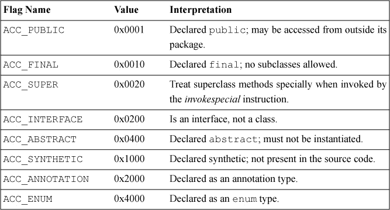

表 4.1-A. 类访问与修饰符

接口通过设置 `INTERFACE` 标志来区分。如果未设置 `INTERFACE` 标志，则该 `class` 定义了一个类。

`access_flags` 中在表 4.1-A 中分配的所有位均留作以后使用。它们在生成的 `class` 文件中应设置为零，并且 Java 虚拟机实现应忽略它们。

`SYNTHETIC` 标志表示此类是由编译器生成的，未出现在源代码中。

类或接口必须设置其 `ABSTRACT`。`ENUM` 标志表示此类是一个枚举类型。

`this_class`

`this_class` 项的值必须是 `constant_pool` 表的有效索引。该索引处的 `constant_pool` 条目必须是 `CONSTANT_Class_info`（§4.4.1），表示由该 `class` 文件定义的类或接口。

`super_class`

对于类，`super_class` 项的值要么为零，要么是 `constant_pool` 表的有效索引。如果 `super_class` 项的值不零，则该索引处的 `constant_pool` 条目必须是 `CONSTANT_Class_info` 结构，表示该 `class` 文件定义的直接父类。直接父类及其任何父类在其 `ClassFile` 结构的 `access_flags` 项中均不能设置 `FINAL` 标志。

如果 `super_class` 项的值为零，则此 `class` 文件必须表示 `Object` 类，即唯一没有直接父类的类。

对于接口，`super_class` 项的值必须是 `constant_pool` 表的有效索引。该索引处的 `constant_pool` 条目必须是 `CONSTANT_Class_info` 结构，表示 `Object` 类。

`interfaces_count`

`interfaces_count` 项的值给此类或接口类型直接父接口的数量。

`interfaces[]`

`interfaces` 数组中的每个值必须是 `constant_pool` 表的有效索引。对于 `interfaces[i]`（其中 0 ≤ *i* < `interfaces_count`），每个值对应的 `constant_pool` 条目必须是 `CONSTANT_Class_info` 结构，表示作为此类或接口类型的直接父接口，并按照源代码中该类型从左到右的顺序排列。

`fields_count`

`fields_count` 项的值表示 `fields` 表中 `field_info` 结构的数量。`field_info` 结构表示由此类或接口声明的所有字段，包括类变量和实例变量。

`fields[]`

`fields` 表中的每个值必须是一个 `field_info` 结构 (§4.5)，用于对该类或接口中的某个字段的完整描述。`fields` 表仅包含由此类或接口声明的字段。它不包含表示继承自超类或超接口的字段的项目。

`methods_count`

`methods_count` 项的值表示 `methods` 表中 `method_info` 结构的数量。

`methods[]`

`methods` 表中的每个值必须是一个 `method_info` 结构 (§4.6)，用于对该类或接口中某个方法的完整描述。如果 `method_info` 结构的 `access_flags` 项中既未设置 `ACC_NATIVE` 标记也未设置 `ACC_ABSTRACT` 标记，则还会提供实现该方法的 Java 虚拟机指令。

`method_info` 结构表示由此类或接口声明的所有方法，包括实例方法、类方法、实例初始化方法 (§2.9) 以及任何类或接口初始化方法 (§2.9)。`methods` 表不包含表示继承自超类或超接口的方法的项目。

`attributes_count`

`attributes_count` 项的值表示此类 `attributes` 表中属性的数量。

`attributes[]`

`attributes` 表的每个值必须是一个 `attribute_info` 结构 (§4.7)。

本规范定义的出现在 `ClassFile` 结构 `attributes` 表中的属性列在 表 4.7-C 中。

关于定义出现在 `ClassFile` 结构 `attributes` 表中的属性的规则见 §4.7。

关于 `ClassFile` 结构 `attributes` 表中非定义属性的规则见 §4.7.1。

## 4.2 名称的内部形式

### 4.2.1 二进制类名和接口名

出现在 `class` 文件结构中的类和接口名始终以完全限定的形式表示，称为*二进制名称*（binary names）（JLS §13.1）。此类名称始终表示为 `CONSTANT_Utf8_info` 结构 (§4.4.7)，因此在没有进一步限制的情况下，可以从整个 Unicode 代码空间提取。类和接口名引用自那些 `CONSTANT_NameAndType_info` 结构 (§4.4.6)，这些结构的描述符中包含此类名称 (§4.3)，并引用所有的 `CONSTANT_Class_info` 结构 (§4.4.1)。

出于历史原因，出现在 `class` 文件结构中的二进制名称语法与 JLS §13.1 中的二进制名称语法不同。在这种内部形式中，通常分隔组成二进制名称的标识符的 ASCII 点（`.`）被替换为 ASCII 正斜杠（`/`）。标识符本身必须是非限定名 (§4.2.2)。

例如，类 `Thread` 的普通二进制名称是 `java.lang.Thread`。在 `class` 文件格式的描述符中使用的内部形式中，对类 `Thread` 名称的引用是通过表示字符串 `java/lang/Thread` 的 `CONSTANT_Utf8_info` 结构来实现的。

### 4.2.2 未限定名

方法、字段、局部变量和形式参数的名字存储为*未限定名*（unqualified names）。未限定名必须包含至少一个 Unicode 代码点，且不能包含任何 ASCII 字符 `.;  /`（即句号、分号、左方括号或正斜杠）。

方法名受到进一步限制，除了特殊方法名 `<init>` 和 `<clinit>` (§2.9) 之外，它们不能包含 ASCII 字符 `<` 或 `>`（即左角括号或右角括号）。

注意，字段名或接口方法可以是 `<init>` 或 `<clinit>`，但没有方法调用指令可以引用 `<clinit>`，只有 `invokespecial` 指令 `invokespecial](#ch06a.html_ch06lev2sec90)` 可以引用 `<init>`。

## 4.3 描述符

*描述符*（descriptor）是表示字段或方法类型的字符串。描述符在 `class` 文件格式中使用修改后的 UTF-8 字符串表示 (§4.4.7)，因此在没有进一步限制的情况下，可以从整个 Unicode 代码空间提取。

### 4.3.1 语法符号

描述符使用语法规范。语法是一组产生式，描述了字符序列如何形成各种类型的在语法上正确的描述符。语法的终结符号以`等宽`字体显示。非终结符号以*斜体*显示。非终结符号的定义由所定义的非终结符号名称引入，后跟冒号。随后在后续行中给出该非终结符号的一个或多个可选定义。

产生式右侧的语法 `{x}` 表示 *x* 零次或多次出现。

当产生式的冒号后跟随“one of”一词时，意味着后续行或后续几行中的每个终结符号都是一个可选定义。

### 4.3.2 字段描述符

*字段描述符*（field descriptor）表示类、实例或局部变量的类型。

*FieldDescriptor:*

*FieldType*

*FieldType:*

*BaseType*

*ObjectType*

*ArrayType*

*BaseType:* one of

`B C D F I J S Z`

*ObjectType:*

`L` *ClassName* `;`

*ArrayType:*

`[` *ComponentType*

*ComponentType:*

*FieldType*

*BaseType* 的字符、`ObjectType` 的 `L` 和 `;` 以及 `ArrayType` 的 `[` 都是 ASCII 字符。

*ClassName* 表示以内部形式编码的二进制类名或接口名 (§4.2.1)。

字段描述符解释为类型的方法所示表 4.3-A。

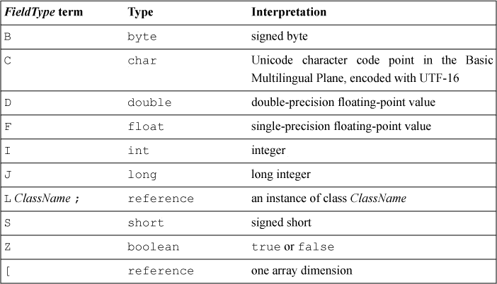

**表 4.3-A 字段描述符的解释**

`int` 类型实例变量的字段描述符简单为 `I`。

`Object` 类型实例变量的字段描述符是 `Ljava/lang/Object;`。注意使用了类 `Object` 二进制名称的内部形式。

多维数组类型 `double[] [][]` 实例变量的字段描述符是 `[[D`。

表示数组类型的字段描述符只有在它表示维度少于 255 时才有效。

### 4.3.3 方法描述符

*方法描述符*（method descriptor）包含零或多个*参数描述符*（parameter descriptors），表示方法接收的参数类型，以及一个*返回描述符*（return descriptor），表示方法返回的值（如果有）的类型。

*MethodDescriptor:*

`(` *{ParameterDescriptor}* `)` *ReturnDescriptor*

*ParameterDescriptor:*

*FieldType*

*ReturnDescriptor:*

*FieldType*

*VoidDescriptor*

*VoidDescriptor:*

`V`

字符 `V` 表示方法不返回任何值（其结果为 `void`）。

该方法的描述符：

```
Object m(int i, double d, Thread t) {...}
```

为：

```
(ILjava/lang/Double;Ljava/lang/Thread;)Ljava/lang/Object;
```


`(IDLjava/lang/Thread;)Ljava/lang/Object;`

注意使用了 `Thread` 和 `Object` 二进制名称的内部形式。

方法描述符（method descriptor）仅当它表示的方法参数总长度小于或等于 255 时才有效，该长度在实例方法或接口方法调用时包含了 `this` 的贡献。总长度通过累加各个参数的贡献来计算，其中，类型为 `long` 或 `double` 的参数对长度贡献两个单位，而任何其他类型的参数贡献一个单位。

无论该方法所描述的是类方法还是实例方法，其方法描述符都是相同的。虽然实例方法除了接收预期的参数外，还传递了 `this`（即正在调用该方法的对象的引用），但这一事实并没有反映在方法描述符中。对 `this` 的引用是由调用实例方法的 Java 虚拟机指令隐式传递的（见 §2.6.1 和 §4.11）。

## 4.4 常量池 (Constant Pool)

Java 虚拟机指令不依赖于类、接口、类实例或数组的运行时布局。相反，指令引用 `constant_pool` 表中的符号信息。

所有 `constant_pool` 表项都具有以下通用格式：

```
cp_info {
    u1 tag;
    u1 info[];
}
```

`constant_pool` 表中的每个项目必须以一个 1 字节的标记（tag）开头，指示 `cp_1` 项的类型。`info` 数组的内容随 `tag` 的值而变化。有效的标记及其值列在表 4.4-A](#ch04.html_ch04tab4-A) 中。每个标记字节后必须跟随两个或多个字节，用于提供有关特定常量的信息。额外信息的格式随 `tag` 值而变化。

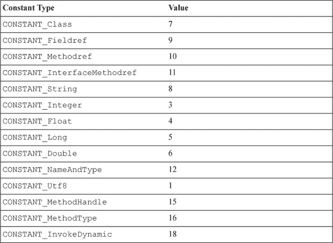

**表 4.4-A. 常量池标记**

### 4.4.1 CONSTANT_Class_info 结构

`CONSTANT_Class_info` 结构用于表示一个类或接口：

```
CONSTANT_Class_info {
    u1 tag;
    u2 name_index;
}
```

`CONSTANT_Class_info` 结构的项如下：

`tag`

`tag` 项的值为 `CONSTANT_Class` (7)。

`name_index`

`name_index` 项的值必须是 `constant_pool` 表的有效索引。该索引处的 `constant_pool` 项必须是一个 `CONSTANT_Utf8_info` 结构（见 §4.4.7），表示一个以内部形式编码的有效二进制类或接口名称（见 §4.2.1）。

由于数组是对象，操作码 `anewarray` 和 `multianewarray`——但不是操作码 `new`——可以通过 `constant_pool` 表中的 `CONSTANT_Class_info` 结构来引用数组“类”。对于此类数组类，类名就是数组类型的描述符（见 §4.3.2）。

例如，代表二维数组类型 `int[][]` 的类名是 `[[I`，而代表类型 `Thread[]` 的类名是 `Ljava/lang/Thread;`。

数组类型描述符仅当它表示 255 个或更少维度时有效。

### 4.4.2 CONSTANT_Fieldref_info, CONSTANT_Methodref_info 和 CONSTANT_InterfaceMethodref_info 结构

字段、方法和接口方法由类似的结构表示：

```
CONSTANT_Fieldref_info {
    u1 tag;
    u2 class_index;
    u2 name_and_type_index;
}

CONSTANT_Methodref_info {
    u1 tag;
    u2 class_index;
    u2 name_and_type_index;
}

CONSTANT_InterfaceMethodref_info {
    u1 tag;
    u2 class_index;
    u2 name_and_type_index;
}
```

这些结构的项如下：

`tag`

`CONSTANT_Fieldref_info` 结构的 `tag` 项的值为 `CONSTANT_Fieldref` (9)。

`CONSTANT_Methodref_info` 结构的 `tag` 项的值为 `CONSTANT_Methodref` (10)。

`CONSTANT_InterfaceMethodref_info` 结构的 `tag` 项的值为 `CONSTANT_InterfaceMethodref` (11)。

`class_index`

`class_index` 项的值必须是 `constant_pool` 表的有效索引。该索引处的 `constant_pool` 项必须是一个 `CONSTANT_Class_info` 结构（见 §4.4.1），表示一个类或接口。`CONSTANT_Methodref_info` 结构的 `class_index` 项必须是一个类类型。`CONSTANT_InterfaceMethodref_info` 结构的 `class_index` 项必须是一个接口类型。`CONSTANT_Fieldref_info` 结构的 `class_index` 项可以是类类型。

`name_and_type_index`

`name_and_type_index` 项的值必须是 `constant_pool` 表的有效索引。该索引处的 `constant_pool` 项必须是一个 `CONSTANT_Utf8_info` 结构（见 §4.4.7），表示名称和类型。

### 4.4.3 CONSTANT_String 结构

`CONSTANT_String_info` 结构用于字符串常量：

```
CONSTANT_String {
    u1 tag;
    u2 string_index;
}
```

`CONSTANT_String` 结构的项如下：

`tag`

`tag` 项的值为 `CONSTANT_String` (8)。

`string_index`

`string_index` 项的值必须是 `constant_pool` 表的有效索引。该索引处的 `constant_pool` 项必须是一个 `CONSTANT_Utf8_info` 结构（见 §4.4.7），表示要初始化 `String` 对象的序列点。

### 4.4.4 CONSTANT_Integer_info 和 CONSTANT_Float_info 结构

`CONSTANT_Integer_info` 和 `CONSTANT_Float_info` 结构表示 4 字节常量：

```
CONSTANT_Integer {
    u1 tag;
    u4 bytes;
}

CONSTANT_Float {
    u1 tag;
    u4 bytes;
}
```

这些结构的项如下：

`tag`

`CONSTANT_Integer_info` 结构的 `tag` 项的值为 `CONSTANT_Integer` (3)。

`CONSTANT_Float_info` 结构的 `tag` 项的值为 `CONSTANT_Float` (4)。

`bytes`

`CONSTANT_Integer_info` 结构的 `bytes` 项表示 `int` 常量的值。字节以大端序（高字节在前）存储。

`CONSTANT_Float_info` 结构的 `bytes` 项以 IEEE 754 浮点单精度格式表示 `float` 量。字节以大端序存储。

`CONSTANT_Float_info` 结构表示的值如下确定。首先将字节转换为 `int` 常量 *bits*。然后：

- 如果 *bits* 为 `0x7f80000`，`float` 值将为正无穷。

- 如果 *bits* 为 `0xff80000`，`float` 值将为负无穷。

- 如果 *bits* 处于 `0x7f80001` 到 `0x7fffffff` 范围内，或者 `0xff800001` 到 `0xffffffff` 范围内，`float` 值将为 NaN。

- 在所有其他情况下，令 `s`、`e` 和 `m` 为三个可能从 *bits* 计算出的值：

```
int s = ((bits >> 31) == 0) ? 1 : -1;
int e = ((bits >> 23) & 0xff);
int m = (e == 0) ?
    (bits & 0x7fffff) << 1 :
    (bits & 0x7fffff) | 0x800000;
```

那么 `float` 值等于数学表达式 `s · m · 2`^(`e-150`) 的结果。

### 4.4.5 CONSTANT_Long_info 和 CONSTANT_Double_info 结构

`CONSTANT_Long_info` 和 `CONSTANT_Double_info` 代表 8 字节的数值（`long` 和 `double`）常量：

```
CONSTANT_Long_info {
    u1 tag;
    u4 high_bytes;
    u4 low_bytes;
}

CONSTANT_Double_info {
    u1 tag;
    u4 high_bytes;
    u4 low_bytes;
}
```

所有 8 字节的常量都占用 `class` 文件中 `constant_pool` 表的两个条目。如果 `CONSTANT_Long_info` 或 `CONSTANT_Double_info` 结构是 `constant_pool` 表中索引 `n` 处的项，那么池中下一个可用的项位于索引 `n+2` 处。`constant_pool` 索引 `n+1` 必须有效，但被视为不可用。

回想起来，让 8 字节的常量占用两个常量池条目是一个糟糕的选择。

这些结构的组成项如下：

`tag`

`CONSTANT_Long_info` 结构中的 `tag` 项的值为 `CONSTANT_Long` (5)。

`CONSTANT_Double_info` 结构中的 `tag` 项的值为 `CONSTANT_Double` (6)。

`high_bytes, low_bytes`

`CONSTANT_Long_info` 结构中的无符号 `high_bytes` 和 `low_bytes` 项共同代表 `long` 常量的值。

```
((long) high_bytes << 32) + low_bytes
```

其中 `high_bytes` 和 `low_bytes` 每个项的字节都按大端序（高字节在前）顺序存储。

`CONSTANT_Double_info` 结构中的 `high_bytes` 和 `low_bytes` 项共同代表 IEEE 754 浮点双精度格式中的 `double` 值（§2.3.2）。每个项的字节按大端序（高字节在前）顺序存储。

`CONSTANT_Double_info` 结构表示的值按如下方式确定。`high_bytes` 和 `low_bytes` 项转换为 `long` 常量 `bits`，其值等于：

```
((long) high_bytes << 32) + low_bytes
```

然后：

* 如果 `bits` 为 `0x7ff0000000000000L`，则 `double` 值为正无穷。

* 如果 `bits` 为 `0xfff0000000000000L`，则 `double` 值为负无穷。

* 如果 `bits` 处于 `0x7ff0000000000001L` 到 `0x7fffffffffffffffL` 范围内，或者处于 `0xfff0000000000001L` 到 `0xffffffffffffffffL` 范围内，则 `double` 值为 NaN。

* 在所有其他情况下，令 `s`、`e` 和 `m` 为从 `bits` 可能计算出的三个值：

```
int s = ((bits >> 63) == 0) ? 1 : -1;
int e = (int)((bits >> 52) & 0x7ffL);
long m = (e == 0) ?
          (bits & 0xfffffffffffffL) << 1 :
          (bits & 0xfffffffffffffL) | 0x10000000000000L;
```

那么，浮点值等于数学表达式 `s · m · 2`^(`e-1075`)` 的 `double` 值。

### 4.4.6 CONSTANT_NameAndType_info 结构

`CONSTANT_NameAndType_info` 结构用于表示字段或方法，但不指示它属于哪个类或接口类型：

```
CONSTANT_NameAndType_info {
    u1 tag;
    u2 name_index;
    u2 descriptor_index;
}
```

`CONSTANT_NameAndType_info` 结构的组成项如下：

`tag`

`CONSTANT_NameAndType_info` 结构中的 `tag` 项的值为 `CONSTANT_NameAndType` (12)。

`name_index`

`name_index` 项的值必须是 `constant_pool` 表的有效索引。该索引处的 `constant_pool` 条目必须是一个 `CONSTANT_Utf8_info` 结构 (§4.4.7)，表示特殊方法名 `<init>` 或表示字段或方法的有效未限定名称（§4.2.2)）。

`descriptor_index`

`descriptor_index` 项的值必须是 `constant_pool` 表的有效索引。该索引处的 `constant_pool` 条目必须是一个 `CONSTANT_Utf8_info` 结构 (§4.4.7)，表示字段或方法的描述符。

### 4.4.7 CONSTANT_Utf8_info 结构

`CONSTANT_Utf8_info` 结构用于表示字符串：

```
CONSTANT_Utf8_info {
    u1 tag;
    u2 length;
    u1 bytes[];
}
```

`CONSTANT_Utf8_info` 结构的项如下：

`tag`

`CONSTANT_Utf8_info` 结构中的 `tag` 项的值为 `CONSTANT_Utf8` (1)。

`length`

`CONSTANT_Utf8_info` 结构中的 `length` 项表示 `bytes` 数组的字节数。

`bytes`

`CONSTANT_Utf8_info` 结构中的 `bytes` 数组包含字符串的内容。

这种 UTF-8 格式与标准 UTF-8 格式有两不同：首先，空字符 `(char)0` 使用 2 字节编码而非 1 字节，这样修改 UTF-8 字符串就不会包含空字符。其次，只使用标准 UTF-8 的 1 字节、2 字节和 3 字节格式。虚拟机不识别标准 UTF-8 的 4 字节格式；它使用自己的两次三次字节格式。

- 如果 `reference_kind` 项的值为 1 (`REF_getField`)、2 (`REF_getStatic`)、3 (`REF_putField`) 或 4 (`REF_putStatic`)，则该索引处的 `constant_pool` 条目必须是一个 `CONSTANT_Fieldref_info` 结构（§4.4.2)），代表用于创建方法句柄（method handle）的字段。

- 如果 `reference_kind` 项的值为 5 (`REF_invokeVirtual`) 或 8 (`REF_newInvokeSpecial`)，则该索引处的 `constant_pool` 条目必须是一个 `CONSTANT_Methodref_info` 结构（§4.4.2)），代表类的方法或构造函数（§2.9)），用于对其创建方法句柄。

- 如果 `reference_kind` 项的值为 6 (`REF_invokeStatic`) 或 7 (`REF_invokeSpecial`)，则如果 `class` 文件版本号小于 52.0，该索引处的 `constant_pool` 条目必须是一个 `CONSTANT_Methodref_info` 结构，代表用于创建方法句柄的类方法；如果 `class` 文件版本号为 52.0 或以上，则该索引处的 `constant_pool` 条目可以是 `CONSTANT_Methodref_info` 结构或 `CONSTANT_InterfaceMethodref_info` 结构（§4.4.2)），代表用于创建方法句柄的类方法或接口方法。

- 如果 `reference_kind` 项的值为 9 (`REF_invokeInterface`)，则该索引处的 `constant_pool` 条目必须是一个 `CONSTANT_InterfaceMethodref_info` 结构，代表用于创建方法句柄的接口方法。

如果 `reference_kind` 项的值为 5 (`REF_invokeVirtual`)、6 (`REF_invokeStatic`)、7 (`REF_invokeSpecial`) 或 9 (`REF_invokeInterface`)，则由 `CONSTANT_Methodref_info` 结构或 `CONSTANT_InterfaceMethodref_info` 结构所的方法名不能为 `<init>` 或 `<clinit>`。

如果该值为 8 (`REF_newInvokeSpecial`)，则由 `CONSTANT_Methodref_info` 结构所的方法名必须为 `<init>`。

#### 4.4.9 CONSTANT_MethodType_info 结构


`CONSTANT_MethodType_info` 结构用于表示一种方法类型：

```
CONSTANT_MethodType_info {
    u1 tag;
    u2 descriptor_index;
}
```

`CONSTANT_MethodType_info` 结构的各项如下：

##### `tag`

`CONSTANT_MethodType_info` 结构的 `tag` 项的值为 `CONSTANT_MethodType` (16)。

##### `descriptor_index`

`descriptor_index` 项的值必须是 `constant_pool` 表的有效索引。该索引处的 `constant_pool` 条目必须是一个 `CONSTANT_Utf8_info` 结构（§4.4.7），代表一个方法描述符（method descriptor）（§4.3.3）。

#### 4.4.10 CONSTANT_InvokeDynamic_info 结构

`CONSTANT_InvokeDynamic_info` 结构用于 `invokedynamic` 指令（§*invokedynamic）来指定引导方法（bootstrap method）、动态调用名称、调用的参数和返回类型，以及可选的一组称为*静态参数*（static arguments）的额外常量序列给引导方法。

```
CONSTANT_InvokeDynamic_info {
    u1 tag;
    u2 bootstrap_method_attr_index;
    u2 name_and_type_index;
}
```

`CONSTANT_InvokeDynamic_info` 结构的各项如下：

##### `tag`

`CONSTANT_InvokeDynamic_info` 结构的 `tag` 项的值为 `CONSTANT_InvokeDynamic` (18)。

##### `bootstrap_method_attr_index`

`bootstrap_method_attr_index` 项的值必须是该 `class` 文件引导方法表（§4.7.23）中 `bootstrap_methods` 数组的有效索引。

##### `name_and_type_index`

`name_and_type_index` 项的值必须是 `constant_pool` 表的有效索引。该索引处的 `constant_pool` 条目必须是一个 `CONSTANT_NameAndType_info` 结构（§4.4.6），代表方法名和方法描述符（§4.3.3）。

## 4.5 字段 (Fields)

每个字段由 `field_info` 结构描述。

一个 `class` 文件中不存在两个字段具有相同的名称和描述符（§4.3.2）。

该结构具有以下格式：

```
field_info {
    u2 access_flags;
    u2 name_index;
    u2 descriptor_index;
    u2 attributes_count;
    attribute_info attributes[attributes_count];
}
```

`field_info` 结构的各项如下：

##### `access_flags`

`access_flags` 项的值是用于表示访问权限的标志掩码。每个标志的解释见表 4.5。


类字段可以设置任何 `ACC_PUBLIC`、`ACC_PRIVATE`、`ACC_PROTECTED` 标志。它们可以具有 `ACC_FINAL`（JLS §8.3），但不能具有 `ACC_VOLATILE`（JLS §8.3）。

接口字段必须具有 `ACC_PUBLIC`、`ACC_STATIC` 标志。它们可以具有 `ACC_FINAL`（JLS §8.3）。

`access_flags` 中未在表 4.5 中分配的所有位均留供未来使用。在生成的文件中应置为零。

##### `name_index`

`name_index` 的值必须是 `constant_pool` 的有效索引。该索引处的 `constant_pool` 条目必须是一个 `CONSTANT_Utf8_info` 结构（§4.4.7），代表一个有效的名称（§4.2）。

##### `descriptor_index`

`descriptor_index` 的值必须是 `constant_pool` 的有效索引。该索引处的 `constant_pool` 条目必须是一个 `CONSTANT_Utf8_info` 结构（§4.4.7），代表一个有效的描述符（§4.3.3）。

##### `attributes_count`

`attributes_count` 的值指示属性的数量。

##### `attributes`

`attributes` 表的每个值必须是一个 `attribute_info` 结构。字段可以关联任意数量的可选属性。本规范定义为出现在 `field_info` 结构 `attributes` 表中的属性列于表 4.7-C。关于出现在 `field_info` 结构 `attributes` 表中的属性的规则见 §4.7。关于 `field_info` 结构 `attributes` 表中的非定义属性的规则见 §4.7.1。

`method_info` 结构的项如下：

### `access_flags`

`access_flags` 项的值是一个标志位掩码，用于表示对该方法的访问权限和属性。每个标志位在设置时的解释见表 4.6-A。

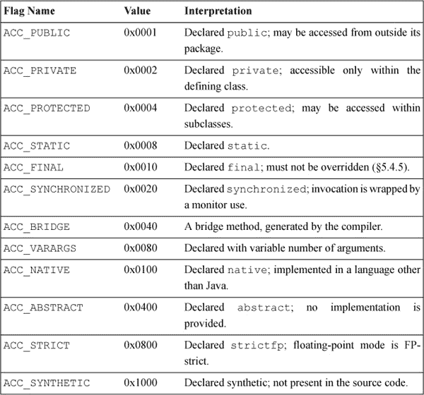

**表 4.6-A. 方法访问与属性标志位**

类的方法可以设置表 4.6-A 中的任何标志位。然而，一个类（class）中的每个方法最多可以设置 `ACC_PUBLIC`、`ACC_PRIVATE` 和 `ACC_PROTECTED` 标志中的一个（JLS §8.4.3）。

接口的方法可以设置表 4.6-A 中的任何标志位，但 `ACC_PROTECTED`、`ACC_FINAL`、`ACC_SYNCHRONIZED` 和 `ACC_NATIVE` 除外（JLS §9.4）。在版本号小于 52.0 的 `class` 文件中，接口的每个方法必须设置 `ACC_PUBLIC` 和 `ACC_ABSTRACT` 标志；在版本号为 52.0 或以上的 `class` 文件中，接口的每个方法必须设置 `ACC_PUBLIC` 和 `ACC_PRIVATE` 标志中的其中一个。

如果类或接口的方法设置了 `ACC_ABSTRACT` 标志，则不能设置 `ACC_PRIVATE`、`ACC_STATIC`、`ACC_FINAL`、`ACC_SYNCHRONIZED`、`ACC_NATIVE` 或 `ACC_STRICT` 中的任何一个标志。

每个实例初始化方法（§2.9）最多设置 `ACC_PUBLIC`、`ACC_PRIVATE` 和 `ACC_PROTECTED` 标志中的其中一个，也可以设置 `ACC_VARARGS`、`ACC_STRICT` 和 `ACC_SYNTHETIC` 标志，但不能设置表 4.6-A 中的任何其他标志。

类和接口的初始化方法由 Java 虚拟机隐式调用。它们的 `access_flags` 项的值除了设置 `ACC_STRICT` 标志外，均被忽略。

`ACC_BRIDGE` 标志用于指示由 Java 编程语言编译器生成的桥接方法（bridge method）。

`ACC_VARARGS` 标志表示该方法在源代码级别接受可变数量参数。声明为接受可变参数的方法必须在 `ACC_VARARGS` 标志设置为 1 的情况下编译。所有其他方法必须在 `ACC_VARARGS` 标志设置为 0 的情况下编译。

`ACC_SYNTHETIC` 标志表示该方法是由编译器生成的，且未出现在源码中，除非它是 §4.7.8 中列出的方法之一。

表 4.6-A 中未分配的 `access_flags` 项的所有位均预留供以后使用。它们在生成的 `class` 文件中应被设置为 0，并被 Java 虚拟机实现所忽略。

### `name_index`

`name_index` 项的值必须是 `constant_pool` 表的有效索引。该索引处的 `constant_pool` 必须是一个 `CONSTANT_Utf8_info` 结构（§4.4.7），表示特殊方法名 `<init>` 或 `<clinit>`（§2.9）之一，或者是一个表示方法的有效未限定名称（§4.2.2）。

### `descriptor_index`

`descriptor_index` 项的值必须是 `constant_pool` 表的有效索引。该索引处的 `constant_pool` 条目必须是一个 `CONSTANT_Utf8_info` 结构，表示有效的方法描述符（§4.3.3）。

本规范的未来版本可能要求，如果 `access_flags` 项中设置了 `ACC_VARARGS` 标志，则方法描述符的最后一个参数描述符必须是数组类型。

### `attributes_count`

`attributes_count` 项的值表示该方法的额外属性的数量。

### `attributes[]`

`attributes` 表中的每个值都必须是一个 `attribute_info` 结构（§4.7）。

方法可以关联任意数量的可选属性。

本规范定义的、且出现在 `method_info` 结构 `attributes` 表中的属性，列在表 4.7-C 中。

关于出现在 `method_info` 结构 `attributes` 表中的属性的规则见 §4.7。

关于 `method_info` 结构 `attributes` 表中非预定义属性的规则见 §4.7。

版本 `V` 的 `class` 文件中的这些属性每一个都必须被实现类识别并正确读取——即 Java SE 平台类库的实现，前提是该实现类识别版本为 `V` 的 `class` 文件，且 `V` 至少是该属性首次定义的版本，并且该属性出现在其定义允许出现的位置。

### 3. 以下六个属性对于 Java 虚拟机或 Java SE 平台类库正确解释 `class` 文件并非至关重要，但对于工具来说是很有用的：

* `SourceFile`

* `SourceDebugExtension`

* `LineNumberTable`

* `LocalVariableTable`

* `LocalVariableTypeTable`

* `Deprecated`

Java 虚拟机或 Java SE 平台类库的实现类对这些属性的使用是可选的。实现类可以使用这些属性所包含的信息，否则必须静默地忽略这些属性。

### 4.7.1 定义和命名新属性

编译器允许在 `class` 文件结构中的 `attributes` 表、`field_info` 结构、`method_info` 结构以及 `Code` 属性（§4.7.3）中定义并发布包含新属性的 `class` 文件。Java 虚拟机实现允许识别并使用这些 `attributes` 表中的新属性。然而，任何未定义为 `class` 文件规范部分的属性都不得影响 `class` 文件的语义。Java 虚拟机实现要求静默忽略其不识别的属性。

例如，允许定义新属性以支持特定厂商的调试。由于 Java 虚拟机实现要求忽略其不识别的属性，为该特定 Java 虚拟机实现设计的 `class` 文件可以被其他实现类使用，即使这些实现类无法利用 `class` 文件包含的额外调试信息。

明确禁止 Java 虚拟机实现因为存在某些新属性而抛出异常或拒绝使用 `class` 文件。当然，操作 `class` 文件的工具如果收到不包含其所需所有属性的 `class` 文件，可能无法正常运行。

两个本应不同但恰好使用相同属性名称且长度相同的属性将在识别其中任一属性的实现类上发生冲突。除本规范之外定义的属性，其名称必须根据*Java 语言规范，Java SE 8 版》（JLS §6.1）中描述的包命名规范进行选择。

本规范的未来版本可能会定义额外的属性。

### 4.7.2 ConstantValue 属性

`ConstantValue` 属性是 `field_info` 结构 `attributes` 表中的固定长度属性（§4.5）。`ConstantValue` 属性表示常量表达式的值（JLS §15.28），其使用方式如下：

* 如果 `field_info` 结构 `access_flags` 项中的 `ACC_STATIC` 标志被设置，则 `field_info` 结构表示的字段在声明该字段的类或接口的初始化过程中，被赋值为其 `ConstantValue` 属性所表示的值（§5.5）。这发生在该类或接口的类或接口初始化方法调用之前（§2.9）。

* 否则，Java 虚拟机必须静默地忽略该属性。

`field_info` 结构的 `attributes` 表中最多可以有一个 `ConstantValue` 属性。

`ConstantValue` 属性具有以下格式：

```
ConstantValue_attribute {
    u2 attribute_name_index;
    u4 attribute_length;
    u2 constantvalue_index;
}
```

`ConstantValue_attribute` 结构的项如下：

`attribute_name_index`

`attribute_name_index` 项的值必须是指向 `constant_pool` 表的有效索引。`constant_pool` 在该索引处的项必须是一个 `CONSTANT_Utf8_info` 结构（§4.4.7），表示字符串“`ConstantValue`”。

`attribute_length`

`ConstantValue_attribute` 结构中 `attribute_length` 项的值必须为 2。

`constantvalue_index`

`constantvalue_index` 项的值必须是指向 `constant_pool` 表的有效索引。`constant_pool` 在该索引处的项给出该属性表示的常量值。`constant_pool` 项的类型必须与字段类型匹配，参见表 4.7.2-A (#ch04.html_ch04tab7_2-A)。

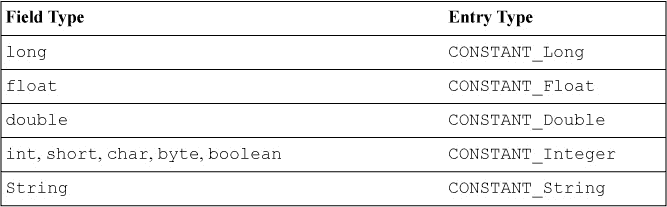

**表 4.7.2-A. 常量值属性类型**

### 4.7.3 Code 属性

`Code` 属性是 `method_info` 结构 `attributes` 表中的变长度属性（§4.6）。`Code` 属性包含方法的 Java 虚拟机指令和辅助信息，包括实例化初始化方法或类或接口初始化方法（§2.9）。

如果方法是 `native` 或 `abstract`，则其 `method_info` 结构不得有 `Code` 属性。否则，其 `method_info` 结构必须有一个 `Code` 属性。

`Code` 属性具有以下格式：

```
Code_attribute {
    u2 attribute_name_index;
    u4 attribute_length;
    u2 max_stack;
    u2 max_locals;
    u4 code_length;
    code[code_length];
    u2 exception_table_length;
    {
        u2 start_pc;
        u2 end_pc;
        u2 handler_pc;
        u2 catch_type;
    }[exception_table_length];
    u2 attributes_count;
    attribute[attributes_count];
}
```

`Code` 结构的项如下：

`attribute_name_index`

`attribute_name_index` 项的值必须是指向 `constant_pool` 表的有效索引。`constant_pool` 在该索引处的项必须是一个 `CONSTANT_Utf8_info` 结构（§4.4.7），表示字符串“`Code`”。

`attribute_length`

`Code_attribute` 结构中 `attribute_length` 项的值表示属性的长度，但不包括初始六字节。

`max_stack`

`max_stack` 项的值给出该方法执行期间任何时刻操作栈的最大深度（§2.6.2）。

`max_locals`

`max_locals` 项的值给出调用方法时分配的局部变量数组的数量（§2.6.1），包括用于传递参数的局部变量。

`long` 或 `double` 类型的最大局部变量索引为 `max_locals - 2`。任何其他类型的最大局部变量索引为 `max_locals - 1`。

`code_length`

`code_length` 项的值给出方法 `code` 数组的字节数。`code_length` 的值必须大于 0 小于 65536。

`code[]`

`code` 数组提供了实现方法的实际字节码。当 `code` 数组在字节寻址机器上读取到内存时，如果数组的首字节对齐在 4 字节边界，*tableswitch* 和 *lookupswitch* 的 32 位偏移量将 4 字节对齐。（参见这些指令的描述获取更多有关 `code` 数组对齐的影响。）

`code` 数组内容的详细约束非常详尽，将在单独的章节给出（§4.9）。

`exception_table_length`

`exception_table_length` 项的值表示 `exception_table` 表中的项数。

`exception_table[]`


`exception_table` 数组中的每个项描述了 `code` 数组中的一个异常处理器。`exception_table` 数组中处理器的顺序具有重要意义（§2.10）。

每个 `exception_table` 条目包含以下四个项：

### `start_pc, end_pc`

`start_pc` 和 `end_pc` 这两个项的值表示异常处理器在 `code` 数组中有效的范围。`start_pc` 的值必须是 `code` 数组中某个指令操作码的有效索引。`end_pc` 的值必须是 `code` 数组中某个指令操作码的有效索引，或者必须等于 `code_length`（`code` 数组的长度）。`start_pc` 的值必须小于 `end_pc` 的值。

`start_pc` 是包含的，而 `end_pc` 是排他的；也就是说，当程序计数器处于区间 `[start_pc, end_pc)` 内时，异常处理器必须处于激活状态。

`end_pc` 排他的事实是 Java 虚拟机设计中的一个历史错误：如果一个方法的 Java 虚拟机代码恰好为 65535 字节长，并以一条 1 字节长的指令结束，那么该指令无法被异常处理器保护。编译器编写者可以通过限制任何方法、实例初始化方法或静态初始化器生成的 Java 虚拟机代码（即任何 `code` 数组的尺寸）的最大尺寸为 65534 字节来绕过这个 bug。

### `handler_pc`

`handler_pc` 项的值表示异常处理器的起始位置。该项的值必须是 `code` 数组的有效索引，并且必须是某个指令操作码的索引。

### `catch_type`

如果 `catch_type` 项的值非零，它必须是 `constant_pool` 表的有效索引。该索引处的 `constant_pool` 条目必须是一个 `CONSTANT_Class_info` 结构（§4.4.1），表示该异常处理器指定用于捕获的异常类。只有当抛出的异常是给定类的实例或其子类的实例时，才会调用异常处理器。

验证器会检查该类是否为 `Throwable` 或 `Throwable` 的子类（§4.9.2）。

如果 `catch_type` 项的值为零，则所有异常都会调用此异常处理器。

这用于实现 `finally`（§3.13）。

### `attributes_count`

`attributes_count` 项的值表示 `Code` 属性的属性数量。

### `attributes[]`

`attributes` 表中的每个值必须是一个 `attribute_info` 结构（§4.7）。

`Code` 属性可以关联任意数量的可选属性。

本规范定义为出现在 `Code` 属性的 `attributes` 表中的属性列在表 4.7-C 中。

关于出现在 `Code` 属性的 `attributes` 表中的属性定义的规则见 §4.7。

关于 `Code` 属性的 `attributes` 表中非预定义属性的规则见 §4.7.1。

#### 4.7.4 StackMapTable 属性

`StackMapTable` 属性是 `Code` 属性 `attributes` 表中的一个变长度属性（§4.7.3）。

```
StackMapTable_attribute {
    u2          attribute_name_index;
    u4          length;
    u2          number_of_entries;
    stack_map_frame entries[number_of_entries];
}
```

`StackMapTable_attribute` 的项如下：

### `attribute_name_index`

`attribute_name_index` 项的值必须是 `constant_pool` 表的有效索引。该索引处的 `constant_pool` 条目必须是一个 `CONSTANT_Utf_info` 结构（§4.4.1），表示字符串 "StackMapTable"。

### `length`

`length` 项的值表示属性的长度，不包括 `attribute_name_index` 和 `length` 项。

### `number_of_entries`

`number_of_entries` 项的值给出 `entries` 表中 `stack_map_frame` 项的数量。

### `entries[]`

`entries` 表中的每个项描述一个栈映射帧（stack map frame）。`entries` 表中栈映射帧的顺序具有重要意义。

在版本号为 50.0 或以上的 `class` 文件中，如果一个方法的 `Code` 属性没有 `StackMapTable` 属性，则它有一个*隐式栈映射属性*（§4.10.1）。

`verification_type` 指定一个或两个位置的类型，其中*位置*（location）可以是单个局部变量或单个操作栈条目。验证类型由判别联合体 `verification_type_info` 表示，它由一个字节标签组成，用于指示联合体使用的是哪项，随后是零或多个字节，提供关于标签的更多信息。

```
union verification_type_info {
    Top_variable_info;
    Integer_variable_info;
    Float_variable_info;
    Long_variable_info;
    Double_variable_info;
    Null_variable_info;
    UninitializedThis_variable_info;
    Object_variable_info;
    Uninitialized_variable_info;
}
```

指定局部变量数组或操作栈中单个位置的验证类型由 `verification_type_info` 联合体的以下项表示：

- `Top_variable_info` 项表示该局部变量验证类型为 `top`。

```
Top_variable_info {
    u1 tag = ITEM_Top; /* 0 */
}
```

- `Integer_variable_info` 项表示该位置具有验证类型 `int`。

```
Integer_variable_info {
    u1 tag = ITEM_Integer; /* 1 */
}
```

- `Float_variable_info` 项表示该位置具有验证类型 `float`。

```
Float_variable_info {
    u1 tag = ITEM_Float; /* 2 */
}
```

- `Null_variable_info` 类型表示该位置具有验证类型 `null`。

```
Null_variable_info {
    u1 tag = ITEM_Null; /* 5 */
}
```

- `UninitializedThis_variable_info` 项表示该位置具有验证类型 `uninitializedThis`。

```
UninitializedThis_variable_info {
    u1 tag = ITEM_UninitializedThis; /* 6 */
}
```

- `Object_variable_info` 项表示该位置具有验证类型，该类型是 `constant_pool` 表中由 `cpool_index` 指定的 `CONSTANT_Class_info` 结构（§4.4.1）所表示的类。

```
Object_variable_info {
    u1 tag = ITEM_Object; /* 7 */
    u2 cpool_index;
}
```

- `Uninitialized_variable_info` 项表示该位置具有验证类型 `uninitialized(Offset)`。`Offset` 项表示包含此 `StackMapTable` 属性的 `Code` 属性的 `code` 数组中创建存储在该位置的对象的 `new` 指令的偏移量。

```
Uninitialized_variable_info {
    u1 tag = ITEM_Uninitialized /* 8 */
    u2 offset;
}
```

指定局部变量数组或操作数栈中两个位置的验证类型由 `verification_type_info` 联合体的以下项表示：

- `Long_variable_info` 项表示两个位置中的第一个具有验证类型 `long`。

```
Long_variable_info {
    u1 tag = ITEM_Long; /* 4 */
}
```

- `Double_variable_info` 项表示两个位置中的第一个具有验证类型 `double`。

```
Double_variable_info {
    u1 tag = ITEM_Double; /* 3 */
}
```

- `Long_variable_info` 和 `Double_variable_info` 项按如下方式表示两个位置中的第二个的验证类型：

    - 如果两个位置中的第一个是局部变量，则：

        - 它不能是索引最大的局部变量。

        - 索引较大的下一个局部变量具有验证类型 `top`。

    - 如果两个位置中的第一个是操作数栈条目，则：

        - 它不能是操作数栈的栈顶位置。

        - 靠近操作数栈顶的下一个位置具有验证类型 `top`。

栈帧（stack map frame）由一个判别联合体 `stack_map_frame` 表示，它由一个字节的标签（tag）组成，表示正在使用哪个项，随后是零或多个字节，提供有关该标签的更多信息。

```
union stack_map_frame {
    same_frame;
    same_locals_1_stack_item_frame;
    same_locals_1_stack_item_frame_extended;
    chop_frame;
    same_frame_extended;
    append_frame;
    full_frame;
}
```

标签指示栈映射帧的 `frame type`（帧类型）：

- `same_frame` 帧类型由范围 [0-63] 中的标签表示。此帧类型表示该帧与上一个帧具有完全相同的局部变量，且操作数栈为空。帧的 `offset_delta` 值为标签项 `frame_type` 的值。

```
same_frame {
    u1 frame_type = SAME; /* 0-63 */
}
```

- `same_locals_1_stack_item_frame` 帧类型由范围 [64, 127] 中的标签表示。此帧类型表示该帧与上一个帧具有完全相同的局部变量，且操作数栈有一个条目。帧的 `offset_delta` 值由公式 `frame_type - 64` 给出。

```
same_locals_1_stack_item_frame {
    u1 frame_type = SAME_LOCALS_1_STACK_ITEM; /* 64 */
}
```

- 范围 [128-246] 的标签留供后用。

- `same_locals_1_stack_item_frame_extended` 帧类型由标签 247 表示。此帧类型表示该帧与上一个帧具有相同的局部变量，且操作数栈有一个条目。帧的 `offset_delta` 值显式给出。

```
same_locals_1_stack_item_frame_extended {
    u1 frame_type = SAME_LOCALS_1_STACK_ITEM_EXTENDED; /* 247 */
    u2 offset_delta;
}
```

- `chop_frame` 帧类型由范围 [248-250] 中的标签表示。此帧类型表示该帧与上一个帧具有相同的局部变量，但缺少了 `k` 个局部变量，且操作数栈为空。`k` 的值由公式 `251 - frame_type` 给出。

```
chop_frame {
    u1 frame_type = CHOP; /* 248-250 */
    u2 offset_delta;
}
```

- `same_frame_extended` 帧类型由标签 251 表示。此帧类型表示该帧与上一个帧具有完全相同的局部变量，且操作数栈为空。帧的 `offset_delta` 值显式给出。

```
same_frame_extended {
    u1 frame_type = SAME_FRAME_EXTENDED; /* 251 */
    u2 offset_delta;
}
```

- `append_frame` 帧类型由范围 [252-254] 中的标签表示。此帧类型表示该帧与上一个帧具有相同的局部变量，但增加了 `k` 个局部变量，且操作数栈为空。`k` 的值由公式 `frame_type - 252` 给出。

```
append_frame {
    u1 frame_type = APPEND; /* 252-254 */
    u2 offset_delta;
    verification_type_info locals[frame_type - 252];
}
```

`locals` 的第 0 项表示第一个局部变量的验证类型。如果 `locals[M]` 表示局部变量 `N`，则：

- 如果 `locals[M]` 是 `Top_variable_info`、`Integer_variable_info`、`Float_variable_info`、`Null_variable_info`、`UninitializedThis_variable_info`、`Object_variable_info` 或 `Uninitialized_variable_info` 之一，则 `locals[M+1]` 表示局部变量 `N+1`；

- 如果 `locals[M]` 为 `Long_variable_info` 或 `Double_variable_info`，则 `locals[M+1]` 表示局部变量 `N+2`。

如果对于任何索引 `i`，`locals[i]` 表示的局部变量索引大于方法的局部变量数量，则出错。

- `full_frame` 帧类型由标签 255 表示。帧的 `offset_delta` 值显式给出。

```
full_frame {
    u1 frame_type = FULL_FRAME; /* 255 */
    u2 offset_delta;
    u2 number_of_locals;
    verification_type_info locals[number_of_locals];
    u2 number_of_stack_items;
    verification_type_info stack[number_of_stack_items];
}
```

`locals` 中的第 0 个条目代表局部变量 0 的验证类型。如果 `locals[M]` 代表局部变量 `N`，则：

- 如果 `locals[M]` 是 `Top_variable_info`、`Integer_variable_info`、`Float_variable_info`、`Null_variable_info`、`UninitializedThis_variable_info`、`Object_variable_info` 或 `Uninitialized_variable_info` 之一，则 `locals[M+1]` 代表局部变量 `N+1`；

- 如果 `locals[M]` 是 `Long_variable_info` 或 `Double_variable_info` 之一，则 `locals[M+1]` 代表局部变量 `N+2`。

如果对于任何索引 `i`，`locals[i]` 代表的局部变量索引大于了该方法局部变量的最大数量，则是一个错误。

`stack` 中的第 0 个条目代表操作栈底部的验证类型，`stack` 中的后续条目代表更靠近操作栈顶部的栈条目的验证类型。我们将操作栈底部称为栈条目 0，将操作栈的后续条目称为栈条目 1、2 等。如果 `stack[M]` 代表栈条目 `N`，则：

- 如果 `stack[M]` 是 `Top_variable_info`、`Integer_variable_info`、`Float_variable_info`、`Null_variable_info`、`UninitializedThis_variable_info`、`Object_variable_info` 或 `Uninitialized_variable_info` 之一，则 `stack[M+1]` 代表栈条目 `N+1`；

- 如果 `stack[M]` 是 `Long_variable_info` 或 `Double_variable_info` 之一，则 `stack[M+1]` 代表栈条目 `N+2`。

如果对于任何索引 `i`，`stack[i]` 代表的栈条目索引大于该方法操作栈的最大深度，则是一个错误。

### 4.7.5 异常属性 (Exceptions)


`Exceptions` 属性是 `method_info` 结构中 `attributes` 表中的一个变长属性（§4.6）。`Exceptions` 属性指示该方法可能抛出的受检异常。

一个 `method_info` 结构的 `attributes` 表中最多有一个 `Exceptions` 属性。

`Exceptions` 属性具有以下格式：

```java
Exceptions_attribute {
    u2 attribute_name_index;
    u4 attribute_length;
    u2 number_of_exceptions;
    u2 exception_index_table[number_of_exceptions];
}
```

`Exceptions_attribute` 结构的各个项如下：

`attribute_name_index`

`attribute_name_index` 项的值必须是 `constant_pool` 表的有效索引。该索引处的 `constant_pool` 条目必须是表示字符串“Exceptions”的 `CONSTANT_Utf8_info` 结构（§4.4.7）。

`attribute_length`

`attribute_length` 项的值表示属性的长度，不包括初始的六字节。

`number_of_exceptions`

`number_of_exceptions` 项的值表示 `exception_index_table` 中的条目数量。

`exception_index_table[]`

`exception_index_table` 数组中的每个值必须是 `constant_pool` 表的有效索引。该索引处的 `constant_pool` 条目必须是一个 `CONSTANT_Class_info` 结构（§4.4.1），表示该方法声明要抛出的类类型。

方法只有在满足以下三个标准之一时才应该抛出异常：

- 异常是 `RuntimeException` 或其任一子类的实例。
- 异常是 `Error` 或其任一子类的实例。
- 异常是 `exception_index_table` 中指定的异常类之一的实例，或其子类的实例。

这些要求在 Java 虚拟机中并不强制；它们仅在编译时强制。

## 4.7.6 内部类属性 (InnerClasses)

`InnerClasses` 属性是 `ClassFile` 结构中 `attributes` 表中的一个变长属性（§4.1）。

如果类或接口 C 的常量池包含至少一个 `CONSTANT_Class_info` 条目（§4.4.1），该条目表示一个不是包成员的类或接口，那么在 C 的 `ClassFile` 结构的 `attributes` 表中必须有一个 `InnerClasses` 属性。

`InnerClasses` 属性具有以下格式：

```java
InnerClasses_attribute {
    u2 attribute_name_index;
    u4 attribute_length;
    u2 number_of_classes;
    {
        u2 inner_class_index;
        u2 outer_class_info_index;
        u2 inner_name_index;
        u2 inner_class_flags;
    } classes[number_of_classes];
}
```

`InnerClasses_attribute` 结构的各个项如下：

`attribute_name_index`

`attribute_name_index` 项的值必须是 `constant_pool` 表的有效索引。该索引处的 `constant_pool` 条目必须是表示字符串“InnerClasses”的 `CONSTANT_Utf8_info` 结构。

`attribute_length`

`attribute_length` 项的值表示属性的长度，不包括初始的六字节。

`number_of_classes`

`number_of_classes` 项的值表示 `classes` 数组中的条目数量。

`classes[]`

`constant_pool` 表中每个不是包成员的类或接口的 `CONSTANT_Class_info` 条目在 `classes` 数组中必须有一个。如果类或接口具有类或接口成员，其 `constant_pool` 表（因此其 `InnerClasses` 属性）必须引用此类成员（JLS §13.1）。此外，每个嵌套类和接口的 `constant_pool` 表必须引用其外部类，因此每个嵌套类和嵌套接口都有 `InnerClasses` 信息。

`classes` 数组中的每个项包含以下内容：

`inner_class_index`

`inner_class_index` 项的值必须是 `constant_pool` 表的有效索引。该索引处的 `constant_pool` 条目代表 C。`classes` 条目中的剩余项提供了关于 C 的信息。

`outer_class_info_index`

如果 C 不是类或接口的成员（即 C 是顶层类或接口（JLS §7.6）、局部类（JLS §14.3）或匿名类（JLS §15.9.5）），则 `outer_class_info_index` 项的值为零。否则，`outer_class_info_index` 项的值必须是 `constant_pool` 表的有效索引，该索引处的条目必须是 C 成员的类或接口的 `CONSTANT_Class_info` 结构。

`inner_name_index`

如果 C 是匿名的（JLS §15.9.5），则 `inner_name_index` 项的值为零。否则，`inner_name_index` 项的值必须是 `constant_pool` 表的有效索引，该索引处的条目必须是 `CONSTANT_Utf8_info` 结构，表示根据编译该 `class` 文件的源代码给 C 的原始简单名。

`inner_class_access_flags`

`inner_class_access_flags` 项的值是一个标志掩码，用于表示编译该 `class` 文件的源代码中声明的类或接口的访问权限和属性。它被编译器用于源代码不可用时恢复原始信息。这些标志见表 4.7.6-A。

**表 4.7.6-A. 嵌套类访问和属性标志**

`inner_class_access_flags` 项中未在 Table 4.7.6-A 中分配的所有位均预留供备后使用。它们在生成的 `class` 文件中应设置为零，并应被 Java 虚拟机实现所忽略。

如果 `class` 文件的版本号为 51.0 或以上，且其 `attributes` 表中包含 `InnerClasses` 属性，那么对于 `InnerClasses` 属性中 `classes` 数组的所有条目，如果 `inner_name_index` 项的值为 0，则 `outer_class_info_index` 项的值必须为 0。

Oracle 的 Java 虚拟机实现不会检查 `InnerClasses` 属性与该属性引用的类或接口的 `class` 文件之间的一致性。

## 4.7.7 EnclosingMethod 属性

`EnclosingMethod` 属性是 `ClassFile` 结构 `attributes` 表中的一个固定长度属性（§4.1）。一个类当且仅当它代表一个本地类或匿名类时，必须有一个 `EnclosingMethod` 属性（JLS §14.3, JLS §15.9.5）。

`ClassFile` 结构的 `attributes` 表中最多有一个 `EnclosingMethod` 属性。

`EnclosingMethod` 属性具有以下格式：

```
EnclosingMethod_attribute {
    u2 attribute_name_index;
    u4 attribute_length;
    u2 class_index;
    u2 method_index;
}
```

`EnclosingMethod_attribute` 结构的各个项如下：

`attribute_name_index`

`attribute_name_index` 项的值必须是指向 `constant_pool` 表的有效索引。该索引处的 `constant_pool` 条目必须是一个 `CONSTANT_Utf8_info` 结构（§4.4.7），表示字符串“`EnclosingMethod`”。

`attribute_length`

`attribute_length` 项的值必须为 4。

`class_index`

`class_index` 项的值必须是指向 `constant_pool` 表的有效索引。该索引处的 `constant_pool` 条目必须是一个 `CONSTANT_Class_info` 结构（§4.4.1），表示闭合当前类声明的最内层类。

`method_index`

如果当前类没有直接被方法或构造方法包围，则 `method_index` 项的值必须为 0。

特别是，如果当前类在源代码中被实例初始化器、静态初始化器、实例变量初始化器或类变量初始化器直接包围，则 `method_index` 必须为 0。（前者均涉及本地类和匿名类，而后两者涉及在字段赋值右侧声明的匿名类。）

否则，`method_index` 项的值必须是指向 `constant_pool` 表的有效索引。该索引处的 `constant_pool` 条目必须是一个 `CONSTANT_NameAndType_info` 结构（§4.4.6），表示由上述 `class_index` 属性引用的类中方法的名称和类型。

Java 编译器的责任是确保通过 `method_index` 标识的方法确实是包含该 `EnclosingMethod` 属性的类的词法最近的包围方法。

## 4.7.8 Synthetic 属性

`Synthetic` 属性是 `ClassFile`、`field_info` 或 `method_info` 结构 `attributes` 表中的一个固定长度属性（§4.1，§4.5，§4.6）。未出现在源代码中的类成员必须使用 `Synthetic` 属性标记，否则必须设置其 `ACC_SYNTHETIC` 标志位。该要求的唯一例外是编译器生成的、不被视为实现产物的方法，即代表 Java 语言默认构造函数的实例初始化方法（§2.9）、类初始化方法（§2.9）以及 `Enum.values()` 和 `Enum.valueOf()` 方法。

`Synthetic` 属性在 JDK 1.1 中引入，以支持嵌套类和接口。

`Synthetic` 属性具有以下格式：

```
Synthetic_attribute {
    u2 attribute_name_index;
    u4 attribute_length;
}
```

`Synthetic_attribute` 结构的各个项如下：

`attribute_name_index`

`attribute_name_index` 项的值必须是指向 `constant_pool` 表的有效索引。该索引处的 `constant_pool` 条目必须是一个 `CONSTANT_Utf8_info` 结构（§4.4.7），表示字符串“`Synthetic`”。

`attribute_length`

`attribute_length` 项的值必须为 0。

## 4.7.9 Signature 属性

`Signature` 属性是 `ClassFile`、`field_info` 或 `method_info` 结构 `attributes` 表中的固定长度属性（§4.1，§4.5，§4.6）。`Signature` 属性记录了在 Java 语言中使用类型变量或泛型类型的类、接口、构造方法或字段的签名。关于这些类型的细节，请参阅《Java 语言规范 Java SE 版》。

`Signature` 属性具有以下格式：

```
Signature_attribute {
    u2 attribute_name_index;
    u4 attribute_length;
    u2 signature_index;
}
```

`Signature_attribute` 结构的各个项如下：

`attribute_name_index`

`attribute_name_index` 项的值必须是指向 `constant_pool` 表的有效索引。该索引处的 `constant_pool` 条目必须是一个 `CONSTANT_Utf8_info` 结构（§4.4.7），表示字符串“`Signature`”。

`attribute_length`

`Signature_attribute` 结构的 `attribute_length` 项的值必须为 2。

`signature_index`

`signature_index` 项的值必须是指向 `constant_pool` 表的有效索引。该索引处的 `constant_pool` 条目必须是一个 `CONSTANT_Utf8_info` 结构（§4.4.7），当该 `Signature` 属性是 `ClassFile` 结构的属性时，表示类签名；当该 `Signature` 属性是 `method_info` 属性时，表示方法签名；否则表示字段签名。

Oracle 的 Java 虚拟机实现不会在类加载或链接期间检查 `Signature` 属性的正确性。相反，`Signature` 属性由 Java 平台类库中暴露泛型签名的方法进行检查。例如 `Class` 中的 `getGenericSuperclass` 和 `java.lang.reflect.Executable` 中的 `toGenericString`。

### 4.7.9.1 签名 (Signatures)

*签名* 编码了在虚拟机类型系统之外使用的 Java 语言声明。它们支持反射和调试，以及在仅有 `class` 文件时的编译。

Java 编译器必须为任何使用类型变量或泛型类型的类、接口、构造方法、方法或字段发射签名。具体来说，Java 编译器必须发射：

- 对于任何泛型的、或以泛型类型作为父类或父接口（或两者具有）的类或接口声明，发射类签名。
- 对于任何泛型的、或以类型变量或泛型类型作为返回类型或形式参数类型、或在 `throws` 子句中使用类型变量的方法或构造方法声明，发射方法签名。

如果方法或构造方法的 `throws` 子句不涉及类型变量，则编译器在发射方法签名时可以将该声明视为没有 `throws` 子句。

- 任何字段、形式参数或局部变量声明的字段签名，其类型使用了类型变量或参数化类型。

签名使用遵循 §4.3.1 中表示法的语法进行指定。除了该表示法外：

- 产生式右侧的语法 `[x]` 表示 `x` 出现零次或一次。也就是说，`x` 是一个`可选符号`。包含该可选符号的备选方案实际上定义了两个备选：一个是省略该可选符号的，另一个是包含该符号的。
- 非常长的右侧内容可以通过对第二行进行明显的缩进来延续到第二行。

该语法包含终结符号 `Identifier`，用于表示类型、字段、方法、形式参数、局部变量或类型变量的名称，这些名称由 Java 编译器生成。此类名称不得包含任何任意 ASCII 字符 `. ;  / < > :`（即方法名中禁止的字符 (§4.2.2) 以及冒号），但可以包含 Java 编程语言标识符中不能出现的字符 (JLS §3.8)。

签名依赖于称为 `type signatures` 的非终结符层级结构：

- `Java 类型签名` 代表 Java 编程语言的引用类型或原始类型。

`JavaTypeSignature:`

  `ReferenceTypeSignature`

  `BaseType`

以下是 §4.3.2 中的产生式，为了方便起见在此重复：

`BaseType:` 如下之一：

  `B C D F I J S Z`

- `引用类型签名` 代表 Java 编程语言的引用类型，即类类型或接口类型、类型变量或数组类型。

`类类型签名` 代表一个（可能是参数化的）类或接口类型。类类型签名的构造必须确保其能够通过擦除任何类型参数并将每个 `.` 字符转换为 `$` 字符，可靠地映射到它所指代的类的二进制名。

`类型变量签名` 代表一个类型变量。

`数组类型签名` 代表数组类型的一维。

`ReferenceTypeSignature:`

  `ClassTypeSignature`

  `TypeVariableSignature`

  `ArrayTypeSignature`

`ClassTypeSignature:`

  `L` `[PackageSpecifier]`

    `SimpleClassTypeSignature {ClassTypeSignatureSuffix} ;`

`PackageSpecifier:`

  `Identifier / {PackageSpecifier}`

`SimpleClassTypeSignature:`

  `Identifier [TypeArguments]`

`TypeArguments:`

  `< TypeArgument {TypeArgument} >`

`TypeArgument:`

  `[WildcardIndicator] ReferenceTypeSignature`

  `*`

`WildcardIndicator:`

  `+`

  `-`

`ClassTypeSignatureSuffix:`

  `.SimpleClassTypeSignature`

`TypeVariableSignature:`

  `T` `Identifier ;`

`ArrayTypeSignature:`


`[` `JavaTypeSignature*`

`类签名` 编码了关于（可能是泛型的）类声明的类型信息。它描述了类的任何类型参数，并列出了它的（可能是参数化的）直接父类和直接父接口（如果有）。类型参数通过其名称描述，并在后跟上任何类边界和接口边界。

`ClassSignature:`

```
*[TypeParameters] SuperclassSignature {SuperinterfaceSignature}*
```

`TypeParameters:`

```
< TypeParameter {TypeParameter} >
```

`TypeParameter:`

```
Identifier ClassBound {InterfaceBound}
```

`ClassBound:`

```
: [ReferenceTypeSignature]
```

`InterfaceBound:`

```
: ReferenceTypeSignature
```

`SuperclassSignature:`

```
ClassTypeSignature
```

`SuperinterfaceSignature:`

```
ClassTypeSignature
```

`方法签名` 编码了关于（可能是泛型的）方法声明的类型信息。它描述了方法的任何类型参数；任何形式参数的（可能是参数化的）类型；（可能是参数化的）返回类型（如果有）；以及方法 `throws` 子句中声明的任何异常的类型。

`MethodSignature:`

```
*[TypeParameters] ( {JavaTypeSignature} ) Result {ThrowsSignature}*
```

`Result:`

```
JavaTypeSignature
VoidDescriptor
```

`ThrowsSignature:`

```
^ ClassTypeSignature
^ TypeVariableSignature
```

以下是 §4.3.3 中的产生式，为了方便起见在此重复：

`VoidDescriptor:`

```
V
```

由于编译器生成的产物，方法的签名可能与方法的描述符并不完全对应 (§4.3.3)。特别是方法签名中形式参数类型的数量可能少于方法描述符中参数描述符的数量。

`字段签名` 编码了字段、形式参数或局部变量声明的（可能是参数化的）类型。

`FieldSignature:`

```
ReferenceTypeSignature
```

#### 4.7.10 SourceFile 属性

`SourceFile` 属性是 `ClassFile` 结构属性表中的一个固定长度属性 (§4.1)。

`ClassFile` 结构属性表中最多有一个 `SourceFile` 属性。

`SourceFile` 属性具有以下格式：

```
SourceFile_attribute {
  u2 attribute_name_index;
  u4 attribute_length;
  u2 sourcefile_index;
}
```

`SourceFile_attribute` 结构的项有：

`attribute_name_index`

`attribute_name_index` 项的值是常量池的有效索引。常量池中的该项必须是 `CONSTANT_Utf8_info` 结构（§4.4.7）表示字符串“`SourceFile`”。

`attribute_length`

`SourceFile_attribute` 结构的 `attribute_length` 项的值为二。

`sourcefile_index`

`sourcefile_index` 项的值是常量池的有效索引。常量池中的该项必须是 `CONSTANT_Utf8_info` 结构（§4.4.7）表示一个字符串。

`sourcefile_index` 引用的字符串将被解释为编译此 `class` 文件的文件名。它不会被解释为文件的目录或绝对路径；此类特定的附加信息在实际使用时由运行时解释器或开发工具提供。

#### 4.7.11 SourceDebugExtension 属性

`SourceDebugExtension` 属性是 `ClassFile` 结构属性表中的一个可选属性 (§4.1)。

`ClassFile` 结构属性表中最多有一个 `SourceDebugExtension` 属性。

`SourceDebugExtension` 属性具有以下格式：

```
SourceDebugExtension_attribute {
  u2 attribute_name_index;
  u4 attribute_length;
  u1 debug_extension[attribute_length];
}
```

`SourceDebugExtension_attribute` 结构的项有：

`attribute_name_index`

`attribute_name_index` 项的值是常量池的有效索引。常量池中的该项必须是 `CONSTANT_Utf8_info` 结构（§4.4.7）表示字符串“`SourceDebugExtension`”。

`attribute_length`

`attribute_length` 项的值表示属性的长度，不包括初始的六字节。

`debug_extension[]`

`debug_extension` 数组持有扩展调试信息，这些信息对 Java 虚拟机没有语义影响。信息使用修改后的 UTF-8 字符串表示（§4.4.7），且没有终止零字节。

注意 `debug_extension` 数组可能表示一个比 `String` 实例所能表示的更长的字符串。

#### 4.7.12 LineNumberTable 属性

`LineNumberTable` 属性是 `Code` 属性 `attributes` 表中的一个可选的可变长度属性（§4.7.3）。它可能被调试器用于确定 `code` 数组的某部分对应源文件中的特定行号。

如果 `Code` 属性的 `attributes` 表中存在多个 `LineNumberTable` 属性，则它们可以以任何顺序出现。

在 `Code` 属性的 `attributes` 表中，*每行源文件*可能有多个 `LineNumberTable` 属性。也就是说，`LineNumberTable` 属性可以共同表示源文件的某行，而不需要与源行一一对应。

`LineNumberTable` 属性具有以下格式：

```
LineNumberTable_attribute {
    u2 attribute_name_index;
    u4 attribute_length;
    u2 line_number_table_length;
    {
        u2 start_pc;
        u2 line_number;
    } line_number_table[line_number_table_length];
}
```

`LineNumberTable_attribute` 结构的各项如下：

`attribute_name_index`

`attribute_name_index` 项的值必须是指向 `constant_pool` 表的有效索引。该索引处的 `constant_pool` 条目必须是一个 `CONSTANT_Utf8_info` 结构（§4.4.7），表示字符串“`LineNumberTable`”。

`attribute_length`

`attribute_length` 项的值表示属性的长度，不包括初始的六个字节。

`line_number_table_length`

`line_number_table_length` 项的值表示 `line_number_table` 数组中的项数。

`line_number_table[]`

`line_number_table` 数组中的每个条目表示源文件中的行号在 `code` 数组的某一点发生了变化。每个 `line_number_table` 条目必须包含以下两个项：

`start_pc`

`start_pc` 项的值必须指示 `code` 数组的索引，该索引是源文件中新行代码开始的位置。`start_pc` 的值必须小于该 `LineNumberTable` 所属的 `Code` 属性中 `code_length` 项的值。

`line_number`

`line_number` 项的值应该是源文件中对应的行号。

#### 4.7.13 LocalVariableTable 属性

`LocalVariableTable` 属性是 `Code` 属性 `attributes` 表中的一个可选的可变长度属性（§4.7.3）。它可能被调试器用于确定方法执行期间给定局部变量的值。

如果 `Code` 属性的 `attributes` 表中存在多个 `LocalVariableTable` 属性，则它们可以以任何顺序出现。

在 `Code` 属性的 `attributes` 表中，*每个局部变量*最多只能有一个 `LocalVariableTable` 属性。

`LocalVariableTable` 属性具有以下格式：

```
LocalVariableTable_attribute {
    u2 attribute_name_index;
    u4 attribute_length;
    u2 local_variable_table_length;
    {
        u2 start_pc;
        u2 length;
        u2 name_index;
        u2 descriptor_index;
        u2 index;
    } local_variable_table[local_variable_table_length];
}
```

`LocalVariableTable_attribute` 结构的各项如下：

`attribute_name_index`

`attribute_name_index` 项的值必须是指向 `constant_pool` 表的有效索引。该索引处的 `constant_pool` 条目必须是一个 `CONSTANT_Utf8_info` 结构（§4.4.7），表示字符串“`LocalVariableTable`”。

`attribute_length`

`attribute_length` 项的值表示属性的长度，不包括初始的六个字节。

`local_variable_table_length`

`local_variable_table_length` 项的值表示 `local_variable_table` 数组中的项数。

`local_variable_table[]`

`local_variable_table` 数组中的每个条目表示 `code` 数组偏移量的一个范围，在此范围内局部变量具有值。它还表示当前栈帧（frame）中局部变量数组的索引，通过该索引可以找到该局部变量。每个条目必须包含以下五项：

`start_pc`, `length`

给定的局部变量在 `[start_pc, start_pc + length)` 范围内的 `code` 数组索引处必须有值，即在 `start_pc`（包含）和 `start_pc + length`（不包含）之间。

`start_pc` 的值必须是该 `Code` 属性中 `code` 数组的有效索引，并且是指令操作码的索引。

`start_pc + length` 的值要么是该 `Code` 属性中 `code` 数组的有效索引且是指令操作码的索引，要么是超出该 `code` 数组末后的第一个索引。

`name_index`

`name_index` 项的值必须是 `constant_pool` 表的有效索引。该索引处的 `constant_pool` 条目必须包含 `CONSTANT_Utf8_info` 结构，表示指示局部变量的有效未限定名。

`descriptor_index`

`descriptor_index` 项的值必须是 `constant_pool` 表的有效索引。该索引处的 `constant_pool` 条目必须包含 `CONSTANT_Utf8_info` 结构，表示指示局部变量类型的字段描述符（field descriptor）。

`index`

给定的局部变量必须位于当前栈帧局部变量数组的 `index` 处。

如果 `index` 处的局部变量类型为 `double` 或 `long`，则它同时占据 `index` 和 `index + 1` 的位置。

#### 4.7.14 LocalVariableTypeTable 属性

`LocalVariableTypeTable` 属性是 `Code` 属性 `attributes` 表中的一个可选的可变长度属性（§4.7.3）。它可能被调试器用于确定方法执行期间给定局部变量的值。

如果 `Code` 属性的 `attributes` 表中存在多个 `LocalVariableTypeTable` 属性，则它们可以以任何顺序出现。

在 `Code` 属性的 `attributes` 表中，*每个局部变量*最多只能有一个 `LocalVariableTypeTable` 属性。

`LocalVariableTypeTable` 属性具有以下格式：

```
LocalVariableTypeTable_attribute {
    u2 attribute_name_index;
    u4 attribute_length;
    u2 local_variable_type_table_length;
    {
        u2 start_pc;
        u2 length;
        u2 name_index;
        u2 signature_index;
        u2 index;
    } local_variable_type_table[local_variable_type_table_length];
}
```

`LocalVariableTypeTable_attribute` 结构的各项如下：

`attribute_name_index`

`attribute_name_index` 项的值必须是指向 `constant_pool` 表的有效索引。该索引处的 `constant_pool` 条目必须是一个 `CONSTANT_Utf8_info` 结构（§4.4.7），表示字符串“`LocalVariableTypeTable`”。

`attribute_length`

`attribute_length` 项的值表示属性的长度，不包括初始的六个字节。

`local_variable_type_table_length`

`local_variable_type_table_length` 项的值表示 `local_variable_type_table` 数组中的条目数量。

`local_variable_type_table[]`

`local_variable_type_table` 数组中的每个条目都表示 `code` 数组偏移量的一个范围，在此范围内局部变量具有值。它还表示当前栈帧（frame）中局部变量数组的索引，通过该索引可以找到该局部变量。每个条目必须包含以下五项：

`start_pc`, `length`

给定的局部变量在 `[start_pc, start_pc + length)` 范围内的 `code` 数组索引处必须有值，即在 `start_pc`（包含）和 `start_pc + length`（不包含）之间。

`start_pc` 的值必须是该 `Code` 属性中 `code` 数组的有效索引，并且是指令操作码的索引。

`start_pc + length` 的值要么是该 `Code` 属性中 `code` 数组的有效索引且是指令操作码的索引，要么是超出该 `code` 数组末后的第一个索引。

`name_index`

`name_index` 项的值必须是 `constant_pool` 表的有效索引。该索引处的 `constant_pool` 条目必须包含 `CONSTANT_Utf8_info` 结构，表示指示局部变量的有效未限定名。

`signature_index`

`signature_index` 项的值必须是 `constant_pool` 表的有效索引。该索引处的 `constant_pool` 条目必须包含 `CONSTANT_Utf8_info` 结构，表示编码源程序中局部变量类型的字段签名（signature）。

`index`

给定的局部变量必须位于当前栈帧局部变量数组的 `index` 处。

如果 `index` 处的局部变量类型为 `double` 或 `long`，则它同时占据 `index` 和 `index + 1` 的位置。

### 4.7.15 弃用属性 (The Deprecated Attribute)

`Deprecated` 属性是 `ClassFile`、`field_info` 或 `method_info` 结构 `attributes` 表中的可选固定长度属性。类、接口、方法或字段可以使用 `Deprecated` 属性进行标记，表示该类、接口、方法或字段已被取代。

读取 `class` 文件格式的运行时解释器或工具（如编译器）可以使用此标记提示用户正在引用被取代的类、接口、方法或字段。`Deprecated` 属性的存在不会改变类或接口的语义。

`Deprecated` 属性格式如下：

```
Deprecated_attribute {
    u2 attribute_name_index;
    u4 attribute_length;
}
```

`Deprecated_attribute` 结构的各项如下：

`attribute_name_index`

`attribute_name_index` 项的值必须是 `constant_pool` 表的有效索引。该索引处的 `constant_pool` 条目必须是 `CONSTANT_Utf8_info` 结构，表示字符串 `Deprecated`。

`attribute_length`

`attribute_length` 项的值必须为零。

### 4.7.16 运行时可见注解属性 (The RuntimeVisibleAnnotations Attribute)

`RuntimeVisibleAnnotations` 属性是 `ClassFile`、`field_info` 或 `method_info` 结构 `attributes` 表中的变长属性。`RuntimeVisibleAnnotations` 属性记录对应类、字段或方法声明上的运行时可见注解。Java 虚拟机必须使这些注解可用，以便它们可以通过相应的反射 API 返回。

`ClassFile`、`field_info` 或 `method_info` 结构的 `attributes` 表中最多有一个 `RuntimeVisibleAnnotations` 属性。

`RuntimeVisibleAnnotations` 属性格式如下：


```
RuntimeVisibleAnnotations_attribute {
    u2 attribute_name_index;
    u4 attribute_length;
    u2 num_annotations;
    annotation annotations[num_annotations];
}
```

`RuntimeVisibleAnnotations_attribute` 结构的各项如下：

`attribute_name_index`

`attribute_name_index` 项的值必须是 `constant_pool` 表的有效索引。该索引处的 `constant_pool` 条目必须是 `CONSTANT_Utf8_info` 结构，表示字符串 `RuntimeVisibleAnnotations`。

`attribute_length`

`attribute_length` 项的值表示属性的长度，不包括初始字节。

`num_annotations`

`num_annotations` 项的值给出运行时可见注解的数量。

`annotations`

`annotations` 表中的每个条目代表单个运行时注解。`annotation` 结构格式如下：

```
annotation {
    u2 type_index;
    u2 num_element_pairs;
    {
        u2 element_name_index;
        element_value value;
    } element_value_pairs[num_element_pairs];
}
```

`annotation` 结构的各项如下：

`type_index`

`type_index` 项的值必须是 `constant_pool` 表的有效索引。该索引处的 `constant_pool` 条目必须是 `CONSTANT_Utf8_info` 结构，表示字段描述符（field descriptor）。字段描述符表示此 `annotation` 结构所代表的注解类型。

`num_element_pairs`

`num_element_pairs` 项的值给出 `annotation` 结构表示的键值对数量。

`element_value_pairs`

`element_value_pairs` 表中的每个值代表 `annotation` 结构中的单个键值对。每个 `element_value_pairs` 条目包含以下两项：

`element_name_index`

`element_name_index` 项的值必须是 `constant_pool` 表的有效索引。该索引处的 `constant_pool` 条目必须是 `CONSTANT_Utf8_info` 结构。该条目表示此 `element_value_pairs` 条目代表的元素名。换句话说，该条目表示由 `type_index` 指定注解类型的元素。

`value`

`value` 项的值表示此 `element_value_pairs` 条目代表的键值对的值。

### 4.7.16.1 element_value 结构

`element_value` 结构是一个表示键值对值的区分联合。它具有以下格式：

```
element_value {
    u1 tag;
    union {
        u2 const_value_index;
        {
            u2 type_name_index;
            u2 const_name_index;
        } enum_const_value;
        u2 class_info_index;
        annotation annotation_value;
        {
            u2 num_values;
            element_value values[num_values];
        } array_value;
    } value;
}
```

`tag` 项使用单个 ASCII 字符来指示键值对值的类型。这决定了 `value` 联合中使用哪一个项。表格显示 `tag` 项的有效字符、每个字符指示的类型，以及每个字符在 `value` 联合中使用的项。表格的第四列用于下方对 `value` 联合某一项的描述。

**表 4.7.16.1-A. 将 `tag` 的值解释为类型**

`value` 项代表元素-值对的值。该项是一个联合体（union），其子项如下：

#### `const_value_index`

`const_value_index` 项表示该元素-值对的值为原始类型常量值或 `String` 字面量。

`const_value_index` 项的值必须是 `constant_pool` 表中的有效索引。该索引处的 `constant_pool` 条目必须是与 `tag` 项匹配的类型，具体如表 4.7.16.1-A 第四列所示。

#### `enum_const_value`

`enum_const_value` 项表示该元素-值对的值为一个枚举常量（enum constant）。

`enum_const_value` 项由以下两个项组成：

##### `type_name_index`

`type_name_index` 项的值必须是 `constant_pool` 表中的有效索引。该索引处的 `constant_pool` 条目必须是一个 `CONSTANT_Utf8_info` 结构 (§4.4.7)，表示一个字段描述符 (§4.3.2)。`constant_pool` 条目提供了由该 `element_value` 结构表示的枚举常量类型二进制命名的内部形式 (§4.2.1)。

##### `const_name_index`

`const_name_index` 项的值必须是 `constant_pool` 表中的有效索引。该索引处的 `constant_pool` 条目必须是一个 `CONSTANT_Utf8_info` 结构 (§4.4.7)。`constant_pool` 条目提供了由该 `element_value` 结构表示的枚举常量的简单名。

##### `class_info_index`

`class_info_index` 项表示该元素-值对的值为一个类字面量（class literal）。

`class_info_index` 项必须是 `constant_pool` 表中的有效索引。该索引处的 `constant_pool` 条目必须是一个 `CONSTANT_Utf8_info` 结构 (§4.4.7)，表示一个返回描述符 (§4.3.3)。返回描述符提供了与该 `element_value` 结构表示的类字面量相对应的类型。类型与类字面量的对应关系如下：

- 对于类字面量 `C.class`，其中 `C` 是类、接口或数组类型的名称，其对应的类型为 `C`。`constant_pool` 中的返回描述符将是一个 `ObjectType` 或 `ArrayType`。
- 对于类字面量 `p.class`，其中 `p` 是原始类型的名称，其对应的类型为 `p`。`constant_pool` 中的返回描述符将是一个 `BaseType` 字符。
- 对于类字面量 `void.class`，对应的类型为 `void`。`constant_pool` 中的返回描述符将为 `V`。

例如，类字面量 `Object.class` 对应类型 `Object`，因此 `constant_pool` 条目为 `Ljava/lang/Object;`；而类字面量 `int.class` 对应类型 `int`，因此 `constant_pool` 条目为 `I`。

类字面量 `void.class` 对应 `void`，因此 `constant_pool` 条目为 `V`；而类字面量 `Void.class` 对应类型 `Void`，因此 `constant_pool` 条目为 `Ljava/lang/Void;`。

#### `annotation_value`

`annotation_value` 项表示该元素-值对的值为一个“嵌套”注解。

`annotation_value` 项的值是一个 `annotation` 结构 (§4.7.16)，它提供了该 `element_value` 结构表示的注解。

#### `array_value`

`array_value` 项表示该元素-值对的值为一个数组。

`array_value` 项由以下两个项组成：

##### `num_values`

`num_values` 项的值提供了由该 `element_value` 结构表示的数组的元素个数。

##### `values[]`

`values` 表中的每个值提供了该 `element_value` 结构表示的数组的对应元素。

## 4.7.17 RuntimeInvisibleAnnotations 属性

`RuntimeInvisibleAnnotations` 属性是 `ClassFile`、`field_info` 或 `method_info` 结构中 `attributes` 表中的变长属性 (§4.1, §4.5, §4.6)。`RuntimeInvisibleAnnotations` 属性记录相应类、方法或字段声明上的运行时不可见注解。

在 `ClassFile`、`field_info` 或 `method_info` 结构的 `attributes` 表中最多可以有一个 `RuntimeInvisibleAnnotations` 属性。`RuntimeInvisibleAnnotations` 属性与 `VisibleAnnotations` 属性类似，但其表示的注解不会通过反射 API 可用，除非虚拟机通过特定机制保留了这些注解。

`RuntimeInvisibleAnnotations` 属性具有以下格式：

```
RuntimeInvisibleAnnotations_attribute {
    u2 attribute_name_index;
    u4 attribute_length;
    u2 num_annotations;
    annotation annotations[num_annotations];
}
```

`RuntimeInvisibleAnnotations_attribute` 的项如下：

### `attribute_name_index`

`attribute_name_index` 项的值必须是 `constant_pool` 表中的有效索引。该索引处的 `constant_pool` 条目必须是一个 `CONSTANT_Utf8_info` 结构 (§4.4.7)，表示字符串 `RuntimeInvisibleAnnotations`。

### `attribute_length`

`attribute_length` 项的值表示属性的长度，不包括前 6 个字节。

### `num_annotations`

`num_annotations` 项的值提供了该结构表示的运行时不可见注解的数量。

### `annotations[]`

`annotations` 表中的每个条目表示一个运行时不可见注解。`annotation` 结构在 §4.7.16 中定义。

## 4.7.18 RuntimeVisibleParameterAnnotations 属性

`RuntimeVisibleParameterAnnotations` 属性是 `method_info` 结构中 `attributes` 表中的变长属性 (§4.6)。`RuntimeVisibleParameterAnnotations` 属性记录方法参数声明上的运行时可见注解。虚拟机必须使这些注解可用，以便通过反射 API 返回。

`method_info` 结构的 `attributes` 表中最多有一个 `RuntimeVisibleParameterAnnotations` 属性。

`RuntimeVisibleParameterAnnotations` 属性具有以下格式：

```
RuntimeVisibleParameterAnnotations_attribute {
    u2 attribute_name_index;
    u4 attribute_length;
    u1 num_parameters;
    {
        u2 num_annotations;
        annotation annotations[num_annotations];
    } parameter_annotations[num_parameters];
}
```

`RuntimeVisibleParameterAnnotations_attribute` 结构的项如下：

### `attribute_name_index`

`attribute_name_index` 项的值必须是 `constant_pool` 表中的有效索引。该索引处的 `constant_pool` 条目必须是一个 `CONSTANT_Utf8_info` 结构 (§4.4.7)，表示字符串 `RuntimeVisibleParameterAnnotations`。

### `attribute_length`

`attribute_length` 项的值表示属性的长度，不包括前 6 个字节。

### `num_parameters`

`num_parameters` 项的值提供了由 `method_info` 结构表示的方法上出现注解的形式形参数个数。

这重复了可以从方法描述符（method descriptor）中提取的信息。

### `parameter_annotations[]`

`parameter_annotations` 表中的每个条目代表了单个形式参数声明上的所有运行时可见的注解。表中的第 `i` 个条目对应方法描述符中的第 `i` 个形式参数（§4.3.3）。每个 `parameter_annotations` 条目包含以下两个项：

#### `num_annotations`

`num_annotations` 项的值表示与 `parameter_annotations` 条目对应的形式参数声明上，运行时可见的注解数量。

#### `annotations[]`

`annotations` 表中的每个条目代表与 `parameter_annotations` 条目对应的形式参数声明上的单个运行时可见的注解。`annotation` 结构在 §4.7.16 中规定。

### 4.7.19 属性：RuntimeInvisibleParameterAnnotations

`RuntimeInvisibleParameterAnnotations` 属性是 `method_info` 结构 `attributes` 表中的一个变长属性（§4.6）。`RuntimeInvisibleParameterAnnotations` 属性记录了相应方法形式参数声明上的运行时不可见的注解。

`method_info` 结构的 `attributes` 表中最多有一个 `RuntimeInvisibleParameterAnnotations` 属性。

`RuntimeInvisibleParameterAnnotations` 属性与 `RuntimeVisibleParameterAnnotations` 属性（§4.7.18）相似，区别在于：`RuntimeInvisibleParameterAnnotations` 属性所表示的注解不能通过反射 API 返回，除非 Java 虚拟机通过某些特定于实现的机制（例如命令行标记）被特别指示保留这些注解。在没有此类指令的情况下，Java 虚拟机会忽略此属性。

`RuntimeInvisibleParameterAnnotations` 属性具有以下格式：

```
RuntimeInvisibleParameterAnnotations_attribute {
    u2 attribute_name_index;
    u4 attribute_length;
    u1 num_parameters;
    {
        u2 num_annotations;
        annotation annotations[num_annotations];
    } parameter_annotations[num_parameters];
}
```

`RuntimeInvisibleParameterAnnotations_attribute` 结构的各个项如下：

#### `attribute_name_index`

`attribute_name_index` 项的值必须是 `constant_pool` 表的有效索引。该索引处的 `constant_pool` 条目必须是一个 `CONSTANT_Utf8_info` 结构（§4.4.7），代表字符串 `RuntimeInvisibleParameterAnnotations`。

#### `attribute_length`

`attribute_length` 项的值表示属性的长度，不包括初始的六字节。

#### `num_parameters`

`num_parameters` 项的值表示发生该注解的 `method_info` 结构所代表的方法的形式参数数量。

这重复了可以从方法描述符中提取的信息。

#### `parameter_annotations[]`

`parameter_annotations` 表中的每个条目代表了单个形式参数声明上的所有运行时不可见的注解。表中的第 `i` 个条目对应方法描述符中的第 `i` 个形式参数（§4.3.3）。每个 `parameter_annotations` 条目包含以下两个项：

#### `num_annotations`

`num_annotations` 项的值表示与 `parameter_annotations` 条目对应的形式参数声明上，运行时不可见的注解数量。


`num_annotations` 项的值表示与 `parameter_annotations` 条目对应的形式参数声明上，运行时不可见的注解数量。

#### `annotations[]`

`annotations` 表中的每个条目代表与 `parameter_annotations` 条目对应的形式参数声明上的单个运行时不可见的注解。`annotation` 结构在 §4.7.16 中规定。

### 4.7.20 属性：RuntimeVisibleTypeAnnotations

`RuntimeVisibleTypeAnnotations` 属性是 `ClassFile`、`field_info` 或 `method_info` 结构，或 `Code` 属性 `attributes` 表中的一个变长属性（§4.1, §4.5, §4.6, §4.7.3）。`RuntimeVisibleTypeAnnotations` 属性记录了相应类、字段或方法声明中使用、或在相应方法体表达式中用到的类型的运行时可见注解。`RuntimeVisibleTypeAnnotations` 属性还记录了泛型类、接口、方法和构造函数的类型参数声明上的运行时可见注解。Java 虚拟机必须提供这些注解，以便它们可以通过反射 API 返回。`ClassFile`、`field_info` 或 `method_info` 结构或 `Code` 的 `attributes` 表中最多有一个 `RuntimeVisibleTypeAnnotations` 属性。只有当类型标记了注解时，`attributes` 表才会包含 `RuntimeVisibleTypeAnnotations` 属性。例如，`implements` 子句上的所有注解都记录在 `ClassFile` 结构的 `RuntimeVisibleTypeAnnotations` 属性中。同时，字段声明上的注解记录在 `field_info` 结构的 `RuntimeVisibleTypeAnnotations` 属性中。

`RuntimeVisibleTypeAnnotations` 属性具有以下格式：

```
RuntimeVisibleTypeAnnotations_attribute {
    u2 attribute_name_index;
    u4 attribute_length;
    u2 num_annotations;
    type_annotation annotations[num_annotations];
}
```

`RuntimeVisibleTypeAnnotations_attribute` 的各个项如下：

#### `attribute_name_index`

`attribute_name_index` 项的值必须是 `constant_pool` 表的有效索引。该索引处的 `constant_pool` 条目必须是一个 `CONSTANT_Utf8_info` 结构，代表字符串“RuntimeVisibleTypeAnnotations”。

#### `attribute_length`

`attribute_length` 项的值表示属性的长度，不包括初始的六字节。

#### `num_annotations`

`num_annotations` 项的值给出该结构表示的运行时可见注解数量。

#### `annotations[]`

`annotations` 表中的每个条目代表声明或表达式中使用的单个运行时可见注解。`type_annotation` 结构具有以下格式：

```
type_annotation {
    u1 target_type;
    union {
        type_parameter_target;
        supertype_target;
        type_parameter_bound_target;
        empty_target;
        method_formal_parameter_target;
        throws_target;
        localvar_target;
        catch_target;
        offset_target;
        type_argument_target;
    } target_info;
    type_path target_path;
    u2 type_index;
    u2 num_element_value_pairs;
    {
        u2 element_name_index;
        element_value value;
    } element_value_pairs[num_element_value_pairs];
}
```

前三项 `target_type`、`target_info` 和 `target_path` 指定了被注解类型的精确定位置。后三项 `type_index`、`num_element_value_pairs` 和 `element_value_pairs[]` 指定了注解自身的类型和元素-值对。

`type_annotation` 结构的各个项如下：

`target_type`

`target_type` 项的值表示注解出现的类型类型。各种类型的目标对应于 Java 编程语言中的*类型上下文*（type contexts），其中类型在声明和表达式中使用（见 JLS §4.11）。

`target_type` 的合法值在表 4.7.20-A 和表 4.7.20-B 中指定。每个值都是单字节标记，指示 `target_info` 联合体的哪一项跟在 `target_type` 项之后，以提供关于目标的更多信息。

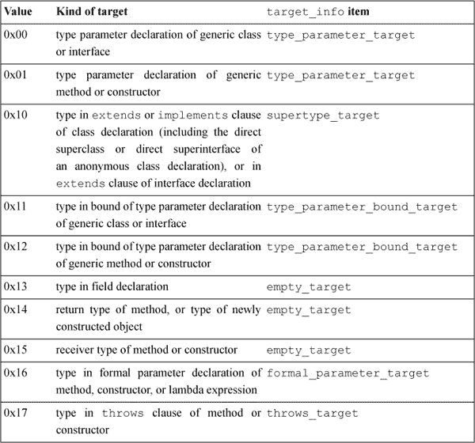

**表 4.7.20-A. `target_type` 值的解释（第 1 部分）**

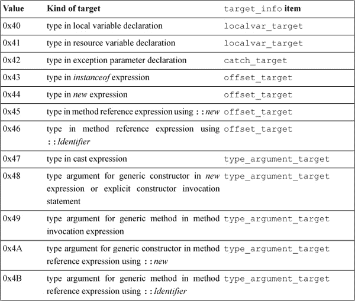

**表 4.7.20-B. `target_type` 值的解释（第 2 部分）**

表 4.7.20-A 和表 4.7.20-B 中的目标类型对应于 JLS §4.11 中的类型上下文。具体来说，`target_type` 值 0x10-0x17 和 0x40-0x42 对应类型上下文 1-10，而 `target_type` 值 0x43-0x4B 对应类型上下文 11-16。

`target_type` 项的值决定了 `type_annotation` 结构出现在 `ClassFile` 结构中的 `RuntimeVisibleTypeAnnotations` 属性、`field_info` 结构、`method_info` 结构或 `Code` 属性中。表 4.7.20-C 给出了具有每个合法 `target_type` 值的 `type_annotation` 结构的 `RuntimeVisibleTypeAnnotations` 属性的位置。

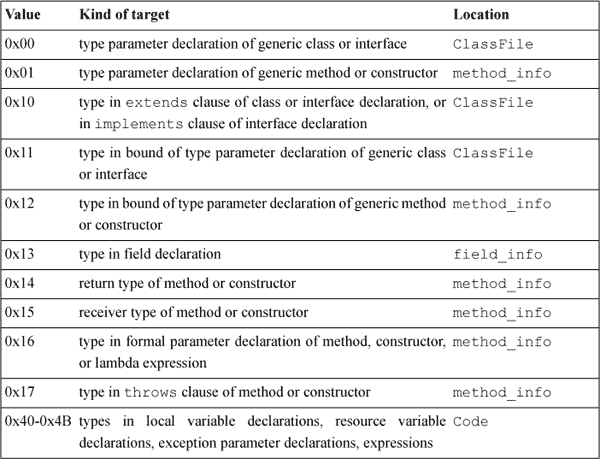

**表 4.7.20-C. `target_type` 值的包含属性的位置**

### target_info

`target_info` 项的值精确表示声明或表达式中的哪种类型被了注解。

`target_info` 联合体的项指定在 §4.7.20.1 中。

### target_path

`target_path` 项的值精确表示由 `target_info` 指出的类型的哪部分被了注解。

`type_path` 结构的格式指定在 §4.7.20.2 中。

### type_index, num_element_value_pairs, element_value_pairs[]

`type_annotation` 结构中这些项的含义与它们在 `annotation` 结构中的含义相同（§4.7.16）。

### 4.7.20.1 target_info 联合体

`target_info` 联合体的项（第一项外）精确指定声明或表达式中的哪种类型被了注解。第一项指定的不是哪种类型，而是哪种类型参数声明被了注解。项如下：

- `type_parameter_target` 项表示注解出现在泛型类、泛型接口、泛型方法或泛型构造函数的第 *i* 个类型参数的声明上。

```
type_parameter_target {
    u1 type_parameter_index;
}
```

`type_parameter_index` 项的值指定哪个类型参数声明。`type_parameter_index` 值为 `0` 指定第一个类型参数声明。

- `supertype_target` 项表示注解出现在类或接口声明中 `extends` 或 `implements` 子句中的类型上。

```
supertype_target {
    u2 supertype_index;
}
```

`supertype_index` 值为 65535 表示注解出现在类声明中 `extends` 子句的父类上。任何其他 `supertype_index` 值都是包含的 `ClassFile` 结构 `interfaces` 数组的索引，并指定注解出现在类声明的 `implements` 子句或接口声明的 `extends` 子句中的该父接口上。

- `type_parameter_bound_target` 项表示注解出现在泛型类、接口、方法或构造函数的第 *j* 个类型参数声明的第 *i* 处边界上。

```
type_parameter_bound_target {
    u1 type_parameter_index;
    u1 bound_index;
}
```

`type_parameter_index` 项的值指定哪个类型参数声明具有被注解的边界。`type_parameter_index` 值为 `0` 指定第一个类型参数声明。

`bound_index` 项的值指定哪个类型参数声明具有被注解的边界。`type_parameter_index` 值为 `0` 指定第一个类型参数声明。

- `catch_target` 项表示注解出现在异常参数声明中的第 `i` 个类型上。

```
catch_target {
    u2 exception_table_index;
}
```

`exception_table_index` 项的值是 `Code` 属性中包含的 `RuntimeVisibleTypeAnnotations` 属性的包围的 `exception_table` 数组的索引。


异常参数声明中可能出现多个类型，这是由于 `try` 语句的多 `catch` 子句引起的，在这种情况下，异常参数的类型是类型的联合类型（JLS §14.20）。编译器通常为联合类型中的每个类型创建一个 `exception_table` 条目，这使得 `catch_target` 项能够区分它们。这保持了类型与其注解之间的对应关系。

- `offset_target` 项表示注解出现在 `instanceof` 表达式中的类型、`new` 表达式中的类型，或者方法引用表达式中 `::` 之前的类型上。

```
offset_target {
    u2 offset;
}
```

`offset` 项的值指定了 `code` 数组的偏移量，该偏移量对应于 `instanceof` 表达式的 `instanceof` 字节码指令、`new` 表达式的 `new` 字节码指令，或者方法引用表达式的字节码指令。

- `type_argument_target` 项表示注解出现在转换表达式中的第 `i` 个类型，或者出现在以下任何一项的显式类型参数列表中的第 `i` 个类型参数：`new` 表达式、显式构造函数调用语句、方法调用表达式或方法引用表达式。

```
type_argument_target {
    u2 offset;
    u1 type_argument_index;
}
```

`offset` 项的值指定了 `code` 数组的偏移量，对应于转换表达式的字节码指令、`new` 表达式的 `new` 字节码指令、显式构造函数调用语句的字节码指令、方法调用表达式的字节码指令或方法引用表达式的字节码指令。

对于转换表达式，`type_argument_index` 项的值指定转换运算符中哪个类型被标记了注解。`type_argument_index` 的值为 `0` 指定转换运算符中的第一个（或唯一的）类型。

转换表达式中可能出现多个类型，这是转换为交集类型导致的。

对于显式类型参数列表，`type_argument_index` 项的值指定哪个类型参数被标记了注解。`type_argument_index` 的值为 `0` 指定第一个类型参数。

### 4.7.20.2 type_path 结构

每当在声明或表达式中使用类型时，`type_path` 结构都会标识类型的哪部分被标记了注解。注解可能出现在类型本身，但如果该类型是引用类型，则存在注解可能出现的额外位置：

- 如果在声明或表达式中使用数组类型 `T[]`，则注解可以出现在数组类型的任何组件类型上，包括元素类型。
- 如果在声明或表达式中使用嵌套类型 `T1.T2`，则注解可以出现在顶层类型的名称或任何成员类型的名称上。
- 如果在声明或表达式中使用泛型类型 `T<A>` 或 `T<? extends A>` 或 `T<? super A>`，则注解可以出现在任何类型参数上，或任何通配符类型参数的边界上。

例如，考虑 `String[][]` 在以下情况下被标记的不同部分：

```
@Foo String[][]   // 标记了类 String
String @Foo [][]   // 标记了数组类型 String[][]
String[] @Foo []  // 标记了数组类型 String[]
```

或者嵌套类型 `Outer.Middle.Inner` 在以下情况下标记的不同部分：

```
@Foo Outer.Middle.Inner
Outer.@Foo Middle.Inner
Outer.Middle.@Foo Inner
```

或者泛型类型 `Map<String,Object>` 和 `List<...>` 在以下情况下被标记的不同部分：

```
@Foo Map<String,Object>
Map<@Foo String,Object>
Map<String,@Foo Object>
List<@Foo ? extends String>
List<? extends @Foo String>
```

`type_path` 结构具有以下格式：

```
type_path {
    u1 path_length;
    {
        u1 type_path_kind;
        u1 type_argument_index;
    } path[path_length];
}
```

`path_length` 项的值给出 `path` 数组中的条目数：

- 如果 `path_length` 的值为 `0`，则注解直接出现在类型本身。
- 如果 `path_length` 的值非零，则 `path` 数组中的每个条目代表从左到右指向数组类型、嵌套类型或泛型类型中注解精确位置的迭代步骤。在数组类型中，迭代访问数组类型，然后是它的组件类型，然后是该组件类型的组件类型，依此类推，直到到达元素类型。每个条目包含以下内容：`type_path_kind`

`type_path_kind` 的合法值见表 4.7.20.2。

| `type_path_kind` | `type_argument_index` | 描述 |
| :--- | :--- | :--- |
| 0 | - | 类型本身 |
| 1 | - | 数组类型 |
| 2 | - | 嵌套类型 |
| 3 | index | 泛型类型 |

如果 `type_path_kind` 的值为 `0`、`1` 或 `2`，则 `type_argument_index` 的值为 `0`。

如果 `type_path_kind` 的值为 `3`，则 `type_argument_index` 指定泛型类型的哪个参数被标记，其中 `0` 表示第一个。

#### 4.7.21 RuntimeTypeAnnotations 属性

`RuntimeTypeAnnotations` 属性是 `ClassFile`、`field_info` 或 `method_info` 结构或 `Code` 属性（§4.1、§4.5、§4.6、§4.7.3）中 `attributes` 表的变长属性。`RuntimeTypeAnnotations` 属性记录类、字段或方法的相应声明或方法体中表达式使用的类型运行时不可见注解。`RuntimeTypeAnnotations` 属性还记录泛型类、接口、方法和构造函数的类型参数声明的注解。

`ClassFile`、`field_info` 或 `method_info` 结构或 `Code` 属性的 `attributes` 表中最多有一个 `RuntimeTypeAnnotations` 属性。

只有当类型在与 `attributes` 表的父级结构或属性对应的声明或表达式类型中被标记时，该 `attributes` 表才包含 `RuntimeTypeAnnotations` 属性。

`RuntimeInvisibleTypeAnnotations` 属性具有以下格式：

```
RuntimeInvisibleTypeAnnotations_attribute {
    u2 attribute_name_index;
    u4 attribute_length;
    u2 num_annotations;
    type_annotation annotations[num_annotations];
}
```

`RuntimeInvisibleTypeAnnotations_attribute` 结构体的项如下：

`attribute_name_index`

`attribute_name_index` 项的值必须是 `constant_pool` 表中的一个有效索引。该索引处的 `constant_pool` 条目必须是一个 `CONSTANT_Utf8_info` 结构，表示字符串“`RuntimeInvisibleTypeAnnotations`”。

`attribute_length`

`attribute_length` 项的值表示该属性的长度，不包括初始的六个字节。

`num_annotations`

`num_annotations` 项的值给出了结构体所表示的运行时不可见类型注解的数量。

`annotations[]`

`annotations` 表中的每个条目代表声明或表达式中所用类型上的单个运行时不可见注解。`type_annotation` 结构详见 §4.7.20。

### 4.7.22 AnnotationDefault 属性

`AnnotationDefault` 属性是某些 `method_info` 结构 `attributes` 表中的一种变长属性（§4.6），即那些代表注解类型元素的结构（JLS §9.6.1）。`AnnotationDefault` 属性记录了 `method_info` 结构所表示的元素的默认值（JLS §9.6.2）。Java 虚拟机必须提供此默认值，以便能够通过适当的反射 API 调用。

在一个 `method_info` 结构的 `attributes` 表中，最多可以有一个代表注解类型元素的 `AnnotationDefault` 属性。

`AnnotationDefault` 属性具有以下格式：

```
AnnotationDefault_attribute {
    u2              attribute_name_index;
    u4              attribute_length;
    element_value default_value;
}
```

`AnnotationDefault_attribute` 结构体的项如下：

`attribute_name_index`

`attribute_name_index` 项的值必须是 `constant_pool` 表中的一个有效索引。该索引处的 `constant_pool` 条目必须是一个 `CONSTANT_Utf8_info` 结构（§4.4.7），表示字符串“`AnnotationDefault`”。

`attribute_length`

`attribute_length` 项的值表示该属性的长度，不包括初始的六个字节。

`default_value`

`default_value` 项表示包含该 `AnnotationDefault` 属性的 `method_info` 结构所表示的注解类型元素的默认值。

### 4.7.23 BootstrapMethods 属性

`BootstrapMethods` 属性是 `ClassFile` 结构 `attributes` 表中的一种变长属性（§4.1）。`BootstrapMethods` 属性记录了被 `invokedynamic` 指令引用的引导方法（*invokedynamic*）。

如果 `ClassFile` 结构的 `constant_pool` 表至少有一个 `CONSTANT_InvokeDynamic_info` 条目（§4.4.10），则在 `ClassFile` 结构的 `attributes` 表中必须恰好有一个 `BootstrapMethods` 属性。

在一个 `ClassFile` 结构的 `attributes` 表中，最多可以有一个 `BootstrapMethods` 属性。

`BootstrapMethods` 属性具有以下格式：

```
BootstrapMethods_attribute {
    u2 attribute_name_index;
    u4 attribute_length;
    u2 num_bootstrap_methods;
    {
        u2 bootstrap_method_ref;
        u2 num_bootstrap_arguments;
        u2 bootstrap_arguments[num_bootstrap_arguments];
    } bootstrap_methods[num_bootstrap_methods];
}
```

`BootstrapMethods_attribute` 结构体的项如下：

`attribute_name_index`

`attribute_name_index` 项的值必须是 `constant_pool` 表中的一个有效索引。该索引处的 `constant_pool` 条目必须是一个 `CONSTANT_Utf8_info` 结构（§4.4.7），表示字符串“`BootstrapMethods`”。

`attribute_length`

`attribute_length` 项的值表示该属性的长度，不包括初始的六个字节。因此，`attribute_length` 项的值取决于该 `ClassFile` 结构中 `invokedynamic` 指令的数量。

`num_bootstrap_methods`

`num_bootstrap_methods` 项的值决定了 `bootstrap_methods` 数组中引导方法标识的数量。

`bootstrap_methods[]`

`bootstrap_methods` 表中的每个条目包含一个指向 `CONSTANT_MethodHandle_info` 结构的索引（§4.4.8），该结构指定了一个引导方法以及该引导方法的一系列参数。

`bootstrap_method_ref`

`bootstrap_method_ref` 项的值必须是 `constant_pool` 表中的一个有效索引。该索引处的 `constant_pool` 条目必须是一个 `CONSTANT_MethodHandle_info` 结构。

`num_bootstrap_arguments`

`num_bootstrap_arguments` 项的值给出了引导方法的参数数量。

`bootstrap_arguments[]`

`bootstrap_arguments` 数组中的每个条目必须是 `constant_pool` 表中的一个有效索引。该索引处的 `constant_pool` 条目必须是 `CONSTANT_String_info`、`CONSTANT_Class_info`、`CONSTANT_Integer_info`、`CONSTANT_Long_info`、`CONSTANT_Float_info`、`CONSTANT_Double_info`、`CONSTANT_MethodHandle_info` 或 `CONSTANT_MethodType_info` 结构。

### 4.7.24 MethodParameters 属性

`MethodParameters` 属性是 `method_info` 结构 `attributes` 表中的一种变长属性（§4.6）。`MethodParameters` 属性记录了方法形式参数的信息，例如它们的名称。

在一个 `method_info` 结构的 `attributes` 表中，最多有一个 `MethodParameters` 属性。

`MethodParameters` 属性具有以下格式：

```
MethodParameters_attribute {
    u2 attribute_name_index;
    u4 attribute_length;
    u1 parameters_count;
    {
        u2 name_index;
        u2 access_flags;
    } parameters[parameters_count];
}
```

`MethodParameters_attribute` 结构体的项如下：

`attribute_name_index`

`attribute_name_index` 项的值必须是 `constant_pool` 表中的一个有效索引。该索引处的 `constant_pool` 条目必须是一个 `CONSTANT_Utf8_info` 结构，表示字符串“`MethodParameters`”。

`attribute_length`

`attribute_length` 项的值表示该属性的长度，不包括初始的六个字节。

`parameters_count`

`parameters_count` 项的值给出了方法形式参数的数量。

`parameters_count` 项的值表示由属性所属的 `method_info` 结构体中的 `descriptor_index` 所引用的方法描述符（§4.3.3）中参数描述符的数量。

这不是 Java 虚拟机实现在格式检查期间（§4.8）必须强制执行的约束。将方法描述符中的参数描述符与下方 `parameters` 数组中的项进行匹配的任务，是由 Java SE 平台的反射库完成的。

### `parameters[]`

`parameters` 数组中的每个条目包含以下两个项：

#### `name_index`

`name_index` 项的值必须是 0，要么是指向 `constant_pool` 表的有效索引。

如果 `name_index` 项的值为 0，则该 `parameters` 元素表示一个没有名称的形式参数。

如果 `name_index` 项的值非 0，则该索引处的 `constant_pool` 条目必须是一个 `CONSTANT_Utf8_info` 结构体，表示形式参数的有效未限定名称（§4.2.2）。

#### `access_flags`

`access_flags` 项的值如下：

- `0x0010 (ACC_FINAL)`：表示该形式参数被声明为 `final`。
- `0x1000 (ACC_SYNTHETIC)`：表示根据源代码编写的语言的规范（JLS §13.1），该形式参数没有被显式或隐式声明。（该形式参数是产生此 `class` 文件的编译器的实现产物。）
- `0x8000 (ACC_MANDATED)`：表示根据源代码编写的语言的规范（JLS §13.1），该形式参数在源代码中被隐式声明。（该形式参数是语言规范要求的，因此该语言的所有编译器必须生成它。）


`parameters`数组中的第*i*个条目对应于所属方法描述符中的第*i*个参数描述符。（`parameters_count`项占用一个字节，因为方法描述符被限制为255个参数）。实际上，这意味着`parameters`数组存储了该方法所有参数的信息。可以想象其他方案，让`parameters`数组中的条目指定其对应的参数描述符，但这会过度地增加`MethodParameters`属性的复杂性。

`parameters`数组中的第*i*个条目可能对应于所属方法`Signature`属性（如果存在）中的第*i*个类型，也可能对应于所属方法参数注解中的第*i*个注解。

## 4.8 格式检查

当一个可能的`class`文件被Java虚拟机加载（§5.3）时，Java虚拟机首先确保该文件具有`class`文件的基本格式（§4.1）。这一过程被称为*格式检查*。检查内容如下：

- 前四个字节必须包含正确的魔数（magic number）。
- 所有识别的属性必须具有正确的长度。
- `class`文件不能被截断，也不能在末尾有额外的字节。
- 常量池必须满足§4.4中记录的约束。

例如，常量池中的每个`CONSTANT_Class_info`结构体在其`name_index`项中必须包含指向`CONSTANT_Utf8_info`结构体的有效常量池索引。

- 常量池中的所有字段引用和方法引用必须具有有效的名称、有效的类和有效的描述符（§4.3）。

格式检查并不保证给定的字段或方法实际上存在于给定的类中，也不保证给定的描述符指向真实的类。格式检查仅确保这些项是构造良好的。更详细的检查会在字节码本身被验证期间以及在解析（resolution）期间进行。

这些对基本`class`文件完整性的检查对于任何对`class`文件内容的解释都是必要的。格式检查与字节码验证是不同的，尽管在历史上它们经常被混淆，因为它们都是一种完整性检查。

## 4.9 Java虚拟机代码的约束

方法、实例初始化方法或类或接口初始化方法（§2.9）的代码存储在`class`文件（§4.7.3）`method_info`结构`Code`属性的`code`数组中。本节描述了与`Code_attribute`结构内容相关的约束。

### 4.9.1 静态约束

`class`文件的*静态约束*是定义文件良好性的约束。这些约束在之前的章节中已经给出，但`class`文件中代码的静态约束除外。`class`文件代码的静态约束规定了Java虚拟机指令必须如何在`code`数组中布局，以及单个指令的操作数必须是什么。

`code`数组中指令的静态约束如下：

- 只有§6.5中记录的指令实例可以出现在`code`数组中。
- 使用保留操作码（§2）的指令实例不能出现在`code`数组中。

如果`class`文件版本号为51或更高，则`jsr`或`jsr_w`操作码均不能出现在`code`数组。

- `code`数组中第一条指令的操作码从`0`开始。
- 对于`code`数组中的除最后一条外的每条指令，下一条指令的操作码索引等于当前指令的操作码索引加上该指令的长度。

*wide*指令在这些目的上被视为任何其他指令；*wide*指令要修改的操作码被该*wide*指令的操作数之一。

- `code`数组中最后一条指令的最后一个字节必须是`code_length - 1`处的字节。

`code`数组中操作数的静态约束如下：

- 每个跳转和分支指令（`jsr`, `jsr_w`, `goto`, `goto_w`, `ifeq`, `ifne`, `ifle`, `iflt`, `ifge`, `ifgt`, `ifnull`, `ifnonnull`, `if_icmpeq`, `if_icmpne`, `if_icmple`, `if_icmplt`, `if_icmpge`, `if_icmpgt`, `if_acmpeq`, `if_acmpne`）的目标必须是该方法内指令的操作码。

跳转指令的目标不能是*wide*指令要修改的操作码；跳转或分支目标可以是*wide*指令本身。

- 每个`tableswitch`指令的每个目标（包括默认目标）必须是该方法内指令的操作码。

每个`tableswitch`指令的跳转表项数与其`low`和`high`跳转表操作数的值一致，且其`low`值必须小于等于其`high`值。

`tableswitch`指令的任何目标都不可能是*wide*指令要修改的操作码；*tableswitch*目标可以是*wide*指令本身。

- 每个`lookupswitch`指令的每个目标（包括默认目标）必须是该方法内指令的操作码。

每个`lookupswitch`指令的*match-offset*句数必须与其`npairs`操作数的值一致。*match-offset*句必须根据符号匹配值按数值递增顺序排列。

`lookupswitch`指令的任何目标都不可能是*wide*指令要修改的操作码；*lookupswitch*目标可以是*wide*指令本身。

- 每个`ldc`指令和每个`ldc_w`指令的操作数必须是`constant_pool`表的有效索引。由该索引引用的常量池项类型必须为：
  - 如果`class`文件版本号小于49.0，类型为`CONSTANT_Integer`、`CONSTANT_Float`或`CONSTANT_String`。
  - 如果`class`文件版本号为49.0或50.0，类型为`CONSTANT_Integer`、`CONSTANT_Float`、`CONSTANT_String`或`CONSTANT_Class`。
  - 如果`class`文件版本号为51.0及以上，类型为`CONSTANT_Integer`、`CONSTANT_Float`、`CONSTANT_String`、`CONSTANT_Class`、`CONSTANT_MethodType`或`CONSTANT_MethodHandle`。

- 每个`ldc2_w`指令的操作数必须代表`constant_pool`表的有效索引。该索引引用的常量池项类型必须为`CONSTANT_Long`或`CONSTANT_Double`。随后的常量池索引也必须是常量池的有效索引，且该索引处的常量池项不能被使用。

- 每个`getfield`、`putfield`、`getstatic`和`putstatic`指令的操作数必须代表`constant_pool`表的有效索引。该索引引用的常量池项类型必须为`CONSTANT_Fieldref`。

- 每个`invokevirtual`指令的`indexbyte`操作数必须代表`constant_pool`表的有效索引。该索引引用的常量池项类型必须为`CONSTANT_Methodref`。

- 每个`invokespecial`和`invokestatic`指令的`indexbyte`操作数必须代表`constant_pool`表的有效索引。如果`class`文件版本号小于52.0，该索引引用的常量池项类型必须为`CONSTANT_Methodref`；如果`class`文件版本号为52.0及以上，该索引引用的常量池项类型必须为`CONSTANT_Methodref`或`CONSTANT_InterfaceMethodref`。

- 每个`invokeinterface`指令的`indexbyte`操作数必须代表`constant_pool`表的有效索引。该索引引用的常量池项类型必须为`CONSTANT_InterfaceMethodref`。每个`invokeinterface`指令的`count`操作数的值必须反映存储传递给接口方法的参数所需的局部变量数量，这由`CONSTANT_InterfaceMethodref`常量项引用的`CONSTANT_NameAndType_info`结构的描述符决定。每个`invokeinterface`指令的第四个操作字节必须为零。

- 每个`invokedynamic`指令的`indexbyte`操作数必须代表`constant_pool`表的有效索引。该索引引用的常量池项类型必须为`CONSTANT_InvokeDynamic`。每个`invokedynamic`指令的第三和第四个操作字节必须为零。

- 仅允许`invokespecial`指令调用实例化方法。其他以字符`<`（`\u003c`）开头的方法均不能通过方法调用指令调用。特别是，特殊命名为`<clinit>`的类或接口初始化方法永远不会通过虚拟机指令显式调用，而仅由虚拟机本身隐式调用。

- 每个`instanceof`、`checkcast`、`new`和`anewarray`指令的操作数，以及每个`multianewarray`指令的`indexbyte`操作数，必须代表`constant_pool`表的有效索引。该索引引用的常量池项类型必须为`CONSTANT_Class`。

- 任何`new`指令不能引用数组类型的`CONSTANT_Class`类型常量池项。`new`指令不能用于创建数组。

- 任何`anewarray`指令不能创建超过255维的数组。

- `multianewarray`指令仅用于创建维度至少等于其`dimensions`操作数值的类型的数组。也就是说，虽然`multianewarray`指令不需要创建其`indexbyte`操作数引用的数组类型的所有维度，但它不能尝试创建超过数组类型维度的维度。每个`multianewarray`指令的`dimensions`操作数不能为零。

- 每个`newarray`指令的`atype`操作数必须取以下值之一：`T_BOOLEAN`(4)、`T_CHAR`(5)、`T_FLOAT`(6)、`T_DOUBLE`(7)、`T_BYTE`(8)、`T_SHORT`(9)、`T_INT`(10)或`T_LONG`(11)。

- 每个`iload`、`fload`、`aload`、`istore`、`fstore`、`astore`、`iinc`和`ret`指令的`index`操作数必须是不大于`max_locals - 1`的非负整数。每个`iload_<n>`、`fload_<n>`、`aload_<n>`、`istore_<n>`、`fstore_<n>`和`astore_<n>`指令的隐式索引不能大于`max_locals -1`。

- 每个`lload`、`dload`、`lstore`和`dstore`指令的`index`操作数不能大于`max_locals - 2`。每个`lload_<n>`、`dload_<n>`、`lstore_<n>`和`dstore_<n>`指令的隐式索引不能大于`max_locals - 2`。

- 每个`wide`指令修改`iload`、`fload`、`aload`、`istore`、`fstore`、`astore`、`iinc`或`ret`的`indexbyte`操作数必须代表一个小于`max_locals - 1`的非负整数。每个`wide`指令修改`lload`、`dload`、`lstore`或`dstore`的`indexbyte`操作数必须代表一个小于`max_locals - 2`的非负整数。

### 4.9.2 结构约束

`code`数组的结构约束规定了指令之间的关系。结构约束如下：

- 每个指令必须在操作栈和局部变量数组具有正确的类型和数量的情况下执行，无论执行路径如何。操作`int`类型值的指令也允许操作`boolean`、`byte`、`char`和`short`。正如所述，虚拟机内部`boolean`、`byte`、`short`和`char`类型转换为`int`。

- 如果一个指令可以通过不同的执行路径执行，则在执行该指令之前的操作栈深度必须相同，无论采取何种路径。

- 在执行过程中，操作栈的深度不能超过`max_stack`项所启的深度。

- 在执行过程中，从操作栈弹出的值不能多于其包含的值。

- 在执行过程中，持有`long`或`double`类型值的局部变量对的顺序不能反转或拆分。不能对该对的局部变量进行单独操作。

- 在赋值之前，不能访问任何局部变量（或局部变量对）。

- 每个`invokespecial`指令必须命名实例化方法、当前类或接口的方法、父类的方法或`Object`方法。调用实例化方法时，未实例化的类实例必须位于操作栈适当的位置。永远不能在已实例化的类实例上调用实例化方法。如果`invokespecial`指令命名的是实例化方法且操作栈上的目标引用是未实例化的类实例，则`invokespecial`必须命名当前类或其直接父类的实例化方法。

如果`invokespecial`指令指定的是实例化初始化方法，且操作数栈上的目标引用是由早前的`new`指令创建的类实例，则`invokespecial`必须指定该类实例所属类的某个实例化初始化方法。

如果`invokespecial`指令指定的方法不是实例化初始化方法，则操作数栈上目标引用的类型必须与当前类赋值兼容（JLS §5.2）。

- 每一个实例化初始化方法（除源自`Object`类构造函数的实例化初始化方法外）在其实例成员被访问（`accessed`）之前，必须调用`this`的另一个实例化初始化方法，或者调用其直接超类`super`的实例化初始化方法。

然而，声明在当前类中声明的`this`实例字段可以在调用任何实例化初始化方法之前被赋值（`assigned`）。

- 当调用任何实例方法或访问任何实例变量时，包含该实例方法或实例变量的类实例必须已经初始化。

- 在执行`jsr`或`jsr_w`指令时，操作数栈或局部变量中绝不能存在未初始化的类实例。

- 每个作为方法调用指令目标的类实例的类型，必须与指令中指定的类或接口类型赋值兼容（JLS §5.2）。

- 每个方法调用的参数的类型必须与方法描述符方法调用兼容（JLS §5.3, §4.3.3）。

- 每一个返回指令必须与其方法的返回类型匹配：
  - 如果方法返回`boolean`、`byte`、`char`、`short`或`int`，则只能使用`ireturn`指令。
  - 如果方法返回`float`、`long`或`double`，则分别只能使用`freturn`、`lreturn`或`dreturn`指令。
  - 如果方法返回`reference`类型，只能使用`areturn`指令，且返回值的类型必须与方法的返回描述赋值兼容（JLS §5.2, §4.3.3）。
  - 所有实例化初始化方法、类或接口初始化方法以及声明返回`void`的方法必须使用`return`指令。

- 由`getfield`指令访问的或由`putfield`指令修改的每个类实例的类型，必须与指令中指定的类类型赋值兼容（JLS §5.2）。

- 由`putfield`或`putstatic`指令存储的每个值的类型必须与被存储的类实例或类的字段描述符（4.3.2）兼容：
  - 如果描述符类型为`boolean`、`byte`、`char`、`short`或`int`，则该值必须是`int`。
  - 如果描述符类型为`float`、`long`或`double`，则该值必须分别是`float`、`long`或`double`。
  - 如果描述符类型为`reference`类型，则该值必须是与描述符类型赋值兼容的类型。

- 由`aastore`指令存储到数组中的每个值必须是`reference`类型。被`aastore`指令存储的数组的组件类型也必须是`reference`类型。

- 每一个`athrow`指令只能抛出`Throwable`类或其子类的实例。方法的`Code_attribute`结构中`exception_table`数组的每个`catch_type`项中提到的每个类必须是`Throwable`或其子类。

- 如果使用`getfield`或`putfield`访问声明在超类中的`protected`字段，且该超类属于与当前类不同的运行时包，则被访问的类实例的类型必须与当前类相同或是子类。

如果使用`invokevirtual`或`invokespecial`访问声明在超类中的`protected`方法，且该超类属于与当前类不同的运行时包，则被访问的类实例的类型必须与当前类相同或是子类。

- 执行永远不会超出`code`数组的底部。

- 不允许从局部变量加载类型为`returnAddress`的值。

- 每个`jsr`或`jsr_w`指令后续指令只能由单一的`ret`指令返回。

- 被返回的任何`jsr`或`jsr_w`指令不能用于递归调用子程序，如果该子程序已经存在于该子程序调用链中。（在`finally`子句内部使用`try`-`finally`结构时，子程序是可以嵌套的。）

- 每个类型为`returnAddress`的实例最多只能返回一次。如果`ret`指令返回到子程序调用链中位于给定`returnAddress`类型实例对应的`ret`指令之上的点，则该实例将永远无法作为返回地址使用。

## 4.10 类文件的验证


尽管 Java 编程语言的编译器必须产生满足前面节中所有静态和结构约束的 `class` 文件，但 Java 虚拟机无法保证其要求加载的任何文件都是由该编译器生成的，或者是格式正确的。像网络浏览器之类的应用程序并不下载源代码然后进行编译；这些应用程序下载的是已经编译好的 `class` 文件。浏览器需要确定该 `class` 文件是由可靠的编译器产生的。

编译时检查的另一个问题是版本偏差。用户可能成功地编译了一个类（例如 `PurchaseOptions`）作为 `TradingClass` 的子类。但自该类编译以来`TradingClass` 的定义可能发生了与现有二进制不兼容的变化。方法可能被删除或更改了返回类型或修饰符。字段可能更改了类型。访问修饰符可能从 `public` 变为 `private`。关于这些问题的讨论，请参见《Java 语言规范》（Java SE 8 版）第 13 章“二进制兼容性”。

正由于这些潜在问题，Java 虚拟机需要自行验证其尝试合并的 `class` 文件是否了所需的约束。Java 虚拟机实现在链接时（5.4）验证每个 `class` 文件是否满足必要的约束。

链接验证提高了运行时解释器的性能。为了在运行时对每个解释指令验证约束而必须进行的昂贵检查可以消除。Java 虚拟机可以假设这些检查已经完成。例如，Java 虚拟机已经知道：

- 操作数栈没有溢出或下溢。
- 所有局部变量的使用和存储都是有效的。
- 所有 Java 虚拟机指令的参数都是有效的。

Java 虚拟机实现可以使用两种验证策略：

- 必须使用类型检查来验证版本号大于等于 50.0 的 `class` 文件。
- 符合 Java ME CLDC 和 Java Card 规范的所有 Java 虚拟机实现，必须支持类型推导，以验证版本号小于 50.0 的 `class` 文件。

在这两种策略中，验证主要关注将从 §4.9 规定的静态和结构性约束应用于 `Code` 属性的 `Code` 数组上（§4.7.3）。然而，在 `Code` 属性之外，还有三个额外的检查需要在验证期间执行：

- 确保 `final` 类没有被子化。
- 确保 `final` 方法没有被重写（§5.4.5）。
- 检查每个类（`Object` 除外）是否具有直接的父类。

## 4.10.1 通过类型检查进行验证

版本号为 50.0 或以上（§4.1）的 `class` 文件必须使用本节给出的类型检查规则进行验证。

当且仅当 `class` 文件的版本号等于 50.0 时，如果类型检查失败，Java 虚拟机实现可以选择尝试通过类型推断执行验证（§4.10.2）。

这是一项务实的调整，旨在缓解向新验证规范的过渡。许多操作 `class` 文件的工具可能会某种某种修改方法的字节码，导致需要调整方法的栈映射帧（stack map frames）。如果工具没有对栈映射帧进行必要的调整，即使字节码在原则上是有效的（并且在旧的类型推断方案下可以通过验证），类型检查也可能会失败。为了给实现者时间调整其工具，Java 虚拟机可能会回退到旧的验证规范，但仅限有限时间。

在类型检查失败但调用类型推断并成功的情况下，预计会有一定的性能损失。这种损失是不可避免的。它还应该作为一个信号，告知工具供应商其输出结果需要进行调整，并为供应商提供进行这些调整的额外激励。

总结来说，回退到通过类型推断验证支持 Java SE 平台逐渐添加栈映射帧（如果版本 50.0 的 `class` 文件中不存在这些帧，则允许回退），并支持从 Java SE 平台逐渐移除 `jsr` 和 `jsr_w` 指令（如果版本 50.0 的 `class` 文件中存在这些指令，则允许回退）。

如果 Java 虚拟机实现尝试对版本 50.0 的类文件执行类型推断验证，则它必须在类型检查失败的所有情况下都这样做。

这意味着 Java 虚拟机实现不能选择在某个案例中使用类型推断，而在另一个案例中不使用。它要么拒绝无法通过类型检查验证的 `class` 文件，要么在每次类型检查失败时一致地回退到类型推断验证器。

类型检查器执行通过 Prolog 子句指定的类型规则。使用英文文本以非正式的方式描述类型规则，而 Prolog 子句则提供了正式的规范。

类型检查器要求为每个具有 `Code` 属性的方法提供一个栈映射帧列表（§4.7.3）。栈映射帧的列表由 `Code` 属性的 `StackMapTable` 属性（§4.7.4）给出。其意图是栈映射帧必须出现在方法中每个基本块的开头。栈映射帧指定了每个基本块开始时每个操作数栈和每个局部变量的验证类型。类型检查器读取每个具有 `Code` 属性方法的栈映射帧，并使用这些映射生成 `Code` 属性中指令的类型安全的证明。如果一个类所有的方法都是类型安全的，且它没有子化 `final` 类，则该类是类型安全的。点击此处查看代码

```prolog
classIsTypeSafe(Class) :-
  classClassName(Class, Name),
  classDefiningLoader(Class, L),
  superclass(Name, L, Chain),
  Chain = [],
  classSuperClassName(Class, SuperclassName),
  loadedClass(SuperclassName, L, Superclass),
  classIsNotFinal(Superclass),
  classMethods(Class, Methods),
  checklist(methodIsTypeSafe(Class), Methods).
classIsTypeSafe(Class) :-
  classClassName(Class, 'java/lang/Object'),
  classDefiningLoader(Class, L),
  isBootstrapLoader(L),
  classMethods(Class, Methods),
  checklist(methodIsTypeSafe(Class), Methods).
```

Prolog 谓词 `classIsTypeSafe` 假设 `Class` 是一个表示已解析并加载的二进制类的 Prolog 项。此规范没有强制该项的精确结构，但要求在其基础上定义某些谓词。例如，我们假设有一个谓词 `classMethods(Class, Methods)`，它在给定上述表示类的项作为第一个参数时，将其第二个参数绑定到包含该类所有方法的列表中，这些方法在稍后以方便的形式表示。

如果谓词 `classIsTypeSafe` 不为真，类型检查器必须抛出 `VerifyError` 异常以指示 `class` 文件格式错误。否则，`class` 文件通过了类型检查，字节码验证已完成。

本节其余部分详细解释了类型检查的过程：

- 首先，我们为核心 Java 虚拟机产物如类和方法提供了 Prolog 谓词（4.10.1）。
- 其次，我们指定类型检查器已知的类型系统（4.10.2）。
- 第三，我们指定指令和栈映射帧的 Prolog 表示（4.10.3）。
- 第四，我们指定不带代码的方法如何进行类型检查（4.10.4）。
- 第五，我们讨论了所有加载和存储指令的类型检查问题（4.10.5），以及访问 `protected` 成员的问题（4.10.6）。
- 最后，我们指定了检查每条指令的规则（4.10.7）。

### 4.10.1.1 Java 虚拟机产物的访问器

我们规定了某些 Prolog 谓词（访问器），这些谓词具有某些预期行为，但其正式定义未在规范中给出

`classClassName(Class, ClassName)`

提取类 `Class` 的名称 `ClassName`。

`classIsInterface(Class)`

如果 `Class` 是接口，则为真。

`classIsNotFinal(Class)`

如果 `Class` 不是 `final` 类，则为真。

`classSuperClassName(Class, SuperClassName)`

提取类 `Class` 父类的名称 `SuperClassName`。

`classInterfaces(Class, Interfaces)`

提取类 `Class` 的直接父接口列表 `Interfaces`。

`classMethods(Class, Methods)`

提取类 `Class` 中声明的方法列表 `Methods`。

`classAttributes(Class, Attributes)`

提取类 `Class` 的属性列表 `Attributes`。每个属性表示为形式 `attribute(AttributeName, AttributeContents)` 的函数应用，其中 `AttributeName` 是属性名称。属性内容的格式未指定。

`classDefiningLoader(Class, Loader)`

提取类 `Class` 的定义加载器 `Loader`。

`isBootstrapLoader(Loader)`

如果类加载器 `Loader` 是引导加载器，则为真。

`loadedClass(Name, InitiatingLoader, ClassDefinition)`

如果存在一个名为 `Name` 的类，其由类加载器 `InitiatingLoader` 加载时的表示（符合本规范）为 `ClassDefinition`，则为真。

`methodName(Method, Name)`

提取方法 `Method` 的名称 `Name`。

`methodAccessFlags(Method, AccessFlags)`

提取方法 `Method` 的访问标志，`AccessFlags`。

`methodDescriptor(Method, Descriptor)`

提取方法 `Method` 的描述符，`Descriptor`。

`methodAttributes(Method, Attributes)`

提取方法 `Method` 的属性列表，`Attributes`。

`isNotFinal(Method, Class)`

当类 `Class` 中的方法 `Method` 不是 `final` 时，为真。

`isStatic(Method, Class)`

当类 `Class` 中的方法 `Method` 为 `static` 时，为真。

`isNotStatic(Method, Class)`

当类 `Class` 中的方法 `Method` 不是 `static` 时，为真。

`isPrivate(Method, Class)`

当类 `Class` 中的方法 `Method` 为 `private` 时，为真。

`isNotPrivate(Method, Class)`

当类 `Class` 中的方法 `Method` 不是 `private` 时，为真。

`isProtected(MemberClass, MemberName, MemberDescriptor)`

当类 `MemberClass` 中存在名为 `MemberName` 且描述符为 `MemberDescriptor` 的成员，且该成员为 `protected` 时，为真。

`isNotProtected(MemberClass, MemberName, MemberDescriptor)`

当类 `MemberClass` 中存在名为 `MemberName` 且描述符为 `MemberDescriptor` 的成员，且该成员不是 `protected` 时，为真。

`parseFieldDescriptor(Descriptor, Type)`

将字段描述符 `Descriptor` 转换为对应的验证类型 `Type` (§4.10.1.2)）。

`parseMethodDescriptor(Descriptor, ArgTypeList, ReturnType)`

将方法描述符 `Descriptor` 转换为对应方法参数类型的验证类型列表 `ArgTypeList`，以及对应返回类型的验证类型 `ReturnType`。

`parseCodeAttribute(Class, Method, FrameSize, MaxStack, ParsedCode, Handlers, StackMap)`

提取类 `Class` 中方法 `Method` 的指令流 `ParsedCode`，以及最大操作数栈大小 `MaxStack`、局部变量最大数量 `FrameSize`、异常处理器 `Handlers` 以及栈映射 `StackMap`。

指令流和栈映射属性的表示必须符合 §4.10.1.3 和 §4.10.1.4 的规定。

`samePackageName(Class1, Class2)`

当 `Class1` 和 `Class2` 的包名相同时，为真。

`differentPackageName(Class1, Class2)`

当 `Class1` 和 `Class2` 的包名不同时，为真。

在检查方法体的类型时，访问有关方法的信息是非常方便的。为此，我们定义了一个环境（`environment`），它由以下六元组组成：

- 一个类
- 一个方法
- 该方法声明的返回类型
- 方法中的指令
- 操作数栈的最大 own
- 异常处理器的列表

我们并指定了访问器来从环境中提取信息。

点击此处查看代码图像

```prolog
allInstructions(Environment, Instructions) :-
    Environment = environment(_Class, _Method, _ReturnType,
                               Instructions, _, _).

exceptionHandlers(Environment, Handlers) :-
    Environment = environment(_Class, _Method, _ReturnType,
                               _Instructions, _, Handlers).

maxOperandStackLength(Environment, MaxStack) :-
    Environment = environment(_Class, _Method, _ReturnType,
                               _Instructions, MaxStack, _Handlers).

thisClass(Environment, class(ClassName, L)) :-
    Environment = environment(Class, _Method, _ReturnType,
                               _Instructions, _, _),
    classDefiningLoader(Class, L),
    classClassName(Class, ClassName).

thisMethodReturnType(Environment, ReturnType) :-
    Environment = environment(_Class, _Method, ReturnType,
                               _Instructions, _, _).
```

我们指定了额外的谓词来提取更高层的信息。

点击此处查看代码图像

```prolog
offsetFrame(Environment, Offset, StackFrame) :-
    allInstructions(Environment, Instructions),
    member(Offset, StackFrame).

currentClassLoader(Environment, Loader) :-
    thisClass(Environment, class(_, Loader)).
```

最后，我们指定了一个贯穿使用的通用谓词：

```prolog
Member(_, []).
Member(X, [A | More]) :- X \= A, Member(X, More).
```

指导确定哪些访问器被规定且被完整指定的原则是：我们不希望过度指定 `class` 文件的表示。为 `Class` 或 `Method` 项提供访问器将迫使我们完全指定表示 `class` 文件的项的格式。

### 4.1.1 验证系统

类型检查器强制执行基于验证层级的类型系统，如下所示：

点击此处查看代码图像

```text
          top
         /   \
      oneWord  twoWord
     /    \    /    \
  int  float reference long  double
      \    /      /
       \  /______/
        \/      /
       /          \
  uninitialized
```

#### 4.1.1.2 验证类型

类型检查器强制执行基于验证层级的类型系统，如下所示：

（注：原文在此处存在重复和乱码，此处已根据文档逻辑进行了整理）


```
isAssignable(oneWord, top).

isAssignable(twoWord, top).

isAssignable(int, X)    :- isAssignable(oneWord, X).

isAssignable(float, X)  :- isAssignable(oneWord, X).
isAssignable(long, X)   :- isAssignable(twoWord, X).
isAssignable(double, X) :- isAssignable(twoWord, X).
isAssignable(reference, X)  :- isAssignable(oneWord, X).
isAssignable(class(_, _), X) :- isAssignable(reference, X).
isAssignable(arrayOf(_), X)  :- isAssignable(reference, X).
isAssignable(uninitialized, X)    :- isAssignable(reference, X).
isAssignable(uninitializedThis, X) :- isAssignable(uninitialized, X).
isAssignable(uninitialized(_), X)  :- isAssignable(uninitialized, X).
isAssignable(null, class(_, _)).
isAssignable(null, arrayOf(_)).
isAssignable(null, X) :- isAssignable(class('java/lang/Object', BL), X),
                         isBootstrapLoader(BL).
```

这些子类型规则并不是子类型最直观的表示方式。Java 编程语言中引用类型的子类型规则与其余验证类型的规则之间存在明确划分。这种划分允许我们定义 Java 编程语言引用类型与其他验证类型之间的通用子类型关系。这些关系独立于 Java 引用类型在类型层次中的位置，并有助于防止 Java 虚拟机实现过度的类加载。例如，我们不希望在响应类似于`class(foo, L) <: twoWord`的查询时开始遍历 Java 超类层次结构。

我们还有一条规则规定子类型是自反的，因此这些规则涵盖了 Java 编程语言中大多数非引用类型的验证类型。

Java 编程语言中引用类型的子类型规则通过`isJavaAssignable`递归指定。

点击此处查看代码图像

```
isAssignable(class(X, Lx), class(Y, Ly)) :-
    isJavaAssignable(class(X, Lx), class(Y, Ly)).
isAssignable(arrayOf(X), class(Y, L)) :-
    isJavaAssignable(arrayOf(X), class(Y, L)).
isAssignable(arrayOf(X), arrayOf(Y)) :-
    isJavaAssignable(arrayOf(X), arrayOf(Y)).
```

对于赋值，接口被处理为`Object`。

点击此处查看代码图像

```
isJavaAssignable(class(_, _), class(To, L)) :-
    loadedClass(To, L, ToClass),
    classIsInterface(ToClass).
isJavaAssignable(From, To) :-
    isJavaSubclassOf(From, To).
```

数组类型是`Object`的子类型。其意图是数组类型也是`Cloneable`和`java.io.Serializable`的子类型。

点击此处查看代码图像

```
isJavaAssignable(arrayOf(_), class('java/lang/Object', BL)) :-
    isBootstrapLoader(BL).
isJavaAssignable(arrayOf(_), X) :-
    isArrayInterface(X).
isArrayInterface(class('java/lang/Cloneable', BL)) :-
    isBootstrapLoader(BL).
isArrayInterface(class('java/io/Serializable', BL)) :-
    isBootstrapLoader(BL).
```

原始类型数组之间的子类型关系是恒等关系。

点击此处查看代码图像

```
isJavaAssignable(arrayOf(X), arrayOf(Y)) :-
    atom(X),
    atom(Y),
    X = Y.
```

引用类型数组之间的子类型关系是协变的。

点击此处查看代码图像

```
isJavaAssignable(arrayOf(X), arrayOf(Y)) :-
    compound(X), compound(Y), isJavaAssignable(X, Y).
```

子类关系是自反的。

点击此处查看代码图像

```
isJavaSubclassOf(class(SubclassName, L), class(SubclassName, L)).
isJavaSubclassOf(class(SubclassName, LSub), class(SuperclassName, LSuper)) :-
    superclassChain(SubclassName, LSub, Chain),
    member(class(SuperclassName, L), Chain),
    loadedClass(SuperclassName, L, ToClass).
```

#### 4.10.1.3 指令表示

单个指令在 Prolog 中表示为如下形式的项：

- `field(ClassName, FieldName, FieldDescriptor)`用于字段，其中`ClassName`是`class_index`项引用的类名，`FieldName`和`FieldDescriptor`分别对应名称和类型。

- `imethod(MethodIntfName, MethodName, MethodDescriptor)`用于接口方法，其中`MethodIntfName`是`class_index`项引用的接口名，`MethodName`和`MethodDescriptor`分别对应名称和类型。

- `method(MethodClassName, MethodName, MethodDescriptor)`用于类方法，其中`MethodClassName`是`class_index`项引用的类名，`MethodName`和`MethodDescriptor`分别对应名称和类型。

- `dmethod(CallSiteName, MethodDescriptor)`用于动态调用点，其中`CallSiteName`和`MethodDescriptor`分别对应名称和类型。

#### 4.10.1.4 栈映射帧表示

栈映射帧在 Prolog 中表示为如下形式的项的列表：

`stackMap(Offset, TypeState)`

其中：

- `Offset`是一个整数，表示应用栈映射帧的字节码偏移量（§4.7.4）。

此列表中字节码偏移量的顺序必须与`class`文件中的顺序一致。

- `TypeState`是`Offset`处指令预期的输入类型状态。

*类型状态*（type state）是从方法的操作数栈和局部变量中的位置到验证类型（verification types）的映射。它的形式如下：

点击此处查看代码图像

```
frame(Locals, OperandStack, Flags)
```

其中：

- `Locals`是一个验证类型列表，其中列表的第`i`个元素（索引从 0 开始）表示局部变量`i`的类型。

- `OperandStack`是一个验证类型列表，其中列表的第一个元素表示操作数栈顶部的类型，栈顶下方的栈条目类型按相应的顺序在列表中。大小为 2 的类型（`long`和`double`）由两个栈条目表示，第一个条目是`top`，第二个条目是类型本身。

例如，一个包含`double`值、一个`int`值和一个`long`值的栈，在类型状态中表示为包含五个条目的栈：对应`double`值的`top`和`double`条目，对应`int`值的`int`条目，以及对应`long`值的`top`和`long`条目。因此，`OperandStack`是列表`[top, double, int, top, long]`。

- `Flags`是列表，可以为空，也可以包含单个元素`flagThisUninit`。

如果`Locals`中的任何局部变量类型为`uninitializedThis`，则`Flags`包含单个元素`flagThisUninit`，否则`Flags`为空列表。

`flagThisUninit`用于构造函数，以标记`this`初始化尚未完成的类型状态。在此类类型状态下，从方法返回是非合法的。

验证类型的子类型关系逐点扩展到类型状态。

方法的局部变量数组在构造上具有固定长度（见 §4.10.1.6 中的`methodInitialStackFrame`），而操作数栈会增长和缩小。因此，我们需要对需要赋值的操作数栈长度进行显式检查。

点击此处查看代码图像

```
frameIsAssignable(frame(Locals1, StackMap1, Flags1),
                 frame(Locals2, StackMap2, Flags2)) :-
    length(StackMap1, StackMapLength),
    length(StackMap2, StackMapLength),
    maplist(isAssignable, Locals1, Locals2),
    maplist(isAssignable, StackMap1, StackMap2),
    subset(Flags1, Flags2).
```

`<init>`方法的异常处理器允许特殊形式的帧赋值。如果方法调用了另一个`<init>`方法且调用抛出了异常，则当前对象是损坏的；尽管如此，仅当处理器的输入类型状态中的所有局部变量都是`top`时，处理的目标才是类型安全的。这确保了处理帧不依赖于当前类型。

点击此处查看代码图像

```
frameIsAssignable(frame(ExcLocals, ExcStack, [flagThisUninit]),
                 frame(HandlerLocals, HandlerStack, [])) :-
  /* 栈大小必须相同（异常类占一个位） */
  length(ExcStack, StackLength),
  length(HandlerStack, StackLength),
  StackLength =:= 1,
  /* 局部变量数组长度必须相同 */
  length(ExcLocals, LocalsLength),
  length(HandlerLocals, LocalsLength),
  expandToLength([], LocalsLength, Top, TopLocals),
  maplist(:=:, HandlerLocals, TopLocals).
```

操作数栈的长度不能超过声明的最大栈长度。

点击此处查看代码图像

```
operandStackHasLegalLength(Environment, OperandStack) :-
    length(OperandStack, Length),
    maxOperandStackLength(Environment, MaxStack),
    Length =< MaxStack.
```

某些数组指令（§*aaload*, §*arraylength*, `aaload](#ch06.html_ch06lev2sec9)*, `aload](#ch06.html_ch06lev2sec13)*, `bastore](#ch06.html_ch06lev2sec14)*) 会查看操作数栈上值的类型。即操作数栈的第*i*个元素。

点击此处查看代码图像

```
nth1StackFrame(_Locals, OperandStack, Element)
```

操作数栈的操作由于某些类型占用两个条目而变得复杂。下面的谓词考虑了这一点。Pop 弹出一个类型列表。

点击此处查看代码图像

```
canPop(frame(Locals, OperandStack, Flags), Type)
```

从栈中弹出一个单个类型。更准确地说，如果推入的类型大小为 1，我们直接将其推入。将其推入栈。如果推入的类型大小为 2，我们先推入它，再推入`top`。

点击此处查看代码图像

```
pushStack(OperandStack, 'void', OperandStack).
pushStack(OperandStack, Type, [Type | OperandStack]).
pushStack(OperandStack, Type, [top | Type]).
```

如果有空间，则推入类型列表。

点击此处查看代码图像

```
canSafelyPush(Environment, InputOperandStack, Type, OutputOperandStack) :-
    pushStack(InputOperandStack, Type, OutputOperandStack),
    operandStackHasLegalLength(Environment, OutputOperandStack).

canSafelyPushList(Environment, InputOperandStack, Types, OutputOperandStack) :-
    canPushList(InputOperandStack, Types, OutputOperandStack),
    operandStackHasLegalLength(Environment, OutputOperandStack).
```

```
canPushList(InputOperandStack, [], InputOperandStack).

canPushList(InputOperandStack, [Type | Rest], OutputOperandStack) :-
    pushStack(InputOperandStack, Type, InterimOperandStack),
    canPushList(InterimOperandStack, Rest, OutputOperandStack).
```

*dup*指令对操作数栈的操作完全根据栈上值的*类别*（category）规定（§2.11.1）。

类别 1 类型占用单个栈条目。从栈中弹出一个类别 1 的逻辑类型`Type`的条件是：栈顶为`Type`且`Type`不是`top`（否则它可能是类别 2 类型的上半部分）。结果是输入栈，去除了顶部的条目。

```
popCategory1([Type | Rest], Type, Rest).
```

```
Type = top,
sizeOf(Type, 1).
```

类别 2 的类型占用两个栈项。如果栈顶是类型`top`且其正下方的项是`Type`，则可以从栈中弹出一个类别为 2 的逻辑类型`Type`。结果是得到进入的栈（incoming stack），其中栈顶的两个栈项已被弹出。

点击此处查看代码图像

```
popCategory2([top, Type | Rest], Type, Rest) :-
    sizeOf(Type, 2).
```

大多数针对单个指令的类型规则（§4.10.1.9）依赖于有效*类型转换*（type transition）的概念。如果可以从输入类型状态的操作数栈中弹出一个预期的类型列表，并将其替换为一个预期的结果类型，从而产生一个新的有效的类型状态，则该类型转换是*有效*的。特别是，新有效类型状态中操作数栈的大小不能超过其声明的最大尺寸。

点击此处查看代码图像

```
validTypeTransition(Environment, ExpectedTypesOnStack, ResultType,
                    frame(Locals, InputOperandStack, Flags),
                    frame(Locals, NextOperandStack, Flags)) :-
    popMatchingList(InputOperandStack, ExpectedTypesOnStack,
                     InterimOperandStack),
    pushOperandStack(InterimOperandStack, ResultType, NextOperandStack),
    operandStackHasLegalLength(Environment, NextOperandStack).
```

### 4.10.1.5 抽象与原生方法的类型检查

`abstract`（抽象）方法和`native`（原生）方法如果没有重写`final`（最终）方法，则认为是类型安全的。

点击此处查看代码图像

```
```


`methodIsTypeSafe(Class, Method)` :-

```
doesNotOverrideFinalMethod(Class, Method),
methodAccessFlags(Method, AccessFlags),
member(abstract, AccessFlags).
```

`methodIsTypeSafe(Class, Method)` :-

```
doesNotOverrideFinalMethod(Class, Method),
methodAccessFlags(Method, AccessFlags),
member(native, AccessFlags).
```

`private`（私有）方法和 `static`（静态）方法与动态方法派发是正交的，因此它们永远不会重写其他方法（§5.4.5）。

点击此处查看代码图像

```pro
doesNotOverrideFinalMethod(class('java/lang/Object', L), Method) :-
    isBootstrapLoader(L).

doesNotOverrideFinalMethod(Class, Method) :-
    isPrivate(Method, Class).

doesNotOverrideFinalMethod(Class, Method) :-
    isStatic(Method, Class).

doesNotOverrideFinalMethod(Class, Method) :-
    isNotPrivate(Method, Class),
    isNotStatic(Method, Class),
    doesNotOverrideFinalMethodOfSuperclass(Class, Method).

doesNotOverrideFinalMethodOfSuperclass(Class, Method) :-
    classSuperClassName(Class, SuperclassName),
    classDefiningLoader(Class, L),
    loadedClass(SuperclassName, L, Superclass),
    classMethods(Superclass, SuperMethodList),
    finalMethodNotOverridden(Method, Superclass, SuperMethodList).
```

`private` 且/或 `static` 的 `final` 方法是不寻常的，因为本质上说 `private` 方法和 `static` 方法无法被重写。因此，如果发现 `final private` 方法或 `final static` 方法，则它在逻辑上没有被另一个方法重写。

点击此处查看代码图像

```pro
finalMethodNotOverridden(Method, Superclass, SuperMethodList) :-
    methodName(Method, Name),
    methodDescriptor(Method, Descriptor),
    member(method(_, Name, Descriptor), SuperMethodList),
    isFinal(Method, Superclass),
    isPrivate(Method, Superclass).

finalMethodNotOverridden(Method, Superclass, SuperMethodList) :-
    methodName(Method, Name),
    methodDescriptor(Method, Descriptor),
    member(method(_, Name, Descriptor), SuperMethodList),
    isFinal(Method, Superclass),
    isStatic(Method, Superclass).
```

如果发现非 `final private` 方法或非 `final static` 方法，则跳过它，因为它们与重写是正交的。

点击此处查看代码图像

```pro
finalMethodNotOverridden(Method, Superclass, SuperMethodList) :-
    methodName(Method, Name),
    methodDescriptor(Method, Descriptor),
    member(method(_, Name, Descriptor), SuperMethodList),
    isNotFinal(Method, Superclass),
    isPrivate(Method, Superclass).

finalMethodOverrideFinalridden(Method, Superclass, MethodMethod)
    MethodName(Method, Method),
    MethodMethodMethod
    , MethodMethod
MethodMethodMethodMethodMethodMethod, Method), MethodMethod
    method(MethodMethod, ,),),
    Method(MethodMethod, Method),
    OverrideMethodMethodSuperclass(Superclass, Method).

finalMethodNotOverridden(Method, Superclass, SuperMethodList) :-
    methodName(Method, Name),
    methodDescriptor(Method, Descriptor),
    member(method(_, Name, Descriptor), SuperMethodList),
    isNotFinal(Method, Superclass),
    isPrivate(Method, Superclass),
    isNotFinal(, classclass, ,,).
```

发现一个非 `final private` 方法或非 `final static` 方法，则它在逻辑上没有被另一个方法重写。

点击此处查看代码图像

```pro
finalMethodNotOverridden(Method, Superclass, MethodList)
    methodName(Method, Name),
    methodDescriptor(Method, ),
        (method
,,,), , Method,),
Final(Method, ,,),
        ((Method, ,,),
        Static(Method, , class),
NotFinalMethodOfSuperclass(Class, Method).
```

### 4.10.1.6 带有代码的类型检查

非 `abstract` 且 `native` 方法如果具有代码，则代码是类型正确的。

点击此处查看代码图像

```pro
methodIsTypeSafe(Class, Method) :-
    doesNotOverrideFinalMethod(Class, Method),
    methodAccessFlags(Method, AccessFlags),
    member(native, AccessFlags),
    member(abstract, AccessFlags),
    attribute('Code', _),
    methodWithCodeIsSafe(Class, Method).
```

带有代码的方法是类型安全的，如果可以将代码和栈映射帧合并到一个流中，使得每个栈映射帧都在其对应的指令之前，并且合并后的流是类型正确的。该方法的异常处理器（如果有）也必须是有效的。

点击此处查看代码图像

```pro
methodWithCodeIsSafe(Class, Method) :-
    parseCodeAttribute(Class, Method, FrameSize, MaxStack,
                  ParsedCode, Handlers),
    mergeStackMapAndCode(StackMap, ParsedCode, MergedCode),
    methodInitialStackFrame(Class, Method, FrameSize, StackFrame, ReturnType),
    Environment = environment(Class, Method, ReturnType, MergedCode,
                             MaxStack, Handlers),
    handlersAreLegal(Environment),
    mergedCodeIsTypeSafe(Environment, MergedCode, StackFrame).
```

让我们首先考虑异常处理器。

异常处理器由形式如下的函数应用表示：

点击此处查看代码图像

```pro
handler(Start, End, Target, ClassName)
```

其参数分别是处理器覆盖范围的起始和结束位置、处理器代码的第一条指令，以及该处理器设计的异常类名称。

异常处理器是*有效*的，如果它的起始位置（`Start`）小于结束位置（`End`），存在偏移量等于 `Start` 的指令，存在偏移量等于 `End` 的指令，且处理器的异常类可以赋值给 `Throwable` 类。如果处理器的类项为 0，则异常类为 `Throwable`，否则它是处理器中命名的类。

点击此处查看代码图像

```pro
handlersAreLegal(Environment) :-
    exceptionHandlers(Environment, Handlers),
    checklist(handlerIsLegal(Environment), Handlers).

handlerIsLegal(Environment, Handler) :-
    Handler = handler(Start, End, Target, _),
    Start < End.
```

```prolog
allInstructions(Environment, Instructions),
    member(instruction(Start, _), Instructions),
    offsetStackFrame(Environment, Target, _),
    instructionsIncludeEnd(Instructions, End),
    currentClassLoader(Environment, CurrentLoader),
    handlerExceptionClass(Handler, ExceptionClass, CurrentLoader),
    isBootstrapLoader(BL),
    isAssignable(ExceptionClass, class('java/lang/Throwable', BL)).

instructionsIncludeEnd(Instructions, End) :-
    member(instruction(End, _), Instructions).

instructionsIncludeEnd(Instructions, End) :-
    member(endOfCode(End), Instructions).

handlerExceptionClass(handler(_, _, _, 0),
                      class('java/lang/Throwable', BL), _) :-
    isBootstrapLoader(BL).

handlerExceptionClass(handler(_, _, _, Name),
                      class(Name, L), L) :-
    Name \= 0.
```

现在让我们转向指令流和栈映射帧（stack map frames）。将指令和栈映射帧合并为单一流中涉及四种情况：

- 将一个空的 `StackMap` 和指令列表合并，得到原始指令列表。

点击此处查看代码图像

```prolog
mergeStackMapAndCode([], CodeList, CodeList).
```

- 给定一个以 `Offset` 处的指令的类型状态开头的栈映射帧列表，以及一个从 `Offset` 开始的指令列表，合并后的列表为栈映射帧列表的头部，随后是指令列表的头部，最后是两个列表尾部的合并。

点击此处查看代码图像

```prolog
mergeStackMapAndCode([stackMap(Offset, Map) | RestMap],
                     [instruction(Offset, Parse) | RestCode],
                     [stackMap(Offset, Map),
                      instruction(Offset, Parse) | RestMerge]) :-
    mergeStackMapAndCode(RestMap, RestCode, RestMerge).
```

- 否则，给定一个以 `OffsetM` 处的指令的类型状态开头的栈映射帧列表，以及一个从 `OffsetP` 开始的指令列表，那么如果 `OffsetP < OffsetM`，则合并后的列表包含指令列表的头部，随后是栈映射帧列表与指令列表尾部的合并。

点击此处查看代码图像

```prolog
mergeStackMapAndCode([stackMap(OffsetM, Map) | RestMap],
                     [instruction(OffsetP, Parse) | RestCode],
                     [instruction(OffsetP, Parse) | RestMerge]) :-
    OffsetP < OffsetM,
    mergeStackMapAndCode([stackMap(OffsetM, Map) | RestMap],
                         RestCode, RestMerge).
```

- 否则，两个列表的合并未定义。由于指令列表的偏移量是单调递增的，除非每个栈映射帧的偏移都有对应的指令偏移，且栈映射帧按单调递增顺序排列，否则两个列表的合并是未定义的。

为了确定方法的合并流是否类型正确，我们首先推断方法的初始类型状态。方法的初始类型状态由一个空的操作数栈、根据 `this` 类型和参数推导出的局部变量类型组成，以及相应的标志位（取决于这是否为 `<init>` 方法）。

点击此处查看代码图像

```prolog
methodInitialStackFrame(Class, Method, FrameSize, frame(Locals, [], Flags)) :-
    methodDescriptor(Method, Descriptor),
    parseMethod(Descriptor, RawArgs, ReturnType),
    expandTypeList(RawArgs, Args),
    methodInitialType(Class, Method, ThisList),
    flags(ThisList, Flags),
    append(ThisList, Args, ThisArgs),
    expandToLength(ThisArgs, FrameSize, top, Locals).
```

给定一个类型列表，以下子句产生一个列表，其中每个大小为 2 的类型都被替换两个条目：一个自身，另一个 `top` 条目。结果对应于列表在 Java 虚拟机中的 32 位字表示。

点击此处查看代码图像

```prolog
expandTypeList([], []).

expandTypeList([Item | List], [Item | Result]) :-
    sizeOf(Item, 1),
    TypeList(List, Result).

expandTypeList([Item | List], [Item, top | Result]) :-
    sizeOf(Item, 2),
    TypeList(List, Result).

flags([uninitializedThis], [flagUninit]).

flags(X, []) :- X = [uninitializedThis].

expandToLength(List, Size, _Filler, List) :-
    length(List, Size).

expandToLength(List, Size, Filler, Result) :-
    length(List, ListLength),
    ListLength < Size,
    Delta is Size - ListLength,
    length(Extra, Delta),
    checklist(Filler).
```


`append(List, Extra, Result).`

对于实例方法的初始类型状态，我们计算 `this` 的类型并将其放入列表中。`Object` 的 `<init>` 方法中 `this` 的类型是 `Object`；在其他 `<init>` 方法中，`this` 的类型是 `uninitializedThis`；否则，实例方法中 `this` 的类型为 `class(N, L)`，其中 `N` 是类名，`L` 是其定义加载器。对于静态方法的初始类型状态，`this` 是无关的，因此列表为空。

```prolog
methodInitialThisType(_Class, Method, []) :-
    methodAccessFlags(Method, AccessFlags),
    member(static, AccessFlags),
    methodName(Method, MethodName),
    MethodName \= '<init>'.

methodInitialThisType(Class, Method, [This]) :-
    methodAccessFlags(Method, AccessFlags),
    notMember(static, AccessFlags),
    instanceMethodInitialThisType(Class, Method, This).

instanceMethodInitialThisType(Class, Method, class('java/lang/Object', L)) :-
    methodName(Method, '<init>'),
    classDefiningLoader(Class, L),
    isBootstrapLoader(L),
    classClassName(Class, 'java/lang/Object').

instanceMethodInitialThisType(Class, Method, uninitializedThis) :-
    methodName(Method, '<init>'),
    classClassName(Class, ClassName),
    classDefiningLoader(Class, CurrentLoader),
    superclassChain(ClassName, CurrentLoader, Chain),
    Chain \= [].

instanceMethodInitialThisType(Class, Method, class(ClassName, L)) :-
    methodName(Method, MethodName),
    MethodName \= '<init>',
    classDefiningLoader(Class, L),
    classClassName(ClassName).
```

我们现在使用方法的初始类型状态计算方法的合并流是否类型正确：

- 如果我们有一个栈映射帧和一个传入的类型状态，则该类型状态必须可以赋值给栈映射帧中的。然后我们可以使用栈映射帧给出的类型状态继续检查剩余流。

```prolog
mergedCodeIsTypeSafe(Environment, [stackMap(Offset, MapFrame) | MoreCode], frame(Locals, OperandStack, Flags)) :-
    frameIsAssignable(frame(Locals, OperandStack, Flags), MapFrame),
    mergedCodeIsTypeSafe(Environment, MoreCode, MapFrame).
```

- 合并代码流相对于传入的类型状态 `T` 是安全的，如果它以一个相对于 `T` 类型安全的指令 `I` 开头，且 `I` *满足* 它的异常处理器（见下文），并且流的尾部在执行 `I` 之后的类型状态是安全的。`NextStackFrame` 指示后续指令。对于无条件跳转指令，它将具有特殊值 `afterGoto`。`ExceptionStackFrame` 指示传递给异常处理器的内容。

```prolog
mergedCodeIsTypeSafe(Environment, [instruction(Offset, Parse) | MoreCode], frame(Locals, OperandStack, Flags)) :-
    instructionIsTypeSafe(Parse, Environment, Offset, frame(Locals, OperandStack, Flags), NextStackFrame, ExceptionStackFrame).
```

```prolog
instructionSatisfiesHandlers(Environment, Offset, ExceptionStackFrame),
mergedCodeIsTypeSafe(Environment, MoreCode, NextStackFrame).
```

- 在无条件跳转（由传入的类型状态 `afterGoto` 表示）之后，如果我们有一个栈映射帧提供了后续指令的类型状态，我们就可以继续执行并使用栈映射帧提供的类型状态对它们进行类型检查。

```prolog
mergedCodeIsTypeSafe(Environment, [stackMap(Offset, MapFrame) | MoreCode], afterGoto) :-
    mergedCodeIsTypeSafe(Environment, MoreCode, MapFrame).
```

- 在无条件跳转之后如果有代码但没有为其提供栈映射帧，这是非法的。

```prolog
mergedCodeIsTypeSafe(_Environment, [instruction(_, _) | _MoreCode], afterGoto) :-
    write_ln('No stack frame after unconditional branch'),
    fail.
```

- 如果代码末尾有一个无条件跳转，则停止。

```prolog
mergedCodeIsTypeSafe(_Environment, [endOfCode(Offset)], afterGoto).
```

如果目标目标关联了一个栈帧 `Frame`，并且当前栈帧 `StackFrame` 可以赋值给 `Frame`，则跳转到该目标是类型安全的。

```prolog
targetIsTypeSafe(Environment, StackFrame, Target) :-
    offsetStackFrame(Environment, Target, Frame),
    frameIsAssignable(StackFrame, Frame).
```

如果一个指令满足了所有适用于该指令的异常处理器，则该指令被认为*满足其异常处理器*。

```prolog
instructionSatisfiesHandlers(Environment, Offset, ExceptionStackFrame) :-
    exceptionHandlers(Environment, Handlers),
    sublist(isApplicableHandler(Offset), Handlers, ApplicableHandlers),
    checklist(instructionSatisfiesHandler(Environment, ExceptionStackFrame), ApplicableHandlers).
```

如果指令的偏移量大于或等于处理器的范围起始位置，且小于处理器的范围结束位置，则该异常处理器对该指令*适用*。

```prolog
isApplicableHandler(Offset, handler(Start, End, _Target, _ClassName)) :-
    Offset >= Start,
    Offset < End.
```

如果指令的传出类型状态为 `ExcStackFrame`，且处理器的目标（处理器代码的起始指令）在假设传入类型状态 `T` 的情况下是类型安全的，则该指令*满足*该异常处理器。类型状态 `T` 是通过从 `ExcStackFrame` 派生出来的，具体方法是将操作栈替换为一个仅包含处理器异常类的栈，从而从 `ExcStackFrame` 推导出来。

```prolog
instructionSatisfiesHandler(Environment, ExcStackFrame, Handler) :-
    Handler = handler(_, _, Target, _),
    currentClassLoader(Environment, CurrentLoader),
    handlerExceptionClass(Handler, ExceptionClass, CurrentLoader),
    /* 栈仅包含异常。 */
    ExcStackFrame = frame(Locals, _, Flags),
    TrueExcStackFrame = frame(Locals, [ ExceptionClass ], Flags),
    operandStackHasLegalLength(Environment, TrueExcStackFrame),
    targetIsTypeSafe(Environment, TrueExcStackFrame, Target).
```

#### 4.10.1.7 加载和存储指令的类型检查

所有加载指令都是共同模式的变体，区别在于指令加载的值的类型。

从局部变量 `Index` 加载类型为 `Type` 的值是类型安全的，前提是该局部变量的类型为 `ActualType`、`ActualType` 可以赋值给 `Type`，且将 `ActualType` 推入传入的操作栈是一个有效的类型转换（§4.10.1.4），并产生新的类型状态 `NextStackFrame`。在执行加载指令后，类型状态将变为 `NextStackFrame`。

```prolog
loadIsTypeSafe(Environment, Index, Type, StackFrame, NextStackFrame) :-
    StackFrame = frame(Locals, _OperandStack, _Flags),
    nth0(Index, Locals, ActualType),
    isAssignable(ActualType, Type),
    validType(Environment, [], ActualType, StackFrame, NextStackFrame).
```

所有存储指令都是共同模式的变体，区别在于指令存储的值的类型。通常情况下，如果存储指令引用的局部变量类型是 `Type` 的超类型，且操作栈顶是 `Type` 的子类型，则存储是类型安全的，其中 `Type` 是指令设计用于存储的类型。更准确地说，如果可以从操作栈中弹出一个“匹配” `Type`（即 `Type` 的子类型）的类型 `ActualType`（§4.10.1.4），然后将该类型合法赋值给局部变量 `L[Index]`，则该存储是类型安全的。

```prolog
storeIsTypeSafe(_Environment, Index, Type, frame(Locals, OperandStack, Flags), frame(NextLocals, NextOperandStack, Flags)) :-
    popMatchingType(OperandStack, Type, NextOperandStack, ActualType),
    modifyLocalVariable(Index, ActualType, Locals, NextLocals).
```

给定局部变量 `Locals`，将 `Index` 修改为类型 `Type` 会导致局部变量列表变为 `NewLocals`。修改过程较为复杂，因为某些值（及其对应的类型）占据两个局部变量。因此，修改 `L[N]` 可能需要修改 `L[N+1]`（因为该类型将同时占据 `N` 和 `N+1` 槽）或修改 `L[N-1]`（因为局部 `N` 曾是从局部 `N-1` 开始的两个字宽值/类型的上半部分，所以局部 `N-1` 必须失效），或者两者都涉及。下文对此进行了描述。我们从 `L[0]` 开始计数。

```prolog
modifyLocalVariable(Index, Type, Locals, NewLocals) :-
    modifyLocalVariable(0, Type, Locals).
```

给定 `LocalsRest`（从索引 `I` 开始的局部变量后缀），将局部变量 `Index` 修改为类型 `Type` 会导致局部变量变为 `NextLocals`。如果 `I < Index-1`，只需将输入复制到输出并继续。如果 `I = Index-1`，局部 `I` 的类型可能会发生变化。这种情况发生在 `L[I]` 类型大小为 2 时。一旦我们将 `L[I+1]` 设置为新类型（以及对应的值），局部 `I` 将失效，因为其上半部分会被销毁。然后我们继续。

```prolog
modifyLocalVariable(I, Index, Type, [Locals1 | LocalsRest], [Locals1 | NextLocalsRest]) :-
    I < Index - 1,
    I1 is I + 1,
    modifyLocalVariable(I1, Index, Type, LocalsRest, NextLocalsRest).

modifyLocalVariable(I, Index, Type, [Locals1 | LocalsRest], [NextLocals1 | NextLocalsRest]) :-
    I =:= Index - 1,
    modifyPreIndexVariable(Locals1, NextLocals1),
    modifyLocalVariable(Index, Index, Type, LocalsRest, NextLocalsRest).
```

当我们找到变量且它只占据一个字时，我们将其更改为 `Type` 并完成。当我们找到变量且它占据两个字时，我们将其类型更改为 `Type` 并将下一个字设置为 `top`。

```prolog
modifyLocalVariable(Index, Index, Type, [_ | LocalsRest], [Type | LocalsRest]) :-
    sizeOf(Type, 1).

modifyLocalVariable(Index, Index, Type, [_, _ | LocalsRest], [Type, top | LocalsRest]) :-
    sizeOf(Type, 2).
```

我们将紧邻将修改类型的局部变量的局部索引称为 `预索引变量`（pre-index variable）。类型为 `InputType` 的预索引变量的未来类型为 `Result`。如果预索引局部变量的类型 `Type` 大小为 1，则保持不变。如果预索引局部变量的类型 `Type` 为 2，我们需要通过将其类型设置为 `top`，将其两个双字值的下半部分标记为不可用。

```prolog
modifyPreIndexVariable(Type, Type) :- sizeOf(Type, 1).
modifyPreIndexVariable(Type, top) :- sizeOf(Type, 2).
```

#### 4.10.1.8 保护成员（protected Members）的类型检查

所有访问成员的指令必须遵守有关 `protected` 成员的规则。本节描述了对应 JLS §6.6.2.1 的 `protected` 检查。

`protected` 检查仅适用于当前类父类的 `protected` 成员。其他类中的 `protected` 成员将由解析阶段进行的访问检查捕（§5.4.4）。共有四种情况：

- 如果一个类的名不是任何父类的名，则它就不可能是父类，因此可以安全地忽略。

```prolog
passesProtectedCheck(Environment, MemberClassName, MemberName,
            MemberDescriptor, StackFrame) :-
    thisClass(Environment, class(CurrentClassName, CurrentLoader)),
    superclassChain(CurrentClassName, CurrentLoader, Chain),
    notMember(class(MemberClassName, _), Chain).
```


- 如果`MemberClassName`与某个父类的名相同，则正在解析的类确实可能是一个父类。在这种情况下，如果在不同的运行时包中没有名为`MemberClassName`的父类拥有具有描述符`MemberDescriptor`且名为`MemberName`的`protected`成员，则不应用`protected`检查。

这是因为实际解析的类将是这些父类之一，在这种情况下，我们知道它位于相同的运行时包中，且访问是合法的；或者该成员不是`protected`且检查不适用；或者它将是一个子类，在这种情况下检查无论如何成功；或者它将是相同运行时包中的其他类，在这种情况下访问是合法的，不需要进行检查；或者验证器不需要将此标记为问题，因为它最终会因为解析强制失败而被捕获。

点击此处查看图像

```prolog
passesProtectedCheck(Environment, MemberClassName, MemberName,
            MemberDescriptor, StackFrame) :-
    thisClass(Environment, class(CurrentClassName, CurrentLoader)),
    superclassChain(CurrentClassName, CurrentLoader, Chain),
    member(class(MemberClassName, _), Chain),
    classesInOtherPkgWithProtectedMember(
        class(CurrentClassName, CurrentLoader),
        MemberName, MemberDescriptor, MemberClassName, Chain, []).
```

- 如果在不同的运行时包中确实存在一个`protected`父类成员，则加载`MemberClassName`；如果目标成员不是`protected`，则不应用检查。（使用非`protected`的父类成员显然是正确的。）

点击此处查看图像

```prolog
passesProtectedCheck(Environment, MemberClassName, MemberName,
            MemberDescriptor,
            frame(_Locals, [Target | Rest], _Flags)) :-
    thisClass(Environment, class(CurrentClassName, CurrentLoader)),
    superclassChain(CurrentClassName, CurrentLoader, Chain),
    member(class(MemberClassName, _), Chain),
    classesInOtherPkgWithProtectedMember(
        class(CurrentClassName, CurrentLoader),
        MemberName, MemberDescriptor, MemberClassName, Chain, List),
    List /= [],
    loadedClass(MemberClassName, CurrentLoader, ReferencedClass),
    isProtected(ReferencedClass, MemberName, Descriptor).
```

- 其他，使用类型为`Target`的对象的成员需要`Target`能够赋值给当前类的类型。

点击此处查看图像

```prolog
passesProtectedCheck(Environment, MemberClassName, MemberName,
            MemberDescriptor,
            frame(_Locals, [Target | Rest], _Flags)) :-
    thisClass(Environment, class(CurrentClassName, CurrentLoader)),
    superclassChain(CurrentClassName, CurrentLoader, Chain),
    member(class(MemberClassName, _), Chain),
    classesInOtherPkgWithProtectedMember(
        class(CurrentClassName, CurrentLoader),
        MemberName, MemberDescriptor, MemberClassName, Chain, List),
    List /= [],
    loadedClass(MemberClassName, CurrentLoader, ReferencedClass),
    isProtected(ReferencedClass, MemberName, Descriptor),
    isAssignable(Target, class(CurrentClassName, CurrentLoader)).
```

如果谓词`classesInOtherPkgWithProtectedMember(Class, MemberName, MemberDescriptor, MemberClassName, Chain, List)`中的`List`是`Chain`中所有名为`MemberClassName`且与`Class`在不同运行时包中具有名为`MemberName`的`protected`成员类的集合，则该谓词为真。

点击此处查看图像

```prolog
classesInOtherPkgWithProtectedMember(_, _, _, []).
classesInOtherPkgWithProtectedMember(Class, MemberName,
            MemberDescriptor, MemberClassName,
            [class(MemberClassName, L) | Tail],
            [class(MemberClassName, L) | T]) :-
    differentRuntimePackage(Class, class(MemberClassName, L)),
    loadedClass(MemberClassName, L, Super),
    isProtected(Super, MemberName, MemberDescriptor),
    classesInOtherPkgWithProtectedMember(
        Class, MemberName, MemberDescriptor, MemberClassName, Tail, T).
classesInOtherPkgWithProtectedMember(Class, MemberName,
            MemberDescriptor, MemberClassName,
            [class(MemberClassName, L) | Tail],
            T) :-
    differentRuntimePackage(Class, class(MemberClassName, L)),
    loadedClass(MemberClassName, L, Super),
    isNotProtected(Super, MemberName, MemberDescriptor),
    classesInOtherPkgWithProtectedMember(
        Class, MemberName, MemberDescriptor, MemberClassName, Tail, T).
```

#### 4.10.1.9 类型检查指令

通常，指令的类型规则相对于环境`Environment`给出的，该环境定义了指令发生的类和方法（4.10.1.1），以及方法中的偏移量`Offset`。规则规定，如果输入的类型状态`StackFrame`满足某些要求，则：

- 指令是类型安全的。
- 可以证明指令正常完成后的类型状态具有由`NextStackFrame`给出的特定形式，且指令异常完成后的类型状态由`ExceptionStackFrame`给出。

指令异常完成后的类型状态与进入时的类型状态相同，不同的是操作数栈为空。

点击此处查看代码图像

```prolog
exceptionStackFrame(StackFrame, ExceptionStackFrame) :-
    StackFrame = frame(Locals, _OperandStack, Flags),
    ExceptionStackFrame = frame(Locals, [], Flags).
```

许多指令的类型规则与其他指令的规则是完全同构的。如果指令`b1`与另一个指令`b2`同构，那么`b1`的类型规则就与`b2`的类型规则相同。

点击此处查看代码图像

```prolog
instructionIsTypeSafe(Instruction, Environment, Offset, StackFrame,
                      NextStackFrame, ExceptionStackFrame) :-
    instructionHasEquivalentTypeRule(Instruction, IsomorphicInstruction),
    instructionIsTypeSafe(IsomorphicInstruction, Environment, Offset,
                          StackFrame, NextStackFrame,
                          ExceptionStackFrame).
```

每个规则的英文描述旨在保持易读、直观和简洁。因此，描述避免了重复上述给的所有上下文假设。特别是：

- 描述没有显式提到环境。
- 当描述后续提到操作数栈或局部变量时，指的是类型状态中的操作数栈和局部变量部分：无论是进入的类型状态还是输出的类型。
- 指令异常完成后的类型状态几乎与进入时的类型状态相同。只有在并非如此的情况下，描述才会讨论指令异常完成后的类型状态。
- 描述了在操作数栈上弹出和推送类型，而没有显式讨论栈下溢或溢出的问题。描述假设这些操作可以成功完成，但处理操作数栈的 Prolog 子句确保了进行了必要的检查。
- 描述仅讨论了逻辑类型的处理。在实践中，某些类型占据超过一个字长。描述抽象了这些表示细节，但处理数据的 Prolog 子句并没有。

任何歧义都可以通过参考正式的 Prolog 子句来解决。

### aaload

`aaload`指令是类型安全的，当且仅当可以合法将匹配`int`和组件类型为`ComponentType`的数组类型（其中`ComponentType`是`Object`的子类型）替换，并产生输出的类型状态。

点击此处查看代码图像

```prolog
instructionIsTypeSafe(aaload, Environment, _Offset, StackFrame,
                      NextStackFrame, ExceptionStackFrame) :-
    nth1OperandStackIs(2, StackFrame, ArrayType),
    arrayComponentType(ArrayType, ComponentType),
    isBootstrapLoader(BL),
    validTypeTransition(Environment,
                         [int, arrayOf(class('java/lang/Object', BL))],
                         ComponentType, StackFrame, NextStackFrame),
    exceptionStackFrame(StackFrame, ExceptionStackFrame).
```

`X`数组的组件类型是`X`。我们将`null`的组件类型定义为`null`。

点击此处查看代码图像

```prolog
arrayComponentType(arrayOf(X), X).
arrayComponentType(null, null).
```

### aastore

`aastore`指令是类型安全的，当且仅当可以从进入的操作数栈中弹出匹配`Object`、`int`和`Object`数组的类型，并产生输出的类型状态。

点击此处查看代码图像

```prolog
instructionIsTypeSafe(aastore, _Environment, _Offset, StackFrame,
                      NextStackFrame, ExceptionStackFrame) :-
    isBootstrapLoader(BL),
    canPop(StackFrame, [class('java/lang/Object', BL),
                        int,
                        arrayOf('java/lang/Object', BL)]),
           NextStackFrame),
    exceptionStackFrame(StackFrame, ExceptionStackFrame).
```

### aconst_null

`aconst_null`指令是类型安全的，如果可以合法地将`null`推入进入的栈并产生输出的类型状态。

点击此处查看代码图像

```prolog
instructionIsTypeSafe(aconst_null, Environment, _Offset, StackFrame,
                      NextStackFrame, ExceptionStackFrame) :-
    validTypeTransition(Environment, [], StackFrame, NextStackFrame),
    exceptionStackFrame(StackFrame, ExceptionStackFrame).
```

### aload, aload_<n>

如果操作数为`Index`且类型为`reference`的加载指令是类型安全的并产生输出类型状态`NextStackFrame`，则操作数为`Index`的`aload`指令也是类型安全的，并产生相同的`NextStackFrame`。

点击此处查看代码图像

```prolog
instructionIsTypeSafe(aload(Index), Environment, _Offset, StackFrame,
                      NextStackFrame, ExceptionStackFrame) :-
    loadIsTypeSafe(Environment, Index, reference, StackFrame, NextStackFrame),
    exceptionStackFrame(StackFrame, ExceptionStackFrame).
```

对于 0 ≤ `n` ≤ 3，指令`aload_<n>`是类型安全的，当且仅当等效的`aload`指令是类型安全的。

点击此处查看代码图像

```prolog
instructionHasEquivalentTypeRule(aload_0, aload(0)).
instructionHasEquivalentTypeRule(aload_1, aload(1)).
instructionHasEquivalentTypeRule(aload_2, aload(2)).
instructionHasEquivalentTypeRule(aload_3, aload(3)).
```

### anewarray

操作数为`CP`的`anewarray`指令是类型安全的，当且仅`CP`指向一个表示类类型或数组类型的常量池，且可以合法将进入的操作数栈上匹配`int`的类型替换为组件类型为`CP`的数组，并产生输出的类型状态。

点击此处查看代码图像

```prolog
instructionIsTypeSafe(anewarray(CP), Environment, _Offset, StackFrame,
                      NextStackFrame, ExceptionStackFrame) :-
    (CP = class(_, _) ; CP = arrayOf(_)),
    validTypeTransition(Environment, [int], arrayOf(CP),
                         StackFrame, NextStackFrame),
    exceptionStackFrame(StackFrame, ExceptionStackFrame).
```


### areturn

`areturn` 指令是类型安全的，当且仅当封装的方法有一个声明的返回类型`ReturnType`，其为`reference`类型，且可以合法地从进入的操作数栈中弹出匹配`ReturnType`的类型。

点击此处查看代码图像

```prolog
instructionIsTypeSafe(areturn, Environment, _Offset, StackFrame,
                      afterGoto, ExceptionStackFrame) :-
    thisMethodReturnType(Environment, ReturnType),
    isAssignable(ReturnType, reference),
    canPop(StackFrame, [ReturnType], _PoppedStackFrame),
    exceptionStackFrame(StackFrame, ExceptionStackFrame).
```

### arraylength

`arraylength`指令是类型安全的，当且仅当可以合法将进入的操作数栈上的数组类型替换为类型`int`，并产生输出的类型状态。

点击此处查看代码图像

```prolog
instructionIsTypeSafe(arraylength, Environment, _Offset, StackFrame,
                      NextStackFrame, ExceptionStackFrame) :-
    nth1OperandStackIs(1, StackFrame, ArrayType),
    arrayComponentType(ArrayType, _),
    validTypeTransition(Environment, [top], int, StackFrame, NextStackFrame),
    exceptionStackFrame(StackFrame, ExceptionStackFrame).
```

### astore, astore_<n>

如果操作数为`Index`且类型为`reference`的存储指令是类型安全的并产生输出类型状态`NextStackFrame`，则操作数为`Index`的`astore`指令也是类型安全的，并产生相同的`NextStackFrame`。

点击此处查看代码图像

```prolog
instructionIsTypeSafe(astore(Index), Environment, _Offset, StackFrame,
                      NextStackFrame, ExceptionStackFrame) :-
    storeIsTypeSafe(Environment, Index, reference, StackFrame, NextStackFrame),
    exceptionStackFrame(StackFrame, ExceptionStackFrame).
```

指令`astore_<n>`（其中 0 ≤ `n` ≤ 3）是类型安全的，当且仅当等等的`astore`指令是类型安全的。

点击此处查看代码图像

```prolog
instructionHasEquivalentTypeRule(astore_0, astore(0)).
instructionHasEquivalentTypeRule(astore_1, astore(1)).
instructionHasEquivalentTypeRule(astore_2, astore(2)).
instructionHasEquivalentTypeRule(astore_3, astore(3)).
```

### athrow

`athrow`指令是类型安全的，当且仅当操作数栈顶部匹配`Throwable`。

点击此处查看代码图像

```prolog
instructionIsTypeSafe(athrow, _Environment, _Offset, StackFrame,
                      afterGoto, ExceptionStackFrame) :-
    isBootstrapLoader(BL),
    canPop(StackFrame, [class('java/lang/Throwable', BL)], _PoppedStackFrame),
    exceptionStackFrame(StackFrame, ExceptionStackFrame).
```

### baload

`baload`指令是类型安全的，当且仅当可以有效地将输入操作数栈上匹配`int`和小数组类型的类型替换为`int`，并产生输出类型状态。

点击此处查看代码图像

```prolog
instructionIsTypeSafe(baload, Environment, _Offset, StackFrame,
                      NextStackFrame, ExceptionStackFrame) :-
    nth1OperandStackIs(2, StackFrame, ArrayType),
    isSmallArray(ArrayType),
    validTypeTransition(Environment, [int, top], int,
                              StackFrame, NextStackFrame),
    exceptionStackFrame(StackFrame, ExceptionStackFrame).
```

如果一个数组类型是`byte`数组、`boolean`数组或其子类型（`null`），则该类型为`小数组类型`。

点击此处查看代码图像

```prolog
isSmallArray(arrayOf(byte)).
isSmallArray(arrayOf(boolean)).
isSmallArray(null).
```

### bastore

`bastore`指令是类型安全的，当且仅当可以有效地从输入操作数栈上弹出匹配`int`、`int`和小数组类型的类型，并产生输出类型状态。

点击此处查看代码图像

```prolog
instructionIsTypeSafe(bastore, _Environment, _Offset, StackFrame,
                      NextStackFrame, ExceptionStackFrame) :-
    nth1OperandStackIs(3, StackFrame, ArrayType),
    isSmallArray(ArrayType),
    canPop(StackFrame, [int, int, top], NextStackFrame),
    exceptionStackFrame(StackFrame, ExceptionStackFrame).
```

### bipush

`bipush`指令是类型安全的，当且仅当等等的`sipush`指令是类型安全的。

点击此处查看代码图像

```prolog
instructionHasEquivalentTypeRule(bipush(Value), sipush(Value)).
```

### caload

`caload`指令是类型安全的，当且仅当可以有效地将输入操作数栈上匹配`int`和`char`数组类型的类型替换为`int`，并产生输出类型状态。

点击此处查看代码图像

```prolog
instructionIsTypeSafe(caload, Environment, _Offset, StackFrame,
                      NextStackFrame, ExceptionStackFrame) :-
    validTypeTransition(Environment, [int, arrayOf(char)], int,
                              StackFrame, NextStackFrame),
    exceptionStackFrame(StackFrame, ExceptionStackFrame).
```

### castore

`castore`指令是类型安全的，当且仅当可以有效地从输入操作数栈上弹出匹配`int`、`int`和`char`数组类型的类型，并产生输出类型状态。

点击此处查看代码图像

```prolog
instructionIsTypeSafe(castore, _Environment, _Offset, StackFrame,
                      NextStackFrame, ExceptionStackFrame) :-
    canPop(StackFrame, [int, int, arrayOf(char)]),
    exceptionStackFrame(StackFrame, ExceptionStackFrame).
```

### checkcast

操作数为`CP`的`checkcast`指令是类型安全的，当且仅当`CP`指向表示类或数组的常量池项，且可以有效地将操作数栈顶部的`Object`替换为`CP`所指示的类型，并产生输出类型状态。

点击此处查看代码图像

```prolog
instructionIsTypeSafe(checkcast(CP), Environment, _Offset, StackFrame,
                      NextStackFrame, ExceptionStackFrame) :-
    (CP = class(_) ; CP = arrayOf(_)),
    isBootstrapLoader(BL),
    validTypeTransition(Environment, [class('java/lang/Object', BL)], CP,
                              StackFrame, NextStackFrame),
    exceptionStackFrame(StackFrame, ExceptionStackFrame).
```

### d2f, d2i, d2l

`d2f`指令是类型安全的，当且仅当可以有效地从输入操作数栈上弹出`double`并将其替换为`float`，产生输出类型状态。

点击此处查看代码图像

```prolog
instructionIsTypeSafe(d2f, _Environment, _Offset, StackFrame,
                      NextStackFrame, ExceptionStackFrame) :-
    validTypeTransition(Environment, [double], float,
                              StackFrame, NextStackFrame),
    exceptionStackFrame(StackFrame, ExceptionStackFrame).
```

`d2i`指令是类型安全的，当且仅当可以有效地从输入操作数栈上弹出`double`并将其替换为`int`，产生输出类型状态。

点击此处查看代码图像

```prolog
instructionIsTypeSafe(d2i, Environment, _Offset, StackFrame,
                      NextStackFrame, ExceptionStackFrame) :-
    validTypeTransition(Environment, [double], int,
                              StackFrame, NextStackFrame),
    exceptionStackFrame(StackFrame, ExceptionStackFrame).
```

`d2l`指令是类型安全的，当且仅当可以有效地从输入操作数栈上弹出`double`并将其替换为`long`，产生输出类型状态。

点击此处查看代码图像

```prolog
instructionIsTypeSafe(d2l, Environment, _Offset, StackFrame,
                      NextStackFrame, ExceptionStackFrame) :-
    validTypeTransition(Environment, [double], long,
                              StackFrame, NextStackFrame),
    exceptionStackFrame(StackFrame, ExceptionStackFrame).
```

### dadd

`dadd`指令是类型安全的，当且仅当可以有效地将输入操作数栈上匹配`double`和`double`的类型替换为`double`，产生输出类型状态。

点击此处查看代码图像

```prolog
instructionIsTypeSafe(dadd, Environment, _Offset, StackFrame,
                      NextStackFrame, ExceptionStackFrame) :-
    validTypeTransition(Environment, [double, double], double,
                              StackFrame, NextStackFrame),
    exceptionStackFrame(StackFrame, ExceptionStackFrame).
```

### daload

`daload`指令是类型安全的，当且仅当可以有效地将输入操作数栈上匹配`int`和`double`数组类型的类型替换为`double`，产生输出类型状态。

点击此处查看代码图像

```prolog
instructionIsTypeSafe(daload, Environment, _Offset, StackFrame,
                      NextStackFrame, ExceptionStackFrame) :-
    validTypeTransition(Environment, [int, arrayOf(double)], double,
                              StackFrame, NextStackFrame),
    exceptionStackFrame(StackFrame, ExceptionStackFrame).
```

### dastore

`dastore`指令是类型安全的，当且仅当可以有效地从输入操作数栈上弹出匹配`double`、`int`和`double`数组类型的类型，并产生输出类型状态。

点击此处查看代码图像

```prolog
instructionIsTypeSafe(dastore, _Environment, _Offset, StackFrame,
                      NextStackFrame, ExceptionStackFrame) :-
    canPop(StackFrame, [double, int, arrayOf(double)], NextStackFrame),
    exceptionStackFrame(StackFrame, ExceptionStackFrame).
```

### dcmp<op>

一个`dcmpg`指令是类型安全的，当且仅当可以将输入操作数栈上匹配`double`和`double`的类型有效地替换为`int`，并产生输出的类型状态。

点击此处查看代码图像

```prolog
instructionIsTypeSafe(dcmpg, Environment, _Offset, StackFrame,
                      NextStackFrame, ExceptionStackFrame) :-
    validTypeTransition(Environment, [double, double], int,
                          StackFrame, NextStackFrame),
    exceptionStackFrame(StackFrame, ExceptionStackFrame).
```

一个`dcmpl`指令是类型安全的，当且仅当等效`dcmpg`指令是类型安全的。

点击此处查看代码图像

```prolog
instructionHasEquivalentTypeRule(dcmpl, dcmpg).
```

### dconst_<d>

如果可以向输入操作数栈有效地压入类型`double`并产生输出的类型状态，则`dconst_0`指令是类型安全的。

点击此处查看代码图像

```prolog
instructionIsTypeSafe(dconst_0, Environment, _Offset, StackFrame,
                      NextStackFrame, ExceptionStackFrame) :-
    validTypeTransition(Environment, [], double, StackFrame, NextStackFrame),
    exceptionStackFrame(StackFrame, ExceptionStackFrame).
```


一个`dconst_1`指令是类型安全的，当且仅当等效的`dconst_0`指令是类型安全的。

点击此处查看代码图像

```javascript
instructionHasEquivalentTypeRule(dconst_1, dconst_0).
```

### ddiv

一个`ddiv`指令是类型安全的，当且仅当等效的`dadd`指令是类型安全的。

点击此处查看代码图像

```javascript
instructionHasEquivalentTypeRule(ddiv, dadd).
```

### dload, dload_<n>

如果操作数为`Index`且类型为`double`的加载指令是类型安全的并产生输出类型状态`NextStackFrame`，则操作数为`Index`的`dload`指令是类型安全的且产生相同的输出类型状态`NextStackFrame`。

点击此处查看代码图像

```javascript
instructionIsTypeSafe(dload(Index), Environment, _Offset, StackFrame,
                      NextStackFrame, ExceptionStackFrame) :-
    loadIsTypeSafe(Environment, Index, double, StackFrame, NextStackFrame),
    exceptionStackFrame(StackFrame, ExceptionStackFrame).
```

对于 0 ≤ `n` ≤ 3，指令`dload_<n>`是类型安全的，当且仅当等效的`dload`指令是类型安全的。

点击此处查看代码图像

```javascript
instructionHasEquivalentTypeRule(dload_0, dload(0)).
instructionHasEquivalentTypeRule(dload_1, dload(1)).
instructionHasEquivalentTypeRule(dload_2, dload(2)).
instructionHasEquivalentTypeRule(dload_3, dload(3)).
```

### dmul

一个`dmul`指令是类型安全的，当且仅当等效的`dadd`指令是类型安全的。

点击此处查看代码图像

```javascript
instructionHasEquivalentTypeRule(dmul, dadd).
```

### dneg

一个`dneg`指令是类型安全的，当且仅当输入操作数栈上存在匹配`double`的类型。`dneg`指令不改变类型状态。

点击此处查看代码图像

```javascript
instructionIsTypeSafe(dneg, Environment, _Offset, StackFrame,
                      NextStackFrame, ExceptionStackFrame) :-
    validTypeTransition(Environment, [double], double,
                          StackFrame, NextStackFrame),
    exceptionStackFrame(StackFrame, ExceptionStackFrame).
```

### drem

一个`drem`指令是类型安全的，当且仅当等效的`dadd`指令是类型安全的。

点击此处查看代码图像

```javascript
instructionHasEquivalentTypeRule(drem, dadd).
```

### dreturn

如果封装的方法声明了返回类型为`double`，且可以从输入操作数栈上有效地弹出匹配`double`的类型，则`dreturn`指令是类型安全的。

点击此处查看代码图像

```javascript
instructionIsTypeSafe(dreturn, Environment, _Offset, StackFrame,
                      afterGoto, ExceptionStackFrame) :-
    ReturnType(Environment, double),
    canPop(StackFrame, [double], PoppedStack),
    exceptionStackFrame(StackFrame, ExceptionStackFrame).
```

### dstore, dstore_<n>

如果操作数为`Index`且类型为`double`的存储指令是类型安全的并产生输出类型状态`NextStackFrame`，则操作数为`Index`的`dstore`指令是类型安全的且产生相同的输出类型状态`NextStackFrame`。

点击此处查看代码图像

```javascript
instructionIsTypeSafe(dstore(Index), Environment, _Offset, StackFrame,
                      NextStackFrame, ExceptionStackFrame) :-
    storeIsTypeSafe(Environment, Index, double, StackFrame, NextStackFrame),
    exceptionStackFrame(StackFrame, ExceptionStackFrame).
```

对于 0 ≤ `n` ≤ 3，指令`dstore_<n>`是类型安全的，当且仅当等效的`dstore`指令是类型安全的。

```javascript
instructionHasEquivalentTypeRule(dstore_0, dstore(0)).
instructionHasEquivalentTypeRule(dstore_1, dstore(1)).
instructionHasEquivalentTypeRule(dstore_2, dstore(2)).
instructionHasEquivalentTypeRule(dstore_3, dstore(3)).
```

### dsub

一个`dsub`指令是类型安全的，当且仅当等效的`dadd`指令是类型安全的。

点击此处查看代码图像

```javascript
instructionHasEquivalentTypeRule(dsub, dadd).
```

### dup

一个`dup`指令是类型安全的，当且仅当可以将一个类别 1 的类型`Type`有效地替换为类型`Type`, `Type`，并产生输出的类型状态。

点击此处查看代码图像

```javascript
instructionIsTypeSafe(dup, Environment, _Offset, StackFrame,
                      NextStackFrame, ExceptionStackFrame) :-
    StackFrame = frame(Locals, InputOperandStack, Flags),
    popCategory1(InputOperandStack, Type, _),
    canSafelyPush(Environment, InputOperandStack, Type, OutputOperandStack),
    NextStackFrame = frame(Locals, OutputOperandStack, Flags),
    exceptionStackFrame(StackFrame, ExceptionStackFrame).
```

### dup_x1

一个`dup_x1`指令是类型安全的，当且仅当可以将输入操作数栈上的两个类别 1 的类型`Type1`和`Type2`有效地替换为类型`Type1`, `Type2`, `Type1`，并产生输出的类型状态。

点击此处查看代码图像

```javascript
instructionIsTypeSafe(dup_x1, Environment, _Offset, StackFrame,
                      NextStackFrame, ExceptionStackFrame) :-
    StackFrame = frame(Locals, InputOperandStack, Flags),
    popCategory1(InputOperandStack, Type1, Stack1),
    popCategory1(Stack1, Type2, Rest),
    canSafelyPushList(Environment, Rest, [Type1, Type2, Type1],
                      OutputOperandStack),
    NextStackFrame = frame(Locals, OutputOperandStack, Flags),
    exceptionStackFrame(StackFrame, ExceptionStackFrame).
```

### dup_x2

一个`dup_x2`指令是类型安全的，当且仅当它是`dup_x2`指令的类型安全形式。

点击此处查看代码图像

```javascript
instructionIsTypeSafe(dup_x2, Environment, _Offset, StackFrame,
                      NextStackFrame, ExceptionStackFrame) :-
    StackFrame = frame(Locals, InputOperandStack, Flags),
    dup_x2FormIsTypeSafe(Environment, InputOperandStack, OutputOperandStack),
    NextStackFrame = frame(Locals, OutputOperandStack, Flags),
    exceptionStackFrame(StackFrame, ExceptionStackFrame).
```

一个`dup_x2`指令是`dup_x2`指令的类型安全形式，当且仅当它是类型安全形式 1 `dup_x2`指令或类型安全形式 2 `dup_x2`指令。

点击此处查看代码图像

```javascript
dup_x2FormIsTypeSafe(Environment, InputOperandStack, OutputOperandStack) :-
    dup_x2Form1IsTypeSafe(Environment, InputOperandStack, OutputOperandStack).
dup_x2FormIsTypeSafe(Environment, InputOperandStack, OutputOperandStack) :-
    dup_x2Form2IsTypeSafe(Environment, InputOperandStack, OutputOperandStack).
```

一个`dup_x2`指令是`type safe form 1 dup_x2`指令，当且仅当可以将输入操作数栈上的三个类别 1 类型`Type1`、`Type2`、`Type3`有效替换为类型`Type1`、`Type2`、`Type3`、`Type1`，从而输出类型状态。

点击此处查看代码

```prolog
dup_x2Form1IsTypeSafe(Environment, InputOperandStack, OutputOperandStack) :-
    popCategory1(InputOperandStack, Type1, Stack1),
    popCategory1(Stack1, Type2, Stack2),
    popCategory1(Stack2, Type3, Rest),
    canSafelyPushList(Environment, Rest, [Type1, Type3, Type2, Type1],
                        OutputOperandStack).
```

一个`dup_x2`指令是`type safe form 2 dup_x2`指令，当且仅当可以将输入操作数栈上的一个类别 1 类型`Type1`和一个类别 2 类型`Type2`有效替换为类型`Type1`、`Type2`、`Type1`，从而输出类型状态。

点击此处查看代码

```prolog
dup_x2Form2IsTypeSafe(Environment, InputOperandStack, OutputOperandStack) :-
    popCategory1(InputOperandStack, Type1, Stack1),
    popCategory2(Stack1, Type2, Rest),
    canSafelyPushList(Environment, Rest, [Type1, Type2, Type1],
                        OutputOperandStack).
```

### dup2

一个`dup2`指令是类型安全的，当且仅当它是`dup2`指令的`type safe form`。

点击此处查看代码

```prolog
instructionIsTypeSafe(dup2, Environment, _Offset, StackFrame,
                      NextStackFrame, ExceptionStackFrame) :-
    StackFrame = frame(Locals, InputOperandStack, Flags),
    dup2FormIsTypeSafe(Environment,InputOperandStack, OutputOperandStack),
    NextStackFrame = frame(Locals, OutputOperandStack, Flags),
    exceptionStackFrame(StackFrame, ExceptionStackFrame).
```

一个`dup2`指令是`dup2`指令的`type safe form`，当且仅当它是`type safe form 1 dup2`指令或`type safe form 2 dup2`指令。

点击此处查看代码

```prolog
dup2FormIsTypeSafe(Environment, InputOperandStack, OutputOperandStack) :-
    dup2Form1IsTypeSafe(Environment,InputOperandStack, OutputOperandStack).
dup2FormIsTypeSafe(Environment, InputOperandStack, OutputOperandStack) :-
    dup2Form2IsTypeSafe(Environment,InputOperandStack, OutputOperandStack).
```

一个`dup2`指令是`type safe form 1 dup2`指令，当且仅当可以将输入操作数栈上的两个类别 1 类型`Type1`和`Type2`有效替换为类型`Type1`、`Type2`、`Type1`、`Type2`，从而输出类型状态。

点击此处查看代码

```prolog
dup2Form1IsTypeSafe(Environment, InputOperandStack, OutputOperandStack):-
    popCategory1(InputOperandStack, Type1, TempStack),
    popCategory1(TempStack, Type2, _),
    canSafelyPushList(Environment, InputOperandStack, [Type1, Type2],
                        OutputOperandStack).
```

一个`dup2`指令是`type safe form 2 dup2`指令，当且仅当可以将输入操作数栈上的一个类别 2 类型`Type`有效替换为类型`Type`、`Type`，从而输出类型状态。

点击此处查看代码

```prolog
dup2Form2IsTypeSafe(Environment, InputOperandStack, OutputOperandStack):-
    popCategory2(InputOperandStack, Type, _),
    canSafelyPush(Environment, InputOperandStack, Type, OutputOperandStack).
```

### dup2_x1

一个`dup2_x1`指令是类型安全的，当且仅当它是`dup2_x1`指令的`type safe form`。

点击此处查看代码

```prolog
instructionIsTypeSafe(dup2_x1, Environment, _Offset, StackFrame,
```


## dup2_x1

一个`dup2_x1`指令是类型安全的，当且仅当它是`dup2_x1`指令的`type safe form`。

点击此处查看代码

```prolog
instructionIsTypeSafe(dup2_x1, Environment, _Offset, StackFrame,
                      NextStackFrame, ExceptionStackFrame) :-

    StackFrame = frame(Locals, InputOperandStack, Flags),

    dup2_x1FormIsSafe(Environment, InputOperandStack, OutputOperandStack),

    NextStackFrame = frame(Locals, OutputOperandStack, Flags),

    exceptionStackFrame(StackFrame, ExceptionStackFrame).
```

一个`dup2_x1`指令是`dup2_x1`指令的`type safe form`，当且仅当它是`type safe form 1 dup2_x1`指令或`type safe form 2 dup_x2`指令。

点击此处查看代码

```prolog
dup2_x1FormIsSafe(Environment, InputOperandStack, OutputOperandStack) :-

    dup2_x1Form1IsTypeSafe(Environment,InputOperandStack).

dup2_x1FormIsSafe(Environment, InputOperandStack) :-

    dup2_x1Form2IsTypeSafe(Environment, InputStack).
```

一个`dup2_x1`指令是`type safe form 1 dup2_x1`指令，当且仅当可以将输入操作数栈上的三个类别 1 类型`Type1`、`Type2`、`Type3`有效替换为类型`Type1`、`Type2`、`Type3`、`Type1`，从而输出类型状态。

点击此处查看代码

```prolog
dup2_x1Form1IsTypeSafe(Environment, InputOperandStack, OutputOperandStack) :-

    popCategory1(InputOperandStack, Type1, Stack1),

    popCategory1(Stack1, Type2, Stack2),

    popCategory1(Stack2, Type3, Rest),

    canSafelyPushList(Environment, Rest, [Type1, Type3, Type2, Type1],

                        OutputOperandStack).
```

一个`dup2_x1`指令是`type safe form 2 dup2_x1`指令，当且仅当可以将输入操作数栈上的一个类别 2 类型`Type1`和一个类别 1 类型`Type2`有效替换为类型`Type1`、`Type2`、`Type1`，从而输出类型状态。

```prolog
dup2_x1Form2IsTypeSafe(Environment, InputOperandStack, OutputOperandStack) :-

    popCategory2(InputOperandStack, Type1, Stack1),

    popCategory1(Stack1, Type2, Rest),

    canSafelyPushList(Environment, Rest, [Type1, Type2, Type1],

                        OutputOperandStack).
```

## dup2_x2

一个`dup2_x2`指令是类型安全的，当且仅当它是`dup2_x2`指令的`type safe form`。

点击此处查看代码

```prolog
instructionIsTypeSafe(dup2_x2, Environment, _Offset, StackFrame,

                      NextStackFrame, ExceptionStackFrame) :-

    StackFrame = frame(Locals, InputOperandStack, Flags),

    dup2_x2FormIsTypeSafe(Environment, InputOperandStack, OutputOperandStack),

    NextStackFrame = frame(Locals, OutputOperandStack, Flags),

    exceptionStackFrame(StackFrame, ExceptionStackFrame).
```

一个`dup2_x2`指令是`dup2_x2`指令的`type safe form`，当且仅当满足以下之一：

- 它是`type safe form 1 dup2_x2`指令。
- 它是`type safe form 2 dup2_x2`指令。
- 它是`type safe form 3 dup2_x2`指令。
- 它是`type safe form 4 dup2_x2`指令。

点击此处查看代码

```prolog
dup2_x2FormIsTypeSafe(Environment, InputOperandStack, OutputOperandStack) :-

    dup2_x2Form1IsTypeSafe(Environment, InputOperandStack).

dup2_x2FormIsTypeSafe(Environment, InputOperandStack, OutputOperandStack) :-

    dup2_x2Form2IsTypeSafe(Environment, InputOperandStack).

dup2_x2FormIsTypeSafe(Environment, InputOperandStack, OutputOperandStack) :-

    dup2_x2Form3IsTypeSafe(Environment, InputOperandStack).

dup2_x2FormIsTypeSafe(Environment, InputOperandStack, OutputOperandStack) :-

    dup2_x2Form4IsTypeSafe(Environment, InputOperandStack).
```

一个`dup2_x2`指令是`type safe form 1 dup2_x2`指令，当且仅当可以将输入操作数栈上的四个类别 1 类型`Type1`、`Type2`、`Type3`、`Type4`有效替换为类型`Type1`、`Type2`、`Type3`、`Type4`、`Type1`、`Type2`，从而输出类型状态。

点击此处查看代码

```prolog
dup2_x2Form1IsTypeSafe(Environment, InputOperandStack, OutputOperandStack) :-

    popCategory1(InputOperandStack, Type1, Stack1),

    popCategory1(Stack1, Type2, Stack2),

    popCategory1(Stack2, Type3, Stack3),

    popCategory1(Stack3, Type4, Rest).
```

```pro
canSafelyPushList(Environment, Rest,

                  [Type2, Type1, Type4, Type3, Type2, Type1],

                  OutputOperandStack).
```

一个`dup2_x2`指令是`type safe form 2 dup2_x2`指令，当且仅当可以将输入操作数栈上的一个类别 2 类型`Type1`和两个类别 1 类型`Type2`、`Type3`有效地替换为类型`Type1`、`Type2`、`Type3`、`Type1`并产生输出类型状态。

点击此处查看代码图像

```pro
dup2_x2Form2IsTypeSafe(Environment, InputOperandStack, OutputOperandStack) :-

    popCategory2(InputOperandStack, Type1, Stack1),

    popCategory1(Stack1, Type2, Stack2),

    popCategory1(Stack2, Type3, Rest),

    canSafelyPushList(Environment, Rest,

                      [Type1, Type3, Type2, Type1],

                      OutputOperandStack).
```

一个`dup2_x2`指令是`type safe form 3 dup2_x2`指令，当且仅当可以将输入操作数栈上的两个类别 1 类型`Type1`、`Type2`和一个类别 2 类型`Type3`有效地替换为类型`Type1`、`Type2`、`Type3`、`Type1`、`Type2`并产生输出类型状态。

点击此处查看代码图像

```pro
dup2_x2Form3IsTypeSafe(Environment, InputOperandStack, OutputOperandStack) :-

    popCategory1(InputOperandStack, Type1, Stack1),

    popCategory1(Stack1, Type2, Stack2),

    popCategory2(Stack2, Type3, Rest),

    canSafelyPushList(Environment, Rest,

                      [Type2, Type1, Type3, Type2, Type1],

                      OutputOperandStack).
```

一个`dup2_x2`指令是`type safe form 4 dup2_x2`指令，当且仅当可以将输入操作数栈上的两个类别 2 类型`Type1`、`Type2`有效地替换为类型`Type1`、`Type2`、`Type1`并产生输出类型状态。

点击此处查看代码图像

```pro
dup2_x2Form4IsTypeSafe(Environment, InputOperandStack, OutputOperandStack) :-

    popCategory2(InputOperandStack, Type1, Stack1),

    popCategory2(Stack1, Type2, Rest),

    canSafelyPushList(Environment, Rest, [Type1, Type2, Type1],

                      OutputOperandStack).
```

## f2d, f2i, f2l

如果`f2d`指令是类型安全的，当且仅当可以从输入操作数栈上弹出`float`并将其替换为`double`，产生输出类型状态。

点击此处查看代码图像

```pro
instructionIsTypeSafe(f2d, Environment, _Offset, StackFrame,

                      NextStackFrame, ExceptionStackFrame) :-

    validTypeTransition(Environment, [float], double,

                          StackFrame, NextStackFrame),

    exceptionStackFrame(StackFrame, ExceptionStackFrame).
```

如果`f2i`指令是类型安全的，当且仅当可以从输入操作数栈上弹出`float`并将其替换为`int`，产生输出类型状态。

点击此处查看代码图像

```pro
instructionIsTypeSafe(f2i, Environment, _Offset, StackFrame,

                      NextStackFrame, ExceptionStackFrame) :-

    validTypeTransition(Environment, [float], int,

                      StackFrame, NextStackFrame),

    exceptionStackFrame(StackFrame, ExceptionStackFrame).
```

如果`f2l`指令是类型安全的，当且仅当可以从输入操作数栈上弹出`float`并将其替换为`long`，产生输出类型状态。

点击此处查看代码图像

```pro
instructionIsTypeSafe(f2l, Environment, _Offset, StackFrame,

                      NextStackFrame, ExceptionStackFrame) :-

    validTypeTransition(Environment, [float], long,

                      StackFrame, NextStackFrame),

    exceptionStackFrame(StackFrame, ExceptionStackFrame).
```

## fadd

一个`fadd`指令是类型安全的，当且仅当可以可以将输入操作数栈上匹配`float`和`float`的类型有效替换为`float`并产生输出类型状态。

点击此处查看代码图像

```pro
instructionIsTypeSafe(fadd, Environment, _Offset, StackFrame,

                      NextStackFrame, ExceptionStackFrame) :-

    validTypeTransition(Environment, [float, float], float,

                      StackFrame, NextStackFrame),

    exceptionStackFrame(StackFrame, ExceptionStackFrame).
```

## faload

一个`faload`指令是类型安全的，当且仅当可以可以将输入操作数栈上匹配`int`和`array of float`的类型有效替换为`float`并产生输出类型状态。

点击此处查看代码图像

```pro
instructionIsTypeSafe(faload, Environment, _Offset, StackFrame,

                      NextStackFrame, ExceptionStackFrame) :-

    validTypeTransition(Environment, [int, array of float], float,

                      StackFrame, NextStackFrame).
```

## fastore

一个`fastore`指令是类型安全的，当且仅当可以从输入操作数栈上弹出匹配`float`和`array of float`的类型，产生输出类型状态。

点击此处查看代码图像

```pro
instructionIsTypeSafe(fastore, Environment, _Offset, StackFrame,

                      NextStackFrame, ExceptionStackFrame) :-

    validTypeTransition(Environment, float, array( float),

StackFrame, NextStackFrame).
```

## fcmp

一个`fcmpg`指令是类型安全的，当且仅当可以可以将输入操作数栈上匹配`float`和`float`的类型有效替换为`int`并产生输出类型状态。

点击此处查看代码图像

```pro
instructionIsTypeSafe(fcmp, Environment, _Offset, StackFrame,

                      NextStackFrame, ExceptionStackFrame) :-

    validTypeTransition(Environment, [float, float], int,

                      StackFrame, NextStackFrame).
```

## fcmpl

一个`fcmpl`指令是类型安全的，当且仅当等效的`fcmp`指令是类型安全的。

点击此处查看代码图像

```pro
instructionIsTypeSafe(fcmpl, Environment, _Offset, StackFrame,

                      NextStackFrame, ExceptionStackFrame).
```


### fconst

一个`fconst_0`指令是类型安全的，当且仅当可以向输入操作数栈推入`float`并产生输出类型状态。

点击此处查看代码图像

```pro
instructionIsTypeSafe(fconst_0, Environment, _Offset, StackFrame,
                      NextStackFrame, ExceptionStackFrame) :-
    validTypeTransition(Environment, [], float,
                      StackFrame, NextStackFrame).
```

`fconst`的其他变体是等效的。

点击此处查看代码图像

```pro
instructionHasEquivalentTypeRule(fconst_1, fconst_0).
instructionHasEquivalentTypeRule(fconst_2, fconst_0).
```

### fdiv

一个`fdiv`指令是类型安全的，当且仅当等效的`fadd`指令是类型安全的。

点击此处查看代码图像

```pro
instructionHasEquivalentTypeRule(fdiv, fadd).
```

### fload, fload_<n>

操作数为`Index`的`fload`指令是类型安全的并产生输出类型状态`NextStackFrame`，如果操作数为`Index`且类型为`float`的加载指令是类型安全的并产生输出类型状态`NextStackFrame`。

点击此处查看代码图像

```pro
instructionIsTypeSafe(fload(Index), Environment, _Offset, StackFrame,
                      NextStackFrame, ExceptionStackFrame) :-
    loadIsTypeSafe(Environment, Index, float, StackFrame, NextStackFrame),
    exceptionStackFrame(StackFrame, ExceptionStackFrame).
```

对于 0 ≤ *n* ≤ 3 的`fload_<n>`指令是类型安全的，当且仅当等效的`fload`指令是类型安全的。

点击此处查看代码图像

```pro
instructionHasEquivalentTypeRule(fload_0, fload(0)).
instructionHasEquivalentTypeRule(fload_1, fload(1)).
instructionHasEquivalentTypeRule(fload_2, fload(2)).
```

```pro
instructionHasEquivalentTypeRule(fload_3, fload(3)).
```

### fmul

`fmul`指令是类型安全的，当且仅当等效`fadd`指令也是类型安全的。

点击此处查看代码图像

```pro
instructionHasEquivalentTypeRule(fmul, fadd).
```

### fneg

`fneg`指令是类型安全的，当且仅当操作数栈上有匹配`float`的类型。`fneg`指令不改变类型状态。

点击此处查看代码图像

```pro
instructionIsTypeSafe(fneg, Environment, _Offset, StackFrame,
                      NextStackFrame, ExceptionStackFrame) :-
    validTypeTransition(Environment, [float], float,
                      StackFrame, NextStackFrame),
    exceptionStackFrame(StackFrame, ExceptionStackFrame).
```

```pro
canSafelyPushList(Environment, Rest,
                  [Type2, Type1, Type4, Type3, Type2, Type1],
                  OutputOperandStack).
```

一个`dup2_x2`指令是`type safe form 2 dup2_x2`指令，当且仅当可以将输入操作数栈上的一个类别 2 类型`Type1`和两个类别 1 类型`Type2`、`Type3`有效地替换为类型`Type1`、`Type2`、`Type3`、`Type1`并产生输出类型状态。

点击此处查看代码图像

```pro
dup2_x2Form2IsTypeSafe(Environment, InputOperandStack, OutputOperandStack) :-
    popCategory2(InputOperandStack, Type1, Stack1),
    popCategory1(Stack1, Type2, Stack2),
    popCategory1(Stack2, Type3, Rest),
    canSafelyPushList(Environment, Rest,
                      [Type1, Type3, Type2, Type1],
                      OutputOperandStack).
```

一个`dup2_x2`指令是`type safe form 3 dup2_x2`指令，当且仅当可以将输入操作数栈上的两个类别 1 类型`Type1`、`Type2`和一个类别 2 类型`Type3`有效地替换为类型`Type1`、`Type2`、`Type3`、`Type1`、`Type2`并产生输出类型状态。

点击此处查看代码图像

```pro
dup2_x2Form3IsTypeSafe(Environment, InputOperandStack, OutputOperandStack) :-
    popCategory1(InputOperandStack, Type1, Stack1),
    popCategory1(Stack1, Type2, Stack2),
    popCategory2(Stack2, Type3, Rest),
    canSafelyPushList(Environment, Rest,
                      [Type2, Type1, Type3, Type2, Type1],
                      OutputOperandStack).
```

一个`dup2_x2`指令是`type safe form 4 dup2_x2`指令，当且仅当可以将输入操作数栈上的两个类别 2 类型`Type1`、`Type2`有效地替换为类型`Type1`、`Type2`、`Type1`并产生输出类型状态。

点击此处查看代码图像

```pro
dup2_x2Form4IsTypeSafe(Environment, InputOperandStack, OutputOperandStack) :-
    popCategory2(InputOperandStack, Type1, Stack1),
    popCategory2(Stack1, Type2, Rest),
    canSafelyPushList(Environment, Rest, [Type1, Type2, Type1],
                      OutputOperandStack).
```

### f2d, f2i, f2l

如果`f2d`指令是类型安全的，当且仅当可以从输入操作数栈上弹出`float`并将其替换为`double`，产生输出类型状态。

点击此处查看代码图像

```pro
instructionIsTypeSafe(f2d, Environment, _Offset, StackFrame,
                      NextStackFrame, ExceptionStackFrame) :-
    validTypeTransition(Environment, [float], double,
                          StackFrame, NextStackFrame),
    exceptionStackFrame(StackFrame, ExceptionStackFrame).
```

如果`f2i`指令是类型安全的，当且仅当可以从输入操作数栈上弹出`float`并将其替换为`int`，产生输出类型状态。

点击此处查看代码图像

```pro
instructionIsTypeSafe(f2i, Environment, _Offset, StackFrame,
                      NextStackFrame, ExceptionStackFrame) :-
    validTypeTransition(Environment, [float], int,
                      StackFrame, NextStackFrame),
    exceptionStackFrame(StackFrame, ExceptionStackFrame).
```

如果`f2l`指令是类型安全的，当且仅当可以从输入操作数栈上弹出`float`并将其替换为`long`，产生输出类型状态。

点击此处查看代码图像

```pro
instructionIsTypeSafe(f2l, Environment, _Offset, StackFrame,
                      NextStackFrame, ExceptionStackFrame) :-
    validTypeTransition(Environment, [float], long,
                      StackFrame, NextStackFrame),
    exceptionStackFrame(StackFrame, ExceptionStackFrame).
```

### fadd

一个`fadd`指令是类型安全的，当且仅当可以可以将输入操作数栈上匹配`float`和`float`的类型有效替换为`float`并产生输出类型状态。

点击此处查看代码图像

```pro
instructionIsTypeSafe(fadd, Environment, _Offset, StackFrame,
                      NextStackFrame, ExceptionStackFrame) :-
    validTypeTransition(Environment, [float, float], float,
                      StackFrame, NextStackFrame),
    exceptionStackFrame(StackFrame, ExceptionStackFrame).
```

### faload

一个`faload`指令是类型安全的，当且仅当可以可以将输入操作数栈上匹配`int`和`array of float`的类型有效替换为`float`并产生输出类型状态。

点击此处查看代码图像

```pro
instructionIsTypeSafe(faload, Environment, _Offset, StackFrame,
                      NextStackFrame, ExceptionStackFrame) :-
    validTypeTransition(Environment, [int, array of float], float,
                      StackFrame, NextStackFrame).
```

### fastore

一个`fastore`指令是类型安全的，当且仅当可以从输入操作数栈上弹出匹配`float`和`array of float`的类型，产生输出类型状态。

点击此处查看代码图像

```pro
instructionIsTypeSafe(fastore, Environment, _Offset, StackFrame,
                      NextStackFrame, ExceptionStackFrame) :-
    validTypeTransition(Environment, float, array( float),
                      StackFrame, NextStackFrame).
```

### fcmp

一个`fcmpg`指令是类型安全的，当且仅当可以可以将输入操作数栈上匹配`float`和`float`的类型有效替换为`int`并产生输出类型状态。

点击此处查看代码图像

```pro
instructionIsTypeSafe(fcmp, Environment, _Offset, StackFrame,
                      NextStackFrame, ExceptionStackFrame) :-
    validTypeTransition(Environment, [float, float], int,
                      StackFrame, NextStackFrame).
```

### fcmpl

一个`fcmpl`指令是类型安全的，当且仅当等效的`fcmp`指令是类型安全的。

点击此处查看代码图像

```pro
instructionIsTypeSafe(fcmpl, Environment, _Offset, StackFrame,
                      NextStackFrame, ExceptionStackFrame).
```


### frem

`frem` 指令是类型安全的，当且仅当等效 `fadd` 指令也是类型安全的。

点击此处查看代码图像

`instructionHasEquivalentTypeRule(frem, fadd).`

### freturn

如果包含该方法的声明返回类型为 `float`，则 `freturn` 指令是类型安全的，并且可以从输入的操作数栈中有效弹出匹配 `float` 的类型。

点击此处查看代码图像

```javascript
instructionIsTypeSafe(freturn, Environment, _Offset, StackFrame,
                              afterGoto, ExceptionStackFrame) :-
    thisMethodReturnType(Environment, float),
    canPop(StackFrame, [float], _PoppedStackFrame),
    exceptionStackFrame(StackFrame, ExceptionStackFrame).
```

### fstore, fstore_<n>

如果操作数为 `Index` 且类型为 `float` 的存储指令是类型安全的，并产生输出类型状态 `NextStackFrame`，则操作数为 `Index` 的 `fstore` 指令也是类型安全的，且产生该输出类型状态 `NextStackFrame`。

点击此处查看代码图像

```javascript
instructionIsTypeSafe(fstore(Index), Environment, _Offset, StackFrame,
                              NextStackFrame, ExceptionStackFrame) :-
    storeIsTypeSafe(Environment, Index, float, StackFrame, NextStackFrame),
    exceptionStackFrame(StackFrame, ExceptionStackFrame).
```

对于 0 ≤ `n` ≤ 3 的指令 `fstore_<n>`，其是类型安全的当且仅当等效的 `fstore` 指令是类型安全的。

点击此处查看代码图像

`instructionHasEquivalentTypeRule(fstore_0, fstore(0)).`
`instructionHasEquivalentTypeRule(fstore_1, fstore(1)).`
`instructionHasEquivalentTypeRule(fstore_2, fstore(2)).`
`instructionHasEquivalentTypeRule(fstore_3, fstore(3)).`

### fsub

`fsub` 指令是类型安全的，当且仅当等效 `fadd` 指令也是类型安全的。

点击此处查看代码图像

`instructionHasEquivalentTypeRule(fsub, fadd).`

### getfield

操作数为 `CP` 的 `getfield` 指令是类型安全的，当且仅当 `CP` 指向一个常量池项目，该项目的声明类型为 `FieldType` 且声明在类 `FieldClass` 中，并且可以从输入的操作数栈上将匹配 `FieldClass` 的类型替换为类型 `FieldType` 以产生输出类型状态。`FieldClass` 不能是数组类型。`protected` 字段需要经过额外的检查（§4.10.1.8）。

点击此处查看代码图像

```javascript
instructionIsTypeSafe(getfield(CP), Environment, _Offset, StackFrame,
                              NextStackFrame, ExceptionStackFrame) :-
    CP = field(FieldClass, FieldName, FieldDescriptor),
    parseFieldDescriptor(FieldDescriptor, FieldType),
    passesProtectedCheck(Environment, FieldClass, FieldName,
                              FieldDescriptor, StackFrame),
    validTypeTransition(Environment, [class(FieldClass)], FieldType,
                              StackFrame, NextStackFrame),
    exceptionStackFrame(StackFrame, ExceptionStackFrame).
```

操作数为 `CP` 的 `getstatic` 指令是类型安全的，当且仅当 `CP` 指向一个常量池项目，该项目的声明类型为 `FieldType`，并且可以从输入的操作数栈上压入 `FieldType` 以产生输出类型状态。

点击此处查看代码图像

```javascript
instructionIsTypeSafe(getstatic(CP), Environment, _Offset, StackFrame,
                              NextStackFrame, ExceptionStackFrame) :-
    CP = field(_FieldClass, _FieldName, FieldDescriptor),
    parseFieldDescriptor(FieldDescriptor, FieldType),
    validTypeTransition(Environment, [], FieldType,
                              StackFrame, NextStackFrame),
    exceptionStackFrame(StackFrame, ExceptionStackFrame).
```

### goto, goto_w

`goto` 指令是类型安全的，当且仅当其目标是有效的。

点击此处查看代码图像

```javascript
instructionIsTypeSafe(goto(Target), Environment, _Offset, StackFrame,
                              afterGoto, ExceptionStackFrame) :-
    targetIsTypeSafe(Environment, StackFrame),
    exceptionStackFrame(StackFrame, ExceptionStackFrame).
```

`goto_w` 指令是类型安全的，当且仅当等效的 `goto` 指令是类型安全的。

点击此处查看代码图像

`instructionHasEquivalentTypeRule(goto_w(Target), goto(Target)).`

### i2b, i2c, i2d, i2f, i2l, i2s

`i2b` 指令是类型安全的，当且仅当等效 `ineg` 指令是类型安全的。

点击此处查看代码图像

`instructionHasEquivalentTypeRule(i2b, ineg).`

`i2c` 指令是类型安全的，当且仅当等效 `ineg` 指令是类型安全的。

点击此处查看代码图像

`instructionHasEquivalentTypeRule(i2c, ineg).`

`i2d` 指令是类型安全的，如果可以从输入的操作数栈上弹出 `int` 并将其替换为 `double` 以产生输出类型状态。

点击此处查看代码图像

```javascript
instructionIsTypeSafe(i2d, Environment, _Offset, StackFrame,
                              NextStackFrame, ExceptionStackFrame) :-
    validTypeTransition(Environment, [int], double,
                              StackFrame, NextStackFrame),
    exceptionStackFrame(StackFrame, ExceptionStackFrame).
```

`i2f` 指令是类型安全的，如果可以从输入的操作数栈上弹出 `int` 并将其替换为 `float` 以产生输出类型状态。

点击此处查看代码图像

```javascript
instructionIsTypeSafe(i2f, Environment, _Offset, StackFrame,
                              NextStackFrame, ExceptionStackFrame) :-
    validTypeTransition(Environment, [int], float,
                              StackFrame, NextStackFrame),
    exceptionStackFrame(StackFrame, ExceptionStackFrame).
```

`i2l` 指令是类型安全的，如果可以从输入的操作数栈上弹出 `int` 并将其替换为 `long` 以产生输出类型状态。

点击此处查看代码图像

```javascript
instructionIsTypeSafe(i2l, Environment, _Offset, StackFrame,
                              NextStackFrame, ExceptionStackFrame) :-
    validTypeTransition(Environment, [int], long,
                              StackFrame, NextStackFrame),
    exceptionStackFrame(StackFrame, ExceptionStackFrame).
```

`i2s` 指令是类型安全的，当且仅当等效 `ineg` 指令是类型安全的。

点击此处查看代码图像

`instructionHasEquivalentTypeRule(i2s, ineg).`

### iadd

`iadd` 指令是类型安全的，当且仅当可以从输入的操作数栈上将匹配 `int` 和 `int` 的类型替换为 `int` 以产生输出类型状态。

点击此处查看代码图像

```javascript
instructionIsTypeSafe(iadd, Environment, _Offset, StackFrame,
                              NextStackFrame, ExceptionStackFrame) :-
    validTypeTransition(Environment, [int, int], int,
                              StackFrame, NextStackFrame),
    exceptionStackFrame(StackFrame, ExceptionStackFrame).
```

### iaload

一个 `iaload` 指令是类型安全的，当且仅当可以有效地将输入操作数栈上匹配 `int` 和 `int` 数组的类型替换为 `int`，并产生输出的类型状态。

点击此处代码图像

```java
instructionIsTypeSafe(iaload, Environment, _Offset, StackFrame, NextStackFrame, ExceptionStackFrame) :-
    validTypeTransition(Environment, [int, arrayOf(int)], int, StackFrame, NextStackFrame),
    exceptionStackFrame(StackFrame, ExceptionStackFrame).
```

### iand

一个 `iand` 指令是类型安全的，当且仅当等效的 `iadd` 指令是类型安全的。

点击查看代码图像

```java
instructionHasEquivalentTypeRule(iand, iadd).
```

### iastore

一个 `iastore` 指令是类型安全的，当且仅当可以从输入操作数栈上有效地弹出匹配 `int`、`int` 和 `int` 数组的类型，并产生输出的类型状态。

点击查看代码图像

```java
instructionIsTypeSafe(iastore, _Environment, _Offset, StackFrame, NextStackFrame, ExceptionStackFrame) :-
    canPop(StackFrame, [int, int, arrayOf(int)], NextStackFrame),
    exceptionStackFrame(StackFrame, ExceptionStackFrame).
```

### if_acmp<cond>

一个 `if_acmpeq` 指令是类型安全的，当且仅当可以有效地从输入操作数栈上弹出匹配 `reference` 和 `reference` 的类型并产生输出的类型状态 `NextStackFrame`，且该指令的操作数 `Target` 在假设输入类型状态为 `NextStackFrame` 的情况下是一个跳转目标。

点击查看代码图像

```java
instructionIsTypeSafe(if_acmpeq(Target), Environment, _Offset, StackFrame, NextStackFrame, ExceptionStackFrame) :-
    canPop(StackFrame, [reference, reference], NextStackFrame),
    targetIsTypeSafe(Environment, NextStackFrame, Target),
    exceptionStackFrame(StackFrame, ExceptionStackFrame).
```

`if_acmpne` 的规则是相同的。

点击查看代码图像

```java
instructionHasEquivalentTypeRule(if_acmpne(Target), if_acmpeq(Target)).
```

### if_icmp<cond>

一个 `if_icmpeq` 指令是类型安全的，当且仅当可以有效地从输入操作数栈上弹出匹配 `int` 和 `int` 的类型并产生输出的类型状态 `NextStackFrame`，且该指令的操作数 `Target` 在假设输入类型状态为 `NextStackFrame` 的情况下是一个跳转目标。

点击查看代码图像

```java
instructionIsTypeSafe(if_icmpeq(Target), Environment, _Offset, StackFrame, NextStackFrame, ExceptionStackFrame) :-
    canPop(StackFrame, [int, int], NextStackFrame),
    targetIsTypeSafe(Environment, NextStackFrame, Target),
    exceptionStackFrame(StackFrame, ExceptionStackFrame).
```

所有其他变体 `if_icmp<cond>` 指令的规则都是相同的。

点击查看代码图像

```java
instructionHasEquivalentTypeRule(if_icmpge(Target), if_icmpeq(Target)).
instructionHasEquivalentTypeRule(if_icmpgt(Target), if_icmpeq(Target)).
instructionHasEquivalentTypeRule(if_icmple(Target), if_icmpeq(Target)).
instructionHasEquivalentTypeRule(if_icmplt(Target), if_icmpeq(Target)).
instructionHasEquivalentTypeRule(if_icmpne(Target), if_icmpeq(Target)).
```

### if<cond>

一个 `ifeq` 指令是类型安全的，当且仅当可以有效地从输入操作数栈上弹出匹配 `int` 的类型并产生输出的类型状态 `NextStackFrame`，且该指令的操作数 `Target` 在假设输入类型状态为 `NextStackFrame` 的情况下是一个跳转目标。

点击查看代码图像

```java
instructionIsTypeSafe(ifeq(Target), Environment, _Offset, StackFrame, NextStackFrame, ExceptionStackFrame) :-
    canPop(StackFrame, [int], NextStackFrame),
```


`targetIsTypeSafe(Environment, NextStackFrame, Target)`,

`exceptionStackFrame(StackFrame, ExceptionStackFrame)`.

所有其他 `if<cond>` 指令的规则都是相同的。

点击查看代码图像

```java
instructionHasEquivalentTypeRule(ifge(Target), ifeq(Target)).
instructionHasEquivalentTypeRule(ifgt(Target), ifeq(Target)).
instructionHasEquivalentTypeRule(ifle(Target), ifeq(Target)).
instructionHasEquivalentTypeRule(iflt(Target), ifeq(Target)).
instructionHasEquivalentTypeRule(ifne(Target), ifeq(Target)).
```

### ifnonnull

一个 `ifnonnull` 指令是类型安全的，当且仅当可以有效地从输入操作数栈上弹出匹配 `reference` 的类型并产生输出的类型状态 `NextStackFrame`，且该指令的操作数 `Target` 在假设输入类型状态为 `NextStackFrame` 的情况下是一个跳转目标。

点击查看代码图像

```java
instructionIsTypeSafe(ifnonnull(Target), Environment, _Offset, StackFrame, NextStackFrame, ExceptionStackFrame) :-
    canPop(StackFrame, [reference], NextStackFrame),
    targetIsTypeSafe(Environment, NextStackFrame, Target),
    exceptionStackFrame(StackFrame, ExceptionStackFrame).
```

### ifnull

一个 `ifnull` 指令是类型安全的，当且仅当等效的 `ifnonnull` 指令是类型安全的。

点击查看代码图像

```java
instructionHasEquivalentTypeRule(ifnull(Target), ifnonnull(Target)).
```

### iinc

第一个操作数为 `Index` 的 `iinc` 指令是类型安全的，当且仅当 `L[Index]` 的类型为 `int`。`iinc` 指令不会改变类型状态。

点击查看代码图像

```java
instructionIsTypeSafe(iinc(Index, _Value), _Environment, _Offset, StackFrame, StackFrame, ExceptionStackFrame) :-
    StackFrame = frame(Locals, _OperandStack, _Flags),
    nth0(Index, Locals, int),
    exceptionStackFrame(StackFrame, ExceptionStackFrame).
```

### iload, iload_<n>

如果操作数为 `Index` 且类型为 `int` 的加载指令是类型安全的并输出类型状态 `NextStackFrame`，则操作数为 `Index` 的 `iload` 指令也是类型安全的并产生输出类型状态 `NextStackFrame`。

点击查看代码图像

```java
instructionIsTypeSafe(iload(Index), Environment, _Offset, StackFrame, NextStackFrame, ExceptionStackFrame) :-
    loadIsTypeSafe(Environment, Index, int, StackFrame, NextStackFrame),
    exceptionStackFrame(StackFrame, ExceptionStackFrame).
```

对于 $0 \le n \le 3$，指令 `iload_<n>` 是类型安全的，当且仅当等效的 `iload` 指令是类型安全的。

点击此处的查看代码图像

```java
instructionHasEquivalentTypeRule(iload_0, iload(0)).
instructionHasEquivalentTypeRule(iload_1, iload(1)).
instructionHasEquivalentTypeRule(iload_2, iload(2)).
instructionHasEquivalentTypeRule(iload_3, iload(3)).
```

### imul

一个 `imul` 指令是类型安全的，当且仅当等效的 `iadd` 指令是类型安全的。

点击查看代码图像

```java
instructionHasEquivalentTypeRule(imul, iadd).
```

### ineg

一个 `ineg` 指令是类型安全的，当且仅当输入操作数栈上存在匹配 `int` 的类型。`ineg` 指令不会改变类型状态。

点击查看代码图像

```java
instructionIsTypeSafe(ineg, Environment, _Offset, StackFrame, NextStackFrame, ExceptionStackFrame) :-
    validTypeTransition(Environment, [int], int, StackFrame, NextStackFrame),
    exceptionStackFrame(StackFrame, ExceptionStackFrame).
```

### instanceof

操作数为 `CP` 的 `instanceof` 指令是类型安全的，当且仅当 `CP` 指向常量池中表示类或数组的条目，且可以有效地将输入操作数栈顶部的 `Object` 类型替换为 `int` 类型并产生输出的类型状态。

点击此处查看代码图像

```prolog
instructionIsTypeSafe(instanceof(CP), Environment, _Offset, StackFrame,
                      NextStackFrame, ExceptionStackFrame) :-
  (CP = class(_, _) ; CP = arrayOf(_)),
  isBootstrapLoader(BL),
  validTypeTransition(Environment, [class('java/lang/Object'), BL], int,
                              StackFrame,NextStackFrame),
  exceptionStackFrame(StackFrame, ExceptionStackFrame).
```

### invokedynamic

`invokedynamic` 指令当且仅当满足以下所有条件时，它是类型安全的：

- 它的第一个操作数 `CP` 指向一个常量池项，该项表示一个名为 `CallSiteName`、描述符为 `Descriptor` 的动态调用点。
- `CallSiteName` 不是 `<init>`。
- `CallSiteName` 不是 `<clinit>`。
- 可以有效地将输入操作数栈上匹配 `Descriptor` 中给出的参数类型的类型替换为 `Descriptor` 中给出的返回类型，从而得到输出类型状态。

点击此处查看代码图像

```prolog
instructionIsTypeSafe(invokedynamic(CP,0,0), Environment, _Offset,
                              StackFrame, NextStackFrame, ExceptionStackFrame) :-
  CP = dmethod(CallSiteName, Descriptor),
  CallSiteName \= '<init>',
  CallSiteName \= '<clinit>',
  parseMethodDescriptor(Descriptor, OperandArgList, ReturnType),
  reverse(OperandArgList, StackArgList),
  validTypeTransition(Environment, StackArgList, ReturnType,
                              StackFrame, NextStackFrame),
  exceptionStackFrame(StackFrame, ExceptionStackFrame).
```

### invokeinterface

`invokeinterface` 指令当且仅当满足以下所有条件时，它是类型安全的：

- 它的第一个操作数 `CP` 指向一个常量池项，该项表示一个名为 `MethodName`、描述符为 `Descriptor` 的接口方法，该方法是接口 `MethodIntfName` 的成员。
- `MethodName` 不是 `<init>`。
- `MethodName` 不是 `<clinit>`。
- 它的第二个操作数 `Count` 是一个有效的计数操作数（见下文）。
- 可以有效地将输入操作数栈上匹配类型 `MethodIntfName` 以及 `Descriptor` 中给出的参数类型的类型替换为 `Descriptor` 中给出的返回类型，从而得到输出类型状态。

点击此处查看代码图像

```prolog
instructionIsTypeSafe(invokeinterface(CP, Count, 0), Environment, _Offset,
                              StackFrame, NextStackFrame, ExceptionStackFrame) :-
  CP = imethod(MethodIntfName, MethodName, Descriptor),
  MethodName \= '<init>',
  MethodName \= '<clinit>',
  parseMethodDescriptor(Descriptor, OperandArgList, ReturnType),
  currentClassLoader(Environment, L),
  reverse([class(MethodIntfName, L) | OperandArgList], StackArgList),
  canPop(StackFrame, StackArgList, TempFrame),
  validTypeTransition(Environment, [], ReturnType, TempFrame, NextStackFrame),
  countIsValid(Count, StackFrame, TempFrame),
  exceptionStackFrame(StackFrame, ExceptionStackFrame).
```

`invokeinterface` 指令的 `Count` 操作数当它等于该指令参数的大小时是有效的。这等于 `InputFrame` 的大小与 `OutputFrame` 大小之间的差。

点击此处查看代码图像

```prolog
countIsValid(Count, InputFrame, OutputFrame) :-
  InputFrame = frame(_Locals1, OperandStack1, _Flags1),
  OutputFrame = frame(_Locals2, OperandStack2, _Flags2),
  length(OperandStack1, Length1),
  length(OperandStack2, Length2),
  Count := Length1 - Length2.
```

### invokespecial

`invokespecial` 指令当且仅当满足以下所有条件时，它是类型安全的：

- 它的第一个操作数 `CP` 指向一个常量池项，该项表示一个名为 `MethodName`、描述符为 `Descriptor` 的方法，该方法是类 `MethodClassName` 的成员。
- 满足以下之一：
    - `MethodName` 不是 `<init>`。
    - `MethodName` 不是 `<clinit>`。
    - 可以有效地将输入操作数栈上匹配当前类以及 `Descriptor` 中给出的参数类型的类型替换为 `Descriptor` 中给出的返回类型。
- 可以有效地将输入操作数栈上匹配 `MethodClassName` 以及 `Descriptor` 中给出的参数类型的类型替换为 `Descriptor` 中给出的返回类型。

点击此处查看代码图像

```prolog
instructionIsTypeSafe(invokespecial(CP), Environment, _Offset, StackFrame,
                      NextStackFrame, ExceptionStackFrame) :-
  CP = method(MethodClassName, MethodName, Descriptor),
  MethodName \= '<init>',
  MethodName \= '<clinit>',
  parseMethodDescriptor(Descriptor, OperandArgList, ReturnType),
  thisClass(Environment, class(CurrentClassName, L)),
  reverse([class(MethodClassName, L) | OperandArgList], StackArgList),
  validTypeTransition(Environment, StackArgList, ReturnType,
                              StackFrame, NextStackFrame),
  reverse([class(MethodClassName, L) | StackArgList], StackArg2),
  validTypeTransition(Environment, StackArg2, ReturnType,
                              StackFrame, _ResultFrame),
  isAssignable(class(CurrentClassName, L), class(MethodClassName, L)),
  exceptionStackFrame(StackFrame, ExceptionStackFrame).
```

- 或者：

    - `MethodName` 是 `<init>`。
    - `Descriptor` 指定了 `void` 返回类型。
    - 可以有效地从输入操作数栈上弹出匹配 `Descriptor` 中给出的参数类型以及一个未初始化的类型 `UninitializedArg`，得到 `OperandStack`。
    - 输出类型状态通过从输入类型状态推导得出，方法是先将输入操作数栈替换为 `OperandStack`，然后将所有 `UninitializedArg` 实例替换为正在初始化的实例的类型。

点击此处查看代码图像


```prolog
instructionIsTypeSafe(invokespecial(CP), Environment, _Offset, StackFrame,
                      NextStackFrame, ExceptionStackFrame) :-
  CP = method(MethodClassName, '<init>', Descriptor),
  parseMethodDescriptor(Descriptor, OperandArgList, void),
  reverse(OperandArgList, StackArgList),
  canPop(StackFrame, StackArgList, TempFrame),
  TempFrame = frame(Locals, FullOperandStack),
  FullOperandStack = [UninitializedArg | OperandStack],
  currentClassLoader(Environment, CurrentLoader),
  rewrittenUninitializedType(UninitializedArg, Environment,
                                 class(MethodClassName, CurrentLoader), This),
  rewrittenInitializationFlags(UninitializedArg, Flags, NextFlags),
  substitute(UninitializedArg, This, OperandStack, NextOperandStack),
  substitute(UninitializedArg, This, Locals, NextLocals),
  NextStackFrame = frame(NextLocals, NextOperandStack, NextFlags),
  ExceptionStackFrame = frame(NextLocals, [], Flags),
  passesProtectedCheck(Environment, MethodClassName, '<init>',
                              Descriptor, NextStackFrame).
```

为了计算未初始化参数类型需要重写为什么类型，有两种情况：

- 如果我们正在构造函数内部初始化对象，其初始类型为 `uninitializedThis`。该类型将被重写为 `<init>` 方法的类型。

- 第二种情况来自由 `new` 创建的对象初始化。未初始化参数类型被重写为 `MethodClass`，即 `<init>` 方法持有者的类型。我们检查 `Address` 处是否存在 `new` 指令。

点击此处查看代码图像

```prolog
rewrittenUninitializedType(uninitializedThis, Environment,
                                 MethodClass, MethodClass) :-
  MethodClass = class(MethodClassName, CurrentLoader),
  thisClass(Environment, MethodClass).
rewrittenUninitializedType(uninitializedThis, Environment,
                                 MethodClass, MethodClass) :-
  MethodClass = class(MethodClassName, CurrentLoader),
  thisClass(Environment, class(thisClassName, thisLoader)).
```

```prolog
superclassChain(thisClassName, thisLoader, [MethodClass | Rest]).

rewrittenUninitializedType(uninitialized(Address), Environment, MethodClass, MethodClass) :-
    allInstructions(Environment, Instructions),
    member(instruction(Address, new(MethodClass)), Instructions).

rewrittenInitializationFlags(uninitializedThis, _Flags, []).
rewrittenInitializationFlags(uninitialized(_), Flags, Flags).

substitute(_Old, _New, [], []).
substitute(Old, New, [Old | FromRest], [New | ToRest]) :-
    substitute(Old, New, FromRest, ToRest).
substitute(Old, New, [From1 | FromRest], [From1 | ToRest]) :-
    From1 \= Old,
    substitute(Old, New, FromRest, ToRest).
```

`<init>` 方法的 `invokespecial` 规则是返回不同异常栈帧的唯一动机。担心在于，当在其构造函数初始化对象时，`invokespecial` 可能会调用父类的 `<init>` 方法，而该调用可能会失败，导致 `this` 处于未初始化状态。这种情况无法使用 Java 编程语言的源码创建，但通过直接编写字节码可以创建。

在这种情况下，原始帧在局部变量 0 中持有一个未初始化的对象，并带有 `flagThisUninit` 标记。`invokespecial` 的正常终止会初始化未初始化的对象并关闭 `flagThisUninit` 标记。但如果 `<init>` 方法的调用抛出异常，未初始化的对象可能会处于部分初始化状态，并且需要被设置为永久不可用。这由一个包含损坏对象（局部变量的新值）和 `flagThisUninit` 标记（旧标记）的异常帧来表示。无法从一个带有 `flagThisUninit` 标记的看似已初始的对象变为正确初始化的对象，因此该对象是永久不可用的。

如果不是这种情况，异常栈帧的标记将始终与输入栈帧的标记相同。

### invokestatic

`invokestatic` 指令是类型安全的，当仅当满足所有条件时：

- 它的第一个操作数 `CP` 指向常量池项，该项表示一个名为 `MethodName` 且描述符为 `Descriptor` 的方法。

- `MethodName` 不为 `<init>`。

- `MethodName` 不为 `<clinit>`。

- 人可以有效地将输入操作栈上匹配 `Descriptor` 中给出的参数类型的类型替换为 `Descriptor` 中给出的返回类型，从而产生输出类型状态。

点击此处查看代码图像

```prolog
instructionIsTypeSafe(invokestatic(CP), Environment, _Offset, StackFrame, NextStackFrame, ExceptionStackFrame) :-
    CP = method(_MethodClassName, MethodName, Descriptor),
    MethodName \= '<init>',
    MethodName \= '<clinit>',
    parseMethodDescriptor(Descriptor, OperandArgList, ReturnType),
    reverse(OperandArgList, StackArgList),
    validTypeTransition(Environment, StackArgList, ReturnType, StackFrame, NextStackFrame),
    exceptionStackFrame(StackFrame, ExceptionStackFrame).
```

### invokevirtual

`invokevirtual` 指令是类型安全的，当仅当满足所有条件时：

- 它的第一个操作数 `CP` 指向常量池项，该项表示一个名为 `MethodName` 且描述符为 `Descriptor` 的方法，该方法是类 `MethodClassName` 的成员。

- `MethodName` 不为 `<init>`。

- `MethodName` 不为 `<clinit>`。

- 人可以有效地将输入操作栈上匹配类 `MethodClassName` 和 `Descriptor` 中给出的参数类型的类型替换为 `Descriptor` 中给出的返回类型，从而产生输出类型状态。

- 如果方法是 `protected`，则该用法符合访问 `protected` 成员的特殊规则（§4.10.1.8）。

点击此处查看代码图像

```prolog
instructionIsTypeSafe(invokevirtual(CP), Environment, _Offset, StackFrame, NextStackFrame, ExceptionStackFrame) :-
    CP = method(MethodClassName, MethodName, Descriptor),
    MethodName \= '<init>',
    MethodName \= '<clinit>',
    parseMethodDescriptor(Descriptor, OperandArgList, ReturnType),
    reverse(OperandArgList, ArgList),
    currentClassLoader(Environment, L),
    reverse([class(MethodClassName, L) | OperandArgList], StackArgList),
    validTypeTransition(Environment, StackArgList, ReturnType, StackFrame, NextStackFrame),
    canPop(StackFrame, ArgList, PoppedFrame),
    passesCheck(Environment, MethodClassName, MethodName, Descriptor, PoppedFrame),
    exceptionStackFrame(StackFrame, ExceptionStackFrame).
```

### ior

`ior` 指令是类型安全的，仅当等效的 `iadd` 指令是类型安全的时。

点击此处查看代码图像

```prolog
instructionHasEquivalentTypeRule(ior, iadd).
```

### irem

`irem` 指令是类型安全的，仅当等效的 `iadd` 指令是类型安全的时。

点击此处查看代码图像

```prolog
instructionHasEquivalentTypeRule(irem, iadd).
```

### ireturn

`ireturn` 指令是类型安全的，如果封装方法的返回类型为 `int`，并且可以有效地从输入操作栈中弹出匹配 `int` 的类型。

点击此处查看代码图像

```prolog
instructionIsTypeSafe(ireturn, _Offset, StackFrame, ExceptionStackFrame) :-
    thisReturnType(int),
    canPop(StackFrame, [int], _),
    exceptionStackFrame(StackFrame, ExceptionStackFrame).
```

### ishl, ishr, iushr

`ishl` 指令是类型安全的，仅当等效的 `iadd` 指令是类型安全的时。

点击此处查看代码图像

```prolog
instructionHasEquivalentTypeRule(ishl, iadd).
```

`ishr` 指令是类型安全的，仅当等效的 `iadd` 指令是类型安全的时。

点击此处查看代码图像

```prolog
instructionHasEquivalentTypeRule(ishr, iadd).
```

`iushr` 指令是类型安全的，仅当等效的 `iadd` 指令是类型安全的时。

点击此处查看代码图像

```prolog
instructionHasEquivalentTypeRule(iushr, iadd).
```

### istore, istore_<n>

操作数为 `Index` 的 `istore` 指令是类型安全的并产生输出类型状态 `NextStackFrame`，如果操作数为 `Index` 且类型为 `int` 的存储指令是类型安全的并产生输出类型状态 `NextStackFrame`。

点击此处查看代码图像

```prolog
instructionIsTypeSafe(istore(Index), Environment, _Offset, StackFrame, NextStackFrame, ExceptionStackFrame) :-
    storeIsTypeSafe(Environment, Index, int, StackFrame, NextStackFrame),
    exceptionStackFrame(StackFrame, ExceptionStackFrame).
```

对于 0 ≤ `n` ≤ 3，指令 `istore_<n>`*，是类型安全的，仅当等效的 `istore` 指令是类型安全的时。

点击此处查看代码图像

```prolog
instructionHasEquivalentTypeRule(istore_0, istore(0)).
instructionHasEquivalentTypeRule(istore_1, istore(1)).
instructionHasEquivalentTypeRule(istore_2, istore(2)).
instructionHasEquivalentTypeRule(istore_3, istore(3)).
```

### isub

`isub` 指令是类型安全的，仅当等效的 `iadd` 指令是类型安全的时。

点击此处查看代码图像

```prolog
instructionHasEquivalentTypeRule(isub, iadd).
```

### ixor

`ixor` 指令是类型安全的，仅当等效的 `iadd` 指令是类型安全的时。

点击此处查看代码图像

```prolog
instructionHasEquivalentTypeRule(ixor, iadd).
```

### l2d, l2f, l2i

`l2d` 指令是类型安全的，如果人可以有效地从输入操作栈中弹出 `long` 并将其替换为 `double`，从而产生输出类型状态。

点击此处查看代码图像

```prolog
instructionIsTypeSafe(l2d, Environment, _Offset, StackFrame, NextStackFrame, ExceptionStackFrame) :-
    validTypeTransition(Environment, [long], double, StackFrame, NextStackFrame),
    exceptionStackFrame(StackFrame, ExceptionStackFrame).
```

如果 `l2f` 指令是类型安全的，当意味着可以从输入的操作数栈中有效弹出 `long` 并将其替换为 `float`，从而产生输出的类型状态。

点击此处查看代码图像

```prolog
instructionIsTypeSafe(l2f, Environment, _Offset, StackFrame, NextStackFrame, ExceptionStackFrame) :-
    validTypeTransition(Environment, [long], float, StackFrame, NextStackFrame),
    exceptionStackFrame(StackFrame, ExceptionStackFrame).
```

如果 `l2i` 指令是类型安全的，当且仅可以从输入的操作数栈中有效弹出 `long` 并将其替换为 `int`，从而产生输出的类型状态。

点击此处查看代码图像

```prolog
instructionIsTypeSafe(l2i, Environment, _Offset, StackFrame, NextStackFrame, ExceptionStackFrame) :-
    validTypeTransition(Environment, [long], int, StackFrame, NextStackFrame),
    exceptionStackFrame(StackFrame, ExceptionStackFrame).
```

### ladd

如果 `ladd` 指令是类型安全的，当且仅当可以将输入的操作数栈上匹配 `long` 和 `long` 的类型有效替换为 `long`，从而产生输出的类型状态。

点击此处查看代码图像


```prolog
instructionIsTypeSafe(ladd, Environment, _Offset, StackFrame, NextStackFrame, ExceptionStackFrame) :-
    validTypeTransition(Environment, [long, long], long, StackFrame, NextStackFrame),
    exceptionStackFrame(StackFrame, ExceptionStackFrame).
```

### laload

如果 `laload` 指令是类型安全的，当且仅当可以将输入的操作数栈上匹配 `int` 和 `long` 数组的类型有效替换为 `long`，从而产生输出的类型状态。

点击此处查看代码图像

```prolog
instructionIsTypeSafe(laload, Environment, _Offset, StackFrame, NextStackFrame, ExceptionStackFrame) :-
    validTypeTransition(Environment, [int, arrayOf(long)], long, StackFrame, NextStackFrame),
    exceptionStackFrame(StackFrame, ExceptionStackFrame).
```

### land

如果 `land` 指令是类型安全的，当且仅当等效的 `ladd` 指令是类型安全的。

点击此处查看代码图像

```prolog
instructionHasEquivalentTypeRule(land, ladd).
```

### lastore

如果 `lastore` 指令是类型安全的，当且仅当可以从输入的操作数栈中有效弹出匹配 `long`、`int` 和 `long` 数组的类型，从而产生输出的类型状态。

点击此处查看代码图像

```prolog
instructionIsTypeSafe(lastore, Environment, _Offset, StackFrame, NextStackFrame, ExceptionStackFrame) :-
    canPop(StackFrame, [long, int, arrayOf(long)], NextStackFrame),
    exceptionStackFrame(StackFrame, ExceptionStackFrame).
```

### lcmp

如果 `lcmp` 指令是类型安全的，当且仅当可以将输入的操作数栈上匹配 `long` 和 `long` 的类型有效替换为 `int`，从而产生输出的类型状态。

点击此处查看代码图像

```prolog
instructionIsTypeSafe(lcmp, Environment, _Offset, StackFrame, NextStackFrame, ExceptionStackFrame) :-
    validTypeTransition(Environment, [long, long], int, StackFrame, NextStackFrame),
    exceptionStackFrame(StackFrame, ExceptionStackFrame).
```

### lconst_<n>

如果 `lconst_0` 指令是类型安全的，当可以向输入的操作数栈上有效推入类型 `long`，从而产生输出的类型状态。

点击此处查看代码图像

```prolog
instructionIsTypeSafe(lconst_0, Environment, _Offset, StackFrame, NextStackFrame, ExceptionStackFrame) :-
    validTypeTransition(Environment, [], long, StackFrame, NextStackFrame),
    exceptionStackFrame(StackFrame, ExceptionStackFrame).
```

如果 `lconst_1` 指令是类型安全的，当且仅当等效的 `lconst_0` 指令是类型安全的。

点击此处查看代码图像

```prolog
instructionHasEquivalentTypeRule(lconst_1, lconst_0).
```

### ldc, ldc_w, ldc2_w

操作数为 `CP` 的 `ldc` 指令是类型安全的，当且仅当 `CP` 指向一个表示 `Type` 类型实体的常量池项，其中 `Type` 是 `int`、`float`、`Class`、`java.lang.invoke.MethodType` 或 `java.lang.invoke.MethodHandle`，且可以向输入的操作数栈上有效推入 `Type` 以产生输出的类型状态。

点击此处查看代码图像

```prolog
instructionIsTypeSafe(ldc(CP), Environment, _Offset, StackFrame, NextStackFrame, ExceptionStackFrame) :-
    functor(CP, Tag, _),
    isBootstrapLoader(BL),
    member([Tag, Type], [
        [int, int],
        [float, float],
        [string, class('java/lang/String', BL)],
        [classConst, class('java/lang/Class', BL)],
        [methodTypeConst, class('java/lang/invoke/MethodType', BL)],
        [methodHandleConst, class('java/lang/invoke/MethodHandle', BL)]
    ]),
    validTypeTransition(Environment, [], Type, StackFrame, NextStackFrame),
    exceptionStackFrame(StackFrame, ExceptionStackFrame).
```

如果 `ldc_w` 指令是类型安全的，当且仅当等效的 `ldc` 指令是类型安全的。

点击此处查看代码图像

```prolog
instructionHasEquivalentTypeRule(ldc_w, ldc).
```

操作数为 `CP` 的 `ldc2_w` 指令是类型安全的，当且仅当 `CP` 指向一个表示 `Tag` 类型实体的常量池项，其中 `Tag` 是 `long` 或 `double`，且可以向输入的操作数栈上有效推入 `Tag` 以产生输出的类型状态。

点击此处查看代码图像

```prolog
instructionIsTypeSafe(ldc2_w(CP), Environment, _Offset, StackFrame, NextStackFrame, ExceptionStackFrame) :-
    functor(CP, Tag, _),
    member(Tag, [long, double]),
    validTypeTransition(Environment, [], Tag, StackFrame, NextStackFrame),
    exceptionStackFrame(StackFrame, ExceptionStackFrame).
```

### ldiv

如果 `ldiv` 指令是类型安全的，当且仅当等效的 `ladd` 指令是类型安全的。

点击此处查看代码图像

```prolog
instructionHasEquivalentTypeRule(ldiv, ladd).
```

### lload, lload_<n>

操作数为 `Index` 的 `lload` 指令是类型安全的并产生输出的类型状态，如果操作数为 `Index` 且类型为 `long` 的加载是类型安全的并产生输出的类型状态。

点击此处查看代码图像

```prolog
instructionIsTypeSafe(lload(Index), Environment, _Offset, StackFrame, NextStackFrame, ExceptionStackFrame) :-
    loadIsTypeSafe(Environment, Index, long, StackFrame, NextStackFrame),
    exceptionStackFrame(StackFrame, ExceptionStackFrame).
```

对于 $0 \le n \le 3$ 的 `lload_<n>` 指令是类型安全的，当且仅当等效的 `lload` 指令是类型安全的。

点击此处查看代码图像

```prolog
instructionHasEquivalentTypeRule(lload_0, lload(0)).
instructionHasEquivalentTypeRule(lload_1, lload(1)).
instructionHasEquivalentTypeRule(lload_2, lload(2)).
instructionHasEquivalentTypeRule(lload_3, lload(3)).
```

### lmul

如果 `lmul` 指令是类型安全的，当且仅当等效的 `ladd` 指令是类型安全的。

点击此处查看代码图像

```prolog
instructionHasEquivalentTypeRule(lmul, ladd).
```

### lneg

如果 `lneg` 指令是类型安全的，当且仅当输入的操作数栈上存在匹配 `long` 类型。`lneg` 指令不会改变类型状态。

点击此处查看代码图像

```prolog
instructionIsTypeSafe(lneg, Environment, _Offset, StackFrame,
                      NextStackFrame, ExceptionStackFrame) :-
    validTypeTransition(Environment, [long], long,
                         StackFrame, NextStackFrame),
    exceptionStackFrame(StackFrame, ExceptionStackFrame).
```

### lookupswitch

一个 `lookupswitch` 指令是类型安全的，当且仅当它的键是有排序的，可以从输入的操作数栈中有效弹出 `int` 并产生一个新的类型状态 `BranchStackFrame`，并且在假设 `BranchStackFrame` 为其输入类型状态的情况下，指令的所有目标都是有效的跳转。

点击此处查看代码图像

```prolog
instructionIsTypeSafe(lookupswitch(Targets, Keys), Environment, _, StackFrame,
                      afterGoto, ExceptionStackFrame) :-
    sort(Keys, Keys),
    canPop(StackFrame, [int], BranchStackFrame),
    checklist(targetIsTypeSafe(Environment, BranchStackFrame), Targets),
    exceptionStackFrame(StackFrame, ExceptionStackFrame).
```

### lor

一个 `lor` 指令是类型安全的，当且仅当等价 `ladd` 指令是类型安全的。

点击此处查看代码图像

```prolog
instructionHasEquivalentTypeRule(lor, ladd).
```

### lrem

一个 `lrem` 指令是类型安全的，当且仅当等价 `ladd` 指令是类型安全的。

点击此处查看代码图像

```prolog
instructionHasEquivalentTypeRule(lrem, ladd).
```

### lreturn

一个 `lreturn` 指令是类型安全的，如果其包含的方法声明的返回类型为 `long`，并且可以从输入的操作数栈中有效弹出一个匹配 `long` 的类型。

点击此处查看代码图像

```prolog
instructionIsTypeSafe(lreturn, Environment, _Offset, StackFrame,
                      afterGoto, ExceptionStackFrame) :-
    thisMethodReturnType(Environment, long),
    canPop(StackFrame, [long], _PoppedStackFrame),
    exceptionStackFrame(StackFrame, ExceptionStackFrame).
```

### lshl, lshr, lushr

一个 `lshl` 指令是类型安全的，如果可以有效地将输入的操作数栈上的类型 `int` 和 `long` 替换为类型 `long` 并产生输出类型状态。

点击此处查看代码图像

```prolog
instructionIsTypeSafe(lshl, Environment, _Offset, StackFrame,
                      NextStackFrame, ExceptionStackFrame) :-
    validTypeTransition(Environment, [int, long], long,
                         StackFrame, NextStackFrame),
    exceptionStackFrame(StackFrame, ExceptionStackFrame).
```

一个 `lshr` 指令是类型安全的，当且仅当等价 `lshl` 指令是类型安全的。

点击此处查看代码图像

```prolog
instructionHasEquivalentTypeRule(lshr, lshl).
```

一个 `lushr` 指令是类型安全的，当且仅当等价 `lshl` 指令是类型安全的。

点击此处查看代码图像

```prolog
instructionHasEquivalentTypeRule(lushr, lshl).
```

### lstore, lstore_<n>

如果操作数为 `Index` 且类型为 `long` 的存储指令是类型安全的，并产生输出类型状态 `NextStackFrame`，则操作数为 `Index` 的 `lstore` 指令是类型安全的并产生输出类型状态 `NextStackFrame`。

点击此处查看代码图像

```prolog
instructionIsTypeSafe(lstore(Index), Environment, _Offset, StackFrame,
                      NextStackFrame, ExceptionStackFrame) :-
    storeIsSafe(Environment, Index, long, StackFrame, NextStackFrame),
    exceptionStackFrame(StackFrame, ExceptionStackFrame).
```

对于 `0 ≤ n ≤ 3` 的 `store_<n>` 指令是类型安全的，当且仅当等价的 `lstore` 指令是类型安全的。

点击此处查看代码图像

```prolog
instructionHasEquivalentTypeRule(lstore_0, lstore(0)).
instructionHasEquivalentTypeRule(lstore_1, lstore(1)).
instructionHasEquivalentTypeRule(lstore_2, lstore(2)).
instructionHasEquivalentTypeRule(lstore_3, lstore(3)).
```

### lsub

一个 `sub` 指令是类型安全的，当且仅当等价 `ladd` 指令是类型安全的。

点击此处查看代码图像

```prolog
instructionHasEquivalentTypeRule(sub, ladd).
```

### lxor

一个 `lxor` 指令是类型安全的，当且仅当等价 `ladd` 指令是类型安全的。

点击此处查看代码图像

```prolog
instructionHasEquivalentTypeRule(lxor, ladd).
```

### monitorenter

一个 `monitorenter` 指令是类型安全的，当且仅当可以从输入的操作数栈中有效弹出一个 `reference` 并产生输出类型状态。

点击此处查看代码图像

```prolog
instructionIsTypeSafe(monitorenter, _Environment, _Offset, StackFrame,
                      NextStackFrame, ExceptionStackFrame) :-
    canPop(StackFrame, [reference], NextStackFrame),
    exceptionStackFrame(StackFrame, ExceptionStackFrame).
```

### monitorexit


一个 `monitorexit` 指令是类型安全的，当且仅当等价 `monitorenter` 指令是类型安全的。

点击此处查看代码图像

```prolog
instructionHasEquivalentTypeRule(monitorexit, monitorenter).
```

### multianewarray

一个操作数为 `CP` 和 `Dim` 的 `multianewarray` 指令是类型安全的，当且仅当 `CP` 指向一个表示数组类型的常量池条目，该数组的维度大于或等于 `Dim`，`Dim` 严格正整数，并且可以有效地将输入的操作数栈上的 `Dim int` 类型替换为 `CP` 所指代的类型并产生输出类型状态。

点击此处查看代码图像

```prolog
instructionIsTypeSafe(multianewarray(CP, Dim), Environment, _Offset,
                      StackFrame, NextStackFrame, ExceptionStackFrame) :-
    CP = arrayOf(_),
    classDimension(CP, Dimension),
    Dimension >= Dim,
    Dim > 0,
    /* Make a list of Dim ints */
    findall(int, between(1, Dim, _), IntList),
    validTypeTransition(Environment, IntList, CP,
                         StackFrame, NextStackFrame),
    exceptionStackFrame(StackFrame, ExceptionStackFrame).
```

组件类型也是数组类型的数组类型，其维度比其组件类型的维度大一。

点击此处查看代码图像

```prolog
classDimension(arrayOf(X), Dimension) :-
    classDimension(X, Dimension1),
    Dimension is Dimension1 + 1.
classDimension(_, Dimension) :-
    Dimension = 0.
```

### new

在偏移量 `Offset` 处操作数为 `CP` 的 `new` 指令是类型安全的，如果 `CP` 指向一个表示类类型的常量池条目，操作数栈中未出现类型 `uninitialized(Offset)`，并且可以有效地将 `uninitialized(Offset)` 推入操作数栈，并将局部变量中的 `uninitialized(Offset)` 替换为 `top` 以产生输出类型状态。

点击此处查看代码图像

```prolog
instructionIsTypeSafe(new(CP), Environment, Offset, StackFrame,
                      NextStackFrame, ExceptionStackFrame) :-
    StackFrame = frame(Locals, OperandStack, Flags),
    CP = class(_, _),
    NewItem = uninitialized(Offset),
    notMember(NewItem, OperandStack),
    substitute(NewItem, top, Locals, NewLocals),
    validTypeTransition(Environment, [], NewItem,
                         frame(NewLocals, OperandStack, Flags),
                         NextStackFrame),
    exceptionStackFrame(StackFrame, ExceptionStackFrame).
```

`substitute` 谓词在 `invokespecial` 的规则中定义 (§*invokespecial*)。

### newarray

操作数为 `TypeCode` 的 `newarray` 指令是类型安全的，当且仅当 `TypeCode` 对应原始类型 `ElementType`，并且可以有效地将输入的操作数栈上的类型 `int` 替换为“`ElementType` 数组”，产生输出类型状态。

点击此处查看代码图像

```java
instructionIsTypeSafe(newarray(TypeCode), Environment, _Offset, StackFrame, NextStackFrame, ExceptionStackFrame) :-
    primitiveArrayInfo(TypeCode, _TypeChar, ElementType, _VerifierType),
    validTypeTransition(Environment, [int], arrayOf(ElementType), StackFrame, NextStackFrame),
    exceptionStackFrame(StackFrame, ExceptionStackFrame).
```

类型代码与原始类型之间的对应关系由以下谓词指定：

点击此处查看代码图像

```prolog
primitiveArrayInfo(4, 0'Z, boolean, int).
primitiveArrayInfo(5, 0'C, char, int).
primitiveArrayInfo(6, 0'F, float, float).
primitiveArrayInfo(7, 0'D, double, double).
primitiveArrayInfo(8, 0'B, byte, int).
primitiveArrayInfo(9, 0'S, short, int).
primitiveArrayInfo(10, 0'I, int, int).
primitiveArrayInfo(11, 0'J, long, long).
```

### nop

`nop` 指令始终是类型安全的。`nop` 指令不影响类型状态。

点击此处查看代码图像

```prolog
instructionIsTypeSafe(nop, _Environment, _Offset, StackFrame, StackFrame, ExceptionStackFrame) :-
    exceptionStackFrame(StackFrame, ExceptionStackFrame).
```

### pop, pop2

`pop` 指令是类型安全的，当且仅当可以从输入的操作数栈中有效地弹出一个第 1 类类型并产生输出的类型状态时。

点击此处查看代码图像

```prolog
instructionIsTypeSafe(pop, _Environment, _Offset, StackFrame, NextStackFrame, ExceptionStackFrame) :-
    StackFrame = frame(Locals, [Type | Rest], Flags),
    Type \= top,
    sizeOf(Type, 1),
    NextStackFrame = frame(Locals, Rest, Flags),
    exceptionStackFrame(StackFrame, ExceptionStackFrame).
```

`pop2` 指令是类型安全的，当且仅当它是 `pop2` 指令的`类型安全形式`。

点击此处查看代码图像

```prolog
instructionIsTypeSafe(pop2, _Environment, _Offset, StackFrame, NextStackFrame, ExceptionStackFrame) :-
    StackFrame = frame(Locals, InputOperandStack, Flags),
    pop2SomeFormIsTypeSafe(InputOperandStack, OutputOperandStack),
    NextStackFrame = frame(Locals, OutputOperandStack, Flags),
    exceptionStackFrame(StackFrame, ExceptionStackFrame).
```

`pop2` 指令是 `pop2` 指令的`类型安全形式`，当且仅当它是 `类型安全形式 1 pop2` 指令或 `类型安全形式 2 pop2` 指令时。

点击此处查看代码图像

```prolog
pop2SomeFormIsTypeSafe(InputOperandStack, OutputOperandStack) :-
    pop2Form1IsTypeSafe(InputOperandStack, OutputOperandStack).
pop2SomeFormIsTypeSafe(InputOperandStack, OutputOperandStack) :-
    pop2Form2IsTypeSafe(InputOperandStack, OutputOperandStack).
```

`pop2` 指令是 `类型安全形式 1 pop2` 指令，当且仅当可以从输入的操作数栈中有效地弹出两个大小为 1 的类型并产生输出的类型状态时。

点击此处查看代码图像

```prolog
pop2Form1IsTypeSafe([Type1, Type2 | Rest], Rest) :-
    sizeOf(Type1, 1),
    sizeOf(Type2, 1).
```

`pop2` 指令是 `类型安全形式 2 pop2` 指令，当且仅当可以从输入的操作数栈中有效地弹出一个大小为 2 的类型并产生输出的类型状态时。

点击此处查看代码图像

```prolog
pop2Form2IsTypeSafe([top, Type | Rest], Rest) :- sizeOf(Type, 2).
```

### putfield

操作数为为 `CP` 的 `putfield` 指令是类型安全的，当且仅当 `CP` 指向常量池项，该字段的声明类型为 `FieldType`、声明在类 `FieldClass` 中，且可以从输入的操作数栈中有效地弹出与 `FieldType` 和 `FieldClass` 匹配的类型并产生输出的类型状态时。

点击此处查看代码图像

```prolog
instructionIsTypeSafe(putfield(CP), Environment, _Offset, StackFrame, NextStackFrame, ExceptionStackFrame) :-
    CP = field(FieldClass, FieldName, FieldDescriptor),
    parseFieldDescriptor(FieldDescriptor, FieldType),
    canPop(StackFrame, [FieldType], PoppedFrame),
    passesCheck(Environment, FieldClass, FieldName, FieldDescriptor, PoppedFrame),
    currentClassLoader(Environment, CurrentLoader),
    canPop(StackFrame, [FieldType, class(CurrentLoader)]), NextStackFrame),
    exceptionStackFrame(StackFrame, ExceptionStackFrame).
```

### putstatic

操作数为 `CP` 的 `putstatic` 指令是类型安全的，当且仅当 `CP` 指向常量池项，该字段的声明类型为 `FieldType`，且可以从输入的操作数栈中有效地弹出匹配 `FieldType` 的类型并产生输出的类型状态时。

点击此处查看代码图像

```prolog
instructionIsTypeSafe(putstatic(CP), _Environment, _Offset, StackFrame, NextStackFrame) :-
    CP = field(FieldClass, _FieldName, FieldDescriptor),
    parseFieldDescriptor(FieldDescriptor, FieldType),
    canPop(StackFrame, [FieldType], NextStackFrame),
    exceptionStackFrame(StackFrame, ExceptionStackFrame).
```

### return

`return` 指令是类型安全的，当且仅当：

- 封装的方法返回 `void` 类型；

- 封装的方法不是 `<init>` 方法；

- 在指令发生时 `this` 已经完全初始化。

点击此处查看代码图像

```prolog
instructionIsTypeSafe(return, Environment, _Offset, StackFrame, ExceptionStackFrame) :-
    methodReturnType(Environment, void),
    StackFrame = frame(_Locals, _OperandStack, Flags),
    notMember(flaginit, Flags),
    exceptionStackFrame(StackFrame, ExceptionStackFrame).
```

### saload

`saload` 指令是类型安全的，当且仅当可以将输入的操作数栈中的 `int` 和 `short` 数组替换为 `int` 并产生输出的类型状态时。

点击此处查看代码图像

```prolog
instructionIsTypeSafe(saload, Environment, _Offset, StackFrame, NextStackFrame) :-
    validTypeTransition(Environment, [int], arrayOf(short), int, StackFrame, NextStackFrame),
    exceptionStackFrame(StackFrame, ExceptionStackFrame).
```

### sastore

`sastore` 指令是类型安全的，当且仅当可以从输入的操作数栈中弹出 `int`、`int` 和 `short` 数组并产生输出的类型状态时。

点击此处查看代码图像

```prolog
instructionIsTypeSafe(sastore, Environment, _Offset, StackFrame, NextStackFrame) :-
    canPop(StackFrame, [int, int, arrayOf(short)], NextStackFrame),
    exceptionStackFrame(StackFrame, ExceptionStackFrame).
```

### sipush

`sipush` 指令是类型安全的，当且仅当可以向输入的操作数栈压入 `int` 类型并产生输出的类型状态时。

点击此处查看代码图像

```prolog
instructionIsTypeSafe(sipush(_Value), Environment, _Offset, StackFrame, NextStackFrame) :-
    validTypeTransition(Environment, [], int, StackFrame, NextStackFrame),
    exceptionStackFrame(StackFrame, ExceptionStackFrame).
```

### swap

`swap` 指令是类型安全的，当且仅当可以将输入的操作数栈中的两个第 1 类类型 `Type1` 和 `Type2` 替换为 `Type2` 和 `Type1` 并产生输出的类型状态时。

点击此处查看代码图像

```prolog
instructionIsTypeSafe(swap, _Environment, _Offset, StackFrame, NextStackFrame) :-
    StackFrame = frame(_Locals, [Type1, Type2 | Rest], _Flags),
    sizeOf(Type1, 1),
    sizeOf(Type2, 1).
```

```
NextStackFrame = frame(_Locals, [Type2, Type1 | Rest], _Flags),
exceptionStackFrame(StackFrame, ExceptionStackFrame).
```

### tableswitch

如果 `tableswitch` 指令的键（keys）是排序的，那么它就是类型安全的：可以从传入的操作数栈中有效弹出一个 `int`，从而产生新的类型状态 `BranchStackFrame`，并且在假设 `BranchStackFrame` 是其输入类型状态的前提下，该指令的所有目标（targets）都是有效的跳转目标。

点击此此处查看代码图像


`instructionIsTypeSafe(tableswitch(Targets, Keys), Environment, _Offset, StackFrame, afterGoto, ExceptionStackFrame) :-`
```
sort(Keys, Keys),
canPop(StackFrame, [int], BranchStackFrame),
checklist(targetIsTypeSafe(Environment, BranchStackFrame), Targets),
exceptionStackFrame(StackFrame, ExceptionStackFrame).
```

### wide

`wide` 指令遵循与其所扩展的指令相同的规则。

点击此此处查看代码图像

```
instructionHasEquivalentTypeRule(wide(WidenedInstruction),
                                  WidenedInstruction).
```

#### 4.10.2 通过类型推断进行验证

不包含 `StackMapTable` 属性的 `class` 文件（该属性版本号必然为 49.0 或更低）必须通过类型推断进行验证。

##### 4.10.2.1 通过类型推断进行验证的过程

在链接期间，验证器会通过对 `class` 文件中的每个方法执行数据流分析，来检查其 `Code` 属性中的 `code` 数组。验证器确保在程序的任何给定点上，无论通过何种代码路径到达该点，以下所有条件均成立：

- 操作数栈的大小始终相同，且包含相同类型的值。
- 除非已知局部变量包含适当类型的值，否则不访问该局部变量。
- 调用方法时使用了适当的参数。
- 字段仅使用适当类型的值进行赋值。
- 所有操作码（opcodes）在操作数栈和局部变量数组中都具有相应类型的参数。

出于效率考虑，验证器原则上可以执行的某些测试会被推迟到方法代码实际被调用第一次。通过这样做，验证器避免了在非必要的情况下加载 `class` 文件。

例如，如果一个方法调用了另一个返回类 A 实例的方法，且该实例仅被赋值给相同类型的字段，则验证器将不检查类 A 是否实际存在。然而，如果它被赋值给类型 B 的字段，则必须加载 A 和 B 的定义，以确保 A 是 B 的子类。

##### 4.10.2.2 字节码验证器

每个方法的代码都是独立进行验证的。首先，将组成代码的字节拆分为一系列指令，并将每条指令起始在 `code` 数组中的索引存于数组中。然后，验证器再次遍历代码并解析指令。在此过程中，会构建一个数据结构来存储该方法中每个 Java 虚拟机指令的信息。每条指令的操作数（如果有）都会被检查，以确保它们是有效的。例如：

- 分支必须在方法 `code` 数组的边界范围内。
- 所有控制流指令的目标必须是每条指令的起始位置。在 `wide` 指令的情况下，`wide` 操作码被视为指令的起始位置，而由该 `wide` 指令修改的操作的操作码不被视为指令的起始。不允许跳转到指令中间。
- 任何指令不能访问或修改索引大于或等于其方法指示分配的局部变量数量的局部变量。
- 对常量池的所有引用必须指向具有适当类型的条目。（例如，`getfield` 指令必须引用一个字段。）
- 代码不会在指令中间结束。
- 执行不能从代码末尾落下。
- 对于每个异常处理程序，被处理程序保护的代码的起点和终点必须在指令的开头，或者（在结束点的情况下）紧邻代码的结束之后。起始点必须在结束点之前。异常处理程序代码必须从有效的指令开始，且不能从被 `wide` 指令修改的操作码开始。

对于方法的每条指令，验证器都会记录执行该指令之前的操作数栈的内容和局部变量数组的内容。对于操作数栈，它需要知道栈的高度以及栈上每个值的类型。对于每个局部变量，它需要知道该局部变量内容的类型，或者知道该局部变量包含一个不可用或未知的值。

接下来，初始化数据流分析器。对于方法的第一条指令，代表参数的局部变量初始包含方法所示类型的值；操作数栈为空。所有其他局部变量都包含一个非法值。对于尚未检查的其他指令，没有可用信息。

最后，验证器（等等，我注意到原文中重复了“the definitions of both A and B must be loaded in to ensure that A is a subclass of B”以及某些逻辑流。我将严格按照提供的文本内容进行格式化）。

*（自我纠正：提供的源文本包含一些重复部分或合并的逻辑。我将按照要求完整地格式化。）*

- 如果是第一次访问后继指令，则记录步骤 2 和 3 中计算出的操作数栈和局部变量的值即为执行后继指令之前的操作数栈状态和局部变量数组状态。为后继指令设置 `changed` 位。
- 如果之前见过该后继指令，则将步骤 2 和 3 中计算出的操作数栈和局部变量的值合并到已有的值中。如果值发生任何修改，则设置 `changed` 位。

**5.** 回到步骤 1 继续。

要合并两个操作数栈，每个栈上的值数量必须相同。然后，比较两个栈上对应的值，并计算合并后栈上的值，如下所示：

- 如果其中一个值是基本类型，则对应值也必须是相同的基本类型。合并后的值是该基本类型。
- 如果其中一个值是非数组引用类型，则对应值必须是引用类型（数组或非数组）。合并后的值是引用这两个引用类型的第一个公共超类实例的引用。（这种引用类型始终存在，因为 `Object` 类型是所有类、接口和数组类型的超类。）

例如，`Object` 和 `String` 可以合并；结果是 `Object`。同样，`Object` 和 `String[]` 可以合并；结果仍是 `Object`。即使 `Object` 和 `int[]` 可以合并，或者 `String` 和 `int[]` 可以合并；结果都是 `Object`。

- 如果对应的值都是数组引用类型，则检查它们的维度。如果数组类型具有相同的维度，则合并后的值是作为两个数组类型的第一个公共超类的数组类型实例的 `reference`。（如果其中一个或两个数组类型具有基本元素类型，则用 `Object` 代替元素类型。）如果数组类型的维度不同，则合并后的值是维度为两者较小者维度的数组类型实例的 `reference`；如果较小的数组类型是 `Cloneable` 或 `java.io.Serializable`，则元素类型为 `Cloneable` 或 `java.io.Serializable`，否则为 `Object`。

例如，`Object[]` 和 `String[]` 可以合并；结果是 `Object[]`。`Cloneable[]` 和 `String[]` 可以合并，或者 `java.io.Serializable[]` 和 `String[]` 可以合并；结果分别为 `Cloneable[]` 和 `java.io.Serializable[]`。即使 `int[]` 和 `String[]` 可以合并；结果是 `Object[]`，因为在计算第一个公共超类时用 `Object` 代替了 `int`。

由于数组类型可能有不同的维度，`Object[]` 和 `String[][]` 可以合并，或者 `Object[][]` 和 `String[]` 可以合并；两种情况的结果都是 `Object[]`。`Cloneable[]` 和 `String[][]` 可以合并；结果是 `Cloneable[]`。最后，`Cloneable[][]` 和 `String[]` 可以合并；结果是 `Object[]`。

如果无法合并操作数栈，则方法验证失败。

要合并两个局部变量数组状态，比较成对的局部变量。合并后的局部变量的值使用上述规则计算，但允许对应的值是不同的基本类型。在这种情况下，验证器会记录合并后的局部变量包含一个不可用的值。

如果数据流分析器在方法上运行且没有报告验证失败，则该方法已通过 `class` 文件验证器的成功验证。

某些指令和数据类型增加了数据流分析器的复杂性。我们现在更详细地检查这些每一项。

### 4.10.2.3 long 和 double 类型的值

`long` 和 `double` 类型的值在验证过程中被特殊处理。

每当类型为 `long` 或 `double` 的值移动到索引为 `n` 的局部变量时，索引 `n+1` 会被特殊标记，表示它已被索引 `n` 处的值保留，不能作为局部变量索引使用。之前索引 `n+1` 处的任何值都变为不可用。

每当一个值移动到索引为 `n` 的局部变量时，会检查索引 `n-1` 是否为 `long` 或 `double` 类型值的索引。如果是，则索引 `n-1` 处的局部变量将被更改，以指示它现在包含一个不可用的值。由于索引 `n` 处的局部变量已被覆盖，索引 `n-1` 处的局部变量无法表示 `long` 或 `double` 类型的值。

处理操作数栈上的 `long` 或 `double` 类型的值更为简单；验证器将它们视为栈上的单个值。例如，`dadd` 码（加两个 `double` 值）的验证代码检查栈顶部的两个项目是否都是 `double` 类型。在计算操作数栈长度时，`long` 和 `double` 类型的值长度为二。

操作操作数栈的无类型指令必须将 `long` 和 `double` 类型的值视为原子的（不可拆分的）。例如，如果栈顶的值是 `double` 且遇到 `pop` 或 `dup` 等指令，验证器将报告失败。此时必须使用 `pop2` 或 `dup2` 指令。

### 4.10.2.4 实例化方法和新创建的对象

创建一个新类实例是一个多步过程。语句：

```
...
new myClass(i, j, k);
...
```

可以通过以下方式实现：

```
new #1             // 为 myClass 分配初始化空间
dup                 // 复制对象
iload_1             // 加载 i
iload_2             // 加载 j
iload_3             // 加载 k
invokespecial #5    // 调用 myClass.<init>
```

该指令序列将新创建并初始化的对象留在操作数栈顶部。（更多示例见 §3。）

`myClass` 类的实例化方法将新的未初始化对象作为其 `this` 参数位于局部变量 0 中。在该方法对 `this` 调用 `myClass` 或其直接父类的另一个实例化初始化方法之前，该方法对 `this` 可以执行的操作仅限于 `myClass` 中定义的字段。

在对实例方法进行数据流分析时，验证器将局部变量 0 初始化为包含当前类的对象；或者对于实例化方法，局部变量 0 包含一个指示未初始化对象的特殊类型。在对该对象调用（从当前类或其直接父类）相应的实例化方法后，验证器操作数栈模型和局部变量数组中的所有特殊类型出现将被替换为当前类类型。验证器拒绝在初始化之前使用新对象或多次初始化该对象的代码。此外，它确保方法的每个正常返回都调用了方法所在类或其直接父类的实例化方法。

指令数需要作为特殊类型的一部分进行存储，因为操作数栈上可能同时存在多个尚未初始化的类实例。例如，实现以下代码的 Java 虚拟机指令序列：

点击此处查看代码图像

```
new InputStream(new Foo(), new InputStream("foo"))
```

操作数栈上可能同时存在两个未初始化的 `InputStream` 实例。当在某个类实例上调用实例初始化方法时，只有操作数栈或局部变量数组中与该类实例为相同对象的特殊类型出现情况会被替换。

### 4.10.2.5 异常与 finally

为了实现 `try`-`finally` 结构，生成版本号为 50.0 或以下 `class` 文件的 Java 编程语言编译器可以使用异常处理机制结合两个特殊指令：`jsr`（“跳转到子程序”）和 `ret`（“从子程序返回”）。`finally` 子句被编译为该方法 Java 虚拟机代码中的一个子程序，这类似于异常处理程序的代码。当执行调用该子程序的 `jsr` 指令时，它会将返回地址（即正在执行的 `jsr` 指令之后的指令的地址）作为 `returnAddress` 类型的值推入操作数栈。子程序的代码将返回地址存储在局部变量中。在子程序结束时，`ret` 指令从局部变量中获取返回地址，并将控制转移到返回地址处的指令。

控制权可以通过几种不同的方式转移到 `finally` 子句（调用 `finally` 子程序）。如果 `try` 子句正常完成，则在评估下一个表达式之前，通过 `jsr` 指令调用 `finally` 子程序。如果 `try` 子句内部的 `break` 或 `continue` 将控制权转移到 `try` 子句外部，则先执行 `jsr` 到 `finally` 子句的代码。如果 `try` 子句执行了 `return`，编译后的代码将执行以下操作：

1. 将返回值（如果有）保存在局部变量中。
2. 执行 `jsr` 到 `finally` 子句的代码。
3. 从 `finally` 子句返回后，返回局部变量中保存的值。

编译器设置了一个特殊的异常处理器，用于捕获 `try` 子句抛出的任何异常。如果 `try` 子句中抛出异常，该异常处理器将执行以下操作：

1. 将异常保存在局部变量中。
2. 执行 `jsr` 到 `finally` 子句。
3. 从 `finally` 子句返回后，重新抛出异常。

有关 `try`-`finally` 结构实现的更多信息，请参阅 §3.13。

`finally` 子句的代码给验证器带来了一个特殊问题。通常，如果可以通过多路径到达特定的指令，并且特定的局部变量通过这些多路径包含不兼容的值，则该局部变量将不可用。然而，`finally` 子句可能从多个不同的地方调用，产生几种不同的情况：

- 来自异常处理器的调用可能包含包含异常的某个局部变量。
- 实现 `return` 的调用可能包含包含返回值的局部变量。
- 来自 `try` 子句底部的调用可能在该局部变量中包含一个不确定值。

`finally` 子句的代码本身可以通过验证，但在完成对 `ret` 指令的所有后继指令的更新后，验证器会注意到异常处理器期望持有异常的局部变量，或返回代码期望持有返回值的局部变量，现在包含了一个不确定值。

验证包含 `finally` 子句的代码是复杂的。其基本思想如下：

- 每条指令都会跟踪到达该指令所需的 `jsr` 目标列表。对于大多数代码，此列表是空的。对于 `finally` 子句代码内部的指令，其长度为 1。对于多层嵌套的 `finally` 代码（极罕见！），长度可能大于 1。
- 对于每条指令以及到达该指令所需的每个 `jsr`，都会维护一个自执行 `jsr` 指令以来已访问或修改的所有局部变量的位向量。
- 在执行实现子程序返回的 `ret` 指令时，必须只有一个可能的指令返回的子程序。两个不同的子程序不能将其执行“合并”到单一的 `ret` 指令。
- 对 `ret` 指令进行数据流分析时，使用一种特殊过程。由于验证器知道指令必须返回的子程序，它可以找到所有调用该子程序的 `jsr` 指令，并将 `ret` 指令执行时的操作数栈和局部变量数组的状态合并到 `jsr` 指令后续指令的操作数栈和局部变量数组中。合并时对局部变量使用一组特殊值：
  - 对于位向量（上述构建）指示子程序已访问或修改的任何局部变量，使用 `ret` 执行时局部变量的类型。
  - 对于其他局部变量，使用 `jsr` 指令之前的局部变量类型。

### 4.11 Java 虚拟机的局限性

Java 虚拟机的以下限制隐含在 `class` 文件格式中：

- 每个类或每个接口的常量池受 `ClassFile` 的 16 位 `constant_pool_count` 字段限制为 65535 个条目。这相当于单个类总复杂性的内部限制。
- 类或接口可以声明的字段数量受 `ClassFile` 中 `fields_count` 项的大小限制为 65535 个（§4.1）。注意，`ClassFile` 结构中 `fields_count` 项的值不包括继承自超类或超接口的字段。
- 类或接口可以声明的方法数量受 `ClassFile` 中 `methods_count` 项的大小限制为 65535 个（§4.1）。注意，`ClassFile` 结构中 `methods_count` 项的值不包括继承自超类或超接口的方法。
- 类或接口的直接超接口数量受 `ClassFile` 中 `interfaces_count` 项的大小限制为 65535 个（§4.1）。
- 方法调用时创建的帧中局部变量数组的最大局部变量数量（§2.6）受提供方法代码的 `Code` 属性中 `max_locals` 项的大小（§4.7.3）以及 Java 虚拟机指令集中 16 位局部变量索引的限制为 65535。注意 `long` 和 `double` 类型的值各被视为保留两个局部变量，并对 `max_locals` 值贡献两个单位，因此使用这些类型的局部变量会进一步减少这一限制。
- 帧中操作数栈的大小（§2.6）受 `Code` 属性中 `max_stack` 字段（§4.7.3）限制为 65535 个值。注意 `long` 和 `double` 类型的值各被视为对 `max_stack` 值贡献两个单位，因此在操作数栈上使用这些类型的值会进一步减少这一限制。
- 根据方法描述符的定义（§4.3.3），方法参数的数量限制为 255 个。对于实例方法或接口方法调用，该限制包含一个 `this` 单位。

请注意，方法描述符是基于方法参数长度的概念定义的，其中 `long` 或 `double` 类型的参数对长度贡献两个单位，因此这些类型的参数会进一步减少限制额。

- 字段名和方法名、字段和方法描述符，以及其他常量字符串值（包括由 `ConstantValue` 属性引用的值（§4.7.2））长度受 `CONSTANT_Utf8_info` 结构中 16 位无符号 `length` 项限制为 65535 个字符（§4.4.7）。


请注意，限制的是编码中的字节数而不是编码后的字符数。`UTF-8` 使用两个或三个字节编码某些字符。因此，包含多字节字符的字符串会受到进一步限制。

- 数组的维度受 `multianewarray` 指令中 `dimensions` 操作码的大小限制为 255 个，并受到 `multianewarray`、`anewarray` 和 `newarray` 指令的约束（§4.9.1, §4.9.2）。

## 第 5 章 加载、链接和初始化

Java 虚拟机动态地加载、链接并初始化类和接口。加载是找到具有特定名称的类或接口类型的二进制表示，并根据该二进制表示创建类或接口的过程。链接是取一个类或接口并将其结合 Java 虚拟机的运行时状态中以便执行的过程。类或接口的初始化包括执行类或接口初始化方法 `<clinit>`（§2.9）。

在本章中，§5.1 描述了 Java 虚拟机如何从类或接口的二进制表示推导出符号引用。§5.2 解释了 Java 虚拟机如何启动加载、链接和初始化过程。§5.3 规定了类加载器如何加载类和接口的二进制表示，以及类和接口是如何创建的。链接在 §5.4 中描述。§5.5 详细说明了类和接口是如何初始化的。§5.6 引入了绑定本地方法的概念。最后，§5.7 描述了 Java 虚拟机退出的情况。

### 5.1 运行时常量池

Java 虚拟机维护一个每个类型对应的常量池（§2.5.5），这是一个运行时数据结构，充当传统编程语言实现中符号表的许多功能。

类或接口的二进制表示中的 `constant_pool` 表（§4.4）用于在创建类或接口时构建运行时常量池（§5.3）。运行时常量池中的所有引用最初都是符号的。运行时常量池中的符号引用如下所示从类或接口二进制表示中的结构推导出来：

- 对类或接口的符号引用推导自类或接口二进制表示中的 `CONSTANT_Class_info` 结构（§4.4.1）。此类引用以 `Class.getName` 方法返回的形式给出类或接口的名称，即：

  - 对于非数组类或接口，名称是该类或接口的二进制名（§4.2.1）。

  - 对于 *n* 维数组类，名称以 *n* 个 ASCII 字符 `[` 开头，随后是元素类型的表示：

    - 如果元素类型是原始类型，则由相应的字段描述符表示（§4.3.2）。

    - 否则，如果元素类型是引用类型，则用 ASCII 字符 `L` 跟上元素类型的二进制名（§4.2.1），最后跟上 ASCII 字符 `;`。

每当本章提到类或接口的名称时，应理解为 `Class.getName` 方法返回的形式。

- 对类或接口字段的符号引用推导自类或接口二进制表示中的 `CONSTANT_Fieldref_info` 结构（§4.4.2）。此类引用给出字段的名称和描述符，以及该字段所在类或接口的符号引用。

- 对类方法的符号引用推导自类二进制表示中的 `CONSTANT_Methodref_info` 结构（§4.4.2）。此类引用给出方法的名称和描述符，以及该方法所在类的符号引用。

- 对接口方法的符号引用推导自接口二进制表示中的 `CONSTANT_InterfaceMethodref_info` 结构（§4.4.2）。此类引用给出接口方法的名称和描述符，以及该方法所在接口的符号引用。

- 对方法句柄的符号引用推导自类或接口二进制表示中的 `CONSTANT_MethodHandle_info` 结构（§4.4.8）。此类引用给出字段、类方法或接口方法的符号引用，取决于方法句柄的。

- 对方法类型的符号引用推导自类二进制表示中的 `CONSTANT_MethodType_info` 结构（§4.4.9）。此类引用给出方法描述符（§4.3.3）。

- 对*调用点说明符*的符号引用推导自类或接口二进制表示中的 `CONSTANT_InvokeDynamic_info` 结构（§4.4.10）。此类引用给出：

  - 方法句柄的符号引用，将作为 `invokedynamic` 指令的引导方法（§6.5.6.8）；

  - 一组符号引用（指向类、方法类型和方法句柄）、字符串字面量以及运行时常量，将作为方法的*静态参数*；

  - 方法名称和描述符。

此外，某些不是符号引用的运行时值推导自 `constant_pool` 表中的项：

- 字符串字面量是 `String` 类实例的引用，推导自类或接口二进制表示中的 `CONSTANT_String_info` 结构（§4.4.3）。`CONSTANT_String_info` 结构给出构成字面量的 Unicode 代码点序列。

Java 编程语言要求相同的字符串字面量（即包含相同代码点的字面量）必须引用同一个 `String` 类实例（JLS §3.10.5）。此外，如果对任何字符串调用 `String.intern` 方法，结果将是该字符串作为字面量出现时返回的同一个类实例。因此，以下表达式的值必须为 `true`：

```java
("a" + "b" + "c").intern() == "abc"
```

要推导出字符串字面量，Java 虚拟机会检查由 `CONSTANT_String_info` 结构提供的 Unicode 代码点序列。

- 如果之前在某个 `String` 类实例上调用过 `String.intern` 方法，且该实例包含的 Unicode 代码点序列与由 `CONSTANT_String_info` 结构提供的序列完全相同，则字符串字面量推导的结果是指向该相同 `String` 类实例的引用（`reference`）。

- 否则，将创建一个新的 `String` 类实例，其中包含由 `CONSTANT_String_info` 结构提供的 Unicode 代码点序列；该类实例的引用（`reference`）即为字符串字面量推导的结果。最后，调用新 `String` 实例的 `intern` 方法。

- 运行时常量值是从类或接口的二进制表示中的 `CONSTANT_Integer_info`、`CONSTANT_Float_info`、`CONSTANT_Long_info` 或 `CONSTANT_Double_info` 结构推导出的（§4.4.4, §4.4.5）。

注意，`CONSTANT_Float_info` 结构表示 IEEE 754 单精度格式的值，`CONSTANT_Double_info` 结构表示 IEEE 754 双精度格式的值（§4.4.4, §4.4.5）。因此，从这些结构推导出的运行时常量值必须是用 IEEE 754 单、双精度格式表示的值。

类或接口二进制表示中 `constant_pool` 表中的剩余结构——`CONSTANT_NameAndType_info` 和 `CONSTANT_Utf8_info` 结构（§4.4.6, §4.4.7）仅在推导指向类、接口、方法、字段、方法类型和方法句柄的符号引用，以及推导字符串字面量和调用点指定符时才被间接使用。

### 5.2 Java 虚拟机启动

Java 虚拟机通过创建一个初始类来启动，该类以依赖实现的方式指定，并使用启动类加载器（§5.3.1）。随后，Java 虚拟机链接初始类、对其进行初始化，并调用 `public` 类方法 `void main(String[])`。该方法的调用驱动了所有后续执行。执行构成 `main` 方法的 Java 虚拟机指令可能会导致链接（并因此创建）额外的类和接口，以及调用额外的方法。

在 Java 虚拟机的实现中，初始类可以作为命令行参数提供。或者，实现可以提供一个初始类，该类设置一个类加载器，再由该加载器加载应用程序。只要与上段给出的规范一致，存在其他初始类的选择。

### 5.3 创建与加载

由名称 `N` 表示的类或接口 `C` 的创建，包括在 Java 虚拟机的方法区域中（§2.5.4）构建 `C` 的特定实现的内部表示。类或接口的创建由另一个类或接口 `D` 触发，`D` 通过其运行时常量池引用 `C`。

类或接口的创建也可能由 `D` 调用某些 Java SE 平台类库（§2.12）（如反射）而触发。

如果 `C` 不是数组类，则通过使用类加载器加载 `C` 的二进制表示（§4（`class File Format`））来创建。数组类没有外部二进制表示；它们是由 Java 虚拟机而非类加载器创建的。

类加载器有两种：由 Java 虚拟机提供的启动类加载器和用户自定义类加载器。每个用户自定义类加载器都是抽象类 `ClassLoader` 的子类的实例。应用程序使用用户自定义类加载器是为了扩展 Java 虚拟机动态加载并创建类的方式。用户自定义类加载器可以用于创建源自用户定义的类。例如，类可以跨网络下载、动态生成，或从加密文件中提取。

类加载器 `L` 可以通过直接定义 `C` 或委托给另一个类加载器来创建 `C`。如果 `L` 直接创建 `C`，我们说 `L` *定义*（defines）`C`，或者等价地说 `L` 是 `C` 的 *定义加载器*（defining loader）。

当一个类加载器委托给另一个类加载器时，启动加载的加载器不一定是完成加载并定义类的加载器。如果 `L` 通过直接定义或委托创建了 `C`，我们说 `L` 启动了 `C` 的加载，或者等价地说 `L` 是 `C` 的 *启动加载器*（initiating loader）。

在运行时，类或接口的确定不仅取决于其名称，还取决于一对组合：其二进制名称（§4.2.1）和其定义类加载器。每一个这样的类或接口都属于一个唯一的*运行时包*（run-time package）。类或接口的运行时包由其包名和定义类加载器决定。

Java 虚拟机使用三种程序之一来创建表示为 `N` 的类或接口：

- 如果 `N` 表示非数组类或接口，则使用以下方法之一加载并创建 `C`：

  - 如果 `D` 是启动类加载器定义的，则由启动类加载器加载 `C`（§5.3.1）。

  - 如果 `D` 是用户自定义类加载器定义的，则由该用户自定义类加载器加载 `C`（§5.3.2）。

- 否则 `N` 表示数组类。数组类是由 Java 虚拟机直接创建的（§5.3.3），而非类加载器。然而，创建数组 `C` 的过程中使用了 `D` 的定义加载器。

如果在类加载期间发生错误，必须在直接或间接使用该类的程序点抛出 `LinkageError` 子类的实例。

如果 Java 虚拟机在验证（§5.4.1）或解析（§5.4.3）期间（但不包括初始化（§5.5））尝试启动 `C` 加载的类加载器抛出了 `ClassNotFoundException` 实例，则 Java 虚拟机必须抛出一个以该 `ClassNotFoundException` 实例为原因的 `NoClassFoundError` 实例。

（这里的微妙之处在于，加载父类的递归类加载是在解析（§5.3.5）步骤 3 中执行的）。因此，由于类加载器无法加载父类而导致的 `ClassNotFoundException` 必须封装在 `NoClassFoundError` 中。）

良好的类加载器应维持三个属性：

- 给相同的名称，良好的类加载器始终返回相同的 `Class` 对象。

- 如果类加载器 `L[1]` 将加载委托给另一个加载器 `L[2]`，那么对于任何作为 `C` 的直接父类或直接父接口，或作为 `C` 的字段类型，或作为 `C` 中方法或构造函数的形式参数类型，或作为 `C` 中方法的返回类型的 `T`，`L[1]` 和 `L[2]` 应该返回相同的 `Class` 对象。

- 如果用户自定义类加载器预取了类和接口的二进制表示，或一起加载一组相关的类，那么它必须在程序中如果没有预取或分组加载本可能出现加载错误的地方反映加载错误。

我们有时会使用符号 `<N, L[d]>` 来表示类或接口，其中 `N` 表示类或接口名称，而 `L[d]` 表示该类或接口的定义加载器。

我们还会使用符号 `N^Li` 来表示类或接口，其中 `N` 表示类或接口名称，而 `L[i]` 表示该类或接口的启动加载器。

### 5.3.1 使用启动类加载器进行加载

使用以下步骤用于使用启动类加载器来加载并从而创建由 `N` 表示的非数组类或接口 `C`。

首先，Java 虚拟机确定启动类加载器是否已记录为由 `N` 表示的类或接口的启动加载器。如果是，则该类或接口即为 `C`，无需创建类。

否则，Java 虚拟机将参数 `N` 传递给启动类加载器上的某个方法调用，以依赖于平台的方式搜索 `C` 的假设表示。通常，类或接口将使用分层文件系统中的一个文件来表示，类或接口的名称将编码在文件的路径中。

注意，无法保证找到的假设表示是有效的，或者它是 `C` 的表示。加载的此阶段必须检测到以下错误：

- 如果没有找到 `C` 的假设表示，加载将抛出一个 `ClassNotFoundException`。

然后，Java 虚拟机尝试使用 §5.3.5 中的算法，通过启动类加载器从假设表示推导出由 `N` 表示的类。该类即为 `C`。

### 5.3.2 使用自定义类加载器进行加载

使用以下步骤用于使用自定义类加载器 `L` 来加载并从而创建由 `N` 表示的非数组类或接口 `C`。

首先，Java 虚拟机确定 `L` 是否已记录为由 `N` 表示的类或接口的启动加载器。如果是，则该类或接口即为 `C`，无需创建类。

否则，Java 虚拟机在 `L` 上调用 `loadClass(N)`。调用的返回值是创建的类或接口 `C`。然后，Java 虚拟机记录 `L` 是 `C` 的启动加载器（§5.3.4）。本节的其余部分详细描述了这一过程。

当类加载器 `L` 的 `loadClass` 方法传入待加载类 `C` 的名称 `N` 时，`L` 必须执行以下两个操作之一来加载 `C`：

1. 加载器 `L` 可以创建一个表示 `C` 的字节数组，其作为 `ClassFile` 结构的字节（§4.1）；然后它必须调用 `ClassLoader` 类的 `defineClass` 方法。调用 `defineClass` 会导致 Java 虚拟机使用 §5.3.5 中的算法，通过 `L` 从字节数组推导出由 `N` 表示的类或接口。

2. 加载器 `L` 可以将 `C` 的加载委托给其他类加载器 `L'`。这通过直接或间接地将参数 `N` 传递给 `L'` 的方法调用（通常是 `loadClass` 方法）来实现。调用的结果是 `C`。

在 (1) 或 (2) 任何情况下，如果加载器 `L` 因任何原因无法加载由 `N` 表示的类或接口，它必须抛出一个 `ClassNotFoundException`。

自 JDK 1.1 版本发布以来，Oracle 的 Java 虚拟机实现通过调用类加载器的 `loadClass` 方法来促使其加载类或接口。`loadClass` 的参数是待加载的类或接口的名称。`loadClass` 方法还有一个双参数的版本，其中第二个参数是一个 `boolean` 类型，用于指示该类或接口是否需要链接。JDK 1.0.2 版本中仅提供了双参数版本的 `loadClass` 方法，Oracle 的 Java 虚拟机实现依赖它来链接已加载的类或接口。从 JDK 1.1 版本开始，Oracle 的 Java 虚拟机实现直接链接类或接口，不再依赖于类加载器。

### 5.3.3 创建数组类

使用以下步骤使用类加载器 `L` 创建由 `N` 表示的数组类 `C`。类加载器 `L` 可以是启动类加载器，也可以是自定义类加载器。

如果 `L` 已记录为与 `N` 具有相同组件类型的数组类的启动加载器，则该类即为 `C`，无需创建数组类。

否则，执行以下步骤创建 `C`：

1. 如果组件类型是 `reference` 类型，则递归地使用本节的算法（§5.3）通过加载器 `L` 来加载并从而创建 `C` 的组件类型。

2. Java 虚拟机创建一个具有指定组件类型和维度数量的新数组类。

如果组件类型是 `reference` 类型，则将 `C` 标记为由组件类型的定义加载器定义。否则，将 `C` 标记为由启动类加载器定义。

在任何情况下，Java 虚拟机随后记录 `L` 是 `C` 的启动加载器（§5.3.4）。

如果组件类型是 `reference` 类型，则数组类的可访问性由其组件类型的可访问性决定。否则，数组类的可访问性为 `public`。

### 5.3.4 加载约束

在存在类加载器的情况下确保类型安全的链接需要特殊的 care。当不同的类加载器启动对某个类的加载时，名称 `N` 在每个情况下可能表示不同的类。

当类或接口 `C = <N[1], L[1]>` 对另一个类或接口 `D = <N[2], L[2]>` 的字段或方法发出符号引用时，该符号引用包含一个指定字段或方法返回类型的描述符。在字段或方法描述符中提到的任何类型名称在被 `L1` 和 `L2` 加载时必须表示相同的类或接口，这一点是至关重要的。

为了确保这一点，Java 虚拟机在准备阶段（§5.4.2）和解析阶段（§5.4.3）实施形式为 `N^(L[1]) = N^(L[2])` 的 *加载约束*。

- 存在一个加载器 `L'`，使得 `L'` 被 Java 虚拟机记录为名为 `N` 的类 `C'` 的初始化加载器。

- 由所施加约束集（其传递闭包）定义的等价关系意味着 `N^L = N^(L')`。

- `C ≠ C'`。

关于类加载器和类型安全的充分讨论超出了本规范的范围。若需进行更全面的讨论，请读者参考 Sheng Liang 和 Gilad Bracha 编写的 *Dynamic Class Loading in the Java Virtual Machine*（*Proceedings of the 1998 ACM SIGPLAN Conference on Object-Oriented Programming Systems, Languages and Applications*）。

### 5.3.5 从类文件表示派生类

以下步骤用于从 `class` 文件格式的假设表示中，使用加载器 `L` 为表示为 `N` 的非数组类或接口 `C` 导出 `Class` 对象。

**1.** 首先，Java 虚拟机确定是否已经记录 `L` 是表示为 `N` 的类或接口的初始化加载器。如果是，则此创建尝试是无效的，加载将抛出 `LinkageError`。

**2.** 否则，Java 虚拟机尝试解析该假设表示。然而，该假设表示实际上可能并不是 `C` 的有效表示。


加载的此阶段必须检测以下错误：

- 如果假设表示不是 `ClassFile` 结构（§4.1, §4.8），加载将抛出一个 `ClassFormatError` 实例。
- 否则，如果假设表示不是不支持的主版本或次版本（§4.1），加载将抛出一个 `UnsupportedClassVersionError` 实例。

`UnsupportedClassVersionError` 是 `ClassFormatError` 的子类，其引入是为了能够轻松识别由于尝试加载表示使用不支持的 `class` 文件格式版本的类而导致的 `ClassFormatError`。在 JDK 1.1 及更早版本中，当遇到不支持的版本时，取决于该类是由系统类加载器还是用户定义的类加载器加载的，会抛出 `NoClassDefFoundError` 或 `ClassFormatError` 实例。

- 否则，如果假设表示实际上没有表示名为 `N` 的类，加载将抛出一个 `NoClassDefFoundError` 实例或其子类之一的实例。

**3.** 如果 `C` 有直接父类，从 `C` 到其直接父类的符号引用将使用 §5.4.3.1 中的算法进行解析。注意，如果 `C` 是一个接口，它必须以 `Object` 作为其直接父类，且该类必须已经加载。只有 `Object` 没有直接父类。

由于类或接口解析而可能抛出的任何异常都可以作为加载此阶段的结果抛出。此外，加载的此阶段必须检测以下错误：

- 如果命名为 `C` 直接父类的类或接口实际上是一个接口，加载将抛出 `IncompatibleClassChangeError`。
- 否则，如果 `C` 的任何父类是 `C` 本身，加载将抛出 `ClassCircularityError`。

**4.** 如果 `C` 有任何直接超接口，则从 `C` 到其直接超接口的符号引用将使用 §5.4.3.1 中的算法进行解析。

由于类或接口解析而可能抛出的任何异常都可以作为加载此阶段的结果抛出。此外，加载的此阶段必须检测以下错误：

- 如果命名为 `C` 直接超接口的任何类或接口实际上不是接口，加载将抛出 `IncompatibleClassChangeError`。
- 否则，如果 `C` 的任何超接口是 `C` 本身，加载将抛出 `ClassCircularityError`。

**5.** Java 虚拟机标记 `C` 的定义类加载器为 `L`，并记录 `L` 是 `C` 的初始化加载器（§5.3.4）。

### 5.4 链接

类或接口的链接涉及验证并准备该类或接口、其直接父类、其直接超接口以及元素类型（如果是数组类型，则需要）。类或接口中符号引用的解析是链接的可选部分。

本规范允许在链接活动（由于递归原因包括加载）发生的时间上具有实现灵活性，只要维护了以下所有属性：

- 类或接口在链接之前已完全加载。
- 类或接口在初始化之前已完全验证并准备就。
- 链接期间检测到的错误将在程序的某个点抛出，该点程序采取的某些操作可能直接或间接地需要对涉及错误的错误的类或接口进行链接。

例如，Java 虚拟机实现可能会选择在每个类或接口被使用时单独解析其中的每个符号引用（“懒性”或“延迟”解析），或者在验证该类时一次性解析所有引用（“激进的”或“静态”解析）。这意味着在某些实现中，在类或接口初始化后解析过程可能继续。无论遵循哪种策略，在解析期间检测到的任何错误都必须在程序使用（直接或间接）指向该类或接口的符号引用时抛出。

由于链接涉及新数据结构的分配，它可能会因 `OutOfMemoryError` 失败。

#### 5.4.1 验证

*验证*（§4）确保类或接口的二进制表示在结构上是正确的（§4.1）。验证可能会导致额外的类和接口被加载（§5.3），但不需要导致它们被验证或准备。

如果类或接口的二进制表示不满足 §4.9 中的静态约束，则在导致该类或接口被验证的地方抛出 `VerifyError`。

如果 Java 虚拟机验证类或接口的尝试因为抛出了 `LinkageError` 的子类而失败，则后续对该类或接口的验证尝试始终以相同的错误失败。

#### 5.4.2 准备

*准备*涉及为类或接口创建静态字段并将其初始化为默认值（§2.3, §2.4）。这不需要执行任何虚拟机代码；静态字段的显式初始化器是在初始化（§5.5](#ch05.html_ch05lev1sec5)）部分执行的。

在准备类或接口 `C` 期间，Java 虚拟机还会施加加载约束（§5.3.4）。令 `L[1]` 为 `C` 的定义加载器。对于 `C` 中声明的每个重写（overrides，§5.4.5）父类或超接口 `<D, L[2]>` 中声明的方法，Java 虚拟机施加以下加载约束：

假设方法 `m` 的返回类型为 `T[r]`，其形式参数类型为 `T[f1]`, ..., `T[fn]`，那么：

如果 `T[r]` 不是数组类型，令 `T[0]` 为 `T[r]`；否则，令 `T[0]` 为 `T[r]` 的元素类型（§2.4）。

对于 *i* = 1 到 *n*：如果 `T[fi]` 不是数组类型，令 `T[i]` 为 `T[fi]`；否则，令 `T[i]` 为 `T[fi]` 的元素类型（§2.4）。

则对于 *i* = 0 到 *n*，`T[i]^(L[1]) = T[i]^(L[2])`。

此外，如果 `C` 实现其超接口 `<I, L[3]>` 中声明的方法 `m`，但 `C` 本身没有声明该方法 `m`，则令 `<D, L[2]>` 为 `C` 继承的声明方法 `m` 实现的父类。Java 虚拟机施加以下约束：

假设 `m` 的返回类型为 `T[r]`，且 `m` 的形式参数类型为 `T[f1]`, ..., `T[fn]`，则：

如果 `T[r]` 不是数组类型，令 `T[0]` 为 `T[r]`；否则，令 `T[0]` 为 `T[r]` 的元素类型 (§2.4)。

对于 `i` = 1 到 `n`：如果 `T[fi]` 不是数组类型，令 `T[i]` 为 `T[fi]`；否则，令 `T[i]` 为 `T[fi]` 的元素类型 (§2.4)。

那么对于 `i` = 0 到 `n`，有 `T[i]^(L[2]) = T[i]^(L[3])`。

准备工作可以在创建后的任何时间发生，但必须在初始化之前完成。

### 5.4.3 解析 (Resolution)

Java 虚拟机指令 `anewarray`、`checkcast`、`getfield`、`getstatic`、`instanceof`、`invokedynamic`、`invokeinterface`、`invokespecial`、`invokestatic`、`invokevirtual`、`ldc`、`ldc_w`、`multianewarray`、`new`、`putfield` 和 `putstatic` 对运行时常量池进行符号引用。执行这些任何一个指令都需要对其符号引用进行解析。

`解析`是从运行时常量池中的符号引用中动态确定具体值的过程。

某一次 `invokedynamic` 指令的符号引用解析*并不*意味着任何其他 `invokedynamic` 指令的相同符号引用也被视为已解析。

对于上述所有其他指令，某一次指令的符号引用解析*确实*意味着任何其他非*invokedynamic* 指令的相同符号引用都被视为已解析。

（上述文本意味着，为特定 `invokedynamic` 指令通过解析确的具体值是一个绑定到该特定 `invokedynamic` 指令的调用点对象（call site object）。）

可以对已经解析过的符号引用尝试解析。对一个已经成功解析的符号引用尝试解析总是轻而易举地成功，并且始终与该引用初始解析产生相同的实体。

如果在解析符号引用过程中发生错误，则必须在程序（直接或间接）使用该符号引用的点抛出 `IncompatibleClassChangeError`（或其子类）实例。

如果 Java 虚拟机解析符号引用的尝试因为抛出了 `LinkageError`（或其子类）实例的错误而失败，则后续解析该引用的尝试总是失败，并返回与初始解析尝试抛出的相同错误。

特定 `invokedynamic` 指令对调用点指定符（call site specifier）的符号引用在执行该指令之前不得进行解析。

在 `invokedynamic` 指令解析失败的情况下，在后续的解析尝试中不会重新执行引导方法（bootstrap method）。

上述某些指令在解析符号引用时需要额外的链接检查。例如，为了让 `getfield` 指令成功解析到其所操作的字段的符号引用，它不仅必须完成 §5.4.3.2 中给出的字段解析步骤，还要检查该字段不是 `static` 的。如果它是 `static` 字段，则抛出链接异常。

值得注意的是，为了让 `invokedynamic` 指令成功解析到调用点指定符的符号引用，其中指定的引导方法必须正常完成并返回一个合适的调用点对象。如果引导方法异常完成或返回了不合适的调用点对象，则抛出链接异常。

由针对特定 Java 虚拟机指令执行的特定检查所生成的链接异常在该指令的描述中给出，而不包含在本关于解析的通用讨论中。请注意，此类异常虽然被描述为 Java 虚拟机指令执行而非解析，但仍被正确视为解析失败。

以下章节描述了在类或接口 `D` 的运行时常量池 (§5.1) 中解析符号引用的过程。解析的细节取决于要解析的符号引用类型。

#### 5.4.3.1 类和接口解析

要解析从 `D` 到由 `N` 表示的类或接口 `C` 的未解析符号引用，执行以下步骤：

**1.** 使用 `D` 的定义类加载器创建一个由 `N` 表示的类或接口。该类或接口即为 `C`。过程的细节见 §5.3。

因此，任何由于类或接口创建失败而可能抛出的异常，都可以由于类和接口解析失败而抛出。

**2.** 如果 `C` 是数组类且其元素类型为 `reference` 类型，则通过递归调用 §5.4.3.1 中的算法来解析指向代表元素类型的类或接口的符号引用。

**3.** 最后，检查对 `C` 的访问权限。

- 如果 `C` 对 `D` 不可访问的 (§5.4.4)，则类或接口解析将抛出 `IllegalAccessError`。这种情况可能会发生，例如 `C` 原本声明为 `public` 但在编译后改为非 `public`。

如果步骤 1 和 2 成功但步骤 3 失败，`C` 仍然有效且可用。然而，解析失败，禁止 `D` 访问 `C`。

#### 5.4.3.2 字段解析

要解析从 `D` 到类或接口 `C` 中字段的未解析符号引用，必须首先解析由字段引用给 `C` 的符号引用 (§5.4.3.1)。因此，由于类解析失败而可能抛出的异常都可以由于字段解析失败而抛出。如果 `C` 的引用解析成功，则抛出与字段引用解析失败相关的异常。

在解析字段引用时，字段解析首先在 `C` 及其父类中查找引用字段：

**1.** 如果 `C` 声明了字段引用指定的名称和描述符，则字段查找成功。该字段为查找的结果。

**2.** 否则，递归地应用于 `C` 的直接超接口。

**3.** 否则，如果 `C` 有父类 `S`，则递归地应用于 `S`。

**4.** 否则，字段查找失败。

那么：

- 如果字段查找失败，字段解析抛出 `NoSuchFieldError`。
- 否则，如果字段查找成功但引用字段对 `D` 不可访问的 (§5.4.4)，字段解析抛出 `IllegalAccessError`。
- 否则，令 `<E, L[1]>` 为实际声明引用字段的类或接口，令 `L[2]` 为 `D` 的定义加载器。

给定引用字段的类型为 `T[f]`，如果 `T[f]` 不是数组类型，令 `T` 为 `T[f]`；否则，令 `T` 为 `T[f]` 的元素类型 (§2.4)。

Java 虚拟机必须实施加载约束 `T^L1 = T^L2` (§5.3.4)。

#### 5.4.3.3 方法解析

要解析从 `D` 到类 `C` 中方法的未解析符号引用，必须首先解析由方法引用给 `C` 的符号引用 (§5.4.3.1)。因此，任何由于类解析失败而可能抛出的异常都可以由于方法解析失败而抛出。如果 `C` 的引用解析成功，则抛出与方法引用解析失败相关的异常。

在解析方法引用时：

1. 如果 `C` 是一个接口，则方法解析将抛出 `IncompatibleClassChangeError`。

2. 否则，方法解析尝试在 `C` 及其超类中定位被引用的方法：

- 如果 `C` 恰好声明了一个与方法引用指定的名称相同的方法，且该声明是一个签名多态方法（§2.9)），则方法查找成功。描述符中提到的所有类名都将被解析（§5.4.3.1)）。

解析出的方法为该签名多态方法的声明。`C` 不需要声明一个与方法引用指定的描述符相同的方法。

- 否则，如果 `C` 声明了一个与方法引用指定的名称和描述符相同的方法，则方法查找成功。
- 否则，如果 `C` 有超类，则在 `C` 的直接超类上递归调用方法解析的第 2 。

3. 否则，方法解析尝试在指定类 `C` 的超接口中定位被引用的方法：

- 如果 `C` 对于方法引用指定的名称和描述符的 `最特定超接口方法` 恰好包含一个没有设置 `ACC_ABSTRACT` 标记的方法，则选择该方法并方法查找成功。
- 否则，如果 `C` 的任何超接口都声明了一个与方法引用指定的名称和描述符相同的方法，且该方法既没有设置 `ACC_PRIVATE` 标记，也没有设置 `ACC_STATIC` 标记，则从这些任意选择一个并方法查找成功。
- 否则，方法查找失败。

类或接口 `C` 对于特定方法名和描述符的 `最特定超接口方法` 是指任何满足以下所有条件的方法：

- 该方法声明在 `C` 的超接口（直接或间接）中。
- 该方法使用指定的名称和描述符进行声明。
- 该方法既没有设置 `ACC_PRIVATE` 标记，也没有设置 `ACC_STATIC` 标记。
- 在当该方法声明在接口 `I` 中时，不存在另一个在 `I` 的子接口中声明的、具有相同指定名称和描述符的 `C` 的最特定超接口方法。

方法解析的结果取决于方法查找成功还是失败：

- 如果方法查找失败，方法解析将抛出 `NoSuchMethodError`。
- 否则，如果方法查找成功且引用的方法对 `D` 不可访问 (§5.4.4)），方法解析将抛出 `IllegalAccessError`。
- 否则，让 `<E, L[1]>` 为实际声明引用方法 `m` 的类或接口，让 `L[2]` 为 `D` 的定义加载器。

假设 `m` 的返回类型为 `T[r]`，且 `m` 的形式参数类型为 `T[f1]`, ..., `T[fn]`，那么：


如果`T[r]`不是数组类型，让`T[0]`为`T[r]`；否则，让`T[0]`为`T[r]`的元素类型 (§2.4)。

对于`i` = 1 到`n`：如果`T[fi]`不是数组类型，让`T[i]`为`T[fi]`；否则，让`T[i]`为`T[fi]`的元素类型 (§2.4)。

Java 虚拟机必须对`i` = 0 到`n`实施加载约束`T[i]^(L[1]) = T[i]^(L[2])` (§5.3.4)。

当解析在类的超接口中搜索方法时，最好的结果是识别出一个最特定的非`abstract`方法。该方法可能会被方法选择选中，因此为它添加类加载器约束是理想的。

否则，结果是非确定的。这并不是新现象：*Java^® 虚拟机规范* 过去从未明确指出过究竟选择了哪种方法，以及应该如何打破“平局”。在 Java SE 8 之前，这在很大程度上是一个不可观察的区别。然而，从 Java SE 8 开始，接口方法集更具异质性，因此必须注意避免非确定性行为产生的问题。因此：

- `private`且`static`的超接口方法会被解析忽略。这与 Java 语言是一致的，在 Java 语言中，此类接口方法是不继承的。
- 由解析方法控制的任何行为都不应取决于方法是否为`abstract`。

注意，如果解析结果是一个`abstract`方法，引用的类`C`可以不是`abstract`的。要求`C`为`abstract`将与超接口方法的非确定选择产生冲突。相反，解析假设被调用对象的运行时具有该方法的具体实现。

### 5.4.3.4 接口方法解析

要解析从`D`到接口`C`中接口方法的未解析符号引用，首先要解析接口方法引用给出的`C`的符号引用 (§5.4.3.1)。因此，任何由于接口引用解析失败而可能抛出的异常也可以由于接口方法解析失败而抛出。如果`C`的引用可以成功解析，则可以抛出与接口方法引用本身解析相关的异常。

当解析接口方法引用时：

1. 如果`C`不是接口，则接口方法解析将抛出`IncompatibleClassChangeError`。
2. 否则，如果`C`声明了一个与接口方法引用指定的名称和描述符相同的方法，则方法查找成功。
3. 否则，如果类`Object`声明了一个与接口方法引用指定的名称和描述符相同的方法，且该方法设置了`ACC_PUBLIC`标记且没有设置`ACC_STATIC`标记，则方法查找成功。
4. 否则，如果`C`对于方法引用指定的名称和描述符的最特定超接口方法 (§5.4.3.3) 恰好包含一个没有设置`ACC_ABSTRACT`标记的方法，则选择该方法并方法查找成功。
5. 否则，如果`C`的任何超接口都声明了一个与方法引用指定的名称和描述符相同的方法，且该方法既没有设置`ACC_PRIVATE`标记也没有设置`ACC_STATIC`标记，则从这些中任意选择一个并方法查找成功。
6. 否则，方法查找失败。

接口方法的结果取决于方法查找成功还是失败：

- 如果方法查找失败，接口方法解析将抛出`NoSuchMethodError`。
- 否则，如果方法查找成功且引用的方法对`D`不可访问 (§5.4.4)，接口方法解析将抛出`IllegalAccessError`。
- 否则，让`<E, L[1]>`为实际声明接口方法`m`的类或接口，让`L[2]`为`D`的定义加载器。

假设`m`的返回类型为`T[r]`，且`m`的形式参数类型为`T[f1]`, ..., `T[fn]`，那么：

如果`T[r]`不是数组类型，让`T[0]`为`T[r]`；否则，让`T[0]`为`T[r]`的元素类型 (§2.4)。

对于`i` = 1 到`n`：如果`T[fi]`不是数组类型，让`T[i]`为`T[fi]`；否则，让`T[i]`为`T[fi]`的元素类型 (§2.4)。

Java 虚拟机必须对`i` = 0 到`n`实施加载约束`T[i]^(L[1]) = T[i]^(L[2])` (§5.3.4)。

关于可访问性的条款是必要的，因为接口方法解析可能会选取接口`C`的`private`方法。（在 Java SE 8 之前，接口方法解析的结果可能是类`Object`的非`public`方法或类`Object`的`static`方法；此类结果与 Java 语言的继承模型不一致，在 Java SE 8 及以上版本中被禁止。）

### 5.4.3.5 方法类型和方法句柄解析

要解析一个未解析的方法类型符号引用，其过程就相当于对类和接口的未解析符号引用进行解析（§5.4.3.1），这些引用的名称与方法描述符中给出的类型对应（§4.3.3）。

因此，任何由于类引用解析失败而可能抛出的异常，都可以由于方法类型解析失败而抛出。

方法类型解析成功的结果是一个指向`java.lang.invoke.MethodType`实例的`reference`（引用），该实例代表了方法描述符。

方法类型解析的发生，取决于运行时常量池是否实际包含方法描述符中指示的类和接口的符号引用。

此外，解析被认为是在`unresolved`（未解析）符号引用上进行的，因此解析一个方法类型的失败并不一定会导致后续解析另一个具有相同文本方法描述符的方法类型失败，只要在之后可以加载合适的类和接口。

对方法句柄（method handle）的未解析符号引用的解析更为复杂。Java 虚拟机解析的每个方法句柄都有一个相应的指令序列，称为其`bytecode behavior`（字节码行为），由方法句柄的`kind`指示。九种方法句柄类型的整数值和描述见表 5.4.3.5-A。

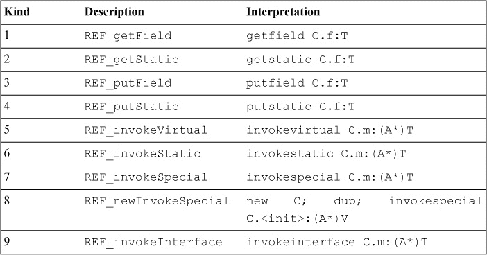

**表 5.4.3.5-A. 方法句柄的字节码行为**

通过指令序列对字段或方法的符号引用由`C.x:T`表示，其中`x`和`T`是字段或方法的名称和描述符（§4.3.2, §4.3.3），而`C`是要查找该字段或方法的类或接口。

令`MH`为正在解析的方法句柄的符号引用（§5.1）。那么：

* 令`R`为`MH`中包含的字段或方法的符号引用。（`R`衍生自由`MH`的`CONSTANT_MethodHandle`中的`reference_index`项引用的`CONSTANT_Fieldref`、`CONSTANT_Methodref`或`CONSTANT_InterfaceMethodref`结构。）

* 令`T`为`R`所引字段的类型，或`R`所引方法的返回类型。令`A*`为`R`所引方法的参数类型序列（可能为空）。（`T`和`A*`衍生自由`R`的`CONSTANT_Fieldref`、`CONSTANT_Methodref`或`CONSTANT_InterfaceMethodref`结构中的`name_and_type_index`项引用的`CONSTANT_NameAndType`结构。）

为了解析`MH`，使用以下三个步骤解析`MH`字节码行为中所有对类、接口、字段和方法的符号引用：

* 第一，解析`R`。

* 第二，解析过程相当于依次对名称与`A*`中每个类型对应的类和接口，以及与类型`T`对应的未解析符号引用进行解析。

* 第三，获取一个指向`java.lang.invoke.MethodType`实例的引用，其过程相当于解析一个方法类型的未解析符号引用，该类型包含了`MH`的类型对应的表 5.4.3.5-B 所示的方法描述符。

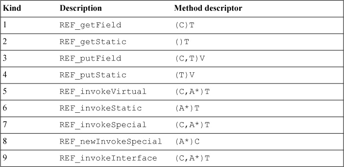

**表 5.4.3.5-B. 方法句柄的方法描述符**

方法句柄的符号引用相当于包含了解析后的方法句柄最终将拥有的类型符号引用。方法的类型详细结构通过检查表 5.4.3.5-B 来获得。

在每一步中，任何由于类或接口或字段或方法引用解析失败而可能抛出的异常，都可以由于方法句柄解析失败而抛出。

其意图是，解析方法句柄可以在 Java 虚拟机成功解析字节码行为中符号引用的完全相同的情况下完成。特别是对于`private`和`protected`成员的方法句柄可以在相应的普通访问合法的类类中创建。

方法句柄解析成功的结果是一个指向`java.lang.invoke.MethodHandle`实例的`reference`（引用），该实例代表方法句柄`MH`。

该`java.lang.invoke.MethodHandle`实例的类型描述符是上述方法句柄解析第三步产生的`java.lang.invoke.MethodType`实例。

方法句柄的类型描述符确保了在`java.lang.invoke.MethodHandle`上对该句柄进行`invokeExact`的有效调用与字节码行为具有完全相同的栈影响。在有效参数集上调用此方法句柄具有与相应的字节码行为相同的效果，并返回相同的结果（如果有）。

如果`R`所引的方法设置了`ACC_VARARGS`标记（§4.6），则通过`invoke`（JLS §15.12）的`java.lang.invoke.MethodHandle`实例是变长方法句柄；否则它是固定长度方法句柄。

如果`R`所引的方法设置了`ACC_VARARGS`标记，且`A*`为空序列或`A*`中的最后一个参数类型不是数组类型，则方法句柄解析将抛出`IncompatibleClassError`。即变长方法句柄的创建失败。

Java 虚拟机实现不需要对方法类型或方法句柄进行池化。即两个不同的方法类型或方法句柄符号引用可能指向相同的`java.lang.invoke.MethodType`或`java.lang.invoke.MethodHandle`实例。

Java 平台中的`java.lang.invoke.MethodHandles`类允许创建没有字节码行为的方法句柄。它们的行为由创建它们的`java.lang.invoke.MethodHandles`方法定义。例如，一个方法句柄可以对其值进行转换，然后将转换后的值传递给另一个方法句柄的调用，然后对其返回的值进行转换。

### 5.4.3.6 调用规格符解析

解析未解析的调用点符号引用涉及三个步骤：

* 调用规格符给出一个方法句柄的符号引用，作为动态调用点的*引导方法*（§4.7.23）。解析该方法句柄以获取`java.lang.invoke.MethodHandle`实例的`reference`（§5.4.3.5）。

* 调用规格符给出一个方法描述符*TD*。通过解析一个与*TD*具有相同参数和返回类型的方法类型符号引用，获取`java.lang.invoke.MethodType`实例的引用（§5.4.3.5）。

* 调用规格符给出零或多个*静态参数*，用于向引导方法传递应用程序特定的元数据。任何作为类、方法句柄或方法类型的静态参数将被解析，相当于调用*ldc*指令（§*ldc*），以获取`Class`对象、`java.lang.invoke.MethodHandle`对象和`java.lang.invoke.MethodType`对象的引用。任何作为字符串字面量的静态参数都将用于获取`String`对象的引用。

调用规格符解析的结果是一个由以下内容组成的元组：

* `java.lang.invoke.MethodHandle`实例的`reference`（引用），

- 对`java.lang.invoke.MethodType`实例的`reference`，

- 对`Class`、`java.lang.invoke.MethodHandle`、`java.lang.invoke.MethodType`和`String`实例的`references`。

在解析调用点指定符中方法句柄的符号引用，或在解析调用点指定符中方法描述符的方法类型的符号引用，或解析任何静态参数的符号引用时，可能会抛出任何与方法类型或方法句柄解析相关的异常 (§5.4.3.5）。

## 5.4.4 访问控制

类或接口`C`对类或接口`D`是可访问的，当且仅当以下任一条件成立：

- `C`是`public`。

- `C`和`D`是同一个运行时包的成员（§5.3）。

字段或方法`R`对类或接口`D`是可访问的，当且仅当以下任一条件成立：

- `R`是`public`。

- `R`是`protected`且声明在类`C`中，并且`D`是`C`的子类或`C`本身。此外，如果`R`不是`static`，则对`R`的符号引用必须包含对类`T`的符号引用，其中`T`是`D`的子类、`D`的超类或`D`本身。

- `R`是`protected`或具有默认访问权限（即既不是`public`也不是`protected`或`private`），并且由与`D`相同运行时包的类声明。

- `R`是`private`且声明在`D`中。

对访问控制的讨论省略了对`protected`字段访问或方法调用的目标的相关限制（目标必须是类`D`或`D`的子类型）。该要求是在验证过程的一部分中检查（§4.10.1.8）；它不是链接时访问控制的一部分。

## 5.4.5 重写

在类`C`中声明的实例方法`m[C]`重写类`A`中声明的另一个实例方法`m[A]`，当且仅当`m[C]`与`m[A]`相同，或者以下所有条件均成立：

- `C`是`A`的子类。

- `m[C]`与`m[A]`有相同的名称和描述符。

- `m[C]`未标记为`ACC_PRIVATE`。

- 以下任一条件成立：

    - `m[A]`被标记为`ACC_PUBLIC`；或被标记为`ACC_PROTECTED`；或既未标记为`ACC_PUBLIC`也非`ACC_PROTECTED`或`ACC_PRIVATE`，且`A`属于与`C`相同的运行时包。

    - `m[C]`重写了方法`m’`（`m’`不同于`m[C]`和`m[A]`），使得`m’`重写了`m[A]`。

## 5.5 初始化

类或接口的*初始化*由执行其类或接口初始化方法组成（§2.9）。

类或接口仅可能作为结果被初始化：

- 执行引用该类或接口的任何 Java 虚拟机指令`new`、`getstatic`、`putstatic`或`invokestatic`（§*new*，§*getstatic*，§*putstatic*，§*invokestatic*）。所有这些指令都通过字段引用或方法引用直接或间接引用了该类或接口。

在执行`new`指令时，如果引用的类或接口尚未初始化，则对其进行初始化。

在执行`getstatic`、`putstatic`或`invokestatic`指令时，声明解析后的字段或方法的类或接口尚未初始化，则对其进行初始化。

- 第一次调用由 Java 虚拟机解析方法句柄得到的`java.lang.invoke.MethodHandle`实例（§5.4.3.5），且其种类为 2 (`REF_getStatic`)、4 (`REF_putStatic`)、6 (`REF_invokeStatic`) 或 8 (`REF_newInvokeSpecial`)。

- 调用类库中的某些反射方法（§2.12），例如，在`Class`类中或在`java.lang.reflect`包中。

- 它的任一子类的初始化。

- 它在 Java 虚拟机启动时被指定为初始类（§5.2）。

在初始化之前，类或接口必须经过链接，即经过验证、准备，以及可选的解析。

由于 Java 虚拟机是多线程的，类或接口的初始化需要仔细的同步，因为可能其他线程可能试图同时初始化同一个类或接口。还可能作为该类或接口初始化的一部分，递归地请求该类或接口的初始化。Java 虚拟机的实现负责通过以下程序处理同步和递归初始化。它假设`Class`对象已经经过验证和准备，并且`Class`对象包含一个指示四种情况之一的状态：

- 此`Class`对象已验证并准备就，但未初始化。

- 此`Class`对象正在被某个特定线程初始化。

- 此`Class`对象已完全初始化并准备好使用。

- 此`Class`对象处于错误状态，可能是因为尝试初始化但失败了。

对于每个类或接口`C`，有一个唯一的初始化锁`LC`。从`C`到`LC`的映射由 Java 虚拟机实现决定。例如，`LC`可以是`C`的`Class`对象，或者是与该`Class`对象相关的监视器。初始化`C`的程序如下：

**1.** 对`C`的初始化锁`LC`进行同步。这涉及等待当前线程能够获取`LC`。

**2.** 如果`C`的`Class`对象表示其他线程正在初始化`C`，则释放`LC`并阻塞当前线程，直到通知正在进行的初始化已完成，此时重复此程序。

线程中断状态不受执行初始化程序的影响。

**3.** 如果`C`的`Class`对象表示当前线程正在初始化`C`，则这必须是一个递归初始化请求。释放`LC`并正常完成。

**4.** 如果`C`的`Class`对象表示`C`已初始化，则不需要执行进一步操作。释放`LC`并正常完成。

**5.** 如果`C`的`Class`对象处于错误状态，则无法初始化。释放`LC`并抛出`NoClassFoundError`。

**6.** 否则，记录当前线程正在初始化`C`的`Class`对象的实，并释放`LC`。然后，按照字段在`ClassFile`结构中出现的顺序，用其`ConstantValue`属性中的常量值（§4.7.2）初始化`C`的每个`final static`字段。

**7.** 下，如果`C`是类而不是接口，且其超类`SC`尚未初始化，则对`SC`递归执行执行整个程序。如有必要，先验证并准备`SC`。

如果`SC`的初始化因为抛出异常而异常终止，则获取`LC`，将`C`的`Class`对象标记为错误，通知所有等待线程，释放`LC`并异常终止，抛出导致初始化`SC`的相同异常。

**8.** 下，通过查询其定义类加载器确定`C`是否启用了断言。


**9.** 下，执行 `C` 的类或接口初始化方法。

**10.** 如果类或接口初始化方法的执行正常完成，则获取 `LC`，将 `C` 的 `Class` 对象标记为完全初始化，通知所有等待线程，释放 `LC` 并正常完成此程序。

**11.** 否则，类或接口初始化方法必须通过抛出某些异常 `E` 异常终止。如果 `E` 的类不是 `Error` 或其子类之一，则创建一个 `ExceptionInInitializerError` 类的新实例，并以 `E` 作为参数，在后续步骤中使用该对象代替 `E`。

如果由于发生 `OutOfMemoryError` 无法创建 `ExceptionInInitializerError` 的新实例，则在后续步骤中使用 `OutOfMemoryError` 对象代替 `E`。

**12.** 获取类锁（`LC`），将类 `C` 的 `Class` 对象标记为错误，通知所有等待线程，释放 `LC`，并根据上一步确定的原因 `E` 或其替换对象异常终止此过程。

Java 虚拟机（JVM）的实现可以优化此过程：当它能够确定类的初始化已经完成时，可以省略第 1 步中的锁获取（以及第 4/5 步中的锁释放），前提是：从 Java 内存模型的角度来看，如果获取了锁将会存在的所有 `happens-before` 排序（见 JLS §17.4.5），在执行优化时仍然存在。

### 5.6 绑定原生方法实现

*绑定*（Binding）是将用非 Java 编程语言编写并实现 `native` 方法的集成到 Java 虚拟机中以便其执行的过程。尽管这一过程传统上被称为“链接”（linking），但规范中使用“绑定”一词是为了避免与 Java 虚拟机对类或接口的链接相混淆。

### 5.7 Java 虚拟机退出

当某个线程调用 `Runtime` 类或 `System` 类的 `exit` 方法，或者调用 `Runtime` 类的 `halt` 方法，且安全管理器允许 `exit` 或 `halt` 操作时，Java 虚拟机退出。

此外，JNI（Java 原生接口）规范描述了当使用 JNI 调度 API 加载和卸载 Java 虚拟机时 Java 虚拟机的终止。

## 第 6 章 Java 虚拟机指令集

Java 虚拟机指令由一个指定要执行的操作的操作码（opcode）组成，随后是零或多个表示要操作的值的操作数组成。本章详细介绍了每个 Java 虚拟机指令的格式及其执行的操作。

### 6.1 假设：“必须”的含义

每条指令的描述始终是在满足 §[4]（`class` 文件格式）静态和结构约束的 Java 虚拟机代码范围内给出的。在单个 Java 虚拟机指令的描述中，我们经常规定某些情况“必须”或“不能”发生：“`value2` 必须是 `int` 类型。” §[4]（`class` 文件格式）的约束保证了所有此类预期实际上将得到满足。如果指令描述中的某些约束（一个“必须”或“不能”）在运行时没有被满足，则 Java 虚拟机的行为是未定义的。

Java 虚拟机在链接时使用 `class` 文件验证器（§4.10）检查 Java 虚拟机代码是否满足静态和结构约束。因此，Java 虚拟机将只会尝试执行来自有效 `class` 文件的代码。在链接时进行验证是很有吸引力的，因为检查只需执行一次，大幅减少了运行时必须完成的工作量。其他实现策略也是可行的，只要它们符合《Java 语言规范，Java SE 8 版》和《Java 虚拟机规范，Java SE 8 版》。

### 6.2 预留操作码

除了本章后文指定的指令操作码（用于 `class` 文件 §[4]（`class` 文件格式））外，还有三个操作码预留给 Java 虚拟机实现的内部使用。如果未来扩展 Java 虚拟机指令集，这些预留操作码保证不被使用。

两个预留操作码数字 254 (0xfe) 和 255 (0xff) 分别具有助符 `impdep1` 和 `impdep2`。这些指令旨在为在软件和硬件中分别实现的特定实现功能提供“后门”或陷阱。第三个预留操作码数字 202 (0xca) 的助符为 `breakpoint`，用于调试器实现断点。

尽管这些操作码已被预留，但它们只能在 Java 虚拟机实现内部使用。它们不能出现在有效的 `class` 文件中。调试器或 JIT 代码生成器（§[2.13]）等可能与已加载并执行的 Java 虚拟机代码直接交互的工具可能会遇到这些操作码。此类工具遇到这些预留指令时应尝试优雅处理。

### 6.3 虚拟机错误

当内部错误或资源限制导致 Java 虚拟机无法实现本章描述的语义时，Java 虚拟机实现会抛出一个 `VirtualMachineError` 类子类的实例对象。本规范无法预测在何时会遇到内部错误或资源限制，也没有规定具体的何时可以报告。因此，在 Java 虚拟机运行期间，下面定义的任何 `VirtualMachineError` 子类都可能在随时被抛出：

- `InternalError`: Java 虚拟机实现内部发生了内部错误，这是因为实现机器的软件故障、底层主机软件故障或硬件故障。此错误在检测到时异步（§[2.10]）传递，并可能发生在程序的任何点。

- `OutOfMemoryError`: Java 虚拟机实现耗尽虚拟或物理内存，且自动存储管理器无法回收足够的内存来满足对象创建请求。

- `StackOverflowError`: Java 虚拟机实现耗尽线程栈空间，通常是因为执行程序的故障导致了无限数量的递归调用。

- `UnknownError`: 发生了异常或错误，但 Java 虚拟机无法报告实际的异常或错误。

### 6.4 指令描述的格式

本章中的 Java 虚拟机指令以如下所示形式的条目表示，按字母顺序排列，每个条目单独起一页。

#### mnemonic

**Operation**

指令的简短描述

**Format**

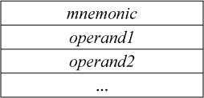

**Forms**

*mnemonic* = opcode

**Operand**

..., *value1*, *value2* →

**Stack**

..., *value3*

**Description**

关于操作数栈内容或常量池项的约束、执行的操作、结果类型等的详细描述。

**Linking Exceptions**

如果执行此指令时可能抛出任何链接异常，它们将按必须抛出的顺序逐行列出。

**Run-time Exceptions**

如果执行指令可以抛出任何运行时异常，它们将按必须抛出的顺序逐行列出。

除了指令列出的链接异常和运行时异常外，该指令不得抛出除 `VirtualMachineError` 或其子类实例以外的运行时异常。

**Notes**

不严格属于指令规范的注释将作为描述末尾注释单独列出。

指令格式图中的每个单元格代表一个的 8 位字节。指令的 `mnemonic`（助记符）是它的名称。它的 `opcode`（操作码）是它的数值表示，以十进制和十六进制形式给出。在 `class` 文件的 Java 虚拟机代码中，实际存在的是数值表示。

请记住，编译时会生成并嵌入 Java 虚拟机指令中的“操作数”，同时也存在在运行时计算并提供在操作数栈上的“操作数”。尽管这些操作数源于几个不同的区域，但所有这些操作数都代表相同的内容：即由正在执行的 Java 虚拟机指令进行操作的值。Java 虚拟机通过隐式地从其操作数栈获取许多操作数，而不是在编译后的代码中将其显式地表示为额外的操作数字节、寄存器编号等，从而保持虚拟机代码的紧凑性。

某些指令作为相关指令簇的成员呈现，这些指令共享单一的描述、格式和操作数栈图。因此，一个族包含多个 `opcodes` 和 `opcode mnemonics`；只有该族的助记符出现在指令格式图中，而单独的 Forms（形式）行列出了所有成员的助记符和操作码。例如，`lconst_<l>` 族指令的 Forms 行提供了该族中两条指令（`lconst_0` 和 `lconst_1`）的助记符和操作码信息：

```
lconst_0 = 9 (0x9)
lconst_1 = 10 (0xa)
```

在 Java 虚拟机指令的描述中，指令执行对当前帧（§2.6)）的操作数栈（§2.6.2)的影响以文本表示，栈从左到右增长，每个值单独表示。因此，

```
..., value1, value2 ->
..., result
```

显示了一种操作，其起始是 `value2` 位于操作数栈顶部，`value1` 紧随其后。指令执行后，`value1` 和 `value2` 从操作数栈弹出，并被指令计算出的 `result` 值替换。操作数栈的剩余部分由省略号 (...) 表示，不受指令执行的影响。

类型 `long` 和 `double` 的值由操作数栈上的单个条目表示。

在第一版 *The Java® Virtual Machine Specification* 中，操作数栈上 `long` 和 `double` 类型的值在栈图中各由两个条目表示的。

## 6.5 指令

### aaload

**操作**

从数组加载 `reference`

**格式**


**形式**

`aaload` = 50 (0x32)

**操作数**

```
..., arrayref, index ->
```

**栈**

```
..., value
```

**描述**

`arrayref` 必须是 `reference` 类型，且必须引用一个组件类型为 `reference` 的数组。`index` 必须是 `int` 类型。`arrayref` 和 `index` 均从操作数栈中弹出。获取 `index` 处数组组件的 `reference` 值 `value` 并将其推入操作数栈。

**运行时**

如果 `arrayref` 为 `null`，`aaload` 将抛出 `NullPointerException`。

**异常**

否则，如果 `index` 不在 `arrayref` 引用的数组范围内，`aaload` 指令将抛出 `ArrayIndexOutOfBoundsException`。

### aastore

**操作**

存储到 `reference` 数组中

**格式**


**形式**

`aastore` = 83 (0x53)

**操作数**

```
..., arrayref, index, value ->
```

**栈**

```
...
```

**描述**

`arrayref` 必须是 `reference` 类型，且必须引用一个组件类型为 `reference` 的数组。`index` 必须是 `int` 类型，`value` 必须是 `reference` 类型。`arrayref`、`index` 和 `value` 均从操作数栈中弹出。`reference` 值 `value` 被存储为 `index` 处的数组组件。

运行时，`value` 的类型必须与 `arrayref` 引用的数组组件类型兼容。具体而言，将引用类型 `S`（源）的值赋值给引用类型 `T`（目标）的数组组件仅当满足以下条件时：

- 如果 `S` 是类类型，则：

    - 如果 `T` 是类类型，则 `S` 必须与 `T` 为同一类，或 `S` 必须是 `T` 的子类；

    - 如果 `T` 是接口类型，则 `S` 必须实现接口 `T`。

- 如果 `S` 是接口类型，则：

    - 如果 `T` 是类类型，则 `T` 必须是 `Object`。

    - 如果 `T` 是接口类型，则 `T` 必须是 `S` 相同的接口或 `S` 的超接口。

- 如果 `S` 是数组类型，即类型 `SC[]`（即类型为 `SC` 组件的数组）：

    - 如果 `T` 是类类型，则 `T` 必须是 `Object`。

    - 如果 `T` 是接口类型，则 `T` 必须是其中接口之一。

### aconst_null

**操作**

推入 `null`

**格式**


**形式**

`aconst_null` = 1 (0x1)

**操作数**

```
... ->
```

**栈**

```
..., null
```

**描述**

将 `null` `reference` 推入操作数栈。

**注意**

Java 虚拟机不强制 `null` 的具体值。

### aload

**操作**

从局部变量加载 `reference`

**格式**

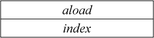

**形式**

`aload` = 25 (0x19)

**操作数**

```
... ->
```

**栈**

```
..., objectref
```

**描述**

`index` 是当前帧（§2.6)）局部变量数组的索引。`index` 处的局部变量必须包含 `reference`。`index` 处的局部变量 `objectref` 被推入操作数栈。

**注意**

`aload` 指令无法从局部变量加载 `returnAddress` 类型的值到操作数栈。这与 `astore` 指令是不对称的。`aload` 指令可以结合 `wide` 指令（wide)）使用双字节索引访问局部变量。

### aload_<n>

**操作**

从局部变量加载 `reference`

**格式**


**形式**

`aload_0` = 42 (0x2a)

`aload_1` = 43 (0x2b)

`aload_2` = 44 (0x2c)

`aload_3` = 45 (0x2d)

**操作数**

```
... ->
```

**栈**

```
..., objectref
```

**描述**

`<n>` 是当前帧（§2.6)）局部变量数组的索引。`<n>` 处的局部变量必须包含 `reference`。`<n>` 处的局部变量 `objectref` 被推入操作数栈。

**注意**

每个 `aload_<n>` 指令等同于索引为 `<n>` 的 `aload`，只是操作数 `<n>` 是隐式的。

### anewarray

**操作**

创建 `reference` 数组

**格式**

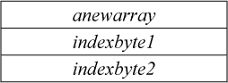

**形式**

`anewarray` = 189 (0xbd)

**操作数**

```
..., count ->
```

**栈**

```
..., arrayref
```

**描述**

`count` 必须是 `int` 类型。它从操作数栈中弹出。`count` 表示要创建的数组的组件数量。无符号字节 `indexbyte1` 和 `indexbyte2` 用于构造指向当前类运行时常量池的索引（见 §2.6)），其中索引的值为 `(indexbyte1 << 8) | indexbyte2`。该索引处的运行时常量池项必须是指向类、数组或接口类型的符号引用。该命名的类、数组或接口类型将进行解析（见 §5.4.3.1)）。从垃圾回收堆中分配一个长度为 `count` 且组件为该类型的新数组，并将指向此新数组对象的 `reference` 引用 `arrayref` 压入操作数栈上。新数组的所有组件都将初始化为 `null`，这是 `reference` 类型的默认值（见 §2.4)）。

## 链接异常 (Linking Exceptions)

在解析指向类、数组或接口类型的符号引用期间，可能会抛出 §5.4.3.1 档记录的任何异常。

## 运行时异常 (Run-time Exceptions)

否则，如果 `count` 小于 0，`anewarray` 指令将抛出 `NegativeArraySizeException`。

## 注意事项 (Notes)

`anewarray` 指令用于创建一个单维的对象引用数组，或作为多维数组的一部分。

### areturn

### 操作 (Operation)

从方法返回 `reference`

### 格式 (Format)


### 形式 (Forms)

`areturn` = 176 (0xb0)

### 操作数 (Operand)

..., `objectref` →

### 栈 (Stack)

[empty]

### 描述 (Description)

`objectref` 必须是 `reference` 类型，并且必须指向一个类型与当前方法的返回描述符（见 §4.3.3)）赋值兼容的对象（JLS §5.2）。如果当前方法是 `synchronized` 方法，则在调用该方法时进入或重新进入的监视器将被更新，并可能像当前线程执行了 `monitorexit` 指令（monitorexit）一样退出。如果没有抛出异常，`objectref` 从当前帧的操作数栈（见 §2.6)）弹出并压入调用者帧的操作数栈中。当前方法操作数栈上的任何其他值都会被丢弃。

解释器随后恢复调用者的帧，并将控制权交回调用者。

### 运行时异常 (Run-time Exceptions)

如果 Java 虚拟机实现没有强制 §2.11.10 中描述的结构化锁规则，那么如果当前方法是 `synchronized` 方法且当前线程不是调用该方法时进入或重新进入的监视器的所有者，则 `areturn` 抛出 `IllegalMonitorStateException`。这种情况可能会发生，例如当一个 `synchronized` 方法包含 `monitorexit` 指令，但在该方法进行同步的对象上没有 `monitorenter` 指令。

否则，如果 Java 虚拟机实现强制执行 §2.11.10 中描述的结构化锁规则，且在调用当前方法期间违反了这些规则中的第一条，则 `areturn` 抛出 `IllegalMonitorStateException`。

### arraylength

### 操作 (Operation)

获取数组长度

### 格式 (Format)


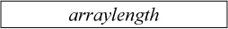

## 形式 (Forms)

`arraylength` = 190 (0xbe)

## 操作数 (Operand)

..., `arrayref` →

## 栈 (Stack)

..., `length`

## 描述 (Description)

`arrayref` 必须是 `reference` 类型并且指向一个数组。它从操作数栈中弹出。确定其所引数组的 `length`。该 `length` 作为 `int` 压入操作数栈。

## 运行时异常 (Run-time Exceptions)

如果 `arrayref` 为 `null`，`arraylength` 指令抛出 `NullPointerException`。

## astore

## 操作 (Operation)

将 `reference` 存储局部变量

## 格式 (Format)

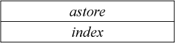

## 形式 (Forms)

`astore` = 58 (0x3a)

## 操作数 (Operand)

..., `objectref` →

## 栈 (Stack)

...

## 描述 (Description)

`index` 是一个无符号字节，必须是当前帧局部变量数组的索引（见 §2.6)）。操作数栈顶部的 `objectref` 必须是 `returnAddress` 类型或 `reference` 类型。它从操作数栈中弹出，并将 `index` 处的局部变量的值设置为 `objectref`。

## 注意事项 (Notes)

在实现 Java 编程语言的 `finally` 子句时（见 §3.13)），`astore` 指令与 `returnAddress` 类型的 `objectref` 使用。

`aload` 指令（`aload`）不能从局部变量加载 `returnAddress` 类型的值到操作数栈。这种与 `astore` 指令的不对称性是有故意的。

`astore` 操作码可以配合 `wide` 指令（`wide`）使用双字节索引访问局部变量。

## astore_<n>

## 操作 (Operation)

将 `reference` 存储到局部变量

## 格式 (Format)

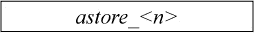

## 形式 (Forms)

`astore_0` = 75 (0x4b)

`astore_1` = 76 (0x4c)

`astore_2` = 77 (0x4d)

`astore_3` = 78 (0x4e)

## 操作数 (Operand)

..., `objectref` →

## 栈 (Stack)

...

## 描述 (Description)

`<n*>` 必须是局部变量数组的索引（见 §2.6)）。操作数栈顶部的 `objectref` 必须是 `returnAddress` 类型或 `reference` 类型。它从操作数栈中弹出，并将 `<n*>` 处的局部变量的值设置为 `objectref`。

## 注意事项 (Notes)

在实现 Java 编程语言的 `finally` 子句时（见 §3.13)），`astore_<n>` 指令与 `returnAddress` 类型的 `objectref` 使用。

`aload_<n>` 指令（`aload<n`）不能从局部变量加载值到操作数栈。这种与 `astore` 指令的不对称性是有故意的。

每个 `astore_<n>` 指令与 `astore` 指令相同，只是操作 `<n*>` 是隐式的。

## athrow

## 操作 (Operation)

抛出异常或错误

## 格式 (Format)


## 形式 (Forms)

`athrow` = 191 (0xbf)

## 操作数 (Operand)

..., `objectref` →

## 栈 (Stack)

`objectref`

## 描述 (Description)

`objectref` 必须是 `reference` 类型，并且指向一个 `Throwable` 类或其子类的实例。它从操作数栈中弹出。然后，通过搜索当前方法（见 §2.6)）寻找匹配 `objectref` 类的第一个异常处理器来抛出该异常，见 §2.10 中的算法。

如果找到了匹配 `objectref` 的异常处理器，它包含了旨在处理此异常的代码位置。`pc` 寄存器重置为该位置，清除当前帧的操作数栈，并将 `objectref` 压回操作数栈，继续执行。

如果在当前帧中未找到匹配的异常处理器，该帧被弹出。如果当前帧代表对 `synchronized` 方法的调用，则调用该方法时进入或重新进入的监视器将被退出，就好像执行了 `monitorexit` 指令一样。最后，如果存在调用者的帧，则恢复它并重新抛出 `objectref`。如果不存在此类帧，则当前线程退出。

## 运行时异常 (Run-time Exceptions)

如果 `objectref` 为 `null`，`athrow` 将抛出 `NullPointerException` 而不是 `objectref`。

否则，如果 Java 虚拟机实现没有强制执行 §2.11.10 中描述的结构化锁规则，那么如果当前帧的方法是 `synchronized` 方法，且当前线程不是调用该方法时进入或重入的监视器所有者，则 `athrow` 将抛出 `IllegalMonitorStateException`，而不是之前抛出的对象。这种情况可能会发生，例如，一个异常完成的 `synchronized` 方法包含一个 `monitorexit` 指令，但在该方法所同步的对象上没有 `monitorenter` 指令。

否则，如果 Java 虚拟机实现强制执行 §2.11.10 中描述的结构化锁规则，并且在调用当前方法期间违反了这些规则中的第一条，则 `athrow` 将抛出 `IllegalMonitorStateException`，而不是之前抛出的对象。

## Notes

`athrow` 指令的操作数栈图可能具有误导性：如果在当前方法中匹配到该异常的处理器，`athrow` 指令会丢弃操作数栈上的所有值，然后将抛出的对象推入操作数栈。然而，如果当前方法中没有匹配到处理器且异常在方法调用链的更上抛出，则处理该异常的方法（如果有）的操作数栈将被清空，并且 `objectref` 被推入该空操作数栈中。从抛出异常的方法到处理该异常的方法（但不包括该方法）之间的所有中间帧都会被丢弃。

## baload

## Operation

从数组加载 `byte` 或 `boolean`

## Format

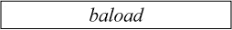

## Forms

`baload` = 51 (0x33)

## Operand

..., `arrayref`, `index` →

## Stack

..., `value`

## Description

`arrayref` 必须是 `reference` 类型，且必须引用一个分元素类型为 `byte` 类型或 `boolean` 类型的数组。`index` 必须是 `int` 类型。`arrayref` 和 `index` 都会从操作数栈中弹出。获取数组中 `index` 处分元素的 `byte` `value`，将其符号位扩展为 `int` `value`，然后推入操作数栈顶部。

## Run-time

如果 `arrayref` 为 `null`，`baload` 将抛出 `NullPointerException`。

## Exceptions

否则，如果 `index` 不在 `arrayref` 所用的数组范围内，`baload` 指令将抛出 `ArrayIndexOutOfBoundsException`。

## Notes

`baload` 指令用于从 `byte` 和 `boolean` 数组加载值。在 Oracle Java 虚拟机实现中，`boolean` 数组——即类型为 `T_BOOLEAN` 的数组（§2.2, §`newarray`）——被实现为 8 位值的数组。其他实现可能实现压缩的 `boolean` 数组；必须使用此类实现的 `baload` 指令来访问这些数组。

## bastore

## Operation

存储到 `byte` 或 `boolean` 数组

## Format


## Forms

`bastore` = 84 (0x54)

## Operand

..., `arrayref`, `index`, `value` →

## Stack

...

## Description

`arrayref` 必须是 `reference` 类型，且必须引用一个分元素类型为 `byte` 类型或 `boolean` 类型的数组。`index` 和 `value` 必须都是 `int` 类型。`arrayref`、`index` 和 `value` 都会从操作数栈中弹出。`int` `value` 被截断为 `byte` 并存储为由 `index` 索引的数组元素。

## Run-time

如果 `arrayref` 为 `null`，`bastore` 将抛出 `NullPointerException`。

## Exceptions

否则，如果 `index` 不在 `arrayref` 所用的数组范围内，`bastore` 指令将抛出 `ArrayIndexOutOfBoundsException`。

## Notes

`bastore` 指令用于将值存储到 `byte` 和 `boolean` 数组中。在 Oracle Java 虚拟机实现中，`boolean` 数组——即类型为 `T_BOOLEAN` 的数组（§2.2, §`newarray`）——被实现为 8 位值的数组。`bastore` 指令必须能够将 `boolean` 值存储到 `byte` 数组中。

## bipush

## Operation

推送 `byte`

## Format

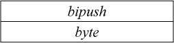

## Forms

`bipush` = 16 (0x10)

## Operand

...

## Stack

..., `value`

## Description

立即数 `byte` 被符号位扩展为 `int` `value`。将该 `value` 推入操作数栈。

## caload

## Operation

从数组加载 `char`

## Format


## Forms

`caload` = 52 (0x34)

## Operand

..., `arrayref`, `index` →

## Stack

..., `value`

## Description

`arrayref` 必须是 `reference` 类型，且必须引用一个分元素类型为 `char` 的数组。`index` 必须是 `int` 类型。`arrayref` 和 `index` 都会从操作数栈中弹出。获取数组中 `index` 处分元素的 `char`，将其符号扩展为 `int` `value`，然后推入操作数栈。

## Run-time

如果 `arrayref` 为 `null`，`caload` 将抛出 `NullPointerException`。

## Exceptions

否则，如果 `index` 不在 `arrayref` 所用的数组范围内，`caload` 指令将抛出 `ArrayIndexOutOfBoundsException`。

## castore

## Operation

存储到 `char` 数组

## Format


## Forms

`castore` = 85 (0x55)

## Operand

..., `arrayref`, `index`, `value` →

## Stack

...

## Description

`arrayref` 必须是 `reference` 类型，且必须引用一个分元素类型为 `char` 的数组。`index` 和 `value` 必须都是 `int` 类型。`arrayref`、`index` 和 `value` 都会从操作数栈中弹出。`int` `value` 被截断为 `char` 并存储为由 `index` 索引的数组元素。

## Run-time

如果 `arrayref` 为 `null`，`castore` 将抛出 `NullPointerException`。

## Exceptions

否则，如果 `index` 不在 `arrayref` 所用的数组范围内，`castore` 指令将抛出 `ArrayIndexOutOfBoundsException`。

## checkcast

## Operation

检查对象是否为给定类型

## Format

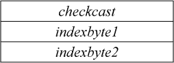

## Forms

`checkcast` = 192 (0xc0)

## Operand

..., `objectref` →

## Stack

..., `objectref`

## Description

`objectref` 必须是 `reference` 类型。符号 `indexbyte1` 和 `indexbyte2` 用于构造当前类（2.6）常量池的索引，其值为 (*indexbyte1* << 8) | *indexbyte2*。该索引对应的常量池项必须是类、数组或接口的符号引用。

如果 *objectref* 为 `null`，则操作数栈保持不变。

否则，解析命名的类、数组或接口（5.4.3.1）。如果 *objectref* 可以转换为解析出的类、数组或接口，操作数栈保持不变；否则，*checkcast* 指令抛出 `ClassCastException`。

以下规则用于确定非 `null` 的 *objectref* 是否可以转换为解析类型：如果 S 是 *objectref* 所引用对象的类，而 T 是解析出的类、数组或接口类型，*checkcast* 如下确定 *objectref* 是否可以转换为类型 T：

- 如果 S 是普通（非数组）类，那么：
  - 如果 T 是类类型，则 S 必须是 T 相同的类，或者 S 是是 T 的子类；
  - 如果 T 是接口类型，则 S 必须实现接口 T。
- 如果 S 是接口类型，那么：
  - 如果 T 是类类型，则 T 必须是 `Object`。
  - 如果 T 是接口类型，则 T 必须是 S 相同的接口或 S 的超接口。
- 如果 `S` 是一个表示数组类型 `SC[]` 的类，即一个类型为 `SC` 的组件数组，那么：
  - 如果 `T` 是一个类类型，则 `T` 必须是 `Object`。
  - 如果 `T` 是一个接口类型，则 `T` 必须是数组所实现的接口之一（JLS §4.10.3）。
  - 如果 `T` 是一个数组类型 `TC[]`，即一个类型为 `TC` 的组件数组，那么必须满足以下条件之一：
    - `TC` 和 `SC` 是相同的原始类型类型。
    - `TC` 和 `SC` 是引用类型，且通过递归应用这些规则，类型 `SC` 可以强制转换为 `TC`。

## 链接异常（Linking Exceptions）

在解析指向类、数组或接口类型的符号引用期间，可能会抛出节 §5.4.3.1 中记录的任何异常。

## 运行时异常

否则，如果 `objectref` 无法强制转换为已解析的类、数组或接口类型，则 `checkcast` 指令抛出 `ClassCastException`。

## 备注

`checkcast` 指令与 `instanceof` 指令非常相似（节*instanceof）。它们的区别在于对 `null` 的处理、测试失败时的行为（`checkcast` 抛出异常，`instanceof` 推入结果码）以及对操作数栈的影响。

## d2f

### 操作

将 `double` 转换为 `float`

### 格式


### 形式

`d2f` = 144 (0x90)

### 操作数

..., `value` →

### 栈

..., `result`

### 描述

操作数栈顶的 `value` 必须是 `double` 类型。它从栈弹出并经过值集转换 (§2.8.3) 得到 `value’`。然后，使用 IEEE 754 最近舍入模式将 `value’` 转换为 `float` 结果。`result` 被推入操作数栈。

当 `d2f` 指令是 FP 严格的（§2.8.2）时，转换结果始终舍入到 float 值集中最接近的可表示值（§2.3.2）。

当 `d2f` 指令不是 FP 严格的时，转换结果可能取自 float 扩展指数值集（§2.3.2）；它不一定会被舍入到 float 值集中最接近的可表示值。

太小而无法表示为 `float` 的有限 `value’` 被转换为相同符号的零；太大而无法表示为 `float` 的有限 `value’` 被转换为相同符号的无穷大。`double` NaN 被转换为 `float` NaN。

### 备注

`d2f` 指令执行收窄原始转换（JLS §5.1.3）。它可能会丢失 `value’` 的整体幅值信息，并可能丢失精度。

## d2i

### 操作

将 `double` 转换为 `int`

### 格式


### 形式

`d2i` = 142 (0x8e)

### 操作数

..., `value` →

### 栈


## 描述

操作数栈顶的 `value` 必须是 `double` 类型。它从栈弹出并经过值集转换 (§2.8.3) 得到 `value’`。然后将 `value’` 转换为 `int`。结果被推入操作数栈：

- 如果 `value’` 是 NaN，转换结果 `result` 为 `int` 0。
- 否则，如果 `value’` 不是无穷大，它使用 IEEE 754 向零舍入模式转换为整数值 `V`。如果该整数值 `V` 可以表示为 `int`，则结果为 `int` 值 `V`。
- 否则，要么 `value’` 太小（大幅值的负值或负无穷大），`result` 为 `int` 类型的最小表示值；要么 `value’` 太大（大幅值的正值或正无穷大），`result` 为 `int` 类型的最大可表示值。

## 备注

`d2i` 指令执行收窄原始转换（JLS §5.1.3）。它可能会丢失 `value’` 的整体幅值信息，并可能丢失精度。

## d2l

### 操作

将 `double` 转换为 `long`

### 格式


### 形式

`d2l` = 143 (0x8f)

### 操作数

..., `value` →

### 栈

..., `result`

### 描述

操作数栈顶的 `value` 必须是 `double` 类型。它从栈弹出并经过值集转换 (§2.8.3) 得到 `value’`。然后将 `value’` 转换为 `long`。结果被推入操作数栈：

- 如果 `value’` 是 NaN，转换结果为 `long` 0。
- 否则，如果 `value’` 不是无穷大，它使用 IEEE 754 向零舍入模式转换为整数值 `V`。如果该整数值 `V` 可以表示为 `long`，则结果为 `long` 值 `V`。
- 否则，要么 `value’` 太小（大幅值的负值或负无穷大），`result` 为 `long` 类型的最小表示值；要么 `value’` 太大（大幅值的正值或正无穷大），`result` 为 `long` 类型的最大可表示值。

### 备注

`d2l` 指令执行收窄原始转换（JLS §5.1.3）。它可能会丢失 `value’` 的整体幅值信息，并可能丢失精度。

## dadd

### 操作

加两个 `double`

### 格式


### 形式

`dadd` = 99 (0x63)

### 操作数

..., `value1`, `value2` →

### 栈

..., `result`

### 描述

`value1` 和 `value2` 必须是 `double` 类型。它们从栈弹出并经过值集转换 (§2.8.3) 得到 `value’` 和 `value2’`。`double` `result` 为 `value’ + value2’`。`result` 被推入操作数栈。

`dadd` 指令的结果遵循 IEEE 算术规则：

- 如果 `value’` 或 `value2’` 是 NaN，结果为 NaN。
- 符号相反的两个无穷之值为 NaN。
- 符号相同的两个无穷值为该符号的无穷大。
- 无穷大与有限值的和等于无穷大。
- 符号相反的两个零为正零。
- 符号相同的两个零为该符号的零。
- 零与非零值的和等于非零值。
- 幅值相同符号相反的两个非零有限值为正零。
- 在剩余情况下（即两个操作数都不是无穷大、零或 NaN，且符号相同或幅值不同），计算和并使用 IEEE 754 最近舍入模式舍入到最近的可表示值。如果幅值太大无法表示为 `double`，则认为操作溢出；结果为相应符号的无穷大。如果幅值太小无法表示为 `double`，则认为操作下溢；结果为相应符号的零。

Java 虚拟机支持 IEEE 754 定义的渐进下溢。尽管可能会溢出、下溢或精度丢失，`dadd` 指令的执行从不会抛出运行时异常。

## daload

### 操作

从数组加载 `double`

### 格式


### 形式

`daload` = 49 (0x31)

### 操作数

..., `arrayref`, `index` →

### 栈

..., `value`

### 描述

`arrayref` 必须是 `reference` 类型并指向一个组件类型为 `double` 的数组。`index` 必须是 `int` 类型。`arrayref` 和 `index` 从栈弹出。数组中 `index` 处的组件的 `double` 值被获取并推入操作数栈。

### 运行时异常

如果 `arrayref` 为 `null`，`daload` 抛出 `NullPointerException`。

否则，如果 `index` 不在 `arrayref` 所引数组的范围内，`daload` 指令将抛出 `ArrayIndexOutOfBoundsException`。

## dastore

### 操作

存储到 `double` 数组

### 格式


### 形式

`dastore` = 82 (0x52)

### 操作数

..., `arrayref`, `index`, `value` →

### 栈

...

### 描述

`arrayref` 必须是 `reference` 类型，并且必须指向一个组件类型为 `double` 的数组。`index` 必须是 `int` 类型，`value` 必须是 `double` 类型。`arrayref`、`index` 和 `value` 从操作数栈中弹出。`double` 类型 `value` 经过值集转换 (§2.8.3)，得到 `value’`，其被存储为由 `index` 索引的数组组件。

### 运行时异常

如果 `arrayref` 为 `null`，`dastore` 将抛出 `NullPointerException`。

否则，如果 `index` 不在 `arrayref` 所引数组的范围内，`dastore` 指令将抛出 `ArrayIndexOutOfBoundsException`。

## dcmp<op>

### 操作

比较 `double`

### 格式


### 形式

`dcmpg` = 152 (0x98)

`dcmpl` = 151 (0x97)

### 操作数

..., `value1`, `value2` →

### 栈

..., `result`

### 描述

`value1` 和 `value2` 必须是 `double` 类型。这两个值从操作数栈中弹出并经过值集转换 (§2.8.3)，得到 `value1’` 和 `value2’`。执行浮点数比较：

- 如果 `value1’` 大于 `value2’`，则将 `int` 值 1 推入操作数栈。
- 否则，如果 `value1’` 等于 `value2’`，则将 `int` 值 0 推入操作数栈。
- 否则，如果 `value1’` 小于 `value2’`，则将 `int` 值 -1 推入操作数栈。
- 否则，`value1’` 或 `value2’` 中至少有一个为 NaN。`dcmpg` 指令将 `int` 值 1 推入操作数栈，而 `dcmpl` 指令将 `int` 值 -1 推入操作数栈。

浮点数比较根据 IEEE 754 标准进行。除 NaN 以外的所有值都是有序的，负无穷小于所有有限值，正无穷大于所有有限值。正零和负零被视为相等。

### 注释

`dcmpg` 和 `dcmpl` 指令的区别仅在于对涉及 NaN 比较的处理。NaN 是无序的，因此如果一个或两个操作数为 NaN，任何 `double` 比较都会失败。由于同时存在 `dcmpg` 和 `dcmpl`，任何 `double` 比较都可以被编译为将相同的 `result` 推入操作数栈，无论比较是在非 NaN 值上失败，还是因为遇到 NaN 而失败。更多信息，请参阅 §3.5。

## dconst_<d>

### 操作

推入 `double`

### 格式


### 形式

`dconst_0` = 14 (0xe)

`dconst_1` = 15 (0xf)

### 操作数

... →

### 栈

..., `<d*>`

### 描述

将 `double` 常量 `<d*>` (0.0 或 1.0) 推入操作数栈。

## ddiv

### 操作

除法 `double`

### 格式


### 形式

`ddiv` = 111 (0x6f)

### 操作数

..., `value1`, `value2` →

### 栈

..., `result`

### 描述

`value1` 和 `value2` 必须是 `double` 类型。这两个值从操作数栈中弹出并经过值集转换 (§2.8.3)，得到 `value1’` 和 `value2’`。`double` 类型 `result` 为 `value1’` / `value2’`。`result` 被推入操作数栈。

`ddiv` 指令的结果受 IEEE 算术规则限制：

- 如果 `value1’` 或 `value2’` 中有一个为 NaN，结果为 NaN。
- 如果 `value1’` 和 `value2’` 都不是 NaN，则如果两个值的符号相同，结果符号为正；如果符号不同，结果符号为负。
- 无穷大除以无穷大得到 NaN。
- 无穷大除以有限值得到有符号的无穷，遵循上述符号产生规则。
- 有限值除以无穷大得到有符号的零，遵循上述符号产生规则。
- 零除以零得到 NaN。
- 零除以有限值得到有符号的无穷，遵循上述符号产生规则。

（此处省略原文中重复的逻辑行...）

## dload

### 操作

从局部变量加载 `double`

### 格式

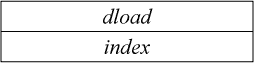

### 形式

`dload` = 24 (0x18)

### 操作数

... →

### 栈

..., `value`

### 描述

`arrayref` 必须是 `reference` 类型，并且必须指向一个组件类型为 `double` 的数组。`index` 必须是 `int` 类型，`value` 必须是 `double` 类型。`arrayref`、`index` 和 `value` 从操作数栈中弹出。`double` 类型 `value` 经过值集转换 (§2.8.3)，得到 `value’`，其被存储为由 `index` 索引的数组组件。

### 运行时异常

如果 `arrayref` 为 `null`，`dastore` 将抛出 `NullPointerException`。

否则，如果 `index` 不在 `arrayref` 所引数组的范围内，`dastore` 指令将抛出 `ArrayIndexOutOfBoundsException`。

## dload_<n>

### 操作

从局部变量加载 `double`

### 格式

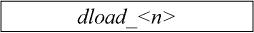

### 形式

`dload_0` = 38 (0x26)

`dload_1` = 39 (0x27)

`dload_2` = 40 (0x28)

`dload_3` = 41 (0x29)

### 操作数

... →

### 栈

..., `value`

### 描述

每个 `dload_<n>` 指令与带有 `<n>` 的 `dload` 相同，只是 `<n>` 是隐式的。局部变量必须包含一个 `double`。位于 `<n>` 的 `value` 被推入操作数栈。

## dmul

### 操作

乘法 `double`

### 格式


### 形式

`dmul` = 107 (0x6b)

### 操作数

..., `value1`, `value2` →

### 栈

..., `result`

### 描述

`value1` 和 `value2` 必须是 `double` 类型。这两个值从操作数栈中弹出并经过值集转换 (§2.8.3)，得到 `value1’` 和 `value2’`。`double` 类型 `result` 为 `value1’` * `value2’`。`result` 被推入操作数栈。

`dmul` 指令的结果受 IEEE 算术规则限制：

- 如果 `value1’` 或 `value2’` 中有一个为 NaN，结果为 NaN。
- 如果 `value1’` 和 `value2’` 都不是 NaN，则如果两个值的符号相同，结果符号为正；如果符号不同，结果符号为负。
- 无穷大乘以零得到 NaN。
- 无穷大乘以有限值得到有符号的无穷，遵循上述符号产生规则。

（此处省略原文中重复的逻辑行...）

Java 虚拟机要求支持 IEEE 754 定义的渐进下溢（gradual underflow）。尽管可能会发生溢出、下溢或精度丢失，执行 `dmul` 指令永远不会抛运行时异常。

## dneg

### 操作

取反 `double`

### 格式


### 形式

`dneg` = 119 (0x77)

### 操作数

..., `value` →

### 栈

..., `result`

### 描述

该值必须是 `double` 类型。它从操作数栈中弹出并经过值集转换 (§2.8.3)，得到 `value’`。`double` 类型 `result` 是 `value’` 的算术取反。`result` 被推入操作数栈。

对于 `double` 值，取反并不同于减去零。如果 `x` 是 `+0.0`，则 `0.0-x` 等于 `+0.0`，但 `-x` 等于 `-0.0`。一元负号仅仅反转 `double` 的符号。

感兴趣的特殊情况：

- 如果操作数是 NaN，则结果为 NaN（返回 NaN 没有符号）。
- 如果操作数是无穷大，则结果为相反符号的无穷大。
- 如果操作数是零，则结果为相反符号的零。

## drem

### 操作

`double` 余数

### 格式

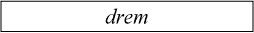

### 形式

`drem` = 115 (0x73)

### 操作数

..., `value1`, `value2` →

### 栈

..., `result`

### 描述

`value1` 和 `value2` 必须是 `double` 类型。这两个值从操作数栈中弹出并经过值集转换 (§2.8.3)，得到 `value1’` 和 `value2’`。计算 `result` 并作为 `double` 类型推入操作数栈。

`drem` 指令的结果与 IEEE 754 定义的所谓余数操作不同。IEEE 754 的“remainder”操作计算的是基于舍入除法的余数，而不是截断除法的余数，因此其行为与通常的整数取模运算符不同。相反，Java 虚拟机定义 `drem` 的行为类似于 Java 虚拟机的整数取模指令（`irem` 和 `lrem`）；这可以与 C 库函数 `fmod` 进行比较。

`drem` 指令的结果遵循以下规则：

- 如果 `value1’` 或 `value2’` 中任意一个是 NaN，则结果为 NaN。
- 如果 `value1’` 和 `value2’` 都不是 NaN，则结果的符号等于被除数的符号。
- 如果被除数是无穷大或除数为零（或两者都是），则结果为 NaN。
- 如果被除数有限的且除数为无穷大，则结果等于被除数。
- 如果被除数为零且除数有限的，则结果等于被除数。
- 在其余情况中（即两个操作数都不是无穷大、零或 NaN），被除数 `value1’` 和除数 `value2’` 的浮点余数 `result` 由数学关系 `result` = `value1’` - (`value2’` * `q`) 定义，其中 `q` 是一个整数，它仅当 `value1’` / `value2’` 为负时为负，仅当 `value1’` / `value2’` 为正时为正，且其绝对值在不超过 `value1’` 和 `value2’` 的真实数学商绝对值的情况下尽可能大。

尽管可能会发生除零操作，求值 `drem` 指令永远不会抛运行时异常。也不会发生溢出、下溢或精度丢失。

### 注意事项

IEEE 754 remainder 操作可以通过库例程 `Math.IEEEremainder` 计算。

## dreturn

### 操作

从方法返回 `double`

### 格式


### 形式

`dreturn` = 175 (0xaf)

### 操作数

..., `value` →

### 栈

[空]

### 描述

当前方法必须具有返回类型 `double`。`value` 必须是 `double` 类型。如果当前方法是 `synchronized` 方法，则在调用方法时进入或重入的监视器将被更新并可能退出，就像在当前线程中执行了 `monitorexit` 指令一样 (§monitorexit)。如果没有抛出异常，`value` 从当前帧的操作数栈弹出 (§2.6) 并经过值集转换 (§2.8.3)，得到 `value’`。`value’` 被推入调用者帧的操作数栈。当前方法操作数栈上的任何其他值都会被丢弃。

解释器随后将控制权交回方法的调用者，恢复调用者的帧。

### 运行时异常


Java 虚拟机实现并不强制执行 §2.1 中描述的规则，如果当前方法是 `synchronized` 方法且在调用时进入或重入了监视器，则 `dreturn` 抛出 `IllegalMonitorStateException`。

### dstore

#### 操作

将 `double` 存储局部变量

#### 格式


#### 形式

`dstore` = 57 (0x39)

#### 操作数

..., `value` →

#### 栈

...

#### 描述

`index` 是一个无符号字节。`index` 和 `index`+1 必须是当前帧局部变量数组的索引 (§2.6)。操作数栈顶部的 `value` 必须是 `double` 类型。它从操作数栈弹出并经过值集转换 (§2.8.3)，得到 `value`’。`index` 处的局部变量被设置为 `value`’。

#### 注意事项

`dstore` 码可以与 `wide` 指令结合使用，使用双字节索引访问局部变量。

## dstore_<n>

#### 操作

将 `double` 存储局部变量

#### 格式


#### 形式

`dstore_0` = 71 (0x47)

`dstore_1` = 72 (0x48)

`dstore_2` = 73 (0x49)

`dstore_3` = 74 (0x4a)

#### 操作数

..., `value` →

#### 栈

...

#### 描述

`<n*>` 和 `<n*>`+1 必须是当前帧局部变量数组的索引 (§2.6)。操作数栈顶部的 `value` 必须是 `double` 类型。它从操作数栈弹出并经过值集转换 (§2.8.3)，得到 `value`’。`<n*>` 和 `<n*>`+1 处的局部变量被设置为 `value`’。

#### 注意事项

每条 `dstore_<n>` 指令都与 *index* 为 `<n*>` 的 `dstore` 相同，只是操作数 `<n*>` 是隐式的。

### dsub

#### 操作

减去 `double`

#### 格式


#### 形式

`dsub` = 103 (0x67)

#### 操作数

..., `value1`, `value2` →

#### 栈

..., `result`

#### 描述

`value1` 和 `value2` 必须是 `double` 类型。这两个值从操作数栈中弹出并经过值集转换 (§2.8.3)，得到 `value1`’ 和 `value2`’。`double` 类型 `result` 是 `value1`’ - `value2`’。`result` 被推入操作数栈。

Java 虚拟机要求支持 `IEEE 754` 定义的渐进式下溢。尽管可能会发生溢出、下溢或精度丢失，但执行 `dsub` 指令永远不会抛出运行时异常。

### dup

#### 操作

复制操作数栈顶部的值

#### 格式


#### 形式

`dup` = 89 (0x59)

#### 操作数

..., `value` →

#### 栈

..., `value`, `value`

#### 描述

复制操作数栈顶部的值，并将复制的值推入操作数栈。

除非 `value` 是一个第 1 类计算类型的值（§2.11.1)，否则不能使用 `dup` 指令。

### dup_x1

#### 操作

复制操作数栈顶部的值并向下插入两个值

#### 格式


#### 形式

`dup_x1` = 90 (0x5a)

#### 操作数

..., `value2`, `value1` →

#### 栈

..., `value1`, `value2`, `value1`

#### 描述

复制操作数栈顶部的值，并将复制的值插入到操作数栈向下两个值的位置。

除非 `value1` 和 `value2` 都是第 1 类计算类型的值（§2.11.1)），否则不能使用 `dup_x1` 指令。

## dup_x2

#### 操作

复制操作数栈顶部的值并向下插入两个或三个值

#### 格式


#### 形式

`dup_x2` = 91 (0x5b)

#### 操作数

形式 1：

#### 栈

..., `value3`, `value2`, `value1` →

..., `value1`, `value3`, `value2`, `value1`

其中 `value1`、`value2` 和 `value3` 都是第 1 类计算类型的值（§2.11.1)）。

形式 2：

..., `value2`, `value1` →

..., `value1`, `value2`, `value1`

其中 `value1` 是第 1 类计算类型的值，而 `value2` 是第 2 类计算类型的值（§2.11.1)）。

#### 描述

复制操作数栈顶部的值，并将复制的值插入到操作数栈向下两个或三个值的位置。

## dup2

#### 操作

复制操作数栈顶部的的一个或两个值

#### 格式


#### 形式

`dup2` = 92 (0x5c)

#### 操作数

形式 1：

#### 栈

..., `value2`, `value1` →

..., `value2`, `value1`, `value2`, `value1`

其中 `value1` 和 `value2` 都是第 1 类计算类型的值（§2.11.1)）。

形式 2：

..., `value` →

..., `value`, `value`

其中 `value` 是第 2 类计算类型的值（§2.11.1)）。

#### 描述

复制操作数栈顶部的的一个或两个值，并将复制的值或多个值按原始顺序推回操作数栈。

## dup2_x1

#### 操作

复制操作数栈顶部的的一个或两个值并向下插入两个或三个值

#### 格式


#### 形式

`dup2_x1` = 93 (0x5d)

#### 操作数

形式 1：

#### 栈

..., `value3`, `value2`, `value1` →

..., `value2`, `value1`, `value3`, `value2`, `value1`

其中 `value1`、`value2` 和 `value3` 都是第 1 类计算类型的值（§2.11.1)）。

形式 2：

..., `value2`, `value1` →

..., `value1`, `value2`, `value1`

其中 `value1` 是第 2 类计算类型的值，而 `value2` 是第 1 类计算类型的值（§2.11.1)）。

#### 描述

复制操作数栈顶部的的一个或两个值，并将复制的值按原始顺序插入到操作数栈中原始值或值下方的一个值的位置。

## dup2_x2

#### 操作

复制操作数栈顶部的的一个或两个值并向下插入两个、三个或四个值

#### 格式


#### 形式

`dup2_x2` = 94 (0x5e)

#### 操作数

形式 1：

#### 栈

..., `value4`, `value3`, `value2`, `value1` →

..., `value2`, `value1`, `value4`, `value3`, `value2`, `value1`

其中 `value1`、`value2`、`value3` 和 `value4` 都是第 1 类计算类型的值（§2.11.1)）。

形式 2：

..., `value3`, `value2`, `value1` →

..., `value1`, `value3`, `value2`, `value1`

其中 `value1` 是第 2 类计算类型的值，而 `value2` 和 `value3` 都是第 1 类计算类型的值（§2.11.1)）。

形式 3：

..., `value3`, `value2`, `value1` →

..., `value2`, `value1`, `value3`, `value2`, `value1`

其中 `value1` 和 `value2` 都是第 1 类计算类型的值，且 `value3` 是第 2 类计算类型的值（§2.11.1)）。

形式 4：

..., `value2`, `value1` →

..., `value1`, `value2`, `value1`

其中 `value1` 和 `value2` 都是第 1 类计算类型的值，且是第 2 类计算类型的值（§2.11.1)）。

#### 描述

复制操作数栈顶部的的一个或两个值，并将复制的值插入到操作数栈中原始值或值下方的位置。

### f2d

#### 操作

将 `float` 转换为 `double`

#### 格式


#### 形式

`f2d` = 141 (0x8d)

#### 操作数

..., `value` →

#### 栈

..., `result`

#### 描述

操作数栈上的 `value` 从操作数栈中弹出并进行值转换（§2.8.3）。然后将 `value’` 转换为双精度 `result`。

#### 注意

如果 `f2d` 指令是严格的，它执行宽转换（JLS §5.1.2）。由于 float 设置（§2.3.2）的值都可以由双精度表示，这种转换是精确的。如果 `f2d` 指令不是严格的，转换结果可能取自双指数集合；它不一定是最近的可表示值。

### f2i

#### 操作

将 `float` 转换为 `int`

#### 格式


#### 形式

`f2i` = 139 (0x8b)

#### 操作数

..., `value` →

#### 栈

..., `result`

#### 描述

操作数栈上的 `value` 类型必须是 `float`。它从操作数栈中弹出并进行值转换（§2.8.3）。然后将 `value’` 转换为整数 `result`。该 `result` 推入操作数栈：

- 如果 `value’` 是 NaN，则转换结果为整数 `int` 0。

- 否则，如果 `value’` 不是无穷大，则根据 IEEE 754 向零舍入模式将其舍入为整数值 V。如果该整数值 V 可以表示为 `int`，则 `result` 就是整数 V。

- 否则，要么 `value’` 太小（负的大幅值或负无穷），此时 `result` 是 `int` 类型的最小可表示值；要么 `value’` 太大（正的大幅值或正无穷），此时 `result` 是 `int` 类型的最大可表示值。

#### 注意

`f2i` 指令执行窄原始转换（JLS §5.1.3）。它可能会丢失 `value’` 的整体数量级信息，并可能丢失精度。

### f2l

#### 操作

将 `float` 转换为 `long`

#### 格式


#### 形式

`f2l` = 140 (0x8c)

#### 操作数

..., `value` →

#### 栈

..., `result`

#### 描述

操作数栈顶部的 `value` 必须是 `float` 类型。它从操作数栈中弹出并经过值集转换（§2.8.3），得到 `value’`。然后将 `value’` 转换为 `long` 类型 `result`。该 `result` 被推入操作数栈：

- 如果 `value’` 是 NaN，则转换结果为 `long` 类型 0。

- 否则，如果 `value’` 不是无穷大，则使用 IEEE 754 向零舍入模式将其舍入为整数值 `V`。如果该整数值 `V` 可以表示为 `long`，则 `result` 为 `long` 类型的值 `V`。

- 否则，要么 `value’` 太小（大绝对值的负值或负无穷），此时 `result` 为 `long` 类型可表示的最小值；要么 `value’` 太大（大绝对值的正值或正无穷），此时 `result` 为 `long` 类型可表示的最大值。

#### 注意

`f2l` 指令执行窄化原始转换（JLS §5.1.3）。它可能会丢失 `value’` 的整体量级信息，并可能丢失精度。

### fadd

#### 操作

加 `float`

#### 格式


#### 形式

`fadd` = 98 (0x62)

#### 操作数

..., `value1`, `value2` →

#### 栈

..., `result`

#### 描述

`value1` 和 `value2` 必须是 `float` 类型。这两个值从操作数栈中弹出并经过值集转换（§2.8.3），得到 `value1’` 和 `value2’`。`float` 类型 `result` 为 `value1’ + value2’`。该 `result` 被推入操作数栈。

`fadd` 指令的结果受 IEEE 算术规则的约束：

- 如果 `value1’` 或 `value2’` 中任一个为 NaN，则结果为 NaN。

- 符号相反的两个无穷大之和为 NaN。

- 符号相同的两个无穷大之和为该符号的无穷大。

- 一个无穷大与任何有限值的和等于该无穷大。

- 符号相反的两个零之和为正零。

- 符号相同的两个零之和为该符号的零。

- 零与非零有限值的和等于该非零值。

- 量级相同且符号相反的两个非零有限值之和为正零。

- 在其余情况下（即两个操作数均非无穷大、零或 NaN，且值符号相同或量级不同），计算总和并使用 IEEE 754 最近邻舍入模式将其舍入到最近的可表示的值。如果量级大到无法表示为 `float`，我们称该操作溢出；结果为具有相应符号的无穷大。如果量级小到无法表示为 `float`，我们称该操作下溢；结果为具有相应符号的零。

Java 虚拟机支持 IEEE 754 定义的渐进下溢。尽管可能会发生溢出、下溢或精度丢失，但 `fadd` 指令的执行永远不会抛出运行时异常。

### faload

#### 操作

从数组加载 `float`

#### 格式


#### 形式

`faload` = 48 (0x30)

#### 操作数

..., `arrayref`, `index` →

#### 栈

..., `value`

#### 描述

`arrayref` 必须是 `reference` 类型，并且引用一个组件类型为 `float` 的数组。`index` 必须是 `int` 类型。`arrayref` 和 `index` 均从操作数栈中弹出。获取数组 `index` 处组件的 `float` 值并推入操作数栈。

#### 运行时异常

如果 `arrayref` 为 `null`，`faload` 抛出 `NullPointerException`。

否则，如果 `index` 不在 `arrayref` 所引用数组的范围内，`faload` 指令抛出 `ArrayIndexOutOfBoundsException`。

### fastore

#### 操作

存储到 `float` 数组

#### 格式


#### 形式

`fastore` = 81 (0x51)

#### 操作数

..., `arrayref`, `index`, `value` →

#### 栈

...

#### 描述

`arrayref` 必须是 `reference` 类型，并且引用一个组件类型为 `float` 的数组。`index` 必须是 `int` 类型，且 `value` 必须是 `float` 类型。`arrayref`、`index` 和 `value` 从操作数栈中弹出。`float` 类型的 `value` 经过值集转换（§2.8.3），得到 `value’`，并将 `value’` 存储为由 `index` 的数组组件。

#### 运行时异常

如果 `arrayref` 为 `null`，`fastore` 抛出 `NullPointerException`。

否则，如果 `index` 不在 `arrayref` 所引用数组的范围内，`fastore` 指令抛出 `ArrayIndexOutOfBoundsException`。

### fcmp<op>

#### 操作

比较 `float`

#### 格式


#### 形式

`fcmpg` = 150 (0x96)

`fcmpl` = 149 (0x95)

#### 操作数

..., `value1`, `value2` →

#### 栈

..., `result`

#### 描述

`value1` 和 `value2` 必须是 `float` 类型。这两个值从操作数栈中弹出并经过值集转换（§2.8.3），得到 `value1’` 和 `value2’`。执行浮点比较：

- 如果 `value1’` 大于 `value2’`，将 `int` 类型的值 1 推入操作数栈。


否则，如果`value1’`等于`value2’`，将`int`类型的值 0 推入操作数栈。

否则，如果`value1’`小于`value2’`，将`int`类型的值 -1 推入操作数栈。

至少有一个操作数为 NaN。此时`fcmpg`指令将`int`类型的值 1 推入操作数栈，`fcmpl`指令将`int`类型的值 -1 推入操作数栈。

浮点比较按照 IEEE 754 执行。除 NaN 外的所有值都是有序的，负无穷小于所有有限值，正无穷大于所有有限值。正零和负零视为相等。

**Notes**

`fcmpg`和`fcmpl`指令的区别仅在于对 NaN 的处理。如果操作数包含 NaN，则任何浮点比较都会失败。更多信息请参见 §3.5。

### fconst_<f>

**Operation**

推入`float`

**Format**


**Forms**

`fconst_0` = 11 (0xb)

`fconst_1` = 12 (0xc)

`fconst_2` = 13 (0xd)

**Operand**

... →

**Stack**

..., `<f>`

**Description**

将`float`常量`<f>`（0.0、1.0 或 2.0）推入操作数栈。

### fdiv

**Operation**

除法`float`

**Format**


**Forms**

`fdiv` = 110 (0x6e)

**Operand**

..., `value1`, `value2` →

**Stack**

..., `result`

**Description**

`value1`和`value2`必须是`float`类型。这两个值从操作数栈中弹出并经过值集转换（§2.8.3），得到`value1’`和`value2’`。`float`类型`result`为`value1’ / value2’`。该`result`被推入操作数栈。

`fdiv`指令的结果受 IEEE 算术规则的约束：

- 如果`value1’`或`value2’`中任一个为 NaN，则结果为 NaN。
- 如果`value1’`和`value2’`均非 NaN，则结果的符号：如果两个值符号相同则为正，符号不同则为负。
- 无穷大除以无穷大结果为 NaN。
- 无穷大除以有限值结果为具有相应符号的无穷大，符号遵循上述产生规则。
- 有限值除以无穷大结果为具有相应符号的零，符号遵循上述产生规则。
- 零除以零的结果为`NaN`；零除以任何其他有限值的结果为带符号的零，其符号产生规则如上文所示。
- 非零有限值除以零的结果为带符号的无穷大，其符号产生规则如上文所示。
- 在其余情况下，即当两个操作数均既不是无穷大、零或`NaN`时，将计算商并使用 IEEE 754 的“舍入最近最近值”模式将其舍入到最近的`float`。如果值过大无法表示为`float`，则称该操作为溢出；结果为具有相应符号的无穷大。如果值过小无法表示为`float`，则称该操作为下溢；结果为具有相应符号的零。

Java 虚拟机要求支持 IEEE 754 定义的渐进式下溢。尽管可能会发生溢出、下溢、除以零或精度丢失，`fdiv`指令的执行永远不会抛出运行时异常。

### fload

**操作**

从局部变量加载`float`

**格式**

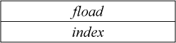

**形式**

`fload` = 23 (0x17)

**操作数**

... →

**栈**

..., `value`

**描述**

`index`是一个无符号字节，必须是当前栈帧局部变量数组的索引（2.6）。`index`处的局部变量必须包含一个`float`。`index`处局部变量的`value`将被推入操作数栈。

**备注**

`fload`字节码可以与`wide`指令（*wide）结合使用，以便使用双字节无符号索引访问局部变量。

### fload_<n>

**操作**

从局部变量加载`float`

**格式**


**形式**

`fload_0` = 34 (0x22)

`fload_1` = 35 (0x23)

`fload_2` = 36 (0x24)

`fload_3` = 37 (0x25)

**操作数**

... →

**栈**

..., `value`

**描述**

`<n>`必须是当前栈帧局部变量数组的索引（2.6）。`<n>`处的局部变量必须包含一个`float`。`<n>`处局部变量的`value`将被推入操作数栈。

**备注**

每个`fload_<n>`指令都与`index`为`<n>`的`fload`指令相同，只是操作数`<n>`是隐式的。

### fmul

**操作**

相乘`float`

**格式**


**形式**

`fmul` = 106 (0x6a)

**操作数**

..., `value1`, `value2` →

**栈**

..., `result`

**描述**

`value1`和`value2`必须都是`float`类型。这两个值从操作数栈弹出并经过值集转换（2.8.3），产生`value1'`和`value2’`。`float`类型`result`为`value1'` * `value2’`。结果被推入操作数栈。

`fmul`指令的结果受 IEEE 算术规则支配：

- 如果`value1'`或`value2’`其中之一为`NaN`，结果为`NaN`。
- 如果`value1'`和`value2’`都不是`NaN`，如果两个值的符号相同则结果为正；如果符号不同，则结果为负。
- 无穷大乘以零的结果为`NaN`。
- 无穷大乘以有限值的结果为带符号的无穷大，其符号产生规则如上所示。
- 在其余情况下，即当不涉及无穷大或`NaN`时，计算乘积并使用 IEEE 754 的“舍入最近最近值”模式将其舍入到最近的可表示值。如果值过大无法表示为`float`，则称该操作为溢出；结果为具有相应符号的无穷大。如果值过小无法表示为`float`，则称该操作为下溢；结果为具有相应符号的零。

Java 虚拟机要求支持 IEEE 754 定义的渐进式下溢。尽管可能会发生溢出、下溢或精度丢失，`fmul`指令的执行永远不会抛出运行时异常。

### fneg

**操作**

取反`float`

**格式**


**形式**

`fneg` = 118 (0x76)

**操作数**

..., `value` →

**栈**

..., `result`

**描述**

`value`必须是`float`类型。它从操作数栈弹出并经过值集转换（2.8.3），产生`value’`。`float`类型`result`为`value’`。结果被推入操作数栈。

### frem

**操作**

取余`float`

**格式**


**形式**

`frem` = 114 (0x72)

**操作数**

..., `value1`, `value2` →

**栈**

..., `result`

**描述**

`value1`和`value2`必须都是`float`类型。这两个值从操作数栈弹出并经过值集转换（2.8.3），产生`value1'`和`value2’`。计算`result`并推入操作数栈。

IEEE 754 的取余操作不同于除法。Java 虚拟机定义`frem`的行为类似于整数取余指令（*irem* 和 *lrem*）；它可以与 C 库函数`fmod`进行比较。

来自`value1’`和`value2’`的浮点取余`result`由数学关系`result = value1’ - (value2’ * q)`定义，其中`q`是一个整数，仅当`value1’ / value2’`为负时为负，仅当`value1’ / value2’`为正时为正，且其绝对值尽可能大但不超过`value1’ / value2’`的真实数学商。

`frem`指令的结果受以下规则支配：

- 如果`value1'`或`value2’`其中之一为`NaN`，结果为`NaN`。
- 如果`value1'`和`value2’`都不是`NaN`，结果的符号与被除数的符号相同。
- 如果被除数为无穷大或除数为零（或两者都是），结果为`NaN`。
- 如果被除数为有限值且除数为无穷大，结果为被除数。
- 如果被除数为零且除数为有限值，结果为被除数。
- 在其余情况下，即当两个操作数均既不是无穷大、零或`NaN`时，结果如定义。

尽管可能会发生除以零，`frem`指令的求永远不会抛出运行时异常。不会发生溢出、下溢或精度丢失。

**备注**

IEEE 754 取余操作可以通过库例程`Math.IEEEremainder`计算。

当前方法必须具有返回类型`float`。`value`必须是`float`类型。如果当前方法是`synchronized`方法，则在调用方法时进入或重入的监视器（monitor）将得到更新，并可能像由当前线程执行`monitorexit`指令（§*monitorexit)）一样退出。如果没有抛出异常，`value`将从当前帧的操作数栈中弹出（§2.6)）并经过值转换（§2.8.3)），得到`value’`。`value’`被推入调用者帧的操作数栈中。当前方法操作数栈上的任何其他值都会被丢弃。

解释器随后将控制权返回方法的调用者，恢复调用者的帧。

### 运行时异常

如果 Java 虚拟机实现没有强制执行 §2.11.10 中描述的结构化锁规则，那么如果当前方法是`synchronized`方法且当前线程不是调用方法时进入或重入的监视器的所有者，`freturn`将抛出`IllegalMonitorStateException`。这种情况可能会发生，例如，一个`synchronized`方法包含一个`monitorexit`指令，但在该方法同步的对象上没有`monitorenter`指令。

否则，如果 Java 虚拟机实现强制执行 §2.11.10 中描述的结构化锁规则，并且在调用当前方法期间违反了这些规则之一，则`freturn`将抛出`IllegalMonitorStateException`。

### fstore

#### 操作

将`float`存储到局部变量

#### 格式


#### 形式

`fstore` = 56 (0x38)

#### 操作数

..., `value` →

#### 栈

...

#### 描述

`index`是一个无符号字节，必须是当前帧局部变量数组的索引（§2.6)）。操作数栈顶部的`value`必须是`float`类型。它从操作数栈中弹出并经过值转换（§2.8.3)），得到`value’`。位于`index`处的局部变量的值设置为`value’`。

#### 注意事项

`fstore`字节码可以与`wide`指令（§*wide)结合使用，使用双字节无符号索引访问局部变量。

### fstore_<n>

#### 操作

将`float`存储到局部变量

#### 格式


#### 形式

`fstore_0` = 67 (0x43)

`fstore_1` = 68 (0x44)

`fstore_2` = 69 (0x45)

`fstore_3` = 70 (0x46)

#### 操作数

..., `value` →

#### 栈

...

#### 描述

`<n>`必须是当前帧局部变量数组的索引（§2.6)）。操作数栈顶部的`value`必须是`float`类型。它从操作数栈中弹出并经过值转换（§2.8.3)），得到`value’`。位于`<n>`处的局部变量的值设置为`value’`。

#### 注意事项

每个`fstore_<n>`指令都与`index`为`<n>`的`fstore`相同，区别在于操作数`<n>`是隐式的。

### fsub

#### 操作

减`float`

#### 格式


#### 形式

`fsub` = 102 (0x66)

#### 操作数

..., `value1`, `value2` →

#### 栈

..., `result`

#### 描述

`value1`和`value2`必须都是`float`类型。这两个值从操作数栈中弹出并经过值转换（§2.8.3)），得到`value1’`和`value2’`。`float`类型`result`为`value1’ - value2’`。`result`被推入操作数栈。对于`float`减法，`a-b`生成的结果与`a+(-b)`相同。但对于`fsub`指令，从零减并不同于取反，因为如果`x`是`+0.0`，那么`0.0-x`等于`+0.0`，而`-x`等于`-0.0`。

Java 虚拟机要求支持 IEEE 754 定义的渐进式下溢。尽管可能会发生溢出、下溢或精度丢失失，但执行`fsub`永远不会抛出运行时异常。

### getfield

#### 操作

从对象获取字段

#### 格式

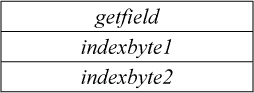

#### 形式

`getfield` = 180 (0xb4)

#### 操作数

..., `objectref` →

#### 栈

..., `value`

#### 描述

从操作数栈中弹出类型为`reference`的`objectref`。无符号的`indexbyte1`和`indexbyte2`用于构造指向当前类常量池的索引（§2.6)），其中索引的值为`(indexbyte1 << 8) | indexbyte2`。该处的运行时常量池项必须是指向字段的符号引用（§5.1)），它提供了字段的名称和描述符，以及查找该字段的类或接口的符号引用。引用的字段将被解析（§5.4.2)）。`objectref`不能是数组。如果该字段是`protected`且它是当前类父类的成员，则`objectref`必须是当前类或其子类。

#### 链接异常

在解析指向字段的符号引用期间，可以抛出任何与字段解析相关的异常（§5.4.2)）。

否则，如果解析出的字段是`static`字段，`getfield`将抛出`IncompatibleClassError`。

#### 运行时异常

否则，如果`objectref`为`null`，`getfield`将抛出`NullPointerException`。

#### 注意事项

`getfield`指令不能用于访问数组的`length`字段。应使用`arraylength`指令（§arraylength](#ch06a.html_ch06lev2sec9)）。

### getstatic

#### 操作

从类获取`static`字段

#### 格式

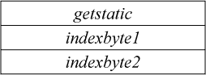

#### 形式

`getstatic` = 178 (0xb2)

#### 操作数

..., →

#### 栈

..., `value`

#### 描述

无符号的`indexbyte1`和`indexbyte2`用于构造指向当前类常量池的索引（§2.6)），其中索引的值为`(indexbyte1 << 8) | indexbyte2`。该处的运行时常量池项必须是指向字段的符号引用（§5.1)），它提供了字段的名称和描述符，以及查找该字段的类或接口的符号引用。引用的字段将被解析（§5.4.2)）。

成功解析字段后，如果声明字段的类或接口尚未初始化，则对其初始化（§5.5)）。类或接口字段的值被获取并推入操作数栈。

#### 链接异常

在解析指向类或接口字段的符号引用期间，可以抛出任何与字段解析相关的异常（§5.4.2)）。

否则，如果解析出的字段不是`static`（类）字段或接口字段，`getstatic`将抛出`IncompatibleClassChangeError`。

#### 运行时异常

否则，如果执行此`getstatic`指令导致引用的类或接口初始化，`getstatic`抛出`Error`，详见 §5.5。

### goto

#### 操作

总是跳转

#### 格式

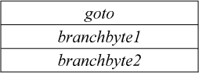

#### 形式

`goto` = 167 (0xa7)

#### 操作数栈

无变化

#### 描述

无符号字节`branchbyte1`和`branchbyte2`用于构造一个有符号的 16 位`branchoffset`，其中`branchoffset`为 (`branchbyte1` `<<` 8) | `branchbyte2`。执行将从此`goto`指令的操作码地址开始该偏移量处。目标地址必须是包含该`goto`指令的方法内某条指令的操作码地址。

### goto_w

**Operation**

总是跳转（宽索引）

**Format**

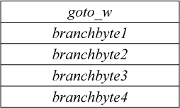

**Forms**

`goto_w` = 200 (0xc8)

**操作数栈**

无变化

**Description**


无符号字节 `branchbyte1`、`branchbyte2`、`branchbyte3` 和 `branchbyte4` 用于构造一个有符号的 32 位 `branchoffset`，其中 `branchoffset` 为 `(branchbyte1 << 24) | (branchbyte2 << 16) | (branchbyte3 << 8) | branchbyte4`。执行将从此 `goto_w` 指令的操作码地址开始该偏移量处。目标地址必须是包含该 `goto_w` 指令的方法内某条指令的操作码地址。

**Notes**

尽管 `goto_w` 指令采用 4 字节跳转偏移量，但其他因素限制方法的大小为 65535 字节（§4.11）。此限制可以在 Java 虚拟机的未来版本中提高。

## i2b

**Operation**

将 `int` 转换为 `byte`

**Format**


**Forms**

`i2b` = 145 (0x91)

**Operand**

..., `value` →

**Stack**

..., `result`

**Description**

操作数栈顶的 `value` 必须是 `int` 类型。它从栈中弹出，截断为 `byte`，然后符号扩展为 `int` 类型 `result`。该 `result` 被推入操作数栈。

**Notes**

`i2b` 指令执行收窄原始转换（JLS §5.1.3）。它可能会丢失 `value` 整体幅度的信息。`result` 的符号也可能与 `value` 不相同。

## i2c

**Operation**

将 `int` 转换为 `char`

**Format**


**Forms**

`i2c` = 146 (0x92)

**Operand**

..., `value` →

**Stack**

..., `result`

**Description**

操作数栈顶的 `value` 必须是 `int` 类型。它从栈中弹出，截断为 `char`，然后零扩展为 `int` 类型 `result`。该 `result` 被推入操作数栈。

**Notes**

`i2c` 指令执行收窄原始转换（JLS §5.1.3）。它可能会丢失 `value` 整体幅度的信息。`result`（始终为正）的符号也可能与 `value` 不相同。

## i2d

**Operation**

将 `int` 转换为 `double`

**Format**


**Forms**

`i2d` = 135 (0x87)

**Operand**

..., `value` →

**Stack**

..., `result`

**Description**

操作数栈顶的 `value` 必须是 `int` 类型。它从栈中弹出并转换为 `double` 类型 `result`。该 `result` 被推入操作数栈。

**Notes**

`i2d` 指令执行扩展原始转换（JLS §5.1.2）。由于所有 `int` 类型的值都可以被 `double` 类型精确表示，因此转换是精确的。

## i2f

**Operation**

将 `int` 转换为 `float`

**Format**


**Forms**

`i2f` = 134 (0x86)

**Operand**

..., `value` →

**Stack**

..., `result`

**Description**

操作数栈顶的 `value` 必须是 `int` 类型。它从栈中弹出，并使用 IEEE 754 舍入最近模式转换为 `float` 类型 `result`。该 `result` 被推入操作数栈。

**Notes**

`i2f` 指令执行扩展原始转换（JLS §5.1.2），但可能会导致精度丢失，因为 `float` 类型的值只有 24 位尾数位。

## i2l

**Operation**

将 `int` 转换为 `long`

**Format**


**Forms**

`i2l` = 133 (0x85)

**Operand**

..., `value` →

**Stack**

..., `result`

**Description**

操作数栈顶的 `value` 必须是 `int` 类型。它从栈中弹出并符号扩展为 `long` 类型 `result`。该 `result` 被推入操作数栈。

**Notes**

`i2l` 指令执行扩展原始转换（JLS §5.1.2）。由于所有 `int` 类型的值都可以被 `long` 类型精确表示，因此转换是精确的。

## i2s

**Operation**

将 `int` 转换为 `short`

**Format**


**Forms**

`i2s` = 147 (0x93)

**Operand**

..., `value` →

**Stack**

..., `result`

**Description**

操作数栈顶的 `value` 必须是 `int` 类型。它从栈中弹出，截断为 `short`，然后符号扩展为 `int` 类型 `result`。该 `result` 被推入操作数栈。

**Notes**

`i2s` 指令执行收窄原始转换（JLS §5.1.3）。它可能会丢失 `value` 整体幅度的信息。`result` 的符号也可能与 `value` 不相同。

## iadd

**Operation**

`int` 相加

**Format**


**Forms**

`iadd` = 96 (0x60)

**Operand**

..., `value1`, `value2` →

**Stack**

..., `result`

**Description**

`value1` 和 `value2` 必须是 `int` 类型。它们从操作数栈中弹出。通过 `value1` 和 `value2` 之和得到 `int` 类型 `result`。该 `result` 被推入操作数栈。

**Notes**

`iadd` 指令执行 32 位补码加。如果发生溢出，将抛出 `ArithmeticException`。

## iaload

**Operation**

数组加载 `int`

**Format**


**Forms**

`iaload` = 46 (0x2e)

**Operand**

..., `arrayref`, `index` →

**Stack**

..., `value`

**Description**

`arrayref` 必须是 `reference` 类型且指向一个 `int` 类型的数组。`index` 必须是 `int` 类型。`arrayref` 和 `index` 从操作数栈中弹出。`index` 处的 `int` 类型 `value` 被检索并推入操作数栈。

**Run-time**

如果 `arrayref` 为 `null`，`iaload` 将抛出 `NullPointerException`。

**Exceptions**

否则，如果 `index` 不在 `arrayref` 的范围内，`iaload` 指令将抛出 `ArrayIndexOutOfBoundsException`。

## iand

**Operation**

`int` 按位与

**Format**


**Forms**

`iand` = 126 (0x7e)

**Operand**

..., `value1`, `value2` →

**Stack**

..., `result`

**Description**

`value1` 和 `value2` 必须是 `int` 类型。它们从操作数栈中弹出。通过 `value1` 和 `value2` 的按位与得到 `int` 类型 `result`。该 `result` 被推入操作数栈。

## iastore

**Operation**

存储到 `int` 数组

**Format**


**Forms**

`iastore` = 79 (0x4f)

**Operand**

..., `arrayref`, `index`, `value` →

**Stack**

...

**Description**

`arrayref` 必须是 `reference` 类型且指向一个 `int` 类型的数组。`index` 和 `value` 必须是 `int` 类型。`arrayref`、`index` 和 `value` 从操作数栈中弹出。`int` 类型 `value` 被存储在 `index` 索引的元素中。

## iconst_<i>

**Operation**

推入 `int` 常数

**Format**


**Forms**

`iconst_m1` = 2 (0x2)

`iconst_0` = 3 (0x3)

`iconst_1` = 4 (0x4)

`iconst_2` = 5 (0x5)

`iconst_3` = 6 (0x6)

`iconst_4` = 7 (0x7)

`iconst_5` = 8 (0x8)

**Operand**

... →

**Stack**

..., `<i*>`

**Description**

将 `int` 常量 `<i*>` (-1, 0, 1, 2, 3, 4 或 5) 推入操作数栈。

**Notes**

此系列指令中的每条指令对于相应的 `<i*>` 取值都等同于 `bipush <i*>`，只是操作数 `<i*>` 是隐式的。

## idiv

**Operation**

除以 `int`

**Format**


**Forms**

`idiv` = 108 (0x6c)

**Operand**

..., `value1`, `value2` →

**Stack**

..., `result`

**Description**

`value1` 和 `value2` 必须都为 `int` 类型。这两个值从操作数栈中弹出。`int` 类型 `result` 是 Java 语言表达式 `value1 / value2` 的值。该 `result` 被推入操作数栈。

`int` 除法向 0 舍入；即对于 `n/d` 中的 `int` 值产生的商是一个 `int` 值 `q`，其幅度在满足 `|d · q| ≤ |n|` 的情况下尽可能大。此外，当 `|n| ≥ |d|` 且 `n` 和 `d` 符号相同时，`q` 为正；但当 `|n| ≥ |d|` 且 `n` 和 `d` 符号相反时，`q` 为负。

有一个不符合此规则的特殊情况：如果被除数为 `int` 类型范围内最大的负整数，且除数为 -1，则发生溢出，结果等于被除数。尽管发生了溢出，在这种情况下也不会抛出异常。

**Run-time Exceptions**

如果 `int` 除法中的除数值为 0，`idiv` 将抛出 `ArithmeticException`。

## if_acmp<cond>

**Operation**

如果 `reference` 比较成功则跳转

**Format**

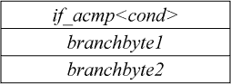

**Forms**

`if_acmpeq` = 165 (0xa5)

`if_acmpne` = 166 (0xa6)

**Operand**

..., `value1`, `value2` →

**Stack**

...

**Description**

`value1` 和 `value2` 必须都为 `reference` 类型。它们都从操作数栈中弹出并进行比较。比较结果如下：

- `if_acmpeq` 成功当且仅当 `value1` = `value2`
- `if_acmpne` 成功当且仅当 `value1` ≠ `value2`

如果比较成功，则使用无符号 `branchbyte1` 和 `branchbyte2` 构建一个带符号 16 位偏移量，偏移量的计算方法为 `(branchbyte1 << 8) | branchbyte2`。执行将从此 `if_acmp<cond>` 指令的操作码地址按该偏移量继续。目标地址必须是包含此 `if_acmp<cond>` 指令的方法内某条指令的操作码地址。

否则，如果比较失败，执行将从此 `if_acmp<cond>` 指令后的指令地址继续。

## if_icmp<cond>

**Operation**

如果 `int` 比较成功则跳转

**Format**

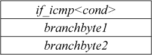

**Forms**

`if_icmpeq` = 159 (0x9f)

`if_icmpne` = 160 (0xa0)

`if_icmplt` = 161 (0xa1)

`if_icmpge` = 162 (0xa2)

`if_icmpgt` = 163 (0xa3)

`if_icmple` = 164 (0xa4)

**Operand**

..., `value1`, `value2` →

**Stack**

...

**Description**

`value1` 和 `value2` 必须都为 `int` 类型。它们都从操作数栈中弹出并进行比较。所有比较均为带符号的。比较结果如下：

- `if_icmpeq` 成功当且仅当 `value1` = `value2`
- `if_icmpne` 成功当且仅当 `value1` ≠ `value2`
- `if_icmplt` 成功当且仅当 `value1` < `value2`
- `if_icmple` 成功当且仅当 `value1` ≤ `value2`
- `if_icmpgt` 成功当且仅当 `value1` > `value2`
- `if_icmpge` 成功当且仅当 `value1` ≥ `value2`

如果比较成功，则使用无符号 `branchbyte1` 和 `branchbyte2` 构建一个带符号 16 位偏移量，偏移量的计算方法为 `(branchbyte1 << 8) | branchbyte2`。执行将从此 `if_icmp<cond>` 指令的操作码地址按该偏移量继续。目标地址必须是包含此 `if_icmp<cond>` 指令的方法内某条指令的操作码地址。

否则，如果比较失败，执行将从此 `if_icmp<cond>` 指令后的指令地址继续。

## if<cond>

**Operation**

如果 `int` 比较成功则跳转

**Format**

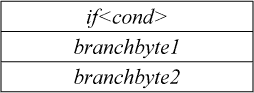

**Forms**

`ifeq` = 153 (0x99)

`ifne` = 154 (0x9a)

`iflt` = 155 (0x9b)

`ifge` = 156 (0x9c)

`ifgt` = 157 (0x9d)

`ifle` = 158 (0x9e)

**Operand**

..., `value` →

**Stack**

...

**Description**

`value` 必须为 `int` 类型。它从操作数栈中弹出并与零进行比较。所有比较均为带符号的。比较结果如下：

- `ifeq` 成功当且仅当 `value` = 0
- `ifne` 成功当且仅当 `value` ≠ 0
- `iflt` 成功当且仅当 `value` < 0
- `ifge` 成功当且仅当 `value` ≥ 0
- `ifgt` 成功当且仅当 `value` > 0
- `ifle` 成功当且仅当 `value` ≤ 0

如果比较成功，则使用无符号 `branchbyte1` 和 `branchbyte2` 构建一个带符号 16 位偏移量，偏移量的计算方法为 `(branchbyte1 << 8) | branchbyte2`。执行将从此 `if<cond>` 指令的操作码地址按该偏移量继续。目标地址必须是包含此 `if<cond>` 指令的方法内某条指令的操作码地址。

否则，如果比较失败，执行将从此 `if<cond>` 指令后的指令地址继续。

## ifnull

**Operation**

如果 `reference` 为空则跳转

**Format**

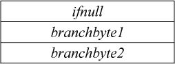

**Forms**

`ifnull` = 198 (0xc6)

**Operand**

..., `value` →

**Stack**

...

**Description**

`value` 必须为 `reference` 类型。它从操作数栈中弹出并与零进行比较。如果 `value` 为空，则使用无符号 `branchbyte1` 和 `branchbyte2` 构建一个带符号 16 位偏移量，偏移量的计算方法为 `(branchbyte1 << 8) | branchbyte2`。执行将从此 `ifnull` 指令的操作码地址按该偏移量继续。目标地址必须是包含此 `ifnull` 指令的方法内某条指令的操作码地址。

否则，如果比较失败，执行将从此 `ifnull` 指令后的指令地址继续。

## ifnonnull

**Operation**

如果 `reference` 不空则跳转

**Format**

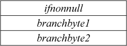

**Forms**

`ifnonnull` = 199 (0xc7)

**Operand**

..., `value` →

**Stack**

...

**Description**

`value` 必须为 `reference` 类型。它从操作数栈中弹出并与零进行比较。如果 `value` 不为空，则使用无符号 `branchbyte1` 和 `branchbyte2` 构建一个带符号 16 位偏移量，偏移量的计算方法为 `(branchbyte1 << 8) | branchbyte2`。执行将从此 `ifnonnull` 指令的操作码地址按该偏移量继续。目标地址必须是包含此 `ifnonnull` 指令的方法内某条指令的操作码地址。

否则，如果比较失败，执行将从此 `ifnonnull` 指令后的指令地址继续。


`if_nonnull` = 199 (0xc7)

### 操作数

..., *value* →

### 操作栈

...

### 描述

*value* 必须为 `reference` 类型。它从操作数栈中弹出并与零进行比较。如果 *value* 不空，则使用无符号 *branchbyte1* 和 *branchbyte2* 构建一个符号符号 16 位偏移量，偏移量的计算方法为 `(branchbyte1 << 8) | branchbyte2`。执行将从此 `if_nonnull` 指令的操作码地址按该偏移量继续。目标地址必须是包含此 `if_nonnull` 指令的方法内某条指令的操作码地址。

否则，如果比较失败，执行将从此 `if_nonnull` 指令后的指令地址继续。

### iinc

### 操作

通过常量增加局部变量

### 格式


### 形式

`iinc` = 132 (0x84)

### 操作栈

无变化

### 描述

*index* 是一个无符号字节，必须是当前帧局部变量数组的索引。*const* 是一个立即符号字节。*index* 处的局部变量必须包含一个 `int`。值 *const* 首先被符号扩展为 `int`，然后 *index* 处的局部变量增加该值。

### 备注

*iinc* 操作码可以与 *wide* 指令（*wide*）结合使用，使用双字节无符号索引访问局部变量，并通过双字节立即符号值对其进行增加。

### iload

### 操作

从局部变量加载 `int`

### 格式


### 形式

`iload` = 21 (0x15)

### 操作数

... →

### 操作栈

..., *value*

### 描述

`index` 是一个无符号字节，必须是当前栈帧局部变量数组的索引（2.6）。`index` 处的局部变量必须包含一个 `int`。`index` 处的局部变量的 `value` 被推入操作数栈中。

### 注意事项

`iload` 字节码可以与 `wide` 指令（*wide*）结合使用，使用双字节无符号索引访问本地变量。

### iload_<n>

#### 操作

从局部变量加载 `int`

#### 格式


#### 形式

`iload_0` = 26 (0x1a)

`iload_1` = 27 (0x1b)

`iload_2` = 28 (0x1c)

`iload_3` = 29 (0x1d)

### 操作数

... →

### 栈

..., `value`

### 说明

`<n>` 必须是当前栈帧局部变量数组的索引（2.6）。`<n>` 处的局部变量必须包含一个 `int`。`<n>` 处的局部变量的 `value` 被推入操作数栈中。

### 注意事项

每个 `iload_<n>` 指令都与 `index` 为 `<n>` 的 `iload` ，除了操作数 `<n>` 是隐式的。

### imul

#### 操作

相乘 `int`

#### 格式


#### 形式

`imul` = 104 (0x68)

### 操作数

..., `value1`, `value2` →

### 栈

..., `result`

### 说明

`value1` 和 `value2` 必须都是 `int` 类型。这两个值从操作数栈中弹出。`int` 类型 `result` 是 `value1` * `value2`。`result` 被推入操作数栈中。

结果是足够宽的补码格式中真实数学结果的低 32 位，表示为类型为 `int`的值。如果发生溢出，则结果的符号可能与两个值的数学乘法结果符号不同。

尽管可能会发生溢出，执行 `imul` 指令永远不会抛出运行时异常。

### ineg

#### 操作

取反 `int`

#### 格式


#### 形式

`ineg` = 116 (0x74)

### 操作数

..., `value` →

### 栈

..., `result`

### 说明

`value` 必须是 `int` 类型。它从操作数栈中弹出。`int` 类型 `result` 是 `value` 的算术取反，`-value`。`result` 被推入操作数栈中。

对于 `int` 值，取反等同于减零。由于 Java 虚拟机使用补码表示整数，且补码值的范围是非对称的，因此最大负 `int` 的取反结果仍然是该最大负数。尽管发生了溢出，但不会抛出异常。

对于所有 `int` 值 `x`，`-x` 等于 `(~x)+1`。

### instanceof

#### 操作

确定对象是否为给定类型

#### 格式

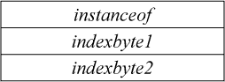

#### 形式

`instanceof` = 193 (0xc1)

### 操作数

..., `objectref` →

### 栈

..., `result`

### 说明

从操作数栈中弹出 `objectref`，它必须是 `reference` 类型。使用无符号 `indexbyte1` 和 `indexbyte2` 构造指向当前类运行时常量池的索引（2.6），其中索引的值为 (`indexbyte1` `<<` 8) | `indexbyte2`。该索引处的运行时常量池项必须是指向类、数组或接口类型的符号引用。

如果 `objectref` 为 `null`，`instanceof` 指令会将 `int` 类型 `result` 0 作为 `int` 推入操作数栈。

否则，指定的命名的类、数组或接口类型将进行解析（5.4.3.1）。如果 `objectref` 是解析后的类或数组的实例，或者实现了解析后的接口，`instanceof` 指令会将 `int` 类型 `result` 1 作为 `int` 推入操作数栈；否则，它推入 `int` 类型 `result` 0。

使用以下规则来确定非 `null` 的 `objectref` 是否为解析后类型的实例：如果 S 是 `objectref` 所引的对象的类，而 T 是解析后的类、数组或接口类型，`instanceof` 按照如下方式确定 `objectref` 是否为 T 的实例：

- 如果 S 是普通（非数组）类，那么：

    - 如果 T 是一个类，则 S 必须是 T 的子类；

    - 如果 T 是接口，则 S 必须实现 T。

- 如果 S 是接口类型，那么：

    - 如果 T 是类，则 T 必须是 `Object`。

    - 如果 T 是接口，则 T 必须与 S 相同。

    - 如果 S 是数组类型，那么：

        - 如果 T 是类，则 T 必须是 `Object`。

        - 如果 T 是接口，则 T 必须与 S 相同。

        - 如果 T 是数组类型，则 T 必须与 S 相同。

在解析类、数组或接口类型时，可能会抛出 5.4 中记录的任何异常。

### 注意事项

`instanceof` 指令与 `checkcast` 指令（*checkcast*）非常相似，不同在于对 `null` 的处理、失败时的行为以及对操作数栈的影响。

### invokedynamic

#### 操作

动态方法

#### 格式

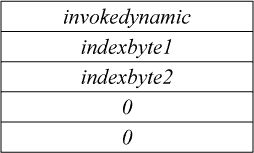

#### 形式

`invokedynamic` = 186 (0xba)

### 操作数

..., `arg1`, `arg2` →

### 栈

...

### 说明

每个 `invokedynamic` 指令出现称为称为动态站点。首先，使用无符号 `indexbyte1` 和 `indexbyte2` 构造指向当前类运行时常量池的索引（2.6），其中索引的值为 (`indexbyte1` `<<` 8) | `indexbyte2`。该索引处的常量池项必须是指向调用站点规范的符号引用。第三和第四操作字节的值必须始终为零。

调用站点规范将进行解析（5.4.3），*对于特定的动态站点*以获取 `java.lang.invoke.MethodHandle` 实例的引用作为引导方法、`java.lang.invoke.MethodType` 实例的引用以及静态参数的引用。

接下来，作为调用站点规范继续解析的一部分，引导方法的调用方式就像通过执行 `invokevirtual` 指令（*invokevirtual*），该指令包含一个指向运行时常量池索引的符号引用 R，其中：

- R 是方法所在类的符号引用（（5.1））

- 对于方法名，R 指定为 `java.lang.invoke.MethodHandle`；

- 对于方法的描述符，R 指定返回类型为 `java.lang.invoke.CallSite` 以及源自操作数栈项的参数类型。

前三个参数类型是 `java.lang.invoke.MethodHandles.Lookup`、`String` 和 `java.lang.invoke.MethodType`，顺序如下。如果调用站点规范有静态参数，则每个参数的参数类型将按照参数推入操作数栈的顺序附加到方法描述符的参数之后。这些参数类型可以是 `Class`、`java.lang.invoke.MethodHandle`、`java.lang.invoke.MethodType`、`String`、`int`、`long`、`float` 或 `double`。

并且仿佛按顺序推入操作数栈：

-   指向引导方法（bootstrap method）的 `java.lang.invoke.MethodHandle` 对象的 `reference`（引用）；

-   指向发生此动态调用点的类的的 `java.lang.invoke.MethodHandles.Lookup` 对象的 `reference`；

-   指向调用点指定符中方法名的 `String` 的 `reference`；

-   为调用点指定符中的方法描述符获取的 `java.lang.invoke.MethodType` 对象的 `reference`；

-   调用点指定符中标识为静态参数的类、方法类型、方法句柄和字符串字面量的 `references`，以及在调用点指定符中标识为静态参数的数值值（§2.3.1, §2.3.2)），均按照它们在调用点指定符中出现的顺序排列。（即，原始值不会发生装箱。）

符号引用 `R` 描述了一个具有签名多态的方法（§2.9）。由于对被调用的 `invoke` 签名多态方法执行了 `invokevirtual` 操作，接收端方法句柄（代表引导方法）的类型描述符在语义上不需要与 `R` 指定的方法描述符相等。例如，`R` 指定的第一个参数类型可以是 `Object` 而不是 `java.lang.invoke.MethodHandles.Lookup`，且 `R` 指定的返回类型可以是 `Object` 而不是 `java.lang.invoke.CallSite`。只要引导方法可以被 `invoke` 方法调用而不会抛出 `java.lang.invoke.WrongMethodTypeException`，那么代表引导方法的方法句柄的类型描述符就是任意的。

如果引导方法是一个变长参数个数的方法（variable arity method），则上述操作数栈上的部分或所有参数可能被收集到一个尾部数组参数中。

引导方法的调用发生在尝试解析指向此动态调用点指定符 `of this dynamic call site` 的符号引用的线程中。如果存在多个这样的线程，引导方法可能会在多个线程中并发地调用。因此，访问全局应用程序数据的引导方法必须采取防止竞态条件的通常预防措施。

引导方法返回的结果必须是一个指向类为 `java.lang.invoke.CallSite` 或其 `java.lang.invoke.CallSite` 子类的对象的 `reference`。该对象被称为 `call site object`（调用点对象）。该 `reference` 从操作数栈中弹出，就像执行 `invokevirtual` 指令一样。

如果多个线程同时为同一个动态调用点执行引导方法，Java 虚拟机必须选择一个返回的调用点对象并将其可见地安装到所有线程。允许为该动态调用点执行的其他引导方法完成，但其结果将被忽略，线程将使用所选的调用点对象继续执行动态调用点。

调用点对象具有一个类型描述符（`java.lang.invoke.MethodType` 的实例），它在语义上必须与为调用点指定符中的方法描述符获取的 `java.lang.invoke.MethodType` 对象相等。

调用点指定符解析成功的结果是一个永久绑定到动态调用点的调用点对象。

由绑定的调用点对象的目标所代表的方法句柄被调用。该调用的发生如同执行了一个 `invokevirtual` 指令（§*invokevirtual），该指令指示一个指向方法符号引用的运行时常量池索引（§5.1），并具有以下属性：

-   方法名为 `invokeExact`；

-   方法的描述符是调用点指定符中的方法描述符；且

-   该方法指向其要查找方法的类的符号引用指向了 `java.lang.invoke.MethodHandle` 类。

操作数栈将被解释为包含一个指向调用点对象目标的 `reference`，随后是 *nargs* 个参数值，其中这些值的数量、类型和顺序必须与调用点指定符中的方法描述符一致。

## 链接异常（Linking Exceptions）

如果对调用点指定符的符号引用解析抛出异常 `E`，则 `invokedynamic` 指令将抛出一个封装了 `E` 的 `BootstrapMethodError`。

否则，在继续解析调用点指定符的期间，如果引导方法的调用由于抛出异常 `E` 而异常终止（§2.6.5），则 `invokedynamic` 指令将抛出一个封装了 `E` 的 `BootstrapMethodError`。（这可能发生在引导方法具有错误的个数、参数类型或返回类型，导致 `java.lang.invoke.MethodHandle.invoke` 抛出 `java.lang.invoke.WrongMethodTypeException`。）

否则，在继续解析调用点指定符的期间，如果引导方法的调用结果不是指向 `java.lang.invoke.CallSite` 实例的 `reference`，则 `invokedynamic` 指令将抛出 `BootstrapMethodError`。

否则，在继续解析调用点指定符的期间，如果调用点对象目标的类型描述符在语义上与调用点指定符中的方法描述符不等，则 `invokedynamic` 指令将抛出 `BootstrapMethodError`。

## 运行时异常（Run-time Exceptions）

如果此特定的动态调用点完成了其调用点指定符的解析，意味着一个非 `null` 的 `java.lang.invoke.CallSite` 已绑定到该动态调用点。因此，代表调用点的操作数项不为 `null`。同样，这意味着调用点指定符中的方法描述符在语义上等于执行 `invokevirtual` 指令时的方法句柄类型描述符。

### invokeinterface

#### 操作

调用接口方法

#### 格式

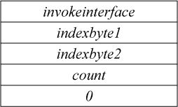

#### 形式

`invokeinterface` = 185 (0xb9)

#### 操作数

..., *objectref*, [*arg1*, [*arg2*]] →

#### 栈

...

#### 描述

无符号 *indexbyte1* 和 *indexbyte2* 用于构造当前类的运行时常量池索引（§2.6），其中索引值为 (*indexbyte1 << 8) | indexbyte2。该索引处的运行时常量池项必须是指向接口方法的符号引用（§5.1），它提供了接口方法的名称和描述符（4.3.3)）以及要查找接口方法的接口符号引用。命名的接口方法将被解析（§5.4.3.4）。

解析出的接口方法不能是实例初始化方法、类初始化或接口初始化方法（§2.9）。

*count* 操作数是一个非零的无符号字节。*objectref* 必须是 `reference` 类型，并且在操作数栈上后跟 *nargs* 个参数值，其中这些值的数量、类型和顺序必须与解析接口方法的描述符一致。第四个操作字节的值始终为零。

令 C 为 *objectref* 的类。实际要调用的方法通过以下查找程序选择：

**1.** 如果 C 包含一个与解析方法名称和描述符相同的实例方法声明，则该方法为要调用的方法。

2. 否则，如果 `C` 有父类，则将开始查找与已解析方法具有相同名称和描述符的实例方法的声明。搜索从 `C` 的直接父类开始，并继续到该类的直接父类，依此类推，直到找到匹配项或不存在进一步的父类。如果找到了匹配项，则该方法为要调用的方法。

3. 否则，如果 `C` 的超接口中恰好有一个极大特定的方法（§5.4.3.3)）匹配已解析方法的名称和描述符且不是 `abstract`（抽象的），则该方法为要调用的方法。

如果该方法是 `synchronized`，则与 `objectref` 关联的监器将被进入或重入，仿佛在当前线程中执行了 `monitorenter` 指令（§monitorenter).


如果该方法不是`native`，`nargs`参数值和`objectref`将从操作数栈中弹出。在 Java 虚拟机栈上为正在调用的方法创建一个新帧。`objectref`和参数值连续地成为新帧局部变量的值，其中`objectref`在局部变量 0 中，`arg1`在局部变量 1 中（如果`arg1`类型为`long`或`double`，则在局部变量 1 和 2 中），此类推。任何浮点类型的参数值在存储到局部变量之前都会经过值集转换（§2.8.3）。然后将新帧设为当前帧，并将 Java 虚拟机的`pc`设置为要调用方法的第一条指令的操作码。执行从方法的第一条指令继续。

如果该方法是`native`且实现它的平台相关代码尚未绑定（§5.6）到 Java 虚拟机，则进行绑定。`nargs`参数值和`objectref`从操作数栈中弹出，并作为参数传递给实现方法的代码。任何浮点类型的参数值在作为参数传递之前都会经过值集转换（§2.8.3）。参数以取决于实现的方式进行传递并调用代码。当平台相关代码返回时：

- 如果`native`方法是`synchronized`，则与`objectref`关联的监视器将被更新并可能退出，仿佛在当前线程中执行了`monitorexit`指令（§monitorexit）。

- 如果`native`方法返回一个值，则平台相关代码的返回值将以一种取决于实现的方式转换为`native`方法的返回类型，并推送到操作数栈上。

### 链接阶段的异常 (Linking Exceptions)

在对接口方法的符号引用进行解析期间，可能会抛出任何与接口方法解析相关的异常（§5.4.3.4）。

否则，如果已解析的方法是`static`或`private`，`invokeinterface`指令将抛出`IncompatibleClassChangeError`。

### 运行时异常 (Run-time Exceptions)

否则，如果`objectref`为`null`，`invokeinterface`指令将抛出`NullPointerException`。

否则，如果`objectref`的类没有实现已解析的接口，`invokeinterface`将抛出`IncompatibleClassChangeError`。

否则，如果查找过程的步骤 2 选取了一个非`public`方法，`invokeinterface`将抛出`IllegalAccessError`。

否则，如果查找过程的步骤 2 选取了一个`abstract`方法，`invokeinterface`将抛出`AbstractMethodError`。

否则，如果查找过程的步骤 2 选取了一个`native`方法且实现方法的代码无法绑定，`invokeinterface`将抛出`UnsatisfiedLinkError`。

否则，如果查找过程的步骤 3 确定`C`的超接口中存在多个匹配已解析方法的名称和描述符且不是`abstract`的极大特定方法，`invokeinterface`将抛出`IncompatibleClassChangeError`。

否则，如果查找过程的步骤 3 确定`C`的超接口中不存在任何匹配已解析方法的名称和描述符且不是`abstract`的极大特定方法，`invokeinterface`将抛出`AbstractMethodError`。

### 注意事项 (Notes)

`invokeinterface`指令的操作数`count`记录了参数值数量的测量，其中类型为`long`或`double`的参数值对`count`值贡献两个单位，而任何其他类型的参数贡献一个单位。此信息也可以从所选方法的描述符中得出。这种冗余是历史遗留。

第四个操作字节的存在是为了为 Oracle 的某些 Java 虚拟机实现中使用的额外操作数留出空间，这些实现在运行时通过特殊的伪指令替换`invokeinterface`指令。为了向后兼容，必须保留它。

`nargs`参数值和`objectref`与前`nargs`+1 个局部变量并非一一对应。`long`和`double`类型的参数值必须存储在两个连续的局部变量中，因此可能需要比`nargs`更多的局部变量来将`nargs`参数值传递给调用的方法。

选择逻辑允许选取超接口中的非`abstract`方法。只有在类层次结构中没有匹配方法时，才会考虑接口。如果超接口中存在两个非`abstract`方法且互不比对方更具体，则发生错误；不会尝试消除歧义（例如，其中一个是引用的方法，另一个可能无关）。另一方面，如果存在许多`abstract`方法但只有一个非`abstract`方法，则选取该非`abstract`方法（除非`abstract`方法更具体）。

### invokespecial

#### 操作

调用实例方法；针对父类、私有和实例初始化方法的特殊处理

#### 格式

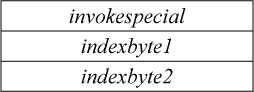

#### 形式

`invokespecial` = 183 (07)

#### 操作数

`..., objectref, [arg1, [arg2 ...]] ->`

#### 栈

`...`

#### 描述

无符号`indexbyte1`和`indexbyte2`用于构造当前类常量池的索引（§2.6），索引值为 (`indexbyte1` << 8) | `indexbyte2`。该索引常量池项必须是方法或接口方法的符号引用（§5.1），它提供了方法的名称和描述符（§4.3.3）以及要查找方法的类或接口的符号引用。命名方法将被解析（§5.4.3.3, 5.4.3.4）。

如果已解析的方法是`protected`，且它是当前类父类的成员，并且该方法与当前类不在同一个运行时包（§5.3）中，则`objectref`的类必须是当前类或当前类的子类。

如果满足以下所有条件，则令`C`为当前类的直接父类：

- 解析的方法不是实例初始化方法（§2.9）。
- 如果符号引用命名了一个类（而不是接口），则该类是当前类的父类。
- `class`文件设置了`ACC_SUPER`标记（§4.1）。

否则，令`C`为符号引用命名的类或接口。

实际调用的方法通过以下查找过程进行选取：

1. 如果`C`包含一个与解析出的方法名称和描述符均相同的实例方法声明，则该方法为被调用的方法。
2. 否则，如果`C`是一个类且具有父类，则开始查找与解析出的方法名称和描述符均相同的实例方法声明，查找从`C`的直接父类开始，并继续到该类的直接父类，依此类推，直到找到匹配项或不存在更高级的父类。如果找到了匹配项，则该方法为被调用的方法。
3. 否则，如果`C`是一个接口且类`Object`包含一个与解析出的方法名称和描述符均相同的`public`实例方法声明，则该方法为被调用的方法。
4. 否则，如果`C`的超接口中恰好有一个极大特定的方法（§5.4.3.3）与解析出的方法的名称和描述符匹配且不是`abstract`，则该方法为被调用的方法。

`objectref`必须是`reference`类型，并且操作数栈上后续必须有`nargs`个参数值，这些值的数量、类型和顺序必须与所选实例方法的描述符一致。

如果该方法是`synchronized`，则与`objectref`关联的监控器将被进入或重入，仿佛由当前线程执行了`monitorenter`指令（§monitorenter）。

如果该方法不是`native`，`nargs`参数值和`objectref`从操作数栈中弹出。Java 虚拟机栈上为被调用的方法创建一个新帧。`objectref`和参数值连续地成为新帧局部变量的值，其中`objectref`位于局部变量 0，`arg1`位于局部变量 1（或者，如果`arg1`的类型为`long`或`double`，则位于局部变量 1 和 2），依此类推。任何浮点类型的参数值在存储到局部变量之前，都将经过值集转换（§2.8.3）。然后将新帧设为当前帧，并将 Java 虚拟机`pc`设置为被调用方法的第一条指令的操作码。执行从方法的第一个指令继续。

如果该方法是`native`的且实现它的依赖平台代码尚未绑定（§5.6）到 Java 虚拟机，则执行该绑定。`nargs`参数值和`objectref`从操作数栈中弹出，并作为参数传递给实现方法的代码。任何浮点类型的参数值在作为参数传递之前，都将经过值集转换（§2.8.3）。参数以依赖实现的方式传递并调用代码。当依赖平台代码返回时，将发生以下情况：

- 如果`native`方法是`synchronized`的，则与`objectref`关联的监控器将被更新并可能退出，仿佛由当前线程执行了`monitorexit`指令（§monitorexit）。
- 如果`native`方法返回一个值，则平台代码的返回值将以依赖实现的方式转换为`native`方法的返回类型，并推入操作数栈。

### 链接异常 (Linking Exceptions)

在解析方法的符号引用期间，可能会抛出任何与方法解析相关的异常（§5.4.3.3）。

否则，如果解析出的方法是实例初始化方法，且声明它的类不是指令所符号引用的类，则抛出`NoSuchMethodError`。

否则，如果解析出的方法是类（`static`）方法，`invokespecial`指令将抛出`IncompatibleClassChangeError`。

### 运行时异常 (Run-time Exceptions)

否则，如果`objectref`为`null`，`invokespecial`指令将抛出`NullPointerException`。

否则，如果解析出的方法是当前类父类的在不同运行时包定义的`protected`方法，且`objectref`的类不是当前类或当前类的子类，则`invokespecial`抛出`IllegalAccessError`。

否则，如果查找过程的第 2 步选择了一个`abstract`方法，`invokespecial`抛出`AbstractMethodError`。

否则，如果查找过程的第 2 步选择了一个`native`方法且实现方法的代码无法绑定，`invokespecial`抛出`UnsatisfiedLinkError`。

否则，如果查找过程的第 4 步确定在`C`的超接口中存在多个与解析出的方法的名称和描述符匹配且不是`abstract`的极大特定方法，`invokespecial`抛出`IncompatibleClassChangeError`。

否则，如果查找过程的第 4 步确定在`C`的超接口中不存在任何与解析出的方法的名称和描述符匹配且不是`abstract`的极大特定方法，`invokespecial`抛出`AbstractMethodError`。

### 注意事项 (Notes)

`invokespecial`指令与`invokevirtual`指令（§invokevirtual）的区别在于，`invokevirtual`根据对象的类型调用方法。`invokespecial`指令用于调用实例初始化方法（§2.9）、`private`方法以及父类的方法。

`invokespecial`指令在 JDK 1.0 之前名为`invokenvirtual`。

`nargs`参数值和`objectref`与前`nargs`+1 个局部变量一一对应。`long`和`double`类型的参数值必须存储两个局部变量，因此可能需要比`nargs`更多的局部变量来向被调用方法传递参数值。

`invokespecial`指令处理`private`方法、通过直接超接口引用的非抽象接口方法、以及通过父类引用的非抽象接口方法的调用。在这些情况下，选择规则与`invokeinterface`基本相同（只是从不同的类开始）。

### invokestatic

#### 操作

调用类（`static`）方法

#### 格式

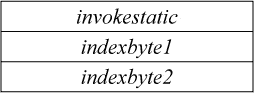

#### 形式

`invokestatic` = 184 (0xb8)

#### 操作数

`..., [arg1, [arg2 ...]] ->`

#### 栈

`...`

#### 描述

无符号`indexbyte1`和`indexbyte2`用于构造当前类运行时常量池的索引（§2.6），其中索引值为 (`indexbyte1` << 8) | `indexbyte2`。该索引处的运行时常量池项必须是指向方法或接口方法的符号引用（§5.1），它给出方法的名称和描述符（§4.3.3）以及查找方法的类或接口的符号引用。命名的方法被解析（§5.4.3.3）。

解析出的方法不能是实例初始化方法，且必须是`static`的，因此不能是抽象的。

成功解析方法后，如果声明该方法的类或接口尚未初始化，则对其进行初始化（§5.5）。

操作数栈必须包含`nargs`个参数值，这些值的数量、类型和顺序必须与解析出的方法的描述符一致。

如果该方法是`synchronized`，则与解析出的`Class`对象相关的监视器将被进入或重新进入，就像当前线程中执行了`monitorenter`指令一样（§monitorenter）。

如果该方法不是`native`，则`nargs`参数值从操作数栈中弹出。在 Java 虚拟机栈上为被调用的方法创建一个新帧。`nargs`参数值连续地成为新帧局部变量的值，其中`arg1`位于局部变量 0（或者，如果`arg1`的类型为`long`或`double`，则位于局部变量 0 和 1 中），依此类推。任何浮点类型的参数值在存储到局部变量之前，都会经过值集转换（§2.8.3）。然后将新帧设为当前帧，并将 Java 虚拟机的`pc`设置为被调用方法的第一条指令的操作码。执行从该方法的第一条指令继续。

如果该方法是`native`且实现它的平台相关代码尚未绑定到 Java 虚拟机中（§5.6），则进行绑定。`nargs`参数值从操作数栈中弹出，并作为参数传递给实现方法的代码。任何浮点类型的参数值在作为参数传递之前，都会经过值集转换（§2.8.3）。参数被传递并以取决于实现的方式调用代码。当平台相关代码返回时，将发生以下情况：

- 如果`native`方法是`synchronized`，则与解析出的`Class`对象相关的监视器将被更新并可能退出，就像当前线程中执行了`monitorexit`指令一样（§monitorexit）。
- 如果`native`方法返回一个值，则平台相关代码的返回值以取决于实现的方式转换为`native`方法的返回类型，并推入操作数栈。

### 异常

在解析指向方法的符号引用期间，可能会抛出任何与方法解析相关的异常（§5.4.3.3）。

否则，如果解析的方法是实例方法，则`invokestatic`指令抛出`IncompatibleClassChangeError`。

### 运行时异常

否则，如果执行此`invokestatic`指令导致引用的类或接口的初始化，`invokestatic`可能会抛出`Error`，详见 §5.5。

否则，如果解析的方法是`native`且实现方法的代码无法绑定，`invokestatic`抛出`UnsatisfiedLinkError`。

### 注意事项

`nargs`参数值与前`nargs`个局部变量并非一一对应。`long`和`double`参数值必须存储在两个连续的局部变量中，因此可能需要比`nargs`更多的局部变量来将`nargs`参数值传递给被调用方法。

### invokevirtual

#### 操作

调用实例方法；基于类进行分发

#### 格式

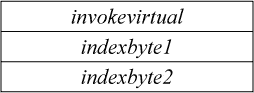

#### 形式

`invokevirtual` = 182 (0xb6)

#### 操作数

`..., objectref, [arg1, [arg2 ...]] ->`

#### 栈

`...`

#### 描述

无符号`indexbyte1`和`indexbyte2`用于构建指向当前类运行时常量池的索引（§2.6），其中索引的值为 (`indexbyte1` << 8) | `indexbyte2`。该索引处的运行时常量池项必须是指向一个方法的符号引用（§5.1），它提供了该方法的名称和描述符（§4.3.3）以及在要查找该方法的类的符号引用。该命名方法被解析（§5.4.3.3）。

解析的方法不能是实例初始化方法，或类或接口的初始化方法（§2.9）。

如果解析的方法是`protected`且它是当前类父类的成员，且该方法未在与当前类相同的运行时包（§5.3）中声明，则`objectref`的类必须是当前类或当前类的子类。

如果解析的方法不是签名多态（§2.9），则`invokevirtual`指令按如下方式进行。

令`C`为`objectref`的类。实际要调用的方法通过以下查找程序选择：

1. 如果`C`包含实例方法`m`的声明且该方法覆盖了解析方法（§5.4.5），则`m`为被调用的方法。
2. 否则，如果`C`有父类，则对覆盖解析的方法进行搜索，从`C`的直接父类开始，一直到其直接父类，直到找到覆盖方法或没有更多父类。如果找到了覆盖方法，它就是被调用的方法。
3. 否则，如果`C`的超接口中存在一个最特有的方法（§5.4.3.3）匹配解析方法的名称和描述符且不是`abstract`，则它就是被调用的方法。

`objectref`在操作数栈上必须跟随`nargs`参数值，其中值的数量、类型必须与所选方法的描述符一致。


如果该方法是 `synchronized`，则与解析出的 `Class` 对象相关的监视器将被进入或重新进入，就像当前线程中执行了 `monitorenter` 指令一样。

如果该方法不是 `native`，则 `nargs` 参数值和 `objectref` 从操作数栈中弹出。在 Java 虚拟机栈上为被调用的方法创建一个新帧。`objectref` 和参数值连续地成为新帧局部变量的值，其中 `objectref` 位于局部变量 0，`arg1` 位于局部变量 1（或者，如果 `arg1` 的类型为 `long` 或 `double`，则位于局部变量 1 和 2），依此类推。任何浮点类型的参数值在存储到局部变量之前，都会经过值 set 转换。然后将新帧设为当前帧，并将 Java 虚拟机的 `pc` 设置为被调用方法的第一条指令的操作码。执行从该方法的第一条指令继续。

如果该方法是 `native` 且实现方法的代码尚未绑定到 Java 虚拟机中，则进行绑定。`nargs` 参数值和 `objectref` 从操作数栈中弹出，并作为参数传递给实现方法的代码。任何浮点类型的参数值在作为参数传递之前，都会经过值 set 转换。参数被传递并以取决于实现的方式调用代码。

首先，获取一个 `java.lang.invoke.MethodType` 实例的 `reference`，这类似于解析一个方法类型的符号引用（§5.4.3.5），该方法的参数类型和返回类型与 `invokevirtual` 指令所引用的方法的描述符相同。

- 如果命名方法为 `invokeExact`，则 `java.lang.invoke.MethodType` 实例在语义上必须等于接收方法句柄 `objectref` 的类型描述符。`待调用的方法句柄`为 `objectref`。

- 如果命名方法为 `invoke`，且 `java.lang.invoke.MethodType` 实例在语义上等于接收方法句柄 `objectref` 的类型描述符，则 `待调用的方法句柄`为 `objectref`。

- 如果命名方法为 `invoke`，且 `java.lang.invoke.MethodType` 实例在语义上不等于接收方法句柄 `objectref` 的类型描述符，则 Java 虚拟机尝试调整接收方法句柄的类型描述符，类似于调用 `java.lang.invoke.MethodHandle.asType` 以获取一个完全可调方法句柄 `m`。`待调用的方法句柄`为 `m`。

`objectref` 之后在操作数栈上跟着 `nargs` 个参数值，这些值的数量、类型和顺序必须与待调用方法句柄的类型描述符一致。（该类型描述符将对应于待调用方法句柄类型相应的方法描述符，如 §5.4.3.5 所示。）

然后，如果待调用方法句柄具有字节码行为，Java 虚拟机将调用该方法句柄，类似于执行与该方法句柄类型相关的字节码行为。如果类型为 5 (`REF_invokeVirtual`)、6 (`REF_invokeStatic`)、7 (`REF_invokeSpecial`)、8 (`REF_newInvokeSpecial`) 或 9 (`REF_invokeInterface`)，则将创建一个帧并在*执行字节码行为的过程中*将其设置为当前帧；当由字节码行为调用的方法完成（正常或异常）时，其`调用者的帧`被视为包含此 `invokevirtual` 指令方法的帧。

字节码行为本身执行的帧是不可见的。

否则，如果待调用方法句柄没有字节码行为，Java 虚拟机将以依赖于实现的方式调用它。

## 链接异常 (Linking Exceptions)

在解析方法的符号引用期间，可能会抛出任何与方法解析相关的异常（§5.4.3.3）。

否则，如果解析的方法是类（`static`）方法，`invokevirtual` 指令将抛出 `IncompatibleClassChangeError`。

否则，如果解析的方法是签名多态（signature polymorphic），则在解析由方法符号引用描述符派出的方法类型期间，可能会抛出任何与方法类型解析相关的异常（§5.4.3.5）。

## 运行时异常 (Run-time Exceptions)

否则，如果 `objectref` 为 `null`，`invokevirtual` 指令将抛出 `NullPointerException`。

否则，如果解析的方法是当前类父类的 `protected` 方法，且声明在不同的运行时包中，并且 `objectref` 的类不是当前类或其子类，则 `invokevirtual` 抛出 `IllegalAccessError`。

否则，如果解析的方法不是签名多态的：

- 如果查找程序的第 2 步选择了一个 `abstract` 方法，`invokevirtual` 抛出 `AbstractMethodError`。

- 否则，如果查找程序的第 2 步选择了一个 `native` 方法且实现方法的代码无法绑定，`invokevirtual` 抛出 `UnsatisfiedLinkError`。

- 否则，如果查找程序的第 3 步确定 C 的超接口中存在多个匹配解析方法名称和描述符且非 `abstract` 的最大特定方法（maximally-specific methods），`invokevirtual` 抛出 `IncompatibleClassChangeError`。

- 否则，如果查找程序的第 3 步确定 C 的超接口中不存在匹配解析方法名称和描述符且非 `abstract` 的最大特定方法，`invokevirtual` 抛出 `AbstractMethodError`。

否则，如果解析的方法是签名多态的，则：

- 如果方法名称为 `invokeExact`，且获取的 `java.lang.invoke.MethodType` 实例在语义上不等于接收方法句柄的类型描述符，`invokevirtual` 指令抛出 `java.lang.invoke.WrongMethodTypeException`。

- 如果方法名称为 `invoke`，且获取的 `java.lang.invoke.MethodType` 实例不是接收方法句柄上调用的 `java.lang.invoke.MethodHandle.asType` 方法的有效参数，`invokevirtual` 指令抛出 `java.lang.invoke.WrongMethodTypeException`。

## 注意 (Notes)

`nargs` 参数值和 `objectref` 与前 `nargs`+1 个局部变量并非一一对应。`long` 和 `double` 参数值必须存储在两个连续的局部变量中，因此可能需要比 `nargs` 更多的局部变量来将 `nargs` 个参数传递给调用方法。

`invokevirtual` 指令可能解析到一个接口方法。在这种情况下，类层次结构中可能重写方法，但一个非 `abstract` 接口方法匹配解析方法的描述符。选择逻辑与 `invokeinterface` 相同。

## ior

**操作**

逻辑或 `int`

**格式**


**形式**

`ior` = 128 (0x80)

**操作数**

..., `value1`, `value2` →

**栈**

..., `result`

**描述**

`value1` 和 `value2` 必须是 `int` 类型。它们从操作数栈中弹出。`int` `result` 通过对 `value1` 和 `value2` 进行按位包含或计算。`result` 被推入操作数栈。

## irem

**操作**

取模 `int`

**格式**


**形式**

`irem` = 112 (0x70)

**操作数**

..., `value1`, `value2` →

**栈**

..., `result`

**描述**

`value1` 和 `value2` 必须是 `int` 类型。它们从操作数栈中弹出。`int` `result` 为 `value1` - (`value1` / `value2`) * `value2`。`result` 被推入操作数栈。

`irem` 指令的结果使得 `(a/b)*b + (a%b)` 等于 `a`。该等式即使在被数为该类型最大幅的负 `int` 且除数为 -1 的特殊情况下成立（余数为 0）。根据此规则可以推导出，取模操作的结果只有在被数为负时为负，只有在被数为正时才为正。此外，结果的模始终小于除数的模。

**运行时异常**

如果 `int` 取模运算符的操作值为 0，`irem` 抛出 `ArithmeticException`。

## ireturn

**操作**

从方法返回 `int`

**格式**


**形式**

`ireturn` = 172 (0xac)

**操作数**

..., `value` →

**栈**

[空]

**描述**

当前方法的返回类型必须是 `boolean`、`byte`、`short`、`char` 或 `int`。`value` 必须是 `int` 类型。如果当前方法是 `synchronized` 方法，则调用方法时进入或重入的监视器将得到更新，并可能像在当前线程中执行 `monitorexit` 指令（§*monitorexit*）一样退出。如果没有抛出异常，`value` 将从当前帧的操作数栈中弹出（§2.6）并推入调用者帧的操作数栈中。当前方法操作数栈上的任何其他值被丢弃。

解释器随后将控制权返回给方法的调用者，恢复调用者的栈帧。

## 运行时异常

如果 Java 虚拟机实现没有强制 §2.11.10 中描述的结构化锁规则，那么如果当前方法是 `synchronized` 方法且当前线程不是调用方法时进入或重入的监视器的所有者，则 `ireturn` 将抛出 `IllegalMonitorStateException`。这种情况可能会发生，例如一个 `synchronized` 方法包含一个 `monitorexit` 指令，但在该方法同步的对象上没有 `monitorenter` 指令。

否则，如果 Java 虚拟机实现强制执行 §2.11.10 中描述的结构化锁规则，并且在调用当前方法期间违反了这些规则之一，则 `ireturn` 将抛出 `IllegalMonitorStateException`。

## ishl

**操作**

左移 `int`

**格式**


**形式**

`ishl` = 120 (0x78)

**操作数**

..., `value1`, `value2` →

**栈**

..., `result`

**描述**

`value1` 和 `value2` 必须是 `int` 类型。这两个值从操作数栈中弹出。通过将 `value1` 左移 `s` 个位置计算出一个 `int` 类型的 `result`，其中 `s` 是 `value2` 的低 5 位的值。`result` 被推入操作数栈。

**注意事项**

这等同于（即使发生溢出）乘以 2 的 `s` 次方。实际使用的位移距离始终在 0 到 31 之间（包含边界），仿佛 `value2` 对与掩码值 0x1f 进行了位逻辑与运算。

## ishr

**操作**

算术右移 `int`

**格式**


**形式**

`ishr` = 122 (0x7a)

**操作数**

..., `value1`, `value2` →

**栈**

..., `result`

**描述**

`value1` 和 `value2` 必须是 `int` 类型。这两个值从操作数栈中弹出。通过将 `value1` 右移 `s` 个位置并进行符号扩展，计算出一个 `int` 类型的 `result`，其中 `s` 是 `value2` 的低 5 位的值。`result` 被推入操作数栈。

**注意事项**

结果的值是 `floor(value1 / 2^(s))`，其中 `s` 是 `value2` & 0x1f。对于非负的 `value1`，这等同于将 `int` 除以 2 的 `s` 次方。实际使用的位移距离始终在 0 到 31 之间（包含边界），仿佛 `value2` 对与掩码值 0x1f 进行了位逻辑与运算。

## istore

**操作**

将 `int` 存储局部变量

**格式**


**形式**

`istore` = 54 (0x36)

**操作数**

..., `value` →

**栈**

...

**描述**

`index` 是一个无符号字节，必须是当前帧局部变量数组的索引（§2.6）。操作数栈顶部的 `value` 必须是 `int` 类型。它从操作数栈中弹出，并将 `index` 处的局部变量值设置为 `value`。

**注意事项**

`istore` 码可以与 `wide` 指令（§*wide*）结合使用，使用双字节无符号索引访问局部变量。

## istore_<n>

**操作**

将 `int` 存储局部变量

**格式**


**形式**

`istore_0` = 59 (0x3b)

`istore_1` = 60 (0x3c)

`istore_2` = 61 (0x3d)

`istore_3` = 62 (0x3e)

**操作数**

..., `value` →

**栈**

...

**描述**

`<n*>` 是一个无符号字节，必须是当前帧局部变量数组的索引（§2.6）。操作数栈顶部的 `value` 必须是 `int` 类型。它从操作数栈中弹出，并将 `index` 处的局部变量值设置为 `value`。

**注意事项**

每个 `istore_<n>` 与 `istore` 相同，只是 `index` 是隐式的。

## isub

**操作**

相减 `int`

**格式**


**形式**

`isub` = 100 (0x64)

**操作数**

..., `value1`, `value2` →

**栈**

..., `result`

**描述**

`value1` 和 `value2` 必须是 `int` 类型。这两个值从操作数栈中弹出。通过 `value1` - `value2` 计算出一个 `int` 类型的 `result`。`result` 被推入操作数栈。

尽管可能会发生溢出，结果的符号与 `value1` 的。

## iushr

**操作**

逻辑右移 `int`

**格式**


**形式**

`iushr` = 124 (0x7c)

**操作数**

..., `value1`, `value2` →

**栈**

..., `result`

**描述**

`value1` 和 `value2` 必须是 `int` 类型。这两个值从操作数栈中弹出。通过将 `value1` 右移 `s` 个位置并进行零扩展，计算出一个 `int` 类型的 `result`，其中 `s` 是 `value2` 的低 5 位的值。`result` 被推入操作数栈。

**注意事项**

如果 `value1` 为正且 `s` 是 `value2` & 0x1f，则结果与 `value1` >> `s` 相同；如果 `value1` 为负，则结果等于表达式 (`value1` >> `s`) + (2 `<<` *s*)。实际使用的位移距离始终在 0 到 31 之间。

## ixor

**操作**

异或 `int`

**格式**


**形式**

`ixor` = 130 (0x82)

**操作数**

..., `value1`, `value2` →

**栈**

..., `result`

**描述**

`value1` 和 `value2` 必须是 `int` 类型。这两个值从操作数栈中弹出。通过对 `value1` 和 `value2` 进行位异或运算计算出一个 `int` 类型的 `result`。`result` 被推入操作数栈。

## jsr

**操作**

跳转子程序

**格式**

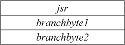

**形式**

`jsr` = 168 (0xa8)

**操作数**

... →

**栈**

..., `address`

**描述**

紧随此 `jsr` 指令的指令码地址 `address` 作为 `returnAddress` 类型推入操作数栈。无符号 `branchbyte1` 和 `branchbyte2` 用于构造一个有符号 16 位偏移量，其中偏移量为 (`branchbyte1` `<<` 8) | `branchbyte2`。执行从 `jsr` 指令地址开始该偏移量开始。目标地址必须是包含此 `jsr` 指令的方法内部某个指令码的地址。

**注意事项**

注意 `jsr` 将地址推入操作数栈，而 `ret` (§*ret*) 从局部变量中获取它。这种不对称性是有意设计的。

在 Oracle 对 Java SE 6 之前的 Java 语言编译器实现中，`jsr` 指令在 `finally` 句的实现中配合 `ret` 指令使用（§3.13, §4.10.2.5）。

## jsr_w

**操作**

跳转子程序（宽索引）

**格式**

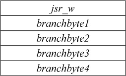

**形式**

`jsr_w` = 201 (0xc9)

**操作数**

... →

**栈**

..., `address`

**描述**


随此`jsr_w`指令之后的指令的操作码的`address`被作为`returnAddress`类型的值推入操作数栈。无符号的`branchbyte1`、`branchbyte2`、`branchbyte3`和`branchbyte4`用于构造一个有符号的 32 位偏移量，其中偏移量为(`branchbyte1` `<<` 24) | (`branchbyte2` `<<` 16) | (`branchbyte3` `<<` 8) | `branchbyte4`。从此`jsr_w`指令的地址按照该偏移量执行。目标地址必须是此`jsr_w`指令所在方法的指令指令地址。

**注意**

注意`jsr_w`将地址推入操作数栈，而`ret` (§*ret) 从局部变量中取出它。这种不对称性是有故意的。

在 Oracle 对 Java SE 6 之前的 Java 语言编译器实现中，`jsr_w`指令在`finally`句的实现中配合`ret`指令使用（§3.13, §4.10.2.5）。

尽管`jsr_w`指令采用 4 字节的分支偏移，但其他因素将方法的大小限制为 65535 字节 (§4.11)。此限制在 Java 虚拟未来版本中可能会提高。

### l2d

**操作**

将`long`转换为`double`

**格式**


**形式**

`l2d` = 138 (0x8a)

**操作数**

..., `value` →

**栈**

..., `result`

**描述**

操作数栈顶部的`value`必须是`long`类型。它从操作数栈中弹出并使用 IEEE 754 最近舍入模式转换为`double`类型`result`。`result`被推入操作数栈。

**注意**

`l2d`指令执行宽原类型转换（JLS §5.1.2），可能会丢失精度，因为`double`类型的值只有 53 位尾数位。

### l2f

**操作**

将`long`转换为`float`

**格式**


**形式**

`l2f` = 137 (0x89)

**操作数**

..., `value` →

**栈**

..., `result`

**描述**

操作数栈顶部的`value`必须是`long`类型。它从操作数栈中弹出并使用 IEEE 754 最近舍入模式转换为`float`类型`result`。`result`被推入操作数栈。

**注意**

`l2f`指令执行宽原类型转换（JLS §5.1.2），可能会丢失精度，因为`float`类型的值只有 24 位尾数位。

### l2i

**操作**

将`long`转换为`int`

**格式**


**形式**

`l2i` = 136 (0x88)

**操作数**

..., `value` →

**栈**

..., `result`

**描述**

操作数栈顶部的`value`必须是`long`类型。它从操作数栈中弹出，通过取`long`值的低 32 位并丢弃高 32 位来转换为`int`类型`result`。`result`被推入操作数栈。

**注意**

`l2i`指令执行窄原类型转换（JLS §5.1.3）。它可能会丢失关于`value`整体幅度的信息。`result`的符号可能与`value`不相同。

### ladd

**操作**

加`long`

**格式**


**形式**

`ladd` = 97 (0x61)

**操作数**

..., `value1`, `value2` →

**栈**

..., `result`

**描述**

`value1`和`value2`必须都是`long`类型。这两个值从操作数栈中弹出。`long`类型`result`为`value1` + `value2`。`result`被推入操作数栈。

### laload

**操作**

从数组加载`long`

**格式**


**形式**

`laload` = 47 (0x2f)

**操作数**

..., `arrayref`, `index` →

**栈**

..., `value`

**描述**

`arrayref`必须是`reference`类型，并且引用一个组件类型为`long`的数组。`index`必须是`int`类型。`arrayref`和`index`都从操作数栈中弹出。获取数组在`index`处的`long`类型`value`。

### land

**操作**

布尔与运算`long`

**格式**


**形式**

`land` = 127 (0x7f)

**操作数**

..., `value1`, `value2` →

**栈**

..., `result`

**描述**

`value1`和`value2`必须都是`long`类型。它们从操作数栈中弹出。通过对`value1`和`value2`进行按位与运算计算`long`类型`result`。

### lastore

**操作**

将`long`存储数组

**格式**


**形式**

`lastore` = 80 (0x50)

**操作数**

..., `arrayref`, `index`, `value` →

**栈**

**描述**

`arrayref`必须是`reference`类型，并且引用一个组件类型为`long`的数组。`index`必须是`int`类型，`value`必须是`long`类型。`arrayref`、`index`和`value`从操作数栈中弹出。将`long`类型`value`存储在`index`索引的数组中。

### lcmp

**操作**

比较`long`

**格式**


**形式**

`lcmp` = 148 (0x94)

**操作数**

..., `value1`, `value2` →

**栈**

..., `result`

**描述**

`value1`和`value2`必须都是`long`类型。它们都从操作数栈中弹出，并执行符号整数比较。如果`value1`大于`value2`，则将`int`类型 1 推入操作数栈。如果`value1`等于`value2`，则将 0 推入操作数栈。如果`value1`小于`value2`，则将 -1 推入操作数栈。

### lconst_<l>

**操作**

推入`long`常量

**格式**


**形式**

`lconst_0` = 9 (0x0x9)

`lconst_1` = 10 (0xa)

**操作数**

... →

**栈**

..., `<l>`

**描述**

将`long`常量`<l>`（0 或 1）推入操作数栈。

### ldc

**操作**

从运行时常量池推送项

**格式**


**形式**

`ldc` = 18 (0x12)

**操作数**

... →

**栈**

..., `value`

**描述**

`index`是一个无符号字节，必须是当前类运行时常量池的有效索引（§2.6）。运行时常量池中 *index* 处的条目必须是`int`或`float`运行时常量，或者是指向字符串字面量的`reference`，或者是指向类、方法类型或方法句柄的符号引用（§5.1）。

如果运行时常量池项是类型为`int`或`float`的运行时常量，则该运行时常量的数值`value`将被分别作为`int`或`float`推送到操作数栈上。

否则，如果运行时常量池项是指向`String`类实例的引用，且该实例表示一个字符串字面量（§5.1），则该实例的引用`value`（引用）被推送到操作数栈上。

否则，如果运行时常量池项是某个类的符号引用（§5.1），则对该命名的类进行解析（§5.4.3.1），并将代表该类的`Class`对象的引用`value`（引用）推送到操作数栈上。

否则，运行时常量池项必须是指向方法类型或方法句柄的符号引用（§5.1）。该方法类型或方法句柄将被解析（§5.4.3.5），并将由此产生的`java.lang.invoke.MethodType`或`java.lang.invoke.MethodHandle`实例引用`value`（引用）推送到操作数栈上。

### 连接异常

在解析指向类的符号引用期间，可能会抛出任何与类解析相关的异常（§5.4.3.1）。

在解析指向方法类型或方法句柄的符号引用期间，可能会抛出任何与方法类型或方法句柄解析相关的异常（§5.4.3.5）。

### 注意事项

`ldc`指令只能用于推送从浮点数值集（§2.3.2）中取的类型为`float`的值，因为常量池（§4.4.4）中的类型为`float`的常量必须从浮点数值集中取出。

### ldc_w

#### 操作

从运行时常量池（宽索引）推入项目

#### 格式

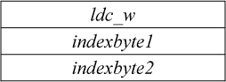

#### 形式

`ldc_w` = 19 (0x13)

#### 操作数

... →

#### 栈

..., `value`

#### 描述

无符号的`indexbyte1`和`indexbyte2`被组成为一个无符号的 16 位索引，指向当前类的运行时常量池（§2.6），其中索引值的计算方式为 (`indexbyte1` `<<` 8) | `indexbyte2`。该索引必须是当前类运行时常量池的有效索引。索引处的运行时常量池项必须是类型为`int`或`float`的运行时常量，或者是指向字符串字面量的引用，或者是指向类、方法类型或方法句柄的符号引用（§5.1）。

如果运行时常量池项是类型为`int`或`float`的运行时常量，则该运行时常量的数值`value`将被分别作为`int`或`float`推送到操作数栈上。

否则，如果运行时常量池项是指向`String`类实例的引用，且该实例表示一个字符串字面量（§5.1），则该实例的引用`value`（引用）被推送到操作数栈上。

否则，如果运行时常量池项是某个类的符号引用（§4.4.1）。对该命名的类进行解析（§5.4.3.1），并将代表该类的`Class`对象的引用`value`（引用）推送到操作数栈上。

否则，运行时常量池项必须是指向方法类型或方法句柄的符号引用（§5.1）。该方法类型或方法句柄将被解析（§5.4.3.5），并将由此产生的`java.lang.invoke.MethodType`或`java.lang.invoke.MethodHandle`实例引用`value`（引用）推送到操作数栈上。

#### 连接异常

在解析指向类的符号引用期间，可能会抛出任何与类解析相关的异常（§5.4.3.1）。

在解析指向方法类型或方法句柄的符号引用期间，可能会抛出任何与方法类型或方法句柄解析相关的异常（§5.4.3.5）。

#### 注意事项

`ldc_w`指令与`ldc`指令（§*ldc*）相同，仅其运行时常量池索引更宽。

`ldc_w`指令只能用于推送从浮点数值集（§2.3.2）中取的类型为`float`的值，因为常量池（§4.4.4）中的类型为`float`的常量必须从浮点数值集中取出。

### ldc2_w

#### 操作

从运行时常量池（宽索引）推入`long`或`double`

#### 格式

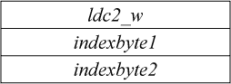

#### 形式

`ldc2_w` = 20 (0x14)

#### 操作数

... →

#### 栈

..., `value`

#### 描述

无符号的`indexbyte1`和`indexbyte2`被组成为一个无符号的 16 位索引，指向当前类的运行时常量池（§2.6），其中索引值的计算方式为 (`indexbyte1` `<<` 8) | `indexbyte2`。该索引必须是当前类运行时常量池的有效索引。索引处的运行时常量池项必须是类型为`int`或`float`的运行时常量，或者是指向字符串字面量的引用，或者是指向类、方法类型或方法句柄的符号引用（§5.1）。

`ldc2_w`指令使用双字节无符号索引。

#### 注意事项

`ldc2_w`指令从运行时常量池推入`long`或`double`。`ldc`指令推送从浮点数值集中取的`float`类型值。

### ldiv

#### 操作

除法`long`

#### 格式


#### 形式

`ldiv` = 109 (0x6d)

#### 操作数

..., `value1`, `value2` →

#### 栈

..., `result`

#### 描述

`value1`和`value2`必须是`long`类型。从操作数栈弹出值。`result`是 Java 表达式`value1 / value2`。

`long`除法向 0 舍入；即，产生的`long`商`q`满足 |d| · |q| ≤ |*n|。此外，当 |n| ≥ |d| 且 *n* 与 *d* 符号相同时，*q* 为正；但当 |n| ≥ |d| 且 *n* 与 *d* 符号相反时，*q* 为负。

有一个特殊情况不符合此规则：如果被除数为`long`最大负整数且除数为 -1，则会发生溢出且结果等于被除数；尽管溢出，也不会抛出异常。

#### 运行时异常

当`long`除法的除数为 0 时，`ldiv`抛出`ArithmeticException`。

### lload

#### 操作

从局部变量加载`long`

#### 格式

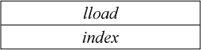

#### 形式

`lload` = 22 (0x16)

#### 操作数

... →

#### 栈

..., `value`

#### 描述

*index* 是无符号字节。*index* 和 *index*+1 必须是当前帧局部变量数组的索引（§2.6）。*index* 处的局部变量必须包含一个`long`。*index* 处的局部变量的值 *value* 推送到操作数栈上。

#### 注意事项

`lload`操作码可以配合`wide`指令（§*wide*）使用双字节无符号索引访问局部变量。

#### lload_<n>

#### 操作

从局部变量加载`long`

#### 格式

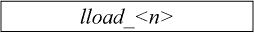

#### 形式

`lload_0` = 30 (0x1e), `lload_1` = 31 (0x1f), `lload_2` = 32 (0x20), `lload_3` = 33 (0x21)

#### 操作数

... →

#### 栈

..., `value`

## Description

`n`和`n+1`必须是当前帧局部变量数组的索引（§2.6）。位于`n`处的局部变量必须包含一个`long`类型。`n`处的局部变量的值被推入操作数栈。

## 注意事项

每个`lload_<n>`指令都与`index`为`n`的`lload`相同，只是操作数`n`是隐式的。

### lmul

#### 操作

相乘`long`

#### 格式


#### 形式

`lmul` = 105 (0x69)

#### 操作数

..., `value1`, `value2` →

#### 栈

..., `result`

#### Description

`value1`和`value2`必须是`long`类型。这两个值从操作数栈中弹出。`long`类型的`result`为`value1` * `value2`。`result`被推入操作数栈。

结果是在足够宽的补码格式下真实数学结果的 64 位低位，表示为`long`类型的值。如果发生溢出，结果的符号可能与两个值进行数学乘法后结果的符号不同。

尽管可能会发生溢出，但执行`lmul`指令永远不会抛出运行时异常。

### lneg

#### 操作

取反`long`

#### 格式


#### 形式

`lneg` = 117 (0x75)

#### 操作数

..., `value` →

#### 栈

..., `result`

#### Description

`value`必须是`long`类型。它从操作数栈中弹出。`long`类型的`result`是`value`的算术取反，即`-value`。`result`被推入操作数栈。

对于`long`值，取反等同于减零。由于 Java 虚拟机对整数使用补码表示法，且补码值的范围是非对称的，因此最大负`long`的取反结果仍是该最大负数。尽管发生了溢出，但不会抛出异常。

对于所有`long`值`x`，`-x`等于`(~x)+1`。

### lookupswitch

#### 操作

通过键匹配访问表并跳转

#### 格式

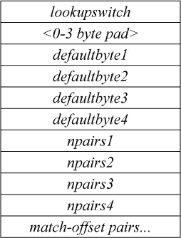

#### 形式

`lookupswitch` = 171 (0xab)

#### 操作数

..., `key` →

#### 栈

...


#### Description

`lookupswitch` 是一个变长指令。在 `lookupswitch` 操作码之后，必须有 0 到 3 个字节作为填充，使得 `defaultbyte1` 开始的地址是当前方法起始位置（其第一条指令的操作码）的 4 字节倍数。紧随填充之后是一系列带符号 32 位的值：`default`、`npairs`，然后是 `npairs` 对带符号 32 位的值。`npairs` 必须大于或等于 0。`npairs` 中的每对值由一个 `int` 类型 `match` 和一个带符号的 32 位 `offset` 组成。每个带符号的 32 位值都由四个无符号字节构造为（`byte1` `<<` 24) | (`byte2` `<<` 16) | (`byte3` `<<` 8) | `byte4`。

`lookupswitch` 指令的 `match-offset` 对必须按照 `match` 的数值递增顺序排序。

`key` 必须是 `int` 类型，并从操作数栈中弹出。`key` 与 `match` 值进行比较。如果它等于其中一个值，则通过向此 `lookupswitch` 指令的操作码地址加上相应的 `offset` 来计算目标地址。如果 `key` 不匹配任何 `match` 值，则通过向此 `lookupswitch` 指令的操作码地址加上 `default` 来计算目标地址。然后在目标地址处继续执行。

从每个 `match-offset` 对的 `offset` 计算出的目标地址，以及从 `default` 计算出的地址，必须是包含该 `lookupswitch` 指令的方法内指令的操作码地址。

#### 注意事项

`lookupswitch` 指令对 4 字节操作数要求的对齐保证了：当且仅当包含该 `lookupswitch` 的方法位于 4 字节边界时，这些操作数才是 4 字节对齐的。

`match-offset` 对进行排序是为了支持比线性搜索更快的查找例程。

### lor

#### 操作

逻辑或 `long`

#### 格式


#### 形式

`lor` = 129 (0x81)

#### 操作数

..., `value1`, `value2` →

#### 栈

..., `result`

#### Description

`value1` 和 `value2` 必须是 `long` 类型。它们从操作数栈中弹出。通过对 `value1` 和 `value2` 进行按位包含或运算计算出一个 `long` 类型的 `result`。`result` 被推入操作数栈。

### lrem

#### 操作

取余 `long`

#### 格式


#### 形式

`lrem` = 113 (0x71)

#### 操作数

..., `value1`, `value2` →

#### 栈

..., `result`

#### Description

`value1` 和 `value2` 必须是 `long` 类型。这些值从操作数栈中弹出。`long` 类型的 `result` 为 `value1` - (`value1` / `value2`) * `value2`。`result` 被推入操作数栈。

`lrem` 指令的结果使得 `(a/b)*b + (a%b)` 等于 `a`。即使在被数为该类型范围内最大的负 `long` 且除数为 -1 的特殊情况下（余数为 0），该等式也成立。根据这条规则，取余结果只有在被数为负时才为负，在被数为正时才为正；此外，结果的绝对值始终小于除数的绝对值。

#### 运行时异常

如果 `long` 取余操作的除数为 0，`lrem` 将抛出 `ArithmeticException`。

### lreturn

#### 操作

从方法返回 `long`

#### 格式


#### 形式

`lreturn` = 173 (0xad)

#### 操作数

..., `value` →

#### 栈

[空]

#### Description

当前方法必须返回 `long` 类型。`value` 必须是 `long` 类型。如果当前方法是 `synchronized` 方法，则调用方法时进入或重新进入的锁将更新并可能像执行 `monitorexit` 指令一样退出（*monitorexit](#ch06a.html_ch06lev134)*）。如果没有异常抛出，`value` 从当前帧的操作数栈（§2.6)）弹出调用者的操作数栈。当前方法操作数栈上的其他值将被丢弃。

解释器随后将控制权交给调用者，恢复调用者的帧。

#### 运行时异常

如果 Java 虚拟机未强制 §2.11.10 中的结构化锁规则，那么当当前方法是 `synchronized` 方法且当前线程不是调用方法时进入的锁的所有者时，`lreturn` 将抛出 `IllegalMonitorStateException`。这可能发生在，例如一个 `synchronized` 方法包含了 `monitorexit` 指令，但未在该 `synchronized` 方法的对象上包含 `monitorenter` 指令。

否则，如果 Java 虚拟机强制 §2.11.10 中的结构化锁规则，且在调用当前方法期间违反了这些规则中的第一个，则 `lreturn` 将抛出 `IllegalMonitorStateException`。

### lshl

#### 操作

左移 `long`

#### 格式


#### 形式

`lshl` = 121 (0x79)

#### 操作数

..., `value1`, `value2` →

#### 栈

..., `result`

#### Description

`value1` 必须是 `long` 类型，`value2` 必须是 `int` 类型。这些值从操作数栈中弹出。通过将 `value1` 向左移动 `s` 位计算出一个 `long` 类型的 `result`，其中 `s` 是 `value2` 的低 6 位。`result` 被推入操作数栈。

这等同于（即使发生溢出）乘以 2 的 `s` 次方。因此，实际使用的位移距离始终在 0 到 63 的范围内（包含），就像 `value2` 与掩码值 `0x3f` 执行了位逻辑与与操作一样。

### lshr

#### 操作

`long` 算术右移

#### 格式


#### 形式

`lshr` = 123 (0x7b)

#### 操作数

..., `value1`, `value2` →

#### 栈

..., `result`

#### 描述

`value1` 必须是 `long` 类型，`value2` 必须是 `int` 类型。这两个值从操作数栈中弹出。通过将 `value1` 向右位移 `s` 个位并进行符号扩展，计算出 `long` `result`，其中 `s` 是 `value2` 低 6 位的值。`result` 被推入操作数栈。

#### 备注

结果为 `floor(value1 / 2^(s))`，其中 `s` 为 `value2 & 0x3f`。对于非负的 `value1`，这等同于将 `long` 除以 2 的 `s` 次。因此，实际使用的位移距离始终在 0 到 63 的范围内（包含），就像 `value2` 与掩码值 `0x3f` 执行了位逻辑与与操作一样。

### lstore

#### 操作

将 `long` 存储到局部变量

#### 格式

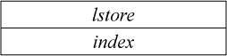

#### 形式

`lstore` = 55 (0x37)

#### 操作数

..., `value` →

#### 栈

...

#### 描述

`index` 是一个无符号字节。`index` 和 `index+1` 必须是当前帧局部变量数组的索引（§2.6）。操作数栈顶部的 `value` 必须是 `long` 类型。它从操作数栈中弹出，并将 `index` 和 `index+1` 处的局部变量设置为 `value`。

#### 备注

`lstore` 指令可以与 `wide` 指令（§*wide*）结合使用，使用双字节无符号索引访问局部变量。

### lstore_<n>

#### 操作

将 `long` 存储到局部变量

#### 格式


#### 形式

`lstore_0` = 63 (0x3f)

`lstore_1` = 64 (0x40)

`lstore_2` = 65 (0x41)

`lstore_3` = 66 (0x42)

#### 操作数

..., `value` →

#### 栈

...

#### 描述

`<n>` 和 `<n>`+1 必须是当前帧局部变量数组的索引（§2.6）。操作数栈顶部的 `value` 必须是 `long` 类型。它从操作数栈中弹出，并将 `<n>` 和 `<n>`+1 处的局部变量设置为 `value`。

#### 备注

每个 `lstore_<n>` 指令与 `index` 为 `<n>` 的 `lstore` 指令相同，只是操作数 `<n>` 是隐式的。

### lsub

#### 操作

相减 `long`

#### 格式


#### 形式

`lsub` = 101 (0x65)

#### 操作数

..., `value1`, `value2` →

#### 栈

..., `result`

#### 描述

`value1` 和 `value2` 必须是 `long` 类型。这两个值从操作数栈中弹出。`long` `result` 为 `value1 - value2`。`result` 被推入操作数栈。

对于 `long` 减法，`a-b` 产生的结果与 `a+(-b)` 相同。对于 `long` 值，从 0 减去等同于取反。

结果是在足够宽的补码格式中真实的数学结果的 64 位低位，表示为 `long` 类型的值。如果发生溢出，则结果的符号可能与两个值之间数学差的符号不同。

尽管可能会发生溢出，执行 `lsub` 指令永远不会抛出运行时异常。

### lushr

#### 操作

`long` 逻辑右移

#### 格式


#### 形式

`lushr` = 125 (0x7d)

#### 操作数

..., `value1`, `value2` →

#### 栈

..., `result`

#### 描述

`value1` 必须是 `long` 类型，`value2` 必须是 `int` 类型。这两个值从操作数栈中弹出。通过将 `value1` 向右逻辑位移 `s` 个位并并进行零扩展，计算出 `long` `result`，其中 `s` 是 `value2` 低 6 位的值。`result` 被推入操作数栈。

#### 备注

结果为 `floor(value1 / 2^(s))`，其中 `s` 为 `value2 & 0x3f`。对于非负的 `value1`，这等同于将 `long` 除以 2 的 `s` 次。因此，实际使用的位移距离始终在 0 到 63 的范围内（包含），就像 `value2` 与掩码值 `0x3f` 执行了位逻辑与与操作一样。

### lxor

#### 操作

`long` 位异或

#### 格式


#### 形式

`lxor` = 131 (0x83)

#### 操作数

..., `value1`, `value2` →

#### 栈

..., `result`

#### 描述

`value1` 和 `value2` 必须是 `long` 类型。这两个值从操作数栈中弹出。`long` `result` 通过对 `value1` 和 `value2` 进行位异或计算得出。`result` 被推入操作数栈。

### monitorenter

#### 操作

进入对象锁

#### 格式


#### 形式

`monitoreter` = 194 (0xc2)

#### 操作数

..., `objectref` →

#### 栈

...

#### 描述

`objectref` 必须是 `reference` 类型。每个对象都关联一个锁。如果有所有者时锁才有效。执行 `monitoreter` 的线程尝试获取 `objectref` 的锁，方式如下：

- 如果 `objectref` 锁的计数为零，线程进入锁并将其设置为 1。该线程是锁的所有者。
- 如果线程已经拥有 `objectref` 锁，它将重新进入锁并增加计数。
- 如果另一个线程已经拥有 `objectref` 锁，线程将阻塞，直到计数为零，然后再次尝试获取所有权。

#### 运行时异常

如果 `objectref` 为 `null`，`monitoreter` 将抛出 `NullPointerException`。

#### 备注

`monitoreter` 指令可以与一个或多个 `monitorexit` 指令（§monitorexit](#ch06a.html_ch06lev2sec134)*）配合使用，以实现 Java 语言中的 `synchronized` 语句（§3.14）。`synchronized` 方法在调用时的锁进入和返回时的锁退出由 Java 虚拟机隐式处理，就像使用了 `monitoreter` 和 `monitorexit` 一样。`synchronized` 方法的实现并不使用这些指令，但可以提供相同的语义。

锁与锁的关联可以通过多种方式管理，这些方法超出了本规范的范围。例如，锁可能与对象同时分配和释放。或者，在线程尝试获取对象的独占访问时动态分配，并在之后的时刻释放。

Java 语言的同步结构需要除了进入和退出之外的操作。这些包括等待锁（`Object.wait`）和通知等待的其他线程（`Object.notifyAll` 和 `Object.notify`）。这些操作在 Java 虚拟机提供的标准包 `java.lang` 中得到了支持。虚拟机指令集中没有出现这些操作的显式支持。

### monitorexit

#### 操作

退出对象锁

#### 格式


#### 形式

`monitorexit` = 195 (0xc3)

#### 操作数

..., `objectref` →

#### 栈

...

#### 描述

`objectref` 必须是 `reference` 类型。执行 `monitorexit` 的线程必须是 `objectref` 所引实例关联锁的所有者。

该线程减少与 `objectref` 关联的监视器（monitor）的进入计数。如果结果计数值为零，则线程退出监视器并且不再是其所有者。其他阻塞等待进入监视器的线程被允许尝试进入。

#### 运行时异常

如果 `objectref` 为 `null`，`monitorexit` 将抛出 `NullPointerException`。

否则，如果执行 `monitorexit` 的线程不是由 `objectref` 所引实例关联监视器的所有者，`monitorexit` 将抛出 `IllegalMonitorStateException`。

否则，如果 Java 虚拟机实现强制执行 §2.11.10 中描述的结构化锁规则，且执行此 `monitorexit` 指令违反了这些规则中的第二条，则 `monitorexit` 将抛出 `IllegalMonitorStateException`。

#### 注意事项

一个或多个 `monitorexit` 指令可以配合 `monitorenter` 指令（§*monitorenter*）使用，以实现 Java 语言中的 `synchronized` 语句（§3.14）。`monitorenter` 和 `monitorexit` 指令未用于 `synchronized` 方法实现，尽管它们可以用于提供等效锁定语义。

Java 虚拟机对 `synchronized` 方法和 `synchronized` 语句内部抛出的异常处理方式不同：

- 正常完成 `synchronized` 方法时的监视器退出由 Java 虚拟机的返回指令处理。异常中止完成 `synchronized` 方法时的监视器退出由 Java 虚拟机的 `athrow` 指令隐式处理。
- 当从 `synchronized` 语句内部抛出异常时，将使用 Java 虚拟机的异常处理机制退出在执行 `synchronized` 语句之前进入的监视器（§3.14）。

### multianewarray

#### 操作

创建新的多维数组

#### 格式

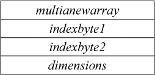

#### 形式

`multianewarray` = 197 (0xc5)

#### 操作数

..., `count1`, [`count2`, ...] →

#### 栈

..., `arrayref`

#### 描述

`dimensions` 操作数是一个无符号字节，必须大于或等于 1。它表示要创建的数组的维度数。操作数栈必须包含 `dimensions` 个值。每个此类值都代表要创建的数组在某一维度上的组件数量，必须是 `int` 类型，且必须是非负数。`count1` 是第一维的预期长度，`count2` 是第二维，以此此类推。


所有的`count`值都会从操作数栈中弹出。无符号的`indexbyte1`和`indexbyte2`用于构建一个指向当前类运行时常量池的索引（§2.6），其中索引的值为 (`indexbyte1` `<<` 8) | `indexbyte2`。该索引处的运行时常量池项必须是指向类、数组或接口类型的符号引用。该命名的类、数组或接口类型将进行解析（§5.4.3.1）。结果项必须是维度大于或等于`dimensions`的数组类类型。

从垃圾回收堆中分配一个该数组类型的新多维数组。如果任何`count`值为 0，则不分配后续的维度。数组第一维的组件被初始化为第二维类型的子数组，依此类推。数组最后一个分配维度的组件被初始化为该数组类型对应元素类型的默认初始值（§2.3, §2.4）。一个指向新数组的引用`reference` `arrayref`被推入操作数栈中。

#### 链接异常

在解析指向类、数组或接口类型的符号引用期间，可能会抛出 §5.4.3.1 文档记录的任何异常。

否则，如果当前类没有权限访问所解析数组类元素的元素类型，`multianewarray`将抛出`IllegalAccessError`。

#### 运行时异常

否则，如果操作数栈上的任何`dimensions`值小于 0，`multianewarray`指令将抛出`NegativeArraySizeException`。

#### 注意事项

在创建单维数组时，使用`newarray`或`anewarray`（§*newarray*, §*anewarray*）可能更高效。

通过运行时常量池引用的数组类维度可能比`multianewarray`指令的`dimensions`操作数多。在这种情况下，仅创建数组的前`dimensions`维维度。

### new

#### 操作

创建新对象

#### 格式

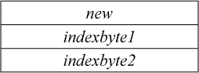

#### 形式

`new` = 187 (0xbb)

#### 操作数

...

#### 栈栈

..., `objectref`

#### 描述

无符号的`indexbyte1`和`indexbyte2`用于构建一个指向当前类运行时常量池的索引（§2.6），其中索引的值为 (`indexbyte1` `<<` 8) | `indexbyte2`。该索引处的运行时常量池项必须是指向类或接口类型的符号引用。该命名的类或接口类型将进行解析（§5.4.3.1）并应产生类类型。从垃圾回收堆中为新实例分配内存，如果新对象的实例变量尚未初始化，则它们将被初始化为它们的默认值（§2.3, §2.4）。一个指向该实例的引用`reference` `objectref`被推入操作数栈中。

#### 链接异常

在解析指向类、数组或接口类型的符号引用期间，可能会抛出 §5.4.3.1 文档记录的任何异常。

否则，如果指向类的符号引用解析为接口或抽象类，`new`将抛出`InstantiationError`。

#### 运行时异常

否则，执行此`new`指令导致引用类的初始化，`new`可能会抛出 JLS §15.9 中详细的`Error`。

#### 注意事项

`new`指令并未完全创建新实例；在对未初始化实例调用实例初始化方法（§2.9）之前，实例创建尚未完成。

### newarray

#### 操作

创建新数组

#### 格式

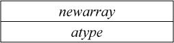

#### 形式

`newarray` = 188 (0xbc)

#### 操作数

..., `count` →

#### 栈栈

..., `arrayref`

#### 描述

`count`必须是`int`类型。它从操作数栈中弹出。`count`表示要创建的数组的数量。

`atype`是指示要创建的类型的代码。它取以下值之一：

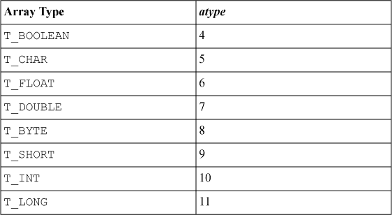

**表 6.5.newarray-A. 数组类型代码**

从垃圾回收堆中分配一个组件类型为`atype`且长度为`count`的新数组。指向此新数组对象的引用`reference` `arrayref`被推入操作栈。新数组的每个元素都被初始化为该数组类型元素类型的默认初始值（§2.3, §2.4）。

#### 运行时异常

如果`count`小于 0，`newarray`将抛出`NegativeArraySizeException`。

在 Oracle 的 Java 虚拟机实现中，`boolean`类型的数组（`atype`为`T_BOOLEAN`）被存储为 8 位值的数组，并使用`baload`和`bastore`指令进行操作 (§*baload, §*bastore)，这些指令也访问`byte`类型的数组。其他实现可能会实现压缩的`boolean`数组；但仍必须使用`baload`和`bastore`指令来访问这些数组。

## nop

### Operation

什么都不做

### Format


### Forms

`nop` = 0 (0x0)

### 操作数栈

无变化

### Description

什么都不做。

## pop

### Operation

弹出操作数栈顶的值

### Format


### Forms

`pop` = 87 (0x57)

### 操作数

..., `value` →

### 栈

...

### Description

从操作数栈弹出顶的值。

除非`value`是类别 1 计算类型的值，否则不得使用`pop`指令 (§2.11.1)。

## pop2

### Operation

弹出操作数栈顶的一个或两个值

### Format


### Forms

`pop2` = 88 (0x58)

### 操作数

形式 1:

### 栈

..., `value2`, `value1` →

...

其中`value1`和`value2`的每一个都是类别 1 计算类型的值 (§2.11.1)。

形式 2:

..., `value` →

...

其中`value`是类别 2 计算类型的值 (§2.11.1)。

### Description

从操作数栈弹出顶的一个或两个值。

## putfield

### Operation

设置对象中的字段

### Format


### Forms

`putfield` = 181 (0xb5)

### 操作数

..., `objectref`, `value` →

### 栈

...

### Description

无符号的`indexbyte1`和`indexbyte2`用于构造指向当前类运行时常量池的索引 (§2.6)，其中索引的值为 (`indexbyte1` `<<` 8) | `indexbyte2`。该索引处的运行时常量池项必须是指向字段的符号引用 (§5.1)，该引用提供了字段的名称和描述符，以及指向查找该字段的类的符号引用。`objectref`的类不能是数组。如果该字段是`protected`的，且它是当前类某个父类的成员，并且该字段与当前类不在同一个运行时包 (§5.3) 中，那么`objectref`的类必须是当前类或当前类的子类。

引用的字段被解析 (§5.4.3.2)。`putfield`指令存储的`value`的类型必须与所引用字段的描述符兼容 (§4.3.2)。如果字段描述符类型为`boolean`、`byte`、`char`、`short`或`int`，则`value`必须是`int`。如果字段描述符类型为`float`、`long`或`double`，则`value`分别是`float`、`long`或`double`。如果字段描述符类型为引用类型，则`value`类型必须与字段描述符类型赋值兼容（JLS §5.2）。如果字段是`final`的，它必须在当前类中声明，并且该指令必须出现在当前类的实例初始化方法 (`<init>`) 中 (§2.9)。

`value`和`objectref`从操作数栈中弹出。`objectref`的类型必须是`reference`。`value`经过值转换 (§2.8.3)，产生`value'`，并且`objectref`中引用的字段被设置为`value'`。

### 链接异常

在解析字段的符号引用过程中，可能会抛出任何与字段解析相关的异常 (§5.4.3.2)。

否则，如果解析的字段是`static`字段，`putfield`将抛出`IncompatibleClassChangeError`。

否则，如果字段是`final`的，它必须在当前类中声明，并且指令必须出现在实例初始化方法 (`<init>`) 中。否则，抛出`IllegalAccessError`。

### 运行时异常

否则，如果`objectref`为`null`，`putfield`将抛出`NullPointerException`。

## putstatic

### Operation

设置类中的静态字段

### Format


### Forms

`putstatic` = 179 (0xb3)

### 操作数

..., `value` →

### 栈

...

### Description

无符号的`indexbyte1`和`indexbyte2`用于构造指向当前类运行时常量池的索引 (§2.6)，其中索引的值为 (`indexbyte1` `<<` 8) | `indexbyte2`。该索引处的运行时常量池项必须是指向字段的符号引用 (§5.1)，该引用提供了字段的名称和描述符，以及指向查找该字段的类的符号引用。引用的字段被解析。`putstatic`指令存储的`value`的类型必须与所引用字段的描述符兼容 (§4.3.2)。如果字段描述符类型为`boolean`、`byte`、`char`、`short`或`int`，则`value`必须是`int`。如果字段描述符类型为`float`、`long`或`double`，则`value`分别是`float`、`long`或`double`。如果字段描述符类型为引用类型，则`value`类型必须与字段描述符类型赋值兼容（JLS §5.2）。如果字段是`final`的，它必须在当前类中声明，并且指令必须出现在当前类的类初始化方法 (`<clinit>`) 中 (§2.9)。

`value`从操作数栈中弹出并经过值转换 (§2.8.3)，产生`value'`，引用的字段被设置为`value'`。

### 链接异常

在解析字段的符号引用过程中，可能会抛出任何与字段解析相关的异常 (§5.4.3.2)。

否则，如果解析的字段不是`static`字段或接口字段，`putstatic`将抛出`IncompatibleClassChangeError`。

否则，如果字段是`final`的，它必须在当前类中声明，并且指令必须出现在类初始化方法 (`<clinit>`) 中。否则，抛出`IllegalAccessError`。

### 运行时异常

否则，如果执行此`putstatic`指令导致所引用类或接口的初始化，`putstatic`可能会抛出`Error`，详见 §5.5。

### 注意事项

`putstatic`指令仅用于在初始化接口字段时赋值。接口字段只能赋值一次，即在接口初始化时执行接口变量初始化表达式 (§5.5, JLS §9.3.1)。

## ret

### Operation

从子程序返回

### Format


### Forms

`ret` = 169 (0xa9)

### 操作数栈

无变化

### Description

*index* 是一个 0 到 255 之间的无符号字节。当前帧中 *index* 处的局部变量必须包含一个`returnAddress`类型的值 (§2.6)。局部变量的内容被写入 Java 虚拟机的`pc`寄存器，从那里继续执行。

注意，`jsr`将地址推入操作数栈，而`ret`则从局部变量中取出它。这种不对称性是有刻意的。

在 Oracle 对 Java SE 6 之前的 Java 编程语言编译实现中，`ret`指令用于`finally`子句实现中的`jsr`和`jsr_w`指令。

不要混淆`ret`指令与`return`指令。`return`指令将控制权返回给其调用者，而不向调用者传递任何值。

`ret`操作码可以与`wide`指令结合使用，使用双字节无符号索引访问局部变量。

### return

**操作**

从方法返回`void`

**格式**


**形式**

`return` = 177 (0xb1)

**操作**

... →

**栈**

[空]

**描述**

当前方法的返回类型必须为`void`。如果当前方法是`synchronized`方法，则在调用方法时进入或重入的监视器（monitor）将被更新，并可能像在当前线程中执行`monitorexit`指令一样退出。如果没有抛出异常，当前帧操作数栈上的任何值都将被丢弃。

解释器随后将控制权返回给方法的调用者，恢复调用者的帧帧。

**运行时异常**

如果 Java 虚拟机实现没有强制结构化锁（structured locking）的规则，那么如果当前方法是`synchronized`方法，且当前线程不是调用方法时进入或重入的监视器的所有者，`return`将抛出`IllegalMonitorStateException`。这可能会发生，例如，如果`synchronized`方法包含一个`monitorexit`指令，但在该方法所`synchronized`的对象上没有`monitorenter`指令。

否则，如果 Java 虚拟机实现强制执行结构化锁的规则，并且在调用当前方法期间违反了这些规则中的第一条，则`return`将抛出`IllegalMonitorStateException`。

### saload

**操作**

从数组中加载`short`

**格式**


**形式**

`saload` = 53 (0x35)

**操作**

..., `arrayref`, `index` →

**栈**

..., `value`

**描述**

`arrayref`必须是`reference`类型，并且必须引用一个组件类型为`short`的数组。`index`必须是`int`类型。`arrayref`和`index`都从操作数栈中弹出。获取数组在`index`处的组件并符号扩展为`int`类型`value`。将该`value`推入操作数栈。

**运行时**

如果`arrayref`为`null`，`saload`抛出`NullPointerException`。

**异常**

否则，如果`index`不在`arrayref`所引用数组的边界范围内，`saload`指令抛出`ArrayIndexOutOfBoundsException`。

### sastore

**操作**

存储到`short`数组

**格式**


**形式**

`sastore` = 86 (0x56)

**操作**

..., `arrayref`, `index`, `value` →

**栈**

...

**描述**

`arrayref`必须是`reference`类型，并且必须引用一个组件类型为`short`的数组。`index`和`value`必须是`int`类型。`arrayref`、`index`和`value`都从操作数栈中弹出。`int`类型`value`被截断为`short`并存储为由`index`索引的数组组件。

**运行时**

如果`arrayref`为`null`，`sastore`抛出`NullPointerException`。

**异常**

否则，如果`index`不在`arrayref`所引用数组的边界范围内，`sastore`指令抛出`ArrayIndexOutOfBoundsException`。

### sipush

**操作**

推入`short`

**格式**


**形式**

`sipush` = 17 (0x11)

**操作**

... →

**栈**

..., `value`

**描述**

立即无符号`byte1`和`byte2`值被组成一个中间`short`，其中该`short`的值为 (`byte1` `<<` 8) | `byte2`。该中间值随后被符号扩展为`int`类型`value`。将该`value`推入操作数栈。

### swap

**操作**

交换操作数栈顶部的两个值

**格式**


**形式**

`swap` = 95 (0x5f)

**操作**

..., `value2`, `value1` →

**栈**

..., `value1`, `value2`

**描述**

交换操作数栈上的两个值。除非`value1`和`value2`都是第 1 类计算类型的值，否则不能使用`swap`指令。

**注意**

Java 虚拟机没有提供实现第 2 类计算类型操作数交换的指令。


### `tableswitch`

**操作**

通过索引访问跳转表并跳转。

**格式**


**形式**

`tableswitch` = 170 (0xaa)

**操作数栈**

..., `index` →

**描述**

`tableswitch` 是一个变长指令。在 `tableswitch` 指令码之后，必须有零到三个字节的填充，以确保 `default` 开始的地址是方法开始处 4 字节的倍数。填充之后是构成三个符号 32 位值的字节：`default`、`low` 和 `high`。紧随之后是 `high` - `low` + 1 个符号 32 位偏移量的字节。`low` 必须小于等于 `high`。这些 `high` - `low` + 1 个符号 32 位偏移量被视为一个基于 0 的跳转表。每个这些符号 32 位值通过 (`byte1` `<<` 24) | (`byte2` `<<` 16) | (`byte3` `<<` 8) | `byte4` 构建。

`index` 必须是 `int` 类型并从操作数栈中弹出。如果 `index` 小于 `low` 或 `index` 大于 `high`，则通过将 `default` 加到 `tableswitch` 指令码的地址来计算目标地址。否则，提取跳转表中位于 `index` - `low` 位置的偏移。通过将该偏移量加到 `tableswitch` 指令码的地址来计算目标地址。随后在目标地址继续执行。

通过每个跳转表偏移量计算出的地址，以及通过 `default` 计算出的地址，必须是包含该 `tableswitch` 指令的方法中某个指令的地址。

**注意**

`tableswitch` 指令 4 字节操作数的对齐要求，当且仅当包含 `tableswitch` 的方法在 4 字节边界开始时，才能保证这些操作数的 4 字节对齐。

### `wide`

**操作**

通过额外的字节扩展局部变量索引。

**格式 1**


其中 `<opcode>` 是 `iload`, `fload`, `aload`, `lload`, `dload`, `istore`, `fstore`, `astore`, `lstore`, `dstore` 或 `ret`。

**格式 2**


**形式**

`wide` = 196 (0xc4)

**操作数栈**

与修改的指令相同。

**描述**

`wide` 指令会修改另一个指令的行为。它有两种格式，取决于被修改的指令。`wide` 指令的第一种形式修改 `iload`、`fload`、`aload`、`lload`、`dload`、`istore`、`fstore`、`astore`、`lstore`、`dstore` 或 `ret` 之一（§iload, §fload, §aload, §lload, §dload, §istore, §fstore, §astore, §lstore, §dstore, §ret）。第二形式仅适用于 `iinc` 指令（§iinc）。

在任何情况下，编译代码中的 `wide` 操作码后面都跟着 `wide` 修改的指令的操作码。在这两种格式中，两个无符号字节 `indexbyte1` 和 `indexbyte2` 都跟在被修改的操作码之后，并组合成指向当前帧中局部变量的 16 位无符号索引（§2.6），索引值为 `(indexbyte1 << 8) | indexbyte2`。计算出的索引必须是当前帧局部变量数组的索引。当 `wide` 指令修改 `lload`、`dload`、`lstore` 或 `dstore` 指令时，计算索引之后的索引 `(index + 1)` 也必须是局部变量数组的索引。在第二形式中，两个立即无符号字节 `constbyte1` 和 `constbyte2` 在代码流中跟在 `indexbyte1` 和 `indexbyte2` 之后。这些字节也组合成一个有符号 16 位常量，该常量为 `(constbyte1 << 8) | constbyte2`。

扩展后的字节码像往常一样运行，只是使用了更宽的索引，在第二形式的情况下使用了更大的增量范围。

**注意事项**

尽管我们说 `wide` “修改另一个指令的行为”，但 `wide` 指令实际上将构成被修改指令的字节视为操作数，在此过程中使嵌入的指令失去了原有的指令特性。在被修改的 `iinc` 指令的情况下，`iinc` 的逻辑操作数之一甚至不在操作码的正常偏移处。嵌入的指令绝不能直接执行；其操作码绝不能作为任何控制转移指令的目标。

# 第 7 章 按操作码划分助记符

本章给出了 Java 虚拟机指令操作码（包括预留的操作码，§6.2）与这些操作码所代表指令的助记符之间的映射。

操作码值 186 在 Java SE 7 之前未使用。


## 索引

### A

**一段历史**，1

`aaload`, 201, 363

**栈帧表示**，180

`aastore`, 202, 364

**异常方法完成**，18

**Exceptions**, 24

`invokedynamic`, 471

**同步**，67

**访问控制**，351

**类和接口解析**，343

**字段解析**，343

**接口方法解析**，347

**方法解析**，345

**保护成员的类型检查**，196

**访问运行时常量池**，46

**Java 虚拟机 Artifact 的访问器**，169

**类型检查指令**，199

**通过类型校验**，169

`aconst_null`, 203, 366

**Java 虚拟机中的实际和计算类型**，29

**以及 Java 虚拟机类型**，29, 29

`aload`, 367

`astore`, 372

`wide`, 557

`aload`, `aload_<n>`, 204

`aload_<n>`, 363

`astore_<n>`, 372

`anewarray`, 205, 369

`multianewarray`, 537

**Annotation 属性**，153

**annotations**, 67

**annotations**, 67

`areturn`, 206

**算术**, 45

**算术指令**，30

**控制转移**，35

**数组加载**，336

**创建和加载**，333

**加载约束**，337

**数组代码**，540

**数组长度**，207

`getfield`, 371

**栈帧表示**，180

**数组**，55

**假设：“必须”**，357

`astore`, 372

`aload`, 367

`wide`, 557

`aload`, `aload_<n>`, 204

`aload_<n>`, 363

`astore_<n>`, 372

`anewarray`, 205, 369

`multianewarray`, 537

**Annotation 属性**，153

**annotations**, 67

**annotations**, 67

`areturn`, 206

**算术**, 45

**算术指令**，30

**控制转移**，35

**数组加载**，336

**创建和加载**，333

**加载约束**，337

**数组代码**，540

**数组长度**，207

`getfield`, 371

**栈帧表示**，180

**数组**，55

**假设：“必须”**，357

`astore`, 372

`aload`, 367

`wide`, 557

`aload`, `aload_<n>`, 204

`aload_<n>`, 363

`astore_<n>`, 372

`anewarray`, 205, 369

`multianewarray`, 537

# 调用点指示符解析, 350

`invokedynamic`, 468

`caload`, 213, 379

`castore`, 214, 380

`checkcast`, 215, 381

`instanceof`, 467

# 类访问与属性修饰符, 71

# ClassFile 结构, 71, 72, 72

# 类和接口解析, 342

`anewarray`, 369, 369

`checkcast`, 381, 382

类和接口解析, 343

从类文件表示中派生类, 338, 339

字段解析, 343

`instanceof`, 466, 467

接口方法解析, 346

`ldc`, 510, 511

`ldc_w`, 512, 513

方法解析, 344, 344

方法类型与方法句柄解析, 347

`multianewarray`, 536, 537

`new`, 538, 538

# 类文件格式, 5, 69

假设：“必须”的含义, 357

创建与加载, 333

预留操作码, 358

# 类库, 37

创建与加载, 332

初始化, 353

# 类加载, 332

访问控制, 351

类和接口解析, 342

创建数组类, 336

格式检查, 158

`getfield`, 436

`invokespecial`, 477

`invokevirtual`, 484

`putfield`, 545

运行时常量池, 14, 329

验证, 340

验证类型系统, 174

# ClassFile 结构, 70

注解, 68

属性, 95

BootstrapMethods 属性, 154

Deprecated 属性, 129

从类文件中派生类, 338, 338

EnclosingMethod 属性, 116

格式检查, 158

InnerClasses 属性, 114

`invokespecial`, 477

Java 机的局限性, 327, 327, 327, 327

使用自定义加载器加载, 335

RuntimeInvisibleAnnotations 属性, 135

RuntimeInvisibleTypeAnnotations 属性, 152

RuntimeVisibleAnnotations 属性, 130

RuntimeVisibleTypeAnnotations 属性, 139

Signature 属性, 118

SourceExtension 属性, 124

SourceFile 属性, 123

Synthetic 属性, 118

通过类型验证, 167

# Code 属性, 102

属性, 95

Java 机的约束, 159

定义并命名新属性, 101

异常, 25

帧, 15

Java 机的限制, 327, 327

LineNumberTable 属性, 124

局部变量, 16

LocalVariableTable 属性, 126

LocalVariableTypeTable 属性, 128

操作数栈, 17

RuntimeInvisibleTypeAnnotations 属性, 152

RuntimeVisibleTypeAnnotations 属性, 139

StackMapTable 属性, 106

抛出与处理异常, 61, 63

通过类型验证, 168

类文件的验证, 167

# 编译 finally, 63

`astore`, 372

`astore_<n>`, 373

`jsr`, 499

`jsr_w`, 500

更多控制示例, 47

`ret`, 549

# 为 Java 虚拟机编译, 39

实例初始化方法与新创建的对象, 324

# 编译 switch, 57

更多控制示例, 47

# 常量池, 78, 329

ClassFile 结构, 71

格式检查, 158

`getfield`, 436

`getstatic`, 438

`invokedynamic`, 468, 468, 342

`interface`, 473

`invokespecial`, 477

`invokatic`, 381

`invokevirtual`, 484

`ldc`, 510, 510, 510

`ldc_w`, 512, 512, 512

方法类型与方法句柄解析, 347

`putfield`, 545

`putstatic`, 438

解析, 342

运行时常量池, 14, 329

常量池, 78, 329

常量池标签, 79

常量池, 79

常量值类型, 102

ConstantValue 属性, 102

`CONSTANT_Class_info`, 79

`CONSTANT_Fieldref_info`, `CONSTANT_Methodref_info`, 和 `CONSTANT_InterfaceMethodref_info`, 80

`CONSTANT_MethodHandle_info` 结构, 88, 88, 88

指令表示, 177

运行时常量池, 330, 330, 330

`CONSTANT_Integer_info` 和 `CONSTANT_Float_info` 结构, 82

BootstrapMethods 属性, 156

浮点类型、值集和值, 9

`ldc`, 511

`ldc_w`, 513

# 运行时常量池，332, 332

## `CONSTANT_InvokeDynamic_info` 结构，89

## BootstrapMethods 属性，154

## 指令表示，177

## 运行时常量池，331

## `CONSTANT_Long_info` 和 `CONSTANT_Double_info` 结构，83

## BootstrapMethods 属性，156

## ClassFile 结构，71

## 浮点类型、值集和值，9

## `ldc2_w`，514

## 运行时常量池，332, 332

## `CONSTANT_MethodHandle_info` 结构，87

## BootstrapMethods 属性，155, 155, 156

## 运行时常量池，330

## `CONSTANT_MethodType_info` 结构，89

## BootstrapMethods 属性，156

## 运行时常量池，331

## `CONSTANT_NameAndType_info` 结构，85

## 二进制类和接口名，74

## `CONSTANT_Fieldref_info`, `CONSTANT_Methodref_info`, 和 `CONSTANT_InterfaceMethodref_info` 结构，81

## `CONSTANT_InvokeDynamic_info` 结构，90

## EnclosingMethod 属性，117

## 运行时常量池，332

## `CONSTANT_String_info` 结构，81

## BootstrapMethods 属性，156

## 运行时常量池，331

## `CONSTANT_Utf8_info` 结构，85

## AnnotationDefault 属性，154

## 属性，95

## 二进制类和接口名，74

## BootstrapMethods 属性，155

## Code 属性，103

## `CONSTANT_Class_info` 结构，80

## `CONSTANT_MethodType_info` 结构，89

## `CONSTANT_NameAndType_info` 结构，85, 85

## `CONSTANT_String_info` 结构，82

## ConstantValue 属性，102

## Deprecated 属性，130

## 描述符，75

## element_value 结构，133, 134, 134

## EnclosingMethod 属性，117

## Exceptions 属性，113

## 字段，91, 92

## InnerClasses 属性，114, 115

## Java 虚拟机的限制，328

## LineNumberTable 属性，125

## LocalVariableTable 属性，126, 127

## LocalVariableTypeTable 属性，128, 129

## 方法，94

## 运行时常量池，332

## RuntimeInvisibleAnnotations 属性，135

## RuntimeInvisibleAnnotations 属性，138

## RuntimeVisibleAnnotations 属性，131, 132

## RuntimeVisibleParameterAnnotations 属性，136

## Signature 属性，19, 19

## SourceDebugExtension 属性，124

## SourceFile 属性，123, 123

## StackMapTable 属性，106

## Synthetic 属性，118

## ConstantValue 属性，101

## 初始化，354

## Java 虚拟机限制，328

## 约束，336

## 创建数组类，336

## 从类文件派生类，339

## 字段解析，344

## 接口方法解析，347

## 使用自定义类加载器，335

## 方法解析，345

## 准备，340

## Java 虚拟机代码约束，159

## Code 属性，104

## 验证，340, 340

## 类文件验证，167


# 控制转移指令，34

# 创建数组类，336

# 创建与加载，333

# 加载约束，337

# 创建与加载，332

# 访问控制，351

# 类和接口解析，342

# 创建数组类，336

# 格式检查，158

# `getfield`，436

# `invokespecial`，477

# `invokirtual`，484

# `putfield`，545

# 运行时常量池，14, 329

# 验证，340

# 验证系统，174

## `d2f`，383

# `d2f`, `d2i`, `d2l`，216

# `d2i`，384

# `d2l`，385

# `dadd`，217, 386

# `daload`，218, 388

# `datore`，219, 389

# 浮点类型，6

# `baload`，376

# `bastore`，377

# `dcmp`，220, 390

# `dconst`，221, 392

# `ddiv`，222, 393

# `defineclass`，338

## 创建与加载，334

## 加载约束，337

## 使用自定义类加载器，335

## 使用默认类加载器，335

# 定义的，5

# 类结构，74

## `Code` 属性，106

## 字段，92

## 方法，95

## 弃用属性，129

# 从类文件派生类，338

## 创建与加载，334

## 加载约束，337

## 使用自定义类加载器，335

## 使用默认类加载器，335

# 描述符，75

# 二进制类和接口名，74

# 格式检查，158

# `dload`，395

## `wide`，557

# `dload`, `dload_<n`，223

# `dload_<n>`，396

# `dmul`，224, 397

# `dneg`，225, 399

# `drem`，226, 400

# `dreturn`，227, 402

# `dstore`，403

## `wide`，557

# `dstore`, `dstore_<n`，228

# `dstore_<n>`，404

# `dsub`，229, 405

# `dup`, 230, 406

操作数栈, 17

# `dup2`, 233, 409

# `dup2_x1`, 234, 410

# `dup2_x2`, 235, 411

# `dup_x1`, 231, 407

# `dup_x2`, 232, 408

# 动态链接, 18

## E

# `element_value structure`, 132

# `EnclosingMethod attribute`, 116

# `Exceptions`, 23

异常的方法调用完成, 18

# `athrow`, 374

# `Code attribute`, 104

正常的方法调用完成, 18

同步, 67

抛出和处理异常, 61, 63

虚拟机错误, 358

# `Exceptions and finally`, 325

编译 finally, 63

# `jsr`, 499

# `jsr_w`, 500

# `ret`, 549

# `Exceptions attribute`, 113

## F

# `f2d`, 413

# `f2d, f2i, f2l`, 237

# `f2i`, 414

# `f2l`, 415

# `fadd`, 238, 416

# `faload`, 239, 418

# `fastore`, 240, 419

# `fcmp<op>`, 241, 420

# `fconst_<f>`, 242, 422

# `fdiv`, 243, 423

# `feedback`, 4

# 字段访问和属性标记, 91

字段, 90, 91, 91, 91

# `field descriptors`, 76

# `CONSTANT_Class_info`, 80

# `CONSTANT_Fieldref_info, CONSTANT_Methodref_info, and CONSTANT_InterfaceMethodref_info`, 81

# `CONSTANT_NameAndType_info`, 85

# `element_value structure`, 133

字段, 90, 92

# `instruction`, 178

# `LocalVariableTable attribute`, 127

# 方法类型和方法解析, 348

# `putfield`, 545

# `putstatic`, 547

# 运行时常量池, 330

# `RuntimeVisible attribute`, 131

静态约束, 162

结构约束, 165

# 字段解析, 343

# `getfield`, 436, 436

# `getstatic`, 438, 438

加载约束, 337

# `putfield`, 545, 546

# `putstatic`, 547, 548

# 解析, 342

# `fields`, 90

# `attributes`, 95

# `ClassFile structure`, 73

# `ConstantValue attribute`, 101

# `Deprecated attribute`, 129

# `RuntimeInvisibleAnnotations attribute`, 135

# `RuntimeInvisibleTypeAnnotations attribute`, 152

# `RuntimeVisibleAnnotations attribute`, 130

# `RuntimeVisibleTypeAnnotations attribute`, 139

# `Signature attribute`, 118

# `Synthetic attribute`, 118

# `fload`, 425

# 类型和 Java 虚拟机, 26

# `wide`, 557

# `fload, fload_<n>`, 244

# `fload_<n>`, 426

# 浮点算术, 19

# 浮点数模式, 20

# `d2f`, 383

# `d2d`, 413

# 类型转换指令, 32

# 浮点数类型、值集和值, 8

# `CONSTANT_Integer_info and CONSTANT_Float_info`, 82

# `CONSTANT_Long_info and CONSTANT_Double_info`, 84

# `d2f`, 383, 383

# `d2d`, 413

# 浮点数模式, 20

# `invokedynamic`, 469

# `ldc`, 511

# `ldc2_w`, 514

# `ldc_w`, 513

# 更多控制示例, 48

# 基本类型和值, 6

# 浮点数值集, 9

# 浮点数类型、值集和值, 8, 9

# `fmul`, 245, 427

# `fneg`, 246, 429

# 格式检查, 158

# 从文件派生类, 338

# 格式示例, 39

# 指令描述, 359

# `frames`, 15

# `aload`, 367

# `aload_<n>`, 368

# `anewarray`, 369

# `areturn`, 370

# `astore`, 372

# `astore_<n>`, 373

# `athrow`, 374

# `checkcast`, 381

# `dload`, 395

# `dload_<n>`, 396

# `dreturn`, 402

# `dstore`, 403

# `dstore_<n>`, 404

# 动态链接, 18

# `fload`, 425

# `fload_<n>`, 426

# 指令描述, 361

# `freturn`, 432

# `fstore`, 433

# `fstore_<n>`, 434

# `getfield`, 436

# `getstatic`, 438

# `iinc`, 461

# `iload`, 462

# `iload_<n>`, 463

# `instanceof`, 466

# `invokedynamic`, 468

# `invokeinterface`, 473

# `invokespecial`, 477

# `invokestatic`, 481

# `invokevirtual`, 484

# `ireturn`, 491

# `istore`, 494

# `istore_<n>`, 495

# 虚拟机栈, 12

# `ldc`, 511

# `ldc2_w`, 514

# `ldc_w`, 513

# 虚拟机限制, 327, 327

# `lload`, 516

# `lload_<n>`, 517

# 加载和存储指令, 29

# 本地变量, 16

# `lreturn`, 524

# `lstore`, 527

# `lstore_<n>`, 528

# `multianewarray`, 536

# `new`, 538

# 正常的方法调用完成, 18

# 操作数栈, 17

# `pc` 寄存器, 12

# `putfield`, 545

# `putstatic`, 547

# `ret`, 549

# `return`, 550

常量、局部变量和控制结构的使用，41 宽, 557

- `frem`, 247, 430
- `freturn`, 248, 432
- `fstore`, 433 宽, 557
- `fstore, fstore_<n>`, 249
- `fstore_<n>`, 434
- `fsub`, 250, 435

## G

- `getfield`, 251, 436
- `getstatic`, 252, 438
- 初始化, 352
- `goto`, 440
- `goto, goto_w`, 253
- `goto_w`, 441
- 语法符号, 75
- 签名, 120

## H

- `heap`, 13

## I

- `i2b`, 442
- `i2b, i2c, i2d, i2f, i2l, i2s`, 254
- `i2c`, 443
- `i2d`, 444
- `i2f`, 445
- `i2l`, 446
- `i2s`, 447
- `iadd`, 255, 448
- 操作数栈, 17
- `iaload`, 256, 449
- `iand`, 257, 450
- `iastore`, 258, 451
- `iconst_<i>`, 452
- `idiv`, 453
- `if<cond>`, 261, 457
- `if_acmp<cond>`, 259, 454
- `if_icmp<cond>`, 260, 455
- `ifnonnull`, 262, 459
- `ifnull`, 263, 460
- `iinc`, 264, 461
- 宽, 557
- `iload`, 462
- 类型与 Java 虚拟机, 26 宽, 557
- `iload, iload_<n>`, 265
- `iload_<n>`, 463
- `imul`, 266, 464
- `ineg`, 267, 465
- 初始化, 352
- `ConstantValue` 属性, 101 创建与加载, 334
- `getstatic`, 438, 439
- `invokatic`, 481, 483
- `new`, 538 准备, 340
- `putstatic`, 547, 548, 特殊方法, 22
- `InnerClasses` 属性, 114 实例化与新创建的对象, 323
- `instanceof`, 268, 466
- `checkcast`, 382
- 指令表示, 177 Java 虚拟机访问器, 171 类型检查验证, 169
- 指令集摘要, 25 指令, 362 静态约束, 159
- 整数类型和值, 7 `invokedynamic`, 469 原始类型和值, 6
- 接口方法解析, 346
- `invokeinterface`, 473, 475
- `invokespecial`, 477 加载约束, 337
- 名字的内部形式, 74
- 字段描述符解释, 77 字段描述符, 76 验证类型系统, 174
- 标签值作为类型的解释, 133 `element_value` 结构, 132, 133
- `target_type` 值解释 (部分 1), 142 `RuntimeVisibleTypeAnnotations` 属性, 141
- `target_type` 值解释 (部分 2), 143 `RuntimeVisibleTypeAnnotations` 属性, 141
- `type_path_kind` 值解释, 150 `type_path` 结构, 150
- 介绍, 1
- `invokedynamic`, 269, 468 `BootstrapMethods` 属性, 154
- `CONSTANT_InvokeDynamic_info` 结构, 89 运行时常量池, 331
- `invokeinterface`, 270, 473
- `invokespecial`, 271, 477 `ClassFile` 结构, 72 特殊方法, 22
- `invokatic`, 274, 481 初始化, 352
- `invokevirtual`, 275, 484 `invokedynamic`, 468, 471
- `invokespecial`, 480 特殊方法, 23
- 调用方法, 51
- `ior`, 276, 489
- `irem`, 277, 490
- `ireturn`, 278, 491
- `ishl`, 292
- `ishl, ishr, iushr`, 279
- `ishr`, 493
- `istore`, 494 宽, 557
- `istore, istore_<n>`, 280
- `istore_<n>`, 495
- `isub`, 281, 496
- `iushr`, 497
- `ixor`, 282, 498

## J

- Java 虚拟机, 2 Java 虚拟机退出, 355
- Java 虚拟机浮点算术和 IEEE 754, 19
- Java 虚拟机指令集, 357 Java 虚拟机栈, 12 帧, 15
- Java 虚拟机启动, 332 初始化, 353
- `jsr`, 499 返回, 549, 549 返回地址类型和值, 10
- `jsr_w`, 500 返回, 549 返回地址类型和值, 10

## L

- `l2d`, 501
- `l2d, l2f, l2i`, 283
- `l2f`, 502
- `l2i`, 503
- `ladd`, 284, 504
- `laload`, 285, 505
- `land`, 286, 506
- `lastore`, 287, 507
- `lcmp`, 288, 508
- `lconst_<l>`, 289
- `ldc_w`, 512
- `ldiv`, 291, 515
- Java 虚拟机的局限性, 327
- `goto_w`, 441
- `jsr_w`, 500
- 方法描述符, 78
- `LineNumberTable` 属性, 124
- 链接, 339
- 类文件的校验, 166
- `lload`, 516
- `wide`, 557
- `lload, lload_<n>`, 292
- `lload_<n>`, 517
- `lmul`, 293, 518
- `lneg`, 294, 519
- 加载和存储指令, 29
- 加载约束, 336

创建数组类, 336

从类文件派生类

表示法, 339

字段解析, 344

接口方法解析, 347

使用自定义类加载器加载, 335

方法解析, 345

准备, 340

- 使用自定义类加载器加载, 335

创建与加载, 333

加载约束, 337

- 使用启动类加载器加载, 334

创建与加载, 333

Java 虚拟机启动, 332

加载约束, 337

记法, 4

- 加载、链接与初始化, 329
- 局部变量, 16
- `Code` 属性, 103

栈帧, 15

加载和存储指令, 29

方法描述符, 78

- `LocalVariableTable` 属性, 126
- `LocalVariableType` 属性, 128
- `enclosing` 属性的位置, 144
- `RuntimeVisibleAnnotations` 属性, 141
- `lookupswitch`, 295, 520

指令集, 25

- `lor`, 296, 522
- `lrem`, 297, 523
- `lreturn`, 298, 524
- `lshl`, 525
- `lshl, lshr, lushr`, 299
- `lshr`, 526
- `lstore`, 527
- `wide`, 557
- `lstore, lstore_<n>`, 300
- `lstore_<n>`, 528
- `lsub`, 301, 529
- `lushr`, 530
- `lxor`, 302, 531

## M

- 方法访问与属性标志, 93

方法, 93, 93, 93, 94, 94

- 方法区, 13

创建与加载, 332

运行时常量池, 14

- 方法描述符, 77
- `areturn`, 370
- `CONSTANT_Fieldref_info`, `CONSTANT_Methodref_info` 以及 `CONSTANT_InterfaceMethodref_info` 结构, 81
- `CONSTANT_InvokeDynamic_info` 结构, 90
- `CONSTANT_MethodType_info`, 89
- `CONSTANT_NameAndType_info`, 85
- `element_value` 结构, 134
- 指令表示法, 178
- `invokeinterface`, 473
- `invokespecial`, 477
- `invokestatic`, 481
- `invokevirtual`, 484
- 调用方法, 51
- Java 虚拟机的局限性, 327
- 方法类型与方法解析, 347, 348


`MethodParameters` 属性，157

方法，92, 94

运行时常量池，331

`RuntimeInvisibleAnnotations` 属性，138

`RuntimeVisibleAnnotations` 属性，137

特殊方法，22

结构性约束，164, 164

用于方法描述符，349

方法类型与方法解析，349

方法调用与返回，35

普通方法调用，18

同步，36

方法解析，344

接口方法解析，346

`invokeinterface`，474

`invokespecial`，477, 478, 479

`invokestatic`，481, 482

`invokevirtual`，484, 485, 487

调用方法，53

加载约束，337

方法类型与方法解析，347

调用点标识符，350, 351

`CONSTANT_MethodHandle_info` 结构，88

初始化，353

`invokevirtual`，486, 486, 487

`ldc`，510, 511

`ldc_w`，512, 513

特殊方法，23

`MethodParameters` 属性，156

方法，92

`AnnotationDefault` 属性，153

属性，95

`ClassFile` 结构，73

`Code` 属性，102

`Deprecated` 属性，129

`Exceptions` 属性，113

浮点模式，20

方法类型与方法解析，350

`MethodParameters` 属性，156

`RuntimeInvisibleAnnotations` 属性，135

`RuntimeParameterAnnotations` 属性，137

`RuntimeInvisibleTypeAnnotations` 属性，152

`RuntimeVisibleAnnotations` 属性，130

`RuntimeVisibleParameterAnnotations` 属性，136

`RuntimeVisibleTypeAnnotations` 属性，139

`Signature` 属性，118

特殊方法，22

同步，36

`Synthetic` 属性，118

`mnemonic`，360

`monitorenter`，303, 532

`invokeinterface`，474

`invokespecial`，477, 478, 479

`invokestatic`，481, 482

`invokevirtual`，484, 485, 487

`monitorexit`，534

`monitorexit`，304, 534

`areturn`，370

`athrow`，374

`dreturn`，402

`freturn`，432

`invokeinterface`，475

`invokespecial`，479

`invokestatic`，482

`invokevirtual`，486

`ireturn`，491

`lreturn`，524

`monitorenter`，532

`return`，550

更多控制示例，47

`dcmp<op>`，390

`fcmp<op>`，420

多维数组，305, 536

### N

原生方法栈，14

原生方法，355

`invokeinterface`，474

`invokespecial`，479

`invokestatic`，482

`invokevirtual`，485

嵌套类访问与属性标记，116

`InnerClasses` 属性，116, 116

`new`，306, 538

初始化，352

`StackMapTable` 属性，109

`newarray`，307, 540

`baload`，376

`bastore`，377

`boolean` 类型，10

`multianewarray`，537

`nop`，308, 542

正常方法调用完成，18

同步，67

符号，4

### O

对象的创建与操作，34

加载与存储指令，29

按操作码划分的操作码助记符，559

操作数栈，409, 410, 411, 408, 544

操作数栈管理指令，34

操作数栈，17

`Code` 属性，103

指令描述的格式，361

`frames`，15

加载与存储指令，29

结构性约束，163

在操作数栈上的操作，59

规范的组织，3

重写，352

`invokevirtual`，484

准备，340

抽象方法和原生方法的类型检查，184

类文件的验证，167

### P

`pc` 寄存器，12

`pop`，543

`pop, pop2`，309

`pop2`，544

预定义类属性（按类文件版本），99

属性，96

预定义类属性（按位置），100

属性，96

`ClassFile` 结构，74

`Code` 属性，105

字段，92

方法，95

预定义类属性（按节区），98

属性，95

准备，340

加载约束，337, 337

基本类型和值，6

`multianewarray`，536

`new`，538

`newarray`，540

准备，340, 340, 340, 341, 341

通过类型推断的验证，319

公共设计，私有实现，37

预留操作码，358

`putfield`，310, 545

`putstatic`，311, 547

初始化，352

### R

接收参数，50

调用方法，52

引用类型和值，11

`anewarray`，369

控制传输，35

字段解析，344

接口方法解析，347, 347

方法解析，345

`multianewarray`，536

`new`，538

`newarray`，540

准备，340, 340, 340, 341, 341

对象的表示，19

预留操作码，358

静态约束，159

解析，341

创建与加载，334

加载约束，337

`ret`，549

`jsr`，499

`jsr_w`，500

返回地址类型和值，10

`wide`，557

`return`，312, 550

`ret`，549

返回类型和值，10

基本类型和值，6

运行时常量池，14, 329

动态链接，18

`frames`，15

`getfield`，436

`getstatic`，438

`invokedynamic`，468, 471

`invokeinterface`，474

`invokespecial`，479

`invokestatic`，482

`invokevirtual`，484

`ldc`，510, 510

`ldc_w`，514, 512

`ldc_w`，512, 512

方法类型解析，348

`putfield`，545

`putstatic`，547

解析，341

# Java 虚拟机结构

- 特殊方法，22
- 方法区，13
- 操作数栈，17
- 同步，36, 66
- 指令集，28

## 指令集

- 算术指令，30
- 控制转移指令，35
- 数据类型，6
- 加载和存储指令，30
- 方法调用和返回指令，35
- `new`，539
- `putfield`，545
- `putstatic`，547
- `swap`，316, 554
- `tableswitch`，317, 555

### 调用指令

- `invokedynamic`，469
- `invokeinterface`，473
- `invokespecial`，477, 480
- `invokestatic`，481
- `invokevirtual`，484, 484, 486

### 栈操作与返回

- `areturn`，370
- `athrow`，374, 375
- `dreturn`，402
- `freturn`，432
- `ireturn`，491
- `lreturn`，524
- `monitorenter`，532
- `monitorexit`，534
- `return`，550

### 数据类型操作

- `dup`，406
- `dup_x1`，407
- 类型转换指令，32
- `d2f`，413
- `d2i`，414
- `d2l`，415
- `dadd`，386
- `dastore`，389
- `dcmp<op>`，390
- `ddiv`，393
- `dmul`，397
- `dneg`，399
- `drem`，400
- `dreturn`，402
- `dstore`，403
- `dstore_<n>`，404
- `dsub`，405
- `f2d`，413
- `f2i`，414
- `f2l`，415
- `fadd`，416
- `fastore`，419
- `fcmp<op>`，420
- `fdiv`，423
- `fmul`，427
- `fneg`，429
- `frem`，430
- `freturn`，432
- `fstore`，433
- `fstore_<n>`，434

### 类结构

- `ClassFile`，74
- `Code`，102
- `methods`，92, 94
- `CONSTANT_Fieldref`、`CONSTANT_Methodref` 和 `CONSTANT_InterfaceMethodref`，81
- `CONSTANT_MethodHandle` 和 `CONSTANT_NameAndType`，85
- `Constant_Value`，101
- `Synthetic`，118, 118
- `StackMapTable`，116
- `RuntimeVisibleAttributes`，141
- `target_info`，144

### 验证与约束

- `constraints on Java Machine`，159
- `static constraints`，161
- `structural constraints`，163
- `type checking by verification`，169, 179, 179, 180, 182, 180
- `stack map frame`，178, 179, 178, 179, 182
- `accessors for Java Machine artifacts`，171
- `type checking load and store instructions`，194, 194, 194, 180
- `type checking instructions`，199, 199
- `type checking methods with Code`，187, 179
- `type checking for protected members`，196

## 初始化与运行时

- `startup`，332
- `initialization`，352, 353
- `instance initialization methods and newly created objects`，324
- `method resolution`，344
- `limitations of the Java Virtual Machine`，328, 328
- `working with class instances`，53
- `unqualified names`，75
- `access control`，352
- `getfield`，251
- `throwing and handling`，60

`fsub`，435

`invokeinterface`，474, 474

`invokespecial`，478, 479

`invokestatic`，482, 482

`invokevirtual`，485, 485

`putfield`，545

`putstatic`，548

`long` 和 `double` 的值，323

验证，340

创建与加载，334

通过类型检查验证，167

`StackMapTable` 属性，106, 106

通过类型推导验证，319

通过类型检查验证，167

类文件的验证，166

假设：“必须”的含义，357

操作数栈，17

验证，340

验证类型系统，173

Java 虚拟机制构的访问器，171

通过类型检查验证，169

虚拟机错误，358

异常，24

### W

`wide`，318, 557

`aload`，367

`astore`，372

`dload`，395

`dstore`，403

`fload`，425

`fstore`，433

`iinc`，461

`iload`，462

`istore`，494

`lload`，516

`lstore`，527

`ret`，549

类类实例，53

访问运行时常量池，46

调用方法，52

## 附录 A. 有限许可授予

规范：JSR-337 Java^® SE 8 发布内容（“规范”）

版本：8

状态：最终发布

发布日期：2014 年 3 月

版权所有 © 1997, 2014, Oracle America, Inc. and/or 其关联公司。

500 Oracle Parkway, Redwood City, California 94065, U.S.A.

保留所有权利。

### 有限许可授予

1. **评估目的许可。** Oracle 此处根据其适用的知识产权授予您一个全额的、非独占的、不可传输的、全球性的有限许可（不具分许可权），仅用于内部评估之目的查看、下载、使用和复制规范。这包括 (i) 开发旨在运行在规范实现上的应用程序，前提是此类应用程序本身不实现规范的任何部分，以及 (ii) 与任何第三方讨论规范；以及 (iii) 在讨论规范的口头或书面通信中摘录规范的简短部分，前提是这些摘录总体上不构成规范的重要部分。

2. **合规实现分发许可。** Oracle 还授予您一个永久的、非独占的、不可传输的、全球性的、全额支付的、免版税的有限许可（不具分许可权），根据任何适用的版权，或在符合下方第 4 节规定的情况下，根据其可能拥有的覆盖规范的专利权，创建和或分发规范的独立实现，该实现：(a) 完全实现规范，包括其所有要求的接口和功能；(b) 不修改、子集、超集或其他扩展许可方命名空间，或在许可方命名空间内包含除规范或正在实现的规范要求/授权之外的任何公共或保护的包、类、Java 接口、字段或方法；以及 (c) 通过此类规范的技术兼容性套件（包括满足适用 TCK 用户指南的要求）测试（“合规实现”）。此外，上述许可的明确条件是您未超出其范围行事。本地未授予任何其他目的的许可（例如，修改规范，超出您的公平使用权利范围的部分，或将规范分发给第三方）。此外，此处未授予对 Oracle 或其许可方的任何商标、服务标记或贸易名称的任何权利、所有权或利益。Java 以及 Java 相关的标志、标记和名称在美国及其他国家的商标或注册商标。

3. **传递条件。** 您在授予的关于使用您的独立实现或其衍生产品的任何许可中，无需包含上一段中的 (a)-(c) 项或任何其他特定的“传递”要求。然而，对于满足上一段 (a)-(c) 项的独立实现（及其衍生产品）外，您既不能：(a) 向您的被许可人授予或以其他方式传递任何根据 Oracle 适用知识产权下的任何许可；也不得 (b) 授权您的被许可人对其实现与规范的合规性做出任何声明。

4. **关于专利许可的互惠性。**

a. 对于上述第 2 项授予的许可下涵盖的任何专利权利，如果该规范的所有技术上可行的实现都会侵犯该权利，则该许可取决于您须向任何寻求许可的方提供一个根据您的专利权的永久的、非独占的、不可传输的、全球性的许可，以公平、合理且非歧视的条款开发、分发和使用合规实现。

b. 对于第 2 项授予的许可下涵盖的 Oracle 拥有的任何专利权利，无论在实现规范时是否可以通过技术上可行的方法避免侵权，如果您对 Oracle 发起诉讼，指控其在履行规范负责人职责过程中诱导了其他实体侵犯了您的专利权利，则该许可就此类权利终止。

c. 同样对于上述第 2 项授予的许可下涵盖的 Oracle 拥有的任何专利权利，如果在实现规范时可以通过技术上可行的方法避免此类权利的侵权，如果您对 Oracle 发起诉讼，指控其制造、已制造、使用、许出售、销售或进口合规实现侵犯了您的专利权利，则该许可就此类权利终止。

# 5. 定义


就本协议而言：“独立实现”（Independent Implementation）是指规范的实现，该实现既不源自 Oracle 的任何源代码或二进制代码材料，除非获得 Oracle 适当且独立的许可，否则不包含 Oracle 的任何源代码或二进制代码材料；“许可方命名空间”（Licensor Name Space）是指以 `java`、`javax`、`com.sun` 或 Oracle 通过 Java 社区进程采用的任何后续命名规范或其任何认可的继承者或替代者开头的公共类或接口声明；以及“技术兼容性套件”（Technology Compatibility Kit）或“TCK”是指 Oracle 提供的与规范相应的测试套件及附带的 TCK 用户指南，其满足以下条件：(i) 在允许商业用途的您的独立实现首次发布前 120 天，或 (ii) 较晚于此类发布后 120 天，但您选择针对该发布对您的规范实现进行测试。

如果您违反本协议或在上述许可范围之外行为，本协议将立即终止，无需另行通知。

## 免责声明

本规范按“现状”提供。ORACLE 不作任何明示或暗示的陈述或保证，包括但不限于对适销性、特定用途适用性、不侵权（包括由于对规范的任何实践或实施导致）或规范内容适用于任何用途的保证。本文档不代表对在任何产品中发布或实现规范任何部分的承诺。此外，规范可能包含技术性错误或排版错误。

## 责任限制

在法律允许的范围内，在任何情况下，ORACLE 或其许可方均不对任何损害承担责任，包括但不限于收入、利润或数据的丢失，或特殊的、间接的、后果性的、偶然的惩罚性的损害，无论何种原因以及根据种种理论，由于您拥有、实施或以其他方式使用规范而引起的，即使 ORACLE 和/或其许可方已被告知发生此类损害。

您将就以下索赔赔偿并保护 Oracle 及其许可方：(i) 您使用规范；(ii) 您使用或分发您的 Java 应用程序、applet 和/或实现；和/或 (iii) 提供的任何规范的后续版本或发布与根据本许可提供给您的规范不兼容。

## 限制权利说明

美国政府：如果本规范是由美国政府或代表美国政府，或由美国政府主承包商或分包商（任何层级）获得的，则政府对软件及附带文档的权利仅如本许可所述；这符合 48 C.F.R. 227.7201 至 227.7202-4（适用于国防部 (DoD）采购）以及 48 C.F.R. 2.101 和 12.212（适用于非国防部采购）。

## 报告

如果您向 Oracle 提供有关规范的任何意见或建议（“反馈”），您在此：(i) 同意此类反馈是在非所有且非机密的基础上提供的，并且 (ii) 授予 Oracle 永久的、非独的、全球性的全付费、不可撤销的许可，允许其通过多级分许可方进行分许可，为了任何目的不受限制地合并、披露和使用反馈。

## 通用条款

与本协议相关的任何行动将受加州法律和相关的美国联邦法律管辖。《联合国国际货物销售公约》和任何管辖区的法律选择规则均不适用。

规范受美国出口控制法律的限制，并可能受其他国家进出口法规的限制。被许可人同意严格遵守此类法律法规，并承认有责任在交付给被许可人后根据需要获得出口、再出口或进口此类许可。

本协议是双方就其主题达成的完整协议。它取代了所有先或同时的口头或书面沟通、建议、条件、陈述和保证，并优于在本协议期限内双方之间就其主题进行的任何报价、订单、确认或其他通信中的任何冲突或额外条款。除非采用书面形式并由双方的授权代表签字，否则对本协议的任何修改均不具有约束力。


