# SQL 语言（第2版）

## 关于本电子书

`EPUB` 是一种开放的行业标准电子书格式。然而，不同阅读设备和应用程序对 EPUB 及其许多功能的支持程度不同。请使用您的设备或应用设置根据您的喜好自定义显示。您可以自定义的设置通常包括字体、字体大小、单栏或双栏、横屏或竖屏模式，以及可以点击或触摸放大的图片。有关您的阅读设备或应用上设置和功能的更多信息，请访问设备制造商的网站。

许多书目包含编程代码或配置示例。为了优化这些元素的显示效果，请在单列横屏模式下查看电子书，并将字体大小调整为最小设置。除了以重流文本格式显示代码和配置外，我们还包含了代码的图像，模仿印刷质书籍中的显示效果；因此，当重流格式可能会影响代码列表的显示时，您将看到一个“点击此处查看代码图像”链接。点击链接即可查看高保真代码图像。要返回之前查看的页面，请点击设备或应用上的“后退”按钮。

## 警告与免责声明

### 展望

### 创建表

### 规范化的目标

### 交叉表布局

### Excel 与外部数据

### Excel 透视表

### 使用 SQL Server 2016 Management Studio Express

## 关于作者

Larry Rockoff 参与 `SQL` 和商业智能开发已多年。他主要感兴趣的领域是使用报告工具来探索和分析复杂数据库中的数据。他拥有芝加哥大学的 MBA 学位，主修管理科学。他目前在一家大型零售药店负责数据仓库和报告应用程序的工作。

除了编写关于 `SQL` 的书籍外，他还出版了关于 `Microsoft Access` 和 `Excel` 的书籍。

他维护着一个网站 [larryrockoff.com](http://larryrockoff.com)，上面有关于技术主题的书评，侧重于分析和商业智能以及更广泛的社会问题。

欢迎访问该网站，就任何意见或问题联系作者。我们也鼓励您关注他的 Facebook 作者页面或 Twitter 站点：[facebook.com/larryrockoff](http://facebook.com/larryrockoff) [twitter.com/larryrockoff](http://twitter.com/larryrockoff)。

## 致谢

诚心感谢 Pearson 所有为此本书提供帮助的人士。我要特别感谢 Mark Taber，他在将这本书从我的上一任出版商引入 Pearson 的过程中起了至关重要的作用。我还想感谢项目编辑和文字编辑 Dan Foster，以及负责页面布局的 Danielle Foster。Siddhartha Singh 在技术审查方面工作非常出色。Chuti Prasertsith 提供了一个极具活力的封面设计。最后，我必须提到书中那些通常不被领谢但至关重要的任务的执行者：书籍索引制员 Valerie Haynes Perry 和校对员 Scout Festa。

由于这是第二版，我还想感谢第一版的所有读者，特别是那些通过 [larryrockoff.com](http://larryrockoff.com) 与我联系并对这本书在他们生活中实用性给出慷慨评价的个人。意识到你对一个相对平凡的话题的想法可以帮助世界上另一端的人，这既让人感到谦虚又兴奋。

## 我们想听听你的声音！

作为本书的读者，您是我们最重要的评论家和评价者。我们重视您的意见，并想知道我们做得好的地方、哪些可以做得更好、您希望我们出版哪些领域的内容，以及您愿意传给我们的任何建议。

我们欢迎您的评论。您可以通过电子邮件或直接写信的方式告诉我们您对这本书的喜欢或不习惯之处——以及我们可以做什么来让我们的书籍更好。

请注意，我们无法为您提供与本书主题相关的技术问题帮助，而且由于收到的邮件量巨大，我们可能无法回复每一条信息。

在您写信时，请务必包含本书的书名和作者，以及您的姓名和电话号码或电子地址。

邮箱：feedback@developers-library.info

邮寄：Reader Feedback

Addison-Wesley Developer's Library

800 East 96th Street

Indianapolis, IN 46240 USA

## 读者服务

请访问我们的网站并在 [www.informit.com/register](http://www.informit.com/register) 注册本书，以便方便地访问本书可能提供的任何更新、下载或勘误。

## 引言

SQL，即结构化查询语言，是与关系型数据库通信的主要语言。本书的目标是作为这一基础语言的一份实用入门指南。

在另一个平行宇宙中，这本书的标题可能是 `SQL 逻辑`。这是因为，与所有计算机语言一样，SQL 语言更多是与冷酷的逻辑有关，而不是英语词汇。尽管如此，出于多种原因，标题中保留了“语言”一词。首先，SQL 中某种基于语言的语法使其与其他计算机语言区别来。与其他语言不同，SQL 使用了许多普通单词（如 `WHERE` 和 `FROM`）作为其语法中的关键字。

本着 SQL 中嵌入的语言精神，我们在主题顺序中特别强调了“语言”。通过这本书，你将像学习英语一样学习 SQL。SQL 关键字按照逻辑顺序呈现，从简单到复杂。从本质上说，这是同时处理语言和逻辑的一种尝试。

要学习任何语言，必须从听和记忆构成发音基础的实际单词开始。同时，这些词具有必须理解的特定含义。在 SQL 的情况下，其含义与逻辑有很大关系。

坚持使用 `SQL 语言` 而不是 `SQL 逻辑` 作为标题的最后一个原因是它听起来更好听。虽然在计算机语言书籍中可能没有多少文学辞藻，但希望“语言”一词的出现能为这个毕竟非常有趣的主题增加一些额外的热情。

### 主题与特征

即使你还并不熟悉 SQL，也可以说它是一门包含许多组件和特征的复杂语言。在本书中，我们将关注一个主要主题：

- 如何使用 SQL 从数据库中检索数据

在较小范围内，我们还将涵盖：

- 如何更新数据库中的数据
- 如何构建和维护数据库
- 如何设计关系型数据库
- 检索数据后显示数据的策略

许多特征使得本书在 SQL 入门书籍中脱颖而出：

- **在阅读正文时，你不需要下载软件或坐在电脑前。**

  我们的意图是提供只需通过阅读书籍即可理解的 SQL 使用示例。文中包含了小型数据样本，让你能够清晰地看到 SQL 语句是如何运作的。

- **采用基于语言的方法，使你能够像学习英语一样学习 SQL。**

  主题按照直观且符合逻辑的顺序组织。SQL 关键字逐一介绍，让你在遇到新单词和新概念时，能够在你先有的理解基础上不断进阶。

- **本书涵盖了三个广泛使用的数据库的语法：Microsoft SQL Server、MySQL 和 Oracle。**

  如果这些数据库之间存在任何差异，Microsoft SQL Server 的语法将会在正文中。特殊的“数据库差异”（Database Differences）侧边栏将显示并解释 MySQL 或 Oracle 语法的任何变化。

- **重点关注 SQL 用于检索数据的相关方面。**

  这种方法对于那些仅需要配合报告工具使用 SQL 的人非常有用。在最后一章，我们将超越纯 SQL，涵盖检索数据后显示数据的策略，包括如何使用交叉表报告（crosstab reports）和透视表（pivot tables）的想法。在现实世界中，这类工具可以大幅减轻 SQL 开发人员的负担，并为最终用户提供更大的活性。

> **注意**
>
> 访问我们的网站并在 [informit.com/register](http://informit.com/register) 注册本书，以便方便地访问本书可能提供的下载、更新或勘误。

### 第二版更新

以下是第二版的一些新特性：

- **对最新数据库版本的涵盖**

  所有语法和示例均来自本书涵盖的三个主要数据库的最新版本：Microsoft SQL Server 2016、MySQL 5.7 和 Oracle 12c。

- **对小计和交叉表的涵盖**

  我们增加了一个关于小计和交叉表的新章节，为提供数据概述提供了更多可能性。这些材料允许用户在查询中添加小计和运行总计。此外，接触 SQL 交叉表查询让你能够更好地理解透视表的价值，透视表将在书的最后部分介绍。

- **对排名函数的涵盖**

  我们增加了关于排名函数（ranking functions）的新材料。这一类重要的函数允许用户生成行号并计算百分比。相关能力是在应用排名函数之前将数据划分为分区（partitions）。

- **条件逻辑涵盖的扩展**

  我们的第一版包含了一些关于 `CASE` 表达式的基础材料。这个主题通常在 SQL 入门书中被排除，但尽管如此对任何 SQL 开发人员都有巨大的价值。第二版在第 8 章和第 9 章中增加了许多如何使用 `CASE` 表达式的新示例。

- **更新且一致的数据集**

  与第一版一样，每个章节都有自己的小型数据集用于示例。但与以前不同，第二版现在所有章节都使用一致的数据集。在一个章节中引用的 `Customers` 表将与任何其他章节中的 `Customers` 表相同。如果你想加载测试数据，现在可以运行单个脚本一次性加载所有数据。之前的版本需要每个章节对应单独的脚本。

- **其他改进**

  增加了一些其他值得关注的主题，包括公表表达式（common table expressions）和注释。全书术语已经过修改，以提高一致性并符合标准用法。最后，在第 2 章早期部分增加了对 `SELECT` 语句的概述，让你对后续主题有较好的了解。

### 本书结构

本书以独特的顺序介绍主题。大多数 SQL 书籍介绍主题的方式就像你是一个需要从零创建和设计数据库的数据库管理员，然后向数据库加载数据，然后开始检索这些数据。在书中，我们直接从数据检索开始，然后在最后的章节回到数据库设计。这样做是一种激励策略，让你在处理索引和外键等更晦涩的主题之前快速进入与数据检索相关的有趣主题。

书中的 20 章可以分为几个大章节：

- 第 1 章介绍了关系型数据库的介绍性材料，在遇到 `SELECT` 语句之前理解理解。
- 第 2 章到第 5 章开始对 `SELECT` 语句进行探索，涵盖了计算、函数和排序的基础知识。
- 第 6 章至第 8 章涉及选择标准，从简单的布尔逻辑到条件逻辑。
- 第 9 章和第 10 章探索了数据汇总的方法，从简单的计数到更复杂的聚合和小小计。
- 第 11 章至第 15 章讨论了如何通过连接、子查询、视图和集合逻辑从多个表中检索数据的方法。
- 第 16 章至第 18 章超越了 `SELECT` 语句的范围，专注于与关系型数据库相关的更广泛的话题，例如存储过程、更新和表维护。
- 最后，第 19 章和第 20 章带我们回到数据库设计的基础，然后是显示数据的策略。

附录 A、附录 B 和附录 C 提供了如何开始使用书中涵盖的三个数据库的信息：Microsoft SQL Server、Oracle 和 MySQL。

### 伴随网站

书中所有 SQL 语句的列表可以在此站点找到：

- **[www.informit.com/store/language-of-sql-9780134658254](http://www.informit.com/store/language-of-sql-9780134658254)**

提供了以下三个文件：

- Microsoft SQL Server 的 SQL 语句
- MySQL 的 SQL 语句
- Oracle 的 SQL 语句

这三个文件列出了书中针对每个数据库的全部 SQL 语句。此外，这些文件还包含一个 SQL 脚本，允许你创建书中用到的所有数据。运行设置脚本后，你就可以执行书中的语句并看到相同的输出。

每个文件内部都提供了如何执行设置脚本的说明。

# 1. 关系型数据库与 SQL

正如引言中所提到的，SQL 是与位于关系型数据库中的数据进行通信的最广泛软件工具。在这一过程中，SQL 利用了语言和逻辑的双重元素。作为一种语言，SQL 采用独特的语法，其中包含许多英语单词，例如 `WHERE`、`FROM` 和 `HAVING`。作为逻辑的表达式，它规定了如何检索或更新关系型数据库中数据的详细细节。

考虑到这种双重性，我们在书中介绍构成 SQL 的各个主题时，试图同时强调语言和逻辑部分。在所有语言中（无论是计算机语言还是口语语言），都有实际需要学习和记忆的单词词汇。因此，我们将按照逻辑顺序逐一介绍 SQL 中存在的各种关键字。随着每个章节的进行，你将在先前的词汇的基础上学习新的关键字以及与数据库交互的令人兴奋的可能。

除了词汇本身，还有逻辑需要考虑。SQL 使用的单词具有明确的逻辑含义和意图。SQL 的逻辑与语言同样重要。正如所有计算机语言一样，实现任何所需目标通常有多种方法。可能性的细微差别涵盖了所涉及的语言和逻辑。

让我们从语言开始。一旦你熟悉了 SQL 的语法，你可能会发现自己将 SQL 命令类比为英语句子并具有特定的表达含义。

例如，比较以下句子：

我想要一个汉堡和薯条

从你们的超值菜单里，

并且带走。

与这条 SQL 语句对比：

```sql
Select city, state
from Customers
order by state
```

我们稍后会讨论细节，这条 SQL 语句意味着我们想要数据库中名为 `Customers` 的表中的 `city` 和 `state` 字段，并且我们希望按 `state` 对结果进行排序。

在这两种情况下，我们都指定了想要哪些条目（汉堡/薯条或城市/州）、从哪里获取（超值菜单或 `Customers` 表）以及一些额外的指令（带走，或按 `state` 排序结果）。

但在我们开始之前，让我们来处理一个微小的点：如何读音 SQL 这个词。事实证明有两种选择。一种方案是简单地逐字母念读，像“S-Q-L”。另一种可能性（作者更青睐）是将其读作单词“sequel”。这少了一个音节，读起来也稍微容易一点。然而，对于这个问题并没有真正的共识。这基本上是个人喜好的问题。

至于 S-Q-L 这几个字母代表什么，大多数人认为它们代表“Structured Query Language”（结构化查询语言）。然而，在这里也没有完全的一致。有些人会认为 SQL 什么都不代表什么，因为这种语言源于 IBM 的一种名为 `sequel` 的旧语言，而它实际上并不代表结构化查询语言。

### 什么是 SQL？

那么什么是 SQL？简而言之，SQL 是一种用于维护和利用关系型数据库数据的标准计算机语言。简单来说，SQL 是一种让用户与关系型数据库交互的语言。它拥有追溯到 20 世纪 70 年代的发展历史。1986 年，美国国家标准协会（ANSI）发布了关于该语言的第一组标准，从那以后经历了多次修订。

通常来说，SQL 语言有三个主要组成部分。第一个被称为 `DML`，或“数据操作语言”。该语言的此模块允许你检索、更新、添加或删除数据库中的数据。第二个部分是 `DDL`，或“数据定义语言”。DDL 允许你创建和修改数据库本身。例如，DDL 提供了 `ALTER` 语句，让你能够修改表的设计。最后，第三个部分 `DCL`，或“数据控制语言”，维护数据库的适当安全性。

主要的软件供应商（如 Microsoft 和 Oracle）已根据自己的目的调整了标准，并对该语言添加了许多扩展和修改。尽管每个供应商对 SQL 都有其独特的解释，但仍然存在一种底层的基础语言，它对所有人来说大体相同。这种基础语言就是我们在书中涵盖的内容。

作为一种计算机语言，SQL 与你可能熟悉的其他语言（如 Visual Basic 或 C++）不同。这些语言在本质上是*过程化的*，这意味着它们允许你指定特定的过程来完成所需的任务。SQL 更多地是一种*声明式*语言。在 SQL 中，所需的目标通常通过一个语句声明。SQL 的结构之所以简单，是因为它只关注关系型数据库而不是整个计算机系统。

关于 SQL 语言的另一个补充说明是，它有时与特定的 SQL 数据库混淆。许多软件公司销售数据库管理系统（DBMS）软件。在习惯用法中，这些软件包中的数据库通常被称为*SQL 数据库*，因为 SQL 语言是管理和访问这些数据库的主要手段。某些供应商甚至将 SQL 字作为数据库名称的一部分。例如，Microsoft 将最新的数据库命名为 `SQL Server 2016`。但事实上，SQL 更像是一种语言而不是数据库。我们在书中关注的是 SQL 语言，而不是任何特定的数据库。

### Microsoft SQL Server、MySQL 和 Oracle

尽管我们的目标是涵盖适用于所有实现的 SQL 核心语言，但我们最终也必须提供特定的 SQL 语法示例。由于语法在供应商之间确实存在差异，我们决定关注这三个流行数据库所使用的 SQL 语法：

- Microsoft SQL Server
- MySQL
- Oracle

在大多数情况下，这些数据库具有相同的语法。然而，它们偶尔也会存在差异。如果这些数据库之间存在任何差异，Microsoft SQL Server 的语法将出现在本书的正文中。针对 MySQL 或 Oracle 的任何差异都将在一个标题为 `数据库差异` 的侧边栏中指出，如下所示：

> **数据库差异**
>
> 当 MySQL 或 Oracle 存在语法差异时，就会出现此类侧边栏。Microsoft SQL Server 的语法将出现在正文中。

Microsoft SQL Server 提供多个版本和版本。最新版本称为 `Microsoft SQL Server 2016`。可用的版本从基础的 Express（快速版）到功能齐全的 Enterprise（企业版）不等。Express 版是免费的，但仍然包含大量功能，允许用户开始全功能的数据库开发。企业版包含了许多高级的数据库管理功能，以及强大的商业智能组件。

MySQL 虽然归 Oracle 所有，但它是一个开源数据库，这意味着没有单一组织控制其开发。MySQL 可以在除 Windows 之外的许多平台运行，如 Mac OS X 和 Linux。MySQL 提供免费下载的社区版。最新版本是 `MySQL 5.7`。

Oracle 数据库提供多个版本。最新版本称为 `Oracle Database 12c`。该数据库的免费版本称为 Express 版。


在入门阶段，下载你选择的数据库有时是有用的，这样你就有东西可以实验了。然而，本书并不要求你这样做。书中的内容编写方式让你只需通过阅读正文就能学习 SQL。我们会在文中提供足够的数据，让你能够理解各种 SQL 语句的结果，而无需下载软件并自己输入语句。

尽管如此，如果你想下载这些数据库中任何一个的免费版本，我们包含了三个附录，其中提供了有关如何操作的有用说明和提示。`附录 A` 提供了关于如何开始使用 Microsoft SQL Server 的完整信息。说明中包含了如何安装软件和执行 SQL 命令的细节。同样，`附录 B` 和 `C` 涵盖了 MySQL 和 Oracle。

正如在引言中提到的，我们的配套网站提供了补充材料，列出了书中在所有三个数据库中显示的所有 SQL 语句。然而，你可能会发现没有必要下载或查看配套网站上的额外材料。贯穿本书的示例都是自解释其明的，你不需要为了理解内容而做任何其他操作。但是，如果你有此意愿，请随时利用这些额外功能。

还应该提到，除了 SQL Server、MySQL 和 Oracle 之外，其他流行的关系型数据库也值得考虑。例如：

* DB2，来自 IBM
* Informix，来自 IBM
* SQL Anywhere，来自 Sybase
* PostgreSQL，一个开源数据库
* Microsoft Access，来自 Microsoft

在这些数据库中，Microsoft Access 有其独特之处，因为它具有图形化元素。本质上，Access 是关系型数据库的图形界面。换句话说，Access 允许你完全通过图形手段对关系型数据库创建查询。对于初学者来说，Access 的一个实用方面是你可以轻松以视觉方式创建查询，然后切换到 SQL 视图查看你创建的 SQL 语句。Access 的另一个区别是它主要是一个桌面数据库。因此，你可以用它创建一个完全位于 PC 上单个文件中的数据库，但同时也允许你连接到使用其他工具（如 Microsoft SQL Server）创建的数据库。

## 关系型数据库

完成这些准备工作之后，让我们来看看关系型数据库的基础，看看它们是如何工作的。关系型数据库是存储在任意数量表中的数据集合。在通常用法中，“关系”（relational）一词可以用来表示表之间通常以某种方式相互关联。然而，在更精确的术语中，“关系”指的是数学关系理论，与规定表之间关联方式的逻辑属性有关。

例如，让我们来看一个仅包含两个表的简单情况：`Customers`（客户）和 `Orders`（订单）。`Customers` 表包含每个下过订单的客户的一条记录。`Orders` 表每个订单有一条记录。每个表可以包含任意数量的字段，用于存储与每个记录相关的各种属性。例如，`Customers` 表可能包含 `FirstName`（名）和 `LastName`（姓）等字段。

在此时，将某些表及其包含的数据视觉化处理是有用的。常见的习惯是将表显示为行和列构成的网格。每一行代表表中的一条记录。每一列代表表中的一个字段。顶部的表头行通常包含字段名。其余行显示实际数据。

在 SQL 术语中，记录和字段被称为 `rows`（行）和 `columns`（列），与视觉表示相对应。因此，从现在起，我们将使用 `rows` 和 `columns` 而不是 `records` 和 `fields` 来描述关系型数据库表的设计。

让我们来看一个简单的关系型数据库示例。该数据库只包含两个表：`Customers` 和 `Orders`。这是 `Customers` 表可能后的样子：

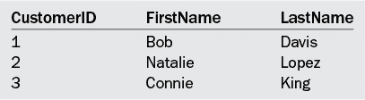

`Orders` 表可能显示为：

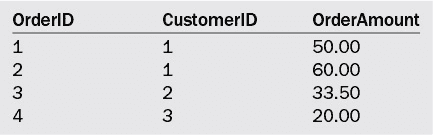

在这个示例中，`Customers` 表包含三列：`CustomerID`（客户 ID）、`FirstName` 和 `LastName`。表中目前有三行，分别代表 Bob Davis、Natalie Lopez 和 Connie King。每一行代表一个不同的客户，每一列代表关于客户的项不同信息。同样，`Orders` 表有三列和四行。这表明数据库中有四个订单，且每个订单有三个属性。

当然，这个示例是高度简化的，仅暗示了真实数据库中可能存储的数据类型。例如，`Customers` 表通常会包含许多描述客户其他属性的列，如城市、州、邮编和电话号码。同样，`Orders` 表通常会有描述订单其他属性的列，如订单日期、销售税和接单的销售员。

## 主键和外键

注意每个表中的第一列：`Customers` 表中的 `CustomerID` 以及 `Orders` 表中的 `OrderID`。这些列通常被称为 `primary keys`（主键）。主键有用且有两个原因：首先，它们允许我们唯一地标识表中的某一行。例如，如果我们想检索 Bob Davis 的行，只需使用 `CustomerID` 列即可获取数据。主键还确保了唯一性。将 `CustomerID` 列指定为主键可以保证该表中每行的该列都具有唯一的值。即使我们在数据库中恰有两个同名为 Bob Davis 的男人，这些行的 `CustomerID` 列值也是不同的。

在这个示例中，主键列中的值并没有特殊的含义。在 `Customers` 表中，`CustomerID` 列为表中的三行包含了值 1、2 和 3。数据库表的设计通常是这种方式：当在向表中添加新行时，会自动为主键列自动生成连续的数字。这种设计特性通常被称为 `auto-increment`（自动递增）。

主键的第二个原因是它们允许我们轻松地将一个表与另一个表关联起来。在这个示例中，`Orders` 表中的 `CustomerID` 列指向 `Customers` 表中对应的行。观察 `Orders` 表的第四行，可以发现 `CustomerID` 列的值为 3。这意味着该订单属于 `CustomerID` 为 3 的客户，而该客户恰好是 Connie King。在表之间使用公共列是关系型数据库中一项重要的设计元素。

除了指向 `Customers` 表之外，`Orders` 表中的 `CustomerID` 列还可以被指定为称为 `foreign key`（外键）的内容。我们将在第 18 章“维护表”中详细介绍外键，但现在只需知道，可以定义外键以确保该列具有有效值即可。例如，你不希望 `Orders` 表中的 `CustomerID` 列具有某个特定值，除非该 `CustomerID` 实际上存在于 `Customer` 表中。将某一列指定为外键就可以实现这种限制。

## 数据类型

主键和外键为数据库表增加了结构。它们确保了数据库中的所有表都是可访问的，并且彼此正确地关联。表中的每列的另一个重要属性是它的数据类型。

数据类型简单来说是定义列可以包含的数据类型的一种方式。每个表中的每列都必须指定一种数据类型。遗憾的是，不同关系型数据库在允许哪些数据类型及其含义方面存在很大差异。例如，`Microsoft SQL Server`、`MySQL` 和 `Oracle` 每个都拥有超过 30 种不同的可用数据类型。

即使仅对于这三个数据库，要涵盖所有可用数据类型的细节和细微差别也是可能的。然而，我们将做的是通过讨论大多数数据库通用的数据类型主要类别来总结这种情况。一旦你理解了这些类别中重要的数据类型，你在遇到其他可能的数据类型时就不会遇到太大困难。通常，有三种重要的数据类型：数值型、字符型和日期/时间型。

数值数据类型有多种，包括位（bits）、整数（integers）、小数（decimals）和实数（real numbers）。位是允许两个值（0 和 1）的数值数据类型。位数据类型通常用于定义某个属性具有简单的真或假类型的值。整数是不带小数点的数字。小数数据类型可以包含小数位。与位、整数和小数不同，实数是指那些精确值在内部仅通过近似值定义的数字。所有数值数据类型的共同特征是它们可以包含在算术计算中。以下是 `Microsoft SQL Server`、`MySQL` 和 `Oracle` 中数值数据类型的代表性示例。

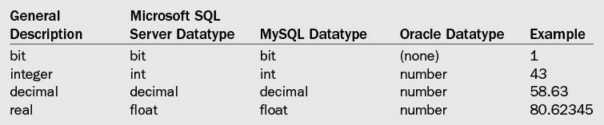

字符数据类型有时被称为 `string`（字符串）或 `character string`（字符字符串）数据类型。与数值数据类型不同，字符数据类型不受限于数字。它们可以包含任何字母或数字，甚至可以包含特殊字符（如星号）。在 SQL 语句中为字符数据类型提供值时，该值必须用单引号括起来。相反，数值数据类型永远不使用引号。以下是字符数据类型的几个代表性示例：

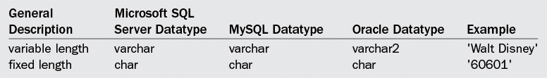

第二个示例（60601）可能是一个邮政编码。乍一看，它看起来像是一个数值数据类型，因为它只由数字组成。这并不常见。尽管邮政编码只包含数字，但通常被定义为字符数据类型，因为永远不需要对邮政编码进行算术计算。

日期/时间数据类型用于表示日期和时间。与字符数据类型一样，日期/时间数据类型必须包含在单引号中。这些数据类型允许涉及日期的特殊计算。例如，可以使用特殊函数来计算任意两个日期/时间之间的天数。以下是日期/时间数据类型的几个示例：

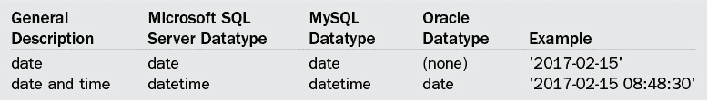

## NULL 值

表中单列的另一个重要属性是该列是否允许包含空值（null）。空值意味着该特定数据元素没有数据。它字面上不包含任何数据。然而，空值不等同于空格或空白。在逻辑上，空值和空白的对待方式不同。检索包含空值数据的细微之处将在第 7 章“布尔逻辑”中详细讨论。

许多数据库在显示包含空值的数据时会用全大字母显示 `NULL`。这样做是为了让用户能够判断数据包含的是空值而不仅仅是空格。我们将遵循这一习惯，在整本书中使用 `NULL` 一词，以强调它代表那种特殊类型的值。

数据库中的主键永远不能包含 `NULL` 值。这是因为根据定义，主键必须包含唯一值。

## SQL 的意义

在离开关系型数据库这一通用主题之前，让我们来看一个简短的历史回顾，以便理解关系型数据库的用处以及 SQL 的意义。

回到 20 世纪 60 年代计算早期，数据通常存储在磁带上或磁盘驱动器的文件中的。使用 `FORTRAN` 和 `COBOL` 等语言编写的计算机程序通常读取输入文件并逐条处理记录，最终将数据移动到输出文件。处理过程必然是复杂的，因为程序需要分解为许多步骤，涉及临时表、排序和对数据的多次扫描，直到产生所需的输出为止。

第一章提供了有关关系型数据库的一些背景信息，使我们能够进入从数据库检索数据的核心主题。我们讨论了关系型数据库的许多重要特性，例如主键、外键和数据类型。我们还讨论了数据中可能存在 NULL 值。我们将在第 7 章中的“布尔逻辑”中补充对 NULL 值的讨论，并在第 18 章中的“维护表”中回到数据库维护的一般话题，在第 19 章中的“数据库设计原则”中讨论数据库设计。

为什么将数据库设计这一重要主题推迟到书的后大部分？简而言之，采取这种方法是为了让你能够投入使用 SQL，而不必在开始就设计的细节。事实上，数据库设计既是一门科学，也是一门艺术。当你对通过 SQL 获取某些数据的细节和细微差别有了更深入的认识，数据库设计的原则可能会更有意义。因此，我们将暂时忽略如何设计数据库的问题，并在下一章开始学习数据检索。

# 2. 基础数据检索

## 引入的关键字

`SELECT` • `FROM`

在本章中，我们将开始探索 SQL 中最重要的主题——即如何从数据库中检索数据。无论你的组织规模如何，对 SQL 开发人员提出的最常见请求都是生成报告。当然，将数据导入数据库是一项非易事的工作，但一旦数据进入了那里，业务分析师的精力就会转向他们所可以利用的丰富数据，以及从所有这些数据中提取有用信息的愿望。

本书对数据检索的强调对应了这些现实世界的需求。你的 SQL 知识将极大地帮助你的组织解锁存储在数据库中的数据中隐藏的秘密。

## 简单的 SELECT

在 SQL 中检索数据的能力通过称为 `SELECT` 的语句来实现。在没有任何预先解释的情况下，这里有一个最简单的 `SELECT` 语句示例：

```sql
SELECT * FROM Customers
```

在 SQL 语言中，与其他所有计算机语言一样，某些单词是`关键字`。这些单词具有特殊的含义，并且必须以特定的方式使用。在该语句中，`SELECT` 和 `FROM` 是关键字。`SELECT` 关键字表示一个 `SELECT` 语句的开始。`FROM` 关键字用于指定要检索数据的表。表名跟在 `FROM` 之后。在这种情况下，表名为 `Customers`。示例中的星号（`*`）是一个特殊符号，意味着“所有列”。

按照惯例，我们将用大写字母打印关键字。这样做是为了确保它们显而可见。总而言之，这条语句的意思是：从 Customers 表中选择所有列。

如果 `Customers` 表如下：

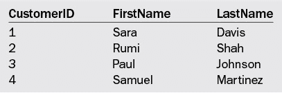

那么 `SELECT` 将返回以下数据：

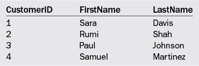

换句话说，它带回了表中的所有内容。

在上一章中，我们提到为所有表指定主键是一种常见做法。在这个示例中，`CustomerID` 列就是这样一列。我们还提到，主键有时被设定为在向表中添加行时，自动生成数字序列中的顺序数字。在本示例中正是如此。事实上，我们在全书中展示的大部分样本数据将包含一个类似的列，该列既是主键又被定义为自动递增。按照惯例，这通常是表中的第一列。

## 语法说明

在编写任何 SQL 语句时，必须记住两点。首先，SQL 中的关键字是不区分大小写的。`SELECT` 单词的处理方式与“select”或“Select”完全相同。

其次，SQL 语句可以写在任意行上，且单词之间可以有任意数量的空格。例如，SQL 语句：

```sql
SELECT * FROM Customers
```

等同于：

```sql
SELECT *
FROM Customers
```

通常，将每个重要的关键字另起一行是一个好主意。当我们遇到更复杂的 SQL 语句时，这将有助于快速掌握语句的含义。

最后，当我们在书中展示不同的 SQL 语句时，通常会同时显示一个具体的示例和一个更通用的格式。例如，上一个语句的通用格式将所示：

```sql
SELECT *
FROM table
```

斜体用于表示通用的表达式。斜体单词 `table` 意味着你可以在该位置替换任何表名。当在本书的任何 SQL 语句中看到斜体单词时，这只是表示该位置可以替换任何有效单词或短语的一种。

***

### 数据库差异：MySQL 和 Oracle

许多 SQL 实现要求在每个语句末尾加分号。MySQL 和 Oracle 都是如此，但 Microsoft SQL Server 则不是。然而，如果需要，可以在 SQL Server 中指定分号。为了简单起见，我们在书中展示不带分号的 SQL 语句。如果你在使用 MySQL 或 Oracle，则需要在每个语句末尾添加分号。上一个语句将显示为：

```sql
SELECT *
FROM Customers;
```

***

## 注释

在编写 SQL 语句时，在这些语句内部或周围插入注释是非常理想的。SQL 中编写注释有两种标准方法。第一种方法是双横线注释，即在行的任何位置放置两个横杠。双横杠之后的所有文本都被视为注释。这里是这种格式的示例：

点击查看代码

```sql
SELECT
-- 这是注释

FirstName,

LastName -- 这是注释

FROM Customers
```

第二种格式源自 C 语言，由位于 `/*` 和 `*/` 字符之间的文本组成。`/*` 和 `*/` 之间的可以写在多行上。这里是示例：

点击查看代码

```sql
SELECT

/* 这是第一个注释 */

FirstName,

LastName /* 这是第二个注释

这是第二个注释的一部分

第二个注释的结束 */

FROM Customers
```

***

### 数据库差异：MySQL

MySQL 支持双横线和 C 语言格式（`/*` 和 `*/`）注释，但有一个细微差别。使用双横线格式时，MySQL 要求在第二个横杠之后紧跟空格或特殊字符。

此外，MySQL 还允许第三种注释方法，类似于双横线。在 MySQL 中，你可以在行的任何位置放置井号（`#`）来指示注释。该行中 `#` 符号之后的所有文本都被视为注释。这里是这种格式的示例：

```sql
SELECT FirstName

# 这是注释

FROM Customers;
```

***

## 指定列

到目前为止，我们所做的只是简单地显示表中的所有数据。但如果我们只想选择某些列呢？从同一个表开始，例如我们只想显示客户的姓氏。那么 `SELECT` 语句将像所示：

```sql
SELECT LastName
FROM Customers
```

产生的数据将是：

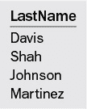

如果我们想选择多列但不是所有列，`SELECT` 可能会像这样：

```sql
SELECT

FirstName,

LastName

FROM Customers
```

输出将显示为：

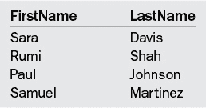

该语句的通用格式为：

```sql
SELECT columnlist
FROM table
```

需要记住的重要的一点是，如果你需要在 `columnlist` 中指定多个列，那么这些列之间必须用逗号分隔。同时请注意，我们在 `columnlist` 中将每个列（`FirstName`、`LastName`）放在了不同的行。这样做是为了提高可读性。

## 包含嵌入空格的列名

如果列名中包含空格怎么办？例如，假设 `LastName` 列被指定为 `Last Name`（两个单词之间有一个空格）。显然，以下代码将无法运行：

```
SELECT
Last Name
FROM Customers
```

该语句将被视为无效的，因为 `Last` 和 `Name` 并不是列名，即使它们是合法的列名，它们也需要用逗号分隔。解决方案是在任何包含空格的列名周围加上特殊字符。使用的字符取决于你所使用的数据库类型。对于 Microsoft SQL Server，所需的字符是方括号。语法如下：

```sql
SELECT
[Last Name]
FROM Customers
```

另外一个语法说明：就像关键字不区分大小写一样，表名和列名也不区分大小写。因此，上一个示例与以下内容等同：


```sql
select
[last name]
from customers
```

为了清晰起见，我们在书中会将所有的关键字打印为大写，并将表名和列名的首字母大写，但这并不是真正必要的。

## 数据库差异：MySQL 和 Oracle

对于 MySQL，在包含空格的列名周围使用的字符是反引号（`` ` ``）。上述示例的 MySQL 语法为：

```sql
SELECT
`Last Name`
FROM Customers;
```

对于 Oracle，在包含空格的列名周围使用的字符是双引号。该示例的 Oracle 语法为：

```sql
SELECT
"Last Name"
FROM Customers;
```

此外，与 Microsoft SQL Server 和 MySQL 不同，Oracle 中由双引号括的列名是区分大小写的。这意味着之前的语句并不：

```sql
SELECT
"LAST NAME"
FROM Customers;
```

## 完整的 SELECT 预览

本书的大部分内容与本章介绍的 `SELECT` 语句有关。在第 3 章到第 15 章中，我们将扩展这一语句，引入新功能，直到充分发挥并理解 `SELECT` 的潜力和能力。到目前，我们只引入了 `SELECT` 语句的这部分：

```sql
SELECT columnlist
FROM table
```

为了消除剩余的悬念，让我们看看完整 `SELECT` 语句的预览，并对其各个组件进行简要注释。包含所有子句的完整 `SELECT` 语句如下：

```sql
SELECT columnlist
FROM tablelist
WHERE condition
GROUP BY columnlist
HAVING condition
ORDER BY columnlist
```

我们已经介绍了 `SELECT` 和 `FROM` 子句。让我们稍微扩展一下这些子句，并谈谈其他的。`SELECT` 子句启动语句并列出任何将显示的列。正如在后面的章节中看到的，`columnlist` 不仅可以包含指定表中的实际列，还可以包含计算列（这些列通常从表中的一个或多个列衍生）。`columnlist` 中的列还可以包括函数，它们代表了添加常用数据转换方法的特殊方式。

`FROM` 子句指定了提取数据的数据源。在大多数情况下，这些数据源将是表。在随后的章节中，我们将学习这些数据源也可以是 `SELECT` 语句，它们代表了数据的某种虚拟“视图”（view）。在本章中，我们的 `tablelist` 是单张表。后续章节将讨论的 SQL 关键特性之一是通过名为 `JOIN` 的机制在单个 `SELECT` 语句中将多个表组合在一起。因此，我们将看到许多示例，`FROM` 子句中的 `tablelist` 由多行组成，表示连接在一起的表。

`WHERE` 子句用于指定选择逻辑。在这里，你可以精确指定要检索哪些行数据。`WHERE` 子句可以使用基本的算术运算符，如等号（`=`）和大于（`>`），以及 `OR` 和 `AND` 等布尔操作符。

`GROUP BY` 子句在汇总数据方面起着关键作用。通过将数据组织成不同的组，分析师不仅能够对数据分组，还可以通过各种统计数据（如数据的和或计数）对每组数据进行汇总。

当数据被分组后，选择标准会变得有些复杂。人们必须询问选择标准是适用于单行还是适用于整个组。例如，在按州对客户分组时，可能只想查看单个客户的行，前提是该州所有客户的总购买超过了某个金额。这就是 `HAVING` 子句的用场所在。`HAVING` 子句用于为整组数据指定选择逻辑。

最后，`ORDER BY` 子句用于按升序或降序排序数据。

正如后续章节中将明确的，`SELECT` 语句中的各种子句（如果存在）必须按照前面通用语句所示的顺序指定。例如，如果 `SELECT` 语句中有 `GROUP BY` 子句，它必须出现在 `WHERE` 子句之后、`HAVING` 子句之前。

除了上述所有子句外，我们还将谈论组织 `SELECT` 语句的多种方法，包括子查询和集合逻辑。子查询是在一个 `SELECT` 语句中插入另一个 `SELECT` 语句的方法，通常用于某些类型的选择逻辑。集合逻辑是将多个查询并列组合的方式。

当从表中选择数据时，你并不局限于表中恰好存在的列。计算字段的概念允许许多其他可能性。通过计算字段，你可以执行以下操作：

- 显示特定的单词或值
- 对单列或多列进行算术
- 将列与特定的单词或值组合在一起

让我们来看几个示例，这些示例都来自此张 Sales（销售）表：

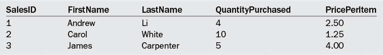

### 字面量 (Literal Values)

我们的第一个计算字段示例实际上根本不是一种计算。我们将选择一个特定值作为列，尽管该值与表中的数据毫无关系。这种类型的表达式被称为 `literal value`（字面量）。这里是一个示例：

```sql
SELECT
'First Name:',
FirstName
FROM Sales
```

该语句将返回此数据：

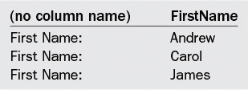

在这一语句中，我们选择了两个数据项。第一个是字面量 `'First Name:'`。注意，使用单引号是为了表示这是一个带有字符数据的字面量。第二个数据项是 `FirstName` 列。

请注意，首先，字面量 `'First Name:'` 在每一行都重复出现。其次，第一列没有表头信息。在 Microsoft SQL Server 中运行时，列标题显示为 `(no column name)`（无列名）。没有标题的原因仅仅是因为这是一个计算字段。没有可以与此信息关联的列名。

### 数据库差异：MySQL 和 Oracle

MySQL 和 Oracle 在标题行都会为字面量返回一个值。在 MySQL 中，上一个示例中第一列的标题将显示为：

`First Name:`

在 Oracle 中，第一列的标题将显示为：

`'FIRSTNAME:'`

一个可能会被问到的问题是，为什么标题行很重要。如果我们只使用 `SELECT` 语句来检索某些数据，那么标题本身似乎并不重要，只有数据本身重要。然而，如果我们使用 `SELECT` 语句是为了获取显示给用户的报告（无论是在纸上还是在计算机屏幕上）的数据，那么标题可能就非常相关。列头通常在报告环境中显示。当用户查看报告中的某列数据时，他们通常想知道该列的含义，并向列头寻求这些信息。对于字面量来说，该列确实没有意义，因此表头并不是真正必要的。但在其他类型的计算字段中，可能会有一个可以应用于该列的有意义标签。在本章稍后的部分，我们将讨论列别名（column aliases）的概念，它代表了在这种情况下提供标题的方法。

关于字面量的另一点。你可能从上一个示例推断出所有的字面量都需要引号，但情况并非如此。例如，以下语句：

```sql
SELECT
5,
FirstName
FROM Sales
```

该语句将返回此数据：

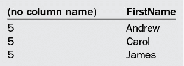

字面量 `5` 是一个有效值，即使它完全没有意义。因为它没有引号，`5` 被解释为一个数值值。

### 算术计算 (Arithmetic Calculations)

让我们来看一个更典型的计算字段示例。算术计算允许我们对表中的一列或多列进行计算。例如：

```sql
SELECT
SalesID,
QuantityPurchased,
PricePerItem,
QuantityPurchased * PricePerItem
FROM Sales
```

该语句将返回此数据：

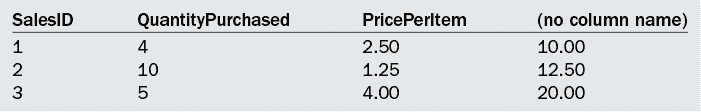

与字面量一样，第四列没有标题，这是因为它不是派生自单列。上述 `SELECT` 的前三列与之前看到的并无区别。第四列是一个带有此算术表达式的计算列：

`QuantityPurchased * PricePerItem`

在这种情况下，星号符号 `*` 表示乘法。它并不像上一章看到的那样表示“所有列”。除了星号，计算字段中还允许几种其他算术运算符。最常见的有：

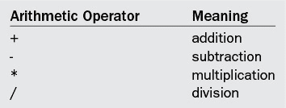

一种在 Microsoft SQL Server 或 MySQL 中不可用的常用算术运算符是幂运算（exponentiation）。为了在 SQL 中使用指数，必须使用 `POWER` 函数。将在下一章中演示。

### 数据库差异：Oracle

与 SQL Server 和 MySQL 不同，Oracle 提供了一个用于幂运算的算术运算符。它由两个星号 `**` 表示。

### 字段拼接 (Concatenating Fields)

拼接（Concatenation）是一个高级的计算机术语，意味着将字符数据结合或连接在一起。正如算术操作可以在数值数据上执行一样，字符数据也可以被结合或拼接在一起。拼接的语法取决于你正在使用的数据库。这里有一个来自 Microsoft SQL Server 的示例：

```sql
SELECT
SalesID,
FirstName,
LastName,
FirstName + ' ' + LastName
FROM Sales
```

检索到的数据是：

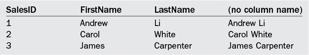

再次，前三列没有新内容。第四列派生自 SQL 语句中的此表达式：

`FirstName + ' ' + LastName`

加号 `+` 表示拼接。因为操作涉及字符而非数值，SQL 知道加号表示拼接。在这种情况下，拼接由三个项组成：`FirstName` 列、一个空格 `' '` 和 `LastName` 列。

### 数据库差异：MySQL 和 Oracle

MySQL 不使用 `+` 等符号来表示拼接。相反，它要求你使用名为 `CONCAT` 的函数。我们将在下一章介绍函数，但现在来看看相同的语句在 MySQL 中是长样的：

```sql
SELECT,
FirstName,
LastName,
CONCAT(FirstName, ' ', LastName)
FROM Sales
```

本质上，`CONCAT` 将括号内的三个项指定为一个表达式。

Oracle 使用双竖线 `||` 而不是加号 `+` 来表示拼接。Oracle 的等语句为：

```sql
SELECT
SalesID,
FirstName,
LastName,
FirstName || ' ' || LastName
FROM Sales
```

`FirstName`,

`LastName`,

`FirstName + ' ' + LastName Name`

`FROM Sales`

除了为计算字段提供标题外，当表中的列名晦涩且你想要更改它时，列别名通常也很有用。例如，如果一个表中有一个名为“Qty”的列，你可以执行此语句将该列显示为“Quantity Purchased”:

```sql
SELECT
Qty AS 'Quantity Purchased'
FROM table
```

### 数据库差异：Oracle

Oracle 使用双引号来界定列别名。上述语句在 Oracle 中应写如下：

```sql
SELECT
SalesID,
FirstName,
LastName,
FirstName || ' ' || LastName AS "Name"
FROM Sales;
```

### 表别名

除了为列提供替代名称外，还可以使用相同的 `AS` 关键字为表指定别名。使用表别名通常有三个原因。第一个原因与名称晦涩或复杂的表有关。例如，如果一个表名为 `Sales123`，你可以使用以下 `SELECT` 语句为该表指定别名 `Sales`。

```sql
SELECT
LastName
FROM Sales123 AS Sales
```

与列别名一样，`AS` 关键字是可选的。但与列别名不同，表别名不需要在引号内。使用表别名的第二个原因是允许你将该别名作为任何所选列的前缀。例如，上面的代码也可以写成：

```sql
SELECT
Sales.LastName
FROM Sales123 AS Sales
```

`Sales` 单词现在已作为前缀添加到 `LastName` 列中，使用句号分隔前缀和列名。在这种情况下，使用前缀是完全可选的，且有些冗余的。因为此查询中只有一个表，所以没有必要将表名作为列的前缀。然而，当从多个表中选择数据时，前缀通常很有帮助，而且有时是强制要求的。当涉及多个表时，添加表名作为前缀可以帮助任何查看查询的人快速理解每一列来自哪张表。此外，当多个表中的列名相同时，则必须使用表别名。列别名的用法将在第 11 章“内连接”中进行说明。

使用表别名的第三个原因与子查询中使用表有关。这将在第 14 章“子查询”中讨论。

### 数据库差异：Oracle

虽然列别名可以使用 `AS` 关键字，但 Oracle 不允许使用 `AS` 关键字表示表别名。上述 `SELECT` 语句在 Oracle 中应写为：

```sql
SELECT
Sales.LastName
FROM Sales123 Sales;
```

### 展望

在本章，我们讨论了在 `SELECT` 语句中创建计算字段的三种方法。首先，可以使用字面量来选择特定的单词或值。其次，可以在单个表达式中对一个或多个列进行算术计算。第三，可以使用连接将列和字面量结合。我们还讨论了列别名的相关主题，在使用计算字段时经常用到。最后，我们对表别名进行了预览，该主题将在后面的章节中进行更详细的介绍。

在下一章中我们将进入函数主题，函数提供了更复杂、更有趣的计算方式。如前所述，我们还没有达到可以对 SQL 语句应用选择标准的程度。我们仍然建立在 `SELECT` 中 `columnlist` 可执行操作的基础之上。你对这种有条理方法的耐心将在第 6 章获得回报，届时我们将讨论选择逻辑主题。

# 4. 使用函数

### 引入的关键字

`LEFT` • `RIGHT` • `SUBSTRING` • `LTRIM` • `RTRIM` • `UPPER` • `LOWER` • `GETDATE` • `DATEPART` • `DATEDIFF` • `ROUND` • `PI` • `POWER` • `ISNULL`

任何熟悉 Microsoft Excel 的人可能意识到函数为典型的电子表格用户提供了巨大的功能。如果没有使用函数的能力，电子表格中的大部分数据价值将有限。SQL 的世界也是如此。熟悉 SQL 函数将极大地增强你为任何查看数据或由 SQL 生成报告的人生成动态结果的能力。

本章涵盖了四个不同类别中一些最常用的函数：字符函数、日期/时间函数、数值函数和转换函数。此外，我们还将讨论复合函数——一种将多个函数组合成单个表达式的方法。

### 什么是函数？

与上一章涵盖的计算类似，函数提供了另一种处理数据的方式。如所见，计算可以涉及多个字段，可以通过使用乘法等算术运算符，也可以通过连接来实现。同样，函数可以涉及来自多个值的数据，但函数的最终结果始终是一个单值。

什么是函数？函数仅仅是根据任意数量输入值转换为一个输出值的规则。该规则定义在函数内部，且无法更改。然而，函数用户允许为输入指定任何所需的值。某些函数可能允许某些输入是可选的，这意味着不需要指定该输入。函数也可以被设计为没有输入。然而，无论输入的类型或数量如何，函数总是返回恰好一个一个值。

函数有两种类型：标量函数（scalar）和聚合函数（aggregate）。`scalar` 一词源于数学，指的是对单个数字进行的操作。在计算机使用中，这意味着函数是在单行数据上执行的。例如，`LTRIM` 函数删除一个值中的空格。

相反，聚合函数旨在对更大的数据集进行操作。例如，`SUM` 函数可以用于计算指定列所有值的总和。由于聚合函数适用于更大的集合或组，我们将对这类函数的讨论留到第 9 章“汇总数据”。

每个 SQL 数据库都提供几十个标量函数。实际函数在数据库之间的名称和工作方式方面差异很大。因此，我们仅涵盖一些更有用的函数的少数代表性示例。

最常见的标量函数类型可分为三类：字符、日期/时间和数值。这些是允许你操作字符、日期/时间或数值数据类型的函数。此外，我们将讨论一些实用的转换函数，它们可将数据从一种数据类型转换为另一种。

### 字符函数

字符函数是允许你处理字符数据的函数。正如字符数据类型有时被称为*字符串数据类型*，字符函数有时被称为*字符串函数*。我们将涵盖七个字符函数示例：`LEFT`、`RIGHT`、`SUBSTRING`、`LTRIM`、`RTRIM`、`UPPER` 和 `LOWER`。

在本章中，我们不是从特定表中检索数据，而是简单地在列列表中使用带有字面量的 `SELECT` 语句。没有 `FROM` 子句来指示表。让我们从 `LEFT` 函数的一个示例开始。当执行此 SQL 命令时：

```sql
SELECT
LEFT('sunlight',3) AS 'The Answer'
```

返回此数据：


在此 SQL 语句中包含列别名允许输出将“The Answer”作为列标题。请注意，`SELECT` 语句中没有 `FROM` 子句。我们并不是从表中检索数据，而是从一个单一的字面量（即‘sunlight’）中选择数据。在许多 SQL 实现中（包括 SQL Server 和 MySQL）中，`SELECT` 语句并不严格需要 `FROM` 子句，尽管在实践中人们很少写出这样的 `SELECT` 语句。我们使用这种不带 `FROM` 子句的格式，是为了更方便地说明函数的工作原理。

现在让我们详细查看一下该函数的格式。`LEFT` 函数的标准格式为：

```
LEFT(CharacterValue, NumberOfCharacters)
```


所有函数在括号内都有任意数量的参数。例如，`LEFT` 函数有两个参数：`CharacterValue` 和 `NumberOfCharacters`。“参数”（argument）一词是一个常用的数学术语，用于描述函数的组成部分，与任何不愉快或令人讨厌的事物无关。为每个函数定义的各种参数真正定义了函数的含义。在 `LEFT` 函数的情况下，`CharacterValue` 和 `NumberOfCharacters` 参数都是必要的，用于定义调用 `LEFT` 函数时会发生什么。

`LEFT` 函数有两个参数，且都是必须的。正如提到的，其他函数可能会有更多或更少的参数。函数甚至允许没有参数。但无论参数数量有多少（即使为零），所有函数在函数名都有一组括号。括号的存在告诉您该表达式是一个函数而不是其他内容。

`LEFT` 函数的公式是：获取指定的 `CharacterValue`，查看左侧指定的 `NumberOfCharacters`，并返回结果。在上一个示例中，它查看 `CharacterValue` ‘sunlight’ 并返回左侧的三个字符。结果是“sun”。

需要记住的主要点是，对于你任何想要使用的函数，都需要在数据库参考指南中查找该函数，并确定需要多少参数以及它们的含义。

我们将涵盖的第二个字符函数是 `RIGHT`。它与 `LEFT` 函数相同，不同之处现在指定的是输入值右侧的字符。`RIGHT` 函数的标准格式为：

```
RIGHT(CharacterValue, NumberOfCharacters)
```

例如：

```sql
SELECT
RIGHT('sunlight',5) AS 'The Answer'
```

返回：


在这种情况下，`NumberOfCharacters` 参数的值需要为 5 才能返回值“light”。如果值为 3，则只会返回“ght”。

使用 `RIGHT` 函数时经常出现的一个问题是字符数据通常在右侧包含空格。让我们来看一个示例，该表只有一行数据，其中包含一个名为 `President` 的列，该列被定义为长度为 20 个字符。表所示：


如果我们对该表执行此 `SELECT` 语句：

```sql
SELECT
RIGHT(President,10) AS 'Last Name'
FROM table1
```

我们得到了这些数据：


我们预期得到“Washington”，但只得到了“hington.”。问题在于整个列的长度为 20 个字符。在这个示例中，“George Washington”这个值的右侧有三个空格。因此，当我们请求最右侧的 10 个字符时，SQL 将取三个空格，加上原始表达式中的另外七个字符。很快就会发现，在使用 `RIGHT` 函数之前，必须使用 `RTRIM` 函数来移除结尾的空格。

你可能会好奇如何从表达式的中间选择数据。这是通过使用 `SUBSTRING` 函数实现的。该函数的格式为：

```
SUBSTRING(CharacterValue, StartingPosition, NumberOfCharacters)
```

例如：

```sql
SELECT
SUBSTRING('thewhitegoat',4,5) AS 'The Answer'
```

返回此数据：


该函数的意思是取从位置 4 开始的五个字符。这导致显示了单词“white”。

### 数据库差异：MySQL 和 Oracle

MySQL 有时要求函数名和左括号之间不能有空格。这取决于所使用的特定函数。例如，MySQL 中的上一个语句必须完全按照所示所示编写。与 Microsoft SQL Server 不同，你不能在 `SUBSTRING` 之后输入额外的空格。

在 Oracle 中，`SUBSTRING` 函数的等效函数是 `SUBSTR`。Oracle 版本 `SUBSTR` 的一个区别是，第二个参数 `StartingPosition` 可以为负值。该参数的负值意味着你需要从列的右侧向后计算相应的位置。

正如提到的，Oracle 不允许编写不带 `FROM` 子句的 `SELECT` 语句。然而，Oracle 为这类情况提供了一个名为 `DUAL` 的虚拟表。Oracle 中带 `SUBSTRING` 函数的 `SELECT` 等效语句为：

```sql
SELECT
SUBSTR('thewhitegoat',4,5) AS "The Answer"
FROM DUAL;
```

我们接下来的两个字符函数使我们能够移除表达式左侧或右侧的所有空格。`LTRIM` 函数修剪字符表达式左侧的字符。例如：

```sql
SELECT
LTRIM('      the apple') AS 'The Answer'
```

返回此数据：

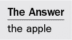

注意 `LTRIM` 足够智能消除短语中间的空格。它只移除字符值最左侧的空格。

与 `LTRIM` 类似，`RTRIM` 函数移除字符值右侧的空格。将在下一节复合函数中给出 `RTRIM` 的示例。

最后涵盖的两个字符函数是 `UPPER` 和 `LOWER`。这些函数将任何单词或短语转换为大写或小写。语法简单且直观。这里有一个涵盖了这两个函数的示例：

```sql
SELECT
UPPER('Abraham Lincoln') AS 'Convert to Uppercase',
LOWER('ABRAHAM LINCOLN') AS 'Convert to Lowercase'
```

输出是：

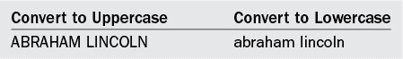

### 复合函数

函数的一个重要特性（无论是字符、数学还是日期/时间函数）是两个或多个函数可以组合以创建复合函数。包含两个函数的复合函数可以说是函数的函数。让我们回到 George Washington 的查询来说说明。再次，我们根据这些数据操作：


记住 `President` 列的长度为 20 个字符。换句话说，“George Washington”值的右侧有三个空格。除了说明复合函数外，下一个示例还将涵盖上一节提到的 `RTRIM` 函数。语句为：

为什么现在会产生正确的值呢？让我们检查这个复合函数是如何工作的。这里涉及两个函数：`RIGHT` 和 `RTRIM`。在评估复合函数时，你总是从内部向外部处理。在这个示例中，最内层的函数是：

```
RTRIM(President)
```

该函数获取 `President` 列中的值并删除所有右侧空格。完成后，将 `RIGHT` 函数应用到结果上，以取回所需的值。由于

`RTRIM(President)`

等于“George Washington”，我们可以说：

```sql
SELECT
RIGHT(RTRIM (President), 10)
```

等同于：

```sql
SELECT
RIGHT('George Washington', 10)
```

换句话说，我们可以通过先对输入数据应用 `RTRIM` 函数，然后在表达式中添加 `RIGHT` 函数来产生最终结果。

## 日期/时间函数

日期/时间函数允许对日期和时间值进行操作。这些函数的名称取决于所使用的数据库。在 Microsoft SQL Server 中，我们将涵盖的函数称为 `GETDATE`、`DATEPART` 和 `DATEDIFF`。

最简单的日期/时间函数是返回当前日期和时间的函数。在 Microsoft SQL Server 中，该函数名为 `GETDATE`。此函数没有参数。它仅仅返回当前的日期和时间。例如：

```sql
SELECT GETDATE()
```

返回一个带有当前日期和时间的表达式。由于 `GETDATE` 函数没有参数，因此括号之间没有指定任何内容。请记住，日期/时间字段是一种特殊的数据类型，在单个字段中同时包含日期和时间。此类值的示例是：

`2017-05-15 08:48:30`

该值指的是 2017 年 5 月 15 日，上午 8 点之后 48 分 30 秒。

### 数据库差异：MySQL 和 Oracle

在 MySQL 中，`GETDATE` 的等效函数是 `NOW`。上面的语句应写为：

```sql
SELECT NOW()
```

Oracle 中 `GETDATE` 的等效函数是 `CURRENT_DATE`。语句写法为：

```sql
SELECT CURRENT_DATE
```

下一个日期/时间函数允许我们分析任何指定的日期并返回一个值来代表此类元素，如日期的几天或几周。同样，该函数的名称取决于数据库。在 Microsoft SQL Server 中，此函数称为 `DATEPART`。其通用格式为：

```
DATEPART(DatePart, DateValue)
```

`DateValue` 参数可以是任何日期。`DatePart` 参数可以有许多不同的值，包括年、季度、月、一年中的第、日、周、星期几、小时、分钟和秒。

下表显示了 `DATEPART` 函数如何根据 `DatePart` 参数的不同值对日期 '5/6/2017' 进行评估：

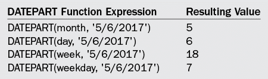

通过查看上一个图表中的值，你可以看到 5/6/2017 的月份是 5（5 月）。日期是 2（星期一）。周是 18，因为 5/6/2017 属于年的第 18 周。星期几是 7，因为 5/6/2017 落在星期六，即一周中的第七天。

### 数据库差异：MySQL 和 Oracle

在 MySQL 中，`DATEPART` 函数的等效函数名为 `DATE_FORMAT`，它对 `DateValue` 参数使用不同的值。例如，要返回日期‘5/6/2017’的日期，你将在 MySQL 中执行此 `SELECT` 语句：

```sql
SELECT DATE_FORMAT('2017-05-06', '%d');
```

Oracle 没有与 `DATEPART` 的函数。

我们将涵盖的最后一个日期/时间函数 `DATEDIFF` 允许你确定如任意两个日期之间的天数等数量。其通用格式为：

```
DATEDIFF (DatePart, StartDate, EndDate)
```

该函数 `DatePart` 参数的有效值包括年、季度、月、一年中的第、日、月、小时、分钟和秒。这里有一个表显示了 `DATEDIFF` 函数如何根据 `DatePart` 参数的不同值评估日期 7/8/2017 和 8/14/2017 之间的差异：

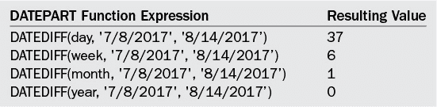

上表表明，两个日期之间有 37 天、6 周、1 个月或 0 年。

### 数据库差异：MySQL 和 Oracle

在 MySQL 中，`DATEDIFF` 函数仅允许你计算两个日期之间的天数，且结束日期必须列在第一个，以返回一个正值。其通用格式为：

```sql
DATEDIFF(EndDate, StartDate)
```

Oracle 没有与 `DATEDIFF` 的函数。

## 数值函数

数值函数允许对数值进行操作。数值函数有时被称为数学函数。我们将涵盖的函数有 `ROUND`、`RAND`、`PI` 和 `POWER`。

`ROUND` 函数允许你对任何数值进行四舍五入。其通用格式为：

```
ROUND(NumericValue, DecimalPlaces)
```

`NumericValue` 参数可以是任何正数或负数，可以带或不带小数，例如 712.863 或 –42。`DecimalPlaces` 参数更为复杂。它可以包含一个正整数、一个负整数或零。如果 `DecimalPlaces` 是正整数，则意味着保留到指定的小数位数。如果 `DecimalPlaces` 是负整数，则意味着保留到小数点左侧的指定位数。下表显示了数字 712.863 如何被四舍五入，对应 `DecimalPlaces` 参数的不同值。

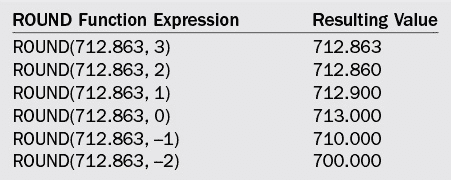

`PI` 函数仅返回数学数 pi 的值。正如你可能在高中几何中记得的那样，数字 pi 是一个用值 3.14 似的无理数。这个函数很少使用，但很好地说明了数值函数不需要任何参数的观点。例如，语句：

```sql
SELECT PI()
```

返回值 3.1415926535897。为了进一步说明这个例子，假设我们想要将 pi 的值保留两位小数。这可以通过创建一个包含 `PI` 和 `ROUND` 函数的复合函数来实现。`PI` 函数用于获取初始值，并添加 `ROUND` 函数将其保留到两位小数。以下语句返回值 3.14：

```sql
SELECT ROUND(PI(),2)
```

### 数据库差异：Oracle

与 Microsoft SQL Server 和 MySQL 不同，Oracle 没有 `PI` 函数。

我们将涵盖的最后一个数值函数（比 PI 用得多）是 `POWER`。`POWER` 函数用于指定包含指数的数值。其通用格式为：

```
POWER(NumericValue, Exponent)
```

让我们从一个演示如何显示 5 的二次方的示例开始。这通常被称为“5 的平方”。`SELECT` 语句：

```sql
SELECT POWER(5,2) AS '5 Squared'
```

返回此数据：

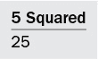

在这个示例中，5 是要评估的数值，2 是指数的值。记住一个数字的平方根可以表示为小于 1 的小数指数，我们可以如下计算 25 的平方根。语句：

```sql
SELECT POWER(25,.5) AS 'Square Root of 25'
```

返回此数据：

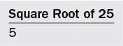

在代数术中，该计算取 25 的 1/2（或 .5）次幂。这等同于取 25 的平方根。

## 转换函数

上述所有函数都涉及操作字符、日期/时间或数值数据类型的特定方法。现在我们要处理将数据从一种数据类型转换为另一种，或者将 NULL 值转换为有意义的值的需求。本章的剩余部分将涵盖用于这些情况的两个特殊函数。

`CAST` 函数将数据从一种数据类型转换为另一种。该函数的通用格式为：

```
CAST(expression AS datatype)
```

## `CAST(Expression AS DataType)`

该函数的格式与之前看到的函数略有不同，因为它使用单词 `AS` 来隔开两个参数，而不是使用逗号。观察该函数的用法可以发现，在大多数情况下 `CAST` 函数都是必需的。让我们来看想要执行此语句的情况，其中 `Quantity` 列被定义为字符数据类型：

```
SELECT
2 * Quantity
FROM table
```

你的第一印象可能是该语句会执行失败，因为 `Quantity` 没有被定义为数值列。然而，大多数 SQL 数据库都足够智能，可以自动将 `Quantity` 列转换为数值，以便能够乘以 2。

这是一个 `CAST` 函数变得必要的的例子。假设我们有一个存储在字符数据类型列中的日期。我们希望将这些日期转换为真正的日期/时间列。此语句说明了 `CAST` 函数如何处理这种转换：

```sql
SELECT
'2017-04-11' AS 'Original Date',
CAST('2017-04-11' AS DATETIME) AS 'Converted Date'
```

输出结果是：

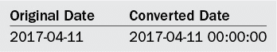

`Original Date` 列看起来是一个日期，但它实际上只是字符数据。相比之下，`Converted Date` 列是一个真正的日期/时间列，现在显示的时间值就证明了这一点。

另一个有用的转换函数是将 `NULL` 值转换为有意义的值。在 Microsoft SQL Server 中，该函数名为 `ISNULL`。正如第 1 章所述，“关系型数据库和 SQL，”`NULL` 值是指缺失数据的值。`NULL` 值不等同于空格或零。假设我们有这张产品表：

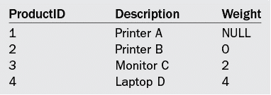

注意到 `Printer A` 在 `Weight` 列中的值为 `NULL`。这表示尚未提供该打印机的重量。假设我们想要生成所有产品的列表。当执行此 `SELECT` 语句时：

```
SELECT
Description,
Weight
FROM Products
```

它将显示：

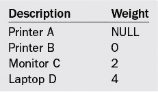

这种显示并没有不准确。然而，用户可能更倾向于看到缺失值显示“Unknown”（未知）而不是 `NULL`。以下是解决方案：

```sql
SELECT
Description,
ISNULL(CAST(Weight AS VARCHAR),'Unknown') AS Weight
FROM Products
```

显示以下数据：

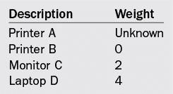

注意，该解决方案需要同时使用 `ISNULL` 和 `CAST` 函数。当遇到 `NULL` 值时，`ISNULL` 函数负责将重量显示为“Unknown”。假设 `Weight` 列被定义为整数，则需要 `CAST` 函数将重量转换为 `Varchar` 数据类型，这样整数值和字符值就可以显示在单列中了。

## 数据库之间的差异：MySQL 和 Oracle

在 MySQL 中，`ISNULL` 函数被称为 `IFNULL`。此外，MySQL 在此示例中不需要使用 `CAST` 函数。上述语句在 MySQL 中的等效语句为：

```sql
SELECT
Description,
IFNULL(Weight,'Unknown') AS Weight
FROM Products
```


`IFNULL(Weight,'Unknown') AS Weight`

```
FROM Products;
```

在 Oracle 中，`ISNULL` 函数被称为 `NVL` (Null Value)。等效的 Oracle 语句为：

点击此处查看代码图片

```
SELECT
Description,
NVL(CAST(Weight AS CHAR),'Unknown') AS Weight
FROM Products;
```

此外，与 Microsoft SQL Server 和 MySQL 不同，Oracle 在遇到 `NULL` 值时会显示一个横杠（—）而不是 `NULL` 单词。

## 展望

本章描述了各种函数。函数基本上上是将一组值转换为另一个值的预定义规则。正如电子表格提供了内置函数来处理数据一样，SQL 也提供了类似的功能。除了涵盖了基础的字符、日期/时间、数值和转换函数外，我们还解释了如何从两个或多个此类函数创建复合函数。

由于可用函数非常多且可能性多样，因此不可能讨论每一个可用函数的每一个细微差别。要记住，当需要使用函数时，可以很容易地在数据库的帮助系统或参考指南中查找。在线参考资料将提供关于每个函数如何工作以及正确语法的详细信息。

在下一章中，我们将暂缓讨论 `columnlist` 问题，转而讨论更有趣的内容：如何对数据进行排序。排序有很多用途，并满足用户按某种顺序查看数据的基本需求。通过排序，我们将开始考虑信息呈现的整体方式，而不仅仅是单个数据项的碎片信息。

# 5. 数据排序

## 引入的关键字

`ORDER BY` • `ASC` • `DESC`

排序可以实现很多非常有用的目的，并满足用户以某种顺序查看数据的基本愿望。为了让数据以某种顺序呈现，通常需要根据特定的列进行排序。对数据进行升序排列（字母表顺序）对于完成任务至关重要。例如，如果数据按字母排序，分析师就可以找到特定的客户。排序的想法适用于许多情况，即使数据是按日期排序的。在对数据进行 A 到 Z 排序之前，为了让数据以特定的顺序呈现，`ORDER BY` 语句是必要的。

## 升序排序

到目前为止，数据还没有按照 A 到 Z 的顺序返回。当执行 `SELECT` 语句时，你不知道哪一行会排在前面。如果数据要立即显示给用户，那么顺序是非常重要的。通过使用 `ORDER BY` 子句，可以轻松地向 `SELECT` 语句添加排序。以下是带有 `ORDER BY` 子句的 `SELECT` 语句的通用格式：

```
SELECT columnlist
FROM tablelist
ORDER BY columnlist
```

`ORDER BY` 子句始终放在 `FROM` 子句之后，而 `FROM` 子句又在 `SELECT` 关键字之后。斜体 `columnlist` 表示可以列出多个列。`columnlist` 中的列可以是单个列，也可以是复杂的表达式。此外，`SELECT` 和 `ORDER BY` 关键字指定的列可以完全不同。斜体 `tablelist` 表示 `FROM` 子句中可以列出多个表。列出多个表的语法将在第 11 章“内连接”和第 12 章“外连接”中介绍。

为了接下来的几个排序示例，我们将根据此 `people` 表中的数据进行：

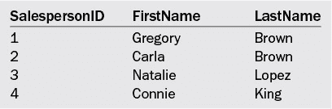

要按升序（从 A 到 Z）对数据进行排序，我们只需要在 `SELECT` 语句中添加 `ORDER BY` 子句。例如：

```
SELECT
FirstName,
LastName
FROM Salespeople
ORDER BY LastName
```

返回以下数据：

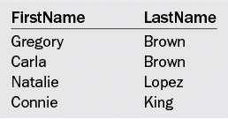

因为有两个 Brown（Carla 和 Gregory），无法预测哪一个会排在前面。这是因为我们只对 `LastName` 进行排序，并且有多个行具有相同的姓氏。

同样，如果我们执行此 `SELECT`：

```
SELECT
FirstName,
LastName
FROM Salespeople
ORDER BY FirstName
```

则检索到数据：

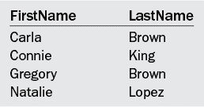

现在的顺序完全不同，因为排序是按名字而不是姓氏。

SQL 提供了一个名为 `ASC` 的特殊关键字，代表 `ascending`（升序）。该关键字完全可选，且在很大程度上是不必要的，因为默认情况下所有排序按升序排列。以下使用 `ASC` 关键字的 `SELECT` 语句返回与之前相同的数据。

```sql
SELECT
FirstName,
LastName
FROM Salespeople
ORDER BY FirstName ASC
```

从本质上说，关键字 `ASC` 可以用来强调排序是升序而不是降序。

## 降序排序

`DESC` 关键字按与 `ASC` 相反的顺序排序。这种排序的顺序不是升序，而是降序。例如：

```sql
SELECT
FirstName,
LastName
FROM Salespeople
ORDER BY FirstName DESC
```

检索到：

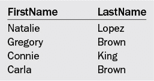

现在名字按从 Z 到 A 的顺序排列。

## 按多列排序

我们现在回到如何处理 Brown 一人的问题上。当有多个人具有相同的姓氏时，为了按姓氏排序，我们必须添加按名字的次要排序，如下：

```sql
SELECT
FirstName,
LastName
FROM Salespeople
ORDER BY LastName, FirstName
```

这返回了：

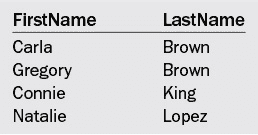

由于现在指定了第二个排序列，我们现在可以确定 Carla Brown 会出现在 Gregory Brown 之前。注意，在 `ORDER BY` 子句中，`LastName` 必须列在 `FirstName` 之前。列的顺序是非常重要的。列出的第一列始终为主排序值。列出的任何额外列将成为次级、三级，依此类推。

## 按计算字段排序

我们现在应用从第 3 章中学到的关于计算字段和别名的知识，以说明排序的更多可能性。此语句：

点击此处查看代码图片

```sql
SELECT
LastName + ', ' + FirstName AS 'Name'
FROM Salespeople
ORDER BY Name
```

返回此数据：

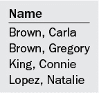

如所示，我们利用字符串拼接创建了一个具有别名 `Name` 的计算字段。我们可以在 `ORDER BY` 子句中引用同一个列别名。这很好地说明了使用列别名的另一个好处。此外，请注意计算字段本身的设计。我们在姓氏和名字列之间插入了一列和一个空格以将它们分开，并以常用的格式显示名称。方便的是，这种格式也非常适合排序。以这种格式（用逗号分隔姓和名）显示名称的能力是一个值得记住的实用技巧。用户非常希望看到按这种方式排列的名称。

也可以在 `ORDER BY` 子句中放置一个计算字段，而不将其用作列别名。与上面类似，我们也可以指定：

```sql
SELECT
FirstName,
LastName
FROM Salespeople
ORDER BY LastName + FirstName
```

这将显示：

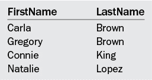

数据的排序方式与上一个示例相同。唯一的区别是，我们现在在 `ORDER BY` 子句中指定了一个计算字段，而没有使用列别名。这与将 `LastName` 和 `FirstName` 指定为主、次要排序列的效果相同的结果。

## 排序序列

在之前的示例中，所有数据都是字符数据，由从 A 到 Z 的字母组成。没有数字或特殊字符。此外，还没有考虑大写和小写字母。

每个数据库都允许用户指定或自定义排序规则（collation）设置，提供数据如何排序的详细信息。设置在数据库之间有所不同，但通常有三个事实。第一，当数据按升序排序时，任何带有 `NULL` 值的数据首先出现。正如之前讨论的，`NULL` 值是指数据的缺失。在任何 `NULL` 之后，数字将出现在字符之前。对于按降序排序的数据，字符数据首先显示，然后是数字，最后是 `NULL`。

第二，对于字符数据，通常不区分大小写。字母 `e` 的处理方式与 `E` 相同。第三，对于字符数据，组成值的单个字符是从左到右评估的。如果我们说的是字母，那么 `AB` 将在 `AC` 之前。让我们来看一个取自此表的示例，我们将其称为 `TableForSort`：

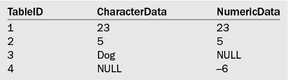

在该表中，`CharacterData` 列被定义为字符列，例如 `VARCHAR`（可变长度数据类型）。同样，`NumericData` 列被定义为数值列，例如 `INT`（整数数据类型）。没有数据的值显示为 `NULL`。当对 `TableForSort` 表执行此 `SELECT` 时：

```sql
SELECT
NumericData
FROM TableForSort
ORDER BY NumericData
```

它将显示：

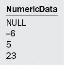

注意 `NULL` 首先出现，然后按数字顺序排列的数字。如果我们希望 `NULL` 值假设默认值为 0，我们可以使用上一节讨论过的 `ISNULL` 函数并执行此 `SELECT` 语句：

点击此处查看代码图片

```sql
SELECT
ISNULL(NumericData,0) AS 'NumericData'
FROM TableForSort
ORDER BY ISNULL(NumericData,0)
```

结果是：

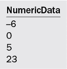

`ISNULL` 函数将 `NULL` 转换为 0，改变了排序顺序。

是否将 `NULL` 值显示为 `NULL` 或 0 取决于情况。如果用户认为 `NULL` 意味着 0，那么显示 `NULL` 是合适的。

## 展望

在本章中，我们讨论了按特定顺序排序的基本可能性。我们说明了如何按多列排序。我们还讨论了计算字段的使用。最后，我们涵盖了排序的一些特性，特别是涉及 `NULL` 值和字符列中数字的情况。

在章节的开头，我们提到了排序的一些通用用途。主要用途是将数据放在易于理解的顺序，从而允许用户快速找到所需信息。另一个有趣的排序用法将在第 6 章“选择标准”中介绍。在该章中，我们将引入 `TOP` 关键字以及与排序结合使用的另一种方法。这种技术被称为 Top N 排序，允许我们执行诸如显示特定时间段内订单最高的客户的操作。

到目前为止，我们所看到的 `SELECT` 语句总是返回表中的每一行。在现实世界中，这种情况很少见。通常，我们只感兴趣于检索符合特定标准的数据。例如，如果你在查询订单，你可能只想查看符合某些条件的订单。在查看产品时，你通常只想查看某些类型的产品。很少有人想简单地查看所有内容。你对数据的兴趣通常指向数据中的一小部分集，以便分析或查看某个特定方面。

## 应用筛选标准

SQL 中的筛选标准始于 `WHERE` 子句。`WHERE` 关键字完成了选择行子集的任务。这是 `SELECT` 语句的通用格式，包含了 `WHERE` 子句以及之前讨论过的其他子句：

```sql
SELECT columnlist
FROM tablelist
WHERE condition
ORDER BY columnlist
```

如所示，`WHERE` 子句必须始终位于 `FROM` 和 `ORDER BY` 子句之间。事实上，如果使用了任何子句，它们必须按照上述所示的顺序出现。

让我们来看一个示例，取自此 `Sales` 表中的数据：

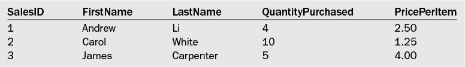

我们将从一个带有简单 `WHERE` 子句的语句开始：

```sql
SELECT
FirstName,
LastName,
QuantityPurchased
FROM Sales
WHERE LastName = 'Carpenter'
```

输出是：


由于 `WHERE` 子句规定只选择 `LastName` 等于 ‘Carpenter’ 的行，因此表中的三行中只返回了一行。注意，`LastName` 列的期望值被包含在引号中，这是因为 `LastName` 是一个字符列。对于数值字段，不需要引号。例如，接的 `SELECT` 同样有效并返回相同的数据：

```sql
SELECT
FirstName,
LastName,
QuantityPurchased
FROM Sales
WHERE QuantityPurchased = 5
```

## WHERE 子句运算符

在之前的语句中，等号（`=`）被用作 `WHERE` 子句中的运算符。等号表示相等性测试。上述所示的通用格式要求 `WHERE` 子句后紧跟一个 `condition`。该条件由一个运算符以及两侧的表达式组成。

以下是可以在 `WHERE` 子句中使用的基本运算符列表：

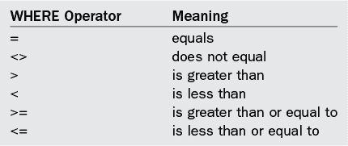

更高级的运算符将在下一章中介绍。

等号（`=`）和不等（`<>`）运算符的含义应该是显而易见的。这里有一个带有“大于”运算符的 `WHERE` 子句示例，取自同一个 `Sales` 表：

```sql
SELECT
FirstName,
LastName,
QuantityPurchased
FROM Sales
WHERE QuantityPurchased > 6
```

结果是：


在这个示例中，只有一行符合 `QuantityPurchased` 列大于 6 的条件。虽然不像以前那么常用，但在文本列上使用“大于”运算符也是可能的。这个示例：

```sql
SELECT
FirstName,
LastName
FROM Sales
WHERE LastName > 'K'
```

返回了：


由于测试是针对大于 K 的姓氏，它只返回了 Li 和 White，而没有返回 Carpenter。当应用于文本字段时，大于和小于运算符表示根据值的字母顺序进行选择。在这种情况下，返回了 Li 和 White，因为在字母表中，L 和 W 位于 K 之后。

## 限制行数

我们有时可能选择表中的一小部分行，但并不关心返回的是哪些行。假设我们有一个包含 50,000 行的表，只想看几行数据来看看它长什么样。为了这个目的，使用 `WHERE` 子句是没有意义的，因为我们并不关心返回的是哪些特定的行。

对于这种情况，解决方案是使用一个特殊的关键字来指定返回行数的限制。这是数据库之间语法存在差异的另一个例子。在 Microsoft SQL Server 中，实现此限制的关键字是 `TOP`。通用格式为：

```sql
SELECT
TOP number columnlist
FROM tablelist
```

### 数据库差异：MySQL 和 Oracle

MySQL 使用关键字 `LIMIT` 而不是 `TOP`。通用格式是：

```sql
SELECT columnlist
FROM tablelist
LIMIT number
```

Oracle 使用关键字 `ROWNUM` 而不是 `TOP`。`ROWNUM` 关键字必须在 `WHERE` 子句中指定，如下所示：

```sql
SELECT columnlist
FROM tablelist
WHERE ROWNUM <= number
```

假设我们想查看表的前 10 行。实现此目的的 `SELECT` 语句如下：

```sql
SELECT
TOP 10 *
FROM table
```

该语句返回表的前 10 行的所有列。与任何没有 `ORDER BY` 子句的 `SELECT` 语句一样，无法预测将返回哪 10 行。这取决于数据在表中的物理存储方式。

同样，我们可以列出要返回的列：

```sql
SELECT
TOP 10
column1,
column2
FROM table
```

本质上，`TOP` 关键字完成了与 `WHERE` 子句类似的功能，因为它返回了指定表中的一小部分行集。然而，请记住，使用 `TOP` 关键字返回的并不是统计学意义上的随机样本。它们取决于数据在数据库中的物理存储。

## 排序限制行数

`TOP` 关键字的另一个用法是结合 `ORDER BY` 子句使用，以获取符合标准的指定数量的行。这种数据选择被称为 Top N 选择。这里有一个示例，取自 `Books` 表：

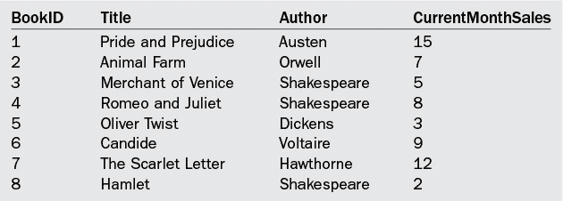

假设我们想看销售得最多的三本书。实现此目的的 `SELECT` 语句是：

```sql
SELECT
TOP 3
Title AS 'Book Title',
CurrentMonthSales AS 'Quantity Sold'
FROM Books
ORDER BY CurrentMonthSales DESC
```

输出是：

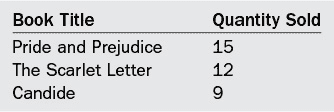

让我们详细检查此语句。第二行的 `TOP 3` 表示返回三行数据。主要问题是它是如何确定显示哪三行的。答案在 `ORDER BY` 子句中。如果没有 `ORDER BY` 子句，`SELECT` 将仅仅返回任意三行数据。然而，这并不是我们想要的。我们正在寻找销售额最高的三行。为了实现这一点，我们需要按 `CurrentMonthSales` 列进行降序排序。为什么要降序？当数据按降序排序时，最大的数字在前。如果我们按升序排序，我们将得到销量最少的书，而不是最多的。

现在让我们为这个场景增加一个转折。假设我们只想看莎士比亚哪本书销量最多。为了实现这一点，我们需要添加一个 `WHERE` 子句，如下：


```sql
SELECT
TOP 1
Title AS 'Book Title',
CurrentMonthSales AS 'Quantity Sold'
FROM Books
WHERE Author = 'Shakespeare'
ORDER BY CurrentMonthSales DESC
```

这返回了以下数据：


`WHERE` 子句增加了限定条件，只查看莎士比亚的作品。我们也修改了 `TOP` 关键字以指定 `TOP 1`，表示我们只想查看一行数据。

我们现在要转向一种待检索数据没有精确定义的情况。我们经常希望根据单词或短语的不精确匹配来查看数据。例如，你可能感兴趣寻找名称中包含“bank”一词的公司。通过短语中的不精确匹配来选择数据通常称为 `pattern matching`（模式匹配）。在 SQL 中，`LIKE` 运算符用于 `WHERE` 子句，使我们能够对列值的一部分进行匹配。`LIKE` 运算符需要使用特殊的通配符字符来指定匹配的具体工作方式。让我们从下面的 Movies（电影）表的一个示例开始。

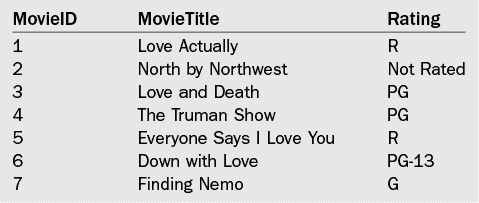

我们使用 `LIKE` 运算符的第一个示例是：

```sql
SELECT
MovieTitle AS 'Movie'
FROM Movies
WHERE MovieTitle LIKE '%LOVE%'
```

在这个示例中，百分号 `%` 被用作通配符。百分号 `%` 通配符意味着`任何字符`。`任何字符` 包括可能没有字符的情况。`LOVE` 之前的百分号 `%` 意味着我们将接受 `LOVE` 之前带有任何（或没有）字符的短语。同样，`LOVE` 之后的百分号 `%` 意味着我们将接受 `LOVE` 之后带有任何（或没有）字符的短语。换句话说，我们正在寻找包含单词 `LOVE` 的电影标题。这是 `SELECT` 返回的数据：

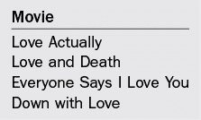

注意 `LOVE` 出现在电影标题的第一个单词、最后一个单词，有时出现在中间。

### 数据库差异：Oracle

与 Microsoft SQL Server 和 MySQL 不同，Oracle 在确定字面量值的匹配时是区分大小写的。在 Oracle 中，`LOVE` 不等于 `Love`。Oracle 中的等效语句是：

```sql
SELECT
MovieTitle AS Movie
FROM Movies
WHERE MovieTitle LIKE '%LOVE%';
```

这将不会返回任何数据，因为没有电影标题包含全大写的单词 `LOVE`。在 Oracle 中，一种解决方案是使用 `UPPER` 函数将你的数据转换为大写，如下所示：

```sql
SELECT
MovieTitle AS Movie
FROM Movies
WHERE UPPER(MovieTitle) LIKE '%LOVE%';
```

现在让我们尝试只查找以 `LOVE` 开头的电影。如果我们发布：

```sql
SELECT
MovieTitle AS 'Movie'
FROM Movies
WHERE MovieTitle LIKE 'LOVE%'
```

我们将只检索到这些数据：

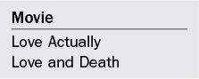

因为我们现在只在单词 `LOVE` 之后指定百分号 `%` 通配符，所以我们只得到以 `LOVE` 开头的电影。同样，如果我们发布：

```sql
SELECT
MovieTitle AS 'Movie'
FROM Movies
WHERE MovieTitle LIKE '%LOVE'
```

我们只得到这些数据：

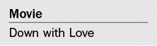

这是因为我们现在指定了短语必须以单词 `LOVE` 结尾。

人们可能会问如何安排通配符，以只查看标题中间包含单词 `LOVE` 的电影，而不查看 `LOVE` 在开头或结尾的电影。解决方案是指定：

```sql
SELECT
MovieTitle AS 'Movie'
FROM Movies
WHERE MovieTitle LIKE '% LOVE %'
```

注意，在单词 `LOVE` 和两侧的百分号 `%` 通配符之间插入了一个空格。这确保了单词两边至少有一个空格。从该语句带回的数据是：

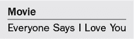

### 通配符

百分号 `%` 是与 `LIKE` 运算符配合时最常用的通配符，但还有其他几种可能性。这些包括下划线字符 `_`、包含在方括号内的 `characterlist`（字符列表），以及脱字符符号 `^` 加上包含在方括号内的 `characterlist`。下表列出了这些通配符及其含义：

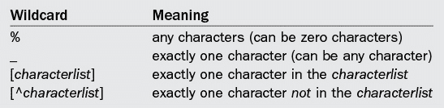

我们将使用下面的 Actors（演员）表来阐明用于这些通配符的语句。

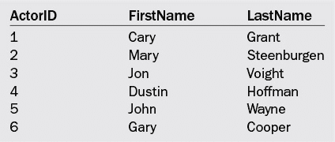

以下是下划线 `_` 通配符字符如何使用的说明：

```sql
SELECT
FirstName,
LastName
FROM Actors
WHERE FirstName LIKE '_ARY'
```

此 `SELECT` 的输出是：

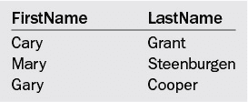

该语句检索了这三位演员，因为他们的 First 名字都由恰好一个字符后跟短语 `ARY` 组成。

同样，如果我们发布这条语句：

```sql
SELECT
FirstName,
LastName
FROM Actors
WHERE FirstName LIKE 'J_N'
```

它产生了：

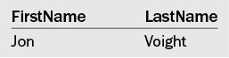

演员 John Wayne 没有被选中，因为 John 不符合 `J_N` 模式。下划线仅代表一个字符。

我们将讨论的最后两个通配符 `[characterlist]` 和 `[^characterlist]` 允许你在单个位置上指定多个通配符值。

#### 数据库差异：MySQL 和 Oracle

`[characterlist]` 和 `[^characterlist]` 通配符在 MySQL 或 Oracle 中不可用。

以下说明了 `[characterlist]` 通配符：

```sql
SELECT
FirstName,
LastName
FROM Actors
WHERE FirstName LIKE '[CM]ARY'
```

这检索了任何 `FirstName` 以 `C` 或 `M` 开头并以 `ARY` 结尾的行。结果是：


以下说明了 `[^characterlist]` 通配符：

```sql
SELECT
FirstName,
LastName
FROM Actors
WHERE FirstName LIKE '[^CM]ARY'
```

这选择了任何 `FirstName` 不以 `C` 或 `M` 开头以 `ARY` 结尾的行。结果是：


### 展望

本章介绍了关于如何将选择标准应用于查询的主题。介绍了一些基础运算符，例如等于和大于。指定这些类型选择标准的能力在很大程度上使 `SELECT` 语句变得真正有用。我们还涵盖了限制返回行数的相关主题。将限制行数与 `ORDER BY` 子句结合使用，允许实用的 Top N 类型数据选择。

我们以通过指定模式匹配单词或短语的研究结束本章。

## 7. 布尔逻辑

### 引入的关键字

`AND` • `OR` • `NOT` • `BETWEEN` • `IN` • `IS NULL`

我们在上一章中引入了选择标准的概念，但仅限于最简单的形式。我们现在将扩展这一概念，极大地增强我们指定 `SELECT` 返回行的能力。这就是 SQL 的纯逻辑发挥作用的地方。在本章中，我们将引入一些允许你创建复杂逻辑表达式的运算符。

目前，我们可以执行诸如选择纽约州的所有客户。但在现实世界中，通常需要更多。布尔逻辑将允许我们制定一个查询，选择纽约州或加利福尼亚州但在洛杉矶或阿尔伯克基的客户。

### 复杂逻辑条件

上一章引入的 `WHERE` 子句只使用了简单的选择标准。我们看到这样的子句：

```sql
WHERE QuantityPurchased = 5
```

此 `WHERE` 子句中表达的条件非常基础。它仅仅指定返回所有 `QuantityPurchased` 列的值为 `5` 的行。在现实世界中，数据的筛选往往远非这般简单。因此，现在让我们关注到在选择准则中指定更复杂逻辑条件的方法上。

设计复杂逻辑条件的能力有时被称为 `Boolean logic`（布尔逻辑）。这个术语源于数学，指的是构建可以评估为“真”或“假”的复杂条件的能力。在前面的示例中，条件 `QuantityPurchased = 5` 会对于表中的每一行都会被评估为真或假。显然，我们只想看到条件被评估为真的行。

用于创建复杂布尔逻辑的原则关键字是 `AND`、`OR` 和 `NOT`。这三个运算符用于为 `WHERE` 子句提供额外功能。通过适当的组合，`AND`、`OR` 和 `NOT` 运算符配合括号，可以指定几乎能够想象的任何逻辑表达式。

### AND 运算符

以下示例都将取自此 `Purchases` 表：

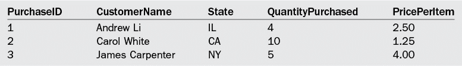

这是一个使用 `AND` 运算符的 `WHERE` 子句示例：

```sql
SELECT
CustomerName,
QuantityPurchased
FROM Purchases
WHERE QuantityPurchased > 3
AND QuantityPurchased < 7
```

`AND` 子句意味着所有条件都评估为真，该行才能被选中。此 `SELECT` 语句指定要检索的行仅限 `QuantityPurchased` 既大于 3 又小于 7 的行。因此，只返回了这两行：


注意，Carol White 的行没有被返回。为什么？Carol 购买了 10 个，这实际上确实满足了第一个条件（`QuantityPurchased > 3`）。然而，第二个条件（`QuantityPurchased < 7`）没有被满足，因此它不是真的。使用 `AND` 运算符时，所有指定的条件必须为真，该行才能被选中。

### OR 运算符

现在来看 `OR` 运算符。`AND` 运算符意味着所有条件都评估为真，该行才能被选中。`OR` 运算符意味着如果任何一个条件被确定为真，该行将被选中。

这是一个取自同一表的示例：

```sql
SELECT
CustomerName,
QuantityPurchased,
PricePerItem
FROM Purchases
WHERE QuantityPurchased > 8
OR PricePerItem > 3
```

此 `SELECT` 返回了以下数据：


为什么显示了 Carol White 和 James Carpenter 的行，而不是 Andrew Li 的行？Carol White 的行被选中是因为它满足了第一个条件（`QuantityPurchased > 8`）的要求。第二个条件（`PricePerItem > 3`）不成立没有关系，因为 `OR` 条件只需要一个条件为真即可。

同样，James Carpenter 的行被选中是因为第二个条件（`PricePerItem > 3`）对于该行来说是真实的。Andrew Li 的行没有被选中，因为它不满足两个条件中的任何一个。

### 使用括号

假设我们只对来自伊利诺伊州或加利福尼亚州客户的订单感兴趣。此外，我们还只想看到购买数量大于 8 的订单。为了尝试满足这一请求，我们可能会组合出如下 `SELECT` 语句：

```sql
SELECT
CustomerName,
State,
QuantityPurchased
FROM Purchases
WHERE State = 'IL'
OR State = 'CA'
AND QuantityPurchased > 8
```

我们期望此语句只返回一行数据，即 Carol White 的。虽然我们在伊利诺伊州或加利福尼亚州的客户中有两个行（Li 和 White），但其中只有一个（White）的购买数量大于 8。然而，当执行此语句时，我们得到了：


我们看到了两行，而不是预期的一行。哪里出了问题？答案在于 SQL 如何解释 `WHERE` 子句，而该子句恰好包含了 `AND` 和 `OR` 运算符。和其他计算机语言一样，SQL 有一个预定的评估顺序，规定了各种运算符被解释的顺序。除非另有说明，否则 SQL 总是会在 `OR` 运算符之前处理 `AND` 运算符。因此，在之前的语句中，它首先查看 `AND` 并评估该条件：

```sql
State = 'CA'
AND QuantityPurchased > 8
```

满足该条件的行是 Carol White 的。SQL 接着评估 `OR` 运算符，它允许 `State` 等于 IL 的行通过。这增加了 Andrew Li 的行。结果是 SQL 判定 Andrew Li 和 Carol White 的行都符合条件。

显然，这并不是我们想要的。当 `AND` 和 `OR` 运算符在单个 `WHERE` 子句中组合时，经常会出现这类问题。解决歧义的方法是使用括号来指定所需的评估顺序。括号中的任何内容总是会被评估。

以下是如何向之前的 `SELECT` 添加括号以纠正这种情况：

```sql
SELECT
CustomerName,
State,
QuantityPurchased
FROM Purchases
WHERE (State = 'IL'
OR State = 'CA')
AND QuantityPurchased > 8
```

执行此语句时，我们看到了这些数据：


执行时，括号强制 `OR` 表达式（`State = 'IL' OR State = 'CA'`）先进行评估。

### 多重括号

假设我们想从 `Purchases` 表中选择两组行：首先是纽约州的行，其次是伊利诺伊州购买数量在 3 到 10 之间的行。此 `SELECT` 实现了这一点：

```sql
SELECT
CustomerName,
State,
QuantityPurchased
FROM Purchases
WHERE State = 'NY'
OR (State = 'IL'
AND (QuantityPurchased >= 3
AND QuantityPurchased <= 10))
```

结果是：


注意语句中有括号，一组在另一组内部。这种括号的使用类似于第 4 章中使用的括号。当存在多组括号时，最内层的组总是先被评估。在示例中，最内层的括号包含：

```sql
QuantityPurchased >= 3
AND QuantityPurchased <= 10
```

在对该行评估此条件后，逻辑向外移动第二组括号：

```sql
State = 'IL'
AND (QuantityPurchased >= 3
AND QuantityPurchased <= 10)
```

最后，逻辑处理 `WHERE` 子句中未包含任何括号内的最后一行（关于纽约州）：

```sql
WHERE State = 'NY'
OR (State = 'IL'
AND (QuantityPurchased >= 3
AND QuantityPurchased <= 10))
```

本质上，SQL 的逻辑首先评估括号内的表达式，然后是外层括号，最后是剩余的表达式。

### NOT 运算符

除了 `AND` 和 `OR` 运算符外，`NOT` 运算符通常用于表达复杂的逻辑条件。`NOT` 表达在 `NOT` 之后内容的否定或相反面。这是一个简单的示例：

```sql
SELECT
CustomerName,
State,
QuantityPurchased
FROM Purchases
WHERE NOT State = 'NY'
```

结果是：


这指定了状态不等于 NY 的行。在这种简单的情况下，`NOT` 运算符并不是真正必要的。上述语句的逻辑也可以通过以下等效语句来实现：

```sql
SELECT
CustomerName,
State,
QuantityPurchased
FROM Purchases
WHERE State <> 'NY'
```

在这里，不等于运算符（`<>`）实现了与 `NOT` 运算符相同的功能。这是一个使用 `NOT` 运算符的更复杂的示例：

```sql
SELECT
CustomerName,
State,
QuantityPurchased
FROM Purchases
WHERE NOT (State = 'IL'
OR State = 'NY')
```

结果是：


当 `NOT` 运算符用在括号之前时，它会对括号内的所有内容取反。在这个例子中，我们正在寻找所有状态既不是伊利诺伊州（Illinois）也不是纽约州（New York）的行。

再次注意，在这个例子中 `NOT` 运算符并不是严格必要的。上一个查询的逻辑也可以通过以下等效语句来实现：

```sql
SELECT
CustomerName,
State,
QuantityPurchased
FROM Purchases
WHERE State <> 'IL'
AND State <> 'NY'
```


可能需要花一点时间思考为什么上述两个语句是等效的。第一个语句使用了`NOT`运算符和一个带有`OR`运算符的逻辑表达式。第二个语句则将逻辑转换为一个带有`AND`运算符的表达式。

这里是`NOT`运算符在复杂语句中最后一个示例：

```sql
SELECT
CustomerName,
State,
QuantityPurchased
FROM Purchases
WHERE NOT (State = 'IL'
AND QuantityPurchased > 3)
```

此查询的意思是选择那些满足“状态等于伊利诺伊州且`QuantityPurchased`大于 3”这一条件错误的客户。`NOT`运算符应用于“状态等于伊利诺伊州且`QuantityPurchased`大于 3”这整个逻辑表达式。结果是：


这两行之所以被选中，是因为伊利诺伊州唯一一个`QuantityPurchased`大于 3 的客户是 Andrew Li。因为我们对这整个逻辑应用了`NOT`，最终结果显示了另外两个客户。

再次，此查询可以使用不使用`NOT`的另一种方式表示：

```sql
SELECT
CustomerName,
State,
QuantityPurchased
FROM Purchases
WHERE State <> 'IL'
OR QuantityPurchased <= 3
```

正如这些示例所示，在包含等号（`=`）或小于（`<`）等算术运算符的复杂表达式中，使用`NOT`运算符在逻辑上可能并不是必要的。然而，在逻辑表达式前面放置`NOT`往往比尝试将该表达式转换为不使用`NOT`的表达式要直观得多。换句话说，`NOT`运算符可以为表达逻辑思维提供一种方便且有用的方法。

### BETWEEN 运算符

现在让我们转向两个特殊运算符：`BETWEEN`和`IN`，它们可以简化通常需要`OR`或`AND`运算符的表达式。`BETWEEN`运算符允许我们在包含单个运算符的表达式中将带有大于等于（`>=`）和小于等于（`<=`）运算符的`AND`表达式简写。

这是一个示例。假设我们要选择所有购买数量在 5 到 20 之间的行。实现这一目标的方法之一是以下`SELECT`语句：

```sql
SELECT
CustomerName,
QuantityPurchased
FROM Purchases
WHERE QuantityPurchased >= 5
AND QuantityPurchased <= 20
```

使用`BETWEEN`运算符，等效语句是：

点击此处查看代码图片

```sql
SELECT
CustomerName,
QuantityPurchased
FROM Purchases
WHERE QuantityPurchased BETWEEN 5 AND 20
```

在两种情况下，`SELECT`都返回这些数据：


`BETWEEN`运算符始终要求在两个数字之间放置一个相应的`AND`。

注意`BETWEEN`运算符的相对简单性。还要注意`BETWEEN`包含指定的数字。在这个示例中，`BETWEEN 5 AND 20`包含了数字 5 和 20。因此，`BETWEEN`仅等于大于等于（`>=`）和小于等于（`<=`）运算符。它不能用于简单地表示大于（`>`）或小于（`<`）某个数字范围。James Carpenter 的行被选中是因为购买数量等于 5，因此在 5 到 20 之间。

`NOT`运算符可以与`BETWEEN`结合使用。例如，这个`SELECT`：

点击此处查看代码图片

```sql
SELECT
CustomerName,
QuantityPurchased
FROM Purchases
WHERE QuantityPurchased NOT BETWEEN 5 AND 20
```

检索了这些数据：


### IN 运算符

正如`BETWEEN`代表`AND`运算符的一种特殊情况一样，`IN`运算符允许`OR`运算符的特殊情况。假设我们要查看状态为伊利诺伊州或纽约州的行。如果不使用`IN`运算符，可以通过语句实现：

```sql
SELECT
CustomerName,
State
FROM Purchases
WHERE State = 'IL'
OR State = 'NY'
```

这里是使用`IN`运算符的等效语句：

```sql
SELECT
CustomerName,
State
FROM Purchases
WHERE State IN ('IL', 'NY')
```

在任何情况下，检索的数据都是：


`IN`运算符要求随后列出括在括号内的值。必须使用逗号分隔所有值。

`IN`运算符的用处在这个仅列出两个州的示例中可能并不明显。然而，`IN`同样可以轻松用于涉及几十个特定值的情况。这大大减少了此类语句所需的输入量。另一个方便用法是从 Excel 表格获取值。为了在 SQL 语句从表格的相邻单元格中获取多个值，你只需要以逗号作为分隔符复制这些值。然后可以将值粘贴到`IN`运算符后面的括号内。

与`BETWEEN`运算符一样，`NOT`运算符可以与`IN`运算符结合使用，如下例所示：

点击此处查看代码图片

```sql
SELECT
CustomerName,
State
FROM Purchases
WHERE State NOT IN ('IL', 'NY')
```

检索了这些数据：


关于`IN`运算符的最后一点。使用`IN`运算符的第二种方法与上述语法有很大不同。在第二种格式中，括号内指定整个`SELECT`语句，允许在需要时创建值。这被称为子查询，将在第 14 章（`ch14`）中详细介绍。

### 布尔逻辑与 NULL 值

在本章开始，我们提到布尔逻辑评估为真或假。这一断言并不完全准确。在评估`WHERE`子句中的条件时，实际上有三种可能性：真、假和未知。这种情况源于 SQL 列有时允许具有`NULL`值。正如在第 1 章（`ch01`）中所提到的，`NULL`值表示数据的缺失。

SQL 提供了一个特殊关键字来测试`WHERE`子句中指定列的`NULL`值的存在。该关键字是`IS NULL`。让我们看看之前 Products 表中的示例：


在这个示例中，我们想象当行添加到 Products 表时，最初没有赋予重量。`Weight`列最初被赋予`NULL`值，随后用户为产品分配了重量。

假设我们尝试使用以下`SELECT`来寻找缺失重量的商品：

```sql
SELECT
Description,
Weight
FROM Products
WHERE Weight = 0
```

这将返回：


这并不是我们想要的。重量为 0 不等同于重量为`NULL`值。为了修正这一点，我们需要：

```sql
SELECT
Description,
Weight
FROM Products
WHERE Weight = 0
OR Weight IS NULL
```

这返回：


`IS NULL`关键字也可以被否定为`IS NOT NULL`，这允许检索指定列没有`NULL`值的行。

注意，在第 4 章（`ch04`）中讨论过的`ISNULL`函数可以作为`IS NULL`关键字的替代方案。之前的`SELECT`语句使用`ISNULL`函数的等效语句是：

```sql
SELECT
Description,
Weight
FROM Products
WHERE Weight = 0
```

```sql
WHERE ISNULL(Weight, 0) = 0
```

此`SELECT`检索了相同的两行。`ISNULL`函数将`Weight`列中所有值为`NULL`的值转换为 0。这产生的结果与上一个语句相同，上一个语句测试了值是否为 0 或`NULL`。

`ISNULL`函数和`IS NULL`关键字也可以结合使用，如下语句所示：

```sql
SELECT
Description,
ISNULL(Weight, 0) AS 'Weight'
FROM Products
WHERE Weight = 0
OR Weight IS NULL
```

这产生了以下数据：


### 展望未来

本章涵盖了如何创建复杂的选择逻辑表达式这一重要主题。在这一尝试中，使用的基础布尔运算符有`AND`、`OR`和`NOT`。我们还讨论了`BETWEEN`和`IN`运算符，它们允许在某些情况下更简洁地表达`AND`和`OR`运算符。括号是构建复杂表达式的另一个基本工具。通过使用括号，你可以创建几乎所有想象得到的逻辑条件。最后，我们讨论了在选择数据时如何处理`NULL`值。

在下一章中，我们将重新回到`columnlist`并探索一种重要的结构，该结构将允许我们将逻辑注入到`columnlist`中的各个列中。这被称为`条件逻辑`（conditional logic）。通过使用本章讨论的相同布尔逻辑运算符以及一些额外的关键字，我们能够指定逻辑来决定`columnlist`中各个列的显示方式。

## 8. 条件逻辑

### 引入的关键字

`CASE` • `WHEN` • `THEN` • `ELSE` • `END`

本章的主体内容是`条件逻辑`。该术语是指将逻辑注入到`columnlist`中特定列或 SQL 语句中其他表达式的值中的能力。根据 SQL 语句执行时逻辑评估的方式，某一列可以出现不同的值。因此，出现的值取决于指定的逻辑（即**条件**）。更具体地说，条件逻辑是由以`CASE`关键字开头的表达式表示的。这通常被称为`CASE`表达式。本质上，`CASE`表达式允许你根据应用于特定列或数据元素评估的逻辑条件，更改呈现给用户的输出。使用`CASE`这个词与大小写无关。它的意义是以条件的方式指定一个特定的用例或一组逻辑。

作为一名初级 SQL 开发者，你应该意识到`CASE`表达式是一个相对高级的概念。即使不使用`CASE`表达式也可以应付，并编写出一些非常有用的查询。尽管如此，理解和使用条件逻辑的能力可以将原始查询转变为更升华的内容。因此，这是你可以在读完整本书后可能值得额外复习的主题之一，以提醒你通过这种技术可以实现一些有趣的事情。

### CASE 表达式

SQL 中的`CASE`表达式允许将逻辑应用于`columnlist`或表达式中的单个元素。正如第 2 章所示，`SELECT`语句的完整格式为：

```sql
SELECT columnlist
FROM tablelist
WHERE condition
GROUP BY columnlist
HAVING condition
ORDER BY columnlist
```

`CASE`表达式可以出现在`SELECT`语句的多个区域。它可以紧跟`SELECT`关键字出现在`columnlist`中，也可以出现在`GROUP BY`或`ORDER BY`子句中。它还可以作为`WHERE`或`HAVING`子句条件中的元素出现。在本章中，我们将首先说明在`SELECT` `columnlist`中使用`CASE`表达式。这是它最典型的用法。随后我们还会展示如何在`WHERE`和`ORDER BY`子句中使用。

`CASE`表达式替换`columnlist`中的任何单独列。关注其在`columnlist`中的用法，一个同时包含列和`CASE`表达式的`SELECT`语句可能如下：

```sql
SELECT
column1,
column2,
CaseExpression
FROM table
```

`CASE`表达式本身包含了嵌入传统的`IF-THEN-ELSE`结构中的逻辑。`IF-THEN-ELSE`术语指的是过程化编程语言中常用的逻辑结构。通俗地说，这种逻辑看起来如下：

```text
IF some condition is true
THEN do this
ELSE do that
```

在`IF-THEN-ELSE`中表示的条件可以包含上一章讨论的全范围布尔逻辑。因此，表达式可以包含`AND`、`OR`、`NOT`、`BETWEEN`和`IN`运算符，以及括号。

### 简单 CASE 格式

`CASE`表达式有两种基本格式，通常称为“简单”（simple）和“搜索型”（searched）。简单格式是：

点击此处查看代码图像

```sql
CASE ColumnOrExpression
WHEN value1 THEN result1
WHEN value2 THEN result2
(repeat WHEN-THEN any number of times)
[ELSE DefaultResult]
END
```

如你所见，这个`CASE`表达式除了`CASE`之外还需要许多关键字；它还包含了`WHEN`、`THEN`、`ELSE`和`END`。这些额外的关键字用于完整定义`CASE`表达式的逻辑。`WHEN`和`THEN`关键字定义了一个评估的条件。如果`WHEN`之后的值为，则使用`THEN`之后的结果。`WHEN`和`THEN`关键字可以重复任意次数。当有`WHEN`时必须有相应的`THEN`。`ELSE`关键字用于定义在没有任何`WHEN-THEN`为真时使用的默认值。正如括号所示，`ELSE`关键字不是必须的。然而，在每个`CASE`表达式中包含`ELSE`关键字通常是一个好主意。`END`关键字终止`CASE`表达式。

让我们看一个具体的示例，使用这个`Groceries`表：


在该数据中，`CategoryCode`列表示：`F`代表水果，`S`代表香料，`V`代表蔬菜，`B`代表饮料。带有`CASE`表达式的`SELECT`可能如下所示：

```sql
SELECT
CASE CategoryCode
WHEN 'F' THEN 'Fruit'
WHEN 'V' THEN 'Vegetable'
ELSE 'Other'
END AS 'Category',
Description
FROM Groceries
```

产生以下输出：


让我们详细检查`SELECT`语句。第一行包含`SELECT`关键字。第二行的`CASE`关键字指定要分析`CategoryCode`列。第三行引入了第一个`WHEN-THEN`条件。该行表示如果`CategoryCode`列等于`F`，则显示`'Fruit'`。下一行表示如果`CategoryCode`为`V`，则显示`'Vegetable'`。`ELSE`行提供在没有任何`WHEN-THEN`为真时使用的默认值`'Other'`。换句话说，如果类别不是水果或蔬菜，则可以被归类为`Other`。`END`关键字终止`CASE`表达式，并包含一个`AS`关键字以分配列别名。下一行`Description`仅仅是另一列，它与`CASE`表达式无关。

正如所示，`CASE`表达式对于将晦涩的值转换为意义描述非常有用。在这个示例中，`Groceries`表中的`CategoryCode`列仅包含单个字符代码来指示产品类型。`CASE`表达式允许我们指定翻译。

### 搜索型 CASE 格式

搜索型`CASE`表达式的通用格式为：

点击此处查看代码图像

```sql
CASE
WHEN condition1 THEN result1
WHEN condition2 THEN result2
(repeat WHEN-THEN any number of times)
[ELSE DefaultResult]
END
```

使用此第二种格式，上述`SELECT`语句的等写法为：

点击此处查看代码图像

```sql
SELECT
CASE
WHEN CategoryCode = 'F' THEN 'Fruit'
```

```sql
WHEN CategoryCode = 'V' THEN 'Vegetable'
ELSE 'Other'
END AS 'Category',
Description
FROM Groceries
```

从此语句检索出的数据与第一个简单的`CASE`格式相同。然而，请注意其细微的差别。在简单格式中，要评估的列名放置在`CASE`关键字之后，而`WHEN`之后的表达式是一个简单的字面量。在搜索格式（searched format）中，要评估的列名并不位于`CASE`关键字。相反，这种格式允许在`WHEN`关键字之后指定更复杂的条件表达式。

在在上一个示例中，`CASE`子句的两种格式都可以使用，并且产生相同的结果。现在让我们来看另一个只有搜索格式`CASE`才能产生预期结果的示例。这个示例将来自以下数据：


在这种情况下，表格并不包含单个`CategoryCode`列，而是有多个列来指示产品类型。例如，`Fruit`列中的值`X`表示该产品是水果。因此，无法使用`CASE`表达式的简单格式来评估这些数据。简单格式仅适用于对单列进行分析。使用搜索格式，处理此类数据的`CASE`表达式如下：

点击此处查看代码图片


```sql
SELECT
CASE
WHEN Fruit = 'X' THEN 'Fruit'
WHEN Vegetable = 'X' THEN 'Vegetable'
ELSE 'Other'
END AS 'Category',
Description
FROM GroceryCategories
```

再次，结果如下：


我们已经能够使用`CASE`表达式的搜索格式来评估多个列中的数据，并产生单个结果。

`CASE`表达式可以在`SELECT`语句的`columnlist`（列列表）中的许多情况下被采用。`CASE`表达式用处的另一个常见例子是涉及除以零的情况。在制定可能出现除以零的计算时，必须小心在分母等于 0 时提供某些替代方案。与所有其他计算机语言一样，SQL 在尝试除以零时会产生错误。为了解决这个问题，可以使用`CASE`表达式，如下例通用示例所示：

```sql
SELECT
CASE
WHEN Denominator = 0 THEN 0
ELSE Numerator / Denominator
END
FROM table
```

在这个示例中，我们正在测试`denominator`值查看它是否等于零。如果是，则将计算结果设置为零。如果不是，则允许进行正常计算。因此，如果计算中的`denominator`值恰好为 0，我们将跳过本会发生的“除以零”错误。

### ORDER BY 子句中的条件逻辑

正如本章开头提到的，`CASE`表达式可以用于`SELECT`语句中的许多地方。为了说明其在`ORDER BY`子句中的用法，让我们假设我们有一个包含美国和加拿大城市的表格。在这种情况下，有单独的列用于美国州（US States）和加拿大省（Canadian Provinces）。这些数据可能如下所示：


此示例的目标是先按国家排序，然后按州或省份排序，最后按城市排序。实现此目的的语句是：

```sql
SELECT *
FROM NorthAmerica
ORDER BY
Country,
CASE Country
WHEN 'US' THEN State
WHEN 'CA' THEN Province
ELSE State
END,
City
```

该语句的输出是：


`CASE`表达式评估`Country`列以确定它是 US 还是 CA。如果是美国数据，则使用`State`列进行排序。如果是加拿大，则使用`Province`。结果是，该语句按国家排序，然后按州或省份排序，最后按城市排序。

### WHERE 子句中的条件逻辑

正如`CASE`表达式可以放置在`columnlist`中一样，它也可以放置在`WHERE`条件的表达式中。在这个示例中，我们假设拥有如下的客户数据：


目标是选择符合一组复杂的人口统计和收入要求的客户。如果他们是男性且年龄至少 50 岁，那么他们的收入必须达到 75000 才能合格。如果他们是女性且年龄至少 35 岁，则收入必须达到 60000 才能合格。所有其他人的收入至少达到 50000 才能合格。以下是使用`CASE`语句指定这些标准的语句：

```sql
SELECT *
FROM CustomerList
WHERE Income >
CASE
WHEN Sex = 'M' AND Age >= 50 THEN 75000
WHEN Sex = 'F' AND Age >= 35 THEN 60000
ELSE 50000
END
```

注意，整个`CASE`表达式仅替换了`WHERE`子句中表达的一个部分。一般形式下，`WHERE`子句为：

```sql
WHERE Income > CASE
```

`CASE`表达式提供了与`Income`比较的值。执行此语句，检索的数据为：


### 展望

`CASE`表达式是一种强大的工具，可以注入 SQL 语句的许多元素。在本章中，我们看到了`CASE`表达式用于`SELECT *columnlist`，以及用于`ORDER BY`和`WHERE`子句。在未来的章节中，我们将看到`CASE`表达式用于`GROUP BY`和`HAVING`子句。

`CASE`表达式有两种基本变体：简单（simple）和搜索（searched）。简单变体的典型用法是为加密值项提供翻译。搜索格式允许更复杂的逻辑语句。

在我们的下一章“汇总数据,”我们将注意力转向将数据分组并使用各种统计数据对这些分组进行汇总。回到 4 章,使用函数，我们讨论了标量函数。下一章将引入另一类型的函数，聚合函数（aggregate functions）。聚合函数允许我们以许多有用的方法汇总数据。例如，我们可以查看任何订单组并确定订单数量、总金额和平均订单大小。

## 9. 汇总数据

### 引入的关键字

`DISTINCT` • `SUM` • `AVG` • `MIN` • `MAX` • `COUNT` • `GROUP BY` • `HAVING` • `ROW_NUMBER` • `RANK` • `DENSE RANK` • `NTILE` • `OVER` • `PARTITION BY`

到目前为止，我们使用的所有计算、函数和`CASE`表达式仅更改了单个列的值。我们检索的行与底层数据库表中的行相对应。现在我们要转向各种汇总数据的方法，通过合并多行的值。

与这种尝试相关的计算机术语是聚合（aggregation），意思是“合并成组”。

### 消除重复

尽管这并不是真正的聚合，汇总数据最简单的方法是消除重复。SQL 的`DISTINCT`关键字提供了从输出中删除重复值的简单方法。以下是结合`SongTitles`表格使用`DISTINCT`关键字的示例：


假设我们想查看表格中的艺术家列表。可以通过以下代码实现：

```sql
SELECT DISTINCT Artist
FROM SongTitles
ORDER BY Artist
```

结果是：


`DISTINCT`关键字始终紧跟在`SELECT`关键字之后。`DISTINCT`关键字指定仅返回`columnlist`中的唯一值。在这种情况下，只有三位艺术家，所以只返回三行数据。如果我们想查看艺术家和专辑的唯一组合，可以执行：

```sql
SELECT DISTINCT Artist, Album
FROM SongTitles
ORDER BY Artist, Album
```

结果将是：


注意，`Revolver`仅列了一次，尽管表格中有两首来自该专辑的歌曲。这是因为`DISTINCT`关键字只考虑所列列的值。

### 聚合函数

在第 4 章“使用函数””中讨论的函数都是*标量函数*。这些函数都是针对单个数字或值执行的。相比之下，*聚合函数*用于与数据组配合。最常用的聚合函数是`COUNT`、`SUM`、`AVG`、`MIN`和`MAX`。这些函数为数据组提供计数、总和、平均值以及最小值和最大值。

所有的聚合函数示例将取自以下两个包含学生费用和成绩数据的表格。`Fees`表格包含：


这是`Grades`表格：


从`SUM`函数开始，假设我们想查看所有学生支付的健身费用总额。可以通过此语句实现：

```sql
SELECT SUM(Fee) AS 'Total Gym Fees'
FROM Fees
WHERE FeeType = 'Gym'
```

结果数据是：


如你所见，`SUM`函数对`Fee`列的总值进行求和，并遵循`WHERE`子句中指定的选择逻辑。由于`columnlist`中唯一的表达式是聚合函数，因此查询只返回一列和一行数据，显示聚合金额。

`AVG`、`MIN`和`MAX`函数与`SUM`函数非常相似。这里是`AVG`函数的示例。在这种情况下，我们试图获取`Grades`表中所有测验的平均分：

```sql
SELECT AVG(Grade) AS 'Average Quiz Score'
FROM Grades
WHERE GradeType = 'Quiz'
```

结果是：


一个语句可以使用多个聚合函数。这里有一个`SELECT`示例展示了如何在同一语句中利用`AVG`、`MIN`和`MAX`：

```sql
SELECT AVG(Grade) AS 'Average Quiz Score',
       MIN(Grade) AS 'Minimum Quiz Score',
       MAX(Grade) AS 'Maximum Quiz Score'
FROM Grades
WHERE GradeType = 'Quiz'
```

结果是：


### COUNT 函数

`COUNT`函数比之前讨论的聚合函数稍微复杂一点，因为它可以用三种不同的方式使用。首先，`COUNT`函数可以用于返回所有所选行的计数，而不考虑任何特定列的值。例如，以下语句返回所有具有作业成绩的行数计数：

```sql
SELECT COUNT(*) AS 'Count of Homework Rows'
FROM Grades
WHERE GradeType = 'Homework'
```

结果是：


括号内的星号`*`意味着“所有列”。在后台，SQL 实际上会检索所选行所有列的数据，然后返回行数。

在`COUNT`函数的第二种格式中，括号内指定了一个特定的列。这里有一个示例：

```sql
SELECT COUNT(Grade) AS 'Count of Homework Scores'
FROM Grades
WHERE GradeType = 'Homework'
```

结果是：


注意前两个`SELECT`语句之间的细微差别。在第一个语句中，我们只是统计`GradeType`等于`Homework`的行。有三行这样的记录。在第二个语句中，我们统计当`GradeType`列值为`Homework`时`Grade`列的出现次数。在这种情况下，三行中有一行的`Grade`列的值值为`NULL`，SQL 足够聪明，不会计算那一个行。如之前提到的，`NULL`意味着数据不存在。

`COUNT`函数的第三种变体允许我们在列名之外额外使用`DISTINCT`关键字。这里有一个示例：

```sql
SELECT COUNT(DISTINCT FeeType) AS 'Number of Fee Types'
FROM Fees
```

注意`DISTINCT`关键字被放在括号内。`DISTINCT`关键字表示我们只想包含`FeeType`的唯一值。外层的`COUNT`函数对这些值进行计数。该语句的结果是：


### 数据分组

之前的聚合函数示例很有趣，但价值有限。在我们引入数据分组的概念后，聚合函数的真正威力将变得明显。

`GROUP BY`关键字用于将`SELECT`语句中的数据分成任意数量的组。例如，在查看`Grades`表格时，我们可能根据成绩类型分析测试分数。换句话说，我们想将数据分成两个独立的组：测验和作业。`GradeType`列的值可以用来确定分组。一旦数据被分组，就可以使用聚合函数来计算每个组的汇总统计数据。让我们来看一个引入了`GROUP BY`关键字的示例：

```sql
SELECT GradeType AS 'Grade Type',
       AVG(Grade) AS 'Average Grade'
FROM Grades
GROUP BY GradeType
ORDER BY GradeType
```

结果是：


在该示例中，`GROUP BY`关键字指定根据`GradeType`列的值创建分组。`SELECT` *columnlist*中的两个列是`GradeType`和使用`AVG`函数的计算字段。将`GradeType`列在 *columnlist*中是因为在创建分组时，通常包含作为分组依据的列是个好主。“平均分”计算字段对每组的行进行聚合。注意作业平均分被计算为 86。与之前一样，尽管有一个行的`GradeType`为`NULL`，但 SQL 足够聪明，在计算平均值时忽略`NULL`值行。如果我们希望将`NULL`值计为 0，则可以使用`ISNULL`函数将`NULL`转换为 0，如下：

```sql
AVG(ISNULL(Grade, 0)) AS 'Average Grade'
```

注意的是，使用`GROUP BY`关键字时，*columnlist*中的所有列要么必须列在`GROUP BY`子句中，要么必须在聚合函数中使用。其他任何方式都不符合逻辑。例如，以下`SELECT`将产生语法错误：

```sql
SELECT GradeType AS 'Grade Type',
       AVG(Grade) AS 'Average Grade',
       Student AS 'Student'
FROM Grades
GROUP BY GradeType
ORDER BY GradeType
```

该语句的问题是`Student`列不在`GROUP BY`中，也没有以任何方式进行聚合。由于内容都以汇总组的形式呈现，SQL 不知道如何处理上述语句中的`Student`列。因此，该语句无法执行。

### 数据库差异：MySQL

与 Microsoft SQL Server 和 Oracle 不同，之前的语句在 MySQL 中不会产生错误。然而，它会产生错误的结果。

### 多列与排序

组的概念可以扩展，使得组基于多个列。让我们回到上一个`SELECT`语句，并在`GROUP BY`子句和`columnlist`中添加`Student`列。它现在看起来是这样：

```sql
SELECT
GradeType AS 'Grade Type',
Student AS 'Student',
AVG(Grade) AS 'Average Grade'
FROM Grades
GROUP BY GradeType, Student
ORDER BY GradeType, Student
```

结果数据是：


我们现在看到的不仅是成绩类型的细分，还有学生的细分。平均分是在每个组上计算的。请注意，Hailey 的`Homework`行显示为`NULL`值，因为她只有一条作业记录，而该行的成绩值为`NULL`。

`GROUP BY`子句中列列出的顺序没有意义。如果该子句如下，结果将是相同的：

```sql
GROUP BY Student, GradeType
```

然而，如既往，`ORDER BY`子句中列列出的顺序是有意义的。如果你将`ORDER BY`子句切换为：

```sql
ORDER BY Student, GradeType
```

结果数据是：


这看起来有点奇怪，因为很难一眼看出数据实际上是按`Student`然后按`GradeType`排序的。作为一个经验法则，如果列从左到右按照排序的相同顺序列出，通常会有帮助。一个更易理解的`SELECT`语句应该是：

```sql
SELECT
Student AS 'Student',
GradeType AS 'Grade Type',
AVG(Grade) AS 'Average Grade'
FROM Grades
GROUP BY GradeType, Student
ORDER BY Student, GradeType
```

数据现在看起来像这样：


这更易理解，因为列的顺序与排序顺序对应。

有时人们对`GROUP BY`和`ORDER BY`子句之间的差异存在困惑。需要记住的主要点是：`GROUP BY`仅仅是创建组。`ORDER BY`仍然必须用于以有意义的顺序列出行。

### 聚合函数的筛选标准

在通过`GROUP BY`子句将数据分组后，选择标准变得稍微复杂了。在对带有`GROUP BY`的`SELECT`应用任何类型的选择标准时，你必须提问该标准是适用于单行还是适用于整个组。虽然`WHERE`子句处理单行的选择标准，但 SQL 提供了一个名为`HAVING`的关键字，允许在组级别上应用选择逻辑。

回到`Grades`表，假设我们只想查看 70 分或以上的测验成绩。我们想要查看的成绩是单条记录，因此可以像往一样使用`WHERE`子句。这样的`SELECT`语句可能像这样：

```sql
SELECT
Student AS 'Student',
GradeType AS 'Grade Type',
Grade AS 'Grade'
FROM Grades
WHERE GradeType = 'Quiz'
AND Grade >= 70
ORDER BY Student, Grade
```

结果数据是：


注意，分数低于 70 分的测验成绩没有显示。例如，我们可以看到 Peter 74 分的测验成绩，但看不到他 58 分的测验成绩。

为了引入 `HAVING` 子句的使用，假设我们想显示*平均*测验成绩为 70 分或以上的学生的数据。在这种情况下，我们想根据平均分进行选择，而不是根据单行。这就是 `HAVING` 子句派上用场的地方。我们需要按学生对成绩进行分组，然后对整个组的聚合统计数据应用选择标准。以下语句产生所需的结果：

```sql
SELECT
Student AS 'Student',
AVG(Grade) AS 'Average Quiz Grade'
FROM Grades
WHERE GradeType = 'Quiz'
GROUP BY Student
HAVING AVG(Grade) >= 70
ORDER BY Student
```

输出是：


这个 `SELECT` 同时包含一个 `WHERE` 子句和一个 `HAVING` 子句。`WHERE` 确保我们只选择 `GradeType` 为“Quiz”的行。`HAVING` 则保证我们只选择平均分至少为 70 分的学生。

将这个例子更进一步，如果我们想添加一个带有 `GradeType` 值的列怎么办？如果我们尝试向 `SELECT` *columnlist* 中添加 `GradeType`，语句将报错。这是因为所有列要么列在 `GROUP BY` 中，要么参与聚合计算。因此，如果我们想显示 `GradeType` 列，必须将其添加到 `GROUP BY` 子句中，如下：

```sql
SELECT
Student AS 'Student',
GradeType AS 'Grade Type',
AVG(Grade) AS 'Average Grade'
FROM Grades
WHERE GradeType = 'Quiz'
GROUP BY Student, GradeType
HAVING AVG(Grade) >= 70
ORDER BY Student
```

结果数据是：


现在我们已经加入了 `HAVING` 子句，让我们回顾一下目前为止使用的所有子句的 `SELECT` 语句的一般格式：

```sql
SELECT columnlist
FROM tablelist
WHERE condition
GROUP BY columnlist
HAVING condition
ORDER BY columnlist
```

记住，在 `SELECT` 中使用上述任何关键字时，必须按照所示顺序列出。例如，`HAVING` 关键字必须位于 `GROUP BY` 之后、`ORDER BY` 之前。

### GROUP BY 子句中的条件逻辑

在第 8 章“条件逻辑”中，我们看到在 `SELECT` 语句的 *columnlist* 中以及 `ORDER BY` 和 `WHERE` 子句中使用 `CASE` 表达式的示例。当在语句中使用 `GROUP BY` 子句时，`columnlist` 中的所有表达式要么存在于 `GROUP BY` 中，要么涉及聚合函数。这意味着当在 `GROUP BY` 中使用 `CASE` 表达式时，`SELECT` *columnlist* 中必须使用完全相同的表达式。为了说明这一点，让我们回到上一章中看到的杂货数据：


在这个示例中，我们想根据 `CASE` 表达式计算出的类别进行分组——即水果、蔬菜或其他。目标是产生每个类别中产品数量的计数。语句如下：

```sql
SELECT
CASE CategoryCode
WHEN 'F' THEN 'Fruit'
WHEN 'V' THEN 'Vegetable'
ELSE 'Other'
END AS 'Category',
COUNT(*) AS 'Count'
FROM Groceries
GROUP BY
CASE CategoryCode
WHEN 'F' THEN 'Fruit'
WHEN 'V' THEN 'Vegetable'
ELSE 'Other'
END
```

输出显示为：


注意，相同的 `CASE` 语句被用于 `SELECT` *columnlist* 和 `GROUP BY` 子句。

### HAVING 子句中的条件逻辑

为了说明 `HAVING` 子句中条件逻辑的使用，让我们回到本章早前的 `HAVING` 子句示例。在这种情况下，我们显示平均测验成绩为 70 分的学生的数据。语句为：

```sql
SELECT
Student AS 'Student',
GradeType AS 'Grade Type',
AVG(Grade) AS 'Average Grade'
FROM Grades
WHERE GradeType = 'Quiz'
GROUP BY Student, GradeType
HAVING AVG(Grade) >= 70
ORDER BY Student
```

在这种场景中，`WHERE` 子句选择了测验。我们对学生和成绩类型进行了 `GROUP BY`，然后在 `HAVING` 子句中应用了聚合选择逻辑，以执行我们只需要平均分至少为 70 分学生的限制。

在新示例中，我们将使用一个之前忽略的列——即 `YearInSchool` 列。有了这个额外信息，我们将修改之前的语句，列出对于 7 年级学生平均分至少 70 分，或者对于 8 年级学生平均分至少 75 分。如果他们不是 7 年级或 8 年级，我们将接受平均分为 80 分的学生。为了实现这一目标，我们需要在 `HAVING` 子句中放置一个 `CASE` 表达式。我们还将显示 `YearInSchool` 列，如下：

```sql
SELECT
Student AS 'Student',
YearInSchool AS 'Year in School',
GradeType AS 'Grade Type',
AVG(Grade) AS 'Average Grade',
FROM Grades
WHERE GradeType = 'Quiz'
GROUP BY Student, YearInSchool, GradeType
HAVING AVG(Grade) >=
CASE
WHEN YearInSchool = 7 THEN 70
WHEN YearInSchool = 8 THEN 75
ELSE 80
END
ORDER BY Student
```

`HAVING` 子句规定平均分必须大于 `CASE` 表达式返回的值。`CASE` 表达式将根据 `YearInSchool` 列的值提供 70、75 或 80 中的某一个值。结果如下：


Isabella 现在是列表中列出的唯一学生，因为她是唯一一个符合新标准的人。

## 排序函数

除了本节之前讨论的分组技术外，SQL 还提供了许多特殊的 `ranking`（排序）函数，允许按顺序分类的方法对行进行分类。共有四种基本的排序函数：

- `Row_Number`
- `Rank`
- `Dense_Rank`
- `NTile`

`ROW_NUMBER` 函数根据与函数相关的另一列或表达式的指定顺序创建行号。在行按指定顺序排列后，生成的行号将从 1 开始，并顺序递增到 2、3、4 等。`ROW_NUMBER` 函数不需要任何参数。

`RANK` 函数与 `ROW_NUMBER` 相同，不同之处在于，如果两个或多个行在指定的列或表达式上具有相同的值，则它们将获得相同的数字。例如，如果第二行和第三行的值相同，则生成的排名将是 1, 2, 2, 4 等。由于两个数值为 2 的行值相同，SQL 会跳过数字 3。

`DENSE_RANK` 函数与 `RANK` 函数相同，不同之处在于即使在存在重复值时，它也不会跳过任何数字。在以前述的示例中，密集排名（dense rank）将是 1, 2, 2, 3 等。没有跳过数字 3。

最后，`NTILE` 函数允许根据另一列或表达式的指定顺序生成百分位数或任何其他分位数。与 `RANK`、`ROW_NUMBER` 和 `DENSE_RANK` 不同，`NTILE` 需要一个参数。例如，函数 `NTILE(100)` 将分配百分位数。百分位数是 1 到 100 之间的数字，代表该值的相对排名。然而，任何数字都可以作为函数的参数。因此，函数 `NTILE(10)` 将创建十分位，而 `NTILE(4)` 将产生四分位。

让我们通过几个示例来说明排序，所有示例都基于下表：


此表列出了一些股票，显示了它们的代码、名称、交易所以及市盈率（PE 率）。例如，苹果公司（AAPL）在纳斯达克交易，其市盈率为 14。

在第一个示例中，我们将按市盈率对所有行进行排序，并使用 `ROW_NUMBER` 函数为每行生成一个行号。我们希望按市盈率从低到高对行进行排序。我们先显示低 PE，因为通常低 PE 比高 PE 好。实现此目的的语句是：

```sql
SELECT
ROW_NUMBER() OVER (ORDER BY PriceEarningsRatio) AS 'Row',
StockSymbol AS 'Symbol',
StockName AS 'Name',
Exchange AS 'Exchange',
PriceEarningsRatio AS 'PE Ratio'
FROM Stocks
ORDER BY PriceEarningsRatio
```

该语句的输出是：


让我们看看它是如何工作的。首先，注意此语句中没有选择标准或分组。除了 `columnlist` 之外，只有一个 `FROM` 子句和一个 `ORDER BY` 子句。`ORDER BY` 子句（语句的最后一行）对于按市盈率按所需的顺序列出行是必要的。该语句主要的复杂性所在是 `columnlist` 中的第一个项，它使用了 `ROW_NUMBER` 排序函数。注意，该值包含一个 `OVER` 关键字以及括号中的另一个 `ORDER BY`。包含排序函数的 `columnlist` 元素的通用格式为：

```
Rank_Function() OVER (ORDER BY expression [[ASC]|DESC])
```

`Rank_Function` 可以是上述四个函数中的任何一个。关键字 `OVER` 是必须的。它的目的是指定如何应用排序函数。括号中的 `expression` 表示要应用排序的列或表达式。`ORDER BY` 关键字表示要对该表达式按升序或降序进行评估。如果顺序是升序，则不需要 `ASC` 关键字。

在我们的示例中，我们根据对 `PriceEarningsRatio` 列的评估来分配行号。`PriceEarningsRatio` 的值按升序顺序评估。第一行卡夫食品（Kraft Foods）被赋予行号 1。因为 `PriceEarningsRatio` 的值按升序评估，`ROW_NUMBER` 函数分配行号。

语句输出如下：

```sql
SELECT
ROW_NUMBER() OVER (ORDER BY PriceEarningsRatio) AS 'Row',
RANK() OVER (ORDER BY PriceEarningsRatio) AS 'Rank',
DENSE_RANK() OVER (ORDER BY PriceEarningsRatio) AS 'Dense Rank',
StockSymbol AS 'Symbol',
PriceEarningsRatio AS 'PE Ratio'
FROM Stocks
ORDER BY PriceEarningsRatio
```


在此示例中，MSFT 和 WMT 具有相同的 PE。作为结果，对于 `RANK`，MSFT 和 WMT 之后的下一行 ORCL 跳过了一个数字。对于 `DENSE_RANK`，没有跳过数字，ORCL 被赋予了一个值。

继续 `NTILE` 函数，我们将提供 `NTILE(4)` 和 `NTILE(10)` 的示例。如所述，`NTILE` 对行进行指定排序，然后将其分配到一个组。为了说明，以下语句按市盈率对股票进行排序：

```sql
SELECT
NTILE(4) OVER (ORDER BY PriceEarningsRatio) AS 'Quartile',
NTILE(10) OVER (ORDER BY PriceEarningsRatio) AS 'Decile',
StockSymbol AS 'Symbol',
PriceEarningsRatio AS 'PE Ratio'
FROM Stocks
ORDER BY PriceEarningsRatio
```

结果输出为：


Quartile 列根据市盈率的排名将数据分为四组。所示，第 1 到 4 行属于第一四分位，第 5 到 8 行属于第二四分位，依此类推。Decile 列以类似的方式将数据分为十组。对于较大的数据集，通常会包含 `NTILE(100)` 函数将数据分为 100 组。这 100 组中的每一个被称为百分位数。

### 数据库差异：MySQL

与 Microsoft SQL Server 和 Oracle 不同，MySQL 不提供本节讨论的 `OVER` 关键字和排序函数。同样，它也不提供后续部分讨论的 `PARTITION BY` 关键字。

## 分区

前节讨论排序函数的一种有用变体是在应用排序函数之前将数据划分为*分区*。我们之前指示包含排序函数的 `columnlist` 元素的通用格式为：

```
Rank_Function() OVER (PARTITION BY expression ORDER BY expression [[ASC]|DESC])
```

数据分区涉及 `PARTITION BY` 关键字。通过分区，包含排名函数的 `columnlist` 元素的通用格式如下：

```sql
Rank_Function() OVER (PARTITION BY expression_1
ORDER BY expression_2 [[ASC]|DESC])
```

在之前的示例中，我们忽略了 `Exchange` 列的值。通过分区，我们能够根据 `Exchange` 列的值（其值或是 `NYSE` 或 `NASDAQ`）将我们的数据分离或**分区**（`partition`）为两个独立的组。在数据分离后，将像之前那样应用排名函数。

为了说明这一点，让我们重新修改上一节中的第一个查询语句，该查询使用了 `ROW_NUMBER` 函数对数据进行排名，并根据 `PE` 率为每行分配了一个行号。原始的 SQL 语句为：

```sql
SELECT
ROW_NUMBER() OVER (ORDER BY PriceEarningsRatio) AS 'Row',
StockSymbol AS 'Symbol',
StockName AS 'Name',
Exchange AS 'Exchange',
PriceEarningsRatio AS 'PE Ratio'
FROM Stocks
ORDER BY PriceEarningsRatio
```

在修订中，我们为带有 `ROW_NUMBER` 函数的 `columnlist` 元素添加了 `PARTITION BY` 关键字。我们还调整了列顺序和 `ORDER BY` 子句，以便数据以一种更易理解的布局显示。新的语句是：

```sql
SELECT
Exchange AS 'Exchange',
ROW_NUMBER() OVER (PARTITION BY Exchange ORDER BY PriceEarningsRatio)
AS 'Exchange Rank',
StockSymbol AS 'Symbol',
PriceEarningsRatio AS 'PE Ratio'
FROM Stocks
ORDER BY Exchange, PriceEarningsRatio
```

结果如下：


注意，我们还将 `ROW_NUMBER` 函数的列别名从“Row”更改为“Exchange Rank”（交易所排名）。这样做是因为我们现在有两组数据。将此列称为行号是没有意义的，因为我们有两组连续的数字。注意，`ORDER BY` 子句必须与排名函数中的 `PARTITION BY` 和 `ORDER BY` 表达式对应。如果数据按一种方式分区和排名，却按另一种方式排序，结果可能难以理解。

请记住，分区与本章之前看到的 `GROUP BY` 子句不同。`GROUP BY` 子句的通常用途是对数据进行分组，然后对每个组应用聚合函数。例如，人们可能希望按 `Exchange` 列分组，然后获取每个组的平均 `PE`。这将提供 `NASDAQ` 和 `NYSE` 交易所的平均 `PE`。相比之下，分区的概念保持了详细数据的完整性。创建分区仅仅是为了对每个分区内的单独行进行排名。虽然为了排名的目的将数据分为组，但保留了细节，且不涉及任何聚合。

上一个示例说明了在 `ROW_NUMBER` 排名函数中使用分区。将分区应用于其他三个排名函数的方法是完全相同的。例如，如果我们想根据 `Exchange` 对数据进行分区，然后显示每个分区的四分位数，则语句将为：

```sql
SELECT
Exchange AS 'Exchange',
NTILE(4) OVER (PARTITION BY Exchange ORDER BY PriceEarningsRatio) AS 'Quartile',
StockSymbol AS 'Symbol',
PriceEarningsRatio AS 'PE Ratio'
FROM Stocks
ORDER BY Exchange, PriceEarningsRatio
```


```sql
SELECT
Exchange AS 'Exchange',
NTILE(4) OVER (PARTITION BY Exchange ORDER BY PriceEarningsRatio)
AS 'Quartile',
StockSymbol AS 'Symbol',
PriceEarningsRatio AS 'PE Ratio'
FROM Stocks
ORDER BY Exchange, PriceEarningsRatio
```

该语句的输出为：


如所预期，数据现在显示了 `NASDAQ` 和 `NYSE` 股票按四分位数的行排名。

到为止给出的排名函数和分区示例非常有趣，但这些技术更有用的应用将在第 14 章中的“子查询”中看到。将数据划分为分区并对每个分区应用排名的能力意味着我们可以为数据集中的每个分区指定 `top n` 类型的选择。例如，假设我们要为每个客户选择最大的订单。我们可以根据 `customer number` 对数据进行分区，然后根据 `order amount` 对每行进行排名。最终，我们只想为每个客户选择一个订单。这可以通过查询中包含如下行代码来实现：

点击此处查看代码图片

```sql
ROW_NUMBER() OVER
(PARTITION BY CustomerNumber ORDER BY OrderAmount) AS TheRow
```

这将产生一个名为 `TheRow` 的计算字段，它根据 `OrderAmount` 对每个客户的订单进行排名。值最高的订单将被赋值为 1。正如你在第 14 章中看到的，随后可以从初始查询的结果中选择，仅选择 `TheRow` 等于 1 的行。这将为每个客户提供最大的订单。这种技术可以应用于许多类似的情况。例如，我们可能想查看每个客户最近的订单，或者每个城市利润最高的客户。

本章将涵盖的第二个主题与如何向用户显示汇总后的数据有关。在上一章中，数据被分组在一起并显示给用户。每行数据表示被分组的值，以及汇总后的值。这通常是显示数据的一种相当方法。但有时用户更倾向于使用交叉表（crosstab）格式的数据。交叉表格式是将分组拆分到多个列中的格式。这样做的效果是减少用户需要查看的行数。许多报表工具通常采用交叉表布局。交叉表布局的一个典型例子是 Excel 透视表，它允许你同时在行和列上对数据进行布局。在本章中，我们将展示如何使用 SQL 命令创建这种效果。

## 使用 ROLLUP 添加小计

在上一章中，我们展示了如何使用 `GROUP BY` 子句将数据分组。通常当数据被分组在一起时，某些列可能会被聚合，以提供该列数值的总和。为了回顾这一场景，让我们从以下显示几件产品当前库存的数据开始。


在 particular 示例中，每个产品都按类别和子类别进行了划分。例如，“家具（Furniture）”类别包括“椅子（Chair）”和“桌子（Desk）”子类别。接下来的 `SELECT` 语句按 `Category`（类别）和 `Subcategory`（子类别）对这些数据进行分组，并对每个组的数量求和。

点击此处查看代码图片

```sql
SELECT
Category,
Subcategory,
SUM(Quantity) AS 'Quantity'
FROM Inventory
GROUP BY Category, Subcategory
ORDER BY Category, Subcategory
```

生成的输出是：


到目前为止，一切正常。但如果我们还想看到每个类别的小计，并在最后显示最终的总计呢？换句话说，除了分组数据外，我们希望每次类别更改时都有一行小计，并在最后有一行汇总所有数量的最终行。这可以通过在 `GROUP BY` 子句中使用 `ROLLUP` 关键字来实现，如下：

点击此处查看代码图片

```sql
SELECT
Category,
Subcategory,
SUM(Quantity) AS 'Quantity'
FROM Inventory
GROUP BY ROLLUP(Category, Subcategory)
```

关键字 `ROLLUP` 是 `GROUP BY` 子句的扩展，用于创建小计行和总计行。上述语句的输出是：


如所示，在原始的四基础上增加了三行小计和总计行。这些行在 `Category` 或 `Subcategory` 列中具有关键字 `NULL`。第一行小计行是第三行，显示“家具（Furniture）”类别的数量为 9。`Subcategory` 显示为 `NULL`，因为我们只显示了该类别的小计。第二个小计行是第六行，它汇总了“纸张（Paper）”类别，表示有 11 件纸质物品。最后一行是一个总列，汇总了所有类别中的所有物品，表明我们的库存中总共有 20 件物品。

注意，输出中出现的 `NULL` 与我们之前看到的 `NULL` 值略有不同。在这种情况下，`NULL` 仅仅是一个占位符，表示已应用 `ROLLUP`。

之前的语句没有包含 `ORDER BY` 子句。如果没有 `ORDER BY`，小计和总计行总是出现在每个类别之后。现在让我们为语句添加一个 `ORDER BY` 来查看差异：

点击此处查看代码图片

```sql
SELECT
Category,
Subcategory,
SUM(Quantity) AS 'Quantity'
FROM Inventory
GROUP BY ROLLUP(Category, Subcategory)
ORDER BY Category, Subcategory
```

输出是：


如你所见，`ORDER BY` 子句改变了小计和总计行的位置。它们现在出现在每个类别之前，而不是之后。这是因为 `NULL` 值是可能的最低值，所以它们在排序序列中首先出现。

显而易见，在上面的示例中使用 `NULL` 值有点有些晦涩且难以解释。我们现在将展示如何将这些 `NULL` 值转换为更有具意义的内容。这是通过一个名为 `GROUPING` 的函数实现的。这是一个特殊的聚合函数，与 `ROLLUP` 关键字配合工作。正如下一节将看到的，`GROUPING` 也可以与 `CUBE` 关键字配合工作。下面的示例增加了两个使用 `GROUPING` 函数的列。为了简单起见，我们将 `ORDER BY` 子句。

点击此处查看代码图片

```sql
SELECT
Category,
Subcategory,
SUM(Quantity) AS 'Quantity',
GROUPING(Category) AS 'Category Grouping',
GROUPING(Subcategory) AS 'Subcategory Grouping'
FROM Inventory
GROUP BY ROLLUP(Category, Subcategory)
```

输出是：


让我们检查输出以看看 `GROUPING` 函数实现了什么。该函数有一个参数，即要检查的列名，并返回一个结果。由于我们在下一节中将看到 `GROUPING` 也适用于 `CUBE`，下面的示例使用了 `GROUPING` 函数的两个列。为了简单起见，我们删除了 `ORDER BY` 子句。

（注：此处原文似乎存在部分段关于 `GROUPING` 描述的逻辑乱乱，翻译已根据意进行了进行了进行了，[[[了逻辑逻辑]）

Rollups 在数据具有层级结构的情况下效果良好。在之前的示例中，存在从类别到子类别的自然层级结构。因此，你可以认为这是从类别到子类别的下钻。`ROLLUP` 关键字提供了每个类别的小计以及最后的总总计。

然而，在其他某些情况下，数据并不是层级结构，但我们仍然想要添加小计行。为了说明这种场景，让我们来看以下数据。


这些数据显示了按客户和日期划分的销售额，表明销售的状态和渠道。在这个示例中，只有两个状态 `NY` 和 `VT`，以及两个渠道 `Internet` 和 `retail`。假设我们感兴趣的是按州和渠道的总销售额。尽管我们有多个客户在多个日期的销售情况，但目前不需要按客户或日期进行聚合。我们可以通过此语句查看按州和渠道的总销售额：

点击此处代码图片

```sql
SELECT
State,
Channel,
SUM(SalesAmount) AS 'Sales Amount'
FROM SalesSummary
GROUP BY State, Channel
ORDER BY State, Channel
```

输出结果是：


到目前，我们只应用了简单的 `GROUP BY` 来获取每个州和渠道组合的聚合销售额。现在，假设我们想查看小计和总计行，类似于我们之前对家具库存数据所的那样。我们面临的问题是，州和渠道之间没有像类别和子类别之间那样的自然层级结构。如果我们使用小计，目前没有明显的方法来指示如何计算这些小计。实际上，我们想要分别查看州和渠道的小计，且它们之间是相互独立的。

为了实现这一点，我们将使用一个新关键字 `CUBE`，类似于我们之前使用 `ROLLUP` 的方式。以下语句产生了所需的结果：

点击此处代码图片

```sql
SELECT
State,
Channel,
SUM(SalesAmount) AS 'Sales Amount'
FROM SalesSummary
GROUP BY CUBE(State, Channel)
ORDER BY State, Channel
```

输出是：


与之前的示例一样，`State` 和 `Channel` 列中的 `NULL` 值表示小计或总计。第一行在 `State` 和 `Channel` 中均为 `NULL` 值，是所有数据的总总计。第二行和第三行 `State` 列为 `NULL`，显示 `Channel` 列的小计。例如，第二行表示 `Internet` 销售额总计为 820。第四行和第七行 `Channel` 列为 `NULL`，拥有 `State` 列的小计。如所示，`NY` 的销售总额为 980，`VT` 的销售总额为 340。

关键字 `CUBE` 的使用是为了用多维度的方法查看数据。`ROLLUP` 关键字让你以层级方式下钻数据，而 `CUBE` 关键字允许多个维度。在这个示例中，我们可以按 `State` 或按 `Channel` 查看小计。

和以前一样，识别小计和总计是困难的。理想情况下，你希望消除所有的 `NULL` 值，并更精确地指示哪些行是小计和总计。与 rollups 一样，我们可以使用 `GROUPING` 函数来确定哪些行是小计。以下查询增加了带有 `GROUPING` 信息的列。

点击此处代码图片

```sql
SELECT
State,
Channel,
SUM(SalesAmount) AS 'Sales Amount',
GROUPING(State) AS 'State Grouping',
GROUPING(Channel) AS 'Channel Grouping'
FROM SalesSummary
GROUP BY CUBE(State, Channel)
ORDER BY State, Channel
```

此的输出是：


我们还没有达到输出变得有意义的程度，但现在我们将耍点小筋，使用 `GROUPING` 函数以及其他一些技巧来让这个输出更具表现力。我们将执行以下语句，并在看到输出后对其进行解释。

点击此处代码图片

```sql
SELECT
ISNULL(State,' ') AS 'State',
ISNULL(Channel, ' ') AS 'Channel',
SUM(SalesAmount) AS 'Sales Amount',
CASE WHEN GROUPING(State) = 1
AND GROUPING(Channel) = 1 THEN 'Grand Total'
WHEN GROUPING(State) = 1
AND GROUPING(Channel) = 0 THEN 'Channel Subtotal'
WHEN GROUPING(State) = 0
AND GROUPING(Channel) = 1 THEN 'State Subtotal'
ELSE ' ' END AS 'Subtotal/Total'
FROM SalesSummary
GROUP BY CUBE(State, Channel)
ORDER BY
CASE
WHEN GROUPING(State) = 0 AND GROUPING(Channel) = 0 THEN 1
WHEN GROUPING(State) = 0 AND GROUPING(Channel) = 1 THEN 2
WHEN GROUPING(State) = 1 AND GROUPING(Channel) = 0 THEN 3
ELSE 4
END
```

输出是：


让我们现在停下来讨论一下这个输出是如何产生的。第一列使用 `CASE` 语句，仅在行行不是小计或总计时才打印 `State` 标签。同样，第二列对 `Channel` 标签执行相同的操作。第三列使用 `SUM` 函数打印该行的销售额。第四列使用 `CASE` 语句打印 Subtotal/Total 标签。如你所见，它使用 `GROUPING` 函数来确定这是州小计、渠道小计还是总总计。

交叉表（crosstab）的优点在于它更加紧凑，并且便于在数据中进行导航。例如，如果我们想查找 VT 的零售销售额，只需定位 `Retail` 行和 `VT` 列，然后找到它们的交点即可。使用传统的聚合摘要时，我们需要扫描各个行，直到找到具有所需 `Channel` 和 `State` 值的行。

现在让我们来看看是如何实现上述交叉表输出的。创建此输出的查询如下：

点击此处查看代码图像

```sql
SELECT * FROM
(SELECT Channel, State, SalesAmount FROM SalesSummary) AS mainquery
PIVOT (SUM(SalesAmount) FOR State IN ([NY], [VT])) AS pivotquery
```

这比我们之前见过的任何内容都要复杂得多。在某种程度上，这就像是将两个查询组合在一起——这个主题将在第 13 章`

这表示我们对 `SalesAmount` 列中的值进行求和。随后的 `FOR` 关键字将聚合函数与我们希望在透视表中作为单独列显示的字段隔开。在这个例子中，我们希望 `State` 的值作为单独列。`IN` 关键字将列名与我们希望作为列标题的值隔开。`PIVOT` 算符要求我们显式说明我们想要作为列标题的值。在这个例子中，这些值是 `NY` 和 `VT`。注意，SQL Server 要求这些枚举值包含在括号中，而不是普通的单引号。最后，我们为整个 `PIVOT` 表达式分配一个别名，在这个例子中是 `pivotquery`。与 `mainquery` 别名一样，这完全是一个任意的名称。

总结一下，我们看到该语句具有以下通用结构：

点击此处查看代码图像

```sql
SELECT * FROM
(a SELECT query that produces the data) AS alias_for_source_query
PIVOT (aggregation_function(column)
FOR column_for_column_headers
IN pivot_column_values)
AS alias_for_pivot_table
```

初看起来，似乎为了产生一个比原始数据没有更有用的结果，这付出了很多不必要的工作。为了更好地说明 `PIVOT` 算符的价值，让我们现在在其中加入另一层聚合——销售日期。回到非交叉表查询，我们可以运行原始查询的这个变体：

点击此处查看代码图像

```sql
SELECT
SalesDate,
State,
Channel,
SUM(SalesAmount) AS Total
FROM SalesSummary
GROUP BY SalesDate, State
ORDER BY SalesDate, State
```

如你所示，我们在 `GROUP BY` 和 `ORDER BY` 子句中加入了 `SalesDate`。输出是：


随着行数的增加，这解释起来变得有些困难。例如，如果我们想找到 `4/2017` 月 `NY` 的零售销售额，我们必须扫描这些行，直到找到提供此信息的行。此外，如果我们想找到 `4/2017` 月来自 `VT` 的零售销售额，可能需要一些时间才能意识到没有没有包含该信息的行。这是因为我们的底层数据中没有 `4/2017` 月 `VT` 的零售销售额。

使用 `PIVOT` 算符，我们可以在交叉表布局中产生相同的数据，从而更容易定位所需点。我们的目标是产生这种格式的数据：


这可以通过以下 `PIVOT` 语句实现：

点击此处查看代码图像

```sql
SELECT * FROM
(SELECT SalesDate, Channel, SalesAmount FROM SalesSummary)
AS mainquery
PIVOT (SUM(SalesAmount) FOR State IN ([NY], [VT])) AS pivotquery
ORDER BY SalesDate
```

我们对之前的 `PIVOT` 语句只做了两处改动。首先，我们在 `mainquery` 部分将 `SalesDate` 作为被选列添加。其次，我们添加了 `ORDER BY` 子句，使得行按日期排序。与之前不同，我们现在在交叉表的行区域同时拥有 `SalesDate` 和 `Channel` 字段。列区域。


使用`PIVOT`算符，我们可以在交叉表布局中产生相同的数据，从而更容易定位所需点。我们的目标是产生这种格式的数据：


这可以通过以下`PIVOT`语句实现：

```sql
SELECT * FROM
(SELECT SalesDate, Channel, SalesAmount FROM SalesSummary)
AS mainquery
PIVOT (SUM(SalesAmount) FOR State IN ([NY], [VT])) AS pivotquery
ORDER BY SalesDate
```

我们对之前的`PIVOT`语句只做了两处改动。首先，我们在`mainquery`部分将`SalesDate`作为被选列添加。其次，我们添加了`ORDER BY`子句，使得行按日期排序。与之前不同，我们现在在交叉表的行区域同时拥有`SalesDate`和`Channel`字段。

在 Oracle 中的写法为：

```sql
SELECT * FROM
(SELECT Channel, State, SalesAmount FROM SalesSummary)
PIVOT (SUM(SalesAmount) FOR State IN ('NY', 'VT'));
```

与 SQL Server 不同，Oracle 使用引号而非括号来表示枚举值，并且不使用别名（此示例中的`mainquery`和`pivotquery`）。

***

### 展望

本章对布局相关问题进行了小范围的插曲。`ROLLUP`和`CUBE`关键字允许`GROUPING`子句在任意数量的列上生成额外的汇总行。`ROLLUP`关键字对于列之间具有清晰层级关系的数据效果最好。在示例中，`Inventory`表的`Category`列和`Subcategory`列之间存在层级关系。相比之下，`CUBE`关键字会生成指定列的所有小计组合。正如立方体结构一样，从任何角度都可以查看小计。我们还讨论了`GROUPING`函数，它为增加小计显示的清晰度提供了一种方法。

本章的第二个主题是交叉表（crosstabs），使用了`PIVOT`操作符来产生实用的交叉表布局数据。虽然`PIVOT`查询创建起来有些复杂，但它们有时可以为终端用户生成易于理解格式的数据。在第 20 章中，我们将讨论 Excel 数据透视表，这通常是以交叉表形式显示数据的更简单的方法。

在下一章“内连接”中，我们将结束这一插曲，回到本书的核心关注点。到目前为止，我们所有的查询都涉及一次从一个表中检索数据。接下来的几章将探索一次性从多个表中组合数据的方法。在真实的计算世界中，所需的数据很少来自单个表。因此，学习如何在单个查询中关联并组合来自多个表的数据是至关重要的。

## 11. 内连接

### 引入的关键字

`INNER JOIN` • `ON`

回到第 1 章，我们讨论了关系型数据库相对于其前身产品的巨大进步。关系型数据库的重大成就是在于它们能够允许数据被组织在任意数量的表中，这些表相互关联，但同时又是相互独立的。在关系型数据库出现之前，传统数据库利用内部指针链来显式定义表之间的关系。例如，你可能从一个`Customers`表开始，然后通过指针找到特定客户的第一个订单，然后是下一个订单，以此类推，直到检索到该客户的所有订单。相比之下，关系型数据库允许通过表之间共有的列来推断关系。这些关系有时通过主键和外键的定义被形式化，但并非总是必要的。

使用关系型数据库时，确定和定义表之间的关系是 SQL 开发人员的责任。这在不同数据元素的组合方式上赋予了极大的灵活性。关系型数据库的巨大优点在于，人们可以以满足即时业务需求的方式，从各种表中提取数据。

让我们从一个常见的示例开始。大多数组织都有一个名为“客户”的业务实体。因此，数据库通常包含一个定义每个客户的`Customers`表。此类表通常包含一个主键用以唯一标识每个客户，以及任意数量带有进一步定义客户属性的列。常见的属性可能包括电话号码、地址、城市、州等。

核心思想是，关于客户的所有信息都存储在单个表中，且仅存储在该表中。这简化了数据更新的任务。当客户更改电话号码时，只需要更新一个表。然而，这种设置的缺点是，每当有人需要客户的任何信息时，他们必须访问`Customers`表来检索数据。

这引出了“连接（join）”的概念。假设有人正在分析已购买的产品。除了产品信息外，可能还需要提供购买每个产品的客户信息。例如，分析师可能希望为了地理分析而获取客户的邮政编码。虽然产品信息可以在`Products`表中找到，但邮政编码仅存储在`Customers`表中。为了获取有关客户和产品的信息，分析师必须将两个表连接在一起，使数据能够正确匹配。

从本质上，关系型数据库的承诺是通过以任何所需方式将表连接在一起的能力来实现的。这是常态。通过本章，我们将离开那些仅从单个表检索数据的、带有人工痕迹的示例，遇到涉及多个表数据的更真实的场景。

### 连接两个表

为了开始探索连接过程，让我们回顾一下之前在第 3 章和第 6 章中遇到的`Sales`表：


在某种程度上，在前面的章节中使用该表具有某种误导性。实际上，一个合格的数据库设计师很少创建这样的表。问题在于它包含了关于两个独立实体（客户和订单）的信息。在现实世界中，这些信息会被分成至少两个独立的表。`Customers`表可能像下面的表，该表之前在第 2 章中出现过：


`Orders`表可能如下：


在这个`Orders`表中，我们选择包含`OrderDate`和`OrderAmount`列，而不是第一个`Sales`表中的`QuantityPurchased`和`PricePerItem`列。注意，`Sales`表中的数据现在被分成了两个表。`Customers`表只包含客户信息。`Orders`表仅包含购买物品的信息。`Orders`表包含一个`CustomerID`列以指示哪个客户下了订单。正如你可能从第 1 章“关系型数据库与 SQL”中记得的那样，这被称为外键。

尽管`Customers`表和`Orders`表都有四行，但这纯属巧合。`Customers`表中有一个客户没有下过订单。如你所示，`CustomerID 4` Samuel Martinez 没有出现在`Orders`表中。相反，Rumi Shah 下了两个不同的订单，`Orders`表中`CustomerID`为 2 的两行数据证明了这一点。

在我们开始处理`SELECT`语句之前，我们需要解决另一个额外问题，即如何视觉化地表示这两个表以及它们之间存在的隐含关系。之前，我们显示每个表时，在顶行显示列名，在后续行显示对应的数据。现在我们有多个表需要处理了，我们将引入另一种视觉化表示方法。图 11.1 显示了一个包含两个表的图表，顶行显示表名，随后的每行显示列名。这张图是通常所谓的`entity-relationship`（实体关系）图的简化版本。`entity`（实体）一词指的是表，而`relationship`（关系）指的是在这些表的数据元素之间画线。这张图没有显示详细数据，而是指示数据的整体结构。


图 11.1 实体关系图

需要注意的重要的一点是，我们从`Customers`表中的`CustomerID`连到了`Orders`表中的`CustomerID`。这表示这两个表之间存在关系——即这两个表共享存储在`CustomerID`列中的值。

### 内连接 (Inner Join)

我们现在准备好展示一个带有`inner join`（内连接）的`SELECT`语句：

```sql
SELECT *
FROM Customers
INNER JOIN Orders
ON Customers.CustomerID = Orders.CustomerID
```

让我们逐行检查这条语句。第一行上的`SELECT`关键字仅表示我们想要两个表中的所有`(*)`列。第二行带有`FROM`子句，指示我们想要指定的第一个表是`Customers`表。第三行引入了新的`INNER JOIN`关键字。该关键字用于指定我们想要包含在查询中的另一个额外表。在这种情况下，我们想要添加`Orders`表。

最后，第四行引入了`ON`关键字。这个`ON`与`INNER JOIN`结合工作，并精确指定了两个表如何连接。在这种情况下，我们将`Customers`表的`CustomerID`列（`Customers.CustomerID`）连接到`Orders`表的`CustomerID`列（`Orders.CustomerID`）。由于`CustomerID`列在`Customers`和`Orders`表中具有相同的名称，我们需要将表名作为`CustomerID`列名的前缀。该前缀允许我们区分两个单独表中的这些列。

之前的`SELECT`语句产生了此数据：


让我们分析一下结果。`Customers`表和`Orders`表都有四行。查看`OrderID`列，你可以看出我们拥有来自`Orders`表所有四行的数据。然而，查看`CustomerID`列，你可能会注意到只显示了三个客户。为什么呢？答案是`CustomerID`为 4 的客户在`Orders`表中不存在。因为我们通过`CustomerID`字段连接这两个表，所以`Orders`表中没有与`Customers`表中`CustomerID`为 4 的行匹配的行。

这引出了一个重要的观察：`inner join`（内连接）只返回两个被连接表之间存在匹配项的数据。在下一章中，我们将讨论另一种连接表的方法，该方法允许即使该客户没有订单，也能显示`CustomerID`为 4 的客户信息。

这里是第二个重要的观察：注意 Rumi Shah 的客户数据重复两次。她在`Customers`表中只存在一次，因此人们可能会想为什么她出现在两行中。答案是`INNER JOIN`导致所有可能的匹配项都被显示出来。因为 Rumi 在`Orders`表中有两行，这两行都与她在`Customers`表中的行相匹配，导致她的客户信息被显示了两次。

最后，你可能想知道为什么这种连接被称为`inner join`（内连接）。事实上，连接有两种主要的变体：`inner join`（内连接）和`outer join`（外连接）。外连接将在下一章中介绍。

### 内连接中的表顺序

`inner join`（内连接）带回两个指定表之间存在匹配项的数据。在之前的`SELECT`中，我们在`FROM`子句中指定了`Customers`表，在`INNER JOIN`子句中指定了`Orders`表。我们可能会问先指定哪个表是否有影响。事实证明，对于内连接，表的列出顺序可以反过来，结果没有区别。以下两个`SELECT`语句在逻辑上是等同的，并返回相同的数据：

```sql
SELECT *
FROM Customers
INNER JOIN Orders
ON Customers.CustomerID = Orders.CustomerID

SELECT *
FROM Orders
INNER JOIN Customers
ON Orders.CustomerID = Customers.CustomerID
```

唯一的区别是第一个语句会先显示`Customers`表的列，后显示`Orders`表的列。第二个语句会先显示`Orders`表的列，后显示`Customers`表的列。尽管列的顺序不同，两个语句返回的数据相同。

记住`SQL`不是一种过程化语言。它不指定如何完成任务。`SQL`只指示所需的逻辑，并将其留给数据库内部来处理。因此，`SQL`并不决定如何获取数据。它不决定物理上先查看哪个表。

### 内连接的另一种指定方式

在之前的示例中，我们使用`INNER JOIN`和`ON`关键字来指定内连接。也可以仅通过`FROM`和`WHERE`子句指定内连接。我们已经看到了这个连接`Customers`和`Orders`表的语句：

```sql
SELECT *
FROM Customers
INNER JOIN Orders
ON Customers.CustomerID = Orders.CustomerID
```

在没有`INNER JOIN`和`ON`关键字的情况下指定相同内连接的另一种方式是：

```sql
SELECT *
FROM Customers, Orders
WHERE Customers.CustomerID = Orders.CustomerID
```

在这种替代指定中，我们没有使用`INNER JOIN`关键字来定义连接的新表，而是在`FROM`子句中列出所有要连接的表。我们没有使用`ON`子句来说明表的关系，而是使用了`WHERE`。尽管这种替代格式运行良好并产生相同的结果，我们并不建议使用它。`INNER JOIN`和`ON`关键字的优点在于它们明确展示了连接的逻辑。这是它们唯一的目的。虽然可以在`WHERE`子句中指定关系，但当`WHERE`子句同时用于选择标准和指示多个表之间的关系时，SQL 语句的意图不再明显。

### 回顾表别名

现在让我们查看之前`SELECT`语句返回的列。由于我们指定了所有`(*)`列，我们看到了两个表的所有列。`CustomerID`列出现了两次，因为该列在两个表中都存在。在实践中，我们不希望这些数据重复。这里是`SELECT`的另一种版本，现在指定了我们想要看到的列。在这个变体中，我们使用了表别名，`C`代表`Customers`，`O`代表`Orders`，通过在`FROM`和`INNER JOIN`关键字之后立即插入`AS`关键字来实现。该语句如下：

```sql
SELECT
C.CustomerID AS 'Cust ID',
C.FirstName AS 'First Name',
C.LastName AS 'Last Name',
O.OrderID AS 'Order ID',
O.OrderDate AS 'Date',
O.OrderAmount AS 'Amount'
FROM Customers AS C
INNER JOIN Orders AS O
ON C.CustomerID = O.CustomerID
```

结果如下：


在此语句中，我们只显示了`Customers`表中的`CustomerID`，而不是`Orders`表中的。请注意，我们使用了`AS`关键字来指定列别名和表别名。请注意，`AS`关键字是完全可选的。可以从此`SELECT`中删除所有的`AS`关键字，语句仍然有效并返回相同的结果。然而，为了清晰起见，我们建议使用`AS`关键字。

***

### 数据库差异：Oracle

正如第 3 章中提到的“计算字段和别名”所示，在 Oracle 中指定表别名时不需要`AS`关键字。Oracle 中等效语句的语法如下：

```sql
SELECT
C.CustomerID AS "Cust ID",
C.FirstName AS "First Name",
C.LastName AS "Last Name",
O.OrderID AS "Order ID",
O.OrderDate AS "Date",
O.OrderAmount AS "Amount"
FROM Customers C
INNER JOIN Orders O
ON C.CustomerID = O.CustomerID;
```

尽管我们看到列别名中使用了`AS`关键字，但 Oracle 的表别名并不使用`AS`关键字。

***

### 展望

在查询中将表连接起来是 SQL 的一项基本功能。如果没有连接（joins），关系型数据库将几乎毫无用处。本章重点介绍了内连接（inner join）的构建。内连接会返回在连接的两个表之间存在匹配的数据。我们还讨论了指定内连接的另一种方法，以及使用表别名的用处。

在下一章中，我们将转向另一种重要的连接类型：外连接（outer join）。正如前面提到的，内连接只允许我们查看在连接的表之间存在匹配的数据。因此，如果你有一个没有订单的客户，那么在对`Customers`表和`Orders`表进行内连接时，你将无法看到任何客户信息。外连接允许你查看该客户信息，即使该客户没有订单。换句话说，外连接让我们能够看到那些通过内连接无法获取的数据。此外，下一章将开始介绍涉及两个以上表连接的场景。

## 12. 外连接

### 引入的关键字

`LEFT JOIN` • `RIGHT JOIN` • `FULL JOIN` • `CROSS JOIN`

我们现在从内连接进到外连接。内连接的主要限制是，它们要求所有连接的表中都存在匹配才能显示任何结果。如果你正在将`Customers`表与`Orders`表连接，如果该客户尚未下过订单，则不会显示该客户的任何数据。这看起来似乎是一个不重要的问题，但在处理不同类型的数据时，它通常会变得非常重要。


用另一个例子来说，假设我们有一个`Orders`表和一个`Refunds`（退款）表。`Refunds`表通过`OrderID`与`Orders`表关联。换句话说，所有的退款都与特定的订单相关。除非订单存在，否则退款不存在。当我们想在单个查询中同时看到订单和退款时，问题就出现了。如果我们使用内连接连接这两个表，如果该订单没有产生任何退款，我们将无法看到任何订单。推测，这应该是大多数订单的情况。外连接允许我们在即使在没有匹配退款的情况下也能查看订单，因此它是理解理解和使用的一项基本技术。

## 外连接

上一章中看到的所有连接都是内连接。因为内连接是最常见的连接类型，SQL 将它们视为默认连接。你只需要使用`JOIN`关键字即可指定内连接；没有必要声明`INNER JOIN`。

与内连接相反，外连接有三种类型：`LEFT OUTER JOIN`、`RIGHT OUTER JOIN`和`FULL OUTER JOIN`。这些可以简单地称为`LEFT JOIN`、`RIGHT JOIN`和`FULL JOIN`。在这种情况下，`OUTER`一词是不必须的。总结一下，我们的建议是将这四种连接类型简称为：

- `INNER JOIN`
- `LEFT JOIN`
- `RIGHT JOIN`
- `FULL JOIN`

这保持了语法的简单和一致。在本章的结束处，我们还将简要说明一种被称为`CROSS JOIN`（笛卡尔连接）的内容，但该连接既不是内连接也不是外连接，而且很少使用。

我们在外连接的示例中使用三个表。第一个将是包含每个客户信息的`Customers`表。第二个将是包含每个已订单数据的`Orders`表。我们将使用与上一章相同的数据来引用`Customers`和`Orders`表。最后，我们将添加一个`Refunds`表，包含已发放给客户的任何退款信息。

图 12.1 显示了这三个表是如何关联的。


图 12.1 三个表的实体关系图

与上一章看到的图不同，现在连接表的线被显示为箭头。例如，从`Customers`表的`CustomerID`字段指向`Orders`表的`CustomerID`字段的箭头表示`Customers`表和`Orders`表之间的链接可能是单向的，这意味着给定的客户可能没有任何订单。此外，一个客户可能有多个订单。同样，在`Orders`表和`Refunds`表之间画的箭头表示，某个订单可能没有任何退款，并且一个订单可能有多个退款。

`Customers`表和`Orders`表之间的线连接了`CustomerID`列，因为这是两个表之间的共同链接。同样，`Orders`表和`Refunds`表之间的线在`OrderID`列上，因为`OrderID`是那两个表之间的共同链接。

换句话说，`Orders`表通过客户与`Customers`表关联。订单的存在必须有一个客户。`Refunds`表通过订单与`Orders`表关联。在发放退款之前必须有一个订单。请注意，`Refunds`表并不直接关联`Customers`表；这两个表没有共同的字段。然而，通过将所有三个表连接在一起，我们将能够确定某个特定退款属于哪个客户。

现在让我们检查每个表的内容。`Customers`表具有以下值：


`Orders`表具有以下值：


`Refunds`表具有以下值：


注意，四个客户中只有三个下了订单。同样，四个已订单中只发放了两个退款。

## 左连接

现在让我们创建一个使用`LEFT JOIN`连接三个表的`SELECT`语句：

点击此处查看代码图像

```sql
SELECT
Customers.FirstName AS 'First Name',
Customers.LastName AS 'Last Name',
Orders.OrderDate AS 'Order Date',
Orders.OrderAmount AS 'Order Amt',
Refunds.RefundDate AS 'Refund Date',
Refunds.RefundAmount AS 'Refund Amt'
FROM Customers
LEFT JOIN Orders
ON Customers.CustomerID = Orders.CustomerID
LEFT JOIN Refunds
ON Orders.OrderID = Refunds.OrderID
ORDER BY Customers.LastName, Customers.FirstName, Orders.OrderDate
```

结果数据所示：


---

### 数据库差异：Oracle

与 SQL Server 和 MySQL 不同，Oracle 通常以 DD-MMM-YY 格式显示日期。例如，上表中的日期 2016-09-02 在 Oracle 中将显示为 02-SEP-16。然而，无论你使用哪个数据库，日期的具体格式都会有所不同，取决于你的数据库如何设置。

在分析之前的`SELECT`语句之前，请注意数据的两个有趣之处。首先，Samuel Martinez 除了名字外没有显示任何其他数据。数据缺失的原因是`Orders`表中没有与该客户关联的行。外连接（outer join）的威力从这一点中显而易见：即使 Samuel Martinez 没有订单，我们仍然能看到他的部分数据。如果我们指定的是`INNER JOIN`而不是`LEFT JOIN`，我们将完全看不到关于 Samuel 的任何行。

同样，Rumi Shah 在 2016 年 9 月 2 日的订单以及 Paul Johnson 的订单都没有退款数据。这是因为`Refunds`表中没有与这些订单关联的行。如果我们指定的是`INNER JOIN`而不是`LEFT JOIN`，那么这两个订单将完全不会显示任何行。

现在让我们来检查`SELECT`语句本身。指定列的前几行都是我们以前没见过的内容。请注意，我们没有使用表别名，而是选择使用完全限定名列出所有列，并将表名作为前缀。

列出的第一个表是`Customers`表。该表显示在`FROM`关键字之后。第二个表是`Orders`表，它出现在第一个`LEFT JOIN`关键字之后。随后的`ON`子句指定了`Orders`表如何与`Customers`表链接。显示的第三个表是`Refunds`表，它出现在第二个`LEFT JOIN`关键字之后。随后的`ON`子句说明了`Refunds`表如何连接到`Orders`表。

至关重要的一点是，意识到相对于`LEFT JOIN`关键字列出表的顺序是有。在指定`LEFT JOIN`时，`LEFT JOIN`左侧的表始终是主表。右侧的表是从表。在将从表连接到主表时，我们希望保留主表中所有的行，即使它们与从表中的任何行都没有匹配。

在第一个指定的`LEFT JOIN`中，`Customers`表在`LEFT JOIN`的左侧，`Orders`表在右侧。这意味着`Customers`是主表，`Orders`是从表。换句话说，我们希望看到来自`Customers`表的所有选定数据，即使该行在从表中没有对应的匹配项。

同样，在第二个`LEFT JOIN`中，`Orders`表位于`LEFT JOIN`关键字的左侧，`Refunds`表位于右侧。这意味着我们在此连接中指定`Orders`为主表，`Refunds`为从表。我们希望获得所有的订单，即使某些订单没有匹配的退款。

与内连接一样，如果一个表与它所连接的表之间存在多个匹配行，那么来自该表的数据就会重复。在这个例子中，Rumi Shah 有多个订单，因此 Rumi Shah 的客户信息在两行单独的数据中重复了。

最后，我们包含了一个`ORDER BY`子句。这仅仅是为了以易于理解的顺序呈现数据。

## 测试 NULL 值

在之前的`SELECT`中，我们有一个没有订单的客户和两个没有关联退款的订单。与`INNER JOIN`不同，`LEFT JOIN`允许这些缺失值的行出现。

为了测试我们对`LEFT JOIN`的理解，现在让我们看看如何只列出那些*没有*发行退款的订单。解决方案涉及添加一个`WHERE`子句来测试`NULL`值，如下：

点击此处查看代码图像

```
SELECT
Customers.FirstName AS 'First Name',
Customers.LastName AS 'Last Name',
Orders.OrderDate AS 'Order Date',
Orders.OrderAmount AS 'Order Amt'
FROM Customers
LEFT JOIN Orders
ON Customers.CustomerID = Orders.CustomerID
LEFT JOIN Refunds
ON Orders.OrderID = Refunds.OrderID
WHERE Orders.OrderID IS NOT NULL
AND Refunds.RefundID IS NULL
ORDER BY Customers.LastName, Customers.FirstName, Orders.OrderDate
```

结果的数据是：


`WHERE`子句首先测试`Orders.OrderID`以确保它不是`NULL`。这样做确保了我们不会看到从未下过订单的客户。`WHERE`子句的第二行测试`Refunds.RefundID`以确保它是`NULL`。这保证了我们只看到没有匹配退款的订单。

请注意，我们没有费意在在这个`SELECT`中显示`Refund Date`或`Refund Amount`列。这是因为根据我们的选择标准，我们知道这些列始终具有`NULL`值。

## 右连接（Right Joins）

之前的`SELECT`语句使用了`LEFT JOIN`关键字。右连接的好处是，它们在概念上与左连接是相同的。左连接和右连接唯一的区别在于连接中两个表的列出顺序。

在左连接中，主表列在`LEFT JOIN`关键字的左侧。从表（可能包含也不包含匹配行）列在`LEFT JOIN`关键字的右侧。

在右连接中，主表列在`RIGHT JOIN`关键字的右侧。从表列在`RIGHT JOIN`关键字的左侧。这是唯一的区别。

之前`SELECT`语句中的`FROM`子句和连接为：

点击此处查看代码图像

```
FROM Customers
LEFT JOIN Orders
ON Customers.CustomerID = Orders.CustomerID
LEFT JOIN Refunds
ON Orders.OrderID = Refunds.OrderID
```

使用`RIGHT JOIN`关键字等效逻辑为：

点击此处查看代码图像

```
FROM Refunds
RIGHT JOIN Orders
ON Orders.OrderID = Refunds.OrderID
RIGHT JOIN Customers
ON Customers.CustomerID = Orders.CustomerID
```

请注意，在`RIGHT JOIN`关键字前后的表顺序是有重要的。`ON`关键字之后的列顺序没有影响。因此，上述内容等同于：

点击此处查看代码图像

```
FROM Refunds
RIGHT JOIN Orders
ON Orders.OrderID = Refunds.OrderID
RIGHT JOIN Customers
ON Customers.CustomerID = Orders.CustomerID
```

本质上，如果你习惯了`LEFT JOIN`，完全没有必要使用`RIGHT JOIN`。任何可以用`RIGHT JOIN`指定的内容都可以用`LEFT JOIN`来表示。我们的建议是坚持使用`LEFT JOIN`，因为按照从左到右的阅读习惯，先列出更重要（即主）表是更自然的。

`ON Orders.OrderID = Refunds.OrderID)`

`ON Customers.CustomerID = Orders.CustomerID`

一个相当简单的语句现在变得变得不必要的复杂。我们展示这种逻辑是为了说明*不应该*怎么做，而且也因为您在审阅代码时可能会遇到这种情况。我们的建议是在设计带有多个表的复杂`FROM`子句时，坚持使用`LEFT JOIN`关键字并避免使用括号。

## 全连接 (Full Joins)

除了左连接（left joins）和右连接（right joins）之外，还有一种额外的外连接类型，被称为`full join`（全连接）。我们看到在左连接和右连接中，一张表为主表，另一个为从表。或者，你可以说一张表是必要的，另一个是可选的，这意味着在匹配两张表时，从表（或可选表）中的行并不一定存在。

在`inner join`（内连接）中，两张表都是主表（或必要的）。在匹配两张表时，必须两个表之间存在匹配项才能选中某行数据。

在`full join`（全连接）中，两张表都是从表（或可选的）。在这种情况下，如果我们正在匹配`Table A`和`Table B`中的行，那么我们将显示 1) `Table A`中的所有行，即使`Table B`中没有匹配的行；以及 2) `Table B`中的所有行，即使`Table A`中没有匹配的行。

---

### 数据库差异：MySQL

与 SQL Server 和 Oracle 不同，MySQL 不允许使用`full join`。

---

让我们来看一个匹配这两张表中行的示例。首先，我们有这个`Movies`表：


其次，这里有一个`Ratings`表，包含了来自美国电影协会（MPAA）的评级描述：


`Movies`表包含了数据库中的电影列表，并包含每部电影的 MPAA 评级。`Ratings`表包含了评分列表及其描述。假设我们想要找到这两张表之间所有的匹配项。我们将使用`FULL JOIN`来显示`Movies`表中的所有行以及`Ratings`表中的所有行。全连接将显示所有行，即使在另一表中没有找到匹配项。`SELECT`语句如下：

点击此处查看代码图片

```sql
SELECT
RatingDescription AS 'Rating Description',
MovieTitle AS 'Movie'
FROM Movies
FULL JOIN Ratings
ON Movies.Rating = Ratings.Rating
ORDER BY RatingDescription, MovieTitle
```

该语句的输出是：


注意数据中有两个 NULL 单元格，这是使用`FULL JOIN`的直接结果。在第一种情况下，*北北迷踪*（North by Northwest）没有显示评级，因为在`Ratings`表中没有该电影的匹配行。在第二种情况下，对于“17 岁以下不准入”（Under 17 Not Admitted）评级描述没有显示电影，因为在`Movies`表中没有该评级的匹配行。

顺便提一下，注意到我们选择不在这`columnlist`中使用表别名或指定表名。例如，我们直接列出了列`MovieTitle`，而没有使用完全限定名`Movies.MovieTitle`。这是因为这些列只存在于一张表中，所以在不指定表名的情况下指定列名不会产生混淆。

`FULL JOIN`在实践中很少使用，简单原因是这种表与表之间的关系相对不常见。本质上说，全连接显示了两个表之间在两个方向上都不匹配的数据。我们通常只对两张表之间存在完全匹配（`inner join`）或可能的单侧匹配（左连接或右连接）的数据感兴趣。

## 交叉连接 (Cross Joins)

本章讨论的最后一种连接类型`cross join`（交叉连接）既不是内连接也不是外连接。本质上，交叉连接是一种在不指定表之间任何关系的情况下连接两张表的方法。由于没有说明关系，交叉连接会产生表之间所有行的组合。在技术术语中，这被称为`Cartesian product`（笛卡尔积）。如果一张表有三行，第二张表有四行，并将这些表进行交叉连接，结果将会有 12 行。由于这种连接的冷门性质，它在实践中很少使用。

考虑到这一点，让我们来看交叉连接两个示例。在第一个示例中，我们假设自己是一个衬衫制造商，生产三种尺寸和四种颜色的衬衫。一个`SizeInventory`表持有可用的尺寸，如下：


`ColorInventory`表列出了可用的颜色，包含以下数据：


我们想要确定可以生产衬衫尺寸和颜色的所有组合。可以通过以下使用交叉连接的`SELECT`语句实现：

```sql
SELECT
Size,
Color
FROM SizeInventory
CROSS JOIN ColorInventory
```

结果输出是：


如你所见，交叉连接产生了来自两张表的每一行组合。注意交叉连接中没有`ON`关键字。这是因为没有指定表之间的关系。这些表没有共同的列。两张表中的数据是相互独立的。

有趣的是，交叉连接也可以按照上一章讨论的“替代”格式进行指定。也就是说，通过在`FROM`子句中列出两张表，而无需使用`CROSS JOIN`关键字。以下`SELECT`语句与之前的交叉连接语句等效并产生相同的输出：

点击此处查看代码图片


```sql
SELECT
Size,
Color
FROM SizeInventory, ColorInventory
```

前面的交叉连接示例代表了一个不现实的情况。然而，第二个示例指示了交叉连接的一种常见用法。在这个示例中，我们假设有一个只有一个行数据的特殊表，包含某些信息。由于该表只有一行，我们可以对其进行交叉连接而不会增加结果中的行数。为了说明，我们将使用这个包含相关日期的`SpecialDates`表：


在这种场景下，我们想要从`Orders`表中选择数据。但我们只想查看`SpecialDates`表中的`LastProcessDate`。`LastProcessDate`是一个经常变化的日期，给出系统最后一次一组数据的日期。假设存在某种延迟，这个利用交叉连接的语句实现了该目标。

点击此处查看代码图片

```sql
SELECT
OrderID AS 'Order ID',
OrderDate AS 'Date',
OrderAmount AS 'Amount'
FROM Orders
CROSS JOIN SpecialDates
WHERE OrderDate = LastProcessDate
```

输出结果为：


`Orders`表中只显示了一行数据。这是因为我们将`SpecialDates`表的`LastProcessDate`作为选择逻辑的一部分。注意，由于`SpecialDates`表只有一行，对其进行交叉连接没有坏处。它不会影响显示的行数。

本章将对连接（joins）的讨论扩展到外连接。`left join`允许分析师将主表和从表连接在一起，即使从表中没有匹配，也会显示主表中的所有行。`right join`仅仅是`left join`的反向，交换了主表和从表的顺序。最后，`full join`允许两张表都成为从表。`full join`即使在另一张表中没有匹配，也会显示任一表中的所有行。我们还讨论了`cross join`，这是一种不常用的连接类型，它显示被连接的两个表的所有行组合。在`cross join`中，表之间的关系（如果存在的话）并未被指明。

在下一章“自连接与视图]”中，我们将再次对两个相关主题进行稍作跳转。首先，我们将讨论自连接（self joins），这是一种特殊技术，允许我们将表与其自身连接。这创建了表的虚拟视图，从意义上，我们现在从两个不同的角度来看这张表。后续章节的第二个主要主题将把自连接的概念扩展到更通用的创建多表虚拟视图的方法。

## 13. 自连接与视图

### 引入的关键词

`CREATE VIEW` • `ALTER VIEW` • `DROP VIEW`

前两章的内连接和外连接处理了从多个表中组合数据的各种方法。假设始终是数据存在于数据库的物理表中。现在我们将转向两种技术，使我们能够以更虚拟的方式查看数据。第一种技术自连接，允许分析师将表与其自身连接，多次引用同一张表，就像它是两张独立的表一样。因此，自连接创建了表的虚拟视图，使其被被多次。其次，我们将学习数据库视图（database views），这是一个非常有用的概念，允许我们随心创建新的虚拟表。

### 自连接

自连接允许你将表与其自身连接。自连接最常见的用途是处理自引用表（self-referencing tables）。这些表包含一列，该列引用同一表中的另一列。这种关系的一个常见例子是包含员工信息的表。

在接下来的示例中，`Personnel`表中的每一行都有一列指向同一表中的另一行，代表员工的经理。在某种程度上，这类似于外键的概念。主要区别在于，外键指向另一张表中的列，而我们现在的情况是一个列指向同一张表内的另一个列。

让我们来看这个`Personnel`表中的数据：


该表每个员工有一行。`ManagerID`列说明了员工汇报给哪位经理。该列中的`ID`对应于`EmployeeID`列中的值。例如，Li Wang 的`ManagerID`为 1。这表示 Li 的经理是 Susan Carter，她的`EmployeeID`为 1。我们可以看到向 Susan Carter 汇报的三个个人是 Li Wang、Robert Baker 和 Scott Fielding。注意，Susan Carter 在`ManagerID`列中没有值。这表明她是公司的负责人，因此没有经理。

现在，假设我们想要列出所有员工，并显示每个员工汇报的经理姓名。为了实现这一点，我们将对`Personnel`表与其自身进行自连接。在自连接时必须始终使用表别名（table alias），以便我们有办法区分该表的每个实例。我们将为`Personnel`表的第一个实例指定别名`Employees`，为第二个实例指定别名`Managers`。以下是该语句：

```sql
SELECT
Employees.EmployeeName AS 'Employee Name',
Managers.EmployeeName AS 'Manager Name'
FROM Personnel AS Employees
INNER JOIN Personnel AS Managers
ON Employees.ManagerID = Managers.EmployeeID
ORDER BY Employees.EmployeeName
```

得到的数据是：


这个`SELECT`最复杂的部分是连接中的`ON`子句。为了让自连接正常工作，我们必须使用`ON`在`Personnel`表的`Employees`视图的`ManagerID`列与表的`Managers`视图的`EmployeeID`列之间建立关系。换句话说，指定的经理也是一名员工。

注意 Susan Carter 在之前的数据中没有作为员工显示。这是因为我们在语句中使用了`inner join`。因为 Susan Carter 没有经理，所以与表的`Managers`视图没有匹配项。如果我们想包含 Susan Carter，只需要将`inner join`更改为`outer join`。新的语句是：

```sql
SELECT
Employees.EmployeeName AS 'Employee Name',
Managers.EmployeeName AS 'Manager Name'
FROM Personnel AS Employees
LEFT JOIN Personnel AS Managers
ON Employees.ManagerID = Managers.EmployeeID
ORDER BY Employees.EmployeeName
```

检索到的数据是：


### 创建视图

自连接允许你为同一张表创建多个视图。现在我们将扩展这一概念，允许我们为任何表或表组合创建新视图。

视图仅仅是存储在数据库中的`SELECT`语句。一旦保存，视图就可以像表一样被引用。数据库表包含物理数据；视图不包含数据，但允许你像处理真实表一样继续操作。因此，视图可以被视为虚拟表。此外，视图是永久的，不是暂时的。一旦创建，视图将一直被引用，直到视图本身被删除。

你可能会问为什么需要视图。我们将在本章晚些时候讨论视图的好处，但简而言之，视图为数据访问方式提供了额外的灵活性。无论数据库存在了几天还是几年，该数据库中的数据都以非常特定的方式存储在表中。随着时间的推移，访问这些数据的需求发生了变化，但重新组织表以满足新需求并非易事。视图的巨大优势在于它们允许分析师对数据库中已存在的数据创建新的虚拟视图。视图允许你在无需物理上重新排列数据的情况下创建等同于新表。因此，视图通过保持新鲜和更新为数据库设计增加了动态元素。

视图是如何存储在数据库中的？所有的关系数据库都由许多不同的对象类型组成。最重要的对象类型是表。然而，大多数数据库管理软件允许用户保存许多其他对象类型。其中常见的是视图和存储过程。数据库中通常还有许多其他对象类型，例如函数和触发器。

SQL `CREATE VIEW`关键字允许用户创建新视图。语法如下：

```sql
CREATE VIEW ViewName AS
SelectStatement
```

视图创建后，使用`ViewName`来引用从视图中的`SelectStatement`返回的数据。这是一个示例。在上一章中，我们查看了这个`SELECT`语句：

点击此处查看代码图像

```sql
SELECT
Customers.FirstName AS 'First Name',
Customers.LastName AS 'Last Name',
Orders.OrderDate AS 'Order Date',
Orders.OrderAmount AS 'Order Amt',
Refunds.RefundDate AS 'Refund Date',
Refunds.RefundAmount AS 'Refund Amt'
FROM Customers
LEFT JOIN Orders
ON Customers.CustomerID = Orders.CustomerID
LEFT JOIN Refunds
ON Orders.OrderID = Refunds.OrderID
ORDER BY Customers.LastName, Customers.FirstName, Orders.OrderDate
```

该语句返回了此数据：


要将此`SELECT`语句设置为视图，我们只需将整个`SELECT`语句放入`CREATE VIEW`语句中，如下：

点击此处查看代码图像

```sql
CREATE VIEW CustomersOrdersRefunds AS

SELECT
Customers.FirstName AS 'First Name',
Customers.LastName AS 'Last Name',
Orders.OrderDate AS 'Order Date',
Orders.OrderAmount AS 'Order Amt',
Refunds.RefundDate AS 'Refund Date',
Refunds.RefundAmount AS 'Refund Amt'
FROM Customers
LEFT JOIN Orders
ON Customers.CustomerID = Orders.CustomerID
LEFT JOIN Refunds
ON Orders.OrderID = Refunds.OrderID
```

上述`CREATE VIEW`缺失的项是原始`SELECT`语句中的`ORDER BY`子句。由于视图不以物理数据的形式存储，因此没有理由为视图包含`ORDER BY`子句。

### 引用视图

当我们执行上述`CREATE VIEW`语句时，它会创建一个名为`CustomersOrdersRefunds`的视图。创建视图不会返回任何数据。它只是定义了视图以供以后使用。要像以前一样使用视图来获取数据，你需要执行此`SELECT`语句：

```sql
SELECT *
FROM CustomersOrdersRefunds
```

这检索了：


注意，这些数据显示的行级顺序与原始检索的顺序不同。这是因为视图不包含`ORDER BY`子句。结果数据是按照它们在数据库中物理存储的顺序返回的。通过在`SELECT`中添加`ORDER BY`子句可以轻松修正这一点，如下：

点击此处查看代码图像

```sql
SELECT *
FROM CustomersOrdersRefunds
ORDER BY [Last Name], [First Name], [Order Date]
```

这现在按预期的顺序返回数据。请记住，视图中的列必须通过创建视图时指定的列别名来引用。我们不能再引用原始列名了。在这个示例中，`CustomersOrdersRefunds`视图对`Customers`表中的`LastName`列应用了列别名“Last Name”。因此，我们必须在`ORDER BY`子句中引用该列别名。如第 2 章所示，我们需要在`ORDER BY`子句的每个这些列名周围加上括号，以便对嵌入的空格进行正确解释。

***

数据库差异：MySQL 和 Oracle

MySQL 和 Oracle 在包含空格的列周围使用不同的字符。MySQL 使用反引号（`` ` ``）。Oracle 使用双引号（"）。

***

一旦创建了视图，就可以像任何其他表一样对其引用和利用。例如，我们可能只想查看视图中的几个选列，并只选择一个特定的客户。为了实现这一点，我们可以发布如下`SELECT`语句：

```sql
SELECT
[First Name],
[Last Name],
[Order Date]
FROM CustomersOrdersRefunds
WHERE [Last Name] = 'Shah'
```

输出为：


与之前一样，我们需要在每个列周围加上方括号，因为它们包含嵌入空格。

### 视图的好处

之前的示例说明了使用视图的重要优势之一。一旦创建了视图，该视图就可以像表一样被引用。即使视图引用了多个连接的表，它在逻辑上现在看起来也只是一个表。

让我们总结一下使用视图的好处：

- **视图可以降低复杂性。**首先，视图可以简化特别复杂的`SELECT`语句。例如，如果你有一个连接了六张表的`SELECT`语句，那么创建每个包含两个或三个表的视图可能是很有用的。然后你可以在比原始语句不复杂的`SELECT`语句中引用这些视图。

- **视图可以增加可重用性。**在三张表总是连接在一起的情况下，你可以创建一个包含这三表的视图。这样，你就不需要每次查询数据时都必须连接这三张表，只需引用一个预定义的视图即可。

- **视图可以正确格式化数据。**如果数据库中的列格式不正确，你可以使用`CAST`或或其他函数按照所需的格式格式化该列。例如，你可能在数据库中有一个存储为整数数据类型的日期列，格式为 YYYYMMDD。将此数据视为日期/时间列可能是有利的，这样它就可以作为真正的日期进行展示和处理。为了实现这一点，你可以在表上创建一个视图，将该列转换为正确的格式。随后对该表的所有引用都可以引用新视图而不是表。

- **视图可以创建计算列。**假设表中的两列包含`Quantity`和`PricePerItem`。终端用户通常对总价感兴趣，总价是通过将两列相乘计算出的。你可以为原始表创建一个视图，并带有一个带有此计算的新计算列。用户随后可以引用该视图并始终获得计算结果。

- **视图可以用于重命名列名。**如果数据库包含晦涩的列名，你可以创建带有列别名的视图，将这些名称翻译为更有意义的术语。

- **视图可以创建数据子集。**假设数据库中有一张包含你所有客户的表。你的大多数用户只需要查看在过去一年下过订单的客户。你可以轻松地创建此表的视图，其中包含这一有用的数据子集。

- **视图可以用于实施安全限制。**通常，你希望某些用户只能访问给定表中的某些列。为了实现这一点，你可以为这些用户创建该表的视图。然后可以使用数据库的安全功能来授予对新视图的访问权限。

### 修改和删除视图

创建视图后，可以使用`ALTER VIEW`语句对其进行轻松修改。通用语法如下：

```sql
ALTER VIEW ViewName AS
SelectStatement
```

在修改视图时，你必须指定视图包含的整个`SELECT`语句。视图中的原始`SELECT`将被新的`SELECT`替换。假设我们最初用此语句创建一个视图：

```sql
CREATE VIEW CustomersView AS
SELECT
FirstName AS 'First Name',
LastName as 'Last Name'
FROM Customers
```

为了为此视图添加一个`CustomerID`的新列，我们将发布如下语句：

```sql
ALTER VIEW CustomersView AS
SELECT
FirstName AS 'First Name',
LastName AS 'Last Name',
CustomerID AS 'Cust ID'
FROM Customers
```

再次，创建或修改视图不会返回任何数据。它只是创建或修改了视图的定义。

***

数据库差异：Oracle

与 SQL Server 和 MySQL 不同，Oracle 中的`ALTER VIEW`命令更具限制性。要在 Oracle 中完成之前的`ALTER VIEW`，你需要执行`DROP VIEW`然后执行带有新定义的`CREATE VIEW`。

***

`DROP VIEW`语句用于删除以前创建的视图。语法为：

```sql
DROP VIEW ViewName
```

要删除之前创建的`CustomersView`，我们可以发布此语句：

```sql
DROP VIEW CustomersView
```

在下一章“子查询””中，我们将回到一个与之前讨论的如何连接表更直接相关的话题。子查询提供了一种将表相互关联的方法，而无需显式地使用内连接或外连接。由于子查询的结构和使用方式非常多样，这可能是本书中最困难的主题。然而，理解子查询将带来巨大的丰报。实际上，子查询的使用具有很大的灵活性。因此，这为你的查询设计提供了一定程度的创造空间。

# 14. 子查询

### 介绍的关键字

`EXISTS` • `WITH`

在第 4 章中，我们讨论了复合函数：即包含其他函数的函数。同样，SQL 查询也可以包含其他查询。嵌套在另一个查询中的查询被称为`子查询`。

子查询的主题相当复杂，主要是因为有许多不同的使用方式。子查询可以出现在`SELECT`语句的不同部分，每个部分都有不同的细微差别和要求。作为嵌套在另一个查询中的查询，子查询可以与主查询相关并依赖于主查询，也可以完全独立于主查询。同样，这种区别导致了它们在使用上的不同要求。


无论如何使用子查询，它们都为你编写 SQL 查询的方式增加了极大的灵活性。通常情况下，子查询提供了可以通过其他手段实现的功能。在这些情况下，当你决定是否利用子查询解决方案时，个人偏好将发挥作用。然而，正如你将看到的，在某些情况下，子查询对于当前任务是绝对必不可少的。

如此，让我们从基本查询类型的概述开始讨论。

## 子查询的类型

子查询不仅可以用于 `SELECT` 语句，还可以用于 `INSERT`、`UPDATE` 和 `DELETE` 语句，这些语句将在第 17 章“修改数据”中介绍。在本章中，我们将子查询的讨论限制在 `SELECT` 语句上。

这是我们之前看到的通用 `SELECT` 语句：

```
SELECT columnlist
FROM tablelist
WHERE condition
GROUP BY columnlist
HAVING condition
ORDER BY columnlist
```

子查询可以插入到 `SELECT` 语句的几乎任何子句中。然而，子查询的表述和使用方式略有不同，取决于它是被用于 `columnlist`、`tablelist` 还是 `condition`。

但究竟什么是子查询？子查询仅仅是插入到另一个 SQL 语句中的 `SELECT` 语句。子查询返回的结果在整个 SQL 查询的上下文中使用。此外，一个 SQL 语句中可以有多个子查询。总结来说，子查询可以通过三种主要方式指定：

- 当子查询是 `tablelist` 的一部分时，它指定了一个数据源。这适用于子查询作为 `FROM` 子句一部分的情况。
- 当子查询是 `condition` 的一部分时，它成为了选择准则的一部分。这适用于子查询作为 `WHERE` 或 `HAVING` 子句一部分的情况。
- 当子查询是 `columnlist` 的一部分时，它创建了一个单一的计算列。这适用于子查询作为 `SELECT`、`GROUP BY` 或 `ORDER BY` 子句一部分的情况。

本章的剩余部分将详细解释这三种场景。

## 将子查询作为数据源使用

当子查询被指定为 `FROM` 子句的一部分时，它会立即创建一个新的数据源。这类似于创建一个视图然后在 `SELECT` 中引用该视图的概念。唯一的区别是视图是永久保存在数据库中的。而作为数据源使用的子查询不会保存。它只作为 `SELECT` 语句的一部分临时存在。尽管如此，你可以将 `FROM` 子句中的子查询视为一种虚拟视图。

让我们先考虑一个示例，来说明如何将子查询用作数据源。假设我们有这个 `Users` 表：


我们还有这个 `Transactions` 表：


这些数据实际上与我们在之前的章节中看到的 `Customers` 和 `Orders` 表非常相似。`Users` 表类似于 `Customers` 表，除了我们将姓和名合并为了单列之外。`Transactions` 表具有与订单相似的条目，但我们添加了一个 `TransactionType` 列，用于指示交易是现金还是信用卡。我们还舍弃了通常会存在的日期列。

我们希望看到用户列表，以及他们所进行的现金交易的总和。接接的 `SELECT` 语句完成了该任务：

点击此处查看代码图像

```
SELECT
  UserName AS 'User Name',
  ISNULL(CashTransactions.TotalCash, 0) AS 'Total Cash'
FROM Users
LEFT JOIN
  (
    SELECT
      UserID,
      SUM(TransactionAmount) AS 'TotalCash'
    FROM Transactions
    WHERE TransactionType = 'Cash'
    GROUP BY UserID
  ) AS CashTransactions
ON Users.UserID = CashTransactions.UserID
ORDER BY Users.UserID
```

通过 `CashTransactions` 别名清晰地分离了子查询与语句的其余部分。结果如下：


April Waters 显示没有现金交易，因为她没有进行过交易。尽管 Rakesh Gupta 有交易，但都是信用卡交易，所以他也没有现金显示。注意 `ISNULL` 函数将通常出现在 Rakesh 和 April 处的 `NULL` 值转换为 0。

现在让我们分析子查询是如何工作的。之前语句中的子查询是：

[点击此处查看代码图像]

```
SELECT
  UserID,
  SUM(TransactionAmount) AS 'TotalCash'
FROM Transactions
WHERE TransactionType = 'Cash'
GROUP BY UserID
```

通常形式下，主 `SELECT` 语句是：

[点击此处查看代码图像]

```
SELECT
  UserName AS 'User Name',
  ISNULL(CashTransactions.TotalCash, 0) AS 'Total Cash'
FROM Users
LEFT JOIN
  (子查询) AS CashTransactions
ON Users.UserID = CashTransactions.UserID
ORDER BY Users.UserID
```

如果单独执行子查询，结果将是：


我们只看到了用户 1 和 2 的数据。子查询中的 `WHERE` 子句强制了只查看现金订单的要求。

整个子查询被像独立的表或视图被引用。注意子查询被赋予了表名 `CashTransactions`。这允许子查询中的列在主 `SELECT` 中被引用。因此，主语句中的以下行引用了子查询中的数据：

[点击此处查看代码图像]

```sql
ISNULL(CashTransactions.TotalCash, 0) AS 'Total Cash'
```

`CashTransactions.TotalCash` 是取自子查询的列。

你可能会问是否真的需要使用子查询来获取所需数据。在这种情况下，答案是肯定的。我们本可以尝试简单地通过 `LEFT JOIN` 连接 `Users` 和 `Transactions` 表，如下所示：

[点击此处查看代码图像]

```sql
SELECT
  UserName AS 'User Name',
  SUM(TransactionAmount) AS 'Total Cash Transactions'
FROM Users
LEFT JOIN Transactions
ON Users.UserID = Transactions.UserID
WHERE TransactionType = 'Cash'
GROUP BY Users.UserID, Users.UserName
ORDER BY Users.UserID
```

然而，该语句产生了以下数据：


我们不再看到 Rakesh Gupta 或 April Waters 的任何行了，因为针对现金订单的 `WHERE` 子句排除现在位于主查询中，而不是子查询中。因此，我们看不到那些没有下过现金订单的人员的数据。

## 在选择标准中使用子查询

在第 7 章中，我们介绍了 `IN` 操作符的 first 格式。我们使用的示例是：

```sql
WHERE State IN ('IL', 'NY')
```

在这种格式下，`IN` 操作符仅在括号内列出了一组值。`IN` 还有第二种格式，在括号内插入了整个 `SELECT` 语句。例如，州列表可以被指定为：

```sql
WHERE State IN
(SELECT
States
FROM StateTable
WHERE Region = 'Midwest')
```

这种格式允许我们不是列出单个州，而是通过更复杂的逻辑生成动态的州列表。

让我们通过一个使用 `Users` 和 `Transactions` 表的示例来来说明。在这种场景下，我们想要检索一个曾经对任何交易支付过现金的用户列表。实现此目的的 `SELECT` 语句如下：

点击此处查看代码图片

```sql
SELECT UserName AS 'User Name'
FROM Users
WHERE UserID IN
(SELECT UserID
FROM Transactions
WHERE TransactionType = 'Cash')
```

结果数据为：


Rakesh Gupta 没有在列表中，尽管他有交易，但其中没有一笔是现金交易。注意，子查询 `SELECT` 被完全放置在 `IN` 关键字的括号内。子查询的 `columnlist` 中只有一个列，`UserID`。这是一项要求，因为我们希望子查询仅为某一个列产生等值的值列表。此外，请注意 `UserID` 列被用于连接两个查询。尽管我们显示的是 `UserName`，但我们使用的是 `UserID` 来定义 `Users` 表和 `Transactions` 表之间的关系。

再次，我们可以询问是否有必要使用子查询，这次的答案是否定的。这里有一个返回相同数据的等效查询。

点击此处查看代码图片

```sql
SELECT UserName AS 'User Name'
FROM Users
INNER JOIN Transactions
ON Users.UserID = Transactions.UserID
WHERE TransactionType = 'Cash'
GROUP BY Users.UserName
```

在不使用子查询的情况下，我们可以直接连接 `Users` 和 `Transactions` 表。然而，现在需要 `GROUP BY` 子句来确保我们为每个用户返回一行数据。

## 相关子查询

我们目前为止看到的子查询都是非相关的子查询。通常来说，所有子查询都可以分类为`非相关`（uncorrelated）或`相关`（correlated）。这些术语描述了子查询与其所包含的查询之间是否存在关联。非相关子查询是不相关的。当一个子查询与之不相关时，意味着它完全独立于外部查询。非相关子查询仅作为整个 `SELECT` 语句的一部分被评估和执行一次。此外，非相关子查询可以独立存在。如果你愿意，可以将非相关子查询作为一个单独查询来执行。

相比之下，相关子查询与外部查询有特定的相关性。由于这种显式关系，相关子查询必须针对返回的每行数据进行评估，并且在每次执行子查询时可能产生不同的结果。相关子查询不能独立执行，因为查询中的某些元素使其依赖于外部查询。

最好的解释方法是使用一个示例。回到 `Users` 和 `Transactions` 表，假设我们想要生成一个总交易金额小于 20 美元的用户列表。以下是实现该请求的语句：

点击此处查看代码图片

```sql
SELECT
UserName AS 'User Name'
FROM Users
WHERE
(SELECT
SUM(TransactionAmount)
FROM Transactions
WHERE Users.UserID = Transactions.UserID)
< 20
```

结果是：


是什么使得这个子查询变成相关的，而非非相关的？通过观察子查询本身可以看到答案：

点击此处查看代码图片

```sql
SELECT
SUM(TransactionAmount)
FROM Transactions
WHERE Users.UserID = Transactions.UserID
```

这个子查询是相关的，因为它不能独立执行。如果单独运行，此子查询将产生错误，因为 `WHERE` 子句中的 `Users.UserID` 列在子查询的上下文中并不存在。为了理解发生了什么，以更通用的方式查看整个 `SELECT` 语句是有帮助的：

```sql
SELECT
UserName AS 'User Name'
FROM Users
WHERE
(SELECT *
FROM Transactions
WHERE Users.UserID = Transactions.UserID) < 20
```

这种子查询是相关的，因为这种子查询必须针对每个用户进行评估。此外，请注意，这种子查询要求它返回单行或单个值。

再次，我们可以询问是否有必要使用子查询，这次答案是否定的。这里是产生相同结果等效语句：

点击此处查看代码图片

```sql
SELECT UserName AS 'User Name'
FROM Users
LEFT JOIN Transactions
ON Users.UserID = Transactions.UserID
GROUP BY Users.UserID, Users.UserName
HAVING SUM(TransactionAmount) < 20
```

注意，如果不使用子查询，等效语句现在需要 `GROUP BY` 和 `HAVING` 子句。`GROUP BY` 子句创建了用户组，`HAVING` 子句强制要求每个组的交易金额小于 20 美元。

## EXISTS 操作符

与相关查询相关的另一种技术是使用名为 `EXISTS` 的特殊运算符。该运算符允许你判断相关查询是否存在数据。假设我们想要发现哪些用户进行过交易。可以通过在该语句中使用 `EXISTS` 运算符来实现：

点击此处查看代码图片

```sql
SELECT UserName AS 'User Name'
FROM Users
WHERE EXISTS
(SELECT *
FROM Transactions
WHERE Users.UserID = Transactions.UserID)
```

此语句返回：


这是一个相关子查询，因为它在没有主查询的情况下无法执行。上述语句中的 `EXISTS` 关键字在相关子查询返回任何数据时被评估为真。注意子查询选择了所有列（`SELECT *`）。因为在子查询中选择哪些列并不重要，我们使用星号返回所有列。我们只感兴趣判断子查询中是否存在数据。结果是查询返回了 April Waters 之外的所有用户。她没有出现，是因为她没有进行过交易。

和之前一样，此语句中的逻辑可以用其他方式表达。这里是使用 `IN` 操作符配合子查询获取相同结果的语句：

```sql
SELECT UserName AS 'User Name'
FROM Users
WHERE UserID IN
(SELECT UserID
FROM Transactions)
```

这个语句可能更容易理解。

这里是另一个不使用子查询即可检索相同数据的语句：

点击此处查看代码图片

```sql
SELECT UserName AS 'User Name'
FROM Users
INNER JOIN Transactions
ON Users.UserID = Transactions.UserID
GROUP BY UserName
```

在该语句中，`INNER JOIN` 强制要求该用户也存在于 `Transactions` 表中。此外请注意，此查询需要使用 `GROUP BY` 子句以避免为每个用户返回多行数据。

## 使用子查询作为计算列

子查询的最后一种通用用法是作为计算列。假设我们想查看用户列表，并列出他们下订单的交易数量。通过使用此语句，可以在不使用子查询的情况下完成这一操作：

[点击此处查看代码图片

```sql
SELECT
  UserName AS 'User Name',
  COUNT(TransactionID) AS 'Number of Transactions'
FROM Users
LEFT JOIN Transactions ON Users.UserID = Transactions.UserID
GROUP BY Users.UserID, Users.UserName
ORDER BY Users.UserID
```

该查询的输出结果是：


注意，我们使用了 `LEFT JOIN` 来包含可能没有进行过任何交易的用户。`GROUP BY` 强制执行了每个用户只产生一条记录的要求。`COUNT` 函数产生了 `Transactions` 表中行数的计数。

获取相同结果另一种方法是使用子查询作为计算列。它看起来如下所示：

点击此处查看代码图片

```sql
SELECT
  UserName AS 'User Name',
  (SELECT
    COUNT(TransactionID)
    FROM Transactions
    WHERE Users.UserID = Transactions.UserID) AS 'Number of Transactions'
FROM Users
ORDER BY Users.UserID
```

在这个示例中，子查询是一个相关子查询。该子查询不能独立执行，因为它在 `WHERE` 子句中引用了 `Users` 表中的一列。此子查询为 `SELECT *columnlist` 返回一个计算列。换句话说，在对子查询求后，它返回一个单一值，然后该值被包含在 `columnlist` 中。以下是前述语句的通用格式：

点击此处查看代码图片

```sql
SELECT
  UserName AS 'User Name',
  SubqueryResult AS 'Number of Transactions'
FROM Users
ORDER BY Users.UserID
```

所示，整个子查询返回一个值，该值被用于 `Number of Transactions` 列。

## 公用表表达式 (Common Table Expressions)


另一种子查询语法允许在执行主查询之前显式地定义它。这被称为`公用表表达式`。在这种语法中，整个子查询被从其通常的位置移除，并写在查询的顶部。使用`WITH`关键字表示公用表表达式的存在。虽然它们可以与相关子查询一起，但公用表表达式对于非相关子查询要有用得多。为了说明这一点，让我们回到本章介绍第一个子查询：

点击此处查看代码图片

```sql
SELECT
  UserName AS 'User Name',
  ISNULL(CashTransactions.TotalCash, 0) AS 'Total Cash'
FROM Users
LEFT JOIN
  (SELECT
    UserID,
    SUM(TransactionAmount) AS 'TotalCash'
    FROM Transactions
    GROUP BY UserID) AS CashTransactions ON Users.UserID = CashTransactions.UserID
ORDER BY Users.UserID
```

*(注：原文示例代码块似乎缺失了`GROUP BY`和`ON`的部分，此处已根据逻辑补全或对应翻译)*

第二个表名为`Returns`，包含了客户退回商品的数据。它可能像这样：


请注意，与第 12 章和第 13 章看到的`Refunds`表不同，此`Returns`表与`Orders`表没有直接关联。换句话说，退货并没有绑定特定的订单。在这种情况下，客户可能会在单次退款交易中退多个订单的商品。

我们想创建一个特定客户的所有订单和退货的报告。我们希望结果如果是订单则按订单日期排序，如果是退货则按退货日期排序。以下可以实现此目的的语句。我们在该语句中插入了一些额外的空行，以强调它包含两个完全独立的`SELECT`语句，并通过`UNION`运算符组合在一起：

```
SELECT
OrderDate AS 'Date',
'Order' AS 'Type',
OrderAmount AS 'Amount'
FROM Orders
WHERE CustomerID = 2
UNION
SELECT
ReturnDate as 'Date',
'Return' AS 'Type',
ReturnAmount AS 'Amount'
FROM Returns
WHERE CustomerID = 2
ORDER BY Date
```

结果的数据是：


如你所示，`UNION`运算符分隔了两个`SELECT`语句。每一个`SELECT`语句都可以独立运行。最末还有一个`ORDER BY`子句，它适用于两个`SELECT`语句的结果。上述语句的通用格式为：

```
SelectStatementOne
UNION
SelectStatementTwo
ORDER BY columnlist
```

为了使`UNION`起作用，必须遵循三个规则：

- 所有通过`UNION`组合的`SELECT`语句在`SELECT columnlist`中必须具有相同数量的列。

- 每个`SELECT columnlist`中的所有列必须按相同的顺序排列。

- 每个`SELECT columnlist`中的所有对应列必须具有相同或兼容的数据类型。

参考这些规则，请注意查询中的两个`SELECT`语句都有三列。这三列中的数据顺序相同，数据类型也相同。

在使用`UNION`时，你应该使用列别名来为所有对应列提供相同的列名。在我们的示例中，第一个`SELECT`的第一列原始名为`OrderDate`。第二个`SELECT`的第一列原始名为`ReturnDate`。为了确保最终结果中的第一列具有预期的名称，`OrderDate`和`ReturnDate`都被赋予了别名`Date`。这也允许在`ORDER BY columnlist`中引用该列。

另外注意，每个`SELECT`的第二列都使用了字面量。我们创建了一个名为`Type`的计算列，其值为`Order`或`Return`。这允许我们确定每行数据来自哪个表。

最后，注意`ORDER BY`子句适用于两个查询合并后的最终结果。这本就应该是这样的，因为对单个查询进行排序没有意义。

此时，退后一步来讨论为什么需要使用`UNION`运算符，而不是简单地在单个`SELECT`语句中将`Orders`和`Returns`表连接起来。由于两个表都有`CustomerID`列，为什么我们不直接根据这一列将两个表连接起来呢？这种方法的问题在于，这两个表实际上只是间接关联的。客户可以下单，客户也可以退货，但订单和退货之间没有直接的联系。

此外，即使两个表之间有直接连接，连接（join）也无法实现目标。通过适当连接，可以将相关信息放在同一行中。但在这种情况下，我们感兴趣的是将订单和退货显示在不同的行。必须使用`UNION`运算符以这种方式显示数据。

本质上，`UNION`允许我们在单条语句中检索不相关或部分相关的数据。

### 去重与非去重并集

`UNION`运算符实际上有两种变体：`UNION`和`UNION ALL`。两者之间只有细微区别。`UNION`运算符消除所有重复行。`UNION ALL`运算符指定包含所有行，即使它们是重复的。

`UNION`运算符消除重复的方式与之前看到的`DISTINCT`关键字类似。`DISTINCT`应用于单个`SELECT`，而`UNION`消除的是通过`UNION`组合的所有`SELECT`语句中的重复项。

在之前关于`Orders`和`Returns`表的示例中，不存在重复的可能性，因此使用哪种`UNION`变体都无所谓。这里有一个说明差异的例子。假设我们只对发布任何订单或退货的日期感兴趣。我们不想看到同一日期的多行。以下语句完成了此项任务。

```
SELECT
OrderDate AS 'Date'
FROM Orders
UNION
SELECT
ReturnDate as 'Date'
FROM Returns
ORDER BY Date
```

结果的数据是：


注意，日期 2016-09-15 只有一行。尽管`Orders`表中有一行 2016-09-15，`Returns`表中也有一行 2016-09-15，但`UNION`运算符确保了只出现一次 2016-09-15。

由于某些原因，我们希望 2016-09-15 出现两次，我们可以采用`UNION ALL`运算符来实现：

```
SELECT
OrderDate AS 'Date'
FROM Orders
UNION ALL
SELECT
ReturnDate as 'Date'
FROM Returns
ORDER BY Date
```

输出为：


如你所见，`UNION ALL`允许显示重复行。

### 交集查询

`UNION`和`UNION ALL`运算符返回指定集合中的任意数据。这类似于使用`OR`运算符组合两个集合的数据。SQL 提供了一个名为`INTERSECT`的运算符，它只提取两个集合共同的数据。`INTERSECT`类似于`AND`运算符，并处理章节开头的第二种场景：

- 同时位于 SET A 和 SET B 的数据

### 数据库差异：MySQL

MySQL 不支持`INTERSECT`运算符。使用相同的`Orders`和`Returns`表，假设我们看到有订单又有退货的日期。实现此目的的语句为：

```
SELECT
OrderDate AS 'Date'
FROM Orders
INTERSECT
SELECT
ReturnDate as 'Date'
FROM Returns
ORDER BY Date
```

结果是：


只显示一行，因为这是`Orders`和`Returns`表中唯一的日期。

`INTERSECT`运算符还有一个变体，由`EXCEPT`运算符提供。当`INTERSECT`返回两个集合共有的数据时，`EXCEPT`返回在其中一个集合中但不在另一个集合中的数据。因此，它处理了章节开头提到的第三和第四种场景：

- 位于 SET A 但不在 SET B 的数据

- 位于 SET B 但不在 SET A 的数据

`EXCEPT`的通用格式为：

```
SelectStatementOne
EXCEPT
SelectStatementTwo
ORDER BY columnlist
```

该语句将显示在`SelectStatementOne`中但不在`SelectStatementTwo`中的数据。这是一个例子：

```
SELECT
OrderDate AS 'Date'
FROM Orders
EXCEPT
SELECT
ReturnDate as 'Date'
FROM Returns
ORDER BY Date
```

结果为：


这些数据显示了有订单但在同一日期没有退货的日期。注意 2016-09-15 没有出现，因为在那一天有退货。

### 数据库差异：MySQL 和 Oracle

MySQL 不支持`EXCEPT`运算符。

Oracle 中`EXCEPT`运算符的等效算子是`MINUS`。

本章阐述了使用集合逻辑将多个`SELECT`语句组合成单个语句的各种方法。最常用的操作符是`UNION`，它允许你合并来自两个不同集合中的数据。因此，`UNION`类似于`OR`运算符。`UNION ALL`是`UNION`的变体，允许显示重复的行。同样，`INTERCEPT`运算符允许在数据同时存在于正在合并的两个数据集中时对该数据进行呈现。`INTERCEPT`类似于`AND`运算符。最后，`EXCEPT`运算符允许选择存在于一个集合但不在另一个集合中的数据。

我们的下一章“[存储过程和参数]”将展示你如何在一个存储过程中保存多个 SQL 语句，并利用这些存储过程中的参数来为 SQL 命令增加某种程度的通用性。我们还将讨论创建自己的自定义函数的可能性，并解释函数与存储过程之间的区别。就像在第 13 章中讨论的视图，“自连接与视图”一样，存储过程和自定义函数是有用的对象，你可以创建并将它们存储在数据库中，以提供一些额外的润色和功能。

## 16. 存储过程和参数

### 引入的关键字

`CREATE PROCEDURE` • `BEGIN` • `EXEC/CALL` • `ALTER`

在这一章之前，我们已经学习了如何使用集合操作符来合并`SELECT`语句。在本章中，我们将重点关注存储过程和参数。存储过程是存储在数据库中的 SQL 语句 set，它们可以提高代码的重用性和维护性。

- `CREATE PROCEDURE`：创建存储过程

- `BEGIN`：开始块

- `EXEC/CALL`：执行存储过程

- `ALTER PROCEDURE`：修改存储过程

- `DROP PROCEDURE`：删除存储过程

### 存储过程的定义

存储过程是存储在数据库中的一组 SQL 语句，它们可以被多次调用。使用存储过程的主要优点是代码重用性。你只需要编写一次代码，就可以在需要的地方调用它。

### 如何创建存储过程

创建一个简单的存储过程的基本语法通常如下：

```sql
CREATE PROCEDURE 过程名
AS
BEGIN
    -- SQL 语句
END
```

### 存储过程中的参数

参数允许你在调用存储过程时传递值。这使得存储过程变得更具通用性。

```sql
CREATE PROCEDURE 过程名
    @参数名 数据类型
AS
BEGIN
    -- 使用参数的 SQL 语句
END
```

### 如何执行存储过程

一旦存储过程被创建，你可以使用`EXEC`或`CALL`命令来执行它。

```sql
EXEC 过程名 @参数名 = 值;
```

### 修改和删除存储过程

如果你需要更改现有存储过程，可以使用`ALTER PROCEDURE`语句。

```sql
ALTER PROCEDURE 过程名
AS
BEGIN
    -- 修改后的 SQL 语句
END
```

如果你不再需要某个存储过程，可以使用`DROP PROCEDURE`语句。

```sql
DROP PROCEDURE 过程名;
```

`WHERE CustomerID = ParameterValue`

在 Microsoft SQL Server 中，可以通过以下方式创建此类存储过程：

点击此处查看代码图片

```sql
CREATE PROCEDURE CustomerProcedure
(@CustID INT)
AS
BEGIN
SELECT *
FROM Customers
WHERE CustomerID = @CustID
END
```

请注意新增的第二行，它指定了过程中的`CustID`参数。在 Microsoft SQL Server 中，使用`@`符号来表示参数。`INT`关键字放在参数之后，表示该参数将具有一个整数值。`WHERE`子句中使用了相同的参数名。

***

### 数据库差异：MySQL

在 MySQL 中，创建等效存储过程的命令是：

点击此处查看代码图片

```sql
DELIMITER $$

CREATE PROCEDURE CustomerProcedure
(CustID INT)
BEGIN
SELECT *
FROM Customers
WHERE CustomerID = CustID;
END$$

DELIMITER ;
```

注意，MySQL 不需要使用`@`符号来表示参数。

当执行存储过程时，调用程序会传递一个参数值，SQL 语句的执行方式就像该值是语句的一部分一样。

此外请注意，之前讨论的参数是输入参数。因此，它们包含了传递到存储过程的值。存储过程还可以包含输出参数，这些参数可以包含传回调用程序的值。关于如何在存储过程中指定输入参数和输出参数的各种细微差别，超出了本书的讨论范围。

### 执行存储过程

存储过程创建后，如何执行它们？语法在不同数据库之间有所不同。Microsoft SQL Server 提供了`EXEC`关键字来运行存储过程。

在 Microsoft SQL Server 中，以下语句将执行`ProcedureOne`过程：

```sql
EXEC ProcedureOne
```

当执行此语句时，它会返回存储过程中所包含的`SELECT`语句的结果。

`ProcedureOne`没有任何参数，因此语法非常简单。为了说明如何运行带有输入参数的过程，以下代码执行了`CustID`值为 2 的`CustomerProcedure`过程：

```sql
EXEC CustomerProcedure
@CustID = 2
```

***

### 数据库差异：MySQL

MySQL 使用`CALL`关键字而非`EXEC`来执行存储过程，且带有参数的存储过程语法略有不同。MySQL 中之前两个`EXEC`语句的等效写法是：

```sql
CALL ProcedureOne:
CALL CustomerProcedure (2);
```

***

### 修改和删除存储过程

存储过程创建后，可以对其进行修改。就像使用`ALTER`关键字修改视图一样，`ALTER PROCEDURE`关键字被用于修改存储过程。其语法与`CREATE PROCEDURE`命令相同，只是用`ALTER`替换了`CREATE`。正如`CREATE PROCEDURE`在每个数据库中的语法略有不同一样，`ALTER PROCEDURE`也是如此。

我们已经看到过这个使用 Microsoft SQL Server 创建存储过程的示例：

点击此处查看代码图片

```sql
CREATE PROCEDURE CustomerProcedure
(@CustID INT)
AS
BEGIN
SELECT *
FROM Customers
WHERE CustomerID = @CustID
END
```

在创建此过程后，如果你想修改该过程以仅从`Customers`表中选择`CustomerID`和`LastName`列，实现该操作的命令将是：

点击此处查看代码图片

```sql
ALTER PROCEDURE CustomerProcedure
(@CustID INT)
AS
BEGIN
SELECT
CustomerID,
LastName
FROM Customers
WHERE CustomerID = @CustID
END
```

***

### 数据库差异：MySQL

MySQL 提供了`ALTER PROCEDURE`命令，但其功能有限。要修改 MySQL 中存储过程的内容，你需要执行`DROP PROCEDURE`，然后使用新内容执行`CREATE PROCEDURE`。

***

删除存储过程甚至更简单。就像`DROP VIEW`删除视图一样，`DROP PROCEDURE`语句会删除一个过程。

以下是删除名为`CustomerProcedure`的存储过程的方法：

点击此处查看代码图片

```sql
DROP PROCEDURE CustomerProcedure
```

### 复习函数

在第 4 章中，我们讨论了 SQL 中可用的内置标量函数。例如，我们使用了如`LEFT`等字符函数和如`ROUND`等数学函数。在第 9 章中，我们讨论了如`MAX`等聚合函数。


除了 SQL 中的内置函数，开发者还可以创建自己的函数并将其保存在数据库中。创建函数的步骤与创建存储过程的步骤非常相似。SQL 提供了`CREATE FUNCTION`、`ALTER FUNCTION`和`DROP FUNCTION`关键字，它们的用法类似于`CREATE PROCEDURE`、`ALTER PROCEDURE`和`DROP PROCEDURE`。

由于此主题的进阶性质，我们不会提供此功能的具体示例。然而，我们将花几点时间解释使用存储过程和函数之间的区别。

存储过程和函数都可以保存在数据库中。这些实体作为独立对象保存在数据库中，类似于表或视图。保存和修改存储过程与函数的步骤非常相似。存储过程的`CREATE`、`ALTER`和`DROP`命令同样适用于函数。

区别在于使用方式及其功能。存储过程和函数之间有两个主要区别：

- **存储过程可以有任意数量的输出参数**，甚至可以没有。与此相反，函数必须包含恰好一个输出参数。也就是说，当你调用函数时，总是会返回一个值。
- **存储过程由调用程序执行**。存储过程不能直接引用在`SELECT`语句中。与之相反，函数可以引用在语句中，正如第 4 章](#ch04.html_ch04)和第 9 章所示。在定义函数后，通过其创建时指定的名称进行引用。

### 展望

正如可能推想到的，插入和删除行相对简单。然而，更新现有数据是一项更复杂的任务，因为涉及识别要更新的行以及这些行中的特定列。我们将从插入和删除开始，然后讨论更新。

## 修改策略

修改数据的机制非常直观。然而，由于该过程的性质决定，这是一个充满风险的领域。作为人类，难免会犯错。只需一个命令，你就可能很容易地误删数千行数据，或者应用了难以撤销的错误更新。

在实际操作中，可以采用各种策略来帮助防止灾难性的错误。例如，在从表中删除行时，你可以使用`soft delete`（软删除）技术。这意味着你并不是实际上删除行，而是在表中指定一个特殊列，将每行标记为活动或非活动。与其删除行，你只需将其标记为非活动。这样，如果执行了错误的删除，你可以通过更改活动/非活动状态列的值来轻松撤销。

在进行插入时也可以使用类似的技术。在添加行时，你可以在特殊列中标记插入的精确日期和时间。如果后来确定该行是错误添加的，你可以找到在指定时间范围内添加的所有行并将其删除。

涉及更新数据时，问题变得更加复杂。通常，建议维护一个单独的表，存储预期更新事务的数据。如果发生了任何错误，你可以返回事务表，找到被修改数据的修改前和修改后的值，并利用这些值撤销之前的任何错误。

上述策略只是你可以采取的众多方法中的少数。这个主题已超出现本书的范围。底线原则是，在更新数据时要格外小心。与许多友好的桌面应用程序不同，SQL 没有撤销命令。

## 插入数据

SQL 提供了`INSERT`关键字来向表中添加数据。`INSERT`有两种基本方式：

- 插入`INSERT`语句中列出的特定数据
- 插入从`SELECT`语句获取的数据

让我们从一个示例开始，展示展示了如何插入数据，其中数据值是在`INSERT`语句中指定的。假设我们有一个`Clients`表，其中已经有了这些数据：


让我们假设第一列`ClientID`是表的主键。在之前的第 1 章和第 2 章中，我们提到过主键强制要求表中的每行必须是唯一标识的。我们还提到主键列通常被指定为自动递增列。这意味着当向表中添加行时，系统会自动为其分配一个数字。

假设`ClientID`定义为自动递增列，这意味着当我们向`Clients`表中添加行时，我们不需要为`ClientID`列指定值。它将在每添加一个行到表时自动确定。我们只需要为其他三列指定值。

让我们继续执行向表中添加两个新客户的程序：来自俄亥俄州的 Claudia Davis 和来自加利福尼亚州的 Ingrid Krause。该语句执行了插入操作：

```
INSERT INTO Clients
(FirstName, LastName, State)
VALUES
('Claudia', 'Davis', 'OH'),
('Ingrid', 'Krause', 'CA')
```

插入后，表包含：


这里有几点说明。首先，注意`VALUES`关键字被用作要插入表中的值列表的前缀。该语句在单独的括号中列出每行数据。来自俄亥俄州的 Claudia Davis 在一组括号中；Ingrid Krause 在另一组括号中。两组之间用逗号隔开。如果只需要添加一行，那么只需要一组括号即可。

***

**数据库差异：Oracle**

Oracle 不支持自动递增列。

此外，Oracle 不允许在`VALUES`关键字之后指定多个行。之前的示例需要被拆分为两个语句，如下：

```
INSERT INTO Clients
(FirstName, LastName, State)
VALUES
('Claudia', 'Davis', 'OH');

INSERT INTO Clients
(FirstName, LastName, State)
VALUES
('Ingrid', 'Krause', 'CA');
```

***

另外注意，`VALUES`关键字之后数据元素的顺序与`INSERT INTO`之后`columnlist`中列出的列的顺序对应。列本身的列出顺序不需要与数据库中的顺序相同。换句话说，上面的插入完全可以通过以下语句轻松完成：

```
INSERT INTO Clients
(State, LastName, FirstName)
VALUES
('OH', 'Davis', 'Claudia'),
('CA', 'Krause', 'Ingrid')
```

在这次`INSERT`中，我们先列出了`State`列而不是最后。再次，列出列的顺序并不重要。

总结一下，`INSERT INTO`语句的一般格式为：

```
INSERT INTO table
(columnlist)
VALUES
(RowValues1),
(RowValues2)
[重复任意次数]
```

`columnlist`中的列必须与`RowValues`中的列对应。

此外，如果`columnlist`中的所有列都是按照它们在数据库中物理存在的顺序列出的，且表中没有自动递增列，则可以在不指定`columnlist`的情况下执行`INSERT INTO`语句。但强烈不建议这样做，因为容易出错。

还可能在不指定所有列的情况下使用`INSERT`语句。当发生这种情况时，未指定的列将赋予 NULL 值。例如，假设我们想为`Clients`表再添加一个名为 Deepak Gupta 的客户行。然而，我们不知道 Deepak 的州。以下是插入语句：

```
INSERT INTO Clients
(FirstName, LastName)
VALUES
('Deepak', 'Gupta')
```

之后，他在表中的行将显示为：


因为我们没有指定`State`列，它被赋予了 NULL 值。

`INSERT INTO`语句有两种变体。第二种格式适用于从`SELECT`语句插入数据的情况。这意味着你不是在`VALUES`子句之后列出数据元素，而是替换一个获取必要值的`SELECT`语句。

为了说明，假设我们另一个名为`NewClients`的表，其中包含了我们想要插入`Clients`表的数据。`NewClients`表可能如下所示：


如果我们想将来自罗德岛 (RI) 的所有客户从`NewClients`表添加到`Clients`表，通过以下操作可以实现该目标：

```
INSERT INTO Clients
(FirstName, LastName, State)
SELECT
Name1,
Name2,
State
FROM NewClients
WHERE State = 'RI'
```

在此次 INSERT 之后，Clients 表包含：


上述`INSERT`简单地用`SELECT`语句替换了`VALUES`子句。正如预期的那样，Beata Kowalski 没有被添加到 Clients 表中，因为她不在罗德岛。另外注意`Clients`和`NewClients`表中的列名并不完全相同。只要列按照正确的对应顺序列出，列名并不重要。

## 删除数据

删除数据比添加数据要简单得多。`DELETE`语句用于处理删除。当执行`DELETE`时，它删除的是整行，而不是行中的单个列。一般格式为：

```
DELETE
FROM table
WHERE condition
```

这是一个简单的示例。假设如果客户位于罗德岛，我们就从之前提到的`Clients`表中删除行。实现此操作的语句是：

```
DELETE
FROM Clients
WHERE State = 'RI'
```

`WHERE State = 'RI'`

就是这些。如果你想在执行之前的`DELETE`之前测试其结果，可以简单地将`DELETE`替换为`SELECT`，如下：

```sql
SELECT
COUNT(*)
FROM Clients
WHERE State = 'RI'
```

这将提供即将被删除的行计数，为删除操作提供某种程度的验证。

删除数据还有另一种值得提及的方法。如果你想删除单列中的所有数据，可以使用`TRUNCATE TABLE`语句来删除所有内容。`TRUNCATE TABLE`相比`DELETE`语句的优势在于它的速度快得多。与`DELETE`不同，`TRUNCATE TABLE`不记录事务的结果。我们之前还没有讨论过数据日志进程，但这是大多数数据库提供的一个功能，允许数据库管理员在系统崩溃或其他类似问题发生恢复数据库。

如果你想删除`Clients`表中的所有行，可以执行此语句：

```sql
TRUNCATE TABLE Clients
```

这与以下语句的结果相同：

```sql
DELETE
FROM Clients
```

`DELETE`和`TRUNCATE TABLE`之间的另一个细微差别是，`TRUNCATE TABLE`会重置用于自增列的值。而`DELETE`则不会影响这些值。

### 更新数据

更新数据的步骤涉及指定要更新哪些列，以及用于选择行的逻辑。`UPDATE`语句的通用格式为：

```sql
UPDATE table
SET Column1 = Expression1,
Column2 = Expression2
[重复任意次数]
WHERE condition
```

此语句与基本的`SELECT`类似，不同在于使用`SET`关键字来为指定的列分配新值。`WHERE`条件指定了要更新哪些行，但`UPDATE`语句可以同时更新多个列。如果更新了多个列，`SET`关键字只需列出一次，但必须用逗号分隔所有的更新表达式。

从一个简单的示例开始，假设我们想将 Joyce Bentley 的姓氏改为 Barrow，并将她的所在的州份从田纳西州 (TN) 更改为威斯康星州 (WI)。她在`Clients`表中的行目前看起来如下：


完成此修改的`UPDATE`语句为：

```sql
UPDATE Clients
SET LastName = 'Barrow',
State = 'WI'
WHERE ClientID = 1
```

执行此语句后，`Clients`表中的这一行已变为：


注意，`FirstName`列的值没有改变，因为该列没有包含在`UPDATE`语句中。另请注意，`WHERE`子句是至关重要的。如果没有`WHERE`，此更改将应用到表中的每一行。

### 相关子查询更新

之前的`UPDATE`示例虽然简单，但并不完全符合现实。`UPDATE`的更常见用法涉及根据另一个表中的数据来更新一个表中的数据。假设我们有这个`Vendors`表：


此`VendorTransactions`表包含了现有供应商的最新更改：


`Vendors`表是供应商数据的主要源。要从`VendorTransactions`表更新`Vendors`表，我们需要使用在第 14 章中讨论的子查询技术。之所以需要相关子查询，是因为`UPDATE`语句只能指定一个表进行更新。我们不能简单地将多个表连接起来让其工作。我们需要在`SET`关键字之后使用相关子查询，以指示数据的来源。

可以使用以下语句根据`VendorTransactions`表中的交易更新`Vendors`表中的`State`和`Zip`列。由于此语句相当复杂，我们插入了几个空行，以便稍后讨论该语句的四个部分。

点击此处查看代码图像

```sql
UPDATE Vendors
SET Vendors.State =
(SELECT VendorTransactions.State
FROM VendorTransactions
WHERE Vendors.VendorID = VendorTransactions.VendorID),
Vendors.Zip =
(SELECT VendorTransactions.Zip
FROM VendorTransactions
WHERE Vendors.VendorID = VendorTransactions.VendorID)
WHERE EXISTS
(SELECT *
FROM VendorTransactions
WHERE Vendors.VendorID = VendorTransactions.VendorID)
```

让我们详细分析一下这个`UPDATE`语句。语句的第一部分由第一行组成，表示更新将在`Vendors`表上进行。

语句的第二部分指定了如何更新`State`列。更新基于此相关子查询：

点击此处查看代码图像

```sql
SELECT VendorTransactions.State
FROM VendorTransactions
WHERE Vendors.VendorID = VendorTransactions.VendorID
```

我们可以判断这是一个相关子查询，因为如果我们尝试单独执行此`SELECT`，它将产生错误。子查询从`VendorTransactions`表中获取数据，并通过`VendorID`在两个表之间进行匹配。

语句的第三部分与第二部分相同，但这些行涉及`Zip`列的更新。另请注意`SET`关键字只需要在第二部分指定一次，在第三部分中不需要。

最后一部分包含了与整个`UPDATE`语句关联的`WHERE`子句逻辑。`EXISTS`运算符配合另一个相关子查询，用于确定`Vendors`表中的每个`VendorID`是否在`VendorTransactions`表中存在。如果没有这个`WHERE`子句，更新将把供应商 3 和 4 的`State`和`Zip`列改为 NULL，因为这些供应商在`VendorTransactions`表中没有行。`WHERE`子句确保我们只对那些确实在`VendorTransactions`表中有数据的供应商应用更新。

### 展望

本章概述了更新数据的各种方法。执行简单的插入、删除和更新的机制相对直观。然而，相关子查询技术在实际更新和删除中非常常见，但并非易事。此外，请注意，相关子查询在删除操作中同样有用。

在本章中，我们将关注点从数据检索和修改转向设计。到目前为止，我们假设表已经存在并且可以供任何感兴趣的用户使用。然而，在正常情况下，在访问表中的数据之前，必须由某人先创建这些表。我们现在转向如何创建和维护表的问题。

我们之前提到过我们将要涉及的几个主题，例如主键和外键，但我们现在想更详细地探讨这些领域，并引入相关的索引主题。

## 数据定义语言 (Data Definition Language)

在早之前的第 1 章中，我们提到了 SQL 语言的三个主要部分：`DML`（数据操语言）、`DDL`（数据定义语言）和`DCL`（数据控制语言）。到为止，我们讨论的大部分都是`DML`。`DML`语句允许你通过检索、插入、删除或更新来操作关系型数据库中的数据。这是通过`SELECT`、`INSERT`、`DELETE`和`UPDATE`语句处理的。

尽管我们的重点一直是`DML`，但我们已经见过了一些`DDL`（数据定义语言）的实例。我们在第 13 章和第 16 章中遇到的`CREATE VIEW`和`CREATE PROCEDURE`语句就是`DDL`，相关的`ALTER`和`DROP`语句也是如此。

`CREATE VIEW`和`CREATE PROCEDURE`语句之所以`DDL`，是因为它们只允许你操作数据库的结构。它们与数据库中的数据无关。

在本章中，我们将要概述一些额外的`DDL`语句，这些语句可用于创建和修改表以及索引。

每个数据库组织对象的方式不同，因此可用的`DDL`语句也不同。例如，MySQL 对于这些类型的对象有 11 种不同的`CREATE`语句：数据库、事件、函数、索引、日志文件组、过程、服务器、表、表空间、触发器和视图。

Oracle 对其数据库中的对象类型有 30 多种不同的`CREATE`命令。Microsoft SQL Server 对其对象类型有 40 多种不同的`CREATE`命令。

事实上，对数据库对象（如视图和表）的大多数修改都可以通过每个软件供应商提供的用于管理软件的可视 GUI（图形用户界面）来完成。通常不需要学习任何`DDL`，因为通常可以通过软件 GUI 来处理。


然而，至少意识到用于操作数据对象的几个关键语句的存在是有用的。我们已经看到过一些允许我们修改视图和存储过程的语句。在本章中，我们将涵盖通过`DDL`修改表和索引的某些可能性。

## 表属性 (Table Attributes)

在前两个章节中，我们简要讨论了数据库表的一些属性，例如主键、外键、数据类型和自增列。正如前面提到的，SQL `DDL`为许多类型的数据库对象提供了`CREATE`语句。在第 13 章和第 16 章中，我们讨论了处理存储过程和视图的`CREATE PROCEDURE`和`CREATE VIEW`语句。

现在我们将注意力回到表上。表也许是数据库中最主要、最本质的对象类型。没有表，其他任何东西都不真的重要。数据库中的所有数据物理上都存储在表中。大多数其他对象类型都以某种方式与表相关。视图提供了表的虚拟视图。存储过程通常作用于表中的数据。函数允许对表中的数据操作设置特殊规则。

我们在这里重点关注如何初始创建表。许多属性可以与表定义相关。我们将对一些更重要的属性进行概述，并讨论它们的含义。

表属性的主题也与数据库设计这一大主题相关，将在下一章中讨论。现在，我们想关注表本身可以进行的操作机制。

Microsoft SQL Server、MySQL 和 Oracle 之间设计和更改表的具体方法差异很大。我们将主要讨论这三个数据库中表中常见的属性。

## 表列 (Table Columns)

表定义为包含任意数量的列。每列都有多种特定于该列的属性。第一个最显而易见的属性是列名。每列都必须赋予一个在该表中唯一的名称。

列的第二个属性是数据类型，这是在第 1 章中讨论过的话题。我们已经描述了三大类中的一些显著数据类型：数值、字符和日期/时间。数据类型是决定每列可以包含的数据类型的关键因素。

列的第三个属性是是否可以定义为自增列。我们在第 1 章和第 2 章中简要介绍了这种属性类型，并在关于修改数据的上一章节中进行了进一步讨论。基本上，自增列意味着在向表中添加每行时，该列都会自动分配一个递增的数值。自增列通常与主键一起使用，也可以分配给普通列。

注意`auto-increment`术语是 MySQL 特有的。Microsoft 使用`identity`来指代相同类型的属性。

* *

数据库差异：Oracle

Oracle 没有自增类型的属性。相反，Oracle 要求你将列定义为序列`sequence`，然后创建一个`trigger`来向该列填充顺序值。该过程超出了本书的范围。

* *

第四个列属性是该列是否允许包含 NULL 值。默认允许 NULL 值。如果你不想允许某列包含 NULL，通常通过对列应用`NOT NULL`来指定。

我们将提到的最后一个列属性是该列是否被分配了默认值。如果在添加行时没有提供该列的值，则会自动为该列分配一个默认值。例如，如果你的大多数客户都在美国，你可能希望指定包含国家代码的列具有默认值 US。

## 主键和索引 (Primary Keys and Indexes)

让我们转向主键主题，并解释该属性如何与表索引相关。

索引是可以添加到数据库表中的任何一列的物理结构。当该列涉及 SQL 语句时，索引的作用是加速数据检索。索引中的实际数据是隐藏的，但基本上，索引涉及一个维护列的排序顺序信息的结构，从而在请求特定值时允许更快速的检索。

索引列的一个缺点是它需要数据库中更多的磁盘存储。第二个负面影响是索引通常会减慢涉及该列的数据更新。这是因为每当插入或修改行时，索引都必须重新计算该列值的正确排序顺序。

任何列都可以建立索引，但只有一列可以被指定为主键。将列指定为主键意味着两点：该列将被索引，并且该列将保证包含唯一值。

正如在第 1 章中讨论的那样，主键为数据库用户提供了两个主要优势。它们允许你唯一标识表中的单行，并允许你轻松地将表关联起来。现在，可以添加第三个优势——即通过索引，主键能够更快地检索涉及该列的数据。

设置主键的主要目的是为了保证表中所有行的值都是唯一的。必须始终有一种方法能够在进行更新或删除操作时标识单行，而主键确保了这种操作可以实现。

此外，主键实际上可以跨越多个列，并由两个或三个列组成。如果主键包含多个列，仅意味着所有这些列共同将包含一个唯一的值。这种类型的主键通常被称为`复合主键`（composite primary key）。举例说明复合主键的用法，假设你有一个`Movies`（电影）表。你想拥有一个可以唯一标识表中每部电影的键。你不想使用整数类型的`MovieID`取值作为键，而是想使用电影标题作为键。然而，问题是，可能存在多部标题相同的电影。为了解决这个问题，你可能想使用两列——电影标题和发布日期——形成一个复合主键，以唯一定义每部电影。

由于主键必须包含唯一值，因此它们永远不允许包含`NULL`值。必须为该列指定某个值。

最后，主键通常被指定为自动递增列。通过将主键设置为自动递增，数据库开发者无需担心为该列分配唯一值。自动递增功能会处理该需求。

## 外键

SQL 数据库也可以将特定列指定为外键。外键简单来说是从一个表中的列到另一个表中的列的引用。在设置外键时，系统会要求你指定这两个列。正在配置的表中的外键通常称为位于`子表`（child table）。而另一个表中的被引用的列则称为位于`父表`（parent table）。

例如，假设你有一个`Customers`（客户）表，其中`CustomerID`列被设置为主键。你还有一个`Orders`（订单）表，其中包含一个设置为主键的`OrderID`列，以及一个`CustomerID`列。在这种情况下，你可以将`Orders`表中的`CustomerID`列设置为外键，引用`Customers`表中的`CustomerID`列。在这种情况下，`Orders`表是子表，而`Customers`表是父表。外键的目的是确保`Orders`表中的`CustomerID`指向`Customers`表中存在的客户，并使用两个表中的`CustomerID`列作为共同元素。

当设置了外键后，可以针对父表中行的更新和删除操作设置某些特定操作。最常见的三个操作是：

- 无操作（No Action）

- 级联（Cascade）

- 置空（Set Null）

这三种操作都可以指定用于更新或删除操作。继续之前的`Customers`和`Orders`表示例，最可能指定的常用操作是`No Action`。在未指定操作的情况下，这通常是默认操作。如果`Orders`表中的`CustomerID`列在更新时设置为`No Action`，这意味着每当尝试对父表的`CustomerID`列进行更新时，都会进行一次检查。如果 SQL 尝试对`CustomerID`执行更新，会导致子表中的任何行指向已不存在的值，它将阻止该操作发生。如果对删除指定了`No Action`，情况也是如此。这确保了在任一表表中使用`CustomerID`列时，`Orders`表中的所有行都正确指向`Customers`表中存在的行。

外键指定操作的第二种可选方案是`Cascade`（级联）。这意味着当父表中的值被更新，且该值影响了子表中的行时，SQL 将自动更新子表中的所有行，以反映父表中的新值。同样，如果删除了父表中的某行，且这影响了子表中的行，SQL 将自动删除子表中的受影响行。

外键指定操作的第三种可选方案是`Set Null`（置空），有时用于删除操作。这意味着当父表中的某个值被删除，且该值影响了子表中的行时，SQL 将自动更新子表中的所有受影响行，使其外键包含一个`NULL`值，表示相应的父表行不存在。

### 创建表

`CREATE TABLE`语句可在数据库中创建新表。语法和可用功能在数据库之间有所不同。我们将通过一个简单的示例来说说明，创建一个创建一个具有以下属性的表：

- 表名为`MyTable`。

- 表中的第一列命名为`ColumnOne`，并定义为主键。该列将定义为`INT`（整数）数据类型，并定义为自动递增列。

- 表中的第二列命名为`ColumnTwo`，定义为`INT`数据类型。该列不允许包含`NULL`值。该列还被定义为外键，并在删除时指定为`Set Null`，关联到名为`RelatedTable`的另一个表中的名为`FirstColumn`的列。

- 第三列命名为`ColumnThree`，定义为长度为 25 个字符的`VARCHAR`数据类型。该列允许包含`NULL`值。

- 第四列命名为`ColumnFour`，定义为`FLOAT`数据类型，并允许包含`NULL`值。它将被赋予一个默认值`10`。

以下是在 Microsoft SQL Server 中创建此类表的`CREATE TABLE`语句：

点击此处查看代码图像

添加或修改表和索引的 SQL 语句虽然复杂，但详细学习它们并不重要。数据库软件通常提供图形化工具来修改表结构，而无需通过发布 SQL 语句。本章需要掌握的重要概念是了解各种表属性，包括索引、主键和外键之间是如何相互关联的。

在接下来的章节“数据库设计原则”中，我们将从创建表这一相对枯燥的任务转向更广泛的数据库设计主题。就像在访问数据之前必须创建表一样，数据库的整体结构通常在创建表之前就已经设计好了。因此，从某种意义上说，我们是在反向学习那些通常在尝试检索数据之前就会被介绍的主题。当然，你数据库的特定设计是你通过 SQL 交付高质量结果的能力的核心组成部分。如果数据库设计不当，任何访问该数据的人在尝试检索数据时都会受到阻。下一章中讨论的数据库设计原则的基本知识，将对确保高质量的数据检索体验大有帮助。

# 19. 数据库设计原则

在第一章中，我们引入了关系型数据库是存储在任意数量表中的数据集合的概念。假设这些表以某种方式相互关联。在上一章关于维护表的章节中，我们明确了数据库设计人员如果选择，可以分配外键以确保表之间的某些关系得到妥当维护。

然而，即使我们了解了主键和外键，但仍然没有解决从根本上如何设计数据库的基本问题。要解决的主要问题如下：

- 应该如何将数据组织成一组相关的表？

- 每个表中应该放置哪些数据元素？

一旦定义了表及其数据元素，数据库管理员就可以着创建外键、`indexes`（索引）、适当的数据类型等工作。

对于上述两个问题，永远没有唯一的正确答案。除了每个组织或企业都是独特的之外，对于任何特定情况，很少有确定的解决方案。这在很大程度上取决于业务希望数据设计具有多大的灵活性。另一个因素是现有数据的存在以及与这些数据保持连续性的需求。很少有组织有奢侈在真空中设计其数据库，而不考虑已经存在的内容。

尽管有这些规定，但某些数据库设计原则已随着时间的推移而演变，指导我们追求最佳的设计结构。这些许多设计原则源于关系型数据库设计领域最具影响力的架构师 E.F. Codd，他在 1979 年发表了开创性的论文《大型共享数据库的关系数据模型》。这篇文章为我们现在所说的`relational model`（关系模型）和`normalization`（规范化）概念奠定了基础。

### 规范化的目标

`normalization`（规范化）一术指的是一个特定的过程，允许数据库架构师将非结构化数据转换为设计良好的表和数据元素集合。理解规范化的最佳方法是说明它不是什么。为了做到，我们将从展示一个具有明显问题的设计不良的表开始。是一个名为`Grades`（成绩）的表，它尝试展示学生参加所有测试后获得的成绩信息。每一行代表一个特定学生的成绩。


让我们先简要描述此表每列旨在提供的信息。列如下：

- `Test`: 给出的考试或测验的描述

- `Student`: 参加考试的学生

- `Date`: 考试日期

- `TotalPoints`: 考试的可能总分

- `Grade`: 学生获得的分

- `TestFormat`: 考试格式：论文型、多选择或两者兼有

- `Teacher`: 组织考试的老师

- `Assistant`: 被分配协助老师的人

我们假设该表的主键是一个由`Test`和`Student`列组成的`composite primary key`（复合主键）。表中的每一行都表示某个特定考试和学生的成绩。

该表有两个明显的问题。首先，某些数据被不必要的重复。例如，我们可以看到在`2017-03-02`进行的`Pronoun Quiz`（代词测验）总分为 10 分。问题是，这些信息必须在该测验的每一行中重复。如果我们只需要查看一次该特定测验的总分将会更好。

第二个问题是数据在某些单个单元格内重复。在第六行中，`TestFormat`既是`Multiple Choice`（多选择）又是`Essay`（论文）。这种情况的存在是因为这次测试同时包含这两种题目。这使得数据难以使用。如果我们想检索所有带有论文题目的测试，我们该如何做呢？

更广泛地说，该表的主要问题是它试图将所有已知信息放入单张表中。将此表中的信息拆分为独立的实体（如学生、成绩和老师），并将每个实体表示为单独的表将要好得多。然后就可以利用 SQL 的力量根据需要将表连接起来，以检索任何所需的信息。

考虑到这些讨论，让我们现在正式阐述规范化过程希望实现的目标。有两个主要目标：

- **消除冗余数据。** 上面的例子清楚地说明了数据冗余的问题。但为什么这很重要呢？在多行中列出相同的数据到底有什么问题？嗯，除了不必要的重复劳动之外，冗余还降低了灵活性。当数据重复时，对特定值的任何更改都会影响多行，而不仅仅是某一行。

- **消除插入、删除和更新异常。** 数据冗余问题也涉及这第二个目标，即消除插入、删除和更新异常。例如，假设某个老师结婚并更改了姓氏。由于我们希望数据反映变化，我们现在必须更新包含该姓名的所有行。然而，由于数据是冗余的，我们必须更新大量数据，而不是一行。

还有插入和删除异常。例如，假设我们刚刚聘请了一位音乐老师。我们希望在数据库的某处记录这些信息。但是，由于该老师还没有组织过考试，没有地方放置这些信息，因为我们没有专门针对老师实体的表。

同样，如果我们删除某行，但通过这样做消除了某些相关的信息，就会发生删除异常。用另一个例子来说，如果我们有一个书籍数据库并想要删除一本乔治·奥威尔的书，而如果那是乔治·奥威尔在数据库中唯一的一本书，那么删除该行的操作不仅消除了这本书，还消除了“乔治·奥威尔是未来可能收购的其他书籍的作者”这一事实。

具体来说，`normalization`意味着什么？

“规范化”一词源于 E.F. Codd，指的是为了消除数据库设计中的数据冗余和更新异常的一系列推荐步骤。规范化过程中涉及的步骤通常被称为`第一范式`、`第二范式`、`第三范式`等。尽管有些人描述了多达第六阶范式的步骤，但通常的做法是只经过第一、第二和第三范式。当数据达到第三范式时，通常认为它已经具有了足够的规范化程度。

我们不会详细描述将数据转换为第一、第二、第三范式的所有规则和程序。其他书籍对该过程进行了非常详细的阐述，展示了如何将数据转换为第一范式，然后转换为第二范式，最后转换为第三范式。

相反，我们将总结将数据转换为第三范式的规则。在实践中，经验丰富的数据库管理员可以直接从非结构化数据跳到第三范式，而无需遵循每一个中间处理步骤。我们在这里也将这样做。

### 数据规范化的三条主规则

数据规范化的三主规则如下：

*   **消除重复数据。** 这一规则意味着不允许任何多值属性。在之前的示例中，我们不允许在单个数据单元格中存在如“多选题，申答”这样的值。单个单元格中存在多个值会给通过任何给特定值检索数据带来明显的困难。

    该规则的推论是不允许重复的列。在我们的示例中，数据库的设计可能是：不是使用一个名为`TestFormat`的单列，而是使用两个名为`TestFormat1`和`TestFormat2`的独立列。通过这种替代方法，我们可能会将“多选题”放在`TestFormat1`列，将“申答”放在`TestFormat2`列。这是不被允许的。我们不希望出现重复数据，无论它是表现为单列中的多个值还是表现为多个列。

*   **消除部分依赖。** 这一规则主要针对表主键为复合键的情况（即由多个列组成的键）。该规则规定，表中的任何列都不能与主键的一部分相关。

    让我们用一个例子来说明这一点。正如前面提到的，`Grades`表中的主键是由`Student`和`Test`列组成的复合键。问题出现在`TotalPoints`等列上。`TotalPoints`列实际上是测试的属性，与学生无关。这一规则强制要求表中的所有非键列都引用整个键，而不仅仅是键的一部分。本质上，部分依赖意味着表中的数据与多个实体相关。

*   **消除传递依赖。** 这一规则针对表中的某列并非指向主键，而是指向同一表中的另一个非键列的情况。在我们的示例中，`Assistant`列实际上是`Teacher`列的属性。助手与教师相关而不与主键中的任何内容（测试或学生）相关的，这一事实表明该信息不属于此表。

### 确定数据库设计变更

我们现在已经看到了问题并讨论了修复数据的规则，但如何实际确定正确的数据库设计变更呢？这就是经验发挥作用的地方。而且任何特定问题通常没有单一的解决方案。

尽管如此，以下是解决该设计问题的一种解决方案。在新设计中，从原始的一个表中创建了几个表，并且所有数据现在都是规范化形式。图 19.1 使用实体关系图展示了新设计中的表。


图 19.1 规范化设计

如第 11 章 所示，实体关系图不显示详细数据。相反，它们指示了数据的整体结构。每个表中的主键用粗体表示。表中添加了一些具有自动递值的 ID 列，允许定义表与表之间的关系。所有其他列与之前相同。

需要注意的要点是，本示例中讨论的每个实体都拆分成了独立的表。

*   `Students`表包含每个学生的信息。该表中的唯一属性是学生姓名。

*   `Grades`表包含每个成绩的信息。它有一个由`StudentID`和`TestID`组成的复合主键，因为每个成绩都与一个学生和一个特定的测试相关联。

*   `Tests`表包含每个测试的信息，例如日期、`TeacherID`、测试描述以及测试的总分。

*   `Formats`表包含测试格式的信息。对于每个测试都会向此表中添加多行，以指示该测试是多选题、申答还是两者兼有。

*   `Teachers`表包含每个老师的信息，包括老师的助手（如果有的话）。


以下是这些新表包含的数据，对应于原始`Grades`表中的数据。

**Students table:**


**Teachers table:**


**Tests table:**


**Formats table:**


**Grades table:**


你的第一印象可能是我们不必要地复杂了情况，而不是改进了它。例如，`Grades`表现在是一堆数字，其意义并不直观。

然而，考虑到 SQL 轻松连接表的能力，你也会发现这种新设计具有更大的灵活性。我们不仅可以自由连接任何分析所需的表，而且可以更容易地向这些表中添加新列，而不影响其他内容。

我们的信息变得更加模块化了。现在如果我们决定捕捉关于每个学生的额外信息（如地址和电话），只需在`Students`表中添加新列即可。而且当我们以后修改学生的地址或电话时，该更改将只影响一行。

## 数据库设计的艺术

根结底，数据库设计远不仅仅是通过规范化程序。数据库设计更多是一门艺术而非科学，它需要询问并考虑业务问题。在我们的成绩示例中，我们展示了一种可能的数据库设计作为数据规范化的说明。事实上，设计这种数据库有许多可能性。这很大程度上取决于如何访问和修改数据。可以通过许多问题来确定设计是否符合需求且有意义。例如：

- **是否需要其他表？** 一个明显的选择是`Subjects`表，它允许按学科（如英语或数学）选择测试。如果增加了`Subjects`表，然后可以询问我们是否希望将学科与测试或执行老师联系起来。

- **一个成绩是否可能适用于多个学科？** 英语和社会科学老师可能正在进行联合教学，希望某些测试对两个科目都有效。我们该如何处理这种情况？

- **如果一个孩子成绩不及格，现在第二次参加相同的测试该怎么办？** 我们需要确定如何区分学生每次参加测试时的成绩。

- **我们如何允许老师实施的特殊规则？** 例如，老师可能想删除特定时间段内的最低测验分数。

- **数据是否有特殊的分析要求？** 如果同一门课程有多个老师时，我们是否希望能够比较每位老师学生的平均分，以确保某位老师没有在虚报分数。

可能的问题列表几乎是无尽的。重点在于，数据不是存在真空中的。数据设计与现实世界的需求之间存在着相互作用。数据库的设计必须考虑到灵活性和易用性。然而，也存在一种危险，即数据库可能过度设计，导致数据变得难以理解。一个过度热忱的数据管理员可能会决定创建 20 张表以涵盖每可能的情况。这同样是不明智的。数据库设计在某种程度上是一种平衡术，旨在寻找一种既足够灵活性，又能让系统用户直观且易于理解的设计。

## 规范化的替代方案

我们一直强调，规范化是设计数据库时应该遵循的首要原则。然而，在某些情况下，可行的替代方案可能更有意义。

例如，在数据仓库系统和软件领域，许多从业者主张数据库使用`star schema`（星型模式）设计而非规范化。在星型模式中，允许并鼓励某种程度的冗余。其重点在于创建一个更直观地反映业务现实的数据结构，并且一种允许特殊分析软件快速处理数据的结构。

简要概述星型模式设计，其核心思想是创建一个中心事实表（fact table），它关联任意数量的维度表（dimension tables）。事实表包含所有本质上可相加的定量数值。在我们之前的示例中，`Grade`列就是这样一个数字，因为我们可以相加分数来获得一个有意义的总分。维度表包含与中心事实相关的所有实体信息，例如科目、时间、老师、学生等。

作为另一种可能性，可以使用特殊的分析软件，允许数据库开发人员从星型模式数据库中创建立方体（cubes）。这些立方体扩展了分析能力，允许用户通过各种维度中预定义的层次结构进行钻取（drill down）。例如，此类系统的用户能够从查看学生的整个学期成绩钻取到查看某一周的成绩。

Figure 19.2 显示了采用星型模式设计的数据库在我们成绩示例中可能是什么样的。


图 19.2 星型模式设计

在这种设计中，`Grades`表是中心事实表。所有其他表都是维度表。

`Grades`表在前四列（`Date`、`TestID`、`StudentID`和`TeacherID`）允许事实表中的每一行与维度表中的对应行相关。例如，`Grades`表中的`StudentID`列可以与`Students`表中的`StudentID`值连接。`Grades`表中的另外两列具有可相加的数值。注意，`TotalPoints`现在位于`Grades`表中。在我们之前的规范化设计中，`TotalPoints`是`Tests`表的属性，而成绩在`Grades`表中。通过在这种星型模式设计中将`Grade`和`TotalPoints`放在同一张表中，我们可以更容易地对任何数据集求分数的总和并计算平均值（`Grade`除以`TotalPoints`）。

当然，这只是对为数据仓库应用设计数据库这一主题的简要介绍。然而，它说明了这一点：设计数据库有许多不同的方法，而最好的方法通常与与数据使用的软件类型有关。

## 展望

本章涵盖了数据库设计的原则。我们讨论了规范化过程的基础知识，展示了单表数据库如何转换为具有多个表（通过额外的键列关联）的更灵活的结构。我们还强调，数据库设计不仅仅是一项技术活动。必须关注组织的现实以及对数据如何访问和利用的考虑。最后，我们简要描述了星型模式作为传统规范化设计的替代方案，以强调通常有不止一种可行的方法。

在我们的最后一章“数据显示策略”中，我们将讨论了使用电子表格来补充我们对`SQL`知识的一些有趣可能性。在追求提高`SQL`技能的途中，我们不能忘记`SQL`之外还有一个世界。当底层目标可以通过其他手段更有效地实现时，我们不应该在`SQL`上花费精力。

## 20. 数据显示策略

在这一最后一个章节中，我们将回到本书的主题——即从关系型数据库中检索数据的方法。在之前的几章中，我们从数据检索转到了旁路，讨论了更新数据、维护表和设计数据库等相关话题。现在我们想重新关注`SQL`在检索数据方面的作用。更具体地说，我们将比较`SQL`的功能与其他用户可使用的其他报告工具的功能，并讨论为当前任务采用最合适工具的策略。

在广泛的商业和企业世界中，Microsoft Excel 是用户最可用且无处不在的报告工具。很难找到不以某种方式使用或操作`Excel`的业务分析师。在本章中，我们将研究如何使用`Excel`来扩展`SQL`的数据处理能力，以进一步处理数据并以`SQL`难以实现的格式呈现数据。

### 重新回顾交叉布局

回到第 10 章，我们查看了如何使用`PIVOT`运算符来创建交叉格式的输出。在那个章节中，我们从`SalesSummary`表中的以下数据开始：


使用`PIVOT`运算符，我们创建了如下交叉格式的输出：


交叉布局的关键特征是通道值的列显示。虽然数据按`SalesDate`、`State`和`Channel`分组，但我们在行中只看到`SalesDate`和`State`的组合。我们将两个通道值移动到了它们自己的列中，`Internet`和`Retail`。

这一切很好，但产生这种交叉格式的输出存在内在的困难。如第 10 章所示，产生上述输出的`SQL`语句如下：

点击此处查看代码图像

```sql
SELECT * FROM
(SELECT SalesDate, State, Channel, SalesAmount FROM SalesSummary) AS mainquery
PIVOT (SUM(SalesAmount) FOR Channel IN ([Internet], [Retail])) AS pivotquery
ORDER BY SalesDate
```

注意，在这个`SQL`语句中，我们需要在语句中指定`Channel`列的值`Internet`和`Retail`。换句话说，我们需要预知通道的所有可能值并将其放入语句中，以便为它们创建列。从实际操作角度来看，这是一个笨拙的解决方案。在这个简单的示例中，只有两个通道值，看起来并不那么困难。但在现实世界中，我们很容易遇到某些列可能有几十个潜在值的情况，而我们无法预知这些值是什么。

正因如此，`PIVOT`关键字在实践中很少使用。一种更简单且更强大的解决方案是依赖报告软件自动生成交叉表格式的报告。大多数报告工具都提供某种形式的交叉表功能。在 Microsoft Excel 中，这是通过数据透视表实现的。其他报告工具提供类似的功能，但名称不同。例如，Microsoft Reporting Services 提供了一种`Matrix Report`（矩阵报告），允许用户以交叉表格式布局数据。在 SAP Crystal Reports 中，交叉表报告类型被称为`Cross-Tab`（交叉表）。

有趣的是，像 Reporting Services 等报告工具中的报告布局与用于检索数据的底层 SQL 查询是独立的。例如，在 Reporting Services 中，你可以从一个不包含`GROUP BY`子句的简单`SQL`查询开始，并将该查询放置在`Table Report`（表格报告）或`Matrix Report`（矩阵报告）中。如果放置在`Table Report`中，输出将是简单的数据列表。如果放置在`Matrix Report`中，数据可以组织成行和列，然后报告将自动执行所有所需的分组并生成任何需要的列。

### Excel 与外部数据

在本章中，我们将关注 Microsoft Excel 数据透视表，因为该软件广泛可用，并产生与 Reporting Services 以及其他专业报告工具类似的结果。然而，在检查 Excel 数据透视表的功能之前，我们需要暂时偏离到 Excel 中连接数据的某些可能性。由于 Excel 在业务世界无处不在，大多数查询和报告工具都提供从其工具直接将数据导出到 Excel 的机制。在使用 SQL 查询工具时，你通常只需要使用`Export to Excel`选项将数据移动到 Excel。

在 Excel 内部工作从外部源导入数据时，也有许多选项。我们将关注从关系型数据库获取数据，但也会顺带提到 Excel 也可以从文本文件导入数据并直接连接到 OLAP 数据库。文本文件通常通过向导直接导入到 Excel 工作簿，该向导允许用户指定文本文件的布局、使用什么类型的分隔符、每列的属性等。Excel 还提供了直接连接到 OLAP 数据库（有时称为立方体）的能力。当连接到 OLAP 立方体时，Excel 使用其数据透视表界面查看立方体中的数据。

要从关系型数据库获取数据，一种可能性是连接到数据库服务器，然后将数据导入 Excel。这通常通过功能带`Data`选项卡下的`From Other Sources`（来自其他源）命令启动。该命令下的选项包括：

- `From SQL Server`（来自 SQL Server）

- `From Data Connection Wizard`（来自数据连接向导）

- `From Microsoft Query`（来自 Microsoft Query）

`From Data Connection Wizard`允许用户连接到 SQL Server 以外的数据库。不过，我们将从选择`From SQL Server`选项开始。会出现一个连接向导，首先询问数据库服务器名称和登录凭据。提供这些信息后，要求我们选择想要导入的服务器上的特定表。向导的下一个面板将创建一个`Office Data Connection (ODC)`（Office 数据连接）文件，存储我们指定的信息，以便将来可以再次连接数据源。向导的最后一步见图 20.1，允许我们以`Excel Table`（Excel 表格）、`Pivot Table`（数据透视表）或`Pivot Chart`（数据透视表）的形式导入数据。


图 20.1 导入数据选项

当从关系型数据库选择多个表时，最佳选择是将数据导入到`Excel Table`中。这将数据导入到多个工作表中的`Tables`中。如果只选择了一个表，那么`Pivot Table`或`Pivot Chart`通常是更好的选择。当然，你始终可以将数据导入到`Table`中，稍后从该`Table`创建`Pivot Table`或`Chart`。

这种导入数据的方法的问题在于，它不允许我们连接来自多个表的数据。合并多个表数据的能力在`SQL`中可以很容易处理，但在`Excel`中并不那么容易实现。这引导我们走向了第二种可能性，即使用`Microsoft Query`。在功能带的`Data`选项卡下选择`From Microsoft Query`选项时，我们会看到一系列面板，其中第一个面板见图 20.2。


图 20.2 选择数据源

在响应创建新数据源后，下一个面板要求我们为源命名并指定连接驱动程序。在后台，这些连接数据被保存为`Data Source Name (DSN)`（数据源名称）文件，这与`ODC`文件略有不同。然后我们点击`Connect`（连接）按钮并登录服务器。从我们的数据库中选择两个表后（例如`Customers`表和`Orders`表），`Microsoft Query`窗口将如图 20.3 所示。


图 20.3 Microsoft Query

此外，我们必须手动在在两个表中都出现的`CustomerID`列上连接这两个两个表。这是通过绘制一条线来连接列完成的。我们还需要双击该线，允许我们编辑并将其指定为这两个列之间的外连接。将此数据移动到 Excel 的最后一步是在`Microsoft Query`的`File`菜单下选择`Return Data to Microsoft Excel`（将数据返回 Microsoft Excel）命令。然后它会显示与图 20.1 相同的`Import Data`（导入数据）选项面板。随后允许我们以`Excel Table`、`Pivot Table`或`Pivot Chart`导入数据。对于图 20.4，数据显示如下。


图 20.4 Excel 表格

我们现在成功使用了 Excel 中的 Microsoft Query 组件创建一个连接多个表的简单查询并将数据移动到`Table`中。正如前面提到的，我们稍后可以在 Excel 中采取额外步骤创建`Pivot Table`。这引导我们进入下一个主题。

## Excel 数据透视表

Excel 包含了许多与`SQL`功能重叠的功能。例如，在 Excel 内部你可以对数据进行排序和过滤，并应用各种转换。数据还可以进行分组和总计。但 Excel 的一个用`SQL`很难复制的功能是透视表。Excel 提供了选择工作表上的任何数据范围并转换为数据透视表的能力。或者如上所述，数据可以从外部数据库导入到数据透视表。

在基础层，数据透视表等同于我们看到的交叉表格式。然而，数据透视表的一个优势是它是完全交互且动态的。与其查看静态的交叉表报告，不如通过将数据元素重新排列到四个数据区域（行、列、值和筛选器）来轻松修改数据透视表。

为了更好地理解数据透视表的强大功能，让我们用一个示例来说明。我们将从一组位于 Excel 工作表中的数据开始。我们假设这些数据是通过利用一个`SQL`语句连接描述客户、产品和销售的表移动到工作表的。数据在 Excel 中的显示方式如图 20.5。


图 20.5 数据透视表的底层数据

在此数据中，具有负数量和销售量的行代表退货。每个订单或退货对应一行。第一步是将这些数据插入数据透视表。这是通过选择功能带`Insert`选项卡下的`Pivot Table`命令实现的。接受`Create PivotTable`面板上的默认值将创建一个如图 20.6 所示的数据透视表。


图 20.6 带有数据透视字段列表的透视表

此时，我们看到一个空的透视表和一个数据透视字段列表，显示了可以移动到透视表的可用字段。将数据移动到透视表最简单的方法是将字段从列表拖到字段列表中的四个区域之一：`Filters`（筛选器）、`Rows`（行）、`Columns`（列）或`Values`（值）。让我们先将`Customer State`移动到`Filters`区域，将`Sales Month`移动到`Rows`区域，将`Product Category`移动到`Columns`区域，并将`Total Sales`移动到`Values`区域。结果所示图 20.7。


图 20.7 四区域都有字段的透视表

让我们查看一下数据发生了什么。透视表会对连接到该透视表的所有详细数据进行求和。透视表显示的行和列数取决于显示这些数据所需的数量。数据以交叉表格式显示，`Rows`或`Columns`区域中包含字段，而定量值在`Values`区域中进行求和。`Filter`区域可以用于对透视表中的所有内容应用筛选。在示例中，我们将`Customer State`放置在了`Filters`区域，但尚未对状态应用任何筛选。

当字段移动到四个区域的任何一个区域时，透视表会立即更新为对应新布局的值。这是一个高度交互的设备，让你随心所欲地操作数据。


与`SQL`语句不同，你永远不需要在透视表中指定分组。Excel 假设你想对放置在`Rows`或`Columns`区域的任何字段进行分组。在这个示例中，透视表根据`Sales Month`和`Product Category`对所有数据进行了分组。因此，我们看到 2017 年 2 月的茶叶销售额总计为 86 美。系统自动增加了总计（Grand Total）行和列，尽管这些总计也可以很容易地关闭。

如果我们想对数据进行分组或以稍微不同的方式修改呈现，可以轻松实现。在下一次迭代中，我们将`Sales Month`移动到`Columns`区域，将`Product Category`移动到`Rows`，将`Product`添加到`Rows`区域，并调整`Customer State`筛选器仅选择来自伊利诺伊州（IL）和田纳西州（TN）的数据。结果数据所示图 20.8。


图 20.8 应用了筛选的重新排列透视表

注意，我们现在行区域看到了字段的分级结构。在每个产品类别中，我们看到了属于该类的各种产品。`Sales Month`值现在被拆分为单独的列。由于我们应用了州筛选，我们现在看到的销售额总计仅为 75 美，而不是之前的 321 美。

除了允许对值求和外，透视表还允许其他选项，如计数、平均等。然而，请理解，只有可求和的定量值才能放置在透视表的`Values`区域。从这个意义上说，透视表是第 19 章中讨论的星型架构维度设计的近亲。虽然维度数据可以放置在`Rows`、`Columns`或`Filters`区域中，但可求和的数量应属于`Values`区域。透视表的`Values`区域类似于星型架构设计中`Fact`表中的数据。

除了允许你在透视表的各个区域之间随意移动字段外，Excel 还提供了几个有趣的报告布局（Report Layout）选项。透视表有三种基本的布局选项：

*   紧凑形式（Compact Form）
*   大纲形式（Outline Form）
*   表格形式（Tabular Form）

当选中透视表时，这些选项会出现在功能带的`Design`（设计）选项卡下。图 20.7 和 20.8 中的布局是紧凑形式。在将图 20.8 的布局布局切换到大纲形式后，透视表的外观如图 20.9 所示。


图 20.9 大纲形式的透视表

在大纲形式中，我们现在看到`Product Category`和`Product`分位于不同的列中，标题区域每个字段都有标签。这种格式在显示中清晰地列出了所有字段名。

透视表还有许多其他有用功能，但我们将说明的最后一个好处是能够从透视表上的汇总值钻取回原始数据。这被称为`drillthrough`（钻取）。在示例中，我们将双击值为 40 的单元格，该值显示为 2017 年 3 月的销售额总计。当我们这样做时，会出现一个新工作表，看起来像图 20.10。


图 20.10 钻取结果

此数据表显示了用于计算透视表中 40 之值的详细数据。显示了三行，代表了我们之前在图 20.5 中看到的三个行。如果我们对`Total Sales`列中的值求和，可以验证 2015 年 3 月的`Total Sales`确实是 40。

### 展望

本章研究了使用报告工具汇总数据的方法，这种方法通过`SQL`语句很难实现。Excel 中的透视表使用了交叉表的基本概念并对其进行扩展以提供额外的灵活性。

如果你还没有这样做，你可能想看看附录 A、B 和 C，获取一些关于入门的提示。在书的开头，我们提到 SQL 既涉及逻辑也涉及语言。语言部分显而易见。但现在你已经完成了这本书，希望你能够更好地体会到`SQL`的真正力量在于它所包含的逻辑。

正是纯逻辑让你将一组排列在列和行中的值转换为接近信息的内容。`SQL`的挑战在于如何将逻辑应用到现实世界的数据。

## A. 开始使用 Microsoft SQL Server

以下描述了在运行 Windows 的计算机上安装免费版 Microsoft SQL Server 的过程。注意，根据计算机上已安装的内容，过程可能会有所不同。主要有两个步骤：

1. 安装`SQL Server 2016 Express`。
2. 安装`SQL Server 2016 Management Studio Express`。

`SQL Server 2016 Express`允许你创建数据库。`SQL Server 2016 Management Studio Express`是一个图形界面，允许你发布 SQL 命令与服务器以及你创建的任何数据库进行交互。

# 项目配置指南

## 1. 环境准备

在开始项目之前，请确保你已经安装了必要的工具。进入`/project/bin`目录，找到`config.json`文件。

使用以下命令初始化环境：

```bash
npm install
npm run setup:init
```

## 2. 变量与配置

在`config.json`中，你需要定义`apiKey`和`apiSecret`。在表达式`fullToken = apiKey + ":" + apiSecret`中，加法运算符`+`将`apiKey`与`apiSecret`相拼接，得到它们的和`fullToken`。

通过`ConfigManager`类的工厂方法`load(env, path)`可以加载不同的配置：

```javascript
const config = ConfigManager.load("production", "/etc/app/config.yaml");
```

## 3. 接口调用

在`UserService`接口中，方法`getUserData(userId)`接受用户 ID 并返回用户对象。

```javascript
if (user.isActive()) {
    console.log("User active");
}
```

创建连接后，你需要创建一个数据库进行操作。要执行此操作，点击菜单栏下方显示`CREATE A NEW SCHEMA IN THE CONNECTED SERVER`的图标。输入所需的数据库名称，然后点击`APPLY`。这将生成创建一个新模式（schema）的脚本。点击`APPLY`运行脚本。之后，你将在导航器（Navigator）面板格的模式列表中看到你的新数据库。然后，你应该返回数据库（Database）菜单下的`Manage Connections`，并将你刚刚创建的数据库设置为默认模式。之后，你可以高亮该数据库并创建一个新查询，以对该数据库运行任何所需的 SQL 语句。

在查询（Query）面板格中输入 SQL 语句后，点击外观像闪电的`EXECUTE`按钮。如果你在窗口中输入了多个语句，可以高亮其中一个单独语句并仅执行高亮部分。

查询执行后，结果将显示在`Output`输出）或`Result`结果）面板格下。如果有数据要显示，将出现在`Result`面板中；否则，`Output`面板下将显示状态消息。

# C. 开始使用 Oracle

以下描述了在运行 Windows 的计算机上安装免费版 Oracle 的步骤。除了 Windows 外，该数据库还适用于 Linux，但不支持 Mac。注意，取决于你的计算机上已经安装了什么，步骤可能会有所不同。安装步骤只有一步：

- 安装 Oracle Database Express Edition（快速版）。

此安装将创建一个单一数据库，并提供一个基于 Web 的图形界面，允许你对数据库执行 SQL 命令。

## 安装 Oracle Database Express Edition

此过程将安装 Oracle Database Express Edition。安装步骤如下所示：

1. 访问 [oracle.com/database](http://oracle.com/database)。
2. 在`DOWNLOADS`下载选项卡下，选择`Oracle Database 11g Express Edition`。
3. 接受许可协议，然后为你的计算机选择合适的下载版本（例如 Windows x64、Windows x32 或 Linux x64）。
4. 创建 Oracle 账户或使用现有账户登录。
5. 下载完成后，点击`OPEN`查看文件。
6. 双击`SETUP`应用程序开始安装。
7. 在安装向导的欢迎面板上，点击`NEXT`。
8. 在`License Agreement`许可协议面板上，接受条款，然后点击`NEXT`。
9. 在`Choose Destination Location`选择目标位置面板上，接受默认位置并点击`NEXT`。
10. 在`Specify Database Passwords`指定数据库密码面板上，输入密码，然后点击`NEXT`。
11. 在`Summary`摘要面板上，点击`INSTALL`。
12. 安装完成后，点击`FINISH`。

完成这些步骤后，你将在 Windows 开始菜单的`Oracle Database 11g Express Edition`目录下找到已的软件，可以通过基于 Web 的界面访问各种功能。你在该目录下使用的主要程序是`Get Started`。

## 使用 Oracle Database Express Edition

要访问 Oracle 数据库，请在开始菜单的`Oracle Database 11g Express Edition`目录下运行`GET STARTED`程序。这将打开一个基于 Web 的应用程序，允许你与数据库进行交互。如果你收到显示未找到 URL 的错误消息，请检查安装 Oracle 目录中`Get_Started`文件中的 URL 属性，并访问该 URL。

点击`APPLICATION EXPRESS`按钮。

登录时，输入用户名`SYSTEM`，输入你在安装期间指定的密码，然后点击`LOGIN`按钮。

在`CREATE APPLICATION EXPRESS WORKSPACE`页面上，输入数据库用户名和密码。`Application Express Username`应该是`SYSTEM`。

然后登录你创建的新工作区。

你将看到四个代表不同功能的图标：`Application Builder`、`SQL Workshop`、`Team Development`和`Administration`。要执行 SQL，点击`SQL Workshop`图标。你将看到五个图标：`Object Browser`、`SQL Commands`、`SQL Scripts`、`Query Builder`和`Utilities`。

要执行单个 SQL 语句，你可以使用`SQL Commands`图标。这将允许你执行单个命令并查看任何结果。如果你输入了多个 SQL 语句，可以高亮其中一个单独语句并仅执行高亮部分。要在`SQL Commands`窗口中执行 SQL 语句，点击`RUN`按钮。如果你想执行多个 SQL 语句但不需要查看输出，可以使用`SQL Scripts`图标。选择此图标后，你可以创建一个新脚本或编辑现有脚本。要创建新脚本，点击`CREATE`按钮，然后命名脚本并输入你想在该脚本中包含的语句。要执行，点击`RUN`按钮。在你输入请求后，它会要求确认运行。再次点击`RUN`按钮。你可以通过点击`RESULTS`列下的图标查看你的执行摘要。

## 索引符号

- `--` 注释，用法，`13`
- `"` 在 Oracle 中，`24` 用于列名，`16`, `140`
- `'` 用于字面量值，`20-21`
- `,` 含义，`22`
- `-` 运算符，`22`
- `/` 运算符，`22`
- `/* */` 注释格式，`14`
- `;` 用于语句，`13`
- `_` 通配符，影响，`56-57`
- ` ``（反引号）用于列名，`16`, `140`
- `||` 在 Oracle 中，`23`
- `+` 运算符，`22`
- `=` 用于 WHERE 子句，`50`
- `#` 注释格式，`14`
- `%` 通配符，影响，`55-56`
- `()` 用于布尔逻辑，`63-65`
- `*` 含义，`1`, `21-22`
- `COUNT` 函数，`84`
- `=` 在 Oracle 中，`22`
- `[]` 用于通配符，`56`, `58`
- `^` 符号，影响，`56`
- `<` 用于 AND 表达式，`68`
- `<` 用于 WHERE 子句，`50`
- `<=` 用于 WHERE 子句，`50`
- `<>` 用于 WHERE 子句，`50`
- `>` 用于 AND 表达式，`68`
- `>` 用于 WHERE 子句，`50-51`
- `>=` 用于 WHERE 子句，`50`
- `A` 重音符号，用于列名，`16`, `140`
- `Access`,`4`
- `Actors 表，通配符示例，`57`
- 使用`CUBE`关键字添加小计，`106-109`
- `ROLLUP`关键字，`102-106`
- 加法运算符，`22`
- 聚合函数解释，`28` 筛选条件在，`89-90` 用，`83-84`
- 别名，`23-25`
- 字母顺序，对数据排序，`42`, `47`
- `ALTER FUNCTION`关键字，`168`
- `ALTER PROCEDURE`关键字，`167-168`
- `ALTER TABLE`语句，`186-187`
- `ALTER VIEW`语句，`141-142`

# AND 表达式和运算符，62, 68, 159

# 括号，在 WHERE 子句中使用，50

# 参数

用于函数，29

分隔，36

# 算术计算，21–22。另请参见计算字段

# AS 关键字

用于列别名，121

用于列，23–25

用于交叉表布局，111

用于表别名，120

用于表，24–25

用于分隔参数，36

# ASC 关键字，43

# 升序，排序方式，41–43, 45

# 星号

含义，11, 21–22

与 COUNT 函数一起，84–85

# 自动增长，6, 183

# AVG 函数，84

## B

# BEGIN 关键字和存储过程，164

# BETWEEN 运算符，68–69

# 布尔逻辑

解释，61

NOT 运算符，66–67

与 NULL 值，70–72

AND 运算符，62

OR 运算符，62–63

BETWEEN 运算符，68–69

IN 运算符，69–70

括号，63–65

## C

# C++，与 SQL 的比较，2

# 计算列

通过视图创建，141

作为子查询，151–152

# 计算字段。另请参见算术计算

解释，19

与字面量值，20

排序依据，44–45

# CALL 关键字，167

# 插入符号 ^，影响，56

# 级联外键，185

### CASE 表达式

影响，74

格式，74–75

关键字，74

位置，74

搜索格式，76–77

# CASE 语句

与 CUBE 关键字，109

与 GROUPING 函数，104–106

在 GROUP 子句中使用，91

# CAST 函数，影响，36–38

# 字符数据，连接，22

# 字符类型，7

### 字符函数

解释，28

LEFT，28–29

LOWER，31

LTRIM，31

RIGHT，29–30

RTRIM，31

排序序列，45

SUBSTRING，30

UPPER，31

# 字符通配符，影响，56

# 排序规则设置，自定义，45

# Collation 和 JOIN 连接，132

# 列别名，23–24, 28

# 列名，大小写敏感性，15

# 列。另请参见行; 表

添加索引，183–184

设计为外键，184–185

解释，5, 183

带空格的列名，15–16

与 PIVOT 运算符，114

重命名，141

排序，87–88

排序依据，43–44

指定，14–15, 52

指定值，184

# 注释，在语句中使用，13–14

# 通用表表达式，152–153

# 紧凑型透视表，206

# 复合函数，32

# 计算机语言，过程化的，2

# 连接字段，22

# 拼接，在计算字段中使用，44

# 条件逻辑

CASE 表达式，73–77

解释，73

在 GROUP BY 子句中，91

在 HAVING 子句中，92

在 ORDER BY 子句中，78

在 WHERE 子句中，79

# 转换函数，36–38

# 相关子查询，148–149

EXISTS 运算符，150–151

更新，77–79

COUNT 函数，84–85

创建索引，183

创建索引，87

创建存储过程，164, 183

创建表，184–185

创建视图，138–139

交叉连接，131–133

交叉表布局，111, 114

CUBE 关键字，106–109

CURRENT_DATE，33

# Customers 表

列中，5

外连接，124

SELECT 语句，12

值，124

## D

# 数据。另请参见行; 排序

创建子集，141

删除，175–176

消除冗余，191–192

导出到 Excel，201

通过视图格式化，141

分组，86–88

插入，172–175

修改策略，171–172

规范化，191–195

从关系型数据库获取，201

分区，97–99

从表达式选择，30

汇总，17

更新，77–79

# 数据源，作为子查询，144–147

# 数据库设计

替代规范化的方案，196–197

艺术的，195

# 范化, 190–195

### 数据类型

- 列的, 6–8
- 转换, 36
- `DATE_FORMAT` 函数, 34
- `DATEDIFF` 函数，影响, 34


# DATEPART 函数，影响, 33

# 日期时间函数和数据类型, 7–8, 33–34

## DBMS (数据库管理系统), 3

## DCL (数据控制语言), 2, 181

## DDL (数据定义语言), 2, 181–182

## 声明式语言, 解释, 2

## 删除异常, 消除, 191

## 删除

- 数据, 175–176
- 行, 171, 175–176
- 存储过程, 167–168
- 视图, 141–142

## 分母值, 测试, 77

## `DENSE_RANK` 函数, 93, 95

## 依赖关系, 消除, 192

## 降序, 排序, 43

## 显示数据. *另参见 数据*

- 交叉表布局, 199–200
- Excel 和外部数据, 200–203
- Excel 透视表, 203–207

## `DISTINCT` 关键字, 85

## 除法运算符, 22

## DML (数据操作语言), 2, 181

## 不等于运算符, 与 WHERE 子句配合, 50

## 双连字符注释, 使用, 13

## 双引号, 与列名配合, 16, 140

## 透视表中的钻取, 解释, 207

## `DROP FUNCTION` 关键字, 168

## `DROP INDEX` 语句, 187

## `DROP PROCEDURE` 语句, 168

## `DROP VIEW` 语句, 142

## 重复, 消除, 81–82, 190

## E

- `ELSE` 关键字, 与 CASE 表达式配合, 74–75
- `END` 关键字
  - 与存储过程, 164
  - 与 CASE 表达式配合, 74–75
- 英语句子, 与 SQL 语法比较, 1–2
- 实体关系图, 解释, 117
- 等号, 与 WHERE 子句配合, 50

## Excel

- 透视表中的钻取, 207
- DSN (数据源名称) 文件, 202
- 导出数据到, 201
- 和外部数据, 200–203
- 从数据连接向导, 201
- 导入数据选项, 201
- Microsoft Query 窗口, 202–203
- 透视表, 203–207
- `EXCEPT` 运算符, 格式, 160–161
- `EXEC` 关键字和存储过程, 167
- `EXISTS` 运算符
  - 与子查询, 150–151
  - 与更新数据, 178
- 幂运算符, 22
- 导出数据到 Excel, 201
- 表达式
  - 从选择数据, 30
  - 使用斜体配合, 13

## F

- 假条件, 评估, 61
- 字段, 拼接, 22
- 初始, 191
- 按 FirstName 排序, 42–43
- 外键
  - 作为列设计, 184–185
  - 与表连接, 117
  - 和主键, 6
- 格式表, 范化, 193–194
- `FROM` 子句
  - 解释, 17
  - 和 ORDER BY 子句, 41–42
  - 指定内连接, 119–120
  - 和子查询, 144
  - 和表别名, 120
- 全连接, 29–131. *另参见 连接*
  - 函数参数, 29
  - 创建, 168–169
  - 解释, 27–28
  - 与过程, 169
  - 存储, 168
  - 标量和聚合, 28

## G

- `GETDATE` 函数，影响, 33
- Grades 表
  - 范化, 193–195
  - 星型架构, 196–197
- 大于运算符
  - 使用 AND 表达式, 68
  - 与 WHERE 子句配合, 50–51
- `GROUP BY` 子句
  - 和计算列, 151
  - 和 CASE 语句, 91
  - 条件逻辑, 91
  - 和交叉表布局, 112
  - 解释, 17
  - 与 ORDER BY, 88
  - 与分区, 98
  - `ROLLUP` 关键字, 102–103
  - 和子查询, 149
  - 使用, 86–87
- 分组数据, 86–90
- `GROUPING` 函数
  - 和 CUBE 关键字, 109
  - 影响, 104, 108

## H

- `HAVING` 子句
  - 条件逻辑, 92
  - 解释, 17
  - 和子查询, 149
  - 使用, 89–90
  - 与 WHERE 子句, 90
- 表头行和字面值, 20

## I

- `IFNULL` 函数, 38
- 导入数据到 Excel, 201–202
- `IN` 运算符, 69–70, 147, 150
- 索引
  - 添加和修改, 187
  - 创建, 187
  - 和主键, 183–184
- 内连接. *另参见 连接*
  - 和 ON, 120
  - 备用规范, 119–120
  - 影响, 118–119
  - 与 LEFT JOIN, 126
  - 和子查询, 150–151
  - 和表别名, 120
  - 表顺序, 119
- Oracle Database Express Edition, 215–216
- SQL Server 2016 Express, 209
- SQL Server 2016 Management Studio Express, 210
- `INTERSECT` 运算符, 159–161
- `IS NOT NULL` 关键字, 71
- `IS NULL` 关键字, 71–72
- `ISNULL` 函数, 影响, 37–38, 46, 71–72, 86, 105
- 斜体, 与表达式一起使用, 13

### J

- `JOIN` 关键字, 影响, 17, 116, 123
- 连接。*另参见* 交叉连接; 全连接; 内连接; 左连接; 外连接; 右连接; 自连接
  - 字符数据, 22
  - 表格, 116–117

### K

- 键。*参见* 外键; 主键
- **关键字**
  - 解释, 11
  - 不区分大小写特性, 15
  - 处理, 15

### L

- 语言
  - 对比逻辑, 1
  - 过程化对比 声明式, 2
- `LastName`, 排序, 42–43
- `LEFT` 函数
  - 参数, 29
  - 影响, 28
  - 格式, 29
  - 公式, 29
- `left joins`。*另参见* 连接
  - 与计算列, 151
  - 影响, 125–127
  - 对比 `INNER JOIN` 关键字, 126
  - 对比 `RIGHT JOIN`, 128
  - 与子查询, 146
  - 与右连接切换, 129
  - 测试 NULL 值, 127
- **小于运算符**
  - 与 `AND` 表达式一起使用, 68
  - 在 `WHERE` 子句中使用, 50
- `LIKE` 运算符
  - 与通配符 %, 56
  - 在 `WHERE` 子句中使用, 54
- `LIMIT` 关键字, 52
- 字面空格，指示, 22
- **字面量值**
  - 与计算字段, 20–21
  - 表头, 20
- **逻辑条件**
  - 解释, 61
  - `NOT` 运算符, 66–67
  - 与 NULL 值, 70–72
  - `AND` 运算符, 62
  - `OR` 运算符, 62–63
  - `BETWEEN` 运算符, 68–69
  - `IN` 运算符, 69–70
  - 括号, 63–65
- `LOWER` 函数, 影响, 31
- `LTRIM` 函数, 影响, 28, 31

### M

- Macs, 安装 MySQL, 212–213
- 数学计算, 21–22。*另参见* 计算字段
- `MAX` 函数, 84
- Microsoft Access, 4
- Microsoft Query, 202–203
- Microsoft SQL Server
  - 连接字段, 22
  - 数据类型, 7–8
  - 下载免费版本, 4
  - 版本和发行, 3
- `MIN` 函数, 84
- `MINUS` 运算符, 161
- Movies 表
  - 与 `FULL JOIN`s, 130–131
- 模式匹配, 54–56
- 乘法运算符, 22
- MySQL 开源数据库
  - 与语句一起, 13 和列名, 16
  - `ALTER PROCEDURE` 命令, 168
  - `CALL` 关键字, 167
  - 注释, 14
  - `CONCAT` 函数, 23
  - `CREATE` 语句, 182
  - `CREATE TABLE` 语句, 186
  - 数据类型, 7–8
  - `DATE_FORMAT` 函数, 34
  - `DATEDIFF` 函数, 34
  - 下载免费版本, 4
  - `IFNULL` 函数, 38
  - 安装, 211–213
  - `LIMIT` 关键字, 52
  - 字面量值, 20
  - `NOW` 函数, 33
  - 存储过程中的参数, 166
  - 平台和发行, 3
  - `ROLLUP` 关键字, 106
  - 空格和函数, 31
  - 存储过程, 164–165
  - 使用 MySQL Workbench, 213

### N

- No Action 外键, 185
- **规范化**
  - 替代方案, 196–197
  - 目标数据, 191–195
  - 目标, 190–191
  - 示例, 195
- `NOT` 关键字, 185
- `NOT` 运算符, 66–67
- `NOW` 函数, 33
- `NTILE` 函数, 93
- Oracle 数据类型, 85, 96
- **NULL 值**
  - 允许, 183
  - 布尔逻辑, 70–72
  - 转换, 37–38
  - 交叉连接, 113
  - `CUBE` 关键字, 108
  - 目标, 8
  - 列, 85, 96
  - 数据行, 86, 87
  - 排序, 45–47
  - 测试左连接, 127
  - 抑制打印, 105
- 数据类型, 7–8
- 数值函数, 35–36
- 数值值，处理, 47
- `NVL` 函数, 38

### O

- `ON` 子句, 在自连接中, 137
- `ON` 关键字和内连接, 120
- `OR` 表达式和运算符, 62–64, 68
- **Oracle 数据库**
  - 与语句一起使用, 13 和列名, 16
  - 大小写敏感性, 55
  - 列别名, 24
  - 列序列, 183
  - `CREATE` 命令, 182
  - `CURRENT_DATE` 函数, 33
  - 数据类型, 7–8
  - 日期显示格式, 126
  - 下载免费版本, 4
  - `DROP INDEX` 语句, 187
  - `DROP VIEW`, 142
  - 发行, 3
  - 指数运算符, 22
  - 字面量值, 20

## 索引

- `MINUS` 运算符，161
- `NVL` 函数，38
- `PIVOT` 关键字，114
- `ROWNUM` 关键字，52
- 存储过程，164
- `SUBSTR` 函数，31
- 表别名，25, 121

## Oracle 数据库 Express 版，安装与使用，215–216

## `ORDER BY` 子句

- 内部条件逻辑，78
- 以及交叉表布局，112–113
- 以及 `CUBE` 关键字，109
- 影响，41, 43–44, 47
- 解释，17
- 与 `GROUP BY` 的，88
- 以及 `ROLLUP` 关键字，103–104
- 切换，88
- 以及 `TOP` 关键字，53–54
- 以及 `UNION` 运算符，157
- 以及视图，139

## `Orders` 表

- 表中的列，5
- `INTERSECT` 运算符，160
- 连接，116–117
- 外连接示例中的，124
- `UNION` 运算符，156
- 值，125

## `outer joins`，表顺序，129。 另参见 joining

## `Outline Form` 数据透视表，206–207

## `OVER` 关键字，与排序函数一起，94–95

### P

- 存储过程中的参数，165–166
- 主表，解释，184
- 布尔逻辑中使用的括号，63–65
- 分区，97–99
- 模式匹配，54–56
- `PE Ratio` 列，94–95
- 百分比通配符，影响，55–56
- `Personnel` 表与自连接，136
- `PI` 函数，影响，35
- `PIVOT` 运算符，与交叉表布局一起，111–112, 114, 200
- 数据透视表，在 Excel 中使用，203–207
- `POWER` 函数，影响，35–36
- `primary keys`
  - 内容，8
  - 与外键，6
  - 与索引，183–184
  - 与 范式化，190
  - 指定，12
- 过程语言，解释，2
- 过程与函数，169
- `Products` 表，NULL 和布尔逻辑，70–71
- `Purchases` 表
  - AND 运算符示例，62
  - OR 运算符示例，63

### Q

- `Quartile` 列，96。 另参见 subqueries
- 合并，155
- 交集，159–161
- 引号 (')，使用字面值，20–21

### R

- `RANK` 函数，93, 95
- 排序函数，93–99。 另参见 rows
- `Refunds` 表
  - 外连接示例中的，124
  - 值，125
- 表关联，6
- 关系型数据库
  - 可用性，4
  - 特性，4–5
  - 从...获取数据，201
- `Returns` 表
  - `INTERSECT` 运算符，160
  - `UNION` 运算符，156
- `RIGHT` 函数，32
  - 影响，29, 32
  - 空格问题，30
- 右连接，128–129。 另参见 joining
- `ROLLUP` 关键字，102–108
- `ROUND` 函数，影响，35
- `ROW_NUMBER` 函数，93–94, 98
- `ROWNUM` 关键字，52。行。 另参见 columns; tables
  - 计数，84–85
  - 删除，175–176
  - 从表中删除，171
  - 解释，5
  - 通过主键识别，6
  - 插入，172
  - 使用选择标准限制，51–52
  - 使用排序限制，53–54
  - 使用括号的，55
  - 使用 NOT 运算符，66
  - `TRIM` 函数，30–32

### S

- `Sales` 表
  - 计算的字段，19
  - 连接，116–117
  - `people` 表，排序中的，42
  - 存储过程，118
- 标量函数，解释，28
- 范式化形式，191
- 安全性，视图视图，141
- `SELECT` 子句，解释，17
- `SELECT` 查询的主体，113
- `SELECT` 语句，集合逻辑，155
  - `ALTER VIEW`，141–142
  - ASC 关键字，43
  - 布尔逻辑，63
  - `CASE` 表达式，73–74
  - 格式，74
  - INNER JOIN，12
  - 连接表，117
  - `LEFT` 函数，28
  - LEFT JOIN，126
  - `LOWER` 函数，31
  - `ORDER BY` 子句，41
  - 存储过程中的参数，165–166
  - 括号，65
  - `RIGHT` 函数，32, 32
  - `RTRIM` 函数，30
  - 自连接，137
  - 使用 `UNION` 运算符分离，157
  - 指定子句，17
  - 指定列，14–15
  - 存储过程，165
  - 以及子查询，144, 146
  - 使用 `SUBSTRING` 函数，30
  - 来自 `TableForSort`，46
  - 使用 `UPPER` 函数，31
  - 使用 `Customers` 表使用，12
  - 作为视图，139
  - 视图作为，137
  - 使用 `WHERE` 子句，49

# 模式匹配，54–56

# 子查询在，147–148

# `TOP` 关键字，52

# 选择逻辑，指示，17

# 自连接，影响，135–137。另见 连接;视图

# 分号（`;`），与 WITH 语句一起使用，13

# 在 `SET A` 和 `B` 中选择数据，156

# `SET` 关键字，用于更新数据，176–178

# 集合逻辑

# 去重并，158–159

# 解释，155

# 交集查询，159–161

# 非去重并，158–159

# `UNION` 运算符，156–158

# 设置外键为 Null，185

# 莎士比亚示例，53–54

# 软删除技术，171

# 排序。另见 数据

# 升序，41–43

# 按计算字段，44–45

# 按列，43–44

# 列，87–88

# 降序，43

# 序列，45–47

# 空格

# 在列中，15–16

# `RIGHT` 函数中的问题，30

# SQL（结构化查询语言）

# 组件，2

# 解释，2

# 发音，2

# 意义，8–9

# 与 Visual Basic 和 C++ 的对比，2

# SQL 数据库，解释，3

# SQL Server

# 字段连接，22

# 数据类型，7–8

# 下载免费版本，4

# 版本和版本，3

# SQL Server 2016

# Express 安装，209

# Management Studio Express 安装，210

# SQL 语句，13–14

# SQL 语法

# 与英语句子的关系，1–3

# 用于编写语句，12–13

# 方括号，配合通配符使用，56, 58

# 平方，确定，36

# 星型架构，196–197

# 语句，13–14

# 存储过程

# 创建，164–165, 167

# 删除，167–168

# 执行，167, 169

# 解释，163–164

# 参数，169

# 语句中的参数，165–166

# 保存，168

# 字符串数据类型，7

# 字符串函数。另见 字符函数

# Students 表，规范化，193–194

# 子查询。另见 查询

# 分析，146

# 作为计算列，151–152

# 关联和非关联，148–151


# 作为数据源，144–147

# `EXISTS` 运算符，150–151

# 解释，70, 143

# 选择条件中的，147–148

# 指定，144

# 类型，143–144

# `SUBSTR` 函数，31

# `SUBSTRING` 函数，影响，30

# 小计

# 与 `CUBE` 关键字配合，106–109

# 与 `ROLLUP` 使用，102–106

# 减法运算符，22

# `SUM` 函数

# 和 `CUBE` 关键字，109

# 影响，28, 84

# 汇总数据，17

# 透视表中的求和，206

# 语法

# 与英语句子关系，1–3

# 用于编写语句，12–13

### T

# 表别名，24–25

# 表表达式，152–153

# 表名，不区分大小写，15

# 表。另见 列;行

# 属性，182

# 创建，185–187

# DDL（数据定义语言），181–182

# 显示，5

# 连接，116–117, 125–127

# `INNER` 中的顺序，119

# 关联，6

# 表格透视表，206

# Teachers 表，规范化，193–194

# 第三范式，74

# 时间。另见 日期数据类型

# `TOP` 关键字，影响，52–54

# Transactions 表，子查询，145, 147

# 真条件，评估，6

# `TRUNCATE` 语句，176

### U

# 非关联子查询，148–149

# 下划线，影响，56–57

# `UNION` 和 `UNION ALL`，156–159

# 唯一性，主键，6

# 更新异常，消除，191

# 更新数据，176–179

# `UPPER` 函数，影响，31

# Users 表，子查询，144, 145, 147

## V

# 值，透视表中的求和，206

# `VALUES` 关键字，173–174

# `VARCHAR`，影响，46

# Vendors 表，更新，178

# 视图。另见 自连接

# 处，140–141

# 创建，137–139

# 修改和删除，141–142

# 引用，139–140

# 作为 `SELECT` 语句，137, 139

# 存储，138

# Visual Basic，与 SQL 的对比，2

### W

# `WHEN` 关键字，配合 `CASE` 表达式使用，74–75

# `WHERE` 子句

- `AND` 运算符，62
- 应用选择标准，49–50
- 中的条件逻辑，79
- 以及关联子查询，179
- 影响，17, 50
- 示例，58
- 与 `HAVING` 子句对比，90
- 在布尔逻辑中的解释，64
- 带有 `NULL` 值的 `LEFT JOIN`，127
- `LIKE` 运算符，54
- 运算符，50–51
- 存储过程中的参数，166
- 位置，49
- 示例输出，50
- 使用内连接指定连接，119–120
- 子查询，146
- `TOP` 关键字，54

## 通配符、排列，56–58

## 在 Windows 上安装 MySQL，211–212

## `WITH` 关键字的影响，152–153

## 代码片段

![Image#ch01.html_p001pro01)![Image#ch02.html_p013pro01)![Image#ch02.html_p013pro02)![Image#ch03.html_p021pro01)![Image#ch03.html_p021pro02)![Image#ch03.html_p023pro01)![Image#ch03.html_p023pro02)![Image#ch03.html_p024pro01)![Image#ch03.html_p024pro02)![Image#ch04.html_p028pro01)![Image#ch04.html_p029pro01)![Image#ch04.html_p029pro02)![Image#ch04.html_p029pro03)![Image#ch04.html_p030pro01)![Image#ch04.html_p030pro02)![Image#ch04.html_p030pro03)![Image#ch04.html_p031pro01)![Image#ch04.html_p031pro02)![Image#ch04.html_p031pro03)![Image#ch04.html_p032pro01)![Image#ch04.html_p032pro02)![Image#ch04.html_p034pro01)![Image#ch04.html_p034pro02)![Image#ch04.html_p035pro01)![Image#ch04.html_p036pro01)![Image#ch04.html_p036pro02)![Image#ch04.html_p037pro01)![Image#ch04.html_p038pro01)![Image#ch04.html_p038pro02)![Image#ch04.html_p038pro03)![Image#ch05.html_p044pro01)![Image#ch05.html_p046pro01)![Image#ch06.html_p053pro01)![Image#ch06.html_p054pro01)![Image#ch06.html_p054pro02)![Image#ch06.html_p055pro01)![Image#ch06.html_p055pro02)![Image#ch06.html_p056pro01)![Image#ch06.html_p058pro01)![Image#ch06.html_p058pro02)![Image#ch07.html_p068pro01)![Image#ch07.html_p068pro02)![Image#ch07.html_p070pro01)![Image#ch08.html_p074pro01)![Image#ch08.html_p076pro01)![Image#ch08.html_p076pro02)![Image#ch08.html_p077pro01)![Image#ch08.html_p079pro01)![Image#ch08.html_p079pro02)![Image#ch09.html_p084pro01)![Image#ch09.html_p084pro02)![Image#ch09.html_p084pro03)![Image#ch09.html_p085pro01)![Image#ch09.html_p085pro02)![Image#ch09.html_p086pro01)![Image#ch09.html_p087pro01)![Image#ch09.html_p089pro01)![Image#ch10.html_p092pro01)![Image#ch10.html_p094pro01)![Image#ch10.html_p094pro02)![Image#ch10.html_p095pro01)![Image#ch10.html_p096pro01)![Image#ch10.html_p097pro01)![Image#ch10.html_p097pro02)![Image#ch10.html_p097pro03)![Image#ch10.html_p097pro04)![Image#ch10.html_p098pro01)![Image#ch10.html_p099pro01)![Image#ch10.html_p102pro01)![Image#ch10.html_p102pro02)![Image#ch10.html_p103pro01)![Image#ch10.html_p104pro01)![Image#ch10.html_p105pro01)![Image#ch10.html_p105pro02)![Image#ch10.html_p106pro01)![Image#ch10.html_p106pro02)![Image#ch10.html_p107pro01)![Image#ch10.html_p107pro02)![Image#ch10.html_p108pro01)![Image#ch10.html_p109pro01)![Image#ch10.html_p110pro01)![Image#ch10.html_p111pro01)![Image#ch10.html_p111pro02)![Image#ch10.html_p112pro01)![Image#ch10.html_p112pro02)![Image#ch10.html_p113pro01)![Image#ch10.html_p113pro02)![Image#ch10.html_p114pro01)![Image#ch10.html_p114pro02)![Image#ch10.html_p118pro01)![Image#ch10.html_p119pro01)![Image#ch10.html_p119pro02)![Image#ch10.html_p119pro03)![Image#ch10.html_p120pro01)![Image#ch10.html_p121pro01)![Image#ch10.html_p125pro01)![Image#ch10.html_p127pro01)![Image#ch10.html_p128pro01)![Image#ch10.html_p128pro02)![Image#ch10.html_p128pro03)![Image#ch10.html_p129pro01)![Image#ch10.html_p129pro02)![Image#ch10.html_p129pro03)![Image#ch10.html_p130pro01)![Image#ch10.html_p133pro01)![Image#ch10.html_p133pro02)![Image#ch10.html_p136pro01)![Image#ch10.html_p137pro01)![Image#ch10.html_p138pro01)![Image#ch10.html_p139pro01)![Image#ch10.html_p139pro02)![Image#ch10.html_p145pro01)![Image#ch10.html_p146pro01)![Image#ch10.html_p146pro02)![Image#ch10.html_p146pro03)![Image#ch10.html_p147pro01)![Image#ch10.html_p148pro01)![Image#ch10.html_p148pro02)![Image#ch10.html_p149pro01)![Image#ch10.html_p149pro02)![Image#ch10.html_p150pro01)![Image#ch10.html_p150pro02)![Image#ch10.html_p151pro01)![Image#ch10.html_p151pro02)![Image#ch10.html_p152pro01)![Image#ch10.html_p152pro02)![Image#ch10.html_p153pro01)![Image#ch10.html_p164pro01)
