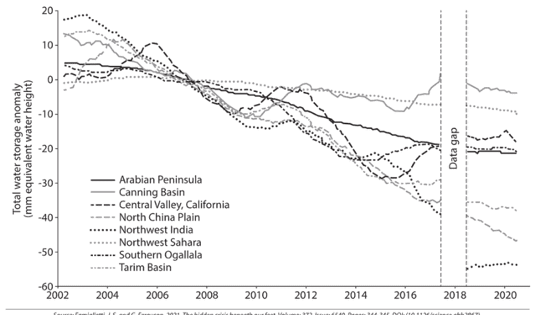
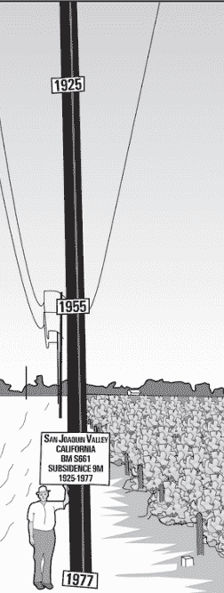

# 最后一滴水：解决全球水危机

《皇家学会科学奖入围作品：拨云见日》作者

> “石墙立在西岸的上游，
>
> 挡住五山的云雨
>
> 直到窄谷中升起一片平静的湖泊。
>
> 若山女神依然在那里，
>
> 也会对这个如此改变的世界感到惊讶。”
>
> ——毛泽东，《游泳》

“水是宝贵的。有时它比黄金还宝贵。”《金山上的宝藏》（1948年）

# 引言

# 动荡的水域

## 约旦，卡拉梅水坝，2021年8月

我正站在全球最干旱地区之一的一个大湖岸边。湖水平静宁静，至少在视觉上，它让人从8月早晨日益增长的热浪中得到一丝喘息。我们位于约旦河谷，海拔海平面以下400米，这是地球上陆地的最低点，在这里，太阳从升起那一刻起就酷热，且连续几个月没有降雨。在远处的岸边，白白的湖岸与天空融为一体，西岸的丘陵在薄雾中如幽灵般若隐若现。一只孤独、瘦细的水鸟短暂出现，几乎无法打破寂静或克服自身的倦怠，最终放弃并再次降落在水面上。在我身旁的岸滩上，几株矮小的灌木不情愿地立在水中，下部树枝上覆盖着明显的白色结壳。这个湖泊有一个致命的问题。卡拉梅水坝建于1995年，是约旦王国第二大水坝，它建在盐地上。它的水急需饮用和灌溉，却完全无法使用。

一辆车出现了，扬起阵白尘，环保组织“中东和平”（EcoPeace Middle East）的项目经理埃什·阿尔-古扎（Esh Al-Guzza’）下了车。他是一个三十多岁的富有魅力的男人，带着爽朗的微笑，对数字很敏感。“这是我们最大的失败之一，”他看着那片美得令人心碎却死寂的湖泊叹息道，“有`5200万立方米[52M m³]`无法使用的水。在20世纪90年代，我们拥有建造优质水坝的知识和技术，但他们对盐泉和岩石的研究不足——所以我们限制了这些淡水，导致它们变咸，而现在又没有技术来修复它。”雪上加霜的是，2010年湖边还建立了一座淡化厂，但仅几个月后就关闭了，因为它无法应对现在极高的含盐量——甚至比几公里外的死海还要咸。与此同时，我们当天的司机纳赛尔（Nasser，中东和平组织的私人投资经理）正在评估岸线，打算在那里建一个带有生态小屋和水上运动项目的游客公园。但事实上，随着气候变化导致热量加剧和降雨减少，湖泊每年因蒸发萎缩约一米。水坝的主闸门高出水位许多米；打开它将倾泻出一堆干枯的石子。

我的房主告诉我，建造卡拉梅水坝是为了实现一个梦想。据传，一位部长的小儿子在某个晚上梦见在此处建造一座水坝。² 于是就这样做了——耗资`4300万英镑和7500万英镑`——在地球上最干旱、最咸的谷地之一。这吸引了他的儿子、几位有影响力的农民，以及毫无疑问中标的这家英国工程公司。这种自大与贪婪的狂热结合使政府花费数百万，摧毁了壮丽的约旦河河谷中本就稀少的地表水资源（由于过度开采和过度分配，如今约旦河已是昔日模样的一条细流）。“在水坝选址调查阶段，一些科学家和专家建议政府不要建造水坝，”约旦大学水地质学和水化学教授埃利亚斯·迈克尔·萨拉玛（Elias Michael Salamah）写道，“但水利与灌溉部约旦河管理局（JVA MoWI）忽视了批评和警告。”在接受我的采访时，该局前将军萨德·阿布·哈穆尔（His Excellency Saad Abu Hammour）³ 证实他们确实有过这样一份报告，并将责任完全归咎于负责的部长：“这是腐败，”他说，并补充道一位部长在那里拥有土地。”

阿布·哈穆尔将约旦的水资源状况描述为历史上“最糟糕”的：“我们正在到处寻找每一滴水。”与此同时，卡拉梅水坝寂静而毫无用处，满了数万亿滴珍贵却被浪费的水。它是现代世界管理不善的巨大象征之一——正如我们将看到的，正如萨利姆在2004年写的那样，卡拉梅水坝“证明是一个深刻的教训，不仅是约旦学到了，世界其他地区也学到了，那里有良好的科学……[文本被截断]

*注：根据提供的OCR文本，文本在后几页突然截断或包含乱码片段。我已处理了提供的清晰连贯部分。*

水流一直流过胡佛水坝进入亚利桑那州，更不用说到达墨西哥（它现在才勉强到达那里）或海洋（它多年未曾到达）。如果这种情况发生，考虑到人口增长和无止境的西南地区建筑热潮，`4000万`加上另外的一百万或两百万人将失去他们九年的水源。

## 加纳，阿科松博水坝，2021年10月

我在2021年访问了第三个大水库。事实上，它是最大的：加纳的沃尔特湖（Lake Volta）是世界上按水面积计算最大的人造水库。从首都阿克拉出发，早起需要一整天的路程。我们的司机埃马纽埃尔（Emmanuel）放了一张21世纪00年代初的节奏B唱片——Craig David、Usher，以及在一个虔诚的基督教国家里显得刺耳且充满脏话的Eamon的歌曲《F**k It (I Don’t Want You Back)》。在歌曲播放了四遍后，我们在大阿克拉的交通中依然挣扎着，我礼貌地请求换歌。当我们终于从这座城市磨人的齿轮中解脱出来，到达了加纳乡村：平坦的绿色景观，点缀着陡峭、树木茂盛的小丘，山峦从地面崎岖地升起又尖锐地消失。在谢亚山（Shia Hills）附近，狒狒坐在路边，接受路过车辆提供的零食。

正午，我们到达阿科松博镇，这里是湖泊的起点，也是该国（及其许多邻国）水电的源头：阿科松博水坝。我们向沃尔特河管理局（VRA）申请官方实地参观，一直滞留在官僚主义的炼狱中——VRA阿克拉检查站办公桌上的一个文件夹并没有让我们通过，他们引用“国家安全”以及与多哥就争议电力供应协议的紧张局势作为理由。

心灰意冷地，我们去了附近的阿科松博沃尔特酒店，埃马纽埃尔知道那里有一家玻璃墙餐厅，可以俯瞰水坝的绝景。在室内，我们拍了一些不如意的照片。为了在玻璃后拍一张自拍，开车开了太久了。在我的手机上，我发现一条公共道路穿过水坝，延伸到宏伟的沃尔特湖岸边，那里有一个标有“Dodi World”的休闲中心。我说服了怀疑的埃马纽埃尔开车去那里。在这里，我们找到了一艘空闲的淡季游客渡轮，湖景在我们周围展开，在这个漫长的一周中的漫长的一天里，我充满了几近情感爆发的幸福。台阶通向水面，一个孤独的渔民正下水启动木制独木舟。他向我们挥挥手，示意我们可以下去，我们下去了。我随性地伸手触摸水面，然后用它洗了脸和脖子。那是良好、干净的水。我需要看到并感受到它。然后，我需要理解这片覆盖加纳`3.6%`国土的巨大淡水总量，为什么不足以让这个国家从水危机的挣扎中解脱。

答案并非来自沃尔特湖，而是在附近的供水蓄水库肯蓬湖（Lake Kpong）。“缺水对我们所有人来说都不是问题，”肯蓬水处理厂（KWTP）的经理亚夫·阿德杰（Yaw Adje）说道，该工厂是1954年至2014年间在沃尔特地区建造的此类工厂之一。阿德杰监督着所有的工厂。他告诉我，光是KWTP，根据他手里的打印数据，“我们‘每月’提取`4,482,433立方米`水进行处理。那是一个月的量。我们使用其中`3,630,275立方米`送到阿克拉。”根据阿德杰的说法，沃尔特湖的水质非常好，他们只需要使用两种化学物质进行处理：石灰（调节pH值）和氯。水通过直径`1.07米`的管道输送至`48公里`外的泵站，再通过`30公里`到达首都消费。所以，水量不是问题。这里没有所谓的“浴缸水痕”，这片巨大的湖泊看起来是满溢的。阿德杰最头疼的问题是电力。在高压管道中泵水需要大量的电力，而阿德杰无法控制这一点。尽管靠近阿科松博水坝`1吉瓦`的水力涡轮机，有时电力会中断，水泵随之停止。另一方面，阿克拉内部的大水库维贾（Weija）面临相反的问题：它受严重污染，来自工业和非法采金（被称为galamsey），这将其处理到饮用水标准的成本非常昂贵。“维贾就像一潭死水，”阿德杰抱怨道，任何倒进里面的东西都会留在那。2014年的解决方案是在肯蓬这里建造了一座新的处理和泵站。该工厂由中国建造，因此在当地被称为“中国工厂”，它每天可以生产`149,000立方米`水。但阿德杰说，阿克拉的发展太快了，需求超过了供应。他认为他们应该在肯蓬建立第二座工厂，“甚至是第三座。因为这条河，这个湖，永远不会干涸。我们可以在这里建造尽可能多的工厂。”但这涉及到资金和权力。根据加纳水务公司（GWC）的数据，该国的水需求是每天`1,131,820立方米`，而他们每天只能提供`871,500立方米`——缺口为`23%`。对于非洲许多潮湿的国家来说，这意味着完全没有饮用水。

英国的平均年降雨量为`1200毫米`，而阿富汗为`400毫米`。然而，尽管我们有冬季风暴，英国的大部分地区正处于饥渴状态，正如`5000升`的空桶。但大部分四位数的降雨量是由苏格兰、威尔士和英格兰北部多雨的高地支撑的。在我居住的英格兰东部，平均降雨量为`600毫米`——与黎巴嫩和肯尼亚相当，比澳大利亚悉尼干燥得多。这里也是英国人口最稠密的地区，`1800万`居民挤在仅`19000平方公里`内（包括伦敦）。而且它正在迅速干涸。政府的《取水计划》显示，在英格兰，`28%`的地下含水层和多达`18%`的河流水库处于不可持续抽取状态，取出的比回去的多。英格兰没有一条河流被归类为生态健康。然而，许多公众对这个我们都负有责任的问题一无所知。英国取取的水中有一半用于家庭。平均英国人每天通过淋浴、厕所、洗碗机、洗衣机和花园软管使用`153升`水。然而，气候变化预测显示，英格兰干旱夏天将增加多达`50%`，到2050年可用水量将减少至少`10-15%`。淡水短缺曾被视为局部问题，现在日益成为全球性风险。自2012年来的所有十份年度风险报告中，世界经济论坛（WEF）将水危机识别为全球经济面临五大风险之一。

地球充满了水，但其中几乎三分之二被困在冰盖和永冻土中。仅俄罗斯的贝加尔湖一个湖泊就拥有全球`20%`的饮用水（而且这些水正受到旅游业的污染）。正如慈善机构 WaterAid 所所说：“如果一桶水代表全世界的水，那么其中的一杯茶水就是淡水，而只有一小茶匙水是供我们使用的。”需求的增长和气候变化正让这一小茶匙的淡水陷入危急境地。

在我们的水循环中，流动的始终是那恒定的、有限的水。地球上的每一滴水自远古以来一直在这里，不断地一次又一次地循环。成年人体中高达`60%`是水（甚至骨骼的含水量也惊人地达到了`31%`）。当你去世并被火化或埋葬时，这些水将再次释放到大气或土壤中，那些水分子最终会与云端的老朋友们重聚。我们与水循环的联系极其紧密，正如河流和湖泊一样。然而，从中国的黄河到美国的科罗拉多河，许多河流已无法入海。这些河流通常被人工拉直并筑坝，水被抽走并输送到农场、工业区和家庭。从中亚的咸海到伊朗的乌尔米亚湖，从美国的Ogallala和中央谷，再到印度和巴基斯坦的上恒河和下印度河，大湖泊的枯竭速度超过了它们补充的速度。剩余的淡水日益受到化肥和农药的污染，导致藻类爆发，窒息并扼杀生态系统。巴基斯坦和孟加拉国的溪流呈现彩色，那是运往西方时尚潮流的服装业染就。在欧洲，西班牙四分之三的地区面临沙漠化风险，葡萄牙、意大利南部和塞浦路斯也是如此，而千年橄榄树正在枯萎。¹

“气候变化就是水变化；气候危机就是水危机，”斯德哥尔摩国际水协会（SIWI）执行主任托尔格尼·霍姆格伦（Torgny Holmgren）说道。“问题在于，对水的需求巨大增长。我们的人在增长，经济在增长，城市人口在增加。OECD*预测，如果这些趋势持续下去，到2050年，我们需要的水将比二十年前多出`50%`。当然，这是不可能的，因为水是有限资源…… . . 这将影响我们每一个人。”

COVID-19疫情与我的书籍研究同步展开，这使得这些水资源问题更受到关注。“每个人必须做的第一件事就是留在家并用力洗手，”Water.org首席执行官加里·怀特（Gary White）回忆道，他通常每年飞行`30万多公里`访问水利项目，但在2020年，他让我们所有人停足了。对于世界上`23亿`家里没有安全饮用水和卫生设施的人来说，¹，“如果你的日常活动是步行以让洗手次数增加五倍，同时不增加路程或向水贩支付更多钱……这并不像新冠肺炎让我们意识到卫生用水的需求；我们早已经知道这一点了。但我确实认为，我们以前没有将获取水和卫生设施的缺乏视为全球性危机。当一个国家的某人无法洗手而成为疾病传播的关键环节时，水和卫生突然变成了一个全球性风险。”疫情加剧了全球水系统中本就已存在的裂痕。2021年6月，联合国秘书长特代表水鸟井（Mari Mizutori）补充道：“干旱正处于成为下一次大流行的边缘，而且没有疫苗可以治愈它。”¹³

这本书的大部分内容是在你`2021年`和`2022年初`完成的，调研之旅也在此期间进行。这发生于重大气候事件之前，从澳大利亚东部和巴基斯坦的灾难性洪水，到欧洲干旱导致莱茵河不再运载货运船前往电站，以及中国长江几乎干涸¹⁴。但研究已经预示了这些严酷的必然性。正如六月紧随五月，现在每年都将看到超过以往的新型气候灾害。这本书的目的不是为了列举气候冲击或作为某个时间的快照，而是为了讲述具有普遍意义的故事，这些故事可以同样影响现在和未来几十年的个人和决策者。它也是为了提供帮助。消息和坏消息是，正如我在卡尔大坝岸边看到的，水危机通常是由人类管理不善造成的，而非气候。但随着气候变化、降水模式改变以及气候难民被迫迁徙，我们调整状态的时间正变得越来越短。我们正在耗尽赖以生存的水源。我们可以继续这样做，直到最后一滴水。或者我们可以在太晚之前改变我们的方法。世界并不是在缺水——是人在缺水。这本书讲述了这场危机是如何发生的，以及我们如何仍能避免灾难。

# 第一部分：枯竭

# 第一章

## 接近零水位日

从安曼开车到约旦河谷，我们在几分钟内下降了`1400米`。令我惊讶的是，也许因为我只把这和飞机联系在一起，我的耳朵通了。到达谷底后，我们经过了农田，地上有一排排裸露的金属圈——那是塑料地膜棚的骨架。土壤里充满了黑色塑料碎片，是生长季节为了保持水分而铺设的薄膜结束后被简单放了回去。纳赛尔（Nasser）慢下车指着他最喜欢的椰枣园。我想，我以前是否遇到过谁有自己喜欢的椰枣园。

阿卜杜拉国王运水河是约旦的主要水源，它从加利利海引水。雅尔穆克河是一条约旦与叙利亚、以色列共享的跨界河流。雅尔穆克河的水仅为过去的`十分之一`，遭受叙利亚内战和气候变化的破坏。1994年的《以色列-约旦和平协议》允许约旦每年提取`5000万立方米`水。2021年，约旦以同样的价格额外申请了`5000万立方米`。雅娜（Yana）告诉我，以色列认为价格太低，但她认为他们会由于这种理解而让步：“我们的国家国界是一个国家安全问题 . . . 这符合他们的利益。”EcoPeace的大部分工作促进了这些共同利益。它的存在——拥有巴勒斯坦、以色列和约旦员工的平衡，并由代表三个国家的经理担任——具有象征意义，展示了合作可以实现什么。

……，更不用说长期了。她告诉我，在2010年迪西（Disi）水开始抽水后，安曼供水的改善状况只持续到了2013年。最初，人们声称迪西含水层拥有足够维持五十年的水量。但现在看来，水量是不可持续的，在2025年之前就需要其他来源。这意味着它只持续了15年。阿尔-马斯里（Al-Masri）表示，区别在于，需求计算基于的人口数量要小得多，而且没有考虑到气候变化的影响。约旦最新的人口普查显示，在`1020万`总人口中，有`130万`叙利亚人——增长了`15%`。“有了难民，北部的人口增加了，所以你们需要更多水，”阿尔-马斯里说，“该地区的供水本已经非常紧张，主要的地下含水层已经枯竭了。”

水资源部长希望的那样，从迪西含水层以更快、更深的速度泵水的成本，其成本也变得令人企不起，因为随着含水层的枯竭，水质会恶化，变得高度矿化，甚至可能具有放射性，且难以处理。那些广受推崇的“五十年用水”，无论叙利亚战争与否，注定留在地下。因此，在没有其他水源的情况下，人们进一步依赖沙漠的化石含水层。这缩短了约旦“零日”（Day Zero，即水资源耗尽之日）。根据世界资源研究所（WRI）的数据，中东和北非在七个最缺水国家中占了十二个，约旦位列前五。雅娜（Yana）告诉我，安曼以前每周从网络接收两次水。“现在，我们每周只接收一次，有时只有八小时。所以，想象一下那种挣扎？”约旦环境联盟主席奥马尔·肖桑（Omar Shosan）告诉《约旦时报》：“我们离‘零日’已经非常近。”

## 开普敦的“零日”

是2017年年底的南非开普敦市政府首次创造了“零日”这一术语：这一天，一个超过`400万人口`城市的供水将被关闭，居民将在水龙头前排队领取每日配额用水。在开普敦，据计算，如果城市主要水坝蓄水量降至`13.5%`，这种情况就会发生。由于没有即时的降雨，开普敦正朝着在2018年4月12日达到“零日”的轨道前进。这句话变成了一个警钟，既惊恐也动员了所有开普敦居民。厕所隔间里的告示牌写着：避开零日。冲完4次后才冲水。如果是黄色的，就等一会儿；如果是棕色的，就冲掉。酒店恳求客人只洗`90秒`淋浴！并为他们提供脚用的托盘，收集水以便在水箱中重复使用。曾被定居者看中水资源丰富的游泳池遭受了连续两年的“千年一遇”的干旱。如果这种情况发生，开普敦将成为世界上第一个完全关闭所有家庭自来水供应的城市，《环球与邮件报》（*Globe and Mail*）报道。开普敦市长帕特里夏·德·利尔（Patricia de Lille）在新闻发布会上说：“我们已经到了一个无法回头的点。”


# 全球城市面临“零日”水危机

## 开普敦，南非

2018年1月1日，该市宣布实行“6级”限水：每人每天87升（世界卫生组织建议为了足够的健康和卫生至少需要100升）。到2月，这一标准提高到“GB级”：每人每天仅50升。随后，针对即将到来的4月日期公布了最后的“零计划”：所有管道水将被关闭，取而由分布在城市各处的200个水管取代。这些当地被称为“水站”的立水柱将提供每人每天近25升的额度（相比之下，美国人平均使用约380升）。水站现场设有厕所设施，预计排队人数多达5000人。随着4月的临近，来自南非自然保护会（TNC）的负责人路易斯·斯坦福德住在开普敦郊外，她在水站排队收集水。由于人们站在水盆中收集水以便在水箱中重复使用。那是他们曾经历的灾难。无论叙利亚战争与否，那些广受推崇的“五十年用水”，注定留在地下。

我问雅娜，切奈水危机如何影响了整个印度。这是否让人们对其大城市之一会缺水感到震惊？“绝对是，”雅娜说，“每当发生干旱或洪水时，人们都会完全意识到并开始节省每一滴水。但他们很快就会遗忘。这一次，周围的人意识到了。与此同时，印度中央规划委员会发布了一份报告，预计到2030年，印度几乎20个大城市将面临缺水。所以，这也变成了一件非常重要的事情。”

## 切奈，印度

2019年7月，作为泰米尔纳德邦首府的切奈，其主要水库干涸了。零日粗鲁地降临了。街道上挤满了水车。很快，水是从20公里外的废弃采石场运来的，经过氯消毒后送给绝望的居民。阿尔娜·雅娜经常在切奈工作，她告诉我，“人们以前每十五天才能通过水车获得水；他们会排队用水桶。他们放弃了洗澡，只使用必要的水。这是一个挑战。”在富裕社区，房主拥有私人的——非法的——钻井直通地下水，“人们开始挖得更深。甚至120米的井都干了。所以，他们挖得更深，但有些人只是碰到了岩石。”

“做得太好了……如果人们的水箱堵塞了之类的，根本没有人费心修理它。突然之间，城市化急剧增加，人们从农村地区向城市迁移，就在那时事情开始变得糟糕。”

德里能源、环境与水资源委员会（CEEW）研究员瓦瓦夫·查特韦迪认为，辰奈的“零日”“迫使人们清醒面对”水短缺的现实。“这让住在辰奈的人感到震惊；这过去是无法想象的。这是一座高收入城市，印度的大都市之一。”但他认为，“并不是只有辰奈一个城市可能面临这种水压力……随便选一个故事，你都会发现一个超级区域。”瓦瓦夫说，印度任何地方的24小时全候供水都是闻所未闻。政府报告严酷地指出：“到2030年，该国的用水需求预计将是可用供应的两倍，导致数亿人面临严重的缺水……印度54%的地下水井水位正在下降，预计21个主要城市将耗尽地下水。”

## 密西西比州杰克逊

2021年3月4日，杰兹敏·沃克绝望地在Instagram上发帖。在一段面对镜头的长达14分钟的激情发布中，她说：“我已经连续没有净水超过两周了。” 自来水“断断续续——今天早上是停水，等水来了，水也没法洗，没法煮，更不能喝。”一场历史性的冬季风暴意外袭击了南方各州，导致密西西比州最大的城市中许多水管冻结破裂。据报道，至少有80处主水管破裂和泄漏。这种风暴在历史上是极罕见的，但已成为新的冬季常态——2020年美国曾遭遇过类似的深度寒冻——这与北极变暖导致墨西哥湾流偏移有关，将先前的“北极”天气推向了更南方。沃克恳道，“对我们来说，不要让经历没有净水这种不人道的事情常态化很重要，尤其是在所谓的‘世界上最富的国家’。”一家报纸宣布，“周一上午9点到下午6点，将在以下地点提供非饮用水（冲厕水）”，并列出了学校礼堂和社区中心的名单。

沃克是一个黑人人口比例占80%的城市的黑人居民，她说这种情况发生在一个黑人占多数的美国城市“绝非巧合”。根据自然资源保护协会（NRDC）的说法，由于市政水基础设施历史性的资源投入不足，违反联邦安全标准的饮用水系统在有色人种比例较高的地方发生的概率高40%。杰逊超过四分之一的居民生活在贫困线以下，这与近四年前密歇根州黑人占多数的弗林特发生的铅污染水危机有明显的相似之处，那同样是由于长期的投资不足。社区领袖罗尼·克鲁普接受NBC新闻采访时说：“基础设施是一个历史问题，多年来每一届政府都将其推到以后处理。这是一个长期问题，但现在我们正在为疏忽付出沉重的代价。” 杰克逊市长乔克·安塔尔·卢姆巴补充说，该城市的废水和饮用水系统至少需要20亿美元进行维修。“这些系统是否失效不是问题，而是何时失效的问题，”卢姆巴在《Mother Jones》播客节目中，“水管在系统中破裂是因为它们已经有上百年的历史了。它们就像花生糖一样脆。”

杰克逊居民在使用自来水前必须煮沸的要求已于3月17日取消，这标志着已经近一个月没有获得饮用水供应。与此同时，《新时报》报道，全美范围内的干旱和缺水情况正在加剧：“到2040年，极端缺水将在密苏里以西几乎无处不在。孟菲斯沙地是密西西比州、田纳西州、阿肯色州和路斯安那州的关键水源，其每天的缺口已经超过了数亿吨。”此外，“至少有2800万美国人可能面临我们现在加州看到的特大火灾，在德克萨斯州佐治亚州等地。” 野火既是水短缺的症状也是原因。许多地区依赖树木和森林作为自然的过滤器，将净水注入河流域；森林火灾之后，这种“自然服务”就消失了。

## 墨西哥城

墨西哥市长克劳迪亚·谢因鲍姆将2021年的干旱描述为该市三十年来最严重的一次。全国范围内，80%的墨西哥遭受了历史性的降水缺乏。但整个墨西哥，特别是墨西哥城，长期以来一直在“零日”边缘徘徊。讽刺的是，当我为墨西哥环境法律中心（CEMDA）工作的墨西哥城环境律师阿奈德·韦拉斯科交谈时，这座北美最大的城市正下着大雨。“但墨西哥城的降雨并不能解决用水问题，”她解释道。基础设施落后意味着雨水“直接流进了下水道；基本上被浪费了。季节性降雨无法解决缺水问题……我们从潮湿转为极干旱。”

像老城市一样，它背负着殖民时期留下的债务：“西班牙人排干了湖泊，并将河流引入管道——这种建立城市的方式也太疯狂了，”韦拉斯科说。由于过度抽取，墨西哥城的地面平均每年下降50厘米，有数百个钻井像用吸管吸奶昔一样排干下方的地下水。 这座城市建立在特斯斯科科湖上，那里是传奇特诺奇蒂特兰的故乡。

韦拉斯科说，在墨西哥城，40%的水流失于泄漏。我们是世界上作为环保人士最危险的国家第六之一。服务最不足的地区始终是原住民社区聚集地，她说。她曾代表过墨西哥索诺拉沙漠的雅基族社区，该社区的水被附近的城市为了市政而抽干。当政客想在这些地区赢得选票时，他们会承诺用水。我们在2021年9月，即旱季开始时与其交谈，她说他们再次面临缺水问题。

## 巴西圣保罗

2014年9月，人口超过200万的大城市中最接近“零日”的是巴西的圣保罗。抗议者聚集在圣保罗州基础卫生公司（SABESP）总部外抗议缺水，抱怨“好几天没水了”。 SABESP正式承认，截至9月25日，为近900万人口服务的坎塔雷拉水库水位已降至容量的7.4%——危险地接近零日，而且远低于开普敦的阈值。现在必须从“死水库”中抽水——基本上是从泥浆中抽水。

圣保罗资深自由记者莉丝·阿尔维斯告诉我，在2014年危机期间，居民被要求减少20%的用水量。她记得当水来来时，人们疯狂地接满浴缸和洗手池。我们在2021年9月7日，即旱季开始时与其交谈，她说他们再次面临缺水问题。“巴西很大程度上依赖水电。总统[博尔索纳罗]已经警告说，将出现比二十年前更大的能源危机；因为水电供应不足，预计圣保罗将面临限水供水。我们现在支付的电价是以前的三倍。”根据《拉丁新闻报》，巴西政府实施新的“水短缺”费率（每消耗100千瓦加收14.2雷亚，约2.60美元），旨在鼓励家庭减少用电量。

圣保罗每年都在玩这种同样危险的游戏。这如同一场“反复循环的噩梦”。2016年9月，水库水位再次跌至容量的17%。 2021年5月，联邦政府的一份紧急警报称，巴西正经历91年来最严重的干旱，圣保罗的冬季降雨量比平均水平低了56%。SABESP技术人员预测，Canteira水系统在明年夏天将再次处于容量的20%以下。Alves看到的报告显示，自2014年以来，情况可能更糟。她补充说，他们使用的水并不清洁：由于人们向河流和支流倾倒垃圾，导致了污水问题。洪水会引发严重问题。“在这里的一月和二月，街道可能需要半小时就会淹没，因为还有排水问题——下水道和所有东西都堵塞了。今年雨下很大，但‘下错了地方’，”她笑着说。“水库‘没有填满’。”

在我们交谈后一个月，即10月收到的事实，及时避免了危机，Canteira水库的容量达到了29.9%——高于20%的官方限水阈值，但远低于该季节60%的正常水平。到2022年1月，循环再次开始，《巴西报告》指出：“该国10个热门州中，有6个州在2022年初的蓄水库水位低于去年。”圣保罗是否会遭遇“零水日”仍然是一个每年的赌博。

## 智利圣地亚哥

“今年下了一些雨，人们非常兴奋，”Andrea Becerra告诉我，这燃起了我的希望。“但这仍然低于历史平均水平。事实上，这是二十年来最糟糕的一年。所以，非常惨。” 我的希望现在破灭了。曾任自然资源保护委员会（NRDC）拉丁美项目负责人的Becerra表示，圣地亚哥大区——智利16个行政区之一——已经遭受了十年的干旱，年降雨量不超过300毫米。在2010年之前，年降雨量接近700毫米。在危机影响圣地亚哥市之前，影响主要体在“农村社区……含水层干涸，农民不得不挖掘越来越深的水井。去年，大都市区有35,000只动物因缺水而死亡。”但现在，干旱也蔓延到了城市大都市。

圣地亚哥的地表水来自雨水和冰川补给的El Yes水坝。NASA卫星图像显示，这个巨大的水库在2016年到2020年间由于缺雨和冰川消融，规模迅速缩减了一半。安第斯山的冰川以后每年一米的速度融化，是全球范围内山地地区流失速度最快的。玻利维亚的Tuni冰川在2021年缩小到1平方公里，危及首都拉斯的供水。然而，在其他地区，冰川快速融化提供了虚假的安全感——当冰川融化得如此快时，它们会膨胀，河流从而弥补降雨的不足。但这是化石水——一旦消失就不会回来；一旦度过了融水期，就是单程的。这些长期以来赖生存的水库在没有雨水和地下水的情况下，没有其他选择。NRDC的报告冷酷地指出：“大都市区安第斯山的降水量（包括雪水）每10年下降3厘米……这导致了8.54到15.14亿吨的冰川退缩——这足以供应智利未来14年的用水需求。”

2018年，位于圣地亚哥西南部的Aculeo（作为一个旅游胜地，是智利中部最大的自然水体之一，面积为11.7平方公里）完全干涸了。它没有恢复。 *Diálogo Chile*的Lorena Guzmán报道称，在五年里，干旱导致水可用性减少了37%。“圣地亚哥面临零水日，这毫无疑问，”撰写了该地区NRDC报告的Becerra说。Becerra说，其三分之二的水来自冰川融水；这是过去十年圣地亚哥免于零水日的唯一因素。那么，当冰川大部分融化后会发生什么呢？“这是一个大问题。”

2022年4月，我们得到了答案。圣地亚哥市首次宣布限水。引入了根据Mapocho河和Maipo河水位的绿、黄、红警报系统。黄色警告（所有人水压下降）立即实施。红色警报——每四、六或十二天关闭一次水龙头——预计将在夏天到来。

## 比利时

“我们科学家已经警告了十年，干旱和水资源短缺将成为比利时的问题，”布鲁塞尔自由大学地下水水文学教授和比利时鲁汶大学（KU Leuven）水地质学教授Mariijke Huysmans告诉我。“但我们被付之以笑，字面意思是：‘比利时一直在下雨！’”但在2020年干旱期间，数千家庭突然没有水了。

干旱和洪水是同一枚硬币的两面。当大雨降临时——正如2021年7月发生的灾难性那样——比利时有42人死亡。Huysmans说，气候变化正在破坏区域降水，我们现在看到的干旱强度和频率比气候模型预测的还要糟糕。地下水和地表水并没有的界限：河流和溪流由地下水补给，在某种程度上反之亦然。Huysmans解释道：“我们的许多小河主要由地下水补给：例如，农民使用的小河中的水实际上来自地下水。”

水需求也是一个问题。每年夏天通常禁止非必要的生活用水，但Huysmans说，某些地区非常接近没有自来水的境地。在干旱和炎热时期，水需求增加了50%。“显然，这对于饮用水公司来说变得非常困难。”

这三个因素结合，加上气候变化，“造成了水危机的配方。”

## 巴基斯坦

巴基斯坦正面临饮用水枯竭。该国人均地表水可用量从1951年的每年5260立方米下降到2016年的约1000立方米——低于了关键的“严重缺水”阈值——并可能在2025年下降到约860立方米。“清洁饮用水的供应是一个巨大的问题，”水治理联盟（AWS）的水协调员Maheen Malik从巴基斯坦第二大城市拉合尔向我解释。巴基斯坦人口增长，资源有限。Malik说，“因为我们与其他国家共享水资源，必须考虑地政治因素。”巴基斯坦和印度在克什米尔上产生严重不满的原因之一就是那里的水资源。”

农业占了用水量的90%以上。我们是一个高度依赖农业的经济体。巴基斯坦当局预计，到2025年，水资源可能出现38立方公里的缺口（每年有128立方公里水用于农业灌溉），而地下水储量仅为30立方公里。

巴基斯坦的四个省份都有各自独特但同样严峻的水资源问题。马利克说，在北部，主要问题是获取困难：“通常是妇女或小孩去附近的河流取水。而在旁尔祖普省，我们有取水渠道，但污染非常严重。在信德省，地下水的TDS[总溶解固体——一种通用的水质指标]非常高，因为水非常咸——有大量的海水侵入，所以你无法利用地表地下水。然后，在俾路支斯坦省，水资源匮乏到了极点。”

巴基斯坦的年地下水开采量位居世界前——这是一个不愿得 true头衔，它正与规模更大的印度、中国和美国竞争。巴基斯坦开采大部分地下水的印度河盆地地含水层被列为全球压力最大的第二大含水层。 由于非正式、不受监管的抽水，这正在导致巴基斯坦水资源的字面流失。这里没有许可制度，许多人通过无证的钻井抽取地下水。巴基斯坦也是全球最大的地下水出口国，按用于生产皮革、纺织和水米等水密集型出口产品的水量计算。 巴基斯坦生产的一点水正被包装并送往其他地方。极端干旱可能的气候后果是极端洪水。这种情况在2022年9月发生在巴基斯坦并造成了灾难性的后果，当时其73年历史上最广泛的洪水导致该国一个地区被没。巴基斯坦最贫穷且通常最干旱的俾路支省，60%的房屋被淹没。 随着洪水退去，联合国儿童会警告说，数千家庭遭受了损坏或破坏，而许多公共卫生设施、水系统和学校也被破坏或损坏。 半岛半电视台报道已有1500人死亡，并评论说这场悲剧凸显了巴基斯坦及其他地区加强气候防御的极端紧迫性。

## 湄公河三角洲

湄公河是东南亚最长的河流，世界第十大河流，流经约4350公里，穿越中国、缅甸、老挝、泰国、柬埔寨和越南，面积超过80万平方公里，沿岸居住着约1亿人口。两座首都——万象（老挝）和金边（柬埔寨）坐落在河岸边。湄公河的失效将导致无数城市出现“零水日”的骨牌效应。

仅越南段就居住着超过2100万。

阮氏出生并成长于越南湄公三角洲地区，在环境传播领域授课。当我们在2021年5月交谈时，她在她的家乡芹市。作为越南主要的粮食产区，湄公三角洲对气候变化和跨境水争端极度敏感。阮告诉我，尽管这里是“越南的粮碗”，但它是“越南最贫穷、发展程度最低的地区”。在布莱恩·艾勒的书《伟大的湄公河的日子》中，他将芹市位于湄公河汇入东海上游90公里处，那里是地球上工程化程度最高的景观之一，平坦肥沃的农业平原，纵横交错着总长30000公里的河流和人工运河网。 中国上游的大坝可能位于2500公里外，但它们拦截的大量淡水影响了越南湄公三角洲的流量、泥沙量和盐碱度。这种跨境问题由于一种怀疑而变得复杂，阮说，即“越南在湄公河委员会中没有多少话语权”——该委员会是一个致力于“共同”管理共享资源的政府间组织。

她说，中国上游修建的大坝影响了下游的流量。大多数人依赖河流作为主要收入来源，但鱼类资源已枯竭；农民以前一年种三种作物，现在只能种两种。椰子作物产量减半。农民采取的主要方案是完全放弃河流，转而抽取地下水。地下水开采率之高，已经超过了含水层的自然补给能力，尽管有年度季风。2019年的降雨量仅为平均值的60%-70%，而2020年的旱季打破了记录。 每天有250万立方米水被抽取，导致三角洲每年下沉厘米——考虑到海平面正在上升，这是一个危险的境地。海水侵入因此像癌症一样向内陆渗透。2019年，海水已深入内陆130公里。 预测显示，到2050年，越南——大部分湄公三角洲——将面临沉降。

讽刺的是，阮帮助来自香港的纪录片制作者记录了情况有多糟糕，而越南主流媒体被“不允许”提及此事。大多数当地记者都知道他们不能批评中国。在湄公河上游修建了11座大坝后，中国帮助老挝和柬埔寨等下游国家修建更多大坝。研究人员发现，“中国的需求限制了上公河大部分的水季流量”，导致了2019年湄公河下游地区的干旱。 这使得北京成为一个容易被指责的替罪羊。到那时，人均可用水量仅为19立方米。


## 哈拉以南非洲

开普可能不是唯一面临“零水日”的城市。来自比勒勒的水利工程师滕姆巴·古博（Themba Gumbo）说：“我不认为我们已经做好了准备……那里将是一片混乱。”在这一世界的这个地区，古博说：“如果你跳进河里，就会淹死自己。因为在大多数时候，那里只是一条干涸的河床。”特别是在南非，《水法》提供了基本水权；每个家庭每月有权获得 6 立方米的免费水。但收入并没有进入市政部门用于管理服务。并不是所有人都必须付费——而且补贴限额很少被检查或执行。古博向他讲述了一个住在索韦托镇民的故事，那个人不确定自己的水表情况：在过去的五年里，没有人看一眼它。“这就是现状。”

***

回到荷兰潮湿的低地地区，国际水足迹网络负责人里克·霍格博姆（Rick Hogeboom）对“零水日”概念有不同的看法。他在“零水日”高峰访问了开普敦，当时配额已降至每天 50 升。“这一点也不好玩。我甚至无法洗澡。当然，在贫民窟，情况要糟糕得多。”他说，“这是一个管理问题。只是基础设施匮乏。该地区有足够的水支撑开普敦的人口，仅此而已。” 他引用了酒庄和葡萄酒生产作为该地区经济的支柱。“在开普敦郊区有很多葡萄园在生产葡萄。从水系统的角度来看，那仍然是同一种水。酒庄在‘零水日’期间是否经历过[同样的]缺水？他们没有经历。这是一个价值 40 亿美元的产业。”他认为，决策者做出水资源分配的选择，而这些决策者所做的水资源分配选择，这些选择影响着社会和不平等：对于任何城市来说，供水都是一个“可以预防和管理”的问题。他说，问题更多是由于缺乏储水设施——包括地表水库和地下水库——以及老化、泄漏的管道。长期以来，许多城市和国家一直存在自满情绪，依靠摇摇欲坠的基础设施和如期而到的季节性降雨来救急。这套系统在二十世纪或许还行得通。但现在，降雨——以及水循环——已经不再可靠了。

## 第 2 章

## 水循环正在发生变化

Prampam-Tekponya 社区曾居住在加纳南部一个偏远的沿海村庄，周围环绕着肥沃的农田和丰富的淡水流。曾经生活很好。直到开发者们到来。首先，他们将村民移到靠近海的地方；海边对城市人并没有吸引力。尽管如此，那里有一条大河和一个湖泊，社区在岸边通过种植树木筑起了水坝，所以这并不是一次糟糕的搬迁。大多数村民住在由木材和波纹铁板搭建的临时房屋里，或者采用传统的泥墙和棕榈叶屋顶。直到过去五年，沿海才变得时尚，开发者的大军开始在村庄周围及内部建筑。混凝土和空心砖不断堵塞了供应他们水坝的溪流。得益于加纳一年两次的季风，村民和湖泊可能幸存了这一切。雨季不再是以前的模样了。开发者建造了棺材，而气候变化将钉子钉了。

我在本该是雨季结束的 9 月造访，但几乎没有下雨 —— 村里的水坝看起来像是处于旱季中期，只有一米多深塞满杂草的泥水。村民告诉我，这意味着“它肯定会干到这种程度。然后，我们该怎么办？”

在前往 Prampam-Tekponya 之前，我与当地小型非政府组织“农村乡村社区赋权联盟”（AERC）的 Richard Matey 进行了交流，他帮助安排了我与村民的会面。“这是一个巨大的挑战，”他告诉我，“我们本应该在 4 月到 7 月经历暴雨，但一直没有下雨。当我们进入 4、5、6 月，天气会变冷，你通常会穿毛衣……2021 年非常非常热；2020 年被记录为我们最热的一年，2021 年可能更热。”气候变化正导致湿润地区变得更湿润，干旱地区变得更干燥。对于像加纳这样位于非洲热带的国家来说，这就是它们的走向。Matey 预测道，“这将变得更加干燥 —— 即使是热带地区也开始经历干旱了。”

我今天的东主、AERC 的同事 Felix Best Agvoror 告诉我，要访问 Prampr-Tekponya 社区，我们必须首先获得酋长的许可。我们开车从大阿克拉接了 Felix。虽然道路变得越来越难以通行，但我们从未离开过定居区。当我们经过建筑工地和工业场场时，20 多岁的 Felix 不断惊叹道：“那儿以前从没出现过那些东西！”当我们到达 Prampam-Tekponya 时，它是城市扩张中的一片乡村绿洲 —— 同一种类型中的最后一个。酋长的“宫殿”是村里唯一一座混凝土墙建筑。我们发现酋长不在家，而是他的妻子 Naadu Matey，她准许了我们的接见。院子里猴面包树的阴影下放了塑料椅。Naadu Matey 面色严肃，不乐于给出长回答，而由 Felix 进行翻译。Matey 告诉我们，村庄几年前接通了市政水务，但只有一个龙头，连接着一个水表。村庄的每月账单在 GH1,000 到 GH2,000（加纳塞地，或约 120 至 240 英镑，142 至 285 美元）之间，而居民根据使用量向酋长支付，每加仑 60 Gp（加纳分，或 7 便士）。在我们路过的每个院子里，都能看到黄色的一加仑装塑料水桶。我问人们当他们付不起钱时该怎么办。Naadu Matey 想要房子后面的那条溪流，`yoduwekope` —— 我后来记得那是一条清澈、流动的河流。那这里曾是一个农业村庄，有大量的土地可以耕种和可靠的雨水；现在，开发者夺走了大部分土地，雨水再也不来。我谈到的每个人都告诉我同一件事：雨季以前在 5 月开始，但去年没有到来。今年也是如故。现在，大雨可能在 8 月或 9 月降临，击中干涸的地面并立即泛滥，然后流走。

当我问 Naadu Matey 有什么解决方案能帮她时，她说：“一个水坝，意味着多一个当地池塘，让妇女们取水。”

实际上是他业务的扩张，大部分资金都给了加纳水务公司（GWC），他们收的水费比许多西方公用事业公司贵得多，而客户的平均收入要低得多。即使是菲利克斯（Felix）也告诉我，他对此感到震惊。

当我询问 Afi 什么方案能帮助他们时，出乎意料，他的答案和首长一样。埃科（Ekow）理想情况下希望能拥有自己的自来水连接，以跳过中间人（首长，尽管埃科对他非常恭敬，没有指名道），直接为他们使用的水付费。加纳水务（GWC）对这样的连接报价为 GH₵2,500（300 欧元/45 美元），这是他年收入的大大部分，完全无法负担。菲利克斯告诉我，在镇上安装自用连接的费用接近 GH₵1,000（120 欧元/15 美元），因为离主水管近。在镇上，你离市政供应总是比在农村村庄近，而 GWC 的费率似乎并未为此提供任何优惠。“水很贵，”菲利克斯直率地总结道。这让我感到心愧，想起了英国的水是有多么廉价。

村子被 `yoduwek` 流一分为两半，但在某个时刻增加了一条路，开发商也搬了进来，将 Prampr-Tekponya 的两侧隔开了大约几公里。另一侧的感觉完全不同。他们共用同一个首长，但这里似乎有更多的自主权 —— 人口更多；有一所学校；房子盖得更稳固。我坐在一位长者宽敞院子里的一棵大芒果树下下。他的儿子，我们暂称他为科西（Kosi），坐在我身边用英语回答我的问题。村子的这一侧有独立的供水连接和塑料水箱（polytank），而我所在的这个院子的长者似乎拥有垄断权。在这里，费率是每加仑 80Gp 到 GH₵1 不等。他们不知道这与路对另一侧相比有 33-66% 的溢价。也许首长毕竟还是为最贫困的家庭做出了让步。

为了获得免费水，那个该死的池塘也在村子的这一侧。今年，“雨没下来，”科西说，“雨季结束后才过了两、三、四个月，水库就干涸了。我们非常依赖加纳水务，只有一个龙头。幸运的是，我们的议员捐了一个塑料水箱，所以当水流时，我们就装满水然后卖掉……但是，因为加纳水务不可靠，水流并不频繁……每个月只有两三天，或者他们会决定关闭一个月、两个月。”当塑料水箱空了，他们就得依靠池塘，或者在镇上买水，每加仑 GH₵1.5（与首长的价格相比有百分比溢价），外加 GH₵10 到 GH₵50 的租车费。“你没有选择，因为你没有水。”

科西和他哥哥阿克瓦西（Akwasi）建议我们去水库所在地，那里步行一小段就到。那些漂亮的泥刷墙房屋逐渐变成了半完工的空砖建筑。水库是一个大池塘，大约 200 米乘 400 米，四周树木和芦苇环绕，水面上覆盖着厚厚的睡莲。沿岸有几条被踩实的小路通向小岸边，村民们在那里取水 —— 一个被遗弃的大塑料瓶，装了半瓶泥水。这头的水的水只有 30 厘米左右深；在一年中这个时候，在雨季末尾，水库应该是满的，面临溢出岸边的风险，而现在的岸边高且干燥有几米远。在一公里之外，一栋红屋顶房子几乎就在水库内部，不远处的其他几处开发区屋顶也可见。水库似乎对开发商来说仅仅是一个不便。富有的建筑商不在乎来自脏池塘的免费水；他们的水通过水车或 GWC 管道送达。对于开发商来说，水库越早干涸并越早盖在上面越好。

“这是我们唯一的可靠水源，”阿克瓦西说，“但人们并不理智……他们没有考虑水库的未来，他们只想着盖房子。”阿克瓦西相信水库今年冬天不可避免地会干涸。当我们离开时，路过了几栋正在施工的房子。在树阴下，四个年轻人在我们开车驶过时盯着我们。“他们是 langas（暴徒），”菲利克斯警告道，“如果你惹了建筑者，他们会教你做人。他们拿钱煽事。这是社区里的恐惧。”发展带来了工作、选民和税收。但它没有带来水。它也没有带来雨。

***

Jay Famiglietti 之于水利学术，正如老虎·伍兹之于高尔夫：如果你不在他的领域待一段时间，就写不出关于水的书。他的简历包括加州大学欧文河分校地球系统科学教授；美国国家航空航天局（NASA）高级水科学家；加州州杰里·布朗和美国国会的水顾问。当我们聊天时，他是加拿大萨斯喀彻温大学全球水安全学院（GIWS）的主任。他还是一个播客主持人：《Let’s Talk About Water》第一、二季，以及《What About Water? with Jay Famiglietti》，这两部节目都以悦快的节奏感科技乐头曲开场，让你振作起来，以匹配 Jay 的热情水平。

Jay 迄今最大的成就是他参与了 NASA 的“重力恢复与气候实验”（GRACE），该实验识别了世界主要含水层中的地下水枯竭情况。其背后的理论工作一直可以追溯到 1920 年代，当时物理学家算出地下水的大量积聚会影响地球某些地区的引力。“他们知道地下水的运动会影响重力场，但那时他们没有办法测量它，”Jay 从他简陋的家庭办公室说道 —— 他们最近搬了家，在他身后有一块写满数学方程的白板（他妻写的）和一把靠在墙边的吉他（他的）。2002 年 3 月发射的 GRACE 卫星提供了这些测量数据。这并不是一个纯粹的环境任务。Jay 说，如果你打算运行一个航天计划，“你需要理解重力场以获得精确轨道，并知道火箭将何时进入大气层。”

GRACE 是如何工作的，Jay 简单地解释道，就像“天中的天平”。当卫星经过地球陆表面时，它的设备会受到地下水引起的更强引力的影响而产生极微的拉力。产生的数据帮助构建了高度精确的全球地下水地图，以及（随着时间的推移，由于 GRACE 反馈了从 2002 年到 2017 年的数据）地下水枯竭图。2015 年发表的论文《量化可再生地下水压力》（Jay 是通讯作者）具有开创性意义。该研究发现世界上 37 个含水层中有 21 个的减少速度超过了其自然补充速度。这里有两个“罪魁祸首”：第一个是人类过度使用。灌溉需求和人口密度压力最大的地区，枯竭率最高且几乎没有补充的是阿拉伯盆地（北非）和印度河流域（印度和巴基斯坦）。第二个罪魁祸首是由气候变化引起变化的循环。当水从一个地区消失时，它会在另一个地方出现 —— 确实，有些地区处于正平衡，包括北美平原（美国和加拿大）、亚马逊盆地和卡鲁盆地（南非）。

## 图表 1 从天际监测地下水枯竭

全球主要含水层系统总储量的变化，正如美国 NASA 的重力恢复与气候环境（GRACE）及后续（GRACE-FO）卫星任务所示（垂直虚线表示 GRACE 停役与 GRACE-FO 发射之间的间隙）。



根据 2017 年世界银行的一份报告，“气候变化将通过改变水循环来恶化状况，使水变得更加不可预测，并增加干旱发生的频率和强度。”^3 全球水资源政策项目主管桑德拉·波斯尔（Sandra Postel）于 2021 年底出现在 Jay 的播客节目中，并宣布“水循环已经破坏了”。我们在其中的作用可以从我们管理水和土地的方式找到。波斯尔说，全球有 60,000 座大坝阻挡了河流的自然径流：“我们有堤坝来防洪，但河流本就该泛滥。它们不再与泛滥区连接 —— 这就是水循环的断裂。地下水是河流的基流。”人为气候变化和人类工程导致的状况加剧的双重打击意味着“大气的升温正在从根本上改变水循环，更温暖的大气含有更多的水分，这意味着干旱和洪水正在加剧。”波斯尔表示，这正在从根本上改变世界各地的水循环 —— “局部、全球、区域性” —— 并将严重影响“粮食安全、水安全以及人类和自然的整体健康。”^4 她说，我们对水资源的“命令与控制”方法是一种“正在破坏水循环的浮士德式的交易”。

看来 2021 年，恶鬼想要索债了。7 月，暴雨袭击了德国西部。科隆在短短 24 小时内记录了 154 毫米的雨量，几乎是其 7 月整个月平均水平（87 毫米）的两倍。在雷费尔斯沙迪德（Reifferscheidcheid），短短 9 小时内降下了惊人的 207 毫米雨水。世界看着房屋和汽车流过明信片般的黑木街道。建筑像火柴盒模型一样坍塌，田野消失在沉湖中。在一周内，德国记录了 49 天降雨；随着风暴掠过荷兰、比利时和卢森堡，又增加了 6 天。在混乱高峰，在德国受灾最严重的莱茵兰-普法尔茨州，估计有 1,300 人失踪。7 月 16 日，“未来星期五”（Fridays for Future）活动人士路易莎·鲍鲍（Luisa Neubauer）推文道：“在德国，数十人在洪水中丧生，数百人失踪，数千人失去家园。这太是毁灭性的。这是气候危机在世界上最富有的地区之一爆发 —— 那里长期以来一直认为自己是‘安全的’。没有地方是绝对‘安全’的。”

仅仅一周后，中国郑州，“拿好我的啤酒。”郑州气象站记录了当地时间 7 月 20 日下午 4 点到 5 点之间，一小时内记录了惊人的 201.9 毫米。根据气象博主周明（Minh Zhou）的话，这是中国大陆所有 2,418 个国家气象站的新纪录，“可能是人口超过 1000 万的城市人类历史上最大的降雨量。”到当天结束时，郑州站在 24 小时内记录了 612.9 毫米。为了方便直观对比，我写这本书期间在后院放了一个雨量计，并勤奋地更新每周表格。在整个 2021 年，在潮湿的老英格兰（那里每个月都下雨，我经历过的最长无雨期是三周），我记录了 624 毫米。这与郑州在那一天记录的雨量几乎相同。现在，水文学家和气候学家彼得·格莱利克（Peter Gleick）在 7 月 23 日推文道：“我沉浸（某种意义上）在极端天气的历史中。但这对我来说是不可思议的。这是郑州记录的最强日降：其年平均仅为 640 毫米。”该省其他地区也受到了严重影响，许多城市被淹没。8 月，河南省官方报告称有 302 人死亡，其中来自郑州。

根据联合国水机制报告，自 2000 年以来，干旱的次数和持续增加了 29%，但同一时期洪涝灾害增加了 134%。2021 年 12 月，洛杉矶县遭遇的日降雨超过了 178 毫米，而洛杉矶市中心超过了其 1888 年创下的记录。《洛杉矶时报》描述道，“受限的洛杉矶河正冲刷着车辆。”^10


在德国和郑州发生极端事件后，我联系了马萨诸塞州伍德威尔气候中心（Woodwell Climate Center）高级科学家詹妮弗·弗朗斯（Jennifer Francis），询问发生了什么。她刚刚为《山丘》（The Hill）写了一篇评论：“清楚的是，夏季热浪和洪水并没有消失。新的是强度、持续时间、地点、频率和范围超出了我们所谓的常态。长期记录正被大幅打破……天气恶化的峰值比预测的要快。”^11 弗朗斯在世纪 80 年代在华盛顿大学极地科学中心工作。起初，“极地并没有变化，气候科学还称不上是个问题”，但在 90 年代，极地开始发生变化。她说，极地的变暖速度比地球上任何地方都快。极冰正在融化，海平面正在上升。多年冻土正在融化，100 万年前的冰正在融化。

2021年的热浪（导致加拿大利特顿镇在49.6°C的高温下被付之一于炬——这比加拿大以往任何地方的温度都高出5度）以及同年冬季密西西比河的严寒（导致了杰克逊的水危机）都是由急流分叉形成“涡流”引起的，就像河流的水流一样。弗朗西斯解释道：“德国洪水发生，是因为急流在主流南侧形成了这些切断涡流，形成了一个高层‘低压’。你可以把它想象成河流中的旋涡——在这种情况下，它是逆时针方向旋转的。当你获得这些不再是主急流一部分的切断特征时，它们往往会不断增大，从海洋中吸收水分，基本上只是将其运输并倾倒。”这是该天气事件的“动力学”机制；而额外的水汽则增加了“热力学”影响。太平洋西北地区的情况恰恰相反，急流向北大幅摆动，形成被称为“阻塞高压”的涡流，这是一种非常持久的热量制造者……相对于预期温度而言，那是历史性的、最严重的热浪。”弗朗西斯说，预计极端天气事件将会增加。最新的政府间气候变化委员会（IPCC）报告（2022年）总结道：“气候变化影响了水文极端事件的发生和暴露（高置信度）……降水强度增加（高置信度）、局部洪水（中等置信度）和干旱风险（极高置信度）。”弗朗西斯说：“虽然我们早已知道，但真正异常极端事件增加的速度超过了我们的预期。”

作为一名北极研究员，弗朗西斯比大多数人都清楚北极变暖对此类天气事件的贡献：“北极的变暖速度比全球平均快三倍。这意味着北极与其南方地区之间的温差正在缩小……南北温差是驱动急流的主要燃料。风是由温差驱动的。所以，随着温差缩小，急流的西风随之减弱。我们知道，当急流变弱时，它往往会形成这些导致德国洪水和太平洋西北热浪的涡流。”急流减弱导致风速变慢还会引发“缓慢型”飓风，它们移动速度更慢，破坏力更强。弗朗西斯说：“当它们登陆时，持续时间会更长。”以2017年8月袭击德克萨斯州和路易斯安州的哈维风为例，它在休斯顿停留了三天，下了近1.5米的雨水。“像哈维风这样移动非常缓慢并因此造成更大损害的风暴更容易发生。”我问冻土层融化和冰盖融化是否也增加了燃料。“噢，绝对是。目前海平面上升的首要因素是格陵兰岛的融化。而这都是最近发生的。”

最严重的降水事件被称为“大气河”，即天空中的河流。大气河是流经天空的窄水汽柱，它们从温暖地区吸收水分并将其沉积在寒冷地区，导致极端降雨或雪。日本筑波大学的科学家在2021年利用近六十年的天气数据进行了气候模拟，发现在更温暖的气候下，大气河流变得更加频繁，这一发现在他们运行的所有模型中均一致。作者们在关注日本、台湾、中国东北和朝鲜半岛的同时，还指出“这项研究的发现也适用于其他中纬度地区”，包括北美西部和欧洲.¹¹⁶

2022年2月，一条大气河袭击了澳大利亚的新南威尔士州。在从2月26日至28日的三天内，大布斯班收获了676.8毫米降雨，这是该地区记录以来的最长三天（及最长周）总量——超过了我后院雨量计一整年的雨量，也超过了布斯班往年的年降水量。昆士兰州农村格洛丽斯的气象站在该周记录了1.5米的雨量.¹¹¹⁷

联合国《水资源与气候变化发展报告》（2020）指出，水循环发生了这种反复且剧烈的变化。矛盾的是，在可用水减少的情况下可能会增加降雨。更长的干旱期和更短但更剧烈的雨季意味着降水增加，但可能会跳过关键的地下水补给阶段，直接导致洪水（如巴基斯坦所示）。冰冻圈引起的变化也是广泛的，导致全球范围内的雪雪覆盖和冰盖减少，”报告继续道，“雪盖、冰川和冻土层预计在整个21世纪将持续下降……这将对山区地区的水资源及其邻近低地产生负面影响.¹⁸

刘君岩（Junyan Liu）开始研究中国祁连山退缩的冰川。在2018年7月12日，作为祁连山最大的，她访问了祁海沟冰川.¹¹⁹

欧洲的国家与地区。“这在以色列非常罕见。这并非巧合。在这里，人们正切身感受着气候变化。剧性的影响已经出现……气温升高、令人无法忍受的热浪天数增加，当然还有降水量的减少。没有人质疑这正在这里发生。”

越来越多地，特别是在中东，人们必须密切关注“湿球温度”——即在温度计球泡上覆盖一块湿布后得出的读数，用作汗水和湿度的替代指标。湿球温度超过35°C (95°F) 意味着人体无法再进行自我冷却（此时“正常”的干球温度已超过50°C，122°F）。这种温度在几小时内可能是致命的，即使对身体素质最好的人也是如此。巴基斯坦的雅各巴巴德（Jacobabad）首次在1987年7月达到湿球温度阈值，随后在2005年6月、2010年6月和2012年7月再次达到。现在，那里达到阈值几乎几乎是每年的常事，而且早在2022年5月就发生了。²21 那年，在边界南方，巨型城市德里曾一度极其接近极限，达到了49°C。湿球警告可能很快成为炎热地区的常态。新闻网站ProPublica报告，到本世纪中期，密西西比河谷每年将出现几十个湿球日。²2

# 第三章

## 西方是如何失去的

从我拉斯维加斯的酒店窗望出去，看着内华达的太阳金金色的映衬着特朗普大楼升起，有一种令人心惊的美感。锈红色的拉斯维加斯山丘在晨日下也显露出来，见证了在在地质尺度的一瞬间，下方拔地而起的这座奇特都市。我端起我那杯非常英式的晨茶——我不确定，但这一景象需要以某种方式表达我的关注。

喝完茶后，我被接去跟随南内华达水务局（SNWA）的一名废水调查员进行“外作业”。一辆看起来像警车的车停了过来，蓝白相间闪烁着灯光；身上印着“水务巡逻”（Water Patrol）字样，并装饰着“保护与节约”的字，看起来半部分像纽约警察局，半部分像汪汪卫队。下车的是卡梅隆·多努马（Cameron Donumma），一个二十多岁的拉斯维加当地人，穿着整洁的制服佩戴徽章。他说巡逻社区是为了让人们知道他们的存在，并承认这种警察风格的设计“确实非常显眼，一点也不低调。”尽管带有调侃的表演性，但他有一项严肃的任务要做。拉斯维加斯没有水可以浪费。居民必须遵守严格的节约法：在指定的工作日之外浇浇水，或让水流出你的物业，将违反内华达州法律，违者将面临罚款。这是内华达州水之战的前线。

出发后片刻，在拉斯维加斯西北部的萨默林（Summerlin）郊区，我们在一个住宅协会（HOA）的入口处发现了一处违规行为。草坪正被喷头冲刷着，水流进了马路。多努马跳下车，立即开始记录犯罪现场。“这很常见，过度径流，”他无奈地摇着头告诉我。水一旦进入排水沟或流向街道，就会蒸发并消失。“这就是为什么记录这些水域违规行为非常重要。”初犯者会收到警告，但屡犯轻罪者将被罚款80美元，之后每次违规罚款翻倍，最高可达1300美元。多努马的团队每天24小时巡逻这些街道。“我今天早上3:30就开始工作了，”他告诉我。每年进行约17,000次调查，其中多达10%导致了罚款。

我们继续缓慢行驶，过了几个街区。鸽子正快乐地从街尾的一个水水里喝水。这里不应该有积水的。已经三个月没下雨了。顺着水流找到源头，我们发现一户房子里的棕榈树正用滴灌灌溉——喷头脱落了，形成了一个小喷泉。多努马在车库上挂了一个挂钩，上面写着“不要浪费水。这是法律！”（那是他们的话，不是我的）。他在那个违规的园艺喷头旁留了一张黄色旗标。

“大多数人对此很淡定，”多努马说，“我们会开罚单，但教育无疑是首要目标。[有时]我们会发现违规，然后在一两个月内，草坪就消失了。所以，这是一个动力。”要澄清的是，草坪消失是好事。诚实地说，这是美国最大的灌溉作物。斯坦福大学“西部水资源”计划城市水政策主任纽莎·巴贾杰（Newsha Bajaj）博士说，灌溉美国草坪的水足够供应200万户美国家庭。她说，人们“往往对户外用水的规模及其在美国的必要性持否认态度。”然而，这些绿植被证明很难根除的。SNWA曾尝试过自愿措施和移除草坪的激励，效果有限。自2007年起，他们采取了强制手段：开发规范规定前院不得有草坪，后院覆盖率最高不超过50%。也有胡萝卜，家庭和企业每移除一平方英尺（93平方厘米）草坪可获得3美元。这起作用了。即使是那些要求居民维护整洁草坪的强大住宅协会，也得服从。在与多努马的外出作业期间，我只看到一户人前院有草坪。SNWA公共信息协调员贝丝·摩尔（Beth Moore）也在场，她解释说，“米德湖的浴缸是一个巨大的指标。我认为人们看到了水资源的严重性。我们生活在沙漠，需要比其他地方更珍惜水。”

并不是所有人都收到了信息。阿贾米（Ajami）后来告诉我，如果美国人的用水能像欧洲人那样高效，节省下的水足够供应400万户家庭。美国的人均用水量与所有工业化国家相比“高得多”。欧盟平均水平为每天120升；而美国约为380升。这部分是因为住在空间巨大的郊区，而我们已经负担不起。”

如果你不指定具体数量，以后出现麻烦的可能性要小得多。²

对于内华达州以及内华达水务局（SNWA）来说，问题在于这个尘土飞扬的沙漠州现在拥有美国增长速度最两个城市：拉斯维加斯和拉斯湖。如今，拉斯维加斯谷居住着超过200万人口，每年吸引超过4100万游客（新冠疫情前），这里有巴黎、纽约和威尼斯的微缩版。然而，这座沙漠之城唯一不浪费的东西就是水。30万英亩的配额远远供之用。即使是长条夫大道上百利赌场酒店著名的喷泉，也不是由早已严重枯竭的米德湖供水，而是通过一口深井，开采城市下方咸涩且不可饮用的地下水来获取的。从一开始起，这个美国最干旱的州就学会了如何应对缺水问题。

拉斯维加斯在西班牙语中的意思是“牧草地”。一个天然泉水使其成为铁路停靠点的理想位置，让蒸汽机车在此接力。铁路随后催了一个无人无法想象的小镇，地下水被无情地推向了灭绝。但原始泉水的所在地仍由SNWA保留着。2007年，那里被变成了一个旅游景点，名为“泉水保护区”（Springs Preserve），那里还设有内华达博物馆。停车场由太阳能光伏板提供遮荫，而遗址本身——半个公里的修复后的本土栖息地和考古展品——大部分生长着豆科树。游客可以报名“节水型”园艺课程。诚然，这并没有吸引太多赌场和酒吧游客的游客流量。

我在泉水保护区的向导是布鲁诺·鲍尔斯（Bruno Bowles），一位看起来很年轻（快退休了）、留着长发的公园管理员。从游客中心步行半英里，路旁错落有致地种着沙漠本土植物。“这是我们这里最酷的特征之一，”鲍尔斯说，“这被称为泉眼。这是拉斯维加斯的出生地。19世纪末，火车运行在盐湖城和洛杉矶之间。威廉·克拉克马克和他的兄弟带了一大批土地和所有的水权来到这里，他们就可以建立一个车站。大约在1920年代，拉斯维加斯开始抽取地下水……” 表面本应该是可靠地湿润的，正如鲍尔斯所说，它在数百年里由干燥的沙漠土壤形成了潮湿的泥土并向上堆积。“整个山谷有几个这种大小的泉水丘。我们发现了石器、陶片，所以我们知道原住民早在6000年前，可能8000年前就住在这里了……对于山谷的人们来说，水始终至关重要。这里一直是一个聚集地。”讽刺的是，它现在是现代拉斯维加斯剩下的最安静、最宁静的地方之一。然而，如果没有这个小丘，拉斯维加斯就不会存在。原始的泉水在1962年干涸了。鲍尔斯指向远处一个生锈的金属结构说：“你看到那个水井架了吗？他们在那里抽取了这么多水，土地直接下陷了。”米德湖的水拯救了这座城市并让它得以发展。

我从泉水保护区前往SNWA办公室会见科比·帕莱格里诺（Colby Pellegrino），她是SNWA和拉斯维加斯谷区的资源副总经理。该地区的特大干旱始于2001年，地下水在这里不再是讨论的话题。唯一现在的变数是米德湖——而且水位还会增加。“显然，在早期的几年里，你们看到了我们未预测到的打破记录的水位和储量，以及连续的干旱年份。如果你在过了四年后仍然说：‘哦，这是一场为期20年的干旱。’”她说，直到2015年5月，他们才意识到情况发生了根本性的变化；一个令人心惊的认知是，湖水位将会恢复。她将其比作一列移动缓慢的货车：“在最后一刻想要踩刹车是非常困难的。”帕莱格里诺和SNWA要做的正是踩下这些刹车：自2002年以来，该地区的人口增加了75万，而科罗拉多河水的使用量减少了23%。。“这不是偶然，”她强调道，强调了幕后付出的艰辛努力。但这不够。

当帕莱格里诺于1983年出生时，拉斯维加斯市的人口只有30万；而现在是230万。她的出生年份也是米德湖最后一次处于洪控制状态，当时胡佛水坝两侧的溢洪道还是有意义的基础设施，而不是今天这些古怪的脚注。当她还是时候，格伦峡谷大坝和米德湖上方覆盖着胶胶板。“他们放水速度不够快；他们担心水库溢出，所以用胶胶板槽来挡水。”她是否认为自己还会看到湖水水满？“我想，如果这是一个迹象的话，二十年低于平均水平的径流量且看不到尽头——我们需要一场非凡的干旱，或者十年的真正湿润年份，才能让我们恢复。你不能为美好的景象、为那它的回归做计划。”忘记那些说总会有干旱，或者说他们记得更糟糕干旱的人吧。他们并不知道。研究显示，2000年至2021年是西南地区至少自800年以来最干旱的二十二年。³³

这是投资回报率（ROI）计算。Pellegrino将其称为“美国见过的最大的气候适应措施”。

**表 1** 下流域干旱应急计划贡献——米德湖配额削减⁶

| 亚利桑那州 | 内华达州 | 加利福尼亚州 | 墨西哥 |
| :--- | :--- | :--- | :--- |
| 根据1928年布尔德峡项目法案和墨西哥条约的原始配额 | 2.8M af / 3.45 km³ | 300,000 af / 370M m³ | 4.4m af / 5.43 km³ | 1.5m af / 1.85 km³ |
| 第 0 级：水位低于 332 米（1,090 英尺）（2020年1月通过） | 192,000 af / 237M m³ | 8,000 af / 9M m³ | 0 af / 0 m³ | 41,000 af / 50M m³ |
| 第 1 级：低于 328 米（1,075 英尺）（2021年8月达到） | 512,000 af / 631.5M m³ | 21,000 af / 25.9M m³ | 0 af / 0 m³ | 80,000 af / 98M m³ |
| 第 2 级：低于 320 米（1,050 英尺）（2022年6月达到） | 592,000 af / 730M m³ | 25,000 af / 30M m³ | 0 af / 0 m³ | 104,000 af / 128M m³ |
| 第 2b 级：低于 319 米（1,045 英尺）（2022年夏季达到但未实施） | 640,000 af / 789M m³ | 27,000 af / 33M m³ | 200,000 af / 247M m³ | 146,000 af / 180M m³ |
| 第 3 级：低于 312 米（1,025 英尺） | 720,000 af / 888M m³ | 30,000 af / 37M m³ | 350,000 af / 432M m³ | 275,000 af / 339M m³（2023–4*预测） |
| 第 3 级削减后剩余总配额 | 2.08M af / 2.56 km³（原始配额的 -25%） | 270,000 af / 0.33 km³（原始配额的 -10%） | 4.05M af / 5 km³（原始配额的 -8%） | 1.23M af / 1.52 km³（原始配额的 -18%） |

- 波威尔湖的年平均流量（2001–9年），该湖实际上是米德湖的蓄水库 = 9 km³ (7.313m af)⁷
- 2022年从波威尔湖向米德湖释放水量 = 9.23 km³ (7.48M af)⁸
- 第 3 级削减后从科罗拉多河取水量 = 9.4 km³ (7.625M af)

在我访问几个月后的2022 年 4 月，湖水位下降到第一个取水口的高度，导致钢管巨大的口暴露在外，对着阳光无用地张 way。内华达州对第三个取水口的投资非常明智。南加州大水区的一位恐慌的发言人告诉 CNN：“这是一场危机。这是前所未有的。我们没有足够的水来满足州水计划地区 600 万人的正常需求。”与此同时，内华达州水资源局（SNWA）较为冷静的 Bronson Mack 表示，内华达州“没有影响”，因为他们的第三个取水口首次开启，以维持稳定的供应。“客户什么都没有察觉，”⁹

尽管湖水位不断下降，Pellegrino 在 12 月仍在侃口说道地解释为什么不会出现深水位枯竭：“认为美国联邦政府会在墨西哥、亚利桑那州和加利福尼亚州都被切断水源之前采取行动……我认为这是不合理的，”她告诉道，“部长有很大的权限来管理系统，特别是为了健康、人类安全和濒危物种。你在整个西部其他河流系统中也能看到，例如加利福尼亚州的州水计划配额为 0%。今年他们没有向克拉马斯盆地（Klamath Basin）部分地区的签约用户分配任何水：零……我很有信心，部长绝不会让米德湖干死。”我被美国人称呼他们的部长的方式所震撼，而其他国家的人可能会称之为上帝。就好像自然界在迫在关头会不可避免地向部长和法治低头。

诚然，如果说哪里有这种可能性的证据，那就在美国西部——这个世界上水利工程最密集的地区，那里巨大的河流被无数大坝和引水工程所驯服。

散发着一种令人安心的气质。他是那种在危机时刻你会信任的人。而现在正是一场危机。国家公园管理局（NPS）的员工本质上是游牧的；帕蒂森（Pattison）直到 2020 年 3 月才抵达米德湖。我怀疑他在这里的时间是否足够长以看到变化，但他很快纠正了我：“过去一年里，情况发生了巨大的变化。”根据他调出的图表，2021 年上游水位约为 364 米，而现在为 355 米——在一个日历年内下降了 9 米。”他的同事戴夫·阿尔伯格（Dave Alberg）补充道，过去十年的平均下降幅度为 3.6 米，“这种速度正在加快，我想我们中没有人预料到。”到 2020 年初，这种下降已经变得不可逆转。“该地区每年的雨量通常为 3.8 到 5.0 厘米。这并不。但即使被完全浸透，对米德湖也不会产生太大影响——湖的水源来自上游科罗拉多州、怀俄明州、犹他州以及那些积雪。”他重复了佩莱格里诺（Pellegrino）告诉他的悲惨积雪和径流数据。“即使在雪水丰富的年份，河流可用水量流失得也非常快，”他说。


# 第四章

## 失去陆地

相比美国，伊朗更有可能是下一个“零日”的发生地。高达 50°C 的温度（超过了那个“湿球”阈值）已经让该国陷入了国家水危机。伊朗气象局报告说，2020 年 10 月到 2021 年 6 月是该国五年来最干旱的时期。从 2021 年 7 月 15 日起，胡齐斯坦省数十个拥有大量阿拉伯族人口的城镇的居民每天晚上都走上街头抗议缺水问题。三名抗议者被杀。

无论有没有流行病，伊朗都是一个难以进入的地方。为了真实地讲述它的故事，我招募了一位住在特黑兰的独立研究员拉斯斯汀·拉德瓦尔。当我们 2021 年 8 月第一次交谈时，他告诉我：“在全球气候变暖的最后这几年里，伊朗的每一年都比前一年热。”拉斯斯汀是一位摄影记者兼作家，拥有报道水危机的记录。他很年轻，且平易近人，说话速度快且充满热情。这是一个他想要讲述的故事，部分原因是因为这个故事在伊朗国内被压制了。拉斯斯汀向我保证他做这些是安全的。“这就是我的工作，”他微笑着说。上个月，人权观察组织报告说，伊朗当局对水抗议者使用了更多过度武力，包括使用实弹。但他告诉我，他起初只是想做一个关于特黑兰水问题的简单故事：他说这座城市没有多少问题，因为那是政客和官员居住的地方。如果我们想看更深层次，“我们应该去特黑兰以外”。他建议去雅兹德省。

我后来发现，雅兹德距离特黑兰至少有 6 小时车程、600 公里。下次我们通话时，拉斯斯汀正在开车法斯省——那里更远——正从波斯湾的另一项任务回来。他已经给我发了第一份采访笔录，我想问问他去雅兹德省的旅行。“雅兹德是瓷器中心，”他告诉我，并补充说那里“有很多工厂——虽然不是特别大的工厂，但有很多。”然而真正让我留下印象的是那些矿场：“铁矿、沙子之类东西。它们在荒郊野外开矿。那里就像完全空旷的沙漠，但有很多机器、矿场和……沙尘龙风。”山上曾经有足够的水，“但从这些时期开始，甚至连山里的水都在干涸。”现在伊朗到处都缺水，即使是法斯省，那里更有绿意，也更靠近海洋。“但在雅兹德，完全不同。那简直是一场灾难。有这么多空掉的村庄。”

阿达卡坎是拉斯斯汀在雅兹德省的第一站，他选择这里而不是雅兹德市，因为它更能代表人们面临的问题。当他出发寻找当地村庄时，他停下来和一个沿着沙漠路走着的老人聊天。“那里荒凉得离谱。我没法站上五分钟，感觉太阳就像贴在头上！”那个人证明是一个名叫胡赛因的自给自足农民，正想搭便回村子。“我告诉他我们在做什么，带他回了村子，然后他带我们去了他的农场。我们就走了。”

胡赛因所在的村庄图在十五年前上次人口普查时还有近 80 户家庭，现在大部分是空空的。即使在拉斯斯汀发给我的视频里，那里看起来也像个鬼村——看不见也听不到任何人或动物，只有躲避阳光的沉默白色房屋外墙，近处是红蒙蒙的山脉，像火星景观一样——在它们上面或附近没有任何明显的植物生长。图特有电但没有水。每户人家都有一辆水罐，从供应商那里买水。胡赛因是剩下的农民之一，但他的农场规模已经萎缩了。这只是糊口生存，几乎没有多余的东西可以卖。

有趣的是，阿达卡坎的农民有一个水市场，他们可以卖掉仅存的廉价水并离开。富裕的农民在那里买入少量水并运到自己的田里，而卖水的人则失去了土地或降低了生产力。胡赛因说，至少这些水被用在了某些地方：有些开心果果场仍在通过这种方式维持。“这太有意思了，”拉斯斯汀后来说道，“节水是他们的文化的一部分。他们非常理解水的价值，因为他们生活中没有水。”然而，显而易见这种生命之源正在枯竭。地下水供应缓慢，那么连蔬菜地也将很快消失。胡赛因说，牧业在这里也曾流行——二十年前村里有“500 只山羊羊”，但现在“村里连一只四足动物都没有了”。如今，牧业在经济上不可行，牧民无法缓解动物的口渴。“这些地区的农业留给了老年人，”胡赛因说，他六十四岁了，看起来要老得多。“年轻人都不感兴趣……村庄非常安静、死气沉沉，这让我非常难过。我是这片土地的孩子，我无法留在这里也无法放弃去城市。”他说，农村人口每天都在减少。

胡赛因大部分责任归咎于瓷器工业和矿业，这些行业让所有者获利，却夺取了大部分可用水，同时造成了大量的污染，他忧伤地说。“从赞延德河和伊斯法罕省流向这里的水只供工厂使用……但政府在考虑更有利润、能让他们赚钱的工作……而他们会完全忽略其他的’”

在阿尔达坎镇上，拉斯汀与科布拉交谈。她是一位四十多岁的教师，最近为了女儿们创造更好的未来搬到了这个镇。用水是她搬迁的主要因素之一；侯赛因提到，许多人正离开村庄前往城市。尽管如此，她说，在阿尔达坎、梅博德、阿兹哈尔和塔夫特等城市，“并不是所有社区都有优质水，很多人使用净水器……水每周可能会停两三次。不同地区的停水通常会提前通知以便人们准备，但有时会在没有事先通知的情况下断水。”拉斯汀发给我了一张科布拉厨房水头的照片，水龙头用胶带缠在一起，尽管完全打开了却只有细细的水流出。“水[压力]太低了，我想给你们看看，”他说，“你能相信吗？但尽管如此，与村子里相比，她感到很快乐。”

科布拉从未想过她必须为了水而离开父亲的村庄。很快，她说，“……阿尔达坎和雅兹城市的居民也向水资源更丰富的省份迁移并非不可能。”再次呼应侯赛因的话，他说干旱导致该地区许多农民和牧牧者失业，而制造业正加剧当地的问题。“我的表哥表弟被迫以廉价出售土地搬到城市，在失去农业工作后，他们现在一家瓷砖工厂工作。这些工厂的耗水量也很大，随着干旱危机的加剧，雅兹这一重要行业的工厂关门可能会导致许多人再次失去工作。这是一场悲哀、不断升级且不可避免的终结，而每个人都在加速这一过程，而不是减缓。”

拉斯汀思考着他作为一个伊朗人访问这些地方的感受。“我没预料到，”他承认道。尽管报道过许多地方的缺水问题，但对他来说，这些问题依然严重。“这和我在卢赫支斯坦看到的完全不同……在村庄里看到这些很难过，即使在阿尔达坎这样的城市里也是……我知道，在我们的工作中，敏感不是好事，但这真的让你感到难过，哥们儿。我，我为我拥有的水感到羞愧，而且这些水甚至不是我能控制的。”他告诉我，德黑兰的人与省份的现实隔绝了。他说伊朗有一句俗，“如果狗不咬他们，他们就不在乎别人的伤口。”我不知道为什么，但这令我流了眼泪。他是对的——在我们的工作中，敏感并不是好事。

## 在裂缝上浇筑混凝土

自 1979 年伊斯兰革命以来，伊朗已修建了 600 座水坝，水电现在已对该国经济至关重要。然而，正如《今日时报》报道的，“专家表示，在这些炎热干燥地区，水库因蒸发损失了大量水——伊朗每月流失 20 亿立方米水——以至于它们本身成了问题的一部分。从上世纪开始，世界对水资源管理的方法很大程度上依赖一种材料：混凝土。我们用混凝土覆盖了筑有坝的河流，将溪流引渠化。我们在工程效率上收获的，却在长期可持续性上失去了。”《大水坝里程碑委员会报告》（2000 年）参考了来自 80 多个国家的 947 份提交意见，发现世界 20 世纪的巨大坝并非建立在坚实的科学或经济基础之上。报告指出，“在许多情况下，人们付出了不可接受且往往是不必要的代价，特别是在社会和环境方面，由流离失所的人、下游社区、纳税人和自然环境所付出的代价。”

报告说，从 20 世纪 30 年代到 70 年代，大水坝的建设在当时已成为发展和经济进步的同义词。到 20 世纪 70 年代，全球平均每年都有两到三座大坝投入运行。虽然有些人从中获益，但大多数人没有：“全球对影响规模的估计包括，由于全球 60% 的河流受到水坝和引流的影响，导致 4000 万至 8000 万人流离失所……大坝在提供预测的水和电力服务以及相关的社会效益方面具有很高的变异性，很大一部分人分担了特别是下游数百万人的贫困和苦难。得益于 20 世纪的大坝，世界上至少 20% 的淡水鱼类灭绝了，尽管有十亿人依赖河鱼获取蛋白质。但是，抛开这 8000 万流离失所者和灭绝的物种，从纯粹蓄水的角度来看，水坝真的有效吗？也不。作者们估计，现有水坝总淡水蓄水能力每年有 0.5% 到 1% 因泥沙而损失，这意味着在 2025 年至 2050 年之间，世界上现有水坝后 25% 的淡水蓄水量可能会丢失。在 2000 年调查的项目中，10% 的有效蓄水量已损失一半。此外，所有水坝在经济上都被评判为无利。”

在加入斯坦福大学“西部之水”项目之前，新尔莎博士接受了土木工程训练，职业生涯始于伊朗的大水坝。她告诉我，她的兴趣从纯工程转向理解水资源的政策和社会方面。“整个故事中最悲哀的部分是，这个领域仍然由工程师主导，他们有着那种‘我们需要建造下一座’的心态。”

（由于提供的 OCR 文本在最后几页存在损坏，文本在最后一条可用信息处结束）。

“……以及大片土地没入水库，以及巨大的无衬砌露天运河网络[以及]人口的大规模迁移。” 报告还发现，水的最终可能成本约为每立方米 6 美分——比每米 4 美分的重复利用成本高出 33%，而后者在各地、水源附近可以更容易实现，而且环境成本要低得多。目前，印度每年产生的 270 亿立方米水水中，只有 80 亿立方米经过了处理。Neog 指出，对于政家来说，签署一个巨型项目远比与数千个地方当局合作建设污水处理厂，或与百万农民合作采取水效措施要容易得多。


这种心态仍然盛行。2022年2月20日，埃塞俄比亚总理阿比耶·艾哈迈德（一位自被指控犯战争罪以来的诺贝尔和平奖获得者）启动了埃塞俄比亚复兴大坝，该项目目前是非洲最大的水电工程，比吉萨的大金字塔高，规模是加纳阿科桑博大坝的六倍。水库需要 4 到 7 年才能蓄满。埃及声称大坝将导致其失去 110 亿立方米的水，并称之为生存威胁⁹。伊朗和伊拉克处于地区大坝建设的竞争中，伊朗在过去的三十年里至少建造了 600 座大坝，其中包括改变跨国河流走向¹。这是一场双方最终都将输给泥沙化和蒸发的竞赛。联合国 2015 年国际资源小组可持续水资源管理工作小组的报告发现，“平均而言，各国应对日益严重的缺水问题的政策反应主要侧重于通过对水利基础设施进行实质性投资（如修建大型大坝、引水渠、管道和水库）来扩大供应。除少数例外外……水库通过蒸发流失的水量高于水消耗总量¹¹。”

由于其位于沙漠地区且表面积巨大，位于科罗拉多河格伦峡谷大坝背后的波威尔湖每年平均因蒸发和岸渗渗流失 1 立方公里（86 万英亩水）的水量——这相当于科罗拉多河年流量的 6%，是内华达州年度配额的三倍以上，足以供应整个洛杉矶市一年的用水量¹²。工作小组报告称，大坝不仅拦截径水，还中断了沉积物的下游输送，导致其在水库中聚集，从而加速了恶化。总体而言，大坝建设心态必须被“关于替代储水类型[以及]基于解决方案的新兴理念和实践”所取代。

为了雨水补给，含水层需要一个连接且运作良好的河流系统。想想百年前在水资源局用混凝土破坏之前，加州的样子。索诺拉资源保护区 2015 年的一份报告描绘了一幅迷人的画面：

> “多样的栖息地，包括红杉森林、橡树林、原生草原、滨岸地区、海岸沙丘和湿地[被]几乎未被打扰。河流和溪流捕捉并输送雨水，沿着不变的通道从高地地区通过河流和小溪流向太平洋和圣帕布罗湾。在这些开发前的条件下，高达 50% 的雨水渗透进去……土壤补充了地下水供应，有助于全年径流维持，并维持了生态系统的功能¹³。”

因此，在 20 世纪所有的灰色工程出现之前，水储存、地下水补充和防洪是由自然提供的更好的保障。

在谈话和讲座中，Jay Famiglietti 喜欢展示一张标题为“1962 年至 2014 年加州中部谷地下水累积枯竭”的幻灯片。它显示出一条持续下降的轨迹。在湿润时期（如 1978-85 年和 1993-98 年）有回升，但从未达到过上一次下降起始点的高度。从 1962 年到 2014 年，加州累计流失了 90 立方公里（7300 万英亩水）的地下水。2011-15 年的“干旱”并非异常，它是百年趋势的一部分。



当时加州大学欧尔文分校的教职员，Jay 发现那个时期非常难应对。“我从 2002 年起就在观察这些数据。我写过一篇关于 2006 年至 2010 年干旱第一阶段的论文，清楚地知道发生了什么：这些地下水管理不善，正在消失，人们没有意识到那里的地下水是有限的。”这促使 Jay 进入了科学传播——仅仅写学术论文“已经行不通了”。当时媒体和政治界到处都在“传达一致的信息……人们听懂了”。Jay 说，他在家乡南加州的州的帕萨迪纳观察到的最大变化之一，是人们停止了浇草坪。然而，当干旱被解除、雨水再次落下时，“每个人都像是在：‘耶，我要给我的草浇水，洗我的车！’”随着雨水的到来，他的评论文章、电视节目和公开演讲也全部停止了。

事实上，这场干旱并没有整齐的开始或结束：2015 年仅仅是下降趋势中的另一次轻微回升。美国地质调查局的水文学家 Joseph Poland 在 20 世纪 40 年代就发现了这一点，当时肥沃的圣华金谷的土地正在下沉。在土地下方，地下水正在被迅速抽取。为了证明这一点，他展示了土地每年下沉多达 6 英寸。到 1970 年，某些地区的土地下沉了 28 英尺。这种沉降是由农业生产过度抽取地下水造成的。在某些地区，土地下沉得太严重已经无法耕种。这是一个无法逆转的永久损失。

如果抽水趋势持续，美国三分之一的灌溉地下水到本世纪末可能将会消失，并融合在岩石中。世界上许多地区正经历着类似的地下水快速下降。全球超过20亿人口和40%的农业产量依赖于不可持续的地下水开采.¹19 印度北部的古鲁格拉姆区（Gurugram）77%为农村并以农业为基础，拥有常年河流。根据当地水资源慈善机构 Gurunj 的数据，该地区农业面积只有10%依靠雨水，而98.7%的灌溉农业来自钻井。这导致了地下水的几近崩溃，过度开采率达到了30800%，地下水位每年下降高达5米。从1994年至2019年间，该地区的水体从644个减少到124个，随着水位的下降，池塘和寺庙水池一个接一个消失了.¹20

## 拉曼恰流失的水

努里亚·赫尔南德斯-莫拉（Nuria Hernández-Mora）告诉我，西班牙首都马德里刚刚经历了一场异常的冬季暴风雪。五十年来最严重的降雪让这座对雪完全不陌生的城市陷入了停滞。努里亚说，这只是短期内的，但利于含水层的补给。赫尔南德斯-莫拉是新水文化基金会（FNCA）的高级水资源政策专家，也是西班牙环境秘书处的水政策顾问。她的论文《胡萝卜与大饼：管理西班牙拉曼恰的地下水过度开采》讲述了一个曾作为教科文组织生物圈保护区的湿地发生过度开采的引人入胜的故事。我之所以用“曾”，是因为它在实际意义上已经被抽干得骨头都露了。

1981年，拉曼恰生态系统——一个面积40万公顷的湿地地区——被列为教科文组织生物圈保护区。该保护区包括拉斯塔布拉斯·德·达米埃尔（Las Tablas de Daimiel），它被认为是具有国际重要性的湿地，并于1973年获得国家地位，其水来自西拉曼恰含水层。努里亚解释道，拉斯塔布拉斯（Las Tablas）是“由于地下水与地表水连接而形成的浅水湿地”。这是跨越草原的约5500平方公里的底层含水层。但该含水层被严重开发；含水层与水之间出现了断绝。我第一次去那里是1993年——那时已经经历了十五年的密集农业灌溉开发，地下水位已经下降。”

“国家公园本身已经干涸了。”当局最初的反应是疏浚供应湿地的河流，实际上将其变成了一条从属的运河。但赫尔南德斯-莫拉说，疏浚“实际上破坏并隔绝了湿地生态系统。地下水位继续下降。”随后其他地方也被疏浚，直到这片极其富饶的地区只剩下无几的东西。根据赫尔南德斯-莫拉的说法，2010年，西班牙环保组织致信教科文组织，要求将其从生物圈保护区名单中除名，因为它已经不再是一个功能性湿地。她引用了美国陆军工程部的定义，即湿地必须具备三个特征：水、土壤和植被。退化其中一个，你就不再拥有湿地了。

拉曼恰生态系统是由湖泊、河流湿地和不断缩小的拉斯塔布拉斯平坦浅水池组成的网络，面积数百公里。在三十年里，赫尔南德斯-莫拉只见过它的真面目——是在2011年左右，两次高于平均降水量之后。她的研究发现，在1989年至1995年间，拉曼恰湿地（西班牙语：Humedales de la Mancha）周边农业的无节制扩张每年抽出650万升水，而自然补给率仅为230万升。她称这种“淘金热”是由于多种因素共同造成的。首先，在20世纪70年代，潜水井泵变得普及，任何农民都能花极少的钱从地下抽水。其次，水文地质学取得了发展，西班牙首次制作了详细的地下水地图。第三，由于对蚊虫传播疾病的恐惧，疏浚和排干湿地是一项获得公众支持的国家政策。“农民抽水并将湿地地区转化为灌溉区被视为积极的事情……灌溉农业比耕作更有利。”当西班牙在1986年加入欧洲经济共同体时，农民对灌溉作物的补贴增加了三倍甚至四倍。更糟糕的是，追溯到1879年（早在电动泵出现很久）的老旧法律规定地下水免费使用。

2001年，在处于“淘金热”后期，西拉曼恰含水层已有4万口井，灌溉着13.33万公顷农田。到2009年，数十万公顷的教科文组织生物圈保护区湿地缩小到仅15公顷。泥炭干透得引发了火灾。生态系统崩溃了。

拉曼恰湿地的破坏提醒我们，地下水和地表水并不是孤立的，而是紧密且复杂的联系。世界自然基金会英国（WWF-UK）淡水专家康纳·林斯坦德（Conor Linstead）也提到了“地下水位与地表水之间非常直接的……河流在很大程度上受到地下水补给的支持。因此，如果你过度开发地下水，你就在一年中关键的干旱季节剥夺了河流和生态系统的流量……如果你从含水层中抽水而没有得到补充，它就会崩溃。”因此，加州中央谷或墨西哥城出现了沉降。2021年10月，慈善机构国际河流（International Rivers）发布了一封来自97国家的570多位专家、科学家、工程师、研究人员和从业者签署的信，敦促联合国和格拉斯哥COP26大会的各国代表：“湿地的流失速度比森林快三倍，全球64%的湿地已经流失。自1900年以来，我们的抽水……破坏了生态功能。这种损害正在加速。”22

## 化石水猎人

詹妮·麦金托（Jennifer McIntosh）博士是亚利桑那大学的水文学和大气科学教授，她是国际著名的地下水专家，以研究“化石水”即来自不同地质时代、与当前水循环无关的地下水而闻名。对于水，麦金托告诉我，任何1950年以后的水都可以通过氚素来测定。“自1950年代，核试验释放的氚素进入了地下水。”对于更老的水，最常用的技术是放射性碳-14，这适用于任何5万年前的物质。“对于更老的水，我们测量岩石释放的氦-4。”麦金托告诉我，发现的最老水大约有1亿年。通常，这种古老的水盐碱度极高——盐类溶解其中，且很可能具有放射性。

然而，在12000年至14000年前是一个黄金时期：末冰河时期融化，在地下留下了巨大的冰川水储备。获取12000年前沉积的地下水，等同于钻探石油——一旦消失，就永远消失了。这就是化石水。著名的例子包括约旦和沙特阿拉伯之间的迪西含水层（此处）。沙特阿拉伯也已经耗尽了2万年前阿斯尔罕盆地的化石水，这得益于2016年突然结束的中心喷灌农业热潮（此处）。与此同时，努比亚砂岩含水层系统是世界上最大的化石水含水层，也是最大的淡水水库，面积近200万平方公里。这些水是在1万到5万年前的非洲湿润期降下的。尽管水完全不可再生，利比亚前领导人加达费曾将其作为政府水资源政策的核心，一度提供了该国70%的新水，通过所谓的“大河工程”。

麦金托还强调，化石水是不可再生的并不意味着那些由雨水补给的年轻含水层就可以被随意过度开发。她说，“我们开采所有地下水的速度远快于补给速度，这变得不重要了。”这在许多方面总结了英国的水资源问题（正如我们在第6章中看到的）。现实中，麦金托说，“我们抽取地下水（包括化石地下水）的规模已经导致了海平面上升，”麦金托告诉我们：“我们抽取地下水，使用它，它通过马桶进入污水处理厂，最终进入海洋。”麦金托说，总体上人为海平面上升的2%来自于我们对地下水的开采。

死海是以色列和约旦共享的盐水水域，自20世纪60年代以来已萎缩了三分之一。这种慢速的环境恶化正受到代际记忆的影响。随着每一代人的出现，我们在观察自然时会重置自己的标准：我们所看到的就是我们所知的全部，因此我们对可以接受的事设定了新的、更低的标准。这种情况后来也发生了，当我访问英国的温德鲁什河（River Windrush）时，我很惊喜看到二三十只蜉虫爆发。其中一只落在我的肩上。当我后来告诉当地活动家阿什·史密斯（Ash Smith）时，他难以置信地看着我：他告诉我，蜉虫爆发本应是一个重大的年度事件；19世纪的记载，空气中充满了蜉虫，多到几乎看不见——从远处看，河流宛如覆盖了一层它们组成的雾气。这种情况在法国农村更偏远的地区仍然发生。二三十只蜉虫的爆发曾被我认为是自然接近枯竭的迹象，但这会让我的曾祖父母那一代人感到惊恐。

在死海岸，随着水位每年下降，游客酒店在不经意间为失去的东西提供了视觉参考。每年，它们必须为游客建造更多的台阶以便下水。大多数台阶在建成时与湖面齐平。下水有数百级台阶。有些酒店在泳池里注满了死海水，以节省步行之苦（这种同样的奢华感，但隔绝了现实）。在死海南端，水在蒸发池中被收集用于钾和矿物质，岸边布满了落水洞。在以色列境内，部分道路消失了，整个村庄被遗弃。随着死海退缩，以前被淹没的土地干涸，其中包括一层厚厚的地下盐层。冬季下雨时，淡水渗透并溶解盐分，导致地面向内塌陷。已记录超过7000个这样的落水洞，深数米。

湖泊每年减少一米。约旦河曾能重新充满，但现在它带着哀鸣声到来，每个国家都过度分配了这条实际上已不存在的雨养河流各取其预先约定的份额。20世纪60年代和1990年代的降水量是丰富且可预测的，与气候变化的20世纪20年代相比。五十年前约旦河的流量是1立方公里，全部汇入死海；现在，能得到它的十分之一就很幸运了。

我在傍晚抵达死海，同来自中东和平组织（EcoPeace Middle East）的东主纳赛尔（Nasser）和雅娜（Yana）。岸被夕阳染成深红色。在一天结束前只剩几分钟，而且没有酒店可以休息，我们停在一个近乎空旷的路边停车场。水在我们的下方很远，但太诱人而无法拒绝。“我要去，”我说，并开始沿着泥泞的岸边向下走。每隔约10米就有一处60到90厘米的小土坡，那是曾经水线的见证。更靠近水的地方有一排用破布遮盖的临时避难所，是由富有创业精神的家庭搭建的，以吸引像我这样不想支付酒店“海滩价”的低端游客。一个八岁的男孩跟踪着我并试图卖给我瓶装水。废弃的塑料瓶散落在著名的泥地和岩石间，远远望及。当我靠近岸线时，泥土软得我面临掉鞋的危险，在能把手伸进水里之前我不会放弃。当我这样做时，感觉非常特别——盐分和矿物质让水盘旋，像半透明的汽油。泥土看起来很纯净，几乎不属于尘世——让我想起《极限空间》（The Outer Limits）中的片段，旅行者抵达遥远星球的海洋。水面的寂静非常诡异。一切都是平坦、平静和和平的。在这里很容易忘记该地区的问题，面对对面西岸的丘陵，我的背后是塑料污染。在水边也很容易忘记死海的问题。它看起来仍然太宽、太广阔，不至于正处于任何真正的危险之中。然而，当我转身向上走，每爬过一个曾经更强壮的湖泊的每一条旧岸线时，我很清楚，清算终将到来。

我爬上岸，太阳已经很低了。纳赛尔和雅娜建议我们去附近的酒店酒吧享受夕阳的最后几分钟。我们坐在啤酒花园里，夕阳在远处的一个角隐约可见。我低头看菜单，发现酒店酒吧的名字叫“罗弗斯客栈”（The Rovers Return）——这是一个基于电视节目《加冕街》（Coronation Street）的英国主题酒吧。我坐在约旦，望向以色列一岸，喝着啤酒，思考着——出乎意料又带点失望——想到了曼彻斯特。当我们看着红日没在丘陵后时，纳赛尔讽刺地评论道：“当然了——以色列还是阳光！”

# 第五章

## 新型污染

马卡锡先生与新莱贡居民协会

加纳的新莱贡（New Legon）位于阿克拉市中心以东，它并不是贫民窟——远非如此。它可能缺乏基础设施，但也是具有开拓精神的人寻找地块建造自家房屋的地方。在由集装箱制成的临时棚屋和灰色空心砖砌就的半完工房屋之间，偶尔隐藏着带有高安全围栏的宏伟现代房屋。在两者之间是潮流引领者查尔斯·泰特·马卡锡（Charles Tetteh McCarthy）的家。七年前，当他建造房子时——一座英俊的单层建筑（注：此处原文存在大量重复错误，已清理）。

（注：由于提供的原文包含多处严重的OCR识别错误和文本重复，如“he built his home”重复了数十次，翻译已根据逻辑进行了清理和整合，确保语义通顺。）

他曾来该地区观察我们面临的挑战。“但我们仍在等待决定，”马卡锡先生说。他预计成本将是“非常巨大”：比钻井更贵，但水质会更好。

马卡锡一家以前住在东部利军军区（East Legion），那里是一个更完善、有自来水系统的地区。尽管如此，水龙头每周“流两次”，这意味着你必须把水存在水桶、黄色加仑水桶，或者——如果你买得起的话——一个聚乙水箱（polytank）。当地电视和电广播会宣布什么时候供水、在哪些天供水——有时供水会在不通知的情况下被切断（电力也是如此）。当供水如此不稳定时，没有水的生存现实并无太大区别——这取决于你个人能储存多少水。马卡锡先生想升级成一个 2,222 升（587 加仑）的聚乙水箱。他告诉我，在他长大的那个距离阿克拉（Accra）内陆 50 英里的乡村村子里，村民们共用一个混凝土雨水箱，足够供大家度过整个旱季。他感叹道，许多村庄只是在浪费雨水；收集雨水不再被认为是“现代”的。“他们就让水流走了，为什么呢？在我那个时代，你会为收集雨水感到自豪。访客来时，他们会邀请客人喝，因为另一种选择是从溪里取水。”尽管如此，马卡锡先生并非孤单一人。在周围散步时——我努力不让自己滑倒，怀疑地盯着每个水洼看是否有蚊子——我们看到几栋房子有水槽引向水箱，大小不一。最令人印象深刻的是乔治·“马克”阿梅亚基（George ‘Mack’ Ameyaki）部分没入水的混凝土水箱，大约 2 平方米，顶部盖着金属板。上面晾着衣服。乔治是一个三十多岁、带着小孩子的男人，这告诉我他的家里有两个月的用水储备。他同意认为，考虑到成本或替代方案不确定的质量，并不是每个人都以这种方式投资是很奇怪的。他说，他的邻居有一个水井和柴油泵——要贵得多，但可用水更少。那些更“现代”的中产阶级家庭似乎在屋顶上方有聚乙水箱，位置完全是为了让水箱充满。

该地区意味着污染。正如马卡锡先生描述的，建立在低地带的新利军（New Legon）经常发生洪水。他说，以前有一项法律——也许现在仍然如此——禁止在溪流或泻湖 15 米内建造。“如果你看到一条宽 50 英尺的绿树带，你就知道那里有一条河，”他说。但如果法律仍然存在，现在也被广泛忽视了，树木倒下，混凝土基础取代了它们的位置，即使在像新利军这样的湿地地区也是如此。乔治和马卡锡先生指了几个房子离溪流太近的邻居。有一个房子的混凝土基础建在泥泞的岸边，岸边已经由于水坝的作用而塌陷和扭曲。狭窄的溪流本身实际上变成了一个下水道，但至少是一条流速很快的。附近，乔治的孩子正在从里面抓小罗非鱼。

马卡锡先生说，当晚上下雨时，靠近湖区的人有时睡在屋顶上，因为他们预计一楼会被淹没。但马卡锡先生不是，他盖房子时严格遵守了 15 米的规定。“我在学校学过地理，”他笑着说。“我们砍掉所有的树来出口木材，然后奇怪为什么河流干涸了？树木能减缓洪水；一切都是息息相关的。但他们说这是全球变暖，是可以帮助的 . . .”剩下的河流被非法采矿（当地称为 galamsey）分流了。他说：“我或你都停不了。那是当局的事。”

当我们回到马卡锡先生家里时，他首先是一个音乐家，他拿起吉他。他说，我们谈到了其中首歌的主题上。经他许可，我用手机拍了他的视频。旋律很快、欢快，让人停不住。他的笑容一直很有感染力。但他的歌词很犀利：

> “所有人都在为气候变化哭，
>
> 他们才是造成这一切的人。
>
> 世界领袖正在寻求解决方案，但，
>
> 他们在撒谎并制造这一切。
>
> 欧洲领袖为气候变化哭泣，但，
>
> 他们为了建筑挖掘河流。
>
> 加纳的政客正在讨论解决方案，但，
>
> 他们为非法采矿者们资助设备。
>
> 我说，每个人都在为气候变化哭泣，
>
> 他们是那些造成这一切的人。”


> 他们在哭泣，呜——呜——哈！
>
> 他们在哭泣，呜——呜——哈！
>
> 他们在哭泣的同时，
>
> 污染着我们的水体。
>
> 他们为饮用水哭泣，但，
>
> 将矿矿废物倒入我们的水体，
>
> 并哭着我们的水体正在干涸。
>
> 然后在我们的水道上随意建筑，然后，
>
> 为洪水而哭泣。

我说，每个人都在为气候变化哭泣，但，

> 他们是那些造成这一切的人。
>
> 他们在哭泣，呜——呜——哈！
>
> 他们在哭泣，呜——呜——哈！

他以一个大笑和灿烂的微笑结束，直视着我的眼睛，我不禁被他富有感染力的能量和首歌的才华所感染回以微笑。但在大笑的同时，我注意到自己的眼睛也湿了。呜——呜——哈。

## 浑水

正如马卡锡的故事所示，水充足是一回事；淡水、饮用水充足完全是另一回事。水污染是水短缺硬币的另一面。来自 SIWI 的玛吉·怀（Maggie White）认为，这是一个“比水数量更大的问题。我们的水总量一直是一样的。”自从我们开始，地球上的水一直是一样的，它是有限的，但一旦我们污染了水，水质就变成了问题。她指出许多水体中的砷、工业污染、农业污染，也许是最广泛的污染问题。“尽管如此，80% 的废水被排回自然，没有经过处理，”她告诉我，“我们正在破坏生态系统。” 雅·法米格列蒂（Famiglietti）承认，水质和水短缺是两个问题，“当你把它们结合在一起时，地下水污染是一个极其糟糕的图景。”简而言之，受污染的水层是没用的。

有些污染物是自然产生的。例如，砷在干旱和半干旱盆地广泛分布，在孟加拉国和西孟加拉，人们通过地下水接触砷。采矿活动进一步将砷沉积物排入水中。氟也与砷一起出现在中亚洲、中东和非洲。据估计，饮用水氟暴露影响了 25 个国家的 2 亿人，仅印度就有 6600 万人受影响¹氟过度暴露会导致人类牙齿和骨骼氟症。重金属如铅、铝、铜、镉和锌，也会通过老化和腐蚀的管道进入饮用水。最著名的案例之一是密歇根，2014 年该市的饮用水源从休伦湖改为弗林河，而没有考虑到这种酸性的河水会腐蚀铅管，导致居民暴露在致命的铅水平下。

污水是一个更大的问题。开放排便、厕所和废水是地下水和地表水的主要污染物。世界银行2019 年的报告发现，80% 的废水——在某些发展中国家这一比例超过 95%——仍排放到环境中而未经过处理²即使通过管道的污水也不一定经过处理，直接流入溪流和河流。在印度的恒河（Ganga）沿，三十个城市、七十个城镇和数千个村庄每天向河流排放60 亿升未处理的污水，这是该地区污染的首要原因。印度政府 2017 年的一项审计发现，恒河上游所有城市的生物需氧量（BOD：一种标准水质测试，代表细菌消耗的氧气量）都超过了许可限制，大肠杆菌水平（致病原体的指标）高出数百倍³世界银行发现，地表水的 BOD 达到了被认为严重污染的水平（超过 88 毫克/升），由于疾病传播，下游地区的 GDP 增长下降了三分。霍乱是一种与粪便污染的水有关的急性腹泻病，每年影响高达 400 万人，估计导致 2100 至 143 万人死亡⁴几个世纪以来，我们就知道人类污水具有健康风险。但我们的污水中哪些物质随时间发生了变化呢？杜克大学海洋实验室描述为“一种污染物的鸡尾，包括内分泌干扰物、重

金属

丹麦奥胡斯大学的高级科学家汉斯·桑德森（Hans Sanderson）博士的办公室墙上挂着两张老旧的插图：“花园里的鸟类”和“海洋鱼类”。他是一位热心的环保主义者——“这正是这一切的核心，”他说——他以前会记录每年候徙鸟到达的时间：“它们现在来得越来越早了。”他留着一头最近金金色、现在已变白的头发，戴着一副粗框斯堪设计师眼镜。鸟类学只是他的爱好；在职业上，他是世界上顶尖的环境化学家和毒理学家之一。如果世界卫生组织（WHO）需要水质专家，他们就会找汉斯（而且经常如此，包括撰写具有开创性的报告《饮用水药物》⁷）。当美国政府组建关于药物风险评估的总统特别小组时，他们邀请了汉斯——他是委员会中唯一的非美国人。“那么，让我给你们简单介绍一下水化学品监管的历史，”他告诉我，我乐意地坐下倾听。

1981年以前，任何化学品都可以欧洲上市，而无需提供其对环境产生负面影响的证据。1981年9月，情况发生了变化，第一部化学品立法的出台。但市场上已经存在的10万多种化学品被允许保留（在制药行业被称为“祖父条款”）；只有在法规发布后释放的新化学品才受监管。“所以，你可以获取任何一种[现有的化学品]，并以你喜欢的方式推向市场，无人问津，放入任何你想要的产品中。”根据桑德森的，这种影响导致了981年之后欧洲化学工业的创新受到抑制——“为什么会有人制造一种新化学品，然后还要提交相关数据呢？”生产者变得懒惰，直接利用那些旧的、未监管的化学品。直到2001年，在这种二十年后，欧盟化学品注册、评估、许可和限制（REACH）法规才填补了这一漏洞：现在所有化合物（包括旧化学品）都需要提供数据，证明它们没有对环境产生负面影响。今天，欧盟《绿色协议》开启了欧洲化学品的可持续战略，“开始行动了，为了保护环境，我们需要了解哪些化学品的知识，”桑德森说。他认为，之前的“非常粗糙的评估”是受市场监管而非环境保护驱动的。直到现在，我们才开始思考水质检测应该是什么样，“看看它们在生态系统中是如何相互作用的”。

那么，在我的一生中，我们已经从工业和民用化学品及水污染物的无序状态，转变为温和的监管，再到现在——且仅在欧盟，而非英国——开始深入研究释放到我们水道中的日常化学品对环境的影响。这难怪目前英格兰没有哪一条河流被归类为化学健康状况良好。

“这实际上是一个全球范围内发生的过程，”桑德森继续说道。在加拿大，这被称为《国内物质清单》。在美国，他们正在修订《美国有毒物质管理法案》（TSCA）。在韩国和中国，他们采用了类似于REACH的方法。“而这基本上都源于消费者的知情权。”这在矛盾中看，既令人欣慰又令人担忧。令人欣慰的是（部分）世界正在步入正轨，但令人担忧的是几十年来已经释放到环境中的化学品数量，其中许多仍在缓慢地渗入地下水，并储存在水库沉积物中。到目前为止，政府关注的缺失是一个大问题。所有生物（包括人类）都有对环境化学品产生反应并采取相应行动的受体系统。因此，针对人体特定化学反应而开发的药物，一旦释放到水道中，可能会对植物和动物产生不可预测的影响。桑德森引用了一个降胆固醇药物的例子，其进入肝脏的途径与植物在光合作用期间产生叶绿体和叶绿素的途径是相同的。“但当然，这些材料能够在鱼、水蚤（*Daphnia*）以及其他具有我们可能尚未知的、且具有与[[我们]相似的受体系统和途径的非目标生物中发挥作用。”

在学生的帮助下，桑德森对整本《马丁代尔药物参考索引》（Martindale Drug Reference Index）——由制药出版社出版的“药物圣经”，列出了全球范围内使用的6000多种药物和药品——开始逐一测试它们的毒性。“在那个时间点，没有人真正了解这些化合物毒性的概况情况。”桑德森说，毒性的定义是“取决于你能否渗透细胞膜。毒性发生在细胞内部。如果你在细胞外，根据定义，你是不具毒性的。”在查阅该索引时，桑德森发现，化合物相对于其干扰细胞膜能力的毒性并不总是被捕捉到。某些药物，如杀虫剂和抗寄生虫药物，甚至是专门设计成具有毒性的。这些物质的设计初衷与我们对淡水系统所要求的完全相反，因此它们在河流和地下水中出现不可避免地会导致环境问题。桑德森说，在风险评估毒理学中，关注点不再是个体生物，而是整个生态系统的功能。“而对于人类，我们只关心个体生物或个人。”这实际上，这就是测试的所有内容，而我们的水体也随之在恶化。

对于医学界和制药巨头来说，像对乙酰氨林这种常用药物有90–92%的成分进入尿液并不是问题。但所有这些药物在我们的下水道和水道中都有“后世”。桑德森说，这些药物很容易被溶解或具有很强的吸收性，会被普通的废水处理厂轻松处理。其他药物，包括“成千上万种不同的化合物”——如癫痫药物和癌症药物——则不是。双氯芬酸（伏达林）是一种在全球范围内使用的非甾体抗炎药，以其低生物降解性和持久性而闻名，会导致沉积物中的生物富集。桑德森补充，许多城市甚至整个国家没有任何处理厂，而现有的系统可能运行低效。2016年对华盛顿普吉特湾的一项研究在污水处理厂的排放水发现发现了25种污染物。有趣的是，其中许多污染物在鱼类组织中被发现，表明在食物链中具有高生物富集潜力——人员总结道，在普吉特湾生态系统中可能存在的数百种化学品中，只有一小部分受到监测和监管¹10

这就是处理人员面临的问题。巴基斯坦的水资源短缺因其水污染而变得越来越严重。马希因·马里克（Maheen Malik）告诉我，“我们没有水处理。例如，在整个拉合尔市，我们没有任何一个处理厂。”废水要么直接排放到拉维河，要么在工业设施内经过不同程度的处理后排放到未处理的通道，仅依靠稀释因素。“污水渠最初被设计为雨水，”马里克告诉我，“它们被改用了，但没有内衬，所以水会渗入地下水。”拉合尔的水质在过去几年里发生了变化，”她说，“是因为这种渗漏问题。”和印度大部分地区一样，拉合尔的地下水中也有大量的砷，对于这些是来自工业还是当地地质，人们存在许多争论。

纺织和服装业是巴基斯坦GDP的主要贡献者，雇佣该国总劳动力的约40%，但它也是主要的污染污染源。马里克说，在旁遮普和信德省，很少见到河段呈现鲜艳的红色、黄色或紫色：“许多染料会直接进入溪流。”进步的工厂可能会进行处理，但会有未排放的染料残留；而其他场所则在不经过任何处理的情况下排放废水¹1

与此同时，新西兰的水污染主要源于白人殖民农业，这种农业已完全重塑了其自然景观。

“我们的水道正处于危机，”新西兰环保组织 Forest & Bird 称：该国惊人的 90% 湿地已为了农业和开发而被排干，而 74% 的淡水正面临灭绝威胁。在过去的二十年里，新西兰的奶牛数量全国范围内增加了 69%，某些地区甚至增长了 500%……我们的河流、湖泊和溪流正遭受污染，而且从中抽取的水量过多。”特别是，这意味着大量的动物粪便导致河流和“人们喜爱的游泳池”由于“细菌水平过高或藻类藻华”而变得越来越不安全。”¹³

我们对藻类爆发的许多知识源于一位女性的研究：南西·拉布莱斯（Nancy Rablais）教授。20 世纪 80 年代初，她是新成立的路易斯安那大学海洋联盟（LUMCON）中唯一的科学家，与该主任唐·博施（Don Boesch）一起工作。在那里，她开始了对墨西哥湾日益扩大的缺氧无氧水“死区”的研究。凭借两名研究人员团队和来自国家海洋和大气管理局（NOAA）的一笔小额资助，她开始绘制墨西哥湾的氧气水平地图。他们乘坐小船每月采集样本，并在 1985 年夏天进行了一次测图课程，以确定其区域和状况。他们发现了一个数英里宽的巨大且连续的低氧区域。第二年，他们在从密西西比河流入墨西哥湾的水域中发现了两个明显的缺氧区域。1993 年，墨西哥湾缺氧“死区”的规模扩大了一了一倍。到 20 世纪 10 代，很少有休闲游客会停靠路易斯安那州那片通红死亡的海岸线。

当密西西比河的大量淡水汇入海洋时，来自农业径流的养分滋养了巨大的藻类爆发，使水变质。死藻类在底部堆积并被细菌分解，消耗了所有的氧气。这种无氧水死区经过拉布莱斯及其团队的测量，发现面积超过了 20,000 平方公里（相比之下，约旦死海仅为 605 平方公里）。然而，这并非自然现象。滋养藻类爆发的养分是由农业肥料和动物粪便引起的氮磷污染造成的。

自该项目启动以来，拉布莱斯几乎每年都会带 LUMCON 研究船“鹈鹕号”（Pelican）进入密西西比河口。从晚上的船上看，“你会看到通常住在底部的螃蟹、虾和鳗鱼，但由于氧气不足，它们被迫浮向水面，”被海鸥啄食。”

拉布莱斯说，自 20 世纪 50 年代以来，氮水平增加了三倍。通过提取沉积芯发现何时出现低氧水平，她发现这些指标直到 20 世纪 70 年代才开始出现。转折点是廉价易得的肥料被大量使用，这导致溶解性氮和磷作为径流渗透到地下水和河流中。因果关系如此直接，以至于拉布莱斯现在利用对河流流出的养分负荷的测量来预测每年墨西哥湾死区的规模，准确率达到 80%。她测得的最大缺氧区是 2017 年的 22,720 平方公里。每年，这些发现都会被当地媒体报道，但她几乎没有看到农业实践发生实质性的变化。事实上，在像 2020 年这样较小的年份，当面积“仅”为 5,480 平方公里时（美联社惊叹：“这是有史以来测得的第三小！”）。¹⁴ 拉布莱斯说，起初很难说服公众这个问题是真实的并与农业实践有关——这在环保领域是一个老生常谈。现在它已被接受，人们寄希望于改变。这就像碳足迹一样，这是氮足迹：“这是农业的问题，是过度消费的问题——人们可以做些事的，”拉布莱斯说。一项针对全球死区的研究（已有十年之久，因此现在很可能是低估）发现全球有 405 个死区，总面积覆盖 245,000 平方公里，比英国还要大，¹⁵，而世界银行发现“超过一半的氮肥进入水体。”¹⁶

人工施肥导致的藻类爆发在淡水体中也日益发生。2011 年，伊利利湖（北美五湖中最大的湖）发生的一场大规模蓝藻相关藻类爆发是由附近农场的磷和氮径流引起的。这种被称为微囊藻（microcystis）的蓝藻特别恶毒，释放的神经毒素和肝毒素会导致恶心、呕吐和潜在的肝损伤，对其他动物和水生生物也是致命的。它们使用传统方法很难处理。

当地居民甚至无法烧开水——那只会增加其毒性。¹⁷ 伊利湖是加拿大和美国超过 1200 万人的主要用水来源。微囊藻爆发现在已成为一种年度性事件，从太空可见。¹⁸ 2014 年，俄亥俄州托莱多市 40 万人的供水曾因此被关闭。2021 年 10 月，据报道称，伊利湖的藻类爆发覆盖了 1,373 平方公里（530 平英里），密歇根州环境委员会批评州政府的政策失败，未能减少农业径流污染。“我们需要一种有效的策略来遏制不可持续的农业实践对我们淡水造成的损害。”¹⁹, ²⁰

可以说，农业是全球淡水最大的污染威胁，甚至超过人类污水，并从多个方面攻击水系统。尽管自 19 世纪以来一直使用矿物肥料来补充自然养分，但其使用量在近几十年急剧增加。根据粮农组织（FAO），现在世界消耗的肥料是 20 世纪 60 年代绿色革命鼎盛时的十倍。2018 年的一份粮农报告发现，“养分的迁移可能已经超过了触发大陆到行星规模系统环境变化的阈值，包括地下水和地表水的污染。”例如，在华北平原，氮磷肥料的使用比作物吸收的高 66-135%：这种过量使用肥料直接导致了中国许多河流湖泊中显而易见的严重环境退化。”²¹

世界银行也同意，“世界可能已经超过了氮的安全地球边界，”甚至认为“这是世界有史以来最大的，超过了每个碳足迹。”

对于人类而言，例如四环素类药物，向动物体内喂入与我们人类相同的抗生素——而且规模要大得多——然后让它们的排泄物和尿液渗入流域，这正是细菌产生耐药性的完美培养地。“这是我们每天都在面临的巨大风险，”桑德森（Sanderson）忧愁地说，“我们已经讨论这个问题几十年了，但总会有另一个重要问题掩盖它。但从某个时刻起我们可能会耗尽抗生素，然后我们将回到一个没有抗生素的世界。我们已经有许多人因此死亡。在欧洲，约有25,000人死于本可以预防的感染，因为我们[已经没有]了有效的抗生素。而且这个数字还会增加。”

## 整形手术

在乌干达南部，Nirere Sadrach 努力盖过身后水坝的轰响大声，此时他的朋友在手机摄像头上按下录制键。“我们正在绘制鲁威齐河（River Rwizi）塑料垃圾的范围，”他大喊道，指着身后，那里有数百甚至上千个塑料瓶漂浮在湍急的水面上。“正如你们所看到的，我们的河流充满了塑料，而公司和政府并没有采取什么行动。”他在结束时表示：“我们希望生产这些塑料的公司能采取更大行动，现在就结束塑料污染。”

几天后在电话中，Nirere 告诉我，从童时代起，“我每天都暴露在气候崩溃和环境恶化的影响之下。”他学习了可持续商业文凭，在当地的一家非政府组织担任过志愿者，并在2018年加入了由格蕾塔·通恩格（Greta Thunberg）发起的“为未来拿起”运动。2019年，Nirere 发起了 #PlasticPollution（#塑料污染）活动，旨在解决他认为的乌干达最大的环境问题之一。河流充满塑料是一个令人沮丧的长期问题。Nirere 在多个地点录制了类似的视频，包括非洲最大的内陆水体维多利亚湖。鲁威齐河本身流经十个地区和两个大城市，以及保护国家公园和农田：“这对我们的国家、对我们的生态系统都是重要的地方……所以，这个塑料污染问题对我们来说真的是毁灭性的。”

Nirere 创立“乌干达终止塑料污染”（End Plastic Pollution Uganda）的目标是要求产生塑料的人承担更大的责任。在 endplasticpollutionnow.blogspot.com 上，他最令人震惊的文章之一与维多利亚湖有关：“维多利亚湖中的塑料正在鱼类体内降解，尼罗鱼微塑料已在鱼类（Engege）中被证实，罗非鱼湖岸的水域正变成一种绿色汤。”Nirere 告诉我说水很重且无法使用。他表示，“水质真的非常、非常糟糕……你不能喝它，用它做任何事情，”因为废物被推入国家水道并最终进入湖泊。

跨越七个国家的超过2.5 亿人从维多利亚湖取水。然而，塑料垃圾问题已经“失控”。每年，Nirere 和 150 名塑料垃圾捡拾者会对他们发现的瓶子制造商进行“塑料审计”。他们的（非官方）前五名是：1. 可口可乐；2. 百事可；3. Mukwano 工业；4. 联合利华（Unilever）；5. 芬达（Fanta）。终止塑料污染的信息很简单：“公司不应该禁止人们和消费者——这需要公司改变其产品设计或模式。”如果不这样做，乌干达政府应该相应立法，正如邻国肯尼亚那样，从2020年6月起在保护区禁止一次性塑料。“特别在乌干达，这些公司存在双重标准，”Nirere 告诉，“它们在你们国家的行为方式与在我们国家并不一样。”

问题的很大程度上源于市政供水系统的缺乏。正如我在加纳看到的，瓶装矿水往往是唯一可靠的饮用水源。它的供应链比公用事业公司远得多。“这非常有效；这些人只需 500 乌干达先令就能生产一瓶水，”Nirere 说（在写作时，那相当于11便士（14美分））。

只要水里有塑料，就有微塑料，通常定义为任何直径小于5 毫米的颗粒。大部分微塑料源于水中较大的塑料碎片降解成越来越小的碎片。很大一部分也已经以微型形式源于洗衣服：最近的一项研究发现，机洗6 公斤衣服可能会释放超过 700,000 根微纤维，其中大部分进入了废水。微塑料不仅现在在环境中无处不在——在南北极都发现了它们——而且它们也在我们的饮用水中。2017年对全球自来水的一项研究发现，在采集的500毫升样本中，83%的含有微塑料；每个样本发现的微塑料颗粒平均数量从美国的4.8个到欧洲的1.9个。一年后在九国家对瓶装水进行了重复研究。尽管瓶装水通常被作为更健康、更昂贵的“优质”产品销售，但每500毫升水平均含有161.5个微塑料颗粒——比普通自来水多出3000%至8000%。


## 汉斯·桑德森的微塑料与水污染研究

汉斯·桑德森（Hans Sanderson）为欧洲化学工业委员会（Cefic）和美国宝华（P&G）完成过一项关于微塑料和聚合物的研究。然而，与其他许多环境风险相比，他并不那么担心微塑料，因为微塑料太大，无法刺穿人类细胞膜，因此根据定义它们没有毒性。纳米颗粒定义为任何小于 100 纳米（nm）的物体，而纳米颗粒可以刺穿细胞膜，但尚未在足够的深度上研究微塑料降解的比例。桑德森将微塑料比作纸张：你可以折叠七次直到无法再次折叠；塑料的质量可能同样降解为某些次数。微塑料可以携带其他污染物，例如阻燃剂或染料，并在表面伤害我们。从这个意义上说，桑德森认为，我们应该担心的是塑料本身，它是惰性的。此外，在足够的数量下，它们会阻塞消化道……这也是我们在聚合物中看到的：这会对有机体产生影响……

桑德森的主要观点是，微塑料尽管令人头疼，但它们只是水污染冰山的一角。例如，20 世纪 90 年代末南非金矿的大规模关闭导致许多矿井充满了水，引发了被称为“酸性矿山排水”的主要环境问题。南非彼得勒茨堡（Pietaritzburg）AWS 的马克·丹特（Mark Dent）解释道：“这里的地质是白云岩，充满了蜂窝状的水。当他们开矿时，暴露了盐和岩石，而盐暴露在氧气、二氧化硫和水之中产生了硫酸酸。矿井满了，数百公里的酸性液体正在回流并从各处街道泄漏……将大量的金属和其他物质带入沉积物中。”根据豪黄金登省（Gauteng）农业和农村发展部的数据，有毒和放射性矿渣覆盖了 321 平方公里的面积。据报道，仅克鲁格斯普（Krugersorp）镇的一处关闭的矿井每天释放 1500 万升的酸性矿山排水。2019 年，全国记录了约 6,000 座废弃且无功能的矿井。酸性矿山排水是一个全球性问题，从巴塔哥尼亚到巴布亚新几内亚；而由于手工和非法采矿造成的河流污染我在加纳发现的最大问题之一——垃圾——手工挖掘小坑的危险工作需要持续的水流冲过泥土以寻找金颗粒，而泥水（通常混有发电机柴油）会回流到河流。也许最臭名昭著的现代水污染物是全氟和多氟烷基物质，简称 PFAS，包括全氟烷磺酸和 PFOA（全氟辛烷酸）。

## PFAS：“永久化学品”

它们被称为“永久化学品”，其名声极臭，以至于还出了一部由马克·鲁弗洛（Mark Ruffalo）主演的电影（《深水》，2019 年）。PFAS 由 3M 和杜邦制造，是防水且不可破坏的合成聚合物，它们已成为特氟龙（Teflon）、龙得逸（Scotchgard）、灭火泡沫和防污家具面料的关键成分。你家里可能有某种涂了 PFAS 的东西。问题（就像氟氯化物 CFCs，杜邦痛苦清单中的另一种灾祸一样）在于环境，在高剂量下会导致出生畸形、甲状腺疾病和癌症。文件显示，3M 早在 20 世纪 70 年代就知道 PFAS 会聚集在人体血液中，他们对大鼠和猴子的实验得出结论：PFAS 应被视为有毒物质。尽管如此，3M 直到 2000 年 5 月才将其从市场撤出。与此同时，杜邦却继续生产。正如其官方网站所承认的：“2002 年，杜邦开始制造 PFOA，以维持关键应用客户的供应连续性。直到 2015 年，它才与美国环境保护署（EPA）达成协议，逐步淘汰 PFOA 的使用。”

PFAS 在水中的持久性变得显而易见，得益于多伦多皮逊机场附近的一场大火。含有 PFAS 的灭火泡沫流入了埃托比科克溪（Etobicoke Creek），多伦多大学的斯科特·梅伯里（Scott Mayberry）教授开发了检测水中这些物质的分析方法。在梅伯里的帮助下，桑德森在 3M 仍在生产 PFAS 时写了关于 PFAS 的博士论文。当 3M 以及几乎所有的杜邦同意停止生产时，大部分兴趣都消失了，但当 PFAS 出现在世界各地的饮用水中时，兴趣再次被激发。桑德森证实：“在丹麦也是如此，在我当地的饮用水里。我知道我一直在喝 PFAS 和 PFOA……如果我提取一下自己的血样，我们会发现这些化合物。”桑德森说：“这是一个问题吗？它意味着什么？意味着你面临着更高的风险。这就是环境毒理学和人体毒理学的真正所在：评估风险并接受风险。”消除所有风险是不可能的，环境和人体毒理学家为水中污染物的接受水平设定了基于健康的阈值。2018 年 12 月，加拿大卫生部发布了 PFOA 的饮用水指南为每升 200 纳克（ng/L），PFOS 为每升 600 ng/L。与此同时，美国 EPA 设定的健康建议值低得多，PFOS 和 PFOA 均为 70 ng/L（尽管这一建议并非联邦限制，且几个州选择了忽略它）。在英格兰和威尔士，饮用水检查局（DWI）倾向于将 PFOS 和 PFOA 的限制设在 10 ng/L。决策过程并非纯科学性的；否则所有国家都会选择完全相同的数字。桑德森承认，这最终是“一场伦理、政治和经济讨论”。就他而言，当他倒水时，“我知道浓度很低，我并不真正担心。”

PFOS 和 PFOA 现在受到监管仅仅是因为它们最广为人知（多亏了马克·鲁弗洛，或者更具体地说是因为他扮演的现实活动律师罗伯特·比洛特）。不幸的是，还有约 4000 种 PFAS 化合物——通常通过增加或减少一个氟原子制成。英格兰、丹麦（可能是同类最佳）监管了其中的 12 种。事实上，不仅仅是 PFAS。美国每年收到超过 1000 种新化学品的通知。我问桑德森，水质专业人员和健康监管机构是否一直在追赶？是否可能某些像 PFOA 一样有害的物质已经上市，而我们只是还不知道？他说：“我们希望现有的系统能防止像 PFOS 和 PFOA 这样的新化合物被排放。”但很难说。我们有数百万种可以使用化合物；新化学品的发展呈指数级增长。全球每人每年消耗的化学原料相当于半公斤。”他担心的之一是，大量的生产正被转移到发展中国家，那里的对生产和释放物质的监管和控制要少得多。

## 水处理厂的实时监测

他最头疼的问题不是干旱。他屏幕上的浊度读数目前为 11.7 NTU（浑浊度单位），如果超过 20 NTU，他很可能会关闭来自河流的入水。目前河流中的硝酸盐浓度为 8.1 ppm（百万分率）。他说：“当达到 10 ppm 时，对我们来说就警报了。”氨的变化性更大，会危及消毒过程；当氨浓度达到 0.3 ppm 时，进水会被关闭。在戴夫（Dave）的屏幕上，目前是 0.14 ppm。这不仅来自当地农场，还来自当地皇家空军基地跑道上的防冻液——这说明了户外化学品的使用最终会流回我们的供水系统。戴夫说，另一个担忧是农药——有机磷类药物，那些“被禁的毒害物质”——尽管臭氧处理过程仍能将其分解。如果他们负责监测并移除药物和药品，威尔（Will）就介入了：“我们不监测这类东西。这个问题你应该问我们废水部门的同事。”

## 老旧基础设施与南北失衡

令他震惊的是，我们——英格兰人、泰晤士河的客户及其股东——是这一大部分建于 20 世纪 60 年代和 70 年代的基础设施遗产的受益者。由于前人和政府的投资，我们才有了水。威尔同意：“这真的关乎维护我们继承下来的资产，并努力发挥它们的最大价值。”但这些老旧的基础设施现在正难以满足需求。

英格兰南北不平等的问题同样严重地向一个方向倾斜，以伦敦为首的南方吸纳了所有的资金和人才。然而，水资源平衡却向了另一边。北方不仅降雨量大得多，水库蓄水量也更多。埃克塞特大学的彼得·梅尔维尔-什里夫（Peter Melville-Shreeve）博士介绍，位于诺森伯兰郡的凯尔德水（Kielder Water）是欧洲最大的人工湖，蓄水量达 200 立方公里，其建造时的假设是未来工业需求将增加。20 世纪 60 年代，北方工业心脏地带的水需求超过了供应，英国钢铁（British Steel）需要更大的水量，而随着就业人数的增加，生活用水也在上升。玛格丽特·撒切尔（Margaret Thatcher）在 80 年代对英国钢铁进行的工业改革扼杀了整个行业，也扼杀了水需求。彼得说，凯尔德水现在可能“只是一个昂贵的徒步胜地”，“但它是由前代水务工程师和水费买单并付过款”。

## （不当）操纵现状

2019 年 3 月 19 日举行的 Waterwise 年度会议（Waterwise Annual Conference）对于水务行业人士来说是一场规模相当小的活动。但它即将成为国家性新闻。环境局（Environment Agency）首席执行詹姆斯·比万爵士（Sir James Bevan）大幅修改了他收到的预备演讲稿。一个原本预期的欢迎辞演变成了著名的“死亡之口”（Jaws of Death）演讲。当他的听众在座位上不安地挪动身体，几位行业记者突然清醒过来时，他说道：“死亡之口是指，除非我们采取行动改变现状，否则我们将没有足够的水来满足需求……到 2050 年，我们国家许多地区将面临严重的水短缺，特别是东南部，那里居住着英国大部分人口。”他所属机构监管的取水系统“设计于五十多年前，当时是一个环境保护较少、水需求较低且对气候变化没有意识的世界。”与新基础设施同样重要的是改变人类行为：“我们需要让浪费水行为在社会上变得像在婴儿脸上抽烟雾一样是不可接受的。”该行业并不知道是该欢呼还是哭泣。

2020 年 7 月 9 日，公共账户委员会（Public Accounts Committee）表示，负责英国供水的所有机构——环境、食品和农村事务部（Defra）、水务服务监管局（Ofwat）以及比万的环境局（EA）都已“分心了”，必须采取紧急行动以确保供水可靠。该委员会主席、议会议员梅格·希尔（Meg Hill MP）表示：“在这个国家，很难想象打开水龙头却没有足够的清洁、可饮用水流出来……Defra 没能履行职责，水务公司也未能采取行动。”

到 2021 年 6 月，环境局主席埃玛·霍华德-博伊德（Emma Howard-Boyd）警告说，到 2070 年，夏季降雨量可能减少 47%。环境局的《国家水资源框架》显示，到 2050 年，英格兰的水可用性可能减少 10-15%，导致河流在夏季的水量减少 50-80%，并“无法满足人类、工业和农业的需求”。到 2050 年，英格兰每天将额外需要 40 亿升水，目前的需求为 140 亿升——增长了 29%，而水和雨却更少。

需求将等同于 11.6 个法莫尔（Farmoor）——然而自 1976 年法莫尔以来，英格兰已经建造了多个主要水库。

如果不采取重大行动，国家审计署（NAO）预测，英格兰的总水需求最晚于 2034 年将超过供应。然而，水务公司已经抽取了过多的水，导致了环境恶化和河流的消失，包括东南部国际上独有的白垩岩溪流。到 2045 年，每天需要减少 480 万升水，才能将现有的地下水抽取量降至可持续水平。需要某些事或某人来做出改变，否则在这本书出版后的十年内，“零日”将抵达英国岸边。

## 我的水是如何处理的——法莫尔水处理厂（WTW）

**图 1** 我的水是如何处理的——法莫尔水处理厂（WTW）

- 从泰晤士河取水，每天 200 Ml，在我访问时浊度每分钟都在监测；可以根据需要关闭。
- 水在法莫尔水库中沉淀，实际上作为第一道处理阶段，固体沉入底部。
- 河流对岸的出口管道将水从水库引入处理厂，每天 60 Ml。
- 加入硫酸以将 pH 值从 7.6 降至 7.4，以改善混凝工艺。
- 臭氧加入水中以分解杂质，如农药。（臭氧在现场通过液氧和 9000 伏电压通过气体产生。）
- 加入高碱（`聚合氯化铝`）以减少絮凝。
- 混凝——澄清：水通过无烟煤层。
- 快速过滤：水通过活性炭颗粒。
- 活性过滤：水通过沙。
- 烧碱：水通过。
- 氯气：水通过。
- 消毒：水通过。
- 储水：水通过。
- 加药：水通过。

## 私有化的遗产与泰晤士水务案例

英格兰问题的部分可以追溯到其独特的水务公司移交系统。在 1989 年之前，水务是公有的，就像世界上其他地方一样。但玛格丽特·撒切尔结束了这一切。1989 年，跨越英格兰和威尔士的水局将其资产和人员转移给有限公司并在伦敦交易所上市。如今，英格兰和威尔士每个人都从这十家水务和污水公司获得水务和污水服务。每家公司都有自己的地盘，没有竞争；你必须签约区域供应商。《1989 年水务法案》取消了对水务公司贷款或支付股息的法定限制。然而，为了保护客户和环境，私有化结合了监管审查，特别是来自环境局（EA）、饮用水检查局（DWI）和水务监管局（Ofwat）的监管。

即使是传统上私有化的捍卫者《金融时报》也发现，自十大水务垄断企业私有化以来，其总资本支出下降了 15%，从每年 57 亿英镑减少到 48 亿英镑：‘在同一时期，这些公司在无负债的情况下被出售，并获得了 15 亿英镑——但随后已借了 530 亿英镑，相当于每个家庭约 2000 英镑。其中很大一部分资金并未用于新投资，而是支付了 720 亿英镑的股息。根据一项分析，澳大利亚基础设施公司麦格理（Macquarie）在 2007 年至 2017 年间拥有该公司，留下了 20 亿英镑的债务，平均向投资者支付每年 15.5% 和 19% 的股息。英国报纸指责其进行激进的资产剥离。’

泰晤士水务（Thames Water）因其规模巨大而成为一个有趣的案例。它的贝克顿（Beckton）污水处理厂是全欧洲最大的，而且拥有最大的取水井场。总而言之，它为 900 万客户提供 26 亿立方米的饮用水，并为 1400 万人提供废水服务。2019 年当我为 BBC 报道时，该公司经理史蒂夫（Steve）向我承认，目前的系统‘有点捉襟见肘’。客户的过度使用，加上人口增长和降雨减少，导致了他所说的‘低流量问题的加剧’。另一位公司内部人士告诉我，伦敦储水量仅够 90 天——‘在那之后，就干涸了’。约 75% 的水来自河流（主要是泰晤士河），25% 来自地下水含水层。在泰晤士水务的经营范围内，25% 的水用于商业和农业，75% 用于家庭。而其中一个家庭里就有我。

## 家庭用水审计与需求管理

在开始研究这本书之前，我认为自己是一个节约用水的消费者。我用雨水浇花园；我习惯于淋浴而不是泡澡；我绝不会在刷牙时开水龙头。我 2019 年 2 月的账单揭示了一个不安的真相。我们家四口人的用水量与英国平均六口人的家庭相同：每年 233 立方米水——每人每天约 160 升——高于英国已经很高的人均每天 143 升的平均（2019 年 2 月的平均值为 143 升；后来已上升到 153 升）。我甚至没有意识到家里有水表，因为我是通过固定直接扣款缴费；尽管我的用水量很大，但价格非常便宜——是我最低的一项公用事业。但账单底部那个将我的用水量与其他人对比的信息图，像是在正确的方向上推了我一把。

电话后，塔克（Tucker）为我安排了一次家庭用水审计。那个夏天晚些时候，一位友好的苏格兰人安迪（Andy）出现在我家；在关闭我所有的电器后，他看了一眼我的水表说：‘看到那个转圈的小东西了吗？那意味着你家里漏水了。’通过对电器的检查，我们发现了一个漏水的马桶。安迪告诉我，所有三分之一的水是通过客户家中的泄漏丢失的，而不是管道网络本身。他还为我的妻子和孩子安装了低流量淋浴头，引起了他们的不满。安迪的审计得出结论，我家里一半以上的用水仅来自淋浴，其每年的碳足迹——包括从锅炉加热水所需的能量——据他说，比我们汽车的还要高。

减少需求是一方面，但‘最终我们需要向系统中引入新的水源。未来，将采取双管齐下的方法来维持水供应，’塔克说道。

## 阿宾顿水库争议

需要填充。“这必须从泰晤士河向上泵水，”德里克不可置信地说道。那达三年的填充时间只是最低要求：德里克说，所谓的“无干预河流水位”，当低于该水位时，在干旱期间是不被允许取水的，就像 1976 年或 2012 年人们面临的那样——这意味着将不允许任何抽水。这就是为什么水库需要如此巨大的原因：一旦填满，“它可以维持大约 500 天的供应”——相比之下，该地区目前的储水量为 90 天。尽管建造和向上泵水看起来很疯狂，但牛津郡的这部分地区以其粘土土壤而闻名，地下的粘土可以用来制作防水衬。德里克说，在 20 世纪 90 年代，曾有关于建造一个规模只有这里十分之一水库的讨论，但计划迅速升级了。“现在我确定，他们想把水卖给东南部的其他所有人。”他所说的“所有人”是指其他公司。目前，水务公司几乎完全在自己的领地内运营，仅将水作为水转移进行使用和销售，但他们并没有这样做——2019 年，只有 4% 的水源经过了转移。但大家一致同意，如果英国要度过干旱，这种情况必须发生改变。

德里克和约翰带我去了场地的另一部分，距离这里 1.5 公里，通向汉尼村。我们驶入一条农场旁路，这条路将一片玉米田和一片太阳能电池板场隔开。约翰在这里养蜂，自豪地展示了两个正在嗡嗡响的蜂箱。德里克说，我们现在位于水库的中心。我们需要再开车 1.5 公里才能到达尽头。附近有一片高大的成熟树林，德里克说这些树的高度在 24 米的标记线以下。“这不是‘特殊利益地点’（Site of Special Interest），”约翰说，指的是一个在环境立法下可以保护该地区的术语。“它非常有历史感，但并无独特之处，所以我们不能打出‘罗马遗迹’的牌。”德里克充满希望地建议阿尔弗雷德大帝并不太远，“那里可能有一些撒克逊时期的东西”。A34 快速公路和铁路战略性地穿过场址，但没有穿过核心区，这使其成为大型建筑工程的理想选择。该地区也容易发生洪灾，在中世纪以前一直是沼泽地。周围的村庄直到 20 世纪被称为“岛屿村庄”，现在一些老当地人依然这样称呼。这并不是德里克和约翰的本意，但听起来这确实是一个非常好的水库选址。

我们的最后一站是德里克的家，位于斯蒂文顿村一个风景如画般的地方。在德里克的花园里，在精心布置的攀爬植物中间，我们围坐在桌子旁，长长地讨论了住在欧洲规模最疯狂的建筑施工现场旁边对他们和社区意味着什么。GARD 组织与泰晤士水公司之间的战斗持续了如此久，以至于德里克和约翰产生了战斗疲劳。他们依然保持着激情，是坚定的防御者，但承认自己“厌倦了重复同样的论点，在法院和议会中获胜，结果泰晤士水公司又带着一个换汤不换药的方案回来了。”我来这里本以为会遇到两个无所事事且太习惯随心所欲的男人——借用活动家费尔加尔·沙基（Feargal Sharkey）的一句话——但事实上，我们对东南部的缺水问题有着许多共同的认识。他们目睹了自己的村庄由于新房热潮而规模几乎增加了一倍，附近的村庄和城镇也有类似的扩张。他们只是不想让泰晤士水公司用一个巨大的、像大锤一样的解决方案来混过关，而明明有几种破坏性较小的选择。“在正常年份，水库的供水时间不超过 40 天，”德里克辩驳道。“这是一个备用方案；大多数时候它都是被使用的。因为大多数时候，系统的基础——泰晤士河及其支流，以及伦敦的储水水库——会处理一切。”这里有“不要在我的后院建设（Not in my backyard）”，也有“请不要为英国的管理失当建造一座金字塔”。尽管从总的来说，我仍然觉得应该在这里建造一个水库。只是不要建一个大的。惊讶的是，德里克和约翰同意了：他们会接受在同一地点建造一个较小的水库，也许像法莫尔水库那么大（建议的十二分之一）。但他们更倾向于从河流向泰晤士河引水、废水循环利用、修复泄漏以及海水淡化——这些都在考虑之中。


# 德里克、约翰、GARD以及东南战略水库的命运

德里克、约翰、GARD以及东南战略水库的命运现在落入了一个名为`RAPID`的新成立机构手中。为了应对一接一接严峻的报告，以及詹姆斯·贝万（James Bevan）的“死亡之吻”演讲，英国政府于2019年建立了基础设施发展进展监管联盟（`RAPID`）。政府意识到，到2030年代中期将需要相当于900万人口消耗量的新水源，而私营水务公司并未对此进行投资，因此成立了`RAPID`，旨在评估并批准约17个主要的水务基础设施项目，并用公共资金帮助其快速推进。`RAPID`的出现承认私有化没有起作用；最初关于私有化将为老化的水务部门带来更多投资的理论已被证明是错误的。三十年来，水务部门只是持续老化，而投资者们却攫走了利润——在水龙头干涸之前，必须有人介入。而这个人事实证明是`RAPID`的总经理保罗·希基（Paul Hickey）。

所有最近充满末日色彩的水资源报告都指向同一个结论，希基在2021年告诉我们：“我们需要行动起来，创造比现在更好的新水源。这就是`RAPID`的意义，”希基说。他告诉我，`RAPID`也在考虑如何让这些方案协同工作：“阿宾登可能结合从塞恩河引水，”他建议，这解决了GARD提出的关于泰晤士河是否有足够水来填充水库的问题。委婉地说，这是一个巨大的问题。因为英国白灰岩含水的困境纯粹是由水务公司的过度取水造成的。

南方水公司曾计划在南安普敦附近建造一个耗资6亿英镑、日产7500万升的淡化厂，因成本过高和可能的环境破坏在早期阶段被否。入围方案的共同点是包含了长距离引水或回收——试图打破水务公司“总是按这种方式办事”的舒适区。旧的（目前的）在土地上直接取水的模式已不可持续。

| 方案 | 合作伙伴 | 容量 | 来源 |
| :--- | :--- | :--- | :--- |
| 1. 新林肯郡水库 | Anglian Water & Affinity Water | 50,000 L | 取自特伦河 |
| 2. 新东英格利亚水库 | Anglian Water & Cambridge Water | 50,000 L | 取自伊利-乌斯河 |
| 3. 大运河引水 | Thames Water & London Water | 50M–100M L | 密尼沃斯的回收水 |
| 4. 伦敦废水 | Thames Water & King George | 300M L | 贝克斯顿的污水 |
| 5. 互联器引水 | Severn Trent & Thames Water | 250M–400M L | 塞恩河原水 |
| 6. 阿宾登东南水库 | Southern Water & Thames Water | 75,000 L 至 150,000 L | 淡化厂 |
| 7. 新东南水库 | Southern Water & Southern Water | | 取自威姆河 |
| 8. 新芬德兰水库 | Anglian Water & East Water | | 引自特伦河 |

## 费尔加尔·沙基与白垩岩流的守护

费尔加尔·沙基（Feargal Sharkey）在2020年7月的生日那天打了我的电话。这真是一份令人印象深刻的生日礼物。他用他标志性的北爱尔兰口调介绍自己，“我是阿姆威尔·马格纳鱼场（Amwell Magna Fishery）的主席，那是英国最古老的钓鱼俱乐部。”但他远不止于此。他是地下乐队（The Undertones）的主唱，是朋克DJ约翰·皮尔（John Peel）最喜欢的歌手。而他竟然还是英国森林河流的守护者。当时的利斯河上游那4里的河流并不知道这一点，但在费尔加尔第一次在那里抛出鱼线的那天，它的未来被拯救了。“环保局立即指出泰晤斯水公司（`Thames Water`），”他说，“他们拥有直接从距离渔鱼场上游约1.5公里的河流抽取约1亿升水的许可。”在经历了十年的法律斗争和河流流量减少后，沙基（Sharkey）成为了俱乐部主席，并亲自手了这场战斗。沙基的俱乐部花了近两年时间准备诉讼，将环境局（`EA`）和泰晤斯水公司诉至高等法院。他说，到那时，河流已经停滞，不再流动。案件在法庭外和解，河流流域的抽取量大幅减少，以避免采取进一步行动。沙基表示，现在河流“看起来状态极佳”。“如果一个小钓鱼俱乐部不得不把那个该死的环境局告上高等法院，只为了让他们做正确的事——那到底可能在发生什么鬼？”

沙基发现，水务公司被允许过度抽取地下水，以至于东南部许多河流已经干涸。这种情况发生在环境局的眼皮底下——而环境局正是应该阻止这种行为的机构。而且这些并不是普通的河流，而是白垩岩流（chalk streams）。

白垩岩在世界其他地方也存在，但哪里像在英东南部那样规模巨大——从著名的多佛白白崖到怀特岛的尼德尔斯岩（The Needles），中间有数百公里的地下含水层。白垩岩是一种较软的白色石灰岩，由数十亿个沉积在白垩纪的微小海洋化石组成。水可以很容易渗透白垩岩，有机物被过滤掉，留下晶莹剔透、几乎可以直接饮用的矿泉水。白垩岩流几乎由这些泉水填充，床上有闪烁的金色碎石、鱼类和无脊椎动物。从植物学角度来看，它们是英国河流中多样性最丰富的。《白垩岩修复小组报告》将估计的246条白垩岩流描述为“相当于大堡礁的……一份真正特殊的自然遗产和责任。”¹⁷ 因此，吸干它们的源头似乎是不可理喻的。

沙基多年的研究和活动让他得出结论，这种情况发生是因为“一个人为抑制水价的政治决定。这种想法和目标，加上极其糟糕的监管和管理，造成了这种局面。”他说，投资不足导致英国南部和东部几乎耗尽饮用水。“来自白垩含水层的水是你在世界上任何地方能得到的最好的水。对于水务公司来说，这极具诱惑力。因为水非常纯净，在送给客户之前几乎不需要任何处理。”

多年来，水务公司一直否认存在过度抽取。当我在2018年为BBC采访一位泰晤斯水公司的取水经理时，他告诉我：“白垩岩流会在任何地方干涸；这是它们自然过程的一部分。”在水务公司经理中，认为这种想法的人并不孤单。但费尔加尔说，“他们完全是在胡说八道。如果你查阅《末日之书》（Domsday Book）……维尔河（River Ver）上曾有十三座水磨坊。那么，那些水都去哪儿了？”比恩河（River Beane）曾有一座谷磨坊，是一位19世纪的所有者为了增加产量而建的。“四！”沙基解释道，“现在，几英里内一滴水都没有。”

费尔加尔钓鱼俱乐部所在的利河（River Lea）河段曾非常糟糕，“每年平均有36天完全没有流量。”在水务公司减少抽取后，水神奇般地重新出现了。一个提供环境局数据的网站 `gaugemap.co.uk` 提供了所有河流流量和地下位的地图。费尔加尔让我去看一个位于奇尔特斯山（Chilters）、名为“莉莉底”（Lilly Bottom，别笑——记住，这是英语）的地下水井。2019年8月，由于过度抽取和相对干燥的冬季，那里达到了记录的最低水平。他说尽管如此，阿信水公司（`Affinity Water`）继续抽水；他们没有执行干旱管理计划，而环境局也没有强制他们执行。抽取限制被实施。“然而，到那时，赫特福郡（Hertfordshire）的每一条白垩岩流都失去了一英里。”

费尔加尔提供的另一个例子是下特河（Lower River Test）的免干流量要求（hands-off requirement）：“正如包装上写的那样，免干流量的概念是维持河流生态健康所需的最小流量。阈值设定为每天3.55亿升——低于此，河流就会开始崩溃。”但在2018年，南方水公司（`Southern Water`）成功申请让环境局将其免干流量的要求减少三分之一。许可证上黑白分明地写着细节：计划“从特斯特地表水源抽取，从环境局建议的每天3.55亿升减少到每天2.65亿升”，18

“环境局批准了这块`许可`，”依然很愤怒的沙基说，“这是地球上顶级的该死的白垩岩流，本应该是人类所知最好的河流生态系统，拥有法律规定的最低流量要求，而环境局仍然允许南方水公司将其减少三分之一。”

费尔加尔说，他不责备这些公司。相反，他认为原始罪恶是他们的私有化，导致了利润最大化，以及政府随后软弱的监管和环境监督。“你们没有竞争市场。这些人经营的是国家授予的垄断。”总体来看，英国水务公司在资产负债表上“负着约480亿英镑的债务……”

## “钙灰岩河流优先”计划

来自白垩含水层的水是你在世界上任何地方能得到的最好的水。对于水务公司来说，这极具诱惑力。因为水非常纯净，在送给客户之前几乎不需要任何处理。

多年来，水务公司一直否认存在过度抽取。当我在2018年为BBC采访一位泰晤斯水公司的取水经理时，他告诉我：“白垩岩流会在任何地方干涸；这是它们自然过程的一部分。”在水务公司经理中，认为这种想法的人并不孤单。但费尔加尔说，“他们完全是在胡说八道。如果你查阅《末日之书》……维尔河上曾有十三座水磨坊。那么，那些水都去哪儿了？”比恩河曾有一座谷磨坊，是一位19世纪的所有者为了增加产量而建的。“四！”沙基解释道，“现在，几英里内一滴水都没有。”

费尔加尔钓鱼俱乐部所在的利河（River Lea）河段曾非常糟糕，“每年平均有36天完全没有流量。”在水务公司减少抽取后，水神奇般地重新出现了。一个提供环境局数据的网站 `gaugemap.co.uk` 提供了所有河流流量和地下位的地图。费尔加尔让我去看一个位于奇尔特斯山、名为“莉莉底”（Lilly Bottom，别笑——记住，这是英语）的地下水井。2019年8月，由于过度抽取和相对干燥的冬季，那里达到了记录的最低水平。他说尽管如此，阿信水公司（`Affinity Water`）继续抽水；他们没有执行干旱管理计划，而环境局也没有强制他们执行。抽取限制被实施。“然而，到那时，赫特福郡的每一条白垩岩流都失去了一英里。”

费尔加尔提供的另一个例子是下特河（Lower River Test）的免干流量要求：“正如包装上写的那样，免干流量的概念是维持河流生态健康所需的最小流量。阈值设定为每天3.55亿升——低于此，河流就会开始崩溃。”但在2018年，南方水公司成功申请让环境局将其免干流量的要求减少三分之一。许可证上黑白分明地写着细节：计划“从特斯特地表水源抽取，从环境局建议的每天3.55亿升减少到每天2.65亿升”，18

“环境局批准了这块`许可`，”依然很愤怒的沙基说，“这是地球上顶级的该死的白垩岩流，本应该是人类所知最好的河流生态系统，拥有法律规定的最低流量要求，而环境局仍然允许南方水公司将其减少三分之一。”

费尔加尔说，他不责备这些公司。相反，他认为原始罪恶是他们的私有化，导致了利润最大化，以及政府随后软弱的监管和环境监督。“你们没有竞争市场。这些人经营的是国家授予的垄断。”总体来看，英国水务公司在资产负债表上“负着约480亿英镑的债务……”

来自白垩含水层的水是你在世界上任何地方能得到的最好的水。对于水务公司来说，这极具诱惑力。因为水非常纯净，在送给客户之前几乎不需要任何处理。

这条拥有丰富动植物的钙灰岩径流，其世界闻名的“清澈见底”的水现在已变成了一条排水沟。伯里水草地小组（Bury Water Meadows Group）主席利比·兰泽塔（Libby Ranzetta）带我参观，并向我介绍了当地河流志愿者格伦·史密斯（Glenn Smith）。格伦在这里住了一辈子。他以前放学后经常和朋友在河里游泳。现在你不能也不能在这种浅浅的水水中游泳了。

我们现在所在的这片属于安格利亚水务（`Anglian Water`），它是英国地理上最大的水务和污水公司，涵盖了英国陆面积的20%。它还拥有数量最多的钙灰岩河流。伯里圣埃德蒙斯（Bury St Edmunds）拥有两条这样的河流，它们在11世纪战略性地建造在拉克河（Lark）和林内特河（Linnet）的汇合处。格伦和利比带我来到古老修道院区域附近的一段河流——那里很美，但完全是由于他们志愿者的努力，用椰壳纤维球和榛木覆盖了混凝土墙，让自然能够真正重新扎根。“这以前简直是垃圾，”格伦说，“这里完全没有栖息地。”所有的河流志愿者都面临着困境：他们的奉献让自然重新获得了一小块立足之地但在此过程中掩盖了最严重的环境犯罪。而这里主要的罪行是安格利亚水务过度抽取地下水层导致的流量不足。“地下水层没有得到补充，”格伦说。他担任当地河流志愿者已近二十年，你可以很容易认出真正的钙灰岩含水层，因为它们呈冰川蓝，“和这条排水沟的颜色完全不同，”他描述后者为“长满植物的沟子”。

他们带我去了当地的乐购（`Tesco`）超市。1996年超市建成时，残留的钙灰岩径流被引进了一个混凝土涵洞，看起来像美国南方的排水沟——现在里面唯一的生物多样性就是各种空薯片袋。他们告诉我，这在19世纪曾是拉克河的一段可航行的河道，并有一个供煤炭驳船使用的码头。我怀疑现在任何路过的购物者甚至不知道这曾是一条河流，更不用说是钙灰岩补给的了。“这条河没有完全干涸的唯一原因是他们疏浚了河并将河底加深了约六英尺，”格伦一边说一边俯视着那条混凝土沟，“所有的河床都被倾倒在了田里。”开车一小段路，格伦向我展示了拉克河源头。它本应该是一个涌出的、富含矿物质的泉水，通过钙灰岩过滤保持在10°C的恒温。但实际上，它是当地污水处理厂的排放管。

也许是察觉到我感到非常沮丧，格伦和利比最后带我来到了一段修复过的上游河流，它流经布克斯兰（Breckland）——那里是东安格利亚特有的奇异沙地稀树。在这里，河流水流湍快、清爽而清澈。碎石在水下闪烁，水毛菜在水流中飘动，像奥菲莉亚的长发。蝴蝶和鸟类从灌丛和岸边的芦苇中钻出来。格伦在这段河流工作了十多年，并自豪地向我展示。这才是钙灰岩河流应有的样子。但故事还有一个最后的转折。就像一座被轰炸过的桥用砖块重建到与其昔光类似的程度，或者一座著名的桥被逐砖搬到新址一样，这是一次充满爱的重建。河流的路径本应在数百米之外；它在很久以前被一个觉得不方便的农民移动了。那些闪烁的碎石是由卡车运来并由格伦和他的志愿者们购买的。至于水，极可能（尽管很难确定）是污水处理厂处理后的废水。

同年晚些时候，在钙灰岩含水层联盟（Chalk Aquifer Alliance）的在线任务中，我看到了一项可以拯救钙灰岩河流并解决抽取问题的计划。查尔斯·兰格利-威尔逊（Charles Rangeley-Wilson）是一位渔民兼记者，后成为一名河流保护活动人士。在2010年代，他将长期对河流修复的兴趣放在钙灰岩河流的困境上，并在世界自然基金会（`WWF`）的帮助下，开始关注当时没人关注的话题。到2020年，“钙灰岩河流优先”（Chalk Streams First）概念——即“钙灰岩河流修复策略”——开始获得水务公司和`RAPID`的关注。其核心内容是：在上游钻井，让钙灰岩河流完全恢复并重新流动，转而在流域的下游进行抽取。我可以详尽地阐述，简而言之，就是这样。

兰格利-威尔逊在钙灰岩含水层联盟的Zoom演示中表示，“这是重回环境平衡的黄金机会。”他描述了二十五年的进展和数不完的报告。“钙灰岩河流的工作原理是：雨水落在山丘上，渗入地面进入含水层，”他解释道，“地下水位的高度、饱和带和泉水压力之间存在着非常直接的关系。所以，地下水位越高，河流就越长，流流的水就越多。”他说，这没有直接的数学公式：地下水位在山谷底部的高度增加10%，意味着河流流量增加25%。他展示了来自不同河流的图表，显示地下水位和流量如何精确匹配，即使钻井离河流很远。他说，钙灰岩含水层应该被视为一个区域整体，而不是一系列独立的每个山谷实体。对于水务公司来说这是一个坏消息，因为它们无法挑选想要拯救哪条钙灰岩河流——在任何地方抽取都会对所有河流产生负面影响。

兰格利-威尔逊说，20世纪90年代关于没有证据表明抽取会导致低流量的建议是“完全是胡说之言”。钙灰岩河流技术顾问小组为了响应《欧盟水框架指令》，设定了最低流量。2020年9月，阿信力水务（`Affinity Water`）发布了一份新闻稿，承诺“结束不可持续的抽取”，并与行业、大学和非政府组织合作，开发钙灰岩含水层以外的替代可持续水源。这无疑是积极的一步，也是活动者的巨大胜利。但这仍然不是一个有期限的、具体的承诺。2021年，阿信力水务董事会成员杰克·里格（Jake Rigg）告诉我：“是的，完全正确，我们需要改变做法。‘钙灰岩河流优先’的提议是拼图中非常重要的一块。我们正在探索。”事实上，没有人真正知道如果他们关掉钻井会发生什么。`RAPID`的保罗·希基（Paul Hickey）告诉我，他也“非常希望”兰格利-威尔逊的计划能得到“充分调查”。他说，如果这样一个简单的想法可行，“那将太棒了。”

2022年3月，我致电查尔斯·兰格利-威尔逊了解最新进展。“钙灰岩河流优先”正流行。保罗·希基似乎已经建议阿信力水务，`RAPID`希望他们认真调查这项计划。这不再仅仅是非政府组织的梦想，而是来自利益相关者的联盟，包括水务公司、水务监管局（`Ofwat`）和环境局（`EA`），目前在基于流域的方法（`CaBA`）倡议的支持下进行。他告诉我，水务公司现在正在“讨论减少抽取”。但这种允许你在流域下游取水的方法，仍与阿宾登水库（Abingdon Reservoir）等大型设想并列。”他认为阿信力水务正在低估停止钙灰岩含水层抽取的潜力。然而，他已让水务公司签署了他对钙灰岩流域“可持续地下水抽取”的定义，即：“对自然流量造成的最大减少约为10%。”兰格利-威尔逊告诉我，为了获得这一定义的谈判占据了`CaBA`讨论的一半……遭到了很大阻力。不过，有些水务公司表现得更好；它们有助于就这一定义达成共识。”他认为将这一定义付诸实践意味着抽取量的将是“巨大的数字”。仅在科尔河（Colne）流域减少抽取以使河流流量少于10%，根据`CaBA`的计算，每天意味着减少100万升。如果兰格利-威尔逊和他的跨部门合作小组是正确的，至少有80%的水会在下游重新出现。即使他们是错误的，

联合运河每天可以从伯明翰额外提供 100 毫升处理后的水（该市最大的废水处理厂每天产量 400 毫升）。“所以，这完全是可以实现的，”他坚持道，“而且在很短的时间内就能实现。”

# 藻类绿水与令人不悦陆地

在盛夏时节，我经由伯顿顿上水镇访问了科茨沃尔德郡的宝石之一。在这里，温德拉什河流经小镇，穿过如画般的低矮石拱桥，掠过岸边的酒吧，然后以一种宽阔而灵动的姿态展现开来，令游客和划船者欢不已。我在镇外见到了前警察员阿什·史密斯（Ash Smith），阳光洒下，茂盛的绿意几乎流光溢彩。一只训练有良好的拉布拉多混血贵犬加入了我们的散步之旅。正如阿什所说：“没有所谓的‘坏河流’。这里的流量也没有什么问题：总有地方让日日游客可以划水。问题在于——令我惊讶的是，考虑到这个旅游胜地的地区重要性——是河流污染。正如我们所看到的，水短缺问题的问题的另一面就是水质。而老天，英国在这里确实有一段悲惨的故事要讲。”


# 阿什退休后的竞选活动

阿什退休后，大部分时间都在为他的“温德拉什反对污水污染”（WASP）竞选活动与像我这样的人交流。2015 年，他发现由泰晤斯水务（`Thames Water`）运营的当地污水处理厂非法向河流排放原污水。他向环境局（`EA`）报告了此事，环境局随后进行了调查。“尽管我用这个词用得很随意，”他说，“泰晤斯水务自认为他们多年来倾倒污水对环境的影响‘很低’。而环境局毫无疑问地接受了这一点，并没有采取进一步行动。”这真的让阿什非常愤怒。而这可能是一个错误，因为从那时起，阿什与活动伙伴彼特·汉蒙德（`Peter Hammond`）以及瑞切尔·萨尔维奇（`Rachel Salvidge`）和桑德·拉维尔（`Sandra Laville`）等记者，将污染问题上升到了国家级丑闻的高度。

故事在 2020 年真正爆发：在过去的一年里，英国的水务公司曾超过 200,000 次向河流排放原污水，持续时间超过 150 万小时。这令人震惊。

他说，本该发生的是水务行业在将污水作为废水排放之前按照要求进行处理。这是整个环境保护的基础：你必须将污水处理到某种标准，环境局根据某种计算认为该标准不会对该水道造成损害。这种计算写在废水公司的运营许可中，涵盖了总悬浮固体、生化需氧、氨以及——但仅针对服务人口 10,000 人及以上的设施——磷酸盐（注意，氮不在列表中）。公司的环境绩效评估则是基于他们实现这些标准的表现如何来衡量的。“泰晤斯水务的成功率超过了 99%——所有公司都是如此——但他们实现这一目标是在许可程序之外倾倒了大量未经测量、未经监测的未经处理污水，”阿什描述道，他们拍有照片，显示了其中一个污水排放口安装了事件时长监测器，而另一个没有；第一个排放出经过处理的、许可的废水，而第二个则流出未经处理的污水。“一个被测量并符合标准，而另一个在倾倒多余的部分。”他只是重述这个故事就感到震惊。阿什指控，“他们被允许以史诗规模违法，这是因为环境、食品和乡村事务部（`Defra`）及其‘不干预低端’的原则，想要干预工业利润。”他说，当 `Defra` 以前被称为环境部（`DOE`）时，人们开玩笑说 `DOE` 代表的是‘万物毁灭者’（`Destroyer of Everything`）。”阿什将其描述为“监管的彻底崩溃”。

沿着温德拉什河岸走着，我们躲过灌木丛和低矮的树枝。一棵树上挂着阿什保留的一个水下质量监测仪，测量溶解氧和温度。“溶解氧是普通水质的良好替代指标，”他解释道：巨大的峰值表明藻类过多导致富营养化。我们到达一个看起来像维多利亚风格的简易陶制管，它从水面以上的方的岸边伸出来。那里长了一簇异常大的鸢尾，正热情地吸收着水流提供的人工磷和氮。水管今天没有水流，但阿什给我看了一些视频，显示“正在检查原污水，让河流发臭”，水下长着污水真——一种恶臭的、棕色的毛状物，它以原污水和下水道植物生长（阿什说，污水真通常需要一周的污水才能生长）。这根管在技术上是雨水溢流，但阿什声称在产生监测要求之前，它是溢污水溢流口（`CSO`），大量管道被匆忙重新分类。无论如何，这都是一根向河流排放原污水的管。“你能看出它完全违背了道德和环境正义的准则，向工业利益倾斜，”阿什说，“这本不必是这样的。”

`RAPID` 的保罗·希基（`Paul Hickey`）在 2017 年至 2020 年期间担任环境局水资源副局长，在此之前担任安格利亚水务（`Anglian Water`）的环境标准经理达十五年。他为污水溢流辩护。“记住它们为什么存在那里很重要，”他告诉我，“下水道系统会被风暴击败，如果没有出口，你最终就会面临房屋淹水。所以，这就是为什么它们会对雨水和地表水渗入……问题在于它们确实如此。而老天，英国在这里确实有一段悲惨的故事要讲。”

（注：原文后部分存在大量段落重复，译文已根据逻辑进行整合，确保不重复。）

这本应该是第一个延长的截止日期，当时那 15% 的比例已经降至零：在英格兰没有任何一条河流的整体健康状况良好。至于 2027 年的截止日期，即使它存在，费尔加（`Feargal`）在电话里告诉我：“你也可以把它忘掉了。”他说，政府新的 25 年环境计划要求 75% 的河流处于“自然状态”——无论那是什么意思——“尽快可行”。那么，强有力的、有时间限制的环境监管，被毫无意义的自由度所取代了。

尽管野外游泳在英国的普及正变得日益流行，但费尔加会“真诚地建议任何人认真考虑一下在英格兰的任何河流中游泳”。约克郡郡伊尔克利（`Ilkley`）沃夫河（`River Wharfe`）有一条受欢迎的休闲河流，在 2020 年成功申请了“浴场状态”，以便定期检测水质。与成千上万不知情的游泳者不同，伊尔克利清洁河流小组的活动人士非常清楚报告将揭示什么：费尔加在 2019 年承认，约克郡水务公司曾在 19 次向沃夫河倾倒了污水，“就在伊尔克利市中心”；当测试大肠杆菌水平时，发现其含量是安全游泳用水标准的 42,000 倍。

在 2021 年 1 月一份令人震惊的新闻中，环境、食品和乡村事务部（`Defra`）承认“基础设施几十年来未能跟上增长速度……” 2022 年环境审计委员会主席来自保守党（执政党），该委员会 16 名成员中的半数也是如此。他们的措辞像是绿色和平会写的：“下水道系统已超载，无法应对住房开发日益增长的压力、强降雨的影响，以及塑料和其他不可生物降解废物对系统的堵塞。连续的政府、水务公司和监管机构变得自得其乐，听命维持维多利亚时代之前的向河流倾倒污物的做法。

直到一份详细的污水排放地图发布在 `Rivers Trust` 网站上（*所有居住在英格兰和威尔士的人都应该立即查阅*）之前，没有人——可能甚至连废水公司自己——知道这个问题的全国规模。但，费尔加解释说，环境署（`EA`）并没有立即清理，而是制造了一个新漏洞。现在，他们会将“长达五十天的持续溢漏被分类为一次溢漏事件”。与水务公司一致，除非每年至少发生六十次溢漏，否则环境署也不会进行调查。正如费尔加指出的：“如果他们把五十天算一次事件，一年里根本没有足够的日子；你永远达不到六十次。”不仅如此，“特殊情况”也被修改为“由于降雨或雪融”——甚至不是大雨。

# 农业污染与河流生态

大量的污垢也从农场进入我们的河流。2021 年夏天，活动人士兼记者乔治·蒙比特（`George Monbiot`）直播了一场一小时的电影《全河》（`River-wide`），记录了英格兰和威尔士大河之一的伊河（`Wye`）的污染情况。伊河是一个旅游胜地，是我们最接近法国尔多涅（`Dordogne`）的地方，休闲划艇者沿着水面缓慢划行，偶尔停在岸边躺着或游泳。我 2020 年和父亲去过那里，甚至在那里游过泳。尽管游客很多，但在距离东南部城市扩张区仅有五十英里的地方，仍能感到某种偏僻和未被发现的感觉。一个看起来忧郁的乔治走在一条石质海滩上，他对着镜头说：“你可以看出这里非常不对劲。这些石头在几年前还完全干净，而现在——他指着浅水淹没的那些——‘它们覆盖满了绿藻。……应该有更多的鱼，更多的昆虫。（听到他这么说，我想起了游泳时脚下的黏液。）一位当地的环保人士告诉他，95% 的水毛菜（一种对该河流生态系统至关重要的淡水植物）在 2019 年到 2021 年间的短短两年内消失了。“什么都不剩了。”由于营养物质过剩（硝酸盐和磷酸盐），持续的藻类爆发占据了河流。“这就像看着某人死于癌症，”一位当地钓鱼向蒙比特说。在这里，农业是污水排放的更大罪祸首。整个伊河流域的农场大约有 2000 万只鸡。鸡粪含磷酸量是羊粪和牛粪的五倍。农民将部分粪便撒在土地上作为肥料；但量远超植物自然吸收的量，它们会渗透到地下水中或直接进入河流。

农业是我们水域中氮的主要来源（70%），而污水排放仅占（25–30%）。英格兰超过半数的地区由于地下水和河流中氮浓度升高，被指定为硝酸盐敏感区。磷（`P`）的最大来源虽然是英格兰《水框架指令》下水质失败的最常见原因，但仍然是污水排放。查尔斯·兰格利-威尔逊（`Charles Rangeley-Wilson`）写道：“如果磷浓度继续上升，河流的生态系统将转变为藻类为主的植物群落。底栖藻淹没河床……以及许多昆虫生存的砾石……藻类覆盖了高等植物的叶子和茎，降低了它们的光合作用能力。”他说，到了某一点，“如果磷浓度很高，河流就会变成无氧汤，什么生物都无法存活。” 这正是伊河正在发生的情况。与此同时，2022 年夏天，英格兰最大的淡水湖温德米尔（`Windermere`）在湖区地区出现了覆盖水面的藻类爆发。这种爆发是由多年来向湖中漏水的污水源造成的。这次爆发为湖周围的人敲响了警钟，并促成了保护水质的新努力。这项努力仍在进行，但湖泊仍被拯救的希望。

在访问之前，我查询了“我的河流适合玩水吗？”，发现 2019 年间，班伯里污水处理厂的雨水溢流发生了 30 次，总计 298 小时，并排入了切尔韦河（`River Cherwell`）。当我问迪安是否有未经处理的污水排入河流时，她直截了当地回答道：“不。否则那会完全破坏我们正努力做的一切。”

贝基告诉我，班伯里的雨水池无论下多大雨，其容量都足够处理（我在导览时看到了它们，它们巨大且空着）。然而，在泰晤水务（`Thames Water`）的其他雨水池较少的站点，例如威特尼（2020 年溢流 97 次，总计 1,563 小时），虽然废水公司因此遭了责，但泰晤水务的一名内部人士却直接向水务管理局（`Ofwat`）施压。泰晤水务的业务计划包含了雨水池升级，正是为了防止此类情况的发生。据称，水务管理局担心客户账单增加而阻止了这一点（显然这意味着每年只需增加个位数金额——每月仅几分钱——许多客户甚至察觉不到）。在英国，一分一钱。而我们付出的代价是让这些小河冲走我们的污水。

为了看到这些废水在旅程终点阶段的状态，我使用河流信托会（`Rivers Trust`）网站寻找流出口与切尔韦河汇合的地方。我沿着运河步道行走，然后转入一片农田。当我最终到达河边时，还没看到它就先听到了排污口的奔涌声。一只白鹭停在上方的金属围栏上——鱼类或许正享受着废水的温暖。在这里，我再次测量到了 2.09 毫升，现在已经离污水处理厂远了。切尔韦河不是一条大河，受工业、运河化和堰坝的影响严重枯竭——它是那种你随处都能看到沉没的购物推车的河流。然而，从这里看，由于这些额外流量，它的水量增加了约三分之一。如果这对白鹭来说足够了，也许我脑海中仍然回荡着迪亚的话（“那不是水，是废水”），我无法停止思考那些进入我们系统的现代药物缺乏过滤的问题，阿什（`Ash`）和汉斯·桑德森（`Hans Sanderson`）都详细描述过这一点。处理过程去除了所有的固体，但一切都向下流汇入泰晤士河，并被法穆尔水库（`Farmoor Reservoir`）重新收集。我确实完成了一个循环。我最终将再次用这些废水饮水、冲厕和洗澡。

# 第七章

## 芦笋来自哪里？

在地面上，你甚至看不出它是圆形的。一个装在轮子上的长直金属臂从我站的农田边缘延伸到中心，距离 500 米远。金属臂悬挂在距离地面约 3 米处，上面挂着数百根间距均匀的水软管，末端带有喷嘴，悬挂在作物高度上方 30 厘米处。它像一把巨大的数学圆规，每天执行着西西弗斯式的任务：勾勒出一个完美的圆，并在过程中喷洒水。在亚利桑那州吉拉河印第保留区附近的这家农场，作物是苜蓿。人类不吃苜蓿。但牛吃。

飞越美国农业腹地的农田，作物圆是下方景观中无处不在的特征。这不是外星那种；这是一种被称为“中心支轴灌溉”的农业现象。每个田地由一个单一的遥控灌溉臂进行绘制和浇溉，该臂从中心放射，每根软管都经过计算，以提供均匀分布的水。我正在看到的这块田直径为 1 公里。在谷歌地图上，我缩小比例发现正站在这样一个圆形田地的中间——按美国标准来说，这个数量并不多。每个茂绿圆圈之外是赤裸、干燥的沙地，从卫星图像看，就像掉在沙滩上的绿盘子。毕竟，我们身处索诺拉沙漠。

根据山谷灌溉公司（`Valley Irrigation`，即生产我看到的中心支轴臂的公司）的说法，苜蓿是该州最大的作物之一。《美国奶牛主杂志》的一篇文章承认“苜蓿所需的水比美国大多数其他作物都要多。加利福尼亚每年用于苜蓿灌溉的 4.9 到 6.8 立方公里（400 万至 550 万英亩）水，单一种作物的水量就相当于加利福尼亚州整个米德湖的配额。”一个中心支轴田只需旋转一次即可覆盖 52 至 62 公顷。流量和水量根据条件和作物类型而异，但田纳西大学建议，大多数中心支轴的设计目标是在 24 小时内施加 0.3 英寸（0.76 厘米），每英亩每分钟 27 升，这意味着你可能在一周内施加略超过 2 英寸（5 厘米）的水——接近内华达州的平均年雨量。这一事实表明，依赖雨水补充的地下水是不可持续的。

在史密森博物馆，皇家罗亚学院（`Mount Royal`）的农业与环境历史学家乔·安德森（`Joe Anderson`）写道：“当灌溉者意识到地下水灌溉的局限性时，该地区已陷入了历史学家所说的基础设施陷阱：中心支轴灌溉的成功改变了人们开发这些地区的规划。”近年来，对中西部至关重要的奥加拉含水层在过度抽取下的脆弱性已显而易见。安德森认为，由于中心支轴农业，含水层的大部分下降速度快于自然补充——有时每年下降 30 厘米。2017 年，`NASA GRACE` 项目的最新数据显示，“约 30% 的水量已经消失，另外 40% 将在几年内消失。”

灌溉系统是由灌溉水渠构成的网络，最初像河流一样宽阔，逐渐缩小为混凝土衬砌的水沟和堤坝，流向各个农场和农田，然后抽出来并淹没作物。这看起来似乎是对科罗拉多河宝贵水的奢侈性私人利用，但这与更广泛的联邦基础设施是一致的。“科罗拉多河从胡佛水坝一直曲折到帕克，”巴特说，“这些水来自哈瓦苏湖，哈瓦苏湖本身是中央亚利桑纳项目和大都会（`Metropolitan`）的沉淀池”——指的是南加州大水务，但这里的每个人都称其为“大都会”。巴特说，他们的大坝每秒将 22.6–28.3 立方的科罗拉多河水引入他们的灌溉水渠——他说，与下游的帝国谷用户相比，这是一个很小的数字，这让人真切地感受到每个人是如何瓜分这条河流的。每年 3.8 立方公里（310 万英亩水）。卫星图片显示，科罗拉多河两岸遍满了绿色的农田，水渠和农田像葡萄蔓一样向外辐射，直到到达墨西哥边境——然后什么都没有了。几乎一无所有了。这条河流正在被千刀万割中死去。别说到达海洋了；科罗拉多河几乎没有到达墨西哥。

巴特个人拥有灌溉区 42,290 公顷土地中的 4,654 多顷。如果有人问他是否通过将科罗拉多河的水引向他处来实现大规模的作物出口，他指出，在生产过程中，水被使用了多次——在他那里，每年引了约 0.62 立方公里的水，但有 0.37 立方公里回到了河流。这些水随后向下生长作物，水蒸气通过作物蒸腾到大气中，并在那里灌溉更远处的其他地方。“所以，这是自私行为吗？不完全是。这是我们的工作。这样做使用了西部的宝水吗？确实使用了。”他补充道，“但这种策略我们并没有参与开发。我们欢迎市场；我们所做的只是在联邦条约为我们建立的商业框架内活动。农民会继续耕作，除非政府阻止他们——就像沙特阿拉伯在 2016 年所做的那样。但食物和饲料必须从某处来。在某个时刻，需要对在哪里进行农业进行严肃的全球讨论，以及谁有足够的水来这样做。”

加利州已经出现了这些决策的早期迹象。由于由水资源局、大都会以及亚利桑那和内华达的其他水务机构资助的 3800 万美元计划，帕洛韦尔德灌溉区的农民现在通过让土地休耕获得报酬，2021 年每英亩农田获得 909 美元，2022 年获得 925 美元。理论上，这可以节省高达 220,000 千兆升（18 万英亩水），这些水留在河中，可供大都会用于其他——主要是大都会用途。2005 年，大都会与帕洛韦尔德灌溉区签署了一份为期三十五年的谅解备忘录，将休耕比例限制在谷内灌溉土地的最高 29%。巴特说，协议一签署，大都会就推动实现最大休耕，29% 的上限很快变成了 29%。

2015 年，大都会推进了自身的 5,140 公顷土地，成为该灌溉区最大的土地主。到 2021 年中期，它拥有 11,736 公顷拥有优先水权的土地。当谅解备忘录在 2040 年到期时，缺水的大都会会留在农业博弈中，还是会将其水权用于其他事情，比如供水？2021 年给大都会董事会的一份报告清楚地说明了意图：“面对气候变化，获取具有高级优先权的土地是获得可靠且成本效益的水供应的潜在策略。”“大都会在当地有很大权力：那里有 190 万人，”巴特说，“还有工业和工厂。所以，如果他们决定要我们的水，什么能阻止呢？”大都会目前表现得很好，将土地租给农民，尽管带有作物类型和高效用水的规定。“但显然，他们对这里的土地并不感兴趣，除了取水，”巴特承认。在计划结束时，2040 年，他预计他们的土地将全部休耕。

为了展示没有农业的未来是什么样子，巴特带我来到布莱斯镇。主街上，一家又一家商店关门了。购物中心只有一个单位。这不是一个线性相关，但如果三分之一的土地已经休耕，三分之一的工作就消失了。如果按照他们的发展，美国将永远失去像布莱斯这样的城镇。“布莱斯的生活很大程度上结束了，企业大多关闭了。不仅是大都会付钱让农民不耕种，而且作为最大的土地主——它的土地只是资产负债表上的一个项目，”巴特说，他估计每年会损失 600 万到 700 万美元。也许到 2040 年，那里将没有农业可以抱怨。

在田间，巴特接到了来自灌溉区成员迪尼的电话。迪尼无法相信今年的棉花收成如此糟糕。“是的，太热了，”巴特回答道。迪尼说这令人沮丧。迪尼一直在和更西的种植者交谈：“早晚，我们在圣华谷将没有番茄了……他们不知道还有多少水。”“你知道会发生什么吗？”巴特回答道。“圣华谷将变得荒芜，变回沙漠。在所有那些休耕的土地中间，会有开心果；你会拥有杏仁；你知道的，当你沿着 33 号路到达法拉，曾经耕种的 20 万英亩土地？现在全片荒芜，只有一个农场和房子，什么都没有了。都会变成那样，”从贝克斯菲尔，经过帕特森，一直到三角洲。

巴特并不是悲观主义者。他是一个实用主义者，一个商人。他热爱他的事业——他告诉我他拒绝了大都会数百万美元的买地提议（“那时怎么办？”是他对他们的回答）。事实上，他预见到他的社区的死亡，他的生活方式正面临头上，但如果让他导致它的灭亡，他绝不。他将在朋友和其他农民一起度过余生。我想抱抱他。他告诉我他正在种一种来自中国哈密的新甜瓜品种，非常好得我想全部买下。但我同样知道这是一个时代的结束。那个用科罗拉多河的水淹没农田的时代结束了。


# 加州家庭联盟（CAFF）成员与通讯总监埃文·威尔尔也意识到了未来的愿景

事实上，他认为情况会更糟。甚至果树也会挣扎。“对于我们种植杏仁的中央谷大部分地区，”他说，“如果你看三十年后的预测，基于气候变化，大部分地方将不再适合种植杏仁。特别是南部山区，五到十年后你无法获利。因为这不仅仅关乎水分配；气候本身正在改变。”即使作物活过了 37°C 和更长的干旱，它们的生产通常也需要一定数量的“冷时”。他说，圣华谷提供那些时间的著名冷雾已经消失了。“我在索诺马县的葡萄产区中心，二十年后我们将无法种植同样的葡萄。”作物类型和趋势随时间移动变化。农民习惯于适应气候和市场变化。但如果全球 90% 杏仁供应地加利州无法再种植杏仁，意味着什么？或者在欧洲背景下，如果香槟的气候无法再生产香槟会怎样？

# 成长的痛苦

回到英国，我开车前往伯克郡的拉什农场见有机农民约翰·毕晓。高速公路变成了 A 路，然后是 B 路，最后只是路名有趣的刮脸巷（Scratchface Lane）。在 7 月茂盛的景色中，这里是一幅英国乡村的油画。起伏的丘陵、交错的树篱和古老的橡树环绕着麦田、绿色牧场上的羊，以及一条沿着山谷流淌的晶莹剔透的石灰溪——潘河。

拉什农场的全部 429 公顷都是有机的。作物仅靠三草覆盖作物提供营养。自 2000 年以来他就没有喷过任何化肥。他认为这在水资源上有好处。“从水的角度来看，因为你没有施用化肥，你就不会促进快速生长……当你从土壤水分亏缺（土壤中实际的水）中提取时，时间会更长。他说，这在 6 月至关重要的几周很有帮助，那时小麦籽灌水——如果那时得不到水，作物就会失败。考虑到英国农业很大程度上是靠雨水而非灌溉，这至关重要。任何可以保持水分或减缓提取的方法都是好事。”他从 1976 年就开始务农，他说现在“更热，而且在降水量方面更不可预测，有多少天气会下雨，而且是‘没完没了’”。玉米等作物在四十年前还被认为不适合在这里生长，现在已很常见。约翰还为当地的教区杂志撰稿，并在我访问后给我发了他写的一些文章。在 2020 年 2 月的一篇文章中，他写道：“这些必需食品的价值与 30 年前一样，这太不可思了；实际上小麦价格在 1974 年一度还更高！很难想象燃料、拖拉机、机械和劳动力在内的所有成本是如何大幅增加的。普遍的反应是让农场变得规模更大、更工业化。”¹⁰

当我们沿着潘格河（River Pang）走去时，经过一条可能几百年来没有发生过重大变化的小径，我询问在 2020 年代更干燥的气候下需要哪些变化。他说，当他和他妻子在 20 世纪 70 年代上大学时，他们受过世界上顶尖农业研究人员的教导。“他们向我们讲授气候、历史和生理学，什么都有。那里有动物疾病研究所、乳制品研究所、草地研究所；政府设有实验性育牧场，他们在那里正在开发新系统。今天，这一切都消失了。所以，我看到这一代农民在适应变化条件方面并不灵活。”后来，我与一位伯金汉郡的年轻农夫斯蒂芬·利尔（Steven Lear）交流，他拥有一块 1200 英亩的肉牛和耕地农场，他证实了这一点：“我一辈子都在农场长大，我上了大学学习农业——但他们从来没有告诉我过土壤健康。一切都是关于农业模式的：使用肥料——这才是你种作物的方法。”

盖·辛格-沃特森（Guy Singh-Watson）是一位农夫，也是英国有机公司里弗福德（Riverford）的创始人，他在 2018 年那个干旱的夏天写道：“唯一在商业上可行的方案（也是对环境最有利的方案）是在任何足够宽的山谷建造粘土的冬季休耕水库。投资一个如此不可预测的资产……是一个大胆的举措，但气候变化正在改变胜率。”两周后，他又写道，但结果依然没有：“这是预测的气候变化的早期迹象吗？也许现在下定论还为时早——但等我们有了权威时，一切就太迟了。”¹¹

在全球范围内，农业是目前最大的水用水户。世界自然基金会英国（WWF-UK）的淡水专家康纳·林斯泰（Conor Linstead）告诉我，全球约 70% 的取水用于农业，其中大部分取水比例是损失的。“当你考虑集区的蒸散量（来自作物）时，农业用水量实际上占 90% 左右……在全球范围内，如果不考虑农业，你就无法真正解决水短缺问题，特别是在干旱国家。在英国，只有 10% 的水用于农业灌溉，但他说，经常被误解的是，‘农业是一种消耗性用途，而家庭用水在下游的某处会返回。然而，农业是完全消耗性的：它从河流或地下水中被抽取出来，然后结束了。’”

在内华达州和亚利桑那州，科尔·帕莱格里诺（Colby Pellegrino）告诉我，80% 的水被用于“所以，当我们挤压 20% 的用水量。最终，你不得不开始处理超过 20% 的量。”斯坦福大学“西部水资源”项目的内莎·阿贾米（Newsha Ajami）认为，在美国，水对农民来说实际上是免费的：农业拥有预先建立的基础设施，专门为提供灌溉水而修渠和水坝。一些农民“拥有水权并直接取水；他们不需要支付任何费用……如果你有土地，你就可以打一口井，并永远地取水。”

“他们以前种很多非永久性作物，这些作物在干旱年份可以休耕，等干旱过去，他们就会重新开始种植。”现在，正发生着从低价值一年作物向高价值多年作物的转变——但这些是“无论如何都需要水的永久性作物”，而且根据定义，它们无法轮作。这还带来了一种文化转变，“从世代相传的农民转向赚大钱、有能力且愿意付钱挖更深井的农业企业……那些追求短期利益、赚一笔钱就走人的人——他们基本上根本不在乎长期会发生什么。”一旦水干了，农业企业就会继续，移动到下一个地方将其吸干。”

2022 年 1 月，在印度旁遮普邦，前经济学教授吉恩·辛格（Gian Singh）在他的博客上写道，农业灌溉的地下水是地下水枯竭的最大元首：“旁遮普种植农作物所需的地下水每年都超过其可用量，作物组合与地下水平衡之间存在强相关性。两种谷物作物——小麦和水稻占了旁遮普总种植面积的三分之四，是地下水枯竭问题的主要原因。”特别是，这归于抽水技术的蓬勃。“1961 年，旁遮普邦的水井只有 7445 口。到 2021 年，这个数字已增加到约 150 万口……为了满足水稻灌溉需求，水井数量剧增导致了地下水位持续下降。”¹²

德中心（tank CEE）在最近的一份《为印度增长重新分配水资源》报告中指出，如果印度要解决水危机，其农业部门需要改革：“与中国、巴西相比，印度单位食品的用水量是两到三倍。特别是对水的需求日益增加。报告发现，共同农业政策（CAP）更有可能促进更多而非更有效的用水。成员国在水资源短缺地区支持高水耗作物。”独立水资源顾问康甘卡·尼格（Kanganika Neog）告诉我，20 世纪 60 年代和 70 年代的绿色革命通过补贴电力导致了抽水增加。世界自然基金会的康纳·林斯泰说，证据也表明，非常高效的灌溉并不总能给环境带来益处，“这是一个有趣的悖论。”确实如此，这被称为杰文斯悖论（Jevons paradox）。当技术进步提高了资源效率时，随之而来的成本下降会导致需求增加和对资源的更多使用。林斯泰详细解释道：“科学文献非常清楚，如果一个个人农民从低效灌溉转向高效灌溉，他们往往会消耗更多的水，因为他们‘节省’的水仍然可用——所以他们只会扩大生产。或者让作物产量增加一倍。所以，它并不是人们所声的万灵丹。”西班牙水资源政策专家尼里亚·赫尔南德斯-莫拉（Nuria Hernández-Mora）证实，她在农业现代化计划的地表水灌溉中见过这种情况：“这种情况一反复发生。”

根据定义，滴灌仍然留在根部水平并被“流失”了。然而，漫灌表面上看起来浪费，但实际上是为了补充地下水。加州大学戴维斯分校水文学科学副教授达尔克博士（Dr Dahlke）说：“漫灌对地下水回给非常有用。我的一位同事估计，当我们 20 世纪 50 年代和 60 年代在绿色革命中开始使用漫灌时，我们向地下水补充了约 2 英尺[60 厘米]。滴灌的水源通常是地下水而非地表水，因为地下水被泵出来是清洁且加压的，而地表水可能更浑并堵塞喷嘴，因此；它通常是抽取地下水并回给地下水。”

滴灌还伴随着大量的材料浪费足迹。达尔克说：“农业的新趋势是使用地下灌溉种植大量一年生作物。”她说，这些系统每年都重新安装，而不是留在地下。这还允许农业扩张到以前未耕作的地区。达尔克总结道：“用灌溉来节约水的大想法完全是一个谎言。因为，我们节省了什么水呢？我们只是把它用来种更多的作物了。”对于粮食生产来说，这很好：同样的水可以种更多的食物。但对于当地河流、流域和供水来说，这引发了重要的问题。其中之一是，我们应该将当地水资源用于出口作物吗？

英国芦笋季传统上从 4 月 23 日的圣乔治日持续到 6 月 21 日的夏至。在八半周的时间里，这种神奇的多年生蔬菜出现在地面上。完美的生长条件是凉爽、清新的春春；不过于潮湿也不过干燥。每一根芦笋都是手工采摘的，最好在两天内食用，以免失去其独特的风味。玛莎百货（M&S）蔬菜买手克里斯·林（Chris Ling）告诉《卫报》，当第一批英国芦笋上市时，总是令人兴奋，因为它标志着春天的开始，这在每年标记芦笋季开始的一系列报道中。

尽管如此，大多数消费者可能无法告诉你英国芦笋的季节是什么时候。因为芦笋像大多数水果和蔬菜一样，在英国超市全年都有货。我们在英国吃的大部分非季节性芦笋都来自秘鲁，通过冷链集装箱空运而来。关于秘鲁如何改变世界芦笋市场的说法各不相同。2004 年，《纽约时报》称美国 20 世纪 90 年代的“禁毒战争”补贴帮助了秘鲁起步的芦笋产业，作为鼓励替代古卡因种植的手段.^16 另一种不以美国为中心的说法发现，秘鲁的芦笋生产可以追溯到 20 世纪 50 年代；从那时起，由于农业法律的变化、1990 年一项 280 公里的灌溉工程，以及 1991 年与美国签署的《安第斯贸易促进与消除毒品法案》的降低关税，引发了 2000 年代自由贸易协议的热潮.^17

问题是，秘鲁的大部分芦笋产量发生在伊卡谷（ICA Valley），这是地球上最干燥的地方之一，年降水量仅为 8 毫米。伊卡河被引向芦笋农场，而地下水位剧降。根据可持续食物信任组织（Sustainable Food Trust）的说法，在伊卡谷，“水井枯竭，水费是天文数字，迫使农民将土地卖给芦笋贸易。供应被严重限制，但一个巨大的芦笋农场使用的用水量就相当于整个伊卡市每年的用水量.^18 Progressio、CEPES 和 Water International 2010 年报告的封面显示了灌溉作物的巨大绿色矩形田。当地社区在这里放牧羊驼、羊和骆驼的生活被排挤了，随着水的消失。该报告发现，由于抽取量‘显著超过’了回给量，该地区的水位已经下降，通常是每年半米到 2 米，而在某些地方每年高达 8 米——这几乎是世界上含水层枯竭最快的速度.^19 甚至有匿名农业人士对下降速度表示担忧：‘如果我们不采取行动，山谷将会死去。’”

要忽略一份十年前的报告很容易，但那之后发生了什么呢？2015 年，奥库哈赫（Ocucaje）的小农户抗议伊卡最大的种植者之一——胜利农业（Agricultura La Venta），该公司于 2007 年进入。在几年内，沙漠变成了成片的芦笋地。《沙漠太阳报》在 2015 年报道道，“水井干了，小农户抱怨新到的大农场正在使用他们的水。”21 岁的约瑟琳·古斯曼（Joselyn Guzmán）告诉报纸，“我们不希望水被夺走，因为这是我们唯一的生计。”胜利农业向担心的人保证，那几口井不会发生这种事。进展到 2018 年 5 月，Ojo Público 报告说，事实上，奥库哈赫的农民“由于缺水而离开土地”。目前唯一兴盛的生产是胜利农业的……

卡拉·托伦萨（Carla Toranza）接受过土木工程训练，是水管理联盟（AWS）的拉丁美洲协调员。她住在秘鲁利马（仅次于开罗的城市），既是该领域的学生也是活跃的顾问。秘鲁面临巨大挑战，国家需要现代化。然而，要说服私人公司参与水资源政策很难。托伦萨说：“你收到的回复是这是政府的责任。也许当你从外面观察问题时，你会说：‘天哪，农业企业太糟糕了，他们对民众并不敏感。’”但秘鲁大部分经济是非正式的，大多数人不交税，所以企业会想：我已经交税了，你还想让我做更多？！尽管如此，她告诉我，来自国家水务局的最新文件显示，“伊卡的含水层没有平衡，而是处于负平衡状态。我不是说农业经营得好，大家都知道这里有很多井，但这里也有很多结构性问题。”

他们的南方邻国智利也面临着水资源问题，并被农业企业所加剧。佩特尔卡牛油果（Petorca avocados）是最代表性且问题最大的品种之一，自然资源保护委员会（NRDC）圣地亚哥大区干旱报告的作者安德里亚·贝塞拉（Andrea Becerra）建议道。“有巨大的牛油果园，牛油果极其耗水，导致农村居民没有自来水，只能依赖水车。这给行业带来了大量的负面影响，并导致欧洲部分停止从佩特尔卡进口。”贝塞拉听说过大型种植园与阿库莱奥湖（Aculeo Lagoon）消失之间的联系，该湖面积 12 平方公里在 2018 年完全干涸了。在某些情况下，“气候变化”成了农业企业的替罪羊。但这并不是气候变化，而是农业业务。确实有关系……但现在是一场逐底竞争。”2018 年，智利生产了超过 4.5 万吨牛油果，大部分销往欧洲，那里的牛油果需求每年增长 4.6%。牛油果行业给出的平均年增长率更高，达到 15%。25

提取。塞拉（Becerra）指出，这并非偶然——皮诺切特将军 1981 年的水资源私有化是该国现在正在付出沉痛代价的政策。佩特尔卡（Petorca）地区种植的牛油果生产每公斤水果需要约 1,200 至 2,000 升的灌溉水。这意味着每个油果的个体水足迹约为 273 升。因此，扔掉一个在冰箱里变褐的半个牛油果，就浪费了 136 升的水。与此同时，佩特尔卡的一位村民每天只有 50 升的用水配额，并由卡车运输，以满足他们所有的

# 全球水足迹

“水足迹”或“虚拟水”的概念非常简单。你买的物品都需要水来制造或生长。如果你从肯尼亚购买咖啡，你就在消耗肯尼亚该地区的水；如果你穿着由埃及棉花制成的 T 恤，从某种意义上说，你穿的是埃及的水。从电子产品到家具，再到书的每一页，一切都有水足迹。而且，如果它源自稀缺地区，那么供应链、零售商以及作为消费者的你，就是水进出的共犯。

即使在“零水位日”（Day Zero）期间，开敦的一些主要出口产品仍然是其耗水最高的产品。该地区是南非葡萄酒产区的核心，2016 年向欧洲和美国出口了 4.2850 万升葡萄酒。生产仅 1 升葡萄酒，葡萄藤大约需要 1,000 升水。在此基础上，西开普省在 2017 年出口了约 231,000 吨柑橘类水果，主要是橙子。仅一个橙子的水足迹（种植它所使用的净水量）平均为 80 升。可以说，一个喝着当地葡萄酒或吃着当地橙子的开敦人，其用水已经超过了他们每天 50 升的配额；当然在实践中，这种水足迹通常被大致忽略了。而这种忽视是以牺牲当地地下水位为代价的。

学者比斯瓦（Biswas）和托尔塔哈达（Tortajada）将全球水管理“不可持续路径”的责任直接归咎于我们的水足迹：“生产一公斤大米大约需要 2,500 升水。然而，生产一公斤动物蛋白需要这个量的 10 倍。当人们的饮食偏好转向动物蛋白时，水需求会大幅增加，这一事实被大多数水资源规划者所忽视……随着中产阶级家庭数量的增加，生产他们偏好饮食的水需求将大幅增加。”作者说，特别是印度，已经遵循这种不可持续的路径至少半世纪。

水足迹还掩盖了一个令人不安的真相：许多国家已经耗尽了水。如果你将国内用水定义为有足够的水来为人口种植足够的食物，那么这艘船已经远开了。

伦敦国王学院的托尼·阿兰（Tony Allan）早在 20 世纪 60 年代就开始在中东工作。他注意到，该地区实际上已经没有水来满足其食物需求了。为什么他们没有饿死？为什么没有与邻国爆发“水战争”？阿兰推断，这是因为全球贸易允许将气候湿润国家生长的食物出口到气候干旱的国家。他在 2016 年在贝贝鲁特美国大学演讲时回忆道：“当我开始从整体上观察这个地区时，我发现利比亚在 20 世纪 50 年代就耗尽了水……到 '72 年，该地区的每个国家都意味着耗尽了水，即他们没有水来种自己的食物……1972 年，他们开始以越来越快的速度进口食物、小麦和粮食，他们意识到——如果你耗尽了水，你需要做的就是进口食物！”这导致阿兰发明了“嵌入水”和“虚拟水”术语，以解释在全球范围内贸易的隐形水。他还发现，这种隐形水让政客能够掩盖国内水短缺的程度：农民干涸并破产，河流甚至会干涸消失，但只要超市货架是满的，就没人在意——除了农民和鱼类，他们在大都市首府很难争到发声权。“所以，政治领袖发现解决方案是进口食物……这在经济上很容易，而且最重要的是，没有政治问题，”阿兰说。

在超市货架方面，人们从未过得如此好。曾经只出现一段时间的食物现在全年备货。2008 年，世界自然基金会（WWF）发布了英国的水足迹，将其列为全球第六大虚拟水进口国。在英国消费的食物和商品生产所需的总水量中，只有 38% 实际上来自英国：英国每年 636 亿立方米的水源自海外，是泰晤士河流量的三十多倍。因此，虽然英国公民平均每天直接使用约 153 升自来水，但他们通过进口产品间接消耗嵌入水每天约为 4,645 升。可以说，像利比亚一样，英国多年前就耗尽了满足其消费所需的水。

“水足迹”的概念紧随“虚拟水”之后。在 2013 年出版的《现代消费社会的水足迹》中，霍克斯特拉（Hoekstra）写道：“直到今天，水仍然被认为是一种局部资源，应在集水区或流域层面进行管理。这种方法观察到了一个事实……”

在《对话》中，里克（Rick）比他的 Ted 演讲要更加细致。他承认，对于学者来说，向普通大众简化信息同时又要传达科学的复杂性是一场持续的斗争。事实上，一个水足迹是“好”还是“坏”几乎会引发“取决于情况”的回答。例如，牛肉有什么问题吗？“取决于情况，”他微笑着，“如果你把汉堡换成来自伊朗的开心果，那么坚果的水足迹确实低于比如爱尔兰草饲牛肉。”或者拿棉花来说。我穿着一件标有有机的 T 恤；如果我尝试购买有机，我知道它没有污染土壤或杀死昆虫——但从水的角度来看它“更好”吗？“取决于情况，”里克笑着，“我们对一些大型棉花服装生产商做过研究，这实际上取决于农场以及农民如何管理水。总来说，可以说有机生产的灰水足迹组成部分较低，但通常以产量略有下降为代价，因为你不能使用所有的化肥。总之，有机‘是一个很好的运动，’里克说，但我不确定它是否足以解决问题。

里克认为，质疑利用有限资源在“沙漠中种长芦笋并出口给富裕国家”是否明智是合理的。但但他说，你很快就会陷入“关于其主权的哲学讨论中。我想这类比于亚马逊雨林的森林砍伐。我们为什么要关心巴西政府根据其民主授权所做的事情，对吧？”然而我们确实在乎，而且这在道德上和环境上的影响似乎是显而易见的。他说荷兰是一个水资源丰富的国家，全球按体积出口农产品第二大，主要是肉类、蛋和乳制品——这对一个小国来说至关重要……我们可以养活许多国家，使他们不必再耗竭自己的水资源……我们可以牺牲几块玉米地来种一些芦笋，以减轻秘鲁的压力。”但这纯粹是

“环境论点，”他说道，“如果你看社会或经济论点，比如就业——那么问题就很严重。但如果这是一个不可持续的系统，秘鲁的水就会枯竭，那些人终将破产。所以，我们拭以待。”

# 第二部分：开启水龙头

## 偿还我们的债务


# 土壤健康与水资源管理：再生农业与含水层回灌

五月初，农农詹姆斯·亚历山大（James Alexander）站在牛津郡农村的一片小麦田中央，当我为他拍照时，他手里举着一条白色内裤。詹姆斯身材高大、年轻、留着胡子，面对这一切的荒谬显得有些局促。然后轮到我了。我把手机交给他，他把那对内裤交给我，我摆出姿势，试图（但失败了）决定一个正确的面部表情。接着他开始挖掘。我们把内裤埋入地下，记录 `GPS` 位置，并钉入一根红桩来标记此处。在他的四驱越野车的一个塑料袋里还有两条白色 `XXL` 大码棉质内裤，等待在另外两块田里被挖掘。我们继续开车，避开眼神交流。

这一切始于 2017 年，当时社交媒体和农业杂志上开始出现农民在他们的田里装袋白色棉质内裤的照片，标题诸如“康沃尔郡的农民正被鼓励把内裤弄脏”。¹ 画面中有一张“之前”的照片，裤子是完好如新的；还有一张两个月后拍摄的“之后”照片，变成了可怜的棕色破布。这被认为是非常好的，并带有 `#SoilYourUndies`（弄脏你的内裤）标签自豪分享。正如俄勒冈州自然资源保护局当时所说：“俄勒冈乡村的内裤正在破碎。这就是农民的经营方式。”² 加利福尼亚州农民协会在 2017 年提出的挑战是：在你的田里埋入一条 100% 棉质内裤，两个月后挖出来；如果你有健康的土壤，除了橡筋腰带外什么都不会剩下，微生物已经吞噬了其余。“棉花是有机材料，会像你放入堆肥里的任何其他东西一样自然分解，”埃万·威格（Evan Wiig）是这场狂热的群体执行董事兼发起者，他告诉《每日电报》，“所以，如果你把棉花埋在充满生机的土壤里，所有那些生物都会开始盛宴。”与此同时，高强度农药的单一种作物产出的裤子却令人失望地完好。

我找詹姆斯在牛津郡的粘土地区重复这一挑战，因为他在许多方面都是一个不寻常的农民。他采用了所有三种耕作方法——传统耕作、有机耕作和“免耕”耕作。作为一名承包农，他不拥有土地，而是拥有机器并为他人经营农场。因此，他非常熟悉并理解这三种系统的流程、优缺点。在完全相同的土壤类型、河流盆地和地理条件下，他在半径 6 公里范围内耕种的几百公顷土地在某种程度上是一场自然实验：对现代耕作方法的直接比较。在多年的经验后，他个人偏向的是免耕法，无论对于作物产量还是水效率都是如此。

## 免耕农业：土壤的再生

免耕意味着“不耕地”。土地从不被扰动，也不会被裸露——总有作物在生长，要么等待收获——留下的残茬让下一个作物在之间生长——要么是像三叶草这样的“覆盖作物”，以自然方式将氮“固定”回土壤中。不需要肥料。重要的是，水位和下方所有的地下含水层重新连接起来，自然系统得到了补充。

免耕耕作需要的设备很少。不需要犁使得为农民节省了大笔费用。你确实需要詹姆斯说的“播种机”，它拉在拖拉机后面，带有细而尖锐的盘，像圆锯一样，对土壤进行手术级的切口以种植尖的种子——种子从窄管中喷出——然后土壤通过后立即闭合。詹姆斯将“直播”与“免耕”视为同义词。过程是：冬季种植作物，然后用压平器（像轻型压路机）将其压平，然后直播种子。夏天或秋季收获并重复。土壤、氮和有机质就不断地累积。这被称为“再生农业”：不再从土壤中开采养分并让土地变得日益贫瘠，而是回馈土壤，使其逐年改善。而且，从水的角度来看，这可能是一个奇迹般的良药。

当我带着种植植物的主意给詹姆斯打电话时，还是冬天。在牛津郡农村的一个下雨天，我看到红粘土田的表土流进道路，道路变成了泥流。詹姆斯告诉我，他今天早上去过田里，靴子没被弄脏泥巴，“你可以穿最好的鞋走我的部分田地，不会弄脏的——因为我们的渗透性好得多，水直接就流下去了。”我必须亲自来体验一下。

***

如果我们的水资源系统是一个银行账户，那么我们已经透支得太深，银行已处于崩溃边缘。但现在开始偿还债务还时不晚。这并不是关乎“回馈大自然”，而是关乎我们自己的生存。它从重新填充我们的地下含水层开始。

在旧金山以北一小时车程的圣塔罗莎，埃万·威格（Evan Wiig）是一位前牧场主，现在为社区联盟（Community Alliance）推广再生农业。（注：提示中提供的 OCR 文本存在大量重复，已根据叙述逻辑进行清理）。

当我们开车驶向仅两英里外的有机农场时，他透过卡车窗向外看着：“你现在看到的一切都是有机的。有机春小麦、有机燕麦，甚至还有有机羊。”在有机农田里，我们看到了同样的低矮起伏绿色丘陵，长着膝盖高的冬小麦，但这种作物较矮，杂草却明显更高——野花（从耕作角度来看技术上仍然是杂草），包括罂粟、矢尾花和蒲公英。这片地很漂亮，我不禁赞叹不已，但作物本身明显显得参差不齐。它们正在竞争养分。“我不能在上面喷任何除草剂，”詹姆斯抱怨道。有机农田每年翻耕 15–20 厘米深，部分原因是你无法使用除草剂——必须通过某种方式抑制杂草。他可能没有使用化学品，但他使用的额外手段意味着在这里使用的柴油是其他田地的四倍。“碳足迹太可怕了，”他说。当我们向田间走去时，我们的靴子穿透了像布丁一样粘稠的土壤。“现在这样还不错，”他说，“但它留不住那么多水；你没有根部结构形成的空隙。雨水会更容易流失。随着水循环的变化，干旱期增加并伴随强降雨，这恰恰是你不希望看到的。”他在手里转动有机土壤，向我展示了一团在红色背景下格外显眼的深色土壤。“那是我们去年施的有机肥。在有机或传统农田上，我们施肥后，它会被嵌入，你会在三到四年后仍然发现它呈这种黑色，因为没有足够的生物活动来分解它。然而，如果施在免耕田上，蚯蚓等所有生物就会直接把它们吃掉。”

在免耕田上，靴子从不会变泥，那里完全没有压实的情况。你开着一辆重型拖拉机开过去，作物也会像什么都没发生过一样弹回。它的强度和结构是由多年未受扰的根系和微真菌形成的。这不仅仅是视觉错觉，而且在完全相同的作物下，免耕田比我们刚刚看到的传统田和有机田都明显更绿、更茂盛。“这是我的田，”他自豪地说，“大家快来看看这块！无论我们在里面种什么，长得都很好。这里可能已经二十到二十五年没有翻耕了。”那里几乎没有裸地——在作物底部长着短草、苔藓和三叶草。我觉得很过意，让詹姆斯挖掘他那片二十年未被触碰的土地来埋一些植物，但我们继续向前。与翻耕地的棕褐色相比，这里挖起来也更用力。他再次手里拿着一团土，里面充满了根，还有一种白色的类菌类物质——“菌丝，”他说，这种真菌根系统在自然土壤结构中起着至关重要的作用。“这是纯生物性的运作。”

我们认为真菌仅仅是蘑菇和毒蝇，但那些只是暂时的果实；地下是一个整个菌丝体。这种菌丝网络遍布整个土壤，寻找食物和水。梅林·谢尔拉克的书籍《纠缠生命》（*Entangled Life*）解释了它如何与植物根部结合形成菌根：植物与真菌之间的共生关系，交换养分、糖分和水。植物通过光合作用产生有机分子和糖分并供给给真菌；真菌则将水以及磷等养分传递给植物。菌丝管也比植物根细得多，能够获取植物无法利用的土壤水分——在水稀缺的时期或地区，这是一种极其强韧的伙伴关系。植物完全依赖菌根。例如，每年春天为英国森林增添色彩的蓝花（*Hyacinthoides non-scripta*，风信子），它依赖其菌根伙伴提供的养分，没有它们它就会死去。³ 农用作物可能并不依赖，但如果我们模拟自然系统并允许菌根的形成，它们也可以获得同样的益处。研究发现，地下真菌提供了作物 80% 的氮需求和高达 100% 的磷需求，并在旱期为作物提供水分。这就是为什么森林地面充满了生命。这也是为什么在免耕、未耕的耕作模式下，粮食作物能更久地保持土壤水分和养分。

斯蒂芬·里尔（Steven Lear）是伯金汉郡的一位农场主，拥有 1,200 公顷的肉牛和农耕土地。他告诉我，七年前他们“一夜之间”改变了农耕作物的耕作方式，从全套的翻耕制度转变为免耕，并使用覆盖作物来改良土壤。考虑到英国约 25% 的总土地面积是耕地，他认为免耕可能是英国可持续水未来的关键。他进行测试以观察雨水是如何渗透而非停留在地面的，“自从我们开始免耕以来，我们的渗透率大大提高了。所有的蚯蚓洞依然在那里，多年来留下的所有根，以及聚集土壤的微生物——真菌产生一种叫做球囊蛋白（glomalin）的物质，它能将土壤颗粒结成小球。当你得到这样的土壤时，渗透率会高得多。”

然而，在种植之前必须先杀死覆盖作物，否则两种作物会竞争养分。理想情况下，这可以使用“压实器”辊筒压碎作物，极端的季节性变化——炎热或霜冻——会完成这项工作。但在像英国这样更温和、潮湿的气候下，“事情往往会……

“管理土地是一种非常非常重要的环境管理形式，”里格（Rigg）回答道，“我们花大量时间与 `Defra` 和 `Ofwat` 沟通，告诉他们：你们能不能改变给农民的农业激励措施[以鼓励免耕法]？’”

将此规模扩大到全球，2021 年斯德哥尔摩水资源奖得主桑德拉·波斯捷（Sandra Postel）表示：“土壤含水量是世界上所有河流总和的八倍，但我们很少将这个水库作为水库来管理。因此，如果我们能改善土壤健康，就能获得多重益处：更高的产量、更少的化肥、土壤中更多的碳以及储存更多水的能力。一个简单的解决方案是鼓励在休耕期更早地种植作物。在美国，可能只有 6% 的农田种植了覆盖作物。我相信在马里兰州这样的州，在激励措施下，这一比例超过了 29%，通过[与农民合作]来鼓励这类解决方案。”斯德哥尔摩水资源奖是世界上最高奖誉——所以波斯捷在这里提出的并不是某种小众的、嬉士的观点。这现在是主流思想：一个水安全的未来需要健康的土壤和再生农业。

***

## 再生农业的倡导者与实践

居住在俄亥俄州的农民约翰·坎普夫（John Kempf）是再生农业的领先倡导者。作为阿米士社区的一员，他注定要过上农业生活，现在是一位受公认的农学和土壤科学专家。他告诉我，与常见的误解相反，较自由的阿米士群体的农民会使用农药和化学品，并允许在工作中使用技术。坎普夫最初意识到再生农业是在 2002 年至 2004 年间，无论他们在家庭农场施用多少杀虫剂、杀菌剂和杀虫剂，作物失败的情况都在恶化，甚至损失了 70% 的主作物。他的灵光一闪是因为他们接手了邻居的一块地，那块地以前只养过牲畜，没有喷过任何化学品。他们在地里种了哈密瓜，一片作物的叶子上感染了 80% 的霉菌，而另一片完全没有感染。他记得道：“田地中间有一条非常明显、清晰的界线，那里就是以前的田界处。”讽刺的是，正是那块曾高价喷洒过化学品以防止此类疾病的田地，现在长满了霉菌。在大量阅读并与农艺学家交流后，他得出结论：那块地长得更好不仅是因为它没有喷过药，还因为没有被翻耕——土壤已经很久没有被打扰，以至于充满了细菌、微真菌并保持了水分。“我现在认为免耕对于大多数农田来说是非常必要的，”他告诉我，“在过去的七十年里，由于我们的农业实践，土壤一直管理不当。随着重型机械和大型拖拉机的使用，土壤现在发生了严重的压实，深度达到了十、十五、二十英寸甚至更深。”这种压实对水位具有巨大的破坏性，形成了一个坚硬的“盖层”，阻止了水分渗透到地下水中，并使其流向溪流或排水沟，并在沿途中流失。

约翰的《再生农业》播客嘉宾、来自美国农业部农业研究局（`USDA-ARS`）国家农业实验室的杰里·哈菲尔德（Jerry Hatfield）博士评论道：“我告诉生产者，重要的不是雨量接了多少水，而是有多少水进入了土壤。如果我们保护好表面，就能渗透大量的水……上层的一英寸土壤就是门户。”哈菲尔德举了“中西部地区八月中长五英尺高的玉米”的例子。这种植物在受到压力之前，大约只有八天的可用水。这并不多。”而在免耕系统中，同一株玉米“可以连续十天不浇水。对于这株植物有五天的可用水让它发挥出最佳水平，而不会产生压力。”这在产量和灌溉需求上可能是一个巨大的差异。

坎普夫坚信，再生农业的产量优势和低投入益处将使其成为主流。农民的利润空间非常薄，而这是一个引人入胜的洞察，解释了为什么改变方法的决定并不总在农民手中——它也是解释为什么环境上进步的变革如此困难的理由。“许多农民每年都需要借钱并有贷款来种作物，”坎普夫告诉我，“为了获得运营贷款，银行规定他们必须购买作物保险。而保险公司规定，为了获得作物保险，他们必须遵循作物侦查员和认证害虫防治顾问的建议，这些人会准确告诉他们必须喷洒哪种化学品。可以说，这是一种不洁的联盟——他们被锁在这个系统里了。”

## 加利福尼亚的地下水管理变革

《加州可持续地下水管理法》（`SGMA`，发音为“Sigma”）由前州长杰里·布朗（Jerry Brown）于 2014 年 9 月签署通过，试图从整体上改变金山之州的地下水管理系统。加州大学戴维斯分校的海伦·达尔克（Helen Dahlke）博士说，地下水在加州普通水法下受到保护，“但描述并不详细。它只是说每个上层土地所有者对含水层的安全产量拥有平等份额。”在没有测量或监测的情况下，什么是“平等份额”是存在争议的。

`SGMA` 的诞生是“政治意愿和环境压力的结合，”纽斯·阿贾米（News Ajami）说，他曾密切协助帮助该法产生的团队。“干旱是真实的，每个人都在痛苦，州长也愿意利用他的政治资本来实现这一点——这是关键。”`SGMA` 要求加州 127 个高、中优先地下水盆进行管理（约占全州地下水用量的 96% 和 88%）。[注：原文此处后续有大量 OCR 重复错误，已清理]。

水资源状况正处于危急时刻——但存在一个异常：在冬季，水资源反而过剩。正如达尔克（Dahlke）在她的一篇论文中所写的，“农业部门在冬季对水的需求相对较低”，因为——抱歉这可能显而易见——那不是作物生长的季节。“水库通常会预判到可能发生的大风暴，而释放储存的水进行防洪……由于气候变暖，预计这些事件在未来几十年中的频率和强度将会增加。”简而言之，她说，“在冬季和湿润年份，似乎存在大量的地表水，导致中央谷大部分地区面临洪水风险，而这些水可能可以被……捕获。” 你上一次看到“加利福尼亚”和“大量地表水”在一起是什么时候？显然不是在这本书里。

“我们将一个葡萄园作为地下水回灌农场，”达尔克解释道。为了完成《可持续地下水管理法》（`SGMA`）在二十年内对地下水层的要求，她说实际上只有两个选择。“第一，少种作物；或者第二，寻找更多水。”海伦的建议是寻找更多水并允许作物生长。寻找更多水包括这些所谓的“高强度流量”：短时间内的暴雨、看到洪水发生时或河流流量迅速上升。由于水权系统的法律复杂性，该州每一寸地表水都被分配（或过度分配）了——而不是洪水。那是唯一一个没有人可以声称所有权的 `H₂O` 水库。

因此，达尔克的回灌项目将水从冬季暴涨的科苏姆斯斯河（Cosumes River）引向农田：她简单地解释道，“我们在洪水期间把水从河里泵出来，淹没葡萄园。”当他们第一次尝试时，抽水速度为每分钟 7274 升，地面直接将其吸收了。水从没有积留多久，而是饥渴地向下渗透下方的含水层。海伦的研究发现，高达 90% 的水回灌到了含水层，另外 10% 则“损失”于“蒸腾”，即所谓的“滋养作物”。这意味着 90% 的水留在了含水层中，而不是 100% 流向旧金山湾（并用过量的营养物质污染那里，导致藻类爆发）。海伦在农业中更倾向于洪灌而非滴灌，因为对于含水层回灌，已经有了淹没农田的基础设施。

“现在的想法是在整个加利福尼亚州这样做，”达尔克说。中央谷的总量超过 197 立方公里，海伦告诉我，这：

> “大约是太浩湖的 1.3 倍。”海伦用很难误解的语言描述道：“这些水可以支撑好几个城市运行几十年。” 几十年。为了重新平衡账目，`SGMA` 要求并将投入数十年的偿还——但达尔克的系统提供了一种方法。地区的水务机构仍然是阻碍，需要从水务委员会和灌溉区获得临时地表水权，并符合《加利福尼亚环境质量法》以及鱼类和野生动物部的规定。但在完成她的试点后，海伦希望这现在对其他人来说将是一个更顺畅的过程。越多农民这样做，沉降就越少，被挤压损失的含水层容量就越少，最关重要的是，旱季有更多水可用。这是一个双赢。2020 年的一篇论文估计，整个加利福尼亚州中央谷的洪水可以找回约 22% 的地下水超采量¹¹ 同样，当恒河的水在湿季被引向印度北方邦的运河，以淹没农田进行含水层回灌时，地下水位——地下水的平均深度在十年内从 12 米降到 6.5 米，降低了抽水成本并增加了农业生产力¹²

目前，当加利福尼亚的水库为大型风暴留出空间而释放水时，并没有与含水层回灌站点进行沟通。达尔克希望未来能这样做：“法律需要改变，”她说。人们一直在做出冬季释放雨水的决定，而这些并不总是明智。她记得 12 月加利福尼亚俄罗斯河（Russian River）的一次风暴：“他们抽了水，夏天就没水了。那是他们那年得到的一场风暴……[但]他们根据法律必须这样做。他们疏散了大约 7 万立方米[总共 8630 万立方米]本可以利用的水。”她说，随着气候变化，许多农民呼吁建造更多水库。但新水库在空间或成本上无法与我们脚下的天然地下水库竞争。“我们[含水层中]拥有的空间是我们所有地表水库总和的四倍，”达尔克说。此外，巨大的水库——积雪——“正在消失，”她说。科学家现在预测，到 2080 年，科罗拉多可能会丢失大约 50% 的积雪——这是科罗拉多河之源¹³

要正常运作，农场管理的含水层回灌需要一些州规划，而且在美国这几乎近乎亵渎——即对私人水权的侵犯：“你需要保护回灌最可行的地方，即你与含水层地下连接最快的地方。你需要确保不要在该区域种植需要大量肥料的作物。”为了实现这一点，必须有一个回灌补贴计划。为了为达尔克及其加州大学的同事铺路，他们创建了 `STARR` 在线索引和交互式州地图，识别了 150 万公顷土地……

## 全球视野下的管理含水层回灌（MAR）

这是一个问题。因为现在的降雨和降雪不再那么可靠和可预测，含水层得到了帮助。与在干旱期间会枯竭的水库和河流不同，地下水可以被补充，并且随时可以调用。尼尔斯（Niels）说，硝酸盐也可以自然去除。“地下层提供了空间、时间和反应性。”他补充说，受污染的地下层会导致水质恶化，因此更有理由去管理这一过程并选择正确的补水区。

虽然荷兰的人均 `MAR`（地下水回灌）站点数量可能是最多的，但可以说，没有哪一个城市像德国柏林那样采用 `MAR`。在柏林，至少有八个活跃的 `MAR` 站点贡献了该市总水量的 67%。¹¹¹7 柏林和泰格尔湖（Lake Tegel）使用了装有哈维尔河水并用处理过的废水进行补充的渗透池——这些水会过滤到下方的地下水中，然后通过附近的钻井抽出来。尼尔斯认为，柏林的地质并没有特别之处可以实现这一点；任何拥有含水层、河流和污水处理厂的城市都可以这样做。讽刺的是，世界上最大的 `MAR` 系统阿布扎比被用来储存淡化水。尼尔斯告诉我，这更多是为了国家安全目的——它很难被轰炸，而且当地上基础设施遭到破坏时，它可以提供水源。这听起来像是一个历史性的反常，即使是富油国家也能做出诸如浪费大量水并将其存在地下的疯狂事情。尼尔斯告诉我，该地区的其他国家也联系过想做同样。


# 英国最大的 MAR 站点——泰晤水公司的北伦敦人工回灌计划

英国最大的 MAR 站点——泰晤水公司的北伦敦人工回灌计划（NLARS），似乎也忽略了 MAR 的环保意义。它泵的不是雨水，而是将处理过的水回灌白岩和基底含水层。这在技术上是 MAR，但没有具备任何自然过滤的好处，也不符合“过剩水”的定义。

尼尔斯说，水短缺有两个方面：数量和质量。物理上将水回灌地下有助于维持水位，但各国严格的水质法规限制了 MAR 的部署。泰晤水公司的地下水经理迈克·琼斯（Mike Jones）赞同。他的场地的开发是为了利用历史过度开取的储水能力。他说，在该地区 48 个以前抽水的深坑中，现在有 30 个配备了回灌水。但在这方面他几乎是孤军奋战，因为英国的水质法要求必须泵入完全处理过的水。“我们把它储在那里，并在干旱和旱天气期间将其抽出来——这是一个战略性储备，并不是一直使用。”他们无法直接重复利用——水会与利亚谷的原水水库混合，再次进行处理。

## 监管的讽刺与无意的回灌

这种做法的讽刺（或虚伪）之处在于，英国每天都将废水和原污水排入河流。为什么监管机构只关心地下水？显然，污染的水不应该被泵入含水层——但至少通过砂滤或池塘过滤处理后的废水是可以过滤和储存的吗？

“有很多无意的含水层回灌，”尼尔斯说，“如果你观察河流的化学成分，你会发现处理后的水的迹特征。在某些较小的溪流中，废水比例可能高达 100%。”正如我在白岩层河流看到的样。“下游河岸可能在你不知情的情况下进行[某些含水层回灌]。分水网络中的泄漏管道正渗入地下。这不是你应该希望看到的。但它确实在发生。”更好的做法是管理这一过程，并为最需要的压力含水层补充水源。

## MAR 的发展空间与公众认知

为了解决世界水危机，任何可以进行 MAR 的地方都应该进行。根据联合国《2022 年世界发展报告》，MAR 的应用在过去的六十年里增加了十倍，“但从目前每年 10 立方公里米来看，仍有很大的扩张空间。”

尼尔斯认为，阻碍它发展的是公众形象，或者说缺乏形象：“长期以来，MAR 一直是水地质学家的首选——从水地质角度和环境角度来看，这都是很清楚的。”但政客喜欢在闪亮的新大坝或淡化厂旁边拍照。尼尔斯说，相比之下，地下面临着“巨大的沟通挑战”。在储存“渗入”溪流和河流方面也存在不确定性。“但那是好事！”他笑着说，“这应该是 MAR 积极宣传的一部分：我们可以‘重新自然化’——如果有这个英语单词的话？！——水系统。”

# 菲尼克斯的“水银行”实践

推向极端。在菲尼克斯，亚利桑那州中央计划的传播策略家德埃特·珀森（DeEtte Person）开着一辆 CAP 品牌的皮卡带我参观了阿瓜弗里亚（Agua Fria）回灌设施。它看起来像水库的干涸床：总面积 15 公顷，分为八个池地，深度仅一到两米，与一个进口道相连。进口并不是直接连接到 CAP 通道，而是阿瓜弗里亚河本身 6.4 公里的一段。如果有河流的话，干涸的河床只有从 CAP 放水时才会发生人工流动。这被称为“水银行”。

该设施于 2002 年开放，每年可以补充 37,000 万升（30,000 公立方米）的地下水。CAP 系统中六个回灌站点中最大的圣约翰山回灌场（St. John Mountains Recharge）可以储存 69,700 万升（56,500 公立方米）。在现场与我们会面的 CAP 回灌工程师贾汀·康利（Justin Conley）告诉我，一个典型的周期是回灌站点被 CAP 水淹没五天，每两周一次。一周开，一周停。

水流猛烈地涌出，混凝土块此刻显现出它们的用途：吸收冲击。那 150 cfs 的水量是非常巨大的。在一个小时内，水量将达到约 1540 万升（12.5 英亩水）。我习惯了“英亩水”（acre-feet）这个术语，但并没有真正在脑海中将其可视化；十二英亩水在一个小时内从隧道喷出，在混凝土中撞击、摇晃和翻滚，这是我过的最震撼的、真正意义上的水利工程奇观之一。每英亩水需要 4.8 分钟在我面前涌过，这等同于我浴室 18,000 多次的淋浴。我看着我这辈子所有的淋浴在五分钟内从眼前流过。当水从混凝土块（Phil 称之为“消能器”）上反弹时，它们越过溢坝，流入曾经自然而如今毫无生命的阿瓜弗里亚河（Agua Fria River）河床。随后，我目睹了一条死去的河流诡异地复了活。在接下来的几分钟里，它是一条完整且流动的、像机械人一样的河流。很快，由于水短缺和毁灭性的削减，加州水计划（CAP）将仅供优先用户使用，这项工程成就将不再为河流和含水层注入生命。

## 中谷的地下水银行与农场内回补

美国西部的许多水区都会进行地下水回补。海伦·达尔克（Helen Dahlke）告诉我：“我们在中谷有几个地下水银行——例如利基阿克斯（Leaky Acres）和弗雷斯诺（Fresno）。许多地区有回补池或指定的池地，他们总是将多余的水放入其中。但这些不足以填补缺口。”

要建造更多设施，她说，“你必须考虑权衡：购买更多土地，这在中谷是非常昂贵的；将土地从生产中转出以建立渗透池——购买土地的每英亩需要 30,000 美元，一个良好的渗透池需要 100–150 英亩 [40-60 公顷]。这就是为什么，我认为，农场内回补能更好地填补缺口。”这让我想起 Jake R 的一个“估算”数字：如果英格兰东部的农业是再生性的，其回补效益将相当于英格兰最大的水库。

## 印度的楚卡系统与阿拉瓦利山脉的古老智慧

地下水回补并不一定需要宏大的工程规模。小型英印水慈善机构 WaterHarvest 的印度区主任普拉卡什·沙玛（Prakash Sharma）告诉我楚卡系统（Chauka system），在该系统中排开了一系列深度 23 厘米的水池，并用 60 厘米高的边缘围成。这些池子收集小农场附近的季雨，收集地表水并回补下方的地下水。当第一个池子水满时，水会溢向下一个，依此类推，正就像阿瓜弗里亚场地的微缩版一样。

这也让我想起了阿拉瓦利山脉（Aravali Range）的地下水回补坝——地球上最古老的山脉之一。在那里，石制或混凝土制的小水坝或“石坝”（anicuts）横跨在流经陡坡的季节性溪流上。当季雨期间径流涨时，储存在小坝后的水渗透向下并回补地下水。“我们的一些村庄由于得益于这种回补，人们现在一年可以种三季……以前四个村庄有 80 口干井；现在，没有一口井是干的。”

## 可持续城市排水系统（SuDS）与海绵城市

虽然像菲尼克斯和柏林这样的城市拥有大型设施，但还有一种去中心化的方法，类似于非农场和农场内回补，可以产生更大的集体影响。这被称为可持续城市排水系统，或 SuDS。

想象一下雨中的一片草地：雨水落在坚硬的表面并倾泻，或向两侧流失。这本质上就是我们的建筑环境所做的，将雨水引导并排向河流和大海，与我们的地下水完全隔绝。相反，SuDS 的设计旨在让城市环境更具渗透性，用草带沟取代沥青，用绿屋顶取代瓦片屋顶，用渗透性铺装取代停车位。这种理念是模仿自然系统中雨水的排水方式。

SuDS 还有助于合流溢流问题。例如，北伦敦从 2015 年开始用绿色植物取代交通减速措施，旨在阻止径流进入水道系统。仅仅在一条路线上增加五处草地，就拦截了总计 1,000 平方的雨水径流面积。下水道不再被淹没，溪流不再污染，恩菲尔（Enfield）下方的含水层得到了回补。

用 SuDS 覆盖一个城市就变成了一个“海绵城市”，这是中国为了应对日益严重的洪水和干旱而发起的一项计划。习近平主席宣布，城市要“像海绵一样”，政府将在 2015 年至 2017 年间为 16 个试点城市拨款 207 亿人民币（30 亿美元）。其目标是改变自然灾害之间的渗透模式，转而通过吸收暴雨并将其缓慢释放到含水层、河流和水库。通过屋顶花园、湿地、公园、渗透性铺装和地下储水箱等设施，这项正在进行的计划旨在中国四分之三城市土地吸收、利用或回补 70% 的雨水。

绿色和平国际北京部的刘君（Junyan Liu）告诉我了一些即时成功。太湖是中国最大的淡水湖之一，周围被人口密集的苏州、无锡和宜兴包围，刘君说，“过去湖泊周围有很多混凝土，一旦发生洪水或大雨，地面就无法吸收任何水。但现在他们拆除了所有的混凝土地面，在周围建造了许多人造湿地——这实际上有助于……”

其他城市正在考虑改造旧基础设施，将原有的雨水排水系统作他用。洛杉矶标志性的雨水道曾作为众多电影（包括《终结者 2》）的取景地而闻名，其设计是将雨水排入大海，但有一天它们可能被用于收集雨水并将其引入地下水补给点——不过纽莎·阿贾米（Newsha Ajami）警告说，这并非易事。雨水必须在落在地面后立即渗透，这样它们就不会吸收必须清除的环境污染物。阿贾米表示，这意味着要为水的渗透创造出更多空间。基本上，将水引入装满垃圾的容器中进行处理总是非常昂贵的；而可持续排水系统（SuDS）和绿地要理想得多。

## 新加坡的滨海水库：结合两种方法

然而，有一种城市雨水系统结合了这两种方法。在新加坡，市中心的滨海水库（Marina Reservoir）收集来自城市道路排水系统的雨水。由于位于赤道雨带，新加坡降雨量大——平均每年超过 2,300 毫米——而且与印度季风不同，它几乎在每年的任何时候都会下雨。如果不是因为人口密集且陆地狭小，新加坡根本不会有水问题。

新加坡水资源研究中心的胡江勇（Hu Jiangyong）教授告诉，他们开发了一种基于自然的“滞留系统”，可以帮助净化上游的雨水并将其移至下游的水库。这种系统利用了水库旁的水生花园，植物和土壤下方设有排水管。当路边的雨水汇入该系统时，“泥土以及氮、磷等营养分会被土壤留住，半净的水将通过排水管进入水库，而氮和磷则支持植物生长。”

这听起来很棒，但问题是所有的微塑料、油脂和轮胎磨损颗粒物。“它们会被土壤去除，”胡教授回答，“它们无法渗透土壤。因此，所有的灰尘、微塑料和那些颗粒类污染物都会沉积在土壤中，然后净水就会进入系统。”

# 英国农场的土壤实验：挖掘内裤

在英国夏季的高峰期，我回到詹姆斯·亚历山德（James Alexander）位于牛津郡的农场，去挖掘内裤。现在是收获季节了。那些青绿的小麦现在长到了腰高且呈金黄色。像每年此时的所有农民一样，詹姆斯处于高度警惕状态——任何一天他都会收割，只要作物成熟且天气能提供足够长的干燥期。大麦已经收割了，但詹姆斯抱怨说这是糟糕的一年。我在世界其他地方听到的——干旱期持续更长，但降雨更猛烈——现在也是詹姆斯的现实。“我们刚下一点小雨，就会下一场大雨，然后就会干旱一个月。这种气候模式毫无规律可言。”

詹姆斯预计灌溉将成为英国农业未来日益重要的部分。“我们现在可以建一个水库，”他说。这样做很昂贵，但可以通过灌溉农田收益能力的增加来抵消，而且这项技术“都是通过 App 完成的。所以，是的，也许那一天会到来。”然而，问题在于水最初从哪里来，随着英国河流和含水层被过度开发，农民们并没有太多的余地可以抽取。他觉得，不如改为免耕农作，这样每种作物所需的水就更少。

## 传统耕作田 vs 有机农田 vs 免耕田

在传统耕作的农田里，我们回到红杆标记的地方，挖掘了那些 Y 字三角内裤。它们出来时又皱又脏的，上面还有几个洞，如果洗过的话可能还能穿（如果穿得更惨的话）。它们看起来大部分保存完好，被储存在土壤里以备安全。詹姆斯拿着它们，我拍了照。

我们继续走向有机农田，那里杂草燕麦高高生长在小麦上方，错落着，衬托出罂粟花惊目的红色。这种低产作物较为稀疏，使得我们的杆很容易找到。詹姆斯挖掘并取出了内裤。这些与传统农场衣柜里的那些明显不同——这一双绝对不可能再穿了——到处是洞，被虫子和细菌啃咬过。尽管如此，它们出奇地干净，只是灰尘多一点。我把它们举向镜头，破布在微风中飘动。

我们在免耕田结束了行程。这仍然是三块地中看起来最好的一块。麦穗更饱满，作物更茂密，整片土地在阳光下闪闪发光，像一片农业版的黄金之国。詹姆斯从这里挖出的内裤真是一团破得不堪的烂摊子。显著的差异在于它们要脏得多：深色土壤附着在洞上，有微菌的白色残留物，甚至还有像线虫和原生生物的紫色斑块。一只蜈蚣从曾经的 XXL 码内裤里跳出来爬了掉。这片土壤显然充满了生机。而地面作为一片二十年未耕过的坚实海绵，保持了足够的水分，足以在最近的干旱期不受干扰地生长。“没错，”詹姆斯满意地审视着他的金色农田，“我觉得这里可以先收割了。”

# 第九章 制造水

## 空气制水：Source 水力面板

在一排落满灰尘的海洋蓝色太阳能板中——有二十多排，每排十五块，延伸过那片寂静的沙漠灌木丛——我在想那声音是什么。有一种明显的嗡嗡声。带我转转的现场经理汤姆指了指其中一块的底部：“你看到有排气口了吗？那个声音是三个内部风扇正在向内吸入空气。”因为这些太阳能板不是在收集能量——它们是在收集水。

仔细观察，我看到每个 1.2 米 x 2.4 米的表面……变成液体并凝结在表面。在自然界中，这通常发生在凉爽的夜晚，但如果我们人为加热空气并/或提供一个冷表面，就可以创造出人工露点。机械除湿机本质上是一台反过来的冰箱。但弗里森（Friesen）开创的方法是先加热空气，然后使用“干燥剂”来吸收水分，而不是制造一个（高能耗的）冷表面。

弗里森解释道：“干燥剂可以在极低湿度下吸收水，即使是每百万分五的水。例如，当你不盖糖罐盖子时，糖会结块。糖是天然的干燥剂，但它的速度非常慢。现在想象你拥有一种处理速度非常快的工程材料。”在亚利桑那州立大学实验室开发的这种材料是商业秘密，但他可以说它包含了氯化锂和“有机离子”。太阳能电池板的作用就是“提高内部的露点。例如，如果你洗澡，你会把露点推得很高，以至于镜子上产生冷凝。”

弗里森认为，基于干燥剂的空气取水技术优于冰箱类型，因为“冰箱要工作，你需要较高的湿度。你需要巨大的能量才能从空气中提取水。而且这些水并不干净，所以你必须对它们进行处理。”他的干燥剂吸收水分子，而热量也被用于驱动水蒸气排出。“这就像是一个双蒸馏过程。”

在 2018 年，这些面板每升产水的成本为 16 美分，而水力太阳能农场的想法还只是梦想。当我在 2021 年底访问斯科茨代尔（Scottsdale）时，成本已经下降到每升 4 美分，而且那个太阳能农场已成为我可以参观的现实。现在，他正在考虑更宏大的计划——大得多的。弗里森是一个“重大的颠覆者”。正如我们在第二章中学到的，随着气候变化而增加的因素是空气中的水蒸气。

在 12 月乳色的阳光下，弗里森告诉我们，他们开始与市政当局合作，触达管道无法到达的农村地区，在那里 Source 面板比用卡车运水更便宜。我问他是否能预见到未来，水力面板产生的水足够冲厕所。“噢，当然可以，”他自信地说。他将其与海水淡化相比——尽管淡化具有巨大的经济和能源成本，但它不仅填满了水龙头和马桶，甚至涵盖了中东的喷泉。

## 水的成本在于输送

水的成本通常不在于来源，而在于输送到人们手中。在加纳，那里拥有世界上最大的水库，但我看到许多人没有饮用水供应。塑料瓶和水袋装水是救命稻，填补了市政水务公司失败留下的空白。这种水已经很昂贵了。

“美国西部的水很便宜，因为他们受益于 150 年的基础设施建设，”弗里森说，“世界上最贵的水是在那些妇女和女孩每天都要走长距离去取水的地方，去非饮用水源。所有的时间都浪费在了教育（由于路程）和水源疾病上……”

德科迪（de-Cody）告诉我，瓶装水的平均价格是 55 美分，“而该市场有 95% 位于发展中国家”。由于大多数人没有选择，他们才喝瓶装水，因此将瓶装水看作是“糟糕的”。它是主要的饮用水。它是一套无菌包装。

在缺水世界的许多地区，这种现实正是 Source 与瓶装水公司合作（使用玻璃瓶和重复使用的瓶）的原因。沙特阿拉伯的这样一个合作伙伴关系将通过大型水力面板阵列生产水，然后在现场装瓶，年产量达 30 万瓶。没有抽取地下水，没有淡化水处理，没有耗尽湖泊——你甚至可以在没有自来水供应的情况下生产水。

“想想今天现在建造胡佛水坝需要多少钱，”弗里森说——这不仅是不可能的，而且是不受欢迎的。他将米德湖（Lake Mead）和鲍威尔湖（Lake Powell）描述为“孤立资产”，困在高干旱的山山上，远离大城市。Source 的发现“打破了将水视为一种开采资源的整个观念，”他说，“在俄勒冈州的温泉镇（Warm Springs），有一个大约 5000 人的社区，他们的地下水中的砷含量是法律限制的六倍多。所以，我们与他们签了合同，安装了一组 800 块面板。”在开普敦，市政水务公司在一个城市贫民窟安装了 500 块面板。这些例子为另一种未来提供了一个视角。我们是将不断扩张的非正式定居点连接到电网？还是帮助他们以更好的方式过上离网生活？这些都是开放的问题。

## 新水：污水回收为饮用水

制造水的另一种方法是将污水回收为饮用水。这种情况发生的比你想象的要多。世界上所有的污水处理厂的设计都是将我们的废物转化为足以返回河流的排放水（或者不，正如我们在第五章中看到的），并在下游的水库中被再次捕获。

但把粪便处理到可以饮用的程度——那又是另一个故事了。“生活充满了不可思议的故事，”基肖尔·马哈布巴尼（Kishore Mahbubani）在为学术著作《新加坡水故事》写的预测中写道，“也有极不可思议的故事。然后，当然，还有真正奇迹般的、几乎不可能的故事。新加坡的水故事显然属于这一类。


# 当斯坦姆福德·拉夫勒斯爵士于1819年首次登陆时

当斯坦姆福德·拉夫勒斯爵士（Sir Stamford Raffles）于1819年首次登陆时，内陆和自挖井的水足以维持岛上几百居民。然而到1890年，内陆和自挖井的水足以维持岛上几百居民……（注：此处原文存在OCR重复错误，已按逻辑修复）。

英国的合流污水系统。现在独立的管道将黑水（来自厕所的水）直接引向处理厂，而所有的雨水和路面径流则在排水管中单独收集，并排入河流、水库或入渗池。

胡告诉我，随着 `NeWater` 的发展，技术也随之进步，现在使用膜生物反应器将过滤与生物过程相结合。胡教授和他的同事 Say-Leong Ong 教授还发现，该工艺能够去除厕水中的雌激素，其中部分来源于避药药物——这是一个热门的话题，因为由于药物和畜业废水导致水中雌激素水平过高，河流中的鱼类和青蛙已经发生了性别转变。“好处是，反渗透（RO）能够过滤掉废水中超过 99% 的此类化合物，”胡告诉我，“在经过这个处理过程后，我们没有看到任何问题。”微塑料也是如此。奇怪的是，通过这种方式将原污水变成饮用水，产生的水比自来水更“纯净”，污染物也更少。

废水回收具有解决许多国家水短缺问题的潜力。根据 CEEW 的一份报告

在秘鲁，处理后的废水正成为地下水的替代品，作为农业企业与当地社区之间的和解方案。位于利马的 AWS 的 Carla Toranz 告诉我，农业企业 Sun Fruits 实际上修复了圣何塞德 Los Molinos 的一家市政污水处理厂，因为当地地下水被每天约 1,000 立方米的未处理污水所污染（当地人口为 7,000 人）。修复损坏的植物厂（根据公司自己的数据）将为 Sun Fruits Las 提供足够的水灌溉 30 公顷牛油果，并每年为小镇居民提供 365,000 立方米的水。重建工作于 2019 年 7 月完成，并于 2020 年 7 月开始使用废水灌溉牛油果。不同寻的是，一家私人农业企业投资了五十万美元用于公共基础设施，使了小镇、含水层和企业受益。“我们需要这种的方法，”Toranza 说，“因为显而易见，遗憾的是政府——无论是地方政府、地区政府还是中央政府——无法单独完成。”她说，这种解决方案“就像是一种循环经济。”然而，正如她指出的，至少 Los Molinos 原地有一个污水处理厂——许多城镇并没有。政府仍然需要“缩小这些差距”，但 Sun Fruits 已经“建立了一种可以供他人‘复制粘贴’的方法。”

另一个可以被“复制粘贴”的循环水用水模型可以在拉斯维加斯找到，那里形成了一个向米德湖（当然，以前是未受的科罗拉多河）倾斜的自然盆地。Colby Pellegrino 在她在南内华达水务局（SNWA）的办公室告诉我，“如果你对下水道规划有所了解，你就会想让水向下。”20 世纪 90 年代，通过利用曾作为科罗拉多河支流干燥河床，SNWA 创建了拉斯维加斯冲（Vegas Wash）：这是一条城市河流，污水处理厂将其处理后的水排入其中，通过淡水植物和阳光使其在通往米德湖的 17.7 公里旅程中结出果实，SNWA 则从那里泵出其饮用水。这几乎是一个闭环。因此，SNWA 不太担心人们洗澡时间多久（因为这些水会流回冲河），而且远比担心浇溉花园（这被算作“消耗性用水”，会流失且不会返回）。。“我们从冲河取回 300,000 英英[0.2 立方米]，”Pellgrino 说。冲河的流量占米德湖水库的 2%。当拉斯维加斯接收每年 100 毫米降雨时，它也起到了雨水收集的作用。

我与 SNWA 的公共外联官员 Bronson Mack 一起访问了冲河。当我们开车经过亨德森的一个住宅区时，Bronson 发现了一个他以前没见过的大型装饰性池塘。“天哪，”他叹息道，“那是科罗拉多河的水。”在城市之外，唯一的植被是散布在干燥锈色沙地上的刺灌。然后我们接近了一片郁郁葱葱的绿色：拉斯维加斯冲本身。Mack 承认，谈论“从厕所到水龙头”时有一种“恶心感”。这就是为什么他喜欢带人们来这里，亲眼看看冲河。它曾是一个由小溪流补给的自然湿地，直到由于过度抽取地下水而干涸，二十年前才作为“基于自然的废水处理”变成受管理的湿地。非洲酸柳等入侵物种被清除，并重新种植了本土芦。Bronson 停车，我们穿过灌木丛出现在一个混凝土堰坝。我原以为是一条大流或小溪，但事实上冲河是一条令人印象深刻的河流，宽 30 米。堰坝下方是横跨河宽的水阶石，用于侵蚀控制，但也让我们走到中间。水里有一种味道直刺我们的鼻腔，让我想起了 Banbury 污水处理厂的流出口管道——虽然处理过，但“尚未”，正如我记忆深刻地告诉过的那样。“我们还没下雨，”Bronson 确认道，仿佛这在沙漠的其他地方是必要的一样。“所以，100% 的[流量]都是处理过的废水。这是大约十小时前的污水。”我早晨的冲厕现在可能正流过我，还有每天流经冲河的 830,000 立方水。但在这里，水呈现出清澈的、几乎不可察的绿色，在我头部高度的堰坝上方，我看到水鸟、鸭子和黑鸡在芦苇中快乐地游泳和捕鱼。

当地的干谷（wadi）溪流。但看到这些经过如此细心处理的水就这样这样无偿地流失，而附近的农场却因缺乏灌溉而干涸，这让我感到一种熟悉的失落感。

“我们需要在约旦寻找水源，这是一个极好的替代方案，”一直乐观的埃沙克（Eshak）说道。他曾见过它的运作过程，此前曾在靠近扎尔卡（Zarqa）市更大的萨姆拉（As-Samra）废水处理厂工作。他说，那里每天处理 400,000 m³ 废水，其中 200 万 m³ 用于农业：“这个数字令人印象深刻。它展示了可能性。”随后，萨阿德·阿布·哈穆尔（Saad Abu Hammour）告诉我，扎尔卡谷 80% 的作物现在都在某种程度上利用来自萨姆拉处理后的废水进行灌溉。萨姆拉工厂于 2008 年建成，耗资 9790 万美元，得到了美国国际开发署（USAID）的支持。对于像约旦这样许多贫穷国家来说，负担萨姆拉的费用已经足够困难；要建两三个几乎是不可能的。而在塔尔·阿尔·曼塔（Tal Al Mantah）等较小的工厂安装回用管道，显然是不易而举的。

接下来，埃沙克想向我展示一个更小的离网解决方案，于是我们沿着中谷公路，朝叙利亚边境和生态和平组织的约旦生态公园（Jordan EcoPark）进发。这里涵盖了 44.5 公顷此前干旱闲置的（不受欢迎的）土地，是约旦河谷局于 2002 年赠给生态和平组织的。它于 2004 年开放，展示了生态和平组织通过重新种植树木和本土植物来提供遮荫和蓄水以恢复山谷的建议。如今，那些树木已经成熟，一条恢复生机小溪流过场址，经过了游客中心和许多游客生态木屋。山谷里的温度可达 40°C，但树冠让温度降低了 7°C，所以我们可以舒适地坐在户外用餐。

在享尝了传统的米饭、酿葡萄叶、鸡肉焖饭（maqluba chicken）以及无处不在的莎塔酱（shatta sauce）后，埃沙克迫不及待地向我展示这里的水循环系统。每栋客栈和建筑都有独立的颜色编码管道分别用于灰水和废水。每根灰水管（主要来自淋浴和洗手盆）都通向两个较大的塑料箱，每个箱是 1.5m³ 的立方体。第一个箱子里装满了当地发现的小孔火山岩颗粒（为了证明它们的充足性，埃沙克扫了扫地面并迅速找到一个给我看）；随后，内部电泵在水中上下冲刷这些颗粒，产生一个生物和机械分解过程。水缓慢地通过滴滤过滤器进入下方的另一个箱子，并通过灌溉管分配给公园内较幼的植物和树木。埃沙克显然对这个系统非常满意，我拍下了他站在他的“水循环宝贝”旁边的照片。他耸了耸肩；他说离网灰水系统非常简单。“上周，我们用塑料桶在这一地区的当地家庭安装了 101 套比这个更小的灰水系统……我们正在向社区传播这一理念，并通过实践教导他们。这不仅仅是纸上谈兵。”

然而，埃沙克真正的骄傲之物是厕所的废水。我所有的污水处理厂之之都证明，处理它并不容易。在山谷底部，远到需要再次上车的地方，生态公园的废水管道接入一个封闭式沉淀池，然后进入一系列铺有塑料的池塘，里面种满了灯心。在埃沙克去年的 Instagram 照片中，灯心只有膝盖高，但现在它们雄伟地长到了约 3.7 米高，因为吸收了来自人类废弃物的磷和氮。水随后进入另外三个池子，通过沉淀和藻类处理进行净化——在最后一个池子中，我们看到了蝌蚪。最后的水流向下山谷，滋养了一片几乎干涸的自然湿地，那里曾没有任何自然河流，但现在得益于这个意想不到的新水源，正在恢复。在约旦河谷，从枯竭的死海到约旦河和咸涩的约旦大坝，很难不把人类看作景观的有害影响。但在这里，在生态公园，有一抹希望。这标志着，只要方法得当，在这片最干旱的景观中，人类活动也可以补充自然。

# 海水淡化之国

然而：“海水淡化是约旦的最后希望。”在我访问之前，萨雷郡大学环境与可持续发展中心的约旦研究员拉雅·阿尔·马斯里（Dr Raya Al-Masri）博士这样告诉我。“如果你问这个国家的任何水务官员，他们都会告诉你一样，”她说。我问了。他们也说了。

约旦首个大型海水淡化厂的计划出现在失败的红海死海引水工程（RSDSC）灰烬中。约旦仅在国家南部拥有狭非常狭窄的海岸，阿喀巴位于红海尽头。然而，它所有的主要城市（包括安曼）都在北部。约旦将在阿喀巴建造一座大型海水淡化厂，但会将水跨越边界短距离交付给以色列；以色列将交换北方提伯利亚亚湖（加利利海）的等量水，那里更靠近约旦的主要城市。巧妙之处在于，他们将共同建造一条输送高盐度淡化水的管道（海水淡化行业的一个大问题），直接通向死海并对其补充。

必须建立在沿岸，但它能产生稳定、可靠的底层供应，公用事业公司和客户无论晴雨都能对其有所赖。数百年来，海水淡化意味着煮沸海水并收集水汽——这被称为热法淡化。公元200年左右，阿弗罗迪西亚的亚历山大（Alexander of Aphrodisias）提到了水员使用的一种淡化工艺：煮沸海水并用海绵收集蒸汽。但煮沸大量水的能耗极高。直到20世纪90年代后期超细膜的出现——正是这种膜使得高等级水循环和新加坡的“新生水成为可能。

在自然渗透中，分子从溶解物质较少的溶液向混合程度更高的溶液移动，从而达到平衡或稀释的作用。但在反渗透（RO）中，盐水被推过膜，进入盐度较低的溶液——这与自然过程相反。由于这是在违背渗透作用，反渗透需要高压力将水推过去。淡水通常随后会通过紫外线和/或氯进一步杀菌，并添加矿物质使其可饮用。这一切都依赖于大量的电能和过滤器的定期更换。

世界银行的首席经济学家在我2018年写的一篇文章中告诉我：“平均而言，淡化的成本高出五到七倍。其能源足迹很高，而且你必须对盐进行处理。如果你看科威特和迪拜沿岸的航拍图像[高度依赖淡化]，你就会看到它对海洋生态系统造成的破坏。”鉴于目前的经济和生态成本，他说，“这真的只是非常富裕地区（基本上是城市）的一种精品解决方案。”因此，大多数淡化工厂位于高收入国家，最大的位于沙特阿拉伯、澳大利亚、以色列和阿联酋。但其他国家正在追赶——或者正处于迫于无奈的境地。2018年，全球有16,000家淡化工厂在运行；仅两年后的2020年，这一数字已达到22,000家。世界正把所有筹码押在淡化上。一些小岛屿国家，如巴哈马、马尔代夫和马耳他，已经通过淡化获取市政用水。沙特阿拉伯约50%的水源来自淡化，其世界上最大的淡化工厂之一的拉斯阿尔海尔（Ras Al Khair）每天产量140万立方米。国际淡化协会前主席莱昂·阿韦布赫（Leon Awerbuch）预测，“未来的特大型淡化工厂将比拉斯阿尔海尔更大。日本的巨吨级项目已经在考虑中，沙特阿拉伯一个日产150万立方米的项目已处于规划阶段。”中国、印度和阿布扎比也提了类似的巨型项目 `pigit14`。

然而，在大多数淡化过程中，每生产一升饮用水，就会产生额外1.5升的废盐水。这种盐水的盐度通常是海水的两倍，通常含有高浓度的氯和铜，并直接排入大海。这会导致后果。世界水资源委员会主席洛伊·福尚（Loï Fauchon）在2019年告诉查彻姆治学院（Chatham House），当淡化首次出现在波斯湾时，“海水温度约为30°C，而今天可以高达40°C。淡化工厂导致的海水升加剧了生物多样性的变化。例如，我们看到鱼类在消失，甚至水母数量在不断增加——沙特阿拉伯的一些淡化工厂正在使用粉碎机处理这一问题 `MI15` 沙特阿拉伯现在生产了全球22%的淡化盐水 `pigit16` 2021年包括沙特阿拉伯学者在内的跨国合作将波斯湾描述为“更像湖泊而不是典型的海”，^{17} 世界上几个最大的淡化工厂正向其排放，波斯湾现在的盐度比平均海水高出25%。**对人口增长和地下水限制的估计表明，海湾国家到2030年将其淡化能力增加一倍。作者警告说，“除非解决盐水处置问题，否则海水将太咸而无法承受淡化成本。”**

因此，盐度不断增加海水对海洋生态系统来说是一场灾难，而且处理成本也变得越来越贵。水盐度越高，淡化越困难。回想约旦卡拉梅水坝（Karameh Dam）荒芜的岸——那里增加了一座淡化工厂试图挽回面子，但它从未运行，因为水盐度太高。这在微观上就是可能发生在波斯湾和地中海部分地区的情况。即便在美国西岸，“五十年的时间，海洋也无法承受这种损害，”加州海岸保护网络执行董事官苏珊·乔丹（Susan Jordan）告诉《华盛顿邮报》。^{18}

目前，该行业很大程度上只是耸耸肩表示这不是一个问题。以下是一家淡化技术公司针对问题的实际建议：

> “在大多数情况下，处理掉重要的盐水流……最简单的方法是通过盐水排放管排入大海。盐水浓度从50到75克/升不等，其密度比海水高得多，因此倾向于沉积在排放口附近的海底（羽流效应），形成一个极高盐度的层，这可能对植物群、海洋生物以及任何人类活动产生负面影响……为了避免羽流效应，盐水排放口应设在强洋流中，以帮助与海水混合。
>
> 或者，虽然有点偏离了淡化的初衷，建议你利用附近的‘天然淡水流’来将其稀释 `MI19`”

玛吉··怀特（Maggie White）告诉我，在国际政策层面，盐水废物是“我们讨论得不够的话题”。她回忆道[文本被切断/根据语境重构：处理的困难]。

*(注：原文后半部分存在大量重复的OCR错误文本，译文已根据逻辑进行了清理和去重。)*

已建成或计划中的淡水化工厂。大多数工厂与我曾在加纳特什西（Teshie）看到的那一个相似。

## 特什西：失灵的“银弹”

特什西淡水化项目由西班牙承包商 Befesa 于 2015 年 2 月为加纳水务公司建造，旨在解决大阿克拉地区的水供应缺口。该项目从一开始就存在问题，于 2017 年再次关闭，并持续关闭了三年。但由于新冠肺炎期间对用水需求的增加（洗手频率增高），人们在 2020 年底成功呼吁让其重新运行。为了了解它是否解决了当地问题，我的当地络人 Kofi Vedomey 建议我们从询问“当地议会领袖”开始。我们在一家名为“Happy Days”的阴暗下班后酒吧见了他。门上方挂着一个倒置的旧吉尼斯啤酒标志牌，墙壁是由松散的木托板制成的。议会主席 Jonathan Adjetey 年轻且友好，他开始向我讲述他的地区面临的无数问题。他说，在他还是孩子时候，“我们得走一公里路去最近的水井，提着桶，提着很多东西，头顶顶着水罐。平时白天是不洗澡的。”这听起来像是一个农村乡村的故事，但特什西靠近阿克拉市中心，而 Adjetey 只有三十多岁。他说 2000 年市政供水到达那里——即便如此，每周也只供三天。当淡水化工厂在 2015 年建成时，它承诺是一个巨大的飞跃，提供 24 小时供水。结果更像是一次绊倒而非飞跃。“我们正面临问题，”他说，“生产成本很高，所以可能只运行三天，其他时间就来自[水库]。”他声称，你可以判断出水源何时发生切换，因为来自 Kpong 水库的水氯味过重，而淡水化工厂的水可能是咸的。至于为什么它关闭了三年，Adjetey 说：“如果你去问的话，他们会告诉你那是技术问题，但我告诉你，那是生产成本。”

加纳水务公司（GWC）要么无法负担运营成本，要么无法向消费者收取真实的净水费用。Adjetey 说，自 2020 年淡水化恢复运营以来，水费一直在波动。每家供电的房屋都装有水表，因此只需为用水量付费，但他知道有一户每月支付 1000 塞地纳（122 英镑——远高于我在英国一个三楼房子 25-40 英镑的水费），他认为家庭的平均费用约为 300 塞地纳（36 英镑，仍比我的典型水费要贵）。这不仅仅是八卦——Adjetey 的官方职责包括帮助当地人处理公事业账单，但他能做的有限。“你不能挑战 GWC，”他说，“如果你敢这样做，你的水管就会被切断。”

Adjetey 说，淡水化在技术上可能在缺水地区生产净水，但对于贫穷国家来说，“成本非常高，这给民众带来了负担——你必须支付更多钱。”阿克拉居民 Richard Matey 也告诉我，淡水化的费用是通过转嫁给消费者来覆盖的——而且水质并没有那么好。Adjetey 说：“这就像是你饿了，很久没吃东西，然后给你端上了一份半生半熟的饭，最后还附上了一张巨额账单。”Adjetey 表示，负担不起连接费用的人转而收集管道里的沉淀水，或从肮脏的溪流中取水。“因为这个，我们社区记录的伤寒病例越来越多，”他说。这可是阿克拉！如果在这里都是这样，农村地区又会什么样？他将特什西描述为“还可以的生活水平”，尽管真正的贫困并不难发现。“当你去更远的传统地区时，那里的人们可能几个月只有 10 塞地纳（1.20 英镑）。所以你如何指望他们买水？政府或非政府组织偶尔会淡水化工厂本身装满塑料水箱，社区内部的信任度很低。”Adjetey 说：“我们通常不喝那个水。我们通常用袋装水（sachet water）。”

四天后，在与 GWC 周旋后，我得以参观特什西淡水化工厂本身。我发现这里在很多方面都极具政治色彩。高墙顶部环绕着铁丝网，有沉重且不可逾越的金属大门。该地仍由西班牙 Befesa 公司运营，现场经理 Francisco Galindo Medrano 压力巨大且满头大汗。他显然不喜欢被人盯着，如果由他们决定，他们不会同意这次访问。但他足够好心地带我全程参观，令我惊讶的是，我被允许拍照。虽然“尖端”一词过其实，而且这绝不是世界上最大的淡水化工厂，但对于一个 2015 年建成的中等规模工厂来说，它是令人印象深刻的，Medrano 管理非常严。。在阿克拉的基础设施中，这是我见过最光洁一新的地方，只有无处不在的壳牌加油站前广场可以与之媲美。

Medrano 开始简单介绍事实和数据，他向我保证稍后会发邮件给我（但多次跟进邮件后从未发过）。我了解到这是一个容量为 1.3 亿英镑（1.5 亿美元）的工厂，2015 年建成，对于一个中等规模工厂来说令人印象深刻，且 Medrano 管理非常严。。（此处注：输入文本包含大量重复块，我已根据独特的逻辑流进行了整合。）


“说好吧。‘听着，这到底是关于海水淡化厂，还是关于我们需要水？’阿杰伊（Adjei）问道。我说：‘很好。那么我们就不需要它。水就在这里。’这很难反驳，因为我们正站在距离全球最大水库几英里的地方谈论。姚（Yaw）建议先建造传统的处理厂——他告诉我们，肯蓬（Kpong）的第二座工厂已经在计划中多年，但从未落实——然后，如果那行不通，也许再考虑海水淡化。他没有明说，但考虑到其巨大的资本、环境和能源成本，海水淡化是——而且永远应该是——最后的手段。我建议，也许那座由西班牙建造、由外包承包商运营二十五年的工厂曾是一笔划算的买卖。‘对他们来说！’姚笑着说。‘[在水库]，那本可以很好地服务[阿克拉（Accra）]。那些反渗透（RO）膜[[如果把那笔资金投入到这里，成本会非常高]，”他说，“膜必须更换……但这里的滤过滤器……”他指了指外外的处理池。‘这一个从1995年起一直在使用。而且运行良好良好。’”

姚·阿杰设计的肯蓬水处理厂和水库每天产出38,000立方米处理后的水，是特谢希（Teshie）海水淡化项目产量的三倍。阿科桑博（Akosombo）系统上的五座工厂每天产产345,000立方米水，是特谢希产量的八倍。阿杰告诉我，这些工厂的生产成本为每立方米GH1.86（16分）。我向加纳用水委员会（GWC）咨询了淡化厂的对比数据，获知特谢希厂产水成本为每立方米GH8.78（76分）——是前者的五倍。然而，他们表示，加上从肯蓬水库到阿克拉的抽水成本，其成本将升至GH4.14（36分）——但这仍是淡化成本的一半，而且处理过程的能源强度更低，对环境的破坏也小得多。

## 种瓜得豆

人们似乎还找到了另一个“银弹”：即我们可以开始开采深海含水层，利用海底巨大的淡水地下水储备。像所有过度工程化的解决方案一样，你可以理解为什么它起初如此诱人。这些资源被描述为淡水的最后前疆，并长期以来都有理论，它们在20世纪70年代中期在美国东北岸外被发现。2013年《自然》杂志上的一篇名为《海洋地下水储备作为全球现象》的文章引发了兴趣的复潮，考虑到当时加利福尼亚面临的严重干旱。《自然》的作者引用了“压倒性的证据表明，海底巨大的气源地下水储备是一个普遍现象”。论文包含了一张世界地图，显示了每个大陆附近的离岸地下水储备，包括佛罗里达州；苏里南；南非；尼日尔三角洲；澳大利亚珀斯以及东海。虽然他们确实表示“海洋地下水不是解决水危机的答案”，但也说它具有“应当被承认[并]与其他选择进行权衡的战略价值”。我请了亚利桑那大学的地下水专家詹妮弗·麦金托什（Jennifer McIntosh）博士为我们进行“权衡”：她告诉我，“在美国东岸和南非岸的海下存在广泛的淡水含水层。”例如，美国东北部陆架下的含水层被认为含有的淡水量相当于安大略湖。“但是，为了提取那里的淡水水，存在巨大的环保阻力。这和石油和天然气一样；你需要海上钻探来提取这些淡水资源。”开采和运输的成本将高得令人程度，而且这些化石水在使用前几乎需要对重金属进行处理。更不用说，与石油和天然气一样，水是有限的：一旦开采，就消失了。这是另一个短期方案，而不是一种可持续的策略。

### 英国附近也有离岸含水层

一个已经变成的阴暗前景是人工增云。人工增云是一种天气调节形式，通过在飞过云层时（或从地面大炮发射），向云中散发化学颗粒——通常是碘化银或氯化钾——以形成成核点，导致水滴聚集并提前降雨。人工增云实验由美国科学家文森特·谢费尔德（Vincent Schaefer）和伯纳德·冯·内格特（Bernard Vonnegut，小说家库特的兄弟）于1946年首次进行。《2016年化学与工程新闻》上的一篇文章指出，全球已有五十多个国家参与人工增云。2018年的阿布扎比可持续发展周举办了一场为期三天的“增雨科学”论坛（这是人工增云的委婉说法），最后授予了一项500万美元的拨款用于无人机人工增云——收到了来自68个国家的202份申请。阿联酋的人工增云作业始20世纪90年代；到2017年，阿联酋每年执行242次人工增云任务。其国家天气中心告诉《国家报》（The National）：“我们的作业集中在高积云上，这是阿联酋最常见的雨云。‘根据我们之前的作业，我们估计人工增云可以使云层中的降雨量增加30至35%，在浑浊[多尘]大气中可以增加高达10至15%。’（区别在于，在已经充满尘的大气中，有大量现有粒子可以凝结。）

中国政府长期以来一直是人工增云的热心支持者。在2012年至2017年间，中国在天气调节方面花费了13亿。2020年，它宣布将在2025年拥有一套开发的系统。

人工增云的目标通常是雪，尽管这需要所有条件都恰好。总而言之，人工增云是投入巨大但回报微小。

但即使人工增云有效——它符合伦理吗？非常明显的副作用是，强迫某个地区降雨可能会导致水落在下风地区。在美国、中国和印度这样的大国内部，这可能使一个州受益而让另一个州干旱。它对邻国也有跨界影响。新经济外交中心的阿帕纳·罗伊（Aparna Roy）写道：“传言不断，中国可能将其天气调节技术作为战略武器针对印度，扭曲天气并引发洪水和旱。”这里有先例：美国在越南战争期间曾这样做，即云雀行动（Operation Popeye）。国立台湾大学地理系的一篇2017年的论文指出，“天气调节活动可能导致相邻地区之间的‘夺雨’，同时也引发了关于国家干预自然过程、资源公平分配以及最小化损害天气调节最佳实践的道德问题”。它也可能变得非常糟糕。台湾作者引用了2009年11月在中国由人工增云引发的雪灾，造成了超过5000万元的损失和40人死亡。北达科他亚州的农民也对人工增云提出了诉求，称这让他们的状况变得更糟而不是更好。一位农民在市政会议上宣布，期待已久的结束干旱的风暴实际上被尝试增云给消散了，他抱怨道：“他们在产生任何作用之前就杀了它[而且]用了三架飞机！”

无论如何，随着缺水州变得越来越绝望，人工增云可能会增加。新墨西哥罗斯土壤水区的里克·莱特贝（Rick Letbetter）有一项人工增云试点计划，他在2021年告诉《卫报》时，“我认为未来没有选择，天气天气调节，”并对获得大量资金非常乐观。”人工增云是怀俄州干旱计划的一部分，预计其他州也将效仿。许多人引用大学的科罗拉多鲍尔德的研究证明了它的有效性。然而，该研究的作者卡雅·弗里德里希（Katja Friedrich）多次敦促谨慎。在一次此类采访中，她告诉《发现》杂志：“我们不能仅通过人工增云来缓解干旱……要真正缓解干旱，你得解决许多其他问题。”⁴² 正如往常一样，科学家谨慎的理由可能会被忽视。

## 第 10 章

## 艰难选择，智取方案

到2020年，澳大利亚的墨瑞-达灵林盆地（Murray–Darling Basin）经历了有记录以来最干旱的三年，比它刚刚从中恢复的“千年干旱”还要糟糕。3月的森林火灾震惊了世界，焚毁了前所未有的森林面积，产生的烟雾环绕全球。另一场规模小得多、较不为人知的火灾也在发生。愤怒的农民聚集在一起，点燃了《墨瑞-达灵林盆地计划》的打印版——他们认为该计划留下的水不足以耕作，也不足以防止这种火药桶般的局势。墨瑞-达灵林盆地管理局（MBA）首席执行官菲利普·格莱德（Phillip Glyde）在2021年初从他在堪培的办公室与我交谈——但那里可能更像个地堡，因为他正深陷这样的政治交火之中。他理解这种愤怒，因为“这一代人将为改革付出代价。事实上，这正令我彻夜难眠的原因。水是政府拥有的自然资源。是政府在过去的一百年里通过分配比我们拥过的更多的水，创造了[这个问题]。而且气候变化将进一步减少这里……现在，是这一代人不得不卖掉家族农场了。经济痛苦就在当下。”

墨瑞-达灵林盆地的面积相当于德国和法国的总和，横跨澳大利亚五个内陆州中的三个。该地有9500个灌溉农场，每年产生超过86亿澳元的食品和纤维，占该国灌溉农业的一半左右。平均而言，降水中的90%会蒸发；有些渗入土壤和地下，只剩下极小部分比例流向溪流和河流。为了保护而提出的“生态流量”主张直到灾难发生才变得清晰：2010年，壮的墨瑞河不再流向大海，再次干涸。《悉尼晨早报》将其描述为“悲剧”，伴有“红胶桉、黑箱桉和库利巴哈树枯死”，并明确地指出了责任归属：墨瑞-达灵林河的水资源因过度热情的政府水务机构过度分配而臭名昭著。纳税人建立了这么多水坝，以至于可以拦截系统中所有河流年平均流量的30%。¹¹不用说，墨瑞河并没有这30%的水可以给出。《早报》持续提到，仅仅建造更多水坝，“并不能让你获得更多水，就像开银行账户不会让你获得更多钱一样。”过度灌溉的关联让“干旱”这一概念有了新的视角——它并非完全由气候驱动，也是人为造成的。被农田堵塞的墨瑞河中那些死去的森林也为随后的灾难性山火助添了燃料。

2007年，总理约翰·霍华德（John Howard）宣布“管理该盆地的旧方法已到期”，当时他通过了澳大利亚的《国家水法案（2007年）》。墨瑞-达灵林盆地管理局（MDB）作为此计划的一部分成立并制定计划。随后的《盆地计划（2012年）》旨在将盆地作为一个连接的、可持续的系统进行管理。它规定了每年从盆地取水量，为河流、湖泊和3万个湿地（包括16个被认为具有国际意义的）留出足够的科学家独立审查的水。2012年，澳大利亚各州签署了《盆地计划》以避免环境灾难。在联邦政府和由菲利普·格莱德领导的MDB管理下，他的目标每年为环境恢复并保护至少2750千公升（这是一个巨大的2.75立方公里）的水。引发《盆地计划》的广泛改革使水价大幅上调，引入了水交易，并将此前用于农业灌溉的20%的水收回并作为“生态流量（e-flows）”返回河流。

为环境收回这20%水的唯一方法是让政府通过水交易系统买回用水权。然而，这很快引起了社区的反感，因为农场关闭了，工作也失了。根据MDB的数据，自《盆地计划》实施以来，河流的总体取水量从14011千公升降至10621千公升——六年间每年节省了超过3立方米的水。在2019年的演讲中，格莱德表示这些数据证明了《盆地计划》是有效的：“在我看来，《盆地计划》意味着我们比这个国家历史上任何一次重大干旱都更有能力应对当前的干旱。”²

由于该计划中一个奇怪的特点，这部分归功于一个人。在水资源方面，联邦环境水持有者（Commonwealth Environmental Water Holder）可能是世界上最有权力的个人。格莱德解释道，《水法案》设立的职位意味着环境水持有者控制着政府从农民那里购买的超过2000千公升的水权，用于环境利益。MDB设定科学和环境目标，环境水持有者控制着政府从农民那里购买的超过2000千公升的水权，用于环境利益。

《盆地计划》的法律要求是在2024年前将3,200亿升（GL）的水回回河流。保守党和民族党一直推动延长期限——即改写法律。绿党和工党热衷于履行原计划，但承认实现这一目标的唯一方法是向农民进行更多强制性“回购”，上一次回购发生在2018年。2022年4月1日，由于某种方式可能被误认为是一个愚人节玩笑，菲利普的继任者公布了：石油和天然气游说客、澳大利亚石油生产与勘探公司前执行官，安德鲁·麦康维尔。《赫尔德报》刊出了标题：“民族党执管墨瑞瑞河”。

## 生命水任务（Jal Jeevan Mission）

2019年独立日，在德里红堡的台阶上，莫迪总理宣布了一个非凡的愿景：在五年内，即到2024年独立日之前，为全国每个家庭提供自来水连接，每人每天供应至少55升。这项任务的规模似乎是不可能的。根据水务部的数据，在他发言时，83%的农村家庭（1.61亿人）没有用水供应。在五年内将他们全部连接起来似乎是疯狂的。但莫迪已经在“清洁印度任务”（Swachh Bharat Mission）中实现了类似的宏伟目标，该任务从2014年到2019年间为6000万印度人提供了厕所以结束露天如厕。在这一时间范围内，该国的厕所覆盖率从39%上升到99%。现在，印度有了一个更大的“登月计划”来凝聚人心。

实现“生命水任务”（JJM）的前线有像女性水联盟（Women Water Alliance）项目经理希瓦尼·沙尔马这样的人。沙尔马在于德亚普拉什邦的52个县的600多个村庄工作。她拜访的最远地方距离她在博帕尔的办公室有8小时车程。该州对季风雨的依赖超过了地下水。“只要雨水充足，我们就不会面临任何短缺，”希瓦尼告诉我。“例如，2019年，我们的降水量非常好，接近1,400毫米。而且，每当这种情况发生时，由于于水循环的变化，雨水变得越来越不可靠。”截至2019年，她在女性水联盟（部分由美国国际开发署和Gap公司资助）的工作已大部分纳入JJM。政府没有忽视或取代在印度农村从事水务工作的数百个非政府组织，而是选择与更有效的组织合作并将他们的工作纳入其中。希瓦尼将JJM的目标描述为“野心勃勃”——这是我与接触的每一个印度人都能听到的词。“所以，我们正在协助他们。”

通常，在于德亚普拉什邦，目前的用水来自手挖井和池塘，或连接到地下水泵的地上储罐。对快速结果的压力有时意味着会优先处理拥有现有基础设施的村庄。尽管如此，JJM的成功已经是不言置疑的，它实现了此前任何印度政府都未能做到的，而且过程完全透明。任何人都可以登录`ejakti.gov.in`上的在线仪表板和交互式地图，查看目前的进展，并按州和单个村庄进行划分。当我2021年3月与希瓦尼交谈时，于德亚普拉什邦的交互功能显示28%的家庭连接了自来水——自2019年JJM启动以来，增加了17%，或超过200万户家庭。到2022年中，于德亚普拉什邦的最新数据显示，有40.2%的家庭连接到自来水供应，比2019年JJM开始时精确增加了3,562,561户。其中一个布尔汉普尔（Burhanpur）县已经实现了100%的接水连接，另一个印多尔（Indore）也紧随其后（尽管是从16%开始，目前为84.2%）。希瓦尼的团队还负责监测工作的地点和数量：“政府发送方案，然后是建设，然后一家私人公司进入这里。”希瓦尼描述JJM的目标为“野心勃勃”——这是我与接触的每一个印度人都能听到的词。“所以，我们正在协助他们。”

“……养鸡，在她的花园里种菜，并用水来做饭、洗澡和洗衣服。”盖里在我们时解释道，“我会遇到一些人，特别是女性，他们向高利贷者支付125%的利息，只为了在家里盖一个厕所……我们基本上创造的，是为小型金融机构开始关注[水和卫生领域的贷款]铺平了道路。”


# 水资源管理的金融与技术创新

## 从工程到金融：Water.org 的微金融模式

当我们在 2020 年通过视频通话时，我们都留了所谓的“封锁发”。盖里通常剃得很利落，胡须也很干净，但现在他的下巴长满了胡渣，头发向许多个不熟悉的方向生长；而我的头发在状态最好的时候也已经凌乱不堪，现在正进行了一场坚决且持续的自由尝试。我拨开遮住眼睛的刘海问他这一切是从哪里开始的（水务事业，不是头发）。盖里笑了起来，告诉我：“在学习了工程之后，我决定所有的解决方案实际上都归于金融！”

这可能是我第一次听到一个管理人员承认这一点。如果你真的追寻水和卫生问题的解决方案，”他说，“从非政府的角度来看，主要是为了筹钱帮助人们钻井……但是，如果你看看问题的规模，如果你认为这就能解决危机，那你就是在掩耳盗铃。”

正如联合创始人马特·达蒙告诉《时代100强》杂志的那样：“盖里我在埃塞俄比亚时，我们看到了一口漂亮的、先进的水井，是由一家印度非政府组织筹资建造的。但它正在落灰，因为技术太高导致它失效了，村子里没有人教过如何运行它……吉姆在担任世界银行期间告诉我们：‘我可以触达 85% 的人口——剩下的 15% 是最难触达的。’”

盖里认为，要为全球 20 亿到 30 亿人口建立水利基础设施，成本高达 1 万亿和 2 万亿美元，加上每年的维护费用。我在加纳看到的现实是，对于最贫穷的人来说，水是昂贵的。人们已经为净水支付了大量金钱。与其背道而行，怀特和 Water.org 利用这一点，提供他们负担得起（而非高利贷）的贷款，这些贷款可以轻松偿还，资金也可以循环利用。反之，这还可以吸引资本市场和社会影响力投资者的兴趣，将资金投入社会善举，理想情况下还能获得一些利息（也称为 ESG 投资）。

怀特的“顿悟”时刻是他意识到，他可以把这些华尔街的金融家们与每天收入仅 5 美元的人匹配起来。“我们看到了数亿没有钱的人利用金融作为解决方案的潜力，这样他们仍然能获得他们想要的服务，他们在支付更少钱的情况下获得了更多服务，而且在一个更受监管的环境中进行。”他们的基金预计为投资者带来约 8–11% 的回报，这使其进入了养老基金和保险公司等主流投资的范畴。突然之间，那 1 万亿或 2 万亿美元看起来变得可行了。

这种“金字塔底层”投资是放贷者多年来一直感到兴奋的类型。《哈佛商业评论》上经常出现诸如“金字塔底部的利润”、“目标是 40 亿多名年收入少于 1500 美元的人”的文章，描述“价值链”……需要重新配置以触达低收入买家”。这种将贫困转化为利润的言论让我这样一个自由派的环保主义者感到不安。穷人的生活往往被简化为居高临下甚至是掠夺性的术语，如“未开发的市场”或“最后的前疆”。

从普姆普到拉贾斯坦斯坦，数百万人陷入了为水支付过价的恶性循环。从最贫穷的人身上赚 8–11% 的利息似乎是剥削性的，或者一桶水就花掉了他们一半的收入。廉价贷款实现了供水，反过来又创造了销售、安装和维护管道的市场。“非正式经济已经存在，”怀特说，“资金在系统中，它们只是以一种低效的方式流动。”他说，小微金融机构（MFIs）经常忽视水务市场。“他们没有意识到，如果有人接通了水，一夜之间他们节省的开支是惊人的。如果他们每月要向水车支付 50 美元买水，而在偿还贷款（用于自己的自来水连接）之前每月只需 5 美元……突然之间，他们口袋里的钱多多了。”

与高利贷者不同，小微金融机构只提供能够偿还的贷款，并为无法偿还的人提供保障。在 Water.org 的贷款中，99% 得到了偿还，（在盖里和我通话时）每季度覆盖 200 万人——每年 800 万人。盖里的方法并不是取代或竞争慈善。他认为，“字面上，有 1000 多家、可能更多非政府组织关注水务，从 WaterAid 这样的巨头到当地教堂。”尝试不同的方法并真的没有冒犯任何人的讳。甚至，他从根本上认为这是一个更好的解决方案。

从经济学角度来说，这是一种“需求侧方法”。供给侧意味着给每个人一个厕所；需求侧意味着帮助那些想买厕所的人。他通过回忆在洪都拉斯一个农村社区的访问解释了这种区别，那里许多家里有三个旱厕：“一个用来储粮，另一个用来洗澡，第三个用来使用。”

## 水价定价：稀缺性的经济信号

在英国，水价同样低廉。英国节水效率机构 WaterWise 的一项评估发现，“水价低廉是节水的障碍……它为购房者要求、以及开发商安装节水和水循环利用措施创造了很少或没有财务激励。与能源效率和碳抵消节省的资金相比，水费的财务节约非常低。”至于雨水收集和灰水循环之类的措施，如果水价保持不变，你就可以放弃它们了。

费尔加尔·沙基得出结论，解决国家困局的唯一方法是对水利基础设施进行巨额支出，这将导致水价上涨。他质疑为什么水资源不实行阶梯定价：‘如果你对普遍供水有意见，那很好，’他说，并这样表述：‘我们认为你应该能够每天用 100 升水的生活，所以我们将对每人每天 100 升水收取固定费用。在此之后，如果你想填满泳池，尽管去吧……我们会收你七万五千美元。’

为了解决水短缺和水压力，荷兰水足迹网络的 Rick Hogeboom 同意，“定价是我们可以不采取的。”“我认为总会有一定比例的人口在没有这种情况下既不在乎，也无法被说服改变他们的行为或饮食。”

在以色列和新加坡等尽管水资源稀缺但在解决供水问题上闻名的国家，用户确实支付了相应的费用。EcoPeace 的 Gidon Bromberg 告诉我：‘以色列的水价非常高。用水量非常低，这就是价格的原因。’正如从费尔加尔到世界银行的许多人所建议的那样，这是通过“阶梯式”或分级定价结构实现的：‘第一阶段的用水非常便宜，但超出此范围就会变得非常昂贵，’布罗伯格总结道。

在他 2015 年的著作《让水流动：以色列对饥渴世界的解决方案》中，塞斯·西格尔写道，以色列水管理局在 2008 年做这一决定。为了收取“真实”的水价，水费增加了 40%。“公众炸了锅，逻辑上也是如此，”西格尔写道。“如果一个市长想要他城市的公园每天浇水，他可以这样做，但必须从市政预算中支付费用。将不再有‘免费’的水。”农民也有类似的对等协议：他们可以随心所欲地用水，但必须支付成本。

在干旱期间，农民的用水配额会被削减；现在，只要他们付钱，就能确保获得供水。这立即推动了农场水效率和滴灌技术的发展：“对农场和家庭引入真实定价的影响几乎立即改变了用水水平。……农民不需要分阶段、多重阶梯式定价计划来给他们时间过渡到新作物。他们在公告发布后的第一个生长季节就开始改变用水模式了。”同样，家庭消费者“找到了节约近一倍水量的方法。”西格尔写道，事实证明“价格是所有激励措施中最有效的。”

新加坡利用水价驱动效率已有五十年。在他们的著作《新加坡水故事》中，作者 Torajada、Joshi 和 Biswat 写道，1973 年，“水费经过了调整，并引入了递进式阶梯水价制度，以增加水公用公司的总收入并防止最严重的浪费。”它是基于“每 25 立方米用水量的成本递增的”。1991 年引入了节水税，适用于 20 立方米以家庭用水。新加坡水资源研究中心的华裕强告诉我们，直到 2020 年，“我们的水价又上调了 30%……这驱动了人们的行为，特别是工业消费者去回收水。他们看到了这样做的益处；这将为他们节省大量预算。对于家庭用户来说，人们也安装了节水设备。”高用水用户可以无限用水，但通过这样做为公用公司贡献了额外资金，以支付急需的基础设施。阶梯定价意味着更多的水和更多的资金可用。

## 大企业与水资源管理者

水的价值不能仅通过价格体现。国际水资源管理联盟某种程度上是水的“公平贸易”。AWS 帮助企业一步步成为负责任用水户并获得认证。它的双管齐下的方法兼顾了业务最基本的本质（节水等于省钱）和更高层次的追求（在做的同时显得很有德行）。

‘我们是一个致力于推进淡水可持续使用的组织，’首席执行官艾德里安·辛解释道。‘我们是一个自愿标准体系，提供了一种基于市场的机制，让主要用水户改进他们的做法。’其理念是任何组织，无论大小，都可以遵循以下五个步骤：

1. 研究并了解他们的用水情况；
2. 承诺一项计划；
3. 实施计划；
4. 评估计划；以及
5. 公开沟通计划。

每一步都带有详细的标准，包括最低要求和“高级”指标。无论哪种，持续改进都是协议的一部分。这本质上是一项水审计，涵盖供应链和公共利益相关者，“特别关注传统上处于劣势且可能话语较少的群体，如原住民社区、妇女、儿童和老人。”就像公平贸易一样（艾德里安在加入 AWS 之前的工作也曾如此），它是“一种试图弥合差距的自愿机制。”

世界自然基金会英国分会的康纳·林斯特德明确了与企业合作而非对抗的原因：“企业是纳税大户，而且在政府面前有很强的话语权，”他说，“如果我们能就反映环境需求的公平用水分配与企业达成共同主张，那么我们的论点会更有说服力。”

例如，在西班牙多纳尼亚国家公园湿地，世界自然基金会致力于（并向）主要零售商和种植户，共同影响水资源的管理。多纳尼亚是许多从非洲飞往欧洲的野生鸟类迁徙路上的重要湿地。这里还用于种植地下水灌溉的高耗水浆果作物，这已经影响了湿地。大多数英国超市都从多纳尼亚进口浆果，目前有许多倡议试图影响当地农民的用水方式，”林斯特德说。尽管如此，该地区仍持续遭受过度取水的困扰。非法水井不断涌现，且很难直接追溯到责任人。有时在保护区内部也会出现非法钻孔：“他们趁半夜开着拖拉机进去，埋下一根管子并连接到几公里外的农场。所以，很难追溯。”

2022 年，在我们交流之后，当安达卢西亚政府决定让非法水井合法化，实际上是对国家公园附近的 1900 公顷土地进行特赦时，多纳尼亚再次登上新闻头条。金提供了就业机会并刺激了 GDP。西班牙生态转型部长特蕾莎·里贝拉敦促安达卢西亚政府放弃该计划，并警告说如果保护生态系统受损，欧盟将面临巨额罚款。安达卢西亚州长胡安·莫雷诺·博尼拉不屑顾地反驳道：“公园不能是一个供人们观的鱼缸，它必须也是该地区经济的组成部分。”各方此前在 2014 年同意了可持续用水的用地计划，但一直没有实施。

在 2022 年 3 月 22 日世界水节，多家公司——包括欧洲一些最大的零售商——与世界自然基金会共同签署了一封致莫雷诺·博尼拉的信，声明“我们希望看到该地区从社会和环境方面共同繁荣”，并对拟议的非法取水特赦危及“长期来看水的可持续性……[以及]该地区的声誉和长期发展”表示担忧。信中再次要求执行 2014 年的计划。2014 年和 2019 年也曾发送类似的联合信。林斯特德表示，这是一个良好水资源管理的范例。但也引发了一个问题：什么时候措辞强硬的信函再也不够了？零售商在完全知晓约定的用地计划尚未实施的情况下，继续从多纳尼亚购买产品。到 2022 年夏天结束时，马拉加附近的维纽埃拉水库水位已降至其容量的近 10%，该市不得不从淡化厂抽取一半的水运往农场以维持作物生存——这是为了掩盖巨大伤口而付出的昂贵代价。

当可口可乐、喜仁和联合利华等公司委托进行形成“水足迹网络”的首次评估时，里克·霍格博姆告诉他们：“对他们大多数人（尤其是饮料行业）来说，最大的惊喜之一是看到大部分水（90% 以上）是在供应链中。”这一本应是第一步，即水足迹标准的第一步：研究与理解。但，十年过去，尽管霍格博姆与许多跨国公司保持密切合作，他仍在等待第二步。“到目前为止，我觉得这些公司对供应链中的水资源缺乏责任意识……我希望在 2007 年那些首批报告之后看到更多行动。”他的感觉是，当挑战的真实规模显现时，进展就停滞了。

## 应用标签：消费者知情权

还有其他方法可以鼓励或推使企业迈向最佳实践。面向消费者的水标签——贴在产品上告知你其用水强度——可能是其中一种方法。2009 年，芬兰食品公司莱西奥成为首个自愿在产品项上标注水足迹的企业。它的燕麦片盒显示，生产 100 克燕麦片消耗了 101 升水，其中 99.3% 用于生长，0.57% 用于制造，0.16% 用于包装。

你可能会认为阿延·霍克斯特会喜欢这一点，但实际上他后来在评价莱西奥时写道：“标签本身并不能反映这种足迹是好是坏，它没有为有意识的产品选择提供依据。”它无法帮助你比较“苹果和橘子（或燕麦和来自不同集水区的燕麦）”。尽管如此，霍克斯特的继任者里克·霍格博姆认为水标签是“向正确方向迈出的一步。因为现在作为消费者，我们只是在黑暗中摸索。”

他问如果明天荷兰政府要求他设计一个标签，他的首选方案是什么。他显然对此经过了深入思考，这种电话完全是可能的：“一个标签写着：‘这是水足迹，这是水足迹中不可持续的部分。’所以，这块巧克力消耗了 1000 升水，其中 600 升是不可持续的（那部分标红），400 升是可持续的（那部分标绿）。我认为这就是政策制定者和消费者运作的水平——他们不想任何坏的结果。”

## 明智选择：技术创新与行为改变

但为什么要停在最低要求上呢？如果我们真的进一步推动技术发展，低耗水将如何实现？英国节能信托基金在 2019 年受 Waterwise 委托了一份关于英国水需求长期减少的报告，发现“对灯具、装置和器具进行强制性标记，根据其用水量进行评分”可以在十年内使每日人均用水量减少 6.3 升，在 25 年后减少 31.4 升。

澳大利亚的 WELS 标签计划自 2005 年运行以来，提供六星级评分，并标出洗碗机和洗衣机每洗一次的用水，以及淋浴和水龙头每分钟的用水。对 WELS 的独立审查发现，它每天每人节省约 20 升，到 2030 年将为澳大利亚节省 2040 亿升水（相当于实现了墨累-达尔岭盆地计划要求的生态流量回归的一半）。

让“可持续变得不可抗拒”。Beznick 和“50升家庭联盟”面临的挑战是让 50 升水“感觉奢华”，从“别无选择的 50 升”变成“50 升的感觉起来像 500 升”。实现这一目标很大程度上包含了水的重复利用和循环——即家用用水系统每天从自来水系统中取用少量水，然后反复重复使用和循环，而使用者完全察觉不到。

这让我们（在水资源领域如常）回到了荷兰人：一家名为 Hydraloop 的荷兰初创公司创建了一种水循环系统，它可以收集废水、将其清洁并送回家庭管道中。该公司声称，该系统每年可减少家庭 75,000 升的水消耗。该设备与冰箱冷柜大小相似，非常适合放在车库或储物间，Hydraloop 不使用过滤器，而是使用沉淀法、紫外线消毒和好氧生物反应器。水一旦循环，就可以用于厕所、洗衣机或任何其他非饮用用途。住在比利时格林贝贝根与孩子一起住的客户 David Mertens 声称，他的家庭（加上佛兰斯强制性的雨水收集水箱）现在每人每天的自来水仅为 13 升。

市场上也有水循环淋浴设备。普通的淋浴每分钟可能使用超过 12 升，而经过美国环保署 WaterSense 认证的淋浴头每分钟喷出 7.5 升，但由丹麦公司与宜家合作打造的 Flow Loop 每分钟仅需 1–2 升。该系统创造了一个热水循环环路，本质上是让这 16 升水在八十分钟的淋浴时间内循环流动。Flow Loop 并不是让所有热水都流下水道，而是通过过滤器和紫外线系统将其回收，在重新循环回你的头部之前进行清洁并准备好再次使用。这符合 Beznick 让“更少的水感觉像更多”的愿景。虽然经过 WaterSense 认证的 7.5 升淋浴头与我安装在自己淋浴上的低流量调节器非常相似，让每次淋浴都同样舒适，但 Flow Loop 喷出的水量感觉像每分钟 12 升。

然而，所有设备中最聪明的可能就是智能水表。我自己的水表是一个在线账户，显示我的季度用量——我完全不知道用量在小时、天、周甚至每月何时增加或减少。智能水表则按分钟追踪消耗情况，准确显示你的用水高峰和低谷时期，鼓励减少用量并在泄漏时立即通知。智能水表在英国的初步试验显示，它们减少了 7% 的消耗。Water UK 的一项研究表明，智能水表每天可以使英国整体用水量减少 3680 万升到 4820 万升——这超过了 RAPID 的大运河输送工程、南安普敦拟议的海淡化厂以及伦敦废水回收方案的总和。

Andrew Tucker 为泰晤斯水监督了伦敦智能水表的推广，并有一项八年计划，让尽可能多的客户使用。Tucker 表示，在四年时间内，他们在首都安装了超过 40 万个智能水表。普通水表依赖于每六到十二个月一次的人工读数，“我们现在每天获得超过 1000 万次读取。”这些数据改变了游戏规则。

例如，使用普通水表，你可能在收到账单之前不知道物业内部有泄漏，但有了智能水表，水务公司将在 24 小时内检测到异常并为你提供修复方案。它提供了不可惊人的洞察力，让我们能够更快速、更主动地采取行动停止漏水。”这已经揭露了家庭中持续漏水的情况：“大约十户中的一（即百分之十）的家庭从未停止过水。那不是在使用水，而是宝贵的水流失，”从看不见的泄漏管道到滴水的水龙头比皆是。

同样，印度的 Smart Homes WaterOn 设备——一种集成智能水表和自动防漏系统——已安装在印度的数千栋公寓楼，据称平均减少了 35% 的耗水量。


与此同时，最聪明的解决方案可能是同时解决水危机和能源危机。2012 年，印度开始在古吉拉特邦对运河进行太阳能遮光，在减少蒸发的同时产生可再生能源。当时的地区部长纳伦德拉·莫迪（Narendra Modi）启动了一项 1 兆瓦试点项目，用太阳能电池覆盖了长 75 米纳尔马达支河（Narmada Branch Canal），每年防止 9 升水的蒸发损失。如果古吉拉特邦的运河网络有 10% 这样遮光，它可以产生 2200 兆瓦的太阳能并节省 200 亿升水。在印度土地也很贵，这意味着这些线性的太阳能农场可以在无需额外购买土地的情况下建立。2019 年，纳尔马达主运河获准填满 40 公里的路段，产生 100 兆瓦电力，与特里甘纳邦塞帕希贾拉区（Sepahijala）的燃气发电站相同。此外，遮光极大地减少了藻类生长，同时水有助于冷却太阳能板，将其效率提高了约 2.5–5%¹⁹ 加利福尼亚州现在正在效仿。Nexus 项目是一项涉及加州大学的公-私-学伙伴关系，正在美国安装首个覆盖太阳能电池板的运河。这个耗资 2000 万美元的项目预计于 2024 年完成，涵盖几公里。但如果加利福尼亚 6% 的水库被覆盖，理论上可以产生 3400 兆瓦电力——超过了胡佛水坝的容量。水库也可以安装浮式太阳能。中国一如既往拥有世界上最大的太阳能阵列：位于淮南市的水库表面，安装于 2017 年，容量为 166 兆瓦。2018 年世界银行的一份报告估计，全球浮式光伏的潜力可以翻倍。忘记关于太阳能农场占用土地的争论吧；将它们放在水坝和运河上，减少水损失并提高效率应该是首要任务。

## 第 11 章

## 更简单的解决方案

Chloe Whipple 很难找。她在 2016 年在英国埃塞特表演了她的独角剧《水之水》（Life on Water），但当我年后联系她时，发现她正在经营一家素食披萨店。“我想我的职业经历了一次小转折，”她承认，她曾在伦敦接受过戏剧训练，“但这是一次很好的冒险。《水之水》是一部沉浸式作品，描述了她每天只用 15 升水的生活。开普敦的“零日”配额对 Chloe 来说是一种奢侈。她与埃塞特大学的水专家彼特·梅维尔-什里（Peter Melville-Shreeve）博士合作，后者告诉她英国人平均使用 150 升水。由于很难相信人们用这么多水，她和导演探讨了减少一半的可能性。甚至更少？“十五升听起来足够极端，足以产生一种困难或一种意识，”她告诉我。一年后，她站在自行车棚剧场（Bike Shed theatre）的舞台上，带着 5 升水瓶、量杯和塑料桶，讲述了她的经历。我想她有多少次后悔选了那个任意的数字，或者希望数字更高。“从没有过，”她说。大多数时候，她必须少于 15 升，可能只有 8 或 9 升，为了攒够水在周末洗衣服。起初她手洗，但几个月后她决定洗衣机节能模式下使用 43.5 升水可以洗比她手洗更多的衣服。最初大部分水用于冲厕所，但一笔小额拨款帮助她获得了一个 200 升的雨水收集箱连接到马桶。收集的雨水被视作免费使用。

“……碰一下东西然后又离开。”尽管如此，她的洗澡时间最多只有三分钟，而且每三天一次，这得益于她那间一室公寓糟糕的水压。“如果我有那种淋浴器，我的洗澡时间可能只持续一分钟！”她说道。

她每天 15 升升的限制并没有随着她离开家而停止。“它无处不在——在公司、家里、拜访朋友、外出、度假或任何同类场合。这确实引发了一些有趣的对话，特别是在公司，那年他们还进行了一场剧院巡演。具体来说，她在外面时无法随意冲马桶，因为她不知道每个马桶的耗水量；所以她会在用完厕所后或在朋友用完后共用“他们的”冲水机会。“我不得不打破一种对话中的禁忌，”她承认道。她的月经是另一个话题。她使用月亮杯（Mooncup），这需要足够的水来冲洗——我在想那些上学的女孩感受是怎样的——在这个国家，甚至在其他国家，厕所设施可能并不达标，这对她们的自尊心或能否充分接受教育有什么影响，”她说道。“水以一种如此交叉的方式流过我们的生活，它影响着我们生活的许多方面。”

随着时间的推移以及她对水资源问题的研究，她的项目从一种“限制”转变为一种“充足”：每天 15 升很难，但出人意料地可以实现。她觉得这证明了 50 升实际上可以很多。而英国的平均水平 150 升则是完全的浪费。与其被迫放弃一切，“稍微改变一下我们的行为”就能产生巨大影响。我们可能并不像想象中需要那么多。这页改变了她与雨的关系。在英国，尽管住在相对干旱的南岸，“降水量非常大，”她强调道。“我的意思是，显然现在干旱期越来越多。但我们有这么多水可以被收集和储存。”与彼得·梅尔维尔-谢里夫（Peter Melville-Shreave）的交谈让她对开发者对潜在解决方案缺乏参与感到沮丧。“根本没有人在做长远决策，这太短视了。”在英国，她说，“当下雨时，我们会很恼恼，”但实际上，“我们本应该是：‘噢，天哪，下雨了！这太棒了！’这确实改变了我与雨的关系。雨是好的。”

你可能认为，克洛伊的信息是每个人都应该更努力地减少个人用水量。部分意义上确实如此。但她的核心观点完全不同。“我觉得，很多时候，责任都在我们个人身上，要求我们完全改变行为，并购买所有自给自足所需的物品——买这个、做那个——这是我们的责任……但当涉及到更宏大的图景时。”我们水系统中发生的浪费、河流的污染、地下管道的泄漏、允许开发者建造节水效率低下的房屋的建筑规范：这一切在我们打开水龙头之前就已经发生了。这种浪费，每天 150 升，是内置在系统中的。克洛伊还发现我们有很多很多可以做的事，但这些事情几乎都归结为雨水收集和灰水循环，这两者都可以也应该整合到水务公司的实践和建筑规范中。例如在比利时，你不需要考虑在新建筑房屋中安装雨水收集箱——你必须安装。“是的，个人行动确实非常非常重要，”她说，“但更大的系统性行动是拼图中缺失的碎片。”还记得那个安装了 Hydraloop 且现在每天只用 13 升的人吗？那比克洛伊少用 2 升，而且没有任何艰辛。

当我与克洛伊的学术合作者彼得·梅尔维尔-谢里夫博士（Dr Peter Melville-Shreeve）交谈时，他刚刚出售了他创立雨水收集公司的股份，回到埃克塞大学全职授课。这本身就是一个故事。他坚信需要通过雨水收集来实现英格兰南部的水安全。然而，当我们尝试将民用房屋改造系统商业化时，市场并不存在。例如，我自己的楼下的厕所非常适合雨水系统：它异常地拥有一个来自旧扩建建筑的室外水箱，那比我们入住早得多。我在外墙上连接了一个 110 升的壁挂储水桶，希望以后可以连接到那个马桶淋浴器，以节省自来水。每天大约使用五次 7 升的冲水量（尽管夏季月份较少，因为那时储水桶可能会干涸），每年可能多达 10,000 升。我联系过的至少三家“雨水收集”公司都告诉我这不可行——即不存在这样的系统。如果我想铲掉整个花园去买一个千升的储箱泵系统，那没问题；或者如果我给我一个小花园专门用来浇植物也可以。但两者之间什么也没有。

在我联系的其中一家公司——RainWater Harvesting Limited 中，伊恩（Ian）乐意通过邮件回答我的问题。他说，这种在地面上方储存少量水的系统有两重顾虑：首先，它在冬天可能会结冰；其次，“更重要的是，”它存在这种可能……它在夏季月份会加热，“导致细菌滋生……在你们那里会产生军团菌。”当我向他询问这种可能性有多大时，他回答道：“不幸的是，如果冲了马桶且存在细菌，细菌会进入空气，所以这是一个问题。”我问伊恩是否收到了更多像我这样担心干旱需求增加的主人查询？没有，他说。“绝大多数供应系统都是针对新建筑的，遗憾的是，当局似乎并不支持收集——开发者在新房子里增加 200 升水并称之为收集，而当局也接受了，这简直是胡闹，没有省下任何东西。”他的观点是，“普通住户对我们面临的水资源短缺一无所知，而改造由于‘相关的高成本’而停在了起跑线上。”而且这还是来自一个经营水收集公司的人的观点。

没有彼得回了学术界。

彼得证实，这种缺乏改造动力的情况在英国是典型的。当我把军团菌风险向他提出时，他说：“你见过多少人在冲马桶时把头伸进马桶？”如果这听起来很奇怪，他补充道，“如果这是一个担心，你只需要安装一个 U 过滤器了。”市场的障碍，他说，在于水务公司和地方当局的“惯性”，以及“廉廉的水价。”

再次，这需要系统性的改变。

该项目已经停止，现在可能在西南水务公司的某个办公桌上吃灰了。与此同时，水务公司仍在提交海水淡化厂的提案——例如南方水务（Southern Water）注定失败的 6 亿英镑 Fawley 计划，旨在每天产生高达 75 升的水。如果你为所有家庭都安装了彼特的系统，你可以以低得多的成本获得类似容量。

雨水收集和雨水径显然应该是水资源危机解决方案的一部分。当这些解决方案与智能家电相结合时，可以实现更大的节约。彼特参与的另一个项目在埃克塞大学校园内安装了一百多个 Propelair 低冲水马桶。Propelair 使用气箱以及水箱和密封马桶盖，工作原理类似于飞机厕桶，每次冲水仅需 1.5 升水，而普通马桶需要 7–10 升，甚至 WaterSense 马桶也需要 4.2 升。我问彼特：“如果你统治这个国家……”：他会做什么来在全国范围内进行这种变化，而不仅仅是在大学？他说，如果他在为 100 升 PCC（人均用水量）设计新住宅开发项目，他会在安装 Propelair 空冲马桶的同时安装合适的雨水系统，并确保契约中规定家庭必须始终使用 1.5 升马桶。他说，“砰。他们可以洗个舒服的热澡；他们甚至可以使用洗衣机。但只要用一点技术，你可以轻松地降到 100 升。”彼特认为，气冲马桶和雨水收集的障碍在于缺乏规模。“如果我们引入规模，并超越早期采用者，每年销售 10,000 件或 50,000 件产品，价格就会就会崩下跌。如果政策发生转变，投资者就会投入资金来实现它。”换句话说，如果建筑标准和规范有要求，它就会发生。

目前，在一个平均每月下 12 天雨的地方，曼彻斯特大都会大学的比斯校区包含一个 20,000 升的地下灰水箱。雨水被用于建筑内所有的厕所——零军团热菌病例——这使他们的水账单减少了 60%。在巴金汉郡，农夫 斯蒂文·利尔（Steven Lear）收集雨水为他 400 多头肉牛提供饮用水。“我认为我们不应该给牛喂含氯水，”他说，语气坚定得让我怀疑我们自己是否也应该喝这种水。雨水径流从棚屋顶上收集，送到地下水箱中，然后通过紫外线和颗粒物过滤器。“它的效果真的、真的非常棒。这可能每年为我节省了 9,000 英镑的水费。”

在英国以外，德国的雨水收集市场要完善得多。大多数家庭房屋和公寓都配备了雨水箱，每年大约约安装 75,000 套新的家庭雨水系统。1989 年至 2011 年间引入的使得这成为可能，结合了税收优惠和对排入下水道的雨水每立方米收费。2013 年的一项德国研究发现，将雨水用于非饮用用途（包括厕所和洗衣机）可以带来“显著节约”，每个家庭每年节省数百欧元，每人每天节省约 54 升饮用水（这与彼特的西西利群岛试验完全一致）。强制性的雨水收集箱使比利时的国家 PCC 仅 100 升，这是一个英国水务公司可以达到的数字。玛里克·胡伊斯斯曼（Marike Huysmans）解释道，“马桶是用雨水冲的，而不是自来水。我们用它洗洗衣机，效果非常好。这些东西在比利时非常常见。”她说，“这是一个非常简单且清洁的解决方案；它没有任何缺点。因为这个，我们支付的水费便宜得多。”

在澳大利亚，26% 的家庭拥有雨水箱。几乎所有的农村物业都将其作为主要水源，将雨水储存数月之久，通常结合砂滤器在使用前进行处理。一些城市，如墨尔本，也已经在超过 30% 的城市住宅中安装了雨水收集系统。根据澳大利亚雨水收集协会（是的，确实有这样一个协会——这本身就是一个指标），雨水收集每年为澳大利亚人提供估计 2740 亿升水；这占澳大利亚所有住宅用水量的 10% 以上，节省了 5.4 亿澳元的市政水成本。相比之下，澳大利亚最大的海水淡化厂——位于维多利亚州的旺塔吉淡化厂（Wonthaggi Desalination Plant）耗资 35 亿澳元建成（在此之前还有持续的运营成本），每年“仅”能提供 150 亿升水。

2019 年，墨西哥市长克劳迪娅·谢因鲍姆（Claudia Sheinbaum）启动了 Cosecha de Lluvia（雨水收获）计划，安装家庭雨水收集系统。墨西哥城的环保律师阿奈德·韦拉斯科（Anaid Velasco）说。“它运作得很好，特别是在像伊斯塔帕帕（Iztapalapa）这样的社区，那里没有水可用。”墨西哥市环境局在 2022 年 1 月表示，“从 2019 年到 2021 年，我们安装了 31,239 个收集器，直接惠了近 15 万人，这减少了购买管道的支出，并通过为家庭提供用水自主权更好地利用了时间。”该计划以 50–100% 的补贴运行，建议水用于冲洗院子、浴室、衣服，可能还包括。WaterHarvest 的水箱通常位于村庄中心，在季风季节装满约 20,000 升水，设计为每天每天提供 8–10 升水。水箱尽可能防水，不暴露在阳光下以避免生物生长。姆（Om）说，但与所有其他水源相比，这是可用质量最好的水。塔尔（Thar）地区的地下水井通常是“高盐性的，且氟水平非常高，”姆说，“所以，通常人们[倾向于]收集地表水。有些水箱已经使用了 500、600 年——我们只是加入了现代技术，而且这不仅仅是在沙漠；我们也可以在其他地区这样做。”

拉贾斯坦邦（Rajasthan）以一种较大的水箱闻名，这些地区有一层粘土或石膏层，可以形成类似混凝土的通道；这些水箱可以容纳高达 500,000 升。姆说，他在拉贾斯坦邦记录了 45 种不同的传统雨水收集技术。其中许多技术在现代被拉杰德拉·辛格（Rajendra Singh）重新复兴，他被称为“印度水之子”——他也是 WaterHarvest 的合作伙伴和本地化解决方案的倡导者。除了水生命使命（Jal Jeevan Mission），还有水力运动（Jal Shakti Abhiyan，“捕捉雨水”），纳伦德拉·莫迪（Narendra Modi）在 2021 年世界水日重新启动，明确了联系：“我们对雨水管理越好，国家对地下水的依赖就越低……为了拯救国家免受水危机影响，现在必须在这个方面快速工作，”希瓦尼·沙玛（Shivani Sharma）在德哈拉拉邦告诉我，他发起了一项政府行动，在当地村庄的每个市政建筑上建造雨水收集系统。

并不是雨水收集总是需要屋顶。一些城市建造了巨大的地下雨水储水池。巴基斯坦的城市每个季风季节都会洪水，而在剩下的十个月里又变得缺水。为了解决这两个问题，拉霍尔在 2020 年建造了第一个地下雨水储水系统，以收集雨水循环利用。拉霍尔季风地下水库耗资约 1.5 亿卢比（160 万英镑），可储存 637 万升水雨水，利用附近的真纳公园（Bagh-e-Jinnah）提供一些额外的过滤。据巴基斯坦《海湾新闻》网站报道，水务部门“渴望在市内复制这一系统……大多数收集的水水将用于灌溉拉合麦市的花园和公园。该项目还将帮助补充不可替代的地下水.^8。他们甚至在水箱上方建造了一个球场，为居民提供额外的运动设施.^9”

## 古老的智慧

然而，六世纪的罗马拜占庭帝国已经建造了某种比东京 G-Cans 更加令人印象深刻——且更华丽的建筑。地下水殿（Basilica Cistern）是君士坦丁堡（现伊斯坦布尔）历史上众多水窖中最大的一个。它被用于储水供应城市，其规模大足以抵御长期围困.^12。那里甚至有一套过滤系统。支撑天板的是 36 根科林斯柱，每根柱子的顶部都装饰有精美的罗马式柱头。该地下水殿长 138 米，宽 65 米，高 9 米，储水量达到了惊人的 80 万升——比墨尔本、孟买和拉合麦现有的地下水箱总和还要大。这座建筑依然屹立，并在我的“必去清单”上排名很高。

事实上，将雨水储存在地下水箱是一个与文明一样古老的想法。约旦特（Petra）著名的红岩外墙是由纳巴泰人建造的——他们是生活在公元前 400 年至公元 106 年间的古代阿拉伯文化，对水利工程造诣颇深。这并不是每个约旦特游客寻找的，但当你穿过西克（Siq）狭窄的岩石峡，期待着随时可能出现的著名的“神庙”外墙时，你会注意到墙上在腰部高度有一个搁板状的凹槽，沿着路线延伸。惊讶的是，这些岩石曾支撑过密封的加压水管，既有热水也有冷水：粘土管供冷水，铅管供热水。我在曼曼的约旦博物馆看到了这些管道的遗迹。水过滤器还去除了石灰颗粒。

一些历史学家认为，“纳巴泰人”一词源于阿拉伯语 *nabat*，意为“取水”。事实上，考虑到当时和现在该地区的缺水问题，你可以认为他们对如何节约用水的了解比我们多得多。约旦特在纳巴泰人口中被称为拉姆（Raqm），有八个天然泉，加上二十座小水坝。这些水坝和水道控制着雨水的流量，保护约旦特免受洪水影响——现在依然如此，最近在 2019 年还有一座水坝被纳巴泰系统驯服。水道通向地下水窖，其储存的水足够供城市使用数月。一些较大的水窖有由石柱支撑的拱顶屋顶，就像六世纪前建造的拜占庭地下水殿。该地区的许多水窖仍被当地的贝都人使用。一个看起来像小矩形池的开放式纳巴泰水窖，目前仍在当地的胡马伊马（al-Humayma）村庄在使用。

约旦特的水不仅服务于当地约 2 万的人口，还为农业灌溉和往来的贸易商队提供水资源。考古学家仅在拉姆-约旦特一处就记录了 200 多个储水水窖，总容量约为 4000 万升，足够 10 万人使用。他们还修建了水渠，从远处的泉水引水，并收集山丘的径流水。纳巴泰农民实行灌溉——就像巴特·费舍尔和帕洛维德灌溉区一样。运河顺着自然轮地延伸，而城市内的管道则根据精确工程设计的坡度下降——我并肩走的西克墙壁管道坡度为 2 度，计算出水流量为每秒 23 升（是我厨房水龙头的两倍）。¹1³ 根据约旦博物馆的说法，水系统的复杂性和规模意味着它们处于中央政府的控制下。一张在 1995 年修复的莎草纸记录了两个纳巴泰邻居之间关于相连屋顶上水位的法律纠纷：斯特凡诺斯（Stephanos）建造了一个扩建部分，消耗了更多水，而西奥多罗斯（Theodoros）并不同意。雨水确实值得为了邻居起诉。

地表水工程的传统并非凭空出现。著名的米沙碑（Mesha Stele）是一块高一米的抛光黑色玄武岩，上面有三十四行文字，可追溯到公元前 840 年。它以摩押国王米沙（现位于现代约旦）的名字书写，包含了对古代水资源管理的有趣观察：

- (21) ……我建造了卡尔罗特（Qaroth）：公园的墙和
- (22) 卫城的墙。我重建了它的城门，重建了它的塔楼。
- (23) 建造了宫殿，并为城内的泉水建造了水库的挡墙。
- (24) 现在卡罗霍（Qaroh）城内没有水窖——所以我对所有人说，让你们的
- (25) 选民在家里建一个水窖。

惊讶的是，在纳巴泰和摩押的水系统之前，约旦北部已经有了约 3000 年历史的系统。在靠近现今叙利亚边界的青铜时代贾瓦（Jawa），使用了一种复杂的水系统，设计用于水库中储存冬季雨水，通过一系列偏流装置将洪水通过石砌的运河引向储水水库。该系统建于 5000 年前，是世界上已知最早的集水系统之一。


# 古代智慧与现代水危机

我为什么要告诉你们这些古代水利工程的事呢？因为它说明了一个简单的道理：我们从老技术中可以学习很多。许多现代人曾在我们现在认为缺水的地区生活并繁荣过，从阿拉伯的沙漠城市到索诺拉的霍霍卡姆人。现代工程提供了奇迹般的（对建筑公司和政治家是有利的）短期解决方案，但为后代留下了长期炸弹——正如我们所看到的，大坝淤积和地下水枯竭。

米沙国王在3000年前统治着一个水利先进的王国。贾瓦的技术让这座沙漠城市在1500年前就繁荣。可以说，纳巴泰系统在2000年后依然坚挺。相比之下，作为约旦现今水系统骨干的阿卜拉拉运河才有60年历史。峡谷大坝可能还没到百年，但已有强烈的呼声拆除。很难看到现代水系统——以及我们对雨水收集的缺乏——而不思考哪里出了问题。

约旦博物馆的一项展示告诉我，现代约旦人每天每人使用90升水。这一数据与他们浪费的邻国相比非常有利：阿联酋为652升，巴林为570升，科威特为438升。作为该地区最高效的用水者（比邻国的以色列更高效），他们显然感到自豪。这里也有受害者色彩：在约旦，数字似乎表明水危机不是他们的错。然而，安曼每栋建筑可见的屋顶水箱——约3100升——是通过自来水管或水车配送填充的。它们没有一个（或者极少数）连接到雨水收集，像斯特凡诺斯或西奥多罗斯的那样。在今天的安曼，偶尔下场雨，就会导致洪水并流下水道。

我们谈论有机和再生农业，就好像它们是现代发明一样。在20世纪50、60年代的绿色革命（引入了现代化肥和农药）之前，所有的农业都是有机且再生的。牛津郡的詹姆斯·亚历山大告诉我，他的爷爷现年90岁，还记得用马耕地。“他以前只耕三英寸，”詹姆斯说，“我们现在耕六到八英寸。以前的方法总是造成的破坏更小。而且田里有牲畜[自然施肥]。”

世界许多地区现在正寻求重新发现老技术，因为我们正在从昂贵、污染的集中的项目转向更具韧性的离网化解决方案。数百年来，在孟加拉国南部，浮动蔬菜园 `dhap` 或 `baira` 随洪水升降。考虑到孟加拉国无处不在的洪水问题（该国80%的地区是泛滥区，48%的人没有土地），现代农民正在回到这种老办法，这种办法使用干水葫芦或稻秸制成的筏子，通常长6米，最可达55米。记者阿尔查纳·亚达夫写道，发现 `dhap` 的产量比田间耕作高十倍。有机床不断被浇灌且富含营养。巧妙的是，当洪水退去后，这些平台就变成了地面上的营养堆肥，让植物持续生长。

位于西班牙第三大城市瓦伦西亚周边的拉韦尔塔农田是一座由水渠、水沟、水井和洪道组成的迷宫，由该地区1200年前的穆斯林统治者发明。八条主要的灌溉渠道（或称 `acequías`）从图里亚河引水，水通过重力流向较小的支流，将水分配到各个小型耕地。每块地接收的水量不是用体积衡量的，而是取决于河流的流量大小。这种单位被称为 `fila`（源自阿拉伯语，意为“线”），代表个人在一段时间内对比例用水的权利；灌溉周期通常持续一周，但当水位低时，时间会延长。记者凯斯·德鲁写道：“这是一个极其高效的系统。无论位于马赛克图案的哪个位置，每块地在整个季节内获得的水量都是一样的，而且在干旱时期也不会出现缺水。”

结果就是极其多样化的作物产量。瓦伦西亚平原水法院负责裁决这一切，它建立于960年，被认为是世界上最古老的司法机构。

秘鲁的伊卡以芦笋闻名，曾也以一种名为 `pozas` 的类似可持续灌溉系统闻名。一位19世纪访问伊卡谷的旅行者观察到：“所有的田都在土筑的箱子里……深度一个 `vara`（83厘米）。来自山上的季节性降雨填满了这些箱子，里面可以容纳多达2000株植物。他们[农民]让水保持边界。在收割前，他们只灌溉一次……如果不这样，产量无疑将非常丰收。”他所说的“灌溉一次”字面上意思是一年一次——而且那个地区那时并不像沙漠。现代人类学家发现，小农仍继续使用 `pozas`。2008年的访客描述了农民对现代农业企业导致水位下降的抱怨，这导致他们 `pozas` 中的蓄水渗透得太快。这是一个拥有百年历史的系统，面临着几十年内被工业过度开取的破坏的风险；然而，它展示了可持续农业如何在那里并存。

秘鲁完全可以回到老办法，成为再生性和含水层补给农业的世界领导者。2018年，该国颁布了《气候变化框架》。第三条规定，它“恢复、重视并利用原住民或本土的传统知识以及他们与自然和谐发展的愿景”，并“保护、恢复和可持续地管理水循环……通过预判他们对气候变化影响脆弱性的管理和土地规划，并确保水权。”2019年年底，记者阿尔贝托·尼尼凯肯·格雷亚在海拔4300米的高平原寻找 `qocha` 系统。据信，追溯到印加人的拦坝和水库储存了雨水、径流和土壤侵蚀、渗透和湿地泉水。“现在大家都对 `qocha` 充满热情，因为我们都需要水！”一位当地人告诉格雷亚。气候变化适应计划现在开展关于 `qochas` 建造和管理的培训方案。

在伊朗，拉斯斯廷曾给我看过的 `ab anar`（白墙水箱）的照片，其设计和年代与印度的 `taangas` 相似。但更古老、规模更大的是伊朗坎井。这些设施由一系列垂直井组成，底部通过一条铺有粘土的径流隧道连接，通常在山坡上开凿。坎井具有双重作用，既抽取地下水作为水源，又将雨水直接注入含水层，提供了一种早期的人工补给。伊朗皇后与历史水利结构网站解释道：“第一口井（母井）下到地下水位以下。竖井在地下水补给区和灌溉地之间以每隔20米到200米的间隔成线下井。”这让我们知道这些系统有多大，平均长度约为6公里（3.7英里）。像西班牙的拉韦尔塔一样，后续的水利用取决于习俗，股东每十二天轮流灌溉自己的土地。根据伊朗能源部的说法，伊朗拥有超过36,000口坎井——如果将它们首尾相连，它们将绕地球九次。鉴于极端的水资源危机——可能是世界上最糟糕的危机——现在正尝试全面复兴坎井系统，其中大部分已经荒废。2018年，伊朗伊斯兰自由阿扎德大学的阿米恩·马哈恩的一篇论文发现，现代深井钻探意味着“许多坎井已完全被毁且不再可用”；然而，由于它们拥有百年历史、零排放、重力驱动的系统，“重新再生坎井并重复利用[它们]似乎是可能的。”2016年，坎井被集体列入教科文组织世界遗产录。在授予该奖的演讲中，联合国协调员加里·刘易谈到了伊朗坎井使用的显著下降。“为了满足对水日益增长的需求，现代机械的大规模抽取地下水已经发生。这导致了更古老、更可持续系统的边缘，”他认为，“坎井可以解决一些问题。”

## 小规模，大雄心

虽然从古代技术中可以学习到很多，但现代技术仍然可以是高科技的。在加纳，我联系了克里斯蒂安·西亚沃，主要是为了安排访问特希海水淡化项目，该项目在规模上完全相反。西亚沃是GWC的经理，该部门负责加纳的所有供水基础设施。然而，像许多创业者一样，他有一份副业——我热情地接受了他的邀请。

从这里到那里需要一小时车程，地点位于阿布莱库马的一处半农村土地，靠近丹苏河，但在过去的几年里，大阿克拉的许多地区已被城市扩张所吞噬，随之而来的是交通拥堵。克里斯和他的司机在路上听着汽车收音机里的福音布道。“没有信仰，”牧师说，“就不可能悦神。”当我们最终进入一条狭窄的小巷时，一扇沉重的金属门开了，展现出一个令人惊讶的景象。

……会添加化学物质。“整个设施都是我自己设计的，明矾投药系统实际上是我的专利，”他自豪地告诉我，“你在世界其他地方都找不到这种设计。”随后，水流经过曝气、氯化，以及少量的纯碱来调节 pH 值。“我受过生物化学家的训练，”克里斯解释道，“我想找到一种能够优化水处理流程的化学工艺。然后我转入了工程和建筑领域。”这包括在荷兰代尔夫特大学获得硕士学位，那里是水利工程的精神家园。

Siawor 已经培养这个侧面项目一段时间了，大多处于低调状态。他的重力流投药系统在肯尼亚举行的国际水协会奖项上获得了全球奖项，但他并没有告诉同事这件事。只要工厂一投入运行——他希望很快就能实现——他就计划全职经营他的公司 Blue-Grey Aqua Technology。他最初处理的水将卖给水运水罐车，但他的中期计划是为社区提供廉价水。他非常强调成本“比 GWC（加纳水务局）卖的水还要低……我做这些不是为了钱。我只是为了服务社区。”大多数人负担不起 GWC 批准的资费——或者，即使他们负担得起，这也是他们每月支出的一大笔费用。在位于阿科桑博湖附近肯蓬的大型水处理厂产生了优质的高水，但通过数公里的山泵送非常昂贵。“你不需要那么多钱，”克里斯辩道，此时我们环顾着他的小型工厂，这个工厂可以在用水点附近复制多次，而且花床区域还可以缩小。“如果我能用自己的工资建造出这个，意味着如果政府支持私营工业，我们就能推动国家的发展。”

位于阿布莱库马的这个场所既是一个展示可行性的试点，也是一个运行中的、随时可用的水处理设施。克里斯认为，建造一个相同的单元需要一个月——该单元的占地面积仅为 8 米 x 15 米，如果缩小花床还可以更紧凑。他的初步测试每天产生 30 m³ 处理后的水，但他认为自己有处理 130 m³ 的能力。这可能会看到加纳各地的河流湖泊旁看到这种小型处理单元，减轻对在日益增长的需求下压力巨大的 20 世纪 60 年代大型工厂的依赖。克里斯的系统将使水处理能力的扩张速度与阿克拉城市自身的扩张速度保持同步。

这似乎更符合加纳以及许多其他发展中国家的现实。

克里斯没有选择相对清洁的水源，如城市东部的沃尔特水系，而是特意选择了丹苏河，就因为那里污染非常严重。“这是加纳最难处理的水源之一，”他说。如果他能证明这个概念是通行的，他就能证明它在任何地方都有效。“我开发这个设施的心态是不会雇佣大量人员来操作。它是半自动的，所以运营成本很低。我是一个关注此类问题的业内人士。”他还使用了优质材料，因此维护成本很低。至关重要的是，靠近水源的能源成本也很低，他的专利重力流投药系统不需要电力。我想起特谢，在想对于像加纳这样的国家，拥有许多这样的小型处理厂比海水淡化更好的解决方案。“我想是。诚实地这么认为，”克里斯说。

克里斯的理想方案是为 GWC 开发他的微处理站，而不是与他们竞争。他不希望这只是系统的一点锦上添花——他认为这应该就是系统本身。“我很惊讶他们没有开发像这样的[基础设施]……你可以在城市周围建立许多这样的小型工厂。”他希望有一天这座城市也能完全依靠太阳能电池板运行，不仅能改善能源足迹，还能提高可靠性，因为在一个停电是常态且甚至会扰乱强大的肯蓬工厂的国家。

有空间容纳许多此类可扩展的、离网的解决方案解决水挑战。在非洲西岸的达喀尔，比尔和梅琳达·盖茨基金会的一个项目旨在成为一个微型纽卡工厂。Janicki 全能处理器占据一个篮球场面积，将厕所和化粪废物转化为电力、水和有机肥。粪便被加热，蒸汽驱动涡轮机并被捕获冷凝（三次过滤）以生产饮用水。达喀尔的首个商业级设备每天产生 7000 升净水，同时处理惊人的 30 吨粪便。此后它被安装在奶牛场。比尔·盖茨在他的博客上写道：“遗憾的是，富世界的解决方案在贫穷国家是不可行的——它们需要太多昂贵的基础设施。全能处理器设计背后的理念就是解决这个问题。”

回到阿克拉，当我们环顾他洁净如新的场地时，克里斯带着平静而内敛的自豪说：“没人知道这件事。”这是一个相当保守的秘密。我为他感到兴奋，但我知道，在一个中央政府对基础设施控制根深蒂固的国家，要将其推向市场他将面临许多障碍和阻力。“这实际上会让这里的很多人感到惊讶的，”他承认道。在返回阿克拉市中心的路上，广播新闻宣布大阿克拉地区过度拥挤。引用一位专家的话说：“大阿克拉的人口密度现在已超过 1,658 [人/平方公里]……从疾病如何容易传播的角度考虑这个问题。”特别是，我注意到

# 第 12 章

## 恢复与野性化

在过去的几个月里，它们比任何动物都占据了他每一个清醒的时刻。我恰好联系上了他，因为今天是自九月海狸抵达以来的首次公开游览。“我们从自然英格兰获得的许可证是针对两对海狸，”他向我们这个由十个人组成的小组——大部分是退休的观鸟爱好者，外一家正在过复活节假的家庭——介绍道，“这些海狸是从苏格兰来的。我们的遗址大约有46 公顷，而其他地点要小得多……如果海狸信托基金需要安置更多海狸，我们可能会获得更多的海狸。”目前的计划是观察这对海狸在为期五年的测试中的相处情况。亨利兴奋地告诉我们，其中一对一直保持低调，可能已经产下了第一批幼崽。

我们一起前往放归点，那是碎石坑湖泊一个避风角落的宜人岸边，四周环绕着芦丛。一段海狸放归的视频显示它们进入水中，在镜头前快乐地滑行，然后出发去探索更广泛的保护区。亨利告诉我们，由于担心捕食者，它们总是紧贴水边——尽管如此，引入许可证的条件要求整个区域必须用坚固的金属围栏封闭，海狸无法逃脱。这花费了20万英镑，对于一家野生动物慈善机构来说是一项巨大的支出，由塞文特伦特水务公司提供援助。附近的特特河——英格兰的主要河流之一——只有几百米，他们不能让野生种群进入那里。至少目前还没有。长远的愿景——更长远的利益——将在海狸真正进入河流时得以实现。

这整个区域在碎石开始在上面钻出洞之前，曾是特特河的泛滥区——现在尽管有加高的人造岸，当河流溢出时，这里仍然会有几次延迟。但在几千年前，这里本是一个由海狸管理的真实湿地。亨利解释说，在自然系统中，特特河会被允许移动。“随着它的移动，它会侵蚀并留下牛轭湖，这些湖泊随着时间的推移会变成芦苇、柳树，然后是湿地森林，最后变成干地森林。那就是自然演替。”过去二十年来，英国一直致力于重新引入芦苇栖息地，并有野生动物信托基金和英国皇家鸟会（RSPB）等机构积极管理，但芦苇丛应该定期洪水以冲走干树枝和沉积物。当这种情况自然发生时，芦苇地必须由志愿者清理小组进行积极管理，包括移除生长迅速而超过芦苇的柳树。然而，海狸会解决这两个问题，它们修剪柳树并在芦苇中开辟通道。亨利和他的团队已经在短短六个月内通过仅四只海狸见证了这些益处。一条小溪流经湿地，进入当地村庄并汇入特特河。欧亚海狸与它们的美国表亲不同，它们更倾向于建造多个小水坝，而不是一个显眼的大水坝。希望海狸会开始筑起小溪，从而减少村庄的洪水。如果有一天它们被更广泛地释放，它们可能会筑起特特河许多小型支流，像多夫河和德文特河那样，拦截水流，补充地下水层并减缓特特河水位上升。

塞文特伦特首席生态学家格拉姆·奥斯本表示赞同：“这个项目不仅仅关乎重新引入消失的物种。它关乎健康湿地栖息地的再生……我们一直在寻找更多基于自然的解决方案来降低洪水风险，而海狸可以通过拦截和清理附近的水道来提供帮助。”由于湿地周围环绕着小小的幼树林，海狸可能帮助让这些泛滥区森林重新变得湿润。亨利告诉我，海狸喜欢尽可能随地游泳，并挖掘小水沟以到达新的柳树源，而不是冒着风险陆地行走。因此，塞文特伦特的可持续发展报告将海狸描述为“湿地工程师”和关键物种，这意味着它们的活动实际上可以在湿地中创造野生动物栖息地，带来广泛的生态和经济效益。

在湖泊的另一端，沿着一条泥泞的小路并留意海狸的粪便（看起来像马粪的微缩版），亨利在的一片芦苇和成年柳树旁的岸边停了。“这是它们最喜欢的地方之一，”他说。他指着被咬透并剥去树皮的柳树，但也有新的——它们不会杀死树，而是将其作为食物来源进行管理。地面上有几根树皮被精细剥掉的树枝，上面满了齿痕。他建议我们每带一根作为纪念。“当我们第一次看到这种从苏格兰来的东西时，我们都惊叹地传传看，”他说，“现在，我们直接送给它们！”我往背包里放了两根小木棍。家庭组中的一个女孩拿了一根大的，像拐杖一样使用——这是米德兰地区80年来第一个这样做的孩子。

在小溪旁（大部分已被之前的采石场混凝土化并拉直），你可以看出亨利急于让自然接管。晚上，海狸沿着围栏边，渴望进入小溪。有趣的是，它们竟然在移动水流，考虑到它们筑坝专门是为了让水流静止；它们的自然本能似乎是筑坝。“从人的角度来看，它们是管理洪水的非常有用的工具，”亨利告诉我们，“它们还可以缓解干旱。”通过拦截水流，补充地下水层并减缓特特河水位上升。如果有一天它们被更广泛地释放，它们可能会筑起特特河许多小型支流的水坝，像多夫河和德文特河那样，拦截水流，补充地下水层并减缓特特河水位上升。

美国大陆，他们修筑的水坝将森林变成了草甸，他们的湿地缓慢地捕捉了泥沙。今天，那里只剩下原来数量的10%。

联合国水资源机制主席吉尔伯特·F·洪格博在《2018年联合国水资源开发报告》中写道：“长期以来，世界一直优先转向人类建造的、或‘灰色’基础设施来改善水资源管理。”他说，世界的水资源经济必须采取一种新方法，即“顺应自然，而非与其对抗”。玛丽耶·霍伊斯曼表示，即使在很大程度上通过水利驯自然的欧洲低地国家，这一教训依然适用：蜿蜒的河流曾被直线性和渠化以促进排水。“但在当前情况下，这是一个相当糟糕的主意。所以现在我们实际上需要反其道而行之。”

在倡导减少取水的同时，查尔斯·兰格利-威尔逊还花了大量时间在河流修复上。他说这不需要花多少钱就能完成。“例如，我刚刚将纳尔河移动了2多公里，从一个高架的蓄水且疏浚过的河道（这在生态上非常糟糕）移回布满木头碎片的泛洪原底部……[并]本质上让河流重新野化了。”如果将水流返回石灰岩溪流只是“基本上是一条悬空的运河”，那么水务公司理所会质疑其合理性。因此，重新野化和修复河流及泛洪原必须与减少取水相结合，以便将河流与水和含水层重新连接起来。


# 相反的方法——疏浚、筑坝、渠化——仍然有其支持者

但查尔斯认为这种心态正在过时。然而，灾难性的洪水事件仍会露出其丑陋的面目，正如2015年萨默塞特平原（Somerset Levels，因其是泛洪原而得名）发生洪涝时那样。在他的博客上，查尔斯呼吁“基于防御的新思维和新政策”。他认为，洪水是自然且循环的事件，我们管理和工程化景观的方式使其易受伤害。“我们这种双重的、以工程为基础的疏浚和防御方法是相互矛盾的，并产生灾难性的后果……疏浚会让洪水变得更严重。”疏浚河流会让它变深，使其携带更多水，为洪水火上浇油。一条自然河流包含了其固有的防洪和蓄水功能：即泛洪原。在泛洪原上建筑和疏浚河流意味着以前的城市规划者“无意中建造了自然定时炸弹，然后要求我们住在它们旁边。”⁹

## 泛洪原是工业前社会的核心

生长在泛洪原上的草甸以多样性最高而闻名，野花被用于药物，是普通放牧最宝贵的牧场。国家信托（National Trust）的斯图尔特·克拉克（Stewart Clarke）写道：“我们需要将泛洪原视为在出现问题时会被淹没的土地，但我们需要修正我们的集体认知，因为这样做，我们管理它们的方式将大不相同。”他说，大多数河流科学家都会认可将河道描述为干季道、将泛洪原描述为丰季道。如果泛洪原是一年中潮湿季节的水流空间，那么将其用于任何可能易受洪水影响的地方都是意义的。“想象一条宽阔的绿色走廊网络穿行于我们的乡村，连接自然栖息地并延伸到我们的城市和城镇。这就是泛洪原替代用途可能带来的成果。”《英格兰拟议自然恢复计划》土地旨在实现这一点，而且仅仅克拉克本人，“还可以帮助减少洪水风险、储存并锁定碳，并为人们享受自然创造空间。”¹⁰

在英国，20世纪95%的半自然草地因工业化农业而消失。¹¹ 现在，仅有4平方英里（10.4平方公里）原始的、从未被淹没过的泛洪原草甸保留了下来。令我惊讶的是，我在自己的河流流域内也发现了其中一部分，它位于牛津附近的泰晤士河旁，距离法莫尔水库不到2公里。它的所有者在第一次搬到那里时也感到惊讶。2000年，牛津的学术学者卡特琳娜·巴斯（Catrina Bass）和凯文·马丁（Kevin Martin）在泰晤士河的一个岛屿上买了一座废弃的房子；随附的那块土地是次要考虑，但事实证明它是英国最古老的泛洪草甸之一——龙草梅德（Long Mead），它被列入1086年的《末审判簿》。现在，保护它并扩大它的边界是巴斯和马丁的执念，他们此后设立了多项环保倡议，包括泰晤士河谷野花草甸修复项目，并加入了自然恢复网络。源源不断的科学家来到他们的草甸进行朝圣。巴斯告诉我，当我2022年5月下旬访问那里时，这片草甸距离它的盛期只有几周之遥。但它已经是一幅极其非常的景象。在这个地区，让一片普通的地荒废，自然很快就会接管，长满高草、荨、大黄、牛欧芹和蓟草。但这里这些一个都没有。

这是一片由低矮野花构成的浓密织锦，拥有着迷人的名字，如`bird's foot trefoil`、`ribwort plantain`和`meadow vetchling`。巴斯伸手摘下一株被称为`meadowsweet`的花，顶部顶着一簇纤细的白花。她说含有阿司匹林的成分，并在手指间揉碎一小茎让我闻闻。它闻起来完全就像溶解性阿司林的起泡味。

根据巴斯和马丁的研究，一片草甸至少需要150年才能生长到这种密度。这种厚实的、低矮的地毯太密了，普通的野草（如荨草）无法渗透。他们认为这是英国植物多样性最高的栖息地。我在草甸上遇到了一位朝圣的科学家，来自威尔士卡迪夫国家博物馆的迈克·威尔逊（Mike Wilson），他正通过改装过的吸入模式叶吹风机扫射来记录昆虫生活。他告诉我，有些昆虫是如此特化，只生活在某些植物上。一项关于碳封的大学研究（尚未发表）表明，这些草甸的碳捕捉可能等同于泥炭地，甚至超过森林。这种难以想象的美丽牧场，根系超过了两米，而碳储存在土壤下方。在谷仓里，马丁给我看了他们采集的一些样本，将龙草梅德与普通的小麦田以及近期修复的草甸进行对比。普通田的土壤看起来像是一块结实的粘土——你可以把它做成盆；水分渗透性似乎微乎其微。与此同时，草甸的土壤是如此轻盈柔软，有机质是如此深色，以至于样本看起来像是来自不同的国家。我意识到我面对的是一片终极的“免耕”农田。巴斯成功地让免耕了25年；但龙草梅德已有1000年的历史。这就是泛洪草甸是什么，以及土壤清楚显示的——这就是一个巨大的海绵。地下水位一直很高，它储存水并在干旱季节缓慢释放。它是一种独特适应的栖息地。自然恢复网络希望恢复这些草甸，并在土地上建立不连续的链条。巴斯和马丁正在利用自己的时间和金缓慢地说服附近的农民并买下过期的租约，但这个过程缓慢且缺乏回报，经常被更大、更关注的环境项目（如附近的太阳能发电场）掩盖。我询问水务公司（下游从这些生态服务中直接受益的私营公司）。环保局自己的网站也说，它将“创造一条带有湿地走廊的新溪”，这将为该地区带来额外的环境改善，包括与现有地点连接起来。”一幅漂亮的水彩画展示了新溪旁“放牧的牲畜”和“物种丰富的泛洪草甸。”¹² 此处哪里都没有提到，在此过程中，大部分未受扰的1000年的原始栖息地将被破坏。世界长期以来一直处于一种错误假设之下，正如斯德哥尔摩国际水学院的托格尼·霍尔格伦（Torgny Holmgren），“人类专门建造的灰色基础设施优于大自然通过红树林、沼泽和草甸带给我们的东西。”而事实上，是灰色基础设施在变化的环境和日益不确定的时代“缺乏灵活性且更不适应。”¹³ 它说，自然生态系统可以提供更软、更有弹性的解决方案，使水资源系统更高效。SIWI是非正式的水资源联合国——这现在是主流观点，而非边缘环保者的观点。世界水资源理事会

他认为“健康的生态系统、充足的水源和生物多样性作为基础设施发挥着至关重要的作用”，并且“生态系统的维护或修复应成为公共和私人投资的优先事项。”¹14 联合国政府气候变化委员会（IPCC）《缓解报告》（2022）发现，“景观恢复几乎是一种[气候]缓解行动…… . 生态系统的修复与改善水质过滤、地下水补给和防洪有关。”¹15

即使在巴基斯坦——这个人均巨型水坝数量最多的国家——拉瓦尔潘第的皮尔·梅赫·沙赫农业大学的副校长也表示：“基于自然的解决方案有解决我们许多水资源问题的潜力。我们需要更多地利用‘绿色’基础设施，并尽可能通过种植新森林、重新连接河流与洪水的联系、恢复湿地以平衡[水]水循环，使其与‘灰色’基础设施和谐相处。”如果这些话对巴基斯坦是有意义的，那么它们也适用于世界上每一个国家。”¹16

根据非政府组织“美国河流”（American Rivers）拆除大坝运动的数据，“拆除大坝是恢复河流最快、最有效的方法…… . 很少有东西像大坝那样对河流产生根本性的影响。”¹17 美国西部依赖大坝的日子必须结束了，原因在于它们切断了与水循环的联系。加州大学戴维斯分校的海伦·达尔尔基（Helen Dahlke）告诉我，在加利福尼亚之前，“你们在春季会有融雪引发洪水；整个山谷基本上是一个巨大的湿地。你们遭受了洪水，补给了[地下水]，然后河流就能维持很、很长时间的水源。”即使加利福尼亚拆除了大坝，“当然需要几十年时间才能回到那种状态。”而且我建议，洪水并不是赢得选票的手段。海伦说：“这是我们面临的最严重的灾害。它比干旱更昂贵。但是，在德国，例如，我们进行控洪。当发生特大洪水事件时，我们会与农民达成协议，在某些地点打开堤坝，因为他们知道河流需要空间。”而在加利福尼亚，这需要巨大的政治努力，并且可能伴随大量的诉讼。

然而，即使是共和人也开始提倡拆除大坝。爱达荷州参议员迈克·辛普森（Mike Simpson）想要拆除内蛇河上的四座大坝。起初他持怀疑态度，但在与利益相关者进行了三年的协商后，由于爱达荷州的鲑鱼种群下降到其历史数量的4%，他得出结论，认为恢复河流的自然流量是最佳选择：“最后，我们意识到没有可行的路径可以让我们保留大坝，”他解释道。18 他的计划得到了斯波卡恩部落、肖肖尼-班诺克部落以及库尔科尔维尔预留地联合部落、雅基马族和乌马蒂拉预留地的支持。内兹珀斯族主席夏侬·惠勒（Shannon Wheeler）告诉当地报纸，“大坝的影响正如我们所影响我们的人们的那样，无论是在经济、文化还是生理上都是如此。”¹9 再次，辛普森参议员并不是孤立的异类。加利州克拉马斯河的一座铁门大坝（Iron Gate Dam）将于2023年被拆除。Yk 部族副主席弗兰基·迈尔斯（Frankie Myers）告诉《丹佛新闻》：“克拉马斯河下游的大坝是殖民主义的纪念碑。”这将是美国历史上规模最大的大坝拆除行动。20 蒙大州参议员约翰·泰斯特（John Tester）也在推动根据《荒野与风景河流法》拆除十七条河流，并在过程中阻止并拆除了几座大坝——这些是参议员过去为了吸引关注而不惜做的事情。到2020年，美国有90,000座大坝，其中85%已超过了50年的寿命。²1

阿尔巴尼亚的维约萨河（Vjosa River）是欧洲最后一条野生河流，其整个270公里的路径布满了大坝或河流。在计划建设首批大坝的威胁下，活动人士在户外品牌专利太平洋公司（Patagonia）和莱昂纳多·迪卡普里的支持下，于2021年发起了#现在就要维约萨国家公园（VjosaNationalParkNow）运动，使其获得国家保护地位。2022年1月，阿尔巴尼亚政府授予了“自然公园”地位——虽达到活动人士希望的完全保护，但这是向正确方向迈出的一步。22 两个预定的水电站许可被撤销了。2023年3月，在河岸举行的一个历史性仪式上，阿尔巴尼亚总理埃迪·拉马（Edi Rama）宣布维约萨河为欧洲第一座野生河流国家公园。这可能是一场席卷大陆的运动。欧盟生物多样性战略旨在2030年之前恢复欧盟25,000公里的自由流。这只有通过拆除数千座大坝才能实现，其中大多数已不再履行其原始目的或已被完全遗弃。欧盟资助的AMBER项目发现有120万个障碍阻了欧洲的河流，其中接近20万个（约17%）被认为是过时的。*

全球水政策项目的桑德拉·波斯特尔（Sandra Postel）表示，建立一个更安全、更有韧性的水资源未来意味着“将自然视为更多的伙伴”——更少的命令和控制，更多的自然服务和生态系统服务——“尽可能地观察自然并与自然合作”。她说，一个清晰的例子是我们的防洪方法。通过放弃灰色基础设施回归基于自然的解决方案，我们获得了这些多重益处：我们在控制和缓解洪水；我们在土壤中储存更多碳；我们在补给地下水；我们在水流向下之前进行储存和净化。¹23 这不需要拆除城镇并重新开始。但确实需要拆除一些堰和坝，并恢复乡村和半城市的泛洪区和湿地。

因此，这不仅仅是为了恢复鱼类迁徙路线——尽管这很重要。从纯的水利基础设施角度来看，恢复的泛洪区和地下含水层比大坝更能为我们提供水。例如，加利福尼亚的大山谷草地泛洪修复项目（Great Valley Grasslands Flood Restoration Project）通过移除堤坝让内蛇河扩散，4.8万公顷的泛洪区将维持地表水和地下水。该计划网站（multibenfitproject.org）解决了显而易见的问题：“数百万居民住在高风险区。纳税人可能面临数十亿美元的损失。”与其让风险增加，这种基于自然的“多重效益”方法减少了风险。到目前为止，这包括购买了数千公顷土地用于泛洪区修复。

# 外来猎人

一个保护栖息地导致水资源增加的显著案例可以在南非开敦附近的山上找到。你所在流域及周围种植或允许生长的植物至关重要。正如水资源联盟皮特马里茨堡的马克·丹特（Mark Dent）所说：“在南非，如果你将100%的降雨作为进入系统的主要资源，92%会被土壤基质吸收并消耗和通过大自然微小的‘绿色泵’送回大气。在进入河流的8%水中，其中有一半到60%被泵回陆地用于灌溉作物。你看到的这整个过程的95%通过植物蒸腾作用回了……因此，在植物和农业方面具有巨大的杠杆作用。

南非自然保护协会主管路易斯·斯坦福德（Louise Stafford）在位于开敦郊外的斯卡堡堡家中接受我的采访，她将“零日日”（Day Zero）部分归因于入侵物种的泛滥。她说：“开敦这里大多数流域的问题在于，入侵物种和入侵树木消耗了流域中的水，而这些水本可以在下游水坝中使用。”长期以来，人们一直呼吁移除开敦及周边破坏性的入侵物种，但在“零日日”出现之前，很少有人将它们与水位下降建立直接联系——除了斯坦福德以外，几乎没有。“我们查看了可用信息；完善了这些信息；然后使用一些水文模型来展示其对供水系统的影响。”斯坦福德及其团队的空间分析显示，西开普省24个水流域中的三分之二存在广泛的入侵植物侵生，导致14,400公顷（10%）的面积遭受严重的水资源枯竭。这30种“外来”植物包括澳洲金欢树、桉树和欧洲松，它们的根深扎土壤，耗水量比该地区的原生植物（如山花植物fynbos）多出高达20%。斯坦福德的分析表明，通过移除这些嗜水入侵物种来恢复优先流域，可以在五年内产生每年500亿（5000万立方米）的水增量——占该城市水量的六分之一。三十年内，随着越来越多的入侵口渴树木被移除，年度增量将翻倍至100亿，涵盖城市三分之一的水需求。令人惊讶，这种行动几乎可以保证“零日日”永远不会再次回到开敦海岸。尽管政府正在考虑投入80亿兰特（4.06亿英镑）公共资金，通过深层含水层或海水淡化来增加用水，但斯坦福德及其团队认为他们只需3.72亿兰特（1900万英镑）即可实现——减少了95%——使得每米淡水的有效原水成本为0.8兰特（4便士），而废水回收或淡化的成本则为10–15兰特（51–76便士）。她发表的研究发现，“流域修复提供的水成本仅为开敦所考虑的其他替代供应方案的三之二到不足十分之一……在第一场雨季后就能看到供应的改善。此外，如果维持清除了入侵外来植物的区域，流域修复将产生永久的水产量增益。它还将为伐树工作队伍创造约200个永久性工作。”

为了支付初期的努力，建立了“大开敦水基金”（基于国际水基金模式，是非洲建立的第二个水基金），汇集了私营部门、公共部门和当地社区。斯坦福德告诉我，只需清除流域中的这些入侵物种让原生物种回归，就等同于为城市增加了两个月的水。“这是在购买大量时间。”后续研究显示，移除入侵物种的投资回报率为351%。她说：“一旦城市当局看到这些树木，他们认同了这一观点并发布了新的水务战略。过去过去提到过入侵树木，但从未量化；一旦我们有了数据，城市意识到将它们纳入考虑实际上符合他们的利益。因此，他们允许该基金存在，并批准了城市边界外基于自然的解决方案的资金。这将是南非首个这么做的城市。”她说，这为其他人提供了效效的先例。

要理解移除植物如何带来这样的水资源效益，你需要了解这个区域有多大。仅Wemmershoek、Theewaterskloof和河流水坝的流域就涵盖了54,300公顷（543平方公里）——比巴巴还要大。这提供了开敦73%的水。斯坦福德解释道：“每个主要水坝都在山上。所以当下雨时，水流向水坝。我们有很短的雨季，剩下的九个月里河流保持流动。”通常，部分雨水进入河流并流入水坝。

（注：原文后续部分存在大量重复段落，已根据要求避免重复输出原文及翻译内容。）

展示供他人借鉴的最佳范例。塞姆巴坎湖（Lake Sembakkam）四周被住宅开发区包围，曾因未处理的污水和固体垃圾倾倒而变得恶臭熏天。随后，它流向一片同样污染的40公顷城市湿地。贾恩（Jain）和团队利用基于自然的解决方案，将其从一个碍眼处和疾病风险点转变为适合鱼类、鸟类和休闲的场所。

“首先，我们研究了湖泊周围5公里范围内的集水区，以了解该地区的水文情况，”她解释道，“之后，我们制定了一项恢复计划，解决改善生物多样性栖息地和达到水质标准的问题。我们的目标是中央污染委员会的D标准，基本上是将水质提高到野生动物和渔业良好的水平；你不能饮用也不能游泳，但它对地下水补给很有处。”如果你好奇为什么不用A、B或C标准，请考虑一下起点。“水质真的、非常非常糟糕，”贾恩解释道，“我们每天每天有约700万升的废水流入湖泊。该地区没有正式的污水处理系统，所以大家基本上都是把污水排进雨水管，最后汇入湖中。”

出乎意料，测试发现不仅湖泊中，下方的地下水中也存在极严重的污染。

恢复计划是与马德拉斯理工学院（IIT Madras University）合作设计的，恢复了苇丛和湿地以过滤汇入的废水，并安装了机械泵和曝气器，就像你在正式的污水处理厂中看到的那样——尽管贾恩坚持认为，苇丛是“主要的处理过程”。除了苇丛外，自然保护会（TNC）正在替换曾是帕利卡拉尼湿地（Pallikarani Marshland）不可或的本土植物。这不仅是为了帮助动植物回归，也是为了帮助人类回归。贾恩说，将污水倾倒场变成自然和休闲区将帮助人们对拥有这一地感到自豪，这对于计划的长期运行至关重要。我在苇丛完全重新种植之前采访了贾恩，她说，“我们‘已经’处于一个阶段，在目前的季风之后，湖水满了，看起来非常美。“鸟类、火烈鸟、鹈鹅正在回来。人们对此非常高兴；你会看到人们真的在散步……我们清理了它，它再次开始呼吸。”

初步恢复使湖泊的蓄水能力增加了超过100,000立方米。已建立为期三年的监测计划，并不断更新学习指南，帮助市政府处理其他湖泊。贾恩说，金奈纳中央政府的水资源部（Jal Shakti ministry）“已与我们谈过我们的工作，并对理解我们的模板非常感兴趣”。

如果金奈纳完全恢复其200个湖泊和湿地，可能足以确保该城市的水韧性。尽管不断的人口增长和气候变化使任务变得更加困难，但TNC的工作提供了一份可以遵循的蓝图。金奈纳正在制定从2026年开始的二十年规划，贾恩表示，她正在进行“高级对话”，以使基于自然的解决方案和自然水基础设施成为该规划的核心。

秘鲁的“水安全自然基础设施”项目正试图将基于自然的解决方案提升为国家战略。其目标是扩大生态系统和本土知识的保护、恢复和可持续利用，以减少水风险。2014年至2020年间，秘鲁水安全自然基础设施的资金迅速增长，增加了13倍。以提高水向地下水的渗透为主要目标，最常见的干预措施包括再造林或造林，其次是渗透沟和本土水土保。。qochas（高地蓄水池）经历了一个完整的循环：从本土集水的中心手段，到被嘲笑和衰落，再到成为国家政策的一部分。

这带我们回到了一个圆圈：我们是否应该重新自然化——借用尼尔斯·哈托格（Niels Hartog）的话——整个系统？重新野性化并重新蜿蜒（rewild and re-meander）整个系统？


在黎巴嫩、伊拉克、加沙以及西岸、刚果和乍得的乐施会后，他后来转向了学术界，在托尼·艾伦（Tony Allan——伦敦国王学院著名的“虚拟水”水利学者）指导下工作。我们在2020年12月交谈时，他认为关于“水战争”的煽动性信息分散了人们对在没有水战争的情况下爆发的日常冲突和不公现象的注意力。我们应该少关注那些没有导致水资源崩溃的冲突吗？还是我们只是在阴森地等待一场真正的“战争”开始才会察觉？他告诉我：“水资源周围有很多冲突虽然称不上战争，但它们值得我们关注。”如果你能找到一种简洁有力的方式来表达这一点，我将不胜感激，因为这正是我传达的信息。不是：水战争。而是：水冲突。

对于叙利亚战争，泽图恩（Zeitoun）的态度最为坚决。“我完全、百分之百反对那些认为叙利亚战争部分与干旱有关的说法，”他嘲讽道。根据他的描述，有许多理由反对当时的政府以及该国的其他团体。“水和干旱可能加剧了局面。但那些说这导致了叙利亚战争的人，并没有在现有紧张局势的基础上进行严肃的研究。”他说，这些现有的紧张局势包括“阶级划分、宗教分裂、公开的酷刑和歧视、经济崩溃、农业部门的新自由主义化……”相反，他提供了一个反事实假设：“想象一下苏丹的研究人员在1985年冬天来到贝尔法斯特，看到人们聚集在泥炭火堆旁，并认为北爱尔兰动乱的原因是因为那里太冷了。他们会被会被笑话的。但这正是我们这些白人正在做的事，而且我们还逍之无法。”很少国际媒体将2022年俄罗斯入侵乌克兰描述为水战争，尽管北克里米亚运河是叙利亚干旱更直接的诱因。白人为主的人口似乎被采取了不同的标准——似乎是肤色国家在为水资源和饥荒而战；白人国家则不会。俄罗斯入侵乌克兰显然有多个持续数十年的复杂因素导致，这超出了北克里米亚运河的情况。这显然不应该被傲慢地简化为一场“水战争”。因此，我们应该对叙利亚及其他地区给予同样的智力尊重。

事实上，美国可以在家门口寻找气候冲突的案例。2021年6月，俄勒冈州克拉马斯瀑尔斯报道了执法人员与右翼民兵之间可能发生冲突。与右翼反政府组织“人民权利网络”（People’s Rights Network）相关的武装抗议者威胁要打开大坝闸门。《卫报》美国版报道道：“该地区是民兵和反政府活动的温床，还遭受了袭击美国西部的特大干旱，随着水冲突日益加剧，农业社区陷入了动荡。”^9 与此同时，在犹州，尽管气候是全国第二干旱，这个人口增长最快的州官员希望修建一条长225公里的管道从波威尔湖引水，而不考虑这将如何影响下游供应，也不顾波威尔湖的水正在枯竭的事实。“犹州立大学的政治科学家丹尼尔·麦库（Daniel McCool）告诉《科学》杂志，犹州议会仍处于动荡时代，他直言此举是‘对水战争的宣言。’”^10

然而，你越来越不再需要战争来引发难民潮。根据联合国难民署（UNHCR）的数据，自2008年以来，平均有2150万人因天气相关事件（如洪水、风暴、山火和极端温度）而被迫流离失所。^11 到2020年，在该年的4050万流离失所的人中，许多是因为气候灾害被迫离开家园的，这种比例增加了三倍（3070万新气候难民，相比980万难民）。^12 环境记者亚伯拉罕·卢斯特加滕（Abraham Lustgarten）曾为《纽约时报》和ProPublica报道气候难民的流动情况。起初他认为：“当土地背弃他们时，从美洲到苏丹再到湄公三角，数亿人将在逃离与死亡之间做出选择。这将是世界上见过的最大规模迁移浪潮。”但到2020年9月，住在加加州的卢斯特加滕已不再需要前往海外寻找气候难民了。这正发生在他自己的国家——美国。他报告说，在加州，“近期火灾烧毁面积是该州2019年山火的六倍，迫使10万人离开家园。历史上最大的三场火灾在旧金山湾地区同时发生……全美很可能经历环境质量的下降，即热量更多、水资源更少。”^13 他注意到一个不协调现象，“超过150万人搬到了菲尼克斯大地区，”尽管那里依赖于正在快速枯竭的米德湖，且温度经常达到115华氏度（46摄氏度）。在2020年，加州人口数年来首次萎缩。这本可以被视为疫情期间的波动，但在2021年它再次发生了。这种趋势并非由于死亡或移民减少，而是由于加州人的逃离。2021年，离开加州前往其他州的人比迁入那里多出28万。^14

## 为我们的错误买单

艾德安·辛（Adrian Sym）在水标准机构表示：“这其实不是水，而是政治。”水利学者比斯瓦（Biswas）和托尔塔达（Tortajada）同样认为，为人们提供清洁水“并非火箭科学”。他们说，实现这一点的政策已为人知数十年，技术也是如此。缺失的成分一直是“持续的政治意愿”和“良好的治理”。^18

在澳大利亚墨瑞-达岭盆尝试将灌溉与环境保护相结合之前，西班牙也尝试过非常类似的做法。生态流量——即用于补充河流和湿地的水分配——也通过《2008年瓜地亚纳河上游特别计划》（Plan Especial del Alto Guadiana，简称PEAG）进行购买，以拯救拉曼恰的湿地。当时，地下水枯竭和泥炭火灾引起了国内外的关注。联合国教科文组织威胁取消拉曼恰生物圈保护区的地位，并要求西班牙政府在2011年之前恢复土地。PEAG的目标是在2008年至2015年间，通过“公共水银行”购买（回购）私人地下水，获得130公亿的水权。对农民来说，这些权利的补偿高达30%——换句话说是将非法水井纳入法律体系以便进行计量。这在西曼恰含水层尤为显著，因为自1987年发现过度开发以来，那里从未被授予过任何开采许可。尽管如此，开采量仍在增加，但是非法且未经监测的。回购一个月后，水主们被要求关闭并密封他们的水井。农民在出售水权后，可以继续耕作，但只能在旱地（雨养）条件下进行。拥有剩余权利的用户也不允许扩大其灌溉面积。^19

PEAG 看似完美无缺的设计曾是最佳实践，是我们可以学习的金标准水权法。关于它为何开始崩溃，也从中汲取教训。Nuria Hernández-Mora 合作的一篇综述论文发现，流域管理机构分配的人力不足以监测水表或实地考察土地。曾出现过篡改水表或直接破坏的情况。在 . . .95 百分比获得的权利位于指定的购买优先区域之外.^20 换句话说，它们被虚假索赔欺骗了。最终，在农业游说团体和当地政府的压力下，最初的甜头政策变成了其核心目的：PEAG 的权利中，81% 被重新分配给了非法用户，“从而变成了对先前的非法地下水抽取的事实上的合法化。”这仍然是 PEAG 的主要遗产。在最初分配作为环境流量的总量中，仅交付了 9%，许多本该密封的水井仍在在使用。该综述冷地指出，“它没有实现证明其运行和财务成本的原始环境目标（含水层恢复）。”2013 年 7 月，任命了一位清算董事来关闭 PEAG。

Nuria Hernández-Mora 在 2021 年于马德里接受采访时告诉我，PEAG 本应该是一个国际成功案例：“这真的是一个错失的机会，”她说道。新上台的保守派政府没有心情为环境购买水资源，或从农民那里夺走任何水。Nuria 现在已经“回到了二十五年前的老立场，仿佛什么都没有发生过一样。然而。”随着澳大利亚类似的将于 2025 年更新的墨雷-达灵盆地计划，感觉已经达到了同样的边缘——只需由拥有不同议程的政府进行一些微调，整牌多骨牌就可能崩塌。

世界上到处都是意图良良好、写得很好但在政治上陷入瘫痪的水利政策。1998 年的南非《国家水法案》（NWA）在当时也被认为是革命性的，被国际社区誉为世界上尝试过的最先进的水利立法之一。该国被整齐地划分为十九个水资源集水区，其中一些被进一步分为上、中、下游集水区。每个集水区都应有一个具有法律定义角集水管理机构。南非水资源联盟的 Mark Dent 告诉我：“基本上，我们的《国家水法案》非常适合水资源管理。但那是二十五年前的事了，对此没有取得任何进展。从那时起十九个集水管理机构减少到九个。在这九个中，到 2015 年，只有两个在运行。2017 年，这两个机构被水利部合并为一个。水资源委员会 2020 年的一项调查提到了一段“失败史”，特别是具有历史性灌溉权的农场表现出“对重新分配水的抵制”。

Barbara Schreiner 曾担任 1995 年至 2007 年水资源改革期间水务部长的顾问，她将其描述为“大众与罗斯·斯莱斯的问题”^21。南非《水法案》在国际上被誉为“水管理实践中的罗斯·斯莱斯”。然而，考虑到国家历史的初期，Schreiner 认为，尝试一种更基础的、大规模推广的大众汽车模式可能会更好。

目前还没有国家或州拥有这种权利。作为世界第五大经济体的加州，希望其《可持续地下水管理法》（SGMA）能为金州的柏油路带来一些罗斯·斯莱斯标准。然而，SGMA 没有对土地主的水权做出任何更改，也没有说明“可持续”的含义，它定义了可持续（通过六种“不良结果”的列表）——相反，在这片自由土地上，是由许多地下水可持续性机构（GSAs）制定自己的定义，并“与当地机构、土地主、市政府、地下水用户、利益集团和其他相关方合作工作，以确保所有利益都得到考虑。”^22 对水权问题的含糊处理在立法中埋下了一枚定时炸弹。在提交的前十五个计划中，到 2021 年夏天，已经对其中五个计划提起了诉讼.^23 Brownstein Hyatt Fraser 律师事务所于 2022 年 2 月发布了一份“客户警报”，表示 SGMA 并未损害水权，地下水可持续性机构（GSAs）将制定自己的定义，并“与当地机构、土地主、市政府、地下水用户、利益集团和其他相关方合作工作，以确保所有利益都得到考虑。”

世界上到处都是意图良好、写得很好但在政治上陷入瘫痪的水利政策。不。

Sandra Postel 在《What Water?》播客中说：“我回到了爱因斯坦说过的一句话——我们无法用创造问题时使用的同样的思维方式来解决问题。因此，认为我们可以通过做更多、更大规模相同的事情来通过工程手段解决问题是行不通的。” 更有可能是水资源局，曾经一个此类巨型工程的建设者——由于需要以及一种自我埋设的定时炸弹——变成了海水淡化厂和废水处理厂的建设者。在我访问期间，拜登总统的《基础设施法案》正在通过国会。垦务局此前每年从国会获得的淡化项目资金仅为2000万美元，水循环资金为6500万美元；新法案包含了五年2.5亿美元的淡化资金和10亿美元的水循环资金。这是对水危机的理性回应，也是一种投降，一面挥出的白旗：自然，我们错了；抱歉我们把你榨干了。

新加坡在这条道路上走得远得多，几乎完全依赖大型反渗透（RO）海水淡化和新生水（NEWater）。“这非常耗能，”新加坡水资源研究中心的胡江勇教授警告我，“RO产生的水质非常高——几乎所有的污染物都被排除了——但能耗实在太高了。因此，我们需要一些其他的基于自然的解决方案[并行]来降低能耗。我们非常关注水回收涉及多少能量。”新加坡水务局（PUB）预计其用水量到2060年将增加一倍。他们计划的很大一部分就是增加更多的淡化厂和新生水工厂。吉吉海海水淡化厂——新加坡的第四座工厂——于2020年开放。第五座工厂于2021年开放。但人们日益意识到，“我们需要那种能耗更低的方案，”胡教授重复道。

与此同时，2022年，亚利桑那州共和党州长格·杜（Doug Du）提议在三年内花费10亿美元，通过墨西哥湾的海水淡化来“确保亚利桑州未来百年的水安全。“与其仅仅谈论这种让以色列成为世界水资源大国的技术，”他说，“我们该如何铺路让它真正实现？”更何况亚利桑州的面积是以色列的三倍，而且完全是内陆国家。从普埃尔托佩尼亚斯科（Puerto Peñasco）拟建两个工厂每年将产生10万英亩（1.23亿加仑），建设费用为30亿和40亿美元，加上年度运营成本，导致每英亩水的价格达到2000美元和2200美元。目前加利福尼亚水计划（CAP）水的交付价格仅为每英亩157美元。这意味着1301%的溢价。而且记住，CAP在当时被广泛嘲笑为太贵了。这让我们领略到了在后科罗拉多河时代和地下水抽取时代之后，美国将变得何等不同且昂贵——正如克莱曼（Kleeman）等反乌托邦文学所警告的那样，富人和穷之间的不平等差距可能会迅速扩大。我们已经习惯了住房、工资、医疗、加密货币日益扩大的差异。但缺水会迅速地导致非常真实的贫困。装满淡化水和处理后的废水的泳池、喷泉和农场将与社区并存——正如我在加纳看到的那样——人们花费家庭一半的预算来装满一个水桶。这就是昂贵水的现实。但布朗森（Bronson）在我们开车经过过拉斯维加斯郊外的一栋豪华别墅时告诉我：“每个美国人都认为，自己离成为那种人只有一天之遥。我们都是等待中的百万富翁。”如果我们不小心，用水权将简单地、缓慢地令人沮丧地变成另一个向往的目标。

## 文化冲击

“零日”（Day Zero）一词的创造是为了让一个城市从自满中惊醒。尽管如此，开普敦最终因为下雨避开了“零日”。正如路易斯·斯坦福德（Louise Stafford）移除入侵物种树的工作所示，恢复自然水系统比个人用水更为关键。这两者是相互联系的。我是否使用低流量淋浴头对我当地的河流集水区并没有巨大影响；因为我的排水管最终都会回到河流。但它产生的作用——以及所有节水措施产生的作用——是提高了我的意识。“我们不考虑水从哪里来，”斯坦福德表示赞同，“我们的责任传达这一信息，让人们理解水真正来自哪里。”最后，她说，“你可以拥有世界上最大的水坝、最精美的管道和水处理设施，但如果没有水进入系统，那么基础设施就只是一座纪念碑。我们需要跳出水坝和管道的局限，寻找水的源头，并在那里投资以获得水；否则，这就像拥有一辆没有燃料的漂亮汽车。”

看待这一问题的另一种方式是思考一个管理良好的水系统应该是什么样的。杰伊·法米格利蒂（Jay Famiglietti）说：“这样想吧。如果我们重新设计水系统的样子，它与现在的运作将完全不同。它将涉及更自然的储存；将涉及地表水和地下水使用的平衡。设计将位于流域内，而不是横跨多个州或省的巨兽。它将更像约翰·韦斯利·鲍威尔（John Wesley Powel）构想的那样：仅使用流域内的可用资源。”杰伊警告不要采取技术修复型的解决方案，他作为一名参与过美国航天局任务的人这样说道。“‘方案解决者’的问题在于，他们只想推卖方案。那些谈论从空气中取水的人，对吧？比如，如果你能从空气中凝结水，那么这个问题不就解决了吗？我们所讨论的可能为一个小型社区提供足够的水。这。海水淡化也是一样，对吧？海水淡化专家们从未谈过如果我们在美国西岸到处建立淡化厂会发生什么。我们所讨论的可能为一个小型社区提供足够的水。这。海水淡化也是一样，对吧？”

“全球化系统存在一些脆弱性，”里克（Rick）说道，“我们并不是在水资源最可持续的地方增长，而是在‘劳动力成本最低、土地资源充足、监管政策有利、有贸易谈判的地方增长。水资源完全没有被考虑在内。”它本应该被考虑的。

对于这一点，是否存在一致的国际努力，或者至少有这种意愿？印度的“全民饮水任务”（all Jal Jeevan Mission）在国际上的对应目标是联合国的可持续发展目标6：‘到2030年确保所有人都能用水和使用卫生设施’。这里的“所有人”意味着了全球范围内的现实。联合国于2015年通过了十七项可持续发展目标（SDGs），作为一项全球通行的行动号召，旨在消除贫困、保护地球，并确保所有人在2030年前‘享受和平与繁荣’.³32 如果这些目标听起来有点像《星际迷航》中的联邦，那种外交官们在达沃斯吃着精致细面和龙虾时喜欢挂在嘴边的词，水资源学院（SIWI）的玛吉·怀特（Maggie White）表示，“可持续发展目标很有用，因为它们驱动着所有的发展机构设定——例如，一个项目在向世界银行、国际货币基金组织（IMF）或法国开发署寻求任何资金支持时，都无法提及可持续发展目标以及该项目将如何实现这些目标。联合国体系内的国家已同意了这些全球性目标，因此，他们所有的报告、所有的资金申请或赠款都取决于他们如何遵守或履行这些目标。”她相信——正如许多从事国际发展工作的人士一样——SDG 6不仅重要，而且开启其他十六项目标的关键。但联合国关于SDG 6的进展报告看起来并不乐观。事实上，报告发现‘进展缓慢得令人担忧’。自2015年以来，全球水资源状况恶化了.³33 2020年，各国和地区未能按计划实现目标。按照目前的进展速度，联合国教科儿童（UNICEF）和世界卫生组织（WHO）估计，到2030年，并不是‘所有人’，会有16亿人无法获得安全的饮用水。

联合国气候会议上的世界领导人是否足够关注这一点？《巴黎协定》（2015年）或格拉斯哥COP26协议草案中一次都没有提到“水”。³34 联合国教科文组织总长奥德丽·阿祖莱（Audrey Azoulay）承认，“‘水’这个词很少出现在国际气候协议中，尽管它在粮食安全、能源生产、经济发展和减贫等问题中起着关键作用。¹35” 简而言之，里克·霍格布姆（Rick Hogeboom）总结道，“口号多得多，做得少’。‘我把它看作像气候变化。我的意思是，我们已经知道五十多年碳排放对气候构成了威胁，但从这一洞察到采取行动花了四十年时间。这就是我眼中的水资源之旅程。但我们没有另外四十年的时间了。我们会直接耗尽水。’

## 余额转为贷

我的在线水单发生了一件奇怪的事。那通常不是我经常检查的东西。泰晤士水务（Thames Water）的客户互动充其量只能说是‘温和服务’。他们每季度给我发一封水单邮件——有时我会看，有时不看。这并不影响我的支付金额，因为尽管有水表，我只支付固定费用——每月47英镑——无论我家人实际上用了多少水。理论是冬季用水量较少，夏季较多，平均在47英镑左右。当我注册在线账户时，希望能看到详细的用水量明细，结果发现的只是PDF格式的旧账单。这并不吸引人。2021年2月，就在我写这本书到一半时，我的季度账单到了我的收件箱。我点击打开，发现了一个惊喜：95英镑的余额。显然我付得多了。于是，我拨打了客户服务电话。

‘你现在看到的是23英镑。’我震惊了。我的水单减了一半。我们没有安装流量循环淋浴器（Flow Loop shower）或气冲马桶——夏天我们甚至放了充气池。我想起那次水资源审计，一个令人震惊的发现是，超过一半的用水来自淋浴，而且碳足迹比我们的还要高。随后，我们在淋浴头上安装了一个喷器，将流量从每分钟12升变为7升——几乎减少了一半。还修好了漏水的马桶。并把那个坏掉的洗碗机换成了节水机型。这些真的是很微小的改变；并没有什么改变生活。但在此过程中，我们的水单下降了，而且用水量远低于国家平均用水水平。


# 全球水资源危机与可持续发展

## 国际合作的缺失

“全球化系统存在一些脆弱性，”里克说道，“我们并不是在水资源最可持续的地方增长，而是在‘劳动力成本最低、土地资源充足、监管政策有利、有贸易谈判的地方增长。水资源完全没有被考虑在内。’它本应该被考虑的。如果在每一份采购协议和贸易谈判中都写入国际水资源管理，将比任何数量的水质标签或低冲水马桶都要有效得多。

对于这一点，是否存在一致的国际努力，或者至少有这种意愿？印度的“全民饮水任务”（`all Jal Jeevan Mission`）在国际上的对应目标是联合国的可持续发展目标6：‘到2030年确保所有人都能用水和使用卫生设施’。这里的“所有人”意味着了全球范围内的现实。联合国于2015年通过了十七项可持续发展目标（`SDGs`），作为一项全球通行的行动号召，旨在消除贫困、保护地球，并确保所有人在2030年前‘享受和平与繁荣’。³32 如果这些目标听起来有点像《星际迷航》中的联邦，那种外交官们在达沃斯吃着精致细面和龙虾时挂在嘴边的词，水资源学院（`SIWI`）的玛吉·怀特（`Maggie White`）表示，“可持续发展目标很有用，因为它们驱动着所有的发展机构设定——例如，一个项目在向世界银行、国际货币基金组织（`IMF`）或法国开发署寻求任何资金支持时，都无法提及可持续发展目标以及该项目将如何实现这些目标。联合国体系内的国家已同意了这些全球性目标，因此，他们所有的报告、所有的资金申请或赠款都取决于他们如何遵守或履行这些目标。”她相信——正如许多从事国际发展工作的人一样——`SDG 6`不仅重要，而且开启其他十六项目标的关键。但联合国关于`SDG 6`的进展报告看起来并不乐观。事实上，报告发现‘进展缓慢得令人担忧’。自2015年以来，全球水资源状况恶化了。³33 2020年，各国和地区未能按计划实现目标。按照目前的进展速度，联合国儿童基金会（`UNICEF`）和世界卫生组织（`WHO`）估计，到2030年，并不是‘所有人’，会有16亿人无法获得安全的饮用水。

联合国气候会议上的世界领导人是否足够关注这一点？《巴黎协定》（2015年）或格拉斯哥`COP26`协议草案中一次都没有提到“水”。³34 联合国教科文组织总长奥德丽·阿祖莱（`Audrey Azoulay`）承认，“水”这个词很少出现在国际气候协议中，尽管它在粮食安全、能源生产、经济发展和减贫等问题中起着关键作用。¹35 简而言之，里克·霍格布姆（`Rick Hogeboom`）总结道，“口号多得多，做得少”。“我把它看作像气候变化。我的意思是，我们已经知道五十多年碳排放对气候构成了威胁，但从这一洞察到采取行动花了四十年时间。这就是我眼中的水资源之旅程。但我们没有另外四十年的时间了。我们会直接耗尽水。”

## 余额转为贷

我的在线水单发生了一件奇怪的事。那通常不是我经常检查的东西。泰晤士水务（`Thames Water`）的客户互动充其量只能说是‘温和服务’。他们每季度给我发一封水单邮件——有时我会看，有时不看。这并不影响我的支付金额，因为尽管有水表，我只支付固定费用——每月47英镑——无论我家人实际上用了多少水。理论是冬季用水量较少，夏季较多，平均在47英镑左右。当我注册在线账户时，希望能看到详细的用水量明细，结果发现的只是`PDF`格式的旧账单。这并不吸引人。2021年2月，就在我写这本书到一半时，我的季度账单到了我的收件箱。我点击打开，发现了一个惊喜：95英镑的余额。显然我付得多了。于是，我拨打了客户服务电话。

‘你现在看到的是23英镑。’我震惊了。我的水单减了一半。我们没有安装流量循环淋浴器或气冲马桶——夏天我们甚至放了充气池。我想起那次水资源审计，一个令人震惊的发现是，超过一半的用水来自淋浴，而且碳足迹比我们的还要高。随后，我们在淋浴头上安装了一个喷器，将流量从每分钟12升变为7升——几乎减少了一半。还修好了漏水的马桶。并把那个坏掉的洗碗机换成了节水机型。这些真的是很微小的改变；并没有什么改变生活。但在此过程中，我们的水单下降了，而且用水量远低于国家平均用水水平。

在与泰晤士水务的那个澳大利亚裔水效专家安德鲁·塔克（`Andrew Tucker`）最初的电话结束时，我记得我曾建议过，有些事情（比如我的水单）在变好之前必须先准备好。在开普敦和钦奈这样的城市，人口是在经历了“零日”（`Day Zero`，即字面上的没水）之后，才开始解决水短缺问题。也许英南部也必须经历这些，我们才能改变方式？‘我经历过那些，提姆（`Tim`），我不会希望我最讨厌的敌人遭遇那种事，’塔克说道。并讲述了他在澳大利亚的起源故事。当时他在澳大利亚‘最大、最丑的矿山之一——南半球最大的’担任环境顾问，那里生产铅、铜。由于水短缺，矿山在经历了真正的“零日”之后，人们才开始关注。也许英南部也必须经历这种事，我们才能改变方式？

这种需求只会不断增长。对于一些干旱地区来说，这是唯一的选择。我们不能忽视淡化水或将其置之脑后；我们应该拥抱它（且仅在其他选择都耗尽之后）。而且只有当产水对终端用户或补贴政府来说负担得起时。同样，政府间气候变化委员会（`IPCC`）指出，恢复和保护自然泛洪区至关重要，但效益只有在“收集资源的设施”已位于下游的地方才能感受到我们我们推进基于自然的解决方案和再野化，但必须结合必要的钻井、水库和水处理厂来收回效益。我们无法完全背离灰色工程——在某些地方，比如英格兰南部，我们需要更多的灰色工程。灰色工程可以与蓝色和绿色工程并行不悖，但在世界上几乎每一个国家，我们都需要让天平向后者倾斜。

回到亚利桑那州的图森市，詹妮弗·麦金托斯（`Dr. Jennifer McIntosh`）博士拆掉了她后院的游泳池。她笑着说，他们是唯一傻到会这么做的人。“我们铺了人造草。有些天，当室外温度达到115°F（46°C）时，我会后悔。”但她知道清算时刻即将到来。在像图森这样的地方生活符合伦理吗？人们搬往西南地区是因为那里便宜。但从水供应和气候变化影响来看，这是正确的决定吗？那么，我们的感受如何？还是留下来尝试帮助解决问题？我倾向于留下来并尝试提供帮助……并回答这个问题：在西南地区，可持续性意味着什么？如果意味着对于所有想住在那里的人来说，都要放弃游泳池和人造草呢？2022年6月，严酷的现实击中了加加州人：短时间淋浴和枯黄的草坪，《洛杉矶时报》报道。超过600万南加州人将受到新规则的约束。都会水区的一位经理告诉记者：“我们需要优先给草坪浇水，并确保我们的子孙有用水。我在2021年访问期间，那些如沙漠般的警告已经正在变成现实。”

问题之中也存在着解决方案，引用查尔斯·兰格利-威尔逊（`Charles Rangeley-Wilson`）的话说。许多人、企业和政府目前对水如此浪费，即使是微小的调整和改变也能产生巨大影响。水效率方面有很多“触手可及的果实”从不必要的漫水灌溉后院到犯罪般的浪费水——就悬挂在那里，等待被采摘。我们都必须更加努力，并紧迫行动。因为水循环已经改变了。全球粮食危机已经到来。而我们二十世纪的水利设施已不再适用。正如`Affinity Water`的杰·里格（`Jake Rigg`）对我所说：“这一切的问题在于我们已经没时间了，对吧？”

- 一位女性展示了她每天只用15升水的生活，她说：“听起来你经历了我类似的认知历程，即，‘噢该死。什么？我们的水系统没问题吗？这怎么不是全球和国家范围内所有新闻和规划的重点？谁在解决这个问题？我们怎么能让它就这样被忽视了？’是的，我同意，这大致概括了。这太疯了！’她大声宣布。确实是疯了。克洛伊（`Chloe`）结束她的戏剧表演时，观众闭上眼睛，手拉手，唱道：“我们爱水！”我们都爱。这是一个通用的口号。而我们对待水的方式就像是在一段虐待性关系中——而我们是施暴者。有趣的是，当我们开始寻找可持续的解决方案时，”克洛伊继续道，“一旦你开始收集雨水或重复利用灰水，你就会觉得，‘噢，我有这么多水。’然后你意识到了周围的富饶。这就像是，如果我们继续这样下去，那么，是的——一切都会耗尽的。但实际上，如果我们只做一些微调，我们就有充足的水用。”

“最后一滴水”并不意味着等待水耗尽。它意味着把每一滴水都视为珍宝。如果我们这样做——并且我们要求政治家为此负责——那么这颗蓝色星球上可能有足够的水供大家。

# 致谢

由衷感谢并爱我的妻子帕特里希亚·布雷克（`Dr Patricia Brekke`）博士和我的家人，感谢他们在本书创作旅程中对我的支持——在那个词的每一种定义上。创作过程中的困难将与疫情、疾病、在家上学、旅行限制、共同的压力和焦虑交织在一起。在所有这一切中，我感谢英国医疗服务体系（`NHS`）在最困难的时期支持我的家庭和整个国家。

非常感谢乔治·莫莱利（`George Morley`）、`Picador`出版社以及卓越的编辑，感谢他们从一开始就信任我——感谢在我最需要的时候提供那些`Zoom`讲座。感谢我在`Rubinstein`代理机构的经纪人珍妮·休斯森（`Jenny Hewson`）让这本书成为现实。感谢`Authors’ Blundell Trust`，他们资助了部分海外旅行，如果没有他们，这本书的研究将大打折扣。

感谢`Agents`公司的高级媒体官贝基·特特曼（`Becky Trotman`），她帮助安排了多次采访和实地考察，通常是在非常困难的半夜环境下，比如在鸡舍，但她从未要求过要故意通融。

我感谢`Aquifer Alliance`团队，特别是沙农·莫特（`Sharon Moat`）、莉比·兰兹（`Libby Ranz`）、马马克·威尔金森（`Mark Wilkinson`）和约翰·普里查德（`John Pritchard`），感谢他们在各自家中接待我。感谢艾玛（`Emma`）和卡尔·史密斯（`Carl Smith`）以及一路上遇到的其他人，为我提供了免费的食宿和专注的时间。

我欠几个人在我旅行期间提供的帮助。在约旦安曼，感谢戴夫·辛普森（`Dave Simpson`）和艾玛·克里夫（`Emma Cliffe`），他们用最简短的介绍欢迎我进入家中，带我参观城市，并从明片到死海的一切都给我提供建议！感谢中东和平组织（`EcoPeace Middle East`），特别是其负责人阿布塔莱布（`Ataleb`），感谢他在实地考察中接待我——水水问题在书中书中发生。

# 注释

- 一立方米（`m³`）等于1000升。
- 水层是含水的沙子和岩石层，而“抽取（`abstracted`）”是指将水取出。
- 经济合作发展组织。
- 在1913年，奥斯曼希加兹铁路通往安曼（现约旦），向西到达海法（现以色列），直到麦地那（现沙特阿拉伯）。
- 令人置信，尽管是世界上最缺水的国家之一，卡塔尔拥有最高的国内用水率，每人每天1200升，得益于政府补贴的淡化水和免费用水。
- 我确认这一点。
- 1立方米水的测量方法正如其名义：想象一个边长为1米的正方体立方体。
- 菲利克斯（`Felix`）是当地人但不是村子里，他告诉我家庭水费通常为`GH300-GH40`（36-43英镑/43-55美元）。
- 我被告知字面意思是“水必须浴室”——女性洗澡的私人空间。
- 当我查阅时，发现“明矾”是硫酸铝——用于水处理，但如果剂量过大会会导致硫酸酸。过度使用也与阿尔茨海默症有关，根据一份报告，“对于偶尔接触的工人以及饮用这种水的人。”天生将其散在河水中是有风险的。
- 一英亩尺（`acre foot`）约等于1,233 立方米，或1.2 百万升，而百万立方英尺仅略于一个立方公里（0.81）。
- 关于他们是否知晓此点并选择忽视它，存在一些争议。1916年，在《科罗拉多公约》签署几年前，美国地质调查局的年轻水文学家尤金·克莱德·拉鲁（`Eugene Clyde LaRue`）向美国国会作证，科罗拉多河的水量不足以灌溉盆地。
- 当然，佩莱格里诺（`Pellegrino`）和她的团队绝不会这样做。但事实是，如果盆地继续消失，满足这些表格中的承诺毫无意义。
- 当我2021年首次写下这些时，该局对第三阶段的预测是2025-26年。到2022年夏天，这一时间已被提前了几年。乔娜·奥汉德（`Joanna Allhands`）在《亚利桑那中央》上写道：“是的，这听起来有多可怕。”
- 那些水位是我2021年12月访问时的水平。在撰写此文的2023年1月，它们已分别下降了20英分和22英分。（如需最新水位，请访问 `http://lakemad.water-data.com/`）
- 到2022年6月，湖水深度为318米——比帕特森（`Patterson`）2021年12月经过处低了37米，这触发了两次早于预期的切割。
- 1928年的《亚利桑那州科罗拉多河委员会报告》指出：“导致科罗拉多河定居产生争议的问题之一，是墨西哥的威胁，墨西哥拥有超过百万英亩（404,806公顷）的土地可以从科罗拉多河灌溉。如果他们的土地得到灌溉，**百万英亩的土地意味着亚利桑那州将变成沙漠**。”“无论它还是其公民都没有法律权利向国会明确确保科罗拉多河在边界之外的‘持续性’。”（《科罗拉多河问题》，亚利桑那州科罗拉多河委员会，1928年，`http://www.riversimulator.org/Resources/Controversy/ColoradoRiverQuestionNaturalResourcesCreateLocalOristantDevelopment.pdf`）
- 《地下水管理法》并非签署于某个突然的大马士式的顿悟时刻，而是被逼迫之前的抽水结果。1979年，卡特政府威胁要切断亚利桑那州水利计划（`CAP`），亚利桑那州采纳了一部强力的地下水法典。“我不知道，四十多度。我现在的这里是四十三度，比那还要凉快。”（43°C是109°F）。
- 在《比尔·马赫实时访谈》（`Real Time with Bill Maher`）节目上出现的巅峰时刻，一个显显困惑的杰（`Jay`）受到了现场观众的欢呼。他甚至有机会展示了其2015年论文中的一张幻灯幻灯片，显示了加州地下水的下降。“现在是绿色的，现在是红色的，”巴尔（`Barr`）说，“我不是科学家，但这很糟糕。”（可在 `https://www.youtube.com/watch?v=g4fLk40DGs` 查看）
- 在海的对岸，位于以色列的死海水公司和约旦阿拉伯钾盐公司通过利用死海北部抽水的蒸发泵从死海中提取钾盐和其他化学品，每年蒸发损失约为3.300万立方米，约占湖水位每年总下降量的40%。
- 当我询问一位水务官员新新勒贡（`New Legon`）的钻孔需要打到多深时，他告诉我至少需要100米。
- 后来，当我买了一瓶大装的汤水（`Tonic`）时，我发现它是可口可乐公司拥有的注册商标。
- 访问期间（2021年9月）的价格和汇率为1英镑8.3塞迪（`Cedi`）。
- 我不得不查一下大型水蚤（`daphnia`）：它们是像微型虾一样的微小甲壳动物——在水质社区中特别受欢迎，因为它们对水化学的变化非常敏感，在短短几个月内就能生长到数百万。
- 两个月后，在2020年8月，一个代表包括壳牌、埃克森、道达尔、杜邦和道在内的石油和化工公司的游说集团被曝光正推动特朗普政府利用美肯贸易协议在整个非洲扩张塑料和化学工业，引发了人们对削弱禁令并将肯尼亚作为塑料垃圾倾倒场的场的担忧（Emma Howard，《石油行业正在游说特朗普政府在全非洲使用塑料垃圾》，`Unearthed`，2020年8月30日）。
- 有些地方是风冷式的——这在水资源高效的未来确实是需要的。
- 在我的研究期间，我多次听到伦敦在2012年曾险些面临“零水位日”（`Day Zero`），有人说在最后几天之前，一场多雨的夏天拯救了大局。
- 剧透一下，我当时在那里，而他们没有。
- 一年后，泰姆斯河的安德鲁·塔克（`Andrew Tucker`）告诉我，我是那场活动的演讲者。“我当时在场，在那个多雨的夏天到来前只剩几天。”
- 剧透一下，我当时在那里，而他们没有。
- 在撰写此文的2023年1月，它们已分别下降了20英分和22英分。（如需最新水位，请访问 `http://lakemad.water-data.com/`）
- 到2022年6月，湖水深度为318米——比帕特森（`Patterson`）2021年12月经过处低了37米，这触发了两次早于预期的切割。
- 1928年的《亚利桑那州科罗拉多河委员会报告》指出：“导致科罗拉多河定居产生争议的问题之一，是墨西哥的威胁，墨西哥拥有超过百万英亩（404,806公顷）的土地可以从科罗拉多河灌溉。如果他们的土地得到灌溉，**百万英亩的土地意味着亚利桑那州将变成沙漠**。”“无论它还是其公民都没有法律权利向国会明确确保科罗拉多河在边界之外的‘持续性’。”（《科罗拉多河问题》，亚利桑那州科罗拉多河委员会，1928年，`http://www.riversimulator.org/Resources/Controversy/ColoradoRiverQuestionNaturalResourcesCreateLocalOristantDevelopment.pdf`）
- 《地下水管理法》并非签署于某个突然的大马士式的顿悟时刻，而是被逼迫之前的抽水结果。1979年，卡特政府威胁要切断亚利桑那州水利计划（`CAP`），亚利桑那州采纳了一部强力的地下水法典。“我不知道，四十多度。我现在的这里是四十三度，比那还要凉快。”（43°C是109°F）。
- 在《比尔·马赫实时访谈》（`Real Time with Bill Maher`）节目上出现的巅峰时刻，一个显显困惑的杰（`Jay`）受到了现场观众的欢呼。他甚至有机会展示了其2015年论文中的一张幻灯幻灯片，显示了加州地下水的下降。“现在是绿色的，现在是红色的，”巴尔（`Barr`）说，“我不是科学家，但这很糟糕。”（可在 `https://www.youtube.com/watch?v=g4fLk40DGs` 查看）


## 注释

### 引言

- 1 “约旦，卡拉梅赫水坝”，环境正义地图，2018年4月，https://ejatlas.org/conflict/karameh-dam-jordan
- 2 “议会正义：一个让国家国库损失8000万第纳的部长的梦想”，ammonews.net，2021年1月12日，https://www.ammonews.net/article/587592 [阿拉伯语]
- 3 OMICS International，“萨阿德·索利赫·阿布·哈姆穆尔，约旦阿拉伯钾盐公司”，https://biography.omicsonline.com/ordan/arab-potash-sad-saleh-abu-hammour-224608 [访问于2021年2月22日]
- 4 Elias Michael Sameleh，“卡拉马哈水坝项目的悲剧/约旦”，《水化学与水生物学杂志》 32(3)，2004年9月，第249-58页，https://www.researchgate.net/publication/23032743
- 5 Laila Al-Junaidi，“约旦将从以色列购买5000万立方米水”，安纳社，2021年10月12日，https://www.aa.com.tr/middle-east/jordan-to-buy-50-million-m-of-water-from-israel-238983
- 6 Rachel Ramirez Jabaver 和 Drew Kahn，“米德湖干旱危机背后的惊人数字”，《水星新闻报》，2021年6月17日，https://www.mercurynews.com/2021/06/17/the-shocking-numbers-behind-the-lake-mead-drought-crisis/
- 7 GWCL公司概况（网站），https://www.gwcl.com.gh/company-profile/
- 8 “平均降水量深度（毫米/年）”，世界银行（网站），https://data.worldbank.org/indicator/AG.LND.PRCP.MPCM
- 9 同上。
- 10 《2022年联合国水资源开发报告》。
- 11 欧洲审计院，第33号特别报告：“应对欧盟荒漠化：日益增长且需要行动的威胁”，https://op.europa.eu/webpub/eca/special-reports/desertification-33-2018/en/chapter0
- 12 联合国水资源机制，“2021年概要进展更新：SDG 6 – 为所有人提供用水和卫生设施”，2021年2月24日，https://www.unwater.org/publications/summary-progress-update-2021-sdg-6-water-and-sanitation-all
- 13 Emma Howard，英国环境署，“变化环境中的水安全”，2021年6月30日，https://www.gov.uk/government/speeches/water-security-in-a-changing-environment
- 14 Helen Davidson，“中国干旱导致长江干涸，引发水电短缺”，《卫报》，2022年8月22日，https://www.theguardian.com/world/2022/aug/22/china-drought-causes-yangtze-to-dry-up-sparking-shortage-of-hydropower

### 第一章

- 1 *Desi水利项目进入“正轨”*，《经济学人》，2013年7月29日，http://country.eiu.com/article.aspx?articleid=1590783543
- 2 Johanna Montavari，“我们正在努力让约旦远离‘零日情景’”，《约旦时间》，2018年8月8日，https://www.nytimes.com/news/local/water-woes-pushing-jordan-clear-%E2%80%E9%83-day-zero-%E2%80%E9%83-scenario-events
- 3 Petra Saul，“开普敦的集水将如何运作”，《生活时报》，2018年1月28日，https://www.timelive.com/news/south-africa/2018-01-28-this-is-cape-town-water-collection-will-work
- 4 Laurie Stafford，“开普敦面临‘零日’——水节约”（网站），https://www.gwcl.com.gh/company-profile/（注：此处原文链接与描述不符，按原文保留）修正应为：Cape Town Faces 'Day Zero' – Water Conservation (website), https://stafford.com/cape-town-day-zero-water-conservation/
- 5 2020年联合国水资源开发报告。
- 6 Asit Biswas，“喀里纳纳的水危机唤醒了印度”，《地球网》，https://www.downearth.org/chennai-water-crisis-a-wake-up
- 7 Rachel Savage，“倒计时零日：水会发生什么”，《ENDS报告》，https://www.ends.com/countdown-zero-what-happen/
- 8 NITI委员会，“复合水指数”，https://www.niti.gov.in/water-index
- 9 Jax King，“没有水的杰克逊”，Instagram，https://www.instagram.com/jackson-water-crisis-water
- 10 Will Schilling，“杰克逊的水危机带来了长期性问题”，《NBC新闻》，https://www.nbcnews.com/jackson-water-crisis-brings-long-standing-problems
- 11 Molly Schwartz，“水的水危机是严峻的警告”，《妈妈杂志》，2021年3月24日，https://www.motherjones.com/water-crisis-is-dire
- 12 Heavenly Fontaine，“气候变化引发的干旱”，《纽约时报》，2021年5月19日，https://www.nytimes.com/2021/05/19/climate-drought
- 13 Joshua Green，“墨西哥日益严重的危机”，《Eos》，2021年4月，https://eos.org/research-spotlights/the-looming-crisis-of-mexico
- 14 Calseca，“水的新范式”，《WIRES》，2018年7月，https://www.onlinelibrary.wiley.com/doi/10.1002/wat2286
- 15 50年后，运水在墨西哥城，《墨西哥日报》，2021年4日，https://mexiconewsdaily.com/news/50-years-later-donkeys-delivering
- 16 MTST – 无住房运动，Facebook帖子，2014年9月25日，https://www.facebook.com/mtbrasil
- 17 Carlos Meneses，“巴西严重干旱导致水库水位下降”，《拉丁美报》，2021年10月10日，https://www.laprensa.com/impact-of-severe-brazil-drought
- 18 巴西水库达到2016年以来最高水平，电费飙升，《路透社》，2022年1月7日，https://www.reuters.com/commodities/brazil-hydro-reservoirs-highest-level-since-2016-alluring-rationing-fears
- 19 巴西各州水库低于水位，《巴西报道》，2022年1月19日，https://brazilian.report/liveblog/2022/01/19/reservoirs-below-level
- 20 Ana Ferrara，“巴西各州水库低于水位”，《巴西报道》，2022年1月19日，https://brazilian.report/brazil-reservoirs-below-level
- 21 Julia Calseca，“NASA与ESA签署气候变化协议”，《美洲对话》，2021年8月12日，https://dialogoamericas.com/articles/nasa-esa-sign-climate-agreement
- 22 John Vidal，“安第斯冰川融化使智利面临危险”，《卫报》，2006年8月29日，https://www.theguardian.com/environment/2006/aug/29/chile-glaciers-melt
- 23 Lorena Guzmán，“智利特大干旱持续”，《中文对话》，2019年10月11日，https://dialogochino.com/climate-change/20820-chiles-mega-drought-rolls-on/
- 36 Mohsin Hafeez，“巴基斯坦如何防止再次发生洪灾”，半岛新闻（网站），2022年10月11日，https://www.aljazeera.com/opinions/2022/10/11/how-pakistan-can-prevent-another-flood-disaster
- 37 Brian Eyler，《湄公河的末日》（伦敦：Zed Books, 2019）。
- 38 “湄公河三角洲，所有三角洲之戏剧”，We Are Water Foundation（网站），2021年5月3日，https://www.wearewaterfoundation.com/en/the-mekong-delta-the-drama-of-all-deltas-339961
- 39 同上。
- 40 Brian Eyler 等，“中国如何关掉湄公河的水龙头”，西姆斯顿中心（网站），2020年4月13日，https://www.stimson.org/2020/new-evidence-how-china-turned-off-the-mekong-tap/
- 41 Vaibhav Chaturvei 等，“为了印度增长重新分配水”，CEEW 报告，2020年12月，https://www.ceew.in/sites/files/CEEW-Relocating-For-India-Growth-20Nov20.pdf
- 42 Echo Xie，“洪水来袭，中国提高警报——气候变化预示着更多极端天气”，《南华早报》，2020年7月4日，https://www.scmp.com/news/china/article/3098131/china-higher-alert-floods-hit-and-climate-change-promises-more

## 正文

- 在海的对岸，位于以色列的死海水公司和约旦阿拉伯钾盐公司通过利用死海北部抽水的蒸发泵从死海中提取钾盐和其他化学品，每年蒸发损失约为3.300万立方米，约占湖水位每年总下降量的40%。
- 当我询问一位水务官员新新勒贡（New Legon）的钻孔需要打到多深时，他告诉我至少需要100米。
- 后来，当我买了一瓶大装的汤力水（Tonic）时，我发现它是可口可乐公司拥有的注册商标。
- 访问期间（2021年9月）的价格和汇率为1英镑兑8.3塞迪（Cedi）。
- 我不得不查一下大型水蚤（daphnia）：它们是像微型虾一样的微小甲壳动物——在水质社区中特别受欢迎，因为它们对水化学的变化非常敏感，在短短几个月内就能生长到数百万。
- 两个月后，在2020年8月，一个代表包括壳牌、埃克森、道达尔、杜邦和道在内的石油和化工公司的游说集团被曝光正推动特朗普政府利用美肯贸易协议在整个非洲扩张塑料和化学工业，引发了人们对削弱禁令并将肯尼亚作为塑料垃圾倾倒场的担忧（Emma Howard，《石油行业正在游说特朗普政府在全非洲使用塑料垃圾》，Unearthed，2020年8月30日）。
- 有些地方是风冷式的——这在水资源高效的未来确实是需要的。
- 在我的研究期间，我多次听到伦敦在2012年曾险些面临“零水位日”（Day Zero），有人说在最后几天之前，一场多雨的夏天拯救了大局。
- 剧透一下，我当时在那里，而他们没有。
- 一年后，泰晤士河的安德鲁·塔克（Andrew Tucker）告诉我，我是那场活动的演讲者。“我当时在场，在那个多雨的夏天到来前只剩几天。”
- 在英国，我们把耕地（tilling）称为“ploughing”。我很大程度上倾向于使用美国术语“tilling”，因为“免耕农业”（no-till agriculture）已成为一个国际认可的术语。
- 2017年，法国总统埃马纽埃尔·马克龙通过投票决定在三年内逐步禁用草甘膦。然而，考虑到免耕农业的益处，法国新的国家食品、环境和职业健康安全局（ANSES）在2020年规定，“当土地在作物间隙空置时……将禁止对农用作物使用草甘膦”。这并没有为免耕制造漏洞，但可以说它激励了向免耕农业的转变。
- 在美国，“corn”指的是玉米；这与英国不同，在英国，“corn”指的是小麦。
- 令人惊讶的是，苜蓿草也是如此，这种大量覆盖物（在第7章中由我来完成）的饲草作物。它的生长不需要任何氮肥。葡萄园也不例外，杏仁、番茄和玉米也都需要大量的肥料。
- 这是我的话，不是他的。
- 人们相信，或不相信，有一本968页的《SuDS手册》，由英国建筑行业研究与信息协会编写，列出了所有不同的可用水水系统（SuDS）技术。但本质上，“用绿色代替硬质设施”涵盖了其中大部分技术。
- 尽管我承认——我家里就有农民，这话——我从未听过有农民说这是个好主意。
- 这不是一个虚构的名字。有趣的拉弗勒斯爵士（Fun Sir Raffles）是新加坡的创始之父，他还创立了伦敦动物园（ZSL）。
- 该国与马来西亚的一项协议进口高达50%的水，该协议将持续到2061年——所以，任何声称新加坡是第一个实现水资源自给自足的国家陈，其真实性都可以打折。
- 尽管如此，事实是大多数地方在使用水，却并不承认。废水通常被排回河流、截集在水库中，然后送回水龙头。
- “这里是埋尸之处，”布朗森（Bronson）开玩笑说，并补充道，“你看过电影《赌场》吗？”我意识到他并不是完全在开玩笑。
- 农民喜欢处理废水，因为其中富含氮、钾和磷，这些是他们通常付钱购买的。根据世界银行的数据，巴基斯坦的农民愿意为用于灌溉的废水每立方米多支付200美分。废水还具有全年可用的优点，包括在旱季。（Richard Damania, Sébastien Desbureaux 等人，《未知质量：隐形的水危机》，世界银行集团，2019年）
- 归功于贡献者，这是通过可口可乐基金会的赠款安装的。
- 通过氧化法利用碎石管理污水最早是在18世纪70年代由英国人爱德华·弗兰克尔（Edward Frankel）完成的。
- 这是我对约旦观点的转述，而非我自己的观点。但“兄弟”一词至少是准确的：约旦人口的一半是巴勒斯坦裔，包括王后在Al-Yassin家族。
- 吉登·布龙伯格（Gidon Bromberg）也指出要实行分离，尽管“公众支付50美分。如果[约旦]政府为每立方米补贴1.5美元，政府将破产。”
- 这当然是我们的水的来源，因为水从海中蒸发并凝结成云。
- 尽管如此，如果我可以说，我想起了大卫·欧文（David Owen）令人震撼的观点，亚利桑那州跨州计划（CAP）的抽水成本大约相当于将同样体积的水烧开——所以，事实就在此。
- 这并不是泛泛的概括，而是我采访的一位海水淡化工厂经理的字面回答。
- 然而，在那段时间里，它很少被启动；它是一项价值2.5亿英镑的“白象”投资，而这在一个急需废水处理升级、新水库和管道升级的地区。
- 众所周知，这是一项设计、建设、运营、维护和拥有（DBOT）合同。
- 但尽管如此，也要修补你的漏水！


# 参考文献

## 第一章

43 “萨赫尔地区：冲突引发的粮食危机将在淡季期间加剧”，ReliefWeb（网站），2022年5月12日，https://reliefweb.int/report/burkina-fasao/sahel-food-crisis-fueled-conflict-set-worsen-during-lean-period

44 “干旱的莫桑比克寻求资金引水”，中国卫视非洲（网站），2018年2月15日，https://africa.cgtn.com/2018/02/15/drought-floods-mozambique-capital-to-water/

## 第二章

1 Jay Famiglietti，巴克莱德银行（网站），https://www.barclays.com/speakers/jay-famiglietti

2 “水资源协会 RBC 殊荣演讲：Jay Famiglietti”，水资源协会（视频），https://www.youtube.com/watch?v=8BAXJkMInBs

3 水资源管理，世界银行（网站），https://www.worldbank.org/topic/waterresourcesmanagement

4 “与 Sandra Postel 一起修复破碎的水循环”，“What About Water?”（播客，第3季，2021年11月24日），https://www.whataboutwater.org/s03e04/

5 Nicole Schmidt, Chas Elmaz, Barbosa Joaquin 和 Shannon Braithwaite，“洪水造成人员伤亡和巨额损失后，德国需要巨大的避难所”，CNN新闻网（网站），2021年7月16日，https://edition.cnn.com/2021/07/15/europe/germany-deals-severe-flooding-index.html

6 Lina Neuebauer，Twitter，2021年7月16日，https://twitter.com/LinaNeuebauer/status/14158920951155049

7 Minghao Zhou，Twitter，2021年7月21日，https://twitter.com/Minghao_Zhou/status/1477119446944692193

8 Peter Gleick，Twitter，2021年7月22日，https://twitter.com/PeterGleick/status/143183370754222457

9 “中国河南极端降雨引发的灾难性洪水导致至少63人丧生”，Waters News（网站），2021年7月21日，https://www.watchers.news/news/2021/07/21/henan-zhengzhou-gongyi-china-flood-july-2021-casualties/

10 Hayley Smith 和 Lila Seidman，“本季风暴”带来南加州创纪录降雨和山地降雪，《洛杉矶时报》，2021年12月14日，https://www.latimes.com/california/story/2021-12-14/storm-of-the-season-delivers-rain-snow-and-wind-to-socal

11 Jennifer Francis，“另一场天气发作：我们正在改变大气和全球格局”，《山点报》，2021年7月21日，https://thehill.com/opinion/energy-environment/564077-another-week-another-weather-tantrum-we-are-changing-the/

12 Andrea Ferrara，“新原因：管理圣地亚哥大都市区的干旱与暴雨”，美国自然资源保护协会（NRDC），2019年，https://www.nrdc.org/sites/default/files/news-managing-drought-downpours-report.pdf

13 “人类活动正在使亚马逊地区干涸”，NASA 地球观测站（网站），2019年，https://earthobservatory.nasa.gov/images/14534/human-activities-are-drying-out-amazon

14 同上。

15 “气候变化2022：气候变化缓解，IPCC 六次评估报告工作组贡献”，https://report.ipcc.ch/ar6/wg3/AR6_Final.Report

16 Y. Kamae，“大气河流给东亚带来更频繁的极端降雨”，《地球物理快报》48(24)，2022，https://agup.onlinibrary.com/doi/10.1029/GL0

17 Stuart Lay，“天降河流——昆士兰东部被浸没”，《布里斯班报》，2022年2月28日，https://www.brisbane.com.au/news/river-in-the-sky-south-queensland-drenched-2022028-p5a.html

18 联合国水发展报告2020：水与气候变化，巴黎，UNESCO。

19 Meijing Sun, Xiaojun Yu，“过去世纪祁里山脉的变化：基于冰川调查”，《Geographica》70(9)，2015，第142页。

20 “乌甘达：洪水与滑坡”，ReliefWeb，https://reliefweb.int/disaster/2021-0153

21 Aditya Tara，“巴基斯坦天降雨！温度突破55度，雅各布巴德成为世界最热地区”，《印度斯坦门户》，2022年5月15日，https://hindustanshub.com/world-news/rain-from-the-sky-in-pakistan-mercury-crosses-55-degrees-jacobabad-the-hottest-area-in-world/

22 Al Shaw, Lustgarten 和 Jeremy W. Goldsmith，“新气候地图显示的美国”，《ProPublica》，2020年9月15日，https://projects.propublica.org/climate-migration/，“大英百科全书”（网站），https://www.britannica.com/technology/water-supply-system/municipal-consumption

## 第三章

1 David Owen，《水往何处去：科罗拉多河沿岸的生死》（纽约：River Books, 2017）。

3 Park Williams, Benjamin I. Cook 和 Jason Smerdon，“2020–2021年美国西部干旱的快速加剧”，《气候变化》12，2022年2月14日，第232–4页，https://www.nature.com/articles/s41558-022-0129-pdf

4 Steven Fassnacht，“干燥天气下雪会消失在大气中”，《The Conversation》，2021年7月27日，https://theconversation.com/snow-can-disappear-into-the-atmosphere-in-hot-dry-weather-162910

5 Andrew Schwartz，“我是加州的一位科学家。这是我们最担心的干旱”，《纽约时报》，2022年4月4日，https://www.nytimes.com/2022/04/04/opinion/environment/california-drought-wildfires.html

6 干旱应急计划事实表：亚利桑那州实施，亚利桑那中央项目，2022年2月，https://library.canaz.com/departments/planning/colororado-river-programs/CAP-FactSheet-Drought.pdf

7 美国水利管理局，“鲍威尔湖从1964年至2009年”，河流模拟器（网），http://www.riversimulator.org/Resources/Info/LakePowell1964to2009.pdf

8 峡谷大坝，美国水利管理局，2022年11月15日，https://www.usgr.gov/water/crc/csp/crd.html

9 Stephanie Liam，“米德湖处于前所未有的水位，露出1971年取水门”，CNN（网），2022年4月29日，https://edition.cnn.com/2022/04/29/us/water-intake-valve-exposed-mead-drought-climate/index.html

10 Linda Pearce，“农业可以节水吗？”，《亚利桑那资本报》，2021年10月8日，https://accapitalitimes.com/news/2021/10/08/california-agriculture-use-less-water/

11 市用水质，亚利桑那州坦姆皮市，https://www.tempe.gov/government/community-services/tempe-water/how-to-lake-waters/town-water-quality

12 David Owen，《水往何处去》（纽约：River Books, 2017）。

13 亚利桑那中央项目：突出CAP系统的关键特征，工程奇迹，https://storymaps.arcgis.com/stories/7b28d4dc36a41e8533bba540998cb

14 David Owen，《水往何处去》（纽约：River Books, 2017）。

15 Mark Silverstein，“维加斯，我们有问题”，《内华达独立报》，2021年10月19日，https://thennevadain.com/article/las-vegas-we-have-a-problem

16 W. Michael Hanneman，“工作论文9号：亚利桑那中央项目，加州农业站，农业经济基础”，2002年10月，https://gspp.berkeley.edu/assets/units/research/pdf

## 第4章

1 “伊朗：对水资源抗议的致命反应”，人权观察组织（网站），2021年7月22日，https://www.brw.org/news/2021/07/22/deadly-response-water-protests#

2 Richard Spicer，“流亡专家在发生致命抗议后表示，伊朗水资源正迅速枯竭”，《泰晤士报报》，2021年7月24日，https://www.thetimes.com/article/iran-fast-running-out-of-water-says-exiled-expert-after-deadly-protests-mi3dnd3

3 世界大坝委员会，《大坝与发展：决策的新框架》（伦敦：Earthscan 出版社，2000年），第 xxxviii 页，https://archive.internationalrivers.org/sites/default/files/attached-world-commission-on-dams-final-report.pdf

4 同上，第 xxxv 页。

5 同上，第 16 页。

6 Ama Swann，“中国3年内使用的水泥比美国整个20世纪使用的还多”，《华盛顿邮报》，2015年3月24日，https://www.washingtonpost.com/news/wpk/2015/03/24/how-china-used-more-cement-in-3-years-than-the-us-the-entire-20th-century/

7 Echo Chie，“解释：为什么中国的洪水得如此严重？”，《南华早报》，2020年7月，https://www.scmp.com/news/china/science/3093713/global-warming-and-illegal-dam-addition-severe-floods

8 BBC 新闻，“埃塞俄比亚的阿比·艾哈梅德：走向战争的诺贝尔奖得主”，2021年10月10日，https://www.bbc.co.uk/news/world-africa-4356007

9 Egypt Today，“GERD：谈判破裂已一年”，埃及，2022年4月4日，https://www.egyptoday.com/article/114516/GERD-A-year-since-talks-collapsed

10 Charlotte Bourne 和 Ahmed Rashid，“随着河流萎缩，伊拉克为区域合作而战战”，路透社，2021年9月8日，https://www.reuters.com/business/environment/its-rivers-shrink-iraq-threat-cooperation-2021-09-06/

11 联合国环境规划，“将经济增长与用水及污染脱钩的方案”，可持续水管理国际资源政策工作小组，2015年。

12 佩韦尔湖：失败的解决方案，大峡谷学院，https://www.glencanyon.org/lake-powell-reservoir-a-failed-solution

13 圣克鲁斯县索诺马水区与水资源保护区，“慢下来。下沉。储存。”，LandsSmart，2015年，https://dailydacts.org/wp-content/uploads/2015/12/Slow-it-Sink-it-Store-it.pdf

14 J. S. Famajahi, Min-Hei Lu, James Bethune 等，“卫星测量加利福尼亚州中央谷地下水的最新速率”，《地球物理研究快报》 38(3)，2011年2月，https://www.researchgate.net/publication/237998500 卫星测量加利福尼亚州中央谷地下水枯竭的最新速率

15 Leonard Konikow，“美国长期地下水枯竭”，《地下水》 53(1)，2015年1月，第 2–9 页，https://www.documentcloud.org/documents/1674356-konikow-groundwater.pdf

16 “地下水：深层抽取或干涸都是不可持续的，”What About Water?（播客），第2季第5集，https://www.whataboutwater.org/s02e05/

17 De Perrone 和 Scott Jasehko，“深层钻是地下水枯竭不可持续的权宜之计”，《可持续性》 2，2019年7月22日，第 773–83 页，https://www.nature.com/articles/s41839-019-0325-z

18 Jasechko 和 Debra Prone，“全球地下水井面临干涸风险”，《科学》 372(6540)，2021年4月23日，第 418–21 页，https://www.science.org/doi/abs/10.1126/science.abc2755

19 Elad Levinal, Marabeth L. Kniffin, Yonatan Ganat 等，“农业人工含水层补给 (AG-MAR)——一种可持续地下水管理方法：综述”，《环境科学与技术批判评论》，2022年3月28日，https://www.tandfon.com/doi/full/10.1080/1064389.2022.2050160

20 Gurojal 信息区：一项水水管理倡议，2020年，https://guruojal.org/reports/

21 Alan Clavas, Francisco Moll 和 Ruiz Herández-Mora，“管理拉穆尔西亚过度开采地下水的胡萝卜与大棒”，《农业水资源管理》，第194卷，2017年12月，https://doi.org/10.1016/j.agwat.2017.0824

22 https://www.internationalrivers.org/wp-content/uploads/86/2021/10-CBD-Freshwater-Expert-Signatories

23 “科学家记录死海陷洞”，《耶路撒冷报》，2021年2月1日，https://www.jpost.com/israel/dead-sea-sinkhole-recorded-by-scientists

24 S. Ayoob 和 A. Gupta，“饮用水中的氟：现状与影响综述”，《环境科学批判评论》 36(6)，2006年11月

25 Richard Damianian, Sébastien Desbeaux 和 Uly Kim，“不可见的水资源：世界银行，2019年”，https://openknowledge.worldbank.org/bitstream/handle/10986/32345/978146481594

26 Tushar Shah, Chittaranayan Ray 和 U Lee，“如何清理间泉”，《科学》 362(2018)，第 503 页，https://www.science.org/doi/10.1126/science.abc8261

27 Richard Damianian, Sébastien Desbeaux 等，“不可见的水资源”，https://openknowledge.worldbank.org/bitstream/handle/10986/32345/978146481

28 Stephanie L. Weiner, Vencia Acosta 等，“污水污染、生态系统健康下降以及跨部门协作”，《生物保护》 255，2021年，https://doi.org/10.1016/j.bioconv.2021.10868

29 J. Maria-Saga 等，“更多，更多废物：农业污染全球回顾”（罗马：联合国粮农组织，2018年），https://doi.org/10.4060/CA3106em


# 参考文献

30 饮用水药物（世界卫生组织，2012年），https://apps.who.int/bitstream/handle/10665/44630/978892415208

31 Karla Alleergart, Maria S. Yeters, Bjorn Belin 等，“年轻女性中的对乙酰氨基动力学和代谢”，《BMC麻醉学》 15，2015年11月13日，https://bmcsbiomedcentral.com/articles/10.1186/s12871-0144-3

32 José Agostinho，“生物吸附和氧化技术去除废水中的双洛芬康：比较结果”，《水》 12(12)，2020年，3567，https://www.mdpi.org/2073-7441/12/12/3567

33 James Meador, Graham 等，“大型温带海口的新关注污染物”，《环境污染》 213，2016年6月，第 254-67 页，https://doi.org/10.1016/j.envypol.2016.0188

34 Tibid-Tibet

35 Reiner Hengmann，“巴基斯坦纺织和皮革行业的欧盟标准研究”，WWF巴基斯坦，2020年，https://www.wfwpasia.org/downloads/final_eu_scoping_study_1.pdf

36 “淡水”，Forest & Bird（网站），https://www.forestbird.org/what-we-do-for-fresh-water

37 Janet McNonnaugh，“墨西哥湾‘死区’今年小得多，”美联社（网站），2020年8月4日，https://apnews.article.com/gulf-of-mexico-mississippi-river-weather-louisiana-9d1bcc60a6b5a496974fcf9cecb3

38 Jennifer Collins，“死区覆盖的面积比英国还大，”德国意志（网站），2017年3月，https://www.dw.com/ocean-dead-zones-cover-an-larger-area-than-the-united-kingdom/a3991558

39 Richard Damania, Sébastien Desbireaux 等，“未知质量：不可见的水资源危机”，https://openknowledge.org/bitstream/handle/10986/32245/9781644814594.pdf

40 托莱多市 Facebook 帖子，2014年8月2日，https://www.facebook.com/cityoftoledo/posts/739058637078-urgent-notice-to-toledo-county-who-receive-water

41 “湖中的毒藻类”，NASA地球观测（网站），2013年，https://earthobservatory.nasa.gov/images/8216s/toxic-algae-in-lake

42 密歇根环境委员会，“另一个疏作为无法解决伊利湖，”2021年

43 Fremont News-Messenger, 今日今日，“2021年伊利湖爆发比预测更严重，”2021年11月3日，https://www.thenews-messenger.com/story/news/local/2021/11/03/lake-erie-bloom-more-severe-than-scientists

29 Graham Readfear, “世界卫生组织对90%的瓶装水中的微塑料进行审查，”*《卫报》*，2018年3月15日，https://www.theguardian.com/environment/2018/mar/15/microplastics-found-in-more-than-90-of-bottled-water-study-says

30 Damian Carrington, “研究发现微塑料可能与炎症性肠病有关，”*《卫报》*，2021年12月22日，https://www.theguardian.com/society/2021/dec/22/microplastics-may-be-linked-to-inflammatory-bowel-disease-study-finds

31 Mark Oldale, “南非金矿的挥之不去的遗产，”*耶鲁环境360*，2015年11月12日，https://ec30.yale.edu/features/the-haunting-legacy-of-south-africa-gold-mines

32 Sara E Pratt, “闪光…………性排水：南非黄金的毒性遗产，”*《地球杂志》*，2012年1月5日，https://www.earthmagazine.org/article/all-glitters-acid-drainage-toxic-gold-south-africa/

33 S Luizou (chaperon), “直接与无主矿井的干预，”（会议），南非议会监测小组（网站），2019年11月20日，https://pmg.org/za/committee-meeting/29381/

34 Stephen Turnbull, “酸性排水：你从未听过的全球危机，”*对话*（网站），2017年9月5日，https://theconversation.com/acid-drainage-the-global-environmental-crisis-youve-never-heard-of-83515

35 Sharon Lerner, “内部文件显示，3M在几十年前就知道PFOA和PFAS的危险，”*拦截者*（网站），2018年7月31日，https://theintercept.com/2018/07/31/3m-pfas-microneplastics-pfoa/

36 “PFAS信息 | 历史用途，”杜邦（网站），https://www.dupont.com/pfas/historical-use.html [访问于 2022年4月]

37 PFAS的威胁：永久性化学品，加拿大环境法协会，https://cela.com/wp-content/uploads/2019/10/PFAS-Fact-Sheet.pdf

38 Richard Damania, Sébastien Desbusses 等，质量未知：隐形的水资源危机，https://knowledge.worldbank.org/bitstream/handle/10986/32245/9781646814594.pdf

# 第6章

- 1 英格兰面临“20年内水资源枯竭的严重风险，”英国议会（网站），2020年7月10日，https://committees.parliament.uk/work/317/water-supply-and-management/news/11587/england-faces-serious-risk-of-running-out-of-water-within-20-years/

- 2 Emma Howard Boyd / 环境局，“环境局主席Emma Howard Boyd在WWT活动‘变迁环境下的水资源安全’中谈论水资源，”GOV.UK（网站），2021年6月30日，https://www.gov.uk/government/speeches/water-security-in-a-changing-environment

- 3 Gareth Davies，首席审计师和审计总监报告，国家审计署，水务供应与需求，2020年3月18日

- 4 英格兰和威尔士水利务业的发展，Ofwat / Defra，2006年，https://www.ofwat.uk/wp-content/uploads/2015/11/devwatist270106.pdf

- 5 账单溢出之际，九位水务主管中饱了7000万英镑！GBM工会（网站），2019年6月10日，https://www.gmb.org/news/nine-water-bosses-pocket-70-million-bills-spill

- 6 Joe Watts，“Michael Go就避税和高管薪酬对水务公司发起攻击，”*《独立报》*，2018年3月1日，https://www.independent.co.uk/news/uk/politics/michael-george-water-company-bosses-speech-attack-audience-executive-pay-a8235531.html

- 7 社论，“污水溢出凸显了英格兰水务公司数十来的投资不足，”*《金融时报》*，2021年12月28日，https://www.ft.com/content/b2314ae0-e917-425d-8e3f-066270388831

- 8 Michael Robinson，“麦理集团如何让泰晤士额外增加了20亿英镑债务，”BBC新闻，2017年9月5日，https://www.bbc.co.uk/news/business-4115216

- 9 Gareth Davies，“水务供应与需求管理，”国家审计署，2020年6月11日，https://www.nao.org.uk/wp-content/uploads/2020/03/Water-supply-and-demand-management.pdf

- 10 GARD，“新闻发布：泰晤士揭露阿宾登水库10年的污染，”2010年4月12日，https://www.abingdonreservoir.org.uk/downloads/news-release-04.

- 12 Affinity Water，战略关口一：初步可行性评估——南林肯郡，2021年7月5日，https://www.affinitywater.co.uk/siteases/household/about-us/strategic-gate-one-feasibility-assessment-lincolnshire

- 13 Affinity Water，战略关口一：初步可行性评估——芬斯沼泽水库，2021年7月5日，https://www.www.affinitywater.co.uk/siteases/household/about-us/strategic-gate-one-summary-feasibility-fens

- 14 RAPID，战略资源解决方案：大运运河的标准关口最终决定（伯明翰：Ofwat），2022年，https://www.ofwat.gov.uk/wp-content/uploads/2022/01/Standard-gate-one-final-decision-for-Grand-Union-Canal-Transfer

- 15 RAPID，东南水库的标准关口最终决定（伯明翰：Ofwat），2022年，https://www.ofwat.gov.uk/wp-content/uploads/2022/01/Standard-gate-one-final-decision-for-South-East-Reservoir

- 16 Chris Yankee，“南方水公司取消在阿什特溪附近新建工厂的计划，”*每日回报*，2021年9月30日，https://www.dailyecho.co.uk/news/1961308.southern-water-scra-new-plant-near-ashlett

- 17 Charles Rankley-Wilson，2021年白垩溪修复。

- 18 南方水务服务公司与环境局根据1991年水资源法第20条签署协议，2018年，https://www.southernwater.co.uk/media/2665-appendices-1.

- 19 Sandra Laville，“自1991年以来，私有水务公司已支付了70亿英镑股息，”*《卫报》*，2020年7月，https://www.theguardian.com/environment/2020/07/01/privatised-water-firms

- 20 Hertfordshire的现状（H自然基金会），2020年，https://www.hertswildlife.org/natureof

- 21 Affinity Water，“治理我们的未来：战略方向2025–2050，”2021年12月，https://www.affinitywater.co.uk/docs/corporate/plans/AW0031_Strategic-direction

- 22 Affinity Water在东部启动白垩溪修复，”Affinity Water（网站），2020年9月28日，https://www.affinitywater.co.uk/news/restoring-the-chalk-stream

- 23 Niamh McIntyre，“独家：水务公司向英格兰河流排放20万次原污水，”*《卫报》*，2020年7月1日，https://www.theguardian.com/environment/2020/07/01/water-farms-raw-sewage

- 24 Sandra Laville，“水务公司去年向向英格兰水域排放了40万次原污水，”*《卫报》*，2021年3月31日，https://www.theguardian.com/environment/2021/mar/31/water-farms-discharged-raw-sewage-into-english-waters-400000

- 25 Rachel Savage，“水务公司面临51起污水污染案件的判决，”ENDS 报告，2021年7月6日，https://www.endsreport.com/article/172145/water-farm-faces-sentences-51-pollution-offences

- 26 南方水务公司截至2021年3月31日的年度报告及财务报表，https://southernwater.annualreport2021.com/media/unml/5lxq3005-southern-water-ar2021-full

- 27 Rachel Savage，“环境局员工忽视低影响污染事件报告，”*《卫报》*，2022年1月10日，https://www.theguardian.com/environment/2022/jan/10/ignore-low-impact-pollution-events-environment-agency-staff

- 28 James Bevan / 环境局，“水是极其重要的东西，”GOV.UK（网站），https://www.gov.uk/government/speeches/water-is-the-most-important-thing-there-is

- 29 下议院环境审计委员会，河流水质：2021-22会期第四报告，2022年1月5日，https://committees.parliament.uk/publications/8460/default/

- 30 Rebecca Duncan，“新的环境水质统计显示国家层面的失败，”河流信托（网站），2020年9月18日，https://thetrust.org/about-us/news/new-ea-water-quality-statistics-failure-at-national-scale

- 31 Defra，环境局Rebecca Pow MP，“任务小组将结束暴雨溢流造成的污染，”GOV.UK（网站），https://www.gov.uk/government/taskforce-sets-to-end-pollution-from-overflows

https://extension.tennessee.edu/publications/Documents/W809-F.pdf

4 “NASA 天文地图”，Lauren Dauphin 绘制，引用自 Deines, Jillian 等人 (2017)。Adam Voiland 撰写，https://earthobservatory.nasa.gov/images/92387/satellites-investigate-irrigation-in-a-stressed-aquifer

5 Jillian Deines, Meagan Shistani, Bill Golden 等，“奥加拉含水层向旱地农业的转型：土地利用适用性与区域影响”，“农业水资源管理》第233期，2020年4月30日，https://www.sciencedirect.com/science/article/abs/piisS037833749138062#

6 E Elhaj，“对沙特阿拉伯沙漠农业的评估不容失败”，开放运营论文第4，水资源问题小组，SOAS/KOL, 伦敦大学，2020

7 沙特阿拉伯小麦生产市场，World-Grain（网站），2016年3月18日，https://www.world-grain.com/articles/627-saudi-arabia-ends-wheat-production-program

8 Almarai 公司占据了 Alrajouf 的巨大农田，《阿拉伯新闻》，2014年3月11日，

9 南加利州大都会区，董事会规划与指导委员会会议信息，2021年9月14日，https://mwd20.legistar.com/View.ashx?M=Fid=9801165&GUS=B624E1D8-7809-423-A835-0706EB31CD2

10 John Bishop，“东约克郡的农业生产”，“The Rural Farm（网站），https://www.ruralfarm.org/blog/february-2020/

11 Guy Shin-Waston，“新闻动态：为雷雨祈祷”，Wicked Leeks，2018年11月28日，https://wickedleeks.org/opinion/farming-guys-news-praying-for-thunder


## 参考文献

12 Gian Singh，“2022年旁遮普邦选举：忽视地下水枯竭问题”，《Down to Earth》，2022年1月27日，https://www.downtoearth.org/blog/punjab-assembly-elections-2022-ignoring-the-groundwater-depletion-problem-81286

13 Va Chaturvedi, Kangika Neeraj, Sujata Basu 等，“为印度增长转移水资源：部门提取、水高效农业与制度机制”（新德里：环境、水与能源委员会，2020年），https://www.ceew.in/publications/relocating-water-to-grow

15 亚利桑那州新闻，第五十五届议会，第一次定期会议，“H.B. 2056/S36 水资源保护事实表；不予没收？”，2021年，https://www.azleg.gov/leg/55leg/IR/summary/S2056-138NEW_AGENACTED

16 Timothy Egan，“关于秘鲁的毒品：我们的受害者”，《纽约时报》，2004年4月25日，https://www.nytimes.com/2004/04/25/us-on-peru-drugs-takes-a-victim-us-asparagus.html

17 CRS 国会报告：美-秘鲁经济关系及美-秘鲁贸易促进协议，2007年11月，https://www.files.crs.gov/hus/118410/2007-11-06_Peru_Trade.pdf

18 Rachel Dring，“芦笋——榨干秘鲁”，《可持续食品信托》，2014年4月21日。[原始 URL 可通过此处获取：https://www.resilience.org/stories/2014-04-21/asparagus-draining-peru-dry/]。

19 N. D. Hepworthorth, J. C. Postigo, B. Gomez Delgado 和 P. Kjell，“滴滴计：通过对秘鲁芦笋的案例研究理解英国水足迹的影响”（伦敦：Progresso, CEPES 和 Water International，2010年），https://www.progresso.org.uk/sites/default/Drop-by-drop_Progresso-Sept-2010.pdf

20 James Lane，“秘鲁农业热潮的成本”，《棕榈滩沙漠阳光报》，2015年12月10日，https://www.desertsun.com/story/environment/2015/12/10/costs-peru-farming-76005530/

21 Fabiola Torres 和 Cristian Diaz，“吸收利马豆类家园的公司”，《Ojo Public》，2016年，http://ojopublic.com/especiales/cuententas/the-company-that-absorbed-the-home-of-lima-bean/

22 Sasha Chavkin，“新无人机揭秘秘鲁、哥伦比亚当地供水供应”，国际调查记者联盟（网站），2018年6月4日，https://www.icij.org/inside/ICIJ/2018/new-drones-reveal-bringing-local-water-supplies-peru/

23 Gaspar Nolte 和 Dwight Wilder，“自愿报告：首次出口芦笋”，“美国农业部：对外服务”，2021年2月16日，https://apps.usda.gov/newgain/api/ReportFileName?fileName=Asparagus%20Exports%20Time

24 Andrea E. Becerra 等，“新课程：圣地亚哥地区的干旱与泉水”，NRDC，2019年，https://www.nrd.org/sites/default/new-course

25 世界牛油协会，手册，2020年，https://www.avocadruit.com/wp-content/uploads/2020/

26 Smit 和 Cecilia Torres，“水的缓慢流动”，《Policy Forum》，2018年7月6日，https://www.policyforum.net/the-slow-drip-of-water/

27 Tony Alexander，“秘鲁芦笋案例研究：理解英国水足迹的影响”，联合 Water International，2010年9月，https://www.youtube.com/watch?v=SS5wUEIGA

28 Hepworth 等，“通过对秘鲁芦笋的案例研究理解英国水足迹的影响”，联合 Water International，2010年，https://www.progresso.org.uk/sites/default/Files/Drop-by-drop_Progresso-Sept-2010.

29 Rick Hogebook，“你的水足迹”，TEDx，2018年5月，https://www.ted.com/talks/rick_hogebook_your_footprint_revealed

# 第8章

- 1 Steve Smith，“康沃尔的农民被鼓励保护他们的土壤”，《Plymouth Live》（网站），2018年1月31日，https://www.plymouth.co.uk/news/plymouth-cornwall-being-encouraged-soil

- 2 自然资源保护局，“土壤”（网站），https://www.nrcs.usda.gov/conservation-basics/conservation-by-state/oregon [2022访问]

- 3 Merlin Stratford，“魔法生活：如何运作我们的世界并塑造未来”（伦敦：Boden，2020）

- 4 Brian Bienkowski，“俄拉荷州的农业实践能解决问题吗？”，《科学美国人》，2015年10月15日，https://www.scientificamerican.com/article/can-farming-practices-in-oklahoma-solve-change/

- 5 Severn Trent Plc，可持续报告，2021年，https://www.severntrent.com/content/dam/stw-plc/interactive-sustainabilityreport/publication/Severn_Trent_plc_Sustainability_Report_2021.pdf

- 6 同上

- 7 修复破碎的水循环，对话 Sandra Postel，“关于水？”（播客，第34季，2021年），https://www.whataboutwater.org/s3ec04/

- 8 Rachel Becker，“加利福尼亚7年前引入了地下水法。水井仍在干涸——威胁正在蔓延”，《CalMeters》（网站），2021年8月18日，https://calmeters.com/environment/2021/08/california-groundwater-dry/

- 9 Sloane Oster, Martin L. Kohffin，“特大干旱期间加利福尼亚地下水监管测试”，《Bloomberg Law》，2021年9月7日，https://news.bloomberg.com/us/law-work/a-test-for-californias-groundwater-regulations-in-the-megadrought-

- 10 Brown 州长任命加州大学的 Jay Famiglietti 为州水委员会/2014年，https://news.nci.edu/2014/01/09/governor-brown-appoints-uci-jay-famiglietti-to-state-water-board/

- 11 Elad Levant, Marilyn K. Kohffin, Yonatan Ganot 等，“含水层人工补给（MAR）：一种可持续地下水管理方法：综述”，《环境科学与技术批判评论》，2022年3月28日，https://www.tandfon.com/doi/full/10.1080/10643389.2022.205060

- 12 Augustine A. Ayantunde, Maya Karambit 等，“沃尔特河流牲畜作物生态系统中小型水的利用，重点关注牲畜管理”（哥伦坡，斯里兰卡：国际水管理学会，2016年），https://www.iwmi.org/Publications/Working_papers/working/71.pdf

- 13 “科罗拉多将在60年内失去一半的雪”，《CBS Colorado》，2022年6月8日，https://www.cbsnews.com/colorado/news/colorado-snow-

- 14 Nisha Marwah, George Kouratakos 等，“识别农业含水层补水对提高农村社区供水的益处”，《水资源研究》第57(3)，2021年3月，https://agpub.onlinelibrary.wiley.com/doi/10.1029/2020WR2881

- 15 Christoph Springer, Niels Hartog 等，“欧洲人工含水层补水点：历史发展、现状与展望”，《水文学杂志》第25(6)，2017年3月，https://www.researchgate.net/publication/315110753

- 16 Seth Owusu, Olfunke O. Kofi Osei-Owusu，“适应加纳易洪地区的含水层存储与恢复技术用于干季灌溉”（哥伦坡，斯里兰卡：国际水管理学会，2017年），https://www.iwmi.org/Publications/Working_papers/working/176

- 17 Christoph Springer, Niels Hartog 等，“欧洲人工含水层补水点：历史发展、现状与展望”，《水文学杂志》第25(6)，2017年3月。

- 18 CAWCD 董事会，2022年战略计划，中央亚利桑那项目，https://library.az.com/documents/board/2022-Strategic-Plan.pdf

- 19 Keith Schneider，“不安全产量”，《Circle of Blue》（网站），https://www.circleofblue.org/2022/world/unsafe-yield/

- 21 “海绵城市”：中国在尝试抑制洪水百年后采取新举措，《日本时报》，2020年8月14日，https://www.jantimes.com.jp/news/2020/08/14/asia-pacific/sponge-city-china-floods/#Xzvj6ehKjs

- 22 L. E. Oates, L. Dai, A. Sundman 和 A. Gouldson，《城市气候韧性与水安全：来自中国武汉海绵城市的教训》（伦敦与华盛顿特区：Coalition for Urban, 2020），https://www.academy.edu/3392773/BUILDING CLIMATE RESILIENCE AND WATER SECURITY IN CITIES LESSONS FROM THE SPONGE CITY OF WUHAN?email_work=card–paper

- 23 Andrea Beera 等人，《一个新案例：圣地亚哥大都会地区的干旱与干旱天气管理》，NRDC, 2019，https://www.nrdc.org/sites/files/new-course-managing-drought-dantiago-report.pdf

- 24 Oates 等人，《城市气候韧性与水安全：来自中国武汉海绵城市的教训》（Coalition for Urban, 2020），https://ubrantansitions.global/publications

- 25 Shagon Maghar, Mohd Moghaj, J. Hindu 和 Vanshi Karanam，《追踪印度首府空间的危机：不可持续地下水的影响》，《科学报告》（Scientific Reports）12, 2022，https://www.nature.com/articles/s41598-021-04193-9

- 26 “1000个水箱：中国通过蓝绿策略对抗洪水、干旱和污染的战略”，Ooze，https://www.ooze.eu/urban_strategy/city_1000_tanks_chennai/

- 27 “清里纳大都会区：迈向区域景观结构”，1000水箱（网站），https://www.ciy1000tanks.org/projectproposals/#/chennai-metropolitan-area-towards-regional-landscape-structure/

- 28 西雅图可持续发展与环境办公室，《西雅图绿色雨水基础设施：2015-2020实施战略》，http://www.seattle.gov/documents/departments/departments/ose/g_strategy_nov_2015.pdf

- 29 《通往1000加仑：雨水管理的自然方法》，绿色雨水基础设施，2020进展报告，西雅图公用事业部与金县，https://www.seattle.gov/departments/SPU/Documents/GSI-ProgressReport2020

# 第9章

- 1 Cecilia Tortajada, Yugal Goshi 和 Asit K. Biswas，《新加坡水故事》（Abingdon: Routledge, 2013）。

- 2 “水资源协议”，外交部（纪录片），新加坡（网站），https://www.mfa.sg/SINGAPORES-FOREIGN-POLICY/Key-Issues/Water-Agreements

- 3 “新生水（中水再生水）”，《生存蓝图》（纪录片），第一季第第二集，CNA，2018年1月17日，https://www.channelnews.sg/watch/blueprint-survival/newwater-156096j

- 4 Cecilia Tortajada, Yugal Goshi 和 Asit K. Biswas，《新加坡水故事》（Abingdon: Routledge, 2013）。

- 5 “新生水（中水再生水）”，《生存蓝图》（纪录片），第一季第第二集，CNA，2018年1月17日。

- 6 “阳光水果：在伊卡山谷建立水资源管理奖学金”，秘鲁。Los Molinos：项目/计划名称：San Josse de Molinos 社区的修复与运营。

- 7 市长 Eric Garcetti，《洛杉矶的绿色新政：2019可持续城市计划》。final_final.pdf https://plan.lamay.org/sites/default/files/plan_2019_final.pdf

- 8 David Garrick，《圣迭亚哥启动“纯水”计划，市历史上最大的基础设施工程》，《圣迭亚哥联合论坛报》，2021年，https://www.sandiegounitribune.com/news/politics/story/2021-08-20/san-diego-officially-launching-water-largest-infrastructure-project-in-city-history

- 9 Royal Haskoning DHV / 欧洲投资银行，报告：红海-死海输送研究，2017年12月6日，https://www.elb.org/attachments/82425040.pdf

- 10 “约旦拨款18亿美元用于水利工程”，ZAWYA（网站），2022年4月1日，https://www.zawya.com/en/projects/jordan-allocated-18bn-for-water-project-w7ekn17

- 11 Andrew Rowsoe，《开发商评估约旦Aqua-Amman水利工程》，《能源与公用事业》（网站），2022年4月1日，https://energy-utilities.com/developers-weigh-up-jordan-aquabaman-news11679.html

- 12 会长，《背景——以色列的脱盐》，财政部/以色列政府网站，https://www.gov.il/en/departments/general/project-water-desalination-background

- 13 Soteris Kalogiou，《脱盐的能源需求》，《能源与燃烧科学进展》（Progress in Energy & Combustion）31(3),2005, 第22-81页，https://www.scientific.com/article/abs/S036012850500

- 14 “规模重要吗？世界上最大的脱盐厂”，Aquatech，2021年4月19日，https://www.aquatech.com/news/desalination/largest-plants/

- 15 Githika Bhardwaj采访 Loch Fauch，“探索迫在眉睫的水危机”，Chatham House，2019年11月28日，https://www.chathamhouse.org/2019/11/watering-crisis/

- 16 关于脱盐的五件事，联合国环境规划，2021年1月11日，https://www.unep.org/news-and-stories/story/five-things-know-desalination

- 17 Engel 等人，《脱盐：从现在到未来》，《水》（Water）2021，https://doi.org/10.3390/13162


# 参考文献

- 18 Michael Biblical，《脱淡化能让海水变饮用水，但救不了美国》，《华盛顿邮报》，2021年9月28日，https://www.washingtonpost.com/climate-solutions/2021/09/28/desalination-saltwater/

- 19 反脱淡化：盐水处理，Lentech，https://www.lentech.com/processes/desalination/general/brine-disposal

- 20 脱淡化厂满足需求导致有毒盐水水平上升，联合国水机制（UN-Water），1月14日，https://www.unu.org/media/rising-levels-of-toxic-brine

- 21 海水脱淡化的海洋计划，加州水资源委员会（网站），https://www.waterboards.gov/water_issues/desalination/

- 22 Alon Tal，《脱淡化的碳足迹：以色列的经验》，《水》（Water）10(19)，2018年2月12日，https://www.mdpi.com/2073-4441/10/2#text=A%20C%20supply,the%20demand

- 23 IPCC报告：全球升温1.5°C，第四章：加强全球应对，2018，https://www.ipcc.ch/sr15/chapter-4/

- 24 Elena Pappas，《用离网技术解决世界解渴》，《Horizon》，2021年9月30日，https://ec.europa.eu/research-and-innovation/horizon-magazine/quenching-off-grid

- 25 Renee Cho，《1000年干旱席卷西部，脱淡化是解决方案吗？》，《星球状况》（哥伦比亚大学新闻），2021年8月26日，https://news.climate.columbia.edu/2021/08/26/a-1000-year-drought-is-hitting-the-west-desalination-a-solution/

- 26 中东地区独特的浮式涡轮机，《离岸工程师》，2021年2月17日，https://www.oed.com/news/485362-unique-floating-turbine-set-middle-east

- 27 加纳因“缺水工厂”损失600万美元，Citi FM（网站），2017年10月2日，https://citimon.com/2017/ghana-water-losing-6m-to-thirsty/

- 28 GWCL关闭脱淡化厂，GhanaWeb（网站），2019年10月3日，https://www.ghanaweb.com/GhanaArchive/GWCL-shuts-down-Desalination-plant-again/

- 29 Timothy Nhemve，《加纳在脱淡化厂关闭后支付400万美元》，《图形报》，2018年4月18日，https://www.graphiconline.com/general/news/gwcl-pays-4m-four-months-after-desalination-plant-closes/

- 30 Vincent E. A. Post, Jacobson Green, Henk Choi 等人，《全球现象化的离岸地下水》，《自然》（Nature）504，2013年12月15日，https://sc.nature.com/articles/10.1038/nature1358

- 31 John Donne，《天气增强先驱在阿布扎比可持续发展周获得500万美元奖》，《国家级报》，2018年1月17日，https://www.thenationalnews.com/environment/rain-enhancement-pioneers-uae-5-million-award-at-abu-dhabi-week

- 32 John Donne，《阿联酋人工播云使降水量增加三分之一》，《国家级报》，2018年1月11日，https://www.thenationalnews.com/environment/seeding-clouds-in-uae-rainfall-from-clouds-by-a-third-1-3

- 33 Marie Brianne，《中国正在扩大其天气干预计划——为什么我们应该担心》，《卫卫报》，2020年12月15日，https://www.guardian.com/world/iasfact/06/05/china-rain-index

- 34 Arwa Mahdawi，《中国正在扩大其天气干预计划》，2020年12月15日，https://www.theguardian.com/international/2020/dec/15/china-scaling-up-of-weather-modification-we-should-worried

- 35 ‘中国将推进天气干预服务’，国务院（中华人民共和国政府英文网站），2020年12月2日，http://www.english.gov.cn/policies/latest-releases/2020/02/con/ws5c7218c6d0f725694125

- 36 Katja Friedrich, Kyoko Ikeda, Sarah A. Tersendorf 等人，《量化人工降水》，《美国国家科学院院报》（PNAS）117，2020年2月24日，https://www.pnas.org/10.1073/pnas.197204117

- 37 Roy M. Rasmussen, Sarah A. Tersendorf, Lin Xue 等人，《用两种方法评估俄州修正试验项目（WWMMP）》，《应用气象与气候杂志》57(11)，2018年11月11日，https://journals.amsoc.org/view/journals/jamc/57/11/jamc-d-17-03355.1

- 38 Aparama Roy，“战争：中印困局的最新增加”，观察研究基金（网站），2018年8月22日，https://www.orfon.org/expert-speak/43534-weather-war-a-latest-addition-to-the-sino-india-conundrum/

- 39 show_link=1&https=3A%2F%2Feeneews.net%2Fgreenwire%2F2017%2F08%2F07%2Fstories%2FTI1060058470

- 40 Iain Woesser, '公众会议上的人工降云', Dixon Press, 2017年8月8日, https://www.thedickson.com/business/cloud-seeding-scrutinized-at-public-meeting

- 41 Oliver Milman, '让它下雨：美国拥抱“人工降云”以克服干旱', 卫报, 2021年3月23日, https://www.theguardian.com/environment/2021/mar/23/us-stated-cloud-seeding-weather-modification

- 42 Gabe Allen, '科罗拉多州的人工降云在西部引起波澜', 发现杂志（网站）, 2021年10月27日, https://www.discovermagazine.com/technology/cloud-seeding-in-colorado-make-waves-in-the-west

# 第10章

- 1 Richard Higgs, '达令岭河系的悲剧是人为造成的', 悉尼晨讯报, 2017年7月25日, https://www.smh.com.au/opinion/the-tragedy-of-the-murraydarriver-system-is-man-made-20170725-ex35b.html

- 2 MDA执行官 Phillip Glide, 集体水资源论坛, 格里菲斯（会议实录）, 澳大利亚政府墨瑞-达岭盆地管理局（网站）, 2019年7月24日, https://www.mdba.gov.au/media/mr-mdba-chief-executive-phillip-glide-collective-water-forum

- 3 墨瑞-达岭盆地水域调查：最终报告（澳大利亚竞争与消费者委员会, 2021年2月）, https://www.accc.gov.au/system/files/Murray-Darling%20Basin%20waters%20inquiry%20-%%20final%20report%20-overview.pdf

- 4 '公告：MDBA执行官 Phillip Glide退休', 澳大利亚政府墨瑞-达岭盆地管理局（网站）, 2021年12月3日, https://www.mdba.gov.au/news-media-events/news-centre/announcement-retirement-mdba-chief-executive-glide/

- 5 'MDBA执行官 Phillip Glide退休', 国家灌溉户委员会（网站）, 2021年12月8日, https://www.irrigators.org.au/retirement-of-mdba-chief-executive-glide/

- 6 Mike Foley, '英国上议院允许墨瑞-达岭水务争取阿德莱德选民的支持', 悉尼晨讯报, 2022年4月8日, https://www.smh.com.au/politics/legal/lords-allow-murry-darling-waters-to-woo-adelaide-voters-20220408-p5abxb3.html

- 7 Kath Sullivan, '石油天然气游说领袖将领导墨瑞-达岭盆地管理局，前BNP政客将担任水机构', ABC新闻（网站）, https://www.abc.net.au/news/rural/2022-04-04/oil-and-gas-lobbyist-to-water-body/996404

- 8 国民党“让上游囚犯管理墨瑞河”, 澳洲先驱日报, https://www.herald.com.au/news/south-australia/national-party-under-fire-for-pursuing-upstream-story-5988883/f1524a27f32f72b

- 9 Parameswaran Iyer, '手表革命：印度行为的四大支柱' (HarperCollins印度出版社, 2019)。

- 10 《河流》，Spanner Films, 2021, 可在YouTube观看: https://www.youtube.com/watch?v=kTVkJJs

- 11 '《时代》杂志对话马特·戴蒙和盖里·怀特，水与公平基金联合创始人', YouTube: https://www.youtube.com/watch?v=uZqlcD-ErQab&channel=TIME https://www.waterwise.org/wp-content/uploads/2021/02/WESSG-A-Review-of-Water-Neutrality-in-the-UK-Feb-2021.pdf

- 12 Seth Sieg, 《让水流动：以色列对缺水世界的解决方案》 (纽约: St Martin's Press, 2015)。

- 13 '不同地区的水类食物', 自然保护（网站）, https://waterfundstoolbox.org/regions

- 14 '欧盟谴责在西班牙多纳尼亚公园附近扩大水域的计划', 独立报, 2022年2月9日, https://www.independent.co.uk/news/world/spain-barcelona-europe-andalusia-united-nations-b2011377.html

- 15 Mark Craven, '西班牙橄榄油生产者遭受最严重干旱打击', BBC新闻（网站）, 2022年8月29日, https://www.bbc.co.uk/news/world/europe-62707435

- 16 '英国水资源标签方案成本与效益的独立审查', 节能信托, 2019年2月, https://www.waterwise.org/wp-content/uploads/2019/02/Water-Labelling-Final.pdf-17 '案例研究：如何利用水能', 水能发电（网站）, https://www.hydropower.com/#text=water%2520drec%2520Mertens%2520day-18 '基于发电站的发电', NTPC（网站）, https://www.ntpc.co.in/power-generation/gas-based-stations-19 '再生水：古吉拉特将在纳尔马达运河建立太阳项目', 财经快报, 2019年2月22日, https://www.financialexpress.com/india-news/renewable-gujarat-gov-to-set-up-100-mw-solar-project-at-narmada-canal-20 Kalpana Sandra, '太阳能运河利用印度的能源', 未来星球, BBC（网站）, 2020年8月8日, https://www.bbc.com/article/20200803-the-solar-canals-revolutionising-energy

# 第11章

- 1 Peter Melville-River, '小规模经济中的智能雨水管理', 发表于第六届水资源效率会议, 西西大学, 2020年9月3日, https://www.youtube.com/watch?v=-RuBxg


## 参考文献

1. Robert Edwards, "Fawesley计划：不懈保护水的森林活动者", 汉普郡生活（网站）, 2021年10月1日, https://www.hampshirelive.com/fawesley-desalination-plant-new-forest-
2. Thorsten Schuetz, "雨水收集与管理——政策与法规", 水资源供应, 2013, https://doi.org/10.2166/ws.2013.035
3. Sedema和Milpa将建立雨水池网络, 墨西哥环境部（网站）, 2020年6月29日, https://www.sedema.com.mx/comunicacion/noticia/buscan-sedema-y-milpa-alta-crear-red-ahadores-
4. Nuevas Esperanzas（网站）, https://www.nuevasperanzas.org/projects
5. Shakti, "水 的获救", Down To Earth, 2013年1月31日, https://www.downtoearth.org/bris-to-the-rescue
6. "总理在世界水日启动“水力行动：捕捉雨水"", 总理办公室（网站）, 2021年3月22日, https://pib.gov.in/PressReleasePage.aspx?PRID=107658
7. Sana Jamal, "拉合尔建立地下雨水储蓄", 海湾新闻（网站）, 2020年7月20日, https://gulfnews.com/world/asia/pakistan/lahore-sets-up-first-underground-rainwater-storage-system-1.726557
8. Afzal Talib, "雨水收集项目推迟", 太阳快报, 2021年7月13日, https://www.tribune.com.pk/story/2310215/rainwater-harvesting-project-delayed
9. "维多利亚和亚历山大花园的雨水收集", 城市水务（网站）, https://urban.melbourne.gov.au/water-capture-and-reuse/stormwater-harvesting-in-queen-victoria-and-alexandra-gardens/
10. "世界级地下通道", 日本趋势（网站）, 2013年3月, https://web-japan.org/tech-life/tech-co/1330312.html
11. Giovanni De Fei, Sabino Di Gisi, Carla Malvano等, "古罗马世界的大水与“米拉比斯水池”", 水科学与技术：供水, 10(3), 2013年1月, https://www.researchgate.net/figure/The-Piscina-Mirabilis-Miseno-in-of-Naples-southern-italy/fig1_2340526
12. Charles Orloff, "公元前100年到公元300年的纳巴泰佩特拉（约旦）", 水, 12(12), 2020, https://www.mdpi.com/2073-7484/12/12/3498
13. Kalpana Sunder, "孟加拉国的漂浮花园", 未来星球, BBC（网站）, 2020年9月11日, https://www.bbc.com/feature/article/20200910-the-remarkable-floating-gardens-of-bangladesh
14. Archana Yadav, "遗产报告", Down to Earth, 2016年4月15日, https://www.downtoearth.org/in/report-to-heritage
15. Keith Irish, "巧妙的水迷宫", 水上旅游（网站）, 2022年2月21日, https://www.bbc.com/article/20220220-the-solarish-water-maze-s-
16. Vicúscula Hackenna, 由Carolina Medina, Maria Teresa Ortiz和 Andres Verjil 撰, 秘鲁；关于秘鲁沿岸人类迁移的故事, 地下水可持续性转型报告（网站）, https://www.t2square.org/narrative-reports-peru
17. Alberto Nieto, "在秘鲁安第斯，居民需要未来的水", 地球新闻网, 2019年12月13日, https://earthjournalism.org/stories/in-the-peruvian-andes-residents-water-for-the-future

18. Martin Gaywood, Jeanette Elizabeth Hall, Andrew P. Stringer 等, "苏格兰的河狸：一份给苏格兰政府的报告"（因弗内斯：苏格兰自然遗产局，2015年6月）
    https://www.researchgate.net/publication/27951287 苏格兰的河狸 一份给苏格兰政府的报告

19. James Ashworth, "伦敦在消失400年后重新引入了海狸", 英国自然历史博物馆（网站）, 2022年3月17日, https://www.nhm.uk/discover/news/2022/beavers-reintroduced-to-london-after-400.html?ext=Beavers%20have%20reintroduced%20to%20London.council%20and%20Capel%20Manor%20college

20. Severn Trent Plc 2021年可持续发展报告, https://www.severntrent.com/data/stream-plinteractive-sustainability-report/index.html#page1

21. Archie Ridges, "2021年1月14日的洪水", Spains Hall Estate（网站）, 2021年1月17日, https://www.spainshall.co.uk/flooding-14th-jan-2021

22. 经过适当的科学管理，河狸将获得自由, 国家农场联盟（网站）, 2022年7月22日, https://www.nfuonline.com/updates-and-information/beaver-reintroduction-consultation-have-your-say/

23. Anglian Water 与 Severn Trent 联手复兴英国河流的健康, Anglian Water（网站）, 2022年3月14日, https://www.anglianwater.co.uk/news/anglian-water-joins-forces-with-severn-trent-to-revitalise-the-health-of-britains-rivers/

24. Alice Otter, 《自然史》（Natural History）（纽约：Basic Books出版社，1996年）。

25. 联合国, 《2018年联合国水资源开发报告：针对“水”的基于自然的解决方案》, 联合国教科文组织, 2018年。

26. Charles Kingsley-Wilson, "为什么清浚会导致源头洪水", Charles Kingsley-Wilson（博客）, 2015年12月15日, https://charlesleywilson.com/2015/12/19/why-dredging-makes-flooding/

27. Stewart Clark, "为什么我们需要谈论泛洪区", 绿色联盟博客, 2021年8月, https://greenallianceblog.org/2021/08/27/why-we-need-to-talk-about-floodplains/

28. Claire Lawson, Emma Rother, David Ewing 等, "泛洪区的自然面貌：管理、保护与恢复以产生更大的效益；自然之价值：自然资本综合报告 VPN2009", https://www.floodplains.org.uk/https://www.floodplains.org.uk/VPN009-NatCapSynopsisReport-Floodplains-A4-16pp-44ddnal.pdf

29. 环境保护署, "水政策：牛津防洪计划", GOV.UK（网站）, https://www.gov.uk/government/publications/oxford-flood-scheme/oxford-flood-scheme

30. Tory Holgren, "为世界水日平衡绿色与灰色", 国际电讯社（网站）, 2022年3月, https://www.jpsnews.net/2022/03/balancing-green-grey-water-day/

31. 世界水资源委员会, 《水与绿色增长》, 2012年7月23日

32. Jim Pameja, Pramidhi R. Shukla, Ajay Reinger 等, "气候变化2022：气候变化缓解——IPCC第六次评估报告第三工作组", 政府间气候变化委员会, 2022年, https://report.ipcc.ch/ar6wg3/pdf/IPCC_AR6_III_FinalReport.pdf

33. 预计到2025年将缺水300万英亩年, 《黎报》（网站）, 2018年3月29日, https://www.dawn.com/news/1398099

34. 修复受损的河流, 美国河流（网站）, https://www.americanrivers.org/threats-solutions/restoring-damaged-rivers/, [访问2022年2月11日]

35. Mike Simpson, "如果辛普森关于鲑鱼恢复的想法会怎样"（宣传视频）, 2021年2月7日, https://www.youtube.com/watch?v=z5f7UGsG48&ab_channel=CongMikeSimpson

36. Orion Donovan-Smith, "共和党人辛普森与民主党及拜登基础设施计划拆除蛇河大坝的计划命运如何", "瞭望者报, 2021年3月8日, https://www.okesman.com/stories/2021/mar/07/fate-of-republican-mike-simpsons-plan-to-remove-sn/

37. Bo Evans, "美国历史上最大的大坝拆开始", ABC Denver 7 News（网站）, 2022年2月24日, https://www.thedeverchannel.com/news/latest/largest-dam-removal-in-us-history-to-begin#===textORNBOOK%2C%20calif.dam%20removal%20in%20u.S.history

38. 同上。

39. Alice Taylor, "加州政府在河流保护方面不足", Evuratic（网站）, 2022年1月28日, https://www.evuratic.com/section/news/alifornian-government-falls-short-of/

40. "取代破碎的循环", Sandra Postel, 《水？》（2024年11月30日）, https://www.whatwater.org/s03e4/

41. Julie Rutnier（Sarah Barden采访）, 加州的河流可以免受洪水和干旱", 加州公共政策研究所（网站）, 2022年4月18日, https://www.ppic.org/californias-rivers-could-help-the-state-from/

42. Moser Bay 海水淡化使用, https://www.desalination.biz/

43. Nathaniel E. Thomas Gaspard, Gregory H. Gore 等, "为什么气候变化改变河岸恢复：建议", 《生态恢复》27(3), 2009年8月

44. Mar Ciser, "荒漠西部及其消失的水"（企鹅出版社，1986年）。

45. 社论："休斯顿的洪水是给加州的警告", 《洛杉矶时报》, 2017年9月9日, https://www.latimes.com/opinion/editorials/la-great-drought-2017

46. Stafford 等, "开普敦基金：生态恢复的投资", 《自然保护》, 2019年4月, https://www.nature.org/GCTWF-Business-Case-April-2019.pdf

47. 项目：水安全的自然基础设施森林趋势（网站）, https://forest-trends.org/infra-natural/

## 结论

1. Gideon Rachman, "水冲突威胁正在增加", 《金融时报》, 2021年11月1日, https://www.ft.com/content/b2957f1-c05f-4374-bbb4-6485efdb

2. Paul Ratner, "未来的‘水战争’将在何处发生？", 经济论坛（网站）, 2018年10月23日, https://www.weforum.org/agenda/2018/10/where-the-water-wars-of-the-future-will-fought

3. The Hill, Twitter, 2021年4月7日, https://twitter.com/thehill/status/1379603828883143

4. Peter Kasperowicz, "奥巴马：气候变化导致了哈拉姆组织的崛起", 《华盛顿观察家》, 2015年5月

5. Tom S. Elliott, "约翰·凯瑞：全球变暖在内战中发挥的作用", 《国家评论》, 2015年10月

6. Peter H. Gleick, "叙利亚的干旱、气候变化与冲突", 《天气、气候与社会》(63), 2014年7月1日, https://journals.ametsoc.org/view/journals/wcas/63/3/wcas-13-00059.html

7. "水"在俄乌冲突中开启新战线, 《金融时报》, 2021年7月9日, https://www.ft.com/content/5eda71fc-dc678-41cd-ac5a-d372e19441

8. Jan Colby, Omar Sahi, Diane Friedrich, Mike Hume, "重新审叙利亚内战", 《政治地理》, 2017年9月, https://doi.org/10.1016/j.polgeog.2017.05.007

9. Jason Wilson, "河流的声音：美国西部气候干旱引发的武装叛抗", 《卫卫报》, 2021年7月8日, https://www.theguardian.com/us-news/2021/jun/08/klamath-falls-oregon-protests-another-protests

10. Erik Stokstad, "河流的声音", 2021年7月1日, https://www.sciencag.news/2021/07/colorado-river-shrinking-hard-codes-lie-ahead-scientist-warns

11. UNHCR, "与气候相关的流离失所不是未来威胁——而是现实", 2016年11月6日, https://www.unhcr.org/news/latest/2016/11/581fd52dc4/frequently-asked-questions-climate-displacement-disaster-management

12. 2021年全球流离失所报告, 流离失所监测中心（IDMC）, https://www.internal-displacement.org/site/files/publications/grid2021

13. Abraham Lustman, "气候迁移如何重塑美国", 《纽约时报》, 2020年9月15日, https://www.nytimes.com/interactive/2020/09/15/magazine/climate-migration.

14. "加州人口第二年萎缩", 《卫卫报》, 2022年5月2日, https://www.theguardian.com/us-news/california-population-decline-

15. Kaveh Madani, "伊朗决策者必须承担水资源的责任", 《卫卫报》, 2021年8月5日, https://www.theguardian.com/commentfree/2021/08/iran-environmental-climate

16. Abraham Gleick, "大迁徙", 《纽约杂志》, 2020年7月23日, https://www.nytimes.com/interactive/2020/07/23/magazine/climate-migration.

17. Stephanie Osler Hastings, '大干旱背景下加州地下水监管测试', Bloomberg Law（网站）, 2021年9月, https://news.bloomberglaw.com/environment-and-energy/a-test-for-californias-groundwater-regulations-in-the-megadrought-17

18. '开启2022年：对农业和 SGMA 具有重大影响：G 评估、提交报告及替代性五年更新', 客户警报, Brownstein（网站）, 2022年4月4日, https://www.bhfs.com/insights/alerts-article/2022/kicking-off-2022-with-significant-implications-for-agriculture-and-sgma-submittals-and-alternative-five-year-updates


## 参考文献

25. Pure Water Southern，南加水务（网站），https://www.md20h.com/planning-for-tomorrow/building-local-supplies/regional-recycled-water-program/

26. '加州鱼类和野生动物部采取积极措施增加鲑鱼幼鱼生存率', 鱼类和野生动物部新闻（网站），2021年4月28日，https://cdfw.wordpress.com/2021/04/28/cdfw-takes-proactive-measures-to-increase-salmon-smolt-survival/

27. Joanna Allhams, '亚利桑那需要更多水，开发其他州的河流无法解决问题', 亚利桑那共和国，AzCentral（网站），https://eu.azcentral.com/story/opinion/op-joannaallah/2021/05/26/mississippi-river-pipeline-wont-save-arizona-this-ideas-743618002/

28. Coral Davenport 和 Christopher Flavel, '基础设施法案使美国对气候弹性进行重大投资', 2021年11月6日，https://www.nytimes.com/2021/11/06/climate/infrastructure-bill-climate.html

29. 第33 期双边淡化小组，'加尔特斯湾湾海水淡化机会双边研究', 2020年4月，https://library.cap-az.com/documents/departments/colorado-river-programs/Binational-Desal-Study-Executive-Summary.pdf

30. '中亚利桑那项目：2019-2024 费率表', 2018年6月7日，https://library.cap-az.com/documents/finance/Finance-2019-2024-CAP-Water-Rate-Schedule-06-07-18.pdf

31. '金边边：升级我们的水处理厂', 法国开发署（网站），2020年3月20日，https://www.af.fr/actualites/phnom-penh-station-developpement-des-eau-chamcar-mor

32. '什么是可持续发展目标？', 联合国开发计划（网站），联合国经济和社会事务部（网站），https://sdgs.un.org/goals/goal6

33. '目标6：为所有人确保用水和卫生可用并对其可持续管理', 联合国经济和社会事务部（网站），https://unfcc.org/documents?id=%55%80%5D=document_type%3DA1688&2&search=3&page=%2C%2C0

35. '前言',《2020年联合国水开发报告：水与气候变化》（巴黎：联合国教科文文化组织，2020年），https://unesdoc.unes.org/ark/48223/pf0000372985.local-en

36. '在智利首府，干旱让许多人感到“无法忍受”', NBC 新闻（网站），2022年4月26日，https://www.nbcnews.com/news/chile/chiles-capital-city-drought-making-grass-unacceptable-many-rcna26098

37. Vital Hari, Oldrich Radakov, Yannis Markidis 等人，'全球变暖下未来2018–2019年欧洲特大干旱发生频率的增加', 《科学报告》第10卷，2020年8月6日，https://www.nature.com/articles/s41598-020-68872-9#Sec2

38. Blanca E. Jiménez Cisneros, Taikan Oki, Nigel W. Arnell 等人，'淡水资源', 《气候变化2014：影响、适应与脆弱性》（剑桥：剑桥大学出版社，2014），https://www.ipcc.ch/site/assets/uploads/2018/02/WGIAR5-Chap3_FINAL.pdf

39. Hayley Smith, '前所未有的水限制今日席袭南加州：对你意味着什么', 洛杉矶时报，2022年6月1日，https://www.latimes.com/california/story/2022-06-01/southern-california-new-drought-rules-june-2022

## 索引

> **注**：**粗体**的参考文献为图表。

### A

- 阿宾登水水库提议，英国 [ref1, ref2, ref3, ref4]
- Ablekuma，加纳 [ref1]
- 抽象 查看 [过度开采]
- 阿布扎比 [ref1, ref2]
- 阿布-哈穆尔，萨赫勒 [ref1, ref2]
- 阿布-扎比 [ref1]
- 阿布-塔利布，萨赫勒 [ref1, ref2, ref3, ref4]
- 水与卫生可用 [ref1]
- 阿克拉，加纳 [ref1, ref2, ref3, ref4, ref5, ref6, ref7, ref8, ref9]
- 酸性矿 [ref1, ref2]
- 安达尔湖，智利 [ref1]
- 阿德杰 [ref1, ref2]
- 阿德杰 [ref1, ref2, ref3]
- 阿德杰（亚阿利桑纳） [ref1, ref2]
- 地水层 [ref1]
- 自然解决方案 [ref1, ref2]
- 水库方案 [ref1, ref2]
- 处理后的废水 [ref1]
- 阿富汗斯坦 [ref1]
- 非洲 [ref1, ref2, ref3, ref4, ref5, ref6]
- 阿比德的 [ref1]
- 农业 [ref1]
- 海狸 [ref1]
- 气候变化作物 [ref1]
- 财务激励 [ref1]
- 灌溉 [ref1, ref2, ref3, ref4, ref5, ref6]
- 有机 [ref1, ref2]
- 过度开采 [ref1, ref2, ref3, ref4, ref5, ref6]
- 污染 [ref1, ref2]
- 再生性 [ref1, ref2, ref3]
- 水足迹 [ref1, ref2]
- 废水回收 [ref1, ref2]
- [ref1, ref2, ref3, ref4, ref5, ref6]
- 阿尔巴尼亚 [ref1]
- 阿曼 [ref1]
- 水资源联盟 [ref1]
- 亚山山 [ref1]
- 阿兹海默症 [ref1]
- 亚马逊盆地 [ref1]
- 亚马逊雨林 [ref1]
- 古代水系 [ref1]
- 安达卢西亚 [ref1, ref2]
- 安德森，[乔治]
- 安第斯山脉 [ref1]
- 安格尔亚水务 [ref1, ref2, ref3]
- 动物粪便 [ref1]
- 抗生素 [ref1]
- 阿卡巴 [ref1, ref2]
- 含水层 [ref1, ref2, ref3, ref4]
- 阿拉伯海 [ref1]
- 咸海，中亚 [ref1]
- 北极地 [ref1]
- 阿德尔达坎 [ref1]
- 阿根廷 [ref1]
- 亚利桑那 [ref1, ref2, ref3, ref4, ref5, ref6, ref7, ref8, ref9, ref10, ref11, ref12]
- 肯塔基州 [ref1, ref2]
- 砷 [ref1, ref2]
- 曲霉菌 [ref1]
- 大气干燥度 [ref1]
- 大气红外探测器 (AIRS) [ref1]
- 大气河流 [ref1]
- 澳大利亚 [ref]
- 年降雨量 [ref1]
- 文化意识 [ref1, ref2]
- 阿祖莱莱，[奥德蕾] [ref1]
- 巴哈马 [ref1]
- 巴林 [ref1]
- 俾路斯坦省，巴基斯坦 [ref1, ref2]
- 巴恩伯污水处理厂，英国 [ref1, ref2]
- 孟加拉国 [ref1, ref2, ref3, ref4]
- 巴尔霍迪亚，阿米尼亚 [ref1, ref2]
- 伊斯坦布尔地下储水池 [ref1]
- 贝斯，[特琳娜] [ref1, ref2, ref3]
- 浴缸圈 [ref1, ref2, ref3, ref4]
- 巴泽盖特，约瑟夫爵 [ref1]
- 贝肯山水库，英国 [ref1, ref2]
- 海狸 [ref1, ref2]
- 贝塞拉，安德拉] [ref1, ref2, ref3]
- 贝费萨 [ref1, ref2, ref3]
- 金边 [ref1, ref2]
- 联合国开发计划 [ref1, ref2]
- 零日
- 巴基斯坦 [ref1, ref2, ref3, ref4]
- 秘鲁 [ref1, ref2, ref3]
- 角色 [ref1, ref2, ref3]
- 南非 [ref1, ref2, ref3]
- 蓝灰色水处理技术 ref1
- 蓝水（Hoekstra 定义）ref1, ref2
- 美国加利福尼亚州布莱斯 ref1
- BOD（生化需氧量）ref1
- 伯赫，唐 ref1
- 玻利维亚 ref1
- 钻孔 ref1
- 美国博尔德港 ref1, ref2
- 英国伯顿顿上水沃特 ref1
- 鲍尔斯，布鲁诺 ref1, ref2
- 巴西 ref1, ref2, ref3
- 盐水处置 ref1, ref2, ref3, ref4
- 澳大利亚布里斯班 ref1
- 布罗德本特，约翰 ref1, ref2
- 布罗姆伯格，吉登 ref1, ref2, ref3, ref4, ref5
- 堤水库 ref1
- 伯里水草地小组 ref1
- 拜占庭帝国 ref1
- 镉污染 ref1
- 埃及开罗 ref1
- 美国加利福尼亚州 ref1, ref2, ref3, ref4, ref5, ref6, ref7, ref8, ref9, ref10, ref11, ref12, ref13, ref14, ref15, ref16, ref17, ref18, ref19, ref20
- 柬埔寨 ref1, ref2, ref3
- 剑桥水务 ref1, ref2
- 加拿大 ref1, ref2, ref3, ref4, ref5
- 宁盆地含水层 ref1
- 巴西坎塔雷拉水库系统 ref1, ref2
- 美国 CAP 运河 ref1, ref2, ref3, ref4, ref5, ref6, ref7, ref8
- 南非开普敦 ref1, ref2, ref3, ref4, ref5, ref6, ref7
- 碳封存 ref1, ref2, ref3
- 基于分区的方法 (CaBA) 倡议 ref1
- 分区管理/修复 ref1, ref2, ref3
- CEEW（印度能源与环境研究中心）ref1, ref2, ref3, ref4, ref5, ref6
- 中亚 ref1, ref2
- 另见各个国家
- 美国中央河谷 ref1, ref2, ref3, ref4, ref5, ref6, ref7, ref8, ref9, ref10, ref11, ref12
- 中心私有灌溉 ref1
- 粉岩含水层联盟 ref1, ref23
- 粉笔岩溪修复策略 ref1
- 英国粉笔岩溪 ref1, ref2, ref3, ref4, ref5
- 查图韦德维，维哈布 ref1, ref2, ref3
- 乔绍卡系统 ref1
- 化学品监管 ref1, ref2
- 印度钦奈纳 ref1, ref2, ref3
- 英国切尔韦尔河 ref1, ref2
- 智利 ref1, ref2, ref3, ref4, ref5, ref6, ref7
- 中国
  - 含水层 ref1
  - 大气河 ref1
  - 大坝 ref1
  - 淡化水 ref1
  - 冰川融化速率 ref1
  - 地下水取水 ref1
  - 强降水事件 ref1
  - 污染 ref1
  - 坎儿井/雨水收集 ref1
  - 化学品监管 ref1
  - 用于遮水的太阳能电池板 ref1
  - 绵绵城市 ref1
  - 天气调节计划 ref1, ref2
  - 另见各个地点/项目
- 霍乱 ref1, ref2
- 克拉克，威廉 ref1
- 克拉克，斯图特 ref1
- 气候冲突/战争 ref1
- 气候难民 ref1
- 人造云雨 ref1
- 可口可乐 ref1, ref2, ref3
- 可口可乐基金会 ref1
- 水中大肠菌水平 ref1, ref2
- 德国科隆 ref1
- 哥伦比亚 ref1
- 美国科罗拉多 ref1, ref2, ref3
- 美国科罗拉多河 ref1, ref2, ref3, ref4, ref5, ref6, ref7, ref8, ref9
- 合合下管溢流 ref1, ref2, ref3, ref4
- 农户社区联盟 (CAFF) ref1, ref2
- 科尔维尔保留地区联合部落 ref1
- 冲突与水短缺 ref1, ref2
- 康利，贾斯汀 ref1, ref2, ref3
- 辅助重型流体分配器 ref1
- 消费者压力 ref1, ref2, ref3
- “持续溢漏”定义/漏洞（英国）ref1
- 铜污染 ref1
- 英国康沃尔沃尔郡 ref1
- 水的成本/水资源提供 ref1, ref2
- 能源、环境与水委员会，见 CEEW
- 覆盖作物 ref1, ref2
- 新冠肺炎疫情 (COVID-19) ref1, ref2
- 克里米亚 ref1
- 克鲁达普，罗尼 ref1
- CSOs（公民社会组织）ref1, ref2, ref3, ref4
- 文化意识 ref1, ref2, ref3, ref4
- 塞浦路斯 ref1
- 达尔尔克，海伦博士 ref1, ref2, ref3, ref4, ref5, ref6, ref7
- 塞内加尔达喀 ref1
- 戴蒙，马特 ref1, ref2
- 大坝 ref1, ref2
- 苏丹达尔富尔 ref1
- 《暗水》（2019年电影）ref1, ref2
- 零日 ref1, ref2, ref3, ref4, ref5
- 德·德利尔，帕特里娅 ref1
- 死海 ref1, ref2, ref3, ref4
- 重新造林 ref1, ref2
- 英国环境食品农村事务部 (Defra)
- CSOs ref1, ref2, ref3, ref4 ref1
- 环境土地管理服务 (Elms) ref1
- 农民的财务激励 ref1
- 以及水 ref1, ref2, ref3
- 水表 ref1
- 印度德里 ref1, ref2, ref3, ref4
- 丹麦 ref1, ref2, ref3, ref5
- 丹苏河 ref1, ref2
- 丹特，马克 ref1, ref2
- 德比郡野生动物保护会 ref1, ref2
- 英国德文特河 ref1
- 淡化水 ref1, ref2, ref3, ref4, ref5, ref6
- 迪卡普里，莱奥纳多 ref1
- 英国迪科特 ref1
- 直接钻孔（免耕农业）ref1
- 迪斯，约旦 ref1, ref2
- 英国家用漏水 ref1
- 家用用水量 ref1
- 巴林 ref1
- 欧洲 ref1
- 约旦 ref1
- 卡塔尔 ref1
- 阿联酋社会意识 ref1, ref2
- 英国 ref1, ref2
- 阿联酋 ref1
- 家用用水回收系统 ref1
- 蒸发池 ref1
- 西班牙多纳尼亚国家公园 ref1
- 多纳尔，卡梅隆 ref1
- 英国多夫河 ref1
- 鲁基斯 ref1
- 饮用水 ref1, ref2
- 饮用水检查员处 (DWI) ref1, ref2
- 滴灌 ref3
- 干旱（概述）ref1, ref2, ref3, ref4, ref5
- 另见各个国家
- 旱灾应急计划 ref1, ref2, ref3
- 迪拜 ref1
- 杜斯，道格 ref1
- 威尔士语 Dyer Cymru ref1
- 环境局 (EA)
- 约旦 ref1
- 中东 ref1, ref2, ref3, ref4, ref5, ref6, ref7, ref8
- 生态系统修复 ref1, ref2
- 喷流中的涡流 ref1
- 埃及 ref1, ref2
- 智利埃尔坝（Dam）ref1
- 埃卢河 ref1
- 节约用水基金会 ref1, ref2
- 英国
  - 年雨量 ref1, ref2, ref3
  - 粉笔岩溪 ref1, ref2, ref3, ref4
  - 饮用水指南 ref1
  - 农民的财务激励 ref1
  - MAR 站点 ref1, ref2
  - 过度取水 ref1, ref2, ref3, ref4, ref5, ref6, ref7
  - 雨水依赖作物生产 ref1
  - 污水污染 ref1
  - 污水处理 ref1, ref2
  - 东部战略水库 ref1, ref2
  - 取水系统 ref1, ref2
  - 水质 ref1
  - 储水能力 ref1
- 环境局
  - 粉笔岩溪取水 ref1, ref2, ref3, ref4
  - “持续溢漏”定义/漏洞 ref1
  - CSOs ref1, ref2, ref3, ref4, ref5
  - 洪水泛地/草地 ref1, ref2
  - 温德什河 ref1
- 环境审计委员会 ref1, ref2
- 环境流/径流 ref1, ref2
- 环境土地管理服务 (Elms) ref1
- 北美湖 ref1
- 埃塞俄比亚 ref1, ref2
- 加拿大多伦多埃托比克溪 ref1
- 农业 ref1, ref2
- 屏障移除项目 ref1
- 家用用水量 ref1
- 欧洲生物多样性策略 ref1


## 索引

- 化学品监管 ref1, ref2, ref3
- 严重干旱概率，欧洲 ref1
- 植树计划 ref1
- 水框架指令 ref1, ref2, ref3
- 另见各个地点/项目
- 蒸发损失，水库 ref1
- 蒸发池 ref1
- 蒸散作用 ref1, ref2, ref3
- 泰勒，布莱恩，《大湄公河》 ref1
- 法米格莱蒂，杰 ref1, ref2, ref3, ref4, ref5, ref6, ref7
- 英国 Farmour 水库处理厂 ref1, ref2, ref3
- 法斯纳特，史蒂文·R. ref1
- 福奇纳，洛伊斯 ref1
- 费舍 I. Home Coil ref1
- 费舍，巴特 ref1, ref2, ref3, ref4
- 美国弗林特河 ref1
- 洪水灌溉 ref1, ref2, ref3, ref4
- 洪水
  - 比利时 ref1, ref2
  - 巴西 ref1
  - 加拿大 ref1, ref2
  - 德国 ref1
  - 印度 ref1
  - 管理 ref1
  - 加纳，新纳贡 ref1, ref2
  - 概述 ref1, ref2, ref3
  - 巴基斯坦 ref1
  - 洪水泛地/草地，作用 ref1, ref2
  - 流量循环 ref1
- 氟污染 ref1
- 永久性化学品 ref1
- 化石水 ref1
- 法国 ref1, ref2, ref3, ref4
- 另见各个地点/项目
- 弗朗西，珍妮博士 ref1, ref2, ref3, ref4
- 弗兰兰，爱德华 ref1
- 淡水稀缺 ref1 水短缺（概述）
- 未来周五 (Fridays for Future) ref1, ref2
- 弗里德希，卡雅 ref1
- 弗里森，科迪教授 ref1, ref2, ref3, ref4, ref5, ref6
- 印度恒河（恒纳斯河） ref1
- 加尔塞蒂，埃里克 ref1
- 盖茨，比尔 ref1
- GDP 水平与水污染 ref1
- 德国
  - 海海狸 ref1
  - 洪水 ref1, ref2, ref3
  - MAR 站点 ref1, ref2
  - 雨水收集 ref1, ref2
  - 另见各个地点/项目
- 加纳
  - 水的成本 ref1
  - 大坝 ref1
  - 零日 ref1
  - 加马奇，格拉迪 ref1
  - 淡化水 ref1
  - galamsey（非法采矿） ref1, ref2, ref3
  - 新纳贡
  - 水短缺 ref1
  - 水处理方法 ref1
  - 另见地点/项目
  - 加纳水公司 (GWC) ref1, ref2, ref3, ref4, ref5, ref6, ref7, ref8, ref9
- 吉本斯，邓肯 ref1
- 冰川融化速率 ref1, ref2
- 苏格兰格拉斯哥 ref1, ref2
- 格莱里克，彼特 ref1, ref2, ref3
- 全球水政策项目 ref1
- 格莱德，菲利 ref1, ref2, ref3, ref4, ref5, ref6
- GRACE/FO ref1, ref2, ref3, ref4
- 英国大联合运河 ref1, ref2
- 大开普敦水资源基金 ref1, ref2
- 绿水（Hoekstra 定义） ref1, ref2
- 格陵兰岛 ref1
- 国际绿色和平北京总部 ref1, ref2
- 灰色定义（Hoekstra 定义） ref1
- 灰水回收 ref1, ref2
- 地表裂隙 ref1, ref2, ref3
- 地下水取水//枯竭
  - 美国加利福尼亚州 ref1, ref2
  - 大坝 ref1
  - 英国 ref1, ref2
  - 化石水 ref1
  - 全球排名 ref1
  - 伊朗 ref1
  - 西班牙马德拉湿地 ref1, ref2
  - 湄公河三角洲 ref1
  - 以及地表水 ref1
  - 另见各个国家
- 地下水含水层地下地图 ref1, ref2
- 地下水补给 ref1, ref2, ref3, ref4, ref5
- 反水坝开发小组 (GARD) ref1
- 西班牙瓜达尔基维尔河 ref1
- 瓜拉尼含水层 ref1
- 印度古吉拉特邦 ref1
- 墨西哥湾 ref1
- 墨西哥暖流 ref1
- 贡布，西姆巴 ref1, ref2
- 印度古尔冈姆地区 ref1
- 古兹曼，约瑟琳 ref1
- 古兹曼，洛伦娜 ref1
- GWC 见 加纳水公司 (GWC)
- 汉蒙德，彼特 ref1, ref2
- 蓝灰色水处理技术 ref1
- 蓝水（Hoekstra 定义） ref1, ref2
- 美国加利福尼亚州布莱斯 ref1
- BOD（生化需氧量） ref1
- 伯赫，唐 ref1
- 玻利维亚 ref1
- 钻孔 ref1
- 美国博尔德港 ref1, ref2
- 英国伯顿顿上水沃特 ref1
- 鲍尔斯，布鲁诺 ref1, ref2
- 巴西 ref1, ref2, ref3
- 盐水处置 ref1, ref2, ref3, ref4
- 澳大利亚布里斯班 ref1
- 布罗德本特，约翰 ref1, ref2
- 布罗姆伯格，吉登 ref1, ref2, ref3, ref4, ref5
- 堤水库 ref1
- 伯里水草地小组 ref1
- 拜占庭帝国 ref1
- 镉污染 ref1
- 埃及开罗 ref1
- 美国加利福尼亚州 ref1, ref2, ref3, ref4, ref5, ref6, ref7, ref8, ref9, ref10, ref11, ref12, ref13, ref14, ref15, ref16, ref17, ref18, ref19, ref20
- 柬埔寨 ref1, ref2, ref3
- 剑桥水务 ref1, ref2
- 加拿大 ref1, ref2, ref3, ref4, ref5
- 宁盆地含水层 ref1
- 巴西坎塔雷拉水库系统 ref1, ref2
- 美国 CAP 运河 ref1, ref2, ref3, ref4, ref5, ref6, ref7, ref8
- 南非开普敦 ref1, ref2, ref3, ref4, ref5, ref6, ref7
- 碳封存 ref1, ref2, ref3
- 基于分区的方法 (CaBA) 倡议 ref1
- 分区管理/修复 ref1, ref2, ref3
- CEEW（印度能源与环境研究中心） ref1, ref2, ref3, ref4, ref5, ref6
- 中亚 ref1, ref2
- 另见各个国家
- 美国中央河谷 ref1, ref2, ref3, ref4, ref5, ref6, ref7, ref8, ref9, ref10, ref11, ref12
- 中心私有灌溉 ref1
- 粉岩含水层联盟 ref1, ref23
- 粉笔岩溪修复策略 ref1
- 英国粉笔岩溪 ref1, ref2, ref3, ref4, ref5
- 查图韦德维，维哈布 ref1, ref2, ref3
- 乔绍卡系统 ref1
- 化学品监管 ref1, ref2
- 印度钦奈纳 ref1, ref2, ref3
- 英国切尔韦尔河 ref1, ref2
- 智利 ref1, ref2, ref3, ref4, ref5, ref6, ref7
- 中国
  - 含水层 ref1
  - 大气河 ref1
  - 大坝 ref1
  - 淡化水 ref1
  - 冰川融化速率 ref1
  - 地下水取水 ref1
  - 强降水事件 ref1
  - 污染 ref1
  - 坎儿井/雨水收集 ref1
  - 化学品监管 ref1
  - 用于遮水的太阳能电池板 ref1
  - 绵绵城市 ref1
  - 天气调节计划 ref1, ref2
  - 另见各个地点/项目
- 霍乱 ref1, ref2
- 克拉克，威廉 ref1
- 克拉克，斯图特 ref1
- 气候冲突/战争 ref1
- 气候难民 ref1
- 人造云雨 ref1
- 可口可乐 ref1, ref2, ref3
- 可口可乐基金会 ref1
- 水中大肠菌水平 ref1, ref2
- 德国科隆 ref1
- 哥伦比亚 ref1
- 美国科罗拉多 ref1, ref2, ref3
- 美国科罗拉多河 ref1, ref2, ref3, ref4, ref5, ref6, ref7, ref8, ref9
- 合合下管溢流 ref1, ref2, ref3, ref4
- 农户社区联盟 (CAFF) ref1, ref2
- 科尔维尔保留地区联合部落 ref1
- 冲突与水短缺 ref1, ref2
- 康利，贾斯汀 ref1, ref2, ref3
- 辅助重型流体分配器 ref1
- 消费者压力 ref1, ref2, ref3
- “持续溢漏”定义/漏洞（英国） ref1
- 铜污染 ref1
- 英国康沃尔沃尔郡 ref1
- 水的成本/水资源提供 ref1, ref2
- 能源、环境与水委员会，见 CEEW
- 覆盖作物 ref1, ref2
- 新冠肺炎疫情 (COVID-19) ref1, ref2
- 克里米亚 ref1
- 克鲁达普，罗尼 ref1
- CSOs（公民社会组织） ref1, ref2, ref3, ref4
- 文化意识 ref1, ref2, ref3, ref4
- 塞浦路斯 ref1
- 达尔尔克，海伦博士 ref1, ref2, ref3, ref4, ref5, ref6, ref7
- 塞内加尔达喀 ref1
- 戴蒙，马特 ref1, ref2
- 大坝 ref1, ref2
- 苏丹达尔富尔 ref1
- 《暗水》（2019年电影） ref1, ref2
- 零日 ref1, ref2, ref3, ref4, ref5
- 德·德利尔，帕特里娅 ref1
- 死海 ref1, ref2, ref3, ref4
- 重新造林 ref1, ref2
- 英国环境食品农村事务部 (Defra)
- CSOs ref1, ref2, ref3, ref4 ref1
- 环境土地管理服务 (Elms) ref1
- 农民的财务激励 ref1
- 以及水 ref1, ref2, ref3
- 水表 ref1
- 印度德里 ref1, ref2, ref3, ref4
- 丹麦 ref1, ref2, ref3, ref5
- 丹苏河 ref1, ref2
- 丹特，马克 ref1, ref2
- 德比郡野生动物保护会 ref1, ref2
- 英国德文特河 ref1
- 淡化水 ref1, ref2, ref3, ref4, ref5, ref6
- 迪卡普里，莱奥纳多 ref1
- 英国迪科特 ref1
- 直接钻孔（免耕农业） ref1
- 迪斯，约旦 ref1, ref2
- 英国家用漏水 ref1
- 家用用水量 ref1
  - 巴林 ref1
  - 欧洲 ref1
  - 约旦 ref1
  - 卡塔尔 ref1
  - 阿联酋社会意识 ref1, ref2
  - 英国 ref1, ref2
  - 阿联酋 ref1
- 家用用水回收系统 ref1
- 蒸发池 ref1
- 西班牙多纳尼亚国家公园 ref1
- 多纳尔，卡梅隆 ref1
- 英国多夫河 ref1
- 鲁基斯 ref1
- 饮用水 ref1, ref2
- 饮用水检查员处 (DWI) ref1, ref2
- 滴灌 ref3
- 干旱（概述） ref1, ref2, ref3, ref4, ref5
- 另见各个国家
- 旱灾应急计划 ref1, ref2, ref3
- 迪拜 ref1
- 杜斯，道格 ref1
- 威尔士语 Dyer Cymru ref1
- 环境局 (EA)
  - 约旦 ref1
  - 中东 ref1, ref2, ref3, ref4, ref5, ref6, ref7, ref8
  - 生态系统修复 ref1, ref2
  - 喷流中的涡流 ref1
  - 埃及 ref1, ref2
  - 智利埃尔坝（Dam） ref1
  - 埃卢河 ref1
  - 节约用水基金会 ref1, ref2
  - 英国
    - 年雨量 ref1, ref2, ref3
    - 粉笔岩溪 ref1, ref2, ref3, ref4
    - 饮用水指南 ref1
    - 农民的财务激励 ref1
    - MAR 站点 ref1, ref2
    - 过度取水 ref1, ref2, ref3, ref4, ref5, ref6, ref7
    - 雨水依赖作物生产 ref1
    - 污水污染 ref1
    - 污水处理 ref1, ref2
    - 东部战略水库 ref1, ref2
    - 取水系统 ref1, ref2
    - 水质 ref1
    - 储水能力 ref1
  - 环境局
    - 粉笔岩溪取水 ref1, ref2, ref3, ref4
    - “持续溢漏”定义/漏洞 ref1
    - CSOs ref1, ref2, ref3, ref4, ref5
    - 洪水泛地/草地 ref1, ref2
    - 温德什河 ref1
  - 环境审计委员会 ref1, ref2
  - 环境流/径流 ref1, ref2
  - 环境土地管理服务 (Elms) ref1
  - 北美湖 ref1
  - 埃塞俄比亚 ref1, ref2
  - 加拿大多伦多埃托比克溪 ref1
  - 欧盟 (EU)
    - 农业 ref1, ref2
    - 屏障移除项目 ref1
    - 家用用水量 ref1
    - 欧洲生物多样性策略 ref1
    - 化学品监管 ref1, ref2, ref3
    - 严重干旱概率，欧洲 ref1
    - 植树计划 ref1
    - 水框架指令 ref1, ref2, ref3
    - 另见各个地点/项目
    - 蒸发损失，水库 ref1
    - 蒸发池 ref1
    - 蒸散作用 ref1, ref2, ref3
    - 泰勒，布莱恩，《大湄公河》 ref1
    - 法米格莱蒂，杰 ref1, ref2, ref3, ref4, ref5, ref6, ref7
    - 英国 Farmour 水库处理厂 ref1, ref2, ref3
    - 法斯纳特，史蒂文·R. ref1
    - 福奇纳，洛伊斯 ref1
    - 费舍 I. Home Coil ref1
    - 费舍，巴特 ref1, ref2, ref3, ref4
    - 美国弗林特河 ref1
    - 洪水灌溉 ref1, ref2, ref3, ref4
    - 洪水
      - 比利时 ref1, ref2
      - 巴西 ref1
      - 加拿大 ref1, ref2
      - 德国 ref1
      - 印度 ref1
      - 管理 ref1
      - 加纳，新纳贡 ref1, ref2
      - 概述 ref1, ref2, ref3
      - 巴基斯坦 ref1
      - 洪水泛地/草地，作用 ref1, ref2
      - 流量循环 ref1
    - 氟污染 ref1
    - 永久性化学品 ref1
    - 化石水 ref1
    - 法国 ref1, ref2, ref3, ref4
    - 另见各个地点/项目
    - 弗朗西，珍妮博士 ref1, ref2, ref3, ref4
    - 弗兰兰，爱德华 ref1
    - 淡水稀缺 ref1 水短缺（概述）
    - 未来周五 (Fridays for Future) ref1, ref2
    - 弗里德希，卡雅 ref1
    - 弗里森，科迪教授 ref1, ref2, ref3, ref4, ref5, ref6
    - 印度恒河（恒纳斯河） ref1
    - 加尔塞蒂，埃里克 ref1
    - 盖茨，比尔 ref1
    - GDP 水平与水污染 ref1
    - 德国
      - 海海狸 ref1
      - 洪水 ref1, ref2, ref3
      - MAR 站点 ref1, ref2
      - 雨水收集 ref1, ref2
      - 另见各个地点/项目
    - 加纳
      - 水的成本 ref1
      - 大坝 ref1
      - 零日 ref1
      - 加马奇，格拉迪 ref1
      - 淡化水 ref1
      - galamsey（非法采矿） ref1, ref2, ref3
      - 新纳贡
      - 水短缺 ref1
      - 水处理方法 ref1
      - 另见地点/项目
      - 加纳水公司 (GWC) ref1, ref2, ref3, ref4, ref5, ref6, ref7, ref8, ref9
    - 吉本斯，邓肯 ref1
    - 冰川融化速率 ref1, ref2
    - 苏格兰格拉斯哥 ref1, ref2
    - 格莱里克，彼特 ref1, ref2, ref3
    - 全球水政策项目 ref1
    - 格莱德，菲利 ref1, ref2, ref3, ref4, ref5, ref6
    - GRACE/FO ref1, ref2, ref3, ref4
    - 英国大联合运河 ref1, ref2
    - 大开普敦水资源基金 ref1, ref2
    - 绿水（Hoekstra 定义） ref1, ref2
    - 格陵兰岛 ref1
    - 国际绿色和平北京总部 ref1, ref2
    - 灰色定义（Hoekstra 定义） ref1
    - 灰水回收 ref1, ref2
    - 地表裂隙 ref1, ref2, ref3
    - 地下水取水//枯竭
      - 美国加利福尼亚州 ref1, ref2
      - 大坝 ref1
      - 英国 ref1, ref2
      - 化石水 ref1
      - 全球排名 ref1
      - 伊朗 ref1
      - 西班牙马德拉湿地 ref1, ref2
      - 湄公河三角洲 ref1
      - 以及地表水 ref1
      - 另见各个国家
    - 地下水含水层地下地图 ref1, ref2
    - 地下水补给 ref1, ref2, ref3, ref4, ref5
    - 反水坝开发小组 (GARD) ref1
    - 西班牙瓜达尔基维尔河 ref1
    - 瓜拉尼含水层 ref1
    - 印度古吉拉特邦 ref1
    - 墨西哥湾 ref1
    - 墨西哥暖流 ref1
    - 贡布，西姆巴 ref1, ref2
    - 印度古尔冈姆地区 ref1


- 蓝灰色水处理技术 ref1
- 蓝水（Hoekstra 定义）ref1, ref2
- 美国加利福尼亚州布莱斯 ref1
- BOD（生化需氧量）ref1
- 伯赫，唐 ref1
- 玻利维亚 ref1
- 钻孔 ref1
- 美国博尔德港 ref1, ref2
- 英国伯顿顿上水沃特 ref1
- 鲍尔斯，布鲁诺 ref1, ref2
- 巴西 ref1, ref2, ref3
- 盐水处置 ref1, ref2, ref3, ref4
- 澳大利亚布里斯班 ref1
- 布罗德本特，约翰 ref1, ref2
- 布罗姆伯格，吉登 ref1, ref2, ref3, ref4, ref5
- 堤水库 ref1
- 伯里水草地小组 ref1
- 拜占庭帝国 ref1
- 镉污染 ref1
- 埃及开罗 ref1
- 美国加利福尼亚州 ref1, ref2, ref3, ref4, ref5, ref6, ref7, ref8, ref9, ref10, ref11, ref12, ref13, ref14, ref15, ref16, ref17, ref18, ref19, ref20
- 柬埔寨 ref1, ref2, ref3
- 剑桥水务 ref1, ref2
- 加拿大 ref1, ref2, ref3, ref4, ref5
- 宁盆地含水层 ref1
- 巴西坎塔雷拉水库系统 ref1, ref2
- 美国 CAP 运河 ref1, ref2, ref3, ref4, ref5, ref6, ref7, ref8
- 南非开普敦 ref1, ref2, ref3, ref4, ref5, ref6, ref7
- 碳封存 ref1, ref2, ref3
- 基于分区的方法 (CaBA) 倡议 ref1
- 分区管理/修复 ref1, ref2, ref3
- CEEW（印度能源与环境研究中心）ref1, ref2, ref3, ref4, ref5, ref6
- 中亚 ref1, ref2
- 另见各个国家
- 美国中央河谷 ref1, ref2, ref3, ref4, ref5, ref6, ref7, ref8, ref9, ref10, ref11, ref12
- 中心私有灌溉 ref1
- 粉岩含水层联盟 ref1, ref23
- 粉笔岩溪修复策略 ref1
- 英国粉笔岩溪 ref1, ref2, ref3, ref4, ref5
- 查图韦德维，维哈布 ref1, ref2, ref3
- 乔绍卡系统 ref1
- 化学品监管 ref1, ref2
- 印度钦奈纳 ref1, ref2, ref3
- 英国切尔韦尔河 ref1, ref2
- 智利 ref1, ref2, ref3, ref4, ref5, ref6, ref7
- 中国
  - 含水层 ref1
  - 大气河 ref1
  - 大坝 ref1
  - 淡化水 ref1
  - 冰川融化速率 ref1
  - 地下水取水 ref1
  - 强降水事件 ref1
  - 污染 ref1
  - 坎儿井/雨水收集 ref1
  - 化学品监管 ref1
  - 用于遮水的太阳能电池板 ref1
  - 绵绵城市 ref1
  - 天气调节计划 ref1, ref2
  - 另见各个地点/项目
- 霍乱 ref1, ref2
- 克拉克，威廉 ref1
- 克拉克，斯图特 ref1
- 气候冲突/战争 ref1
- 气候难民 ref1
- 人造云雨 ref1
- 可口可乐 ref1, ref2, ref3
- 可口可乐基金会 ref1
- 水中大肠菌水平 ref1, ref2
- 德国科隆 ref1
- 哥伦比亚 ref1
- 美国科罗拉多 ref1, ref2, ref3
- 美国科罗拉多河 ref1, ref2, ref3, ref4, ref5, ref6, ref7, ref8, ref9
- 合合下管溢流 ref1, ref2, ref3, ref4
- 农户社区联盟 (CAFF) ref1, ref2
- 科尔维尔保留地区联合部落 ref1
- 冲突与水短缺 ref1, ref2
- 康利，贾斯汀 ref1, ref2, ref3
- 辅助重型流体分配器 ref1
- 消费者压力 ref1, ref2, ref3
- “持续溢漏”定义/漏洞（英国）ref1
- 铜污染 ref1
- 英国康沃尔沃尔郡 ref1
- 水的成本/水资源提供 ref1, ref2
- 能源、环境与水委员会，见 CEEW
- 覆盖作物 ref1, ref2
- 新冠肺炎疫情 (COVID-19) ref1, ref2
- 克里米亚 ref1
- 克鲁达普，罗尼 ref1
- CSOs（公民社会组织）ref1, ref2, ref3, ref4
- 文化意识 ref1, ref2, ref3, ref4
- 塞浦路斯 ref1
- 达尔尔克，海伦博士 ref1, ref2, ref3, ref4, ref5, ref6, ref7
- 塞内加尔达喀 ref1
- 戴蒙，马特 ref1, ref2
- 大坝 ref1, ref2
- 苏丹达尔富尔 ref1
- 《暗水》（2019年电影）ref1, ref2
- 零日 ref1, ref2, ref3, ref4, ref5
- 德·德利尔，帕特里娅 ref1
- 死海 ref1, ref2, ref3, ref4
- 重新造林 ref1, ref2
- 英国环境食品农村事务部 (Defra)
  - CSOs ref1, ref2, ref3, ref4 ref1
  - 环境土地管理服务 (Elms) ref1
  - 农民的财务激励 ref1
  - 以及水 ref1, ref2, ref3
  - 水表 ref1
- 印度德里 ref1, ref2, ref3, ref4
- 丹麦 ref1, ref2, ref3, ref5
- 丹苏河 ref1, ref2
- 丹特，马克 ref1, ref2
- 德比郡野生动物保护会 ref1, ref2
- 英国德文特河 ref1
- 淡化水 ref1, ref2, ref3, ref4, ref5, ref6
- 迪卡普里，莱奥纳多 ref1
- 英国迪科特 ref1
- 直接钻孔（免耕农业）ref1
- 迪斯，约旦 ref1, ref2
- 英国家用漏水 ref1
- 家用用水量 ref1
  - 巴林 ref1
  - 欧洲 ref1
  - 约旦 ref1
  - 卡塔尔 ref1
  - 阿联酋社会意识 ref1, ref2
  - 英国 ref1, ref2
  - 阿联酋 ref1
- 家用用水回收系统 ref1
- 蒸发池 ref1
- 西班牙多纳尼亚国家公园 ref1
- 多纳尔，卡梅隆 ref1
- 英国多夫河 ref1
- 鲁基斯 ref1
- 饮用水 ref1, ref2
- 饮用水检查员处 (DWI) ref1, ref2
- 滴灌 ref3
- 干旱（概述）ref1, ref2, ref3, ref4, ref5
  - 另见各个国家
- 旱灾应急计划 ref1, ref2, ref3
- 迪拜 ref1
- 杜斯，道格 ref1
- 威尔士语 Dyer Cymru ref1
- 环境局 (EA)
  - 约旦 ref1
  - 中东 ref1, ref2, ref3, ref4, ref5, ref6, ref7, ref8
  - 生态系统修复 ref1, ref2
  - 喷流中的涡流 ref1
  - 埃及 ref1, ref2
  - 智利埃尔坝（Dam）ref1
  - 埃卢河 ref1
  - 节约用水基金会 ref1, ref2
  - 英国
    - 年雨量 ref1, ref2, ref3
    - 粉笔岩溪 ref1, ref2, ref3, ref4
    - 饮用水指南 ref1
    - 农民的财务激励 ref1
    - MAR 站点 ref1, ref2
    - 过度取水 ref1, ref2, ref3, ref4, ref5, ref6, ref7
    - 雨水依赖作物生产 ref1
    - 污水污染 ref1
    - 污水处理 ref1, ref2
    - 东部战略水库 ref1, ref2
    - 取水系统 ref1, ref2
    - 水质 ref1
    - 储水能力 ref1
  - 环境局
    - 粉笔岩溪取水 ref1, ref2, ref3, ref4
    - “持续溢漏”定义/漏洞 ref1
    - CSOs ref1, ref2, ref3, ref4, ref5
    - 洪水泛地/草地 ref1, ref2
    - 温德什河 ref1
  - 环境审计委员会 ref1, ref2
  - 环境流/径流 ref1, ref2
  - 环境土地管理服务 (Elms) ref1
  - 北美湖 ref1
  - 埃塞俄比亚 ref1, ref2
  - 加拿大多伦多埃托比克溪 ref1
  - 欧盟 (EU)
    - 农业 ref1, ref2
    - 屏障移除项目 ref1
    - 家用用水量 ref1
    - 欧洲生物多样性策略 ref1
    - 化学品监管 ref1, ref2, ref3
    - 严重干旱概率，欧洲 ref1
    - 植树计划 ref1
    - 水框架指令 ref1, ref2, ref3
    - 另见各个地点/项目
- 蒸发损失，水库 ref1
- 蒸发池 ref1
- 蒸散作用 ref1, ref2, ref3
- 泰勒，布莱恩，《大湄公河》ref1
- 法米格莱蒂，杰 ref1, ref2, ref3, ref4, ref5, ref6, ref7
- 英国 Farmour 水库处理厂 ref1, ref2, ref3
- 法斯纳特，史蒂文·R. ref1
- 福奇纳，洛伊斯 ref1
- 费舍 I. Home Coil ref1
- 费舍，巴特 ref1, ref2, ref3, ref4
- 美国弗林特河 ref1
- 洪水灌溉 ref1, ref2, ref3, ref4
- 洪水
  - 比利时 ref1, ref2
  - 巴西 ref1
  - 加拿大 ref1, ref2
  - 德国 ref1
  - 印度 ref1
  - 管理 ref1
- 加纳，新纳贡 ref1, ref2
  - 概述 ref1, ref2, ref3
  - 巴基斯坦 ref1
- 洪水泛地/草地，作用 ref1, ref2
- 流量循环 ref1
- 氟污染 ref1
- 永久性化学品 ref1
- 化石水 ref1
- 法国 ref1, ref2, ref3, ref4
  - 另见各个地点/项目
- 弗朗西，珍妮博士 ref1, ref2, ref3, ref4
- 弗兰兰，爱德华 ref1
- 淡水稀缺 ref1 水短缺（概述）
- 未来周五 (Fridays for Future) ref1, ref2
- 弗里德希，卡雅 ref1
- 弗里森，科迪教授 ref1, ref2, ref3, ref4, ref5, ref6
- 印度恒河（恒纳斯河）ref1
- 加尔塞蒂，埃里克 ref1
- 盖茨，比尔 ref1
- GDP 水平与水污染 ref1
- 德国
  - 海海狸 ref1
  - 洪水 ref1, ref2, ref3
  - MAR 站点 ref1, ref2
  - 雨水收集 ref1, ref2
  - 另见各个地点/项目
- 加纳
  - 水的成本 ref1
  - 大坝 ref1
  - 零日 ref1
  - 加马奇，格拉迪 ref1
  - 淡化水 ref1
  - galamsey（非法采矿）ref1, ref2, ref3
  - 新纳贡
    - 水短缺 ref1
    - 水处理方法 ref1
    - 另见地点/项目
  - 加纳水公司 (GWC) ref1, ref2, ref3, ref4, ref5, ref6, ref7, ref8, ref9
- 吉本斯，邓肯 ref1
- 冰川融化速率 ref1, ref2
- 苏格兰格拉斯哥 ref1, ref2
- 格莱里克，彼特 ref1, ref2, ref3
- 全球水政策项目 ref1
- 格莱德，菲利 ref1, ref2, ref3, ref4, ref5, ref6
- GRACE/FO ref1, ref2, ref3, ref4
- 英国大联合运河 ref1, ref2
- 大开普敦水资源基金 ref1, ref2
- 绿水（Hoekstra 定义）ref1, ref2
- 格陵兰岛 ref1
- 国际绿色和平北京总部 ref1, ref2
- 灰色定义（Hoekstra 定义）ref1
- 灰水回收 ref1, ref2
- 地表裂隙 ref1, ref2, ref3
- 地下水取水//枯竭
  - 美国加利福尼亚州 ref1, ref2
  - 大坝 ref1
  - 英国 ref1, ref2
  - 化石水 ref1
  - 全球排名 ref1
  - 伊朗 ref1
  - 西班牙马德拉湿地 ref1, ref2
  - 湄公河三角洲 ref1
  - 以及地表水 ref1
  - 另见各个国家
- 地下水含水层地下地图 ref1, ref2
- 地下水补给 ref1, ref2, ref3, ref4, ref5
- 反水坝开发小组 (GARD) ref1
- 西班牙瓜达尔基维尔河 ref1
- 瓜拉尼含水层 ref1
- 印度古吉拉特邦 ref1
- 墨西哥湾 ref1
- 墨西哥暖流 ref1
- 贡布，西姆巴 ref1, ref2
- 印度古尔冈姆地区 ref1
- 古兹曼，约瑟琳 ref1
- 古兹曼，洛伦娜 ref1
- GWC 见 加纳水公司 (GWC)
- 汉蒙德，彼特 ref1, ref2


- 蓝灰色水处理技术 ref1

- 蓝水（Hoekstra 定义）ref1, ref2

- 美国加利福尼亚州布莱斯 ref1

- BOD（生化需氧量）ref1

- 伯赫，唐 ref1

- 玻利维亚 ref1

- 钻孔 ref1

- 美国博尔德港 ref1, ref2

- 英国伯顿顿上水沃特 ref1

- 鲍尔斯，布鲁诺 ref1, ref2

- 巴西 ref1, ref2, ref3

- 盐水处置 ref1, ref2, ref3, ref4

- 澳大利亚布里斯班 ref1

- 布罗德本特，约翰 ref1, ref2

- 布罗姆伯格，吉登 ref1, ref2, ref3, ref4, ref5

- 堤水库 ref1

- 伯里水草地小组 ref1

- 拜占庭帝国 ref1

- 镉污染 ref1

- 埃及开罗 ref1

- 美国加利福尼亚州 ref1, ref2, ref3, ref4, ref5, ref6, ref7, ref8, ref9, ref10, ref11, ref12, ref13, ref14, ref15, ref16, ref17, ref18, ref19, ref20

- 柬埔寨 ref1, ref2, ref3

- 剑桥水务 ref1, ref2

- 加拿大 ref1, ref2, ref3, ref4, ref5

- 宁盆地含水层 ref1

- 巴西坎塔雷拉水库系统 ref1, ref2

- 美国 CAP 运河 ref1, ref2, ref3, ref4, ref5, ref6, ref7, ref8

- 南非开普敦 ref1, ref2, ref3, ref4, ref5, ref6, ref7

- 碳封存 ref1, ref2, ref3

- 基于分区的方法 (CaBA) 倡议 ref1

- 分区管理/修复 ref1, ref2, ref3

- CEEW（印度能源与环境研究中心）ref1, ref2, ref3, ref4, ref5, ref6

- 中亚 ref1, ref2

- 另见各个国家

- 美国中央河谷 ref1, ref2, ref3, ref4, ref5, ref6, ref7, ref8, ref9, ref10, ref11, ref12

- 中心私有灌溉 ref1

- 粉岩含水层联盟 ref1, ref23

- 粉笔岩溪修复策略 ref1

- 英国粉笔岩溪 ref1, ref2, ref3, ref4, ref5

- 查图韦德维，维哈布 ref1, ref2, ref3

- 乔绍卡系统 ref1

- 化学品监管 ref1, ref2

- 印度钦奈纳 ref1, ref2, ref3

- 英国切尔韦尔河 ref1, ref2

- 智利 ref1, ref2, ref3, ref4, ref5, ref6, ref7

- 中国

- 含水层 ref1

- 大气河 ref1

- 大坝 ref1

- 淡化水 ref1

- 冰川融化速率 ref1

- 地下水取水 ref1

- 强降水事件 ref1

- 污染 ref1

- 坎儿井/雨水收集 ref1

- 化学品监管 ref1

- 用于遮水的太阳能电池板 ref1

- 绵绵城市 ref1

- 天气调节计划 ref1, ref2

- 另见各个地点/项目

- 霍乱 ref1, ref2

- 克拉克，威廉 ref1

- 克拉克，斯图特 ref1

- 气候冲突/战争 ref1

- 气候难民 ref1

- 人造云雨 ref1

- 可口可乐 ref1, ref2, ref3

- 可口可乐基金会 ref1

- 水中大肠菌水平 ref1, ref2

- 德国科隆 ref1

- 哥伦比亚 ref1

- 美国科罗拉多 ref1, ref2, ref3

- 美国科罗拉多河 ref1, ref2, ref3, ref4, ref5, ref6, ref7, ref8, ref9

- 合合下管溢流 ref1, ref2, ref3, ref4

- 农户社区联盟 (CAFF) ref1, ref2

- 科尔维尔保留地区联合部落 ref1

- 冲突与水短缺 ref1, ref2

- 康利，贾斯汀 ref1, ref2, ref3

- 辅助重型流体分配器 ref1

- 消费者压力 ref1, ref2, ref3

- “持续溢漏”定义/漏洞（英国）ref1

- 铜污染 ref1

- 英国康沃尔沃尔郡 ref1

- 水的成本/水资源提供 ref1, ref2

- 能源、环境与水委员会，见 CEEW

- 覆盖作物 ref1, ref2

- 新冠肺炎疫情 (COVID-19) ref1, ref2

- 克里米亚 ref1

- 克鲁达普，罗尼 ref1

- CSOs（公民社会组织）ref1, ref2, ref3, ref4

- 文化意识 ref1, ref2, ref3, ref4

- 塞浦路斯 ref1

- 达尔尔克，海伦博士 ref1, ref2, ref3, ref4, ref5, ref6, ref7

- 塞内加尔达喀 ref1

- 戴蒙，马特 ref1, ref2

- 大坝 ref1, ref2

- 苏丹达尔富尔 ref1

- 《暗水》（2019年电影）ref1, ref2

- 零日 ref1, ref2, ref3, ref4, ref5

- 德·德利尔，帕特里娅 ref1

- 死海 ref1, ref2, ref3, ref4

- 重新造林 ref1, ref2

- 英国环境食品农村事务部 (Defra)

- CSOs ref1, ref2, ref3, ref4 ref1

- 环境土地管理服务 (Elms) ref1

- 农民的财务激励 ref1


- 蓝灰色水处理技术 ref1

- 蓝水（Hoekstra 定义）ref1, ref2

- 美国加利福尼亚州布莱斯 ref1

- BOD（生化需氧量）ref1

- 伯赫，唐 ref1

- 玻利维亚 ref1

- 钻孔 ref1

- 美国博尔德港 ref1, ref2

- 英国伯顿顿上水沃特 ref1

- 鲍尔斯，布鲁诺 ref1, ref2

- 巴西 ref1, ref2, ref3

- 盐水处置 ref1, ref2, ref3, ref4

- 澳大利亚布里斯班 ref1

- 布罗德本特，约翰 ref1, ref2

- 布罗姆伯格，吉登 ref1, ref2, ref3, ref4, ref5

- 堤水库 ref1

- 伯里水草地小组 ref1

- 拜占庭帝国 ref1

- 镉污染 ref1

- 埃及开罗 ref1

- 美国加利福尼亚州 ref1, ref2, ref3, ref4, ref5, ref6, ref7, ref8, ref9, ref10, ref11, ref12, ref13, ref14, ref15, ref16, ref17, ref18, ref19, ref20

- 柬埔寨 ref1, ref2, ref3

- 剑桥水务 ref1, ref2

- 加拿大 ref1, ref2, ref3, ref4, ref5

- 宁盆地含水层 ref1

- 巴西坎塔雷拉水库系统 ref1, ref2

- 美国 CAP 运河 ref1, ref2, ref3, ref4, ref5, ref6, ref7, ref8

- 南非开普敦 ref1, ref2, ref3, ref4, ref5, ref6, ref7

- 碳封存 ref1, ref2, ref3

- 基于分区的方法 (CaBA) 倡议 ref1

- 分区管理/修复 ref1, ref2, ref3

- CEEW（印度能源与环境研究中心）ref1, ref2, ref3, ref4, ref5, ref6

- 中亚 ref1, ref2

- 另见各个国家

- 美国中央河谷 ref1, ref2, ref3, ref4, ref5, ref6, ref7, ref8, ref9, ref10, ref11, ref12

- 中心私有灌溉 ref1

- 粉岩含水层联盟 ref1, ref23

- 粉笔岩溪修复策略 ref1

- 英国粉笔岩溪 ref1, ref2, ref3, ref4, ref5

- 查图韦德维，维哈布 ref1, ref2, ref3

- 乔绍卡系统 ref1

- 化学品监管 ref1, ref2

- 印度钦奈纳 ref1, ref2, ref3

- 英国切尔韦尔河 ref1, ref2

- 智利 ref1, ref2, ref3, ref4, ref5, ref6, ref7

- 中国

- 含水层 ref1

- 大气河 ref1

- 大坝 ref1

- 淡化水 ref1

- 冰川融化速率 ref1

- 地下水取水 ref1

- 强降水事件 ref1

- 污染 ref1

- 坎儿井/雨水收集 ref1

- 化学品监管 ref1

- 用于遮水的太阳能电池板 ref1

- 绵绵城市 ref1

- 天气调节计划 ref1, ref2

- 另见各个地点/项目

- 霍乱 ref1, ref2

- 克拉克，威廉 ref1

- 克拉克，斯图特 ref1

- 气候冲突/战争 ref1

- 气候难民 ref1

- 人造云雨 ref1

- 可口可乐 ref1, ref2, ref3

- 可口可乐基金会 ref1

- 水中大肠菌水平 ref1, ref2

- 德国科隆 ref1

- 哥伦比亚 ref1

- 美国科罗拉多 ref1, ref2, ref3

- 美国科罗拉多河 ref1, ref2, ref3, ref4, ref5, ref6, ref7, ref8, ref9

- 合合下管溢流 ref1, ref2, ref3, ref4

- 农户社区联盟 (CAFF) ref1, ref2

- 科尔维尔保留地区联合部落 ref1

- 冲突与水短缺 ref1, ref2

- 康利，贾斯汀 ref1, ref2, ref3

- 辅助重型流体分配器 ref1

- 消费者压力 ref1, ref2, ref3

- “持续溢漏”定义/漏洞（英国）ref1

- 铜污染 ref1

- 英国康沃尔沃尔郡 ref1

- 水的成本/水资源提供 ref1, ref2

- 能源、环境与水委员会，见 CEEW

- 覆盖作物 ref1, ref2

- 新冠肺炎疫情 (COVID-19) ref1, ref2

- 克里米亚 ref1

- 克鲁达普，罗尼 ref1

- CSOs（公民社会组织）ref1, ref2, ref3, ref4

- 文化意识 ref1, ref2, ref3, ref4

- 塞浦路斯 ref1

- 达尔尔克，海伦博士 ref1, ref2, ref3, ref4, ref5, ref6, ref7

- 塞内加尔达喀 ref1

- 戴蒙，马特 ref1, ref2

- 大坝 ref1, ref2

- 苏丹达尔富尔 ref1

- 《暗水》（2019年电影）ref1, ref2

- 零日 ref1, ref2, ref3, ref4, ref5

- 德·德利尔，帕特里娅 ref1

- 死海 ref1, ref2, ref3, ref4

- 重新造林 ref1, ref2

- 英国环境食品农村事务部 (Defra)

- CSOs ref1, ref2, ref3, ref4 ref1

- 环境土地管理服务 (Elms) ref1

- 农民的财务激励 ref1

- 以及水 ref1, ref2, ref3

- 水表 ref1

- 印度德里 ref1, ref2, ref3, ref4

- 丹麦 ref1, ref2, ref3, ref5

- 丹苏河 ref1, ref2

- 丹特，马克 ref1, ref2

- 德比郡野生动物保护会 ref1, ref2

- 英国德文特河 ref1

- 淡化水 ref1, ref2, ref3, ref4, ref5, ref6

- 迪卡普里，莱奥纳多 ref1

- 英国迪科特 ref1

- 直接钻孔（免耕农业）ref1

- 迪斯，约旦 ref1, ref2

- 英国家用漏水 ref1

- 家用用水量 ref1

- 巴林 ref1

- 欧洲 ref1

- 约旦 ref1

- 卡塔尔 ref1

- 阿联酋社会意识 ref1, ref2

- 英国 ref1, ref2

- 阿联酋 ref1

- 家用用水回收系统 ref1

- 蒸发池 ref1

- 西班牙多纳尼亚国家公园 ref1

- 多纳尔，卡梅隆 ref1

- 英国多夫河 ref1

- 鲁基斯 ref1

- 饮用水 ref1, ref2

- 饮用水检查员处 (DWI) ref1, ref2

- 滴灌 ref3

- 干旱（概述）ref1, ref2, ref3, ref4, ref5

- 另见各个国家

- 旱灾应急计划 ref1, ref2, ref3

- 迪拜 ref1

- 杜斯，道格 ref1

- 威尔士语 Dyer Cymru ref1

- 环境局 (EA)

- 约旦 ref1

- 中东 ref1, ref2, ref3, ref4, ref5, ref6, ref7, ref8

- 生态系统修复 ref1, ref2

- 喷流中的涡流 ref1

- 埃及 ref1, ref2

- 智利埃尔坝（Dam）ref1

- 埃卢河 ref1

- 节约用水基金会 ref1, ref2

- 英国

- 年雨量 ref1, ref2, ref3

- 粉笔岩溪 ref1, ref2, ref3, ref4

- 饮用水指南 ref1

- 农民的财务激励 ref1

- MAR 站点 ref1, ref2

- 过度取水 ref1, ref2, ref3, ref4, ref5, ref6, ref7

- 雨水依赖作物生产 ref1

- 污水污染 ref1

- 污水处理 ref1, ref2

- 东部战略水库 ref1, ref2

- 取水系统 ref1, ref2

- 水质 ref1

- 储水能力 ref1

- 环境局

- 粉笔岩溪取水 ref1, ref2, ref3, ref4

- “持续溢漏”定义/漏洞 ref1

- CSOs ref1, ref2, ref3, ref4, ref5

- 洪水泛地/草地 ref1, ref2

- 温德什河 ref1

- 环境审计委员会 ref1, ref2

- 环境流/径流 ref1, ref2

- 环境土地管理服务 (Elms) ref1

- 北美湖 ref1

- 埃塞俄比亚 ref1, ref2

- 加拿大多伦多埃托比克溪 ref1

- 欧盟 (EU)

- 农业 ref1, ref2

- 屏障移除项目 ref1

- 家用用水量 ref1

- 欧洲生物多样性策略 ref1

- 化学品监管 ref1, ref2, ref3

- 严重干旱概率，欧洲 ref1

- 植树计划 ref1

- 水框架指令 ref1, ref2, ref3

- 另见各个地点/项目

- 蒸发损失，水库 ref1

- 蒸发池 ref1


- 蒸散作用 ref1, ref2, ref3
- 泰勒，布莱恩，《大湄公河》ref1
- 法米格莱蒂，杰 ref1, ref2, ref3, ref4, ref5, ref6, ref7
- 英国 Farmour 水库处理厂 ref1, ref2, ref3
- 法斯纳特，史蒂文·R. ref1
- 福奇纳，洛伊斯 ref1
- 费舍 I. Home Coil ref1
- 费舍，巴特 ref1, ref2, ref3, ref4
- 美国弗林特河 ref1
- 洪水灌溉 ref1, ref2, ref3, ref4
- 洪水
- 比利时 ref1, ref2
- 巴西 ref1
- 加拿大 ref1, ref2
- 德国 ref1
- 印度 ref1
- 管理 ref1
- 加纳，新纳贡 ref1, ref2
- 概述 ref1, ref2, ref3
- 巴基斯坦 ref1
- 洪水泛地/草地，作用 ref1, ref2
- 流量循环 ref1
- 氟污染 ref1
- 永久性化学品 ref1
- 化石水 ref1
- 法国 ref1, ref2, ref3, ref4
- 另见各个地点/项目
- 弗朗西，珍妮博士 ref1, ref2, ref3, ref4
- 弗兰兰，爱德华 ref1
- 淡水稀缺 ref1 水短缺（概述）
- 未来周五 (Fridays for Future) ref1, ref2
- 弗里德希，卡雅 ref1
- 弗里森，科迪教授 ref1, ref2, ref3, ref4, ref5, ref6
- 印度恒河（恒纳斯河）ref1
- 加尔塞蒂，埃里克 ref1
- 盖茨，比尔 ref1
- GDP 水平与水污染 ref1
- 德国
- 海海狸 ref1
- 洪水 ref1, ref2, ref3
- MAR 站点 ref1, ref2
- 雨水收集 ref1, ref2
- 另见各个地点/项目
- 加纳
- 水的成本 ref1
- 大坝 ref1
- 零日 ref1
- 加马奇，格拉迪 ref1
- 淡化水 ref1
- galamsey（非法采矿）ref1, ref2, ref3
- 新纳贡
- 水短缺 ref1
- 水处理方法 ref1
- 另见地点/项目
- 加纳水公司 (GWC) ref1, ref2, ref3, ref4, ref5, ref6, ref7, ref8, ref9
- 吉本斯，邓肯 ref1
- 冰川融化速率 ref1, ref2
- 苏格兰格拉斯哥 ref1, ref2
- 格莱里克，彼特 ref1, ref2, ref3
- 全球水政策项目 ref1
- 格莱德，菲利 ref1, ref2, ref3, ref4, ref5, ref6
- GRACE/FO ref1, ref2, ref3, ref4
- 英国大联合运河 ref1, ref2
- 大开普敦水资源基金 ref1, ref2
- 绿水（Hoekstra 定义）ref1, ref2
- 格陵兰岛 ref1
- 国际绿色和平北京总部 ref1, ref2
- 灰色定义（Hoekstra 定义）ref1
- 灰水回收 ref1, ref2
- 地表裂隙 ref1, ref2, ref3
- 地下水取水//枯竭
- 美国加利福尼亚州 ref1, ref2
- 大坝 ref1
- 英国 ref1, ref2
- 化石水 ref1
- 全球排名 ref1
- 伊朗 ref1
- 西班牙马德拉湿地 ref1, ref2
- 湄公河三角洲 ref1
- 以及地表水 ref1
- 另见各个国家
- 地下水含水层地下地图 ref1, ref2
- 地下水补给 ref1, ref2, ref3, ref4, ref5
- 反水坝开发小组 (GARD) ref1
- 西班牙瓜达尔基维尔河 ref1
- 瓜拉尼含水层 ref1
- 印度古吉拉特邦 ref1
- 墨西哥湾 ref1
- 墨西哥暖流 ref1
- 贡布，西姆巴 ref1, ref2
- 印度古尔冈姆地区 ref1
- 古兹曼，约瑟琳 ref1
- 古兹曼，洛伦娜 ref1
- GWC 见 加纳水公司 (GWC)
- 汉蒙德，彼特 ref1, ref2
- [费曼学习法](https://wiki.example.org/feynmans_learning_method)的灵感源于诺贝尔物理奖获得者`理查德·费曼`。
1. 运用费曼技巧，你只需花`20 min`就能深入理解知识点，而且记忆深刻`难以遗忘`。

```
if (condVar > someVal) {console.log("xxx")}
```

- 奥巴马，巴拉拉克 ref1
- 经合组织 (OECD) ref1
- 离网太阳能制水板 ref1
- 离网水处理方法 ref1
- 离岸含水层 ref1
- Ofwat（英国水务监管）
- 灰岩溪取水 ref1
- 价格控制 ref1, ref2
- 社区组织 (CSOs) ref1, ref2
- 针对农民的财务激励 ref1
- ……的作用 ref1, ref2
- 南方接管 ref1
- 暴雨箱升级 ref1
- 美国奥加拉拉 (Ogallalla) ref1, ref2, ref3, ref4
- 阿曼 ref1
- 昂，赛利龙教授 ref1
- 美国，俄勒冈州 ref1
- 有机农业 ref1, ref2, ref3, ref4, ref5, ref6
- 奥鲁基，格拉姆 ref1
- 奥斯本，格拉姆 ref1
- 德文郡，奥特河 ref1
- 奥特沃，艾丽丝，《水：一部自然史》 ref1
- 农业过度取水 ref1, ref2, ref3, ref4
- 澳大利亚 ref1
- 英国，灰岩溪 ref1, ref2, ref3
- 英格兰 ref1, ref2, ref3, ref4, ref5, ref6
- 地下水/地表水联系 ref1
- 印度 ref1
- 约旦 ref1, ref2
- 巴基斯坦 ref1
- 秘鲁 ref1, ref2, ref3
- 西班牙 ref1, ref2, ref3, ref4
- 美国 ref1, ref2, ref3, ref4
- 另见个人地点/项目
- 欧文，英国，《水流向何处》 ref1, ref2, ref3
- 考克斯郡 ref1, ref2, ref3, ref4, ref5
- 太平洋西北部热浪 ref1, ref2
- 帕格斯，菲尔 ref1, ref2, ref3
- 巴基斯坦
- 农业 ref1
- 含水层 ref1, ref2
- 纺织业的 AWS 水足认证 ref1
- 大坝 ref1
- 零水位日 (Day Zero) ref1
- 生态系统修复 ref1
- 地下水抽取抽象 ref1
- 过度取水 ref1
- 污染 ref1
- 坎儿/雨水收集 ref1
- 海水侵入 ref1
- 雨水管理 ref1
- 纺织业 ref1, ref2, ref3
- 废水回收利用 ref1
- 水资源定价 ref1
- 湿球球温度阈值 ref1
- 另见个人地点/项目
- 巴勒斯坦 ref1, ref2
- 印度，帕利坎姆昌 ref1, ref2
- 美国加利福尼亚州帕洛维尔德灌溉引坝 ref1
- 英国，潘江 ref1, ref2
- 洁净纺织伙伴关系 (PaCT) ref1
- 巴塔尼亚（服装品牌） ref1
- 帕蒂森，贾斯汀 ref1, ref2, ref3, ref4, ref5, ref6
- PEAG（圭亚那高地地区计划） ref1
- 中国，珠江三角洲 ref1
- 佩莱格里诺，科比 ref1, ref2, ref3, ref4, ref5, ref6, ref7, ref8, ref9
- 佩罗内，德布拉 ref1
- 波斯湾 ref1
- 珀森，德特 ref1, ref2
- 珀森，琳达 ref1, ref2, ref3, ref4, ref5
- 秘鲁
- 芦笋生产 ref1, ref2
- 生态系统修复 ref1
- 漫滥灌溉 ref1, ref2
- 过度取水 ref1, ref2, ref3
- 废水回收利用 ref1
- 另见个人地点/项目
- 彼得森，约翰 ref1, ref2, ref3
- 约旦，彼特 ref1, ref2
- PFAS（全氟烷基物质） ref1
- PFOA（全氟辛烷酸） ref1, ref2, ref3
- PFOS（全氟辛烷磺盐） ref1, ref2, ref3
- 柬埔寨，金边 ref1, ref2
- 美国亚利桑那州，凤凰城 ref1, ref2, ref3
- 磷污染 ref1, ref2, ref3, ref4, ref5
- 塑料污染 ref1, ref2
- 波兰，约瑟夫 ref1
- 污染
- 农业 ref1, ref2, ref3, ref4, ref5
- 抗生素 ref1
- 砷 ref1, ref2
- 世界卫生组织饮用水指南 ref1, ref2
- 氟污染 ref1
- 永久性化学品 ref1
- 热/热浪 ref1
- 重金属 ref1
- 微塑料 ref1, ref2, ref3
- 塑料 ref1, ref2
- 化学品监管 ref1, ref2
- 污水，参见[污水污染（概述）](#)
- 毒性 ref1, ref2
- 浊度 ref1, ref2
- 水体缺氧 ref1, ref2
- 另见各国
- 葡萄牙 ref1
- 波斯泰尔，桑德拉 ref1, ref2, ref3, ref4
- 钾提取 ref1
- 鲍威尔，约翰·韦斯利 ref1
- 美国，鲍威尔湖 ref1, ref2, ref3, ref4
- 加纳，普拉姆普拉姆-特克波尼亚社区 ref1
- 水稻种植，水资源 ref1
- 英国水务私有化 ref1, ref2
- 宝洁公司 ref1
- Propelair 气冲式厕所 ref1
- ProPublic ref1, ref2
- 新加坡水务局 (PUB，国家水局) ref1
- 公私合营的范围 ref1
- 秘鲁，普埃布洛新乌瓦 ref1
- 美国华盛顿州，普吉特海湾 ref1
- 印度，旁遮普 ref1, ref2
- 巴基斯坦，旁遮普省 ref1, ref2
- 坎儿井（qanat）技术 ref1
- 卡塔尔 ref1
- 中国，齐里安山 ref1
- 库恰（qocha）技术 ref1, ref2
- 拉比亚斯，南希教授 ref1, ref2, ref3
- 拉德瓦尔，拉斯塔文 ref1, ref2
- 莱夫斯，斯坦福德爵 ref1, ref2
- 平均年雨量 ref1, ref2, ref3
- 澳大利亚 ref1, ref2
- 德国 ref1, ref2
- 加纳 ref1, ref2
- 日本 ref1
- 军团桶菌症风险 ref1, ref2
- 尼加拉瓜 ref1
- 巴基斯坦 ref1
- 坎儿井技术 ref1
- 雨水管理 ref1
- 乌干达 ref1
- 英国 ref1
- 瑞奥 ref1
- 印度，拉贾斯坦 ref1
- 莱利逊，查尔斯 ref1
- 坦泽塔 ref1, ref2
- 沙特阿拉伯，拉斯阿尔海尔 ref1
- 巴基斯坦，拉维河 ref1
- REACH（化学品注册、评估、许可和限制）ref1
- 红海引水工程
- 再生农业 ref1, ref2
- 监管者联盟推进基础设施发展
- 监管问题 ref1, ref2, ref3, ref4, ref5, ref6
- 德国，莱茵兰尔费尔茨州 ref1
- 里贝拉，特蕾莎 ref1
- 瑞查德斯，亨利 ref1
- 河流修复 ref1
- 农村向城市迁移 ref1
- 俄罗斯 ref1
- 乌干达，瑞齐 ref1
- 萨提奇，萨桑 ref1
- 萨德拉 ref1, ref2, ref3
- 哈拉沙漠含水层 ref1, ref2
- 非洲，萨赫勒地区 ref1
- 英国，西里群岛 ref1
- 萨拉玛，埃利亚斯 ref1
- 美国，盐河 ref1
- 萨维奇，瑞切尔 ref1
- 美国，圣地亚哥 ref1
- 美国，圣华金谷 ref1, ref2, ref3, ref4, ref5, ref6
- 秘鲁，圣何塞·德·莫利诺 ref1
- 桑德森，汉斯 ref1, ref2, ref3, ref4, ref5, ref6, ref7
- 卫生设施（联合国目标）ref1
- 美国，圣芭芭拉县 ref1
- 智利，圣地亚哥 ref1, ref2, ref3, ref4, ref5
- 巴西，圣保罗 ref1, ref2
- 加拿大，萨斯喀彻省 ref1
- 沙特阿拉伯 ref1, ref2, ref3, ref4, ref5
- 舍费尔，文森特 ref1
- 施赖纳，，芭芭拉 ref1
- 英国，西里群岛 ref1
- 索兰德 ref1, ref2, ref3
- 另见英国：个人地点/项目
- 美国亚利桑那州，斯科茨代尔 ref1
- 以色列，加利利海（提伯利亚湖）ref1, ref2, ref3, ref4
- 海平面上升 ref1
- 希，哈里 ref1
- 行为改变 ref1
- 美国，西雅图 ref1
- 印度，塞姆巴肯湖 ref1
- 英国，瑟河 ref1, ref2, ref3
- 塞弗-特伦特水务 (Sever Trent Water)
- 海狸 ref1, ref2, ref3, ref4
- 针对农民的财务激励 ref1
- 塞弗-泰姆斯引水 ref1, ref2
- 污水污染 ref1
- 污水污染（溢流）ref1, ref2, ref3
- 另见各国
- 污水处理 ref1, ref2, ref3, ref4, ref5
- 另见各国
- SGMA（加州水资源管理法）ref1, ref2, ref3, ref4
- 沙基，费尔加尔 ref1, ref2, ref3, ref4
- 沙玛，奥姆·普卡什 ref1, ref2, ref3, ref4, ref5
- 沙玛，希瓦尼 ref1, ref2, ref3, ref4
- 辛因鲍姆，克劳迪娅 ref1, ref2
- 谢尔德雷克，梅林，《纠缠生命》ref1
- 肖肖尼-班诺克部落 ref1
- 西亚沃，克里斯蒂安 ref1, ref2, ref3, ref4
- 西格尔，塞斯，《让水流动：以色列对缺水世界的解决方案》ref1
- 席尔维斯坦，马克 ref1
- 辛普森，迈克 ref1
- 巴基斯坦，信德省 ref1, ref2
- 新加坡 ref1, ref2, ref3, ref4, ref5
- 辛格，吉安 ref1
- 辛格，蕾娜 ref1
- 辛格，拉杰德 ref1
- 辛格-瓦特森，盖 ref1
- 单次塑料禁令 ref1
- 地陷湖 ref1
- SIWI（国际水资源协会）
- 气候变化 ref1
- 大坝 ref1
- 基于自然的解决方案 ref1
- 可持续发展目标 ref1
- 水资源污染 ref1, ref2, ref3
- 水资源定价 ref1
- 智能水表 ref1
- 史密，阿什 ref1, ref2, ref3, ref4, ref5
- 史密森，戈姆 ref1, ref2
- 美国，斯纳河 ref1
- 雪雪减少 ref1, ref2, ref3
- SNW（雪水网络）ref1, ref2, ref3, ref4, ref5, ref6, ref7, ref8
- 用水的社会意识 ref1, ref2, ref3, ref4
- 土壤健康
- 针对农民的财务激励 ref1
- 泛滥草甸 ref1
- 及其地下水补给 ref1
- 土壤储水管理 ref1
- 菌根菌 ref1
- 免耕农业 ref1, ref2
- 有机农业 ref1, ref2, ref3, ref4
- 再生农业 ref1
- #保护你的内裤活动 ref1, ref2
- 遮光用太阳能电池板 ref1
- 英国，萨默塞特平原 ref1
- 南非
- 酸性矿山排水 ref1
- 农业 ref1
- 含水层 ref1
- 流域修复 ref1
- 零水位日 ref1, ref2, ref3, ref4
- 阶梯式水价 ref1
- 国家水资源法 (NWA) ref1
- 空气取水技术 ref1
- 另参见个人地点/项目
- 斯波卡尼部落 ref1
- 海绵城市 ref1
- 斯塔福德，路易斯 ref1, ref2, ref3, ref4, ref5, ref6
- 斯坦尼斯，尤瓦尔博士 ref
- 斯德哥尔姆国际水协会 SIWI
- 斯德哥尔姆水奖获得者 ref1, ref2
- 斯托克，德里克 ref1, ref2
- 暴雨径流口 ref1, ref2
- 雨水管理与雨水收集 ref1
- 撒哈拉以南非洲 ref1
- 升华 ref1
- 沉降 ref1, ref2, ref3, ref4, ref5, ref6
- 可持续排水系统 (SuDS) ref1
- 硫酸酸 ref1, ref2, ref3
- 秘鲁 Sun Fruits ref1
- 可持续食品信托 ref1
- 可持续淡水利用 (AWS) ref1
- 可持续地下水管理法案 见 SGMA
- 可持续城市排水系统 SuDS
- 中国苏州 ref1
- 瑞典 ref1, ref2, ref3
- 瑞士 ref1, ref2
- 澳大利亚悉尼 ref1
- Sym，艾德里安 ref1, ref2
- 叙利亚 ref1, ref2, ref3, ref4
- 中国太湖 ref1
- 台湾 ref1
- Tal，阿隆 ref1
- 约旦塔尔勒-马纳赫污水处理厂 ref1
- 印度泰米尔纳德邦 ref1, ref2, ref3
- 苏格兰泰河河 ref1
- TDS（总溶解性固体） ref1
- 德国特格尔湖 ref1
- 西班牙特内里费费岛 ref1
- 美国田纳西州 ref1, ref2
- 墨西哥特科奇特兰（阿兹特克之城） ref1
- 加纳特谢埃 ref1
- 特斯特河 ref1
- Tester，约翰 ref1
- 美国德克萨斯州 ref1, ref2
- 墨西哥特克斯卡科湖 ref1
- 纺织业 ref1, ref2, ref3


# 英国泰姆斯河

ref1, ref2, ref3, ref4, ref5

# 泰姆斯河谷野花草甸修复项目

ref1

# 泰姆斯水

Thames Water

# 英国班伯里污水处理厂

ref1

# 海水淡化

ref1

# 法姆穆尔水库/水厂

ref1, ref2, ref3

# 水泽草地政策

ref1

# 未来水可用性

ref1

# 水用水管理/供应

ref1

# 北伦敦人工回灌计划

NLARS

ref1

# 水库建议

ref1, ref2, ref3, ref4

# 污水污染

ref1, ref2

# 智能水表

ref1

# 水调配方案

ref1, ref2, ref3

# 南非温德鲁什大坝

ref1, ref2

# 天气事件的热力学

ref1

# Thompson，尼克

ref1

# 中国三峡

ref1

# 以色列 提别里亚湖（加利利海）

ref1, ref2, ref3, ref4

# 西藏高原

ref1

# TNC

见 自然保护基金会 (TNC)

# 马桶冲系统

ref1, ref2, ref3, ref4

# 日本东京

ref1

# Tom（源头）

ref1, ref2

# 美国托纳帕伊沙漠地下水回灌工程

ref1

# Toranzano，卡拉拉

ref1, ref2, ref3

# Torres，法比奥拉

ref1

# Tortajada，塞西莉娅

ref1, ref2, ref3

# 水体毒性

ref1, ref2

# 英国水调配方案

ref1, ref2

# 树植计划

ref1

# 英国特伦河

ref1, ref2, ref3

# 水井

ref1

# Tuck，史蒂夫

ref1

# Tucker，安德鲁

ref1, ref2, ref3, ref4, ref5, ref6, ref7, ref8, ref9, ref10

# 美国亚利桑那州图森

ref1, ref2

# 玻利维亚 Tuni冰川

ref1

# 浊

ref1, ref2, ref3

# 西班牙图里亚河

ref1

# 土耳其

ref1

# 阿联酋

ref1, ref2, ref3, ref4, ref5

# 乌甘达

ref1, ref2, ref3

# 印度乌达布尔

ref1

# 英国

## 阿宾登水库建议书

ref1, ref2, ref3

## 农业

ref1, ref2, ref3, ref4

## 海狸修复

ref1

## 白灰岩溪

ref1, ref2

## 生活用水量率

ref1, ref2, ref3

## 饮用水指南

ref1

## 法姆穆尔水库/处理厂

ref1, ref2, ref3

## HS2 铁路线路

ref1

## 渗漏

ref1, ref2

## MAR（地下水回灌）站点

ref1, ref2

## 污染

ref1

## 水务公司私有化

ref1, ref2

## 降雨量

ref1, ref2

## 雨水收集

ref1

## RAPID

ref1

## 化学品监管

ref1, ref2

## 监管失败

ref1, ref2

## 污水污染

ref1

## 污水处理

ref1, ref2

## 可持续抽取水平

ref1

## 水效率与意识

ref1, ref2, ref3, ref4

## 水足迹

ref1

## 水利基础设施方案

ref1

## 水价

ref1

## 另参见个人地点/项目

# 乌克兰

ref1, ref2

# 乌米蒂拉保留地

ref1

# 联合国

UN

ref1, ref2, ref3

## 联合国气候变化框架会议

COP

ref1, ref2, ref3

## 联合国水机制

UN Water

ref1, ref2, ref3, ref4

## 联合国教科文组织生物圈

ref1, ref2

## 联合国难民署

UNHCR

ref1

# 利华

# 所有部落联合印度

ref1

# 英国

见 UK

# 美国

见 US

# 印度 恒河上游

ref1

# 西班牙 上瓜迪亚纳盆地

ref1

# 上塔纳河-内罗毕水基金

ref1

# 城市发展

## 对需求/供应的影响

ref1, ref2

## 对地下水的影响

ref1, ref2

## 城市气候风险计划

ref1

# 伊朗 乌尔米湖

ref1

# 美国农业

ref1, ref2, ref3

# 含水层

ref1, ref2

# 流域修复

ref1

# 气候冲突

ref1, ref2

# 人工播云

ref1, ref2

# 大坝

ref1

# 水井枯竭

ref1

# 海水淡化项目

ref1

# 水资源项目

ref1

# 洪水

ref1, ref2

# 淡水短缺

ref1

# 干旱和水短缺

ref1, ref2

# 过度抽取

ref1, ref2, ref3, ref4, ref5

# 污染

ref1, ref2

# 化学品监管

ref1, ref2

# 遮光用太阳能电池板

ref1

# 水回用

ref1

# 西部水资源枯竭

ref1, ref2

# 用水率

ref1

# 美国 犹他州

ref1

# 南非 瓦尔河

ref1

# 水的价值

ref1, ref2

# Vedved，科米

ref1, ref2

# 素食饮食

ref1

# Velasco，安多

ref1

# Velotta，马可

ref1

# 英国 Ver河

ref1

# 美国 Verde河

ref1

# 非洲 维多利亚湖

ref1

# 老挝 万荣勃

ref1

# 越南

ref1

# 虚拟水

ref1

# 加纳 沃尔塔湖

ref1, ref2, ref3, ref4

# Vongut，贝尔纳

ref1

# 沙特阿拉伯 瓦迪-西罕盆地

ref1

# Wildman，约翰

ref1

# 威尔士

ref1, ref2, ref3, ref4, ref5, ref6

# Walker，杰米

ref1

# 美国 俄勒冈州温泉泉

ref1

# 废水

ref1, ref2, ref3, ref4

# 水调配或阻隔

ref1

# 英国 水调配计划

Water Abstraction Plan (goal)

ref1

# 水循环

ref1

## 大气阶段变化

ref1, ref2

## 大气震荡

ref1, ref2

## 冰冻变化

ref1, ref2

## 干旱风险变化

ref1

## 对季节的影响

ref1

## 洪水风险变化

ref1

# 英国 威尔西州

ref1

# 含水层地下水枯竭

ref1, ref2

# 水效率与文化意识

ref1, ref2, ref3, ref4

# 水能纽带

ref1

# 水足迹网络

Water Footprint Network

ref1, ref2, ref3, ref4

# 水足迹

ref1, ref2, ref3

# 欧盟水框架指令

Water Framework Directive

ref1, ref3

# 从空气中取水技术

ref1, ref3

# 英国水利基础设施方案

ref1

# 水价

ref1

# 水质（概述）

## 饮用水指南

ref1, ref2

## 洪水

ref1

## 全球状况

ref1, ref2, ref3

## 雨水收集

ref1, ref2, ref3

## 化学品监管

ref1, ref2

## 水质读数

ref1, ref2

## 水循环利用方案

ref1, ref2, ref3

# 水水资源管理计划

WRMPs

ref1

# 水资源短缺（概述）

ref1

## 农业实践

ref1, ref2, ref3

## 全球取水

ref1

## 冲突

ref1

## 水库存储损失

ref1

## 零水位日

Day Zero

国家 ref1

## 全球状况

ref1, ref2, ref3

## MAR 开发局限性

ref1

## 解决方案

ref1, ref2

## 城市发展

ref1

## 森林火灾

ref1

# 水务监管局

见 Ofwat

# 水处理方法

ref1, ref2, ref3

# Water UK

ref1, ref2, ref3, ref4

# 水蒸气与气候变化

ref1

# 水战与水短缺

ref1, ref2

# 水浪费政策

ref1, ref2, ref3, ref4, ref5

# WaterAid

ref1, ref2

# WaterHarvest

ref1, ref2, ref3, ref4

# Water.org

ref1, ref2

# WaterSense 标签

ref1, ref2

# Waterwise

ref1, ref2, ref3

# We Are Water 基金会

ref1

# 天气监测计划

ref1

# 加纳 韦贾水库

ref1, ref2

# 水井枯竭

ref1

# WELS

ref1

# Wessex-Water

ref1

# 印度 西孟加拉邦

ref1

# 西班牙 西部曼恰含水层

ref1, ref2

# 湿球温度阈值

ref1

# 湿地的作用

ref1, ref2, ref3, ref4, ref5

# 英国 Harfe河

ref1

# 《水之何》播客

What About Water?，Jay Famiglietti

ref1, ref2

# Wheeler，珊农

ref1

# Whipple，Chloe，论水

ref1, ref2

# White，格雷

ref1, ref2, ref3, ref4, ref5, ref6

# White，玛姬

ref1, ref2, ref3, ref4, ref5

# Wig，艾万

ref1, ref2, ref3

# 野外游泳

ref1

# 森林火灾与水短缺

ref1, ref2

# 德比郡 威灵顿湿地

ref1

# Wilson，迈克

ref1

# 英国 温德米尔湖

ref1

# 英国 温德什河

ref1, ref2, ref3, ref4

# 风力与温差

ref1

# 英国 Withtham河

ref1

# 英国 Winney

ref1

# 印度 女性+水联盟

ref1, ref2

# 世界银行

ref1, ref2, ref3, ref4, ref5, ref6, ref7, ref8, ref9, ref10, ref11, ref12, ref13, ref14

# 世界经济论坛

WEF

ref1

# 世界资源研究所

WRI

ref1

# 世界水理事会

ref1

# 中国 武汉

ref1

# 中国 无锡

ref1, ref2, ref3

# WWF

ref1

# WWF-UK

ref1, ref2, ref3, ref4, ref5

# 英国 Wye河

ref1, ref2

# 美国 怀俄明州

ref1, ref2

# Yadav，阿查纳

ref1

# 雅基马族

ref1

# 墨西哥 雅基基社区

ref1

# 约尔穆克河

ref1, ref2

# 澳大利亚 雅拉河

ref1

# 伊朗 雅兹德省

ref1

# 中国 黄河

ref1

# 中国 宜兴

ref1

# yoduwekoke溪

ref1, ref2

# 约克郡水务

ref1, ref2

# Youssef，帕特里克

ref1

# Yurob 部族

ref1

# Zeitoun，马克

ref1, ref2

# 零质量水

现名为 Source

ref1

# 中国 郑州

ref1

# 周明豪

ref1

# 津巴韦

ref1

# 锌污染

ref1

# 关于作者


**Tim Smedley** 是一位屡获殊荣的环境新闻记者，曾为《卫报》、BBC广播公司、《星期日时报》和《金融报》撰写过大量文章。他的第一本书《净化空气》（*Clearing the Air*）探讨了空气污染对全球的影响，并入围了皇家学会科学图书奖名单。

# TIM SMEDLEY 的其他著作

## 净化空气

Clearing the Air

# Picador 于2023年首次出版

本电子版由 Picador 于 2023 年出版

Pan Macmillan 旗下品牌

The Smiths, 6 Briset Street, London EC1M 5NR

欧盟代表机构：Macmillan Publishers Ireland Ltd, 1st Floor,

The Lifsey Trust Centre, 117–126 Sheriff Street Upper,

Dublin 1, D01 YC43

全球关联公司

www.panmacmillan.com

ISBN 978-1-5290-5813-0

版权 © Tim Smedley 2023

封面设计：Ami Smithson, Picador 艺术部

作者照片 © George Toronto

Tim Smedley 已根据《1988年版权、设计和专利法》主张其作为本书作者的身份标识权。

Pan Macmillan 对书中提及或在书中列举的任何作者或第三方网站不具有任何控制权，也不承担任何责任。

未经出版者事先书面许可，您不得以任何形式或通过任何手段（电子、数字、光学、机械、复印、录音或其他）复制、存储、分发、传输、复制或以方式提供本出版物（或其任何部分）。任何与本出版物相关的未经授权行为人员都可能面临刑事起诉和民事损害赔偿请求。

英国图书馆提供本书的 CIP 图书目数据记录。

图表设计：ML Design Ltd

访问 www.picador.com 了解更多关于我们书籍的信息并进行购买。您还可以在那里找到专题、作者采访以及任何作者活动的消息，并订阅电子新闻邮件，第一时间获取我们的新发布信息。


您通往知识与文化的门户。人人皆。

z-library.se singlelogin.re go-to-zlibrary.se single-login.ru

官方 Telegram 频道

Z-Access

https://wikipedia.org/wiki/Z-Library
