# Java 冒险游戏编程入门指南

作者：Huw Collingbourne

Huw Collingbourne 已根据 1988 年《著作权、设计与专利法》主张其作为本作品作者的身份认同权。

## 下载源代码

加入我们的邮件列表以下载源代码：

http://www.bitwisebooks.com/subscribe

或扫描此二维码：


- 关于作者.................................................................................................................................. 18
- 关于技术编辑.................................................................................................................... 18
- 接下来是什么？........................................................................................................... 121
- 来自作者的消息............................................................................... 177
- 发表评论......................................................................................................................... 178

## 引言

本书提供了一个分步的指南，教你如何创建复古风格文字冒险游戏，就像《Zork》和《银河系漫游指南》等经典作品一样。

在接下来的章节中，我将向你展示如何创建一个包含连接地图的探索型游戏。玩家将通过输入英语命令来移动、拾取或放下宝藏以及解决谜题。

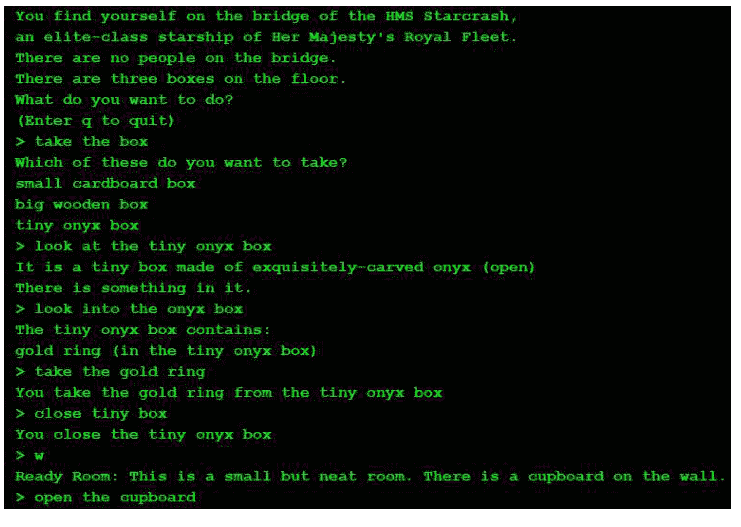

读完本书后，你将能够创建出类似于上面所示的游戏。我将解释你所需要的所有编码技术。你可以下载书中开发的所有程序的源代码，以及一个冒险游戏例程库（Bitwise 交互式小说框架，“BIFF”），来帮助你编写自己的游戏。

## 简介

### 什么是冒险游戏？


在这里，你看到的是作者个人收藏的经典复古冒险游戏的一小部分。

冒险游戏——特别是*文本*冒险游戏——就像一个发生在一个连接位置的世界中的故事。通常，玩家可能需要探索广阔的区域，以找到某些宝藏，并使用它们来解决谜题。你通过输入单词而不是点击菜单或按钮来与游戏交互。在本书书中，我将开发一个能够理解简短英语命令的游戏，例如：

- 拿起剑 (`take the sword`)
- 丢掉戒指 (`drop the ring`)
- 看看那个臭臭的大袋子 (`look into the big smelly sack`)
- 打开珠宝盒 (`open the jewel box`)
- 关闭海盗宝箱 (`close the pirate treasure chest`)
- 将魔法金戒指放入小丝绸兜袋 (`put the magic gold ring into the small silk reticule`)

……等等。

### 交互式小说

文本冒险游戏有时被称为“交互式小说”（interactive fiction）或简称为“IF”。这强调了这类游戏的叙事性。某些冒险游戏提供了很长的描述性段落，玩家可以输入文本来获取更多信息、查看物体并以其他方式与游戏交互。

### 在哪里可以玩文本冒险游戏？

当然，在你编写自己的冒险游戏之前，如果能玩一些现有的游戏将很有帮助。我建议你从 Infocom 公司在 20 世纪 70 年代和 80 年代开发的经典之作开始。这些包括《奎克》（Zork）三部曲（一个关于地下帝国的魔法与探索的游戏）、《三位一体》（Trinity，《爱丽丝仙游》遇上原子弹！）；以及《银河系漫游》（The Hitchhiker's Guide To The Galaxy，Infocom 版对道格拉斯·亚当斯广播剧和小说的改编）。附录提供了可以找到其中一些游戏的网站链接。


### 冒险游戏简史

虽然无法知道是谁写了第一个文本冒险游戏，但第一个在计算机用户中引起兴趣的几乎是 Crowther 的《巨型洞穴》（Colossal Cave），它有时被称为“原始冒险游戏”。除了编程，Crowther 还是一个爱好者，他解释了为什么他的冒险游戏发生在一个巨大的洞穴系统内。《巨型洞穴》开发于 1975 年至 1977 年之间，并在另一位程序员 Don Woods 的帮助下完成。他们的游戏是用 FORTRAN 语言编写的，运行在 PDP-10 主机计算机上。

冒险游戏演进的下一步随着《奎克》（Zork）的发布到来。这个游戏很大程度上借鉴了《巨型洞穴》，包括构成了《奎克》世界大部分部分的地下洞穴网络。它由 Dave Lebling 领导的 MIT 程序员团队开发。

《奎克》最初是用 MDL 语言编写的，同样运行在 PDP-10 上。MDL 是一种基于 LISP 列表处理语言的语言。后来该游戏被重写了多次，最著名的一个是用 ZIL（Zork 实现语言）编写的，这是另一种专门为编写游戏开发的类 LISP 语言。当 Infocom 公司于 1979 年成立时，《奎克》最终发布了一个可以在个人计算机上运行的版本。

Infocom 凭借《星际交叉》（Starcross）、《福玻斯的皮革女神》（The Leather Goddesses Of Phobos）和《魔法师》（Enchanter）等作品主导了冒险游戏领域。Infocom 对早期的《巨型洞穴》做的改进之一是使用了更好的“解析器”来解释简单的人类语言命令。《巨型洞穴》限于两个单词命令，如“拿起剑”（`take sword`）。而 Infocom 的游戏允许更长的命令，如“将精灵剑放入袋子”（`put the elvish sword into the sack`）。


### 谁应该读这本书？

本书适合任何对冒险游戏感兴趣的人。本书提供了比早期的《巨型洞穴》更好的“解析器”来解释简单的人类语言命令。它适合 Java 初学者，以及想要寻找更多技巧的 Java 程序员。

> **说明性注释**
>
> 这是一个说明性注释。如果你觉得不需要，可以跳过它——但如果你这样做了，你可能会错过一些有趣的内容……！

## 下载源代码

书中显示的所有源代码均可供下载。只需订阅我们的邮件列表，我们就会向你发送下载链接：www.bitwisebooks.com/subscribe

## 安装 Java

本书假设你已经安装了 Java。如果没有安装，你可以从此处下载 Java：https://www.java.com/

开发 Java 需要两个组件：Java 运行环境（JRE）和 Java 开发工具包（包含编译器和库，即 JDK）。你必须安装 JDK。如果你安装了 JDK，通常 JRE 随之自动安装。

## 使用哪种 IDE？

你可以将源代码加载到任何支持 Java 语法的编程编辑器中。这些项目是使用 NetBeans IDE 开发的。如果你不确定使用哪种 IDE，我建议使用 NetBeans。这段代码已经在来自 NetBeans.org 的 NetBeans 8.2 和 Apache.org 的 NetBeans 11.3 中经过了测试。有些人（包括我在内）更喜欢旧版本的 NetBeans (8.2)，因为它用起来稍微简单一点。但如果你想要最新的发布版本，应该安装来自 Apache 的最新稳定版本。要安装 NetBeans，请从以下网站任一下载下载即用的安装包：https://netbeans.org/ https://netbeans.org/

## 使用 NetBeans

虽然编写和运行冒险游戏并不非要使用 NetBeans，但我偶尔会展示使用 NetBeans 创建文件和“项目”时需要遵循的所有步骤。因此，我建议你使用 NetBeans 来加载、编辑和运行随书的示例代码。

## 在 NetBeans 中加载和运行程序

如果你正在使用 NetBeans，可以通过选择“文件 (File)、打开项目 (Open Project)”并导航到包含项目文件的目录（该文件将由一个小图标指示），然后选择该项目。如果你已经在 NetBeans 中打开了一个项目，新项目将加载在“项目 (Projects)”窗口中。要编译并运行项目，请先在“项目”窗口中选中该项目，然后从菜单选择“运行 (Run)”或点击工具栏上的绿色箭头按钮。

## 从系统提示符编译和运行程序

如果你正确安装了 Java，可以进入系统提示符或终端（Terminal）来编译和运行程序。你必须确保 Java 编译器和 `java` 应用启动器在系统路径中，以便它们可以从任何目录运行。在这情况下，都可能显示几行帮助文本。相反，如果你看到错误消息提示命令无法识别或找不到程序名，则你需要将包含这些程序的目录添加到系统路径中。例如，在 Windows 10 上，你可以打开 Windows 设置，在搜索框中搜索“path”。点击编辑系统变量的链接。在对话框中，点击“环境变量”。在“系统变量”列表中选择 Path，然后点击“新建”。添加包含 java 目录的完整路径。例如，在我的电脑上，路径是：

```
C:\Program Files\Java\jdk1.8.0_11\bin
```

打开一个新的系统提示符并检查系统是否能识别 `java` 和 `javac` 命令。要编译程序，请打开系统提示符并导航到包含 `main` 代码的目录。例如，在 AdventureGame 项目中，主程序是 `AdventureGame.java`，它可能位于此类目录：

```
D:\Java\AdventureGame\src
```

进入该目录后，在 `javac` 命令后输入主文件名进行编译：

```
javac AdventureGame.java
```

这将创建一个名为 `AdventureGame.class` 的编译文件。要运行该文件，输入 `java` 后紧跟编译后的文件名（不带 `.class` 后缀）：

```
java AdventureGame
```

这应该会运行程序。

## Java 是区分大小写的

如果你的主类名为 `AdventureGame`（且包含大字母 'A' 和大字母 'G'），那么在尝试运行程序时必须确保使用相同的大小写组合。假设我在输入命令时忘记将 'G' 大写了，如下所示：

```
java Adventuregame
```

Java 将显示类似下面的错误消息：

Error: Could not find or load main class Adventuregame


## 关于作者

Huw Collingbourne 是经典文字冒险游戏《命运的黄金土拨》（The Golden Wombat Of Destiny）的作者。Huw 担任程序员已30多年。他是一名在线编程导师，拥有 C、Java、Object Pascal、Ruby、JavaScript 以及其他编程语言和主题的成功课程。要查看完整的课程列表，请务必访问 Bitwise Courses 网站：http://bitwisecourses.com/

Huw 是 Bitwise 出版社《C# 冒险游戏编程小书》、《Ruby 小书》和《递归小书》的作者。他是英国著名的技术类作家，曾为 Computer Shopper、PC Pro 和 PC Plus 等多家计算机杂志撰写过许多评论和编程专栏。在不同时期，Huw 曾担任杂志出版商、编辑和电视节目主持人。他拥有剑桥大学的英语硕士学位，并获得合气道二段黑带，他在英国北德文郡教导这门武术。


## 关于技术编辑

Dermot Hogan 是一位软件开发者，在使用汇编语言、C、C# 以及其他语言领导过大型项目。作为实时交易技术的专家，他为多家国际银行和金融机构管理并开发了风险管理系统。他是独立软件公司 Sapphire Software 的首席开发人员。他拥有剑桥大学的物理博士学位。他目前的研究领域专注于机器人控制和系统。


# 第一章 – 与游戏交互

玩家通过输入如“take sword”之类的英语命令与游戏交互。因此，我们需要做的第一件事就是让游戏理解这些命令。

你站在白色房子外的一个空地上，那里有一扇封死的门。

这里有一个小邮箱。

Open mailbox

打开小邮箱显示了一张传单。

Take leaflet

Taken.

Read the leaflet

WELCOME TO ZORK!

ZORK 是一款关于冒险、危险和诡计的游戏。在游戏中，你将探索人类见过的最神奇的领域。没有电脑都不应该没有它！

```
Infocom 的 *Zark*（上所示）是编写过的最知名且影响最大的游戏之一。它是这样开始的：

你站在白色房子外的一个空地上，那里有一扇封死的门。这里有一个小邮箱。
```

自然而然，玩家想要做的第一件事是打开邮箱并查看内部，然后探索房屋内部和乡村。这是通过输入如“open mailbox”和“take leaflet”之类的文本命令实现的。在本书结束时，我们的游戏将能够理解复杂的命令，例如“把小银剑放入大木箱子里”。但在本章中，我们将从简单的命令开始——如“take sword”和“drop ring”。

## 什么，没有用户界面？

在我本关于使用 C# 编写冒险游戏的书中，我开始设计一个带有按钮的 Windows 用户界面，通过点击按钮来向游戏发送命令。这是因为 C# 开发是在 Visual Studio 中进行的，它有一个集成的可视化设计器。书中的最终项目解释了如何从命令提示符创建一个游戏，就像传统的文本冒险一样。虽然你可以在 Java 中创建类似的界面（例如使用 JavaBeans），但在本书中，我决定从一开始就创建一个命令行游戏。我们将开发的游戏将完全从提示符运行，就像经典游戏一样。

传统的文本冒险游戏没有带有菜单和按钮的用户界面。它们只有像这样的命令提示符：

```
>
```

要与游戏交互，用户在命令提示符旁边输入指令。常用指令包括：

- `n`、`s`、`w` 和 `e` 让游戏向北、南、西、东移动玩家
- `look` 让游戏描述当前位置
- `i` 或 `inventory` 显示玩家物品列表
- `take` 或 `drop` 后面跟对象的名称。

输入命令后，游戏会给出回复。以下是一个典型的文本冒险游戏的简短摘录：

```
> n

You have moved into the Troll Room.

> look

It is a dank room in a dungeon. There is a sword lying on the floor.

> take sword

sword taken.

You have a lantern ( (providing light), a magic ring and a sword.

> drop ring

You drop the ring. A bearded dwarf appears. The dwarf picks up the ring, puts it on his finger and runs away to the north. The dwarf has dropped an emerald.

> take emerald

emerald taken.
```


# 第一章 与游戏通信

## 加载并运行源代码

一旦下载了源代码压缩包，请解压代码。你可以使用 NetBeans 浏览到包含你想编辑或运行的项目目录。

### 在 NetBeans 中加载项目

选择**文件** > **打开项目**。然后浏览到包含示例项目的目录。

按 `CTRL+CLICK` 更多项目名称以从对话框中选择它们。

点击**打开项目**。

## 运行项目

在**项目**窗口中选择一个节点。

点击工具栏上的绿色箭头按钮，或从**运行**菜单中选择**运行项目**。

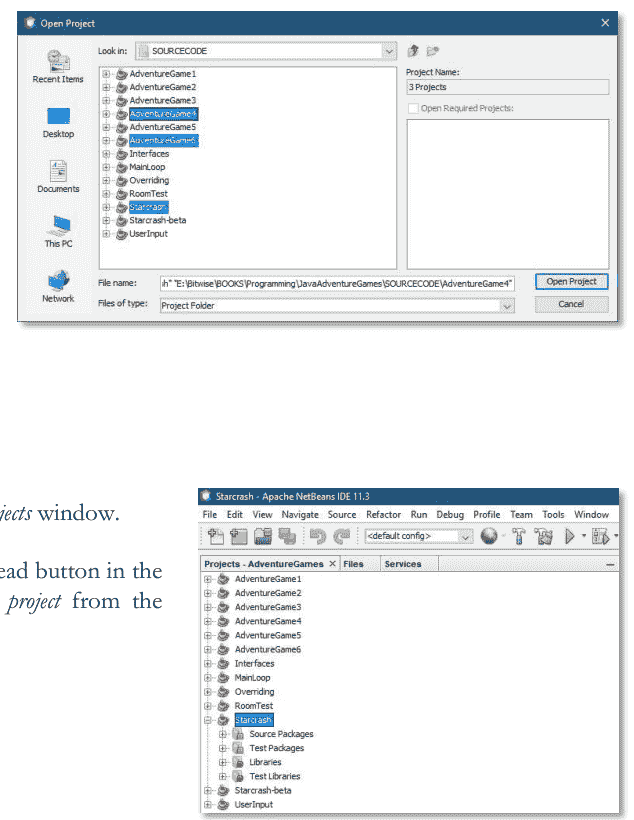

## 如何创建项目

如果你是从零开始创建一个游戏项目，首先需要做的是创建一个包含程序启动时运行代码的 Java 文件。该代码文件必须有一个 `main` 函数，该函数将包含某些在循环中持续执行的代码。这些代码将接收玩家的命令并将其发送去处理和执行，直到程序结束（当玩家退出时）。

首先你需要创建一个新的 Java 应用程序。如果你使用 NetBeans，请按照下面的步骤操作。如果你使用其他编辑器或 IDE 并且已经知道如何创建 Java 应用程序，可以通过创建一个名为 `MainLoop.java` 的代码创建 Java 应用程序。或者从本书的源代码存档中加载 `main_loop` 项目的代码。

### 如何在 NetBeans 中创建新项目

1. 选择**文件** > **新建项目**。
2. 根据 NetBeans 的版本选择 **Java** 或 **Java With Ant**。
3. 在右侧面板中，选择 **Java Application**。点击**下一步**。
4. 在下一个对话框中为项目输入名称（例如 `HelloWorld`）。
5. 可选选择项目位置。
6. 点击**完成**。

### 使用 Maven 的 Java 还是使用 Ant 的 Java？

某些版本的 NetBeans 建议新用户创建 **Java With Maven** 应用程序。Maven 和 Ant 是“构建工具”，在书中我们不关心它们的细节。对于我们的目的来说，选择 **Java With Maven** 还是 **Java With Ant** 并不重要。**Java With Ant** 的优点是项目会自动为你创建一个主文件。如果你选择 **Java With Maven**，你将需要自己创建主文件。所以，如果你的项目命名为 `HelloWorld`，你应该创建一个名为 `HelloWorld.java` 的代码文件。要执行此操作，点击项目窗口中的**源包**节点，并右键点击下方的包名。包名将类似于 `com.mycompany.helloworld`。从弹出的菜单中，选择**新建** > **Java 类**。输入类名（例如 `HelloWorld`）。这将创建一个代码文件 `HelloWorld.java`。通过添加如下所示的 `main()` 函数来编辑该类。


## main() 函数

你的应用程序需要一个 `main()` 函数。这是在应用程序启动时运行的函数。确保类和 `main()` 函数包含下面的代码：

```java
public class HelloWorld {

    public static void main(String[] args) {

        System.out.println("hello world");

    }

}
```

通过运行程序来测试它（点击 NetBeans 工具栏上的绿色箭头）。此时你可能会被提示选择主类。自然地，选择 `HelloWorld` 类（这是这个简单项目中唯一的类）。你的代码将会被编译并运行。最终它应该会在控制台中显示字符串 `"hello world"`。

### main() 函数详解

`main()` 函数是静态的（`static`），这意味着它“属于”（作用域在）一个类。这与 C 等非面向对象语言的“悬浮型”函数形成对比。在书中，“函数”和“方法”这两个词是通用的。从现在起，我将通常使用“方法”一词。

### 缓冲读取

缓冲区是内存中的临时存储区域。这可以加快字符的处理，而不是从磁盘一个一个地读取它们。

接下来是这个声明：

```java
BufferedReader in;
String input;
```

`String` 变量 `input` 将被玩家输入的字符串（行）：

```java
in = new BufferedReader(new InputStreamReader(System.in));
```

对此简单的解释是，`InputStreamReader` 读取字节并将其传递给 `BufferedReader`，以便数据可以被缓冲。后面是更详细的解释……

`InputStreamReader` 是一个 Java 类，它从流中读取字节并将字节解码为字符。“流”是从一个地方到另一个地方的字节流。`System.in` 是一个对应键盘输入数据的流。因此，上面的代码行将用户输入的文本作为参数传递给 `InputStreamReader` 对象的构造方法（创建并初始化新对象的方法）。这会将字节解码为字符流，并传递给 `BufferedReader`。`BufferedReader` 从字符输入流读取，缓冲字符以提高效率。然后 `BufferedReader` 对象赋值给变量 `in`。


现在有一个循环：

```java
do {

} while("q".equals(input));
```

这是一个 `do..while` 循环。它执行大括号之间的所有代码，直到满足结束条件（位于 `while` 之后）。在这里，当 `input`（用户输入的文本）不是“q”时，循环就会执行。一旦用户输入“q”，满足了结束条件，循环停止运行。

### 函数还是方法？

“方法”是面向对象领域的术语，指“属于”（作用域在）类或对象的函数。这与 C 等非面向对象语言的“悬浮型”函数形成对比。

### 使用 `equals()` 方法进行相等性判断

我不能使用 `!=` 运算符。这在附录中有解释，其中涉及到 Java 和 C# 语言之间的一些重要区别。

这是我的 `do...while` 循环内部的代码：

```java
System.out.print("> ");
input = in.readLine();
System.out.println("You entered '" + input + "'");
```

这里的三行代码非常简单。`System.out.print("> ")` 在控制台上打印提示符 `>`。`BufferedReader` 对象的 `readLine()` 方法读取一整行文本，最后 `System.out` 的 `println()` 方法（标准输出流）显示一个包含输入字符串（通过 `+` 运算符拼接字符串）的字符串，因此如果输入是 `"take word"`，那么显示的内容如下：

```text
You entered 'take word'
```

## 使用 Java API 参考文档

虽然我逐行分析了这些 `main()` 方法，但我通常不会以这种详细程度来解释我的代码。这是因为 Java API 文档中的在线参考包含了你关于标准 Java 类和方法所需的所有信息：

<https://docs.oracle.com/en/java/javase/14/docs/api/>

务必收藏该网站并经常参考它！

## 解析用户输入

现在我有一个主循环，我需要对它做一些实用的操作。我的目标是接收用户的输入，并将其分析或“解析”为有意义的单词。我在 `UserInput` 项目中尝试了这一点。这是一个“概念证明”，用于查看我提出的想法是否真的可行。在开发大型程序时，先在这样的小程序中尝试你的想法是有用的，因为它们很容易测试。在随后的项目中，我将编写更复杂的解析程序。在这里，我的目标是尽可能保持简单。

我从一个 `main()` 函数开始，其中包含了我在 `MainLoop` 项目中写的相同循环。唯一的区别是，一旦这个循环运行到一个字符串，它就会将该字符串传递给 `runCommand()` 方法，该方法返回另一个字符串并赋值给 `output`：

```java
output = runCommand(input);
```

这是 `runCommand()` 方法：

`ArrayList` 是一个用于存储字符串的泛型列表。泛型列表定义了可以用于不同类型对象的方法，但也可以被类型化以处理特定类型的元素。列表元素的类型通过在声明列表时在尖括号之间放置类（这里是 `String`）来指定。

### List 接口

在 Java 中，`List` 是一个接口名，而不是类名。接口是一种模板，定义了一组不包含任何代码的方法。你不能从接口创建对象。然而，类可以实现接口，当它们这样做时，必须为接口定义的每个空方法包含一个完全完整且可运行的方法。例如，`ArrayList` 类实现了 `List` 接口（以及其他几个接口），并包含了该接口定义的方法。有关接口的更多信息，请参阅附录。


代码从字符串输入 `inputStr` 中修剪空格，将其设置为小写，然后测试其值是否为 `"q"` 或空字符串 `""`，以防显示错误信息。在所有其他情况下，它都会带上小写的字符串 `lower` 调用 `wordList()` 方法。现在让我们看看这个方法发生了什么：

```java
public static List<String> wordList(String input) {

    String delims = "\\s,.;?!*";

    List<String> strlist = new ArrayList<>();

    StringTokenizer tokenizer = new StringTokenizer(input, delims);

    String t;

    while (tokenizer.hasMoreTokens()) {

        t = tokenizer.nextToken();

        strlist.add(t);

    }

    return strlist;

}
```

你可能会注意到我创建了一个 `ArrayList` 对象，但它被声明为 `List` 来存储 `String` 对象：

```java
List<String> strlist = new ArrayList<>();
```

`wordList()` 函数也被声明返回 `List` 而不是 `ArrayList`。这是 Java 中的一种常见写法。它的优点是，当使用接口名称声明特定对象类型时，该对象只需要与接口兼容。因此，在这里可以将实际对象类型更改为实现 `List` 的其他对象（例如 `LinkedList`），你的代码应该能够继续工作：

```java
List<String> strlist = new LinkedList<>();
```

或者，也可以通过重写这段代码创建如下的 `ArrayList` 对象来使对象类型更“严格”：

```java
ArrayList<String> strlist = new ArrayList<>();
```

在这种情况下，你不能替换不同的类。只允许 `ArrayList` 对象。你也可以重写 `wordList()` 方法返回 `ArrayList`：

```java
public static ArrayList<String> wordList(String input)
```

这取决于你的选择。好处是，如果你将对象和方法的返回值声明为特定类（如 `ArrayList`），你将受益 Java 的类型检查，尝试使用“错误类型”的列表对象将显示错误。然而，Java API 文档中的代码示例通常使用 `List` 接口声明，因此我采取了这种惯例。

### 将字符串拆分为“单词”

在处理命令之前，我们需要从玩家输入的文本行中提取出单个单词。Java 有一个特殊的 `StringTokenizer` 类可以帮助我们。在这里，“标记”是使用的术语，我们通常用人类语言描述为“单词”。


我们的目标是根据分隔符拆分字符串，分隔符包括空格、逗号、句号、分号、问号、感叹号和星号。这些分隔符本身会被丢弃。在我的代码中，我定义分隔符时，分隔符定义如下：

然后我调用 `StringTokenizer` 构造函数，向它传递两个参数：输入字符串和 `delims`：

现在将输入拆分为标记变得非常简单。我只需使用 `StringTokenizer` 的 `nextToken()` 方法从输入字符串中拆分。我将其放在一个循环中，直到没有标记（此时 `hasMoreTokens()` 方法返回 `false`）。每次我拆出一个新标记，都会将其添加到我的字符串列表 `strlist` 中：

```java
while (tokenizer.hasMoreTokens()) {

    t = tokenizer.nextToken();

    strlist.add(t);

}
```

### 一个 Tokenizer

我喜欢 `StringTokenizer` 类，因为它简单且直观。然而，Java 文档指出“`StringTokenizer` 是为了兼容性而保留的遗留类，但不建议使用”。

文档建议使用 `String.split()` 方法。`String.split()` 需要正则表达式而不是简单的分隔符字符串。你并不经常使用正则表达式，其语法可能会让人困惑，而且非常容易出错，在我看来这是尽可能避免使用它的一个理由。

然而，以防你对使用“遗留”类有疑问，我使用 `String.split()` 编写了这个替代的 `wordList()` 方法。这里的正则表达式很简单。它在方括号之间声明分隔符并在结尾添加一个符号，以便连续的分隔符被视为一个分隔符（也就是说，当遇到多个连续的分隔符时会被删除）。这是我在从 `AdventureGame1` 开始的游戏项目中使用的方法：

#### AdventureGame1 (Game.java)

```java
public static List<String> wordList(String input) {

    String delimiters = "[\\t,.;?!]+";

    List<String> strlist = new ArrayList<>();

    String[] words = input.split(delimiters);

    for (String word : words) {

        strlist.add(word);

    }

    return strlist;

}
```

## 解析命令

一旦将字符串分为标记，将其作为列表传递给 `parseCommand()` 方法。在 `UserInput` 项目中，这只是一个简单的方法，用于识别由动词（如“take”或“drop”）后跟名词（如“sword”或“ring”）组成的输入。我们在两个列表中定义所有已知单词：`commands` 和 `objects`。我们使用 `get()` 方法从双单词列表中获取第一个和第二个单词，然后只需检查 `commands` 列表是否包含第一个单词（索引为 0）以及 `objects` 列表是否包含第二个单词（索引为 1）。如果两个都成功，我们就有一个有效的双单词命令。如果其中任何一个失败，我们没有。

### AdventureGame1 (Game.java)

```java
public static void parseCommand(List<String> wordlist) {

    String verb;
    String noun;

    List<String> commands = new ArrayList<>(Arrays.asList("take", "drop"));
    List<String> objects = new ArrayList<>(Arrays.asList("sword", "ring", "snake"));

    if (wordlist.size() > 2) {

        System.out.println("Only 2 word commands allowed!");

    } else {

        verb = wordlist.get(0);
        noun = wordlist.get(1);

        if (!commands.contains(verb)) {

            System.out.println(verb + " is not a known verb!");

        }

        if (!objects.contains(noun)) {

            System.out.println(noun + " is not a known noun!");

        }

    }

}
```


这是一个非常、非常简单的解析程序，在目前的形式下，它对解析出的单词没有进行任何操作。然而，正如我之前提到的，这是一个“概念验证”测试。它向我展示了使用这些技术，我可以将用户输入的字符串拆分为单词列表，然后将这些单词与已知动词和名词的列表进行比较（如果我想多写点代码，也可以比较形容词、副词和介词）。这目前已经足够了。随着游戏的继续开发，我将扩展这个简单的解析器来处理更复杂的命令，并将使用这些命令来控制游戏中发生的情况。

# 第 2 章——地图

探索风格的冒险游戏需要一个可以探索的地方。这意味着你需要一些地点，或者说是与其他房间连接的“房间”（Rooms）。换句话说，你需要一张地图。这就是本节课的主题。

在创建地图之前，我需要决定“房间”是一个什么样的对象。让我们从画一张简单的地图开始。我有四个房间：巨人房间、一片森林、一个洞穴和一个地牢。每个房间都有一个名字，并在四个方向（北、南、东、西）上有连接。当没有指向另一个房间的连接时，我将其称为“无出口”（No Exit）：

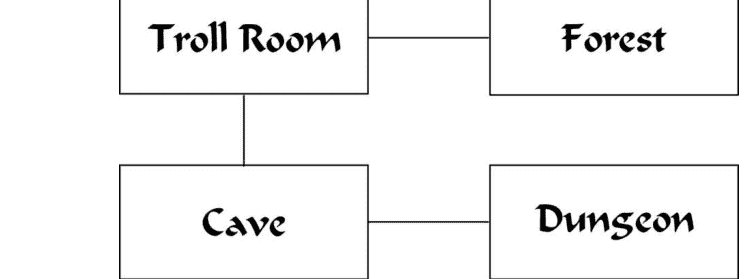

## 房间还是地点？

传统上，冒险游戏将地点称为“房间”（rooms），无论这些地点是否在字面上位于建筑内部。在本书中，当我谈到房间时，我指的是任何独特的地点，即使它恰好位于“外部世界”的某个处，例如街道或森林。同样，当我谈到“出口”（exit）时，指的是指向特定“方向”的另一个房间或地点的连接。

## Room 类

为了创建房间对象，我首先需要编写一个 `Room` 类。从我画的地图中可以看出，房间需要一个名字（字符串）以及四个表示方向的变量。我将用数字对房间进行索引，因此将使用整数来定义出口。如果一个房间的北有一个通往另一个房间的出口，那么该方向的房间编号即为 1。目前，不要担心这些索引数字的含义。当我们在下一章创建一个索引化的房间集合（即地图）时，这一切将开始变得意义。我将添加一个额外的字段，另一个名为 `description` 的字符串，它将包含房间的描述。这是该类的最简单版本——我将其命名为 `SimpleRoom`：

```java
public class SimpleRoom {
    public String name;
    public String description;
    public int n;
    public int s;
    public int w;
    public int e;
}
```

这些变量都是公共的（public），这意味着当我创建一个房间对象时，我可以像这样给变量赋值：

```java
sr = new SimpleRoom();
sr.name = "Troll Room";
sr.description = "a dank room that smells of troll";
sr.n = -1;
sr.s = 2;
sr.w = -1;
sr.e = 1;
```

虽然在类中使用公共变量看起来是个好主意，因为它们简短且易于使用，但它们有严重的缺点。“探入”对象内部并为变量分配新值的能力意味着我的代码可以自由在任何时候更改对象的任何变量：

```java
sr.name = "New name";
sr.s = 0;
```

这是一个坏主意。首先，这意味着我（或者，如果我是编程团队的一员，那么一个比我更不可信的人！）可以改变那些从未打算被更改的值。在这里，例如，我不希望房间的名字被更改。声明为公共的变量也可以被赋予错误的值。假设我的游戏有从 0 到 99 的房间。给诸如 `s` 的出口赋值 100 永远是不可能的。如果 `s` 是公共的，我无法阻止。如果我将变量设为私有（private）并编写访问器方法来获取和设置它们的值，会更好。在 `Room` 类中，我使用了一种简写语法，相同类型的变量用逗号隔开：

| RoomTest (Room.java) |
| :--- |
| private String name, description; |
| private int n, s, w, e; |

对于我赋予完全访问权限的变量，我像这样提供一组获取和设置方法（注：此处原文逻辑有误，此处对应翻译）：

```java
public int getN() {
    return n;
}

public void setN(int n) {
    n = n;
}
```

由于对私有变量的访问现在必须通过方法执行，我在返回它们之前会“处理”它们。例如，`getDescription()` 方法返回字符串“This is ”：

```java
public String getDescription() {
    return "This is ";
}
```

`setS()` 方法提供了如何防止不当值赋值给变量：

```java
public void setS(int aS) {
    if (aS < 100) {
        s = aS;
    } else {
        System.out.println("Error: index must be less than 100");
    }
}
```

同时，`name` 变量通过 `getName()` 方法返回其值，这意味着它现在是只读的（read-only）：

```java
public String getName() {
    return name;
}
```

我为构造函数添加了额外的参数，以便在构造对象时赋值：

```java
Room(String aName, String aDescription, int aN, int aS, int aW, int aE) {
    name = aName;
    description = aDescription;
    n = aN;
    s = aS;
    w = aW;
    e = aE;
}
```

防止访问变量被称为“数据隐藏”（data hiding）。将数据（内部字段和变量）与作用于数据的函数或方法包装在一起通常被称为“封装”（encapsulation）。当你将数据设为私有时，这就是数据隐藏。


## 数据隐藏

在我看来，数据隐藏是真正封装的必要特征。除非数据对其他代码隐藏，否则对象没有被真正封装。获取封装内部数据的唯一方式应该是通过方法。

然而，许多程序员使用“封装”一词仅仅是指在对象内部包含数据（变量）和方法（函数），即使数据是公共的。某些面向对象的程序员倾向于使用“黑盒封装”来强调他们的对象是严格封装的，并且具有私有数据。

严格封装的对象是一个密封的盒子。从外面你看不到它内部有什么。你只知道它的行为。它发送消息。就像老式计算机输入孔卡片（消息）并产生打印输出（回复）。

黑盒封装的好处是方法代码隐藏在外部。创建严格封装类的程序员可以自由重写它，而不必担心由于其他代码依赖这些方法的实现细节而导致意外副作用。只有可以发送的消息（由方法名和参数定义）以及返回的数据对对象之外的代码是可见的。方法的实现如下：

现在我可以创建一些房间

| Room Test (RoomTest.java) |
| :--- |
| Room0; Room1; Room2; Room3; |
| room0 = new Room("Troll Room", "a dank room that smells of troll", -1, 2, -1, 1); room1 = new Room("Forest", "a leafy woodland", -1, -1, 0, -1); room2 = new Room("Cave", "a dark cave", 0, -1, -1, 3); room3 = new Room("Dungeon", "a nasty basement in the castle", -1, -1, 2, -1); |

## 绘制地图

在规划游戏时，从绘制世界地图开始是一个好主意。在本章的开始，我展示了一个包含四个房间的图：巨人房间（Troll Room）、森林（Forest）、洞穴（Cave）和地下牢（Dungeon）。制作地图最简单的方法是将房间放入某种集合中。最明显的集合类型是数组（array）——即一组由其数字位置索引的元素的顺序列表。`ArrayList`（你可能记得，我之前使用过它）是一种动态大小的数组，允许我添加和删除元素来扩展或收缩列表。这就是我声明一个对象 `ArrayList` 的方式：

AdventureGame1 (Game.java)
```java
private ArrayList<Room> map;
```

## 终于有游戏了！

在本章的开始，我展示了连接一个房间到另一个房间的线条。在没有连接线的地方，就没有出口。我正在加快节奏。到目前为止，在解释处理用户输入的基本技术时，我花了很多细节。现在是时候开始开发实际的游戏了。从现在起，我的程序类将是 `Game.java` 文件中的 `Game` 类。请务必参考源代码以查看所有代码。正如在文中输入的那样，我输入了一个 `ArrayList` 来存储 `Room` 对象：

## 其他类型的地图

作为数组的线性列表提供了存储房间集合的简单方法。然而，还有其他替代方案。你可以创建一个字典（dictionary）或 `HashMap`，其中每个房间通过名称而不是数字进行索引。这是我在我的书中采用的方法。在本书的末尾，我将展示一种完全不需要地图就能将房间连接在一起的方法！

正如之前解释过的，`ArrayList` 提供了各种实用方法，如 `add()`。我在游戏开始时创建 `map` 对象，然后使用 `add()` 方法向其添加对象：

AdventureGame1 (Game.java)
```java
map = new ArrayList<Room>();
map.add(new Room("Troll Room"), "一间弥漫着巨人气味的潮湿房间", Direction.NOEXIT, Direction.NOEXIT, 1);
map.add(new Room("Forest"), "一片叶茂的木林", Direction.NOEXIT, Direction.NOEXIT, 0);
map.add(new Room("Cave"), "一个墙上布满苔藓的洞穴", Direction.NOEXIT, Direction.NOEXIT, 3);
map.add(new Room("Dungeon"), "一间肮恶、黑暗的牢室", Direction.NOEXIT, Direction.NOEXIT, 2);
```

我不需要为每个房间创建命名变量，因为从现在起，我将通过索引 `map` 来访问房间。`Room` 对象是通过在 `new` 关键字后调用 `Room()` 构造函数并传递所有所需的参数创建的：名称、描述以及四个“出口”值，用于显示北、南、西、东方向上相邻的房间。每个值都是一个整数，表示它在 `map` 中的索引。例如，第一个房间“巨人房间”位于索引 0。第二个房间“森林”位于索引 1。我看到“巨人房间”东侧的出口的值是 1，所以它通向“森林”。“森林”西侧的出口的值是 0，所以它通向“巨人房间”。这就是我在本章开始展示的地图。

但那些被称为 `Direction.NOEXIT` 的东西叫什么呢？你一定猜到了它们表示这些方向上没有出口。在 `RoomTest` 项目中，我使用值 -1 来表示没有出口。虽然这样做可行，但我我不喜欢用这种方式用整数来表示特殊值，而 `Direction` 没有“明显”的含义，但 `Direction.NOEXIT` 是自言自语的：

AdventureGame1 (Direction.java)
```java
package globals;

public enum Direction {
    NORTH,
    SOUTH,
    EAST,
    WEST,
    public static final int NOEXIT = -1;
};
```

这里的 `Direction` 是我在 `globals` 包中定义的枚举类型。事实证明它的值确实是 -1。通过分配一个整数值，我确保了它与 `Room` 构造函数所需的整数出口值兼容。这里的其他常量 `NORTH`、`SOUTH`、`EAST` 和 `WEST` 没有在 `Room` 构造函数中使用，因此它们不需要整数值。我将在稍后使用这些常量：

所以现在我有了一个包含几个房间的地图。玩家如何从一个房间移动到另一个房间呢？我将在下一节中解释。

# 第 3 章 移动玩家

我们有了房间，有了地图。现在我们需要添加一个能够在房间之间移动的玩家……

我需要一个类来表示玩家。玩家需要在地图上移动并在（稍后）与对象交互——例如，通过拾捡和丢弃宝物。你可以将玩家视为游戏中的一个“角色”。在原则上，我可以添加任何数量可以闲逛、拾捡和丢弃东西的角色。

## 类层次结构

我可以给我的 `Actor` 添加名称和描述变量以及 get/set 方法。然而，如果我这样做，我就会重复 `Room` 类的代码。为了避免这种情况，最好创建另一个类。在 `AdventureGame` 项目中，我创建了一个名为 `Thing` 的类。`Thing` 拥有一个名称和描述：

AdventureGame1 (Thing.java)
```java
public class Thing {
    private String name;
    private String description;

    public Thing(String aName, String aDescription) {
        // 构造函数
        name = aName;
        description = aDescription;
    }

    public String getName() {
        return name;
    }

    public void setName(String aName) {
        name = aName;
    }

    public String getDescription() {
        return description;
    }

    public void setDescription(String aDescription) {
        description = aDescription;
    }
}
```

## 继承

面向对象的一个基本原则是，简单类应该包含其他更专门的类所共有的数据（变量）和行为（方法）。那些更专门的类可以继承简单类的特征并根据需要添加额外的特征。继承另一个类特征的类可以被称为后代类或子类。它继承的类可以被称为祖先类或超类。多层祖先和后代形成了一个类似于家族树或“类层次结构”。

我让 `Actor` 类成为 `Thing` 类的后代。在 Java 中，这样做的方法是在类名和其祖先类名之间放置 `extends` 关键字，如下：

```java
public class Actor extends Thing {
```

这表明我的 `Actor` 类是 `Thing` 类的后代。`Thing` 类已经有了名称和描述（包括变量以及访问它们所需的 get/set 方法），因此 `Actor` 类不需要重新编写这些代码。它们自动从 `Thing` 继承。现在我为 `Actor` 对象添加它需要的额外功能。目前这只是 `location`——定义 `Actor` 对象当前位置的房间：

AdventureGame1 (Actor.java)
```java
public class Actor extends Thing {
    private Room location; // 玩家所在的房间

    public Actor(String aName, String aDescription, Room aRoom) {
        super(aName, aDescription); // 初始化父类
        location = aRoom;
    }

    public void setLocation(Room aRoom) {
        location = aRoom;
    }

    public Room getLocation() {
        return location;
    }
}
```


## 第3章 — 移动玩家

`Room` 类也继承自 `Thing`，因此它也继承了名称和描述。它随后添加了房间特定的功能——四个方位方向的出口：

```java
// AdventureGame1 (Room.java)
public class Room extends Thing {
    private int n, s, w, e;
    public Room(String aName, String aDescription, int aN, int aS, int aW, int aE) {
        super(aName, aDescription); // 初始化父类
        n = aN;
        s = aS;
        w = aW;
        e = aE;
    }
    public int getN() {
        return n;
    }
    public void setN(int aN) {
        n = aN;
    }
    public int getS() {
        return s;
    }
    public void setS(int aS) {
        s = aS;
    }
    public int getE() {
        return e;
    }
    public void setE(int aE) {
        e = aE;
    }
    public int getW() {
        return w;
    }
    void setW(int aW) {
        w = aW;
    }
}
```

总之，这是一幅展示了 `AdventureGame1` 项目中类层级结构或“家族树”的图表：

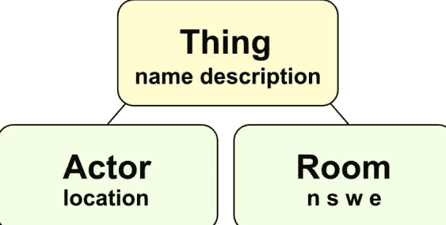

如果你查看 `Actor` 和 `Room` 类的构造函数，你会发现它们接收参数来初始化类本身声明的所有变量，以及用于初始化父类变量的参数。

初始化父类变量的参数通过在关键字 `super` 之后的括号中传递给父类：

```java
super(aName, aDescription);
```

在这里，当我在 `Room()` 和 `Actor()` 构造函数调用 `super` 时，`Room` 和 `Actor` 继承自 `Thing`，这导致 `aName` 和 `aDescription` 参数被传递给 `Thing()` 构造函数，从而初始化名称和描述变量。

然后初始化由 `Thing` 的派生类定义的额外变量。例如，`Room()` 构造函数初始化了四个出口变量 `n`、`s`、`w` 和 `e`：

```java
public Room(String aName, String aDescription, int aN, int aS, int aW, int aE) {
    super(aName, aDescription); // 初始化父类
    n = aN;
    s = aS;
    w = aW;
    e = aE;
}
```

### 改变玩家的位置

写完 `Actor` 类后，我现在需要创建一个玩家对象并将其放入第一个房间（即地图中索引为 0 的 `Room` 对象）。我在 `Game()` 构造函数中执行此操作。我使用 `ArrayList` 的 `get()` 方法获取索引为 0 的房间：

```java
// AdventureGame1 (Game.java)
player = new Actor("player", "a loveable game-player", map.get(0));
```

当我想移动玩家时，我需要更新玩家对象的位置，该位置是一个 `Room` 对象。让我们考虑一个例子。当用户在命令行提示符处输入“s”（向南移动的命令）时，我需要找到地图中索引为 `s` 的房间，并将其赋值给玩家的位置。

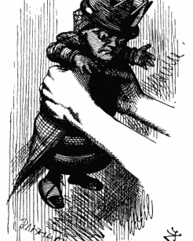

在我的游戏中，地图中索引为 0 的房间是“巨人房间”，其 `s` 变量的值为 2。索引为 2 的房间是“洞穴”。因此，当玩家位于“巨人房间”并向南移动时，位置应该被赋值为“洞穴”对象。

如果你查看 `Game` 类，你会发现名为 `go()` 的方法尝试将玩家向南移动。为了实现这一点，我们调用了 `movePlayerTo()`：

```java
private void goS() {
    updateOutput(movePlayerTo(Direction.SOUTH));
}
```

在这里我使用了 `Direction` 枚举，我在第 2 章中解释过。实际工作由 `movePlayerTo()` 方法完成，该方法返回一个字符串。这个字符串被传递给 `updateOutput()` 方法，以便显示房间描述或告诉用户没有出口。`movePlayerTo()` 只是调用了 `moveTo()` 方法：

```java
public int movePlayerTo(Direction dir) {
    return moveTo(player, dir);
}
```

这在一个只有一个玩家的游戏中可能似乎是多余的。但请记住，在一个更大的游戏中，可能会有多个 `Actor` 对象，我可能想在玩家移动和当其他角色移动时采取不同的动作。

因此，我决定让 `moveTo()` 方法对所有 `Actor` 对象都可用，而 `movePlayerTo()` 则专门为玩家对象保留。以下是 `moveTo()`：

```java
// AdventureGame1 (Game.java)
int moveTo(Actor anActor, Direction dir) {
    Room r = anActor.getLocation();
    int exit;

    switch (dir) {
        case NORTH:
            exit = r.getN();
            break;
        case SOUTH:
            exit = r.getS();
            break;
        case EAST:
            exit = r.getE();
            break;
        case WEST:
            exit = r.getW();
            break;
        default:
            exit = Direction.NOEXIT;
            break;
    }
    if (exit != Direction.NOEXIT) {
        moveActor(anActor, map.get(exit));
    }
    return exit;
}
```

`moveTo()` 方法将“当前房间”（`anActor.getLocation()`）赋值给局部变量 `r`。这里 `dir` 是一个常量——例如，如果 `dir` 是 `NORTH`，它调用 `r.getN()` 并赋值给 `exit`。如果 `dir` 是 `SOUTH`，则调用 `r.getS()` 并赋值。如果 `dir` 是 `EAST`，则调用 `r.getE()` 并赋值。`exit` 通过索引地图进行赋值。如果 `exit` 不等于 `Direction.NOEXIT`，则通过 `moveActor(anActor, map.get(exit))` 改变玩家的位置：

```java
private void moveActor(Actor p, Room aRoom) {
    p.setLocation(aRoom);
}
```

假设 `exit` 不等于 `Direction.NOEXIT`，则 `go()` 方法通过索引地图获取新房间。

### 扩展解析器

在交互式文学中，我希望玩家能够编写游戏可以理解的句子。在第 1 章中，我尝试了一个简单的解析器将字符串拆分为单词并将其分类为命令（动词）和物体（名词）。在 `AdventureGame` 中，我希望允许用户输入如“n”之类的单单词命令或如“take sword”之类的双单词命令。为了这一点，我首先定义了包含命令和物体的列表：

```java
List<String> commands = new ArrayList<>(Arrays.asList("take", "drop", "look"));
List<String> objects = new ArrayList<>(Arrays.asList("sword", "ring", "snake"));
```


在 `UserInput` 项目中，我有一个将字符串拆分为单词的方法。`parseCommand()` 方法接收单词列表作为参数，如果只有一个单词，它将该单单词列表传递给 `processVerb()` 方法。如果有两个单词，它将列表传递给 `processVerbNoun()` 方法。超过两个单词的列表被认为是错误。

`processVerb()` 方法检查 `wordlist` 中的唯一单词是否为已知命令——即我的 `commands` 列表是否包含该单词。如果不是已知单词，它会显示错误信息。如果是已知单词，`switch` 语句匹配单词并调用相应的方法：

```java
// AdventureGame1 (Game.java)
public String processVerb(List<String> wordlist) {
    String verb;
    String msg = "";
    verb = wordlist.get(0);
    if (!commands.contains(verb)) {
        msg = verb + " is not a known verb! ";
    } else {
        switch (verb) {
            case "n":
                goN();
                break;
            case "s":
                goS();
                break;
            case "w":
                goW();
                break;
            case "e":
                goE();
                break;
            default:
                msg = verb + " (not yet implemented)";
                break;
        }
    }
    return msg;
}
```

如果是双单词命令，`processVerbNoun()` 方法从列表中获取两个单词，并检查第一个单词是否为命令，第二个单词是否为物体：

```java
public String processVerbNoun(List<String> wordlist) {
    String verb;
    String noun;
    String msg = "";
    verb = wordlist.get(0);
    noun = wordlist.get(1);
    if (!commands.contains(verb)) {
        msg = verb + " is not a known verb! ";
    }
    if (!objects.contains(noun)) {
        msg += noun + " is not a known noun! ";
    }
    msg += " (not yet implemented)";
    return msg;
}
```

### 更长的命令？

第一个真正著名的冒险游戏《巨洞》（The Colossal Cave）编写于 20 世纪 70 年代中期，它只接受单双单词命令。它理解的最复杂的命令是“get lamp”（拿灯）。我希望我的游戏能够处理比这范围更大的命令。之后，我会开发代码，使其能够处理如“Put the small lantern into the sack”（把小灯笼放入袋中）和“Open the door with the silver key”（用银钥匙开门）之类的命令。但目前，双单词命令已经足够了。

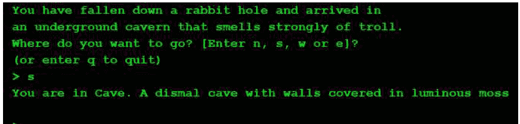

`AdventureGame` 允许你通过输入“e”和“s”等命令在连接房间的地图上移动。但在这些房间里你现在什么都做不了——还没有！

## 第 4 章 – 宝物

现在我们有了地图和玩家，我们需要添加一些宝物，玩家可以将宝物从一个房间带走并丢在另一个房间。

每个冒险游戏都需要宝物——即玩家可以在各种位置找到并拿或丢弃的对象。我已经有一个包含名称和描述的 `Thing` 类，这可能就是宝物所需的所有内容。


我还想让宝物具有价值，因此在 `AdventureGame2` 项目中，我创建了一个继承自 `Thing` 的 `Treasure` 类，并添加了价值变量和访问方法：

```java
// AdventureGame2 (Treasure.java)
public class Treasure extends Thing {
    private int value;
    public Treasure(String aName, String aDescription, int aValue) {
        super(aName, aDescription); // init superclass
        this.value = aValue;
    }
    public int getValue() {
        return value;
    }
}
```

### 宝物列表

由于玩家和房间都需要持有对象列表，因此将列表添加到一个共同的祖先类中，而不是分别添加到 `Room` 和 `Actor` 类中，是很有意义的。这样，`Room` 和 `Actor` 类就可以从它们的祖先那里继承同一组列表管理功能，而不需要实现两次列表。

到目前为止，`Room` 和 `Actor` 都直接继承自基类。`Thing` 类是一个非常简单的类，我希望保持这种状态！将基类保持得精简且“通用”，并将更专门的功能（如列表管理）放在后代类中，是良好的面向对象设计。如果我在 `Thing` 类中添加列表管理，那么所有其他类都将继承列表。这不是我想要的。

我的解决方案是创建一个中间类——介于基类 `Thing` 和更专业的类 `Actor` 和 `Room` 之间。我创建了一个名为 `ThingHolder` 的类来维护一个物体列表。它包含一个 `ThingList`，并有 `getThings()` 和 `setThings()` 方法：

```java
public class ThingHolder extends Thing {
    private ThingList things = new ThingList();
    public ThingHolder(String aName, String aDescription, ThingList t1) {
        super(aName, aDescription);
        things = t1;
    }
    public ThingList getThings() {
        return things;
    }
    public void setThings(ThingList things) {
        this.things = things;
    }
}
```

`ThingHolder` 是 `Thing` 的后代。为了将 `ThingHolder` 类的功能同时添加到 `Actor` 和 `Room` 类中，我只需要重新定义这些类的祖先即可。

之前的 `Room` 和 `Actor` 直接继承自 `Thing`。现在我让它们继承自 `ThingHolder`。当然，它们最终仍然继承自 `Thing`，因为 `ThingHolder` 类本身继承自 `Thing`。

但它们的直接祖先现在是 `ThingHolder`，所以它们继承了类的 `ThingList`。我还更改了 `Room` 和 `Actor` 的构造函数，使其接受一个新参数，即 `ThingList` 对象：

```java
// Adventure2 (Room.java and Actor.java)
// Room constructor
public Room(String aName, String aDescription, int aN, int aS, int aW, int aE, ThingList t1)
// Actor constructor
public Actor(String aName, String aDescription, ThingList t1, Room aRoom)
```

### ThingList 类

我的 `Room` 和 `Actor` 类都维护一个存储在 `ThingList` 中的对象列表。看我对这个类的声明：

```java
// AdventureGame2 (ThingList.java)
public class ThingList extends ArrayList<Thing>
```


这表明 `ThingList` 是一个泛型 `ArrayList`，其类型被用于持有 `Thing` 对象集合（以及 `Thing` 的任何后代）。

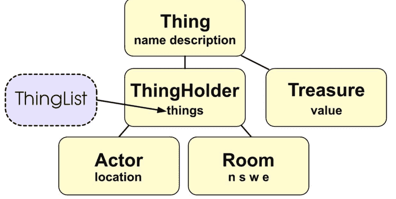

总之，AdventureGame2 定义了一个以 `Thing` 为基类的类层次结构。`Treasure` 和 `ThingHolder` 类增加了 `things` 字段。Actor 和 Room 类继承自 `ThingHolder`。

# 向房间添加宝物

现在游戏中的房间包含了宝物，我需要在玩家进入每个房间时显示宝物列表。我将在下一章完成这一点。

# 第5章 — 描述事物

## AdventureGame2 (Game.java)

```java
private void movePlayerTo(Direction dir) {
    if (moveTo(player, dir) == Direction.NOEXIT) {
        showStr("No Exit!");
    } else {
        look();
    }
}
```

此方法由处理向北、南、西、东移动命令的方法调用。例如，这是 `goN()` 方法：

```java
private void goN() {
    movePlayerTo(Direction.NORTH);
}
```

这调用了 `moveTo()`，如之前解释过的样，它返回一个整数，指示所选方向上的相邻房间（作为地图中的索引）。如果该方向没有房间，它会返回 `Direction.NOEXIT`（值为 -1）。如果在指定的出口找到了房间，`moveTo()` 将将玩家移动到相邻房间（也就是说，玩家的位置变量被赋值了新的 `Room` 对象）。然后会调用 `look()` 方法。顺便提一下，当用户输入命令“look”时，也会调用同一个方法：

```java
private void look() {
    showStr("You are in the " + getPlayer().getLocation().describe());
}
```

## 描述房间

`look()` 方法非常直观。它获取玩家的位置并调用 `describe()` 方法返回一个描述。`describe()` 方法是做什么的呢？让我们尝试弄清楚。如果我运行游戏并输入命令“look”，我会看到什么：


- > look
你正在巨魔房间里。一个潮湿的、充满巨魔气味的房间。
这里的物品：
胡萝卜：这是一个非常脆的胡萝卜

这显示 `describe()` 返回了房间名称、它的描述以及房间内所有宝物的描述。这是 `Room` 类的 `describe()` 方法：

### AdventureGame2 (Room.java)

```java
public String describe() {
    return String.format("%s. %s.",
        getName(), getDescription())
        + "\nThings here:\n" + getThings().describeThings();
}
```

记住，`Room` 类是 `ThingHolder` 类的子类，而 `ThingHolder` 类又是 `Thing` 类的子类。`ThingHolder` 类包含一个名为 `things` 的字段，它是一个 `ThingList` 对象（一个用于持有 `Thing` 对象的 `ArrayList`）。因此，`Room` 继承了 name、description 和 things，并增加了 n、s、w 和 e：

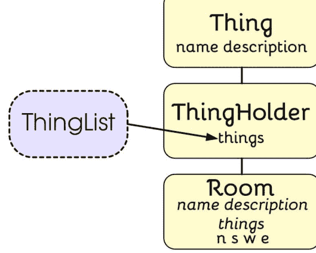

## 描述货物

`getName()` 和 `getDescription()` 是 `Thing` 类的方法（用于访问名称和描述变量），而 `getThings()` 是 `ThingHolder` 类的方法（用于访问 `things` 变量）。`getThings()` 方法返回一个 `ThingList` 对象。`ThingList` 类包含此方法：


### AdventureGame2 (ThingList.java)

```java
public String describeThings() {
    String s = "";
    if (this.size() == 0) {
        s = "nothing.\n";
    } else {
        for (Thing t : this) {
            s = s + t.getName() + ": " + t.getDescription() + "\n";
        }
    }
    return s;
}
```

如果列表中有一些物品——例如，绿宝石、蓝宝石和红宝石——那么列表的大小就不为 0，因此该方法将在 `for` 循环中遍历 `Thing` 对象，用列表中的每个 `Thing` 初始化变量 `t`（这里关键字指的是当前对象，它是一个 `Thing`）。它对每个物品调用 `getName()` 和 `getDescription()`，并将这两个方法返回的字符串附加到字符串 `s` 上，最后返回该字符串。


## 方法重写

有时在类层次结构中的不同类中实现相同的方法是有用的。例如，我可能希望程序中的每个类都实现它们自己的 `describe()` 版本。假设我有一个继承自 `Thing` 类的 `Treasure` 类。为了清晰起见，我在这里将这些类保持非常简单：

### Overriding (Overriding.java)

```java
class Thing {
    private String description;
    public Thing(String aDescription) {
        this.description = aDescription;
    }
    public String describe() {
        return description;
    }
}
```

### Overriding (Overriding.java) [继续]

```java
class Treasure extends Thing {
    private int value;
    public Treasure(String aDescription, int aValue) {
        super(aDescription);
        this.value = aValue;
    }
}
```

如你所预期的，`Treasure` 类从它的祖类 `Thing` 类继承了 `describe()` 方法。因此我可以写这样的代码：

```java
public class Overriding {
    public static void main(String[] args) {
        Thing thing1, thing2;
        thing1 = new Thing("A thing");
        thing2 = new Treasure("A treasure", 100);
        System.out.println(thing1.describe());
        System.out.println(thing2.describe());
    }
}
```

# 第 6 章 – 拾取与丢物品

## 在列表之间传输对象

在列表之间传输对象的代码位于 `AdventureGame3` 的 `transferOb()` 方法中。该方法接受三个参数：

- `t`: 要传输的 `Thing` 对象。
- `fromlist`: `t` 将被移除的 `ThingList`。
- `toList`: `t` 将被添加的 `ThingList`。

`transferOb()` 方法调用 `remove()` 方法（Java `ArrayList` 的方法）从 `fromlist` 中删除对象，然后调用 `add()` 将其添加到 `tolist`：

```java
AdventureGame3(Game.java)
private void transferOb(Thing t, ThingList fromlist, ThingList tolist) {
    fromlist.remove(t);
    tolist.add(t);
}
```

`takeOb()` 和 `dropOb()` 方法都调用了 `transferOb()`。这两个方法之间最重要的区别是将两个列表作为参数传递 `transferOb()` 的顺序。

## 拾取物体

`takeOb()` 方法将一个 `Thing` 从当前房间的 `ThingList` `player.getLocation().getThings()` 传输到玩家的物品列表 `player.get()`：

```java
private String takeOb(String obname) {
    String retStr = "";
    Thing t = player.getLocation().getThings().thisOb(obname);
    if (obname.equals("")) {
        obname = "nameless object"; // 如果没有指定物体
    }
    if (t == null) {
        retStr = "There is no " + obname + " here!";
    } else {
        transferOb(player.getLocation().getThings(), player.getThings());
        retStr = obname + " taken!";
    }
    return retStr;
}
```

## 丢弃物体

`dropOb()` 方法将一个 `Thing` 从玩家的物品列表传输到当前房间：

```java
private String dropOb(String obname) {
    String retstr = "";
    Thing t = player.getThings().thisOb(obname);
    if (obname.equals("")) {
        retstr = "You'll have to tell me object you want to drop!";
    } else if (t == null) {
        retstr = "You haven't got one of those!";
    } else {
        transferOb(t, player.getThings(), player.getLocation().getThings());
        retstr = obname + " dropped!";
    }
    return retstr;
}
```

## 拾取与丢弃命令

每当你添加一个新命令时，你都需要向已知命令单词的列表中添加相应的字符串。在这种情况下，我添加了 "take"、"drop"、"inventory" 和 "i"（inventory 是玩家收集的物品列表）：

```java
List<String> commands = new ArrayList<>(Arrays.asList(
    "take", "drop", "look", "l", "i", "inventory",
    "n", "s", "w", "e",
    "save", "load"
));
```

## 寻找指定的物体

注意当物体的名称 `obname` 传递给 `takeOb()` 和 `dropOb()` 方法时，该名称被用于在当前房间（`takeOb(obname)`）或玩家的物品列表（`dropOb(obname)`）中查找匹配的 `Thing` `t`：

```java
Thing t = player.getThings().thisOb(obname);
```

`ThingList` 类使用 `thisOb()` 方法在列表中搜索具有指定名称的对象：

```java
AdventureGame3 (ThingList.java)
public Thing thisOb(String aName) {
    Thing athing = null;
    String thingName = "";
    String aNameLowerCase = aName.trim().toLowerCase();
    for (Thing t : this) {
        thingName = t.getName().trim().toLowerCase();
        if (thingName.equals(aNameLowerCase)) {
            athing = t;
        }
    }
    return athing;
}
```

我已经在 `processVerbNoun()` 的 `switch` 语句中添加了 "take" 和 "drop"：

```java
AdventureGame3 (Game.java)
private String processVerbNoun(List<String> wordlist) {
    String verb;
    String noun;
    String msg = "";
    boolean error = false;
    verb = wordlist.get(0);
    noun = wordlist.get(1);
    if (!commands.contains(verb)) {
        msg = verb + " is not a known verb!";
        error = true;
    }
    if (!objects.contains(noun)) {
        msg += (noun + " is not a known noun!");
        error = true;
    }
    if (error) {
        switch ("take") {
            case "take":
                msg = takeOb(noun);
                break;
            case "drop":
                msg = dropOb(noun);
                break;
            default:
                msg += " (not yet implemented)";
                break;
        }
    }
    return msg;
}
```

`processVerbNoun()` 方法处理双单词命令。它简单地将第二个单词 `noun`——宝藏的名称——传递给 `takeOb()` 或 `dropOb()` 方法：

```java
case "take":
  msg = takeOb(noun);
  break;
case "drop":
  msg = dropOb(noun);
  break;
```

## 显示指定的物体

"i" 和 "inventory" 命令已添加到 `processVerbNoun()` 的 `switch` 语句中，该语句处理单单词命令：

```java
case "inventory":
case "i":
  showInventory();
  break;
```

`showInventory()` 方法简单地调用了 ThingList 的 `describeThings()`：

```java
private void showInventory() {
    System.out.println("You have " + player.getThings().describeThings());
}
```

# 第 7 章 – 保存游戏

```java
// saveGame()
FileOutputStream fos = new FileOutputStream("Adv.sav");
// loadgame()
FileInputStream fis = new FileInputStream("Adv.sav");
```

## 对象输入输出流

为了将这些字节作为代表对象的数据写入或读取，我必须在保存时将这些流之一传递给 `ObjectOutputStream`，在加载时将其传递给 `ObjectInputStream`：

```java
// saveGame()
ObjectOutputStream oos = new ObjectOutputStream(fos);
// loadGame()
```


ObjectInputStream ois = new ObjectInputStream(fis);

那么 `ObjectOutputStream` 和 `ObjectInputStream` 到底是什么呢？Java API 参考告诉我：“`ObjectOutputStream` 将原始数据类型和 Java 对象图写入 `OutputStream` 中。这些对象可以使用 `ObjectInputStream` 进行读取（重构）。换句话说，它们能够以流的形式写入和读取复杂的对象网络或‘图’。”在我的代码中，我将文件流传递给 `ObjectInputStream` 和 `ObjectOutputStream` 的构造函数。

一旦完成，保存我的整个对象网络就像使用 `ObjectOutputStream` 的 `writeObject()` 方法写入“顶层”对象（在这种情况下是包含所有其他对象的对象）一样简单：

```java
oos.writeObject(game);
```

然后我调用 `flush()` 以确保在关闭输出流之前任何缓冲区中的数据都已写入：

```java
oos.flush();
oos.close();
```

重新加载数据的方法类似，只是这次我需要告诉 Java 我想从流中构造哪种类的的对象，这就是为什么在将数据赋值给我的 `game` 变量之前，我在括号中写了 `Game`：

```java
game = (Game) ois.readObject();
ois.close();
```

## Serializable 接口

为了使序列化生效，我还需要做另一件事。每个想要可序列化的类都必须实现 `java.io.Serializable` 接口。这通知 Java 该类的对象可以用于序列化。如果你尝试序列化没有实现 `Serializable` 接口的类的对象，将抛出 `NotSerializableException` 类型的异常。

## 什么是 Serializable 接口？

通常，Java 接口定义了方法，任何实现该接口的类必须编写这些方法的代码。例如，`List` 接口定义了 `add()` 和 `remove()` 方法。实现 `List` 的类必须包含这些方法的代码。然而，`Serializable` 接口没有定义任何方法。它的唯一目的是标识可用于序列化的类。当一个类实现 `java.io.Serializable` 时，它实际上是被“标记”为可用于序列化。

就这些了。你现在有了一个基础的游戏框架，允许你创建带有玩家可以收集的宝物的链接房间地图。你可以使用序列化来保存和恢复你的游戏。在我们继续之前，我认为还有很多工作要做，我想现在是时候仔细查看游戏的代码并对其进行重构了，以确保在我们继续开发最终可能变成非常大型复杂的程序时，它是清晰、模块化且易于维护的。

## 尝试一下

要尝试保存和加载功能，运行 `AdventureGame3`，拿一些物体，移动到其他房间，丢弃物体，然后保存。现在继续拿、丢弃和移动。然后加载你之前保存的游戏。保存的游戏状态将被恢复。

## 第 7 章 – 保存游戏

玩家将回到游戏保存时所在的房间，并拥有相同的物体。这里是一些游戏过程的记录以说明这一点……

```
你掉进了一个兔子洞，来到一个弥漫着强烈巨魔味的地下洞穴。

你想去哪里？[输入 n, s, w 或 e]？

(或输入 q 退出)

你在巨魔房间。一个黑暗的房间弥漫着巨魔味儿。

这里有物品：

carrot：这是一根很脆的胡萝卜

> take carrot

拿了胡萝卜！

> s

你在地下洞穴里。一个阴暗的洞穴，墙上布满了发光的苔藓。

这里有物品：

paper：有人用一把钝铅笔在碎纸片上写了一条信息。

上面写着“此空间故意留白”。

pencil：这支铅笔太钝了，已经无法用于写字了。

> take pencil

拿了铅笔！

> save

游戏已保存

> drop carrot

丢弃了胡萝卜！

> e

你在地下牢室。一个糟糕的、黑暗的牢室。

这里有物品：

ring：这是一枚力量巨大的戒指。

wombat：这是一只很亲人的小袋鼠熊。它正对自己轻轻地吱叫着。

> load

---游戏已加载---

> i

你拥有胡萝卜：这是一根很脆的胡萝卜

pencil：这支铅笔太钝了，已经无法用于写字了。

> l

你在地下洞穴里。一个阴暗的洞穴，墙上布满了发光的苔藓。

这里有物品：

paper：有人用一把钝铅笔在碎纸片上写了一条信息。

上面写着“此空间故意留白”。
```

## 第 8 章 – 重构游戏

在任何规模的多数编程项目中，某个时候你都需要重写并简化你的代码，使其更具模块化且易于维护。对于我的游戏来说，这个时刻已经到了。


重构和重写代码可能并不有趣。事实上，最重要的进展往往发生在重写过程中。正如你在本章及后续章节中将看到的，我的代码修订不仅产生了一个更好的游戏。

## 面向设计

大多数现代编程语言如 Java、C#、C++ 和 Object Pascal 在某种程度上都是“混合型”面向对象的语言。它们的语法源自 C 和 Pascal 等过程化语言。许多程序员以过程化的风格编写代码。我的意思是，在非面向对象的语言中，如……随着我修订代码，我将尝试遵循 Smalltalk 的思想，创建许多小型的专家类，而不是少数大型的通用类。

## 包 (Packages)

我之前没有提到过的一点是代码单元在包中的组织方式。Java “包”（package）定义了一个命名的区域或“命名空间”，相关的代码单元可以在该区域分组在一起。包的作用与你计算机磁盘上的命名文件夹类似。你的磁盘文件夹可以将相关的数据文件分在一起，而你的 Java 包则将相关的代码分在一起。事实上，Java 包通常存放在与包名同名的磁盘文件夹中。

当代码没有显式地放在命名的包中时，它被视为存在于未命名或“默认”包中。这在开发简单应用时很方便，但建议所有代码都应该放在命名的包中。

`Actor`、`Room`、`Thing`、`ThingHolder`、`List` 和 `Treasure` 类已被放入 `gameobjects` 包中。全局可 `Direction` 枚举放在 `globals` 包中。`Game` 类在 `game` 包中。默认包包含 `AdventureGame` 类。

包名位于代码单元的顶部。例如，包含 `Actor` 和 `Room` 类的代码 `Actor.java` 和 `Room.java` 文件都以这行代码开头：

```java
package gameobjects;
```

当你的代码需要使用包中的某个类时，可以使用包名、点、然后是类名来导入单个类，如下：

```java
import gameobjects.Actor;
```

或者，可以使用星号代替类名来导入包中的所有类。在这里，例如，我导入了 `java.util` 包中的所有类：

```java
import java.util.*;
```

## 代码修订 (Code Revisions)

在 `AdventureGame4` 项目中，我将对代码进行相当细小的重构，以确保我的类包含了我认为它们在最终游戏中需要的字段和方法。在 `AdventureGame5` 中，我将进行更实质性的修订，以更好地封装这些类。

## Thing

在 `AdventureGame4` 中，`Thing` 类添加了两个新字段和访问器，用于定义可以被拾取或移动的对象：

| AdventureGame4 (Thing.java) |
| :--- |
| private boolean takable; |
| private boolean movable; |
| public boolean isTakable() { return takable; } |
| public void setTakable(boolean takable) { this.takable = takable; } |
| public boolean isMovable() { return movable; } |
| public void setMovable(boolean movable) { this.movable = movable; } |

像戒指和刀子这样的小物体是可拾取的（takable）——这意味着玩家可以收集它们——而大型物体（如树木）以及“固定”物体（如杠杆）是不可拾取的。然而，某些不可拾取的物体是可移动的。例如，你不能拿走杠杆或按钮，但你可以移动它们。

我修改了 `Thing` 构造函数（它接受两个字符串参数），将 `takable` 和 `movable` 设置为 `true`，因为游戏中的大多数对象都是既可拾取又可移动的。我还添加了第二个构造函数，它接受两个字符串参数和两个布尔值参数，这样不可拾取或不可移动的对象在创建时，可以将这些字段设置为 `true` 或 `false`：

```java
public Thing(String aName, String aDescription) {
    // constructor
    this.name = aName;
    this.description = aDescription;
    this.takable = true;
    this.movable = true;
}
```

```java
public Thing(String aName, String aDescription, boolean canTake, boolean canMove) {
    // constructor
    this.name = aName;
    this.description = aDescription;
    this.takable = canTake;
    this.movable = canMove;
}
```

## 方法重载 (Method Overloading)

我的两个 `Thing` 构造函数提供了一个方法重载的示例。在 Java 中，你可以为多个不同的方法（包括构造函数和其他方法）使用相同的名称，只要每个参数的参数列表是不同的即可。参数列表定义了“方法签名”。

`Thing` 类唯一的改变是添加了一个 `describe()` 方法，该方法返回一个包含名称和描述的字符串：

```java
public String describe() {
    return name + " " + description;
}
```

## ThingHolder

我为 `ThingHolder` 添加了第二个构造函数，以处理可拾取和可移动的对象：

```java
// AdventureGame4 (ThingHolder.java)
public ThingHolder(String aName, String aDescription, boolean canTake, boolean canMove, ThingList tl) {
    super(aName, aDescription, canTake, canMove);
    things = tl;
}
```

## Room

`Room` 类新增了两个方向（`int` 字段），以便玩家能够上楼梯或树，以及进入地下室或地牢。再次，我为这些新字段创建了访问器方法并提供了两个构造函数，你可以在源码中查看它们：

```java
private int n, s, w, e, up, down;
```

`describe()` 方法被重写了，当房间中的物体列表为空（`thingsdesc.isEmpty()`）时，不会提到任何物体：

```java
public String describe() {
    String roomdesc;
    String thingsdesc;
    roomdesc = String.format("%s. %s", getName(), getDescription());
    thingsdesc = getThings().describeThings();
    if (!thingsdesc.isEmpty()) {
        roomdesc += "\nThings here:\n" + thingsdesc;
    }
    return roomdesc;
}
```

## Actor

`Actor` 中添加了 `describe()` 方法：

```java
public String describe() {
    return getName() + " " + getDescription();
}
```

## Treasure

我添加了一个 `Treasure` 构造函数，它省略了参数并将值设置为 `0`。这是因为在稍后我会使用 `openable` 字段：

```java
// AdventureGame4 (Treasure.java)
public Treasure(String aName, String aDescription) {
    super(aName, aDescription);
    value = 0;
}
```

## ThingList

当列表为空时，`describeThings()` 返回空字符串。这是之前显示的字符串：

```java
// AdventureGame4 (ThingList.java)
if (size() == 0) {
    return "";
}
```

## ContainerThing

这是一个全新的类。它将用于创建能够包含其他物体的容器或宝箱。`ContainerThing` 继承自 `ThingHolder` 但增加了两个字段：`openable` 和 `isopen`。

像桶或碗这样的容器是不可拾取的，因为它们本质上总是开启的。而袋子和宝箱等物体可以是开启或关闭的。因此，可拾取的物体需要第二个布尔字段 `isopen`，以便我们知道它是否处于开启状态。

我为 `openable` 创建了标准的访问方法，但我创建了命名的方法 `open()` 和 `close()` 来设置 `isopen` 字段的值。再次，我为此类提供了一个 `describe()` 方法：

```java
// AdventureGame4 (ContainerThing.java)
public class ContainerThing extends ThingHolder implements java.io.Serializable {
    private boolean openable;
    private boolean isopen;

    public ContainerThing(String aName, String aDescription, ThingList tl) {
        super(aName, aDescription, tl);
        openable = false;
        isopen = true;
    }

    public ContainerThing(String aName, String aDescription,
        boolean canTake, boolean canMove, boolean openOrShut,
        ThingList tl) {
        super(aName, aDescription, canTake, canMove, tl);
        openable = canOpen;
        isopen = openOrShut;
    }

    public boolean isOpenable() {
        return openable;
    }

    public void setOpenable(boolean openable) {
        this.openable = openable;
    }

    public void open() {
        this.isopen = true;
    }

    public void close() {
        this.isopen = false;
    }

    public String describe() {
        String desc;
        String thingsdesc;
        desc = "This is " + getDescription();
        thingsdesc = getThings().describeThings();
        if (!thingsdesc.isEmpty()) {
            desc += "\nIn the " + getName() + " you can see:\n" + thingsdesc;
        }
        return desc;
    }
}
```

## Dir

```java
public enum Dir {
    NORTH,
    SOUTH,
    EAST,
    WEST,
    UP,
    DOWN;

    public final int NOEXIT = -1;
}
```


## 第 8 章 — 重构游戏

### 解析器

到目前为止，解析程序一直被封装在 `Game` 类内部。随着解析器开始变得复杂，这会导致 `Game.java` 文件中的代码变得膨胀，使我更难导航代码。无论如何，这些解析程序具有充分的特殊性，它们真的应该有自己的类。

### 局部类（Partial Classes）？

在我用 C# 语言编写的游戏中——参阅我的书籍《冒险游戏编程入门（使用 C# 及其他语言）》——我通过创建“部分类（partial class）”来拆分解析程序。C# 的部分类是指一个跨越多个代码文件的类。Java 中不存在部分类，因此我必须找到其他方法来实现这一目标。

我并不特别想创建“对象”，因为只会有一个解析器。我的解决方案是创建一个包含静态方法的 `Parser` 类。这些方法可以通过直接调用类本身来执行，而不是通过从该类创建的对象来调用。然而，为了让它运行起来，我还有一些其他事情需要处理。现在我将解释这些。

首先，我将解析方法 `processVerb()` 和 `processVerbNoun()` 移动到一个名为 `Parser` 的新类中，并将其放在 `game` 包中。我还将“启动”类 `AdventureGame` 从默认包移动到 `game` 包。正如我将解释的那样，`AdventureGame`、`Game` 和 `Parser` 类需要共享对象和方法，而我不想将它们与其他类共享。它们这样做最简单的方法是将它们放在同一个包中。

### 包私有作用范围（Package-private Scope）

这两个解析方法之前被标记为 `private`，以便它们只在 `Game` 类内部可见。现在我希望它们在 `game` 包中可见，但理想情况下对包外部的代码不可见。为了做到这一点，我像这样在不使用任何修饰符（如 `private` 或 `public` 等关键字）的情况下声明它们：

```java
static String processVerbNoun(List<String> wordlist)

static String processVerb(List<String> wordlist)
```

这样声明方法将赋予方法“包私有”作用范围。这意味着这些方法对相同包中的其他类可见，但对其他包中的类不可见。因此，即使我在其他包的类中导入了 `game.Parser`，我也无法调用 `processVerb()` 方法。例如，如果我尝试从 `Room` 类（在 `objects` 包中）这样做，Java 将向我显示错误信息并拒绝编译我的代码。

然而，从相同包内的类，可以在类名（例如 `Parser`）和点之后放置方法名（例如 `processVerb()`）来调用这些方法：`Parser.processVerb(wordlist)`。

#### AdventureGame4 (Game.java)

```java
private String parseCommand(List<String> wordlist) {

  String msg;

  if (wordlist.size() == 1) {

    msg = Parser.processVerb(wordlist);

  } else if (wordlist.size() == 2) {

    msg = Parser.processVerbNoun(wordlist);

  } else {

    msg = "Only 2 word commands allowed!";

  }

  return msg;

}
```

现在我面临一个复杂问题。解析器方法需要能够调用在 `Game` 类中的方法。例如，如果用户输入 "take sword"，`processVerbNoun()` 方法会将 "sword" 赋值给变量 `noun`，然后它需要调用 `takeOb(noun)` 来拿剑。

在游戏的上一个版本 `AdventureGame3` 中，这很容易完成，因为 `takeOb()` 和 `dropOb()` 方法位于同一个类 `Game` 中，解析器方法可以在 `switch:case` 块内部以普通方式被调用：

#### AdventureGame3 (Game.java)

```java
case "take":

  msg = takeOb(noun);

  break;

case "drop":

  msg = dropOb(noun);

  break;
```

在 `AdventureGame3` 中，处理动作的方法（如 `takeOb()` 和 `dropOb()`）被声明为 `private`。由于现在我想从另一个类（`Parser`）访问这些方法，我删除了它们的修饰符以使它们变为包私有：

| 方法签名 |
| :--- |
| `String takeOb(String obname)` |
| `String dropOb(String obname)` |

尽管如此，我不能直接从 `Parser` 内部的代码中调用 `takeOb(noun)`，因为其他执行动作方法的 `takeOb()` 都属于 `Game` 类的实例——换句话说，这些方法属于游戏对象。那么我如何获取游戏对象呢？嗯，它是在启动类 `AdventureGame` 中的：

#### AdventureGame4 (AdventureGame.java)

```java
static Game game;

static void main(String[] args) throws Exception {
  game = new Game();
  // ... and more code
}
```

由于 `game` 是一个具有包私有可见性的静态变量，我可以这样访问它：

`AdventureGame.game`

这就是我如何从 `Parser` 类内部的代码调用游戏对象的方法：

#### AdventureGame4 (Parser.java) – processVerbNoun()

```java
case "take":
  msg = AdventureGame.game.takeOb(noun);
  break;
case "drop":
  msg = AdventureGame.game.dropOb(noun);
  break;
```

### 扩展解析器

在 `AdventureGame5` 中，我继续完善 `Parser` 类。我将静态方法 `wordList()` 和 `parseCommand()` 移动到了 `Parser.java` 中，以便 `runCommand()` 如下调用它们：

#### AdventureGame5 (Game.java) – runCommand()

```java
static wordlist = Parser.wordList();
static s = Parser.parseCommand(wordlist);
```

## 第 8 章 — 重构游戏

解析器本身在修订中发生了变化。到目前为止，我维护了两个列表——一个命令，一个名词。现在我想添加像冠词和介词之类的单词类别。我决定不再为每个类型建立单独的列表，而是使用一个列表根据语法类型进行分类。换句话说，我需要字典。

### HashMap

Java 也有 `Dictionary` 类，但它被标记为“已过时（deprecated）”。`HashMap` 是实现 `Map<K, V>` 接口的类之一，其中 `K` 是键，`V` 是值。当你需要字典时，现在推荐通过在 `HashMap` 中放置键值对来添加游戏所需的单词。这些键值对通过 `initVocab()` 方法添加到 `vocab`。如果你在自己的游戏中使用这些代码，必须确保调用 `initVocab()`，否则你的游戏将没有词汇。我在 `Game` 类的构造函数中这样做。这就是 `vocab` 对象的创建方式：

#### AdventureGame5 (Parser.java)

```java
static HashMap<String, WT> vocab = new HashMap<>();
```

此声明中尖括号中的项指示了 `HashMap` 中键和值的数据类型。在这里，键（必须唯一）是 `String`，值是 `WT`。`WT` 是一个提供定义单词语法类型的枚举。我在全局中创建了 `WT`：

#### AdventureGame5 (WT.java)

```java
public enum WT {

  NOUN,

  VERB,

  ADJECTIVE,

  CONJUNCTION,

  ARTICLE,

  PREPOSITION,

  UNKNOWN,

  ERROR

}
```

由于我现在使用单个 `HashMap` 来存储词汇而不是多个列表，我必须重写 `parseCommand()` 方法：

#### AdventureGame5 (Parser.java)

```java
static String parseCommand(List<String> wordlist) {

  List<WordAndType> command = new ArrayList<>();

  WT wordtype;

  String errmsg = "";

  String msg;

  for (String k : wordlist) {

    if (vocab.containsKey(k)) {

      wordtype = vocab.get(k);

      if (wordtype == WT.ARTICLE) {

      } else {

        command.add(new WordAndType(k, wordtype));

      }

    } else {

      command.add(new WordAndType(k, WT.ERROR));

      errmsg = "Sorry, I don't understand " + k + "'";

    }

  }

  if (errmsg.isEmpty()) {

    msg = errmsg;

  } else {

    msg = processCommand(command);

    return msg;

  }
}
```

## 第 8 章 — 重构游戏

和之前一样，`wordlist` 是从用户输入的字符串中提取的单词列表。为了简单起见，我忽略了如 "the"、"a" 或 "an" 等冠词。代码遍历 `wordlist` 中的单词，以检查这些单词是否存在于词汇表中——也就是说，每个单词是否为 `vocab` HashMap 中的键 `k`：

```java
for (String k : wordlist) {

    if (vocab.containsKey(k))
```

如果找到了键，则通过使用 `k` 索引 `vocab` 来获取其值——它的语法类型 `WT`：

```java
wordtype = vocab.get(k);
```

当单词被识别时，它们会被添加到 `command` 中，`command` 是一个将发送到另一个方法 `processCommand()` 以执行后续操作的列表。你可以看到 `command` 列表是这样声明的：

```java
List<WordAndType> command = new ArrayList<>();
```

这将其声明为一个包含 `WordAndType` 对象的 `ArrayList`。

### WordAndType

`WordAndType` 是我添加的另一个新类，用于支持在这个项目中重写的解析器：

#### AdventureGame5 (WordAndType.java)

```java
package game;

import globals.WT;

public class WordAndType {

    private String word;

    private WT wordtype;

    public WordAndType(String wd, WT wt) {

        word = wd;

        wordtype = wt;

    }

    public String getWord() {

        return word;

    }

    public void setWord(String word) {

        this.word = word;

    }

    public WT getWordType() {

        return wordtype;

    }

    public void setWordType(WT wordtype) {

        this.wordtype = wordtype;

    }

}
```

`WordAndType` 是一个类，其字段与存储在 `vocab` HashMap 中的键值对项匹配：`word` 是一个 `String`，`wordtype` 是它的语法类型——一个来自 `WT` 枚举的常量。

`processCommand()` 方法接收 `command` 列表作为参数，检查单词数量（以验证列表既不为空也不超过我的解析器能处理的），并将列表传递给能够处理包含指定数量单词命令的方法：

#### AdventureGame5 (Parser.java)

```java
static String processCommand(List<WordAndType> command) {

    String s = "";

    if (command.size() == 0) {

        s = "You must write a command";

    } else if (command.size() > 4) {

        s = "That command is too long";

    } else {

        switch (command.size()) {

            case 1:

                s = processVerb(command);

                break;

            case 2:

                s = processVerbNoun(command);

                break;

            case 3:

                s = processVerbPrepositionNoun(command);

                break;

            case 4:

                s = processVerbNounPrepositionNoun(command);

                break;

            default:

                s = "Unable to process command";

                break;

        }

    }

    return s;

}
```

### 自然语言处理

我想要玩家被欺骗，认为我的游戏理解“自然语言”——即真实的句子。但如果玩家被骗了，你作为程序员，不应该被骗。自然语言处理是编程中一个非常专业且复杂的领域。这并不是我的解析器所做的。我的游戏只需要理解像“take the sword”（拿剑）或“drop the knife”（掉刀）这样的基础句子。虽然如果让玩家写“请你在轻轻将那把优雅的刀放在那个非常漂亮的小桌子上时小心”会很好，但我认为没人会写那种话。然而，到本书结束时，游戏将理解相当复杂的句子，例如“Put the small silver knife into the big carved wooden bowl”（把小银刀放入大木刻碗中）——这已经是我打算达到的复杂程度了！


## 第 8 章 — 重构游戏

让我们来看定义的处理 `command` 列表的方法之一。这个方法处理包含两个单词的命令，如“take ring”（拿戒指）或“drop sword”（掉剑）：

#### AdventureGame5 (Parser.java)

```java
static String processVerbNoun(List<WordAndType> command) {

  WordAndType wt = command.get(0);

  WordAndType wt2 = command.get(1);

  String msg = "";

  if (wt.getWordType() != WT.VERB) {

    msg = "Can't do this because " + wt.getWordType() + " is not a command!";

  } else if (wt2.getWordType() != WT.NOUN) {

    msg = "Can't do this because " + wt2.getWordType() + " is not an object";

  } else {

    switch (wt.getWord()) {

      case "take":

      case "get":

        msg = AdventureGame.game.takeOb(wt2.getWord());

        break;

      case "drop":

        msg = AdventureGame.game.dropOb(wt2.getWord());

        break;

      case "open":

        msg = AdventureGame.game.openOb(wt2.getWord());

        break;
```


# 第 9 章 – 重温面向对象编程

由于 Java 是一种面向对象的语言，让我们看看代码是否可以以更面向对象的方式构建结构，并考虑这样做的优缺点。

到目前为止，`Game` 类一直是游戏中无所不能、无所不包的“神”。当用户输入查看或拿取某个游戏对象的命令时，是由游戏对象来完成所有工作的。它审视所有其他对象，就像棋手俯视棋盘上的棋子一样。

如果皇后吃掉一个兵，是由棋手执行这一操作的。如果玩家想拿一把剑，那么是由游戏对象执行该动作的。

以这种方式实现游戏并没有错。然而，面向对象的核心思想之一是每个对象都封装了该对象所需的数据和行为。与其让游戏对象去取、丢弃或查看物品，不如让玩家去拿取、丢弃对象，或者查看它所在的房间可能更好。

在本章中，我将重写代码以使每个对象都更加“自包含”。首先，让我回到上一章末尾提出的问题——我如何找到位于一个或多个容器内部的对象？首先，看看我第一次尝试编写代码来显示当前房间内所有对象的情况：

### AdventureGame5 (Game.java)

```java
void showThings() { // 只显示列表中的“顶层”对象
    ThingList tl = player.getLocation().getThings();
    for (Thing t : tl) {
        showStr(t.getName());
    }
}
```

当游戏开始时，第一个房间包含这些对象：萝卜、树、袋子、碗。如果我调用 `showThingsInRoom()` 方法，我看到的是：

```
carrot
tree
sack
bowl
```

这看起来是对的。但假设我现在拿起萝卜把它放在碗里。然后我把碗放在袋子里。现在我再次调用 `showThingsInRoom()` 方法。我看到的是：

```
tree
sack
```

它没有显示袋子内部的对象。这是因为我的代码只遍历了“顶层” `ThingList` 中的项——即由 `Room` 拥有的列表。碗在袋子拥有的 `ThingList` 中，萝卜在碗拥有的 `ThingList` 中，因此它们都没有被显示。

## 寻找容器内部的物品

这是我重写的方法：

### AdventureGame5 (Game.java)

```java
void visibleThings(ThingList tl) {
    for (Thing t : tl) {
        showStr(t.getName());
        if ((t instanceof ContainerThing) && ((ContainerThing) t).isOpen()) {
            showVisibleThings(((ContainerThing) t).getThings());
        }
    }
}
```

该方法递归地调用自己，因此当它发现一个 `ContainerThing` 时，它会将 `ContainerThing` 的列表传回给 `showVisibleThings()`：

```java
showVisibleThings(((ContainerThing) t).getThings());
```

如果我把萝卜放入碗中，然后将碗放入袋中，此方法将显示以下内容：

| carrot |
| :--- |
| tree |
| sack |
| bowl |

所以，实际上，这段代码让我能够“查看”袋子内部以找到碗，然后“查看”碗内部以找到萝卜。它实际上比这还要聪明一点点。如果我关上袋子并再次调用该方法，它会显示这个：

| tree |
| :--- |
| sack |

换句话说，它显示了玩家在当前位置所有“可见”的对象。我将逐行分析该方法的代码以解释它是如何运行的。

## 递归入门

递归函数或方法是指调用它自身的函数。

```java
showVisibleThings(ThingList tl) {
    for (Thing t : tl) {
        showStr(t.getName());
        if ((t instanceof ContainerThing) && ((ContainerThing) t).isOpen()) {
            showVisibleThings(((ContainerThing) t).getThings());
        }
    }
}
```

当我第一次调用 `showVisibleThings()` 方法时，我将分配给玩家位置变量的房间的 `ThingList` 传递给它：

```java
showVisibleThings(player.getLocation().getThings());
```

`showVisibleThings()` 方法有一个循环，遍历 `ThingList tl` 中的所有项，并显示每个物品的名称：

```java
for (Thing t : tl) {
    showStr(t.getName());
}
```

在显示物品名称后，它立即执行了以下测试：

```java
if ((t instanceof ContainerThing) && ((ContainerThing) t).isOpen()) {
    showVisibleThings(((ContainerThing) t).getThings());
}
```

这段代码测试 `Thing t` 是否为 `ContainerThing`（如果是，它将拥有它自己的 `ThingList`），并且还测试它是否打开（如果是，则任何“包含”的物品都应该是可见的）。如果这些测试通过，`t` 的 `ThingList` 将被传回同一个方法：

```java
showVisibleThings(((ContainerThing) t).getThings());
```

如果我把萝卜放入碗中，然后将碗放入袋中，此方法将显示以下内容：

所以，实际上，这段代码让我能够“查看”袋子内部以找到碗，然后“查看”碗内部以找到萝卜。它实际上比这还要聪明一点点。如果我关上袋子并再次调用该方法，它会显示这个：

换句话说，它显示了玩家在当前位置所有“可见”的对象。我将逐行分析该方法的代码以解释它是如何运行的。

## 递归原理

要理解递归，你需要知道：当函数调用其自身时，栈上会添加一个新的帧，用以存储该函数特定“实例”的内部细节。

## 测试代码

在 `AdventureGame5` 项目中，我添加了一个 "test" 命令。如果你在运行程序时在提示符输入 "test" 字符串，它就会执行 `test()` 函数。在这里你可以像这样输入任意数量命令：

```
showTest("get carrot");
showTest("get bowl");
showTest("put carrot in bowl");
showTest("put bowl in sack");
```

传递给 `showTest()` 的字符串将以与用户输入的命令相同的方式处理。这使得能够轻松地对正在开发的代码进行重复测试，而无需在提示符中输入大量命令。

## 递归显示列表

`showThings()` 方法是对递归技术的简单测试，我需要使用这种技术来显示房间（`Room`）或玩家背包中的物品。现在我需要在合适的类中编写一些类似的代码。我应该选择哪个类呢？

我可以选择 `Room` 类，但那样我需要在 `Actor` 和 `ContainerThing` 类中重写相同的代码。在 `ThingHolder` 类中实现这种行为更有意义，因为它是 `Room`、`Actor` 和 `ContainerThing` 的父类，这样这些类将自动继承递归方法。

你可能会奇怪为什么我没有决定将这些递归方法直接添加到 `ThingList` 中。我考虑过那样做，但很快发现这样做有一个缺点。在处理一个 `ThingList`（例如碗的列表）中的物品时，我将无法获得该列表所属的列表（例如袋子的列表）的引用。

有时这很有用。例如，我可能告诉玩家：“你看到胡萝卜在碗里，而碗在袋子里面。”`ThingHolder` 类定义了一个包含其他对象的对象，因此它为我提供了对 `ThingList` 中任何给定对象所在容器的直接引用。

## 显示背包

让我们追踪显示玩家背包的代码路径。这一切始于玩家输入命令 "inventory" 或 "i"，并且 `Parser` 类的 `processVerb()` 方法中的 `switch-case` 语句匹配了这些命令：

### AdventureGame5 (Parser.java)

```java
case "inventory":
case "i":
    AdventureGame.game.showInventory();
    break;
```

游戏对象的 `showInventory()` 方法简单地调用玩家的 `inventory()` 方法，并将返回的字符串传递给 `showStr()` 进行显示：

### AdventureGame5 (Game.java)

```java
void showInventory() {
    showStr(player.inventory());
}
```

## 导航源码

大多数 Java 编辑器和 IDE 都有内置快捷键，让你快速跳转到命名类和方法的代码。在 NetBeans 中，我可以右键点击 `inventory()` 并从弹出菜单中选择“Navigate/Go To Source”（导航/转到源码）。

这是 `Actor` 类的 `inventory()` 方法：

### AdventureGame5 (Actor.java)

```java
public String inventory() {
    String s;
    s = describeThings();
    if (s.isEmpty()) {
        s = "nothing";
    }
    return "You have " + s;
}
```

该方法获取 `describeThings()` 方法返回的字符串，并在返回之前添加 "You have "。如果字符串为空，它返回 "You have nothing"。这是 `describeThings()` 方法：

### AdventureGame5 (ThingHolder.java)

```java
public String describeThings() {
    thingStr = "";
    describeThings(this);
    return thingStr;
}
```

该方法将一个空字符串赋值给 `thingStr`，它是 `ThingHolder` 类的一个字段。它调用 `describeThings()`（这是一个私有方法，私有是因为我不希望此类外的任何代码可以使用它）来创建一个新字符串并赋值给 `thingStr`，然后返回该字符串。

`describeThings()` 方法从 `ThingHolder th` 获取一个包含 `Thing` 对象列表的 `ThingList`（最初是这个“顶层” `ThingHolder`——即玩家），并在 `for` 循环中遍历这些元素。

它获取每个 `Thing` `t` 的名称并将其附加到 `thingStr` 上。然后它会进行我在稍早的示例中解释过的测试，以检查任何 `Thing` 是否是 `ContainerThing` 的实例，如果是，它会测试它是否打开。

如果发现一个打开的 `ContainerThing` 且它包含内容（即通过 `getThings()` 返回的 `ThingList` 的 `size()` 大于 0），它会附加 "The " 加上当前容器的名称。

然后该方法递归地调用自己。

### AdventureGame5 (ThingHolder.java)

```java
private void findThingList(ThingHolder th, String objname) {
    boolean found = false;
    for (Thing t : th.getThings()) {
        if (t.getName().equals(objname)) {
            t_and_th = new ThingAndHolder(t, th);
            found = true;
        }
        if (found) {
            if ((t instanceof ContainerThing) && ((ContainerThing) t).isOpen()) {
                findThingList((ContainerThing) t, objname);
            }
        }
    }
}
```

该方法再次以 `ThingHolder` 作为参数并调用自己来处理它持有的任何其他 `ThingHolder` 对象（字面意思是，即存在于它的 `ThingList` 中的对象）。

与我们之前看到的递归方法不同，这个方法不返回字符串。它将一个 `Thing` 对象和一个 `ThingHolder` 对象赋值给 `t_and_th` 字段。当发现一个与作为 `objname` 传递的字符串匹配的 `Thing` 时，就会执行此操作。例如，如果 `objname` 是 "carrot" 且在碗对象中找到了胡萝卜对象，`t_and_th` 就会被赋值胡萝卜对象（`Thing`）和碗对象（`ThingHolder`）。

## ThingAndHolder

我创建 `ThingHolder` 类是为了能够轻松地创建一个对象，其中字段 `t` 被赋值为 `Thing`，字段 `th` 被赋值为包含该 `Thing` 的 `ThingHolder`。然后我可以将这两个对象封装在 `ThingAndHolder` 对象中作为方法的参数传递，或作为方法的返回：

```java
public class ThingAndHolder implements java.io.Serializable {
    private Thing t;
    private ThingHolder th;

    public ThingAndHolder(Thing aThing, ThingHolder aThingHolder) {
        t = aThing;
        th = aThingHolder;
    }

    public Thing getThing() {
        return t;
    }

    public void setThing(Thing aThing) {
        this.t = aThing;
    }

    public ThingHolder getThingHolder() {
        return th;
    }

    public void setThingHolder(ThingHolder aThingHolder) {
        this.th = aThingHolder;
    }

    public ThingList getList() {
        return th.getThings();
    }
}
```

# 第 9 章 – 回顾面向对象

## 在列表列表中查找物体

现在，如果我想找到某个东西是否在当前 `ThingHolder` 对象（`this`）的 `ThingList` 中，或者在列表中任何打开的 `ContainerThing` 的 `ThingList` 中（实际上在另一个 `ContainerThing` 内部的任何打开的 `ContainerThing` 中），我只需在 `findThing()` 方法中调用 `findThingInAnyList()` 即可：

### AdventureGame5 (ThingHolder.java)

```java
public ThingAndThingHolder findThing(String obname) {
    t_and_th = null;
    findThingInAnyList(this, obname);
    return t_and_th;
}
```

现在 `Actor` 对象很容易在物品或当前房间（存储为 `Actor` 的位置）中找到物体了：

### AdventureGame5 (Actor.java)

```java
public ThingAndThingHolder isInInventory(String obname) {
    return this.findThing(obname);
}

public ThingAndThingHolder isInRoom(String obname) {
    return location.findThing(obname);
}
```

由于一个物体如果在物品栏或当前房间中找到，就被认为在“这里”，因此我的 `isThingHere()` 方法只需要检查具有给定 `obname` 的物体是否在物品栏中，如果不在（这种情况下 `isThingInventory()` 方法返回 `null`），则是否在当前房间中：

### AdventureGame5 (ThingHolder.java)

```java
```


# 第 9 章 — 面向对象重回顾

## `isThingHere` 方法

```java
public ThingAndThingHolder isThingHere(String obname) {
    ThingAndThingHolder t_and_th;
    t_and_th = isInInventory(obname);
    if (t_and_th == null) {
        t_and_th = isThingRoom(obname);
    }
    return t_and_th;
}
```

## `lookAt` 和 `lookIn`

我在 `Actor` 类中添加了一些新方法，例如 `lookAt()` 和 `lookIn()`。这些方法利用了我在本章稍后部分解释过的 `isThingHere()`。例如，`lookAt()` 方法如果发现物体在“这里”，则会提供该物体（及其内容）的描述：

**AdventureGame5 (Actor.java)**

```java
public String lookAt(String obname) {
    String s = "";
    ThingAndThingHolder t_and_th = isThingHere(obname);
    Thing t = null;
    ThingHolder th = null;
    if (t_and_th == null) {
        s = "Can't see " + obname + " here.";
    } else {
        t = t_and_th.getThing();
        th = t_and_th.getThingHolder();
        if (th instanceof ContainerThing) {
            s = "[The " + t.getName() + " is inside " + th.getName() + "]";
        }
        s += t.describe();
    }
    return s;
}
```

## 让 Actor 自主

正如我之前提到的，我决定尝试让 Actor 更具自主性——不像棋子或傀儡那样其每一个动作都由外部（例如我的游戏）执行——而是更像是一个接收消息并通过自己执行动作来响应的机器人。为了实现这一点，我将许多方法从 `Game` 类移动到 `Actor` 类中。因此在 AdventureGame5 中，像 `look()`、`takeOb()` 和 `dropOb()` 等方法已被移动到 Actor 中。

通过为 `Actor` 类提供更多自己的方法，我封装了它的行为，使得类在需要完成某些任务时不再需要“探入” Actor 的内部细节。例如，在 AdventureGame4 中，当 `takeOb()` 方法在 `Game` 类中时，当我需要获取房间中的物体（即从玩家位置对象的 `ThingList` 中获取物体）时，我需要多个点符号访问器：


我还需要更多的点符号访问器来获取列表并作为参数传递给 `transferOb()`：

**AdventureGame4 (Game.java) - `takeOb()`**

```java
t = player.getLocation().getThings().thisOb(obname);
transferOb(t, player.getLocation().getThings());
```

在 AdventureGame5 修改后的 `take` 方法中，这些点符号访问器消失了，变成了更简单、更封装的代码：

**AdventureGame5 (Actor.java) - `take()`**

```java
t = t_and_th.getThings();
transferOb(t, this.getThings());
```

## 将物体放入物体

`putInto()` 方法足够复杂，值得专门考虑。看看这个方法的代码（见下文）。如果你觉得它看起来复杂，我完全赞同你。有了所有那些 `if..else` 测试，一眼看去理解起来有点复杂，我将在下一次修订中尝试简化一下，但无法回避的是这里的代码必须具有中等复杂度，因为它必须进行大量的检查以确保它即将执行的操作是合理的。例如，如果玩家输入“把盒子放入盒子里”，而我的代码真的执行了，那么盒子最终会在自己内部而不是其他地方（如房间或玩家的物品栏），因此它将从游戏中消失。

## “将 X 放入 Y”

`putInto()` 方法用于响应如“把胡萝卜放入袋子里”之类的命令，在这种情况下，“胡萝卜”会被赋值给 `obname`，“袋子”会被赋值给 `containername`。


**AdventureGame5 (Actor.java)**

```java
public String putInto(String obname, String containname) {
    String s = "";
    ThingAndThingHolder ob_and_holder;
    Thing ob = null;
    ThingAndThingHolder container_and_holder;
    ContainerThing container = null;

    ob_and_holder = isThingInventory(obname);
    container_and_holder = isThingHere(containname);

    if (ob_and_holder == null) {
        s = "You haven't got the " + obname;
    } else if (container_and_holder == null) {
        s = "There is no " + containname + " here!";
    } else { // 如果找到了物体和容器
        ob = ob_and_holder.getThing();
        container = toContainerThing(container_and_holder);
        if (container == null) {
            s = "You can't put the " + obname + " into " + containname;
        } else if (ob == container) {
            s = "You can't put the " + obname + " into itself!";
        } else if (container.contains(ob)) {
            s = "The " + obname + " is already in the " + containname;
        } else if (!container.isOpen()) {
            s = "You can't put the " + obname + " into a closed " + containname + "!";
        } else {
            transferOb(ob, container.getThings());
            s = "You put the " + obname + " into the " + containname + ".";
        }
    }
    return s;
}
```

## 命令逻辑

在 `putInto()` 方法中，我做的第一件事是检查名为 `obname` 的物体是否在玩家物品栏中，以及想要放入的 `ThingHolder` 是否在“这里”（在当前房间内）。

我确保该 `ThingHolder` 是 `ContainerThing` 的实例（我不允许玩家将物体放入 Actor 或房间，只能放入像袋子、盒子之类的 `ContainerThing`）。

我在代码中经常需要将 `ThingHolder` 对象转换为 `ContainerThing`，因此我写了一个专门的方法来执行（如果转换失败则返回 `null`）：

**AdventureGame5 (Actor.java)**

```java
private ContainerThing toContainerThing(Thing t) {
    ContainerThing ct = null;
    if (t instanceof ContainerThing) {
        ct = (ContainerThing) t;
    }
    return ct;
}
```

如果 `containname` 并不是真正的容器，我会这样做：

**AdventureGame5 (Actor.java)**

```java
container = toContainerThing(container_and_holder.getThing());
if (container == null) {
    s = "You can't put the " + obname + " into the " + containname + "!";
}
```

但如果玩家输入的命令是“把袋子放入袋子里？”我显然不允许物体放入自身。如果是下一个测试：

```java
else if (ob == container) {
    s = "You can't put the " + obname + " into itself!";
}
```

那么如果玩家让我把 `obname` 放入 `containname`，但物体已经在该容器中了呢？我也解决了这个问题：

```java
else if (container.containsThing(ob)) {
    s = "The " + obname + " is already in the " + containname;
}
```

当然，我不允许将物体放入关闭的容器：

```java
else if (!container.isOpen()) {
    s = "You can't put the " + obname + " into a closed " + containname + "!";
}
```

好的，那么至少在错误导致问题之前，已经排除了所有可能的原因。让我们试一试。输入一系列的命令，其中一些命令（例如将一个物体放入关闭的容器或将一个容器放入自身）显然是不通的，因此是不允许的：

- `> get bowl`  
  拿了碗子！
- `> put carrot in bowl`  
  你没有胡萝卜
- `> get carrot`  
  拿了胡萝卜！
- `> put carrot in bowl`  
  你把胡萝卜放入碗中。
- `> put carrot in bowl`  
  胡萝卜已经在碗子里了
- `> get sack`  
  拿了袋子！
- `> put sack in carrot`  
  你不能把袋子放入胡萝卜里！
- `> put sack in sack`  
  你不能把袋子放入自己！
- `> close sack`  
  你关闭了袋子
- `> put bowl in sack`  
  你不能把碗放入关闭的袋子里！
- `> open sack`  
  你打开了袋子
- `> put bowl in sack`  
  你把碗放入了袋子里。
- `> l`  
  你有一个袋子  
  袋子里包含：  
  碗  
  碗里包含：  
  胡萝卜

我正准备祝贺自己写了一段非常健壮的代码，它避免了所有可能的错误，但我突然在想，如果我尝试将一个容器（比如袋子）放入一个已经包含了它的容器（比如碗）中，会发生什么呢？让我们试试。

首先，我执行了这条命令：

```
> put bowl in sack
你把碗放入了袋子里。
```

现在我执行这条命令：

```
> put sack in bowl
你把袋子放入了碗中。
```

在我这样做之前，袋子和碗都在我的背包里。现在，袋子在碗里，而碗在袋子里。我的背包里有什么？让我们看看：

```
> i
你空无一物
```

天哪！我的背包里再也不包含其中任何一个了，实际上，袋子和它们包含的所有东西都消失了。此时我很忍不住想——“好吧，任何尝试做这种愚蠢事的玩家，都是活该”。然而，经过深思，我得出结论：应该允许玩家做蠢事而不必搞乱整个游戏。换句话说，这是一个 Bug，必须修复。我会在游戏的下一个版本中修复它。


## 你能修复吗？

在看我修改后的代码之前，看看你是否能修复这个问题是一个很好的练习。也就是说，重写我的代码以确保两个容器对象不会被互相放置。

## 容器嵌套容器

经过一番思考，我最终决定对代码进行较大程度的修改是值得的，以便为每个 `Thing` 添加一个引用指向“容器” `Thing` 的字段。向下钻取多个容器以找到它们包含的内容（例如，发现袋子里装有盒子，盒子里装有戒指），和从一个 `Thing` 沿着一系列容器向上查找（以发现戒指在盒子里，而盒子在袋子里）一样容易。我需要做的第一件事是在 `Thing` 类中添加这个新字段：

**AdventureGame6 (Thing.java)**

```java
private ThingHolder container;
```

自然，我重写了它的构造函数——以及它所有子类（`ThingHolder`, `ContainerThing`, `Actor` 和 `Room`）的构造函数——以接收一个额外的参数来初始化此字段。每当我创建一个新的 `Thing` 时，`ThingHolder` 都会作为最后一个参数“包含”它。这是一个示例：

**AdventureGame6 (Game.java)**

```java
new Treasure("ring", "It is a ring of great power.", 500, dungeon)
```

为了让这起作用，我重写了 `Game` 类中的初始化代码。每个 `Room` 现在都被分配给一个命名变量，如 `cave`（洞穴）或 `dungeon`。这样我可以在创建新的 `Treasure` 时既可以将其作为参数传递，也可以将其添加到地图：

```java
map.add(dungeon);
```

为了确保每个 `Thing` 对象的容器字段在物体被取出或丢弃时始终更新，我重写了 `ThingHolder` 的 `transferObj()` 方法。它现在接受 `ThingHolder` 参数（以前接受的是 `ThingList` 参数），并且在 `Thing` 从 `fromTH` 转移到 `toTH` 后，`t` 的容器被更新为引用 `toTH`：

**AdventureGame6 (Thing.java)**

```java
protected void transferObj(Thing t, ThingHolder fromTH, ThingHolder toTH) {
    fromTH.remove(t);
    toTH.add(t);
    t.setContainer(toTH);
}
```


## protected

我本可以把 `transferObj()` 设为公共方法。事实上，我希望这个方法对 `ThingHolder` 的子类（如 `Actor`）可见，但不允许任何其他代码访问。`protected` 修饰符规定了该成员只能在包内或其子类中被访问。

# 第 9 章 — 面向对象重回顾

| AdventureGame6 (ThingHolder.java) |
| :--- |
| public void remove(Thing t){ |
|     things.remove(t); |
| } |
| public void add(Thing t){ |
|     things.add(t); |
| } |

## 放入

现在我准备好处理那个导致了这种结果的问题。任何尝试做这种愚蠢事的玩家，都是活该的。这是处理它的代码：

| AdventureGame6 (Actor.java) |
| :--- |
| if (container instanceof Container) { |
|     s = "You can't put the " + t + " into the " + containername + " because the " + containername + " is already inside!"; |
| } |

`isInside()` 方法如果 `t` 是 `ContainerThing` 则返回 true：

### AdventureGame6 (Thing.java)
```java
boolean isInside(ContainerThing aContainer) {
    ThingHolder th = this.getContainer();
    boolean isInContainer = false;

    while (th != null) {
        if (th == aContainer) {
            isInContainer = true;
        }
        th = th.getContainer();
    }
    return isInContainer;
}
```

这检查了作为参数的 `ContainerThing` 是否与当前 `Thing` 的 `ThingHolder` 相同。它通过在循环迭代中将容器赋值给 `th` 来实现，直到没有更多的 `ThingHolder` 对象需要检查：

```java
while (th != null)
```

# 第 9 章 – 面向对象重回顾

```
> put bowl in sack
你把碗放入了袋子里。
> put sack in box
你把袋子放入了盒子。
> put box in bowl
你不能把盒子放入碗里，因为碗已经在盒子里！
> put sack in bowl
你不能把袋子放入碗里，因为碗已经在袋子里！
> i
你有盒子
袋子 [ 在盒子里 ]
碗 [ 在袋子里 ]
胡萝卜 [ 在袋子里 ]
```


## 深度

不需要深入理解递归就能理解我为这个游戏写的递归方法。然而，如果你对递归有真正的深度理解，我有一本专门介绍该主题的书：《递归入门》。

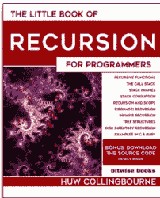

## 带视野的房间

我对 `Room` 类所做的最后一个也是最剧烈的更改。之前，`Room` 的出口——`n`、`s`、`w`、`e`、`up` 和 `down` 字段是整数。这些整数代表存储在地图中的房间列表的索引。这是表示地图的一种常见方法。它的优点是线性列表是一个相对简单的结构。

如果你想在开发程序时查看游戏中所有房间的状态，你可以深入研究这些数字——1, 2, 10, 20, 100, 175 等——在大游戏中这很难追踪。

## 第 9 章 — 回顾面向对象编程

你可能会想，在地图中拥有实际的 `Room` 对象不是更好吗？当玩家想要从巨人房间（Troll Room）向南移动时，`go()` 方法将返回位于巨人房间南方出口的相邻 `Room`。

使用实际 `Room` 对象作为出口有助于让玩家更具自主性——就像一个能够执行自身动作的软件机器人，而不是一个需要外部输出（如玩家或游戏本身）才能在不同地点之间移动的棋子。但也有一些缺点。首先，对象之间的链接可能会迅速创建一个复杂的对象网络（这会让调试变得非常棘手）。而且你还需要确保按照正确的顺序创建和初始化房间。

在将 `Room` 对象作为其他 `Room` 对象的字段（出口）添加时，你需要分两个不同的步骤来创建和初始化每个 `Room`。首先，你必须创建“空”的 `Room` 对象。然后，你必须初始化每个 `Room`，将其他 `Room` 对象分配给出口变量。你可以在一个步骤中将 `Room` 对象放置在出口（在这些对象的构造期间），因为在将它们分配给出口变量之前，所有的 `Room` 对象都必须创建。这就是我创建和初始化的方式：

### AdventureGame6 (Game.java)

```java
// 创建房间
Room troll = new Room();
Room forest = new Room();
Room cave = new Room();
Room shed = new Room();
Room dungeon = new Room();
```

```java
// 初始化房间
troll.init("Troll Room", "一个闻着巨人味道的黑暗房间", null, cave, null, null, null, trollList());
forest.init("Forest", "一片绿树葱葱的森林", null, null, trollRoom, null, null, forestList());
cave.init("Cave", "一个布满发光苔藓的阴暗洞穴", TrollRoom, null, null, null, dungeon, caveList());
shed.init("Shed", "一个旧木小屋", null, null, cave, null, null, new ThingList("shedList"));
dungeon.init("Dungeon", "一个恶臭、黑暗的牢室", null, null, null, cave, null, new ThingList("dungeonList"));
```

当然，我重写了 `Room` 构造函数并添加了一个 `init()` 方法来支持这种操作。由于 `Actor` 能够在指定的出口找到 `Room` 并移动（设置位置），我将 `moveTo()` 方法从 `Game` 类移动到了 `Actor` 类，并对其略微重写，以处理 `Room` 对象而不是整数。

在 `Game` 类中，`moveTo()` 方法调用 `player.moveTo()` 并向其传递一个 `Dir` 参数（如 `NORTH` 或 `SOUTH` 这样的枚举常量）。执行实际“移动”动作的是 `Actor` 对象。如果玩家移动到了新房间，`moveTo()` 返回 `true`，否则返回 `false`：

```java
void movePlayerTo(Dir dir) {
  if (player.moveTo(dir)) {
    look();
  } else {
    showStr("没有出口!");
  }
}
```

## 房间作为出口

简而言之，使用 `Room` 对象的优点比使用像整数 `2` 更言而易见：b) 拥有指向实际房间的引用使得玩家（`Actor` 对象）能够移动，而不需要另一个对象（如门）来完成操作。使用 `Room` 而不是整数的缺点是它让调试更困难。房间之间的链接创建了一个复杂的多链网络。相比之下，数组或 `ArrayList` 是一种线性结构，在调试时更容易导航。当你使用 `Room` 对象表示出口时，你根本不需要单独的地图结构。但在我的代码中，为了调试，我将所有房间都添加到了我的地图 `ArrayList` 中。处理这个问题还有其他方法。我在《The Little Book of Adventure Game Programming in C#》中开发的 C# 游戏中，`Dictionary` 条目是通过描述性枚举常量（例如 `rm.DaggerStreet`）表示的，如下：

```c
rmRoom("Ripper Mews", "一条令人愉快的小街", Rm.NOEXIT, Rm.GardenN, Rm.DaggerStreet, Rm.NOEXIT, ThingList())
```

## 现在编写一个游戏

我们现在准备好超越代码的测试和开发阶段，开始制作一个可以玩的游戏。当然，你可以添加更多词汇和方法，让玩家执行拉、推或其他动作。自然地，这完全取决于你如何决定在你的游戏中可以发现哪些宝藏和房间。

到此，你可以获取 AdventureGame 项目的代码并进行扩展，以创建一个功能完整的游戏。事实上，我鼓励你这样做。寻找可以改进的地方，尝试重构类层级结构，并添加更多类来定义“特殊类型”的宝藏。当然，再添加一些谜题。

如果你玩过其他冒险游戏，你可能已经对想要添加的谜题类型有了想法：找到钥匙打开上锁的门，找到一些黄金引诱巨龙离开巢穴，这样你就可以偷走宝石用来杀手来杀死巨魔（以此类推）。你创造的谜题种类完全取决于你的想象力。


## 如果这里有两个匹配的东西怎么办？

到目前为止，我的代码都假设在任何位置只有一个给定名称的物品——一把剑、一盏灯或一个——。但如果有多个呢？如果这里有两个匹配的东西呢？

## 接下来是什么？

我们都完成了！在本书的后续章节中，我将介绍如何开始。我们现在准备好超越代码的测试和开发阶段，开始制作一个可以玩的游戏。当然，你可以添加更多词汇和方法，让玩家执行拉、推或其他动作。自然地，这完全取决于你如何决定在你的游戏中可以发现哪些宝藏和房间。

此时，你可以获取 AdventureGame 项目的代码并进行扩展，以创建一个功能完整的游戏。事实上，我鼓励你这样做。寻找可以改进的地方，尝试重构类层级结构，并添加更多类来定义“特殊类型”的宝藏。当然，再添加一些谜题。

如果你玩过其他冒险游戏，你可能已经对想要添加的谜题类型有了想法：找到钥匙打开上锁的门，找到一些黄金引诱巨龙离开巢穴，这样你就可以偷走宝石用来杀手来杀死巨魔（以此类推）。你创造的谜题种类完全取决于你的想象力。

# 第 10 章 — 地图与迷宫

在本章中，我将介绍如何开始。我们现在准备好超越代码的测试和开发阶段，开始制作一个可以玩的游戏。当然，你可以添加更多词汇和方法，让玩家执行拉、推或其他动作。自然地，这完全取决于你如何决定在你的游戏中可以发现哪些宝藏和房间。

在开始编程之前，拥有一张清晰的地图是重要的。你可以在纸上画地图，也可以使用软件。我画了这张地图：

| 准备室 | 桥梁 |
| :--- | :--- |
| 会议室 | 全息室 |
| 引擎室 | 地下 |

地图的顶部是北，底部是南，左侧是西，右侧是东。向下箭头表示两个房间之间的上下连接。

## 迷宫

以这种方式连接的三个水培室，可以用来表示不形成规则矩阵的位置——例如路径不规则的森林。或者它们也可以代表通过定义明确方向的曲折路径连接的位置。

通过这种方式，你可以从相对少的房间创建出难以导航的迷宫。如果每个房间的名称或描述都是相同的“走廊”或“你处于一个曲折的迷宫中”，这些迷宫导航将变得格外困难。事实上，后者的描述在 20 世纪 70 年代由 Will Crowther 编写的“原始冒险游戏” Colossal Cave 中非常著名。这是该游戏的一个片段：

> south
>
> 你处于一个曲折的迷宫中。
>
> east
>
> 你处于一个曲折的迷宫中。
>
> south
>
> 你处于一个曲折的迷宫中。
>
> south
>
> 你处于一个曲折的迷宫中。

迷宫可以成为谜题的一部分。用户需要在特定的步数内到达某处并返回，以便执行某些操作，如拉动禁用炸弹开关。如果没有地图，这几乎是不可能的。绘制迷宫的一种方法是在房间中放置物品。当玩家回到带有胡萝卜的房间时（例如），该房间就可以画在纸上并标记为“胡萝卜室”。通过检查每个出口，在其他位置放置物体，玩家将逐渐能够重建程序员在设计迷宫时使用的地图。

## 代码更改

我第一次创建一个完整游戏的尝试可以在 Starcrash-beta-project 中找到。它被标记为“beta（测试版）”，因为在开发过程中，我意识到在代码变得适用于开发完整游戏之前，我还有许多需要改进的地方。这个 beta 版本包含了各种更改和新增，以整理我的代码并为“最终”版本做好准备。我将很快地概述这些更改，因为它们在编码技术方面并不涉及任何新点：

## GameThing

我将 `Treasure` 重命名为 `GameThing`。`Thing` 现在被设计为所有“简单”游戏对象的类。`Thing` 仍然是“基类”类，但我不再打算创建 `Thing` 对象了。`GameThing` 将用于不是容器的简单对象。我不打算维护“分数”——我在 `Thing` 中添加了一个字段。这是一个整数，可以粗略地反映每个 `Thing` 的大小和重量。它将在以后被用于确保玩家收集物品的数量有一个限制。

## 计算对象的“质量”

为了简单起见，我决定 `Thing` 的质量通常应该从由常量定义的有限整数值集中赋值。我在这里稍微耍了小聪明，创建了一个不包含枚举值而只包含数值常量的枚举（enum）。为了让编译器对此保持沉默，我必须在常量上方添加一个分号。分号通常放置在枚举标识符之后，但在这里它只是一段无意义（但必须的）语法。值 `UNKNOWN` 用于用于质量无关的 `Thing` 对象（例如 `Room` 和 `Actor` 对象）：

```java
public enum Mass {
    public static final int UNKNOWN = 0;
    public static final int TINY = 1;
    public static final int SMALL = 5;
    public static final int MEDIUM = 25;
    public static final int BIG = 50;
    public static final int HUGE = 100;
}
```

## 第 10 章 — 地图、迷宫与迷宫

当我创建一个对象时，我使用 `Mass` 值之一来初始化它的质量：

| Starcrash-beta (Game.java) |
| :--- |
| ContainerThing box = new ContainerThing("box", "a small cardboard box", Mass.SMALL, boxList, readyRoom); |

## 质量异常

由于 `Thing` 的质量字段是一个整数，我可能会传递任何整数值而不是使用 `Mass` 常量。我想确保自己不会无意中用某个愚蠢的值初始化物体——例如，如果我想输入 100 时不小心输入了 1000。出于如此，我写了这个在构造函数中调用的测试方法：

| Starcrash-beta (Thing.java) |
| :--- |
| private void testMass(){ |
|     if ((mass < Mass.UNKNOWN) || (mass > Mass.HUGE)){ |
|         throw new IncorrectMassException("Mass value " + mass + " is invalid!"); |
|     } |
| } |

我定义了这个异常（错误对象）类：

| Starcrash-beta (Thing.java) |
| :--- |
| class IncorrectMassException extends RuntimeException { |
|     public IncorrectMassException(String errorMessage) { |
|         super(errorMessage); |
|     } |
| } |

现在，假设我不小心传递了无效的数字 1000：


| ContainerThing box = new ContainerThing("box", "a small cardboard box", 1000, boxList, readyRoom); |

当我运行程序时，Java 向我显示了此错误：

| Exception in thread "main" gameobjects.IncorrectMassException: Mass value 1000 is invalid! |

## 未处理的异常？

通常，当发生运行时异常时，你可能希望在代码中处理它，例如我在 `Starcross.java` 文件中的 `loadGame()` 方法中所做的那，它使用 `try...catch` 块尝试加载数据文件，捕获任何异常并在出现问题时显示文明的错误消息。但是对于我的 `IncorrectMassException`，我没有处理这个异常。这是因为这个问题在游戏发布之前必须修复；我实际上希望这个异常导致程序崩溃，以强制我修复它！

## 限制玩家携带的物品

我决定玩家只能持有总质量不超过 `MASSLOAD` 的数量对象：

| Starcrash-beta (Actor.java) |
| :--- |
| final int MAXLOAD = Mass.MEDIUM + Mass.SMALL; |

我通过定义一个整数负荷变量 `load` 并在对象被拾取时将其质量相加来实现。如果将对象的质量添加到玩家物品的质量中会导致玩家负荷超出，我也可以防止该对象被拾取：

| Starcrash-beta (Actor.java) - doTake() |
| :--- |
| if ((load + t.mass()) > MAXLOAD) {\n    s = "You are carrying too much. You need to drop\n" + "something before taking the " + t.getName());\n} else {\n    load += t.mass;\n    transferOb(t, th, this);\n} |

当对象被丢弃或放入当前房间的容器时，我只需从 `load` 中减去它的质量：

| Starcrash-beta (Actor.java) - drop() |
| :--- |
| load = t.tmass; |

## 第 10 章 – 地图、迷宫与质量

然而，如果你对这个问题稍微思考，你很快就会意识到，这样加减对象质量的方法太简单了。当一个容器包含其他容器时，我显然需要计算每个“嵌套”或“内部”容器的总质量，就像我计算外部容器的总质量一样。

## 大量递归

这可能会让你想起我们在第 9 章中努力的一个问题，当时代码必须深挖未知数量的容器，以确定哪些对象是“可见的”，因此可以被认为“在这里”。我用递归解决了这个问题，正如你将看到的，我以类似的方式解决总质量问题。

`ContainerThing` 中的 `totalMass()` 方法非常简单：它将容器质量（由 `getMass()` 提供）与它包含的所有对象的质量（由 `contentsMass()` 提供）相加：

| Starcrash-beta (ContainerThing.java) |
| :--- |
| public int totalMass() { return this.getMass() + contentsMass(); } |

`contentsMass()` 方法也很简单。它遍历当前 `ContainerThing` 包含的所有线性列表 `t1`，获取每个 `t.getMass()` 的值，并将该值加到整数变量 `countmass` 中：

| Starcrash-beta (ContainerThing.java) |
| :--- |
| public int contentsMass() {\n    List t1;\n    int countmass;\n    t1 = flatten();\n    countmass = 0;\n    for (Thing t : t1) {\n        countmass += t.getMass();\n    }\n    return countmass;\n} } |

到此为止还没有递归。但是，你可能会问，我从哪里获取线性列表 `t1`？`t1` 列表需要包含当前 `ContainerThing` 对象列表中的所有物品，加上可能在其中的其他 `ContainerThing` 对象中的物品。

## 第 10 章 — 地图、迷宫与质量

该列表（以及后续可能存在的多个层级的“嵌套”列表）。这里的秘密在于使用 `flatten()` 方法：

```java
tl = flatten();
```

它返回一个“扁平的”或线性列表。可以这样想：想象我有一个袋子，里面装有一个盒子，盒子里装有一个戒指和一把钥匙，袋子里还有一个碗，碗里装有一颗钻石。这就是袋子列表最初的形态——袋子包含盒子和碗；盒子装有戒指和钥匙；碗装有钻石：

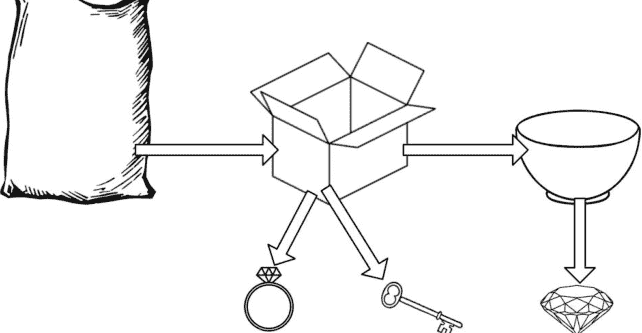

在这里我们处理的是三个列表：1) 袋子里的物品的列表；2) 盒子里物品的列表；3) 碗里物品的列表。如果我们只需要处理一个包含袋子、盒子、碗、戒指、钥匙和钻石的线性列表，显然会简单得多：

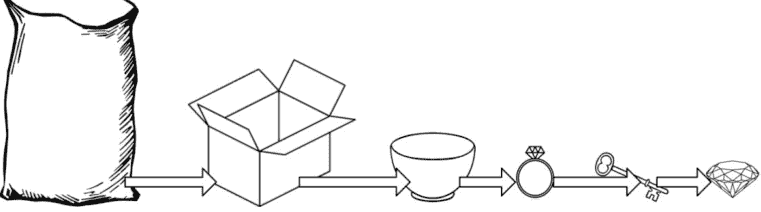

# 条件调试指令

在开发所有这些递归代码时，我发现显示大量详尽的诊断信息对于查找和修复 bug 很有用。

某些编程语言（如 C#）提供了“条件编译”指令，允许你在编译程序时选择性地跳过某些代码块。

当你想在调试时运行某些代码，但在最终程序中省略这些代码时，这非常有用。

Java 并没有条件编译指令，但你可以通过定义一个带有常量的简单类来实现类似的效果，就像我在 Starcrash-beta 项目中所做的那样：

| Starcrash-beta (Debug.java) |
| :--- |
| public class Debug { public static final boolean ON = true; } |

现在我可以测试常量 ON 的值，并创建一个代码块来包裹我的调试代码，如下（这里 `debugTakeDrop()` 是一个显示大量调试输出的方法）：

| Starcrash (Actor.java) - drop |
| :--- |
| if (Debug.ON) { ct = toContainerThing(t); ns += debugTakeDrop(t, tmass, ct != null); } |

我可以在代码的各处放置类似的调试块。当我准备好编译完成的游戏时，只需通过修改 Debug 类中 ON 的值即可关闭所有的诊断输出：

```java
public static final boolean ON = false;
```

## 扁平化分支列表

这就是我如何“扁平化”包含其他列表的列表：

```java
Starcrash-beta (ThingHolder.java)
ThingList flatlist = new ThingList();

private ThingList thingsToFlatten(ThingHolder th) {
    for (Thing t : th.getThings()) {
        flatlist.add(t);
        if (t instanceof ContainerThing) {
            thingsToFlatten((ContainerThing)t);
        }
    }
    return flatlist;
}

public ThingList flatten() {
    flatlist.clear();
    return thingsToFlatten(this);
}
```

通过将列表中的每个对象添加到 `ThingList flatlist`，构建了一个对象列表。如果其中一个对象是 `ContainerThing`，函数 `thingsToFlatten` 将递归地调用自己，并将 `ContainerThing` 对象作为参数传递，以便该容器列表中的任何对象也能被处理并添加到 `flatlist` 中。

除了确保玩家无法创建无限数量的大型物品外，确保容器无法装载不可能数量的物体也是合理的。因此，我在 `ContainerThing` 类中添加了 `int container_volume` 字段。这对方法计算容器容器内物品的质量（再次使用 `flatten()` 来创建一个列表）：

```java
Starcrash-beta (ContainerThing.java)
public int contentsMass() {
    ThingList tl;
    int countmass;

    tl = flatten();
    countmass = 0;
    for (Thing t : tl) {
        countmass += t.getMass();
    }
    return countmass;
}
```

## Starcrash-beta (ContainerThing.java) [续接]

```java
// 返回容器及其包含的所有物品的质量
@Override
public int totalMass(){
    return this.getMass() + contentsMass();
}
```

这是一个来自 `putInto()` 方法的示例，展示了如何使用它：

## Starcrash-beta (Actor.java) - putInto()

```java
else if ((container.totalMass()) + t.totalMass()) > container.volume()) {
    s = "The " + containername + " isn't big enough for the " + obname;
    if (container.numberOfThings() > 0) {
        s += "\n也许你可以从里面拿走东西再试一次?";
    }
}
```

## 第二章 – 描述物品的形容词

你说道：“拿那个戒指”。游戏回答道：“你是指金戒指、钻石戒指还是银戒指？”——它是怎么做到的？让我们发现吧……


在这里我们处理的是三个列表：1) 袋子里的物品的列表；2) 盒子里物品的列表；3) 碗里物品的列表。如果我们只需要处理一个包含袋子、盒子、碗、戒指、钥匙和钻石的线性列表，显然会简单得多：


（等等，之前的文本有些页面分页符，让我们从第 134 页开始重新对齐流程）。

你说道：“拿那个戒指”。游戏回答道：“你是指金戒指、钻石戒指还是银戒指？”——它是怎么做到的？让我们发现吧……


（注：第 134 页的 OCR 文本很乱，我将根据提供的字符串重构逻辑）。

你说道：“拿那个戒指”。游戏回答道：“你是指金戒指、钻石戒指还是银戒指？”——它是怎么做到的？让我们发现吧……

## 语法单元

在第一遍（如之前所示），它将字符串拆分为单个单词。语法单元（grammar unit）可能包含单个单词，或一组“共同工作”的单词。在名词短语中，形容词与名词共同工作来描述一个对象。

## 第二章 – 描述物品的形容词

| Starcrash (Preposition.java) |
| :--- |
| public class Preposition extends GrammarUnit implements java.io.Serializable { \n public Preposition(String aWord) { \n } } |

名词短语（NounPhrase）要稍微复杂一些。除了主词（名词）外，它还包含一个形容词的 `ArrayList` 以及一个 `phrase()` 方法，该方法会返回一个格式化的字符串，例如 "small gold elvish ring"金色金色精灵戒指），其中包含了所有的形容词和名词：

| Starcrash (NounPhrase.util.ArrayList) |
| :--- |
| import java.util.ArrayList; \n public class NounPhrase extends GrammarUnit implements java.io.Serializable { \n private ArrayList<String> adjectives; \n NounPhrase(String aNoun, ArrayList<String> someAdjectives) { \n super(aNoun); \n adjectives = someAdjectives; } \n public ArrayList<String> getAdjectives() { \n return adjectives; } \n void setAdjectives(ArrayList<String> adjectives) { \n this.adjectives = adjectives; } \n public String phrase() { \n String s=""; \n for (String a: adjectives) { \n s += a + " "; } \n s += this.getWord(); \n return s; } } |

现在我需要一种方法将注释或“句子”分析为语法单元。我创建了一个 `SentenceAnalyzer` 类来完成此工作。它的构造函数接受 `WordAnd` 对象的 `List` 作为参数——即一组对值列表，例如字符串 "take" 和 常量 `WT.VERB`，或者字符串 "sword" 和 `WT.NOUN` 等。它有以下两个字段：

## 第1章 — 描述物品的形容词

### Starcrash (SentenceAnalyzer.java)

```java
private List<GrammarUnit> sentence;
private List<WordAndType> rest;
```

在构造时，`SentenceAnalyzer` 对象将整个 `WordAndType` 列表分配给 `rest`（这里 `rest` 是尚未分析的“列表剩余部分”）。它的目标是遍历此列表，并由 `GrammarUnit` 对象构建出一个句子。每处理一个 `WordAndType` 元素，它就会从 `rest` 中移除。这是处理此逻辑工作的方法：

### Starcrash (SentenceAnalyzer.java)

```java
public List<GrammarUnit> analyze() {
  WordAndType wt;
  String word;

  while (!rest.isEmpty()) {
    wt = getNextElement();
    word = wt.getWord();
    switch (wt.getType()) {
      case VERB:
        addVerb(wt);
        break;
      case ADJECTIVE:
        case NOUN:
          addNounPhrase(wt);
          break;
      case PREPOSITION:
        addPreposition(wt);
        break;
      default:
        break;
    }
  }
  return sentence;
}
```

## 更多包，更多类

在 Starcrash 项目中，我继续通过创建许多专家类来重构代码，这些类被分组在包中，例如 `game.data`（包含“初始化”游戏的类）和 `game.grammar`（包含 `GrammarUnit` 类、其子类以及分析和分类单词及命令所需的其他类）。

## 动词与介词

由于 `Verb` 和 `Preposition` 类各包含一个字符串，当在 `WordAndType` 列表中找到其中之一时，它会被简单的从 `rest` 中移除，然后找到该字符串以初始化合适的 `GrammarUnit` 对象，并将其添加到 `sentence` 中：

```java
private void addPreposition(WordAndType wt) {
    sentence.add(new Preposition(wt.getWord()));
    rest.remove(wt);
}

private void addVerb(WordAndType wt) {
    sentence.add(new Verb(wt.getWord()));
    rest.remove(wt);
}
```

## 名词短语

当发现形容词或名词时，会调用 `addNounPhrase()` 方法：


```java
private void addNounPhrase(WordAndType wt) {
    WordAndType nextWT;
    String noun;
    ArrayList<String> adjectives;

    nextWT = wt;
    adjectives = getAdjectives(nextWT);
    if (adjectives.isEmpty()) {
        noun = getNoun(nextWT);
    } else {
        nextWT = getNextElement();
        noun = getNoun(nextWT);
    }
    if (noun.isEmpty()) {
        sentence.add(new GrammarError("Missing Noun"));
    } else {
        sentence.add(new NounPhrase(noun, adjectives));
    }
}
```

### 形容词

此方法首先调用 `getAdjectives()` 来寻找一些形容词：

```java
ArrayList<String> getAdjectives(WordAndType wt) {
    ArrayList<String> adjectives = new ArrayList<>();
    boolean loop = true;

    while (loop) {
        wt = getNextElement();
        if (wt == null) {
            loop = false;
        } else if (wt.getType() == WT.ADJECTIVE) {
            adjectives.add(wt.getWord());
            rest.remove(wt);
        } else {
            loop = false;
        }
    }
    return adjectives;
}
```

### 名词

`addNoun()` 方法尝试寻找名词。顺便提一下，如果没有更多元素，它将返回 `null`：

```java
private WordAndType getNextElement() {
    if (rest.isEmpty()) {
        return null;
    } else {
        return rest.get(0);
    }
}
```

在某些情况下，用户可能输入形容词但没有名词（例如 "get small"），此时我会向 `sentence` 添加一个 `GrammarError`：

```java
if (noun.isEmpty()) {
    sentence.add(new GrammarError("Missing Noun"));
}
```

### 分析句子

在 `Parser` 类中，`processCommand()` 方法被重写了。它现在开始创建一个 `SentenceAnalyzer` 对象，并用 `WordAndType` 列表初始化：

```
Starcrash (Parser.java)
static processcommand() {
    SentenceAnalyzer analyzer;
    analyzer = new SentenceAnalyzer(command);
```

一旦 `SentenceAnalyzer` 对象用此列表初始化，它可以分析该列表并返回一个新的 `GrammarUnit` 对象的 `ArrayList`：

```java
List<GrammarUnit> grammarunits = new ArrayList<>();
grammarunits = analyzer.analyze();
```

例如，如果用户输入 "take gold ring"，命令将被解析为如下 `word`(String) 和 `wordtype`(WT) 对：

| word | wordtype |
| --- | --- |
| "take" | VERB |
| "small" | ADJECTIVE |
| "gold" | ADJECTIVE |
| "ring" | NOUN |

当我调用该对象的 `analyze()` 方法时，它处理此列表并返回一个新的 `GrammarUnit` 对象列表：

| object | word | adjectives |
| --- | --- | --- |
| Verb | "take" | |
| NounPhrase | "ring" | "small", "gold" |

在这个例子中，我从四个 `WordAndType` 元素中开始了一个单词，`SentenceAnalyzer` 创建了一个仅包含两个 `GrammarUnit` 元素的列表——一个表示单个单词的 `Verb` 对象和一个表示三个单词的 `NounPhrase` 对象。

## 处理命令

在游戏的上一个版本中，`processCommand()` 调用其他方法处理 `WordAndType` 对象，现在调用类似的方法来处理 `GrammarUnit` 对象列表——其中每个 `GrammarUnit` 可能代表一个或多个单词：

```
Starcrash (Parser.java) - processCommand()
switch (grammarunits.size()) {
    case 1:
        s = processVerb(grammarunits);
        break;
    case 2:
        s = processVerbNounPhrase(grammarunits);
        break;
    case 3:
        s = processVerbPrepositionNounPhrase(grammarunits);
        break;
    case 4:
        s = processVerbNounPhrasePrepositionNounPhrase(grammarunits);
        break;
    default:
        s = "Unable to process command";
        break;
}
```

这些方法的每个重写都遵循类似的模式，因此我在这里展示其中一个。一如既往，务必检查存档中的代码以查看所有其他方法是如何重写的。这是 `processVerbNounPhrase()` 方法：

# 第11 章 – 描述物品的形容词

### Starcrash (Parser.java)

```java
static String processVerbNounPhrase(List<GrammarUnit> command) {
    String msg = "";
    GrammarUnit gu1 = command.get(0);
    GrammarUnit gu2 = command.get(1);
    String verb_word = gu1.getWord();
    String noun_word = gu2.getWord();
    Verb v = null;
    NounPhrase np = null;

    if (gu1 instanceof Verb) {
        v = (Verb) gu1;
    }
    if (gu2 instanceof NounPhrase) {
        np = (NounPhrase) gu2;
    }
    if (v == null) {
        msg = "Can't do this because " + verb_word + " is not a command";
    } else if (np == null) {
        msg = "Can't do this because " + noun_word + " is not an object";
    } else {
        switch (verb_word) {
            case "take":
            case "get":
                msg = game.takeOb(np);
                break;
            case "drop":
                msg = game.dropOb(np);
                break;
            case "open":
                msg = game.openOb(np);
                break;
            case "close":
                msg = game.closeOb(np);
                break;
            default:
                msg = verb_word + " (not yet implemented)";
                break;
        }
    }
    return msg;
}
```

该方法旨在处理包含两个元素的列表——一个动词（`Verb`）和一个名词短语（`NounPhrase`），例如“take ring”或“drop small gold ring”，其中“ring”和“small gold ring”都属于名词短语。

它首先将 `command` 列表中的前（实际上是*唯一的*）两个元素赋值给 `GrammarUnit` 类型的变量 `gu1` 和 `gu2`。它将 `gu1` 中的动词（*word* 字段）赋值给 `verb_word`，并将 `gu2` 中的名词赋值给 `noun_word`。然后，它测试 `gu1` 和 `gu2` 对象的实际类型。为了使命令有效，`gu1` 必须是 `Verb` 且 `gu2` 必须是 `NounPhrase`。如果是的话，动词和名词短语变量 `v` 和 `np` 将赋予 `gu1` 和 `gu2` 的值，并将其转换为它们特定的类类型，这些类型显然都是 `GrammarUnit` 类的派类：

```java
if (gu1 instanceof Verb) {
    v = (Verb)gu1;
    if (gu2 instanceof NounPhrase) {
        np = (NounPhrase) gu2;
    }
}
```

如果 `gu1` 或 `gu2` 不是相应的类型，则返回错误信息，该方法将不再执行后续操作。但如果它们是正确的类型，则会调用一个方法来处理动词指定的动作。名词短语会被传递给该方法。例如，如果用户输入“drop small gold ring”，将调用 `dropOb()` 方法。该方法会将包含单词“ring”以及形容词“small”和“gold”的 `NounPhrase` 对象传递给玩家对象的 `drop()` 方法：

### Starcrash (Actor.java)

```java
public String drop(NounPhrase np) {
    String s;
    ThingAndThingHolder t_th;
    Thing t;
    ThingHolder th;
    ThingAndThingHolderList lists;
    ContainerThing ct;
    int tmass;

    things = matchingThingsInInventory(np);
    s = ListTool.oneThingInList(things, np.phrase(), "drop", true);
    if (s.isEmpty()) {
        t_th = things.get(0);
        t = t_th.getThing();
        th = t_th.getThingHolder();
        tmass = t.totalMass();
        transferObj(t, th, this.getLocation());
        load = tmass;
        s = t.getDescription() + " dropped!";
    }
    return s;
}
```

如果你将 `drop()` 方法与上一个项目（Starcrash-beta）相同的方法版本比较，你会发现它们非常相似。它们获取一个 `ThingAndThingHolder th` 并调用 `transferObj()` 将该对象从 Actor 的物品列表转移到当前房间的物品列表中。唯一的显著区别在于要转移的 `Thing` 对象的确定方式。

在上一个项目中，假设整个游戏中只会有一个箱子、一把剑、一个戒指（以此类推），因此通过调用 `find()` 方法并传入对象的名称即可找到该对象：

```java
Starcrash-beta (Actor.java)
t_th = this.findThing(objname);
```

在当前项目（Starcrash）中，可能有许多箱子、剑和戒指，每种物品都通过一组“属性”（attributes）来区分——即通过可以使用形容词描述的区分性特征：“small gold ring”、“silver ring”等。


## 形容词还是属性？

当我使用“属性”（attributes）一词时，指的是 `Thing` 对象的“属性”（properties），这些属性帮助我们将其与其他 `Thing` 对象区分开。`Thing` 的每个属性都可以用形容词描述。由于在编程中，“attribute”（属性）和“property”（属性）通常被用于描述语法的特定特征，我决定为 `Thing` 对象的属性列表使用“adjectives”（形容词）这一名称。

## 匹配多个对象

我写了一个新方法 `matchingThingsInInventory()`，将整个 `NounPhrase` 对象传递给它。它能够匹配多个一个对象。例如，如果玩家的物品栏中有一个银戒指（silver ring）和一个金戒指（gold ring），且用户输入了“drop ring”，此方法将返回两个对象：

```java
Starcrash (Actor.java)
public ThingAndThingHolderList matchingThingsInInventory(NounPhrase np) {
    ThingAndThingHolderList things;
    things = findThings(np);
    return things;
}
```

这里的代码依赖于 `ThingHolder` 的 `findThings()` 方法。我在这里不会详细说明它的工作原理（你可以查看 `ThingHolder.java` 中的代码）。只需说明，它再次依赖于一个递归方法。例如，如果用户输入“drop small gold ring”，将调用 `dropOb()` 方法。该方法会将包含单词“ring”以及形容词“small”和“gold”的 `NounPhrase` 对象传递给玩家对象的 `drop()` 方法：

```java
Starcrash (ListTool.java)
private static String oneThingInList(ArrayList<ThingAndThingHolder> things, String desc, String verb, boolean mustInInventory) {
    String s = "";

    if (isNullOrEmpty()) {
        if (mustInInventory) {
            s = "You haven't got " + desc;
        } else {
            s = "Can't see " + desc;
        }
    } else if (things.size() > 1) {
        s = "Which of these do you want to " + verb + "?\n";
        s += listMultipleThings(things);
    }
    return s;
}
```

## II 描述物品的形容词

这里的参数如下：

- `ThingAndThingHolder things`
- `String desc`
- `String verb`
- `boolean mustInInventory`

- `ThingAndThingHolder`列表
- 描述（例如“small gold ring”）
- 动词（如“drop”或“take”）
- 如果对象必须由 Actor 所有则为 true

## ListTool 类

我在 `gameobjects.lists.tools` 包下创建了一个新类 `ListTool`，它包含一些检查列表的静态方法。

另一方面，如果找到了多个对象，则返回字符串“Which of these do you want to ”加上动词（例如“drop”或“take”），以及由 `listMultipleThings()` 返回的对象列表：

```java
Starcrash (ListTool.java)
private static String listMultipleThings(ArrayList<ThingAndThingHolder> things) {
    String s = "";

    for (ThingAndThingHolder tth : things) {
        s += tth.get().getDescription() + "\n";
    }
    return s;
}
```

所以实际上，判断多个对象是否匹配命令的操作就此了。每个动作方法 `take()`、`drop()`、`lookAt()`、`look()` 等都使用了在执行动作之前确定 `Thing` 是否可以被唯一识别的技术。`put` 方法稍微复杂因为它需要检查两个物体是否都能被唯一识别。例如，如果用户输入“put the ring into the box”，而这里有两个戒指和两个箱子，它需要显示一条消息告知用户它无法判断指的是哪个箱子或哪个戒指。我留给你们在空闲时间研究 Actor 中这个方法以及所有其他“动作”方法的代码。


# 第 11 章 — 描述事物的形容词

尽管其中某些部分看起来相当复杂，但这主要是由于为了解决潜在的歧义而进行了大量的检查。所有方法的底层编码技术都是相似的。

## 对象属性

为了将用户输入的形容词与游戏中的实际对象相匹配，我已经在 `Thing` 类中添加了一个 `ArrayList`：

```java
Starcrash (Thing.java)
private ArrayList<String> adjectives;
```

此列表中的元素可以被视为 `Thing` 对象的“属性”——它们告诉我们某一个是“小的”且“金色的”，而另一个是“银色的”且“大大的”。默认情况下，形容词列表是空的。游戏中的所有 `Thing` 对象并不需要关联形容词。当我想为一个 `Thing` 添加形容词时，我会调用 `addAdjectives()` 方法，该方法使用 Java 集合的 `addAll()` 方法将形容词添加到整个列表中：

```java
Starcrash (Thing.java)
public void addAdjectives(String[] someAdjectives) {
  Collections.addAll(adjectives, someAdjectives);
}
```

我还有一个用于给列表赋值的 setter 方法：

```java
public void setAdjectives(ArrayList someAdjectives) {
  this.adjectives = someAdjectives;
}
```

记住，`setAdjectives()` 会替换现有的列表，而 `addAdjectives()` 则在现有列表基础上添加。在创建游戏时（当列表为空时），我可以调用其中任一个方法。`setAdjectives()` 方法接收一个 `ArrayList` 参数，而 `addAdjectives()` 方法接收一个字符串数组。它们的调用方式如下：

```java
Starcrash (GameData.java)
goldRing.addAdjectives(new String[]{"small", "gold"});
silverRing.setAdjectives(new ArrayList<>(Arrays.asList("small", "silver")));
```

## 第二 II 章 — 描述事物的形容词

为了根据用户输入的描述匹配 `Thing`，我需要将 `NounPhrase` 对象中存储的名词（以及存在的形容词）与 `Thing` 对象的名称（以及已定义的形容词）进行匹配。`Thing` 的以下两种方法处理了这一点：

```java
Starcrash (Thing.java)
private boolean adjectivesMatch(Array<String> someAdjectives) {
    boolean ok = true;

    for (String a :someAdjectives) {
        if (adjectives.contains(a)) {
            ok = false;
        }
    }
    return ok;
}

public boolean matchThing(NounPhrase np) {
    boolean match = false;

    if (np.getName().equals(np.getWord()) && adjectivesMatch(np.getAdjectives())) {
        match = true;
    }
    return match;
}
```

`matchThing()` 方法是从 `ThingHolder` 类的 `findThingInAnyList()` 方法调用的，该方法递归地在列表中搜索对象。例如，如果某个对象位于一个打开的容器内，它将尝试在玩家的背包中找到它（例如，盒子里的一个戒指）：

```java
Starcrash (ThingHolder) – findThingInAnyList()
if ((container != null) && (container.isOpen())) {
    findThingInAnyList(container, np);
}
```

所有编码的最终结果是，玩家现在可以输入如下命令：

- take the gold ring (拿起金戒指)
- look at the silver elvish sword (查看银色的精灵剑)
- put the small gold ring into the big red wooden box (把小金戒指放入大红木箱中)

此外，如果存在任何歧义（因为多个对象符合玩家的描述），游戏将做出相应的响应。玩家可能会输入：

take the box (拿那个盒子)

然后游戏会回复：

| 你想拿哪一个？ |
| :--- |
| small cardboard box (小纸箱) |
| big wooden box (大木箱) |
| tiny onyx box (微型黑玛石盒) |

# 第 12 章 — 创建游戏！

为了将一个“开发”阶段的代码库（在测试阶段创建）准备好进行部署（即创建一个真正的游戏），我们进行了大量的更改……

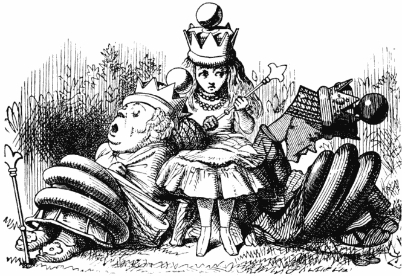

如果你在学习上一章概述的主要更改时查看 `Starcrash` 的源代码，你一定已经注意到整个项目的结构与之前的版本（Starcrash-beta）相比发生了很大变化。现在让我带你快速浏览一下最重要的更改。

许多更改旨在使代码更加整洁和模块化。如果你在 NetBeans IDE 中打开所有项目节点，你会看到有很多新类，这些类被组织在若干个包（packages）中，以便将相关的类放在逻辑组中。这些更改中的大多数很容易理解——它们不涉及任何复杂的编码——因此我将重点介绍最重要的区别。

## 游戏类

游戏类基本上分为三组。第一组组织在 `game` 包中。这包括 `game.data` 中的数据初始化类、`game.grammar` 中的语法类以及“顶层”游戏类：`Game`、`Parser` 和 `Starcrash`。`gameobjects` 包包含了核心游戏 `Thing` 以及 `gameobjects.lists` 中的一些特殊列表类型、`gameobjects.lists` 中的 `ListTool` 类以及 `gameobjects.lists` 中的 `Actions`。`globals` 包包含了工具类和枚举：

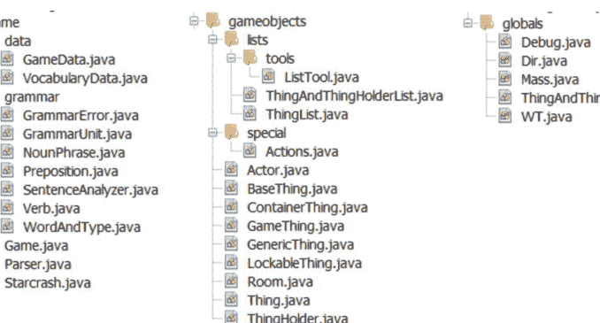

## 游戏对象

“游戏对象”类都放在 `gameobjects` 包中。最终基类是 `BaseThing`，它包含一个 `name` 和一个 `description`。`Thing` 类实现了所有游戏对象的通用行为，如 `movable`。它还通过 `show()` 方法的布尔值来决定是否应该显示在列表中（例如，在描述房间时显示一个对象）。

## 游戏对象

代码被组织组织命名包中。添加了多个新包，如 `game.data`、`game.grammar`、`gameobjects.lists` 和 `gameobjects.lists.tools`，实现这一点这一点。

现在有两个公共方法，可以它们它们来只显示顶层对象或所有对象：

在玩家进入房间时，只显示顶层对象。我们通过测试由 `show()` 方法返回的布尔值来实现此点的：

```java
Starcrash (ThingHolder.java) - doDescribeThings()
if (t.show())
```

## 隐藏容器的内容

我对 `doDescribeThings()` 方法做了另一处修改。之前它会描述容器的内容。但有时这会破坏谜题。例如在我的游戏中，钥匙被隐藏在花盆里。我不希望玩家在进入房间时看到这个描述：

```
Hydroponics: This is steamy hydroponics area with plants everywhere.
Things here:
pitcher plant
```

我为 `doDescribeThings()` 添加了一个布尔参数 `describeAll`。当 `describeAll` 为 `true` 时，该方法才会递归（显示容器的内容）。否则，它只描述顶层对象列表——不是位于其他对象内部的对象：

```java
Starcrash (ThingHolder)
void doDescribeThings(Thing th, boolean describeAll) {
  ThingList tlist = th.getThings();
  Container container;

  for (Thing t : tlist) {
    String inContainer = "";
    if (t.getContainer() instanceof Container) {
      inContainer = " (in " + t.getContainer().getDescription()) + ")";
```

## 通用物体 (GenericThing)

新增了一个类 `GenericThing`。它用于那些可能作为“场景”一部分的对象（因此它们可以被观察、推挤等），但并不打算作为可用的游戏对象。你可以创建 `GenericThing` 对象作为灯光、窗户、墙壁、树木等：

| Starcrash (GameData.java) - initGame() |
| :--- |
| `GenericThing lights = new GenericThing("lights", "flashing lights", true); bridge.adding(lights);` |

当 `GenericThing()` 构造函数的最后一个参数为 `true` 时，该物体为复数形式——这里是 'lights' 而不是 'Light'。如果是复数，`GenericThing.isPlural()` 方法返回 `true`，且 `article()` 方法返回空字符串（如果你愿意，也可以返回 "some"），这样当你需要描述该对象时，你就知道复数时应该是 "lights" 或 "some lights"，而单数时应该是 "a light"：

## 复数 (Plurals)

你也可以扩展解析器和 `Thing` 对象来无缝处理复数形式。例如，如果当前位置有一个名为 "lights" 或 "plants" 的 `GenericThing`，你可以编写一些代码来处理指定单数 "light" 或 "plant" 的命令，以便玩家既可以执行 "look at plant" 也可以 "look at plants"。在我的游戏里，我作了点小弊。在有灯的房间里，我添加了两个对象，一个叫 "light"，另一个叫 "lights"，这样用户就可以查看（或通过其他方式交互）单盏灯或几盏灯了。


# 第 12 章 – 创建游戏！

`GenericThing` 的 `article()` 方法覆盖了 `Thing` 的 `article()` 方法，后者根据传递给它的字符串的初始大写字母是否为元音来返回 "a" 或 "an"：

### Starcrash (Thing.java)

```java
protected String article(String s) {
  char initial;
  String a;

  a = "a";
  char[] vowels = {'a', 'e', 'i', 'o', 'u'};
  initial = (s.toLowerCase()).charAt(0);
  for (char c : vowels) {
    if (c == initial) {
      a = "an";
    }
  }
  return a;
}
```

你可以在 `GenericThing` 的 `describe()` 方法中看到这个示例：

### Starcrash (GenericThing.java)

```java
public String describe() {
  String d;
  String s;

  d = getLongDescription();
  if (this.isPlural()) {
    s = "They are " + article(d) + " " + d;
  } else {
    s = "It is " + article(d) + " " + d;
  }
  return s;
}
```

## 可锁定物体 (LockableThing)

新的 `LockableThing` 类是 `ContainerThing` 的子类。它添加了一个新的布尔字段。当该字段为 `false` 时，对象是解锁状态；当它为 `true` 时，对象是锁定状态。你可能认为我只需要添加方法来切换 `locked` 的值即可。事实上，这没那么简单。首先，锁定状态和开启状态需要协同工作。从逻辑上讲，一个可能被锁定的东西只有在解锁后才能被打开，因此我覆盖了 `ContainerThing` 的 `open()` 方法：

```java
Starcrash (LockableThing.java)
@Override
public String open() {
    String s;

    if (locked) {
        s = "You can't open the " + getDescription() + " because it's locked";
    } else {
        s = super.open();
    }
    return s;
}
```

这里另一个更有意思的复杂性在于，并不是任何钥匙都可以。每扇门、保险箱、柜子或宝箱只能用特定的钥匙打开。

事实上，在游戏中，你可能会使用其他对象作为硬币、宝石或魔法卷轴来解锁物体。`LockableThing` 需要知道哪个对象会解锁它。我为它提供了一个字段来存储该信息：

```java
private Thing thingToUnlockWith;
```

该字段默认设置为 `null`。我本可以在构造函数中添加一个额外的参数来初始化它，但参数已经有很多了，所以我认为使用这个新方法初始化该对象更简单：

```java
public void canBeUnlockedWith(Thing t) {
    thingToUnlockWith = t;
}
```

在 `Starcrash` 游戏中，例如，柜子只能用金钥匙打开——不能用银钥匙或任何其他物体。因此，在 `GameData.java` 中，我添加了这行代码：

```java
Starcrash (GameData.java)
cupboard.canBeUnlockedWith(goldKey);
```

现在当玩家想要解锁柜子时，`LockableThing` 对象可以测试是否指定了正确的对象来解锁它。这个方法执行了这个操作：

### Starcrash (LockableThing.java)

```java
public String trytounlockWith(Thing t){
    String s;

    if (!locked) {
        s = getDescription() + " is already unlocked"
    } else if (t == thingUnlockWith){
        locked = false;
        s = "You unlock the "
    }
    return s;
}
```


## 通用物体 (GenericThing)

新增了一个类 `GenericThing`。它用于那些可能作为“场景”一部分的对象（因此它们可以被观察、推挤等），但并不打算作为可用的游戏对象。你可以创建 `GenericThing` 对象作为灯光、窗户、墙壁、树木等：

### Starcrash (GameData.java) - initGame()

```java
GenericThing lights = new GenericThing("lights", "flashing lights", true);
bridge.adding(lights);
```

当 `GenericThing()` 构造函数的最后一个参数为 `true` 时，该物体为复数形式——这里是 'lights' 而不是 'Light'。如果是复数，`GenericThing.isPlural()` 方法返回 `true`，且 `article()` 方法返回空字符串（如果你愿意，也可以返回 "some"），这样当你需要描述该对象时，你就知道复数时应该是 "lights" 或 "some lights"，而单数时应该是 "a light"。

## 复数 (Plurals)

你也可以扩展解析器和 `Thing` 对象来无缝处理复数形式。例如，如果当前位置有一个名为 "lights" 或 "plants" 的 `GenericThing`，你可以编写一些代码来处理指定单数 "light" 或 "plant" 的命令，以便玩家既可以执行 "look at plant" 也可以 "look at plants"。在我的游戏里，我作了点小弊。在有灯的房间里，我添加了两个对象，一个叫 "light"，另一个叫 "lights"，这样用户就可以查看（或通过其他方式交互）单盏灯或几盏灯了。


# 第 12 章 – 创建游戏！

`GenericThing` 的 `article()` 方法覆盖了 `Thing` 的 `article()` 方法，后者根据传递给它的字符串的初始大写字母是否为元音来返回 "a" 或 "an"：

### Starcrash (Thing.java)

```java
protected String article(String s) {
  char initial;
  String a;

  a = "a";
  char[] vowels = {'a', 'e', 'i', 'o', 'u'};
  initial = (s.toLowerCase()).charAt(0);
  for (char c : vowels) {
    if (c == initial) {
      a = "an";
    }
  }
  return a;
}
```

你可以在 `GenericThing` 的 `describe()` 方法中看到这个示例：

### Starcrash (GenericThing.java)

```java
public String describe() {
  String d;
  String s;

  d = getLongDescription();
  if (this.isPlural()) {
    s = "They are " + article(d) + " " + d;
  } else {
    s = "It is " + article(d) + " " + d;
  }
  return s;
}
```

## 可锁定物体 (LockableThing)

新的 `LockableThing` 类是 `ContainerThing` 的子类。它添加了一个新的布尔字段。当该字段为 `false` 时，对象是解锁状态；当它为 `true` 时，对象是锁定状态。你可能认为我只需要添加方法来切换 `locked` 的值即可。事实上，这没那么简单。首先，锁定状态和开启状态需要协同工作。从逻辑上讲，一个可能被锁定的东西只有在解锁后才能被打开，因此我覆盖了 `ContainerThing` 的 `open()` 方法：

### Starcrash (LockableThing.java)

```java
@Override
public String open() {
    String s;

    if (locked) {
        s = "You can't open the " + getDescription() + " because it's locked";
    } else {
        s = super.open();
    }
    return s;
}
```

这里另一个更有趣的复杂性在于，并不是任何钥匙都可以。每扇门、保险箱、柜子或宝箱只能用特定的钥匙打开。

事实上，在游戏中，你可能会使用其他对象作为硬币、宝石或魔法卷轴来解锁物体。`LockableThing` 需要知道哪个对象会解锁它。我为它提供了一个字段来存储该信息：

```java
private Thing thingToUnlockWith;
```

该字段默认设置为 `null`。我本可以在构造函数中添加一个额外的参数来初始化它，但参数已经有很多了，所以我认为使用这个新方法初始化该对象更简单：

```java
public void canBeUnlockedWith(Thing t) {
    thingToUnlockWith = t;
}
```

在 `Starcrash` 游戏中，例如，柜子只能用金钥匙打开——不能用银钥匙或任何其他物体。因此，在 `GameData.java` 中，我添加了这行代码：

### Starcrash (GameData.java)

```java
cupboard.canBeUnlockedWith(goldKey);
```

现在当玩家想要解锁柜子时，`LockableThing` 对象可以测试是否指定了正确的对象来解锁它。这个方法执行了这个操作：

### Starcrash (LockableThing.java)

```java
public String trytounlockWith(Thing t){
    String s;

    if (!locked) {
        s = getDescription() + " is already unlocked"
    } else if (t == thingUnlockWith){
        locked = false;
        s = "You unlock the "
    }
    return s;
}
```

*(注：由于原文代码中 `s = "You unlock the "` 之后似乎不完整，此处已按原文保留)*

这个方法在玩家尝试锁定此对象时执行类似的测试：

### Starcrash (LockableThing.java)

```java
public String trytolockWith(Thing t) {
    String s;

    if (locked) {
        s = "The " + getDescription() + " is already locked."
    } else if (isOpen()) {
        s = "You cannot lock the " + getDescription() + " while it is open.";
    } else if (t == thingUnlockWith) {
        locked = true;
        s = "You lock the "
    } else {
        s = "You can't lock the " + getDescription() + " with the "
    }
    return s;
}
```

## 使用某物锁定 (Lock Something with Something)

为了允许物体被锁定或解锁，我还需要添加一些新命令：“用某物锁定”和“用某物解锁”。这些命令被添加到 `Parser` 类的 `processVerbNounPhrase()` 中。`Game` 类中的 `lockObWithSomething()` 和 `unlockObWithSomething()` 方法调用 `Actor` 的 `lockWith()` 和 `unlock()` 方法。

正如我们之前看到的许多类似方法一样，这些方法首先尝试匹配 `Thing` 对象（即它们尝试匹配 `NounPhrase` 对象中的名词和形容词）。真正感兴趣的代码部分是测试玩家想要解锁的物体实际上是 `LockableThing`。如果不是，它就无法解锁。如果是，玩家想要使用的代码是 `tryLock()`：

```java
s = "You can't lock the " + getDescription() + " with the "
            + t.
();
```

## 特殊动作 (Special Actions)

有时你可能希望动作在针对特定对象时产生不同的效果。例如，当你按下大坝控制室墙上的按钮时，你可能希望水闸门打开。当你揉搓魔灯时，你可能希望神灯出现。为了实现这类操作，你需要某种方式用“特殊”动作替换默认动作。我为此目的添加了 `Actions` 类。在我的游戏中，例如，当激活卡放入桥桥的插槽时，我想执行一个特殊动作。

# 第 12 章 – 创建游戏！

将通过控制台上的消息来指示。卡片也将从游戏中移除（一旦进入槽位，它就无法再次取出）。这种方法实现了这一点：

### Starcrash (Actions.java)

```java
public static String putIntoSpecial(Thing t, ThingHolder th, ContainerThing
container) {
    String s;
    Thing card;
    Thing slot;
    Thing console;

    s = "";
    card = GameData.things.get("activationCard");
    slot = GameData.things.get("slot");
    console = GameData.things.get("console");

    if ((card == t) && slot == container) {
        s = "激活卡平滑地滑槽位\n"
        + "控制台显示：激活序列初始化\n"
        + "随着超速推进器启动，低沉的轰鸣声在星船内\n"
        + "回响。突然，由于星光掠过挡风玻璃，\n"
        + "眼前了一片模糊。星船正驶向一个未知的目的地。\n"
        + "剩下的取决于你……\n"
        + "(未待续)"
    }

    console.setLongDescription("使用桌面显示控制台。" +
        "\n它正在显示这条消息：\n" +
        "-星船目前处于 FTL 模式（谨慎操作！）");
    th.remove(t); // 从游戏中移除卡片

    return s;
}
```

这仅仅是测试被放入某处的物体是否是卡片，以及它是否被放入槽位。如果这些条件成立，控制台显示就会改变，卡片将从当前拥有它的 `ThingHolder` 对象中移除——它没有被添加到另一个 `ThingHolder` 中，因此实际上，它从游戏中消失了。

顺便说一下，我已经找到了需要测试或修改的对象。我使用了我在 `GameData` 中创建的 `HashMap` 对象——这是游戏中所有对象的列表。我可以使用字符串名称或“键”来查找对象。

`putIntoSpecial()` 方法由 `putInto()` 方法调用。如果执行了任何特殊动作，`putIntoSpecial()` 会返回一个初始化的字符串。如果没有执行特殊动作，它返回一个空字符串；如果返回了空字符串，则执行默认的“放入”动作，否则将跳过：

```java
if (s.isEmpty()) {
    doPutInto(it, t_th.getThingHolder(), container);
    s = "你把 " + np.phrase() + " 放入了 " + np2.phrase() + " 之中。";
}
```

在我的游戏中，将卡片放入槽位是我定义的唯一特殊动作。当然，你可以在你自己的游戏中定义任何数量的特殊动作。


## 字符串作为布尔值！


这个游戏完全关于字符串。用户输入字符串。游戏通过显示字符串来响应。这就是为什么我的许多方法都返回字符串。这些字符串旨在构建显示给用户的响应。但有时，我的代码需要测试一个方法是否“成功”。通常情况下，你可能期望一个方法返回一个布尔值（`true` 或 `false`）来指示成功或失败。我需要字符串。我的解决方案是测试返回的字符串是否为空。当字符串为空时，我知道该方法实际上什么都没做，即返回了 `false`。否则，该方法执行了某些操作，这实际上是一个 `true` 值。我的代码这样测试返回的值：

```java
if (s.isEmpty())
```

## 调试

调试越多越好！出于这个原因，我在我的 `Debug` 类中添加了第二个常量 `FULL`：

```java
public class Debug {
    public static final boolean ON = true;
    public static final boolean FULL = false;
}
```

我的意思是我现在可以定义两个级别的调试输出，取决于我只需要基础调试输出（`Debug.ON`）还是详细的调试输出（`Debug.FULL`）。例如，在调试 `Actor` 类的 `matchingThingsInRoom()` 方法时，我添加了这段代码，它只在 `FULL` 为 `true` 时执行：

```java
if (Debug.FULL) {
    if (things != null) {
        for (ThingAndThingHolder tth : things) {
            System.out.println("在 " + isThingRoom() + " 找到：" + tth.get().getName() + ": " + tth.get().getDescription());
            System.out.println(tth.get().getAdjectives());
        }
    }
}
```

## ListTool

我在 `gameobjects.lists.tools` 包中添加了 `ListTool` 类。它包含了一些方法，用于验证在特定的 `ThingAndThingHolderList` 中只找到一个匹配的 `Thing`。我们已经见过这种方法的例子，当 `Actor` 需要验证（例如）玩家物品中只找到了一个与 `NounPhrase` 匹配的 `Thing` 时：

| Starcrash(Actor.java) - 丢 |
| --- |
| s = ListTool.oneThingList(things, np.phrase(), "drop", true); |

## 类型化列表

在之前的项目中，我唯一的预定义类型列表是 `ThingList`，它被类型化 `ThingList`。在这个项目中，我添加了另一个列表 `ThingHolderList`，它被类型为 `ThingHolder`。以下是使用该类型列表的示例：

| Starcrash(Actor.java) - 丢 |
| --- |
| s = ListTool.oneThingList(things, np.phrase(), "drop", true); |

```java
import java.util.ArrayList;
import java.io.Serializable;

public class ThingHolderList extends ArrayList<ThingHolder> implements Serializable {

    public ThingHolderList() {
        super();
    }

    public boolean isEmpty() {
        return super.isEmpty();
    }
}
```

## 保存/恢复

启动类 `Starcrash` 现在包含了一些保存和加载程序。如果文件已存在，将询问用户是否覆盖它。如果不存在，则会显示错误消息。要开始保存或加载，必须输入“save”或“load”。

## 游戏初始化

游戏初始化——房间和词汇——现在在 `GameData.java` 和 `VocabularyData.java` 中完成。在最简单的水平，创建游戏只需要定义一些数据（房间）和带有对象的词汇即可。

## 第 12 章 — 创建游戏！

## 提示 – 如何开发谜题

当我处理新谜题时，通常会在游戏的起始位置（“第一个房间”）处理。在最终游戏中，玩家可能必须一直走到温室找到钥匙，然后一路回到桥上使用它。在测试这个谜题时，我不想经历所有这些移动。因此在开发阶段，我把钥匙放在桥上，这样我一运行游戏就能测试谜题。一旦我满意谜题运行正常，我将钥匙的位置更改到温室，那里是用户在游戏最终版本中需要收集的地方。

我不打算详细介绍如何编写谜题。每个游戏都有不同的一组谜题，并没有一种创建这些谜题的“特殊技巧”。谜题的类型——以及开发谜题所需的编程技术——仅限于程序员的想象力。以下是一些你可能想到的谜题类型的点子：

## 迷宫

这些迷宫在文字冒险游戏中非常常见。自从“原始”冒险游戏《巨型洞穴》（The Colossal Cave）以来，迷宫一直是放入游戏中的传统谜题之一。你可以编写一个迷宫，它就像现实中的迷宫一样，是一个复杂的地点集合，所有的出口都通向和离开相邻的地点。

或者，你也可以通过“曲折”的小通道连接房间，而不是使用简单的南、北、西、东出口，来创建一个更复杂的迷宫。Starcrash 项目中的三个水培室就是这样做的：

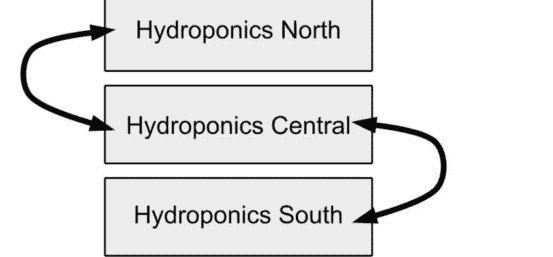

在这里，你可以从“北侧水培室”（Hydroponics North）向西走，进入“中央水培室”（Hydroponics Central）的西侧。这种连接是双向的。如果你从“中央水培室”向西，就会进入“北侧水培室”的西侧。同样，“中央水培室”和“南方水培室”通过它们的东出口双向连接。以这些意外的方式连接房间，对用户来说似乎是用难以理解的方式连接的。如果房间被赋予相同的名称（例如，每个都被称为“水培室”），情况尤其如此。在没有地图的情况下，玩家可能觉得自己正在一个由许多房间组成的巨大区域中徘徊。只有当玩家绘制了地图，迷宫相对的简单性才会显现。

如果你想玩得更花哨，可以创建一个出口和入口不同的迷宫。这样，你通过一条单行通道（或通过一扇在你身后会立即锁上的门）离开房间，然后通过另一个单行通道或自锁门进入。这里有一个例子：

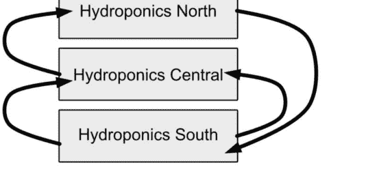

## 第 12 章 — 创建游戏！

在这里，你可以从“北侧水培室”的东侧离开，并通过“南方水培室”的东侧进入。但这不是双向连接。如果你从“南方水培室”的东侧离开，不会回到“北侧水培室”，而是去“中央水培室”。正如你所看到的，其他的出口和入口都是单向的。各种连接方式的迷宫导航极其困难。如果你创建了这样的迷宫，你可能 a) 想把它做得小一点（几个房间），并且 b) 警告玩家迷宫的布局非常奇怪。

你还需要提供某种可以绘制迷宫地图的方法。也许每个房间都有略有不同的描述，或者玩家需要向每个房间丢入物体，以识别何时再次进入该房间？

有些玩家喜欢为了乐趣而解决迷宫。但迷宫也可以作为其他谜题的一部分。也许必须在迷宫的一端拉动一个杠杆，以激活位于迷宫另一端通过按按钮启动的飞船引擎。但这必须在十分分钟内完成，否则引擎将再次停用。为了在十分分钟内穿过迷宫，玩家需要绘制地图。或者在迷宫中心有一个特定的宝藏，如果不制作地图，很难到达中心（并再次出来）。

## 收集宝藏

在某些游戏中，目标仅仅是积累一定数量的财富。当玩家获得一定价值的宝藏（可能需要将其运输到特定位置，如宝箱）时，就会计算最终得分。在这类游戏中，玩家可能被要求多次玩游戏，以尝试获得比之前更高的分数。

## 特殊用途物体

最常见的谜题可能是使用某些特殊用途物体来解决的。也许有一个锁锁的房间，门只能用特定的钥匙打开。但你需要的钥匙在一个密封容器里。你只能通过施放“开封咒语”来打开容器。咒语写在一个卷轴上，由一个巨魔（Troll）守护。每当你试图获取卷轴时，巨魔都会阻止你。最后你在里面发现了一个火明治。事实证明，如果你把火明治丢在巨魔房间里，巨魔就会去吃它，从而让你去偷卷轴。这里有几个锁谜题。要解决终极谜题（进入锁房间），你必须利用几个特殊用途物体：钥匙、卷轴和火明治。你可能想在你的游戏中包含相当多的多部分谜题。

## 第 12 章 — 创建游戏！

## 魔法或科技物体

在我上面给出的例子中，包含咒语的卷轴是一个“魔法”物体。它是你可能包含在幻想游戏中的物品。它在现实世界中没有对应物。魔法或“特殊力量”物体并不限于幻想游戏。然而，在科幻游戏中，你可能会包含一个将玩家“传送”从一个位置到另一个位置的运输设备。这本质上也是一个魔法物体，尽管它没有被这样描述。在海盗游戏中，你可能会发现一颗能催眠海盗船长的红宝石，让你有空去偷走他。这也是魔法物体，对海盗船长的一种“特殊力量”。在我之前给出的例子中，甚至火明治也是一种魔法物体。它是游戏中唯一让你穿过巨魔的物品。它完全可以是一个魔法咒语。我恰好决定制作一个火明治，但它对巨魔的力量和咒语是一样的。这种魔法或“特殊力量”物体在游戏中非常有用，但不要过度使用。从本质上说，所有这些类型的物体都是不逻辑的。没有理由认为咒语应该具有逻辑。

## 特殊地点

有时地图本身可以有所帮助。你可能需要找到一个无法到达的位置。

## 第 12 章 — 创建游戏！

> 查看控制台

这是一个内置在桌子里的显示控制台。

它正在显示这条信息：

将执行卡卡插入槽位以启动光速驱动器

+   > w

准备室：这是一个虽小但整洁的房间。墙上有一个柜子。

这里有物品：

大木箱

> 打开箱子

你打开了大木箱

> 打开木箱

大木箱已经是打开状态了。

> 打开纸箱

你打开了那个小纸箱

> 打开微型奥尼石盒

你打开了那个微型奥尼石小盒

> 拿走纸箱

你从大木箱中拿走了那个小纸箱

> 拿走银钥匙

你从微型奥尼石盒中拿走了银色钥匙

> 打开柜子

你无法打开墙上的柜子，因为它被锁了。

> 解锁柜子

你需要说明你想用什么来解锁它！

> 用银钥匙解锁柜子

你无法用银色钥匙打开墙上的柜子

> e

舰桥：这是“星坠号”（HMS Starcrash）的舰桥。

> d

会议室：这是一个典型的、看起来无味的会议室。

> e

走廊：这是一条长走廊，两侧有门，有一条通向下的楼梯。

> d

地下室：这是船只底部的黑暗房间。

> 查看

这是船只底部的黑暗房间。

> e

水培区：这是一个雾气缭绕、到处植物的区域。

> s

水培区：这是一个雾气缭绕、到处植物的区域。

+   > s

水培区：这是一个雾气缭绕、到处植物的区域。

这里有物品：

猪笼植物

> 查看猪笼植物

这是一个猪笼植物

里面有什么东西。

> 查看猪笼植物

猪笼植物包含：

金色钥匙（在猪笼植物内）

> 拿走金色钥匙

你从猪笼植物中拿走了金色钥匙

> n

水培区：这是一个雾气缭绕、到处植物的区域。

> n

水培区：这是一个雾气缭绕、到处植物的区域。

> w

地下室：这是船只底部的黑暗房间。

> w

机房：这是一个巨大的、咯哒作响的房间，充满了奇异的轰鸣的机器。

> 上

会议室：这是一个典型的、看起来无味的会议室。

> 上

舰桥：这是“星坠号”（HMS Starcrash）的舰桥。

> w

准备室：这是一个虽小但整洁的房间。墙上有一个柜子。

这里有物品：

大木箱

用钥匙解锁柜子

你想使用哪一个？

银钥匙

金色钥匙

用金色钥匙解锁柜子

你用金色钥匙解锁了墙上的柜子

> 打开柜子

你打开了墙上的柜子

> 查看柜子内部

墙上的柜子里包含：

塑料激活卡（在墙上的柜子内）

> 拿走激活卡

你从墙上的柜子中拿走了那个小塑料激活卡

> e

舰桥：这是“星坠号”（HMS Starcrash）的舰桥。

> 将卡片插入槽位

激活卡平滑地滑入槽位

控制台显示“激活序列已初始化”

随着光速推进器启动，低沉的轰鸣声响彻整艘飞船。突然，星星划过视窗时，出现了一道光影。

飞船正朝着一个未知的目的地出发。

剩下的就你了……

（未完续）

> 查看控制台

这是一个内置在桌子里的显示控制台。

它正在显示这条信息：

飞船目前处于光速模式（请谨慎操作！）

为了方便起见，我已将上述命令添加到 `Game` 类的 `test()` 方法中。只需输入命令“test”即可执行。

--现在我已经向你展示了如何编写一个带有联动房间、容器内宝物以及可以与游戏交互玩家的复杂游戏——通过在房间之间移动、拿取和丢弃物体，以及执行各种其他动作，如打开、关闭和锁定物体、查看或观察物体以及将物体放入容器。

还有什么需要编写的吗？事实上，有很多。事实上，我甚至可以说，添加的附加功能（除了你自己的想象力之外）真的没有限制。以下是一些建议……

## 更多动作

因此，大多数动作都是“触感”的——即虚拟玩家用虚拟手执行的操作：移动、拿取、丢弃、将物品放入其他物体等等。这一规则的例外是少数“视觉”动作：“查看”、“查看……”、“查看内部”。为什么不增加“听”和“听……声音”呢？或者“嗅闻”甚至是“品尝”？你甚至可以添加“吃”和“喝”——让某些液体让玩家变得巨大，或像《爱丽丝梦游仙境》中那样缩小到极小。

一些额外的“查看”和“放置”动作怎么样：“查看下方”和“放在……下方”、“查看上方”、“放在……上面”等等？也许你可以添加几个额外的动作，类似于我的“解锁”动作来实现——“带有某物进行查看”（例如，“用放大镜查看指纹”）。

## 更多类

也许你需要一些杠杆来打开大坝闸。或者用按钮来激活激光毁灭者射线。杠杆和按钮都是双状态设备。为什么不记录一个带有 `Level` 和 `Button` 子类的类的双状态类呢？你甚至可以添加多状态设备，例如从 0 到 9 的拨盘。它们可以用作保险箱的组合锁或曲速驱动器的激活器。

玩家可能需要找到某个特定的代码来打开保险箱，或者初始化曲速驱动器。你可能还会考虑添加角色——人类、机器人、怪物。

非常简单的角色可以被视为特殊的 `GameThing`。更复杂的角色——例如需要与环境交互的机器人或盗贼——可以创建为 `Actor` 对象。你可能需要子类 `Actor` 来为它们提供特殊功能。

## 扩展解析器

添加更多单词，定义更多命令。也许定义同义词，例如“刀”是“匕首”的同义词？玩家可以“拿刀”，如果这里有匕首，就会被拿走。如果你想尝试添加这个，想想我是如何处理形容词的。这是一个类似的问题——使用多个不同的单词来识别物体。

## 什么类型的游戏？

我的示例游戏设定在船上。许多传统的冒险游戏设定在幻想世界，那里有山脉、森林和洞穴，魔法卷轴提供了答案。但你可以把游戏设定在你选择的任何世界。

你可以写一个设定在加勒比岛的浪漫冒险故事，或者一个设定在 20 世纪 30 年代芝加哥的侦探故事。你的玩家可能是在维多利亚时代的伦敦迷雾中追捕杰克的警察。或者你也可以把故事设定在幽宅、火星、海底、南极——任何你觉得有趣的地方。

## 如何开始

开始编写自己的游戏最简单的方法是使用 Starmania 项目的代码，但替换三个定义你游戏特有的数据和特殊动作的文件。其中两个文件位于 `game.data` 包中：

`GameData.java`：你需要在这里创建游戏的房间和物体。

`VocabularyData.java`：你需要在这里添加游戏理解的单词。

第三个文件位于 `game.gameObject.special` 包，它是定义游戏任何“特殊”动作的文件——例如，当魔法放入金盒时，会发生某些在将任何其他物体放入其他容器时都不会发生的情况：

`Actions.java`：你需要在这里添加执行特殊动作的方法。

# 下载源代码

要下载源代码，请加入我们的邮件列表：

http://www.bitwisebooks.com/subscribe

或者扫描此二维码：


# 作者寄语

感谢阅读我的书。我希望这本书对你有所帮助——如果运气的话，甚至让你觉得很有趣！从 20 世纪 80 年代初开始编程并编写关于编程的文章。在“小书”系列中，我希望能够分享我多年积累的一些知识，并为读者提供那种我在学习编程时希望能够拥有（但当时并没有）的书籍。

编写这些书需要花费大量的时间和精力，虽然我很喜欢写它们——毕竟，编程是我热爱的事情——但对我来说，要让我的书与大型出版公司的产品竞争其实非常困难。

你可以帮助我！

评论对我来说至关重要。它们让潜在的读者知道我的书是否对其他人有用，从而决定它们是否对他们也同样有用。因此，如果你能花几分钟时间在 Amazon 上留下一简短的评论，我将不胜感激。你可以点击下一页上的任一链接、使用手机扫描二维码或（在其他 Amazon 网站上）点击书籍页面上的“撰写评论”（Write a Customer Review）按钮。

再次感谢阅读我的书！

Huw Collingbourne

# 留下评论

Amazon（美国）：


https://tinyurl.com/y4yhlycg

或

https://www.amazon.com/review/create-review?asin=1913132137

Amazon（英国）：


https://tinyurl.com/yyckkf22

或

https://www.amazon.co.uk/review/create-review?asin=1913132137

## 附录

## 在线冒险游戏

在编写自己的冒险游戏之前，先玩玩几个别人编写的游戏是个好主意。有很多免费的冒险游戏可以下载或在线玩。

Infocom 的游戏可以从互联网上的多个地点（如 http://www.infocom-if.org）免费下载。

我的游戏《命运之黄金土拨鼠》（The Golden Wombat Of Destiny）可以在线玩或下载：https://archive.org/details/TheGoldenWombatOfDestiny。


其他老旧冒险游戏可以在 `http://www.abandonia.com` 获取。

你可能需要一个 DOS 模拟器（如 DOSBox `http://www.dosbox.com/`）来运行某些游戏。

## C# 与 Java 的比较

在许多方面，C# 和 Java 语言非常相似。它们都是具有类 C 语法的面向对象语言。通常情况下可以将 Java 代码翻译为 C#，反之亦然，且修改较少。

由于我也有一本关于用 C# 编写冒险游戏的书，我认为值得花一点时间强调这两种语言之间的一些重要区别。对于任何程序员来说，能够将代码从一种语言翻译到另一种语言都是非常有用的技能。当然，这只是对这两种语言的非常短的比较。为了在它们之间相互翻译，你需要熟悉 Java 和 C#，并且需要频繁参考它们的类库文档。尽管如此，这个简短的附录可能也会让你了解在进行此类操作时可能会遇到的某些问题。总之，这些都是我在编写 Java 冒险游戏时遇到的一些问题。

### 字符串相等性

这是一个 C# 游戏中的主循环。只要输出的值不为 "q"，它就会继续运行：

```
string input;

do {
  input = Console.ReadLine().ToLower();
  // 执行的代码
} while (input != "q");
```

Java 中 do 循环的语法与 C# 相同，我可以写出这样的循环：

```
String input;

do {
  input = getInput().toLowerCase();
  // 执行的代码
} while (input != "q");
```

然而，如果我这样做，循环将永远运行。当我在提示符处输入 "q" 时，与字符串 "q" 的比较将失败。因为在 Java 中，运算符 `==` `!=` 测试的是绝对字符串相等性，这意味着为了相等，两个字符串或字符串变量必须引用完全相同的字符串，且存储在同一个内存位置。另一方面，在 C# 中，比较的是字符串的内容，因此 "q" 会认为与另一个包含 "q" 的字符串相等，而在 Java 中则不会。这是在 Java 中比较两个字符串的正确方法：

```
do {
  // 执行的代码
} while("q".equals(input));
```

### 字符串分割

C# 和 Java 都有 `String.split()` 方法。

### 重写方法

在 C# 中重写方法时（即你为基类中已有的方法创建新的实现时），你必须使用 `virtual` 关键字定义基类方法。在 Java 中，与基类同名的方法默认就是可重写的。不需要关键字，但你可以选择在重写方法之前放置 `@override` 注解，以便编译器进行额外的检查。

### 部分类

在 C# 中，部分类是分布在多个文件中的类。这使得在编写长类的同时能够保持源文件相对较短。Java 中没有部分类。

## 如何创建接口

如果你希望在多个类之间共享通用行为，可以通过创建你自己的接口来实现。Interfaces 项目提供了一个简单的示例，我在其中定义了以下两个接口：

```java
interface Animal {
    public void talk();
    public void move();
}

interface Pet {
    public String getName();
}
```

然后我创建了一个实现了 `Animal` 接口的 `Cow` 类。该类现在有义务实现接口定义的两个方法：`talk()` 和 `move()`：

```java
class Cow implements Animal {
    public void talk() {
        System.out.println("Moooo");
    }

    public void move() {
        System.out.println("Plod, plod, plod...");
    }
}
```

`Dog` 实现了两个接口 `Animal` 和 `Pet`，它必须实现这两个接口中的所有方法（当然，它也可以包含它自己的其他方法，例如这里的 `wagTail()` 方法）：

```java
class Dog implements Animal, Pet {
    private String name;

    public Dog(String aName) {
        name = aName;
    }

    public void talk() {
        System.out.println("Woof!");
    }

    public void move() {
        System.out.println("Leap, walk, sniff, leap, walk...");
    }

    public String getName() {
        return name;
    }

    public void wagTail() {
        System.out.println("Wag, wag, wag");
    }
}
```

我的 `main()` 循环创建了一个 `Cow` 对象和一个 `Dog` 对象，并分别调用了它们的方法：

```java
public static void main(String[] args) {
    Cow aCow = new Cow();
    aCow.talk();
    aCow.move();

    Dog rover = new Dog("Rover");
    System.out.println(rover.getName());
    rover.talk();
    rover.move();
    rover.wagTail();
}
```

这是输出结果：

```
Mooo
Plod, plod, plod...
Rover!
Woof!
Leap, walk, sniff, leap, walk...
Wag, wag, wag
```

虽然你可能不需要以这种方式创建自己的接口，但你确实需要理解如何实现标准 Java 类定义的接口。例如，在我的游戏中，为了能够保存和重新加载游戏对象，每个类必须实现 `java.io.Serializable`。事实证明，`java.io.Serializable` 没有声明方法，因此我们不需要在代码中实现任何特定方法。你可以将 `java.io.Serializable` 视为一个“标记接口”——它指示 Java 以特定的方式处理某个类。除非对象实现了 `java.io.Serializable` 接口，否则 Java 不会对任何对象进行序列化。

## 修改游戏数据

使用本书书中开发的游戏框架，你只需修改两个类即可创建你自己的游戏。

正如第 12 章提到的，开始编写你自己的游戏最简单的方法是使用我 *Starrush* 项目中的代码，并修改 `game.data` 包中的两个文件（*GameData.java* 和 *VocabularyData.java*）以及 `game.objects.special` 包中的一个文件（*Actions.java*）。下文将为你提供一个关于如何修改这三个文件的简短指南。

在 *VocabularyData* 类中，添加任何你希望游戏理解的单词。这些单词必须作为成对元素添加，每个元素的第一个项是单词本身（一个字符串），第二个项是在 `WT` 枚举中定义的单词类型。每个单词都使用 `put()` 方法添加到词汇 `HashMap` 中：

```
vocab.put("box", WT.NOUN);
```

### 示例数据文件

为了方便开始，我包含了示例的 *GameData.java* 和 *VocabularyData.java* 文件，它们位于源代码存档的 *EmptyDataFiles* 文件夹中。你可以根据自己的需求修改这些文件，并用你修改后的文件替换 `game` 文件夹中的文件。

在 *GameData* 类中，你需要按照特定的顺序创建初始化对象。这是因为某些对象引用了其他对象。例如，*Room*（房间）对象引用了其他 *Room* 对象（出口），因此在初始化对象之前，必须创建所有 *Room* 对象。同样，在创建对象之前，你不能将对象放入容器中。这些是我建议你在修改 *GameData* 类时遵循的步骤（我为每个步骤展示了简短的代码示例）：

#### 第 1 步 – 创建房间

```
Room exampleRoom1 = new Room("exampleRoom1");
```

#### 第 2 步 – 创建容器

```java
ContainerThing exampleContainer = new ContainerThing("exampleContainer",
"example container", Mass.SMALL);
// 可选设置其属性
exampleContainer.setOpenable(true);
exampleContainer.setOpen(false);
exampleContainer.addAdjectives(new String[]{"small", "example"});
```

```java
// 可锁对象也是容器
LockableThing cupboard = new LockableThing("cupboard",
"cupboard on the wall", Mass.MEDIUM, false, false, true, false, true, false);
cupboard.setShow(false);
```

#### 第 3 步 – 生成游戏物品（宝物）和通用物品

## 但等一下，还有更多《……小书》……

《冒险游戏编程小书》是为程序员编写的一系列“……小书”中的之一。在每本小书中，我们的目标是为您提供真正需要的、直击问题核心的内容，而剔除所有的废话和填充。

我们知道网上有很多关于标准代码库的信息，因此我们不会通过重复这些信息来充满书籍的篇幅。相反，我们的目标是解释那些真正重要的细节，帮助你尽可能快地对每个主题建立坚实的理解并进行实践编程。

### 《C# 小书》

+ C# 语言入门指南：
- 面向对象编程
- 类与方法
- 方法与分析
- 数组与字符串
- 异常处理
- 列表与泛型

### 《指针小书》

+ C 语言指针深度指南：
- 间接
- 指针算术
- 数据对齐
- 链表（单向/双向）
- 栈与队列
- 函数指针
- 常见的指针问题

### 《C 小书》

+ C 语言入门指南：
- C 基础
- 变量与类型
- 运算符与测试
- 函数与参数
- 数组与字符串
- 用户定义类型

### 《递归小书》

+ 理解 C 语言递归：
- 递归函数
- 调用栈
- 栈帧
- 栈损坏
- 递归与作用域
- 树形结构
- 磁盘目录递归

### 《Ruby 小书》

+ Ruby 语言入门指南：
- 上手 Ruby
- 面向对象
- 类与超类
- 模块与混入
- 方法与参数
- 类变量与实例变量
- 运算符与测试
- 数组与哈希
- 文件操作
- 异常处理

您还可以从 Bitwise Books 网站下载许多实用的免费资源：`http://www.bitwisebooks.com`
