# Java 入门指南

## 下载源代码

如需下载源代码，请加入我们的邮件列表，您将通过电子邮件接收下载链接：http://www.bitwisebooks.com/subscribe

扫描此二维码：

- 关于作者................20
- 关于技术编辑................21
- FINALLY.................................................................................................................. 169
- 序列化....................................................................................................... 178

# 来自作者的话............................................................... 189

- 留下评价....................................................................... 190
- 更多编程书籍.................................................. 191

## 第一章 – 入门

在用 Java 编程之前，你需要了解 Java 是什么，以及编写 Java 程序需要哪些工具。

如果你已经安装了 Java 编辑器和编译器，并且知道如何运行和构建 Java 程序，那么你已经准备就绪。我在编写本书的代码时，使用的是 `NetBeans IDE`（集成开发环境）。即使你通常使用其他编辑器，我也建议使用 `NetBeans`，以便以最简单的方式加载和运行我的程序。


### 什么是 Java？

Java 是一种跨平台的面向对象的语言。你以 `.java` 结尾的文件编写高级人类可读的 Java 程序代码。Java 编译器会将这些文本转换为压缩的非人类可读字节码，字节码可以通过称为 `Java 虚拟机（JVM）` 的程序运行。任何能够运行 `Java 虚拟机` 的操作系统（现在的大多数）都能运行你的 Java 字节码。这就是为什么 Java 程序在不同平台和操作系统之间具有高度的可移植性。

### 你将学习什么？

本书假设你之前没有任何通用的编程或特定的 Java 语言的知识。它将教你如何在 PC、Mac 或（原则上）任何其他能够运行 Java 的系统上编写、编译和运行 Java 程序。它将教你编程基础知识，包括面向对象编程。它将解释如何创建对象、处理数据以及处理磁盘上的文件。如果你已经有某些编程经验，可以随时跳过本书的早期章节。请务必从出版者网站提供的源代码存档中下载提供的现用代码示例。

### 如何阅读本书

是选择按章节从头到尾阅读此书，还是直接“跳跃”到你感兴趣的特定章节，完全取决于你的决定。如果你是编程新手，我建议你严格按照顺序阅读所有内容。如果你是一位经验程序员——但是 Java 新手——你可能想阅读关于 IDE 和编译的介绍信息，然后浏览你不熟悉的话题。

请记住，书中描述的所有项目都提供了源代码。你可能希望先运行代码，然后再阅读书中的解释。我建议你尝试修改和扩展我的示例代码，以帮助你理解 Java 语言的工作原理。

### 下载源代码

书中显示的所有源代码均可下载。只需订阅我们的邮件列表，我们就会为你发送下载链接：

www.bitwisebooks.com/subscribe

### 安装 Java

如果你还没有安装 Java，应该从此处下载：

https://www.java.com/

开发 Java 需要两个组件：`Java 运行时环境（JRE）` 和 `Java 开发工具包（包含编译器和库）即 JDK`。你必须安装 `JDK`。通常 `JRE` 也会一并安装。

### 安装帮助

Java 网站提供了在不同操作系统上安装和使用 Java 的帮助链接：https://www.java.com/。阅读这些帮助信息对于避免或修复任何潜在问题非常重要。

### 使用哪种 IDE？

你可以将源代码加载到任何支持 Java 语法的编程编辑器中。项目是使用 `NetBeans IDE` 开发的。如果你不确定使用哪种 IDE，我建议使用 `NetBeans`。

要安装 `NetBeans`，请从下处下载其中一个现用的安装程序：

https://netbeans.apache.org/

### 使用 NetBeans

当你没有使用 `NetBeans` 来编写和运行我的 Java 程序时，我会偶尔展示你使用 `NetBeans` 创建文件和“项目”需要遵循的所有步骤。某些项目是使用 `NetBeans` 可视界面设计工具创建。如果你将这些项目加载到 `NetBeans`，你将能够查看并编辑视觉界面。如果你将这些项目加载到其他 IDE，可能无法做到这一点。由于这些原因，我强烈建议使用 `NetBeans` 来加载、编辑和运行随书的示例代码。

### 在 NetBeans 中加载和运行程序

如果你使用 `NetBeans`，只需选择“文件 -> 打开项目”即可从源代码存档中加载项目。

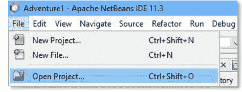

现在找到包含 `NetBeans` 项目文件的目录（在项目浏览对话框中将用一个小咖啡杯图标指示），然后选择项目并点击“打开项目”按钮：

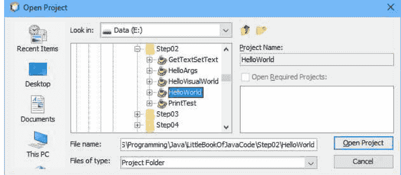

如果你在 `NetBeans` 中已经打开了一个项目，新项目将加载在“项目”窗口下方。要编译并运行项目，首先确保在“项目”窗口中选中了项目，然后从“运行”菜单中选择“运行”或点击 `NetBeans` 工具栏上的绿色箭头按钮。

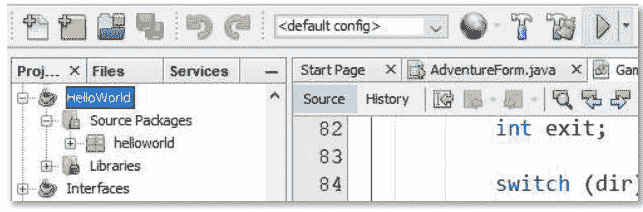

### 在其他 IDE 中加载和运行程序

如果你使用另一个编辑器或 IDE，你需要检查该 IDE 的开发者文档以学习如何创建项目。在你决定使用其他 IDE 时，我不提供 `NetBeans` 之外的任何支持。

如果你决定使用其他 IDE，你必须确保可以编译和运行。

### 从命令行编译和运行

如果我在包含 `HelloWorld.java` 文件的目录下打开命令提示符（如果你在 `C:\` 驱动器上解压缩代码存档，此目录名称将类似于：`C:\LittleBookOfJavaCode\Step02\HelloWorld\src\helloworld`），我可以使用此命令编译它：

```bash
javac HelloWorld.java
```

这将编译我的代码并创建一个 `HelloWorld.class` 文件，该文件可以由 `Java 虚拟机` 运行。现在我尝试使用以下命令运行该文件：

```bash
java HelloWorld
```

但它无法运行！我会看到这条错误信息：

```
Error: Could not find or load main class HelloWorld
```

这是因为 `HelloWorld` 类被定义在 `helloworld` 包中。为了运行这个程序，我需要进入 `helloworld` 文件夹的上一级目录——即 `C:\LittleBookOfJavaCode\Step02\HelloWorld\srv\`，然后输入包含包名 `helloworld` 的命令：

```bash
java helloworld.HelloWorld
```

现在程序应该可以正常运行并显示此输出：

```
Hello world
```

如果你觉得这很困惑，请记住，如果你在 `NetBeans` 这样的 IDE 中编译和运行程序，所有包和文件夹的细节都将自动处理。只有当你从命令行提示符编译和运行程序时，你才需要手动输入这些细节。

#### 什么是包（Package）？

包提供了分组代码单元的方法。在第 2 章中将详细解释。

### Java 是区分大小写的

如果你的主类名为 `AdventureGame`，且包含大写的 'A' 和大写的 'G'，那么在尝试运行程序时，你必须确保使用相同的大小字母组合。

假设我在输入如下命令时忘记将 'G' 大写了：

```bash
java Adventuregame
```

Java 将显示类似类似的错误信息：

```
Error: Could not find or load main class Adventuregame
```


### 命名规范

当你为变量、类和其他编程元素命名时，采用一致的“命名规范”通常会显得更整洁、清晰。例如，你可能决定将私有变量命名为 `description`，全部使用小写，如下所示：

```java
private String description;
```

你可能使用混合大小写来命名函数（方法），首字母小写，其他任何单词大写，如下所示：

```java
public String getDescription()
public int moveToPlayer(Direction dir)
```

我不会在书中强制要求一套严格的命名规范。在现实世界的编程中，命名（以及代码格式）规范通常由特定项目的团队负责人定义。如果你是独立编程，你有更多的自由来决定命名规范。在本书中，当我遇到重要的规范时会提到它们，即那些被广泛采用或在语法上要求的规范——例如，类名和常量的大写。

### 理解文本

在《Java 小书》中，任何 Java 源码的写法都如下：

```java
public void setThings(ThingList things) {
    this.things = things;
}
```

某些代码前面可能会有一个项目名称，有时会在括号中显示源文件名：

| AdventureGame1 (Thing.java) |
| :--- |
| public void setName(String aName) { name = aName; } |

这表明 `Thing.java` 的代码可以在源代码存档中的 `AdventureGame` 项目或文件夹中找到。为了跟随教程，你可以从命名的项目加载代码文件到你偏好的 Java 编辑器或 IDE 中。程序运行时你预期在屏幕上看到的任何输出显示如下：

```
The result of that calculation is 24!
```

解释性注释（通常提供一些提示或对文中提到的某些点提供更深入的解释）显示如下：


> **这是一个注释**
>
> 这是一个解释性注释。如果你喜欢可以跳过它——但如果你这样做，你可能会错过一些有趣的内容……！

### 关于作者

`Dermot Hogan` 是《Java 小书》的作者。他在 Java 领域拥有超过 30 年的经验。他曾在多家技术公司担任首席开发。他拥有剑桥大学物理学硕士学位。目前的研究领域是机器人控制。更多信息请访问网站：http://bitwisecourses.com


# 第二章 — Java 初步

在本章中我们将发现 Java 的基本功能并编写简单的 Java 程序。按照传统，人们学习新语言时编写的程序是简单的显示“Hello world”。

## Hello World

如果你使用的是 NetBeans，选择 `File | New Project`。在 New Project 对话框中，确保左侧选中了 Java with Ant 类型。点击 Next。给项目命名为 HelloWorld，并勾选 Create Main Class。

NetBeans 会创建一个名为 `HelloWorld.java` 的源文件。在大括号函数前添加以下代码：

```java
System.out.println("Hello world");
```

代码现在应该像这样：

```java
package helloworld;
public class HelloWorld {
    public static void main(String[] args) {
        System.out.println("Hello world");
    }
}
```

## 为什么要注释？

在程序中添加注释来描述每个部分的作用是一个好习惯。Java 允许你在 `/*` 和 `*/` 符之间插入多行注释，如下：

```java
/* 此程序将在新行打印
Hello world */
```

除了这些多行注释外，你还可以添加以双斜杠 `//` 开始的“行注释”，它延伸到当前行的结束。行注释可以注释整行，也可以注释 `//` 之前的任何代码。以下是行注释的示例：

```java
// 这是一个整行注释
if (args.length == 0) { // 这是一个部分行注释
```

像 NetBeans 这样的 IDE 在创建代码文件时可能会插入注释。你可以编辑或删除这些注释，而不会影响代码的行为。

在 NetBeans 中运行此程序最简单的方法是点击绿色箭头“Run Project”按钮，或者从 Run 菜单中选择 Run Project 项。如果一切顺利，你现在将看到程序的输出——即文本 Hello world——显示在 NetBeans 输出窗口中。

### 如何在 NetBeans 中加载示例项目

如果你使用的是 NetBeans，可以从源代码存档中逐个加载项目，也可以创建一个“项目组”以便同时加载所有项目。

## 如何加载单个项目

要加载单个项目，选择 `File | Open Project`，然后浏览到包含项目的目录（例如 `C:\LittleBookOfJava\Step02`），点击“+”图标展开目录并选择一个命名的项目（例如 HelloWorld）。

## 如何创建项目组

要创建一个存储在目录下的多个项目组，请选择 `File | Project Groups`，然后点击 `New Group`。在对话框中，选择“Folder Of Projects”，然后点击 `Browse` 按钮。找到包含你想要添加到默认目录名中的项目文件夹，如果你已将示例源码解压到其中，这将是一个 `\LittleBookOfJavaCode` 文件夹。选择此文件夹并点击 `Open`。

如有必要，编辑“Create New Group”对话框中的名称字段，然后点击 `Create Group` 按钮。你现在应该能在 NetBeans 项目面板中看到你所选文件夹下的所有项目。

如果你关闭了项目组（`File | Close All Projects`），可以通过选择 `File | Project Groups`，在对话框中高亮组名并点击 `Select Group` 来重新打开。

## 如何在项目组中激活项目

当你想要编译并运行组中的特定项目时，在项目面板中高亮项目名称，然后点击运行项目按钮（绿色箭头）并选择 `Run | Run Project` 菜单项。

## 从命令行运行程序

如果你想在 `\classes` 目录下从命令行窗口或终端运行 Java 程序。你需要打开包含 `\helloworld` 子目录的目录（你可以在我的代码中看到 helloworld 是 Java“包”的名称）——我稍后会详细介绍包的内容。

要运行 Java 虚拟机（运行你 Java 程序的工具），你需要输入 `java`，后跟包名和类文件名（不带扩展名）。在这里，我的类文件是 `HelloWorld.class`（这是已放入 `\helloworld` 子目录的编译文件），因此我必须输入此命令：

```
java helloworld/HelloWorld
```

这是我看到的输出内容：

```
Hello world
```

## 故障排除

在某些情况下，Java 可能不会显示预期的输出，而是显示如下错误消息：

```
Error: Could not find or load main class
```

出现此问题的原因有很多。例如，如果 `HelloWorld.class` 文件不存在，可能会出现此消息（可能你还没有编译项目）；或者你输入了错误的名称，或者使用了错误的大小写组合（Java 是“区分大小写”的，所以如果你的类名为 HelloWorld，其中 H 和 W 是大写，但你输入的是 `hello/HelloWorld`（w 是小写），则将找不到该类）。或者可能你所在的目录不正确。确保你处于 `.classes` 目录。或者也可能是你没有在指定的包中编译主类。你可以通过在 NetBeans 中高亮 HelloWorld 项目并选择 `File | Project Properties` 来检查此项。在对话框中选择 `Run` 节点。检查 `Main Class` 是否显示为 `hello.HelloWorld`，其中 hello 是包名，HelloWorld 是类名。

即使从命令行运行遇到问题，也不要担心。如果你使用的是 NetBeans IDE（正如我推荐的那样），你将可以使用 IDE 内部的菜单和按钮编译并运行程序，而不是通过命令行。

## 使用命令行

如果你计划从命令行编译和运行程序，你可能想阅读 Oracle 的文档：

http://docs.oracle.com/javase/tutorial/getStarted/cupojava/index.html

Oracle 还有一份解决方案指南帮助你识别并修复常见错误：

http://docs.oracle.com/javase/tutorial/information/run-examples.html

## Java 代码简介

加载代码存档中提供的 HelloWorld 项目。查看 `HelloWorld.java` 文件中的代码（在 NetBeans 中，它显示在项目窗口的源包 `Source Package\helloworld` 分支）。现在我们来尝试识别这段代码的核心部分。程序开始于：

```java
HelloWorld (HelloWorld.java)
/*
* 《Java 入门教程》 - 示例 Java 代码
* http://www.bitwisebooks.com
*/
```

如前所述，放置在 `/*` 和 `*/` 字符之间的任何文本都被视为注释，并被 Java 编译器忽略。注释可记录你的代码或提供版权或许可详情。真正的 Java 代码的第一行出现在这里：

```
package helloworld;
```

每个 `package` 都是关键字——也就是说，它是 Java 程序中具有特殊含义的预定义词，而 `helloworld` 是我为当前包选择的名称或“标识符”。语句以分号结束。分号在 Java 中被广泛用于标记语句的结束。

## 关键字

Java 定义了许多在语言中具有特殊含义的“保留”字或关键字。例如，当我们开始测试值时，将使用 `if` 和 `else` 关键字。在 HelloWorld 程序中发现了以下关键字：

```
package public class static void
```

目前你不需要担心这些都意味着什么。最重要的 Java 关键字将在本书随后的部分进行解释。

## 包

Java “包”定义了一个命名的区域（技术上称为“命名空间”），在该区域内相关的 Java 代码可以组合在一起。Java 代码标准库（“应用程序编程接口”）或 API 包含许多编号的包。例如，`java` 包含了许多包。`java.io` 包处理输入输出（IO）操作，而 `java.math` 包包含算术运算。包有助于组织代码，事实上，包就是命名文件夹。在 `HelloWorld.java` 声明之后，我们来到：

```
public class HelloWorld {
```

## 类

如果你以前编写过面向对象的语言，可能对类的概念很熟悉。如果这是你第一次接触它，只需知道类定义了一个代码“块”。在这个程序中，类位于大括号内。这个类非常简单：

```java
public class HelloWorld {
    public static void main(String[] args) {
        // 输出世界
        System.out.println("Hello world");
    }
}
```

在 Java 中，`main` 被特殊对待。Java 程序中的 `main()` 函数在程序启动时首先运行。顺便说，虽然这个非常简单的程序只有一个类，但现实程序通常包含多个类。在 NetBeans 中，我可以在项目属性对话框的运行页中指定主类。

## 方法

在面向对象的术语中，命名的代码块——即函数或子程序被称为“方法”。在 Java 中，方法名后面必须跟一对括号，如下：

```
public void myfunction()
```

如果你想能够向方法（或函数）传递某些数据，可以在括号之间添加一个或多个“参数”。`main()` 函数定义了一个名为 `args` 的 String 参数列表或“数组”：

```java
main(String[] args)
```

然后，我必须将字符串 "Hello world" 放在括号中并传递给 `print()`。最终结果是，当我运行这个程序时，屏幕会显示 "Hello world"。这就是我在 NetBeans 中运行程序时看到的内容：

| 输出 - HelloWorld (运行) | 通知 | 搜索结果 |
|---|---|---|
| 运行: | | |
| Hello world | | |
| 编译成功 (总耗时: 0 秒) | | |

## 传递命令行参数

有时，在程序加载和运行时向其传递一个参数（一段数据）是有用的。例如，如果你编写了一个 Java 游戏或数据库程序，你可能希望在程序开始运行后立即恢复到保存的游戏版本，或者重新加载一个特定的数据文件。

要做到这一点，你向程序传递一个或多个字符串参数。你可以在 HelloArgs.java 示例项目中看到如何进行操作：

```java
public class HelloArgs {
    public static void main(String[] args) {
        System.out.println("Hello.");
        if (args.length == 0) {
            System.out.println("You didn't enter any commandline arguments.");
        } else {
            for (String arg : args) {
                System.out.println(arg);
            }
        }
    }
}
```

如果你从命令行（即从命令提示符或终端）运行此程序，你只需要通过输入用空格分隔的文本片段来向它传递参数，如下所示：

```
java helloargs.HelloArgs one two three
```

然后程序将显示此内容：

```
Hello.
one
two
three
```

## 记住在包内运行

正如第 1 章解释，当你想要运行一个主类声明在某个包内部的程序时，你需要在包目录上一层的目录的命令提示符中（例如，这里的包目录是 `\helloargs`），并且你必须将包名（这里是 helloargs）作为类名（HelloArgs）包含进去，如下所示：

```
java helloargs.HelloArgs
```

如果你在如 NetBeans 等 IDE 中编译并运行程序，这将自动完成。要做到这一点，请让 NetBeans 向程序传递参数。在“项目”窗口中右键点击项目名称 (HelloArgs)，点击“属性”菜单项，然后在对话框左侧选择“运行”。在“参数”字段中输入任何要传递给程序的参数。在这里我输入了三个参数：one two three

## 什么是命令行参数？

当你在运行 Java 程序时在程序名称之后输入一个或多个文本项，这些文本项将作为“参数”传递给程序。在这个示例中，我调用了 Java 虚拟机 (`java`) 并要求它运行 helloargs 包中名为 HelloArgs 的程序。然后我传递了三个参数：one two three：

```
java helloargs.HelloArgs one two three
```

参数以“数组”（即顺序列表）的形式传递——字符串："one", "two" 和 "three"。这个数组会自动赋值给 `main()` 方法中的 `args` 参数：

```java
public static void main(String[] args)
```

我的代码测试了 `args` 的长度。如果长度为 0（即没有参数），则显示消息 "You didn't enter any commandline arguments."：

```java
if (args.length == 0) {
    System.out.println("You didn't enter any commandline arguments.");
}
```

然而，如果有一些参数，这段代码就会运行：

```java
for (String arg : args) {
    System.out.println(arg);
}
```


这里的 `for` 关键字开始运行循环（反复运行大括号之间的代码），它一次处理 `args` 列表中的每个项，并在单独的行打印每个字符串——这就是之前所示的输出。

# 编译 Java 程序 – 从源码到字节码

某些编程语言——如 C 和 Pascal 被编译成“机器代码”。Java 被编译成字节码，可以在任何安装了 Java 虚拟机 (JVM) 的设备上运行。这意味着如果你在 Windows 上编译程序，只要 Linux 或 MacOS 安装了 JVM，它就可以运行。

# 编译过程

某些编程语言——如 C 和 Pascal 被编译成“机器代码”。Java 被编译成字节码，可以在任何安装了 Java 虚拟机 (JVM) 的设备上运行。这意味着如果你在 Windows 上编译程序，只要 Linux 或 MacOS 安装了 JVM，它就可以运行。

# Java 虚拟机

某些编程语言——如 C 和 Pascal 被编译成“机器代码”。Java 被编译成字节码，可以在任何安装了 Java 虚拟机 (JVM) 的设备上运行。这意味着如果你在 Windows 上编译程序，只要 Linux 或 MacOS 安装了 JVM，它就可以运行。

# Java 环境

某些编程语言——如 C 和 Pascal 被编译成“机器代码”。Java 被编译成字节码，可以在任何安装了 Java 虚拟机 (JVM) 的设备上运行。这意味着如果你在 Windows 上编译程序，只要 Linux 或 MacOS 安装了 JVM，它就可以运行。

# Java 编译器

某些编程语言——如 C 和 Pascal 被编译成“机器代码”。Java 被编译成字节码，可以在任何安装了 Java 虚拟机 (JVM) 的设备上运行。这意味着如果你在 Windows 上编译程序，只要 Linux 或 MacOS 安装了 JVM，它就可以运行。

# Java 选项

某些编程语言——如 C 和 Pascal 被编译成“机器代码”。Java 被编译成字节码，可以在任何安装了 Java 虚拟机 (JVM) 的设备上运行。这意味着如果你在 Windows 上编译程序，只要 Linux 或 MacOS 安装了 JVM，它就可以运行。

# Java 运行时

某些编程语言——如 C 和 Pascal 被编译成“机器代码”。Java 被编译成字节码，可以在任何安装了 Java 虚拟机 (JVM) 的设备上运行。这意味着如果你在 Windows 上编译程序，只要 Linux 或 MacOS 安装了 JVM，它就可以运行。

# Java 应用

某些编程语言——如 C 和 Pascal 被编译成“机器代码”。Java 被编译成字节码，可以在任何安装了 Java 虚拟机 (JVM) 的设备上运行。这意味着如果你在 Windows 上编译程序，只要 Linux 或 MacOS 安装了 JVM，它就可以运行。

# 如何使用 NetBeans 创建视觉化界面

在这里，我想引导你逐步在 NetBeans 中创建一个 "Hello world" 程序的视觉版本。该程序将弹出一个窗口并在点击按钮时在文本框中显示 "Hello world"。尽管这是一个简单的程序，但无论你创建什么种类的可视化 Java 程序，核心任务都是相似的。

- 在 NetBeans 中选择 `File | New Project | Java`（或 `Java With Ant`）| `Java Application`。

| 类别 | 项目 |
| :--- | :--- |
| Java with Maven | Java Application |
| Java with Gradle | Java Class Library |
| Java with Ant | Java Project with Existing Sources |
| HTML5/JavaScript | Java Modular Project |
| PHP | Java Free-Form Project |
| Samples | |

在某些版本的 NetBeans 中，需要在左侧选择 `Java`。在其他版本中，你需要选择 `Java With Ant`。

- 点击 `Next`（可选浏览项目位置）并为项目命名。
- 取消勾选 `Create Main Class`（确保该项未勾选）。点击 `Finish`。
- 在项目面板中右键点击项目的主节点。
- 从弹出菜单中选择 `New | JFrame Form`。点击 `Finish`。
- 从调色板 (`Palette`) 拖两个组件：按钮、文本框。


# 第 2 章 — Java 入门

- 使用鼠标移动并调整表单组件的大小。
- 选择文本框（Text Field）。在项目面板（Projects panel）中找到 `text` 属性。删除文本。

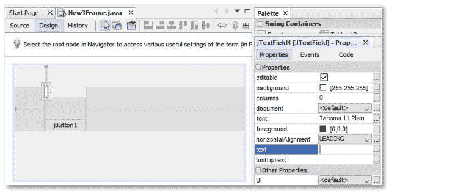

- 选择按钮（Button）。在项目面板中，找到 `text` 属性。将文本更改为 `Click Me!`。
- 右点击按钮，选择更改变量名（Change Variable Name）。输入一个描述性名称，例如 `myButton`。

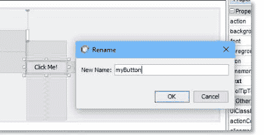

- 右点击文本框，选择更改变量名。输入一个描述性名称，例如 `outputField`。
- 使用鼠标拖动文本框的右边缘，将其宽度调整为与按钮相同。
- 双击按钮。这将在代码编辑器中创建该方法。

```
private void myButtonActionPerformed(java.awt.event.ActionEvent evt) {

    // TODO add your handling code here:

}
```

- 将此方法编辑为：

```
private void myButtonActionPerformed(java.awt.event.ActionEvent evt) {

    outputField.setText("Hello world");

}
```

- 选择 `文件（File） | 保存所有（Save All）`。
- 选择 `运行（Run） | 运行主项目（Run Main Project）`。
- 弹窗提示你选择主类。接受默认的 `NewJFrame` 对象并点击确定（`OK`）。
- 大功完成！

你现在应该能看到一个与所示类似的弹出用户界面。点击按钮在文本框中显示“Hello World”：


# 输出 (Displaying Output)

当你的 Java 程序运行时，有几个函数可以用于显示信息。在这里，我将介绍在视觉化（基于表单的）和非视觉化（命令行提示符）应用程序中显示文本的一些重要方法。

## 输出到命令行提示符 (Printing to the Command Prompt)

当你想要在命令行提示符处显示或“打印”某些文本时，可以使用 `print()`、`println()` 或 `printf()` 函数。所有这些函数都是（如我之前所述）作为 `System.out` 的方法提供的。要在新行上显示字符串，可以使用 `println()`，它会自动在每个字符串末尾添加一个换行符。所以如果你写了以下代码：

```
System.out.println("Hello world");

System.out.println("Hello world");

System.out.println("Hello world");
```

显示的内容如下：

```
Hello world

Hello world

Hello world
```

`print()` 函数与 `println()` 类似，但它不会添加换行符。
如果你写了以下代码：

```
System.out.print("Hello world");

System.out.print("Hello world");

System.out.print("Hello world");
```

显示的内容如下：

```
Hello worldHello worldHello world
```

你可以嵌入换行符(`\n`)。

## PrintText.java

```
System.out.print("\tHello ");

System.out.print("world\n");

System.out.println("Hello\tworld");
```

显示的内容如下：

```
Hello

world
```

## printf

`printf()` 函数允许你向字符串中嵌入“格式占位符”（format specifiers）。格式占位符以 `%` 开头，后跟着一个字母：`%s` 指定字符串；`%d` 指定整数。当字符串中出现格式占位符时，该字符串后面必须紧跟一个由逗号分隔的值列表。这些值将替换字符串中的占位符。程序员必须确保列表中的值与字符串中格式占位符的类型和数量完全匹配。这里有一个示例：

```
System.out.printf("There are %d bottles standing on the %s.\n", 20, "wall");
```

运行时，产生以下输出：

```
There are 20 bottles standing on the wall.
```

## 字符串格式占位符 (Format Specifiers)

用于 `print()` 显示字符串的许多其他占位符。请参考 Oracle 的 Formatter 类文档：http://docs.oracle.com/javase/8/api/util/Formatter

## 在视觉控件中显示文本 (Displaying Text in Visual Controls)

当你想要在图形界面中显示字符串时，需要使用视觉组件提供的方法。`getText()` 和 `setText()` 方法用于许多类型的控件，如文本框和按钮。`getText()` 方法“获取”当前控件显示的文本。`setText()` 方法“分配”或“设置”控件显示的新文本：

| getText | setText |
| :--- | :--- |
| `someText = textField.getText();` | `upperCaseField.setText(someText.toUpperCase());` |
| `myButton.setText("Thank you!");` | |

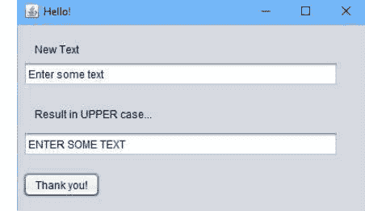

要获取或设置 `JFrame` 的标题，使用 `getTitle()` 和 `setTitle()`。在我的示例程序中，我使用 `this` 关键字调用这些方法，该对象是 `JFrame`。这段代码在现有标题后添加了“!” 字符：

```
this.setTitle(this.getTitle() + "!");
```

# 第 3 章 — Java 元素 (Elements of Java)

在本章中，我们将学习如何对不同类型的数据分类以及如何将数据赋值给变量。当你的程序进行计算或显示某些文本时使用数据。数据项具有类型。例如，为了计算，你可以使用整数 10 或浮点数 10.5。在程序中，你可以为命名变量赋值。

## 变量与类型 (Variables and Types)

在 Java 中，每个变量必须用相应的数据类型声明。这是声明一个名为 `myDouble` 的 `double` 类型变量的方法：

```
double myDouble;
```

现在你可以给该变量分配一个浮点值：

```
myDouble = 100.75;
```

或者，你可以在声明变量的同时赋值：

```
double myDouble = 100.75;
```


## 无类型变量 (Variables without Types)

在某些情况下，可以使用 `var` 关键字而不是指定数据类型来声明变量。Java 然后可以推断出实际的数据类型。在大多数情况下，你应该指定 `int`、`double` 或 `String` 等实际数据类型。

## 常量 (Constants)

变量的值是可以更改的。例如，如果你写了一个税务计算器，允许用户输入总额然后计算税额和总金额（总额加税额），你可能有三个名为 `subtotal`、`tax` 和 `grandtotal` 的浮点变量（`double`）。

每次进行新计算时，根据用户输入的数字，这些变量可以分配不同的值。你也可以这样更改代码中的值：

```
subtotal = 10.0;

subtotal = 20.2;

subtotal = 15.6;
```

有时你可能希望确保值不能被更改。例如，如果税率为20%，你可以这样声明变量：

```
double TAXRATE = 0.2;
```

但现在其他程序员可能会意外设置不同的率（在一个非常小的程序中这不是问题——但这种错误在包含数万行 Java 代码的现实程序中很容易出现）。例如，给 `TAXRATE` 变量分配 30% 的新值是允许的：

```
TAXRATE = 0.3;
```

如果你想确保无法此类操作，你需要让 `TAXRATE` 成为常量而不是变量。常量是一个只能赋值一次的标识符。在 Java 中，你可以通过在声明之前放置 `final` 关键字来创建常量：

```
final double TAXRATE = 0.2;
```

现在，如果我在代码中尝试给 `TAXRATE` 分配新值，就会报错（我的程序将无法编译）。

## 带有用户界面的税务计算器 (A Tax Calculator with a User Interface)

如第 2 章所述，NetBeans 提供了工具，只需通过将按钮、字段和标签等控件拖放到“表单”上来创建视觉应用程序。

运行时，视觉应用程序会在自己的窗口中弹出。在我的税务计算器中，用户可以在 `subtotal` 文本框中输入数值，然后点击 `Calculate` 按钮计算税额和总金额。这些计算出的值显示在另外两个文本框中：

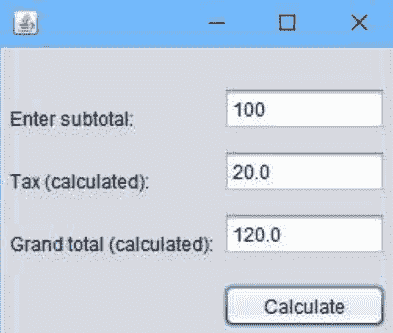

这是点击按钮时运行的计算方法：

```
### TaxCalc

private void calcBtnActionPerformed(java.awt.event.ActionEvent evt) {

    final double TAXRATE = 0.2;

    double subtotal;

    double tax;

    double grandtotal;

    subtotal = Double.parseDouble(subtotalTF.getText());

    tax = subtotal * TAXRATE;

    grandtotal = subtotal + tax;

    taxTF.setText(Double.toString(tax));

    grandtotalTF.setText(Double.toString(grandtotal));

}
```


- 选择 `文件（File）` | `保存所有（Save All）`。
- 选择 `运行（Run）` | `运行主项目（Run Main Project）`。
- 弹窗提示你选择主类。接受默认的 `NewJFrame` 对象并点击确定（OK）。
- 大功完成！

你现在应该能看到一个与所示类似的弹出用户界面。点击按钮在文本框中显示“Hello World”：


# 输出 (Displaying Output)

当你的 Java 程序运行时，有几个函数可以用于显示信息。在这里我将介绍在视觉化（基于表单的）和非视觉化（命令行提示符）应用程序中显示文本的一些重要方法。

## 输出到命令行提示符 (Printing to the Command Prompt)

当你想要在命令行提示符处显示或“打印”某些文本时，可以使用 `print()`、`println()` 或 `printf()` 函数。所有这些函数都是（如我之前所述）作为 `System.out` 的方法提供的。要在新行上显示字符串，可以使用 `println()`，它会自动在每个字符串末尾添加一个换行符。所以如果你写了以下代码：

```
System.out.println("Hello world");
System.out.println("Hello world");
System.out.println("Hello world");
```

显示的内容如下：

```
Hello world
Hello world
Hello world
```

`print()` 函数与 `println()` 类似，但它不会添加换行符。如果你写了以下代码：

```
System.out.print("Hello world");
System.out.print("Hello world");
System.out.print("Hello world");
```

显示的内容如下：

```
Hello worldHello worldHello world
```

你可以嵌入换行符(`\n`)。

## PrintText.java

```
System.out.print("\tHello ");
System.out.print("world\n");
System.out.println("Hello\tworld");
```

显示的内容如下：

```
Hello
world
```

## printf

`printf()` 函数允许你向字符串中嵌入“格式占位符”（format specifiers）。格式占位符以 `%` 开头，后跟着一个字母：`%s` 指定字符串；`%d` 指定整数。当字符串中出现格式占位符时，该字符串后面必须紧跟一个由逗号分隔的值列表。这些值将替换字符串中的占位符。程序员必须确保列表中的值与字符串中格式占位符的类型和数量完全匹配。这里有一个示例：

```
System.out.printf("There are %d bottles standing on the %s.\n", 20, "wall");
```

运行时，产生以下输出：

```
There are 20 bottles standing on the wall.
```

## 字符串格式占位符 (Format Specifiers)

用于 `print()` 显示字符串的许多其他占位符。请参考 Oracle 的 Formatter 类文档：http://docs.oracle.com/javase/8/api/util/Formatter

## 在视觉控件中显示文本 (Displaying Text in Visual Controls)

当你想要在图形界面中显示字符串时，需要使用视觉组件提供的方法。`getText()` 和 `setText()` 方法用于许多类型的控件，如文本框和按钮。`getText()` 方法“获取”当前控件显示的文本。`setText()` 方法“分配”或“设置”控件显示的新文本：

| getText | setText |
| :--- | :--- |
| `someText = textField.getText();` | `upperCaseField.setText(someText.toUpperCase());` |
| `myButton.setText("Thank you!");` | |


要获取或设置 `JFrame` 的标题（即应用程序的主窗口），使用 `getTitle()` 和 `setTitle()`。在我的示例程序中，我使用 `this` 关键字调用这些方法，该对象是 `JFrame`。这段代码在现有标题后添加了“!” 字符：

```
this.setTitle(this.getTitle() + "!");
```

# 第 3 章 — Java 元素 (Elements of Java)

在本章中，我们将学习如何对不同类型的数据分类以及如何将数据赋值给变量。当你的程序进行计算或显示某些文本时使用数据。数据项具有类型。例如，为了计算，你可以使用整数 10 或浮点数 10.5。在程序中，你可以为命名变量赋值。

## 变量与类型 (Variables and Types)

在 Java 中，每个变量必须用相应的数据类型声明。这是声明一个名为 `myDouble` 的 `double` 类型变量的方法：

```
double myDouble;
```

现在你可以给该变量分配一个浮点值：

```
myDouble = 100.75;
```

或者，你可以在声明变量的同时赋值：

```
double myDouble = 100.75;
```


## 无类型变量 (Variables without Types)

在某些情况下，可以使用 `var` 关键字而不是指定数据类型来声明变量。Java 然后可以推断出实际的数据类型。在大多数情况下，你应该指定 `int`、`double` 或 `String` 等实际数据类型。

## 常量 (Constants)

变量的值是可以更改的。例如，如果你写了一个税务计算器，允许用户输入总额然后计算税额和总金额（总额加税额），你可能有三个名为 `subtotal`、`tax` 和 `grandtotal` 的浮点变量（`double`）。

每次进行新计算时，根据用户输入的数字，这些变量可以分配不同的值。你也可以这样更改代码中的值：

```
subtotal = 10.0;
subtotal = 20.2;
subtotal = 15.6;
```

有时你可能希望确保值不能被更改。例如，如果税率为20%，你可以这样声明变量：

```
double TAXRATE = 0.2;
```

但现在其他程序员可能会意外设置不同的率（在一个非常小的程序中这不是问题——但这种错误在包含数万行 Java 代码的现实程序中很容易出现）。例如，给 `TAXRATE` 变量分配 30% 的新值是允许的：

```
TAXRATE = 0.3;
```

如果你想确保无法此类操作，你需要让 `TAXRATE` 成为常量而不是变量。常量是一个只能赋值一次的标识符。在 Java 中，你可以通过在声明之前放置 `final` 关键字来创建常量：

```
final double TAXRATE = 0.2;
```

现在，如果我在代码中尝试给 `TAXRATE` 分配新值，就会报错（我的程序将无法编译）。

## 带有用户界面的税务计算器 (A Tax Calculator with a User Interface)

我决定创建一个在 NetBeans 中设计的带有简单用户界面的简单税务计算器。如第 2 章所述，NetBeans 提供了工具，只需通过将按钮、字段和标签等控件拖放到“表单”上来创建视觉应用程序。

运行时，视觉应用程序会在自己的窗口中弹出。在我的税务计算器中，用户可以在 subtotal 文本框中输入数值，然后点击 Calculate 按钮计算税额和总金额。这些计算出的值显示在另外两个文本框中：


这是点击按钮时运行的计算方法：

### TaxCalc

```java
private void calcBtnActionPerformed(java.awt.event.ActionEvent evt) {
    final double TAXRATE = 0.2;
    double subtotal;
    double tax;
    double grandtotal;
    subtotal = Double.parseDouble(subtotalTF.getText());
    tax = subtotal * TAXRATE;
    grandtotal = subtotal + tax;
    taxTF.setText(Double.toString(tax));
    grandtotalTF.setText(Double.toString(grandtotal));
}
```

## 关于常量的更多

某些编程语言使用 `const` 关键字来定义常量。虽然 Java 中定义了 `const` 关键字，但并没有被使用（尽管在未来的版本中可能会被使用）。在方法之外定义的常量——即在 Java 类的体内——通常使用 `static` 和 `final` 关键字来定义，此外还有 `public` 或 `private` 关键字。例如，PI（在 Java 的 `java.lang.Math` 包中）的值声明如下：

```java
public static final double PI = 3.14159265358973;
```

`public`、`private` 和 `static` 关键字将在本书稍后部分进行解释。

## 命令行提示符计算器

当然，你不需要为应用程序设计用户界面。有时你可能想从命令行提示符运行程序。为了向你展示如何这样做，我将税收计算器重写为命令行版本（TaxCalcCmd）：

```java
public class TaxCalcCmd {
    public static void main(String[] args) {
        final double TAXRATE = 0.2; // 20% 税率
        String input;
        double subtotal;
        double tax;
        double grandtotal;
        Scanner sc;
        sc = new Scanner(System.in); // 输入流
        System.out.println("Enter a number: ");
        System.out.print(": ");
        input = sc.nextLine(); // 读取字符串
        subtotal = Double.parseDouble(input);
        tax = subtotal * TAXRATE;
        grandtotal = subtotal + tax;
        System.out.printf("Subtotal: %.2f%nTax: %.2f%nGrand Total: %.2f%n", subtotal, tax, grandtotal);
    }
}
```

# 第3章 — Java 编程元素

这个命令行程序中的计算方式与之前的视觉程序相同。唯一的真实区别是，这次程序读取在命令行提示符处输入的输入，并格式化字符串的形式显示结果。

`System` 类提供了 `in` 和 `out` 字段，用于从输入读取和写入。`in` 和 `out` 字段是数据的“流”。将它们想象成存储我们需要读取和写入的字符。我们将在第 10 章详细查看 `Scanner`。

为了获取输入数据，我们使用 `Scanner` 类。它提供了多种处理文本的方法，例如我在这里使用的 `nextLine()` 方法，它用于返回一行文本。在我的代码中，我创建创建了一个 `Scanner` 对象 `sc`，并将一行文本赋值给字符串变量 `input`：

```java
Scanner sc;
sc = new Scanner(System.in);
input = sc.nextLine();
```

我将该字符串“解析”（读取并转换）为一个名为 `subtotal` 的浮点型 `double`：

```java
subtotal = Double.parseDouble(input);
```

在计算出税额和总额后，在之前的程序中，我使用 `System.out` 的 `printf()` 方法显示格式化输出（这在第 2 章解释过）：

```java
System.out.printf("Subtotal = %.2f\nTax = %.2f\nGrand Total = %.2f\n", subtotal, tax, grandtotal);
```

当此程序运行时，你必须在命令行提示符处输入一个数字。你将看到：

```
> java taxcalccmd.TaxCalcCmd
Enter a number:
> 100
Subtotal = 100.00
Tax = 20.00
Grand Total = 120.00
```

## 从命令行提示符运行

请记住，当你想要运行命令行程序时，必须如第 1 章解释的那样，首先从命令行提示符编译它。对于 `TaxCalcCmd` 项目，你需要在包含 `TaxCalcCmd.java` 文件夹的父目录中打开命令行提示符。例如，在 Windows 上，这将是：

```
C:\LittleBookOfJava\Step03\TaxCalcCmd\src
```

要小心。你输入的路径名称在其他操作系统上可能不同，你需要熟悉你正在使用的任何操作系统！移动到相应的目录后，现在必须输入一个命令来编译 `taxcalccmd` 包中的 `TaxCalcCmd.java`。同样在 Windows 上，这是：

```
javac taxcalccmdTaxCalcCmd.java
```

最后，你可以运行编译后的代码：

```
java taxcalccmd.TaxCalcCmd
```

如之前提到的，从命令行编译和运行程序所涉及的复杂性，可以通过使用 NetBeans 等 IDE 集成的工具进行编译和运行来避免。

## 关于包的更多

我们在之前的项目中已经见过几次包（packages）。例如，在我编写的 `TaxCalc` 程序中，我写了一个名为 `TaxCalcCmd.java` 的代码文件，并将其保存到名为 `taxcalccmd` 的子目录中。在代码顶部：

```java
package taxcalccmd;
```

这表示 `TaxCalcCmd.java` 中的代码存在于 `taxcalccmd` 的包中。那么，“包”到底是什么呢？简单来说，包是一组命名的代码文件。在 `TaxCalcCmd` 程序中，`taxcalccmd` 包中只有一个代码文件。通常，一个包会包含许多代码文件。通常，包中的代码文件会以某种方式相关——一个名为 `calc` 的包可能包含许多执行这些计算的源文件；一个名为 `files` 的包可能包含许多执行某种操作的方法。

# 第3章 — Java 编程元素

## 类型转换

很多时候，你想要将一段数据转换为某种其他类型。事实上，我们已经见过许多数值类型和字符串之间转换的示例。在命令行示例程序 `TaxCalcCmd` 中，用户输入的字符串 `input` 通过将其作为 `Double.parseDouble()` 的参数传递转换为浮点型 `double` 值，这返回了一个 `double` 值并赋值给变量 `subtotal`，如下：

```java
subtotal = Double.parseDouble(input);
```

在具有用户界面的计算器版本 `TaxCalc` 中，我需要在 `grandtotal` 文本框中显示 `double` 类型 `grandtotal` 的值。我只能在文本框显示字符串，我将浮点值 `grandtotal` 作为参数传递给 `double.toString()`，它返回了其字符串表示，然后我调用 `grandtotal.setText()` 来显示该值，如下：

```java
grandtotal.setText(Double.toString(grandtotal));
```


## Double?

`Double` 是一个类。一个类可以封装数据和函数（方法）。这里 `Double` 类提供了 `parse()` 和 `toString()` 方法。注意，`Double` 类的字母 D 是大写的。带有小写 d 的 `double` 是一个原始数据类型（primitive type）。也就是说，它是一个真正的浮点数。原始数据类型只是一段数据，它没有方法。在 Java 中，我们可以使用 `Double` 和 `Integer` 等类来对 `double` 等原始数据类型进行操作。为了理解为什么需要这些转换，必须清楚数值值和字符串之间的区别。浮点数（如 10.5）可以在计算中使用，但作为字符串的 "10.5" 则不行。这是因为 `double` 值 10.5 被计算机视为数字，而字符串 "10.5" 被视为四个字符 '1'、'0'、'.' 和 '5'。对你来说它看起来像是一个数字，但对计算机来说它是四个在一起的字符。

# 第3章 — Java 编程元素

文本字段数字必须转换为其字符串表示。为了使用诸如 "10.5" 的字符串值进行计算，必须将字符串转换为对应的数值。

`Double` 类为 `double` 类型提供了 `toString()` 方法，`Integer` 类为 `int` 类型提供了该方法。这些类还提供了 `parseDouble()` 和 `parseInt()` 方法将字符串转换为 `double` 和 `int`。你可以在 `DataTypes` 项目中找到更多关于 double 和 int 数字与字符串之间转换的示例。

## DataTypes

```java
// convert double to string

double myDouble;

myDouble = 100.75;

myTextArea.setText(Double.toString(myDouble));

// convert int to string

int myInt;

int otherInt = 10;

myInt = 20;

myTextArea.setText(Integer.toString(myInt + otherInt));

String d;

String i;

double total;

d = "15.6";

i = "100";

total = Double.parseDouble(d) + Integer.parseInt(i);
```

在转换数据时要小心。你有责任确保数据能够成功转换。例如，如果你尝试将诸如 "Hello World" 的字符串转换为 `double`，操作将失败，除非你采取了特定的措施来恢复错误（我们将在第 9 章中介绍这些方法），否则你的程序可能会崩溃！

## 基本类型与包装类

早些时候提到，小写 d 的 `double` 是基本数据类型，而首字母大写 D 的 `Double` 是类。让我解释一下为什么这种区别很重要。Java 是一种高级面向对象的语言。它使用的数据类型和编程技术对程序员很有用，但对计算机硬件来说没有意义。作为一个高级数据类型的极端例子，请看一眼我在 *DataTypes* 项目视觉设计中添加的按钮：

```java
// Variables declaration - do not modify

private javax.swing.JButton doubleBtn;

private javax.swing.JButton intBtn;

private

private

    Total = 115.6

// End o
```

这就是你运行 *DataTypes* 项目时会看到的内容。每个“视觉组件”都是由高级数据类型创建的——一个如 `JButton` 这样的“类”。当你使用 NetBeans 可视化设计工具创建用户界面时，处理按钮点击所需的类和代码是由 NetBeans 自动生成的。事实上，经验丰富的 Java 程序员可以通过直接在编辑器中输入代码来创建用户界面，而不是使用可视化设计工具（尽管那很费力，我不建议你这样做！）。

`JButton` 定义了按钮的外观和行为。其他高级数据类型包括 `String` 和 `Integer`。一个 `String` 对象就像 `JButton` 对象一样，封装了一些数据和一些行为。对象的行为以方法的形式存在，例如 `JButton` 的 `setText()` 方法用于更改按钮标签，或者 `String` 的 `toLowerCase()` 方法用于返回全小写的字符字符串：

| 对象与方法 |
| :--- |
| `String` `String`; |
| `jButton.setText("Clicked!");` |
| `myString = "Hello World";` |
| `textArea.setText(myString.toLowerCase());` |

复杂数据类型（带有内置方法的对象）——如 `JButton` 和 `String`——在 Java 代码中被创建，它们对于只识别非常简单数据类型的计算机硬件来说是没有意义的。

简单数据类型被称为“基本类型”（primitives）。Java 中共有 8 种基本数据类型供你选择。其中 4 种整数（`byte`, `short`, `int`, `long`），2 种浮点数（`float` 和 `double`），1 种字母数字字符（`char`），1 种真假值（`boolean`）。

各种数值数据类型具有不同的取值范围。如下所示。在创建特定类型的变量时，你必须确保该值落在支持范围内：

| 类型 | 大小 | 范围 |
| :--- | :--- | :--- |
| 整数 | | |
| `byte` | 8 bits | -128 to 127 |
| `short` | 16 bits | -32,768 to 32,767 |
| `int` | 32 bits | -2,147,483,648 to 2,147,483,647 |
| `long` | 64 bits | -9,223,372,036,854,775,808 to 9,223,372,036,854,775,807 |
| 浮点数 | | |
| `float` | 32 bits | 3.40282347 × 10⁻³⁸ to 1.40239846 × 10⁻⁴⁴ |
| `double` | 64 bits | 1.7976931348623157 × 10³⁰⁸ to 4.940656485412645 × 10⁻³²⁴ |
| 字符 | | |
| `char` | 16 bits | |
| 布尔 | | |
| `boolean` | 1 bit | true or false |

由于基本类型没有方法，你有责任确保数据能够成功转换。例如，如果你尝试将诸如 "Hello World" 的字符串转换为 `double`，操作将失败，除非你采取了特定的措施来恢复错误（我们将在第 9 章中介绍这些方法），否则你的程序可能会崩溃！

# 第 3 章 – Java 编程元素

在将数值字面量赋值给其他数值数据类型的变量时，Java 编译器可能会报错。例如，如果你尝试向一个 `long` 变量赋值一个大于 `int` 最大值的数值整数（int），编译器（或你的 IDE，如 NetBeans）会报错提示该数值过大。请看这个示例：

```java
long l = 1;

l = 922337203685477580L;
```

尽管 `long`（如变量 `l`）能够容纳数值 `922337203685477580`，但这种赋值是错误的，因为整数字面量被视为一个 `int` —— 而 `int` 的最大值为 `2147483647`。在 NetBeans 中我看到了此错误信息：

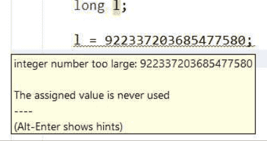

为了修复这个问题，我需要告诉编译器这个数值字面量是一个 `long` 值。我通过在数字后面加上一个 `L` 来这样做：

```java
l = 922337203685477580L;
```

同样，如果你需要将一个浮点数字面量（默认被视为 `double`）赋值给 `float` 变量，你可以在字面量后面加上一个 `F`：

```java
float f;

f = 3.4028235E38F;
```

如果你不确定数值类型的最小和最大范围，每个类型包装类提供的 `MIN_VALUE` 和 `MAX_VALUE` 常量会返回相应的值：

| `Byte.MIN_VALUE` | `Byte.MAX_VALUE` |
| :--- | :--- |
| `Short.MIN_VALUE` | `Short.MAX_VALUE` |
| `Integer.MIN_VALUE` | `Integer.MAX_VALUE` |
| `Long.MIN_VALUE` | `Long.MAX_VALUE` |
| `Float.MIN_VALUE` | `Float.MAX_VALUE` |
| `Double.MIN_VALUE` | `Double.MAX_VALUE` |

`Primitives` 示例程序包含此示例，可以在 `typesActionPerformed()` 方法中找到。

## 原子级字符串转换

正如我之前提到的，当你想要将数值转换为字符串时 —— 例如，如果你想使用 `setText()` 方法在文本区域中显示一个整数 —— 你需要使用包装类调用 `toString()` 方法，如下：

| DataTypes |
| :--- |
| `myTextArea.setText(Integer.toString(myInt + myOtherInt));` |

然而，如果你一直关注我的代码，可能会注意到我并没有遵循这条规则。在 `DataTypes` 项目中，例如我直接显示 `double` 变量 `total` 的值，而没有显式地将其转换为字符串：

```java
myTextArea.setText("Total = " + total);
```

这怎么可能呢？让我们做一个实验。你会在 `DataTypes` 项目的 `parseStringsBtnActionPerformed()` 方法中找到上述代码行。尝试编辑它，去掉字符串 `"Total = "` 和拼接运算符 `+`，使得代码现在读取为：

```java
myTextArea.setText(total);
```

如果你现在尝试重新构建并运行项目，你将看到一个错误信息，警告 `double` 无法转换为 `String`：

```
incompatible types: double cannot be converted to String

----

(Alt-Enter shows hints)

myTextArea.setText(total);

}
```

那么，为什么我的原始版本没有问题地运行，而这个新版本却不行？事实证明，当你拼接字符串时（这里通过将 `double` 变量的值附加到字符串 `"Total = "` 之后），Java 会自动为每个尚不是字符串的项调用 `toString()` 方法。这意味着下面所示的两个代码行是等价的：

```java
myTextArea.setText("Total = " + total);

myTextArea.setText("Total = " + Double.toString(total));
```

## 装箱与拆箱（Boxing and Unboxing）

在程序中使用基本类型时，你可能需要使用包装类提供的方法。由于这种原因，Java 提供了一种简写方式，将基本类型转换为对象。当你将基本类型赋值给相应的包装类变量时，会创建一个包含该基本值的对象，这被称为装箱（autoboxing）。当你将包装对象赋值给相应的基本类型变量时，对象中包含的基本值被赋值给变量，这被称为拆箱（unboxing）。你可以在 `Primitives` 中找到装箱和拆箱的简单示例：

| Primitives | Object |
| :--- | :--- |
| `int unboxed;` | `Integer boxedInt;` |
| `double unboxed;` | `Double boxedDouble;` |

```java
boxedInt = 500; // 装箱

unboxed = boxedInt; // 拆箱
```


这张图显示了变量 `unboxed` 与对象 `boxedInt` 的简化视图。基本类型只是一个数字；它没有内置行为。简而言之，基本类型只是一段数据。对象要复杂得多，它包含了一些数据（这里是值），但也有如 `floatValue()`、`toString()` 和 `toDouble()` 等方法，可以对该数据执行操作或返回不同类型的值。

## 字符串

我们在程序中频繁使用字符串。在结束本章之前，我将用简单的语言解释什么是字符串。在 Java 中，字符串代表一系列字符。例如，字符串 `"Hello"` 代表字符 'H''e''l''l''o'。字符串是以双引号分隔的字符序列输入的（这被称为字符串字面量），它的数据类型是 `String`。字符串实际上是一个包含数据（某些字符）和各种方法的对象。`String` 方法包括查找字符、获取子字符串、返回字符串的大写或小写，以及返回字符串的长度。字符串中的第一个字符索引为 0。字符串中的最后一个字符索引为字符串长度减 1。假设字符串包含文本 `"Hello world"`，表达式 `s.length()` 将返回值 11。


## 字符串字面量如何拥有方法？

之前我解释过，像 `500` 这样的整数字面量只是没有方法的数据，所以我不能写 `500.toString()`。为了这样做，我需要一个 `Integer` 对象。那么为什么字符串字面量可以访问方法？例如，我可以写 `"hello".toUpperCase()`，它将返回字符串 `"HELLO"`。这是因为当你将字符串字面量赋值给变量时，Java 会创建一个 `String` 对象。事实上，尽管像 `"Hello"` 这样的字符串值是字面量，但它们不是基本类型。基本类型是一个非常简单的字符数据。字符串是一整系列字符，因此可以被视为一种复杂的数据类型。

这是我的代码创建此字符串并将其赋值给变量 `sLen` 的方式：

```java
String s;

int sLen;

s = "Hello world";

sLen = s.length();
```

下面你可以看到我将索引值 `0` 和 `sLen-1` 传递给 `charAt()` 方法（该方法返回指定索引处的字符），以便找到字符串中的第一个最后一个字符。字符串的索引从 0（第一个字符）到字符串长度减 1（最后一个字符）：

```java
char c;

char c2;

s = "Hello world";

sLen = s.length();

c = s.charAt(0); // c 现在是 'H'

c2 = s.charAt(sLen-1); // c2 现在是 'd'
```

如果我想使用字符串的小写或大写版本，我需要在字符串对象上调用 `toLowerCase()` 或 `toUpperCase()` 方法。这些方法返回一个所有字符都更改为指定大小的新字符串。

```java
String lowercaseS = s.toLowerCase();

String uppercaseS = s.toUpperCase();
```

## Java 字符串是不可变的

Java 字符串是不可变的，这意味着它们不能被修改。例如，当我对字符串 `s` 调用 `toUpperCase()` 方法时，该字符串对象并没有被设置为大写。`toUpperCase()` 方法返回的字符串 `"HELLO WORLD"` 是一个新的字符串对象。将其赋值给变量 `uppercase`。原始字符串 `s` 保持不变：它仍然包含 `"Hello world"`。

### 转义字符

注意，当我们在 `Strings` 示例程序中显示输出时，我在双引号字符前面使用斜杠字符 `\` 来显示双引号。

```java
"\nIn lowercase, the string is \"" + lowercaseS + "\""
```


如果我不这样做，Java 会认为双引号字符是字符串字面量的结束。斜杠 `\` 告诉 Java 紧随其后的字符（如 `"` 或 `n`）应该被特殊对待：`\n` 被视为换行符，`"` 是双引号字符。

# 第 3 章 — Java 编程元素

这些是 Java 字符串识别的转义字符：

| 转义字符 | 说明 |
|---|---|
| `\t` | 在文本此处插入一个制表符。 |
| `\b` | 在文本此处插入一个退格符。 |
| `\n` | 在文本此处插入一个换行符。 |
| `\r` | 在文本此处插入一个回车符。 |
| `\f` | 在文本此处插入一个分页符。 |
| `\'` | 在文本此处插入一个单引号。 |
| `\"` | 在文本此处插入一个双引号。 |
| `\\` | 在文本此处插入一个反斜杠。 |

# 第 4 章 — 面向对象

Java 是一种面向对象的语言。在本章中，我将解释什么是对象、对象是如何与类相关的，以及为什么面向对象是很有用的。

你用 Java 处理的几乎一切内容——从一个 "Hello world" 字符串到冒险游戏中的宝藏——都被封装在一个对象内部。该对象包含了数据本身（例如字符串中的字符或宝藏的描述）以及用于操作数据的函数“方法”——例如，字符串对象的 `toUpperCase()` 方法。

## 基本数据类型是不同的

正如已经所看到的，基本类型是“Java 中一切都是对象”这一规则的例外。基本类型是简单的数据单元；它们不是 Java 对象。然而，基本类型可以被“封装”在 Java 对象内部，正如第 3 章所解释的，一个 `int` 基本类型可以被封装在一个 `Integer` 对象内部。

## 类和对象

你使用的每个对象都是从一个“类”创建的。你可以将类比为蓝图，它定义了对象的数据和行为（方法）。

让我们来看一个非常简单的定义示例。你使用 `class` 关键字定义类。在这里，我决定将类命名为 `Thing`。注意类名的首字母是大写的。这是 Java 以及许多其他编程语言的惯例。该类包含两个字符串变量：`name` 和 `description`。我通过在声明前加上 `private` 关键字将这些变量设为私有：

```java
private String name;
private String description;
```

当类内部的变量是私有的时，类外部代码无法访问它们。为了访问我的私有变量，我编写了这些“get”和“set”访问器方法：

```java
public String getName() {
    return name;
}

public void setName(String aName) {
    name = aName;
}

public String getDescription() {
    return description;
}

public void setDescription(String aDescription) {
    description = aDescription;
}
```

在 Java 中，当你想要给私有变量赋予新值时，你需要编写一个 set 访问器，按照传统，它使用 `set` 加上变量的首字母大写名称。因此，新值可以被赋值给 `name` 变量，例如使用 `setName()` 方法。

当你想要获取私有变量的值时，你需要编写一个 get 访问器，按照传统，它使用 `get` 加上变量的首字母大写名称。因此，`name` 变量的值通过 `getName()` 方法返回。

每个类都应该创建在与类名同名的独立类文件中。例如，我将 `Thing` 类写在一个名为 `Thing.java` 的文件中。


## 私有变量，公共方法

将变量设为私有通常是良好的做法。通过使用方法访问数据，你可以控制允许访问数据的程度，并且你还可以在方法中编写代码来测试数据是否有效。如果你创建了公共变量，其他程序员将直接访问它们。如果你想在日后防止直接访问，将会变得困难。但如果你创建了公共方法和私有变量，你就可以根据需要更改方法的代码来限制访问、显示错误信息或进行其他更改。

## 完成后的 `Thing` 类

```java
package myclasses;

public class Thing {
    private String name;
    private String description;

    public Thing(String aName, String aDescription) {
        // 构造函数
        name = aName;
        description = aDescription;
    }

    public String getName() {
        return name;
    }

    public void setName(String aName) {
        name = aName;
    }

    public String getDescription() {
        return description;
    }

    public void setDescription(String aDescription) {
        description = aDescription;
    }
}
```

## 类是对象的蓝图

我的 `Thing` 类什么都不做。它仅仅是一个 `Thing` 对象的“蓝图”。在使用实际的 `Thing` 对象之前，你必须从 `Thing` 类创建它，就像在驾驶汽车之前必须先从 `Car` 蓝图创建一辆真实的汽车一样！

`Car` 蓝图和 `Thing` 类是定义什么是 `Car` 或 `Thing` 的计划或设计。从一个 `Car` 蓝图，制造商可以构建许多汽车“对象”。从一个 `Thing` 类，程序员可以构建许多 `Thing` 对象。根据上面显示的类，我看到每个对象将有一个字符串类型的名称和描述，以及 get/set 方法。

## 构造函数

`Thing` 类也有一个构造函数。构造函数是一种特殊方法，在 Java 中它的名称与类名相同，用于初始化字段（变量）。

```java
public Thing(String aName, String aDescription) {
    // 构造函数
    name = aName;
    description = aDescription;
}
```

在示例程序 (`NewJFrame.java`) 中，我声明了两个 `Thing` 类型变量：

| 对象 (NewJFrame.java) |
|---|
| `Thing mySword; Thing myRing` |

在使用这些对象之前，我需要创建它们。我通过使用 `new` 关键字后跟构造函数名称以及括号（如果构造函数不需要参数）来实现。事实上，`Thing` 构造函数需要两个字符串 `aName` 和 `aDescription`，因此我在括号之间放置了两个逗号分隔的字符串：

```java
mySword = new Thing("Dwarf Sword", "a sword of great power");
myRing = new Thing("Elvish Ring", "a golden ring of magic power");
```

当你这样调用构造函数时，会创建一个对象并用传递给构造函数的数据初始化其字段。新创建的对象可以赋值给类型相同的变量。

## 类层次结构

面向对象的核心特征之一是继承。简单来说，这意味着你可以创建一个类的族树，使得一个或多个类继承另一个类的特征。

被继承特征的类可以认为是祖先，继承祖先类特征的类可以认为是它的后代。后代类也称为子类。祖先类通常被称为父类。

假设我想创建一个 `NoisyThing` 类，它是 `Thing` 的一种“类型”——因此它继承了 `Thing` 类的特征，即名称和描述，但它又增加了两个新特征：噪音和音量。

要创建一个子类，你需要在新类名和其父类名之间放置 `extends` 关键字。我是这样声明的：

```java
class NoisyThing extends Thing
```

子类继承其祖先类的特征（方法和变量），因此你不需要重新编写它们。在这个示例中，`Thing` 类有两个变量 `name` 和 `description`，以及四个访问这些变量的访问方法 `getName()`、`setName()`、`getDescription()` 和 `setDescription()`。

## `NoisyThing` 类

`NoisyThing` 类是 `Thing` 类的子类，因此它自动继承了名称和描述变量以及它们的访问器方法。此外，`NoisyThing` 类新增了以下两个变量：

```java
private String noise;
private int volume;
```

再次，我为这些变量添加了用于获取和设置这些变量值的访问器方法：

```java
public String getNoise() {
    return noise;
}

public void setNoise(String noise) {
    this.noise = noise;
}

public int getVolume() {
    return volume;
}

public void setVolume(int volume) {
    this.volume = volume;
}
```

当创建一个新的 `NoisyThing` 对象时，需要为所有四个变量赋值（包括它定义的变量 `noise` 和 `volume`，以及由其祖类定义的变量 `name` 和 `description`）。

它的构造方法在括号中有四个参数，这样在创建新的 `NoisyThing` 对象时，就可以将初始化四个变量所需的数据项（或称为“参数”）传递给构造方法：

```java
NoisyThing(String aName, String aDescription, String aNoise, int aVolume)
```

`NoisyThing` 构造方法首先将相关数据项传递给其父类构造方法，以便父类可以初始化它的数据——即由 `Thing` 类定义的名称和描述变量：

```java
super(aName, aDescription);
```

`super` 方法用于调用父类的构造方法，并将括号中父类构造方法所需的参数传递。完成此操作后，我继续初始化 `NoisyThing` 类中定义的变量：

```java
noise = aNoise;
volume = aVolume;
```

## 参数与实参

**参数**是在方法最顶部括号之间声明的命名变量，如下：

```java
private String doSomething(String aString, int aNumber)
```

**实参**是在调用方法时传递给方法的值（数据项），如下：

```java
doSomething("Hello", 100);
```

虽然计算机科学家可能喜欢在“参数”（parameter）和“实参”（argument）这两个术语之间做出明确区分，但程序员经常混用这两个词。因此，在非正式的情况下，方法的“参数列表”可能被称为它的“实参列表”。

当你调用一个方法时，传递的实参的数量必须与方法中声明的参数数量相同。列表中的每个实参的数据类型必须与匹配的参数相同。

当我创建一个 `NoisyThing` 对象时，我必须确保向其构造方法传递四个正确数据类型的实参，这样除了新定义的 `NoisyThing` 变量外，还可以初始化父类 `Thing` 的变量：

```java
NoisyThing myCat;
NoisyThing myDog;

myCat = new NoisyThing("Flossie", "a small tabby cat", "Miaaaow", 3);
myDog = new NoisyThing("Fido", "a big smelly dog", "Woof!", 10);
```

## 函数或方法

正如我在第 2 章中提到的，“方法”是面向对象语言中非面向对象（或“过程”）编程语言中通常被称为“函数”的术语，尽管某些语言也使用“过程”（procedure）和“子程序”（subroutine）等术语。

函数提供了将代码划分成块的方法。在过程语言中，函数是“悬浮”的，我的意思是它们几乎可以写在代码的任何地方。在面向对象的语言中，函数被绑定到对象中。它们必须写在类定义内部，并被称为“方法”。

方法使用如 `private` 或 `public` 等关键字进行声明（这控制函数对程序中其余代码的可见性），随后是函数返回任何值的数据类型，如果没有返回任何内容则使用 `void`。然后是函数的名称，由程序员选择。接着是一对括号。

### `private` 和 `public` 关键字

`private` 和 `public` 关键字是“访问修饰符”。`public` 变量或方法可以在代码的任何地方访问。`private` 变量或方法仅在特定区域或“作用域”内可见。例如，对象内部的私有变量无法从该对象类外部编写的代码中直接访问。然而，公共方法可以从该对象的外部访问。访问修饰符将在第 8 章中详细解释。

方法名后的括号可以是空的，也可以包含一个或多个用逗号分隔的“参数”。参数由程序员选择，每个参数之前都必须跟上其数据类型。方法会向调用它的代码返回某个值，该返回值通过在前面加上 `return` 关键字来指示。接下来的三个函数是简单方法的示例。

这是一个不接受任何参数且不返回任何内容的函数：

```java
// Methods (NewJFrame.java)
private void doSomething() {
    outputTA.append("Hello".toUpperCase() + "\n");
}
```

这是一个接受单个 `String` 参数且不返回任何内容的函数：

```java
private void doSomething(String aString) {
    outputTA.append(aString.toUpperCase() + "\n");
}
```

这是一个接受两个 `String` 参数并返回 `String` 的函数：

```java
private String doSomething(String aString, String anotherString) {
    return (aString + anotherString).toUpperCase() + "\n";
}
```

## 消息与方法

面向对象的纯主义者可能会将函数调用描述为发送给对象的消息。考虑这个：

```java
"Hello".toUpperCase();
```

在这里，消息是 `toUpperCase()`。原则上，对象可能会拒绝该消息。在 Smalltalk 等面向对象语言中，消息传递是基础性的。在 Java 等语言中，程序员需要讨论函数调用或方法调用，而不是消息传递。要执行代码，你必须通过名称调用它。在 Java 中，调用无参数的方法必须在方法名后跟一对空括号：

```java
doSomething();
```

## 返回值

如果方法返回一个值，该值可以（在调用代码中）赋值给匹配数据类型的变量。在这里，`doSomething()` 方法返回一个字符串并赋值给变量 `astr`。

| 方法 (NewJFrame.java) |
|---|
| `String astr;` |
| `astr = doSomething("Hello", "dear programmer.");` |

可以在不赋值给变量的情况下使用方法的返回值。例如，考虑以下方法将 `doSomething()` 的返回值赋值给字符串变量 `astr`，然后将其传递给文本区域 `outputTA` 的 `append()` 方法：

```java
String astr;
astr = doSomething("Hello", "dear programmer.");
outputTA.append(astr);
```

由于我再也不需要使用返回的字符串值，所以我不需要将其存储在变量中。我可以直接将方法调用的返回值传递给 `append()` 方法。我可以通过将我的三行代码重写为单行（省略 `astr` 变量）来实现：

```java
outputTA.append(doSomething("Hello", "dear programmer."));
```

## 重载方法

只要每个方法的参数列表不同，你就可以在 Java 中为多个不同的方法使用相同的名称。参数列表定义了`方法签名`，你创建具有相同名称但签名不同的方法，这被称为方法重载。方法重载将在第 9 章详细解释。

常用重载方法的示例是 `String` 类的 `indexOf()` 方法。当你对 `String` 对象调用此方法并向它传递单个 `String` 参数时，`indexOf(String str)` 返回字符串中指定子字符串首次出现的索引。`String` 类提供了四个重载的 `indexOf()` 方法。这些重载方法可以通过参数的数量或其数据类型区分开来。

# 第 4 章 — 面向对象（续）

重载的 `indexOf()` 方法，每个方法都返回一个整数值，表示字符串中的索引（记住第一个字符的索引为 0）：

```java
indexOf(int ch)
```
返回指定字符在此字符串中第一次出现的索引。

```java
indexOf(int ch, int from)
```


从指定的索引处开始搜索，返回指定字符在此字符串中第一次出现的索引。

```java
indexOf(String str)
```

返回指定子字符串在此字符串中第一次出现的索引。

```java
indexOf(String str, int fromIndex)
```

从指定的索引处开始搜索，返回指定子字符串在此字符串中第一次出现的索引。

这里是一个使用所有这些方法的示例：

| indexOf |
| :--- |
| `public static void main(String[] args) {` |
| `String s = "The quick brown fox jumps over the lazy dog";` |
| `System.out.printf("s.indexOf(\"quick\") = %d\n", s.indexOf("quick"));` |
| `System.out.printf("s.indexOf(\"e\") = %d\n", s.indexOf("e"));` |
| `System.out.printf("s.indexOf(\"the\", 3) = %d\n", s.indexOf("the", 3));` |
| `System.out.printf("s.indexOf(\"u\", 3) = %d\n", s.indexOf("u", 3));` |
| `}` |

这是输出结果：

```
s.indexOf("quick") = 4
s.indexOf("e") = 2
s.indexOf("the", 3) = 31
s.indexOf("u", 3) = 5
```

## 类方法

通常，当你想要使用由某个类提供的方法时，必须根据该类创建一个新对象。然后你就可以从该对象调用该方法。例如，如果你想获取 `Room` 对象的北出口，首先需要创建一个新的 `Room` 对象，然后像这样从该对象调用 `getN()` 方法：

```java
Room goldRoom;
int exit;
goldRoom = new Room("room2", "Gold room", 0, 4, Direction.NOEXIT, 3);
exit = goldRoom.getN();
```

上所示的代码片段假设你已经定义了一个 `Room` 类（正如示例项目 `AdventureGame1` 所示，我稍后会解释）。

有时，在不需要创建对象的情况下调用方法是有用的，例如为了将字符串 `"200"` 转换为其整数表示 `200`。你可以这样做，比方通过先创建一个新的 `Integer` 对象，然后将字符串作为参数调用 `valueOf()` 方法，如下：

```java
Integer intOB;
int anInt;
String s = "200";
intOB = new Integer(0);
anInt = intOB.valueOf(s);
```

然而，这是完成一个非常简单任务的一种非常复杂的方法。我创建一个简单的 `Integer` 对象是为了调用定义在 `Integer` 类内部的转换方法 `valueOf()`。如果我不需要先创建 `Integer` 对象就可以调用 `valueOf()`，那样会整洁得多。事实上，我可以做到这一点。我不需要从 `Integer` 类创建对象，而是可以直接从类本身调用 `valueOf()`，如下：

```java
Integer.valueOf(s);
```

你会在 `ClassMethods` 项目中找到这个示例。我有一个字符串变量 `s`，值为 `"200"`（在实际程序中，这可能是用户通过文本框输入的，也可能是从磁盘上的文件中读取的）。当我在计算中使用该值时，我调用 `Integer.valueOf(s)` 来返回一个整数值：

```java
int x;
int total;
String s;
s = "200";
x = 5;
total = x * Integer.valueOf(s);
```

许多其他标准 Java 类也提供了可以通过这种方式调用的方法。例如，`String` 类提供了 `format()` 方法，它允许你通过在由“格式占位符”标记的位置嵌入值来创建一个字符串（就像我们在第 2 章描述的 `printf()` 函数中使用的那样）：

## 静态方法 (static Methods)

`String` 类提供了 `format()` 方法，它允许你通过在由“格式占位符”标记的位置嵌入值来创建一个字符串（就像我们在第 2 章描述的 `printf()` 函数中使用的那样）：

```java
String.format("%d %s", x, s);
```

为了能够直接从类调用，方法必须被声明为 `static`。这意味着该方法属于类，而不是属于任何特定的对象。这对于那些不需要特定对象的状态即可运行的方法是非常用的。

`ClassMethods` 项目提供了此方面的很好的示例：

```java
public static class ClassMethods {
    private static int count = 0;
    public static int valueOf(String s) {
        count++;
        return Integer.parseInt(s);
    }
}
```

# 第 4 章 — 面向对象

显示的内容如下：

| | |
| :--- | :--- |
| 有 0 个对象 |
| 有 1 个对象 |
| 有 2 个对象 |
| 有 3 个对象 |
| 当所有对象都创建完成后：有 3 个对象 |
| 这是总共 3 个对象中的第 1 个对象 |
| 这是总共 3 个对象中的第 2 个对象 |
| 这是总共 3 个对象中的第 3 个对象 |

概要，实例变量为每个对象存储不同的值。类变量或静态变量存储单个值，由该类创建的所有对象都可以访问该值。实例方法通过对象调用，而类方法通过类调用。顺便提一下，也可以从对象调用静态方法，但这可能会引起混淆，因此通常最好避免这样做。

## 静态常量 (static)

回想第 3 章，常量值通常使用 `final` 关键字声明。这防止了赋值给标识符的值被更改。事实上，你经常会看到 Java 常量也是使用 `static` 关键字定义的。`static` 关键字确保我们只创建一个常量的副本并存储在类本身，而不是为每个对象创建新副本。例如，常量值 PI 的声明方式如下：

```java
public static final double PI = 3.14159265385979323846;
```

正如你在运行 `PIT` 项目时所看到的，Java 节点会将此值截断为 `3.141592653859793`。如果你想查看 Java 中的常量，可能可以使用你 IDE 的导航工具。例如，在 NetBeans 中，你可以右键点击导入的常量名，并在弹出菜单中选择“导航 | 转到声明 (Navigate | Go to Declaration)”：

| package pitest; | | |
| :--- | :--- | :--- |
| import static java.lang.Math.PI; | | |
| 转到源 | Ctrl+B | 导航 | 转到声明 | Ctrl+B | 显示 Javadoc Alt+F1 转到测试/被测试类 | Ctrl+T | 查找用法 Alt+F7 |
| 转到父类实现 | Ctrl+P | 调用层次结构 |

## 类网络 (Class Networks)

在本章中，我们学习了类被用创建对象的蓝图，以及后代类如何继承祖先类的特征。在某些类型的应用程序中，拥有多个“级”的继承可能是很有用的，例如类 D 继承自类 C；类 C 继承自类 B；类 B 继承自类 A。

拥有多个“行”的继承关系也可能有用，即类 B 和类 X 都继承自类 A，而类 Y 继承自类 B。通过这种情况下，我们可以创建复杂的类网络或“族树”。

当我解释我的 Java 游戏项目时，我会展示一个复杂网络的真实示例，该项目将在后面的章节中开发，并在附录中进行总结。下面的图显示了 `Adventure1` 项目中“游戏对象”的网络。`Thing` 类有一个名称和描述。`Actor` 类和 `Room` 类都继承自 `Thing` 类，因此 `Actor` 和 `Room` 对象也将具有名称和描述。

`Actor` 类定义了一个交互式角色（或游戏玩家）并添加了位置。`Room` 类定义了游戏地图中的房间，并添加了四个出口：n, w 和 e。

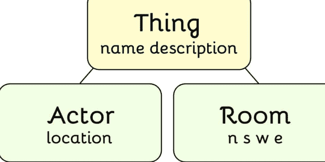

# this 和 super

有时你会看到引用当前对象的关键字——即正在被创建的对象。它通常是省略的：`this.name = aName` 的效果与赋值 `name = aName` 完全相同。然而，如果我直接将参数命名为 `name` 而不是 `aName`，那么就需要 `this` 关键字来消除歧义：`this.name = name`。

`super` 关键字的使用方式类似，用于引用父类中的变量和方法——例如，我们之前看到的父类构造函数，它再次经常用于消除祖先类和子类之间同名方法的歧义。我将在第 9 章详细介绍方法的重写和重载。

# 第 5 章 – 测试与运算符

你经常需要使用运算符来更改和测试程序中的值，以便代码能够在在不同情况下采取不同的操作。这就是本章的主题。

在你的程序中，你经常需要测试两个变量的值是否相同或不同。Java 提供了“运算符”来帮助你进行这些测试。在本章中，我们将发现如何使用 Java 运算符来编写条件测试、修改变量值以及进行算术计算。

我们已经见过一些运算符——例如，在第 1 章的 `Hello/Args` 程序中，我们使用等等运算符 (`==`) 来测试命令行输入的参数数量 (`args.length`) 是否等于 0：

```java
if (args.length == 0)
```

我们在第 3 章的 `TaxCalc` 程序中使用了乘法 (`*`) 和加法 (`+`) 运算符，以及赋值运算符 (`=`)。你可能记得，在那个程序中，我们将 `subtotal` 变量乘以 `TAXRATE` 常量，并将计算结果赋值给 `tax` 变量。将 `subtotal` 和 `tax` 变量的值相加并将结果赋值给 `grandtotal` 变量：

```java
tax = subtotal * TAXRATE;
grandtotal = subtotal + tax;
```

在本章中，我们将查看其他运算符。

## 运算符

什么是运算符？简单来说，运算符是用于执行加法和乘法操作的特殊符号。

## 赋值 (Assignment)

最重要的运算符之一是赋值运算符，它将右侧的值分配给变量。注意，赋值的数据类型必须与变量的类型兼容：

```java
int IntVar = 10;
```

## 相等 (Equality)

虽然一个等号 `=` 用于赋值，但两个等号 `==` 用于测试条件。你将在 `EqualsOps` 示例中找到一个更完整的示例，它测试了用户输入的值：

```java
if (IntVar == 1) {
    textField2.setText("Yes!");
} else {
    textField2.setText("No!");
}
```

但这段代码有一个问题。在用户向 `textField1` 输入值之前，该字段是空的。如果我尝试使用 `Integer()` 将其内容转换为整数，将导致错误。我将在第 9 章讨论异常处理时，解释一些从错误中恢复的方法。在这里，只需通过测试字段是否包含空字符串来避免错误，从而显示错误信息，而不是尝试将字符串转换为整数。这是我的第一次尝试：

```java
if (textField1.getText() == "") {
    textField2.setText("You must enter a number into textField..");
} else {
    myIntVar = Integer.parseInt(textField1.getText());
    if (myIntVar == 1) {
        textField2.setText("Yes!");
    } else {
        textField2.setText("No!");
    }
}
```

我想从 `textField1` 获取文本并将其与空字符串比较：

```java
if (textField1.getText() == "")
```

如果是空字符串，那么我想运行所有这些代码：

```java
textField2.setText("You must enter a number into textField..");
```

如果不是空字符串，我想运行 `else` 关键字之后的所有代码：

```java
{
    myIntVar = Integer.parseInt(textField1.getText());
    if (myIntVar == 1) {
        textField2.setText("Yes!");
    } else {
        textField2.setText("No!");
    }
}
```

但事实并非如此。当 `textField1` 为空时，运行的是 `else` 之后的代码——这完全不是我想要的。要理解为什么，你必须理解 Java 如何处理字符串。

## 比较字符串

整数可以与另一个整数进行比较，因此如果 `myIntVar` 的值为 1，此测试将结果为真：

```java
if (myIntVar == 1)
```

# 第 5 章 – 测试与运算符

然而，当我将字符串 `"1"` 与另一个字符串 `"1"` 进行比较时，测试结果却为 false。换句话说，Java 认为两个值相同的整数是相同的，但两个值相同的字符串是不同的。

## String.equals()

为了确定两个字符串是否包含相同的字符（或不包含任何字符），你需要使用字符串对象的 `equals()` 方法。这是我重写测试的方式（现在它按照我的意图运行了）：

| EqualsOps |
| :--- |
| `if ("".equals(textField1.getText())) { textField2.setText("你必须在 textField1 中输入一个数字."); }` |

## 字符串相等性

让我们考虑一下为什么两个看起来相同的字符串被认为是不同的。事实证明，每个字符串都占据自己的内存块，因此它被认为与其他任何字符串都不同。记住，在 Java 中，整数是一个简单的数据——基本类型。但字符串是一个对象——而每个对象都与其他任何对象不同。即使两个字符串包含完全相同的字符，也是如此。


## 字符串是对象吗？

并不是所有的编程语言都这样处理字符串。即使是许多方面与 Java 非常相似的 C# 语言，也允许你使用普通的 `==` 等于运算符测试两个字符串。在 C# 中，当两个不同的字符串包含相同的字符时，使用 `==` 运算符的测试会返回 true。而在 Java 中，它返回 false。你必须记住，Java 处理字符串就像处理其他对象一样。两个猫对象 `catA` 和 `catB` 都有相同的名称 `"Tiddles"`，但它们仍然是两个不同的对象。Java 处理字符串比较的方式是一样的！


假设你这样初始化了两个字符串：

```java
String s1 = new String("Hello");
String s2 = new String("Hello");
```

现在你使用此测试比较 `s1` 和 `s2`：

```java
(s1 == s2) // 这评估结果为 false
```

测试结果为 false 是因为尽管这两个字符串包含相同的字符，但 `s1` 是一个与 `s2` 不同的字符串对象（我是显式地使用 `new` 创建的每一个）。对于任何在运行时创建的字符串对象（例如，通过将文本框中的文本赋值给字符串变量），也是如此。

然而，当将两个相同的字符串赋值给变量时（而不创建新对象），它们将引用（或“指向”）同一个字符串。这是因为在编译应用程序之前在代码中创建的字符串字面量被保存到字符串“表中”，任何分配该字符串的变量都会引用这个存储的值。因此，赋值相同字符串的变量在使用 `==` 运算符测试相等性时将返回 true：

| StringCompare |
| :--- |
| `String s1 = "Hello"; String s2 = "Hello";` |

```java
(s1 == s2) // 这评估结果为 true
```


这就是 Java 字符串拥有 `equals()` 方法的原因。该方法比较两个字符串中的字符，如果这些字符相同则返回 true。

## 测试字符串的“最佳”方法是什么？

查看 `StringCompare` 项目中的代码可以帮助你理解 Java 中是如何比较字符串的。如果你觉得这很困惑，只需记住在大多数情况下，使用 `==` 运算符比较字符串并不是一个好主意。相反，你应该使用 `equals()` 方法。`==` 运算符会根据字符串如何以及何时赋值给变量而返回不同的结果，而 `equals()` 方法在所有情况下都是一致的。


# 第 5 章 — 测试与运算符

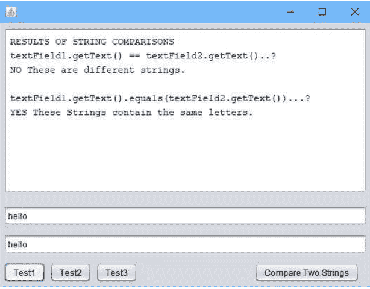

在这里运行了 `StringCompare` 项目，在文本框中输入了两个相同的字符串，并点击“Test1”按钮，使用 `==` 运算符和 `equals()` 方法比较字符串。

`==` 运算符返回 false，表示它们是两个不同的对象。`equals()` 方法返回 true，表示两个字符串包含完全相同的字符。

## 测试与比较

Java 可以使用 `if` 语句进行执行测试。测试本身必须包含在括号（圆括号）中，并且能够评估为 true 或 false。如果为 true，则执行测试后的语句。单表达式语句以分号结束，如下所示：

```java
if (inputStr.equals(""))
    outputStr.setText("你没有输入任何内容");
```

如果你想在测试后执行多行代码，所有这些代码行必须在大括号内，形成一个代码“块”。

一些程序员（包括在内！）为了清晰和一致性，倾向于用大括号将单行和多行语句括起来。因此，上面的示例可以重写为：

```java
if (inputStr.equals("")) {
    output.setText("你没有输入任何内容");
}
```

## if...else

可选地块后面可以跟一个 `else` 块。如果测试评估为 false，则执行 `else` 块。你可以链多个 `else` 语句。这里有一个例子：

| Tests |
| :--- |
| if (inputStr.equals("")) { output.setText("你没有输入任何内容"); } |
| else if (inputStr.equals("hello")) { output.setText("你好！"); } |
| else { output.setText("我不明白你在说什么!"); } |

购买了价值超过 100 美元的商品，并且他们购买了今日特惠。在代码中，这些条件可以使用逻辑运算符 `&&` 进行求值，如下所示：

```java
if ((valueOfPurchases > 100) && (boughtDealOfTheDay))
```

但如果你想大慨一些，你可能想在客户购买了价值超过 100 美元的商品或者该客户购买了今日特惠时提供折扣。在代码中，这些条件可以使用逻辑或 `||` 运算符进行求值，如下：

```java
if ((valueOfPurchases > 100) || (boughtDealOfTheDay))
```

你会在 `LogicalOperators` 程序中找到这些这些运算符的示例：

| LogicalOperators |
| :--- |
| int age; int number_of_children; double salary; age = 25; number_of_children = 1; salary = 20000.00; if ((age <= 30) && (salary >= 30000.00)) { System.out.print("You are a rich young person\n"); } else { System.out.print("You are not a rich young person\n"); } if ((age <= 30) || (salary >= 30000.00)) { System.out.print("You are either rich or young or both or not\n"); } else { System.out.print("You are neither rich nor young\n"); } if ((age <= 30) && (salary >= 30000.00) && (number_of_children != 0)) { System.out.print("You are a rich young parent\n"); } else { System.out.print("You are not a rich young parent\n"); } |

该程序产生以下输出：

```
You are not a rich young person
You are either rich or young both
You are not a rich young parent
```

## 布尔值

逻辑运算符测试布尔值。一个布尔值可以为真（true），也可以为假（false）。Java 提供了一种 `boolean` 数据类型，它可以存储 true 值或 false 值：

```java
boolean happy;
boolean rich;
happy = true;
rich = false;
```

通过将带有多个 `&&` `||` 运算符的测试组合，可以创建相当复杂的条件。你可能需要将多部分测试封装在括号之间，以确保所有组件测试都一起求值并返回一个真或假值。例如，通过在这里对前两个条件加上括号，我可以确保 `((income > 100000) || (wonTheLottery))` 被作为一个单个测试进行评估。

```
((income > 100000) || (wonTheLottery)) && happy
```

注意，复杂的测试通常很难理解，如果你犯了错误，它们可能会产生意外的副作用。例如，有如此多的“或”和“和”条件，以至于很难看出这个测试的确切含义（如果我不小心把括号放在了错误的位置，可能会无意中改变测试的含义）：

```
if (((income > 100000 ) || (wonTheLottery)) && happy) || (rich && happy)
```

## 复合赋值运算符

Java 中的一些赋值运算符在将结果赋值给变量之前会执行计算。此表显示了一些常见的“复合赋值运算符”的示例以及对应的非复合等效形式：

| operator | example | equivalent |
| --- | --- | --- |
| += | a += b | a = a + b |
| -= | a -= b | a = a - b |
| *= | a *= b | a = a * b |
| /= | a /= b | a = a / b |

你可以在 `CompoundOperators` 项目中找到这些运算符的示例：

```java
public static void main(String[] args) {
    int a;
    int b;
    a = 10;
    b = 2;
    a = a + b;
    System.out.println(a);
    a += b;
    System.out.println(a);
    a = a - b;
    System.out.println(a);
    a -= b;
    System.out.println(a);
    a *= b;
    System.out.println(a);
    a /= b;
    System.out.println(a);
    a /= b;
    System.out.println(a);
}
```

这里的代码使用了标准的算术和赋值运算符，如：`a = a + b`；以及等效的复合运算符，如：`a += b`。

它显示了此输出：

```
12
14
12
20
40
20
10
```

在你自己的代码中倾向于使用哪种语法取决于你。如果你熟悉其他 C 类语言，你可能已经有了偏好。许多 C 和 C++ 程序员更倾向于像 `a += b` 这样更简洁的形式。

## 自增 ++ 和自减 -- 运算符

当你想要让变量的值增加或减少 1（即给变量值加 1 或减去 1）时，可以使用 `++` 和 `--` 运算符。这是一个自增自减的示例：

```java
int a = 5;
a++;
System.out.println(a);
a--;
System.out.println(a);
```

## 一元运算符

`++` 和 `--` 被称为一元运算符，因为它们只需要一个操作数，而像 `+` 这样的二元运算符需要两个。

## 前缀和后缀运算符

你可以将 `++` 和 `--` 放在变量之前或之后，如下：

```java
int a = 5;
++a; // 前缀
a++; // 后缀
```

混合前缀和后缀运算符可能会令人困惑，例如：

```java
int a = 5;
System.out.println(++a); // 打印 6
System.out.println(a++); // 打印 6，然后 a 变为 7
```

# 索引错误

请注意，虽然向数组中放入的对象少于数组声明的最大尺寸是允许的，但不允许向数组中添加的对象超过声明的最大尺寸。例如，考虑这个 `stringarray` 字符串变量，它声明的最大尺寸为 5：

```java
stringarray = new String[5];
```

在这里，数组的长度为 5，因此最后一个元素位于索引 4。那么，如果我尝试在索引 5 处添加一个字符串会发生什么？

```java
stringarray[5] = "cloud";
```

如果你尝试这样做，你会发现在编译并运行程序时，Java 会显示一条信息，说明你的代码导致了 `java.lang.ArrayIndexOutOfBoundsException` 类型的错误。这是因为你试图在数组末尾（`upper bound`）之外添加元素。

# 初始化数组

在目前为止示例中，我首先声明了数组变量，然后使用 `new` 关键字并在方括号中指定数组的最大尺寸来创建数组对象，如下：

```java
String[] stringarray;
stringarray = new String[5];
```

完成后，我逐个向数组中添加元素，通过在方括号中提供数组索引来指定位置，如下：

```java
stringarray[0] = "It";
stringarray[1] = "wandered";
stringarray[2] = "lonely";
stringarray[3] = "as";
stringarray[4] = "a";
```

# 第 6 章 — 数组与集合

有一种更简单的方法可以在单次操作中创建数组并用数据项填充。以下是用单行代码创建一个包含 6 个元素的字符串数组的方法：

| 数组 |
| --- |
| String[] stringarray = {"I", "wandered", "lonely", "as", "a", "cloud"}; |

如果你想以这种方式创建并初始化数组，你必须以所需的数据类型 `String` 开始，后跟一对空方括号 `[]`，然后是数组变量名（这里是 `stringarray`）、赋值运算符 `=` 以及在大括号 `{}` 内包含的逗号分隔的相应类型元素列表。

注意，我没有使用 `new` 关键字，也没有在方括号中指定数组长度。当你使用这种短语法时，系统会自动创建一个新数组，其长度足够容纳大括号之间的项，并且这些项会被按顺序放入数组的每个可用槽位。这里是一些示例：

```java
int intarray[] = {0, 1, 2, 3, 4};
double doublearray[] = {1.2, 2.3, 3.4, 4.5};
char chararray[] = {'H', 'e', '1', '1', 'o'};
```

你可以使用如下的 `for` 循环遍历数组元素来验证数组已创建并填充了项列表：

```java
for (int i = 0; i < stringarray.length; i++) {
  System.out.printf("%s\n", stringarray[i]);
}
```

上面的代码产生此输出：

| I |
| --- |
| wandered |
| lonely |
| as |
| a |
| cloud |

在在这段代码中，我再次使用了 `printf()` 函数，它允许像第 2 章解释的那样嵌入格式占位符，如 `%d`（整数）、`%f`（浮点数）、`%c`（字符）和 `%s`（字符串）。

# length 属性

在 `Arrays` 示例项目中，`length` 是数组的一个“属性”或“特性”。它存储了数组的大小。在我的代码中，`stringarray` 已初始化了六个元素，`stringarray.length` 的求值为数字 6。

# for 循环

当你想要重复运行某些代码时，可以使用 `for` 循环按照预定的次数运行一行或多行代码。`for` 循环由括号内的三部分定义——初始化、测试和增量部分——用分号隔开。这是基本语法：

```java
for (initialization; test; increment) {statements}
```

| 部分 | 描述 |
| --- | --- |
| initialization | 该部分在循环开始时执行一次。通常在这里给计数器变量赋初始值。 |
| test | 该部分每次运行时都会进行求值。如果结果为真，循环继续。如果结果为假，循环结束。 |
| increment | 该部分每次循环运行时都会进行求值。通常计数器变量会递增。 |
| {statements} | 每次循环时执行的代码放置在双括号之间。 |

这是一个简单的示例，执行 10 次并显示从 0 到 9 的十个整数：

```java
for (int i = 0; i < 10; i++) {
System.out.println(i);
}
```

第一部分初始化计数器变量（整数 `i`）的值，将其赋值为 0。
第二部分测试计数器变量的值，并在测试条件求值为假时停止运行循环（在这里，只要 `i` 小于 10，循环就会继续。一旦它的值达到 10 或更多，循环就会结束）。

第三部分递增计数器变量的值：`i++` 将 `i` 的值加 1。

语句部分是任何封装在双括号之间的代码。

在双括号之间封装的是任何代码。这里这一行仅仅打印 `i` 的值：

```java
System.out.println(i);
```

虽然通常方便初始化变量为 0，特别是在处理数组或字符串时，但如果你想从 1 数到 10 而不是 0，一种方法是初始化 `i` 为 1 并在 `i` 小于或等于 10 时运行循环。使用 `<=` 运算符，你可以将之前的循环重写为：

```java
for (int i = 1; i <= 10; i++) {
  System.out.println(i);
}
```

记住 `<` 运算符表示“小于”，而 `<=` 运算符表示“小于等于”。这是循环产生的输出：

| 1 |
| 2 |
| 3 |
| 4 |
| 5 |
| 6 |
| 7 |
| 8 |
| 9 |
| 10 |

最后，这是另一个 `for` 循环示例：

```java
s = "Hello world";
for (int i = 0; i < s.length(); i++) {
  System.out.printf("%c", s.charAt(i));
}
```

在这种情况下，我使用循环遍历 `s` 中的字符，`s` 已初始化为 "Hello world"。记得字符串（或数组）的第一个字符位于 0，最后一个位于长度减。字符串长度可以通过 `length()` 方法返回。

# 集合

数组有一个局限性：它们的尺寸是固定的。如果你创建一个容纳 10 个元素的数组，你就无法添加第11或第12项。当你需要处理可变长度的对象列表时，Java 有了一些比数组更灵活的替代方案。Java 有整个“集合框架”，提供了许多特殊用途的类和接口来管理列表和链接对象网络。

# 接口

接口类似于抽象类。它定义了类必须实现的方法，但它不包含这些方法的代码。Java 类可以通过提供接口定义的每个方法的代码来实现接口。集合框架包含了如 `ArrayList` 等类，它们实现了如 `List` 等集合接口。接口在第 8 章有更详细的解释。

# ArrayList

Java 的 `ArrayList` 是一个非常有用的通用类，允许你创建可调整大小的列表。`ArrayList` 可以包含混合数据类型的元素，也可以进行类型化以确保只能添加特定类型的元素。这里是一个未类型化的 `ArrayList`：

| ArrayLists |
| --- |
| ArrayList aList; |

## 第 6 章 数组与集合

在使用 `ArrayList` 之前，必须像创建其他 Java 对象一样创建它，这需要使用 `new` 关键字后跟类的构造方法名：

```java
aList = new ArrayList();
```

现在，你可以使用 `ArrayList` 对象提供的方法，例如使用 `add()` 添加元素，以及使用 `get()` 获取特定索引处的元素：

```java
aList.add("hello");
aList.add(20);
System.out.println(aList.get(0));
System.out.println(aList.get(1));
```


# 垃圾回收

C 和 Pascal 程序员可能会对看到我一直在使用 `new` 创建对象，却从不费力去释放它们（以释放内存）而感到惊讶。我之所以这样做，是因为我不需要这样做。在 Java 中，当对象不再被需要时（即它们不再被程序中的任何部分引用），Java 就会将它们处理掉。这被称为“垃圾回收”。曾几何时，具有垃圾回收机制的语言非常稀少。而如今，从 C# 到 Ruby 的许多语言都提供垃圾回收。

# 类型化的 ArrayList

虽然在无类型的 `ArrayList` 对象中存储混合类型的元素（例如同时存储整数和字符串）是允许的，但你也可以确保只允许特定类型的元素。为了实现这一点，你需要在声明变量并在 `ArrayList` 类名后的一对角括号中放置类型名称，例如 `Integer` 或 `String`，如下所示：

```
ArrayList<String> stringList;
```

当你创建一个“类型化”的 ArrayList 对象时，需要在 ArrayList 构造函数的圆括号之前放置一对空的角括号：

```
stringList = new ArrayList<>();
```

这对空角括号 `<>` 有时被称为“菱操作符”。在创建 ArrayList 对象时，有些程序员不喜欢使用空角括号，而是喜欢在括号内重复元素类型名称：

```
stringList = new ArrayList<String>();
```

在 Java 的早期版本中，这种语法是强制性的。在现代 Java 版本（从 Java 7 开始）中，它是可选的，但并非强制要求。

在创建了用于存储字符串的 ArrayList 类型 stringList 对象后，你现在可以使用 ArrayList 的方法来添加、获取或删除字符串元素了：

```
stringList.add("hello")
stringList.add("20")
System.out.println(stringList.get(0));
System.out.println(stringList.get(1));
stringList.remove(0);
```

然而，你不能添加其他类型的元素。例如，这是不允许的：

```
stringList.add(20); // 不允许。stringList 类型为字符串。
```

# 泛型

像我的 stringList 对象那样的类型化 ArrayList 是 Java“泛型”的一个示例。泛型列表提供了操作不同类型元素列表所需的行为。

换句话说，这种操作列表的代码是“通用”的——能够操作许多类型的对象——而你可以通过在角括号之间指定名称，将其与特定类型的对象一起使用。就像我创建了一个 ArrayList 对象来存储 String 元素一样，我也可以这样创建另一个 ArrayList 对象来存储 Integer 元素：

```
ArrayList<Integer> intList;
intList = new ArrayList<>();
intList.add(100);
intList.add(200);
System.out.println(intList.get(0));
System.out.println(intList.get(1));
```

# 泛型与对象协同工作！

务必指定 `Integer` 等类，而不是 `int` 等基本数据类型。泛型列表操作的是对象，而不是基本类型。

当然，就像我不能向存储字符串对象的 ArrayList 中添加 Integer 一样，我不能向存储 Integer 对象的 ArrayList 中添加字符串，因此这是不允许的：

```
intList.add("hello"); // 不允许。intList 类型为 Integer。
```

如果你想尝试 ArrayList 提供的其他方法，请参考 Oracle 的在线文档（见附录）。这里仅提到另外两个重要方法：`remove()`，它用于删除指定索引处的元素；以及 `size()`，它返回元素的数量：

```
stringList.remove(0);
System.out.println("Now stringList size = " + stringList.size());
```

一如既往，我建议你运行我的示例代码（ArrayList 项目）以理解其工作原理。我将在第 9 章更详细探讨泛型列表。

# Map（映射）与字典（Dictionaries）

有时，通过列表数值位置以外的其他内容对对象集合进行索引可能是很有用的。例如，在字典中，可以通过搜索单词本身而非页码来查找单词的定义。在编程术语中，字典中的条目被称为“键值对”，其中键（key）是单词本身，值（value）是相关的定义。

在 Java 中，你可以使用称为“map”的东西创建类似字典的集合。Map 是一个接口名称，定义了一个键值对集合，其中键用于查找值。

在某些编程语言中，这种集合可能被称为“关联数组”（associative array）、“哈希”（hash）或“字典”（dictionary）。事实上，Java 也有一个 Dictionary 类，提供了与 Map 类似的功能，但该类现在被认为已过时，建议程序员使用实现 Map 接口的类。

# HashMap

正如 ArrayList 是 List 接口通用的通用实现一样，即使在使用“映射”时也是如此。

# 第 6 章 — 数组与集合

## 使用接口声明对象

允许使用其类实现的接口之一来定义对象，你经常会看到使用 Map 接口定义的 HashMap 对象，如下：

```
Map <Integer, String> map = new HashMap<>();
```

当以这种方式声明对象（例如 `HashMap`）时，它将与指定的接口（例如 `Map`）兼容。这可能非常有用，例如当你想将该对象传递给能够处理任何实现 `Map` 接口的对象的方法（不仅仅是 `HashMap` 对象）。

## 创建和初始化类型 HashMap

你可以在 RoomMap 示例程序中找到一个类型 HashMap 的示例。在 RoomMap.java 代码文件的底部，我定义了你冒险游戏中的 `Room` 类的稍微简化版本。每个 `Room` 都有四个出口：n、s、w 和 e，它们返回指示该出口房间的名称。在这个示例中，`Room` 对象没有 name 字段。这是因为映射将用于存储存储的名称。

当你创建一个新的 `Room` 时，我将其名称作为键添加到 `Map` 集合中。为了确保安全（即只能使用字符串作为键，只能使用 Room 对象作为值），我的 `HashMap` 需要被类型化以接受 `String` 键和 `Room` 值。我是这样做的：

```
HashMap<String, Room> map = new HashMap<>();
```

如下将映射的键值对创建到 HashMap 中：

```
map.put("Dark Cave", new Room(-1, 2, -1, 1));
map.put("Troll Room", new Room(-1, -1, 0, -1));
map.put("Dragon's Lair", new Room(0, 4, -1, 3));
map.put("Twisty Maze", new Room(-1, 5, 2, -1));
map.put("White House", new Room(2, -1, 1, 5));
map.put("Narrow Passage", new Room(3, -1, 4, -1));
```

为了获取与特定键（名称）关联的值（Room 对象），我像这样将键传递给 `get()` 方法：

```
aKey = "Troll Room";
aValue = map.get(aKey);
```

但有时我想对所有的键或所有的值进行某些操作。在这种情况下，我想显示所有房间名称以及每个 `Room` 对象的出口。在下面的代码中，我使用了一种特殊的 `for` 循环（我将在第 7 章详细介绍），它遍历由 `getKey()` 函数返回的所有键，并依次使用每个键获取关联的 `Room` 对象 `r`。然后它显示键（房间名称）以及每个 `Room` 对象的出口值、n、s、w、e：

```
for(String key: map.keySet()) {
  Room r;
  r = map.get(key);
  System.out.println(String.format(
    "%s has exits: %tn = %d %ts = %d %tw = %d %te = %d",
    key, r.n, r.s, r.w, r.e));
}
```

这是输出：

| Troll Room has exits: | N = -1 S = -1 W = 0 E = -1 |
| Narrow Passage has exits: | N = 3 S = -1 W = 4 E = -1 |
| Twisty Maze has exits: | N = -1 S = 5 W = 2 E = -1 |
| Dark Cave has exits: | N = -1 S = 2 W = -1 E = 1 |
| White House has exits: | N = 2 S = -1 W = 1 E = 5 |
| Dragon's Lair has exits: | N = 0 S = 4 W = -1 E = 3 |


## 集合 (Sets)

集合是不包含重复元素的集合。就像顺序数组列表不能有两个相同的索引一样，`Map` 也不能有两个相同的键。键形成了一个“集合”。然而，值并不形成集合，因为相同的值可能与多个键相关联——"of" 和 "bark" 共享相同的值："made by dog"。

当使用 `HashMap` 来实现游戏中的地图时，重写 `Room` 类使出口成为字符串而不是整数可能是用的。例如，如果一个 `Room` 的出口是 "Dark Cave"，我将能够使用字符串来索引映射，以便定位与其关联的 `Room`。如果你想更深入地探索 `Map` 的可能性，可以尝试这样使用字符串键。

# 第 7 章 — 循环

计算机程序通常需要多次执行相同的任务。在本章中，我们将看到这些循环是如何工作的。计算机程序经常必须执行重复动作，例如打印一系列字符串直到没有更多可打印，或者计算收集的宝藏数量。最常见的循环类型可能是 `for` 循环。

正如第 6 章解释过的，传统的 `for` 循环由三部分组成：初始化、测试和递增：

```
for (initialization; test; increment) {statements}
```

初始化表达式初始化循环。通常它的形式是一个整数变量，并被赋予一个起始值（例如 `i`）。

测试语句在循环体执行前执行。通常循环变量被赋予一个初始值（例如 `i = 0`）。这在循环开始时执行。

循环体在测试条件为真时继续执行（例如 `i < 10`）。当测试条件为假时，循环结束。

递增表达式在每次迭代后执行循环。通常它会增加循环变量（例如 `i++`），但也可以减少它（例如 `i--`）。

如下例所示：

```
for (int i = 0; i < 10; i++) {
    System.out.println(i);
}
```

这是输出结果：

| 0 |
| 1 |
| 2 |
| 3 |
| 4 |
| 5 |
| 6 |
| 7 |
| 8 |
| 9 |

虽然上面的例子是典型的 `for` 循环编写方式，但它们也可以包含其他类型的表达式。例如，这里循环变量初始化为 20，其值每次递减 1，直到满足终止条件：

```
for (int i = 20; i != 10; i--) {
  System.out.println(i);
}
```

这个循环从 20 计数到 11（当 `i` 为 10 时结束），并显示如下：

| 20 |
| 19 |
| 18 |
| 17 |
| 16 |
| 15 |
| 14 |
| 13 |
| 12 |
| 11 |

通常 `for` 循环用于遍历线性列表，如数组或 `ArrayList`。接下来的循环打印 `somewords` 数组从 0 到 2 的项。这是因为当 `i` 小于数组长度时，测试执行循环内部的代码。数组长度为 3，所以当 `i` 值为 3 时，循环代码不再运行：

```
String[] somewords = {"one", "two", "three"};
for (int i = 0; i < somewords.length; i++) {
    System.out.println(i + " : " + somewords[i]);
}
```

这产生了以下输出：

```
0 : one
1 : two
2 : three
```

## for...each

我们还看到了另一种类型的 `for` 循环，它没有循环变量或终止测试。这种循环遍历集合中的所有项。你可能记得在第 6 章我使用这种循环来遍历 `HashMap` 对象的 `keySet()` 方法返回的所有字符串：

```
for(String key: map.keySet())
```

这种循环有时被称为“增强型 for”语句，它类似于某些其他编程语言提供的 `foreach` 或 `forin` 循环。增强 `for` 循环的语法可以总结为：

> for (type variableName: collection) {statements}

这里 `type` 是存储在集合中的元素类型名称。这是一个打印 `somewords` 数组中每个字符串的示例：

```
for (String word:somewords){
    System.out.println(word);
}
```

输出如下：

| one |
| --- |
| two |
| three |

## while

正如我们所见，当你有已知数量的元素需要迭代时（例如，从 0 到 4），`for` 循环是非常有用的。但有时，你可能无法预先知道需要处理多少个元素。

例如，你可能会编写一些代码来格式化文件中的文本。但每个文件包含的行数可能不同，因此你无法预假设会有特定数量的行需要处理。处理此问题的一种方法是使用 `while` 循环，只要测试条件保持为真，它就会继续执行。这是 `while` 循环的语法：

```
while (condition) {statements}
```

在 `WhileLoops` 示例程序中有一些 `while` 循环的基本示例。在这里，我们创建了一个包含五个整数的数组 `intarray`，我使用 `while` 循环来遍历数组中的元素，只要 `i` 的值小于 5。由于 `i` 从值 0 开始，除非增加 `i` 的值以便最终满足测试条件，否则这个循环将永远持续下去。这就是我在这里所做的：

```
int intarray[] = {1, 2, 3, 4, 5};
int i;
i = 0;
while (i < 5) {
    System.out.printf("%d\n", intarray[i]);
    i++;
}
```

你需要非常小心，确保每个 `while` 循环都有一个最终会评估为假的测试条件，否则你就有创建无限循环的风险，这几乎永远不是好事！你还需要意识到，有时循环条件可能永远无法满足——也就是说，可能立即评估为假，导致代码永远不会执行，如下例所示：

```
i = 2;
while (i < 2) {
    System.out.printf("%d\n", intray[i]);
    i++;
}
```

关于“现实生活中”程序中更有实用的 `while` 循环示例，请查看 `ReadFile` 示例程序。它使用一个名为 `file` 的 `RandomAccessFile` 对象，通过 `readline()` 方法从文本文件中读取每一行，直到没有更多行可用（即返回 `null`）。读取的总行数赋值给整数变量 `linecount`。

此程序尝试读取位于 `C:/temp` 目录下的名为 `test.txt` 文件。如果未找到文件，则会显示错误消息。但如果你创建一个同名的文本文件，它将读取其内容。它将每一行（字符串变量 `line`）显示在文本区域 `ta` 中，并带上其行号。最后，它会显示从文件中读取的行数。假设 `C:/temp/test.txt` 包含以下行：

> 这是一个包含三行文本的文件！

当你点击“Read File”按钮时，你将看到：

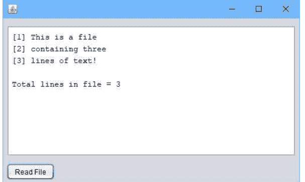

该程序包含了大量的文件处理和错误恢复代码，我们将在后面的章节中学习。现在，请集中在显示如何使用 `while` 循环的代码块上：

## ReadFile


while ((line = file.readLine()) != null) {
    linecount++;
    ta.append(String.format("%d] %s\n", linecount, line));
}
ta.append("\nTotal lines in file = " + linecount);

## do...while

在某些情况下，你可能希望确保代码至少运行一次——例如，如果你的程序正在从互联网下载一个巨大的文件，并且每隔十分钟你都想让用户确认是否继续操作。你希望确保用户至少被请求一次确认（可能是多次）。实现此点的一种方法是编写一个 `do...while` 循环。

`do...while` 循环本质上与 `while` 循环相同，不同之处在于测试条件放在循环的末尾而不是开头。这意味着循环内部的语句在评估测试条件之前，被保证至少执行一次。这是 `do...while` 循环的语法：

```
do {statements} while (condition);
```

这里有一个非常简单的 `do...while` 循环示例：

### WhileLoops

```java
i = 2;
do {
    System.out.printf("%d\n", intarray[i]);
    i++;
} while (i < 2);
```

与之前的 `while` 循环示例一样，条件在第一次测试时被评估为假。但由于该测试是在循环内代码执行后才进行的，因此代码被保证运行一次（在测试之前）。在这种情况下，这段代码显示了 `intarray` 中索引为 2 的整数。

对比一下我之前展示的以 `while (i < 2)` 开头的 `while` 循环。该测试在循环内部代码运行之前完成。因此，当 `i` 为 2 时，测试评估为假，循环内的任何代码永远不会执行。

## 多维数组

在上一章中，我们查看了包含简单元素列表的线性数组。除了线性数组，你还可以创建“多维数组”——即数组的数组。这种数组在需要对其进行迭代时会带来特殊的挑战。在看此之前，我们需要明确什么是多维数组。简单的线性数组可以被视为电子表格的一行：

| A | B | C | D | E |
| --- | --- | --- | --- | --- |
| 1 | 2 | 3 | 4 | 5 |
| 6 | 7 | 8 | 9 | 10 |
| 11 | 12 | 13 | 14 | 15 |
| 16 | 17 | 18 | 19 | 20 |

多维数组既有行也有列，就像这个电子表格：

| A | B | C | D | E |
| --- | --- | --- | --- | --- |
| 1 | 2 | 3 | 4 | 5 |
| 6 | 7 | 8 | 9 | 10 |
| 11 | 12 | 13 | 14 | 15 |
| 16 | 17 | 18 | 19 | 20 |

在我的代码中，我声明了一个名为 `grid` 的数组，它包含 4 个数组，每个数组包含 5 个整数。你可以将其想象为一个 4 行 5 列的矩阵。

```java
int grid[][] = {
  {1, 2, 3, 4, 5},
  {6, 7, 8, 9, 10},
  {11, 12, 13, 14, 15},
  {16, 17, 18, 19, 20}
};
```

# 第7 章 — 循环

| A | B | C | D | E |
|---|---|---|---|---|
| 1 | 1 | 2 | 3 | 4 | 5 |
| 2 | 6 | 7 | 8 | 9 | 10 |
| 3 | 11 | 12 | 13 | 14 | 15 |
| 4 | 16 | 17 | 18 | 19 | 20 |

在 Java 程序中，我们可以通过对外部数组的数值索引来查找二维数组中某个元素的值，以便找到一个内部数组（类似于电子表格中的行），然后使用另一个索引来计数内部数组中的元素（类似于电子表格中的列）。

记住数组的索引是从 0 开始的，你可以看到为了获取整数 1 中的元素，我需要索引到第 2 行和第 1 列。在这里我对列进行了编号以显示这一点：

| 0 | 1 | 2 | 3 | 4 | 5 |
|---|---|---|---|---|---|
| 1 | 6 | 7 | 8 | 9 | 10 |
| 2 | 11 | 12 | 13 | 14 | 15 |
| 3 | 16 | 17 | 18 | 19 | 20 |

使用方括号符号，在第一对括号中使用“行”索引，在第二对括号中使用“列”索引，这就是我如何打印存储在第 2 行和第 1 列的值的：

```java
System.out.printf("Value at grid[2][1] = %d\n", grid[2][1]);
```

显示显示以下内容：

```
Value at grid[2][1] = 12
```

如果我想显示第 1 行（我网格中的第二个数组）和第 2 列（该数组中的第三个元素）的值，我会这样写：

```java
System.out.printf("Value at grid[1][2] = %d\n", grid[1][2]);
```

这显示以下内容：

```
Value at grid[1][2] = 8
```

现在让我们回到显示网格中每个整数的问题。首先，我需要一个 for 循环来遍历外部数组，以获取它包含的“行”（每行都是一个整数的“嵌套数组”）：

```java
for (int row = 0; row < 4; row++)
```

这个循环在每次循环执行时将 `row` 变量初始化为一个嵌套数组的索引。为了遍历存储在每个嵌套数组中的元素（整数），我需要在第一个循环内部嵌套另一个 for 循环，如下：

```java
for (int column = 0; column < 5; column++) {
```

记住，我们处理的是“数组的数组”——变量 `grid` 包含四个数组，每个数组包含五个整数，就像它展示的电子表格一样：

```java
int[][] grid = {
  {1, 2, 3, 4, 5},
  {6, 7, 8, 9, 10},
  {11, 12, 13, 14, 15},
  {16, 17, 18, 19, 20}
};
```

这可以被可视化为一个矩阵，行索引从 0 到 3，列索引从 0 到 4：

| | 0 | 1 | 2 | 3 | 4 |
|---|---|---|---|---|---|
| 0 | 1 | 2 | 3 | 4 | 5 |
| 1 | 6 | 7 | 8 | 9 | 10 |
| 2 | 11 | 12 | 13 | 14 | 15 |
| 3 | 16 | 17 | 18 | 19 | 20 |

在我的示例代码中，我使用一个循环来遍历 `grid` 二维数组中存储的所有项，该循环用于遍历“行”（`grid` 中的四个数组元素），并显示“行”号（数组的索引），随后显示“列”号（该数组中整数的索引）：

## MultidimensionalArray

```java
for (int row = 0; row < 3; row++) {
    System.out.printf("--- row %d : %s\n", row, Arrays.toString(grid[row]));
    for (int column = 0; column < 5; column++) {
        System.out.printf("[column%d] = %d\n", column, grid[row][column]);
    }
}
```

这是程序运行时显示的内容：

```
--- row 0 : [1, 2, 3, 4, 5] ---
column[0] = 1
column[1] = 2
column[2] = 3
column[3] = 4
column[4] = 5
--- row 1 : [6, 7, 8, 9, 10] ---
column[0] = 6
column[1] = 7
column[2] = 8
column[3] = 9
column[4] = 10
--- row 2 : [11, 12, 13, 14, 15] ---
column[0] = 11
column[1] = 12
column[2] = 13
column[3] = 14
column[4] = 15
```

内部或“嵌套”数组的长度相等，这使得我很容易遍历每个数组中相同数量的整数。事实上，嵌套数组并不要求长度相等。就像电子表格中的行，嵌套数组可能不同数量的单元，如下：

| 0 | 1 | 2 | 3 | 4 | 5 |
|---|---|---|---|---|---|
| 0 | 1 | 2 | 3 | 4 | 5 |
| 1 | 4 | 5 | 6 | 7 | |
| 2 | 8 | 9 | | | |
| 3 | 10 | 11 | 12 | 13 | 14 |
| 4 | 15 | | | | |

在此代码中，我声明了一个包含不同长度数组的数组：

```java
int[][] grid = {
  {1, 2, 3},
  {4, 5, 6, 7},
  {8, 9},
  {10, 11, 12, 13, 14},
  {15}
};
```

我利用数组的 `length` 属性。我首先使用 `grid.length` 找到数组的数量，并在外部循环中使用该值。对于内部循环处理的每个数组，我使用 `grid[row].length` 找到元素的数量：

```java
int numrows = grid.length;
System.out.printf("There are %d rows.\n", numrows);
for (int row = 0; row < numrows; row++) {
  System.out.printf("--- row %d --\n", row);
  for (int index = 0; index < grid[row].length; index++) {
    System.out.printf("[%d], value=%d\n", index, grid[row][index]);
  }
}
```

这是输出：

```
There are 5 rows.
--- row 0 ---
[0], value=1
[1], value=2
[2], value=3
--- row 1 ---
[0], value=4
[1], value=5
[2], value=6
[3], value=7
--- row 2 ---
[0], value=8
[1], value=9
--- row 3 ---
[0], value=10
[1], value=11
[2], value=12
[3], value=13
[4], value=14
--- row 4 ---
[0], value=15
```

## break

有时你可能想要跳出循环——即使循环条件没有为假。你可以使用 `break` 语句来实现这一点。正如 `break` 被用于立即退出 `switch-case` 块（如第 5 章解释）的那样，它也会导致立即退出循环中运行的代码块。看这段代码：

## BreakAndContinue

```java
private void breakActionPerformed(java.awt.event.ActionEvent evt) {
    int i;
    i = 0;
    while (i < 10) {
        if (i == 5) {
            break;
        }
        ta.append(String.format("i = %d\n", i));
        i++;
    }
}
```

循环被设置为只要 `i` 小于 10 就运行。但在该循环内部，如果 `i` 是 5，则我用 `break` 退出循环。这意味着尽管循环条件期望运行十次（`i` 在 0 到 9 之间的值），但实际上当 `i` 为 5 时，循环停止运行。通过运行程序并点击“break”按钮来测试这一点。`break` 之后的代码没有执行，显示如下：

```
i = 0
i = 1
i = 2
i = 3
i = 4
```

## 破坏代码逻辑！

在包含许多行代码的复杂循环中，`break` 条件可能并不明显，很容易假设循环在 `i` 小于 10 时保证运行（这是循环条件的“逻辑”）。当你添加 `break` 时，你正在破坏循环的“代码逻辑”。作为一个一般原则，除非你有充分的理由这样做，否则避免跳出循环更好、更清晰且更不容易出错。

让我转向一个使用 `break` 的更有实用的循环示例。在这里，当用户点击 `encryptActionPerformed()` 方法的“Encrypt”按钮时，它会“加密”字符串 `testStr`，将字符串中每个字符的数值（ASCII）值加 1。它是通过获取从索引 `i` 到字符串末尾的每个字符，并给该字符的值加 1 来的：

```
testStr.charAt(i) + 1
```

然后它像第 3 章解释的那样，将新值转换为字符（`char`），并将该字符添加到另一个字符串变量中：

```java
str += (char)(testStr.charAt(i) + 1);
```

可以说，这是一个非常简单（且不安全！）的加密算法。尽管如此，它说明了如何使用循环处理字符串或元素数组的基础知识。原则上，我的代码可以加密从键盘输入或从文件加载的字符串。为了说明程序的工作原理，我创建了下面的字符串：

```java
String testStr = "Hello world! Goodbye";
```

## 第 7 章 循环

我还有一个想要特殊处理的字符。当遇到空格时——例如 "Hello world" 中单词之间的空格字符——我想保留该空格字符而不是对其进行加密。我的代码是这样：

```java
if (c == ' ') {
    str += c;
    continue;
}
```

这是完整的加密例程：

```java
for (int i = 0; i < testStr.length(); i++) {
    c = testStr.charAt(i);
    if (c == ' ') {
        str += c;
        continue;
    }
    if (c == '!') {
        break;
    }
    str += (char)(testStr.charAt(i) + 1);
}
```

那么，在第一次测试之后，`continue` 语句做了什么？让我们发现一下。

## continue

`continue` 语句有点像程度较轻的 `break`。`break` 会退出循环并停止执行循环中的代码，而 `continue` 则从当前迭代退出循环，然后继续执行循环剩余的代码。

因此，在我的示例中，如果遇到 '!' 时执行 `break`，代码循环就会停止运行。对于字符串 "Hello world!"，代码将处理到 '!' 字符处且不再继续。但代码在处理空格 ' ' 时会继续。这意味着当在 "Hello" 之后发现 ' ' 时，循环会跳过当前部分，然后继续运行循环以处理剩余字符 "world"。

与 `break` 一样，你应该谨慎使用 `continue`。虽然有时使用 `break` 或 `continue` 跳出代码块可能有完全合理的理由，但这种做法会让你的代码难以理解，在复杂的程序中，它们可能会导致微妙的 bug。

代码中另一个关于 `break` 和 `continue` 的示例：

```java
for (i = 0; i < str.length(); i++) {
  c = str.charAt(i);
  if (c == ' ') {
    str2 += c;
    continue;
  }
  if (c == '!') {
    break;
  }
  str2 += (char)(str.charAt(i) - 1);
}
```

这会将加密后的字符串 `str`（通过对每个字符减 1）转换回未加密版本。它将解密的字符复制到字符串 `str2` 中。

由于字符串 `str` 中的空格字符没有被加密，这段代码在发现空格时通过执行 `continue` 来忽略空格。当发现字符串终止符 '!' 时，它执行 `break`。如果你运行程序并点击“Encrypt”（加密）按钮，你将看到：

| 加密字符串为 'Ifmmp xpsme' |
| 解密字符串为 'Hello world' |

注意看到"Hello" 和 "world" 之间的空格被 "!" 字符保留了，而字符串 "Hello world! Goodbye" 中其之后的所有字符都被移动了。

仔细观察代码并尝试找出为什么会发生这种情况。如果你还不清楚，可以尝试编辑字符串 `testStr`，移除 "!" 字符或添加更多，看看点击“Encrypt”按钮时会得到什么结果：

```java
// 尝试这个
String testStr = "Hello! world! Goodbye";
// 还有这个
String testStr = "Hello world Goodbye";
```

BreakAndContinue 项目还包含一个跳出 while 循环的示例（参见 `whileBtnActionPerformed()` 方法）：

```java
private void whileBtnActionPerformed(java.awt.event.ActionEvent evt) {
    int i;
    char c;
    String str = "";
    i = 0;
    while (i >= 0) {
        c = testStr.charAt(i);
```


ta.append(String.format("[%d]='%c ", i, c));

if (c == '!') {

    break;

}

str += c;

i++;

}

ta.append(String.format("\nAfter loop, str='%s", str));

```

这是一个没有有效结束条件的 `while` 循环（因为 `i` 始终大于或等于 0）：

```
i = 0;
while(i >= 0)
```

它显示 `testStr` 中每个项目的数字代码，并在发现 '!' 字符时构建一个新字符串 `str`。除非显式使用 `break`，否则没有有效结束条件的循环将无限运行。带有 `break` 语句的情况可能会破坏你的代码逻辑：

```
if (c == '!') {
    break;
}
```

在很多情况下，你可以通过重写循环自身的条件来避免跳出循环，例如：

```
while ((i >= 0) && (c != '!'))
```

### 跳出 for 循环

在之前的示例 `MultidimensionalArray` 中，你可能记得我在另一个循环内部放置了一个 `for` 循环来处理数组元素：

```
MultidimensionalArray

for (int row = 0; row < 4; row++) {
    System.out.printf("--- row %d --\n", row, Arrays.toString(grid[row]));
    for (int column = 0; column < 5; column++) {
        System.out.printf("column[%d] = %d\n", column, grid[row][column]);
    }
}
```

这是输出结果：

```
-- row 0 : [1, 2, 3, 4, 5] --
column[0] = 1
column[1] = 2
column[2] = 3
column[3] = 4
column[4] = 5
-- row 1 : [6, 7, 8, 9, 10] --
column[0] = 6
column[1] = 7
column[2] = 8
column[3] = 9
column[4] = 10
-- row 2 : [11, 12, 13, 14, 15] --
column[0] = 11
column[1] = 12
column[2] = 13
column[3] = 14
column[4] = 15
-- row 3 : [16, 17, 18, 19, 20] --
column[0] = 16
column[1] = 17
column[2] = 18
column[3] = 19
column[4] = 20
```

现在你可能想知道需要做什么才能跳出内层 `for` 循环？

```
for(some condition){
    for(some condition) {
        break;
    }
}
```

`break` 会退出内层循环还是退出外部循环？尝试一下。在内层循环中添加代码，当 `column` 的值为 2 时跳出：

```
for (int row = 0; row < 4; row++) {
    System.out.printf("--- row %d --\n", row, Arrays.toString(grid[row]));
    for (int column = 0; column < 5; column++) {
        System.out.printf("column[%d] = %d\n", column, grid[row][column]);
        if (column == 2) {
            break;
        }
    }
}
```

这一次，当程序运行时，我看到：

```
-- row 0 : [1, 2, 3, 4, 5] --
column[0] = 1
column[1] = 2
-- row 1 : [6, 7, 8, 9, 10] --
column[0] = 6
column[1] = 7
-- row 2 : [11, 12, 13, 14, 15] --
column[0] = 11
column[1] = 12
-- row 3 : [16, 17, 18, 19, 20] --
column[0] = 16
column[1] = 17
```

从这里你可以看到，当 `row` 为 0 且 `column` 为 2 时，内层循环中断，但外部循环继续运行，并在 `row` 为 1 且 `column` 为 2 时再次中断——依此类推。这表明 `break` 只导致退出最内循环。

### 标签 break (Labelled break)

如果你想同时跳出内层和外部循环，可以使用标签 `break` 语句。你应该在外部循环开始之前立即添加一个标签（即后面跟一个冒号的名称），例如 `outerloop:`：

```
outerloop:
for (int row = 0; row < 4; row++) {
```

为了跳转到此标签（这将同时退出内层和外部循环），你需要在 `break` 之后添加标签名称（不带冒号）：

```
break outerloop;
```

`LabelBreak` 示例程序演示了跳转到标签的效果：

```
LabelBreak

outerloop:
for (int row = 0; row < 4; row++) {
  System.out.printf("--- row %d --\n", row, Arrays.toString(grid[row]));
  for (int column = 0; column < 5; column++) {
    System.out.printf("column[%d] = %d\n", column, grid[row][column]);
    if (column == 2) {
      break outerloop;
    }
  }
}
```

这显示了：

```
-- row 0 : [1, 2, 3, 4, 5] --
column[0] = 1
column[1] = 2
column[2] = 3
```

### 标签 continue (Labelled continue)

你也可以拥有这样的标签 `continue` 语句：

```
continue outerloop;
```

之前，无标签的 `break` 退出内层 `for` 循环，变量 `column` 值为 2，然后继续执行外部 `for` 循环——结果是显示了四个嵌套数组中的前三个项。

但使用跳转到标签外部 `for` 循环的 `break` 时，当遇到 break 时，两个循环都会退出。结果只显示了第一个嵌套数组中的三个元素。标签 `break` 随后终止了两个 `for` 循环，因此没有处理其他任何嵌套数组（如果你查看示例代码，你会发现四个嵌套数组）。


### 标签位置

对于带标签的 `break` 或 `continue`，标签的位置有精确的规则。标签用于通过退出最外层语句来跳出 `switch`、`for`、`while` 或 `do-while` 语句。标签必须*直接*出现在最外层语句上方，且标签与该语句之间不能有其他代码。

如果你觉得这些内容很难跟上，这并不奇怪。以这种方式跳出通常不是终止循环最优雅的方法。它类似于一种 `goto` 语句，会突然跳出一个代码块并开始在别的地方运行代码。这种跳转有时是有用的——当某个关键条件意味着你需要尽可能快地停止运行某段代码时——但它也会导致困惑，并存在引入意外 bug 的风险。

出于原因考虑（或者说“为了某种原因”），在尽可能的情况下，你应该尝试只在循环*条件*满足时才终止循环——例如，当 `while` 循环中的测试或 `for` 循环第二部分的表达式（例如 `column < 5`）求值为为 `false` 时。在某些情况下，从循环中跳出是有用的，你确实需要理解 `break` 和 `continue` 的用法，但不要对使用它们过于狂热。作为一个基本原则，如果有更简单、更不困惑的替代方案，你应该避免跳出循环。

## 第 8 章 – 枚举、接口和作用域

在本章中，我将解释枚举常量如何帮助代码清晰化，接口如何重新定义类的行为，以及为什么代码的位置很重要。

有时，你的程序可能需要处理一组固定的相关值——例如，日程程序可能需要处理一周的七天，而赌博程序可能需要处理扑克牌的花色。为了表示这些值，你可以分别使用 0 到 6 的整数表示日期，或使用 0 到 3 的整数表示花色。但如果可以使用命名标识符而不是数字，通常会更清晰。例如，考虑这段代码：

```java
if ((suit == 0) || (suit == 1)) {
  System.out.println("This card is a red suit");
}
```

与这段代码对比：

```java
if ((suit == Suits.HEARTS) || (suit == Suits.DIAMONDS)) {
  System.out.println("This card is a red suit");
}
```

对于计算机而言，上述两个代码段的含义相同；当你的程序运行时，它们将产生完全相同的结果。但从程序员的角度来看，第二个示例使用了如 `HEARTS` 和 `DIAMONDS` 这样的命名标识符而不是数字 0 和 1，显然要清晰得多。为了使用这样的标识符，你需要创建一个枚举（enum）。

## 枚举类型

为了创建如 `HEARTS`、`DIAMONDS`、`SPADES` 和 `CLUBS` 这样的系列标识名称并将它们分组为花色，你需要定义一个“枚举类型”或 enum。我将这样定义扑克牌的四种花色：

```java
public enum Suits {
  HEARTS, DIAMONDS, CLUBS, SPADES
};
```

类似地，我可以这样创建一个月份的枚举：

```java
public enum Months {
  JAN, FEB, MAR, APR, MAY, JUN, JUL, AUG, SEP, OCT, NOV, DEC
};
```

### 枚举常量

枚举中列出的标识符实际上是常量，因为它们的值不能被改变。事实上，枚举有时被描述为“枚举常量”。根据惯例，常量标识符通常全大写写。这并不是强制的——如果你愿意，可以命名为 `Hearts`、`Diamonds`、`Clubs` 和 `Spades`，但全大写标识符是常见的。

在这个示例中，`Suits` 和 `Months` 是枚举类型名称。如果你想将枚举值传递给函数，请确保适当声明函数参数。例如，这里有一个接收类型 `Suits` 的参数 `suit` 的函数：

```java
public static void showsuit(Suits suit) {
```

在调用此函数时，我必须确保发送的是 `Suits` 枚举定义的常量之一。实现的一种方法是传递枚举名，后跟着点和常量名，如下：

```java
showsuit(Suits.HEARTS);
```

或者，我可以声明一个与枚举类型相同的变量，并给它赋值一个枚举常量。然后可以将该变量传递给函数，如下：

```java
Suits card;
card = Suits.SPADES;
showsuit(card);
```

这是我在 Enums 项目中的示例代码：

```java
public class Enums {
    public enum Suits { HEARTS, DIAMONDS, CLUBS, SPADES };
    public enum Months {
        JAN, FEB, MAR, APR, MAY, JUN, JUL, AUG, SEP, OCT, NOV, DEC };
    }
    public static void showsuit(Suits suit) {
        if (suit == Suits.HEARTS || suit == Suits.DIAMONDS) {
            System.out.printf("This card is a %s which is a red suit.\n",
                suit.toString());
        } else {
            System.out.printf("This card is a %s which is a black suit.\n",
                suit.toString());
        }
    }
    public static void showsuit(Months month) {
        String msg = "";
        switch (month) {
            case DEC:
                msg = "Christmas is coming!";
            case JAN:
                msg = "Baby's cold outside!";
            case FEB:
                msg = "Baby's cold outside!";
            case MAR:
                msg = "Spring is out!";
            case APR:
                msg = "Spring is out!";
            case MAY:
                msg = "June is favourite month!";
            case JUN:
                msg = "Time to the beach!";
            case JUL:
                msg = "The leaves are falling!";
            case AUG:
                msg = "The leaves are falling!";
            case SEP:
            case OCT:
            case NOV:
                msg = "I don't know what month this!";
        }
        System.out.println(month.toString() + " " + msg);
    }
    public static void main(String[] args) {
        Suits card;
        card = Suits.SPADES;
        showsuit(card);
        Months month;
        month = Months.DEC;
        showsuit(month);
    }
}
```

## 第 8 章 — 枚举、接口和作用域

### 给枚举常量赋值

另一个枚举的例子，请查看 Adventure2 项目（位于源代码的 Adventure 文件夹中）。这是一个具有简单用户界面的游戏，提供了可以点击的按钮来移动玩家北、南、东、西。处理这些点击的代码调用了游戏对象的 `moveTo()` 方法。游戏对象由 `Game` 类创建，它包含了游戏的所有元素，包括房间地图和玩家。需要注意的是，当我调用 `moveTo()` 方法时，我提供了如 `Direction.NORTH` 或 `Direction.SOUTH` 这样的参数。提供一个描述性的方向比使用整数值要清晰得多，例如。这里的 `Direction` 定义在 `Direction.java` 代码文件中：

Adventure2 (Direction.java)

```java
public enum Direction {
    NORTH,
    SOUTH,
    EAST,
    WEST;
    public static final int NOEXIT = -1;
}
```

### 编译 Adventure2

当你第一次运行 Adventure2 项目时（或者如果你在 NetBeans 中选择 Run|Clean and Build Project），你可能会看到一些关于“unchecked call to add(E)”的警告。这是因为该项目中的地图 `ArrayList` 可以持有任何类型的对象，而 Java 正在提醒我，如果我创建一个只持有特定类型的 `ArrayList`，将会更安全（在这里我的地图只需要持有 `Room` 对象）。如果你查看 Adventure3 的代码，你会看到我是这样声明 `ArrayList` 的：

```java
private ArrayList<Room> map;
```


### Enum.toString()

注意我使用了 `toString()` 方法来显示枚举常量的实际名称。`toString()` 方法在许多标准类（包括 `Enum` 类）中都有定义。

## 第8章 — 枚举、接口与作用域

`Game.java` 代码文件中的 `movePlayerTo()` 方法调用了 `moveTo()` 方法，并向其传递了代表游戏玩家的玩家对象以及 `Direction` 枚举常量：

```java
// Adventure2 (Game.java)
int moveTo(Actor anActor, Direction dir) {
    Room r = anActor.getRoom();
    int exit;
    switch (dir) {
        case NORTH:
            exit = r.getN();
            break;
        case SOUTH:
            exit = r.getS();
            break;
        case EAST:
            exit = r.getE();
            break;
        case WEST:
            exit = r.getW();
            break;
        default:
            exit = Direction.NOEXIT;
            break;
    }
    if (exit != Direction.NOEXIT) {
        moveActorTo(anActor, (Room) map.get(exit));
    }
    return exit;
}
```

我特意让 `moveTo()` 能够移动任何交互字符（在我的程序中，交互字符是 `Actor` 类的实例），因为以后我可能想添加其他字符，就像游戏玩家一样可以在地图上移动并收集宝藏。`moveTo()` 方法尝试使用 `switch` 语句来匹配 `Direction` 参数的值。

在这里使用 `Direction` 枚举的优点是清晰性。当我使用像 `EAST` 和 `WEST` 这样的标识符时，显而易见我正试图按照指定的方向移动玩家。

你还会注意到我定义了 `Direction.NOEXIT`。这不仅用于这里，在我在 `Game()` 构造函数中创建地图时也会用到。在这个项目中，地图是一个简单的 `ArrayList`，列表中的每个房间占据一个固定位置。从一个房间到另一个房间的出口仅仅是整数，表示给定出口处房间的地图索引：

```java
// Adventure2 (Game.java)
map.add(new Room(
    "room0", "You are west of a house", Direction.NOEXIT, 2, Direction.NOEXIT, 1));
map.add(new Room(
    "room1", "White House", Direction.NOEXIT, 0, Direction.NOEXIT));
map.add(new Room(
    "room2", "Gold room", 0, 4, Direction.NOEXIT, 3));
map.add(new Room(
    "room3", "Troll room", Direction.NOEXIT, 5, 2, Direction.NOEXIT));
map.add(new Room(
    "room4", "Dark cave", 2, Direction.NOEXIT, Direction.NOEXIT, 5));
map.add(new Room(
    "room5", "Troll room", 3, Direction.NOEXIT, 4, Direction.NOEXIT));
```

让我们以这个 `Room` 对象为例：

```java
new Room("room2", "Gold room", 0, 4, Direction.NOEXIT, 3)
```

这个房间有一个名称 "room2"，一个描述 "Gold room"，以及四个出口。北边出口通向地图中索引为 0 的房间（即名为 "room0" 的房间），南部出口通向索引为 4 的房间，西边出口由常量 `Direction.NOEXIT` 标记，表示该方向没有房间，东边出口通向地图中索引为 3 的房间。

为了理解 `Direction.NOEXIT`，请回看 `Direction` 枚举的定义。`NOEXIT` 的声明与其他项都不同：`NORTH`、`SOUTH`、`EAST` 和 `WEST` 只是逗号分隔列表中的项，没有关联的数据类型或值。但 `NOEXIT` 被声明为 `static final int`（即一个“属于” `Direction` 类的整数常量）：

```java
public static final int NOEXIT = -1;
```

在创建 `Room` 对象时，我不能使用标识符 `NORTH`、`SOUTH`、`WEST` 和 `EAST` 来初始化出口，因为每个出口字段都是 `int` 而不是 `Direction`。但我可以使用 `NOEXIT` 常量来初始化其中一个出口字段，因为我已经将 `NOEXIT` 声明为 `int`，并将其赋值为整数值 `-1`。我选择 `-1` 是因为我可以确定地图中没有房间会拥有该索引。

## 枚举类

在某些编程语言中，枚举（enum）仅仅是名称的集合——这些常量可能带有或不带有某些关联值（例如整数）。例如，这是我在 C 语言中声明枚举的方式：

```c
enum directions {
    NORTH, SOUTH, EAST, WEST
};
```

默认情况下，C 会为枚举常量分配整数值。在这里 `NORTH` 会被分配 0，`SOUTH` 会被分配 1，依此类推。乍一看，Java 枚举看起来和 C 非常相似。但实际上，当你在 Java 中创建枚举时，你实际上是在定义一个继承自 `Enum` 类的类。

你的枚举（就像普通类一样）能够包含特定类型的数据项，比如我向我的 `Direction` 枚举中添加的 `NOEXIT` 常量。事实上，Java 枚举甚至可以包含方法。Oracle Java 教程提供了一个相当复杂的 `Planet` 枚举示例，它有自己的构造函数、方法和变量。

### Planet 枚举

如果你想探索 Java 枚举的一些更深奥的特性，请查看 Oracle 的示例代码，我已将其复制到 `Planet` 项目中。要运行此代码，请从命令提示符编译程序（如第 2 章所述），或者（更简单地）从 NetBeans 等 IDE 中运行它。你现在应该拥有了编译后的类文件 `Planet`。

## 接口

我们首先在第 6 章遇到接口。你可能记得我将接口描述为抽象类：它定义了类必须实现的方法，但它不包含实际代码。但要注意——Java 还允许你定义被继承而非实现的抽象类。参见本章后面关于抽象类的章节。


## 继承、接口与作用域

### 继承与实现

一个类可以继承另一个类并实现零或多个接口。

```text
class A
    doSomething();
    doSomethingElse();

interface Int1
    doThis();
    doThat();

interface Int2
    doTheOther();

class B extends A implements Int1, Int2
    继承这些...            必须实现这些...
    doSomething();          doThis();          doTheOther();
    doSomethingElse();      doThat();
```

上面的图展示了类 B 的简化视图，它继承了类 A（因此是 A 的子类）并实现了接口 `Int1` 和 `Int2`。

类 A 包含 `doSomething()` 和 `doSomethingElse()` 方法的代码，类 B 自动继承了这些方法。

然而，这两个接口仅定义了方法 `doThis()`、`doThat()` 和 `doTheOther()`——它们不包含这些方法的代码。因此类 B 必须实现（即程序员编写）这三个方法。

换句话说，当类 B 继承类 A 时，它继承了类 A 的完整方法。但当类 B 实现接口 `Int1` 和 `Int2` 时，它并没有获得现有方法的访问。相反，它达成了一种协议或“合同”，为这些定义（但未实现）的方法编写代码。

### 接口作为“契约”

“接口”（interface）是类必须实现的代码定义：如果你愿意的话，它就是使用该接口的类必须遵守的“契约”。如果你有一份建造房子的合同，例如，合同本身并不是房子，但它确实规定了（在多或少的详细程度上）将建造什么，以及按照什么标准来建造房屋。

要查看实现某些接口的类示例，请看 `ArrayList` 类，它的声明如下：

```java
public class ArrayList<E> extends AbstractList<E>
    implements List<E>, RandomAccess, Cloneable, Serializable
```

每个类都可以自一个直接父类——在这里 `ArrayList` 继承自（extends）`AbstractList`。当一个类继承自另一个类（其父类）时，它会自动继承父类的行为——即方法。

除了“继承”之外，`ArrayList` 类还“实现”（implements）`List`、`RandomAccess`、`Cloneable` 和 `Serializable`。这些不是类，它们是接口。一个类只能继承另一个类，但可以实现多个接口。接口就像没有可执行代码的类定义。每个接口可以定义一组常量和方法，但它不提供这些方法的行为——即实际代码。

这意味着每当一个类实现接口时，它就有义务提供与接口定义的所有方法匹配的方法。例如，`ArrayList` 实现了 `List` 接口，而 `List` 接口声明了 `size()`、`add()` 和 `remove()` 方法，`ArrayList` 就必须提供自己的 `size()`、`add()` 和 `remove()` 方法。如果失败，将会报错。

此外，每个实现 `List` 接口的类都必须提供自己的 `size()`、`add()` 和 `remove()` 方法。每个类可以用不同的方式实现这些方法。例如，`TreasureList` 和 `BeerList` 类都可以实现 `List` 接口。`List` 接口定义 `size()` 方法如下：

```java
int size();
```

在该声明上方有一个注释块，记录了 `size()`：

```java
/**
 * 返回此列表中元素的数量。如果此列表包含
 * 多于 <tt>Integer.MAX_VALUE</tt> 个元素，则返回
 * <tt>Integer.MAX_VALUE</tt>。
 * @return 此列表中元素的数量
 */
```

### 查找类和接口代码

你可能可以使用 IDE 的“搜索”工具来查找接口声明和文档。在 NetBeans 中，在我使用 `ArrayList` 的一个程序中，双击 `ArrayList` 进行选择，然后右键并选择 `Navigate | Go To Source`（导航 | 转到源代码）。这将带我进入 `ArrayList.java`。该类的声明显示它实现了 `List` 接口。右键点击 `List` 并再次选择 `Navigate | Go To Source` 查看 `List.java`。

这就是 `ArrayList` 类实现 `size()` 的方式：

```java
public int size() {
    return size;
}
```

如果你搜索 `ArrayList.java` 的代码，你会发现 `size` 是一个私有的 `int` 变量，它的值通过各种方法改变。例如，令人惊讶的是，`add()` 方法增加了 `size` 的值：

```java
size++;
```


# 自定义接口

让我们看看如何编写自己的接口。假设你正在带领一个程序员团队开发游戏。该游戏定义了多种具有某种值的类。这些可以是从宝藏（`Treasure`）到分数（`Score`）任何东西。

问题是 `Treasure` 和 `Score` 类之间没有通过继承建立联系。`Treasure` 是 `Thing` 的后代，而 `Score` 除了两者都存储一个值之外，没有其他共同点，并且它们需要可以增加或减小该值数值的方法。

处理这个问题的一种方法是编写一个定义操作值所需方法的接口，然后让 `Treasure` 和 `Score` 类都实现它。在我的 `Interfaces` 程序中，我在 `myinterfaces` 包的 `ValuableItem.java` 代码文件中定义了这个接口：

```java
package myInterfaces;

public interface ValuableItem {
    public int value();
    public void addValue(int aValue);
    public void deductValue(int aValue);
}
```

我创建了一个 `Treasure` 类，它继承了其祖先 `Thing` 类的特征，并实现了 `ValuableItem` 接口声明的方法：

```java
public class Treasure extends Thing implements ValuableItem {
```

你可以在下一页看到我 `Treasure` 类的完整代码。这里的 `@Override` 注解是可选的，但建议使用。它们为编译器提供了信息，告诉它注解之后的方法之前已经声明过。编译器随后可以将方法的“签名”（即其名称和参数）与之前的声明进行比较，以确保它们是匹配的。

我之前说过，一个接口可以被许多类实现，而 `Treasure` 实现的 `ValuableItem` 接口也可能被另一个类（如 `Score`）实现。

# 第8章 — 枚举、接口与作用域

在我的示例程序中，我没有写 `Score` 类。如果你想实验实现接口，可以尝试自己添加该类。

# 接口 (advobs.Treasure.java)

```java
public class Treasure extends Thing implements ValuableItem {

    private String description;

    private int treasureValue;

    public Treasure(String aName, String aDescription, int aValue) {
        // 构造函数
        super(aName);
        this.description = aDescription;
        this.treasureValue = aValue;
    }

    public String getDescription() {
        return description;
    }

    public void setDescription(String aDescription) {
        this.description = aDescription;
    }

    @Override
    public int value() {
        return treasureValue;
    }

    @Override
    public void addValue(int aValue) {
        treasureValue += aValue;
    }

    @Override
    public void deductValue(int aValue) {
        treasureValue -= aValue;
    }
}
```

# 抽象类

```java
abstract class MyClass {
}
```

抽象类可以包含抽象方法。抽象方法是使用 `abstract` 关键字声明但不实现（没有可执行代码）的方法，如下：

```java
abstract void myMethod(int someValue);
```

抽象类可以被视为“原型”。它们定义了类的结构而不是实现。抽象类可以被子类化（继承而不是实现），并且抽象类方法的行为必须在子类中编写。

抽象类有点像普通类（它可以包含完全实现的方法并且可以被子类化），又有点像接口（你不能从抽象类创建对象，但你可以定义空方法，这些方法必须在抽象类的子类中实现）。有关更多信息请参考 Oracle 的文档：

https://docs.oracle.com/javase/tutorial/java/landl/abstract.html

# 抽象类还是接口？

在某些情况下，接口可以作为定义“模板”的方式，以确保许多类（实现该接口的类）都拥有某些特定方法，这些方法在每个类中的实现方式不同。抽象类可能作为“基”类非常有用，为许多类提供一组公共方法和“方法模板”（类似于接口定义的模板）。

## 抽象类示例

在第 4 章中我解释了如何创建一个简单的类层级结构（Objects 项目），其中 `Thing` 类定义了名称和描述。一个子类 `NoisyThing` 额外增加了噪音和音量。

随后，我能够从 `Thing` 类创建宝藏对象，并从 `NoisyThing` 类创建猫和狗对象。假设我现在想要一个特定的 `Treasure` 类。`Treasure` 和 `NoisyThing` 都从它们的共同祖先 `Thing` 继承了名称和描述。我还希望这些类实现它们自己的 `describe()` 方法。由于我永远不会直接从 `Thing` 创建对象，我决定将 `Thing` 作为一个抽象类，它提供名称和描述的简单实现，并将 `describe()` 设置为抽象方法，因为该方法在子类中的实现方式将不同。

```java
// AbstractClasses (Thing.java)
public abstract class Thing {

    private String name;
    private String description;

    public Thing(String aName, String aDescription) {
        // constructor
        this.name = aName;
        this.description = aDescription;
    }

    public String getName() {
        return name;
    }

    public void setName(String aName) {
        this.name = aName;
    }

    public String getDescription() {
        return description;
    }

    public void setDescription(String aDescription) {
        this.description = aDescription;
    }

    abstract public String describe();
}
```

这里需要注意的重要点是类本身被定义为抽象的，因此无法从它创建对象（尽管可以从它的子类创建），而且 `describe()` 方法也是抽象的。该方法不包含任何代码——每个子类都需要编写它们自己的 `describe()` 方法。这就是 `Treasure` 类：

```java
// AbstractClasses (Treasure.java)
public class Treasure extends Thing {

    private int value;

    public Treasure(String aName, String aDescription, int aValue) {
        super(aName, aDescription);
        this.value = aValue;
    }

    public int getValue() {
        return value;
    }

    public void setValue(int value) {
        this.value = value;
    }

    @Override
    public String describe() {
        return "The " + getName() + " is "
               + getDescription() + " and is worth "
               + getValue() + " groats";
    }
}
```

它实现了它自己的版本的 `describe()`。`NoisyThing` 类也是如此：

```java
// AbstractClasses (NoisyThing.java)
public class NoisyThing extends Thing {

    private String noise;
    private int volume;

    public NoisyThing(String aName, String aDescription, String aNoise, int aVolume) {
        super(aName, aDescription);
        this.noise = aNoise;
        this.volume = aVolume;
    }

    public String getNoise() {
        return noise;
    }

    public void setNoise(String noise) {
        this.noise = noise;
    }

    public int getVolume() {
        return volume;
    }

    public void setVolume(int volume) {
        this.volume = volume;
    }

    private String noiseLevel() {
        String vol;
        if (volume > 9) {
            vol = "really noisy";
        } else if (volume > 4) {
            vol = "fairly noisy";
        } else if (volume > 0) {
            vol = "quiet";
        } else {
            vol = "silent";
        }
        return vol;
    }

    @Override
    public String describe() {
        return getName() + " is " + getDescription() + ". It is " + noiseLevel() + "\n";
    }
}
```

我无法再创建 `Thing` 对象了。但我可以从自 `Thing` 的类创建对象，例如 `Treasure` 和 `NoisyThing`：

```java
// AbstractClasses (NewJF.java)
mySword = new Treasure("Dwarf Sword", "a sword of great power", 100);
myRing = new Treasure("Elvish Ring", "a golden ring of magic power", 150);
cat1 = new NoisyThing("Tiddles", "a small ginger cat", "", 0);
cat2 = new NoisyThing("Flossie", "a small tabby cat", "Miaaow", 3);
dog1 = new NoisyThing("Bert", "a small terrier", "Wuff!", 5);
dog2 = new NoisyThing("Fido", "a big smelly dog", "Woof!", 10);
```

当我运行程序并点击按钮时，我看到的是：

- 矮人剑是一把威力巨大的剑，价值 100 格罗特
- 精灵戒指是一个带有魔法力量的金环，价值 150 格罗特
- Tiddles 是一只小橘猫。它是安静的
- Flossie 是一只小虎斑猫。它很安静
- Bert 是一只小型梗犬。它相当吵
- Fido 是一只大臭狗。它非常吵

## 作用域

你 Java 程序中的变量在某些限制范围内都是“可见”的。例如，在类内部声明的变量。

# 第 8 章 — 枚举、接口与作用域

# Adventure2 (Game.java)

```java
private int moveTo(Actor anActor, Direction dir) {
    int exit;
    // more code here
    return exit;
}
```

如果一个方法被声明为 `public`（公共），那么就可以从该类的外部代码访问它。当你希望能够从程序的其他地方调用方法时，这非常有用。我们通过变量名后加点来调用的方法（例如 `x.toString()`）就是公共方法。以下是一个公共方法：

```java
public int movePlayerTo(Direction dir) {
    return moveTo(player, dir);
}
```

上述两个方法（`moveTo()` 和 `movePlayerTo()`）都声明在我我的冒险游戏项目的 `Game` 类中。给定一个名为 `game` 的 `Game` 对象，我可以像这样调用公共方法：

```java
game.movePlayerTo(Direction.WEST);
```

在这里，例如我在 `AdventureForm.java` 的 `nBtnActionPerformed()` 方法代码中调用了此方法，并将返回的 `int` 值传递给另一个名为 `updateOutput()` 的方法，该方法显示某些文本：

```java
// Adventure2 (AdventureForm.java)
updateOutput(game.movePlayerTo(Direction.NORTH));
```

我能够调用 `movePlayerTo()` 是因为它是一个公共方法。然而，我无法在 `AdventureForm.java` 中调用 `Game` 类的 `private`（私有）方法（例如 `moveTo()`）：

```java
game.moveTo(player, Direction.WEST); // Error! 不能调用 private 方法
```


# 第 8 章 — 枚举、接口与作用域

这是 NetBeans 显示的内容：

| 生成的代码 |
| --- |
| moveTo(Actor.Direction) has private access in Game |
| void nBtnActionPerformed(java.awt.event.ActionEvent evt) { |
| (Alt-Enter 显示提示) updateOutput(game.moveTo(game.getPlayer(), Direction.NORTH)); |
| } |

（注意：某些情况下，你可能希望让变量和方法对当前类及其子类可见，但对任何其他代码不可见。在这种情况下，可以在声明类成员时使用 `protected` 关键字。`protected` 成员对相同包中的所有类以及其他包中当前类的子类可见。）

你也可以限制整个类的可见性。如果一个类被声明为 `public`，则它在处处可见。如果它没有修饰符，则它只对相同包中的类可见；也就是说，它是“包私有的”（package private）。如果你省略类“成员”（变量、常量或方法）的访问修饰符，它也将是“包私有的”。

# 保持简单！

仅仅因为所有的访问修饰符可用，并不意味着你必须使用所有它们。最重要的两个访问修饰符是 `public` 和 `private`。在大多数情况下，你可以使用这两个修饰符编写出良好的、结构化的面向对象代码，将数据字段在对象内部私有，并限制你不希望被对象外部代码使用的方法。你希望从对象外部提供的方法必须是 `public`。


# 第 9 章 – 泛型与异常

当你需要在 Java 程序对不同类型的对象执行相似的操作时，泛型可以提供帮助。当出现问题时，异常可以提供帮助！

也许你想要创建对象列表，并具备从该列表中添加或删除项的能力。你可能想对整数、浮点数或字符串的列表执行相似的操作。由于这些数据类型由不同的类表示，你可能认为需要编写三次相同的方法来处理这三种不同类型的列表。坦率地说，泛型可以帮助你避免所有重复。假设你必须这样向列表添加元素：

| 泛型 (NewJFrame.java) - stringListBtnActionPerformed() |
| --- |
| aList.add("one"); |
| aList.add(2); |
| aList.add("three"); |

也许你想写一个方法来对列表中的元素执行某些操作。让我们假设，例如，你写了一个返回最后一个元素的方法：

| 泛型 (NewJFrame.java) |
| --- |
| private String getLast(ArrayList aList){ |
| return (String) aList.get(aList.size()-1); |
| } |

此方法假设最后一个元素是字符串，因此该方法的返回类型被声明为 `String`。但由于 `ArrayList` 中的项可以是任何类型，必须在项之前加上括号内的 `String` 类型名来将其“强制转换”为 `String`：

```java
return (String) aList.get(aList.size()-1);
```

# 第 9 章 – 泛型与异常

现在只要 `aList` 的最后一个元素确实是字符串，一切都正常。但假设我添加了一个整数：

```java
aList.add(4);
```

现在我调用我的方法来返回列表中的最后一个元素：

```java
outputTA.append(getLastItem(aList) + "\n");
```

程序编译时没有任何错误。但当你点击标记为“string list”的按钮运行从 `aList` 末尾返回字符串的代码时，你会看到一个很难看的错误消息：


# 第 9 章 泛型与异常

我能够为 `HashMap` 的键和值指定类型，是因为 `HashMap` 类是泛型的。就像 `ArrayList` 有 `<E>` 占位符一样，`HashMap` 也有一对 `<K, V>` 占位符，在你自己的代码中声明并创建 `HashMap` 对象时，它们可以被实际类型替换。

## 泛型类

你可以编写自己的泛型类，它们就像泛型 `ArrayList` 类一样，可以处理不同类型的对象。我是这样声明一个简单的泛型类的：

| 泛型 (MyGenericClass.java) |
| --- |
| public class MyGenericClass<T> {} |

在这里，`<T>` 是“类型参数”。它为真实类型提供了一个占位符，以便该类型可以在类内部使用。这就是我如何声明类型为 `T` 的私有变量 `someData`：

```java
private T someData;
```

如果我想提供一个构造函数来初始化这个变量，可以通过将输入参数声明为类型 `T` 来实现：

```java
public MyGenericClass(T aValue) {
    someData = aValue;
}
```

就像普通类一样，我可以提供 getter 和 setter 方法来分配或返回私有变量的值，再次确保了类型为 `T`：

```java
public T getObjData() {
    return someData;
}

public void someData(T someData) {
    this.someData = someData;
}
```

在我的示例中，我还写了另一个方法，用于返回 `MyGenericClass` 对象及其私有数据的字符串描述：

当我从我的泛型类创建对象时，我必须提供一个实际类型（位于一对尖括号之间）来替换 `T` 参数，如下：

```java
泛型 (NewJFrame.java) - myGenericClassActionPerformed()
MyGenericClass<String> myStrOb;
```

事实上，`myGenericClass` 有它自己的构造函数，参数由类型 `T` 指定。在创建该对象时，我可以传递一个与我的对象指定的类型相同（这里是 `String`）：

```java
MyGenericClass<String> myStrOb = new MyGenericClass<>("Hello world");
```

我同样可以创建 `MyGenericClass` 对象来处理其他类型，例如 `Integer`：

```java
MyGenericClass<Integer> myIntegerOb = new MyGenericClass<>(10);
```

现在我可以调用 `MyGenericClass` 的 `describe()` 方法以及它的 getter 和 setter 方法，这些方法对不同类型的数据执行相同的操作：

```java
outputTA.append(myStrOb.describe());
outputTA.append(myIntegerOb.describe());
myIntegerOb.setSomeData(500);
outputTA.append(myIntegerOb.describe());
```

点击“My Generic Class”按钮运行此代码：


这是你将看到的：

```
class MyGenericClass <class java.lang.String> Hello world
class MyGenericClass <class java.lang.Integer> 10
class MyGenericClass <class java.lang.Integer> 500
```

## 泛型参数名称

你可以选择自己的参数名称（例如在定义泛型时使用 `<T>` 或 `<E>`）。但根据惯例，这些是通常使用的类型：

- T: 类型 (Type)
- E: 元素 (Element)
- K: Map/Hash 中的键 (Key)
- V: Map/Hash 中的值 (Value)
- N: 数字 (Number)

## 泛型列表和集合

通常，管理集合或列表的类可以是泛型的。这是因为所有类型的对象列表都需要对列表元素执行相似的操作——例如添加和删除元素，或查找给定索引处的元素。

为每个定义了强类型列表的类（例如 `ListString` 类和 `Integer` 类）反复实现相同的方法，显然是高度重复的。更好的做法是实现一个泛型类，包含所有操作列表元素所需的通用方法，并在每次创建该泛型类的实例时指定实际元素类型。

你可以从零开始实现列表，也可以扩展现有的泛型集合类型并添加你需要的任何额外功能。在我的泛型示例程序中，我扩展了 `ArrayList` 并添加了一个新方法来返回列表的最后一个元素：

```java
泛型 (List.java)
public class List<E> extends ArrayList<E> {
    public E getItem() {
        return this.get(this.size() - 1);
    }
}
```

这一次，我遵循了 Java 的约定，将泛型参数命名为 `E` 以表示元素的类型。`List<E>` 扩展了 `ArrayList<E>`，因为它们都处理由 `E` 指定类型的元素。`getItem()` 方法的类型再次由泛型类型参数 `E` 表示。最后一项的索引通过列表大小减去 1 计算得出。

当我使用标准的 `ArrayList` 来存储元素时，我被迫将 `ArrayList` 作为参数传递给如 `getLast(ArrayList list)` 这样的方法，该方法返回泛型如 `String`。但使用泛型 `MyList` 类，`getLast()` 方法作用于列表本身，并实际上返回了泛型类型。

（注：提供的文本后半部分 OCR 存在一些伪影/断句；此处已根据 Java 泛型/子类的上下文进行了逻辑重构，以保持技术流的连贯性。）

## 方法重写

有时，你可能希望子类重写父类的方法。这被称为“重写”。例如，如果你有一个扩展父类的子类，并且你想重写同名的方法：

### Monster.java
```java
public class Monster {
    public String saySomething() {
        return "Grrrrr";
    }
}
```

### Troll.java
```java
public class Troll extends Monster {
    public String saySomething() {
        return "Ugh, ugh!";
    }
}
```

现在当我对 `Troll` 对象调用 `saySomething()`，执行的是它的重写方法而不是父类的方法。但如果我犯了错误，将方法命名为 `somethingElse()` 会怎样？正如我们所知，Java 是一种大小写敏感的语言，因此我在方法中无意使用小写 `s` 是重要的：

```java
public class Troll extends Monster {
    public String somethingElse() {
        return "Ugh, ugh, ugh!";
    }
}
```

现在当我调用 `saySomething()` 时，Java 在父类中找到了它。这就是我看到的：

```
Grrrrr
```

## @Override 注解

有一个简单的技巧可以帮助我避免因误命名方法引起的问题。当我想要一个方法重写另一个方法时，可以在该方法之前放置 `@Override` 注解。

在 Java 中，注解是对编译器的一种意图。`@Override` 注解告诉编译器检查被注解的方法是否成功重写了其父类中的同名方法。你可能记得我在第 8 章实现接口时使用过 `@Override`，以检查方法是否是由接口定义的。在当前示例中，我可以像这样在 `Troll` 类的方法上方放置 `@Override`：

```java
@Override
public String somethingElse() {
    return "Ugh, ugh, ugh!";
}
```

现在编译器会将此方法与父类中的方法进行比较。它会发现父类中没有同名的方法，因此该方法无法重写，并会导致错误。事实上，你的 IDE 可能也会进行此类检查，并且也可能标记错误：

| 方法未重写或实现父类中的方法 |
| --- |
| (Alt-Enter 显示提示) |
| @Override |
| public String somethingElse() { |
| return "Ugh, ugh, ugh!"; |
| } |

现在我可以通过大写 'S' 来修复这个问题，这样 `saySomething()` 方法就能与父类中同名的方法匹配，错误也就消失了：

```java
@Override
public String saySomething() {
    return "Ugh, ugh, ugh!\n";
}
```

## 方法重载

不要混淆方法重写（overriding）和方法重载（overloading）。我们早在第 4 章就遇到过方法重载，当时我提到某些 Java 类具有多个同名但签名不同的方法。

## 方法签名

方法签名是完整的方法声明，包括它的名称和参数。

例如，`String` 类有几个名为 `indexOf()` 的方法，每个版本都有一组不同的参数。方法签名不同这一事实意味着 Java 能够将它们识别为不同的方法，因此 `indexOf(String str)` 与 `indexOf(String str, int fromIndex)` 是不同的。

同样，一个类可以有多个构造函数。Java JDK 关于 `String` 文档列出了许多构造函数，每个构造函数都定义了一组不同的参数，使得每个构造函数都具有唯一的签名：

```
String()
String(byte[] bytes)
String(byte[] ascii, int hibyte, int offset, int count)
String(byte[] bytes, int offset, int length, String charsetName)
String(byte[] bytes, int offset, int length, Charset charset)
String(byte[] bytes, String charsetName)
String(byte[], Charset charset)
String(char[] value)
String(char[] value, int offset, count)
String(int[] codePoints, int offset, count)
String(String original)
String(StringBuilder buffer)
String(StringBuilder builder)
```

# 第 9 章 – 泛型与异常

当同一个类中的两个方法具有相同名称但不同签名时，被称为方法重载。这是一个重载方法的示例：

## 方法重载 (Troll.java)

```java
public class Troll extends Monster {
    public String saySomething() {
        return "Ugh, ugh, ugh!\n";
    }

    public String saySomething(String thingToSay) {
        return "Ugh, ugh, " + thingToSay + "!\n";
    }
}
```

当我调用不带参数的 `saySomething()` 时，将执行同名的两个方法中的第一个。如果我调用 `saySomething("I want to be fed")` 并传递一个字符串参数，则将使用方法的第二个版本：

```java
outputTA.append(myTroll.saySomething());
outputTA.append(myTroll.saySomething("I want to be fed"));
```

显示如下：

```
Ugh, ugh, ugh!
Ugh, ugh, I want to be fed!
```

## 异常

在本书中还有一个尚未深入考虑过的重要问题。即：漏洞（bugs）！很少有任何有心的程序是完全没有 bug 的。而且，即使你的程序在你在使用时运行正常，也存在当其他人使用时可能会出错的风险；因为其他人可能不会执行所有你预期他们做的事情。例如，在一个计算器程序中，你可能期望用户输入的数字是 10（字符 1 和 0），但实际上有人输入了字符串 "IO"（字母 'I' 和 'O'）。

程序的责任是假设最终用户在某个时刻会做一些蠢事——这些事可能会导致你的程序产生错误结果或崩溃。因此，对你有利的是在代码中构建一些从潜在灾难中恢复的手段。异常可以提供帮助。

相关的示例是第 3 章的 `TaxCalc` 项目。它促使用户使用小计。然后它使用小计来计算税和总额（小计加税）。但如果用户输入了一些无法通过 `parseDouble()` 方法转换为浮点数的文本，会发生什么？

### TaxCalc

```java
subtotal = Double.parseDouble(subtotalTF.getText());
```


# 第 9 章 — 泛型与异常

## 方法重写

现在我可以通过大写 'S' 来修复这个问题，这样 `saySomething()` 方法就能与父类中同名的方法匹配，错误也就消失了：

```java
@Override
public String saySomething() {
    return "Ugh, ugh, ugh!\n";
}
```

## 方法重载

不要混淆方法重写（overriding）和方法重载（overloading）。我们早在第 4 章就遇到过方法重载，当时我提到某些 Java 类具有多个同名但签名不同的方法。

## 方法签名

方法签名是完整的方法声明，包括它的名称和参数。

例如，`String` 类有几个名为 `indexOf()` 的方法，每个版本都有一组不同的参数。方法签名不同这一事实意味着 Java 能够将它们识别为不同的方法，因此 `indexOf(String str)` 与 `indexOf(String str, int fromIndex)` 是不同的。

同样，一个类可以有多个构造函数。Java JDK 关于 `String` 文档列出了许多构造函数，每个构造函数都定义了一组不同的参数，使得每个构造函数都具有唯一的签名：

```java
String()
String(byte[] bytes)
String(byte[] ascii, int hibyte, int offset, int count)
String(byte[] bytes, int offset, int length, String charsetName)
String(byte[] bytes, int offset, int length, Charset charset)
String(byte[] bytes, String charsetName)
String(byte[], Charset charset)
String(char[]) value
String(char[] value, int offset, count)
String(int[] codePoints, int offset, count)
String(String original)
String(StringBuilder buffer)
String(StringBuilder builder)
```

## 方法重写示例 (Troll.java)

当同一个类中的两个方法具有相同名称但不同签名时，被称为方法重载。这是一个重载方法的示例：

```java
public class Troll extends Monster{
    public String saySomething() {
        return "Ugh, ugh, ugh!\n";
    }

    public String saySomething(String thingToSay) {
        return "Ugh, ugh, " + thingToSay + "!\n";
    }
}
```

当我调用不带参数的 `saySomething()` 时，将执行同名的两个方法中的第一个。如果我调用 `saySomething("I want to be fed")` 并传递一个字符串参数，则将使用方法的第二个版本：

```java
outputTA.append(myTroll.saySomething());
outputTA.append(myTroll.saySomething("I want to be fed"));
```

显示如下：

```
Ugh, ugh, ugh!
Ugh, ugh, I want to be fed!
```

## 异常

在本书中还有一个尚未深入考虑过的重要问题。即：漏洞（bugs）！很少有任何有心的程序是完全没有 bug 的。而且，即使你的程序在你在使用时运行正常，也存在当其他人使用时可能会出错的风险；因为其他人可能不会执行所有你预期他们做的事情。例如，在一个计算器程序中，你可能期望用户输入的数字是 10（字符 1 和 0），但实际上有人输入了字符串 "IO"（字母 'I' 和 'O'）。

程序的责任是假设最终用户在某个时刻会做一些蠢事——这些事可能会导致你的程序产生错误结果或崩溃。因此，对你有利的是在代码中构建一些从潜在灾难中恢复的手段。异常可以提供帮助。

相关的示例是第 3 章的 `TaxCalc` 项目。它促使用户使用小计。然后它使用小计来计算税和总额（小计加税）。但如果用户输入了一些无法通过 `parseDouble()` 方法转换为浮点数的文本，会发生什么？

### TaxCalc

```java
subtotal = Double.parseDouble(subtotalTF.getText());
```

将会发生这种情况：发生一个 `NumberFormatException`，你会看到这样的错误消息……

> Exception in thread "AWT-EventQueue-0" java.lang.NumberFormatException: For input string: "ten"
at sun.min.misc.FloatingDecimal.readFormatString(FloatingDecimal.java:2043)
at sun.min.misc.FloatingDecimal.parseDouble(FloatingDecimal.java:110)
at java.lang.Double.parseDouble(Double.Java:538)

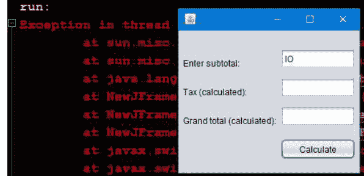

异常是一个对象。当运行时发生错误时，会创建一个 Java 异常类（如 `NumberFormatException`）的实例。你的代码可以通过捕获异常对象并访问其属性和方法来利用它。

加载并运行 `SafeTaxCalc` 项目。在框架顶部的小计编辑框中输入“IO”（字母‘I’和‘O’，数字 1 和 0）。点击“Calculate”（计算）按钮。弹出一个错误消息，告诉你异常的类名 - `NumberFormatException` 以及原因（“For input string “IO”）。

用户现在可以关闭对话框，并通过在文本框中输入有效数字来修复错误。显然，这比像以前那样不加处理地输入异常要文明得多。

## 异常处理进阶

我还在末尾添加了一个非常通用的块，它将处理任何未被捕获的 `Exception` 对象。如果已经捕获了特定类型的异常（例如 `ArithmeticException` 或 `NumberFormatException`），则最后一个块将被跳过。

然而，如果发生了其他类型的异常（我甚至没有想过的异常！），那么这个块将处理它。自然地，如果没有抛出异常，则没有任何 `catch` 块将执行。

## finally

你还可以可选地提供一个 `finally` 区域，其中包含无论是否发生异常都将执行的代码。`finally` 块通常用于“清理”某些资源。Oracle 提供了这个 `finally` 块示例，用于关闭 `PrintWriter` 对象（一种写入数据“流”的类——在本例中，是将文本保存到文件中），无论是否发生错误：

### WriteList

```java
try {
    System.out.println("Entering" + " " + "try statement");
    out = new PrintWriter(new FileWriter(fileName));
    for (int i = 0; i < SIZE; i++) {
        System.out.println("Value at: " + i + " = " + list.get(i));
    }
} catch (IndexOutOfBoundsException e) {
    System.err.println("Caught IndexOutOfBoundsException: " + e.getMessage());
} catch (IOException e) {
    System.err.println("Caught IOException: " + e.getMessage());
} finally {
    if (out != null) {
        System.out.println("Closing PrintWriter");
        out.close();
    } else {
        System.out.println("PrintWriter not open");
    }
}
```

我们将在下一章中更详细地查看文件和流。

## 关于异常的更多信息

`Exception` 类有很多子类。我在这里没有列出所有的类，因为它们太多了，而且无论如何，它们已经由 Oracle 提供了充分文档。如果你需要捕获特定的异常类型，请参阅此处所有可用类的文档：

https://docs.oracle.com/javase/7/docs/api/java/lang/Exception.html

Oracle 还提供了关于异常的在线教程：

http://docs.oracle.com/javase/tutorial/essential/exceptions/index.html

# 第 10 章 — 文件与序列化

在本章中，我们将查看处理磁盘上的文件以及在文件之间读写数据的一些方法。

无论你是在编写电子表格、文字处理器还是游戏，你都会在某个阶段需要从一个地方读取数据并将其写入另一个地方。事实上，使用 Java 有许多方法读写文件数据。

第 9 章的 `PrintList` 项目使用 `PrintWriter` 对象将文本行保存到文件中。`PrintWriter` 是写入文本“流”的特殊用途类之一。流可以被看作是一个从源到目的地传输数据的通道——例如从内存到磁盘或反之。流可以以字节线性序列的形式，或作为表示各种类型对象的定义良好的结构来保存数据。我很快就会解释如何保存和加载复杂对象。

首先，我想查看随机访问文件。这些是结构化文件，允许我们在精确的位置定位数据。在旧的编程语言中，随机访问文件是存储固定大小记录的最常见方式——例如数据库中的记录。

## 随机访问文件

我们首先在第 7 章遇到了 `RandomAccessFile` 类。你可能记得该章节中的 `ReadFile` 示例程序创建了一个 `RandomAccessFile` 对象 `file`，并且我们使用 `readline()` 方法从该文件中读取文本行：

### ReadFile

```java
RandomAccessFile file = null;
file = new RandomAccessFile(pathname, "r");
int linecount = 0;
String line = "";
while ((line = file.readLine()) != null) {
    linecount++;
    ta.append(String.format("[%d] %s\n", linecount, line));
}
```

我在 `RAFile` 项目中稍微更新了这个程序。这个新版本说明了随机访问文件的关键特性之一：通过“寻址”（移动文件指针）到特定位置来查找数据的能力。如果你 `seek` 到 0，它将移动指针。

### 文件指针

文件指针是一个标记，用于跟踪下一次读取或写入操作将发生的位置。当你读取或写入数据时，指针会根据处理的字节数向前移动。你可以使用 `seek(long pos)` 方法将指针移动到文件的任何位置。

`getPointer()` 方法返回文件指针当前的位置。如果你想知道读取了多少数据，或者想返回到之前的位置，这非常有用。

在 Java 中，`RandomAccessFile` 类提供了几个方法来操作文件指针。例如，`seek(long pos)` 将指针移动到指定的字节处，而 `skipBytes(int n)` 将其向前移动指定的字节数。

在这里，这 20 个字符包括 'a' 前面的空格，加上 'cloud' 之后的回车符字符和换行符。接下来，我使用了存储的数值 `bytesread`（其值是 20，因为上一次操作中读取了 20 字节），并在其基础上加了 20。这会将文件指针移动到位置 40（紧接 "float" 单词之后）：

```java
file.seek(20+bytesread);
```

这次我读取了 20 个字符，得到了如下内容：

s on high o'er wales

代码部分就留给你们自己练习了。尝试修改偏移量值或更改 `chars` 数组的大小，以确切理解它们是如何工作的。你可能想要重写这段代码，让一个名为 `lastpos` 的变量来累加读取字节的总值（将存储在 `bytesread` 变量中的每个文件读取操作的值相加），这样你就能始终知道文件中最后一次访问的位置。

务必使用你 IDE 的调试器。例如，在 NetBeans 中，我可以通过点击数字侧边栏来设置断点，在执行该行的代码行上打上一个红色标记：

```java
file.seek(20+bytesread);
ta.append("\nfile pointer at position "+(20+bytesread));
```

然后，我可以使用调试工具来检查变量的值。在 NetBeans 中，我通过选择 Debug|Debug Project 来启动调试器。当我点击该按钮时，调试器会停在断点处。

现在，我可以将鼠标悬停在如 `s` 或 `chars` 等变量名上，并“深入查看”它们包含的数据。我通过将悬停在变量名上直到弹出一个“调试提示”来实现这一点：

```java
file.seek(20+bytesread);
ta.append("\nfile pointer @@ chars = (byte) #1653[length=20] read));
nbytesread = file.read(chars);
```


我点击调试提示中的 `+` 号来查看详情。在这里，例如，可以看到从文件中读取的前 20 个字节包含了回车符和换行符（ASCII 值为 13 和 10），它们被读取到 `chars` 数组索引 8 和 9 中：

| 名称 | 数值 | 类型 |
| --- | --- | --- |
| chars | #1652(length=20) | byte[] |
| [0] | 32 | byte |
| [1] | 97 | byte |
| [2] | 32 | byte |
| [3] | 99 | byte |
| [4] | 108 | byte |
| [5] | 111 | byte |
| [6] | 117 | byte |
| [7] | 100 | byte |
| [8] | 13 | byte |
| [9] | 10 | byte |


## 调试

任何特定 IDE（如 NetBeans）调试工具的详细说明都超本书的讨论范围。你应当花时间深入研究你的 IDE 调试器。请参阅你 IDE 的帮助文档或用户指南以获取更多信息。调试对于理解程序如何运行——或者它们为什么不运行——是无价的。

## 流

Java 大多数的输入输出任务都由流处理。流无非只是从一个地方到另一个地方的字节流。它不一定是在磁盘与磁盘之间。例如，也可以是在互联网上的某个远程位置之间。然而，对于我们的目的，我们将数据流限制在计算机内存和磁盘之间。

## 序列化

序列化描述了将对象数据保存到流中的过程。如果你序列化一个包含另一个对象——例如，一个房间包含一个宝藏——那么当容器对象（房间）被序列化时，包含的对象（这里是宝藏）也会序列化。

这听起来可能没什么。但想象一下你现在有一个对象网络——地图包含多个房间，每个房间包含一个宝藏。事实上，可能有些宝藏、箱子和箱箱包含其他宝藏。好吧，你开始看到问题了。加载那个复杂的对象网络是一项艰巨的任务。你可以将这个对象网络看作一种树结构，根部有一个对象，其他对象从它“分支”出来。

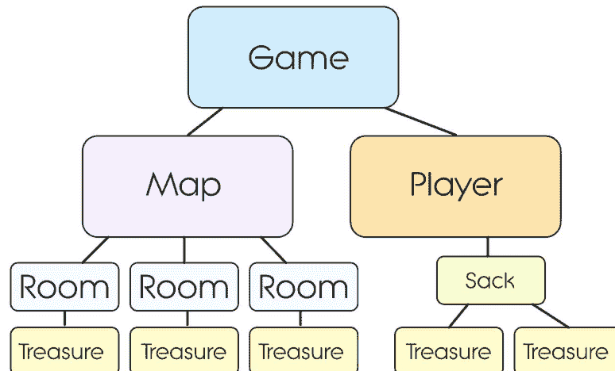

上面的图显示了我们可能需要保存的树结构对象的简化视图。在这里，游戏对象包含一个地图（`ArrayList`）对象和一个玩家（`Actor`）对象。玩家有一个背包，里面有两个宝藏。地图包含三个房间，每个房间包含一个宝藏。当然，随着游戏的进行，这个“游戏状态”会发生变化。

事实上，事实证明只需序列化位于根的对象，就可以保存或“序列化”整个对象树——这里是游戏对象——树其余其他对象（在这里，游戏中的其他对象——地图、房间、宝藏等）都会自动被序列化！

## Serializable 接口

为了让对象可以被序列化，它的类需要实现 `java.io` 包中的 `Serializable` 接口。要做到这一点，你需要在每个类声明中添加以下内容：

```
implements java.io.Serializable
```

在我的冒险游戏中，我为所有想要能够序列化的类都添加了此 `implements` 语句：

```
Adventure4
public class Game implements java.io.Serializable
public class Treasure extends Thing implements java.io.Serializable
// ...以此类推
```

与我们之前看过的接口不同，`Serializable` 接口不包含任何方法或数据字段。通过实现 `Serializable` 接口，类可以向 Java 表明该类是可以被序列化的。

如果你尝试序列化没有实现 `Serializable` 接口的类的对象，将抛出 `NotSerializableException` 类型的异常。

## 保存和恢复对象

在本章早些时候的 `FileInputStream` 项目中，当我想要通过创建一个新的 `FileOutputStream` 对象来将数据保存到磁盘时，我会将其传递给要创建并打开的文件的构造函数。

你可能还记得在 `FileInputStream` 项目中，我将一个 `FileOutputStream` 对象作为参数传递给 `DataOutputStream` 的构造函数，由它处理到输出流的原始数据类型。在我的冒险游戏中，我需要写入复杂的对象类型，因此我使用了 `ObjectOutputStream` 而不是 `DataOutputStream`。Java 文档是这样描述的：

`ObjectOutputStream` 将原始数据类型和 Java 对象的图写入 `OutputStream`。可以使用 `ObjectInputStream` 读取（重构）这些对象。

在我的程序中，我创建了一个 `ObjectOutputStream`，将混合对象类型的复杂网络（或“图”）写入流中。然后，该数据流通过 `FileOutputStream` 写入磁盘：

### Adventure4

| FileOutputStream fos = new FileOutputStream("Adv.sav"); |
| ObjectOutputStream oos = new ObjectOutputStream(fos); |

为了写入我游戏中的所有对象（以及对象中的所有对象——游戏地图中房间里的宝物等），我需要做的就是调用 `writeObject()` 方法来写入根对象。当该对象被写入时，所有其他对象（假设它们是可序列化的）都会被写入：

```
oos.writeObject(game);
```

最后，我 `flush`（写出未写入的数据）并关闭 `ObjectOutputStream`。这是处理将我的游戏数据保存到名为 "Adv.sav" 的文件的完整代码：

### Adventure4 (AdventureForm.java)

```java
private void saveGame() {
  try {
    FileOutputStream fos = new FileOutputStream("Adv.sav");
    ObjectOutputStream oos = new ObjectOutputStream(fos);
    oos.writeObject(game);
    oos.flush(); // 写出任何缓冲区中的字节
    oos.close();
    outputTA.append("Game saved!\n\n");
  } catch (Exception e) {
    outputTA.append("Serialization Error! Can't save data.\n");
    outputTA.append(e.getClass() + ": " + e.getMessage() + "\n");
  }
}
```

加载游戏同样简单。我创建一个 `FileInputStream` 来从之前写入对象的相同文件中读取内容。我将它传递给 `ObjectInputStream` 构造函数，然后使用 `readObject()` 方法读取数据，并将返回值强制转换为 `Game` 类。

这样做的效果是反序列化我游戏的所有保存数据及其整个对象网络，从而在内存中重新创建并重新初始化游戏数据：

### Adventure4 (AdventureForm.java)

```java
private void loadGame() {
  try {
    FileInputStream fis = new FileInputStream("Adv.save");
    ObjectInputStream ois = new ObjectInputStream(fis);
    game = (Game) ois.readObject();
    ois.close();
    outputTA.append("\n---Game loaded--\n");
  } catch (Exception e) {
    outputTA.append("\nSerialization Error! Can't load data.\n");
    outputTA.append(e.getClass() + " : " + e.getMessage() + "\n");
  }
}
```

尝试一下，看看序列化在实际运行中有多强大。运行 Adventure4 并在游戏地图上移动，捡取和放下对象。

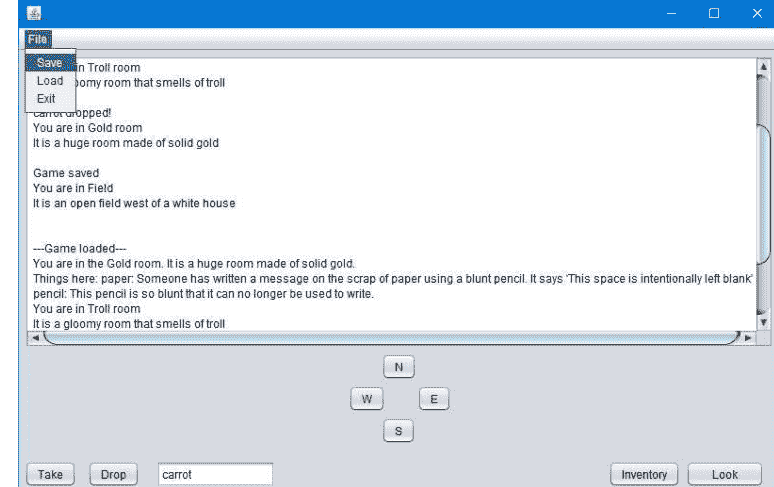

Adventure4 项目允许你通过在字段中输入名称（如“carrot”）并点击 Take（捡取）或 Drop（放下）按钮来捡取和放下对象。通过点击 N、S、W 和 E 按钮在地图上移动。保存和加载游戏请使用 File 菜单上显示的项目。

在某个时刻保存游戏。然后在地图上多移动一下，捡取并放下一些其他对象。现在恢复你之前保存的游戏。你会发现游戏恢复到了保存时的状态。玩家将重新回到游戏保存时所在的房间，房间中的对象也回到了保存时的位置。当然，序列化对游戏程序员非常有用。它为各种数据的保存和恢复提供了强大的机制。

## 接下来做什么？

现在我们已经读到了这本书的最后，你应该对 Java 语言以及如何使用它创建程序有了扎实的理解。为了继续开发 Java 技能，你现在需要一个自己的项目。你可能想尝试编写一些工具——例如导航或组织文件。如果你想入门，可以查看我提供的简单项目（见附录）。或者你可能对数学计算、编写文本编辑器、创建某种游戏、创建复杂的类层次、保存和加载文件以及处理错误感兴趣。

无论你接下来在 Java 中要做什么，我都祝你取得最大的成功。希望这本书对你有所帮助！

## 附录

### 游戏项目

你可以在存档中找到四个小型游戏项目。Adventure1 项目开始创建一些基础游戏类：`Actor`（玩家）、`Room`（位置）和 `Thing`（任何类型的对象）。`Game` 类本身定义了整个游戏。在 Adventure2 中，我添加了 `Treasure` 对象。它也继承自 `Thing`。它用于创建房间中的对象，玩家可以捡取和放下。玩家通过点击主表上的方向按钮在地图上之间移动。Adventure3 增加了泛型，使得地图现在被声明为存储 `Room` 对象的 `ArrayList`，因此不再需要上一个项目中的类型转换：

| Adventure2 - moveTo() |
| --- |
| moveActorTo(anActor, (Room) map.get(exit)); |

| Adventure3 - moveTo() |
| --- |
| moveActorTo(anActor, map.get(exit)); |

Adventure4 增加了捡取、放下和查看对象的能力，以及游戏数据的序列化。

### Java冒险编程入门

如果你真的想写冒险游戏，我有一本专门介绍这个主题的书！该书讲解了如何打开、关闭、捡取、放下和查看对象。它向你展示了如何将对象放入容器，以及如何编写递归方法来计算 `Treasure` 对象的总重量（以便玩家只能携带特定数量和重量）。它提供了解析形容词的代码，使用户可以区分相似的对象类型。例如，如果有两把精灵剑，一把大银剑和一把小金精灵剑，用户可以输入命令：“捡取那把小金色的精灵剑”。

本书还展示了如何创建“传统”类型的文本冒险游戏，这类游戏在命令行提示符运行，并以短句的形式接受命令。

```
你发现自己位于 HMS Starcrash 号的舰桥上，
这是女王皇家舰队的一艘精锐级星球级。
舰桥没有人。
地板上有三个盒子。
你想做什么？
(输入 q 退出)
> 拿盒子
> 你想拿哪一个？
小纸箱
大木箱
> 观察那个小的黑玛石盒
这是一个由精雕细刻的黑玛石制的小盒子（开启状态）
里面有东西。
> 查看黑玛石盒内部
黑玛石盒内有：
金戒指（在黑玛石盒中）
> 拿走金戒指
你从黑玛石盒中拿走了金戒指
> 关闭小盒子
你关上了黑玛石盒
> w
准备室：这是一个虽小但整洁的房间。墙上有一个柜子。
> 打开柜子
```

这展示了《Java 冒险游戏编程入门》中的一个游戏。

《Java 冒险游戏编程入门》解释了……

- 如何编写交互式小说（IF）游戏
- 创建类层次结构
- 比较创建地图的不同方法
- 命令如：拿（take）、丢（drop）、查看（look at）、将 X 放入 Y（put X into Y）
- 将对象放入嵌套容器（袋子、箱子等）中
- 使用列表和字典结构
- 如何保存和加载多个命名的游戏
- 递归
- 解析用户命令
- 将形容词与对象匹配
- 区分相似对象（例如“小金戒指”或“大银戒指”）
- 计算重量（以便玩家只能携带特定尺寸或重量物品）
- 设计可在命令行提示符运行的命令行游戏
- 使用免费的 BIFF 游戏框架编写你自己的游戏

### IDE/编辑器

以下是支持 Java 的几个（尽管还有其他）IDE 和编辑器：

- NetBeans
  https://netbeans.apache.org/
- Eclipse Java 版
  https://eclipse.org/downloads/
- IntelliJ IDEA


# 网站

有很多网站提供有用的信息和 Java 示例程序。然而，下面列出的两个网站无价之宝：

- Java 平台 API：<http://docs.oracle.com/javase/8/docs/api/>
- Oracle Java 教程：<http://docs.oracle.com/javase/tutorial/>

# Bitwise 图书与课程

欲获取 Bitwise Books 和 Courses 的最新消息，请务必收藏这些网站……

欲获取我们的全系列纸质书和电子书以及免费下载，请务必访问 Bitwise Books 网站：<http://www.bitwisebooks.com>

获取视频类编程教程，请访问 Bitwise Courses 网站：<http://www.bitwisecourses.com>

访问 Bitwise Books & Courses 的 Facebook 页面：<https://www.facebook.com/BitwiseCourses>

订阅我们的 Twitter Feed：<https://twitter.com/bitwisecourses>

订阅我们的 YouTube 频道：<https://www.youtube.com/BitwiseCourses?sub_confirmation=1>

# 作者寄语

感谢阅读我的书。我希望你发现它很有用——如果运气好的话，甚至觉得很有趣！从 20 世纪 80 年代初开始，我一直在编程并编写关于编程的文章。在“小书丛”系列中，我希望能够传递我多年来获得的一些知识，并为读者提供那些我在学习编程时希望有（但当时并没有）的书籍。

编写这些书以及随附的所有示例代码需要大量的时间和精力，虽然我很享受编写它们——毕竟，编程是我热爱的事——但对我来说，我的书要与大型出版公司出的书竞争非常困难。

*你可以帮到我！*

评论对我至关重要。它们让潜在读者了解我的书对他们是否有用，从而决定是否购买。因此，如果你花几分钟在亚马逊上留下简短评论，我将不胜感激。你可以通过下一页的链接、使用手机扫描二维码或（在其他亚马逊网站）点击“撰写评论”按钮来完成。

再次感谢阅读我的书！

Huw Colbourne

# 留下评论

## 亚马逊美国站


<https://tinyurl.com/1gorki> 或 <https://www.amazon.com/review/create-review?asin=191313245>

## 亚马逊英国站


<https://tinyurl.com/3x9qazk> 或 <https://www.amazon.co.uk/review/create-review?asin=191313245>

# 更多编程书……

《Java 编程入门》是“小书”系列之一。在每本“小书”中，我们的目标是为你提供直接进入核心的内容，而没有废话和填充。

我们知道网上有大量关于标准代码的信息，我们不会在这些书籍中重复这些信息。相反，我们的目标是解释你快速上手实践编程所需的真正重要的细节。

其他“小书”包括：


## Java 冒险游戏编程入门

- 高级面向对象技术
- 创建命令行游戏
- 解析用户输入
- 打开、关闭和锁定容器
- 将宝物放入容器
- 对象属性和形容词
- 递归遍历网络


## C# 编程入门

- C# 语言初级指南
- 对象对象
- 类与方法
- 方法与参数
- 数组与字符串
- 异常处理
- 列表与泛型
