# 丢失的营团：一场无法胜利的战斗，一座无法防守的岛屿，一个无法信任的盟友

*献给 Aidan*

## 作者序言


前荷兰属东印度群岛、缅甸和泰国的地名拼写差异很大。对于战后更名的国家、城市和城镇（例如，巴达维亚现为雅加达），我通常使用战时名称而非现代名称。

### 在热带保持健康

遵循这些简单规则以避免热带疾病。智能士兵可以避免热带疟疾。按照医嘱在饭后服用抗疟片，并用水送服。随身携带足够的抗疟片，如果与部队分离，每天服用一片。如果某天忘记了，第二天吃两片。在蚊帐下睡觉。

从黄昏到黎明，除非在帐内睡觉，否则要穿长裤、护腿和长袖衫（袖子拉下），并每 3 小时在脸部和手上涂抹驱蚊乳。随身携带一瓶驱蚊乳。用防螨喷剂处理衣服。严格按照使用说明操作以防止斑疹热。为了避免痢疾和伤寒，除非水经过煮沸或氯消毒，否则不要喝水。让苍蝇和其他昆虫远离食物，并保持餐具清洁。尽可能多且经常洗澡，以避免热带皮肤病。随身携带自己的肥皂。多带一套袜子和内衣。隔天换一次袜子。

澳大利亚军队《服务记录簿》，1944 年 8 月修订版

## 第一章：战袍之情


1941 年 4 月 11 日，耶稣受难日，2/3 机枪营的九百名官兵乘坐军用运输船`MM`号驶离悉尼港，目的地未知。`MM`号——根据 B 连阿尔夫·谢珀德的话说，这是一个“怪物”，“比我们以前见过的任何船都要大”——它涂着灰漆，但其单调的外表掩盖了它是法国沦落后被英国征用的豪华邮轮“法国号”（`Ile de France`）。它总共载了 4000 多名士兵。

跟随“法国号”离开悉尼港的还有三艘征用的邮轮：“伊丽莎白女王号”、“毛里塔尼亚号”以及荷兰的“新阿姆斯特丹号”。“玛丽皇后号”在新南威尔士州海岸 170 公里的杰维斯湾等待他们，那里有 2/2 先遣营的士兵，这是一支与机枪营一样新组建的部队（少数先遣营成员挤进了“伊丽莎白女王号”）。

这五艘改装后的邮轮共载了 25,000 名士兵——这是自 1914 年第一次澳大利亚帝国军以来，派往海外规模最大的澳大利亚军事力量。20 岁加入机枪营的德斯蒙德·杰克逊士兵描述这支护卫队为“巨人舰队”。

这支机枪营来自南澳大利亚州、维多利亚州、塔斯马尼亚州和西澳大利亚州，由阿德莱德的律师亚瑟·西瑟福斯·布莱克恩中校带领。在近二十五年前，布莱克恩因在法国的英勇被乔治五世国王在白金汉宫授予了维多利亚十字勋章，当时他多次领导了对波齐耶尔村外德国据点发起的进攻。关于布莱克恩在西线的非凡战绩报道出现在澳大利亚各大小的报纸上。在 1916 年 10 月的《里奇蒙河快报与凯科格广告报》发表的一封信中（并在许多其他报纸上转载），布莱克恩回忆了波齐耶尔的那场“惨烈的战斗”，他和他的士兵们顽强地战斗了三天三夜，几乎没有停歇，一寸一寸地夺回村庄……老天才知道我是怎么活下来的，我身后的第 17 个人被打死了，我后面的 22 个人受伤了……当我沿着战壕向上爬时，我遇到一个 19 岁的少年，他的手和腰被锁在一挺机枪上。想象一下得把士兵锁在枪上。难怪那些乞丐很难被赶走，因为他们坚信我们不留俘虏，会把他们全杀了。

49 岁时，布莱克恩决心向他新组建的机枪营证明自己并未老去。在强制行军中，这位“瘦腿”校官总是走在最前面，他的体能和纯粹的狠劲让那些足以做他儿子的年轻人大为惊奇。

布莱克恩不仅经验丰富且机灵，还是一位出色的组织者——这种才华对于身处问题不断的“法国号”上的士兵来说被证明是至关重要的。老兵们描述了下水道问题、饮用水短缺以及几乎全是煮土豆和稀粥的饮食。在 2/3 机枪营的历史《从雪地到丛林》中，汤姆·凯斯士兵回忆道：“吃这些食物一周后，我们几乎处于兵变的边缘。”在布莱克恩接手内部安排后，“厨师被匆忙换成了我们自己的军厨，之后的食物变得好吃多了。”

在杰尔维斯湾接上`Queen Mary`号后，护卫队向南航行。尽管`Queen Mary`号在被改装为部队运输船时，许多内部装置已被拆除，但`2/2nd Pioneer Battalion`的男兵们惊讶地发现，她的豪华住宿设施大部分完好如初。`Harry Walker`下士是维多利亚州奥尔玛 11 个孩子中的中间那个孩子，他对这艘巨轮的规模留下了深刻印象，但随着船接近赤道，他将与同伴们一起遭受苦难。`Walker`在他的录音回忆录中写道：“它是为了寒冷的大西洋航线而设计的。热带地区没有足够的空调设备，天哪，我们简直热得要命。”

`Ile de France`号机舱的问题拖慢了整个护卫队的速度，而汹涌的海浪使得穿越南洋的航程变成了一种折磨。当士兵在弗里曼特尔被拒绝上岸假时，`Blackburn`不得不迅速采取行动以防止暴乱。部队日记中的记录写道：“2030。某些人员对船上状况发生骚动。主要是增援人员，据目前所知，本部队没有成员参与。”

当`D Company`的此前在珀斯进行登船前假的男兵们在弗里曼特尔汇合时，营达到了满员。日记忧伤地写道：“减少船上人数的尝试失败了。”

`Ile de France`号由于太大无法停泊，必须通过驳船供应物资。出于安全考虑，自部队离开悉尼以来，家中的信件一直受到严格审查，但在到达弗里曼特尔后，一些机枪手想出了一个好主意：把信件扔出船舷以躲避审查。来自`C Company`的塔斯马尼亚人`Arch Flanagan`告诉`Blackburn`的传记作家`Andrew Faulkner`：“其中一只小船上的一个人说‘有信件吗……我可以帮你们邮。’好吧，我不知道他是不是个德国间谍，但紧接着那些信件就到了上校的手里。”`Flanagan`并不是唯一一个被愤怒的`Blackburn`痛斥的人，尽管他抗议说那些信件“包含关于护卫队的信息并不比弗里曼特尔每个码头工人所知道的多多少”。

自从护卫队离开悉尼以来，保密一直是首要任务。在从弗里曼特尔出发前发布的“最高机密”指令指出，“对于防止任何有关海外行动的信息泄露，如何强调其重要性都不过分。”禁止向海中扔漂流瓶，因为理论上敌方袭击艇可以通过捡到“两个或更多带有日期信息的瓶子”来绘制护卫队的航线。

护卫队出发前往科伦坡后，`Ile de France`上士兵的生活开始改善，尽管`Blackburn`自称觉得这“极其无聊”。`Blackburn`的上级`Stillman`中校下达的一项禁止所有形式赌博的错误指令被悄悄取消了（无疑是根据`Blackburn`的建议），取而代之的是在“训练期间”禁止赌博的较温和禁令。部队历史记载，在弗里曼特尔之后，“后部休息室被建立起来，供士兵在工作后玩宾果、两点（two-up）、二十一点、皇冠锚和轮盘等游戏”。在新制度下，休息室看起来像是“烟雾缭绕的但丁地狱”。

随着护卫队进入热带地区，热浪变得窒息。所有军兵都被警告晒伤是“一种自致的伤害”。淡水短缺意味着士兵只能用海水洗衣服。4 月 14 日，下达了命令每天上午 9 点到下午 6 点之间切断淡水供应。士兵被指示“每天在 0900 前装满水瓶备用”。在发生一系列事故后，发布了一项通用警告，提醒“在走廊和楼梯内扔橙皮或其他水果皮很危险”。

根据开拓兵团的历史记录，在`Queen Mary`号上，甲板下的温度变得无法忍受，以至于白天取消所有训练，让部队在甲板上获得缓解。晚上，男兵们“赤裸上身，汗流淋漓”，在潮湿的水吧处排队以每品脱五便士的价格买啤酒，但“饮用的环境如此不愉快，以至于很少有人重新排队”。无论如何，醉酒可能会丢掉士兵的生命：船上规定，如果有人掉入水中，船将不会停下来接他们。在炎热中睡觉几乎是不可能的，全船到处都有秘密的小组聚在一起玩牌，每晚都有现金易手。被发现用“空瓶当尿壶”的士兵受到立即逮捕的威胁。部队历史报告说：“军官和护士更幸运。他们晚餐后的空闲时间花在大型空调游客休息室或鸡尾酒吧里，那里有穿白制服的服务员提供冰饮。”

4 月 22 日，满载新西兰士兵的`Nieuw Amsterdam`号离开护卫队，驶向新加坡。在岛上短暂停留期间，新西兰人几乎没有离开海军基地。其中一人写信回家说：

```
下午花时间去距离船两英里的游泳池进行小范围行军，我必须说游泳很舒服，但行军令我精疲力竭，太热了，足以让一个人融化成一滩油渍。我们没有假期，所以一天晚上我们冲过跳板，逃到了陆地上，在那里可以呼吸到一点空气。我个人再也不想再看那个地方了。
```

换乘`Aquitania`号后，新西兰人比`Ile de France`号和`Mauretania`号的澳大利亚人早五天到达了科伦坡港。`Queen Mary`号和`Queen Elizabeth`号必须航到岛另一边的特林康马利。这两艘巨大的姊妹船只停留了两天加油，而沮丧的开拓兵们不被允许上岸。

繁华而破旧的科伦坡市对于从未踏足过澳大利亚以外的士兵来说大开眼界。`Alf Sheppard`记得那些蛇匠、卖小饰品和纪念品的摊贩，以及当地出租车司机疯狂的驾驶。`Sheppard`写道：“任何挡路的人可倒霉了。不停歇的喇叭声制造了令人神经紧张的噪音。”海滨酒店提供廉价餐点，有免费巴士通往附近的景点，“殖民地的欧洲女士们”在部队食堂提供茶和三明治。士兵被禁止访问天花流行的地区。

比机枪手早了几个周。5 月第一周，开拓兵到达了苏伊士运河南端的苏伊士港。从那里，他们被送到巴勒斯坦，沿着苏伊士运河向南乘火车，晚上乘坐驳船横跨运河。他们的目的地是加沙以北约 16 公里处新建的营地，被称为“95 号山”。

由于缺乏英国轮船的速度，笨重的`Ile de France`号时刻面临着潜伏在亚丁湾和红海的轴心飞机和潜艇攻击的风险。机枪手的日记记录了`Blackburn`与其他的连官们关于防空保护问题的会议：“危险现在正迅速变成现实；在航行的最后 48 小时尤为如此。”

### 军事史

几周后，敌方攻击的危险性得到了戏剧性的说明。当时，被征用的白星轮船“乔吉克号”（`Georgic`）在特图菲克港锚泊时被德国的轰炸机击中。一枚炸弹在货舱内爆炸，引发了大火，并迅速蔓延到存储在船假烟囱内的弹药上。破裂的油箱助长了火势。工程师们成功启动了船发动机，让船员将“乔吉克号”拖离主航道并停在沙洲上，这艘受损的船被留在那里直到烧毁。这艘被烧黑的轮船最终被重新浮起并送往印度进行维修。

许多机枪手都渴望被派往西西拉沙漠，那里澳大利亚和英联邦部队正在托布鲁克遭到罗梅尔“非洲军团”的围困。然而，他们被命令加入巴勒斯坦的先遣营。

第 2/2 先遣营在维多利亚州的普卡潘尼亚尔（`Puckapunyal`）组建，接受过诸如筑道路和扫雷等工程任务的训练，但由于预备队短缺，该营的射击任务将多于挖掘。

95 号山靠近加沙山脊，1917 年，哈里·肖维尔中将领导下的澳大利亚轻骑兵曾在此处冲锋土耳其的战壕。夜晚寒冷，白天却炎热、干燥且尘土飞扬。几个人被空气中不熟悉的气味所困扰，有些人发誓那是骆驼粪味。

帐篷进行了伪装，并挖掘了战壕；部队被禁止将战壕用作垃圾坑。着装方面出现了一些混乱。一项要求士兵穿衬衫的命令没有提到裤子，一些士兵被发现没穿裤子。机枪手的日记写道：“由于少数个人认为只穿衬衫就遵守了命令，将警告所有部队，除了衬衫外，还要穿短裤或长裤。”

与其他被派往巴勒斯坦的单位一样，机枪手[根据原文流程逻辑，此处省略文本内容]。

*（注：用户提供的源文本在后半部分包含大量重复或乱码片段。我已根据提供的连贯部分，对第 2/2 先遣营及提到的特定事件的核心叙事流进行了清理，并按照要求对特定实体/变量应用了格式规则。）*

尽管充满了危险，福勒的同伴们仍然嫉妒他占据了二号位。福勒在《机枪回忆录》中回忆道：“他们认为我应该排在最后的‘五号’，垫底。”其中有一位受过古典教育的士兵，曾刻意要打压福勒的风头，故意用莎士比亚的名言来让他不知所措。在敌人的炮火期间，另一个人，弗德·索特（`Fred Souter`）崩溃了，开始失控地哭起来。“我做了什么？我过去安慰他，搂住他的肩膀，紧紧抱着他说：‘没事的，弗德，你会没事的。’接着我也崩溃了。这一切完全在我脑海里爆炸了。”炮火带来的创伤太大了，导致福勒暂时性失明。

#### 约旦河大桥

6 月 15 日，布莱克恩接到命令要守住或摧毁约旦河上的一座具有战略意义的桥梁。大桥距离有 45 公里，布莱克恩被要求让士兵在黎明前挖掘工事并准备好战斗。维希法国飞机在夜晚很活跃，部队遵守严格的灯火管制：根据布莱克恩的指示，挡风玻璃被拆下，刹车灯被毁。由于没有月光引导，布莱克恩的司机们留在道路上的唯一方法是让导航员探出车外观察边缘。在冲向桥的途中，两辆摩托车掉进了悬崖，一名信号中尉在两辆卡车之间被压死。

#### 库尼特战役

30 公里外，1500 名拥有 40 辆坦克的维希军队正在进攻库尼特镇。由于预计随时会对桥发起进攻，布莱克恩被命令为防守库尼特的英国皇家燧枪团运送急需的弹药。在弹药到达之前城镇沦陷了，但在 24 小时后在布莱克恩机枪手的支持下收复了。回忆起进入这座满目疮痍的城镇时，布莱克恩描述道：

一辆燃烧的法国坦克，几乎通红……翻覆的卡车，有英式的也有法式的，三辆被毁的装甲车，死马，成堆的弹药……以及几辆被子弹射得百孔千疮的普通汽车。尽管如此，大多数商店仍然开着门。下班的澳大利亚士兵在街道上闲逛买东西。当地人则冷静地清理现场，整理物品，购物，似乎对战争漠不在乎。

叙利亚人并不总是如此不慌不忙。布莱克恩目睹了成群的平民带着行李从被战斗摧毁的城镇中逃出来。他在给家的信中写道：“很难描述这些人脸上那种痛苦和绝望的神情。他们被彻底吓坏了，极度焦虑地让你觉得他们站在你这一边。这些可怜的家伙，如果敌人夺回了那里，他们对敌人来说也将一模一样。”

#### 向大马士革进军

库尼特沦陷后，机枪手被命令加入一支在大马士革外受阻的自由法国军、印度和英国部队。这一次，维希坦克和装甲车是主要问题，阻挡了自由法国军前进，并威胁要消灭一支仅配备步枪的印度旅团。尽管有澳大利亚机枪支持的承诺，自由法国军指挥官卡索上校（`Colonel Casseau`）仍不愿移动。面对面前近 1000 码（914 米）看似无人的土地，机枪手们无视了常规战术，自行前进，激进地冲入无人地带，清理掉他们遇到的任何敌阵地供自由法国军占领。根据部队日志，“通过这种方式，进军取得了相当大的进展，自由法国军最终向前推进了 3 到 4 英里。”

#### 默尔代朱恩堡的斗争

与此同时，先锋队（The Pioneers）一直为维希的据点默尔代朱恩堡（`Fort Merdjayoun`）进行血战。该堡垒被盟军攻占，后被夺回，再次被夺取，但代价是巨大的。当英国的大炮未能突破城墙时，维希火炮对那些不幸的先锋队进行了猛击。在堡垒巨大的墙外的一天战斗中——哈里·沃克下士（`Harry Walker`）记得墙“大约六英尺厚，全是石头做的”——先锋队损失了 27 人死亡、46 人受伤和 29 人被俘。“这是一个愚蠢又该死的安排，”机枪手艾伦·加丁纳（`Allan Gardiner`）告诉布莱克恩的传记作者。“他们送进去了……这么多先锋队。那些可怜的家伙。老天，他们被打得太惨了。我不认为他们意识到那个堡垒守得有多严。他们是外法军的人……而他们有坦克，我们没有。”

随着默尔代朱恩最终落入盟军手中，先锋队被派去夺取镇东北部的一个山脊，机枪手再次提供支持。情报显示该山脊防御薄弱，结果被证明是假的。先锋队发现自己面对的是 2000 名维希士兵。结果与默尔代朱恩时一样：澳大利亚人被成片收割。先锋队的团史记录道，53 岁的军士沃利·皮勒（`Wally Peeler`）与布莱克恩一样，都是 1914-18 年战争的维多利亚十字勋章获得者，他当晚进入无人地带营救伤员，带回了四名在酷热的叙利亚烈日下存活了一整天的士兵。

#### 大马士革的投降

6 月 21 日，大马士革市戴着休战旗出现，正式宣布城市及其警察部队投降。作为在场的高级“英国”军官，布莱克恩加入了卡索上校接受投降，尽管（正如他后承认的那样）他“没有任何权限”出席。在仪式上，法国指挥官发表了“一个特别的小演讲，感谢澳大利亚的荣耀——我是这么认为的，我很乐意用澳大利亚语的一段简短演讲作为回应（我一句法语也听不懂）——他们全都同样严肃地假装理解并接受了！”

接受维希的投降“对于我们那位令人敬畏的指挥官来说完全是一个时刻，”德斯·杰克逊下士（`Private Des Jackson`）自豪地回忆道。“这也是……德国入侵俄罗斯的日子。”（杰克逊错过了一天——希特勒入侵苏联的“巴巴罗萨行动”于 6 月 22 日开始。）

#### 占领与结论

维希的首府已经沦陷，但战斗直到 7 月 11 日才结束。期间，先锋队参与了争夺贝鲁特以南 30 公里的法国行政首都达穆尔的激烈战斗。7 月 9 日，在澳大利亚军队包围该镇后，达穆尔沦陷，通往贝鲁特的道路敞开了。三天后在阿克拉签署了停火协议。此时，巴巴罗萨行动已经开始了近三周。虽然现在德国入侵叙利亚的前景不大，但来之不易的领土必须得到巩固和维持。布莱克恩的机枪手与先锋队一起成为了盟军占领军的一部分。

叙利亚战役是一场奇特的战斗。不仅仅是法国士兵感到忠诚心产生分裂。在默尔代朱恩外战斗中被俘的一组先锋队士兵被他们的维希俘虏者撤离到安全的贝鲁特。在穿过维希预备队阵地时，他们遇到了几名在法国外法军服役的英国战士。团史记录道，这些英国佣兵“停下来交换了友好的问候。叙利亚战役的性质如此。”

和他的许多伙伴一样，杰克逊下士在非值班期间乐于扮演游客。除了访问“如霍姆斯、阿勒颇、贝鲁特、耶路撒冷特拉维等著名地点”之外，杰克逊还机会探索了帕尔米拉和黎巴嫩贝卡山谷的巴勒贝的罗马遗迹。

这项职业带来了其自身的艰辛。沙蝇、沙蝇热以及所谓的“叙利亚溃疡”是不断的困扰。驻扎在特里波（`Tripoli`）港口`El Mina`的拓工兵连中爆发了沙蝇热，导致“每日病人人数大幅增加”。许多澳大利亚士兵感染了疟疾，有些人已经死于该病。军方发放了蚊帐，并向部队配了金菌。营团历史记载，士兵被“警告不要吃一种名为`gibee`的叙利亚菜肴，它由碎生肉、大麦和各种香料组成。它味道很好，但可能导致肠道感染。由于明显的原因，`Elmina`镇被宣布为禁区。”

成立了一个总部位于贝鲁特（`Beirut`）的控制委员会。委员会中的澳大利亚军官与他们所谓的敌人“维希法国人”相处融洽；但与盟友“自由法国人”的关系则没那么好，后者尽管在战斗中只扮演了配角，却声称拥有了大部分荣誉和战利品。由于法国人抢夺了被捕获设备和武器的大部分，澳大利亚的一支机枪手连对拉亚克（`Rayak`）的英国军械库（`Ordnance Stores`）进行了一场抢劫，将其自用。

从 10 月初开始，机枪手们驻扎在`Fih`，那是特里波南方偏远的黎巴嫩小村庄。当 1941 年 12 月 7 日日本袭击珍珠港的`美国太平洋舰队`的重大消息传来时，他们正处于那里。新年期间，营团转移到了加沙附近的新营地——`Hill 69`。在那里，正如杰克逊士兵（`Private Jackson`）回忆的那样，“我们开始了极其奇怪的程序：在沙漠里进行丛林战训练。”

## 第二章：69 山与未知的目的地


叙利亚的战斗导致 416 名澳大利亚士兵阵亡。机枪营的伤亡——9 人死亡，34 人受伤——与步兵团和拓工兵团相比（后者有 102 人在战斗中受伤，另一些人撤离）相对较轻。正如布莱克恩的传记作家所说，难怪“布莱克恩的人谈论拓工兵团时充满了敬意”。在接下来的几个月里，这两个单位之间的纽带将在任何澳大利亚士兵——即使是`布莱克恩`——无法预料的情况下受到考验。

日本参战对澳大利亚产生了致命影响，澳大利亚早已习惯于躲在英国看似不可攻破的堡垒——新加坡之后。澳大利亚政府曾努力游说——但并未成功——希望英国在遭到袭击时派遣更多飞机保卫该岛。珍珠港遭到袭击后几小时内，日本轰炸机袭击了新加坡。两天后，日本飞机在马来亚东岸外海域截击了英国战舰“威尔士亲王号”（`Prince of Wales`）和“反击号”（`Repulse`），并用鱼雷击沉了两艘船。日本军队登陆马来亚并沿着半岛向新加坡快速推进。除了马来亚的锡矿和橡胶种植园，日本人还盯上了另一个目标：荷属东印度岛丰富的油田。

一年多来，荷兰人一直抵抗日本对荷属东印度岛日益激进的石油要求。预感到日本早晚会诉诸武力，荷兰人试图加强在荷属东印度岛（`NEI`）的势力，但他们对武器的请求被盟军两个主要制造国——英国和美国视为低优先级。美国在名义上仍坚持不干涉政策，并不会对日本对荷属东印度岛的侵略提供任何支持保证。英国由于共同的帝国利益，态度较为配合，但作为对丘吉尔（`Churchill`）模糊军事支持承诺的回报，荷兰人陷入了一项以“新加坡堡垒”为中心的更广泛的远东战略中。

1941 年 2 月的“新加坡会议”上，英国、澳大利亚和荷兰的军事官员敲定了细节，这导致荷兰人同意在与日本发生战争时派遣四个飞行中队前往新加坡，这极大地削弱了其在荷属东印度岛本已脆弱的空军。作为交换，澳大利亚同意部署相应的飞行中队到安汶（`Ambon`）和帝汶汶（`Timor`）。杰克·福特（`Jack Ford`）在其著作《困境中的盟友：二战期间澳大利亚与荷属东印度岛的关系》中指出，这“比美国或英国准备提供的任何承诺都要具体得多”。

在日本袭击珍珠港后，荷兰立即履行了承诺，派遣四个飞行中队前往新加坡——此举对荷属东印度岛的防御产生了深远影响。

根据营团历史，日本和美国的参战在叙利亚的机枪手之间“引起了许多讨论和推测”。战争突然变得离家越来越近。当澳大利亚人享用烤火鸡和梅子布丁的圣诞晚餐时（按照传统，由军官和士官上菜）——伦敦、华盛顿和堪培拉正在做出的决定将对他们所有人产生可怕的后果。

英国、印度、澳大利亚和马来亚士兵在马来亚面对日军正节节溃退。日军推进的速度在堪培拉造成了恐慌气氛，澳大利亚政府希望士兵们回家。1942 年 1 月 31 日午夜，`69 山`的士兵们爬上了开往苏伊士运河埃尔坎塔拉（`El Kantara`）的运牛车，在那里横过运河，然后乘坐埃及火车前往特瓦尼克港（`Port Tewfik`）。撤离命令来得如此突然，机枪手们只带了步枪和个人装备。营团的维克斯机枪（`Vickers guns`）、设备和车辆被留了下来，双方达成共识会将它们送。

尼尔·麦克斐森（`Privates Neil MacPherson`）、布鲁·罗（`Bluey Rowe`）和休·索利（`Hugh Sorley`）是来自迪姆拉（`Dimra`）训练营的 52 名西澳人中的成员，他们发现自己被转调到 2/2 拓工兵团，用以补充在叙利亚损失的人员。和机枪手一样，拓工兵团的人也认为自己正处于回家的路上。

麦克斐森是珀斯（`Perth`）五个兄弟中的一个，他的父母从苏格兰移民那里，在玛格丽特河（`Margaret River`）获得了一块定居点土地。他的父亲是一位一战老兵，曾被承诺获得 500 英亩（202 公顷）土地——“这是一块巨大的土地，但没人告诉那是森林”。像许多其他移民定居者一样，麦克斐森的父母在大萧条时期失去了土地，因为他们无法支付抵押贷款的利息。在大萧条后的几年里，他的父亲经常失业。澳大利亚士兵通常比英国军队的士兵更高、更强壮、更健康，但 19 岁的麦克斐森知道饥饿是什么滋味。

当西奈（`Sinai`）的夜间温度降至零度时，机枪手们颤抖着。但糟糕的事情还在后面。送他们特瓦尼克港的发动机故障了，士兵被命令留在火车上直到修好。“我们挤在古旧的木制车厢里度过了痛苦的一天，不耐烦地等待行程开始，”杰克逊士兵（`Private Jackson`）回忆道，“最后下午 3 点，出现了一阵忙碌，在许多呼喊和折腾后，发动机响了汽笛，缓冲器撞在一起，火车比计划晚了约六小时从埃尔坎塔拉（`El Kantara`）开出。”对于他们中的许多人来说，这六小时就是生死的差别。

在伊斯玛亚利亚附近，火车驶经过了盟军营地，那里有关押德国和意大利战俘的铁丝网边界。一些澳大利亚人在经过时向敌军士兵口口辱骂。意大利人“大声地回敬”，而德国人则只是视而不见。这次相遇让一名机枪手杰克·托马斯士兵（`Private Jack Thomas`）记忆犹新。他在决定入伍前在布罗肯希尔（`Broken Hill`）当杂役，每周赚 15 先令。对于被关在铁丝网后的俘虏，托马斯回忆道：“我对这些人并不尊重。我以一种胜利者的姿态看着他们。一年后，当我自己变成了战俘时，我才明白了什么是谦逊。”

到达特图菲克港（`Port Tewfik`）后，机枪手们发现他们本应乘坐的`Mauretania`号已经先行离去。在帐篷里过了一夜后，他们被指示将行囊包成堆放在石质码头上。现场一片混乱。港口上方布满了充气球，港内挤满了小型货船，它们在沉没的兵力运输残骸之间小心地移动。锚泊处停着一艘大型现代单烟囱客轮，杰克逊认出那是东印度客轮`Orcades`号。

机枪手们赶在午饭前准时登上了船：共有 33 名军官和约 600 名士兵。其他人则已作为增援被转移到另一个机枪营，将在阿拉拉曼战战斗。布莱克恩（`Blackburn`）的团与参加过叙利亚战役的战友——先遣队（`The Pioneers`）以及来自其他部队的少量士兵会合。这艘本应载 2000 人的船上总共有 3400 名士兵。杰克逊士兵点了一根烟，环顾四周。听到起锚的声音，他心想：“我们总不会不带行囊就出发的。”

担心的不只有杰克逊一个人。士兵们的行囊包和军官的提箱被卡在两节火车车上，在准备出发的士兵面前一览可见。布莱克恩请求船长福克斯上尉（`Captain Fox`）推迟出发，直到团部的行李装载完毕，但被拒绝了。`Orcades`号被困在港口，是敌方飞机的容易目标，福克斯肩着三千多名澳大利亚士兵以及船上其他数百人的生命。他急于离开这里。

`Orcades`号于 1942 年 2 月 1 日离开特图菲克港。没带个人行李出发已经够糟糕了，但机枪营的大部分战斗装备——包括所有的维克斯斯机枪和弹药——以及车辆和司机也被留在了。在随后的几天里，大部分丢失的装备被塞进了其他船只（主要是慢速货船），但没有一件送达机枪手手中。

先遣队的情况也没好到哪去。每人 50 发以上的弹药（每挺轻型机枪 1000 发）本应随行李小组装载到`Orcades`号上，但“由于装船人员的组织不善，该团在没有行李小组、弹药储备和厨房设备的情况下出发了。船上的所有其他单位也处于同样的状况。”厨具的匮乏“让人们感到非常痛苦……因为没有它们，我们甚至连茶水都烧不掉。”在缺乏合适用具的情况下，士兵们用饼干罐烧水。

被丢弃的不只有军事装备。吉姆·瓦斯泰尔（`Jim Wastell`）士兵是一名担架员兼医官，他在团备受推崇的乐队中吹长号。叙利亚停战后，瓦斯泰尔获得了一支从霍姆（`Homs`）堡垒中救出的法国长号。正如团史记载：“他小心地把长号装进行囊包里，并将包留在了特图菲克港的码头上。他再也没有见过他的行囊包或长号了。”

在经历了`法国号`（`Ile de France`）的不便后，很少有人对`Orcades`号的条件有意见。食物很好，但过度拥挤意味着身体训练的机会有限。杰克逊士兵并不是唯一一个对回到家（无论是否带装备）来帮助澳大利亚抵御进军的日本军感到兴奋的人。航行两个半天后，`Orcades`号通过了“地狱之门”（划分红海与亚丁曼湾的海峡），向东转弯。先遣队的日记记载，2 月 4 日“分发了丛林战安全手册”。四天后“发布了关于荷属印度（`NEI`）的笔记并向部队进行了讲座”。澳大利亚人被命令换上热带装备。

科伦坡附近 50 海里有一艘船被中鱼雷的消息让所有人高度警惕。由于`Orcades`号没有海军护卫，福克斯上尉不得不依靠速度和机智。当船横跨印度洋时，每几分钟改变一次航线以躲避潜艇，士兵们则研读丛林战手册。虽然目的地仍然未知，但看起来不太可能是澳大利亚。2 月 8 日他们获得了一个线索，军官们领发了一份题为《荷属印度的海关与人民》的小册。

流传的其他军事手册包含了关于丛林战的建议。来自阿德莱德、“老头”麦基（`Max ‘Geezer’ McGee`）是一名 20 岁就入伍的机枪手，他回忆起听过关于日本士兵是多么短视且装备糟糕的讲座。显然，“他们晚上看不见东西，200 英尺外无法击中任何东西。”麦基将这些无用信息归咎于英国人，而英国人已经在缅甸和马来亚接受日本人的丛林战教训了。

第二天，先遣队重新领取了离开特图菲克港后存放在船上军库的武器。2 月 9 日，`Orcades`号驶入科伦坡港。港口满了商船和军舰，笼罩在油烟之中。科伦坡被轰炸了。当澳大利亚人到达时，镇上的部分仍在燃烧。

机枪手们是从澳大利亚前往中东途中停靠科伦坡，但这对先遣队来说一切都是新鲜的。当命令要求他们只停留足够的时间领取物资时，下船计划被取消了。24 小时内，在多塞郡巡舰（HMS `Dorsetshire`）的护护下，`Orcades`号驶出港口，进入孟加拉湾。

两支澳大利亚士兵师团正从中东返回，但他们的目的地仍然是个谜团。托马斯回忆道：“作为一名士兵，你并不是第一个被告知要去去哪里的人。”随着船队在印度洋上之字穿行，仰光、苏门答腊、爪哇甚至弗里曼似乎都是可能的目的地。

2 月 15 日早晨，士兵们醒来发现船正穿过细小的离岸岛屿，驶向丛林环绕的海岸。哈里·沃克（`Harry Walker`）下士回忆道：“我们当时不知道发生了什么。我们一直被蒙在鼓里。”基思·福德（`Keith Ford`）和他的伙伴们“以为我们要去澳大利亚了，直到我们在印度洋中部转了一个左弯’。”

上午 9 点左右，他们在苏门答腊岸外几公里处抛锚。同一天，船上的扬声器传来了新加坡已经沦落的消息。杰逊（`Jackson`）下兵回忆道：“这是一个令人震惊的时刻。”

部队匆忙制定了登岸计划，尽管很难说目的是什么。由于大部分武器装备被留在了特瓦非克港（`Port Tewfik`），澳大利亚人几乎没有可以自卫的武器，更不用阻止日本陆军无情的攻势了。

杰逊写道，机枪营“没有任何一种种型的机枪，没有迫击炮，也没有手榴弹。约 100 名完全没有武器的人预计将使用刺刀和短刀战斗……在面对陌生的丛林地带，以几乎赤手空的状态与强大的对手战斗，前景确实并不吸引人。”

然而，从个人层面来看，杰逊下兵的情况有所好。在担任代理下士一段时间后，杰逊的新军得到了确认，薪水也随之增加。

先遣队（`The Pioneers`）比机枪兵要幸运，他们设法从叙利亚带了一些`Bren`冲枪，但整支部队极度缺乏武器和弹药。沃利·萨蒙斯（`Wally Summons`）中尉在他的战时回忆录《双倍俘》（`Twice their Prisoner`）中写道：“弹药平均每人只有 8 发，成功的几率几乎为零。”对没有步枪的士兵提供的唯一建议是捡起前面士兵被击中后掉落的那一支。其中一些步枪是第一次世界大战甚至更早的；有几支在没有弹药的情况下被发放了。一些机枪兵手里只拿着木棍或锄头柄。

杰克·托马斯（`Jack Thomas`）是那些持有加拿大制罗斯步枪（`Ross rifle`）的人之一——这种武器几乎可以追溯到布尔战争时期，通常挂着一根绳子作为枪带。托马斯记得，一想到用“一把单发步枪，没有弹匣，口袋里满子弹”去对抗日本机枪就感到“某种程度的焦虑”。

如果说布莱克伯（`Blackburn`）对试图用木棍和过时步枪防御苏门答腊的想法感到沮丧，但他并没有表现出来。对装备和武器的抱怨被指挥严厉驳回。战争爆发时还未满成年的杰克·古德里克（`Jack Goodrick`）中尉告诉布莱克伯的传记作者：“有些时候，你会觉得……他疯了。从他所说和所做的一些事情来看，他完全没有危险意识。他永远不会被击垮……他总是从容应对。”

登陆部队通过一艘小型荷兰货轮运上岸。日本轰炸机仅有几分钟的路程，但幸运的是并没有出现，否则奥尔凯兹号（`Orcades`）的甲板上将发生惨杀。事实上，最麻烦的敌人是士兵靠近岸时袭击他们的群蚊。

当货轮到达码头时，天已经黑了。一场季风雨淋湿了挤在甲板上的士兵。看到码头停停着一排英国装甲车，显然在等待装上船，澳大利亚人的士气并没有因此提高。等布莱克伯的部队开始登岸时，消息传来，日本人已经占领了打舱（`Palembang`）的机场并夺取了附近的油田。

空气中弥漫着恐慌的味道。沃克回忆道：“我们在天黑时刚好到达了奥斯特哈文（`Oosthaven`），遇到一个大惊的军人。他的问候语是：‘你们在这里干什么？这里已经撤离了。盟军已经投降了。我在这里等拖轮船带我离开。’”在布莱克伯的“自杀任务”预测实现之前，登岸命令被撤销了。尼尔·麦克森（`Neil MacPherson`）回忆道：“当局决定日本人离得太近了。”

停泊在港口的遭遇号舰（`Encounter`）舰长收到了命令部队重新登船的信号。据报道，进军的日本人现在距离奥斯特哈文不足 20 公里。英国人正在离开，布莱克伯的部队带着锄头柄和布尔战争时期的步枪被命令加入他们。杰逊写道：“不用说，没有人感到遗憾。”

港口周围一片混乱。沃利·萨蒙斯在仓库里看到“几个箱子上面喷着‘英国供货’的字样，还有一些疲惫的士兵睡在地上”。

雨还在下，热带的夜晚漆黑一片，几乎无法辨清锚定在港口的众多船只的轮廓。奥尔凯兹号为了防范敌空袭没有开灯，潜伏在海上的黑暗中某处——如果它还没有出发的话。

珊瑚礁为港口内的船只提供了保护，但也让进出变得危险。沃克记得，货轮船长拒绝在没有领航员的情况下返回大海。“领航员被击中了。我不知道他发生了什么……船长最终在没有领航员的情况下带我们回了，大约午夜我们回到了奥尔凯兹号。发现船在等我们，我们真松了一口气。”

根据机枪兵的历史，荷兰船长能找到那艘客轮简直是幸运了：“一道闪电照亮了运输船巨大的黑色轮廓，为他指明了方向。”

午夜之后，部队才重新登船，并配上了热可和三明治。几小时后，奥尔凯兹号疾驰穿越巽巽海峡（`Sunda Strait`），该海峡隔开了苏门答腊岛和爪哇腊岛。

盟军指挥官对敌人的战斗力评价极低。大卫·戴（`David Day`）在其著作《伟大的背叛：英国、澳大利亚与太平洋战争的爆发（1939–42 年）》中，引用了韦威尔（`Wavell`）对新加坡总司令罗伯特·布鲁克波珀爵士（`Sir Robert Brooke-Popham`）建议：在充足的空军支持，“你应该能够轻松应对对马来亚的任何进攻，”并补充道，“我非常怀疑日本人是否真的会进攻……如果他们真的这样做，我确定他们会碰钉头。”

即使在荷属东印度（`NEI`）战役结束后，韦威尔继续贬低日本的空军力量。在《ABDA[美、英、荷、澳]地区最高司令官致联合参谋部关于西南太平洋地区行动的报告》中，韦威尔写道：“我一直认为并现在仍然认为，日本空军相对薄弱，只要盟军能够在有利条件下集中足够的空军，就可以被克服。” 考虑到对珍珠港以及英国战舰“威尔士亲公号”和“反击者号”遭受的致命性空袭，这一评估是非常反常的。

在日本南方军计划夺取的所有领土中——菲律宾、英属马来亚、缅甸、荷属东印度和提汶——日本军高层将马来亚和爪哇确定为最难攻克的地方。在 2015 年翻译成英文的日本荷属东印度官方史书中，陆军参谋总长杉山岩（`Hajime Sugiyama`）被引用称爪哇行动将“非常困难”。1941 年 12 月 30 日，杉山岩告诉海军参谋总长长野务（`Osami Nagano`）：

```
在马来亚行动中，由于天佑护佑以及陆海军之间的紧密合作，我们通过对敌人发动突然袭击取得了辉煌的军事胜利。然而，对于即将进行的爪哇行动，我们预见到其与马来亚行动相比极其困难，原因在于：最近敌人正迅速加强在当地地区的防御，对爪哇发动突然袭击比对马来亚更困难，而且敌人正变得熟悉我们进行登陆作战的方式。
```

自从珍珠港袭击以来，驻菲律宾的美国军队被迫退回巴拉丹半岛；日本人占领了吉隆坡并入侵了缅甸，新几内亚也遭到轰炸。到 1 月下旬，即使是韦威尔将军也清楚，他严重低估了日本人。拉瓦拉克（`Lavarack`）参加 1 月 27 日的会议时并非独自一人，而是带着他的参谋长贝里曼少将（`Major General Berryman`）和高级情报官维尔斯校（`Lieutenant Colonel Wills`）。贝里曼和拉瓦拉克都对马来亚的局势感到震惊，并对盟军防御爪哇的准备不屑一顾。韦威尔最初的计划是让从中东返回的澳大利亚第 6 和第 7 师守卫苏门腊南部（第 7 师）和爪哇的“中部地带”（第 6 师）。拉瓦拉克不同意军团被拆，但当他向澳大利亚政府提出异议时，被告知要服从韦威尔的命令，但在情况允许时尽力要求这两个师合并。

情报负责人维尔斯同样不以为然，他坚持认为这两个澳大利亚师无法及时抵达保护苏门腊和爪哇免受日本人的侵害，并警告说任何在日本人进攻之前登陆的澳大利亚军队都将“覆没”，这将危及“澳大利亚自身的防御与安全”。

马来亚局势的恶化似乎注定以失去新加坡告终，这排除了第 6 和第 7 师登陆爪哇的可能性。但这仍然留下了一个问题：如何处理布莱克恩（`Blackburn`）的那支先遣队和机枪手小组，他们当时正前往苏伊士，并在他们的设想中，将跨越印度洋到达澳大利亚。

维尔斯后来回忆起在莱姆邦（`Lembang`）的会议上，“韦威尔……告诉我们新加坡即将陷落，第 6 和第 7 师不会去爪哇。我们要离开，但有一支由布莱克恩领导的小规模澳大利亚军队出于政治原因留下来，以增强荷兰人的抵抗并尽可能延长时间。”维尔斯是布莱克恩在阿莱德的老朋友，他提出留下来战斗，但他的请求被拒绝了。

来自马来亚的消息持续恶化。到 2 月 13 日，新加坡的沦落迫在眉睫。在给澳大利亚总参谋部长斯图迪将军（`General Sturdee`）写的一份“评估”中，拉瓦拉克确认，即使有两个澳大利亚师，他也无法守住爪哇。韦威尔对华盛顿的联合参谋部和伦敦陆陆给出了类似的意见。

布莱克恩团的命运仍然悬而未决。爪哇提萨罗亚（`Tjisaroea`）澳大利亚第一军团司令部的记录显示，直到 2 月 16 日，“对于`Orcades`号船上人员的角色，尚未做出定论。”


与此同时，斯图迪也写了一篇非常有说服力的论文，他在尖刻地描述了爪哇的两个荷兰师更像是“家卫队而非一支能够执行主动作战的军队”。尽管荷兰人“缺乏经验且没有经过良好训练”，但可能会进行抵抗，斯图迪评论说，普通士兵是“在现代战争条件下战斗力存疑的土著”。他说，爪哇人不太可能“像英国印度一样，后者到目前为止对付日本人并不成功”。考虑到优越的地形、发达的交通和丰富的自然资源都将利于日本入侵者，斯图迪得出结论：成功守卫爪哇的前景“远不乐观”。即使能守住，爪哇也不符合任何作为在美协助对抗日本人发动太平洋战役的陆地基地军事标准：这只能从澳大利亚实现。

根据斯图迪和拉瓦克的建议，澳大利亚总理约翰·柯廷（John Curtin）给伦敦的丘吉尔发电报，要求从中东运回的澳大利亚第 6 和第 7 师以及位于巴勒斯坦的第 9 师返回澳大利亚。

第二天，韦威尔也给丘吉尔发了自己的电报，建议不要在爪哇登陆澳大利亚师团。“缅甸和澳大利亚对对日战争至关重要，”韦威尔写道，“失去爪哇虽然从各个角度看都是沉重打击，但不是致命的。因此，不应努力增援爪哇，这可能会危及缅甸或澳大利亚的防御。”韦威尔在得出部署返回的澳大利亚人前往爪哇在战术和战略上都是“不合理的”结论后，增加了一个重要的条款：“我完全理解其中涉及的政治考虑。”

这些“政治考虑”将决定`Orcades`号上士兵的命运。拉瓦拉克坚信在巴达维登陆是徒劳的，试图阻止部队下岸。韦威尔担心“损害”与荷兰的关系并害怕损害盟军的“威望”，忽视了他的意见。在澳大利亚，斯图迪将军先见之明地警告政府，一旦布莱克恩的人员登陆并分布在爪哇各地，就几乎无法让他们撤出了。

不幸的是，布莱克恩这支散乱的部队，其命运被一个更大的问题所掩盖，即如何处理从中东返回的澳大利亚师团。柯丁坚持认为他们都应该回家，但丘吉尔希望至少留下一支澳大利亚师团，以加强盟军对缅甸绝望的防御。美国总统富兰克林·罗斯福向澳大利亚人施压让他们同意，并作为回报向澳大利亚派遣美国军队。但柯丁非常精明，他拒绝了这种轻率的承诺——用未经过战斗检验的美国人来取代已经在船上的、身经百战的澳大利亚士兵。

丘吉尔诉诸道德勒挟，试图改变柯丁的主意。他坚称，正是为了回应柯丁要求增援新加坡的，英国的`18th Division`才被命令派往那里战斗而非缅甸，因此澳大利亚对新加坡的失守负有“沉痛的责任”。他发给澳大利亚总理的电报开头是：

> “我想你已经意识到，你们领先的师团（其目前正利用我们稀缺的英美船只从科伦坡南部向南前往荷兰属东群岛）是唯一能及时到达仰胶以防止其失守以及与中国通信中断的部队。他们可以在 26 日或 27 日在仰胶开始登陆。世界上没有其他力量能填补这一空白。”

在电报发出时，丘吉尔已经采取了异常的举措，将载有澳大利亚`7th Division`的船只调往仰胶，抱着柯丁和他的战内阁可能会屈协的希望。他们没有屈协，在两国政府进行进一步的愤怒电报后，护队加了燃料，并最终安全抵达澳大利亚，但少了一艘船：`Orcades`号。

在`Tandjong Priok`的码头，拉锯战仍在继续。在防空警报持续的鸣声中，士兵们被留在船上，而布莱克恩和韦维尔就他们的登陆问题争执不下。士兵比尔·施密回忆道：“我有一支枪、五发弹药和我身上穿的这身衣服。这完全没有希望——这是你见过最混乱的局面。”

雷德蒙·“红”·希迪告诉布莱克恩的传记作家，他和战友们曾多次被命令下船，每次都重新上船。“这种情况持续了大约五次。我想‘我们不会在这里登陆的’，所以我把一半的东西留在了船上。”在他的回忆录中，麦克斯·麦基回忆道：“两天来，老奇（Blackie）拒绝命令我们下船。最后他被升为准将并命令下船……他那时必须服从，否则将面临军事法庭。他是一个优秀的士兵，不会那样做。所以我们输掉了这场战斗。”麦基只是一个机枪手，并不清楚布莱克恩上校和韦维尔将军之间对话的细节，但毫无疑问，布莱克恩的士兵们相信，他们的领袖已经尽全力让他们回到家。

澳大利亚阻止登陆的努力在英国人中引起了深层而持久的怨恨，韦维尔的谋长普恩纳尔将军严责澳大利亚政府的“该死的态度”，并暗示试图从爪哇撤离的行动暴露了澳大利亚人——“他们能想象到最自私自大的人”——露出了他们的“真面目”。

最终，在 2 月 19 日，`Orcades`号上的士兵被命令登陆。他们获得了三天的口粮。除了先遣队和机枪手（还没有机枪）外，还有`2/6th Field Company`、`2/2nd Casualty Clearing Station`以及`105th General Transport Company`的部队，以及布莱克恩说服加入的零散兵。布莱克恩在《1942 年 2/3 月 AIF 在爪哇的作战报告》中估计，他指挥的 AIF 部队总人数“约为 2,500 人”，并将他们描述为“装备极其匮乏”。

在布莱克恩的士兵登陆的当天，消息传来日本飞机轰炸了达文，这为一些本应和其他人登陆的防空兵提供了回家的门票。这支联合部队根据其指挥官命名为`Blackforce`（布拉克部队）。关于在决定放弃爪哇时撤离部队的计划，他们给了模糊的保证，但怀疑布莱克恩——一位正在参加第二次世界大战、经验丰富且勋功卓荣的士兵——会对此抱太大幻想。

在漫长的登陆等待期间，下达了许多撤销又重新发送的指令，以至于在下达“将穿大大衣”的命令又被撤销后，一些士兵决定他们受够了。机枪手历史学家报道道：“对于[彼特斯士兵]来说，这太过了。他脱掉大大衣，扔进海里并喊道：‘这足以让你们做你们死的主意了！’他们登陆了……穿着防毒斗篷。”

杰克·托马斯记得五架卡塔利纳湖飞机飞过上方。“它们飞过时向我们敬了礼。我们不知道他们是在执行任务还是在打招呼。”卡塔利纳的飞行员和乘客很可能正前往——或很快将前往——他们中安全的澳大利亚。在 1942 年 2 月的最后几周，一种穿梭服务将数千名疏散者从爪哇运往西澳的布鲁姆，许多人乘坐水上飞机。但澳大利亚北部位于日本战斗机的射程之内。`Blackforce`登陆爪哇后不到两周，布鲁姆就成为澳大利亚继达文轰炸后第二次最具破坏性的空袭目标。在短短 20 分钟内，日本零式战斗机摧毁了 24 架盟军飞机，造成了数名受困在港口水上飞机上的平民死亡。

布莱克恩的营团没什么东西可以战斗，而且他们与其他船只运输的设备重新会合没有希望。幸运的是，码头挤满了为马来亚部队准备的车辆、武器和设备。布莱克恩的搜寻者们迅速行动，确保`Blackforce`拥有所需的一切。莱尼姆上校得到了一辆雪佛兰指挥车，布莱克恩在巴达达获得了一栋“好房子”作为总部。

拉瓦拉克将军没有士兵可以指挥，正准备离开；韦维尔很快也会其后。拉瓦拉克没有亲自向布莱克恩道别，而是给他写了一封信，信中他对不得不让布莱克恩“孤立”在爪哇，“只有寥几个澳大利亚人”感到“深表遗憾”。拉瓦拉克向他保证自己已经“尽一切可能阻止你们登陆”，但说“韦维尔将军决定让你们上岸……出于名望和士气的考虑”。对于一个指挥“自杀式任务”的士兵来说，这算不上是什么样的送别。

并不是所有的荷兰人都对澳大利亚人的到来感到高兴。士兵杰克·考金是`2/4th Machine Gun Battalion`派遣队的一部分，临时隶属于`2/3rd Battalion`。在`Tandjong Priok`，考金记得在码头与荷兰人发生了“摩擦”，荷兰人拒绝给澳大利亚人任何弹药，并宣布他们不会与日本人战斗。登陆后，考金的小组被分配守卫巴达雅地区的燃料库，然后被指示“散布在岛上，向日[侦察]飞机给出岛屿被坚守的假象”。

在韦维尔离开后，荷兰总司令官海因·特·波滕将军接管了爪哇所有的盟军陆军。根据机枪手历史学家的说法，特·波滕将军的任命是“对荷兰人的一种姿态，但也是不可避免的”。尽管布莱克恩负责澳大利亚人，但他必须接受特·波滕以及当地荷兰指挥官希林少将的命令。

哈里·沃克（Harry Walker）下士刚升为代理中士，他记得听过关于“所有美国人”正准备作为援军登陆爪哇的传闻。然而，这一切变成了一个来自美国野战兵团的德克萨斯人营，这 550 人从布里斯班的安全地带被运走，现在与澳大利亚人被困在了一起。

（受到误导性信息的不仅是澳大利亚人。3 月 2 日，日本第十六军总部收到一封电报，称“根据一名在泗水湾海战战斗中被俘的英国驱逐舰上尉陈述，澳大利亚军队的两个师已于几天前在`Tjilatjap`完成对爪哇的登陆。”根据日本官方史，将军们对这一意料之外的报告感到“焦虑”。如果两个澳大利亚师的登陆属实，将对正在向内陆移动的两个日本营团构成了严重威胁。“如果是荷属东印度军队的师，那就没问题，但澳大利亚军队不能轻视。”第十六军总部的全体人员变得“越发焦虑”，直到总谋长冈崎（Okazaki）少将宣布“澳大利亚军队登陆的信息是谎言”，并称“根据我方飞机、潜艇和其他部队的近期行动，以及敌我双方的战略位置判断，这绝对是不可想象的。”）

布莱克福（Blackforce）最初被命令防御荷兰机场和民用机场免受敌方伞兵袭击。澳大利亚人收集了一些实用的设备，但缺少重型武器。尼尔·麦克斐森（Neil MacPherson）记得自己配备了“一把汤姆冲枪和一把.303 径步枪”。汤姆冲枪是对付敌士兵的方便武器，但对于击落飞机并不有用。

布莱本（Blackburn）知道自己依靠机枪手和先锋队（Pioneers），但他对从新加坡来的近 180 名逃兵并不寄予厚望，这些人士气低落，训练“冷淡”，使得他们在“如果承受巨大压力时”的战斗能力显得“非常怀疑”。由于担心最坏的情况，他将他们分配到一支援军部队中。

杰克·托马斯（Jack Thomas）下士被命令带领一个机枪手小组守肯马乔安（Kemajoian）机场。尽管它是达达亚（Batavia）的主要民用机场，但肯马乔安位于城市建筑区之外很久。托马斯记得该地区到处是“椰子树和香蕉树，没有居住区，有点沼泽”。机枪手们立即着工挖掘战壕。荷兰人并没有顾着挖战壕，没过多久澳大利亚人就发现了原因：在这样的沼泽土地上，战壕很快就满了水。尽管如此，战壕仍然对轰炸和扫射提供了一定的保护。

夜晚是一种不舒服的经历，并不是因为日本人。托马斯的小组睡在被称为“茅草”（attap）的竹屋里，屋顶和墙壁是用棕榈叶制成的。“我们有几件衣服。我还是穿着我的大衣，这在热带地区很不方便。我找到了一个可以躺的地方，是一种编织的竹席。很快我就开始全身发痒。那里到处都是害虫。我们很快就被爬满了害虫。比起敌人，我们更担心这些害虫。”

第二天早晨，2 月 22 日，机场遭到了 27 架舰载零式战斗机的袭击。“我们的一位哥们们，斯托克（Stock）军士牺牲了，另外几个人被碎片炸伤了。”托马斯没有看到任何荷兰战斗机，但他记得有一架运输机——很可能是营团史中提到的那架：“一架大型运输机的荷兰航空（KLM）飞行员……滑行到他们面前宣布他正准备起飞前往澳大利亚。”飞行员问道：“有人想一起来吗？”，但发现没有人响应。

轰炸结束后，一架孤单的零式战斗机过来检查损坏。“几个孩子对它开了几火，”杰克·托马斯回忆道。“有一个在卡车后面架着布朗宁机枪的哥们儿开了几枪。”然而，荷兰守军直接消失了。托马斯记得他们是“缺席”的。

两天后，托马斯的小组被命令移动到布滕索尔格（Buitenzorg，现为波哥）。由于他们没有自己的交通工具，不得不征用了一辆卡车。当他们停下休息时，一位荷兰军将出来给澳大利亚机枪手们打气。“他说：‘我们会寻找敌人并击中他，当我们击中他时，我们会狠狠击中’’”托马斯回忆道，“然后他就消失了。”

在日本人进攻肯马乔安机场的早晨，更多的零式战斗机袭击了布滕索尔格附近的森普拉克（Semplak）机场，扫射部队并摧毁地面飞机。在齐利利坦（Tjilitan）机场，弗兰克·麦格拉斯（Frank McGrath）下士告诉两名先锋队员——尼尔·麦克斐森和他的红发伙伴蓝色·罗（Bluey Rowe），在空地中间挖一个武器坑。在为西澳政府的 ANZAC 百年纪念项目讲述故事时，麦克斐森说，麦格拉斯下士想架设一把三脚架上的布伦枪，射击扫射机场的零式战斗机。麦克斐森和罗在红粘中挖了几英尺深时，防空警报响了。三名日本飞行员在树木上方低空尖叫，直接对着武器坑射击，那个坑在绿色空地的中心就像一个靶子一样显眼。当三架零式战斗机轰鸣飞过时，两名先锋队员贴在地上一直待着直到攻击者飞走。当他们爬出武器坑时，发现粘土墙上胸部高度布满了弹孔。麦格拉斯告诉他们下次要做好伪装。

在齐利利坦，许多新加坡逃兵擅离了岗位，在先锋队的防御中留下了危险的缺口。（他们发现他们在听到自动枪声后逃跑了，结果那不是日本人的，而是来自一个正在测试布伦枪的英国防空部队。）这给整支援军部队带来了一次标志性的训斥，但援军中近三分之一的人——52 人拒绝战斗。先锋兵团的历史记录，这些人“被护送离开阵地，免得他们低落的士气和糟糕的战斗精神感染了他们值得的战友们。”大多数人被扔进荷兰的拘留所并遣回澳大利亚。其余的人被正式转入先锋兵团。

一个更大的问题，至少在澳大利亚人看来，是他们的荷兰盟友的可靠性。爪哇上有约 6.5 万士兵，由荷属东印度军队代表的这力量是面对日本人最强大的力量。但其他数字讲述了另一个故事。荷兰军队每名欧洲人大约对应 40 名印尼西亚士兵，而长达 300 年往往是残酷的殖民统治意味着许多印尼西亚人倾向于将日本人视为解放者而非入侵者。哈里·沃克注意到“许多爪哇人和欧亚混血人换上了便服，不想参与任何针对日本人的行动”。

西尔威尔（Sitwell）将军在他的关于爪哇战役的报告中提到，在日本人登陆之前，爪哇的荷兰军队（“由于各种原因”，“白人人员已严重削减”）。自 1936 年以来，荷兰重新武装的尝试一直受到阻，结果“他们还没有准备好现代战争”。至于荷兰空军，“尽管飞行员个人很勇敢，但他们在编队战斗和机动方面缺乏训练，而且他们装备的机器已知逊于日本人使用的机器。”

守卫机场的澳大利亚人惊讶地发现，荷兰军官每晚都会离开岗位，回到巴达维（Batavia）舒适的家中，直到第二天早晨才回来。正如机枪手的历史记录所示：“这种对士兵职责对待态度的差异，并没有增加我们军队对盟友的尊重。”

澳大利亚军队对荷兰飞行员的努力也同样无感。沃克（Walker）回忆道：“我们有几架飞机，即汤姆霍克斯（Tomahawks）。空袭警报响起后它们就会消失，直到空袭结束才露面……没有防空或反空空攻击，我们处于了完全绝望的境地。”沃克的批评并不完全公平。无论荷兰飞行员是否准备好战斗，他们的汤姆霍克斯都不是舰载日本“零式””的对手。大多数未被撤离的盟军飞机都在地面上被毁了。

不出意外，布莱肯（Blackburn）认为分散部队去保护一支军事价值寥寥的空军毫无意义。然而，对日本人来说，占领机场至关重要。一份日本陆军报告——`Monograph No. 66`指出，占领 `Kalidjati` 机场是侵略部队的关键目标：

> 由于距离苏门答腊的陆军基地较远，在爪哇岛中部行动期间，该基地的空中支持将是不足。因此，尽快占领 Kalidjati 机场至关重要。

在《困境中的盟友》（*Allies in a Bind*）一书中（德主要从荷兰视角撰写的战争记录）揭示了爪哇岛盟军内部之间的不信任是相互的。福德写道，新加坡的沦落“对荷兰人的士气产生了毁灭性的影响，特别是 `KNIL`（荷兰东印度皇家军队）之间。许多防御计划是基于英国会守住新加坡的保证的……一种对最终失败的宿命论决心，以及对被盟友背叛的愤怒席卷了荷兰人。”福德暗示，爪哇岛荷兰军队的士气是由于日本不断的空袭，以及荷兰人心中日益增长的感受——即“盟军抛弃了他们，主要兴趣是逃跑”所侵蚀的。

澳大利亚指挥官可能会反对留在爪哇岛，但正如他在叙利亚和法国的记录证明的那样，“逃跑”并不是布莱肯打仗的方式。`ABDA` 联盟内在的功能性缺失很快就显而易见。

在 Semplak 机场袭击后的第二天，布莱肯再次要求当地荷兰指挥官希林（General Schilling）将澳大利亚人从守卫任务中解放出来，以便针对现在看来“不可避免”的大规模战斗进行训练。二十四小时后，布莱肯如愿了：他的部队将整合在一个“中央指挥”之下。在关于爪哇战役的报告中，布莱肯指出，通过与 `Schilling`、`Sitwell` 和 `Ter Poorten` 的讨论，“决定决定 `Blackforce` 作为‘打击力量’，在爪哇西部任何机会出现的任何地点和时间进攻日本入侵军。”

布莱肯赶去会见他的总司令，后者已经在收拾桌子，准备飞往印度负责缅甸的防御。他记得接到 `韦塞尔`（Wavell）的命令，为与日本战斗的荷兰军队提供“一切可能的援助”。韦塞尔告诉布莱肯，“抵抗入侵所争取的每一个小时，对于整个西南太平洋地区的盟军事业，特别是对澳大利亚，都有价值。”

丘吉尔将同样的信息传给了留在爪哇岛的英国军队，向 `RAF` 指挥官马尔特比空将 `Maltby` 发电道：“祝愿你们在面临的伟大战斗中获得成功和荣誉。赢得的每一天都是宝贵的，我知道你们将尽人类所能的一切延长战斗。”

布莱肯通知了已安全回到澳大利亚的拉瓦拉克（`Lavarack`），`Blackforce` 已接到命令“战斗到最后”，且“不得撤离岛屿或投降”。

日本陆军现在正准备从东、西两个方向入侵爪哇岛。荷兰海军将多尔曼（Admiral Doorman）拦截东方力量的勇敢尝试在爪哇海海战中导致了两艘荷兰巡洋舰、一艘荷兰驱逐舰和两艘英国驱逐舰的损失。第二天，澳大利亚“珀斯”号和美国“休斯顿”号沉入巽他海峡，但之前击沉了四艘日本运输船并损坏了其他船只。四艘美国驱逐舰在战斗中幸存并逃往弗里曼。英国重巡洋舰“埃克斯特”号不久后遭到袭击并沉没。当由旧航母改装的货运船 `Langley` 号被沉没并损失了 40 架 `P-40 蜂虎`战斗机时，盟军对爪哇岛进行重大防空的机会也化为乌有。另外 27 架箱装并准备组装的“蜂虎”通过“海女巫”号到达岸，但本可以将其组装的美国技术人员已撤离到澳大利亚。船员将木箱推入海中，以防落入敌手。

日本海军现在掌握了爪哇周围海域的绝对指挥权。全面入侵仅剩数小时之遥。等待日本的是 `Blackforce` 的约 2500 人，以及一支规模是他们十倍且——至少在某些荷兰人心中——已准备好击退入侵者的荷兰部队。

十八个月前，一名荷兰橡胶官员 `J.A. Schiotling` 从印拉越乘船抵达澳大利亚。他的访问在澳大利亚媒体上被广泛报道，随之还有他战斗性的评论，即荷兰东印度群的荷兰当局对日本攻击的可能性保持着“警惕”，并已“准备好应对任何突发状况”。斯肖特林告诉澳大利亚记者，入侵“绝非易事，因为所有可能的着陆点都布满了岸炮……荷兰东印度的军事实力是巨大的。”他说，平民已为战斗做好了准备，“爪哇的每个人都在家里建造了防空洞。系统性地实行灯控，包括当地人在内的所有居民都经过了彻底的防演习。”

《悉尼晨报》注意到石油是“日本在东印度群的主要吸引力”，引用了斯肖特林的保证：“1904–05–06 级的所有人员都在严阵待命。他们接受了几个月的训练。所有其他人已收到的总动员通知。除非有非常充分的理由，否则荷兰公民离开。”


斯肖特林拒绝被日本人吓倒，他还坚持认为“荷兰东印度在反对德国的斗争中不存在动摇的问题”。

斯肖特林的夸张言论出现在南澳大利亚、塔斯马尼亚州和维多利亚州的几份报纸上——这些都是目前被困在爪哇岛的大多数先遣队和机枪手的家乡。布莱肯的部下中可能有人读到了这些报道。他们是否仍然相信这些则是另一回事。

## 第 4 章：100 英里内没有日本人


到 2 月 27 日，`Blackforce` 已驻扎在 `Leuwiliang` 村庄附近的一处茶园内，距离布莱肯建立营营部的 `Buitenzorg` 西西约 20 公里。

爪哇海和巽他海峡的海军行动使日本人的登陆计划推后了 24 小时，但这仅仅是推迟了不可避免的结局。入侵者中许多人在菲律宾与美国人战斗过，战斗经验丰富，他们于 1942 年 2 月 28 日夜间登岸。东方军在北岸 `Surabaya` 港口城市西侧 160 公里处登陆，半数部队向 `Surabaya` 进军，另一半则横跨岛屿夺取南岸港口 `Tjilatjap`。西部军也一分为二：`第 230 团`在`巴达维亚`以东的 `Eretanwetan` 登陆并迅速夺取了 `Kalidjati` 机场；`第 2 师`则在`班登湾`和 `Merak` 登陆，目标是占领 `Batavia` 和 `Buitenzorg`。日本方面关于此次入侵的官方历史记载，3 月前十天内登陆爪哇的日本军人数（包括机场守守部队和运输部队）约为 55,000 人。（布莱克恩的报告则预计日军规模要大得多，有“8-10 个师”。）

直到现在，布莱克恩的大多数士兵见过的日本人仅是那些轰炸和扫射机场的`零式`战斗机飞行员。许多澳大利亚人眼中看到的第一个日本士兵将是把他们俘虏的那个人。但 `新加坡`已经展示了日军的实力，伏击的可能性从未感到遥远。“士兵间的闲聊，”杰克·托马斯回忆道，“战争有时会有点无聊。你花一些时间处于非常活跃的状态，有时只是在思索可能发生的事情，听听假消息，讨论从这里那那里听到的想法。”

托马斯的班队在前往 `Buitenzorg` 的途中，听到了附近有敌军的报告。“他们告诉我们，日军在土路旁的丛林里约 250 码处。路边有一条水沟通向日军 supposed 的所在地。”托马斯和他的同伴们考虑过沿着水沟爬过去看看日本人是否真的在那里，但“理智占了上风”，他们决定不那么做。“天黑了，”托马斯回忆道，“不仅是黑，而是漆黑一片。我们六个人被困在那儿，没有命令。中士回来告诉我们有一辆`勃宁枪运载车`[一种轻型装甲车辆]，命令我们行动。于是我们撤出了那里，根本没弄清楚到底有没有日本人。”一枪子都没响，但托马斯记得当时感到“非常不安”。

荷兰人的计划是从入侵登陆滩战斗性撤退，退到向北流的 `Tjiudjung River`，在那里盟军将坚守一条防线，然后撤到再往东 35 公里的 `Tjianten River` 沿线的据点，以保卫 `Batavia` 和 `Buitenzorg`。（以防日人在`班登湾`和`Merak`的登陆未遭到阻碍。）根据特尔·波尔滕的“焦土政策”，桥梁、港口和设施将被摧毁。（如果日人在`班登湾`和`Merak`的登陆顺利进行且未受阻碍。）在荷兰军减缓日军进攻的同时，`Blackforce` 将作为机动预备队，在不失去对道路控制的情况下，在向 `Batavia` 和 `Buitenzorg` 推进的日军后方进行拦截。

地面上的情况并不如预期。《日本军事报告 66 号》指出，由于日军破坏了桥梁和道路，入侵部队受到了极大阻碍。但日军整体进攻的速度让盟军措手不及。日军迅速占领了在 `Kalidjati` 机场的武装薄弱的英军部队，而这些人不知道日本人已经登陆爪哇（直到他们看到敌甲车向他们开来）。在*盟军深陷困境*一书中，福特指出，由于通信设备极其匮乏，`KNIL` 只能依靠邮政、电话和电报服务，而这些服务在日军轰炸和大规模逃途中正在崩溃。他写道，荷兰指挥官对交通工具的渴望令他们不得不征用巴士，而这些士兵在飞机出现时往往选择逃跑。根据澳大利亚人的说法，情况更加糟糕。《先驱者历史》记载，有一次，担任情报官的 `Summons` 向总部寻求有关敌军动向的信息，得到的却是“晨报尚未送达”。当布莱克恩计划其的大胆进攻时，他的荷兰盟友正准备抽掉他的后盾。日军在 `Eretanwetan` 登陆后，`第 230 团`的推进速度之快，让荷兰将军担心主要城市 `Bandoeng` 将失守。由于没有荷兰的支持，布莱克恩别无选择，只能撤到一个能够防御自身侧翼的新位置。在获得荷兰上级的批准后，布莱克恩准备向 `Buitenzorg` 南移动，此时 `Schilling` 再次来电，称“已经制定了新计划”。`Blackforce` 取消了撤退命令，调转纵队，“飞驰”向位于 `Tjianten River` 东岸的 `Leuwiliang` 防守阵地。

机枪手的历史描述该地区为“错落有致的村庄、没过脚踝的水稻田以及椰子、橡胶和其他树木的种植园，许多树木掩挡了民房屋。”那里还有“茂密的丛林”。一座 80 米的石桥支撑着横跨岛屿的主干道。

澳大利亚人仍然不知道日本人的登陆，他们希望桥梁完好，以便对敌人进行机动作战。在马来亚和新加坡遭遇惨败后，盟军的情报报告强调了日军推进的速度，以及指挥官绕过障碍并侧击防御阵地的方式。布莱克恩研究了这些报告，并知道机动性是防止其小部队被侧击和包围的关键。

保持桥梁畅通是布莱伯恩计划中的关键部分，但这与特波滕将军摧毁关键基础设施的“焦土政策”相冲突。先遣营的指挥官约翰·威廉姆斯中校赶到 `Leuwiliang`，恰好目睹了桥梁被炸毁。营团历史记载道：“黎明后不久，盟军部队之间发生了许多次协作失误行为之一，这在很大程度上导致了爪哇岛所有抵抗的迅速崩溃。违背了`C.O.`[指挥官]的明确指示，荷兰军工程师部分炸毁了`Leuwiliang` 的桥梁。”根据布莱伯恩的说法，“看来`Leuwiliang` 的荷属印度司令并未并未告知 `Blackforce` 正在接管。”

随着桥梁被炸毁，布莱伯恩被剥夺了战术优势——意外性和机动性，而这些正是他在几天前才成功争取到的。不仅如此，他发现自己被逼入了一种已被证明对日军无效的静态防御中。布莱伯恩写道，炸毁桥梁“阻止了`Blackforce` 在`Leuwiliang` 以西任何机动进攻行动……使我的进攻计划无法执行”，并让日军部队对横跨爪哇西部的两条东西公路的所有关键道路拥有了“事实上无可争议的指挥权”。

对临近的敌人毫无察觉，杰克逊下士“紧张地等待着，不知道发生了什么。我们脑海中最首要的问题是：日军是否登陆了？如果是，人数有多少？地点在哪里？没有人知道答案，甚至连布莱伯恩准将也没有。”

布莱伯恩决心在这场他本想避开的防御战中尽力而为，他将他最精锐的部队——先遣营部署在道路两侧，并由两个机枪手连提供支持，另有三个连队留在了更后方作为预备。至少，弹药不是问题。“我们有满载车的弹药，”士兵比尔·哈斯刻尔回忆道，“我们不缺弹药。”

为了应对被包围的威胁，`Blackforce` 散布在约约宽 12 公里的区域内。由于没有日军已登陆的情报，巡逻队装备轻便，在澳大利亚战线前方 10 公里的范围内游荡。从 `Tandjong Priok` 码头搜来的车辆为布莱伯恩至少提供了一些机动性。在收到主路上车灯向东移动的报告后，一辆装甲车行驶了近 50 公里，没有发现任何敌人的迹象。

本应在澳大利亚人左侧就位的荷兰部队已经消失了。“他们让侧翼空虚了，”伦·克克斯顿回忆道。`Blackforce` 孤孤军奋战。由于没有空中支援的可能性，威廉姆斯上校告诉连长们，他们的命令是“坚守并战斗”，在“任何情况下”都不许撤退。如果被冲破，幸存者应撤往 `Bandoeng` 或躲进爪哇南部的山中。

杰克逊下士回忆起 3 月 2 日那天过得非常“和平”。荷兰方面的该地区指挥官对布莱伯恩说：“据我所知，岛上没有日本人；我保证在 100 英里内没有日本人。”

然而，日军离得近得多，并且已经在为进攻做准备。

第二天，3 月 3 日，从早晨 7:30 开始每小时派出一次巡逻队。当地警察被征用来侦探被炸毁桥前的区域。根据先遣营的历史，警察报告称在桥以北约 1000 处的渡口看到“一个穿着当地土著的日本人。那个日本人正指着当地人退回山里”。报告收到后“带有一些怀疑”。上午 11:50，从 `Buitenzorg` 的营部收到一条信号：“荷兰情报报告显示爪哇岛没有日军登陆。”

杰克逊报告说，当这个信息传给排组时，“我们信其为真：听到岛上还没有敌人真是松了一口气。”他们的宽慰是短暂的。仅仅五分钟后，五辆日军轻型坦克驶入视野，检查部分炸毁的桥梁残骸。澳大利亚人立即做出反应，使用反坦克步枪击了两辆敌坦克并击散了地面上的士兵。先遣营的单位日志枯燥地记录，3 月 3 日 12:05，“向[旅]总部报告，日军已到达`Lewiliang`。”

不久，就能看到日军乘卡车抵达该地区，但他们小心地保持在步枪射程之外。布莱伯恩请求进一步西炸毁一座水坝的请求被拒绝了，日军入侵部队正沿着主路涌来。

混凝土防御为河东岸的先遣营提供了某种保护。麦克斐森士兵是那群用反坦克步枪击退日军坦克的人员之一。之后，他说，“日本人做了他们常做的事——他们撤退，沿着河流移动并过河。”

不到半小时，一支由蒂姆·布雷廷姆-摩尔中尉带领的前沿机枪巡逻队遭到了日军迫击炮火力。杰克逊回忆在在一条狭窄的丛林路上漫步，感觉非常放松，突然六枚迫击弹在我们周围爆炸了。”没有澳大利亚人被击中，但被本本不存在的敌人用迫击炮袭击的影响是“巨大的”。杰克逊和他的同伴迅速散开，平躺在丛林地上，准备迎接他们预计将到来的步兵攻击。与此同时，一支日军巡逻队试图从桥以南 250 米处涉河，但被先遣营击了回来。

直到一小时后，`Blackforce` 才收到消息，一支大规模日军入侵部队在 2 月 28 日至 3 月 1 日夜间毫无抵抗地登陆了爪哇西北角，距离他们所处地 120 公里。尽管桥梁被炸、道路受损，日军仅用 36 小时就跨越了这段距离。第 66 号报告称，他们发现`Leuwiliang` 桥已被炸毁，约两连澳大利亚士兵守在桥东侧的地堡内。在`Leuwiliang`后方，沿着从`Tjibatok`[靠近河流的一个村庄]南北延伸的长达数公里的防线上，设有设好的阵地，由约 1500 名澳大利亚士兵守卫。

随着防御计划的破灭，荷兰将领们陷入了恐慌。特波滕将军下达了一项命令，要求`Blackforce`的主力向向东移动 150 公里，与向`Bandoeng`进军的日军会合反击，留下一支“骨干部队”守卫`Leuwiliang`。这种攻击——在没有准备的情况下面对一个规模和位置未知的敌人，在布莱伯恩或其任何军官都不熟悉的地形上——几乎注定会失败。布莱伯恩提出了抗议，并最终撤销了该命令。

下午，来自 131 野战团的德克萨斯州炮兵抵达了。机枪手雷格·蒙克斯记得他们穿着“高跟靴和牛仔腰带”，枪套里插着.45 口转轮。“干得好，澳洲人，”其中一人对机枪手们打招呼道，“你们把他们困住，我们来给他们正餐。”

先锋队（Pioneers）急需炮兵支持。一支大日军部队正从被毁的大桥对岸集结。美军人利用强大的 75 毫米火炮越过先锋队的头顶，摧毁了后方的车辆。被困在坦克和河流之间的部队随后成了德克萨斯机枪兵的活靶子。根据中尉 `David Hilner` 的说法，日军“横扫了其他车辆和人员，造成了毁灭性的影响”。布莱恩随后评价道：“发射了 160 发子弹……而且火力的准确性完全没有提高。”

意识到日军会寻找侧翼的弱点，布莱恩派遣一个机枪兵小组向北几公里处守卫边界。随着下午的过去，没有出现任何攻击迹象。连官 `John Kennedy` 和两名中尉 `John Redward` 和 `John Hayne` 乘装甲车执行侦察任务。像其他连官一样，`Kennedy` 收到荷兰方面的情报，称没有日军登陆。

黄昏时分，`Kennedy` 和他的同伴没有回来。士兵们做了最坏的打算：失踪的军官要么被杀，要么被俘。营团记录道：“这对连是一个沉重打击。”一支巡逻队在雨中寻找失踪军官的踪迹，但一无所获。过了几周，才知道他们的命运。

到那天结束，机枪兵损失了三名军官。四名先锋队成员死亡。布莱恩据称告诉荷兰将军 `Schilling`：“我的孩子们打了一整天，非常辛苦。”

尽管布莱恩表现得如此自信，但左翼的机枪兵们并不愉快，他们许多人晚上都泡在没膝的水稻田里。`Kennedy` 的副官 `Dick a’Beckett` 接管了 `C 连`，派遣十二人沿小路守卫防止攻击。远处传来零星的火声，但该区域直到黎明前保持安静。深夜渡河的日军从黑暗中出现，袭击了 `2/6th Field Company` 成员避雨的棚屋。中尉 `Brettingham-Moore` 报告说，士兵被一名“疯狂挥刀的”日军官砍成了碎片。他和 `a’Beckett` 几分钟前刚去过那个棚屋；否则他们也会“共同经历那段恐怖经历”。只有两名工程师从棚屋里活着逃了出来。

其他日军士兵从 `Blackforce` 地点南方 100 米的椰子林涌而出，他们尖叫着穿过稻田冲向由排机枪兵守卫的小丘。当日军突破哨所时，四人被杀，但攻击未能将小丘上的澳大利亚人赶走，经过激烈战斗，日军退回到种植园。`A’Beckett` 受澳大利亚受伤必须撤离。这让入伍前还是法学生的 `Brettingham-Moore` 成了 `C 连` 的唯一军官。下士 `Jackson` 回忆，仅 21 岁的 `Brettingham-Moore` “像个老兵一样”指挥连队。在昏暗的黎前发生了两次攻击，日军两次都被击退了。天亮后，`Brettingham-Moore` 冒着生命危险涉过稻田检查另一个排，而另有两人在椰子林前的长草中爬行，向日军机枪阵投掷手榴弹。

患过登革热仍在康复中的 `Max McGee` 在发现自己被敌方狙击手瞄准后运气大运。子弹擦过他的头部，撞在他的背囊上，“刺穿了一罐罐牛肉”，随后在他的口袋刀上碎裂，一块碎片凹了他的铁勺，另一块则在他的应急口粮罐上砸了一个洞。

在另一个区域，日军试图伪装成当地人。先锋队的部队日志记录：“许多人（显然是当地人）在河里洗澡，在对岸闲逛。一个人拿着渔网在水里走了几个小时，但他对观察我们这一岸的兴趣远比捕鱼大。”

在探索河岸某处时，`A 连` 的机枪兵在泥中发现了日军的脚印。连队遭到了迫击攻击。对士兵 `Jack Thomas` 来说，这感觉“非常像世界末日景象”。`Thomas` 告诉布莱恩的传记记作者：“我们插上了刺刺刀，但没有什么东西可以冲锋的。我们一直在移动——没有固定阵地——我们从未构筑工事。”至于他们在奥克尼群岛（Orcades）上听到的关于日军士兵矮小且视力差的胡话，士兵 `Bob Smith` 回忆道：“他们中有很多六英尺高。”

第 `66` 号专题论文证实，他们一到达 `Leuwiliang`，日军就开始对布莱恩的阵地策划“包抄”攻击。但先锋队和机枪兵在战斗初期付出了如此顽强的抵抗，以至于“试图在 Leuwiliang 南侧越过河流的所有尝试都失败了”。只有经过“一整天的准备”，夜间的渡河进攻才成功了。

伤势严重者被送往布伊滕佐（Buitenzorg）的医院，随后转往万隆（Bandoeng），在那里，E.E.“疲劳”邓普（Weary Dunlop）中校在一所学校里建立了一个伤员清理站。和布莱克（Blackburn）一样，邓普也是作为返回的澳大利亚第一军团的一部分，乘坐`奥尔凯德斯号`从中东回来的。其他部队被迫在没有装备的情况下航行，但邓普拒绝在没有“背包、军官行李箱、护士箱，以及……急救药篮”的情况下登船。在战时日记的引言中，邓普写道：“如果丘吉尔成功将这支训练良好的澳大利亚第一军团在如此混乱的状态、关键武器都在其他船上投入陷入崩溃的缅甸，上帝保佑他们吧！”多亏了邓普在苏伊士的固执，黑力部队（Blackforce）避免了这种耻辱：即让没有携带机枪的机枪手，经由没有携带急救设备的医生进行治疗。

在邓普在 1942 年 3 月最初几天看到的严重伤员中，包括埃里克·贝弗利（Eric Beverley），他是`105 总种运输连`的一名司机，仅仅因为团自己的司机们被留在了特瓦菲克港（Port Tewfik），他才被分配到机枪手小组。在莱乌利亚亚（Leuwiliang），贝弗利正和唐·杜迪（Don Doody）下士以及观察员士兵莱恩迪·阿诺特（Lindsay Arnot）驾驶一辆装甲车，此时他们在被炸毁的桥附近的路路上看到一名受伤的工兵。车辆遭到了穿甲弹的袭击，贝弗利颈部中弹。在试图将他从驾驶座上拉出来时，杜迪中弹导致半身瘫痪。阿诺特不会开车，于是杜迪不得不大声下指令。他们设法回了自己的阵地，两名伤员从被变形的装甲车中拖出来并包了扎，然后被送往邓普在万隆的医院。

不到三周前，当他们还在`奥尔凯德斯号`上时，邓普刚为贝弗利切除了阑尾。现在，用邓普的话说，这名伤员司机“已经濒死亡，很大一部分颌部和颈动脉被炸掉了”。阿尔夫·谢泼德（Alf Sheppard）军士在他未出版的回录中讲述了，贝弗利脖子上有一个大洞，被遗弃死去，而邓普将注意力转向了更有希望的病例。当邓普回来时，发现贝弗利依然顽强地活着，邓普说：“很好，他还没死，我们最好做点什么。”邓普进行了手术并救了他的命，但手术导致面部神经断裂，使得贝弗利的嘴部变得歪斜。该团史报告说，邓普曾对贝弗利说：“对不起，这看起来不太好看，战后来找我，我真的会让它变好起来。”在随后的几年里，这两个人都幸存战争的前景似乎变得越来越渺茫，但邓普的传记作家记录道他履行了诺言。

傍晚晚，显而易见黑力部队正在进行一场注定失败的战斗，但岛上其他地方的事件将决定战斗如何以及何时结束。首都巴达维亚（Batavia）即将陷落。另一支敌军正在逼近万隆。3 月 4 日凌晨，当地荷兰指挥官希林（Schilling）将军告诉布莱克，特尔·波滕（Ter Poorten）将军已决定放弃巴达维亚，并将荷兰力量集中在万隆。希林需要黑力部队在莱乌利亚亚再次牵制日本人 24 小时，以便他炸毁丹绒普里奥克（Tandjong Priok）的港口，并通过布伊滕佐撤退到万隆。

在莱乌利亚亚南方的潮湿稻田里，终局已近。机枪手被赶离了两个土丘，退缩到椰子林边缘的新防守线上。日本人迅速占领了被遗弃的土丘。黑力部队的左侧翼现在处于极度危险之中。澳大利亚人脸朝下趴在浅泥堤岸后，以躲避日本机枪的弹雨。

“敌人，”布莱克写道，“正在稳步向南方进一步推进，我的战线向南延伸正变成一个非常严重的问题。”布莱克的整个防御策略取决于拥有一支强大的预备队，他可以将其投入战斗并用于“包抄包抄者”。不断需要向南推他的防线以防止包围，现在这抽走了他最好的预备队——工兵团的`A 连`。随着所有预备队的耗尽，线的任何进一步延伸都可能导致其断裂。


工兵被带到布雷廷汉姆-穆尔（Brettingham-Moore）中尉的机枪手南方几公里的位置，他们散开来寻找敌人。据报道，有一支约 50 人的日本士兵越过了河流，这是他们试图包抄机枪手的又一次尝试。工兵必须在被卡车送回预备位置之前找到并消灭这些敌军。

情况很快开始变糟。稻田没有给澳大利亚人提供掩护。在暴雨中单排走在狭窄的堤岸上，工兵成了容易的攻击目标。暴露在开阔地带，盖尔德（Guild）上尉三个排中的一个被躲在甘榜（kampong，当地村庄）边缘的敌军用轻机枪和迫击炮火力压住。雷·艾伦（Ray Allen）中尉对盖尔德喊道，他将带着刺刀冲冲锋。拜恩（Byrne）士兵跳起来用他的`布伦机枪`扫射了三个弹匣，导致日本人四处逃散。艾伦随后领导了他的刺刀冲锋。但从潮湿的稻田中冲出的 17 人中，有三人重伤，另有两人被子弹击中钢盔后击倒，而这一切仅仅换取了 20 米。随着夜幕降临，日本援军集结，反击在即，艾伦的小排撤了出来，用地布抬着伤员。

克里福德·朗（Clifford Lang）中尉的小排也遭遇了麻烦。当小排进入伏击时，两名士兵死亡，朗和其他几人受伤。团史记载：“朗中尉无法移动。因此他命令小排撤离并放弃他，因为他认为自己会成为负担。如果能从日本人那里获得即时救治，他的生存机会也会更大。”朗再也没有出现过。在澳大利亚战争纪念馆的荣誉名单上，他的死亡日期列为 1942 年 3 月 4 日，死因是“推定”。

下午 4 点左右，布莱克下了撤退命令。与敌人的接触必须在下午 6:30 中断。黑力部队正从河流撤回到离布伊滕佐几英里、一个更窄的战线。命令来得非常及时，此时日本人正准备完成包围。雨仍在下，偶尔闪过的闪电照亮了该地区。杰逊（Jackson）下士回忆道：“在闪电期间，我们看到日本军队在 400 或 500 码外集结并向我们移动。”杰逊派了一个传令通知布雷廷汉姆-穆尔，回传的信息是：“逃命吧。”他们在最后一辆卡车撤离时回到了。

`A 连`工兵不知道通用命令，这支布莱克派下去支援左侧翼机枪手的预备部队，在莱乌利亚亚南方的稻田间进行着一场生死决斗，且无法联系。该团指挥官威廉姆斯（Williams）上校乘坐一辆装甲车寻找那失踪的小排。另一辆装甲车加入了搜索，但无果。

一支机枪连、一个英国坦克中队和一些德克萨斯州炮兵被组成了后卫。但在警觉的敌人的注视下撤离大支部队，正如先遣兵团历史学家所说，是一项“极其危险”的行动。与日本军没有接触的连开始逐个区域进行“缩减”过程，以掩护撤退。大雨掩盖了部队移动的声音。

到`9 p.m.`，撤退已大体完成，但危险尚未结束。当澳大利亚人登上卡车时，可以看到敌军正聚集在河西岸。作为最后的奇策，`Blackburn` 命令他的部下在`10.45 p.m.` 停止射击，并在半小时后恢复射击，仿佛在准备进攻。起初，日本人似乎中了了圈套，向黑暗中射出一波波又一集的火舌。

最后一批卡车在 `3 月 5 日` 凌晨抵达了位于 `Buitenzorg` 东南约 `40` 公里的 `Sukabumi`。`Blackburn` 在关于战役的报告中提到，他的士兵们“依然充满了斗志，像第一次遇到敌人时一样自信”。他们表现出的精神并非盲目的嚣张。他们中许多人想知道，既然我们击败了日本人，把他们打得落花流水，为什么还要撤退。

构成 `Blackforce` 主体的先遣兵团和机枪连合计估计，他们击杀了大约 `500` 名日本士兵。先遣兵团的历史学家记录，该营有 `44` 人伤亡。在 `Leuwiliang` 经历过最激烈战斗的机枪营 `C 连` 损失了 3 人失踪、7 人死亡和 `28` 人受伤。澳大利亚官方史记载，“截至正式投降时，澳大利亚在爪哇岛的总伤亡人数估计为 `36` 人死亡、`60` 人受伤”。日本指挥官认为，他们在 `Leuwiliang` 面临的对手比 `Blackforce` 大约 `2500` 人要大得多。澳大利亚人进行了一场异常的战斗，但营团史可能夸大了敌人的损失。

`Jack Thomas` 记得曾被压在德克萨斯炮兵部署火炮的地方附近。“德克萨斯人一直在疯狂射击，”他说，“我们遭到了猛烈的迫击火力，但大部分炮弹都落在棕榈树林间爆炸了。我们没有人受伤。有一次，我在黎明时渡过河。那里非常暴露。但周围没有日本人。我渡过河又了回来。”七十五年后，`Thomas` 说他对“杀伤率”依然非常怀疑。

日本关于入侵的官方历史记载，`3 月 1 日`至`3 月 5 日` 期间在爪哇死亡的日本士兵人数为 `255` 人。其中大多数死在最初的入侵期间。在涵盖 `Leuwiliang` 战斗的四天里，仅报告有 `85` 名日本士兵死亡——这与澳大利亚人声称杀死的 `500` 人相差甚远。这种差异似乎永远无法解决。在每场战争中，双方都倾向于高估敌方伤亡而低估自己的损失。无论真实数字如何，`Blackburn` 的临时营团都完成了被要求的所有任务。`Leuwiliang` 之战从一开始就被构想为澳大利亚人的一场牵制行动，以便规模大得荷兰军队安全撤退，并为炸毁 `Tandjong Priok` 港口争取时间。`General Schilling` 在他的报告中证实，这两个目标都实现了。

在接下来的几周里，`Blackburn` 受到了日本指挥官的严厉审问，他们拒绝接受两个澳大利亚营团就能阻挡日本人的进攻，并要求知道该师的其他部分躲在哪里。`Blackburn` 后来在家乡报纸《阿德莱德登报》上写道，他将日本人描述为“老兵，从之前的丛林战斗中获得经验的士兵”，他们的目标是

扫清 `Blackforce` 并夺取从 `Batavia` 通往 `Bandoeng` 的道路和铁路。`72` 小时以来，他们从未停止对我们的阵地进行轰击。战斗日夜持续。他们一次又一次试图包抄 `Blackforce`……没有其他部队支持我们……我们是孤军奋战。但通过我指挥下士兵的勇气和战斗能力，他们的进攻被击退了：所有绕过我们的努力都被制止了，`Batavia` 的整个荷兰军队得以通过道路和铁路撤离并到达 `Bandoeng`。

虽然 `Blackforce` 的大部分人在 `Leuwiliang` 逃脱了日本人的网，但 `A 连` `118` 名官兵的命运仍然是一个谜。

前往 `Sukabumi` 仅仅是向 `Bandoeng` 战略撤退前的临时停留，在那里，`Blackforce` 将与其他盟军汇会在 `Bandoeng` 周围形成防御圈。这些部队代表了西爪哇所有的盟军力量。盟军未能守住机场导致缺乏空中掩护，使地面部队处于危险的暴露状态。日本轰炸机袭击了 `Bandoeng` 附近一家炼油厂的油罐，从驻扎在 `Sukabumi` 大型橡胶胶园的澳大利亚人可以看到油火在燃烧。拥堵着军事和民用交通的狭窄道路是敌方飞机的理想目标，但并没有发生攻击。

对于 `Blackburn` 来说，这里应该是盟军进行最后阵战的地点，符合荷兰官员多年给出的军事保证。这些保证在几小时前刚由 `General Schilling` 本人再次确认，根据 `Weary Dunlop` 传记作者的说法，他曾向 `Blackburn` 的一组机枪兵承诺，荷兰人将与澳大利亚人战斗到最后一个人、最后一子弹。然而，他们不可靠盟友的声誉至少在澳大利亚人眼中得到了证实，当时一组机枪兵在主力部队之前进入了 `Bandoeng` 以联系陆军总部。营团历史学家写道：“那时已经是晚上，`Bandoeng` 实行灯控。为了寻找方向，小组进入了一家酒店，发现穿着礼服的军官正与女士跳舞。一位英语流利的官员不相信岛上有日本人，更不用说澳大利亚部队已经战斗过了！”

虽然荷兰人已准备投降，但他们并没有准备好成为爪哇失败的替罪羊。在题名为《爪哇为何沦落》的评估中，荷兰通讯社 `ANEP-ANETA` 指出了这场灾难的两个主要原因：缺乏空中掩，以及盟军指挥部未能履行对“大规模部队”援军这一“有根据的预期”。该公报日期为 1942 年 3 月 7 日，被戏剧性地描述为“一份在万隆与外界的通信被切断之前发出的最后电报”，它赞扬了荷兰军队在万隆平原上的反击，“不断受到杀人式俯轰炸的骚扰。他们的士气依然高昂，历史将记载许多个人的英雄事迹。面对这种地火，保护是不可能的……这总是老故事——在没有足够空中保护的情况下，部队实际上无能为力……荷属东印度军队正在书写历史。面对猛烈的空袭和地面上远优于自己的力量，荷兰军队战斗了两天，片刻休息，直到阵地无法固守。”

杰克·福德（Jack Ford）得出结论，在得到主要盟友“极少支持”的情况下，荷兰人“与日本人进行了近三个月的系列战斗”。他写道，荷兰军队“承担了荷属东印度群的大部分战斗，他们惨重的损失是不可弥补的。荷兰人失去了几乎所有的海军（85 艘舰只）、几乎所有的 300 架飞机以及整个 `KNIL`（荷属东印度军队）。因此，对荷兰人来说，只有澳大利亚人在支持荷属东印度方面出了努力。”

福德为一个意外的支持者来支持他的观点，即荷兰人被盟友出卖了：那是日本入侵军的指挥官今村大将（General Imamura）。根据今村的说法，荷兰政府最大的错误是将荷属东印度的最高指挥权从总督转移给了英国的`韦威尔`（Wavell）将军，而他总共只指挥了 10,000 名英国和澳大利亚士兵。事实上，当日本军队开始在东爪哇和西爪哇登陆并推进时，`韦威尔`将军飞往了印度，留下了盟军。结果，剩下的盟军完全没有跟随`特·波尔滕`（ter Poorten）指挥官的领导，这使得他很难执行他的战略。我认为指挥官失去战斗意志是自然的。如果爪哇的盟军由总督指挥，日本军将不得不面对一场苦战。

很难怀疑布莱克本（Blackburn）的人是否会认同今村将军关于问题主要在于领导层的观点。至少从人数上来说，荷属东印度军队比爪哇上所有其他盟军总和还要强，但对于澳大利亚士兵来说，荷兰人根本没有战斗欲望。澳大利亚人对荷兰军官尤其为鄙夷。马克斯·麦基（Max McGee）回忆道：“我们被直接拉回万隆，看到所有荷兰人穿着礼服在咖啡馆和餐厅里喝酒。”

根据士兵`尼尔·麦克斐森`（Neil MacPherson）的话，所有澳大利亚人都觉得被荷兰人失望了，特别是那些参加过叙利亚战斗的人。许多人怀疑，荷兰人绝望于在战后“完整地”保住殖民地，从未打算过与日本人战斗。士兵`杰克·托马斯`（Jack Thomas）说，“大家都知道且深有体会的是荷兰人什么都没做。”

在回忆录《竹林背后》（*Behind Bamboo*）中，被俘的澳大利亚记者`罗汉·里维特`（Rohan Rivett）承认爪哇的荷兰军队“处于绝望的境地”，他们的部队“仅含有少量的经过训练的士兵”。然而，不幸的并不是他们没有战斗，而是他们未能与受困在中间的盟军部队保持任何联系或充分通信。考虑到在眼眼前发生的军队溃败，荷兰荷兰海军和空军在太平洋战争初期表现出的勇气，未能维持荷兰人在印度尼西亚民众中的威望。

1941 年 12 月，`里维特`离开了墨尔本《澳洲报》（*Argus*）的工作，为`新加坡广播电`工作，反击从东南亚各地广播的日本宣传。在逃到爪哇后，他被捕并关押，先是在雅加达（`Batavia`）的塞朗监狱（`Serang Jail`），然后在被称为`自行车营`的战俘营。`里维特`认为，澳大利亚和美国高级指挥官“在任何阶段都没有收到荷兰人无意战斗的”。`里维特`确信他们行动时是“认为前方的、侧翼和后方的荷兰军已准备与入侵者发生严重冲突”。事实上，在敌军登陆的第一迹象出现时，许多荷兰部队如日出之云般消失了。

虽然日本官方的入侵记录记载了与`KNIL`部队的一些激烈交战，但荷兰人从未比过澳大利亚人在勒乌利亚昂（`Leuwiliang`）表现出的顽强。

日本先遣部队以惊人的速度进入中爪哇。日本官方历史记录了两个单位一天跨越了 170 公里和 220 公里。其中第一个单位自登陆以来平均每天行驶 100 公里。司机们“轮流站立或坐在方向盘后”，有些人由于极度疲劳在直路上撞毁了车辆。许多司机“因为握方向盘太紧，没来得及擦汗水而长了汗疹”。当一个日本部队进攻中爪哇城镇马格朗（`Magelang`）时，荷兰军队最初“用猛烈的枪火力进行了还击”。由于`马格朗`是一个驻守镇，日本人预料会有一场硬仗。然而，“不久，盟军部队的枪声突然停止了。根据塔拉坎（`Tarakan`）的先例，参谋官`野野`（Yano）判断这意味着投降，带着三个人乘坐一辆被俘的装甲车前往`马格朗`镇。雨开始下起来，这四个日本人在穿过暴雨时，注意到一名荷兰军官拿着白旗向他们走来。中校请求他们停止进攻，因为驻守军正在投降”。他们把他带上装甲车进入了`马格朗`，在那里，驻守指挥官不仅交了`马格朗`守军，还交了附近地区的荷兰部队，尽管并没有日本部队前往那些地区。日本指挥官“忙着派一个排去那些地区，带上一名荷属东印度军队的军官。通过这种方式，[该遣队指挥官]当晚让马格朗市的 1700 名包括荷属东印度军队的莱舍尔（`Fleischer`）校在内的官兵、三宝（`Semarang`）的 600 人、萨拉特蒂加（`Salatiga`）的 200 人、安巴拉瓦（`Ambarawa`）的 160 人和马农贡（`Temanggung`）的 70 人全部投降了。”

在对爪哇防御失败的个人叙述中，盟军指挥官表现出了不同程度的战术、坦诚、虚伪和痴人说梦。

`Blackburn` 称，在整个爪哇战役期间，他“获得了荷属印度军队（NEI army）军官、士官和士兵的大力协助。`Schilling` 少将和他的参谋部尽全力协助 `Blackforce` 获取设备和住宿，使其适应丛林战条件，并进行针对敌人的实际作战。位于雅加达和万隆的荷属印度军队其他兵种也同样忠诚地与我以及我的官兵士兵进行合作，我方部队与荷属印度军队及当地之间的关系始终是最亲切的。”

英国将 `Sitwell` 则没那么外交。在坚称“荷兰人和我们人在人数和物资上都注不可避免地处于绝对劣势”的同时，`Sitwell` 批评了“荷兰人的通讯”，他称这些通讯“运作并不良好”。他注意到，位于万隆的荷兰总部“对发生的情况通常一无所知”。在他自己的《1942 年西爪哇作战报告》中，`Schilling` 重申了一个固执但或许是幻觉的信念：“如果没有西爪哇其他地区的事件发生干扰，我们有机会共同规划的进攻行动本可以成功的”。

美、英、荷、澳同盟内部的紧张和分歧是日本人的礼物，日本人在投降后继续利用了这些矛盾。`Blackburn` 的个人日记中包含一条 1942 年 6 月 9 日的愤愤记录：“今日发现，在向澳大利亚广播我们的名字时，前面竟然加了一段声明，称我们没有战斗，而是把战斗交给了荷兰人和印度尼西亚人去做！”

在这种情况下，`Blackburn` 的士兵对荷兰盟友失去信心也并不奇怪。`ABDA` 同盟建立在脆弱的军事基础之上，并被相互不信任、政治机会主义和竞争性的战略优先事项所破坏，本应防御马来亚、苏门答腊和爪哇，但最终未能守住其中任何一个。统一的 `ABDA` 指挥部成为如何管理军事联盟的教科书级反，仅持续了六周，`Wavell` 离开前往印度便标志着它的瓦解。

在他的硕士论文《美、英、荷、澳同盟：一群失败的兄弟会》中，美国海军海军中校 `Sam Shepard` 写道：

`ABDA` 短暂的寿命印证了一种信念，即它的存在是无效的……一个房子若要保持团结，其成员必须达成共识。`ABDA` 直到承认荷属印度失守为止，一直无法在战略上达成共识。

在 `Sitwell` 将军和空军副将 `Maltby` 表明英国人准备好继续战斗后，`Ter Poorten` 为他们分配了万隆南部山区的一个区域，那里可以轻松到达南岸。当 `Blackburn` 获此安排后，他决定加入英国人并带领 `Blackforce` 向南进。在关于爪哇的报告中，他概述了自己的计划——“继续反抗日本军，希望可能从爪哇南岸或其他地方撤离我的部队”。

`Blackburn` 在接下来的两天里搜遍了万隆南部的山区，寻找良好的防御阵地并组织口给点。在 3 月 7 日至 8 日夜夜，`Blackforce` 在山区的某处与约 1800 名 `RAF` 士兵会合。3 月 7 日傍晚早些时候，`Blackburn` 接到日本士兵已进入万隆北部郊区。

英国人和澳大利亚人都认为荷兰的投降迫在眉睫。他们是正确的。晚上 8 点 30 分，荷兰人在停火旗下提议投降。日本指挥官安排在第二天早上 8 点在万隆的 `Isola Hotel` 与荷兰总督 `Tjarda van Starkenborgh Stachouwer` 以及 `Ter Poorten` 将军和他的参谋官会面。会场随后更改为 `Kalidjati airfield` 机场，时间推迟到正午。

日本关于入侵的官方历史证实，荷兰最初的投降提议仅限于防御万隆的部队。这并没有让日本人满意。

陆军司令 `Imamura` 计划将投降提议从万隆区指挥官扩大到荷属印度群岛所有盟军部队的投降。他直接命令参谋官 `Saiki` 出发，向第 2 师长 `Maruyama` 传达信息：“敌人开始失去战斗意志了”，并且“第 2 师的转移需要尽快执行，以利用这一机会”。

通过将投降会议移至 `Kalidjati airfield` 机场，日本人迫荷兰人目睹了其空军的力量。当总督到达时，航空团长 `Endō` 告诉他：

```
我们根据日本武士准则接受了你们的停火提议。我们的陆军指挥官稍后到达。与他商量后，我们可能会提出要求。如果你们接受，我们将同意停火；否则，我们可能会立即用我们的飞机轰炸万隆，如你们所见，我们的飞机已经整装待发。
```

会议最终在下午 4 点开始，但谈判者立即遇到了一个问题：当 `Imamura` 询问总督是否有权“宣布投降或继续战争”时，`Tjarda` 说，当 `Wavell` 将军成为盟军最高司令官时，他就已经失去了那项权力。`Imamura` 随后询问 `Ter Poorten`，后者表示他也没有这个权力。

“在这种情况下，”`Imamura` 说，“你们这些人到底为什么要来？”

总督回答说：“我们不是自己来的；是你们邀请了我们。”

`Imamura` 大发雷，随后“将所有非军事人员赶出房间”，并询问 `Ter Poorten` 尽管总督反对，是否愿意投降。`Ter Poorten` 回答道：“万隆及周边的情况太惨不忍睹。万隆已完全失去防御能力，军队几乎已经解散。让公民继续遭受战争的恐怖是完全无法忍受的。”

`Ter Poorten` 对万隆平民的关心，与一个月前 `Wavell` 将军对新加坡人口的漠视形成了鲜明对比。在城市被日军包围时，`Wavell` 曾给他的官们写了一信：


可以肯定，我们在新加坡的部队多于越过海峡的日本人。我们必须摧毁他们，我们的整个战斗声誉关乎此，以及`B.E.F.` [英国远征军] 的荣誉……如果我们把自诩的新加坡堡垒交给实力较弱的力量，将是耻辱的。

不存在投降的问题。每个单位都必须在与敌接触的情况下战斗到底。请确保上述内容传达给我们的高级官和士兵。我寄希望于你们和你们的士兵战斗到底，证明赢得帝国的、仍坚持防御它的战斗精神。不能有怜悯士兵或平民的想法，不能表现任何形式的仁慈。指挥官和高级官必须带领他们的士兵，并在必要时与他们一同牺牲。

当`Wavell`发出“不要有怜悯……平民”的命令时，新加坡已经是一片废墟。第二天一早，他及时地个人撤到了爪哇，那里还没有日本士兵登陆。在记录第 2/4 机枪营历史的《卡其服中的幽灵》中，代理军士`Les Cody`回忆起新加坡平民的处境时：

惨不忍睹……在半径 3 英里内有一百万人，而日本炮兵距离海岸线仅有 5000 码，密集的炮火在不断的轰炸和机枪扫射造成的创伤雪上加霜。伤亡人数已达到巨大规模，未埋葬的尸体散落在街头。火势四处蔓延，燃烧油罐产生的巨大烟雾笼罩了整座城市。食物补给和水务供应已经中断，家破破碎的家庭在街头流浪。

韦威尔发出“战斗到最后一个人”的告召，使英联邦马来军司令官珀西瓦尔将军下定决心，下达了一场注定失败的反击命令。科迪在“考虑到指挥官们试图堵住已处于崩溃边缘的防御中不断扩大的缺口所承受的巨大压力”时得出结论，“没有任何理由可以证明”继续战斗是合理的。这一决定是“基于地图上的虚幻数字，与地面上的部队几乎毫无关系”。科迪将这次最终徒劳的反击战描述为一场“代价高昂的失败”。

澳大利亚将军戈登·本内特（他在命令下属与士兵留守战斗时，自己却卑鄙地逃之无夭）描述了“处处是毁灭。路上的坑洞，四周是翻开的碎石，电话、电报和电缆纠缠在一起的一团散落在街道上……破碎的汽车、卡车、有电车和公共汽车。”

另一位比韦威尔或本内特更接近战场的澳大利亚军官，对日本人的轰炸袭击留下了严酷的记录：

```
道路两旁的建筑在烟雾中升起……士兵和平民突然出现在碎片云云中，步履蹒跚；有的走上马路，有的跌跌撞撞地倒在路上，还有的在向安全处逃跑时尖叫着……我们停停在一栋坍塌在路上的建筑旁——它看起来像一座塌陷的屠宰场。血迹溅在下层房间的残骸上；人类的碎片——男人、妇女和孩子——散落在到处。到处是冒着热气的肉块、燃烧的破布、弥漫的尘云——以及那些幸存者的哀嚎和呻吟。
```

安全地躲在爪哇总部的韦威尔将军，本已准备好忍受新加坡被日本飞机轰炸成废墟时，在街道上进行逐户战斗的残酷。面对万加加同样的前景，特波尔滕将军决定让平民免受毫无意义的牺牲。

今村向特波尔滕保证，占领万加加“对于日本军精锐来说非常容易”，并要求完全无条件投降；否则，日军将“重新作战并诉诸武力，直到荷兰东印度陆军被消灭”。特波尔滕被命令在第二天早上通过广播发布投降的消息。“如果我们在这里（上午 10 点）听不到你在万加加的广播讲话，”今村警告他道，“那意味着日军将恢复进攻，航空部队的轰炸也将恢复。”随后，他安排特波尔滕被安全地带回荷兰军阵营。

第二天早晨，万加加上空满了日本飞机——这些是“威慑性飞行”，旨在提醒荷兰人，如果他们继续战斗，这座城市将变成什么。特波尔滕收到了信息。正午，他广播了一份日本人的要求清单，包括：全面投降；立即停止一切敌对行动；升起白旗作为投降的证明；以及所有部队解除武装。

下午`12.50`，特波尔滕被带往卡里达加蒂机场，在那里签署了投降书。今村允许他继续佩戴剑。

万加加被宣布为开放城市。尽管荷兰人在战后试图拨回时钟，但在荷兰东印度长三个世纪的殖民统治已此结束。

日本在爪哇的战役完全按照日本军事指挥官的预判展开。在给天皇的建议中，陆军总谋长长杉山将军承诺：

```
我方将能够通过突然的进攻，利用集中的战斗力逐个击败敌人……考虑到敌我双方的组织、装备、潜力和实力，我们相信在登陆后的行动中，我们绝对占优势。在大致完成入侵行动后……将尽一切努力通过政治和军事战略剥夺敌人的战斗意志，并尽快结束战争……我们可以通过占领和巩固敌人的军事基地和空基地，并确保海上交通，在战略上维持一个不可战胜的地位。
```

日语第 66 号文献中的句子——“军命令第 2 师改变路线，向万加加北部进军并攻取该镇”——毫无疑问，特波尔滕的决定拯救了许多平民生命。

“开放城市”区域的边界包含了黑军聚集的加罗埃地区，这迫使布莱克本继续向南英国阵地移动。与当地荷兰官员的关系已经紧张，而澳大利亚工程师在撤后炸毁桥梁的习惯更是没有好转。

英国人和澳大利亚人现在面临来自荷兰民政当局停止战斗的极端压力。根据西特韦尔将军的报告，加罗特的助理驻员（一名省级官员）“痴迷于一种想法：土著即将发生革命，如果我们试图在该地区战斗，将不可避免地发生对所有白人的屠杀”。西特韦尔“无法得知这是否属实”，但他担心如果真的，“在战斗后期部队精疲力竭、粮食短缺时，我们无疑会死于土著之手。该地区有大量在茶园工作的土著苦力，据我观察，目前没有办法摆脱他们。”荷兰高级司令部下达了命令停止炸毁桥梁。

随着荷兰军队成批投降，马尔蒂决定继续抵抗没有意义，命令所有英国军队放下武器。

现在只剩下澳大利亚人。布莱克本的士兵在暴雨中穿过茶园，沿着窄而危险的山径，试图与澳大利亚建立无线联系。日军尚未拦截撤退的澳大利亚人，他们正向南岸卡里达加蒂西部的一个小港口移动，寄带着仍可能乘船撤往澳大利亚的渺茫希望。但黑军的无线电设备不足以向澳大利亚发送信息。面对无法撤离的现实，布莱克本考虑继续战斗。他还有武器和弹药。山里储藏的粮食足够让黑军支撑一个月。但粮食和武器还不够。雨季还有两个月结束，山里没有他的部队提供避难所。

从*休斯顿号*在沉没后成功抵达岸边的水员们很快被移交给日本人。他们的经历，与其他战俘和平民被俘者的经历一起，记录在战后几个月内于新德里汇编的一项详细研究中。许多美国战俘曾在爪哇岛与`Blackburn`的先锋队及机枪手并肩战斗，并在盟军投降后与他们一同俘。`SEAC`（东南亚司令部）的一份关于战俘的战后报告证实，日本军支付现金让爪哇村民交出盟军水员，“每人的费用是十个盾尔德”。在被交给日本人之前，被俘的水员有时会“被殴打、剥光衣服，并抢夺金钱、珠宝和其他贵重物品”，尽管“在大多数情况下……日本人似乎很快就接管了控制”。随后，这些水员被安排从日本运输船上卸下物资。

山里的爪哇人并不像沿海的人那样友好。在`SEAC`的战俘报告中，他们被描述为“普遍敌视”。一群*休斯顿号*的幸存者“被捆在柱子上了一了一夜……在所有情况下，当地人发现他们的踪后，日本军队会在八小时内出现——这让当地人有充足的时间对他们进行初步殴打和抢劫”。

这些信息可能会让一些盟军士兵重新考虑向沿岸逃离俘虏的计划。德克萨斯州兵团指挥官`Blucher S. Tharp`中校告诉他的士兵，“任何想尝试前往海边以躲避被捕的人都可以去尝试”，尽管他并没有“建议或推荐这种做法”。

`SEAC`战俘报告指出，有几小组尝试了这样做，包括……几名美国士兵和一组在某份报告中人数约 300 人的澳大利亚军队。这些人于 3 月 9 日约 2100 时到达南岸，并在沿长约 15 英里的海岸线上保持了五天的警惕，依靠当地能获取的食物生存，包括鸡肉、羊肉、土豆和茶。侦察队被派往沿海超过 30 英里的区域，但一无无获。3 月 14 日收到消息，未在 16 日前返回的人员将被处决，因此，在最后一次徒劳的侦察后，士兵们返回了。

最后，`Blackburn`被迫承认继续战斗已是不可能的。他的医官`Eadie`中校警告说，如果没有药物，他那里 50%的士兵可能会患上疟疾和肺炎等疾病。`Blackburn`在他的爪哇报告中写道：

> `Eadie`告诉我，如果我们按照提议进入山区，他无法对部队的健康负责……因此，我不情愿地决定，为了我部队的利益和生命，我必须投降。尽管我的士兵都渴望继续抵抗，直到被武力迫或或粮食物资短缺而投降，但我告知了`Sitwell`将我将参加投降。”

日本专著第 66 号指出：

> 约 11,000 名逃往爪哇东南部的英美军，以及该岛上的其他敌军单位已根据荷兰东印度司令官接受的条件投降。

对爪哇岛的入侵已经完成。

对于`Blackforce`的士兵们来说，战斗结束了。这段始于巴勒斯坦沙丘的旅程，在不到六周后于爪哇的山区中投降而结束。在叙利亚顽强战斗过的`Jack Thomas`下士在爪哇没有发过一枪子。“我被击中过很多次，”他说，“但我没见过敌人。”`Thomas`的经历并不寻常。作为一名士兵兵，他被告知去哪里以及做什么，但除了完成工作所需的信息外，没有得到其他任何信息。“我们知之不多，”`Neil MacPherson`回忆道，“我们只是从 A 点移动到 B 点。”短暂的交火和被射击的时刻穿插在漫长的等待、观察和倾听时间之中。在`Leuwiliang`，`Jack Thomas`记得看到一名军械军士正与一支`.303`步枪搏斗，那支枪“已经上膛且枪口里有一颗弹。军士无法打开拉栓，不知道该怎么办。他不得不把那件东西拆散才能把弹取出。”由于脱离了大局，像`Thomas`这样的普通士兵只能通过自己的眼睛来解读战争。“我了解那支枪，是因为我见过它。其他事情——比如附近有没有日本人——我们并不知道。我没有听到枪声。”

投降命令对`Blackforce`的士兵们来说是一个沉重的打击，是这场从一开始就注定失败的战役中最后的背叛。“那种感觉不好，”`Thomas`回忆道，“对士兵来说最艰难的时刻是在战争时期被要求放下武器。我们与世界隔绝了。我们成了战俘。我们扔下步枪等待事情发生。但什么都没有发生。我们好几天没见过日本人，直到他们来带我们去`Leles`[距离`Bandoeng`约 50 公里]。”

和`Thomas`一样，`Bill Haskell`下士在没有发过一枪的情况下被迫投降。“我不知道什么时候会有比被要求放下武器时更愤怒的士兵了，而且……你甚至还没有和[日本人]面对过面，”`Haskell`在接受“澳大利亚战争电影档案馆”的采访时回忆道。

对于`Des Jackson`来说，投降是“一个可怕、羞辱且绝望的时刻……每个人都感到愤怒和被背叛……如果那列可恶的埃及列车没有在 1 月 31 日的`El Kantara`发生故障，这支机枪营本将乘坐*马里塔尼亚号*直接返回澳大利亚。”

命运对`Blackforce`的士兵们开了一个恶劣的玩笑，但最糟糕的还在后面。

`Harry Walker`下士记得在告知投降时，先锋队变得“非常有敌意”。在先锋队和机枪手权衡选择时，发生了“大量的讨论和困惑”。

“`Blackburn`说‘好吧，你们忍了吧,’”`Bill Haskell`回忆道，“即使在那时我们也想，‘这只是暂时的……我们不会在这种处境中待多久的’……我们一直认为逃跑就在咫尺之间，很快就会被接走。”

`MacPherson`记得有很多关于前往南岸的讨论。“我们曾以为*珀斯号*和*休斯顿号*会撤离我们，”他说，“我们没意识到它们都沉没了。”

在从一位不情愿的村长那里获得食物和住所后，部队到达了海岸，在那里他们与其他几组英国和澳大利亚士兵会合，一起在海滩搜寻渔船。但在发现船只被毁、村庄空空后，布雷廷哈姆-摩尔（`Brettingham-Moore`）和他的同伴放弃了，回到山上。

### 设备的破坏

在缴交武器之前，澳大利亚人让它们变成了废铁。沃克（`Walker`）将他的机枪拆解，“并将枪栓扔进了河里”。“厨”福勒（`Chook Fowler`）士兵和同伴们将浸了酸的“清理条”塞进枪管。坦克和其他车辆被推下山坡，弹药因被露在雨中而报废。英国人对他们的武器采取了同样的操作。根据西特威尔（`Sitwell`）将军的话，日本人变得“非常恼怒，并告诉我我们以这种方式破坏设备是糟糕的士兵……我回答说，对于英国士兵来说，不让任何枪支在完好无损的情况下落入敌手中的荣誉——奇怪的是，这个回答似乎满足了他们。”

被丢弃的弹药给平民造成了意想不到的损失。麦斐森（`MacPherson`）士兵回忆道：“我们当时在悬崖上方的一条窄路上，他们告诉我们必须缴交武器。许多人把手榴炸弹扔过悬崖掉进河里。当地妇女发现了它们，其中一些人拔掉了插销，导致许多妇女失去了一只手或失明。”

### 俘虏生活

在黑力部队（`Blackforce`）投降后的第二天，即 1942 年 3 月 10 日，是德斯·杰克森（`Des Jackson`）士兵的 21 岁生日。他那天的大部分时间躺在泥泞路旁的垫子上，因登革热而发抖，因为在勒乌利亚昂（`Leuwiliang`）的战斗中失去了毯子和几乎所有东西。和大多数被日本人的俘虏一样，杰克森没有领到毯子或衣服，只能依靠能拿到的任何东西生存。一位友好的中尉为他找到一条灰色军用毯——这是杰克森收到的唯一生日礼物，也许也是他收到过最珍贵的礼物。

第二天，英国、美国和澳大利亚指挥官接到电话，前往加罗特（`Garoet`）会见丸山（`Maruyama`）将军的一名参谋——西特威尔将军记得此人“粗鲁且倾向于侮辱性”。在经过“某种程度的质问和讨论”后，盟军领袖被命令随他前往万隆（`Bandoeng`），他们在“候客室的椅子上”过了一晚，直到第二天早晨正式签署投降条款。

机枪手的历史记录记载，当布莱克恩（`Blackburn`）进入房间时，“日本指挥官丸山将军和他的参谋都站了起来。通过翻译，布莱基（`Blackie`）询问了原因，得知他们希望向他的部队致敬。他们无法理解一支如此小的力量怎么能牵制他们这么久。”

这是布莱克恩或他的士兵从日本人那里收到的最后的礼遇。

### 投降与纪律

盟军指挥官尽一切努力让丸山遵守 1929 年《日内瓦公约》关于战俘待遇的条款，该公约日本已经签署但尚未批准。布莱克恩当然是一名律师，对他士兵的福利非常关切。丸山后来遭到了上级的责备，因为他被说服在投降文件中加入了“受我们作为战俘的权利限制，*参见*1929 年《日内瓦公约》”等字样。并不是这些文字能提供任何保护。

尽管黑力部队被迫投降，但其首领拒绝放松自该营成立以来一直作为其指挥标志的纪律。根据他的传记者的说法，布莱克恩命令他的士兵在日本人面前“以得体的纪律方式行军”，以便“向敌人展示我们比他们更有训练、更有纪律”。

### 移动与观察

但日本人在哪里？哈里·沃克（`Harry Walker`）记得在阿尼姆（`Arinem`）的一处茶园里住了几天，然后移动到一个市场，“在那里我们可以买东西，做任何我们想做的事……我们以前经常散很长的步来保持健康。尽管如此，我们还没有见过任何日本人。”

在茶园待了大约一周后，澳大利亚人被要求开着自己的卡车前往距离万隆（`Bandoeng`）50 公里的莱莱斯（`Leles`）。“我们不得不升起白旗，这最令人气愤，”比尔·哈斯塞尔（`Bill Haskell`）回忆道，“在那里我们遇到了日本人，他们夺走了我们的卡车……他们是一群看起来破破烂烂的人群，我想，‘这群伙人到底是怎么夺取政权的？’……他们穿着分趾靴，而且……一有命令就四处乱跑……他们并不可怕，反而让你觉得被要求放下武器是更糟糕了。”

### 医疗治疗与条件

德斯·杰克森被转移到了医疗站，那是医疗官提姆·戈德利（`Tim Godlee`）上尉在一个旧荷兰茶厂里建立的。但他的登革热太严重了，以至于戈德利坚持用吉普车将他送往万隆的“威里”邓洛普（`Dunlop`）上校的医院。在途中，杰克森和他的司机遇到了一个日本人的路障检查，那里由几十名士兵守着，他们穿着“不合身的灰绿色制服，缠着细小的绑腿，穿着黑色爪趾橡胶靴。他们武装精良，身材矮小，明显平平无奇且傲慢得令人不安。”

虽然这些士兵“并不特别有攻击性”，但杰克森发现第一次面对他的俘者是一种“胆寒”的经历。在持刺刀士兵的驱赶下走向等待的救护车，杰克森被送到了万隆的医院，在那里他短暂地享受了“躺在舒适的床上并受到照顾”这种超现实的体验。几天后，他的烧退了。他在那张舒适床上多留了一会儿。

杰克森记得他在医院的时光“相当愉快”，有“合理的”食物配给。日本人很少干涉，尽管患者被禁止离开区域，但允许平民游客出入。然而，在背后，邓洛普看到了日本士兵对战败敌蔑的迹象。“具有挑衅性且侮辱性的参谋官开始造访，并用姓氏对我叫！”他在日记中写道，“他们提出了一系列不合理的要求，包括移除或抹除红十字标识，并刮掉墙上的红十字。”

忙于征服 4000 万爪哇人，日本人有时间等待几千名解除武装的盟军俘虏。开拓者的历史将莱莱斯（`Leles`）描述为“田园般的……热带树木围绕着穿过村庄的沥油路……熟悉的蔬菜，如胡萝卜、洋葱和南瓜，在菜园里生长茂盛，为从总部持续运送的食物供应提供了受欢迎的补充。”

在莱莱斯期间，澳大利亚人被鼓励在家写长信，且可以写任何主题。这些信被收集起来，但从未寄出去，尽管它们无疑被用来寻找有用的情报，例如日本人坚信在勒乌利亚昂（`Leuwiliang`）反对他们的那支“幽灵师”的位置。

在爪哇战役的报告中，西特威尔将军描述了被“逼问……给他们给出师指挥官的名字”，并说他的审讯者“拒绝相信投降的澳大利亚军队就是全部人数”。当他拒绝回答关于第一军团其他部分员的问题时，西特威尔被告知这可能让他丧命。将军提醒他的审讯者这违反了《日内瓦公约》，导致该日本军官嘲笑道“日本只在符合自己利益时遵守公约——和英国一样”。

被交给日本警察后，西特威尔回忆在接下来的一个月里度过了一段非常不快的时光，“其中包括连续十天双手反手被铐着，没有任何休息。”

另一位英国军官皮尔逊准将（`Brigadier Pearson`）曾被“顶在墙上并威胁说如果不提供情报就会被枪毙。在拒绝后，他立即被释放，并受到了日本情报官对其勇敢的祝贺。”

战后，在家乡报纸上写作时，布莱伯恩（`Blackburn`）回忆起也遭受过类似的威胁。“一个日本上校对我说……至少一个师才可能像我们这样被困住。我必须知道你们把师的剩余部队藏在哪里了。”

在莱莱斯（`Leles`），布莱伯恩通过体育比赛和行军让他的士兵保持体能。良好的卫生确保了痢疾和疟疾等疾病没有失控。书籍、纸牌以及一系列讲座和辩论计划有助于缓解无聊。那里没有铁丝网或武装卫兵，澳大利亚人可以自由走动。由于日本人没有试图没收无线电台，布莱伯恩能够收听`BBC`和`ABC`的每日广播。消息从无好。日本海军空军对海空拥有完全控制权；逃离爪哇是不可能的。

有些士兵并不准备接受命运。少数几个机枪手在试图逃往南岸时被发现。当这批人第二次潜逃时，他们被捕获并斩首。对爪哇人背叛的恐惧，以及意识到即使到达海边也永远找不到船的现实，震慑了其他人去尝试运气。

但这种虚假的囚禁并不能维持多久。为了回应逃跑事件，澳大利亚人营扎的市场区域周围围起了铁丝网。派了守卫。食物口给虽然算不上丰盛但曾足够，现在开始减少。在接下来的几周里，缓慢的饥饿过程开始了。除了大米和蔬菜，还会分发少量的水牛肉，但许多人无法下咽。


3月底，下令让俘犯转移。一支大型先遣队乘卡车和火车送往巴塔维亚（Batavia），为主部队组织营地。`Blackforce`（黑力部队）将被拆分，`Pioneers`（先遣队）前往巴塔维亚，大部分机枪手被送到加罗特（`Garoet`）的一所学校，在那里他们被用来拆解防空炮。

直到那时，日本人还没有去搜查俘犯，其中许多人仍带着武器。比尔·哈斯凯尔（Bill Haskell）记得在班长指挥的日本士兵冲进学校楼的那一天：

```
他们围着我们搜了身。当然，有人身上带着左轮和各种东西……[日本人]本想把这里炸个稀碎，但[我们的军官]设法让他们明白我们从没被搜查过。于是他们说，任何军事性质的东西都必须丢弃……我们不得不交出铁钢盔和军衔之类东西。真的，那只是一种套路，为了让你知道你不再是军人了，你只是垃圾……我们挺过那一关了。
```

在`Garoet`，杰克·托马斯（Jack Thomas）“习惯了没有食物维持的想法”。他记得自己曾“饿了整整好几年”。另一位机枪手，下士军曹阿德耶·罗克利夫（Lance Corporal Adye Rockliff）记得`Garoet`是他和同伴们“第一次感受到营养不良迹象的地方……我们有些人注意到我们的平衡和协调能力下降……[我们]很难单脚站立，会撞到门框和彼此。”

澳大利亚人很快掌握了日本文化的初级——托马斯将其描述为“做事的正确方式和错误方式”。如果在视野任何地方有日本守兵，

```
我们必须大声叫并向他鞠躬。如果守兵看到你而你没鞠躬，他会大叫：“库拉（Kura）！”你一听到那个声音，你就知道自己被发现了，他正要过来教你一些良好的礼貌。如果你冒犯了什么，守兵会将一只手臂直直伸在面前，手掌与地面水平，然后用手指做“过来”的手势。他会指向正前方的地面，你就可以和这个愉快的下午拜拜了。你知道会有什么后果。
```

守兵的毒打通常是用开掌扇耳光，用尽他们能使出的全部力气。每个人都会在某个时候遇到。这种情况发生在托马斯身上，“但并不规律。你必须得罪很深才会受到惩罚。”大多数澳大利亚人比日本守兵高大，但当他们开始屈服于疾病和营养不良时，许多俘犯被一记耳光扇倒在地。

俘犯还必须忍受无休止的日本军事宣传，其中大部分是虚假的。在一名澳大利亚`RAF`飞行员罗纳德·拉姆赛·雷（Ronald Ramsay Rae）被当地人捕获并交给日本人后，他被带到`Garoet`受审。根据比尔·哈斯凯尔的说法，雷被拖到一名日本少校面前，“少校说：‘你意识到你们输了战争，因为我们正在轰炸悉尼，正在轰炸墨尔本’……而拉姆赛·雷在山里有那只小鸟[秘密无线电]，他知道[吉米少校]杜立蒂尔曾轰炸过东京。他说：‘我想你们知道东京也被轰炸了吧？’这激怒了那个日本人[他用台球棍朝他猛打起来]。”

从`Leles`到`Batavia`超过240公里，布莱伯恩被告知他的士兵将一路行军，按照每天50公里的规定速度。尽管正值雨季，但不提供任何避难所，晚上他的士兵必须“在路边露营”。除了`Pioneers`和机枪手（其中许多人因疟疾或痢疾而无法行动）外，小组还包括`RAF`地面人员和炮兵，他们“并不习惯行军”。布莱伯恩和其他高级军官取消命令的尝试最初被“完全忽视”。只有当他们提交一封联信，警告如果行军会导致“大量死亡”，并威胁如果他们获得释放，将“不仅通知我们的政府，还会通知全世界”时，命令才被取消。俘犯们改乘火车。

`Batavia`营是一个以前的荷兰军营，因为那里发现了自行车，而被称为“自行车营”。约2600名澳大利亚、英国、荷兰、美国和印度俘犯被挤在布莱伯恩估计设计只能容纳一千人的营房里。占比最大的部分是2000名澳大利亚人。哈里·沃克（Harry Walker）回忆道，“一旦我们进那个营地，我们就失去了所有的权利、所有的自由，我们变得一无所有，那种处境非常摧残精神。”

`Pioneers`的历史记录了那些穿着“荷兰军服”、面色苍白消瘦的人，大多数留着胡子。“那看起来就像是医院在病人还没准备好出院之前就清空了所有病人。”这些人看起来像荷兰人，但只要他们开口，就很清楚他们是澳大利亚人，是`Perth`号在巽他海峡被日本人击沉的幸存者。这300名幸存者被“带着威胁且挥舞着砍刀的印尼人”捡走交给日本人，日本人在过去的六周内将他们关在“难以想象的极端条件下”，然后转移到`自行车营`。在接下来的三年半时间里，`Pioneers`和`Perth`的幸存者始终形影不离。

## 哈利·韦伦（Harry Whelan）中士

哈利·韦伦（Harry Whelan）中士是与先遣队一起最终到达自行车营的机枪手之一。韦伦曾是先遣队的一员，他记得被俘者把他穿过巴达维亚，带到以前的荷兰人兵营，目的是“向当地民众展示被俘的白人男性”。他写道，那些爪哇人“向我们投掷了各种杂物，并发出大声的嘲笑”。

### 爪哇岛和巴达维亚的暴行

也许爪哇人将营地外发生的一切归咎于澳大利亚人。根据一名美国战俘`富兰克林·托普（Private Franklin Torp）`的话，日本军队“抢劫了整个城市，从家里夺走了汽车、冰箱、收音机和家具。这些物品被放在船上，运往各个日本军营。”

另一名在巴达维亚的美国战俘报告说，“一个马杜拉人被日本人射中但没有死。他随后被绑在柱子上并刺刺，但由于他仍然没有死，于是被活活埋了。在日本人填坟时，他一直哀求救命。”

爪哇岛各地都报道了类似的暴行，受害者通常是荷兰人。美国陆军总检察法官办公室的解密记录包含了数千名目证人的证词。在泗水港市外的一个营地里，据报道有两名荷兰人被刺刀刺死：“受害者的手被反绑在身后，腹部被刺穿。”另一名目证记得曾有一群爪哇男子聚集在一起观看日本士兵进入泗水市。“一名试图让爪哇人留在人行道上的荷兰警察督察毫无缘故被一名持刺刀的日本士兵杀死。”

### 不服从与审讯

在营地内外，不服从通常会被暴力对待。`罗汉·里维特（Rohan Rivett）`报告说，工作小组的战俘“目睹另一个荷兰妇女因为向战俘卡车比了V字手而被日本士兵毒打。两个日本人冲向她，在她脸上扇了几下。这些事件令我们对自己的无能为力感到愤怒不已。”

在某些情况下，荷兰人战俘被单独针对，遭受极为残忍的审讯手段。在《卡其布中的幽灵（Ghosts in Khaki）》中，`莱斯·科迪（Les Cody）`描述了缅甸海岸一个营地对荷兰战俘的惩罚：

```
大约有8名荷兰战俘用一根长绳绑在树上，绳子绕过每个人的膝盖，脖子上打着活结。树上爬满了绿色大跳蚁，它们成群结队地咬战俘。他们不断被毒打，当一个人倒下时，绳结就会勒紧下一个脖子。一名日本军官在场。
```

美国东南亚司令部（SEAC）战俘报告描述了瑟朗监狱对一名荷兰战俘的对待，“坐在椅子上，被束缚，手部戴着一个金属带，显然正通过某种虎口钳拧紧”。根据报告，“这是该小组报告的唯一实际使用刑具进行审讯的情况，而且显然没有应用于任何美国人员。”

日本人在审讯期间的酷刑是司空见惯，无论是否使用了“器具”。`沃利·萨蒙斯（Wally Summons）`记得看到“我们的一些军官从日本盖世太保总部回来，此前他们的情报人员曾试图通过酷刑手段获取信息。扭手指、灼烧和殴打是常用的说服手段。这些军官，`汉赛德（Handasyde）`、`维宁（Winning）`和`罗斯（Ross）`已经离开了一段时间，我们非常担心他们。”

### C连军官的命运

进入自行车营后`哈利·韦伦`被其他战俘询问所属部队的名称。在听到他属于`第2/3机枪营`的`C连`后，该战俘告诉他`C连`有三个军官在营里。韦伦记得“跑向营地中心，遇见了`约翰·肯尼迪（John Kennedy）`、`约翰·海恩（John Hayne）`和`约翰·雷沃德（John Redward）`，这让我们非常高兴，因为他们都备受推崇。”

自从`肯尼迪上尉`和`海恩中尉`、`雷沃德中尉`乘坐装甲车执行侦察任务后，他们在`勒威利亚（Leuwiliang）`的一条丛林小路上消失了两个多月。关于这三名军官在那段时间的遭遇，记录在`布莱克恩（Blackburn）`以及这三名军官本人在战罪审判以及战后在澳大利亚举行的战罪调查委员会提供的证词中。

这三名军官在`勒威利亚`遭到了伏击，但他们价值很高，没有被杀死。日本人认为爪哇岛上一定有一支规模更大的澳大利亚军队，要求知道`第7师`的行踪。

被俘的军官双手反绑，被迫站在雨中，如果他们动一动，就会被守卫用竹竿殴打。一名穿着爪哇服的日本军官（他是否就是在`勒威利亚`战前被警察巡逻在炸毁的桥附近发现的那个“穿着土著的日本人”？）声称他在岛上待了六个月。当这三个澳大利亚人拒绝提供任何信息时，他们遭到了拳头和竹竿的审讯殴打。`肯尼迪上尉`随后与同伴分开，用`雷沃德`的话说，“他被枪托重击。遭受了大约20击后，他伤势严重。然后他被踢倒在地，脚踩，尤其是头部……这个日本人和那个拿竹竿的守卫进行了严厉的踢打。”当他们对完`肯尼迪`后，又对`雷沃德`和`海恩`了同样的待遇。

在接下来的三天里，不说话的惩罚变得越来越恶劣：澳大利亚人被用自制的九节鞭“鞭打”；手腕被悬起并被迫在雨中站一整夜；被绑在柱子上并踢打，笔尖被刺入指甲，并被迫脸趴在深泥中，日本士兵站在他们的头上，“显然是为了让我们窒息”。

《阿德莱德登报（Adelaide Advertiser）》的一位记者在1945年9月在曼谷采访了这三名男子，写道：“当`海恩`和`肯尼迪`被鞭打时，`雷沃德`受到了威胁，一把大刀抵在他的肚子上，沿着皮肤向脖子滑动。日本人随后暗示如果不透露，澳大利亚人将被杀死。一群士兵带着步枪过来，进行了装弹准备。这三个人排在墙边等处决，等了几分钟，死亡并未到来。”

当这三名澳大利亚军官被卡车送到另一个地点时，一名日本战地记者拍摄了他们的照片，“出于宣传目的”。这三个人又在监狱里关了六周。审讯和殴打仍在继续，但现在这些军官确信他们不会被杀死。《登报》讲述的故事有一个离奇的结尾：

1942年复活节星期日，他们被带到一名日本营指挥官面前，指挥官与他们交谈并展示了自己的剑。他告诉他们日本人的自杀方式，并将剑给了他们。这些年轻人拒绝了提议。他随后请他们吃了午饭，配了啤酒，给他们提供了衣服并送回了监狱。这三个人和其他人被送到巴达维亚，然后去了新加坡。

机枪手的历史简单记录着：“这三名男子遭受了残忍的酷刑，但他们的酷刑者没有获得任何类型的信息。”

对于自行车营的男人们来说，食物是贯穿关注的。先驱者（The Pioneers）的历史记载道：“口粮很糟糕；只有米饭，还有少量加在稀汤里的绿蔬菜，勉强带一点肉味”。布莱克恩（Blackburn）在巨大的个人风险下开始写个人日记，他在其中描述肉类配额“小得只能用来加强汤的味道”。在他的回忆录《双倍数量的俘虏*》中，沃利·萨蒙斯（Wally Summons）回忆道，“肉类配额如此小，如果你得到一块比先令还大的，就觉得自己很幸运了”。一段时间内，营里的饮食通过每周发放的配给——干土豆和罐装香肠——得到了改善，那是布莱克恩为了让澳大利亚人作为游击队战斗而储备的物资。

最终，军粮耗尽了，战俘们不得不依靠能搜到的任何东西来补充日本人提供的贫乏配给。根据沃利·萨蒙斯的说法，“美国士兵在吃猫。他们把猫杀掉后炸了，据说味道还不错。”

一些澳大利亚人设法与平民交易物品以换取食物或换钱买食物。19岁的士兵`MacPherson`（麦克斐森）卖掉了母亲在他离开澳大利亚之前送给他的手表。他回忆道：“有几个哥们胆大到深夜溜出营地边缘与爪哇人交易。一条军用短裤可以换几个几尔尔，然后换成点食物。”持续的饥饿现在正演变为营养不良，这会迅速夺走战俘对疟疾和痢疾等热带疾病的抵抗力。

在营地的一个角落，高级军官和文民战俘，包括西特威尔（`Sitwell`）少将、马尔特比（`Maltby`）以及荷兰东印度群岛的总督，被关在铁丝网后的隔离区域内，那里是其他囚犯禁止进入的。

与此同时，布莱克恩尽一切努力让他的士兵吃饱、保持健康并有事做。战俘被允许离开营地工作，许多人抓住这个机会在围栏外游荡一天，装满汽油桶并收集汽车零件运回日本。沃克（`Walker`）下士回忆道：“荷兰人在不同地点留下了半满的汽油桶，这些必须被滚成一堆。没有人被允许开车。没有人被允许使用汽。”

`2/3rd`机枪营的莱尼汉姆（`Lyneham`）中校回忆道：“荷兰妇女路过工作队时会向我们的士兵扔香烟和食物。起初，日本卫兵如果抓到她们只会扇掌和打她们，但后来……卫兵配备了皮鞭，他们用来……抽了那些妇女的脸。”

布莱克恩准将（Brigadier Blackburn）无需参加工作队，他尽力保护澳大利亚人免受卫兵的随意殴打。事后的抗议很大程度上是徒劳的。布莱克恩在战争罪调查证词中写道：“任何投诉都会被视为一种暗示，即这是日本的方法，我们必须适应它。”

营长铃木（`Suzuki`）中尉虽然不被视为“那类残暴残忍的日本人之一”，但被认为不可信赖。营地制度的硬化——特别是卫兵的‘无故殴打’——是在铃木的执守下发生的。先驱者的历史记载道：“对于布莱克恩准将对这种严酷待遇的抗议，铃木会圆滑地回答，也许是战俘没有正确（日式）向卫兵敬礼，或者立姿不标准（日式），然后他会开始演示执行这些礼仪的正确方式。但殴打仍在继续。”

铃木命令所有哨兵“扇任何被看到没有敬礼的男人的脸”。哈里·沃克（Harry `Walker`）是被抓到的人之一。沃克回忆道：“有一次我在水龙头下洗几件衣服。我没看到哨兵走过来。他开始对着我的脸扇。我完全不知道为什么被扇光。我知道我没做错什么。我只是站在那儿立姿势，在他扇了我大约六下后，他走走了。”

其他人对自行车营的记忆则所不同。尼尔·麦克斐森（Neil `MacPherson`）回忆道：“除了在我们自己的口粮用完后开始感到有点饿之外，我们受到的对待并不糟糕。我们和日本卫兵没有太多接触，因为他们大多数时间待在边界外，主营之外。在营地内，我们受自己军官的控制。晚上有日本卫兵值班。每个营房必须有一个战俘值班。卫兵会走过来用日语问一个问题。我们知道答案必须是什么——我们必须告诉卫兵营房里有多少人，有多少人去上厕所了。”`MacPherson`很少亲眼见到暴力。

一个接一个，澳大利亚军官被带走审讯，在审讯期间，他们被殴打、用香烟烫，并将竹片塞进指甲盖。先驱者的指挥官威廉姆斯（`Williams`）中校遭受了最糟糕的待遇。他晚上被关在一个关有‘16名当地战俘’的牢房里，不被允许剃须，几乎不被允许洗，每天靠一盘米饭和一个鱼头度日，威廉姆斯在宪兵队（`Kempeitai`）的总部接受了一个多月的审讯。除了被绑在椅子上被踢和在房间里拖拽外，他还被迫喝水以灌满肺部。威廉姆斯回忆道：“最后，他们带我到外面，蒙住我的眼睛，告诉我如果我不回答问题他们就会射死我……他们还承诺如果我回答问题，会在巴达维亚给我一套房子和一个佣人，但我没有从那里得到任何。”在经历了几周的审讯和折磨后，威廉姆斯校被送回自行车营，尼尔·麦克斐森记得看到他‘双手都缠满了绷带’。

然而，四位澳大利亚军官拒绝在没有`Blackburn`的直接命令的情况下签字。一位来自`Houston`号的美国幸存者描述了他们受到的惩罚。下午5点左右，这四个人被“带到了守卫室。他们被迫跪在碎石路上，膝盖后方的腿部横着一根棍子……直到晚上11点左右。”每隔15到20分钟，这些士兵就会被大约六名守卫和营长`Suzuki`用竹竿和步枪枪托抽打。日本军官还多次将整个体重压在这些人的肩膀上，使棍子更深地刺入腿部。他还用刀鞘的平面拍打每个人的头部和脸部。

根据这名海兵的话，战俘们“显然非常痛苦，但以极大的坚忍忍受折磨。他们全身青青淤肿，并持续了好几天。在折磨期间他们没有失去意识。”

只有当`Blackburn`亲自干预并说服这些人签字时，折磨才结束。

拿到想要的签名后，`Suzuki`退还了大部分夺走的东西，但未能鞠头或敬礼仍会导致遭受毒打。`Williams`中校回忆道：“除非行礼的人允许我们立正，否则我们不被挺直背部。如果有厨师穿过营区，我们必须向他敬礼。整个营区都要向他鞠头或站立。`Blackburn`将和`Sitwell`少将被迫向士兵和韩国籍卫兵敬礼。”

这名美国海兵回忆起给出满意的行礼是多么困难，“从眼睛、手臂、手和脚的角度来看。我们没有接受过规则的指导。当日本人对我们的行礼不满意时，他们通常会扇我们光。”

并不是每个日本人都以羞辱战俘为乐。先遣连队的历史承认，对于`Suzuki`中尉的副官`Kataguri`中尉来说，“无法记录下任何污点”。在`Blackburn`的战俘日记中，他曾与`Kataguri`一起，并收到威士忌、啤酒或水果作为与同志分享的礼物。有时`Kataguri`甚至带他去购物。但在被禁的最初几个月里，这种人道的待遇只是例外。

到目前为止，日本人对利用盟国战俘进行劳动还没有做出什么严肃的尝试。然而，他们努力获取可以用于军事或宣传目的的信息。7月10日，`Suzuki`中尉向自行车营的所有战俘发布了一份告示。上面写道：

1. 老实回答日本人的问题。如果答案错误，你将受到严厉惩罚。例如——(A) 如果你知道澳大利亚的某处由于森林或沼泽无法通过汽车或步行通过，而你回答可以通过，我们将前往该地并在相信你的答案的情况下遭受苦难。(B) 在明知有交通组织的情况下，相信你的答案“那里没有”，我们将在该地区找到交通组织。

2. 如果不是因为你们国家年长高层人员的谎言宣传，你们不会作为战俘遭受苦难的。

正因为你们相信了他们：——

- 你们来到这里是为了反对我们

- 你们投降了

- 你们是战俘

我对此感到遗憾。

3. 大日本是一个正义的国家，不使用谎言宣传。诚实做一切，将得到良好的报答。

关于日本没有使用谎言宣传的说法是谎言，许多战俘发现了这一点，因为当他们的名字被广播到澳大利亚时，还伴随着`Wally Summons`少尉描述的“对澳大利亚人勇气的极不友好的言论和暗示”。

在`Blackburn`和其他战俘拒绝参加任何向澳大利亚的广播后，`Blackburn`注意到“整个营营的氛围由于某种原因发生了变化，现在一切都变得绝对紧张而困难。”

在万隆，日本宣传官向`Dunlop`索要适合广播的战俘名单。`Dunlop`在他的日记中写道：“我避开了，因为我不想卷入电台宣传或宣传。他们想找职业演员……一个拥有典型英语声音的人……以及‘牛津式’的声音。那个宣传小哥英语说得非常流利。”

日本人在他们寻找的目标中发现在了一个名为`Clephan ‘Tinkle’ Bell`的战俘身上，他曾是伦敦舞台上的职业演员，他那“洪亮的老剧院（Old Vic）戏剧声音”在澳大利亚广播来自巴达维亚战俘的消息时是可以听到的。`Dunlop`警告这位崇星的演员，要提防他在麦克风前“孤身一人”时来自日本人“无法忍受的压力”。最终，压力追上了`Bell`，他用剃刀片割了自己的脖子。`Dunlop`在听到消息后写道：“可怜的Tinkle。那个把他带上高位并向他展示世界的魔鬼很快就抓了他。我想他只是无法继续坚持他们的宣传路线了。”


1942 年 8 月 26 日，三个被荒废的人物到达自行车营：`Allen` 中尉、`Vin McCrae` 二兵和 `Stan Baade` 二兵。他们都是 `Guild` 上尉失踪的 `A 连` 的幸存者，这是一支在 Leuwiliang 战斗中丢失的先遣连。当 `Guild` 带领另一拨人最后尝试从南岸乘坐乘船逃脱时，这三人被留在了山里。

一进入营营，这三名战俘就被关进了牢房。`Blackburn` 担心他们很快会被转移到其他地方，并渴望听到关于 `A 连` 118 名士兵的消息，`Blackburn` 迅速扇了他信赖的军从 `'Mick' Webster` 二兵一个耳光，指控他使用侮辱性语言，这让 `Webster` 在牢房里花了四天时间询问 `Allen` 和他的两个伙伴。`Webster` 从牢房释放后给 `Blackburn` 的描述已经很了，但即使是 `Allen` 也不知道 `Guild` 及其士兵真实遭遇。

## 第 6 章

### 特别任务 43


A 连的幸存者于 1942 年 3 月 4 日至 5 日深夜抵达，他们用防水布在稻田里拖了伤员三英里。伤员之一的 `Rolly Galloway` 下士在移动过程中去世了。

伤势严重的 `Clifford Lang` 中尉坚持要求留下。在没有领导的情况下，`Lang` 小队的其余成员在午夜间走散了。三名二兵在穿越湍急河流时被冲走。当 `Terry Croft` 军的小队在一个村庄遇到一群日本人后，另一名先遣兵被杀，另外几人重伤。`Croft` 将士兵分成六人小组，由一名士官带领，并告诉他们向南岸进发，但小组一个个被敌巡逻队捕获。七名无法跟上的伤员被留给 `Garbutt` 二兵在 Babakan 村照顾，但他们遭遇了日本巡逻队的伏击，所有人被推定遇死亡。

吉尔德上尉带领队伍沿河向南移动。傍晚时分，一名爪哇人走来递吉尔德一封手写信。信上写道：“致指挥澳大利亚军队的澳大利亚陆军指挥官。你们的位置位于布伊滕尔格以西南。无法提供更多信息。可能落入敌手。”信上用几乎无法辨认的字迹签着“汉斯上尉”，时间为“1000 小时”。吉尔德深表怀疑。确实有一个名叫理查德·汉斯的先锋兵，但他是一名士兵，而不是上尉。而且那个复杂的称呼听起来并不真实。然而，他决定冒险跟随那个爪哇人过河，向布伊滕尔格方向前进，他们在天黑后不久到达了那里。他们发现小镇已经被疏散。担心自己被引入了陷阱，吉尔德将士兵撤到附近的村庄过夜。

自从从勒乌利亚扬逃出来后，`A Company` 已缩减到仅剩 67 名各军衔士兵。尽管他们不知道盟军已投降，吉尔德的小队在前往苏卡巴米进行预定的盟军会合途中，成功避开了日人的巡逻。只有当他们到达来自布伊滕尔格的主干道时，吉尔德才听到了投降的消息。该地区有大量日军，无法继续前进，于是吉尔德转而前往南岸，希望通过船只逃生。在一家茶园寻找食物时，先锋兵发现了一名日本军官，并在未被发现的情况下溜了出去。

这次虚惊一场让吉尔德相信，成群行动太危险，于是他将士兵分成若干小组，并安排他们在齐拉特恰普以西的一个地点会合。3 月 12 日至 13 日晚上，吉尔德的士兵们找到了会合点。看来他们运气不错。港口停着一艘名为 `SS Sea Bird` 的船。传闻有两个人从 `Sea Bird` 的一艘救生艇上溜走了。吉尔德找到了船长，船长告诉他他的燃料足够维持十天，但船员拒绝出。船长向他提出了一个要求：如果吉尔德能找到船员——包括三名海军工程师——`Sea Bird` 就会起航。吉尔德觉得这就像被要求提供一支行军乐队一样。逃生计划化为乌有。

在对随后发生的事情描述中，艾伦中尉写道，荷兰军巡逻队“为我们提供了口粮”，并在与爪哇人交涉时担任翻译。在听到有一群英国军官躲在南万丹山区的一座废弃金矿里后，吉尔德决定与他们接触。其中一名军官是精通日语的特种兵，劳伦斯·范·德尔·波斯特中校，他奉命协调游击战。除了无线电发射器和接收器外，范·德尔·波斯特还有口粮、武器和弹药。吉尔德决定汇合部队。

在露宿野外并在大雨中行军了数小时后，许多澳大利亚人正遭受痢疾和疟疾的严重折磨。艾伦中尉写道，在接下来的几天里，“士兵们休息，并用水牛、禽类和当地水果犒劳自己”，然后分成十人小组，每组由一名军官带领，并有自己的食物储备和紧急逃生路线。根据艾伦来说，口粮“仍然——大米、罐头牛肉、饼干、罐奶和豆子”，但澳大利亚人的病情越来越愈重，而他们没有药物。湿透的衣服加上精疲力竭的副作用，削弱了他们对热带疾病的抵抗力。在十天内有四人死亡，可能死于斑疹。吉尔德决定，对于病人来说，唯一的生存机会就是投降，以获得日本人的治疗。

澳大利亚人面临的另一个问题是当地居民的敌意——真实的或感知的。在他的秘密战俘日记中（日记意外躲过了“一百多次日本人的搜”），罗汉·里维特评论道：“关押我们的不是日本守卫，而是这数以百万计的苏丹人和爪哇人每一个人今天都在充当日本特工。”提到那个抓了他及其战友并将他们交给日本人的爪哇人，里维特写道：“我想我们很幸运没有被斩头。一些来自 `珀斯` 和 `休斯顿` 号的男孩看到其他遇难的小伙伴一冲上岸就被斩首。”并不是每个爪哇村民都对盟军敌视，更不用说杀人了，但这种程度足以让澳大利亚人时刻担心背叛或攻击。

一天，一名“当地人”带着信息找到吉尔德的士兵，警告他们已被包围要求投降，但澳大利亚人拒绝了。接下来的几周是一场猫鼠游戏，游击队成功躲过了大规模日军巡逻，但在 4 月底，一组遭到伏击并被溃。被俘的人中包括范·德尔·波斯特，他的领导力和组织能力曾鼓舞人心。他的损失证明是毁灭性的。

其他人分成小组，有时在偏远的丛林小径上相遇。在一次偶然相遇中，吉尔德上尉做出了决定性的决定：与阿利斯特·斯图特中尉、汤姆·海斯下士和阿尔·默里士兵一起，吉尔德决定最后尝试从南岸逃脱，通过小船或可能是潜艇（范·德尔·波斯特曾提出过盟军通过潜艇撤离的可能性）。这四名澳大利亚人再也没有出现。在范·德尔·波斯特自己关于游击任务的秘密报告中，他将爪哇岛南岸描述为“荒凉且不利”，并注意到“可以用于撤离的海滩非常少”。五月盛行的海洋状况会使海上逃生变得格外危险。事实证明，这些澳大利亚人甚至连岸都没有到达。

在到达 Lembak Sembada 之前的狭窄山路上，遇到了一群强匪，并成功用几枪子将他们赶走。随后，当我们横跨宽阔的 Tjimadja 河时，Allen 的马突然倒下了，那个澳大利亚人就消失在水下。在那一瞬间，我以为他中弹击了，但并没有听到枪声，我意识到他的马只是绊了一下了一下。人和马受到的最严重后果也不过是了个透湿。

在 Kriek 的描述中，“强匪”是投降后留在南万丹丹的荷兰平民和预备役军持续面临的威胁。范·德·波斯特在一份秘密报告中声称，在盟军高级指挥官离开爪哇后，当地居民立即“丢弃了传统的国家头巾，全都戴上了极端当地民族主义和反荷兰运动中流行的新式黑色费斯帽”。山中原本计划供游击队对抗日本人的武器库，很快被当地人发现并掠夺了。武装良好且往往带有敌意的爪哇人，对澳大利亚人来说，是比日本人更危险——也无疑更迫在眉睫的威胁。

日本人扩大了巡逻范围，寻找枪支、汽油、秘密无线电发射器，以及当地人报告躲在矿山的逃亡英国和澳大利亚士兵。

接替 Kriek 担任矿经理的是名叫 Tauw 的人，他“被一些日本士兵带上山，被要求带路去范·德·波斯特小组。他们未能建立任何联系，考虑到地形的不可渗透性，日本军官认为进一步追击太危险了。在下山途中，他们在 Tjirotan 发现了两名被割喉的澳大利亚士兵的尸体。”

根据 Kriek 的说法，日本人并不急于俘获范·德·波斯特；他们知道他困在山里的藏身处，并乐于让他饿死。为了躲避日本人的巡逻，范·德·波斯特小组向丛林深处撤，联系和补给变得越来越困难。范·德·波斯特在 4 月被捕后，那些虚弱、疾病且绝望的澳大利亚人被捕似乎只是时间问题。Kriek 被反复审问，但他坚持认为自己从未在矿上见过任何澳大利亚人或英国军官，日本人似乎也相信了他。

9 月中旬，一群“游击队”投降并被送到 Serang 的战俘营。根据 Kriek 的说法，五名英国人和三名澳大利亚人在“发现日本人计划对整个万丹居民、特别是 Tjikotok 的欧洲人进行报复时”投降了。

Serang 营是一个旧监狱，仍然关押着许多罪犯。另一名澳大利亚囚犯 Rohan Rivett 将这些“当地囚犯”描述为“一群惨的团伙”，他们“对食物供应比我们好五倍的事实感到非常有趣”。在他的书《竹林背后》（*Behind Bamboo*）中，Rivett 回起了他在 Serang 做囚的一个月，“躺在地上，看着大苍蝇在腿上肮脏的绷带上爬”。

一名在“Houston”号沉没后生存回到 Serang 的美国水兵报告说：

```
[A]至少有 50% 的囚犯除了短裤或“围腰”外没有任何衣服。没有床。我们被迫睡在木地板上。在其他牢房里，士兵被迫睡在倾斜的混凝土地上；没有给我们任何人提供任何褥子。我们每天吃两次饭。我们得到的是一种极低劣的大米，由当地囚犯准备得非常糟糕。大多数人都患了痢疾。
```

另一位证人 Johann Feldscher 说，在 Serang，囚犯们“被要求像日本人一样直立坐，从早上 8 点到晚上 10 点。大约 200 人每天只有三个五加仑的水桶。”

关于 Guild 上尉、Stewart 中尉、Hynes 下士和 Murray 私兵发生了什么的谜团，是由金矿公司雇佣的瑞士地质学家 Paul Vogt 解开的。Vogt 是 9 月中旬向日本人投降的一群人之一。他写道：

```
三名澳大利亚军官决定返回澳大利亚，因为我们有机会引导潜艇前往 Wijnkoops 海湾。在指挥官的同意下，我提议引导澳大利亚人通过一条非常深的峡谷到达海岸。考虑到我为留守人员必须完成的重要任务，他们认为这个代价太大了。因此，我为他们提供了地图，并在峡谷中教他们如何利用竹杖处理危险的下坡。我警告了他们几次（当时其他军官在听着），在任何情况下都不要沿着道路或山脊行，因为我确定他们会被发现、追踪并杀害，这并不是出于同情日本人，而是为了抢劫他们。他们走了——三天后，我得到了他们死亡的可怜证明。他们选择在稻田里的一个哨所过夜，结果被包围了，耗尽了所有弹药但没有伤任何人（除了腿部和手臂的一些轻微伤外），所有三名澳大利亚人都被抢劫并被砍成了碎片。
```

目前还不清楚 Vogt 提到的“三名澳大利亚军官”究竟是谁，因为 Allen 中尉在前往海岸的最后旅途中并没有与 Guild 上尉和 Stewart 中尉在一起。同样无法确定在 Tjirotan 发现的两名被割喉的澳大利亚士兵的身份。Kriek 列出了以下在山中牺牲的开拓兵：Guild 上尉、Stewart 中尉、Smith 上士、T. Hynes 下士和 L.H. Dunstan 下士，以及 A.C. Murray 私兵、N.R.C. Gibson 私兵、E. Marshall 私兵和 M.G. Byrne 私兵。营名单列出了除了 Smith 上士以外的所有人员。其中一些被报告为“阵亡”，另一些则为“病死”。

根据开拓兵的历史，Allen 中尉“在前往海岸的最后旅途中并没有与 Guild 上尉和 Stewart 中尉在一起。他被留在山里，非常虚弱并避免了被俘，直到 8 月 2 日，他与私兵 McCrae 和 Stan Baade 被敌巡逻队发现并被俘。”

三个半周后，这三名形容骨不堪的幸存者被送往了自行车营。

范·德·波斯特校在山中被捕后，被带到了万丹，在那里与 Dunlop 一起关押的澳大利亚人在一起。“杜普的千人”现在包含了 Jack Thomas 和 6 月底从 Garoet 调来的机枪手。

根据 Dunlop 的日记，“英国和美国军官看起来很有信心，正安定下来开始园艺、阅读、打牌和制作果酱的轻松生活。特别是范·德·波斯特上，事实证明是个很好的果酱厨师。”

然而，在表面之下，不同族裔之间存在着紧张关系。除了澳大利亚人、英国人、美国人和荷兰人外，还有加拿人、葡萄牙人、新西兰人、来自苏拉威西北部的亚汶人和门纳多人。大多数争端涉及住宿安排以及食堂出售食物的分配（和价格）。在澳大利亚人搬进之前荷兰人使用的小屋后，为了一个被澳大利亚人声称所有但荷兰人又想要的箱子引发了争吵。“一个荷兰军官粗鲁地从[莫里斯少校]那里夺走了这个[箱子]……我向[那个荷兰军官]发泄了满怒火，将他的军官比作食尸鸟，并拒绝在其他士兵面前再与他说话。”

1942 年 7 月，由于某种不明的原因，万隆（Bandoeng）的卫兵变得更加具有攻击性。“扇耳又流行起来了，”邓洛在日记中写道。在一次袭击中，受害者遭受了“耳膜破裂、牙托骨折和掉了一颗牙齿”。9 月——再次没有任何解释——邓洛注意到“扇耳的情况大好许多”，但他抱怨日本军官不断巡逻要求战俘进行“全体敬礼”，这让他感到“极其厌烦”。

在自行车营（Bicycle Camp），索奈中尉接替了拿军刀的铃中尉担任营长。索奈证明自己对战俘的财产关注非常严谨，他发起了对营营的彻底搜查，发现了一只据称被哨兵偷走的手表和一个打火机。丢失的物品被还给了所有者，索奈亲自向布莱克恩道歉，而布莱克恩在日记中写道：“这说明了日本当局为了尊重战俘私人财产所付出的努力，以及当局在盗窃问题上的诚实与正直。”

布莱克恩发现索奈是一个愉快的伴侣。在受邀与索奈的一一名军士共进午餐后，这位澳大利亚人在日记中写道：“非常享受有趣的交谈。”然而，他对一名战俘受到的严酷表示抗议，那人“被罚跪了 30 分钟，然后带到了卫兵室”。索奈进行了“全面且深入的调查，并发现那个人对我的说法并不准确”。

布莱克恩的日记将索奈描绘为一个反复无常的军国主义者：归还没收的钢琴，但禁止除了早上一小时以外的音乐；捐赠啤酒但禁止醉酒；调查某些虐待行为的同时忽略了另一些。其他士兵则记得索奈是一个残忍的暴徒。

9 月，营里的日本卫兵被换成了韩国人，这些人似乎对攻击战俘感到很很快乐。邓洛认为，这些韩国人没有经历过实战，正向囚犯发泄不满。索奈没有做任何阻止这种暴力的事；有时他还会参与其中。用一名美国战俘斯坦利·戈尔斯基的话说，索奈可能是

可能是我遇到过最糟糕的人类了……一个彻头彻尾的施虐狂。对他来说，让十个或十五个人排队，脱掉上衣，然后把他们全部打晕完全不是什么事……我见过这个人人单手用铁撬就把一整栋医院营房拆掉。他把显微镜扔进……街道，拆掉了我们幸好拥有的少数药物的架子，总而言让每个人的生活都变得痛苦。”

战后，许多美国战俘作证了被他们称为“棕色轰炸机”的韩国卫兵实施的残忍毒打。受害者中有一名叫麦康的士兵，他因为“从执行任务回来时行囊里有一瓶威士忌”被打得几乎昏迷。

日益加剧的暴力给已经因无聊而意志消沉的战俘带来了更大的压力。1942 年 9 月底，传闻自行车营的一些战俘要被送往海外工作。这个消息引起了好奇，甚至带来了一种解脱。“就像日本人的行动一样，”先驱队的历史学家写道，“那是去一个更好的地方，那里食物充足，有工作做，这样战俘就能挣钱买那些让生活变得像天堂大梦一样的额外物资。”

10 月第一周，布莱克恩得知有一千多名战俘——包括几乎所有的先驱队成员——将要离开。其中包括哈里·沃克下士。布莱克恩本人将与其余澳大利亚人一起留在自行车营，那里每隔几天就有又人死于疾病——主要是痢疾，有时是斑疹伤。

先驱队带了大量的罐头口粮来到自行车营。将这些食物带到尚未知的目的地是不现实的，所以必须吃掉。10 月 6 日，他们坐下来吃了一大餐：罐装猪肉肠和米饭，接着是炼乳和白糖。第二天，所有的装备都要摆出来供卫兵检查。10 月 8 日凌晨 2 点，新接种了伤寒、斑疹伤和黑疫的出发战俘被赶出营门。他们中许多人发烧了，但病人也必须和其他人一起行军。从柯尼广场（Koenigsplein）火车站出发，他们被送到丹戎港（Tandjong Priok）码头。

在自行车营的铁丝网后过了六个月后，大多数人对离开感到庆幸。很少有人会对那个施虐狂的索奈中尉的最后告别而感到遗憾。

丹戎港几乎认不出是他们 2 月份从 `奥卡德斯号` 下船时的那个繁忙港口了。码头空无一人，起重机闲置。水滨建筑因轰炸而变得漆黑且满是伤痕。沉没船的桅杆和烟囱从油腻的水面上凸露出来。“当我想到 1 月初在前往新加坡途中见过的丹戎港时，那里密布着各国的船只，海军快艇、潜水艇和飞行艇在货轮和客轮的浅滩群中穿梭离离，现在似乎港口本身已经死掉了，”罗汉·里维特写道。

一千两百盟军战俘被推上了一艘小型日本蒸汽船 `金光丸号`（Kinkon Maru）。货舱内已经装满了从盟军手中缴获的布登枪载架，等待用来对付他们。战俘被允许站在它们之间和下方，但不能坐在上面。布登枪载架没有固定，士兵们担心车辆在海上风浪中移动时会被压死。“早上九点时，我们爬下舱底的，”里维特写道，“我们在那里呆了之后的九六小时。在中午前很久，舱底的热气就变得几乎无法忍受……每天三次，装有大米和大豆汤（里面还浮着一点小萝卜）的水桶降给我们。”

期间，每个战俘每天被发放一品品的茶。让战俘留在船上的命令被取消了，他们被卡车运到了新加坡岛东北角的樟宜，那里有约 15,000 名澳大利亚战俘被关在英国以前的塞拉朗（Selarang）军营里。穿过新加坡时，里维特感到“即使在更拥挤的街道上，似乎也有一种无法名的阴影笼罩在城市之上”。

尽管后来声名狼藉，但樟宜的条件远优于大多数其他战俘营。作为以前的英国军营，这些建筑高大且坚固，但无法应对涌入的战俘。德斯·杰克逊（Des Jackson）回忆道，“食物……很糟糕，几乎没什么可以买到”，但樟宜有一所不错的营地医院，到 1943 年中，许多战俘已经用上了电和自来水。里维特（Rivett）发现他在樟宜度过的几天“就像假期一样”。在澳大利亚的官方书中，该营地被描述为具有“舒适的郊区氛围”。韦·邓洛（Weary Dunlop）的描述则更有诗意：“这是一个迷人的地方，”他写道，“海峡闪烁的海面延伸到大陆绿色的丛林，弥漫着鸡蛋花和木槿花的香气。”唯一缺少的是足够的食物。“整天感到饥饿如死，而且大米非常短缺。”尽管口粮短缺，但那里有一座藏有 2 万本书的图书馆，可以充实心灵。

樟宜的战俘名义上仍受其自己军官的控制。只有高级盟军军官才直接与日本人交道。1942 年 10 月经此前往缅甸的尼麦克斐森（Neil MacPherson）记得对英国军官执行的纪律“印象极其深刻”。但服从这种纪律则是另一回事。麦克斐森回忆起与一名英国下士兵的一次激烈冲突。“那个下士兵看着我们两个说：‘你们不知道在向下士说话时要立正吗？’我们面面相觑，告诉他：‘在澳大利亚军队不这样！’”

先遣队（Pioneers）抵达樟宜时，恰逢英国红十字会送来大批食物，他们获得了其中一份。另一个令人惊喜的发现是发放了卡片，战俘被允许在上面给家里的亲人写几个字。这将是投降后第一批寄往澳大利亚的信件。那时，日本人已经开始通过新加坡广播播放有关战俘的信息。


10 月底，哈里·沃尔克（Harry Walker）的父亲托马斯（Thomas）在阿尔玛邮局发现了一封等他的信。这封信来自墨尔本的维多利亚档案处，告知沃尔克先生“东京广播的一则信息暗示，你的儿子`VX22708 Cpl. H. E. Walker 2/2 Pioneer Battalion, A.I.F.`被日称为日本人的战俘。”写信人警告沃尔克先生，“考虑到收到信件的情况以及其源自敌方”，该信息“可能并不真实”。这封信确实是真的，但并没有开始讲述哈里·沃尔克被俘期间的真实故事。

乘坐“金丸号”（`Kinkon Maru`）抵达的战俘在樟宜只住了不到三天就被装上了另一艘船“满比丸号”（`Maebisi Maru`），那里的条件“更加糟糕”。原队伍增加了另外 200 名五日前从巴达维（Batavia）离开的战俘以及一百名荷兰人。一些最严重的战俘留在了樟宜的医院。这导致约 1500 人被挤在“满比丸号”的两个货舱里。

为了到达前舱，战俘们必须爬下 40 英尺（12 米）长的梯子，进入一个堆满日本军设备、箱子、铺褥和机器（包括一台拖拉机）的区域。罗汉·里维特（Rohan Rivett）和其他人爬到了那堆物资最高处，距离舱底 20 英尺高，在那里他们可以“至少离新鲜空气近一点”。里维特写道，“没有什么能表达那种笼罩在那个深坑底部的抑郁感。”但澳大利亚人拒绝被吓击溃。

突然，一个来自瓦加（Wagga）的少年米奇·卡瓦纳（Micky Cavanagh）用响亮的嗓子喊道：“伙计们，别让他们击垮你们。我们能挺住的！我们气馁了吗？”日本人密挤在上方层板的栏杆旁，就像动物园的游客向下俯视兽坑一样，他们一定对我们回应的活力感到惊讶。魔咒打破了。无论情况变得多么严峻，这些男孩都不打算认输。

卡瓦纳（Cavanagh）并不是 uncommon 姓，里维特可能写错了他的名字，但在 2/2 先遣队中确实有一个卡瓦纳——士兵克里福德·卡瓦纳（Private Clifford Cavanagh），他被派往修建泰缅铁路。他在 41 岁时于 1945 年 7 月 31 日因“疾病”去世，并葬在泰国的北直碧里战墓。

“满比丸号”在新加坡的吉葛坡港（Keppel Harbour）锚泊了两个半天。挤在前舱的 650 名战俘空间如此狭小，以有些人睡在另一个人身上。在最终起锚后，“满比丸号”沿着马来亚和泰国的海岸航行，前往终点：缅甸。在澳大利亚人在樟宜期间，关于泰国和缅甸之间修建铁路的传言一直在流传；有些战俘在当年早些时候甚至被送往那里。

许多人患上了痢疾。随着身体变得虚弱，他们发现爬上甲板的厕所变得越来越困难。日本人最终允许病情最严重的人被放在舱盖上，以便他们靠近厕所。偶尔，守卫会沉溺于他们随所意的“暴打狂欢”。战俘被用枪托驱赶回货舱，“有时，连续几个小时，甚至连病人也不允许上厕所”。哈里·沃尔克记得曾有尸体被海葬。

对于在舱底苦苦的澳大利亚人来说，幸运的是，已知在马来亚海岸巡逻的英国潜艇没有袭击“满比丸号”，尽管一周后一艘荷兰战俘船被中鱼雷。离开新加坡九天后，船到达了伊洛瓦江河口，并沿着泥泞的水域上游，在仰光港锚定。

与此同时，留在爪哇答的战俘状况正在恶化。因营养不良而身体虚弱的人患上了脚气病、糙皮病和阴囊皮炎。在丹绒普里奥（Tandjong Priok）营地，一个绰号为“查理·卓别”的日本守卫发现一名莫斯（Moss）的士兵在树下睡觉，由于他没有迅速立正而无情地毒打了他。一名目击者报告说：“他用枪击打了莫斯的脸和头，他的前臂严重肿胀。”在北海岸泗水（Surabaya）的一处营地的战俘“被强迫喝痰里的水，这无疑导致了剧烈的呕吐”。

在马卡苏拉（Makasura），营地的纪律开始崩溃。虽然这是来自许多不同部队和不同兵种的人员被聚在一起的预料之结果，但也反映了他们被俘期间令人丧胆的生存状况。机枪手的历史记录遗憾地写道：“莱尼姆上校意识到，他已无法对士兵进行任何控制”。

由于担心马卡苏拉卫生恶劣可能爆发传染病，日本人为俘民种了伤寒、痢疾、霍乱和鼠疫的疫苗。11 月 22 日，囚犯被命令开始捕苍蝇。邓洛报告说，他被告知“今晚谁交不出 4 只苍蝇就会有麻烦”。男士们拿着“苍蝇拍”在营里游荡，但军官们却免除了搜捕任务。

三天后，布莱克恩在自行车营庆祝了他的 50 岁生日。一支乐队获准表演。宾客包括爪哇总督以及各种美国、英国、荷兰和澳洲军官。多亏了索奈中尉捐赠的十五瓶啤酒，他们度过了一个“非常愉快的夜晚”——这是 ABDA（澳英荷美）部队和谐协作的一个罕见案例。

布莱克恩从营外的爪哇商人那里买了 100 只鸭，为所有人准备了一顿丰盛的圣诞晚餐：“汤、沙丁鱼炸饼、烤鸭、土豆、混合蔬菜、水果沙拉、圣诞布丁、奶酥、每人雪茄和半品葡萄酒”。军官们则自己享受了一顿正式的军宴。

现在决定将布莱克恩和其他高级军官转移另一个营地。他们于 12 月 28 日离开了自行车营。开拓团的历史学家写道：“他沉默的尊严掩盖了对日本不公正行为不可灭的抗议精神，让他赢得了与他同受被俘之辱的士兵们的钦佩。”

马卡苏拉是下一个被清空的营地。日本人要搞动作的第一个迹象是口粮的改善。德斯·杰克回忆道：“偶尔，作为一种奖励，厨师们能做出一种被称为`doover`的米糕，里面有一小块肉、一个蛋或一块鱼。此外，我们每顿饭都能得到一杯淡茶——这真是真正的奢侈。”有些人正确地猜测，他们正为了某些“与日本战争努力相关的‘不愉快目的’”而被“圈养”。

12 月 30 日，在布莱克恩准将被赶出自行车营两天后，留下的士兵们被发放了一小块透明的胶纸，并被指示第二天早上将其作为粪便样本的包装纸……九点，我们被命令带着样本去操场。随后的`tenko`（点名仪式）简直滑稽得不得了，因为 1000 名士兵分五排成开放队列，每个人手里拿着一个小胶纸包裹的粪便包，景象极其荒谬。”

一名日本医军大校沿着队伍走动，偶尔将一名囚犯驱逐到操场的另一侧。当时身体状况尚健康的邓洛仅寥寥笔带过这件事，但杰克森回忆道，“被驱逐的人逐渐增加，谜团也愈发深奥”。最终有约 125 人被筛选出去，包括杰克森在内的 875 人留在原队列中。在大校完成挑选后，邓洛对他的部队说：“这次不寻常阅行的目的是确定谁将被派往工作队，谁将留在这里。只有健康的人才能离开，而你们体能健康的测试取决于你们的粪便状况。”

这件事后来被称为“大便大阅兵”，但只有那 125 名被拒绝的士兵在笑。至于其他被捆的人去往何处，没人知道。随后进行了更多的接种，以及针对痢疾的不舒服的“玻璃棒测试”，导致又有几个人被命令离开。营里还发放了蚊网。

凌晨 1:30，被称为“邓洛部队”的士兵走出了马卡苏拉营的大门，前往梅斯特·科内利斯（Meester Cornelius）火车站有一有一火车在等，但直到几乎黎明才出发。穿越巴达维郊区半小时的路程结束于丹戎普里奥（Tandjong Priok），那里大多数人在十一个月前从`Orcades`号下了船。一艘“老旧的三岛班轮”“臼丸号”（`Usu Maru`）在那里等着他们。在跳板顶部，两个“穿白大褂戴口罩的日本人”用 44 加仑桶向每个囚犯喷洒消毒液。德斯·杰克回忆道：“我们必须穿过令人窒息的白色气云。”经过清点和消毒后，包括邓洛上校在内的士兵和军官被驱入后舱，与老鼠和蟑螂聚在一起。

“我们像牲口一样被装上船，”杰克·托马斯回忆道，“我想和日本人运输他们自己军队非常相似。我们推挤着挤了进去。没有空间，所以我们不得不自己挤出空间。我们无法躺下。给我们的食物很少。”

德斯·杰克回忆起接下来的五个晚上“仰躺着，膝盖弯起，脚抵在前面人的头顶”。平静被脚滑时的轻微争吵打破，脚会撞到头部，并导致“偶尔的小规模冲突”。

`臼丸号`还有另一个舱，但日本人试图防止两组囚犯之间产生接触。尽管如此，去一次厕所——那些危险地悬挂在船边的摇摇欲坠的木结构——提供了交换故事的机会。另一个舱的囚犯大多是来自`2/40 步兵团`的塔斯马尼亚人，他们在提门尔岛经过一场短暂但惨烈的战斗后被俘。在提门尔岛作为战俘幸存了疾病和饥饿后，他们又在丹戎普里奥的一个战俘营中忍受了三个月的虐待。在穿过丹戎普里奥的沉船后，`臼丸号`沿着苏门腊海岸航行，穿越公海到达新加坡。1943 年 1 月 7 日早晨，邓洛部队的近 900 名军士兵被卡车运往樟宜。杰克·托马斯记得从船上卸下，并在街道上游行供当地人侧目。“日本人架了枪来做戏，”他说，“但他们没有杀任何人。”

穿着破烂衣服，剃光头发，穿着破旧的鞋或根本没鞋，邓洛的士兵们被称为“爪哇乌合”（Java Rabble）。托马斯并不否认这个描述。“我们是一群乌合，”他说，“一群看起来非常糟糕的人。”这个名字留了下来，并在以后（机枪手历史学家写道）“像勋章一样被戴着”。

## 樟义的冲突

### 第 8 师的领导层

樟义已经有一支由戈登·本内特少将（Gordon Bennett）率领的`第 8 师`规模部队，他们在新加坡被俘了。是第 8 师司令部的参谋们给这批新来者起了名字。动作敏捷的本内特早已溜到了澳大利亚，留下“黑杰”加勒汗（Black Jack） Galleghan 中校负责樟义的战俘，他们装备齐全，状态相当良好。澳大利亚`第 2/15 团`的一名炮兵士兵罗塞尔·布拉登（Russell Braddon）记得加勒汗是一个“自大且虚荣”的人，一个“自我中心”的人，“如果被任何人（甚至是军官）拒绝军事礼节，他就会变得非常歇斯底里”。并不是所有人人都认同这一评价。樟义的澳大利亚高级医生格林·怀特（Glyn White）中校认为他是一个“真正非凡的人，一个卓越的人格，坚硬如铁，但本质上非常善良”。

### 邓洛普与加勒汗的摩擦

邓洛普和加勒汗从一开始就剑拔弩张。当邓洛普和他的士兵到达营地后没有立即向他行礼时，“黑杰”受到了极大的冒犯。加勒汗对整洁和行礼的痴迷让维里（Weary）疯了。他写道：“他坚持要求着装得体、精神抖擞，并口头上责斥所有澳大利亚士兵要整洁和行礼——这是一项值得赞扬的成就。”

尽管邓洛普拥有上校军衔的医生，但他并不是严格意义上的“战斗”军官。加勒汗想用比尔·维恩（Bill Wearne）少将取代他担任“邓洛普部队”（Dunlop Force）的指挥官，维恩是`ABDA`司令部的一参谋官，在其他人员撤离后留在了爪哇岛。他通过一份备忘录告诉邓洛普他的意图，并反问道：“有什么什么理由不进行更换呢？”

布莱克恩（Blackburn）非常清楚邓洛普的士兵对他的激励性领导有多少感激之情，完全不买账。加勒汗被留下指挥新加坡所有的澳大利亚陆军（`AIF`）部队，但作为上校，他的军衔低于布莱克恩准将。在 一封措辞极其考究的信函中，布莱克恩告诉加勒汗，在“考虑过此事”后，他希望邓洛普中校“只要他带过来的士兵保持为一个整体，就保留指挥权以供行政和纪律之用”。维里把这封信收了起来以备后用。

### 爪哇暴徒与内部敌对

除了士兵，爪哇暴徒还包括像雷·帕金（Ray Parkin）这样的水兵，他是“珀斯号”（`HMAS Perth`）的幸存者。尽管是一个局外人，帕金理解这两个群体之间的紧张关系。他在战俘回忆录《窒息之中》（*Into the Smother*）中写道：“第七师的机枪手和工兵……”

由于邓洛普的士兵对他的激励性领导有多少感激之情，布莱克恩完全不买账……（注：原文此段似乎存在逻辑重复或编辑错误，已根据上下文尽量翻译得逻辑连贯）。

加勒汗被留下指挥新加坡所有的澳大利亚陆军（`AIF`）部队，但作为上校，他的军衔低于布莱克恩准将。在 一封措辞极其考究的信函中，布莱克恩告诉加勒汗，在“考虑过此事”后，他希望邓洛普中校“只要他带过来的士兵保持为一个整体，就保留指挥权以供行政和纪律之用”。维里把这封信收了起来以备后用。

（注：原文后续段落存在大量重复内容和断裂的句子，已按原文结构进行翻译）

布莱克恩在他的战俘日记中描述了随后发生的事情，并在战后向东京的远东国际军事法庭提交了证词。

“我预料到了即将发生的事情，”布莱克恩写道，“我摘下眼镜放在身边的桌子上。我刚摘下眼镜，那个军官就走过来，用紧握的拳头猛击我的脸部。他重复了几次，逼得我不断向后退，直到我绊在箱子上。”

在被军官踢了几几脚后，卫兵将他拎起，剥到只剩内裤和袜子。随后，布莱克恩被关进一间空空牢房，混凝土地板上有一个当厕用的洞，并被命令坐好。严寒的冬日加剧了他已经患上的严重感冒，不久后布莱克恩就开始“几乎不停地咳嗽……剧烈颤抖”。

每隔十分钟就有手电筒直射他的眼睛，强迫他保持清醒。整个晚上和第二天，他被命令交替坐着或站立。除了一杯水，他们什么都没有，只有一团饭团。“我整天都待在牢里，”他告诉法庭，“由于咳嗽严重，到了傍晚，我开始感到发烧得很厉害。晚上 9 点，我终于被允许躺下了。”

在《武士道骑士：日本战争罪行简史》中，爱德华·罗塞尔指出，强迫战俘签署不逃跑承诺书的政策是“非常普遍”。日本陆军部曾发布过明确指示：“一旦战俘被关押，就将要求他们宣下严禁逃跑的誓言。拒绝宣誓的战俘……将被视为有逃跑意图，并受到严格监视。”

在这种情况下，严格监视不仅意味着近距离观察。它是“被关押并削减口粮、遭受酷刑，直到完成宣誓为止的委婉说法”。在新加坡的塞拉朗（Selarang），16,000 名拒绝签署不逃跑保证的战俘被“驱赶进营房广场上……并在没有食物或厕所设施的情况下待了四天”。

在牢房里颤抖了一整夜后，布莱克恩拿回了自己的衣服，发现“所有的纽扣都被剪掉了”。那个在守卫室殴打并踢过他的军官又给了他一根烟。随后，他再次受邀签署誓言。布莱克恩签了，正如他一直暗示过的那样，是在“强迫之下”。

布莱克恩的英国上级官西特韦尔将军因反对宣誓而遭受了类似的待遇。领导英联邦军队在马来亚遭遇灾难的帕西瓦尔将军，在被指控“指甲下有污垢”后被“狠狠毒打了一顿”。

对于指挥官们来说，这是一场残酷的入礼，但留下的士兵将遭受更糟糕、持续时间更长的的痛苦。

## 第 8 章

### 糟糕的脾气

在 1942 年 10 月到 1943 年 1 月之间，黑力部队（Blackforce）的机枪手和先遣队是穿过樟宜的数千名澳大利亚战俘之一。许多人已经见识过日本人的残暴或成为过受害者，但有些人——比如私兵尼尔·麦克斐森（Neil MacPherson）——还没有。麦克斐森虽然感到饥饿和虚弱，但尚未到饿死的地步，他希望事情会有好转的想法是可以被原谅的。

“满丸号”（*Maebisi Maru*）载着近 1500 名战俘，于 10 月 23 日停泊在仰光。哈里·沃克记得，那是深夜，他们在伊洛瓦底河的一条急流支流靠岸。罗汉·里维特记得曾被允许上甲板享受绚丽的缅甸日落，直到“卫兵觉得我们看起来太开心了”，便把他们推回舱下。两人都记得蚊，那些“嗡嗡的叫声……无情地拍打着耳膜”。沃克认为“（缅甸的）每只蚊都是为了欢迎我们，没有人睡得着觉。汗水不断流出，蚊子非常喜欢。其中一个男低音演员唱了《曼曼德莱之路》（*The Road to Mandalay*）。”歌声让战俘们振奋起来，日本卫兵第一次没有试图阻止它。

第二天，战俘们被转运到一艘较小的船“银形丸号”（*Yinagata Maru*），前往毛里棉。在白天，他们可以看到英国轰炸机造成的破坏。沉没船只的桅杆露出油腻的水面，周围漂浮着仓库的碎片碎片。

可以看到成群被铐着脚的缅甸人和泰米尔人工人在日本监视者的目光下在码头搬运铁轨。他们受对待的方式让里维特坚信，“日本人在仰光的可能不会比在新加坡或雅加达更受欢迎”。从码头，战俘们可以清晰地俯瞰这座城市，它看起来像新加坡一样毫无生机且机械——也许甚至如此，因为仰光没有汽车。点缀在好莱坞酒店外墙上的卡通形象增强了城市的非现实感；米奇鼠和唐老鸭那灿烂的脸越过水面，视着饱受凌虐的苦力。

“银形丸号”载着碎石，虽说不上软，但也很平坦。里维特写道，“这是我目前在日本船上找到的最舒适的营地。”“银形丸号”于晚上 10:30 左右到达毛里棉。在满月下，战俘们通过浮筏被接下。整个行动花了几个小时。沃克记得月亮亮得几乎感觉像白天一样。

尽管有一些战俘去世，但在运送先遣队的任何船上都没有发生流行病。他们一周后从雅加达出发的 1500 名荷兰战俘就没有那么幸运。在为期 22 天的途中，他们不被允许离开船。在槟，他们在闷热的船上待了九天。痢疾爆发夺走了 14 名战俘的生命，让更多人濒死。被押往仰光监狱后，他们被关进空牢，整晚“没有食物、水、盆或任何东西”。之后，他们只有饭团吃。里维特写道，“日本人除了给死者提供下葬工具外，什么都没有提供。”当圣诞节前五天，能够从事劳动的荷兰战俘被带走修铁路，他们被迫留下了“200 人和 450 名无法行动的人”。最终死亡人数为 260 人。“考虑到这一切，”里维特写道，“我们非常幸运。”

在毛莱梅（Moulmein）监狱关了四个晚上后，战俘们被穿过城市的殖民区，经过了具有典型英国式命名的房屋——如“Lyndhurst”和“Rosehill”——到达了一个当地的市市。根据团史记载，缅甸人“手里抱着一大捆香蕉、雪茄以及他们商店稀缺货架上能产出的任何东西冲了出来”。

缅甸人的这种慷慨与他们在爪哇岛当地居民遭受的蔑视和敌意形成了鲜明对比。澳大利亚人刚刚承受了爪哇人对荷兰殖民统治的怨恨，现在发现自己沉浸在一种“自发的……同情与友谊的表现”中。战俘们正走向比他们任何人想象都更残酷的命运，他们深受触。沃下士（Corporal Walker）记得“缅甸当地人拿着各种米糕、香烟、糖和盐向后跑”。里维特（Rivett）描述道“许多妇女女孩站在那里哭”，还有其他人端着一盘盘烤饼饼走出房子”。

根据哈里·韦伦（Harry Whelan）军士的话，“日本人尖叫并开始踢打、殴打缅甸人，但他们继续把货物强推给我们。”尼尔·麦克斐森（Neil MacPherson）士兵也记得守卫“用枪托撞击他们”。沃下士对这一场景的记忆有所不同，日本守卫并没有试图阻止缅甸人向离开的战俘们投送礼物。事件的这两个版本可能都是准确的，有些守卫试图阻止缅甸人向战俘提供食物，而另一些则睁眼放一只。韦伦和沃克一致认为，这件事“让我们思考了一会儿……并提振了我们的士气”。战后，先锋队（The Pioneers）通过从澳大利亚寄送礼物表达了感谢。

### 抵达丹比尤扎特（Thanbyuzayat）

从毛莱梅南火车站，战俘们乘火车来到丹比尤扎特，这是一个由长竹屋和棕榈叶草小屋组成的基地营地。这些小屋对于预计居住在里面的人数来说往往太小了。根据提交给东京战争罪犯法庭的证词，23 名战俘官和 23 名士兵被挤在了一个只有三名日本士兵占据的空间里。丹比尤扎特小屋内贴着敦促囚犯“愉快工作”的告示。

### 威廉姆斯部队与铁路工程

在团长威廉斯中校（Lieutenant Colonel Williams）带领下，大多数先锋队成员发现自己被分配给永友（Nagatomo）中校指挥，直到 1943 年底泰缅铁路完工，他将一直是他们的日本指挥官。组成威廉姆斯部队的战俘被组织成 50 人的工作组；每个人分发一个刻有战俘编号的小木牌，系在腰带上以便于识别。


10 月 27 日下午，永友召集威廉姆斯部队的成员进行了一场讲座。永友不会说英语，但他显然对自己在法国军事学院学习期间学到的法语感到非常自豪。他站在台上，用法语对澳大利亚人讲话，并由一名荷兰战俘将其翻译成英语。根据团史，他言论的大意是，站在他面前的这些人“不过是一群乌合之众——溃军的残部”。皇帝仁慈地留了他们的性命，但作为回报，战俘们现在必须工作。懒惰是不被允许的，松懈者将受到惩罚。

先锋队的成员必须忍住笑声，因为那个傲慢的指挥官用法语滔滔不绝地讲述日本为东南亚亚洲人民带来幸福和文明的使命。但在粗心的外表下，澳大利亚人非常担忧未来。里维特觉得“在永友身上，我们遇到了极端的日本军国狂热分子”，而且对于这成千上万即将前往丛林、在最糟糕的苦力条件下工作的白人来说，“前景极其极其的”。皇帝到目前为止留了他们的命，但还能维持多久？

## 施工条件

在基地留了几名病号后，威廉斯中校和他的士兵乘卡车前往丹因（`Tanyin`），这是一条新铁线，将连接缅甸的丹比尤扎特与泰国的邦蓬（`Bampong`），总长度近 420 公里。根据铁路历史学家罗德·贝蒂（`Rod Beattie`）的说法，修建泰缅铁路的工作涉及移动三百万立方米的土壤和岩石，建造四百万立方米的土堤，以及修筑十四公里的桥，而这一切是在没有重型机械辅助的情况下完成的。在雨季，即使是卡车也无法通过道路，所有的材料和每件设备都必须靠手沿线拖运。

这条铁路的目的是为了向缅甸的大规模日本军队提供供应，否则他们将依赖通过新加坡和马六甲海峡通往仰谷的漫长且暴露在风险的海路；以及一条通往缅甸南部、不适合持续军事交通的道路。

日本人的意图是由战俘和苦力在日本铁路工程师的监督下修建。工作由两个军团协调，从线路的两端向中间的康科伊塔（`Konkoita`）移动，在那里两段将汇合。基本材料和设备将从当地采购，而钢轨、车辆和许多桥梁的建筑材料必须从日本运来。

## 战后与解放

在爪哇被俘的先锋队成员现在有一半在缅甸跟随威廉斯中校，另一些留在新加坡，少数人仍在爪哇岛的营地里。近三年后战争结束，先锋队从泰国、日本、印度支那、爪哇、苏门腊、新加坡和婆罗的战俘营获得自由。

对于一些家庭来说，要在几个月甚至几年后他们才能发现那些在爪哇岛投降的士兵发生了什么。日本不允许红十字会接触其战俘。然而，从爪哇发出的日本宣传广播经常包含少数几个被俘的澳大利亚人的名字。1942 年晚的一天，尼尔·麦克斐森士兵的名字出现在一次宣传广播结束时的名单中。那次广播被维多利亚公园站的站长捕捉到了，他是一个热衷的无线电爱好者，他骑着自行车来到麦克斐森家中报告了这个消息。在接后的十八个月里，尼尔·麦克斐森收到了两批信（主要是来自他母亲的），并向澳大利亚寄了三四张预印的“战俘卡片”，全部都寄达了。并不是每个人都如此幸运。

尼尔·麦克斐森（`Neil MacPherson`）也记得在铁山初期的情况是可以忍受的。但随着工作开始滞后，情况发生了变化。当他患上严重的结膜炎时，麦克斐森被转到丹比友亚（`Thanbyuzayat`）的营地医院。医生手里的药物很少，但口给更好一些，而且住医院可以免于劳作。吃饭时，麦克斐森和其他失明的囚犯一起被推到饭饭的最前面。他用手帕遮住眼睛以防阳光，蹒跚地移动着，在丹比友亚待了六周后才被送回战线。他的床很快就被别人占了。

营地的生活由日本指挥官决定，而`35 Kilo`营的指挥官异常地仁慈。尽管他的外表被记忆为“冷酷且不可侵犯，尤其是尤其是一周没刮胡须后”，但山田（`Yamada`）尉官用“智慧和宽容”管理营地。与其他指挥官不同，也违背了大日本陆军的规定，`Yamada`特意确保威廉上校（`Williams`）受到的待遇与其军衔相，并且他在营内移动时并不要求别人行礼。根据哈里·沃克（`Harry Walker`）的说法，`Yamada`“在英国接受过教育，他不允许严酷的惩罚”。

营地附近有一个缅甸村庄。由于营地没有围栏，囚犯能够溜出去交易水果和鸡肉。`Yamada`发现了并命令停止这种行为，但当一次临时点点发现 24 个人失踪时，他派出了武装卫兵把他们带回来。团史记载道：“一两个小时后，他们在护送下走进了营地，衬衫前襟鼓着被捆好的禽类、柚子和其他好东西。”`Yamada`没收了货物并把它们送到哨兵小屋。那天晚上，他宣布所有者可以取回财产，但必须在天黑后进行，“因为`Yamada`不愿目睹这种非法行为”。

这段时间，囚犯被允许寄寄印制的卡片。在“大日本陆军”的标题下，写着：

> 我目前位于缅甸冒井（`Moulmein`）附近的一个战俘营。这里有 20,000 名囚犯，包括澳洲人、荷兰人、英国人和美国人。有几个 3000 人组成的营地，每天进行定点劳动。

> 我们住在非常简陋的小屋里。气候很好。我们在食物、药物和衣服方面的生活现在变得更容易了。日本指挥官诚恳地努力友好对待囚犯。

> 军官薪水参考同级日本军官，每位从事劳动或任务的囚犯根据军衔和工作获得 25 美分（最低）到 45 美分的工资。

> 建立了食堂，可以在那里购买额外的食物和香烟。在日本指挥官的支持下，我们在营内举办音乐会，每月还有有限的人去观看电影。

在印制的文字下方，哈里·沃克（`Harry Walker`）用墨水仔细写道：“希望家里一切都好。我很好。想念你们。加油。爱你们大家。哈里（`HARRY`）。”

许多这样的卡片从未到达目的地。那些送到的卡片一定是被带着怀疑的心情阅读的——尤其是关于日本指挥官努力“友好”对待囚犯的建议。囚犯的实际工资也比宣传的少得多。根据澳大利亚官方战争史，支付标准为根据军衔和工作支付`25 美分`（最低）到`45 美分`。建立了食堂，可以在那里购买额外的食物和香烟。在日本指挥官的支持下，我们在营内举办音乐会，每月还有有限的人去观看电影。

许多这样的印制文字从未到达目的地。他们必须每天工作 16 到 20 小时。如果你谈论他们必须走的六七公里路、工作以及回家的路，对于病人和虚弱者来说简直是地狱。哈里·贝克（`Harry Baker`）伟大之处在于，他说：“看啊，汤姆，慢慢来，让锤子干活”——一把 8 磅重的锤子——“让锤子干活。别累坏了自己，那些哥们儿正在拼命干。”。”当然，他们确实那样了。他们生了病，病了就倒下了，和其他人一样……哈里的指导……智力劳动者的科学……帮助我活了下来。

“第一个出现的疾病是皮质炎，”哈里·沃克（`Harry Walker`）回忆道。“我们嘴巴和嘴唇的皮掉了，下面也是。这非常痛苦……缺乏维生素 B 导致晚上脚底灼热。走路时还好，但到了晚上那种灼热的痛苦简直无法忍受。很多时候，你会看到有些哥们儿单脚着试图睡觉……这最终击垮了几个人，他们放弃了。”由于缺乏维生素 B 引起的脚气导致了腿部和脚部怪异的肿胀。“严重的病例实际上就是末日，因为身体会留住所有水分并胀到正常尺寸的三倍。”作为最后的手段，医生们可以尝试通过刺穿脊髓来抽取液体，但沃克（`Walker`）“从未听说过任何成功案例”。

营养不良和维生素缺乏会影响视力；有些人几乎完全盲了。由于看不见卫兵靠近，他们因为没有行礼和敬礼而被无情地毒打。愤怒的医生让受影响的囚犯带着标有日语盲人符号的牌子。

痢疾让士兵瘦削成了骨架。`105 General 总运输队`的一名司机`William Tollett`上士，在其中一条将战俘运往缅甸的“地狱船”上感染了这种疾病。两个月的痛苦让托莱特的体重从他原本约 10 石（63 公斤）的正常体重下降到仅剩 3 石 13 磅（25 公斤）。当他只剩下三天的寿命时，另一名来自`105 General 总运输队`的司机、他的朋友`Geoffrey McCaulay`军士（或拼作 `Macaulay`）被派去陪他。托莱特从死神线上了回来。他开始重新进食。据报道，一天内喂了他十四个鸡蛋。不知道为什么托莱特能把它们消化了。两个月后，他被认为已经无危险，尽管他的战友估计他的体重不超过 5 石。他战存的机会似乎曾是渺茫的，但位于巴拉瑞（`Ballarat`）的澳大利亚前战俘纪念碑记录，`Tollett`上士在战争结束后已被遣回澳大利亚。

痢疾的爆发引发了对苍子的全面进攻。“[日本人]给每个人规定了每日捕蝇配额，必须交付给‘首席捕蝇员’，”`Les Cody`回忆道，“运行中的苍蝇陷阱稀奇百妙，并辅以各种简陋的苍蝇。没多久，这些聪明的男人们就想出了一个回收计划，用当天的捕获代替次日的配额。”

并不是所有的疾病都是致命的。在`35 Kilo`营期间，`Walker`患了牙痛。在`Puckapunyal`营期间，先遣营的医官`Goding`上尉告诉`Walker`他的牙必须拔掉。由于`Goding`无法提供麻醉药，他建议`Walker`“带一个强壮的人来按住我”。第二天，`Walker`带回了一个从`Perth`营逃出来的幸存者`Freddie Spicer`，“他是个非常结实的汉子，比我矮，但比我重得多。”牙拔掉了。`Spicer`军士和`Walker`只认识了几天，但他们成了“铁路伙伴”，这种纽带对于数千名澳大利亚战俘来说是生死的区别。随着死亡人数增加，在马来亚负责数千名战俘的营指挥官`Arthur Varley`准将采取了激进措施，命令出售个人物品来为病人购买食物。手表、钢笔笔和其他在正常情况下会保留的物品被卖掉了；只有钱包和照片被免除。当日本人要求缅甸的所有战俘签署不逃的誓言时，`4th 机枪营`的`Charles Green`少尉尽管生了病，也被告诉将被关在只有米饭和盐的小房间里直到签字。`Green`最终在强迫下签署了。缅甸的战俘被要求签署：“我签字人以此我的荣誉发誓，在任何情况下都不会尝试逃跑。”

与其他情况一样，在强迫下签署的事实使得誓言毫无意义，`Varley`将最终命令所有澳大利亚人签字。

下个月，韩国士兵抵达接管整个缅甸的营地守卫。在`Bicycle`营和其他地方目睹过韩国士兵暴行的人对即将发生的情况有了预期。`Varley`在日记中写道，“我们并不期待这个，因为我们这里的守卫是最糟糕的。”`Varley`的预感很快被证明是正确的。受害者之一是`Sidney Barry`上士，`63 Kilo`营车间的一名助理司机兼工人。`Barry`于 1900 出生于维多利亚州的`Caulfield`,40 岁入伍。加入先遣营后，他在中东战斗并在爪哇被俘。`3rd 摩托备用运输队`的`John Roberts`下士在战后对`Barry`遭受韩国士兵对待作证。`Barry`患有慢性疟疾和痢疾。由于无法下床且发着 104 华华度（40℃），他被荷兰医官宣布为不能工作。根据`Roberts`的证词，“一个叫`Masaki Fumio`的韩国士兵进入宿舍，拖出`Barry`，并用竹子严厉毒打他的头部和身体。”`Roberts`试图干预并解释`Barry`病得很严重，但`Fumio`忽略了他。“`Barry`被打晕了好几次，每次他倒下，就被`Masaki Fumio`踢倒。随后他被迫去工作，由于雨水很大，他在深水处工作。一段时间后他倒下了，由我和两个[战俘]再次带回他的住所。当`Masaki Fumio`发现他旷班后，再次拖出`Barry`并让他坐一辆卡送到`85 Kilo`站。回来后的那个下午，`Fumio`再次残暴地打他并踢他昏迷，将他的头按在附近的泥池里。`Barry`被送到`80 Kilo`营的医院。他在第二天去世。”

战后，`Masaki Fumio`在新加坡因战争罪受审。在证据摘要中，`Fumio`被指控“养成打战俘的习惯，包括病人”。这一指控得到了几位证人的支持。来自`Houston`号的美国水兵 `Ross Glover` 作证说，他曾看到`Masaki`多次踢患病的澳洲人`Jock Mackenzie`的溃疡处。“`Masaki`反复打我，在很多时候他都在打病人。我看到他打那些发高烧的人。”（`Glover`还指控`Masaki`偷取了用于治疗战俘的药物。）

另一位美国证人`Thomas Whitehead`下士看到`Masaki`殴打一个名为`Harris`的战俘，并强迫他“立正并举着一个重达 40 磅的沉重卡车弹簧三个小时。他倒在地上三四次，被打并踢，直到再次站起来。”打完他后，`Masaki`会“让`Harris`头顶弹簧。从那时起 `Harris` 无法讨好[Masaki]，在接下来的一个半到两个月里几乎每天都会被打。”

`Masaki Fumio`的一名品格证人描述他是一个“温柔”的人，曾为战俘买过香蕉和其他礼物，`Masaki`的辩护律师辩称殴打`Barry`士兵的行为要么没有发生，要么是别人所为。法院没有相信他们。`Masaki`被判定有罪，并判处十五监禁。

在澳大利亚战争纪念馆的荣誉名录中，`Sidney Roy Barry`上士的死因记录为“被谋杀”。

澳大利亚人对韩国守卫之所以如此残暴有一种推测。韩国曾被日本人占领了数十年；即使在缅甸，日本人仍然对韩国人居高临下。`Wal Williams` 二士告诉作者 `Peter Brune`，韩国守卫是“一群备受压迫的混蛋……他们唯一能获得（报复的方式就是向我们身上发泄，因为我们是底层中的极底层……他们是一群**残暴的混蛋**。”

诸如 `Masaki Fumio` 这样的战争罪审判让人们洞察到了韩国人在日本军阶级制度中处于二等人的地位。在针对 `Masaki` 被指控用皮带抽打犯人的质询中，一名日本军士被问及韩国人“是否可以像日本军 `NCOs` 或日本士兵一样拥有（皮带）”。该军士告诉法庭，“按照规定，韩国人是不被允许戴皮带的”。

在缅甸的 `18 Kilo` 营工作期间，澳大利亚皇家空军军官 `Leonard Shore` 获得一名日本铁路工程师的许可去附近的河流取水。从河回来时，他被负责该区域的韩国守卫拦住了。当那个绰号为“`Muckin`”的守卫开始用韩语虐辱 `Shore` 时，`Shore` 表示他需要一名日本军官来翻译。`Shore` 写道：“在尝试几次后，他明白了我的意思，然后开始殴打我。”正当这一切发生时，旁边的一名日本人试图“劝说‘`Muckin`’放过我，别再浪费时间了”。最终，“`Muckin`”放了 `Shore` 并把他送回了工作组，但那时，一名日本工程师已经知道了这里的动静。`Shore` 写道：“我偶然回头看，看到那个日本军官在责备‘`Muckin`’，他一定做了什么让军官不快的事，然后军官就开始殴打他。”

囚人们很快就知道了哪些守卫最危险，并尽力避开他们，但并不总是奏效。`Williams` 回忆道：

```
他们会到处找麻烦；他们会为了任何真正理由欺负某个可怜的混蛋。他们会让自己陷入这种该死的疯狂状态，他们似乎都是这样……真该死的脾气……他们会修理一个哥们，开始扇他的脸……然后变得越来越激动并补上一脚……他们会冲着你该死的拐杖来，如果你避开了，那只会让他们比任何时候都更加坚定。他们会抽你直到你受不了为止——你得倒在地上。
```

如果韩国守卫找不到可以殴打的囚犯，他们就会殴打动物。`Jim Forbes` 军士告诉 `Brune` 关于“那种虐待癖……他们从踢狗乱踢中获得的快乐和快感”。不仅仅是韩国人如此，而且他们并不止步于踢。`Rivett` 观察到“日本人对折磨和折磨动物感到快乐……这种形式的虐待癖不仅限于少数变态分子，而是贯穿军队的所有阶层。即使是施加在我们身上的殴打，也没有比对无助猛兽的蓄意残忍让我们感到如此愤怒了。”（注：由于原文在此处中断，此处已根据提供的文本进行翻译）。

`Blackburn` 的日记描述了 `Bicycle Camp` 的哨兵走进军官宿舍并拆散了一场牌局。在对军官们说了“非常无礼”的话并命令他们全部向他行礼后，哨兵[文本根据提供的输入在此处中断/继续]。

大多数人的情况没有里维特（`Rivett`）那么糟糕。营养不良加剧了感冒和支气管疾病，使他们更容易感染严重的热带疾病。在接下来的三个月里，许多患有皮病、痢疾、脚气和感染性溃疡的俘犯被疏散到丹比游亚（`Thanbyuzayat`）的医院。到目前为止，很少有俘犯死于热带溃疡；那是一场即将开始的噩梦。美国陆军总法官办公室的记录提到，有俘犯“像死于恶性鼠疫的苍蝇一样死去”。

虽然要从营地走私信息几乎是不可能的，但地下无线电台让澳大利亚人能够接收到外界的消息。这些无线电台随从来自爪哇和新加坡的先驱队（`Pioneers`），其组件隐藏在背包和水瓶中，伪装在腰带下或缝在衣物内部。（《机枪手史》提到，自行车营有一位名叫布坎南（`Buchanan`）的美国俘犯，“他的锡制腿里装有一台无线电台”。）任何被发现非法持有无线电台的俘犯都面临死刑。军官阿奇·卡斯韦（`Arch Caswell`）在营地守卫的眼皮底下让他的无线电台运行了十四个月。卡斯韦的女婿、议员沃伦·特鲁斯（`Warren Truss`）讲述了那台无线电台是如何“[由一系列偷来的零件制成，并隐藏在凳子的腿里……随着战争接近结束，无线电台的存在变得太危险，它被埋在了他在塔马尔坎（`Tamarkan`）的最后一个营地的厨房下面——谁知道呢，它可能还在那里]。”

简报定期在营地内分发。这些简报不仅提供了反驳日本宣传的良方，还让俘犯能够关注欧洲和太平洋战争的进展。隐藏的无线电台——被称为“小鸟”（`dicky-birds`）——带来了蒙特马利在阿拉拉曼战役中获胜、夺复托布鲁克、苏联在斯大林格勒的反攻以及美国在关岛达纳尔岛的胜利的消息。里维特写道：“这些消息对我们所有人的影响是无法估量的。”来自世界的好消息，对于那些整天在尘土和酷热中挖掘切方和土方的人们来说，就像一道巨光穿透了我们的黑暗。它为那些每天暴露在残暴守卫的暴行和不可理喻的反复的疲惫士兵带来了希望和慰藉；当我们被处境的绝望和俘虏者精心设计的非人道行为所击垮时，它有助于提振士气。

12 月初的一个晚上，通过隐藏的无线电台收到了一封给沃利·萨蒙斯（`Wally Summons`）中尉的消息。信息是来自他在澳大利亚的母亲。在回忆录中，萨蒙斯描述了他如何“清晰地记得我收到第一封家信时的那份喜悦”。然而，许多俘犯在整个被禁期间都没有收到任何信息或信件。

1943 年 2 月 12 日，三名澳大利亚人（一名上尉和两士兵）试图从缅甸逃往印度，距离超过 1200 公里。三人都有丛林经验；那名军官曾在正规军在缅甸服役，并有一个兄弟在缅甸经营种植园；其中一名士兵是测量员，另一名则在马来亚担任过采矿工程师。逃亡计划从一开始就出错了，这些人在前往泰国边境的途中迷失在山中。测量员迪金森（`Dickinson`）患有疟疾，不得不被留下；他被缅甸村民抓住并交给了日本人，日本人将他拖进一个墓地，强迫他入墓。

在塔萨乌（`Tarsau`），他们在用竹篱围起来的小营地过夜。下方有一条河，但托马斯没有看到；他甚至不知道河就在那里。邓洛在日记中写道：“战壕厕所（肮脏）正在使用。”托马斯的描述则更具感官：“这是我们第一次看到露天厕所，”他说，“它们非常令人作呕，是一团散发着臭味的蠕动的蛆虫体。”


澳大利亚人被命令留在营地内，不要与已经在那里的英国人说话。这个命令根本无法执行。邓洛很快发现自己正在和一个“金发、年轻、健康、满脸横肉、没脑筋的英国人聊天，他完全没有考虑到士兵们的疲劳和肮脏”。他成功说服那个英国人给他的队伍分一些水喝，但没有给用来洗的。

塔萨乌的营地并不是邓洛部队见过最糟糕的，但已经足够糟糕了。食物短缺，许多囚犯正遭受着严重的痢疾和疟疾。据报道，在过去的三个月中，周边地区有约 30 多人死亡。入夜后温度迅速下降，晚上日本人命令整个营地点燃大火。囚犯们称之为“老虎火”。

那天晚上，德斯·杰克逊“躺在곳，不知道等待着我们的是什么。我的预感非常强烈。”尽管杰克逊和其他人一样因缺乏食物而虚弱，但他坚信年轻和体力会带他度过难关。如果他知道前方面临的恐怖，“也许我的勇气在那一刻就会崩溃”。

至少在某一方面，杰克逊是幸运的：在爪哇时，他买了一个蚊帐，并决定在整个期间一直坚持下去（他也确实做到了）。其他人没那么幸运或没那么远见，必须睡在露天处，受每一只飞过的蚊子的侵害。他们中很少有人能逃脱疟疾和登革热的痛苦。

代理弹道手汤姆·乌伦（一位未来的议员）记得自己曾有过“超过一百次的疟疾发作。事实上，在战争的最后六个月里，我像闹钟一样每 10 天发作一次疟疾。四天病，六天休息，四天病，六天休息。通常你一旦上疟疾，就会感到寒战［剧烈发抖]，第一天寒战剧烈，第二天你会更虚弱，但第三天又开始寒战，第四天你看起来就正常了。”

对于哈里·沃克下士来说，发作是每十八天来一次。

无论采取什么保暖措施，寒战都会持续两三个小时。许多人坐在或站在火旁，盖着他们现有的任何东西——地毯、毯子或帆布。他们的腿会被火火烤得太热，导致脱皮并产生溃疡……然后寒战之后就是热汗。热汗持续大约两到三小时，然后恢复正常，但没有食欲。这种状况通常会连续持续三四天，然后似乎就过去了。在这一切再次发生之前，会有大约两周的间歇。

尼尔·麦克菲森的伙伴布鲁·罗（Bluey Rowe）总是知道麦克菲森的疟疾是否复发了，因为他会开始幻幻。“我一直指责别人在谈论我，”麦克菲森回忆道，“那是迹象。他们知道我疯了。”

男们被反复发的疟疾以及他们为了治疗疾病而服用的药物所折磨。“我们从未真正摆脱它，”来自`珀斯号`的水兵雷·帕金金（Ray Parkin）写道，“我们只是在忍着满头奎尼林的嗡嗡声在坚持。我的头一直响，就像酷热夏日里电报线发出的高频嗡嗡声……许多人说他们的头一整天都在棉花墙般的墙壁里作响。他们不想思考；他们不想听：只是去他们必须去的地方，做他们必须做的事，最后回到营地，倒在他们的竹席板上。”

1943 年 1 月 25 日，邓洛的部下再次出发。韦里（Weary）写道，早晨的空气“非常刺骨且凉爽”，道路“极其糟糕”。再次有几次囚犯不得不下卡车推车，但与后来的队伍相比，邓洛部队是幸运的：未来的囚犯将被强迫从班崩（Bampong）一路步行走完全程。

正午之前，在仅行了 25 公里后，卡车停了，囚犯们被命令下车。新营地位于山下更远处，隐藏在丛林中。要从路到达那里，邓洛的士兵必须沿着在山腰上凿出的粗糙石阶向下爬一里，然后沿着丛林小径走半英里。那个地方叫康尤（Konyu）。

对于士兵杰克·托马斯来说，到达康尤是一个真理的时刻。托马斯从未忘记他在到达那座“该死的陡坡”底部时感到的恐惧。

我不知道明天会带来什么。我不知道我们要修建一条铁路，不知道在今年结束之前会有一条铁路线路横跨那座山，不知道未来将为我们准备着什么。我们正进入丛林，远离文明。方圆几百万英里似乎空无一人……我很担心。

雷·帕金记得曾被一个“年轻、干练的日本军官训斥过，他像一个收留新的一群学生的老师一样审视着我们”。这是营地指挥官大吹木（Osuki）中尉。根据帕金的说法，“他很亲蔼；他谈论荣誉等美好的词汇。站在那个土堆上，他的形象相当不错。”通过翻译官，大吹木告诉囚犯们他“很高兴见到我们……并对我们来到此感到欣慰。他尊重我们的品质。他的命令必须执行……他很遗憾食物太少，但他会尝试改善。”

韦里·邓洛则没那么感动，将他描述为一个“没胡子的小伙……也许是个酒鬼……他和他的士兵们混在一起，喝得像鱼一样。”除了强迫病员修建铁路外，大吹木还会向当地船运工索要“佣金”，推高他们向囚犯收的价格。邓洛后来指控他强迫囚犯购买 5794 包香烟以供他的“私人交易”。

康尤不仅没有食物，也没有营地。邓洛的士兵们被告知必须自己建一个。他们被分配在岸边的一小块区域，在英国营地之外几百米处。“我们第一天只是坐着，”杰克·托马斯回忆道，“那是一月，柚木树在掉叶子。叶子很大，在掉落时左右摇晃。我身边躺着一个双手抱脑后的人看着掉落的叶子大喊道：‘现在发烟了！’我不知道是否有人尝试过吸它们。”

在空纽（Konyu）仅仅过了五天，雷·帕金（Ray Parkin）就已经遭受了喉痛和舌痛，这是维生素缺乏的首要症状。患此病的人每天从团经费获得一个鸡蛋，必须花七分钱再买一个。病情严重的会给两个。鸡蛋是从稻田里收集的，鸭子在那里觅食昆虫。有些鸡蛋在被发现之前已经在那里躺了很久。`Parkin`记得吃过的那些鸡蛋，不仅被阳光晒干了，而且“斑斑发黑”，甚至“完全腐烂了”。有时有人敲开一个鸡蛋，坏得“我们所有人都得打扫干净，直到他把它埋掉。但我们知道鸡蛋可能救我们的命，这就是为什么我们要面对这些发黑的东西’。”

根据德斯·杰克逊（Des Jackson）的说法，士兵现在的日薪为 20 美分，士官为 25 美分。军官和士兵所收入的一部分资金都汇入了一个用于购买食物和药物的基金。“资金由工作营队管理，”杰克·托马斯（Jack Thomas）回忆道，“我们变成了一种社会主义社会。”食物可以从沿河而来的泰国船上购买，这些船运送建筑棚屋和铁路的建筑材料。鸡蛋至关重要。食用油也大受欢迎。托马斯在战俘期间从未见过自己赚的任何钱，但“偶尔”会得到一个鸭蛋。有时配给里包含比米更有营养的东西。托马斯记得吃过“小干豆，像扁豌豆之类的”。偶尔会有带肉渣的稀汤。大部分时候只是几片白萝卜。。但光有食物不足以维持士气。根据雷·帕金的说法，空纽烟草的短缺导致了“脾气不好和……争吵”。杰克·托马斯不是抽烟户，但他记得人们排队从泰国船上购买当地烟草：那种烟草很粗糙，带着生姜味，人们称之为为“巫婆草”。

## 工作条件与健康

两周后，由于邓普（Dunlop）的人没有了捆竹子的绳子，棚屋的建造陷入了停滞。那时，澳大利亚战俘与邻近营地的英国和荷兰人在心理和身体状态上出现了显著差异。2 月 4 日，邓普报告说，“每天进入澳大利亚医院的只有约 12–15 人”，这主要归功于磺胺类药物对痢疾的有效。同一天，邓普注意到“英国营地出了……出了极其糟糕的问题；所有营房都有一种极其难闻的臭味，看到整天肮脏、消瘦的身体和乱糟糟的床铺简直令人心碎。”

澳大利亚人中出现的纪律涣散迹象很快得到了处理；士官被指示“当场镇压不服从的行为”。虽然不服从可以被压制，但无法停止。

## 与军官的关系

杰克·托马斯记得“对我们的军官怀有最高的尊重”，并认为“大多数”澳大利亚士兵也有同样的感觉。“士兵总是会反对军官的——这已经成了一种某种口禅，但并不一定如此。”与英国人相比，澳大利亚人对军官的“态度更随和一些。在他们背后，我们会叫他们去吃蛋，但明面上他们是相当不错的人。”根据托马斯的说法，“我们的大多数初级军官从未离开过爪哇岛。日本人不兴趣在劳动力中使用初级军官——他们知道士兵对高级军官的尊重超过对少尉的。我们主要由上尉和少校指挥。”机枪手的历史记录列出了五位上尉和十三位少尉，他们“在整个囚禁期间留在爪哇”。

根据尼尔·麦克森（Neil MacPherson）的说法，日本人留下了大多数军官，因为他们担心死亡铁路上的战俘发生任何兵变都会由军官领导。在反对维希法国人的战役后，许多军官被抽调到先遣训练营，错过了爪哇岛的惨剧。威姆斯部队的几名初级军官曾在叙利亚担任士官。作为老士官，他们与士兵们已经建立了深厚的纽带。麦克森记得对他们深表敬意。

英国军官反复遭到来自澳大利亚军官和其他官兵士兵的严厉批评。但随着营地条件的恶化和工作日程变得更加严酷，澳大利亚士兵与自己的军官之间爆发了紧张局。军官不仅能够避开繁重劳动；有些人还在牺牲士兵的利益获取额外的食物。

## 配给与紧张局

周日，至少目前是，是休息日。一个周日，邓普的人发现早餐只给了极小的一份白饭而非常愤怒；雷·帕金看着“一整桶米饭和一桶茶被送给了士官（W.Os.）——十个人，加两个副勤。这是三十人的配给。我们还看到一桶汤被送过去——五十份配给。这一切是在肉眼可见的营养不良面前。”士兵的鸡蛋配额为每天一个，但在军官食堂里，有十五名军官被抓到自用 250 个鸡蛋。

士兵中的一名水兵，帕金看到并报告了军官与其他官兵之间日益增长的敌意。“军官已经和士兵们脱节了，”他写道，“只能向他们挥舞《军事法典》来试图恐吓他们。这只会引起士兵的剧烈反应，当看到军官炫耀特权并忽视责任时，他们会变得更加残暴。”

免受此类批评的是医生们，由韦里（Weary）本人领导，他既是医生也是他们的指挥官。“士兵们愿意为他做任何事，”帕金写道，“我确定，正是他的存在，让这群人在只能用情感而非理性来面对的苦境中没有陷入道德沦丧。”

除了邓普作为指挥官表现出的勇气和权威外，他作为医生和外科生的技能有时也近乎奇迹。仅凭离开爪哇时一直背在身上的手术器械，在简陋的竹桌上，邓普照顾了琼斯（Jones）士兵，他正遭受着胃溃疡穿孔。“在凌晨两点的星光下，带着两盏飓风灯和一个手电筒，韦里工作到黎明并救了伯特（Bert）的命，”机枪手历史学家写道，“观察人群中有一个日本军官。他晕过去了。”

但随着工作量的增加和营地条件的恶化，即使是韦里也无法维持士兵们的士气。随着士气下降，病人人数开始上升。到 3 月第一周，空纽医院有 59 名澳大利亚人，所有人都患有疟疾。荷兰战俘的情况要糟糕得多：荷兰医院有 200 多名患者，大多数人患有痢疾。荷兰领导人史米斯（Smits）对韦里说：“我们有太多老人了；我们无法像澳大利亚人那样工作——我们无法挖深厕所——对我们来说太难了。”

但仅仅因为士兵不在医院里并不意味着他是健康的。承诺的肉类和蔬菜配给只有一小部分到达。日本人已经提出了一个解决粮食短缺的方案：让病人减半配给，从而加速他们的死亡，并为健康的人增加可用食物。

韦里（Weary）告诉我们一个关于一位东方智者的工程项目的故事。负责人明确表示，该工程需要数百个锄头和藤筐，但当信息传达下去时，却被传成了“数百个妓女和邪恶混蛋”。没有其他人记得韦里的故事了，但我记得非常清楚。

托马斯和他的同伴们来修建一条铁路，但他们还没见到昆瑜就要离开昆瑜（Konyu）。托马斯很难相信，在短短几个月内，铁轨就会切入那座他曾费力步行下山的陡峭山坡。邓洛普（Dunlop）本人将这条路线描述为“难以置信……它看起来完全不顾及地形，好像有人在地图上画了一条条线一样！”

莱斯·科迪（Les Cody）一个月后带着第 2/4 营的机枪手抵达昆瑜，他将昆瑜段的轨道描述为“构成缅泰铁路的‘重大工程成就’之一……这条线路蛇曲着在无数个切口中穿行，字面意思是从岩石中凿开并炸出的——沿着几乎不可能的土堤顶端，跨越疯狂的桥梁，在丛林的荒凉坟墓和遍布缅泰的“‘医院’中留下了大片的人类残骸。”

## 昆瑜切口的挖掘

这里很快被称为`地狱山口`（Hellfire Pass）——始于 4 月开工。在两个月内，进度就严重落后，必须再引入数百名澳大利亚和英国战俘。但日本人对`邓洛普部队`（Dunlop Force）另有打算。

`1943 年 3 月 13 日`，昆瑜营遭了洪没。邓洛普在日记中写道：“闷热且极热，随后是剧烈的雷暴，将整个区域变成了一个湖泊。”韦里和他的官兵们仍在露天的帐篷下睡觉。`凌晨 2 点`，他们的床被淹没：“我们的背浸在水里。所有的官兵都度过了一个极其血腥的夜晚，想起了索姆河战役。”四天后，`邓洛普部队`离开了昆瑜。九十名患有疟疾或痢疾的人士病得太无法跟随他们，被迫留在了那里。

季风季节即将到来。铁路上的工作条件会变得更糟。战俘的健康状况会更糟。一切都会变糟。但德斯·杰克逊（Des Jackson）还有他的蚊帐，杰克·托马斯（Jack Thomas）还有他的靴子，他们沿着路走了五到达廷托克（Hintok）所谓的“山营”。

## 廷托克的生活

与昆瑜不同，昆瑜在邓洛普的人到达之前还没有营地，而廷托克已经有一些框架和几顶帐篷。但设施必须从零开始建造：建立了木屋，营地用竹栅栏围了起来。厨师们像往常一样在没有合适容器的情况下凑合。杰克·托马斯记得`珀斯号护卫舰`（HMAS Perth）的水兵用草编篮子来储存和携带大米。竹子有多种用途。“这是一个充满创造力的时代，”托马斯回忆道，“我们的一位官兵`伍兹少校`（Major Woods）出色地搭建了一个淋浴装置。水通过竹管线路从山上引下来。泥地上铺上了竹席。与其说是喷淋，倒不如说是滴淋，但比没有好。”肥皂是稀罕物；托马斯两年没有肥皂。“有些人有手工制品，小方块，约一寸半见方。它是粉色和蓝色的，里面有灰烬。你可以从泰国商人那里买。但我们中许多人接触不到商人。”

澳大利亚人的机智并没有被其他盟军战俘忽视。在他的书籍《死亡之路*（`Railroad of Death`）中，英国军官约翰·科斯特（John Coast）提到：“廷托克有几点不同寻。厕所是木制的，很干净，深十六英尺；他们用空竹管做了一套完整的水系统，并在完全由竹子木制的浴室里搭建了淋浴装置；他们他们一个由顶级号手吹响的银号，在山谷的回声中，号声听起来比我听过的任何号角都要动听。”

## 加剧的苦难

但澳大利亚人是为了修铁路的，而不是为了营地。韦里估计，他带到廷托克的人中只有 400 人胜任工作。`3 月 19 日`，负责该段的日本工程师`广田中尉`（Lieutenant Hiroda）要求提供`600`人。为了提供这些人，邓洛普不得不停止营地内的挖厕所、抗疟疾和“改善水质”计划。“最糟糕的是，”邓洛普写道，“轻体力劳动和没活干的人，以及所有没鞋的人，都得一样去[工作]。这是下一个杀人的手段……一种针对人类的冷酷、无情的罪行，显然是经过预谋的。”

从现在起，`广田`宣布一切都要“极速”（`speedo`）。倒在土堤上的土量从`每人每天 1 立方米`增加到`1.5 或 2 立方米`。与高级日本工程师达成的关于战俘不在`下午 5 点`后工作的临时协议被撕毁；新的工作日从黎明持续到黄昏。休息日被取消。守卫的任意毒打增加了。一天，一个被称为‘莫莉和疯僧*’（`Molly and Mad Monk`）的士官用撬棍痛打了德斯·杰克逊。“他在没有预警的情况下在腿部、臀部和背部打了我大约十二次……我不知道为什么要被打；也许他把我错成了别人，或者也许他只是想展示他的权力。”

对劳动的贪婪需求远超胜任工作的战俘人数。本该从事“轻体力劳动”的人要么加入同伴去修铁路，要么去医院。被称为‘死神’（`Doctor Death`）的`田下士`（Corporal Okada）负责一个小组。他每天都要求人数。提姆·布雷廷汉-摩尔（Tim Brettingham-Moore）回忆道：“广田完全不讲理。我们告诉他我们不能把病人送出去。广田重复他的数字并说‘如果不去就死’，同时掏出一匕刀插在我们面前桌子上。”

## 当地劳

除了`70000`名战俘，日本人还强迫`180000`名“当地人”修建铁路。这些“当地人”工人主要是缅甸人和泰米尔人，他们被“大亚共荣圈”的宣传所洗脑——根据美国战略情报局 1945 年的一份报告，这一概念是由“高度的理想主义和坦率的机会主义”相结合驱动的。日本人承诺将被殖民民从“英美统治的奴役”中解放出来，但他们有一个更自私的目标：确保“大亚被服民族的最大合作”。铁路志愿者被用丰厚的薪水和良好的工作条件欺骗签了名。“当这些不幸的人到达缅甸和泰国丛林时，”德斯·杰克逊写道，“他们发现日本人为他们安排的只有工作。没有营地，没有行政官员，没有物资供应，没有医院或医疗设施。面对完全的绝望和绝路境地，他们以数万计死亡，结果……对铁路的建设几乎没有任何贡献。”

澳大利亚战俘对“泰米尔人和缅甸人苦力*”的生活条件感到震惊。罗汉·里维特（Rohan Rivett）描述了一个生病的印度工人

他被遗弃在路边，没有食物也没有水。路过的当地人从没有停下来为他提供任何形式的帮助，当我们询问日本人是否能为他做点什么时，他们禁止我们靠近他并说他很快就会死。尽管如此，一些士兵仍然用他们稀缺的配给为他供应水和米，直到在露天四天后他去世了。即便如此，日本人对具腐烂的尸体也无所作为，尸体立即遭到蛆虫和其他昆虫的袭击。最后，一群战犯被允许埋葬遗体。

韦里（Weary）竭尽全力——经常在日本步枪的指点下——试图阻挠工程师让病员工作的要求，但这通常是不够的。日本高层指挥部急于在季风雨来临之前完成铁路。士兵们在没有水和食物的情况下被赶去干活，往往没有鞋子，每天只有两次十十分钟的休息。质量低劣的工具，尤其是“劣质”的钻头，使工作变得更加危险。邓洛普抱怨“每天有五六人因钻头碎片飞溅而受伤”。持续的炸药爆炸导致了更多受伤。比尔·哈斯凯（Bill Haskell）回忆道：“他们从来没有给过你们要引爆炸的公平警告。会出现手臂和腿部骨折。”

阿迪·罗克利夫（Adye Rockliff）在爬悬崖为桥梁切割木材时，一块石头掉下来，“把我从位置上掉了”。他背包里的一个瓶水碎了，碎片刺了他的肩膀。罗克利夫遭受了多处骨折和擦伤，缝了六针，手臂和脚打了夹板固定，并打了一针吗啡。当他睡觉时，“一只老鼠发现了我短裤背的一块血迹，并咬了一个洞”。

由于所有可用的人力都在铁路上工作，挖厕所（*benjo*）和“挑挑水”现在几乎完全由军官负责，他们实际上已经变成了普通的劳动力。

一些战俘组织的士气和纪律几乎崩溃。当邓洛普发现他的澳大利亚士兵被转移一间之前被荷兰战俘占过的小屋时（那里“他们甚至在地板上挖了排泄的洞”），他感到惊呆。

到 3 月底，铁路的泰国段达到了 40 公里处，付出了近 150 名英国和荷兰人的生命。然而，澳大利亚人仍在坚持。邓洛普在日记中写道：“澳大利亚人的韧性令人惊讶，士兵们非常乐观，并强调日本鬼子（*Nippons*）永远无法击垮他们，他们终有一天会回到起点。在极其严酷的条件下，他们的士气极佳。”

逃跑的机会有很多，但都是幻影。哈里·沃克（Harry Walker）回忆道：“在缅甸待的期间，我几乎每天都可以逃跑。”营地和工作场所用“虚构的界线”标定，很容易越过。日本人认为在这些界线之外就是试图逃跑，而战俘仅仅因为试图在营外买食物就会被——而且确实被处决。真正的障碍是`伊洛瓦江`，逃跑的战俘必须过河才能到达印度。

成功逃生的微小可能仍促使战俘们做出尝试。3 月底，四名英国战俘试图乘卡车逃跑，但当汽油用尽时，他们的泰国向导将他们交给了日本人。邓洛普看到这四个人在处决路上被“绳系在一起”。三天后，他报告了另外两个“汤米（英国士兵）”“回到林廷被处决”，另一一对人从金完布潜逃，却犯了致命的错误，直接走进了塔绍。


旱季快结束了。雨日日夜地下。邓洛普在砍树时受伤了；他的腿现在“布满了结痂的脓性溃疡，大腿上有一大片红肿的、脓性的烂肉”。随着季风降临，韦里要求更多的帐篷让他的士兵保持干燥，日本人的回应是走了他们已经拥有的一些帐篷。他在日记中写道：“许多人在晚上湿得要命。这种情况不能再持续了。”

## 速度快！


铁路缅甸端的拓路工受到的压力程度与泰国的机枪手一样大。随着工作进度进一步落后，越来越多的苦力被征召。在澳大利亚士兵被要求留在天黑后继续工作很久之后，一个营地差点爆发了暴乱。哈里·沃克回忆道：“我们还没吃晚饭。日本人为我们点了火，好让我们完成桥上的工作。快到午夜时，我们被告诉可以完成了。有些伙子……由于愤怒，把铲子和铁镐扔进了火里。”

一天工作结束后，战俘必须将工具归还到营内的指定地点，在那里由守卫人员进行清点。“当发现工具短缺时，军官们在半夜被叫出来，”沃克回忆道，“看起来会有报复……但什么都没有发生，我不知道为什么。我觉得守卫们意识到他们可能处于了困地，于是这件事没有再发展下去。”

破坏活动是战俘可以反抗的少数方式之一。任何被抓现现场的人都会面临严惩甚至死亡，但澳大利亚人证明自己是极具取心的破坏者。机枪手的历史记录道：“如果在丛林中发现白蚁或木虱，它们会在木制桩柱旁重新建立。”罗克利夫下军士在`Kinsayok`（一个泰国营）与一名日本测量员一起，使用一种由重叠并用碎布扎着的细竹条组成的测量设备。罗克利夫和他的同伴们发现，“通过松开布条，我们可以延伸它，以后用同样的方法缩短它……这种破坏让工作变得有趣了。”

嘲笑是另一种反抗形式。沃利·霍尔丁（Wally Holding）记得布鲁斯·亨特（Bruce Hunt）取笑一个名叫丰山（Toyama）的日本人，那人在`Nieke`营地负责守卫：“亨特少校正在对我们讲话。他说‘我旁边的这个日本绅士是私生子’，然后就一直说了。当然，丰山听到了……丰山是个糟糕的小混蛋。”

澳大利亚人的搜刮习惯是“日本人的持续不断的烦恼来源，”沃利·萨蒙斯（Wally Summons）写道，“他们从日本人的物资中拿任何东西，要么为了补充自己的配给，要么为了换钱买救命的食物。”萨蒙斯记得一名日本军官对拓路工进行了一场关于“偷窃罪恶以及违规者将面临的惩罚的演讲……在他讲话期间，有人偷走了他油箱里的汽油并随后卖掉了。’日本人失去了从鞋子到卡车的一切东西，”萨蒙斯回忆道，“极少有人抓到。”

在少数情况下，战俘会反击他们的折磨者。德斯·杰克（Des Jackson）在回忆录中讲述了一个从他密切的朋友肯·林克利夫（Ken Linford）那里听来的关于泰国`Lower Kinsayok`的事件。林克利夫和另外两个朋友去河边洗澡，这项活动因为霍乱风险被日本人禁止了。这三个人被一个工程师发现了，那个人开始“狠狠毒打我们，”林克利夫告诉杰克。

“他彻底爆发了怒火，我们直直地站着，受着毒打……他很会打人，一直没完又一遍。他大吼大叫，我们被打得那么厉害，似乎他要杀了我们。我突然觉得我必须做点什么来救命，于是挥出手。我击中了他的下巴，他向后摔倒在地。我们三个人立刻知道遇到大麻烦了。我们一话不说地袭击了他，将他打昏迷后把他扔进了河里。

## 概述

河流正值洪水期，三位澳大利亚人希望工程师的尸体会被水流冲到远。他们洗掉脸上的血迹，及时回到营地参加点名。他们没有对任何人说发生过什么。几天过去了，关于那个失踪的工程师无人未提。正当他们开始以为自己侥幸脱法时，工程师的尸体在营地不远处被发现了。现场引发了“剧烈的争吵”，日本人问了很多问题，但这三个人始终守口如瓶，最终日本人被迫得出结论：战俘与这起谋杀无关。“我觉得我不会再像那几天那样感到如此恐惧了，”林福德（Linford）对他的同伴说，“至于那个日本人，我一点也不觉得同情。他是个特别残忍的小坏，当我打他时，他对我们所做的事情太可怕了。”

## 守卫与“公牛”

战俘向守卫报仇的机会非常稀少，且可能是自杀行为——但并非不可能。“公牛”（The Bull）是一个身高超过六英尺的韩国士兵，在`105 Kilo camp`工作。他的同僚守卫包括`笨蛋`（Boofhead）、`蛇`（The Snake）、`光头蛋`（Pinhead）以及一对快乐的双胞胎`BB`和`BBC`（混蛋小子和混蛋小子的伙伴）。根据莱斯·科迪（Les Cody）的说法，“他们都是混蛋……他们对患有热带溃疡的士兵特别残忍，踢打、打，甚至在伤口上扭动竹棍。他们每个人都能施加致命的毒打。”哈里·沃克（Harry Walker）记得一个叫`公牛`的守卫“无缘无故地打所有人”。

## 艾尔斯士兵事件

2/4 机枪营的历史记录了这样一次毒打，当时`艾尔斯士兵`（Sapper Iles）被`公牛`在日本人厨房捡拾渣时发现。“那天晚上，他被`公牛`和`笨蛋`规律地殴打，对于住在同一间屋子、仅隔着一堵竹墙的人来说，那是一段可怕的经历。整晚晚上，都是那令人作呕的声音、肉体碰撞的湿滑啪啪声，以及受害者逐渐微弱的哀嚎，直到最后陷入沉默。”在被挂在柱子上晾了一整夜后，`艾尔斯士兵`被送往医院并在那里去世。澳大利亚战争纪念的荣誉名单记录了`艾尔斯士兵`在缅甸`105 Kilo camp`因“伤势”去世。

## 复仇计划

一天，`沃克下士`（Corporal Walker）和他的同伴们决定`公牛`的毒打已经够久了。`沃克`的工作是为守卫收集食物并放在他们营地附近的指定地点。他们一起策划了一个计划，从一个“患有痢疾或可能轻微霍乱”的战俘厕所里收集一些粘液。像战俘一样，营地守卫每个人都有一个刻有餐桶（dixie）。`沃克`和同伴们找到了哪一个餐桶属于`公牛`，并在他的饭里抹了一些粘液。几天后，`公牛`从营地消失了。“他离开了大约两三个月，”`沃克`在回忆录中回忆道，“他回来时瘦了大约四五石（stone），人也好相处多了。他停止了一些欺凌行为。”

## 后正义

战后，在指控单上身份为“韩国守卫 金星正马”（Kaneshiro Masa）的`公牛`在新加坡战犯审判中被起诉。金星正被指控“踢和折磨”`艾尔斯士兵`，他否认了指控，但承认在 1943 年 8 月曾“因为工作懒散扇了一个战俘的耳光”。尽管通过照片认出，但他仍否认自己就是`公牛`。法院不相信他，1947 年 4 月 2 日，`公牛`被判处无期监禁。

## 营地环境

1943 年初几个月，很少有人考虑到`公牛`或他的任何守卫会因其罪行受到制裁的可能性。3 月 9 日是爪哇投降一周年。约翰·威廉姆斯上校（Colonel John Williams）在日记中记录了这个纪念日。“今天已经是战俘第十二个月了，多么艰难的十二个月。我希望我们不需要再等十二个月了，否则我们要么全部疯，要么全部死。”

许多战俘已经放弃了活着走出丛林的希望。“我们唯一的愿望是有人能活下来，让家人知道我们发生了什么，”哈里·沃克回忆道。

`Thanbyuzayat`的医院现在挤满了受疟疾和痢疾折磨的人。年年纪较大的战俘，尤其是汽车运输部队中 40 到 50 岁的士兵，发现很难坚持下去了。几乎没有一天没有忧郁的号角声在营地里回荡。在日本人的压力下，那些仅仅是康复、更不用提胜任的人被送回丛林工作。许多人没有活下来。罗汉·里维特（Rohan Rivett）写道，他的双腿布满了脓疮，医院本身就是“一个酷刑室……多亏了那些从木板缝隙中涌而出的虫群，它们吞噬着白肉这种未知的美味。”

## 威廉姆斯部队及其行迹

3 月下旬，`威廉姆斯部队`的病员从`35 Kilo camp`撤离到`30 Kilo`的新建医院，而其他人则步行了近十公里到达`Kun Knit Kway`的`26 Kilo camp`。`威廉姆斯部队`和另一支由`19 步兵团`的安德森中校（Lieutenant Colonel Anderson）领导的工作小组合并为`1 号机动部队`（No. 1 Mobile Force）。在接下来的几个月里，几乎不停下雨，`1 号机动部队`在不断地铺设轨道。

`Kun Knit Kway`是缅甸境内最臭名的营之一。五个月前，里维特发现那里处于“无法形容的肮脏状态”。缅甸人和泰米尔工人留下了大量的排泄物和其他脏物。霍乱爆发了，澳大利亚人在一间小屋几米外的丛林中发现了两个尸体。当他们埋葬时，在更高处发现了另一具。从那时起`Kun Knit Kway`被英美俘占据，但他们对营地的改善有限。“黎晨到达`26 Kilo camp`——我见过最糟糕的营地之一，”威廉姆斯上校在日记中写道，“没有厕所，也没有挖掘工具。水不足，营房状况糟糕，营地到处是苍蝇……老鼠乱跑，跳子到处咬人……一个腐烂的营地。”

营团历史记录，`1 号机动部队`在`Kun Knit Kway`短暂停留期间遭受了“非常严酷的对待”。长时间工作变成了常态而非例外；本就不理想的配给进一步恶化，治疗日益增加的人的医疗物资几乎停止了。”威廉姆斯日记中 4 月 18 日的条目提到：“今晚召集了 20 人工作，凌晨 2:30 返回……工作了一夜的人今天还必须工作，大多数工人晚上 22:30 返回，他们想知道为什么士兵无法承受工作。他们至少只让我们每天工作 24 小时，而且现在每周工作七天。”

`威廉姆斯部队`在`Kun Knit Kway`工作不到一个月，就被通过铁路转移去接替`45 Kilo camp`的荷兰战俘。“部队通过铁路移动到`45 Kilo camp`，”军医官伊迪中校（Lieutenant Colonel Eadie）在日记中写道，“中尉内藤（Lieutenant Naito）非常醉，在这次移动中表演了一场出色的喜剧。”

只有不到四分之一的人有毯子。一些没有毯子的士兵被发了米袋，但后来当这些袋子需要装米时被收回了。营房里的虱子太多，以至于有些士兵宁愿在寒外睡觉，冒着被发现会被守卫挨打的风险。周后再次转移，这次是到了`Taunzun`的`60 Kilo camp`。

生病不再是不工作的理由。`第 5 集团`的指挥官告诉营地医院的战俘们：“任何蹒跚走向前线铺设一根枕木的病人，死都不会白死。”霍奇中尉对`75 公里处`营地的病员发出了严厉的警告：“不干活没饭吃。”

给劳工战俘的食物本就很少，而且大部分是腐烂的。（苦力的配额甚至可能更糟。）哈里·沃克回忆道：“我们被训练成反抗任何酸味或腐烂的东西。一旦吞下任何恶心的东西，想呕吐是自然的……我们必须训练自己去做完全相反的事。无论它有多难臭、多腐烂，为了那可能存在的维生素，我们强迫自己吃下去……发霉的米很常见。我们会吃米里的象虫或幼虫来获取营养价值。”

蔬菜非常稀缺。将牛赶到铁路沿非常困难，这意味着肉类有时必须宰杀。当肉类到达战俘手中时，“它们已经腐烂并变成了一种胶状物。医官经常说使用这些肉太危险了。”缅甸牛中并不少见炭杆菌。沃克写道：“它可以传染给人类，但有时我们不得不冒这个风险。”

季风期到了。明媚阳光下的丛林在莱斯·科迪口中变成了“一个阴暗、积水、臭味冲鼻的泥泞地狱”。随着森林地面变成沼泽，日本工程师加倍了要求，让战俘每天工作二十四小时——在营地里、在往返途中、或者在工作时躲避尖叫的日军——永恒的雨和泥土是他们不断的伴侣。斗争在堤岸、切口和桥上加剧，工程师在不断缩短的“完工时间”驱动下，日夜不停地催促男人们。在切口处，每个两人小组的钻孔变成了一米、两米，最后是三米。在钻头和锤之间切换，酸痛的手臂和肩膀挥动沉重的锤，冷冷地集中在目标上，酸痛的手在每次震击后举起并扭动钻头。害怕出错，害怕光脚在泥地中滑倒，害怕在十四小时工作结束时疲惫的挥击，害怕在竹筒微光下视线模糊，导致头部滑落钻头顶部时撞碎手或手指的痛苦。而总有日本人，无论是守卫还是工程师，他们只有一个信息：“快点。”

少数幸运儿所拥有的帽子、短裤和衬衫现在几乎与破布无异。数千人不得不赤脚走路，面临着割伤和刺伤的持续风险，这些伤可能变成可怕的热带溃疡。在剧烈的季风暴雨间隙，热带阳光直射，人们在闷热的丛林中忍受酷热。不久后，90%的人放弃了剩下的衣服，转而选择更基础的东西。“男人的衣着令人震惊，”维里写道，“有些人在腰间缝了最奇特的衣服。许多人腰上只围了一小块胶带，简单在裆部塞一些布。我们管这叫‘日式快乐’（Jap Happy）。还有一两个穿着用麻袋做的体面的衣服。”

保持清洁是一场持久的战斗。一名美国战俘回忆道，“我们会因为油腻的轨道和在丛林没过腰部的泥中工作而变得极其肮脏。”

在苏门答腊的一年里，我唯一的肥皂是从日本人那里偷来的，大约有三块……我们能洗干净的方法就是用洗澡的溪流里的沙子擦身体。我们甚至没有一块布来配合沙子擦身体……我们大多数人除了一条腰布（jawat）什么都没有穿。任何布料都被留着对付伤口和割伤……轻微的划伤总是会变成最可怕类型的热带溃疡。”

对于那些精疲力竭、半饥饿、发烧的战俘来说，带着沉重的工具步行四、五或六公里到达铁路，现在有了一条新命令：“不完工，不准睡觉。”

在自己的苦难中，一些澳洲战俘对那些日军步兵队产生了一丝同情，这些士兵被强迫沿着规划铁路旁那条吸入靴子的沼泽路行军。背着沉重的背包，这些不幸的士兵不得不拖着装满食物和弹药的火炮和木车，穿过卡车无法通过的膝深泥泞。“里维特写道：“我们自己在铁路上劳作的同胞带着夹着怜悯的冷酷满意，看着这些日本炮灰在前往前线的挣扎。他们看到士兵因精疲力竭而倒在地上，被军官和士官踢脸踢肚子。这些前线士兵很英勇坚强，但他们注定失败。我们对他们的顽强感到某种钦佩。”

霍乱现在沿着线路往回移动，根据澳洲官方战争医学史，这种疾病是由“亚洲苦力”传播的。到达`60 公里处`营地时，威廉姆斯·福斯发现现场到处是死于霍乱的当地工人们留下的浅墓，其他尸体在阳光下腐烂。

没有什么比霍乱的临近更让营地充满恐惧了。这种疾病不分差别地杀人，无论是苦力还是白人战俘。如果没有医官和医护士的无私照顾，患有霍乱的人几乎没有机会生存。

在他未出版的回录中，沃利·霍丁回忆了疾病是如何袭击他的伙伴杰克·卡罗尔的：

```
他是个高大的大汉，体重是我的两倍，但我们一起敲锤子干活干了很。。一天晚上我们天黑后回来正准备吃饭，有人说：‘你最好去看看你的伙伴。他病得很厉害。’于是我走到杰克在小屋更远处营地的地方，我认不出他了。从我们下班到现在大约两个小时，他可能掉了全身的体重。他得了霍乱。他没撑过那个晚上。
```

霍乱变成了营地活动的焦点；1943 年 7 月，邓洛报告说自己“完全精疲力竭”，不仅要监督“日夜不停生产静止水”，同时还要组织“木材和水的供应、挖掘墓穴以及收集火化用的木柴”。

那些病到无法在铁路上工作的战俘被分配了烧尸体的任务。沃利·霍丁回忆道，“他们会有两根木杆，把尸体横放在木杆上，冲向火把尸体扔进去，然后由于火热飞快地回来……你把尸体扔进火里，突然你会看到他的手臂抬起来，或者头部移动，或其他动作。火的热量拉动了体内的肌肉导致了动作，但那是极其令人震惊的景象。”

对于许多日本指挥官来说，病人已经死掉了，既不配拥有食物或适当的避护所。虽然日本人对霍乱感到恐惧并拥有能够诊断疾病的移动实验室，但尽管有病人和死者的证据，他们有时拒绝承认某个地区存在霍乱。

安兰·沃克在澳洲战争医学史中写道：“霍乱隔离区……址在潮湿的丛林中，只有一半能遮风避雨，雨水透过漏水的小屋和帐篷，落在潮湿的简易床上。”

维里提到的霍乱医院位于一个充满恶臭泥泞和淤泥的“可怕沼泽”，那里被称为“霍乱谷”。他写道，夜晚的霍乱区

这足以在但丁《地狱篇》中占有一席。极其低矮、简劣的`N`号帐篷，到处都在漏水。患者们躺在离泥地地面几英寸高的粗糙竹席上，有人弯腰几乎折倍地工作。夜晚唯一的光源是简陋油灯的闪烁火光，这些油灯是用悬挂在炼乳罐里的纤维材料灯芯简易制成的。患者们喷射式地向竹容器里呕吐，确实往往弄得到处都是。

护士用切断的铁罐套在木箱内，制成了便盆，但这些完全无法容纳霍乱患者身上喷涌出的如潮水般的排泄物。在原始的竹席床上，神志不清的士兵瘦到只有从前体的几分之一，在痉挛和腹痛的痛苦中挣扎，空气中充斥着“虚弱嘶哑的呻吟、求救声和咒骂”。

霍乱的肆虐对人的外貌改变如此剧烈，以至于患者必须用不擦的铅笔做标记以防认错。在他的战俘日记中（一本他设法向日本人躲藏了三个半年的 30 × 20 × 2 厘米的小的书），`Bert Saggers 少校`描述了一个霍乱受害者“全裸地被背回当床用的竹板上，头低着，嘴唇从齿间缩得像一只咆哮的狗。他的眼睛浑浊，恐惧地盯着前方。他身上的每一寸肉都已脱水了。”

最严重病例唯一的希望是静脉滴盐水，`Dunlop`和他的医生们发明了生产生理盐水和输液的奇巧方法。`Allan Walker`在一本专门描写霍乱的战争史书中提到，蒸馏水是“用临时蒸馏器制造的，使用偷来的汽油管作为冷凝管，并用竹壳和循环水进行冷却”。`Weary`的日记记录道，由于橡胶管短缺，自己的听诊器“被投入了简陋的行政设备中……锯掉顶部的啤酒瓶，用竹节连接橡胶管，最后用一根锯断的针作为插管。迫不得，一切都是极其粗陋。”

`Bill Haskell 二兵`在他的音频回忆录中描述了这一过程：

```text
他们烧水，水产生蒸汽，蒸汽顺着铜管向上流进入这个竹制的水夹，然后被冷水流击中。当冷流击中时……它使蒸汽凝结，蒸汽流进一瓶清酒瓶，他们几乎就有了纯净的蒸馏水……那是开始。然后他们有 Burroughs Wellcome 药片，他们知道确切的重量……还有他们用来喂牲畜的盐块。他们会根据现有的蒸馏水量，切下……所需的盐。他们把它们混合成盐水，然后在瓶子里煮两次。煮过两次之后……他们用一种从蚊帐底部取下的细纱布进行过滤，然后就有了纯净的生理盐水，可以静脉输注给患者……他们每天能制造超过 100 磅。
```

如果说有些军官在战后被人们提起时并无多少怀念，那么提到`Weary`和他的医疗团队，人们永远只会带着敬畏和深切的感激，尤其是感谢他们对霍乱患者的治疗。`Haskell`有多次在天黑后很久才回到营地，看到`Dunlop`仍在霍乱营区内工作。“他们没有灯……他们在半个椰子壳或铁罐里放着一点油芯……你会看到那个高大身影的俯着身体调整滴流速度。这种情况日复一日地持续了六周。”

尽管医官们尽了全力，仍有三名先驱在`60 Kilo`营死于霍乱，另一人后来在`55 Kilo`医院因同病去世。其余的人则逐渐被累死：一个由`Lloyd Burgess 中尉`领导的修桥队被迫连续工作了 36 小时。

6 月的第一周，`Williams Force`大部分人被送回疟疾横生的`40 Kilo`营铺设压舱物。正如常一样，军医院小屋坐落在营地环境最不健康的部分：一个几乎被水包围的山谷。在多月的时间里没有奎宁。疟疾在营地里肆虐。


`Harry Walker`疟疾和痢疾病得非常严重，不得不被送回`Thanbyuzayat`的医疗营地。离开之前，他在营地的医疗小屋里住了四个晚上。“我们睡得只隔两脚，”他回忆道，“每天早上我回到那里，就发现右边的哥们儿在半夜去世了。”医疗小屋里太拥挤了，`Walker`和他的病友脚碰脚着睡。“我认识对面那个人。他只是坐在那儿，吃得很少，从不起来洗脸。护士们最终把他扶起来洗了……附近有一条河。他们把他带回来[但]第二天早上他就去世了。”那个人很可能是死于脑型疟疾，并伴有营养不良。“有些人正坐着和你聊天，然后就直接倒地死去。”

等`Walker`回到`Thanbyuzayat`时，他已经陷入了昏迷。之后他对那段旅程毫无记忆，尽管战俘们通常被放在开放式火车车上运送。`Thanbyuzayat`的食物比他习惯的要好，但人依然在死去。`Walker`仍带着离开澳大利亚前家人给他的手表。“我一直抓住它作为最后的打算，”`Walker`回忆道，“缅甸人把食物带进营地，那里有成熟的黑市。我决定把表卖了。我记得卖了四个卢比。我不太确定。但表消失了。我不得不信任某人来处理，因为它要经过很多手才能到我手里。”最终，`Harry Walker`拿到了他的钱。他用那些钱买了花生油、糖和盐，并把米磨成粉，加入糖用花生油炸成甜味饼。

在医院期间，`Walker`为那些没力自己吃饭的人做饭。战后，`Walker`的姐姐在墨尔本被一个陌生人接触，对方盯着她看了会儿，问她是否有一个叫 Harry 的弟弟是否是战俘。当她回答肯定时，那人说：“当你见到他时，告诉他救了他的命。”那名士兵并不是先驱。`Walker`甚至没有知道他的名字。这样的故事并不罕见。

## 他们这次的任务更加致命

随着解放者们的临近，守卫们冲过去将囚犯赶进营房。轰弹引导员的目标不是营地本身，而是铁轨和相邻的一些苦力小屋。先驱队的历史记录显示，日本机枪手曾向飞机开火，并遭到了飞机的扫射。尽管解放者们刻意避开了轰炸医院区域，但有八名被派往围栏外井边取水的囚犯被直接命中身亡。根据`Rivett`的说法，那口井被误认为是一个阵地。营地内的两名囚犯死于碎片。那天晚上，死者被庄严地安葬在营地墓中，与同伴在一起。据报道，有一名日本士兵死亡。这是一种苦涩的讽刺：美国、英国、荷兰和澳大利亚士兵现在正被盟军空军杀害，而在他们需要这些力量来对抗日本人时，这些力量却无法可用。

澳大利亚战俘几个月来一直担心发生这样的袭击。他们等待得越久，就越试图说服自己：在缅甸的英国间谍已经警告了印度的盟军总部，关于囚犯在`Thanbyuzayat`聚集的情况。约 3000 名病员战俘挤在十四间小屋里，这些小屋与相邻的日本军营和储藏室毫无区别。墓地之外是一个弹药库。对于任何不知道营地内囚犯的人来说，小屋紧凑的几何布局只能说明一件事：这是一个日本军营。

盟军军官恳求日本营长——那个傲慢的、说法语的`Nagatomo`——允许他们在屋顶上涂上红十字标志和“POW”（战俘）字样。营地离铁轨远的一侧已经标记了红十字，但`Rivett`注意到，如果没有白色背景，从空中看那里可能看起来像“两条交汇的红色路径”。盟军军官还对守卫从围墙内向飞机开火的行为表示抗议，这违反了营地的非军事地位。`Nagatomo`拒绝了关于设立识别标志的请求，转而批准囚犯们在小屋外挖掘更多的战壕。他还采取了行动来加强营地的防御。

`Varley准将`要求首席医疗官`Tom Hamilton中校`从`Rangoon`通过无线广播`Thanbyuzayat`医院营地的位置，这一请求也被日本人拒绝了。

在第一次袭击三天后，`Thanbyuzayat`的囚犯听到了飞机引擎特征性的嗡嗡声。当六架解放者出现在头顶时，新挖的战壕里挤满了人。他们这次的目标是营地本身。三架飞机下降到低至 2000 英尺，轮流对小屋进行轰炸和扫射。与面对上次袭击时用步枪和手枪进行的杂乱防御不同，现在的守卫们现在从营地内的各个位置用机枪火力还击，而其他枪械则从周围丛林中隐藏的哨位猛烈射击。这一切似乎并没有困扰到解放者的飞行员，他们能够精确地瞄准轰炸。`Rivett`写道：“一连串炸弹落在日本弹药库与我们食堂、厨房之间的区域。其他炸弹则横扫了新医院小屋与旧小屋之间的区域，让两处都落满了弹片。一个弹坑距离我们第一间新医院小屋中一百多人躲避的战壕仅十五码。”

考虑到袭击的持续时间和精确性，约 60 名囚犯死亡或受伤的代价异常地轻。对两间小屋的直接命中导致两者都向内坍塌，使得大多数挤在战壕里的人毫发无伤。`Varley准将`本人很幸运没有死于一枚延时弹，那枚炸弹炸死了营副官`Ray Griffin上尉`。

那天晚上，幸存者们穿着破烂，由于疾病和营养不良瘦得皮包骨头，他们四排站在墓旁，看着同伴被下葬。一名医官告诉`Rivett`：“袭击对某些病人造成的伤害比没有药物的几个还要大。”

1943 年 6 月 17 日早晨，命令囚犯撤离`Thanbyuzayat`基地营地。大约 50 名病到无法下床稍后将乘火车运走的囚犯，3000 名患者中的每一个人都被命令收拾装备并进入丛林。没有交通工具。包括沉重餐具在内的一切物品都必须靠搬运。

许多人无法活过接下来的几天。没有生病的人仍在康复。大多数人在过去的几周甚至几个月里行路不超过几百米。有些人在被踢出床时几乎无法站立，被迫拖着自己的个人装备和褥子，走在泥泞潮湿的丛林路上走向`4 Kilo营地`。`Rivett`写道，这支队伍是一场“由停顿者、跛行者和盲人组成的苦难之路……他们仅仅在一年前还是汉子，如今成了废物”。

`4 Kilo营地`早已被囚犯遗弃，但留下的住所足以让`Thanbyuzayat`营地管理层建立一个新的总部。对于其他人来说，是另一场穿过泥泞、六公里远的`8 Kilo营地`。这段旅程对某些人来说太艰难了，他们在路边踉跄倒下。`Nagatomo`对他们的死亡负有责任，与其命令处决试图逃跑的囚犯一样同等。

囚犯们到达`8 Kilo营地`时，遭到了巨大的震惊。这个荒废的营地已被搜劫并被丛林收回；只有一间小屋还有屋顶。当地村民掠夺了所有没被季风暴雨撕碎的东西。近一千名囚犯——来自`Perth`的幸存者，以及`Williams`先驱队的残部、德州州兵兵和来自皇家海军的散兵士兵，他们都饱受疾病或溃疡——在晚上躺下，在收集的棕榈叶和其他任何能找到的东西下躲避连绵不断的雨水。

在接下来的两天里，营地重新组合了起来。棚屋和简易房盖好了；厨师开始分饭；医官抵达治疗病人。与此同时，盟军飞机继续轰炸`Thanbyuzayat`具有战略意义的火车站。6 月 21 日至 29 日期间发生了五次袭击；作为蓄意的报复行为，日本人强迫 100 到 200 名近期住院的囚犯组成小组清理碎片并填平弹坑。

紧张不安的日本守卫每天在上午到傍晚之间撤离营地，命令囚犯进入丛林，囚犯们从那里观察解放者飞过。`NeilPherson`回想起被一架执行轰炸任务返回的解放者误中。“那是一个森林茂密的地区。解放者带着装满弹药的机枪飞回来。机组一定认为我是日本人，并决定对我进行扫射。我站在一棵树后，解放者直冲我来，射击机枪。我知道后机枪手在飞过时总是大干一场，所以当飞机飞过时，我躲到树的另一侧，以防意外。”

最终，最严重的病人被转移到`18 Kilo营地`或`30 Kilo营地`的新主营地。许多人不得不步行前往，另一些人则不幸地坐上了他们由他们许多同伴死后修建而的铁路。这段旅程并不舒适，因为火车上的战俘们清楚，施工期间存在粗劣的工艺和蓄意的破坏行为——如歪斜的枕木和松动的路堤。

## 铁线上游的医院

在铁线的上游，55 公里处建立了另一所医院，由阿尔伯特·“伯蒂”科茨斯（Albert ‘Bertie’ Coates）中校负责。另一位医生罗利·理查兹（Rowley Richards）将其描述为“铁路部门最杰出的医疗官和人才”，科茨斯在新加坡沦陷前曾被命令乘船前往爪哇，但最终在了苏门答腊，在那里他放弃了多次逃生机会，最终被日本人俘虏。

从 1942 年 5 月起，科茨斯担任了廉姆斯部队（Williams Force）的首席医疗官。威里·邓洛普（Weary Dunlop）记得他是一个“身材矮小、为人正直、带着一丝自傲神态，嘴里叼着一根缅甸雪茄的人”，他因精湛的手术技巧和“断断有力、亲切且接地气的智慧”而成为“英雄崇拜的对象”。许多先驱者的性命都归于科茨斯，他用屠肉锯对溃烂的肢体进行简易截肢；根据罗汉·里维特（Rohan Rivett）的说法，“锯子在每次手术后都会被如数归，用来切割营地的肉类配给”。

里维特因疟疾住院，且腿部溃疡严重，他从未忘记过那些溃疡被营地医生“挖除”时的剧痛。他在《竹篱后的生活》（*Behind Bamboo*）中写道：“用刮刀匙刮除生肉和暴露的神经，这是我经历过最剧毒的折磨。”“难怪有时尽管竭力控制，患者口中还是会爆发出令人可怕的尖叫和呻吟。”

尽管科茨斯上校医术高超，但面对丹比尤亚特（Thanbyuzayat）被弃后的医院住宿损失，他无能为力。床床的极度匮乏迫使许多病人出院并返回铁路工作。

廉姆斯部队现在已沦为昔日的影子，尽管先驱队的指挥官并没有丧失他的斗志。罗利·理查兹告诉作者彼得·汤森（Peter Thompson），廉姆斯上校会“随时”与日本人发生冲突。这种反抗态度让廉姆斯不仅与日本人产生对立，也与他的对手查尔斯·安德森（Charles Anderson）中校产生矛盾，理查兹将安德森的方法描述为“温柔一点，猫捉老鼠，让我们来教育日本人”。根据罗汉·里维特的说法，廉姆斯上校“荣幸被日本人视为战俘营里的头号坏蛋。他一次又用非凡的勇气反抗他们，尽管遭受了多次残暴攻击，但在反对迫害部下士兵方面从未动摇。没有人能比他战斗得更坚决，也没有人比他对比肉体痛苦的结果表现出更大的蔑视。”

在爪哇战斗过的近一千名先驱者中，有数百人——包括 A 连中那些迷失的灵魂——现在散布在缅甸和泰国的不同营地，超出了他们指挥官的势力范围。1943 年 1 月，165 名先驱从爪哇的各个营地被运往新加坡的长义（Changi）。他们的运气并不比前辈好，未能从“黑杰”加勒汉（‘Black Jack’ Galleghan）澳大利亚第 8 师部总部手中抢到急需的靴子、衣服或红十字物资。大多数人乘火车被带往泰国的邦蓬（Bampong），很快发现自己在铁线的欣托克（Hintok）段开石和修筑堤坝。就像铁线上的许多伙伴一样，大多数人光着脚，几乎没有衣服，但他们每天往返工作地点平均要步行 18 公里。

另一组由毕肖（Bishop）上校带领的 143 名先驱者组成，他们于 1943 年 1 月 7 日乘火车离开新加坡，随后加入了一个前往缅甸茂梅（Moulmein）的护队。一艘载有日本人和荷兰战俘的船被盟军飞机击沉，另一艘船上的三名先驱者遇难。在 18、80 和 100 公里营地工作的，毕肖的小组过得比许多其他人都艰难得多。由于缺乏提供给大群人的基础设施，他们没有得到日本人的任何帮助或考虑。许多先驱者在 80 公里营地那个被称为医院的地方死于疟疾和败血症性热带溃疡。

随着雨季的持续，廉姆斯部队的残部逐渐沿铁线移动，相继占领了 70、80、95、108、116、122 和 131 公里营地。在每个营地，都必须布置墓地并挖掘坟墓：这种阴森的常规从未改变，改变的只有死人数。

日本军卫兵继续偷取分配给战俘的卑微口粮。那些在叙利亚和爪哇战斗如此勇敢的先驱者继续痛苦地死于营养不良、痢疾、败血性溃疡、霍乱和简单的饥饿。缅甸的季风继续让数万战俘和劳工的生活痛苦不堪。然而，对于日本陆军来说，只有一点重要：每个傍晚意味着铁路距离竣工又近了一天。

## 第十章 一座巨大的医院


到 1943 年中叶，关于泰国战俘营内部状况的走私报告开始传达到中国重庆的英国当局，自 1937 年以来，那里一直是蒋介石将军临时国民政府的总部。瑞士领事馆收集的目击者报告，加上购买医疗物资的痛苦诉求，被送往重庆英国使馆，并请求转交给日内瓦红十字会、英国红十字会和教会。情报人的姓名和他们被关押的营地名称被隐藏，“担心此备忘录意外丢失导致报复”。

某某营地，1943 年 4 月 7 日。我们这里有 1,500 人，几乎没有任何绷带。偶尔我们会得到一小批发放，但完全不够用，偶尔我们会从驳船上买到一些杂货。

第二个营地，1943 年 4 月 20 日。艾米丁[用于治疗阿米巴性痢疾]和吗啡至关重要，因为人们因缺乏前者而死，因缺乏后者而痛苦万分。

1943 年 5 月 27 日。在过去的六个月里，我们有 161 人死亡，其中 92 人死在最近几个月。

1943 年 6 月 18 日。死亡率现在每天 4 人。以上内容当然仅指这特定的营地。

第三个营地，1943 年 4 月 7 日。医疗设备的供应完全不足。大量的疟疾导致了贫血、虚弱和长期患病。痢疾发病率很高。大量缺乏维生素……没有感染抵抗力。我们大多数人都在界线附近。由于拥挤和缺乏衣服，出现了许多皮肤病。住宿条件非常糟糕。

第四个营地，1943 年 6 月 11 日。这个营地有 1730 名病人；上个月有 28 人去世。我们没有钱，士兵也不领工资。我们急需资金来购买食物和药品。

### 霍乱病爆发与营地状况

在汤昌（Tomchang）附近的一处丛林工作营地，在大量泰米尔人、马来人和中国人抵达后，爆发了严重的霍乱病。截至目前，英国和荷兰战俘中已有 190 例病例，其中 105 人死亡。治疗这些病例的医疗设施极其惨不睹。患有霍乱病的病人被放在米袋制成的担架上，任由他们躺在漏水严重的帐篷里的地上。日本人几乎没有提供任何治疗这些可怜男子的药物。由于缺乏容器，男人们被迫直接在地上呕吐和排便，而且营地过度拥挤，他们经常互相吐到对方身上。

……由于日本人没有提供足够的护理员和掘墓人，死去的士兵不得不与泰米尔人等人合葬在集体墓中。亚洲人的死亡率极高，日本人还强迫我们的`Attend C`组[身体不适任工作的医疗战俘]离开病床挖掘并掩埋死者，不仅包括我们自己，还包括所有国籍的人。

### 贡优（Konyu）的状况

在贡优，发生了严重的霍乱爆发，在 500 人中 200 人感染了该疾病，目前已导致 125 人死亡。该营地完全不存在静脉治疗设施，但在轻症病例中，大量使用`M&B 693`[一种早期抗生素]无疑拯救了许多生命。现在所有的`M&B 693`都用光了。

……附近的另一个澳大利亚营地也存在同样的情况。这些男人们已经在上游行了四个月，从约 500 人中，目前人数仅剩约 300 人。他们因霍乱损失了许多，但大多数死于痢疾、维生素缺乏症[维生素缺乏]（特别是脚气）、疟疾和黑水热。

在贡优地区的另一个营地，在过去的几个月里，平均每月死亡 91 人，大多死于上述疾病。

河上战俘的士气总体上令人触泪。不少人已经疯了，另一些不幸的人虚弱得像形具骨架，几乎没有体力去厕所。

### 惩罚与强制劳动

……事实上，男人们已经接受了对最轻微违规行为的体罚。他们经常被殴打，往往会对健康产生有害影响。最近，一名男子在萨包（Tasao）因被竹竿击打后昏迷倒在地上去世。日本人随后跳到他的背上，压断了两根肋骨。

……许多人失去了活下去的意愿，对周围环境失去了兴趣。目前我估计这条河上没有 10%的人能被认为胜任这项工作。尽管如此，我们仍被强迫进行这些漫长而艰巨的工作，而我们最近的不幸是，我们这 1,500 人很快将前往泰缅边境，从事极其繁重且紧急的铁路工作。我们找不到超过 200 名可以称得上胜任工作的人。这些人连同必须填补 1,500 人缺额的病人，将背着自己的行囊、炊具、帐篷和日本人的设备，进行为期十天的行军到达目的地，我担心会导致极高的死亡率。

据我所知，沿河地区的死亡人数已约 4,000 人，发病和死亡率正在迅速上升。

### 医疗与环境挑战

医疗官描述了由于没有其他器械，不得不用剃须刀进行手术的情况，他在结束时恳请，希望战俘困境的消息“能传达到有关当局，并能采取某种措施减轻我们的痛苦”。

但谁能减轻他们的痛苦呢？盟军正被困在整个亚洲和太平洋的战斗中，而日本人对减轻痛苦毫无兴趣。在贡优和辛提克（Hintok），状况实际上在恶化。5 月和 6 月期间，数十名战人在贡优死亡。六个人除了挖墓什么都没做。苍蝇席席了辛提克，不仅被厨房里的食物吸引，还被医院患者的脓口吸引。用来烧厨房垃圾的灰堆变成了蠕动的苍蝇群。日本人拒绝提供蚊帐，因此不得不从医院借用内帐篷以便切割肉类。“营地是一片泥沼，”韦（Wear）写道，“天知道厨师们是如何维持炉火的。”到 6 月中旬，贡优中心营地已变成“一个没有人在工作的巨大医院”。

### 辛提克营地的建立

由于道路变成了沼泽，日本人决定在辛提克建立第二个营地，位于瓜诺伊河（Kwa Noi River）弯道上方的悬崖上。铁路线路从山脉高处转向岸边，绕着山体画出一个巨大的弧形。臭名昭著的`Compressor Cutting`（工地）几乎可以看到河岸营地。与雨季难以到达的山地营地不同，河岸营地的泰国驳船维持供应。两个营地相距约四公里。

杰克·托马斯（Jack Thomas）士兵[注：此处 Private 指士兵，非私有，根据语境为士兵]是由于粘性的黑泥能把一个人的靴底吸走（如果他还有鞋的话），杰克·托马斯是这支从山地营地派往建立河岸营地的战俘队伍中的一员。一条陡峭的泥路连接着两地。从山坡滑落会导致割伤或更严重的后果：热带溃疡的开始。“日本人几乎不在，”托马斯回忆道，“我记得第一个晚上坐在岸边看着美丽的日落，心想：‘这一切其实很美’。那是段短暂的恩典时刻，我感到被洗涤了，神清气爽了一会儿。”并不是每个人都能在这样的环境中找到恩典的，但它帮助托马斯度过了多年的囚禁，而其他人则没有。“一切都是相对的，”托马斯在谈起河边的那个晚上时说，“如果情况非常糟糕，而第二天没那么糟糕了，那么相比起来就很不错了。”

在几天时间，先遣小组十五到二十个人几乎独享了那片地方。但杰克·托马斯的“恩典时刻”无法持续多久。随着工作队的到来，“快速模式（Speedo）”再次开启。

1943 年 6 月 1 日，每个“胜任”的人都被送到辛提克河岸营地工作一个长两公里的缺口。在他们身后，其他战俘正在铺设轨道。河两岸都有泰米尔人营地，当泰米尔人中爆发霍乱时，疾病蔓到了战俘身上。在流行高峰，山地营地的医人员日夜不停地生产盐水。一名澳大利亚人曾每天两次从山地营地沿轨道运两个大瓶盐水。尽管医生付出了努力，仍有 27 名先锋兵（Pioneers）死亡。

当铺轨队追上缺口队时，日本人进一步加强了缺口队的强度。杰克·托马斯负责凿击和钻孔，一个人用钢钻头顶住岩石，他的同伴则用八磅重的锤子击打。一次错误的击打可能会砸碎同伴的手或震断他的手臂。他还承担了部分铁锹和铲子的重活。


在一段时间内，当他生病但还没到被归类为不能任工作的程度时，托马斯被安排负责营地事务，“到处寻找厨房用的木柴，并用桶从河里挑水。”营地工作虽然比铁路工作轻松，但对一个病人来说绝不是什么轻松的选择。根据澳大利亚官方战争史，日本人允许一个 1000 人的营地最多只有 70 名战俘负责所有的行政和维护工作。这意味着有 29 名厨师、15 名医人员、11 名文员、6 名负责防疟和卫生的工作人员、5 名水工、一名号手以及三名日本人的随从。

# 铁路上的生活

在承担了几周营地任务后，杰克·托马斯（Jack Thomas）发现自己回到了铁路。在被俘的三年里，托马斯从未进过一次医院，尽管他经常生病。“如果你得了痢疾，那可完事了。你可以睡在粪便里，你会习惯的。但我很幸运，我没得霍乱。”当军速表打开时，就轮到邓洛普（Dunlop）和他的医生们决定哪些病人还可以工作。托马斯回忆道：“威尔（Weary）不得不派出那些临死的人。他不得不说：‘对不起，哥们，但你必须去工作。’配额必须完成，而日本人根本不在乎是如何完成的。”

7 月，霍乱席卷了欣托克（Hintok），正当铁路工程师对劳动力的需求日益增加时，它掏空了劳动力。对疫情源头的怀疑指向了泰米尔人。怀疑总是落在在泰米尔人身上，而他们成千上万地倒下。坎今那布里战墓（`Kanchanaburi War Cemetery`）中排列着 1943 年 7 月去世的战俘石质墓碑，这见证了那个月袭击营地的霍乱流行。

## 康尤的严峻处境

欣托的情况已十分严峻，但康尤（Konyu）甚至更糟——用邓洛普的话说，“那是真正的死亡营”。罗纳德·弗兰克··奥克斯（`Ronald Frank Oakes`）中佐于 5 月带着 600 名澳大利亚人离开了新加坡，他们是一个主要是英国战俘组成的更大群体的一部分，被称为“H 部队”（H Force）。不到两个月后，邓洛普将奥克斯的营地描述为“一团糟，霍乱横延，而且我们这里的士兵面临着同样的饥饿状况。他们有 96 人死于霍乱等，其中包括 60 名澳大利亚人。” 奥克斯本人在霍乱检测呈阳性结果后，被与其他人隔离开。然而，尽管有霍乱蔓延，150 名精疲力竭、半饥不饱的英国战俘在没有接种疫苗的情况下被游进康尤。他们成群结队地。

## 压力与领导

邓洛普面临的压力是巨大的。责任和疾病侵蚀着他。像他的病人一样，他也遭受了疟疾、痢疾和热带溃疡的折磨。未能与日本人配合完成施工任务导致威尔（Weary）挨了许多打。“他经常被罚跪下，”枪手马克斯·麦吉（`Max McGee`）回忆道，“他身高约 6 尺 3 寸，让日本人觉得自己很平庸。有一次阅兵，所有士兵都在场展示，殴打开始了。某种程度的毒打总是接受的。但当威尔遭受的毒打超过他的公平份额时，所有人都突然发出一阵担忧的低吼。那是我记得唯一一次日本人退缩了。我们本可以抓住他们所有人，尽管我们中许多人会被杀死。”

## 米基·哈拉姆的悲剧

任何违反营地规则的行为都足以掉一个人的命。1943 年 6 月 22 日晚上，S.R.“米基”·哈拉姆（`S.R. ‘Micky’ Hallam`）军士在营医院患有痢疾，此时一个工作小组刚从铁路回来。当他听到小组少了一个人时，哈拉姆从竹床上爬起来，加入精疲力竭的工人中，以便为那个仍在走回营地的落伍者争取时间。因为违令离开医院的罪名，哈拉姆被守卫从队伍中拉出并被打昏迷。枪手们的历史记录道：“米基·哈拉姆是霍巴特的一名年轻记者，一个敏感的人，深受喜爱。”

威尔·邓洛普（`Weary Dunlop`）在战日记中记录道，那个年轻的枪手是当晚好几个被拉出队列的病人之一，“并被日本工程师军士‘猪比利’（“Billie the Pig”）和他的助手‘僧侣莫莉’（“Mollie the Monk”）无情地毒打。”毫无防备的战俘遭受了……（注：原文此处似乎存在逻辑混乱或文本重复，翻译已按意保留结构）。

随着需要照顾的病人越来越多，金钱成了挥之不去的忧虑。日本人不仅总是拖欠支付战俘工资，而且病人更是完全拿不到钱。到 8 月中旬，“病员人数远超劳动者”的情况迫使维里（Weary）将医院预算削减到每个病人每天仅 10 美分——这比他以前单光花在罐头牛奶上的钱还要少。短短两天内，这笔钱也不得不减半。现在，每个士兵工资的三分之一要上交军基金以供病人，其余部分则汇集起来按军衔平均分配给所有收入者。维里冷酷地意识到，“按照拟议的医疗开支，一些病人将会死亡”。

随着欣托克山（Hintok mountain）病人人数激增，日本人决定通过驳船将大量患者疏散到河流下游的医院。欣托克并不是泰国最残暴的战俘营，但在五个月后仍有 57 名澳大利亚人在那里去世。邻近英国营的伤亡人数高得多；邓洛普（Dunlop）被告诉，那里仅在十三周内就有如 20 人死亡。

尽管邓洛普尽所能帮助英国战俘，但他的首要任务始终是减少他自己士兵的痛苦。在一个英国士兵死于霍乱后，他写道：“他们的状态惨不忍睹，但是，噢主啊！卫生对我们这些与他们生活在一起的人来说是一种威胁。”

士兵沃利·霍丁（Wally Holding）描述了位于尼克（Nieke）附近的一个英国营，那里的疾病极其严重，至于他们几乎无法让任何兄弟出去干活。我们许多人被派到那里帮忙。英国营简直是一团令人震惊的糟乱：厕所没有维护，没有任何设施在正常工作，厨房无法正常运作……于是亨特少校（Major Hunt）让日本人给我们两天假，试图清理这个营地。他们把地面弄得肮脏不堪，清理简直是一件苦差事……当我们完成清理工作后，负责营地的中校让我们集合队列。他感谢我们的到来，并……说他的兵们已经到了想要放弃的地步，他们正快被饿死，已经没有坚持下去的意志了。这是一个令人震惊的血腥营。

英国战俘身上的某些特征让澳大利亚人感到反感：他们的萎靡；他们照顾好自己的能力；他们放弃的倾向。雷·帕金（Ray Parkin）在欣托克期间曾写道：“这里的英国营太凄惨了。士气低落。他们几乎没有卫生意识：他们在我们淋浴处*下方*的小溪里冲洗餐具，而那里是痢疾病人洗澡的地方。”

欣托克的霍乱疫情在 7 月后平息了，但人们继续死于痢疾、疟热和营养不良。现在，活着的和奄奄一息的人越来越多地死于热带溃疡。1943 年 10 月第一周，他访问了距离欣托克 25 公里的塔绍奥（Tha Sao）基地医院的溃疡病房，这让即使是邓洛普也感到惊悚，他将那些病房描述为“屠肉店”。

除阿伯特士兵（Pte Abbott）外，我从未见过这样的溃疡，而且它们不仅局限于小腿，还包括大腿、臀部上肢。交叉感染的证据是不容置疑的。大量士兵裸露着坏死的骨头，掉落着大块的肌腱。我特别感到震惊的是，当我上次见到他们时还状况良好，而现在却面临着失去肢体或生命的极大危险。这种感染很快地在脸上和骨架上书写了它们恐怖的故事，苍白、布满皱纹、疲惫不堪的脸和魂无魄的眼睛诉说着毒血症、痛苦和失眠——我自己清楚地记得那种痛苦和失眠。

在泰国塔绍（Tarsao）当战俘期间，阿尔夫·谢泼德士兵（Sergeant Alf Sheppard）在他的水壶里烧水来清洗腿上的溃疡，但“这似乎并没有什么用”。有一天，当他在河里接水时，“我站在水里脱掉了绷带。我感到所有溃疡周围都有痒痒的感觉……我就那样站在水里，直到那种感觉消失。”当谢泼德上岸时，他发现溃疡变得干净了；脓液消失了。在接下来的几周里，“我站在河里让鱼吃掉脓，然后用热水冲洗溃疡——我能忍受的最热的水。那之后它们开始缓慢愈合。”

铁路还有几天就能完工，但对工人的需求并没有减少。当负责医疗安排的冈田下士（Corporal Okada）质问“为什么病人每天都在增加时，邓洛普告诉他去营地墓寻找答案。

冈田和邓洛普多次发生冲突。他们的关系非常不稳定，但并不总是敌对的。邓洛普在日记中记录过冈田给他送午饭，“我们俩坐在 N 号营里盘腿腿，中间隔着一张小桌。缺点是：被英国营的校级军看到了，他们目瞪口呆地看着我。”10 月 18 日，邓洛普评价说冈田“无处不在，且似乎为了病人的利益非常努力”，但他“极其恐惧他所厌恶的石石中校（Lt-Col Ishi）”。

维里既狡猾又勇敢，他明白与冈田的交道与冈田与石中校的交道是不可分的。这对人的关系——以及所有不同军衔日本士兵之间的关系——泰德·菲舍尔少校（Major Ted Fisher）在官方史的一个富有洞察力的脚注中概述了。菲舍尔写道，任何军衔的日本士兵，如果单独一人……在向一个战俘营下达命令时毫不犹豫；但对于比自己军衔高一个等级的命令，他就是一个自动机器。皇帝是神，但对[其他军衔]来说，任何军官都是半神。类似的威望也适用于军官的资历；负责缅甸战俘的日本指挥官曾因殴打他的副指挥直到他摔掉脚，然后把他踢下楼梯导致背部严重受伤：随后他被羞辱性地送往一个劳工营，在医院呆了六周。尽管如此，还有一些奇怪的特征。执任期间的一名守卫队长虽然没有军衔，但在自己的领域内是至高无上的，甚至营长也无法或不愿干涉。因此，无法对守卫队长的侵害行为获得补偿。菲舍尔曾负责丹比约亚（Thanbyuzayat）基地医院，他自己可能也是性格古怪。罗汉·里维（Rohan Rivett）将他描写为“才华横溢但性格难以相处的麦考街专家，言辞犀利，行事独断，这让他赢得了‘元首’的称号”。缅甸资深澳大利亚医生阿尔伯特·科茨茨上校（Colonel Albert Coates）更为慷慨，他在菲舍尔去世后评价道：“在严厉的外表下，住着一颗金子般的心和卓越的大脑。”

在 1946 年向澳大利亚战争罪行调查委员会提交的宣誓书中，维里·邓洛普指控冈田下士“每天否决经验医官的决定，强迫他们病人在最精疲力竭和残酷的情况下工作，直接导致了许多死亡。”在回忆 1943 年 5 月 10 日一名日本将军视察欣托克营地的情况时，邓洛普表示：

```
冈田向我保证，如果将 43 名病人从医院移到丛林中，他们就不需要干活了，这样病人人数就会改善。这些士兵在将军视察后将回到医院。相反，冈田下士将这些人交给了工兵，尽管这 43 人正遭受着巨大的热带溃疡并因脚气而肿胀，他们仍被迫在崎岖的山路上滚动几里沉重的油桶……冈田下士以交易战俘财物而闻名，并负责在他们以极廉的价格出售手表等物品之前推迟疏散病人。
```

关于冈田（Okada）士兵的折磨者石石大校（Colonel Ishii，被称为“笑面大校”），邓普表示，他“由于没有在 1943 年确保为营营提供足够的食物、衣物、住所和药物，导致了数百人的死亡”。在访问过昆纽（Konyu）和辛托克（Hintok）死亡营后，石石“完全清楚”战俘所遭受的“残暴和暴力”——“事实上，他的访问反而加剧了对病人的虐待”。在石石的一次访问中，邓普指着满屋子患有痢疾、极度消瘦男人的帐篷，对日本人拒绝提供药物的行为表示抗议。“我告诉石石，唯一的替代治疗方案就是饥饿和补充水分。他问：‘多久不吃饭？’我告诉他 2 到 3 天。他回答道：‘以后记住——一周不吃饭。’”

石石大校因在铁路期间对待战俘，作为战犯在昌宜（Changi）受审并被绞死。奥木（Osuki）中尉被雷·帕金（Ray Parkin）记得是一个“年轻、干练的日本军官，看我们就像老师接纳一群新学生一样”，他也被绞死了。邓普在 1992 年写给历史学家汉克·尼尔森（Hank Nelson）的信中，将奥木描述为“一个醉得如泥的没用鬼”。冈田士兵——“死神医生”——被判处监禁十年。

## 第 12 章

### 其他人在哪里？


### 营地里的生活条件

季风已经过去。在缅甸铁路端工作的战俘们已经越境进入泰国。第 1 机动部队的人员，包括威廉斯（Williams）大校和他的先遣队，实行 18 小时轮班制。在上个月里，缅甸营地（尤其是边界附近的营地）的居住条件是澳大利亚人经历过的最糟糕。道格·汉普森（Doug Hampson）士兵回忆起生活在“一片泥沼中……像齐膝深的沼泽。有些营地的部分被淹在水下，从睡觉平台上走下来就是一条流动的溪……那个阶段的生活纯粹是地狱。”

食物总是稀缺，主要由莱斯·科迪（Les Cody）所说的“每日汤”组成——“瓜、萝卜、野草、姜黄、辣椒、竹笋、胡椒、山药”。

肉和鱼是稀罕物，前者通过步履不稳的双腿或装在箱子里送到前线。官方历史学家报告道：“这段时期收到的许多箱装肉是生青且长满苍蝇的，”而那些进入营地的小牲畜通常患有疾病，本应该被判为废弃。箱装肉中生的部分会被切掉，蛆会被洗掉，剩下的肉会被吃掉。在决定厨房里是否应该使用患病牲畜时，有时需要所罗门的智慧和约伯的耐心。一位缺乏判断动物是否可以食用资质的营长，发展出一种做法：逐个询问他的每个屠夫，如果把这些动物扔掉他们会怎么做。如果大多数人说他们会吃，这只动物就会被加入营地的配给中。

### 苦难

星（Hoshi）中尉对送往 105 公里处营地的一批臭气冲天的箱装肉感到非常恶心，他要求立即吃掉。当澳大利亚指挥官拒绝时，星命令将其埋掉，因为即使在 300 码外，他也无法忍受那种气味。但坏肉也比没有肉好，最终大部分肉都被吃掉了。

在 115 公里处营地，小屋里的空间只能容下一半劳动力，但由于士兵们交替 24 小时轮班，这足够了。坍塌的土方挡住了铺路工，为了赶进度，日本人强制战俘连续工作 33 小时不休息。

10 月 12 日，第一列火车通过了雷格（Regue）100 公里处，那里的战俘每天死亡人数接近四。死者中澳大利亚人相对较。官方历史将部分死亡归因于“潮湿阴暗的环境和不适的食物引起的抑郁”。

美国宪兵司令办公室（Office of the Provost Marshal General）的解密记录对如此多战俘死亡的原因更为具体。在 100 公里营地，军士 J.L·萨默斯（J.L. Summers）回忆起住在山脚沼泽上的一座小屋里。随着雨水持续，山坡的泉水开始流出，小屋的地板积水从 6 英寸上升到 1.5 英尺深。由于地表附近是岩石结构，无法将这些水引开我们的小屋。100 公里营地的食物条件是我们经历过的最糟糕的，加上长时间的工作，导致我们在该营地期间有 50 多名士兵死亡。我们连续没有肉和蔬菜的时间长达十（10）天和两（2）周。其他时候，我们得到的是长满蛆的干鱼；这些被放在火上烤，直到烟雾逼得虫离开。战俘被迫吃狗和蛇，还有许多战俘吃老鼠的情况。这种情况一直持续到铁路建成，我们在 1943 年 12 月移往泰国。

### 饥饿与生存

食欲的对对饿死的战俘来说和疾病一样致命。此时的配给无非是白水米饭和白萝卜。“对于那些受疟疾折磨、因服用奎宁药物而昏昏脑睡的人来说，对付淡水煮米饭需要极大的意志力和毅力，”罗汉·里维特（Rohan Rivett）写道。“当早餐是白水米饭加热水，午餐是白水米饭加胡椒，晚餐是白水米饭加一盘精致的木质萝卜或竹根时，我们那里很少发热病人还能补充营养，对我们大多数来说，有些日子米饭是所有禁忌之首。”科茨（Coates）大校曾向澳大利亚部队灌输：“回家的票就在你的餐锅（dixie）底部，”对战俘习惯的调查显示他的建议得到了遵循。如果食物可吃，澳大利亚人就会强迫自己吃。美国和荷兰战俘更加挑剔，因此死亡比例不成比例。

F 部队（F Force）是一组在 1943 年 4 月从昌宜带来的 7000 名战俘。过半以上是澳大利亚人，其余是英国人。到 1944 年 5 月，铁路完工幸存者被送回昌宜，3662 名澳大利亚人中有 1060 人死亡。英国人的损失更高：在短短十二个月内，就有 2036 名英国士兵死亡。1943 年 5 月到 12 月，平均每月死亡率超过 360 人。

领导 F 部队 AIF（澳大利亚帝国军）分队的查尔斯·卡佩（Charles Kappe）中校对澳大利亚死亡率较低给出了各种解释，包括“更坚定的生存意志、更高的纪律性、对良好卫生状况的特别重视，以及对恶劣条件更自然的适应能力。”但卡佩自己的“生存意志”是以他指挥的士兵为代价的。在彼得·布鲁恩（Peter Brune）的书《坠入地狱》（*Descent Into Hell*）中，布鲁恩将卡佩的记录描述为无能、完全疏忽以及对指挥特权的完全滥用”。看着他的士兵饿死并没有损害卡佩的胃口。“一位同位军官弗德·斯塔尔（Fred Stahl）上写道，他做的行动之一是发布一项指令，要求自己获得双倍配给。理由是他：‘必须有人回去讲述这种暴行，而我是最合适的人选。’’”约翰·博姆（John Boehm）士兵告诉布鲁恩，卡佩“没有任何缝补过的衣服……他看起来身体很好……医生和厨房工作人员都恨他死，因为他……想要什么他就什么……他的绰号是卡佩山（Kappe-yama）’”

`F Force` 的英军指挥官 斯坦利·哈里斯（Stanley Harris）中校曾目睹英国战俘的死亡率是澳大利亚澳大利亚人的两倍，他认为澳大利亚人受益于他们“都是拥有共同标志和愿景的同一支自愿部队成员”，而且他们的平均身体状况“远高于那些由正规军、领地军、民兵、征兵兵和当地志愿者组成的混合部队”（后者组成了 `F Force` 的部分）。哈里斯还认为，澳大利亚人在“丛林”或“荒野”条件下自力更生方面拥有更多经验。

雷·帕金（Ray Parkin）的措辞更为刻薄。“这些英国人粗心大意，”他写道，“他们从路边的水池里喝水……他们的军官根本没有为士兵们准备开水的水……[这些英国军官]由从兵服侍，时间花在自谋自利和自我保护上。”

季风期的结束为威廉上校（Colonel Williams）和他的开拓者带来了一丝喘息，但这只是相对的。`speedo`时期已经过去，泥泞正在干涸，但病人依然病着，食物比以往任何时候都匮乏。“官方历史在脚注中评论道：“事实上没有强壮的人，‘只有与病人相比算强壮的人’。”

1943 年 10 月 17 日，从泰缅铁路两端作业的铺轨工在泰国的 `Konkuita` 汇合。从缅甸端工作的工人（包括许多 `2/2nd Pioneers` 成员）已铺铺设了 152 公里的轨道。从泰国端工作的工人（包括布莱克恩将（Brigadier Blackburn）大部分 `2/3rd` 机枪兵）已铺设了 263 公里。一个月后，战俘获得了一个休息日以纪念正式开通。一群“宪兵队”（Kempeitais，军警察）进入了 `Kinsayok` 营，据称是为了保护一名日本将军免受战俘可能的暗杀。帕金藏起了他的日记。

1943 年 11 月 20 日，日本人为修建铁路的亡者举行了追悼仪式。墓地里立起了十字架，长友（Nagatomo）校在 `55 Kilo` 营向战俘读了一封慰问信，他的代表也在其他营地向战俘读了同样的信。在整个泰国和缅甸的营地里，士兵们获得了两天的休息。在经历了过去一年目睹和承受的一切后，很少有人感兴趣听日本士兵表达他们的“慰问”。对莱斯·科迪（Les Cody）来说，这场仪式“仍然是一段痛苦的回忆”。罗汉·里维特（Rohan Rivett）全文引用了长友的信件，并指出澳大利亚战俘的评价“色彩丰富且亵渎”。德斯·杰克逊（Des Jackson）则没去提这件事。


每个战俘都清楚的真相是：他们的同伴死于疟疾、痢疾、脚气和其他数十种可治愈疾病，因为日本人对拯救他们毫无兴趣。“东南亚盟军（SEAC）缅缅铁路上的医院是死亡陷阱，”战俘报告总结道。报告指出，“医院营地没有配备受过训练的医疗人员，除非偶然某个战俘本身是医生”，报告讲述了美国海军埃普斯汀（Epstein）指挥的故事，据报道他在只有一把小手术刀、一根针断了注射器和几种药物的条件下执行了大型手术。据报道，一名澳大利亚医官在同样有限的设备下成功完成了截肢，令长友中校大为眼镜……使用衣服、碎片和其他材料作为绷带是常有的……医疗物资经常被日本人以“药是给部队用的”为由进行掠夺。

根据 SEAC 报告，“日本医疗人员”对战俘医院内部状况进行的已知检查，仅是具有“三周经验的牙科学生”访问了`80 Kilo`营。

其他地区（苏门答腊铁路除外）的报告甚至无法比拟缅缅铁路“死亡营”的极端情况……[这]似乎是一项普遍政策，旨在防止除了病到无法站立的人以外的任何人都留在床上或借此恢复体力。结论已不言而喻。日本人对病人的政策就是让他们死去。他们确实死去了，人数不断增加。

长友中校对在修建铁路中牺牲的战俘流下的鳄泪，并能在他在战罪审判中面对正义时救不了他。长友是战后被指控的六名日本军官中级别最高的，指他在泰缅铁路修建期间导致了“许多”战俘的死亡以及“许多人的身体伤害、健康损害和身体痛苦”。长友和两名军官还被指控下令射击被俘的战俘。长友、两名军官、一名士官和四名韩国士兵被判定有罪并被绞刑。

纪念牺牲战俘的仪式之后是一个被里维特描述为“强迫狂欢”的日子，其中包括日本人举办的一场长达四小时的音乐会，其“糟糕到让许多士兵起身离开”，以及一场“博彩者大赚一笔”的田径运动。根据科迪的说法，“这是战俘们长期以来第一次有机会放松警惕并胆于让自己获得一点点快乐。即便如此，这种快乐……也被被备人讨厌的营长星井（Hoshi）中尉的一场‘要求性’表演所染了。他表演的主题是……‘善战胜邪’。”

邓洛普上校（Colonel Dunlop）在`Hintok`与一种新型致命的霍乱病毒斗争，他既没有提到日本人的慰问，也没有提到随后的“庆祝活动”。就在科迪和里维特看着星井中尉在`105 Kilo`营表演他的“身穿劲舞”的同一天，瑞（Weary）正努力抢救两个患有“极其严重的面积溃疡”的澳大利亚战俘的命。这两名战俘“身体迅速恶化”，被截肢了腿。

短短十个月，人们就利用手工工具在岩石和丛林中开辟了一条铁路，但人类代价是什么？根据澳大利亚官方历史，有 330,000 名工人（包括 61,000 名战俘）在铁路工作。盟军登记单位在 1946 得出结论，有 12,399 名战俘丧生；此数字包括 6318 名英国战俘、2646 名澳大利亚人和 2490 名荷兰人和 589 名籍不明战俘。来自缅甸、马来西亚和泰国的“志愿者”劳动者的损失高得多：270,000 名劳工中可能有 90,000 人。

随着铁路完工，工作需求减少了。虽然“健康”战俘将留在丛林中维护线路，“轻伤”者将被送往泰国的`Bampur`，“重伤”者将被送往曼谷附近`Nakon Pathom`的新医院。12 月 2 日，500 名“健康”的澳大利亚人被送往曼谷乘船返回新加坡。两周后，他们被卡车运到昌宜（Changi），迎接他们的队伍包括“黑杰”加利汉（Black Jack Galleghan），邓洛普曾指责他对帮助“爪哇人”“无所作为”，而雷·帕金曾嘲笑他“用扫帚训练一支精英部队”。一年后从卡车上出来的澳大利亚士兵“几乎无法认出是出发时士兵的影子；许多人没有帽子、没有鞋，且显然站立不稳”。当听到新到达者“全部到齐”时，加利汉难以置信地问道：“其他人在哪里？”

`2/30th`军的约翰斯顿（Johnston）少校回答道：“他们都在这里，长官。”

根据其传记作者，黑杰沉默地走过他自己`2/30th`军那排破不堪消骨的幸存者，“泪水流满脸。”

在 1943 年的最后几周，对于被留在铁路营的战俘来说，食物比以往任何时候都更加匮乏。威廉姆斯在 11 月 10 日的日记中写道：“今天到了五袋土豆和五袋大米。守卫拿走了土豆袋，让我们煮了供他们食用。今天的伙食非常糟糕：脏水和米饭。”八天后，“艾尔文私兵于今天晨`0230`时刻去世，死于脚气病。他昨晚身体像气球一样胀了起来，当时一直失去意识。”

## 131 公里处和第 1 移动部队的状况

`131 Kilo`营的囚犯在整个 11 月没有见到过一点肉或鱼。随着状况逐日恶化，安德森上校写一封长信给新的日本指挥官，对泰国营地的状况表示了激烈抗议。“胶质热和营养不良随处可见，”安德森写道，“毫不夸张地说，如果不采取措施营救，大量病人将在未来八周内死亡。”为了生存，男人们甚至吃起“老鼠、蛇和……丛林叶”。

“饥饿没有消失，”莱斯·科迪写道，“疟疾、腹泻和痢疾，或是溃疡和皮肤感染，以及脚气和快乐脚[由于维生素 B 缺乏导致的下腿神经病]，或是渗透他们灵魂深处的极度疲劳也没有消失……营里的每一个人都会反复遭受疟疾和慢性痢疾或腹泻的侵扰。”在曾经的`第 1 移动部队`的 884 名士兵中，1943 年 12 月仅 24 人（包括威廉姆斯上校在内）被归类为健康。

## 系统性盗窃与抗议

高达一半的囚俘食物被守卫经常性偷走。威廉姆斯在日记中描述了这个过程：“当口粮从铁路运到堆放场时，负责堆场的日本人就会取出篮子里的一半内容供私用。运来了 30 袋柚子。日本人把它们分成了 60 袋，发放了 30 袋，剩下的 30 袋放在了他们自己的储藏室里。”

安德森上校敦促日本指挥官通过“对所有营地的所有囚犯进行检查”来亲眼见证，并警告说，如果不改善战俘的状况，将是“日本作为一个国家的永久污点，而这个国家到为止一直因其荣誉行为而受尊重”。

在 1943 年 12 月，很难找到另一位愿意对日本的“荣誉行为”赞加赞誉的澳大利亚战俘，但安德森总是倾向于使用权术和外交（正如罗利·里查尔兹上尉所说的，“‘温柔一点，再温柔一点，才能抓到猴子’”）而非对抗。

## 邮件的寄达

圣诞节给一些人带来了意想不到的礼物：信件。战俘家属从澳大利亚寄来了成袋的信件，但很少分发给囚犯。埃内斯特·劳森上尉的妻子玛格丽特在他爪哇被禁的三个半时间里每周都会给他写一封信，但没有一封曾到达他手中。机枪手的历史记录，在离开营地之前，囚犯们“在日本军官区发现了一个房间，里面满了从澳大利亚寄来的邮件袋”。杰克·托马斯在整个被俘期间没有收到过一封信。德斯·杰克逊就幸运一些，他在五个不同的场合收到过邮件——总共 70 封。杰克逊回忆道：“通常这些信至少有十五个月了，而且由于由于，内容简短且没有价值。尽管如此，收到信总是一个感人的时刻，特别是当里面包含悲伤的消息时。”

莱斯·科迪相信，家信的寄达不仅给人们带回了“尊严和希望，还是一条通往所有熟悉记忆的直接线路，这些记忆在缅甸丛林的生存斗争中本已慢慢被埋没。他们重新拥有了身份。”

## 转移到泰国

尽管铁路已经完工，但盟军对线路的轰炸意味着仍需要囚犯来维护轨道。当一些修理小组滞留在缅甸时，日本人开始将大量盟军战俘跨越边境转移到泰国。

日本人很少考虑过如何将大量病人从河岸营安全地撤离到泰国的基地医院。运送病人的通常方法是让他们搭乘返回的驳船、卡车或火车车厢。这通常意味着要在途中躺上几天，暴露在阳光和雨水中，无人照料，且几乎没有食物吃。当他们设法搭上车时，运输工具往往拥挤不堪，以至于病人被迫互相叠在一起。病人被卸下并被迫步行，或者就任让他们在轨道旁躺几个小时没有水喝。在经历了四五天的路程后，他们被毫无警告的情况下被送到了人手不足且忙于应付的基地医院。

## 碧吞通的医疗

位于曼谷附近的`Nakon Pathon`新基地医院由澳大利亚医生组成，为数百名病患囚犯提供了第二次生命，但对他们的许多同伴来说，这来太晚了。莱斯·科迪写道：“卸驳船或火车车是一次震惊的经历，痢疾和溃疡患者在狭窄条件下被困几天发出的恶臭令人无法忍受。在很多情况下，他们卸的是死尸。”

进入医院的人受益于大大改善的口粮以及红十字医疗物资的到来。无价药物和手术敷料救了许多生命。

## 营地间的移动

在`131 公里`营度过一段“相当轻松的时光”后，“威廉姆斯部队”的残部被逐步移回`114 公里`，然后是`105 公里`，在那里他们加入了遗留在缅甸的澳大利亚人主体。由于营养不良，他们每天被要求出去砍柴为机车提供燃料。哈里·沃克斯回忆道：“斧头不算坏，食物好了一点，守卫没那么严厉。”他们砍伐的树是柚木，高达 40 英尺。“我们把它切成 3 英尺长，堆在一起。”这项工作持续了几个月。然后沃克斯接受了另体检并接种了天花。

尼尔·麦斐森在`105 公里`营时差点死去。他遭受疟疾和痢疾的折磨，知道自己的身体无法承受了。然而，他很幸运，恰好收到了一些家信。由于害怕母亲会读到一封关于儿子去世的电报，麦斐森每天都读那些信来提醒自己“另一种生命在等待”。他最终康复了。

仿佛战俘的生命还不够危险，3 月，两架解放者轰炸机扫了`105 公里`营，杀死了一名荷兰战俘。三天后，威廉姆斯上校领导的最后一批澳大利亚人被送往泰国的曼谷坡。

到月底，除了部分被送往新加坡的人外，盟军战俘的大大部分已转移到泰国的营地。这种重新分配的结果是，在爪哇投降近两年后，`第 3 机枪营`和`第 2 开拓兵团`的士兵在泰国重聚了，尽管一些机枪手仍被关在巴达维亚的`自行车营`中。

杰克·托马斯是从欣托克转移到曼谷坡附近营地的一批机枪手之一。新营地的状况比欣托克好——托马斯回忆道，“并不好，但好多了。”囚犯没多少做的：托马斯的工作之一是“挖起棕榈树并重新种在营地门口”。

比尔·哈斯凯尔幸运转到了`Bampong`，在驳船上工作了一段时间，装卸棕壳。“我们在那里的工作不错……我们可以接触到市场，泰国人有时会给我们一些东西。食物非常好，而且我们只是一个小工作小组……我可能在他们需要人时恰好是那个合适的人。我和一群昆士兰炮兵在一起，所以我可能只是在那时填了空缺……那可能是我在泰国做过的最好的工作。”

将战俘从丛林营地转移出去，并不意味着日本人的态度发生了转变，而是因为他们迟后地意识到之前的虐待行为所造成的灾难性后果。根据澳大利亚的官方史记载，日本人“已经开始对 1943 年的惨重伤亡感到担忧”。来自东京的高级日本军官访问了泰国的一些营地，并拍摄了宣传照，照片声称了健康的俘人在花园里工作边唱歌。其他照片显示了位于中肯（Chungkai）、打姆安（Tamuan）、Tarsau 和北碧宜（Kanchanaburi）营地内设施的医院。

到 1944 年中，战争在太平洋以及中亚和东亚地区已转为不利于日本。日本军队在所罗门群岛和新几内亚接连惨败，并在缅甸溃退。日本的政治和军事领导人有理由担心他们国家对盟军战俘的野暴对待会带来的后果。但报复并不是他们唯一的担心；还有如何处理这些筋疲力竭的铁路劳动力的后勤问题。大多数幸存者现在已经病倒到无法劳动。

## 劳动力的状况

通过饥饿、忽视和肉体虐待来毁战俘劳动力不仅在道德上不可原谅，而且是自毁倾向的。在 1945 年 10 月 5 日的报告中，当时在曼谷担任医疗联络官的邓普（Weary Dunlop）写道：

```
日本陆军（IJA）对病人和劳动者的命运完全漠不关心。这种政策在经济上是如此愚蠢，以至于只能推测这是纯粹的虐癖。有一次，其中一个人用铁镐穿过病人的颅骨杀了他，显然是为了……看看这种武器有多有效。日本护士经常喜欢带着一瓶氯仿醚和一个 10 毫升的注射器在医院里到处走动，随机选择病人进行静脉注射氯仿醚，并观察随后的抽搐和死亡。
```

日本本土现在极度匮乏劳动力。必须找到某种方法让俘虏恢复健康——或者至少恢复某种残缺的健康状态——并将他们重新循环到需要他们的地方。

## “喂肥”与挑选

在经历了丛林营地的剥夺后，一些人怀疑自己正在被“喂肥”，尽管杰克·托马斯（Jack Thomas）并没有这种感觉。衣服——通常非常古怪且不合身——发给了俘虏们，而他们在过去一年的大部分时间里只围着围布。托马斯记得他被给过“一条粉红色的棉裤——女士穿的那种”。

哈里·沃克（Harry Walker）是一群被宣布为健康并送往塔马塔坎（Tamarkan）的先锋队员之一，加入了那许多已经在等待遣往日本的先锋队中。在`Tamarkan`，“我们遇到了一些同为战俘的伙伴，他们在医院接受了两个三个月的治疗。他们告诉我们的故事听得人垂涎口水。他们有肉，有洋葱，有蔬菜。他们胖了……我几乎认不出他们了。有些人重了三四石（重量单位）。”

但这种慷慨并没有持续多久；配给已经开始减少。尼尔·麦克斐森（Neil MacPherson）发现了一种补充配给的方法，通过自愿爬山给瞭哨站的日本守卫兵送水——这项任务让志愿者获得了食用守卫兵晚晚餐任何剩菜的权利。对于两人小组来说，这是极其艰辛的工作，他们要背着用竹竿挑着的切开 44 加仑桶在陡峭的山径上攀爬。`MacPherson`每次都发誓这是最后一次，但当饥饿侵袭他的胃时，他又会再次自愿。

最初的计划是为重工业挑选“技术性”工人。后来决定派遣一万名身体最健康的俘虏去日本及其占领领土的通用战争生产行业以及煤矿和铜矿工作。起初，盟军战俘管理部门只是被分配了需要填充的名额。随着规模扩大，日本人自己控制了整个过程。

在`Tamarkan`，一名日本军医（根据莱斯·科迪 Les Cody 的话是一位牙医）和他的助手在丛林营地的瘦削幸存者队伍中巡视，识别那些健康足以送往日本的人。如果一个俘虏不需要支撑就能站立，就被认为健康足以离开。`Cody`记录道，“只有住院或截了肢、有严重溃疡、皮肤疾病或目前正遭受疟疾复发的人，或者年龄太大或肤色较深（即使有雀斑）的人才会被自动排除”。

根据`Neil MacPherson`的说法，还有另一个排除标准：红发。“出于某种原因，他们不想送走红头发的人，”他回忆道，“我不知道为什么。也许他们想让我们繁衍，但不想有红头发的日本人。我被选中了，但我的哥们`Bluey Rowe`，他留着红头发，没被带走。在那之前，我们在整个战争期间一直在一起。直到我们回到澳大利亚才再次重逢。”

`Walker`下士是那些渴望被送往日本的人之一，他认为条件不会更糟了，甚至可能更好。“如果我们还留在丛林里，我们似乎没有任何希望了，”他回忆道，“疟疾……最终还是会击败我们。”

`MacPherson`几乎因为结膜炎而失了视力，他是另外一个把日本看作可以逃离那些杀了他许多同伴的热带疾病的地方。

## 通往日本的旅程

新加坡和西贡成为战俘从东南亚大量转移到日本的中转站。自 1942 年第一批盟军战俘被送往日本以来，旅程时间不断增加。在 1942 年，为期十天的直航航并不罕见。到 1944 年，当战俘船被迫贴岸行驶并绕行路线以躲避潜艇时，旅程可能延长到七倍。

机枪手杰克·托马斯和比尔·哈斯克斯（Bill Haskell）在新加坡只待了很短，就登上了一艘被他们命名为“病丸号”（Byoki Maru，字面意思是“病船号”）的船。这艘船是一艘英国建造的铁锈。船体在原有的桥楼结构处有一道裂缝，船身的两部分用点焊的钢梁连接在一起。`哈斯克斯`回忆道，“它曾在新加坡沉没过，后来被打捞了起来。船的中部被炸毁了，转向系统来自船尾的一个小小的茅草棚结构……甲板上到处都是松散的木板……厕所设施（我们以前称之为‘侧车’）是船体两侧的小盒子。那里大约有四个……支撑整艘船的是贯穿全船长度的钢梁。”

`病丸号`于 1944 年 7 月 1 日出发，船舱里塞满了约 1000 名澳大利亚战俘。在离开新加坡之前，杰克·托马斯得到了一双黑色皮靴。“那鞋是 10 号的，”托马斯回忆道，“它们对我来说太大了。我把它送给了一个不在日本遣送名单上的朋友。他能用那双鞋换一磅烟草。”

通过波尔尼奥、菲律宾和台湾缓慢行驶，包含`病丸号`在内的船队紧贴海岸线，很少离开陆地视线。有一次，这艘船在马尼拉湾泊了三周。`托马斯`记得有一只船运送食物：“那是满载一船的巧克力。太诱人了！”

船队再次出发，但在离港仅两三小时后，美国潜艇发动了进攻。“我们是左侧上行的领头船，”`哈斯克斯`回忆道，“潜艇冲了进来，清理了我们后面的两艘油油轮……韩国守卫疯了。他们到处扫射步枪……我当时实际上就在其中一个‘侧车’里，我看到了那枚鱼弹的结果……碎片在空中飞舞，还有尸体和甲板……所以我赶紧钻回下面下面。”

随着船只的爆炸和深水弹的鸣响，一名澳大利亚号角开始吹奏一首流行的曲子。战俘们也加入了合唱：“我告诉你们关于南西莉号的故事/那艘在海上失事的船只/最勇敢的汉是布朗船长/当船沉没时他正弹着他的尤克里里。”哈斯柯回忆道，听到士兵们的歌声，韩国守卫们“疯了”，他们挥舞着枪大叫着：“停！停！”

## 冰丸号的旅程

在从潜艇袭击中幸存后，“冰丸号”（Byoki Maru）在菲律宾附近的海域遭遇了一场热带旋风，浪高 50 至 60 英尺。第 2/19 步兵团的戈登·麦克斯韦尔中士在 ABC 广播电剧《战俘：日本日占领下的澳大利亚人》中，向汉克·尼尔森描述了当时的景象：

```
老旧的冰丸号开始摇晃、嘎吱作响并呻吟，各种撞击声——虽不如如枪声响亮——开始发生，我们纳闷到底发生了什么鬼。我们突然发现了原因，因为所有的点焊都沿着横梁断裂了。我和几个同伴把自己趴在旧桥附近的一个点上，我们半跨跨在裂缝上，然后左右反复穿梭，随着船只越过浪头，裂缝开始张开又闭合。焊点正在分离。我们纳闷这种情况还会持续多久。
```

“冰丸号”花了 70 天才到达日本港口`门司`（Moji），那些钢横梁不知如何将这艘剧烈摇晃的船系在一起。“我们没有离开过船，”托马斯回忆道，“我们一直都在甲板之间。”有几艘船脱离了护队，有些还沉没了，但没有战俘死亡。

船只于 1944 年 9 月 8 日抵达。在登陆之前，战俘们接受了“玻璃棒检查”以排查是否有霍乱，但距离他们上次接触到这种病毒已经超过了 10 周，结果呈阴性。尽管被判定为身体健康，但在海上漂泊了 70 天后，他们是一群“看起来非常忧郁的人群”。托马斯回忆道：“我们在码头排队，被分批出卖给各种需要劳动力的机构。我被送到了本州。我们小组小组被指派去一家煤矿。我们有自己的驳船，由一个受过美国教育的日本人监督。他的英语说得非常好。他欢迎了我们，并给了每个人一个新鲜出炉的面包。那个面包包简直是天堂。”

洛克里夫下（Lance Corporal Rockliff）记得那些包，但在他的版本里，每个战俘只分到了半个包，剩下的被日本人留了。洛克里夫写道：“日本营地人员卖了一百个包。真典型！”

## 大山煤矿的生活

战俘们被带过内海，来到`大山`（Ohama）的煤矿，那里与他们见过的任何矿井都不同。“它只有一个出口，”托马斯回忆道，“矿井在海面下，所以我没没看到任何通风井——唯一的通风口就在矿井口，那里离海 200 米。当你沿着斜坡进入隧道时，一侧有一个压缩机站……用于气动钻。在煤面处，空气稀薄得很难点燃香烟。”


当澳大利亚人到达时，经验丰富的威尔士和英国矿工已经在日本矿井工作了。在这些老练手的帮助下，澳大利亚人很快掌握了地下工作的窍门，尽管哈斯柯和托马斯——两人身高都有六英尺——必须弯腰才能挤进由矮小得多的日本矿工挖的矿井。甚至连矿工头灯上的绳子对澳大利亚人来说太短了：哈斯柯不得不把支架绑在手背上。

北半球的冬天即将来临，所有战俘都得穿黑色棉短裤和一件黑色小棉背心，这两件衣服在矿井内都会被湿透。寒冷和潮湿是致命的结合。两年的近乎饥荒让澳大利亚人瘦成了骨架；大多数人遭受着反复发作的疟疾。他们从热带地区的痢疾和霍乱恐怖中生存了下来，却会以百计数死于肺炎。

在海下采矿让澳大利亚人感到不安。哈斯柯回忆道：“我们不知道头顶的水有多深。快结束的时候，当他们经常在内海布满地雷时，你会听到所有的爆炸声。那是巨大的砰砰声，墙壁会震动，你会想，‘顶上什么时候会塌下来？’”

1944–45 年的日本冬天是半个世纪以来最冷的。杰克·托马斯通过在脚上缠腰带为自己制作了鞋子。在地下可以缓解一些室外的严寒。那里有一个煮饭用的锅炉。上班前，哈斯柯和他的同伴会围在炉子旁，“像孵化器周围的小鸡一样”。之后是洗热水澡，然后在抽筋开始前飞冲回床上睡觉。“你经常会抽非常严重的抽筋。天气刺骨，我们几乎没有任何取暖的东西。”

`大山`的住宿由一个为矿工专门建造的营房组成，有循环水和供暖的锅炉。每名战俘都带着一张刻有日本数字的木制“票证”。这些票成排挂在战俘睡觉的房间外。任何出去上厕所的人都必须转过票证让守卫看到。一天，杰克·托马斯忘记转他的票了。他回忆道：“被一个也许 17 岁的年轻士兵抓了个正着。那个年轻人把我撞倒在地。他把我压扁了。当我躺在地上时，我觉得我受够了。那个人恨我并鄙视我。我精疲力竭。”这是在他战俘三年半期间，托马斯第一次怀疑过自己的生存能力。

## 不同营地的不同经历

虽然许多澳大利亚战俘记得日本是一个可以随意毒打的地方，但其他人有了不同的经历。在某些营地，守卫会肆无忌惮地施暴。乔治·尼尔德是 1943 年 5 月至 1945 年 8 月期间`福岡 15 号`营的战俘，他描述了该营虽然名义上由一名尉官指挥，实际上由一个被称为“大头”的日本军士、一个被称为“德古斯”的日本军曹和一个通常被称为“莱米·谨慎”（`Iwanuma`）的日本军士长控制管理的。

尼尔德多次目睹“大头”和其他人用木棍、拳头或靴子残忍暴暴地攻击战俘。当这种情况发生时，尼尔德注意到[松本，通常被称为“老头”]露出了厌恶的神情，并迅速拉上帽子离开现场。

虽然来自布里斯班的步兵乔治·尼尔德被俘的大部分时间都在日本，但其他人从未踏上过日本土地。

9 月初，约 1000 名战俘从新加坡的河谷路营出发，登上了前往日本的两艘运输船——`冰丸号`和`纪丸号`。哈里·沃克斯和尼尔·麦克斐森是由于容纳更多战俘而从营的其他成员中分离出来的开拓兵。当包含`冰丸号`和`纪丸号`的护队于 1944 年 9 月 6 日离开凯佩尔港时，他们留在了新加坡。六天后，护队在南海遭到美国潜艇袭击。两艘运输船均沉没。

劳伦斯·霍克是`冰丸号`上的 2/2 开拓兵之一。

```
我在舱里睡觉时船只被击中了，我跳了出去，然后滑过侧缘落在一个生筏上，”霍克在日记中写道，“生筏上除了我还有大约六个人。我们离船漂了了一英里，我们三个人决定游回船。那是我这辈子游过最长的一英里。当我爬绳子回到船上时，我已经精疲力竭了。我们上了他们留下的一个救生艇。”
```

日本船接回了所有的日本幸存者，“陆龟丸号”在下午 5 点左右沉没。当时，“胜利丸号”也被鱼雷击中沉没。在第三天的早晨，地平线上出现了“三艘日本护卫舰”，它们向我们驶来并救起了我们……“我们在一艘开放式救生艇上漂流了 54 小时。”

霍克士兵被转运到另一艘船上并带回日本。在那个由三艘运输舰和两艘护卫舰组成的第二个运输队中，霍克的日记写道，“每艘船都沉没了，唯独我们的没有”。霍克到达日本时，手里只有一件“水员外套、一条裤子和一顶帽子……我用帽子盛米饭和炖菜，吃饭时只用手指。真是一段经历。”

在依靠救生筏或漂浮残骸苟延了数日后，约 150 名来自“陆龟丸号”和“胜利丸号”的澳大利亚和英国幸存者被美国潜艇救起。共有 543 名澳大利亚人和 1000 多名英国战俘死亡。死者中包括亚瑟·瓦尔利将军，他曾在缅甸的丹比祖亚特指挥过数千名盟军战俘。

麦法森、沃克以及其他被留在新加坡的人被派去建造一个干船坞。直到 1944 年的节礼日，他们终于登上了少数幸存的大型日本商船“阿波丸号”前往日本。与早之前的运输队一样，这艘船沿着中国海岸航行，在避风的海湾过夜停泊，而空中巡逻队则在海上搜寻潜艇。

战俘们被挤在船的舱内，居住在三层木质甲板上。没有空间让他们站立，只能跪着。配给是米饭和蔬菜水。他们定期被允许上甲板。麦法森回忆道：“我们以前会用灭火水给自己冲洗一下。”随着运输队向北行驶，温度骤降。麦法森经常在甲板上看到雪。“当我们接近日本时，那里冷得可怕，除了去上厕所，我们只有几个人会上甲板。”那也是一项危险的操作，战俘们必须趴在船舷边缘，只有一根冰凉的扶手可以抓。

1 月 15 日，“阿波丸号”在门港锚定。在这次由日本女性进行的、已成为强制性的“玻璃棒”霍乱检测后（麦法森记得她们在偷笑），战俘们在积满雪的码头上颤抖了几个小时，被分批“出卖”给他们的新主人。麦法森记得他被发了一件由“不太暖”材料制成的连体服，还有一套由木浆制成的、看起来更体面的衣服。他还得到了一双具有典型日本分趾头的布鞋。他说：“他们急于把我们打扮起来，好让看起来我们受到了很好的对待。”

在门港，先驱者们被分开了。通常情况下，营地越大，条件就越刻苦。尼尔·麦法森被送到福冈县惠岳村附近的第 24 号战俘营。哈里·沃克的目的地是位于省会城市小田的规模大得 17 号战俘营。在接下来的八个月里，两人都在煤矿中担任奴隶劳工。惠岳的营地是为了安置日本矿工而建的；小屋相对温暖舒适，每房间住十二个战俘，并有足够的热水洗澡。麦法森很快发现，营长收到了住友丰矿场经理的指示，要确保战俘健康并得到良好照顾；除了琐碎的骚扰外，守卫并没有虐待他们。战俘们一起工作的日本矿工很有帮助，并无敌意。然而，配给很差。到最后时，惠岳的日本矿工午餐里的东西比战俘多不了多少。

跳子是麦法森最大的敌人。在《缅甸铁路、地狱船与煤矿》中，麦法森描述了当战俘躺在床上时跳子的“疯狂涌动”，以及成群结队的跳子向最近的人类“跳过席子”时发出的咯哒声。“我们经常能看到营长，一位少校，坐在宿舍的台阶上翻遍他的衣服找跳子’。”

三年的战俘生活改变了澳大利亚人相互相处的方式。有些人几乎不说话。“每个人对每个人的情况了如指掌，”麦法森回忆道，“我们失去了交流。”和其他一样，麦法森通过木牌上的数字来识别身份：`13061`。日本守卫和矿工会用日语通过后两位数字来称呼战俘。麦法森记得澳大利亚人也养成了同样的习惯，不用名字，而是用日语战俘编号互相称呼。

在小田，哈里·沃克发现自己被分配到采掘小组，他们的工作是在爆破后将煤炭铲上传送带。这是一项体力活，采掘组的人理理该吃得最好。沃克回忆道：“我们确实能得到额外的面包。但我们必须移动大量的煤炭才能换来。三个月后，这种小小的特权就被取消了。”

为了维持日本战争工业的运转，对煤的需求极其迫切。许多因过于危险而停止工作的煤矿被重新开放以满足需求。小田的矿井有一多世纪的历史；有些矿井被水淹没，而且经常停电，停电期间，矿工会被困在黑暗中，听着木材的吱呀声，希望不要塌方。暴露且受损的电缆是致命的危险。在录音的回忆中，沃克描述了一次致命事故：

```
有我去取木头……我发现三个韩国人躺在水里。他们一定是在水里碰到了什么。我必须迅速做出决定，是把他们滚出来，还是躲回洞里。我看了四周，发现没人，我就没带木头回去。
```

这非常危险。

# 战争末期福冈第 17 号战俘营发生的异事

1945 年 8 月 9 日早晨，担任轰弹副手的`Tom Uren`——一位曾在帝廖岛和泰-缅边铁路服役过的老兵——站在营地内时，他看到西南方的天空变了颜色。上午 11:02，一颗被称为“胖子”的原子弹在长崎的工厂区上方爆炸，高度约 1800 英尺（550 米）。虽然从丰田到长崎的陆路距离绕过有明海北部边缘有 170 公里，但横跨水面的距离不足 70 公里。“[我们]没有看到蘑菇云，”`Uren`回忆道，“但我们看到了天空的变色，那是深红色，就像被放大了约一百倍的美丽日落。”`Harry Walker`也看到了一片诡异的红色天空，这让他想起了“马利树尘暴暴”。

没有人知道天空为什么会变红。`Uren`和他的同伴们认为一定是一个“大型弹药库”爆炸了。然后“几天后”，日本人走了进来，说投下了一枚“大炸弹”，战争结束了。“他们开始发放红十字包裹……不久后，麦阿瑟将军……通过无线电宣布，身在日本的战俘将成为日本的‘驻守军’。”

原子弹投向长崎一周后，`Neil MacPherson`在`Emukae`地下工作时，被告知停止工作返回营地。在到达营地之前没有其他话，到达营地后，营长宣布：“已经下令停止战斗的命令。”`MacPherson`记得一名澳大利亚战俘大喊道：“谁赢了？”

`Bill Haskell`那天上早班。“我们正在矿井下工作，回来时，下午班正准备下去。他们说：‘全结束了。’我们说：‘是啊！全结束了，放个鬼。’这种情况已经持续了好几个星期、几个星期、好几个星期了。‘不，”他们说，“这次是真的结束了。’”

回到营地后，守卫们整天围坐在一台无线电旁。没有发生殴打。下午班的人没有被送往矿井，而是被告知回营地，因为没有活干了。大门的守卫让每个人直接通过。没有人因为没敬礼而被挨打。稍后，日本人宣布进行红十字发放，每四个人分发一个包裹；`Haskell`完全不知道营地里竟然有红十字物资。“[你]简直无法想象一小块奶酪或蛋糕会有多大的作用，”`Haskell`回忆道，“能再次吃上白人的食物简直是天堂……那味道是太美妙了。”

许多战俘不相信战争已经结束了。有传言说美国人已经登陆了，所有战俘都要被带到地下。`Walker`记得他分到了属于自己的红十字包裹，但被警告要保存食物，不要吃掉。当营地的灯一直亮着且没有防空警报时，每个人都清楚发生了重大的事情。红十字食品包里满了美国香烟——幸运牌（`Lucky Strikes`）、切斯特菲尔德（`Chesterfields`）和骆驼牌（`Camels`）。在小屋里被允许抽烟——以前可是会导致人被被打死的罪行——这是世界改变的另一个迹。当战俘营的日本副指挥进入`Walker`的小屋时，他并没有试图责备那些抽烟者，而是撇开了战俘匆忙的敬礼，告诉大家照常坐着。

在日本各地的战俘中心，对战争结束的乐观情绪交织着恐惧。根据机枪手手的历史，“似乎并不怀疑他们正在做‘消灭’盟军战俘的准备。”`丰田`的阅兵场周围修筑了护墙，战俘们被告知如果发生美国入侵，他们都会被射决。相反，营长宣布为死者哀悼三天，并向战俘保证他们很快就会回到自己的国家。报复将在晚些时候。现在，`MacPherson`回忆道，“每个人心里只有一件事，那就是回家。”

但在处于饥饿的边缘生活了三年后，有一个更紧迫的首要任务：食物。日本被轰炸到了停滞。运输系统沦为废墟。根据`Haskell`的说法，一名访问营地的日本高级参谋官被一名盟军军官告诉：“你们得处理一下食物问题，因为这群人快要活活饿死了。”他回答道：“所有人都在挨饿。”盟军军官说：“我不关心你们的人。我关心我的人，我想让你们弄到一些食物。”日本人送来了一满船的西瓜。

`Lawrence Hock`士兵是在“陆龙丸号”沉没中幸存的拓路者，1945 年 8 月 25 日当美国航空母舰的飞机飞过时，他在`新潟第 15 号战俘营`。

“美国海军飞机飞过我们的营地，投下了香烟和纸，”`Hock`在日记中写道，“这对我们来说是非常激动的一天。我们知道了消息，高兴得发疯。”

在`Hock`提到的“纸”中，有一份带来了日本投降消息的字字：

```
战争结束：日本同意无条件投降。盟军最后通牒的条款

第二次世界大战，人类历史上最伟大的毁灭与死亡洪流，在周二晚上随着日本无条件投降而结束……
```

`Hock`士兵捡的小册背面有一段美国水兵用铅笔手写的信息。这份小册由于多次折叠和破损，被保存在`Hock`的文件中。信息写道：

```
从我们水兵的心中向你们伸出了几个月来。由于我们并不清楚你们经历了什么，我们只知道你们是我们的，我们越早把你们带到我们身边，感觉就越好。上帝保佑你们并把你们带到这里。
```

两天后，美国飞机低飞过`新潟`，投下了成包的`K rations`（战斗口粮）和杂物。“噢，天哪！”`Hock`在日记中写道，“吃上好的食物而不是米和大麦，这种感觉太棒了。”

战俘们被要求在屋顶画上每个战俘营的人数，并用白圈标出物资投放的最佳地点。在小浜，`Jack Thomas`带着一罐白漆上了屋顶，在`P.W.`字母后涂上了数字`400`。据传每个人都将获得 80 支香烟和一些糖。两天的恶劣天气导致无法交付。当天气放晴，美国轰炸机出现在头顶时，44 加仑桶从打开的舱门落下，在彩色的降落伞下降落在地面。桶里装有罐头肉、果汁、维生素片、香烟和糖果。`Ray Parkin`记得这些馈赠伴随着健康警告：`不要过量进食，不要过量用药`。一捆落在营门外。当饥饿的战俘撕开它时，他们发现里面是“靴子……该死的靴子！”

许多钢桶在落地时破裂，散落了`Hershey’s tropical chocolate`（一种为了适应热带高温专门配制的巧克力）和罐装`Campbell’s 豌豆汤`。`Bill Haskell`记得捡起一罐破裂的豌豆汤，“就坐在那里，用手指舀着凉掉的豌豆汤，吃着热带巧克力。”救援口粮还包括脱水食品。“你们吃了它，肚子就会胀起来。我们的胃已经缩水了……因为我们饿了太久。这需要一点适应，但老天，能吃上好的东西真是太好了。”

一些鼓桶脱离了降伞，变成了致命的投射物。休伯·克拉克告诉汉克·内尔森，有一个名叫 `Joe Truey` 的美国军医兵，“他被一罐午餐肉砸中头部，当场死亡”。

在接受了十四天的空投口给后，美国医生在 `Ohama` 营对战俘进行了他们所谓的“粗略检查”。结果被包含在一份有 386 人名的打字列表中，并列出了每名战俘的年龄和亲属。`Jack·托马斯`和`Ray·帕金`的健康状况被描述为“良好”；`Bill·哈斯克斯`的情况因“营养不良”被描述为“糟糕”。虽然大多数人被列为“良好”或“中等”，但许多人被诊断患有“慢性腹痛”、“慢性胸痛”、“慢性疟疾”、“视神经炎”和“不明发热”等疾病。

`哈里·沃克`在战争结束后在 `Omuta` 停留了一个月，“从未停止过吃。我永远找不到够吃的食物。无论给我们多少，我们只是只命吃再吃。”`Lawrence·霍克`在 1945 年 9 月 2 日报告说，“我们平均每天吃 6 块巧克力。”第二天，`Hock`参加了弥撒，“弥撒是由一位德国传教神司主持的”。

复员的日本士兵正向警察局上交武器。“他们被天皇命令放下武器，而他们就这么接受了，”`哈斯克斯`回忆道。在等待`麦克阿瑟将军`的命令期间，获释的盟军战俘可以在乡村自由漫游。有些火车仍在运行。“你不需要任何钱……带包香烟就能去任何地方。”`尼尔·麦克斐森`对于“在周围乡村徒足、受农民邀请去他们家里做客、分享稀缺食物，以及战俘们反过来分享美国飞机带来的丰收”仍留有“愉快的记忆”。

在日本投降一周后，`哈里·沃克`乘过夜火车前往 `长崎`。这次每节车厢上不是 24 个人，而是 4 个人。在白天，他目睹了原子弹造成的破坏，从内爆波区内部的完全毁灭，到位于三面环绕城市的山丘上房屋受损的屋顶。在炸弹爆炸的地方，`Walker`没有看到破碎的砖石或混凝土，只有灰尘。

一些澳大利亚战俘在原子弹投下时就在长崎。来自`霍巴特`的炮手`Ted·霍华德`后来描述了一道“巨大的蓝色闪光”如何穿过监狱建筑，建筑开始在他们周围坍塌。“我摔倒在地上，幸运地没有受任何伤就逃了出来，”`Howard`回到澳大利亚后告诉报纸记者，“然后一切都开始燃烧了，我们尽快逃出来。我们在巨大的热浪中穿过一座被焚毁和炸成平地的的城市。”其他证人说，爆炸伴随着红色、蓝色和白色的闪光。港口的船只燃起了火焰，而附近山丘上的树木被焚化。

当他们回到悉尼时，返回的澳大利亚士兵将放射病报告斥为“一派胡道”，并声称在`长崎`的放射性废墟中度过的唯一副作用是暂时的食欲不振。

美国人在提供看似无尽的食物外，还带来了衣服。在码头，`Walker`和他的同伴们在登上美国航空母舰之前经过了熏蒸、杀虱，并发了新衣服，在那里，他们享着真正的咖啡和甜甜圈。

美国医院船上等待着每一位获释战俘进行严谨的体检。“几十名”医生驻在`哈斯克斯`描述的“一种幸运的圈里……你从一个地方移动到另一个地方，一个人看你的眼睛，另一些人看你的鼻子、耳朵和胸部。当然，我们还带着疟疾和各种疾病……他们会说，‘去睡觉吧。你是个病人。你要住院。’但我们从未感觉比现在好过。”

在医院船出院时，`Haskell`被接驳船送到一艘将带他回家的`自由轮`船上。“全体船员和医护人员……站在船舷旁，他们欢呼着，一队`解放者`战斗机飞过并摇动着翅膀。这很让人安心。我们想，‘我们被重新接纳回人类了’”

返回的战俘在到达`菲律宾`之前一直不受澳大利亚指挥，在那里，他们的身份根据照片进行了核对。同时，他们被要求认出任何确定已死亡的同伴。许多此前被报告死亡的士兵被证明还活着。收到关于失踪儿子的电报往往是恐惧的来源，但现在成千上万的澳大利亚家庭收到了报告他们的儿子“安全康复”的电报。

`Bill·哈斯克斯`的父亲在电报员敲门时在家里。

那个小伙子把电报给了爸爸，爸爸打开一看发现我康复了，他激动得简直跳了起来……他冲到[街道]上，那是一条小街，他拿着这张电报跑来跑去，大喊着：‘是比尔，是比尔。’当然，所有的邻居都知道我们在等我的消息，他们等得越久，情况看起来就越糟糕。当他们得到我康复的消息时，那里有相当的庆祝。

返回的战俘在到达`菲律宾`之前一直不受澳大利亚指挥，在那里，他们的身份根据照片进行了核对。在菲律宾，`哈里·沃克`加入了`Speaker`号船上的约 800 名战俘，该船于 10 月 15 日停靠在悉尼的`Pyrmont`。

在被俘的三年半时间里，麦克斐森从未被允许忘记在爪哇岛投降的耻辱。但 2/2 先遣营和 2/3 机枪营的士兵们并非在战场上被羞辱和缴械武器，而是听从一名荷兰将军的命令。决定他们命运的是政治，而非战斗斗志。在这三年半里，澳大利亚人或许已经迷失了，但他们并没有被遗忘。1945 年 10 月 13 日，许多挤在悉尼街头迎接他们归来的人泪湿了眼眶。另一些人则因病重重或伤势过重无法感受人群，数百人直接从`Wanganella`号医院船通过救护车和特种列火车被送往康德医院。


在码头或火车站守候的家庭中，很少有人能想象到他们归来的儿子、兄弟和父亲所忍受的恐怖。最近乘飞机回来的布莱克伯准将将在 9 月 24 日的一场市政招待会上代表每一位归来的士兵发表了演讲。“没有出现过比这些士兵更出色的队伍了，”他在阿德莱德市政厅向听观众说道，“如果公众知道他们被俘并不是他们的错，那对这些归来的人来说将意味着巨大的意义。他们想要一直战斗下去，尽管我们几乎没有任何任何装备或医疗物资，而且很可能其中一半的人会丧命。”

《阿德莱德新闻》的记者将布莱克伯描述为“形枯枯消瘦”，他讲述了他那支 2500 人组成的部队（包括“文员、运输司机、流动洗衣房成员、以及邮政和薪水兵团”）是如何被赋予“阻击一个装备精良的日本师团”的任务的。战斗持续了三天。“凭借纯粹、赤裸裸的勇气，我们的士兵挡住了他们，在那 72 小时结束时，日军没有向前推进一寸。”

在描述他们的俘生活时，布莱克伯也发出了同样的爱国主义论调。“那些日本人，”他说，比起其他任何事情他们更希望英国人向他们“磕头”——那是他们唯一无法让我们做到的事情。我们的士兵正是因为这个原因遭受了一次又一次毒打。我看到一个澳大利亚人因为看日本人的眼神被打倒。当他倒在地时，他们对他踢、打。而当他站起来时，他扬起下巴，像以前一样那样看着他们。

这种爱国主义是可以理解的——距离日本投降才过了短短三周——但布莱克伯对于这些带着伤痕回家的士兵，传达了一个更严肃的信息：

有一大批这类人要回来了。他们过了一段艰难的日子，比军官们更艰难。我们受到了羞辱和虐待——但我们没有遭受过任何暴行。他们都非常紧张且精疲力竭……在我们当战俘期间，我们以为回来后会被当作残废和精神病患者对待。我们怀疑自己有多‘疯癫’。我们在一起了三年半，只有我们自己，我们不知道是否我们都变傻了。

尽管与他们分开了，布莱克伯也遭受了许多与其士兵相同的肉体匮乏；在被俘期间，他的体重从 77 公斤掉到了不到 46 公斤。自从从满洲的一个营地被释放以来，布莱克伯一直在奔波，在前往澳大利亚的途中停靠于中国、印度和锡兰。他掩盖自己脆弱的心理状态，为他的士兵们请求同情、理解和“不显眼的治疗”。他说，几乎每个从日本战俘营回来的士兵都会遭受“神经症”，但“亲属、朋友或任何与他接触的人都不应该表现出任何他被视为或治疗为神经症的迹象”。每个人的做法应该是：“很高兴你回来了，现在去迎接幸福的未来。”

《阿德莱德广告报》在“布莱克伯准将的诉求”标题下，报道了他的诉求：对归来的士兵在他们不知情的情况下进行筛选和观察，并……只有在他们完全康复后才允许出院。最低程度的规范化将极大有助于他们的康复。放宽一些与军事机构相关的常规限制和纪律，将协助他们自我康复。多年来，他们被处处毒打……被管理到极点，并经历了可怕的苦难。澳大利亚以前对这种神经症几乎或完全没有经验，我们必须在为时已晚之前开始理解它。

# 第 15 章

## 我们养成了古怪的习惯和观点


在战后给布莱克伯的一封信中，维里·邓普将 1943 年——即泰缅铁路修建的那一年——描述为一场“饥荒、疾病和死亡的噩梦”。邓普近距离目睹了那种恐怖；布莱克伯没有，尽管他看到了后果。维里的信继续写道：

我们面临着霍乱、痢疾、营养不良、疟疾和热带溃疡等可怕的问题，完成铁路时，几乎每个人的健康都崩溃了。我可以真诚地说，澳大利亚陆军（AIF）的努力和受苦程度超过了任何国籍……而来自爪哇的小伙伴们表现出的坚韧超出了我想象的极限。我看到他们被鞭打着在病痛中踉跄，当他们无法站立时，我把他们带到工兵线，让他们坐着做更多工作。但在那段漫长的磨难中，在暴雨中持续到深夜的病员检查中，我从未见过有哪个澳大利亚人在需要时拒绝替别人上，也未见过任何人的意志崩溃过。他们做到了。

2/3 机枪营列出了 139 名在战俘期间去世的士兵名单。2/2 先遣营的损失更高：营史记载，有 178 名先遣兵在缅甸和泰国被俘期间去世。1944 年 9 月 12 日，当地狱船“丸丸号”被美国潜艇击中时，又有 55 人去世。由于许多基层军官留在了爪哇岛，两个营的亡者绝大多数是士兵、下士和军士；每个营在缅甸、泰国和日本被俘期间仅损失了一名少尉。

据说泰缅铁路的每一根枕木都变成了一个战俘的生命，但大多数在这条死亡线上工作的澳大利亚人并没有死去。尼尔·麦克斐森和他在先遣营的红发伙伴布鲁·罗斯活过了中东、爪哇以及三年半的日本战俘生涯。杰克·托马斯和他的朋友雷·帕金（一名从“珀斯号”沉没中逃生的水手）都回到了澳大利亚，托马斯所在机枪班的大多数人也是如此。

根据他自己的估计，杰克·托马斯的生存绝非不可思议。“我有几处溃疡没有接受治疗。我很少向医生报告。是的，我得过疟疾，但没有像很多人那样严重。我得过痢疾，就像每个人一样——我知道在草地上或树枝上擦屁股是什么滋。还有什么？脚气病——我们都缺乏维生素。”

戈登·哈密尔顿（Gordon Hamilton）的兄弟穆雷也曾随先遣队战斗，他从虚弱的热热、杆菌痢疾、阿变形痢疾和疟疾中康复了。多年被俘期间带来的心理影响更难诊断，也更隐蔽。琳达·霍尔姆斯（Linda Holmes）在《四千碗饭：一个战俘回家》中引用的一封信中，哈密尔顿告诉家人：“在心理上，我们变得非常缓慢和停滞，并产生了奇怪的习惯和观点。我希望饮食和环境能尽快纠正这些，但过去的三个半月里确实留下了印记。只有当我们与外界的人接触时，才意识到自己的异常。’”

尼尔·麦克森（Neil MacPherson）曾患有疟疾和痢疾，但从未得过热带溃疡，最初被认为身体健康，无法获得任何残疾津金。年满 65 岁后，他获得了所谓的“极端残障补助”——这是对他在铁路当战俘所付出的迟来的官方认可。然而，麦克森坚持认为，他的被俘岁月“在心理上并没有困扰我。考虑到所有因素，我表现得很好。我从未做过噩梦。”

但许多人确实如此。比尔·哈斯尔（Bill Haskell）因在铁路上的经历遭受了“多年、多年又多年”的噩梦折。“我想每个人都是这样，那是那种处境留下的遗产之一——可怕的噩梦。在梦中，我总是回到了那个欣廷托克（Hintok）营地，在季风季节高峰，那里有泥泞、烂泥，还有鬼知道是什么。你离那种难闻的臭味从未远过。”

1985 年与威里·邓洛普（Weary Dunlop）一同回到暹（现泰国），终结了哈斯尔的噩梦。这次访问的一切与他作为战俘的经历截然相反：瓜仔河（Kwa Noi River，现在更广为人知的桂抛河）是平静的，并没有溢岸；阳光明媚；当哈斯尔走过他曾参与挖掘的铁路切口时，他穿着靴子。哈斯尔后来回忆道：“我不认为之后我再做过任何值得提的噩梦。”

对于杰克·托马斯（Jack Thomas）来说，回到泰国将产生相反的影响。

和其他成千上万的士兵一样，托马斯从战争回来后，决定找回他留下的生活。用他的话说，军旅时光非常清醒……我不喝酒，不抽烟，也不赌博。我工资的近 100%都寄回了家。我小时候母亲就去世了，所以我父亲为我存下了那笔钱。”

托马斯从悉尼乘火车旅行到墨尔本和阿德莱德，在那里他遇到了他的老同学杰克·布尔温格尔（Jack Bullwinkel），对方曾驾驶“火斑”战斗机飞越西沙漠上空。杰克的妹妹维维安（Vivian）是 1942 年日军在班加岛（Bangka Island）屠杀澳大利亚护士这一臭名昭事件的唯一幸存者。

在阿德莱德待了一周后——包括在医院接受了几天检查和“驱虫”——托马斯回到了布肯希尔（Broken Hill），他父亲的杂货店有一份工作等着他，还有几百美元的军饷。在布肯希尔没有营里的战友，他“忘记”了战争。他回忆道：“我没时间在啤酒里哭泣。我忙于和爸爸一起工作。那是很辛苦、非常辛苦的活。”

直到 1973 年，他乘坐“印度太平洋号”火车前往珀斯参加营聚会时，托马斯作为战俘的经历才开始追上他。在珀斯，他第一次见到了威里·邓洛普（尽管托马斯在暹曾是“威里的一千人”之一，但两人从未真正交谈过话）。八年后，托马斯首次回到康瑜（Konyu），在那里 1943 年 1 月，他曾站在那座“血一样陡峭的山”下，为自己能否活过战争而感到“担忧”。托马斯住在离康瑜那个疾病横生的营地仅几英里的酒店里，在那里 1943 年 6 月，邓洛普被告知 600 名战俘中只有 60 人适合工作。他访问了瓜仔河，这条丛林生命线曾为托马斯和他饥饿的同伴们送来源源不断的鸭蛋和其他珍贵物品。

对于一些前战俘来说，回到铁路是一种驱除恶魔、让过去安息的方式，但这次访问让托马斯感到“困扰……深感困扰”。由于这次旅行，他感到自己与一个深陷痛苦的地方重新建立了联系。

托马斯曾为自己构想的平民未来——一个可以通过“勤劳”换来的未来——并没有实现。世界已经改变了，特别是对于小店主来说。他父亲传给他的生意——那种用铅笔记录订单并交给骑自行车的男孩的生意——已不存在。到 20 世纪 80 年代初，布肯希尔的杂货店已经“在我肩上崩塌了”。

关于康瑜的记忆占据了托马斯的思绪，“日日夜夜”，他无法停止思考那些没有回来的男人。回到布肯希尔，受战争记忆的困扰，托马斯开始感到“又被拉回营中”。在 61 岁时，他意识到自己与退伍军人事务部完全没有联系；除了在他被遣返回时给给他的一笔“每周几便士”的小津金——自从离开军队，他一直都是孤军奋战。在 Legacy（一个带他回到康瑜的退伍军人支持组织）养老金的的下，托马斯申请了津贴但被直接拒绝。在对该决定的申诉中，他提交了一份十二页关于“我观察世界的方式”的论文，随后在阿德莱德向一个三人的小组判庭亲自陈述了自己的诉求。两周后，他获得了`TPI`（完全永久丧能）津贴——这不仅承认了托马斯作为战俘所经历的肉心痛苦，也承认了他持续承受的心理压力。

1983 年，杰克失去了妻子乔伊斯。他来自第三机枪营的老战友“集体”参加了乔斯的葬礼。他们的出现让托马斯重新回了圈子。从那以后，他又访问了两次泰缅铁路遗址，并在 2013 年参加了康瑜的澳新日纪念活动。

在关闭杂货店后，托马斯经营了一份成功的木材和建筑材料生意。1986 年，他与莎莉·泰姆比（Shirley Temby）结婚，她在战争早期曾经常给他写信，后来成了寡偶。在得知乔伊斯去世后寄的一封慰问信意外成了点燃他们友谊的火花。

2017 年底，杰克·托马斯不得不再次适应独自生活，住在阿德莱德郊区的一家养老院，离他的儿子很近。97 岁时，他觉得开启另一种生活“有点太老了”，但托马斯仍然拥有在最需要时发现恩典时刻的特殊天赋。他的新生活让他意识到“我在这里可以如此满足”。

当麦克森（MacPherson）处于人生低谷，在缅甸的 105 营地因痢疾和疟疾折磨脱虚时，是重读母亲的信件帮助他活了下来。比麦克森大两半岁的杰克·托马斯（Jack Thomas）找到了另一种坚持。“我工作得和别人一样努力，挨打也和别人一样多，吃的也和别人一样，但某些东西支撑着我走下去。我想是家里一个漂亮年轻女性的念头让我活了下来。如果坦率地说，那是一个女人让我活了命。当我回到家时，她已经结婚了……但这没关系。”

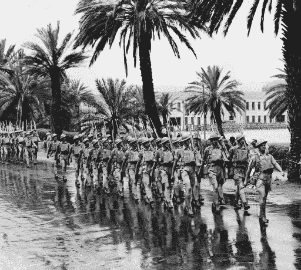

2/3 军枪营的士兵于 1941 年 1 月 15 日穿过阿德莱德。（南澳大利亚州图书馆）

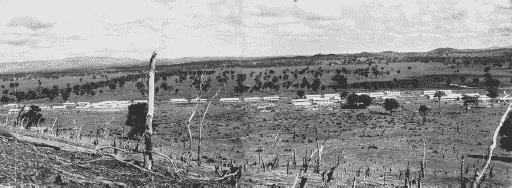

位于维多利亚州的普卡普尼亚尔（Puckapunyal）营，2/2 工兵营于 1940 年在此组建。冬季严寒刺骨，夏季尘土难以忍受，“普卡”并非丛林战的理想训练场。（维多利亚州图书馆）

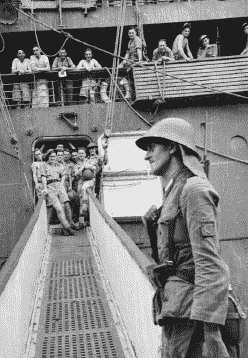

`Orcades` 号舰上的澳大利亚军队在巴达维亚（Batavia）等待登陆。一名荷属东属军队的士兵站在跳板头守卫。（AWM 011779/21）

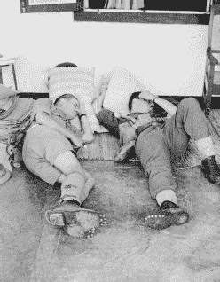

2/2 工兵营的吉尔德（Guild）上尉和汉赛德（Handasyde）上尉在勒乌利亚（Leuwiliang）战斗期间休息了几分钟。照片拍摄后不久，吉尔德中了伏击。他在试图到达爪哇海岸的途中牺牲。（AWM 030390/09）

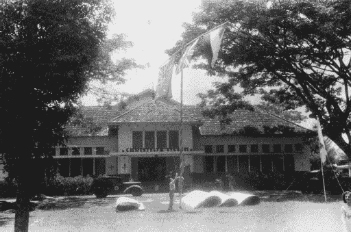

1942 年 2 月，维里·邓普（Weary Dunlop）在爪哇万隆的一所旧女学校建立了一所医院。盟军投降后，日军命令销毁所有红十字标志。（维多利亚州图书馆）

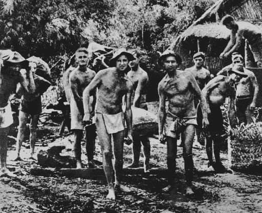

在泰缅铁路上工作的澳大利亚战俘。在衣服腐烂后，许多人只围着一条腰布或穿着“日式快乐裤”（Jap Happy）。（维多利亚州图书馆）

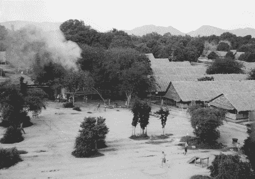

塔马安（Tamuan）战俘营距离死亡铁路的暹端 26 公里，曾作为战俘的转运营和医院。（维多利亚州图书馆）

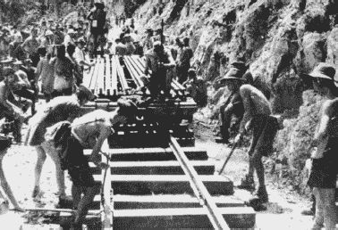

1943 年左右在死亡铁路上铺设轨道的战俘。铺路工不断地在各个营地之间移动。（AWM P00406/031）

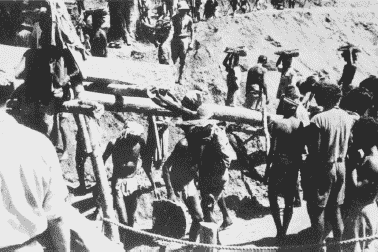

1943 年左右，当地劳工在龙峙（Ronshii）的一座桥上工作，距离铁路缅甸端 60 公里。多达 9 万名“苦力”工在修建铁路时死亡。（AWM P00406/036）

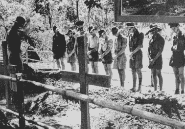

1943 年左右，缅甸龙峙。一名在铁路修建期间去世的战俘的葬礼。铁路建成时，已夺走了超过 12,000 名战俘的生命，其中包括 2646 名澳大利亚人。（AWM P00406/031）

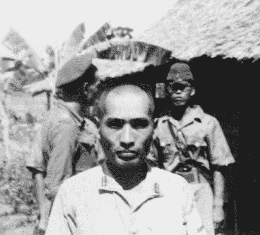

1945 年 9 月，暹石差布里。被称为“死亡医生”的日本军曹冈田正一（Seiichi Okada）强迫病弱战俘工作，对空尤（Konyu）地区的许多战俘死亡负责。（AWM P00634/005）

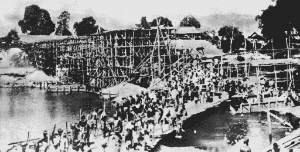

盟军战俘聚集在用于修建泰缅桥梁的竹脚架上。（维多利亚州图书馆）

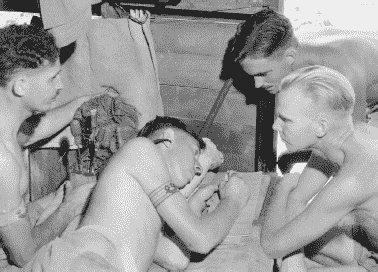

1945 年，樟宜战俘营。一个隐藏在扫帚头里的无线电台。秘密收音机带来了外界宝贵的消息，但如果被发现携带“小鸟”，战俘会被处死。（维多利亚州图书馆）

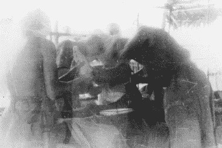

E.E. “维里”邓普（Weary Dunlop）中校在暹欣托（Hintok）附近的泰绍（Tha Sao）“手术室”切除了一名战俘的左大腿。（维多利亚州图书馆）

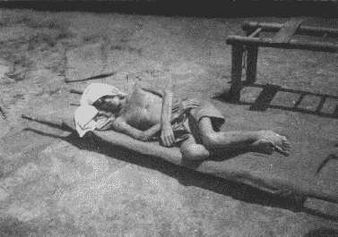

一名躺在暹担架上的极度消瘦的战俘。（维多利亚州图书馆）

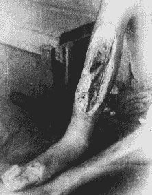

暹，泰绍医院。一名身份不明战俘的右腿小腿处有深层热带溃疡，露出了骨头。泰绍的溃疡病房甚至让邓普也感到震惊。（维多利亚州图书馆）

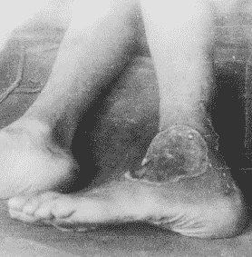

泰绍医院。赤脚工作的战俘对热带溃疡充满了极度恐惧，但有时（如本例所示）它们也会愈合。（维多利亚州图书馆）

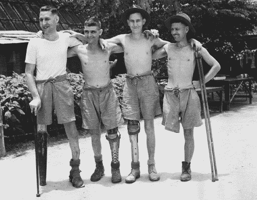

1945 年樟宜佩戴假肢的战俘。截肢是唯一的治疗方法。（维多利亚州图书馆）

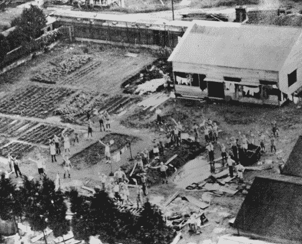

在泰缅铁路上工作的澳大利亚战俘。在衣服腐烂后，许多人只围着一条腰布或穿着“日式快乐裤。（维多利亚州图书馆）

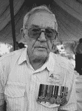

塔马安战俘营距离死亡铁路的暹端 26 公里，曾作为战俘的转运营和医院。（维多利亚州图书馆）

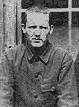

### 致谢

如果没有尼尔·麦克森（Neil MacPherson）和杰克·托马斯（Jack Thomas）的慷慨帮助，这本书无法完成。麦克森和杰克·托马斯自称只是“没什么可吹的老兵”，但他们都经历了了那场失败战役的每一分钟。

感谢安德鲁·福克纳（Andrew Faulkner）在项目初期的指导；感谢迈克尔·克梅（Michael Kramer）分享勒乌利亚的信息；感谢澳大利亚战争纪念的卡尔·詹姆斯（Karl James）博士，他指引我发现了收藏及其他地方的有用资料。感谢纪念馆工作人员的帮助。

最后，感谢澳大利亚陆军提供的研究资助，让我能够研究这场有时似乎被过度分析的战役。

### 参考文献

Aitken, E.F., *The story of the 2/2nd Australian Pioneer Battalion*, 2/2nd Pioneer Battalion Association, 1953

Beattie, R., *The Death Railway, a brief history of the Thailand–Burma railway*, T.B.R.C. Co, 2009

Bellair, J., *From Snow to Jungle: A history of the 2/3rd Australian Machine Gun Battalion*, Allen & Unwin, 1987

Brune, P., *Descent into Hell: The fall of Singapore—Pudu and Changi—the Thai–Burma Railway*, Allen & Unwin, 2014

Carter, T., & MacPherson, N., *The Burma Railway, Hellships and Coalmines*, Parker Pattinson Publishing, 2008

Cody, L., *Ghosts in Khaki: The history of the 2/4th Machine Gun Battalion*, Hesperian Press, 1997

# 参考文献

Day, D., *伟大的背叛：英国、澳大利亚与太平洋战争的爆发 1939–42*, Angus & Robertson, 1988

Dunlop, E.E., *疲惫的邓洛普战争日记*, Penguin, 2009

Ebury, S., *疲惫：爱德华·邓洛普爵的一生*, Viking, 1994

Faulkner, A., *维瑟·布莱克恩勋章：一位澳大利亚英雄、他的士兵以及他们的两次世界大战*, Wakefield Press, 2008

Ford, J., *陷入困境的盟友：二战期间澳大利亚与荷兰东印度的关系*, Australian Netherlands Ex-servicemen and Women’s Association, Queensland Branch, 1996

Holmes, L.G., *四千碗饭：一个战俘回家*, Allen & Unwin, 1993

Jackson, D., *投降的代价是什么？一个生存意志的故事*, Allen & Unwin, 1989


Long, G., *1939–1945 年战争中的澳大利亚，第一系列，陆军，第二卷：希腊、克里特与叙利亚*, Australian War Memorial, 1953

McCormack, G. and Nelson, H., *缅泰铁路*, Allen & Unwin, 1993

Nelson, H., *战俘：日军统治下的澳大利亚人*, ABC Books, 1985

Parkin, R., *进入窒息之地：缅——泰亚铁路日记*, Hogarth Press, 1963

Parkin, R., *剑与花*, Hogarth Press, 1968

Richards, R., *军医的战争*, HarperCollins, 2005

Rivett, R., *竹林幕后：日本战俘营的内部故事*, Angus & Robertson, 1946

Russell, E., *武士道骑士：日本战争罪行简史*, Cassell & Co, 1958

Saggers, I., *通往地狱之火、炼狱与归来*, 自出版, 2000

Shepard, S., ‘美国、英国、荷兰和澳大利亚联盟：一群不失败的兄弟’（硕士论文），弗吉尼亚大学，2003

Starck, N., ‘机枪回忆录：四位老兵讲述他们的战争故事’，小册，由 2/3 机枪协会出版，2015

Summons, W., *双倍的战俘*, 牛津大学出版社, 1946

Van der Post, L., *新月之夜*, Hogarth, 1970

Walker, A.S., *1939–1945 年战争中的澳大利亚，第五系列，医疗，第二卷：中东与远东*, Australian War Memorial, 1953

日本防卫学院战争史办公室, *入侵荷兰东印度》，Willem Remmelink 译，2015

Wigmore, L., *1939–1945 年战争中的澳大利亚，第一系列，陆军，第四卷：日军攻势*, Australian War Memorial, 1957

## 澳大利亚战争纪念馆

- 2/2 工兵营，部队日记

- 2/3 机枪营，部队日记

- 布莱克恩准将、林尼汉姆校、肯尼迪上尉、汉西赛德和汉斯中尉关于战争罪审判的证词和誓词

- 澳大利亚战争罪调查委员会：关于敌人对澳大利亚人及其他人的战争罪报告

- Blackburn, A.S., 日记与信件

- Blackburn, A.S.,提交澳大利亚战争罪调查委员会的证据

- Blackburn, A.S.,‘1942 年 2 月/3 月澳军在爪哇岛行动报告’

- Hock, L., 日记与信件

- McGee, M.,‘麦克斯韦尔·劳伦斯·麦基的战争》，回忆录

- Rockliff, A.,‘阿德·罗克利夫的战争记忆》，手稿

- Schilling, W.,‘1942 年西爪哇岛行动报告’

- Sheppard, A.,‘战士的游记》，回忆录

- Sitwell, H.D.W.,‘爪哇岛行动——1942 年 2 月 24 日至 3 月 20 日’

- Starrett, E.B.,‘代名为“Stepsister”的部队代码’，手稿

- Walker, H., 录音回忆录

- Williams, J.M., 战俘日记

## 访谈

- Neil MacPherson

- Jack Thomas

## 网站

- [`www.2nd2ndpioneerbattalion.com/associationFRAMESET.html`](http://www.2nd2ndpioneerbattalion.com/associationFRAMESET.html) (访问于 2018/01/31)

- [`2nd4thmgb.com.au/story/cocking-released-australian-prisoner-of-war/`](http://2nd4thmgb.com.au/story/cocking-released-australian-prisoner-of-war/) (访问于 2018/01/31)

- [`anzac.dpc.wa.gov.au/Resources/Stories/holding_w_pte_20050225.pdf`](https://anzac.dpc.wa.gov.au/Resources/Stories/holding_w_pte_20050225.pdf) (访问于 2018/02/09)

- [`www.australianbiography.gov.au/subjects/uren/html`](http://www.australianbiography.gov.au/subjects/uren/html) (访问于 2018/01/31)

- 与哈斯塞尔士兵的视频访谈，位于 [`australiansatwarfilmarchive.unsw.edu.au/`](http://australiansatwarfilmarchive.unsw.edu.au/) (访问于 2018/01/31)

- [`www.cia.gov/library/readingroom/docs/DOC_0000710366.pdf`](https://www.cia.gov/library/readingroom/docs/DOC_0000710366.pdf) (访问于 2018/01/31)

- SEAL 战俘报告；宪兵办公室记录；法官（陆军）记录，保存于 [`www.mansell.com/pow_resources/camplists/deathrailcamplist.html`](http://www.mansell.com/pow_resources/camplists/deathrailcamplist.html) (访问于 2018/01/31)

- [`search.archives.org/uploads/r/united-nations-archives/b/3/3b0ee5f268e4f921d98371ef14229f54a75f85111117711730000.pdf`](https://search.archives.org/uploads/r/united-nations-archives/b/3/3b0ee5f268e4f921d98371ef14229f54a75f85111117711130000.pdf) (访问于 2018/01/12)

- [`lemare.org.uk/43%special20mission.pdf`](http://lemare.org.uk/43%special20mission.pdf) (访问于 2018/01/31)

- 索引


## 索引

- 2/2 清理站 33

- 2/2 工兵营 1, 3, 6, 18, 238

- A 营 56, 57–8, 60, 96, 98–9, 180

- 澳大利亚，返回 229

- 伤亡 16

- 遗留装备 20–1, 23, 24

- 荣誉名单 234

- 缅泰铁路 112, 146, 201, 208

- 叙利亚岛行动 12–14

- 训练 9

- 2/3 机枪营 1, 2, 76

- A 营 53

- 澳大利亚，返回 229

- B 营 1, 10

- C 营 51–2, 59, 88

- 伤亡 16

- D 营 4

- 遗留装备 19–20, 23, 24

- *进入丛林* 3

- 荣誉名单 234

- 缅泰铁路 146, 201, 208

- 叙利亚岛行动 12–13

- 训练 5, 9, 15

- 2/4 机枪营 34, 69

- 2/6 野战营 33, 52

- 2/30 营 204

- 2/40 步兵营 117

- 4 K 营 177

- 8 K 营 177–8

- 18 K 营 138, 178, 180

- 26 K 营 165

- 30 K 营 165, 178

- 35 K 营 130, 134, 165

- 40 K 营 173

- 45 K 营 166

- 55 K 营 173, 179, 201

- 60 K 营 167, 169, 173

- 75 K 营 167

- 80 K 营 180, 202

- 100 K 营 180, 198–9

- 105 K 营 163–4, 198, 203, 238

- 105 总运输营 33, 55, 134

- 114 K 营 208

- 115 K 营 198

- 131 K 营 205, 208

- a’Beckett, Dick 上尉 51

- 非洲军团 (Afrika Korps) 7

- Allen, Ray 中尉 57, 100, 102, 105

- 战俘，作为 96–7, 105

- 安汶 17

- 美国-英国-荷兰-澳大利亚联盟：28, 40

- Anderson, Charles 中尉 65

- *阿奎塔尼亚号* 6

- 澳大利亚陆

- 6 军 29

- 7 军 29, 30, 88

- 8 军 118

- 9 军 29, 30

- 澳大利亚轻骑兵 7

- *安丸丸* 5

- Baade, Stan 士兵 96

- 竹 26

- Barry, Sidney 士兵 136

- Bashford, 神父 144

- 巴塔达（雅加达）26, 27, 31, 34, 43–4, 60

- 陷落 55–6

- 战营 83, 85, 208

- Bell, Clephan “Tinkle” 96

- Bell, 士兵 143–4

- Bellair, John 8

- Bennett, Gordon 将军 70, 118

- 坏血病 113, 133–4, 142, 185, 191, 202, 205

- Berryman, 少将 29

- Beverley, Eric 司机 55

- 自行车营 64, 85–6, 88, 90, 92–6, 105, 107, 109, 115, 136, 139, 208

- Bishop, 上尉 180

- Blackburn, Arthur Seaforth 准将 4–5, 7, 9, 22, 120

- 澳大利亚，返回 230–1

- 黑色部队 (Blackforce)，指挥 35, 38, 67, 238

- 性格 2–3, 10, 24, 40, 115

- 日记 90, 93, 94–5, 107–8, 122, 139

- 荷兰部队，合作 45–8, 50, 56, 59, 61–3, 65–6, 72

- 投降 68, 70

## 传记：Blackburn, Arthur Seaforth

- 性格 2–

- 军事背景 2

# 索引

- `POW`（战俘），见 80, 82, 90, 91, 93–4, 97, 107–9, 115, 118, 119, 121–3

- `叙利亚` 11–12

- 他指挥下的部队 33

- 战争罪审判，证词见 88, 91, 122

- `Blackforce` 33, 34, 36, 40, 43, 45, 55, 75

- `爪哇`,防守 49–60, 72, 73

- `战俘` 83 *另见* 战俘

- `投降` 75–6, 79–80, 99

- `地毯式投掷` 8

- `盲目` 134

- `鲍姆，约翰士兵（Boehm, Private John）` 200

- `婆罗洲` 212, 229

- `布拉登，鲁塞尔士兵（Braddon, Private Russell）` 118

- `布伦轻型机枪` 9, 23, 38, 44, 110

- `布雷廷哈姆-摩尔，提姆中尉（Brettingham-Moore, Lieutenant Tim）` 49, 52, 54, 56, 57, 78

- `POW`（战俘），见 114

- `泰缅亚铁路` 145, 157

- `英国军` 9, 12, 24, 66–7

- `游击战` 100–4

- `投降` 73, 78, 79

- `布鲁克-波法姆，罗伯特爵士（Brooke-Popham, Sir Robert）` 27

- `布鲁姆轰炸` 34

- `Bterram` 15

- `布井井（茂加）(Buitenzorg (Bogor)` 37, 43, 44, 46, 54, 56, 57, 61, 99

- `布尔温格，杰克（Bullwinkel, Jack）` 236

- `布尔温格，维维安（Bullwinkel, Vivian）` 236

- `伯格斯，洛伊德中尉（Burgess, Lieutenant Lloyd）` 173

- `缅甸` 28, 30–1, 40, 111, 124–7, 131

- `平民，日本人的对待方式` 125, 127, 157–9

- `泰缅亚铁路` *见* 泰缅亚铁路

- `缅甸人` 127

- `碧洋丸号（Byoki Maru）` 212–14

- `伯恩，M. G. 士兵（Byrne, Private M. G.）` 57, 105

- `卡罗，杰克（Carroll, Jack）` 170

- `卡塞索，上校（Casseau, Colonel）` 12, 13

- `伤亡` 9, 10, 36, 225

- `盟军轰炸机` 175–7

- `澳大利亚与英国战俘的对比` 200–1

- `日本人` 59

- `爪哇，防守` 51, 52, 54, 57, 59, 98

- `泰缅亚铁路` 134–6, 142, 143–4, 160, 165, 173, 180–93, 198, 200, 202–4

- `叙利亚行动` 13, 16

- `伤员员，撤离` 54

- `卡斯韦尔，阿奇军官（Caswell, Warrant Officer Arch）` 142

- `卡塔里娜侦察机` 33

- `卡瓦纳，克里福德士兵（Cavanagh, Private Clifford）` 112

- `审查` 4

- `樟宜` 110–11, 117–21, 124, 145, 180, 204

- `乔维尔，哈里中将（Chauvel, Lieutenant General）` 7

- `蒋介石（Chiang Kai-shek）` 182

- `霍乱` 163, 164, 166, 169–73, 181, 184, 188, 190–1, 203, 233

- `玻璃棒测试` 214, 218

- `重庆（Chungking）` 182

- `丘吉尔，温斯顿（Churchill, Winston）` 17, 30–2, 40

- `煤矿` 214–15, 218–20

- `海岸，约翰（Coast, John）` 156

- `科特斯，阿尔伯特中校（Coates, Lieutenant Colonel Albert ‘Bertie’）` 179, 195, 99

- `考金，杰克士兵（Cocking, Private Jack）` 34

- `科迪，莱斯代理军士（Cody, Acting Sergeant Les）` 69, 70

- `POW`（战俘），见 119, 134, 207, 211

- `泰缅亚铁路` 155, 164, 167, 197, 201, 203

- `科伦坡（Colombo）` 4, 6, 21, 22

- `控制委员会（Commission of Control）` 15

- `通信` 45, 65–6, 73

- `压缩切割（Compressor Cutting）` 186

- `克里特岛（Crete）` 9

- `克罗夫特，特里军士（Croft, Sergeant Terry）` 98

- `克克斯顿，伦（Croxton, Len）` 48

- `库林格尔，弗雷德士兵（Cullinger, Private Fred）` 10

- `柯廷，约翰（Curtin, John）` 30–2

- `大马士革（Damascus）` 12, 13–14

- `达穆（Damour）` 14

- `丹杰，亚历克斯军士（Danger, Sergeant Alex）` 53

- `达文，轰炸` 33, 34

- `登革热` 79, 80, 81, 148

- `迪马（Dimra）` 18

- `纪律` 4, 15

- `POWs（战俘们）` 80, 82, 111, 114, 119–20, 152, 200

- `疾病` 15, 75, 84, 90, 100, 109, 114, 126

- `泰缅亚铁路，在` 133–4, 144, 152, 155, 164–6, 169–74, 180–9, 202, 205–6

- `杜迪，唐军士（Doody, Corporal Don）` 55

- `杜立特，吉米少校（Doolittle, Major Jimmy）` 85

- `杜门，上将（Doorman, Admiral）` 40

- `邓洛普部队（Dunlop Force）` 116–21, 145, 147, 149, 154

- `邓洛普，E.E. “疲惫”中校（Dunlop, Lieutenant Colonel E. E. ‘Weary’）` 54–5, 179, 210, 236

- `霍乱爆发` 170–3

- `医生，其技能` 153–4, 172–3

- `加勒汉，与的关系（Galleghan, relationship with）` 118–21

- `医院` 80–1

- `POW`（战俘），见 96, 106–7, 111, 114

- `泰缅亚铁路` 145–7, 149–50, 153–7, 159–60, 170–3, 186, 189, 191–2, 194–6, 233

- `返回泰国` 235

- `战争罪，证词见` 195–6

- `邓斯坦，L.H. 军士（Dunstan, Corporal L. H.）` 105

- `荷兰东印度群（Dutch East Indies）` 28, 41–2

- `平民，日本人的对待方式` 86–7, 91

- `荷兰军` 17, 30, 34–5, 38–41, 44–8, 50, 59–65

- `投降` 65, 67–71


- `痢疾` 85, 90, 100, 104, 109, 113, 114, 125, 126, 134, 147, 154, 164, 173–4, 181, 185, 193, 202, 206
- `伊迪，中校（Eadie, Lieutenant Colonel）` 75, 166
- `阿拉拉梅因（El Alamein）` 20, 143
- `埃坎塔拉（El Kantara）` 18, 19, 76
- `埃米纳（El Mina）` 15
- `埃穆凯（Emukae）` 218, 220
- `遭遇` 25
- `恩多，航空师（Endō, Air Division）` 68
- `设备与物资` 24, 32, 34, 36, 117
- `盟军空投物资` 223–5
- `破坏` 78
- `留在中东的` 19–20, 23, 54
- `医疗` 93, 121, 158, 166, 179, 182–3, 184–6, 187, 191, 202
- `埃里斯坦（Eretan）` 43, 45
- `F 部队（F Force）` 200–1
- `远东战略` 17
- `费尔德斯，约翰（Felds, Johann）` 104
- `费` 15
- `费舍，泰德少校（Fisher, Major Ted）` 194–5
- `弗拉纳根（Flanagan, Arch）` 4
- `费利舍，中校（Fleischer, Colonel）` 65
- `福布斯，吉军士（Forbes, Sergeant Jim）` 139
- `福德，基思（Ford, Keith）` 23, 26
- `台湾（Formosa）` 122, 212
- `福福勒，基思 “丘克”士兵（Fowler, Private ‘Chook’）` 10–11, 78
- `福克斯，上尉（Fox, Captain）` 20, 21
- `自由法国军（Free French）` 9, 10, 12–13, 15
- `弗里曼特（Fremantle）` 4, 5, 41
- `法国外军团（French Legion）` 14
- `福冈战营（Fukuoka camps）` 216, 218, 221
- `福井，正树（Fumio, Masaki）` 136–7
- `加勒汉，“黑杰克”上校（Galleghan, Colonel ‘Black Jack’）` 118–21, 145, 180, 204
- `邓洛普，与的关系（Dunlop, relationship with）` 118–21
- `加洛韦，罗利军士（Galloway, Corporal Rolly）` 98
- `加布特，私人士兵（Garbutt, Private）` 98
- `加迪纳，阿伦（Gardiner, Allan）` 13
- `加罗特（Garoet）` 72, 79, 106
- `战俘营` 83–4
- `加沙（Gaza）` 7, 15
- `日内瓦公约（Geneva Convention）` 79–80, 82
- `乔治吉克（Georgic）` 7
- `吉布森，N. R. 士兵（Gibson, Private N. R.）` 105
- `格洛弗，罗斯（Glover, Ross）` 137
- `戈比比，哈罗德士兵（Gobbie, Private Harold）` 10
- `戈丁，上尉（Goding, Captain）` 134–5
- `戈德利，提姆上尉（Godlee, Captain Tim）` 80
- `古里克，杰克中尉（Goodrick, Lieutenant Jack）` 24
- `戈尔斯基，斯坦利（Gorski, Stanley）` 108
- `格雷茨，罗恩军士（Graetz, Sergeant Ron）` 11
- `大东亚共荣圈（Greater Asia Co-Prosperity Sphere）` 157–8
- `格林，查尔斯少校（Green, Major Charles）` 135
- `格里芬，雷上尉（Griffin, Captain Ray）` 177
- `瓜达尔康岛（Guadalcanal）` 143
- `吉尔德，上尉（Guild, Captain）` 56–7, 96–7, 99–101
- `哈拉姆，S. R. “米奇”军士（Hallam, Sergeant S. R. ‘Micky’）` 189–90
- `汉密尔，汤姆中尉（Hamilton, Lieutenant Tom）` 176
- `汉密尔，穆里（Hamilton, Murray）` 235
- `汉普森，道格士兵（Hampson, Private Doug）` 197
- `哈里斯，斯坦利中尉（Harris, Lieutenant Stanley）` 200
- `哈斯凯，士兵（Haskell, Private）` 48, 76, 77, 80
- `盟军空投物资` 225
- `在日本，在` 214–16, 218–20, 222–3
- `体检` 226, 227
- `哈斯凯，士兵（续）` 83, 84, 121, 209
- `泰缅亚铁路` 146, 147, 156, 157, 162, 190–1, 202
- `海恩，约翰中尉（Hayne, Lieutenant John）` 88–90
- `黑加顿，沃丹（Heggaton, Vaudan）` 126
- `火龙山口（Hellfire Pass）` 155
- `希尔（Hill）` 69, 15, 95–8
- `希尔纳，大卫第一（Hilner, First David）` 51
- `欣德（Hintok）` 156, 180, 188, 191–3, 196, 203, 235
- `欣德河（Hintok River）` 186–7, 190
- `广田，中尉（Hiroda, Lieutenant）` 156–7
- `广田，中尉（Hirota, Lieutenant）` 190
- `希特勒，阿道夫（Hitler, Adolf）` 14
- `澳大利亚号（HMAS Australia）` 3
- `澳大利亚霍巴特号（HMAS Hobart）` 22
- `澳大利亚珀斯号（HMAS Perth）` 41, 77, 86, 101, 119, 135, 156, 234
- `英国多塞特郡号（HMS Dorsetshire）` 22
- `英国埃克塞特号（HMS Exeter）` 41
- `英国不畏号号（HMS Formidable）` 229
- `霍布布斯，阿伦（Hobbs, Allan）` 144
- `霍克，劳伦斯士兵（Hock, Private）` 216–17, 223–4, 226
- `霍尔丁，沃利士兵（Holding, Private Wally）` 162, 170
- `本州（Honshu）` 214
- `许志，中尉（Hoshi, Lieutenant）` 198, 203
- `霍华德，泰德军士（Howard, Gunner Ted）` 226
- `亨特，布鲁斯少校（Hunt, Major Bruce）` 162, 192
- `海因斯，汤姆军士（Hynes, Corporal Tom）` 101, 104–5
- `法国岛（Ile de France）` 1, 3–7, 21
- `伊莱斯，工兵（Iles, Sapper）` 164, 165
- `伊姆拉，将军（Imamura, General）` 62–3, 67–8, 71
- `印度军（Indian forces）` 9, 12
- `信息` 46
- `荷兰情报（Dutch intelligence）` 45, 49, 61
- `虚假` 35, 44
- `日本宣传（Japanese propaganda）` 84–5, 95–6, 131–2, 142, 209
- `战营外的消息（news from outside camps）`
- `伊洛瓦底河（Irrawaddy River）` 113, 124, 160
- `石，中校（Ishi, Colonel）` 194, 196
- `伊斯马伊利亚（Ismailia）` 19
- `杰克逊，德斯蒙德军士（Jackson, Corporal Desmond）` 2, 3, 14, 15, 19, 20, 23, 25, 26, 158
- `疾病` 79, 80, 190–1
- `日本入侵爪哇（Japanese invasion of Java）` 47, 49, 57, 76
- `POW`（战俘），见 110, 114–17, 207
- `泰缅亚铁路` 146, 147, 156, 157, 162, 190–1, 202
- `日本`
- `盟军轰炸（Allied bombing）` 220
- `POWs（战俘们）在` 214–16, 218–20, 222–3
- `日本军` 15, 21, 44, 60, 169, 209
- `第二师（2nd Division）` 43, 67, 72
- `第 230 团（230th Regiment）` 43, 45
- `机场，捕捉（airfields, capturing）` 39
- `澳大利亚，轰炸（Australia, bombing on）` 33, 34
- `英国的评估（British assessment of）` 21, 27–8, 53
- `平民，对待方式（civilian populations, treatment of）` 86–7, 91, 125, 127, 157–9
- `对动物的残忍（cruelty to animals）` 139
- `东方军（Eastern Force）` 41, 43
- `进入战争（entry into war）` 16–18
- `大东亚共荣圈` 157–8
- `爪哇入侵（Java, invasion of）` 40–1, 43–5, 48–54, 64–5, 71–2
- `宪兵队（Kempeitai）` 92, 201
- `马来亚，通过通过（Malaya, advance through）` 17, 18, 22, 24–5, 28, 46
- `军事层级（military hierarchy）` 138, 194–5
- `战俘，对待方式（POWs, treatment of）` *见* 战俘
- `宣传（propaganda）` 84–5, 95–6, 131–2, 142, 209
- `虐待（sadism）` 210
- `第十六军（Sixteenth Army）` 35
- `投降` 224, 226
- `西方军（Western Force）` 43
- `日本武士精神（Japanese warrior code）` 183
- `爪哇` 26, 28–31, 33, 38, 40–1, 129, 234
- `撤离（evacuation of）` 34
- `日本入侵（Japanese invasion）` 40–1, 43–5, 48–54, 64–5, 71–2
- `爪哇人（Javanese）` 30, 38, 73
- `对盟军的敌意（hostility to Allies）` 74, 78, 82, 86, 100–1, 103
- `贸易（trading with）` 90
- `耶路撒冷（Jerusalem）` 8, 10
- `约翰逊，诺尔少校（Johnson, Major Noel）` 204
- `琼斯，伯特士兵（Jones, Private Bert）` 154
- `约尔旦河（Jordan River）` 11
- `丛林战（jungle warfare）` 15, 21
- `嘉知时丸号（Kachidoki Maru）` 216–17
- `卡里达提机场（Kalidjati airfield）` 39, 43, 45, 67–8, 71
- `北碧布里（Kanchanaburi）` 160, 208, 209
- `战争公墓（War Cemetery）` 112, 188, 238
- `凯普，查尔斯中校（Kappe, Lieutenant Colonel）` 200
- `卡塔里，中尉（Kataguri, Lieutenant）` 94–5
- `凯斯，汤姆士兵（Keays, Private Tom）` 3
- `肯马久机场（Kemajoian airport）` 36–7
- `肯迪，约翰上尉（Kennedy, Captain John）` 51, 88–90
- `肯迪，乔治士兵（Kennedy, Private George）` 216
- `基亚姆（Khiam）` 9
- `金贡丸号（Kinkon Maru）` 110, 112
- `金绍（Kinsayok）` 162, 201
- `海猫式战斗机（Kittyhawk fighters）` 41
- `贡子塔（Konkoita）` 129, 201
- `孔纽（Konyu）` 149–51, 154–6, 184, 186, 188, 196, 236, 237
- `医院（hospital）` 154
- `孔纽切割口/火龙山口（Konyu Cutting (Hellfire Pass)）` 155
- `韩国卫兵（Korean guards）` 108, 136–41, 163–5, 203, 213
- `克里克，大卫（Kriek, David）` 101–4, 105
- `吉隆坡（Kuala Lumpur）` 28, 146

# 战俘编织的 165–6

- `瓜诺伊河（桂棉江河）` 186, 235, 236
- `朗（Lang），克利福德中尉` 57, 98
- `朗（Lang），少校` 8
- `拉瓦拉马克（Lavarack），约翰中将` 10, 27, 29–31, 34, 40
- `劳森（Lawson），埃尔内斯特上尉` 206
- `莱斯（Leles）` 76, 80, 81, 85
- `兰邦（Lembang）` 27
- `勒乌利亚昂（Leuwiliang）` 43, 47, 49–50, 55–60, 79, 96
- `解放者轰机` 175–6, 178, 208, 227
- `林福德（Linford），肯二兵` 163
- `洛夫（Love），丹尼中尉` 53
- `下金赛亚克（Lower Kinsayok）` 163
- `莱尼姆（Lyneham），泰德校` 34, 91, 114
- `麦克阿瑟（MacArthur），将军` 222, 226
- `麦考利（McCAulay），乔弗里军士` 134
- `麦克雷（Mcrae），维恩二兵` 96, 105
- `麦唐纳德（MacDonald），上尉` 102
- `麦吉（McGee），麦克斯“老头”` 21, 32, 52, 140–1, 189
- `麦格拉特（McGrath），法兰克下士` 37
- `麦格戈（McGregor），威廉二兵` 10
- `麦肯齐（Mackenzie），乔克` 137
- `麦克斐森（MacPherson），杰克` 229
- `麦克斐森（MacPherson），吉姆` 229
- `麦克斐森（MacPherson），尼尔二兵` 18, 25, 36, 37, 63, 223, 226, 234
- `澳大利亚，返回` 228–9
- `日本，战俘在` 218–19
- `日军入侵爪哇` 49, 58, 75, 77
- `疟疾` 148
- `军官，受尊重` 152–3
- `战后生活` 235, 238
- `战俘，作为` 90, 92, 111, 124, 129–30, 211–12
- `泰缅铁路，关于在` 130, 152, 178, 208
- `新加坡，战俘在` 216, 217
- `Maebisi Maru`（满风丸） 112–13, 124
- `望加锡（Magelang）` 64–5
- `马卡苏拉营（Makasura camp）` 114, 115–16
- `马六甲海峡` 129
- `疟疾` 75, 85, 90, 100, 136, 147–8, 154, 155, 173–4, 180, 183, 185, 193, 199, 202, 206, 215, 227, 233
- `马来亚` 70
- `日军推进通过` 17, 18, 22, 24–5, 28, 46
- `营养不良` 84, 90, 113, 134, 142, 173, 181, 205, 233
- `麦尔特比（Maltby），空军中将` 40, 66, 73
- `战俘，作为` 90, 118, 121
- `马尼湾` 213
- `玛歇尔（Marshall），E.二兵` 105
- `丸山（Maruyama），将军` 67, 79
- `真正（Masa），恳志宏“公牛”` 163–5
- `Mauretania`（毛里塔尼亚号） 1, 6, 19
- `麦克斯韦（Maxwell），戈戈登军士` 213
- `梅拉角（Merak）` 43, 44
- `默尔墩（Merdjoun）` 9, 13–14
- `芒德义（Mergui）` 135
- `梅图拉（Metulla）` 9
- `米切尔（Mitchell），弗雷德二兵` 10
- `MM`（军勋章） 122, 214, 218
- `僧侣（Monks），雷格` 50
- `蚊子` 24, 124–5, 147–8
- `望着井（Moulmein）` 125–7, 131, 180
- `穆（Mull），上尉` 143
- `穆瑞（Murray），阿尔夫二兵` 101, 104–5
- `长野（Nagano），修民` 28
- `长崎（Nagasaki）` 221–2, 226
- `长永友（Nagatomo），中校` 128, 176, 177, 201
- `内藤（Naito），中尉` 166
- `中之农（Nakonom）` 204, 207
- `荷兰属东印度群` 17, 21, 71
- `新几内亚` 28, 209
- `尼埃营（Nie Camp）` 162, 192
- `Nieu Amsterdam`（新阿姆斯特丹号） 1, 6
- `新潟营（Niigata camp）` 223, 224
- `机动部队（Mobile Force）` 165–6, 197, 206
- `奥克斯（Oakes），弗兰克中校` 188
- `大滨山煤矿（Ohama coal mine）` 214–15


# 索引

## 人名

- 冈田（Okada），“医生”下士 157, 194–6
- 冈崎（Okazaki），少将 35
- 奥寿（Osuki），中尉 149–50, 196
- 欧文（Owen），斯坦军士 10
- 帕金（Parkin），雷 119–20, 121, 201, 234
- 皮尔逊（Pearson），准将 82
- 皮勒（Peeler），沃利上军士 13
- 柏西尔（Percival），将军 70, 123
- 彼得斯（Peters），巴克二兵 33
- 鲍纳（Pownall），将军 33
- 雷（Rae），拉姆齐 84–5
- 雷德沃（Redward），约翰中尉 51, 88–90
- 理查德斯（Richards），罗利上尉 179, 206
- 里维特（Rivett），罗汉 63–4, 139, 174, 195
- 罗伯茨（Roberts），约翰下士 136
- 洛克菲夫（Rockliff），阿德下士 84, 159, 162
- 罗斯福（Roosevelt），富兰林 31
- 罗（Rowe），布鲁伊二兵 18, 37, 148, 211, 234
- 萨格斯（Saggers），伯特少将 171
- 井木（Saiki），参谋官 67
- 席林（Schilling），少将 35, 40, 46, 51, 56, 61, 66
- 斯肖特林（Schiotling），J. A. 41–2
- 施密特（Schmitt），比尔二兵 10, 32
- 塞尔（Searle），阿尔伯特校 118, 121–2
- 希迪（Sheedy），雷德蒙德“红”军士 32
- 谢泼德（Shepard），萨姆海军中校 66
- 谢泼德（Sheppard），阿尔夫军士 1, 6, 55, 193
- 肖（Shore），莱纳德 138
- 西特韦（Sitwell），少将 35, 38, 40, 65, 72
- 史密斯（Smith），鲍勃二兵 53
- 索奈（Sonai），中尉 7–8, 109, 115
- 索（Sole），莱纳德二兵 18
- 托莱特，威廉·二兵 134
- 托普，富兰克林·二兵 86
- 特鲁伊，乔 225
- 乌伦，代理轰弹手汤姆 133, 148, 221
- 范·德·波斯特，劳伦斯·中校 100, 101–3, 106–7
- 范·斯塔肯博格·斯塔豪维尔，恰尔达 67–8
- 瓦雷利，亚瑟·准将 135, 136, 144, 176, 177, 217
- 沃格特，保罗 104–5
- 沃克，哈里·下兵 3, 13, 23, 25, 38–9, 91, 221
- 沃克，托马斯 111
- 瓦斯泰尔，吉姆·二兵 20
- 韦塞尔，阿奇伯德·将军 9, 27–32, 34, 35, 40, 63, 68
- 威尔恩，比尔·少校 119, 120
- 韦斯伯，彼得·下兵 61
- 韦斯伯，“米克”·二兵 97
- 威灵顿，中校 9
- 惠莱兰，哈里·军士 86, 88, 127
- 怀，格林·中校 118
- 怀特黑，托马斯·下兵 137
- 威廉姆斯，约翰·中校 47, 48, 58
- 威廉姆斯，瓦尔·二兵 138
- 威尔斯，中校 29
- 威尔逊，亨利·梅特兰德“大个”将军 10
- 山田，中尉 130–1
- 野野，参谋 65

## 地名

- 冲绳（Okinawa） 229
- 绪（Omuta） 218, 219–20, 221, 223
- 奥斯特港（Oosthaven） 22, 25
- 亚齐坡（Palembang） 22, 24
- 巴勒斯坦（Palestine） 6, 7–8, 30
- 槟城（Penang） 125
- 菲律宾（Philippines） 28, 43, 212, 213, 227–9
- 特菲克港（Port Tewfik） 6, 18, 19–21, 55
- 昆特拉（Quneitra） 12
- 光（Rangoon） 32, 113, 124–6, 129, 176
- 西贡（Saigon） 212
- 桑邦（Sampang） 73
- 砂越（Sarawak） 41
- 桑普拉克机场（Semplak airfield） 37, 40
- 瑟朗监狱（Serang Jail） 64, 87, 103–4, 126
- 所罗门群岛（Solomon Islands） 209
- 帝汶汶 17, 26, 28, 117
- 占治丹河 44, 46
- 铁拉恰普 43, 73, 99
- 齐利塔丹机场 37–8
- 齐吉罗坦 103, 105
- 齐萨罗埃亚 30
- 齐杜江河 44
- 托布鲁 7, 143
- 董仓 184
- 特里科马利 6
- 特里波利 15
- 魏因科普湾 104
- 西沙漠 7

## 军事行动与战役

- 巴巴罗萨行动（Operation Barbarossa） 14
- 出口行动（Operation Export） 9
- `Orcades`（奥德斯行动） 19–22, 24, 25–6, 30–3, 53, 54, 109, 116
- 爪哇，战斗 36–7, 44, 53, 59, 75–6
- 新加坡，沦陷 68–71
- 新加坡，在 110–12, 117–21
- 新加坡，战俘 216, 217

## 舰船

- 威尔士亲王（Prince of Wales） 17, 28
- 伊丽莎白女王号（Queen Elizabeth） 1, 6, 238
- 玛丽女王号（Queen Mary） 1, 3, 5, 6
- 复仇号（`Repulse`） 17, 28
- 海女巫号（`Sea Witch`） 41
- `切纳戈`号舰 228–9
- `休斯顿`号舰 41, 73–4, 77, 93, 101, 104, 137
- `兰利`号舰 41
- `臼丸` 116–17
- `万根拉`号 230
- `银行丸` 125–6
- 龙代丸（`Rakuyo Maru`） 216–17, 223, 234

## 事件与主题

- 盟军空投（Allied air-drops） 225
- 盟军轰炸袭击（Allied bombing raids） 175–7, 208
- 体检 226
- 政治 31–2, 229
- 战俘（prisoners of war） 129, 180, 210, 230, 238
- 美国（American） 73–4, 93, 108, 118, 166, 199
- 澳大利亚，返回 228–32
- 澳洲人，机智与精神 156, 162, 200–1, 233–4
- 打打 84, 88–90, 91–4, 108–9, 113, 122, 132–4, 136–42, 157, 163–4, 185, 189, 216, 220
- 英国（British） 146, 150, 152, 160, 166, 188, 192, 200, 203
- 荷兰（Dutch） 152, 154, 159, 166, 200, 204
- 逃亡者（escapees） 82, 135–6, 143–4
- 粮食配给（food rations） 83–4, 90, 92, 106–7, 110–11, 114–15, 210, 213
- 强迫行军（forced marches） 85, 149, 177
- 德国 19
- 意大利 19
- 日本，在 214–16, 218–20, 222–3
- 日本，转往 210–14, 216
- 日军广播 111–12, 129–30
- 日军的对待 79–97, 104, 106–9, 113–14, 124–6, 130–3, 157, 177–8, 181, 185, 189, 195–6, 202, 206, 219
- 韩国士兵（Korean guards） 108, 136–41, 163–5, 203
- 劳动力（labour forces），作为 95, 109, 116, 128–44, 146, 156–9, 171, 184, 187, 192, 196, 209, 233
- 家人的信件 191, 206–7
- 体检（medical examinations） 225–6
- 战后心理创伤 231–2, 235
- 长崎，在 226
- 强迫宣誓（oaths, forced）93–4, 122–3, 135–6
- 军官，冲突 152–3, 200
- 反叛行为（rebellion, acts of）162–4
- 营地状况报告 182–6
- 战俘（续，prisoners of war `continued`）
- 掌掴 84, 91, 92, 94, 106
- 国籍间的紧张 107
- 酷刑 87–8, 92–4, 122–3
- 运输（transportation of）110, 112–13, 124–6, 145–9, 204, 207
- 薪水（wages） 131, 132, 151, 174, 183, 191–2, 211
- 辐射病（radiation sickness） 227
- 红十字会（Red Cross） 182, 183, 208, 222–3
- 瑞格（Regue） 198
- 战俘（POW），作为 87, 100–1, 104, 110–12, 125–8
- 日本，战俘在 214
- 步枪（rifle） 24
- 盐水（saline solution） 172, 187
- 阴囊皮炎（scrotal dermatitis） 113
- 间色性呆（pellagra） 113, 133, 142, 205
- 肺炎 75, 215
- 斑疹 100, 109
- 溃疡 142, 164, 168, 178, 179, 180, 181, 191, 193, 203, 206, 233
- 维生素缺乏 133–4, 151, 183, 185, 206
- 疟疾 148, 173–4
- 牙痛 134–5
- 烟草 151, 223
- 霍马霍克斧 39
- 训练 5, 9, 15, 21
- 维希军 9–14, 15, 152, 234
- 维克斯斯机枪 3, 9, 11, 18, 20
- 零式战斗机 34, 36–7, 39
- 美国 17, 31
- 盟军空投 223–5
- 参战 18, 28
- 印度尼西亚，驻军 35, 50–1, 73–4
- 战俘 73–4, 93, 108, 118
- “万隆大学” 106–7
- 战争罪审判 127–8, 136–7, 164–5, 196, 203
- 布莱克恩证词 88, 91, 122
- 邓洛普证词 195–6
- 威廉姆斯部队 128–30, 152, 165, 169, 173, 179–81, 208

## 泰缅铁路（Siam-Burma Railway）

- 泰缅铁路（Siam-Burma Railway） 148, 149, 151, 153, 154, 192, 196
- 泰缅铁路（Siam-Burma Railway） 112–13, 128–201
- 泰缅铁路（Siam-Burma railway），在 132, 141–2, 143, 158, 165, 174–6, 179, 199, 201, 203
- 泰缅铁路 146–7, 149, 151, 154, 156, 186–8, 190, 209
- 伤亡（casualties） 134–6, 142, 143, 160, 165, 173, 180–93, 198, 200
- 战俘完成（completion of POWs） 201–4, 207
- 疾病（diseases） 133–4, 152, 154, 155, 164–6, 169–74, 180, 183, 192, 205
- 逃亡（escapes），尝试的 135–6, 143–4
- 粮食配给（food rations） 147, 151, 153, 154, 166, 174, 183, 197, 202, 205
- 伤伤（injuries） 159, 168
- 士气（morale） 154, 159, 185, 192
- 原住民劳动力（native workforce） 157–8, 161, 167–8, 184, 187–8, 201
- 无号机动部队（No. Mobile Force） 165–6, 197, 206
- 营地状况报告（reports on camp conditions） 182–6
- 破坏（sabotage） 162, 179
- 统计（statistics） 203–4
- 天气（weather） 141–2, 160, 167–8, 174, 181, 199, 201
- 战俘运往日本（transit of POWs to Japan） 212, 216

## 战俘经历

- 战俘（POW），作为 90, 94, 118, 121, 123
- 向日本投降（surrender to Japanese） 67, 68, 70–1, 72
- 军官，尊重 152
- 战后生活 236–8
- 战俘，如 83, 84, 106, 116–18, 140, 205, 210, 212–13
- 战俘，如 85, 92, 109, 111–12, 113, 124, 127, 165, 210, 211
- 战俘，如 92–3, 94, 128, 129, 165
- 向日投降 77–8, 80
- 澳大利亚，返回 228
- 日本，战俘 218, 219, 220, 223, 226
- 体检 227
- 泰缅铁路，关于 130, 131, 133–5, 160, 161, 164, 167, 208
- 泰缅铁路，关于 131, 140, 146, 166, 179–80, 197, 201, 205–6, 208
- 狙击手（snipers） 53
