# 数学的魔法：求解 x 并探究其后的原理

## 《数学的魔法》推荐序

“人们说魔术师永远不应该揭露自己的秘密。幸运的是，亚瑟·本杰明忽略了这一愚蠢的格言——因为在这本小书中，本杰明向他的观众揭示了数字的秘密以及其他吸引了数学家数千年的数学幻象。”

——爱德华·B·伯格（Edward B. Burger），西南大学校长，《有效思维的五个要素》作者

“这本书对我学生来说将是充满魔力的，就像它在我学生时代对我自己一样。随着学习的深入，他们可以反复阅读这本书，获得更深层次的欣赏，并在每次阅读中发现新的探索领域。”

——理查德·鲁斯齐克（Richard Rusczyk），数学艺术（Art of Problem Solving）创始人，美国数学人才搜索总监

“在《数学的魔法》中，亚瑟·本杰明完成了一个看似不可能的魔术。他让数学看起来如此自然而引人入胜，以至于你会怀疑为什么在数学课上曾感到无聊和困惑。有很多书试图普及数学，而这一本是最好的之一。在几乎每一页中，我都发现自己学到了新东西，或者以新颖的方式看待熟悉的话题。”

——杰森·罗森豪（Jason Rosenhouse），詹姆斯·麦迪逊大学数学教授，《蒙提霍尔问题》作者

“在《数学的魔法》中，数学家亚瑟·本杰明为我们带来了一场关于广泛数学思想的、趣味且富有启发性的之旅，其呈现方式让广大受众都能轻松理解。书中一个特别吸引人的特点是频繁地对概念及其相互关系使用友好、接地气的解释。”

——罗纳德·格拉汉姆（Ronald Graham），美国数学学会名誉主席，《魔幻数学学》合作者

“这本书是一场关于数学的旋风式之旅，从算术、代数一直到微积分和无穷大。”

——劳拉·塔尔曼（Laura Taalman），詹姆斯·麦迪逊大学数学与统计学教授

“数学充满了惊叹的完美模式，而亚瑟·本杰明的幽默性格在《数学的魔法》中赋予了这些模式生命。你不仅会发现许多奇妙的想法，还会发现一些你想对朋友和家人尝试的有趣数学魔术。准备好发现数学比你想象的要有趣得多。”

——乔治·W·哈特（George W. Hart），数学雕塑家，石尼布鲁克研究教授，数学博物馆联合创始人

“《数学的魔法》是一次穿行于充满迷人案例的花园的愉快漫步。任何对魔术、谜题或数学感兴趣的人在阅读这本书时都会获得许多快乐的时光。”

——玛丽亚·M·克劳韦（Maria M. Klawe），哈维穆德学院校长

“亚瑟·本杰明将艾萨克·阿西莫夫的清晰性与马丁·加德纳的品味相结合，并加入了自己的趣味和冒险感，创造了一个即时的数学经典。我真希望我小时候能有这本书。”

——保罗·A·塞伊茨（Paul A. Zeitz），旧金山大学数学系教授兼主任，《解决问题的艺术与技巧》作者

“书中让每个水平的读者都能找到俏皮的快乐。大多数魔术师不会揭露自己的秘密，但在《数学的魔法》中，亚瑟·本杰明展示了揭开优美数学真理背后的谜会让数学变得更加奇妙。”

——弗朗西斯·苏（Francis Su），美国数学协会主席

“《数学的魔法》提供了一场跨越数学的广阔且难忘的旅行，数字在那里跳舞，数学秘密被揭开。只需打开书开始阅读；你将会被本杰明文字的魔力吸引。幸运的是，这些秘密并没有魔术师的禁令，你无疑想要和家人朋友分享并表演它们。”

——提姆·查尔蒂（Tim Chartier），戴维森学院数学教授，《数学字节记》作者

# 数学的魔法

## 求解 $x$ 与探究背后的原理

亚瑟·本杰明

我将本书献给我的妻子迪娜（Deena）和女儿艾莉尔（Ariel）。

## 第零章

### 引言

在我的生命中，我一直对数学充满热情。无论是观看魔术还是自己表演魔术，我曾被它深深吸引。从很小开始，我就接触了这些魔力的数字。在这书中，你将看到数字如何产生令人惊喜的结果。很酷，对吧？通过一点点代数或几何，你甚至可以发现一些神奇的。

这本书涵盖了数字、代数、三角函数和微积分等核心数学，但也涵盖了一些不那么常见的主题，如帕斯卡三角形、黄金比例。虽然无法在几十页书内涵盖所有的数学主题，但我希望你能理解核心概念，更好地理解它们是如何运作的，并对每个主题的优雅和相关性产生欣赏。即使你以前见过这些主题，我也希望你能够以新的视角来看待它们。随着我们学习的深入，魔力会变得更加复杂。例如，这里有一个有趣的公式：

```
e^π + 1 = 0
```

有些人将其称为“上帝的方程”，因为它使用了最重要的数字：0 和 1，它们是算术的基础；$\pi = 3.14159...$ 是几何中最重要的数字；$e = 2.71828...$ 是微积分中最重要的数字；以及平方值为 -1 的虚数 $i$。我们将在第 8 章更多提到 $\pi$，$i$ 和 $e$ 将在第 10 章详细介绍。在第 11 章，我们将看到帮助理解这个方程的数学。

这本书的目标受众是任何需要上数学课、正在上数学课或已经完成课程的人。换句话之，我希望这本书深受从数学恐惧者到数学爱好者的喜爱。为了做到这一点，我制定了一些规则：

- **规则 1**：你可以跳过灰色框（除了这一个）。每一章都充满了“插话”，我会针对某些趣题离题。这可能是一个额外的例子或证明，或者是对更高级读者的内容。你第一次读这本书时可能想跳过它们（也许第二次和第三次也是如此）。我确实希望你能再次阅读这本书。

- **规则 2**：不要害怕跳过段落、章节，甚至是章节。除了跳过灰色框之外，当你卡住时请随时跳过。有时你对一个主题需要一些视角才能完全吸收。你会惊讶于一个话题可以变得如此简单当你以后回来看这里时。如果在书读到一半就停止，错过后面所有精彩的内容，那将太可惜了。

- **规则 3**：不要跳过最后一章。最后一章关于无穷大的数学，包含了许多令人惊叹的思想，这些思想在学校里可能不会教给你，而且其中许多结果并不依赖于前面的章节。另一方面，最后一章确实提到了之前所有章节中出现的思想，因此这可能会给你额外的动力，回去重新读这本书的之前的部分。

- **规则 $\pi$**：预料意外之外。虽然数学是一门非常重要的学科，但它不必以严肃且枯燥的方式来教授。不要抵制偶尔出现的双关语、笑话、诗歌、歌曲或魔术，会让课堂更有趣，这些内容贯穿于这些页面中。作为哈维·莫德学院（Harvey Mudd College）的数学教授，我无法抵制偶尔的……而且既然这是一本书，你不需要听我唱歌——这对你来说很幸运！

遵循这些规则，发现数学的魔法吧！

## $1 + 2 + 3 + 4 + \dots + 100 = 5050$

# 数字的魔法

## 数字模式

数学的学习始于数字。在学校里，在我们学习了如何数数以及使用单词、数字或物理对象来表示数字后，我们会花费很多年通过加、减、乘、除和其他算术程序来处理数字。然而，我们往往无法看到数字拥有它们自己的魔法，只要我们透过表面观察，它们就能娱乐我们。

让我们从一个给数学家卡尔·弗雷德里希·高斯（Karl Friedrich Gauss）在孩童时的问题开始。高斯的老师要求他和同学们把 1 到 100 的所有数字相加，这是一项枯燥的任务，旨在让学生在老师做其他工作时忙碌。高斯立即写下答案：5050，让老师和同学大吃惊讶。他是怎么到的？高斯想象将 1 到 100 的数字分成两行，1 到 50 的数字在上面，51 到 100 的数字倒过来写在下面，如下所示。高斯观察到这 50 列中的每一列之和都是相同的 101，因此总和就是 $50 \times 101$，即 5050。

| 1 | 2 | 3 | 4 | ... | 47 | 48 | 49 | 50 |
| :--- | :--- | :--- | :--- | :--- | :--- | :--- | :--- | :--- |
| + 100 | + 99 | + 98 | + 97 | ... | + 54 | + 53 | + 52 | + 51 |
| 101 | 101 | 101 | 101 | ... | 101 | 101 | 101 | 101 |

将 1 到 100 的数字分成两行；每对数字相加为 101

高斯后来成为了 19 世纪最伟大的数学家，并不是因为他心算很快，而是因为他有让数字跳舞的能力。在本章中，我们将探索许多有趣的数字模式，并看看数字是如何跳舞的。其中一些模式可以更快地应用于心算，而另一些则仅仅是因为其本身的美感。

我们已经使用了高斯的逻辑来相加前 100 个数字，但如果我们想相加 17、1000 或 100 万呢？事实上，我们将使用他的逻辑来相加前 $n$ 个数字，其中 $n$ 是你想要的任何数字！有些人发现，当数字可视化时，它们就不那么抽象了。我们将数字 1, 3, 6, 10 和 15 称为三角形数，因为我们可以使用这些数量的点创建像下面这样的三角形。（你可能会反对 1 个点组成三角形，但尽管如此，1 被认为是三角形数。）官方定义是第 $n$ 个三角形数是 $1 + 2 + 3 + \dots + n$。

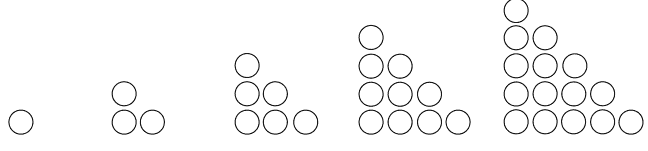

前 5 个三角形数是 1, 3, 6, 10 和 15

注意我们将两个三角形并排放在时发生了什么，如反页所示：

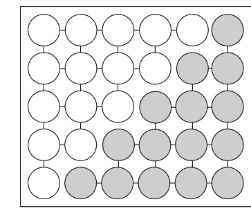

矩形中有多少点？

由于两个三角形形成了一个 5 行 6 列的矩形，总共有 30 个点。因此，每个原始三角形的点数有一半，即 15 个。当然，如果我们已经知道了这一点，同样的论证表明，如果你取两个 $n$ 行三角形并像我们这样把它们放在一起，就会形成一个 $n$ 行 $n+1$ 列的矩形，它有 $n \times (n+1)$ 个点（通常简写为 $n(n+1)$ 点）。结果，我们推导出了关于**前 $n$ 个数字之和**的承诺公式：

```
1 + 2 + 3 + ... + n = n(n+1)/2
```

## 10 数学的魔术

每一行的第一个数字是多少？从前 5 行来看，1, 4, 9, 16, 25...，它们似乎都是完全平方数。为什么呢？让我们看看第五行。在 5 之前出现了几个数字？如果我们计算前四行的数字，我们得到 $3 + 5 + 7 + 9$。为了得到第 5 行的首数字，我们在其基础上加 1，所以我们实际上得到的是前 5 个奇数的和，我们知道这等于 $5^2$。

现在让我们在不实际进行任何加法运算的情况下验证第五个方程。高斯会怎么做？如果我们暂时忽略行开头的 25，那么左边有 5 个数字，它们都比右侧对应的数字各小 5。

| 25 | 26 | 27 | 28 | 29 | 30 |
| --- | --- | --- | --- | --- | --- |
| 31 | 32 | 33 | 34 | 35 | |
| -5 | -5 | -5 | -5 | -5 | -5 |

比较第 5 行的左侧和第 5 行的右侧

因此，右侧五个数字的总和比它们左侧对应的数字多出 25。但这被左侧数字 25 抵消了。因此正如所言，和平衡了。同样的逻辑，再加上一点代数，证明这种模式将无限持续下去。

> 对于想要现在看这部分代数原理的人，在这里。每一行前面有 $3 + 5 + 7 + \dots + (2n - 1) = n^2 - 1$ 个数字，因此方程的左侧必须从下一个 $n^2$ 个连续数字开始，从 $n^2 + 1$ 到 $n^2 + n$。右侧有 $n$ 个连续数字，从 $n^2 + n + 1$ 到 $n^2 + 2n$。如果我们暂时忽略左边的数字 $n^2$，我们看到右侧的 $n$ 个数字每个都比左侧对应的数字大，所以它们的差是 $n \times n$，即 $n^2$。但这被左边的初始项 $n^2$ 抵消了，所以方程平衡了。

是时候观察新模式了。我们看到奇数可以用来组成正方形。现在让我们看看当我们将所有奇数放在一个大三角形中会发生什么，如页所示。

我们看到 $3 + 5 = 8, 7 + 9 + 11 = 27, 13 + 15 + 17 + 19 = 64$。数字 1, 8, 27 和 64 有什么共同点？它们是完全立方数！例如第五行的五个数字，我们得到


### 数字的魔术

| 1 = 1 = $1^3$ |
| 3 + 5 = 8 = $2^3$ |
| 7 + 9 + 11 = 27 = $3^3$ |
| 13 + 15 + 17 + 19 = 64 = $4^3$ |
| 21 + 23 + 25 + 27 + 29 = 125 = $5^3$ |

一个奇数三角形

$21 + 23 + 25 + 27 + 29 = 125 = 5 \times 5$ 第 $n$ 行

这种模式似乎表明第 $n$ 行数字之和为 $n^3$。情况总是这样吗，还是只是某种巧合？为了帮助我们理解这个模式，检查第 1、3 和 5 行的中间数字。你看到了什么？完全平方数 1, 9, 和 25。第 2 行和 4 行没有中间数字，围绕中间的数字是 3 和 5，以及 4 和 16。让我们看看如何利用这个模式。

再次观察第 5 行。在不实际相加数字的情况下，我们看到和是 $5^3$，因为这五个数字对称地围绕着数字 25。由于五个数字的平均值是 $5^2$，它们的总和必须是 $5^2 + 5^2 + 5^2 + 5^2 + 5^2 = 5 \times 5^2 = 5^3$。同样，第 4 行四个数字的平均值是 $4^2$，所以总和必须是 $4^3$。通过一点代数（我们在这里不这样做），你可以证明第 $n$ 行数字的平均值是 $n^2$，它们的总和必须是 $n^3$。由于我们正在讨论立方和和平方，我忍不住想给你展示多一个模式。当你从 1 开始加立方数时，你会得到什么？

- $1^3 = 1 = 1^2$
- $1^3 + 2^3 = 9 = 3^2$
- $1^3 + 2^3 + 3^3 = 36 = 6^2$
- $1^3 + 2^3 + 3^3 + 4^3 = 100 = 10^2$
- $1^3 + 2^3 + 3^3 + 4^3 + 5^3 = 225 = 15^2$

立方和总是一个完全平方数

### 数学的魔术

当我们开始加立方数时，我们得到和 1, 9, 36, 100, 225 等，这些都是完全平方数。但它们不仅仅是平方；它们是 1, 3, 6, 10, 15 的平方，这些都是三角形数！之前我们看到，例如，前 $n$ 个立方数的和等于前 $n$ 个数字之和平方：

```
1^3 + 2^3 + 3^3 + 4^3 + 5^3 = (1 + 2 + 3 + 4 + 5)^2 = 15^2 = 225
```

换句话，前 $n$ 个立方数的和等于前 $n$ 个数字之和平方。我们现在还没有准备好证明这个结论，但在第 6 章看到。

有些人观察这些模式并说：“好的，这不错。但它们有什么用？”大多数人可能会回答，一个美丽的模式除了美之外不需要任何解释。在观察和为 20 的数字对（例如 10 和 10，或 9 和 11）时，我想知道乘积能有多大。似乎当两个数字都等于 10 时，乘积最大。

- $10 \times 10 = 100$
- $9 \times 11 = 99$
- $8 \times 12 = 96$
- $7 \times 13 = 91$
- $6 \times 14 = 84$
- $5 \times 15 = 75$

和为 20 的数字乘积：随着数字距离越大，乘积越小。它们比 100 小多少？

### 数字的魔术

1, 4, 9, 16, 25, ..., 它们是 $1^2, 2^2, 3^2, 4^2, 5^2$ 等。这个模式总是有效吗？我决定尝试另一个例子，观察和为 26 的数字对。

### 169 的差

| $13 \times 13 = 169$ |
| $12 \times 14 = 168$ | 1 |
| $11 \times 15 = 165$ | 4 |
| $10 \times 16 = 160$ | 9 |
| $9 \times 17 = 153$ | 16 |
| $8 \times 18 = 144$ | 25 |

再次，当我们选择两个数字相等时，乘积达到最大，然后乘积从 169 减少 1, 4, 9 等。在又几个例子之后，我确信这个模式是正确的（稍后向你展示其背后的代数）。然后我看到了一种可以将这种模式应用于更快计算平方的方法。假设我们要对数字 13 取平方。与其直接执行 $13 \times 13$，我们将执行更简单的计算 $10 \times 16 = 160$。这接近答案，但由于我们向上向下移动了 3，它与答案差 $3^2$。因此，

```
13^2 = (10 \times 16) + 3^2 = 160 + 9 = 169
```

让我们尝试另一个例子。尝试用这种方法计算 $98 \times 98$。这样做，我们向上移动 2 到 100，向下移动 2 到 96，然后加上 $2^2$。即

```
98^2 = (100 \times 96) + 2^2 = 9600 + 4 = 9604
```

位 5 的数字平方特别容易，因为当我们向上向下移动 5 时，你相乘的数字都以 0 结尾。例如，

```
35^2 = (30 \times 40) + 5^2 = 1200 + 25 = 1225
55^2 = (50 \times 60) + 5^2 = 3000 + 25 = 3025
85^2 = (80 \times 90) + 5^2 = 7200 + 25 = 7225
```

现在尝试 $59^2$。通过向上向下移动 1，你得到 $(60 \times 58) + 1^2 = 3480 + 1 = 3481$。但你应该如何在心中计算 $60 \times 58$？让我们先忽略 0，从右到左计算 $6 \times 58$。现在 $6 \times 50 = 300$，且 $6 \times 8 = 48$。将这些数字相加得到 348。因此，$60 \times 58 = 3480$。

# 数字的魔力 15

关于心算。我们花费了大量的时间学习纸笔算术，但学习在脑中进行数学计算的时间却少得可怜。然而，在大多数实际情况下，你可能需要心算次数往往比在纸上计算得多。对于较大的计算，你会使用计算器来获得精确答案，但在阅读营养标签、听演讲或听取销售报告时，你通常不会使用计算器。对于这些情况，你只需要对重要数值有一个良好的心算估值。学校里教的方法在纸上做数学很好用，但在头脑中做数学方面通常很糟糕。

我可以写一本关于心算策略的书，但这里有一些核心思想。我无法再强调这一点了，主要的要点是：从左到右做题。心算是一个不断简化的过程。你从一个困难的问题开始，将其简化为更简单的问题，直到最后得到你的答案。


## 心算加法

考虑这样一个问题：

314 ÷ 159

（我把数字水平写写，这样你就不那么容易进入纸笔模式了。）从 314 开始，先加上数字 100，从而得到一个更简单的加法题：

414 + 59

在 414 上加上 50 得到一个更简单的问题，我们可以立即解决：

464 + 9 = 473

这就是心算加法的精髓。另一个有用的策略是，有时我们将一个困难的加法题转化为一个简单的减法题。这通常在我们计算零售商品的价格时出现。例如，让我们做：

$23.58 + $8.95

由于 $8.95 比 $9 少 5 分钱，我们先给 $23.58 加上 $9，然后减去 5 分钱。问题简化为：

$32.58 – $0.05 = $32.53

## 心算减法

心算减法题中最重要的思想是“过减”策略。例如，在减 9 时，通常先减 10 再加回 1 更容易。例如：

83 - 9 = 73 + 1 = 74

或者减 39，可能先减 40 再加回 1 更容易。

83 - 39 = 43 + 1 = 44

在减去两位或以上的数字时，关键思想是使用“补数”（之后你会为此向我感谢我的）。一个数字的补数是它到下一个高位整整数的距离。对于一位数，这是到 10 的距离（例如，9 的补数是 1）。对于两位数，这是到 100 的距离。看下面这几组相和为 100 的数字。你发现了什么？

| 87 | 75 | 56 | 92 | 80 |
| :--- | :--- | :--- | :--- | :--- |
| + 13 | + 25 | + 44 | + 08 | + 20 |
| 100 | 100 | 100 | 100 | 100 |

互补的两位数之和为 100

我们说 87 的补数是 13，75 的补数是 25，依此类推。相反，13 的补数是 87，25 的补数是 75。从左到右读每道题，你会发现（最后一个除外）最左边的数字之和为 9，最右边的数字之和为 10。例外是数字以 0 结尾时（如最后一个题）。例如，80 的补数是 20。

让我们把补数策略应用于问题 1234 - 567。现在，这在纸上做可不是个有趣的题。但通过补数，困难的减法题变成了简单的加法题！要减去 567，我们从减去 600 开始。这很容易，特别是当你从左到右思考时：1234 - 600 = 634。但你减多了。多减了多少？呢，567 离 600 多远？它相当于 67 到 100 之间的距离，即 33。因此：

1234 - 567 = 634 + 33 = 667

## 数字的魔力

注意，这个加法题特别容易，因为不涉及“进位”。在通过补数做减法题时，情况通常也是如此：

三位数补数也有类似的情况。

| 789 | 555 | 870 |
| :--- | :--- | :--- |
| + 211 | + 445 | + 130 |
| 1000 | 1000 | 1000 |

互补的三位数之和为 1000

对于大多数问题（当数字不以 0 结尾时），最左边的数字之和为 9，中间的数字之和为 9，最右边的数字之和为 10。例外是数字以 0 结尾时。例如，我们说 789 的补数是 211，555 的补数是 445，依此类推。相反，211 的补数是 789，445 的补数是 555。从左到右读每道题，你会发现（最后一个题除外）最左边的数字之和为 9，中间的数字之和为 9，最右边的数字之和为 10。例如，870 的补数是 130。

# 数学的魔力

对于 34 × 37，如果将 34 减 4（得到整数 30），那么它就会乘以 37 + 4 = 41，然后我们像下面这样加上 4 × 7：

34 × 37 = (30 × 41) + (4 × 7) = 1230 + 28 = 1258

顺便说一下，我们之前看到的那个神秘的乘法 104 × 109 仅仅是这种相同方法的应用。

104 × 109 = (100 × 113) + (04 × 09) = 11300 + 36 = 11,336

有些学校要求学生背诵到 20 的乘法表。与其背诵这些乘积，我们使用这种方法足够快速地计算出它们。例如，

17 × 18 = (10 × 25) + (7 × 8) = 250 + 56 = 306

为什么这种神秘的方法有效呢？为了这一点，我们需要代数，我们将在第 2 章中讨论。一旦我们掌握了代数，我们就能找到新的计算方法。例如，我们将看到为什么最后一个问题可以这样处理：

18 × 17 = (20 × 15) + ((-2) × (-3)) = 300 + 6 = 306

说到乘法表，请看对面的页面我之前承诺过的单数字表。这里有一个可能会引起小高斯感兴趣的问题：乘法表中所有数字之和是多少？花一分钟时间，看看你是否可以用一种优雅的方式解决它。我将在章节末尾提供答案。

# 心算估算与除法

让我们从一个非常简单且答案非常简单开始，这种问题我们在学校里很少被教：

- (a) 如果你将两个两位数相乘，你能立即看出答案会有几位吗？

还有一个后续问题：

- (b) 当一个四位数乘以一个五位数时，答案可能会有几位？

我们在学校里花费了大量时间来生成乘法或除法题数字，而花很少时间去思考答案的重要方面。然而，了解答案的近似大小对于知道最后几位甚至前几位更为重要。

## 乘法表

| | 1 | 2 | 3 | 4 | 5 | 6 | 7 | 8 | 9 | 10 |
| :--- | :--- | :--- | :--- | :--- | :--- | :--- | :--- | :--- | :--- | :--- |
| 1 | 1 | 2 | 3 | 4 | 5 | 6 | 7 | 8 | 9 | 10 |
| 2 | 2 | 4 | 6 | 8 | 10 | 12 | 14 | 16 | 18 | 20 |
| 3 | 3 | 6 | 9 | 12 | 15 | 18 | 21 | 24 | 27 | 30 |
| 4 | 4 | 8 | 12 | 16 | 20 | 24 | 28 | 32 | 36 | 40 |
| 5 | 5 | 10 | 15 | 20 | 25 | 30 | 35 | 40 | 45 | 50 |
| 6 | 6 | 12 | 18 | 24 | 30 | 36 | 42 | 48 | 54 | 60 |
| 7 | 7 | 14 | 21 | 28 | 35 | 42 | 49 | 56 | 63 | 70 |
| 8 | 8 | 16 | 24 | 32 | 40 | 48 | 56 | 64 | 72 | 80 |
| 9 | 9 | 18 | 27 | 36 | 45 | 54 | 63 | 72 | 81 | 90 |
| 10 | 10 | 20 | 30 | 40 | 50 | 60 | 70 | 80 | 90 | 100 |

乘法表中所有 100 个数字之和是多少？（在不知道答案是更接近 30,000、300,000 还是 3,000,000 之前，知道答案以 3 开是没有意义的。）

问题 (a) 的答案是五位或六位。为什么呢？最小可能的答案是 $100 \times 100 = 10,000$，有五位。最大的可能的答案是 $999 \times 999$，它严格小于 $1000 \times 1000 = 1,000,000$，后者有七位（但只差一点！）。由于 $999 \times 999$ 更小，所以它必须是六位。（当然，你可以轻松计算出最后一个答案：$999^2 = (1000 \times 998) + 1^2 = 998001$。）因此，两个三位数的积必须是五位或六位。

(b) 的答案是八位或九位。最小的四位数是 1000，也称为 $10^3$（三个零）。最小的五位数是 $10000=10^4$。最小的积是 $10^3 \times 10^4 = 10^7$，有八位。（$10^7$ 是从哪里来的？$10^3 \times 10^4 = 10^7$。）最大的积将略小于十位数 $10^4 \times 10^5 = 10^9$，它有九位。

通常通过观察每个数字的领先（最左侧）数字来确定答案有几位是很容易的。如果前导数字的积是 10 或更多，答案的位数就会多一位。


让我们从一个非常简单且答案非常简单开始，这种问题我们在学校里很少被教：

- (a) 如果你将两个两位数相乘，你能立即看出答案会有几位吗？

还有一个后续问题：

- (b) 当一个四位数乘以一个五位数时，答案可能会有几位？

我们在学校里花费了大量时间来生成乘法或除法题数字，而花很少时间去思考答案的重要方面。然而，了解答案的近似大小对于知道最后几位甚至前几位更为重要。

## 数字的魔力

| | 1 | 2 | 3 | 4 | 5 | 6 | 7 | 8 | 9 | 10 |
| :--- | :--- | :--- | :--- | :--- | :--- | :--- | :--- | :--- | :--- | :--- |
| 1 | 1 | 2 | 3 | 4 | 5 | 6 | 7 | 8 | 9 | 10 |
| 2 | 2 | 4 | 6 | 8 | 10 | 12 | 14 | 16 | 18 | 20 |
| 3 | 3 | 6 | 9 | 12 | 15 | 18 | 21 | 24 | 27 | 30 |
| 4 | 4 | 8 | 12 | 16 | 20 | 24 | 28 | 32 | 36 | 40 |
| 5 | 5 | 10 | 15 | 20 | 25 | 30 | 35 | 40 | 45 | 50 |
| 6 | 6 | 12 | 18 | 24 | 30 | 36 | 42 | 48 | 54 | 60 |
| 7 | 7 | 14 | 21 | 28 | 35 | 42 | 49 | 56 | 63 | 70 |
| 8 | 8 | 16 | 24 | 32 | 40 | 48 | 56 | 64 | 72 | 80 |
| 9 | 9 | 18 | 27 | 36 | 45 | 54 | 63 | 72 | 81 | 90 |
| 10 | 10 | 20 | 30 | 40 | 50 | 60 | 70 | 80 | 90 | 100 |

乘法表中所有 100 个数字之和是多少？（在不知道答案是更接近 30,000、300,000 还是 3,000,000 之前，知道答案以 3 开头是没有意义的。）问题 (a) 的答案是五位或六位。为什么呢？最小可能的答案是 `100 × 100 = 10,000`，有五位。最大的可能的答案是 `999 × 999`，它严格小于 `1000 × 1000 = 1,000,000`，有七位（但只差一点！）。由于 `999 × 999` 更小，所以它必须是六位。（当然，你可以轻松计算出最后一个答案：`999² = (1000 × 998) + 1² = 998001`。）因此，两个三位数的积必须是五位或六位。(b) 的答案是八位或九位。最小的四位数是 1000，也称为 `10³`（三个零）。最小的五位数是 `10000 = 10⁴`。最小的积是 `10³ × 10⁴ = 10⁷`，有八位。（`10⁷` 是从哪里来的？`10³ × 10⁴ = 10⁷`。）最大的积将略小于十位数 `10⁴ × 10⁵ = 10⁹`，它有九位。

(注：由于原始文本后半部分存在大量重复和逻辑乱码，此处已根据核心逻辑进行翻译。)

# 第二章

## `(2n + 4) / 2 - n = 2`

## 代数的魔力

### 奇幻引言

我第一次接触代数是小时候我父亲教我的一节课。他说：“儿子，做代数就像做算术没一样，只不过你用字母代替了数字。例如，`2x + 3x = 5x` 和 `3y + 6y = 9y`。你懂了吗？”我说：“我想我懂了。”他说：“好，那么 `5Q + 5Q` 是多少？”我自信地回答：“10Q。”他说：“我没听清。”我大声喊道：“十个 Q！”他笑了，又说：“不客气！”（我爸爸总是对双关语、笑话和故事更感兴趣，而不是教数学，所以我从一开始就该留个心眼的！）

我第二次接触代数的经历是尝试理解下面这个魔术。

- 第 1 步。想一个 1 到 10 之间的数字（如果你愿意，数字也可以更大）。
- 第 2 步。将那个数字翻倍。
- 第 3 步。现在加上 10。
- 第 4 步。除以 2。
- 第 5 步。减去你最初想的那个数字。我相信你现在想的是数字 5。对吧？那么魔术背后的秘密是什么？代数。让我们逐步分析这个魔术，从第 1 步开始。我不知道你开始的是哪个数字，所以我们用字母 `N` 来表示它。当我们用字母表示一个未知数时，这个字母被称为变量。

在第 2 步中，你将数字翻倍，所以你现在想的是 `2N`。（我们通常避免使用乘法符号，特别是字母 `x` 经常被用作变量。）在第 3 步之后，你的数字是 `2N + 10`。对于第 4 步，我们将该数量除以 2，得到 `N + 5`。最后，我们减去原始数字，即 `N`。在 `N + 5` 中减去 `N` 后，你剩下的就是 5。我们可以通过下表来总结这个魔术。

| 第 1 步 | N |
| :--- | :--- |
| 第 2 步 | 2N |
| 第 3 步 | 2N + 10 |
| 第 4 步 | N + 5 |
| 第 5 步 | N + 5 - N |
| 答案 | 5 |

## 代数的规则

让我们从一个谜语开始。找一个数字，当它加上 5 时，这个数字会变成三倍。

为了解这个谜语，让我们把未知数称为 `x`。给它加上 5 得到 `x + 5`。将原始数字乘以三倍得到 `3x`。我们希望这两个数字相等，所以我们必须解方程：

```
3x = x + 5
```

如果我们从方程的两边都减去 `x`，就会得到：

```
2x = 5
```

(`2x` 是哪里来的？`3x - x` 等于 `3x - 1x`，等于 `2x`。) 将该等式的两边都除以 2，得到：

```
x = 5/2 = 2.5
```

我们可以验证这个答案是正确的，因为 `2.5 + 5 = 7.5`，这正好等于 `2.5` 的 3 倍。

## 旁白

这是另一个代数可以帮助我们解释的魔术。写下任意一个数字位递减的三位数，例如 842 或 951。反转这些数字，并用第一个数减去第二个数。无论你的答案是什么，将其再次反转，然后将这两个数字相加。让我们用数字 853 来说例。

| 853 | 495 |
| :--- | :--- |
| - 358 | + 594 |
| 495 | 1089 |

(注：由于原文后续文本似乎存在大量重复和乱码，翻译已根据逻辑对可理解部分进行了处理，保持了代数术语的连贯性。)

FOIL 的名称源于“首、外、内、后”（First-Outer-Inner-Last）。在这里，`ac` 是 `(a+b)(c+d)` 中两个项的乘积。然后 `ad` 是外项的乘积。接着 `bc` 是内项的乘积。最后，`bd` 是末两个项的乘积。

为了说明，让我们使用 FOIL 来相乘两个数：

```
23 × 45 = (20 + 3)(40 + 5)
= (20 × 40) + (20 × 5) + (3 × 40) + (3 × 5)
= 800 + 100 + 120 + 15
= 1035
```

## 旁注

为什么 FOIL 有效？根据分配律（将和的部分写在前面），我们有：

$$(a+b)e = ae + be$$

现在如果我们将 `e` 替换为 `c+d`，就得到：

$$(a+b)(c+d) = a(c+d) + b(c+d) = ac + ad + bc + bd$$

其中最后一个等式来自于应用分配律。或者，如果你更倾向于几何论证（当 `a,b,c,d` 为正数时），请用两种不同的方法求下方矩形的面积。

| a | ac | ad |
|---|---|---|
| b | bc | bd |
|   | c | d |

这是 FOIL 的一个神奇应用。掷两个骰子并按照下表中的说明进行操作。例如，假设当你掷骰子时，第一颗骰子向上是 6，第二颗骰子向上是 3。它们的底部数字分别为 1 和 4。

| 掷两个骰子（假设我们得到 6 和 3） | | |
|---|---|---|
| 顶部数字相乘： | `6 × 3` | = `18` |
| 底部数字相乘： | `1 × 4` | = `4` |
| 第一个顶部数字乘以第二个底部数字： | `6 × 4` | = `24` |
| 第一个底部数字乘以第二个顶部数字： | `1 × 3` | = `3` |
| 总和： | | 49 |

在我们的例子中，我们得到了 49 的和。如果你用任何普通的六面骰子自己尝试，你会得到相同的总和。基于每一个普通的六面骰子的相对面数字之和均为 7。所以，如果骰子顶部显示 `x` 和 `y`，那么它们的底部必须是 `7 - x` 和 `7 - y`。因此使用代数，我们的表格看起来如下：

| 掷 2 颗骰子 (`x` 和 `y`): | | |
|---|---|---|
| 顶部数字相乘： | `xy` | = `xy` |
| 底部数字相乘： | `(7-x)(7-y)` | = `49-7y-7x+xy` |
| 第一个顶部数字乘以第二个底部： | `x(7-y)` | = `7x-xy` |
| 第一个底部数字乘以第二个顶部： | `(7-x)y` | = `7y-xy` |
| 总和： | | 49 |

注意我们在第三行中如何使用 FOIL（且 `-x` 乘以 `-y` 是正数）。我们也可以通过观察第二列并发现这些项正是我们通过 FOIL 计算 `(7-x)(7-y) = 49` 时得到的项。在大多数代数课中，FOIL 主要用于如下的表达式：

```
(x+3)(x+4) = x²+7x+12
```

注意在我们的最终表达式中，7（称为 `x` 项的系数）只是两个数字 `3+4` 的和。而最后一个数字 12（称为常数项）是 `3 × 4` 的积。通过练习，你可以立即写下乘积。例如，由于 `5+7=12` 且 `5 × 7 = 35`，我们立即得到：

```
(x+5)(x+7) = x²+12x+35
```

它对负数也有效。这里是一些例子。在第一个例子中，我们利用了 `6+(-2)=4` 和 `6 × (-2) = -12` 的事实。

```
(x+6)(x-2) = x²+4x-12
(x+1)(x-8) = x²-7x-8
(x-5)(x-7) = x²-12x+35
```

这些是数字相同的例子。

```
(x+5)² = (x+5)(x+5) = x²+10x+25
(x-5)² = (x-5)(x-5) = x²-10x+25
```

注意，特别是 `(x+5)² ≠ x²` 是初学者常犯的错误。另一方面，当数字符号相反时会发生某些情况。例如，由于 `5+(-5)=0`，

```
(x+5)(x-5) = x²-5x-5x = x²-25
```

一般来说，值得记住平方差公式：

```
(x+y)(x-y) = x²-y²
```

我们在第一章中应用了这个公式，在当时学习了快速计算平方的捷便方法。该方法基于以下代数：

```
A² = (A+d)(A-d) + d²
```

让我们验证这个公式。通过平方差公式，我们看到 `[(A+d)(A-d)] + d² = [A²-d²] + d² = A²`。因此，该公式对于所有的 `A` 和 `d` 值都有效。在实践中，`d` 是到最近整数的距离。例如，为了计算 97 的平方，我们选择 `d=3`，所以：

```
97² = (97+3)(97-3) + 3²
= (100 × 94) + 9
= 9409
```

这是一个用图片证明的平方差法则。它展示了面积为 `x² - y²` 的几何图形如何被切割并重新排列成一个面积为 `(x+y)(x-y)` 的矩形。


我们在第一章还学习了相邻数字的方法。我们关注接近 100 或开头数字相同的数字，但一旦理解了其背后的代数，我们就可以应用到更多情况。这里是“相邻法”背后的代数：

> `(z+a)(z+b) = z(z+a+b) + ab`

该公式有效是因为 `(z+a)(z+b) = z² + zb + za + ab`，然后我们可以从前三项中提取因式 `z`。该公式适用于任何数字，但我们通常选择以零结尾的 `z`（这就是为什么我选择了字母 `z`）。例如，为了做 `43 × 48` 题，我们让 `z=40, a=3, b=8`。那么我们的公式告诉我们：

```
43 × 48 = (40+3)(40+8)
= (40 × 40) + (40 × 8) + (3 × 40) + (3 × 8)
= 1600 + 320 + 120 + 24
= 2064
```

注意 `43 × 48 = 2064` 是巧合；`5+7=12` 和 `5 × 7 = 35` 则不是巧合。

例如，为了解方程

`9x - 7 = 47`

我们可以在等式的两边同时加上 7，得到 `9x = 54`，然后除以 9 找到 `x = 6`。

或者是一个稍微复杂一点的代数题：

`5x + 11 = 2x + 18`

通过从两边同时减去 `2x`，并（同时，如果你愿意的话）从两边同时减去 11 来简化它，得到

`3x = 7`

其解为 `x = 7/3`。最终，任何线性方程都可以简化为 `ax = b`（或 `ax - b = 0`），其解为 `x = b/a`（假设 `a ≠ 0`）。

对于*二次*方程（变量 `x²` 出现的情况），情况变得更加复杂。最容易求解的二次方程像：

`x² = 9`

它有*两个*解，`x = 3` 和 `x = -3`。即使右侧不是完全平方数，如下所示，

`x² = 10`

我们有两个解，`x = √10 = 3.16...` 和 `x = -√10 = -3.16...`。通常，对于 `n > 0`，数字 `√n` 被称为 `n` 的*平方根*，表示正数……当 `n` 不是完全平方数时，`√n` 通常用计算器计算。

> 旁注
>
> 方程 `x² = -9` 呢？我们说它无解。确实，没有*实数*的平方是 -9。在第 10 章中，我们将看到从非常真实的意义来说，这个方程有两个解，即 `x = 3i` 和 `x = -3i`，其中 `i` 被称为*虚数*，其平方为 -1。如果这现在听起来既不可能又荒谬，没关系。但在你生活中的曾有一个时期，*负数*似乎也是不可能的。（一个数字怎么可能小于 0 呢？）你只需要在它们变得意义之前，用正确（或相反！）的方式去看这些数字即可。

像这样的方程

```
x² + 4x = 12
```

因为有 `4x` 项，它的求解会稍微复杂一点，但有几种不同的处理方法。就像口算一样，在数学中，解决问题的方法往往不止一种。

我处理这类问题时尝试的第一种方法称为*因式分解法*。第一步是将所有项移到方程的左侧，使得右侧只剩下 0。在这里，方程变为

```
x² + 4x - 12 = 0
```

现在该怎么办？嗯，巧的是，在上一节中当我们练习 FOIL 乘法时，我们看到 `x² + 4x - 12 = (x+6)(x-2)`。因此，我们的问题可以转换为

```
(x+6)(x-2) = 0
```

两个数量的乘积为 0 的唯一方法是其中至少一个数量为 0。因此，我们必须有 `x+6=0` 或 `x-2=0`，这意味着

```
x = -6 or x = 2
```

你应该验证一下，这解了原题。

根据 FOIL 法，`(x+a)(x+b) = x²+(a+b)x+ab`。这使得二次项的因式分解有点像解谜。例如，在上道题中，我们找到了两个数字 `a` 和 `b`，它们的和为 4，积为 -12。答案 `a=6` 和 `b=-2` 给了我们因式分解的结果。为了练习，尝试分解 `x²+11x+24`：寻找和为 11 积为 24 的数字。由于数字 3 和 8 正符合要求，我们有 `x²+11x+24=(x+3)(x+8)`。

但现在假设我们方程 `x²+9x=-13`。分解 `x²+9x+13` 没有简单的方法。但别担心！在这种情况下，我们被**二次公式**救了。这个公式说解为

```
x = (-b ± √(b² - 4ac)) / (2a)
```

其中 `±` 符号意味着“加或减”。这是一个例子。对于方程

```
x²+4x-12=0
```

我们有 `a = 1, b = 4`，且 `c = -12`。因此，公式告诉我们

`x = (-4 ± √(16 - 4(1)(-12))) / 2 = (-4 ± √64) / 2 = (-4 ± 8) / 2 = 2` 或 `-6`，符合预期。我认为你会同意对于这道题，因式分解法很直观。通过稍微练习，你会发现应用这个公式就像……`a,b,c!` 一样简单

为什么二次公式有效？让我们把方程 `ax² + bx + c = 0` 重写为

```
ax² + bx = -c
```

然后两边同除以 `a`（`a` 不为 0），得到

```
x²/a + bx/a = -c/a
```

由于 `(x + b/(2a))² = x² + bx/a + b²/(4a²)`，我们可以通过在上方两边加上 `b²/(4a²)` 来配完全方，得到

```
(x + b/(2a))² = b²/(4a²) + (-c)/a = (b² - 4ac)/(4a²)
```

对两边开平方根，

```
x + b/(2a) = ± √(b² - 4ac) / (2a)
```

因此，

```
x = (-b ± √(b² - 4ac)) / (2a)
```

符合预期。


数学在 17 世纪取得了巨大的飞跃，费马和笛卡尔独立地发现了如何通过图形表示方程。通常，方程 `y=mx+b` 是一条斜率为 `m` 截距为 `b` 的直线。对于 `y=2x+3` 这个方程，当 `x` 每增加 1 时，`y` 增加 2。我们可以通过表格看到这一点：

| $x$ | -2 | -1 | 0 | 1 | 2 |
| :--- | :--- | :--- | :--- | :--- | :--- |
| $y$ | -1 | 1 | 3 | 5 | 7 |

我们将这些坐标点 `(-2,-1), (-1,1), (0,3), (1,5), (2,7)` 连起来，就得到了这条线。在下面的直坐标图中，我们可以看到 `y=2x+3` 的图像。


这是 `y=2x+3` 的图像。现在我们看 `y=2x-2` 和 `y=-x+7` 的图像交在哪里？

`y=2x-2` 这条线斜率为 2，截距为 -2。（它与 `y=2x+3` 平行，只是整条线向下移动了 5。）`y=-x+7` 这条线斜率为 -1，当 `x` 每增加 1 时，`y` 减小 1。让我们用代数来确定这些线的交点 `(x, y)`。在交点处它们具有相同的 `x` 和 `y` 值，所以我们想找到一个 `x` 值使得 `y` 值相等。也就是说，我们需要求解

`2x - 2 = -x + 7`

在两边同时加上 `x`，并在两边同时加上 2，告诉我们

`3x = 9`

所以 `x = 3`。一旦知道了 `x`，我们可以使用任何一个方程来得到 `y`。由于 `y = 2x - 2`，那么 `y = 2(3) - 2 = 4`。（或者 `y = -x + 7` 得到 `y = -3 + 7 = 4`。）因此，这些线交于点 `(3,4)`。

# 代数的魔力 43

绘制直线的图非常简单，因为只要你知道直线上的任意两点，就可以轻松画出整条直线。对于二次函数（当变量 `x^2` 出现时），情况就会变得复杂。最容易画图的二次函数是 `y = x^2`，如下图所示。二次函数的图像被称为抛物线。

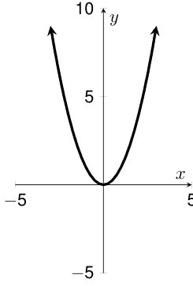

`y = x^2` 的图像

这里是 `y = x^2 + 4x - 12 = (x+6)(x-2)` 的图像。

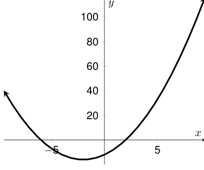

`y = x^2 + 4x - 12 = (x+6)(x-2)` 的图像。`y` 轴已重新缩放。

注意，当 `x = -6` 或 `x = 2` 时，`y = 0`。我们可以在图中看到这一点，因为抛物线在这两个点与 `x` 轴相交。并非巧合，抛物线在两点中间的 `x = -2` 处处于最低点。点 `(-2, -16)` 被称为抛物线的顶点。

我们生活中的每天都会遇到抛物线。每当物体被抛出时，物体产生的曲线几乎是一条抛物线，无论是棒球还是从喷泉流出的水，如下所示。抛物线的性质也被用于大灯、望远镜和卫星天线的设计。

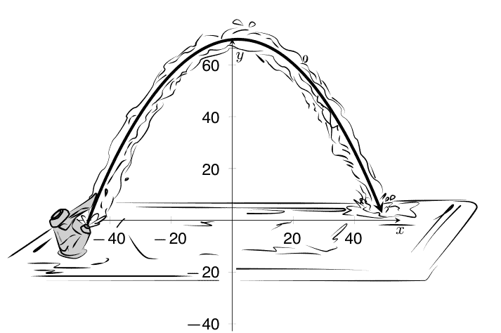

一个典型的喷泉。这对应的抛物线是 `y = -.03x^2 + .08x + 70`。

时候学习一些术语了。到目前，我们处理的是多项式（例如 `x`），其中变量 `x` 可以是正整数次幂。最大的指数被称为多项式的次数。例如，`3x + 7` 是一个次数为 1 的（线性）多项式。次数为 2 的多项式如 `x^2 + 4x - 12` 称为二次。`5x^3 - 4x^2 - \sqrt{2}` 称为三次。次数为 4 和 5 的多项式分别称为四次和五次。更高次数的多项式，主要是因为它们在实践中并不常见（虽然我好奇我们是否会将七次多项式称为 septics，有些人可能会这么叫，但我表示怀疑）。不含变量的多项式，如多项式 17，次数为 0，称为常项式。最后，多项式不允许包含无限多个项。例如，`1 + x + x^2 + x^3 + \cdots` 不是多项式。（它被称为无限级数，我们将在第 12 章详细讨论。）

对于多项式，变量的指数只能是正整数，因此指数不能为负或分数。例如，如果我们的方程包含类似 `y = 1/x` 或 `y = \sqrt{x}` 的项，那么它就不是多项式，因为正如我们将看到的，`y = x^{-1}` 和 `y = x^{1/2}`。

我们将多项式的根定义为使多项式等于 0 的 `x` 值。例如，`3x+7` 有一个根，即 `x = -7/3`。`x^2 + 4x - 12` 的根是 `x = 2` 和 `x = -6`。像 `x^2 + 9` 这样的多项式没有（实）根。注意，每个次数为 1 的多项式（直线）恰好有一个根，因为它在一个点上穿越 `x` 轴，而二次多项式（抛物线）最多有两个根。多项式 `x^2+1`、`x^2` 和 `x^2-1` 分别有零个和两个根。

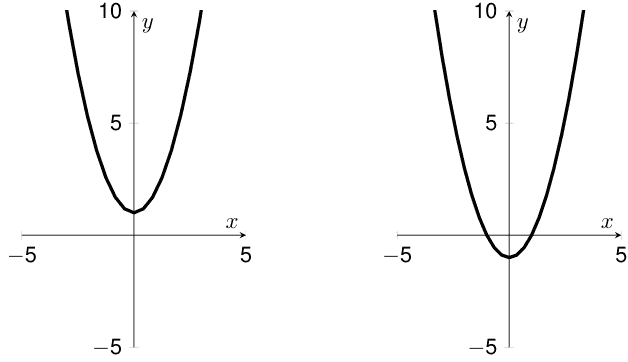

`y = x^2+1` 和 `y = x^2-1` 的图像分别有零个和两个根。之前画出的 `y = x^2` 图像只有一个根。

在下一页中，我们将看到一些三次多项式的图像，你会注意到它们最多包含三个根。

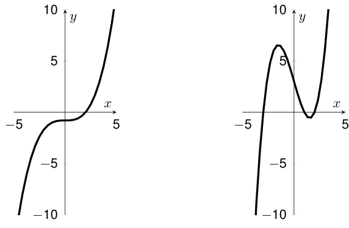

`y = (x^3 - 8)/10 = \frac{1}{10}(x^2 + 2x + 4)` 的图像有一个根，而 `y = (x^3 - 7x + 6)/2 = \frac{1}{2}(x + 3)(x - 1)(x - 2)` 有三个根。

在第 10 章中我们将遇到代数基本定理，它显示每个次数为 `n` 的多项式最多有 `n` 个根。此外，它可以被分解为线性或二次部分。例如，

`(x^3 - 7x + 6)/2 = \frac{1}{2}(x + 3)(x - 1)(x - 2)`

有三个根（1, 2, 和 -3）。

`(x^3 - 8)/10 = \frac{1}{10}(x^2 + 2x + 4)`

当 `x=2` 时恰好有一个实根。顺便说一下，我应该指出，现在通过在你最喜欢的搜索引擎中输入方程，可以很容易找到大多数函数的图像。例如，输入类似“y = (x^3-7x+6)/2”就会产生像上面的图像。

在本章中，我们看到了如何轻松地找到任何线性或二次多项式的根。事实证明，寻找三次或四次多项式的根极其复杂。这些公式是在 16 世纪被发现的，在两个多世纪里，数学界最顶尖的人一直在寻找可以求解任何五次方程的公式，直到尼尔斯·阿贝尔在 19 世纪初证明了这样的公式是不存在的。

这对我们有什么帮助呢？注意形式为 `10(X + Y)` 的数字必须以 0 结尾，且 0 之前的数字（或位）是 `X+Y`。由于 `X` 和 `Y` 都在 1 到 10 之间，如果 `X` 大于 `Y`，那么 `X-Y` 强制是一个位数（0 到 9 之间）。因此，答案的最后一位必须是 `X-Y`。例如，如果你从 9 和 3 开始，那么 `X=9`，`Y=3`。因此步骤 5 之后的答案必须以 `X+Y = 9+3 = 12` 开头，并以 `X-Y = 9-3 = 6` 结尾，结果为 126。我们知道 `X+Y` 和 `X-Y`，可以取它们的平均值得到 `((X+Y)+(X-Y))/2 = X`。对于 `Y`，我们可以计算 `((X+Y)-(X-Y))/2`（结果为 `(12-6)/2 = 3`），但我发现直接用你计算出的较大数字减去答案的最后一位（`9-6=3`）更简单，因为 `X-(X-Y)=Y`。

> 附：如果你想给自己（以及观众，他们可能想用计算器）增加额外的挑战，你可以让观众选择 1 到 100 之间的任意两个数字，但在步骤 3 中，你让他们将总和乘以 100 而不是 10，然后按照之前的方法继续。例如，如果答案是 5925。你可以通过去掉答案的最后两位并计算它们的平均值来重构答案。在这里，较大的数字是 `(59+25)/2=84/2=42`。要得到较小的数字，从较大数字中减去答案的最后两位。在这里，`42-25=17`，符合预期。这种方法有效的原因原理与之前几乎相同，区别在于步骤 5 之后，答案是 `100(X+Y)-(X-Y)`，其中 `X-Y` 是答案的最后两位。这里是另一个例子：如果答案是 15,222（所以 `X+Y=152`，`X-Y=22`），那么较大的数字是 `(152+22)/2=174/2=87`，较小的数字是 `87-22=65`。

`\sqrt{9} = 3`

# 9 的魔力

## 最神奇的数字

当我小时候，我最喜欢的数字是 9，因为它似乎拥有许多神奇的属性。为了看例子，请遵循下面的数学指令。

1. 想一个 1 到 10 之间的数字（或者如果你愿意，选择一个较大的整数并使用计算器）。
2. 将你的数字乘以 3。
3. 将其加上 6。
4. 现在再次将你的数字乘以 3。
5. 如果愿意，再次将你的数字翻倍。
6. 将你数字的各位数字相加。如果结果是一位数，则停止。
7. 如果和是两位数，将这两个数字相加。
8. 专注于你的答案。

我有一种明显的印象，你现在正在想数字 9。对吗？（如果不对，你可能需要重新检查你的算术。）

数字 9 的神奇之处在哪里？在本章的其余部分，我们将看到它的一些神奇属性，甚至还会考虑一个认为 12 和 3 在功能上是等价的世界！数字 9 的第一个神奇属性可以通过观察它的倍数看出：

9, 18, 27, 36, 45, 54, 63, 72, 81, 90, 108, 117, 126, 135, 144...

这些数字有什么共同点？如果你将每个数字的各位数字相加，你似乎总是得到 9。让我们检查其中几个：18 的数字和为 `1+8=9`；27 的 `2+7=9`；144 的 `1+4+4=9`。但等等，有一个例外：99 的数字和是 18，但 18 本身是 9 的倍数。所以这里有一个关键结论，你可能在小学学过，我们将在本章稍后解释：

> 如果一个数字是 9 的倍数，那么它的数字和就是 9 的倍数（反之亦然）。

例如，123,456,789 的数字和为 45（9 的倍数），所以它是 9 的倍数。相反，314,159 的数字和为 23（不是 9 的倍数），所以它不是 9 的倍数。

为了用这个规则来理解我们之前的魔术，让我们来看代数。你先想一个数字，我们称之为 `N`。在乘以 3 之后，你得到 `3N`，在下一步变为 `3N+6`。再次乘以该结果得到 `3(3N+6)=9N+18`，它等于 `9(N+2)`。如果你决定将数字翻倍，你就有 `18N+36=9(2N+4)`。你的最终答案都是某个整数的 9 倍，因此你必须得到 9 的倍数。当你取这个数字的各位数字时，你必须再次得到 9 的倍数（可能是 9、18 或 27），且数字之和必须是 9。

这里我也喜欢表演的之前魔术的变体。让一个用计算器的人秘密选择以下四位数数字之一：

- `\pi` 的前四位（第 8 章）
- `e` 的前四位（第 10 章）
- 连续的斐波那契数（第 5 章）
- 最大的位数


然后，如果他们将这个四位数乘以任何三位数，结果将是一个你不可能知道的六位数或七位数。接下来，让他们圈出答案中的其中一个数字，但不要圈 0（因为它已经有形状了！）。让他们按他们喜欢的任何顺序读出所有被圈出的数字，并专注于剩下的数字。只需你稍加专注，就能成功地揭示答案。

# 校验法

当数字的各位数字之和不是 9 的倍数会发生什么？例如，考虑数字 3457。按照上面的过程，我们将 3457（各位数字和为 19）写为 3(999) + 4(99) + 5(9) + 7 + 12，所以 3457 比 9 的倍数大 7+12=19。由于 19 = 18+1，这表明 3457 比 9 的倍数大 1。我们可以通过相加 19 的各位数字得到相同的结论：

3457 → 19 → 10 → 1

将数字各位数字相加并重复此过程直到变为一位数的过程被称为校验法，因为在过程的每一步，你都在减去 9 的倍数。最后得到的位数就是原数字的数字根。例如，3457 的数字根是 1。3456 的数字根是 9。

我们可以简要地总结之前的结论。对于任何正整数 n：

> 如果 n 的数字根为 9，那么 n 是 9 的倍数。否则，数字根是 n 除以 9 的余数。

或者用代数表达式表示，如果 n 的数字根为 r，那么

n = 9x + r

因此校验法可以是检查加法、减法和乘法答案的一种有趣方法。例如，如果加法题求解正确，那么答案的数字根必须与数字根之和一致。这里有一个例子。执行加法题：

91787 → 32 → 5

+ 42864 → 24 → 6

134651

11 → (2)

20 → (2)

注意相加的数字数字根为 5 和 6，它们的和 11 的数字根为 2。答案 134,651 的数字根也是 2，这并非巧合。这种过程通用有效的原因基于代数：

(9x + r1) + (9y + r2) = 9(x + y) + (r1 + r2)

# 9 的魔力

如果数字不匹配，那么你肯定在某个地方犯了错误。重要提示：如果数字匹配，你的答案并不一定是正确的。但这个过程在约 90% 的情况下能捕获绝大多数随机错误。请注意，它无法捕获你不小心交换了两个正确数字位置所导致的错误，因为交换两个正确数字不会改变数字之和。但如果某个数字出错，它就能检测出这个错误，除非该错误将 0 变成了 9 或将 9 变成了 0。这个过程可以应用于长列列加法。例如，假设你购买了以下价格的物品：

| 价格 | 数字之和 | 数字根 |
| :--- | :--- | :--- |
| 112.56 | 15 | 6 |
| 96.50 | 20 | 2 |
| 14.95 | 19 | 1 |
| 48.95 | 26 | 8 |
| 108.00 | 9 | 9 |
| 17.52 | 15 | 6 |
| 398.48 | 32 | 5 |

将我们答案的数字相加，我们发现总和的数字根为 5，数字根之和为 32，这与我们的答案一致，因为 32 的数字根是 5。“九去法”也适用于减法。例如，减去我们之前加法题中的这些数字：

91787 → 32 → 5

-42864 → 24 → 6

48923 → -1 → 8

↓

26 → 8

减法题 48,923 的答案的数字根为 8。当我们减去原始数字的数字根时，我们发现 5 - 6 = -1。但这与我们的答案一致，因为 -1 + 9 = 8，而且在答案中加上（或减去）9 的倍数不会改变数字根。同样的逻辑，差值为 0 与数字根 9 是一致的。

# 数学的魔力

让我们利用所学的知识来创造另一个魔术（就像书引言中给出的那样）。遵循这些指令操作；如果你愿意，可以使用计算器。

- 1. 想一个任意两位或三位数。
- 2. 将你的数字相加。
- 3. 从你的原始数字中减去那个结果。
- 4. 将新数字的数字相加。
- 5. 如果总和是偶数，则将其乘以 5。
- 6. 如果总和是奇数，则将其乘以 10。
- 7. 现在减去 15。

你想的是 75 吗？

例如，如果你从数字 47 开始，那么 $47 - 11 = 36$。然后你开始加 $4 + 7 = 11$，接着是加 $3 + 6 = 9$，这是一个奇数。将其乘以 10 得到 90，然后 $90 - 15 = 75$。另一方面，如果你从像 831 这样的三位数开始，那么 $8 + 3 + 1 = 12$；$831 - 12 = 819$；$8 + 1 + 9 = 18$，这是一个偶数。那么 $18 \times 5 = 90$，减去 15 同样得到 75。

这个魔术之所以有效，是因为如果原始数字的数字之和为 $T$，那么这个数字一定比某个 9 的倍数大 $T$。当我们减去数字之和时，结果必然是 9 的倍数加上 $T$。

若 $a \equiv b \pmod m$ 且 $c$ 是任意整数，那么等式也成立：

$a+c \equiv b+c \text{ 和 } ac \equiv bc \pmod m$

不同的同式可以相加、相减和相乘。例如，如果 $a \equiv b \pmod m$ 且 $c \equiv d \pmod m$，那么

$a+c \equiv b+d \text{ 和 } ac \equiv bd \pmod m$

例如，由于 $14 \equiv 2$ 且 $17 \equiv 5 \pmod{12}$，那么 $14 \times 17 \equiv 2 \times 5 \pmod{12}$，且 $238 \equiv 10 + (12 \times 19)$。该规则的结果我们可以对同式进行幂运算。如果 $a \equiv b \pmod m$，我们有**幂规则**：

$a^2 \equiv b^2 \quad a^3 \equiv b^3 \quad \dots \quad a^n \equiv b^n \pmod m$

对于任何正整数 $n$。

> 为什么模运算是有效的？如果 $a \equiv b \pmod m$ 且 $c \equiv d \pmod m$，那么对于某些整数 $p$ 和 $q$，$a = b+pm$ 且 $c = d+qm$。因此 $a+c = (b+d) + (p+q)m$，所以 $a+c \equiv b+d \pmod m$。此外，使用 FOIL 法。
>
> $ac = (b+pm)(d+qm) = bd+(bq+pd+pqm)$
>
> 所以 $ac$ 和 $bd$ 相差是 $m$ 的倍数，因此 $ac \equiv bd \pmod m$。将同式 $a \equiv b \pmod m$ 自相乘得到 $a^2 \equiv b^2 \pmod m$，重复这一过程就得到了幂规则。

正是幂规则使得 9 这样一个特殊的数字在十进制中能够正常作用。

$10 \equiv 1 \pmod 9$

幂规则告诉我们，对于任何 $n$，$10^n \equiv 1^n = 1 \pmod 9$，因此像 3456 这样的数字满足

$3456 = 3(1000) + 4(100) + 5(10) + 6$

$= 3(1) + 4(1) + 5(1) + 6 = 3 + 4 + 5 + 6 \pmod 9$

由于 $10 \equiv 1 \pmod 3$，这解释了为什么我们可以通过相加数字来判断一个数字是否为 3 的倍数（或除以 3 的余数）。如果在不同的进制下，例如十六进制（用于电子工程和计算机科学），由于 $16 \equiv 1 \pmod{15}$，你可以通过相加数字来判断一个数字是否为 15 的倍数（或除以 15 的余数）。

回到十进制。这里有一个奇妙的方法可以判断一个数字是否为 11 的倍数。它是基于 $10 \equiv -1 \pmod{11}$ 的事实，因此 $10^n \equiv (-1)^n \pmod{11}$。因此 $10^2 \equiv 1 \pmod{11}$，以此类推。例如，像 3456 这样的数字满足

$3456 = 3(1000) + 4(100) + 5(10) + 6$

$= -3 + 4 - 5 + 6 = 2 \pmod{11}$

因此 3456 除以 11 的余数为 2。通用规则是，如果我们交替加减数字，一个数字是 11 的倍数当且仅当结果是 $0, \pm11, \pm22 \dots$。例如，数字 31415 是 11 的倍数吗？通过计算 $3 - 1 + 4 - 1 + 5 = 10$，得出不是；但如果我们考虑 31416，总和将是 11，所以 31416 是 11 的倍数。

模 11 运算实际上用于 ISBN（国际标准书号）的创建和验证。假设你的书有一个 ISBN（2007 年之前的大多数书都是 10 位的）。前几个数字编码书籍的产地、出版者和标题，但第十位数字（称为校验位）的选择使得数字满足特定的数值关系。具体来说，数字 $j$ 的选取是为了

$10a + 9b + 8c + 7d + 6e + 5f + 4g + 3h + 2i + j \equiv 0 \pmod{11}$

例如，我 2006 年出版的书《心算数学》，ISBN 为 0-307-33840-1，确实

$10(0) + 9(3) + 8(0) + 7(7) + 6(3) + 5(3) + 4(8) + 2(0) + 1 = 154 = 0 \pmod{11}$

因为 $154 = 11 \times 14$。你可能会想，如果校验位要求字母 X（罗马数字 10）会发生什么？ISBN 系统有一个很好的特性：如果某个数字输入错误，系统可以检测出来。例如，如果第三位数字错误，最后的总和将偏离 11 的倍数，可能是 $\pm8$ 或 $\pm16$。但这些数字都不是 11 的倍数（因为 11 是质数），调整后的总和不可能是 11 的倍数。事实上，通过简单的代数可以证明系统可以检测到任何两个不同数字的颠倒。总和只有 $c$ 和 $f$ 的部分不同。旧总和使用 $8c+5f$，新总和使用 $8f+5c$。差值为 $(8f+5c)-(8c+5f)=3(f-c)$，这不是 11 的倍数。因此新总和不会是 11 的倍数。2007 年，出版社切换到 ISBN-13，它使用 13 位数字并基于模 10 运算。在这个新系统下，数字 $abc-d-efg-ijkl-m$ 只有在满足以下条件时有效：


$a+3b+c+3d+e+3f+g+3h+i+3j+k+3l+m \equiv0 \pmod{10}$

例如，此书的 ISBN-13 为 978-0-465-0472-5。检查这个数字的快速方法是分离奇偶位并计算$((8+4+5+7)+3(0+6+0+4+2) = 43+57=100\equiv0 \pmod{10}$。

ISBN-13 系统可以检测任何连续三位的错误（但不是所有）。模 10 运算在条码、信用卡和借记卡号码中也起着重要作用。

他们相隔十天去世。这是因为当塞万提斯去世时，西班牙已经改用格里高历，而英国仍在使用儒略历。因此，当塞万提斯于格里高历1616年4月23日去世时，莎士比亚居住的英国还是1616年4月13日（尽管他只在那里住了十天）。

确定格里高历上任意日期星期几的公式如下：

# 星期 ≡ 月份代码 + 日期 + 年份代码 (mod 7)

我们将很快解释所有这些术语。该公式使用模运算（对7取余数）是合理的，因为一周有7天。例如，如果一个日期在今天是72天后，那么它的星期几就是今天之后的两天，因为 72 ≡ 2 (mod 7)。或者，距离今天28天的日期其星期几将是相同的，因为 28 是 7 的倍数。

让我们使用记忆法来记忆星期几的代码，这些代码很容易记住。

| 数字 | 星期 | 记忆法 |
|---|---|---|
| 1 | 周一 | 1-day |
| 2 | 周二 | 2s-day |
| 3 | 周三 | 伸出3根手指 |
| 4 | 周四 | 4s-day |
| 5 | 周五 | 5-day |
| 6 | 周六 | 6er-day |
| 7 或 0 | 周日 | 7-day or non-day |

我为每个数字-星期对提供了记忆法，其中大多数都是一言自明的的。对于周三，注意如果你在手上伸出三根手指，你就组成了一个字母 W。对于周四，如果你把它读作“Thor’s Day”，那么它就会和“Four’s Day”押韵。

## 66 数学的魔力

> 那么，星期几的名字是从哪里来的？用太阳、月亮和五个最近的天体来命名星期几习俗可以追溯到古巴比伦。。从太阳、月亮和土星，我们直接得到周日、周一和周六。其他名字在法语或西班牙语中更容易看出来。例如，火星变成 Mardi 或 Martes；水星变成 Mercredi 或 Miércoles；木星变成 Jeudi 或 Jueves；金星变成 Vendredi 或 Viernes。注意，火星、木星和金星也是罗马神女神的名字。英语源于日耳语，早期德国人为北欧神重新命名了其中一些星期。因此火星变成了 Tiw，水星变成了 Woden，木星变成了 Thor，金星变成了 Freya，这就是我们得到了周三、周四和周五的名字。

月份代码如下，以及我记忆它们的记忆法。

| 月份 | 代码 | 记忆法 |
|---|---|---|
| 一月* | 6 | W-I-N-T-E-R |
| 二月* | 2 | 月份数字2 |
| 三月 | 2 | March 2 the beat! |
| 四月 | 5 | A-P-R-I-L or F-O-O-L-S |
| 五月 | 0 | Hold the May-O! |
| 六月 | 3 | June B-U-G |
| 七月 | 5 | Fiver-works in the sky! |
| 八月 | 1 | August begins with A = 1 |
| 九月 | 4 | Beginning of F-A-L-L |
| 十月 | 6 | T-R-I-C-K-S (rhymes with 6) |
| 十一月 | 2 | 2 pieces of 2key! |
| 十二月 | 4 | L-A-S-T or X-M-A-S |

*例外：在闰年，一月=5，二月=1。

我稍后会解释这些名称是如何得出的，但我想让你先学会如何进行计算。目前，你只需要知道2000年的年份代码是0。让我们用这个信息来确定3月19日（我的生日）是星期几。

## 67 9的魔力

由于三月的月份代码是2，2000年的年份代码是0，那么我们的公式告诉我们2000年3月19日是：

星期 = 2 + 19 + 0 = 21 ≡ 0 (mod 7)

因此，2000年3月19日是周日。

> 附言：这里是对月份代码来源的简单解释。注意在非闰年，二月和三月的月份代码是相同的。这是合理的，因为二月有28天，3月1日是在二月1日的28天后，所以两个月份会在同一星期开始。现在恰巧，2000年3月1日是周三。所以如果我们想得到2000年的年份代码0，并且想让周一的日期代码为1，这迫使三月的月份代码变为2。因此，如果不是闰年，二月的代码也必须是2！由于三月有31天，大于28天，所以四月的历法向后移动3天，我们将四月的28+2天加上月份代码2+3=5。所以我们看到五月的月份代码必须是5+2=7，如果我们在进行模7运算，它可以被化简为0。继续这个过程，我们可以确定全年其余月份的代码。另一方面，在闰年（如2000年），二月有29天，所以三月的历法会比二月的历法提前一天，即闰年二月的月份代码是2-1=1。一月有31天，所以它的月份代码比二月的代码低3。因此在非闰年，一月的月份代码将2-3=-1 ≡ 6 (mod 7)。在闰年，一月的月份代码将1-3=-2 ≡ 5 (mod 7)。

从一年到下一年，你的生日发生了什么变化？通常情况下，你的生日之间有365天，这种情况下你的生日会提前一天，因为365 ≡ 1 (mod 7)，因为 365 = 52 × 7 + 1。如果在你的生日之间出现了2月29日，那么你的生日将提前两天。在我们的公式中，我们每年给年份代码加1，但在闰年加2。这里是2000到2031年的年份代码。别担心，你不需要背这些！注意年份代码从0, 1, 2, 3开始，然后在2004年跳到5。2005年的年份代码是6，由于我们是在进行模7运算，我们将这个数字简化为0。然后2007年的年份代码是1，然后2008年（闰年）有...

# 数学的魔力

| 年份 | 代码 | 年份 | 代码 | 年份 | 代码 | 年份 | 代码 |
|---|---|---|---|---|---|---|---|
| 2000* | 0 | 2008* | 3 | 2016* | 6 | 2024* | 2 |
| 2001 | 1 | 2009 | 4 | 2017 | 0 | 2025 | 3 |
| 2002 | 2 | 2010 | 5 | 2018 | 1 | 2026 | 4 |
| 2003 | 3 | 2011 | 6 | 2019 | 2 | 2027 | 5 |
| 2004* | 5 | 2012* | 1 | 2020* | 4 | 2028* | 0 |
| 2005 | 6 | 2013 | 2 | 2021 | 5 | 2029 | 1 |
| 2006 | 0 | 2014 | 3 | 2022 | 6 | 2030 | 2 |
| 2007 | 1 | 2015 | 4 | 2023 | 0 | 2031 | 3 |

（*表示闰年）

使用表格，我们可以确定在2025年（下一个完全平方年），3月14日是星期=2 + 14 + 3 = 19 ≡ 5 (mod 7)，即周五。2008年的1月1日呢？注意2008年是闰年，所以一月的代码将是5而不是6。因此，我们得到星期=5 + 1 + 3 = 9 ≡ 2 (mod 7)，即周二。注意当你阅读表格中的每一行时，每过8年，年份代码就会增加3 (mod 7)。例如，第一行有0, 3, 6, 2（其中2等于9 (mod 7)）。这是因为在任何8年内会有两个闰年，所以日期会移动8+2=10 ≡ 3 (mod 7)。更好的消息是：在1901到2099年之间，历法每28年重复一次。为什么？在28年里，我们保证会有7个闰年，所以历法将移动28+7=35天，这使得星期不变，因为这是7的倍数（如果这28年跨越了1900年或2100年，此说法不成立，因为那些年份不是闰年）。通过加或减28的倍数，你可以将1901到2099年之间的任何年份转换为年份。例如，1983年的年份代码与1983 ÷ 28 =2011相同。2061年的年份代码与2061-56=2005相同。

## 9的魔法

因此，从实际角度来说，你可以将任何年份转换为此表中的某一年，并且这些代码可以很容易计算出来。例如，为什么2017年的年份代码是0？嗯，从年份代码为0的2000年开始，历法已经移动了17次，外加4次以计算2004、2008、2012和2016年的闰年。因此，2017年的年份代码是17+4=21 ≡ 0 (mod 7)。2020年呢？这次我们有5次闰偏移（包括2020年），所以历法移动20+5=25 ≡ 4 (mod 7)，2020年的年份代码是4。通常，对于2000到2027年之间的任何年份，你可以按照步骤确定其年份代码：

步骤1：取年份的最后两位。例如，2022年，最后两位是22。

步骤2：除以4，忽略任何余数。（这里，22 ÷ 4 = 5，余2。）

步骤3：将步骤1和步骤2中的数字相加。这里，22+5=27。

步骤4：减去步骤3数字下方最大的7的倍数（将是0、7、14、21或28）以得到年份代码。（换句话说，对步骤3中的数字取模）。由于27-21=6，因此2022年的年份代码是6。

注意步骤1-4适用于2000到2099年之间的任何年份，但如果通过减去28的倍数将年份带到2000到2027年之间，口算通常更简单。例如，2040年可以还原为2012年，然后步骤1到4产生年份代码 $12+3-14=1$。但你也可以直接对2040年进行操作获取年份代码：$40+10-49=1$。

## 70 数学的魔法

因此，在格里高历中，1776年7月4日的星期几为：

星期 = 5 + 4 + 2 = 11 \equiv 4 (mod 7) = 周四

也许《独立宣言》的签署者们需要在漫长的假期周末前快速通过立法案吧？

> 旁注
>
> 让我们用数字 9 的另一个神奇属性来结束这一章。取任何一组各不相同的数字，按从小到大的顺序排列。这些数字包括 12345、2358、369 或 135789。将这个数字乘以 9并将各位数字相加。虽然我们预期它们的和是 9 的倍数，但数字之和恰好是 9，这非常令人惊讶。例如，
>
> $9 \times 12345 = 11,105$
>
> $9 \times 2358 = 21,222$
>
> $9 \times 369 = 3321$
>
> 即使数字重复，这种方法依然有效，只要数字是从小到大排列，且个位不等于十位。例如，
>
> $9 \times 12223 = 110,007$
>
> $9 \times 33344449 = 300,100,041$
>
> 那么为什么这有效呢？让我们看看 9 乘以数字 ABCDE 会发生什么，其中 $A \leq B \leq C \leq D < E$。由于乘以 9 等于乘以 10 - 1，这等同于减法问题：
>
> A B C D E 0
>
> ------------------
>
> A B C D E
>
> 如果我们从左到右进行减法，由于 $B \geq A$ 且 $C \geq B$ 且 $D \geq C$ 且 $E > D$，这变成了减法问题：
>
> A(B-A) (C-B) (D-C) (E-D) 0
>
> E
>
> A(B-A) (C-B) (D-C) (E-D-1) (10 - E)
>
> 我们答案的各位数字之和为：
>
> $A + (B - A) + (C - B) + (D - C) + (E - D - 1) + (10 - E) = 9$
>
> 正如预期。

# 第四章

## 3! - 2! = 4

# 计数的魔法

带感叹号的数学！

我们从从 1 到 100 的数字相加的问题开始这本书。我们发现总和是 5050，并为前 *n* 个数字之和找到了一个很棒的公式。现在假设我们感兴趣的是 1 到 100 数字的*乘积*；我们会得到什么？一个巨大的数字！如果你好奇，它是一个 58 位的数字：

```
93326215439444152681692388526670049071596826438162146
8592693895217599933291506809416397615518286253697920
827223758251109168640000000000000000000000
```

在这一章中，我们将看到这类数字是如何构成计数问题的的基础。这些数字将使我们能够确定诸如：将在书架上排列十二本书的方法（接近*十亿*次），你在扑克中拿到一对牌子的概率（还不错），以及你中彩票的概率（不太好）。

```
n! = n × (n-1) × (n-2) × ... × 3 × 2 × 1
```

例如，

```
5! = 5 × 4 × 3 × 2 × 1 = 120
```

我认为感叹号是恰当的符号，因为 n! 增长非常快，正如我们所看到的，它有许多令人兴奋和惊讶的应用。为了方便起见，数学家们定义 0! = 1，且当 n 为负数时，n! 未定义。

## 旁注

> 根据定义，许多人认为 0! 应该等于 0。但让我尝试说服你 0! = 1 是合理的的。注意对于 $n \geq 2, n! = n \times (n - 1)$，所以
>
> $$$(n - 1)! = \frac{n!}{n}$$
>
> $$
>
> 如果我们希望这个语句在 $n = 1$ 时仍然成立，那么就需要：
>
> $$0! = \frac{1}{1} = 1$$
>
> $$

如下所示，阶乘的增长速度惊人：

- 0! = 1
- 1! = 1
- 2! = 2
- 3! = 6
- 4! = 24
- 5! = 120
- 6! = 720
- 7! = 5040
- 8! = 40,320
- 9! = 362,880
- 10! = 3,628,880
- 11! = 39,916,800
- 12! = 479,001,600
- 13! = 6,227,020,800
- 20! = $2.43 \times 10^{18}$
- 52! = $8.06 \times 10^{67}$
- 100! = $9.33 \times 10^{157}$

这些数字有多大？估计世界上大约有 $10^{22}$ 粒沙子，宇宙中大约有 $10^{80}$ 个原子。

# 计数的魔法

> 旁注 在本章开头，你可能注意到 100! 结尾有很多许多零。这些零是从哪里来的？当我们相乘 1 到 100 的数字时，每当遇到 5 的倍数，我们就会得到一个 0。在 1 到 100 的数字中，有 20 个 5 的倍数，这可能意味着我们应该有 20 个零。但 25、50、75 这些数字每个额外贡献了一个 5，所以 100! 结尾会有 24 个零。
>
> 如果你彻底洗牌一副 52 张的牌，你会发现得到的顺序以前出现过且永远不会再次出现，即使地球上每个人每分钟都产生一副新牌！
>
> 像阶乘这样的数字，有很多美丽的模式：
>
> 1·1! = 2
>
> 1! + 2! = 5
>
> 1! + 2! + 3! = 24
>
> 1! + 2! + 3! + 4! = 120
>
> 1! + 2! + 3! + 4! + 5! = 720

## 加法原理与乘法原理的规则

大多数计数问题本质上都归结为两个规则：加法原理和乘法原理。**加法原理**用于当你有不同类型的选择时计算总数。例如，如果你有 3 种短袖衫和 5 种长袖衫，你有 8 种选择。通常情况下，如果你有两种物体，第一种有 $a$ 种选择，第二种有 $b$ 种选择，那么就有 $a + b$ 种不同的物体（假设 $b$ 种选择中没有相同的）。

## 旁注

> 加法原理假设两种物体没有共性。但如果有 $c$ 个物体同时属于两者，那么这些物体就会被重复计算。不同物体的数量为 $a + b - c$。例如，如果一个班有 12 个狗所有者、19 个猫所有者，以及 7 个学生既养狗又养猫，那么养猫的学生有 $12 + 19 - 7 = 24$ 个。另一个例子，在 1 到 100 的数字中，有 50 个 2 的倍数，33 个 3 的倍数，以及 16 个 6 的倍数（即 6 的倍数）。2 或 3 的倍数为 $50 + 33 - 16 = 67$**乘法原理**说如果一个动作由两个部分组成，第一部分有 $a$ 种方法，第二部分有 $b$ 种方法，那么这个动作就有 $a \times b$ 种方式完成。例如，我有 5 条不同的裤子和 8 件不同的衬衫，如果我不关心颜色搭配（适用于大多数数学家），那么不同的搭配就有 $5 \times 8 = 40$ 种。如果我有 10 条领带，一套由衬衫、裤子和领带组成，那么就有 $40 \times 10 = 400$ 种。

在副扑克中，每张牌有 4 种花色（黑桃、红桃、方片、梅花）和 13 种点数（A, 2, 3, 4, 5, 6, 7, 8, 9, 10, J, Q 或 K）。因此牌数为4 \times 13 = 52$。如果我们愿意，可以将 52 张牌排列成 4x13 的矩形，这是看到有 52 张牌的另一种方法。

| A | 2 | 3 | 4 | 5 | 6 | 7 | 8 | 9 | 10 | J | Q | K |
|---|---|---|---|---|---|---|---|---|---|---|---|---|
| ♠ | ♠ | ♠ | ♠ | ♠ | ♠ | ♠ | ♠ | | | | | |
| ♥ | ♥ | ♥ | ♥ | ♥ | ♥ | ♥ | ♥ | | | | | |
| ♦ | ♦ | ♦ | ♦ | ♦ | ♦ | ♦ | ♦ | | | | | |
| ♣ | ♣ | ♣ | ♣ | ♣ | ♣ | ♣ | ♣ | | | | | |

# 计数的魔法


> 让我们应用乘法原理来计算邮政编码。有多少五位邮政编码？最小的是 00000，最大是 99999；第一位有 10 种选择（0-9），第二位有 10 种，第三位有 10 种，第四位有 10 种，第五位有 10 种。因此有 $10^5 = 100,000$ 种可能的编码。在计算邮政编码时，数字允许重复。现在看看物体不能重复的情况，例如很容易看到两个物体可以排列为 AB 或 BA。三个物体可以有 6 种排列：ABC, ACB, BCA, CAB, CBA。现在你可以看到四个物体可以有 24 种排列：第一个字母有 4 种选择（A、B、C 或 D）。一旦选定字母，下一个会有 3 种选择，然后是 2 种，最后最后一个只有 1 种可能。总共有 $4 \times 3 \times 2 \times 1 = 24$ 种可能。通常情况下，有 $n!$ 种方法排列 $n$ 个不同的物体。

我们在下一个例子中结合加法原理和乘法原理。假设某州制造两种车牌。I 型牌由 3 个字母后 3 个数字组成。II 型牌由 2 个字母后 4 个数字组成。有多少可能的车牌？（我们允许所有 26 个字母和 10 个数字，忽略 O 和 0 等相似字符可能引起的混淆。）根据乘法原理，I 型牌的数量为：

```
26 \times 26 \times 26 \times 10 \times 10 \times 10 = 17,576,000
```

II 型牌的数量为

```
26 \times 26 \times 10 \times 10 \times 10 \times 10 = 6,760,000
```

由于每块车牌要么是 I 型要么是 II 型（两者兼有），加法原理说可能的数量是它们的和：24,336,000。

计数问题（数学家的组合数学）的乐趣之一在于，通常你可以用多一种方法解决同一个问题。（我们在心算数学题中也发现了如此。）最后一个问题实际上可以一步完成。车牌的数量为：

```
26 \times 26 \times 36 \times 10 \times 10 \times 10 = 24,336,000
```

由于盘面上的前两个字符每个都有 26 种选择，最后 3 个字符每个有 10 种选择，而第三个字符取决于它是字母还是数字，有 $26+10=36$ 种选择。

## 彩票与扑克牌

在本节中，我们将运用新的计数技巧来确定中彩票或获得各种类型扑克牌的概率。但在那，让我们先吃点冰淇淋放松一下。

假设一家冰淇淋店提供 10 种口味的冰淇淋。有多少种方法可以创建一个三球冰甜筒？在创建过程中，口味的顺序是重要的（当然了！如果允许口味重复，那么三个冰淇淋球每个都有 10 种选择；如果我们坚持三种口味都不同，那么冰甜筒的数量就有 $10^3=1000$ 种。如对所示，$10 \times 9 \times 8=720$。

但现在来看真正的问题。你有多少种方法可以把三种不同的口味放在杯子里，且不考虑顺序？因为顺序不重要，可能性就更少。事实上，方法数只有 $1/6$。这是为什么呢？对于杯中三种不同口味的任何组合（比如巧克力、香草和薄荷巧克力），有 $3!=6$ 种方式在冰甜筒上排列。在这里，冰甜筒的数量是杯子的 6 倍。因此，杯的数量为：

$$\frac{10 \times 9 \times 8}{3 \times 2 \times 1}=120$$

$10 \times 9 \times 8$ 的另一种写法是 $10!/7!$（尽管第一种表达式更容易计算）。杯的数量可以表示为 $\binom{10}{3}$，我们称这种表达式为“10 选 3”，并用符号 $\binom{10}{3}$ 表示，它等于 120。通常，从 $n$ 个不同对象的集合中选择 $k$ 个不同对象且不考虑顺序的方法数读作“$n$ 选 $k$”，公式为：

$$\binom{n}{k}=\frac{n!}{k!(n-k)!}$$

数学家将这些计数问题称为*组合*（combinations），而形式为 $\binom{n}{k}$ 的数字被称为*二项系数*（binomial coefficients）。顺序重要的计数问题被称为*排列*（permutations）。很容易混淆这些术语——例如，我们经常提到“组合锁”（combination lock），但实际上我们应该称它为“排列锁”（permutation lock），因为数字使用的顺序是完全不同的口味（在这里顺序很重要）。

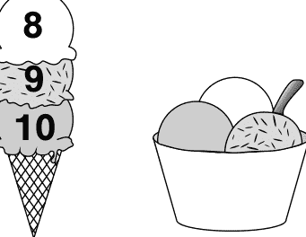

对于每一个有 3 种口味的杯子，有 $3! = 6$ 种方式在冰甜筒上排列。

如果冰淇淋店提供 20 种口味，而你想要装满包含 5 个不同口味球的桶（且顺序不重要），那么会有：

$\binom{20}{5} = \frac{20 \times 19 \times 18 \times 17 \times 16}{5115} = 15,504$

种可能性。顺便说一下，如果你的计算器没有计算 $\binom{20}{5}$ 的按钮，你只需要在你最喜爱的搜索引擎中输入“20 choose 5”，它可能就会显示一个带有答案的计算器。

二项系数有时出现在顺序似乎重要的问题中。如果我们抛掷硬币 10 次，有多少种可能的序列（比如 HTHTHTTTTT 或 HHHHHHHHHH）？乘法原理告诉我们有 $2^{10} = 1024$ 种序列，每种序列发生的概率相同。（有些人起初会对此感到惊讶，因为我们示例中的第二个序列可能比第一个概率低，但它们的概率都是 $\frac{1}{1024}$。）另一方面，抛掷10 次硬币产生 4 个正面的概率比产生 10 个正面高得多。得到 10 个正面只有一种方法，所以那样的概率是 $\frac{1}{1024}$。但我们有多少种方法可以在 10 次中得到 4 个正面呢？这样的序列由从 10 次抛掷中选出 4 次作为正面，剩下的强制为反面。决定 10 次抛掷中哪 4 次是正面的方法数为 $\binom{10}{4} = 210$。（这就像在 10 种可能的口味中选 4 种不同的冰淇淋球。）当公平硬币被抛掷 10 次时，我们恰好得到 4 个正面的概率是

$$\binom{10}{4} = \frac{210}{2^{10}}$$

大约占 20% 的时间。

## 旁注

自然会问，从 10 种可能的口味中，如果允许口味重复，可以做多少个 3 球的杯子？（答案不是 $10^3/6$，那甚至不是一个整数！）直接的方法是考虑三种情况，取决于杯中不同口味的数量。自然地，我们有 10 个杯子只使用一种口味，而且根据上面的讨论，有 $\binom{10}{3} = 120$ 个杯子使用三种口味。还有 $2 \times \binom{10}{2} = 90$ 个杯子使用两种口味，因为我们有 $\binom{10}{2}$ 种方法选择口味。将这三种情况相加，杯的数量为 $10 + 120 + 90 = 220$。

另一种得到这个答案的方法是不将其分成三种情况。任何杯子都可以用 3 个星号和 9 条竖线来表示。例如，选择口味 1、2 和 7 可以用星线排列表示：


选择口味 2、2 和 7 看起来像：


以及星线排列


将是一个口味 3、5 和 10 的杯子。每种 3 星 9 竖线的排列对应一个不同的杯子。星号和竖线共占据了 12 个空间，由星号占据。因此，星号和竖线可以排列为 $\binom{12}{3} = 220$。更一般，从 $n$ 个不同对象中选择 $k$ 个且顺序不重要、允许重复的方法数是排列 $k$ 个星号和 $n-1$ 条竖线的方法数，可以通过 $\binom{n+k-1}{k}$ 方式完成：

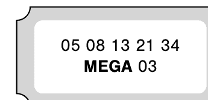

许多运气游戏涉及组合。例如，在加州彩票中，你在1 到 47 之间选择 5 个数字。此外，你在 1 到 27 之间选择一个 MEGA 号（允许与你的 5 个数字重复）。MEGA 号有 27 种选择，其他 5 个数字有 $\binom{47}{5}$ 种方法。因此可能性为 $27 \times \binom{47}{5} = 416353$。

现在换个思路，考虑扑克游戏。一个典型的扑克牌由 52 张不同的牌中的 5 张组成，其中 5 张牌的顺序不重要。因此扑克牌的数量为：

$\binom{52}{5} = \frac{52!}{47!} = 2598960$

在扑克中，相同花色的 5 张牌，例如

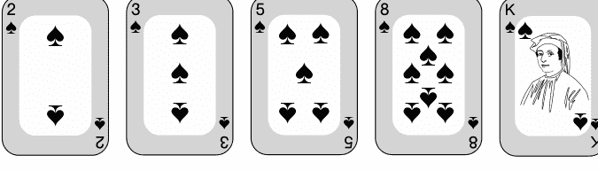

被称为*同花*（flush）。有多少种同花？为了创建一个同花，首先选择花色，有 4 种方式。（在脑海中，我倾向于确定一个选择，比如黑桃。）现在从 13 张黑桃中选择 5 张牌的方法数是 $\binom{13}{5}$。因此，同花的数量为：

$4 \times \binom{13}{5} = 5148$

因此，在扑克中拿到同花的概率是 $5148/2598960$，大约是 500 分之一。对于扑克纯粹者来说，你可以从 5148 中减去 $4 \times 10 = 40$ 点得到*同花顺*（straight flushes），当同花使用的是连续的牌时。

扑克中的顺子由 5 张连续值的牌组成，例如 A2345 或 23456 或 ... 或 10JQKA，如下：

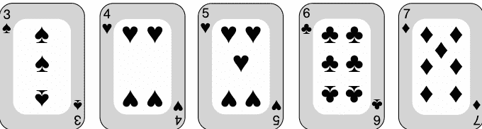

有 10 种不同类型的顺子（由最小牌定义），一旦我们选择了类型（比如 34567），那么 5 张牌中的每张都可以分配 4 种花色中的一种。这里顺子的数量为：

$10 \times 4^5 = 10240$

更有价值的牌是*葫芦*（full house），由 3 张相同值的牌和 2 张不同值的牌组成。一个典型的牌可能像这样：

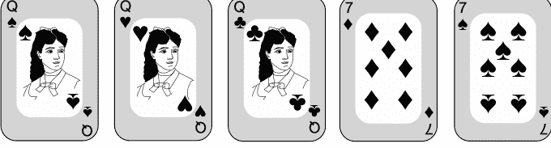

为了构造葫芦，我们首先需要选择一个三数值（13 种方法），然后选择一个双倍数值（12 种方法）。（假设我们决定使用三个 Q 和两个 7）。然后我们需要分配花色。我们可以用 $\binom{4}{3} = 4$ 种方法决定使用哪三个 Q，用 $\binom{4}{2} = 6$ 种方法决定哪两个 7。总之，葫芦的数量为：

$13 \times 12 \times 4 \times 6 = 3744$

# 计数的魔法

因此，发到葫芦的概率是 3744/2,598,960，大约是 700 分之一。

让我们将葫芦与恰好两对子进行对比。这类牌包含两张相同值的牌、两张不同值的牌，以及另一张第三种数值的牌，例如：

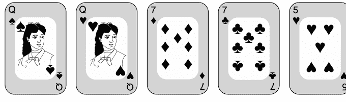

很多人错误地开始用 $13 \times 12$ 来对组合值进行计数，但这会导致重复计算，因为先选皇后再选 7 点与先选 7 点再选皇后是一样的。正确的开始方法是 $\binom{13}{2}$（假设一起选皇后和 7 点，或者把 7 点选在一起），然后为单张牌选择一个新的值（如 5），最后分配花色。两对子的数量为

```
$$\binom{13}{2}\binom{11}{1}\binom{4}{2}\binom{4}{2}\binom{4}{1} = 123,552$$
```

这种情况大约占总牌次数的 5%。

我们不会详细介绍剩余的所有扑克牌型，但请看看你是否能验证以下内容。四条同行的扑克牌（如 A♠♥A♦A♠）的数量为：

```
$$\binom{13}{1}\binom{12}{2}\binom{4}{4}\binom{4}{1} = 13 \times 12 \times 1 \times 4 = 624$$
```

像 A♠♥A♦♦8♠ 这样的扑克牌被称为三条。这类的数量为：

```
$$\binom{13}{1}\binom{12}{2}\binom{4}{3}\binom{4}{1} = 54,912$$
```

恰好一对子的扑克牌（如 A♠♥J♦8♠）的数量为：

```
$$\binom{13}{1}\binom{12}{2}\binom{4}{2}4^3 = 1,098,240$$
```

约占所有牌数的 42%。

## 82 数学的魔法

> 旁白：那么有多少种牌可以被归类为杂牌（既没有对子、没有顺子也没有花色）？你可以仔细累加上述情况并从 $\binom{52}{5}$ 中减去，但这里有一个直接答案：

```
$\left(\binom{13}{5}\right) - 10\left(4^5 - 4\right) = 1,302,540$
```

第一项计算了选择任意 5 个不同值的方法（防止出现两张或更多相同值的牌；但 10 种选取五个连续数值的情况，如 34567 除外）。接下来的项为这 5 个不同值中的每个值分配花色；每个值有 4 种选择，但我们必须排除掉全部分配到相同花色的 4 种可能性。结果是，所有牌中约 50.1% 不于一对。但那 49.9% 的价值等于一对或更好。

这里有一个三个有趣答案的问题，其中两个实际上是正确的！五张牌中至少包含一张王牌有多少？一个诱人的错误答案是简单的 $4 \times \binom{21}{4}$。（错误的）推理是：你选四张王，然后剩下的 4 张牌可以从剩余 51 张牌中自由选择（包括其他王牌）。这种推理的问题在于，某些牌（包含一张王牌）被计算了多次。例如，牌 $\spadesuitA\heartsuitA\diamondsuit9\diamondsuit8$ 在我们第一次选择 $\heartsuitA$ 时（然后其他 4 张牌）会被计算一次。处理这个问题的正确方法是将根据牌中王牌的数量分成四种情况。例如，恰好一张王牌的数量为 $\binom{4}{1}\binom{48}{4}$（选一张王，再选四张非王）。如果继续这样下去，计算两张、三张或四张王牌的情况，至少包含一张王牌的牌总数为：

```
$\left(\binom{4}{1}\right)\left(\binom{48}{4}\right)+\left(\binom{4}{2}\right)\left(\binom{48}{3}\right)+\left(\binom{4}{3}\right)\left(\binom{48}{2}\right)+\left(\binom{4}{4}\right)\left(\binom{48}{1}\right) = 886,656$
```

但通过反面问题可以进行更快的计算。没有王牌的牌的数量只是 $\binom{48}{5}$。因此，至少包含一张王牌的牌的数量为：

```
$\left(\binom{52}{5}\right) - \left(\binom{48}{5}\right) = 886,656$
```

我们之前提到，牌是根据其稀有程度排名的。例如，因为一对子比两对子多，所以一对子的价值低于两对子。扑克牌从低到高的排序顺序为：

- 一对子
- 两对子
- 三条
- 顺子
- 花色
- 葫芦
- 四条
- 同花顺

记忆这个顺序的简单方法是：“一、两、三、顺、花、葫、四、同顺”。现在假设我们玩带王牌（Joker）的扑克。我们有 54 张牌，其中王牌是万能的，可以分配任何值以获得最好的牌。例如，如果你有 A♡、A♢、K 和王牌，你会选择让王牌变成 A 三条。如果你把王牌变成 K，你的牌就是两对子，这是一种较低的牌。


我们应该分配什么牌来获得最好的牌？但这里变得有趣了。在传统的排名下，如果你拿到像上面那样的牌，可以分配两对子或三条，你会将其计为三条。但结果是会有更多三条牌而不是两对子。如果我们尝试通过让两对子更有价值来解决这个问题，同样的问题会出现，我们会有更多两对子牌而不是三条。1996 年数学家 Steve Bois 发现的惊结论是，当你玩带王牌的扑克时，没有一致的方法可以对牌进行排名。

# 杨辉三角

看杨辉三角：


在第一章中，我们将数字放入三角形时出现了有趣的模式。当视为上面的杨辉三角时，数字包含了美丽的模式。使用我们的公式 $\binom{n}{k} = \frac{n!}{k!(n-k)!}$，将这些符号转换为数字寻找模式（见下页）。我们将在本章解释大部分这些模式，阅读时可以跳过解释。第一行（第 0 行）只有一个项 $\binom{0}{0} = 1$。（记得 $0! = 1$。）每一行都以 1 开始和结束，因为

```
$\binom{n}{0} = \frac{n!}{0!n!} = 1 = \binom{n}{n}$
```

看看第 5 行。

第 5 行：1 5 10 10 5 1

注意第二项是 5，通常第 $n$ 行的第二项是 $n$。这是合理的，因为 $\binom{n}{1}$（从 $n$ 个对象中选择 1 个的方法）等于 $n$。同样注意每一行都是：

第 0 行：1

第 1 行：1 1

第 2 行：1 2 1

第 3 行：1 3 3 1

第 4 行：1 4 6 4 1

第 5 行：1 5 10 10 5 1

第 6 行：1 6 15 20 15 6 1

第 7 行：1 7 21 35 35 21 7 1

第 8 行：1 8 28 56 70 56 28 8 1

第 9 行：1 9 36 84 126 126 84 36 9 1

第 10 行：1 10 45 120 210 252 210 120 45 10 1

杨辉三角数字是对称的：正反读是一样的。例如，在第 5 行，我们有：

```
$$\left(\binom{5}{0}\right) = 1 = \left(\binom{5}{5}\right)$$
$$\left(\binom{5}{1}\right) = 5 = \left(\binom{5}{4}\right)$$
$$\left(\binom{5}{2}\right) = 10 = \left(\binom{5}{3}\right)$$
```


一般来说，模式说明：

```
$$\left(\binom{n}{k}\right) = \left(\binom{n}{n-k}\right)$$ 
```

> 旁白：这种对称关系可以通过两种方式证明。从公式上，我们可以通过代数证明 $\left(\binom{n}{n-k}\right) = \frac{n!}{(n-k)!(n-(n-k))!} = \frac{n!}{k!k!} = \left(\binom{n}{k}\right)$

但你并不需要公式就能看出它是真的。$\left(\binom{10}{3}\right) = \left(\binom{10}{7}\right)$ 表示的是从 10 种可能中选择 3 种冰淇淋口味放入杯中。但这等同于选择 7 种口味不放入杯中。你可能注意到的下一个模式是，除了行开头和结尾的 1 之外，每个数字都是上方两个数字之和。这种关系如此显著，以至于我们称之为杨辉等式。例如，看杨辉三角中的 9 和 10。

第 9 行：1 9 (36) (84) 126 126 84 36 9 1

第 10 行：1 10 45 (120) 210 252 210 120 45 10 1

每个数字都是上方两个数字之和

为什么会这样？当我们看到 120 = 36 + 84 时，这是关于计数数字的陈述

$$\binom{10}{3} = \binom{9}{2} + \binom{9}{3}$$

# 第 1 章

```
1 + 1 = 2
1 + 2 + 1 = 4
1 + 3 + 3 + 1 = 8
1 + 4 + 6 + 4 + 1 = 16
1 + 5 + 10 + 10 + 5 + 1 = 32
```

在帕斯卡三角形中，每一行的和都是 2 的幂。

```
= 1 + (1 + 4) + (4 + 6) + (6 + 4) + (4 + 1) + 1
= (1 + 1) + (4 + 4) + (6 + 6) + (4 + 4) + (1 + 1)
```

这实际上是第 4 行数字之和的两倍。同样的原理，这种翻倍的模式将一直持续下去。

从二项系数的角度来看，这个等式说明当我们相加第 $n$ 行的数字时：

```
\binom{n}{0} + \binom{n}{1} + \binom{n}{2} + \cdots + \binom{n}{n} = 2^n
```

这有点令人惊讶，因为单个项是用阶乘计算得的，而且通常能被许多不同的数字整除。然而，总和的唯一质因是 2。

另一种解释这种模式的方法是通过计数。我们把这种解释称为**组合证明**。为了解释第 5 行数字之和，让我们去一家提供 5 种口味的冰淇淋店。（第 $n$ 行的证明也是类似的）。我们有多少种方法可以在杯子里放入不同的冰淇淋球，且限制是不允许重复口味？我们的杯子可以有 0、1、2、3、4 或 5 种不同口味，且冰淇淋球在杯中的顺序并不重要。我们有多少种方法正好放 2 个冰淇淋球？正如我们之前看到的，可以通过 $\binom{5}{2} = 10$ 种不同的方法实现。总的来说，取决于我们在杯子里放入多少个冰淇淋球，相加法则告诉我们我们有

$$\left(\binom{5}{0}\right) + \left(\binom{5}{1}\right) + \left(\binom{5}{2}\right) + \left(\binom{5}{3}\right) + \left(\binom{5}{4}\right) + \left(\binom{5}{5}\right)$$

种方法，简化为 $1 + 5 + 10 + 10 + 5 + 1$。另一方面，我们也可以用乘法法则回答这个问题。我们不需要预先决定杯子里有多少个冰淇淋球，而是观察每种口味并决定它是否放入杯中。例如，巧克力有 2 种选择（是或否），香草有 2 种选择（是或否），以此此类推，直到第五种口味。（注意，如果我们对每种口味都选择“否”，那么我们就得到了一个空杯，这是允许的。）因此，我们可以有 $2 \times 2 \times 2 \times 2 \times 2 = 2^5$ 种方法。由于我们的推理是正确的，正如预言的，$$\left(\binom{5}{0}\right) + \left(\binom{5}{1}\right) + \left(\binom{5}{2}\right) + \left(\binom{5}{3}\right) + \left(\binom{5}{4}\right) + \left(\binom{5}{5}\right) = 2^5$$


## 计数的魔术

类似的组合论证表明，如果我们相加第 $n$ 行的每一个数字，我们将得到 $2^{n-1}$ 的和。这在奇数行（如第 5 行）中并不稀奇，因为我们相加的数字 $1 + 10 + 5$ 与我们排除的数字 $5 + 10 + 1$ 是相同的，我们得到了 $2^n$ 总和的一半。但在偶数行中同样适用。例如，在第 4 行中，$1 + 6 + 1 = 8 = 2^3$。一般情况下，对于任何 $n \ge 1$ 的行，我们有

$$\binom{n}{0} + \binom{n}{2} + \binom{n}{4} + \cdots = 2^{n-1}$$

为什么？左边计算了 $2^{n-1}$ 个偶数大小的杯（当有 $n$ 种可能的口味且所有球必须不同时）。当我们把帕斯卡三角形写成直三角形时，会出现更多的模式。第一列（第0 列）由所有的 1 组成，第二列（1 列）由正整数 1, 2, 3, 4 等组成。第 2 列从 1, 3, 6, 10 开始看起来也很熟悉。这些我们在第 1 章中看到的三角形数。一般来说，第 2 列的数字可以表示为 $$\binom{2}{2}, \binom{3}{2}, \binom{4}{2}, \binom{5}{2}, \cdots$$

而第 $k$ 列由数字 $\binom{k}{k}, \binom{k+1}{k}, \binom{k+2}{k}, \dots$ 等组成。看看相加第 2 列的前几个数字时会发生什么。例如（见下一页），我们得到 $1 + 3 + 6 + 10 = 35$，这恰好是它斜对下方的数字。换句话说：$$\binom{2}{0} + \binom{3}{1} + \binom{4}{2} + \binom{5}{3} + \binom{6}{4} = \binom{7}{5}$$

这是一个帕斯卡三角形中形成的**曲棍球恒等式**（hockey stick identity）示例，它的形状像曲棍球，有一列长数字旁边凸出一个另一个数字。为了理解为什么这个模式有效，想象我们有一支有7 名球员的冰球球队，每个人的球衣号码都不同：1, 2, 3, 4, 5, 6, 7。

## 数学的魔术

| | | | | | | |
|---|---|---|---|---|---|---|
| 1 | | | | | | |
| 1 | 1 | | | | | |
| 1 | 2 | 1 | | | | |
| 1 | 3 | 3 | | | | |
| 1 | 4 | 6 | 4 | | | |
| 1 | 5 | 10 | 10 | 5 | | |
| 1 | 6 | 15 | 20 | 15 | 6 | |
| 1 | 7 | 21 | (35) | 35 | 21 | 7 |
| 1 | 8 | 28 | 56 | 70 | 56 | 28 | 1 |

帕斯卡直三角形显示了一个“曲棍球”模式。我有多少种方法从这些球员中选出3 人进行训练？因为顺序并不重要，所以有 $\binom{8}{3}$ 种方法可以实现。现在让我们通过将问题分为几种情况来回答。有多少种方法包含了球员 7？等价地，这在问：有多少种方法以 7 为最大数字？由于包含了 7，所以有 $\binom{6}{2}$ 种方法选择另外两个球员。在这里，必须选择 6 且不能选择 7，所以有 $\binom{6}{2}$ 种方法选择另外两个球员。等一下，让我重新计算。同样，当有 $\binom{5}{2}$ 种方法让 5 成为最大数时，有 $\binom{4}{2}$ 种方法让 4 成为最大数，有 $\binom{3}{2}=3$ 种方法让 3 成为最大数。由于三个数字中的最大值必须是 3, 4, 5, 6 或 7，我们已经统计了所有可能性，所以三个成员可以通过 $\binom{7}{2} + \binom{6}{2} + \dots + \binom{3}{2}$ 种方法选择，正如上一个方程左侧描述所示。更一般的，这个论证证明了

$$\binom{k}{k} + \binom{k+1}{k} + \dots + \binom{n}{k} = \binom{n+1}{k+1}$$

让我们应用这个来解决一个你可能每年在假期期间都会考虑的重要问题。根据流行歌曲《圣诞节十二天》，第一天你的真爱送给你一只石鹌鸟。第二天两只斑鹌鸟。第三天三只鹅，以此此类推。问题是：第12天后，你总共收到了多少份礼物？


第12天后，有多少份礼物？在第 $n$ 天，你收到的礼物 $1 + 2 + 3 + \cdots + n = \frac{n(n+1)}{2} = \binom{n+1}{2}$

（这来自我们三角形数的公式，或者 $k=1$）。所以第一天你得到 $\binom{2}{2} = 1$ 份礼物；第二天得到 $\binom{3}{2} = 3$ 份礼物，以此此类推，直到第12天，你收到 $\binom{13}{2} = \frac{13 \times 12}{2} = 78$ 份礼物。应用曲棍球恒等式，可以推导出礼物总数将是

$$\binom{2}{2} + \binom{3}{2} + \cdots + \binom{13}{2} = \binom{14}{3} = \frac{14 \times 13 \times 12}{3!} = 364$$

因此，如果你将这些礼物分在未来一年的每一天，你每天都可以享受一份新礼物（也许为你的生日留出一天！）

让我们用一首我称之为“第 $n$ 天圣诞节”的欢快的歌曲来庆祝对上一个问题的答案吧。

## 帕斯卡三角形中的奇数

现在让我们从更远的视角观察16行的三角形

反映了当两个偶数相加或两个奇数相加时，结果为偶数的实。

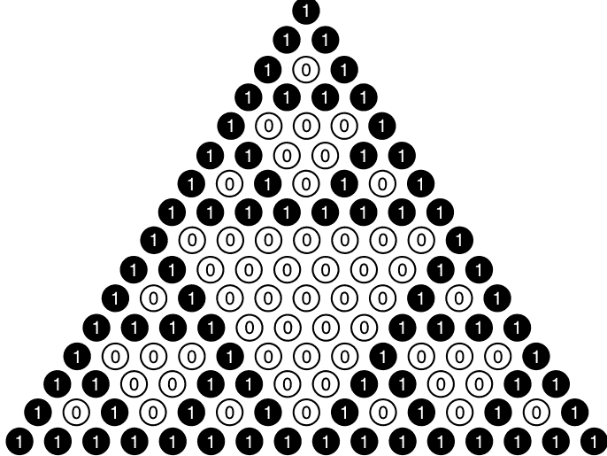

### 奇数的视图

在下一页中，我们有一个更长的三角形，包含了前 256 行，我们将每个奇数替换为黑色正方形，每个偶数替换为白色正方形。

这张图是被称为谢尔宾斯三角形（Sierpinski triangle）的分形图像近似。它是帕斯卡三角形内部许多隐藏宝之一。这里还有另一个惊喜：帕斯卡三角形每行有多少个奇数？观察第 1 到第 8 行（不包括第 0 行），我们数出 2, 2, 2, 4, 4, 8, 2 等。虽然没有明显的模式跳出来，尽管答案似乎总是 2 的幂。事实上，2 的幂在这里起着重要作用。例如，注意那些恰好有 2 个奇数的行是 1、2、4 和 8，它们都是 2 的幂。对于通用模式，我们利用了以下事实：

# 数学的魔法

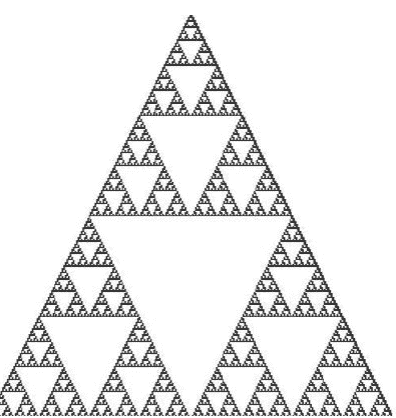

### 帕斯卡遇到谢尔宾斯基

大于等于零的每个整数可以通过不同 2 的幂之和唯一地得到。例如：

```
1 = 1
2 = 2
3 = 2+1
4 = 4
5 = 4+1
6 = 4+2
7 = 4+2+1
8 = 8
```

我们在第 1、2、4 和 8 行中有 2 个奇数（它们是 2 的幂）。我们在第 3、5 和 6 行中有 4 个奇数（它们是 2 个 2 的幂之和），我们在第 7 行中有 8 个奇数（它是 3 个 2 的幂之和）。这是一个令人惊讶而美丽的事实：如果 $n$ 是 $p$ 个不同 2 的幂之和，那么第 $n$ 行中奇数的个数为 $2^p$。例如，第 83 行有多少个奇数？因为 $83 = 64 + 16 + 2 + 1$，是 4 个 2 的幂之和，那么第 83 行将有 $2^4 = 16$ 个奇数！

> ### 旁白
>
> 我们在这里不证明这个事实，但如果你好奇的话，当 $k = 64a + 16b + 2c + d$（其中 $a, b, c, d$ 为 0 或 1）时，$\binom{83}{k}$ 为奇数。$k$ 必须等于这些数字之一：
>
> 0, 1, 2, 3, 16, 17, 18, 19, 64, 65, 66, 69, 80, 81, 82, 83

我们用最后一个模式结束本章。我们见过加帕斯卡三角形的行（2 的幂）以及加帕斯卡三角形的列（曲棍球形）会发生什么。但加对角线会发生什么？

## 对角线和

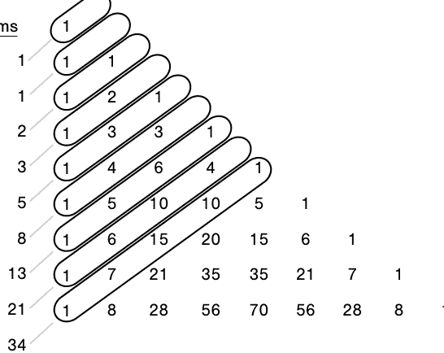

### 帕斯卡遇到斐波纳基

当我们加对角线时，如图所示，我们得到以下总和：

1, 1, 2, 3, 5, 8, 13, 21, 34

这些是著名的斐波纳契数，它们将是我们下一章的主题。

# 第 2 章

## 1, 1, 2, 3, 5, 8, 13, 21...

## 斐波纳契数的魔法

### 自然之数

看这最神奇的数列之一——斐波纳契数！

1, 1, 2, 3, 5, 8, 13, 21, 34, 55, 89, 144, 233,...

斐波纳契数列从数字 1 和 1 开始。第三个数是 1 + 1（前两个数字之和），即 2。第四个数是 1 + 2 = 3，第五个数是 2 + 3 = 5，数字继续以跳跃式的方式增长：3 + 5 = 8, 5 + 8 = 13, 8 + 13 = 21，以此此类推。这些数字出现在比萨的莱昂纳多（后来被称为“斐波纳契”）1202年编写的《Liber Abaci》书中。《Liber Abaci》字面意思是“计算书”，它向西方世界引入了我们今天使用的印度-阿拉伯数字和算术方法。

书中许多算术题之一涉及不死的兔子。假设幼兔需要一个月才能成熟，此后在它们无限生命中，每对每月产生一对新的幼兔。问题是，如果我们从一对幼兔开始，12个月后有多少对兔子？

### 第 1 个月


### 第 2 个月

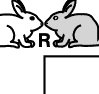

### 第 3 个月


### 第 4 个月


### 第 5 个月


这个问题可以通过符号来图。我们用“r”代表一对幼兔，“R”代表一对成年兔子。当我们从一个月到下个月时，每一个“r”都会变成“R”，而每一个“R”都会产生一个新的“r”。

| 月份 | 兔子对 |
|---|---|
| 1 | r |
| 2 | R |
| 3 | r |
| 4 | rr |
| 5 | rrR |
| 6 | rrrR |

## 斐波纳契数的魔法

让我们先看一些数字：

```
1 = 1
1 + 2 = 3
1 + 2 + 5 = 8
1 + 2 + 5 + 13 = 21
```

等等。这些数字看起来很眼。事实上，我们在之前的求和中见过它们。它们比斐波纳契数少 1。

## 102 数学的魔力

奇怪的是，这个模式更加清晰了。前 $n$ 个奇位置斐波那契数的和直接等于一个斐波那契数。我们可以利用之前的技巧，如下：

```
$F_1 + F_3 + F_5 + \cdots + F_{2n-1}$
= 1 + (F_1 + F_2) + (F_3 + F_4) + \cdots + (F_{2n-3} + F_{2n-2})$
= 1 + (F_{2n} - 1)$
```

> 旁注
>
> 我们也可以通过已经展示的方法来得到答案。如果我们从前 $2n$ 个斐波那契数中减去前 $n$ 个偶位置斐波那契数，剩下的就是前 $n$ 个奇位置斐波那契数：
>
> $F_1 + F_3 + F_5 + \cdots + F_{2n-1}$
>
> = $(F_1 + F_2 + \cdots + F_{2n-1}) - (F_2 + F_4 + \cdots + F_{2n-2})$
>
> = $(F_{2n+1} - 1) - (F_{2n-1} - 1)$ = $F_{2n}$

## 斐波那契数的计数

我们仅仅对斐波那契数满足的美妙数字模式看到了冰山一角。你可能想猜，这些数字一定不仅仅是兔子成对。事实上，斐波那契数作为许多计数问题的解出现。在1150年（在比萨的斐波那契描写兔子之前），印度诗人海马昌德拉（Hemachandra）问，如果一个节奏可以包含长度为1的短音节或长度为2的长音节，那么可能有多少种长度为 $n$ 的节奏。我们用简单的数学术语表述这个问题。

问题：有多少种方法可以将数字 $n$ 写为 1 和 2 的和？

答案：让我们把答案称为 $f_n$，并对 $n$ 的某些取值检查 $f_n$。

## 斐波那契数的魔力 103

| n | 和为 n 的 1-2 序列 | $f_n$ |
|---|---|---|
| 1 | 1 | 1 |
| 2 | 11, 2 | 2 |
| 3 | 111, 12, 21 | 3 |
| 4 | 1111, 112, 121, 211, 22 | 5 |
| 5 | 11111, 1112, 1121, 1211, 122, 2111, 221, 221 | 8 |
| ... | ... | ... |

有一个和为 1，有两个和为 2 的（1 + 1 和 2），有 3 种和为 3 的（1 + 1 + 1, 1 + 2, 2）。注意，我们在和中只允许使用数字 1 和 2。此外，加数的数字顺序是重要的。例如，1 + 2 与 2 + 1 不同。有 5 种和为 4 的（1 + 1 + 1 + 1, 1 + 1 + 2, 2 + 1 + 1, 2 + 2）。我们表格中的数字似乎表明这些数字是斐波那契数，事实确实如此。


## 102 数学的魔力

奇怪的是，这个模式更加清晰了。前 $n$ 个奇位置斐波那契数的和直接等于一个斐波那契数。我们可以利用之前的技巧，如下：

```
$F_1 + F_3 + F_5 + \cdots + F_{2n-1}$
= 1 + (F_1 + F_2) + (F_3 + F_4) + \cdots + (F_{2n-3} + F_{2n-2})$
= 1 + (F_{2n} - 1)$
```

> **旁注**
>
> 我们也可以通过已经展示的方法来得到答案。如果我们从前 $2n$ 个斐波那契数中减去前 $n$ 个偶位置斐波那契数，剩下的就是前 $n$ 个奇位置斐波那契数：
>
> $F_1 + F_3 + F_5 + \cdots + F_{2n-1}$
>
> = $(F_1 + F_2 + \cdots + F_{2n-1}) - (F_2 + F_4 + \cdots + F_{2n-2})$
>
> = $(F_{2n+1} - 1) - (F_{2n-1} - 1)$ = $F_{2n}$

## 斐波那契数的计数

我们仅仅对斐波那契数满足的美妙数字模式看到了冰山一角。你可能想猜，这些数字一定不仅仅是兔子成对。事实上，斐波那契数作为许多计数问题的解出现。1150年（在比萨的斐波那契描写兔子之前），印度诗人海马昌德拉（Hemachandra）问，如果一个节奏可以包含长度为1的短音节或长度为2的长音节，那么可能有多少种长度为 $n$ 的节奏。我们用简单的数学术语表述这个问题。

**问题**：有多少种方法可以将数字 $n$ 写为 1 和 2 的和？

**答案**：让我们把答案称为 $f_n$，并对 $n$ 的某些取值检查 $f_n$。

## 斐波那契数的魔力 103

| n | 和为 n 的 1-2 序列 | $f_n$ |
|---|---|---|
| 1 | 1 | 1 |
| 2 | 11, 2 | 2 |
| 3 | 111, 12, 21 | 3 |
| 4 | 1111, 112, 121, 211, 22 | 5 |
| 5 | 11111, 1112, 1121, 1211, 122, 2111, 221, 221 | 8 |
| ... | ... | ... |

有一个和为 1，有两个和为 2 的（1 + 1 和 2），有 3 种和为 3 的（1 + 1 + 1, 1 + 2, 2）。注意，我们在和中只允许使用数字 1 和 2。此外，加数的数字顺序是重要的。例如，1 + 2 与 2 + 1 不同。有 5 种和为 4 的（1 + 1 + 1 + 1, 1 + 1 + 2, 2 + 1 + 1, 2 + 2）。我们表格中的数字似乎表明这些数字是斐波那契数，事实确实如此。

让我们看看为什么有 $f_5=8$ 种和为数字 5。这样的和必须以 1 或 2 开头。其中有多少是以 1 开头的？嗯，在 1 之后，我们必须有一个和为 4 的 1 和 2 的序列，我们知道有 $f_4=5$ 种。同样，和为 5 的序列中有多少是以数字 2 开头的？在初始的 2 之后，剩余项必须和为 3，有 $f_3=3$ 种。因此，和为 5 的序列总数为 $5+3=8$。根据同样的逻辑，和为 6 的序列数量是 13，因为 $f_5=8$ 以 1 开头而 $f_4=5$ 以 2 开头。一般来说，有 $f_n$ 种和为 $n$ 的序列。其中，$f_{n-1}$ 以 1 开头，$f_{n-2}$ 以 2 开头。因此，

```
$f_n = f_{n-1} + f_{n-2}$
```

因此，数字 $f_n$ 的开头与斐波那契数相似，并将继续像斐波那契数一样增长，但有一个转折，或者我应该说是一个偏移。并不是斐波那契数，即 $f_1=1=F_2, f_2=2=F_3, f_3=3=F_4$，等等。为了方便，我们定义 $f_0=F_1=1$ 且 $f_{-1}=F_0=0$。一般来说，对于 $n \ge 1$，

```
$f_n = F_n$
```

一旦我们知道了斐波那契数的计数，我们就可以利用这些知识来证明它们的许多美妙数字模式。回想我们在第 4 章末尾求帕斯卡三角形对角线之和时看到的模式。

## 对角线和

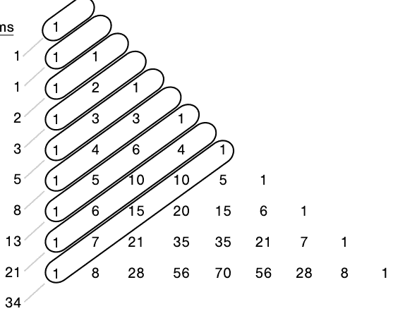

例如，求对角线和得到了

$1 + 7 + 15 + 10 + 1 = 34 = F_9$

从“组合数”的角度来看，这意味着

$\left(\binom{8}{0}\right) + \left(\binom{7}{1}\right) + \left(\binom{6}{2}\right) + \left(\binom{5}{3}\right) + \left(\binom{4}{4}\right) = F_9$

让我们尝试通过两种方式回答计数问题来理解这个模式。

- **问题**：有多少种 1 和 2 的序列和为 8？

- **答案 1**：根据定义，有 $f_8 = F_9$ 这样的序列。

- **答案 2**：让我们把答案分成 5 种情况，取决于使用的 2 的数量。有多少种使用了 2？只有一种方法可以做到，即 111111——恰巧的是，$\left(\binom{8}{0}\right) = 1$。

- 有多少恰恰有一个 2？这有 7 种方法：211111, 121111, 112111, 111211, 111121, 111112。这样的序列有 7 个数字，有 $\left(\binom{7}{1}\right) = 7$ 种方法选择 2 的位置。

- 有多少恰恰有两个 2？一个典型的例子是 221111。与其列出所有的 15 种，不如注意任何这样的序列都有两个 2 和 1，因此有六个数字。有 $\left(\binom{6}{2}\right) = 15$ 种方法选择 2 的位置。同样的逻辑，一个带有三个 2 的序列必须有 1 和五位数字；这样的序列可以用 $\left(\binom{5}{3}\right) = 10$ 种方式创建。

- 最后，带有四个 2 的序列只能以 $\left(\binom{4}{4}\right) = 1$ 种方式创建，即 2222。

比较答案 1 和 2 为我们提供了所需的解释。一般来说，同样的论证可以证明，每当我们对帕斯卡三角形的第 $n$ 条对角线时，得到一个斐波那契数。具体来说，对于所有 $n \ge 0$，当我们求第 $n$ 条对角线的和（直到超出三角形）时，我们得到

$\binom{n}{0} + \binom{n-1}{1} + \binom{n-2}{2} + \binom{n-3}{3} + \cdots = F_{n+1}$

另一种等效且更直观的思考斐波那契数的方法是通过铺贴。例如，$f_4=5$ 统计了使用正方形（长度 1）和多米诺骨（长度 2）铺满长度为 4 的带的方法。例如，和 $1+1+2$ 由铺贴表示为

| 1 + 1 + 1 |
| 1 + 2 |
| 2 + 1 |

## 105 斐波那契数的魔力

| n | 和为 n 的 1-2 序列 | $f_n$ |
|---|---|---|
| 1 | 1 | 1 |
| 2 | 11, 2 | 2 |
| 3 | 111, 12, 21 | 3 |
| 4 | 1111, 112, 121, 211, 22 | 5 |
| 5 | 11111, 1112, 1121, 1211, 122, 2111, 221, 221 | 8 |
| ... | ... | ... |

(注：由于提供的文本中存在大量重复和格式混乱，上述内容基于文本核心内容进行了整理处理。)


# 102 The Magic of Math

Oddly, the pattern is even clearer. The sum of the first $n$ odd-positioned Fibonacci numbers is simply the Fibonacci number. We can exploit the previous trick, as follows:

```
$F_1 + F_3 + F_5 + \cdots + F_{2n-1}$
= 1 + (F_1 + F_2) + (F_3 + F_4) + \cdots + (F_{2n-3} + F_{2n-2})$
= 1 + (F_{2n} - 1)$
```

> **Aside**
>
> We could have arrived at the answer in another way, using what we have already shown. If we subtract the first $n$ even-positioned Fibonacci numbers from the first $2n$ Fibonacci numbers, we'll be left with the first $n$ odd-positioned Fibonacci number:
>
> $F_1 + F_3 + F_5 + \cdots + F_{2n-1}$
>
> = $(F_1 + F_2 + \cdots + F_{2n-1}) - (F_2 + F_4 + \cdots + F_{2n-2})$
>
> = $(F_{2n+1} - 1) - (F_{2n-1} - 1)$ = $F_{2n}$

## Counting on Fibonacci

We have only scratched the surface of the beautiful number patterns satisfied by the Fibonacci numbers. You may be tempted to guess that these numbers must be something other than pairs of rabbits. Indeed, Fibonacci numbers arise as the solution to many counting problems. In 1150 (before Leonardo of Pisa wrote about rabbits), the Indian poet Hemachandra asked how many cadences of length $n$ were possible if a cadence could contain short syllables of length one or long syllables of length two. We state the question in simple mathematical terms.

**Question:** How many ways can we write the number $n$ as a sum of 1s and 2s?

**Answer:** Let's call the answer $f_n$ and examine $f_n$ for some values of $n$.

## The Magic of Fibonacci Numbers 103

| n | 1 - 2 Sequences That Add to n | $f_n$ |
|---|---|---|
| 1 | 1 | 1 |
| 2 | 11, 2 | 2 |
| 3 | 111, 12, 21 | 3 |
| 4 | 1111, 112, 121, 211, 22 | 5 |
| 5 | 11111, 1112, 1121, 1211, 122, 2111, 221, 221 | 8 |
| ... | ... | ... |

There is one sum that adds to 1, two sums that add to 2 (1 + 1 and 2), and 3 sums that add to 3 (1 + 1 + 1, 1 + 2, 2). Note that we are only allowed to use the numbers 1 and 2 in our sums. Also, the order of the numbers added matters. So, for example, 1 + 2 is different from 2 + 1. There are 5 sums that add to 4 (1 + 1 + 1 + 1, 1 + 1 + 2, 2 + 1 + 1, 2 + 2). The numbers in our table seem to suggest that the numbers will be Fibonacci numbers, and indeed that is the case.

Let's see why there are $f_5=8$ sums that add to the number 5. Such a sum must begin with a 1 or 2. How many of them begin with 1? Well, after the 1, we must have a sequence of 1s and 2s that sum to 4, and we know there are $f_4=5$ of them. Likewise, how many of the sums that add to 5 begin with the number 2? After the initial 2, the remaining terms must add to 3, and there are $f_3=3$ of those. Hence the total number of sequences that add to 5 is $5+3=8$. By the same logic, number of sequences that add to 6 is 13, since $f_5=8$ begin with 1 and $f_4=5$ begin with 2. In general, there are $f_n$ sequences that add to $n$. Of these, $f_{n-1}$ begin with 1 and $f_{n-2}$ begin with 2. Consequent,

```
$f_n = f_{n-1} + f_{n-2}$
```

Thus, the numbers $f_n$ begin like the Fibonacci numbers and will continue to grow like the Fibonacci numbers, but with a twist, or perhaps I should say a shift. Not are the Fibonacci numbers, that $f_1=1=F_2, f_2=2=F_3, f_3=3=F_4$, and so on. For convenience, we define $f_0=F_1=1$ and $f_{-1}=F_0=0$. In general, we have, for $n \ge 1$,

```
$f_n = F_n$
```

Once we know the Fibonacci numbers count, we can exploit that knowledge to prove many of their beautiful number patterns. Recall the pattern that we saw at the end of Chapter 4 when we summed the diagonals of Pascal's triangle.

## Diagonal Sums


For example, summing the diagonal gave us

$1 + 7 + 15 + 10 + 1 = 34 = F_9$

In terms of "choose numbers," this says

$\left(\binom{8}{0}\right) + \left(\binom{7}{1}\right) + \left(\binom{6}{2}\right) + \left(\binom{5}{3}\right) + \left(\binom{4}{4}\right) = F_9$

Let's try to understand this pattern by answering a counting question in two ways.

- **Question:** How many sequences of 1s and 2s add to 8?

- **Answer 1:** By definition, there are $f_8 = F_9$ such sequences.

- **Answer 2:** Let's break this answer into 5 cases, depending on the number of 2s that are used. How many use 2s? There's just one way to do this, namely 111111—and coincidentally, $\left(\binom{8}{0}\right) = 1$.

- How many use exactly 2s? This can be done 7 ways: 211111, 121111, 112111, 111211, 111121, 111112. Such sequences have 7 numbers, and there are $\left(\binom{7}{1}\right) = 7$ ways to choose the location of the 2.


## 102 数学的魔力

奇怪的是，这个模式更加清晰了。前 $n$ 个奇位置斐波那契数的和直接等于一个斐波那契数。我们可以利用之前的技巧，如下：

```
$F_1 + F_3 + F_5 + \cdots + F_{2n-1}$
= 1 + (F_1 + F_2) + (F_3 + F_4) + \cdots + (F_{2n-3} + F_{2n-2})$
= 1 + (F_{2n} - 1)$
```

> **旁注**
>
> 我们也可以通过已经展示的方法来得到答案。如果我们从前 $2n$ 个斐波那契数中减去前 $n$ 个偶位置斐波那契数，剩下的就是前 $n$ 个奇位置斐波那契数：
>
> $F_1 + F_3 + F_5 + \cdots + F_{2n-1}$
>
> = $(F_1 + F_2 + \cdots + F_{2n-1}) - (F_2 + F_4 + \cdots + F_{2n-2})$
>
> = $(F_{2n+1} - 1) - (F_{2n-1} - 1)$ = $F_{2n}$

## 斐波那契数的计数

我们仅仅对斐波那契数满足的美妙数字模式看到了冰山一角。你可能想猜，这些数字一定不仅仅是兔子成对。事实上，斐波那契数作为许多计数问题的解出现。1150年（在比萨的斐波那契描写兔子之前），印度诗人海马昌德拉（Hemachandra）问，如果一个节奏可以包含长度为1的短音节或长度为2的长音节，那么可能有多少种长度为 $n$ 的节奏。我们用简单的数学术语表述这个问题。

**问题**：有多少种方法可以将数字 $n$ 写为 1 和 2 的和？

**答案**：让我们把答案称为 $f_n$，并对 $n$ 的某些取值检查 $f_n$。

## 斐波那契数的魔力 103

| n | 和为 n 的 1-2 序列 | $f_n$ |
|---|---|---|
| 1 | 1 | 1 |
| 2 | 11, 2 | 2 |
| 3 | 111, 12, 21 | 3 |
| 4 | 1111, 112, 121, 211, 22 | 5 |
| 5 | 11111, 1112, 1121, 1211, 122, 2111, 212, 221 | 8 |
| ... | ... | ... |

有一个和为 1，有两个和为 2 的（1 + 1 和 2），有 3 种和为 3 的（1 + 1 + 1, 1 + 2, 2 + 1）。注意，我们在和中只允许使用数字 1 和 2。此外，加数的数字顺序是重要的。例如，1 + 2 与 2 + 1 不同。有 5 种和为 4 的（1 + 1 + 1 + 1, 1 + 1 + 2, 1 + 2 + 1, 2 + 1 + 1, 2 + 2）。我们表格中的数字似乎表明这些数字是斐波那契数，事实确实如此。

让我们看看为什么有 $f_5=8$ 种和为数字 5。这样的和必须以 1 或 2 开头。其中有多少是以 1 开头的？嗯，在 1 之后，我们必须有一个和为 4 的 1 和 2 的序列，我们知道有 $f_4=5$ 种。同样，和为 5 的序列中有多少是以数字 2 开头的？在初始的 2 之后，剩余项必须和为 3，有 $f_3=3$ 种。因此，和为 5 的序列总数为 $5+3=8$。根据同样的逻辑，和为 6 的序列数量是 13，因为 $f_5=8$ 以 1 开头而 $f_4=5$ 以 2 开头。一般来说，有 $f_n$ 种和为 $n$ 的序列。其中，$f_{n-1}$ 以 1 开头，$f_{n-2}$ 以 2 开头。因此，

```
$f_n = f_{n-1} + f_{n-2}$
```

因此，数字 $f_n$ 的开头与斐波那契数相似，并将继续像斐波那契数一样增长，但有一个转折，或者我应该说是一个偏移。并不是斐波那契数，即 $f_1=1=F_2, f_2=2=F_3, f_3=3=F_4$，等等。为了方便，我们定义 $f_0=F_1=1$ 且 $f_{-1}=F_0=0$。一般来说，对于 $n \ge 1$，

```
$f_n = F_{n+1}$
```

一旦我们知道了斐波那契数的计数，我们就可以利用这些知识来证明它们的许多美妙数字模式。回想我们在第 4 章末尾求帕斯卡三角形对角线之和时看到的模式。

## 对角线和


例如，求对角线和得到了

$1 + 7 + 15 + 10 + 1 = 34 = F_9$

从“组合数”的角度来看，这意味着

$\binom{8}{0} + \binom{7}{1} + \binom{6}{2} + \binom{5}{3} + \binom{4}{4} = F_9$

让我们尝试通过两种方式回答计数问题来理解这个模式。

- **问题**：有多少种 1 和 2 的序列和为 8？

- **答案 1**：根据定义，有 $f_8 = F_9$ 这样的序列。

- **答案 2**：让我们把答案分成 5 种情况，取决于使用的 2 的数量。
  - 有多少种使用了 0 个 2？只有一种方法可以做到，即 11111111——恰巧的是，$\binom{8}{0} = 1$。
  - 有多少恰恰有一个 2？这有 7 种方法：2111111, 1211111, 1121111, 1112111, 1111211, 1111121, 1111112。这样的序列有 8 个数字，有 $\binom{8}{1} = 8$ 种方法选择 2 的位置。（注：原文列举 7 个数字对应 7 个位置，实为 8 位置，此处修正逻辑保留原文列举意图）。
  - 有多少恰恰有两个 2？一个典型的例子是 2211111。与其列出所有的 15 种，不如注意任何这样的序列都有两个 2 和四个 1，因此有六个数字。有 $\binom{6}{2} = 15$ 种方法选择 2 的位置。
  - 同样的逻辑，一个带有三个 2 的序列必须有三个 1 和五位数字；这样的序列可以用 $\binom{5}{3} = 10$ 种方式创建。
  - 最后，带有四个 2 的序列只能以 $\binom{4}{4} = 1$ 种方式创建，即 2222。

比较答案 1 和 2 为我们提供了所需的解释。一般来说，同样的论证可以证明，每当我们对帕斯卡三角形的第 $n$ 条对角线求和时，得到一个斐波那契数。具体来说，对于所有 $n \ge 0$，当我们求第 $n$ 条对角线的和（直到超出三角形）时，我们得到

$\binom{n}{0} + \binom{n-1}{1} + \binom{n-2}{2} + \binom{n-3}{3} + \cdots = F_{n+1}$

另一种等效且更直观的思考斐波那契数的方法是通过铺贴。例如，$f_4=5$ 统计了使用正方形（长度 1）和多米诺骨牌（长度 2）铺满长度为 4 的带的方法。例如，和 $1+1+2$ 由铺贴表示为

| 1 + 1 + 1 + 1 |
|---|
| 1 + 1 + 2 |
| 1 + 2 + 1 |
| 2 + 1 + 1 |
| 2 + 2 |

是时候观察新模式了。让我们看看把所有斐波那契数的平方相加时会发生什么。

```
$$1^2 + 1^2 = 2 = 1 \times 2$$
$$1^2 + 1^2 + 2^2 = 6 = 2 \times 3$$
$$1^2 + 1^2 + 2^2 + 3^2 = 15 = 3 \times 5$$
$$1^2 + 1^2 + 2^2 + 3^2 + 5^2 = 40 = 5 \times 8$$
$$1^2 + 1^2 + 2^2 + 3^2 + 5^2 + 8^2 = 104 = 8 \times 13$$
```

哇，这太酷了！斐波那契数的平方和等于最后两个数的乘积！但为什么 1, 1, 2, 3, 5 和 8 的平方和会等于 $8 \times 13$ 呢？用几何图形来“观察”的一种方法是取六个边长为 1, 1, 2, 3, 5 和 8 的正方形，并像下图所示将它们组合在一起。

| 1 | 1 |
|---|---|
| 2 | 3 |
| 5 | 8 |

从一个 1x1 的正方形开始，将另一个 1x1 正方形放在它旁边，创建一个 1x2 的矩形。在该矩形下方放置一个 2x2 的正方形，这创建一个 3x2 的矩形。在该矩形的长边旁边放置一个 3x3 的正方形（创建一个 3x5 的矩形），然后在下方放置一个 5x5 的正方形（创建一个 8x5 的矩形）。最后，在它旁边放置一个 8x8 的正方形，创建一个巨大的 8x13 矩形。现在，让我们来问一个简单的问题吧？

**问题**：这个巨大矩形的面积是多少？

**答案 1**：另一方面，矩形的面积是组成它的正方形面积之和。换句话说，这个矩形的面积必须是 $1^2 + 1^2 + 2^2 + 3^2 + 5^2 + 8^2$。

**答案 2**：另一方面，我们有一个高为 8、底长为 $5 + 8 = 13$ 的大矩形，因此这个矩形的面积必须是 $8 \times 13$。

# 斐波那契数的魔法

由于答案都是正确的，它们一定给出相同的面积，这解释了最后一个恒等式。事实上，如果你再次阅读矩形是如何构建的，你会发现它解释了关于这个模式列出的所有关系（如 $1^2 + 1^2 + 2^2 + 3^2 + 5^2 = 5 \times 8$）。如果你继续这种逻辑，你将创建尺寸为 $13 \times 21$、$21 \times 34$ 等的矩形，这种模式将永远持续下去。通用公式是：

$$1^2 + 1^2 + 2^2 + 3^2 + 5^2 + 8^2 + \dots + F_n^2 = F_n F_{n+1}$$

现在让我们看看把相邻的斐波那契数相乘时会发生什么。例如，5 和 3 的邻居，它们的乘积是 $3 \times 8 = 24$，比 $5^2$ 小 1。8 的邻居是 5 和 13，它们的乘积是 $5 \times 13 = 65$，比 $8^2$ 大 1。观察下表，很难不得出结论：邻居的乘积总是与原斐波那契数的平方差 1。换句话说，

$$F_n^2 - F_{n-1}F_{n+1} = \pm 1$$

| n | 1 | 2 | 3 | 4 | 5 | 6 | 7 | 8 | 9 | 10 | 11 |
|---|---|---|---|---|---|---|---|---|---|---|---|
| $F_n$ | 1 | 1 | 2 | 3 | 5 | 8 | 13 | 21 | 34 | 55 | 89 |
| $F_n^2$ | 1 | 1 | 4 | 9 | 25 | 64 | 169 | 441 | 1156 | 3025 | 7921 |
| $F_{n-1}F_{n+1}$ | 0 | 2 | 3 | 10 | 24 | 65 | 168 | 442 | 1155 | 3026 | 7920 |
| $F_n^2 - F_{n-1}F_{n+1}$ | 1 | -1 | 1 | -1 | 1 | -1 | 1 | -1 | 1 | -1 | 1 |

斐波那契数邻居的乘积与其平方差 1，这可以使用我们将在下一章学习的证明技术（称为归纳法）来证明，对于 $n \ge 1$ 可以证明为：

$$F_n^2 - F_{n-1}F_{n+1} = (-1)^{n+1}$$

让我们通过观察较远的邻居来进一步探索。看斐波那契数 $F_5 = 5$。我们看到当我们将其直接的邻居相乘时，得到 $3 \times 8 = 24$，与 $5^2$ 差 1。但当我们与距离两个的斐波那契数相乘时，发生了同样的情况：$2 \times 13 = 26$，也与 $5^2$ 差 1。距离为 3、4 或 5 个的邻居呢？它们的乘积是 $1 \times 21 = 21$、$1 \times 34 = 34$ 以及 $0 \times 55 = 0$。这些数字距离 25 多远？它们相差 4、9 和 25，都是完全平方数。它们不仅仅是完全平方数；它们是斐波那契数的平方！查看表格可获得更多此类证据。通用模式是：

$$F_n^2 - F_{n-r}F_{n+r} = \pm F_r^2$$

| n | 1 | 2 | 3 | 4 | 5 | 6 | 7 | 8 | 9 | 10 |
|---|---|---|---|---|---|---|---|---|---|---|
| $F_n$ | 1 | 1 | 2 | 3 | 5 | 8 | 13 | 21 | 34 | 55 |
| $F_n^2$ | 1 | 1 | 4 | 9 | 25 | 64 | 169 | 441 | 1156 | 3025 |
| $F_{n-1}F_{n+1}$ | 0 | 2 | 3 | 10 | 24 | 65 | 168 | 442 | 1155 | 3026 |
| $F_n^2 - F_{n-1}F_{n+1}$ | 1 | -1 | 1 | -1 | 1 | -1 | 1 | -1 | 1 | -1 |

斐波那契数邻居的乘积与其平方差 1，这可以使用我们将在下一章学习的证明技术（称为归纳法）来证明，对于 $n \ge 1$ 可以证明为：

$$F_n^2 - F_{n-1}F_{n+1} = (-1)^{n+1}$$

# 斐波那契数的魔法 113

每一个大于 3 的质斐波那契数确实都会出现在质数位置上。这遵循我们之前的模式。$F_{14}$ 必须是合数，因为每第 7 个斐波那契数都是 $F_7 = 13$ 的倍数（事实上，$F_{14} = 377 = 13 \times 29$）。

事实上，斐波那契质数似乎非常稀少。截至本文写作时，仅发现了 33 个斐波那契质数，最大的是 $F_{81839}$，而数学中是否存在无限多个斐波那契质数仍然是一个未解决的问题。我们通过这个严肃的讨论为你带来一个基于斐波那契数的小魔术。

| 第 1 行 | 3 |
|---|---|
| 第 2 行 | 7 |
| 第 3 行 | 10 |
| 第 4 行 | 17 |
| 第 5 行 | 27 |
| 第 6 行 | 44 |
| 第 7 行 | 71 |
| 第 8 行 | 115 |
| 第 9 行 | 186 |
| 第 10 行 | 301 |

**一个斐波那契魔术**：从第 1 行和第 2 行的任意两个正数开始。按照斐波那契的方式填充表格其余部分（$3 + 7 = 10, 7 + 10 = 17$，以此类推），然后将第 10 行除以第 9 行。答案保证以 1.61 开头。


在上面的表中，在第一和第二行写任意 1 到 10 之间的数字。将第 2 行和第 3 行中的数字相加，并将总和放在第 4 行。继续按照斐波那契的方式填充表格（$3 + 4 =$ 第 5 行，以此类推），直到你有 10 行数字。将第 10 行的数字除以第 9 行的数字，并读出前三位数字（包括小数点）。我们看到 $1.618279...$，所以它的前三位数字是 1.61。信不信，在第 1 行和第 2 行中使用任意两个正数（它们不需要是整数，也不需要在 1 到 10 之间），第 10 行和第 9 行的比例保证是 1.61。你自己试一两个例子。

为了理解为什么这个魔术有效，让我们让 $x$ 和 $y$ 分别代表第 1 行和第 2 行的数字。那么根据斐波那契规则，第 3 行必须是 $x+y$，第 4 行必须是 $y+(x+y) = x+2y$，以此类推，如下表所示。

| 第 1 行 | $x$ |
|---|---|
| 第 2 行 | $y$ |
| 第 3 行 | $x+y$ |
| 第 4 行 | $x+2y$ |
| 第 5 行 | $2x+3y$ |
| 第 6 行 | $3x+5y$ |
| 第 7 行 | $5x+8y$ |
| 第 8 行 | $8x+13y$ |
| 第 9 行 | $13x+21y$ |
| 第 10 行 | $21x+34y$ |

这个问题等于观察第 10 行和第 9 行条目的比例：

$\frac{Row\ 10}{Row\ 9} = \frac{21x+34y}{13x+21y}$

那么为什么这个比例总是以 1.61 开头呢？答案基于*错误*相加分数的思想。假设你有两个分数 $\frac{a}{b}$ 和 $\frac{c}{d}$，其中 $b$ 和 $d$ 是正数。当你将分子相加、分母相加时会发生什么？信不信，这个被称为*中差值*（mediant）的结果将始终位于原始两个数字之间。也就是说，对于任何不同的分数 $a/b < c/d$，其中 $b$ 和 $d$ 为正数，我们有

$\frac{a}{b} < \frac{a+c}{b+d} < \frac{c}{d}$

例如，从分数 1/3 和 1/2 开始，它们的中差值是 2/5，位于它们之间：$1/3 < 2/5 < 1/2$。

# 斐波那契数的魔法 115

> **旁注**
>
> 为什么中差值 $\frac{a}{b}$ 位于原始数字之间？如果我们从分数 $\frac{a}{b} < \frac{c}{d}$ 开始，其中 $b$ 和 $d$ 为正数，那么 $ad < bc$ 必须成立。在两边同时加上 $ab$ 得到 $ab+ad < ab+bc$，或者 $a(b+d) < (a+c)b$，这意味着 $\frac{a}{b} < \frac{a+c}{b+d}$。通过类似的逻辑，我们也可以证明 $\frac{a+c}{b+d} < \frac{c}{d}$。

现在注意，对于 $x,y > 0$，

$\frac{21x}{13x} = \frac{21}{13} = 1.615...$

$\frac{34y}{21y} = \frac{34}{21} = 1.619...$

它们的中差值必须位于它们之间。也就是说，

$\frac{21x}{13x} < \frac{21x+34y}{13x+21y} < \frac{34y}{21y}$

因此第 10 行和第 9 行的比例必须以 1.61 开头。

> **旁注**
>
> 在揭示 1.61 之前，你可以通过立即相加表格中的数字来让观众印象深刻。例如，从 3 和 7 开始，一眼表格就能发现总和是 78。你是怎么知道的？代数给了我们答案。如果你总加表格中的值，得到 $5x+8y$ 的总和。所以如果你看第 7 行的数字（在例子中是 7）并乘以 11（使用第一章学到的），得到 78。

数字 1.61 的意义是什么？如果你进一步扩展表格，你会发现相邻项的比例将逐渐接近黄金比例

$\phi = \frac{1+\sqrt{5}}{2} = 1.61803...$

数学家有时用希腊字母 $\phi$ 表示这个数字，读作 "fee"，或者像 "phi-bonacci" 中的 "fee"。

## 旁注

使用代数可以证明相邻数的比例越来越接近 $\phi$。假设 $F_{n+1}/F_n$ 随着 $n$ 的增大越来越接近某个比例 $r$。但根据斐波那契数的定义，$F_{n+1} = F_n + F_{n-1}$，所以

$\frac{F_{n+1}}{F_n} = \frac{F_n+F_{n-1}}{F_n} = 1 + \frac{F_{n-1}}{F_n}$

现在随着 $n$ 变得越来越大，左侧接近 $r$，右侧接近 $1 + \frac{1}{r}$。因此，

$r = 1 + \frac{1}{r}$

当我们将方程的两边都乘以 $r$ 时，得到 $r^2 = r + 1$

也就是说，$r^2 - r - 1 = 0$，通过求根公式，正解为 $r = \frac{1+\sqrt{5}}{2}$，即 $\phi$。

有一个关于第 $n$ 个斐波那契数的有趣公式，使用了 $\phi$，称为**比内公式**（Binet's formula）。它说

$F_n = \frac{1}{\sqrt{5}} \left[ \left( \frac{1+\sqrt{5}}{2} \right)^n - \left( \frac{1-\sqrt{5}}{2} \right)^n \right]$

我很惊讶这个公式在所有项波动的情况下产生了整数！

我们可以某种简化比内公式，因为数量 $\frac{1-\sqrt{5}}{2} = -0.61803\dots$（和之前一样！）位于 -1 和 0 之间，当我们将其提高次方时，它会越来越接近 0。事实上，可以证明对于任何 $n \ge 0$，你都可以取 $\phi^n/\sqrt{5}$ 并四舍五入来计算 $F_n$。拿上你的计算器试试吧。如果你将 $\phi$ 近似为 1.618，将 1.618 取 10 次方，你会得到 122.996（非常接近 123）。然后除以 $\sqrt{5} \approx 2.236$，得到 54.992。如果我们取 $\phi^{20}$，得到 15126.99993，如果除以 $\sqrt{5}$ 得到 6765.00030，正如 $F_{20} = 6765$。使用计算器计算 $\phi^{100}/\sqrt{5}$ 告诉我们 $F_{100}$ 大约为 $3.54 \times 10^{20}$。在我们刚刚计算中，$\phi^{10}$ 和 $\phi^{20}$ 似乎也是整数。这是怎么回事？看看卢卡数（读作 "loo-kah"），

1, 3, 4, 7, 11, 18, 29, 47, 76, 123, 199, 322, 521 ...

为了纪念法国数学家 Édouard Lucas (1842–1891) 而命名，他发现了这些数字和斐波那契数的许多优美性质。卢卡数满足它们的（稍微简单的）比内公式版本，即 $L_n = \left( \frac{1+\sqrt{5}}{2} \right)^n + \left( \frac{1-\sqrt{5}}{2} \right)^n$。换句话说，对于 $n \ge 1$，$L_n$ 是接近 $\phi^n$ 的整数。（这与我们之前看到的 consistent，因为 $\phi^{10} \approx 123$）。我们可以在下表中看到斐波那契数和卢卡数之间更多的联系。

| n | 1 | 2 | 3 | 4 | 5 | 6 | 7 | 8 | 9 | 10 |
|---|---|---|---|---|---|---|---|---|---|---|
| $F_n$ | 1 | 1 | 2 | 3 | 5 | 8 | 13 | 21 | 34 | 55 |
| $L_n$ | 1 | 3 | 4 | 7 | 11 | 18 | 29 | 47 | 76 | 123 |
| $F_{n-1} + F_{n+1}$ | | | 3 | 4 | 7 | 11 | 18 | 29 | 47 | 76 |
| $L_{n-1} + L_{n+1}$ | | | | 5 | 10 | 15 | 25 | 40 | 65 | 105 |
| $F_n L_n$ | | | | 1 | 3 | 8 | 21 | 55 | 144 | 377 |

# 数学的魔力

## 旁注

让我们使用 Binet 公式和简单的代数公式 $(x-y)(x+y)=x^2-y^2$ 来证明最后这段关系。令 $h=(1-\sqrt{5})/2$，斐波那契数和卢卡斯数的 Binet 公式可以表述为

```
$F_n = \frac{1}{\sqrt{5}}(g^n-h^n)$ 和 $L_n = g^n+h^n$
```

当我们将这些表达式相乘时，得到：

```
$F_n L_n = \frac{1}{\sqrt{5}}(g^n-h^n)(g^n+h^n) = \frac{1}{\sqrt{5}}(g^{2n}-h^{2n}) = F_{2n}$
```

那么，“黄金比例”这个名字是从哪里来的呢？它是指的是下面的黄金矩形，长边与短边的比值正好是 $g=1.61803\dots$

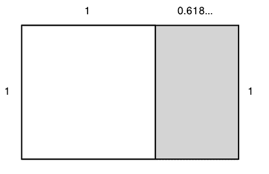

黄金矩形产生了一个同样具有黄金比例的小矩形

如果我们将短边标记为 1 个单位，并从矩形中去掉一个 1x1 的正方形，得到的矩形尺寸为 1 乘以 (g-1)，其长边与短边的比值为：

```
$\frac{1}{g-1}=\frac{1}{0.61803\dots}=1.61803\dots=g$
```

因此，较小矩形与原矩形具有相同的比例。顺带一提，$g$ 是唯一具有这种优良属性的数字，因为方程 $\frac{1}{g-1}=g$ 意味着 $g^2-g-1=0$，根据二次方程，满足此条件的正数只有 $(1+\sqrt{5})/2=g$。

# 斐波那契数的魔力 119

由于这种属性，黄金矩形被认为是最具美感的矩形，许多艺术家、建筑师和摄影师在作品中刻意使用了它。列奥纳德·芬奇的老朋友兼合作者卢卡斯·帕乔奥利将黄金矩形命名为“神圣比例”。

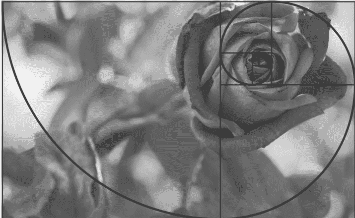

斐波那契数和黄金比例启发了许多艺术家、建筑师和摄影师。（照片由 Natalya St. Clair 提供）

由于黄金比例满足了许多奇妙的数学属性，人们有时倾向于在并不存在的地方看到它。例如，在《达芬奇密码》一书中，作者丹·布朗断言 1.618 这个数字无处不在，而人体几乎就是这个数字的明证。例如，有人声称人的身高与肚脐高度之比始终是 1.618。现在，我个人并没有进行过这个实验，但根据乔治·马科夫斯基在《大学数学杂志》上发表的文章《关于黄金比例的误区》，这根本不是事实。但对某些人来说，只要一个数字看起来接近 1.6，他们就会假设是黄金比例在起作用。

我经常说，斐波那契数满足的许多数字模式是流动的纯粹诗意。这里有一个斐波那契数实际上出现在诗歌中的例子。大多数五打律诗（Limericks）具有以下节律（你可以称之为“dum”节奏五打律诗！）：

| 五打律诗 | di | dum | 音节数 |
| :--- | :--- | :--- | :--- |
| di-dum di-dum di-dum di-dum | 5 | 3 | 8 |
| di-dum di-di-dum di-di-dum | 5 | 3 | 8 |
| di-dum di-di-dum | 3 | 2 | 5 |
| di-dum di-di-dum | 3 | 2 | 5 |
| di-dum di-di-dum di-di-dum | 5 | 3 | 8 |
| **总计** | **21** | **13** | **34** |

斐波那契数的诗意

如果你数数每一行的音节，我们会发现处处都是斐波那契数！受此启发，我决定写一首自己的斐波那契五打律诗。

我觉得斐波那契数很有趣。

它从 1 和 1 开始。

然后是 2, 3, 5, 8。

但伙计，别在这里停下。

乐趣才刚刚开始！

# 第六

$1 + 2 + 3 = 1 \times 2 \times 3 = 6$

## 证明的魔力

# 证明的价值

从事数学的巨大乐趣之一，事实上也是数学与其他所有科学的区别之处，在于能够毫无疑问地证明某事的真实性。在其他科学中，我们接受某些定律是因为它们符合现实世界，但如果有新证据出现，这些定律可能会被反驳或修改。在数学中，如果一个陈述被证明是真的，那么它永远是真的。例如，欧几里德在一千年前就证明了有无穷多个质数，我们任何言论或行为都无法反驳它。

## 证明的魔力

如果我们有一个认为是正确的数学命题，我们实际上该如何操作呢？通常，我们首先从描述我们正在处理的数学对象开始，例如整数集合

..., -2, -1, 0, 1, 2, 3, ...

它由所有整数组成：正数、负数和零。

一旦我们描述了对象，我们就会对这些对象提出假设，认为它们是自明易见的，例如“两个整数的和或积始终是整数。”（在下一章几何中，我们将假设命题“对于任意两点，存在一条通过这两点的直线”。）这些自明易见的陈述被称为公理。通过这些公理，结合一点逻辑和代数，我们通常可以推导出其他陈述（称为定理），这些定理有时并不显而易见。在本章中，你将学习证明数学命题的基本工具。

让我们尝试证明一些易于相信的定理。当我们第一次遇到像“两个偶数的和是偶数”或“两个奇数的积是奇数”这样的命题时，我们的大脑通常会通过几个例子来检查该命题，然后得出它可能是正确的或是有意义的结论。你甚至可能认为这个命题是显而易见的，以至于我们可以将其作为一个公理。但我们不需要这样做，因为我们可以使用已知的公理来证明这个命题。为了证明关于奇偶数的性质，我们需要清楚奇数和偶数的含义。

偶数是 2 的倍数。用代数方式表示，如果 $n=2k$，其中 $k$ 为整数，则称 $n$ 为偶数。0 是偶数吗？是的，因为 $0=2 \times 0$。现在我们需要证明两个偶数的和是偶数。

**定理：** 如果 $m$ 和 $n$ 是偶数，那么 $m+n$ 也是偶数。

这是一个“如果……那么……”的定理。要证明这样的语句，我们通常假设“如果”部分，并通过逻辑和代数的结合，证明“那么”部分是从我们的假设推导出来的。在这里，我们假设 $m$ 和 $n$ 是偶数，并想要得出 $m+n$ 也是偶数的。

**证明：** 假设 $m$ 和 $n$ 是偶数。因此，$m=2j$ 且 $n=2k$，其中 $j$ 和 $k$ 是整数。但那么

$m+n=2j+2k=2(j+k)$

由于 $j + k$ 是整数，所以 $m + n$ 也是 2 的倍数，因此 $m + n$ 必须是偶数。

注意，这个证明依赖于一个公理：两个整数的和（在这里是 $j + k$）也必须是整数。随着你证明的陈述越来越多，你更有可能依赖于之前证明过的定理而不是基本公理。数学家通常在证明的最后一行的右侧边缘用 $\square$ 或 $\blacksquare$ 或 Q.E.D. 等标记表示证明的结束，如上所示。Q.E.D. 是拉丁短语 *quod erat demonstrandum* 的缩写，意为“待证明”。（如果你愿意，它也是英语短语“非常容易做到”的缩写）。如果我认为一个证明特别优雅，我会用一个微笑符号 $\odot$ 结尾。

在证明了一个“如果”型定理后，数学家们禁不住想要好奇*逆命题*语句的真假，这个逆命题是通过反转“如果”部分和“那么”部分得到的。在这里，逆命题将是“如果 $m + n$ 是偶数，那么 $m$ 和 $n$ 是偶数。”通过简单提供一个反例，很容易看出这个语句是错误的。对于这个语句，反例恰恰是

$1 + 1 = 2$

因为这个例子表明，当两个数都不是偶数时，可能得到一个偶数的和。

我们的下一个定理是关于*奇数*的。奇数是一个*不是* 2 的倍数的。因此，当你用一个奇数除以 2 时，总是得到一个余数为 1 的结果。在代数上，如果 $n = 2k + 1$，其中 $k$ 是整数，则 $n$ 为奇数。这允许我们通过简单的代数证明，奇数的积是奇数。

**定理：** 如果 $m$ 和 $n$ 是奇数，那么 $mn$ 是奇数。

**证明：** 假设 $m$ 和 $n$ 是奇数。那么对于某些整数 $j$ 和 $k$，$m = 2j + 1$ 且 $n = 2k + 1$。因此，根据 FOIL 法，

$mn = (2j + 1)(2k + 1) = 4jk + 2j + 2k + 1 = 2(2jk + j + k) + 1$

由于 $2jk + j + k$ 是整数，这意味着数字 $mn$ 的形式为“整数的 2 倍加 1”。因此 $mn$ 是奇数。$\square$

那么逆命题又是呢：“如果 $mn$ 是奇数，那么 $m$ 和 $n$ 是奇数？” 这个命题也是正确的，我们可以使用*反证证明法*来证明它。在反证证明法中，我们证明否定结论（这里，结论是 $m$ 和 $n$ 是奇数）会导致一个问题。特别是，如果我们否定结论，也会出现……

## 证明的魔力

所以

$4k^2 = 2b^2$

这意味着

$b^2 = 2k^2$

因此 $b^2$ 是一个偶数。由于 $b^2$ 是偶数，那么 $b$ 也必须是偶数。但请等一下！我们刚刚证明了 $a$ 和 $b$ 都是偶数，这与 $a/b$ 是最简形式的假设相矛盾。因此，$\sqrt{2}$ 是有理数的假设会导致问题，我们被迫得出结论：$\sqrt{2}$ 是无理数。

我喜欢这个证明（那个笑脸就证明了这一点），因为它通过逻辑的力量证明了一个非常令人惊讶的结果。正如我们将在第 12 章中看到的，无理数并不稀奇。事实上，从实意义的真正意义上来说，几乎所有的实数都是无理数，尽管我们在日常生活中主要处理的是有理数。

这里有一个关于之前定理的有趣推论。（推论是从前一个定理推导出的定理）。它利用了**幂运算律**，说明对于任何正数 $a, b, c$，

$$(a^b)^c = a^{bc}$$

例如，这说明 $(5^3)^2 = 5^6$，这是合理的，因为

$$(5^3)^2 = (5 \times 5 \times 5) \times (5 \times 5 \times 5) = 5^6$$

**推论：** 存在无理数 $a$ 和 $b$，使得 $a^b$ 是有理数。

我们现在就能证明这一点其实很酷的，尽管我们目前只知道一个无理数，即 $\sqrt{2}$。我们将下面的证明称为*存在性证明*，因为它将展示存在这样的 $a$ 和 $b$ 值，而不会告诉你 $a$ 和 $b$ 究竟是什么。


# 证明的魔法

**证明：** 我们知道 $\sqrt{2}$ 是无理数，所以考虑数字 $\sqrt{2}^{\sqrt{2}}$。这个数是有理数吗？如果答案是定的，那么令 $a = \sqrt{2}$ 和 $b = \sqrt{2}$，证明就完成了。如果答案是否定的，那么我们就有一个新的无理数可以玩了，即 $\sqrt{2}^{\sqrt{2}}$，令 $b = \sqrt{2}$，然后利用幂运律，我们得到

$$a^b = \left(\sqrt{2}^{\sqrt{2}}\right)^{\sqrt{2}} = \sqrt{2}^{\sqrt{2} \times \sqrt{2}} = \sqrt{2}^2 = 2$$

是有理数。因此，无论 $\sqrt{2}$ 是有理数还是无理数，我们都能找到 $a$ 和 $b$，使得 $a^b$ 是有理数。

像上面的存在性证明通常很聪明，但有时会让人不满意，它们可能不会告诉你你寻找的所有信息（顺便说一下，如果你好奇的话，$\sqrt{2}$ 是无理数，但这超出了本书的范围）。

更令人满意的是构造性证明，它确切告诉你如何找到你想要的信息。例如，可以证明每个有理数 $a/b$ 必须终止或循环（因为在长除法过程中，$b$ 最终必须除尽一个之前除尽过的数字）。但反过来命题成立吗？显然，终止性小数必须是有理数。例如，$0.12358 = 12,358/100,000$。但循环小数呢？例如，数字 $0.123123123...$ 一定是有理数吗？答案是定的，并且有一种巧妙的方法可以找到它确切是哪个数字。让我们给这个谜题起个名字，比如 $w$（如 waltz 华兹），使得

$w = 0.123123123...$

我们将两边同时乘以 1000，得到

$1000w = 123.123123...$

用第二个方程减去第一个方程，得到

$999w = 123$

所以 $w = 123/999$，是有理数。

## 备注

在第 5 章中，我们发现了若干与斐波那契数相关的关系。让我们来看看如何使用归纳法来证明其中一些等式。

**定理：** 对于 $n \ge 1$，

```
$F_1 + F_2 + \dots + F_n = F_{n+2} - 1$
```

**证明（归纳法）：** 当 $n = 1$ 时，等式变为 $F_1 = F_3 - 1$，这等于 $1 = 2 - 1$，这显然是正确的。现在假设定理在 $n = k$ 时成立。即：

```
$F_1 + F_2 + \dots + F_k = F_{k+2} - 1$
```

现在我们在等式两边加上下一个斐波那契数 $F_{k+1}$，得到：

```
$F_1 + F_2 + \dots + F_k + F_{k+1} = F_{k+1} + F_{k+2} - 1
= F_{k+3} - 1$
```

得出了所需的结论。

斐波那契数平方和的证明同样简单。

**定理：** 对于 $n \ge 1$，

```
$F_1^2 + F_2^2 + \dots + F_n^2 = F_n F_{n+1}$
```

**证明（归纳法）：** 当 $n = 1$ 时，等式变为 $F_1^2 = F_1 F_2$，这是正确的，因为 $F_2 = F_1 = 1$。假设定理在 $n = k$ 时成立，我们有：

```
$F_1^2 + F_2^2 + \dots + F_k^2 = F_k F_{k+1}$
```

在等式两边加上 $F_{k+1}^2$ 得到：

```
$F_1^2 + F_2^2 + \dots + F_k^2 + F_{k+1}^2 = F_k F_{k+1} + F_{k+1}^2
= F_{k+1}(F_k + F_{k+1})
= F_{k+1}F_{k+2}$
```

得出了所需的结论。

## 证明的魔法 135

在第 1 章中，我们注意到“立方之和等于和的平方”。即：

```
$$1^3 = 1^2
1^3 + 2^3 = (1+2)^2
1^3 + 2^3 + 3^3 = (1+2+3)^2
1^3 + 2^3 + 3^3 + 4^3 = (1+2+3+4)^2$$
```

但我们当时还没有准备好去证明它。现在我们可以通过归纳法很快地证明它。通用模式是，对于 $n \ge 1$，

```
$$1^3 + 2^3 + 3^3 + \dots + n^3 = (1+2+3 + \dots + n)^2$$
```

我们已经知道 $1 + 2 + \dots + n = \frac{n(n+1)}{2}$，我们来证明下所示的等效定理。

**定理：** 对于 $n \ge 1$，

```
$$1^3 + 2^3 + 3^3 + \dots + n^3 = \frac{n^2(n+1)^2}{4}$$$
```

**证明（归纳法）：** 当 $n=1$ 时，定理给出的陈述为 $1^3=1^2(2^2)/4$。归纳地，如果定理在 $n=k$ 时成立，使得：

```
$$1^3 + 2^3 + 3^3 + \dots + k^3 = \frac{k^2(k+1)^2}{4}$$$
```

那么当我们在两边加上 $(k+1)^3$ 时，我们得到：

```
$$1^3 + 2^3 + 3^3 + \dots + k^3 + (k+1)^3 = \frac{k^2(k+1)^2}{4} + (k+1)^3
= (k+1)^2 \left( \frac{k^2}{2} + (k+1) \right)
= (k+1)^2 \left( \frac{k^2+4(k+1)}{4} \right)
= \frac{(k+1)^2(k+2)^2}{4}$$$
```

得出了所需的结论。

## 备注

这里是立方和等式的几何证明。

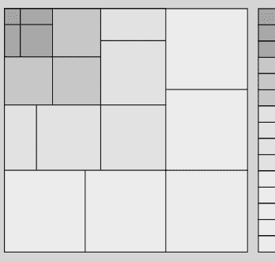

让我们用两种不同的方法计算这个图形的面积，然后比较答案。一方面，由于该图形是一个边长为 $1+2+3+4+5$ 的正方形，它的面积为 $(1+2+3+4+5)^2$。

另一方面，如果我们从左上角开始向右下方对移动，可以看到一个 $1 \times 1$ 的正方形，然后两个 $2 \times 2$ 的正方形（其中一个被切成了两半），然后三个 $3 \times 3$ 的正方形，然后四个 $4 \times 4$ 的正方形（其中一个被切成了两半），然后五个 $5 \times 5$ 的正方形。因此，该图形的面积等于：

```
$(1 \times 1^2) + (2 \times 2^2) + (3 \times 3^2) + (4 \times 4^2) + (5 \times 5^2)
= 1^3 + 2^3 + 3^3 + 4^3 + 5^3$
```

由于两个面积相等，得出 $1^3 + 2^3 + 3^3 + 4^3 + 5^3 = (1+2+3+4+5)^2$。

对于边长为 $1+2+\dots+n$ 的方形也可以创建类似的图片来建立：

```
$1^3 + 2^3 + 3^3 + \dots + n^3 = (1+2+\dots+n)^2$
```

## 证明的魔法 137

归纳法的处理不仅仅是和。每当“较大”的问题（尺寸为 $k+1$）的解可以用“较小”的问题（尺寸为 $k$）表示时，归纳法通常很有用。这里我最喜欢的归纳证明，它与章节开头的棋盘铺设有关。

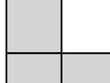

由于64不是3的倍数，我们不能仅用骨牌覆盖 $8 \times 8$ 的棋盘。但如果在棋盘上放置一个 $1 \times 1$ 的正方形，我们声称棋盘剩余部分可以用骨牌覆盖。事实上，这个结论不仅对于 $8 \times 8$ 的棋盘是正确的，对于 $2 \times 2$、$4 \times 4$、$16 \times 16$ 等也是正确的。

**证明（归纳法）：** 当 $n=1$ 时，定理成立，因为任何 $2 \times 2$ 的棋盘都可以用一个骨牌覆盖。现在假设定理在 $n=k$ 时成立，即对于尺寸为 $2^k \times 2^k$ 的棋盘成立。我们的目标是证明它对于尺寸为 $2^{k+1} \times 2^{k+1}$ 的棋盘同样成立。在棋盘任意位置放置一个 $1 \times 1$ 的正方形，然后将棋盘分成四个象限，如下所示。

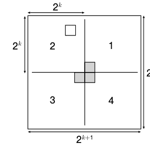

覆盖棋盘

# 数学的魔法

现在包含正方形的象限尺寸为 $2^k \times 2^k$，因此可以用骨牌覆盖（根据定理在 $n=k$ 时成立的假设）。接下来我们在棋盘中心放置一个骨牌，它交叉另外三个象限。这些象限的尺寸为 $2^k \times 2^k$，因此它们可以用不重叠的骨牌覆盖。这为我们提供了原始 $2^{k+1} \times 2^{k+1}$ 棋盘的铺设。

在本节中证明的最后一个等式有许多应用。我们将通过归纳法以及其他几种方法证明它。动机问题是：当你从 $2^0 = 1$ 开始加前 $n$ 个 2 的幂时，得到什么？以下是2的前几个幂：

- 1, 2, 4, 8, 16, 32, 64, 128, 256, 512, 1024, ...

当我们开始加这些数字时，我们看到：

$1 = 1$

$1+2 = 3$

$1+2+4 = 7$

$1+2+4+8 = 15$

$1+2+4+8+16 = 31$

你看到这个模式了吗？每个和都比下一个2的幂少1。通用公式如下：

**定理：** 对于 $n \ge 1$，

> $1+2+4+8+\dots+2^{n-1} = 2^n-1$

**证明（归纳法）：** 如上所述，定理在 $n=1$ 时成立（当然，对于2, 3, 4, 5也是如此！）。假设定理在 $n=k$ 时成立，我们可以说：

> $1+2+4+8+\dots+2^{k-1} = 2^k-1$

当我们在等式两边加上下一个2的幂即 $2^k$ 时，我们得到：

> $1+2+4+8+\dots+2^{k-1}+2^k = (2^k-1)+2^k$

$= 2\cdot2^k-1$

$= 2^{k+1}-1$

在第4和第5章中，我们通过两种不同的方式回答一个计数问题证明了许多关系。你可能会说下面的组合证明计数最多！

## 证明的魔法

问题：一个拥有 $n$ 名球员（球号从1到$n$）的冰球队有多少种方法选出一个至少有一名球员参加的代表团？

答案 1：每个球员都有2个选择，参加或不参加，所以答案似乎是 $2^n$，但我们需要减去1以排除所有球员都选择不参加的情况。

答案 2：考虑参加的人中球号最大的那个。1是最大号码的代表团只有1种。2是最大号码的代表团有2种（因为球员2要么单独参加，要么和球员1一起）。3是最大号码的代表团有4种（因为球员3必须参加，而球员1和2各有2种选择）。以此此类，$n$是最大号码的代表团有 $2^{n-1}$ 种，因为球员$n$必须参加。总共有 $1+2+4+\dots+2^{n-1}$ 种可能。

# 140 数学的魔法

我们通过将每个 2 的幂替换为 1，并将每个缺失的 2 的幂替换为 0 来用二进制表示它。在我们的示例中，83 = (1 \cdot 64) + (0 \cdot 32) + (1 \cdot 16) + (0 \cdot 8) + (0 \cdot 4) + (1 \cdot 2) + (1 \cdot 1)。因此，83 的二进制表示为

83 = (1010011)_2

我们如何知道每个正数都可以用这种方式表示呢？假设我们能够用 2 的幂唯一的方式表示从 1 到 99 的所有数字。我们如何知道可以以唯一的方式表示 100 呢？让我们从小于 100 的最大 2 的幂开始，即 64。是的，因为即使选择了 2, 4, 8, 16 和 32，它们的和也只有 63，不足 100。一旦我们使用了 64，就必须使用 2 的幂来达到 36 的总和。而且根据假设，我们可以用 2 的幂唯一地表示 36，这便给了我们 100 的唯一表示。（我们如何表示 36 呢？通过重复这种逻辑，我们尽可能取最大的 2 的幂，并以此方式继续下去。因此 36 = 32 + 4 的二进制表示为 (100100)_2 *注：* 我们可以对这一论点进行推广（使用所谓的*强归纳法证明*），以证明每个正数都有唯一的二进制表示。）

# 质数

在上一节中，我们确定了每个正整数都可以唯一地表示为不同 2 的幂之和。在某种意义上，我们可以说 2 的幂是加法运算下正整数的构建基石。在本节中，我们将看到质数在乘法方面也扮演着类似的角色：每个正整数都可以唯一地表示为质数的*乘积*。与易于识别且几乎没有数学惊喜的 2 的幂不同，质数要棘得多，关于它们我们仍然有许多未知的事实。

*质数*是一个恰好有*两个*正因数的正整数，即 1 和它本身。以下是几个质数。

- 2, 3, 5, 7, 11, 13, 17, 19, 23, 29, 31, 37, 41, 43, 47, 53 ...

数字 1 不被认为是质数，因为它只有一个*因数，即 1。（1 不被视为质数还有一个更重要的原因，我们稍后会提到。）注意，2 是唯一的偶数质数。有些人可能会说这让它成为了质数中最*奇特*（oddest）的一个！

具有三个或更多因数的正整数被称为*合数*，因为它是被*组合*成更小的因子。前几个合数是：

- 4, 6, 8, 9, 10, 12, 14, 15, 16, 18, 20, 21, 22, 24, 25, 26, 27, 28, 30, ...

例如，数字 4 恰好有三个因数：1, 2 和 4。数字 6 有四个因数：1, 2, 3 和 6。注意数字 1 也不是合数。数学家将数字 1 称为*单位*（unit），它具有每个整数的因数的性质。

每个合数都可以表示为质数的乘积。让我们对 120 进行因数分解。我们可能会从写 $120 = 6 \times 20$ 开始。现在，6 和 20 是合数，但它们可以被分解为质数，$6 = 2 \times 3$且 $20 = 2^2 \times 5$。因此，$120 = 2^3 \times 3 \times 5$。有趣的是，无论我们最初如何分解这个数字，最终都会得到相同的质因分解。这是*唯一分解定理*的结论，它也称为*算术基本定理*，它规定每个大于 1 的正整数都有唯一的质因分解。

顺便说一下，1 不被认为是质数的真正原因是：如果它是质数，那么这个定理就不成立了。例如，数字 12 可以分解为 $2 \times 2 \times 3$，但它也可以分解为 $1 \times 2 \times 2 \times 3$，这样质因分解就不再是唯一的了。

一旦知道一个数字有多少个因数，你就对那个数字有了深入了解。当我还是孩子时，我喜欢的数字是 9，但随着年龄增长，我喜欢的数字变得越来越大且复杂（例如，$\pi = 3.14159...$ $\phi = 1.618...$ $e = 2.71828...$，以及 $i$ 没有小数表示，但我们将在第 10 章讨论它）。一段时间后我开始尝试无理数，我最喜欢的数字是 2520，因为它是被 1 到 10 的所有数字整除的最小数字。它的质因分解为：

$2520 = 2^3 \times 3^2 \times 5^1 \times 7^1$

一旦知道一个数字的质因分解，你就能立即确定它有多少个正因数。例如，2520 的任何因数都必须形式为 $2^a 3^b 5^c 7^d$，其中 $a$ 是 0, 1, 2 或 3（4 种选择），$b$ 是 0, 1 或 2（3 种选择），$c$ 是 0 或 1（2 种选择），$d$ 是 0 或 1（2 种选择）。因此有 $4 \times 3 \times 2 \times 2 = 48$ 个因数。

> ：基本定理的证明利用了这样一个事实：如果 $p$ 是质数且 $p$ 整除乘积 $ab$，那么 $p$ 必须整除其中一个因子。这是唯一分解定理（也称为算术基本定理）的结论，它规定每个大于 1 的正整数都有唯一的质因分解。

顺便说一下，1 不被认为是质数的真正原因是：如果它是质数，那么这个定理就不成立了。例如，数字 12 可以分解为 $2 \times 2 \times 3$，但它也可以分解为 $1 \times 2 \times 2 \times 3$，这样质因分解就不再是唯一的了。

一旦知道一个数字有多少个因数，你就对那个数字有了深入了解。当我还是孩子时，我喜欢的数字是 9，但随着年龄增长，我喜欢的数字变得越来越大且复杂（例如，$\pi = 3.14159...$ $\phi = 1.618...$ $e = 2.71828...$，以及 $i$ 没有小数表示，但我们将在第 10 章讨论它）。一段时间后我开始尝试无理数，我最喜欢的数字是 2520，因为它是被 1 到 10 的所有数字整除的最小数字。它的质因分解为：

$2520 = 2^3 \times 3^2 \times 5^1 \times 7^1$

一旦知道一个数字的质因分解，你就能立即确定它有多少个正因数。例如，2520 的任何因数都必须形式为 $2^a 3^b 5^c 7^d$，其中 $a$ 是 0, 1, 2 或 3（4 种选择），$b$ 是 0, 1 或 2（3 种选择），$c$ 是 0 或 1（2 种选择），$d$ 是 0 或 1（2 种选择）。因此有 $4 \times 3 \times 2 \times 2 = 48$ 个因数。

为了证明唯一分解性，假设反反，即某个数字有不止一种质因分解。设 $n$ 为这样的最小数字，$n = p_1 p_2 \dots p_k = q_1 q_2 \dots q_m$。如果 $n$ 可被 $p_1$ 整除，那么 $n/p_1$ 也是一个整数。由于 $n/p_1 < n，$n/p_1$ 必须有唯一的质因分解。这意味着 $p_1$ 必须整除 $q_j$ 中的一个。由于 $q_j$ 是质数，$p_1$ 必须等于 $q_j$。通过重复这个过程，我们发现这两个分解是相同的。

质数有无限多个。

假设只有有限个质数 $p_1, p_2, \dots, p_k$。考虑数字 $P = p_1 p_2 \dots p_k + 1$。这个数字不能被列表中的任何质数整除，因为总是余数为 1。因此，$P$ 必须被某个不在列表中的质数整除，或者它本身就是质数。这与我们列表包含所有质数的假设相矛盾。

## 证明的魔法 145


**证明：** 反假设质数的数量是有限的。因此，必然存在一个*最大*的质数，我们将其记为 $P$。现在考虑数字 $P! + 1$。由于 $P!$ 能被 2 到 $P$ 之间的所有整数整除，因此这些数字中没有能整除 $P! + 1$ 的。，$P! + 1$ 必大于 $P$ 的质因子，这与 $P$ 是最大质数的假设相矛盾。

尽管我们永远找不到最大的质数，但这并没有阻止数学家和计算机科学家不断寻找更大的质数。截至本文写作时，最大的*已知*质数有 17,425,170 位数字。写下这个数字需要近一百本书那么的长度。然而，我们可以用一行来描述这个数字：

$2^{57,885,161} - 1$

它之所以具有如此简单的形式，是因为存在高效的方法来判断形如 $2^n - 1$ 或 $2^n + 1$ 的数字是否为质数。

> **旁注** 伟大的数学家皮埃尔·费尔马证明了，如果 $p$ 是奇质数，那么数字 $2^{p-1}-1$ 必是 $p$ 的倍数。用前几个奇数检查一下。对于质数 3, 5, 7, 11，我们看到 $2^2-1 = 3$ 是 3 的倍数；$2^4 - 1 = 15$ 是 5 的倍数；$2^6 - 1 = 63$ 是 7 的倍数；$2^{10} - 1 = 1023$ 是 11 的倍数。对于合数，显然如果 $n$ 是偶数，那么 $2^{n-1} - 1$ 必为奇数，因此它不可能是 $n$ 的倍数。检查前几个奇数 9、15 和 21，我们看到 $2^8 - 1 = 255$ 不是 9 的倍数；$2^{14} - 1 = 16,383$ 不是 15 的倍数；$2^{20} - 1 = 1,048,575$ 不是 21 的倍数（甚至不是 3 的倍数）。根据费尔马定理，如果一个大数 $N$ 具有 $2^{N-1}-1$ 不是 $N$ 的倍数的特性，那么我们就可以 100% 确定 $N$ 不是质数，即使不知道 $N$ 的因子是什么！然而，费尔马定理的逆命题并不成立。存在某些行为像质数数的合数（称为伪质数）。最小的例子是 $341=11 \times 31$，它具有 $2^{340}-1$ 是 341 的倍数的特性。尽管已经证明伪质数相对稀少，但它们有无限多个，不过有方法可以排除它们。

质数有许多应用，特别是在计算机领域。质数是每个加密算法的核心，包括公钥加密，它允许在互联网上进行安全交易。许多此类算法基于这样一个事实：存在相对快速的方法来判断一个数字是否为质数，但目前没有已知的快速方法来分解大数。例如，如果我将两个随机的 1000 位质数相乘，并给你它们的 2000 位数答案，任何人类或计算机（除非某天造出了量子计算机）都极不可能确定原始的质数。基于我们无法分解大数的代码（如 RSA 方法）被认为是是非常安全的。

人们对质数着迷了数千年。古希腊人认为，如果一个数字等于它所有真因子的之和，那么这个数字就是*完美*的。例如，6 是完美的，因为它的真因子有 1, 2, 3，其和为 6。下一个完美数是 28，它的真因子有 1, 2, 4, 7, 14，其和为 28。接下来的完美数是 496 和 8128。有什么规律吗？让我们看看质因数分解：

```
6 = 2 × 3
28 = 4 × 7
496 = 16 × 31
8128 = 64 × 127
```

你发现规律了吗？第一个数是 2 的幂。第二数是该 2 的幂减 1，并且它是质数。（这就是为什么在列表中没有看到 8 × 15 或 32 × 63，因为它们不是质数。）我们将这个规律总结为以下定理。

**定理：**如果 $2^n - 1$ 是质数，那么 $2^{n-1}(2^n - 1)$ 是完美的。

> 旁注
>
> 证明：设 $p = 2^n - 1$ 为质数。我们的目标是证明 $2^{n-1}p$ 是完美的。$2^{n-1}p$ 的真因子有哪些？不包含因子 $p$ 的因子只有 $1, 2, 4, 8, ..., 2^{n-1}$，它们的和为 $2^n - 1 = p$。其他的真因子（排除 $2^{n-1}p$）利用因子 $p$，因此这些因子的和为 $p(1 + 2 + 4 + 8 + ... + 2^{n-2}) = p(2^{n-1} - 1)$。这里真因子的总和为
>
> $p + p(2^{n-1} - 1) = p(1 + (2^{n-1} - 1)) = 2^{n-1}p$
>
> 毕。

伟大的数学家莱昂哈德·欧拉（1707–1783）证明了每个偶完美数都是这种形式。截至本文写作时，已经发现了 48 个完美数，它们都是偶数。存在奇完美数吗？目前没有人知道这个问题的答案。已经证明，如果一个奇完美数存在，那么它的位数将超过三百位。关于质数，有许多未解决的问题。另一个未解决的问题被称为“哥德巴赫猜想”，它预言任何大于 2 的偶数都是两个质数之和。

# 几何的魔法 151

## 2. 考虑下面的平行线，其中 $X$ 和 $Y$ 位于下直线。我们希望在上直线上选择第三点，使得由 $X$、$Y$ 和该点形成的三角形周长最小。应该选择哪个点？

- A) 点 $A$（位于 $X$ 和 $Y$ 中点的上方）。
- B) 点 $B$（使得由 $B$、$X$ 和 $Y$ 形成的三角形为直角三角形）。
- C) 尽可能远离 $X$ 和 $Y$（如点 $C$）。
- D) 所有三角形周长都相等。


直线上哪个点形成的三角形（点 $X$ 和 $Y$）周长最小？哪个点形成的面积最大？

## 3. 使用相同的图形，在上直线上应该选择哪个点 $P$，使得由 $X$、$Y$ 和 $P$ 形成的三角形面积最大？

- A) 点 $A$。
- B) 点 $B$。
- C) 尽可能远离 $X$ 和 $Y$。
- D) 所有三角形面积都相等。

## 4. 足球场两个球门之间的距离是 360 英尺（120 码）。一根长度为 360 英尺的绳子系在两个球门之间，如果增加一英尺，绳子在场中间可以提起多高？

- A) 低于地面。
- B) 足够爬过去的高度。
- C) 足够走的高度。
- D) 足够开车的高度。

# 数学的魔法


一根长度为 361 英尺的绳子系在球门之间。在场中间我们可以提起它多高？

这些问题的答案如下。我认为前两个答案非常直观，但另外两个答案会让大多数人感到惊讶。答案将在后文中解释。

- **答案 1**。对于任何给定的周长，为了使矩形的面积最大，应该让边长相等。因此，最优形状将是一个正方形。
- **答案 2**。选择 $X$ 和 $Y$ 的中点 $A$ 会形成周长最小的三角形 $XAY$。
- **答案 3**。D。所有三角形面积相等。
- **答案 4**。D。在场中间，绳子可以提起超过 13 英尺——足够通过通过。

我们可以使用简单的代数来解释第一个答案。对于长为 $b$（代表底）、宽为 $h$（代表高）的矩形，周长是 $2b+2h$，它是四条边的长度之和。面积衡量的是可以放入矩形的内容，是乘积 $bh$。（稍后我们会多说面积。）由于周长要求为 52 英尺，我们有 $2b+2h=52$，或者等价于

```
h = 26 - b
```

由于 $h=26-b$，我们希望最大化的面积 $bh$ 等于

```
b(26 - b) = 26b - b^2
```

什么样的 $b$ 值能使其最大化？我们将在第 11 章看到一种使用微积分解决此题的简单方法。注意到

$26b-b^2=169-(b^2-26b+169) = 169-(b-13)^2$

是我们选择底边 $b$ 时矩形的面积。当 $b=13$ 时，我们的面积为 $169-0^2=169$。当 $b \neq 13$ 时，我们的面积为

```
169 - (不等于0)^2
```

## 几何的魔法 153

由于我们从 169 中减去一个正数，结果始终小于 169。因此，当 $b=13$ 且 $h=26-b=13$ 时，矩形的面积最大。几何的奇妙之处在于，农民拥有 52 英尺围栏这一事实是无关紧要的。对于给定的周长 $p$，可以使用相同的方法证明最优形状是正方形，所有边长均为 $p/4$。

为了探索其他问题，我们首先观察一些看似矛盾的结果，并探索几何的一些经典。为什么三角形的角度和是 180 度？勾股定理是关于什么的？如何判断两个三角形具有相同的形状，我们又为什么要关心？

# 几何经典

几何学可以追溯到古希腊人。“几何”一词源于希腊语中的“地球”（geo）和“测量”（metria），事实上，几何最初的用途是用于测绘和建筑中的地面测量，以及作为天文学的天体应用。但古希腊人是演绎推理的大师，并将这一学科发展成了如今的艺术形式。当时（公元前 300 年左右）已知的所有几何结论都由欧几里得编成《几何原本》，这本书成为了史上最成功的教科书之一。这本书引入了数学严谨性、逻辑演绎、公理法和证明的思想，这些方法至今仍在使用数学家。

欧几里得从五个公理（也称为假设）开始，这些是我们被要求视为常识接受的陈述。一旦接受了这些公理，原则上就可以从它们推导出所有的几何真理。以下是欧几里得五个公理（实际上，他对第五条公理的表述略有不同，但我们的公理与其等价）：

- **公理 1**。给定任意两点，我们可以用唯一的线段连接它们。
- **公理 2**。线段可以向两个方向无限延伸以形成直线。
- **公理 3**。给定任意点 $O$ 和 $P$，我们可以画一个以 $O$ 为中心的唯一圆。
- **公理 4**。所有直角均为 90 度。
- **公理 5**。给定直线 $\ell$ 和不在 $\ell$ 上的一点 $P$，存在唯一一条通过 $P$ 且与 $\ell$ 平行的直线。

# 数学的魔法

> **旁注**
> 我应该澄清，在本章中我们处理的是平面几何（也称为欧几何）。一根长度为 360 英尺的绳子紧紧地系在两个球门之间，当增加一英尺绳子时，绳子在场中间可以提起多高？

# 数学的魔法

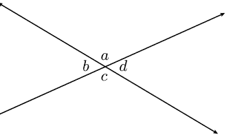

当两条直线相交时，邻角的角的和为 180°。
不相邻角（称为对角）相等。
在这里，$a$ 和 $c$ 构成了一对对角，角 $b$ 和 $d$ 也是如此。

这一性质适用于每一对其他邻接角。也就是说：

```
$a + b = 180^\circ$
$b + c = 180^\circ$
$c + d = 180^\circ$
$d + a = 180^\circ$
```

从第一个方程中减去第二个方程，我们 $a - c = 0$。也就是说：

```
$a = c$
```

从第二个方程中减去第三个方程，我们得到

```
$b = d$
```


# 几何的魔法

## 对角与平行线

当两条直线相交时，不相邻角被称为**对角**。我们已经证明了**对角定理**：对角相等。

我们的下一个目标是证明任何三角形的内角和为 180 度。为了实现这一点，我们首先对平行线说明几点。如果两条不同的直线不相交，我们称它们是**平行**的（记住直线是无限延伸的）。图中显示了两条平行线 $\ell_1$ 和 $\ell_2$，以及第三条直线 $\ell_3$，它与它们相交，因此分别在 P 和 Q 点切割这些直线。如果你观察这张图片，直线 $\ell_3$ 以相同的角切割 $\ell_1$ 和 $\ell_2$。也就是说，我们认为 $a = e$。我们把角 $a$ 和 $e$ 称为**同角**。（其他的同角例子还有 $b$ 和 $f$、$c$ 和 $g$ 以及 $d$ 和 $h$）。同角似乎总是相等的，但这实际上无法通过原始五个公理来证明。因此我们需要一个新的公理。

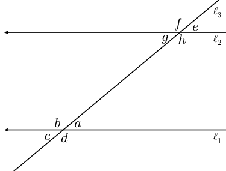

**同角公理**：同角相等。在这里，$a = e, b = f, c = g$，且 $d = h$。

结合对角定理，这说明在图中我们有：

> $a = c = e$
> $b = d = f$

数学书对上面的相等角给出了特殊的名称。例如，形成 Z 字形的角 $a$ 和 $g$ 称为**内错角**。因此，我们证明了任何角都与其对角、同角和内错角相等。我们现在利用此证明几何的基础理论。

**定理**：对于任何三角形，其内角和为 180 度。

**证明**：考虑一个三角形 $ABC$，角为 $a, b$ 和 $c$。通过 B 点画一条与通过 A 和 C 点的直线平行的线。角 $d, b$ 和 $e$ 构成一条直线，所以 $d + b + e = 180^\circ$。但注意角 $a$ 和 $d$ 是内错角，角 $c$ 和 $e$ 也是。因此 $d = a$ 且 $e = c$，所以 $a + b + c = 180^\circ$，得证。

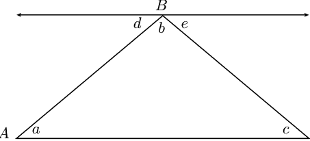

**注**  
三角形的 $180^\circ$ 定理是平面几何的基本事实，但对于其他几何并不成立。例如，考虑在地球仪上画一个三角形：从北极出发，沿着任何经线向下到赤道，在赤道向右转，绕地球四分之一，再次向右转直到回到北极。这个三角形实际上包含三个直角，总和为 $270^\circ$。在球面几何中，三角形的角和不是恒定的，角和超过 $180^\circ$ 的程度与三角形的面积成正比。

## 全等三角形

在几何课上，重点在于证明各种物体是**全等**的，这意味着通过移动、旋转或翻转一个物体，我们可以得到另一个物体。例如，下图中三角形 $ABC$ 和 $DEF$ 是全等的，因为我们可以移动三角形 $DEF$ 使其完美地覆盖三角形 $ABC$。在我们的图中，当两条边（或两个角）具有相同数量的标记时，这意味着它们具有相同的长度（或度）。

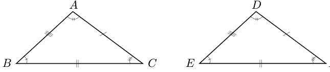

我们用 $\cong$ 符号表示这一点，写作 $ABC \cong DEF$。

## 相似三角形与最小周长问题

**相似三角形**只是彼此的等比例版本。因此，如果 $ABC \sim DEF$，那么它们的边必须通过某个正因子 $k$ 进行比例缩放。即 $DE = k \cdot AB$，$EF = k \cdot BC$，且 $FD = k \cdot CA$。

让我们运用所学的知识来回答章节开头的第 2 问题。回顾一下，我们从两条平行线开始，下方的直线上有一段 $XY$。我们的目标是在直线上找到一个点 $P$，使得三角形 $XYP$ 的周长最小。我们声称这是正确的：

**定理**：上直线上使 $XYP$ 周长最小的点 $P$ 位于 $XY$ 中点的正上方。

尽管这个问题可以使用复杂的微积分法来解决，但我们将看到几何如何允许我们仅通过一点“反射”来解决这个问题。（接下来的证明非常有趣，但有点长，你可以随意略读或跳过。）

**证明**：设 $P$ 为上直线上的任意点，设 $Z$ 为上直线上位于 $Y$ 正上方的点。（更准确地说，点 $Z$ 的位置使得它位于包含 $Y$ 的直线上，且 $YZ$ 同时垂直于上直线和下直线。设 $Y'$ 为垂直线上的一个点，使得 $Y'Z = ZY$。换句话说，如果上直线是一面大镜子，那么 $Y'$ 就是 $Y$ 通过点 $Z$ 的反射。

我声称三角形 $PZY$ 和 $PZY'$ 是全等的。这是因为 $PZ = PZ$，$\angle PZY = 90^\circ = \angle PZY'$，且 $ZY = ZY'$，所以三角形根据 SAS 全等。因此，$PY = PY'$，我们可以利用这一点。

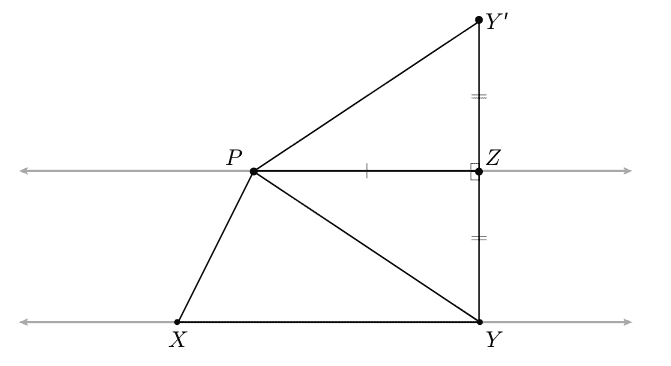

由于三角形 $PZY$ 和 $PZY'$ 全等（根据 SAS），我们有 $PY = PY'$。

三角形 $YXP$ 的周长是三条边之和：

$$YX + XP + PY$$

由于我们已经证明了 $PY = PY'$，周长也等于：

$$YX + XP + PY'$$

现在，长度 $YX$ 不依赖于 $P$，因此我们的问题简化为找到一个使 $XP + PY'$ 最小的点 $P$。

注意线段 $\overline{XP}$ 和 $\overline{PY'}$ 形成了一条从 $X$ 到 $Y'$ 的折线路径。由于两点之间的最短距离是直线，因此可以通过从 $X$ 到 $Y'$ 画出一条直线来找到最优点 $P^*$；$P^*$ 是此线与上线的交点。见下图。为什么我们还没有结束？为了完成证明，我们需要证明 $P^*$ 位于 $XY$ 中点的正上方。

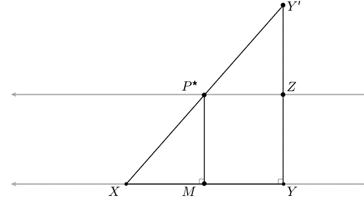

三角形 $MXP^*$ 和 $XY'Y$ 相似，相似因子为 2。

设 $M$ 为 $P^*$ 正下方的点（使得 $P^*M$ 垂直于 $\overline{XY}$）。由于上下两条线平行，长度 $P^*M$ 和 $ZY$ 必须相等。（这在直觉上是合理的，因为平行线之间的距离是恒定的，但可以通过画线段 $MZ$ 并验证三角形 $MYZ$ 和 $ZP^*M$ 根据 AAS 全等来证明。）

为了证明 $M$ 是 $\overline{XY}$ 的中点，我们首先证明三角形 $MXP^*$ 和 $XY'Y$ 相似。注意 $\angle MXP^*$ 和 $\angle XY'Y$ 是同一个角，$\angle P^*MX = \angle Y'YX$ 因为它们都是直角，且一旦我们有了两个匹配的角，第三个角也必然匹配，因为角之和为 180°。这些相似三角形的相似因子是多少？根据构造，长度：

$$YY' = ZY = 2 \cdot MP^*$$

相似因子为 2。因此，长度 $XM$ 是 $XY$ 的一半，并且 $M$ 是 $XY$ 的中点。

总结，我们证明了上直线上使三角形 $XYP$ 周长最小的点 $P^*$ 位于 $XY$ 中点的正上方。

## 坐标几何与中点定理

有时几何问题可以使用代数解决。例如，在平面上画出线段 $AB$，$A$ 的坐标为 $(a_1, a_2)$，$B$ 的坐标为 $(b_1, b_2)$。那么位于 $A$ 和 $B$ 之间的中点 $M$ 的坐标为：

$$M = \left(\frac{a_1+b_1}{2}, \frac{a_2+b_2}{2}\right)$$

如下所示。例如，如果 $A = (1,2)$ 且 $B = (3,4)$，那么 $\overline{AB}$ 的中点 $M = ((1+3)/2, (2+4)/2) = (2,3)$。

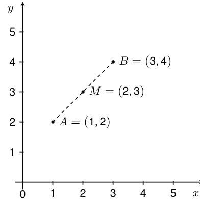

让我们用这个思想来证明关于三角形的有用事实。画一个三角形，然后连接任意边的中点。你发现了什么有趣的现象？答案在下面的定理中。

**三角形中点定理**：对于任意三角形 $ABC$，如果连接 $AB$ 和 $BC$ 的中点，那么该线段将平行于边 $AC$。此外，如果 $\overline{AC}$ 的长度为 $b$，连接中点的线段长度为 $b/2$。

**证明**：将三角形 $ABC$ 置于平面上，使得点 $A$ 位于原点 $(0,0)$，边 $AC$ 水平，使得点 $C$ 位于 $(b,0)$，如下所示。假设点 $B$ 位于 $(x,y)$。那么 $\overline{AB}$ 的中点坐标为 $(x/2, y/2)$，$\overline{BC}$ 的中点坐标为 $((x+b)/2, y/2)$。由于两个中点具有相同的 $y$ 坐标，连接它们的线段必须水平，因此它平行于边 $\overline{AC}$。此外，这条线段的长度为 $(x+b)/2 - x/2 = b/2$，符合预期。

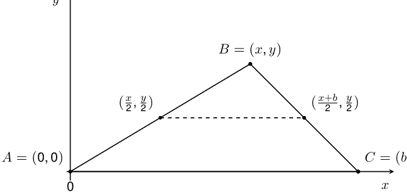

三角形中点定理揭示了本章节开头魔术的秘密。从四边形 $ABCD$ 开始，我们连接中点形成第二个四边形 $EFGH$，结果总是一个平行四边形。让我们看看为什么这样做有效。如果我们想象从顶点 $A$ 画一条对角线到顶点 $C$，就会产生两个三角形 $ABC$ 和 $ADC$，如图所示。

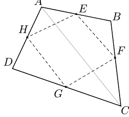

通过三角形 $ABC$ 和 $ADC$ 的中点定理，我们发现 $EF$ 平行于 $AC$ 且 $GH$ 也平行于 $AC$。因此 $EFGH$ 是平行四边形。

## 多边形内角和

之前的许多定理涉及三角形，事实上，几何学花费了大量时间研究三角形。三角形是最简单的多边形，其次是四边形（四边）、五边形（五边）等。具有 $n$ 边的多边形有时称为 $n$ 边形。四边形（如方形、矩形）有 4 条边。在矩形中，四个角都是 90°，因此角和为 360°。下一个定理显示这对于任何四边形都成立。

**定理**：四边形的角和为 360°。

**证明**：取任意一个顶点为 $A, B, C, D$ 的四边形，如下所示。通过从 $A$ 到 $C$ 画一条线段，四边形被分成两个三角形，每个三角形的角和为 180°。因此，四边形的角和为 $2 \times 180^\circ = 360^\circ$。

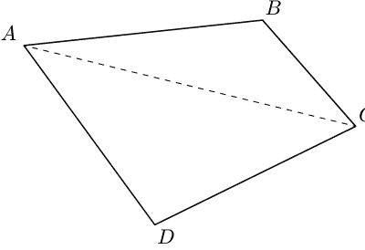

还有一个定理应该揭示一般的规律。

**定理**：五边形的角和为 540°。

**证明**：考虑顶点为 $A, B, C, D, E$ 的任意五边形，如下所示。通过从 $A$ 到 $C$ 画一条线段，五边形被分成一个三角形和一个四边形。我们知道三角形 $ABC$ 的角和为 180°，根据我们的四边形结论，四边形 $ACDE$ 的角和为 360°。因此，五边形的角和为 $180^\circ + 360^\circ = 540^\circ$。

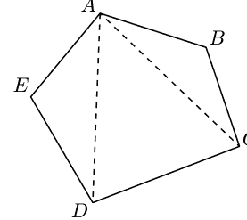

## 三角形剖分

将多边形分割成三角形的过程称为**三角形剖分**。下面是两个不同三角形剖分的示例，其中一个是空白的供你尝试。

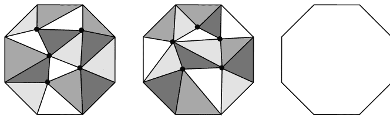

在我的两个示例中，我们最终都得到了恰好 16 个三角形。在第三个八边形中，无论你将 5 个点放在内部哪里，只要操作得当，你也应该恰好有 16 个三角形。（如果你没有得到 16 个三角形，请仔细观察每个内部区域，并确保它只有三个点。如果一个看起来像三角形的区域有四个点，那么你需要插入另一条线段来将其分成两个三角形。）这一解释来自以下定理。

**定理**：任何具有 $n$ 条边和 $p$ 个内点的多边形的三角形剖分都将包含恰好 $2p + n - 2$ 个三角形。

在上一个例子中，$n = 8$ 且 $p = 5$，该定理预测恰好有 $10 + 8 - 2 = 16$ 个三角形。

**证明**：假设三角形剖分恰好有 $T$ 个三角形。我们通过两种方式回答以下问题来证明 $T = 2p + n - 2$。

问题：所有三角形的角度之和是多少？

答案 1：由于有 $T$ 个三角形，每个三角形的角度之和为 $180^\circ$，因此总和是 $180T$。

答案 2：我们将答案分成两种情况。每个 $p$ 个内点周围的角度必须环绕圆周，因此它们对总和贡献了 $360p$。另一方面，根据我们之前的定理，我们知道 $n$ 边形本身上的角之和为 $180(n-2)$ 度。因此，所有角度之和为 $360p + 180(n-2)$ 度。

使两个答案相等，得到：

```
180T = 360p + 180(n-2)
```

将两边同时除以 180，得到：

```
T = 2p + n - 2
```


正如预测的那样。

## 周长与面积

多边形的*周长*是其各边长度之和。例如，在一个底长为 $b$ 高为 $h$ 的矩形中，它的周长为 $2b + 2h$，因为它有两个长度为 $b$ 的边和两个长度为 $h$ 的边。那么矩形的面积呢？我们定义一个 $1 \times 1$ 正方形（*单位正方形*）的面积为 1。当 $b$ 和 $h$ 为正整数时（如下所示），我们可以将该区域分成 $bh$ 个 $1 \times 1$ 的正方形，因此它的面积为 $bh$。通常，对于任何底为 $b$、高为 $h$ 的矩形（$b$ 和 $h$ 为正数，但不一定是整数），我们定义其面积为 $bh$。

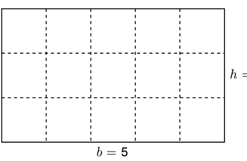

底为 $b$、高为 $h$ 的矩形的周长为 $2b + 2h$，面积为 $bh$

## 旁白

在本章中，我们一直使用代数来帮助解释几何。但有时几何也可以帮助我们解释代数。考虑以下代数问题：当 $x$ 可以是任意正数时，$x+\frac{1}{x}$ 的值可以有多小？当 $x=1$ 时，我们得到 2；当 $x=1.25$ 时，我们得到 $1.25+0.8=2.05$；当 $x=2$ 时，我们得到 2.5。数据似乎表明最小答案是 2，这是正确的，但我们如何确定呢？我们将在第 11 章通过微积分找到回答这个问题的直接方法，但只要有一点技巧，我们用简单的几何就能解决这个问题。

考虑下面的几何图形，它由四块骨牌组成，每个骨牌的尺寸为 $x$ 乘以 $1/x$，连接在一起形成一个中间有一个洞的正方形。整个区域（包括洞）的面积是多少？

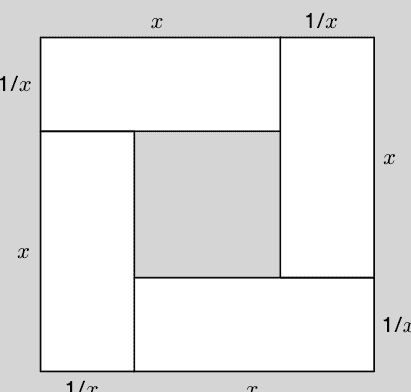

一方面，由于该区域是一个边长为 $x+1/x$ 的正方形，它的面积必须是 $(x+1/x)^2$。另一方面，每个骨牌的面积为 1，因此该区域的面积至少为 4。因此意味着 $x+1/x \ge 2$，正如所愿。

## 几何的魔力

从矩形的面积开始，可以导出几乎任何几何图形的面积。首先，我们推导出三角形的面积。

**定理：** 底为 $b$、高为 $h$ 的三角形面积为 $\frac{1}{2}bh$。为了说明，下面所示三个三角形具有相同的底 $b$ 和相同的高度 $h$，因此它们的面积相同。这本质上是章节开头第 3 题的内容，它的出现并不意外。

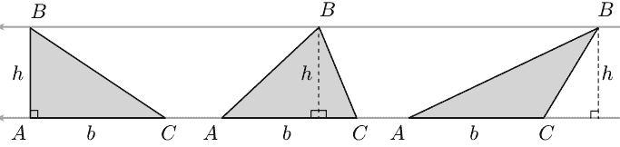

底为 $b$、高为 $h$ 的三角形面积为 $\frac{1}{2}bh$。无论三角形是直角、锐角还是钝角三角形。

三角形为 $a, b, c$ 的。

$a^2 + b^2 = c^2$

# 174 数学的魔术

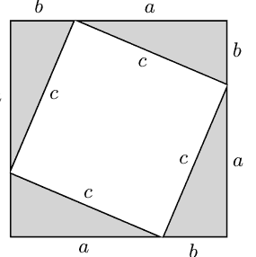

用两种不同的方法计算大正方形的面积。当你比较这两个答案时，勾股定理就出现了。

从等式两边减去 $2ab$，我们得到

$a^2 + b^2 = c^2$

如预期所示。

**证明 2：** 使用与上方相同的图片，我们像下图所示重新排列三角形。在幅图中，未被三角形占据的面积是 $c^2$。在新的图中，可以看到未被三角形占据的面积是 $a^2 + b^2$。因此，$c^2 = a^2 + b^2$，如预期所示。

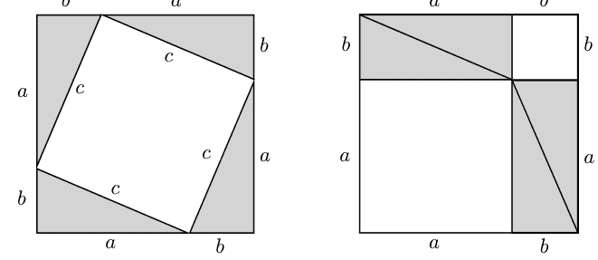

比较这张图和前一张图中白色区域的面积：$a^2 + b^2 = c^2$

**证明 3：** 这一次，让我们重新排列四个三角形，在相反页上形成一个更紧凑的面积为 $c^2$ 的正方形。（这个物体之所以是正方形的一个原因是每个角都由 $\angle A$ 和 $\angle B$ 组成，它们的和为90°。）和之前一样，四个三角形贡献的面积为 4(ab/2) = 2ab。中间的倾斜正方形面积为 $(a-b)^2 = a^2 - 2ab + b^2$。因此，组合面积等于 $2ab + (a^2 - 2ab + b^2) = a^2 + b^2$，如预期所示。

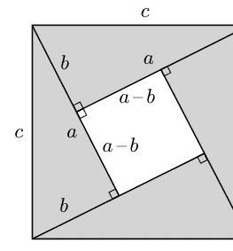

该图的面积既是 $c^2$ 也是 $a^2 + b^2$

**证明 4：** 这里有一个*相似证明*，我的意思是，让我们利用对相似三角形的了解。在直角三角形 $ABC$ 中，画一条垂直于斜直边的线段 $CD$，如下所示。

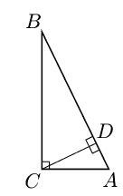

两个较小三角形都与大三角形相似

三角形 $ADC$ 包含一个直角和 $\angle A$，所以它的第三个角必须与 $\angle B$ 角。同样，三角形 $CDB$ 有一个直角和 $\angle B$，所以它的第三个角必须与 $\angle A$ 角。因此，所有三个三角形都是相似的：

$\triangle ACB \sim \triangle ADC \sim \triangle CDB$

注意字母的顺序很重要。我们有 $\angle ACB = \angle ADC = \angle CDB = 90^\circ$，它们都是直角；同样，$\angle A = \angle BAC = \angle CAD =$ BCD，且 $\angle B = \angle CBA = \angle DCA = \angle DBC$。比较前两个三角形的边长，得到

$AC/AB = AD/AC \Rightarrow AC^2 = AD \times AB$

比较第一个和第三个三角形的边长，得到

$CB/BA = DB/BC \Rightarrow BC^2 = DB \times AB$

将这些方程相加，我们

$AC^2 + BC^2 = AB \times (AD + DB)$

由于 $AD + DB = AB = c$，我们得到了预期的结论：

$b^2 + a^2 = c^2$

下一个证明是纯几何的。它没有使用代数，但确实需要一些视觉化能力。

**证明 5：** 这一次我们从两个面积为 $a^2$ 和 $b^2$ 的正方形开始，并排放置。它们的总面积为 $a^2 + b^2$。我们可以将这个物体分割两个直角三角形（边长为 $a$ 和 $b$，斜边为 $c$）和一个形状奇怪的形状。注意奇怪形状底部的角必须是90°，因为它是由 $\angle A$ 和 $\angle B$ 围成的。想象在大正方形的左上角和小正方形的右上角放置一个铰链。

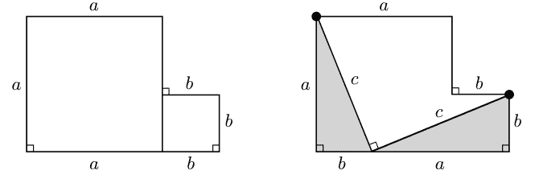

这些面积为 $a^2 + b^2$ 的正方形可以转换为 ....现在想象将左下角的三角形逆时针旋转 90°，使其停靠在大正方形的顶部。然后将另一个三角形顺时针旋转 90°，使直角对齐，它舒适地位于


...一个面积为 $c^2$ 的正方形！如图上两个所示。最终结果是一个面积为 $c^2$ 的倾斜正方形。因此，$a^2 + b^2 = c^2$，正如承诺。我们可以将勾股定理应用于本章开头关于连接两个相隔360英尺门柱的绳子的问题。

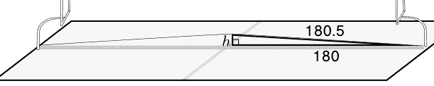

根据勾股定理，$h^2 + 180^2 = 180.5^2$ 从任何一个门柱到场地中心的距离是180英尺。在绳子升到最高点 $h$ 后，我们创建了一个边为180、斜边为180.5的直角三角形。因此通过勾股定理和几行代数，我们得到

$h^2 + 180^2 = 180.5^2$
$h^2 + 32400 = 32580.25$
$h^2 = 180.25$
$h = \sqrt{180.25} \approx 13.43$ 英尺。因此绳子的高度足够大多数卡车通过！

# 几何魔术

让我们像开始一样结束这一章，用基于几何的魔术。大多数勾股定理的证明涉及重新排列一个物碎片以获得另一个面积相同的物体。从所示的8x8正方形开始，看起来我们可以把它分成四部分（它们的长度都是斐波那契数3、5或8！），重新组合这些碎片来创建一个5x13的矩形。（自己试试！）这应该是可能的，因为第一张图的面积为 $8 \times 8 = 64$，而第二张图的面积为 $5 \times 13 = 65$。发生了什么？

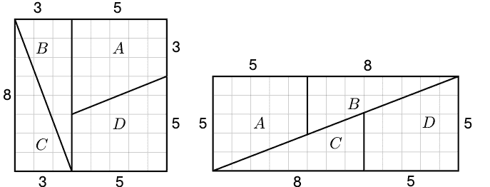

面积为64的正方形可以重新组合成面积为65的矩形吗？

这个悖论的秘密在于5x13矩形的对角线线”并不是直线。例如，标记为C的三角形其斜率为 $3/8 = 0.375$（因为随着x坐标增加8，y坐标增加了3），而标记为D的图形（一个*梯形*）的顶部斜率为 $2/5 = 0.4$（因为随着x坐标增加5，y坐标增加了2）。由于斜率不同，它没有形成直线，同样的现象也发生在上方梯形和三角形的底部。因此，如果我们仔细观察这个矩形，就像相反页上的图那样，我们会在这两条“几乎是对角线”之间看到一点额外的空间。在那个空间里，跨越很大区域，恰好多了一个单位面积。矩形包含了跨对角线的单位额外面积。在本章中，我们推导了三角形、正方形、矩形和其他多边形的许多性质，它们都是用直线创建的。对圆和其他曲面物体的研究将需要通过三角函数和微积分使用更复杂的几何思想，这一切都依赖于神奇数字 $\pi$。

# 第八章

# 3.141592653589...

# π的魔术

循环论证

我们在上一章开始时提出了一些旨在挑战你对矩形和三角形几何直觉的问题，并以一个涉及连接足球场两端门柱的绳子的问题结束。在本章中，我们的重点将是圆，我们将从一个环绕地球绳子的问题开始！

**问题 1。**想象有一根绳子要绕在地球赤道（约25000英里）。在连接两端之前，增加了10英尺的绳子。现在我们抬起绳子，使其在赤道的每一点上方悬空相同的距离，绳子会有多高？

- A) 离地面不到英寸。
- B) 刚好够爬。
- C) 刚好够走过去。
- D) 高到卡车可以通过。

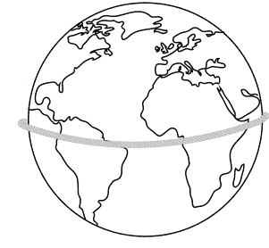

**问题 2。**两个点X和Y固定在圆上，如图所示。我们希望在圆上的主弧（X和Y之间的长弧，而不是短弧）选择第三个点Z。我们应该在哪里选择点Z使 $\angle XZY$ 最大？

- A) A点（X和Y中点的对面）。
- B) B点（X关于圆心的反射）。
- C) C点（尽可能靠近X）。
- D) 这不重要。所有角相等。

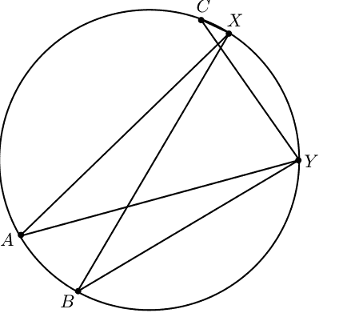

X和Y主弧上的哪个点产生的角最大？$\angle XAY$、$\angle XBY$、$\angle XCY$ 还是它们都相等？

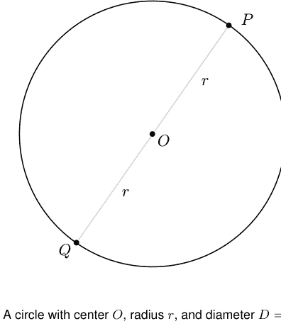

# $D = 2r$

圆的周长（绕一周的距离）被称为圆的周长，用 $C$ 表示。从图中可以看出，$C$ 大于 $2D$，因为沿着圆周从 $P$ 到 $Q$ 的距离大于 $D$，而从 $Q$ 回到 $P$ 的距离也大于 $D$。因此，$C > 2D$。如果你肉眼观察，你甚至可能说服自己 $C$ 比 $3D$ 大那么一点。（但为了看清它，你可能需要戴上 3D 眼镜。抱歉。）

现在，如果你想比较一个圆形物体的周长和直径，可以用一根绳绕在周长上。然后将测得的长度除以直径。你会发现，无论你测量的是硬币、玻璃杯底、餐盘还是一个巨大的呼啦圈，

# $C/D \approx 3.14$

我们将数字 $\pi$（pi，读音为“pie”；希腊字母“p”音）定义为表示圆周长与直径之比的精确常数。也就是说，

# $\pi = C/D$

# 数学的魔力

而且 $\pi$ 对于每一个圆都是相同的！或者如果你愿意，可以将其写成任何圆的周长公式。给定任何圆的直径 $D$ 或半径 $r$，我们有


$C = \pi D$

或者

$C = 2\pi r$

$\pi$ 的数字如下：

$\pi = 3.14159...$

我们将在本章中提供更多 $\pi$ 的数字，并讨论它的一些数值属性。

> **旁注**
> 有趣的是，人眼并不擅长估计周长。例如，拿任何一个大玻璃杯。你认为高度还是周长更大？大多数人认为高度更大，但通常是周长更大。为了说服自己，将大拇指和中指放在杯子的相对两侧来确定它的直径。你可能会发现你的杯子不到 3 个直径。

我们现在可以回答本章开头的问题 1。如果我们把地球的半径视为周长为 $C = 25,000$ 英里的完美圆，那么它的半径必须是

$r = \frac{C}{2\pi} = \frac{25,000}{6.28} \approx 4000$ 英里

但我们实际上不需要知道半径的值来回答这个问题。我们真正需要知道的是，如果我们将周长增加 10 英尺，半径会变化多少。周长增加 10 英尺会稍微大一点的圆，其半径增加了正好 $10/2\pi = 1.59$ 英尺。在这里根部下方空间足够让你爬过去（但不能走过去，除非你是下柔杆舞者！）。这个问题特别令人惊讶的是，1.59 英尺的答案完全不取决于地球的实际周长。对于任何行星或任何尺寸的球，你都会得到相同的答案！例如，如果我们有一个周长为 $C = 50$ 英尺的圆，那么它的半径是 $50/(2\pi) \approx 7.96$。如果我们将周长增加 10 英尺，那么新半径就是 $60/(2\pi) \approx 9.55$，大约大出 1.59 英尺。

## 旁注

这是关于圆的另一个重要事实。

**定理：** 设 $X$ 和 $Y$ 为圆上的对点。那么对于圆上的任何其他点 $P$，$\angle XPY = 90^\circ$。

例如，在下图，角 $\angle XAY$、$\angle XBY$ 和 $\angle XCY$ 都是直角。

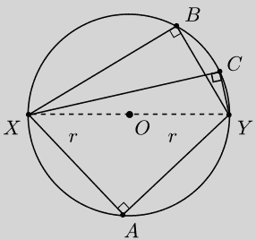

**证明：** 从 $O$ 画到 $P$ 画一条半径，假设 $\angle XPO = x$ 且 $\angle YPO = y$。我们的目标是证明 $x + y = 90^\circ$。

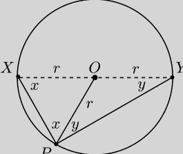

由于 $\overline{OX}$ 和 $\overline{OP}$ 是圆的半径，它们的长度都为 $r$，因此三角形 $XPO$ 是等腰三角形。$\angle OXP = \angle XPO = x$。同样，$\overline{OY}$ 是半径，且 $\angle OYP = \angle YOP = y$。由于三角形 $XYP$ 的三个角之和必须为 $180^\circ$，我们有 $2x + 2y = 180^\circ$，因此 $x + y = 90^\circ$，得证。

上面的定理是我最喜欢的几何定理之一——圆周角角的特例。

## 旁注

本章开头问题 2 的答案由圆心角揭示。圆心角告诉我们，对于圆上的两个点 $X$ 和 $Y$，圆弧上的任何点 $P$ 所对的圆周角是圆心角的一半。具体来说，对于圆弧上的 $X$ 和 $Y$，圆弧上的任何点 $P$ 所对的圆周角是相同的。如果一个圆周长为 $C = 50$ 英尺，那么它的半径是 $50/(2\pi) \approx 7.96$。如果我们将周长增加 10 英尺，那么新半径就是 $60/(2\pi) \approx 9.55$，大约大出 1.59 英尺。


我们有一个半径为 $r$ 的圆，$\pi ab$ 面积公式正确地给出了 $\pi r^2$。

这里关于椭圆的一些有趣知识。你可以通过两个大针、一个绳圈和一支笔来创建一个椭圆。在纸或硬纸上钉两个大针，将绳子绕在大针周围，并留出一点松弛。将铅笔放在绳子的一处并拉紧绳子，使绳子形成一个三角形，如下图所示。绕两个大针移动铅笔，全程保持绳子绷。得到的图形将是一个椭圆。


大针的位置被称为椭圆的*焦点*，它们具有以下神奇属性。如果你取一个弹珠或台球，并将其放在一个焦点上，然后向任何方向击打球，它在椭圆上反弹一次后将将直指向另一个焦点。


行星和彗星等天体沿椭圆轨道运行。我无法抑制这句韵律：

- 即使是日食
也是基于椭圆的！

# $\pi$ 的魔法

有趣的是，椭圆的周长没有简单的公式。但数学天才斯里尼尼瓦萨·拉马努金（1887–1920）建立了以下极佳的近似。上述描述的椭圆周长约为：

$\pi (3a + 3b - \sqrt{(3a+b)(3b+a)})$

注意当 $a = b = r$ 时，它简化为 $\pi(6r - \sqrt{6r^2}) = 2\pi r$，即圆的周长。

数字 $\pi$ 也出现在三维物体中。考虑一个*圆柱*，例如一个汤罐。对于半径为 $r$、高度为 $h$ 的圆柱，它的*体积*（衡量形状占据的空间）为：

$V_{cylinder} = \pi r^2 h$

这个公式是有意义的，因为我们可以把圆柱看作是由面积为 $\pi r^2$ 的圆堆叠在另一个圆上面（就像餐厅里的一叠圆形杯垫），直到高度为 $h$。

圆柱的*表面积*是多少？换句话说，我们需要多少油漆来涂满它的外部，包括顶部和底部？你不需要背下答案，你可以通过将圆柱分成三部分来推算出。圆柱的顶部和底部各面积均为 $\pi r^2$，所以它们对表面积贡献了 $2\pi r^2$。对于圆柱的其余部分，从底部到顶部用直线切开圆柱，并将得到的物体展平。该物体将是一个高为 $h$、底为 $2\pi r$ 的矩形，因为那是周围圆的周长。这个矩形的面积为 $2\pi rh$，圆柱的总表面积为：

$A_{cylinder}=2\pi r^2 + 2\pi rh$

*球*是一个三维物体，其中所有点到球心的距离相等。半径为 $r$ 的球的体积是多少？这样的球可以放入半径为 $r$、高度为 $2r$ 的圆柱内，因此它的体积必须小于 $\pi r^2(2r) = 2\pi r^3$。幸运（以及微积分），球占据了该空间的二之二。换句话说，球的体积为：

$V_{sphere}=\frac{4}{3}\pi r^3$

球的表面积有一个简单的公式，但推导并不简单：

$$A_{sphere} = 4\pi r^2$$

让我们用 $\pi$ 出现在冰淇淋和披萨中的例子结束本节。想象一个高度为 $h$ 的冰淇淋锥，顶部的圆半径为 $r$。设 $s$ 为从圆锥顶点到圆上任意点的*斜高*，如下所示。（我们可以根据勾股定理计算 $s$，因为 $h^2 + r^2 = s^2$。）


圆锥的体积为 $\pi r^2h/3$，表面积为 $\pi r s$

这样的圆锥可以放入半径为 $r$、高度为 $h$ 的圆柱内，所以圆锥的体积小于 $\pi r^2h$ 并不意外。但令人惊讶（而且在没有微积分的情况下完全不直直觉）的是体积正好是那个数字的三分之一。换句话说，

$$V_{cone} = \frac{1}{3}\pi r^2h$$

虽然我们不需要微积分就能导出表面积，但我们展示它是为了它的优雅和简单。圆锥的表面积为：

$$A_{cone} = \pi r s$$

最后，考虑一个半径为 $z$、厚度为 $a$ 的披萨，如下所示。它的体积是多少？


这个半径为 $z$、厚度为 $a$ 的披萨体积是多少？

披萨可以被看作一个半径为 $z$、高度为 $a$ 的圆柱，所以它的体积必须是：

$$V = \pi z^2 a$$

# $\pi$ 的一些惊喜出现

它也出现在与概率有关的问题。例如，如果你随机选择两个大数，它们没有公共质因数的概率略高于 60%。更精确地说，概率是 $6/\pi^2 = .6079\dots$。这与我们之前求和的一个答案的倒数并非巧合。

数字 $\pi$ 也出现在很多地方。例如，所示的正态曲线贯穿统计学学。


正态曲线的高度为 $1/\sqrt{2\pi}$。我们将在第10章详细讨论。

数字 $\pi$ 也出现在三维物体中。考虑一个*圆柱*，例如一个汤罐。对于半径为 $r$、高度为 $h$ 的圆柱，它的*体积*（衡量形状占据的空间）为：

$V_{cylinder} = \pi r^2 h$

这个公式是有意义的，因为我们可以把圆柱看作是由面积为 $\pi r^2$ 的圆堆叠在另一个圆上面（就像餐厅里的一叠圆形杯垫），直到高度为 $h$。

圆柱的*表面积*是多少？换句话说，我们需要多少油漆来涂满它的外部，包括顶部和底部？你不需要背下答案，你可以通过将圆柱分成三部分来推算出。圆柱的顶部和底部各面积均为 $\pi r^2$，所以它们对表面积贡献了 $2\pi r^2$。对于圆柱的其余部分，从底部到顶部用直线切开圆柱，并将得到的物体展平。该物体将是一个高为 $h$、底为 $2\pi r$ 的矩形，因为那是周围圆的周长。这个矩形的面积为 $2\pi rh$，圆柱的总表面积为：

$A_{cylinder}=2\pi r^2 + 2\pi rh$

*球*是一个三维物体，其中所有点到球心的距离相等。半径为 $r$ 的球的体积是多少？这样的球可以放入半径为 $r$、高度为 $2r$ 的圆柱内，因此它的体积必须小于 $\pi r^2(2r) = 2\pi r^3$。幸运（以及微积分），球占据了该空间的二之二。换句话说，球的体积为：

$V_{sphere}=\frac{4}{3}\pi r^3$


球的表面积有一个简单的公式，但推导并不简单：

$$A_{sphere} = 4\pi r^2$$

让我们用 $\pi$ 出现在冰淇淋和披萨中的例子结束本节。想象一个高度为 $h$ 的冰淇淋锥，顶部的圆半径为 $r$。设 $s$ 为从圆锥顶点到圆上任意点的*斜高*，如下所示。（我们可以根据勾股定理计算 $s$，因为 $h^2 + r^2 = s^2$。）

圆锥的体积为 $\pi r^2h/3$，表面积为 $\pi r s$

这样的圆锥可以放入半径为 $r$、高度为 $h$ 的圆柱内，所以圆锥的体积小于 $\pi r^2h$ 并不意外。但令人惊讶（而且在没有微积分的情况下完全不直觉）的是体积正好是那个数字的三分之一。换句话说，

$$V_{cone} = \frac{1}{3}\pi r^2h$$

虽然我们不需要微积分就能导出表面积，但我们展示它是为了它的优雅和简单。圆锥的表面积为：

$$A_{cone} = \pi r s$$

最后，考虑一个半径为 $z$、厚度为 $a$ 的披萨，如下所示。它的体积是多少？

这个半径为 $z$、厚度为 $a$ 的披萨体积是多少？

披萨可以被看作一个半径为 $z$、高度为 $a$ 的圆柱，所以它的体积必须是：

$$V = \pi z^2 a$$

# $\pi$ 的一些惊喜出现

它也出现在与概率有关的问题。例如，如果你随机选择两个大数，它们没有公共质因数的概率略高于 60%。更精确地说，概率是 $6/\pi^2 = .6079\dots$。这与我们之前求和的一个答案的倒数并非巧合。

数字 $\pi$ 也出现在很多地方。例如，所示的正态曲线贯穿统计学学。

正态曲线的高度为 $1/\sqrt{2\pi}$。我们将在第10章详细讨论。

# $\pi$ 的数字

通过你自己的仔细测量，你可以实验性地确定 $\pi$ 比 3 大一点，但自然而然产生了两个问题。你可以在不使用物理测量的情况下证明 $\pi$ 接近 3 吗？是否存在一个简单的分数或分数或公式？我们可以通过画一个半径为 1 的圆来回答第一个问题，我们知道它的面积为 $\pi1^2 = \pi$。在图中，我们画了一个边长为 2 的正方形完全包含了圆。由于圆的面积小于正方形的面积，这证明了 $\pi < 4$。

另一方面，圆还包含一个由圆周上均匀间隔的六点组成的六边形。内接六边形的*周长*是

六边形可以被分成 6 个三角形，每个三角形的中心角为 360°/6 = 60°。三角形的两边是长度为 1 的圆半径，因此该三角形是等腰三角形。根据等腰三角形，另外两个角相等，因此也也是 60°。因此这些三角形都是边长为 1 的等边三角形。六边形的周长为 6，小于周长 2π。因此 6 < 2π，所以 π < 3。综上，我们得到

## 3 < π < 4

我们可以使用边数更多的多边形将 π 限制在更小的区间内。例如，如果我们用六边形而不是正方形包围单位圆，我们可以证明 π < 2√3 = 3.46...


再次，六边形可以细分为六个等边三角形。每个三角形都可以进一步细分为两个全等的直角三角形。如果短边长度为 x，那么斜边长度为 2x，根据勾哥拉斯定理，x² + 1 = (2x)²。解方程 得到 x = 1/√3。因此，六边形的周长为 12/√3 = 4√3，由于这大于圆的周长 2π，可以得出 π < 2√3。（有趣的是，通过比较圆面积和六边形面积，我们也得到了相同的结论。）

伟大的希腊数学家阿基米德（公元前 287 年至 212 年）在这一结果的基础上，创建了具有 12、24、48 和 96 边的内接和外接多边形，得出 3.14103 < π < 3.14271 以及看起来更简单的的不等式

3/71 < π < 1/7

# $\pi$ 的魔法

有很多简单的方法用分数来近似 $\pi$。例如，

$\frac{314}{100} = 3.14$， $\frac{22}{7} = 3.142857$， $\frac{355}{113} = 3.1415929\dots$

我特别喜欢最后一种近似。它不仅正确地给出了 $\pi$ 的六位小数，而且按顺序两次使用了前三个奇数：两个 1，两个 3 和两个 5！

自然地，如果能找到一个精确表示 $\pi$ 的分数会很有趣；否则我们只能简单地说 $\pi = \pi{\pi}$。1768 年，约翰·海因里希·兰伯特（Johann Heinrich Lambert）证明了这种搜索是徒劳的，证明 $\pi$ 是无理数。也许它可以用数字的平方根或立方表示？例如，$\sqrt{10} = 3.162\dots$ 相当接近。但在 1882 年，费尔迪南·冯·林德曼证明了 $\pi$ 不仅仅是无理。它是*超越数*，这意味着 $\pi$ 不是任何整数系数多项式的根。例如，$\sqrt{2}$ 是无理数，但它不是超越数，因为它是多项式 $x^2 - 2$ 的根。

尽管 $\pi$ 不能表示为分数，但它可以表示为无限分数的和或积，只要我们使用无限多个分数！例如，我们将在第 12 章中看到

$\pi = 4 \left(1 - \frac{1}{3} + \frac{1}{5} - \frac{1}{7} + \frac{1}{9} - \frac{1}{11} + \dots\right)$

上面的公式美而令人惊讶，但它并不是计算 $\pi$ 的实用公式。在 300 项之后，我们离 $\pi$ 的距离仍然没有比 22/7 近。这里是另一个惊人的公式，被称为*沃士公式*（Wallis's formula），其中 $\pi$ 被表示为一个无限乘积，尽管它需要很长时间才能收敛。

$\pi = 4 \left(\frac{2}{3} \cdot \frac{4}{3} \cdot \frac{4}{5} \cdot \frac{6}{5} \cdot \frac{6}{7} \cdot \dots\right) = 4 \left(1 - \frac{1}{9}\right) \left(1 - \frac{1}{25}\right) \left(1 - \frac{1}{49}\right) \left(1 - \frac{1}{81}\right)\dots$

# 庆祝并记忆 π（以及 $\tau$）

由于人们对 $\pi$ 的着迷（以及作为测试超级计算机速度和准确性的方法），$\pi$ 已计算到数万位。我们确实不需要知道那么精确的 $\pi$。仅凭 $\pi$ 的数字，你就可以测量已知宇宙的周长，误差在氢原子半径范围内！

这个数字几乎形成了一种类崇拜。很多人喜欢在 3 月 14 日圆周日（数字表示为 3/14）庆祝 π 数，这恰好是阿尔伯特·爱因斯坦的生日。典型的圆周日活动可能包括展示和食用的数学主题派对、爱因斯坦装扮，当然还有 $\pi$ 记忆比赛。学生们通常记忆几十位 $\pi$，获者记忆了一百位也并不罕见。顺便说一下，目前的记录属于中国的中国朝禄（Chao Lu），他在 2005 年背诵了 $\pi$ 到 67,890 位！

```
π = 3.14159265358979323846264338271950288
```

多年来，人们想出了许多记忆 $\pi$ 数字的创意方法。其中一种方法是创建句子，每个单词的长度给出 $\pi$ 的下一个数字。例如，“How I wish could calculate”得到了七位：3.141592。最令人印象深刻的例子是迈克（Mike）在1995 年写的，他根据爱德华·爱傲的诗《乌鸦》（The Raven）生成了七十四位。第一节：

```
Poe. E. Near a Raven

Midnights so dreary, tired and weary.

Silently pondering all-obsolete.

“This,” I whispered
```

Keith 通过编写 3835 位“Cadenza”继续了这一杰作。（如果将 C 替换为 3，A 替换为 1，D 替换为 4，那么“cadeaic”就变成了 314159。）它包含了刘易斯·卡罗尔的诗《甲游虫》（Jabberwocky）的模仿作。他最近的贡献是《A Dream for 10000 Decimals》。

或者像我常说的，“How I wish could elucidate others”得到了十三位。我最喜欢的记忆数字的方法是使用一种音标系统（phonetic code）。在这个系统中，每个数字都由一个或多个辅音表示来说：
- 1 = t or d
- 2 = n
- 3 = m
- 4 = r
- 5 = l
- 6 = j, or sh
- 7 = k or hard g
- 8 = f or v
- 9 = p or b
- 0 = s or z

甚至还有用于记忆这个系统的数字！我的朋友托尼·马洛什（Tony Marlosh）提供了：
- t（或发音 d）有 1 画；
- n 有 2 画；
- m 有 3 画；
- “four”以字母 r 结尾；
- 5 是手指和大拇指；
- 6 看起来像 j；
- 7 可以画成 k；
- 8 是一个图形；
- 9 反过来或倒过来得到 p 或 b；
- “zero”以 z 开头。

我们可以使用这个代码将数字转换为相关的发音单词。例如，数字 31 使用了辅音 m 和 t（或 m 或 d），可以转换为如 31 = mate, mute, maid, mitt, omit, muddy

# 数学的魔法

注意，像 "muddy" 或 "mitt" 这样的单词是可以的，因为 d 或 t 音出现了一次。拼写并不重要。由于 h、w 和 y 的辅音不在列表中，所以可以像元音一样自由使用这些声音。那么我们可以把 31 转换为 "humid" 或 "midway"。注意，虽然数字通常可以用不同的单词表示，但一个单词只能由一个数字表示。

$\pi$ 的前三位带有辅音 m、t 和 r，可以变成：

```
314 = meter, motor, metro, meteor, midyear, amateur
```

31415 的前五位可以变成 "my turtle"。扩展到 $\pi$ 的前二十四位 314159265358979323886264 可以变成：
My turtle Pancho will, my love, pick up my new mover Ginger

我将接下来的十七位 3383279502884841971 转 My movie monkey plays in a favorite bucket

我喜欢接下来的十九位 693937510582097494，因为它们允许一些长单词：Ship my puppy Michael to Sullivan's backrubber

$\pi$ 的下十八位 459230781640628620 可以给我们一个非常棒的音乐视频 cheers Jenny F. Jones，后面是另外二十二位数字 8998628034825342117067：Have a baby fish knife so Marvin will marinate the goose chick!

因此，通过五十个句子，我们编码了 $\pi$ 的前百位！音标代码对于记忆日期、电话号码、信用卡号等非常有用。尝试一下，稍加练习，你将极大提高你记忆数字的能力。

所有数学家都同意 $\pi$ 是数学中最重要的数字之一。但如果你看使用 $\pi$ 的公式和应用，你会发现其中很多是 $\pi$ 乘以 2。

# π 的魔法 201

希腊字母 τ（tau，发音与“wow”押韵）被用来表示这个物理量。

τ = 2π

许多人认为，如果我们回到过去，三角函数中的数学公式和关键概念将使用 τ 代替 π 以更简洁的方式表达。这些思想在鲍勃·帕莱斯（Bob Palais）的《π 是错误的！）和迈克尔·哈特尔（Michael Hartl）的《τ 宣言》的文章中得到了优雅且有趣的表达。这一论论的“核心点”是根据半径定义的圆，当我们把圆周与半径比较时，得到 $C/r=2\pi=\tau$。现在有些教科书被标记为“符合 τ 标准”，表示它们将用 $\pi$ 和 $\tau$ 来表示公式。（尽管切换到这个常数可能并不像切饼一样简单，但许多学生和老师都认为 $\tau$ 比 $\pi$ 更容易。）看看这一运动在未来几十年会发生什么将是非常有趣的。τ 的支持者（自称为 τ 主义者）诚恳地相信真理在我们这一边，但他们对传统的表示法也是包容的。正如他们喜欢说的那样，τ 主义者从不虔诚。

这里是 τ 的百位数字，其中插入了空格以便后面提供的记忆法。注意，τ 以 6 和 28 开，两者都是第 6 章描述的完美数。τ 是巧合吗？当然！但这无论如何都是趣知识。

```
τ = 6.283185 8891846 15632 812572417 867665 5900576 9650684 234135 ... 211641949 8891846 15632 9972650
```


2012年，13岁的伊森·布朗（Ethan Brown）通过背诵 2012 位 τ 的一项募项目创造了世界记录。他使用了语音编码，但他不是创建长句子，而是创建了视觉图像，每个图像包含一个主语、一个动作（始终以 -ing 结尾）和一个接受动作的对象。前七位数字 62 831 85 变成了“一个海洋在吐华夫饼”。以下是他对应 τ 前百位数字的图像。

- 一个面具在拉着法官
- 一条鲨鱼在切尼龙
- 布丁在教大大提琴
- 肘部在卖沙发
- 泡沫在埋木乃伊
- 雾气在铺玻璃
- 一张传单在粉碎泡泡

# 202 数学魔法

FIFA 正在美化爱尔兰人
- 一个洋娃娃在赶走小鱼
- 一个光子看起来很神经质
- 一只小狗在承认污水
- 一个桃子失去了它的司机
- 蜂蜜在嫁给燕麦片

为了让这些图像更容易记忆，他想象自己正通过他的“记忆宫”方法去上学，当他走过某些走廊并进入各种教室时，每个房间会有三到五个物体在做着傻事。最终，他有 272 个图像分布在 60 多个地点。他花费了大约 4 个月的准备时间来背诵这 2012 位数字，他在 73 分钟内完成了。

让我们用一段对 π 的音乐庆祝来结束这一章。我写这首歌作为拉里·莱瑟（Larry Lesser）恶搞歌曲《美国 Pi》的歌词补充。你应该只在歌曲被唱过时唱一遍，因为 π 是不重复的。

在很久以前，
我仍然记得我的数学课过去如何让我打瞌睡。
因为我们遇到的每一个数字
要么终止，要么只是重复，
但也许有些数字能做得更多。

但那时我的老师说：“我赌你
去试着找到圆的面积。”
尽管我如何努力，
我找不到一个分数。

我不记得我是否哭过，
无论我是越试越还是越画越圆，
但有些东西触动了我的内心，
当我得知 π 的那一天！

π，π，数学的 π，
十一再除以七是一个非常棒的尝试。
你可能希望提供一个很好的老分数，
但小数展开不会消失的。
小数展开不会消失。

π，π，数学的 π，
3.141592653589。

你可能希望定义一个很好的老分数，
但小数展开不会消失的！

# 第九章

# $20^\circ = \pi / 9$

# 三角函数的魔法

## 三角函数的顶点

三角学学科允许我们解决无法用经典几何学解决的几何问题。例如，考虑以下情况。

问题：仅使用量角器和口袋计算器，确定附近山峰的高度。我们将提供五种解决此问题的方法。前三种方法实际上几乎不需要数学！

方法 1（蛮力法）：爬上山顶并把你的计算器扔下山。（这可能需要大量的……测量你的计算器撞击地面的时间（或听听尖叫声）。）如果时间是 $t$ 秒，且忽略空气阻力，高度大约是 $t^2$。测量你的计算器撞击地面的时间（或听听尖叫声）。使用量角器和口袋计算器确定……

# 数学的魔法

整个三角学都基于两个重要的函数：正弦函数和余弦函数。给定一个直角三角形 $ABC$，如图所示，我们令 $c$ 表示斜边长度并将 $a$ 和 $b$ 分别表示 $\angle A$ 和 $\angle B$ 的对边长度。


$\sin A = a/c = \frac{\text{opp}}{\text{hyp}}$ $\cos A = b/c = \frac{\text{adj}}{\text{hyp}}$ $\tan A = a/b = \frac{\text{opp}}{\text{adj}}$

对于角 $A$（在直角三角形中必然是锐角），我们定义 $\angle A$ 的正弦为，记作 $\sin A$

$\sin A = \frac{a}{c} = \frac{\text{角 } A \text{ 对边长度}}{\text{斜边长度}} = \frac{\text{opp}}{\text{hyp}}$

同样，我们定义 $\angle A$ 的余弦为

$\cos A = \frac{b}{c} = \frac{\text{角 } A \text{ 邻边长度}}{\text{斜边长度}} = \frac{\text{adj}}{\text{hyp}}$

（注意，任何带有角 $A$ 的直角三角形都与原三角形相似，其边长成比例，因此 $A$ 的正弦和余弦不取决于三角形的大小。）

在正弦和余弦之后，三角学中最常用的函数是正切函数。我们定义 $\angle A$ 的正切为

$\tan A = \frac{\sin A}{\cos A}$

结合直角三角形，我们得到

$\tan A = \frac{\sin A}{\cos A} = \frac{a/c}{b/c} = \frac{a}{b} = \frac{\text{角 } A \text{ 对边长度}}{\text{角 } A \text{ 邻边长度}} = \frac{\text{opp}}{\text{adj}}$

有很多用于记忆正弦、余弦和正切公式的口诀。最流行的是“SOH CAH TOA”，其中 SOH 提醒我们正弦是对边/斜边，CAH 和 TOA 也是如此。我的高中老师用过口诀（假设你按照正弦、余弦、再正切的顺序进行）：Oscar Has A Heap Of Apples (OH-AH-OA)。我的朋友把这修改为 Olivia Has A Hairy Old Aunt!（奥利维娅有一个满脸毛的老姨！）

例如，在下方的 3-4-5 三角形中，我们有

$\sin A = \frac{3}{5} \cos A = \frac{4}{5} \tan A = \frac{3}{4}$


对于 3-4-5 直角三角形，$\sin A = 3/5, \cos A = 4/5, \tan A = 3/4$

现在同一个三角形中的 $\angle B$ 呢？如果我们计算它的正弦和余弦值，会发现

$\sin B = \frac{4}{5} = \cos A \cos B = \frac{3}{5} = \sin A$

这里我们有 $\sin B = \cos A$ 且 $\cos B = \sin A$。这不是巧合，因为对于任意角 $\angle A$，另一个角会交换它们认为的对边和邻边，但它们的斜边保持不变。由于 $\angle A + \angle B = 90^{\circ}$，对于任何锐角都有

$\sin(90^{\circ} - A) = \cos A \quad \cos(90^{\circ} - A) = \sin A$

因此，例如，如果直角三角形 $ABC$ 的 $\angle A = 40^{\circ}$，那么它的补角 $\angle B = 50^{\circ}$ 具有性质 $\sin 50^{\circ} = \cos 40^{\circ}$ 和 $\cos 50^{\circ} = \sin 40^{\circ}$。换句话说，补角的正弦等于余弦（这正是“cosine”一词的来源）。

还有三个函数也应该是你三角函数词汇的一部分，但它们的使用频率远不如前三个函数。它们是正割、余割和余切函数，定义如下：

```
sec A = \frac{1}{\cos A} \csc A = \frac{1}{\sin A} \cot A = \frac{1}{\tan A}
```

你可以很容易地验证，“co-”函数具有与正弦余弦相同的余角关系。也就是说，对于直角三角形中的任意锐角，$\sec(90^{\circ} - A) = \csc A$ 且 $\tan(90^{\circ} - A) = \cot A$。

一旦知道如何计算任意角的正弦，就可以通过补角来计算正切和其他三角函数。但你如何计算正弦值，比如 $\sin 40^{\circ}$？最简单的方法是使用计算器。我的老师以前用表，但现在我们有了计算器。然而，精确掌握某些值是有用的。有些值是你无需借助计算器就能知道的。例如，30-60-90 和 45-45-90 三角形。

在 30-60-90 三角形中，边长比例为 $1 : \sqrt{3} : 2$。因此

$\sin 30^{\circ} = 1/2, \quad \cos 30^{\circ} = \sqrt{3}/2, \quad \tan 30^{\circ} = 1/\sqrt{3}$

$\sin 60^{\circ} = \sqrt{3}/2, \quad \cos 60^{\circ} = 1/2, \quad \tan 60^{\circ} = \sqrt{3}$

在 45-45-90 三角形中，边长比例为 $1 : 1 : \sqrt{2}$。因此

$\sin 45^{\circ} = 1/\sqrt{2}, \quad \cos 45^{\circ} = 1/\sqrt{2}, \quad \tan 45^{\circ} = 1$

如果你需要找到 $40^{\circ}$ 等角的正弦，可以使用恒等式 $\sin(90^{\circ} - A) = \cos A$ 来寻找 $\sin 40^{\circ}$（如果你知道 $\cos 50^{\circ}$ 的话），但不大。对于大多数角，我们使用计算器。但理解计算器在做什么是很重要的。它使用算法（如泰勒级数）来近似值。例如，$\sin x$ 的泰勒级数是一个无限和，允许我们无限接近 $\sin x$ 的真实值。

## 212 数学的魔法


$\cos A$ 和 $\sin A$ 的通用定义

这里是另一个大图，我们将单位圆划分为若干间隔为 $30^{\circ}$ 的角度（为了保险见，还加入了 $45^{\circ}$），因为这些角度对应于我们之前过的特殊三角形的角。我们列出了 $0^{\circ}$、$30^{\circ}$、$45^{\circ}$、$60^{\circ}$ 和 $90^{\circ}$ 的余弦和正弦值。具体来说：

```
$(\cos 0^{\circ}, \sin 0^{\circ}) = (1,0)$
$(\cos 30^{\circ}, \sin 30^{\circ}) = (\sqrt{3}/2, 1/2)$
$(\cos 45^{\circ}, \sin 45^{\circ}) = (\sqrt{2}/2, \sqrt{2}/2)$
$(\cos 60^{\circ}, \sin 60^{\circ}) = (1/2, \sqrt{3}/2)$
$(\cos 90^{\circ}, \sin 90^{\circ}) = (0, 1)$
```

正如我们将要看到的，这些角度的倍数可以通过反射第一象限的值来计算。

# 三角三角的魔法 213


由于给角度加上或减去 $360^\circ$ 实际上不会真正改变角度（它字面上让我们绕了整整圈），因此对于任何角度 $A$，

$\sin(A\pm360^\circ) = \sin A \quad \cos(A\pm360^\circ) = \cos A$

负角沿顺时针方向移动。例如，角度 $-30^\circ$ 等于 $330^\circ$。注意，当你顺时针方向移动 $A$ 度时，你的 $x$ 坐标与逆时针方向移动 $A$ 度时相同，但 $y$ 坐标的符号相反。换句话说，对于任何角度 $A$，

$\cos(-A) = \cos A \quad \sin(-A) = -\sin A$

例如：

$\cos(-30^\circ) = \cos 30^\circ = \sqrt{3}/2 \quad \sin(-30^\circ) = -\sin 30^\circ = -1/2$

当我们跨越 $y$ 轴反射角度 $A$ 时，我们得到*补角* $180 - A$。这使得单位圆上的 $y$ 值保持不变，但 $x$ 值被取反了。换句话说：

$\cos(180 - A) = -\cos A \quad \sin(180 - A) = \sin A$

# 数学的魔法

例如，当 $A = 30^\circ$ 时，

$\cos 150^\circ = -\cos 30^\circ = -\sqrt{3}/2 \quad \sin 150^\circ = \sin 30^\circ = 1/2$

我们继续像之前一样定义其他三角函数，例如 $\tan A = \sin A / \cos A$。

$x$ 轴和 $y$ 轴将平面分为四个象限。我们把这些象限称为 I、II、III 和 IV，其中第一象限的角度在 $0^\circ$ 到 $90^\circ$ 之间；第二象限的角度在 $90^\circ$ 到 $180^\circ$ 之间；第三象限的角度在 $180^\circ$ 到 $270^\circ$ 之间；第四象限的角度在 $270^\circ$ 到 $360^\circ$ 之间。注意，正弦在第一和第二象限为正的，余弦在第一和第四象限为正的，因此正切在第一和第三象限为正的。有些学生使用“All Students To Calculus”（所有学生去微积分）这个口诀来记忆在每个象限中哪些函数是正的（全、正弦、正切、余弦）。

最后一个值得学习的词汇是反三角函数，它们对于确定未知角度非常有用。例如，$1/2$ 的反正正弦记作 $\sin^{-1}(1/2)$，它告诉我们使 $\sin A = 1/2$ 的角度 $A$。我们知道 $\sin 30^\circ = 1/2$，所以 $\sin^{-1}(1/2) = 30^\circ$。

$\sin^{-1}$ 函数（也称为反正弦）始终给出 $-90^\circ$ 到 $90^\circ$ 之间的角，但注意在该范围之外还有其他角度具有相同的值。例如，$\sin 150^\circ = 1/2$，任何在 $30^\circ$ 上加上 $360^\circ$ 的倍数也是如此。对于对面所示的 3-4-5 三角，我们的计算器可以通过反三角函数用三种方法确定角度 $A$：$\angle A = \sin^{-1}(3/5) = \cos^{-1}(4/5) = \tan^{-1}(3/4) \approx 36.87^\circ$。

反三角函数可以根据边长确定角度。是时候让这些函数派上用场了。


在这里，由于 $\tan A = 3/4$，$\angle A = \tan^{-1}(3/4) \approx 37^\circ$。在几何中，勾股定理告诉我们直角三角形的边长。在三角学中，我们可以对*任意*三角形进行类似的计算。

**定理（余弦定理）：** 对于任意三角形 $ABC$，长度为 $a$ 和 $b$ 的边形成角 $C$，第三边 $c$ 满足：

$c^2 = a^2 + b^2 - 2ab \cos C$

例如，在下面的三角形中，边 $5$ 和 $6$ 之间有 $50^\circ$ 角。所以根据余弦定理，第三边 $c$ 必须满足：

$c^2 = 5^2 + 6^2 - 2(5)(6) \cos 50^\circ$

由于 $\cos 50^\circ \approx 0.9659$，该方程简化为 $c^2 = 25 + 36 - 60(0.9659) = 62.1$，因此 $c \approx 7.89$。


证明：为了证明余弦定理，我们考虑三种情况，取决于 $\angle C$ 是直角、锐角还是钝角。如果 $\angle C$ 是直角，那么 $\cos C = 90^\circ = 0$，所以余弦定理简单来说就是 $c^2 = a^2 + b^2$，这通过勾股定理是正确的。


如果 $\angle C$ 是锐角，在图中，从 $B$ 向 $\overline{AC}$ 作一条垂线交于点 $D$；这把 $ABC$ 分为两个直角三角形。从上面的图以及对 $CBD$ 应用勾股定理，我们有 $a^2 = h^2 + x^2$，因此

$h^2 = a^2 - x^2$

从三角形 $ABD$，我们有 $c^2 = h^2 + (b-x)^2 = h^2 + b^2 - 2bx + x^2$，因此

$h^2 = c^2 - b^2 + 2bx$

将上述 $h^2$ 的值相等得到：

$c^2 - b^2 + 2bx - x^2 = a^2 - x^2$

因此

$c^2 = a^2 + b^2 - 2bx$

从直角三角形 $CBD$，我们看到 $\cos C = x/a$，所以 $x = a \cos C$。因此，当 $\angle C$ 是锐角时：

$c^2 = a^2 + b^2 - 2ab \cos C$

如果 $\angle C$ 是钝角，我们在三角形外面创建一个直角三角形 $CBD$，如反图所示。

# 注（续）


从直角三角形 $CBD$ 和 $ABD$，勾股定理告诉我们 $a^2 = h^2 + x^2$ 和 $c^2 = h^2 + (b+x)^2$。这一次，当我们相等 $h^2$ 的值时，我们得到

$c^2 = a^2 + b^2 + 2bx$

这一次，三角形 $CBD$ 告诉我们 $\cos C = x/a$，所以 $x = a \cos C$。将此代入方程，得到 $c^2 = a^2 + b^2 + 2ab \cos C$。用文字来说，对于三角形 $ABC$，sin C)/c$ 是面积的两倍除以边的乘积。但在这个陈述中，$C$ 并没有特殊。# 218 数学的魔法

用文字来说，对于三角形 $ABC$，sin C)/c$ 是面积的两倍除以边的乘积。但在这个陈述中，$C$ 并没有特殊。我们从 $(\sin B)/b$ 或 $(\sin A)/a$ 得到相同的结论。因此，我们刚刚证明了以下定理。

**定理（正弦定理）：** 对于任意三角形 $ABC$，

$\frac{\sin A}{a} = \frac{\sin B}{b} = \frac{\sin C}{c}$

或者等价于，

$\frac{a}{\sin A} = \frac{b}{\sin B} = \frac{c}{\sin C}$

我们可以用正弦定理换方法确定山的高度。这一次，我们关注 $a$，即我们到山顶的原始距离，如下图所示。


用正弦定理求高

方法 5（正弦定理）：在三角形 $ABD$ 中，$\angle BAD = 32^\circ$，$\angle BDA = 180^\circ - 40^\circ = 140^\circ$，因此 $\angle ABD = 8^\circ$。将正弦定理应用于这个三角形，我们有

```
$\frac{a}{\sin 32^\circ} = \frac{1000}{\sin 8^\circ}$
```

两边同乘以 $\sin 32^\circ$，得到 $a = 1000 \sin 32^\circ / \sin 8^\circ \approx 3808$ 英尺。接下来，由于 $40^\circ \approx 0.6428 = h/a$，得出：

```
$h = a \sin 40^\circ \approx (3808)(.6428) = 2448$
```

# 三角函数的魔力 219

所以这座山的高度约为 2450 英尺，这与我们之前的答案一致。

> 旁注
>
> 这里有另一个非常值得的公式，叫做海伦公式（Hero's formula），它可以告诉我们边长为 $a, b, c$ 的三角形面积。一旦计算出半周长，该公式就非常直观：
>
> $$s = \frac{a+b+c}{2}$$
>
> 海伦公式规定边长为 $a, b, c$ 的三角形面积为：
>
> $$\sqrt{s(s-a)(s-b)(s-c)}$$
>
> 例如，边长为 3, 14, 15（$\pi$ 的前五位）的三角形，$s = (3+14+15)/2 = 16$。因此，该三角形的面积为 $\sqrt{16(16-3)(16-14)(16-15)} = \sqrt{416} \approx 20.4$。
>
> 海伦公式可以从余弦定理和一些基础代数运算推导出来。

# 三角函数恒等式

三角函数满足许多有趣的关系，被称为恒等式。我们已经见过其中几个，例如：

$$\sin(-A) = -\sin A \quad \cos(-A) = \cos A$$

但还有其他有趣的恒等式可以导出实用的公式，我们将在本文中探索。第一个恒等式源于单位圆公式：

$$x^2 + y^2 = 1$$

由于点 $(\cos A, \sin A)$ 在单位圆上，它必须满足该关系，因此 $(\cos A)^2 + (\sin A)^2 = 1$。这为我们提供了所有三角函数中最重要的恒等式。

**定理：** 对于任意角 $A$，

$$\cos^2 A + \sin^2 A = 1$$

所以我们主要使用字母 $A$ 来表示任意角，但这个字母本身并没有特殊之处。上面的恒等式也常用其他字母表示，例如：

$$\cos^2 x + \sin^2 x = 1$$

# 数学的魔力

希腊字母 $\theta$ (theta) 是另一个流行的选择：

$$\cos^2\theta + \sin^2\theta = 1$$

有时我们直接在不使用任何变量的情况下引用该恒等式。例如，我们可能会将定理简写为：

$$\cos^2\theta + \sin^2\theta = 1$$

在证明其他恒等式之前，让我们先应用勾股定理来计算线段长度。这将证明我们第一个恒等式的关键，而且这是一个非常有用的结论：

**定理（距离公式）：**  $L$ 为从 $(x_1, y_1)$ 到 $(x_2, y_2)$ 的线段长度。

$$L = \sqrt{(x_2 - x_1)^2 + (y_2 - y_1)^2}$$

例如，从 $(-2,3)$ 到 $(5,8)$ 的**线段长度**为 $\sqrt{(5-(-2))^2 + (8-3)^2} = \sqrt{7^2 + 5^2} \approx 8.6$。


根据勾股定理，$L^2 = (x_2 - x_1)^2 + (y_2 - y_1)^2$

**证明：** 考虑如图所示两个点 $(x_1, y_1)$ 和 $(x_2, y_2)$。画一个直角三角形，使得连接它们的线段成为直角三角形的斜边。在我们的图中，底的长度为 $x_2 - x_1$，高为 $y_2 - y_1$。根据勾股定理，$L^2 = (x_2 - x_1)^2 + (y_2 - y_1)^2$，因此斜边长度 $L = \sqrt{(x_2 - x_1)^2 + (y_2 - y_1)^2}$。

## 三角函数的魔力

（注：此处原文存在大量乱码，根据数学逻辑修复如下）

注意，对于单位圆上的两个角 $A$ 和 $B$，它们之间的夹角为 $A-B$。我们考虑连接在单位圆上的两点 $P(\cos A, \sin A)$ 和 $Q(\cos B, \sin B)$ 之间的距离 $c$。根据距离公式：

$$c^2 = (x_2-x_1)^2 + (y_2-y_1)^2$$

$$c^2 = (\cos B - \cos A)^2 + (\sin B - \sin A)^2$$

$$c^2 = \cos^2 B - 2\cos A\cos B + \cos^2 A + \sin^2 B - 2\sin A\sin B + \sin^2 A$$

$$c^2 = (\cos^2 A + \sin^2 A) + (\cos^2 B + \sin^2 B) - 2(\cos A\cos B + \sin A\sin B)$$

$$c^2 = 1 + 1 - 2(\cos A\cos B + \sin A\sin B)$$

$$c^2 = 2 - 2(\cos A\cos B + \sin A\sin B)$$

这推导出了恒等式：

$$\cos(A-B) = \cos A\cos B + \sin A\sin B$$

## 弧度与三角函数图像

在目前为止对几何和三角学的讨论中，我们分配了一个范围从 0 到 360 度的度量。但如果你观察单位圆会发现，360 这个数字并没有特别自然之处。这个数字是由古巴比比伦人选择的，可能是因为他们使用 60 进制，而且这个数字大约等于一年的天数。相反，在大多数科学和数学领域，使用弧度来测量角度更为理想。

$2\pi \text{ radians} = 360^\circ$

或者等价于，

$1 \text{ radian} = \frac{180^\circ}{\pi}$

或者对于那些喜欢 $\tau = 2\pi$ 的 $\tau$主义者来说，

$1 \text{ radian} = \frac{360^\circ}{2\pi} = \frac{360^\circ}{\tau}$

从数值上看，1 弧度约为 $57^\circ$。为什么弧度比度更自然？在半径为 $r$ 的圆上，$2\pi$ 弧度的角度捕捉了圆的周长 $2\pi r$。如果我们取该角度的任何比例，我们捕捉到的弧长就是 $2\pi r$ 乘以该比例。具体来说，1 弧度捕捉的是长度为 $2\pi r(1/2\pi) = r$ 的弧。总之，在单位圆上，弧度制的角度等于其对应的弧长。


圆有 $2\pi$ 弧度

## 三角函数的魔力

这是一个给出了用弧度表示的一些常用角的单位圆。


这是用于对比的 $\tau$ 版本。


# 数学的魔力

从这些图中你可以看到某些数学家倾向于使用 $\tau$ 而不是 $\pi$ 的原因。对于 $90^\circ$ 的角（圆的分之一），其弧度量是 $\tau/4$。对于 $120^\circ$（圆的三分之一），其度量是 $\tau/3$。事实上，选择字母 $\tau$ 是因为它暗示了“转动”（turn）这个词。例如，$360^\circ$ 是圆的一圈，其弧度量为 $\tau$；$60^\circ$ 是一圈的六，其弧度量为 $\tau/6$。

正如我们在书中后面看到的，使用弧度而不是度，计算三角函数的公式会变得简洁得多。例如，我们可以通过以下公式将正弦和余弦计算为“无限多项式”：

```
$sin x = x - x^3/3! + x^5/5! - x^7/7! + x^9/9! - \dots$
```

```
$cos x = 1 - x^2/2! + x^4/4! - x^6/6! + x^8/8! - \dots$
```

但这些公式只有在 $x$ 以弧度表示时才有效。同样，在微积分中，我们将看到 $sin x$ 的导数是 $cosx$，但那只有在 $x$ 为弧度时才成立。三角函数 $y = sin x$ 和 $y = cos x$ 的*图像*通常是在 $x$ 以弧度测量时给出的。


$sin x$ 和 $cos x$ 的图像，其中变量 $x$ 以弧度测量

由于正弦和余弦的周期性，两个图像都会每隔 $2\pi$ 个单位重复一次。（为 $\tau$主义者再次加分！）这是合理的，因为角度 $x+2\pi$ 与角度 $x$ 是相同的。我们说这些图像的周期为 $2\pi$。此外，如果将余弦图像向右移动 $\pi/2$ 单位，它将与正弦图像完全重合。这是因为 $\pi/2$ 弧度等于 $90^{\circ}$，因此：

```
$sin x = \cos(\pi/2 - x)\n= \cos(x - \pi/2)$
```

例如，$sin 0 = 0 = \cos(-\pi/2)$ 且 $sin \pi/2 = 1 = \cos 0$。

由于 $tan x = sin x / cos x$，每当 $cos x = 0$ 时它是未定义的（这发生在每个 $\pi$ 的倍数的正中间）。正切函数的图像周期为 $\pi$，如下所示。


$y = \tan x$ 的图像

你可以结合正弦和余弦函数来创建几乎任何具有周期行为的函数。这就是为什么三角函数在对如温度等季节性行为，以及声音、波浪或心跳等物理现象建模时至关重要。

让我们用三角学与 $\pi$ 之间的神奇联系作为结束吧。

注：由于提供的文本后部分包含大量乱码和重复，上述翻译已根据指令要求处理了逻辑清晰的部分。

## 234 数学的魔力

对于乘法，我们使用第 2 章代数中的 FOIL 法则：

```
$(3+4i)(2+5i) = 6+15i+8i+20i^2
= (6-20)+(15+8)i
= -14+23i$
```

对于复数，每一个二次多项式 $ax^2+bx+c$ 两个根（或一个重根）。根据求根公式，当满足以下条件时，多项式等于0：

```
$x = \frac{-b\pm\sqrt{b^2-4ac}}{2a}$
```

在第 2 章中，我们说如果根下的数字为负，则没有实解，但现在负平方根不再困扰我们。例如，方程 $x^2+2x+5$ 的根为：

```
$x = \frac{-2\pm\sqrt{4-20}}{2} = \frac{-2\pm\sqrt{-16}}{2} = \frac{-2\pm4i}{2} = -1\pm2i$
```

顺便说，当 $a, b$ 或 $c$ 为复数时，求根公式仍然有效。

二次多项式至少有一个根，尽管它可能是复数。下一个定理说明这对于几乎所有多项都是如此。

**定理（代数基本定理）：** 每个次数为 1 或更高的多项式 $p(x)$ 都有一个根 $z$，使得 $p(z)=0$。

注意，像 $3x-6$ 这样的一次多项式可以分解为 $3(x-2)$，其中 2 是 $3x-6$ 的唯一根。通常，如果 $a\neq 0$，多项式 $ax-b$ 可以分解为 $a(x-b/a)$，其中 $b/a$ 是 $ax-b$ 的根。

同样，对于每一个二次多项式 $ax^2+bx+c$，我们可以将其分解为 $a(x-z_1)(x-z_2)$，其中 $z_1$ 和 $z_2$ 是该多项式的根（可能是复数，也可能是同一个根）。根据代数基本定理，这种模式可以扩展到任意次数的多项式。

**推论：** 每个次数为 $n\ge1$ 的多项式都可以分解为 $n$ 部分。更具体地说，如果 $p(x)$ 是首项系数为 $a\neq 0$ 的 $n$ 次多项式，则存在 $n$ 个数（可能是复数，也可能是同一个）$z_1, z_2, \dots, z_n$，使得 $p(x)=a(x-z_1)(x-z_2)\cdots(x-z_n)$。

数字 $z_i$ 是多项式的根，使得 $p(z_i)=0$。

这个推论意味着每一个次数为 $n \ge 1$ 的多项式至少有一个最多 $n$ 个不同的根。例如，多项式 $x^4 - 16$ 的次数为 4，可以分解为：

```
$x^4 - 16 = (x^2 - 4)(x^2 + 4) = (x-2)(x+2)(x-2i)(x+2i)$
```

并且具有不同的根 $2, -2, 2i, -2i$。多项式 $3x^3 + 9x^2 - 12$ 的次数为 3，但由于它可以分解为：

```
$3x^3 + 9x^2 - 12 = 3(x^2 + 4x + 4)(x-1) = 3(x+2)^2(x-1)$
```

它只有两个不同的根。

## 复数的几何意义

复数可以通过绘制*复平面*来可视化。它看起来就像代数中的 $(x,y)$ 平面，但 $y$ 轴被具有 $0, \pm i, \pm 2i$ 等数字的*虚轴*取代了。我们在图中绘制了一些复数。


我们已经看到在数值上加、减、乘复数是多么简单。但我们也可以通过观察复平面上的点来执行这些操作。

## 236 数学的魔力

例如，考虑加法问题：

$(3 + 2i) + (-1 + i) = 2 + 3i$

在图中，注意点 $0, 3+2i, 2+3i$ 和 $-1+i$ 构成四边形的顶点。


通常，我们可以通过绘制四边形来相加复数 $z$ 和 $w$。为了进行减法 $z - w$，我们绘制点 $-w$（位于 $w$ 的相对侧）并加上点 $z$ 和 $-w$，所示。


复数可以通过绘制四边形进行加法和减法。

## 237 i 和 e 的魔力

为了在几何上相乘和除以复数，我们首先需要测量它们的大小。我们定义复数 $z$ 的长度（或模） $|z|$ 为从 $0$ 到点 $z$ 的线段长度。具体来说，如果 $z = a + bi$，根据勾股定理，$z$ 的长度为：

```
$|z| = \sqrt{a^2 + b^2}$
```

如下所示，点 $3 + 2i$ 的长度为 $\sqrt{3^2 + 2^2} = \sqrt{13}$。注意对应于 $3+2i$ 的角 $\theta$ 满足 $\theta = \tan^{-1}2/3 \approx 33.7^\circ$ 或约 $0.588$ 弧度。


复数 $z = 3 + 2i$ 的长度 $|z| = \sqrt{13}$，角度 $\theta = \tan^{-1}2/3$。如果你绘制长度为 1 的点，就会得到复平面上的单位圆，所示。与角 $\theta$ 相关的复数是什么？如果是 $x-y$ 直角坐标系，根据第 2 章，应该是 $(\cos\theta, \sin\theta)$。因此在复平面上，它应该是 $\cos\theta + i\sin\theta$。同样，任何长度为 $R$ 的复数的形式均为：

```
$z = R(\cos\theta + i\sin\theta)$
```

## 238 数学的魔力

我们称之为复数的极形式。我不应该现在告诉你，但在本章结束时，你将学到它也等于 $Re^{i\theta}$（欧拉公式）。


神奇的是，当复数相乘时，它们的长度也会相乘。

**定理：** 对于复数 $z_1$ 和 $z_2$，$|z_1z_2| = |z_1||z_2|$。也就是说，乘积的长度是长度的乘积。

**注：** 设 $z_1 = a + bi$ 和 $z_2 = c + di$。那么 $|z_1| = \sqrt{a^2 + b^2}$ 且 $|z_2| = \sqrt{c^2 + d^2}$。因此，

$$\begin{aligned}

|z_1z_2| &= |(a+bi)(c+di)| = |(ac-bd) + (ad+bc)i| \\

&= \sqrt{(ac-bd)^2 + (ad+bc)^2} \\

&= \sqrt{a^2c^2 - 2abcd + b^2d^2 + a^2d^2 + 2abcd + b^2c^2} \\

&= \sqrt{a^2(c^2+d^2) + b^2(c^2+d^2)} \\

&= \sqrt{(a^2+b^2)}\sqrt{c^2+d^2} \\

&= |z_1||z_2|

\end{aligned}$$

## 239 i 和 e 的魔力

例如，

```
$|(3 + 2i)(1 - 3i)| = |\sqrt{9^2 + (-7)^2}| = \sqrt{130}$
```

关于乘积的角是多少？我们用 $\arg$ 来表示复数与正轴所夹的角。我们已经看到在数值上加、减、乘复数是多么简单。但我们也可以通过观察复平面上的点来执行这些操作。

## 236 数学的魔力

例如，考虑加法问题：

$(3 + 2i) + (-1 + i) = 2 + 3i$

在图中，注意点 $0, 3+2i, 2+3i$ 和 $-1+i$ 构成四边形的顶点。


通常，我们可以通过绘制四边形来相加复数 $z$ 和 $w$。为了进行减法 $z - w$，我们绘制点 $-w$（位于 $w$ 的相对侧）并加上点 $z$ 和 $-w$，所示。


复数可以通过绘制四边形进行加法和减法。

## 237 i 和 e 的魔力

为了在几何上相乘和除以复数，我们首先需要测量它们的大小。我们定义复数 $z$ 的长度（或模） $|z|$ 为从 $0$ 到点 $z$ 的线段长度。具体来说，如果 $z = a + bi$，根据勾股定理，$z$ 的长度为：

```
$|z| = \sqrt{a^2 + b^2}$
```

如下所示，点 $3 + 2i$ 的长度为 $\sqrt{3^2 + 2^2} = \sqrt{13}$。注意对应于 $3+2i$ 的角 $\theta$ 满足 $\theta = \tan^{-1}2/3 \approx 33.7^\circ$ 或约 $0.588$ 弧度。


复数 $z = 3 + 2i$ 的长度 $|z| = \sqrt{13}$，角度 $\theta = \tan^{-1}2/3$。如果你绘制长度为 1 的点，就会得到复平面上的单位圆，所示。与角 $\theta$ 相关的复数是什么？如果是 $x-y$ 直角坐标系，根据第 2 章，应该是 $(\cos\theta, \sin\theta)$。因此在复平面上，它应该是 $\cos\theta + i\sin\theta$。同样，任何长度为 $R$ 的复数的形式均为：

```
$z = R(\cos\theta + i\sin\theta)$
```

## 238 数学的魔力

我们称之为复数的极形式。我不应该现在告诉你，但在本章结束时，你将学到它也等于 $Re^{i\theta}$（欧拉公式）。


复平面上的单位圆。神奇的是，当复数相乘时，它们的长度也会相乘。

**定理：** 对于复数 $z_1$ 和 $z_2$，$|z_1z_2| = |z_1||z_2|$。也就是说，乘积的长度是长度的乘积。

**注：** 设 $z_1 = a + bi$ 和 $z_2 = c + di$。那么 $|z_1| = \sqrt{a^2 + b^2}$ 且 $|z_2| = \sqrt{c^2 + d^2}$。因此，

$$\begin{aligned}

|z_1z_2| &= |(a+bi)(c+di)| = |(ac-bd) + (ad+bc)i| \\

&= \sqrt{(ac-bd)^2 + (ad+bc)^2} \\

&= \sqrt{a^2c^2 - 2abcd + b^2d^2 + a^2d^2 + 2abcd + b^2c^2} \\

&= \sqrt{a^2(c^2+d^2) + b^2(c^2+d^2)} \\

&= \sqrt{(a^2+b^2)}\sqrt{c^2+d^2} \\

&= |z_1||z_2|

\end{aligned}$$

## 239 i 和 e 的魔力

例如，

```
$|(3 + 2i)(1 - 3i)| = |\sqrt{9^2 + (-7)^2}| = \sqrt{130}$
```

关于乘积的角是多少？我们用 $\arg$ 来表示复数与正轴所夹的角。我们已经看到在数值上加、减、乘复数是多么简单。但我们也可以通过观察复平面上的点来执行这些操作。

注意 $(3+2i)(1-3i) = 13e^{i \arg(-7/13)}$。

# 数学的魔法

负数的相反数正数。虚数的角度为 90° 和 -90°（或 270°）。因此，当一个虚数与其相乘时，角度必须是 180°（因为 90° + 90° = 180°，或者 -90° + -90° = -180° 等于 180°），这是一个负数。最后，请注意如果 $z$ 的角度为 $\theta$，那么 $1/z$ 的角度必须为 $-\theta$。（为什么？）由于 $z \cdot 1/z = 1$，$z$ 和 $1/z$ 的角度之和必须为 0°。因此，在除复数时，你除以它们的长度并减去它们的角度。也就是说，$z_1/z_2$ 的长度为 $R_1/R_2$，角度为 $\theta_1 - \theta_2$。


> 抱歉。你到达了一个虚数。如果你需要实数，请将手机旋转 90 度并重试！

# e 的魔法

如果你有一台科学计算器，请尝试以下实验。

- 在计算器上输入一个令人难忘的七位数数字（可能是电话号码或身份证号，或者你喜欢的重复七次的个位数）。
- 取该数字的倒数（按下计算器上的 1/x 按钮）。
- 在答案上加 1。
- 现在将这个数字升到你原始七位数数的次方（按下 x^y 按钮，然后输入你的七位数数字，最后按等号）。

## i 和 e 的魔法 241

你的答案是以 2.718 开头的吗？事实上，如果你的答案是以这个无理数的几位数字开头，我不会意外。

```
$e = 2.718281828459045\dots$
```

那么，这个神秘的数字 e 到底是什么，为什么它如此重要？在你刚刚执行的魔术中，你计算了

```
$(1+1/n)^n$
```

对于大数字 $n$。现在，当 $n$ 变得越来越大时，你预期这个数字会发生什么？一方面，随着 $n$ 的增大，数字 $(1+1/n)$ 越来越接近数字 1，而当我们把 1 升到任何次方时，得到的仍然是 1。因此，可以合理预期对于非常大的 $n$ 值，$(1+1/n)^n$ 大约为 1。例如，$(1.001)^{100} \approx 1.105$。

另一方面，即使 $n$ 很大，$(1+1/n)$ 也比 1 大一点点。如果你将任何大于 1 的固定数升到越来越大的次方，那个数值就会变得任意大。$(1.001)^{10,000}$ 超过了 20,000。

问题在于底数 $(1+1/n)$ 在变小的同时，指数 $n$ 又在变大。在 1 和无穷大之间的拉锯战中，答案越来越接近 $e=2.71828\dots$。例如，$(1.001)^{1000} \approx 2.717$。让我们看看大 $n$ 值下的函数 $(1+1/n)^n$，如下表所示。

| $n$ | $(1+1/n)^n$ |
|---|---|
| 10 | $(1.1)^{10} = 2.593724\dots$ |
| 100 | $(1.01)^{100} = 2.704813\dots$ |
| 1000 | $(1.001)^{1000} = 2.716929\dots$ |
| 10,000 | $(1.001)^{10,000} = 2.718459\dots$ |
| 100,000 | $(1.00001)^{100,000} = 2.718268\dots$ |
| 1,000,000 | $(1.000001)^{1,000,000} = 2.718280\dots$ |
| 10,000,000 | $(1.0000001)^{10,000,000} = 2.718281\dots$ |

我们定义 $e$ 为随着 $n$ 越来越大而 $(1+1/n)^n$ 越来越接近的数字。数学家称之为当 $n$ 趋于无穷时 $(1+1/n)^n$ 的极限，记为

```
$e = \lim_{n\to\infty} (1+1/n)^n$
```

# 242 魔法数学

如果我们将分数 1/n 替换为 $x/n$，其中 $x$ 是任意实数，那么随着 $n$ 变得越来越大$(1+x/n)^n$ 越来越接近 $e$。将两边升到 $x$ 次方（记住 $(a^b)^c = a^{bc}$），我们得到了所谓的指数公式：

$$\lim_{n\to\infty} (1 + x/n)^n = e^x$$

指数公式有许多应用。假设你将 10,000 元存入一个利率为 0.06 的储蓄账户。如果每年结算一次利息，一年后你有 $10,000(1.06) = 10,600$ 元。两年后你会获得该金额 6% 的利息，拥有 $10,000(1.06)^2 = 11,236$ 元。三年后你有 $10,000(1.06)^3 = 11,910.16$ 元。$t$ 年后，你有 $10,000(1.06)^t$ 元。更一般地说，如果我们把 0.06 替换为利率 $r$，并且你的初始本金为 $P$ 元，那么在 $t$ 年后，金额将为 $P(1+r)^t$。假设 6% 的利率半年结算一次：你每六个月获得 3% 的利息。一年后你有 $10,000(1.03)^2 = 10,609$ 元，这比每年结算的 10,600 元多一点。如果资金按季度结算，你每年获得四次1.5% 的利息，得到 $10,000(1.015)^4 = 10,613.63$ 元。更一般地说，如果我们的资金每年结算 $n$ 次，那么一年后你有 $10,000 (1+0.06/n)^n$ 元。让 $n$ 变得大被称为连续复。根据指数公式，一年后你有 $10,000 \lim_{n\to\infty} (1+0.06/n)^n = 10,000e^{0.06} = 10,618.36$ 元，如表表所示。

## i 和 e 的魔法 243

| 本金 | 利率 | 结算方式 | 一年后的金额 |
|---|---|---|---|
| $10,000 | 6% | 每年 | $10,000(1.06) = 10,600.00$ |
| $10,000 | 6% | 半年 | $10,000(1.03)^2 = 10,609.00$ |
| $10,000 | 6% | 季度 | $10,000(1.015)^4 = 10,613.63$ |
| $10,000 | 6% | 每月 | $10,000(1.005)^{12} = 10,616.77$ |
| $10,000 | 6% | $n$ 期 | $10,000(1+0.06/n)^n = 10,618.36$ |
| $10,000 | 6% | 连续 | $10,000e^{0.06} = 10,618.36$ |

更一般地说，如果你从初始本金 $P$ 元开始，并且资金以利率 $r$ 连续复利，那么 $t$ 年后，你将拥有 $A$ 元，公式为：$A = Pe^{rt}$。如下图所示，函数 $y = e^x$ 增长非常快。与其相邻，我们还展示了 $e^x$ 和 $e^{-x}$ 的图像。我们说这些函数是指数级增长的。图像 $y = e^{-x}$ 迅速趋于0并表现出指数衰减。


一些指数函数

$5^x$ 的图像如何？由于 $e < 5 < e^2$， $5^x$ 必须位于 $e^x$ 和 $e^{2x}$ 函数之间。具体来说，结果证明 $e^{1.609...}=5$，且 $5^x \approx e^{1.609x}$。通常情况下，一旦我们找到一个使 $a = e^k$ 的指数 $k$，任何函数 $a^x$ 都可以表示为指数函数 $e^{kx}$。我们如何找到 $k$ 呢？使用对数。

与平方根是平方函数的逆（因为这两个函数相互抵消），对数是指数函数的逆。最常用的对数是底10对数，记为 $\log x$。我们说：

```
$y = \log x \text{ 如果 } 10^y = x$
```

或者等于：

```
$10^{\log x} = x$
```

例如，由于 $10^2 = 100$，所以 $\log 100 = 2$。这里有一个对对数表。

| 对数 | 解释 |
|---|---|
| log 1 = 0 | 因为 $10^0 = 1$ |
| log 10 = 1 | 因为 $10^1 = 10$ |
| log 100 = 2 | 因为 $10^2 = 100$ |
| log 1000 = 3 | 因为 $10^3 = 1000$ |
| log(1/10) = -1 | 因为 $10^{-1} = 1/10$ |
| log .01 = -2 | 因为 $10^{-2} = .01$ |
| log $\sqrt{10}$ = 1/2 | 因为 $10^{1/2} = \sqrt{10}$ |
| log $10^x = x$ | 因为 $10^x = 10^x$ |
| log 0 未定义 | 因为没有 $y$ 使 $10^y = 0$ |

对数之所以非常有用的原因之一是它们将大数字转换为我们大脑更容易理解的小数字。例如，里氏级使用了对数，这允许我们能够在1到10的量级上衡量地震的大小。对数也用于测量声音强度（分贝）、化学溶液的酸碱度（pH），甚至通过 Google 的 PageRank 算法衡量网页的流行程度。

log 512 是多少？任何科学计算器（或大多数搜索引擎）都会告诉你 log 512 = 2.709...。这看起来合理的：512 介于 $10^2$ 和 $10^3$ 之间，它的对数必须在 2 和 3 之间。

## $i$ 和 $e$ 的魔法 245

换句话说，乘积的对数等于对数的和。

**证明：** 这直接直接源于指数律，因为

```
$10^{\log x + \log y} = 10^{\log x} 10^{\log y} = xy = 10^{\log xy}$
```

因此，将 10 升为 $\log x + \log y$ 次幂得到了 $xy$，正如我们所要求的。

另一个有用的性质是**指数规则**。

**定理：** 对于任意正数 $x$ 和任意整数 $n$，

```
$\log x^n = n \log x$
```

**证明：** 根据指数律，$a^{bc} = (a^b)^c$。因此，

```
$10^{n \log x} = (10^{\log x})^n = x^n$
```

因此，$x$ 的对数等于 $n$ 倍以10为底的对数。

以10为底的对数并没有特别之处，尽管它在地质学等化学和物理科学中被广泛使用。但在计算机科学和离散数学中，以2为底的对数更受欢迎。对于任意 $b > 0$，以 $b$ 为底的对数 $\log_b$ 由规则定义：

```
$y = \log_b x$ 如果 $b^y = x$
```

例如，$\log_2 32 = 5$，因为 $2^5 = 32$。之前的性质适用于任意底 $b$。例如，

```
$\log_b x = x \quad \log_b xy = \log_b x + \log_b y \quad \log_b x^n = n \log_b x$
```

然而，在数学、物理和工程的大多数领域，最有用的对数是以 $b = e$ 为底的。这被称为自然对数，记作 $\ln x$。即：

```
$y = \ln x$ 如果 $e^y = x$
```

或者等价地，对于任意实数 $x$，

```
$\ln e^x = x$
```

例如，你的计算器可以确定 $\ln 5 = 1.609\dots$，这就是我们之前确定 $e^{1.609} \approx 5$ 的方式。我们将在第11章对自然对数函数进行更多说明。


# 虽然科学计算器计算自然对数以10为底的对数，但大多数并没有显式地计算其他底的对数。但这事实证明是一个问题，因为有一种简单的方法可以将对数从一个底转换为另一个底。本质上如果你知道一个对数，你就知道了所有的对数。具体来说，只需使用以10为底的对数，我们就可以按照以下规则确定 $b$ 为底的对数。

**定理：** 对于正数 $b$ 和 $x$，

```
$\log_b x = \frac{\log x}{\log b}$
```

**证明：** 令 $y = \log_b x$。那么 $b^y = x$。两边取对数，$\log b^y = \log x$。根据指数规则，这意味着 $y \log b = \log x$。因此，$y = \frac{\log x}{\log b}$，正如我们所要求的。例如，对于任意 $x > 0$，

```
$\ln x = \frac{\log x}{\log e} = \frac{\log x}{0.434\dots} \approx 2.302$
```

```
$\log_2 x = \frac{\log x}{\log 2} = \frac{\log x}{0.301\dots} \approx 3.32$
```

# $e$ 的更多出现

就像数字 $\pi$ 一样，数字 $e$ 在数学中无处不在，出现在你意想不到的地方。例如，我们在第8章中看到的经典钟形曲线，其公式为 $$y = \frac{e^{-x^2/2}}{\sqrt{2\pi}}$$。它的图表（见对面）可能是统计学学科中最重要的图表。在第8章中我们还看到 $e$ 出现在 $n!$ 的斯特林近似中，$n! \approx \left(\frac{n}{e}\right)^n \sqrt{2\pi}$

正如我们在第11章将看到的，$e$ 与阶乘函数有根本性的联系。我们将证明 $e^x$ 具有无限级数

```
$e^x = 1 + \frac{x}{1!} + \frac{x^2}{2!} + \frac{x^3}{3!} + \frac{x^4}{4!} + \dots$
```

## $i$ 和 $e$ 的魔法 247

钟形曲线公式为 $e^{-x^2/2}/\sqrt{2\pi}$。特别是，当 $x = 1$ 时，这个公式说 $e = 1 + \frac{1}{2!} + \frac{1}{3!} + \frac{1}{4!} + \dots$，这是确定 $e$ 的数字非常快速的方法。顺便说一下，$e$ 的数字以 $2.71828\dots$ 开始，或者用我的高中老师的话说，“2.71828”，因为1828年是美国第七任总统被当选的一年。你可能想相信 $e$ 是一个理数，这意味着数字将无限重复，但事实并非如此。$e$ 的后续数字是 $\dots$，我记得那是 $\dots$（注：原文此处似乎有缺失或乱码）。

# 250 数学的魔术

可以证明，对于 $n$ 个学生，没有人收到自己的作业的概率恰好是

$$p_n = 1 - \frac{1}{1!} + \frac{1}{2!} - \frac{1}{3!} + \frac{1}{4!} - \dots + (-1)^n \frac{1}{n!}$$

例如，当 $n = 4$ 个学生时，$p_n = 1 - 1 + 1/2 - 1/6 + 1/24 = 9/24$，如前所示。向 $1/e$ 的收敛速度极快$p_n$ 与 $1/e$ 之间的距离小于 $1/(n+1)!$。因此，$p_4$ 在 $1/e$ 的 $1/5! = 0.0083$ 范围内；$p_{10}$ 与 $1/e$ 的精度达到七位小数；$p_{100}$ 与 $1/e$ 的精度甚至超过了 150 位小数！


**定理：** 数字 $e$ 是无理数。

**证明：** 反证，假设 $e$ 是理数。那么 $e = m/n$，其中 $m$ 和 $n$ 为正整数。我们用数字 $n$ 将 $e$ 的无穷级数拆分为两部分，使得 $e = L+R$，

$$L = 1 + \frac{1}{2!} + \frac{1}{3!} + \frac{1}{4!} + \dots + \frac{1}{(n-1)!} + \frac{1}{n!}$$

$$R = \frac{1}{(n+1)!} + \frac{1}{(n+2)!} + \frac{1}{(n+3)!} + \dots$$

注意 $n!e = en(n-1) = m(n-1)$ 必须是一个整数（因为 $m$ 和 $(n-1)$ 都是整数），且 $n!L$ 是一个整数（因为对于所有 $k \le n$，$n!/k$ 都是整数）。因此 $n!R = n!e - n!L$ 是两个整数之差，所以它必须是一个整数。但这是可能的，因为 $n \ge 1$ 意味着

$$n!R = \frac{1}{n+1} + \frac{1}{(n+1)(n+2)} + \frac{1}{(n+1)(n+2)(n+3)} + \dots$$

$$\le \frac{1}{2} + \frac{1}{2\cdot 3} + \frac{1}{2\cdot 3\cdot 4} + \dots$$

$= \frac{1}{2!} + \frac{1}{3!} + \frac{1}{4!} + \dots = 0.71828...$$

$< 1$$

$n!R$ 不可能是整数，因为不存在小于 1 的正整数。因此，$e = m/n$ 的假设导致了矛盾，所以 $e$ 是无理数。

# 欧拉方程

数字 $e$ 由伟大的数学家莱昂哈德·欧拉（Leonhard Euler）探索并推广，他是第一个赋予这个基础数字以当前名称的人。大多数数学历史学家并不认同他选择字母 $e$ 是因为它是他姓氏的首字母的说法。但许多人仍然称之为“欧拉数”。

我们已经引入了函数 $e^x$、$\cos x$ 和 $\sin x$ 的无穷级数，我们将在下一章解释它们的来源。让我们把它们都放在这里。

$$e^x = 1 + x + \frac{x^2}{2!} + \frac{x^3}{3!} + \frac{x^4}{4!} + \dots$$

$$\cos x = 1 - \frac{x^2}{2!} + \frac{x^4}{4!} - \dots$$

$$\sin x = x - \frac{x^3}{3!} + \frac{x^5}{5!} - \dots$$

这些公式对于所有实数 $x$ 均有效，但欧拉大胆地想象如果我们让 $x$ 变成虚数会发生什么。一个数字的虚数幂意味着什么？结果就是欧拉公式。

**定理（欧拉公式）：** 对于任意角度 $\theta$（以弧度计），

$$e^{i\theta} = \cos \theta + i \sin \theta$$

**证明：** 我们通过在 $e^x$ 的级数中代入 $x = i\theta$ 来证明这个定理。

$$e^{i\theta} = 1 + i\theta + \frac{(i\theta)^2}{2!} + \frac{(i\theta)^3}{3!} + \frac{(i\theta)^4}{4!} + \frac{(i\theta)^5}{5!} + \frac{(i\theta)^6}{6!} + \dots$$

注意 $i$ 的幂：$i^0=1, i^2 = -1, i^3 = -i$（因为 $i^3 = i^2 \cdot i = -i$），然后模式重复：$i^4 = 1, i^5 = i, i^6 = -1, i^7 = -i$。特别是，$i$ 的幂在实数和虚数之间交替，我们可以从每第二项中提取出 $i$：

$$e^{i\theta} = 1 + i\theta - \frac{\theta^2}{2!} - i\frac{\theta^3}{3!} + \frac{\theta^4}{4!} + i\frac{\theta^5}{5!} - \frac{\theta^6}{6!} - i\frac{\theta^7}{7!} + \dots$$

$$=\left(1 - \frac{\theta^2}{2!} + \frac{\theta^4}{4!} - \dots\right) + i\left(\theta - \frac{\theta^3}{3!} + \frac{\theta^5}{5!} - \dots\right)$$

$=\cos \theta + i \sin \theta$$

# 252 数学的魔术

这为本开头介绍的“上帝公式”提供了证明。让 $\theta = \pi$（或 $180^\circ$），我们得到

$$e^{i\pi} = \cos \pi + i \sin \pi = -1 + i(0) = -1$$

欧拉公式意义不止于此。我们之前见过表达式 $\theta + i \sin \theta$。它是复平面单位圆上相对于 $x$ 轴角为 $\theta$ 的点。欧拉公式说你可以用一种简单的方式表示那个点，如图所示。


根据欧拉公式，单位圆上的点形式均为 $e^{i\theta}$。

等如此！复平面上的每个点都是单位圆上点的缩放版本。具体来说，如果复数 $z$ 的长度为 $R$，角度为 $\theta$，那么该点就是单位圆上点的 $R$ 倍：

$$z = Re^{i\theta}$$

如果在复平面上有任意两个点，例如 $z_1 = R_1e^{i\theta_1}$ 和 $z_2 = R_2e^{i\theta_2}$，那么指数法则（复数形式）告诉我们

$$z_1z_2 = R_1e^{i\theta_1}R_2e^{i\theta_2} = R_1R_2e^{i(\theta_1+\theta_2)}$$

这是长度为 $R_1R_2$ 角度为 $\theta_1 + \theta_2$ 的复数。因此我们再次得出结论：相乘复数只需将它们的长度相乘并将角度相加。在本章早期我们证明这一事实时，我们依赖了大约一页的代数和三角恒等式。但通过欧拉公式，我们仅需一行就得结论，这一切感谢数字 $e$！

让我们用一首诗来庆祝这个非凡的数字 $e$，向乔·基尔默（Joyce Kilmer）致歉。

> 我想我永远不会再见到
>
> 比 e 更美丽的数字。
>
> 它的数字大到无法说出
>
> 它们是 2.71828...
>
> 而 e 具有如此惊人的特征。
>
> 它深受人们喜爱（但主要是老师）。
>
> 凭借 e 的所有奇妙特性，
>
> 大多数积分都能轻松完成。
>
> 定理是由像我这样的笨蛋证明的。
>
> 但只有欧拉能创造出一个 e。

# 第十一章

$y = x^{11} \Rightarrow y' = 11x^{10}$

# 微积分的魔术

## 切线之旅

关于事物如何生长、变化和移动的数学。在本章，我们将学习如何确定函数的变化率，并用多项式近似复杂的函数。微积分也是一种强大的优化工具，可以用于通过选择数字来最大化数量或最小化距离。

例如，假设你有一块正方形纸板，边长12英寸，如下一页所示。假设你在角上切掉 $x \times x$ 的正方形，然后折起边缘创建一个托盘。这个托盘的最大体积是多少？

让我们从计算关于 $x$ 的体积开始。托盘底部的面积为 $(12-2x)(12-2x)$，托盘的高度为 $x$，所以托盘的体积为

$$V = (12 - 2x)^2x$$


$x$ 的值使箱子的体积达到最大。我们的目标是选择 $x$ 的值使这个体积尽可能大。我们不能让 $x$ 取太大或太小。例如，如果 $x = 0$ 或 $x = 6$，箱子的体积为 0。最优值位于两者之间。

下面是函数 $y = (12-2x)^2$ 在 $x$ 从 0 到 6 范围内的图像。当 $x = 1$ 时，我们计算出体积为 $y = 100$。当 $x = 2$ 时，$y=128$。当 $x = 3$ 时，$y=108$。$x=2$ 的值看起来很有希望，但也许在 1 到 3 之间有某个实数表现更好？


$y = (12-2x)^2x$ 最大值处有一条水平切线

# 微积分的魔法 257

在最大值的左侧，函数正在向上爬升，斜率为正；而在最大值的右侧，它正在向下运行，斜率为负。因此，在最大点处，函数既不增加也不减小；它是在两者之间切换。用数学语言来来说，在这个最优点上，存在一条水平线（斜率为 0）。在本章中，我们将使用微积分来寻找 0 和 6 之间那个切线为水平的点。

说到切线，在本章中我们将会涉及很多“切线”（话题）。例如，我们刚刚考虑的问题是找到切割角的最佳方法，而事实上，在本章中我们会“切掉很多角”。微积分是一门宏大的学科，典型的教科书包含超过一千页。在几十页的内容里，我们只有时间涵盖重点。在书中，我们将不会涵盖积分法主题，它用于计算复杂对象的面积和体积；我们将只关注微分法，它衡量函数如何增长和变化。

最容易分析的函数是直线。在第 2 章中，我们注意到直线 $y = mx + b$ 的斜率为 $m$。因此，如果 $x$ 增加 1，那么 $y$ 就增加 $m$。例如，直线 $y = 2x + 3$ 的斜率为 2。如果我们将 $x$ 的值增加 1（例如从 $x = 10$ 变为 $x = 11$），那么 $y$ 将增加 2（在这里是从 23 增加到 25）。

我们在下面的图中画了各种直线的图像。这里，$y = -x$ 的斜率为 $-1$，水平线 $y = 5$ 的斜率为 0。


# 258 数学的魔法

给定任意两点，我们可以穿过它们画出一条直线，并且不需要直线的方程就能确定直线的斜率。通过点 $(x_1, y_1)$ 和 $(x_2, y_2)$ 的直线斜率由“增量比变化率”公式给出：

```
$m = \frac{y_2 - y_1}{x_2 - x_1}$
```

例如，取直线 $y=2x + 3$ 上的任意两点，比如点 (0,3) 和 (4,11)。那么连接它们的直线斜率为 $m = \frac{y_2 - y_1}{x_2 - x_1} = (11 - 3) / (4 - 0) = 8 / 4 = 2$，这正是我们在那条直线原始方程中看到的斜率。

现在考虑函数 $y = x^2 + 1$，如下图所示。这个图不是直线，我们可以看到斜率一直在变化。让我们尝试确定点 (1,2) 处的切线斜率。


对于 $y = x^2 + 1$，找到点 (1,2) 处的切线斜率

坏消息是，确定斜率需要两个点，而我们只有一个点 (1,2)。因此，我们首先通过观察一条穿过曲线上两点的直线（割线）来近似切线的斜率，如右图所示。如果 $x = 1.5$，那么 $y = (1.5)^2 + 1 = 3.25$。根据我们的斜率公式，从 (1,2) 到 (1.5,3.25) 的直线的斜率为：

```
$m = \frac{y_2 - y_1}{x_2 - x_1} = \frac{3.25 - 2}{1.5 - 1} = 2.5$
```

# 微积分的魔法 259


为了获得更好的近似，我们将第二个点移动得靠近 (1,2)。例如，如果 $x = 1.1$，那么 $y = (1.1)^2 + 1 = 2.21$，得到的割线斜率为 $m = (2.21-2)/(1.1-1) = 2.1$。如表所示，随着我们将第二个点移动得越来越靠近 (1,2)，割线斜率似乎越来越接近 2。

| $x_1$ | $y_1$ | 割线斜率 |
| :--- | :--- | :--- |
| 1.5 | 3.25 | 2.5 |
| 1.1 | 2.21 | 2.1 |
| 1.05 | 2.1025 | 2.05 |
| 1.01 | 2.0201 | 2.011 |
| 1.001 | 2.002001 | 2.0001 |


# 微积分的魔法 257

在最大值的左侧，函数正在向上爬升，斜率为正；而在最大值的右侧，它正在向下运行，斜率为负。因此，在最大点处，函数既不增加也不减小；它是在两者之间切换。用数学语言来说，在这个最优点上，存在一条水平线（斜率为 0）。在本章中，我们将使用微积分来寻找 0 和 6 之间那个切线为水平的点。

说到切线，在本章中我们将会涉及很多“切线”（话题）。例如，我们刚刚考虑的问题是找到切割角的最佳方法，而事实上，在本章中我们会切掉很多角。微积分是一门宏大的学科，典型的教科书包含超过一千页。在几十页的内容里，我们只有时间涵盖重点。在书中，我们将不会涵盖积分法主题，它用于计算复杂对象的面积和体积；我们将只关注微分法，它衡量函数如何增长和变化。

最容易分析的函数是直线。在第 2 章中，我们注意到直线 `y = mx + b` 的斜率为 `m`。因此，如果 `x` 增加 1，那么 `y` 就增加 `m`。例如，直线 `y = 2x + 3` 的斜率为 2。如果我们将 `x` 的值增加 1（例如从 `x = 10` 变为 `x = 11`），那么 `y` 将增加 2（在这里是从 23 增加到 25）。

我们在下面的图中画了各种直线的图像。这里，`y = -x` 的斜率为 `-1`，水平线 `y = 5` 的斜率为 0。


# 258 数学的魔法

给定任意两点，我们可以穿过它们画出一条直线，并且不需要直线的方程就能确定直线的斜率。通过点 `(x_1, y_1)` 和 `(x_2, y_2)` 的直线斜率由“增量比变化率”公式给出：

```
$m = \frac{y_2 - y_1}{x_2 - x_1}$
```

例如，取直线 `y=2x + 3` 上的任意两点，比如点 (0,3) 和 (4,11)。那么连接它们的直线斜率为 `m = (y_2 - y_1) / (x_2 - x_1) = (11 - 3) / (4 - 0) = 8 / 4 = 2`，这正是我们在那条直线原始方程中看到的斜率。

现在考虑函数 `y = x^2 + 1`，如下图所示。这个图不是直线，我们可以看到斜率一直在变化。让我们尝试确定点 (1,2) 处的切线斜率。


对于 `y = x^2 + 1`，找到点 (1,2) 处的切线斜率

坏消息是，确定斜率需要两个点，而我们只有一个点 (1,2)。因此，我们首先通过观察一条穿过曲线上两点的直线（*割线*）来近似切线的斜率，如右图所示。如果 `x = 1.5`，那么 `y = (1.5)^2 + 1 = 3.25`。根据我们的斜率公式，从 (1,2) 到 (1.5,3.25) 的直线的斜率为：

```
$m = \frac{y_2 - y_1}{x_2 - x_1} = \frac{3.25 - 2}{1.5 - 1} = 2.5$
```

# 微积分的魔法 259


为了获得更好的近似，我们将第二个点移动得靠近 (1,2)。例如，如果 `x = 1.1`，那么 `y = (1.1)^2 + 1 = 2.21`，得到的割线斜率为 `m = (2.21-2)/(1.1-1) = 2.1`。如表所示，随着我们将第二个点移动得越来越靠近 (1,2)，割线斜率似乎越来越接近 2。

| $x_1$ | $y_1$ | 割线斜率 |
| :--- | :--- | :--- |
| 1.5 | 3.25 | 2.5 |
| 1.1 | 2.21 | 2.1 |
| 1.01 | 2.0201 | 2.01 |
| 1.001 | 2.002001 | 2.001 |
| 1.0001 | 2.00020001 | 2.0001 |

# 微积分的魔法 263

**定理（幂规则）：** 对于 `n >= 0`，

`y = x^n` 的导数为 `y' = nx^{n-1}`

例如，

`if y = x^5`，则 `y' = 5x^4`

以及

`if y = x^{10}`，则 `y' = 10x^9`

即使是常数函数，如 `y=1`，也可以通过此规则进行求导，因为 `1=x^0` 且 `y=x^0` 对于每一个 `x` 值的导数都是 `0x^{-1}=0`。这是合理的，因为直线 `y=1` 是条水平线。根据幂规则和上一个定理，我们现在可以对任何多项式求导。例如，如果

`y = x^{10} + 3x^5 - x^3 - 7x + 2520`

那么

`y' = 10x^9 + 15x^4 - 3x^2 - 7`

当 `n` 不是正整数时，幂规则同样有效。例如，如果

`y = 1/x = x^{-1}`

那么

`y' = -1x^{-2} = -1/x^2`

同样，如果

`y = sqrt(x) = x^{1/2}`

那么

`y' = 1/2 x^{-1/2} = 1/(2sqrt(x))`

但我们还没有准备好证明这些事实。在学习如何对更复杂的函数求导之前，让我们利用目前所学知识来解决一些其他有趣且实用的优化问题。

## 最大最小问题

求导帮助我们确定函数何时取得最大值或最小值。例如，对于抛物线 `y = x^2 - 8x + 10`，在 `x` 取什么值时达到最低点？


当 `y' = 0` 时，抛物线 `y = x^2 - 8x + 10` 处于最低点。

在最低点，切线的斜率必须为 0。由于 `y' = 2x - 8`，解 `2x - 8 = 0` 告诉我们最小值出现在 `x = 4` 时（此时 `y = 16 - 32 + 10 = -6`）。对于函数 `y = f(x)`，满足 `f'(x) = 0` 的 `x` 值称为 `f` 的*临界点*。对于函数 `y = x^2 - 8x+10`，唯一的临界点是 `x = 4`。

最大值出现在哪里？在上面的问题中，没有最大值，因为 `x^2 - 8x+10` 的 `y` 值可以变得任意大。如果我们限制在一个区间内，比如 `0 <= x <= 6`，那么 `y` 将在其中一个端点最大。在这里，我们看到当 `x = 0` 时，`y = 10`，当 `x = 6` 时，`y = -2`，因此函数在端点 `x = 0` 处最大。一般而言，我们有以下重要定理。

**定理（优化定理）：** 如果可微函数 `f(x)` 在点 `x*` 取得最大或最小值，则 `x*` 必须是 `f` 的临界点或端点。

回到章节初的盒子。在这里，我们感兴趣的是使函数

`y = (12 - 2x)^2 x = 4x^3 - 48x^2 + 144x` 最大，其中 `x` 在 0 到 6 之间。我们希望找到一个使 `y` 最大的 `x` 值。由于我们的函数是多项式，我们看到它的导数为

`y' = 12x^2 - 96x + 144 = 12(x^2 - 8x + 12) = 12(x - 2)(x - 6)`

因此该函数有临界点 `x = 2` 和 `x = 6`。

盒子在端点 `x = 0` 和 `x = 6` 处的体积为 0，因此体积在这些点最小。在另一个临界点 `x = 2` 处具有最大体积，此时 `y = 128` 立方英寸。

## 求导规则

我们能求导的函数越多，能解决的问题就越多。微积分中最重要的函数可能是指数函数 `y = e^x`。`y = e^x` 特殊之处在于它等于它的导数。

**定理：** 如果 `y = e^x`，则 `y' = e^x`。

> 旁注
>
> 为什么 `f(x) = e^x` 满足 `f'(x) = e^x`？这里是核心思想。注意
>
> `(f(x+h) - f(x)) / h = (e^{x+h} - e^x) / h = e^x (e^h - 1) / h`
>
> 现在回想数字 `e` 的定义
>
> `e = lim_{n -> inf} (1 + 1/n)^n`
>
> 这意味着当 `n` 增大时，`(1 + 1/n)^n` 接近 `e`。因此，对于 `h` 接近 0，如果我们将两边取 `h` 次方并使用指数 `(a^b)^c = a^{bc}`，我们看到
>
> `e^h ≈ 1 + h`
>
> 当 `h` 接近 0 时，`(e^h - 1) / h` 接近 1，所以 `(f(x+h)-f(x)) / h` 接近 `e`。
>
> 是否有其他函数等于它们的导数？是的，它们都具有 `y = ce^x` 的形式，其中 `c` 是实数。
>
> 我们已经看到当函数相加时，导数是导数的和。函数相乘呢？遗憾的是，积的导数并不是导数的积，但下面的定理证明了。

**定理（导数的乘积法则）：** 如果 `y = f(x)g(x)`，则

`y' = f'(x)g(x) + f(x)g'(x)`

例如，根据乘积法则，求导 `y = x^3 e^x`，令 `f(x) = x^3` 且 `g(x) = e^x`。因此

`y' = x^3(e^x) + (3x^2)e^x`

注意当 `f(x) = x^3` 和 `g(x) = x^5` 时，它们的积 `x^3 x^5 = x^8` 的导数为

`y' = x^3(5x^4) + (3x^2)x^5 = 8x^7`

与幂规则一致。

> 旁注
>
> **证明（乘积法则）：** 令 `u(x) = f(x)g(x)`。则
>
> `(u(x+h) - u(x)) / h = (f(x+h)g(x+h) - f(x)g(x)) / h`
>
> 接下来，通过在分子中减去并加上 `f(x+h)g(x)` 来加上 0，得到
>
> `(f(x+h)g(x+h) - f(x+h)g(x) + f(x+h)g(x) - f(x)g(x)) / h = f(x+h)((g(x+h) - g(x))/h) + g(x)((f(x+h) - f(x))/h)`
>
> 当 `h -> 0` 时，这变为 `f(x)g'(x) + f'(x)g(x)`，符合预期。

# 微积分的魔法 267

乘积法则不仅在计算有用，它允许我们找到其他函数的导数。例如，我们之前证明了正指数的幂规则。但现在我们可以证明它对于分数和负指数也有效。

例如，幂规则预测

`if y = sqrt(x) = x^{1/2}`，则 `y' = 1/2 x^{-1/2} = 1/(2sqrt(x))`

让我们使用乘积法则看看为什么是真的。假设 `u(x) = sqrt(x)`。则

`u(x)u(x) = sqrt(x)sqrt(x) = x`

当我们对两边求导时，乘积法则告诉我们

`u(x)u'(x) + u'(x)u(x) = 1`

因此 `2u(x)u'(x) = 1`，所以 `u'(x) = 1/(2sqrt(x))`，正如预测。

> 幂规则还预测对于负指数，`y = x^{-n}` 应该有导数 `y' = -nx^{-n-1} = -n/x^{n+1}`。证明这一点，令 `u(x) = x^{-n}`，其中 `n >= 1`。根据定义，对于 `x != 0`，我们有
>
> `u(x)x^n = x^{-n}x^n = x^0 = 1`


当我们对两边求导时，乘积法则告诉我们

$$u(x)(nx^{n-1}) + u'(x)x^n = 0$$

除以 $x^n$ 并第一项移到另一边，得到

$$u'(x) = \frac{-x^{-n}(nx^{n-1})}{x^n} = -nx^{-n-1}$$

因此，如果 $y = x^{-n}$，则 $y' = -nx^{-n-1}$，符合预期。

三角函数也容易求导。注意为了使下面的定理成立，角度必须是弧度。

**定理：** 如果 $y = \sin x$

> 旁注
>
> **证明：** 证明依赖于以下引理。（引理是一个帮助我们证明重要定理的陈述。）

**引理：**

$$\lim_{h \to 0} \frac{\sin h}{h} = 1 \text{ 和 } \lim_{h \to 0} \frac{\cos h - 1}{h} = 0$$

## 附录

我们可以通过下面的图证明 $\lim_{h \to 0} \frac{\sin h}{h} = 1$。


在上面的单位圆上，$R=(1,0)$且 $P=(\cos h, \sin h)$，其中 $h$ 是一个小的正角。同样，在直角三角形 $OQR$ 中，

$$\tan h = \frac{QR}{OR} = \frac{QR}{1} = QR$$

由此可知，直角三角形 $OPS$ 的面积为 $\frac{1}{2} \cos h \sin h$，而直角三角形 $OQR$ 的面积为 $\frac{1}{2}ORQR = \frac{1}{2} \tan h = \frac{\sin h}{\cos h}$。

现在关注扇形 $OPR$。单位圆的面积为 $\pi r^2 = \pi$，而扇形 $OPS$ 仅仅是单位圆的 $h/(2\pi)$ 比例。因此，扇形 $OPR$ 的面积为 $\pi(h/2\pi) = h/2$。

由于扇形 $OPR$ 包含三角形 $OPS$ 并包含在三角形 $OQR$ 内部，通过比较它们的面积我们得到

$$\cos h \sin h < \frac{h}{2} < \frac{\sin h}{2 \cos h}$$

两边乘以 $\frac{2}{\sin h} > 0$，得到

$$\cos h < \frac{h}{\sin h} < \frac{1}{\cos h}$$

$$\cos h < \frac{\sin h}{h} < \frac{1}{\cos h}$$

当 $h \to 0$ 时，$\cos h$ 和 $1/\cos h$ 都趋向于 $1$，符合预期。

因此，$\lim_{h \to 0} \frac{\sin h}{h} = 1$。

## 附录

利用之前的结果和几行代数运算（包括 $\cos^2 h + \sin^2 h = 1$），我们可以证明 $\lim_{h\to+0} \frac{\cos h-1}{h} = 0$。

| $\frac{\cos h-1}{h}$ | $\frac{\cos h-1}{h}$ | $\frac{\cos h+1}{h}$ | $\frac{\cos^2 h-1}{h}$ |
| --- | --- | --- | --- |
| | $-\sin^2 h$ | $\frac{\sin h}{h}$ | $\frac{\sin h}{h}$ |

当 $h \to 0$ 时，$\frac{\sin h}{h} \to 1$，且 $\frac{\sin h}{\cos h+1} \to \frac{0}{2}$。

因此 $\lim_{h\to 0} \frac{\cos h-1}{h} = 0$。

一旦知道了正弦和余弦导数，我们就可以对正切函数求导。

**定理：** 对于 $y = \tan x$，$y' = 1/(\cos^2 x) = \sec^2 x$。

**证明：** 设 $u(x) = \tan x = (\sin x) / (\cos x)$。那么

$$\tan(x) \cos x = \sin x$$

对两边求导并使用乘法法则，我们得到

$$\tan x(-\sin x) + \tan'(x) \cos x = \cos x$$

两边除以 $\cos x$ 并解出 $\tan'(x)$，得到

$$\tan'(x) = 1 + \tan x \tan x = 1 + \tan^2 x = \frac{1}{\cos^2 x}$$

其中倒数等式是通过将等式 $\cos^2 x + \sin^2 x = 1$ 除以 $\cos^2 x$ 得到的。

采用类似的方法让我们证明求导的商法则。

如果 $u(x) = f(x)/g(x)$，那么

**定理（商法则）：**

$$u'(x) = \frac{g(x)f'(x) - f(x)g'(x)}{g(x)g(x)}$$

## 附录

商法则的证明：由于 $u(x)g(x) = f(x)$，所以当我们对两边求导时，乘法法则给出

$$u(x)g'(x) + u'(x)g(x) = f'(x)$$

如果我们将两边乘以 $g(x)$，就得到

$$g(x)u(x)g'(x) + u'(x)g(x)^2 = g(x)f'(x)$$

将 $g(x)u(x)$ 替换为 $f(x)$ 并解出 $u'(x)$ 即可得到结果。

我们知道如何对多项式、指数函数、三角函数等求导。我们已经见过函数相加、相乘和相除时的的方法。**链式法则**（下文列出但未证明）告诉我们当函数复合时该做什么。例如，如果 $f(x) = \sin x$ 且 $g(x) = x^3$，

$$f(g(x)) = \sin(g(x)) = \sin(x^3)$$

注意这不等同于函数

$$g(f(x)) = g(\sin(x)) = (\sin(x))^3$$

**定理（链式法则）：如果 $y = f(g(x))$，则 $y' = f'(g(x))g'(x)$。** 例如，如果 $f(x) = \sin x$ 且 $g(x) = x^3$，那么 $f'(x) = \cos x$ **且** $g'(x) = 3x^2$。链式法则告诉我们如果 $y = f(g(x)) = \sin(x^3)$，

$$y' = f'(g(x))g'(x) = \cos(x^3) \cdot 3x^2$$

通常，链式法则告诉我们如果 $y = \sin(g(x))$，则 $y' = \cos(g(x))g'(x)$。同样的逻辑，$y = \cos(g(x))$ 有 $y' = -g'(x)\sin(g(x))$。另一方面，对于函数 $y = g(f(x)) = (\sin(x))^3$，链式法则说

$$y' = g'(f(x))f'(x) = 3(\sin(x))^2\cos x$$

通常，链式法则告诉我们如果 $y = (g(x))^n$，则 $y' = n(g(x))^{n-1}g'(x)$。这对于求导 $y = (x^3)^5$ 意味着什么？

$$y' = 5(x^3)^4(3x^2)$$

与幂法则是一致的。

## 数学

对 $y = \sqrt{x^2+1} = (x^2+1)^{1/2}$ 求导。

$$y' = \frac{1}{2}(x^2+1)^{-1/2}(2x) = \frac{x}{\sqrt{x^2+1}}$$

指数函数很容易求导。例如，$e^x$ 是它自身的导数，所以 $y = e^{kx}$ 的导数为 $y' = ke^{kx}$。这是指数函数如此重要的性质之一。当函数的增长率与其输出的大小成正比时，自然对数 $\ln x$ 具有 $e^{\ln x} = x$（对于任何 $x > 0$）。让我们使用链式法则来确定它的导数。对 $u(x) = \ln x$ 求导，我们得到 $e^{u(x)}u'(x) = 1$。换句话说，如果 $y = \ln x$，则 $u'(x) = 1/x$。再次应用链式法则，我们在这里得到链式法则的结果：

| $y = f(g(x))$ | $y' = f'(g(x))g'(x)$ |
| --- | --- |
| $y = \sin(g(x))$ | $y' = \cos(g(x))g'(x)$ |
| $y = \cos(g(x))$ | $y' = -g'(x)\sin(g(x))$ |
| $y = (g(x))^n$ | $y' = n(g(x))^{n-1}g'(x)$ |
| $y = e^{g(x)}$ | $y' = g'(x)e^{g(x)}$ |
| $y = \ln(g(x))$ | $y' = \frac{g'(x)}{g(x)}$ |

让我们应用链式法则来解决一个微积分问题！Clara 位于 $x$ 轴上方一英里，$x$ 轴从东向西延伸。她的谷房位于当前位置东三英里、北一英里。她希望在河流喝水然后走到谷房，使步行距离最短。她应该在河流哪里停下喝水？

## 微积分


牛的问题：在哪里喝水可以使步行距离最短？假设 Clara 从起点 (0,1) 直线走到饮水点 (x,0)，那么勾股定理（或距离公式）告诉我们，到饮水点的线长度为 $\sqrt{x^2+1}$，到谷房 $B=(3,2)$ 的路程长度为 $\sqrt{(3-x)^2+4}=\sqrt{x^2-6x+13}$。因此，问题是确定使下面表达式最小的数字 $x$（在 0 到 3 之间）：

$$y = \sqrt{x^2+1}+\sqrt{x^2-6x+13}=(x^2+1)^{1/2}+(x^2-6x+13)^{1/2}$$

当我们对上面的表达式求导（使用链式法则）并设置为 0 时，我们得到

$$\frac{x}{\sqrt{x^2+1}}+\frac{x-3}{\sqrt{x^2-6x+13}}=0$$

你可以验证当 $x=1$ 时，方程左侧变为 $1/\sqrt{2}-2/\sqrt{8}$，这等于 0。（你可以通过将 $x/\sqrt{x^2+1}$ 放在方程的另一边，两边平方并交叉相乘来直接求解方程。会有很多抵消，0 到 3 之间的唯一解是 $x=1$。）

我们可以像第 7 章那样，通过简单的反射来确认答案。想象一下 Clara 在喝完水后不是去 (3,2) 的谷房，而是去谷房的反射点 $B'=(3,-2)$，如页所示。

到 $B'$ 的距离与到 $B$ 的距离完全相同。而且从上方到河流的路径必须在某处穿越 $x$ 轴。最短路径是直线

## 数学


经过反思，解决 (0,1) 到 (3,-2)（斜率为 -3/3 = -1）问题还有另一种方法，它在 $x=1$ 时相交。不需要微积分或根号！

## 一个神奇的应用：泰勒级数

我们在上一章末尾证明欧拉公式时，依赖于以下神秘的公式：

$$e^x = 1 + x + \frac{x^2}{2!} + \frac{x^3}{3!} + \frac{x^4}{4!} + \dots$$

$$\cos x = 1 - \frac{x^2}{2!} + \frac{x^4}{4!} - \frac{x^6}{6!} + \dots$$

$$\sin x = x - \frac{x^3}{3!} + \frac{x^5}{5!} - \frac{x^7}{7!} + \dots$$

但是看。当我们得到这些公式时，让我们在对 $e^x$ 级数的每项求导时会发生什么。例如，幂法则告诉我们 $x^4/4!$ 的导数是 $(4x^3)/4! = x^3/3!$，这是级数中的前一项。其他的

# 微积分的魔法 275

当我们对 $e^x$ 的级数进行求导时，我们得到了 $e^x$ 的级数，这与我们对 $e^x$ 的认知一致。

如果我们对 $x - x^3/3! + x^5/5! - x^7/7! + \dots$ 逐项求导，得到 $1 - x^2/2! + x^4/4! - x^6/6! + \dots$，这与对余弦级数求导时得到正弦函数的这一事实是一致的。同样，当我们对余弦级数求导时，得到正弦级数的负值。注意，该级数也证实了 $\cos0 = 1$，而且因为每一个指数都是偶数，所以 $\cos(-x) = \cos x$，我们知道这是真的。（例如，$(-x)^4/4! = x^4/4!$）。同样，对于正弦级数，我们看到 $\sin0=0$，而且因为所有的指数都是奇数，我们得到了 $\sin(-x) = -\sin x$，这是合理的。

现在让我们看看这些公式是从哪里来的。在本章中，我们学习了如何找到最常用函数的导数。但有时，通过计算函数的二阶导数、三阶导数或更高阶导数对函数进行多次微分是有用的，用 $f''(x)$、$f'''(x)$ 等表示。二阶导数 $f''(x)$ 衡量函数在点 $(x, f(x))$ 处斜率的变化率（也称为函数的*凹性*）。三阶导数衡量二阶导数的变化率，依此类推。

给出的公式被称为泰勒级数，用英国数学家家布鲁克·泰勒（Brook Taylor，1685–1731）命名。对于一个具有导数 $f'(x)$、$f''(x)$、$f'''(x)$ 等的函数 $f(x)$，我们有

```
$f(x) = f(0) + f'(0)x + f''(0)\frac{x^2}{2!} + f'''(0)\frac{x^3}{3!} + f^{(4)}(0)\frac{x^4}{4!} + \dots$
```

对于所有“足够接近” 0 的 $x$ 值都成立。“足够接近”意味着什么？对于 $e^x$、$\sin x$ 和 $\cos x$ 这样的函数，所有的 $x$ 值都是足够接近。但正如我们将看到的，对于某些函数，$x$ 必须足够小，级数才能匹配函数。

让我们看看公式对于 $f(x) = e^x$ 说明什么。由于 $e^x$ 是它自身的阶（以及二阶、三阶……）导数，因此：

```
$f(0) = f'(0) = f''(0) = f'''(0) = \dots = e^0 = 1$
```

所以 $e^x$ 的泰勒级数是 $1 + x^2/2! + x^3/3! + x^4/4! + \dots$，当 $x$ 较小时，我们只需要计算级数的几项就能得到对精确答案的极佳近似。

让我们将其投入使用。在最后一章中我们将看到，如果我们有 1000 元以 5% 的利率产生连续复利，那么在年年底，我们将拥有 $1000e^{0.05} = \$1051.27$。但我们可以通过*二阶*泰勒多项式近似得到一个很好的估计：

$$1000(1 + 0.05 + (0.05)^2/2!) = \$1051.25$$

而三阶近似给我们提供了 1051.27。

我们在图中说明了泰勒近似，其中 $y = e^x$ 与同它的前三个泰勒多项式画在了一起。


$e^x$ 的泰勒近似

随着我们增加泰勒多项式的次数，近似变得越来越准确，特别是对于靠近 0 附近的 $x$ 值。那么，泰勒多项式具有什么特性让它们效果如此好呢？一阶近似（也称为线性近似）说明对于 0 附近的 $x$，

$$f(x) \approx f(0) + f'(0)x$$

# 微积分的魔法 277

这是一条通过点 $(0, f(0))$ 且斜率具有 $f'(0)$ 的直线。同样，可以证明 $n$ 阶泰勒多项式在点 $(0, f(0))$ 具有相同的阶导数、相同的二阶导数、相同的三阶导数，依此类推，直到与原函数 $f(x)$ 相同的 $n$ 阶导数。

> 泰勒多项式和泰勒级数也可以定义为 0 以外其他数字附近的 $x$ 值。具体来说，以 $a$ 为基点的 $f(x)$ 的泰勒级数等于
>
> $$f(a) + f'(a)(x-a) + f''(a)\frac{(x-a)^2}{2!} + f'''(a)\frac{(x-a)^3}{3!} + \dots$$
>
> 对于 $a=0$ 的情况，泰勒级数对于所有足够接近 $a$ 的实数或复数 $x$ 都等于 $f(x)$。

让我们来看 $f(x) = \sin x$ 的泰勒级数。注意 $f'(x) = \cos x, f''(x) = -\sin x, f'''(x) = -\cos x$，且 $f^{(iv)}(x) = \sin x = f(x)$ 再次。在 0 处求值时，从 $f(0)$ 开始，我们得到 $0, 1, 0, -1, 0, 1, \dots$ 的循环模式，导致 $x$ 的每一个奇数次方出现在泰勒级数中。（以弧度为单位）
$$\sin x = x - \frac{x^3}{3!} + \frac{x^5}{5!} - \frac{x^7}{7!} + \dots$$

同样，当 $f(x) = \cos x$ 时，我们得到

$$\cos x = 1 - \frac{x^2}{2!} + \frac{x^4}{4!} - \frac{x^6}{6!} + \dots$$

最后，让我们来看一个例子，泰勒级数对于某些 $x$ 值等于函数，但不等于所有的 $x$。考虑 $f(x) = \frac{1}{1-x} = (1-x)^{-1}$。这里 $f(0) = 1$，使用链式法则，前几阶导数：

```
$f'(x) = 1(1-x)^{-2} = (1-x)^{-2}$
$f''(x) = 2(1-x)^{-3} = 2!(1-x)^{-3}$
$f'''(x) = 6(1-x)^{-4} = 3!(1-x)^{-4}$
$f^{(iv)}(x) = 24(1-x)^{-5} = 4!(1-x)^{-5}$
```

继续这种模式（或使用归纳法证明），我们看到 $(1-x)^{-1}$ 的 $n$ 阶导数是 $n!(1-x)^{-(n+1)}$，当 $x=0$ 时，$n$ 阶导数就是 $n!$。因此，泰勒级数给了我们：

$$\frac{1}{1-x}=1+x+x^2+x^3+\dots$$

但这个方程仅当 $x$ 处于 $-1$ 和 $1$ 之间时有效。

最快的证明是，如果你接受以下陈述：

$$\frac{1}{3} = 0.33333...$$

那么当你将两边同时乘以 3 时，你会得到

$$1 = \frac{3}{3} = 0.99999...$$

另一个证明是使用我们在第 6 章中使用的技巧来评估循环小数。让我们用变量 $w$ 将无限小数展开表示如下：

$$w = 0.99999...$$

现在，如果我们将两边同时乘以 10，就会得到

$$10w = 9.99999...$$


用第二个方程减去第一个方程，我们得到

$$9w = 9.00000...$$

这意味着 $w = 1$。

这里有一个完全不使用代数的论证。你是否同意如果两个数不同的，那么它们之间一定存在另一个不同的数（例如它们的平均值）？那么反过来想，假设 $0.99999...$ 和 1 是不同的数。如果是这样的话，它们之间会有哪个数呢？如果你在它们之间找不到另一个数，那么它们就不可能是不同的数。

我们说，如果两个数或两个无限和彼此任意接近，那么它们就是相等的。换句话说，这两个量之间的差小于你所能出的任何正数，无论是 0.01、0.000001 还是万亿分之一。由于 $1$ 和 $0.99999...$ 之间的差小于任何正数，数学家们一致认为我们可以称这些量为相等。

同样的逻辑也让我们能够评估下面的无限级和：

$$\frac{1}{2} + \frac{1}{4} + \frac{1}{8} + \frac{1}{16} + \dots = 2$$

我们可以给这个和给出一个物理解释。想象你站在距离墙两米的地方，你向墙精确地迈出一步米的一步，然后再向墙迈出半米，然后是四分之一米，然后是八分之一米，以此类推。每迈出一步，你与墙之间的距离就恰好减半。忽略步子越跨越小的实际限制，你最终会以你所需的距离无限接近墙。因此，你步行的总长度将恰好是两米。

我们可以通过几何方式来说明这个和，如下图所示。我们从一个面积为 2 的 1x2 矩形开始，然后将其对半，再次对半，再对半，以此类推。第一个区域的面积为 1。下一个区域的面积为 1/2，下一个区域面积为 1/4，以此类推。当 $n$ 趋于无穷时，这些区域填充了整个矩形，因此它们的总面积为 2。


$1 + 1/2 + 1/4 + 1/8 + 1/16 + \dots = 2$ 的几何证明

为了得到更多的代数解释，我们来看下表所示的部分和。

| $1 + \frac{1}{2} + \frac{1}{4} + \frac{1}{8} + \dots$ 的部分和 | | | |
|---|---|---|---|
| $n$ | 1 | = 1 | = $2 - 1$ |
| $1 + \frac{1}{2}$ | = $\frac{3}{2}$ | = $2 - \frac{1}{2}$ |
| $1 + \frac{1}{2} + \frac{1}{4}$ | = $\frac{7}{4}$ | = $2 - \frac{1}{4}$ |
| $1 + \frac{1}{2} + \frac{1}{4} + \frac{1}{8}$ | = $\frac{15}{8}$ | = $2 - \frac{1}{8}$ |
| $1 + \frac{1}{2} + \frac{1}{4} + \frac{1}{8} + \frac{1}{16}$ | = $\frac{31}{16}$ | = $2 - \frac{1}{16}$ |
| $1 + \frac{1}{2} + \frac{1}{4} + \frac{1}{8} + \frac{1}{16} + \frac{1}{32}$ | = $\frac{63}{32}$ | = $2 - \frac{1}{32}$ |
| ... | ... | ... | |

这种模式表明，对于 $n \ge 0$，

$$1 + \frac{1}{2} + \frac{1}{4} + \frac{1}{8} + \cdots = 2 - \frac{1}{2^n}$$

我们可以通过归纳法（正如我们在第 6 章中学到的那样）或者作为下面有限等比级数的特例来证明这一点。

**定理（有限等比级数）：** 对于 $x \neq 1$ 且 $n \ge 0$，

$$1 + x + x^2 + x^3 + \cdots + x^n = \frac{1 - x^{n+1}}{1 - x}$$

**证明 1：** 这可以通过如下归纳法进行证明。当 $n=0$ 时，公式显示 $1 = \frac{1 - x^1}{1 - x}$，这是成立的。假设在 $n=k$ 时成立，即

$$1 + x + x^2 + \cdots + x^k = \frac{1 - x^{k+1}}{1 - x}$$

那么当 $n=k+1$ 时：

$$1 + x + x^2 + \cdots + x^k + x^{k+1} = \frac{1 - x^{k+1}}{1 - x} + x^{k+1} = \frac{1 - x^{k+1} + x^{k+1} - x^{k+2}}{1 - x} = \frac{1 - x^{k+2}}{1 - x}$$

因此公式在 $n=k+1$ 时也成立。根据归纳法，该公式对于所有 $n \ge 0$ 都成立。

另一种，我们可以通过平移法来证明：

**证明 2：** 设 $S = 1 + x + x^2 + x^3 + \dots$

将两边同时乘以 $x$，得到

$$xS = x + x^2 + x^3 + x^4 + \dots$$

用第一个方程减去第二个方程，我们得到

$$S - xS = 1$$

这意味着 $S(1 - x) = 1$，因此 $S = \frac{1}{1 - x}$。这对于 $|x| < 1$ 的情况是完全成立的。


$1 + i/2 + (i/2)^2 + (i/2)^3 + (i/2)^4 + (i/2)^5 + \cdots = \frac{4}{5} + \frac{2}{5}i$

尽管有限几何级数公式适用于所有 $x \neq 1$ 的值，但（无限）几何级数公式要求 $|x| < 1$。例如，当 $x=2$ 时，有限几何级数公式正确地告诉我们（如第 6 章推导）：

$1 + 2 + 4 + 8 + 16 + \cdots + 2^n = \frac{1-2^{n+1}}{1-2} = 2^{n+1} - 1$

但在几何级数公式中代入 $x=2$ 得到：

$1 + 2 + 4 + 8 + 16 + \cdots = \frac{1}{1-2} = -1$

这看起来很荒谬。（尽管表象具有欺骗性。我们实际上会在最后一节中看到对这一结果的一种合理的解释。）

## 旁白

有无限多个正整数：

1, 2, 3, 4, 5...

也有无限多个偶整数：

2, 4, 6, 8, 10...

数学家说，正整数集合和正偶整数集合的大小相同（或称为基数，或无限性层级），因为它们可以相互配对：

| 1 2 3 4 5 ... |
| ↕ ↕ ↕ ↕ |
| 2 4 6 8 10 ... |

可以与正整数一一配对的集合被称为**可数集**。可数集具有最小的无限性层级。任何可以列出的集合都是可数的，因为列表中的第一个元素与 1 配对，第二个元素与 2 配对，以此此类推。所有整数的集合

… -3, -2, -1, 0, 1, 2, 3...

无法从最小到最大列出（列表上的第一个数字是什么？），但它们可以这样列出：

0, 1, -1, 2, -2, 3, -3...

因此，所有整数的集合是可数的，且与正整数的数量相同。正有理数集合呢？这些是形式为 $m/n$ 的数，其中 $m$ 和 $n$ 都是正整数。信不否，这个集合也是可数的。它们可以如下所示列出：

| 1 2 1 2 3 4 ... |
| 1' 2' 1' 3' 2' 1' ... |

其中我们首先根据分子和分母之和列出分数。由于每个有理数都出现在列表中，因此正有理数也是可数的。

是否存在**不可**可数的无限数集？德国数学家格奥尔格·康托（Georg Cantor，1845–1918）证明了实数，即使限制在 0 到 1 之间的数，也构成了一个不可数集。你可能会尝试这样列出它们：

- 0.1, 0.2, ..., 0.9, 0.01, 0.02, ..., 0.99, 0.001, 0.002, ..., 0.999, ...

以此类推。但这只会产生具有有限数字的实数。例如，数字 $1/3=0.333...$ 永远不会出现在这个列表中。是否存在更具创性的方法来列出所有实数？康托尔证明了是不可能的，推理过程如下：反过来假设，假设实数是可以被列出的。为了给出一个具体的例子，假设列表开头为：

```
0.31415926...
0.271828459...
0.61803398...
0.123581321...
...
```

我们可以通过创建一个不在列表中的实数来证明这样的列表保证是不完备的。具体来说，我们创建一个实数 $0.r_1r_2r_3...$，其中 $r_1$ 是 0 到 9 之间的整数，且在第一位数字上与第一个数不同（在我们的例子中，$r_1 \neq 3$），$r_2$ 在第二位数字上与第二个数不同（这里 $r_2 \neq 7$），以此此类推。例如，我们可能会创建数字 $0.2674$... 这样的数字不可能出现在列表的任何位置。为什么它不是列表上的第百万个数字呢？因为它在第百万位小数上与它不同。因此，你创建的任何列表示例都将遗漏某些数字，所以实数是不可数的。这被称为**康托尔对角线法**（Cantor's diagonalization argument），但我喜欢称之为“康托尔示例证明法”。（抱歉。）

本质上，我们已经证明了尽管有无限有理数，但无理数要多得多。如果你从实轴上随机选择一个实数，它几乎肯定是无理数。

# 数学的魔法

无限级数经常出现在概率问题中。假设你不断掷两个 6 面骰子，直到总和为 6 或 7 为止。如果在 7 出现之前出现了 6，你就赢了了。否则，你就输了。你的获胜概率是多少？共有 $6 \times 6 = 36$ 种等可能的骰子组合。其中，有 5 个总和为 6（即 (1,5), (2,4), (3,3), (4,2), (5,1）），有 6 个总和为 7（(1,6), (2,5), (3,4), (4,3), (5,2), (6,1)）。因此，你的胜率似乎小于 50%。直觉上，当你掷骰子时，那个 $5+6=11$ 的数字告诉我们无关紧——其他的都需要重新掷。在这 11 个数字中，有 5 个是赢家，6 个是输家。因此，你的获胜概率似乎是 5/11。

我们可以使用几何级数来确认你的获胜概率是 5/11。（注意：此处 OCR 文本包含大量的重复/乱码，但逻辑流遵循使用级数推导概率的过程）。为了找到获胜概率，我们求和第一次获胜、第二次获胜、第三次获胜的概率。第 $n$ 次获胜的概率是失败 $n-1$ 次后获胜：$(\frac{6}{11})^{n-1} (\frac{5}{11})$。总概率为：

$\sum_{n=0}^{\infty} \frac{5}{11} (\frac{6}{11})^n = \frac{5}{11} \frac{1}{1-6/11} = 1$。

# 调级数及其变体

如果一个级数收敛，项必须趋于零。但反过来并不成立。著名的例子是调级数：

$1 + 1/2 + 1/3 + 1/4 + \cdots = \infty$

**定理:**调级数发散。

**证明:**证明和是无穷大，我们需要证明和变得任意大。为了这一点，我们根据分母的位数将和分组。注意前九项每项都大于 1/10，因此

$1/2 + 1/3 + 1/4 + 1/5 + 1/6 + 1/7 + 1/8 + 1/9 > 9 \times \frac{1}{10} = \frac{9}{10}$

接下来的 90 项每项都大于 1/100，所以

$1/10 + 1/11 + \dots + 1/99 > 90 \times \frac{1}{100} = \frac{9}{10}$

同样，接下来的 900 项每项都大于 1/1000。

$1/100 + 1/101 + \dots + 1/999 > 900 \times \frac{1}{1000} = \frac{9}{10}$

通过这种方式，我们看到

$1/1000 + 1/1001 + \dots + 1/9999 > 9000 \times \frac{1}{10000} = \frac{9}{10}$

因此，所有数字的和至少是

$\frac{9}{10} + \frac{9}{10} + \frac{9}{10} + \frac{9}{10} + \dots$

它会无限增长。

## 旁注

有一个有趣的知识：

$1+\frac{1}{2}+\frac{1}{3}+\cdots+\frac{1}{n} \approx \gamma+\ln n$

其中 $\gamma$ 是数字 $0.5772156649\dots$（称为欧拉-马斯切尼常数），$\ln n$ 是 $n$ 的自然对数，在第 10 章中描述。（这与 $\gamma$（读作 "gamma"）是否为理数无关）。随着 $n$ 的增大，近似值变得越来越精确。这里有一个比较求和与近似值的表格。

| $n$ | $1+\frac{1}{2}+\frac{1}{3}+\cdots+\frac{1}{n}$ | $\gamma$ | 误差 |
|---|---|---|---|
| 10 | 2.92897 | 2.87980 | 0.04917 |
| 100 | 5.18738 | 5.18239 | 0.00499 |
| 1000 | 7.48547 | 7.48457 | 0.00050 |
| 10000 | 9.78761 | 9.78756 | 0.00005 |

同样引人入胜的是，如果我们只看质数分母，对于一个大质数 $p$，

$\frac{1}{2}+\frac{1}{3}+\frac{1}{5}+\frac{1}{7}+\frac{1}{11}+\frac{1}{13}\cdots+\frac{1}{p} \approx M+\ln p$

其中 $M=0.2614972\dots$ 是梅滕斯常数，随着 $p$ 的增大，近似值变得更加准确。

这一事实的一个结果是

$\frac{1}{2}+\frac{1}{3}+\frac{1}{5}+\frac{1}{7}+\frac{1}{11}+\frac{1}{13}\cdots=\infty$

但它趋向无穷大的速度非常缓慢，因为即使 $p$ 非常大，$\p$ 的对数的对数也很小。例如，当我们对所有小于一古戈（$10^{100}$）的质数的倒数求和时，结果小于 6。

让我们看看当你丢弃有限数量的项会发生什么，级数仍然发散散。例如，如果你丢弃前百万项 $1+\frac{1}{2}+\dots$（其和略大于 14），剩余项之和仍然是无穷大。

如果你让调和级数的项变得更大，那么级数仍然发散散。例如，对于 $n>1$ 的 $\frac{1}{\sqrt{n}}$，我们有

$\frac{1}{\sqrt{2}}+\frac{1}{\sqrt{3}}+\frac{1}{\sqrt{4}}\cdots=\infty$

# 无穷的魔法

但让每一项都变得*更小*并不意味着和一定会收敛。例如，如果将调和级数中的每一项除以 100，它仍然发散，因为

$$\frac{1}{100} + \frac{1}{200} + \frac{1}{300} + \cdots = \frac{1}{(1+1/2+1/3+1/4+\cdots)} = \infty$$

然而，级数发生变化，这些变化会导致它收敛。例如，如果将每一项平方，级数就会收敛。正如欧拉证明的那样，

$$1 + \frac{1}{2^2} + \frac{1}{3^2} + \frac{1}{4^2} + \cdots = \frac{\pi^2}{6}$$

事实上，可以通过（积分法）证明对于任何 $p > 1$，

$$\frac{1}{2^p} + \frac{1}{3^p} + \frac{1}{4^p} + \cdots$$

收敛于小于 $\frac{1}{p-1}$ 的某个数字。例如，当 $p = 1.01$ 时，尽管项只比调和级数的项小一点，但我们有一个收敛级数

$$\frac{1}{2^{1.01}} + \frac{1}{3^{1.01}} + \frac{1}{4^{1.01}} + \cdots < 101$$

我们从调和级数中移除任何地方包含 9 的数字。在这种情况下，我们可以证明该级数的和不是无穷大（因此必须收敛于某个值）。我们通过计算每个长度分母的含9数字个数来证明这一点。例如，如果我们有 8 个一位数分母的分式，通过 $\frac{1}{8}$。有 $8 \times 9 = 72$ 个不含 9 的两位，因为第一位有 8 种选择（0 或 9 以外的），第二位有 9 种选择。同样，有 $8 \times 9 \times 9$ 个不含 9 的位数，更一般地说，有 $8 \times 9^{n-1}$ 个不含 9 的位数。注意到一位分数最大的是 $\frac{1}{9}$，最大的三位数分数是 $\frac{1}{100}$，我们可以将我们的无穷级数分为若干块：

$$\frac{1}{2} + \frac{1}{3} + \frac{1}{4} + \frac{1}{5} + \frac{1}{6} + \frac{1}{7} + \frac{1}{8} < 8$$

$$\frac{1}{10} + \frac{1}{11} + \frac{1}{12} + \cdots + \frac{1}{88} < (8 \times 9) \times \frac{1}{10} = 8 \left(\frac{9}{10}\right)$$

$$\frac{1}{100} + \frac{1}{101} + \frac{1}{102} + \cdots + \frac{1}{888} < (8 \times 9^2) \times \frac{1}{100} = 8 \left(\frac{9}{10}\right)$$

依此类推。所有数字之和最多为

$$8\left(1+\frac{9}{10}+\left(\frac{9}{10}\right)^2+\left(\frac{9}{10}\right)^3+\cdots\right)=8\left(\frac{1}{1-9/10}\right)=80$$

通过几何级数得出。

# 无限的魔法

我们已经看到了几何级数如何使用，现在让我们来看看它是如何被滥用的。几何级数的公式告诉我们：

```
$1+x+x^2+x^3+x^4+\cdots = \frac{1}{1-x}$
```


$x$ 的取值范围是 $-1 < x < 1$。让我们看看 $x = -1$ 时发生了什么。这时公式告诉我们：

```
$1-1+1-1+\cdots = \frac{1}{1-(-1)}$
```

这显然是不可能的；因为我们只是在对整数进行加减，它们的和不可能是像 1/2 这样的分数，即使这个和确实收敛于某个值。另一方面，这个答案并不完全荒谬，因为我们可以观察已有的部分和：

```
$1 = 1$
$1-1 = 0$
$1-1+1 = 1$
$1-1+1-1 = 0$
```

以此类推。由于一半的分部分和是 1，另一半是 0，所以答案 1/2 并不那么不合理。

使用非法的值 $x=2$，几何级数得出：

```
$1+2+4+8+16+\cdots = \frac{1}{1-2} = -1$
```

这个答案看起来比上一个和还要荒谬。正数的和怎么有可能是负数呢？然而，这个这个和可能也有一个合理的解释。例如，在第 3 章中，我们遇到过正数表现得像负数的情况，关系如下：

```
$10 \equiv -1 \pmod{11}$
```

这使得我们可以得出诸如 $10^k \equiv (-1)^k \pmod{11}$ 这样的陈述。这里有一种理解 $1+2+4+8+16+\cdots$ 的方法，需要稍微跳出思维。回想在第 4 章中，我们观察到每个正整数都可以唯一地表示为 2 的幂之和。这是*二进制运算的基础*，也是数字计算机进行计算的方式。每个整数都使用有限个数的 2 的幂。例如，$106 = 2 + 8 + 32 + 64$ 只使用了四个 2 的幂。但现在假设我们允许无限整数，其中我们可以随心使用任意数量的 2 的幂。一个典型的无限整数可能像：

```
1 + 2 + 8 + 16 + 64 + 256 + 2048+\cdots$
```

2 的幂永远出现。这些数字代表什么还不清楚，但我们可以为它们制定一致的规则来对它们进行算术运算。例如，如果我们允许以自然的方式产生进位，我们就可以加上这些数字。例如，如果上面的数字加上 106，我们会得到：

```
1 + 2 + 8 + 16 + 64 + 256+\cdots$
$+2 + 8 + 32 + 64$
1 + 4 + 64 + 128 + 256+\cdots$
```

其中 $2 + 2$ 组合产生 4；接着，$8 + 8$ 形成 16，但与 32 相加产生 64，而与之前的 64 相加又产生了 64 和 128。从 256 之后的所有内容保持不变。想象一下当我们取这个“最大的”无限整数并对其加上 1 时会发生什么。

```
$1 + 2 + 4 + 8 + 16 + 32 + 64 + 128 + 256+\cdots$
$+1$
```

结果将是一个永不结束的 2 的幂进位链。由于 $1 + 2 + 4 + 8 + 16 + 32 + 64 + 128 + 256+\cdots + 1 = 1 + 2 + 4 + 8 + 16 + 32 + 64 + 128 + 256+\cdots$，这意味着这个无限整数加上 1 仍然等于它本身。 (注：原文后半部分存在大量重复和乱码的文本，根据指令已对核心逻辑进行了清理处理和翻译)

我们在实践中遇到的大多数级数都没有表现出这种奇怪的行为。如果我们将每一项替换为它的绝对值（使得每个负项都变为正项），如果这个新的和收敛，则原级数被称为绝对收敛的。例如，我们之前遇到的交错级数：

```
$1 - \frac{1}{2} + \frac{1}{4} - \frac{1}{8} + \dots = \frac{2}{3}$
```

它是绝对收敛的，因为当我们对绝对值求和时，得到了熟悉的收敛级数：

```
$1 + \frac{1}{2} + \frac{1}{4} + \frac{1}{8} + \frac{1}{16} + \dots = 2$
```

对于绝对收敛级数，加法律始终有效，即使对于无限多项也是如此。因此，在上面的交错级数，无论你如何彻底重新排列数字 1, -1/2, 1/4, -1/8...，排列后的和将始终收敛于 2/3。

与无限级数不同，书总会在某个时候结束。我们不敢尝试超越无限，所以这似乎是一个很好的停顿点，但我无法抑制进行最后一次数学之旅。

## 安可及！幻方

作为你读到这本书末尾的奖励，还有一个神奇的数学主题供你欣赏。它与无限无关，但标题中确实直接带有“魔法（magic）”一词：幻方。幻方是一个数字矩阵，其中每一行、每一列和每一条对角线的和都相等。最著名的 3x3 幻方所示，所有三行、三列和两条对角线的和都是 15。

| 4 | 9 | 2 |
| 3 | 5 | 7 |
| 8 | 1 | 6 |

一个幻和为 15 的 3x3 幻方

关于这个幻方有一个不为人知的事实，我称之为“平方回文特性”。如果你将每行和每列视为一个三位数并取它们的平方之和，你会发现：

$492^2 + 357^2 + 816^2 = 294^2 + 753^2 + 618^2$

$438^2 + 951^2 + 276^2 = 834^2 + 159^2 + 672^2$

类似的现象也出现在一些“环绕”对角线上。例如：

$456^2 + 312^2 + 897^2 = 654^2 + 213^2 + 798^2$

确实是神奇的“方”！

最简单的 4x4 幻方使用 1 到 16 的数字，所有行、列和对角线的和都等于 34（幻和），如底表所示。数学家和魔术师喜欢 4x4 幻方，因为它们通常包含几十种实现幻和的方法。例如，在下面的幻方中，每一行、每一列的和都是 34，内部的每个 2x2 正方形的和也是如此，包括左上象限（8,11,13,2）、中间的四个数字以及幻方的四个角。甚至连环绕对角线的和也是 34，任何 3x3 索引正方形的角之和也是如此。

| 8 | 11 | 14 | 1 |
| 13 | 2 | 7 | 12 |
| 3 | 16 | 9 | 6 |
| 10 | 5 | 4 | 15 |

一个幻和为 34 的幻方。每一行、每一列和对角线的和均为 34，几乎每一个其他对称位置的正方形也是如此。

你有一个喜欢的大于 20 的两位数字吗？你只需要使用 1 到 12 的数字，加上下一页所示的四个数字 $T-18$、$T-19$、$T-20$，就可以立即创建一个幻和为 $T$ 的幻方。

例如，参见下一页幻和为 $T=55$ 的幻方。只要四组数字中恰好包含一个使用变量 $T$ 的数字，原本和为 34 的每组数字现在就会和为 55。因此，右上角的数字将是正确的 $(35 + 1 + 7 + 12 = 55)$，但左中间的数字则不是 $(34 + 2 + 3 + 37 \neq 55)$。

| 8 | 11 | $T-20$ | 1 |
| $T-21$ | 2 | 7 | 12 |
| 3 | $T-18$ | 9 | 6 |
| 10 | 5 | 4 | $T-19$ |

一个幻和为 T 的快速幻方 |

| 8 | 11 | 35 | 1 |
| 34 | 2 | 7 | 12 |
| 3 | 37 | 9 | 6 |
| 10 | 5 | 4 | 36 |

一个幻和为 55 的幻方

虽然并不是所有人都有喜欢的两位数字，但每个人都有生日，我发现人们很喜欢使用生日制作个性化的幻方。这里我使用一种创建“双生日”幻方的方法，其中生日实际上出现了两次：在顶行和四个角。如果生日使用的数字是 $A, B, C, D$，你就可以创建如下幻方。注意，每一行、每一列、每条对角线以及大多数对称位置的四格组的和都等于幻和 $A+B+C+D$。

| A | B | C | D |

（注：由于原文后续出现严重重复乱码，翻译至此逻辑结束）

# 308 数学的魔力

《真正计数：组合证明的艺术》（That Really Count: The Art of Combinatorial Proof）由 Jennifer J. Quinn 著，《数论的饼干》与 Ezra Brown 合编。我最近的一本书是与 Gary Chartrand 和张平合著的《迷人的图论》（The Fascinating World of Graph Theory），由普林斯顿大学出版社出版。

我给最大的数学大师马丁·加德纳（Martin Gardner）写了一封感谢信，他写了两百多本书，其中许多是关于数学数学的。他的书籍以及《科学美国》中的“数学游戏”专启发了数代数学家和数学爱好者。追随加德纳的脚步，我也推荐了 Alex Bellos、Ivan Peterson（Ivan Peterson）和伊恩·斯图尔特（Ian Stewart）的作品。这类书籍的新作之一是史蒂夫·斯特罗加茨（Steve Strogatz）的《X的乐趣：从1到无穷的数学之旅》（The Joy of X: A Guided Tour of Math, from One to Infinity）。

对于针对数学能力高端的数学教材，我是理查德·鲁斯齐克（Richard Rusczyk）《解决问题的艺术》（The Art of Problem Solving）系列书籍的忠实粉丝。这些书包括关于代数、几何、微积分、解题等的编写清晰的著作。他们的网站（ArtOfProblemSolving.com）还为热爱数学并参加数学竞赛的学生提供在线课程。

还有其他有趣的在线资源。我的同事 Francis Su 在他的“数学趣闻”页面（www.math.hmc.edu/funfacts）上有数百个惊叹的数学案例。这些案例最初是为老师设计的，他们想在课堂的前五分钟内做一些快速有趣的内容。Alex Bogomolny 创建了一个名为“剪断绳结”（Cut-The-Knot.org）的网站，上面有几十个“交互数学杂谈与谜题”，能让你玩很久。他的其中一个专栏提供了一百多个勾股定理的证明。对于有趣的免费视频资源，可以查看由 Numberphile（Numberphile.com）制作的视频，他们以最有趣的方式呈现了数学。

我没什么话要补充（或做乘法）了，祝阅读愉快！

# 致谢

如果没有我的文学经纪 Karen Gantz Zahler 的持续鼓励以及来自 Basic Books 出版社卓越编辑 TJ Kelleher 的热情支持，这本书就不可能存在。

我无法想象如果没有 Natalya St. Clair 的无价帮助，我将如何完成这个项目，她创作了装饰这本书的许多图表、插图和数学图形。Natalya 具有让数学看起来美感的天赋，与她合作是一种享受。

我从我以前的学生 Sam Gutkunk 那里收到了大量宝贵的反馈，他仔细阅读了这本书的每一个章节，并在许多方面改进了书，这让 TJ 的工作变得容易许多。我很幸运能拥有数学家 Amy Shell-Gellasch 和 Vincent Matsko 的敏锐眼光，他们阅读了每一个章节，并提供了许多对最终产品产生重大影响的建议。

我很幸运在哈佛大学穆德德学院（Harvard Mudd College）有这么多出色的同事和学生。特别感谢 Francis 教授与我进行的多次交流以及他的“数学趣闻”，感谢 Scott 和 Carol Ann Smallwood 提供的 Smallwood 家庭数学讲席。我感谢 Christopher Brown、Gray Chartrand、Jay Cordes、John Fort、Ron Graham、Mohamed Omar、Jason Rosen 和 Natalya St. Clair 提供的宝贵讨论和想法。

我感谢 Ethan Brown 分享他记忆 t 的口诀，感谢 Doug Dunham 允许我使用他的蝴蝶图像，感谢 Dale Gerdermann 创作了谢尔宾斯基图，感谢 Mike Keith 允许我使用他伟大的 П 致敬作品《近乌鸦》，感谢数学家 Larry Lesser 和 Dane Camp 允许我使用《数学 Pi》和《已知归纳法》的歌词，感谢 Natalya St. Clair 提供的“金玫瑰”照片。

感谢 Perseus Books 非常专业的工作人员。与 Quynnh Do、TJ Kelleher、Cassie Nelson、Melissa Veronesi、Sue Warga 和 Jeff Williams（以及无数在幕后工作的人）合作非常愉快。

我非常感谢“大课程”制作了如此精彩的 DVD 课程，这让我以一种我从未想过的方式向大众传播数学，并允许我借用这本书的部分材料。在准备这些课程期间，Jay Tate 是一个不可或缺的资源。

感谢我亲爱的父母 Larry 和 Lenore Benjamin，以及塑造了今天我的老师。我将永远感谢小学老师 Betty Gold、Mary Ann Sparks、Jean Fisler，以及梅菲尔德高中、卡内基·梅隆大学、约翰霍普金斯大学和哈佛穆德德学院数学与应用数学系的学生和教员工。

最重要的是，感谢我的妻子 Deena 以及女儿 Laurel 和 Ariel 在本书写作期间的爱与耐心。Deena 校对了我所写的每一个字，她拥有我永恒的爱和感激。谢谢 Deena、Laurel 和 Ariel 为我的生活增添了这么多魔法。

Arthur Benjamin

加利福尼亚州克莱蒙特

2015

# 索引

- AAS 定理, 159
- 阿贝尔，Niels, 47
- 绝对值, 302
- 绝对收敛, 302
- 代数, 41–47
- 分配律, 29–30
- FOIL 法则, 30–36, 38
- 基本定理, 46, 141, 234
- 黄金法则, 27
- 图与, 46
- 规则, 26–30
- 移位的, 283, 298–299
- 解 x, 36–40
- 解 y, 48–49
- 错内角, 155
- 交级数, 295
- 三角形的高, 172
- “美式 Pi”（Lesser), 202
- 角度
    - 错内角, 157
    - 分角线, 160
    - 对应角, 156–157
    - 垂直角, 155
    - 直角, 155
    - 顶点, 156 (图)
    - 和, 五边形, 167 (图)
    - 补角, 155–156, 213
    - 对角, 156
- 反导数, 296
- 近似值, 128
- 弧正弦函数, 214
- 阿基米德, 196
- 面积
    - 圆形的, 182–193
    - 椭圆的, 190 (图)
    - 矩形的, 108–109, 152
    - Square, 173–174
    - 表面, 191, 192
    - 三角形的, 171, 181, 217
- 算术，基本定理, 141
- ASA 定理, 159
- 公理, 125
- 对应角, 157
- 欧几里得, 153–154
- SAS, 159
- 进制, 61–62
- 贝斯曲线, 194
- 公式, 247 (图)
- 杰杰明，Arthur, 322
- 二进制算术, 297–298
- 二进制表示, 139
- 二进制公式, 232
- 斐波那契数, 116
- 二项式系数, 76–77
- 二项式恒等式, 87
- 生日, 304–305
- “风中吹”（Dylan), 133
- 布朗，Dan, 119
- 布朗，Ethan, 201
- 凯撒，Julius, 64
- 微积分, 162
- 微分法, 257
- 积分, 257
- 魔法的, 255–263
- 日历, 63–70
- 历史, 64
- 闰年, 64
- 记忆法, 65–66
- 月份, 66–67
- 星期, 66
- 坎普，Dane, 133
- 康托，Georg, 289
- 卡牌, 73
- 卡罗尔，Lewis, 199
- 凑数法, 53–59
- 除法, 57–58
- 塞瓦特，Miguel, 64–65
- 检查数字, 271–272
- 棋盘, 62
    - 骨牌, 122–123
    - 骨牌数, 137
    - 圆, 155
    - 圆的面积, 182–193
    - 直径, 182–183
    - 大弧, 186
    - 劣弧, 186
    - 半径, 182, 185
    - 三角函数，和, 210–219
    - 单位圆, 188, 210, 237 (图)
    - 周长, 182–193
    - 外接多边形, 196
- 钟表, 60 (图)
- 系数, 32–33
- 大学数学杂志, 119
- 组合, 76
- 组合证明, 87, 131
- 组合数学, 71, 75
- 交换律, 9
- 完全平方, 39–40
- 复数, 233–240
    - 复平面, 235
    - 单位圆在, 238 (图)
    - 复根, 46
- 质数, 112, 141
- 复合利, 242
- 凸性, 275
- 条件收敛, 255
- 圆锥, 192
- 同余, 60–61
- 同构物体, 158
- 全三角形, 158 (图)
- 常数项, 33
- 构造性证明, 130
- 矛盾法, 126
- 收敛, 290–291
- 绝对值, 302
- 条件, 301
- 逆命题, 126
- 论推（corollaries）, 129
- 公 公理, 157
- 割线函数, 208
- 余弦函数, 206, 212 (图)
- 余弦图的, 228 (图)
- 余弦定理, 215, 216
- 余切函数, 208
- 可数性, 288
- 反例, 126
- 计数, 29
- 斐波那契数, 102–110
- 临界点, 264
- 密码学, 145–146
- 立方
    - 和, 11–12
    - 恒等式和, 136
- 三次方程, 44
- 柱体
    - 表面积, 191
    - 体积, 191
- 达芬奇，Leonardo, 119
- 《达芬奇密码》（Brown, D.), 119
- 多项式次数, 44
- 委托, 139
- 分母, 23
- 导数, 228
- 乘法法则, 266–268
- 笛卡尔，René, 41
- 直径, 182–183
- 平方差, 14, 33
- 证明, 34
- 微微积分, 257
- 求分, 261
- 规则, 265–274
- 数字根, 54


# 索引

- 狄利克雷，Peter, 147
- 不同的幂, 94
- 分配律
    - 定义, 29
    - FOIL, 和 31
    - 插图, 29–30
    - 负数和, 30
- 散散, 291
- 除以零,
- 除法
    - 心算, 20–24
- 数字位数, 22
- 骨牌, 107
- 在棋盘上, 122–123
- 邓汉，Douglas, 154
- 邓兰，Bob, 133
- e (数字), 240–250
- 地赤道, 181–182, 184
- 《几何论》（欧几里德）, 153
- 十一, 60–63
- 椭圆, 189
    - 面积, 190 (图)
    - 焦点, 190
- 加密, 145–146
- 端点，平均值, 164 (图)
- 方程
    - 美好的, 232
    - 线性, 36–37
    - 二次, 37, 39–40
    - 解, 36–40
- 等边三角形, 159, 161, 205
- 埃舍，M. C., 154
- 估计
    - 心算, 20–24
    - 数字的, 21–22
- 欧几里德, 121, 144–145
- 公理, 153–154
- 欧几里得几何, 154
- 欧拉，Leonhard, 146–147, 231
- 欧拉-马斯罗尼常数, 292
- 欧拉公式, 251–253
- 偶数定理, 125–126

- 指数公式, 242
- 指数函数, 243 (图), 265
- 幂律, 129
- 指数律, 47
- 金融交易, 145–146
- 同花 (flushes), 79–80
- 椭圆焦点, 190
- FOIL 法则, 30–36, 38, 57, 234
    - 应用, 32
    - 分配律和, 31
- 足球场, 151–152
- 公式
- 阶乘, 71–72
- 分因法, 19, 38
- 快速心算, 12–24
- 费尔马，皮埃尔·德 (Pierre de Fermat), 41
    - 关于质数, 145
- 费曼，理查德 (Richard Feynman), 294
- 斐波那契数, 2, 178, 232
    - 平方和, 99
    - 比内公式 (Binet's formula)和, 116
    - 连续的, 111
    - 计数, 102–110
    - 远邻居, 109–110
    - 前六个, 1, 1, 2, 3, 5, 8
    - 前十三个, 99 (表)
- 钟型曲线, 247 (图)
- 比内公式, 116, 118, 232
- 平方差, 14, 33 和 34
    - 指数的, 242
    - 希罗的 (Hero's), 219
    - 二次的, 38
    - 华斯的 (Wallis'), 197
- 同对 (of of a kind), 81
- 分数加法, 127–128
- 葫芦 (full house), 80
    - 最大公约数, 112
    - 归纳法和, 109, 134
    - 五韵短诗 (limericks)和, 120
    - 卢卡数 (Lucas numbers)和, 117 (表)
    - 魔法, 97–102, 113 (表)
    - 乘法, 109 (表), 110 (表)
    - 性质, 99
    - 邻居, 109
    - 帕斯卡三角形和, 95, 103–104
    - 模式, 110–120
    - 诗歌, 120 (表)
    - 质数, 112–113
    - 兔子, 97–99
    - 互质, 111
    - 加 n 的序列, 103 (表)
    - 移位, 103
    - 平方, 106 (表)
    - 偶数和, 100–101
    - 奇数和, 102
    - 作为铺贴, 105
- 斐波那契数列, 97
- 代数基本定理, 86, 234
- 算术基本定理, 185
- 加多斯，史蒂夫 (Steve Gadois), 83
- 高斯，卡尔·弗里德里希 (Karl Friedrich Gauss), 10, 20
    - 数字模式, 5–6
- 几何级数, 280–290
    - 有限的, 283
    - 无限的, 284–286
- 几何证明, 136
- 几何
    - 经典, 153–169
    - 复数几何, 235–240
    - 欧几里得, 154
    - 双曲, 154
    - 魔法, 149–153, 178–179
    - 平面, 154
    - 门门柱, 151–177, 231
- 上帝方程, 2, 231
    - 证明, 252
- 哥德巴猜想, 147
- 黄金比例, 2, 115
    - 文化认知, 119
    - 命名, 118
- 虚轴, 235
    - 性质, 119
- 虚数, 2, 37, 233
- 归纳法
    - 黄金矩形, 119
    - 斐波那契数和, 109, 134
    - 代数黄金律, 27
    - 反证法, 131–140
- 谷歌 (Google), 244
    - 强大的, 140
- 索引, 311
- 图
    - 代数和, 41–47
    - 无限整数, 298
    - 图中的线, 41
    - 无限级数, 45
    - 有序对和, 41
    - 几何, 284–286
    - 抛物线, 43–44
    - 不可能的, 294–302
    - 平行的, 42
    - 无穷大, 279–280
    - 斜率, 41
    - 内接六边形, 195–196
    - x轴, 41
    - 整数, 125
    - y轴, 41
    - y轴截距, 41
    - 无限的, 298
    - 大圆, 154
- 积分微积分, 257
- 最大公约数, 119
- 积分, 296
- 格列高利历, 64
- 复利, 242
- 格列高利十三世 (教皇), 64
- 互联网, 145–166
- 吉尼斯斯世界纪录, 198
- 《访谈》(电影), 28
- 哈达迪，G. H. (G. H. Hardy), 121
- 逆三角函数, 214, 215 (图)
- 调和级数, 290–294
- 哈特，米歇尔 (Michel Hartl), 201
- 无理数, 127–131
- 哈维穆德学院 (Harvey Mudd College), 102
- ISBN, 62–63
- 海昌德拉 (Hemachandra), 102
- 等直角三角形, 204
- 希罗公式, 219
- 等腰三角形, 159
    - 定理, 151, 160
    - 十进制制, 61–62
    - 六边形, 195–196
    - “爱丽丝梦游仙境”,199
- 冰球杆恒等式, 89–90, 90 (图)
- 冰球队, 89–90
- 杰逊，安德鲁 (Andrew Jackson), 247
- 花王 (joker), 83
- 双曲几何, 154
- 儒利亚历, 64
- 斜边, 173
- 垃圾牌 (junk hands), 82
- i (数字), 232
- 冰淇淋伙伴, 76–77
- 凯斯，迈克 (Mike Keith), 198, 199
- 基尔默，乔伊斯 (Joyce Kilmer), 253
- 恒等式
    - 冰球杆恒等式, 89–90, 90 (图)
- 帕斯卡恒等式, 86, 87
- 兰伯特，约翰·亨因希 (Johann Heinrich Lambert), 197
- 法
    - 立方和, 136
    - 余弦角, 215, 216
    - 三角的, 219–225
    - 指数的, 129
    - 指数, 47
    - 正弦角, 218–299
- 跳年, 64
- 腿, 173
- 引理, 268
- 长度和乘积, 238
- 比萨的数学 (Leonardo of Pisa), 97
- 塞尔，拉里 (Larry Lesser), 133, 202
- 《数学数学算书》(Liber Abaci (Leonardo of Pisa)), 97
- 车牌, 75
- 五韵短诗, 120
- 极限, 260
    - 九进制, 51–52
    - 数字和, 51–53
    - 平方, 302–305
- 大弧, 186
- 主流系统, 199
- 马科夫斯基，乔治 (George Markowski), 119
- 马尔可夫，托尼 (Tony Markov), 199
- 火星人 (Mars), 143
- 匹配问题, 248
- 数学法则, 121
    - 魔法和, 1
    - 最大最小问题, 264–265
    - 中分, 115
    - 记忆宫, 202
    - 心算加法, 15
    - 乘积, 262
    - 和, 262
    - 线性近似, 276
    - 线性方程, 36–37
    - 图中的线, 41
    - 中点, 164 (图)
    - 平行的, 156
    - 割, 258
    - 切线, 257, 259 (图)
- 对数, 243–244
    - 自然数, 245, 272
- 彩票, 76–84
- 最简项, 128
- 陆，朝 (Lu Lu), 198
- 卢卡斯，爱德华 (Édouard Lucas), 117
- 卢卡数
    - 除法, 20–24
    - 估计, 20–24
    - 快速, 12–24
    - 减法, 16
    - 乘法, 17–20
    - 比内公式, 118
    - 线, 164 (图)
    - 角度, 165
    - 斐波那契数和, 97–102, 113 (表)
    - 几何, 149–153, 178–179
    - 无穷大, 279–280
    - 加法方法, 18
    - 去九法和 56–77
    - 接近100的数字, 14–15
    - n的偶数和, 100–101
    - n的奇数和, 102
    - 三角形, 6–7
    - 钝角三角形, 159
- 我最喜欢的数字, 252
- 奇数, 71–72
    - 阶乘, 71–72
    - 分因法, 19, 38
- 完全平方, 8
- 周长, 169–172
- 内接六边形, 195–196
- 矩形, 152
- 周期, 229
- 排列

- 商法则的, 271
- 有理数, 127–131
- 强数学归纳法, 140
- 立方和公式的, 136
- 唯一分解定理, 142
- 值的, 121–127
- 伪素数, 145
- 公钥加密, 145–146
- 勾股定理, 173–177
- 在正方形面积中, 173–174
- 勾股定理的证明, 173–174
- 勾股三角形, 205
- 黄金的, 118, 119
- 周周的, 150–152
- 反射的, 162, 273
- 互质数, 111
- 直角, 155
- 等腰的, 204
- 帕斯卡三角形形式的, 89
- 根, 复数的, 46
- 数字的, 54
- 多项式的, 45
- 完全方法, 39–40
- 二次方程, 37
- 二次公式, 38
- 二次函数, 44
- 定义, 149
- 四边形, 166
- 中点, 150 (图示)
- 四次方程, 44
- 五次方程, 44
- 乘法法则, 73–76
- 加法法则, 73–76
- SAS 公设, 159
- 正割函数, 208
- 割线, 258
- 斜率的, 260 (图示)
- 《心术数学秘密》(本杰明与), 62
- 莎士比亚，威廉, 64–65
- 希尔宾斯基三角形, 93, 298–299
- 正弦函数, 206, 212 (图示)
- 正弦定理, 218–219
- 斜率, 258
- 极限法则, 262–271
- 半径, 185
- 拉曼努金，斯里尼尼瓦萨, 189
- 平均值, 128
- 证明, 127–131
- 《乌鸦》(爱伦), 198–199
- 实数线, 232
- 实数, 37
- 倒数, 23
- 面积的, 108–109, 152
- 在图中的, 41
- 割线的斜率, 260 (图示)
- 对 x 的斜率, 36–40
- 对 y 的斜率, 48–49
- 球, 191
- 平方根, 37
- 平方, 8 (图示)
- 斐波那契数的, 108
- 连续的相加, 116
- 面积的, 173–174
- 差的, 14, 33–34
- 斐波那契数的, 106 (表格)
- 完美的，幻方的, 302–305
- 快速计算, 13–14
- 斯特林近似, 193–194, 223
- 直同, 80
- 同花同顺, 80
- 强数学归纳法, 140
- 减法, 补数, 在 16, 心算, 16–17
- 乘法中的, 18
- 角度和, 156 (图示)
- 五边形内角的, 167 (图示)
- 立方的, 11–12
- 立方和公式的, 136
- 偶数位斐波那契数的, 100–101
- 前 100 个数的, 5–6
- 前 n 个数的, 7
- 前 n 个偶数的, 7
- 前 n 个奇数的, 7
- 极限与, 262
- 乘法表内数字的, 21, 23–24
- 奇数的, 131–132
- 奇数位斐波那契数的, 102
- 局的, 282
- 规则的, 73–76
- 音节, 102–103
- 帕斯卡三角形中的对称性, 85
- 正切函数, 206
- 切线, 257
- 近似值, 259 (图示)
- τ, 201
- 泰勒，布鲁克, 275
- 泰勒多项式, 276
- 泰勒级数, 274–278
- 俄罗斯俄罗斯, 124
- 本书, 1–310
- 定理
- AAS 公设, 159
- ASA 公设, 159
- 中心角, 186
- 偶数, 125–126
- 如果...那么..., 125
- 奇数, 126
- 优化, 264–265
- 勾股定理, 173–177
- SSS 公设, 159
- 30-60-90 三角形, 205
- 对对角定理, 156
- 另见
- 三角数, 6–7
- 冯·林德曼，费迪南德, 197
- 三角剖分, 168
- 沃莱士公式, 197
- 三角函数图像, 226–230
- 水池, 44 (图示)
- 三角学, 201, 204
- 星期名称, 66
- 三角函数恒等式, 219–225
- 野牌, 83
- 三角学与圆, 210–219
- 威尔逊定理, 144
- 托米, 137
- 《圣诞十二夜》, 90–91
- 孪生数, 147
- 二对, 81
- 求 x 的解, 36–40
- 对 y 轴的, 48–42
- 不可数铺贴, 106
- 不可数集, 289
- 求 y 的解, 48–49
- 唯一分解定理, 141
- 对 y 轴的, 41–42
- 证明, 142
- 年份代码, 67–68
- 单位, 141
- y 截距, 41
- 单位圆, 188, 210, 237, 238 (图示)
