# Java 大师

献给多莉

- 关于作者

## 序言

想象这样一个世界：在那里，人类的心灵和灵魂可以自由地发挥出最大的潜力，曾经被认为是超自然或灵异的力量已成为生活的常态。想象这样一个地方：在那里，被认为不可治愈的疾病可以通过疗愈者自身丰富的生命能量进行简单的给药得到治疗；在那里，人类可以轻松地与地灵交流；那里强大的瑜伽士可以与他们的造物主神直接对话。生活在这样一个充满了童话、神话、传说、故事书和好莱坞胶片的领域，难道不是很奇妙吗？如果这些事情属实，生活是否会有一种独特的风味、一种辛辣的活力呢？

欢迎来到我的世界。我生活在这样一个地方，我所暗示的所有非凡现象都是真实且不可否认的。在我的世界里，西方科学与东方神秘主义并肩行走，彼此拥抱且不可分割，它们是同一现实的两个侧面，同样真实且有效。每一个清醒的时刻都有成长的机会，那是我们自身巨大潜力的馈赠。

你可能认为这种命运遥不可及，但事实上，它就在人类的门口。毫无疑问，人类再次处于变化过程中。随着跨文化障碍的不断倒塌，传统正在演变。旧的价值观、理想和概念不再被盲目接受；所有信仰、种族和国家的人在质疑和追问为什么时变得不再那么犹豫。

人类的心灵正处于前所未有的狂热中，技术以对数级飞速增长。我们踏上了月球，触摸了深海。我们曾以数倍音速移动，观察过周围行星的脸庞。我们控制着原子的力量，可以用合适的（且愿意的）捐赠者的心脏取代人类的心脏。我们距离创造人造硅基智能只有一步之遥。我们甚至侵入了基因的圣地并创造了克隆体。似乎我们对知识的追求仅受到能量、时间和资金分配的限制。

我们取得了巨大的社会进步。尽管分配不均，但人类的教育水平正处于历史高位。人类奴役和压迫的现象正在消退；反抗在世界各地可见。人们意识到了自己的权利，并愿意为之而战——甚至为之而死。（考虑到所有历史帝国的经济都是建立在奴隶之上的，这绝非易事。）更令人振奋的是，许多人现在愿意为他人的权利战斗和牺牲，可能比我们历史上的任何其他时期都更加热烈。同样重要的是，这些英雄的自我牺牲并非基于任何特定的宗教信仰或实践，而是基于一个简单的信念：人权值得被保护。

当然，这也有反弹。民族和宗教狂热正在抬头。法西斯主义再次困扰着我们。跨国公司为了更大的利益滥用权力，贿赂政府并剥削自己的公民。有人声称，地球的生态平衡已被永久破坏。万能金统治一切，消费主义是当今的信条。

## 引言

中国文化，更特别是道教文化，已经席卷了西方。针灸随处可见。中餐馆无处不在。`Kung fu`电影和电视节目广为流传。冥想已被西方医学认可为一种生物行为状态。全球的大学学生都在阅读《道德经》，许多西方商人也在日常决策中运用《易经》和`feng shui`（中国占卜术法，即风水）方法。

然而，尽管中国道教文化广受欢迎，但东西方文化的真正融合直到近年来才开始。在大多数情况下，西方人要么完全将东方方法斥为胡言乱语而拒绝，要么以宗教狂热的态度拥抱它，认为它比西方科学更古老、更具精神性。这两种态度都是错误的。前者自以为地否定了中国学说的价值；后者则将数千年发展出来的、经实践检验的生物物理技术变成了教条。这一问题的严重性还在于，许多西方人和中国人为了拼命地追逐金钱，太急于将他们所拥有的那一点点知识强加给消费者了。

### 中国知识的本质

中国人自己对此有很大责任。遗憾的是，并没有所谓的“中国科学”。相反，有的是中国人民在数千年里发展出来的家族和宗族式的科学与艺术。中国人所开发的知识从未广泛传播，甚至在中国内部也是如此。它是少数特权阶层及其家族的特权和权力基础。

在过去，一位中国`Master`（大师）从不会向他的徒弟传授 100%的知识。相反，他会将最核心的比如 10%留给自己。也许他会将剩下的部分写成一份文件留给他最喜欢的学生，以便在他去世后开启。这种方法的结果是，每个家族的知识总和每过一代就会减少 10%，直到某个富有魅力的学生能够破解奥秘并恢复到原始老师的水平，到那时，这个循环就会随着他的学生继续下去，以此类推。`Masters`们的能力和功绩变成了传奇，后来成为了中国戏曲的剧情。今天，它们是所有`kung fu`电影的精髓。

更糟糕的是，`Masters`们几乎从不合作。西方大学的理念——即共享知识和比较经验——对他们来说是一个异域概念。权力是为了获取利润，无论是物质的还是精神的。武术`Masters`们往往互相挑战；许多知识以这种方式流失了，因为落败的`Master`经常也会失去生命。对于我们的西方文化来说，这种方法至少表现出来是令人震惊的。信息的传播随处可见的；事实上，在我们的社会中，保持知识的秘密或专利是非常困难的，甚至是不受欢迎的。

### 文化的融合

然而，有一种方法可以实现这两种文化的完全统一，那就是通过创造一种既不是东方也不是西方的，而是两者结合的新科学。过去几代大胆的远见卓者曾预言过这样一个学科。我相信，人类以这种方式汇聚是人类的使命，而这种结合了西方的逻辑方法与东方的神秘训练的科学，正在我们的时代被锻造。这个故事本质上代表了人类对美好生活和更高真理的觉醒渴望所选择的未来方向。你会发现它与现有的文献有许多相似之处。然而，这本书与其他任何书籍的主要区别在于，它代表的是一个运作中的、存在的系统，而不是对过去事物的历史描述。它是事实，而不是假设或教条式的信仰体系。

### 张锦与内功

印度尼西亚有一个人，他是中国古代科学`neikung`（或“内功”）的大师。他的名字叫`John Chang`（张锦），他是我的老师。`Mr. Chang`首次通过 Lorne 和 Lawrence Blair 兄弟拍摄的获奖纪录片系列《Ring of Fire》向世界介绍；他的隐私受到一个相当卑鄙的假名`Dynamo Jack`的保护。在这部纪录片中，`Master Chang`通过展示不可能的事迹震惊了世界：首先，他在体内产生了一股高强度电流治好了`Lorne`的眼部感染，然后利用同样的能量“击中”了 Lawrence（以及他们的录音师）。在戏剧性的结尾，`Master Chang`随后利用这种生物能量让一份被揉皱的报纸燃烧起来，警告研究人员，治愈`Lorne`的力量同样可以被用来杀人。

这是`neikung`向西方世界的首次记录演示。更令人惊讶的是，全世界成千上万的人（包括我在内）轻易地相信了，而且这两个兄弟在当时根本不知道自己在拍的是什么。

为了让你完全理解`neikung`一词的含义，你必须仔细读完本文。现在重要的是，在人类发展的第一次，一个根据中国文化是`hsien`（仙，道教的神仙）的人，愿意出来并向西方揭示他教学背后的真相。`John Chang`在人类历史上是独一无二的。就像星球大战传奇中的`Jedi Knights`，他拥有惊人的超能力：意念控物、火术、电术、心灵感应、悬浮、远程观测，甚至是灵魂出窍（没有更好的术语了）。数人目睹了他做这些事情。我老师的力量对于西方思想来说是无法测量的；其积累能量的一小部分就能瞬间压制或治愈人类或大型动物。然而，`Mr. Chang`是一个西方人。作为爪哇岛城市的居民，他经常访问欧洲和美国。他在中国寻找和他一样的人，意在学习和分享——正如你将发现的，对于他这样的人来说这是一个独特的特征。

## 第一章 镜中看

我的专业是科学家，拥有两个工程领域的学位。除其他外，我曾担任全球最大的公司之一的高级项目工程师。逻辑和社会刻板印象决定了我不是那种轻易相信自己听到的或在电影中看到的人，事情必须反复向我证明，我才会质疑固有的信念模式。然而，当我看到那部纪录片时，我一秒也没有怀疑它的可信度。我知道我目睹的是真实的，既不是特效也不是骗局。我对此确信。也许是新千年的到来允许这一切，让一个受过西方思想和科学训练的人可以看着偏离公认自然法则现象并说：“这是真实的。”

—Kosta Danaos

希腊，雅典

正如我之前提到的，由洛恩·布莱尔和劳伦斯·布莱尔兄弟拍摄的名为《火环》的精彩纪录片，描写了一个平凡的亚洲男子正在做着一件根据我们西方医学知识和西方物理科学看来是不可能的事情：利用他自身的生物能量点燃了报纸。这一过程完成得非常从容，几乎漫不经心。那个男人等到剧组准备就绪，抬头向摄影师确认，将右手掌平放在一张揉皱的报纸上，紧绷身体，让报纸燃烧起来。观众显而易见，某种强大的能量正从这个男子张开的掌心中产生——以至于报纸瞬间爆发出了熊熊的火焰。

这种壮举至少有两种方式可以作为幻术来实现。一种是电影制片人与该男子合作，通过特效进行了一场骗局。另一种是这个男子本人在欺骗研究人员，他将一块磷或其他易燃物滑入揉皱的纸里，并让他的表演与化学物质的氧化时间同步。但我知道这两者都不是事实；我知道我看到的是所谓的“真家伙”。

这有其原因，最重要的一点在于这个男子本身。他是一个身材结实但很矮小的亚洲人，带着微笑，平易近人。他看起来年龄不明，有一头浓密的黑发和年轻的皮肤，但他的眼神是一双古老的眼睛，其中透着真诚。他的声音充满关怀且富有同情心，毫无狡诈。他在镜头前甚至还很紧张！最重要的是，这个男子似乎并没有从这次表演中获得任何好处；研究人员没有透露他的名字或位置，他也确实没有向任何人要钱。

然而，这些点在当时都没有出现在我的脑海中。在我第一次看到视频的那一刻，我只知道一件事：在二十五年的寻找之后，我终于遇到了我的师父。这太令人震惊了；我看着他并认出了他，没有任何能动摇我走向他的决心。

像我这一代人的许多人一样，我已经学习武术多年了。我从十岁开始，流经了一系列东方武术，最终在二十多岁时定下了日本柔术。我所寻找的很简单：我想要演员大卫·卡拉达丁在现已经典的热门剧《功夫》中如此雄辩地描绘的那样东西。我想要一门大师是明智、开悟的哲学的艺术，他们如果需要可以一拳杀虎，却又厌恶他们所训练的暴力。我想要一门修行者会随着年龄增长而变得更强大而非更虚弱的艺术。我想要一门我的老师确实能教我关于我自己以及我周围世界的艺术。我想成为怀常·凯恩（Kwai Chang Caine）。

我曾环游寻找这样的导师，但我发现的通常分为三类：开悟的哲学家，但如果给他们机会，他们甚至都打不开一个纸袋；完全的野兽，他们是伟大的战士，但一个文明人不会邀请他们进屋；以及某些个人。

Aking 审问了我整整一个星期，问我诸如“是谁派你来的？”以及“你为什么要来这里？”的问题。对他来说，我能如此轻易找到他老师的线索简直是荒谬的，因为我来自希腊——偏偏那个地方——而且对当地的习俗地理一无所知。他认定我是某个情报机构的间谍；他甚至让我交出了护照！一个星期后，Aking 终于给了我爪哇东部一个城市的地址，并告诉我第二天一早飞去那里；告诉我，我在纪录片中看到的那个男人将会等我。

嗯，我不相信他。

这一切太简单了，简单得令人不可置信。我想，这些面带微笑的中国人是在对这个外国人开玩笑，送他去白徒虚用功，并以此为乐。我满心疑虑地登上了飞机，降落时感觉自己像个傻瓜子，当我打车前往给定的地址却被告知那个人时，我觉得自己更像个傻瓜子了。他们让我两点回来。至少他们说英语。

我在住的那家肮脏的旅馆房间里闷了好几个小时。我发誓要对那些把我送来的人进行永恒的报复。我要让他们提防希腊人。哈！听过特洛伊战争吗，朋友们？你们快要长见识了。我觉得自己很可笑，像头笨驴一样愚蠢；我不断地告诉自己这整件事就是一个骗局，我来这里花了太多的钱，我是个白痴、愚蠢、太信任、太天真的……

我两点时回去了。那个男人在那里。

我无法准确地表达发现“发电机杰克”（Dynamo Jack）站在他家门口时的那种震惊、喜悦和解脱。我之前真是个白痴，屈服于我那易发的愤怒。没有人对我开恶作剧；我遇到的那个学生实际上在尝试帮助我，把我给了他的老师。

我们握了手，他邀请我进去。他很简洁地说，他的名字叫`John`。门铃上的姓是拉丁字母写的`CHANG`，这对于中国人来说是个常见的姓。`John Chang`相当于美国的`John Smith`，任何人都可能有这个名字。

我正式地介绍了自己。

“Kosta，”他说，在舌尖上转着这个词。这个名字听起来对他一定很陌生。“你是怎么找到我的？”他的英语很简单，带着轻微的口音。

“我在视频里看到你……一部纪录片，”我回答道。

“啊。那是年前的事了。他们告诉我是为了科学研究；否则我绝不会向他们演示。”

“为什么不呢？”

“因为我向我的老师保证过不会。我能为你做什么？你有什么问题吗？”

`John`是一个治疗师。他在传统穴位上施针灸，但通过针头传递他的“气”（如果可以的话，他的生物能量）极大地增强了效果。他治愈了数百个西方医学无法救治的人，这一点我当时并不知道。我只是随口胡说。

“嗯，两件事。”我已经排练过这部分很多次。“在多年武术训练的撞击后，我的关节确实有问题……呃，类似骨关节炎之类的。骨刺之类的。”

他笑了。“我觉得是多年训练不当所致的。也许我可以帮你。我得先检查一下你。”

“好的。”

“我要触碰你。不要对你的感受感到惊慌。”

我脱掉上衣，他把手放在我的胸部和上背部。

想象一股强大且持续的电流流过你的身体。想象尽管有这种冲击，你又意识到这种电流是仁慈的、没有伤害的。想象它像雷达一样，搜索、权衡、感受。我倒吸了一口气，差点倒下。

“你的心脏很好，”他说。

我点头并咽了口唾沫。我的样子一定很奇怪，但他可能习惯了。他通过我传递的生物能量让我的肌肉不受控制地抽动。

“肺还好。肾脏很好。肝也行。”他说话时，我觉得自己正在经历某种高强度超声波。我感觉到他的力量在我体内，随着他对我的身体状况变得越来越自信，能量在聚集。

“噢，”他说。“我找到了。在血液里。你的血液化学性质容易产生钙沉积。”

“你能处理吗？”

“我不确定。我们可以尝试。你住在哪儿？”

我说了旅馆的名字。

他点头。“我们会帮你找个更好的地方。你还想要什么？”

“我想要收我做你的学生！”我脱口而出。这话来得很快，我立刻对自己感到失望。我为那一刻准备了如此雄辩的演讲，还有备用方案——如果计划`A`失败就用计划`B`，以此类推。我当时三十五岁，经历了很多；我不容易紧张，但在本该表现成熟的地方，在这个男人面前我觉得像个孩子。更准确地说，像个小混混。

“不，”他说。“噢，不不。我不再收学生了。但如果你想让我们开始治疗，你可以明天早上来。”

我崩溃了。我想飞回家里，神奇地变回五岁的孩子，爬进妈妈怀里大哭。相反，我回到了那间廉价的旅馆房间，然后等待。

### 道教

道教是一个拥有千年历史的信仰体系，它与其对手儒家一起塑造了中国文化的进程。引用《大英百科全书》的话：“道教是一种宗教-哲学传统，塑造了超过 2000 多年的中国生活。道教遗产强调个人自由和自发、无为而治政府和社会原始主义、神秘体验和自我转化技巧，在许多方面代表了儒家对个人责任、社区标准和政府责任关注的对立面。”

汉学者将道教分类为既有哲学传统也有宗教传统，拥有正式的教义和宗教等级制度。在过去的二十年里，西方涌入了大量自称是道教权威著作的书。这些书中很多是有价值的，有些则不然，而另一些仅仅是荒谬理论的杂烩。更令人沮丧的是，许多是中世纪中国文献的优秀译本，但它们具有误导性，因为作为翻译，它们受每个翻译者解释的影响；当你比较不同作者的译文时，你会发现行与行之间的意义差异是令人震惊的。

`John Chang`是本书所关注的老师，他是一个武术门派的掌门，其根源可以追溯到两四千年前。`John`本人拒绝“道教”这一称谓，也许是正确的，因为道教已被世界视为一种宗教。`John`本人将道教称为“哲学科学”，是对自然法则的简单研究，原因我下文将概述。

在所有的精神修持中，道教或许是最令人困惑且难以定义的，因为它最初是作为一个哲学学派发展起来，后来演变成一种宗教，并作为一系列民间信仰流传开。然而，有许多方法可以将宗教与哲学区分开来，尤其是与科学区分开。在我们特定的案例中，有两个理由最为清晰。

第一，宗教是基于无法证明的信念，这关乎每个人的信仰问题。我们作为实务道家，将我们的教视为一门科学，它对自然现象提供了见证，这些现象我们这一代的学生以及我们传承过去的祖师都亲身经历过，并且其他人可以在任何时候进行复制和体验。这是最重要的区别，我怎么强调都不为过。更简单地说这个论点：一个学习物理和代数的高中学生不可避免地得出某些结论并具备特定的能力，复制他的老师以及过去传承这些科学的后辈的经验和逻辑。在物理和代数的体验中，没有任何“宗教性”的东西；它们是知识和力量的工具，没有教条或信仰体系。换句话说，代数和物理提供了已成为西方科学关键术语的可重复的结果。它们不传递任何无法证明的东西。这种方法正是那些作为`John Chang`学生接受训练的人将经历的；他将追随前人的足迹，遇到同样的现象，得出相同的结论。

第二个我断言“实务道家”是一门自然科学的原因是，“宗教”一词已暗示了人与神灵之间的疏离——这种疏离可以通过所提出的教义作为中介来调和。我们找不到任何证据证明人类曾堕落了上帝的恩典（假设上帝存在）；相反，似乎有大量的证据表明，人类正在演变成上帝意图让他成为的任何样子。作为“实务道家”，我们不提供特殊的救赎手段，没有救世，也没有让驴跑起来的胡萝卜。相反，我们提供了一种增强存在的方法，让每个人更接近他本来的样子，并引导他向可能成为的方向迈进。简单来说，我们是一门哲学科学。

如果我分析中文词汇`kung fu`，你可能会稍微更好地理解这种区别。很多人认为它的意思是“武术”，但事实并非如此。（武术和武艺的中文术语现在分别是`wu shu`和`wu yi`）。`kung fu`这两个字非常难翻译；事实上，我们必须绝对学习中文来理解它们的含义。让我们尝试一下。

`Kung fu`由以下字形组成：

现在，第一个词`kung`是由字符`kung`（ ）和`li`（ ）组合而成的。`kung`的意思是“建造、构建”。`li`的意思是“力量或强度”。第二个词`fu`由单字`fu`（ ）组成，这是一个很难解释的复合会意字。`fu`源于“人”字（ ），加上了张开的双臂和一根穿过成年男子的帽子簪（在中世纪中国，每个成年男性都在帽子和头发上插一根簪）。它的隐含意义是一个成熟、高大、负责任的成年男性或父亲形象；这个字也用于其他语境指代某人的丈夫。换句话说，`kung fu`这个词实际上意味着：“通过日常努力，对能量进行长期构建和发展，从而最终获得成熟的力量和大师的精神境界。”

换句话说，`Kung fu`是一条不断自律和训练的道路，是一生中不停成长的道路。这正是`John Chang`所选择并代表的道路。

## 第二章：生命力

### 乘车

“我今天下午要去我的虾养殖场。如果你愿意，可以跟我一起去。”

那时我与这位后来成为我老师的男人认识大约两周了。这两周来，他一直向我的肘部、膝盖和手腕插针，让一股稳定的`ch’i`（生命能量）电流流过我的身体。随着课程的进展，我在治疗期间能够变得越来越放松，而`John`在每次节课时都会规律地增加强度。我惊讶地发现，他治疗病人时使用的电流强度不超过他总力量的 0.5%。这令人震惊。普通人，即使是最强壮的男人，也可能被 2% 的强度击晕。

在这两周来，我每天都请求他收我为学生。他总是坚决拒绝，但他从没有暗示要让我“滚蛋”（直白地说），而且他总是邀请我第二天回来进一步治疗。我确实这样做，没有错过过任何治疗的机会，在`John`“加大电流”（增加他向我体内传递的力量强度到我能忍受的最高水平）时，咬牙忍痛并试图进入冥想。这确实很痛苦，但更重要的是，是有效果的。似乎每次治疗后我的关节感觉越来越好，虽然我右臂的钙沉积没有消失（它们已经在那里十二年了），但我左臂的沉积（已经形成了一年多）完全消失了。`John`还向我展示了一套他称为“练习”的方法来补充治疗过程，我每天都严谨地练习它们。

在我们认识的第一周，他曾惊呆了我，拿起一根筷子，漫不经心地推穿了一块一英寸厚的木板（我后来才知道他可以随心所欲地做到六或八英寸厚的木头；厚度无关）。你必须理解他不是用拳头或类似的方法敲进去的。他只是手掌抵住筷子的背面，它就滑进了板子里。`John`把板子给我，我试图把筷子推得更深；它不动，但当我拔出来时却非常容易。

“你理解阴阳吗？”他问。我点了点头。在当今，西方很少有人没听说过这两种对立的力量。“在我们体内，两者的能量是等量的，”他继续道，“这些能量是相反的；永远不会相遇。阴和阳通常平行运行，从不交汇。我将我的阴阳合为一；这就是为什么我能做到我做的事。单靠`yang ch’i`无法超越身体的极限。”

“是内功，”我说。

“是的。”他似乎对我认懂这个词感到很高兴。

我们开车去虾类养殖场。约翰在开车，速度很快，但并不鲁莽。当速度达到每小时八十八八英里时，我感到有些担心，因为无论他居住的国家的法律还是交通状况都不允许这种速度。（请记住，我是一个希腊人，因此习惯了高速行驶和糟糕的道路路况。）交通非常拥堵，过了一会儿后，意料避免的事情发生了。

约翰的手机响了，电话似乎很重要；他开始在手机上用短促、快速的句子交谈，把手机夹在下巴下，基本上只用一只手开车，而不是两只手。更复杂的是，他开始超越一系列车辆——这相当不合规，因为路中间有双黄实线。在那些车之外，他的车道很空，而且他很赶。

正当约翰完成变道并重新回到正确的车道时，突然一辆卡车为了急于超越前方一辆同样缓慢行驶的车辆，且由于那辆车的遮挡没有注意约翰的快速逼近，驶入了我们的车道。我们刚刚超越的那些车在我们身后不到百码的地方，以我们的速度来说，这个距离非常短。

我紧紧抓住控制台，突然庆幸自己系了安全带。我们的速度大约每小时九十英里；迎面而来的卡车速度至少有六十英里，而约翰正单手开车打电话。我确定我们正走向一场大事故，并感谢我们的车足够大且坚固。我咬着牙，指向迎面而来的车，准备迎接冲击。

约翰几乎没有抬头。他没有丝毫的停顿或中断对话，而是转向了路边的软路肩，超越了卡车，然后回了自己的车道。他检查了后视镜，确保卡车也成功避开了我们身后的那些车辆，随后我们继续前行。大约分钟后，他结束了通话并挂掉了电话。

“我的眼睛还好的，”他干巴巴地对我说道。他当时五十七岁，看起来像四十岁。

“你总是开得这么快吗？”这是我能想到的唯一回答。

“我一个人开车时通常开得更快，大约每小时 110 到 125 英里左右。你懂，我喜欢速度。当车里有别人时，我通常保持在九十英里以下，否则一旦发生什么事，我就没法保护他们。”

“你发生过事故吗？”

“只有一次。我侧面撞上了一辆时速大约一百英里的卡车。”

“发生什么了？”

“什么都没发生。我用我的力量让身体吸收了冲击力。他们得用电锯把我锯出来。目击者认为那是一个奇迹，是上帝或某个圣人保护了我。”

我惊呆了。他告诉我的是，他的身体在`neikung`训练赋予他的力量加持下，承受了大于钢铁屈服强度的压力。我试图想象金属和玻璃碎片在他的身体周围流动，却无法穿透肉体。当然，汽车设计师设计的塑性变形确实吸收了大量能量，但不可否认，他吸收的动量是惊人的。

这是真的吗？人类能达到一种对外界伤害无动于的状态吗？这听起来太不可置信了。

“你知道，”他继续道，“我年轻时想当好莱坞的特技演员，因为由于力量，我在车祸中并不会真的受伤。但我想，不，如果你那样做太多次，人们会对你产生怀疑，而且，我向我的老师承诺过，我不会用我的力量来赚钱。”

我们沉默着开了一会儿。他开始询问我关于希腊的情况。他了解巴尔干半岛。他出生时一无所有，而且是个中国人。

“我四岁时父亲就去世了，”他说，“我长得非常穷。基本上是个街头孩子。尽管我母亲工作非常努力，但没有钱送我上学。不过我后来确实读完了高中，但我从未上过任何学院或大学。”

“没错，”我开玩笑道，“你只是在成为超人方面获得了一个`Ph.D.`。”

“不，”他严肃地回答道，“你不要把我当成超人。我像战斗机员或冠军运动员。并不是每个人都能像我一样——这需要某些资质——但有些人是可以的。我所的一切，既是天赋也是律律训练的产物。”

“我妻子真的帮了我，”他继续说道，“在我们结婚时我向她解释过，我不能做别的，我必须花所有的空余时间训练。她同意了这一点。”

他十八岁就结婚了，有七个孩子。

“我做了近二十年的司机，你知道的。”他笑了，“所以你看，你不必那么担心我的开车。我熟悉这些路。”

我们沉默着又开了一会儿。“你真的理解，”他终于问，“我们谈论`ch’i`时是什么意思吗？”

“我想我懂，”我回答道。我认为理解了基础；毕竟，我读过所有能读的书，而且学习了二十五武术。

`ch’i`，或称生物能量，是近年来在西方被广泛讨论的现象。随着新功夫系列的建立，大卫·卡瑞通过每周在电视上至少提到一次这个词，再次为西方对它的理解做出了贡献。针灸现在也变得随处可见，几乎没有哪个医生没有花时间研究过它。因此，生物能量现象正受到密切的医学和物理调查。*9

`ch’i`的原始汉字在英语中最好翻译为“vapor”（水汽）。它也被翻译为“生命力”，但`ch’i`与呼吸密切相关（尽管最好说是呼吸包含了`ch’i`）。其他文化给它起了不同的名字：印度人称之为`prana`，西藏人称之为`rlung`（意思是“风”），希伯来人称之为`ruach`（风），太平洋岛岛民称之为`mana`，而古希腊人称之为`pneuma`（精神，风）。†10

这种存在于正负极之间的反馈是我们生命力的首要组成部分；当我们物种从技术角度开始理解这种现象时，我们将开始理解生命本身。（然而，我后来发现，我们的身体可以在不同区域短暂储存纯阳和纯阴的`ch’i`，尽管这种非平衡状态受到熵的影响。）⁵

“互动。”约翰在舌尖回着这个词，“就像电一样，正极和负极？”

“我想吧。”

“不完全正确。”他停顿了一下，“但你知道，有一次我让我的一个学生给我接了电压表和电流表。他显示没有电压，但我把电流表冲出了刻。我烧坏了那台机器！”

“你是想告诉我`ch’i`有电流但没有电压吗？”

“我想是这样。例如，我可以无限制地承受家用用电而不感到疼痛，但我无法点亮灯泡。我尝试过，很多次。”

我对此进行过思考。医学实验室的临床研究似乎表明，皮肤电阻在穴位处会发生显著变化。有的“电针仪”正是利用这种现象为初学者定位穴位。这表明`ch’i`（气）与电压在某种程度上是反比关系（尽管也有其他解释）。但多年后我发现约翰错了。他的`ch’i`实际上既没有显示电压，也没有电流；相反，这是一种完全不同的现象，基于截然不同的力量。

“除了更强大之外，你的`ch’i`和普通人的有什么不同吗？”

约翰只是笑了，但没有回答。

我们到达了农场。规模中等；那里雇佣了大约二十个人。在他处理完事务时，我在周围闲逛转去。一个年轻女孩给我端来了一碗水果和一壶咖啡；热带水果很美味，咖啡则很平庸。

约翰走过来坐下，自己给自己倒了点咖啡。“人真是太蠢了，”他说，“我的货被扣留在海关了，因为某个当地官员想要贿赂。你知道的，我们这儿就是这么运作。”

“全世界都一样，”我说，“你得给他们上滑油，轮子才能转。”

他被这个陈旧的英语比喻逗乐了，并记在了心里。“我们这里也有类似的说法。确实，人们经常为了自己的利益滥用社会地位。归根结底，都是权力，”他说。他似乎对最后一个词思考了一秒钟，然后突然转向我。“`ch’ikung`（气功）和`neikung`（内功）的区别是什么？”他问道。

“嗯，`ch’ikung`的意思是‘开发身体能量’……”

“全身都是。那`neikung`呢？”

“`neikung`的意思是‘内在力量’。”

“是的，但什么是的内在？”他问。

我犹豫了，约翰在餐巾上画了三个字：

“这就是`neikung`。第一个字‘内’，意思是‘一个男人进入屋子’。‘功’，你懂的。”

“懂。”

“所以当我们练习`neikung`时，我们把`ch’i`放在里面，但放在什么里面？”

“呃……`dantien`（丹田）？骨骼？脉轮？”我是在乱抓重点。

约翰咧了起来。“嘿，嘿。看来你读的那些书没白读。`dantien`是什么？”

`dantien`，或称“精华田”，是人体主要的生物能量库。它位于躯干中心肚脐下方四指处，这个中心拥有储存大量`ch’i`的能力。因此，它也被称为`ch’i hai`（气海）。但认为`dantien`本身能产生`ch’i`（正如许多文献所呈现）是错误的。相反，在那里可以储存练习者从周围宇宙吸收的那些`ch’i`。是练习和坚持才导致了“丹田之力”；这种力量并非人体内在的特征。我也许可以用一个比喻来解释得更好。假设某个青少年在某项运动中极具天赋。尽管如此，他仍然需要训练和努力工作——每天磨炼他的技能和意志，才能成为一名冠军运动员。`dantien`就像那个青少年。是的，它可以储存看似无无尽的能量，但这些能量必须被放在那里，`dantien`才能发挥作用。它不会自动吸收，也不会自动产生力量。

我是这样告诉约翰的。

他点了点头，有些得意。“好吧，”他说，“今天我再给你看一件事。给我一根香蕉。”

我手伸进篮子里，从两束香蕉中随机挑了一根。我已经吃了三个了（想象一下亚洲那种较小的水果，而不是到达我们西方餐桌上的那种长得巨大且人工催熟的香蕉）；它们很美味，而且完全没有加工过。约翰从我手中拿过水果，在左手中显眼的展示。他伸出右手食指和中指，将另外两个手指折在大拇指上。他短地用力，手在香蕉约三英寸处划了一个切切的动作；听到一声清脆的咔哒，半只水果掉在了地上。

到了这一点，我早已不再惊讶了；整件事似乎很是理所应当。他把水果的另一半递给我。它亮闪闪，仿佛被一把热刀切开，将香蕉的表面融合成了一块玻璃状的物质。

约翰指向自己的掌心中心。“这，”他说，“就像一把散弹枪。”他再次伸出两个手指并指向指尖。“这，”他继续道，“就像一把激光。”

## 武术与气（CH’I）

不可否认，武术与人类一样古老。武术可能起源于原始部落人狩猎技巧的派生，随着人与人之间的斗争而发展起来。随着帝国的出现和国家政府的建立，这些技术发展到了接近甚至可能超越当今格斗术的程度。埃及贝尼哈桑（Beni Hasan）有起源于公元前 2000 年的壁画，让人联想起现代柔道；如果留下的考古记录能说明说明的话，古希腊武术`pankration`（摔跤，至少可追溯到公元前 1450 年）比今天的空手道全面得多。

兵器学家*11 和武术历史学家经常忽视的一个方面是，由于某种原因，武术总是与宗教或灵性紧密相连并一致。世界各地——无论是东方还是西方——寺庙墙壁自古以来一直装饰着战斗场景。所有国家的英雄史诗都遵循两个主题：英雄在一系列冲突中获胜，以及在此过程中与神灵或神的互动。例如，《旧约》无疑是一部武术史诗，就像印度的《罗摩衍衍那》和希腊的《伊利亚德》一样。在中国，这一原则在佛教和道教传统中都成立。

中国拳术`wu shu`无疑是战斗的艺术。也许最初只涉及肌肉力量和策略应用。然而，随着时间的推移，中国武术受到了道教和瑜伽冥想呼吸技术的影响，这些技术最初可能是为了健康目的，后来被发现具有武术应用。迹象表明，中国医学和占卜的所有方面在公元前 1000 年就已经存在并完善；推测道教武术或至少受道教影响的武术在当时也已经完善，这并不是过分的推断。约翰大师的记录显示，像他这样的武术家早在两千年前在中国。无论如何，在佛教传入之前，武术在中国就已经发展很久了。

流行文学要求将中国武术与印度王子菩提摩罗来到河南少林寺联系在一起。但，至少可以说，这种说法是不准确的。事实是，中国是一个幅广巨大的国家，居住着许多民族，其历史记载往往不那么详尽。在这些错综复杂的记录泥沼中试图追溯武术的历史是一项艰巨的任务。关于中国武术的文献充满了空白，且在许多地方被模糊性所掩盖。尽管如此，我们仍然可以将武术可靠地追溯到`周`朝（公元前 1122–255 年）。该朝代的《春秋春秋》（公元前 722–481 年）以及战国时期（公元前 403–221 年）的文献提到了贵族进行的射箭、剑术和摔跤表演。我已经讨论过这一时期的哲学演变；从文献中显而易见，到公元前六世纪，瑜伽式的呼吸心理生理练习已被应用。事实上，《老子》和《庄子》书中充满了对元气和道家瑜伽的引用。

孟子（Mencius）是儒学的组织者，也是`庄子`的同代，他除此之外还精通`气`的培养，这让流行观念很难从一个道德儒家身上预料到。他推崇一种方法：“意（`yi`）专则气（`ch’i`）随之而动。”孟子还写道：“意为极，气（`ch’i`）次之。”我在张诚（John Chang）的另一个学生那里听到过同样的评价。

根据中国思想，涉及我们元气的训练基本上有两种类型：`气功`（ch’ikung）和`内功`（neikong）。很难说一个在哪里结束，另一个在哪里开始，但本质上`气功`侧重于`阳气`（也称为`理气`或“火气”）的发展和控制，而`内功`则涉及`阳气`与`阴气`（称为“水气”或`坎气`）的共同运用。事实上，阴阳能量在我们体内是并行的，两者对我们的持续健康都至关重要。就像阴阳一样，`气功`和`内功`是不可分割的；事实上，后者是同一种艺术的高级形式。也许这种区分仅仅是为了帮助定义高者的能力。`阳气`无法超越物理身体的限制，而`阴气`可以，因此可能赋予练习者像张大师（`Master Chang`）展示的那样的超能力。

公元二世纪，佛教僧开始进入中国。然后大约在公元 500 年，禅祖菩提摩罗（`Bodhidharma`，即`Tamo`）和禅宗到来。`Tamo`来到少林寺向佛教僧侣讲法并随后与他们在一起，向他们传授了两种方法：《易筋经》（`Yi Gin Ching》，本质上是`气功`）以及《实髓经》（`Shi Sui Ching`，本质上是`内功`）。少林派就是从这两种形式发展出来的。显然，`内功`技术在几代人之后失传了，只留下了《易筋经》。今天的许多武术，尤其是中国外的武术，都源自少林派，并采用严格的`气功`方法。

然而，道家武术在中国国内仍然非常活跃，特别是在`武当山`等道家修道场所。广泛来说，可以说他们的方法更多受阴阳相互作用的引导，而不是像硬派少林拳等佛教武术那样显露的力量产生。我注意到道家武术（无论是外家还是内家）有一种重量完全从一只脚移动到另一只脚的倾向，与佛教武术的稳固步法相反。此外，者的脊椎流动和弯曲似乎比后者更多。再次，这些比较是非常概括的，事实上，佛教和道家的技术与哲学之间有如此互动，很难将两者分开。例如，我在文献中看到“道家呼吸”和“佛教呼吸”的引用，但这种区分是不准确的。仔细的研究表明，在此时脱离这两种哲学并非易事，至少在中国如此。

无论哪条路，武术家很快发现，通过应用追求觉悟和长生不灭者所使用的秘技，他们发展出了一种比仅靠肌肉力量所达到的广得多的力量基础和能力。`气功`练习者获得了惊人的力量；例如，他们能够在单根手指上平衡整个身体重量。`内功`练习者发现有方法可以逃脱物理世界的限制。控火术、念力、心灵感应、悬浮——这些能力或其他能力成为他们一生奉献和纪律的回报。我们将在后面的章节中看到这种追求是怎样的，以及它能带练习者走向何方……在今天依然如此。

## 第三章

### 起源

`John`在我离开这个国家最后一天有十多个病人要看。他的治疗费用从不收任何人一分钱，并且总是为任何赶来看他的人留时间，通常不需要预先安排。在我那里的一个月里，我看到了奇迹发生：一个中风患者恢复了瘫痪肢体的功能，一个遭受慢性脊柱疾病的女性……

按照传统，在这种情况下，徒弟应该跪在师傅面前再次向他发誓，将成为一名忠诚且勤奋的学生。对我来说，这是不可能的，因为我只能转动头部。见鬼，我在想；约翰既是个西方人，也是一位内功高手。

我沉默了一会儿，他尊重了这种沉默。约翰点了一根烟，吸了几口，然后把它放在烟灰缸里。他用酒精擦了擦手，开始取出针头，一边拔一边用酒精擦拭每一个部位。

“谢谢，”我终于开口，坐在沙发边缘。

约翰点了点头，耸了耸肩。他一直保持着微笑。

“我不知道该说什么，”我继续道。

“没关系，”他说，“祝你回去的路途愉快。”

两年后，当我和女朋友坐在家的阳台上时，我给她详细描述了上面的故事。约翰静静地坐着抽烟，而我比划着回忆着，而过去已经听过上百遍的丽斯只是礼貌地等我说完。

“你觉得你很辛苦？”等我说完，约翰问道，“你的情况根本不算什么！有人找了我九年才终于找到我，而且那时还没有保证我一定会欢迎他们成为学生。”

“你打发过别人吗？”我问。

“很多次。”真是个被惯坏的西方人，他的眼神似乎在这么说，我感到很羞愧。最后我低下了头，无法直视他的目光。

“我在梦里看到你来了，”他轻声说，“在你站在我门口三个月之前。你到达的那天，我一直在等你。”

“是吗？”

“是的。”他停顿了一下，“你想听听为了被我老师收为学生，我经历了什么吗？”他终于问道。

我们都抓住了这个机会，约翰开始讲述他的学徒故事。我发现我过得太轻松了。等他讲完时，丽斯和我已经笑得在地上打滚；约翰是一个非常擅长讲故事的人，表情丰富，而且对一切都记忆如新。

“我师傅的名字叫廖士通，”他用带有愉快口音的英语说道，“他来自中国大陆。我十岁时第一次见到他。我从一开始就喜欢功夫，几乎从会走路开始就开始向各种老师学习，但我有一个朋友——名字叫陈天顺——他一直告诉我他正在从邻里一个老人那里学习一套非常强大的功夫体系。天顺一直说那个老人是一位伟大的医者，也是一位卓越的武术大师。我很奇，于是跟着他去了老人的房子。……

### 徒弟

当小男孩第一次看到那个老人时，并没有太大的印象。他来仅仅是因为他的青梅竹马坚持要求。老人靠卖香蕉生活；邻里的人都叫他“香蕉先生”。有些人甚至叫他“怪香蕉先生”，因为据说那个老人非常古怪且难以理解。

天顺曾宣布那个老人是一位伟大的大师，治愈过许多重病人。小男孩也听过这些故事，尽管那个老人对治疗对象似乎非常挑剔。有些人在他房子外等了好几天，最后在没治好的情况下被打发走；相反，他会治愈其他并不想要他帮助的受者，甚至违背他们的意愿，有时甚至把他们追进家里！（后来男孩才得知，师傅能够看到每个人的因果，并根据这种观察决定是否治愈那个人。）总之，他并不热衷于向那个老人学习，但是，天顺是他最好的朋友，并坚持要他们一起训练。

“你来这里干什么，小子？”老人问他发现站在家门口台阶上的小男孩。廖师傅仔细观察着这个孩子。这个男孩本质上是一个东南亚的街头小流浪，穿着简单的衣服，外表显得很粗糙。他可能从会走路的那一刻起就参与过斗殴。老祖师看到这个男孩的运势最近有所好转，但过去营养不良的迹象仍然存在。他看到了许多痛苦——一个孤儿？这个孩子受过什么样的教育？

他还看到了其他东西，一些让他相当兴奋的东西，尽管他并没有表现出来。这个男孩有天赋。

千人中无人能像他那样。他的技巧类似于最伟大的奥运运动员；你不仅必须拥有上天的赐赋，还要经历数十年的艰苦训练才能获得最终的奖赏。这不是一项轻松的任务。

廖师傅已经六十多后期，快七十岁了，他一生都在练习武术，从会走路的那一刻起。他在爪哇待了六多年，在那期间很少有人具备能够走到最后的所有要求。

这个街头浪子能完成这项训练吗？

“我……我是陈天顺的好朋友，师傅，”孩子结结道，“我也想向您学习功夫。”

老祖师笑了。他快七十岁了但看起来更年轻。“这个城市有这么多功夫老师！为什么要我？如果我接受了你，你跟我学习的目的是什么？”

“嗯，为了自卫，也为了运动。”

“明白了。自卫和锻炼。你叫什么名字？”

“张，师傅。约翰，”男孩说，但他吃惊了一下。

一个月后，师傅给了那个男孩希望。约翰在规定的时间`4 P.M.`来到了廖师父家外。老人正要出门办事。他向男孩打了个招呼，开始走开，然后转过头看向他。“功夫非常难学。那是极其艰苦的训练。你受得了吗？”

男孩欣喜若狂。“是的，噢，是的！”他说道。

“那么明天中午再来，如果你觉得你足够勤奋的话。”

那天晚上，约翰兴奋得几乎无法入睡。终于！从明天起，他就跟着神秘的廖师父开始训练了。在等待的一个月里，他听了更多关于那个老人的事，并开始对他产生了敬畏之情。终于，他能够分享老人武学的秘密了！等待是值得的。天顺是对的。

第二天，当男孩准时来到师傅家门口时，这是他一个月来第一次被请进去。他发现邻居们管那个老人叫“怪香蕉”确实没没错。房子里完全没有任何家具，甚至没有一张床。男孩在想：他睡在哪儿？屋顶上有一个洞，雨水漏进来；那里一直敞开着，没有任何修理的迹象。

廖师父简短地对他说道：“用那把扫帚和拖把把房子打扫干净。用你在后院找的耙子把房子周围的叶子都扫掉。噢，顺便用井水把储水池接满，好吗？”

老人转过身去离开。“如果你愿意，明天中午你可以再回来，”他对约翰说。然后他离开了。男孩被独自留在了房子里。

约翰很困惑。如果他是一个伟大的师傅，他在想，他为什么生活成这样？（后来他才意识到，师傅没有保留任何其他人可能渴望的物质。）但他确实完成了要求的工作，把房子打扫得一尘不染。他知道功夫师傅往往会考验徒弟的耐心和决心，并决定要向老人证明自己是一个值得的学生。

第二天当他回来时，老头再次告诉他打扫房子，然后让他自己去做。（为了什么？我昨天才打扫过！这里又没什么能弄脏的，约翰想。）尽管觉得这是在浪费时间，男孩还是按照要求再次执行了任务。

接下来的两天同样的事情再次发生时，男孩开始怀疑，自己是永远能学到功夫，还是一辈子当个无薪佣人。

在被允许进入廖师父家的第四天，约翰发现他的炼狱将迎来新的维度。那天老人心情很随和，几乎是喜悦的。他给约翰倒茶，他们坐在一起喝了一会儿，沉默不语，师傅观察着他。突然，廖师父厌恶地看了自己的杯子，灵感突发地审视着约翰。

“你知道的，”他说，“我在路尽头有个朋友，大约五百码外，他有一口水很好的井。”

“是的，师傅，”约翰犹豫地回答。他不喜欢对话发展的方向；而且，他知道那个地区的井水都是同样的。他在学校里学过这些东西；灌溉和卫生在东南亚非常重要。

“我想让你从他的井里挑水来，填满我这里的储水池。跟我来。”

他们来到阳台，老人向他介绍了朋友家的位置。

“师傅，我们这里的井水有什么问题吗？”男孩胆怯地问。

“不好。它让茶喝起来是苦的。”

“但是师傅，整个社区的水都是一样的！”

“不，不一样。”

“为什么我们不能直接用这口井的水呢？”

老人站了起来。“如果你不想干活，你可以回家，你知道的。但不要再回来了。”他走开了，留下约翰独自站在阳台上。

小男孩很生气，但也对老人感到恐惧。约翰听过更多关于他的奇异传闻；廖师父正成为邻里里的传奇。于是他完成了被要求的家务，等廖师父回来了一会儿，等他没回来时他就回家了。

这种情况持续了好几周。每天，小男孩都会去师傅家，打扫内部，耙扫并整理外部，并从四分之一英里外的井里挑水。这花了他整个下午的时间，而老人之后总是送他回家，没有教过他任何东西。天顺一直支持他，每次见面时都鼓励他，坚持认为廖师父很伟大，很快就会开始认真训练约翰。

“你也遇到过同样的事情吗？”一个月后，约翰问他的朋友。

阿陈低下了头。“噢，没有。他立刻就开始教我了。”

男孩立刻大发雷霆。老人在利用他！他整晚和第二天早晨都忍着怒火。当该去老人家时，他径直闯入并质质师傅。孩子的反抗让老人觉得很有趣。

“你到底教不教我功夫？”

“你有什么问题？”

“陈天顺说你立刻就开始教他了，你立刻就收他做学生！”

“啊，我明白了。”廖师父保持严肃。“他是错的，你知道吗。到目前，我这辈子没有过学生。你的朋友不是我的学生。”

“什么？但他……”约翰突然感到非常渺小且恐惧。

“我教陈天顺是因为他的家人在我重病时帮过我。我那时发烧得奄奄一息。当我三天没有出现时，天顺的父亲进了我家，他的家人给了我水和食物。后来，他们买了我所要求的药，我康复了。如果没有他们的帮助，我就死掉了。所以我教他们的儿子是为了报答他们的之恩。你明白吗？”

“我明白，师傅。但我已经每天来这里两个月了，努力工作、打扫，到为止你还没向我展示过任何！一个动作都没有！”

尽管廖师父拥有超凡的专注力，他不得不转过头去隐藏在男孩面前的笑容。“功夫非常难学，”他说。然后他离开了房子，强忍着笑声。

男孩立刻开始打扫并执行他的日常家务。他想自己是否已经彻底搞砸了。

廖师父又让他干了两个月。当男孩完成了四个月的杂役后，师傅对他说道。“现在我们看看，”师傅说，“你是否有能力训练。”

约翰欣喜若狂。

“我想像这样站。”廖师父向他展示了俗称马步（`Ma Bu`）的基本入门动作。

在他试习的第七月初初，廖师傅决定收那个男孩为徒弟。他已经观察了孩子六个月，对他的性格了如指掌。为了引导这个孩子，他决定向他展示自己所掌握的最基础的技能。

男孩感到很困惑。廖师傅那天出人意料地平易近人。令约翰惊讶的是，他递给他一把利刀，然后跳到了桌子上。“爬上来，孩子，”他说。

约翰既困惑又有些害怕，还是照办了。

“别担心，”师傅说，“我不会伤害你。”

男孩站在那里。

“我想让你用那把刀攻击我。如果你能让我从桌子上跳下来，或者让刀尖碰到我的衣服，你就赢了。”

男孩开玩笑似地用刀向前刺去。

“别闹了！”老人吼道，“要么攻击我，要么离开我的房子！”

约翰半无意地扑了一下。老人几乎没有动。

突然，有一记重击扇响了约翰的脸。他从桌子上摔了出去，刀从手中飞落。发生的一切太快了，他根本来不及反应。（师傅只是给了他一个耳光，那个动作快到男孩的眼睛根本跟不上。）

约翰站起来，因痛苦和愤怒而发抖。他被打的地方脸辣辣的，正变得通红。

老人从桌子上俯视着他。“你要么用刀攻击我，要么我就一遍又一遍地扇你，直到你肯为止。”

男孩跳上桌子。他疯狂地向前猛扑，完全打算刺伤老师傅。他想，自己已经无处可逃了。他要么跳下来，要么被割伤。

就在约翰几乎要扑到他时，老人完全跃过了他的头，落在了他身后。

约翰疯了。他转身全速疯狂地攻击，几乎完全顾不上是否会伤到那个老头。但无论他如何努力，都无法触碰到廖师傅。老师傅似乎总是在最后一秒移动；每当刀刃几乎贴上身体时，他突然消失了。老师从未挡过任何劈砍，从未反抗，也从未碰过他。他只是在男孩周围移动，仿佛约翰根本不在那里。他的衣服没有被割破，也没有跳下桌子。

这就像在和幽灵战斗。

突然，男孩感知到了老人的知识和力量之广博。这绝不是常人。他扔下刀，在老老师面前跪在桌子上。

“师傅，”他说，“请原谅我的傲慢和愤怒。请收我为弟子。”

老人笑了。他看起来一如往常一样放松，仿佛没有费一点力气。

“很好，张先生，”他说，“从今天开始你的学徒生活。”

约翰送我们去出租车旁，向我们道晚安。回酒店的车上我保持着沉默。我想起今晚的故事，心想听到它是多么幸运。那个故事非常生动，考虑到约翰的性格，我觉得自己就像亲眼目睹了这一切，而不是道听道道。那些场景在我脑海的电影幕上展开来。

“你很安静，”多丽丝说。

“我在想我是多幸运，我们大家多幸运，”我说。

“是的，回想起来，你脱身得很轻松。约翰完全没有为难你。”

“我不是那个意思。我只希望对得上师傅的信任——到目前为止，我的训练搞得一团糟，幸好他非常宽容。不，我在想约翰本人，他与廖师傅是多么不同，却又如此相似。”

“约翰是个西方人，”她说，“同时也是个东方人。”

“是的，”我回答道，“你知道的，我觉得那个老人在几十年前就看穿这一切。也许他只是看到了那个时代周围正在发生的变化，并推断出它们对未来的影响。又也许不仅如此，我不知道。我的意思是，他的一生注定充满了不断的变化和持续的动荡，考虑到他来自中国，并考虑到他的年纪。他一定见证了这么多事情：鸦片战争、义和团运动、皇帝的垮台和共和国的建立、日俄战争、军阀时期、日本人的入侵；我的意思是，这一切都在他还在中国时发生了。也许他能感觉到西方在东方的脑后喘息。或者，通过某种方式，他预见了未来，知道约翰是把他的传承引入二十世纪的正确人。”

“当然了，”她说。她从一开始就察觉到了。

女人总是比男人敏锐得多。

# 第四章：长生者

## 师傅的故事

这是一个凉爽的夜晚，吹着凉风。我去老师家看他，就像我在爪哇期间每个晚上做的那样。约翰刚和他的儿子打完乒乓球，感到很惬意的疲惫；他的儿子约翰赢了比赛，欣喜若狂（这场宿怨赛已经持续了五年，双方都不愿投降）。在远处，这两个男人看起来完全一样；很难分辨谁是父亲谁是儿子。我过去很多次看他们比赛，总是很有趣。约翰移动得像个专家级选手，重心在脚尖上，身体微蹲，预判着对手的动作。

“你来得正好可以吃饭，”约翰说，我感到有些尴尬。似乎每次我去他家都会得到免费的饭食。约翰和他的儿子洗了澡，我们坐下来吃惯常的没完没了的中菜。我像既往一样最后才吃完。在我的国家，晚餐是社交的借口，通常持续几个小时。

约翰狼吞咽地地从桌旁站起来。“好了，”他说，“等你吃完，我想看看你的`一级`达到了什么程度。我会给你一个测试。”

“你开玩笑吧！我刚吃完饭。”

“那又怎样？没区别。”

太极了，我想。这一定是个玩笑。我的肚子不是不是不是气胀的，而是被煎饭和四川牛肉撑的。我强迫自己冷静下来；无论发生什么，都会很有趣。

我们进入他的针灸诊所，我坐在地板上半莲花坐，掌背放在膝盖上。我从未经历过这些；我的心跳得飞快。

“你紧张了！”约翰说，“放松。集中注意力。”

“被测试时很难专注。”

“你会习惯的，”他笑着说。

我强制自己放松并成功部分进入了冥想。这对约翰来说足够了。他把食指贴近我张开的掌心。我感到一阵震动；电流进入掌心中心进入身体，一直向下到达腹中心的`丹田`。

“大约充了 20%，”他说。

我很失望。我本希望充更多。然而，我确实学到了一个教训，那个教训是这种训练中，最细微的细节非常重要。你可以花费大量精力错误的训练而一无所获，而我之前犯了很多错。我从不是一个好学生，长距离训练留下了很大的余地。

约翰并没有感到困扰；他似乎对我正在训练感到很高兴。“有很多人来找我，”他说，“请求我收他们为徒，然后什么训练也不做！他们以为我能给他们一颗药之类的，然后把我的力量给他们。”

“就像古代的中国炼金术士一样。”

“大概就是那样。这需要勤奋和努力，科斯塔。你知道的，我自己学习了十八年。”

我们来到他的阳台，坐在温暖的夜色中，喝着茶。

“我已经告诉过你了，”他说，“我如何遇到我的老师并被他收为学生的故事。你想听剩下的部分吗？”

“当然想！”

“这可以拍成部好电影，科斯塔。你可以在未来的几年里把它写成剧本。”他靠回椅子上，望向远方。

“我告诉过你，我小时候家里非常贫穷；我们不知道每天是否有饭吃。我不得不通过打零工来帮助母亲维持生活，所以我无法上学。”约翰抿了一口茶。

“这种感觉太糟糕了，”他继续说道，“陷入绝望，永远不知道明天会发生什么，担心自己是否能活过这个月，忍饥挨饿，经常渴。对于一个正直的人来说，这种境地更加糟糕；在面对压迫的命运时，很容易堕落或陷入入陷阱。世界各大城市贫民窟的犯罪率都很高，这是可以理解的，毕竟人性本如此。需要非凡的人格才能站出来说：‘尽管有这样的因果，我不会倒下。’我们从未倒下。我母亲让我们保持整洁、诚实和勤劳。”

随着苦涩的记忆闯入他的独白，他的目光投向夜色。看到他这样，如此人性化，感觉很奇怪。通常情况下，我的老师是超脱这些事的，也许我单纯认为他是如此。但那一刻，我注意到他的脸上带着痛苦和哀伤，尽管没有一丝愤怒的迹象。他在想什么？

“我八岁时，姐姐结婚了，”他继续道，“我的姐夫，可以说，是中产阶级，有些钱，所以我去他们家里住了。他也送我上学；我八岁就开始了，必须非常努力才能赶上进度，但我还是做到了。我已经告诉过你，我十岁时是如何遇到廖师傅的了。”

“是的。这是一个很棒的故事。”

约翰笑了笑。“他很有幽默感，但我们从没领会。总之，我跟着廖师傅每天持续不停地练了八年功夫。我每天都训练，字面意义上的每天。我十八岁结婚了，所以之后因为责任增加不得不间断训练，但我从未停止过。廖师傅从未让我停止。”

他停顿了一下抿了口茶。“当我十六岁时，我开始开小客巴，在镇上运送乘客和货物；因为日益严峻的经济问题，我被迫辍学。尽管困难重重，我依然每天坚持练习功夫和冥想。噢，我忘了告诉你，我我十四岁时，廖师傅就向我展示了`Level One`的冥想法，就是你现在正在学的那个。”

“不更早吗？”

“不。在训练开始之前，如果训练者的神经系统发育完全会更好。而且，过了青春期开始也更好。”

“我明白了。”

“廖师傅随时了解我做的一切。这让我感到很困惑；我无法理解他是怎么做到的。我甚至…… [此处注：原文后半部分存在大量重复的无意义碎片，已根据指令“保留核心内容”及“删除多余”原则进行逻辑性精简]”

我保持了沉默，因为两个月前我的父亲刚刚因那场疾病去世。约翰点了点头，似乎看穿了我的心思。他用一句简单的话，向我传达了`廖师傅`的力量，那句话瞬间击中了我的心声。

“不管怎样，”他继续说道，“多年来我一直坚持。我完成了`Level Two`，正要进入`Level Three`时，一天傍晚，`师傅`将我叫到他身边。他告诉我，他想再次测试我，就像我小时候对他做那样。于是我们跳上桌子大比斗，这次是赤手空拳。那时我已经进入了`Level Three`，意味着我有一定定力了，科斯塔，但师傅说不要留手，要用我最大的力量、最快的速度攻击他。他命令我试着杀掉他！那时候的我很清楚，不该拒绝他。”

“我们战斗了大约六七分钟，没有分胜负；我很庆幸自己还能留在桌子上！突然我猛地向前冲，击中了他的胸口，`廖师傅`被我撞下了桌子。我用了一种我们称为‘猛虎出山’的技巧。”

“他看起来受伤了，”约翰说，“我从桌子上跳下来扶起他。他正捂着被我击中的胸口。我立刻道歉，但他只是笑了，告诉我我太棒了，说我已经达到了可以压制过师傅的境界。我立刻充满了自豪感，从那以后，我变得非常勇敢——实际上，是变得自傲自大。在那件事之前，我其实很胆小，你懂的。他这样做是为了消除我内心的恐惧。”

“你并没有真的伤到他；他是让他让你打的，”我说。

“当然了，科斯塔！那时`廖师傅`已经是`Level Forty-Eight`了，而我才`Level Three`。你知道这意味着什么吗？”

“呃，不知道。我无法想象。”

“我伤到他的机会就像一只小小的蝴蝶伤到你的机会一样。但在那时，我真的觉得自己太了了！”

“我明白了。”

“而那件事的负面影响是我变得变得无法忍受的傲慢。我总是和人打架，而且总是赢。通常一拳就结束了，我几乎没有用上当时我拥的力量。我很年轻又自傲。你知道的，我以前在爪哇这里参加赤手拳锦赛，只针对中国武术学生，我是不败冠军。”

想起自己的年轻时代，他下意识地挺直了腰子，脸上掠过一丝微笑。我不禁也笑了起来。接着，他突然变得严肃起来。“1962 年，我的师傅再次把我叫到他身边，说他只剩下三个月的寿命了。我相信他，问他的计划是什么。他说想回中国去世。他还是没有钱，所以我们从他治愈过的人那里集了资金为他买票；我们付了他的账单，还剩下一大笔钱够他用到到临终。”

“在他离开之前，接下来的两个月里，我每天晚上都去他家里。一天晚上，他给了我一本古书，里面记载了从入门直到`Level Seventy-Two`的内功秘密。他让我承诺，在我完成`Level Three`之前绝不打开那本书看。而且我参加了一场正式的道教仪式；`廖师傅`做了一个符咒，也就是我们所说的‘符’。他在一张纸上画了符，而我必须在同一张纸上写下以下三个承诺：

如果我完成了`Level Four`：

1. 我不允许将这种力量用于邪恶。

2. 我不允许利用这种力量赚钱。

3. 我不会向学生以外的任何人展示。

我用自己的一滴血在‘符’上签了名，`廖师傅`在码头上将它烧了。然后他将灰烬与我的另一滴血混合，让我喝了下去。这束缚了我，科斯塔；我必须完全按照我的承诺去做。”

约翰沉默了，然后用轻柔的声音继续道。“他乘坐着载有两百人的船前往中国。我认识和他一起过去的人中的一个，所以我一直向那个人的家人打听消息。`廖师傅`租了一间小房子，非常平静地度过余下的时光。他吃着喜欢的食物，散散步，诸此类。”

“他在那里没有家人吗？”我问。

“没有。谁也没有，”约翰回答道，声音更低了。“我改天再给你他的故事，也许明天吧。我每天去那个人的家里打听消息，有一天，预想中的消息到了。`廖师傅`去世了，正如他自己预料的那样，就在他预见的那一天去世了。我问那个人的家人是怎么发生的，等了几乎一个月才收到回复。`廖师傅`请邻居在那天的下午六点左右买了一份报纸，然后坐在门廊的摇椅上看报。七点整整，他以一种极其奇异的方式去世了。血从我们所谓的头部七窍孔中流了出来；你知道的，眼睛、耳朵、两个鼻孔和嘴巴。也许是大脑溢血之类的吧，我不知道。”

我们沉默地坐了一会儿。我意识到约翰谈论的是他视如父亲的人去世。我不知道该说什么，自己也变得情绪化了。“他一定很爱护，师傅，”我说。

约翰笑了。“是的。我知道。但直到后来我才从他的行为中意识到，他愿意把命给我。这件事以后再告诉你。但他从未告诉我，你知道的。”

“也许这样做并不文化，”我说。

“当然，”约翰继续道，“无论怎样，科斯塔，时间过去了。我继续练习，完成了`Level Three`。一年后，我达到了`Level Four`，并产生了力量。”

“那种感觉怎么样？”我问。

“像骑一匹狂野的野马！”他回答道。“第一次成功时，我晕倒了，没能坚持住。那里充满了力量！像肚子里的闪电。第二次尝试时，也没有成功。但第三次……第三次我坚持了十分钟，然后将其引入了我的`丹田`。从那时刻起，这种力量永远属于我了。”

“你达到`Level Four`时多大？”我问。

“三十二。”

“然后呢？”

“生活继续，科斯塔。记住，我不能利用我的力量获利。我继续当司机，我们继续很贫穷。我也继续训练，通过了`Level Five`、`Level Six`等等。我在书中读到`廖师傅`教我如何将这种力量结合针灸进行治疗，于是我开始这样做。我治愈了很多人，科斯塔。而且事后不能收钱！我的意思是，人们出于感激会给我钱，但我必须拒绝。甚至不能用来给家里买点吃的。有些日子我们会挨饿；我们买不起任何东西，那时我有大家孩子了。有一天，一个我治愈过的富人给我儿子上学时给了一些钱，我被迫命令他把钱还回来。我甚至威胁那个孩子，如果他以后再接受任何人的钱，就把他赶出家门！简直疯了。”

“但五年年后，我的生活改变了，”他继续说道。“那时我三十七岁，处于绝望中。我们隔一天才吃顿饭，孩子们在哭，可以说我走投无路了。我变得愤怒，对这种局面非常愤怒。毕竟，我所需要做的只是开一家武术馆，就能赚百万；周围没有人能做我所做的事。那天下午，我在卧室里，对着天空愤怒地大吼。我一直对着上帝哭喊，科斯塔。我对他喊：‘你为什么要给我这种力量？为了折磨我吗？为什么？你恨我吗？我做了什么才遭此此报？’（还有许多其他我不自豪的事）。”

约翰直视我的眼睛。“突然，我听到耳边响起了师傅的声音；他说：‘约翰，别担心，你的生活很快就会改变。’起初，我以为是大脑在作剧，但那个声音太真实了，我环顾四周。结果发现廖师傅就坐在角落里，就像你我一样结实！”

“我揉了揉眼睛，再次盯着他。我以为自己是因为为了生计压力太大而快疯了。但他看起来是那么真实，我想试着跟他交流。”

“‘师傅？’我胆怯地问道。”

“廖师傅笑了：‘是的，是我。你不必这么惊讶。’”

“‘但是……你……你已经死了！’我说。”

‘不可否认，’他回答道。他看起来很有趣。”

“‘你在这里做什么？’”

‘这就是我们这种训练方式的特殊之处，死后你依然能保留活着时的特征和力量。当你通过`Level Four` 之后，你可以带走你所有的`yang ch’i`。’”

“科斯塔，我不知道该说什么，”约翰继续道，“我并不真的相信我所看到的，但他确实在那儿，光亮如昼，就像我最后一次见到他时一样。人很难怀疑自己眼睛的证明。”

“‘当你遇到困难时，’廖师傅说，‘冥想，寻找我，我会来帮助你。’”

“我确实做了，科斯塔，他也做到了。起初我几乎每天都叫他，没有人听不见他的声音，尽管只有大约 10%的人能看到他，而且颜色还各异。我想你必须拥有大量的`yin ch’i`才能清晰地看到灵体。无论如何，对某些人来说他是透明的，对另一些人来说像你我一样结实。但没有一刻怀疑过他在那里。即使他们只能听到他的声音，当他在周围时也会感受到一种物理上的感觉，就像电磁场之类的。”约翰停顿了一下。“你对我所说的这些似乎并不感到震惊。”

“不，”我说，“这类故事正是我最初来找你的原因。如果这些不是真的，我反而会失望的。”

“你认为西方的人也会相信这些吗？”

“我觉得西方的人已经准备好相信了。1950 年代已经是很久久以前的事了。”

约翰笑了。“确实如此，”他说，“无论如何，廖师傅帮我治愈了许多病人，指导我使用哪种中药和什么技巧。他总是对的，病人总能好起来。有趣的是，他从没有对同一种疾病使用相同的配方；每次都取决于个人的情况。”

“这总是因人制宜的。”

“是的。这让它变得如此困难。中医……”我尝试了很多，你知道。我会给患有相同疾病的患者和被廖师傅灵体治愈的病人同样的治疗，但什么也没有发生。最后我放弃了。”

“但所有的中医学都是这样，对吧？它总是取决于病例。”

“是的。这正是它如此困难的所在。中医……”

## 仙

完美、长生的人类或`hsien`（字面意思是“山人”）是道教的核心人物。人们寻求长生的技巧既基于内丹也外丹。外丹派（`wei-dan`）基于化学实验和饮食方案开发了技术，并希望实现真正的肉体永生；有强有力的证据表明他们确实发明出了一种能提供至少部分回春的灵药（我听说中国的现代领导人服用这种药水）。内丹派（`neidan`）强调呼吸控制、瑜伽练习、冥想和性技巧。通过呼吸控制和生命力（`ch’i`）在身体场中的运行，个体延长了这具躯壳的寿命，并通过胚胎神体（`shen`）内部的滋养实现了永生，神体在死后会成为不朽的自我。

外丹派（`wei-dan`）追求的是实现肉体长生的化学方程式，这与本文没有直接关系。相反，内丹（`neidan`），即内部流派，与之有关。遵循这一流派的内家道士寻求一种方法，使人类的存在状态能够转化为永恒的状态，但不一定是以物理形式存在。为了实现这一点，他们完全利用大自然赋予我们的工具，即我们的心灵、身体和精神。“长生仙药”并非像外丹派那样在某些坩埚中使用砷、汞和珍珠等药剂炼制成的，而是在身体内部，利用个体自身的生命能量炼成的。

在中国，人类能量的三种属性被称为 `San Bao`，即“三宝”。它们是 `ching`（精）、`ch’i`（气）和 `shen`（神），即精华、能量和意识。通过将这三宝从粗糙的形式转化为精微的形式，并经过随后的相互作用，一个神秘的“东西”便诞生了。那个“东西”就是神胎，它像任何婴儿一样，在最终出生之前还需要进一步的孕育。然而，如果道家瑜士成功开发了神体，他就可以独立于他的肉体存在，并因此是不朽的。

神体信仰的核心信条是：虽然人确实有一个死后继续存在的灵魂，但灵魂并非永恒，也会随着时间流逝而死去。我个人认为，这种宗教教义的产生，仅仅是因为瑜士们在一段时间后无法感知到特定死者的灵体——而在那点之前，他们是可以感知到的。在中国，失败或无知是不被广泛接受的；你不能简单地说“我不知道”。因此，道教老师们必须想出某种说法，而上述教条就是其结果。你将在接下来的章节中发现我的假设是有依据的。

## 精（Ching）

`Ching`——这个词本质上意味着“精华”——是生命的原始物质。许多人认为，你一生被赋予了定量的 `ching`，如果你用完了，运气就尽了。在男性体内，`ching` 以粗糙的形式存在精子中，并沉积在睾丸里。在更精炼的形式下，`ching` 在人体骨髓中循环，并储存在肾脏中。16。因此，至关重要的是保护精华；正是这种方法导致了“还精””禁欲”的理论，而这些理论在西方流行文学中已成为道的代表。一些老师说，`ching` 具有向下流的自然倾向。因此，他们在训练时一次禁止一千天的性交，以便 `ching` 能够“聚集”并激活身体的能量中心。另一些则允许最低限度的释放；哲学家`孙思邈`（`Sun Szuemo`）建议以下计划：“二十岁的男性每四天排精一次；三十岁的每八天一次；四十岁的每十六天一次；五十岁的每二十一天一次。六十岁以上应完全避免排精，尽管仍然健壮的六十老人可以允许每月排精一次。”

这与西方社会明显的过度性刺激相比有着天壤之别。在欧洲，你几乎无法在街上行走而不胡想性；每个街角报刊亭的杂志封面上，大胸女性俯视着（有的全裸，有的穿得极少），而它们的男性同类则在健身，并用目光向女性读者承诺无无尽的重复高潮。这完全不自然；我们只需要看看动物界就能意识到，尝试繁殖不是哺乳动物每天应该从事的事。17。我的狗在睡觉时都能跑赢我，并在深雪中跟上雪地摩托；普通人类な指能比拟它的体能。或许正是这种对 `ching` 的自然保护，让其他哺乳动物拥有了惊人的体力。

## 气与神（Ch’i and Shen）

我已经讨论过 `ch’i`。最后的宝藏 `Shen` 识别起来稍微困难一点。在粗糙的形式下，它无疑意味着“心、自我、灵魂”；我将使用“个人意识”一词。正如之前定的，许多道士相信灵体本身无法永远存在，必须经过“增强”才能获得长生的奖赏。这似乎有一个特定的过程。

我说过 `ching`（生命的精华）首先被转化并精炼为 `ch’i`。我在文献中见过许多实现这一目标的程序，从诱惑性的到痛苦的都有。6 最常见的方法简单来说，就是禁欲结合瑜伽呼吸法。

如果你注意到重点在男性和精子身上，你是正确的；道教文献中很少有对寻求道的女性有用的内容。尽管如此，在历史上和神话中，确实有女性道教仙人和大师。关于她们如何开发力量并获得长生，文献保持了沉默（除非是吃仙丹，但我们必须排除这一点）。

一旦通过冥想和瑜伽呼吸将 `ching` 转化为 `ch’i`，修行者就会抛弃世俗生活的纠葛，“寻求静”，以便通过 `ch’i` 进一步激活 `shen`。（据说，神苗 `shen` 所在的区域位于眉间脑后——对某些人称为第三眼。）但一旦 `shen` 诞生，就必须孕育；一旦孕育就必须出生；一旦出生就需要营养；以此类推，直到它能够独立存在。这一过程要求不断将 `ching` 精炼为 `ch’i`，并将 `ch’i` 的能量传递给 `shen`。不用说，这需要长时间，也许是修行者的一生，不是可以轻易完成的事。

对于道家炼丹师来说，`dantien`（丹田）是炼制长生药的坩埚。在那里，`ching` 被炼制为 `ch’i`，而从 `dantien` 净化的 `ch’i` 被送往“神宫”以诞生神胎 `shen`。不用说，`dantien` 是非常宝贵的财富，必须被仔细保护（事实上，今天在中国，保暖腹部是很常见的）。

从那点开始，如果瑜士真正渴望永恒，还有进一步一步：独立的 `shen` 必须与万物之源——`道` 融合。本质上，老师们说的是个性必须与整个宇宙的流动统一。如果这种事是可能的，它只能是人类发展的最终阶段。

《道德经》中对神苗 `shen` 和死后意识的延续有明确引用：

守中守亡。

死而继续存在者长朽。

老子的这部分内容非常重要，读者在接下来的章节中应该记住这一点。这在西方汉学家中引起了许多困惑和混乱，问题在于，如何做到“死而继续存在”？我诚地希望本文有助于解决这一困境。7

第二天晚上，我和师父一家坐在一辆车里，前往他居住城市市外的一个地方。我一直很安静；当心中思事重重时，我很难长时间交谈，而那个晚上的我确实如此。约翰前一天的评论极大地动摇了我。这一次，我没有一秒钟怀疑过他；我对今晚将看到的景象感到焦虑和警觉。

“我们要去一个朋友的家里，”约翰说，“他的家人睡觉时，他总在半夜听到奇怪的响声，很担心那里有灵体。顺便说一下，他们刚搬进那栋房子。”

“所以闹鬼屋的传说是真的，”我说。

“当然，”他回答道，“灵体和任何存在的事物一样，受时空的限制，但处于不同的层面，因为它们是阴界的一部分。我们自己是阳；它们是阴。”

“但我们身体里也有阴能量，对吧？”我问。

“正确，”他回答道，“然而，纯粹的灵体存在于与我们不同的时空连续体。我们的一年等于他们的一天，而且他们不受当下的限制，同时也存在于近期的未来和过去。你明白吗？”

“我想我明白。”我拿出一笔和一张纸。“你的意思是这种东西吗？”我在纸上画了：

“完全正确！”他说，“你知道在冥想中我们是如何减慢呼吸和脉搏的吗？因为我们正越来越多地进入自己的阴性意识。”

“我明白了。但你的意思是，我们有两个独立的身体，一个阴体和一个阳体，而我们的意识可以从一个移动到另一个吗？”

“不。事情没有那么简单。。我的意思是，地球上的万万物都是阳的，尽管地球本身是阴的。我们作为人类，是阳性生物，但也有阴能量。两者的结合赋予了我们生命。当我们死去，当我们停止生命时，我们的意识就会移动到阴性的境界。”他停顿了一下，“但在这个过程中，它并不会保持不变，”他继续说道。

“那么我们今晚要看到的，如果那里有的话，是一个人类灵体，对吧？”我说，“一个 . . .鬼？”我讨厌用那个词。

“是的，”他说。

“我明白了。师父，关于我们听说的关于后世——天堂地狱、轮回之类的事情，又是怎么说的？”

他沉默了很久，我以为我得罪他了。最后，他说话了。“我不知道，”他说。

“但你见过那么多灵体，在师父去世后也和他交流过，而且. . . ”

“我没说我没有关于死后的经验，”他打断道，“我说的是，我不知道死后的最终状态是什么样的。”

约翰点了一根烟。“我会告诉你我所知的，”他说，“这一世和下一世之间似乎存在一个中间状态。我称之为白波和黑波。那些生前行善的人灵体进入白波，生前作恶的进入黑波。这和天堂地狱的概念非常相似，但有一不同——哪种状态都不是永久的。在某个时刻，所有的灵体都会直直冲向上帝。在那个时刻他们会变成什么，我不知道。我想，这取决于你问谁。”

“你的意思是有天堂也有地狱？”我惊讶地问。

“我不是那个意思，不是吗？我说的是似乎有一个以白色阴能量场为特征的区域，具有正业的灵体会进入那里。在那里，他们得到他们想要的一切，而他们也确实渴望。我进入过那个白场；人们聚在一起庆祝、吃喝嬉闹，但那里并没有真正的食物。那都是为了他们的利益而产生的幻象；他们只是认为自己在吃喝。也许他们必须享受在世时被剥夺的东西才能继续下去，我不知道。也许他们认为自己仍然是人类。”

“但他们不是吗？”

“不是。普通灵体的心理和情感视角与人类非常不同。”

“但你的师父不是。他看起来看起来和听起来和活着时一模一样。”

“是的。带有一点阳能量的灵体是非常不同的。像我师父那样的灵体保留了所有的人类特征。”

我想起了《道德经》中的那些名句，那些过去在学者中引起过巨大争议的句子：

守中者长寿。  

死而不灭者是永恒。

在那一刻，它们的意义对我来说非常清晰。根据道家思想，要在死后继续做人，你必须带上你的一部分阳能量。老子所说的“中心”是指在`Level One`中充满阳能量的`dantien`（丹田）吗？而根据`Chang Sifu`，要在死后完全保持人类身份，你必须带上所有的阳能量——也就是说要完成`Level Four`。就像`Liao Sifu`。就像我的师父。

我不禁颤栗。这里有进化的作用吗？人类仅仅是高等灵体的育殖之地吗？我想起了胚胎是如何产生的：数百万精子中只有一个变成了婴儿。我们也是如此吗，从百万个人类中，只有一个注定要成为一个`hsien`（仙）？我极渴望转换话题，但无法避开这个问题。我想起了形而上学的奖励与惩罚的“波”。天堂地狱之类的概念和人类一样古老。它们是真实的吗？

“那黑波呢？”我问。

“如果你达到了`Level Four`，记得我说过如果可以的话永远不要进去。那里不是一个愉快的地方。那里的灵体渴望、痛苦、哭泣，并被拒绝一切；那里漆黑一片，什么也看不见。黑波唯一的好处是它不会永远持续；一段时间后，那些灵体会被释放，当它们的业报完成。”

“师父，什么是业？”

“他们的行为、思想、情感和欲望的结果——如果你愿意的话，就是他们生命的结果。”

这对我来说太复杂了，拟人化得让我无法接受，就像是古老神话里的故事，或者是世界主要宗教中最深奥的信仰。他似乎猜中了我的想法。“科塔，我没有给你最终答案，也没有教条来回答人们关于自身存在的问题。我只能告诉你我所看到的；你可以选择相信我。把我当作形而上学科学家吧。我没有告诉过我自己的宗教信仰，我也不会。”

“为什么不？”

“因为我不想干扰任何人的宗教，”他说。

“师父，你描述的是如此 . . 基本，如此原始的模型，以. .

在这个一切都必须复杂和数学化的时代，这太难以接受了？好吧，你可以自己判断。也许我们时代唯一的问题在于我们离开了原始状态太远，拒绝了本性。”

“那上帝呢，师父？你今天和过去都提到过上帝。真的有一个上帝吗，一种关怀我们的力量，我们存在的中心？”

“我知道有。”

“为什么？你怎么知道有上帝？”

“以后再说，科塔。”

我们到了房子前。“师父，”我下车时问，“为什么有些灵体被束在地上，就像这一个——如果这里有的话？”

他耸了耸肩。“为什么你们住在那里？取决于具体情况。大多数情况下，灵体远离城镇，更偏于野外。”

我老师的朋友及其家人在门口迎接了我们。房子挺舒服的，是一座两层三卧室的建筑。它非常现代，是在过去的二十年内建造的。这显然不是什么几个世纪的城堡！越来越多的人到来；事实上，有一大群人聚在一起热闹。约翰和男人们开着玩笑，聊着足球、全球业务的最新趋势，以及最近开的一家餐厅到底好不好。似乎他们都在刻意忽略一点：这栋房子是否闹鬼。

过了一，他们决定开始处理手头的事情。“好了，科斯塔，”约翰说，“来吧。”

我们上楼来到顶层，大家聚在一起。我们人太多了，房间几乎挤不下。主人搬出一张桌子，参与者在上面放了各种给灵体的祭品。有一炷香、烟灰缸上的香烟、无糖茶、无糖咖啡、无糖蛋糕和水。有人向我强调，糖会得罪灵体。

“他能闻到祭品的味道，”我老师的儿子对我说，“那是他们喜欢的。”

我想起了几年前学习藏传佛教的时期。我曾学过，那些处于永恒灵体状态的实体被称为“食气者”。那时我也被告知，大多数人在四十天内就会转世；我想起了教条和证明的概念。

我的老师悠闲地走到我站立的地方。“如果有灵体的话，”他说，“你会看到祭品随着他拿走它们而移动。”

“你的意思是，他们有足够的力量移动物体吗？”我问。

“不不不。我会进入完全的冥想——就像处于睡眠和清醒之间的界限，好吗？在那个点，他就能从我这里吸取`yang ch’i`，然后他就会移动物体。”

“是的，”我说，“但我怎么知道那不是你自己在移动它们呢？我的意思是，我以前见过你使用意念术。”

他大笑起来，很开心；他一点也没有生气。“如果你能像这样提起你的`yin ch’i`，你可能也能看到什么。”他向我展示了方法。“我不认为你能看到灵体本身，因为你的阴气非常弱，”他继续道，“但你可能会看到什么。特别是如果他是一个黑灵的话。”

我们都围在桌子旁。有人关了灯。只有几盏昏暗的蜡烛照着房间。（光，作为阳，会将灵体赶走。）大家都安静下来，约翰开始冥想。我按照老师说的做，提起我的阴能量。现场陷入了强烈的寂静，完全没有声音，突然事情开始发生了。

我听到一种像风吹的声音；那炷香似乎裂成了两半，好像我视了重影。我揉了揉眼睛。香开始移动了！它向我老师的方向晃动，他立刻开始说话。他用中文说着；我听不懂那些词，但我能从他的语气中判断出他正在安慰，并对那里存在的任何东西大加赞赏。

茶杯在桌子上移动起来，我听到了一声满足的声音（`aaahhh`）。我想，那是你的大脑在捉弄你。我提起阴气，试图集中注意力。桌子上方有什么东西。它是无法定义且模糊的，就像热沥青上方的热浪，但不可否认，当我看向那个方向时，我的视线模糊了。实际上盯着它看很困难；似乎当我的眼睛（或我的意志？）锁定它时，那种现象就消失了。但我用余光可以清楚地看到它。如果我让视线一直落在桌面上，我就能看到一种云在桌子上跳舞玩耍。我想：我们的视力是阳吗？这就是为什么我只能用余光看到它吗？

约翰聊得口若悬舌，大家都大笑起来，我觉得自己格格不入。突然，香炉从桌子上飞了，落在我老师的脚边；它是瓷制的，碎成了很多碎片。

瞬间灯被重新打开，人们开始清理狼藉。我走到约翰坐的地方。他看起来很不耐烦。

“发生什么了？”我问他。

“愚蠢的灵体。”

“我什么都没看到，只有一片模糊。”

“因为他是白灵，”约翰回答道。“如果是黑灵，你就能看到他。”

“他为什么要撞倒香炉？”

“因为他是穆斯林，”约翰说，那炷香得罪了他。他认为香是佛教宗教的东西。”

“什么？灵体怎么可能是穆斯林——或者说任何其他宗教？”

约翰笑了起来。“他们处于中间状态，科斯塔。他们的问题还没有得到答案，相信我，他们对死后世界的焦虑比我们得多。直接的利益关系，你懂的。许多灵体在死后仍保留着宗教信仰；事实上，有些变得非常虔诚，比他们活着时虔诚得多。”

“噢，天哪。”

“太多了？他进来时你听到风声了吗？”

“我想我可以在法庭上发誓说那是真的。”

“啊。你的阴气很弱，你知道的。你得在这方面努力。我以后教你怎么做。灵体出现总是伴随着风。我的老师声音很大，听起来像架直升机。每个人都能听到他来了。”

我呆呆地站在那里，觉得自己像个笨蛋。我想起了世界各地文化用来描述这种现象的词汇。

这是我一生中见过最自然不过的事情。

我感到羡慕，难以置信地羡慕。我想起了西方，以及那里对待死亡的方式，那里人们对逝者者（无论亲不亲）所感到的疏离感和恐惧。而这里的人却云淡风地接受了一切。就像最原始的文化也能通过他们的萨满与死者交流一样，灵界对他们来说并不陌生。死亡确实是一个可以证实的转变，意识移向了某种不同的去处。这就像变老一样；大多数人都会意识到并接受自己将步入老年，并为退休做计划。毕竟，这是生活的一部分。但在西方，我们为死后的“退休”制定了什么计划呢？我们唯一的慰藉是宗教，它是间接而遥远的，核心是不可证实的教条，而且在我们与未来之间还隔着一整层中介者。但这里的东西是任何人都能触及的，是实实在在地的。上帝，约翰竟然在和死人谈论运动！

我带着新的敬畏之情看向我的老师。当他正和朋友以及那位妻子开玩笑时，我走了过去。

他瞥了我一眼。“好吧，`Kosta`，”他说，“新体验吗？”

“是的，`Sifu`。你为什么要问他关于明天足球赛的事？”

“因为我总是和朋友们打赌谁会赢。一个普通的灵体可以预见大约一天后的未来。我作弊了。”

“是百分之百准确吗？我的意思是，他们能精确地预测未来吗？”

“这取决于灵体。他们越强大，就越准确。那只是是一个非常瘦小的老头，所以我并不怎么信任他，但他终究是个不错的家伙。”

“他会向你撒谎吗——试图骗你吗？”

“不会。灵体不会撒谎的，即使是黑灵也不行。他们要么说话，要么不说。但这并不意味着他们总是正确的。”

在向我告别后，他让一个朋友开着面包送我和一群人回酒店。我被所见的一切震撼得麻木，几乎无法言言。车上有一个人英语很好，试图找我聊天，但失败了。我一定是他得罪他了。那人是苏门答腊裔，他开始向其他人说，希腊人真的是种族主义者，而且对肤色深浅的人有偏见。当我听懂对话的大意后，我干预了，向他解释我只是不想说话；我被昨晚所见的事震惊了。

“噢！”他说，“这是你第一次见到灵体吗？”

我点了点头，他看起来很困惑。

“你们国家的人不去世吗？”他问道，我不知道该如何回答。

哈姆雷曾将死亡称为“一个未被发现的国度，从那里出发的没有旅行者能回来。”这些人已经对那个另一个世界失去了所有的恐惧。对他们来说，没有什么“未被发现的国度”；它已经被探索过并绘制了地图。

我不知道是否会有人相信我。

## 第五

### 廖师傅的故事

当我再次坐下和老师交谈时，已经是深夜了。他刚看完电视电视上的足球比赛，他喜欢的球队赢了。了解`John`的性格，他可能对结果下注了一大笔钱——而且可能也赢了。因此，他心情很好。我们再次来到外阳台，坐下来喝起惯例茶。

“我答应过你今天会告诉你我老师的故事，”`John`开始说道，“我已经告诉你我是如何找到他以及他如何收我为徒弟的。你必须理解的是，`廖师傅`和我在能力上存在着巨大的差异。我的力量与他相比根本不值一提。”

我点头保持沉默，尽管我很想歇斯底里大笑。听他这样描述自己的能力感觉太不真实了。目前为止，`John`自己的力量对我来说仍然不可理解的，我只见证过他能量的一小部分。在他跟随他的这三年里，我观察过意念移动、控火术、心灵感应、发电、物质位移、对偶然情况的操纵、悬浮、对巨大动量的吸收，可能甚至与死者的灵魂进行交流。这些现象我自己可以证明，并且愿意在宣誓下做出证明。如果别人告诉我的话是真的（而我没有理由怀疑他们），那么`John Chang`的全盛是不可置信的；我完全无法想象`廖师傅`的程度。

“`廖师傅`出生在中国山东省一个叫`李华康`的村子里，”我的老师继续道，“他来自一个大家族——正如名字所示的‘廖氏’。这个家族有自己的武术风格，他们称之为`廖家拳`。`廖师傅`从五岁开始学习家族武艺，一直学到大约二十岁，到那时他已经掌握了这套体系。他在武术的外在和内在元素上都变得非常出色，而且是一个出色的斗士。

“而且他确实打过仗，恐怕。你看，在他村子的旁边几英路外有另一个村庄。那个村庄叫`普家乡`，基本上的意思是‘普家村’。两个村庄之间有一个泉水，是该地区唯一的（`Kosta`，那里是个相当荒凉的地方）。他们就是为了这处水源而战斗。他们的家族已经争斗了一百年，死去了很多人。”

“那一定很糟糕，”我说，“为了一口水。”

“必须是，是的，”`John`说道，“为了生存。你知道在非洲，狮子是如何围着泉水等待猎物的吗？每天如此，因为人需要水才能生存。”

“那里其他地方没有水喝吗？”

“哪里都得不到。所以他们战斗，每个人试图让对方离开。”

“现在，”他继续道，“在江西省，有一位著名的老师叫`白灵`。”

“那是什么时候发生的，`Sifu`？”我打断道。

“噢，`廖师傅`的故事这大约发生在`1915`年到`1925`年之间，正负几年。总之，因为战争，`廖师傅`没有结婚，生活得非常动荡。也许他们的地区就像我们现在的波斯尼亚或科索沃。当他三十出头时，他的生活发生了剧变。他的一个亲戚拜访过`白灵`。那人后来回到了`李华康`，显然他已经练就了了。由于`廖师傅`是一个专注且真诚的武者，而且（面对现实吧）由于战争，那位亲戚写了一封推荐信，让`廖师傅`也去向`白灵`学习。于是`廖师傅`开启了这段旅程，并最终因为那封信被白灵收为徒。他在白师傅那里呆了五年，之后回到了家乡。那时他近四十岁，达到了`二十六层`。”

`John`在椅子上调整了一个更舒服的姿势。“现在，”他继续道，“要记住那是不同的时代。消息传递并不快，甚至根本不传递，而且中国农村大部分地区生活在第三世界的条件下。当`廖师傅`回到家乡时，他发现他的家族被杀戮殆尽。只剩下一个活人，而且还是残废的，无法行走。邻居们靠施舍维持了他的性命。`廖师傅`伤心疯了；他失去了所有的亲人。你能想象吗，`Kosta`，离开家五年回来，发现你所有的兄弟姐妹、表亲、姨婶叔舅、爱人和朋友都被杀死了？”

“是的，我可以想象，”我轻声说，“我来自巴尔干半岛。”

“你也是，不是吗？”约翰说道，“所以也许你也能理解那种痛苦，或者也许你的家族历史中也有过类似的遭遇。廖福士曾想冲过去进攻邻近的村庄，但他的族人不让他去。

“你是我们族最后一个最后一个活着的人了，’他说，“他们杀死了我们所有人。尽管你已经是`Level Twenty-Six`，但普嘉四乡有很多战士，而你只是形单力薄。也许他们会杀了你，那样廖氏就彻底灭绝了。’”

那位族人是他的长辈，考虑到当时的儒家伦理，廖福士必须服从他。那个人送他回了`Pai Lok Nen`，并承诺他将再学习五年。廖福士做到了，他忍受着愤怒和痛苦，将它们抛之脑后。然而，他脑子里一直想着复仇；他无法释怀。当五年后回到村庄时，他已经超过了`Level Thirty`。对于我们这种类型的人来说，这是一个非常特殊的转折点，你懂的。这是一种毕业。”

我想追问他细节，但约翰突然安静了，凝视着虚空。良久，他开口了。

“当廖福士回到家时，他发现他族人的尸体被长矛贯穿了。他们甚至没有体面地葬那个人；尸体就躺在在那里腐烂。接着廖福士疯了。就好像水坝的闸门开启了一样；他压抑多年的痛苦再也无法抑制，倾泻而出。仿佛他幸存的亲人是通往理性的最后桥梁；随着他的离开，廖福士疯了。他屈服于愤怒和仇恨，来到普嘉四乡进行血腥的报复。

在整整一个小时里，他杀死了任何移动的东西，而那些人在他面前毫无还手之力。就好像死神袭击了他们的村庄，普嘉四乡的战士们无能能阻止他。男人、女人、孩子和动物，他全杀了，甚至是鸡！科斯塔，他的愤怒是如此剧烈，以至于他想让村庄从地球上消失，不留任何一个生命来污染那片土地。长矛和剑在他身上像纸一样弹开；他无法受到伤害，却在十英尺外用`neikung energy`的冲击波杀人。没有一个逃过他。他们逃跑，他就抓住他们；他们躲藏，他就找到他们。

一个小时后，当他站在村庄的废墟中时，疯狂消退了，他清醒地看到了自己做了什么。他知道自己滥用了上帝赐予他的力量，变成了一个恶魔。在一个小时内，他夺走了一百多条性。廖福士是个好人；你知道的，他真的不想伤害任何人。他的心被自己的罪行像被打碎的玻璃一样粉碎，内心彻底死去了。在那一刻，他感受到了痛苦，那是极其真实的悔恨痛苦，相比之下，他从愤怒中感受到的痛苦微不足道。而且，廖福士是一个`Taoist Master`；他了解灵界和死后世界。他知道自己离世后必须为自己的行为付出代价。因此他对自己的灵魂非常恐惧。他在绝望中回到了他的老师那里——`Pai Lok Nen`。”

约翰停了一下喝了口茶。我保持着沉默，对我听到的话感到震惊。“我一直以为，”我终于说道，“你必须善良且有道德才能开发出这种能力。那种力量与神性的正直是并行不分的。廖福士怎么可能在那个层面上还没有超越复仇的想法呢？”

约翰笑了。“你读了太多西方书了，科斯塔，或者看了太多电视剧`Kung Fu`了。人就是人，别以为停止做人有那么容易！廖福士知道后果，他知道自己所做的不对，但他还是报仇了，而且是血腥的报仇。他毕竟是人，不是神，而且他的家人已经被灭门了。换做你会怎么做？”

我低头看着。“我不知道，”我说。我想起了西藏唐卡画上佛的描绘；它们通常显示佛的一只手持慈悲菩萨，另一只手持力量的菩萨。我想起了我家乡希腊正教教堂的圣像：圣母作为慈悲的化身，是一个核心主题，但大天使米迦勒——我可以安全地称他为一个硬汉——也无处不在。我开始理解，力量和仁慈确实是两码事。

“你当然会，”约翰继续道，“而且以后你也会像廖福士那样忏悔，你也必须像他一样付出代价。复仇和遗憾的主题在文学中无处可见，科斯塔；成为神并原谅并没有那么容易。想象一下犹太人原谅纳粹吧。”

巴尔干半岛血色的过去已植入我的基因中；他是对的，我也知道。我是这样告诉他的，他点了点头。

“是的，”他说，“变得强大很难，要既强大又善良难两倍，但那是我们必须做到的。那是我们的命运。你知道小孩子很少自发地善良吗，他们必须学习慈悲？”

“噢，是的，”我说。我有苦涩的记忆。

“孩子的心智能让你了解人类的基本本性。我们人生的目标是比出生时的样子更伟大。大多数人在这方面并没有成功；他们只是以为自己做到了。而且你知道，这就是为什么我们挑选学生至关重要。我们不想创造怪物。”

约翰看向窗外，他的狗跑过来让他摸摸。他和动物玩了一会儿，我记录下了笔记。侍从端来了更多的茶，随后，约翰继续他的叙述。

“廖福士住在一座名为`龙 Hu Shan`的山上，那是‘龙虎山’，”他说。

“那是`Tien Shih Chang`谱系建立的`龙虎`吗？”我问道。

“是的，”他回答道。他似乎对这些历史感到很高兴。“但`廖福士`并不是他们派的成员；他们非常尊重他，所以为他留了地。`廖福士`是一个隐士，是`Mo-Tzu`派的大师；他住在湖中心的一个岛上。我的老师说那里是世外桃源，水很难穿越。廖福士利用一排树穿过去，像泰山森一样在树间跳跃，但`廖福士`只需扔一片叶子就在水面上滑了过去。”

“天哪！”我说，“他的等级是多少？”

“`Fifty-One`。”

“我无法想象。”

“不，”约翰笑着回答道，“你无法想象。那时中国被许多土匪困扰，而`廖福士`总是在那里帮助人们。他为村民战斗，杀死了许多坏人。据传，他自己就杀了一百多人，其中许多人水平极高。不过，廖福士的事业是正义的，因为他是为了保护他人而战斗，而不是为了自己的利益。这种战斗仍然涉及因果，但如果参与时没有名利或自我的想法，因果就不那么重。`廖福士`是一个隐士。他战斗不是为了成名，也不是为了诱惑女性；他战斗是因为他有责任保护周围的人。他也是一名医生，治愈了数百人。你知道，他放过许多土匪的命，前提是他们会悔改不再做贼做杀手；这种仁慈最终导致了他的毁灭。”

“他就那样放他们走了？”我问道。

“不。在允许他们获得生命和自由之前，他总是确保他们不再能骚扰人们。既然这个念头让你如此震惊，我现在就告诉你一个极高等级的坏人的故事，以及他与`廖福士`的最后交锋。那个人的名字叫`Lim`……”

廖坐在燃烧作响的火堆旁，陷入了沉思。这是一个寒冷的下午，冷得足以让他寻求热量来驱散骨髓。他已五十五岁高龄，但体质和外表看起来年轻得多；人们认为他是一位仙人，是仙师派洛仁（`Pai Lok Nen`）的弟子。在他偶尔出入当地村庄时，他们会向他鞠躬，用对待神灵的敬意请他享用简陋的食物。

如果他们知道我不过是个杀人犯，他心想道。普家四乡的那场屠杀一直折磨着他，他知道总有一天他必须付出代价。为了弥补，在师父的建议下，廖决定投身于修道生活——他将尝试在这一世达到他能到的最高境界，并帮助尽可能值得他帮助的人。也许等他进入那另一个世界的那一天来临时，主上帝在审判时会仁发慈悲。

我怎么能杀了孩子？

廖凝视着火焰。事实上，他不再需要像雪熊那样依靠火的温暖来保持舒适了；他已经超越了这些东西。但既然有这么好的火，而且还要舒服得多，他为什么要浪费内力来温暖自己呢？自从那个命运之日以后，廖一直跟着派师父在龙虎山上多年，冥想、训练并学习师师传承的体系。他学到了很多，并进步到了`Level Forty`；令他恼的是，随着等级的提高，他的任务变得越来越困难，而不是更容易。他当时认为是惊天动地的`Level Four`，相比之下简直易如反掌；想到他认识的一些年轻学生正为`Levels Three or Four`而挣扎，并为此感到自豪，他不禁露出了微笑。他们将面临一个残酷的觉醒。

派师父去进行为期十天的闭关了，留下他和老强盗在一起。派洛仁的训练方法非常巧妙：他在山上某处冥想十天，然后回到他们的小屋休息十天，为下一次课程准备。廖知道，适度和坚持是成功的关键。

老强盗叫阿萨（`Assam`），快七十岁了。阿萨曾是一个劫匪，恐扰着周围乡村，直到他不幸地选了派洛仁作为目标。当被那位淡定的仙人击打时，阿萨哀求饶命，承诺只要被放过，他愿意做任何事情；他再也不会偷窃或伤害任何人。派洛仁不知道该如何处理这个男人；他不能把他留在原处，因为那个土匪显然是不可信的。他最终决定带上他当侍从。为了确保阿萨不再伤害任何人或逃跑，他通过部分瘫痪强盗右腿的大坐骨神经使其残废了。派师父随后将他带到了岛上，在那里是不可能逃脱的。现在，阿萨在岛上到处蹒跚移动，他用来支撑体重的粗木拐杖敲击地的咚咚声是老人的标志性声音。

廖派老强盗去捡些柴火；老头不不气地走了，并不感激年轻廖的指令。他不停地抱怨，但他能怎么做呢？毕竟，廖是师父的高级学生，而阿萨没有任何话语权。他多次试图说服廖，做派洛仁的侍从并不意味着他也是廖的侍从，但那个年轻人并不买账。而且阿萨理所当然地恐惧廖的力量，所以他言听计行。

但他不必急于完成。于是，他花了整个下午才完成了一小时的工作。

廖正独自一人时，听到了那个声音。声音很轻、很隐秘，廖知道其中带着一种威胁正在逼近。一个男人正在靠近房子，一边走一边检查路况，察觉着危险。一个处于战争状态的男人，廖想。敌人吗？

他起身走向门口。在他们的小花园之外，一个黑影正谨慎地靠近。当他感觉到廖时，停了停，等待，然后又开始靠近。

廖看到那是一个眼睛蒙着深色布的男人。一个盲人。“下午好，兄弟，”廖说。这并不是普通的盲人；廖不需要观察对方行走的样子就知道这一点。这个男人竟然来到了岛上；这本身就足够了。

“下午好，”男人回答道，“这是派洛仁师父的家吗？”

“是。”

“啊。好。我是他的老朋友。我们已经十二年没见面了。”

“请进来暖暖。派师父很快就会回来。”

廖让开身子让盲人通过。他注意到男人进入小屋时非常小心，仿佛在检查可能的攻击。他还看到男人身上震动并嗡鸣着一种与他老师相似的力量。绝对超过了`Level Fifty`，廖想。难道他的境界比他的师父还要高？

当他感觉到房间里没有别人时，男人感激地坐在火堆旁开始暖手。廖看到他是个老者，八十多岁，和他的老师差不多大。

“我可以为您提供一些茶吗，林先生……？”廖问道。

“啊，林（`Lim`）。我叫林。是的，请。我将不胜感激。”

“你怎么认识派师父的？”廖问道。

“啊，林。他的老朋友。十二年没见面了。”

“原来，”廖边泡茶边问，“你是派师父的弟子吗？”

“不。我跟另一个门派学习，和我一样老，也一样强大。”

廖递给了男人一杯热茶。

林津津有味地喝了一口。“谢谢你，”他说，“在这样的天气里，这茶太合适了。”

“确实如此。你达到了很高的水平，老先生。”

“是的。我花费了长时间，付出了巨大的努力，才做到了现在的境界。”

廖盯着那张苦脸。“我想你的师父会很惊讶，但他会满意吗？”他终于问道。

男人放下杯子。“你叫什么名字？”林终于问道。

“廖忠。”

“廖忠，如果你在我们战斗时不要干涉，我今天会留你的命，以此答你提供的茶。”

“你为什么那么恨他？”

男人解开了眼睛上的绷带；两个空空的眼窝回望着他。那是一张魔性的脸。

“他夺走了我的眼睛。我无法原谅他，”林说。

“我理解，”廖说，“我也为了复仇浪费了生命。但派师父的惩罚总是公正的。你做了什么才招来这种判决？”

“不重要。”

“当然重要！上帝的公义必须被理解。”

“噢？你复仇时遵循上帝的公义了吗？”

廖移开了视线。”

另一个人沉默了。“你要么是个非常勇敢的人，要么是个非常愚蠢的人。我曾是邻省省的一个军阀。我的战士队伍向附近的镇子索要贡品。有一次，我变得贪婪了，一个老人请出了`Pai Lok Nen`。我的队伍被消灭了，我的眼睛也被夺走了。”

“听起来你像是自作自受。”

“也许吧。轮不到你来评判，`Pu Chia Siang`的毁灭者。”

“他留了你的命。他很仁慈。”

茶杯在`Lim`手中瞬间化为粉末，热茶像过热蒸汽一样蒸发殆尽。`Liao`在那一刻担心起了自己的性命。“他本可以杀了我一千次！”`Lim`咆哮道，“我曾那么强大，而他让我变得虚弱！我想要的任何东西无论是女人还是宝石，都触手可得！我曾是那片土地的王，但他却变成了一个乞丐！”

`Liao`坐在位不动。

一会儿，`Lim`冷静了下来，转向火堆。他再次将绷带缠在眼睛上。

“想再来点茶吗？”`Liao`问道，“你似乎丢了杯子。”

`Lim`笑了。“是的，你无疑是个非常勇敢的人。我确实想再来一杯。”

`Liao`站起身走向一个小柜子。他拿了一个杯子递给`Lim`。“你知道，”`Liao`说，`Pai Sifu`不如以前那样了。”

“你什么意思？”

“他在战斗中残废了。他失去了一条腿的功能，现在拄着拐杖走路。”

“嗯。一定是某个敌人。我很庆幸另一个人没有杀了他；把他留给了我。”

“是的，但`Sifu`不再是以前那个大师了。他现在老了又残废了，失去了力量。”

“你是真的那么年轻又愚蠢，还是在试图挑探命运和我的耐心？你比我更清楚，他的身体状况和这没关系！他依然如往常一样强大。而且，我太恨他了，即使他死了，我也要毁了他的坟墓，亵渎他的尸体。”

“我明白了。我可怜你，`Lim`先生。我自己也感受过那种仇恨，我知道像那样的虫子会对你的灵魂造成什么。愿你找到宁静。”

另一个人的回答被被人走近的声音打断。他们都听到了沉重的脚步声，拐杖有节奏的敲击声。`Lim`稳且快速地转身面对门口。他把`Liao`推到身后的墙上。“不要干扰，否则，”`Lim`低声说道，“记得我说过的。”

`Assam`挑着一担柴，这对老人来说走得很艰难。他把沉重的柴堆从背上卸下，轻轻地放在花园的角落，还系着他捆绑用的绳子。如果他还要为`Liao`把柴搬进屋里，他真该死。毕竟那个暴发户比他小将近十五岁，应该对长辈有些尊重。他听`Liao`的要求去取柴已经够了；如果花了整个下午，那那个小小子就太倒霉了！

小屋内，`Liao`看到那个人的剪影挡住了门口。他对将发生的事情没有误解，也知道`Lim`察觉到了另一个人的靠近。`Lim`站在他面前，背对着他面对门口。他做好了战斗的准备。好吧，`Liao`也是。

他自己处于`Level Forty`，但他知道`Lim`的水平高得多。尽管如此，也许可行，他在想。

“小心！有陷阱！”他向`Assam`喊道，同时用尽全力击中`Lim`的肾脏区域（且只有一码的距离）。他预料对方会因为撞击向前飞，到那时他准备好连续击中他。

什么都没有发生。`Lim`毫发无损。

`Liao`获得了一个几分之一秒的时间，用他能想出的最难听的脏话咒骂这境遇。接着，`Lim`像旋风一样移动。他向后一踢，击中了`Liao`，将他完全撞穿墙壁掉落在外面的花园里，在那里他失去了意识。与此同时，他从五码外用掌心中心产生的能量弹击中了`Assam`三次。`Assam`在第一击下就立刻死亡了，但`Lim`无法相信`Pai Lok Nen`会如此容易击败（事实上，`Liao`把`Assam`冒充`Pai Lok Nen`的策略生效了），于是又一次一次击。

当`Liao`醒来时，他的老师站在他面前。已经是早晨了。他昏了一整晚。

“你还好吗？”`Pai Sifu`问他。

`Liao`坐起来咳出一些血。“我想还好，”他说，“不知道为什么他想让我活着。`Assam`？”

“死了。走了。是谁干的？”

“`Lim`。他说他叫`Lim`。”

“`Lim`？我不认识任何叫`Lim`的人。”

`Liao`感到有些焦虑。似乎他的老师杀了太多的掠夺者，以至于忘记了交手的细节。“他是瞎了。他说你夺了他的眼睛。”

`Pai Lok Nen`一大吃惊。“他？那个军阀？是的，当然，他的名字确实叫`Lim`，没错，我想起来了。但怎么可能？我的意思是，我们战斗时他的水平相当高，但远比不上现在。”

“仇恨。”

“什么？”

“仇恨燃料了他的训练。”

`Pai`沉默了。“当然了，”他终于说道，“我后悔留他活命。许多人将因为我的心慈手而受苦。有些人是无法救赎的。”

`Liao`双腿颤抖着站起来。他看到了自己被撞飞时在墙上撞出的洞。

“帮我处理`Assam`，”`Pai Sifu`粗鲁地告诉他。

他们走向另一个人的遗骸。身体本身只剩下一团胶状物了。

“你知道为什么你的策略有效吗？”`Pai Sifu`问他。

“也许吧。我想是因为那个人太执迷了，以至于在多个方面都是瞎的。”

“不。是因为`Lim`显然超过了`Level Fifty`。那种人的击打会穿透骨髓；`Assam`至少被击了三次四次；正如你所看到的，他已经不完整。`Lim`无法检查尸体是不是我。”

“我明白了。”

“他们战斗了三天三夜，”他轻声说道，“最后他们双方不分胜负，都是五十级。他们在斗争中摧毁了周围的丛林，但仍然没有人能占得上风。就像他们战斗的古代神灵一样，互相投掷雷雳闪电，科斯塔。最后，在第四天的黎明时，派师傅在绝望中使用了一种名为`Ching Tjik Tue Lik`的技巧，中文意思是‘金鸡独立’。我昨天已经向你展示过那个招式了；那是一种非常危险的技巧，因为你可以一击中三点，但你也会暴露自己的弱点让对手攻击。在被攻击的三个点中，林设成功挡住了两个，但第三击击中了他的胸部；然而，他也成功地踢中了派师傅的胸口。他们都倒在地上，一动不动。接着，廖师傅从藏身处出来走过去；在那之前，正如我所说，他没敢干涉。”

“四十级和五十级之间真的有那么大差别吗？”我问道。

“是的，二十级和三十级之间，以及三十级和四十级之间也是如此，”约翰回答道，“森林就像被炸弹炸毁过一样，科斯塔。廖师傅检查了尸体。林死了，但派洛嫩还活着。廖师傅埋了林，并留在派师傅身边，试图照顾他康复。尽管在某个时候，派洛嫩去世了。廖师傅埋了他，并在当地停留了四十天，然后离开了。”

“他去哪儿了？”我问道。

“他遇到了一个惊喜，”约翰说，“他去了附近的一个大镇，发现自己很有名。政府悬了他的头悬了赏金；他是中国最通缉的犯人。”

“村庄屠杀，”我说。

“是的。到处都是贴着照片的海报。他被迫先逃到江西的南昌市，并在那里留了一段时间，然后离开了中国。最终他在爪哇作为一个一无无文的难民定了下来。”

“这简直就像大卫·卡拉丹主演的那部老《功夫》电视剧一一样！”我说。

约翰思考了一会儿。“你知道，我从没看过那个节目，”他最后说道，“我的意思是，我偶尔会在电视上看到一些片段，但从未真正坐下来看完整一集。听着，你不认为他们是从哪里听说了廖师傅的故事并效仿了他的？”*18

# 第六章：需要学习的教训

### 考试

当我下次见到我的老师时，正下着大雨。他离开了一周，出国出差了；这段时间我一直在旅行、阅读，并尽可能地消化我们之前会面时的教导。我的等待并不有趣，因为我已经看过了这个国家的大部分地区，而且他居住的城市是个无聊的地方。约翰在他回来那天打了电话。傍晚我乘了常的出租车去他家，急切地期待再次见到他。

我抖掉风衣上的水进入了他的家。那里有很多人，周围气氛异常兴奋。那种氛围像是一场即将开始的派对。

约翰大声打招呼。“科斯塔！你今晚很幸运。我要对两名学生进行二级测试。我们现在正在准备。”

我从未见过这样的测试，自己也立刻兴奋了起来。这一周的等待是值得的。也许老师展示的能力最重要的一点是，它们是习得的技能；他所拥有的可以传给别人。那天晚上，我将第一次看到这种传承的证明。应该注意的是，并不是每个人都能像张昌那样，就像并不是所有人都能成为奥运运动员；尽管如此，几乎每个身体健康的人都能被教跑步，如果不会跑，至少可以慢跑。二级有点像那样。几乎任何具有足够毅力和自律性的人都能完成它（尽管可能需要十五年的时间）。然而，要变得像张师傅那样，也许千人中才有一个人能做到。如果真有那么多的话的话。

总之，我很想看看这两个人能做什么。

他们是那里唯一两个看起来并不特别开心的人。他们都非常紧张，时不时找借口去洗手间，并在阳台上花很长时间进行冥想，试图重新控制自己的身心。我被告诉，什么时候接受测试并不由学生决定，约翰本人经常挑选时间和地点并说：“就现在’。”他们说，这就是测试的意义：让学生措手不及，这样他就会学会在人生的任何时候都为可能发生的事情做好准备。

我很庆幸不是我。其中一个男人看起来特别凄惨。

随后发生了争执；我熟悉的一位约翰的学生作为见证在场，他开始大声抗议。另一个人显然是一个资深学生，完全不理会。他无视对方的反对，夺走了那个男人的烟并将它们从容器里抖出来。他把散落的烟还给我的朋友，自己留下了烟盒。被轻视的一方走到角落里生闷气，把烟塞进口袋。接着，那个资深学生又拿出两个空烟盒，堆在桌子上，连同刚偷来的那个盒也堆在一起。这些空盒（硬盒！）底朝下放着，三个一排，品牌标志全部朝向同一个方向。

被测试的人们必须用意念从四英尺以外的地方移动它们。他们测量了他的前臂、手和手指，并画了一条线，他不能越过那条线。约翰站在线上，当学生靠近时皱眉看着他，确保那个人不敢敢作弊，哪怕是一点也不行。男人站在线后呈马步，抬起右手掌对齐线的位置，深吸一口气让自己冷静，然后开始了。

他将气（ch’i）穿过掌心，向烟盒推去。其中一个倒了。

“他没击中，”我旁边的一个人低声说，“但他肯定会通过。”

约翰训备了那个学生，男人又试了一次。这次没有犹豫；他知道自己可以做到。他疯狂集中精力并推了过去。

三个烟盒都在桌面上倒了。第一个被推得太用力掉掉了桌子。学生通过了测试。

在第二个男人测试之前有一段停顿，我被进入测试区域。

“好了，科斯塔，”约翰说，“仔细检查一切。”

我确实做了。我寻找了磁铁、电线、风扇，寻找任何电器或化学物品，运用了我在工程领域十二年所积累的所有专业知识。一无所获。桌子是木制的；我把它从地上捡起来。到处都没有电线或绳子。那些烟盒就是那样；它们没有被动过脚，除非里面的烟被抽光了。我从背口袋里掏出一个在东方时一直随身携带的小指南针，在桌子和周围区域比了圈。没有磁铁——或者至少没有明显的残留磁性。我没有发现任何类化学物质存在的迹象。房间里光线明亮，一切都发生在众目睽睽之下。并没有什么戏法。

这次检查是多余的；我是为了大家的考虑，而不是为了我自己。我对我所看到的一没有怀疑。无论如何，这群人欺骗我并得不到任何好处。

“测试结束后，我想再做一次检查，”我说对`John`，他爽快地同意了。

轮到第二个人了；这个人非常紧张。除了我以外，所有人都能明显看出他不会成功。小组为他重复了程序，又画了一条线；他像他的兄弟学生一样，站在了位置。

结果失败了。什么都没有发生。

`John`鼓励他，告诉他放松重试。

他试了，但再次失败了。那个男人的情绪状态糟糕。我以为他们会停。

他们没有停。`John`允许那人在一码远的地方尝试；那些烟盒不仅倒了，而且飞离了桌面，落在一码之外。那一刻，我意识到了一个重要点：与此动作相关的场现象呈指数级衰减。也就是说，它的行为遵循这种模式：

总有一天我会绘制它的响应图并表征这个过程，我想。我已经想好了怎么做。

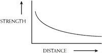

那个人得到了另一次机会，但他还是失败了。此时`John`让他停下来了。他明年还会获得另一次测试，但机会不是无限的；在某个时刻，如果你失败了，就会被认为是不合格的学生，不再被允许继续学习。

“你想做什么额外的检查？”`John`问。

我掏出折叠刀，把一个空烟盒切成两半。它没有衬金属层；它不可能受到磁性的影响。再次，我这样做是为了大家而不是为了我自己；对他们来说，让我信服似乎非常重要，我必须证明我确实信了。

我很擅长那种事情。去年，`John`的一个朋友曾试图对我耍小花招。他递给我块口香糖，我收下了，然后问我想不想看他的法力。我回答了定的，他把包装纸浸进水里。

“现在把它握在手里，用力捏，”他说。

我不需要看`John`反对的眼神就知道自己正被愚弄了；把包装纸浸水里已经出卖了他的底牌。`钠`金属，我想，我只是假装捏包装纸。它外面涂有蜡层；用力会弄破涂层，让`钠`与水反应，产生剧烈的热量。

那个男人变得局促了；他预料我会因为疼痛而掉包装纸。我让他失望了。“如果你觉得热，可以松手，”他说，“别烫着了。”

“不，一点也不热，”我无辜地说，“看到没？”我把包装纸还给了他，我已经小心地把它揉成了一个小球。他脸上露出了困惑的神情，他接过包装纸并尽力捏。突然他面色一变，掉了它。他惊讶地看着我；为什么这个招数对这个外国人没用呢？

`John`很喜欢这一套。无论如何，我知道我今晚必须说服他们，让他们相信我相信他们所做的是真的，于是把空烟盒切成了两半。

“你学了多久？”我问那个通过测试的男人。

“大约十二年，”他说。

“你每天训练多久？”

“每天大约一小时。这就是为什么花了这么长时间。但我能怎么办呢？我得工作养家。”

`John`走过来，和那个男人进行了一段长时间的长谈。他对他讲了一大番，然后让他离开，把我拉了过来。

“我告诉他，从现在起必须非常小心，”`John`说，“当你完成`Level Two`后，你的`ch’i`随时准备着移动。很大程度上受你的情绪支配。如果他现在愤怒地击中，`ch’i`会冲进那个人的身体并摧毁他的心脏。那个人会死。”

“如果他击中手臂，比如呢？”我问。

“击中哪里并不重要。`ch’i`总是会冲向对方的心脏，并杀死他。而且你知道，世界上没有哪个西方医院能救被那样击中的人。如果没有像我这样的人在二十四内治疗，他会死的。”

“你是对的。他从现在起应该非常小心。”

“是的。你知道的，当我们教新学生功夫时，动作总是很慢，而且从不发力。安全是我们的首要考虑。人们偶尔看到这些会以为我们很弱；大错特错。”

“师父，他们刚才做的，在西方被称为意念移动。他们是靠自己的力量做到的吗。你帮了他们一点？”

他看着我，觉得很有趣。“帮了他们一点，”正如你所说。“我们把`ch’i`排出体外——尽管不是通过空间。当一个学生精通了这一点，他就能通过你今晚目睹的测试。”

“进入体内，让`ch’i`进入身体。这让他们能够移动烟盒。测试实际上是看学生身体里有多少`ch’i`。”

我感到有些不自在。“`Level Two`呢？”我问，转移了话题。

“在`Level Two`中，我们用`ch’i`充满体内的通道，同时按照我们的要求塑形丹田里的`ch’i`。然后我们就可以把`ch’i`排出体外——尽管不是通过空间。当一个学生精通了这一点，他就能通过你今晚目睹的测试。”

“我明白了。所以当他们击中一个人时，必须身体接触，对吗？”

“是的。因为他们仍然只使用`ch’i`。要在远距离做到，他们必须结合阴阳。那将`Level Four`。”

“那`Level Three`呢？”

“`Level Three`很难通过。它需要每天连续训练至少三小时，可能更多。”

“你不想谈这个；好吧，理解。`Level Four`？”

“第四级是我们开始将阴阳结合的阶段。当你完成第四级时，这两者就会这样停在你的丹田里，”他继续说道，并画了起来：

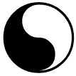

“就像阴阳符号一样，”我说。他点了点头。“为什么在流行文学中，他们会在两个相反的圆圈中心放上两个点，并说阴中含有阳，反之亦然呢？”

“我不知道。我想他们可能是随着时间的推移而变得困惑了，也许由于政治环境的原因，他们的知识变得有些混乱。也有可能我自己是我错了。”

但我并不怀疑，我心里想。“因为许多许多人都写过，阴会随着时间的流逝变成阳，之此类，”我继续道。

“没有什么是事像看起来那么简单，”他回答道。

“他们还写道，人从阴阳进化到太极……”

“这就是太极。没错。”

“……然后从那里到无极，”我补充道。

“什么是无极？”他问道。

轮到我感到震惊了。刚刚发生的事情等同于先知穆罕罕问一个穆斯林，他们口中反复提到的安拉究竟是谁！无极是道教的核心概念，而我正被一个我认为是道教大师的男人明确地询问我所谈论的究竟是什么。

“呃……无极就像这样；在阴阳之外，”我结结巴巴地说，并在纸上画了起来：

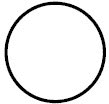

“我明白了。我从没见过这样的东西，”约翰说。

“但所有关于道道的书籍都提到了这一点，”我说。“这是最后一步，人类回归源头的转化。”

“我明白。正如我告诉过你的很多次，我不是道士。”他抬起一只手制止了我的抗议。“是的，我知道，我知道。我的教学中有很多东西你可能会认为毫无疑问是道道的，而且我的老师确实来自一座道教山。你有完全的理由困惑。然而，我认为我自己仅仅是一个内功修习者。”

他低头看着我画的那个圆圈。

“在我们门派，人永远无法变成这样。人类——那些能完成第四级的人——从直到第七十二级都停留在太极阶段。我们从未达到过无极。也许在其他流派，比如茅山派或武当派，¹⁰，他们发现了实现这一点的方法，但我不知道，也未曾亲眼见过。无论如何，我们魔派*19并不使用它。你还在读些什么？”

有很多翻译作品，我心想，但现在不是谈这个时候。“印刷文字的问题在于，任何人都可以写他们想写的内容，师傅，”我说。

“好，”他说，“你写一本书吧。”

“你是认真的吗？”

“是的。我想教人们关于‘气’——它是真实的，它的本质是什么。我想让他们知道，气功和内功不是胡方道术，而是一门科学。”

哇！我心想。是时候找点乐了。

## 一个中国故事

在廖师傅离世前，他经常根据他自己门派的道教†20经典对他的两个学生进行关于理想行为模式的。在这样一个晚上，发生了以下事件：

当时二十出头的约翰·张正坐在师父身边，还有他的师弟陈天顺。廖师傅预定于一个月内离开中国，并在两个月内去世。

“如果我们三个人患了绝症，突然一瓶能治愈这种病的药出现在你的手心里，你会怎么做，约翰？”廖师傅问道。“记住，那里的药只够治愈一个人，另外两个人必须死。”

约翰没有犹豫。有一件事长期以来一直折扰着他的内心：他深深地爱着那个老头，毫无保留地，但他从未能告诉过他。师父对他来说不仅是父亲更是，但他也是老中国文化中不可或缺的一部分。根据孔子去世以来主导中国社会的儒家伦理，他表达对老师的这种柔和的情感是不恰当的，反之亦然。责任和荣誉固然重要，但爱是给诗人的准备的。尽管廖师傅是一个道士，但他依然保持着克制；一个英国贵族会为他的冷静感到自豪，并可能会告诉他他的“硬汉”（stiff upper lip）非常得体。

约翰本身是现代社会的产物，同时也是中国人；他的思想和情感受到了多元文化刺激以及西方文明信息传播的影响。因此，在考虑什么才是正确的社会行为方面，他有很多选择可以考虑。廖师傅告诉过他很快就要去世了，他将回中国看最后一眼家乡。他如何能告诉那个老头他爱他，他对他一直像父亲一样？直接说出来是不可接受的。也许这一刻将是他表达这种情感的最后机会之一。

“我会把它给你，廖师傅，”他深情地说道。老天爷，老老师在想。我该如何教这个孩子，他必须超越自己的情感、自己的喜恶，去服务整个宇宙？瞬间，廖师傅知道自己该做什么了，老人的移动得像残影一样，那一击很有力；他一掌把约翰扇到了房间的另一头。廖师傅站着，似乎对他的学生非常愤怒。

“因为你用心而不是用脑说话，我这次就原谅你，”他说。“我打你是为了让你一辈子都记住这一刻。事实是，如果真的存在这种药，我们三个人会为了喝药的权利而开战，因为生命是最宝贵的财富，没有人会轻易放弃。这瓶药出现在你手中意味着服用它是你的命中；因此你必须喝它，不能喝别的。先救好你自己，然后才能帮助别人！你明白吗？”

约翰点了点头，感到一阵刺痛。他确实永远不会忘记这个教训。

## 力量

那天晚我没有睡着。关于写书，我想得越多，就越意识到这将是一个大问题。我意识到，这个项目必须同时包含文字和视频纪录片，这绝非易事。你如何让人们相信他们所看到的是真实的？几乎每个人都会认为那是特效和心领神会的人策划的骗局。而我是一个科学家——老天爷，是一个工程师，天生对太空饼干和一切毫无根据的东西反感。噢，我和其他人一样喜欢看和享受《神秘档案》，但我主要关心的是现实，而不是虚构。

这个想法在半夜像重锤一样击中了我，我醒了，非常兴奋。我知道该怎么做了！这个方法是在我梦中出现的。约翰会得到他的书，人们也会意识到这个世界并不像我们的物质主义社会表现出的那样单调灰暗。

约翰也是一名科学家；他只是另一种类型的科学家。确实，他就像是中国神话和传说中的人物，但这没关系。我从自己的家乡就知，在 19 世纪，当`Schliemann`在`Hisarlik`开始挖掘之前，许多学者坚信特洛伊只是一个神话；此外，直到 1952 年`Ventris`破译了`Linear B`文字之前，许多著名的教授都强烈反对迈锡尼人是希腊人的这一理论。那些所有人都是错的，而那少数敢于反抗他们的梦想家们是对的。即使在今天，既定的学术界也倾向于对任何超出他们准则的事物感到沮丧，并往往竭尽全力地将其压制。1600 年，宗教裁判所曾将`乔尔丹·布鲁诺`处以火刑，只因为他坚持太阳而不是地球才是太阳系的中心。我在想，既定的科学界是否也会试图把我处以火刑。

没关系，我心。`乔尔丹·布鲁诺`是一个诚实的意大利人；而我是一个狡猾的希腊人，我会用特洛伊木马来撞碎他们的墙。

诚然，约翰是传说中的人物，但他却是真实的，正如特洛伊是真实的一样，正如迈锡尼希腊人确实存在过一样。

## 科学方法

到底，科学究竟是什么？我们的西方方法建立在两个主要前提之上：仔细且客观的观察，以及可重复的结果。只要我遵循这两个主要标准，我可能会被怀疑，但绝不会受到严肃的挑战。

## 文档记录的挑战

现在，我确定约翰完全没有兴趣去每所当地大学给那里的教授们做演示；我也不希望他这样做。然而，我所计划的是有先例的。1978 年，在`塞伦盖蒂`发现了`拉埃托利`足迹。它们有 350 万的历史，确凿地证明了早期人类直立行走的方式，其步态与现代人相当甚至更优。这些足迹是在火山灰中形成的，这些灰在数千年的侵蚀后再次出表；它们非常脆弱，无法长期保存。

为了记录它们，科学家团队制作了石膏模型并拍摄了仔细的照片。为了保护它们，他们再次将它们深埋在沙中，结果是灾难性的。他们使用的沙是当地非洲植物所喜欢的，结果现在遗址上长了许多金欢树，它们的根无疑正在破坏研究人员试图保护的那些足迹。尽管如此，人们已经根据石膏模型和照片写了大量的文档和分析。但有多少研究人员见过真实的足迹本身呢？也许不足十二个人。然而，没有人怀疑足迹的存在（或至少存在过），仅仅因为通过再次挖掘遗址就能确认它们的存在。

这种“记录并埋藏”的方法在我故乡希腊的考古学家中中也很常见。这个国家已经定居了五千年，遗迹随处可见；在自家的地下室挖掘很难不发现点什么。因此，当一栋建筑处于建造初步阶段并发现遗迹时，考古学家会被请进来；通常他们只是对遗址进行拍照和记录，涂上保护性`树脂`，然后让施工继续。证人通常足够多，至于没人怀疑被埋的遗址的存在，或怀疑有任何人伪造了它。

## 约翰的计划

嗯，我知道有成千上万的人见过约翰，并可以在法庭上证明他的能力。如果他愿意，他自己可以随时重演演示。我意识到，我所做的只需要在一个可靠的证人小组面前记录他以及他学生的能力，这样我就大获全胜了。重要的是要仔细选择那个没有人敢于质疑的目击证者。

我太兴奋了，第二天早上不请自来地、没有提前打招呼就冲向了他的家。那是一次`失礼`，是我通常从不做的。当时是十点，约翰还穿着睡衣。他看起来像被卡车撞过了一样。

“我昨晚没睡着，”他说，“我卧室的空调坏了。”

他给自己倒了杯咖啡，我开始笑了起来；我禁不住！`张强`，一个充满矛盾的人，我想。这个起得这么晚的人竟然是那个可以随心所欲停止心跳的`瑜伽士`，曾进行过连续八天的完全冥想，几乎不呼吸，他的生命体征微弱到医生会判定他死亡。我那时意识到，这个人对人类是多么重要；这是历史上第一次出现这样的人。这里有一个人，一方面他可以根据选择成为派对的焦点，花几天时间看足球，或者达成一笔涉及工业产品的高额国际交易；另一方面，同一个人在荒野中也同样快乐，穿着简单的棉衣，却对冷热免疫。这里有一个能用一拳打死灰棕熊的人，一个曾在大山里孤立的山洞中生活两年练习冥想的人（靠根部和植物生存），一个能与灵体交流并治愈瘫痪者的人。

一个真正的跨两个世界的人。

## 谈判

“我知道该如何写你的书，”我说。

他瞪着我。此刻他更感兴趣的是他的咖啡。我捕捉到了他想法的绪络：*你为什么不跑去某儿玩呢，小小子。*我笑得更开了，突然他也忍不住跟着我一起笑了起来。“好吧，告诉我吧，”他说。

我说了，概述了我的方法。

他很不耐烦。“我明白了，”他说，“你知道我只能在学生或患者面前演示。”

“那将是一个障碍，但我看看我能做什么。”

“而且我无法通过演示赚钱。如果你录像我，我将一分钱也赚不到。记住我的誓言。”

“那就把钱捐给慈善机构吧。”

他向我投来犀利的目光。他喜欢这个主意。“你知道吗，”他喝着咖啡，“我一直想盖一个孤儿院。”约翰直起身体，带着重燃兴趣看着我。“不是我觉得这能卖出去，”他继续道，“你能想象普通人每天练习几个小时吗？”

“不，”我回答，“但普通人也不学物理。这并不意味着没有核电站这种东西。”

他笑了，喝了咖啡。“希望你的例子是不恰当的，内能也不会发生像核能那样的事。”

“你是说它被破坏性使用的机会吗？”

“是的。

我不这么认为。如果一切都是公开、透明且人人可及的。我主要的担心是保护你的隐私。”

“别担心那个，科斯塔。”

“我是说，记者会来自世界各地骚扰你。”

“如果不允许，他们进不了我的家，如果他们太烦人太没礼，我会把他们赶走。”

嘘，我想。约翰既是个幽默大师，也是个超能力者；我同情那个为了获得独家报道而过头的可怜记者。“而且，你会被成千上万渴望治愈的病人包围。”

“你不会打印我的地址吧？”

“不，当然不。”

“很好。那么如果那些病人能找到我，那是他们的缘分，而治疗他们将是我的快乐，正如我一常一样。”

约翰每天看大约十个病人，通常在早上。我想确保他明白每天可能会增加到五十个，并我告诉了他。他波澜不惊。“我以前考虑过这一切，科斯塔。这些都不重要。真正的问题将是中国人，他们可能会过来挑战我。”

“什么？”我大惊眼镜。“中国至少有十位像我一样的大师，”他说，“他们中的一个或他们都可能想过来挑战我。”

“为什么？到底是为了什么？”

“因为这是传统。”

“你一定是在开我玩笑吧！”

轮到约翰取乐了；我开始感到有些火大。

“你不需要责备我，科斯塔，”他说，“我完全理解你。但你反复向我证明，你真的并不了解中国文化。不幸的是，我们中国人很大程度上是种族族主义和民族中心主义的。很有可能，当我们公开中国秘传科学背后的真相供西方审视时，许多武术大师会感到被冒犯。其实，这并不重要，因为那些被侮辱的人可能自己并不知道准确的真相。此外，中国有一种文化传统，一位武术大师可以挑战另一位，以决定最强大的流派；许多武术家并不质疑这一点，而是毫无疑问地遵循传统。你知道的，这是对他们的期望。

“我的梦想之一，是能够走向中国人民，向他们展示五个通过了`Level Four`的学生，他们来自人类的每一个种族。如果可以的话，我想更进一步，在每个国家培养一个这样的人。像你一样，我相信人类是时候向前发展，抛弃过去的束缚了。但中国还有一些人，他们接受过传统的训练，其信仰与我不同。他们中有些人比我强大得多；那些才是你不需要害怕的人，科斯塔。由于我对他们来说没有威胁，他们就不会对我做任何坏事。”

“就像那个处于`Level Forty`的廖师傅攻击了处于`Level Fifty-One`的林先生，”我说，“林先生只是耸了耸肩带过了。”

“是的，”他说，“因为那就像孩子攻击人，你明白吗？真正的危险来自于与我相正负五级的人，因为那样他想要战斗。在这种情况下，决胜的是武术技艺，而不是力量等级。”他喝了一口咖啡。“我们中可能有一个会死，”他轻声补充道。

见鬼去，我想。你对人类来说太宝贵了，不值得去冒险。“一个人怎么可能如此高深，”我说，“却又如此愚蠢？”

“不要急于下定论，”他说，“这些人中的大多数人住在中国的荒野中，与现代毫无干涉。他们的传统就是他们知道的一切。”

我想起了电视剧《高堡奇兵》；不死者的斗决变成了现实……太荒唐了！

这时，约翰的一位学生进了房间。他在门口脱了鞋，已经听到了我们谈话的大意。

我认识这个男人。他是一个`Level Three`学生，曾是一位螳螂拳武术大师，是个相当不错的战士。

“你为什么如此反对荣誉战斗？”他问。

“因为为了战斗而战斗是愚蠢的！”我几乎吼道，“看着，我们希腊人在三千多年前的特洛战争后就放弃了这种胡闹！这就是为什么我们最初创立了奥林匹运动；我们厌倦了最勇敢的男人为了证明谁是更优秀的斗士而互相残杀。”

“如果我挑战你呢？”

“生死决斗？”

“不一定。”

“那么我会以竞技的精神与你战斗，我的首要目标是你和我都没有受。。例如，我宁愿输掉也不愿伤害你。”

上面的话并不是事实；我像其他人一样讨厌被挑战，并且会像任何其他严肃的武术家一样跃身上钩。在过程中，我甚至伤了几个人。但事实是，每次活动结束后我都会感到胃里翻江，而此刻我代表的是一种观点，而不是自己的过错。

“如果我挑战你进行一场生死决斗呢？”

“为了什么？就为了看看谁是更优秀的斗士？我会将其视为战争行为，并用我所拥有的一切对付你。也就是说，我会使用技术、化学和现代手段，直到杀死你为止。如果有机会，我会在黑暗中从两百码外用狙击枪射杀你；我接受过方面的训练。”

“如果我们两个有个人分歧呢？严重的个人分歧呢？”

我缩了缩身体；他难住我。我完全支持决斗，并对决斗被宣布非法感到非常失望。在我看来，决斗在过去一个世纪里是被统治阶级禁止的，以防止他们日益软弱的后代在荣誉战场上被屠杀。尽管如此，我正试图说服其他人，为了看谁是更熟练的斗士而拼死简直是蠢透了。。既然你可以成为朋友并一起喝几瓶啤酒，为什么要战斗呢？

“那么我们会面对面战斗，”我低声吼道。

他笑了。“在东方，你们希腊人无论过去几个世纪还是现代，都有强悍战士的声誉。例如，你们的人在韩国赢得过荣誉。”

“是的，该死，是为了生命、家园和保护无辜，但绝不是为了那什么！绝不是为了那样！”

约翰对我的爆发感到不悦，从座位上站起来离开了。当他回来时，我已经冷静下来了。

“你能想象吗，”我问他，“如果四五个像你这样的人能聚在一起和谐地工作，像一所西方大学或研究中心*22，而不是互相争斗，会是什么样子？你能想象与像你这样的人分享笔记和经验吗？”

“我一直想这样做；你是在对信徒说，科斯塔，”他轻声说道，“我去过两次中国，寻找像我这样的人。我都没有成功。”

“但你现在知道他们的存在了吗？”我问。

“是的，”他说，“我知道至少有两个，我能感觉到还有八个。我认为至少有十个。”

他靠在椅子上。“几年前，”他说，“我的三个`Level Three`学生去了中国，并在那里呆了一个月，寻找内功修行者。他们到处寻找，科斯塔；在道教中心、在少林寺、在大城市里。他们一无所获。最后，在他们离开的前一天，北京的一个店主对他们说：‘嘿，我听你们在找内功大师。好吧，你们可以在凌晨四点去某个公园。那里有一个老人练习太极拳；他是一位大师。’”

“于是他们去了指定的地点，躲在附近的树丛里。准四点，一个老人出现了并开始练习太极。当他完成一套动作后，他走向一块巨石（告诉我有一英尺高），手过了它。然后他退开，在十米或更远的地方用气击中了它。石头裂成了碎片。”

“我的学生跳出来下跪请求与他交谈，但他忽略了他们离开了；他们不敢阻止他。当然，他一直知道他们在那里，只是想让他们知道自己如孩童。”

“师傅，”我问，“这些人了解世界所处的处境以及我们的未来吗？他们知道自己可以做出多少贡献，可能通过他们的帮助我们可以避免全人类的灾难吗？你们留下的十个人，必须共同努力！”

“幻想幻想的科斯塔，”他说，“你认为我们会聚聚在一起，突然变成好朋友，并从过去的传统中创造一种新科学吗？”

“为什么不能呢？你们留下来的人如此稀少，每一个都是无与伦比的宝。为什么不能创造一种新科学呢？你知道，就像乔治·卢卡《星球大战》中的绝武士，将技术与内在掌控结合。最好的结合，师傅。”

他慈和地笑了。“这是一个很好的梦想，科斯塔，”他说，“不幸的是，我不是你必须说服的人。”

“你想知道我信仰什么吗？”我问。

令我懊恼的是，这两个人都发出了叹息。“我不确定，”约翰大笑道，“但无论如何，我想我们不会被给予选择的。”

“我相信人类是沿着两条不同的路径成长的，”我说，“在西方，我们采取的是阳的方式，向外求索。我们修改并分类我们的环境以适应我们的欲望。我们的科学是阳性的科学，我们的生活是阳的人生。而在东方，你们采取的是阴的方式，向内求索。你们在心智体上修改并训练人类，使其在自然为你创造的环境中变得强大且完整，在不改变任何东西的情况下发挥最大的潜力。东方和西方的两种方法都关乎力量的培养，但由于每者都是沿着不同的路线追求的，因此没有一种方法本身是正确或完整的。好了，阴阳汇合的时机已经到了，就像`Level Four` 一样。是时候发展阴阳功夫了。”

我还有很多话想对他们说，但语言障碍阻碍了我无法这样做。直觉上，我知道他们已经理解了我刚才所说的大意，但我渴望与他们讨论的是细节。我们在西方走得太远了，现在是时候让约翰这样作为人类发展对立极最后真正代表的人，来从我们自己手中拯救我们了。

工业过程对人类来说无疑既是祝福，也是诅咒。它让我们达到了技术发展的新高度。另一方面，通过将工匠与其产品分离，它开启了一个漫长的人与人之间、人与周围世界隔绝的过程。从本质上说，工业过程和消费主义都根根于孤立和分离的过程。每个人只尽自己的微薄之力；只有社会上层的人才能将这一切整合在一起。然而，东方——特别是道教——是建立在合成之上的；个人在与世界的统一中找到力量。真正的道家不会在自己与世界（无论是人类世界或其他）之间建立围墙。

我们必须重新学习这一切。时机到了。

“听着，”约翰和蔼地说，“我们对待生活的方式揭示了我们真实的面目。没有人能凌于此之上。有时是生命本身在考验我们，暴露我们的弱点供人审视。功夫系统的练习者也并非例外；有时境遇会将我们推入相互战斗；如果你愿意这么说，那就是我们的因果。这些人并不坏，这只是他们测试自己的方式。你能理解这吗？”

我一直想着剧集《高地人》。“我理解你的话，”我说，“但我不同意这种推理。”

“很有趣，”约翰突然说道，站起身走开了。

“你知道的，”另一个男人神神秘秘地说道，“约翰在年轻的时候，经常挑战别人，也被别人挑战。他总是战斗；他从不拒绝任何挑战。我我自己就是一个例子。我曾练习并教导桃螂拳；我曾违抗约翰，因为我不相信关于他的故事。他击败了我，从那以后我就成了他的学生。”

“发生了什么？”

“你觉得呢？和那种力量的人战斗是不可能的的。对他来说，那就像在和婴儿战斗。”

“但他没有伤到你。”

“当然没有！你想听听一个典型挑战的故事吗？”

“当然！”

“约翰去过美国加利福尼亚州，因为他听听说那里的华人社区里有人精通了‘气’。他到处寻找，却一无所获。最后他在旧金山确实发现了一个气功大师。约翰要求看演示。”

“好吧，”那个男人手里各拿一个陶罐，用力挤压，爆发呼气。陶罐碎成了碎片。男人看着约翰；约翰什么也没说。然后男人拿起一把钉子钉进桌子里，用拳头用力捣入。约翰依然什么也没说。最后，男人让他的一个学生去拿一把砍山刀；他站在那里表演名为`Iron Shirt`的气功，任由学生用砍山刀攻击他。学生无法切开那个人的肉体。”

“约翰转向他带来的一个学生，派他去办差事。然后他面对那位气功大师。”

“结束了吗？”约翰问。

“好了，”男人回答道，显得有些不悦。

“很好。你有硬币吗？”

“硬币？什么硬币？”

“噢，什么都可以。”

男人给了两个两角币。约翰把它们放在掌心中心用力挤。他把它们折叠后还给了男人。当男人看到硬币时，他的眼睛几乎要掉出来。”

“你有筷子吗？”约翰问。

男人为他找了一根筷子，约翰用手掌将它推入并穿透了桌面，就在钉子旁边。气功大师沉默了。接着约翰的学生回过来；他在当地一家刀具店找到了一把直剃刀。约翰把剃刀交给气功大师，让他从任何想切的地方割他。无论他如何尝试，男人都无法伤害约翰，尽管他最后把所有的力量和情感都投入了进去。”

“然后发生了什么？”我问。

“什么也没有。那个男人输了比赛。”

“他成为约翰的学生了吗？”

“没有。他太骄傲了。”

“你们知道那个男人为什么输了吗？”约翰突然从我们身后问道。他悄无声息走过来偷听。

“因为他只有阳气？”我回答道。

“没错。他是一个执着的练习者，但他没有获得所有的正确信息。他做的是气功，而不是内功。一个人如果训练得不正确，练一辈子也一无无获。你练习多久并不重要，重要的是你在练习时是如何练习的。”

“对于我们西方人来说，”我说，“冥想很困难。”

“是的，”他说，“在我们这个时代，静坐很难，但静终究是成功的关键。我们被环境过度刺激了。要让思想停留在当下很难，不是吗？你总是在向前看，向后看，为这个担心，为那个发怒。你必须把心放在你现在所在的地方，而不是你曾经所在的地方或你想去的地方。”

“我该怎么做？”

“我不能告诉你。每个人都必须找到自己的路。”

太棒了，我想。希望我有一天能做到。我问：“师傅，`Level Four`完全是严格通过冥想完成的，对吗？”

“是的，”他说，“冥想是最重要的。你在冥想时平衡你的意识和潜意识。在这个时代，我们忽视了自己的边缘系统和脑干，而仅仅专注于前额叶和纯粹逻辑。但这种是不自然的，限制了我们的能力。这就像在两只手可用的情况下只用一只。”

“但我们如何才能不受生活中压力和忙碌的影响？”我问。

“很难。你必须对自己的生活方式做出选择。例如，为了完成`Level Four`，我离开了家，在丛林里住了一年。我这样做是为了达到完全冷静的状态。我回归了原始；这是最重要的。你的心必须完全静止，阴阳才能汇合。我自己在完成`Level Three`之后的一年内就完成了`Level Four`，你知道的。”

“那是什么？”

“在尝试过程中你会变得非常虚弱，甚至比你最初开始训练时还要弱。你要诱导那两个中心像恋人一样聚在一起，正极和负极。我第一次成功并让它们相遇时，那种力量大到让我像之前告诉过你的那样昏迷了。但我老师给我的关于内力的书上：‘忽略疼痛。不要关注它；如果你这样做，它就会变得让你无法承受。’我听从了那个建议，但下次当我尝试时，还是无法忍受。直到第三次尝试，我才抓住了那股力量并坚持了十分钟。然后，它就属于我了。”

“然后你就变成现在这样了？”

他笑了。“当然没有！我仍然需要进步，`Kosta`。你知道的，当你处于`Level Four`时，你必须流汗挣扎十五分钟，力量才会出来。我是在完成`Level Five`之后，我才开始使用它。”

“所以你肚子里有电池，但还是得接上电缆。”

“那是自然！而且你变得有多强大取决于起初能接上多少根电缆。”

“起初？”

“是的。随着你继续下去，它会变得越来越复杂。”

“但当有人完成`Level Four`时，他就是一个`hsien`，仙人，对吧？”

“在我看来不是的。我认为一个人必须超过`Level Thirty`才能被认为是一个`hsien`。”

我正想问为什么，但我看出`John`没有心情继续谈话。他的儿子`Johann`救了场；他走过来挑战父亲打了一场乒乓球。`John`永远无法拒绝挑战。

## 第七章：阴与阳

泰坦！在你那永恒的眼中，

凡人在其悲惨现实中所遭受的苦难，

并非神灵所鄙视的事；

你怜悯的报答是什么？

沉默的痛苦，剧烈的痛苦；岩石、秃鹫与锁链，

皆是傲傲者所能感受到的痛苦…… . .

乔治·戈登·拜伦勋，普罗米修斯

安德烈斯是一个波兰裔的澳洲人，充满了典型澳洲人的活力和开朗——可以说，他是年轻版的`Paul Hogan`。他是一个同门学生；我在去那里的一次旅行中，在`Chang Sifu`家里与他相识。和安德烈斯在一起意味着要忍受他没完没了的啤酒和香烟；这通常很有趣。

安德烈斯也以一种太诡得不可能是巧合的情况下遇了`Chang Sifu`，因为在看了《火之环》之后，他之前已经寻找了他九年。在我们老师的指导下，我们分享了许多奇特的经历，并在可能的情况下交流笔记。

此时，我们再次前往虾养殖场，坐在一辆货车里飞速行驶，`John`以他惯常的风范应对着爪哇岛的道路。我们中还有`Handoko`，一个中国人，他也是我们的同门学生、好朋友，在那些讨论变得太“深”而无法用普通英语交流时，他是我们`Chang Sifu`可靠的翻译。`Handoko`的右腿有毛，那是一种先天性神经系统疾病，直到几年前遇到`Chang Sifu`才得以痊愈。经过持续治疗，他的腿正在恢复；休眠了三十年的神经正在重新苏醒。见证这一切简直不可思议。每当我拜访老师，我都能看到朋友的腿变得越来越强壮，肌肉越来越明显；他曾经萎缩消瘦的大腿围度，每次看起来都变得更大、更有力。

`Sifu`用源源不断关于他青少年时期、训练和老师的故事来逗我们开心。他还向我们承诺那天晚上还会进行一次不寻常的演示，通过这次演示向我们展示阴阳这对相反的力量究竟是什么样的；我们都非常渴望这场表演，并对旅程感到兴奋。`Sifu`本人亲自带我们去虾养殖场，这本身就很不寻常；他通常只是告诉我们等他回来就好。

我已经完成了`Level One`并开始开始`Level Two`；最困难的部分在后面。到目前为止，我并没有认真训练，而是比较务实地进行。一系列长时间的个人问题，从我父亲因肺癌去世到一系列财务挫折，很大程度上阻碍了我的练习。这些问题的叠加在于，我到目前为止成功读了所有关于`neikung`（内功）、`ch’ikung`（气功）和道教的英文书籍；提出的许多理论和方法让我非常困惑，并浪费了大量的精力。直到最近，我才开始理解老师从一开始就提出的两点。第一点是，尽管传承的老师来自道教中心，他的许多理论与道教原则相契，但他本人并不是真正的道士。第二点，`neikung`和`ch’ikung`的方法就像中国大师一样多；你真的不应该试图通过阅读印刷物来进步。“那样只会让你让自己困惑，”`John`曾这么说。我发现，就我自己的练习而言，他是正确的。`neikung`和`ch’ikung`本质上是中国科学和哲学的表现；随着时间的推移，他们为了生存采用了各种宗教外壳。但我天生是个学者，在遵循特定路径之前，我必须从历史和文化的角度将它们整合在一起。在确认我已经这样做之后，我就可以专注于我的训练。

我们在路边餐馆停下，狼吞了大份过期的食物。我老师的所在地就在附近；他开车办事，把我们留在那儿。我们坐在一起喝着温可口乐。

“你觉得他今晚要展示给我们看什么？”`Andreas`说。他的发音很像《鳄鱼丹迪》在内陆地区喝了一周`Foster’s`啤酒后的样子。`Andreas`试图向我推一根香烟；他的手指因为这种习惯而染了尼古丁。“谁知道呢。一些惊人的东西，”我说，做了个鬼脸，很享受地把那根没拆过的烟头扔进旁边的垃圾桶里。我很疲惫且刻薄。一种胃部疾病让我瘦了十磅；我的衣服挂在身上像破布一样。

“噢，拜托，`Kosta`。别这么大脾气；开朗一点。”

“你知道的，”`Handoko`对`Andreas`说，“`Kosta`是你的长辈；你必须始终尊重地称呼他。”

“胡扯。”

“我也是。我们年纪大，你年纪小，我们有 seniority。”这种约束所有海外华人的强有力儒家伦理对我们这些西方人来说是痛苦的无尽源；我们不认同它，并经常因此陷入麻烦。

“我告诉你我所见过的，”我告诉安德烈斯，“去年，约翰想让我看看‘阳’是什么样子的。那是晚上。他刚和约翰打完每晚都会玩的乒乓球。师父用左手托住乒乓球，放在手心中心。他张开双手，右手掌放在大约两英尺外。突然，球闪烁起蓝紫色的光芒；它还发出了声音，像金雀在歌唱。蓝白色的火花从球向他的右手飞去；它们像微型闪电。他让球悬了几秒钟，然后把球给了我。球并不特别热，但很暖。我照常采取了做法，当场把它切成了两半，这惹得大家都发火，因为那是家里最后一个乒乓球了，他们还想继续游戏。但我必须确保球内部没有任何电路。”

“《华神美国大麻烦》，”汉德科说道，指的是`John Carpenter`电影开场序序中一个类似的场景。

“是，”我点头，但我的心不在焉处。在那个特定演示的那个晚上，我思考的是`Wilhelm Reich`在20世纪40年代和50年代的工作。赖希规定，他发现的未知生命力粒子（他称为“有机能子”orgone bions）是蓝色的。这与我的老师用意志力束缚它时，“阳气”在我眼前变成的颜色几乎一样。而“气”本质上就是生命力。

之所以这次演示是我见过的所有演示中最重要的，是有原因的：它定义了阳气的本质。首先，乒乓球的表面是由实心不吸孔塑料制成的，而球本身是空的。我立刻询问约翰是否可以用实心橡胶球重复这一演示，他回答是否定的；为了让这项测试有效，球必须是空的。他的话意味着我所看到的不是一种表面现象。相反，能量被传输到了球内部，在那里它发出的光就像普通的灯泡一样。在分子物理学尺度上，这意味着约翰所谓的“阳气”的能量既不是粒子也不是波，而是两者兼有。

我深信这次演示表明阳性能是一种太阳现象，正如中国经典著作中所规定的那样。

`Wilhelm Reich`在1957年死于联邦监狱，在此之前，`美国政府`对他进行了一场猎巫狩动，他的著作和笔记被没收了。如果他发现了阳气，并被那些不希望这种知识普及的权势所迫害呢？这个问题吓到了我；我对自己当我要写师父的书时将面临的局面感到惊惊不安。

阳气可能是蓝色的这种可能性对我个人来说还有一个重要的原因。在整个东地中海地区，人们历史上佩戴蓝色珠子或蓝色护身符来驱除恶之眼。这种做法可以追溯到新石器时代，并延续至今。难道穿戴蓝色仅仅是利用阳的颜色来防御阴能量的力量吗？这是一个令人兴奋的推测。

“他的右手完全化为阴，左手为阳，所以火花在两者之间飞溅，”汉德科说道。

我点头，依然在思考赖希和他的有机能。

那天晚上，坐在约翰舒适的办公室沙发上，我们三个人向他提了关于阴阳确切本质的问题。约翰看了我们的脸，点了四份咖啡，舒服地靠在办公椅上；他知道这将是一次长长的对话。

“阴和阳，”他轻声说，“存在于世界上。它们是存在于自然界中的普遍力量，从宇宙的一端到另一端。它们不是诗意——它们是真实的物理力量，因此供我们所有人体验和观察。”

“阳气从哪里来？”我问。

“它在空气中。自然创造它，生命使用它。所有活物都同时拥有阴和阳气。”他敲了敲桌子。“这是阳。它本身是无生命的。为了生命的存在，身体必须同时拥有阴和阳。”

万物背负着阴，内蕴着阳；当两者结合时，生命的能量就和谐地产生了。这句出自《道德经》的诗诗句再次跳入我的脑海；`Chang Sifu`的教导与现有道教文献之间既相互补充又相互矛盾，这非常引人注目。

“当你说所有生物时，指的是植物、动物……？”

“一切万物！所有活物都有阴和阳气。”

“阴气从哪里来？”安德烈斯问。

“来自大地。阴来自大地。它是某种滋养我们生命的场现象。它可以被绝缘体阻隔。例如，如果你家里铺了合成材料制的地毯，阴气就无法穿透。这对你的健康没有好处。”

“阴气通过一个我们称为`hui yin`（会阴）的穴位进入身体，”他补充道，“位于尿道和肛门之间。”

哇，我想天空父亲和大地母亲，你们确实给了我们生命。正如世界上所有古代文明所相信的那样。而我们作为一个物种，在追求黄金的过程中正在毁灭这两者。我好奇未来是否会有足够的清洁空气，让后代分到一份阳气。甚至找到一个有树的地方。

我考虑过这个问题。我在希腊有一个朋友，他是一位韩国的唐手道大师，也是`neikung`（内功）修行者。他曾多次在公开场合展示他的实力，击断四角角的木梁，并邀请观众中的任何人在他之前尝试这一 feat（但没人敢尝试）。这个人的`dantian`（丹田）处有一个“球”，那是一个可以随心移动的实心。正如约翰所指出的那样，通过操控这个球，这个人可以将`ch’i`（气）能量传入他的四肢。一位医生在检查他时，摸到那个巨大的肿块，还以为我的朋友患了癌症；当我的朋友让那个球跳动起来时，医生的惊讶得大掉了下巴。我也曾对约翰这么说过。

“对我们也是一样，”他在良久后回答道，“这个人至少是`Level Three`（三级）。”

“你的意思是他腹里移动的球对应于我们的`Level Three`吗？”我问。

“是的。那是一块硬化的`ch’i`，他可以随意提取并使用。”

“师傅，例如，`Level Five`（五级）和`Level Six`（六级）之间的能力有什么区别？”安德烈斯问道。

“力量翻倍，”约翰简单地说。“在`Level Three`之后的每一级，力量都会翻倍。”

“等一下，”我说。汉多科、安德烈斯和我互相看着，大吃一惊。“师傅，你是说……”

“是的。每一级的力量都是前一级的两倍。”

“所以`Level Six`是`Level Five`的两倍，`Level Seven`是`Level Six`的两倍，以此类推，”汉多科缓慢地说。

“是的，”约翰简单地回答道。

汉多科和我再次对视。我惊讶得张开了嘴巴。这种感觉一定非常超现实，就像无声电影一样。

“天哪，”我说。

这其中的含义是力量的等级是指数级增长的，遵循代数法则`2(x-3)`。`Level Four`的人强度是普通人的两倍。`Level Six`的人强度是`2 x 2 x 2 = 8`倍。而`Level Thirty`的人强度是平均普通人的`2²⁷`倍（大约是1.34亿倍），至少从生命力的角度来看是。噢，我确定其中涉及某种算法，这些数字并不像约翰的传统所暗示的那样完全遵循线性增长，但即使他偏差了50%，又怎样？`Level Thirty`的人在所有实际意义上仍然是……一个神。

我很庆幸自己是坐着的。在当今时代，这种力量绝不能落入错误的人之手，这是必须。这不仅包括犯罪分子（约翰的故事表明，这种力量的实现与个人的道德水平无关），还包括国际消费品公司（Consumer Products International）。谁也无法预测拥有这种力量支撑的跨国公司会做什么。甚至是一个政府机构。

“你们知道，”约翰说，“在整个中国历史上，只有两个人达到了`Level Seventy-Two`（七十二级）。一位是达摩，即菩提达摩，他教导了少林的僧侣。另一个是`Wutang-Pai`（武当派）的张三丰，他也是我们学校传承中的掌门之一。”¹¹

“等一下，师傅，”安德烈斯说，“这就是他们所说的创立`t’ai chi chuan`（太极拳）的张三丰吗？”

“我无法告诉你他是否创立了太极拳，”约翰回答道。“我知道他在少林寺庙学习过一段时间，在闭关一段时间后，通过学习道教达到了`Level Seventy-Two`。他确实创立了内家功夫拳，我们就是其中一部分。你知道，我们的传承可以追溯到张三丰。”

“师傅，”我缓慢地问，“你认为张三丰生活在什么时候？”

“大约一年前，”他回答道，“为什么？”

“宋朝，”我想。正如关于他的故事中所称的那样。“因为不同的记录将他放在中国历史的不同时期，”我说，“有人说他活了五百岁。还有人说他今天还活着，他从未去世过。”¹²

约翰沉默了。“他是`Level Seventy-Two`，”他简单地说道。

“他可能还活着吗？”

“不。他活了两百岁，像普通人一样去世了。菩提达摩也是如此。”

“师傅，”安德烈斯说，“现在能告诉我们关于`Level Four`（四级）的事吗？”

“如果你们愿意的话。当我们完成`Level Three`时，我们将阳气引向`hui yin`（会阴）。在那里，它聚集了我们引下的等量阴气。一段时间后，也许是几个月或几年，阴阳就会这样升起：

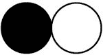

“白圈是阳，黑色是阴。它们在身体内部浮动，那种痛苦是难以置喻、持续且不可置信的。只有当你自律忽略它时，才能控制它们并将它们的力量放入你的`dantian`（丹田）。在那个时刻，它们被挤在一起形成这种形状，就像太极图的符号一样。”

我以前见过这个，所以不像另外两个那么惊讶。

“如果你成功了，”约翰继续道，“通过强行将两者结合，你也让它们产生了反应。记住，它们不像磁极；它们不互相吸引，而是排斥。两者之间的电花就是这样产生的，正如……”

“如果我们不成功呢？”我问。

“那么你可能会死，”约翰轻声说。现场陷入了尴尬的沉默。

“例如，”约翰继续道，“你们知道张三丰吗？”

“是的。”

“张三丰是我们传承的创始人。他知道`阴气`和`阳气`，但不知道如何将两者结合。所以他对他的学生进行了实验；他告诉某人这种方法，另一个人人那种方法。许多人因此丧命；我们对此负债。”

很有意思，我心。根据中医学理论，`涌泉`穴位于足底；它与肾经相连，而肾经被认为是阴性的。阴的`气`是否储存在肾脏中，而这种`气`是否会以某种方式沿着经络流向脚底，从而保护行走在炭火上的人呢？

“我可以给你们看看阴是什么样子的，”约翰说，“等一下。”

他消失了几个分钟。当他回来时，手里拿着一把气枪，那种需要手动打气来压力的类型，还有一盒纸装铅丸。

他捡起一个空果汁罐；这种合金不是`可口可乐`罐那种薄的铝材质，而是像金枪鱼罐那种较厚的“锡”金属。约翰开始给气枪打气；在大约十二次完整的循环后，当他再无法用肌肉力量压下杠杆时，他将一颗铅丸装入弹膛。他把罐子放在地上，后面垫着一本厚厚的电话簿。他将枪口距离罐子约一英寸，扣动扳机。

罐子从直径方向被穿透了两侧。这把气枪很有威力；它能轻易伤及肉体。

“好了，汉多科。你先来，”约翰说。他把气枪递给我；我打了十二次气，在弹膛里放了一颗铅丸。约翰让汉多科把手掌放在气枪口上。“当我叫你射击时，立即扣动扳机，”约翰对我说。

约翰站在汉多科身后，用右手食指的第一指节抵住汉多科的腰部。“射！”他喊道，我照做了。枪发出了这种武器特有的“嗤”声。

汉多科松开了手。铅丸落在他的手心里。

它没有变形。无论是什么吸收了弹丸的动量，都没有对它造成任何损坏。汉多科也没有受到哪怕一点点伤害。他什么也感觉不到。

“轮我了，”我说。我从包里取出一颗铅丸。用我的`折叠刀`划了铅丸尖端的表面。我会通过这种方式认出它；别人是不可能把它换掉的。我给气枪打了十二次气，把标记过的铅丸放入弹膛，将武器交给汉多科。我右手握住枪口。

约翰走到我身后的，把我的衬衫从裤子里拉出来。和汉多科一样，他用一个指节抵住我的腰部，也就是肾脏区域。

突然，我觉得自己像被充了气一样。我能感觉到肚子在膨胀，膀胱被挤压；我想尿尿。没有其他感觉；没有寒冷，没有能量涌动，没有放电感，什么都没有。只有充实的感觉。

“射！”约翰大喊。

我听了“嗤”的一声，看向手心。我手里拿着那颗标记过的铅丸，没有变形。我并没有真正感觉到它击中了我；有一丝轻微的感觉，最轻微的触碰，但仅此而已。

“奇怪，”我说。

我被激奇了；气枪在近距离射击时穿透了“锡”罐的两侧。作为一名材料工程师，我推算出这种合金在约三万磅每平方英寸（`psi`）的应力下失效了。相比之下，人体的软组织承受不了超过一千`psi`的东西。我们不可能不被铅丸受伤；它应该一直穿到骨头，途中切断肌肉和肌腱。

而铅丸没有变形！无论是什么保护了我们，也保护了它。这并不是某种在个人周围的隐形硬盾，正如某些权威人士所暗示的那样。那里的东西吸收了我们投向它的任何能量，且没有留下自己的痕迹。

突然，我感到头晕，被这种暗示所震动。热力学第一定律在这里似乎并不适用。

而且约翰可以将这种力量传递给他人。

我又颤抖起来，想到那些权势者掌握了这种信息。

“轮到我了！”安德亚斯几乎要从椅子上跳了起来。

“嗯，对你我们得采取不同的办法，”约翰说，“我想让科斯塔射你的肚子。”

我非常高兴，立刻开始充满活力地给气枪打气。

“十二次，不能多，”约翰警告我。

安德亚斯把衬衫越过头顶站在那里。约翰像之前一样站在他身后。我露出一副极其邪恶的微笑，直视着安德亚斯的眼睛，用枪指向他的肚子。

他犹豫了。我想凶的时候表情可以很凶；巴尔干人的面部特征。

“射！”约翰大喊，我照做了。安德亚斯的脸上露出了震惊；他很担心。他预想了最坏的结果。

铅丸从他的肚子上掉落。那里有一个小小的红色淤青。

约翰绕过来看着那个痕迹。“你为什么害怕？”他问安德亚斯。

“因为科斯塔！他的表情看起来像想射死我！”

“胡说八道，”我说，“我通常用那种事会用短管猎枪。那样你站起来的概率更小。”

约翰瞪了我一眼，然后转向安德亚斯。“如果你感到恐惧，或者你的情绪失控，阴就不会稳定，它无法像你冷静时那样保护保护你。这就是为什么你淤青了。”

我捡起铅丸。它和之前一样没有变形。我这么说了，并展示给约翰看。

“噢是的，”他说，“我给了他阴能量；他只是把它排出了体。”

“师傅，我们可以长时间保持你传递给我们的能量吗？”我问。

“不。你只能保持你拥有的阴。当我做这种演示时，能量会从你身上流失，我必须通过冥想来补充。”

“所以你不喜欢经常做这个。”

“当然不喜欢。我是为了你们做的，这样你们就能了解阴是什么样子的。”

“谢谢你，师傅，”我们齐声说道。

同样引人入胜的事实是，西方大多数人将阴阳视为哲学概念而非实际的物理能量。如果能将两者置于一种正统学的框架内进行严肃阐述，其影响也将是革命性的。噢，文献中确实有大量将阴阳视为物理能量的引用（特别是在武术书籍和相关的气功著作中），但大多数汉学家认为，阴阳只不过是二元论模型，就像计算机的二项式一样。同样，我见过许多受尊敬的作者将道教视作诗歌，而不是它本质上是真实的生物物理学习的集合。

我终于露出了微笑，一个特别狡黠的微笑，心想如果有机会，我会引起多多大的麻烦。

那天晚些时候，我和安德烈斯（Andreas）交换了笔记，他在大学学过物理。他惊坏了。“保密这个消息，”他说，“让我们先消化一下，看看这会带我们走向何方。也许世界现在还没有准备好接受这类信息。也许它永远不会准备好。”

我回嘟囔了几句不好听的话，并祝他晚安。去他的你的恐惧吧，孩子，我心想。十比一，安德烈斯根本就没读过歌德的《浮士德》。不过，我不否认，他说的有道理。如果你试图在没有适当精神洞察的情况下单纯量化约翰的力量，那么安德烈斯的担忧是合理的，这本质上是将东方科学屈服于西方。那条路的尽头确实敞开着深渊的大门。但我认为，成功的道路遵循的是一条更陡峭的路线。我们必须修正西方的物理理论，说服科学家接受阴阳气的概念。这样做，物理学与形而上学的边界将不可避免地崩溃，永远改变世界的命运。我希望是向好的。

我们在这里需要效法的榜样不是浮士德，而是普罗米修斯。我看到约翰（John）内心燃烧着一种将这种特殊火的知识带给人类的冲动。否则他为什么要接收西方学生呢？我主要的顾虑是确保这些信息能成为公共知识。我想动摇现状——摇动高层的椅子，动动底层的根基。我想过上上百种应用，甚至想出了一种量化这种现象的方法。我在想，如果我尝试这样做，神是否会将我锁在岩石上，让老鹰啄食我的肝脏。

也许这甚至值得。我会拭目以待。

我睡得像个婴儿，梦见了拜伦（Byron）。

# 第八

## 天意

我们正在进行一场激烈的争论。目前的问题仍然是，约翰所教的内容可以或不应该被标记为道教。战斗双方是我和魏陈（Wei Chin），他是一个之前教过螳螂拳的三级学生。汉多科（Handoko）担任裁判，安德烈斯是观众。擂台台一如既往地设在约翰家的前门廊，这场战斗打得非常血肉。我把对手逼到了墙角，但他很顽强；他能随心所欲地在绳索上滑行移动，避开我的“攻击”。正当我以为已经将他困在理性的致命之握中时，他挣脱了，并重重地回击了一拳。

这很有趣。没有人获胜。

“道教，”魏陈说，“是一种宗教。我们是一门武术学校。”

“是的，”我说，“但我们是一门武术学校，我们的门主来自龙湖山和武当山等道教中心。此外，很多训练是非常非常基础的道家内丹，就像你在文献中读到的那样，结果是非常相似的。”

“训练方法非常不同；完全不一样。”

“好吧，但它涉及许多相同的概念。在西方，当你谈论阴阳，或者我们四级的太极状态，亦或是内功时，你就是在谈论道教。‘Taoism’这个词在西方已经成为中国哲学的同义词。”

“是的，但对我们中国人来说，道教（Taoism）等同于 Tao-chiao，即道教宗教。我们魔派（Mo-Pai）不是道士。你们这些西方人错了。”

这是一个有趣的困境。魏陈受过传统教育，对中国历史和文化很有造诣；而我读过所有关于中国哲学的英文著作。

当约翰端着杯咖啡走出来时，我们四个人同时说话；在他看来我们一定像动画片里的角色一样。他站在那里静静地观察了一会儿，觉得很有趣。“我们在争论什么？”他问道。

“道教，”螳螂老师说。

约翰只是点了点头，拉了一把椅子。“好吧，”他说，“今晚我会告诉你们关于我自己的精神信仰和经历。然后你们可以随心所欲将我的信仰与道教进行比较。”

我们两个西方人脸上出现了一瞬间震惊而超现实的沉默，取而代之的是充满贪婪和渴求的眼神。我完全闭了嘴，安德烈斯也靠了过来。

“当我年轻的时候，”约翰开始说道，“我确实没有注意到我的老师廖师傅（Liao Sifu）告诉我的关于形而上学的不同内容。你看，我当时并没感兴趣；我只想学习战斗并获得力量。但很多事情后来又回到了脑海中。我已经告诉过你们了，最终在我完成四级后，我师父的灵魂找到了我并引导了我多年。每当我叫他时，他就会来，有时我没叫他，但他大多数时候是为了责备我做错的事。”

他喝了一口咖啡，看着我。

“廖师傅行过许多神迹，你们知道的。遗憾的是，现在参与其中的人没有愿意站出来作证。”

“例如？”我问道。

“好吧，两个例子。一个是我的学生，他在骑摩托车时突然感觉不对劲。他停在路边。他的钱包里放着我的照片；他把它拿出来向天祈祷：‘廖师傅，”他说，“请师公（Si-Gung）保护正在发生的威胁，请保护我和家人。’就在那个时刻，这个人的兄弟被一辆卡车压住了。大家都认为他死了；这是不可能的，因为一辆水泥车掉在他身上。但当他们从他身上清理卡车时，发现他活着且毫发无伤。”

约翰继续道：“另一个案例是一个高收入外科医生的女儿患了骨肉瘤。她在新加坡住院，他们对她的唯一治疗方法是在癌症扩散前切除右腿。在绝望中，他来找我帮助；他不是学生，只是了解我的人。我联系了老师，问他是否愿意帮助那个医生，老师说：‘噢，他。他总是拒绝治疗付不起的人，对待人们像牲畜。告诉他，如果想让他女儿好起来，必须先将财富三分之一给穷人，然后接下来的一周每天晚上，从午夜到凌晨五点，必须熬夜向上帝祈求。只有这样我才会给他药帮助他的女孩。’”

“与此同时，女儿面临时间限制；他们必须在几天内切除腿以保命。但那个男人相信我们，因为他听了太多，并决定信任我们。他按照廖师傅的指示分发了钱，并在晚上里忏悔。当那周结束时，他来找我拿药，但廖师傅没有接我的电话。所以那个男人愤怒地回到了新加坡并咒骂我。当他到达那里时，他对女儿进行了了全面的检查，希望还有时间切除腿。关于骨肉瘤，他们找不到任何痕迹；它完全消失了。”

约翰观察着我们的脸，看到了接纳。我们见得太多，不再不相信他。

他又喝了一口咖啡。我们都保持着沉默，神如入醉。

“廖师傅的灵魂一直伴随了我大约十五年。在那段时间里，由于我几乎每天都要与超自然现象打交道，我不可能不产生深厚的兴趣。我开始无论主观与否看到灵体，我仍然记得自己第一次灵魂出体的情况。”

他向后靠在椅子上。“我当时正躺在床上，进入了冥想。突然，我站在那里，看着躺在床上的自己。很有趣，我想。那是我的阳体，那么这一定是我的阴体，我的意识已经从一个移动到了另一个。于是我想向自己证明发生这一切是真的。首先，我走到灯开关旁试着打开它。我听到了‘咔哒’一声，但什么也没有发生；灯还是熄灭的。好吧，我想，我要去外面走走，把门留着。于是我推开门走了出去，留了一条门缝。我在房子周围走了一圈。外面有几个出租车司机坐在人行道上打牌牌；我记住了他们的脸和打扮、车辆的车牌号，然后回到了室内。我再次确认门是开着的，来到卧室，看到了我躺在床上的。当我朝它走去时，我突然醒了，躺在地上。我站了起来。灯是关着的，开关也没有被触动过；第一次失败，我想。接着我走到门口看那里发生了什么；门被锁着并插闩着，正像我躺在床上之前离开时的一样。好吧，第二次失败，我想。于是我去了家外。在那里，我确实发现了那些出租车司机，正如我看到他们的一样，正打着牌，同样的脸，同样的车。”

他看着我。“我知道你在想什么，科斯塔：同样的事情在医院手术室经常发生，对吧？但对我当时来说，那是一个全新的经历。从那那时起，我就能理解那些确实经历过灵魂出体的人正在发生什么；他们的意识只是从他们的阳能量移动到了阴能量。没过多久，我就学会了随心所欲地这样做。”

“总之，”他继续道，“在那十五年里，廖师傅一直告诉我，我的责任是上山闭关修行一段时间，远离其他的男女。最后，在 1992 年，他到了永远离开这个世界的时候；他的苦修期结束了，他可以去上帝那里了。‘这是你最后的机会了，’他对我说道，“现在不去就永远来不及了。’我并没有离开的兴趣，我很喜欢我的生活；我过得很开心，我的生意也很成功。但因为我向廖师傅承诺过我会去的，所以我最终离开了。一天，我穿上舒服的衣服和鞋子，把护照放进口兜，带了几百美元。我还是戴了我的`Rolex`，因为我想要一个走时准确、而且在我陷入绝境时可以换成钱的东西。我完全不知道会被派到哪里；我想应该是喜马拉雅山之类的地方。于是我告诉妻子我要下虾养殖场几天，并吻了她和孩子们告别。在路上，我递给司机一封解释一切的信，然后告诉他在路边停一会儿，好让我买香烟。我消失在视线中。在寻找我几个小时后，他回到家里，把信交给了我的妻子。她哭个不停，孩子们也是如此，但因为我已经安排了他们的保护和福利，我没有更多能做的了。”

“我最终落脚在一个丛林里，位于马来西亚和波罗洲的边界上。最近的小村庄在步行三天的路程之外；我与社会隔绝了。起初我讨厌那个地方。当夜幕降临，我看不清脸前的手；如果我试图生火，会有那么多蚊飞过来简直要把我活活吞了！但那是我的老师坚持让我去的地方。”

“那里没什么吃的；我不得不狩猎野猪，采集浆果和水果。有趣的是，那里有一个达雅族原住民部落，他们骚扰我，并最后用长矛公开攻击我，有一次还用了箭。我推倒了一棵大树，用我的`ch’i`之气将其点燃；之后他们就不再打扰我了。对他们来说一定非常可怕。我敢打赌他们现在还在用关于我的故事来吓坏孩子呢！”

我们都笑了起来；我可以想象那个务实的玩笑大师约翰会很享受那个时刻。可怜的原住民。

“总之，”约翰继续道，“我一直在那里停留并冥想，住在山洞里。那里经常下雨，食物很匮乏。尽管如此，一个月后我就可以相当好地忍受了；六个月后我不想离开了。”

“随着时间推移，发生了一些非常的事情。我冥想的时间越来越长；有一次我八天没有动过。我的意识会随我所欲地飞遍世界。我看到我的家人在家里忙碌；我看到我的朋友和亲戚，我想看到的任何一个人。我所做的只是想看某个东西，我就会在那里；如果我闭上眼睛，真实的事件就会像看电视一样闪过我的脑海。我给家人和朋友写信，告诉他们在特定日期的在做什么，然后跋涉到村子把这些信寄给他们。他们收到信时非常惊讶！我甚至记得看着他们收到这些信的场景——看到他们读到我写的内容时的表情。”

“在那座山上，我看到了许多灵体；事实上，灵体和动物一直是我常的伴侣。当我的意识扩张后，我能经常看到灵体不断向上。有一天，我变得好奇，决定跟随他们，看看他们去向哪里。我让意识离开身体，伴随着他们前进。”

“地球在我下方退去，不知发生了什么变化；我无法解释那种感觉。我突然进入一片黑暗中；我的周围充满了痛苦、愤怒、仇恨和嫉妒。我很快离开了那里，发现自己处于一片白色的田野中；在那里我看到了许多非常快乐的灵体。他们中的一些正在模仿吃饭的样子，并邀请我加入。好吧，我想，我想吃块鸡肉。毫无预兆地，一条美味的鸡腿出现在我面前；但当我抓住它时，我看到它是真实的，那是为了那些自以为还是人的灵体而制造的幻象。尽管如此，我看到灵魂向更高处去。我跟随他们穿过了两个白色能量层，在那之后我就无法再前进。”

约翰停了一下，我克住了打断他的冲动。我有这么多问题想问。毕竟他是在描述天堂。

“过了一会儿，”约翰继续道，“我开始担心我的肉体，因为我知道那个地方的时间流非常不同，我不知道自己离开了多久。我决定回到地球。在做的过程中，我再次穿过了那片黑暗波浪。我很好奇；在那个地方什么也看不见，但你可以听到灵体的哀嚎。于是我走向其中一个，问他：‘嘿，你得怎么样？’（是的，科斯塔，就简单！）他说：‘噢，我疼，我很痛苦。’突然我变得非常恐惧，随着那种强烈的情绪，我醒到了自己的身体里。”

对于这样的故事，你该如何回答？我以前听过它的简短版本，但并没有像这段长叙述这样具有冲击力。我不再怀疑他曾在面前召唤过灵体；在三个不同的场合，他都在我沉默的见证下，与死者的亡魂对话。虽然作为一名科学家，我无法在法庭上保证他并非通过那不可否认的力量为我制造幻象，但我不得不怀疑制造这种欺骗行为的动机。他确实没有必要欺骗我们。我不怀疑约翰如果愿意，确实可以让我看到并不存在的东西，但他为什么要那样做呢？

我想起道教修俗的萨满教起源；¹⁴他刚刚描述的与萨满进入灵性世界的旅程非常相似，包括不同的层次。我非常确定约翰从未读过约瑟夫·坎贝尔的作品；他描述的是他所看到的。而且他通过欺诈得不到任何好处。事实上，他付出了很多，因为他的力量是非常真实的。

“有什么办法可以判断一个人会变成白灵还是黑灵吗？”我问。

约翰投来来犀利的目光。“你在想你父亲，”他说，“嗯，是的，如果他们的离开不是因为暴力或意外，那么通常你可以从他们脸上的表情看出他们将变成什么样。在完全离开我们的世界之前，他们会瞥见等待着他们的命运。”

我的父亲在与癌症抗斗了半年后，带着解脱的心情去世。事实上，他是有意识地去世的，等我们所有人聚在他身边，他才放了最后一口气。我这样对约翰说。

“你父亲现在可能是一个白灵，”他说，“但你知道，因为他没有可以带走的`阳`，他的本性比你想象的简单得多。”

“你什么意思是，师父？”我问。

“我的意思是，典型的灵魂基本上就像我们的潜意识。他无法有意识地思考、做决定或创造。他受他所带来的一切的影响。”约翰沉默了一会儿，然后捕捉到我的眼神，目光锁住了我。“例如，”他说，“你父亲能记得关于你的一切。他知道你是他的儿子。他记得你出生时他把你抱在怀里的样子。但他无法记得的是爱你是什么感觉。”

我们所有人都感到震惊了。

“他们只有`阴`，”他轻声继续道，“所以定义他们延续的只有他们的业力，无论好坏。这就是为什么当你的时刻来临时，带上`阳`是如此重要的原因。”

“因为那样你就保留了人性，”我低声说。约翰赞同地点头。“在我们`丹田`中拥有`阳气`是否会在某种程度上减轻业力的影响？”我问他。

“没有。你仍然必须为你自己所做的事付出代价——或者得到回报。但带着`阳`会让一切变得更容易，无论哪种方式都更有主见。”

“天堂和地狱，”安德烈斯说。

“并不如此，”约翰回答道，“我描述的任何状态都不是永久的。一段时间后，所有的灵魂都会回到上帝那里。”

那就是那个自从我认识他以来就一直绕不开的大问题。我无法抵。。“师父，”我大胆道，“告诉我们关于上帝的事。你经常提到祂。”我想，提到上帝并不很道教；也许这就是约翰教法与主流道教之间的区别。

约翰向后一靠，一个接一个地看着我们。“好吧，”他说，“在我上山之前，在我的内心深处，我并不相信上帝。噢，我以前每个星期日去教堂，因为我名义上是个基督徒，但我并没有信仰；我只是公事公办地去教堂。当我在山上时，我想亲自体验上帝，看看祂是否真实。

“我祈祷，我祈祷了好几周，请求上帝向我显现神迹。最后，我坐在深度冥想中，像以前一样将我的意识发出去。每天，每刻，我都在问：‘上帝，请告诉我关于死后世界的真相；哪种宗教是正确的？主啊，请告诉我。’我没有得到回答，但我一直坚持不懈。

毫无预警地，有一天，一个声音在我上方的空中轰鸣。那像雷鸣，它对我说道：

‘宗教就像一根拐杖。当你年轻时，你需要父母的帮助来走路。当你年老时，你需要一根拐杖。当你是一个健康的成年人，你不需要拐杖；如果你尝试奔跑，它只会阻碍你。所有的宗教都是这样；直接接触上帝，你就不需要它们了。’”

我从冥想中猛地醒来；那是如此强烈，如此真实！我感觉到那些话像体内的震动一样。起初我欣喜若狂，但当我尝试再次接触那个声音时，却没有了回答。所以过了一段时间我开始怀疑；最后，我不再相信那是上帝，只是某个强大的灵体在跟我玩耍。记得，我和`廖师父`有过很多类似的经历，我知道世界上有许多这样的生物。最后我变得非常愤怒。我像个疯子一样在山顶徘徊，向天空大叫。

‘跟我说话吧，上帝，’我大喊道，“如果你不跟我说话，我就不信你！’

约翰自己笑了。“你无法想象我当时是什么样子，”他说，“我很瘦，因为我没东西吃；我的胡须和头发很长，因为我没有可以刮的东西。我的衣服挂在身上，我身上闻起来一定非常难闻。我在极深冥想和极度愤怒的时刻之间切换，就像有人在我体内拨了开关；我经常在冥想中坐成莲花坐，然后突然整个动作跳起来，在山顶奔跑。在那段时间里，我脑子里只有一个念头：与主上帝对话。我想要祂真实的证明。

八天后，事情发生了。当时我正在冥想，恳求上帝让我回到祂那里。突然，一颗星异常地明亮起来，像第二个太阳，从天空坠落，伴随着巨大的砰声，在土地和尘土的爆炸中落在我的面前。它形成了一个巨大的洞，停在那里燃烧。一阵像一千场飓风般的风冲击着我的身体，摇晃着地面。

‘你还不够干净不能来我这里！’一个声音说道，我知道那是祂。

我从冥想中猛地醒来，睁开眼睛。在我面前是地上一个巨大的坑。我心里知道了一件让我难以置信的事：那个声音还在我身边！上帝允许与祂对话。

“在随后的日子里，我问了祂很多问题；我想知道什么样的行为是正确的，什么是错误的。例如，我想知道战斗是否可以，因为我是一个武术大师，经历过很多战斗。声音告诉我，防御自己是可以的，但我不应该主动进攻；很多事情取决于你内心的感受。如果我担心自己的安全，我甚至先攻击来保护我和我的家人，但并没有细致的行为准则；一切取决于你内心的感受。

我问祂关于狩猎和杀死动物的问题。在回答这个问题时，我从祂的声音中听出了笑，因为他说：“你上周杀了一头野猪吃肉，不是吗？为了食物而杀死是可以的；自然界是一场生存斗争。但你绝不能为了运动或虚荣而杀戮，因为整个自然界属于上帝。”’”

约翰低下了头。“总之，我问了祂很多这样的问题；有些问题得到了回答，有些没有。”他抬头看着我们笑了。

安德烈斯打破了沉默。“师父，你是在说你和上帝对话过吗？”

“我想是，”约翰说，“我和一个不可置信的力量感知对话过。那是上帝还是某种天使或其他灵体，直到今天我真的不知道。但确实有东西回答了我的问题，并陪伴了我很长一段时间。”

“你在山上待了多久？”我问。

“两年了，”他说，“我回来是因为我儿子患了类湿性关节炎。西医学对他无能为力；我的朋友带他去找了一位当地巫医，那只说了一句：‘只有父亲才能治好这个孩子’。所以我回来了。”

“你治好他了吗？”

“是的，通过针灸，两个月内就治好了。”

“可你就知道他病了？没有人给你传信吗？”

“我已经告诉过你了，当我在山上时，在冥想期间我可以看到远方的人和地方。我经常观察我的家人；这让我觉得没那么孤独。”

一个仆人端来茶水，我们感激地接受了。没有人愿意再次开启话题。我们刚刚听到的内容比约翰曾说过或做过的任何事情都更让我们所有人感到震惊。这个男人非常简单直接地陈述他曾与`God`交谈；那是人类经验的巅峰，已经没有什么可以对其补充的。

我有成千上万件事想问他。在当今时代，由于社会和科学已经变成这样，我们已经失去了这种以如此个人化的方式来描述永恒事物的奢侈。人们不会仅仅坐下来就向`God`提问！

### 上神本身吗？

为什么不呢？我信任我的老师。至少我相信他既不是骗子也不是幻觉者。他见过……某些东西。

我胆敢问出了这个问题：“师傅，当您与`God`交谈时，您问过祂我们死后灵魂会变成什么吗？”

他看起来很困惑。“我已经向你描述过`黑浪`和`白浪`了，”他说。

“是的，而且你说这两种状态都不是永久的，过段时间后所有的灵魂都会升到`God`那里。”

“是的。”

“那么接下来会发生什么？我们会转世吗？我们只活一次吗？我们会消失吗？故事是怎样的？”

“我已经告诉过你了，我不知道。”

“但是……”

“他从未回答过那个问题。”约翰拿出一香烟，点燃，向后靠在椅子上。“我可以告诉你我作为一个个人相信什么。这不是我教导的内容；我的学生里有基督徒、佛教徒、穆斯林教徒、像你这样的怀疑论者，等等。`Neikung`在宗教理论上没有依据。如果你想听听我个人的观点，欢迎交流，但请记住，那仅仅是我个人的观点。”

“好的。”

“我相信转世的存在是有逻辑的，因为`God`非常公正非常公平。一个人为什么要为自己没做过的事受苦呢？为什么一个人生来残废，而另一个人却拥有一切？这看起来并不公平甚至不符合逻辑。所以要么宇宙是不公正的，或者如果你相信一个公正的`God`，那么祂已经在我们的生活中规划了正义。所以我相信转世。”

我不想与他争论；人类历史上不同的宗教甚至假想过存在一个不公正的`God`，用来说解释生活中福报的分配不均。

“你过去向我提到过`karma`27，”我继续道，“我们行为的后果？”

“作用与反作用。人们为恶行付出代价，为善行获得回报。这很有道理，不是吗？”

“你相信某会将他们的`karma`从一个世带到另一个世吗？”安德烈亚斯问。

“是的。我个人作为一个个体，是的，”约翰回答道。

我学习了多年佛教；在我看来，那个宗教没有充分解决的问题之一，就是我们周围持续发生的物种极其明显的进化，仿佛是神性的计划。而人类在地球上的存在和发展即使通过现代科学也无法满意的解释，引发了关于小绿人在灵长类身上实验之类的理论。“师傅，进化是有引导的吗？”我追问强调这一点。

“什么？”

“`God`对人类和地球有计划吗？一切背后是否存在一个引导性的智能？”

“在我看来，是的。”

事实就是：宗教与科学争论的核心。

“那么这个`God`是一个法官吗？”我继续道，“祂决定每个人的`karma`吗？”

“不。我们决定自己的`karma`。`God`本身很少干预我们的生活，以及我们死后的意识判断。”

“但你描述的那些`白浪`和`黑浪`呢？”

“它们怎么了？”

“难道`God`不决定谁的灵魂进入哪个区域以及停留多久吗？”

### 信

老廖没什么朋友，因为大多数人认为他是一个古怪而异类的人，所以他非常珍惜他的真朋友。他在爪哇时玩得很开心；那是他一生第一次成为一个紧密社会的成员。他身边还有那个男孩，他像儿子一样爱着他。廖知道那个年轻人会达到大师的高级境界，尽管他不知道孩子能达到多高的高度。

他的朋友之一是一位富商商人，同时也是一位精通中国历史和文化的学者。廖和这个人经常花大量时间喝茶并进行无休止的辩论。他安排在某一个早上拜访他，并前往那个人的家。他到达时大约是十点。仆人开了门，廖被领进了男人的内室。他的朋友站起来迎接他。

“廖师傅，”他说，“再次荣幸了我。”

廖稍微停下脚步，很震惊。他能看出这个人将在中午去世！`Jodo`，天命，正像斧头一样站在他上方。

他克制住坐下的冲动。从表面上看，他的朋友并没有发现老师傅从容中的任何异常；事实上，对廖来说看似无尽停顿在现实时间里不到四秒，对方无法察觉。

“我不留了，”廖说，“但我希望你帮我个忙。”

你有信封吗？”他问。

他的朋友给了他一个，廖把纸折进信封里。在上面写了些东西并封好后，他把它还给了他。

“正好十一点四十五分，我想让你把这封信送到你土地起始处的那座山顶，并把它留在那儿，”廖师傅说。

“但我中午有约，而且正如你所知，我的房子临邻丛林。那座山顶几乎在丛林半英里深。”

“是的，我知道。”

“我得换件衣服，然后……”

“是的，我知道。”

“很好，廖师傅。如果这对你来说这么重要，我会做的。”

“谢谢。”令那人惊讶的是，廖师傅对他他给予了近乎感性的告别。

老大师立即回到自己的住处，开始诚恳地祈祷，处于深层的冥想中，祈求上帝延长朋友的寿命，并消除任何导致其寿命短暂的因果。十一点四十五分，他的朋友对不得不进入丛林以及这一行动包含的一切感到不耐烦，于是把信交给了一个仆人，嘱咐他带进森林并留在山顶。他本人则前往城市约会。

正午准确十二点，当他在前往约会的路上穿过城市邮局门前的马路时，被一辆经过的卡车撞击身亡。

因此，廖师傅得知天意是不可违背的。

“所以，科斯塔，”约翰继续道，“现在告诉我。我是道士吗？”

“在我这个受过教育的人看来，你是一个非常典型的内丹道士，师傅。”

“我明白了。如果我告诉你我为了武术技巧而严格练习`ch’ikung`（气功）和`neikung`（内功），因为我是武术学校的院长而不是祭司，你对此怎么看？记住，我只有在练成阴阳功——四级、五级等等之后才接触到灵界领域。当我第一次看到师父的神时，我已经三十七岁了；除此之外，直到我`1992`年上山闭关之后，我才开始对灵界事务产生了认知和兴趣。换句话说，我最初追求`内功`并不是为了它所提供的任何形而上学的收益，也不是因为任何特定的精神信仰。”

“好吧，如果你不是道家炼丹术士，那你是什么？”

“我是`Pa Lei Chuan`（八卦拳）的院长，这是一门武术。我是一门名为`内功`的中国科学的老师，它涉及研究、增强并最终结合体内的阴阳能量；我所教的特定`内功`属于圣人`Mo-Tzu`（墨子）的谱系。除此之外，我只是一个和别人一样的人。”

我不知道该对这些说什么。在我们今天，毫无疑问，意识既是物质的产物，也是精神的产物。笛卡尔将心灵与肉体分离的公理早已被证明是错误的。大脑的损伤或疾病很容易影响一个人的性格；现代医学有数百万个记录在案。我们的“意识”是心灵与身体、精神与肉体交织的结果。中国的古代哲学家们在研究阴阳能量时是否偶然发现了这个秘密？他们是否以某种方式分离了身体能量，并看到它们如何被完全转移到精神上？这就是道教作为宗教是如何发展的吗？在我们这个技术飞速发展的时代，`内功`科学能为世界提供什么？这里有一个口袋里揣着许多答案的人。

“我想，师傅，”我说，“你想成为什么，你就是什么。”

他对此笑了笑，我低头看着地面。随后是关于植物的简短讨论；约翰支持植物具有意识且具有心灵感应能力的观点，而作为热心的植物学家安德烈斯完全同意他所说的一切。

我反常地沉默了一会儿。最后，在随后的停顿中，我问道：“师傅，你会教我们吗？你会向世界教授`内功`吗？”

“我已经在教你们了。”

“不，我的意思是，你会教世界上每个人吗；你会公开展示并解释你在做什么吗？”

他自己沉默了一会儿，然后简单地说：“你知道亚特兰提斯吗？”

“当然。”

“你知道为什么亚特兰提斯岛被摧毁吗？”

“在我的文化中，我们说是因为神灵的嫉妒。”

“是因为他们太接近天的秘密了。当今天的人类靠得太近时，我们也将被毁灭。”

“这到底是为了什么？”

“因为人类还没有准备好成为神。”

“那最初为什么要创造我们？逻辑上说，我们要么被创造是为了朝着某个更高的目标发展，要么我们是某种高级意识的玩物，他们只是想把我们当作奴隶。说上帝自己会毁灭我们，让我对上帝的看法变得糟糕得多。”

这句直率的陈述震惊了所有人。

“所以认为我应该完全出来，分享我所有的知识，成名并获得诺贝尔奖，”约翰说。

“是的也不是的。我认为你应该向世界提供具体的、可复制的证据，证明阴阳`ch’i`的存在，而不需要提供关于其精确性质的具体信息。这足以让你名入青史，成为帮助人类进化到下一个台阶的人，”我回答道。

“在人类历史上从未是那样。”

“师傅，人类历史上以前从未到过这个点。例如，看看你自己！你是`Mo-Pai`（墨派）第一个接受外传的大师。人类正在进化；东西方交汇。也许它只是一个故事，神灵的旨意，科斯塔。我想。”

约翰站了起来。

“但我会考虑你所说的，”他结束道。

他拥有三把爪哇的`kerises`（短刀），都是古董，都有五百多年的历史，都追溯到`Majapahit`国的时期。它们都带有魔法力量。

在我继续之前，介绍一下这种特殊刃器的历史和神话会很有帮助。曾几何时，所有的爪哇男子从三岁起就被要求佩戴`keris`；直到今天正式仪式上仍然佩戴。`keris`的鞘和剑柄通常装饰有精美的雕刻和宝石，而刀刃本身上的装饰被认为能提供免受灾祸的额外保护。`keris`的刀刃通常有波纹（`lok`），通常为七个或九个，但也曾数过多达三十一个。奇数的`lok`确保好运。波浪形的刃也被认为能造成更严重的伤口，尽管`keris`在战斗中很难挥舞。

所有印度尼西亚人和马来西亚人人都认为`kerises`是魔法的。传统上，旧`kerises`被视为家族传宝代代相传。制作`keris`是一项涉及巨大力量与艺术的工作；`empu`（即“铁匠”）被视为圣人，他的工作充满了仪式感。

每年一次，`keris`会从鞘中取出，用柠檬汁和砷石进行清洗，并对其进行祭祀。向它焚烧香并进行祈祷；刀刃会被涂上一种香油。这件武器染过鲜血的次数会增加它的力量。

魔法`kerises`（不是现在的游客旅游品）被认为会说话、会、、变形，甚至能生下人类。它们可以保护佩戴者免受伤害，或摧毁他的敌人。人们认为它们会在鞘里作响，以警告主人即将来临的危险。总的来说，它们是极受尊敬的对象，而且非常强大。

当Henky提议向我展示他的`keris`的力量时，我差点笑出来，由于他是`John`的一个好朋友。事实上，我已经从`John`本人身上看到了太多，以至于不再知道如何对待这种主张了；我不再拥有怀疑的奢侈了。

“一把魔法`keris`？”我问。

“不，有三把。”

“它们能做什么？”

“很多事情，`orang putih,*29`，但对你来说它们可能会稍微动动，你可以看到`John`和它们说话。”

“`John`能和一块金属说话？”

“它们不只是金属块；它们是有意识的，就像我们一样。”

我用左眼斜了了`Henky`，那是刻薄的一只眼睛。我的脸表情非常丰富，这是我地中海血统的一部分，而且带有某种双相性特征；我右脸温柔善良，左脸则刻薄而恶毒。我体内还有很多尼安德特人基因，那是巴尔干地区千年近亲通婚的结果，这让当我想要看起来既危险、神圣又愚蠢时具有一种优势。

“你是认真的吧？”我问。

“当我谈论金钱或精神性质的事情时，我总是认真的。”

我的钱花完了，`Henky`正请我吃午饭。我吃腻了中餐，事实上，由于采取了所谓的“米饭饮食”，我瘦了很多，所以`Henky`请我吃一顿西式牛排。我非常感激。

“好吧，”我说，“我听你的。Doris下午飞过来；也许我们今晚可以和`Sifu`约个时间。我相信她也很想看到这个。”

我的女朋友`Doris`在我认识`John Chang`的这些年里一直是我我的伴侣，结果在那段时期也遭受了和我同样的对其既定现实认知的冲击。不过，她倾向于比我更容易地接受事物，因为她更聪明，脾气也小。

“我是认真的，”`Henky`说，“`kerises`以它们自己的方式拥有感知。”

“当然。”

“听着，我可以给你讲很多故事，但我就用这一个吧：几年前，我女儿打算和一些朋友去旅行。他们开着吉普车停在我们房子门口，她正要出门；突然，我们放`kerises`的柜子里传来了砰砰声。当我打开柜子时，我那把最强大最古老的`keris`在它的鞘里抖动。我告诉女儿不要去旅行，但她坚持了；你知道的，为了新男朋友。好吧，我不能让她在没有保护的情况下离开，于是我把`keris`给她带上，并严正地嘱咐它要保护她。那天晚上他们出了事故，吉普车冲出了路面。在撞上一棵树之前翻滚了三次；车辆完全报废了，但没有人受伤，甚至连擦伤都没有。他们没有系安全带，在吉普车翻滚时，他们在车内由于碰撞剧烈地甩来甩去。”

我不知道想什么，也没有办法判断他的故事。无疑，世界上每种文化中都有足够的关于魔法剑的神话和关于感知武器的传说（想想封剑之剑）。它们可能是真的吗——就像`John Chang`是真实的，就像`特洛伊`true（在19世纪被`Schliemann`发现之前，它代以来被许多学者认为是神话，但它是真实的）

我的老师周围见过太多的灵异世界，至于无法嗤之以鼻；`shaman`（萨满）这个词形容`John`就像`Taoist`（道士）一样贴切，如果你可以的话。

“也许他直接在和在场的人的大脑中心说话，”我说，“也许那根本不是声音，只是在我们听起来是那样。”

“是的。或者也许神灵根本不想被记录，所以每次都擦掉了磁带。”

“这是一种很有趣的现象，”我说，“这说明`Sifu`没有在这一区域某处安装无线麦克风。”

“说得好，”Handoko说道。

我们到达了那个区域，我的师弟们立即开始清理并准备现场。正如我过去见证的那样，他们为神灵摆放了鲜花和食物，点燃了一支香或`hu`。

我们十五个人聚集在供品旁，约翰进入冥想状态，召唤那位王子。立刻，我们听到风大大而尖锐的啸叫，那是神灵的迹象。我看到香签在移动。突然，在供品的右侧，就在我老师的正前方，出现了一道橙色的光芒。一个甜美温柔的声音用印尼语对我们说话。

“问候，张兄弟，”它对我的老师说，“很高兴你再次在这里和我在一起。你今天带来了很多朋友……很多新面孔。他们叫什么名字？”

“Handoko，”约翰开始说道。

“Handoko，”那个声音温柔地低语道，“在他旁边还有白人。这些人是来自荷兰的吗？”

“不，”约翰很快回答道，“来自Junani……来自希腊。”

“啊。他们叫什么名字？”王子问道。

“Kosta和Hercules，”约翰回答道，神灵重复了这些名字。

我尽力凝神盯着那道闪烁的橙色光芒，看到一只纤细的手在其中舞动，但无论我如何努力，也看不见别的了。对话继续进行，用我蹩劣的印尼语太难理解了；过段时间，约翰向神灵致谢，他离开了。

我立刻走向我的老师。“他为什么要问我们是不是来自荷兰的？”我问。

“因为他看到了`Hercules`的金色头发。王子在世时，来到爪哇岛的白人都是荷兰人，他并不喜欢他们。他只是好奇你们在这里做什么，仅此而已。”

嘶，我想着。幸好他明白我们不是他的古老敌人。“一切都顺利吗？”我问。

“并不太顺利。我想问问我一个快临终点的朋友，看看是否能帮上忙；神灵只是说我的朋友造了恶业，他现在去世是天命。他建议我提醒我的朋友世间有上帝，要完全信赖祂，不要反抗他的业报带给他的任何惩罚。”

我沉默了。老师的话触动了我，我同时也意识到，他给了我们极大的荣誉。

我们是这位王子神灵在四百年内看到的第一个白人；也是老师第一次带上并来到`Puncak Pass`（巅峰山口）的第一个白人。

我不知道该对老师说什么。他又一次一次用言语无法表达的方式赞誉了我。拥抱约翰是不可能的；爪哇不是地中海，而且中国人通常不进行这种情感的表达。我希望将来能报答他给予我的许多礼物。

我们在傍晚见到了约翰，并像往常一样在他家里吃晚饭。随后，在交换了礼性的寒候后，当我们坐在露台上喝茶时，约翰让Henky拿出他的`kerises`（短刀）。

正如Henky所，有三个，一把比一把漂亮。前两把刀刃是波浪形的，但最后一把最美的刀刃是直的、毫无波动的。金属表面呈黑色、粗糙且带有大马士纹，这是马来西亚和印度尼西亚的传统；`kerises`在制作时会用热柠檬汁和砷石进行蚀刻。

`kerises`闻起来很香，刀刃表面涂着一层甜香的油。我问Henky那是什么。

“我们在印尼西亚用于这种用途的树脂，”他简单地说道，“这是他们最喜欢的。”

“我明白了。”

“在`keris`上必须使用来自活植物的油，绝不能用石油衍生物。”

“好的。”

“我是认真的。”

“我也是。这些东西一个值多少钱？”

“如果有真的法力，价格在两万到四万美元之间。”

“我怀疑我永远不会拥有一把，Henky，但谢谢你的提示，”我说。

“以后你想要一把来保护你的家人，”他平静地说。

约翰插进来。“我觉得我们应该给Kosta和Doris看看`keris`的厉害，”他说，“你们都必须坐在地上。”

Doris立刻照从了。我傻地问了一句：“为什么？”

“因为这样更好，”约翰回答得非常简单。

我们清理了中间茶几上的茶具和杯子，围坐下来。我坐在约翰对面；Doris坐在我的左侧，Henky坐在她的对面。

约翰拿过一个碟子翻过来，面朝下放在那里。他拿一根香并点燃，小心地放在碟子背面以保护桌面，桌面是`Formica`（防火胶板）。他取出最小的一把`keris`放在桌上，刀刃靠在鞘上。

毫无预兆，他全神贯注，我的肚子颤了起来。他的脸变得像像一样，我几乎能听到他的心跳变慢、停止。一切似乎都凝聚在他周围的一个球体中。

突然，刀刃开始在香上方移动。

Doris笑了。

`keris` `Samar`飞速旋转起来，试图向我砍来。我及时地回了手，除了约翰之外，所有人人都吸了一口凉气。

“小心！”亨基说道，“你知道的，它们有自己的主意。”

我看着那把`keris`；不知为何我知道该如何处理它。“我不是要拿走你的香，朋友，”我说，“我只是想在桌子上调整一下它。”

“他听不懂英语，”约翰说，“但你可以试着和他交个朋友。”

我用一只手小心翼翼抓住剑柄捡起武器，另一只手将香签穿过它的下方；我集中精力，试图投射出安抚的思想，就像我对待一只对我我不感的好宠物时的那样。

尽管我已经预料到了，但当感到`keris`似乎在嗡嗡响时，手掌传来的震动依然让我心跳加速。

“接受你的道歉，”约翰说，“把它放下吧。”

我照做了。

“他其实人很好，现在想向我们展示他的本领，”约翰说。他把武器收回鞘里并放下，剑柄对着自己。约翰笑着看着我们。“看好了。”他简短地看了`keris`。“Samar！”他喊道，那把武器完全跃出鞘，在桌子上跳跃了几下，落在他张开的手中。

我们非常喜悦。

“想再看一次吗？”约翰问，我们自然是了。

他再次唤出`keris`，它再次跳到了他身边。

“他似乎很渴望讨喜欢，”多丽斯说。

我想起认识的一只金毛猎犬；它们的性似乎差不多。

约翰抓住剑柄拎起`Samar`，让香签穿过它的下方。`keris`在满足中震动着。约翰大笑了起来，把武器放回鞘里，递给了亨基。

“像个孩子一样，”他说，“他有自己的想法，他的意见很有趣。”

就在这时，约翰那只名为`Lovely`的藏狮犬走到了我的脚边。我俯身摸了摸它毛茸茸的背。`Lovely`嗅闻了一会儿，和多丽斯短暂地斗斗，然后出发去找更有趣的事来打发时间。

“`keris`灵体就像那样，”约翰指着`Lovely`说，“如果你摸摸它、抚摸它并定期喂它，它就会忠诚且快乐。如果你饿着它、忽视它、踢它、打它，它就会变得令人讨厌。”

“它们的智力差不多吗？”我问。

“不。`keris`的灵性没有那么发达。”

“师傅，”多丽斯说，“你能和它说话是因为你结合了阴阳，对吧？”

“正确。”

“那我们呢？它能听见我们说话吗？”

“噢，可以。它能听见你们、看到你们，并以你们无法理解的方式感知你们。是你无法与它交流；你必须达到`Level Three`才能感应阴的力量，除非你学会如何利用你的梦。”

“有一种藏佛教的梦幻冥法叫`milam`，”我说。

“是的，在印度尼西亚，人们经常去穆斯林圣人的坟墓并在那里睡觉，”亨基说，“希望能与他们交流。这些灵体经常会在梦中与人们对话，并为他们的问题提供答案。”

“师傅，”我问，“`keris`有阳吗？它是怎么移动的？”

“不。它的阴的力量被困在一个金属框架里。它正应我的要求从我这里获取阳。但因为它有阴的力量，所以它可以吸收阳并保护你。如果一个人成功结合了阴阳，他就可以随心所欲地让`keris`移动并与其对话。”

我想澄清一个一直困扰脑海的问题，如果那是真的，简直不可思议。“师傅，”我问，“`Samar`是被造生物，不是吗？”

约翰感兴趣地看着我。“不，`Kosta`，你错过了重点。尝试得不错，但没戏，正如他们所说。`Samar`完全不是被造生物；他是一个曾经存在过的人的延伸。”

“你能解释一下吗，师傅？”

“当我第一次开发力量时，”约翰说，“我对`keris`的能力很好奇。在一家古董店，我发现了一把正在生锈的力量`keris`；你看，店主感应不到那把`keris`是充满了能量的。那把武器有五百历史了，但他把它当成废品对待。我花了几块钱买下带回家，用我自己的技能调查了它的起源。在`keris`的正中心，埋在金属层中，有一条纸，上面用梵文写着一个符咒。它非常像中国的符咒，即`fu`。在那一刻，我理解了制造`keris`的技巧。”

“什么是`fu`？”多丽斯问。

“符咒，一种用于保护和治愈的道教符，”我快速回答她并转向约翰。

“`fu`来自于我们自身，”约翰说，“当我们制作`fu`时，我们将意识和力量延伸到符咒中，那里的力量就可以起到特定的作用。例如，当我与`keris`说话时，我实际上是在和这个`keris`制造者的灵体说话；这个人人过去将他部分生命力和精神延伸到了`keris`心脏的`fu`中。”

他向后一靠。“`fu`就像根天线，”他继续道，“你知道的，当我年轻的时候……”

*(注：文本根据原文流程继续)*

“阴阳的结合才允许创造；正是这种属性让地球上所有的生命都变得独特。人类更加独特，因为他们拥有充分利用创造能力的生物条件。”

“我们的大脑。”

“是的。”

“所以`keris`里的这个`fu`，这根天线，向制造者提供信息并允许他在地球上行动，”我说。

“是的，但只有通过阴的力量，”约翰回答道。

“有。它的影响有多大取决于`fu`，对吧？就像计算机编程，不是吗？”

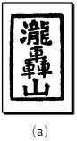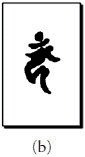

图 1。(a) 显示了一个典型的用于抵御负面力量的中国佛教符咒示例。(b) 画了用于为符咒注入能量的梵文字母。然而，图像本身并没有被“注入能量”——如果你只是临摹它并尝试使用它，那是徒劳的。

“既是，也不是。制作者的性格在他生前是通过阴阳的相互作用建立的；现在他只剩下阴，他无法发展、撒谎或创造。不过我明白你的意思是；他的决策经过了`fu`的过滤，并受到他作为灵体这一事实的限制。你说得对。”

多丽丝看着约翰。“他说得对吗？在制作符的过程中写下这些字符——无论是梵文还是中文——是否就是一种编程？”

“很接近了，”约翰说，“这是一种初始化过程的方法。你自己不就是编程的结果吗？你的大脑作为一种电脑，在你婴儿时期将外部刺激作为输入读取。它处理了这些数据，并在多年的岁月中，你的性格就形成了。这本质大不相同，区别在于你作为一个人类同时拥有平衡的阴和阳。而`keris`（克里斯剑）没有。从某种意义上说，制作一个`fu`就像出生。你本质上是将自己的一部分放入了另一个东西中，而这个天线将持续一段时间。”

约翰停下来点了一根烟，向后靠在椅子上。“问题在于，”他说，“许多印度尼西亚人和马来西亚人把家里的`kerises`视为崇拜的对象，而不是它们真正作为感知平庸忠实伴侣。”

多丽丝看向亨基，亨基嘿笑了。

约翰笑了。“不是亨基。事实是，我怀疑`keris`是否真的能获得诺贝尔物理奖，因为存在我们之前提到的双重限制。萨马是一个极高智能的例子。`keris`应该被像宠物一样对待，被喂养和照顾，但永远不要像神一样崇拜。这是一个非常严重的错误，我经常以此告诫我的朋友。有些人甚至向他们的`kerises`祈祷！”

露西又快跑了过来。约翰抱起她，让她放在腿上，开始抚摸她。“这就是`keris`应该被对待的方式——或者说任何`fu`——像一个忠诚的朋友和保护者。如果你愿意，你可以抚摸她，但我怀疑你永远不会向她祈祷，对吧？世上只有一个上帝，人类只应该崇拜祂。”

我们确实无法对那句简单的陈述增加太多内容。也许在我在约翰周围见过的所有事物中，`keris`和`fu`的概念是最令我震撼的。我看到多丽丝也被其影响所震动了。

人类所有的神话和传说真的是真的吗？突然间，很多事情对我来说变得明朗了。多年的学术教育与多年对奥秘真理的探索之间的斗争停止了；我与约翰度过的那些时光像飓风一样掠过我的脑海，我得到了那些困扰了我数十年的问题的答案。

我掌握了对自然的理解。

至于我会如何利用它，还有待观察。

约翰仔细地观察着我并点了点头。也许他在我的脸上看到了某种反映出我脑海中飞驰思绪的东西。多丽丝和我尴尬地站起来，互相道了晚安。是时候回家了。

从那天起，我见过了成百上千的`kerises`，有的强大，有的则较弱，但每一个都有其独特的个性。这种现象从未停止让我惊讶。我将用一个简单的肯定来结束这一章：我已深信`keris`的魔法是真实的。目前，多说无话毫无意义。

# 第十章

## 现实的本质

那是在雅典北部埃维亚岛的一处海滩，日落时分，我终于进入了超常意识状态。我呈半莲花坐姿，进行我的二级练习，吸入`yang ch’i`，将其送入我的`dantien`（丹田），并通过瑜伽式的息气在那里进行压缩。

突然出现了一种嗡嗡声，像直升机或船的螺旋桨（事实上，起初我以为有一艘船经过）。声音变得越来越大。毫无征兆地，一切陷入了一片黑暗：天哪，我要中风了，我心想。然而，这种感觉并不难受；事实上，那种感觉相当愉悦。我观察这种现象了一会儿，完全清醒且自觉，然后开始感到恐惧并把我的`ch’i`收回。

世界回到了我面前，我踉跄着，眩晕了几秒钟。我感到充满力量而不是虚弱；这不是中风。为了完成我开始的那组练习，我把我的`ch’i`送回。立刻，嗡嗡声再次响起，但这次我很忐不安；我中断了过程并撤离。第三次重复产生了相同的结果。这太让人受不了了。我迈着颤抖的双腿，走到多丽丝等待的地方。

她非常愤怒。“我以为你说过你只会花二分钟左右！”她说。

“额，我确实这么想的，意思是，我以为……我迟到了吗？”我结结巴巴地说。时间去哪儿了？我想着。一次瑜伽式的重复通常需要我一分钟；我本想在去当地酒馆吃晚饭前做二十次。

“你在说什么？我坐在这里看着你看了四十五分钟了！其中有一次你至少二分钟一动没动过。我很担心。”

我很震惊。似乎在整整二分钟或更长的时间里，我屏住了呼吸并失去了对时间的感知。

我立刻打电话给约翰。

“恭喜，”他说。

“你什么恭喜？”

“很好的经历。这意味着你在二级练习中进展顺利。”

“这是本该发生的吗？”

“那是。”

“那个嗡嗡声是什么？我一个苏菲朋友说那是`dantien`的脉轮在旋转。”

他笑了起来。“噢是吗？你只是把意识传到了你的`dantien`，仅此而已。”

仅此而已？奇迹在约翰周围显然已经成了常态。我该如何将这种知识带到西方世界，而不被嘲笑或谴责？最好的方法是什么？在我这样做时该如何抑制自己的野心和希望？

当我最初承担为我的老师写一本书的任务时，我很快意识到需要一位著名的科学权威来为我的写作内容增加信誉。同时，我也敏锐地意识到了约翰对他祖师的誓言所带来的限制：不允许在临床条件下进行公开演示。我想出的克服这一障碍的计划很简单：允许约翰治疗任何患有真实疾病的人，而他在这些针灸治疗中使用的电产生现象，足以让任何临床物理学家信服。我的策略是寻找一位患有疾病的杰出权威，安排与约翰的治疗课程，并希望诱导这位男或女性支持我们。这样，约翰就可以在他那些同样拥有科学学位的学生面前进行一次全面的电影录像演示；我们中这样的人并不少。只要我们阵营里有合适的人支持，这就足够了。我花了大量时间去探听别人的意见，并与著名的研究人员建立联系。在其中两个案例中，约翰在最后一关头退缩了，导致我不得不给那些男人打电话（在那一刻，他们可能已经深信“发电机杰克”是个骗子了）。

在经历了许多令人沮丧的月份后，我于 1997 年 11 回到印度尼西亚，在那里我见了 Andreas（Andreas）和 Handoko。当时，张世富向我们重申，公开演示是不可能的：虽然他得到了老师许可可以写书和拍电影，但他仍然受限于对廖师傅的承诺。在随后的圆桌讨论中，安德里亚斯提出了将`Lawrence Blair`31 引入项目的主意，因为他是一个已经见证过我们老师所能能力的电影人，而且《火之环》最初正是我们接触约翰的介绍。这是一个好主意。第二天早上，我乘飞机飞往巴厘，开始寻找布莱尔。

现在，劳伦斯·布莱尔和约翰已经十年没有说话了；后者对前者非常生气，因为他认为布莱尔博士骗了他。根据约翰说，《火之环》的原始素材是为了他的能力进行科学记录而拍摄的，而不是为了商业用途。劳伦斯对约翰非常恐惧，当他听说我的老师不悦时，他躲了约翰十年。

那天傍晚，我在乌布达（Ubud）的家里见到了布莱尔博士；根据他的说法，误会是问题的核心。布莱尔在与约翰交流时使用了马来语单词`dokumentair`；张世富将该词解释为“记录”，而布莱尔同时认为自己拥有可以使用这些素材的完全许可。

那周我把这两个人聚在一起，意图是让劳伦斯利用他在《火之环》中已有的素材拍摄第二部纪录片。显然，会议非常顺利，因为约翰做出了意料之外的决定：布莱尔博士被允许在亨基（Henky）的协助下拍摄关于约翰的新纪录片。我松了一口气，可以继续我自己的项目了。

我有计划要执行。我想接触那些像我一样的人，那些拥有西方技术学位同时也是经验丰富的武术家的人，那些能够并且愿意将约翰的`内功`训练与正骨学方法以及西方科学相结合的人。人类花了很长的时间才演化出这样的人，他们既不属于东方也不属于西方，而是兼者有之。是时候获得投资回报了。也许那些被乔治·卢斯命名为“绝地武士”的人会亲自现身。

但这绝非一项轻松的任务，因为规则是不能打破的。我亲眼见过有人在约翰面前违反誓言会发生什么。让我和读者分享其中的一个事件吧：

### 天气的变化

我正开车从希腊北部的村庄回回雅典，这时暴雨来袭了。

我的`VW Golf`里还有斯皮罗（Spiro），一个二十八岁的飞行员，既是我的朋友也是我的武术学生。那是春天，到处处都是花，复活节已经过去。阳光明媚，天空万里没有一丝云。

突然，考虑到斯皮罗的父亲刚刚因感染失去了一个肾，我们对话的话题转到了死亡和死后世界的可能性。当时我认识约翰大约一年了，迫不及待想向某人、任何人讲述我所看到的。然而，我受到严格指令不讨论我所看到的景象，并向约翰这样承诺过。

抓住时机，我告诉斯皮罗我在印度尼西亚学到的东西，告诉他我心中不再怀疑死后有生。我描述了白浪、黑浪以及约翰教给我的东西。

突然，大量水撞击了挡风玻璃。我看不清了，于是开了雨刮器。

我们正在经过新翻过的田地。“我们一定经过了一个喷淋器，”我对斯皮罗说。很奇怪，我没看到。

我继续开车，过了大约半分钟。水持续以狂野的猛烈倒在挡风玻璃上；我把雨刮器拨到了最高速。

“不，是暴雨，”斯皮罗说。他很困惑。作为一名专业飞行员，他了解天气，而且没有任何迹象表明我们会有阵雨，更不用说这种强度的雨了。雨持续持续有力地撞击着我们，大至于我几乎看不清路。

我们在沉默中继续行驶。大约一英里后，我发现了一些奇怪的事情。对面道向我开过来的汽车没有开雨刮器。

当我们经过时，我看向地面。地面看起来是干的！

“这是什么他妈的暴雨？” 我大声说道。

同一时刻，我听到副座传来了一声细小而恐惧的呜咽。“呃，你在告诉我这些的时候，是不是做了什么不该做的事？” 斯皮罗问。我看向他。他由于恐惧和惊讶而脸色苍白。

“我不知道，”我说。这种情况太超现实了，就像活生生的动画，我开始享受其中了。我甚至笑了起来，然后抬头望向天空。

“对不起，师傅，” 我说，“不会再发生了。”

在最后几滴水的啪啪声打在我们身上后，雨突然停了。我靠路路缘停车，我们迅速下了车。

我的`大众`湿透了。它看起来像是一辆在热带暴雨中被放置了一周的汽车。当我们站在路边时，完全干燥的汽车从我们身边经过。阳光明媚；和之前一样，天空万里没有一丝云。

正如我反复强调的那样，重点不在于让东方科学屈从西方科学，而是创造一种既不是东方也不是西方的新科学。科学理论总是——引用弗里乔夫·卡普拉博士（Dr. Fritjof Capra）*32 的话——最好也是一种近似，是人们试图建模或记录物理现实底层本质和过程的尝试。例如，经典的牛顿理论对于解释大质量、慢运动物体的行为相当充分，但在表征电磁场方面存在问题，在原子尺度上的问题更多。世界思想家们所经历的尝试与挫折观察起来可能很有趣（如果你是那种喜欢看聪明人一头撞上南墙的人的话）。例如，两百年前，人们相信一种被称为“燃素”（phlogiston）的东西，这是一种被认为只存在的想象物质，是因为人类没有正确理解燃烧。未能为燃烧建立合适的模型，是化学理论取得真正进展的不可逾越的障碍。当时的科学家们不愿承认“我不知道”，他们宣布了不可测的燃素的存在，这是一种存在于所有材料中能够维持氧化反应的物质。当然，这并没有这种东西。

作为一名科学家，我无法否认我亲眼所见；除非约翰是世界上最伟大的魔术师（或者是一个基因突变者），否则他不可能欺骗这么多的人。你可以完全否定这段文字形而上学的方面，将其视为约翰个人的印象或幻觉，但无法否定我和成千上万人所目睹并经历过的那些能量。此外，认为约翰的能力源于基因突变的假设是不成立的，因为我们所有的学生在训练过程中都在自己的身体里遇到了他所描述的那些能量。例如，在一次对练练习中，我不小心差点杀死我自己的一个学生，他用快速的一拳令我吃惊。作为回应，我用左手格挡的同时，用右手掌击中了他的胸口。那个男人——一个强壮、有力的希腊村民——立即遭受了轻微心脏发作并倒下。对于这种反应没有理性的解释，在医院也找不到关于他状况的任何说明。他非常健康，谢天地依然如此。

### 物理理论的演变

我们知识体系的基石是物理学。今天大多数人认为量子物理学理所当然，或者带着怀疑眼光看待这门科学；事实上，它的直接实际应用——核能——将一直困扰我们，直到我们理解聚变物理。1905 年，当阿尔伯特·爱因斯坦（当时是瑞士专利局的一员）发表他关于相对论以及后来成为量子力学的经典论文时，来自牛顿物理学家既有社区的反应非常激烈。尽管有这些抗议，在二十年内，一群跨越国界工作的、专注且才华横溢的男士们*33 组成的团队，不可否辩地奠定了量子理论的基础。关键点在于，人类对宇宙的感知发生了根本且突然的改变，在短短且令人困惑的二十年里，摧毁了科学界既有的观念。虽然认为科学理论是恒定不变且掌控一切的这让人感到更宽慰——从而减少我们生活中的不安全感——但事实是，科学理论在描述现实的尝试中不断变化。我使用“不断变化”这个词而不是“有目的地演变”，因为在许多情况下，对既有思维模式的偏离是非常具有革命性的。

想象一下当原子现实被理解时，既有科学界受到了多大的冲击。在此之前，人们认为原子是极其坚硬、不可分割的固体质量颗粒；量子力学（以及 X 射线的发现）显示它们大部分是空间，仅以相互关联的方式存在，并且只能通过概率律来定义。

### 整体科学与东方智慧

相对论和量子力学必然是整体的和生态的；然而，从人类社会演化的角度来看，它们的发现相当晚，还没有足够的时间让它们产生仁益的影响。（事实上，它们的最初衍生产品——核能——到目前为止一直是负面的。）可以肯定，我们将在未来五十年内看到它们的积极面；目前，令人欣慰的是，量子理论的创造者自己很快就意识到他们新物理是如何紧密遵循东方神秘主义模型的。他们中的许多人研究东方的智慧，是为了更好地理解自己的心晶。尼尔·波尔于 1937 年访问了中国。十年后当丹麦国王授予骑士时，他选择了太极（阴阳）符号作为他的纹章，以承认古代东方科学与现代西方科学之间的和谐。

让我们假设约翰的能力和他的理论都是正确的。我想探讨这些信息能为人类提供什么。（更详细的方法，请参阅附录 2。）公元世纪的中国圣贤描述了万物从“源头”（Source）产生并回归它的过程¹⁵⁵。为了象征时空开始之前的状态，后来被称为道家的人提出了“无极”（wu-chi，字面意思是“没有极点”）的概念，用圆圈表示。无极是静止的状态，万物在其中与终极没有区别。从这种状态中，一个运动点，一个纯阳闪而出。阴和之间之间相互作用，导致了太极（极极）的状态；在这里，阴阳相抱，分离而统一，相互抵消力量。

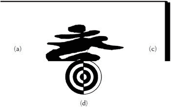

图 2. (a) 无极，纯阴。(b) 和 (c) 静止中的一点运动火花；阴中心的阳。(d) 太极；阴阳相抱并平衡。

如果约翰的理论和图 2 中的模型是准确的，那么我们自己的宇宙原型就缺少了一个关键要素：存在于“大爆炸”*34 之前的物质与我们目前物理宇宙的结构在不断相互作用，静止（阴）与运动（阳）永远平衡为一。可以说，这一假设可以解释世界各地科学家观察并报告的物理理论中的许多差异。阴并不是亨德里克·洛伦兹（Hendrik Lorentz）和朱尔·亨利·庞加莱（Jules-Henri Poincaré）寻找的“以太”†35¹⁶，但它提供了许多令人兴奋的可能性。

约翰向我透露过以下关键陈述：“地球上都是阳，但地球本身是阴。”对于我来说，作为一个科学家，这意味着阴能量与行星和奇点等引力井有关，太极符号所描述的平衡在宇宙中的存在如下：

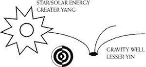

图 3. 宏观的阳和阴。

这张简单的图表暗示了令人难以置信的事。首先，我相当确定`气`（yang ch’i）是一种太阳现象。*36 约翰曾说过：“`气`存在于空气中；自然创造了它。”正如我之前提到的，我曾观察到它是蓝色的。作为一名内功（neikung）修习者，我能感觉到`气`不断储存在我的丹田（dantien）之中；它是热的，正如中国古典文献描述的那样。这些观察与威廉姆·莱希（Wilhelm Reich）关于原始能（orgone）的研究完美契合。似乎`气`的浓度会随着海拔的增加而增加；换句话说，`气`倾向于脱离重力（这就是为什么瑜伽士向山山聚集）。我能感觉到体内的`气`想要向上，如果这算是一种迹象的话。`气`的存在清楚地显示了我们作为一个物种是多么疯狂：考虑到我们目前的生活方式正致力于破坏环境，且假设自然在循环和传播基本的生命能量，那么通过消灭自然，我们正在杀死自己。

然而，约翰宇宙模型中巨大的惊喜是`阴能量`（yin energy），因为它的表现与任何其他记录的物理现象都不同。没有任何理论能解释它——不是心灵感应，不是精神控制。约翰多次将其传入我的身体，那种感觉与我遇到过的任何事物都不同。那是一种冰冷的冲击，是一阵冬风，是外太空的真空。中国古典理论将`阴气`称为“坎”（水），以试图描述其质地；同样，它将`阳气`称为“离”（火）。这两个名字都恰恰贴当。

能量守恒定律是物理学的基石。在虾类场发生的事件中，当约翰将`阴气`传入我们身体而我们接住了步枪的子弹时，铅丸没有变形，也没有产生热辐射。这表明子弹的能量并没有被守恒，而是以某种方式消失了。在目前的物理定律下，这是可能的。

这种连续体存在于我们的世界上，虽然被动却无处不在，这种前景令人感到疯狂地兴奋。`阴`是物质和时空出现之前的原始混沌；我们世界中所拥有的这种秩序来自于太极（t’ai chi）符号所定义的相互作用。`阴`与`阳`斗争，但它们力量的平衡创造了生命。我推测，理解`阴`和`阳气`的本质将赋予人类反重力、超光速，并几乎能提供时间之谜的线索；我对这些假设有充分的理由。

## 悬浮

我们在巴塞罗那。约翰正与印度尼西亚内政部长一同游欧洲；他曾开玩笑向我透露，那个男人觉得在他在身边时感到更安全。

约翰嚼着印尼花生进了我的酒店房间；他扔给我一袋，然后瘫坐在躺椅上。我们聊了一会儿闲谈；然后突然，话题转到了与生物物理科学相关的`气`（ch’i）上。

“你不能在显微镜下研究`气`，”约翰说，“`气`是对我们存在的研究，而非单纯的物质。例如，如果你拥有`气`，你就可以绕过我们今天定义的自然法则。你可以穿墙而过，你可以从地面升起，你可以做很多事情。”

“你的意思是悬浮，”我说，“所以瑜伽士在冥想时从地面悬浮的故事是真的。你能做到这一点吗？”

“当然可以！”他回答道，“我只花了几个月就学会了这个招式，但这没什么大不了。你只需要离开地面大约一码的高度并坐在那儿；你不能向任何方向移动，只能向下落。”

“是的，但是……”

“别借口了！”他打断道，“任何拥有`气`的人都能学会怎么做。这没什么！”他思考了秒秒那句话，然后补充道，“但首先你必须拥有`气`。”

“师傅，你可以给我演示这个吗？”

约翰失望地看着我。“行吧，”他说，坐在地板上，双腿交叠呈全花坐姿。他变得静止；他的呼吸似乎停止了。一段时间内，他像一尊东方神秘主义者的塑像。

平稳而突然，几乎是理所当然地，他从地板上升起了至少八英寸，并保持在那里。

我的呼吸停在了喉咙里；半分钟后，约翰落了回来。

“地毯是合成的，”他站起来说，“否则我会升得更高。”

我反复向他感谢；他似乎对我如此印象深刻感到惊讶。对他来说，这并不是什么了大的成就——一个小把戏，除了展示人类内在的潜外，在功能上毫无用处。

“我们要出去吃晚餐，”他站在门口说，“和我们一起吗？”

“又是中餐吗？”我问。

“是的。街上有一家很棒的中餐馆。”

我脖子后面的小毛竖了起来。

“师傅，”我说，“我可以问你一个问题吗？你去过荷兰、德国、奥地利、瑞士、意大利、尼斯，现在又在西班牙，对吧？”他点头。“这段时间以来，你难道只吃中餐吗？”

“当然不！”他愤愤地回答道，“有时我们也吃泰菜！”

关于现代数学如何应用于约翰理论的直观观点，请参考伊利亚·普里高津（Ilya Prigogine）博士的工作。*37 1977 年他获得诺贝尔奖，是因为他证明了复杂的系统倾向于按照自己的方式组织成结构化的关系——换句话说，自组织是宇宙的基本特征。

图 4。阴阳平衡。(a) 所示的图示处于紧张状态；它涉及内功训练的第四层和第五层，需要极高的能量。这个符号在流行作品中被错误地用于描述我们生命力平衡的自然状态，而这种状态更准确的描述在图 (b) 中（公元三世纪）。¹⁷

我将用最后一个重磅弹来结束本章。请将“阴”视为时空之前的原始特质；是我们自身“阳”之本性的对立互补。约翰本人通过阴与阳的相互作用来感知阴能；当这两种能量汇聚在一起时，他感受到了一种电流（我们所有人都是如此）。既然`yang ch’i`既是生命的先决也是结果——假设它正如我所信的那样，是一种太阳能——那么它的存在意味着在物质的创造背后存在一种意图。在生命的进化记录中，我们可以看到我们从阴向阳持续成长的见证。虽然我们的宇宙是阴阳力量的平衡，但某些事物倾向于某一方而非另一方。水被视为阴元素。生命以流单细胞生物的形式起源于海洋；演变成植物、鱼类；最后以两栖动物的形式离开阴性的水走向固体陆地。我们的进化过程在陆地上继续；随着每个时代的演变，我们变得越来越趋向于阳。古代中国人似乎并不理解在阴阳理论完全发展的公元前 1000 年到公元 300 年之间的进化过程。此外，正如《道德经》所说且约翰所证实的那样，为了生命的存在，生物（植物、动物、细菌）必须同时拥有阴和`yang ch’i`并运行。一张木桌仅仅是阳且没有生命，而一棵树既有阴也有阳，它是活的。总之，我想说，阴阳能量的现实增强了我们的希望，即存在一位创造主神，并证明了宇宙的实现具有产生生命本身的意图。

而这，在我们逻辑僵化的时代，或许是所有认知中最令人震惊的觉悟。

# 结语

我稍作停留 . . . . .

### 成长的局限性

人类是整体的一部分，被我们称为“宇宙”。…… . . （分离的幻觉）是我们的一种监狱。…… . . 我们的任务必须通过扩大慈悲之圆，去拥抱所有生物和整个自然之美，将自己从这个监狱中释放出来。

阿尔伯特·爱因斯坦

这本书对你来说，可能仅仅是一场穿越奇仙世界的之旅。一个逻辑严密的人可能不愿对他所读的内容过分认同。例如，如果我自己是在外面观察而非亲身参与这个项目，我可能在给出肯定判断时非常犹豫。诚然，成千上万证人可以证实`Chang Sifu`拥有独特的能力。也许还有一百个人，像我这样，愿意站并在法庭上宣誓，他拥有某种知识，使大多数人能够在我们（直到现在）所标记为超自然技能的领域达到某种精通。对于怀疑者来说，这并不意味着`Chang Sifu`所相信的一切都是可以通过科学实证的，也不意味着它应该被视为福音。作为一名科学家，我不能、也不会与这种思维模式争论。

我可以将这种功能性分析向前推进。假设你既接受我的诚意，也接受我老师的诚意：我在这里写的所有都是事实，而且你相信它们。仍然有空间去思考这一切努力背后的意义是什么。我的意思是，为什么要费力呢？本文提供的课程在实践中能获得什么收益？即使这里陈述的一切都是事实且真实的，它们又如何以及为何应该影响你的日常生活？

答案非常简单。如果我们的日常生活并非处于危险之中——如果我们不需要这部作品提供的教训——那么这些演示永远不会发生，这本书也永远不会被写出来。

避免干预世俗事务的进程是中国秘传传统的一项常。。然而，我们看到在历史上，这种传统不时会被打破，许多大师（如`Pai Lok Nen`和`Mo-Tzu`）行走在微妙的界线上，在他们认为合适的地方将业力与世界融合。没有任何一个道教大师，即使是七十二层的大师也不是神；他们仍然是人类，拥有人类的欲望和情感，无论这些情感多么精炼。这些情感中首要的是对同胞以及对人类文化进步的爱与关怀。通俗来说，他们是在乎的，并且并不总是袖手旁观。有时他们会介入，而现在就是其中这样一个时刻。

我不知道`Chang Sifu`向世界开放其教学的原因，但我清楚自己的理由。因此，在这一部分，我想代表我自己发言。接下来的内容基于我自己的理想和观点，并不一定定义`Chang Sifu`的教导。然而，我的大部分逻辑基于我与他相处的经验。因此，任何错误都是我自己的，而任何功劳属于我的老师。

我们生活在一个充满问题的世界。显而易见，贪婪是我们主要的罪，是我们西方生活方式固有的癌症。我们永远不会说“足够了”，这导致了我们的灭落。我们大多数人并没有意识到，或根本不在乎我们的生活水平实际上正在破坏我们的星球和我们自己。我将探讨身体和世界的破坏，在此之前，我想谈谈贪婪的问题。

对付无形是非常是非常的。我们如何定义贪婪？大多数字典称之为“热烈的且自私的欲望”。这比任何定义都好。。我更倾向于使用“短视”这个词，它意味着遭受贪婪的人并没有意识到最终他在伤害自己。他只是没有感知到这一点。

正确的感知是一个至关重要的特征，也是一个难以理解的特征。我们必须从事件中抽离出来，完全客观地观察它们，以便正确评估标准。例如，常用的羚羊与生物学模型。对于一群羚羊来说，狮子是一个只想杀戮和撕咬的邪恶实体。但对生物学家来说，狮子在万物中是有意义的；捕食者实际上在确保猎物的持续生存和健康。在自然的平衡系统中，一方没有对方就无法生存。但羚羊并没有感知到它们对狮子的依赖，因此它们最想的就是摆脱它。

不幸的是，生活有点像这个例子。我们的欲望和偏见诱导我们完全从自己的立场来看待世界。无知和贪婪这对公理往往会进一步将我们与现实隔离开。我们现代人也推向了极限，但幸运的是，我们也给予了时间和手段来停止自我毁灭。大多数人并没有意识到，我们已经变成了古代神话中的神，因为我们拥有几乎无限的权力和财富，却缺乏正确使用它们的常识.¹⁸

人类从本能和进化角度来看是一种群居动物，更倾向于跟随而非探索和独立做出决定。在社会领导阶的指导下，我们通常会让事情搁置，直到被逼到无法忽视为止，而无论这对我们的福祉产生的是积极还是负面的整体影响。如果认为社会动力学科学在当今时代并不比物理或化学落后，那是错误的；通过分析发现，世界领袖对民众的控制程度是令人震惊的。当我们如此狭隘地生活在这个世界上时，这个世界可能会变成一个非常无情的地方。自然界中的大多数现象都遵循指数增长规律；这一基本准则从初就导致了我们的毁灭。

1972 年，由马萨诸塞理工学院丹尼斯·L·梅多斯教授领导的国际科学家小组发表了一项研究结果。该研究是在罗马俱乐部的指导下在麻理工完成的，通过计算机模拟根据现有趋势追踪了全球资源的减少。其他学者过去也得过同样的结论，最著名的是 20 世纪 50 年代初的地质学家 M·金格·哈伯特，但麻理工的研究是世界政治家首次关注的研究。梅多斯博士的研究最终面向大众市场，并成为经典畅销书《增长的极限》，它在 20 世纪 70 年代售出了数百万册，但似乎在 90 年代被遗忘记了。基本上，该模拟预测，到 2100 年，全球三分之一的人口将因饥饿死去；我们生态系统的破坏和世界金融基础的崩溃将引发并伴随着这场全球饥荒。

这种现象的体现在非洲、印度和东南亚已经显而易见。似乎很少有人关心。例如，在希腊，人们在某一年裙摆是否应该缩短，或者一位新的谈口节目主持人是否做了隆胸手术（是真的吗？）上花费的精力，远比对邻近阿尔巴尼亚和科索沃数百万饥饿人口的关注。

那么，鉴于贪婪和无知的持续现象，我们距离梅多斯教授模型所预测的毁灭还有多远？目前，模拟结果正不安地处于轨道上。

再无可否认的是，例如，由不负责任的工业化和森林砍伐引起的全球变暖是一个事实。联合国和世界气象组织成立了政府间气候变化委员会，以监测局势并提出行动计划。迄为止，IPCC 已经分析了在全球变暖方面我们未来可以预期的情况。以下是简要总结。

### 全球变暖预测

地球平均温度将在 2025 年上升 1 摄氏度，并在 2100 年再增加 2 度。这听起来可能不多，但请记住，这种上升在地球范围内并不是均匀的。极地的温度上升可能比赤道得多，陆地上的空气将比海洋上暖得多。（另一个模型认为，在极冰盖最初融化后，极地实际上会变得更冷，在高纬度地区引发另一个冰河时代）。

有的风模式将发生改变；`El Niño`就是其中一个例子。亚洲季风可能变成美国风。全球降水量将会增加，但这种增加也将是不均匀分布的。在中度地区，我们可能会看到年降水量增加 5 到 10%，但地球上已经干燥的地区将变得更加干燥。也许整个`美国阳光带`，例如，在某个时刻将变成一片无边无际的沙漠。极端气候现象将增加：飓风、风暴和洪水。如果说上世纪最后三年的严重洪水和风暴是任何迹象的话，我们已经看到了这一点。

在未来五十年内，目前用于农业的土地将变得干旱和无用；耕作将不得不在高海拔进行，以确保在未来更热的气候中生长。冰盖确实在融化；科学家预计从现在起，每十年海平面将上升六厘米。

### 臭氧层

七年前，对于我们这些地中海背景的人来说，2 的防晒系数是可以接受的；现在我们必须涂抹 24 级的防晒霜，并注意“太阳强度警告”以避免皮肤癌。

1997 年 3 月，美国科学基金会毫无疑问地确定，南极鱼类由于太阳辐射增强而遭受变异率增加和遗传异常。它证实了在季节南极的臭氧水平下降到确保紫外线保护限值的 50%。这只是开始。

### 材料与责任

在说完以上之后，让我也确认，合成材料在适当的地方使用无疑是极好的。正如我将在本节进一步讨论的那样，毫无疑问，聚合物和合成材料为人类提供了开启未来的钥匙；如果没有它们，我们看到的技术和医学进步将无法实现。

不，我所处理的问题是微妙的：贪婪和无知，仅此而已。我曾在原始条件下生活；没什么。我的观点是，西方文明的成功需要目标、行动和责任之间的仔细平衡。我们的孩子和我们的孙后代将为我们今天的决定和无作为付出代价；因此，我们对他们的爱应该节制我们的欲望。

“Karma”（业果）一词翻译为“后果”。你不总是需要通过采取行动来对某事负责；你也可以通过不作为来促进后果的产生。我们在西方允许我们的民选代表那样行动；因此，我们也必须承担部分责任。而且我们将会承担的。曾有一个学生问我，是否认为伊拉克公民应该目睹家园被毁，仅仅因为一个权力欲的独裁者统治他们的国家而他们的亲人被杀。我回答是肯定的，因为不幸的是，他们承担了最初任其控制他们生活的集体后果。在指数增长的规律下，他们让他们了萨达姆·胡赛因的力量壮大到无法对付。自然并不宽容。

那么，这一切与世福有什么关系？无关又是一切。上述概述的恐怖故事仅仅是生活的现实，但它们也可以作为案例。张世福同意这本书只有一个原因：扩大全球范围内人的视野，并让他们毫无疑问地看到，他们的生活并不像他们认为的那么有限。有时给人们一个暗示就足够了。各种奇迹都会发生。我想起了绿色和平的一个成员，他秘密潜入金枪鱼船担任厨师，在拍摄了金枪鱼船上大规模屠杀海豚的视频后，让金枪鱼行业陷入瘫痪。那个人点燃了引发火花的火星。我希望这本书能以类似的方式发挥作用。

常书夫的课程不仅面向世界领导人，也面向普通人。“听着，”他对权势者说，“宇宙并不像你们曾经想象的那样简单直接。你们不能在不考虑未来或不顾因果报的情况下行事。你们将为自己行为的后果付出代价。人类状态的某些方面是你们目前尚未察觉的。”也许领导者们并不在乎，你会说。难道世界上每种宗教不都发出过同样的警告吗？许多权势者觉得自己可以豁免，仅仅是因为没有证明他们个人宗教或教条的有效性。然而，历史告诉我们，这种态度是错误的。

尽管有上述那位绿色和平组织的成员，一个人的努力能如此频繁地影响历史进程，这仍令人惊叹。我们目前的西方文明本质上仍然基于 17 世纪两位学者的方法和方法论：`Francis Bacon`培培和`René Descartes`。

### 培根法

培根是现代科学实证方法的创始人。作为一名哲学家和政治家，他写道人类应该“抓住自然并强迫她为我们服务”。培根主张人类本质上应该让自然成为自己的奴隶，他应该“缚住她的手脚并折磨她，让她揭示自己的秘密”。今天，这些话听起来可能是疯狂的；但历史学家意识到，这位著名的哲学家仅仅是在回声当时的司法制度。人们在想，他会如何享受在核废物填埋场的之旅。

### 笛卡尔的二分

至于笛卡尔，无疑他是一个才华的人；同样无疑的是，我们现在的许多痛苦也归功于他。笛卡尔是一位伟大的数学家、科学家和哲学家，但在他的指导下，西方人开始与地球、自然力量以及同类分离，这种分离的程度我们现在才开始意识到。事实上，笛卡尔最著名的名言“我思故我在（Cogito ergo sum）清楚地定义了这种分离。通过切断思想与身体并使肉体变得毫无价值并隶属于思想，笛卡尔在人类与宇宙之间插入了一个楔子——这个楔子在物理上并不、也不存在。众所周知，例如笛卡尔对活体进行解剖，忽视它们痛苦和绝望的哀叫，以确定它们的身体结构。他的是一种机械论方法；自然只是一台需要分析的机器，仅此而已。功能分析必须在不断增加的细节中进行，以便最终每个组件都能交出其最后的特定秘密。无疑是`Cartesian method`让人类登上了月。另一方面，显而易见的是，通过拥抱`Cartesian method`，我们过度关注齿轮，以至于我们不仅忘记了机器，也忘记了这台机器所走的道路。

### 对现代社会的影响

我反复使用“分离”这个词（我确定这会让本文的编辑非常苦恼），仅仅是因为我相信确实是这种“分离”定义了`Cartesian system`（以及不幸的是，今天的西方社会）。例如，工业过程——笛卡尔哲学显而易见的衍生物——将工匠与他的产品分离了来。换句话说，通过在流水线上工作，每位员工只制造整个项目的一极小部分；他的自我价值仅取决于他所塑造的部分产品。相比之下，中世纪的铁匠对自己的工作感到非常自豪，因为那从头到尾都属于他。今天的流水线工人可能只是在一个细节零件上钻孔（这个零件将由别人钉固定），他们对自己的工作毫无顾忌，并等不及等到周末（或任何他不工作的时间）。尽管西方社会在推进个人权利方面取得了进展，但就业再次变成了奴隶制。

### 日本模式

相反，日本人在工厂产品上取得了巨大的商业成功，这基本上归功于他们的整合政策。公司总裁经常下到流水线协助工人；所有白领员工都被预期在“生产线”度过时间。这种方法培养了统一感和对产品的自豪感，就像几个世纪前的工匠一样，这让人们认为自己的工作很重要。因此，他们的商品卖得很好。

### 食品业的危机

另一个依赖“分离”而生存的运作案例是今天的食品业。肉类生产过程是一个丑闻；动物被关在隔间里，不允许移动，被填入激素和回收食品，随后被屠杀。它们的生命是活生生地狱，与过去悠闲的牧场和开阔的空间毫无关系。肉类经过加工、包装，放在超市整齐的展示柜中；如今大多数孩子并不知道他们吃的是曾经的活体。遗憾的是，水果蔬菜同样糟糕：如果我们意识到使用的化学物质和农药的数量，我们的大多数人都会放弃购买水果。对海洋和海洋生物的持续不断的侵犯更是糟；几十年后，将没有鱼可以吃了。

### 一种整体的替代方案

点在于，如果整个社会能采取正确的态度，这一切都可以扭转，如果我们能意识到我们所遵循的生活方式在世界上没有真正的立足之地。我见过许多以前完全忽视中医理论的西方医生，当有人仅仅用他们自己的语言与他们交谈时，他们停下了脚步。与笛卡尔的预期相反，身体的细胞结构并不是恒定且机械的东西；事实上，细胞生物学类似于量子理论。例如，胰腺每二十四小时更换所有细胞，而胃每每三天更换一次细胞。身体的白细胞每十天更新一次，而那个最复杂、最神奇的器官——人脑中 98%的蛋白质组织每月更换一次。因此，我们可以向医生提供简单的解释：中医是基于不断变化的过程——而不是我们基于笛卡尔的西方医学体系所关注的解剖学细节。通常，这种区别就足以破冰并吸引观众的注意力。

# 道、生命与进化的奥秘

## 道与科学挑战

道教教义认为宇宙由天、地、人组成，万物都体现了`道`的一部分。我们的发展已经达到了这样一个阶段，必须接受这一真理。我们周围的每一个物体和每个人都有生存的权利；事实上，所有生命都是一份珍贵的礼物，应当被如此对待。尽管我们拥有力量，但我们真的理解生命吗？

古代古代的智慧告诉我们，万物始于“道”，也回归于“道”。同样，我们的技术也可以告诉我们许多关于太阳系起源和地球生命的信息，而我们所学到的让我们不禁惊叹。

## 随机聚合的局限性

认为世界仅仅是元素随机聚集的结果，这种假设已不再可行。地球大约有四十亿历史。即使考虑到复杂性理论的最新进展，我们也无法解释为什么以细菌和单细胞动物形式存在的生命，是在地球存在约四亿年后才开始的。

单个细菌就含有两千种酶；根据我们最乐观的估计，这些酶随机组装并产生细菌所需大约是四百亿年，这在时间上相差了两个数量级。第二个问题是，进化似乎是以一种极其有序且有目的的方式发生的；我们目前的数学和理论根本无法解释生物之间显而易见的复杂性和相互依赖性。

## 人类进化的谜团

如果万物确实都是`道`的一部分，那么我们距离理解其中一个组成部分——地球生命还有很远。那么人类本身呢？我们自身的进化也令人困惑。

现代人类在这个星球上生活了大约四万年；我们是如何以及为什么变成现在的样子？我们大脑在进化史上经历了爆炸式增长，在几乎两百万年内增加了一倍。事实上，大脑容量的增加如此突然，以至于身体的其他部分没有机会跟上。由于这些大脑无法通过母亲的产道，人类婴儿必须在发育非常早期出生。（人类婴儿大脑的大小在出生第一年内增加一倍。）

大多数哺乳动物的幼崽在出生几天后就能走路。相反，人类婴儿一年内不能走路，并在近三年的时间内都是无助的。这些完全依赖别人的孩子改变了社会秩序；他们必须被保护并教导如何生存。人类动物的进化史似乎违背了标准的进化过程，也违背了复杂性理论概述的自组织原则。如果我们仔细观察过去一万年的人类历史，情况会更加令人费解。例如，小麦植物在万年前突然发生了突变，简直好像它想被那个时代的人们做成面包一样。对于发酵过程对牛奶、葡萄和谷物产生的愉悦效果，目前还没有任何进化上的解释。

## 天穹与信仰

那么，在处理地球和人类问题时，我们终于开始面对天空了吗？进化是有引导的吗？真的存在上帝吗？正如我们所见，约翰·昌（John Chang）大师深信上帝，他无疑是一个造物论者。我本身是这个时代的产物，因此质疑一切。

噢，我坚定地相信无条件的普世法则：爱、正义、因果。我相信有来世，并且见过灵体。然而，作为一名科学家，我更倾向于接受东方那种关于“天”的观点，即一种涵盖整个宇宙的、类似于量子物理学的、无法定义且不可理解的绝对存在。也许或许存在一个个人神，他的领域是这个星球，他见证了我们的成长。也许他甚至是宇宙精神的体现，涵盖了所有现存的星系，正如基督教概念中的父、子、圣灵所暗示的那样。我不知道，我也太渺小了无法判断，所以我所能做的只有希望。

## 成年的门槛

作为一个物种，我们被赋予并持续接收着巨大的机会。我们也处于巨大的危险之中。因此，从现在起，我们必须像负责任的成年人一样谨慎、深虑地行动，以实现我们的潜力。我们的世界将不再容忍任何错误或愚蠢，不再有任何幼稚。人类动物正如一位卓越的人士很久以前雄辩表达的那样，正处于`童年的终结`。

未来仍充满希望。

我们既不是在没有出生之痛的情况下来到世，也不是在没有经历怀疑和心碎的情况下度过青春期。人类作为一个整体刚刚过了青春期，正站在成年的门槛上。像青少年一样，我们经历了一时间的痛苦，受制于自己的弱点和冲动，但现在我们正在长大。当我们进入公元的第三千年（超过有记载历史的第四个千年），人类确实准备好成为一个负责任的成年人了。

## 成就与进步

看看我们在不到一百年的时间内走了多远，看看我们在这一刻进展得多么迅速！让我们暂时关注我们的成就而非失败。例如，在核战争面前，理性占据了上风；世界大国从冷战的敌对中退了一步——毕竟，那场战争是为了一种经济体系并无其他。

生态组织现在比以往任何时候都强大。信息传播已遍全球，第三世界国家的识字率正在提高。医学知识飞速发展；我们现在可以创造奇迹。想象一下告诉一位十九世纪的医生，切除病人的病变心脏并换上另一颗专门为此目的储存的、来自合适供体的心脏（并获得供体的同意——这本身就不是什么小事）将成为常态？或者想象告诉同一位医生，利用光的能量，我们可以对敏感的人眼进行手术；我们可以开启并关闭大脑？

## 未来的地平线

世界各地的公民比以往任何时候都更意识到自己的权利，并愿意为之站出来斗争；不仅如此，我们毫不犹豫地为人的权利进行非暴力斗争。令人惊讶的是，这套体系是有效的，世界领导人正准备屈从它！甘地在中世纪的欧洲是不会机会的。

尽管面临挫折，我们确实踏上了月球，并在征服太阳系方面取得了进展。我们可能接近了一种新的清洁能源。西方已经通过法律限制企业对生态造成不负责任的破坏。技术进步如此迅速，电子产品往往在几年内就会过时。通过我们在分子水平的研究产生的奇妙新材料将使我们比以前走得更远。很快，随着计算机越来越强大，我们将自己创造智能生命。我们已经克隆了哺乳动物，并接近理解生命本身。我们可以绘制`DNA 链`图，这是有机存在的基石。也许有一天，我们能够科学地确定灵魂所在的位置。

在加利福尼亚州洛杉矶北部的特拉哈比山区，五千座风力发电机产生了 16 亿千瓦的电力——超过了旧金山所有家庭全年用电量。研究表明，美国风力最大的 1.5%陆地上的风力发电场可以产生该国 25%的用电。更令人惊讶的是，美国政府的人们正在关注这一点。类似的研究表明，如果世界上 4%的沙漠地区覆盖商业太阳能电池，将提供足够满足全球需求的能量。（这相当于一个大约为五百英里乘以五百英里的面积，而且如果我们未来继续使用石油和核裂变作为燃料，其所需的资本投资将比这还要小。）政治领袖们再次在认真考虑这一构想；主要的阻碍是特殊利益集团以及各个主权国家之间合作的需求。但它正在到来。

与此相似，用于发电的生物发酵农场自 1995 年以来已成为现实。在美国，有这样一个农场使用一种燃烧谷子的燃料电池，在为一千户家庭提供电力的同时，仅用了 250 英亩土地来种植谷子！人们似乎有强烈的愿望将环保燃料与未来技术相结合。例如，俄罗斯飞机图波列夫与德国巨头戴姆勒斯-奔驰航天公司合作，正准备生产一种 2010 年投入使用的氢气为燃料的飞机。氢气燃烧非常清洁，氧化时转化为水蒸气。

点在于，如果我们没有经历过快速工业化和技术成长的阶段，我们就无法发展出现在让这些梦想成为可能的知识。正是我们目前的物质和物理科学，将这些奖励以所谓的“银盘”形式呈现在我们面前。未来的世界从生态角度来看确实是“清洁”的，因为地球上的大多数人人都希望它是那样。

这本书也是说明我们走了多远的一个良好例子。即使在三十年前，在 20 世纪 60 年代的黄金时代，我绝不敢写下这些文字，更不敢展示我所持的概念，因为害怕报复。事实上，我自己很大程度上是前人所锻造枷锁的产物，是一个既不属于西方也不属于东方，而是两者兼备的人。41。此外，可以确定张大师本人在过去不会费心出没的，因为缺乏合适的观众。但在我们时代，每个人都在银幕上看过《星球大战》，在电视上看过功夫，我们中的许多年轻和中年人都是如此，而这些事情更容易被接受为自然现象。†42。

如果我们中任何人需要更多关于我们物种成长的证明，那么与其说成就，不如说我们审视自己的梦想。我们想去哪里？我们渴望什么？深层审视你自己。我们难道不是在渴望星空吗？这还有什么疑问吗？然而，这里有一个问题，正如我在这一章试图澄清的那样：为了到达我们渴望的星空，我们必须保护孕育我们的子宫，也就是地球本身。这没有捷径。

那么`neikung`是如何进入画面的？嗯，如果我所写的一切都是的呢？它可以被开发和培养吗？如果是，它将带我们走向何方？

我相信这样的探索将引导我们到达向往之星的门槛。`Neikung`是对我们生命能量及更多的研究；它是对我们存在本身的研究。我们寻找的许多答案隐藏在`yin`和`yang`的活动之中。当我们准备好并能够为人类解锁这些秘密时，我们才会步入梦想所承诺的未来。我相信，在这个展开的时代，物理学与形而上学之间的边界将彻底消失（如果它们最初真的存在过的话），甚至死亡也将开始失去它的恐怖。可以想象，我们作为一个物种，将感知到自古以来一直困扰我们的问题的答案：我们为什么在这里？以及我们要去向何方？

这样一个世界是张大师给人类的礼物。

## 附录一

### 注释

[1. 马其顿的亚历山大大——正如金林笔下《想做王的人》中的“希腊之王”——在公元 334 年至 326 年间率四万大军横扫亚洲到达印度北部边界。阻止他的仅仅是他的士兵不愿继续前进；他们叛变了，拒绝越过希法西斯河向东进。亚历山大的继承者及其后代进入了更远的印度，建立了王国并成为传奇的素材。一些历史学家说，印度的希腊国王名单与从诺曼入侵到现在的英国国王名单一样长。*43。无论如何，重要的是两种文化确实在相互钦佩和尊重的浪潮中相遇并互动。由此产生的思想和信息交换对东西方的历史和发展产生了深远的影响。

印度人从希腊人那里学习了雕塑、建筑、天文学和数学。希腊人从印度人那里学习了人类身心的内在运作。许多希腊人成为了佛教徒；事实上，一位希腊化国王曼德罗斯被上座部尊为佛教圣。无法否认印度思想对该时期希腊哲学者的显著影响，并对后来的西方发展如此。由于随后影响罗马人并通过他们影响早期欧洲国家的是希腊化的思想和科学，我可以安全地说，东方的哲学确实强烈影响了西方的历史。在亚历山大到来之前，这两个民族就已经互相赞美过。印度的婆罗门领袖在经典的《曼奴法典》中将雅瓦那（梵语中对“希腊人”的称呼，源自小亚细的希腊人的称呼）放在战士种姓（Kshatriya）；在印度史诗《摩诃婆罗多罗》中也提到了希腊人。公元前五世纪，希腊人希罗多德（历史学家）和赫卡忒斯（地理学家）确认“在所有野蛮人中，印度人是最不野蛮的”（来自民族中心主义的古典希腊人的强力声明）。到希腊化时代，希腊人已经公开钦佩印度的圣者。著名的哲学家阿波罗尼奥斯和普鲁塔丁都去过印度寻找奥秘知识，许多在印度国王宫的希腊外交官写了畅销书，向家乡的希腊人介绍印度！*44 †45。

许多学者认为，希腊人本身是大乘佛教的责任者。‡46。如果是这样，考虑到是大乘佛教传播到中国、西藏、韩国和日本的，那么西方确实强烈地影响了东方的历史。相反，无法否认印度思想对该时期希腊哲学者的显著影响，并对后来的西方发展如此。例如，哲学家皮浪石——他跟随亚历山大去印度并回到希腊影响了随其后的所有人（包括哲诺和伊壁鸠鲁）——在实际操作上是耆教天衣派（Digambara）的学生。§47

## 2

我经常在想，是什么促使毛泽东如此剧烈地转而反对中国文化科学，在 1949 年首先攻击视范围内的一切，随后在 1966 年通过文化革命再次发动如此血腥的运动。我开始相信，他所的是这种精英主义和对知识的隔绝，这种权力者之间不断的冲突。然而，毫无疑问，毛泽东搞砸了，摧毁了许多本对人类有益的事物。

## 3

许多汉学家和翻译者理所当然对无法向西方人传达准确含义感到绝望，并满足于用“能量-时间”（energy-time）来翻译功夫（kung fu），以此复制中文汉字的简洁性。我想用一种更“绝地武士”的方法来处理这些字字的含义。作为西方人，我们无法指望用单词来复制汉字的简练。然而，我们可以使用另一种西方方法——数学，来复制东方文化。简而言之：

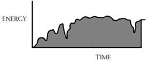

图 5. `Kung Fu = 0 ∫t F(E,t) dt`，其中`E=energy`且`t=time`。

换句话说，功夫等于每天训练所消耗的能量在训练总时间上的积分！曲线下方的面积，即积分，定义了你通过努力所达到的总力量。你以后会看到这个定义是多么精确。（你也可以看到训练者的努力在每天之间是如何变化的；功夫指的是在这个过程中积累的总力量。）似乎确实有两个英文单词可以传达“功夫”的含义，那就是“刻苦”（hard work）！

## 4

道家哲学流出的最广为人知的理论是关于两种对立的宇宙力量的理论；当然，我指的是阴阳。很难想象世界上有哪个地方没有听过这两个无处不在的词。（事实上，没听过它们的地方，这些概念可能仍用其他词来指代！）。当我输入这段文字时，启动了文字处理器的拼写检查程序；它并没有因为“阴”（yin）或“阳”（yang）而停顿，这说明这两个词在西方已被接受。

阳和阴的双重力量是完全相反的：男与女、白与黑、光与暗、热与冷、正与负。“阳”的汉字可以翻译为“山的向阳面”；“阴”可以翻译为“山的背阴面”。我们的身体是阳；灵魂的能量和存在是阴。相反，阳来自天，阴来自地。这两种力量存在于地球上每一个生命中，但它们并不是西方经常表现的那种和谐力量。相反，它们处于不断的斗争中，永无法汇合却相互作用。必须强调，这种冲突是自然宇宙能量的斗争，而不是有意识的神灵之间的争端！阴阳都与善恶无关；它们独立于目的和道德。非常有趣的是，许多不同的文化群体使用了相同的意象。纳瓦霍印第人在他们的沙画中描绘天父和地母的方式，以至于即使是最天真的观察者也会想到阴阳。古希腊人使用了同样的观点，在他们的神话中声称世界上万物是由天父（乌拉诺斯）和地母（盖亚）交配而成的。

到公元前 1000 年，阴阳的概念已经精炼，两种力量的相互作用模式也被绘制出来；这一日期表明，这种哲学在“道教”概念和词汇产生很久以前就已经存在了。

## 5

道家哲学传统（Tao-chia）与经典文本《道德经》（或《老子》）、《庄子》、《列子》等相关。据据说，除了《圣经》和《薄伽罗奴歌，《道德经》是世界上翻译次数最多的书籍。关于儒家和道家之间的冲突也有许多说法，在流行观念中，孔子被描绘成一个强调服从的崇崇文官，而老子则是居住在某个深山荒野的神秘隐士。然而，事实似乎是，他们只是那个时代的人，在他们一生中与萌芽和发展的概念作斗争。

`Lao-tzu`（老子）是赋予`李耳檀`（Li Erh Tan）的尊称，他是生活在公元前五世纪左右周国的小官员。（我们没有办法证明或反驳这一信息。）在他去世后的一百年里，人们收集了归于李名的名言，并将其收在一部名为《老子》的书中。对于老子这个人，我们真的一无所知。重要的是，这部在公元前 1 世纪到公元后 1 世纪之间被称为《道德经》的作品，为哲学道家奠定了基础。然而，可以肯定的是，`老子`并没有自称为道家。相反，《老子》就像《孔子》的作品一样，更关注为正确的政治领导提供基础——可以说，它是一本统治者的手册。事实上，《道德经》这个标题告诉了我们许多关于这本书的信息。

`道`（简单翻译为“the way”）是无名的，是超越起源的起源。它无法被人类定义——它远超我们的认知，正如我们高过单细胞生物一样。`道`是不可知的、永恒的，没有形状或终点，却拥有所有的形状和所有的终点。它无形，渗透万物，并是万物存在的目标。

`德`是一个同样困难的概念。它可以被翻译为“正直”（integrity）、“美德”（virtue）、“顺天意的行为模式”、“力量”（power）、“内在潜能”（inner potency）、“骑士/声誉”。关键点在于，老子和孔子都认为“德”是优秀统治者应该拥有的。

## 6

由于“精”与生殖过程有关，且显然是向下流动的，一些道士（以及真言宗的佛教徒也是如此——这两种教义并不相远）开始利用中国的“反脱成炉”理论来使“精”上升。这个理论简单来说就是：如果你想让某东西上升，就把它向下拉，反之亦然。为了让“精”上升到身体内较高的位置，以便将其精炼为`ch’i`（气），这些修行者竟然在自己的生殖器上悬挂并摇晃重物！我曾见过一张少林寺僧侣用绳子从生殖器上悬着一块六十斤石的照片。我不知道他是否通过这种练习实现了`ching`的升华，但通过多年的重复，他确实练就了口俗中所说的“巨大的阴茎（或睾丸）”。相反，我不知道有多少男性因为这种做法而遭受了阳不起或损伤（我这么说是一种警告，因为我知道没有哪一个男性在读到这段文字时，不会立刻想：“啊哈！原来是这么做的！”）。

其他道士则采取了委婉称为“双修”的方法，实际上是非高潮的性行为。也就是说，修行者进行性行为直到达到高潮点，在该点上他退出或停止。下一步是通过瑜伽法强迫收集的精液上升，再次到达身体中可以对其处理的区域。我在西方读过许多描述这种技术的书籍，但再次，我并没有它的有效性进行证实。

## 7

因为这是一句非常重要的经文，而且为了理解约翰学派的形而上学观点必须理解它，所以最好让我对这些中文汉字进行字面翻译。这些字的意思是：

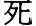

死（一个父母站在孩子的病床前）

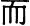

但（一个胡须）

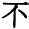

不（地下的种子）

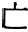

消失，灭亡（一个在墓穴里的男人）

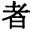

者（一个老人在说话）

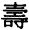

不死，长寿（长寿）

人们对这段诗曾尝试过许多不同的解释，试图使其“契合”西方的哲学模型。事实上，它的意义非常字面。准确的翻译应该是：“死而不灭者长寿。”我选择了一个更有断言性的用法：“死而持续存在者是不朽的。”这段话的意思很简单：像约翰·张（John Chang）那样达到`t’ai chi`（太极）并在体内结合阴阳的人，在死后仍保留所有的意识、记忆和能力。正如约翰如此贴切所说，他们“带着阳气离开了”。

# 8. 如果没有对张道灵的介绍，任何关于宗教道道的描述都是不完整的。张道灵出生于汉末四川四川（大约是公元 150 年，尽管也有人说是公元 35 年），他是一个神童。七岁时，他就能阅读并详述《道德经》，八岁时，他已精通`feng shui`（风水/占卜）。成年后，他在生理和心理层面都展现了超凡的能力和巨大的治愈力量。但张道灵的独特之处不仅在于他的能力。他还是第一个将追随者组织成运动的道教大师。

张通过建立治愈或与灵界调解的终身费用来实现这一点。自古以来，村庄支持萨满一直是惯俗，但在张道灵之前，还没有人如此根本性地掌握组织的概念。张每年向患者收取五石米作为费用（美国医学会将会批准这种方法）。这是大量的食物，而且这种支付在多年内是有保障的。它也是意义上的终身费，因为如果你付了费，就确保了无限的医疗和精神治疗；每次生病时不需要额外费用（某种类似于教会和健康维护组织的结合体）。这种什税让张在自己周围聚拢了一大群追随者，他迅速根据每个人的能力和潜能将他们划分为不同的等级制度。这种创新是如此寻常，以至于他的群体被称为“五米宗”。然而，公平地说，据说他创造了奇迹；可以说，瘫痪者行走了，盲人看见了。否则，他永远无法成功，在中国是不可能的（原因我将在后面的章节中探讨），在公元二世纪更是绝不可能。那个人是有力量的。

张道灵和他聚集在他周围的人在另一个特定方面上也是独特的（事实上，在这种情况下，他的观点完全背离了道教隐士的流行形象，即对社会漠不关心）。张道灵通过组织追随者并同意通过他的力量保持人们健康快乐，并同意与邪恶战斗、驱除恶魔和鬼灵，同意在人类进程允许的地方进行干预——在因果允许他这样做的地方。对于一个道士来说，这是深度的一步，主要因为通过这样做，他接受了自己行为的后果。记住，根据他的信仰，如果他做得好，他的报就是好的；如果他失败了，他就必须付出代价。还要记住，张道灵生活在公元二世纪，在带有菩萨思想和自我牺牲精神的大佛教进入中国之前。你现在应该能看出，在西方传播的道教形象完全不准确。

张采用了`T’ien Shih`，“天师”称号（或 `T’ien Sifu`，“天师”；取决于你问谁）的头衔，并将其传给后代（他确实有孩子——再次与道士隐士形象形成对比）。他的后裔在经历了各种战争以及随后短暂的道教政教建立后，最终定居在江西的一座名为龙山的山上。几个世纪以来，他们继续干预人类事务的实践，在他们的殿堂里，除此之外，还储存了数千罐子，用来关禁他们驱除的强大恶魔。其他不属于他们那个宗派、但与他们有松散联系，并认同拥有力量的人应该帮助人类的道士，也聚集在他们的山上；在那里，他们得到了庇护和一个宁静冥想的地方。其中这样一个人将是本书的核心，正如我们以后将看到的。

1927 年，国民军中的中共成员在前往海蓝丰的途中脱离并进攻了龙山。他们强迫寺庙里的僧侣（其中包括世袭天师）逃命。士兵们砸碎了成千上万个罐子和容器，根据僧侣的说法，释放了成千上万恶灵再次行走世间；据说正是这些恶灵导致了第二次世界大战！天师最终定居在台湾，并一直生活到今天。再次与我们故事核心相关的是（正如 1949 年在毛山发生的那样），龙山上的一些隐士完全没有被军队的出现所吓到；他们如此强大，以至于吓退了士兵的撤退！

# 墨子

如果你问一百个读过中国哲学的人老子是谁，他们很可能都能告诉你答案，甚至有些人还会说得非常详尽。然而，典型的研究人员可能会惊讶地发现，历史上有一个学派，其影响力曾比老子的道家更是儒家思想的竞争对手，但在我们今天却几乎鲜为人知。这个人就是墨子（或称墨子）。他对于本文具有重要意义，因为张昌（John Chang）所继承的功夫门派起源可以追溯到 `Mo-Tzu` 本人。

## 正义与兼爱的哲学

在墨子去世后的两个世纪里，墨家是儒家的主要竞争对手。墨子于公元前 469 年出生于鲁国，在 `K’ung Fu Tzu` 去世大约十年后。他年轻时受过极良好的教育，显然也是一位武术家和战略大师。迹象表明他出身于贫门，甚至可能被标记为罪犯，因为 `Mo-Tzu` 的意思是“墨先生”。然而，正义的原则是他工作的动力，尽管他本性上是一个固执且极端的人，但“兼爱”是他教义的核心。在基督出生前四百年前，记载墨子曾说过这样一段的话：

“若人视国如视己，视邻如视己，则不相攻了，因为攻人就像攻自己一样。”

在我继续之前，审慎的做法是说明，用“兼爱”一词来描述 `Mo-Tzu` 哲学的核心主题存在困难。从我个人的立场来看，这两个词更多地描述了一种西方意识，而非东方的处方式（尽管由于缺乏更好的术语，我将在文中继续使用“兼爱”）。我坚持这种区分的原因是，墨子对正义的关注不亚于仁慈，他并不是一个非常宽容的人。相反，在西方，受犹太基督教传统的影响，“兼爱”已与宽恕罪孽联系在一起，而这并不是这里的重点。也许描述墨子教义的更好词是“普遍性”（`universality`），它能更好地追溯到道家的核心本质和因果概念。无论如何，普世者将邻居等同于自己，将邻居的父亲视为自己的父亲，并据此行动。

## 与句阳文王的互动

公元前 393 年，句阳文王计划进攻规模远小于自己的城国。墨子去找他，问他如果他国家的一些大城市突然袭击较小的城镇，进行杀戮和掠夺，他会如何处理。文王回答他会严加惩罚他们。墨子接着问他，他自己是否会因为攻击齐而受到上天的同样惩罚？句阳文王回答说，他的攻击是合理的，因为齐国的人已经杀了领主三代，已经在遭受上天的报应。墨子问他，如果当他因为某件坏事惩罚儿子时，邻居突然出现并开始打那个孩子，宣称这是上天的旨，他会有什么感受？如果一个大国的君主进攻邻国，杀害那里的人民并掠夺他们的财产，然后写下自己这样做是多么伟大且正当，那么他与攻击邻居的平民又有何区别？句阳文王意识到这些话中的智慧，放弃了计划。

## 天道与社会秩序

`Mo-Tzu` 从不犹豫于反抗权贵，并在过程中多次冒生命危险。他的驱动力是对正义显着的热爱。事实上，墨子的追随者后来成了平民圣地的保护者。他写道，天知人所犯的一切罪恶，天亲正义而恶不正。我们如何知道天亲正义？在一个正义的世界里，有生命、财富和秩序；在一个不公正的世界里，有死亡、贫困和混乱。

`Mo-Tzu` 认为天普爱着整个世界，并为所有生物寻求互利。这句非常简单、直接且雄辩的陈述，试图描述“道”。根据 `Mo-Tzu` 的观点，天希望强者能保护并为他人服务，富者与他人分享财富，有权者能道德地为良好的政府工作，而劳作者应当勤勉地完成任务。当一个国家或社会整体避免边界冲突、救济饥者、医治病人时，那个国家就会繁荣昌盛。大约二千四百年前，墨子曾写道，如果我们用良好的治理取代进攻性战争并减少军费开支，我们将获得许多益处；如果领导者按照普遍的正义法则行动并树立榜样，他将没有敌人，并为世界带来不可估量的利益。作为一个例子，墨子指出了一次军事远征需要数百名官员和数千士兵。与此同时，内政被忽视了，农民忘记了作物，商人囤积货物。如果事后能回收五分之一的物资和武器，就被认为是幸运的。无数人在战争中死亡或残废。`Mo-Tzu` 问，世界领袖竟然乐于看到自己公民的受伤和消灭，这难道不荒谬吗？

## 对任亲关系的批判

`Mo-Tzu` 也攻击了任亲关系。他起初写道，政府旨在造福和帮助穷人，在危险处带来安全，在混乱处恢复秩序。人们选出他们最有能力的人作为领导者，使政府在明智指导下统一。然而，当时的行政是由宫廷奉承执行的，而权者的亲属被专门任命为官员。由于公民意识到这些人人并不是为了福祉而受任，他们怨恨并不对他们产生认同，这引发了动乱。这难道不是疯狂吗？`Mo-Tzu` 建议有权位的人重用贤者并公正地撤换无能者，以消除人际冲突。

# 墨子与苦行观

墨子的观点可能非常极端，他的苦行僧式的显然更能吸引纪律严谨的战士，而非平民。他只穿粗糙的衣服，外物极少。他坚持练习`yoga`（瑜伽）和武术。历史性（按当时的标准属于科学）文献《Huai-nan-tzu》中记载，他从不在一个地方久留。也许作者与墨子的主要分歧在于他表达了对音乐的厌恶。墨子认为唱歌、跳舞和演奏音乐是浪费时间；这样一个开明的人竟然错过了创造性表达的快乐，这往了说至少是令人遗憾的。著名的道家哲学家`Chuang-tzu`本人在赞誉墨子为“世界上最伟大灵魂之一”的同时，也批评他在丧礼和音乐上过于节约。`Chuang-tzu`说，人喜则歌，悲则哀，试图阻挡这些事情是违背人性的。对此再赞同不过了。

如前所述，在公元前 391 年去世后的两个世纪里，墨家一直是`K’ung Fu Tzu`（孔子）学派的主要对手。墨子的追随者成为寺庙守护人和普通人的捍卫者；他们大多数人本身出身于平民，同时也受过良好教育（这在公元前四世纪是一个鲜明的对比）。然而，他的学派很快分裂成三个分支，每个分派都指责对方为异端，因为这种内部以及与儒家之间的冲突，他们迅速失去了权力。到公纪时代，他们大多已经消失或转入地下。

## 道教传统

除了`Lung Hu Shan`（龙虎山）派，还有三个对中国历史产生过影响道教传统；它们都建立于公元 4 世纪到 6 世纪之间。

- 一是`Maoshan Shang-ch’ing`（茅山上清）派，它遵循`Wei Hua-ts’un`、`Yang Hsi`和`T’ao Hung-ching`等人的教导。这一派确实更接近人们心中对道家隐士的形象，强调和平冥想和隐居生活以获得长生不老的奖励。

- 第二是`Ling-pao`（灵宝）经传传统，基于神圣文本，强调复杂的仪式和礼仪。

- 第三是`Wutang-Pai`（武当派），它强调将武术训练作为启化的手段；其成员之一`Chang San Feng`（张三丰）被视为内家拳的创始人，显然与我们的故事有关。（参见注释 12。）

## 启化的阶段

关于终极启化或长生的问题被详细讨论过，需要几卷著作才能涵盖。简而言之，这场游戏似乎有不同的阶段。从约翰的谱系来看，第一阶段是通过完成`Level Four`（实际上是`Level Five`，尽管为了避免混淆，我未在此解释这一区别）实现的，这确保了你在去世时带走所有的`yang`（阳）能量。然而，这种精神仍然受`karma`（因果）法则的限制，直到达到`Level Thirty`（三十级）。换句话说，为了确保逃脱轮回，你必须在世时达到`Level Thirty`或更高水平。终极启化发生在`Level Seventy-Two`，此时体内的所有 72 个`chakras`（脉轮）全部打开，位于头顶的最后一个也允许绽放。在这一点上，瑜伽士与宇宙合为一。

我发现约翰的方法与`Kundalini yoga`（昆达尼瑜伽）以及`Naropa`（那罗））佛教瑜伽（以及道教和萨满的一些分支）相似，但如上所述，适当的比较出了本书的范围。

然而，我想探讨的问题是，这种方法并不限于东方神秘主义。在我看来，古希腊人、美索达米亚人和埃及人都使用了相同的方法。虽然这方面的证据是间接的而非确凿的，但该理论似乎是正确的。

蛇是一个符号，在希腊古代宗教记录以及埃及记录中随处可见。对蛇的描绘指的是“地球能量”，或者用`John Chang`的话说是“阴的力量”（从地面升起的`yin ch’i`阴气）。

某些研究人员提出一种理论，认为东方神秘主义的`chakras`无非环绕并渗透我们的`yin energy`（阴能量）场中的“驻波”网络。这个驻波网络既反映了我们的性格也反映了我们的业力，是我们基因构造对应。

图 6a 显示了东方神秘主义`chakras`的简化版本（即主要的七个，而非全部 72 个）。将这些`chakras`与物理学中的基本驻波（图 6b）以及全世界医生使用的符号——赫尔墨斯之杖（图 6c）进行比较。这个符号实际上非常古老，可以在卢浮宫一个追溯到公元前 2000 年的美索达米亚瓶上看到（图 6d）。你也可以查看治愈神阿斯克勒俄斯之杖（图 6e），或古埃及法老的的蛇冠（图 6f）。所有的图像都指向地球能量的上升。我将留他人来进行更详细的比较。

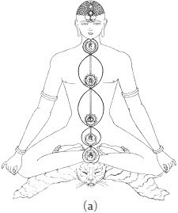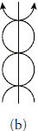

图 6。(a) 神秘主义的脉轮。(b) 驻波。(c) 赫尔墨斯之杖。(d) 显示相同能量的美索达米亚图像。(e) 阿斯克勒俄斯之杖。(f) 埃及蛇冠。

## 张三丰遗产

另一个与此相关的半历史人物是`Chang San Feng`。关于他的第一个引用来自十七世纪的学者`Huang Tsong-Hsi`为`Wang Cheng-nan`写的墓志文：“少林以武术闻名。然而，他们的艺术只强调进攻，这让对手可以利用之击中弱点。内家武术以静制动；一旦攻击者发生身体接触，就会被击倒。因此，少林被视为外家。内家武术起源于宋代的`Chang San Feng`，许多人他创立了内家——即将`nei-dan`（内丹）训练应用于武术。约翰的流派将他视为一位著名且非常成功的成员。在其他方面，`Chang San Feng`被某些人认为是太极的创始人，尽管他的遗产对太极的影响的影响是一个争议领域。我站出来说，我个人深信张三丰的内家武术确实影响了太极。”

约翰（John）坚持认为张三丰在成为道士之前曾是一位少林僧侣，这与 17 世纪学者黄培嘉（宗西之子）的说法非常契合，即：“张三丰虽是少林大师，但通过反其原理发展了内家拳。”53 对于武术历史学家来说，这是一个具有重大意义的区别，在我看来，这一点并没有得到充分强调，而且毫无疑问，道教学者会对此感到反感。另一个重要点是黄氏使用“静”一词来描述内家拳。他指的是阴能量。需要注意的是，内家拳并不一定像我们在西方所认为的那样是流动和规避的（因为所有运动本质上都是阳）。相反，在文中，黄氏是在约翰·张丰所使用的语境下指代“阴”，换句话说，是作为一种吸收能量并扭曲时空的“引力”。王成南的墓志文中提供了大量的间接证据，证明约翰的流派确实源自`Chang San Feng`。

在明代历史文献《明史范纪传》中，我们发现了对`Chang San Feng`的记载；他被描述为“身材高大，鹤鹤背”。54 显然，明朝第一位皇帝曾在 1392 年试图寻找他，但`Chang`不想被发现。七十年后（在明代文献《明览阴阳守考》中），我们再次提到了他。那位明朝皇帝成功了，因为`Chang`屈尊地见了他。55

其他的明代记载将张三丰（Chang Three Abundances）记录为北方辽宁义县。他被列为元末明初（公元 1368 年）的一位道教领袖，最终在武当山筑了一间草屋，致力于道教研究。56

是否存在过一位活了超过五个世纪的`Chang San Feng`？即便在五年前，我也会说这种说法纯属胡说八道。如今，对于此类问题，我甚至犹豫于发表意见。确实存在一位历史上的`Chang San Feng`（或几位）是不争疑问的。然而，他究竟是谁或是什么，我们无法得知。也许这只是每代人中某一个人冒充前任者的例子——这在世界历史上是一个相当常见的骗术。又或许他确实是一位永生不老的道教仙师。道教作家`Li Han-hsu` 在 1844 年出版一本名为《张三丰全集》的书时，声称他见过这个人。

如果他仍然活着，并拿这个作者开个玩笑，那该太棒了。我希望他真的生活在中国的某个山山里。

### 13. 以太的问题

从世纪交替时期，从麦克斯韦（Clerk Maxwell）和迈克尔·法拉第（Michael Faraday）发现电磁学开始，关于这种力量如何传播的争议困扰着科学家，当时他们仍在使用牛顿力学和物质实体。随着时间的推移，“场”的行为被理解，反之，“波”也得到了理解。随后所有的努力都集中在理解光的本质上，其中菲涅尔（Fresnel）关于光在一种称为光以太的物质中传播的理论最为流行（这种以太被认为静止在绝对空间中）。1887 年，著名的迈克尔森-莫利实验（Michelson-Morley experiment）证明了机械以太实际上并不存在。在十八年里，这一发现一直是辩论的中心，但尽管受到了当时一些最伟大科学家（如开尔文勋爵、亨德里克·洛伦兹和朱尔·亨利·庞加莱）的激烈反对，它最终被接受了。这个问题在 1905 年随着阿尔伯特·爱因斯坦（Albert Einstein）关于量子理论和相对论的著名论文得到了解决。然而，仍然存在旧以太理论的追随者——特别是洛伦兹和庞加莱，他们引入了一种模型，即钟在进入以太时会变慢。我相信他们接近真理。

### 14. 道教的根源

道教的根源可以追溯到大约三万年前席卷全球各地的萨满传统。57 “萨满”（shaman）一词来自西伯利亚的通古族（Tungus），他们居住在中国世界的最北边界。然而，认为萨满教作为一种信仰始于西伯利亚是错误的。根据考古记录，它的起源几乎肯定是在欧洲。58 萨满教第一个主要的世界宗教，从北欧跨越亚洲到达美洲大陆。迹象表明，它在公元前 11,000 年到 8,000 年之间通过亚洲进入北美。

萨满通过研究和了解自然来发挥作用，因此能够在各个层面上与自然接触。萨满教的核心信念是宇宙由两个平行且重叠的世界组成：物理世界和精神世界。我们物理世界的人可能受到精神世界的影响。因此，需要一个中介来与精神世界的居民交流，并为物理层面的居住者求情；这个中介就是萨满。精神世界的力量（可能是已故的人类或非人类起源）可以带来好运或厄运、疾病或繁荣。萨满通过入惚状态进入精神世界，在此期间，他与灵体交流并/或成为灵的传声筒。精神世界的主要指令通常是让人们遵循并理解自然之道；事实上，萨满教的宇宙观在建立方面迈出了第一步，即存在人类可以遵循以与世界和谐并避免疾病和灾难的方法。这种对自然世界的原始直接感和理解，正是萨满教传承给道教的。

中国古代的君主都是萨满。中国的第一位皇帝伏羲（Fu Hsi）据记载在公元 3000 年左右从灵体揭示了如何为人类带来文明。伏羲教导了他的民农业和文字等。他还是中国占卜术的守护神，因为他最初起源了八卦（pak’ua），这最终导致了《易经》（I Ching）的发展。传说八卦的秘密被刻在一只从黄河（River Ho）中跃出的马的身上，向伏羲展示了它；因此这种图案被称为河图（Ho-t’u），描述了万物的底层本质。有趣的是，一种动物向伏羲展示了宇宙运行的知识，而且伏羲经常被描绘穿着虎皮，并伴有龟等动物。没有比这更清晰的与萨满的联系了。

后世最伟大的巫师王之一，且尤其被道家视为道教传统创始人而备受推崇的是黄帝（`Huang Ti`），据记载他生活在公元前 2697 年至 2597 年之间。他被认为发明了政府管理制度和医学等领域。事实上，中国最著名的医学著作名为《黄帝内经》（尽管它可能写于公元前二世纪）。`Huang Ti` 还被传为烟囱、犁和丝织机的发明者，但他因对内、外丹的实验以及发现长生秘密而闻名。另一位巫师王是禹（`Yue`），他建立了夏朝（公元前 2205 年–1765 年）；据说他受天命带领他的子民。与他几个世纪前的祖先一样，禹王看到从水中浮出一只动物（在此例中是洛河的一只龟），其背上刻有八卦图案。这个图案被称为 `Lo-shu`（洛书），被称为后天八卦；而 `Ho-t’u`（河图）被称为先天八卦。`Ho-t’u` 描述了宇宙万物的理想秩序，而 `Lo-shu` 描述了流变与变化的秩序。可见，巫术为道教提供了一种自然法则与宇宙终极力量之间关系的感知，包括“变化无法被强迫或停止，只能被理解”的概念。“顺应而为”的思想既具有巫术色彩，也具有道教色彩；事实上，要在两者之间划定界限并指明一个传统从何结束、另一个从何开始是非常困难的。

圣人 `Kuo-pu` 在公元三世纪编写的《青龙经》（`Ch’ing-lung ching`, Classic Treatise on the Patterns of the Green Mountains）清晰地描述了万物从道生回归道的过程。这部著作反映了已存在千年的思想，并在八百年后的宋代得到了其他作者的证实。

作者开头写道：“混沌未开，虚无无形。”将此与古希腊神话（根据赫西俄德）地球产生于混沌（未成形的状态）或《旧约》进行对比。`Wu-chi`（无极）是原始的，是源头。它是万物与终极尚未区分的静止状态。在这种状态下，一点运动——纯阳之气闪耀而出（见图 7）。`yin` 与 `yang` 之间的相互导致了 `t’ai chi`（太极，至极）状态，此时阴阳相互拥抱，分离而统一，平衡彼此的力量。这就是老子所指的“一”，是“万物”（所有生命）之母。如果 `wu-chi` 是绝对的静止，`t’ai chi` 则具有变化的潜力。当 `t’ai chi` 静止时，阴阳统一；当 `t’ai chi` 运动时，两种对立的力量便分离。此中包含了长生的秘密。

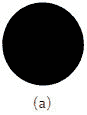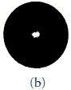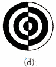

图 7. `Kuo-pu` 的阐述。(a) `Wu-chi`（无极），即道。(b) 和 (c) 静止中的运动之花；`yin` 中的 `yang`。(d) `T’ai chi`（太极）；阴阳拥抱并平衡。

人类在贪婪和无知过程中可能造成的破坏，一个历史性的例子是 19 世纪末美国对水牛的彻底灭绝。大多数人都知道，曾经漫步在草原上的巨大牛群被肆意屠杀，但没有多少人意识到这一过程完成得有多快，以及是由多少数人完成的。

1870 年，有两千万头水牛在草原上漫游；到 1889 年，即不到二十年后，只剩下一千头。从这一千头开始，经过细心的保护，在今天已经产生了一群二十万头的牛群。为什么水牛要被杀掉？消灭如此巨大的食物供应出于什么目的？

这很简单。没有人拥有它们。它们是自由的，可以在不产生任何利润的情况下养活国家的经济弱势群体。只要水牛还存在，牛大主和他们收买的政客就无法希望垄断全球肉类市场。这些人人已经确定草原非常适合养牛；因此他们让水牛消失。被屠杀的动物尸体作为食物没有用，因为在任何人得到它们之前，它们通常已经腐烂了；相反，它们被送到底特律的 `Michigan Carbon Works` 等工厂，在那里被压碎成肥料。为了上帝，竟然做成了肥料！

这仅仅是贪婪与无知如往常地联手合作的结果。在面对这种屠杀时，人们当时为什么什么都不做？也许他们不在乎。也许他们被告诉杀掉水牛无关紧要。也许他们认为水牛肉根本不值钱。

## 附录二

### 观察与推测

在此时，对所描述的现象进行真正学术性的讨论是不可能的，因为没有进行过任何临床试验。然而，我不禁对我在跟随 John 的过程中看到的事物进行推测，并在这个简短的附录中提供补充评论。相信有一天我们将理解赋予 John 力量的能量本质，这是令人兴奋的。正如师父反复所说的，`阳气` 和 `阴气` 支配着生命的方程式。我的一位学生曾嘲笑我对两者量化的伪科学尝试，认为 John 直接体验这些，因此不需要量化。他说的没错。尽管如此，师父可能不需要这种论述，但我们其他人确实需要。

### 阳气

乒乓球演示。这基本上是 John 将能量转移到左手持有的球中，同时在右手产生一个 `阴`。球闪烁着蓝光，同时发出类似于金丝雀鸣叫的声音。观察到一股蓝色的火花从球流向 John 的右手，本质上是一道微闪电。John 持续了五秒钟后停止了，感到疲惫。

X 射线衍射。在多年前的一次试验中，约翰和他的两名三级学生允许他们的田穴接受了正面、背部和侧面的 X 射线检查。约翰的田穴显示为一个扁坦的圆盘，而他学生的田穴显示出弯曲的球形迹象（也是平坦的）。

### 阴能量

念力。我曾在胶片中捕捉到约翰在几码外移动火柴盒的画面。他将左掌指向放在地板上的火柴盒，在手掌中产生了一股阴极。火柴盒在地板上滑动，伴有明显的加速度，最后停留在他的手中。

能量吸收。在两个不同的场合，约翰曾将阴能量传入我的身体。随后，我能够通过将手放在气步枪口上接住气步枪射出的子弹。这些实验使用了两种不同的气步枪。弹丸没有变形，在捕捉时既没有产生热量也没有产生冲击（第 7 章）。

### 阴阳能量

电产生。这是约翰的能力中最容易目睹的，但也最难量化。阴和阳之间的斥力带来了这种动态变化，因为这两种能量在常师福的田穴中被“挤”在一起。约翰每天常规使用这种能力通过针灸治疗患者，将这种能量传入传统的穴位。然而，使用交流和直流电压表及电流表进行的反复测试表明，其中既没有电流也没有电位；我的老师也无法让最低电压的直流灯泡产生灯丝发光（为了确保在试验期间确实传递了这种“电流”，作者充当了地线）。因此，虽然这种力量感觉像是电，但它绝对不是电。一个值得注意的特征是，产生的“电流”似乎并不遵循物理学的标准波形，而是由一系列峰值组成。我没有硬数据来量化这一说法，但在电产生过程中，我能在常师福体内感受到这种效应。也就是说，我感受到的印象是产生的能量并不遵循这种模式：

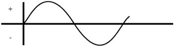

而是遵循这种模式：

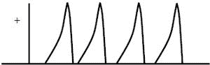

只有时间才能证明这一评估是否准确。

## 推测

### 阳能量

上述在第 7 章中描述的乒乓球演示很大程度上定义了阳气的本质，如果这种东西确实作为一种独立的能量形式存在的话。观察到的蓝色让人想起赖希（Reich）的有机能（orgone）；事实上，所描述的许多行为特征与其相似。使用空心、塑料、无缝球来完成演示的性至关重要：这表明我看到的不是一种表面现象，而是能量渗透了聚合物外壳，并在球内部发光，就像光在白炽灯泡中传播一样。这似乎表明阳气既不是粒子不是波，两者兼具。我相信它是储在我们地球大气中的太阳能。

阳能量是热的。它能够产生点燃效应，正如产热演示所示所示。此外，常师福的案例与赖希在治疗癌症时对有机能的观察存在着有趣的关联。赖希曾写道，癌细胞在放在有机能（bions）附近时会死亡。我的老师成功地使用过量的阳能量治疗癌症，称癌细胞在暴露于强阳气时会“干枯”。（尽管如此，我目前必须放弃对癌症患者所抱有的任何希望。正如约翰所说，他无法治愈癌症。到目前为止他进行了七次试验，成功率为 43%。虽然其中三个人被立即治愈并仍然活着，但另外四个人当场死亡，他们虚弱的身体无法承受能量的冲击。常师福不再尝试这种疗法。我写这段话是出于进一步的研究可能会引导我们找到方法。一旦我们理解了阳气，我们就能治愈癌症。）我相信赖希所说的有机能，我们魔派在过去的二五百多年里一直称之为阳气。

X 射线衍射现象也是一个有趣的点（我们知道是阳能量诱发了这种效应，是因为约翰的两个三级学生也印证了这一迹象）。X 射线衍射可能证明是我们能够关联并临床证明生物能量的方法。

### 阴能量

在目前，完全不可能清楚地了解阴气究竟是什么。如果所能解释的任何属性都能得到临床证明，那么我们将不得不修改热力学第一定律。涉及气步枪的演示在定义阴的特征方面最为精确：弹丸的能量没有守恒，没有变形，没有热量，没有冲击（动量守恒）。在最近的对话中，约翰将阴描述为“类似于引力，因为引力本身也是一种阴气”。我在文中多次大胆地提出观点，包括说明理解阴能量将赋予我们超越光速的秘密。让我在这个段落中再次用另一个简单的句子来说一遍：如果能量可以消失在虚无中，那么它也可以无中产生。想象一下这样的消息对能源行业将是多大的打击；他们可能会像疯狼一样防止这种信息流传，即使是作为空测。

在所描述的念力演示期间，约翰解释说他利用阴气将火柴盒引入手中。我相信这种念力期间发生的事情本质上是空间向他左掌方向的扭曲，就像引力井一样。换句话说，用一个简单的模型来说，发生的情况如图 8 所示。再次，这种评估是否准确尚有待观察。

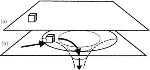

图 8。(a) 时空的虚构性表面。(b) 阴场——物体开始“坠落”。

### 阴阳能量

对于常师福展示的电产生能力，我能做出的最清晰的陈述是它绝对不是电子流的结果。如果是的话，电子运动可以被记录为某种电位或电流，约翰本可以让灯泡发光。然而，任何接触到这种能量的人都会发誓他感觉到电流流过身体。此外，这种能量可以完全通过导体（金属、水）传输，但不能通过绝缘体。如果这种电流不是由于电子流引起的，那么是什么导致了它？

我想在这一点再次进行一次猜测，并提出核振荡的增加可能是这种现象的原因。

几位研究人员（Kevran, Komaki, Pappas, Hillman, Goldfein)*62 认为，电诱导的核聚变（“冷”核聚变）体内随时发生，并且实际上可能是细胞内钠钾传输的动力。我非常仔细地选择了“传输”（transfer）一词。主流理论（被称为`钠钾泵`）提出了一种机制，通过在细胞内外进行钠和钾的交换，试图解释细胞膜的跨膜电位。然而，这一模型从未被验证，并令当今的研究者深感困惑。另一方面，生物冷核聚变理论的支持者认为，钠在细胞内通过核变变成了钾,*63，且该过程理上应被命名为`钠钾嬗变`（Transmutation）。当然，这个模型模型超出了今天物理学的接受范围。然而，考虑到所有因素，在我看来，提出张尚（John）的阴阳功能量可能是由于核激发态的增加导致的。这种能量以一系列脉冲的形式产生，并由太阳阳能量与阴气的“引力”或“暗物质”力之间的相互作用所诱导。正是这种增加的核激发（或聚变），让张尚的患者和学生感受到了电流。（我的观点与上述研究人员观点的区别在于，我不认为这种聚变是电诱导的。严格来说，它也不是“冷”的。）

你将会发现，如果我们再次从宏观的、天物理学的角度来看这些问题，这种假设是最符合逻辑的。我们目前的科学接受这样一个观点：如果不是因为核聚变作为一种扩张力的动力学，我们的太阳会在自身引力的作用下坍塌。事实上，描述恒星演化（生与死）的模型遵循图 9 所示的原型†64（未按比例绘制）！

### 恒星的战场

这意味着所有恒星都是引力与某种提供向外压力的力量之间的战场。在正常情况下，向外的力超过引力，太阳就会辐射能量（9a）。在白矮星中，当其“火”耗尽时，引力压力会导致恒星坍塌，形成一个密集的原子结构（9b）。中子星是质量达到两三倍太阳质量的恒星爆炸性死亡的结果，它更加紧密，其原子被压碎，原子核堆叠在一起（9c）。最后我们来看黑洞的情况，在那里空间和时间失去了所有意义，我们得到了奇点（9d）。

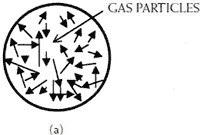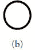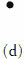

图 9。（a) 我们的太阳。它的半径为 140 万公里。(b) 白矮星；半径 10,000 公里。(c) 中子星；半径 60 公里。(d) 黑洞；半径 6 公里。

如果你看下方的现代太极符号，你会发现它准确地描绘了恒星在太阳功率峰值时的嬗变，例如一颗红巨星（大阳）爆炸性地转变为黑洞（小阴）。

### 太极模型

让我们再次使用古老的符号观察我们的宇宙的太极模型。到现在，它可能对你来说变得更有意义了：

一旦我们重新定义基本概念使其与原型一致，理解太极就会变得容易。让我们从引力开始。当大多数人想到引力时，他们想起的是高中中学到的基础知识：一个质量对另一个质量产生引力，正是这种引力将我们留在了行星表面。让我们把这个显而易见的真理更进一步，更精确地定义：引力是宇宙中那种想要所有物质坍塌成单一质量、并最终聚成一个奇点的力。也就是说，引力是那种试图将空间和时间压缩成一个巨大的黑洞的力！正是这种动力学吸收了能量并将其发送到虚无。引力正是张尚为了实现他壮丽的吸能演示而使用的内在阴气。（然而，我必须重申，虽然引力是一种阴气，但阴场并不限于引力。还有其他方面。）

另一方面，太阳火是定义空间和时间并使其存在的扩张力。西方科学将这种太阳力称为核聚变。中国的古代学者称之为阳气。它们是同一的。从宏观尺度来看，引力和太阳火（阴和阳）力量之间的战斗定义了现实的本质。从微观尺度来看，它们的相互作用驱动了我们的生命力。（逻辑上可以假设，如果这种竞争构成了我们宇宙的基本自然状态，那么我们的身体和生命力就会反映这一点。对黑洞和红巨星一无所知的古代中国人，通过其他方法经历并推断出了这种斗争。）

虽然一个支配这种行为的真实方程在本质上是分形的，但我们可以用简化的数学形式表述太极的平衡：

其中 `yin` 定义了阴气的性质，`yang` 定义了阳气的性质，`K` 是常数。（时间，`t` 不适用于阴的定义，因为

## 注释

*1. 鲁德亚·金普林，《东方与西方的叙事诗》，1889 年。

*2. 亨伯特·本森，《放松反应》（The Relaxation Response），纽约 William and Co., 1975。

*3. 源自希腊语 ortho——为正确的、适当的、直的——以及“逻辑”（logic）。Orthological 意为“具有正确的逻辑”。

†4. 恩和劳伦斯·布莱尔，《火环》（Ring of Fire: East of Krakatoa），1988。

*5. 在那一点与他的身体接触就像把手伸进插座。由于缺乏更好的术语，我将这种能力称为电发生（electrogenesis）。

*6. 百英百科全书在线，“道教”。

*7. 原始拉丁语 religare 意为“牢牢连接”，暗示与神性的结合；因此在概念上它更接近梵文 yoga（英语单词 yoke 的词源），而不是“宗教”（religion）一词现在所含义的“重新连接”的概念。

*8. 或者相反，存在的意义仅仅是痛苦、轮回（samsara），人类应该从中逃脱。我的意图并不是要详述犹太教基督教；我只是想让这一部分尽可能简洁。

*9. 我希望本文能这类研究做出贡献。

†10. 值得注意的是，拉丁语 spiritus 也意为“呼吸”，而我们人体呼吸器官（肺）的希腊语单词是 pneumon（例如肺炎 pneumonia 的一词就源于此）。

*11. 武器学家（hoplologist）是研究武器及其历史使用的考古学家或历史学家。

*12. Donn F. Draeger 和 Robert W. Smith，《亚洲武术》（Comprehensive Asian Fighting Arts），东京和纽约: Kodansha, 1980。

*13. 该术语实际含义是“父师”，但在西方广泛使用“大师”（master）作为翻译。

## References

- *14. `大英百科全书在线`，“宗教道教”。

- †15. Blofield, John, `道教：长生之路` (Boston: Shambhala Publications, 1978).

- *16. 当我开始研究道教文献时，我惊讶地发现许多概念与我家乡希腊的民间信仰如此相似。在与新女朋友陷入一段热烈的恋情后，随后神神恍惚地去教我的柔术课时，班里年纪最大的男人建议我“不要流失太多精子，否则你会开始流失骨髓”。

- *17. 我了解海豚的自然本能和生殖周期，供那些认为自己犯了失体的读者参考。

- *18. 事实并非如此！《功夫》原剧系列可以称是艺术模仿生活的例子；主角是一个佛教徒而非道教道士，而且他杀掉的是皇帝的儿子，而不是整个村子。

- *19. 墨子学派。

- †20. 我用“道教”一词代替更贴切的中国本土哲学。

- *21. 我见过这样一个例子：一个承包商对出土的罗马马赛克画非常着迷，以至于将其作为建筑正门的一部分，在此过程中牺牲了整个公寓的面积。真为他感到高兴！虽然花了他了一笔钱，但他证明了自己是一个文化人。

- *22. 实际上，它与其说是现代大学，不如说更像是亚历山大意义上的图书馆或学院。

- *23. 手道柯（Handoko）出现在这本书的每一场深度对话中；只是出于权宜之量，我才删除了他的贡献。许多主要的哲学观点都是手道柯对常世富对我（以及其他人）用中文讲述内容的翻译。

- *24. 对于海外华人来说，财富和教育是紧密的；我们在西方那种受过良好教育的中产阶级概念并不普及。

- *25. 许多研究者假设存在一种未知力量来解释火术，因为李德弗罗斯效应和热传导定律本身似乎是不够的。

- *26. 字面意思是“祖父老师”。

- *27. 这个梵语词意思是“结果”或“行为”。

- *28. 尽管有相关的语言和环境证据支持。

- *29. “Orang putih”翻译为“白人”。

- *30. 既然知道克里斯（keris）的名字就意味着拥有它的控制权，我更改了武器的名字以保护它。

- *31. 见引言和第一章。

- *32. Capra, Fritjof, `物理道道` (New York: Bantam New Age Books, 1977).

- *33. 爱因斯坦、普朗克、波尔、海森堡、薛定谔、泡利、狄拉克以及（此处原文不完整）路易·德布罗意。

- *34. 假设存在大爆炸。中国模型也涵盖能量不断产生的可能性，宇宙没有开始也没有结束。

- †35. 有趣的是，当庞加莱假设钟在进入以太时随时间变慢时，他描述的是阴能量的属性之一。

- *36. 确实，我相信像光子一样，“气”既不是粒子也不是波，二者皆是。

- *37. 以其对非平衡统计力学的贡献以及关于时间在不可逆过程中作用的理论而闻名。

- *38. 较新的图表是炼金术性的，描述了能量随时间的变化和流动，而非稳态。目前的恒星演化模型帮助我们理解这一点。恒星生长到巨星阶段并随后变为黑洞，暗示了从大阳到阴的转变。进一步分析见附录 2。

- *39. Meadows, Dennis L. 等，`增长的` (New York: Signet Books, The New American Library, 1972).

- *40. Arthur C. Clarke，面向年轻读者。

- *41. 除了涉及的个人经历外，本文没有任何内容应被认为是创新的。早在 1934 年，埃文斯韦泽教授在《西藏瑜伽与秘密》书中就谈论过一种既非东方也非西方的科学。

[Kosta Danaos 是一位专业工程师，一位丰富的柔术、功夫和太极拳武术教练，也是一位自由撰稿人。他住在希腊雅典。](http://store.innertraditions.com/Contributor.jmdx?action=displayDetail&id=332)

# 关于 Inner Traditions • Bear & Company

Inner Traditions 成立于 1975 年，是一家领先的出版商，涵盖了本土文化、永恒哲学、远见艺术、东西方精神传统、性、整体健康与疗愈、自我发展，以及民族音乐录音和冥想配乐。

2000 年 7 月，Bear & Company 与 Inner Traditions 合并，并从其 1980 年创立地的新墨西哥州圣塔菲迁至佛佛蒙特州罗彻斯特。Inner Traditions • Bear & Company 共同拥有 11 个品牌：Inner Traditions、Bear & Company、Healing Arts Press、Destiny Books、Park Street Press、Bindu Books、Bear Cub Books、Destiny Recordings、Destiny Audio Editions、Inner Traditions en Español 以及 Inner Traditions India。

欲了解更多信息或浏览我们一千多部在售书籍，请访问`www.InnerTraditions.com`。

## 相关兴趣书籍

- 内功 (Nei Kung)

- Kosta Danaos 著，《战士圣贤的秘密教导》

- Kostas Dervenis 和 Nektarios Lykiardopoulos 著，《古希腊武术：亚历山大时代的现代战斗技术》

- Ross Heaven 著，《忍者的精神修行：掌握自由之四门》

- Stuart Alve Olson 著，《道家仙人的气功教程：李清云大师八基本功》

- Stuart Alve Olson 著，《玉帝心经：道家健康、长寿与长生指南》

- Mantak Chia 著，《铁衫气功》

- Mantak Chia 著，《骨髓内功：活血活骨道家术》

- Pascal Fauliot 著，《武术教学中的力量与悖论：释放心灵、聚气与掌控自我》

## 联系信息

Inner Traditions • Bear & Company

P.O. Box 388

Rochester, VT 05767

1-800-246-8648

[www.InnerTraditions.com](http://www.InnerTraditions.com)

或联系您的当地书商

Inner Traditions International

One Park Street

Rochester, Vermont 05767

[www.InnerTraditions.com](http://www.InnerTraditions.com)

版权所有 © 2000 Kosta Danaos

保留所有权利。未经出版者书面许可，不得以任何形式或手段（电子或机械，包括复印、录音或信息存储和检索系统）复制或利用本书的任何部分。

## 美国国会图书数据

Danaos, Kosta

爪哇答巫师：真正的道家仙人的教导 / Kosta Danaos。

p. cm.

包含参考文献。

eISBN-13: 978-1-59477-877-3

1. Chang, John. 2. 道士—印度尼西亚—爪哇达—传记。 3. 治疗者—印度尼西亚—爪哇达—传记。 I. 标题。

BL1940.C426 D36 2000

299’.514’092—dc21

[B]

00-036942

## 电子版制作：

`ePubNow!`

[www.epubnow.com](http://www.epubnow.com)

[www.digitalmediainitiatives.com](http://www.digitalmediainitiatives.com)
