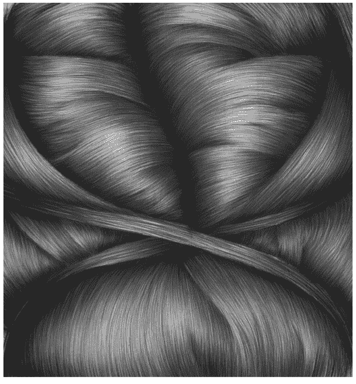
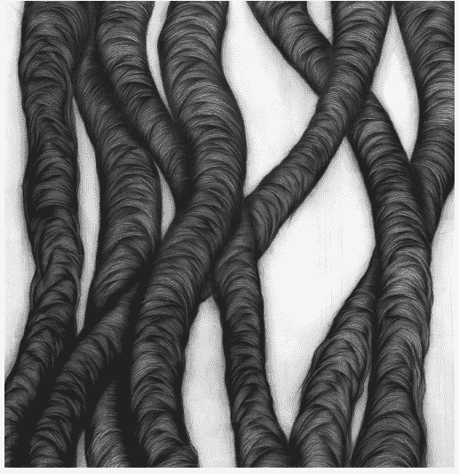
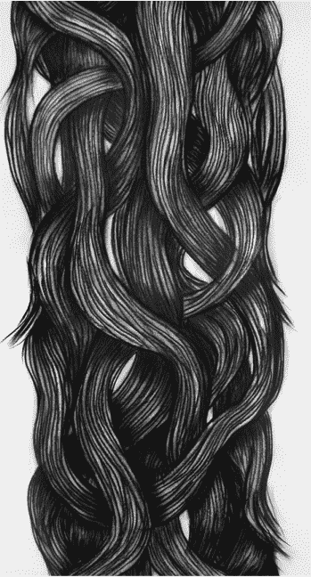
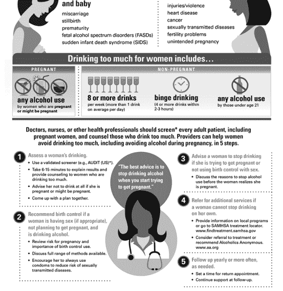

# 终极问题

## 关于作者

> 怀着希望，我们继续前行
>
> 带着对新来者的爱
>
> 以及他们那美丽的喧闹：
>
> Atlas
>
> Ella 和 Maya
>
> Isaac 和 Martin
>
> 伯克利
>
> Brooke, Dylan, 和 Solomon，
>
> Daisy 和 Jake；
>
> 并感谢读者
>
> 以及那些反叛者们

## 引言

本书中最长、最新的一篇随笔是关于沉默的。我开始写它时，认为我是在写女性被沉默的各种方式。我很快意识到，男人被沉默的方式也是我主题不可分割的一部分，而且我们每个人都存在于多种沉默的复合体中，包括我们所谓的“性别角色”的互惠沉默。这是一本女性主义书籍，但它不仅仅关乎女性的经历，而是关于我们所有人——男性、女性、孩子，以及那些挑战性别二元法和边界的人。

本书涉及了狂热的女性主义男性，也涉及了连环强奸犯，它的写作是基于一种认知：所有类别都是流动的，我们必须临时地使用它们。它关注了快速的社会变化，这些变化不仅仅是在改变法律。它正在改变我们对知情、权力、权利、性别、声音和代表性的理解。这是一场华丽的变革运动，特别是由年轻人领导的，在校园、在社交媒体、街头，我对这群无畏且毫无歉意的新一代女性主义者和人权活动家充满了由大的钦佩。同样，我也对这种反弹感到恐惧，这种反弹本身就证明了女性主义作为更广泛的解放计划的一部分，对男权主义和现状所构成的威胁。

本书是一场穿过杀戮的之旅，是对解放与团结、洞察与同情的颂歌，也是对我们可能探索所有这一切时所使用的术语和工具的调查。

## 终极问题 (2015)

几年前，我做了一场关于弗吉尼亚·伍夫（Virginia Woolf）的演讲。在随后的提问环节，似乎许多人感兴趣的话题是伍夫是否应该生孩子。我尽职地回答了这个问题，指出伍夫显然在看到她的姐姐瓦内莎·贝尔（Vanessa Bell）享受为人母的快乐后，考虑过在婚姻早期生孩子。但随着时间的推移，伍夫开始认为生育是不明智的，也许是因为她自己的心理不稳定。或者，我提议道，她是想成为一名作家，将生命献给艺术，而她对此取得了巨大的成功。在演讲中，我赞同地引用了她对杀掉“家中的天使”（the Angel in the House）的描述，那是告诉许多女性要做家庭内务和男性自尊的自我牺牲的女仆的内在声音。我很惊讶，主张扼杀传统女性气质的精神竟然会导致这种对话。

我本应该对观众说的是，我们对伍夫生育状态的质问，是偏离她作品所提出的宏大问题的一场催眠且毫无意义的绕行。（我想在某个时刻，我心里想：“去他的这鬼”，这传达了同样的大意，并让大家都离开了讨论。）毕竟，许多人人都生了孩子；但只有一个人写了《灯塔》和《三本金尼亚斯》，我们讨论伍夫是因为后者。

原本应该是关于我写的一本政治书的提问，那个采访我的英国男人坚持认为，我们不应该谈论我思想的产物，而应该谈论我的肉体果实，或者说缺乏果实。在舞台上，他纠缠我为什么没有孩子。我给出的任何回答都没有让他满意。他的立场似乎是我必须生孩子，我不生孩子是不可理喻的，因此必须谈谈我为什么不生。当我下台时，我出版社的公关——身材瘦小，穿着粉色芭蕾舞鞋并戴着婚戒指——正在愤怒地嚎叫。“他绝不会那样问一个男人的，”她唾了一道。她是对的。

关于如何成为一个女性的很好的回答是：艺术或许在于我们如何拒绝这个问题。

我们谈论的是开放式问题，但也有封闭式问题，对于提问者来说，这些问题只有一个正确答案。这些问题迫使你进入群体，或者在你由于你偏离群体时对你挑剔；这些问题包含了自身的答案，其目的是为了强制和惩罚。我人生的目标之一是成为一个真正的“拉比式”（rabbinical），至少能记住一种良好的“守门人式入侵者”处理方式，并说：“你为什么要问这个？我发现，这对于一个不友好的问题永远是一个很好的回答，而封闭式问题往往是不友好的。”但在我分生孩子的审问之日，我措手不及（而且深受时差之苦），于是我不禁在想：为什么这些糟糕的问题会如此出乎意料地被问出来？

也许问题的一部分在于，我们学会了向自己提问错误的问题。我们的文化沉浸在一种流行心理学，其痴迷的问题是：你快乐吗？我们这样提问，以至于似乎一个拥有时光机的药剂师能给布姆斯伯里送去一辈子的抗抑郁药是很自然的，这样一位无与伦比的女性主义造型师就能被重新引入，产出一胎伍尔夫式的婴儿。

关于快乐的问题通常假设我们知道快乐的生活是什么样的。快乐通常被描述为排了一排整齐的鸭子——配偶、后代、私有财产、性爱体验——尽管仅仅一毫钟的意志就能带给我们无数拥有了所有这些却仍然很痛苦的人。

我们不断地被给予各种一刀切的公式，但这些公式往往失败了，而且失败得很惨烈。尽管如此，我们仍然被给予它们。一遍又一遍又一遍。它们变成了监狱和惩罚；想象的监狱将许多人困在一个与配方完全契合却完全痛苦的生活监狱中。

这个问题可能是一个文学上的问题：我们被赋予了一个关于什么是好生活的单一故事情节，尽管有不少遵循这条故事情节的人过着糟糕的生活。我们说话的语气好像只有一个带有完美结局的单一好剧本，而生活可以采取的千千万万种形式正在我们周围绽放——又凋零。

即使是那些过出了熟悉故事的最佳版本的人，也可能没有获得快乐作为回报。这并不一定是一件坏事。我认识一个相爱结婚七十年的女性。她过了长而有意义的生活，按照自己的原则生活，并受到后裔的爱和尊重。但我不会说她是快乐的；她对未来的怜悯和关注赋予了她回应式的世界观。她所拥有的而非快乐，需要更好的语言来描述。好生活有完全不同的标准，这些可能对一个人更为重要——爱与被爱，或者拥有满足感、荣誉、意义、深度、投入、希望。

作为一名作家，我的努力之一是寻找发现那些难以捉摸和被忽视的事物，描述意义的细微差别和层次，庆祝公共生活和孤独生活，并且——用约翰·伯杰的话——找到“另一种讲述方式”，因为被旧的讲述方式所吞噬是令人沮丧的。

保守派所谓的“捍卫婚姻”实际上无非是对旧等级制度的捍卫——即在女性主义者开始改革它之前的直系婚姻。遗憾的是，这并不仅仅是保守派的专利。这个社会有太多的很多人深信一种虔诚的信念，认为异性双父母家庭对孩子来说有着神奇且了不起的东西，这导致许多人留在痛苦的婚姻中，这种婚姻对范围内的每个人都是破坏性的。我认识一些人一直迟于离开糟糕的婚姻，因为旧的配方坚持认为对一方或双方父母都很糟糕的处境对孩子是有益的。即使是那些有暴虐配偶的女性，也经常被劝留在那些本该是绝对完美的处境中，以至于细节并不重要。形式胜过了内容。然而，我一次又一次地看到了离婚的快乐以及快乐家庭可以采取的千千万种形式，从一个父母一个孩子，到无数形式的多重家庭和大家庭。

问题，一种我们可以忽视宽广生活的方式，我们的工作能多有效，以及我们的爱能多远。

在幸福问题的核心存在着悖论。乔治·梅森大学的心理学教授托德·卡什丹（Todd Kashdan）几年前报告了几项研究，这些研究得出结论：认为幸福很重要的人更容易变得抑郁：“围绕着努力变得幸福来组织生活，将幸福作为生活的首要目标，反而阻碍了幸福的实现。”

我在英国最终拥有了我的“拉比时刻”。在时差消除后，我接受了一个有着圆润、洪亮口音的女性在舞台上的采访。“所以，”她充满兴奋地说道，“你被人性伤害了，并逃到了旷野寻求庇护。”这里的意言而喻是：我是一个被展示的极其可怜的样本，是群群中的离群者。我转向观众问：“你们中有人也曾被人性伤害过吗？”他们和我一起大笑起来；在那一刻，我们知道我们都是怪异的，我们同舟共济，而且在处理自身痛苦的同时学习不将其施加于他人，是我们所有人聚在这里要完成的工作的一部分。爱也是如此，它以许多形式出现，并指向许多事物。生活中有很多值得追问的问题，但也许如果我们足够明智，就能理解为并不是每个问题都需要答案。

> “我最遗憾的是我的沉默……有太多的沉默等待被打破。”
>
> —奥德雷·洛德（Audre Lorde）

沉默是金，至少我小时候是是这么对我说的。后来，一切都改变了。沉默等于死亡，那些反抗艾滋病忽视和压迫的酷恋活动家们在街头寻求这个。沉默是未说之、不可言之、受压之、未被听见的海洋。它包围着由那些允许说话的人、可以说的话以及倾听者组成的零散岛屿。沉默以许多方式出于许多原因发生；我们每个人都有自己的未尽之语的海。

英语充满了重叠的词汇，但为了本文的目的，请将“沉默”视为被强加的，将“安静”视为被追求的。一个安静地方的宁静、内心的宁静、远离辞藻与喧嚣的隐退，在声学上与恐吓或压迫的沉默相似，但在心理和政治上是完全不同的。由于某种原因而未说的，与因为威胁太高或障碍如从溺水中游泳一样巨大而不说的是完全不同的。安静之于噪音，正如沉默之于交流。倾听者的安静为他人的发言留出了空间，就像读者吸收纸面上的文字，就像白纸吸收墨水。

> “我们是火山，”乌苏拉·K·勒古因（Ursula K. Le Guin）评论道。“当我们女性把自己的经验作为真理提供时，所有的地图都改变了。海底火山在开水中喷发出新的声音，新的岛屿诞生了；这是一项狂热且惊人的事业。世界改变了。沉默让人们在无处诉说的情况下遭受苦，让虚伪和谎言生长繁盛。如果我们的声音是我们人性的本质方面，那么被剥夺声音意味着去人性化或被排除在人性之外。而沉默的历史是女性历史的核心。

言语将我们聚集在一起，沉默将我们分开，让我们失去了言语可以寻求或引发帮助、团结或仅仅是交流。某些种类的树木在地下扩散根系连接着各个树干，将单棵树编织成一个更稳定的整体，不会轻易被风吹倒。故事和对话就像这些根。一个世纪以来，人类对压力和危险的反应被定义为“战斗或逃跑”。2000年加州洛杉矶分校的几位心理学家注意到，这项研究主要基于对雄性鼠和人类的研究。但对女性的研究让他们发现了第三种、通常被使用的选择：聚在一起寻求团结、支持和建议。他们注意到，“在行为上，女性的反应具有更明显的‘照顾与结友（tend-and-bef）’模式。照顾涉及旨在保护自我和后代的滋养活动，能促进安全并减轻痛苦；结友则是建立和维护可能辅助这一过程的社交网络。”

这很大一部分是通过言语、通过讲述自己的困境、通过被听见、通过你所照顾和结交的人给予的同情和理解来完成的。不仅是女性这样做，也许女性现在正在帮助我，既然我已经有了应对方式，或者说我现在有了一个社区在帮助我。

无法倾听你的故事是一种活着的死，有时也是上面上的死。当你说前夫正试图杀你时，没有人听见；当你说你在痛苦时，没有人相信；当没有人听见你说救命时；如果你没说救命，如果你被训练成不要通过说救命来打扰别人。如果你在会议上发言时被认为不合规，不被权力机构接纳，遭受无关的批评（其批评的子集是“女性不该在这里”），不应该在这里或不被听见。故事拯救了你的生命。故事就是你的生命。我们是由故事构成的，故事既可以是监狱，也可以是打破监狱之门的撬棍；我们创造故事是为了拯救自己，或为了困住自己或他人，故事提升了我们或击碎了我们。解放总是一个故事的过程：一个自由的人讲述她的故事。针对女性的暴力往往针对我们的声音，以及声音的含义：自决权、参与权、作为一个自由人体验并被体验的权利。通过声音，我指的是字面的声音——在他人耳朵中由声带产生的声音——但是发声、参与、作为一个拥有权利的自由人体验并被体验的能力。这包括不说话的权利，无论是像政治犯那样拒绝酷刑逼供的权利，还是不被接近你的陌生人的预期，正如某些男性对待年轻女性那样，要求关注和奉承并惩罚她们的缺席。

演讲、词语、声音，有时当它们带来包容、认可、抵消去人性化的再人性化时，本身会改变某些事物。有时它们只是改变规则、法律、政权以带来正义和自由的先决条件。有时仅仅能够被听见、被相信，就是成为家庭、社区、社会成员的关键部分。有时我们打破了这些东西；有时那些东西就是监狱。然后通过“可言说性”，不被社会容忍的事物变得不可忍。那些未受影响的人未能看到或感受到隔离、警察暴政或家庭暴力的影响：故事将麻烦带入家中，使其变得不可避免。

谁曾未被听见？海洋广阔，海面是无法绘制的。我们知道大多数时候，官方主题是如何被听见的：在过去的几个世纪里，谁担任职务、上大学、指挥军队、担任法官和陪审员、写书以及经营帝国。我们知道由于无数的革命，它发生了某种程度的变化。

二十世纪及以后——反抗殖民主义，反对种族主义，反对女性厌恶，反对无数被强加的沉默、同性恋恐惧带来的沉默，以及许多等等。我们知道，在美国，阶级在二十世纪某种程度上得到了平缓，随后在世纪末通过收入不平等、社会流动性的枯竭以及一种新型极端精英阶层的兴起而再次强化。贫困导致沉默。

我们知道谁被听见了；他们是那些地图清晰的岛屿，而其余则是未命名的、失声的海洋、未开发的历史。几个世纪以来，许多人曾被听见并被爱，他们的话语一说出口就消失在空气中，却根植于脑海，对文化做出贡献，就像腐化成肥沃土壤一样；新事物从话语中生长出来。许多其他人被沉默了、被排斥、被忽视。大地是百分之七十的水，但沉默与声音的比例要大得多。如果图书馆收藏了所有被讲述的故事，那么还有所有未被讲述的“幽灵图书馆”。幽魂的数量以难以想象的数字多于书籍。即使是那些发出过声音的人，也往往是通过策略性的沉默或无法听见声音（包括他们自己的声音）来获得这种特权的。

解放斗争在某种程度上是为了为曾经被沉默的人创造能够说话并被听见的条件。一位英国人告诉我，英国监狱中老年人的数量正在增加，因为以前没人愿意听他们的无数受害者现在正在讲述性侵犯的经历。英国最臭昭著的案例是 BBC 艺人吉米·萨维尔（Jimmy Savile），他曾被封为爵士、备受赞誉并成为名人。他在去世前，有450多人被指控性侵犯，其中大部分是年轻女性，也有较小的男孩和成年女性。四百五十个人没有被听见，他们可能并不认为自己有权利发声，甚至没有权利反对或被相信。或者说，他们知道自己缺乏那些权利，他们是无声的。

约翰·李登（John Lydon），作为性手枪乐队的“腐烂约翰”（Johnny Rotten），在1978年向 BBC 谈及萨维尔时：“我打赌他参与了我们所知道但被禁止谈论的各种恶行。我知道一些传闻。但关于他的传闻不会被传出去。”李登的话直到2013 年未剪辑的采访发布后才传出。大约那时，其他涉及英国知名政客的恋童集团的消息浮出水面。许多犯罪在很久以前就已经发生了。据报道，某些犯罪导致了儿童受害者的死亡。

涉及公众人物的丑闻提供了国家和国际版本的素材，而这在其他通常只是关于谁的故事将占据主导地位的小规模地方性剧。它们往往是舆论风向转变的方式，因为它们引发了对话。有时，它们为其他人站出来讲述其他伤害和其他施加者奠定了基础。最近，这已经演变成一个利用社交媒体创建集体审判、掩盖证词和相互支持的过程，这可以被看作上述概述的“趋亲并结伴”行为的一种形式。

沉默让掠食者在几十年里肆意妄为，不受约束。这些显赫男士的声音吞噬了他人的声音，使其化为虚无，这是一种叙事上的同人吃。他们让受害者失去了拒绝的能力，并遭受了不可置信的故事的折磨。不可置信意味着拥有权力的人不想知道、不想听见、不想相信，不想让他们拥有声音。人们因未被听见而遭受痛苦。然后，事情发生了变化。

同样的故事也可以发生在无数北美人物身上，其中最近的例子包括：福克斯新闻首席执行官罗杰·艾尔斯（Roger Ailes），他被多名女性指控半个世纪的职场性骚扰、迫害、剥削、勒索和心理虐待；比尔·柯斯比（Bill Cosby）在同一时期进行的一系列药物辅助强奸；以及加拿大的简·格霍梅希（Jian Ghomeshi），他被多名女性指控残暴攻击——这些权人物知道他们的声音和信誉可以淹没被他们攻击过的人，直到某些东西被打破了，直到沉默被打破，一片海洋的故事奔涌而出，冲走了他们的逍罪之罚。即使在证据如山的情况下，某些人仍然对受害者施加虐待和威胁，并否认他们故事的真实价值。因为相信他们意味着对基础性假设的质疑。这会令人不舒服，而许多人将舒适视为一种权利，尤其是当——那种舒适是建立在他人的痛苦和沉默之上时。

如果说话的权利、拥有信誉被听见是一种财富，那么这种财富现在正在重新分配。长期以来，一直有一个拥有声音和信誉的精英阶层，和一个无声的底层阶级。随着财富的重新分配，精英阶层震惊的困惑一次又一次爆发，这是一种愤怒和不相信：这个女人或孩子竟然敢发声，人们竟然愿意相信她，她的声音是有价值的，她的真相可能会终结一个权者的统治。这些声音被听见后，颠覆了权力关系。一名酒店清洁工开启了国际货币基金组织主席、连环性侵犯者多米尼克·斯特劳索斯-康恩（Dominique Strauss-Kahn）职业的终结。女性结束了许多领域之星的职业——或者说，那些明星通过他们所参与的行为摧毁了自己，因为他们相信那种随着受害者无力而而来的逍罪感。许多人曾逍罪了多年，有些人甚至是一了一生；现在许多人发现自己已经不再如此了。

谁被听见，谁不被听见，定义了现状。那些体现现状（往往以自身付出非凡的沉默为代价）走向中心；那些体现未被听见或违背那些在沉默中崛起的人的人被驱逐。通过重新定义谁的声音有价值，我们精炼了社会及其价值观。

我在书中探讨的主题是针对女性的特定沉默和沉默化的亚类，如果某些东西可以针对超过一半的人类具有特定性。如果拥有声音、被允许说话、被听见并被相信是成为内部人士或权力人物、具有完全成员身份的人所必需的，那么承认沉默是压迫的普遍状态是非常重要的，而且存在多种沉默和多种被沉默的人。

“女性”这一类别是一条长街，与许多其他街道相交，包括阶级、种族。走这条街道意味着跨越其他道路，包括贫困和财富。现在审视男性和女性的分类是有用的，但同样需要记住女性厌恶基于对这些类别的虔信信念（或者说是为了强化这些类别）。种族灭绝是一种巨大的沉默，奴隶制也是。美国女性主义正诞生于反对奴隶制，诞生在1840年参加伦敦世界废奴隶大会时，却发现自己无法获得座位，无法发言。

第一位女性于1950年入学。在许多全球权力联盟汇的常春藤盟大学中，女性曾被排除在本科招生范围之外。耶鲁大学第一位女本科生于1969年入学。女性所受到的对待是如此敌视，以至于1977年，美国第一起针对教授校园性骚扰和强奸的《第九修正案》诉讼——亚历山大诉耶鲁大学——被提起。它建立了一个先例，要求全美的校园都要将这些虐待行为视为歧视予以处理（但改变并不多：三十九年后，即2016年夏天，169位哲学家签署了一封信，谴耶鲁教授托马斯·波格（Thomas Pogge）二十七起性骚扰事件，他的专长是伦理领域）。

# 新的认可需要新的语言

女性主义创造了大量词汇来描述 20 世纪 60 和 70 年代的对话开始从隐藏中揭露出来的个人经历。苏珊·布朗米勒（Susan Brownmiller）在 1975 年创造了“约会强奸”（date rape）一词。“性骚扰”（sexual harassment）一词由玛丽·罗（Mary Rowe）于 1974 年创造，描述麻省理工学院（MIT）的不当行为；或是由一组女性在 1975 年在康奈尔大学针对同一问题所提出的。传奇律师凯瑟琳·麦金农（Catherine MacKinnon）通过她 1979 年的著作《职场女性性骚扰》（Sexual Harassment of Working Women）推进了这一概念。该术语及其背后的概念直到 1991 年克伦斯-安塔·希尔（Clarence–Anita Hill）听证会后才广为人知。1993 年，俄克拉荷马州和北卡罗来纳州成为最后一个将强奸配偶定为犯罪的州。对自己身体缺乏管辖权是沉默的形式，一种让人的言语毫无价值的方式，而没有价值的话语比沉默更糟：人们会因此受到惩罚。

## 父权下的沉默

在父权下，沉默无处不在，尽管它对男性要求的沉默与女性不同。你可以将对性别的管视想象为建立互惠联盟，并开始将男性的沉默认知为权力和成员身份的交换。没有人比贝尔·胡克斯（bell hooks）说得更透彻了，她说：

> 父权对男性要求的首种暴力行为并非针对女性的暴力。相反，父权要求所有男性进行心理上的自残，他们杀死了自己的情感部分。如果一个个人没有在情感上成功地自我毁灭，他就可以指望父权制的男性执行权力仪式，这些仪式会攻击他的自尊心。

也就是说，父权要求男性首先保持沉默（而且可能）值得再次注意的是，尽管父权是一个特权男性和男性气质的系统，但许多女性是其中的共犯，一些男性对其进行反抗，而另一些人正在打破产生这一体系的性别规则。这意味着不仅学会不对他人保持沉默，也要对自己保持沉默，关于他们内心生活和自我的方面。

读到胡克斯的这段话，我感到寒意，仿佛突然意识到这是恐怖片或僵尸电影的情节。那些麻木的人寻找活者以消灭情感，要么通过让目标加入他们的麻木状态，要么通过恐吓或攻击他们使其沉默。在沉默的版图中，可能有三个领域：从内在强加的沉默；从外强加的沉默；以及存在于尚未被命名、承认、描述或认可的事物周围的沉默。但它们并非孤立；它们相互滋养；不可言说的会变得不可知，反之亦然，直到某种东西被打破。

某种情感的完整是获得权力的代价，而这种放弃开始得很早。在我在他满五岁前夕，我尽可能中立地询问一个侄子为什么粉色不再是他喜爱的颜色之一时，他清楚地知道我们在谈论什么：“我喜欢女孩。我只是不喜欢‘女孩的东西’，”他大喊道，我知道什么是“女孩的东西”，而他不会让这些东西定义他。事实上，他已经鄙视这些东西，并将其引入对《我的小马宝贝》（My Little Pony）的痛斥。

当我为朋友未出生的儿子购物时，我觉得五岁就开始接受这种轰炸太早了，并被提醒我们的角色从出生起就锁定了。女孩获得可爱的、漂亮的、吸引力的，也许是被动的：温暖的色彩、小猫、花朵和装饰。男孩获得距离感：冷色调和活跃的形象，通常是具有威胁性的，或是远离亲密和情感的——运动、火球、球棒、火箭、冷血动物如爬行动物、恐龙和鲨鱼，这些对于依赖抚养的哺乳动物来说是奇特的选择。

男性气质是一种巨大的牺牲。粉色是一件小事，但情感、表现力、接受性，整系列可能性在日常生活中被成功的男孩和男性获得，而且对于男性来说，男性气质本身过去和现在都可以质疑一种文化——涵盖了从变装皇后到审美化的超男性气质的光谱，而在这种文化中，男性将自己识别为男性凝视的对象。在此之下存在着一种感觉：所有身份都是你穿上的戏装，并且存在关于你想成为谁的自由度。当然，每一类人类中的每个人都有权变得糟糕，而取向事实本身（无论种族、阶级、宗教还是性别）并不一定会产生解放宣言或洞察；我指的不是所有同性恋男性，而是我自己的朋友和群体。

在异性恋主流中，女性长期以来承担着为他人持有和表达情感的工作。当我很年轻时，我和男朋友去公路自游，他的父亲送走我们时说：“保持联系。你妈妈会担心的。”她拥有那些可以被认可的情绪。她是那个用闲谈填充房子沉默的人，以便在一个充满善意但封闭的家里保持开放。

## 强制控制

这种行为包含了羞辱、侮辱、排斥、贬低、诋毁、威胁，以及通过社会、经济、文化和法律手段实现的权力不平等。

家庭暴力专家埃文·斯塔（Evan Stark）认为这个术语本身就是错误的；他在 2009 年的著作《强制控制：男性如何在在个人生活中困住女性》（*Coercive Control: How Men Entrap Women in Personal Life*）中写道：

> 这本书从幸存者的角度重新定义了女性受暴，即一种经过计算的、恶意的，几乎完全由男性实施，通过将身体虐待与三种同样重要的策略——恐吓、孤立和控制交织在一起，来支配个体女性。…… 施暴男性能造成的首要伤害是政治性的，而非身体上的，是对人格和公民身份至关重要的权利和资源的剥夺。

他将其比作绑架，将受害者比作人质，他们通常被切断了资金或汽车等物质资源的获取，并因家庭独裁者的违规行为受到惩罚。通常最危险的时刻是强制控制的受害者试图离开时。许多人因为尝试离开，或因为成功获得自由而被杀害，而这种自由并非安全。斯塔克补充道：

> 在我执业的女性反复明确表示，她们遭受的待遇并不如伴侣通过以下行为阻止她们为自己做的事情重要：侵占她们的资源；削弱她们的社会支持；颠覆她们对隐私、自尊和自主的权利；以及剥夺她们实质性的平等。…… 强制控制是一种侵害自由的犯罪，而非攻击性犯罪。

演员兼女权主义活动家帕特里夏·阿奎特（Patricia Arquette）在 2016 年被引用道：

> 女性薪资低产生了一种连锁效应。每天有一万名女性申请家庭暴力避难所被拒绝。因为家庭暴力往往是经济压迫；男性可能会拿走你的薪水，从不给你钱，也不允许你工作，因为他太嫉妒了。女性说回到施暴者身边的首要原因是财务不安全。通常他们身边还带着孩子。

我们可以扩展斯塔克的框架，将对女性的许多形式的攻击——来自陌生人和熟人、来自政客和国家，而不仅仅来自亲密伴侣——都视为强制控制。针对生殖权的无止战争——不仅针对堕胎，还针对避孕以及家庭计划和性教育的获取——都是制度性强制控制的尝试。暴力有时会发挥作用，但强制通过许多其他手段发生，包括制定惩罚性和剥夺权利的法律。很难看出，某些立法假装关注胎儿权利而非胎儿所处女性的权利，实际上关注的是男性和国家对女性身体的权利；或者说，很难看出，在否认获取避孕和堕胎途径的努力中，是对女性自主权、主体性以及选择性对她们而言意味着什么的权利的攻击，即让她们控制自己的身体、在不屈从于母职的巨大要求的情况下追求快乐与联系，或根据自己的意愿选择母职的权利。

性别暴力和性暴力的广泛存在，剥夺了那些必须在一个世界中穿行的自由和信心，在这个世界里，威胁成为生活的背景元素，每一页的脚注，每一片天空的阴云。这些并非人们常说的“激情杀人”，或出于“欲望的杀人”，而是为了控制以及强化或重新施加权力结构的愤怒之举。许多家庭暴力杀人案是对那些宣布要离开、尝试离开或已获得自由的女性试图继续控制她们的惩罚。杀死一个人就是杀掉她的自由、她的自主权、她的权力和她的声音。许多男性认为他们有权也有必要控制女性（无论是暴力的还是其他的），这很大程度上反映了他们所处的信仰体系，以及我们所生存的文化。

近年来，从巴西到加拿大，强奸犯录制了他们的性侵视频。视频随后在男性同伴中流传，作为强奸犯具有主体性以及受害者缺乏主体性的证据，以及受害者随其后的羞辱和对其隐私、尊严缺乏控制的控证（而许多异性恋色情片以无止境的变体重申了这种情景，兴奋感似乎源于恐同恋的权力，而非异性恋的快感）。这种羞辱导致一些性暴幸存者自杀——而性暴本应是受害者的耻辱而非犯罪者的耻辱，这说明了很多问题。这些视频提醒我们，两个截然不同的世界并存：当它们在法律系统中流传时，它们是犯罪证据；但当它们在犯罪者的同伴群体中流传时，它们向其他人证明了犯罪者对男性气概规范的遵循。

但在其他方面，法律和强奸犯并没有那么不同。许多强奸案将受害者带入法庭或大学程序，在那里，管理人员通过将她视为犯罪者的提问来延续对受害者的诋毁和贬低，将她描造成一个天生不可信的人，并用关于她性史的侵入性、无关且审慎的问题对其进行攻击。大学和法律权威有时对校园强奸犯未来的关注超过了对受害者的，并且往往更倾向于赋予前者信誉而非后者。许多幸存者因此不愿与法律系统合作，导致法律权利的丧失、被沉默，让强奸犯逃脱了惩罚并往往再次作案；而在这样一个社会（美国），只有 3% 的强奸犯因犯罪服刑。

因此，强制控制在社会层面发生，就像在家里一样。通过受害者被对待的方式以及对暴力泛延的普遍宽容，女性被告知：她们的价值很低，发声可能导致更多惩罚，沉默可能是更好的生存策略。有时这被称为“强奸文化”，但与家庭暴力一样，这个术语缩小到了单一行为而非许多行为的动机；父权制是一个更有用的概括性术语。

校园强奸泛滥提醒我们，这种特殊犯罪并非由一个可以被任何方式视为边缘化的群体所犯；兄弟会等……（注：原文此处出现严重的 OCR 识别错误/重复，已根据语境进行清理）。

叙事，有时随后是法律程序，这些程序要求自我重新组合成一个连贯的叙事（但不能太连贯：成功的证词既不能太冷酷冷静，也不能太情感过载）。一位在该领域工作的朋友说，许多女性举报性侵犯是因为利他原因：防止这种事发生在别人身上。有时，她们站出来是为了支持第一个发声的人的证词。换句话说，发声往往是一种共情行为。

莫里斯（Morris）继续道：“尽管强奸是最常见、伤害最大的创伤，但大部分创伤后应激障碍（PTSD）的研究针对创伤和退伍军人。我们对 PTSD 的大部分知识来自于对男性的研究。”换句话说，关于谁遭受了这种痛苦，存在着沉默，这种沉默让女性更加沉默。沉默层层叠叠，形成了一座反对故事的沉默之城。许多公民为了被那些沉默的人接受而保持沉默。人们以人类的漫画形象的形式相遇，彼此提供沉默，作为他们回避联系的能力。针对故事筑起了大坝和海堤，但它们有时会决口并淹没这座城市。

## 字面上的沉默

有些人是字面上的沉默的。

“如果我哭喊，谁会听见，”莱纳·马丽亚·里尔（Rainer Maria Rke）的第一首《杜伊诺哀歌》这样开头。有些人听不见，甚至听不见自己，他们压抑、忘记、埋葬了知识，并因此埋葬了自己。当我们寻找沉默时，总能发现死者。谁会听他们？只有那些会进一步惩罚他们的人。莎拉·张（Sarah Chang）写过作为儿童性侵犯罪检察官工作的一部分，观看儿童色情。她注意到了他们的沉默。

> 在视频中，我目睹了沉默的痛苦。我后来得知这是年轻受虐受害者的典型反应。精神医生说，沉默传达了他们的无助感，这也表现为不愿报告事件以及顺从虐待者的倾向。如果孩子透露他们的遭受经历，他们的报告往往是模棱两可的，有时随后会完全撤回并回归沉默。

她提到一个受害者，她的哥哥威胁说如果她尖叫就杀了她。玛雅·安杰洛（Maya Angelou）在七岁被强奸后沉默了五年。

巴里·洛佩斯（Barry Lopez）在童年时期被一个家族朋友在多年间反复强奸。他写道他的侵奸者时：

> “他冷静但坚定地告诉我，他是个医生，我需要治疗，我们不会通过告诉妈妈关于我的问题来增加她的忧虑的。不时地，通常在回家的路上，谢尔（Shier）会提醒我，如果我告诉了任何人，如果治疗停止，他将别无选择，只能把我送进机构……我想，如果我只是继续做他所说的那个男孩，也许是最好的。”

他被沉默了多年，当他在青少年中期勇敢发声时，他的继父犹豫了，然后决定不相信他。过了半个世纪，他才公开谈论他的遭遇和随之来的创伤。

当嘴巴无法说话时，身体有时会揭露：沉默的证词。凯莉·桑德伯格（Kelly Sundberg）写过她暴力的前丈夫以及她与那种暴力不断变化的关系：

> “我们分开两年后，我开始读研究生并终于交了一些朋友，但很难和他们共处。我不得不撒谎：我的胳膊被门夹了。我被毯子绊倒，脸撞在了桌子上。我不知道那块淤青是从哪里来的。我想我是睡梦时造成的。我觉得我贫血。我很容易淤青。
>
> 有一次，凯布（Caleb）对我说：‘你可能希望有人能发现那些淤青是从哪里来的。你可能希望有人知道，这样事情就能改变。’他说这话时带着忧伤。
>
> 他只打过我一次脸。一个红色的淤青在我脸颊上绽放，我的眼睛裂开并渗血。之后，我们俩坐在浴室的地板上，精疲力竭。‘是你逼我被打脸的，’他哀哀地说，‘所有人都会知道的。’”

她一直保持沉默。但她已经诉过。真相对她的丈夫来说是一种威胁。她的婚姻是沉默的，以及关于她的假设。桑德伯格打破了沉默，她在她的广受好评中邀请人们讲述关于配偶和父母的自己的故事。一个孤独的声音变成了合唱。

虐待和骚扰令人不安的一个方面是，这种沉默并非背叛本身，而是犯罪后的证词。人们不应该保持沉默。虐待者往往利用这种要求沉默的特权，这是一种互惠的保护。他人也强加这一点，将受害者描绘成选择毁掉职业或家庭的人，尽管攻击者本人并没有做那个选择。

在缺乏听者的情况下，有声音被提起。

2015 年，一名斯坦福大学的学生性侵了一名无意识的女性。她在审判中作证：“我试图把这从脑海中推出去，但它太重了，以至于我不说话，不吃饭，不睡觉，不与任何人交流。工作后，我会开车去一个偏僻的地方尖叫……”她某种程度上吸收了这种想法：她的创伤和愤怒是不属于她的，尖叫是不应该存在的。但随后她在全世界被听到。她给侵奸者写了一封信，在法庭上朗读后，它被录入法庭记录。2016 年，这可能是最广为人知的强奸第一人称描述。她找回了被夺走的声音，并借此她去人性化的自我重新人性化。她说的话语为他筑了一个笼子，为他的随意的恶意立了一座纪念碑，这些话可能会伴随他一生。

《小美人鱼》是汉斯·克里斯蒂安·安德森写的一个故事，他在许多意义上都是一个异类人——一个农妇生下的、笨拙、巨大且私生子的儿子，但他却成为了贵族们的宠儿。故事讲述了一个美人鱼为了获得在地球上生活的机会交易了自己的声音。她带着腿走出海洋，却失去了言语。正如安德森《野生天鹅》中那个被沉默的女主角一样，她不能、也无法为自己发声。2011 年，当曼哈顿一家高端酒店的清洁工纳菲斯萨图·迪亚洛（Nafissatou Diallo）遭到国际货币基金组织主席多米尼克·斯特劳斯-坎恩（Dominique Strauss-Kahn）的性侵时，她在媒体上被诋毁和污名，检察官也放弃了案件，但她赢得了对斯特劳斯-坎恩的民事诉讼。在许多此类案件中，代价就是沉默。

公共诚信中心在 2009 年报告道：“虽然绝大多数遭受过性侵的学生仍保持沉默——根据美国司法部研究部门资助的一项研究，这一比例超过 95%——但那些能够站出来的人可能会遇到费解的纪律程序、不透明的学校管理层以及私下谈判。”在弗吉尼亚大学，指控者被告知他们必须对案件的所有方面保持沉默，否则将面临不服从的惩罚，直到联邦政府干预。此外，Buzzfeed 在 2015 年报道道：“一位巴德学院（Bard College）的毕业生本周向美国教育部提交了正式投诉，表示在签署了一份防止她讨论该侵害事件的协议之前，她被允许与学校官员讨论涉嫌的强奸案。”

2013 年，在起诉奥西德学院（Occidental College）的 37 名学生和校友中，有十人获得了现金，但被禁止参与校园团体“奥西德性侵害联盟”（Occidental Sexual Assault Coalition），该团体曾组织了导致联邦调查的活动运动。他们被付钱是为了让他们保持沉默。犯罪学教授丹尼尔·迪尔克斯（Danielle Dirks）告诉《洛杉矶时报》，要求“女性保持沉默且不参与校园活动可能会在奥西德大学产生寒蝉效应。这么多女性能够站出来的部分原因在于，其他侵害幸存者能够公开谈论他们的遭遇。”

当所谓的胜利包含了对沉默的强加时，这意味着什么？或者，我们应该称之为重新施加？

受害者被沉默的还有其他方式：被嘲笑、被威胁、被诋毁、被排挤。

丽贝卡·多纳（Rebecca Donner）最近在在线杂志《格尔尼卡》（Guernica）上通过一篇文章打破了自己的沉默，讲述了她在青少年时期被叔叔强奸的经历，讲述了她如何无法开口只能对母亲的提问点头，讲述了她的家庭既怪罪发生的事，又拒绝相信发生过——这种熟悉的受害者归责的认知失调。“我被要求忘记发生的事。我被要求保持沉默。直到现在，我一直像个乖女孩一样闭上嘴。”有数百万这样的故事，它们有各自悲伤的细节，但有着同样的否认和沉默的模式。

羞耻是一个巨大的沉默制造者。

沉默是属于或曾属于我们大多数人的负担，尽管有些人人身上承受得比其他人更重，而有些人已经变成了如何将其撇开、丢弃、否认的专家和天才。伊丽莎白·斯玛特（Elizabeth Smart）十四岁时从盐湖市的家中被绑架并被强奸了几个月，她说那种禁欲主义性教育告诉她，如果她在结婚前发生性行为就是毫无价值且被污染的。“这就是感觉自己不再有价值是多么容易。你的生活不再有意义。”这种无价值感帮助她保持被囚禁的状态，感到绝望，觉得没有好的生活可以回去。校园反性侵运动的兴起，部分是因为年轻幸存者拒绝被指责而陷入沉默，然后完全拒绝，至少这是一种立场，即使它不是一种心理状态。

礼貌也是如此。

我们所说的礼貌意味着一种训练，即他人的舒适更重要。你不应该打扰它，无论发生了什么，你这么做都是错的。我记得几十年前在电台里听过一个短故事，令我难忘，那是一个关于一个女性在纽约地铁上被骚扰的第一人称叙述，她试图弄清楚如何离开，同时又不暗示骚扰者错了或冒犯了他。这是一个讽刺的事件，关于关于保持礼貌、安慰、愉快和无威胁的指令根深蒂固程度，以及它们如何干扰生存。我记得我二十多岁时的一次事件，当时我在深夜的街上被一个可怕的男人威胁，我想起当时我竟然没有想到向路过的汽车招手、大吵大闹，这些都是我等我长大了、对自己的判断和权利更有信心、没那么害怕制造场面时会做的事。礼貌、自我怀疑、内在的沉默会让更年轻的女性成为更容易攻击的目标。哲学家玛莎·努斯鲍姆（Martha Nussbaum）于 1969 年进入哈佛大学读研究生；她最近回忆道，当她的导师“伸出手去摸她的胸部时……她轻柔地推开了他，小心不要感到尴尬。”

沉默也是一种权力无的法律地位。

2015 年，法官巴德尔·金斯斯堡（Bader Ginsburg）在审理同性婚姻权利案件时，提到了一起 1982 年的最高法院案件。“如今的婚姻不再是普通法传统那样，而是根据民法传统，”金斯斯堡解释道，当时正当罗伯茨（Roberts）和肯尼迪（Kennedy）法官开始担心法院是否处于主导男性对从属女性的关系时，“这随着 1982 年法院裁决推翻《路易斯安纳规则》而结束。”

金斯斯堡是历史上第二位就任最高法院的女性，她引用了路易斯安纳州的“首领与主人”（head and master），该法律赋予了丈夫在不经妻子同意处置财产的绝对权利。该案件涉及一个丈夫抵押了其妻子购买的房屋；本该属于妻子的却成了他个人的。当女性发声时，可能是危险的。正如土耳其的亚美尼亚大屠杀一样，作家奥尔罕·帕穆（Orhan Pamuk）被控“侮辱土耳其性”并被迫逃亡。特定的人有特定的方式被沉默，但也存在一种文化，明确了男性的声音更有价值。

在古典文学中，提瑞亚斯（Tiresias）是一个变成女性的祭司，以女性身份生活了七年，然后变回男性。神灵们向他寻求关于性别的第一手证词。在这个时代，跨性别者是性别角色如何被加强的专家证人。十年前，一位证词产生重大影响的人是本·巴雷斯（Ben Barres），原名芭芭拉·巴雷斯（Barbara Barres），斯坦福大学的一位生物学家。2006年，他在《自然》杂志上写道作为科学界女性所经历的偏见，将学金输给了资历较的男性候选人。一个将自己过去的女性身份误认为他姐姐的男人告诉过他比他姐姐聪明。有些事情直到它们停止时，他才注意到。

然后，像一个优秀的科学家一样，他观察到：“轶事不是数据，这就是为什么性别盲研究如此重要。这些研究揭示了在筛选过程中，对女性和少数族候选人的偏见被无意识地提高，以至于很少有人获胜。”他反对哈佛大学校长Larry萨默斯（Larry Summers）2005年的断言，即天赋的差异解释了为什么男性在数学和科学领域的表现优于女性。（当时，《卫卫报》指出，“在萨默斯担任校长期间，授予女性的终身职位比例从36%下降到13%。去年，32个终身职位空缺中只有4个授予了女性。”）在关于个人经历的侧栏中，巴雷斯讽刺地说：“我发现的主要区别是，那些不知道我是跨性别者的人对我尊重得多：我甚至可以完成一句话而不被男性中断。”

男性和女性被赋予占据不同类型和数量的空间，字面上、地理上、概念上还是对话中。这在电影中是可以衡量的，但也存在于现实生活中。2010年，吉娜·戴维斯性别学院（Geena Davis Institute on Gender in Media）报告了三年来好莱坞家庭电影的数据：“在所有说话的角色中，G级电影中女性占32.4%，PG级电影中占30%，PG-13级电影中占27.7%。在1565内容创作者中，只有7位是女性。”

“……导演中女性占13%，编剧占13%，制片人占20%。”2014年，该机构对全球十大电影市场的电影进行了另一项研究，发现超过三分之二的对话和有具名的角色是男性，而不到四分之一的电影“描绘了女性担任主角或与另一位主角共同完成故事之旅”。

安南伯格传播学院（Anenberg School for Communications）对2007年至2014年间最成功的700部电影进行了类似的研究，发现“2014年最受欢迎的100部电影中有21部由女性主角，与2007年顶级电影中发现的20%相似。在2014年的100部电影中，有两部由女性执导。2007年有三部。在调查的700部电影中，有三部是非裔美国人执导。”2014年的100部电影中没有一位超过45岁的女性主演。Polygraph在2016年对2000部电影的研究发现，男性占据了88%的主角。

当女性出现在屏幕上时，她们并不一定发言，即使发言时，她们也不一定在互相交流，或者互相讨论那些处于电影核心地位的男性。漫画小说家艾莉森·贝德尔（Alison Bechdel）提出一个观点：电影应该有两个女性角色互相交流除男性以外的话题。这是一个低得离谱的标准，许多电影未能达到。最近的一项调查得出结论，在《星球大战》三部曲中，除莱亚公主以外的女性在386分钟的电影中只说话了63秒。这63秒分配在三部电影中的三位女性身上，仅占片长的百分之一三。

但这样的电影被描述为男孩或男人的电影，而是属于我们所有人的电影；而那些分配给女性角色的时间同样不等的电影，不可避免地会被视为女孩或女性的电影。男性并不被要求去进行对不同性别的共情式认同，就像白人不被要求像有色人那样去认同其他种族一样。主导地位意味着看到自己而看不到他人；特权往往限制或阻碍了想象力。

发言的空间与公共领域是交织在一起的，这可以追溯到数千年前。

古典学者玛丽·比德（Mary Beard）分析了数千年来的性别地理学。在2014年一篇具有里程碑意义的文章《女性的公共声音》中，她指出，对女性的沉默几乎从西方文学开始就开始了，在《奥德赛》中，特勒马科斯告诉他的母亲佩内洛珀闭嘴。此时，佩内洛珀被困在家里，被求婚者包围，而她的丈夫却在地中海边悠闲地游荡。（你可以想象一个女性主义的改写版，其中佩内洛珀享受着她的自主权，将一些求婚者视为情人，也许并不渴望丈夫归来；玛格丽特·阿特伍德在她的作品《佩内洛珀》中尝试过这样一个版本。）比德描述了声音——最好是深沉的声音——如何被认为是男性气概公共领域的定义：“女性在公共场合发言，在大多数情况下，根据定义并不是一个女性。”

随着社交媒体的兴起，她在21世纪本身变成了一个饱受攻击的公众人物：

> 作为一个女性，你采取什么样的立场都没有关系，只要你闯入传统的男性领域，辱骂就会随之而来。不是你说的话引发了它，而是你在说话这件事本身。这与威胁本身的细节相吻合。它们包括一个完全可以预料的清单：强奸、轰炸、谋杀等等。但很大一部分是为了让女性沉默——“闭嘴，你这个婊货”是一个相当常见的调调。或者“我要砍掉你的头并强奸它”，这是我收到的的一条推特。

这可能将她与剑桥的大多数男性古典文学教授区分开来。她在2016年4月告诉《纽约时报》：“我们从未逃脱过某种对女性沉默的特定男性文化欲望。”

女性往往被排除在比德所说的那种公共生活之外。

有无数方法可以将女性从公共和职业生活中移除。从事工程事业的女性谈论她们如何被剥夺培训和重要角色的机会；参加国际象棋比赛的女性谈论性骚扰和贬低；许多其他领域的女性也反映了相似的故事。政界的女性因其外貌、声音、因野心勃勃、因没有全职服务家庭（或没有家庭）而受到批评。像`strident`（尖锐的）和`bossy`（爱命令的）这样的词在很大程度上留给了非裔女性。政界的女性不能太女性化，因为女性化与领导力无关，但她们又不能太男性化，因为男性气概不是她们的特权；双重困境要求她们占据一个并不存在的空间，成为某种不可能的存在，以便不成为某种错误的存在。据我所知，做女性处于一种持续的“错误”状态。或者说，是在父权制之下。

我研究了瑞切尔·卡森（Rachel Carson）1962年关于毁灭性影响的本具有里程碑意义的书籍的反响。在《沉默的春天》出版时，卡森可能是60年代最著名的环保主义者，她多次被斥为歇斯底里、情绪化、不合格。当我写这本书并研究另一个项目时，我读到在《沉默的春天》出版期间，自然保护协会董事会的一段口述历史：“我无法想象一个女性能写出关于可怕农药的故事。”他唯一的描述是她不是科学家。

苏基·金（Suki Kim），一位曾潜入韩国报道的调查记者，在2016年的《共和国报》上写道，女性不合格的想法现在依然泛滥，正如在卡森时代一样。这种想法被重新框架为个人性的，而非职业性的，出于营销原因，但也带有一种女性不属于那里。

> “我想写一本关于沉默的小说。关于人们没有说的话。”
>
> ——弗吉尼亚·伍尔夫

伍尔夫的《女性职业》（*Professions for Women*）最初是于1931年在国家妇女协会发表的一场演讲，它探讨的是另一种声音——不是里奇所批评的那种具有说服力的声音（女性的语调经常受到批评），而是一种令人宽慰的声音。她描述了内化在女性身上的指令，要求她们要讨人、优雅、奉承，这些指令会让真实的声音和真实的思想陷入沉默：她指出，有一种说话的方式可以打破这种沉默的白噪音：那些陈词滥调和安抚、礼貌与拒绝，它们润滑着一个延续沉默的系统。你为他人而说，而不是为自己说。伍尔夫谈到了女性内心的声音，那告诉自己：“要同情；温柔；奉承；欺骗；利用性别所有的艺术技巧和恶习。永远不要让人猜到你有自己的主见。”她将那种声音称为“家中的天使”（Angel in the House），并自豪自己出于需要杀了她，这样她才能拥有自己的声音。这样她才能打破沉默。

百年后，苏珊·格里芬在她的书《色情与沉默》（*Pornography and Silence*）中引用了诺曼·梅勒关于玛丽莲·梦罗的话：“她她是那些凝视她的人获得愉悦的镜子。”这意味着梦罗出现了，她说话了，但她的出现方式、她所说的话并不是为了表达自我、做自己，而是为了服务他人。格里芬评论道：“然而，知道她的象征性存在是一个面具，他拒绝透过这层面具。然而，如果不存在另一个自我——一个被迷失的自我和一个被侵犯的自我，这位女演员的生活就不会是一场悲剧。”这是对一个人如何可能既可见、可闻，却又被沉默的分析。

梦罗可以代表任何女性，代表所有在追求男性的快乐、认可、舒适和强化过程中，选择沉默、隐藏、伪装或忽视自身特质及自我表达的女性。这并非色情交易；而是职场、教室或街道上的女性学会如何绕过男性的期望，因为她们知道如果过于自信、强势或自给自足，可能会受到惩罚。这也有其类比——我的朋友加内特·卡德多根（Garnette Cadogan）曾雄辩而痛苦地写过，作为一个黑人男性在公共场合如何不断地表演“不是罪犯，不是威胁”，以平息白人的恐惧并保护自己。身为黑人又是女性，意味着在这场服务他人的买卖中要承担双重责任。

梅勒在称梦罗为愉悦的镜子时，未能质疑当这种快乐常规成为他人的时会发生什么。这是一种被伪装成快乐的快乐死亡，是一种为了服务他人而自我的死亡。它是包裹在讨悦的虚无中的沉默。于1962年去世的梦罗肖像，是贝尔·霍克斯斯（bell hooks）对男性的“精神自残”观察的一种终结——它是另一种自残的肖像，为了创造一个自我去迎合并服务那些自残的自我。一种面对沉默的沉默，这些沉默像模具和铸件一样完美契合，像一个鬼故事。

直到蒂尔·奥森（Till Olsen）在1962年发表了一次演讲（1965年发表在《哈珀》杂志上），这成了她她1978年畅销书《沉默》（*Silences*）的一部分。沉默，或者对沉默的质询与消灭的欲望，它，已经成年了。它和现在都笼罩在沉默之中：有些沉默多年来被伟大者承认；有些沉默被隐藏了；有些沉默在一部作品出版后才出版；有些根本没有以书的形式出现。”换句话说，有几种沉默，一种是为了已说出但仍未说的，另一种是关于说出它且被允许说话的人。

她花时间才进入她的真正主题，仿佛她必须先建立自己的资历，建立对男性伟大文学的认知和关注。然后她转向了文学中女性的沉默，注意到大多数文学家没有孩子，因为留给自己、留给自己声音的时间对于创作至关重要。那是关于实际的沉默——缺乏时间来构建如长篇文章般的文字宫殿——但有许多种沉默。

尽管最近才被广泛使用，这些女性已经理解了在交叉或多个交叉点上运作意味着什么。里奇（Rich）的书在克里夫（Cliff）的文章的前一年出版；在她丰富的著作中首次包含了同性恋爱情诗。

两年后，1979年，里奇出版了散文集《谎言、秘密与沉默》（*On Lies, Secrets, and Silence*），其中包含了她对伍尔夫《自己的房间》（*A Room of One's Own*）的批判。在书的其他地方她写道：

> 我相信，许多让沉默成为一种转化力量的女性，也可以回望这样一个时代：那时，那些无法提问的问题微弱而不可可能的轮廓，在大脑细胞中盘旋，在某位已故女性的作品的某些行文或短语中，触发了认同的震撼，而她可以模糊地想象那个女性的生活和经历。

曾经无法提问的问题，现在被提问了。1980年，里奇通过里程碑式的文章《强制性异性恋与同性恋伦理》（"Compulsory Heterosexuality and Lesbian Ethics"）增加了她的批判，审视了女性女性身份和活动是如何被忽视或排除的，这种排除扭曲了我们所有人生活和理解的可能性。她在提到当时一本流行的女性主义书籍时说，它“特别忽略了女性的历史，即作为女巫、*独立女性*（*femmes seules*）、婚姻反对者、老女、自主的寡妇和/或同性恋者——她们以不同程度维持生活。与其说从这段历史中学习，恰说是女性主义者可以从中学习很多，而这段历史总体上是一片空白。”她是一位伟大的探索者。

她质疑异性恋作为一种规范：“‘大多数女性天生是异性恋者’的假设对许多女性来说是一个理论和政治上的绊石……未能将异性恋视为一种制度来审查，就像未能承认资本主义这种经济体系，或种族主义种姓制度是由多种力量维持的。”她写道同性恋的生活本身被沉默了，而且异性恋并非自然，“而是某种必须通过力量来强加、管理、组织、宣传和维持的事物。”一个全新的思想和可能性的城市正在建立，就像一座物质城市一样，通过项目、劳动、决策和愿望的堆积，女性们正进入其中居住。

20世纪70年代的女性主义充满了认同的喜悦与愤怒，以及即便对糟糕事的认同也带来的力量。可以被识别的就可以被修复或抵抗。在《那不勒斯四部曲》的第三部小说中，埃莉娜·费兰特（Elena Ferrante）描述了她的主角在20世纪70年代发现女性主义分析的过程：“我想，一个女人怎么可能会那样思考？我在书上付出了这么多努力，但我只是忍受了它们，从未真正使用过它们，也从未让它们反抗我自己。”她第一次发现，如果跳出那些限制了她自身、她的性别和语言可能性的假设，世界看起来会是什么样。

那个时代的一些女性主义者，特别是地凯瑟琳·麦金农农（Catherine MacKinnon）和安德里亚·德沃金（Andrea Dworkin），公开反对一种言论和表现形式——色情，理由是因为导致了对女性的压迫。她们的工作引发了游行、示威、法律诉讼以及基于言论自由理由被推翻的禁令。运动中的其他人则为色情辩护，要么为了其本身，要么为了言论自由。（杂志《在我们背后》（*Off Our Backs*）那挑衅性的标题被同性恋色情杂志《在我们背后》（*On Our Backs*）嘲讽。）反色情女性主义者被严重诋毁，并被错误地记忆为一群拥有教守主义论点的铁板一块，是解放式放荡的对立面。

情况比这复杂得多（即厌视女性色情会鼓励并模仿实际的厌视女性这一观点，只需要你接受表现具有力量和影响这一合理想法）。正如当下的网络骚扰，一个问题被提出：当某些言论旨在粉碎他人说话和被听见的权利及能力时，什么是言论自由？

苏珊·格里芬（Susan Griffin）1981年的著作《色情与沉默》（*Pornography and Silence*）提出了一个原创的论点：主流色情不应被想象为自由意志的言论，或应当被听见的自由声音，而应被视为一种特殊的压迫。她写道：“色情不是人类情欲情感的表达，不是对身体生命的热爱，而是对身体知识的恐惧以及对让爱欲（eros）沉默的渴望。”在她看来，色情并不是情欲的——如果情欲意味着对身体、自我、情感和他者的充分体验的话——而是它的对立面，充满了“基督教的形而上学……一座建立在旧大教堂遗址之上的现代建筑，共享着相同的基础。”

那个基础包括对肉体的厌恶、对欲望的愤怒，以及将欲望和那份愤怒投射到女性身上。“我们将看到，色情中的‘女性’，就像反犹太主义中的‘犹太人’和种族主义中的‘黑人’一样，仅仅是灵魂中迷失的部分，是色情者或种族主义者会忘记或否认的领域。”格里芬此后的工作经常试图去记忆、去承认、扩大我们可能存在、梦想、思考、爱意以及庆祝情欲和感官体验的空间。

关于色情的辩论从未停止。1993年，哲学家雷·兰格顿（Rae Langton）在一篇非凡且严谨的文章《言语行为与不可言说的行为》（“*Speech Acts and Unspeakable Acts*”）中探讨了这一话题。她的探索和分析远超色情本身，通过将辩论焦点从言论的内容转向言论的作用及其力量，开辟了视野。她指出，我们用语言结婚、投票、判决、下达命令——或者在缺乏这种权力时就不这样做。主子对奴隶说“我要吃东西”是在下达命令，奴隶说同样的话也是下达命令。

法律的执行发生了转变。但这些故事也是对权威之不受惩罚现象的冲击，这种权威往往与男权制已密不可分。这些故事告诉我们，权威并不一定值得信赖；权力极易被滥用。

它们是那场巨大的反权威起义的一部分，这场起义有时被称为“60 年代”，尽管60 年代往往被简化为年轻的白人男性或反对战争的大学生，而没有承认许多运动的广度——民权和种族正义（包括美洲原住民、拉丁裔、亚裔美国人以及黑人群体）、同性恋和女同恋权利、残疾人权利，以及环保、反殖民和反资本主义的批判——这些运动改变了我们对话的基础。这就像财富的重新分配，但这种重新分配的是发声权、信誉、价值、参与度、权力和权利。这是一场伟大的平权运动，仍在进行中——伴随着反弹试图将人们推回他们所出来的沉默之中。

有时在21世纪的 10 年代，新一轮女性主义对话开始，以回应暴行以及对打破暴行沉默的行动，包括校园强奸（得益于校园组织者，他们许多本身就是幸存者）。许多故事以以前所未有的规模获得了关注，少数厌视女性的主流媒体与在另性媒体上的女性主义者之间的交汇，产生了一场激烈且充满活力的新对话。

在最近的几次中，一起显著的性别暴力案例——圣塔芭芭拉的伊斯拉·维斯塔屠杀案、加拿大 Ghomeshi 的袭击事件、新泽西州足球运动员雷·莱斯的家庭暴力事件、斯坦福大学强奸案——促使女性在社交媒体上发表证词。一些人分享了标签：#yesallwomen（支持所有女性）；#WhyIstayed（我为何留下来）和 #WhyIleft（我为何离开），以支持 Ghomeshi 的受害者；#wasrapedtotoo（我也被强奸过），回应 2016 年斯坦福案；#notokay（不正常），这是超过 2700 万条推文的标签，女性在讲述她们遭受性侵犯的故事，以回应总统候选人唐纳德·特朗普谈论“抓揉女性阴部”的录带。

有时男性也参与了标签的分享或支持发言者。正如本书其他地方详细说明的，男性代表女性权利和女性主义积极发言和行动，是近年来进步的步骤之一（尽管也有许多退步的步骤）。社交媒体也成为了激烈运动的现场，旨在让那些反对针对女性暴力和厌视女性的女性保持沉默，尤其是 Twitter 容忍了长期的强奸威胁和死亡威胁活动。它已成为一个既打破沉默又通过威胁和恐吓试图实施沉默的新平台。“网络骚扰已成为智力上等同于街头骚扰，”黑人演员莱斯利·琼斯在遭受骚扰、侮辱和欺凌并离开 Twitter 后，媒体评论员詹妮弗·波兹纳说，“这是试图对女性进入公共空间进行监管和惩罚。这是男人和男孩在说：‘离开我的乐场。’”

甚至《卫报》在 2016 年也审视了其充满恶意的评论区，并报道其受攻击最多的八位专栏作家是女性，她们是有色人种女性，而受攻击最多的是女性主义者杰西卡·瓦伦蒂。这种最近在网络上让女性沉默的运动远未结束，尽管许多迹象表明这是一种反弹，一种试图推回已经前进的尝试，试图让被听见的声音沉默。

总有未尽之言和尚未讲述之物，每个人都在挣扎寻找词汇和意志来讲述自己的故事。每天，我们每个人都在创造世界以及那个与这个世界相遇的自我，在为他人开启或关闭空间。沉默永远在被打破，然后波浪拍过脚印、沙堡、冲刷的贝壳和海藻，沉默再次升起。

我们部分通过关于自己和我们世界的故事来塑造自己，既相互独立又共同。通过重塑我们对性别的观念并挑战谁有权打破沉默，这种重塑世界的伟大的女性主义实验取得了巨大的成功，但仍然极度不完全。消除数千年的社会框架不是一个代人或几十年的工作，而是一个规模具有史诗意义、在执行上往往重重包围的创造与毁灭的过程。这是一项艰巨的工作。

终于，关于街头骚扰有场实质性的对话，而对于十五女性指控加拿大最著名的电台主持人简·戈梅希（Jian Ghomeshi）曾侵犯她们，引发了巨大的反响。

上述并非所有指控都属实。但在某些情况下，那些很少获得报道（即便有）——或被视为孤立事件、或以各种方式驳回的犯罪，终于被承认是一种暴力模式的一部分，这种模式构成了真正的社会危机。甚至女性也开始站出来，并听到旧有的痛苦已不再能被忽视。这意味着权利拥有者的圈子正在扩大，尽管两者并非完全一回事，但它们是不可分的。

在我关于步行历史的书《流浪》（*Wanderlust*）中，我描述了我作为一个年轻女性的经历：

> “这是我生命中最具毁灭性的发现：我在户外竟然没有真正享有生命、自由和追求幸福的权利；这个世界充满了陌生人，他们似乎仅仅因为我的性别就恨我，并无缘无故伤害我；性别竟然如此轻易地变成暴力；而几乎没有人将其视为一个公共问题，而是一个麻烦。”

我得到的建议是如何修改或限制我自己的生活——而不是得到这种做法是错误的且应该改变的肯定。

这过去、现在都是一种“指责受害者”的框架，坚持要求女性改变在公共空间中的存在，或者干脆放弃待家里，而不是让我们去改造公共空间（或男性），让女性有权在不受骚扰的情况下走在街道。同样的指责被应用在女性几乎每一个遭受男性攻击的情况下，以此作为一种不指责她们的方式。如果说我今年感到振奋，是因为我读过的强奸案审判、受害者证词、关于谋杀、殴打和威胁的描述，以及强奸案报道和厌女的评论，可能比我其他所有年份加起来还要多，那是因为针对女性的暴力现在是一个公共问题了。终于。

为什么这个问题终于浮出了水面？为什么长期以来被容忍的事情变得不可忍了——或者说，为什么那些对于他们来说是不可忍的一部分的人，现在成了对话的一员？为什么可以讨论那些长期以来被掩盖、粉饰、轻描写和驳回的事情？我已经等待了几十年。

1994年6月，当尼科尔·布朗·辛普森（Nicole Brown Simpson）和罗纳德·戈尔曼（Ronald Goldman）被发现遇杀，且她的前夫长期的殴打和跟踪前史被揭露时，我曾希望我们能对家庭暴力和厌女症进行一场真正的对话（厌女症往往导致目标的朋友、家人、同事及他人的连带死亡，并是美国大规模枪杀事件的主要因素）。但奥·杰·辛普森聘佣了一支高能律师团，他们将他塑造成了受害者。随后，洛杉矶警方和法律系统的种族主义、腐败和无能让他脱了了针对他的证据。（他后在民事审判中被判定对谋杀案负责。）

在持续了近一年的电视审判期间，公众对家庭暴力的讨论很少，正如一位倡者在审判后所说：

> 判决后，一些陪审员评论道：“明明这是一场谋杀案，他们为什么在谈论家庭暴力？”当我意识到陪审员并不理解家庭暴力与杀人之间的联系，并且不知道为什么要描述家庭暴力时，我意识到，我们在让人们理解这是一种常见结果方面做得并不好。

根据世界卫生组织的一项近期研究，全球范围内，38%的女性被其亲密伴侣杀死。

四年后的1998年，怀俄明州拉拉米市马修·谢尔德（Matthew Shepard）的遇杀引起了对同性恋恐惧的广泛关注（尽管最近谢尔德的性取向是否是其遇杀动机受到了质疑）。在谢尔德死一年前，一个15岁的名叫达芬·苏尔克（Daphne Sulk）的女孩被发现死拉拉米市外——裸体、被殴打并刺了十七刀。在谢尔德死前不久，一名38岁的男子（曾是她的恋人，或情人；她当时未到法定年龄）被判处过失杀人罪而非谋杀。对于苏尔克的死没有引发全国性的愤怒，对于那个夏天拉拉米一个八岁女孩克里斯汀·兰布（Christin Lamb）的强奸和杀害也没有。

这三起死亡像往常一样都是可怕的，就像成千上万针对女性的暴力犯罪一样。如果这些犯罪在报纸内页之外被提及，它们也被视为孤立事件——变态个人的犯罪。过去对白人女孩和女性的报道充满了猎奇色彩，但从未出现过今年这种愤慨——即公开断言这是某种模式的一部分，而且这种模式必须改变。

为什么某个特定事件会成为“最后一根稻草”，这一直是个谜团；为什么2010年底突尼的穆哈默德·布阿齐齐（Mohammed Bouazizi）的自杀引发了阿拉伯之春，而不是其他事件；为什么密苏里州费格森市迈克尔·布朗（Michael Brown）之死引发了全美数月的抗议，而之前的警方杀害年轻黑人的事件却没有？这是累积张力的释放，是耐心的耗尽，是对现状的愤怒，以及对未来可以、必须变得更好的希望。在地震带，我们知道突然的剧烈波动之前是多年或几个世纪的紧张局势。但这并不意味着我们知道地震何时会发生。

对于针对女性的暴力，长期的沉默在2012年被三个故事打破：俄亥俄州斯蒂本维尔（Steubenville）一群高中男生对一名昏迷少女的性侵害；对伊斯拉维斯塔（Isla Vista）枪击案前所未有的公众愤慨；马萨诸塞州阿姆斯特学院（Amherst College）一名学生遭强奸。

关于女性暴力的公众对话开始改变：突然之间，世界开始讨论这种暴力是多么常见，以及人们为此找什么样的借口，指责那些

许多花时间倾听女性声音（无论是在社交媒体还是其他地方）的男性第一次意识到女性长期以来忍受了什么。积极参与的男性的出现另一个迹象，这今年似乎是新颖且具有变革意义的——这是关键所在，为女性改变世界意味着改变男性中什么是可以接受和值得钦佩的，而在某些圈子里，厌女行为长期以来一直是值得炫耀的资本。一些男性公开写下了他们对女性面临的各种敌意和危险的认识，以及他们最终面对这些问题本身时是多么震惊。几十年来，女权主义被认为是女性的工作，尽管如果不与男性接触，女性就无法减轻性别歧视；有色人如果没有白人的参与，也无法解决种族主义。

2014年对话的改变如何改变规则，没有什么更好的迹象能亚于当年晚些时候对比尔·科斯比（Bill Cosby）的指控以及对加拿大电台之星詹恩·戈梅希（Jian Ghomeshi）的指控。这两个人似乎认为旧规则仍然适用，但发现自从他们上次检查以来世界已经发生了变化。看着他们试图对针对自己的许多指控置若罔闻，就像看着一个撞上墙的风车；它们的轮子在转，但它们没有任何进展。

戈梅希在2014年10月被加拿大广播公司（CBC）因职场骚扰解雇。他提起了不当解雇诉讼，索赔5500万加元，并聘佣了一家昂贵的公关公司。最激烈的是，他通过一篇冗长且广泛流的Facebook帖子对潜在的指控者发起了防御性打击，文中声称：“我被CBC开除是因为由于一个被抛弃的前女友和一名自由撰稿人发起的虚假指控运动，导致我的私生活面临公开的风险。”他声称那名作家和前女友出于恶意歪曲了他完全自愿的性活动，并声称他因为自己是性少数群体（痴迷性虐癖的人）而受到攻击。换句话说，他是受害者。结果却适得其反。

这种语言本身让一些读者响起了警报，因为这种“恶毒报复的女性为了让男性陷入困境而撒谎”的框架也许是陈词滥调的刻板印象。对那些证言自己遭到袭击的女性进行常规贬低是一个关键。戈梅希的公开姿态使《多伦多星报》发表了一份基于四位女性证词的报告，涉及非自愿且非传统的性活动（这些活动似乎让戈梅希兴奋）。她们声称他残忍且突然地袭击了她们。这些女性没有名字，因为她们知道自己会遭到攻击，而她们的描述最初受到了广泛攻击。

公开指控的后果通常是不愉快的。动机了顾虑。在戈梅希案中，更多女性站了出来，立即就有五位，随后又是几位。最引人注目的是受尊敬的演员、加拿大皇家空军上尉露西·德库特尔（Lucy DeCoutere），她是第一个也是最后一个公开露面的人：“他突然掐住我的脖子扇了我脸几次，”她在描述2003年的一起事件时说道，“这完全让我困惑，因为我以前从未被人扇过脸。被掐脖的感觉并不愉快，而且它是突如其来的。它是毫无无故的。”到那时，已经八位女性表示她们曾被勒喉和击打，这种暴力并非自愿的性游戏。根据这些女性的描述，戈梅希是一个渴望违背他人意愿勒死和击打女性及他人的人。许多袭击者认为他们会永远逃脱法，因为他们的受害者缺乏声音和公信力，或者因为犯罪者消灭了她们的声音并恐吓她们保持沉默。规则有时在某种程度上发生了改变，这显然让一些作案者感到困惑。

这种被倾听、被相信和被尊重的权利，沉默了许多永远无法被听见的女性和无数案件。因为，当这些故事浮出水面时，你必须记住还有多少案件永远不会发生——在那些受害者像世世代代那样保持沉默的案件中，或者在尚未找到敢于发声的舞台，或者发了声却只被嘲笑、羞辱或攻击的案件中。德库特尔评论道：“过去几个月，关于女性暴力的对话发生了重大转变。对于许多人（包括我在内）来说，这是一段震惊且痛苦的，但也令人鼓舞。我希望害者的声音继续被听到，这是迫切需要的改变开始。”

针对科斯比的指控已经徘伏多年，甚至十年。2005年的民事审判有15项指控他性侵，但原告在庭外达成和解，案件仅得到了有限的报道。他的许多被指受害者保持了沉默。芭芭拉·鲍曼（Barbara Bowman）报告她在1985年（17岁时被科斯比下毒并强奸，她讲述了一个典型的故事：“一个女朋友带我看了律师，但他指控我编造故事。他们不屑的回应摧毁了我获得帮助的任何希望；我确信没有人会听我的。这种无力感最终阻止了我去报警。我告诉朋友们发生了什么，尽管他们同情我，但他们也无能为力。我是一个在多伦多拍过广告的青少年。他是比尔·科斯比：《老父亲》中的克里夫·哈斯塔和果冻代言人。最终，我必须继续我的生活和事业。”

他的许多被指受害者都很年轻且脆弱，这种脆弱性由于女性一直以来缺乏声音和公信力而加剧。

今年秋天，喜剧演员汉尼·布雷斯（Hannibal Buress）在舞台上指责科斯比：“是的，你强奸了女性，比尔·科斯比，所以调低了一些。”许多人抱怨这需要一个喜剧演员说出来，但许多人认为是科斯比引发了回应。

决心被夺走了；羞耻感延续了这种沉默。一个致力于消除幸存者创伤的网站说，羞耻涉及对自尊的破坏，是攻击者刻意让受害者的东西反过来伤害她，让她感到肮脏、厌恶和羞愧。羞耻感也可能影响她向警方报案或寻求帮助的决定。……她可能还会认为，她之前的性经历和遭受攻击的细节将受到审视。

“他说/她说”总是为了贬低‘她说’，一位处理性侵犯案件的校园专业人士前几天告诉我。到目前为止，这种方法一直很有效。但现在情况反转了。当演员詹妮弗（Jennifer）的裸照被盗并在网上流传时，她起初表现出那种羞愧和道歉的常态，但随后反抗了：“任何看这些照片的人，你们都在助长性犯罪。你们应该被羞耻所覆盖，”她雷霆道。几个月后，加利福尼亚州的一男子因利用裸照在女雇主和其他人面前骚扰并羞辱女友而被入狱一年；加利福尼亚州是自此类事件出现以来通过报复性法的州份之一。

艾玛·苏尔科斯基（Emma Sulkowski）是纽约哥伦比亚大学的一名美术生。指控一名同学在自己的宿舍床上强奸她后，由于缺乏法律或制度救济，她的回应是在她在校园的每一刻都带着床垫。她最初的反应是比较传统的：第一是保持沉默；其次是询问警官她认为有意义的回应[注：原文为"ask the police officer her response she considered meaningful"]。于是她转向了艺术，正如一位同学所说，她“不仅打破了自己的羞耻，也打破了我们所有人的羞耻。发现自己侵犯了一位才华横溢的艺术家，而关于你的公开表演引起了国际关注和广泛支持，这种感觉一定非常糟糕。”

羞耻让人们保持沉默，往往持续十年甚至一生，并使人孤立；而发声则形成了社区并引发了行动主义。很难想象苏尔科斯基那种反抗的姿态，如果没有非凡的校园反强奸运动——包括强奸幸存者变为活动人士的安德里亚·皮诺（Andrea Pino）、安妮·克拉克（Annie Clark）以及诸如 Safer（积极结束强奸的学生组织）等组织——这些组织挑战了全美的各大学。苏尔科斯基的天赋之处在于让她的负担具象化，并在此过程中让他人可以分享的东西。团结是这场反对暴力的女性主义运动中非常重要的一部分部分。

在苏尔科斯基的案例中，你实际上可以携带那张床垫。9月下旬，我看到她从一栋教学楼出来，一个留着胡须的金发学生在帮助她，直到一群年轻女性冲上来接手了几个小时的床垫。在哥伦比亚大学一个美丽的秋日早晨，他们像抬棺的人一样抬着那张长长的蓝色床垫，持续了几个小时，像随处可见的年轻女孩一样嬉笑聊天，但也极其坚决地通过将这一冲突的象征运运上楼并沿着人行道这种形式来表达团结。苏尔科斯基让负担变得可见，尽管在她和她涉嫌的攻击者都在哥伦比亚大学期间，她仍将带着床垫，但她标志着羞耻回到了属于它的主人手中。

在美国最保守的地区之一俄克拉荷马州，三名高中生报告称被同一同学强奸。该涉嫌强奸者像2012年俄亥俄州斯图本维尔（Steubenville）记录对同学进行性侵的高中男孩们，以及许多其他人一样，在2014年9月流传了其中最近一次攻击的视频。在诺曼（Norman），就像许多之前的高中案例一样，涉嫌受害者遭到同龄人的嘲笑和欺凌，并且没有管理者的保护，管理人员甚至鼓励他们退学。到为止，这就像之前的无数案件一样。

然后形势发生了变化：另一名男学生因涉嫌强奸者的叙述行为感到痛苦，录下了一段等同于自白兼自夸的内容，2014年12月，该涉嫌强奸者被警方起控。包括一名高中生丹尼尔·布朗（Danielle Brown）在内的一群女性手了这项事业，发起了标签 #yesalldaughters（每个女孩都值得），并向学校提出要求。11月24日，数百名学生走出教室抗议，作为一场规模达1,500人的游威的一部分。也许我们不必一遍遍读同一个故事；也许年轻人不会认为此类犯罪能提高他们的地位，或认为他们可以逍遥法。也许羞耻将回到属于它的主人手中。

我在这里讲述的北美故事关于权力的转变，这种转变部分是关于被讲述和相信的故事的转变，以及谁来讲述。

这并不是和平的一年，男性的愤怒无疑是景观的一部分——网络喷子、男性权利运动的女性厌恶者、游戏门（Gamergate）的咆哮者，以及尚未停止的实际暴力实施者。对加利福尼亚州“是即同意”同意法的表演性反应表明，一些异性男性感到震惊，因为他们现在必须与拥有声音和权利的人协商他们的情感和社交互动。换句话说，他们对世界的改变感到不悦——但重要的是它确实改变了。女性正走出长久到无人能说出起点的沉默。这喧闹的一年结束——但也许它是结束的开始。

- 2016年3月，格姆斯希（Gomeshi）被四项性侵罪和一项勒息罪判无罪。在审判期间，格姆斯希的律师欺凌了受害者，法官指控他们撒谎或隐瞒证据。格姆斯希通过签署和平保证书避免了第二次性侵犯审判。

## 女性主义：男人们来了

(2014)

印度总理、退役国家橄榄联盟踢球手克里斯·克鲁维（Chris Kluwe）和超级明星阿齐兹·安阿里（Aziz Ansari）有什么共同点？……[其余文本截断]

他们的立场最近被狂热游戏、前职业足球运动员、直言不讳的酷少数权利倡导及女性主义者克里斯·克鲁维（Chris Kluwe）在一次引人注目的指责中抨击。他在一段较为礼貌的段落中告诉他的游戏同胞们：

> 不幸的是，为了让所有的 #游戏门事件（Gamergates）继续捍卫这种幼稚的肮脏，唯一能得出的结论是逻辑上的：那就是你们支持这些极度歧视女性的白痴。你们支持视频游戏行业（以及其他领域）对女性的骚扰。你们支持对“玩家”的愚蠢刻板印象——即躲在地下室里的汗货，而许多人一直以来努力想要消除这种印象。

随后有人给克鲁维发了推文：“去去死吧，你这个傻臭逼。游戏门不是在恨女性。”对此，我想补充一个刘易斯法则（Lewis's Law）的变体（所有对女性主义的评论都证明了女性主义的合理）：大量攻击女性以及任何为女性发声的人，为了证明女性没有受到攻击且女性主义没有现实依据，他们显然没有意识到自己正在证明相反的结论。

如今强奸和死亡威胁随处可见。在萨基斯（Sarkees）的案例中，犹他大学拒绝采取关于校内可能发生屠杀的威胁（尽管法律允许携带武器进入讲堂），因为她经常收到死亡威胁，结果导致她不得不取消自己的课程。

其他时候，他们试图将任何关于女性苦境的言论重新转移到男性的苦境上。例如，阅读网上关于校园强奸的男性评论，你可能会认为我们正面临着一种无意识或恶意的年轻女性的流行病，她们为了陷害无辜的旁观者而经常自残式。《福布斯》最近刊登了一篇（随后他们忙着删除）由某麻省理工学院（MIT）兄弟会前主席发表的文章，标题为《醉酒女性客人是兄弟会最大的威胁》。

有时，男性坚持认为“公平”意味着承认男性遭受女性的伤害就像女性遭受男性的伤害一样，甚至认为他们遭受的更多。你大可以辩称白人遭受种族主义伤害的程度与黑人完全一样，或者这个世界上不存在特权等级和压迫程度之分。确实有人这么做。

事实是，例如女性确实会实施家庭暴力，但在数量或严重程度上的后果有着巨大差异。正如我在《男人向我解释事情》（*Men Explain Things to Me*）中所写的，家庭暴力是：

- 美国女性受伤的首要原因；根据疾病控制与预防中心的数据，每年有200万人受伤，其中超过五十万需要医疗治疗，约14万需要住院过夜，而你不想知道之后还需要进行的牙科治疗。配偶也是美国孕妇死亡的主要原因。

然而，孕妇是其配偶死亡的主要原因。这两者之间根本没有等效性。

并非所有人都能理解这一点，但有些人是这样的（这也许可以作为一个很好的标签）。我们看到漫画演员阿齐兹（Aziz）表演了一段关于性骚扰的节目。“变态男到处都是，”他说，描述了一个女性为了躲避一个跟踪她的男士而在宠物店里躲了一个小时。他指出，男性从未需要面对过女性在公共场所抽打他们的殖器、在他们面前自慰或以同样怪异的方式骚扰他们。“女性才不干那份事儿！”他惊呼道（他归功于他的女朋友让他变成了一个女性主义者）。

喜剧演员纳托·格林（Nato Green）、W·卡Mau·詹姆斯·怀特（W. Kamau James White）和路易斯·凯（Louis C. K.）是其他现在发声的女性主义喜剧演员，约翰·史蒂华（Jon Stewart）也有一些精彩的表现。男性不仅参与了对话，而且成为其中日益幽默的一部分，这很好。贝尔（Bell）、怀特（White）和特朱·科尔（Teju Cole）等黑人在问题上异常敏锐、善辩且直率，也许是因为压迫理解压迫。

科尔写道：

> 昨晚，阅读科比（Cosby）侵犯女性的描述时，我被悲伤淹没。
>
> 对此很难评论，但沉默不是选择。这是每个人的事务但我会对正在阅读的男性说一些话。
>
> 我们从强奸文化中受益，所有男性都受益。我们从它带给女性的痛苦中获益，因为我们在毫无顾忌地前进；我们从它将她们挤出局并为我们腾出空间的方式获益；我们从它将她们非人性化以便我们自己的人性能更加闪耀的方式获益；我们从它作为作为施暴者或受益者所赋予我们的权力感中获益。正因为我们显性或隐性地获益，我们对它的反对才不够响亮。
>
> 我们必须在这方面成为盟友，在那些永远斗争的女性世代中扮演至关重要的辅助角色。为什么这会容易呢？这不可能。

当然，旧观念依然在起作用。几乎每当我听到或（或在网上读到）有人成为强奸受害者时，总有一个男性跳出来提出“虚假强奸指控”这个“问题”。说真的，这几乎是某些人嘴里蹦出的第一个词；男性似乎对这个话题非常痴迷，它往往成为一种将焦点从广泛的女性受害者转移到极少数男性受害者的便利手段。因此，我整理了这份关于该主题的实用指南，以后我再也不需要它。

强奸在我们的文化中如此普遍，称其为流行病是合理的。毕竟，还有什么能用来形容一种直接影响近五分之一女性（以及七十分之一男性），并作为威胁影响几乎所有女性，且如此渗透以至于在我们人生的大部分时间改变了我们生活、思考和在世界上行走方式的东西呢？女性虚假声称强奸的实际案例极其罕见。最可靠的研究表明，2%的强奸报告是虚假的，这意味着98%是真实的。即使是统计数据也不意味着那2%是虚假指控，因为在没有被强奸的情况下说自己被强奸等于虚报。尽管如此，这些数据并没有阻止男性反复提起这一话题。此类指控听起来是这样的：

- 女：我的部落正面临着流行病！
- 男：我担心一种听说过（但没研究过）极其罕见的疾病可能会侵扰我部落的成员！

或者它听起来是这样的：

- 女：你们的部落对我们做了可怕的事，这是有据可查的。
- 男：你们的部落充满了谎子。我真的没有证据，但我的感觉比你的事实更理性。

顺便提醒一下，当你考虑那些强奸数据时，记住大多数强奸都没有报案。在报案的强奸中，大多数都没有起诉。在已起诉的强奸中，绝大多数未能获得定罪。提起强奸指控通常不是一种寻求正义的有趣且有效的方式，而且虚报罪行本身就是一种犯罪，警方通常对此并不感冒。

另一场审判发生了，据告诉我，这已成为一种推翻定罪的策略。

现在，回到那些虚假的强奸指控。在《男人应该为女人解释》（*Men Explain Things to Me*）中，我添加了这段脚注：

虚假强奸指控是存在的，而且相对罕见，尽管那些被诬枉的人的故事令人触目。英国皇家检控署在2013年发布的一项研究指出，在研究期间，共有5,651起强奸诉讼，而针对虚假强奸指控的诉讼仅有35起（或平均每起虚假指控对应超过160起案件，所有比例均低于1%）。2000年美国司法部的一份报告引用了美国的估算数据：每年有322,230起强奸案，导致55,424起警案、26,271人被捕以及7,007人被定罪——仅占计数的强奸案的2%多，以及占报案强奸案的12%。

换句话说，报案强奸并不可能让某人入狱，尽管2%的强奸指控是虚假的，但只有略多于2%的所有指控导致了定罪。（某些估值高达3%。）换句话说，外面有很多未受惩罚的强奸者。而且大多数人在被指控或起诉时并不承认实施强奸。这意味着我们面对的是群既是强奸者又是谎子的人，也许充斥四周的谎言来自那些强奸过的男性，而不是没有被强奸过的女性。

虚假的强奸指控确实发生过。我的朋友阿斯特拉·泰勒（Astra Taylor）指出，这个国家最戏剧性的例子是白人男性诬告黑人男性侵犯白人女性。这意味着，如果你想勾出一幅关于权力、责任和年龄究竟如何运作的更复杂的画面。例如，20世纪30年代臭名昭著的斯茨斯堡男孩集体强奸案——当时白人女性也受到当局的压力以陷害黑人男性。在斯茨斯堡案中，指控者之一、17岁的露比·贝茨（Ruby Bates）后来在受到威胁的情况下撤回了证词并说出了真相。

然后是1989年的中央公园跑步者案件，警方在该案中强迫了虚假口供，且司法系统（包括一名女检察官）定罪并监禁了五名无辜的非洲裔和拉丁裔青少年。那个被被打死的白人受害者对事件没有记忆，也不是针对他们的指控证人。在2002年，真正的凶手坦认了罪，这五个人得以清白，但那是在他们的青春在监狱里为自己未犯的罪行而耗尽之后。甚至在2016年，唐纳德·特朗普仍在宣称这些无辜者有罪。定罪无辜者往往源于司法系统的腐败和行为不当，而不仅仅是一个孤独的指控者。当然，也有例外。我的观点是，这些是罕见的。

对虚假强奸指控的痴迷显然源于许多原因，包括认为它们很常见的幻觉，以及关于女性天生虚伪、操纵和不可信赖的长期诋毁。对这一问题的反复提及暗示着一种奇怪的男性自信，这种自信源于认为自己比女性更有信誉感。而现在这种情况正在发生。也许我所说的自信是指特权感。也许这些女性主义男士在说：男人终于要承担责任了，这惊吓了他们。也许让他们感到恐惧是件好事——或者至少是学会负责。

## 是什么让一个行星变得宜居

长期以来，这种情况可以用直白的话来描述。假设大量的男性仇恨女性，无论是在街上骚扰的陌生人、在推特上被威胁闭嘴的用户，还是被殴打的妻子。某些男性认为他们有权羞辱、惩罚、沉默、侵犯甚至消灭女性。结果，女性面临着某种程度的日常暴力和威胁性的氛围，以及许多较小的侮辱和侵犯，以此压制我们。因此，南方贫困法律中心将一些男性权利团体归类为仇恨团体并不意外。

在这种背景下，考虑一下我们所说的“强奸文化”。它是仇恨。那些运动队和兄弟会的文化是建立在一种观点上的：侵犯另一个人类的权利和身体是一件很酷的事。这种集体行为基于对男性气概何种掠食性怪兽式的观念，许多男性并不认同这种观念，但它影响着我们所有人。这也是男性能够以女性无法做到的方式纠正的问题。

另一个晚上，我离开了一个由我认识的一位物理学家做的关于什么让行星变得宜居的讲座——温度、大气、离恒星的距离。

我曾想过请一位我朋友的朋友的年轻人在加州科学院外那个黑漆漆的公园里陪我走到车旁，但我与那位物理学家聊了起来，直接走了过去，完全没有考虑是否有必要，我开车去了她的车。

几周前，我加入了艾玛·苏尔科维奇（Emma Sulkowicz）和一群年轻女性，她们在哥伦比亚大学的课之间抬着床垫。如前所述，苏尔科维奇是一个艺术专业的学生，她报告自己被强奸，并注意到校园当局或纽约警方局都没有提供任何看起来像正义的东西。作为回应，她通过一件行为艺术作品见证了自己的困境，这件作品的内容是：当她在校园时，无论去向哪里，都拖着一张宿舍床垫。

媒体的反应是巨大的。一个纪录片团队那天就在场，那位中年女摄影师对我说，如果她年轻时有校园知情同意，那么女性说不的权利和男性尊重女性权利的义务得到承认，她的生活将会不同。我思考了片刻，意识到：我的也是如此。在12岁到30岁之间，我的大部分精力都花在躲避掠食性男性生存上。这种由于我的性别而可能遭受陌生人或熟人施加的羞辱、伤害甚至是死亡，导致我必须时刻保持警觉——这这也是我成为女性主义者的一部分。

我热衷地从环境角度关注我们星球的宜居性，但在它完全对女性可以自由走在街上而无需时刻担心危险变得宜居之前，我们将一直承受损害我们能力的实际和心理负担。这就是为什么，作为一个认为气候变化是目前最重要的事情的人，我仍然在写女性主义和女性权利的文章。在我写这篇文章之后，《滚石刀》杂志发表并撤回了一篇关于弗吉尼亚大学强奸案的故事。该文章聚焦于一个所谓的受害者，她的陈述没有经过事实核查，且并不准确。

(2015)

1988年，摄影师理查德·米拉奇（Richard Misrach）发现了几本《花花》杂志，它们曾被用作内华达核试验场附近的射击目标，那里曾爆炸过一千枚美英核武器。当他看去时，一阵微风吹过杂志书页，翻到一张雷·查尔斯（Ray Charles）唱歌的照片。杂志的每一页都布满了如星空般的弹孔——参差不齐，弹孔向纸张延伸出破碎的裂口。米拉奇回忆道，雷·查尔斯的“狂喜被一颗穿透杂志的子弹化成了尖叫。我意识到，这两本杂志封面上的女性是预定的目标，但这种专门针对女性的暴力在象征意义上渗透了我们社会的每一个阶层。我们社会的每一个方面……都充满了暴力。”

我想起了他那些关于男女名流的大彩色照片——风景、产品、电影场景，所有的都被子弹贯穿了；我想起了他的他的评论，当我再次思考一年前的今天发生的伊斯拉维斯塔（Isla Vista）大屠杀时。2014年5月23日晚，一名22岁的男子发起了疯狂杀戮，导致六人死亡，多人受伤（有人被子弹擦伤，有人被撞进他的车里），最后他用手枪自杀了自己。

那天晚的伊斯拉维斯塔天气很和，那里是紧邻加州大学圣塔芭芭拉分校的沿海开发区，到处满了名字奇特的披萨店、卷饼店、兄弟会和女会宿舍，以及公寓楼。学生们在外面滑滑板、骑自行车、和朋友一起散步，穿着T恤和泳衣。那个杀手——他的名字不应该被记住，也不应该像科伦拜因校园枪杀案者那样被美化——尽管已经在那里住了将近三年。他早已计划好了一场血案，以此报复一个他认为欠他性爱、崇拜、友谊和成功的世界。他的仇恨特别地针对女性和女孩，以及那些享受她们陪伴的男性。

这个在好莱坞电影行业边缘长大的年轻人，在网上发布的自传因其浅薄和极人的特权感而引人注目。这些词很刻薄，但没有其他办法可以描述他完全缺乏同理心、想象力以及对他人生活的投入。他经常被描述为精神疾病，但他似乎更像是一个极易受到周围社会疯狂影响的人，即我们处于最糟糕状态的社会。

他的厌女性症就是我们文化的厌女性症。他想通过中彩变得富有、受推崇并在性事上成功的悲哀梦想，是一个平庸且广为人知的梦想。他对比品牌产品和地位符号的痴迷，正是广告业试图注入我们脑海的东西。他幻想在枪口下获得权势的幻想，是卖给枪支游说团体和动作电影的幻想——在那些电影中，无所不能的超级人无误地击落坏人，那是由他的枪制造的神。“我的第一项准备工作是购买我的第一把手枪，”他在描写那场计划已久的杀戮时写道，“拿起手枪后，我把它带回房间，感到了一种新的力量。我武装了。现在谁才是阿尔法雄性，婊子们？我心里这样想着，针对那些过去看不起我的女孩们。”

那天，正如他计划的那样，他在公寓里刺死了三个年轻人，显然是一个接一个伏击了他们。其中两个是他的室友，一个是访客：20岁的王伟贤（Weihan Wang）、20岁的陈洪（Chen Hong）以及19岁的乔·陈（George Chen）。随后，他带着枪前往他认为最美女性聚集地的女会宿舍，用力敲门，希望能进去并杀掉所有人——那里充满了火辣、美丽的金发女孩；那种我一直渴望却永远无法拥有的女孩，因为她们都看不起我。她们都是娇纵、心狠、邪恶的婊子。

被女会宿舍门前愤怒且持续的敲门声惊醒，他开了门。杀手却在门外射了三名女性：22岁的凯瑟琳·库珀（Katherine Cooper）、19岁的维罗妮卡·魏斯（Veronica Weiss），以及第三位幸存的女性（后者在路人和警长副警官的帮助下幸存）。回到车里，他转向撞向路人，冲击力将一些人撞飞，撞碎了另一些，将另一些挤进车里，并用更多子弹扫射其他人。除了他杀死的6个人，他还导致14人受伤。

他在自杀前杀害的最后一个人克里斯托弗·迈克尔斯-马丁斯（Christopher Michaels-Martinez），他当时和朋友在一起，是最后进入避难的便利店的人。2014年5月23日晚上9:30左右，根据警长报告，“一颗子弹‘进入胸部左侧并从右侧排出，穿透了肝脏和心脏右室’”克里斯托弗·迈克尔斯-马丁斯是一个和朋友出去的20岁英语系，尽管一名19岁的女性试图帮助，他在便利店的地板上当去世。几天后，在店外临时举行的蜡烛花卉纪念活动上，他回忆道：“我正在对他做CPR，一看认出了他的脸。他是我新生期间遇到的第一个人。”

“我愿意用余生换取与克里斯托弗共处的最后一天，”理查德·马丁斯的父亲几周前告诉我，“但这不会发生。所以我现在这样做——在‘每个城镇的枪支安全’（Everytown for Gun Safety）从事枪支管制倡导工作。我不希望有其他父母再次失去像我们儿子一样可爱的孩子。我觉得这关乎拯救生命。”那天晚还有六个年轻人去世。他们所有人。

我感觉到，每当我和马丁斯交谈时（从他杀案发生几天后开始），他必须做些什么来让这种无法承受的痛苦产生意义。他无法逃避痛苦，但他可以利用痛苦，于是他辞去了长期的公共辩护人工作，上路。

你可以从各种方式来审视这场疯狂杀戮的原因。女性主义者（包括在内）去年关注的是厌女性症，即杀手认为女性欠他的那种愤怒，认为他有权获得她们能提供的任何快乐和崇拜。对这场犯罪案的讨论加入了关于女性暴力的更广泛对话。因为男性不断跳出来说“并不是所有男人”（有时以 `#notallmen` 标签的形式，即“并不是所有男人都是强奸犯或杀人犯，我们不应该讨论男性暴力的模式），一位以 Gilded Spine 为网名的年轻女性创造了 `#yesallwomen` 标签，其意思是：是的，我们知道并不是所有人都犯这些罪，重点是所有人都受到了它们的影响。在伊斯拉维斯塔事件发生后的几个月里，这个标签病毒式地传播，尽管 Gilded Spine 收到了大量威胁性推文而沉默了很长时间。即使谈论暴力也是危险的，而那些发布嘲讽言论、色情图像和威胁的男性似乎并没有意识到，他们所都在证明女性主义的必要性。`#Yesallwomen` 可能是近年来最广泛的女性主义标签之一。

作为集体对话以及见证暴力与生存的保护伞。

所有暴力中都存在特权思想或威权主义。我们说杀手手夺走了他人的生命。“夺取”意味着占有它。它是偷窃，是假冒所有者的特权，是把他人的生命视作自己的生命一样可以随意处置。这绝非如此。此外是美国庞大的军库及其造成的破坏。在这个国家，每天有91名美国人死于枪击；根据马丁尼斯所属的组织“枪支安全之城”（Everytown for Gun Safety）的数据，美国每年有1.2万起枪击案，是其他工业化国家的20倍。枪击杀人率似乎没有上升，但并不是因为十年前中枪的人更少，而是现在中枪的人更多，急诊室和创伤中心在救人方面现在更出色。2002年至2011年间，非致命枪伤的数量增加了一倍。

我们从两个意义上处于战争状态。第一是字面上的战争，每年产生1.2万尸体，包括自杀、家庭暴力杀人（2008年至2012年间，3110名女性被男性伴侣或前伴侣杀死）、其他谋杀和意外死亡。第二是意义的战争。一方是一群不断告诉我们枪支会让我们更安全的人，我们需要更多的人手里、更多的地方（商店、街道、学校和校园）拥有更多枪支。他们不断推销这样情景：“一个持枪支的好人会制住一个持枪支的坏人。”

一个持枪者进入混乱局面，并像西部片中的持枪英雄一样，准确且有效地射击，消灭坏人而不伤害好人，这种现象出奇地罕见。其他涉及枪支的情景——谋杀、自杀和可怕的事故——却在不断发生。当小孩子找到枪并射击朋友、兄弟姐妹或父母时，我们被告知那是一场可怕的事故，而不是在武器易于获取的情况下极可能发生的事情。支持增加枪支的论点并非基于事实，而是将枪支作为身份的图腾，作为主导地位、精通、掌控的幻想，是那种老旧且不可能的男气梦——正如伊斯拉维斯塔的杀手所说，成为一个“Alpha男性”。对于硬核枪支拥护者来说，武器是身份的图腾对象，而非每年夺走1.2万条生命的工具。

对伊斯拉维斯塔疯狂杀人案的一种回应是加州的一项法律`AB 1014法`，该法允许家庭成员和执法部门向法院申请，剥夺可能对他人构成风险的人手中的枪支。这种被称为“枪支暴力限制令”（Gun Violence Restraining Order）的东西本可以阻止伊斯拉维斯塔发生的部分杀人狂欢，并可能瓦解整个场悲剧。杀手的母亲在该月早些时候就拨打了圣塔芭芭拉警长办公室，报告了对他的担忧。当它于2016年1月1日生效时，可能会防止其他谋杀案。马丁尼斯指出，俄勒冈州和华盛顿州也通过了良好的立法，但德克萨斯和佛罗里达州扩大枪支权利的措施今年遭到了失败。但在一年前那个可怕的夜晚，刀子、枪支甚至汽车都被用来伤害他人。

我们这个国家的暴力问题没有简单的解决方案，也没有单一的原因。米斯拉奇在思考那些被用作练习目标的《花花》杂志时提到：“我们社会的每一个方面……都充满了暴力。”但许多方面也充满了暴力的替代方案：谈判的意愿、对生命的热爱、慷慨、同理心；这些也是对受伤和垂死者提供的安慰、庇护和紧急援助——止血带、枪伤加压、心肺复苏——那周有两万人来到加州大学圣塔芭芭拉分校体育馆纪念。但体现“我们”的人和我们所有人一样，生活在一个暴力可能随时随爆发的氛围中。

有一项以克里斯托·迈克尔斯-马丁尼斯命名的学金，致力于社会正义的英语专业学生。加州大学圣塔芭芭拉分校正为一周年纪念准备纪念活动、展览和一个花园。有已通过和待决的法律，以及关于暴力和厌女症的充满活力的女性主义对话。但死者依然死去，亡者依然在哀悼，局面依然为更多谋杀提供了温床。

(2015)

强奸笑话好笑吗？几年前女性主义的立场似乎是坚定的“不”，但一切都改变了。事实上，过去三年强奸笑话的快速演变，是关于性暴力、性别、女性主义、谁的声音重要以及谁有权讲述故事的公共对话发生巨大变化的小规模回声。

挑战在2012年被发起，当时喜剧演员丹尼尔·托什（Daniel Tosh）在大谈强奸笑话总是好笑的，一名观众大喊道：“强奸笑话一点都不好。”据报道托什回答说：“如果那个女孩现在被五个女孩强奸了，那不会很好笑吗？”那个大喊的女性随后在博客上写了这件事，她的博客在当时引起了很大关注。根据后来女性主义和喜剧界发生的变化，那已经是一个时代以前的事了。

“强奸笑话不好笑”这一公理，意味着强奸笑话是以受害者为代价的。但一些此类笑话的讲述者和粉丝坚持认为，它们太好笑了。你身上发生了某些可怕的事，babhababba！我要侵犯并羞辱一个女性并否定她的人性，bohohoho！对我来说很好笑，而你并不重要！

萨姆·莫里（Sam Morril，这里确实站了出来——等等，文本写的是 "Sam Morril"，但可能指的是 Sam Morril 或类似人物，我将遵循文本），他确实站了出来……（注：此处原文出现大量逻辑重复与乱码，翻译已根据指令要求进行处理）。

喜剧界的德高望叔舅杰·里诺（Jay Leno）曾评论道：“我不知道为什么相信女性这么难。你去沙特阿拉伯，你需要两个女性来指证一个男人的罪；在这里，你需要二十五个女性。”一位顶级的单口喜剧演员成为笑话的对象，这其中有一种特殊的讽刺意味。它标志着女性主义喜剧在主流世界的崛起，以及强奸文化的削弱。没有比这更清晰的权力交接标志了。

比尔·柯斯比（Bill Cosby）之所以在他涉嫌的犯罪行径中生存如此久，归功于一种女性没有信誉、几乎没有话语权的文化；他们举报被他强奸，会导致进一步的攻击，导致他免受惩罚，并导致了权力的不平等。他失去了那种免受惩罚的权利大部分权力，而《纽约杂志》（*New York magazine*）7月26日的杂志基本上就是他的墓碑。在那期杂志中，四六名站出来发声并露脸的受害者有三十五名。他们的故事埋葬了他，并从坟墓的沉默中挖掘出了自己。

艾米·舒默（Amy Schumer）在喜剧中央频道的节目中出现过一两个关于柯斯比的短剧——其中一个是他的辩护律师试图让陪审团相信他们对“美国爸爸”、布丁及其他事物的喜爱超过对真理和正义。这反映了人们拒绝放弃他们喜爱的事物，或拒绝正视让他们感到不安的事物。它以一个转折结束：一张来自柯斯比的信让喝醉的舒默表示感谢，她面露惊恐地看着它，然后把它扔在脑后。她心明如镜。

# 但以强奸人为代价、所有强奸笑话中最伟大的里程碑、史诗般的《伊利亚特》，非《内部艾米·舒默》中的“足球小镇夜晚”（Football Town Nights）

那是对《周五之夜》（*Friday Night Lights*，关于 Texas 高中橄榄球的电视剧）的模仿，更是对强奸文化逻辑更为尖锐的讽刺。4 月底的这段短剧描绘了一个新教练试图教他的男孩们不要强奸，换来的是孩子们的不解和社区的愤恨。舒默扮演教练的贤妻子，随着他的新工作变得越来越糟糕，她带着越来越大的白葡萄酒杯出现。

起初，橄榄球队在更衣室里试图在教练的“禁止强奸”规则中寻找漏洞：“我们可以在客场赛中强奸吗？”不行。“如果那是万圣节，她打扮成性感的猫呢？”不行。“如果她认为是强奸，而我不认为是呢？”还是不行。“如果我妈妈是检察官且不予起诉，我可以强奸吗？”“如果那个女孩前几天跟我说（但那是关于其他事）呢？”“如果那个女孩说了好，然后突然像疯子一样改变了主意呢？”

这些“高学学者”的论点恰恰是大学校园和评论区经常看到的逻辑与无逻辑，即拒绝承认男性权利的界限，或拒绝承认女性权利的存在。这一节之后是一个精彩而令人震惊的场景：中年妇女们坐在教练面前，指责他让“我们的孩子”获得了理所应当的强奸机会（这让人想起了针对任何指控体育明星强奸的年轻女性的真实愤怒，以及主流媒体对加害者受影响而非受害者的关注）。整个短剧是一个幽默的笑话，揭示了那些想当强奸者的人是多么不理智，以及有多少社区支持那些这类混蛋——简而言之，关于的不是强奸本身（短剧中没有发生任何强奸），而是强奸文化。局面已经反转了。女性主义还没有赢，为了让每个人的基本人权得到尊重的战争还没有结束，但我们现在正处于连胜状态。这有时是挺幽默的，同时也极其严肃。

## 后记

自从我写下这篇文章以来，舒默在短剧和言论中严重偏离了种族问题。她的愿景（以及她的剧本）是有缺陷的，有时她的辩护更多是为了直性白人年轻女性的情感需求，而非革命对其内涵可能能做的贡献。

---

莫里斯关于“年轻人处于极长期依赖期”导致女性“几乎永远地被困在家庭基地”的说法，正如托马斯所学到的，在桑人（San）身上显然是错误的。

整个群体会定期移动，家庭也可以独立于群体进行移动。托马斯遇到的女性几乎每天都会外出采集食物。那些大到跟不上的孩子通常由留在营地的人照顾，而母亲则在忙碌。托马斯明确表示，狩猎和采集并不是完全分开的活动，并提到了“采集者经常发现的慢速动物——乌龟、蛇、蜗牛和幼鸟”。

男性不仅是食物的唯一提供者，他们甚至不是肉类的唯一提供者。这并不是说他们不带肉回家，或者他们不重要，而是每个人都带食物回家，孩子们也是如此。托马斯提到一位异常的猎人，一位能追上羚的运动员。有一天，他杀死了三只大动物。他守在尸旁，他的妻子和母亲招募其他人将肉带回营地。他确实是一个伟大的猎人，但在收获猎物方面，他依赖高流动性的女性和他的扩展社区的帮助。托马斯注意到：“肉团结了人们。一顿赋予生命的肉是属于所有人的。”桑族男性并不是作为个人主义生活方式的核心家庭成员进行狩猎；他们作为社区的一部分进行狩猎。

根据作家、探险家彼特·弗鲁（Peter Freuchen）的说法，他在二十世纪与因纽特人生活了几十年。他讲述了他的妻子如何愤怒地嘲讽一个吝于分享丈夫杀死猎物的女人。分享既是礼仪也是一种生存。即使在因纽特这种食肉动物群体中，女性有时也会伴同男性进行长时间的狩猎，因为如果衣服损坏，猎人可能会在零下的天气里冻死。女性负责食物、衣物和住所。

关于男性独立的那些熟悉的“恰如此”故事也误导了定居农民以及手工业者、工业和白领工人的家庭动态。大多数农民在家里工作——一个拥有农田和果园的大家庭——他们的家人与他们一起工作。匠人的妻儿通常以各种方式参与工作。工业革命期间，工人阶级的妇女和儿童在工厂和汗水工厂劳作，正如他们今天在危地马拉、中国和孟加拉国的工厂中所做的那样。

每个人都在贡献。你可以称女性为具有依赖性，但前提是你愿意对男性使用同样的称呼。依赖性并不是一个很有用的衡量标准；相互依赖可能更好。“无用且依赖的”并不是大多数女性的过去，也不是绝大多数女性的现状。关于“男猎猎人”（Man Hunter）的故事中包含了男性是给予者和索取者、男性工作而女性空闲的观念，无非是对当今政治立场的辩护。他的愤怒基于一个虚构，这个虚构描绘了人类物种一个相当悲惨的画面，男女都栖居在固定且异化的角色中。这幅画面中包含着一个有趣的矛盾：它一方面暗示女性从未工作过，而另一方面，生孩子是一项如此巨大的工作，以至于女性被困在家里——困在洞穴里或树上。这好像所有女性在一段时间内手里确实满了婴儿和幼儿，但并非永远如此，而且很可能仅仅是在母母亲的这一阶段。推崇父制核心家庭观念的故事，与女性在整个历史或史前中实际做的事情几乎毫无关系。它们暗示人类的状况一直像二十世纪中产阶级、已婚、居家妇女被预期做的那样。即使汉娜·阿伦特（Hannah Arendt）也将女性的状况描述为几乎只是生产孩子。她谈论的是古典雅典的特殊情况，那里富有资产的公民女儿很大程度上被困在家里，这限制了她们的生产力和参与。雅典男性也不一定产出很多；食物来自农村和遥远的殖民地，大多数体力劳动是由奴隶和农民完成的。尽管如此，阿伦特在《人类境况》中写道：“个人的维持应是男性的任务，生存应是女性的任务，这是显而易见的，而这两种自然功能——男性提供营养的劳动和女性分娩的劳动——都具有同样的生命紧迫性。”阿伦特似乎无法抵挡“男人的劳动”与“女人的劳动”之间整齐的对称性。但我们应该克制。在历史的大部分时间里，家务比现在困难得多。它涉及铲煤或劈木、生火、泵水、倒空便盆、手洗一切物品、宰杀或照料动物，以及从零开始制作面包、线、衣服等许多东西。当然，过去也经常有闲闲阶级的女性。但她们通常嫁给了闲闲阶级的男性。而她们的闲暇是由狩猎伴侣实现的，其中许多人也是女性。无论如何，闲暇并不是人类的原始状况，也不是现在世界上大多数女性的状况。西方世界曾有过一段短暂的时期，工业化让打理家庭变得更容易，许多中产阶级女性并非薪资经济的一部分。你可以将其中一些女性视为非生产性消费者，尽管说你必须贬低抚养孩子、维持家庭和支持正在工作的配偶所付出的劳动。这一时期持续了数十年，但它始于五年前，并随着工资下降导致更多女性进入劳动力市场而逐渐消退。现在在美国，女性占工资者的 47%；这些女性女性中有 74% 是全职工作的。在工业化国家的大部分地区，数字相似或更高。在其他地方，女性在种植食物、挑水和运柴、放牧牲畜、挖掘木薯根、手磨玉米。

父权——意味着男性统治以及具有父系后裔的社会（这需要对女性性进行严格控制）——在许多时代和地方创造了许多版本的依赖性、无产的女性，她们因装束或身体改造而残废，被限制在家里，并在法律和习俗的影响下限制教育、就业和职业。一些厌视女性者抱怨女性是移动的负担，但许多厌视女性的行为努力让女性如此。

反本质主义和女性人类学家试图颠覆这些故事。埃莱恩·摩根（Elaine Morgan）在 1972 年的著作《女性的起源》（The Descent of Woman）反驳了“男猎猎人”的观点；1981 年，莎拉·布莱弗·赫迪（Sarah Blaffer Hrdy）写了一本更具科学依据的书《女性从未进化》（The Woman Never Evolved），也提出了替代理论。即使马尔塞尔·萨林（Marshall Sahlins）参加了“男猎猎人”会议并贡献了同名书籍，他发表了 1972 年的论文《石器时代经济》，论证狩猎采集者拥有充足的时间和食物。

但所有这些故事都隐含着一个假设：我们注定要保持很久以前的样子。根据这种逻辑，我们可以认为由于我们以前吃生肉，就不应该烹饪它；或者因为我们曾四足行走，所以这种双足生物是不被允许的。不久前，人类在一些温暖的地方过几乎全素的饮食，在北极过几乎全肉的饮食。

我们是一个适应性极强的物种。我们生活在城市、游牧部落和核心单位中；我们实行一夫多妻或一妻多夫或连续一夫一制或守贞戒；我们与异性或同性的人结婚，或从不结婚；我们抚养亲生子或领养，或由叔父母照顾孩子；我们在家里、办公室或作为流动务工或访诊护士工作；我们生活在性别隔离是常态、所有人混杂或性别本身作为一种二元对立概念正在被改变的社会中。

我们过去并不一定像那些“事如此”的故事所说的那样。现在完全不像那些“事如此”的故事所描述的过去，过去也是如此。我们需要停止讲述那个关于留在家、被动且依赖、等待男人的女性的故事。她并不是坐在那儿等待。她很忙。她现在依然如此。

---

我偶尔注意到，实际上无法说明任何事情。词汇是通用的类别，将在重要方面并不相似的事物归为一类；蓝色代表着千种颜色，马涵盖了纯血马、矮马和玩具；爱意味着一切，也意味着虚无；语言是一系列概括，当它们传达任何信息时，勾勒出的都是不完整的画面。使用语言就是进入类别的领地，而这些类别既必不可少，又充满危险。

类别是泄露的。我本想写下所有类别都会泄露，但对于质数或恒星，确实有些话是可以无例外地为真的。所有的水鼠都是哺乳动物，而且到目前为止所有的美国总统都是男性，但许多其他类别都是复杂的，既包含了真理，也包含了矛盾和对真理的例外。即使是“男性”这个类别现在也面临质疑，尽管我们在思考迄今为止的四位总统时通常如此。

最近有人告诉我所有犹太人人都支持以色列。当我反对时，他问我最近是否去过纽约，坚信这是支持他论点的决定性因素。我说我去过，而且刚写完一本关于这座城市的书。其中一张地图是关于犹太人的，或者说，“犹太人”这个类别包含了某种程度上相互抵消的人：锡犹主义者和反锡犹主义者、黑帮和人道主义者、哈波·马克斯、库库·科菲、汉娜·阿伦特、伯尼·马多夫和埃琳娜·卡根；地图的副标题是“从高盛到高盛萨克斯”，以防有人忽略了类别内部的矛盾。我的对话者认为，犹太人是一个拥有统一思想的同质化群体，像有生命的哈瓦瓦或黏泥一样。

“歧视”（discrimination）一词有两个相反的含义。持续地歧视是指清晰地区分，详细地感知；在社会政治层面，它是拒绝清晰地区分，未能将范畴落实到细节和个体。种族主义是由无差别（或至少是基于范畴）驱动的歧视。当然，这是一个包含其对立面的范畴陈述。类别对于反种族主义也是有用且必要的：次级贷款出售者的目标是有色人种，因此这群人在 2008 年金融危机中损失了更高比例的净资产；近期研究结论认为，学校往往对黑人儿童的惩罚更为严厉。但这些是对群体状况的描述，而非其本质。

一个群体是一个密不透光的类别，其成员共享的心态、信仰以及最终的责任，这种观点是歧视的核心。它导致了集体惩罚，导致了观念：如果这个女人背叛了你，那个是可以救的；如果某些无家可归的人犯罪，所有无家者的人都可以受到惩罚并驱逐。最高法院曾发现，“仅根据血缘对公民进行区分，其本质对于一个建立在平等原则之上的自由人民来说是可恶的。因此，仅基于种族的立法分类或歧视被认为是对平等保护的否定。”这是在弗雷德·科雷马茨的案件中，他在二战期间像他那样的日裔美国人，但法院维持这些罚款是非法的，然而思维习惯并不受法律约束。

反种族主义的叙事也可以是无别的。有些人现在喜欢断言《宪法》第十九修正案并没有赋予所有女性投票权。从技术上讲，第十九修正案赋予了所有公民的成年女性投票权，或者说任何权利都不应“由于性别”而被剥夺；更准确的说法是这种权利在某些地方被剥夺了——并注意到，保持部落身份的印第人直到 1924 年的《印第人公民法案》才获得投票权。这些足以动摇规则的例外；这些类别的泄露是否值得承认？我们应该多精细地解析 1920 年谁获得了投票权？我们在多大的尺度上筛筛选准确性？

古生物学家和进化生物学家有时分为“大分类派”和“小派”——取决于他们倾向于将证据视为一个具有广泛差异的单一物种，还是不同的物种。对于古生物学家来说，他们可以利用的证据稀少；有时会被后来的证据矛盾或加强；即使是仔细的研究也会导致无法解决的问题或有争议的解释。但我们对彼此的判断往往是通过避开证据做出的。类别成了我们某些人的封闭系统。我们是谁、我们在做什么，通常以被蔑视的方式被包装。所有犹太人都支持以色列。所有穆斯林都是圣战分子。所有女同恋者都恨男人。你把世界包裹在一个整洁的包子里，思考就可以停止了。

无别的歧视也导致了集体惩罚的观念：当你将他人视为一个单一有机体——犹太人、黑人、女性、同性恋者、无家者、穷人——你可以攻击该有机体的任何部分。迪兰·斯托姆·鲁夫（南卡罗来纳州查尔斯顿的凶杀犯）意味着他在 2015 年枪杀了九名男女，并解释说黑人正在侵奸“我们的女性”，而没有将这种情境定性为白人男性（特别是他那一刻的自己）正在杀害黑人女性和男性。

任何个体女性都可能被视为关于女性的“行走公投”——我们是否情绪化、有心机、反感数学？——而男性相对免于被衡量。我们没有听到很多关于白人特性的概括，而且鲁夫或查尔斯·曼森并不被认为是其种族或性别的耻辱。被视为超越或处于类别之外可能是一种特权，一种“作为个体而非标本”的地位。免受歧视意味着允许作为一个个体根据自己的表现接受评估。但这种自由可能导致重要数据遗漏。

相比之下，黑人的任何犯罪都被某些人视为对整个黑人类别的指控。“黑人命关”运动的兴起伴随着让白人尴尬的要求，他们要求任何黑人去解释费格森或巴尔的摩的骚乱起义，或为这些或类似事件的道歉，就好像他们遇到的任何黑人都可能

这种遭遇让所有黑人都承担了某种责任。如果不对分类持有一种未经审视的信念，就不可能成为种族主义者。

看不见分类也是一种洞察的形式。我年轻时第一次遇到的一位道师讲述过一个故事，让我重回平静：秦国派出一位智者寻找一匹绝世马。那人带回了一匹他描述为颞色的母马，结果那只生物是一匹黑马——正如所言，是绝世良马。马买者的朋友指出：“他专注于内在特质，却忽视了外表……他看了他应该看的东西，却忽略了那些不需要看的东西。”通过不看表面，智者看透了深度。在某个圣帕特里克日，我那爱尔裔美国母亲正处于阿尔茨海默症阶段，即她所看到的东西正在被她的大脑处理，她问一个黑人是否是爱尔兰人。那个黑人非常高兴，因为事实上我们确实有爱尔兰血统，但人们很少会去询问深色肤人的欧洲祖先。

这不等同于在一个我们的颜色影响地位、经历、机会以及被警察击杀概率的社会里假装我们可以“色盲”。实际上，我主张的是一种使用和不使用分类的艺术，即敏捷、灵活且富有想象力，或者只是在我们想象和描述世界以及对世界的经历时保持完全清醒。正如一位禅师所说，不要太紧，也不太松。分类对于言说是必要的，特别是对于政治和社会言说，在这些领域我们讨论普遍趋势。它们是语言的基础；如果语言是分类——雨、梦、监狱——那么言说就是关于学习如何指挥词汇的交响乐，使其变成精确的、甚至是美的东西。或者至少是很好地描述你的世界并公平地对待他人。

艺术的一部分是学会识别例外。我认识的一位医生引用了他接受训练时学到的一句实用的格言。大意是：“当你看到蹄印时，你认为那是马，但有时它可能是斑马。”也就是说，熟悉的症状通常意味着熟悉的疾病，但有时它们是完全不同事物的证据。分类是一组假设；这句格言提醒你，有时你的假设是错误的；特定的事物并不总是符合一般的。但“有时是斑马”这一事实并没有动摇“它们通常是马”这一模式。

我们时代最激烈的辩论往往发生在对立双方坚持给定分类中的一切只对应于他们对该现象的解释时。在近期关于性卖的辩论中，一种最教条的立场坚持性工作者——显然，所有的性工作者都是自由人，他们的生活方式和劳动选择应该受到尊重并不受干扰。我结识过几个中产阶级的白人性工作者。他们保留了对做什么以及和谁在一起的控制权，并在那不再符合他们的意愿时拥有离开的选择。

当然，这种作为具有自主权的性工作者的经历是存在的。性贩卖以及强迫儿童、移民和其他类社会经济弱势群体进入性卖确实存在。性卖既不是奴隶也不是自由人的分类，而是两者的兼有。无疑，之间存在着模糊地带。你如何才能谈论，更不用说建议监管一个充满内在矛盾的分类？也许像许多其他事情一样，这是一个语言问题，我们需要不同的术语来讨论为了钱从事性的不同分类的人。

2014 年，当女性想要讨论性暴力时，她们经常面对想要关注“并非所有人都是强奸犯”这一事实的男性。那部分男性甚至发起了一个标签 #notallmens（并非所有男人），仿佛中心主体应该是他们以及他们的舒适感和名誉：即这这片土地上的祸害。这是一个语言和逻辑问题：并非所有男人都是强奸犯，我们假设大家都理解这一点，但几乎所有的强奸犯都是男性，因此能够说出强奸是很有用的（男人和男孩也有受害者，但人数远低于女性和女孩）。

根据凯特·哈丁（Kate Harding）关于强奸的卓越历史著作《要求》（*Asking for It*），98% 的强奸犯是男性。有例外的。我在常春藤盟学校的一位男学生要求知道，为什么我在谈论强奸时坚持谈论性别。另一位学生指出我对性别的观点“是如此二元化”。我以二元论谈论性别，是因为人们经常基于此基础运作。强奸，除其他因素外，是一种确认谁拥有权利而谁缺乏权利这些分类的仪式，并且通常是针对某种性别的敌对行为。兄弟会里的强奸犯似乎都不对超越性别的事物感兴趣，尽管这样做对于消除强奸文化至关重要。也就是说，要可能看到一个人类的共同分类，这种分类超越了不共享的生器和性别角色分类。

我们将两种主要性别想象为相反或对立，这收紧了分类以及它们定义彼此的方式。性别是虚假二元化的这一观点是有用的，但在讨论长期以来谁对谁做了什么以及做过什么时，性别是一个无法避免的有用事物。例如，如果我们不能注意到到目前为止所有的总统都是男性，我们就无法建议在某些时候纠正这种局面。男性和女性，男人和女人，是人们很久以来组织大量社会思维的方式。正如旧约所说，“他造了他们，”而它对男人妇女是什么的非常坚定的观点仍然在我们这里，如果你最近没有听过保守派基督徒谈论婚姻的话。

我们必须说话，在说话时我们必须使用像黑和白、男和女这样的分类。我们必须理解分类的局限性、它们的渗透性，以及男性和女性如何修饰黑白，反之亦然。例外情况是重要的，包括那些生理构造异常的人以及那些被分配身份的人。北美跨性别协会指出：“如果你询问医疗中心儿童出生性别分化异常到需要记录的频率，数字大约是 1500 人中 1 个。但更多的人出生时带有细微的变化，这些变化直到成年后才会出现。”他们估计这个比例是 100 分之 1。这意味着这个国家有数百万人即使在生物学上也不符合我们的分类。本网站文本的作者主张间性别不应被视为一个分类，而是一个术语，允许我们承认分类是有孔的，而我们中的某些人并不被它们包含：

> 间性别（Intersex）是一个通用术语，涵盖各种状况，在这些状况中，一个人出生时的生殖或性器官似乎不符合女性或男性的典型定义。例如，一个人出生时外表是女性，但内部大部分是男性的典型构造。一个人出生时的生殖器似乎介于典型的男性和女性类型之间——例如，一个女孩出生时阴蒂明显较大，或者缺失阴道口；或者一个男孩出生时阴茎明显较小，或者阴囊分裂形成了更像阴唇的样子。或者一个人出生时可能具有嵌合遗传特征，因此他们的一些细胞具有 XX 染色体，另一些具有 XY 染色体。

(2015)

几年前，《时尚绅士》（Esquire）汇总了一份清单，它像僵尸一样从死里复活，在互联网上徘荡。“每个男人都应该读的80本好书”提醒人们，这本杂志是给男士的，而且如果现在许多年轻人否认性别的二元对立，他们就是在反抗那些在人类身上筑起如铁幕般、根深蒂固的人。

诚然，像《时尚芭》（Cosmopolitan）这样的女性杂志几十年来一直提供关于“如何成为女性”的同样令人不安的指令。也许关于这两种主要性别的指令每月发布发行如此之久，恰恰说明了性别的脆弱性。男人应该读和女性不一样的书籍吗？在这份清单中，他们甚至不应该读女性的作品，在79本男性的著作中，只有一本是弗兰纳瑞·奥康纳（Flannery O’Connor）写的。

作者在奥康纳的《好人难寻及其他故事》中引用了一段话：“她本可以是个好女人……如果有人在她生命的每一分钟都对她开枪。”开枪。这与约翰·斯坦贝克（John Steinbeck）《愤怒葡萄》的评论相得益彰：“因为那全是关于乳房。”换句话说，书籍是指令；他们阅读书籍是为了成为一个男人，这就是为什么男人需要他们自己的清单。那么什么是男人？对杰克·伦敦（Jack London）《荒野呼唤》的评论告诉我们：“一本关于狗的书同样也是一本关于男人的书。我猜，母狗就是疯狂的男人。”

浏览这份充满了有史以来最男子气概书籍的清单（其中有很多战争书籍，只有一本是由一位公开的同性恋男性撰写的），让我想起当一个女人很难——在很多方面，做一个男人更难，因为这种性别似乎必须通过男子气概的行为不断地防御和证明。我看着那份清单，脑中不由自主地浮现出一个念头：“难怪有这么多杀手。”尽管，当这项任务被这样设定时，幸运的是，许多男人有更优雅、更有共情力的处世方式。

这份清单让我觉得应该还有另一份，包含一些相同的书籍，名为“女人不该读的80本书”，尽管我认为每个人都应该读他们想读的任何书。我认为有些书籍是关于为什么女性是垃圾、或者除了配饰之外几乎不存在、或者天生邪恶且空虚的指令。它们是关于“男子气概”版本的指令，这种气概意味着无情和无知，这种价值观扩张为家庭、战争和经济手段上的暴力。让我证明我不是一个厌男主义者吧，我的清单从安·兰德（Ayn Rand）的《动摇的地球》开始，因为任何美国议员保罗·莱恩（Paul Ryan）如此喜爱的书，都对他正死死想要创造的苦难负有某种责任。

谈到将女性视为“非人”的指令，当我第一次读《在路上》（On the Road）时（这本书不在清单上，尽管《法达的流浪者》在），我意识到这本书假设你认同主角，主角坚信自己敏感而深邃，即使他离开了那个与之在一起的拉丁裔农场女，让她去面对他所造成的任何麻烦。它假设你不认同那个女人本身，她并不在路上，也没有被当作除了一个可以丢弃的仓库以外的任何。

我认同她，正如我认同《洛莉塔》（Lolita）一样（《洛莉塔》，亨特共情失败的杰作，出现在《时尚绅士》清单上，带着含蓄的描述）。我最终原谅了克鲁拉克（Kerouac），正如我原谅詹姆斯·哈里森（James Harrison）在纸面上将色欲物化，因为他们有可救的特质。哈里森的色欲中有一种健康的中西部特色，不像所有的查尔斯·布科斯基（Charles Bukowski）和亨利·米勒（Henry Miller）。

这三个人都在《时尚绅士》清单上。正如《n+1》杂志编辑戴娜·托托里奇（Dayna Tortorici）所说：“我永远不会忘记读布科斯基的《邮局》时的感觉非常糟糕，叙述者描述丑女腿部厚度的方式。我觉得那是我第一次觉得一本我试图认同的书拒绝了我。尽管我吸收了它，当然，它让我讨厌我的身体或类似的什么。”作家艾米莉·古尔德（Emily Gould）几年前将贝洛（Bellow）、罗斯（Roth）、厄普代克（Updike）和梅勒（Mailer）描述为“中世纪厌女性主义者”，对于《时尚绅士》清单上也会进入我清单的那四个人来说，这是一个方便的术语。

欧内斯特·海明威（Ernest Hemingway）也在我的禁读区，因为如果你从格特鲁·斯坦（Gertrude Stein）那里学到了很多，就不应该是一个恐同恋的、反犹太教的厌女性主义者，而且射杀大型动物永远不应该等同于男子气概。枪支-阴茎-死亡的关系既悲伤又丑。而且那种简洁、压抑的散文风格在他笔下是做作、虚伪且感性的。男人气气的感性是最糟糕的一种感性，因为它在某种程度上是自我欺诈的，比如诚实感性的狄更斯（Dickens）从未有过。

此外，海明威对F·斯科特·菲茨杰拉德（F. Scott Fitzgerald）阴茎尺寸的那些坏话是可怜且透明的，在那时菲茨杰拉德还是一个更成功的作家。他仍然要好得多，句子像丝绸，而海明威的散文像乐高积木，而且他对戴西·布坎南（Daisy Buchanan）和尼科尔·迪弗（Nicole Diver）以及他的男性角色有着如变色龙般的共情。《温柔的夜晚》（Tender Night）可以被视为对乱伦和虐待深远影响的调查。诺曼·梅勒（Norman Mailer）和威廉·巴勒斯（William Burroughs）在我的禁读清单上名列前茅，因为有很多作家读后没有留下或射杀他们的妻子。

人们听到了许多类似的垃圾言论，说什么不存在种族主义，说他们没有受到区别对待，说种族不会影响我们中的任何人，因为谁能比那些试图让有色人种沉默的白人更了解这些呢？性少数群体也是如此，但我们对这一切已经了如指掌，或者说我们应该去关注。

这种关注是共情的基础行为，是去观察、去想象自身之外的经历，是跳出自身经验边界。目前流行的一种观点认为，书籍能帮助我们产生共情，如果确实如此，是因为它们帮助我们想象自己成为那些我们并非的人。或者更深层地探索内心，更清楚地意识到心碎、生病、身体不适、九十六岁或彻底迷失意味着什么。而不仅仅是那些被我们渲染得无限光华、永恒正义且永远正确的形象，生活在一个他人存在仅仅是为了帮助衬托我们伟大的世界里——尽管此类书籍、漫画和电影大量存在，用以迎合男性的想象。这提醒了我们，文学和艺术也可能让我们丧失共情，如果它们将我们囚禁在“伟大的自我”这一无聊的老堡垒之中。

关于大学生——意味着女大学生、黑人学生、跨性别学生——一直有很多言论，说他们过度敏感并要求他人接受审查。这就是为什么《大西洋月刊》（The Atlantic）这本像钟摆一样在进步与保守之间来回的奇特出版物，最近写了一篇关于“被溺爱的美国思想”的文章。它告诉我们，杰里·西恩菲尔德（Jerry Seinfeld）和比尔·马赫（Bill Maher）公开谴责大学生的过度敏感，说“他们中太多的人受不起开玩笑”，并援引了这两个老白人作为决定性的权威。

但说认真的，你们知道谁受不起玩笑吗？白人男性，如果这个玩笑暗示了他们和他们的宇宙，而且当你看到他们的愤怒或收到威胁时，你看到的是那些真心指望事事如意、并且整天都被告诉他们非常棒的人。在这里，为了记录起见，让我澄清一下，我并不是在说他们所有人都受不起。很多男性——其中包括了我的许多朋友（当然，还有肤色几乎和我一样苍白的家庭成员）——都有幽默感，有洞察事物理想与现实之间差距的天赋，能够超越自身立场的局限。有些人拥有深邃的共情和洞察力，为我们其他人提供了榜样。有些人是人权的捍卫者。

但也有这类人，他们出现并要求被溺爱。一群黑人大学生不喜欢某些事；他们以相当文明的方式要求不同的事物，却被指责为需要溺爱，就像需要核武器或被持枪抢劫钱包一样。一群白人男性玩家不喜欢一位关于游戏性别歧视的女性文化评论员，他们花费一年左右的时间骚扰她，伴随着无尽的强奸威胁、死亡威胁、炸弹威胁、人肉搜索，最终发出了一场屠杀威胁，引用1989年杀害十四名女性的蒙特利尔性别歧视者马克·莱平（Marc Lépine）作为榜样。我当然是在说安妮塔·萨克西森（Anita Sarkeesian）和“游戏门”（Gamergate）事件。你可以称那些家伙是被溺爱了。我们本应该、而且严肃地说，觉得他们拥有一个所有人认为他们所作所为的一切都很棒的世界——或者保持沉默？也许吧，因为他们已经拥有太久了。

那天我通过对书籍发表女性主义观点，简直是捅了蜂窝。这一切都指向了《洛莉塔》。那种认为小说好是因为它们能培养共情的流行观点，假设我们会认同角色，而没有人会认为认同吉尔伽美什（Gilgamesh）或伊丽莎白·班纳特（Elizabeth Bennet）是错误的。只是，当你认同《洛莉塔》时，你是在澄清这是一本关于一个男人多年来严重强奸孩子的书。你应该阅读《洛莉塔》并……

他们想和你分享他们的三明治，这也不算是一种压迫形式。你可能在幼儿园就学到这一点了。

但如果你假设与女性身体发生性关系是异性恋男性拥有的某种权利，那么女性就是这些疯狂且不合法的守门人，总是试图插在你和你的权利之间。这意味着你未能意识到女性也是人，而这种认知源于你接触过（以及没有接触过）的书籍和电影，以及来自你周围的人和系统的直接诱导。艺术至关重要，在许多艺术作品中，强暴被歌颂为意志的胜利（参见凯特·米勒（Kate Millett）1970年的著作《性政治》，书中涵盖了与《时尚绅士》名单同类的一些男性作家）。这总是意识形态的，它塑造了我们所处的世界。

调查记者T·克里斯蒂·米勒（T. Christian Miller）和肯·阿姆斯特朗（Ken Armstrong）在2015年12月发表了一篇长文，讲述了警察如何抓捕一名强奸犯（以及他的受害者之一不仅被忽视了多年，还被欺凌说她在撒谎，并随后因撒谎被起诉）。那名强奸犯告诉他们：“变态幻想从小就抓住了我，一直追溯到我看到贾巴中虫奴役莱娅公主的时候。”文化塑造了一切。

但“对于《洛莉塔》并‘认同’其中的某个角色，完全是误解了纳博科夫，”我的一位志愿者老师这样说。我觉得这很有趣，于是把它发到了Facebook上，一位友好的自由派男性走过来向我解释，这本书实际上是一个寓言——仿佛我没想过这一点一样。它确实是，但它也是一本关于一个大老头反复侵犯小女孩的小说。然后她哭了。接着另一个自由派男性走过来说：“你似乎并不理解艺术的本质真理。我根本不在乎一本小说是关于一群女性阉割男性的。如果写得好，我想读读它，可能还会读好几遍。”当然，并没有这样这类文学作品，而且如果那位自由派男性被分配去读一本满都是阉割场面、甚至是歌颂阉割场景的书，也许可能会对他产生影响。

我急于补充道，我不认为在人生的这个阶段我被这些家伙伤害了，我并不觉得可怜。我只是惊讶地看着他们吐出的荒唐言论；这就像我在经营一个实验室，而他们不断提供绝佳的标本。显然，在视平线的彼岸，他们这些人如此激动，以至于像今年布克奖得主马龙·詹姆斯（Marlon James）这样一位文学界人物说道：“自由派男性。我可不想阻止你们向新自由主义并最终走向新保守主义的必然进步，让我们快点结束吧。似乎你们中的某些人对瑞贝卡·索尔尼特（Rebecca Solnit）的新作有意见。那是审查，是挑战某人的赚钱机会。这可不是一回事。”

尽管我很感谢詹姆斯指责他们，但我并没有挑战任何人的赚钱机会。我只是在一篇文章中对一些书籍和一些已故作家的角色发表了幽默的评论，而那篇文章也赞扬和庆祝了许多男性作家（它赞美的人数和指责的人数差不多；你可以认为这双方是平的）。这些家伙显然很不爽，并认为我的观点和声音的存在侵犯了他人的权利。哥们们：审查是当局镇压艺术作品，而不是当有人不喜欢它时。

我从未说过我们不应该读《洛莉塔》。我读过多次。我开玩笑说应该有一份女性不应该读的书单，因为很多部受推崇的书对我的性别描述相当恶毒，但我也说过：“当然，我相信每个人应该读他们想读的任何书。我只是认为有些书是关于女性为什么是垃圾，或者除了配饰之外几乎不存在，或者本质上是邪恶且空虚的指令。”然后我享受了发表一些关于书籍和作家的观点的乐趣。但这件事我是认真的。当你读了足够的书，书中像你这样的人是被丢弃的、是垃圾、是沉默、缺席的或毫无价值的，这会对你产生影响。因为艺术塑造了世界，因为它至关重要，因为它塑造了我们。或者摧毁了我们。

## 饮酒过多对女性健康有许多风险。

(2016)

在侦探小说中，你从无知状态开始，沿着线索走向知识。这些微小的指示最终汇聚成一个启示，让世界恢复正轨并让正义伸张，或者至少提供了一个真相大白的满足感。如果说侦探小说是幻灭的文学，那么存在更多幻觉的文学，旨在欺骗和分散注意力，而不是澄清。

一个完美的例子是疾病控制中心（CDC）新的且广受嘲笑的饮酒指南。它们就像是一部倒着写的侦探小说——如果你带着怀疑阅读它们，你会对什么是女性、暴力和怀孕是如何发生的以及谁参与了这些事情感到困惑。如果你读得仔细一点，可能会发现……

甚至剥夺了女性受害者的堕胎权。在当前反堕倡导和执行的极端情况下（例如那些因试图导致流产而被起诉的女性案例），女性相对于子宫里的胎儿毫无价值，尽管大约一半的胎儿最终会变成女性，而这些女性反过来又被认为相对于下一代潜在胎儿毫无价值。女性可能是价值的容器的容器的容器，即男性。胚胎期的男性。又也许孩子在变成女性之前都是有价值的。我不知道。这些人到底是怎么想的，对我来说是个谜团。

与此同时，在这个关于生殖的神秘化故事中，怀孕的机制被刻意规避了。首先，有一个我们可以称之为“消失男性的谜团”：它让男性在生殖中缺席，并让父亲从所谓的“父爱缺失”中解脱，仿佛他们对孩子生活的缺席与他们自己无关。（是的，确实有坏女人会阻碍男性与孩子的接触，但根据我的个人经验，我见过更多父亲失踪、母亲充当暴力变态狂魔的案例。）说真的，为什么男性在这些叙事中缺席：这免除了他们对怀孕的责任，包括那些不幸和意外的怀孕，然后免除了他们产生那种让许多贫困女性长期饱受指责的现象——缺失父亲的孩子。这些缺失孩子的父亲们多不胜数。

你可以想象一个非厌女的平行宇宙，在那个宇宙里，男性被告知他们携带着这种危险的东西，这种东西能让女性陷入九个月的怀孕并产下其他人类；而当他们在未经同意、计划或不考虑长期后果的情况下向无法防御的人植入东西时，他们就是不负责任的、不道德且缺乏某种东西——女性到底缺乏什么？——除了警告女性用怀孕陷害男性之外，并没有多少这方面的指责，而这种警告往往是描述男性推卸责任的一种，而非真的在承担责任。对女性的建议类似于对女性的饮酒指南：一种导致出生缺陷的疾病被描绘成完全取决于女性的问题，即使在像萨尔瓦多这样的国家，那里在任何情况下堕胎都是非法，避孕工具无法获得，而且（和几乎其他事情一样）女性并不总能有安全的时间拒绝性行为。十七名被指控堕胎的女性（在萨尔瓦多，有时流产会被解释为堕胎）因杀人罪入狱。显而易见，她们的身体并不被认为属于自己，但巴西确实没有绕过告诉我有怀孕的风险。

这种对生殖的神秘化充满了消失的男性和缺失的资源。美国疾病控制中心（CDC）对美国意外怀孕的强调引发了问题：如果更好地获得生殖权利和教育，是否可以减少意外怀孕？而那种声称所有使用避孕药的女性都不应该喝酒的断言——我希望所有告诉女性酒精很危险的人，其实是一个热爱婴儿国家的表现，这种表现应该贯穿从纽约到弗林特的铅污染，爱荷华州受硝酸盐污染的水源，以及糖类食品与普遍获得良好食物的需求之间的联系。你知道事实并非如此。这只是仇恨女性。仇恨女性需要这种叙事让男性消失，让女性变成魔法师，凭空和通过卵子产生婴儿。对于权力来说，这是一种趣的叙事，因为它赋予了女性权力，但我更想要一个准确的叙事。也许应该更广泛地讨论影响儿童福祉的所有生态和经济因素。但那样的话，罪责方就变成了我们，而不是他们。

语言至关重要。我们曾在强奸语言上进行过激烈斗争，以便让人们停止指责受害者。那个简洁概括这一点的词是：强奸。女性穿什么或消费什么，去哪里，其他等等，因为当你把女性视为过错者时，就成了消失的主角之谜团。强奸是一种蓄意行为：行为者是强奸犯。然而，你会认为特别是大学校园上的年轻女性是在强奸自己，所以校园上缺席的男性成了一种环境自然力量，一种无法治理或追究责任的必然性。个体男性在这一叙事中消失了，而强奸、攻击、怀孕只是变成了女性必须适应的条件。如果这些事情发生在她身上，失败是她们的。

CDC 正在拼命扭动身子以避免说另一部我们的反侦探小说，或者这个谜团的另一个章节。我们在这个国家有很多这样的故事，如果你相信它们，它们会让你变蠢。这些故事不是解释，而是对贫困原因和种族主义后果等事事的掩盖。这些故事导致因果倒置，并将意义抛之一边。CDC 通过告诉女性为什么不应该喝酒，扩大了犯罪者的缺席；喝得太多会带来像醉鬼一样醉酒的风险，但由于这里的伤害与暴力相连，而绊倒椅子通常不被视为暴力，所以显然其意思是：有人伤害并致伤了你。在健康的世界和语法连贯的叙事中，暴力有原因，而这个原因具有主体性和意识：它必须是另一个生命实体。酒精不能是那个实体，因为落在你身上的后果不是暴力的，尽管如果你的房子维护不当坍塌在你身上，房东可能负责。

谁伤害了你不能被提到。房间里只有女性和酒精。即使某人正是被针对的对象：CDC 的指南告诉他们，他们也应该注意自己的饮酒量，并指出“过度饮用酒精通常涉及性侵犯”。过度饮用酒精，或者说，过度酒精摄入，那些衬衫上没有刺绣字母的人。我们都遇到过过度酒精消耗者（EAU）。他在这里——重点是：他从不单独行动。CDC 正在拼命扭动身子以避免说“你”或“男性”或“醉汉子”或“犯罪者”。他们似乎并不担心有人可能受到殴打或强奸的伤害，而是担心某人的感受受到伤害。但人们受到伤害，部分是因为我们不想谈论是谁施的手。

“过度饮用酒精”在这个名单上有一个兄弟叫“过度酒精摄入”，他也是个麻烦：“过度酒精摄入会增加攻击性，因此会增加身体攻击另一个人的风险。”在这一叙事中，EAC 似乎也是单独行动的，这是一个寻找主语的句子。谁的攻击性？谁会进行攻击？也许 CDC 应该直奔主题，发布关于男性的警告。毕竟，男性是针对女性暴力的主要来源（同样，也是针对男性的暴力的主要来源）。想象一下这种语言！“使用男性可能导致怀孕或受伤；应谨慎使用男性。仔细评估每个男性的潜在风险。使用男性时要小心。”也许他们应该带上警告标签？但那也将免除他们对其行为的责任，我认为一个我们不经常进行这种免责的世界会更好一些。家庭暴力是美国 15 至 44 岁女性受伤的首要原因。

那种“她逼我这么做的”逻辑是次要原因；被动语态和主动暴力往往同时出现。旧金山一名警察杀死一名无武器且无威胁的男子后说：“这很悲剧。不幸我被迫了，”尽管除了偏差之外，没有什么强迫他。拥有二十多年经验的活动家 Georgia Black 对我说：“我可以告诉你参加过多少量刑和假释听证，犯罪者在那里提到‘发生的可怕事’。”即使是对受害者或受害者家属的道歉信也是“对你发生的事情感到抱歉”。仿佛自我加行动等于结果的简单性是一个他们无法解决的数学题；语言，松散的语言，模糊的语言变成了出口。这种情况会发生。

在文学的野生保护区中，我们研究语言的物种、单个词的飞行模式、词汇汇在一起的群居行为，并学习语言的作用以及它为什么重要。这为进入世界提供了极好的训练，观察政治声明、新闻头条和 `CDC` 指令中所有不允许的言论，并观察它们如何塑造世界，或者在某些情况下搞糟世界。语言最真实、最高的目的是让事情清晰并帮助我们看清；当语言被用来做相反时，你就知道遇到麻烦了，也许可能存在掩盖。`CDC` 警告误用酒精的危险是正确的。

酒精，与其说它是如何做到的，不如说结果。对我而言，我正试图警告人们误用语言。我们都是语言侦探，只要我们给予足够的关注，我们就能弄清楚某些陈述的含义，即使这些陈述并没有告诉我们真相，我们甚至能看出来故事在对我们撒谎。很多时候确实如此。

(2016)

激进主义往往被想象成边缘化，以至于有时真正具有颠覆性的东西仅仅通过穿燕尾服而不是 `T` 恤或滑雪面具出现就能逃避检测。以乔治·斯蒂文斯导演的 1956 年电影《巨星》为例。它是一部史诗，一部传奇，一个横跨家族的家族，是德克萨斯州经济从畜牧业向石油业转型的胶囊史，一部后西部西部，同时也是一个煽动装置。它的时长略超过三小时，有足够的空间展示从婚礼场景到对种族、阶级和性别干预的所有内容。

影片由伊丽莎白·泰勒和三位男性恋同——罗克·哈德森、詹姆斯·迪恩和萨尔·米尼奥主演，他们之间不安地环绕着，这种方式似乎只有部分与他们的电影角色有关。我第一次看《巨星》是在旧金山卡斯罗剧院的一场三十周年纪念放映上，当时我注意到了这一点。从我月中旬起，在这座拥有 1400 个座位的宏伟梦想宫殿里看电影，我学会了通过黑暗中男同性恋者的叹息、呻吟和窃笑来察觉同性恋的潜台词，充满活力地赞赏女性，并欣赏坎普风（camp）、苦涩和陈词滥调。《巨星》拥有所有元素。

虽然许多同龄人背下了像《石洛霍恐怖剧秀》这样的邪典电影，而卡斯罗剧院仍然为那些想来看《小美人鱼》或《音乐剧之声》的人提供合唱放映，但我可以背诵《巨星》中她一些最精彩的台词。泰勒是极其罕见的快乐，她是一个打破规则、赢得胜利并享受自己的女性，而不是像在男权制剧情中的许多反叛者那样，只会心心祈望或被击。在我第一次观看这部电影的前一年，哈德森死于艾滋病，而泰勒开始为那些患有当时无法治愈且被严重污名化的疾病的人发声。她作为倡导者和筹款者的直言不讳的英雄事迹，使她在现实生活中就像她三年前扮演的那个不可征服的女英雄。

每当我在屏幕上看到这样的女性时，我都会被点燃，这种感觉就像好莱坞无尽的动作英雄必须时刻保持的状态一样。仅仅在 2015 年的传记电影《快乐》中，看着詹妮弗·劳伦斯像经典的牛仔手一样走在德克萨斯州的街道上面对敌人，就给了我一种大约一年才一次的快感。劳伦斯的卡特丽丝·艾弗瑞是硬汉派，在此之前的系列香港动作英雄和《致命女：尼基塔》中的角色也是如此。碧昂最近的视频提供了这种快乐，一个杀伐一切且永不倒下的女性。不屈的女性之魂，拥有自主权的女性。

当我第二次在卡斯罗剧院巨大的场地上为它的四十周年纪念活动看《巨星》时，我带了我自己的超棒低分评论源——表演艺术家古列尔莫·戈麦斯-佩尼亚。他穿了一身黑皮衣，带着宿醉蜷缩在椅子上。从一开始开始，他就不断低声念道：“瑞贝卡，我不相信我所看到的。”电影早期，由光彩、自信的泰勒饰演的马里兰州年轻名女莱斯莉·林林顿，既迷住也骚扰了西德克萨斯州的牧场主罗克·哈德森，前者是因为她是一个爱调情且迷人的女性，后者是因为她直抒胸臆。弗洛伊德式的符号警报：他要从林林顿的父亲那里买一匹种马——一匹闪亮的黑马在开场戏中华丽地奔跑。泰勒在他们见面第二天早上向他提到，她一直在阅读关于德克萨斯的一切信息，当他准备好迎接奉承时，她说：“我们偷走了德克萨斯！我的意思是，是从墨西哥手里夺走的。”

这是一个端庄而又疯狂的场景，由于一个黑人管家而变得复杂，他那不知所措的表情与哈德森敬酒的选择一起引起了一些镜头的关注。电影拍摄于“布朗诉教育委员会案”及其那较少为人知的平行案件“赫尔南德斯诉德克萨斯州”之后的一年，将涉及德克萨斯州的种族问题，这是一个涉及白人和棕色人的，虽然它忽略了在南方作为黑人的政治问题。它并不是一个完美的论说，属于从白人盟友（受影响群体）视角观察种族正义的大类，但作为在马丁·路德·金完成研究生毕业、罗莎·帕克斯仍在让座期间拍摄的大片，它依然是非凡的。

我们真的偷走了德克萨斯。即使是现在说这句话也很神奇，作为伊丽莎白·泰勒在早餐时对一个迷恋家乡的畜牧主提出的观察，这令人震惊。它仍然是一个很好的提醒。古列尔莫我在卡斯罗看《巨星》四十周年的那一年——1996 年——我们正处于加州抨击移民的时代，受各种关于经济影响的神话的驱动，这些神话将残酷新经济的负担从领主转移到了底层。那一年也是美国对墨西哥战争开始的 150 周年，这场战争在两年后结束，夺取了墨西哥半部领土，那片从新墨西哥州到加利福尼亚州的广阔土地，如果仍留在墨西哥手中，将导致完全不同的全球地缘政治，也许可能导致美国人越过边界，在西南方的那个超级大国寻找工作。（当然，德克萨斯早早之前被偷走了。）遗忘是政客们魔化拉丁裔移民和居民的意识形态的一个重要组成部分，从淘金热到加州州皮特·威尔逊执政时期。

你爱的人——是清醒的，而且他表现得很好，复杂的情绪在他那宽大平滑的脸上流转，宛如云层和天气在草原上移动。“你嫁给我的时候，你就知道我是个骄傲且不讨人的女孩，”莱斯莉（Leslie）在第二天早晨这样对他说。在那之前，她又违反了一次规则，闯入了她丈夫和他的党友之间的政治对话，那些人是德克萨斯平原的权力经纪者和选举操纵者。关于如何进入一段关系、一段婚姻、如何坠入爱河电影有很多，也有一些关于感情破裂，但关于如何长年相守的电影并不多。他们争吵、和好、忍受、适应、繁衍。

能够陪伴你度过几十年的艺术品是镜子，你可以从中看到自己；是你可以不断汲取的井水。它们提醒你，你带给艺术品的东西和艺术品带给你的东西同样重要，而且它们成为了你如何变化的记录。如果说《巨龙》（*Giant*）对我每十年看一次都是一部不同的电影，也许我也是一个不同的人，关注着周围世界中不同的事物。这并不是说我放弃了那些来自黑暗中低语的教训。

看清一个东西、了解一个人需要多久？如果你投入了多年，你就会意识到起初自己抓住了多少什么，即使你曾以为自己很了解。我们穿过生活，却看不见周围的事物，不知道身边是谁，不理解正在起的力量，除非我们留下来，也许这正是一部关于留守的电影。当我早些时候《巨龙》上映六十周年看它时，婚姻情节是熟悉的，莱斯莉·贝迪克特（Leslie Benedict）的力量依然存在，我注意到以前我错过的细节。

在我们主角身上发生了最不可想象的事情是：他们有了一个儿子，这个儿子长大后变成了丹尼斯·霍珀（Dennis Hopper）。霍珀饰演的角色乔丹·贝迪克特世（Jordan Benedict III）是一个红发、不安、焦虑的人，他害怕马匹，成年后想当医生。他也很快嫁了一个由墨西哥演员艾尔莎·卡尔丹纳斯（Elsa Cárdenas）饰演的胖拉丁裔护士。吉列尔莫（Guillermo）在我们年前看这部电影时告诉我，卡尔丹纳斯在故乡墨西哥是一个明星，在电影中她被允许的华华得多，而且电影中所有的拉丁裔角色似乎都被涂上了“棕色化妆”的色彩。

霍珀饰演的角色拒绝接管那五十万英亩的牧场，牧场业本身不再是定义德克萨斯的核心、关键产业；石油取代了它并改变了一切。乔丹·贝迪克特二世（Jordan Benedict II）作为德克萨斯最大的牧场主之一，被剥夺了所有对他而言最重要的权力，电影告诉我们，这没关系，对他来说就像任何人一样，他释怀了。转变不仅仅是从牛群到原油，而是从父权制到某种开放的、协商的重组，即这个充满争议的当代。

当我最后一次看这部电影时，我感到惊讶的一部分是，这部电影关于一个发现自己完全无法控制任何事情的男人，他不是约伯（Job），这也不是一篇哀歌。那会假定他应该控制事情，并且当他这样做时不是悲哀的。那会主张国王不应该被推翻。这部电影提出了相反的观点：国王倒台了——正如他在小酒馆里发生的那样——一切都好。为了获得洞察，这是一项糟糕的工作，阅读无数审判记录、强奸和谋杀的描述、关于骨折和破碎生活的统计数据——但作为改变世界项目的一部分，这是值得的。

存在针对女性的战争，是我在一个充满男性暴力的家庭中长大的经历，曾以为如果或当我离开，我就是安全的，而我很小时就离开了。正如我在《流浪》（*Wanderlust*, 2000）中所写的那样：“这是我生命中最毁灭性的发现，我在室外没有真正的生存权和追求幸福的权利，这个世界充满了陌生人，他们似乎恨我，并由于除了我的性别之外没有其他理由想伤害我，性如此轻易地变成暴力，而几乎没有人人将其视为公共问题，而是私人问题。”我一直试图把它变成一个公共问题。

这场战争如此植根于我们的文化之中，以至于它引发了愤怒甚至很少关注；孤立的事件成为新闻，但整体模式对我来说是无处不在的。我一直试图描述它的一些影响来引起关注，用像关于家庭暴力的这样的句子来列举它们：“它是美国女性受伤的首要原因；在每年受伤的一百万人中，超过 50 万次伤害需要医疗治疗，而根据疾病控制中心的数据，约有 14.5 万例过夜住院，”我正试着理解暴力背后的仇恨、恐惧和特权感，并揭示暴力只是一个贬低、去人性化和抹杀女性的系统更具戏剧性的表现。

我感激女性主义运动，它是为了让我们在法律和日常生活中更加平等的更大决议中关键且重要的一部分，为了确保每个人的权利和尊重。我足够老，记得在那个没有家庭暴力救济途径、没有结识和约会强奸以及职场性骚扰（这是我青少年时期工作的普通部分）糟糕的世界；足够老，看到由于洞察、组织和干预而改变的世界。我感激那些带给我们一个更自由、更平等世界的个人和集体，感激最近几年里拥有过它们。

我在工作中扮演了一个微小的角色，而这项工作不会很快结束。无论遭受多大的反反噬，我们都不会回头。

我感谢我遇到的那些年长女性，她们是我生命中第一批不屈的、强大的、自由的女性：我父亲的表姐妹玛丽·索尔尼·克拉克（Mary Solnit Clarke）和朱恩·索尔尼·赛尔（June Solnit Sale），她们自 20 世纪 40 年代起就是人权活动人士，也是自 1961 年成立起那个伟大且未被充分宣传组织“妇女和平罢工”的关键成员；凯莉和玛丽·丹（Carrie and Mary Dann），她们是西部肖肖族人的族母，我在 1992 年加入了她们的土地权利斗争，在内华达州东部进行了几年的英勇努力和伟大的冒险；几年后是女性主义作家露西·利帕德德（Lucy Lippard）；然后是伟大的苏珊·格里芬（Susan Griffin）；以及许多其他人。

我感谢那些正以新的活力和愿景为女性主义注入活力的年轻女性，包括许多伟大的作家，如贾亚·托伦蒂诺（Jia Tolentino）、罗珊珊·盖（Roxane Gay）、蒙娜·埃尔塔维（Mona Eltahawy）、卡罗琳·克里亚多·佩雷斯（Caroline Criado-Perez）、布里特尼·库珀（Brittney Cooper）、瑞贝卡·特瑞斯特（Rebecca Traister）、艾德里安·马里·布朗（Adrienne Maree Brown）、艾玛·苏尔科维奇（Emma Sulkowicz）以及黑人命运动的女性，还有许多因为这些著作而我有幸遇到的年轻女性。

我感谢我的同辈，特别是阿斯特拉·泰勒（Astra Taylor）和玛丽娜·西特林（Marina Sitrin），这些才华横溢且亲爱的朋友。我感谢那些成为女性主义者的男性，我们现在明白，正如女性可以服务父权制一样，男性和任何人也可以反抗它；特别感谢许多在压迫出现在任何地方都能理解它的黑人男性的发声：其中包括塔奇·詹姆斯（Taj James）、埃隆·琼斯·怀特（Elon Jones White）、泰朱·科尔（Teju Cole）、加内特·卡多根（Garnette Cadogan）和贾维斯·马斯特斯（Jarvis Masters）。

感谢从我十三岁起一直是伟大朋友、盟友和见解来源的男同恋，感谢成长在一个曾是酷儿解放世界之都城市。感谢家族中抚养孩子的女性们。

我感谢 `Haymarket` 出社编辑安东尼·罗（Anthony Rowe）的才华与奉献，感谢卡罗琳·卢夫（Caroline Luft）优美的编辑工作；感谢阿比·韦特劳布（Abby Weintraub）的天赋，她让《向我解释》（*Explain Things to Me*）书名转化为如此大胆且清晰的文字，使得这本小书成为了标语和挑衅，我们将这种设计一直用于《黑暗中的希望》（*Hope in the Dark*）以及这本书，它完成了一部始终关于希望，也关乎暴力与斗争的三部曲；感谢罗里·法宁（Rory Fanning）、吉姆·普兰克（Jim Plank）、朱莉·费恩（Julie Fain）以及 `Haymarket` 团队其他人的慷慨工作；感谢想要参与这场关于性别与权力的对话的读者；感谢那些让我的书能够触及读者的独立书店；感谢书籍仍然是我们生活的中心，仍然是我们在宁静与孤独中与他人思想交流的最深度的方式。

特别感谢克里斯托弗·贝哈（Christopher Beha），他邀请我担任《哈珀杂志》（Harper’s）的专栏作家，在那里，“所有问题的母亲”（The Mother of All Questions）、《逃离 5000 年的郊区》（Escape from the 5,000-Year-Old Suburb）和《伟大性》（Giantness）首次发表；感谢出版了其中几篇文章的《卫报》编辑们，包括《叛乱年》（An Insurrectionary Year）、《死后一年》（One Year after Seven Deaths）和《强奸笑话的短快乐近期史》（The Short Happy Recent History of the Rape Joke）；以及感谢 `Lithub` 的约翰·弗里曼（John Freeman）和乔尼·戴蒙德（Jonny Diamond），在那里，《女性不该读的 80 本书》（80 Books No Woman Should Read）、《男人向我解释洛莉莉塔》（Men Explain Lolita to Me）和《失踪作案者的案》（The Case of the Missing Perpetrator）首次出现。

非常感谢我的老友帕斯·德·拉·卡拉萨（Paz de la Calzada），她精美的画作以微妙的方式唤起身体、美感、越界和边界，丰富并深化了这本书。还有我的朋友玛丽·贝斯·马克斯（Mary Beth Marks），我有幸遇到的最善良、最富有光彩的人之一，她非常热爱书籍、热爱水、热爱她的许多朋友，尤其是她的妻子、兄弟和姐夫，她在我们完成这本书时突然去世了，而这本书正以献给我生命中的年轻人作为开头；让它在对她的深情怀念中结束吧。

## 艺术谢

插画由 Paz de la Calzada 创作。所有图片由 Paz de la Calzada 提供，感谢艺术家。

Paz de la Calzada 是一位定居旧金山的跨学科艺术家。她的场特定绘画和装置创造了复杂的迷宫，提供了一条从公共领域进入冥想境界的路径，连接了两个非常孤独的世界。她的 `HairScope` 系列图中复杂的线条和重复的图案与周围的建筑共存协作，重新夺了女性美的某些方面。

Paz 曾在美国、印度、克里特和西班牙创作过临时公共艺术项目，与当地社区互动并从他们的故事中汲取感。

www.pazdelacalzada.com

- 1. HairScope.
- 2. HairScope.
- 3. HairScope.
- 4. HairScope.
- 5. HairScope.
- 6. HairScope.

## 关于作者

作家、历史学家兼活动家瑞贝卡·索尔尼特（Rebecca Solnit）写了十八本关于女性主义、历史、权力、社会变革、流浪和灾难的书，包括 `Haymarket` 出版的《向我解释》和《黑暗中的希望》；一部关于美国城市的三部曲；《神学西方》（*Theological West*，她因该书获得了古德堡奖、国家图书评论评论奖和兰南文学奖）。她是从幼儿园到研究生阶段加州教育系统的产物，是《哈珀杂志》的专栏作家也是《卫报》的定期撰稿人。

## 关于 Haymarket Books

`Haymarket Books` 是一家非营利性的进步书籍发行商和出版商，是经济研究和社会变革中心的项目。我们相信活动家需要将思想、历史和政治带入争取社会正义的斗争中。学习过去的胜利和失败教训可以为新一代争取世界的战士武装。正如卡尔·马克思所说，“哲学家们只是在解释世界，问题在于改变世界。”

没有读者的慷慨支持，我们无法完成出版工作。请访问 www.haymarketbooks.org 了解更多并购买我们的完整目录。

## Rebecca Solnit 其他作品

《黑暗中的希望：未被讲述的历史，狂野的可能性》

《向我解释》

## Haymarket 其他书籍

- 《资本：幽灵故事》阿鲁达蒂·罗
- 《想象的终结》阿鲁达蒂·罗
- 《冤案日记：争取清白、独立和身份的斗争》艾莉·弗洛斯
- 《自由是不断的：费城、巴勒斯坦与运动的基础》安杰拉·Y·戴维斯著，弗兰克·巴哈编辑，康内尔·韦斯特序言
- 《活着工作或战斗死去：工人阶级如何走向全球》保罗·梅森
- 《关于历史：塔里克·阿里与奥利弗·史通的对话》
- 《关于巴勒斯坦：诺姆·乔姆斯基与伊兰·帕佩》，弗兰克·巴哈编辑
- 《演讲：马丁·路德·金博士〈梦想〉背后的故事》加里·杨斯
