# 自然爱好者语录集：徒步、露营与大外生活的灵感选集

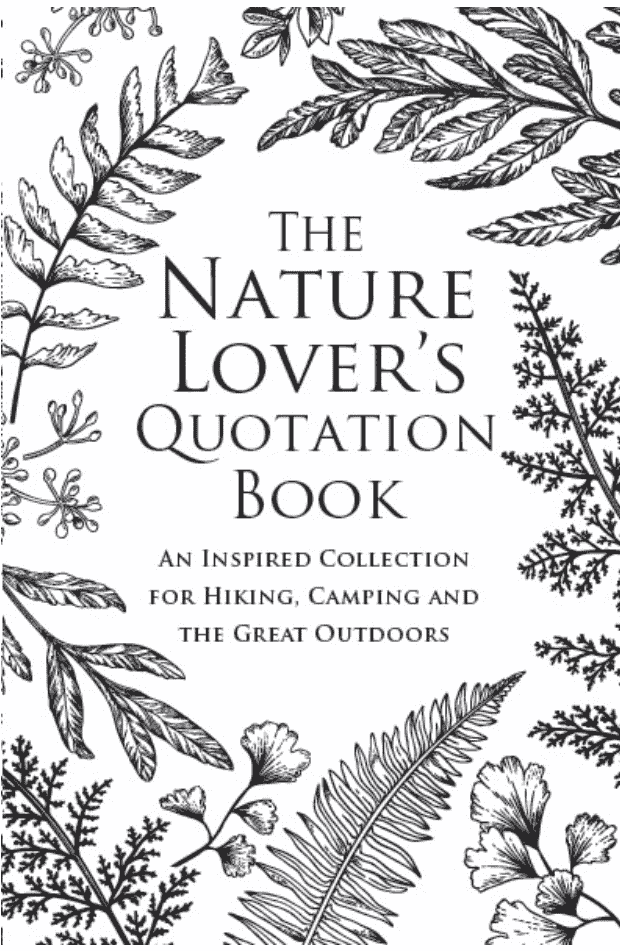

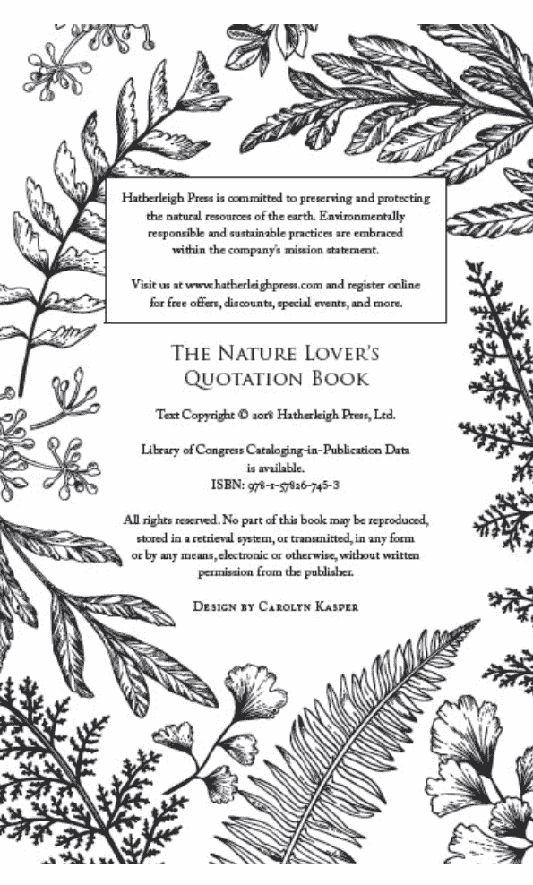

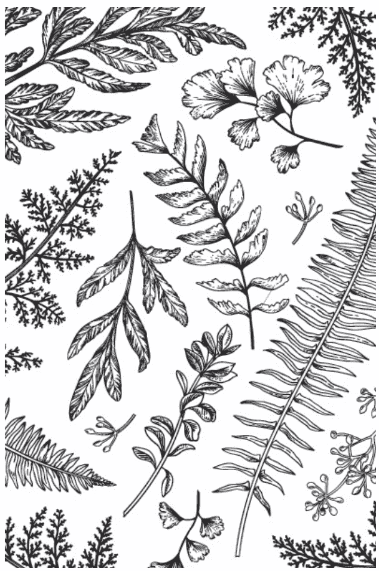

# 引言

自然对不同的人扮演着不同的角色，但无论我们生活在何处，它无处不在。

在混乱的时代，自然世界提供了恒定与安慰。自然世界带给我们一种平静感和精神上的交流。当每封电子邮件和短信似乎都需要立即回复时，在森林中徒步可以清醒大脑并重新调整我们的焦点。季节以绚丽的色彩变换。山脉古老到仿佛永恒，海洋广阔到让地平线似乎无边际。当我们被这种美景环绕时，报警信息又有何急呢？

这本书汇集了艺术家、科学家、自然学家和哲学家关于自然深远影响的引言。选文探讨了自然世界抚慰灵魂并让我们重新审视问题的能力。对自然感官美及其在色彩和形式上无限多样性的赞美是另一部分。同时也探索了在自然世界中可以找到冒险与喜悦。

这些引言为自然爱好者每当赤脚触碰大地时内心的惊奇与喜悦发声。

# 静心之道

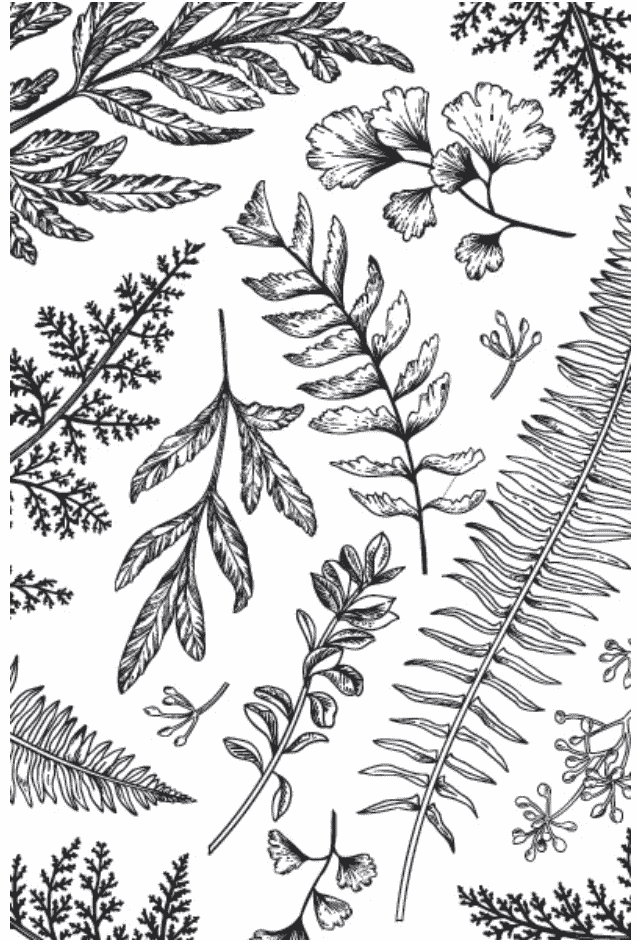

当我们的生活变得混乱时，我们在自然中找到慰藉。自然世界赋予我们和平感和精神上的交流。我们的内心世界得到了自然的丰富和抚慰。

那些沉思地球之美的人会发现力量源，只要生命延续，这种力量就会持久。在自然的反复循环中，存在着无限的治愈力量——黎明在黑夜之后，春天在冬日之后。

> —瑞秋·卡森（RACHEL CARSON）

对于那些恐惧、孤独或不幸的人来说，最好的药方就是出去，去一个他们可以与天空、自然和上帝独处的地方。因为只有在那里，人们才会一切如常，上帝希望人们在自然的纯美中获得快乐。只要这一切还存在（它无疑将永远存在），我知道无论情况如何，每一种忧伤都将会有慰藉。我坚信，自然在一切困难中带来慰藉。

> —安妮·弗兰克（ANNE FRANK）

让清新的空气吹走你身上的尘垢。空气是良药。

> —莉莉安·罗塞尔（LILLIAN RUSSELL）

成千上万精疲力竭、神经、过度文明的人开始发现，走进大山就是回家；荒野是必需品；山地公园和保护区不仅是木材的源泉和灌溉河流的来源，更是生命的源泉。

—约翰·缪尔（JOHN MUIR）

让宇宙成为你的伴侣，时刻记住事物的本质——山川河流，树木草木，以及人类——还有落花落叶。

—松尾芭（MATUO BASHO）

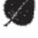

上帝在荒野中、花园里、田野间完全且真实地存在。

—马丁·路德（MARTIN LUTHER）

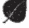

让人们进入荒野获得超凡的体验，可以赋予他们多年，甚至终生。

—保罗·乔治（PAUL GEORGE）

自然是我上帝的显现。我每天去自然中寻找日常工作的灵感。我遵循自然在其领域内使用的原则。

—弗兰克·劳埃德·赖特（FRANK LLOYD WRIGHT）

虽无法逃离世俗的世界，但我可以从山泉取水泡茶，让心安定。

—上田秋鸣（UEDA AKINI）

现在我在每一片生长的叶子、每一朵绽放的花中看到了秘密，在大地的声音和水的流动中，在树木的低语中（我听到了，我听到了），在蜜蜂的嗡嗡声中，在雨歌中，在阳光和荣耀之后，在月色星光之后，在生命的睡眠和黑暗之后；我拥有一切所需。

—沃尔特·惠特曼（WALT WHITMAN）

草地是我的教堂，我漫步其中，我是我自己的大教堂。

—亨利·戴卫·梭罗（HENRY DAVID THOREAU）

而，我们这远离尘嚣的生活，在树木中找到语言，在流溪中找到书籍，在石头中找到讲道，在万物中找到美好。

—威廉·莎士比亚（WILLIAM SHAKESPEARE）

当一棵树被砍倒，向太阳露出它赤裸的死亡伤口时，人们可以在树干那明亮、刻有的圆盘中读出它的整个历史：在它的年轮中、伤痕中，所有的斗争、所有的痛苦、所有的快乐与繁荣都真实地写在那里，贫瘠的岁月与奢华的岁月，承受的攻击，经受的风暴。每一个年轻的农少年都知道，最坚硬、最高贵的木材年轮最窄；在高山上和持续的危险中，生长着最不可摧毁、最强大、最理想的树木。

> —赫尔曼·赫塞

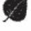

我们是自然。我们是观察自然的自然。红翅黑在我们体内飞翔。

> —苏珊·格里芬

那熟悉草地的脚，通常属于内心更轻盈的人，而不是那些灵魂极少离开人行道的人；最好的生命之水是奔跑，在我们能在新奇美景的甜美中尽可能安排的跑步，在那里自然坐着，刚从造物主手中走来，几乎在责备我们的迟缓。

> —利奥波德·哈特利·格林登

如果我们倾听，花朵就会向我们说话。欣赏手中的花朵，或在花园中停脚步欣赏美，会让我们的外在安静下来，直到我们听到一些新的声音，一些以前从未听过的声音——自然本身那微弱而安静的声音。

—珍·赫西

> 即使在一个大象般虚荣与贪婪的时代，人们也不必远望就能看到善良的人聚集的篝火。

—加里森·凯勒尔

> 每当我身在森林里，我就感觉像在教堂里。

> —皮特·西西格

> 为什么有些树我从未走在其下，但宏大而美妙的思想却会降临在我心头？

—沃尔特·惠特曼

> 作为一个精神性的人，自然对我来说一直是一个治愈之地。回到到我在农场的童年，田野和森林是冒险和自我发现的地方。动物是伴侣和朋友，世界的运行节奏比我成年后所在的繁华城市更慢、更理性。

—大卫·米克斯纳

今天，我因与树漫步而长得更高了。

自然是孤独最清晰的源泉。自然的伟大可以压倒我们用来衡量大部分时光的无足道碎念。如果你有智慧和勇气独自走向自然，那大大的节奏、永恒的嗡嗡声会尽早显现。当你找到它时，它将永远在那里等着你。外表的平静将变成内心的平静，无论你身处何地，都能在心中回到它。

> -肯特·内伯恩

在这里生长着最美丽的野花，在这里，人类的精神得到滋养，诗人们在此成长。

> -亨利·大卫·梭罗

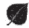

从内心荒野中那个被遗忘的梦之黑油池中浮现出来。我是太阳的继承者，地球母亲和玛雅星系的孩子。所有的山山药、治愈之水、风和杜松都深流在我的血液中。

> -吉米·桑蒂亚哥·巴卡

重力通过脚底来测量；我们通过脚底描绘大地的密度和纹理。日落时分，赤脚站在海边光滑的冰川岩上，通过脚底感受被太阳加热的石头的温暖，这是一种极具治愈感的体验，让人成为自然永恒循环的一部分。人们感受到地球缓慢的呼吸。

> —尤哈尼·帕尔马萨

当焦虑、不安和坏念头袭来时，我走向大海，大海用它广阔的声音淹没它们，用噪音洗涤我，并对我那困惑和混乱的一切施加一种节奏。

> —莱纳·玛丽亚·里尔克

一切减慢我们速度并迫使我们耐心的事物，一切让我们回到自然缓慢循环的事物，都是帮助。园艺是恩典的工具。

> —梅·萨托顿

每当偶尔，仔细看看非人造之物——山脉、星辰、溪流。它们带给你智慧、耐心和慰藉，最重要的是让你确定在这个世界上并不孤单。

> —西德·洛维特

老先们字面上是为了热爱土壤，他们坐在或躺在地上，感受接近一种母性的力量。土壤是抚慰的、加强的、和治愈的。

> —鲁瑟·斯坦丁·熊

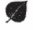

在广阔的世界，人们受到奖赏或惩罚的方式往往完全随机。在花园里，因果、劳动与回报重新结合在一起。在毫无意义的世界里，园艺是有意义的。因此推之然，世界上的花园越多，正义就越多，产生的意义也越多。

> —安德鲁·威尔

与地球以及彼此结合，为土地带来新生命，恢复水源，清新空气，更新森林，照顾植物，保护生物，庆祝海洋，为阳光欢欣，唱星辰之歌，回忆我们的命运，更新我们的精神，活力我们的身体，重建人类社区，促进正义与和平，爱我们的孩子并爱彼此，作为一个慈爱之秘的多样化表达汇在一起，为了地球的治愈和所有生命的更新。

> —马丁·路德·金，士.

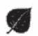

> 哈尔·伯兰

花朵并不担心它们将如何绽放。它们只是绽开，向着光，这让它们变得美丽。

—吉姆·卡瑞

> 没有什么比日出前森林的灵动更美妙了。

—乔治·华盛顿·卡弗

> 大自然的诗篇总是一朵花朵。

—奥利弗·温德尔·霍尔姆斯

> 这里每天都有日出和日落，而且它们是完全免费的。不要错过这么多它们。

—乔·沃尔尔顿

> 没有什么比土地松软潮湿时铲土更令人愉快的了。

—约翰·斯坦因贝克

我很荣幸能感受到溪流清凉的水流从我张开的指间流过。对我来说，一片绿意如茵的松针地毯或海绵般的草地，比最奢侈的波斯地毯更令我欢迎。对我来说，季节的轮换是一场惊心且永无止境的戏剧，剧情流淌过我的指尖。

> —海伦·凯勒

在自然中，没有什么是完美的，但万物又是完美的。树木可以扭曲，以奇异的方式弯曲，它们依然是美丽的。

> —爱丽丝·沃克

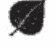

自然是一个对其起源于上帝的现象极好的名字。

> —威廉·库珀

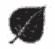

噢，人，是什么驱使你离开镇上的家，离开父母和朋友，越过山山岭走向乡村，如果不是为了自然世界的美丽呢？

> —莱奥纳德·达·芬奇

什么是艺术？自然的浓缩。

> —奥诺雷·德·巴拉克

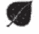

一株漂亮的植物就像家里多了一个朋友。

—贝丝·迪托

在人生的某个时刻，世界的美就足够了。

—托尼·莫里森

树是一座空中花园，是从海洋而来的植物迁徙，源自那些最早的植物——海藻；它是对破碎岩石、对土地的占有。直立的人类，只是细胞另一种形式的向上生长和结节。我们是多么像树，树又是多么像人。

——格蕾特·厄尔里希

像音乐和艺术一样，对自然的喜爱是一种共同的语言，可以超越政治或社会的界限。

—吉米·卡特

当你手里拿起一朵花并真地注视它时，在那一刻它就是你的世界。我想把那个世界送给别人。

城市里的大多数人总是行色匆匆，他们没有时间看花。我想让他们无论主观意愿如何都能看到它。

—乔治亚·奥基芙

大自然都戴着一张通用的微笑。

—亨利·菲尔尔丁

> 我一直认为自然是上帝的衣裳。

—阿兰·霍夫哈尼斯

我想我永远也见不到

一首像树一样美丽的诗。

一棵树在夏天可能会

在它的发间戴着

一只知尾鸟巢；

它的胸前曾覆着积雪；

它与雨亲密地生活在一起。

—乔斯·基尔默

> 雪正下着，多像填满黑暗树木的星辰，人们很容易想象它存在的意义无非仅仅是为了美丽。

—玛丽·奥利弗

优胜地谷对我来说，总是一场日出，是巨大的岩石和空间构成的宏伟建筑中闪烁的绿色和金色的奇迹。我未见过任何雕塑、绘画或音乐能超过高耸入的花岗岩悬崖和穹顶那震撼人心的精神感召，超过那岩石和森林上光影的光斑，以及坠落、流淌水的雷鸣与细语。起初，这种宏伟感可能占据主导地位：随后我们感知并回应自然那精妙而富有说服力的复杂性。

—安塞尔·亚当斯

花朵是上帝创造的最甜美的东西，却忘记了为它们注入灵魂。

—亨利·沃德·比奇

树是地球向倾听的天空发出的无尽努力。

—拉宾德拉纳·泰戈尔

你知道，自然在未被打扰时，从不单调。即使使用绿色——她调色板上最常用的颜色，你也很少通过表达呈现出两种对比色调的侧面，而同一颜色的叶子，常常也带给我们大大的惊喜。

——梅贝尔·奥斯古德·赖特

自然在为我们绘画，日复一日，画出一幅幅无限美的画面。

—约翰·鲁斯金

尽可能多走，保持你对自然的热，因为那是学习并不断加理解艺术的真正途径。画家们理解自然并教我们如何观察她。如果一个人真正热爱自然，他随处都能发现美。

—文森·梵高

所有的艺术都不过是对自然的模仿。

—塞内卡

自然的变化是如此的令人愉悦且丰富，以至于没有任何一个与另一个相似，不仅是植物，在它们的枝叶、叶子和果实中，也找不到一个完全相同的另一个。

—莱奥纳德·达·芬奇

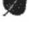

艺术是与自然的和谐。

—保罗·塞尚

# 冒险精神

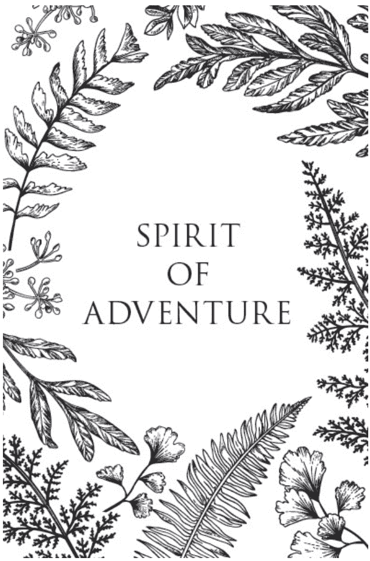

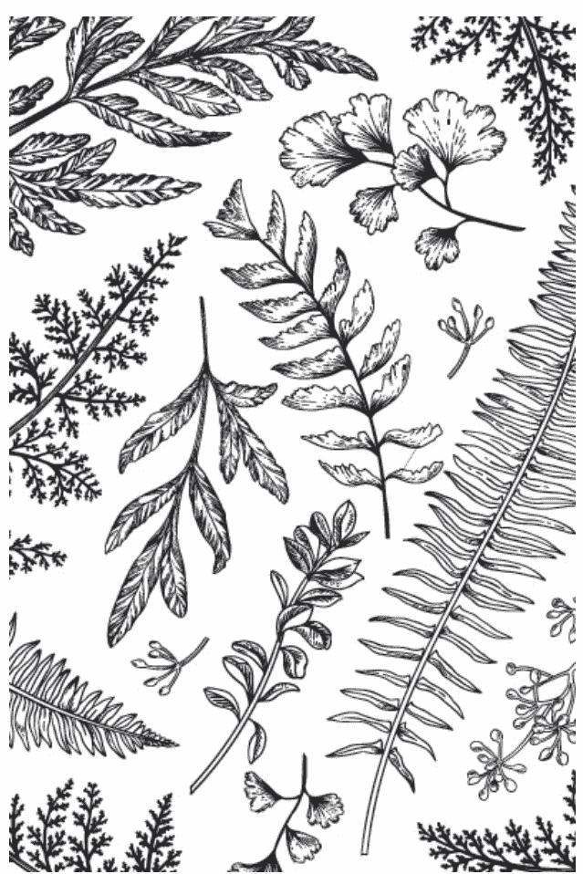

自然的礼物只有严酷的打击，以及偶尔感到强大的机会。现在我并不了解海洋，但我知道那里就是如此。越是进入荒野，越能感受到自由。

—西奥德·罗斯福

宇宙是一个伟大的幼儿园。每一个存在都带了它独特的课程。山脉教会我们稳定与宏伟；海洋教会我们广阔与变化。森林、湖泊和河流，云朵和风，星辰和花朵，巨大的冰川和晶雪，每一种有或无无生命，都会在人类灵魂上留下印记。

—奥里森·斯威特·马登

> 没有荒野，世界就是一个笼子。

—大卫·R·布鲁尔

> 偶尔离开小径，进入丛林。在荒野中，我们越能找到自由。

—亚历山大·格拉姆·贝尔

> 当生活变得纠结时，在森林中是令人欣慰的。

—爱德华·阿比

> 是什么驱使你，噢人，离开你镇上的家，离开父母和朋友，越过山山岭走向乡村，如果不是为了自然世界的美丽呢？

—莱奥纳德·达·芬奇

> 什么是艺术？自然的浓缩。

> —奥诺雷·德·巴拉克

阅读自然固然好，但如果一个人走在森林里并仔细听，他能学到比书上更多的，因为它们用上帝的声音在说话。

> —乔治·华盛顿·卡弗

# 自然与荒野的哲思

所以，如果你不能理解内在某种东西在回应这座山的挑战并迎向它，这种斗争就是生命本身的斗争，向上且永远向前，那么你就不会明白我们为什么要出发。我们从这场冒险中获得的只是纯粹的喜悦。而喜悦，毕竟，是生命的终点。

> —乔治·马洛里

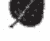

人生存精神中最基本的内核是对冒险的热爱。生活的乐趣源于我们与新体验的相遇，因此，没有什么比拥有一个无尽变化的地平线，每天都有一颗新颖且不同的太阳更令人喜悦了。

> —克里斯·麦克兰德斯

我内心总有一部分认为荒野和涉险是通往自由的道路。

> —萨姆·基恩

我们为什么热爱这种对荒野的崇拜？因为我们喜欢自由的味道；因为我们喜欢危险的气息。

> —爱德华·阿比

我已经爬上了我的山，但我必须继续过我的生活。

> —丹增·诺尔盖（珠穆朗玛峰第二二人）

如果冒险有一个最终且包容一切的动机，那一定是这个：我们出发是因为我们的本性使我们出发，去爬山，去划船，飞向行星，潜入深海……当人停止做这些事情时，他就不再为人了。

—威尔弗里德·诺伊斯

海洋是一个核心意象。它是伟大旅程的象征。

—恩雅

我将永远是一个热爱荒野的人：在山峰间昂首或轻盈穿行；我将长久地倾听大海的呼吸；我将在沙漠风的尖啸中唱响我的歌。

—埃弗里特·鲁斯

我必须体验置身荒野的感受。那种无目的地行走几英里，唯一的理由仅仅是见证树木与草甸、山脉与沙漠、溪流与岩石、河流与草地、阳光与日落的积聚。这种体验是强大且根本的。在我看来，在荒野中的人类感觉一直是这样，只要荒野存在，这种感觉就永远如此。

—谢丽尔·斯特瑞德

正是攀登的过程，让山顶的景色如此惊为观止。

—理查德·C·米勒

在山中，世俗的执念被抛在脑后，在没有物质干扰的情况下，我们对精神性的思考开放了。我们应该尝试将山的灵性体验带到任何地方。

> —贾姆林·丹增·诺尔盖

自然是人的老师。她向他的寻找展示自己的宝藏，开启他的双眼，照亮他的心灵，净化他的内心；一种影响从她存在的所有景观和声音中呼之而出。

> —阿尔弗雷德·比林格斯·街特

你迷路的地方并不一定是路径终结的地方。

> —汤姆·布朗·Junior号

## 视角转换

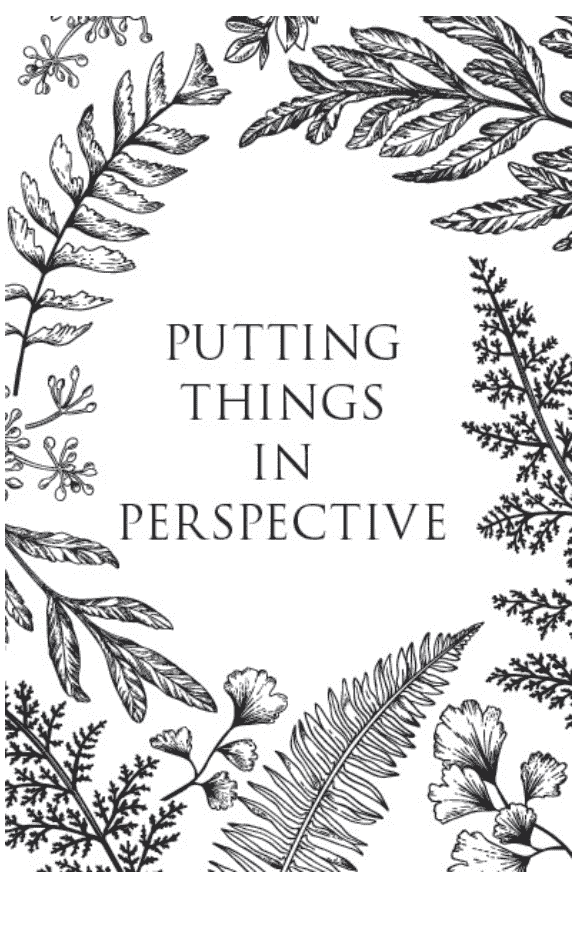

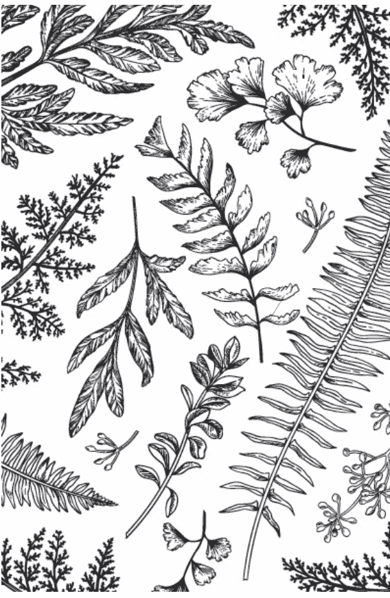

自然有一种方式提醒我们自己的渺小。在自然界古老的秩序中，我们的烦恼显得转瞬即逝且微不足道。

自然并不可怕。自然并不奇妙。自然并不残酷。自然并不优美。自然只是如此。

—西蒙·巴内斯

拔起树木的风吹长了草。主喜爱弱小和低矮。永远吹耀自己的强大。斧头并不担心树枝有多厚，它将它们切碎。但不仅仅是叶子。

—鲁米

每一棵树最初都是几颗立在地的坚果。

—亨利·大卫·梭罗

自然不匆忙，却一切已成就。

—老子

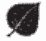

山并不杀人，它们只是静坐那里。而自然证明了比我更大的力量。将两者置于视角，或者至少让我们向前移动。

—克里斯汀·鲍尔

在被工厂和轮子统治的世纪里，有一点是明确的：机器可以制造从勺子到登陆器的一切东西，但生活的喜悦是它有过也永远无法制造的。

—亨利·贝

我们感到如此强烈的联系。墙的另一侧没有思想。花园教会的唯一课程是，我们与星球的关系并非零和，而且只要太阳依然照射，人们仍然计划、思考和行动，我们就能找到不损害世界的方式维持自己。

—迈克尔·波兰

愚人看不见智者所看到的同一棵树。

—威廉·布莱克

通过认识草，我理解了耐心的含义。我可以欣赏坚持。

—哈尔·波兰

在富兰克林接受暗示之前，雷响了多少次！在牛顿接受暗示之前，有多少个苹果掉在他头上！自然总是向我们暗示。它一次又一次地重复着“看看你的脚下”。你离神性和力量真正的源头比你想象的要近。遥远和困难是欺骗性的。机会就在所在地。每个地方都在星辰之下。每个地方都是世界的中心。

—约翰·伯鲁

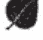

你必须寻求热爱植物和自然，然后培养那种知足常乐的心态。如果没有僵化和武断的理想，他更快乐，因为花园对初学者是有调情的。

—莉伯蒂·海德·贝利

花园是一个伟大的老师。它教会耐心和细心；它教会勤奋和节约；最重要的是，它教会信任。

—格鲁特德·杰基

在到达山顶之前，永远不要测量山的高度。那时你就会看到它是多低了。

—达格·哈默斯杰

山的历史如此富有力且有力地向人类诉说，它是如此崇高地代表了与神直接相关的神性，因为它似乎一次性否定了世间所有的虚荣。

—卡尔·古斯塔夫·卡鲁斯

如果一个人每天有一半时间在森林里散步，他有被视为游民的危险。但如果他像投机者一样度过一天，砍掉那些森林让土地提前光秃，他会被视为勤奋且富有进取的公民。

—亨利·大卫·陶

深视自然，你将更好地理解一切。

—阿尔伯特·爱因斯坦

> 最微小的运动对所有自然都至关重要。整个海洋都会受到一颗卵石的影响。

—布莱斯·帕斯卡

> 太阳，带着所有环绕它转动并依赖它的行星，依然在结一串葡萄，仿佛它在宇宙中没有其他可做的事。

—伽利略·伽利莱

> 橡树就是橡树。这是它所要做的全部。如果橡树不如橡树，那么我们都陷入了麻烦。

—那言·福

> 不要忘记，大地乐于感受你的赤脚，风也渴望玩弄你的头发。

—哈里里·吉卜兰

> 一根草永远是一根草，无论是在一个国家还是另一个国家。

—缪埃尔·约翰逊

> 也许真理取决于绕湖散步。

—华莱士·史文斯

> 自然中最高美的事——花，其根仍在在土壤和粪肥中。

—D.H·劳伦斯

永不再次回到荒野是智慧的一部分，因为百合越金黄，就越有人给它镀了金。

—阿尔多·奥波德

在自然中，孩子找到了自由、幻想和私密：一个远离成人世界的地方，一份独立的宁静。

—理查德·洛夫

即使我知道明天世界将分崩，我依然会种下我的苹果树。

—马丁·路德

世界不需要被秩序。世界本身就是秩序。是我们让自己与这种秩序保持一致。

—亨利·米勒

自然没有不秽；人类发明了它们。

—马克·吐温

荒野包含着人类尚未学会提问的问题的答案。

—南希·纽霍

好的木材长得并不容易；风越大，树越强壮。

> —J. 威拉德·马里

在荒凉的港口，仍有水拍打着石岸。在幽暗寂静的森林里，有一片叶子正在落下。在抛光的护墙板后，白蚁正在啃食着木头。除了傻子，没有什么是永不安静的。

> —艾兰·帕顿

除了在呼吸第一口气之前的九个月里，没有哪个人类管理自己的事务能像树那样妥当。

> —乔治·伯纳德·邵罗

溪流与山川永恒不变。

> —加里·斯尼德

从田间的野草到天空的星辰，每一个都在行着这一切；自然界之所以拥有如此深邃的平和与超越的美丽，是因为其中没有任何一个在试图强行逾越自身的局限。

> —拉宾德拉·泰戈尔

忘记如何挖掘大地、照料土壤，就是忘记了我们自己。

> —圣座圣特马·甘地

花园需要耐心的劳动和关注。植物的生长不仅仅是为了满足野心或实现善意。它们繁茂是因为有人在它们身上付出了精力。

—利伯蒂·海德·贝里

自然的初绿是金色的，

最坚韧的叶是花；

但仅此一瞬。

随后叶复归为叶。

正如伊甸陷入哀伤，

正如晨曦没入白昼。

金色的东西无法长留。

—罗伯特·弗罗斯

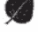

看一棵树，一朵花，一植物。让你的意识停留在它身上。它们是如此静谧，如此深根于“存在”。让自然教你何为寂静。

—埃克哈特·托勒

破碎吧。如此，野花将在你所在之处绽放。你已经硬化了多年。尝试一些不一样的吧。顺服吧。

—鲁拉

当我们转身离开，自然吞噬人类遗迹之快，令人惊叹。生命是一个饥渴之物。

—斯科特·威斯特菲尔德

> 花落了，尽管我们爱它；杂草长了，尽管我们不爱它。

—道元

> 当人种下一棵他深知自己永远不会坐在其树荫下时，他至少在发现人类生命的意义上迈出了一步。

—德尔顿·特鲁·布鲁德

> 在自然中，我们从没见过任何孤立的事物，万物皆与他物相连，它们在它前方、身旁、在其下方、在其上方。

—约翰·沃尔尔夫冈·冯·歌德

> 当你看过一只蚂蚁、一只鸟、一棵树，你并没有见过它们全部。

—E·O. 威尔逊

> 田野里的每一根草——森林里的每一片叶——都会在它们的季节里奉献生命，正如它们被采起时那样美丽。

—亨利·大卫·梭梭

> 智者知道，坐在偏远山溪的岸边比做整个世界的皇帝更好。

—庄子

> 当你做了一件高尚而美丽的事，却无人留意时，不要悲伤。因为每天早晨的太阳都是壮丽的奇观，尽管大多数观众仍在沉睡。

—约翰·列侬

## 自然的力量与长寿

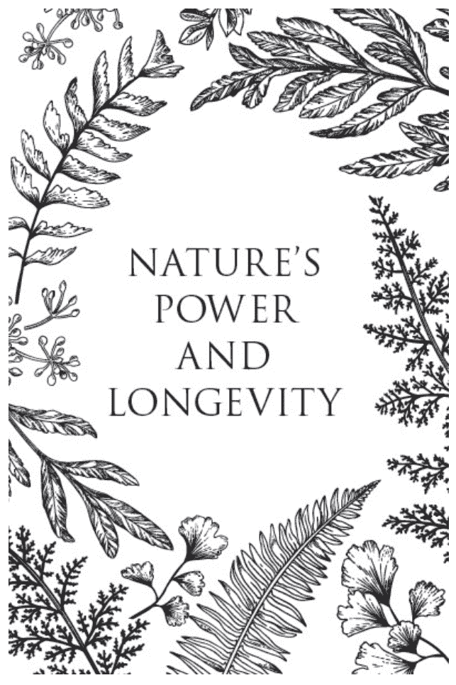

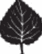

当考虑到地球的年龄以及它所见的一切，“时间”便有了更广义的意义。千万年的存在以及自然界景观的雄礴力量令人肃畏。

当我们种下一棵树时，我们种下了什么？我们每天看到的千百物；我们种下了高过岩石的尖塔；我们种下了国家旗帜的旗杆；我们种下了躲避烈日的阴凉；当我们种下这棵树时，我们种下了这一切。

—亨利·阿比

凡种树者皆在向永生眨眼。

—菲利克斯·丹尼斯

我已老到不再为了自己的喜悦而种树，我将为了后代而做。

—托马斯·杰斐逊

它的宏大展示是永恒的。某处总有日出；露水从未瞬间干涸；雨水永远落下；蒸汽永远在升腾。永恒的日出、永恒的日落、永恒的黎明与黄昏，在海洋与大陆上，随着圆地球的转转轮流上演。

—约翰·穆尔

我总是对森林感到惊讶。它让我意识到，自然的幻想比我自己的要大得多。我仍有东西要学。

—甘特·格拉斯

直到我们看到过一只蚂蚁，一只鸟，一棵树，我们并没有见过它们全部。

自然的幻象远比我自己的要大得多，我仍有东西要学。

（注

在自然中，我们从未看到任何孤立的雨雨，升腾的云雾，它从未消失。

—托马斯·A·爱迪生

直到我们看到过一只蚂蚁，一只鸟，一棵树，我们并没有见过它们全部。

自然的自然自然。，人类的科学知识无法无法自然，自然的自然的的。

—亨利·沃切尔

当树木被砍倒时，自然在寂静中回响。

—托马斯·卡莱

树木被砍倒时，自然在寂静中回响。

—安托万·圣埃克苏

自然的自然的自然的自然的自然的自然的自然的自然的自然的。

—梅哈特·伊尔汗

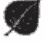

自然的自然的自然的自然的自然的自然的自然的自然的自然的。

—斯蒂芬·J·古德

自然的自然的自然的自然的自然的自然的自然的自然的自然的。

—玛丽·韦布

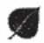

自然的自然的自然的自然的自然的自然的自然的自然的自然的。

—克里斯托弗·帕奥尼

世间没有一根小草，没有一种颜色不是为了让人们感到欢欣的。

—约翰·加尔文

如果蓝天让你充满喜悦，如果田野间生长的一株小草能触动你的心，如果大自然简单的事物传递着你所读懂的信息，那么欢喜吧，因为你的灵魂是活的。

—埃莉诺拉·杜斯

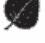

如果你不能对大自然产生敬畏之心，那你一定出了问题。

—亚历克斯·特雷贝

无论采取何种形式，露营都是接地气、丰富灵魂且塑造性格的。当你搭好帐篷，看着营火升起袅袅青烟，金色的太阳在地平线上落下时，没有什么时刻能比这更令人满足了——纵使这只是在雨水破坏一切之前转瞬即逝的瞬间。

—皮帕·米德尔顿

我向你保证，同样让行星绕恒星运行的物质，也让电子在你心中跳舞。它在你体内，在你体外，你本身就是它。它是美的。相信这一点，你和你的生活将是宏大的。

—卡马尔·拉维坎特

当人类被自然之美或奇迹震撼时，第一种敬畏感是第一次精神体验。

—亨锐克·斯科利莫沃夫基

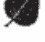

每两棵松树之间，都通往一个新世界的门口。

—约翰·缪尔

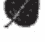

大海是一场持续的奇迹；游动的鱼类、岩石、波涛的波动、以及载着人的船，还有什么更奇妙的奇迹呢？

—沃尔特·惠特曼

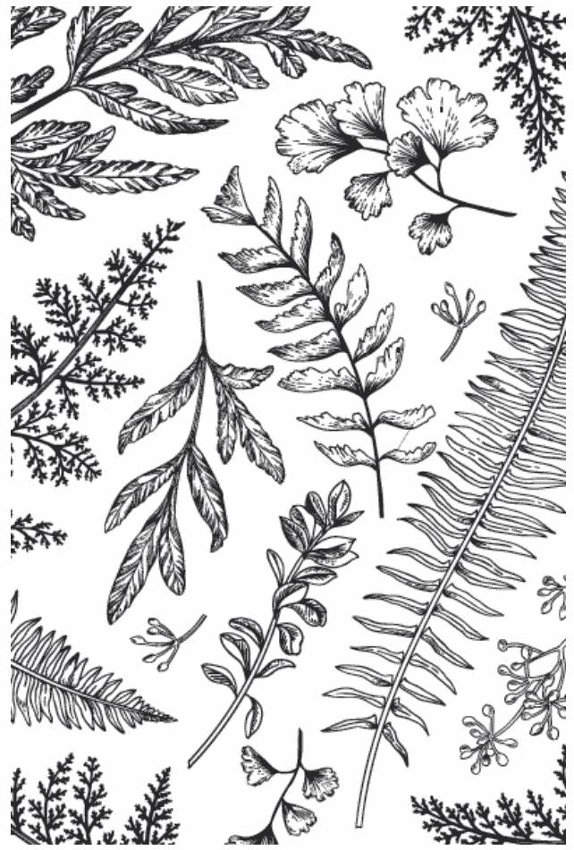

你通往知识与文化的的大门。人人可用。

z-library.se singlelogin.re go-to-zlibrary.se single-login.ru

官方 Telegram 频道

Z-Access

https://wikipedia.org/wiki/Z-Library
