# 荷属东印度群战役 1941-42：日本的石油追求（战役系列）

## 荷属东印度岛

### 战役起源

1941 年 12 月，日本对西方列强发起了进攻，声称这是一场自卫和自保的斗争。在短短几个月内，日本就征服了东南亚，并建立了“大东亚共荣圈”。同盟国花了近四年的时间才击败日本并夺回了该地区。

日本南方进攻战，“甲号作战”（Operation `A-Go`）由三场战战组成：马来亚、菲律宾和荷属东印度岛。本书描述了对荷属东印度岛的进攻与征服。它试图回答的问题包括：荷属东印度岛（NEI，现印度尼西亚）在日本的战争目标中占据什么位置？日本打算如何实现这一目标？荷属东印度岛的防御计划是什么？这场战役在作战和战术层面是如何进展的？

#### 日本的扩张

日本向中国的扩张使其与亚洲的其他主要大国发生冲突。1938 年和 1939 年，它甚至与苏联爆发了边境战斗。英国在应对这种扩张方面无能为力。甚至在第一次世界大战之前，它就缺乏同时在欧洲和亚洲水域维持战斗舰队的手段。是美国领导了遏制日本扩张的动力。美国不仅希望停止日本权力的扩张，还希望遏制它。为此，美国在 1940 年实施了日益严厉的经济制裁和军事压力，将大部分美国舰队从美国太平洋沿岸移到夏威夷，并在菲律宾部署了`B-17`远程轰炸机。如果日本从中国和法属印度支撤出，制裁将被解除。因此，日本不仅必须放弃它的帝国和成为大国的理想，还必须屈服美国的经济霸权。

在这张 20 世纪 30 年代的航空照片中，前景中心可以看到普拉朱（Plaju）的荷兰石油公司（`BPM`）炼油厂（右侧为居住区），而左侧背景是位于苏门答腊东部靠拢（Sungai Gerong）的荷兰皇家石油公司（`NKPM`）炼油厂。左侧是穆西河。这些炼油厂共占荷属东印度岛总产量的三分之一。这是该地区唯一的高质量航空燃油（100 号汽烷）来源。主要的油井位于占碑（Djambi）。`NKPM`是美国标准石油公司的子公司。`BPM`由荷兰皇家壳拥有。（莱登大学图书馆，KITLV 2790）

日本寻找着和平获取美国拒绝提供的战略性原材料的方法，其目光投向了荷属东印度岛。

#### 石油：船只、飞机和战争的燃料

石油是日本帝国的阿喀琉斯之踵。它的消耗几乎完全依赖进口，如表 1 所示。美国供应了日本一半以上的石油消耗，因此美国的石油禁运将对日本造成沉重打击。荷属东印度岛提供了一个逻辑上的（并非唯一的）美国石油替代方案，能够满足日本的需求。

除了石油，荷属东印度岛还是天然橡胶、锡和铝土矿的重要来源。1938 年，全球对天然橡胶的需求为 933,000 吨：荷属东印度岛占 302,872 吨，占全球市场的 32%。1938 年，从该地区开采了 27,737 千吨锡，在全世界 148,100 长吨中位居第三，仅次于马来亚和玻利维亚。荷属东印度岛在 1938 年还开采了 245,354 吨铝土矿。它还生产了 90%的金鸡纳树植物，因此对主要的抗疟药物——奎宁具有垄断地位。

考虑到荷属东印度岛作为战略原材料供应商的重要性，日本致力于将该地区纳入其势力范围：即大东亚共荣圈。1940 年至 1941 年间，日本开始谈判以增加其在荷属东印度岛的影响力，并通过和平手段获取必要的战略原材料。然而，日本在 1940 年 9 月与德国、意大利建立同盟使这些谈判复杂化：即三轴协约。荷兰从当年 5 月起一直与德国处于并随后被占领。日本的威胁显而易见。荷属东印度岛在新加坡与英国、澳大利亚参加军事参谋会议，以协调在与日本发生时的联合行动。美国以观察员身份出席。荷兰认为这些针对日本的参谋会议增强了他们的实力。

考虑到荷属东印度岛作为战略原材料供应商的重要性，日本致力于将该地区纳入其势力范围：即大东亚共荣圈。1940 年至 1941 年间，日本开始谈判以增加其在荷属东印度岛的影响力，并通过和平手段获取必要的战略原材料。然而，日本在 1940 年 9 月与德国、意大利建立同盟使这些谈判复杂化：即三轴协约。荷兰从当年 5 月起一直与德国处于战争并随后被占领。日本的威胁显而易见。荷属东印度岛在新加坡与英国、澳大利亚参加军事参谋会议，以协调在与日本发生时的联合行动。美国以观察员身份出席。荷兰认为这些针对日本的参谋会议增强了他们的实力。

#### 南下

日本 1939 年占领中国海南岛以及 1940 年向法属印度支派遣军队，使其英国领的马来亚、新加坡以及荷属东印度岛进入了日本陆基飞机的攻击范围。这种南下行动引发了美国的强烈反应。美国在 1941 年 7 月 26 日冻结了日本资产。完全停止石油供应并非其本意，但事实上的反应等于此。英国同意了这一点，荷兰也无奈加入，意识到参与禁运意味着与日本开。日本面临石油封锁，而其通过增加荷属东印度岛供应来创造和平替代方案的尝试也失败了。对于日本来说，面对美国的枷锁，仅有两个选择：屈从美国要求，或通过武力获取必要的原材料。日本选择了后者。美国通过经济和军事压力阻止日本在亚洲进一步扩张的政策已经失败。如果日本有机会赢得军事冲突，必须在 1940-41 年间采取行动。欧洲战争严重削弱了其潜在对手或将他们牵制在其他地区。权力平衡已向日本倾斜。随着 1940 年 7 月《两洋海军法案》的通过，美国启动了一项巨大的海军建设计划。日本看到了机会窗口。现在是成败关键。

达拉干是婆罗洲东岸的一个丘陵起伏、丛林覆盖的小岛。从该岛开采的原油直接作为燃料销售，无需精炼。达拉干占了荷属东印度岛总石油产量的 9%。该岛有两个钻井和一个用于储存的储罐区。照片中的钻井很可能位于帕穆申，约 1940 年。（莱登大学图书馆，KITLV 176800）

爪哇、马杜拉、巴厘岛和龙目岛等外地区以及海岸、防空炮和搜照灯人员的荷属东印度群（NEI）部分动员。

NEI 军队进行部分动员。

RNEI 陆军进行总动员。

在苏门答腊巴胆陆成立第 226 号战斗机群总部（`RAF`）。

英国隶属国王皇家骑兵猎团第 3 团 B 连在南苏门答腊登陆。

新加坡陷落。

`ABDACOM`决定撤离南苏门答腊。

`ABDACOM`解散。

美国“兰格利号”（USS `Langley`，载有战斗机）在爪哇岛南部沉没。

日本军登陆爪哇岛。

在万丹湾发生海战（巽德海峡海战）。

日本庄司队（Shoji Detachment）夺取卡里加提机场。

东群（`USAAF`）开始从爪哇撤离返回澳大利亚。

RNEI 陆军机部队（`Mobiele Eenheid`）在苏邦进行反击。

日本第 2 师部队与“黑部队”在勒乌利亚昂发生战斗。

第 2 步兵团（加强后）和 RNEI 陆军 Teerink 小组对卡里加提机场的反击因空袭而失败。

日本庄司队攻击西亚特防御阵地。

RNEI 陆军撤离雅加达，随后被日本占领。

日本军突破西亚特防御阵地。

RNEI 陆军万隆群组提出局部投降。

关于 RNEI 陆军完全投降的谈判在卡里加提进行。

日本军占领芝拉恰普和泗水。

##### 3 月 9 日

RNEI 陆军投降。

爪哇岛盟军武装部队投降。

日本皇卫师团登陆苏门答腊北部。

位于北部和中部爪哇的 RNEI 陆军投降。

### 敌指挥官

#### 日本方面

**今村义须中将（Lieutenant-General Hitoshi Imamura，1886–1968）**是 1942 年第十六军的司令官。他于 1907 年任官。除了这些海外派遣地外，他还曾担任总参谋部参谋。1940 年至 1941 年期间，他担任训练副监察总。1941 年 11 月 6 日，他被天皇任命为第十六军司令官。由于以及设备等问题，他在爪哇战役期间对第十六军拥有指挥权和指挥权。

今村在日本军中以“作为一名拥有果敢和不屈战斗精神的指挥官的勇敢”而闻名。他是一位高明的组织者，并愿意承担巨大的作战风险。战后，他被澳大利亚政府指控战争罪。他被判定有罪并判处十年监禁。1948–49 年，雅加达的临时军事法庭也就婆罗洲和爪哇的战争罪对其进行了审判。但他被判无罪。

**庄司寿志佐（Colonel Toshishige Shoji，1890–1974）**是 1941 年第 38 师第 230 步兵团团长。该团参加了 1941 年 12 月的征服香港战役和 1942 年 3 月的进攻爪哇战役。今村亲自挑选庄司率领一支小规模的团级战斗群在爪哇执行一项重要的次要行动。他信任庄司会独立行动并在必要时表现出适当的主动性。庄司确实做到了这些，但并非如今村预期的那样。事实上，他违反明确命令，自行攻击了西亚特防御阵地，这一大胆的行动赢得了成功：他在两天内突破了荷属防御的核心，并决定了战役。

庄司寿志（Toshishige Shoji）佐是今村的老相。他们曾在多个部队中共役过一段时间。1942 年 3 月 2 日，在士邦（Subang），庄司对荷属东印度（NEI）移动部队的反击感到吃惊。荷兰人并未意识到他司令部的存在并继续向前推进。1942 年 9 月，第 38 师第 230 步兵被转移到拉包尔并部署在关岛加纳尔。在那里与美军的战斗中遭受了惨重伤亡。关岛战役失败导致庄司从前线部队调往军团和守备部队。战争结束时，他担任日本仙台地区司令。这张照片拍摄于他 1944 年 3 月晋升为少将之后。（公有领域）

远藤三郎（Saburo Endo）少将指挥第 3 航空军。该部队参与了马来亚、苏门答腊和爪哇战役。他是一位经验丰富的谋长。1942 年 3 月 3 日，他飞往加里加提（Kalijdati）。他的飞机在机场击退了荷属东印度的主要反击。随后，远藤支持了庄司对齐亚特（Ciater）的进攻。他根据自己的主，将重点从为西爪哇的推进提供空中支持转为对万隆的进攻。也是远藤在投降会议前，明确威胁荷兰代表团将轰炸万隆。此后，他出任陆军航空军总部总务部部长。1945 年，远藤担任航空兵器局局和航空工业委员会主席。照片显示了远藤晋升为中将后，穿着 M1943 式（3 型）军服。（每日新闻报）

庄司少将于 1949 年被雅加达的临时军事法庭因其在加里加提、士邦和齐亚特山口的战争罪行判处死刑。然而，这一判决在上诉后被改为十年有期徒禁。

##### 远藤三郎少将 (1893–1984)

远藤三郎少将是日本帝国陆军航空军（IJAAS）第 3 航空军司令官。远藤于 1914 年毕业于军官学校，1922 年毕业于军参谋学校。他成为一名炮兵官。他在 1927 年日内瓦裁军会议和 1931 年联盟国裁军会议上获得了国际经验。作为参谋官，他于 1937 年被分配到北华方面军。远藤在职业生涯后期转入空军。他是一位激进的指挥官。在爪哇，远藤对第 2 师缓慢的进展感到恼火，因此全心支持庄司进攻万隆的决定。他根据自己的主意，将第 3 航空军提供的空中支持重心从第 2 师转移到了庄司支队。他因第 3 航空军在马来亚和荷属东印度战役中的表现受到了第 25 军和第三空军的赞扬。

##### 坂口静雄少将 (1887–1947)

坂口静雄（Shizuo Sakaguchi）少将于 1941 年成为第 56 师步兵团司令官。为了南方攻势，该团被重组为第 56 混合步兵团或 A 支队（坂口支队）。坂口少将参加了从打拉干到爪哇的反对荷属东印度的整个战役。除了机场基地，他的部队还占了重要的油井和设施。为了实现目标，坂口也极其残忍且富有：残忍是因为当油井设施被毁时，他部分执行了巴里巴板（Balikpapan）处决荷属东印度军队守军和荷兰平民的威胁；富有是因为他具备临变能力，这从他根据新信息最后调整巴里巴板的进攻计划，以及部署叛变的印度尼警察中可见。在进攻万加锡（Bandjermasin）战中，在海军支援停止后，他组织了一个由小船组成的船队从海面进攻了该城市。他的野心体现在他主动请出自己的部队参加入侵爪哇，尽管这并不在计划之内。

坂口静雄少将是第 56 师步兵团司令官。他在荷属东印度战役期间领导坂口支队。他充满野心且富有创意，但也十分残忍。1943 年，他晋升中将并在中国担任师长。他于 1945 年 4 月退役。（公有领域）

#### 盟军

##### 海因·特·波滕（Hein ter Poorten） (1887–1968)

海因·特·波滕（Hein ter Poorten）于 1939 年至 1941 年担任荷属东印度陆军参谋长。在前任死于致命空机事故后，他于 1941 年 10 月 23 日成为荷属东印度陆军兼战争部部长（陆军司令）。他被晋升为将。随着 ABDA 司令部（ABDACOM）的建立，特·波滕还成为了 ABDA-ARM（即 ABDA 陆军）司令。

特·波滕于 1887 出生于爪哇的布滕佐（（博哥），1908 年被任命为殖民军炮兵官。特·波滕是军事航空领域的先驱。他是第一位获得国际飞行执的荷兰职业军官（1911 年）。1915 年至 1917 年，他在飞行飞行服役。1919 年至 1922 年间，他在荷兰参谋学院（*Hogere Krijgsschool*）学习战争研究。特·波滕于 1937 年成为炮兵监察。1939 年，这位前陆军司令称他为“一位特别有天赋的军，一个想法独特、见识广博且洞察力敏锐的人……一位强大的领导，决策流畅而谨慎”。他是马来亚、澳洲以及菲律宾美国合作的支持者。特·波滕希望守住新加坡并保留爪哇作为盟军反攻的主要基地。

战争爆发两个月后，54 岁的特·波滕精疲力竭不得不寻求治疗。结果，在所讨论期间，他的身心状态并非最佳。他远非一个大乐观主义者，对胜利的机会没有幻想，因此被批评为消极。据说这位陆军司令在战斗中没有表现出领导力。他非常依赖他的参谋长巴克斯（Bakkers，后升少将）校。

与荷属东印度总督兼总司令贵族外交官斯塔肯博格·斯塔丘韦（Jhr. Starkenborgh Stachouwer）的关系困难。这即使在加里加提与日本人的投降谈判中也显而易见。特·波滕清楚爪哇已经失守，日本人期望全面投降。参加了最初讨论的总督希望谈判部分投降，并就继续民政达成协议。他指责特·波滕具有失败主义。

H·特·波滕中将在担任参谋长两年后，由于继任，在前任去世后，于 1941 年 10 月初被任命为荷属东印度陆军司令。他于 1942 年 1 月也成为了 ABDA-ARM 司令。作战陆地区域分散，以至于这个指挥权实际上涵盖很少。指挥负担被证明是沉重的。在这张照片中特·波滕看起来很健壮。然而，当日本第十六军踏上爪哇土地时，他已精疲力竭，状态远非最佳。特·波滕穿着 1941 年 9 月的新野战，但是短袖的。作为炮兵官，他在衬衫肩部佩戴着炮兵章。（私人收藏）

### 军事领导

在这张照片中，W·席林（W. Schilling）少将当时还是一名上校。他被任命为少将是在 1941 年 4 月 30 日。52 岁的席林是第 1 师/西部小组的指挥官。他被视为一名能干的军官，但他错过了几次晋升。他的名字曾被提到为特·波滕（Ter Poorten）总参谋的潜在继任人。然而，这个职位与他擦肩。席林拒绝了领导卡里达加蒂-苏邦（Kalidjati–Subang）反攻的建议。在 1942 年 3 月从普里亚让高原（Priangan Plateau）撤退后，他是西部小组和万隆小组联合部队的预定指挥官。1945 年获释后，席林曾是陆军司令官的人选，但再次未被选中。相反，他以中将衔担任荷兰驻日本军事团团长。1949 年，他被荣誉退役并返回荷兰。（布龙贝克博物馆）

特·波滕与总督一同被俘。他于 1945 年 8 月 17 日在中国沈阳获释。他认为自己成了荷荷陆军（RNEI Army）失败和荷兰属东印度沦失的替罪羊。尽管如此，他仍获得了荣誉退役。特·波滕于 1968 年在荷兰去世。

#### 鲁道夫·巴克斯斯少将

**鲁道夫·巴克斯斯少将（Rudolph Bakkers，1894–1967）**是一位欧洲父亲和印度尼西亚母亲的儿子，于 1941 年 10 月 27 日成为荷荷陆军总参谋长。巴克斯斯于 1914 年成为军官。1922 年至 1925 年间，他在参谋学院学习战争研究。1933 年至 1936 年，他还在该机构任教。作为一名印欧人，他在种族主义的殖民社会中创造了辉煌的职业生涯。然而，他也经历了歧视。例如，他没有被邀请代替陆军司令官参加澳盟联司令部（ABDACOM）的日常讨论，而是派了一名首席参谋官。

47 岁的巴克斯斯被描述为一个“素质极高且心慈软的人”。后者可能阻碍了他做出艰难的决定。他的妻子在战争爆发前不久去世，无疑这对他留下了阴影。是巴克斯斯在 1941 年提出了建立一支由西方组织并武装的摩托化和机械化爪哇军队的建议。这些计划证明了他的远见，但对荷荷陆军来说过于野心勃勃。陆军司令官总是采纳他的建议。

#### 维雅布鲁杜斯·席林少将

**维雅布鲁杜斯·席林少将（Wijbrandus Schilling，1890–1958）**从 1941 年 3 月起担任第 1 师和第 1 军区指挥官，从 1942 年 2 月底起担任西部小组指挥官。席林（1942 年 1 月时 52 岁）没有在皇家军学院参加为期三年的军官培训课程，而是作为士官。随后，他参加了为期两年的军官课程。席林曾就参谋学院，并在 1929 年至 1935 年间在那里教授战术以及战术地图绘制。1937 年起，席林在西爪哇担任参谋和作战职务。因此，他对自己的作战区域非常熟悉。日本人的快速进军也让他感到惊讶。然而，他认为在面对日本人在西爪哇的南部进军轴时可以取得部分成功。

席林是一个分析能力强且知识渊的军官，将实战经验与战术理论相结合。然而，与他的同事一样，他缺乏对抗现代组织武装对手的战斗经验。

1941 年，J·J·佩斯曼（J.J. Pesman）少将提早退休，据称是因为酗酒。尽管如此，他仍被任命组织自愿性的国土卫队（*landwachten*）。54 岁、身材肥胖的佩斯曼（右）于 1942 年 2 月恢复现役，指挥新成立的万隆小组。当席林少将（左）在从普里亚让高原撤退后被任命指挥西部小组和万隆小组联合部队时，佩斯曼辞职了。（荷兰军事史研究所）

#### 雅各布·詹·佩斯曼少将

**雅各布·詹·佩斯曼少将（Jacob Jan Pesman，1888–1950）**被召回现役。1910 年，佩斯曼毕业于皇家军学院成为一名步兵。1921 年至 1924 年间，他还在参谋学院学习。1926 年和 1927 年，佩斯曼担任廖廖副官。1939 年，他成为第 1 师和第 1 军区指挥官。由于健康原因，他申请退役并于 1941 年 4 月获得批准。在荷荷陆军主要后勤所在的西爪哇，他还被赋予了对卡里达加蒂的反攻任务。在 1945 年获释后，他从军中退役。

据说佩斯曼为万隆小组提供了“卓越”的领导力。他与特·波滕的关系似乎很困难。他的部队组建仓促，缺乏凝聚力。单位以连队的形式分布在机场和封锁通往普里亚让高原路径的位置。夺回卡里达加蒂的反攻和齐亚特（Ciater）的防御缺乏协调和力量。1942 年 3 月 5 日早晨起，佩斯曼几乎没有利用他手中的剩余飞机。

#### 尔·H·范延

尔·H·范延（L.H. van Oijen）于 1940 年 6 月 15 日晋升为少将。1933 年，他成为常服期间的女王副官。次年，他成为非常服的副官。从 1934 年起（尽管不是飞行员），他担任了直到 1939 年的航空部队指挥官。52 岁的范延在 1941 年 12 月 7 日目睹了日本对珍珠港的空袭，当时他正在从美国和加拿大为期两个月的出差回途中。他直到 1941 年 12 月 17 日才到达爪哇，经历了一段冒险的旅程。在照片中，他穿着航空部队的特殊制服，右肩挂着女王副官的流苏。（荷兰国家档案馆，公领域）

## A·S·布莱克恩准将

A·S·布莱克恩（A.S. Blackburn）准将是第一次世界大战的维多利亚十字勋章获得者。在两次大战期间，他是一名律师并在民兵中服役。1940 年，他重新入伍，在叙利亚的澳大利亚第 7 师第 2/3 机枪营担任中校。1942 年 2 月 21 日，布莱克恩成为爪哇所有澳大利亚远征军（AIF）人员的指挥官，并晋升准将。他将负责雅加达周边五个机场地面防御的各种澳大利亚部队重新组织为一个集中在波哥尔（Bogor）的摩托化旅。他是一个激进的指挥官，对新战术持开放态度。他从马来人的经验中学习，并利用这些知识在莱利亚（Lewiliang）进行了顽强的防御。（澳大利亚战争纪念馆）

鲁道尔夫·亨德里克·范·奥延（Ludolph Hendrik van Oijen，1889–1953）曾担任军事航空队司令官。在皇家军学院毕业后，他于 1911 年被任命为荷兰东印度陆军（RNEI）的步兵官。1920 年至 1922 年间，他回到皇家军学院担任教师。1922 年至 1925 年，他在参谋学院学习了战争。回到荷兰东印度后，时任参谋部少将范·奥延于 1934 年 10 月 29 日执掌航空局（`Luchtvaartafdeling`）。他并非飞行员，此前也从未在该兵种服役。然而，在荷兰东印度陆军内部，参谋军官指挥航空局是一个惯例。范·奥延领导了小型航空局转型为装备现代的独立兵种：军事航空局。1939 年，他成为军事航空局监察员。范·奥延在 1941 年 12 月 7 日目睹了日本对珍珠港的空袭。

范·奥延在荷兰东印度陆军在爪哇投降前不久撤往澳大利亚。他担任美国荷兰军事飞行学校司令。1943 年，他晋升为中将并任命为副军司令。范·奥延于 1946 年 1 月从军退役。

亚瑟·西福斯·布莱克恩（Arthur Seaforth Blackburn，1892–1960）是维多利亚十字勋勋者。他曾指挥爪哇岛一支名为“黑力”（Blackforce）的临时战斗部队。布莱克恩出生于澳大利亚。第一次世界大战期间，他作为澳大利亚帝国军（AIF）的官兵参加了加里波利战役和西线，并在那里获得了 VC。他于 1917 年因伤退伍回到澳大利亚回归生活，但保留了预备役。1940 年，他以中校身份重新参军。布莱克恩指挥一个机枪营，并在叙利亚参加过战斗。

他的营级是澳大利亚第 7 师登陆荷兰东印度的先遣部队之一。1942 年 2 月 21 日，布莱克恩获得爪哇岛所有 AIF 人员的指挥权。他在短时间内将他多样化的指挥目标编制成了一支（减员后的）步兵旅。在防御勒武利亚（Leuwiliang）时，他将马来地区的教训铭记在心。他深度部署部队，并形成了反包围机预备队。布莱克恩证明自己是一个精力充沛且富有创造力的指挥。

## 敌

### 日本

日本帝国陆军（IJA）和日本帝国海军（IJN）在帝国总总部（IGHQ）共同工作。总总部由皇帝主持，是陆海军的军事和政治最高会议。总总部并非一个伞型总部。武装力量并非隶属关系，而是拥有各自平行的组织。对于联合行动，必须在两个军种之间寻求一致。产生的妥协记录在书面协议中。总总部与政府之间的磋商在总总部—政府联络会议上进行。我们在陆军和海军的作战层面上也发现了这种磋商结构。军种之间的竞争尤为激烈。

在其所有的 51 个步兵师中，陆军抽出了 11 个用于南方进攻（“A-号”行动），由新成立的南方军（`Nampo Gun`）控制的四个军组成。有三个师被指定用于进攻荷兰东印度。为此，第十六军在今村仁（Hitoshi Imamura）中将指挥下于 1941 年 11 月 6 日成立。该军由第 2 师和第 56 师的第 56 混合兵团（坂口支队）组成。在行动后期，又加入了第 38 师和第 48 师。除第 38 师外，这些都是 A1 型师，是为眼前的任务而挑选的。第 38 师具有中国南方沼泽地带的作战经验，而第 48 师不仅是机械化的，还经过了两栖训练。陆军于 1940 年 12 月建立了跳伞训练。空降第 1 突击群在荷兰东印度见证了他们的首次战斗。

由于可用运兵工具的问题，这 11 个师在南方进攻前的兵力从约 24,000 人大幅减少到 13,000–14,000 人。其中三个师实现了机械化。尽管规模缩减，由于船只短缺，第 2 师不得不留在日本的第 2 野战炮团第 3 营。被分配的师均为三角形编制，由一个标准的步兵团司令部带三个步兵团、一个野战或山炮团、一个侦察团、一个工兵团、一个运输团以及其他支援单位组成。侦察、工兵和运输团实际上是营级单位。

这名特种登陆部队（SLF）的日本青年穿着 SLF1937 型制服。他的武器包括一支 6.5mm38 式（1905 年）石坂步复步枪，配有 30 式（1897 年）安装刺刀。他携着一套 99 式弹药袋。他的右肩挂着一个水壶，左肩挎着一个背囊。他的头盔覆盖着带有迷彩网的布罩。日本人并未将 SLF 士兵视为精英部队，而是视为驻守岸边的海员。（公有领域）

日本陆军成功进行了一场大胆的军事进攻。由于采取了进取且机动的行动，陆军在整个战役期间掌握并保持了主动权。对手没有获得建立有效防御或部署足够援军的机会。南方进攻在作战层面上按照既定流程进行：获取制空权；进行两栖登陆，有时与空降作战结合；夺取机场；并让陆海军空军部署机场。这一过程随后被重复。通过这种方法，日本确保了其空海优势。各个攻击单位在必要时可以相互支援。这使盟军失去了平衡，并增加了反击的难度。两栖登陆发生在午夜后不久，且往往在多地同时执行。避开了有防御的海岸地带。登陆后，没有花费大量时间巩固阵地，部队大多直接向陆陆。重点是速度，通过道路推进。在爪哇，各师和坂口支队沿两条平行轴作战。坦克领路，步兵在卡车后方。

联合舰队是帝国海军的作战元素。舰队被组织成若干舰队。任务若干由舰队组成以执行作战任务。南方任务舰队为“A-号”行动成立，是对应南方军的海力量。在进攻马来亚和菲律宾期间（第一阶段行动），它由本队、菲律宾队、马来亚队、航空队和潜水队组成。在进攻荷兰东印度期间（第二阶段行动），菲律宾队的大部分被转移到新成立的荷兰东印度队。

从历史上看，日本海军关注的是决战海战。然而，在南方攻势中，日本海军利用先进的空基地将对手逼入绝角。这种作战模式对日本海军来说是新颖。针对新的两栖登陆和建设任务，到 1941 年底，日本海军已组建了九个营规模的特殊登陆部队（SLFs），其中包括两个经过跳伞训练的特殊登陆部队，以及六个用于扩张机场的作战建设单位。

这些先进的空基地必须从敌人手中夺取并使其适用于日本的作战部队。事实证明，后者比预期的要困难。机场通常由草地组成，由于雨季降雨量大，土壤过度潮湿，无法承受飞机的重量。此外，跑道往往太窄且太短。对于日本战斗机而言，跑道宽度至少需要 100 米，长度需要 1,000 米，并能够支撑三吨重量。对于中型陆基攻击机，则需要 1,200 米的长度。新的建设单位由 10 名军官、20 名行政人员以及根据任务需要的多达 3,000 名军事工人组成。然而，这些单位缺乏现代建筑材料。夺取机场的交付时间比预期要长。此外，飞机在全副武装时无法加油和/或起飞。这对空中力量的部署产生了负面影响。这一切导致了严格的时间表延误。

日本陆军和日本海军在`A-Go`行动期间犯了大量战争罪。在安汶岛的拉哈机场，1942 年 2 月 1 日至 9 日期间，约 340 名澳大利亚和荷兰战俘在四场大屠杀中被杀。他们的墓在 1945 年被挖掘。遗体在确认身份后用毯子包裹，并以充分军礼重新安葬。（荷兰军事史学会）

在短时间内执行多次海军行动给日本海军带来了沉重负担。它面临舰只和飞机短，无法为所有行动提供足够的护卫舰、扫雷舰和空中支援。日本海军也缺乏海军登陆部队。通过对单位分配进行调整，日本海军在很大程度上能够满足这些多样的需求。

日本陆军和日本海军在`A-Go`行动期间表现得残忍。战争罪频繁发生。平民和战俘（包括伤员）在不同地点被故意杀害。

### 荷兰东印度属军队 (RNEI ARMY)

荷兰东印度属军队是一支殖民部队，承担着双重任务：内部安全和防御外敌。这种双重性体现在其组织、战术和装备中。小型孤立的驻守步兵连部署在“外地”（`Buitengewesten`）——爪哇岛和马杜拉岛之外的岛屿。他们经过训练以对付内部敌人：负责维持秩序和权威。装备包括 6.5mm M95 半自动卡宾枪和`klewang`（一种军刀）。爪哇军（`Javaleger`）驻扎在爪哇岛。它主要履行防御作用，因此旨在对付可能的外敌。其核心由四个步兵团团、两个炮兵团团和一个骑兵团团组成。

荷兰东印度属军队是一支由长期志愿者组成的常备职业军队。来自荷兰的志愿者构成了陆军的核心，并抵消了非欧洲人在人数上的优势。非欧洲人（即印度尼西亚人）并非从所有人群中招募，而是仅从印度尼西亚群岛的少数特定族群中招募。战争期间通过欧洲征兵增加了欧洲人的比例。在外部威胁的压力下，印度尼西亚人的征兵直到 1941 年才引入。预计每年配额为 3,000 人。事实上，印度尼西亚征兵仅限于爪哇岛、米纳哈萨半岛（北苏拉威锡）和安汶岛，到那时已经是太少且太晚了。

在和平和平时期，荷兰东印度属地没有陆军和海军的联合总部。两条指挥线仅在总督作为陆军和舰队总司令官处汇合。陆军和海军在陆军指挥官（`Legercommandant`）和海军指挥官（`Commandant Zeemacht`）下拥有各自的指挥链。这些指挥官分别领导战争部和海军部。这些行政部门结合了国防部、总司令部、作战指挥和支持组织的功能。战争期间，战争部的作战任务转交给陆军指挥官下的总司令部（`Algemeen Hoofdkwartier`）。野战陆军总部（`Hoofdkwartier Veldleger`）将由参谋部的作战分支（战争部的一部分）组成，以指挥野战陆军。

1941 年底，荷兰东印度属军队的骑兵重组为一个骑兵连和四个摩托化连。一个摩托化连由一个指挥小组、两个装备有福特 GP 吉普车和摩托车的吉普车队、一个拥有四辆 M3A1 (pau W)白色侦察车和三辆 AC3D (pau S)阿尔维斯-斯特劳斯车的装甲车排，以及一个战斗和行李辎组成。吉普车队各包含一个配备 12.7mm M30 柯特机枪的小组。照片可能显示了万隆的第 2 骑兵连，包括两个吉普车队、中心前景的指挥小组，右侧是装甲车排和指挥小组的无线电车。（国家档案馆，DLC 收藏，公有领域）

荷兰皇家海军（`Koninklijke Marine`）的地位使得指挥链变得更加复杂。它不是一个东印度属地的机构，而是属于荷兰国防部。尽管海军指挥官在作战上受总督管辖，他在行政政策上对荷兰国防部长负责。海军的资金来自荷兰和东印度属地的预算。武装部队在物理上也保持分离。总司令部位于万隆。荷兰皇家海军总部位于雅加达。

1942 年 3 月 5 日，总督被伦敦的荷兰政府免除最高指挥权。因此，总督将获得自由继续管理被日占领地区的权力。事实证明这是痴人说梦。

在两次大战期间，荷兰东印度属军队经历了三轮紧缩调整：1922-23 年、1927 年和 1930-35 年。从 1936 年开始，由于欧洲和亚洲国际局势紧张，国防预算再次增加。陆军指挥部制定了 1936 年强化计划。这项八项计划规定进一步加强空军力量、步兵机械化、增加步兵和（岸防）炮兵的火力以及填补人员缺口。

航空队在 1936 年由两个侦察中队和一个兵力为 18 架飞机的战斗机中队改为军事航空队，拥有七个中型轰炸机中队、四个战斗机中队和两个侦察中队。它拥有 95 架轰炸机、99 架战斗机、34 架侦机和其他 155 架飞机。1936 年至 1939 年间购买的中型水平`Glenn Martin B-10/139 WH`轰炸机在当时是先进的，但在 1941 年被认为过时。`WH-3`和`WH-3A`（61 架）飞机仍具有相当可的性能，但其装甲和防御武器面对日本战斗机的攻击时过于薄弱。相反，订购了 162 架`North American B-25C-5-NA Mitchell`中型轰炸机。这些飞机于 1942 年 2 月交付——此时已太晚无法加入战斗。荷兰荷民印度军（RNEI Army）的主战机`Brewster B-339D`（63 架）性能完全不逊于日本陆军（IJA）战斗机`Nakajima Ki-43-Ia`（隼）。然而，日本海军（IJN）的战斗机`Mitsubishi A6M2`（零式）火力更大并配备曳弹。

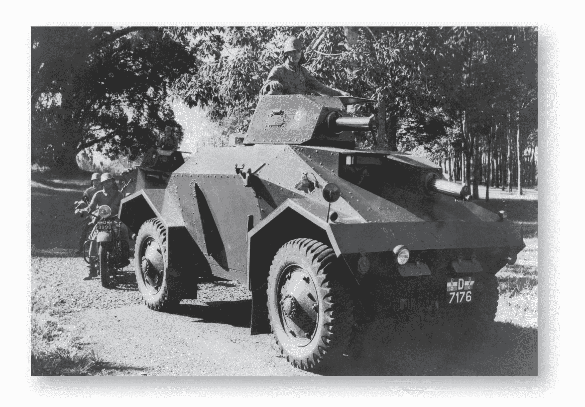

在人员兵力和武器装备方面，荷兰荷民印度军的一个步兵团在大多数方面都可以与其日本对手相提。然而，荷兰荷民印度军在榴弹发射器以及营级和团级 artillery 方面明显弱得多（参见表 3）。荷兰荷民印度军和日本陆军炮兵团的实力差别并不大。一个荷兰荷民印度机炮兵团配备了 24 门 7.5 厘米炮和 12 门 10.5 厘米榴臼。一个日本炮兵团有 36 门 7.5 厘米炮。至于坦克，日本方面明显占据优势。在爪哇岛，他们部署了 91 辆中型和轻型坦克，而同盟军仅有 40 辆轻坦克，其中包括荷兰荷民印度军的 7 辆`Marmon-Herrington CTLS-4TA`坦克和 17 辆`Vickers-Carden-Loyd M1936`轻坦克，以及英国军的 16 辆`Vickers-Armstrong Mk VIB`轻坦克。

1927 年，荷兰皇家海军在荷兰荷民印度建立了一个至少两艘巡洋舰、八艘驱逐舰和 12 艘潜艇的实力。用战列舰、战巡或重巡洋舰加强舰队的计划在海军内部引发了激烈讨论。并没有共识。1938 年，提交了一份建造三艘战巡等在舰队计划，但未实施。1941 年，荷兰荷民印度存在以下船只：两艘轻巡洋舰、一个驱逐队长、七艘驱逐舰和 15 艘潜艇。海军航空（`Marine Luchtvaart Dienst`）拥有 59 架飞艇（`Dornier Do24K`和`Consolidated PBY Catalina`）和八架战术侦察机。

五名处于射击位置的重武装荷民印度士兵。右上角是一个机枪小组，由射手和助手组成，操作着短管 06.5mm`Madsen M15`步兵机枪（`karijnmitilleur`）。前景的两名士兵配备了 9mm`Schmeisser MP28/II`（KNIL M39`）冲锋枪。右上角的士兵戴着防毒面具。（Beeldbank WW2 – NIOD）

荷兰荷民印度群对外敌的防御存在结构性弱点。1930 年，6000 万当地人口在政治、行政和经济上由 24 万欧洲人支配。1940 年 5 月由于荷兰的支持，欧洲人的地位被削弱。美国作战司令长哈尔德·R·斯塔在 1940 年 11 月 12 日的备录中表示：“这种局势不能被视为稳定的。统治者没有母国或盟友的支持。土著叛乱过去发生过，未来可能再次发生。”一位退役校在 1940 年 7 月 23 日的荷兰荷民印度报纸上表示，“大多数人口，尤其是爪哇岛的，可以被认为是完全忠诚并依附现有当局的，正如它现在被建立和组织的那样。”这种观点被证明是*执念*。荷兰殖民国家及其军队本质上是一支缺乏内部社会支持的占领军。在较大范围内，其他地区以及爪哇岛，殖民统治的崩溃导致了严重的抢劫和纵火，印尼人趁机而动。

### 盟友

正如 1941 年 2 月英-荷-澳参谋会议达成的共识并记录在 1941 年 11 月 12 日的《海军空军部署计划》（`PLENAPS`）中一样，战争爆发后澳大利亚向荷兰荷民印度的望汶岛和提汶岛派遣了航空部队。澳大利亚皇家空军第 13 中队在望汶岛和布鲁岛的纳姆莱部署了轻型轰炸机和岸基侦察机。在提汶岛的 Penfoei 机场驻扎了皇家空军第 2 中队的一个飞行队。出于安全考虑，由澳大利亚第 8 师第 23 步兵旅组成了三个营级战斗群：拉克部队（负责拉巴尔、新不列丹岛）、鸥部队（负责望汶岛）和雀雀部队（负责提汶岛）。通过这些部队，澳大利亚形成了一条“前哨观察线”。

这些澳大利亚部队是全自愿第二澳大利亚帝国军（`2nd AIF`）的一部分。在荷兰荷民印度的部署中，他们缺乏重武器。此外，他们既没有经过丛林战的训练，也没有相应的装备。士兵穿着短裤，这在热带条件下植被茂密的地形中是不适的。膝盖和腿部的擦伤会导致热带溃。疟疾预防几乎无从谈起。结果是病率极高，战斗力下降。与当地荷兰荷民印度军指挥的指挥关系不尽如人意。

1942 年 2 月，一支由爪哇的澳大利亚部队和散兵组成的临时步兵旅团成立了：`Blackforce`（黑力部队）。`A.S. Blackburn` 准将重组了三个步兵营和一个后勤营（约 2,800 人），并增援了来自`美国第 131 野战兵团第 2 营`的两个炮连，以及英国`第 3 皇家自己的冲骑兵团 B 连`（`B Squadron`），后者配备了 16 辆`Vickers-Armstrongs Mk VI`轻型坦克。这些营仅配备了轻型步兵武器，拥有三门弹药储备有限的迫击炮以及一些反坦克步枪。`Blackforce`缺乏反坦克炮和反坦克地雷，还缺少野战救护车。相比之下，增加了一支英国信号连。该部队的核心成员曾在叙利亚获得过战斗经验。

直到新加坡沦落不久前，英国才派遣兵力。荷属东印度群的英国军队大部分并非援军，而是从马来亚撤回的部队。由于日本军进攻马来亚以及对新加坡周边机场的空袭，`RAF`英国空军）和`RAAF`澳洲空军）中队从 1942 年 1 月 16 日起撤往苏门腊和爪哇。英国防空炮被部署用于地面防空。

在失去苏门腊后，剩余的英国军队在爪哇进行了重组。他们由作为`West Group`或`BRITAIR`及侦小组部分的`RAF`和`RAAF`中队，以及英国`第 16 防空旅`和`第 3 皇家自己的冲骑兵团 B 连组成。2 月底，四个个配备雷达设施的`航空部实验站 (AMES)`单位投入了运行。2 月下旬，皇家海军贡献了联合打击部队。

美国提供了从菲律宾撤离的`美国陆军远东空军 (FEAF)`和`亚洲舰队`。`FEAF`首先被撤到澳大利亚北部的达文，但随后在 12 月部署到东爪哇。在爪哇的`FEAF`最终将由配备现代飞机的`第 5 轰炸机司令`和`拦截机司令`组成。`拦截机司令`负责东爪哇的防空。

`亚洲舰队`的舰船成功参与了该群岛的海上防御。1941 年 12 月 23 日 24 日，`第 10 巡逻队`从菲律宾撤回，八架`美国海军卡提娜`水上飞机移往下龙和安汶。

1942 年 1 月 11 日，`第 26 野战兵团司令部`和`第 131 野战兵团第 2 营`从美国抵达泗水（作为`彭萨拉护队`的一部分）。后者是`德克萨斯州国民卫队`的一个野战兵团，于 1940 年底动员。他们满员抵达爪哇，但机动运输工具只有一半，且没有 14 挺直属的`.50 口径`重型机枪。该部队在离开美国前不久还配备了 12 门`M2A2 75mm`牵引炮。新火炮尚未进行过射击演习。在送来的 8 套美国`SCR-268`雷达仪中，有两套在 1942 年 1 月底处于工作状态。

# 战斗序列

## 日本军

### 南方军（竹内支一大将）

#### 第十六军（今村直志中将）

- `第 2 师（丸山正义中将）`
  - `第 4 步兵团`
  - `第 16 步兵团`
  - `第 29 步兵团`
  - `第 2 侦察团`
  - `第 2 野战兵团`
  - `第 2 工兵团`
  - `第 2 运输团`
  - 信号、弹药和医疗部队
  - 总计：13,755 人，1,335 匹马和 586 辆机动车

- `第 38 师（佐野忠义中将）`
  - `第 239 步兵团`
  - `第 38 山炮兵团`
  - `第 38 工兵团`
  - `第 38 运输团`
  - 信号、弹药和医疗部队
  - 总计：12,360 人，1,910 匹马

- `东别遣队（伊藤武雄少将）`
  - `第 228 步兵团`
  - `装甲汽车车队`
  - `第 38 山炮兵团第 2 营`
  - 信号、弹药和医疗部队
  - 总计：5,300 人，400 匹马和 110 辆机动车

- `庄司别遣队（庄司寿茂上佐）`
  - `第 230 步兵团（减员）`
  - `第 4 坦克团第 1 连`
  - `第 38 山炮兵团第 3 营`
  - 信号、弹药和医疗部队
  - `机场部队（核心为第 24 机场大队）`
  - 总计：约 3,000 人

- `第 48 师（土桥义通中将）`
  - `第 1 台湾步兵团`
  - `第 2 台湾步兵团`
  - `第 47 步兵团`
  - `第 48 侦察团`
  - `第 48 山炮兵团`
  - `第 48 工兵团`
  - `第 48 运输团`
  - 信号、弹药和医疗部队
  - 总计：12,893 人，975 匹马和 784 辆机动车

- `第 56 混兵团 A 队（坂口静夫少将）`
  - `第 16 步兵团`
  - `第 56 混兵团`
  - `第 38 山炮兵团第 2 营`
  - 总计：5,200 人

#### 第十六军

- `第 56 混兵团`
- `第 16 步兵团`
- `第 2 坦克团`
- `第 17 步兵团`
- `第 16 防空团`
- `第 23 防空团`
- `第 15 工兵团`
- `第 28 运输团`

#### 第三支队（菅支中将）

- 第十六军
- 南方击击队（近藤信信）
- 主力部队
  - `第 16 巡洋舰`
  - `西方攻击队`
  - `第一护卫队`
  - `第 2 基地部队`
  - `第一基地部队`
  - `第 2 航空队`

#### 第 11 空军（西冢三郎）

- `第 21 航空飞行队（多田雄）`
  - `鹿儿巢航空队`
  - `德冈航空队`
  - `第一航空队`
  - `1001 中队`
- `第一横须特别陆战部队`
- `第三横须特别陆战部队`

# 第二空袭轰炸机（第 23 航空飞行队）（竹田龙造少将）

- `高冈航空团`（61 架海军陆 1 式型陆基攻击机）
- `南丹航空团`（约 12 架海军陆 0 式型战斗机）
- `第 3 航空团`（约 20 架海军陆 0 式型战斗机）

## 舰载航空部队（第 2 航空母舰）

### 潜艇部队 A

- `潜艇部队 A`
  - `第 6 潜艇中队`

### 潜艇部队 B

- `潜艇部队 B`
  - `第 5 潜艇中队`（来自马来部队）

## 第 11 航空群

第 11 航空群由第 21、第 22 和第 23 航空飞行队组成。第 22 航空飞行队被分配给`马来部队`。其指挥官为松永佐一少将。它由以下部队组成：

- `现山航空团`（36 架陆基攻击机）
- `美幌航空团`（36 架陆基攻击机）
- `山田部队`（30 架海军陆 0 式战斗机，六架海军陆 98 式侦察机）

## F 支队（川口支队）

英属波罗洲被分配给`F 支队（川口支队）`。该支队在波罗洲西北部行动，代号为`B 作战`。该部队是法属印度支第 18 师的一部分。该师受南方军直接控制。

### F 支队（川口支队）（川口清少将）

- `第 124 步兵团`
- 信号、弹药和医疗部队
- `第 2 横须贺特殊登陆部队`

## 荷兰东群岛

### 荷荷陆军（1941 年 12 月动员后的编制）

#### 总司令

#### 爪哇军

- `第 1 师`、`第 2 师`、`第 3 师`、`第 1 侦察中队`和`第 2 侦察中队`（荷荷陆军军事航空队）

#### 军事航空队

- `军事航空司令`（机场、无线电站、第 1 至第 5 航空团、`第 4 侦察中队`、`安汶第 2 空军司令`、`三民达第 2 空军司令`、`新加望第 2 空军司令`以及军事航空监察局）

#### 领土司令

- `亚齐`和`东苏门腊`、`西苏门腊`、`廖内及附属岛`、`打咯`和`万比`、`西波罗洲`、`南波罗洲`、`苏望腊和曼那`、`帝汶`、`摩卢喀群`

#### 部队司令

- `打拉干`、`巴立望板`、`三民达`

### 荷荷陆军兵力

| **爪哇军** | **93,947** |
| :--- | :--- |
| 第 1 师 | 16,782 |
| 第 2 师 | 11,924 |
| 第 3 师 | 15,361 |
| 海岸分遣 | 1,330 |
| 其他领土部队 | 11,300 |
| 支持部队 | 28,000 |
| 航空、医疗 | 3,250 |
| 印度尼西亚民兵 | 6,000 |
| **外地区** | **19,250** |
| 苏门腊 | 9,920 |
| 廖内和邦打 | 690 |
| 波罗洲 | 3,400 |
| 苏拉威锡 | 3,050 |
| 安汶 | 1,640 |
| 帝汶 | 550 |
| **总计** | **113,197** |

### 爪哇军（截至 1942 年 2 月 22 日）

#### 总司令（H. ter Poorten 中将）

#### 战略储备队

- `第 2 步兵团`（第 9 步兵营；第 14 步兵营；第 15 步兵营；`第 2 步兵团第 10 连`；`第 2 反坦克防空连`）
- `第 1 山地炮营，机动部队`8
- `第 1 侦察中队 (MAS)`和`第 2 侦察中队`（荷荷陆军军事航空队）

#### 西部群（W. Schilling 少将）

- `第 1 步兵团`（第 10 步兵营；第 11 步兵营；第 12 步兵营；`第 1 步兵团第 10 连`；`第 1 反坦克防空连`）
- `黑手部队`（第 1 步兵营；第 2 步兵营；第 3 步兵营（减员）；`美国第 2 营，第 131 野兵团团`（减员）；`英国第 3 国王皇家骑兵团 B 连`）
- `第 1 骑兵中队`、`第 5 骑兵中队`、`第 1 榴榴弹营`、`第 1 工营`
- `雅加达-丹绒普里奥海岸线`

#### 楠贡群（J.J. Pesman 少将）

- `第 4 步兵团`（第 1 步兵营；第 2 步兵营；第 5 步兵营；`第 4 步兵营`（增员）；`第 4 步兵团第 10 连`；`第 4 反坦克防空连`）
- `第 2 骑兵中队`、`第 2 山地炮营`、`第 2 野兵团`、`第 7 山地炮`

#### 第 2 师（P.A. Cox 少将）

- **南部群**（第 21 步兵营左半，第 21 步兵营右半，`Negoro 步兵团`）
- `第 4 骑兵中队`、`卫队骑兵中队`、`第 4 工营`（减员）
- **海岸分遣**：`第 4 骑兵中队`、`卫队骑兵中队`、`第 4 工营`（减员）
- **雅加达-丹绒普里奥海岸线**：`第 4 骑兵中队`、`卫队骑兵中队`、`第 4 工营`（减员）
- **海岸分遣**：`第 4 骑兵中队`、`卫队骑兵中队`、`第 4 工营）

#### 第 3 师（G.A. 少将）

- `第 2 步兵团`（第 9 步兵营；第 14 步兵营；第 15 步兵营；`第 2 步兵团第 10 连`；`第 2 反坦克防空连`）
- `第 1 山地炮营，机动部队`
- `第 1 侦察中队 (MAS)`和`第 2 侦察中队`（荷荷陆军军事航空队）

#### 西部群（W. Schilling 少将）

- `第 1 步兵团`（第 10 步兵营；第 11 步兵营；第 12 步兵营；`第 1 步兵团第 10 连`；`第 1 反坦克防空连`）
- `黑手部队`（第 1 步兵营；第 2 步兵营；第 3 步兵营（减员）；`美国第 2 营，第 131 野兵团团`（减员）；`英国第 3 国王皇家骑兵团 B 连`）
- `第 1 骑兵中队`、`第 5 骑兵中队`、`第 1 榴榴弹营`、`第 1 工营`
- `雅加达-丹绒普里奥海岸线`

#### 楠贡群（J.J. Pesman 少将）

- `第 4 步兵团`（第 1 步兵营；第 2 步兵营；第 5 步兵营；`第 4 步兵营`（增员）；`第 4 步兵团第 10 连`；`第 4 反坦克防空连`）
- `第 2 骑兵中队`、`第 2 山地炮营`、`第 2 野兵团`、`第 7 山地炮`

#### 第 2 师（P.A. Cox 少将）

- **南部群**（第 21 步兵营左半，第 21 步兵营右半，`Negoro 步兵团`）
- `第 4 骑兵中队`、`卫队骑兵中队`、`第 4 工营`（减员）
- **海岸分遣**：`第 4 骑兵中队`、`卫队骑兵中队`、`第 4 工营`（减员）
- **雅加达-丹绒普里奥海岸线**：`第 4 骑兵中队`、`卫队骑兵中队`、`第 4 工营`（减员）
- **海岸分遣**：`第 4 骑兵中队`、`卫队骑兵中队`、`第 4 工营）

# 南方面军作战计划与岩国协定

## 注意事项

## 敌计划

### 日本方面

直到 20 世纪 30 年代后半叶，荷属东印度群才引起日本武装力量的兴趣。1940 年 5 月德国占领荷兰后，日本陆军（`IJA`）和日本海军（`IJN`）开始研究针对美国、英国、荷兰和中国四个敌人的同步作战。在缓慢起步后，这一进程在 1941 年 4 月开始加速。现在很清楚，荷属东印度群的和平投降是不可能的。到 1941 年中，具体的计划已经形成。

`IJN`计划了“顺时针进军”。该计划设想用两个师团在两个月内从北部征服菲律宾。随后用两个师团夺取爪哇岛。接着，将从苏门答腊向南、从马来亚向北进行包围，攻取新加坡。另一方面，`IJA`倾向于“逆时针进军”。他们希望通过快速推进夺取新加坡。这将阻挡英国的援军，并显著缩短整个行动的周转时间。这次攻击将与对菲律宾的进攻同时进行。这意味着将对马来亚和菲律宾两个侧翼同时进攻，随后在爪哇岛会合。

在 1941 年 11 月 10 日的东京协定中，南方军一方面，联合舰队和南方作战另一方面，在纸面上制定了他们的计划。在岩国协定中，双方武装力量就菲律宾和荷属东印度群达成了共识。`IJN`分配负责顺时针进军，`IJA`负责逆时针进军。

在此之前，1941 年 10 月 10 日，`IJA`告知昭和天皇，大约在五个月（150 天）内可以夺取南部大部分关键地区。这一日期随后被确定。`IJA`和`IJN`同意了表 7 中给出的进攻荷属东印度群的时间表：代号为`H 作战`。

南方进攻（`A 号作战`）的主要目标和核心是征服荷属东印度群的油井和炼油厂。荷属东印度战役很大程度上取决于日本在东南亚其他地区行动的成功。这主要基于对夏威夷美国舰队的奇袭攻击的结果。美国战斗群（1941 年 2 月 1 日重组为美国大西洋舰队和太平洋舰队）迁往夏威夷被美国人认为是一个巨大的威慑，但也使这支舰队进入了日本舰队的攻击范围。这次攻击本应使太平洋舰队至少瘫痪六个月。太平洋舰队将无法再阻止对东南亚的征服。作战计划随后规定征服并利用马来亚、英属波罗洲和菲律宾作为进攻荷属东印度群的跳板。因此，日本对这些地区攻击的成功是征服`NEI`的前提条件。这些行动以进一步的方式影响了荷属东印度战役。大部分派遣荷属东印度群的`IJN`和`IJA`单位被部署在之前在中国和菲律宾的任务中。只有在攻占香港和马尼拉后，这些部队才能投入使用。整个南方进攻的结果将取决于陆、海、空部队之间的广泛协调。

在针对荷属东印度群的行动中，不存在奇袭的问题。毕竟，这种可能性已经随着对马来亚、英属波罗洲和菲律宾的行动而消失殆尽。此外，爪哇在此期间可能收到了美的援军。巨大的距离是另一个复杂因素。许多依赖关系使得南方进攻成为一项极具风险的行动。另一个风险是日本经常根据错误的情报制定作战计划。

日本并不看好`RNEI`陆的战斗力。特别是土著部队被认为缺乏战斗精神。他们预计将在大约一周内征服爪哇岛。

**表 8：日本作战行动代号**

| `A 号作战` | 南方进攻 |
| :--- | :--- |
| `B 作战` | 英属波罗洲 |
| `E 作战` | 马来亚 |
| `H 作战` | 爪哇岛 |
| `L 作战` | 万邦加岛和民雳榜 |
| `M 作战` | 菲律宾 |
| `Q 作战` | 关打丹登陆，已取消 |
| `S 作战` | 登咬（Endau）登陆，已取消 |
| `T 作战` | 入侵苏门答腊 |
| `Z 作战` | 针对爪哇的空战 |

### 荷属东印度

从 1913 年开始，荷兰就将日本视为潜在敌人。日本追求政治和经济扩张，并拥有为此的手段——强大的舰队和军队。荷兰预计，日本扩大势力范围的企图无法在亚洲大陆实现。因此，他们已经考虑到“日本将转向南方”。

荷属东印度群岛由许多岛屿组成的长链组成。为了防御这个群岛，保持制空权和控制海路至关重要。强大的空军和舰队可以防止敌人获得空海基地。群岛巨大的距离和破碎的形状阻了协调的陆地防御。这为具有海空优势的攻击者提供了夺取另一个岛屿上的支撑地点来中化防御严密的岛屿的机会。爪哇是主岛也是`NEI`的行政中心，拥有的人最多。它的岛屿形状狭窄细长。其战略位置遍布整个岛屿。行政中心在西爪哇，海军基地在东爪哇。这要求坚实的防御，但同时也使得对主岛的集中防御变得极其困难。

直到 1900 年左右，`NEI`的防御一直基于爪哇岛的防御。1927 年建立了新的《防御原则》（`Defensiegrondslagen`）。这一新的防御理论在两个关键领域与之前的理论相决裂。保护荷属东印度群不再侧重于防御，而是维持中立。荷属东印度群不再担心旨在征服的攻击；而是要防范“致命击”（`coup de main`）。因此，防御计划的主要目的是维持荷兰在`NEI`殖民地的权威。与旧计划相比的第二点是防御不再局限于爪哇岛。外围地区也被纳入理论中。由于达拉干（Tarakan）和巴西里巴板（Balikpapan）的石油开采和精炼，那里被确定为特别脆弱的地点。`RNEI`陆军负责在荷兰皇家海军的支持下维持爪哇岛的中立。在外围地区，这项任务分配给海军，并在某些地点由陆军支持。如果`NEI`意外卷入大国之间的武装冲突，将进行抵抗，直到获得外国盟友或盟友的援助。事实上，通过 1927 年《防御原则》，荷兰承认了他们没有手段独立对抗日本侵略成功防御荷属东印度群。

1927 年的《防御原则》在威胁评估以及最终对外国（即英国和美国）支持的依赖方面存在严重缺陷。来自所谓联盟的支持超出了荷兰东群岛的控制范围。据说 1921–1922 年的华盛顿会议缓解了太平洋地区的紧张局势，但根据`RNEI Army`的说法，事实远非如此。双方同意的对海上基地建设以及新加坡海军基地开发的限制性部分禁令，反而增加了荷兰东群岛的战略重要性。然而，保护荷兰东群岛对英国和美国来说都不是首要任务。首先，英国的重点在远东的印度和新加坡；其次，英国缺乏所需的资源。由于欧洲爆发了战争，它无法向新加坡派遣一支大规模海军力量。至此，英国在远东的防御基石被移除了。英国的地位如此虚弱，根据历史学家 H.P. Willmott 的说法，“英国人并不认为将荷兰人视为面对共同威胁的弱小盟友（即一个需要帮助的盟友），而是将其视为一种在巩固英国自身地位时可以被利用的支持力量”（1982，p. 121）。美国的优先事项清单上包括珍珠港、澳大利亚、菲律宾以及让民族主义的中国处于战争状态。对于这两个盟友来说，澳大利亚对于收复东南亚至关重要。最终，荷兰东群岛被留自自为生。

## RNEI Army 所在地

`RNEI Army`领导层不同于 1927 年《防御原则》的假设。如果太平洋爆发战争，由于海军基地和油田的存在，`RNEI Army`预计将面临针对爪哇的征服进攻。考虑到群岛规模和可用资源，`RNEI Army`领导层选择对以下地区进行领土防御：

1. 政府所在地、海军基地以及陆海军关键机构的爪哇；
2. 外岛的海军和航空支援中心；
3. 涉及战略原材料提取的主要区域。

`RNEI Army`制定了一套利用水平轰炸机在宽度和深度上进行间接海岸防御的作战理论。空军是第一道防线，旨在阻止敌方运输舰队到达爪哇。海军形成第二道防线，陆军则是第三道。轰炸机旨在攻击运送登陆部队的运输船，而非日本军舰。“只有登陆部队才能占领我们群岛的支撑点。军舰绝不行！……军舰要用军舰作战，而不是用飞机。”10 这表明，空军的全部潜力尚未完全实现。

所需的机场建设在外岛地区。这些机场形成了三道防线。外防线从苏门答腊的望邦和棉目腊，跨越婆罗洲的打拉干和苏拉威岛的兰戈安（曼纳多），一直到西新几内亚的巴博。第二道防线由苏门答腊的`Pakan Baroe`机场、婆罗洲的`Singkawang II`和`Samarinda II`、苏拉威岛的`Kendari II`、`Ambon II`以及结束于提汶尔岛库班的机场组成。苏门答腊的`Palembang I Airfield`、爪哇的机场以及巴厘岛的`Den Pasar`形成了最后的抵抗线。在和平时期，机群驻扎在爪哇。向外岛分配飞机是临时性的，且基于借调原则。

荷兰皇家海军认为，军事航空局的新角色与 1927 年的原则相矛盾。它指出机场可能被敌军占领并用于进攻爪哇的风险。`RNEI Army`计划通过在内陆而非沿岸建设机场来降低这种风险，并在必要时为摧毁它们做准备。部分机场是秘密建设的。很长一段时间，日本人并不知道`Singkawang II`、`Samarinda II`和`Palembang II`机场的存在。然而，事实证明海军的判断是正确的。

1940 年后，外岛许多支队的首要任务变成了防御机场和或油港及石油设施。维持秩序和和平变成了次要任务。许多支队被解散或缩小了规模。在 1941 年动员后，对机场的直接防御以统一的方式组织。这包括两个到三个配备机枪的掩体，用以覆盖机场并用轻机枪对付空中目标；三辆配备轻机枪的装甲人员运兵车（`overvalwagen`）；三到四个步兵旅（每个由 15 人的小组组成）。机场将作为最后的堡垒。1935 年，野战团尽管编制和装备经过了调整，但从爪哇转移到了石油岛打拉干（第 7 步兵团）和石油港巴里木巴板（第 6 步兵团）。如果需要，这些关键地点要点将被摧毁，以防止它们落入进攻者手中。随后，陆军将进行游击战。众多小型、分散且孤立的守军没有获得外部援助的机会。他们将被优势的日本军队绕过或击溃。

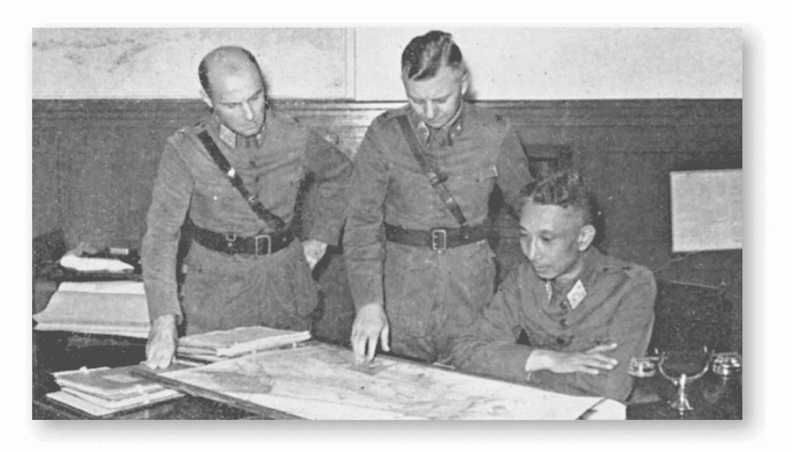

`RNEI Army`总参谋 R. Bakkers 上校于 1941 年 12 月坐在战争部的办公桌前，从左到右是副长 W.P. van Veen 中校和第三处长 P.G. Mantel 中校。Bakkers 上校于 1942 年 2 月 19 日被升为少将。动员后，办公期间的白色便服被灰绿色野战服取代。（布贝克博物馆）

根据 1927 年《防御原则》，1935 年`RNEI Army`计划在战争爆发后将大部分陆军集中在爪哇岛，以防御该岛东部的泗水海军基地。然而，在 1941 年，`RNEI Army`拒绝了这一做法。1939 年和 1940 年欧洲的战争模式导致`RNEI Army`指挥部得出结论：“必须考虑到快速行动，在多个地点同时进行，通过机械化和机械化力量有力且快速地突破对手选择的一个（或多个）点”。因此，爪哇陆军必须由部署在爪哇西部、中部和东部队组成，以执行快速、决定性的反击。这需要陆军进行大规模的机械化和机械化。其次，对海岸和内陆的领土力量进行重大加强是必要的。

`RNEI Army`军指挥部确定了防御爪哇的三个关键地点：

1. 陆海军基地，即万隆和泗水；
2. 首都和政府所在地雅加达以及丹绒奥克港；
3. 南岸的主要港口井拉恰普。

# 爪哇岛防御

爪哇岛的防御是基于间接沿岸防御，并在三个主要港口实施直接沿岸防御。这三个关键要点主要通过直接沿岸防御以及可能的进攻路线上的阵地进行防御。在从西爪哇岛通往加达的道路上、在连接普里让高原与万隆市的所有通达道路上、在井勒汶与三宝汶之间爪哇岛狭窄地带的南北道路上，以及通往泗水的道路上，都建造了适用于全方位防御的反坦克防御阵地。泗水周围建造了一个延伸阵地。其次，上述关键要点的机动防御将由四个配备辅助武器的团执行。依托当地的防御，机动部队将尽可能采取进攻姿态进行行动，并通过对任何登陆的敌军进行反击来保卫关键要点。

1940 年后，直接沿岸防御系统得到了扩展，在三宝汶、佩卡农和德加尔港口增加了火炮和沿岸阵地。然而，为此能提供的资源非常有限。

在爪哇岛，还计划在常规战斗失败后执行游击战。然而，对此并未做多少准备。

## 盟国

### 1940–41 年参谋会议

随着来自日本威胁的增加，西方强国对相互咨询的需求也随之增加。1940 年底和 1941 年，这导致在新加坡、雅加达和马尼举行了英荷、英美以及英荷澳多国参谋长级会议。这些会议仅限于军事层面的讨论。美国当时处于中立地位，且不愿或无法做出任何具体的承诺。英国和荷兰在 1940 年成为盟友，但英国并未保证在遭受日本攻击时援助荷兰荷属印度群岛。荷兰本身在 1940 年后在亚洲也采取了中立路线。这一切都解释了为什么西方强国未能未能达成政治协议。

在参谋会议上，双方达成协议，将在遭受日本攻击时在作战层面进行合作。西方强国在缺乏海事资源的情况下，规划了远东地区的主要防御行动。他们认为不太可能同时发生日本的大规模行动。针对日本，确定了四种方案。在方案 B 下，英国人在遭受马来亚攻击后将获得荷兰的军事支持。荷兰强调了新加坡的战略意义，并提供了海军和空军用于防御。军事航空队将提供一个三个轰炸机中队（27 架飞机）和一个战斗机中队，而荷兰皇家海军将提供六至八艘潜艇为此。荷兰水面舰队将用于往返新加坡的护队保护。双方同意，为了阻止日本进入婆罗洲岛和荷属印度群岛，将守住北婆罗洲、北苏拉威西和安曼汶。针对荷兰的这些承诺，澳大利亚表示将为安曼汶和帝汶提供空袭部队和陆军部队。

并未建立联合多国总部。最多只是交换了联络官。不存在进行大规模多国演习的问题。

### 统一指挥部（ABDACOM）1942 年

太平洋战争爆发后，新结盟的首相温斯顿·丘吉尔和总统富兰克林·D·罗斯福于 1941 年 12 月 22 日至 1942 年 1 月 1 日在华盛顿特区的阿拉卡迪会议上会面。在此期间，盟国在欧洲和亚洲的战争达成了基本协议。战争目标在《国家宣言》中得以制定。政府首脑进一步承诺遵循“德国优先”原则。丘吉尔和罗斯福决定建立一个共同的英美军事咨询机构：联合参谋长会议（CCS）。

ABDACOM 的第一次会议于 1942 年 1 月 10 日在雅加达的荷兰海军指挥官（`Commandant Zeemacht`）的正式官邸举行。桌子顶端是 E.T. Kengen 上校（军事航空队）。他的右侧是 A.H.W. von Freytag Drabbe 中将（荷兰皇家海军，站立）、L. Darvall 飞行群队长（英国皇家空军）、I.S. Playfair 少将（印度陆军）、H.R. Pownall 中将、A.P. Wavell 将军、G.H. Brett 中将（美国陆）、L.H. Brereton 少将（美国陆军航空队）、J.E. Hewitt 空军准将（澳大利亚皇家空军）、C.S. Burnett 空军上将（澳大利亚皇家空军）、J.J.A. van Staveren 少将（荷兰皇家海军）、A.F. Palliser 少将（英国海军）、G. Layton 中将（英国海军）、C.E.L. Helfrich 海中将（荷兰皇家海军）、T.C. Hart 海将（美国海军）、W.R. Purnell 少将（美国海军）、H. ter Poorten 中将（荷属印度群岛陆军）和 P.G. Mantel 上校（荷属印度群岛陆军）。在这次会议上做出了战略和组织决策。（Beeldbank WW2 – NIOD）

太平洋被视为次要战场。那里的原则变成了“守住领土”。美国陆军参谋长乔治·C·马歇尔将军提议，以联合多国（联合）总部的形式在西南太平洋地区实行统一指挥。考虑到作战区域的广阔，英国人对这种总部的有效性表示怀疑。然而，他们最终不情愿地同意了。英国将阿奇伯·P·韦尔被美国人推荐为最高司令官。

联合总部命名为 ABDA 司令部（ABDACOM），也称为统一指挥部。11

ABDACOM 的使命是防御马来屏障（马来亚、爪哇岛、苏门腊），留住缅甸和澳大利亚，恢复与吕宋（菲律宾）的联系。

ABDACOM 在现有的军种指挥之上建立了一个国际指挥链。ABDACOM 按照英国模式组织，设有多国（联合）空军、海军和陆军总部：`ABDA-AIR`、`ABDA-FLOAT`和`ABDA-ARM`。这意味着荷属印度群岛陆军和荷兰皇家海军失去了具有战略侦察能力的空军。相反，情报集中在联合作战情报中心（COIC）。由于指挥部内各个陆地块的位置分散，`ABDA-ARM`意义不大。各军自顾自为。ABDACOM 并未实际控制菲律宾。最高司令官本人关注的是保卫新加坡。他很少考虑管辖区域中部和东部的发展。

A.P. Wavell 将军于 1942 年 1 月 10 日抵达雅加达。左侧是英国领事长 H.F.C. Walsh，右侧（背对镜头）是 H. ter Poorten 中将，而面向镜头的是 T.C. Hart 海将（美国海军）。韦尔是一位经验丰富的军官和指挥官，曾任中东司令部总司令，现任印度总司令。作为 ABDACOM 的最高司令官，他的决策并不顺利。他在新加坡消耗了宝贵的资源，并在需要空军增援的地方派遣了陆军。由于他关注新加坡，他几乎没有使用任何资源来应对日本在印度尼西亚群岛中部和东部的扩张。（Beeldbank WW2 – NIOD）

荷兰和澳大利亚在参员会议期间曾是重要的伙伴。这种关系随着亚洲战争的爆发而立即结束。战略政策变成了英美之间的事务，由美国人领导。荷兰、澳大利亚以及新西兰政府被刻意地未征求意见，而是被告知一个**既成事实**（`fait accompli`）。这不仅适用于该机构，也适用于人事任命。所有主要指挥职位都由英国或美国军官担任。只有 `ABDA-ARM` 留给了一个荷兰人：陆军司令官 `H. ter Poorten`。这显然表明该指挥部的重要性。这种局面导致了与澳大利亚和荷兰之间的紧张局势。

1942 年 1 月初，应英国要求，决定将澳大利亚第 1 军团（由澳大利亚第 6 陆师和第 7 陆师组成）和英国第 7 装甲旅团从中东调往荷兰东属群岛。`Wavell` 将一个师部署在南苏门答腊，一个师连同坦克旅部署在爪哇中爪。随着新加坡陷落在即，`Wavell` 决定将这些援军转移到缅甸。显而易见，随着新加坡的陷落，保卫印度成为他的首要任务。澳大利亚的政治和军事领导层不再支持英国的这一意图。澳大利亚需要自己的军队。1942 年 2 月 19 日，`CCS` 决定不再向爪哇派遣进一步的陆陆援。然而，一些澳大利亚和英国部队仍在那里登陆。

问题在于，计划中向爪哇增援的陆军是否能阻止日本人的进军——更不用说这些部队是否能及时作战。鉴于日本的海空力量，只有通过大规模增援盟军的空海资产才可能保卫荷兰东属群岛。然而，足够的飞机并不可用，而美国人又不愿在西太平洋冒险其美国太平洋舰队。

## 日本南方攻势

日本南方攻势发生在雨季，当时亚洲大陆上空存在高压系统，导致北半球出现东北风和南半球出现西北风。湿季风带来了来自南中国海和太平洋的潮湿空气，并在下午带来强降阵雨。雨水和低能见度使航空行动变得困难。大气干扰阻碍了飞行移动并导致无线通信不良。植被主要由热带丛林组成。少数大城市就像是丛林中的岛屿。道路网络极其有限。爪哇是一个例外。主岛拥有完善的现代道路网以及铁路和电车线，连接十分良好。

## 战役

### 第一阶段行动

1941 年 12 月 7 日至 8 日，日本发起了“**甲号作战**”（`Operation A-Go`），对美国和英国的资产发动了同步的大范围进攻。尽管没有受到直接攻击，荷兰仍于 1941 年 12 月 8 日对日本宣战。根据参员会议的协议，`NEI Military Aviation Service` 将一个航空机群（联队）和一个战斗战斗机中队派往马来亚。荷兰皇家海军派遣了一艘轻巡洋舰和潜艇。这些部队被置于英国的作战指挥之下。除了军事航空局和荷兰皇家海军的重大贡献外，`RNEI Army` 还派遣了四支旅（等同于营）的 `Marechaussee Corps`，这是一支来自亚齐、专攻反游击战的步兵单位。他们于 1942 年 1 月和 2 月部署在马来亚日军后方。其规模约为 `c`. 142 人，包括印度尼挑夫。在采取一些成功行动后，部分遣队于 1942 年 3 月成功返回苏门答腊。

在日本在泰国和北马来亚登陆后，船运资源开始用于“**乙号作战**”（`Operation B`）：征服英属婆罗洲。`F 支队（川河口支队）`于 1941 年 12 月 16 日从印度支那在美里登陆，并于 1941 年 12 月 24 日在古晋登陆。`RNEI Army` 将此视为严重威胁，并用军事航空的轰炸做出回应。荷兰皇家海军派遣潜艇对抗日本在古晋的两栖作战。这些攻击造成了相当损失，但未能阻止日本人的进军。

菲律宾民兰老岛的港口城市达沃于 1941 年 12 月 20 日被占领，南部的若洛也于 1941 年 12 月 25 日跟进。随着古晋、达沃和若洛被占领，进攻荷兰东属群岛的基地已落入日本人手中。最初计划的帕拉奥，地理位置优越且更大的达沃成为了“**丙号作战**”（`Operation H`）的集结点。当针对马来亚和菲律宾的行动仍在进行之际，`IJN` 于 1941 年 12 月 26 日转向第二阶段行动，即进攻荷兰东属群岛。婆罗洲岸边的石油岛塔拉干和北苏门答腊的望加是首批攻击的目标。

古晋、达沃和若洛机场的状况远比预期。海军建设部队需要更多时间来准备这些基地。达沃和若洛直到 1942 年 1 月 8 日才完全可用。尽管有这些延迟，日本南方军仍希望将爪哇的进攻提前一个月。它试图利用行动的有利进展，保持势头，并领先于美国海军和英国皇家海军可能的援军。鉴于被占领机场投入使用的的延迟，以及可用运输舰和海军护卫舰的数量有限，`IJN` 反对提前进攻。在 `IJA` 的巨大压力下，`IJN` 最终在 1942 年 1 月 1 日的“**金兰协议**”（`Cam Ranh Agreement`）中同意。

从 1937 年起，`NEI Aviation Service` 将现有的三个侦察和战斗机中队重组为水平中队。为此，他们于 1936 年购买了美国制造的 `Glenn Martin B-10 Model 139`和`Model 166`双发轰炸机。照片中的飞机是 `WH-2 (Wright Holland-2)`版本，注册号为 `M-514`和`M-539`。可以看到三名机员。飞机上载有 1939 年 11 月 15 日引入的国家标记。两架飞机均于 1941 年 12 月分配给 `2/3rd Aircraft Group`，并在义巴西旺（新加坡）或稍后在卡里达蒂失踪。（Bronbeek 博物馆）

一名安汶族射击手配备了弹匣式的 20mm `Solothurn S18-1000`反坦克枪。总共只有 72 支这样的枪。`S18-1000`为步兵团提供了一种便携式反坦克武器。每个反坦克枪小组（十人）配备两支反坦克枪，分配给每个步兵团的`第四连（重武器）`。（Bedbank WW2 – NIOD）

盟军意识到达沃和若洛的重要性，这两个地点都遭受了荷兰和部队的空袭。

### 第二阶段行动：征服荷兰东属群岛

日本帝国在 1941 年 12 月 8 日尚未对荷兰宣战。它仍在试图通过瑞士按照印度支那模式，将荷兰东属群岛作为保护国和平地纳入其势力范围。然而，荷兰方面对此未做出回应。日本随后于 1942 年 1 月 11 日对荷兰宣战。

`H`行动，即对东印度群岛（NEI）的征服，是基于几乎同时从三个方向快速且有计划地进攻爪哇主岛：从西部通过苏门答南部，从中部通过马甲沙海峡，从东部通过班达海。占领并准备苏门答南部、婆罗洲和苏里威的空基地对针对爪哇的空行动至关重要。必须占领提汶岛上的安汶和库巴当，以确保进攻爪哇的左翼安全并切断盟军与澳大利亚之间的联系。

位于塔拉干被摧毁的东印度群岛陆军装甲车。由 80 人和 7 辆装甲兵车（`overvalwagen`）组成的移动小组是守军的一部分。这些装甲兵车是在爪哇岛在商业卡车底盘上增加装甲当地制造的。一名军官将这种装甲兵车标记为“垃圾”。装甲需要抵抗小口径火力。然而，一名车辆指挥官报告，他在战斗后能看穿装甲上的弹孔。这辆车在道路上也很转向。此图中装甲兵车上的标志不是荷兰语，而是日军步兵旅司令部的标志。道路右侧，装甲兵车旁躺着两名死去的东印度群岛船员。（每日新闻报）

## 塔拉干

1941 年 12 月底，日本海军开始了空战，旨在消灭塔拉干和曼纳多的盟军空军。1942 年 1 月 4 日，东印度群岛军事航空队撤离了塔拉干机场。海军航空队六天后撤离。由于缺乏预警系统和足够的地面防空，这座先进的机场被证明太容易受到空袭。1941 年 12 月 26 日，对苏里威北部的丹丹诺海军航空基地发动了空袭。该海军航空基地随后被关闭。

1942 年 1 月 11 日，日本军同时登陆塔拉干和曼纳多。坂口支队和第 2 久别陆战战斗部队进攻了塔拉干。塔拉干由东印度群岛陆军第 7 步兵团（一支武装增强的野战团）和第 3 海岸防空炮兵队守卫。守军总人数为 1,365 人。指挥官 S.德·瓦尔中校于 1942 年 1 月 10 日下令摧毁油田和油罐储备。

日本军在午夜到 04:30 之间在几乎毫无防御的东岸三个地点登陆。由于主力部队登陆了错误的海滩，进攻被推迟了。随后，由于荷兰人的抵抗，步兵进攻陷入停滞。一次夜袭成功渗透了防线。两次计划中的荷兰反击未能实施。东印度群岛陆军指挥认为防线已被突破，且没有预备队来填补缺口。12 日早晨，守军提议投降。

在不知投降的情况下，东印度群岛卡鲁甘炮兵在投降后击沉了两艘日本扫雷舰——`W13`和`W14`；159 名水员牺牲。日本海军随后于 1942 年 1 月 19 日处决了该炮兵队的 215 名战俘。坂口支队报告 7 人阵亡，35 人受伤。第 2 久别陆战战斗部队报告 3 人受伤，并声称杀了约 300 名东印度群岛陆军士兵，伤 40 人，俘 871 人。根据荷兰报告，塔拉干有 33 士兵死亡。这个数字不包括 1942 年 1 月 19 日处决的军事人员。

塔拉干林加斯起火的油罐区。在接到日本舰队接近的通知后，摧毁计划于 1942 年 1 月 10 日的下午和晚上开始实施。钻井场和油罐区被摧毁。（每日新闻报）

## 曼纳多

1942 年 1 月 11 日上午，东部攻击部队联合佐保联合陆战战斗部队和第 1 横须陆战战斗部队进行了两栖和空降作战，从西部的曼纳多和东部的肯马对分散的东印度群岛部队实施包围圈击，同时日本伞兵队通过曼纳多二号机场（朗安）从中心进攻。曼纳多由 B.F.A.希尔穆勒少校领导的苏里威和曼纳多领地司令部属曼纳多部队司令部的守军守卫。人数约为 1,500 人，分布在若干战斗价值迥异且互不联系的单位中。

日本海军伞兵队对苏里威岛曼纳多二号机场（朗安）的进攻是亚洲的首次空降作战。第 1 横须陆战战斗部队从第 1 航空群的 27 架运输机上跳下。其中一架飞机被友军误击落。武器将在人员跳出后 150 米处投掷。唯一的 37 毫米毫米反坦克炮是由水上飞机运送的，降落在丹丹诺湖上。（每日新闻报）

曼纳多部队的沿海防御很快被对苏里威岛曼纳多二号机场（朗安）的日本海军伞兵袭击攻破，城市被占领。曼纳多海军基地在下午由东印度群岛部队发动了反击，但缺乏协调且力量薄弱。伞兵占领了机场。经过短暂但激烈的战斗后，伞兵队占领了机场。从曼纳多内陆的进攻被拖延行动阻挡。随后，东印度群岛的抵抗瓦解了。占领曼纳多让陆战战斗部队损失了 44 人阵亡，184 人受伤。伞兵运输机被战斗机击落。日军声称俘虏 140 人。根据荷兰记录，20 名士兵死亡，其中 11 人被处决。随着塔拉干和曼纳多的陷落，北方防线已被突破。对于韦尔来说，由于他强调新加坡，东印度群岛北部和东部基地的防御并非首要任务。他希望为后续战斗保留稀缺的空军。荷兰人和美国人显然如此。他们共同部署空军对抗日本的进攻。

海军航空队和陆军对塔拉干的日本登陆舰队发动了任务。机场受损，但总体结果有限。日本战斗机造成了沉重打击。海军航空队共损失了 6 架轰炸机和 23 名机员。1942 年 1 月 13 日，海军航空队结束了对岛的攻击。

海军航空队缺乏进攻曼纳多的手段，因此针对当地的任务由澳洲空军（RAAF）和美国空军（FEAF）执行。结果很糟糕。日本海军在曼纳多提到“敌机的激烈反击”。幸运的是，攻击是由单机进行的，而且他们的技术并不高。我们观察到，如果我们被大量敌机编队攻击，我们的损失将是灾难性的。”这种评估同样适用于塔拉干。

## 巴里巴干

两周后，日本军于 1942 年 1 月 24 日进行了第二次跃进。同样，同时进行了两次两栖作战。坂口支队登陆了巴里巴干，而日本海军进攻了苏里威的肯达里。

一支由军官带领的第 1 横须贺陆战陆队（SLF）轻型机枪小组，驻守在纳多二号机场（兰戈安）。该小组使用的武器是一支`96 式（1936 年）`6.5 毫米南制轻型机枪。机枪手佩戴二等水兵职业勋章。（公有领域）

### 塔拉坎机场的准备

塔拉坎机场的准备工作被严重延误。结果导致日本陆军（IJA）和日本海军（IJN）不仅被迫推迟了三天对巴厘巴板的进攻，还被迫取消了计划中的伞兵部署。为了（几乎）完整地夺取石油设施，坂口派遣了两个荷兰战俘，并带着最后通牒前往巴厘巴板。如果自然资源和设施遭到破坏，荷兰军方将将处以死刑。此外，坂口调整了作战计划。利用奇袭之势，一支精锐部队将通过河流渗透后方，切断撤退路线。守军很快就会会被迫投降。据报道，两名来自塔拉坎的印尼警察官担任了向导。1942 年 1 月 16 日，九架日本战斗机驻扎塔拉坎。两天后，他们开始对巴厘巴板进行空袭。

### 防守巴厘巴板

巴厘巴板是婆罗洲东部重要的石油港，拥有一个带大型油罐区（160 个油罐）的炼油厂。该市位于一个巨大的海湾，周围是沼泽和植被茂密的山丘。东印度（NEI）守军人数为 1200 人，由`第 6 步兵团`（一个减编的野团，下辖两个步兵连和一个机枪连）和`第 2 岸防防空炮队`组成。守军接到命令防守巴厘巴板以受敌方的`突袭`，并进行阻击行动，为破坏设施争取时间。如果巴厘巴板落入敌手，命令是进行游击战。

荷兰东印度部队指挥官`C. van den Hoogenband`中校没有回应坂口的最后通牒，并立即开始破坏基础设施。一旦石油设施无法使用，荷兰东印度陆军（RNEI）总部考虑撤走大部分守军，主要前往万井马섯。然而，在日本人登陆时，决定尚未做出。

### 坂口支队

坂口支队于 1942 年 1 月 24 日 02:40 登陆在受防守沿海区域外的三个地点。被破坏和撤空的的`曼加尔机场`和`Samboja`钻井场在未遇抵抗的情况下被占领。向城市的推进受到道路破坏的严重影响。城市北侧海湾的登陆威胁了后方的守军。考虑到破坏石油基础设施的进展以及被切断的威胁，`Van den Hoogenband`决定不防守巴厘巴板。他停止战斗并率 700 人向内陆撤退。考虑到已实施的破坏，坂口实现了他的威胁。1942 年 2 月 20 日，78 名平民和战俘在滩上被处决。坂口部队的损失在陆地上 8 人伤亡，海上 39 人。

### 1942 年 1 月 11 日对塔拉坎东线第 10 号 NEI 据点的进攻

1942 年 1 月 11 日，坂口支队和`第 2 吴仓陆战队`开始在塔拉坎东岸的三个点对该地进行两栖进攻。右翼部队——由`第 1 营`和来自`第 3 营`的两个连组成——由`第 1 营`和`第 3 营`的两个连组成。`第 2 岸防防空炮队`和`第 2 吴仓陆战队`（减编的野团，下辖两个步兵连以及一个机枪连）在 00:00 登陆。被破坏和撤空的`曼加尔机场`和`Samboja`钻井场在未遇抵抗的情况下被占领。向城市的推进受到道路破坏的严重影响。海湾的登陆威胁了后方的守军。考虑到破坏石油基础设施的进展以及被切断的威胁，`Van den Hoogenband`决定不防守巴厘巴板。他停止战斗并率 700 人向内陆撤退。考虑到已实施的破坏，坂口实现了他的威胁。1942 年 2 月 20 日，78 名平民和战俘在滩上被处决。坂口部队的损失在陆地上 8 人伤亡，海上 39 人。

### 1942 年 1 月 11 日对塔拉坎东线第 10 号 NEI 据点的进攻

1942 年 1 月 11 日，坂口支队和`第 2 吴仓陆战队`开始在塔拉坎东岸的三个点对该地进行两栖进攻。右翼部队——由`第 1 营`和来自`第 3 营`的两个连组成。`第 2 岸防防空炮队`和`第 2 吴仓陆战队`（减编的野团，下辖两个步兵连以及一个机枪连）在 00:00 登陆。被破坏和撤空的`曼加尔机场`和`Samboja`钻井场在未遇抵抗的情况下被占领。向城市的推进受到道路破坏的严重影响。海湾的登陆威胁了后方的守军。考虑到破坏石油基础设施的进展以及被切断的威胁，`Van den Hoogenband`决定不防守巴厘巴板。他停止战斗并率 700 人向内陆撤退。考虑到已实施的破坏，坂口实现了他的威胁。1942 年 2 月 20 日，78 名平民和战俘在滩上被处决。坂口部队的损失在陆地上 8 人伤亡，海上 39 人。

### 1942 年 1 月 11 日对塔拉坎东线第 10 号 NEI 据点的进攻

1942 年 1 月 11 日，坂口支队和`第 2 吴仓陆战队`开始在塔拉坎东岸的三个点对该地进行两栖进攻。右翼部队——由`第 1 营`和来自`第 3 营`的两个连组成。`第 2 岸防防空炮队`和`第 2 吴仓陆战队`（减编的野团，下辖两个步兵连以及一个机枪连）在 00:00 登陆。被破坏和撤空的`曼加尔机场`和`Samboja`钻井场在未遇抵抗的情况下被占领。向城市的推进受到道路破坏的严重影响。海湾的登陆威胁了后方的守军。考虑到破坏石油基础设施的进展以及被切断的威胁，`Van den Hoogenband`决定不防守巴厘巴板。他停止战斗并率 700 人向内陆撤退。考虑到已实施的破坏，坂口实现了他的威胁。1942 年 2 月 20 日，78 名平民和战俘在滩上被处决。坂口部队的损失在陆地上 8 人伤亡，海上 39 人。

一支由军官带领的第 1 横须 uka 陆战陆队（SLF）轻型机枪小组，驻守在纳多二号机场（兰戈安）。该小组使用的武器是一支`96 式（1936 年）`6.5 毫米南制轻型机枪。机枪手佩戴二等水兵职业勋章。（公有领域）

### 塔拉坎机场的准备

塔拉坎机场的准备工作被严重延误。结果导致日本陆军（IJA）和日本海军（IJN）不仅被迫推迟了三天对巴厘巴板的进攻，还被迫取消了计划中的伞兵部署。为了（几乎）完整地夺取石油设施，坂口派遣了两个荷兰战俘，并带着最后通牒前往巴厘巴板。如果自然资源和设施遭到破坏，荷兰军方将处以死刑。此外，坂口调整了作战计划。利用奇袭之势，一支精锐部队将通过河流渗透后方，切断撤退路线。守军很快就会被迫投降。据报道，两名来自塔拉坎的印尼警察官担任了向导。1942 年 1 月 16 日，九架日本战斗机驻扎塔拉坎。两天后，他们开始对巴厘巴板进行空袭。

### 防守巴厘巴板

巴厘巴板是婆罗洲东部重要的石油港，拥有一个带大型油罐区（160 个油罐）的炼油厂。该市位于一个巨大的海湾，周围是沼泽和植被茂密的山丘。东印度（NEI）守军人数为 1200 人，由`第 6 步兵团`（一个减编的野团，下辖两个步兵连和一个机枪连）和`第 2 岸防防空炮队`组成。守军接到命令防守巴厘巴板以受敌方的`突袭`，并进行阻击行动，为实施设施破坏争取时间。如果巴厘巴板落入敌手，命令是进行游击战。

荷兰东印度部队指挥官`C. van den Hoogenband`中校没有回应坂口的最后通牒，并立即开始破坏基础设施。一旦石油设施无法使用，荷兰东印度陆军（RNEI）总部考虑撤走大部分守军，主要前往万井马섯。然而，在日本人登陆时，决定尚未做出。

### 坂口支队

坂口支队于 1942 年 1 月 24 日 02:40 登陆在受防守沿海区域外的三个地点。被破坏和撤空的`曼加尔机场`和`Samboja`钻井场在未遇抵抗的情况下被占领。向城市的推进受到道路破坏的严重影响。城市北侧海湾的登陆威胁了后方的守军。考虑到破坏石油基础设施的进展以及被切断的威胁，`Van den Hoogenband`决定不防守巴厘巴板。他停止战斗并率 700 人向内陆撤退。考虑到已实施的破坏，坂口实现了他的威胁。1942 年 2 月 20 日，78 名平民和战俘在滩上被处决。坂口部队的损失在陆地上 8 人伤亡，海上 39 人。

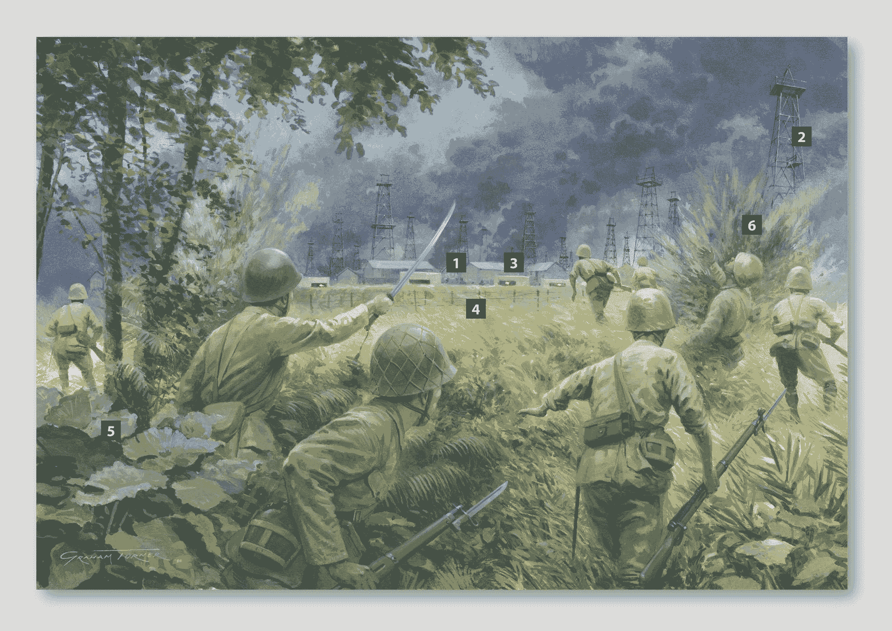

### 1942 年 1 月 11 日对塔拉坎东线第 10 号 NEI 据点的进攻

1942 年 1 月 11 日，坂口支队和`第 2 吴仓陆战队`开始在塔拉坎东岸的三个点对该地进行两栖进攻。右翼部队——由`第 1 营`和来自`第 3 营`的两个连组成。`第 2 岸防防空炮队`和`第 2 吴仓陆战队`（减编的野团，下辖两个步兵连以及一个机枪连）在 00:00 登陆。被破坏和撤空的`曼加尔机场`和`Samboja`钻井场在未遇抵抗的情况下被占领。向城市的推进受到道路破坏的严重影响。海湾的登陆威胁了后方的守军。考虑到破坏石油基础设施的进展以及被切断的威胁，`Van den Hoogenband`决定不防守巴厘巴板。他停止战斗并率 700 人向内陆撤退。考虑到已实施的破坏，坂口实现了他的威胁。1942 年 2 月 20 日，78 名平民和战俘在滩上被处决。坂口部队的损失在陆地上 8 人伤亡，海上 39 人。

在巴厘巴板（Balikpapan），有一个炼油厂和一个储油库，用于处理和储存来自 Sambodja 和 Sanga-Sanga 钻场的石油。1942 年 1 月 20 日，荷兰荷属东印度陆（RNEI）军队司令决定摧毁石油设施和曼加（Manggar）机场。在过去的几天里，浓烟笼罩着整个城市和海湾，导致了黑雨。在这种末日般的背景下，我们看到坂口队（Sakaguchi Detachment）的五名士兵在 1941 年 1 月 24 日登陆后正在前进。（每日新闻）

1942 年 1 月 23 日，日本军通过空中侦察发现了秘密机场 `Samarinda II`。在遭到多次空袭后，剩余的军用航空队飞机已从 `Samarinda II` 撤离。该基地暂时保持运行。军用航空司令部决定位于位于则马辛（Bandjermasin）的 `Oelin Airfield`，从爪哇岛对巴厘巴板进行袭扰攻击。1942 年 1 月 27 日，一个中队在地面遭到空袭并被摧毁。在此次攻击中总共损失了九架 `Glenn Martins` 飞机。这标志着军用航空队在婆罗洲岛上方部署的结束。

## 肯达里（KENDARI）

在进攻巴厘巴板的同时，位于望纳多（Menado）的东进攻部队袭击了苏拉威西东南部重要的 `Kendari II Airfield`。在这里，细保联合陆战登陆部队（Sasebo Combined SLF）的登陆也发生在清晨（`0422hrs`）。当天，城市和机场（`1700hrs`）几乎完好地被占领。肯达里的荷印陆守军约 500 人。由于领导无力导致战斗意愿不足，计划中的机场强力防御并未实施。荷印军队撤退到内陆，大部分人逃跑甚至被允许休假。1942 年 1 月 24 日，至少有六名荷印士兵被杀害。

1942 年 1 月 24 日，日本海军转入第三阶段行动。随着巴厘巴板和肯达里的征服，爪哇岛进入了日本陆基轰炸机和战斗机的飞行范围。

## 辛加瓦（SINGKAWANG）

由于 `Kuching Airfield` 未符合日本人的预期，海军将希望寄托于 1941 年 12 月 20 日发现的秘密机场 `Singkawang II`（日文文献称为 `Ledo`）。1941 年 12 月 28 日，南部军命令川口队（Kawaguchi Detachment）准备夺取该基地。然而，令南部军懊恼的是，川口认为对 `Singkawang II` 执行行动意义不大。1942 年 1 月 6 日，愤怒的南部军领导层命令川口尽快征服辛加瓦。

## 日本军对望纳多的进攻，1942 年 1 月 11 日–12 日

日本军通过海军陆陆部队和空降部队的同步两栖和空降进攻，攻占了 `Menado Langoan (II)` 机场和水上飞机基地。荷印军队陷入了包围圈势，西侧来自望纳多，东侧来自肯马（Kema），日本伞兵在机场附近的中心位置发动进攻。溃散且人数处于劣势的荷印军队通过从准备阵地的阻击行动成功减缓了日本两栖部队的内陆推进。然而，他们未能阻止日军与伞兵建立陆地联系。机场遭到了激烈的防御，但在短暂战斗后落入日军手中。荷印军队的反击缺乏协调，力量太弱并以告终，随后守军残部退缩到山中，开始了一场注定失败的游击战。

注：网格线每隔 5 公里（3.1 英里）显示一次。

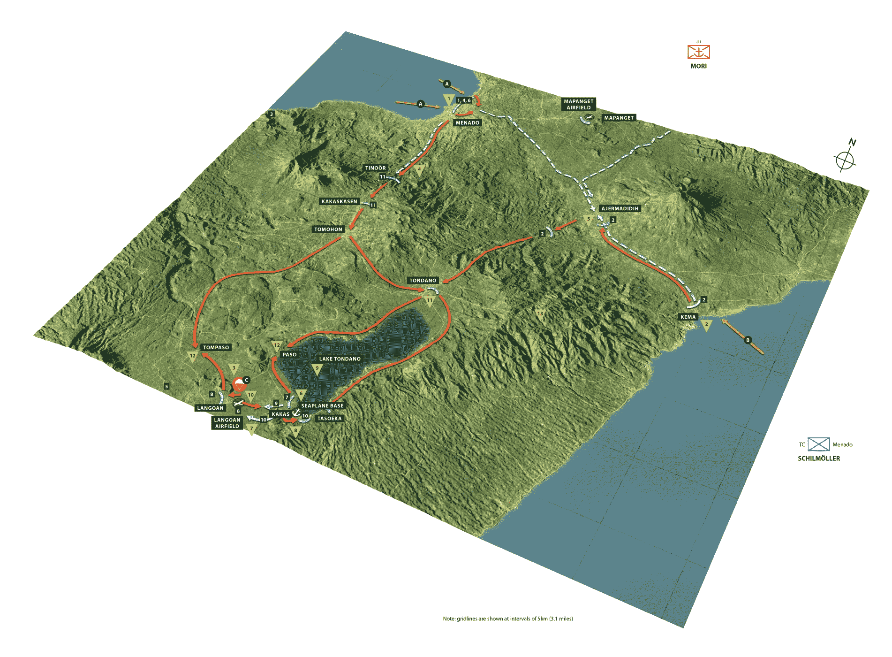

## 日本军

**细保联合陆战登陆部队：**

- **A.** 第 1 细保陆战登陆部队
- **B.** 第 2 细保陆战登陆部队
- **C.** 第 1 横须陆战登陆部队

### 荷印（荷属东印度军队）

**望纳多部队指挥部**

- **1.** 望纳多连队和两门 7.5 厘米火炮
- **2.** A 连，老兵预备队
- **3.** E 队，老兵预备队（45 人）；驻守在西海岸的海岸卫（地图范围外）
- **4.** 欧洲民兵和民卫连
- **5.** 望纳多民兵连（地图范围外，未参与战斗）
- **6.** 镇队

**卡卡斯（Kakas）战术指挥部：**

- **7.** C 连，老兵预备队，以及车上的三门 3.7 厘米火炮

- **8.** D 连，老兵预备队

- **9.** 机动队（三辆装甲车内 45 人）

**预备队：**

- **10.** KV 连（短期役）

- **11.** B 连，老兵预备队

## 事件

除非另有说明，时间均为日本标准时间（`JST` – `UTC+09:00`）。望加锡时间（`CBT`）为 `UTC+08:00`。

**1942 年 1 月 11 日**

1. `0400hrs`：细保联合陆战登陆部队总部连同支援部队和第 1 细保陆战登陆部队（约 1,800 人）在望纳多南北两侧进行两栖夜间登陆。人数处于劣势的荷印守卫者猝不及防，很快被切断。日军在`0830hrs` 占领城市。

2. `0420hrs`：第 2 细保陆战登陆部队（约 1,800 人）在望纳多南北两侧进行两栖夜间登陆。

位于苏拉威西岛的甘达里二号机场被描述为印尼群岛最好的机场之一；它拥有三条跑道（1,000 米 x600 米），且易于延伸。与其他大多数被攻占的机场不同，它可以立即投入使用。一个缺点是该机场远离海岸，位于内陆 25 公里处。1942 年 2 月 27 日，第 21 航空飞行队总部从曼纳多转移到该机场。甘达里为日本军提供了针对安汶本和提汶进行行动的重要基地，从而切断了通往爪哇锡与澳大利亚的通信线。这张照片拍摄于 1947 年。（莱顿大学图书馆，[CC BY 4.0](https://creativecommons.org/licenses/by/4.0/））

到 1942 年 1 月底，川口支队已开始大规模的包围攻势。陆路上，一支部队向新加万移动，并于 1942 年 1 月 27 日占领了被彻底破坏的机场。第二支部队通过临时海运进入，相继落在西婆里洲西岸的四个地点。荷兰荷属印度尼陆（`RNEI`）西婆里守备团兵力约 1,000 人，士气已受挫，他们负责防御西婆里。英国印度军第 15 普遮团第 2 营为其增援，该部队从古晋撤出，剩余兵力 783。这支力量只能减慢日本人的推进。在 1942 年 3 月总投降后，剩余的荷印尼军队投降了。少数人继续进行游击战。第 15 普遮团第 2 营撤退到南婆里，并于 3 月 31 日投降。日方损失为：19 人死亡，2 人重伤，31 人受伤。他们报告击杀敌人 270 人，俘获战俘 182 人。

由于遭到破坏、地面潮湿以及长期被毁的陆路供应线，新加万二号机场无法用于进攻爪哇的登陆行动。因此，日本海军第 22 航空飞行队于 1942 年 2 月 8 日将总部迁往古晋。由于古晋条件恶劣，飞机无法加满燃油。这使得对爪哇的空袭变得异常困难。

随着新加万二号、巴厘巴帕潘的芒加、甘达里二号以及萨马林达二号的消失，战略机场的第二线已被打破。

### 安汶

安汶是一个形状不规则的岛屿，海岸线长，面积仅为 716 平方公里。它由两个陆地组成：希图和莱蒂莫，之间被一个巨大的内湾隔开。岛上有中低山，山峰高度在 460 米至 1,000 米之间。这些山非常陡峭，密密茂着次生森林。建筑区外很少道路，只有动物小径和步行路径。

1936 年后，安汶岛被开发为荷兰皇家海军的辅助支持基地。该岛位于印尼群岛东部的中心位置。内湾提供了一个避风的天然港口。它有两个空军：哈龙海军航空基地和拉哈机场，后者有一条长 1,700 米的混凝土跑道。

守备军由马鲁库群守备团和第 4 岸防高空炮连组成。守备团由一个总部、三个连、一个机枪连、一个`kortverband`（短期役）连、一个（欧洲）民兵连、一个老兵预备队以及位于安汶外的支队组成。此外，还有四辆装甲车被送到安汶。守备军还包括印尼民兵营和城乡守卫队。总兵力约 2,600 人。除了这些陆军外，军事航空队在拉哈驻留了一支三架战斗机的巡逻队。荷兰皇家海军在安汶驻留了一个水上机中。

为了加强拉哈的防御，澳大利亚鸥兵军（`Gull Force`）于 1941 年 12 月 17 日抵达，由鸥兵军总部、加强后的第 2/21 营、第 18 反坦克炮 C 连、来自 2/11 野战连的一个工程师排以及一些支援要素组成，总兵力约为`c`.1,170 人。建立了一个地区联合总部来指挥荷印尼军队和澳大利亚部队。在拉哈，鸥兵军特别受到疟疾和痢疾的困扰。在日本登陆前两周，鸥兵军指挥官更换为 `W.J.R. Scott` 中校。后者与荷印尼地区指挥官之间的协作不尽如人意。

日本海军想要切断盟军的安汶–古甲通信线。作为进攻曼纳多前消除盟军空军的一部分，日本海军第 21 航空飞行队轰炸了安汶。这是一系列空袭的开始，随后是武装侦察。在登陆前不久，又发生了新的空袭，这次是母舰飞机。在日本的压力和已被侦察的入侵舰队面前，盟军总部（`ABDACOM`）于 1942 年 1 月 27 日命令撤出剩余的航空单位。

荷印尼地区指挥官 `J.L.R. Kapitz` 中校遵循一项计划：由荷印尼军队对海岸位置进行固定防御，鸥兵军的一部分防御拉哈机场，其余鸥兵军和部分荷印尼军队组成掩护力量或总预备队。1942 年 1 月 10 日，根据 `Kapitz` 的提议，决定鸥兵军防御南部。预计莱蒂莫岛东南岸不会登陆。考虑到地形，荷印尼-澳计划本质上是防御性的。当 1942 年 1 月 30 日明确日本人将在南部登陆时，`Kapitz` 将防御重心转移到帕索位置：那里有三个连、一个机枪连和一个民兵排。该位置位于安汶市以北，处于希图和莱蒂莫之间的地峡上。借此，`Kapitz` 拉开了与南部鸥兵军的距离。盟军力量因此进一步碎片化，可能被一个已经强大的对手逐个击败。

南方特遣队的攻击单位和航空任务遣队对安汶发动了进攻。第 2 航空母战斗师听归攻击单位指挥。这是一支规模相当大的力量。1942 年 1 月 31 日（周六）凌晨 0240 至 0250 之间，日本东部支队（伊藤支队，由第 228 步兵团和第 38 师组成）从香港经由达沃，登陆在安汶毫无守备的东南岸的两个海滩。这威胁了安汶要要固海湾的后方。在成功登陆后，左侧攻击单位（主力）在倾盆如雨和暴风般的西风（蒲福特 8 级）下，沿着丛林小径分两列纵队横过山脊。天气在中午左右放晴。加强后的荷印尼防守者被击退。下午，日本人进入了安汶市。荷印尼陆军和澳大利亚士兵被隔离开。

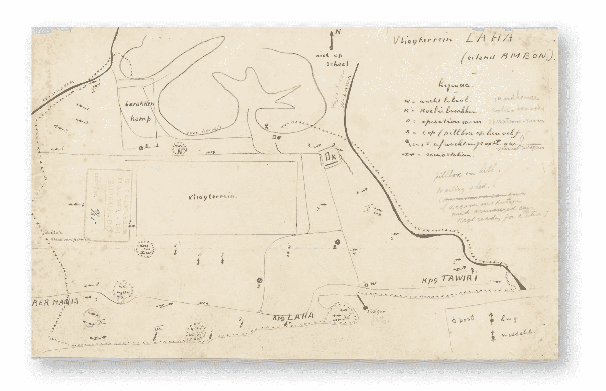

拉哈机场的防御示意图，位于安汶岛内湾的沿海平原上。它是荷属印度尼西亚少数拥有混凝土跑道的机场之一。营房、仓库和避难所没有分散或伪装，而是就在机场附近，这使得机场特别脆弱——更何况地面防空火力很薄弱，只有荷印尼陆军的两门 4cm 高空炮和三门 `M.30`（柯尔特-布朗宁）12.7mm 高空炮。（荷兰军事史研究所）

`Passo` 阵地是一个准备就绪但尚未完全完成的东北方向阵地。该阵地受到右翼攻击部队——`第 228 步兵团第 2 营（减员后）`的从东南方向的进攻。日军再次令防守者感到惊讶。这次攻击是在恶劣天气下进行的，并于 `1000hrs` 左右将日军带入阵地后方深度。一次缺乏协调的反击很快在日军的火力下陷入停滞。随之而来，`Passo` 阵地失守。那天晚上，卡皮茨（`Kapitz`）决定投降。

`第 1 吴仓陆战部队`（750 人）在`228 步兵团第 3 营第 10 连`的增援下从曼纳多（`Menado`）抵达，并于`0200hrs`在`Hitulama`附近进行两栖登陆，目标是`Laha 机场`。在了一个多小时的时间里，登陆行动遭到来自`守卫团第 4 连`一个步兵排的争夺，该部队在掩堡内配备了机枪和迫击炮。此后，日军向内陆的推进由于撤退的荷属（`NEI`）部队的阻击、极恶劣的天气以及道路网的糟糕状况而缓慢。到达内湾后，陆战部队还遭到了另一侧荷属荷兰电池的炮火攻击。下午结束前，对机场的最初进攻在防守的`2/21 步团` `B` 连和 `C` 连澳大利亚士兵的枪火和迫击炮火下陷入停滞。`Nona 炮兵连`提供了火力支持。`日本陆军第 10 连`被派入丛林执行包抄。此外，还获得了空中支援。连续两个晚的两次进攻均告失败。`1942 年 2 月 3 日`早晨，日军进攻者成功渗透了盟军阵地。当天早晨，`第 10 连`在穿越丛林艰难行军后，从后方对防守者发动进攻。`Laha` 陷落。

伊藤武雄（`Takeo Ito`）少将预计在卡皮茨投降的同一天（`1942 年 2 月 1 日`）攻占莱蒂莫尔（`Laitimor`）南部。当天，左翼攻击部队以两个营并肩转向南方。在安汶市南部，海鸥部队（`Gull Force`）的剩余部分位于：`2/21 步团`的 `A` 和 `D` 连以及大部分支援部队，他们的临时工事并非如预期那样面向海岸，而是面向北方。在斯考特（`Scott`）的紧急请求下，他在`1942 年 1 月 31 日`获得了`荷属荷兰守卫团第 2 连`的增援。日军在炮兵和迫击炮火力的掩护下逐渐将澳大利亚和荷属部队驱回。`1942 年 2 月 3 日`早晨，盟军防守者相继投降并被俘。

`东部遣队`遭受 55 人死亡、135 人受伤，`第 1 吴仓陆战部队`遭受 40 人死亡、50 人重伤。日军声称击杀 340 名盟军士兵，俘虏 2,182 人（其中包括 782 名澳大利亚人、334 名荷兰人和 1,066 名印尼士兵）。根据澳大利亚方面的报告，有 49 名澳大利亚士兵丧生。`1942 年 2 月 6 日、15 日和 20 日`，在 `Laha` 被俘的澳大利亚战俘被`日本海军（IJN）`处决。

### 马加锡

日军想要攻取苏拉威西岛的望加锡（`Makassar`），并将其作为进攻爪哇的基地。该行动完全是荷属荷兰海军部队的海军事务，由`第 1 基地部队`执行，并由`第 2 航空队`提供空中。考虑到盟军在望加锡海峡的活动，这次进攻并非从苏拉威岛西部的曼纳多出发，而是通过苏拉威岛东南部的`肯达里（Kendari）`。这种顺时针作战的额外优势是可以分配来自安汶行动的部队。进攻计划于`1942 年 2 月 9 日`进行。两栖登陆将由`佐保联合陆战部队`执行。

除了望勒伯斯和曼纳多领地司令部外，望加锡还设有`望加锡部队司令部`。`M. 沃伦（M. Vooren）`上校指挥苏拉威西岛的所有部队，但在日军登陆后，他缺乏控制分散支队的手段。`望加锡部队司令部`由约 1,000 名`望勒伯斯和曼纳多守卫团`士兵组成。沃伦上校根据马来战役制定了他的防御理念。他设定的目标是尽可能造成巨大损失，并尽可能长时间牵制敌军。为此，他将通常遵循的直接海岸防御作战理念转变为间接防御：减缓敌人的推进以实施对`Mandai 机场`的计划破坏，并最终位于山区内陆的`Tjamba 阵地`。整个计划都是防御性的。

日本海军护卫队遭到潜艇袭击。尽管一艘日本驱逐舰受损，一艘被沉没，但这并未阻止两栖登陆。`1942 年 2 月 8 日（周日至 9 日（周一）`午夜，`佐保联合陆战部队`在望加锡南部 3 公里两个区域进行了两栖登陆。该市在中午左右被占。荷属防守者成功摧毁了`Mandai 机场`。当天结束时，`日本海军`的行动进攻阶段结束，仅剩清剿行动。`日本海军`声称击杀 77 名敌军并俘虏 85 名战俘。日方损失为：陆战部队 4 人阵亡、5 人受伤，沉没驱逐舰上有 5 人死亡、6 人重伤。

荷属守卫队退守到`Tjamba 阵地`。该阵地直到`1942 年 2 月 27 日`才遭到攻击，并在次日被占。剩余的荷属荷兰军队通过逃散瓦解。`1942 年 3 月 7 日`，荷属投降。

### 班杰马辛

在`1 月 21 日至 23 日`期间的会议上，`日本陆军`建议将行动计划延长十天。准备机场需要一些时间。考虑到距离爪哇的距离，在风险方面将更有效地利用`班杰马辛`。

# 第 4 连岸防与防空炮

## 8. Nona 营 (4 x 15cm L 40 海军炮)

## 9. Galala 营 (2 x 3.7cm 海军炮)

## 10. Halong 营 (1 x 7.5cm L 55 海军炮)

### Gull Force（Gull Force）部队：

* 2/21 营（加强），澳大利亚澳大利亚帝国陆军（`AIF`）

* 2/21 营 B 连（减员）和 C 连

* 2/21 营 A 连

* 2/21 营 D 连，连同第 5 排驻守在 Nona 山

* 14 第 6 排及支援部队

* 15 步兵排

## 事件

除非另有说明，时间均采用日本标准时间（`JST` – `UTC+09:00`）。马鲁古时间（`MCT`）为 `UTC+08:30`。

### 1942 年 1 月 31 日，星期六

1. 0240 和 0250：东部分遣队在 `Laitimor` 东南岸进行无阻夜间水上登陆。右侧攻击部队向 `Passo` 行军，左侧在恶劣天气下通过两条陡峭的山径向安汶市行进。

2. 位于 `Rutung` 和 `Sojadiattas` 的荷兰属印度尼（`NEI`）民兵排阻了日军西侧进攻。

3. 0100：加强后的第 1 久世陆上登陆部队（`约 1,000` 人）在 `Hitoelama` 进行夜间水上登陆。来自守卫营第 4 连（加强）的荷兰属印度尼排在预设阵地给予了顽强抵抗。

4. 0320：`Hitoelama` 的荷兰属印度尼对手被击溃，登陆完成。荷兰属印度尼分遣队撤退并在进路上进行阻击行动。

5. `约 0800 (MCT)`：荷兰属印度尼援军被分批送到 `Rutung` 和 `Sojadiattas` 山区分遣队。他们遭遇了两个推进的日军左侧攻击列，大部分被击散。`Kapitz` 上校已耗尽了预备队。

6. `0730 (MCT)`：日军右侧部队进攻侧翼的 `Passo` 位置，击溃了 `Batoegong` 的侧翼阵地并占据了东部据点。`0830 (MCT)` 和 `0930 (MCT)`：两次连续的反击几乎没有进展，`Passo` 位置几乎被攻占。

7. 在大雨中沿着狭窄的道路行进时，第 1 久世陆上登陆部队遭到对岸荷兰属印度尼岸防电池的猛烈炮火。第 1 久世陆上登陆部队第 2 连和第 228 兵团第 3 营第 10 连在下午对 `Laha` 空场的进攻被击回。

8. 1700：日军左侧攻击部队进入安汶市。

9. 第 228 兵团第 3 营第 10 连进入丛林，从北侧高地包围空场。

### 1942 年 2 月 1 日，星期日

10. 0130：`Kapitz` 上校和 `Passo` 位置的荷兰属印度尼部队投降。

11. 1100：日军左侧进攻从安汶市向南推进。`Gull Force` 在西南方向构筑了深度防御，但在白天该阵地被包围。

12. 位于 `Amathoesoe` 的澳大利亚第二道线遭到攻击。该位置由营部、2/21 营 D 连以及 `Gull Force` 的服务和支持部队防守。

### 1942 年 2 月 1 日/2 月 2 日，深夜

13. 2200：日军第 2 连成功渗透 2/21 营 B、C 连之间的东侧阵地，但防线守住了，日军攻击者被钉在原地。

14. `Gull Force` 指官 `Scott` 上校误认为 `Nona` 山已被日军占据。他下令从 `Amathoesoe` 线撤退到 `Eri`。

### 1942 年 2 月 2 日，星期一

15. 1200：取消对 `Laha` 的进攻，转而请求空中空袭和海军舰射支援，并请求援军。

16. 0630：东部分遣队占据了 `Nona` 山（514 高）。

17. 上午：由第 15 驱逐舰队护航的第 21 扫队开始清理外湾海雷。 11 号和 12 号扫雷艇撞中海雷并受严重损坏， 9 号沉没。

### 1942 年 2 月 3 日，星期二

18. 0115：第 1 久世陆上登陆部队对 `Laha` 发起第二次夜间进攻，突破了澳大利亚人的防御。`0615`，空场被攻占。日军援军在澳大利亚投降后到达。

19. 在炮击轰炸下，由于食物、水和士气耗尽，`Gull Force` 于 `1530` 投降。

动员后，东南婆罗洲守卫营人数为 `1,250` 人。它被分配负责两个空场——`Kotawaringin` 和 `Oelin` 的防御。2 月 10 日上午，日军占领了打腊（`Palembang`）。（注：提供的文本此处有缺失/重叠）。

## L 行动：进攻打腊

南苏门答腊由打腊和望加地区指挥部防御。该指挥部由一个地区总部、六连组成的打腊和望加守卫营、一个破坏团、打腊民兵团和望加民团组成。为了防御空场和油田设施，领地部队加强了一个机枪连和一个由八 门 `7.5cm` 炮和两 门 `4cm` 防空炮组成的炮兵连。守卫营还配备了五辆 `APC`：两辆位于打腊 I，三辆位于打腊 II。总人数为约 `1,300` 人。领地指挥官为 `L.N.W. Vogelesang` 上校。

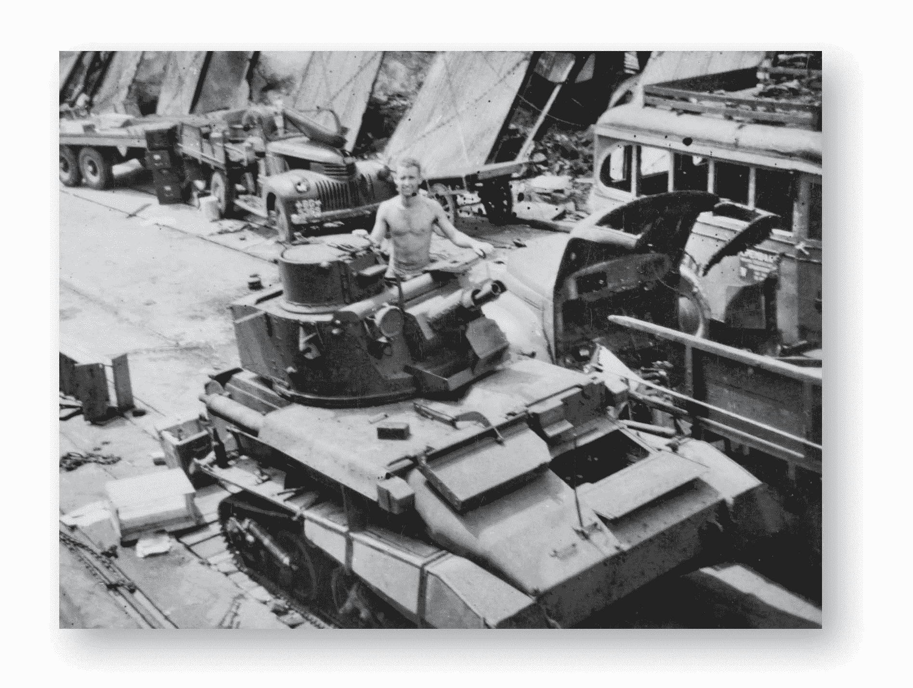

楠榜（`Oosthaven`），位于苏门答腊南部。1942 年 2 月 14 日，即日军进攻占胆当天，第一批从中东出发前往苏门答腊和爪哇的陆军增援抵达了 `Oosthaven`。图中码头上有一辆来自英国`第 3 皇家皇家骑兵团``B 连队`的`Mk V1B`轻型坦克，背景是被摧毁的卡车、一辆公共汽车和坍塌的建筑。1942 年 2 月 15 日傍晚，收到重新装船`第 3 皇家皇家骑兵团`的命令。该部队被运往爪哇，并作为黑力（`Blackforce`）的一部分参加战斗。（澳大利亚战争纪念）

从 1942 年 1 月 16 日起，占胆发展成为英国主要的空军基地。轰炸机群被重组为`第 225（轰炸）群`，驻扎在占胆二机场。1942 年 2 月 1 日，`第 226（战斗机）群`成立，总部位于占胆一机场。地面防空由以下部队提供：`第 6 重防空炮团（皇家）`（减员）、`第 78 炮队`、`第 35 轻防空团（皇家）`以及来自`第 89 轻防空炮兵（皇家）`的一个连。`第 225（轰炸）群`指挥官亨 `ry J.F. Hunter` 空军准将担任占胆空军指挥官。

1942 年 1 月 26 日，一支澳大利亚`第 1 军`的小先遣队乘飞机抵达雅加达。军官`J.D. Lavarack`中将和参谋长`F.H. Berryman`准将考察了未来的部署区域。在苏门答腊南部，他们预计日军将首先占领邦加作为前方基地，以获得当地的海空和空中优势。然后，他们将派遣伞兵进攻炼油厂。这次空降行动将与上游河流作战相结合。因此，`Lavarack` 建议韦塞尔（`Wavell`）立即用一个步兵营加强炼油厂和机场的防御，并向`RAF`、`RAAF`和`AA`防空兵发放步枪。决定派遣一个步兵营去炼油厂，另一个去往邦加岛和勿打登岛。在澳大利亚增援到达后，占胆一机场和占胆二机场的防御将由一个轻坦克中队加强。

1942 年 2 月 5 日，两个`RNEI 陆军`野营临时离开爪哇前往苏门答腊：`第 10 步兵团`前往占胆，`第 9 步兵团（减员）`移往邦加岛，加强后的`第 12 步兵团第 2 连`开往勿打登。一旦澳大利亚增援到达，这些兵团将返回爪哇。`第 10 步兵团`总部和三个连驻在普拉博穆利（Praboemoelih）。`第 10 步兵团第 1 连（爪哇人兵）`驻扎在占胆。选择普拉博穆利并不理想。它位于占胆南部 90 公里处，距离受保护地点太远，无法快速反击。该兵团临时由征召的印尼司机驾驶的巴士和卡车进行机械化。`第 10 步兵团`供领地指挥官调用。

针对邦加岛和占胆的`L 行动`由于古井机场状况不佳以及`新加望二`不可用推迟了两次。马来的关丹（Kuantan）本应承担这一角色，但该机场未能及时准备就绪。最终，`L 行动`计划于 1942 年 2 月 15 日开始。

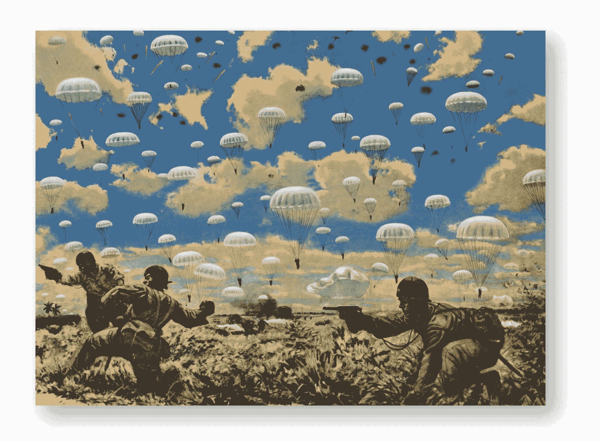

一张由陆军美术协会根据鹤田五（Goro Tsuruta）的战争画作出版的日本明信片，名为《战神降临占胆》。日本陆军（IJA）和日本海军（IJN）聘请了著名的日本艺术家，用西方风格（洋画）的纪念碑式写实绘画来描绘中日战争和太平洋战争，而非日本风格（日本画）。这些战争战役画作在大型展览中向日本公众展示。（美国国家档案馆 NARA，公共领域）

为了摧毁苏门答腊的盟军空力并同时在爪哇进行压制，日陆和日海于 1942 年 1 月 28 日在`蒙托克–占胆`沿线划分了作战区域。日陆将在该线以西作战，日海在该线以东作战。在初步进攻后，`第 33 航空团`于 1942 年 2 月 6 日至 13 日在苏门答腊南部发起了大规模攻势，以获得当地空中优势。`第 22 航空飞行队`在邦加和勿打登上方执行了任务。日本人随后认为盟军的大部分飞机已被摧毁。事实证明这为时过早了。

尽管遭受了损失，但在日军登陆当天，英国仍拥有以下可用飞机：`24 架风暴战斗机`、`31 架洛克希德哈逊轻型轰炸机`以及`36 架布里斯托黑姆 Mk I`和`Mk IV`轻型轰炸机。许多黑姆无法使用。日军并未发现占胆二机场是一个基地，因此它可以部署战斗机和轰炸机。总而言之，日本方面并不存在空中优势。

正如 Lavarack 中将预料的那样，`L 行动`是一场空降与两栖/河流联合攻击。日陆专门训练了`第 1 突击团`（一支空降部队）以征服占胆。`第 1 突击团`事实证明无法使用，因为它在 1942 年 1 月的一次运输事故中损失了武器装备，并遭受了伤寒袭击。结果，仍在训练中的`第 2 突击团`被部署。该突击团由四个连组成，总兵力相当于一个兵团。

`第 1 突击团`没有足够的力量同时进攻并守住三个目标：机场和炼油厂。如果可能，要在盟军摧毁它们之前占领炼油厂。但可用力量太小无法应对三个目标。此外，该小组必须坚守目标，直到`38 军`的主力到达（L+2，登陆当天）。空降计划在 L-1 进行。

第 38 军的任务是占领占胆市。它在占领香港期间遭受的损失已经得到恢复。然而，该军并未满员。该军组建了两个支队部署在其他地方：`东支队`和`庄司支队`。对于占胆行动，第 38 军因此由`第 229 步兵团`的四个步兵团组成。一个独立运输营、一个运输工程师兵团以及包括钻井部队在内的其他专家部队归其指挥。

在泽渊三郎将的指挥下，日海为`L 行动`提供了大规模海上支持。泽渊的`马来部队`（南方远征舰队）提供了主力部队和两个护卫单位。`第 1 航空团`和`第 22 航空飞行队`为运输舰队提供了空中支持。`第 2 航空团`为运输舰队提供空中支持，守卫邦加和占胆锚地，并支持上游作战。`第 4 航战队`形成了`第 3 航空团`，负责防御盟军舰只。`第 9 基地部队`运送了河流部队。

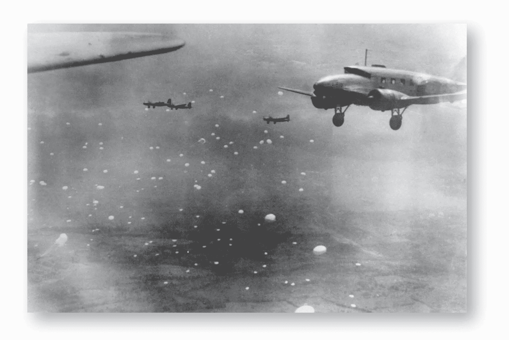

日本伞兵从`陆军一 100 型运输机（三菱 Ki57）`跳下，盟军代号为“兔子”。这种飞机有四名机员，可以携带 11 名伞兵。这可能是 1942 年 2 月 15 日跳伞占胆一机场的`第 2 突击团第 3 连`（总共 90 人）。（Keystone-France\Gamma-Rapho via Getty Images）

1942 年 2 月 14 日（周六）上午 11:26，`第 2 突击团`的伞兵从`突击航空队`的 25 架运输机上跳下。在巴胆勿一机场（Palembang I），第一梯队由团部总部、信号连、`第 4 连`和`第 2 连`的一半人员（180 人）组成，降落在东南方向约 3 公里处；`第 2 连`的两个排（60 人）立即降落在巴胆勿一的西侧。机场防守军受到空中轰炸和机枪扫射的压制，这为伞兵降落后提供了足够的时间进行武装和重组。这次空降行动并非完美。英国战斗机发动了两次攻击，但均被击退。伞兵在跳伞时并未携带武器弹药；这些物资是单独装在容器中投放的。由于地形复杂，伞兵往往未能找回这些集箱。他们通常只配备手枪和手榴弹，无法产生足够的火力来迅速克服抵抗并夺取机场。一些配备`LMG`（轻型机枪）的伞兵在通往机场的离市 8 公里处建立了路障，从而阻碍了巴胆勿与机场之间的交通。

巴胆勿一机场的驻守部队由`第 15 重防空团`的一个连（配备 8 门 3.7 英寸高射炮）、`第 78 连`的一个排以及`第 89 连`的一个排（均属于`第 35 轻防空团`，配备 8 门 40 毫米波福斯炮）、150 名荷属东印度陆（RNEI）士兵（配备两辆装甲运兵车）以及`258`和`605`战斗中队的地面防御小组（约 60 人）组成。由于高级军官病假，H.G. Maguire 指挥官在周六担任基地指挥。英国防空兵通过组成地面防御队和反伞兵巡逻，能够负责自己阵地的安全。这些人员接受过武器和地面防御训练，并熟悉了炮位周围广泛的环境。机场防守军全天都在激烈抵抗进攻的伞兵。当防空炮对空中和地面目标耗尽了有限的弹药储备后，在地面防御小组的掩护下，部分火力撤离到巴胆勿。在剩下约 70 人后，Maguire 指挥官认为没有办法抵御夜间攻击。他和部下在夜幕前不久乘卡车向西北撤退。跑道虽然布了地雷，但并未被毁，因为装有火机的仓库在攻击中烧毁了。机场完好无损地落入日本人手中。

11:30，`第 2 突击团`的`第 1 连`攻击了炼油厂。60 人落在普拉朱（Plaju），`第 3 排`（39 人）落在双格戎（Sungei Gerong）东南侧。因此，日本人不知道的巴胆勿二机场（Palembang II）未受攻击。中午左右，对伞兵部队的空中支援停止了。

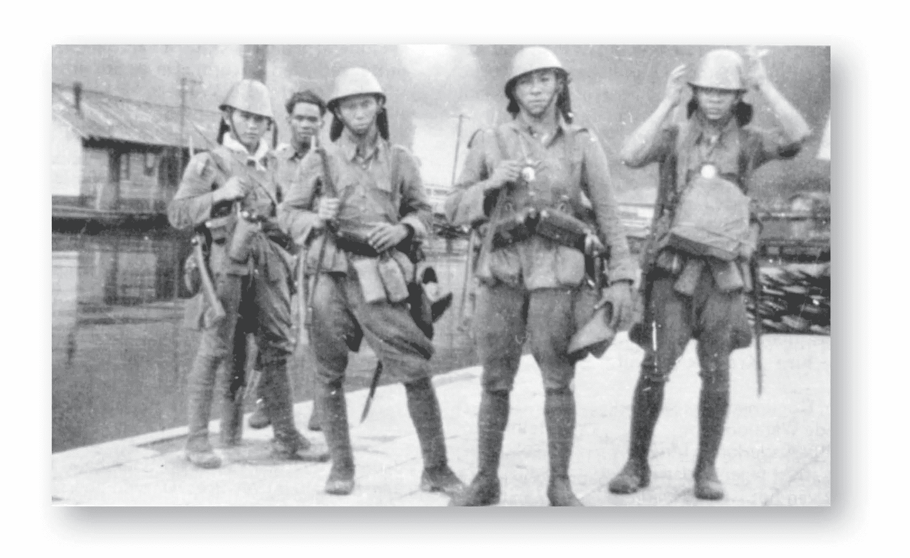

巴胆勿`第 10 步兵团`第 2 连`的五名曼纳多岛步兵。该连发起了反击，将日本伞兵从普拉朱炼油厂驱出。背景中可以看到正在燃烧的炼油厂。士兵们配备了`M95`重复步枪、`klewang`短刀和手榴弹。他们穿着 1937 型灰绿色野战服，配有护腿，戴着带皮质护颈的钢盔（防晒）。布隆贝克博物馆）

炼油厂采取了全方位防御，每个炼油厂约有 150 人的驻守部队。防御重点是抵御来自望夷河的进攻。然而，日本人的进攻是从南方发起的。在普拉朱炼油厂，大部分伞兵降落在西南侧，部分人落在炼油厂内部。他们在现场建立了据点。荷印防御者收到了来自英国反伞兵防空小组（20 人）的援军，并开始搜索。民兵排清扫了炼油厂西侧的居住区。下午初，加强后的曼纳多`第 10 步兵团`第 2 连（减员后）从普拉博穆利（Praboemoelih）赶到。到傍晚，该连已几乎清完了整个区域，第二天准备清理最后的一个约 15 人小组。日本排对双格戎炼油厂的进攻立即被击回。1942 年 2 月 14 日，日军报告在跳伞的 329 人中，有 39 人战死，48 人受伤。

Vogelesang 中校带领一支由两辆装甲车的领地部队排（减员）以及加强后的`第 10 步兵团`的`第 1 连`向巴胆勿一进发。民兵被命令在市北建立阻击位置。`第 10 步兵团`的`第 1 连`的反击直到 16:30 左右才开始。普拉博穆利的`第 10 步兵团`核心和普拉朱的部分驻守部队当天上午正在演习。因此，响应开始得晚了。在巡视苏门答腊的澳洲第一军团总工程师 C.S. Steele 将的建议下，英国空军（RAF）在望夷渡口组织了一个由武装英国空军人员组成的桥头堡。几次到达巴胆勿一的不协调行动在日本人路障处失败了。`第 10 步兵团`的`第 1 连`执行的反击并不顺利，但在下午清理了路障。然而，由于夜幕降临，其推进被停止。

### 空军总部状况

那天上午，巴胆勿空军总部一片混乱。Hunter 空运司令下令撤离巴胆勿一并将战斗机移回巴胆勿二。随后命令将飞机移往雅加达。该命令在中午左右被 ABDA-AIR 取消，飞机返回。巴胆勿的英国空军总部被清空，并在下午重新占领。然而，其发射器和密码已被毁。

ABDA 联合司令部海上做出了反应。前往南门答腊的日本船队于 1942 年 2 月 9 日至 10 日从占兰湾出发，并在 2 月 13 日上午接受了侦察。随后，在当天晚上和第二天早晨受到了来自巴胆勿英国飞机的攻击。日本人没有遭受损失。盟军海军舰队——“联合打击群”也被部署用于对抗日本舰队。小泽次长部署其航空部队应对这一威胁。由于失去了空中掩护且失去了突然性优势，Doorman 决定取消行动。

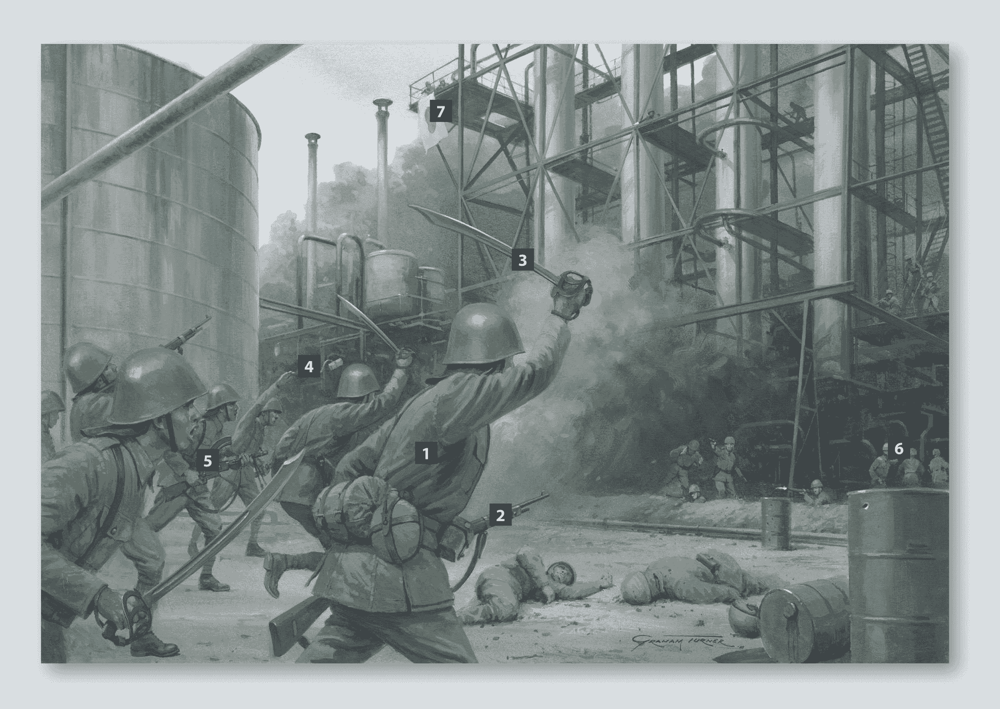

### 1942 年 2 月 14 日巴胆勿普拉朱炼油厂的反击

针对 1942 年 2 月 14 日日军对巴胆勿普拉朱和双格戎两个炼油厂的空降攻击，团级`第 2 突击团`只能分配`第 1 连`（人数较少，99 人）。

日军伞兵在中尉中尾的带领下，于当地时间 09:30（南门答腊）跳伞炼油厂。60 人落在普拉朱炼油厂，大部分在西南侧，部分人落在炼油厂内部。他们成功在场内建立了据点，并在油罐周围土堤后的掩体壕内、油罐顶部以及炼油厂上层平台上建立了防御。

大约 1230 时，由 J.H.M.U.L.E. Ohl 上尉指挥的第 10 步兵团曼纳多（Menado）加强第 2 连抵达。他当时调动了来自第 10 步兵团第 4 连的兵力：两个机枪排（八支维克斯士 6.5 毫米机枪）、一个迫击炮组（两门 81 毫米迫击炮）以及一个反坦克步枪小组（两支 20 毫米反坦克步枪）。在莫西河沿岸，Ohl 由一个机枪排和一个反坦克步枪组成了一个火力点，以掩护后方和左侧翼。他的右侧翼由一个城镇卫兵排负责。在爪哇第 10 步兵团第 3 连的一个排到达后，Ohl 将他的进攻力量重组为三个加强排。此时，他的总人数为 312 人（不包括城镇卫兵）。

Ohl 上尉于 1320 时开始扫荡。最初，由于日本军狙击手的火力，推进进展十分缓慢。随着援军的抵达，他的进攻势头逐渐增强，并将日本人从一个储油罐区逐出去。

这一场景展示了下午晚些时候，由 E.J. van Blommestein 中尉指挥的右侧前排对普拉朱（Plaju）蒸馏装置进行的进攻，士兵们已经拔出了`klewangs`短刀。进攻在迫击炮的掩护下进行，机枪火力针对塔楼和储油罐之间的日军位置。燃烧太阳能油罐产生的烟雾提供了进一步的掩护。Van Blommestein 的左侧是由 Ohl 上尉指挥的预备排。

进攻的曼纳多士兵（**1**）配备了 M.95 卡宾枪（**2**）和`klewangs`短刀（**3**）。背景中，一名士兵正掷出手榴弹（**4**）。手榴弹掷出时，其长 2 米的安全带展开，导致插销在飞行过程中被拉出。手榴弹撞击时会爆炸。在画面中心，一名枪手携带着标准的荷兰东印度陆军（RNEI）型机枪（**5**），这是一种弹匣式的 6.5 x 53.5 毫米 M.15 麦森机枪（`karabijnmitrailleur`）。日本伞兵开始撤退（**6**）。

在夺回炼油厂后，Van Blommestein 中尉、曼纳多一等兵 Pelealuw 和曼纳多二兵 Buntua 分别在日军的猛烈火力下爬上炼油厂塔，降下了三面日本旗（**7**）。

当天晚上 2100 时，荷兰东印度陆军（NEI）试图用手榴弹消灭约 15 名最后的抵抗，但失败了。这次进攻导致第 10 步兵团至少有一名士官牺牲，一人重伤。

由于迫击炮火影响，炼油厂若干油罐起火。由于强风，火势迅速蔓延。到午夜，储罐区已一片火海。部队准备在清晨清理沼泽森林中的伞兵，但在 0330 时，Ohl 上尉收到了撤退命令。炼油厂及其大量的物资落入日本人手中，设施仅受到轻微损坏。

1942 年 2 月 15 日午夜后，随着日本运输船抵达邦加岛（Bangka）蒙托克（Muntok）锚地，“L”行动的两栖/河流作战阶段开始。第 229 步兵团第 1 营（缩编）的蒙托克登陆部队于 0225 时登陆蒙托克，并迅速占领了市和蒙托克机场。后者立即由第 33 机场公司进行扩建。邦加岛和白井岛的 NEI 部队被命令撤退至爪哇岛。逆流而上的部队前往穆西河三角洲，并在早晨抵达河口。左翼的 Iwabuchi 部队沿萨莱河通过胆雳（Palembang）向马塔普拉拉（Martapura）推进。日本海军在河流中通过扫雷行动支持这一推进。逆流的部队反复遭到来自胆雳二机场的英国空军（RAF）飞机的攻击。日方损失较小。由于其他地区的任务，当天日方覆盖有限。日本海军正在与联合打击部队作战，而第三空军则支持第二次空降着陆。军事航空队和远东南航空军（FEAF）对蒙托克附近的日本登陆舰队进行了轰炸任务，但几乎没有取得成功。

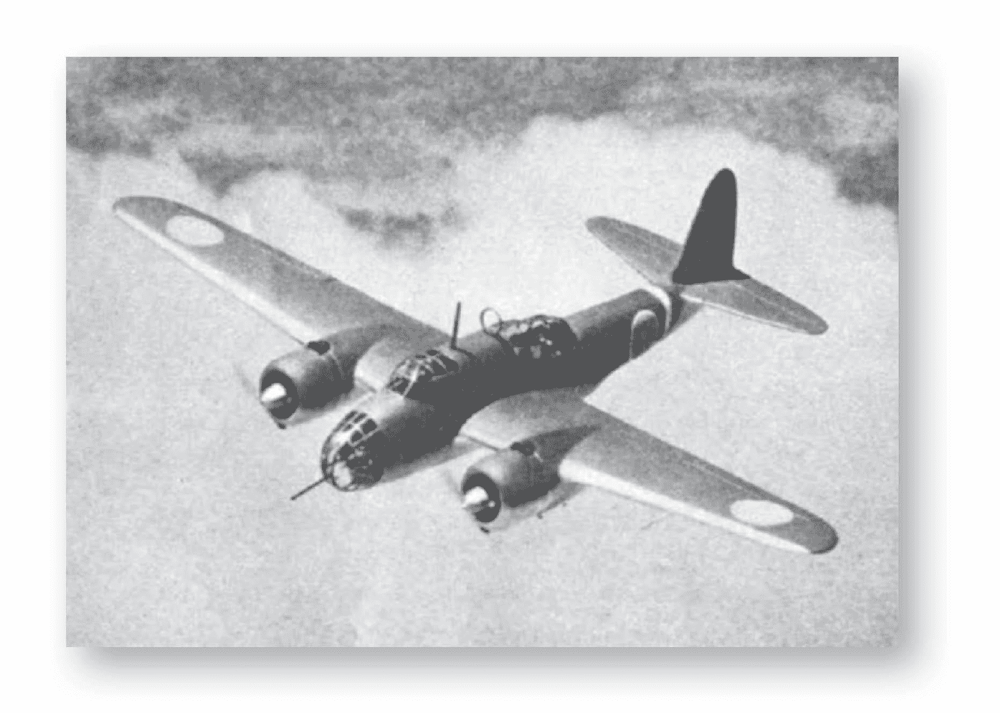

一架日军 99 式川崎 Ki-48 双发轻轰炸机。在胆雳周边的战斗中，一些日本士兵被俘。1942 年 2 月 13 日，在对胆雳进行的最后一次大规模准备空袭中，日本第 3 航空队因英国飞机的损失了三架飞机：两架日军 1 式战斗机和一架从怡保机场（位于马来亚）出发的日军 99 式川崎 Ki-48 轰炸机。后者四名机组成员中有三名被俘，均已受伤。第一名飞行员牺牲。第二名飞行员（可能是导航员）被荷兰人审问。第二天，同一名翻译审问了一名（住院的）日本伞兵俘虏。捕获的日本文件和审讯报告被送往爪哇。日本战俘的命运尚不明。（公有领域）

反复的空袭未能阻止日军的逆流而上部队。这最终导致胆雳无法守住。2 月 15 日夜间，胆雳收到海岸卫队的报告，称日本舰队正接近穆西河，并在登陆艇登陆并沿穆西河向上推进。随后，NEI 领土指挥官于约 0300 命令摧毁炼油厂并将部队撤回胆雳。位于穆西河普拉真（Pradjen）的炮兵营必须摧毁并撤离。Vogelesang 上校本人将指挥部移至东岸。松盖格龙（Sungei Gerong）炼油厂被彻底摧毁，但普拉朱却落入日本人手中，拥有大量的石油和航空燃料，设施仅受轻微损坏。此前曾准备彻底摧毁普拉朱，但未执行，因为破坏部队在 1942 年 2 月 15 日并未现场：领土指挥官在 2 月 14 日禁止了破坏并将部队召回胆雳。1100 时，领土指挥官过早命令摧毁电话交换机并撤往拉特（Lahat）。领土指挥部陷入瓦解。

撤退命令适用于穆西河东南方的部队，而不适用于胆雳以北地区。领土指挥官于 1942 年 2 月 15 日上午确认了使用第 10 步兵团第 1 连夺回胆雳一号机场的命令。午后不久，由第 2 突击团第 3 连（90 人）组成的日军第三梯队跳跃了胆雳一号机场。第 10 步兵团指挥官 B.P. de Vries 少将也获悉日本登陆部队已沿胆雳河推进了 8 公里。他随后决定取消反击并将部队撤至穆西河东岸。

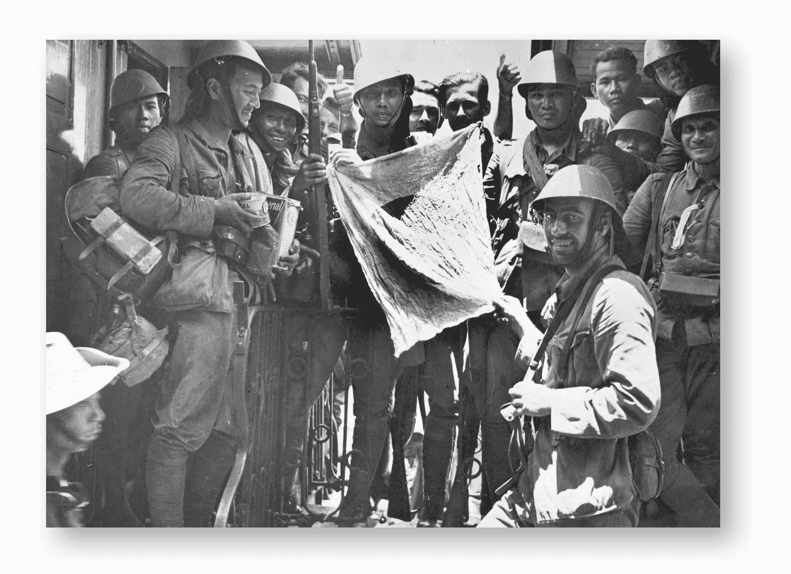

英国空军（RAF）撤退至胆民二。空军准将官亨特（Hunter）很快也清扫了胆民二。随后，英国空军通过陆路和铁路撤回到民兰腊（Bandar Lampung）。这次撤退非常混乱，装备和部队凝聚力都部分丧失。相比之下，第 6 重防空团和第 10 步兵团连同 400–500 名民兵有组织地撤退了，尽管第 6 重防空团随后不得不留下了剩余的大炮。第 10 步兵团于 1942 年 2 月 18 日在马塔普拉（Martapura）对渊口部队（Iwabuchi Unit）进行了阻击战。日本军未能及时切断撤退路线。在短暂的交火后，第 10 步兵团结束了战斗。

与报告相反，日本沿上上部队直到 1942 年 2 月 15 日傍晚才抵达胆民丹。当晚，他们与位于胆民一的第 2 袭击团建立了陆上接触。16 日，他们与油厂的伞兵取得了联系。2 月 16 日傍晚，第 38 师的主力锚定在穆西河口，但在 20 日之前未抵达胆民丹。日本军直到 2 月 16 日才发现胆民二。

在胆民丹战进行期间，首批英联邦援军抵达了民兰腊。1942 年 2 月 14 日，载有英国第 7 装甲旅的 JS 1 船队抵达。第二天，JS 2 船队锚定在民兰腊。该船队由一艘船“奥凯德斯号”（`Orcades`）组成，载有澳大利亚第 7 师的前卫部队。尽管这些部队缺少一些重型装备，但大部分部队立即登了陆。澳大利亚准将 C.S.斯蒂尔（C.S. Steele）于 1942 年 2 月 15 日早晨从胆民丹抵达民兰腊。利用可用力量，他组建了一个保卫民兰腊的临时部队：`布斯特部队`（Boost Force）。该部队由第 3 国王皇家骑兵团 B 连、英国陆空军第 48 轻防空团（皇家空军）第 95 炮连，以及五个规模约 100 人的临时英国空军步兵连组成。

1942 年 2 月 15 日下午晚些时候，新加坡盟军投降。根据 ABCD 司令部（ABDACOM）的电报，新加坡的陷落导致了“计划变更”。抵达民兰腊的部队被命令不要登陆。JS 1 和 JS 2 船队不得不前往丹绒普里奥（Tanjung Priok）并在那里等待进一步指示。ABCD 空军（ABDA-AIR）命令通过民兰腊撤离英国空军人员。部队重新登船。因此，南苏门腊很快就被 ABCD 司令部放弃了。

在胆民丹的战斗以及撤退过程中，荷属印度尼（NEI）军队，特别是民兵，表现出某种“不愿被部署”。在普拉朱（Plaju）的反击战中，第 10 步兵团第 3 连的一个排拒绝向前。这被归因于排官的指挥失误。

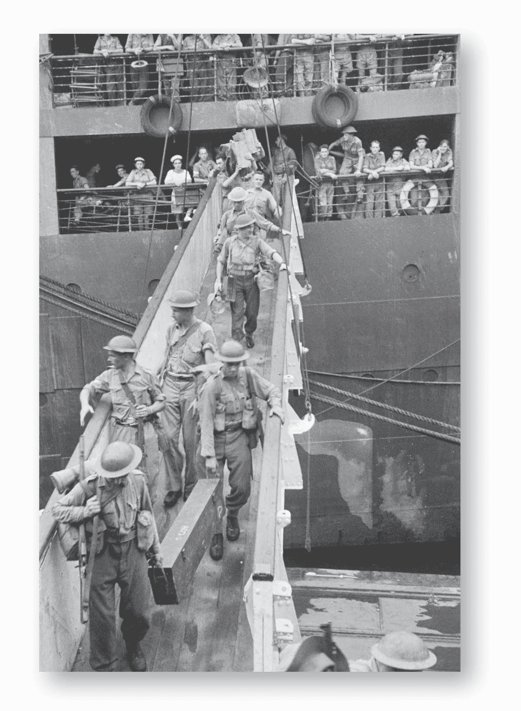

“奥凯德斯号”（`Orcades`）于 1942 年 2 月 16 日载着澳大利亚第 7 师的 3391 名士兵从中东抵达丹绒普里奥。该师的部分士兵于 2 月 18 日登陆；韦威尔（Wavell）将军计划利用他们进行机场防御。图中在“奥凯德斯号”甲板上的士兵可能来自 2/2 先遣团；前景中的两名士兵携带着一支箱装的布伦轻机枪。他们与其他澳大利亚部队和士兵一起组成了`黑色部队`（Blackforce）。“奥凯德斯号”于 1942 年 3 月 21 日作为 SJ 6 船队（巴达维亚–科伦坡）出发，载有 3500 人。1942 年 10 月 10 日，“奥凯德斯号”被德国潜艇击沉。（澳大利亚战争纪念馆）

南苏门腊两天内丢失。来自西侧的钳攻已经合围爪哇。几天后，来自东侧的钳攻也将将其包围。荷属印度的主岛被包围，已无法守卫。

## 巴厘（BALI）

1942 年 2 月 19 日 0100，第 48 师的第 1 福摩森步兵团第 3 营（减员后）、一个山炮排以及一个独立工兵排登陆了巴厘岛南岸。日本海军（IJN）第一基地部队提供了护护。在达拉干（Tarakan）发现的文件显示巴厘岛的机场状况良好。此外，该位置极其有利。从巴厘岛不仅可以对东爪哇进行空战，还能切断来自澳大利亚的补给路线。日本海军第 23 航空飞行队随后强烈建议将巴厘岛再次纳入作战计划。双方于 1942 年 1 月 28 日在马尼拉的会议上达成一致。

巴厘岛由普拉约达军（Prajoda Corps）防御，这是一支由一些欧洲军官和士官组成的印尼辅助营团级部队。日军登陆后，该军由于大规模逃散而瓦解。登帕萨尔（Den Pasar）机场很快就几乎完好地落入日本人手中。第二天就被投入使用。1942 年 2 月 26 日，第 23 航空飞行队总部从巴厘巴板（Balikpapan）迁往巴厘岛。

ABCD 司令部对登陆士兵和物资期间的两艘日本运输船进行了猛烈空袭。两艘船均受损，其中一艘受损严重。联合打击群也被部署在东侧应对这一严峻威胁。日本军已经达到了地面目标。最重要的是，行动太晚了（2 月 19/20 日）。

## 帝汶（TIMOR）

帝汶岛在政治上被分为荷兰部分和葡萄牙部分。东部是葡萄牙的，首都是迪利（Dilly）。西部是荷兰的，在西北岸有一个小葡萄牙亚飞地，首都是库邦（Kupang）。该岛长 476 公里，宽 102 公里。岛上山山崎岖，覆盖着热带森林。道路网络有限。在荷兰部分，有一条未铺装的主路（宽约 4–5 米）从库邦延伸到葡萄牙边境。由于珊瑚和沼泽，路边地形不适合机动车辆。彭诺伊（Penfoei）机场位于库邦东北方向约 4 公里处。

帝汶及属地民兵司令部由一个地区总部和由 27 个旅（每旅 19 人）组成的帝汶及属地守备团组成，其中 21 个旅驻在帝汶。民兵指挥官是 W.E.C. 德蒂尔（Detiger）中校。此外，守备队配备了标准的三辆甲兵车。其任务是维持中立并防止日军登陆。总人数为 500 人。民兵仍组织为内部安全部队，面对现代有组织的武装力量缺乏打击能力和火力。

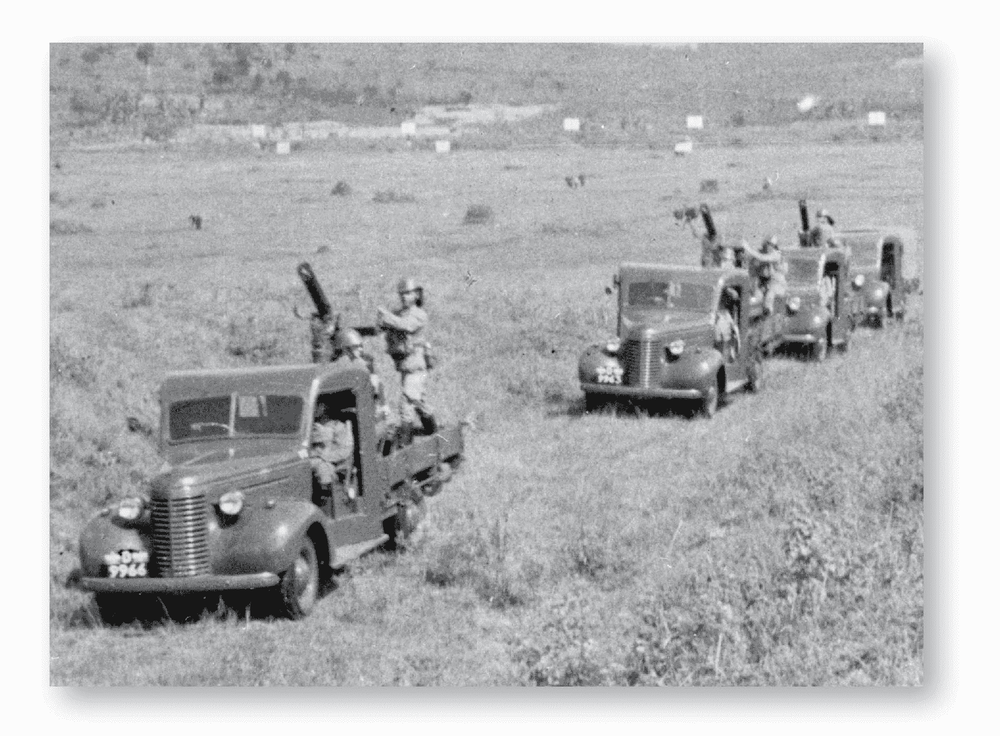

荷属印度（NEI）半机械化机枪和步兵炮连于 1940 年重组为完全机械化和摩托化的反坦克防空连（`afdeling Pantser-en Luchtafweer`）。后者为团级提供反坦克和移动防空防御。防空排（57 人）配备了九支安装在轻型敞空雪佛兰车后部旋转支架上的 M30 柯特 12.7mm（.50 口径）重防空机枪。机组不受来袭火力保护。在这张照片中，可以看到三辆带有防空机枪的卡车和一辆弹药车。1938 年底，荷兰东印度陆军（RNEI）认为 12.7mm 防空机枪已过时。它们应被 2cm 炮取代，但在日军进攻期间，旧的防空机枪仍被广泛使用。（荷兰军事历史）

# 提汶岛防御战

澳大利亚在提汶岛部署了来自澳大利亚空军第 2 中队的飞行队（四架猎逊式）和雀鸟部队（Sparrow Force）。雀鸟部队由`2/40 营`、`2/1 重炮兵团(RAA)`以及在`W.W.Leggatt`中校领导下的若干支援和后部队组成。他还可以调动四辆`RAAF`装甲车。兵力规模约为 1,250 人。在 1941 年的美荷英三国讨论中，双方同意陆军将由其作战所在的国家指挥。提汶岛是一个例外。在战争爆发时，该岛将由澳大利亚负责指挥。

## 初始防御策略

荷兰人认为，大规模登陆只在古邦湾有可能。Leggatt 中校对此表示怀疑。尽管如此，他的防御基于直接的岸防御，由荷兰东印度（NEI）部队以及分别位于古邦以东两侧的`2/40 营``A`连和`B`连组成，以及一个由两门`6 英寸`海军炮组成的静态岸炮兵阵。`2/40 营`的`C`连位于`Penfoei 机场`，而机动的`D`连则驻守在古邦以东 10 公里的连接道路`Babaoe`，作为机动防御。

Penfoei 机场于 1942 年 1 月 26 日开始遭到空袭。结果是该机场到 1 月底已无法运行。随后它被用作中转站。因此，澳大利亚陆军留的理由已不复存在。然而，`ABDACOM`决定不撤离提汶岛，而是通过陆空力量对其加强。在这些力量中，只有一个由`W.C.D.Veale`准将率领的澳大利亚旅团总部以及英国`第 79 炮队（减员）、`第 21 轻高空团(RA)`抵达。其余援军在途中途中遭到日本飞机的攻击，返回了`达文港`。

## 日本的作战计划

日本对提汶岛的作战计划包括由“东遣支队”在南岸古邦和靠近东提汶迪利进行登陆。该支队将乘坐五艘运输船从安汶出发。护卫力量由`第 5 巡洋舰队`作为支援单位的“东方攻击部队”以及由`第 2 驱逐舰队`组成的“第 2 护卫部队”提供。`1001 部队`或`第 3 横须陆战兵队`（一支日本海军伞兵部队）将在`Penfoei`执行空降进攻。`第 3 横须陆战兵队`原计划针对巴厘望板执行行动，但其跳伞任务被取消了。

联合舰队司令长山本五郎海军大将在 1942 年 2 月 8 日将日本海军的核心——除`第 5 航母战斗群`以外的航母战斗群，作为“第三阶段”行动的一部分交给“南方任务群”。“南方任务群”部署航空母舰对`达文港`进行空袭（“移动行动 I”），并对爪哇岛以南进行作战（“移动行动 II”）。1942 年 2 月 19 日周四早晨，来自四艘航母战斗舰的 188 架飞机在来自肯达里`和安汶的`第 21 飞行队`54 架飞机的支持下，袭击了澳大利亚北部的港口城市达文。后者是用于荷属东印度群岛作战的一个重要但装备简的基地。在毁灭性的空袭后，该基地暂时丧失了功能。

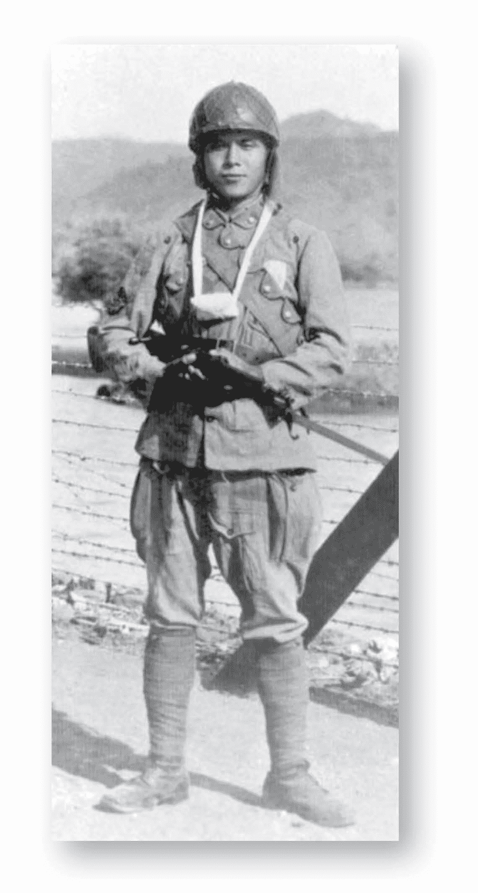

这名日本海军陆战兵下士穿着日本海军伞兵穿的带有额外口袋的特殊两件式制服。然而，他穿的不是伞靴，而是配有绑腿裤的野战鞋。在右上方可以看到他深蓝底红色的职业兵章/军衔标志。这种型号的兵章一直正式使用到 1942 年 11 月。伞兵还戴着一条皮带和两个布制弹药带。他脖子上挂着一个装有牺牲战友骨灰的袋。他配备了一支`6.5mm 38 式(1905 年)`八坂步兵枪，并装有了`30 式(1897 年)`刺刀。（公有领域）

## 登陆与战斗

1942 年 2 月 20 日周五凌晨（0235 和 0315），“东遣支队”的部队在提汶岛毫无防御的南岸三个区域登陆。“东遣支队”由`第 228 步兵团`的`第 1`和`第 3`营、`第 38 山地兵团`的`第 2`营以及一个坦克连组成。日本海军派遣了`第 1 佐濑陆战队`的两个班以及`第 3 横须陆战兵队`剩余的 118 名士兵。支队以三列并行作战，利用小径、路径和改良后的机道向北穿越山脉到达`古邦`和`Penfoei`。这就像是进攻安汶的重演。1942 年 2 月 22 日，在`Tenau`发生了第四次登陆，其中包括坦克在内的部队。

两栖登陆后，Leggatt 决定撤离并摧毁机场。`D`连在古邦通往`Baoen`的道路南部占据了阻击位置，以减缓日本人的进军。在主连接道路上，他的防线是为了阻碍日本人的进攻。在位于占隆以东的开阔地带，他试图发起阻击行动。这里他的`.303 口径`机枪和`3 英寸`迫击炮火力将发挥作用。

`荷属东印度古邦支队`清理了沿岸阵地，并在古邦南部集结。部分部队在`Baoen–古邦`道路上占据了拦截位置，并与`D`连会合。指挥官没有下达进一步指令。下午末，`A.L.van Mastrigt`上尉接管了支队指挥（189 人）并向`Penfoei`移动。1942 年 2 月 21 日早晨，他和副指挥官因误火受伤，离开了战线。他们的继任者是一个紧张的少尉，并没有加入澳大利亚人而是解散了支队。荷属东印度军队的角色在开始之前就已经结束了。

## 最后进攻

在 10:45，来自`第 3 横须陆战兵队`总部的`第 1`和`第 3`连的 450 名伞兵在距离目标——机场约 12 公里的一片草地上进行了空降。选择这个跳伞点是因为此前在门纳多遭遇了惨重损失。伞兵封锁了`Babaoe`的主干道。这意外威胁了后方的雀鸟部队，并切断了预定的撤退路线。Leggatt 通过在`Babaoe`西部集结部队并试图突破。与此同时，他未能与`Veale`准将率领的澳大利亚部队建立无线电通信。结果是，没有针对日本人的协同行动。

第二天 10:24，来自`第 3 横须陆战兵队``第 2`连的约 250 人的第二梯队降落在同一个跳伞点。Leggatt 发起了反击并成功夺回了`Babaoe`。然而，“东遣支队”的右翼攻击部队——加强后的`第 1 营第 2 连`（206 人）在当天结束到达了主干道，并在`Babaoe`以东形成了新的路障。澳大利亚人的撤退路线再次被切断。

1942 年 2 月 22 日下午，雀鸟部队在早晨多次进攻后，终于打开了道路。然而，来自古邦的日本先遣队已经赶到，第二天早晨，加强后的`第 228 步兵团第 1 营`携带着坦克也随而至。Leggatt 中校被迫投降。

# 雀雀部队与战斗行动

雀雀部队的战斗力受到士气下降和发病率上升（30%）的影响。在日军空袭、日本人在其他地区的取得成功、缺乏空中支持以及援军不会抵达的背景下，士气随之下降。从战术上讲，“在这种类地形中，通信非常难以维持”。`Leggatt` 意识到了这一控制问题。部分由于这个原因，他希望在 `Tjamplong` 附近的开阔地区进行决战。他于 1942 年 2 月 21 日和 22 日以碎片化的方式部署部队，浪费了宝贵的时间——考虑到日本从 `Kupang` 的后方推进，`Leggatt` 并没有多少时间。他本可以针对这一预料的威胁留出大量预备队。部队在 1942 年 2 月 20 日和 21 日表现出战斗意愿不足：在此阶段，他们“并不自信，当附近发生单枪射时往往撤退”。这可以归因于战斗经验的缺乏。1942 年 2 月 22 日，紧张导致了恐慌。尽管有这些缺点，雀雀部队仍然坚守。其伤亡人数达 150 人死伤，另有 200 人失踪。`第三横须陆战陆队`遭受了 38 人死、40 至 50 人伤。`东部支队`报告 67 人死、56 人伤。日本人俘了 1,136 人：其中 179 名英国人、934 名澳大利亚人和 23 名荷兰人。

在进攻 `Kupang` 的同时，`东部支队` 也进攻了`葡属帝汶汶`的首府 `Dilly`。`Dilly` 已于 1941 年 12 月 17 日由荷兰领导的`荷东印-澳大利亚联合支队`占领。`荷兰东印度陆军`曾敦促采取此行动，以防止日本在那里建立空军基地，从该基地可以到达 `Makassar` 和 `Kendari` 的机场，直接威胁 `Ambon` 和 `Darwin`，并控制`荷属东印度`与澳大利亚之间的通信线。

`荷东-澳大利亚远征军`由所谓的增援后的`门纳多第三连`、来自`爪哇`的`第 8 步兵团`、一个四门`7.5cm L30`野战炮连、一个工程师和一些勤务人员组成。它由来自`Kupang 守备团`的六个旅加强。澳大利亚人抽出了`第二独立连`，这是一支突击部队（270 人）。荷兰人队伍总计 604 人。远征军指挥是 `N.L.W. van Straten 中校`。`荷东支队`在缺乏深度的阵地上守卫 `Dilly` 港和机场。作为一个突击部队，`第二独立连`并不适合静态防御。它被指定为预备队，位于 `Dilly` 南西 4 公里的山地中。一个排驻守在机场。

`葡属帝汶`中`荷东`和澳大利亚军队的存在，让日本开始考虑如何处理这片中立领土。`大本营`希望避免与`葡萄`发生冲突。然而，`南方军（日本陆军）`和`南方作战群（日本海军）`均认为 `Dilly` 的盟军力量对进攻 `Kupang`构成了威胁。他们必须将他们赶出去。此后 `Dilly` 必须留在手中，作为反对 `Darwin` 作战的重要基地。`第十六军`反对在`帝汶`上同时进行行动。它希望集中力量征服 `Kupang`。它曾提到了在针对 `Ambon` 的行动中对 `Laha` 的失败进攻。`大本营`结束了这场讨论。

1942 年 2 月 20 日，`东部支队`连同加强后的`第 228 步兵团第 2 营`（由团长`井井诚三一上校`带领）计划对 `Dilly` 发起直接奇袭。这由于`荷东`的炮兵和机枪火力而失败了。`井井上校`修改了计划，在西侧不到一公里处登陆。两水登陆发生在 `0218 时`。主力军开始对机场发动正面进攻，`第 5 连`进行包抄，`第 7 连（加强后）`向 `Dilly` 南方进行迂护运动。`Van Straten 中校`加强了机场防御。然而，他的撤退路线受到了威胁。一些`荷东`士兵已经逃了。此外，由于通信中断，他无法召集`第二独立连`。澳大利亚人直到 `0900 时` 左右才知道日本人的登陆。看到日本舰队后，`Van Straten` 估计日军实力为 4,000–5,000 人。在 `0800 时` 左右，他决定向`第二独立连`进行总撤退。早晨结束时，`Dilly` 已入日本人手中。

`陆军`的损失为 7 人死亡。在盟军一方，有 24 名士兵牺牲：8 名`荷东`士兵和 16 名澳大利亚人。盟军战俘人数为 33 人。

来自`荷兰`和`葡属帝汶`的战败澳大利亚和`荷东`部队退到了山里。他们最终发起了游击战。然而，那个故事超出了本书的范围。

随着`帝汶`被攻占，以及`航母任务队`位于`爪哇`南方的海域，该岛的包围已经完成。它现在失去了来自`澳大利亚`的援军。一周内，日本人将登陆`爪哇`。

## 爪哇（行动 H）

1942 年 2 月 19 日，根据`Wavell`的建议，联合参谋部在缺乏进一步盟军支持的情况下决定调整对爪哇的行动计划。这是在日本登陆`爪哇`的一周前。为了对预期的日军部队取得某些成功，决定集中力量在西爪哇并建立战略预备队。从`东爪哇`转移部队的建议被总督否决了。`海军指挥官`发现`泗水舰队基地`对支持海军是不可缺的。然而，`中爪哇`被放弃了。由于`第 3 师`在`东爪哇`，部队处于碎片化状态。

### 行动 H：征服爪哇

`爪哇`是`荷属东印度`的主要岛和行政中心。它是一座长（约 1060 公里）窄（200 公里）的岛屿，人口约 4200 万。火山山区纵贯全岛。北岸由低地地形组成，许多河流从山中流下。相比之下，南岸地形多为山区。原始森林大部分已被清除。`普里南根`是西爪哇的一个高高原，拥有`望登`市，被中高山环绕。该岛有三个现代港口：`丹绒港`（西爪哇）、`泗水`（东爪哇）和`井拉恰普`（Tjilatjap，位于中爪哇南岸）。道路网发达，有东西东西连接的铺装道路以及沿南北岸的铁路。在中爪哇的`切普`（Tjepoe）有一座油炼厂。

这一决定对爪哇岛西部和中部的指挥线和部队位置产生了影响。在西爪哇，`1st Division` 的作战区域被重组为独立的指挥部：西部小组、万隆小组和东部小组。最终未建立独立的东部小组部。西部小组、万隆小组和 `3rd Division`（东爪哇）各由一个带有支援武器的步兵团组成。`2nd Infantry Regiment` 与 `1st Mountain Artillery Battalion` 成为西爪哇的战略预备队。为了配合这些作战计划的变更，必要的部队从中爪哇转移到西爪哇及其他们新且大多不熟悉的作战区域。他们没有时间在那里适应，因为日本在爪哇岛的陆上进攻已全面爆发。

### 针对爪哇岛的空攻

针对爪哇岛的空攻由 `IJN 11th Air Fleet` 在东爪哇进行，由 `IJA` 联合 `Third Air Force` 和 `IJN 11th Air Fleet` 在西爪哇进行。`IJN` 和 `IJA` 面临合适机场的短缺和后勤问题。此外，`IJN` 的空中行动受到恶劣天气的严重影响。针对爪哇岛的预备空攻于 1942 年 2 月 3 日随着 `Operation Z` 开始，这是一场为期三天的旨在消除东爪哇盟军空权的空攻。目标是泗水、马迪恩和马兰贡。在经历了 1942 年 2 月 3 日和 5 日两天的行动后，`IJN` 确信东爪哇的盟军空权已基本被消除。随后在 2 月 7 日、8 日和 9 日发起了新的攻击。由于天气恶劣，下一次攻击直到 1942 年 2 月 18 日才发生。天气也干扰了 `IJN` 针对西爪哇的空中行动，重点转向了攻击邦加岛附近的盟军船只。`IJA` 直到 2 月 19 日才从巴乐望开始其对西爪哇的空战活动。当 `Western Landing Unit` 于 2 月 18 日出发时，针对爪哇岛的空攻尚未开始。在爪哇岛获得空中优势权是不可能的。在 `IJN` 看来，针对西爪哇的空攻果实不足。盟军海军和空军依然保持活跃。为此，`IJN` 提议将爪哇登陆推迟两天，直到 1942 年 2 月 28 日。`Southern Task Force` 得到了加强，针对西爪哇的空战之升级。

在 `Operation Z` 期间，`IJN` 空军部队偶然接触了盟军海军的 `Striking Force`。人们认为在两天的空中攻击中盟军舰只遭受了严重损失。事实上，只有两艘美国巡洋舰受损；`USS Houston` 上 48 人死亡，20 人受伤。

### 盟军反攻

`ABDA-AIR`对南苏门答腊的损失做出了反应性反空行动，通过轰炸`Plaju Refinery`的油库、`Musi River`上的船只、`Muntok anchorage`锚地以及`Palembang Airfield`，旨在尽可能损害日本的飞行能力。这次反攻取得了部分成功，但证明不足以阻止日本的进攻。`FEAF`则在巴厘岛沦落后，对巴厘岛执行了独立的进攻性反空行动。除了进攻性反空行动外，盟军战斗机部分配合防空炮被部署在防御性反空行动中：负责机场、主要港口和海军的防空。到1942年2月底，飞机援军正乘船前往爪哇岛。然而，水上飞机母舰`USS Langley`被击沉，`MS Sea Witch`上的飞机被装在箱子里，尚未组装。最终，没有时间完成组装。其货物不得不销毁。

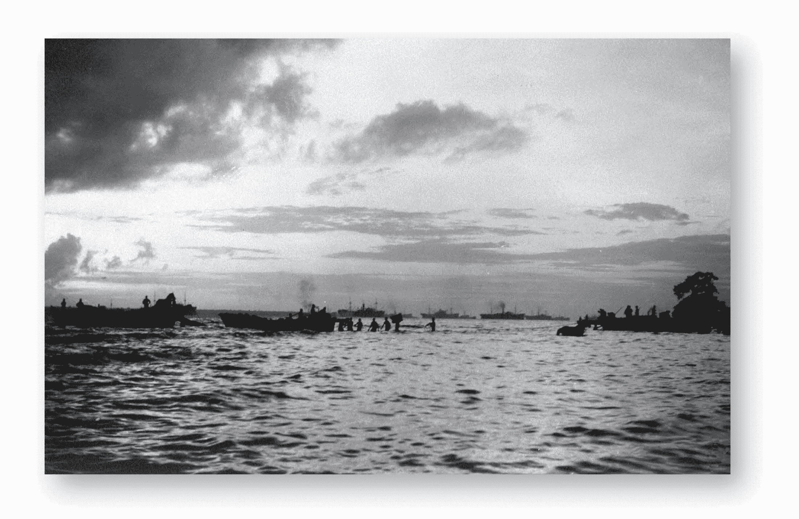

### 两栖登陆

`Sato Detachment`在位于斯圣尼古拉斯角附近的万丹湾1号区域C区进行两栖登陆。区域A区和B区位于巽他海峡默拉克的南北两侧。日本人在准备在完全黑暗中进行两栖登陆，并在月亮起后执行，最好选在黎明潮汐最高的日子。在塔拉坎岛，登陆是在半退潮时进行的。他们使用了特殊的登陆艇。卸货由部队完成。事实证明万丹湾不适合卸货。在1942年3月4日默拉克的船只完成任务后，运输船从万丹湾驶向默拉克继续卸货。（每日新闻报）

第十六军从1942年2月中旬开始的计划规定，于2月26日黎明在西爪哇和东爪哇同时登陆。`48th Division`在克拉根登陆并占领了泗水。`Sakaguchi Detachment`也登陆在克拉根并占领了中爪哇的西拉恰普。`2nd Division`在万丹湾登陆。首要目标是征服雅加达。一支强大的次要力量进军博哥夺取这座城市。`Shoji Detachment`登陆Eretan Wetan，意外占领了`Kalidjati Airfield`并占据了锡塔鲁河上的桥梁，封锁雅加达与万隆之间的道路。占领雅加达后，`2nd Division`主体和`Shoji Detachment`将从北方共同进攻万隆据点。因此，万隆是次要目标。根据情况，来自博哥的辅助部队和`Shoji Detachment`将一举占领万隆。1942年2月，南方军考虑部署`1st Raiding Group`进攻西拉恰普。这将切断爪哇岛的返回供应路线。最终，该计划被取消了。

1942年2月26日，两支日本入侵舰队从金兰湾等基地接近爪哇岛。`Western Landing Unit`包括56艘运输船和27艘军舰。`Eastern Landing Unit`包括`48th Division`的38艘运输船和`Sakaguchi Detachment`的2艘。该部队于1942年2月25日在巴西板望锚地被发现。盟军`Striking Force`从泗水出发并攻击运输舰队。并未找到运输船。然而，中队遭遇了日本护卫部队。随后的`爪哇海战`发生在1942年2月27日和28日，`Striking Force`被击败。凭借这一胜利，`IJN`控制了爪哇周围的海域。登陆仅推迟了一天。

在1942年2月28日（周六）至3月1日（周日）夜间，十六军在爪哇海岸执行了两栖登陆。`Operation H`开始。`Western Landing Unit`在西爪哇的两个登陆区上岸。十六军司令部和`2nd Division`登陆在1号区域，主力于00:30进入万丹湾，分遣于02:00进入默拉克。`Shoji Detachment`在东约200公里的Eretan Wetan登陆。由`48th Division`和`Sakaguchi Detachment`组成的东方突击队在东爪哇附近的克拉根登陆。

登陆区之间距离遥远。这意味着爪哇战役将由广泛分散的作战区域组成。这使得十六军难以指挥中爪哇和东爪哇的部队。为了让这些部队独立作战，增加了特殊部队和设备，提供了清晰的作战指示，并在总部任命了一名特种参谋。这种指挥问题因登陆后丢失十六军的通信设备和密码本而加剧。由于失去了通信手段，今田将军在爪哇战役期间失去了对十六军的指挥和控制。

防守方对爪哇岛的情报工作简直糟糕透顶。1942年3月1日，估计日本人已在西爪哇岛登陆了两个到三个师。至少有两个师登陆在克拉根（Kragan）。1942年3月4日，这一数字被上调：万丹地区四个师，印德拉马亚尤（Eretan Wetan）附近一个师，东爪哇岛可能有两到四个师。事实上，爪哇岛军与第十六军在人数上大致相当，如表10所示。14

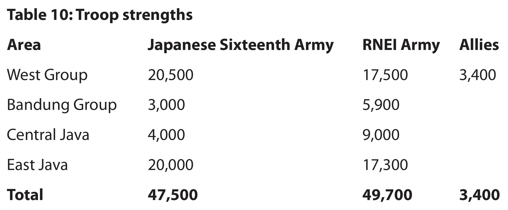

## 西爪哇岛

在万丹湾登陆期间，日本军舰遭到了盟军船只`USS Houston`号和`HMAS Perth`号的射击，它们正试图向西逃离。在随后的混乱战斗中，这两艘船均被击沉。一艘日本运输船被友军误击沉，三艘运输船严重受损、搁浅并倾斜。日本人也没有免受空袭之苦。1942年2月27日至3月1日之间，盟军空军从针对打捞（Palembang）地区的反空作战，转变为对日本登陆行动的骚扰攻击。运输舰队、登陆本身以及物资卸载均遭到了轰炸和机枪扫射。

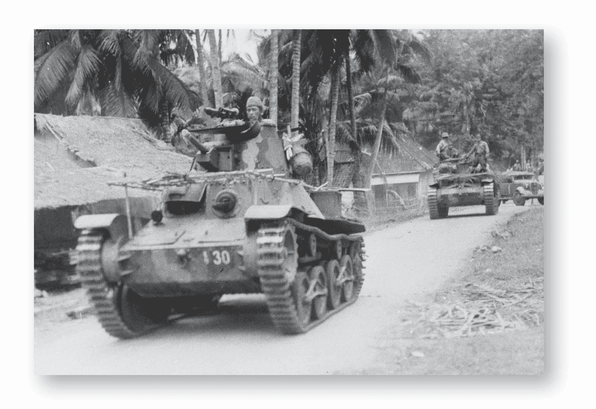

在整个荷属东群岛（NEI）进攻期间，日本人大量使用了坦克，尽管它们在战场上的决定性作用不如在马六甲时那样大。在通往西爪哇岛色浪（Serang）的道路上，这支机械化纵队的前方，我们看到团规模的第2坦克团的两辆轻型坦克。没有平民观看。坦克是95式“甲号”（Ha-Go）轻型坦克，炮塔内装备有94式（1934年）37毫米炮，前车体配备7.7毫米97式机枪。可以看到炮塔内有坦克长。他没有戴坦克帽，而是反过来戴着野战帽。坦克上增加了一个木架用于固定伪装材料，如随其后的第二辆坦克所示。（每日新闻报）

在梅拉克（Merak），规模较小的荷属东群岛沿岸支队（约40人）反对了登陆，但很快被迫撤退。在梅拉克登陆的纳须（Nasu）支队由第16步兵团（缩编）和第2侦察团组成。该支队必须向博戈尔（Bogor）发动支援进攻。由于营规模的摩托化第2侦察团作为先锋，色浪在当天上午0700被占领。该市是一个重要的十字路口。该部队向南转，并于1230奇袭了兰卡斯比托滕（Rangkasbitoeng）。位于兰卡斯比托滕的荷属东群岛支队由第2步兵团第10营、第一山炮营和两辆装甲车组成，行动失败了。他们匆忙撤退，预想中的阻击行动几乎没有实现。福岛（Fukushima）支队也于梅拉克登陆。它由第4步兵团（缩编）组成。他们奇袭了跨越朱容江（Ciujung River）的帕马让桥和闸。佐藤（Sato）支队由加强后的第29步兵团组成，登陆在万丹湾。佐藤支队与福岛支队共同构成了以雅加达为目标的主力。然而，由于倒木封锁道路和桥梁被毁，佐藤沿北部路线的推进进展非常缓慢。深水和高岸加上大雨后的洪水上涨，使得桥梁修复变得困难。该支队直到1942年3月3日到达朱容江。

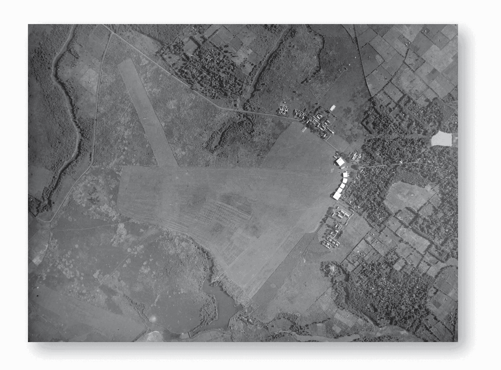

卡里贾蒂机场（Kalidjati）是主要的军事航空队运行基地之一。1942年2月，`ABDA-AIR`为卡里贾蒂分配了两个中队：英国皇家空军（RAF）第84轰炸中队和澳大利亚皇家空军（RAAF）第1通用侦察中队。荷兰第1航空群也从该机场行动。地面防空由皇家陆军（RA）第48高空团第49炮以及第3防空营的单位提供。在日本登陆当天上午，荷属东群岛（RNEI）陆军第2步兵团第3连被执行地面防御任务的第6重高空团第12炮取代。澳大利亚和荷属东群岛航空单位及时撤离机场。然而，英国人太慢了。这张机场照片拍摄于1930年至1932年间。到1942年，机场已扩建了照片底部湖泊西侧的两条跑道。右侧是通往苏邦（Subang）的道路，日本人从该方向接近机场。（莱顿大学图书馆，KITLV 49427）

对于西部司令官希林（Schilling）少将来说，万丹湾的登陆完全并不意外。然而，日本人沿南部路线的推进比预期快得多。从色浪到雅加达和博戈尔的两路分开了。沿两条路线推进只会增加敌方进攻轴之间的距离。日本人的快速南部推进进一步拉开了距离。根据希林的说法，这提供了一个取得有限成功的机会。

一个由七辆新抵达的`Marmon-Herrington CTLS-4TA`坦克组成的排被分配给机动部队。这种双人7.2吨坦克被证明是失败的。炮塔安装有.30口径的勃勃宁`M1919`机枪，只能旋转270度。其装甲无法抵抗机枪火力，坦克不可靠。尚未安装无线电。照片中的前三辆坦克是`CTLS-4TAY`变体，炮塔位于左侧。后续坦克是`CTLS-4TAC`变体，炮塔位于右侧。大多数新坦克未能及时投入荷属东印度（NEI）战役，其中一些被运往了荷兰殖民地苏里南。这张照片是1942年在那里拍摄的（Bronbeek博物馆）。

卡里达加蒂（Kalidjati）机场位于普里让山脚下的沿海平原，距离万隆陆军基地仅40公里。如果这个战用机场落入日本人手中，将构成非常严重的威胁。荷兰荷属东印度总司令（RNEI HQ）决定集中力量对付孤立分散的庄司支队（Shoji Detachment）。作战计划规定1942年3月3日从南部部署战略预备队（第2步兵团和第1山地炮营），重新夺回苏邦和卡里达加蒂。3月2日，命令三个以步兵为主的小组对日本人的滩头堡进行强力侦察。每个小组包括一个步兵营和一个炮兵连，其中两个小组还配备了一个机械化骑兵队。第二天，这些小组（De Vries小组、Teerink小组和Vriesman小组）必须支持主攻。

1942年3月1日，爪哇航空司令部部署剩余的军事航空队和皇家空军（RAF）飞机攻击埃雷塔万丹（Eretan Wetan）的运输船和登陆点，并从3月2日起也针对被占的卡里达加蒂，以尽可能推迟作战的启动。3月1日，战斗机还对内陆的日本纵队进行了扫射，在这方面取得了相对成功。2月28日，有29架轰炸机、22架战斗机和10架侦察机专门供侦察小组和东部小组使用。

机动部队（`Mobiele Eenheid`）是一个坦克和装甲步兵连，被转移到万隆小组。Pesman少将坚信该机场仅被一小队日本先遣队占据。他命令机动部队夺回卡里达加蒂机场。随后后续部队将守住机场。3月2日晨，机动部队（在G.J. Wulfhorst上尉指挥下）在第2山地炮营第2连的增援下，进攻了苏邦。镇上有庄司支队的司令部，由一个步兵连保护。尽管日本人完全出乎其意料，但机动部队未能突破到达机场，在人员和物资遭受重损失后不得不撤退。撤退期间，他们与由第2山地炮营第1连增援的营级单位——Teerink小组会合。然而，Wulfhorst上尉和Teerink少将并不知道对方的位置。由于缺乏协调和通信，失去了一个黄金机会。受命进行强力侦察的三个小组按命令探测了滩头。

日本人也面临着通信问题。第27航空团的大部分兵力直到1942年3月2日下午才开始在卡里达加蒂上方行动。它对卡里达加蒂进行防空，并对万隆的安迪机场发动进攻。Imamura中将直到3月4日听到卡里达加蒂被占的消息。

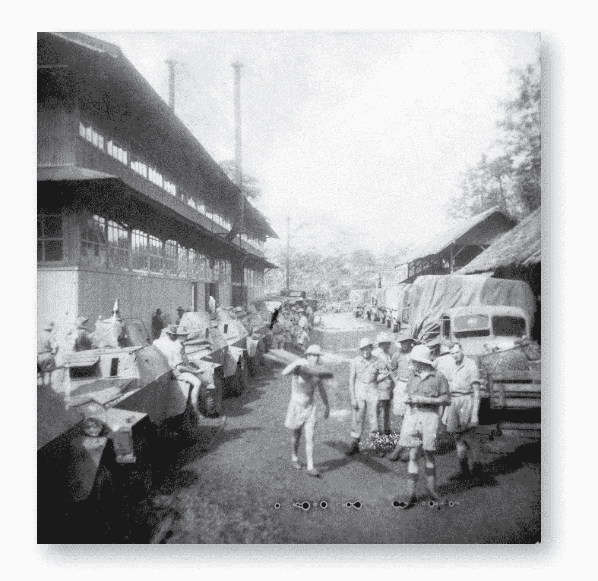

Blackburn准将于1942年2月21日至22日由爪哇上的澳大利亚部队和士兵组成了一个旅团：黑力部队。这支部队仅装备了轻武器。但它可以从从新加坡调往巴达维（Batavia）的物资中获得供应。这包括车辆、一些机枪载具和“大量”轻型装甲车。黑力部队首次用于保护五个机场。1942年2月27日，该部队转移并集中在博哥尔外的詹姆佩亚（Tjampea）茶园。他们于1942年3月2日移动到勒乌利亚昂（Leuwiliang），以对抗进军的日本人。（澳大利亚战争纪念馆）

爪哇西部南部轴线的战斗完全不同。在勒乌利亚昂，纳津支队（Nasu Detachment）的快速推进被停止。在那里，荷兰人在齐安河（Cianten River）东岸建立了一个连级支援位置。1942年3月2日或3日凌晨，这里由A.S. Blackburn准将指挥的澳大利亚黑力部队占据。在取消了计划中的爪哇西部反击后，黑力部队被赋予守卫博哥地区的任务。根据关于日本人在马来亚战术的信息，Blackburn组织了深度防御。一个营占据要要位置，另一个营留守。Blackburn将主力作为机动预备队留在后。

勒乌利亚昂接触的第一批部队是1942年3月3日13:30纳津支队的先遣队——由野口宪一（Kinichi Noguchi）中校指挥的第2侦察团。随后几次尝试向南跨越齐安河并从侧翼攻击黑力部队的尝试均告失败。3月4日午夜后，第2师步兵群和纳津支队司令官纳津优雄（Yumio Nasu）将接管了战斗。当第2侦察团在正面牵制黑力部队时，第16步兵团第3营作为预备队随后进入。然而，这种包围在河东被第2营的一个勇敢连阻挡。

由C.G. Toop上校指挥的增援第2步兵团于1942年3月3日10:00发起了延迟反击。

*根据提供的文本流对最后几段进行修正：*

由C.G. Toop上校指挥的增援第2步兵团于1942年3月3日10:00发起了延迟反击。（原文显示……）在07:15，第1骑兵队的一个装甲车排到达了机场，可能是由于失误。推进路线没有被封锁，且没有日本人的哨所。然而，由于飞机的侦察和第1骑兵队过早出现，惊喜元素消失了。由于没有获得空中支持，因为万隆的主安迪机场在早晨遭受重大空袭后暂时失去了作用。从13:00到17:30，第2步兵团遭受了来自卡里达加蒂的第3航空团轰炸机和战斗机的反复打击。进展不仅停滞了，第2步兵团还溃散并混乱地撤退。苏邦南方Teerink小组的侧翼攻击也被发现并遭遇了类似的命运。Vriesman小组对埃雷塔万丹登陆点的攻击在日本人海军舰火的支持下也被击退了。

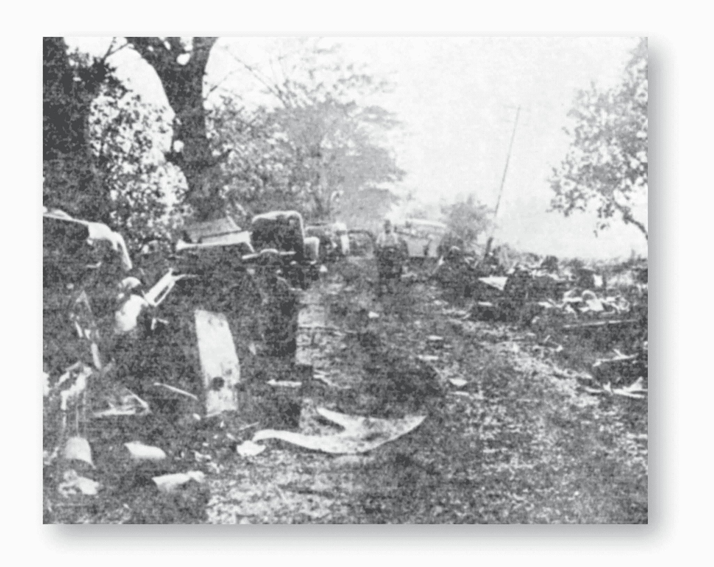

1942年3月3日，日陆军第3航空团派出27架飞机在六次任务中，对荷印第2步兵团（增援）的进攻纵队进行了持续4小时的轰炸和扫射。荷印步兵于10:00左右在沙当—卡里达加蒂—苏邦路的沙当东部离开了车辆，并通过地形推进。下地的部队和车辆在下午遭受了持续的空中轰炸。这意味着夺回卡里达加蒂机场的希望彻底破灭。这张模糊的照片可能就是在上述道路上拍摄的。在残骸中可以看到两辆卡车和一辆公共汽车，中心一名日本士兵。（公有）

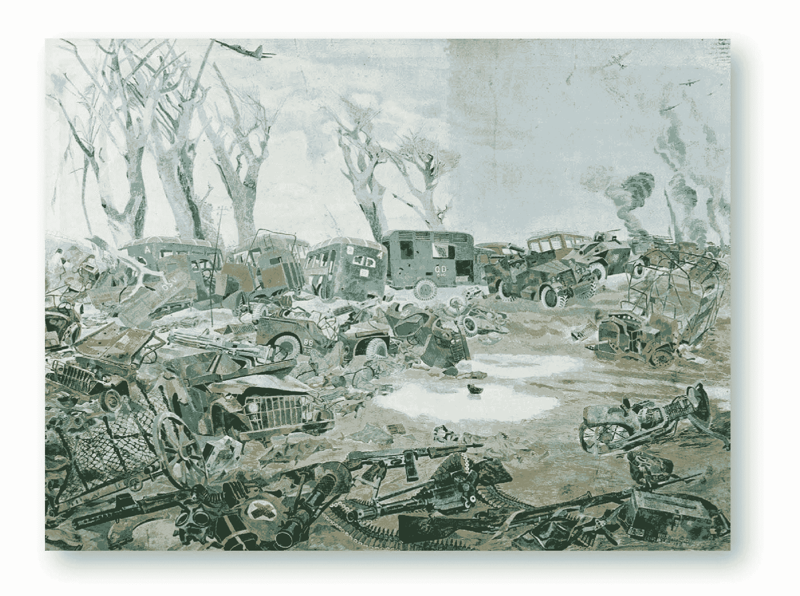

# 西爪哇战斗概述

这是一幅由吉冈健治（Kenji Yoshioka）创作的日本战争画，名为《轰炸爪哇加里加提机场西部地区》。画面展示了1942年3月3日第3航空军轰炸后，荷兰东印度军队（RNEI）第2步兵团（加强后）被毁的车辆和遗弃的武器。士兵倒在残骸之间。背景中被毁的物资仍在冒烟。两架日本飞机（可能是双引擎的三菱Ki-51陆军攻击机）在天空中盘旋。（NARA，公有领域）

## 战略形势

第十六军将雅加达确定为作战目标，并对西爪哇印尼的反攻做了准备。1942年3月3日至4日，事实证明西爪哇印尼军队采取了防御态势。相反，他们对庄司支队（Shoji Detachment）发起了进攻性防御。第十六军担心庄司支队的困境。3月4日，它请求南方军从万胆腊飞往加里加提增援两个连来加强庄司支队。这一请求被拒绝了。

第十六军随后决定将第2师的重心转移到南方推进轴。福岛支队（Fukushima Detachment）转移到南方路线，须津支队（Nasu Detachment）接受了佐藤支队（Sato Detachment）的增援。其目标是迅速突破勒乌壤，然后通过博哥进攻班隆以支援庄司支队。

印尼军队在针对庄司支队的失败大反攻中已耗尽了战略预备队。不再存在进一步大规模进攻行动的问题。因此，印尼陆军总部于3月4日决定重点防守班隆高原。西群被命令尽快撤回到该高原。撤退和准备无疑需要几天时间。在此，班隆群必须独自防守高原的入口。剩余的盟军空军分配给了班隆群。西群通过博哥经陆路和铁路从雅加达附近撤往班隆，并由在勒乌壤坚守的黑部队（Blackforce）掩护。布莱克本于1942年3月5日撤退。他的损失大约为150人。

## 班隆防御战

庄司上校最初估计班隆附近的印尼军队兵力在3万到3.5万之间。在苏邦（Subang），他曾险些躲过了一次重击。他担心自己广泛部署的支队会被包围并歼灭。因此，他想夺取并占据一个高地。在击退3月2日和3日的反击后，庄司上校在3月4日重新评估军事形势后改变了主意。他决定违背今村命令，放弃防御态势，转为进攻并全面进攻夺取班隆。庄司获得了第3航空军司令官藤（Endo）的全力支持。藤将其第3航空军空中支持的重心转移到了庄司支队。他于1942年3月2日带着第59和第75航空从万胆腊抵达。

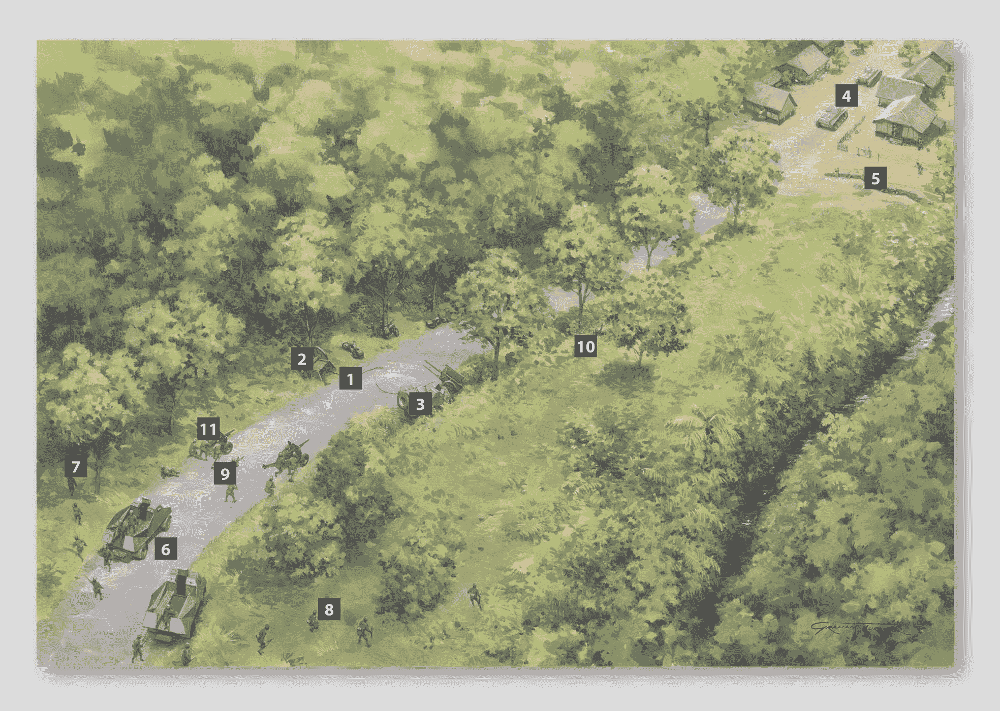

# 印尼机动部队于1942年3月2日进攻苏邦

在日本军登陆爪哇的第一天，庄司支队占领了加里加提机场。印尼军队以各种反击予以回应，其中一次是由坦克和装甲步兵队在炮兵支持下进行的。庄司支队分散，其总部位于苏邦，第2营（减员后）和机场单位位于加里加提，第1营（减员后）位于北部，第6公司守卫其着陆点。在苏邦，庄司上校的总部由第1营第4公司（总共100人）守卫，他们装备有一门山炮、一门反坦克炮和两挺机枪。

1942年3月2日（周一）当地时间0810，由G.J.沃尔斯特（Wulfhorst）上尉指挥的印尼机动部队进攻了苏邦。它由总部、一个侦察排、一个坦克连、一个装甲步兵连、一个反坦克炮组和一个补给队组成。它接受了第2山地兵团第2炮的增援。随之的是荷兰军事史上的第一次坦克攻击。

## 苏邦战斗

这一场景展示了进攻的印尼装甲纵队在强行通过苏邦南的一个道路障碍后，被与日本守军的火战困住的时刻。我们看到日本人设置用来阻塞道路的断裂钢缆（`1`），隐藏在两辆（现已推开）推车后面（`2`）。撞断电缆的荷兰产马顿-赫林顿 Mk III 型装甲车翻覆在道路右侧（`3`）。领先的印尼坦克排（由七辆马顿-赫林顿 CTLS-4TA 坦克组成）沿路单排行进（`4`），并向苏邦推进。在道路两侧，日本士兵在平民建造的防空壕、沟、房屋内和树后占据了阵地（`5`）。他们对从装甲运兵车上下的后续印尼步兵开了火（`6`）。安汶人第 1 排步兵正进入道路左侧的橡胶园（`7`），而望加锡第 2 排则向右侧部署（`8`）。连官站在路中央，一名轻机枪手躺在他身边（`9`）。一名在伪装前沿位置的轻机枪手遭遇了射击故障（`10`）。

尽管日本人出其不意，但机动部队未能利用这一战术成功。地形限制了部署，坦克必须在建筑区内单排战斗。被火力困住的装甲步兵连无法跟上坦克。在没有步兵支持的情况下，冲向机场是毫无意义的。坦克排掉头并强行退回。

为了让印尼步兵进一步进入苏邦，另一个坦克排于 0915 发起了第二次攻击。1000 时，日本人威胁了步兵的右翼和左翼。印尼发起了第三次坦克攻击，使印尼步兵能够脱离战斗并撤退。机动部队撤退了。这场持续了近两个小时的战斗结束了。

机动部队遭受了严重伤亡：15 人死亡，13 人受伤（其中一人后去世）。物资损失包括 13 辆坦克、一辆装甲车、三辆装甲运兵车和一门反坦克炮。在进攻期间，该部队没有获得火力支援。日本人损失为 20 人死亡，人数未知。

## 恰特防御

恰特防御阵地（`Tjaterstelling`）守卫从苏邦到望加里高原的通道。该阵地是为茶园中的一个团而建造的。它本应由更高处的新阵地取代，但被严重忽视。火力差，铁丝网和战壕上方架了许多小桥。2 月之前，该阵地由民兵队（15 人）、警察和一门 5 厘米海军炮的乘员守卫。1942 年 2 月 26/27 日，欧洲第 1 营第 2 公司（加强后）抵达。3 月 1 日，第 2 山地兵团第 3 炮随之到达。然而，由于这些部队只能占据部分阵地。苏邦—班隆路直接通过该阵地。3 月 5 日上午，第 21 步兵团左半从中爪哇抵达。然而，该营一直留在后方 2 公里处。直到 1800 左右，该部队才移动到恰特阵地的正后方。

日本第 2 师的步兵团通常为其三分之一的连队配备自行车。由于道路被毁，自行车被证明是理想的交通工具。这些日本军队正前往雅加达。根据日本《每日新闻》（*Mainichi*）报的报道，热情的印度尼西亚人在路旁观看。今村将军将荷兰东印度群岛（NEI）的失败部分归因于“当地人背叛荷兰人”。（每日新闻报）

小司（Shoji）指派若松所属第 2 营的三个连队、第 4 坦克团第 1 连以及两个山炮营去进攻齐亚特尔关口（Ciater Pass）的阵地。枝仓部队因荷兰东印军的破坏和抵抗而延迟，最终到达了齐塔鲁姆河，但发现桥梁已被毁。小司将该部队召回到苏邦。若松于 1942 年 3 月 5 日（周四）下午 1600 左右发起了进攻。若松部署了他的营，并利用地形、植被、地面雾和一场短暂的大雨，夺取了第一、第二道防线的若干处碉堡。他决定在战场过夜，并在第二天继续进攻。根据小司的，只有前哨站被占领，脊上的主抵抗线仍需攻克。3 月 6 日早晨，若松明确了自己已经突破了主防御体系。

3 月 5 日下午，第 4 步兵团指挥官德维尔（W.J. de Veer）上上接了齐亚特尔阵地的部队。德维尔在 1942 年 3 月 5 日至 6 日夜间组织了深层防御，援军缓慢地在后方汇集到齐亚特尔阵地后。他将（爪哇人的）第 2 步兵营第 2 连和（欧洲人的）第 5 步兵团第 1 连部署在左侧铁丝网后的坑道和战壕中，并将苏邦—万隆路右侧的第 21 步兵团左半部分直接部署在齐亚特尔阵地后。第二道线是由正在建设的瓦特斯（Wates）阵地的帕德库珀部队（Paardekooper Detachment，包括学员和预备军官候选人）组成的。第三道线是由希哈亚部队（Siahaya Detachment，安布隆斯新兵）在托尔赫克（Tolhek）三岔路口的全方位防御。第 2 山炮营第 3 射收到第 2 射的加强。尽管援军已到达，第 1 步兵团第 2 连在当晚撤离了阵地。

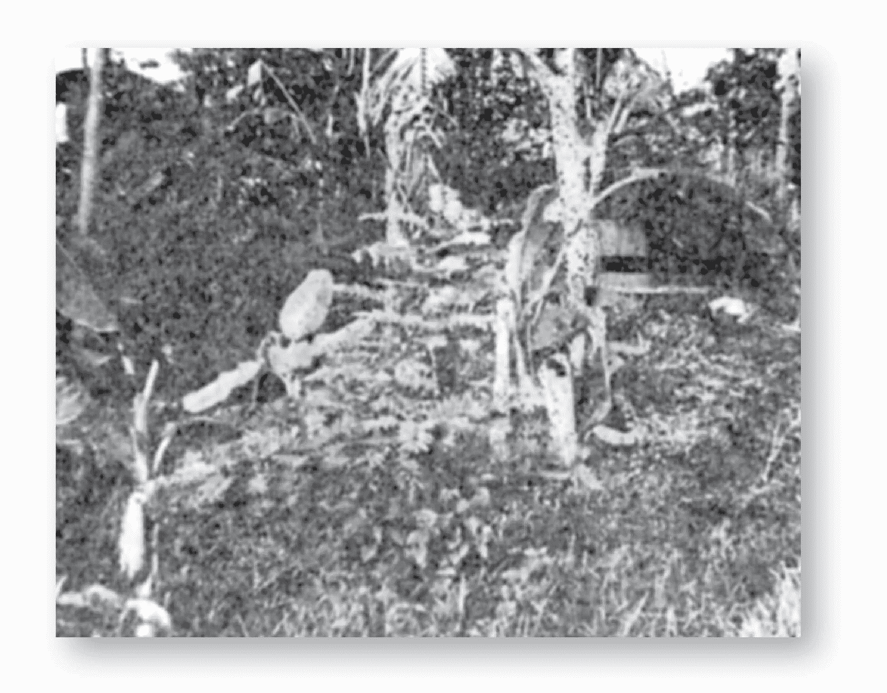

1940 年，在苏邦—万隆路的齐亚特尔关口建立了一个团级作战阵地。该阵地位于一片茶园内。由木桩和铁轨组成的反坦克障碍物由碉堡内的 5 厘米海军炮覆盖，战壕构成了前哨线。在跨越山谷的桥后面，坡度较高处，有两排由战壕连接的碉堡。该阵地最初被遗弃和忽视，但在 1941/42 年被占领并防御。这张模糊的照片显示了齐亚特尔碉堡之一；请注意其坡度陡峭且杂草丛生的地形，以及有限的射界。（公有领域）

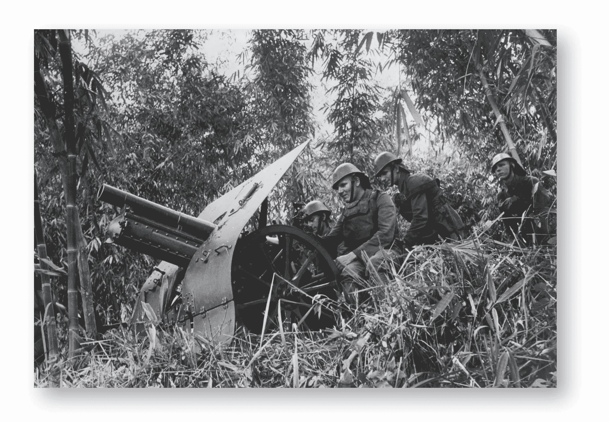

一门位于竹林中的 7.5 厘米山炮（*Bergartillerie*）。这门炮仍带有金属轮子，而大部分装备已改为橡胶轮胎。大炮被装在卡车上运输。两个各四门炮的营在齐亚特尔关口参加了战斗。大炮被用步兵支援武器。炮兵营分配给步兵单位。然而，在齐亚特尔关口，荷兰东印军步兵连长说他需要步兵而不是炮兵。（Beeldbank WO2-NIOD）

在第 2 师区域北方轴线上，仅剩两个营的佐藤部队（Sato Detachment）于 1942 年 3 月 5 日晚晚进入了抽空的雅加达。由于荷兰东印军已撤退，他们在雅加达以西没有遇到抵抗。迅速占领首都是令第十六军感到意外。在黑色部队（Blackforce）从勒乌利亚斯（Leuwiliang）撤退后，第 2 师的主力采取包围运动进攻布哥尔。该城市于 1942 年 3 月 6 日早晨落入日本人手中。下一个目标是万隆。

3 月 6 日周五早晨，若松少对临时防御的左翼发起进攻。道路左侧的两个连在领取面包时措手不及，因为他们没有设置前哨。然而，连队很快恢复了战斗并击退了两次步兵进攻。第三次进攻得到了苏邦—万隆交汇处三辆日本坦克的大炮和机枪火力支持，但这次进攻也被击退了。然而，阵地面临被攻破的威胁。伤痕累累的连停止了战斗向右侧撤退。部队在撤退过程中四散了。虽然没有受到攻击，但第 21 步兵团左半部分（除一个排外）在未受攻击的情况下，在第一声枪响起时就撤退了。齐亚特尔阵地被彻底突破。获得成功后，若松没有追击撤退的荷兰军队，而是巩固阵地以等待枝仓的到达。

在这些战斗中，约 74 名荷兰东印士兵被日俘。3 月 6 日下午或 3 月 7 日早晨，几乎所有的俘虏都被日本人处决，只有少数人从屠杀中幸存。

3 月 6 日下午，德维尔上校决定放弃瓦特斯位置，将防御集中在托尔赫克的三岔路口。日本步兵对三路口的主要进攻被一次袭性攻击击回。德维尔上校被杀。1942 年 3 月 7 日早晨，托尔赫克路口的部队接到命令撤往兰邦（Lembang）。

兰邦北方，用第 9 步兵团、第 15 步兵团和德弗里斯营（由第 2 步兵团残部组成）建立了临时防御线。此外还有两个苏门答西西部连、西苏门答驻守兵以及第 4 步兵团。从纸面上看，这是一支不错的战斗力量，但士气通常很低，因此战斗价值存疑。此外，印尼共和国军（RI Army）显示出瓦解迹象。随着齐亚特尔阵地的突破，战斗似乎已经结束了。

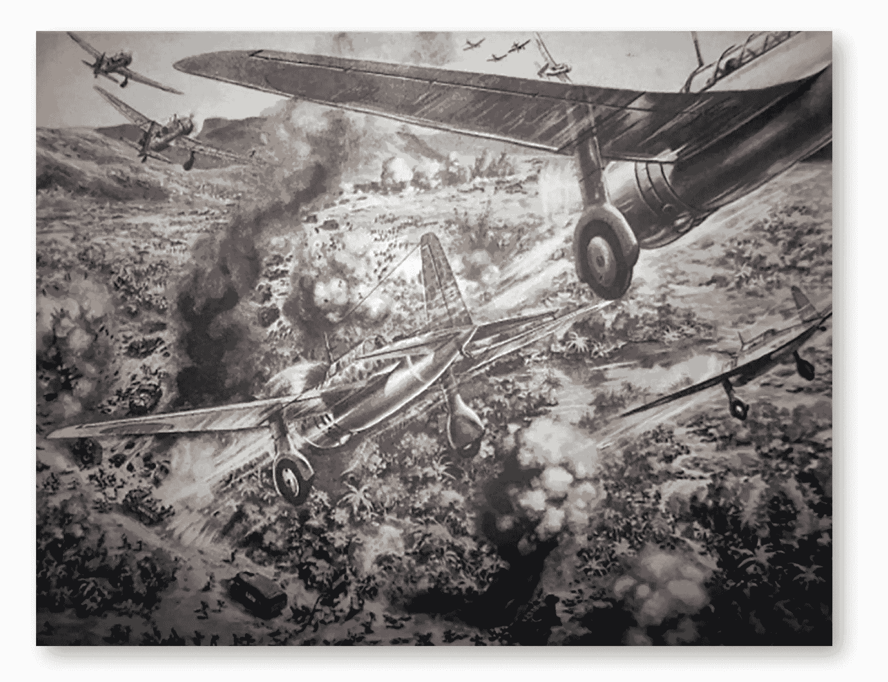

一幅日本战争画，描绘了日本陆军第 99 式攻击机（三菱 Ki-51 型，盟军代号 Sonia）来自第 27 空群、第 3 航空师对荷兰东印军摩托化纵队的攻击。空中力量是南方进攻的决定性因素。通过对盟军机场的攻击以及切断爪哇与外界之间的空中通信线，日本确保了空优。这种支配地位被用于盟军船只和地面部队。日本几乎不断的侦察、扫射和轰炸活动瘫痪了荷兰东印军的移动并削弱了士气。（荷兰军事史研究所）

克拉根（Krag）是一个理想的登陆点，拥有一个长 35 公里的海滩，附近有主要的连接道路。坂口支队的先锋——金浦营于`1942 年 3 月 1 日``0700 时`在克拉根东南方向 6 公里处上陆。另外两个单位——松本营和山本营——直到次日才登陆。它们的运输船速度缓慢，因为在入侵巴厘岛期间遭受了损坏。坂口支队（不包括留在婆罗尼岛的熊部支队）由第 146 步兵团第 2、3 步营、两个野战炮营、一个装甲车队以及附属`第 259 独立运输连`组成。`坂口的目标是位于南部港口的城市齐拉塔榜（Cilacap），攻占该地将切断从雅加达和万隆的逃跑路线。在第二阶段，它将清扫中爪哇剩余的敌军部队。

驻守中爪哇的印尼荷兰共和国军（RNEI）第 2 师在 P.A.Cox 少将指挥下，于`1942 年 2 月 22 日`因`第 4 步兵团`迁往西爪哇而减员。剩余的是南方集团、两个机械骑兵队（第 4 骑兵队和卫队骑兵队）以及`齐拉塔榜支队`。南方集团是一个薄弱的步兵团，于 1942 年 1 月通过合并三个兵员和装备不足的步兵营和一个新组的、由半训练印尼兼职士兵组成的机枪连而形成。该部队几乎完全机械化。南方集团的任务是“通过在塞拉尤河后方部署确保安全和保护[齐拉塔榜港]”。`1942 年 3 月 2 日`，Cox 少将不得不将其最精锐的——第 21 步兵团左半部分移交给万隆集团。

## 1942 年 3 月 5 日至 7 日恰特尔关的日军突破

在日军在爪哇岛成功实施两栖登陆后，卡里达加蒂机场在当天上午被完好地占领。印尼荷兰军反复的反击均被击退。`3 月 5 日`，庄司支队从苏邦（Subang）出发，带一个步兵营和`第 3 航空师`的充足空中支持进攻了恰特尔阵地。万隆市北部的恰特尔阵地由万隆集团的一个加强步兵连进行守卫。在主防御线被突破后，急赶的印尼荷兰军援军试图制止日军推进。一旦这些力量也被消灭，通往万隆的路就敞开了。

地图网格每隔 1 公里（0.62 英里）显示一次

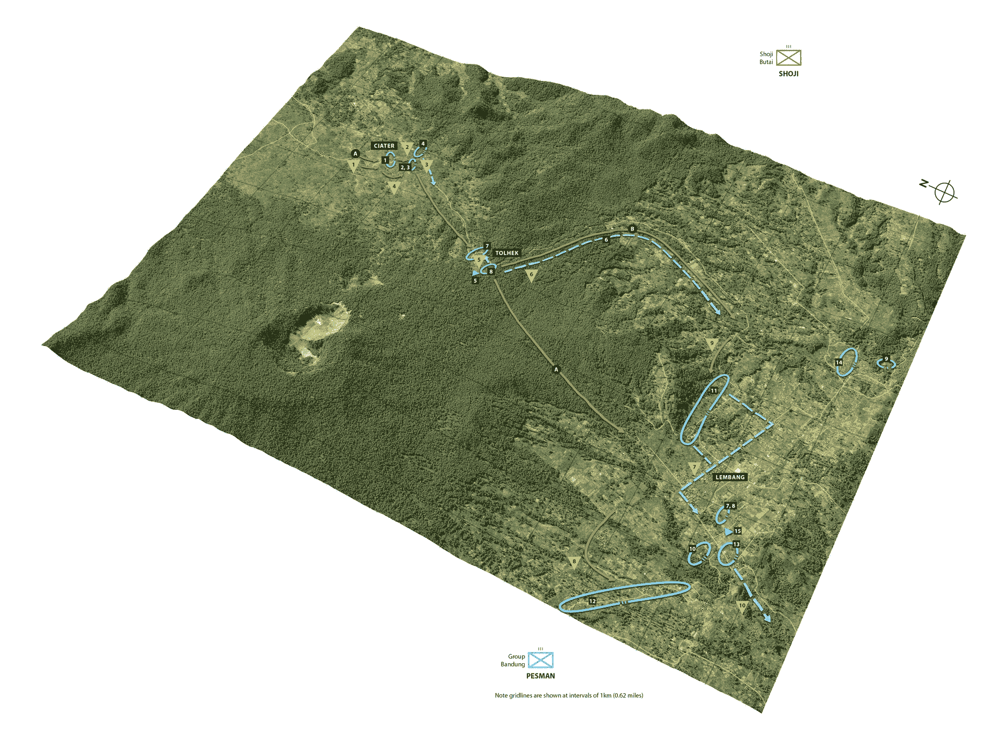

### 日军

#### 庄司支队 (Shoji Butai)

**A.** 第 230 步兵团第 2 营（若松）

**B.** 第 230 步兵团第 1 营（笠头）

### 印尼荷兰军 (NEI)

#### 万隆集团

**1.** 第 1 步兵团第 2 连

**2.** 第 5 步兵团第 1 连

**3.** 第 2 步兵团第 2 连

**4.** 第 21 步兵团左半部分

**5.** 第 2 山地炮营第 2、3 炮

**6.** 前线救护站

**7.** Paardekooper 支队 (Van Altena 支队)

**8.** Siahaya 支队 (Van Altena 支队)

**9.** 装甲步兵连（来自机动部队）

**10.** 苏门答腊西岸支队（两个连）

**11.** 第 4 步兵团

**12.** 第 9 步兵团

**13.** 第 15 步兵团

**14.** De Vries 营

**15.** 第 2 山地炮营第 1 炮

## 事件

除非另有说明，时间均采用爪哇哇标准时间（JBBT – UTC+07:30）。

#### 1942 年 3 月 5 日，星期四

**1.** `1600 时 (JST)`：日军第 230 步兵团第 2 营（若松）由三个连组成，在第 4 坦克团第 1 连和第 38 山地炮团第 3 营两个炮连的支持下，沿苏邦–万隆路推进，意外遭遇了恰特尔阵地。该营展开部署并接到命令进攻。山脊上的阵地由（欧洲人的）加强后的第 1 步兵团第 2 连守卫，并有第 2 山地炮营第 3 炮提供支持。日军利用崎岖的地形和阻挡掩堡射击视线的树木、地面雾和大大雨，成功突破了该阵地。傍晚时分，日军的推进停止。部队没有撤退，而在野外露宿了一夜。

**2.** `1630 时`：印尼荷兰军在苏邦–万隆路上路上使用六辆装甲车进行侦察。三辆装甲车被毁。

**3.** 临夜，印尼荷兰军援军到达，但第 1 步兵团第 2 连撤退。第 4 步兵团团长 De Veer 上校兼任恰特尔防御指挥官，组织了深度防御。夜间，日军派出了侦察队。

#### 1942 年 3 月 6 日，星期五

**4.** 凌晨，日军步兵突然进攻了第 2 步兵团第 2 连和第 5 步兵团第 1 连的左侧翼。随后的第二波进攻方直接从道路形成。受三辆坦克支持的日军进攻（若松）被挡，损失惨重。印尼荷兰军被迫撤退。战斗开始，第 21 步兵团左半部分大部分溃散撤退。恰特尔阵地被破。若松并未立即追击印尼荷兰军，而是巩固了自己的阵地。白天，日军第 3 航空师的飞机轰炸并扫射了印尼荷兰军的阵地交通线

**5.** De Veer 上校将第二道线移至三路交汇处。`1700 时`，期待已久的日军进攻。De Veer 命令反击，并战死。日军进攻被击退。在托赫克建立了圆形防御。下午或 3 月 7 日凌晨，日军处决了 74 名印尼荷兰俘。

#### 1942 年 3 月 7 日，星期六

**6.** `0200 时`：由 Paardekooper 上尉指挥的托赫克守军被命令撤往万隆。

**7.** 万隆集团命令 Van Altena 中校在万隆北部建立新的防御线，兵力包括第 2 步兵团的三个减员兵营、第 4 步兵团和苏门答腊西岸支队。然而，几乎所有部队都表现出疲劳且缺乏凝聚力。

**8.** `1300 时 (JST)`：日军第 230 步兵团第 2 营（若松）从主路西部开始推进。沿小径和崎岖地形的进展自然缓慢。利用黑暗降临和持续的降雨，其进攻部队进攻并袭击了万隆西部的第 9 步兵团总部，瓦解了分散的印尼荷兰军营。第 3 航空师继续空中拦截

**9.** 日军第 230 步兵团第 1 营（笠头）通过汽车运输从卡旺出发，稍随沿主路。`1600 时`左右，它试探了万隆北部印尼荷兰军第 4 步兵团的部署位置。

**10.** 在日军第一次进攻后，印尼荷兰军第 4 步兵团有序地向万隆撤退。日军第 2 营于傍晚进入万隆。万隆集团指挥官 Pesman 少将派遣一名军官谈判局部投降。

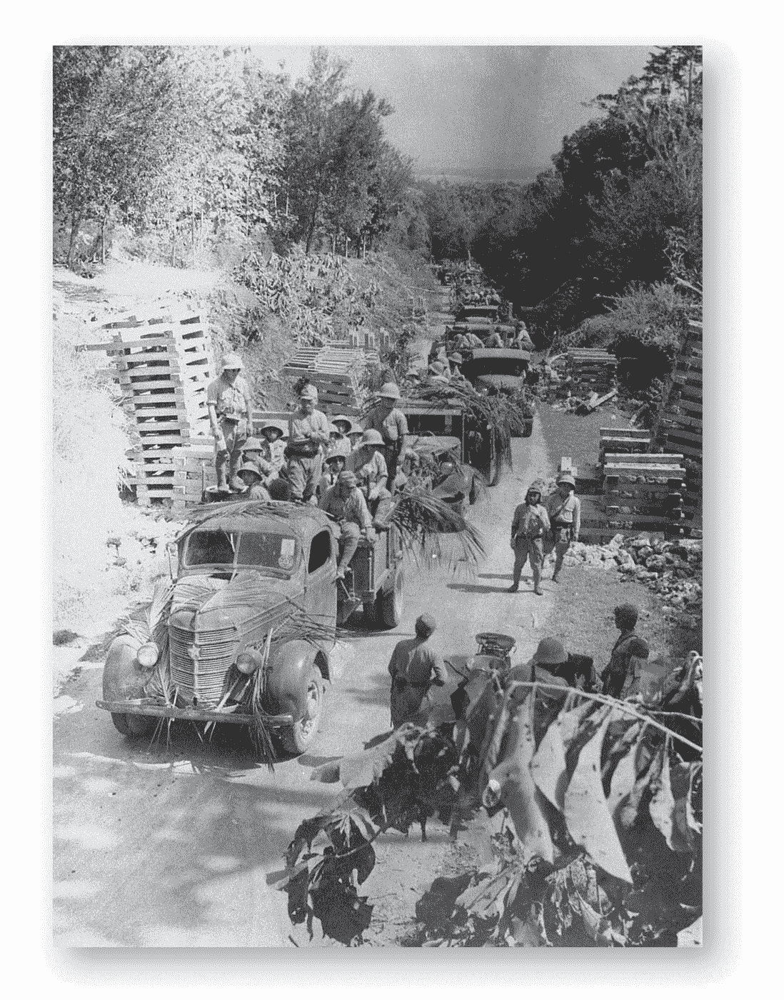

许多道路被荷兰属东印度（NEI）部队用倒下的柚木树或装满碎石的板箱等障碍物封锁，桥梁也被破坏。这些障碍显著减缓了日军的推进。NEI 领土部队没有提供多少抵抗。1942 年 2 月最后一周，中爪爪地区已清除了常规 NEI 部队。这支`坂口支队`(Sakaguchi Detachment)机化纵队正从克拉根（Kragan）行进；一辆`1 型`四轮 2.72 吨`丰田 KB 卡车`走在队首。（每日新闻）

日军的进攻进展顺利，仅因道路状况造成了延误。没有遇到 NEI 领土部队的显著抵抗。坂口于 1942 年 3 月 5 日将他的主力部队`山本梯队`(Yamamoto Echelon，包括第 146 步兵团司令部及三个连）连同`金纳地梯队`(Kanauji Echelon)从雅加加塔沿沿海路直指齐拉恰普（Cilacap）。他指挥`松本梯队`(Matsumoto Echelon，缩减的第 3 营)朝马格朗（Magelang）进。在梭梭（Surakarta）和马格朗，大量 NEI 领土部队被俘。`金纳地梯队`于 3 月 6 日到达瑟留河（Serayu River）。然而，所有桥梁已被毁。

南方小组收到了援军，但也因逃兵损失了人员。一天，几乎整个`芒库内戈罗团`(Mangku Negoro Battalion)都逃散了。1942 年 3 月 7 日晚晚，日军从南部过河。南方小组几乎没有抵抗，并被命令撤退。1942 年 3 月 8 日早晨，齐拉恰普被占领。中爪哇的战斗结束。

## 东爪哇

征服东爪哇的任务分配给了日本陆军第 48 师（IJA 48th Division）。这支机化师最初作为第十四军的一部分参加了菲律宾战役。在攻占马尼拉后，该部队撤出前线准备装运。根据在菲律宾的经验，第 48 师领导层说服`第十六军`(Sixteenth Army)修改了爪哇作战计划，将登陆点从两个减少到一个，并集中于一个目标：泗水（Surabaya）。登陆后，第 48 师指挥官土桥通（Yuitsu Tsuchihashi）中将希望迅速确保索罗河（Solo River）渡口和芝普（Cepu）的石油设施。充分利用机动性，他随后计划率领从芝普向布兰达斯河（Brandas River）快速推进。他预计决战将在那里发生。在击败敌军后，他将占领崩廊（Porong）并从南部进攻泗水。计划在索罗河沿线进行佯攻或吸引性攻击。该师有机配备了充足的车辆，可以运输三分之一的步兵。然而，在菲律宾，缴获的车辆足以运输整个师。

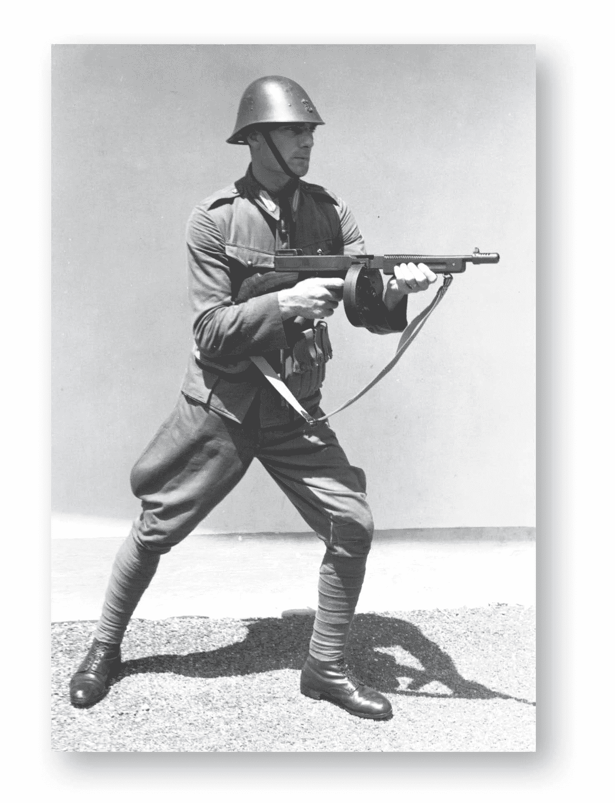

1942 年 3 月，一名海军营的荷兰海军陆战下士。他穿着 1940 年引入的灰绿色常服。这与`NEI 陆军 1937 型`野服几乎完全相同。他手持一把`汤普森冲锋枪`摆姿。海军营超过四分三的干部配备了这种武器。（荷兰军事史研究所）

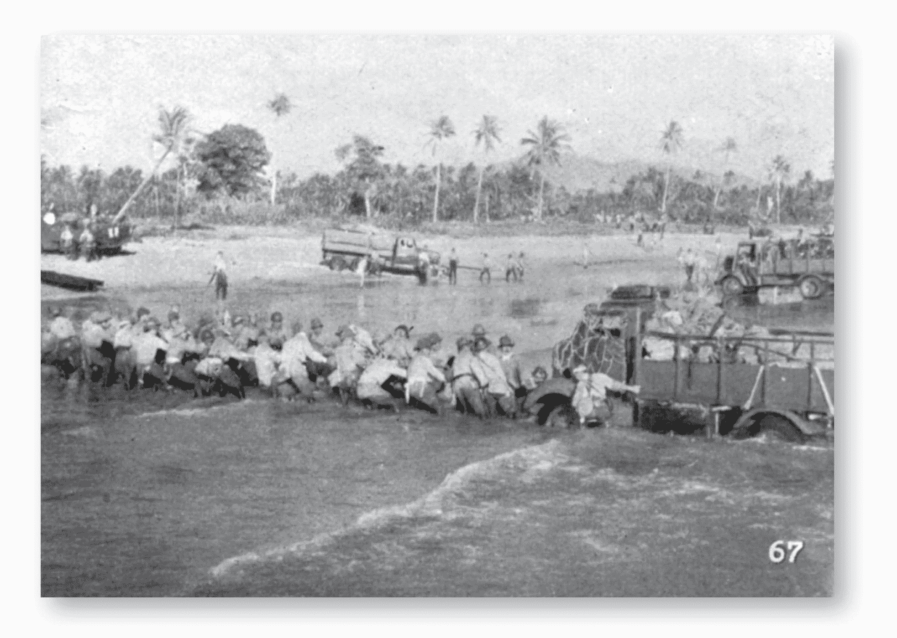

第 48 师的`田中中队`(Tanaka Unit，包括第 2 台湾步兵团两个营和一个炮兵营）作为第二梯队在克拉根（3 号登陆区）上岸。该师通过自有和缴获（在菲律宾缴获）的车辆实现了完全机化。一辆可能是 2.88 吨的`日产 80`卡车被人工拖上岸。约 700 名当地人被迫协助卸货。`田中中队`的目标是芝普、那里的炼油厂以及索罗河上的桥梁。（Collectie Stichting Nationaal Museum van Wereldculturen, Coll.nr. TM-10001990; [CC BY-SA 4.0](https://creativecommons.org/licenses/by-sa/4.0/))

东爪哇和巴厘岛属于 G.A.伊尔根（G.A. Ilgen）少将管理的`NEI 第 3 军事区`，他也兼指挥第 3 师。该师也被称为`泗水支队`(Surabaya Detachment)，其任务是保卫泗水海军基地。该基地的静态防御分配给了`泗水安全部队`(Veiligheidsbezetting Soerabaja)。机动小组——由第 6 步兵团、第 3 骑兵队、第 1 野炮兵营和第 131 野炮兵团第 2 营的`美国 E 连`组成——负责海军基地的移动防御。1942 年 3 月 1 日，泗水的`RNN 司令官`(RNN Commander)为伊尔根提供了一些海军陆军。组建了`海军营`(Naval Battalion)，由一个司令部、四个陆战队和海军守卫连、一个机枪排和一个后勤队组成，总人数约 400 人。

在舰队被毁后，泗水已失去了其作为海军基地的意义。正如新加坡一样，伊尔根少将及其部队正在保卫一个空基地。

1942 年 3 月 1 日，日军入侵舰队锚泊在克拉根。盟军空袭击沉了一艘船，另一艘船被困在岸边。共有 62 人死亡，210 人受伤。然而，这些损失并没有阻止在 0345 和 0400 继续登陆。彭姆邦（Rembang）很快被作为补给基地占领。尽管有路障，部队在 3 月 2 日下午到达了索罗河。该师发现所有桥梁和芝普炼油厂已被毁，油井正在燃烧。跨越暴涨的索罗河耗费了多一天。3 月 4 日傍晚，`阿部中队`（Abe Unit，主力）开始向布兰达斯河边的克尔托索诺（Kertosono）推进。在推进过程中，第 48 师获得了全方空中支持。

在对克拉根日军登陆舰队进行空袭后，`远东陆军军`（FEAF）于 1942 年 3 月 1 日和 2 日将设备和人员撤往澳大利亚。爪哇航空司令部未授权此举并提出了抗议。军事航空队还必须撤离中爪哇和东爪哇的机场前往安迪（Andir）。

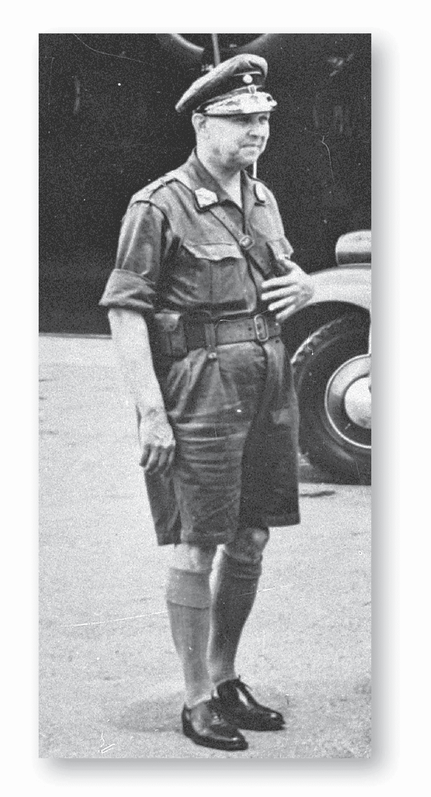

东爪哇的 NEI 指挥官是 G.A.伊尔根少将，第 3 师和第 3 军事区司令官。伊尔根被描述为非常优秀的师长，一个精力充沛且技术高明的领导，但倾向于急躁。在战期间，他的领导缺乏一致性。这以及他直接且详细的领导风格导致了混乱和模糊。伊尔根穿着战前不久引入的制服，穿着灰绿色短袖衫和短裤。（国家档案馆，公领域）

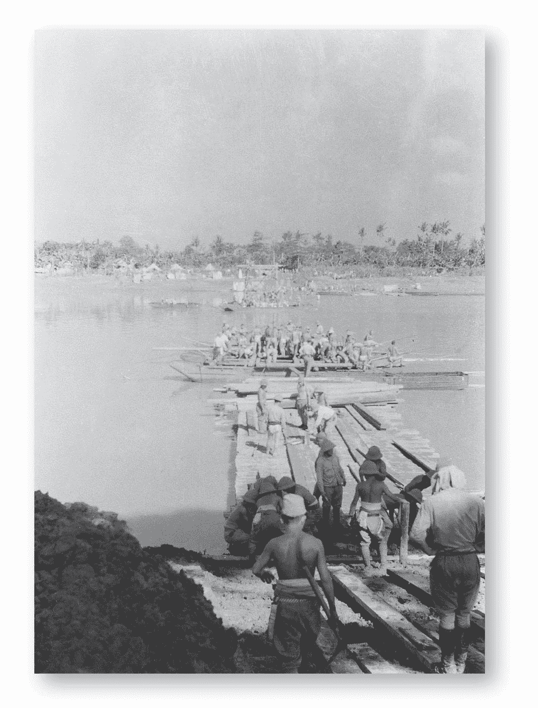

当东爪哇索罗河上的桥梁被毁后，`日陆第 48 工兵团`和附属的`第 3 独立工兵团`不得不建造临时桥以继续向布兰达斯河推进。芝普的筑桥工作推迟了，因为新桥的一部分被涨的河水冲走。第二天，修复的桥梁再次受损，这次是因为一辆在菲律宾缴获的美国`M3 斯图亚轻坦克`重量造成的。（每日新闻）

伊尔根少将计划于 1942 年 2 月 28 日动用他的机动小组针对预期的日军登陆发动进攻行动。然而，他很快反回了这一决定。相反，伊尔根决定转为防御，目的是为摧毁海军基地争取时间。他希望在索罗河后进行阻击战来实现这一目标。

一队日本摩托化纵队正在横跨吉里（Kediri）布兰塔河大桥。该大桥被完整地占领了。在前面的是一辆在菲律宾缴获的美国半履带坦克，随后是经过深度伪装的日产 80 卡车。第 48 师长陆军中将桥（Tsuchihashi）多次坚持占领吉里大桥。然而，他的先遣队集中于攻占克尔托索诺（Kertosono）大桥，最初并未按计划派遣部队前往吉里。（Beeldbank WW2 – NIOD）

当泗水泗的破坏行动几乎完成时，1942 年 3 月 4 日，伊尔根（Ilgen）的部队得以出来进行进攻。根据伊尔根的，只有位于恩加维（Ngawi）和博志尼戈罗（Bodjonegoro）的日本前方侦察部队处于活跃状态。他利用机动集团进行包抄，试图夺回哲普（Cepu）。他的机动部队的一部分在布兰塔河后方形成了阻击阵地。由于对敌军部队的评估错误，进攻计划注定失败。部队缺乏火力支持，特别是南部包围圈兵力过弱，更不用说下达的命令性质模糊。荷属东印度群（NEI）反攻的北部轴线与北村部队（第 48 侦察团）的支援攻击发生冲突并被击退。在南部轴线上，龙（De Iongh）遣队（第 3 骑兵队和第 6 步兵团第 10 营）与阿部（Abe）部队的先遣队进行阻战，在海军营到达之前就被击退。阿部部队于 1942 年 3 月 5 日到达克尔托索诺。布兰塔河大桥被毁。由于日本军迅速而强大的推进，伊尔根命令的反攻在尚未开始前就已经结束了。

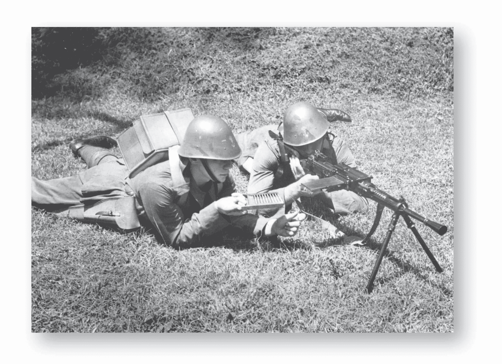

一支荷兰海军轻机枪小组，由一名射手和一名助手组成。武器是布雷达 M30 型 7.35mm 轻机枪，是从非洲从意大利士兵手中缴获并由英国提供的。（鹿特丹海军博物馆收藏，45789）

在克尔托索诺，日本人成功在同一天强行通过布兰塔河。吉里的大桥在当天完好无损地落入日本人手中。布兰塔河后的阻击阵地因此暴露。阿部部队迅速向崩廊（Porong）推进。1942 年 3 月 6 日，阿部部队由步兵、坦克和飞机支持的先遣队发起了进攻。荷属东印度的防线迅速被突破，崩廊被占领。泗水因此被包围。第 48 师准备于 1942 年 3 月 9 日进攻泗水。然而，在 3 月 8 日，白旗升起。来自第 17 重野兵兵、配备有 15 厘米榴弹并专为进攻泗水而从满洲运来的炮兵，无需采取行动。

在计划中的反攻失败以及日本向泗水的包围后，伊尔根做了转向游击战的准备。但投降使得这变得没有必要。1942 年 3 月 8 日下午，日本人进入了泗水。

### 投降

在荷属东印度军队（RNEI）瓦解和殖民政府崩溃的背景下，佩斯曼（Pesman）少将于 1942 年 3 月 7 日至 8 日晚间提出局部投降。然而，今村（Imakura）中将想利用这一机会强制实行全面投降。谈判于 3 月 8 日在卡里达加提（Kalidjati）举行，一方是今村，另一方是总督范斯塔肯博格-斯塔霍维尔（Van Starkenborgh Stachouwer）和特波滕（Ter Poorten）中将。荷方代表团不得不接受不可避免的结果。此外，日本人威胁要轰炸万隆。荷属东印度军队于 1942 年 3 月 9 日投降。

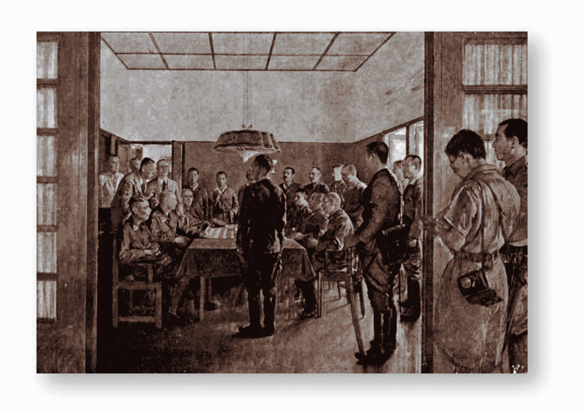

这幅由小矶亮（Koiso Ryohei）创作的画描绘了 1942 年 3 月 8 日晚在卡里达加提机场官邸内，日本第十六军司令官与荷属东印度军队指挥官之间的首次会面。日本代表坐在桌子右侧，荷方军事代表坐在左侧。（KTOMM Bronbeek）

英国、澳大利亚和美国军队于 1942 年 3 月 12 日在万隆签署了投降协议。布莱克本（Blackburn）准将希望在荷属东印度军队投降后在万隆南部继续战斗，希望逃往澳大利亚。然而，他无法与澳大利亚取得联系。在没有食物、弹药和药品的情况下，投降只是时间问题。他也接受了不可避免的结果。

从 1941 年 12 月 7 日至 1942 年 3 月 8 日，约有 1500 名荷属东印度军队的欧洲和印度尼西亚士兵战战死亡。由于荷兰战争坟墓委员会的数据不完整，真实数字可能更高。荷兰海军遭受了 1650 名伤亡。战俘人数见表 11：

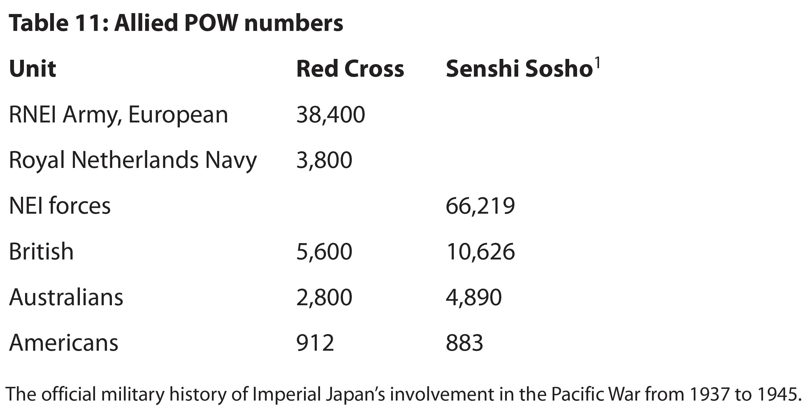

缺少印度尼西亚战俘的数据。印度尼西亚穆斯林战俘从 1942 年 4 月起开始释放。基督徒安布西人和门纳多人战俘被排除在外。

日本第十六军的损失为 311 人死亡，832 人受伤。日本海军荷属东印度舰队的损失总计为 285 人死亡，361 人受伤。

### *T* 行动（苏门答北部）

在攻占亚胆并推进至万达矶（Bandar Lampung）后，日本陆军第 38 师也于 2 月 24 日和 3 月 4 日分别占领勿胶鲁（Bengkulu）和占碑（Djambi）。苏门答中北部仍处于荷兰手中。

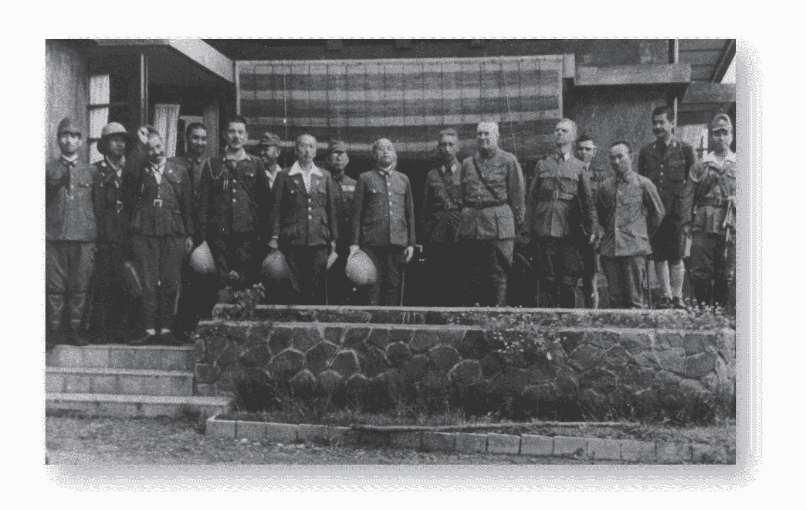

1942 年 3 月 9 日，特波滕（H. terorten）中将与今村中将再次会面，确定细节并签署投降协议。之后，在房屋廊台上拍了合照。中间是手持热带帽的今村中将，随从人员。在他左侧后排，戴着眼镜的是藤三郎（Saburo Endo）少将。在今村右侧站着巴克斯尔（R. Bakkers）少将、特波滕中将、曼特尔（P.G. Mantel）中校以及（第二排，曼特尔身后）翻译提斯（J.D. Thijs）上尉。（Beeldbank WW2 – NIOD）

苏门答北部和中部的荷军由轻武装守守步兵、民兵、本土卫队和城镇卫队组成。战术单位不超过一个或多个旅级。在日本人进攻之前，1942 年 2 月亚齐就爆发了反对荷兰殖民当局的武装抵抗。亚地的荷属东印度军队随后被用于平定这一局面，并在日本人登陆后还保护了欧洲人口和印度尼西亚士兵家属的疏散。

1942 年 3 月 12 日，日本陆军皇卫师团按计划在苏门答北部和东部的四个地点登陆。登陆未遇抵抗。荷属东印度部队遭受了印度尼西亚士兵的大规模逃亡。欧洲士兵维持了凝聚，但缺乏战斗精神。1942 年 3 月 28 日，剩余的荷属东印度部队投降。

### 后续

在爪哇战役结束后，荷属东印度群岛大部分地区未被占领。在三次行动中，3 月至 5 月之间，新几亚和小松群岛未经战斗被占领。位于新几亚和澳大利亚之间的岛屿随后在 1942 年 7 月底至 9 月被占领。7 月，这些岛屿由来自澳大利亚的小部队占据（*Plover*行动）。只有新几亚最南部的默劳克（Merauke）仍留在荷兰手中。

`IJA` 和 `IJN` 已将西方列强驱逐出亚洲并夺取了巨大的地区。为了维持这些成果，行动的第二阶段将从进攻转向防御，以稳固周边界。西方列强的反击将会失败。战争将以一种妥协性的和平结束，即西方列强不得不接受日本在东南亚的主导地位。在第二阶段，日本将对规模最大的工业化大国 `United States` 爆发一场消耗战。作为弱势方，日本无法希望在这场消耗战中胜利。因此，预期的有限战争变成了全面战争，导致了日本帝国不可避免的灭亡。

## 南方进攻

在南方进攻行动期间，`IJA` 和 `IJN` 在执行方案和时间表上经常发生冲突。双方在作战术语上存在根本差异。`IJA` 想要迅速占领战略要点并进行战斗，让敌人没有时间组织防御。`IJN` 则主张一种系统方法，包括一场空战行动，旨在通过消灭登陆点及后方的敌方空军来获得制空权。只有这样，才能进行两栖登陆。`IJN` 报告的空战行动结果过于乐观。部分由于此原因，他们的两栖登陆经常面临盟军的空袭和海军部队的攻击。尽管此前进行过空战，但这些目标被破坏得不足，甚至根本没有破坏。

荷兰东印度群岛战役发生在一年中极不利的时期：雨季。日本的航空行动遭受了从恶劣到非常糟糕的天气。并非总是能够飞行并为陆军和海军提供空中覆盖。此外，大雨导致机场几乎无法使用。潮湿的机场和过短的跑道对航空兵种的效能产生了负面影响。日本人在计划中低估了这一点。另一方面，日本陆军经常利用雨雾对 `NEI` 守卫者进行奇袭。

## 荷属东印度群岛陆军

`RNEI` 军在作战、战术和指挥方面，事实证明其质量劣于日本对手。`NEI` 致力于在联盟中进行防御性斗争。然而，它对这些盟友并没有影响力。盟国内部及盟国之间的利益并不一致。`Great Britain` 和 `United States` 在战争的这一阶段也太弱了，无法减缓日本的推进，更不用阻止它。在战争爆发一个月后才建立了一个联合（多国）司令部。这已经太晚了。在作战上，利用水平水平轰炸机进行间接防御的概念失败了。`Military Aviation Service` 拥有的轰炸机和战斗机太少，无法成功实施。水平轰炸机对付舰只也相当不成功。日本人经常对 `NEI` 守卫者取得战术突袭。在 `Ambon` 和 `Timor`，他们在被认为不适宜的海岸进行了两栖登陆。

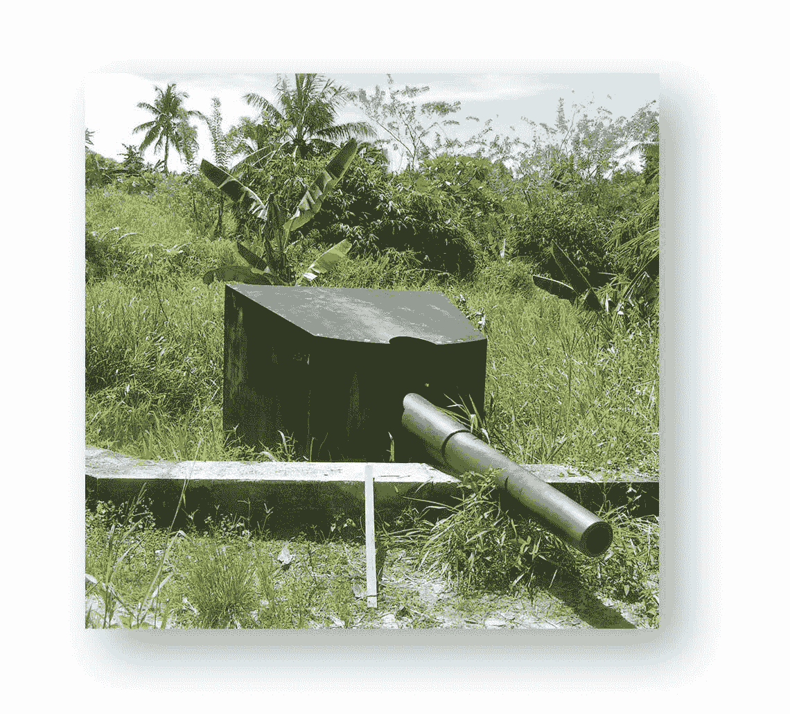

四个 `NEI` 静态岸防电池中有三个位于 `Tarakan` 的西南海岸。在 `Peningki`，这里有两座各拥有 `3 x 7.5cm L/40` 炮的炮台，以及一座拥有 `4 x 12cm L/40` 炮的 `Karoengan Battery`，用于守卫 `Lingkas Front` 前方的雷障。这些炮台仍部分完好，包括大炮。这张照片拍摄于 2010 年左右，显示了 `Karoengan Battery` 混凝土底座上的一门生锈的快速射 `12cm L/40 No. 2` 大炮。该炮有一个安装在转座上的摇篮架和装甲盾。这是由 `Krupp` 在 `1901` 年制造的海军炮。它由一名炮长、五名炮手以及一名助理和弹药运员组成的炮组操作。（私人收藏）

## 战术与指挥挑战

在战术上，进取且机动的日本人将 `RNEI` 军引向了错误的道路。日本的制空权对 `NEI` 部队是瘫痪性的。当飞机接近时，部队立即寻找掩护并在那里停留长时间。面对这样的对手，`NEI` 部队特别是印度尼籍成分表现出战斗意愿不足。`RNEI` 军在军事能力上心理上动摇。战斗情报经常匮乏。因此，日本攻击的力量和方向均未知。这使得采取现实的反击措施变得极其困难。`RNEI` 军在进攻时未能表现出足够的控制。计划和协调处于中等偏差水平。因此，反击以碎片化的方式进行且力量过弱。在 `2nd Infantry Regiment` 和 `Teerink Group` 的反击中，接触推进是按照规则开始的，即攻击者进入火炮射程时——`c. 15km`。结果是部队在攻击目标前方公里处跳出，必须在热带温度下以战斗队形在艰难地形中行进数小时。结果是失去了突然性，且进攻部队精疲力竭——而这一切是在面对敌人制空权的情况下。炮兵的部署方式犹豫且碎片化。澳大利亚少校 `J.H. Brown` 曾在 1941 年 11 月的一次演习中指出缺点：“没有准备任何协调的火力计划，营长们也没有进行任何侦察……天亮三小时后，两个进攻营向前移动了约一英里，仍在前线后方吃早餐。给人的印象是攻击缺乏上级的动力，在实践中将是致命的。” Brown 认为主要弱点在于“缺乏实践经验的营级和团级指挥官”。根据他的发现，澳大利亚军事情报局长表示，“军队装备良好。他们的训练主要是防御性的，对进攻战术的知识多于理论。”15

指挥有时是混乱的。师指挥官直接联系连指挥官，反之亦然，跳过了层级指挥链。

## 后勤与资源

通过征服荷兰东印度群岛，日本夺取了渴望的石油产量和炼油能力以及战略原材料。限于石油，荷兰东印度群岛的油井和设施已被大部分破坏。这些破坏的目的是防止其在六个月内被使用。日本人很快地恢复了开采和炼油，尽管没有达到战前产量。`Palembang` 占了日本航空燃料消耗量的 78%和原油的 22%。

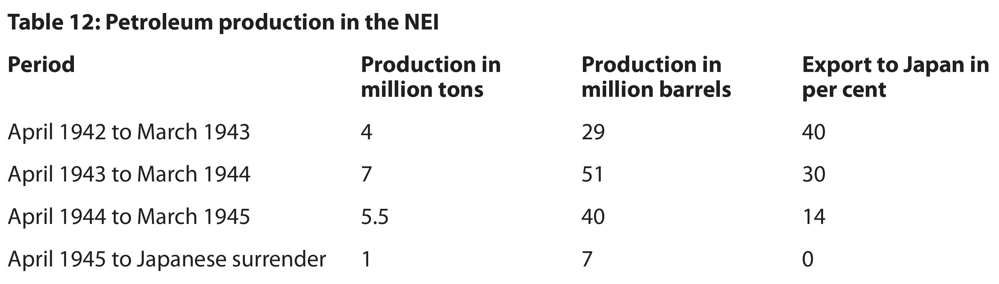

将开采和炼油的石油运输到日本证明是一个瓶颈。日本缺乏容量足够的油船队。1939 年，日本油船队由 38 艘船组成，总容量为`3124 万桶`。这仅占进口量的 10%。石油进口主要通过其他国家的船舶运输，而这些国家与日本发生了冲突。这给国家带来了一个几乎无法解决的问题。

美国潜艇进攻和飞机攻击对日本油船队造成了破坏。“日本最终继续了战争，再次面临燃料的极端短缺。”16

随着被日本败，荷属东印度岛也于 1942 年 3 月 8 日解体。随后是三年的严酷占领。欧洲在荷属东印度岛的影响几乎被完全抵消。战俘部分被派往爪哇岛之外，例如在弗洛斯岛修建机场，在缅甸和泰国之间修建铁路，或在苏门答腊以及日本矿区工作。在被俘的 42,233 名欧洲战俘中，有 8,200 人（19.4%）死亡。欧洲人部分被关押在平民营中，估计涉及 100,000 人。其中 16,800 人死亡。约有 120,000 名欧洲人留在营外。

日本人被视为“解放者”并受到欢迎，却给印尼人造成了沉重的代价。据报道，饥荒导致了 250 万印尼人的死亡。日本雇佣了大量主要是爪哇人作为工人。其中一些`romusha`（强迫劳工）被临时雇佣。估计有 16 万至 20 万人在部署在爪哇岛之外。许多人在此过程中死亡。

日本的占领成为了印尼独立运动的催化剂。其占领政策并非旨在向“大东亚共荣圈”内赋予独立。印尼必须为日本的战争努力提供服务。随着战争局势的改变，日本逐渐改变了其态度。1944 年 9 月，日本宣布将在近期内给予印尼独立。1945 年 8 月，它更进了一步，承诺独立。然而，在 1945 年 8 月 15 日，日本被迫投降，取消了进一步就印尼独立合作的可能性。

在日本投降后的后的第二天，印尼领袖穆哈默德·哈塔（Mohammad Hatta）和苏加诺（Sukarno）采取了主动，于 1945 年 8 月 17 日宣布印尼独立。在经历了另外四年的谈判与战争后，荷兰才承认了这一点。

## Notes

## 延伸阅读

### 原始记录

Museum Bronbeek, 2012/11/26-4-1, Bakkers, R., `Het Koninklijk Nederlands-Indische Leger voor en gedurende zijn strijd tegen de Japanse invasie`, typoscript z.p., z.j. [1947]

Nationaal Archief, Den Haag, Meyer Ranneft, 2.21.121, inv. nr. 477, Poorten, H. ter, Verslag omtrent mijn beleid als legercommandant, Geheim – Eigenhandig, 30 januari 1946

Nederlands Instituut voor Militaire Historie, Den Haag, `Nederlands-Indië contra Japan (1940–1946)`, Toegang 508

### 二级文献

Boer, P.C., `De luchtstrijd rond Borneo: Operaties van de Militaire Luchtvaart KNIL in de periode december 1941 tot februari 1942`, Van Holkema & Warendorf, Houten 1987

——, `De luchtstrijd om Indië: Operaties van de Militaire Luchtvaart KNIL in de periode december 1941 tot maart 1942`, Van Holkema & Warendorf, Houten 1990

——, `Het verlies van Java: Een kwestie van Air Power: De eindstrijd om Nederlands-Indië van de geallieerden lucht-, zee- en landstrijdkrachten in de periode van 18 februari t/m 7 maart 1942`, De Bataafsche Leeuw, Amsterdam 2006 (available in English as: Boer, P.C., `The Loss of Java: The Final Battles for the Possession of Java Fought by Allied Air, Naval and Land Forces in the Period of 18 February–7 March 1942,`, Singapore University Press, Singapore, 2011)

Boester, A.J.Th. e.a., `Nederlands-Indië contra Japan`, Staatsdrukkerij- en uitgeversbedrijf Bandoeng/’s-Gravenhage 1949–1961, 7 delen

Bussemaker, H.Th., `Paradise in Peril: Western Colonial Power and Japanese Expansion in South-East Asia, 1905–1941`, Thesis, Universiteit van Amsterdam, 2001. Available at: `http://dare.uva.nl/document/100764`

Donovan, Patrick H., `Oil Logistics in the Pacific War: In and After Pearl Harbor,`, Air Command and Staff College Air University, Maxwell AFB, 2001

Francillon, R.J., `Japanese Aircraft of the Pacific War`, Putnam & Company, London, 1970

Kiyoshi Aizawa, ‘Japanese Strategy in the First Phase of the Pacific War’. Available at: `www.nids.mod.go.jp/english/event/forum/pdf/2009/04.pdf`

Lohnstein, Marc, `Netherlands East Indies Army 1936–1942`, Osprey Publishing Ltd., Oxford, 2018

`Reports of General MacArthur:` `Japanese Operations in the Southwest Pacific Area Volume II – Part I`. Available at: `https://history.army.mil/books/wwii/MacArthur Reports/MacArthur V2 P1/macarthurv2.htm`

Minoru Nomura, ‘The Dutch East Indies and the Japanese Armed Forces’, Military History Department, National Defence College, Tokyo, Japan, March 4, 2010

Nortier, J.J., ...

本电子版由 Bloomsbury Publishing Plc 于 2021 年出版。

© Osprey Publishing Ltd, 2021

版权所有。未经出版者书面许可，不得以任何形式或通过任何电子或机械手段（包括复印、录制或任何信息存储或检索系统）复制本书的任何部分。

本书的编目录记录可在大英图书馆查询。

PB ISBN: `9781472843524`

eBook ISBN: `9781472843531`

ePDF ISBN: `9781472843548`

XML ISBN: `9781472843555`

地图绘制：[www.Bounford.com](http://www.bounford.com)

3D BEVs 制作：Paul Kime

排版：PDQ Digital Media Solutions,英国 Bungay

## 艺术家说明

读者请注意，制作本书色版所采用的原始绘画可私人出售。所有复制版权均由出版者保留。所有咨询请致信：

Graham Turner, PO Box 568, Aylesbury, Bucks, HP17 8ZX, UK [www.studio88.co.uk](http://www.studio88.co.uk)

出版者遗憾就此事不进行任何来信。

Osprey Publishing 支持 Woodland Trust（英国领先的森林保护慈善机构）。

欲了解更多关于我们作者和书籍的信息，请访问**[www.ospreypublishing.com](http://www.ospreypublishing.com)**。在这里您可以找到我们的全系列出版物，以及独家在线内容、近期活动详情以及订阅新闻通讯的选项。您还可以注册 Osprey 会员，这将让您在通过 Osprey 网站购买时享受折扣，并访问我们丰富的在线图像存档。

## 作者致谢

感谢 Mark Loderichs 对我的文本提出的宝贵意见。感谢石田纪子（Ishida Noriko）帮助挑选和获取日本照片。我还要感谢荷兰军事史研究所（NIOD）、NMvW 和荷兰海军博物馆（Mariniersmuseum）的工作人员；为本书提供照片的私人收藏所有者；以及我的编辑 Nikolai Bogdanovic。

## 殖民时期与现代地名

| 殖民时期名称 | 现代印度尼西亚地名 |

| :--- | :--- |

| Atamboea | Atambua |

| Atjeh | Aceh |

| Bandoeng | Bandung |

| Bandjermasin | Banjarmasin |

| Bantam | Banten |

| Batavia | Jakarta |

| Benkoelen | Bengkulu |

| Billiton | Belitung |

| Boeroe | Buru |

| Buitenzorg | Bogor |

| Celebes | Sulawesi |

| Cheribon | Cirebon |

| Djambi | Jambi |

| Djatisari | Jatisari |

| Djokjakarta | Yogyakarta |

| Hitoe | Hitu |

| Indramajoe | Indramayu |

| Kalidjati | Kalijati |

| Koepang | Kupang |

| Koetaradja | Banda Aceh |

| Madioen | Madiun |

| Madoera | Madura |

| Martapoera | Martapura |

| Menado | Manado |

| Moentok | Muntok |

| Moesi | Musi |

| Oosthaven | Bandar Lampung |

| Pakan-Baroe | Pakan-Baru |

| Pamanoekan | Pamanukan |

| Penfoei | Penfui |

| Pladjoe | Plaju |

| Poerwakarta | Purwakarta |

| Praboemoelih | Prabumulih |

| Preanger | Parahyangan or Priangan |

| Rangkasbitoeng | Rangkasbitung |

| Riouw | Riau |

| Soengei Gerong | Sungei Gerong |

| Serajoe Rivier | Serayu River |

| Soebang | Subang |

| Soerabaja | Surabaya |

| Soerakarta | Surakarta (Solo) |

| Talangbetoetoe | Talangbetutu |

| Tandjong Priok | Tanjung Priok |

| Tjepoe | Cepu |

| Tjianten rivier | Cianten River |

| Tjiater | Ciater |

| Tjilatjap | Cilacap |

| Tjioedjong Rivier | Ciujung River |

| Tjitaroem Rivier | Citarum River |

| Toeban | Tuban |

| Waigapoe | Waingapu |

## 关于时间的说明

在本书中，时间是以相对于协调世界时（`UTC`）的偏移量（小时/分钟）给出。荷属东印度设有多个时区。以下列表供读者参考：

| 代码 | 描述 |

| :--- | :--- |

| CBT | 川望时间（苏拉威西岛和帝汶岛）UTC+08:00 |

| CSST | 苏门答腊中部南部时间（位于井古鲁、胆雳和兰榜）UTC+07:00 |

| JST | 日本标准时间（又东京时间）UTC+09:00 |

| JBBT | 爪哇时间（位于爪哇岛、巴厘岛和婆罗洲）UTC+07:30 |

| MCT | 摩卢甲时间（特内特、纳梅亚、阿汶和班达）UTC+08:30 |

| NST | 北苏门答腊时间（塔帕努利和亚齐）UTC+06:30 |

**扉页**

位于巨义的日本士兵。（每日新闻）
