# 创造力的起源

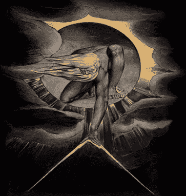

## 埃德华·奥·威尔逊

普利策奖得者

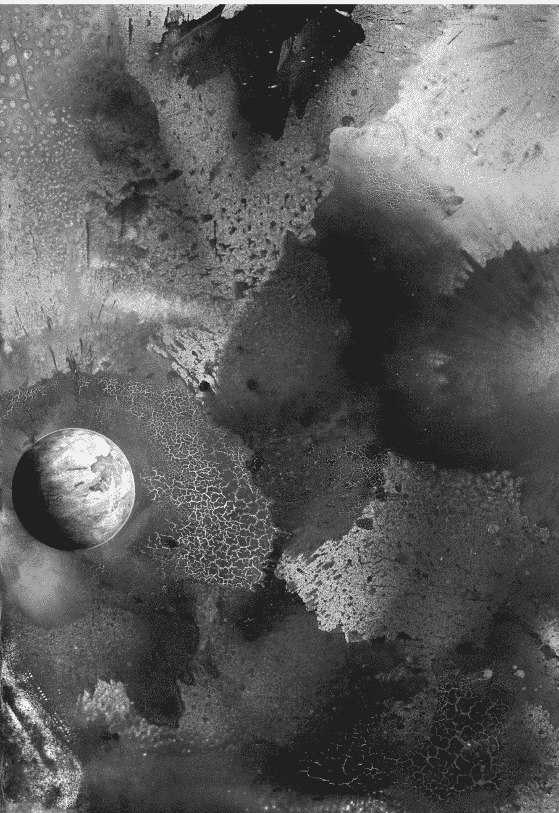

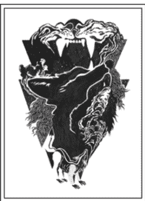
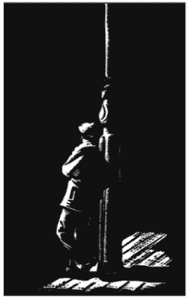
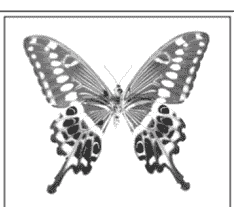
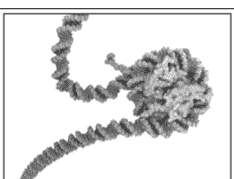
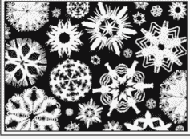
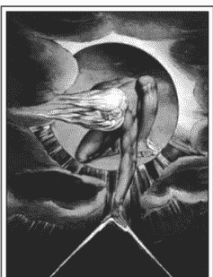
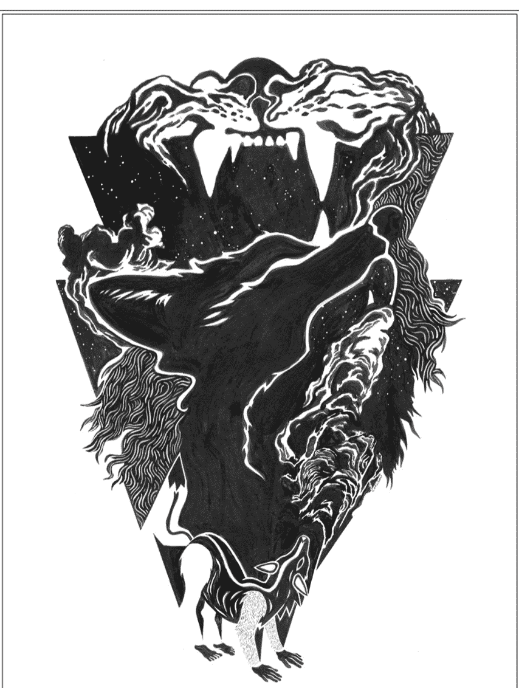

一只被狮子击败的狼。一个关于傲慢失败的寓言。（Benjamin Carlson，《狼与它的影子》，2015年。墨水画画板。20 x 30 英寸。© Benjamin Carlson。本杰明·卡尔森的《狼与它的影子》（见《荒野呼唤2015–16年伊索寓言》，第44页，作者：Bronwyn Minton，国家野生动物艺术博物馆艺术与研究策展人）。

# 第一部分

人文科学起源于符号语言，这种能力独特且显著地将我们物种与其他所有物种区分开来。语言与大脑结构共同进化，释放了心灵的创造力，从而想象出在时间和空间上无限可能的其他世界。我们被赋予了力量，但正如我在第一部分将展示的那样，我们保留了古代祖先的情感。这种构成我们所谓的“人文”的结合，解释了为什么我们既如此先进，又如此危险。

## 创造力的边界

创造力是我们物种的独特特征也是我们的终极目标：我们是什么，我们是如何变成现在的，以及什么样的命运（如果有）将决定我们的未来。那么，创造力是什么？它是对原创性的内在追求。其驱动力是人类对新奇的本能喜爱——对新实体和过程的发现，对旧挑战的解决和新挑战的揭示，对意外之外事实的审美惊喜，对新世界的震撼。我们通过创造力引发的情感反应强度来判断其创造力。我们向内探索，走向我们共同心灵的最深处；向外探索，去想象跨越宇宙的现实。目标不断被实现，而追求永无止境。

伟大的学科分支科学与人文在我们追求创造力的过程中是互补的。它们共享着努力的根源。科学领域是宇宙中的一切事物；人文领域是人类心灵所能想象的一切。借助于我们物种的共同意识，我们每个人都可以前往宇宙的任何角落，实现任何目标，在时空中寻找无限。当然，事实也是如此，当受野性欲望支配时，我们无限制的幻想可能会变成疯狂。弥尔顿曾表达过这种极大的痛苦。

人文科学；创意艺术、语言学、历史、法学、哲学——道德推理和神学。

人们似乎——用“感觉”或许更贴切——人类智力与情感的结合是唯一可能获得创造力的。我们物种的这种诊断性特征经过了近四十亿年的形成，似乎需要演化中的某种独特特征，或者是上帝之手特别向我们族群的延伸。

这种统治了数千年宗教思想的假设几乎可能是错误的。在自然界中很容易找到先进社会组织作为替代的跳板，其中某些在演化过程中可能已经转向了人类水平。考虑一下非洲和南美卓越的筑巢蚁，技术上称为大白蚁（`macrotermites`）。它们由土壤和粪便筑成的土巢中聚居着数十万到数百万蚂蚁，高度甚至超过人头。像人类的居所一样，它们的住所设计得极其精妙。在某些物种中，蚁穴通过复杂的管道系统进行空调调节，这些系统持续从周围地面循环空气，并通过对流将聚集产生的热空气从蚁穴中排出。每个大白蚁群落都包含一个由不育工人组成的无产阶级和它们的两个父母，一对负责所有繁殖的皇室成员。这如何可能呢？体型如两个拇指大小的蚁后连续产下一系列微小的卵。工人通过分工形成不同的体力阶层，包括一支由自杀性的、凶猛的、大头士兵组成的大军。（我曾需要帮助将它们镰剑状的大颚从我右拇指的网膜中剥离。）

居民留在蚁穴的地下以及在蚁穴下方挖掘的数米深迷宫般的走廊和室内，只有少数显著的例外：飞行的处女蚁和它们的配种雄蚁建立新的群落，以及晚上出来寻找死枯植物碎片的工人群。将耳朵贴近蚁穴（不要太近！），能听到无数微小蚂蚁移动发出的细微嘶嘶声。这些夜间收获被用于在地下花园中种植一种食用真菌。

大白蚁是真正的超级有机体。每个群落的集体智能仍然远低于人类和其他哺乳动物的水平，甚至低于大多数鸟类，但远高于独栖昆虫。

然而，它们的创造力仍然为零。让我们假设它们在演化过程中上升到了人类水平。如果我允许创造一个术语，它们的“蚁巢城”（`termitories`）将包括：对绝对黑暗的热爱（以及对微弱光亮的产生类似德古拉式的恐慌）；专门食用培养的蘑菇；性活动限于皇室；以及对所有潜在移民的死亡，即使是来自同一物种。群落中的病患和伤员会被立即且预防性地吃掉；没有医院，没有怜悯。

考虑这一点。在未来一两个世纪内，空间技术可能让我们近距离观察系外行星，其他星系的行星。随后将会对生命的证据进行密集搜索。如果发现了生命，而且是一个或多个智能物种，我们应该做好面对任何事情。

# 2

# 人文科学的诞生

人文科学并非诞生于迈锡希腊的口头史诗、早期苏美尔压在粘土上的文字，或是古王朝时期埃及雕刻的神灵。这些元素都未超过一万年，在我们物种的历史中只是弹指之间。我们也不会在肖韦特和苏洛拉西的洞穴壁画，或在施瓦比亚的侏罗山脉的鸟骨笛中发现人文科学的黎明。这些器物是已知同类器物中最古老的，它们是在三万年前制造的。

人文科学的诞生发生在更久远的时间，接近一百万年前，它发生在一个回想起来最符合逻辑的地点和环境中：早期人类营地的夜晚火光下。

这是由来自古生物学、人类学、心理学、脑科学和演化生物学不同领域的研究人员拼凑出的结论。这项研究是寻找人类物种自身起源的一部分，也是科学和人文科学的圣杯。它提醒我们，历史是文化演化的故事，而史前是基因演化的故事。史前不仅告诉我们文化历史之前发生了什么，还告诉我们为什么人类物种整体遵循了某条特定的轨迹而非另一条。

让我们暂时回溯深邃的时光。为了比较可能遵循的各种轨迹，研究人员拥有大量现有的旧世界灵长类动物。这些受体包括猴子和类人猿，它们是我们现存最接近的系统发育亲戚。反过来，它们包含了最可能是人类先决条件的阶段。

我有幸专注于社会演化，在野外观察了两个物种：绿猴和狒狒。我曾在一个半野生的恒河猴群中度过三天，并由先驱灵长类学家斯图亚特·阿尔特曼（`Stuart Altman`）指导。我曾在埃莫里大学的耶克斯灵长类研究中心与坎西（`Kanzi`）共进午餐，它是一个被高度研究的圈养倭黑猩猩。坎西所在的物种曾被称为矮黑猩猩，被认为是灵长类动物中最像人类的。

对这些及相似物种的专家级研究表明，它们的大部分时间都用于探索环境寻找食物。较小比例用于社交互动，包括结盟和服从、理毛、求偶、交配、处理幼崽、食物的发现与获取、领导力和顺从。

对每个旧世界猴类和类人猿的研究越来越多地关注于每个成员在观察和与其他成员互动时学到了什么。兴趣的中心是这种动物如何利用这些社交信息。当它模仿同伴时，科学家们会问，它究竟在模仿什么——是同伴的精确动作，还是动作的结果？

通往同情的大门，至少在人类中，正是我们视作怜悯之德的东西。

共情与镜像显然已经进化到某种程度，这种程度与群体成员之间相互作用的平均时间相对应。时间测量显示这种相关性确实存在。自由漫步的草原狒狒（`Papio cynocephalus`）不到 10% 的时间用于社交，而 60% 的时间用于觅食和进食。绿猴（`Cercopithecus aethiops`）将 40% 的时间用于觅食和进食，在社交上花费的时间比狒狒短。

人类在社交上花费的时间比这些及其他旧世界灵长类多得多。尽管他们的时间表根据职业而存在巨大差异，但人们总是倾向于成群聚集，并在孤独的间隙进行社交交换。在发达世界，社交生活通过公共娱乐和社交媒体得到了几乎无止境的扩张。

人类的群居性是导致我们产生高水平社会智能（特别是共情、镜像和问题解决）的达尔文式动力吗？是的，但群居性只是创造人类状况的进化过程的一部分。为了了解完整的故事，我们需要转向祖先人类到现代社会行为的独特起源，正如专家们所构建的那样。信号性事件是大脑尺寸急剧增加，主要涉及额叶。从大约三百万年前开始，我们前人类祖先的脑容量从接近黑猩猩的 400 立方厘米（`cc`）增长到能人期的 600 `cc`，然后一百万年后增长到我们直接祖先直立人（`Homo erectus`）的 900 `cc`，最后在智人（`Homo sapiens`）中达到了现代水平（约 1300 `cc`）。

在自然选择的进化过程中，就像在日常生活中一样，微小事件可能产生巨大、甚至是巨大的后果。前人类进化中的微小事件似乎是从主要以植物为主的饮食（果实、种子、软叶子）向含有更多肉类的饮食的转变。这种转变由于其发生的环境而变得更容易。非洲草原是一片广阔的草地，点缀着河岸森林和热带树木。由于开放平原上存在易于追踪的动物（对于那些知道方法的人来说），采集变得更加容易。频繁发生的雷火进一步起到了帮助作用，火灾困住并杀死了许多逃跑的动物。

火还煮熟了部分受害者，提供了高能量、富含蛋白质和脂肪且易于咀嚼的食物。

随着这种变化的发生，它使得整个胃肠系统（从口到肛门）必须发生改变。它还促使南方古人祖先变得更具社交性。食草的猿类和猴类倾向于独立寻找和发现，而我们的祖先则必要在出没时进行更紧密的合作。那时，当通过食腐或捕猎猎物发现大型食物块时，必须以一种避免潜在致命斗殴的方式进行分享。对大型动物的狩猎和食腐，与采集植物材料相反，需要一个集体的聚会点、洞穴，或两者兼有。

最后，为了完成这种适应性转变（进化生物学家如是说），对火的控制加强了食肉主义的优势。从附近的地面火很容易获得肢体和树枝并将它们带回营地。我曾作为童军兵，在阿拉巴马州松树草原的一处熄灭的火堆旁这样做过。我发现，当营火不小心引发森林火灾时，反过来亦然：火可以被采集并带回营地。前人类实际上不需要使用易燃材料配合燧石或转轮来点火。

专家们广泛认为，现代人类的能人祖先遵循了这种食肉的情景，并因此实现了脑容量和社交智能的激进进化。这一理论尚未得到定论性的证明，但得到了直立人（能人的后代，我们物种的直接祖先）营地遗迹和和控火化石证据的支持。

现在让我们回到更深层次的遗传历史。大约六百万年前，一种居住在非洲草原的类人猿分成了两个物种。一条通向黑猩猩支系，注定以后再次分裂为两个现代物种：“普通”黑猩猩与其更像人类的表亲倭猩猩。另一支原始物种以及随后的多个人属，经历了南方古人物种的进化迷宫，产生了现代人类，即唯一的、注定走向末日的物种——智人（Homo sapiens）。

由于黑猩猩与人类有密切的遗传关系——我们通过共同祖先共享 98% 的基因——科学家们一直在深入研究这些猿类，以发现它们可能揭示的秘密。（注：原文 OCR 文本此处存在大量重复，已根据要求进行对齐和清理）。

傍晚时分心情变得轻松。在明暗交织的火光下，话题转向了讲故事，这很容易融入歌唱、舞蹈和宗教仪式。讲故事，尤其是在男性之间，经常转向成功的狩猎和史诗般的冒险，这是他们白天最主要的活动。正如伊丽莎白·马歇尔·托马斯（Elizabeth Marshall Thomas）在她2006年的经典著作《老路：第一批人类的故事》（*The Old Way: A Story of the First People*）中所描述的，这些故事通常（或曾经）是对真实狩猎的神话式记录。男人们用特殊的嗓反复背诵，几乎变成了吟唱，每个人都在倾听。接着是一个故事，用猎人的原话，讲述了一只羚羊是如何被毒箭射中的。我特别喜欢这个故事，即使在完全翻译之后也是，因为它可能是一场发生在万年前的表演。正如古生物学家通过骨骼重构灭绝动物物种一样，从这些进化程度最低的祖先那里重构古代社会生活似乎也是可能的。

> 哎！什么？那是耳朵吗？是的，是一个耳朵！他的耳朵贴着天空，他在灌木丛里，就在那里，灌木丛的边缘。我看着它。是的，它动了，他转了一小会儿，一小会儿，他抬起头，他在担心，他嗅了嗅，他知道了！他在看，我伏得很低，伏得很低，非常安静，伏得很低，他没看到我！嘿！他是安全的，他这么想。他转过身。我在他后面。我向前爬去，嘿！我爬，我爬，我就离他那么远，嘿！就从这里到那里那么远，安静，安静，我很安静，我很慢，我拿着弓，我搭好了箭。哎！我射了。砰！我射中他了！他跳了起来。哈哈！他跳了起来。他走了！我射中他了。就在这儿，就在这儿箭射了。他跳了起来，朝那个那边跑，朝那个那边跑，但我抓到他了。

讲故事，尤其是记录的成功狩猎和史诗冒险故事，占据了白天总时间的6%，但占据了晚间时间的81%。整体效果是传达了群体生存的大图景。它将他们统一成一个具有单一文化的基于规则的社区。正如长者迪扎奥（Di'xao）在早期的朱霍族人（Ju/'hoansi）记录中所解释的那样：“我们的祖先很久以前有一个政府，那是我们居住地火堆的余烬，我们用它来点燃去往地的火。”

## 3

## 语言

朱霍族人是完全的人类。他们拥有带在脑子里的历史。他们知道自己是谁。他们巨大的前额脑不安全地平衡在纤细的垂直颈部，就像任何一个城市公民一样。他们的物种——我们的物种——被独特地赋予了语言，这是自真核细胞以来最大的进化优势。

极少数动物物种拥有原始的文化。当地的一群日本猕猴通过学习群中一位创新型雌性提供的范例，学会了如何通过水洗来红薯。同样令人印象深刻的是，至少一个黑猩猩群的成员使用去掉叶子的茎来捕白蚁兵——我之前提到的那些具有自杀性攻击性的昆虫战士，它们会咬住并释放任何巢穴的入侵者。第二群黑猩猩的成员相互学习学会了游泳、潜水或其他在水中移动的方法。这些是极罕见的真正的文化例子——由个体和群体发明并通过他人的社会学习传承的行为。没有任何动物物种（至少在已知的一百多种物种中）拥有语言。那么语言是什么——究竟是什么？语言学家将其定义为最高形式的交流，是可转化为符号的词的无限组合，并且（这是重要部分）被任意选择以赋予意义。它们被用于标记任何可以想象的实体、过程，或定义实体和过程的一个或多个属性。

每个社会都有一门或多种语言。目前存在约六千五百种语言，其中两千种在使用上减少并面临灭绝的危险。少数语言的说话人数不超过十二人。

语言是人类的必需品，从某种角度来看，情感是内在的。语言在朱霍族人和成年人中都是如此，这种情感是不断演演的。如果语言是普遍的，那么它是文化性的还是本性的？另一方面，语法规则大多数是学习的。由诺姆·乔姆斯基（Noam Chomsky）提出的普遍语法理论非常复杂，以至于难以理解。

语言的习得遵循可预测的步骤，就像任何本能一样。发育的关键阶段是婴儿的咿语。即使在没有外部刺激的情况下，盲聋儿童也会发咿语。少数原始词汇，包括*妈妈*和*爸爸*，是成人的先天吸引力。

在成年人的语音中，每个词可能是特定语言特有的，但语调和情感是固化的且普遍的。人们能够听懂陌生语言的文本并理解说话者的情绪，这一结论得到了共同经验的支持，也得到了实验证据。在一个著名的案例中，心理学家通过使用戏剧表演析出了这种效果。

经济上的困难迫使我们小家陷入了贫困。在父亲的照顾下，我过着近乎流浪的生活，几乎每年搬一次家，在华盛顿特区以及遍布南方深南部地区的学校上学：包括密西西比州的比洛克西、乔治亚州的亚特兰大、佛罗里达州的奥兰多和彭萨科，以及阿拉拉巴马州的布鲁宁、迪凯特、埃格林和摩比尔。

我通过步行或骑自行车来补偿这种漂泊的生活，探索那里的昆虫和爬行动动物。当我十岁时，我们搬进距离华盛顿洛克溪公园只有几个街区的住宅里，我决定带着蝴蝶网和一本昆虫野外指南去探索。我有英雄来激励自己。他们包括我在附近的国家自然历史博物馆楼上听过的、那些被神化为神灵的科学家，还有《国家地理》杂志的作家们。特别是威廉·M·曼，他1934年发表的论文《追踪野蛮与文明》最终对我产生了深远的影响。此后，当我的父亲、新妻子我和像移民一样在南方各地流浪时，我结识了几个同龄的朋友，但大多数出于偏好，我选择独自探索附近的荒野。在即将高中毕业之际（当时恰好在阿拉拉巴马州的迪凯特），我假设自己会以某种方式上大学，然后找到一份昆虫学家的职业——永远留在户外，探索未知的荒野，越走越远，最终到达我所谓的“大热带（Big Tropics）”地区，即亚马逊森林和刚果森林。

然而，我从事这种职业的前景比我当时意识到的要低得多。我的学校记录并不完整，成绩平庸，并夹杂着缺勤和不及格。阿拉拉巴马大学拯救了我（并使我至今仍是其极其忠诚的校友）。根据当时的州法律，该大学的入学要求只有两个：高中毕业和阿拉拉巴马州居民。我的表现足够优秀，足以进入诺克斯维尔的田纳西大学攻读博士学位，一年后进入哈佛大学完成学位，并在余后的职业生涯中一直担任教职工作。

当我搬到哈佛攻读博士学位时，我童年的职业梦想变得更加强烈。我保持着对独自探索的偏好。在奖学金的支持下，我有前往我所谓的真正的“大热带”——地球上范围最广阔、受干扰最少、动植物区系最丰富的地区。那时以及在博士后的二十岁期间，我能够在墨西哥、中美洲、巴西亚马逊地区、澳洲内陆、新几内亚、新喀里多尼和斯里兰卡进行各种野外工作。

我发现，在陌生的地方保持持续的孤独（即使只有几个小时）在身体上可能是危险的，而且对思想和发现也是没有产的。我当时并不理解其中的原因，但大多数人都有强烈的交流欲望。他们每天都会聊一会儿，如果可能的话越频繁越好；对我来说，至少是在独处荒野时不停地。因此，在访问的陌生地点进行独自野外工作期间，我演化出了一个第二人格。这个人没有名字，也不是任何意义上的独立实体（我并没有疯）。简单来说，我的第二人格只是切换到一个独立的思维框架。每当我对周围环境的意识增强，每当行动优先顺序发生强制改变，每当我从字面上对自己自言自语但内心却是沉默的时，他就会出现。例如，第二人格会说话，追踪我在穿越小径时支散经验所构成的序列。

> 等一下！停！不要错过那个附植物（长在树干上的），即使它很难够着。那上面可能藏着某些非常有趣的东西，一个蚁巢或上帝知道是什么；你得看它一眼。[爆炸性内容已删除] 够不着。继续走。[稍后] 注意你在做什么！脚下要格外小心！左侧茂密植被后面可能有一个深沟。小心，小心，看一眼。等一下！看！看！那里有一列蚂。某种非常新的东西。几乎隐藏在落叶层中。也许是军蚁——那不太对；也许是大蚁（Leptogenys）吗？继续走，进去，小心，小心，小心，这可能是某种新东西，真正的新东西。

通过和我那几乎沉默的合猎人以及喋喋不休的顾问来回交谈，我进行了野外研究，并吸收了我所访问环境的自然史。我的重点一直放在蚂蚁身上，这是野外研究的明智选择。我逐渐了解到，在数量、生物量和全球范围内，它们主宰了同体型等级的昆虫；直到21世纪的第二个十年，专家们已经鉴定出全球范围内14,000种。我并不是分类学家（专门从事分类的生物学家），因为在我访问过的每个地方它们都极其丰富，通过一辈子的野外工作以及对他人收集但未被研究的博物馆标本的研究，我发现并为450种新物种命名了拉丁科学名称。

当我沉默地穿过世界各地的森林和草原时，我的目的是尽可能发现各种蚂蚁，但最重要的是发现新物种和稀有物种，然后尽可能多学习它们的社会生活——它们在哪里筑巢、种群数量、等级、食物以及它们的通信系统。每种物种在解剖结构和社会行为上都是独特的，而且往往是根本然不同的。每一个都是新科学知识的来源。我了解了它们，几乎与其中几种蚂蚁生活在一起，并发现了它们对自然荒野环境所做出的精确适应。我是它们的故事故事，是绝大多数蚂蚁从未有过的记录者。

科学家和自然学家会告诉你，每一种蚂蚁都有它自己的故事，与众不同。从一个蚁群的行为中可以重建一个物种的历史。阿拉拉巴马大学拯救了我（并使我至今是其极其忠诚的校友）。根据当时的州法律，该大学的入学要求只有两个：高中毕业和阿拉拉巴马州居民。我的表现足够优秀，足以进入诺克斯维尔的田纳西大学攻读博士学位，一年后进入哈佛大学完成学位，并在余后的职业生涯中一直担任教职工作。

因此，弗兰森小说的特征是一种宏大的、模拟的精确性。他们的主角被一系列品牌名称、未定义的技术术语、哲学引用杂乱在一起所驱动着。

## 4.

## 创新

虽然我意识到我没有作为小说评论家的资历，但对我来说，这听起来是一个极具才华的哈佛大二学生痛苦的、矫学的学识展示。人们觉得，作为文学作品，这本长书可能并不算出众。对某些人来说它是的；但对我来说不是。因此，弗兰森小说的特征是一种宏大的、模拟的精确性。他们的主角被一系列品牌名称、未定义的技术术语、哲学引用以及作者在沉思中能加入其文学鸡汤的任何其他东西杂乱在一起所驱动。它们属于詹姆斯·伍德称为“歇斯底里现实主义”的一个类别。在它们破碎的意识流中，对于人性的深度和根源几乎没有意识或兴趣。

但让我补充一点，在弗兰森随后广受好评的小说《自由》和《纯洁》，以及类似的后现代主义作品中，实际上是有价值的。它们是民族学的，对功能障碍家庭的人格和历史进行了精细的描述。它们当然是八卦（弗兰森听起来像你那话多的朋友），这就是为什么人们喜欢传记和第一人称小说。这种乐趣是天生的，非常符合达尔文主义，是从上述石器时代的营火谈话演化而来的。后现代叙述不能：它提供了特定地点和时间的文化片段的精确快照。这些作品就像照片一样，保留了人们看起来、看起来甚至是真实的样子，包括他们的装扮、姿态和面部表情，以及对他们最重要的环境——他们的家、宠物、交通工具、他们的小径和街道。谁能不被最古存的照片所吸引呢？那是约瑟夫·尼普斯在1826年或1827年拍摄的，确切日期不确定，内容是如此平凡的勃艮地区的屋顶——紧接着是街道场景，甚至有一个行人站在空旷街道旁的路边等候——为了什么，直到？那时你意识到自己被带回了多么遥远的过去。在那个时刻，林肯和达尔文还只是青少年，佛罗里达还是一片荒野，没有欧洲人知道尼罗河的源头。

精美的小说和古董照片是历史的像素。它们组合在一起，创造出一幅人们真实生活的影像，日复一日，一分一刻；在文学领域，则是他们感受到的情感。最后，它们追踪了随之而来的某些似乎无尽的后果。这就是为什么我们珍视普鲁斯特，为什么我们在约翰·阿普迪克（John Updike）的殿堂中为他留席——正如阿普迪克本人所说，他卓越地诊断了美国小镇新教徒中产阶级的生活与弱点，特别是在20世纪后期。

创意艺术领域的这种创新在另一个方面至关重要。艺术的演变与有机演化在运作方式上是相似的。顶尖艺术家和表演者寻求原创的方式，通过图像、声音和故事来表达自己。原创性和风格就是一切，其程度通过创新吸引模仿的程度来衡量。因此，1863年拒绝沙龙（Salon des Refusés）对巴黎沙龙（Salon of Paris）的挑战是视觉艺术中的一个经典案例。立体主义与写实主义的对抗，以毕加索1907年的*亚维农少女*（*Les Demoiselles d'Avignon*）为标志是另一个例子。流行文化中，则是1932年华特迪士尼的彩色电影《花与树》（*Flowers and Trees*），以及20世纪60年代融合灵魂乐、布鲁斯和流行音乐而成的摩塔唱（Motown）。这一过程可能是永恒的。而且突破层出不穷：突破将加速创新者的心，坚起他们的脊梁，鼓励他们寻求突破。到20世纪后期，所有创意艺术中新技巧和新风格的实验呈指数级增长。荒诞狂野的抽象艺术在神秘无调性音乐背景下展现。为了原创而原创加入了创意艺术大师的行列。

对于立体主义的起源，毕加索将“变形”作为他的核心目标：他说：“任何展示自己分量的艺术家，”

> 都必须表现出尽可能的塑性。因此，表现一个苹果：如果你画一个圆，它就是第一级的塑性。然而，艺术家可能希望具有更大的塑性，在这种情况下，所表现的对象最终将描绘成方形或立方体的形状，而这并不否定模型。

对创新的追求可以被视为基因进化的类比，且效果良好。文化演化使我们适应不可避免且不断变化的环境条件。它的创新等同于基因组中的突变。这些生物学事故发生在人类历史中，其方式和程度与其他物种相同。突变是非常多样化的。它们个体上是罕见的，在大多数情况下要么是有害的（因此导致了数百种令人不快且熟悉的遗传性疾病，如色盲、囊性纤维化和血友病），要么是中性的，对健康或生殖没有可检测的影响。随着时间的推移，它们会消失，或者最多保持极低的频率，后者是通过作为隐性性基因与显性有利基因在同一位点共存。只有极少数突变是成功的，它们使携带这些突变的个体受益并在整个群体中传播。有时它们会产生巨大的后果。一个例子是规定乳糖耐受的突变基因群。DNA碱基对的小随机变化使得饮用牛奶成为可能，乳制品业随后遍布世界大部分地区。另一个案例是镰型细胞突变基因，双剂量会导致致命性贫血，但单剂量却能防止同样致命的疟疾。

我们身体中携带的所有失败和中性基因被遗传学家称为“突变负荷”（mutation load）。从这些之中，通过进一步的突变和偶然有利于它们的环境变化，形成了今天的人类有机生物学。我们同样珍视驱动创意艺术的创新，尽管只有少数被证明是成功的。

# 5

# 审美惊喜

严肃的艺术，无论是通过乐谱、剧本还是图像表达，在第一次相遇时就能抓住你。然后，它会吸引并分散你足够的时间，引导你的思想离开并穿过其剩余的内容——也许是为了理解全部意图，也许是为了出于纯粹的快乐而重温某个片段。创意作品的整体感觉（称之为“特征”）可能出现在开头或结尾，有时甚至在体验之后，当它被存储在长期记忆中时，它是回想时进入意识的第一个念头。

特征引入了审美惊喜，这种惊喜仅仅是美的，或者在本能上极具吸引力。例如在视觉艺术中，它既存在于高帆的巡游中，也存在于泰坦尼号沉没时末日般的倾斜中；古斯塔·克里姆特（Gustav Klimt）在阿德勒·鲍尔肖像中超现实的设定，似乎将女士融进了金属里；弗朗西斯·培根（Francis Bacon）在他残酷的自画像中的夸张，喊出了完全诚实带来的毁灭性后果；以及由C.W.安德森描绘的1948年三冠王赛马“Citation”的石版，它与毕加索《格尼卡》（*Guernica*）中恐怖的尖叫马形成对比。

创意艺术家在审美光谱上从美和宏伟到恐怖和死亡之间反复往复，使用定义性的特征来捕捉并吸引你的注意力。传统风景艺术的一个典型例子是阿尔弗雷德·汤普森·布里彻（Alfred Thompson Bricher）在沉闷的褐色和橄榄色岸景背景下，在破碎的海浪上方放置醒目的白色泡沫。在抽象艺术中，汉斯·霍夫曼（Hans Hoffmann）的《杰作》（*Magnum Opus*）在大片亮红色色块中呈现出一个显眼的黄色矩形，侧增加了一个神秘的黑块。眼睛被迫移动：从黄到红，再到黑。其目的留给你的潜意识决定。

呈现和响应简单识别特征的本能并非人类所有。它等同于行为科学家识别的“信号刺激”（sign stimulus）或“释放器”（releaser）。突变是非常多样化的。它们个体上是罕见的，在大多数情况下要么是有害的（因此导致了数百种令人不快且熟悉的遗传性疾病，如色盲、囊性纤维化和血友病），要么是中性的，对健康或生殖没有可检测的影响。随着时间的推移，它们会消失，或者最多保持极低的频率，后者是通过作为隐性性基因与显性有利基因在同一位点共存。只有极少数突变是成功的，它们使携带这些突变的个体受益并在整个群体中传播。有时它们会产生巨大的后果。一个例子是规定乳糖耐受的突变基因群。DNA碱基对的小随机变化使得饮用牛奶成为可能，乳制品业随后遍布世界大部分地区。另一个案例是镰型细胞突变基因，双剂量会导致致命性贫血，但单剂量却能防止同样致命的疟疾。

我们身体中携带的所有失败和中性基因被遗传学家称为“突变负荷”。从这些之中，通过进一步的突变和偶然有利于它们的环境变化，形成了今天的人类有机生物学。我们同样珍视驱动创意艺术的创新，尽管只有少数被证明是成功的。

（注：OCR文本存在大量重复，已进行清理。）

不断变幻的色彩，幽灵般的矮人在字里行间翻滚、飞翔、跃动；静静角落的盛盛绽放，生动的光芒与迸发的火焰……让页面似乎在边界内移动并颤动。

有时，一种描述具有令人着迷的美，即使在许多视觉艺术中，它也夸大了其中的事实性主张。F·斯科特·菲茨杰拉德对《大盖茨比》的精妙结尾便是如此。

随着月亮升得越高，那座无关紧要的房子开始融化，直到逐渐意识到那片曾出现在荷兰水手眼中的旧岛——新世界鲜嫩、绿色的胸膛。那些消失的树木，那些为盖茨比房子让路的树木，曾低语地回应着人类最后也是最伟大的梦想；因为在一个转瞬即逝的奇幻时刻，他一定在这片大陆面前屏住呼吸，被迫陷入一种既不理解也不渴望的审美沉思，在历史上最后一次与与他惊奇能力相称的事物面对面。

批评家（他们被称为该领域的专家）对创意艺术的理解往往分阶段进行。他们对某件带有作者签名的作品的评论，通常经常将其与艺术家早期的作品和声誉进行比较。这能引起读者的兴趣，直到（在较长的评论中）其内容的细节被扫描。接下来可能是对艺术家意图的沉思，考虑到他的生平以及导致这件特定作品的背景。最后是判断，一种总结，并将其放在从拒绝到溢于赞誉的量尺上。评论和批评本身也可以是艺术品，尽管是另一种类型。布拉姆斯第二交响曲是一部伟大的艺术作品；莱因霍德·布林曼对其的分析则是艺术评论的极佳范例。

创意艺术中的一些优秀作品并没有扰动审美感，而是令人惊叹。提高这一准线的最好方法是在陈述后立即紧跟其矛盾点。查尔斯·狄更斯在《双城记》中使用的这种手法可能永远无法超越。

> 那是最好的时代，那是最糟糕的时代；那是智慧的时代，那是愚蠢的时代；那是信仰的时代，那是怀疑的时代；那是光的季节，那是黑暗的季节；那是希望的春天，那是绝望的冬天；我们面前拥一切，我们都在直接通往天堂，我们都在直接走向另一个方向——简而言之，那个时期与现在如此相似，以至于其中一些最喧闹的权威坚持认为，无论好坏，只能用最高级的比较级来接受它。

在另一种媒介——摄影中，瑞切尔·苏斯曼的作品集《世界上最古老的时代》展示了候选教师（植物）和其他其他已有数千年历史的植物。像稀有的人类高寿老人（110岁或以上）一样，它们往往引发敬畏，迫使我们回顾它们度过青春的消失时光的现实。看到这些非凡的个体生物带来了一种令人不安的负相关：古代所属的许多物种非常稀有，有些濒临灭绝。这两个类别中的世界冠军是生活在澳大利亚的树龄4万年的塔斯马尼亚角树（Lomatia tasmanica），经准确测定，它不仅是记载中最古老的，还是该物种的最后。

寓言和童话是此类存在冲突的丰富猎场。在怀俄明州杰克逊洞国家野生动物博物馆展出的本·卡尔斯的一惊人作品展示了一只狮子战胜并准备吞噬一只狼。它说明了一个关于骄傲愚蠢的寓言：

> 狼在一个晚上精神很好、食欲大佳离开洞穴。当它奔跑时，落日将它的影子投射在地上，看起来它比真实的大了一百倍。“嘿，”狼自豪地叫道，“看看我有多大！竟然想从一只小狮子那里逃跑！我要让他看看谁配当国王，是他还是我。”这时，一个巨大的影子完全遮住了它，下一秒，狮子一击击中了它。

通过创意艺术将人文科学联系起来是一项困难的尝试。我们为什么要尝试呢？创意艺术既是人类事业中智力最先进的，也是最瞬即逝的。

> “艺术忠于我们的现在和过去，”海伦·文德勒在最小化合成前景时写道，“我们生活和生活过的方式——作为被冲动和情感驱动的独特个体。”

到目前为止一切良好，但文德勒又补充道，“……但不是作为集体实体或社会学范式。”

借此，她召唤了不可知之中的魔法，尼采曾称之为彩虹边缘的色彩。她选择了约瑟夫·康拉德，他谈到“那种通过探测产生震撼效果的神秘、近乎奇迹的力量，是最高艺术的终极体现。”她附上了她自己信念的来源，即我们对待诗歌，完全按照诗人构思的那样去接受它：

> “我后来的工作都源于，”她总结道，“解释独特风格的直接力量、传达诗歌含义的冲动。”

海伦·文德勒经历了一段多么美丽的旅程，她为后人的遵循留下了多么完美的足迹。尽管如此，艺术批评需要挖掘得更深。它将具有很多意义，特别是通过源自科学的知识得到放大。否则，创意艺术将继续像森林外长出的树一样生长，不再是生活世界生态系统的一部分。

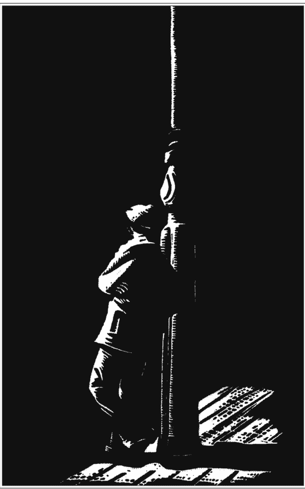

不断变幻的色彩，幽灵般的矮人在字里行间翻滚、飞翔、跃动；静静角落的盛盛绽放，生动的光芒与迸发的火焰……让页面似乎在边界内移动并颤动。

有时，一种描述具有令人着迷的美，即使在许多视觉艺术中，它也夸大了其中的事实性主张。F·斯科特·菲茨杰拉德对《大盖茨比》的精妙结尾便是如此。

随着月亮升得越高，那座无关紧要的房子开始融化，直到逐渐意识到那片曾出现在荷兰水手眼中旧岛——新世界鲜嫩、绿色的胸膛。那些消失的树木，那些为盖茨比房子让路的树木，曾低语地回应着人类最后也是最伟大的梦想；因为在一个转瞬即逝的奇幻时刻，他一定在这片大陆面前屏住呼吸，被迫陷入一种既不理解也不渴望的审美沉思，在历史上最后一次与与他惊奇能力相称的事物面对面。

新定居的人口。那段时间实在太短了，不足以解释人类自身的遗传和环境起源。随着人口遍布到世界各地，他们完整地携带了决定人类智力和人类社会行为基础的基本基因组。

从现在起六万年前到一万年前——人类全球定居的大致时间跨度——大致相当于五百代人。这仍然不足以解释那些让我们作为一个单一物种聚集在一起的特质的起源，包括我们奇特的体毛和双足直立的身体、塞满巨大大脑的球形头骨，以及我们类猿的情感。此外，具有重大意义的是，我们具有产生由任意声音和意义组成的语言的共同本能。此外，我们共同拥有艺术创作的能力，探索并创新对环境的控制，并发明加强部落地区的创造神话。

我觉得庆幸，五百代人对于我们人类物种来说太短，以没有分裂成多个物种（每个物种在生殖上相互隔离，不发生杂交，而是每一代都进一步疏远）。这种倍增在我们更古老的史前祖先中很常见。这所带来的道德和政治问题将是无法解决的。除一个以外全部消灭是可行的，这显然就是我们物种（Homo sapiens）处理我们的姊妹物种——尼德特人（Homo neanderthalensis）的方式。

人类在抓取方面不仅虚弱，而且对当下周围发生的事情几乎毫无察觉。在日常生活中，我们想象自己对周围环境的一切都了如指掌。事实上，我们感知到的不断在我们周围和穿过的分子及能量波的多样性不足百分之一的千分之一。感知到的部分仅足以保护我们个人的生存和繁殖，并且在大多数情况下适应我们石器时代祖先所承受的压力。这就是自然选择进化的运作方式。我们是一种既强大又极其简约的力量的产物。

生物学家使用德语单词`Umwelt`（大致意为“我们周围的世界”）来表示我们通过非辅助感官能够感知的环境部分。`Umwelt`是我们史前祖先数百万年来应对非洲萨纳环境所需要的一切，但它足够了。我们生存了下来，而与我们有亲缘但感知不同且运气不佳的其他类人物种则没有。对于在安第斯山脉巡逻的秃鹫也是如此，它们拥有望远镜般的视力和敏锐的嗅觉；对于深海底栖的海绵鱼，它们永远迷失在午夜的黑暗中，但在探测腐肉的微弱痕迹方面却是天才；或者是亚洲鼠，它们伏在漏斗形巢穴深处，对丝线的任何轻微拉动保持警觉，这种拉动揭示了昆虫猎物的掠过。

那么，人类的`Umwelt`是什么？它是如何产生的？又为什么？这些都是科学和人文的核心问题之一。对第一部分的快速回答是，我们的物种作为非洲萨纳草原的聪灵孩子演化而来的，在几种感官模式上是足够的，在大多数模式上是弱的，而在另一些模式则是完全空白。

我们主要是视听的，是地球上少数几种动物之一（（鸟类以及少量昆虫和其他无脊椎动物），依赖视觉和听觉来寻找方向。然而，在视觉方面，我们响应的唯一粒子是光子。更严格的是，我们的光受体检测到的电磁光谱仅薄如刀片的一角。我们的视觉始于低频端的红色（甚至不是更早的红外线），结束于高频端的紫外线之前。如果我们有一套更好的颜色和色调供我们观察和命名就好了。如果我们可能拥有广阔的颜色范围，并能增加鹰和蝴蝶的视觉，对视觉艺术的影响将是革命性的。

那么声音呢？它对我们的交流至关重要，但与动物世界的听觉之旅相比，我们几乎是聋的。许多物种的蝙蝠在空中俯冲、旋转，以几乎无法想象的精确度捕获飞行昆虫。更令人印象深刻的是，蝙蝠并不依赖昆虫的声音：它们发出自己的高频声音，并通过回到它们身上的回声来定位猎物。某些蛾子配备了调节蝙蝠发射频率的耳朵，它们一旦听到蝙蝠回声定位的点击声，程序就会掉落在地面。其他蝙蝠能探测到水面的涟漪，并通过爪子划过水面来捕鱼。南美血蝠闻到它们的猎物——包括忘记关窗户的人类——在皮肤上切开小口子，舔食流出的血液。（也许是时候写下这些了）

……融入它们。我们的身体是为了我们物种演化的生态系统而专门化的。因此，我们的心灵也受到了限制。我们对完全理解自己的希望，不仅取决于对自身的了解，还取决于对周围其他生命系统专门化的了解。

在与我们共享地球的数百万物种的无形代码和节奏中，创意艺术是否有足之地？也许在音乐和视觉艺术中？而在联觉中——即感官模式的相互融合，例如将化学感受转化为听觉或视觉感受——又会有怎样的可能性在等待？让我们这个惊喜更进一步。在不久的将来，我们可能通过脑科学技术，读取至少鸣鸟、猿类、爬行动物、新蝴蝶、蚂蚁和水黾的心灵。到那时，将能够通过虚拟现实来模拟它们的`Umwelten`。

然而，目前我们物理上被困在人类的泡泡中，更糟糕的是，我们对其局限性仍然毫无察觉。我们在内容限制上那种荒谬的严重倾斜，可以通过比较不同语言在不同模态下分类感官反应的词汇数量得到生动的说明。以我们著名的朱鲁霍安西人（Ju'/hoansi）为例，他们是卡拉哈里沙漠的猎人采集者，其社会组织和日常活动日程被认为具有所有现代人类远古祖先的特征。在朱鲁霍安西方言合集中已知的117个指定感官的完整词汇中，有25%指向视觉，37%指向听觉，但只有8%指向嗅觉或味觉。这种差异并不令人意外，因为我们这些朱鲁霍安西人在嗅觉和味觉方面的能力确实相对较弱。

人类的其他部分在感官词汇上惊人地相似。在特顿达科塔苏族语、祖鲁语、日语和英语使用者的语言中，用于视觉的词汇占总数的25%到49%，而用于嗅觉和味觉的总和仅占6%到10%。

与其他动物相比，我们这种专门的视听物种的孤立性甚至更加严重。在谈到触觉、湿度和温度时，我们几乎是“盲目”的。某些淡水鱼利用电场相互通信和捕猎猎物。我们通过技术见证这种活动，但否则对其一无所知（除非我们抓起一条并遭受可能致命的电击）。我们也无法探测地球的磁场，某些鸟类在年度迁徙期间利用它导航。

STEM（科学、技术、工程和数学）时代，创意艺术和人文学术的缺陷日益明显，这导致即使在科幻说的边缘也导致了极端的人类中心主义。似乎除了对人的影响之外，什么都不重要。结果之一是，我们留下了很少可以比较的东西，因此无法理解和判断自己。

总结来说，人文科学面临着以下弱点：它们对因果关系的解释缺乏根基，且它们存在于感官体验的泡泡之中。由于这些缺陷，它们变得没必要地以人类为中心，因此在认出人类状况的终极因果关系方面能力薄弱。

公元前五世纪的阿德拉学派（Protagoras of Abdera）宣称：“人是万物的尺度”。那种世界观在他时代曾受到挑战，在今天也应该受到更多挑战。我们需要另一种感知来理清事实。它应该读作：“为了理解人类必须衡量万物。”

# 被忽视的岁月

我十四岁时，在佛罗里达州彭萨索尔的一所教堂第一次听到一位男高音唱的一首小赞美歌，让我流下了泪水，并促使受洗并成为南方浸信教的正式成员。他们告诉我，那是确认对耶稣的信仰并永远与他在天堂结合的方式。

> 噢，那古老崎岖的十字，被世俗所蔑，
>
> 对我有着奇人的吸引力；
>
> 因为上帝亲爱的羔羊放弃了天上的荣耀，
>
> 将它带往黑暗的各他。
>
> 我将珍爱那古老崎岖的十字，
>
> 直到我最后放下苦难；
>
> 我将紧抱那古老崎岖的十字，
>
> 总有一天用它换取皇冠。

任何达到理性年龄的孩子都能理解这个承诺：社会心灵的转型，一场传教的杰作。仅通过一个节和副歌，《古老崎岖的十字》就捕捉了痛苦、爱、救赎和社区，这些共同构成了福音基督教的核心。

它还提醒我们，人文科学（宗教研究是其不可缺的一部分）在思维模式上与科学有本质区别。只有人文科学创造社会价值。它们的语言在创作行为的推动下，唤起了人们本能上认为是正确和真实的感受与行动。当知识足够深且一切就位时，人文科学就成为道德判断的首要来源。

但——等一下！有些东西是天生善的，另一些是天生恶的，不是吗？看起来是如此，但事实也是，每一个思想和每一个行动在被道德判断之前，都必须置于科学和人文的双重语境之中。

考虑核武器，它是对所有生命的威胁，也是地球的诅咒。另一方面，两枚原子弹的投下结束了太平洋地区的第二次世界大战，至少从美国人的角度来看，拯救了数百万美国和日本人的生命。随后，对核交换的恐惧限制了冷战和一般的国家战争。在世界历史的解释中，这个道德困境的解决方案何在哪里？我们可能如何找到它？

人文科学登场了。

科学拥有探索一切被视为事实和可能的事物的根据，但人文科学在事实和幻想的双重托载下，拥有不仅是可能而且是可以想象的一切的力量。

因为人文科学包含了属于人类的一切，所有属于人类的一切都构成了人文科学。可以作为一个公理：青少年的教育是由科学与人文之间明智的平衡组成的。这种课程曾被称为“全人教育”（rounded education）；现在通常被称为“通识教育”（liberal education）。为所有公民提供通识教育的思想是美国民主传统最大的成就之一。

这一理念由托马斯·杰斐逊在共和国成立后的1818年关于弗吉尼亚大学的报告中述得非常到位。杰斐逊写道（撇开奴隶制的显性虚伪），每个人都应该接受教育，既是为了维持自己的生计，也是为了提高道德和能力。杰斐逊继续道，“理解他对邻居和国家的责任，并能胜任地履行分配给他的职能；

> 了解他的权利 . . . 以及通常，用理智和忠实地观察他所处的各种社会关系。”

杰斐逊表达的公共教育理想至今仍是美国传统的核心。然而，在获得美国人民的尊重和支持方面，人文科学仍然是科学的弱势姐妹。

2010年，意识到这种差异的一组来自参议院和众议院的跨党派成员要求美国艺术科学院准备一份关于美国人文和社会科学状况的报告，并评估它们在美国生活中的作用。其模型是美国科学院赞助的2007年报告《超越风暴》（Rising Above the Storm，科学、技术、工程和数学）。重点是国家性的，但得出的结论预计具有全球影响。

51%的人认为其非常重要，42%的人认为相当重要，只有6%的人认为有些微重要。

此外，美国人尊重创意艺术。在不同程度的精致化程度上，我们将其视为娱乐和——无论我们如何表述——智力启的永恒源泉。我们所重视的许多内容都是高质量的，并且变得越来越好。美声唱（Bel Canto）和交响乐协奏曲（symphonic cadenzas）是摇滚、民谣、乡村音乐和西部音乐熟悉的伴侣，尽管它们的关注度较低。伟大的视觉艺术被认为是真正伟大的，非常值得去现场欣赏原作。美国国家人文基金会的一项调查显示，在1982年至2008年期间，每年至少访问一次美术馆或博物馆的美国人百分比在20%到25%之间。

简而言之，人文科学被广泛认为对社会至关重要，并因此受到相应的推崇。但与人文科学相关的机构并没有获得支持，其运作规模也远未达到主观判断的价值；与之相反，耶尔大学之类的大学在招新生和开设新课程时，现在更加强调科学。

最严手的问题是贫困和缺乏尊重。人文科学几乎从没有获得足够的资金来完成其艺术家和学者向往的项目。他们相对较少拥有文艺复兴模式的长期富裕赞助者。修道院和其他宗教修养地不再作为他们的创作避风港。它们在国家和州预算中被归类为奢侈品。对于渴望将一生奉献给某种形式的艺术和人文的年轻人来说，它们提供的职位太少了。

在两者之上，自然科学像一艘停泊在曼哈顿上空的外星飞船一样，投下了深色的阴影。在美国，从2005到2011年，物理科学、生物科学以及数学持续获得联邦政府70%的学术研究与开发支持。医学科学和工程也表现得尚可，满足了略高于60%的需求。教育研究以及行为和和社会科学接近50%。处于底端的是人文科学，除了法律之外，其支持比例一直保持在20%左右。人文科学的其他支持主要来自学术机构。

科学和技术得到了美国人民纳税的大力支持，用于通常被认为是公共利益的事。从这种慷慨中获得的知识，是美国在全球经济和科技主导地位的贡献原因之一。

相比之下，人文科学主要由教育机构支持，这些机构通过学费和捐赠获得收入，外加政府小部分基于税收的支持。在科学和人文科学争夺美国人民提供的资金的竞争中，人文科学的排名始终低于科学。

美国人通常通过专业人员提供的薪水来分配职业的声望。衡量这种估值的一个良好标准是大学毕业生的年起薪。美国劳工部2014年的报告，，STEM专业人士是“王者”，收入在50,000美元到80,000美元之间。文科毕业生，即建筑、英语、小学教育、新闻学和心理学专业的毕业生处于底端，起薪在40,000美元或以下。

美国人经常被提醒，基础科学的研发对国家有益。这显而易见。但对于人文科学也是如此，涵盖了它们从哲学、法学到文学和历史的整个领域。我们保护了自己的价值观。它们让我们成为爱国者，而不仅仅是合作的公民。它们解释了我们为什么遵循基于道德准则建立的法律，而不依赖独裁统治者的灵感领导力。它们提醒我们，在古代，科学本身是人文科学的附属物。它被称为“自然哲学”。

为什么人文科学一直处于饥饿的边缘？部分原因是我们可用的大部分资源被有组织的宗教占用了。世界上绝大多数人属于某种特定的宗教信仰，这种信仰的定义与其说是因为对神的信仰，不如说是其独特的创世神话。每个成员都坚信自己宗教的创世神话（解释了宇宙和人类的超起源）是优于一切的。问题在于，所有的神话都不是正确的；没有两个正确的；几乎一个也没有。

几个世纪以来，宗教创造了超越性的音乐、文学和艺术。我见过的最动人的仪式（如果可以许可的话）是天主教的基督之光（Lumen Christi）庆祝活动。始于黑暗的教堂。门开了，主教拿着点燃的蜡烛进来。他慢慢走过过道，司随其后。信徒静静地站着，每个人手里拿着未点燃的蜡烛。按行点燃蜡烛，直到整个教堂被照亮。在祭坛前，复活节仪式开始了。

被几个世纪演变出来的宏伟展示所震撼，人们很容易忘记宗教艺术是献给现行的创世故事的，偏离这个故事是不被允许的，而且为了用一个故事取代另一个故事发生过残酷的战争。简单来说，世俗人文科学必须与有组织的宗教和宗教式的意识形态竞争关注力和志愿者公共资金。前者可以探索和创新，而后者不能。

来自信仰文化的竞争并不是压制人文科学的唯一力量。远强大的是数字革命。科学和技术对人文科学并非不利。它们将其束缚于超自然的教义或盲目的意识形态。然而，它们的竞争可能是压倒性的。手工业、园艺农业和商业捕鱼业正在走向消失。自动化、规模化生产和全球通信增加了世界经济，而不是人文科学的影响，使得最好的工作被那些受过科学、技术和技术辅助培训的人所占据。

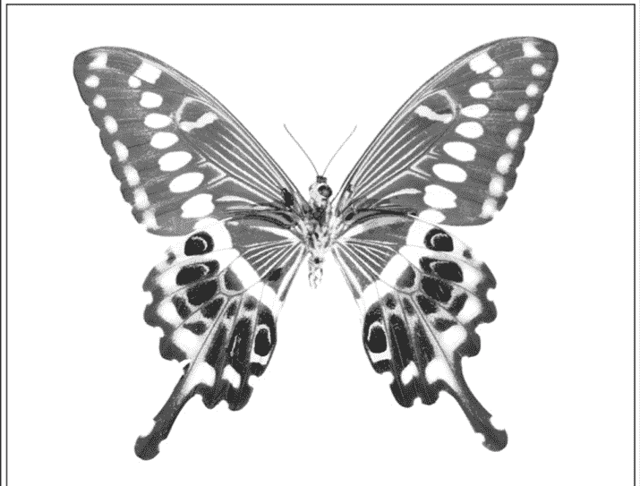

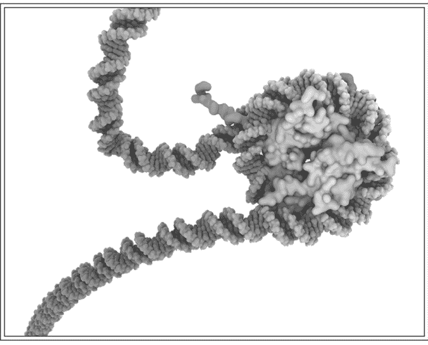

人文与科学是创意思维这一单一连续体中的不同片段，从遗传的分子过程到这些过程所编程的情感反应，跨越了所有的时空。上方是一只非洲凤蝶蝴蝶（*Papilio lormieri*）的背面，由一种特定基因代码演化的产物。（Robert Clark 拍摄）。下方是一段 DNA 片段，周围环绕着组蛋白的片段。（图像使用 Molecular Maya [Clarafi.com] 由 Gaël McGill 创建，精确呈现了在超高倍率观察下的状态。）

# 第三部分

科学与人文具有相同的起源和创造力脑过程。通过更深入地应用五门学科——古生物学、人类学、心理学、进化生物学和神经生物学，它们可以更紧密地联系在一起，并在实质上广泛结合，这些学科被遗传和文化中的进化过程紧密相连。

# 终极原因

最好的批评往往是横溢的，源自深层的直觉智慧。然而，由于主题具有极强的主观性，见解很容易滑过表面并偏离目标。例如，沃尔拉斯·史文斯（Wallace Stevens）告诉我们，毕加索的立体主义是为了作为现代世界破碎混乱状态的隐喻。毕加索本人解释说，立体主义应该具有“灵活性”，画布上的形象描绘的是一个能够转型为其他阶段的发展阶段。

艺术家的意图是极具个人色彩且难以评估的。对于马蒂斯而言，他承认自己正处于一种创造新感知的狂热中，不断带来新奇的冲击。高更廷创作了他的塔希提尼杰作《我们从哪里来？我们是谁？我们要去哪里去？》，将其视为人类生活的全景。随后，他打算在帕皮特上的山丘上自杀，但改变了主意搬到了马尔尔基斯群岛。在莱斯大学的罗斯科教堂里，这位艺术家的最后作品无主题且无形式，根据大师级评论家罗伯特·休斯（Robert Hughes）的话，这代表了令人震惊的自我放逐。整个世界都从中抽干，只留下一个虚空……观众应该以面对虚构观众的方式面对这些画作，正如卡斯帕·大卫·弗里德里希的作品中注视自然的观众一样：艺术在一种悲观内心的抽搐中，旨在取代世界。

在实验艺术与批评的氛围中，奇异的亚文化突然且随机地出现并不意外，就像在经过良好的草坪上长出的勇敢蘑菇和蒲公英。它们本身就挑战了连贯的解释：达达主义、超写实的番茄汤罐、后现代主义哲学与文学、重金属和无调性音乐。无论它们源自有序还是混乱的心灵，都让我们窥见了潜意识中——遗憾的是，这些仍然是混乱的——情感检查点和决策中心（注：潜意识大脑的决策中心）。

仍然生存的纯狩猎-采集社会和原始农业狩猎-采集社会，对于史前文化诞生的千年仍然带给了我们许多信息。他们的生活可能看起来很简单。他们不看电视（大多数人还没有！），不使用互联网，也不开车去超市买菜。然而，卡拉哈里的朱霍人（Ju/'hoansi，这是我最喜欢的、也是深受研究的狩猎-采集社会之一）对领地的地理了如指掌，并能跨越数百公里——包括其中的每一棵果树、水坑、潜在的营地和观察丘。与现代城市人相比，他们的词汇可能很小，但他们命名和描述植物动物的专业程度完全可以与受过分类学训练的自然学家媲美。他们的对话和讲故事关注白天的事务，最多在火光下关注几乎所有其他事情，内容多样且详细；对于朱霍人来说，语言中还夹杂着三类辅音辅助的词汇，每种辅音都在气道的不同部位发出。

那么，我们从朱霍人以及更广泛地说，从这种古老的生活方式中学习到了什么呢？作为背景，每一个人类无一例外属于一个单一的、生殖隔离的动物物种，受限于其独特的生物学和社会行为。在这一特征被读为神性解释的暗示之前，请注意，同样的话也适用于数百种其他社会物种，从水管母水母到织网蜘蛛，再到海豚和狼等哺乳类动物。鲸鱼通过捕食微小甲壳类动物变得巨大，蝙蝠在晚上通过声定位飞行，鸟类在晚上通过极地磁场飞行。人类思考。

我们从科学家那里了解了这种进化的早期阶段。事实证明，三个前提条件的结合产生了人类水平的物种。第一是营地的建立，这是由于祖直立人（*Homo erectus*）饮食的改变而可能的。我对整个动物界历史上所有已知复杂社会的起源进行了回顾，总共代表20条独立的谱系，揭示了每个社会出现之前都有本性的筑巢行为，幼在父母照顾下在巢中长大。对于社会性蜜、黄蜂和蚂蚁来说，巢穴各种是地下的或树上的，并包含供发育中幼体的特殊隔间。对于社会性蓟和蚜，育幼室是活植物内已有的空洞。社会性海洋虾利用活海绵中挖掘腔室。早期人类的巢穴是受控制火温暖和照明的营地。一种广泛但并不常见的适应——为了适应后代的渐进式抚养而筑巢——是通往罕见的人类水平的基础。

这20条进化谱系所具备的最先进组织特征是“社会性”行为，在这种行为中，分工不是基于平等者的合作，而是基于群体成员承担长期角色的组织化合作。要在科学分类上归类为社会性，这些角色是以部分成员程序化的生存和繁殖成功为标志的。简单来说，存在利他主义。部分成员为了集体利益牺牲。

人类社会起源的第二个前提是群体成员之间的高水平合作。每个人都认识其他人，并对他们的工作角色、能力和性格有所了解。分工、利他和合作的共同进化对社交智能提出了极高要求。特别是，它们的结合丰富了交流。由于最早的人类是视听的，他们进化出了口语语言的能力。词汇最初最初是任意的，但在群体内部变得通用。声音产生并消失得很快。与视觉信号不同，声音可以穿过薄的不透明障碍物，并转角。（注：数量迅速增长。）

在群体内部，语言能力更好的人比他们的灵长竞争对手拥有更高的生存和繁殖率。更重要的是，在群体间的竞争中，胜者不仅在致命的领土侵略上占优，在结成联盟、发展贸易以及从自然环境源提取材料和能量方面也占优。

此后大脑从祖直立人的900cc增长到早期智人的1300cc甚至更高。从远处看，我们把大部分时间花在闲聊聊天的同时涂画图像和符号，这并不意外。也解释了为什么在由于无法认识所有成员的大型社会中，我们会珍视并八卦名人。

# 基石

人类是一个嵌合物种。我们感官和情感的生理基础与我们的类人祖先相比并没有本质。我们对于创意艺术的能力——叙事性语言、舞蹈、歌曲、绘画——可以追溯到六万年前人类走出非洲之前。除此之外，其他一切都发生了变化。根据学科的不同，科学和技术每十到二十年就会翻一倍。它们涉及宇宙中的一切、所有的空间和时间，地球上每一个可以想象的星系和系外行星的一切。相反，人文科学则受困于“人”。

这正是人文科学的困境所在。它们（以及随之产生的大部分自由教育）被期望去描述和解释一个世界的本质——这个世界包含了石器时代的情感、中世纪的制度和神技术，但对其意义或目的并没有清晰的认知。在对意义的追求中，科学和技术扮演着与人文科学脱节的角色。科学（及其技术）告诉我们为了去任何想去的地方需要什么，而人文科学则告诉我们利用科学产生的产物去向何方。当科学创造了新的认知模式和巨大的物质力量时，人文科学则关注美学和价值（或价值缺失）的问题，这些问题大多由科学那无情的斯塔哈诺夫式能量所引发。

人类的事业一直是统治地球及其上的一切，但同时也受限于一群相互竞争的国家、组织化的宗教和其他自私的集体，其中大多数人对人类物种和星球的共同利益视而不见。只有人文科学能够纠正这种不完美。由于专注于美学和价值，它们有力量将道德轨迹引导向一种全新的推理模式，一种包容科学技术知识的模式。

为了履行这一角色，人文科学需要与科学融合，因为上述的新模式首先取决于我们对物种的自我认知，而这种认知在没有客观科学研究的情况下是无法获得的。就像引导我们诞生的阳光和火光，我们需要统一的人文科学与科学来构建出一幅关于我们究竟是谁以及可能变成什么的完整且诚实的画面。这种结合是人类智力的潜在基石。

正如我所论证的，显而的是，人文科学可以得到足够的扩展，通过三种方式建立联系：第一，逃脱不受辅助的人类感官世界仍不必要深陷其中的泡泡；第二，扎下根，将基因演化的深层历史与文化演化的历史联系起来；第三，削弱阻碍人文事业泡泡的极端人类中心主义。

作家们经常转向人类存在的奥秘，如天体物理学和量子力学。或者，他们看向脑神经元和电路的未来地图。在更传统的模式中，许多作家寻求精神上的启蒙，从而通向上帝或某种*畏惧的神秘*（mysterium tremendum），其核心引导着我们，却保持在我们无法触及的地方。

所有这些原型都保证将持续并失败。它们在最强大的原型之一中发挥作用，即对终极未知的追寻。这种追寻在不同时代演化为各种形式：圣杯、石中剑、古人的秘密代码、外星人留下的信息、通往圣殿的钥匙，或是基于物理学的“万物理论”。

事实上，对我们物种深层基因特性的自我认知已经实现（至少是很大一部分），通往其余部分的漫长道路在原则上已经铺就。许多惊喜等待着，特别是在分子和发育遗传学领域，但这些增加了解释“我们为何存在”以及“我们在不离开地球的情况下可以期待获得什么”所需的范式转移。到目前为止，正如我所强调的，答案是由我们逻辑上预期的相关基石学科提供的。它们包括古生物学、人类学（包括考古学）、心理学（主要是认知和社会心理学）、演化生物学和神经生物学。

统一这五个与人类最相关的领域五大学科的共同线索是自然选择进化。这一普遍过程的卓越性在1973年由伟大的遗传学家西奥多西斯·多布斯基得到了精辟的表达并从那时起被引用：“除了从进化的角度来看，生物学中没有任何东西是有意义的。”这一主张现在应该大胆地扩展到科学和人文领域。正如哲学家丹尼尔·丹内特所言，自然选择是这种普遍过程的卓越性，是科学和人文

“活化石。”那些拥有两亿年或更久远特征的常见例子包括古鲋、蜻蜓、甲虫和苏铁树。

在自然选择演化的进化的基本理论中，引起基因突变的遗传单位，以及环境自然选择的目标，是由基因所决定的性状。借助好莱坞科幻恐怖片的帮助，这种区分可以变得更易于记忆：那些从政府秘密实验室逃出来的昆虫和鳄鱼巨型变异体造成了局部的混乱，但在达尔文主义的竞争中，它们与正常的祖先相比，根本没有机会繁殖和扩散。然而，我们希望确实如此。

在个体水平选择与群体水平选择之间，存在着不必要的混淆，尤其是那些关于进化的通俗作家所引发的混淆。这种问题源于对遗传单位与选择目标的错误区分。当涉及到发展完善的人口遗传学学科时，问题得到了迎刃而解，如下：个体水平选择作用于影响群体成员生存和繁殖的性状，而与其群体内其他成员的互动无关。在社会演化的早期，个体选择占据主导地位，此时许多遗传性状独立于其同伴影响个体的成功。个体在生命周期的部分时间内可能独自生活。在它的群体中，它可能会为自己和后代占据更多的食物和空间。

群体水平选择作用于与群体成员相互作用的性状，使得个体基因的成功至少部分取决于该个体所属的社会。在最先进的社会组织中（其特征是不具繁殖能力的工蚁阶级，并以类似于水母的水管动物以及蚂蚁、蜜蜂、黄蜂和白蚁为代表），群体选择几乎完全取代了个体选择。

那么，人类在个体到群体选择的光谱中处于什么位置呢？我们位于中心附近。结果是，人性受到两种冲突的驱动：一种是促进个体及其直系亲属自私的个体选择，另一种是促进服务于更广泛社会的利他主义和合作的群体选择。这种在本能与理性的竞技场中锻造出的选择水平的混合，是构成人类的要素。

群体选择在社会演化中的作用与已证明的人口遗传学基础是一致的。它在整个动物界中的出现得到了领域和实验室海量证据的支持。尽管如此，它受到了一种被称为“广义适应度理论”（inclusive fitness theory）的社会演化替代解释的挑战。从本质上说，该理论认为社会行为根据群体成员之间亲缘关系的程度而进化。亲缘越近，群体成员越可能分享资源并合作劳动。每个群体成员在生存和繁殖上付出的代价，通过其由于亲缘与群体内其他成员共享的相同基因的增加来补偿。如果你为你的大家庭牺牲生命，这比他们仅仅是远亲或完全没有亲缘更有意义。如果你为近亲做出牺牲，你身上更多的“勇敢基因”将在种群中延续下去。

初看之下，这种亲缘选择的概念——超越了偏亲，扩展到整个群体内的合作与利他主义——似乎具有相当的价值。我在20 世纪 60 年代和 70 年代初首次合成社会生物学这一学科时，我就是这么说的。但它有巨大的缺陷。尽管最初引起了人们的关注，但从未有人成功测量过作为其核心属性的所谓“广义适应度”。要取得成功，不仅需要确定整个群体中的两两亲缘关系，还需要评估随时间推移的适应度互惠得益。除了技术难度外，用于进行整体分析的方程已被证明在数学上是错误的。这种错误有一个根本原因：对广义适应度理论的审视中，选择单位是个体群体成员而非基因。广义适应度意味着个体在其整个繁殖期内，与每个群体成员的关系的表现，并根据共享的适当基因的百分比进行折扣。然而，尽管外表上很有吸引力，但并没有证据表明存在这样的过程，或者任何需要它来解释高级社会行为的起源。

我在这一问题上采取了强硬立场，因为我很清楚一个合格的科学家应该表达不确定性。这种分歧正如达尔文在《人类的起源》中（请原谅我引用权威）首次观察到的，人类之间的竞争是那些普遍被认为的慷慨、勇敢和公正等特质的主要贡献者。我们需要弄清楚这一点。为什么这种分歧重要呢？群体选择对科学、人文以及普遍被认为的慷慨、勇敢和公正的重要性是无法估量的。如果仅仅通过自私基因来解释这些特质，我们需要采取一种彻底世俗的观点来审视人类。英雄是真实的且无处不在。由于群体选择以及它在社会行为演化中的显性结果，有理由认为我们本性的良善不是在神罚的威胁下灌输的，而是遗传的。

同样，对自然的热爱（导致对野外动植物群的喜爱）对每个人都是如此，即使他们的一生都生活在城市里。将公园和保护区主要视为经济资产或户外健康是错误的。野生动物保护拥有独立且自足的基础。

道德或缺失的起源从古老的蝎子与青蛙寓言中得到暗示。蝎子想过河，但不会游泳，请求青蛙载它。青蛙犹豫了，认为蝎子可能会蜇死它。蝎子辩论说这不会发生，因为它们都会死。它们开始出发，在河流中段蝎子蜇了青蛙。随着它们沉没，青蛙问蝎子为什么要这样做这种可怕的事。蝎子回答说：“因为这是本性。”

# 突破

人们越来越清楚，自然选择已经编写了人类生物学的每一个部分——每一个脚趾、毛发和乳头，每个细胞中的每一个分子配置，大脑中的每一个神经元回路，以及在这一切之中，每一个使我们成为人类的特质。

自然选择作为进化的主宰，意味着人类并非由任何超级智能规划的，也不受任何我们自身行为之外的命运的引导。人类的产物在其地质寿命跨越的数千代中，每一次都经过了测试并经常被修正。我们进化物种的成功意味着每一个繁殖周期的生存。失败将导致通灭绝之路的衰落，从而结束进化的游戏。这在大多数其他物种中已经发生过，许多发生在我们眼前。

物种的诞生，体现在从一个纪元演化到下一个纪元的过程中。任何特定谱系的历史都是一场穿过不断变化的迷宫的旅程。一次错误的转弯、一次进化的失误、甚至是进化适应中某一次不幸的延迟，都可能是致命的。在新生纪，在我们前人类祖先生活的这段时期内，哺乳类物种的平均寿命约为五十万年。大约七百万年前，从共同的黑猩人类祖先演化出了最终通向现代人类的谱系。此后，它的运气一直很好。当在前人类种在艰难时期减少到可能仅剩几千人，且许多与之相关的物种数量归零时，其中一个谱系跨越了第四纪的六百万年时光。它作为一个不断进化的实体持续存在。偶尔，它会分化成两个或多个物种。在演化过程中，只有一条谱系坚持了下来，并或许导致了智人（Homo sapiens）。其他物种继续演化，偏离了前人类谱系。随着时间的推移，它们各自死亡或分裂成自己的后代物种。最终，它们都衰落并消失了。

在黑猩人类分化后的六百万大部分时间里，至少三个（可能更多）被归类为南方人（australopithecines）的物种在非洲家园共存。它们基本上是食草的，可能在机会允许时像现代黑猩猩一样吃少量的肉（热量摄入量约占3%）。显然，不同物种为了适应它们所需的植物种类演化出了不同的颌骨和牙齿。这些特化特征共同构成了进化生物学家所说的“适应性辐射”。

在这一辐射演化中，一个谱系转向了更多肉类的消耗，尤其是那些由雷击引发的草原和稀树草原地火烹饪的肉。在早期阶段，这些群体发明了营地，最初复杂程度不如鸟巢。它们在此基础上增加了受控的火——其难度不亚于将燃烧的树枝余烬从一个地方带到另一个地方。

这种基础但最终具有重大意义的转变产生了直立人（Homo erectus），即智人的直接祖先，时间不晚于现在两百万年前。这种祖先物种一直持续到10万年前。到那时，其中至少一个群体的脑已经变得大得多，而颌骨和牙齿变得更小、更轻。

通向智人的最终转变在直立人的地质寿命内已步序进行，但更有可能起源于该物种更早的阶段，其直接祖先能人（Homo habilis）。目前发现的关于能人的化石证据比直立人稀疏得多，对于紧接在智人之前的后期过渡物种来说也是如此。

显然，是在于230万至150万年前存在于非洲的能人身上，开始了那通向现代人类的转折。在能人的这段史前时期，颅脑容量（因此是脑容量大小）从500cc增加到800cc，远高于现代黑猩猩的水平。它再次增长，达到了直立人的水平（约1,000cc），随后达到智人的水平（平均1,300cc或更高）。早期智人跨越了这一重大门槛：更大的大脑提供了更强的记忆力，导致了人际故事叙事的构建，随后在生命历史上首次出现了真正的语言。语言的出现催生了我们前所未有的创造力和文化。

我们仍在演化，但并非通过导致大脑更大、智力更高的直接选择，而是通过全球范围内杂交所开发的特性的同质化。群体之间的平均遗传多样性正在急剧下降，而人类的总遗传多样性保持基本不变。在生物学中，正如在文化中，我们正在成为一个日益统一的物种。

# 遗传文化

在大约两百万年前史前的能人时期启动的脑容量指数级增长，是生命史上生物复杂性最快速的转变。它是由一种独特的进化模式驱动的，被称为“基因-文化协同进化”，在这种模式中，文化创新加快了有利于智力和合作性的基因的扩散速度；而作为相互作用，产生的遗传变化又增加了文化创新的可能性。

根据广泛共识，科学家到此为止描述的场景始于非洲南方人从食草饮食向富含烹饪肉类饮食的转变。这一事件并非偶然的菜单选择，也仅仅是味觉的重新布线。相反，这种变化是解剖学、生理学和行为上的全面遗传重塑。身体变瘦了，颌骨和牙齿变得更小、更轻，头骨膨胀并呈圆形。社会发生了变化，从一个在领地内游荡、成员独立或成小小组觅食的部落，演变成一个规模更大、协作更好的狩猎-采集者团队组成的群体。他们像狼群一样离开并返回固定的洞穴和会点。这些拥有自由双手和更高智力的能人，可能学会了将火带到现场并保持其受控状态。

这种理论重构从化石遗骸和现代狩猎-采集者的生活方式获得了支持。大型猎物的肉类像狼、非洲野犬和狮子那样被分享。此外，考虑到大型栖地灵长类普遍具有较高的智力，前人类的演化阶段为前所未有的协作和分工奠定了基础。这些特征也因群体间社交技能竞争的加剧而受益，导致了个体层面的自然选择，并随着群体间的竞争不断增强。群体层面的自然选择特别有利于利他主义和合作。

## 人性

人类状态——我们作为一个物种的本质、我们渴望变成的样子，以及我们幻想在肉体和梦想中能变成的样子——取决于四个层面的现象。第一层是感官输入的处理，如听觉、视觉和嗅觉；第二层是反射，以眨眼和自主神经系统为典型；第三层是旁语言符号，包括面部表情、手势和笑声。第四层也是最后一层是符号语言，这是将智人与其他生物绝对区分开来的能力。这四个层面在不同程度上都受到大脑情绪中心的影响。它们在潜意识大脑检查点枢纽的决策支配下，唤起记忆，并在意识中形成未来的情景。所有这些过程的结果就是我们所说的“思考”。

人类的感官感知高度倾向于视觉和听觉，而绝大多数其他生物则依赖化学信号。正如格式塔心理学研究者很久以前发现的那样，传入的感官信息往往以可预测的方式被扭曲和模糊。视觉异常包括鲁宾花瓶，这种图像的形状可以（在我们脑海中）从花瓶切换到一对相对的侧脸，然后在花瓶和人脸之间反复切换。当一个由六个面积相等的面组成的内克立方体被旋转和倾斜时，前方和后方的垂直边缘似乎快速且反复地交换位置。最令人幻觉且沮丧的是穆勒-莱尔错觉，就像魔术一样，一个在线条末端开口的V形图形使线条看起来比另一个V形在末端关闭的相同线条更长。大脑努力去验证它被程序设定为否认的物理证据。

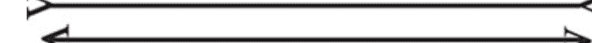

视觉系统还有无数其他方式来应对现实世界的模糊性。大脑通过自动重新排列和简化其提供的信息来管理视觉输入的混乱。当实验室志愿者被要求画出他们之前记忆的图形时，他们创作的形状往往比他们经历过的更具概括性。特别是，他们改进了对称性，简化了图形，增强了划分，拉直了斜线，并孤立了不兼容的细节。

反射构成了行为的第二层，是真正硬连线的，与意识思维无关，除非是在后期的记忆中。喷嚏是一种反射，膝跳反射、不自主的眨眼、脸红、哈欠、唾液分泌也是。最复杂的反射是惊跳反应。想象在对方不知情的情况下从某人身后走近，几乎触碰到，并发出巨响（我不建议你真的尝试）。那个人会立即向前倾倒，低头，闭上眼睛并张嘴。惊跳反射的功能是防御。想象一个石器时代的猎人，在背后追踪并被捕食者（如豹子）攻击时，以整体放松的姿态向前翻滚回避。这种正确的决策和迅速的行动不需要任何意识思维即可。

面部表情、姿态和身体动作构成了人性的第三层——旁语言信号，它们是有意识的并在某种程度上被所有文化共享。它们还被通用地作为口语言的替代或增强。在20世纪60年代经典的野外研究中，德国人类学家伊雷纽斯·艾布尔-埃贝尔斯费尔特（Irenäus Eibl-Eibesfeldt）详尽地证明，从原始前文字社会到现代城市化的所有社会的人都使用同样广泛的旁语言信号。这些信号包括表示各种恐惧、快乐、惊讶、恐怖和厌恶的面部表情。艾布尔-埃贝尔斯费尔特与受试者生活在一起，此外为了避免自我意识行为，他使用广角镜头拍摄他们的日常生活，从而让受试者认为相机指向了别处。他的总体结论是，旁语言信号是全人类共有的遗传特质。

普遍或近普遍的固定动作模式包括表达遇到时愉快惊讶的“眉闪”：眼睛睁大，眉毛抬起，嘴角微笑。在儿童和某些女性身上，遇到时的害羞通过切断视觉接触来表达，通常用手捂住脸并转过头。家有幼儿的成年人会表现出嬉戏脸，通常包含嘲弄。男孩女孩之间的游戏不同于一种遗传特质，男孩倾向于通过模仿战斗（单打或结盟）来表达主导地位。

新生儿用手脚抓握，并四肢着地寻找乳头。婴儿使用五种信号：接触、不悦、睡眠声（后者如果出现，则向母亲信号一切无事；如果没有，则说明出了问题）。婴儿吸奶时的吸吮声也意味着一切良好，而它的缺失再次暗示了问题的存在。最后，剧烈哭泣强烈意味着饥饿、疼痛、不适或恐惧。

所有这些信号和动作都是遗传性的硬连线，这一点在盲、聋、哑婴儿身上的表现中得到了支持。尽管这些婴儿没有之前的视觉或听觉经验，但他们会进行同样的适当微笑和哭泣，并用冷静表示中性的心理状态。此外，当被单独留下（没有触觉接触）时，他们会抓挠性哭和绝望表情。如果被打扰，他们会伸出手掌，一种驱逐的手势。

随着对原始交流形式分析的进步，观察到的通用词汇丰富性也随之增加。一组包含了显示组内主导地位的姿态，以及最初实现这种地位的手段。事实证明它们与旧世界猴相似。斯坦福大学的社会心理学家德博拉·格鲁芬尔德（Deborah Gruenfeld）发现，当人们表现出以下特质时会感到更有力量——实际上也是如此：

- 行为具有扩张性
- 让手远离身体
- 说话时保持眼神交流
- 随意移开视线
- 不要做任何解释
- 占据你周围空间的主权，无论是会议室还是办公室隔间
- 暗示他人，“这是我的桌子，这是我的房间，你们是观众。”

实践主导地位的人睾酮水平较高，皮质醇水平较低。另一个遗传的、主导地位的标志是在高于下属的物理位置上休息——无论是在舞台、宝座、塔楼还是顶层。俯视他人，尤其是以一种放松的姿态。

微笑在很大程度上取决于受研究者居住国家的建国者具有何样的多样性。在起源多元的国家，表达友好意图而非攻击或竞争意图的微笑更为常见。

在与陌生人互动时，微笑的出现可以可靠地预测信任和资源共享。此外，观察伴随合作行为的微笑会增加一个人未来合作的意愿。地位则是另一回事。在同质文化中（如日本和中国），这种社会互动是复杂且可能具有破坏性的，因为长期的人口稳定为固定等级制度的发展创造了有利条件。在类似的情况下，微笑可以信号互动不会扰乱社会秩序，而微笑的特定特征在其他优越地位信号中传达了嘲讽和批评。

回到生物学，指示信号在形式和意义上的变异导致了基因-文化共同演化的基本过程之一：即通过自然选择进化为一种内在特征，使变异本身收窄并硬化。这种现象最初被称为鲍尔温效应，以美国心理学家詹姆斯·马克·鲍尔温命名，他在1896年构想出了这一概念。基因-文化共同演化与人性的进化起源具有实质性的相关性。本质上，它是这样一个原则：学习行为中的变异被证明是有益的并被重复，规定而非仅仅留作为一种学习选择的突变其频率将会增加，随着时间的推移，新特征将变得固定。

鲍尔温效应在蚂蚁和白蚁的等级制度中得到了显著的说明。查尔斯·达尔文对这些昆虫非常着迷。他花大量时间坐在唐尼花园（Down Gardens），观察并思考那里的蚁丘——据一位女佣提到，她在提到住在附近的多产作家威廉·梅克比斯·萨克雷时道：“遗憾的是达尔文先生没有像萨克雷先生那样有些可以打发时间的事情。”

事实上，这位伟大的自然学家在挣扎于任何情节和结局时，比萨克雷要苦恼得多。达尔文注意到蚂蚁身上某些现象，这些似乎与自然选择进化论相矛盾，并对该理论可能是致命的。他知道，典型的蚁群由母后加上几只雄性（如果存在，它们是临时客人）以及大量经营蚁群并承担所有工作的雌性工蚁组成。他的困境在于：工蚁不繁殖；它们是不育的，在某些物种中完全缺乏卵巢。如果工蚁不能繁殖，如果它们无法传递其服从的构造和行为，这些特征是如何通过自然选择演化的呢？达尔文构想出的答案是正确的（那个人几乎正确得令人讨厌）。他推断，蚁群中所有的雌性具有相同的遗传性。每个雌性变成哪个等级——是王后还是具有独特体型和行为的工蚁——取决于她成长的环境。特别重要的是她在从一条小幼虫成长为六足、摇动触角的成虫过程中所接收的食物数量和质量。等级决定的细节在已知的14000种蚂蚁中差异巨大，但在迄今为止研究的物种中，这种发育证明是基于遗传的线性规划版本。研究人员解读的一种代码遵循以下规则：如果幼虫在预定年龄达到特定尺寸，它的发育将不受抑制地持续成为新后，拥有完整的翅膀和卵巢。相反，如果幼虫未能达到关键时间点，旨在成为翅膀和卵巢的组织生长就会停止，成年虫作为工蚁出现——无翅、不育，且比它的姐妹处女后更小——即使蚁群中的所有成员在基因上完全相同。

人类等同等级决定（由动态编程的遗传形式产生变异）存在于心理学家所说的“学习”中。这种现象是人类本能以及我们所感知的人性的基础，而反过来，通过创造性的方式表达，它是人文科学的核心。

准备性学习的一个教科书级例子是对蛇的恐惧——不是面对咆哮的狗或闪电时普通的恐惧和谨慎，而是那种令胃翻江倒海、导致瘫痪的厌恶。孩子可以学会喜欢蛇。他们可以无畏地把蛇当成宠物带着，就像我在阿拉巴马州布鲁顿的T.R.米勒高中那样，我在那里获得了“蛇类·威尔逊”的绰号，那是一个美丽的小镇（我小说《蚁丘》中的克莱维尔），有一支获胜的橄榄球队和唯一的居民爬虫学家，也就是我。我喜欢向别人展示，当蛇适应了人类触摸时，它们会在你手中休息，或在你的衣服下无害地捕猎，可能是为了老鼠和青蛙。它们的皮肤摸起来像皮革，不像许多人想的那样粘滑，它们闪烁的舌头是一个无辜的嗅觉器官，而不是致命毒液的传递器。

但如果一个人被蛇吓到了——仅仅一次，仅仅一点点，并且以几乎任何可以想象的方式，即使只是通过可怕的照片和故事看到地面上的某个圆柱体——他就会倾向于瞬间获得对所有蛇的深层厌恶，更糟，通过瘫痪效应产生完全的终身恐惧症。

换句话说，蛇恐惧症看起来像是一种本能，在某种意义上确实如此（正如该词的传统意义）。对蛇的厌恶也是学习来的，而且很容易学会，其方式被设定为快速且目标明确的。清晰的答案是人类及其史前祖先数百万年来面临的致命危险。只有极少数的蛇类是有毒的，但很少有动物是地球陆地表面最危险的动物。蛇咬死亡率最高的是东南亚（蝰、加巴蛇、眼镜蛇和环蛇）。世界上最危险的职业之一是在隐藏着大量攻击性圆鼻蝰蛇的地方采集叶子——它们体型大、具有侵略性、致命且难以发现。毒蛇在世界的热带和温带地区几乎无处不在。致命的咬伤虽然罕见，但在芬兰和瑞士仍然发生。

就像我们地质过去的幽灵一样，其他潜在危险的动物也施加了它们自己的遗传恐惧。对蜘蛛的本能恐惧（蜘蛛恐惧症）一直以轻微的形式存在且从未完全消除，其敏感期从三岁半开始，并持续整个童年。对昆虫的普遍恐惧（易恐的小虫类）在六到八岁的儿童中比此后更大。对大型动物的准备性恐惧通常在五岁之前不会发育，但对于狗，在两岁时就可以出现。

一个惊人的事实是，获得条件厌恶和恐惧症的触发能力几乎完全限于我们遥远的史前祖先在野外数万年获得的风险。除了各种动物敌人，这些风险还包括狭窄的空间、高度、流动的水以及暴露在陌生环境中。我们的物种还没有时间进化出对刀、枪和汽车的恐惧，而这些到目前为止是生活中最常见的死亡因素。

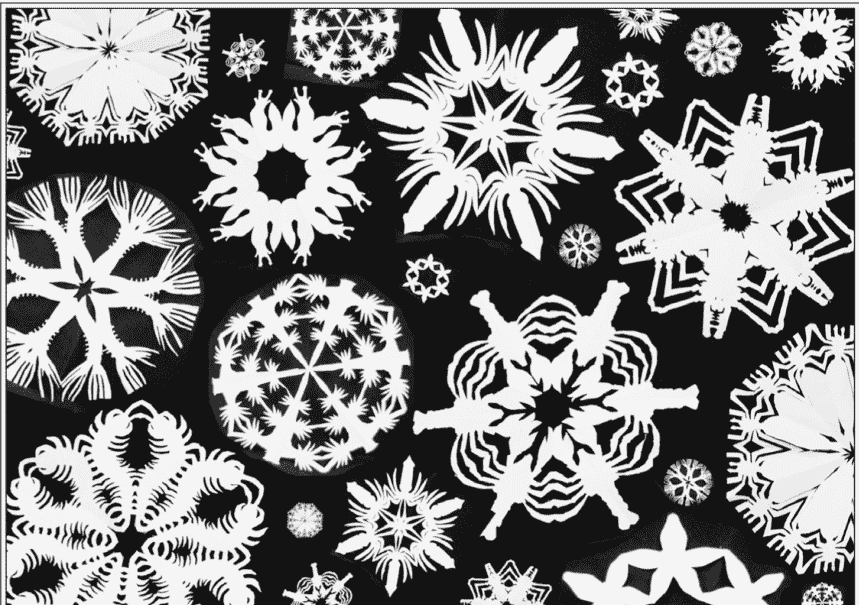

地球上生命无尽的美。每一片“雪花”都是艺术家由多种无脊椎动物的图像组成的。（贡献雪花的哈佛大学无脊椎动物系成员包括：Tauana Cunha、Sarah Kariko、Vanessa Knutson、Laura Leibensberger 和 Kate Sheridan。Kate Sheridan 负责摄影和在 Photoshop 中组合雪花的设计工作。）

# 第四部分

即使我们的物种正在以加速的速度破坏自然世界，自然依然是深层爱与恐惧的源泉。当我们忙于用人类环境覆盖地球时，我们应该——我们必须——停下来思考我们与自然关系存在的原因。正如我接下来将提出的，那种程度的自我理解只有通过科学与人文的融合才能实现。

# 第13章 为什么自然是母亲

在人类存在的几乎十万年里，自然一直是我们的家园。在我们的内心，在最深处的恐惧和渴望中，我们仍然适应于它。在农场、村庄和帝国发明一万年后，我们的灵魂仍然栖息在自然世界的生态母体内。

我们无法在这个自给自足的环境之外长期生存。我们存在于狭窄的生物生态位中，最终取决于它的广阔。自然世界拥有令人谦卑的力量和永恒的生命，所以我们有理由称之为大自然母亲。她被我们的活动所破坏，但这并不是什么新事。从长远的地质尺度来看，人类只是另一个扰动。就让她隐喻地为万世说话吧，就像演员朱莉娅·罗伯茨代表国际自然保护协会表演的那样：

> 我并不真正需要人类，但人类需要我
>
> 是的，你的未来取决于我
>
> 当我繁荣时，你就繁荣
>
> 当我衰落，你就衰落，甚至更糟
>
> 但我已在这里万古
>
> 我曾喂养过比你伟大的物种，
>
> 我也饿死过比你伟大的物种
>
> 我的海洋，我的土壤，我流动的溪流，我的森林，
>
> 它们可以接纳你，也可以抛弃你
>
> 你每天选择如何生活，无论你是关注还是
>
> 忽视我，对我来说并不真的重要
>
> 无论如何，你的行为将决定你的命运，而不是我的。

我们是地球上不听话的孩子，离开家去城市闯荡。但正如科学家们发现的，正如我所强调的，我们的基因中仍然含有许多大自然的特征。在我们在自然界漫长的居住期间，演化在我们通过姿态和面部表情交流的方式中留下了不可磨灭的印记——达尔文的隐喻。我们在最想居住的环境选择上也是与生俱来固定的。得益于华盛顿大学的 Gordon H. Orians 以及其他科学家和人文学者的开创性研究，我们对所谓的“栖息地选择本能”有了很好的了解。测试过不同文化背景的人对以下居住位置表现出偏好：位于高地土地，俯瞰一片点缀着小树和树丛的广阔稀树草原；背后有岩石表面或茂密森林作为屏障；最后是湖泊、河流或其他水域。他们的欲望景观与我们人类和史前人类起源的非洲环境非常接近。

来自亚洲、欧洲和北美的艺术家在他们乡村和森林环境的绘画中展现了同样的组合。总的来说，他们避开了以温带落叶林和针叶林为特征的北方温带原始环境。当描绘这种环境时，通常会插入草地和湖泊来柔化。这为人类祖先的本能偏好留下了空间。

Orians 通过引入生物完善了“稀树草原假设”。园艺师广泛使用的树木形状——从京都的寺庙到英国的男爵庄园——与非洲稀树草原上金合欢树具有共同特征：相对于矮小的高度，它们倾向于拥有异常宽大的树冠、短的树干和小而分裂的叶子。日本人已经培育了一千多年的枫树和橡树，目标正是为了完善这些品质。我可以证明，甚至在了解到稀树草原假设之前，我最喜欢的树（现在仍然是）就是日本枫。

是什么引发了人类对像非洲稀树草原这类栖息地的偏好的适应性优势？寻找答案是合乎逻辑的。所有已知的移动动物物种都需要寻找最适合其生存和繁殖的环境。它们必须找到恰恰合适的地方，并且快速且准确无误地到达那里。我们为什么不应该在现代人类身上发现至少这种倾向的痕迹呢？

我曾在一场景观规划师大会上演讲，期间我强调了生物亲和力，即与其他生物体接触的本能喜爱。生物亲和建筑当时正获得专业界的认可。我引入了人类栖息地偏好的稀树草原假设。我对他们相对冷淡的反应感到困惑。难道我没说清楚吗？后来我问一位建筑师朋友我是否表达了，他回答道：“噢不，只是我们早就知道这些东西了。”

有一个简单且易于测试的原因解释了为什么稀树草原家园塑造了我们的原始渴望。从高处观察，早期人类可以广阔地观察接近敌人的食草动物。靠近水源确保了在严重干旱期间的供应。它还提供了额外的食物来源。金合欢树独特的相貌，拥有低矮且水平延伸的树枝，允许快速攀爬以逃避狮子和其他足以捕杀人类的大型捕食者。宽敞的水平树枝是支撑物，可以在上面休息等待追击。它们还作为一个观测站，从那里扫描当地地形以寻找他们自己的猎物。

探究为什么大多数人喜欢在森林中散步，以及为什么这种经历有助于身心健康，属于演化生物学的范畴。当然，运动有其价值，但在我们内心深处还有其他东西在起作用。在内心，我们仍然以某种方式是猎人和采集者。所以，请随我回到想象中的时代，与我们的更新世祖先之一一起狩猎。

为了生存，我们必须睁大眼睛，保持耳朵灵敏。走四分之一里，越野行走，而不是沿着小径——捕食者和敌方侦兵躲在小径旁。良好的栖息地应该是成熟的阔叶林，位于温带欧洲、亚洲或北美任何地方。你将看到以前未注意到的植物和动物；它们只是侧面几英尺处活着而见的物种的一小部分：数十种植物、苔藓和地衣物种；无数真菌，以及成千上万的蜘蛛、马陆、蜈蚣、螨、跳虫等。（即使在华盛顿特区的罗克溪公园或纽约的中央公园，一把抓也可能包含等待被发现的物种。）

这就是我想表达的观点：对于那些学会吸收自然的人来说，自然的体验是一口魔井。你越努力汲取，可汲取的就越多。在早期访问野生环境时，你会错过大部分有趣的事。随后你会发现更多，更多，并开始为你看到的事物命名。接着会有一些细节。每种物种，正如你所学到的，都是一个故事。一位昆虫学家朋友在佛罗里达退休后，在他的后院一代又一代地追踪每一只红蝶，从幼虫到成虫。这看起来可能是一个徒劳的追求，但我可以告诉你，他发现红蝶是具有独立个性的复杂蝴蝶。

你不需要旅行到亚马逊或刚果就能体验荒野。在我所谓的“微荒野”中，存在足够的新奇和挑战。一种新的自然写作流派已经出现，探索小斑块和精细细节的潜力。安妮·迪拉德是《廷克尔溪畔朝圣者》的先驱，该书在1974年获得了普利策奖。许多其他值得关注的例子包括 David M. Carroll 的《追水：一个水文学者的笔记》（2009）、David George Haskell 的《未见的森林》（2012）以及 Dave Goulson 的《草地里的嗡嗡声：一个法国农场的自然史》（2015）。这些作品将科学自然史与诗意诠释相结合，使不可见的显现，微小的变得巨大，并在所有维度直观地体验生命的美。

在小空间内看似无限的生物多样性，这一达尔文在《物种起源》结尾处著名的命名为“错综复杂的岸”的图像，不可能逃过至少一些创意艺术家的注意。我被杰克逊·波洛克著名的1950年作品《秋之韵律》所吸引，在散视时可能代表了对荒疏的英国路边或其他生态系统的初见，以及后来得知，这确实是艺术家所想要表达的自然呈现。无论波洛克在他的作品中对他人还有什么其他想法，我也有同样的感受，也许这只是我个人的特异感受，特别是对于波洛克的《8号》。

尽管如此，所有领域的创意艺术家都未能充分探索荒野及其内部的生物多样性。既有导致物种倍增的进化，也有从初始混沌结成有序生态系统的过程；还有入侵物种破坏古老的自然生态系统；以及许多许多可以通过启发性的诗意和视觉描述转化为思想和情感的自然人为过程。

> “自然在说话——朱莉娅·罗伯茨是大自然母亲，”国际自然保护会（CI）（https://www.youtube.com/watch?v=WmVlcj-XKnM）。

## 猎人的入迷

沉浸在错综复杂的岸边，是顶级猎人为了特定的植物或动物进入的一种入迷状态。为了寻找猎物，猎人像老虎一样独自工作，而不是像狼一样结群行动。他对猎物所生活的场所和环境细节了如指掌。他对地面和植被中任何可能出卖目标动物路径的细微变化都保持警觉。他必须准备好从远处跟踪目标，每一步都小心翼翼，这在字面上是关乎生死的。或者，他可能会伏击中静静等待数小时。为了完成猎杀，他必须知道猎物会有什么行为——它们何时能感知到他，从哪个方向，以及何时准备好逃跑。当顶级猎人感知到与猎物相似的“环境世界”（Umwelt）时，他的表现最好。对于少数人来说，这种体验是精神性的，将猎人提升到更高的意识水平。

在《猎人的入迷》（2007）中，卡尔·冯·埃森引用了一位猎人在科罗拉多高地追踪过一群瓦皮蒂马鹿的经历：

我发现了几只马鹿的新足迹，其中还有一头公鹿。早晨明媚阳光，微风拂过面庞，让我有把握很近地接近猎物。在经过大约一小时缓慢而仔细的追踪后，我来到一个宽五十码的长空地。如果马鹿在附近，它们就会发现我穿过了这片积雪和泥泞的草地。剩下的就是完全静止，并全神贯注对面的山坡。我感受到了它们的存在，并以某种方式知道它们也感受到了我。当我站在那里时，时间感发生了显著的变化。几分钟后，感觉似乎像过了一个小时。一种强烈的场景清晰感席卷了我。我所有的感官似乎都锐利得像精细的刀刃。我听到远处溪流和树叶沙动的细微声音，仿佛在天界的放大器中放大了。一切似乎都离我更近，我惊讶地感到自己与万物的某种融合，一种归属感。我与那全景中的一切都相连：草、树、岩石、昆虫、鸟类，以及我知道正安静地在山上、在我的视线之外的马鹿。我感到巨大的情感涌动，对生命的喜悦，以及与万物共存的机会。我永远不会忘记那一天。

想要进入猎人的入迷状态，并不需要温彻斯特步枪或对倒下的猎物进行血祭的仪式。作为一名自然主义者，我曾接近这种状态。但对自然主义者来说，比全方位意识的禅定更重要的是“搜索影像”，即某种植物或动物特征的组合，使追踪者能够将其发现隐藏在广阔生态系统数千元素中的其中之一。直到今天，我无法用语言来描述作为自然主义者猎寻稀有且鲜为人知的物种时感受到的愉悦。我可以告诉你们几个故事。

我体现自然主义者搜索引擎力量的最佳经历之一，是发现了金蚁，一种极其稀有且难以捉摸的昆虫。在大春的一个早晨，在阿拉巴马大学大一期间，我正沿着飓风溪附近的针阔叶混交林小径穿行，寻找新型且不寻常的蚂蚁。我剥开了一根腐烂松木的树皮。下面是铺满碎屑的石板，这种特定的生态位是罕见小蚁和其他隐藏居民的喜爱的筑巢地。我选择这根木头上寥寥无几。它们开始移动，朝向了一个杂烩，一种由小蝎子状节肢动物、跳虫、粉细螨和矮小无名甲虫组成的稀疏混合物。但这个微型洞穴中的其他东西特别吸引了我的眼睛：像白蚁的小昆虫，但体型更长、更小、更精致、速度更快。我拿起放大镜观察它们，发现它们是一种长着弯大颚的蚂蚁。它们就是它们，我知道我发现了特别的东西。

我收集了几具标本并将它们带回哈佛，在那里我在显微镜下检查了它们。它们是一个新属，我后来将其命名为`Zorapterus`。这些蚂蚁具有奇特的构造，身体覆盖着细小的金毛，腿异常地长。它们还发现于洪恩半岛海拔一万二千英尺的高森林。我发现这些蚂蚁是社会性的，生活在大型群体中。这些昆虫的发现是我职业生涯的最高光，它提醒了我自然界无限的奇迹。

更多的背刺从腰部第一节向后延伸，跨越其关节并接近第二节。

这种物种的第一件标本由一位德国昆虫学家于 1915 年描述，他将其命名为科学学名 *Lordomyrma rupicapra*。首个术语包含了希腊语中表示“蚂蚁”的表达。第二个术语 *rupicapra* 借用了欧洲“岩羊”（*Rupicapra rupicapra*）的名字，因为从上方看，其身体中部的线条和形状让人联想到岩羊。

这场一个多世纪前的发现，仅仅是按照欧洲自然史宏大风格进行的探险中的一个极微小的事件，尽管当时对新几内亚的动植物了解尚较少，但捕获的那个标本记录了历史，而且这项事业的精神同样重要。这段描述是探索性自然史中最好的记录之一，值得全文引用。

*L. rupicapra* 的模式标本很可能采集于一个高海拔、经证明的云雾森林地区。采集者 S. G. Burgers 是军医官兼动物学家，参加了著名的德国“奥古斯塔皇后河探险”（1912-1913），在为期 19 个月的时间探索了塞皮克河流域及其源头。科学考察队进入了 560 英里快艇可航水区域的远上游。他们进行了四次平均 3 个月的上游陆路。所有延伸至上述地区的塞皮克支流（现在的巴布亚新几内亚和印度尼西亚西巴布亚）均已探至其源头，并进入了贝瓦尼山脉、托尔切利山脉（北部）以及中央山脉（南部）（Sauer, 1915; Behmann, 1917, 1922）。地理学家 Behmann 的叙述提到在“潮湿、寒冷的 2000 米高峰”上采集标本，并穿过了“2000 米高的施拉德山脉”（约南纬 4°59'，东经 144° 05'）。国家植物馆采集探险植物学家 C. L. Ledermann 的采集地记录包括四处海拔高于 1000 米的地点：南纬 4°50'，东经 142°29'，1000 米；胡恩斯坦因山（南纬 4°29'，东经 142° 42'），1350 米（在山顶停留了 17 天）；以及“Holrungberg，1800–2000 米”。引用的坐标为探险营地的坐标。

我本可以在此处不提这一物种的发现，但关于捕获的描述结合了科学和人文领域共同存在的两种原型。带我来到新几内亚的地理探索和科学发现的吸引力，在地球剩余的荒野中依然可以唤起。它们不由自主地投向创作艺术，恳求对自然世界给予更多关注。

为了同样的目的，我将结束关于猎人伦理的描述，讲述 1952 年与弗拉基米尔·纳博科夫的相遇，我是自然史领域的灵魂伴侣。我当时是一个二十三岁的研究生，在哈佛大学比较动物学博物馆写博士论文。纳博科夫五十三岁，他作为英语小说家的名声尚未到来。我当时只知道他是一个鳞翅目专家，一位蝴蝶专家。他的专长是蓝蝶——这种构成蓝蝶科分类的小型、色彩鲜艳的昆虫。纳博科夫早年在哈佛大学蝴蝶标本室工作，他添加的标本现在被许多文学历史学家和昆虫学家所推崇。（注：由于提供的原文似乎不完整，此处翻译可能存在断层）

旧政权的奢侈被展现得淋漓尽致。这位声名显赫的歌舞演员按照当时的标准被认为是法国最美丽的女性之一，她被心爱的玫瑰簇环绕，横跨额头并垂落在手臂，身躯被层层叠叠的玫瑰包裹。简而言之，吉马德小姐已变成了一朵花。

与那些经典案例截然不同的是保罗·曼希普惊艳的作品《晨间情绪》（1935）。这尊表现仰卧觉醒的雕塑，底座是许多物种的花芽，它们向上延伸顶端的百合花和天堂鸟花。正如艺术评论家维多利亚·杰恩·雷姆所说，最后的花束“更加开放、更加浓烈，在色彩与形式的爆发中结束”，代表了人类主体的完全觉醒。

在另一个领域，被雕塑环绕的花果自文明初期以来一直点缀着装饰性花园。总的来说，花园一直是农业的关键工具，而农业是人类从石器时代的狩猎采集部落进化为文明社区的手段。农业在世界范围内多次独立发明，在除澳大利亚以外的每个有人居住的大洲，时间跨度从中东的现今约 12,000 年前到新大陆的 5,000 年前不等。它可能起源于另外两种方式之一：第一种直接观察到可食种子和果实能生长出更多可食种子和果实的植物；另一种是人群倾向于定居在产量极高的树木、灌木和草本植物附近，而远离其他地区。逻辑上，通过选择产量最高的植物进行驯化，农业便随之产生了。

花园与其所代表的自然界一样，具有恢复和治愈的作用。普通人一直感受到这种力量，科学家也测试并证明了它们的益处。在一次测试中，志愿者先看了一部压力巨大的电影，然后观看自然视频，其心率、收缩压、面部肌肉张力和皮肤电导率测得的压力得到了缓解。但不是那些城市场景。其他研究正如预期的那样，在手术和牙科治疗前，植物和水族的存在会让压力症状也有类似的减轻。此外，如果允许术后患者观察自然环境，甚至只是看着医院墙上的自然图片，他们的恢复更快，并发症更少，且所需的痛药剂量更小。

随着财富的积累和社会阶层的兴起，统治者和富人负担得起装饰性花园用于展示和享乐。后来，在法国、西班牙、日本和斯里兰卡等地，这些花园向公众开放。如今，公共花园在大多数社会中都是普遍的，为所有阶层带来快乐。

北美和欧洲大部分地区的房屋主经常将自己的物业转化为自然的模拟物，通常由草坪和大部分装饰性树木灌木组成。然而，尽管自然的益处不言而喻，景观开发人员经常会犯两个无意的错误，损害了他们和客户本能喜爱的大环境。首先是他们对草坪的痴迷。人们喜欢开放空间，自人类诞生于非洲萨瓦纳以来很可能一直如此。然而，草坪是全球最糟糕的环境之一，仅次于裸露混凝土。每一片草坪（如果我们撇开那些英雄式反抗的蒲公英的话）都是外来物种的单一种栽培，是水的凶猛消耗者，还需要定期施肥、使用有毒除草剂和杀虫剂，这些物质的过量最终会渗透进地下水和溪流。

同样令人担忧的是，大多数景观规划根据感官美感选择装饰性树木灌木，几乎不关心它们的地理起源。选择外来物种而非本土物种对环境有深远影响，最显著的是本土植物支持的昆虫产量高得多。野生生态学家道格拉斯·W·塔拉米在宾夕法尼亚州发现，取食外来植物的昆虫生物量是本土木本植物的四分之一。塔拉米将这种差异归于具有咀嚼口器的本土昆虫食用外来植物的能力降低，因为它们并非在这些植物上演化出来的。他发现，本土物种支持的毛虫（主要是蛾类幼虫）生物量是外来物种的三十五倍。

在景观规划中，优先选择产生更多昆虫的树木似乎是错误的，但事实恰恰相反。昆虫，尤其是毛虫，是鸣鸟雏鸟的首选食物。本土木本植物产生更多的鸟，从而形成全方位更丰富的生态系统。健康的鸟类种群可以抑制害虫（如欧亚吉普蛾、云杉八蠹虫）的爆发性增长。此外，通过维持可持续水平的本土鸟类种群，我们有助于缓解其中稀有物种的灭绝风险。用外来植物物种替换为同样吸引力且在各方面更有趣的替代本土物种，不仅环保上是明智的，而且具有成本效益。这是个性化保护的最高境界。

亲生命力是一种受到人文学术和科学研究充分支持的本能，它吸引人类走向地球上的其他生命，并带给我们深层的满足。尽管我们刚刚开始理解这种本能的进化起源和神经生物学影响，但亲生命设计已成为建筑领域一个日益增长的新趋势。著名的原型是弗兰克·洛埃德·赖特的落水别墅。这栋建筑坐落在瀑布旁的林间小径，面向下坡，其悬挑式的两层结构让人联想到岩石边缘，室内能听到水的低语。这栋建筑于 1937 年首次被入住，至今仍是人类适应自然的历史典范。

另一件亲生命设计的杰作是位于华盛顿的芬兰大使馆，由米科·海基肯森和马库·科农宁设计，因设计和能源效率获得过许多大奖。室内处处采光。在我看来，这栋建筑最显著的特征是它的位置，不是修剪整齐的草坪，而是未受干扰的自然边缘。芬兰的玻璃墙让你从地面就能看到森林。

到 21 世纪末，如果目前的人口预测准确且地球幸运，人类人口将达到约 120 亿，比现在多出 50%。大多数人将住在城市里。这些城市将变成什么样，作为异常密集的生物量的家？它们会变成石质的、气候控制的大楼，满足居民所有乌托邦式的愿景和愿望（就像蚁丘一样）？还是规划者会找到某种方法让自然进入，让人们接近自己的遗传遗产？它们能让我们保持完全的人性吗？

我在《半地球》中提出的另一种让自然进入的方法是使用墙大的电视屏幕，让我们在家中观看世界上最棒的野外栖息地。我个人的选择将包括塞伦盖蒂的水坑、亚马逊森林冠层、印度尼西亚的珊瑚礁、一只被标记的大白鲨沿太平洋岸的旅行，以及热泉中微小的细菌和藻类森林（许多专家认为那是地球上最早生态系统之一的遗迹）。

此外，正如蒂莫·比特利在《亲生命城市：将自然融入城市设计与规划》（2011）以及其他志同道合建筑师所言，将自然的一部分引入我们的城市并不困难。现有的公园和其他规划中的公园可以播种以维持丰富的本土生物多样性。空地、建筑间的缝隙和闲置的河岸带可以允许其自然动植物群再生，并用于休闲和教育（例如芝加哥荒野计划的实践）。花园和管理的自然生态系统可以种在闲置的屋顶空间，利用藤本植物和自然岩生植物装饰甚至摩天大楼的侧面。没有哪座城市的居民在满足了个人需求后，不能享受蝴蝶的飞舞、早春花的游行，甚至偶尔体验到猎隼在狭小但真实的本土森林中俯冲的惊险。

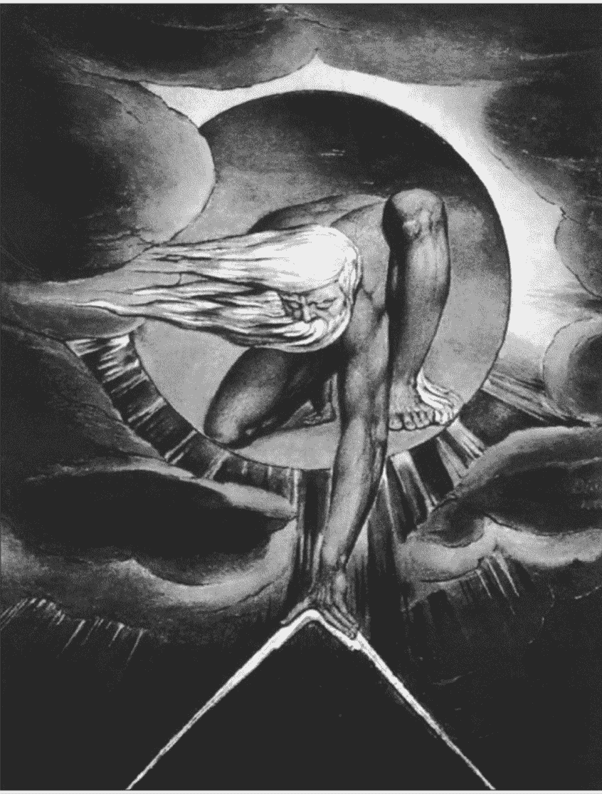

威廉·布莱克的《古代之神》（1794）是他最喜的作品，展示了神灵乌瑞曾正在创造第二次启蒙运动。布莱克认为，乌瑞曾是一个邪神，因为他发明了科学，强制人类进入单一的思维方式。换句话说，他们某种程度上受到了本能的限制。在动物比喻中，例如，“狐的”意味着狡猾、隐秘、自私；“猪的”寓意肥胖、贪婪、统一；“狮的”象征着力量、勇气、威严；蛇意味着招人嫉忌、诱惑、邪恶，在某些社会中也代表强大和恩赐。跨越文化，人类始终使用物理自然界的特征进行比喻。例如，太阳代表启蒙与智慧；冰雪则代表静止、退缩或死亡。海洋通常代表广阔、母亲、诞生或神秘。

比喻并非为了表达激发其灵感的实体的本质。它们的意义源于其中某些特征如何影响我们特有的人类感官和情感。在这种感知中，它们既是本能的，也是学习的；既是遗传的，也是文化的。可预测的比喻交织在一起，创造了创作艺术的原型。它们在故事中很容易被识别为定型的情节和人物。它们可能不精确，甚至陈腐，但它们是文学和戏剧的基石。

# 第 17 章 原型

如果说比喻是语言的构建块，那么原型就成了人类情感共同基础的一部分。原型由通用的故事和图像组成，自亚里士多德分析《俄底浦斯王》中的悲剧英雄以来，在西方文化中得到了认可。它们的起源并非文化演化的偶然。它们是深层历史的一部分，顺从通过自然选择通过进化获得的本能遗传偏见。它们的一些终极原因可以追溯到数万年前，那时人类正从非洲扩散到全球所有宜居地区。另一些则锻造于我们百万年前遥远的动物祖先之中。

源于基因本能的原型例子，可以在现代人类对蛇、蜘蛛和其他危险产生非理性恐惧的倾向中找到。这种倾向也明显体现在草原假说所描述的理想栖息地中——水域旁开阔的高海拔地形。这两种倾向都有可证明的遗传基础。换句话说，它们是与驱动其他生物的固有栖息地寻求类似的本能。

文学和戏剧艺术中的叙事倾向于聚合成自然类别，这是合理的。这种倾向在电影中得到了清晰的界定。电影是艺术，伟大的电影是伟大的艺术。如果接受了这一点，询问其中最伟大，更重要的是为什么，自然是自然的。1999 年，人类学家兼电影专家理查德·D·麦克拉肯调查了……（文本中断）

## 电影中的原型

### 英雄

英雄通常克服障碍来拯救部落。

示例：

- 《亚历山大·涅夫斯基》（1938）：一场反对入侵者的大师级战斗。
- 《异形》（1979）和《异形 2》（1986）：由西格妮·韦弗饰演的里普利击败了终极战士。
- 《黑岩镇的坏日子》（1955）：盖瑞·库珀与一群亡命之徒之间的对决。
- 《卡萨布兰卡》（1942）：鲍格特为他人做出牺牲。
- 《菲茨卡拉多》（1982）：主角在丛林中拖过一艘船。
- 《恒加·丁》（1939）：一个英雄在平民中崛起，拯救了他的殖民主子们。
- 《亨利五世》（1944）：国王在阿金库尔战役中发表了鼓舞人心的演讲。
- 《正午》（1952）：加里·库珀与反派之间惊心动魄的决斗。
- 《黄昏双镖客》（1969）：伊斯特伍德寻求复仇。
- 《最后的莫希干人》（1992）：霍克アイ在冲突中保护部落。

### 悲剧英雄

部落领袖（有时是整个群体）拥有高地位和权力。然而，由于致命缺陷，领袖会失败并走向毁灭。从史前到历史，权贵们就此兴起后又坠落。

示例：

- 《凯恩号叛变》（1954）：一名海军舰官遵循规程陷入了疯狂。
- 《公民凯恩》（1941）：对过度扩张物质权力的严厉指控。
- 《加里波利》（1981）：部落间的战争（英国入侵土耳其）。
- 《教父》（1972）、其二、其三：追踪了权力从强盛走向堕落的过程。
- 《阿拉伯的劳伦斯》（1962）：一位全球英雄目睹梦想化为乌有。
- 《日落大道》（1950）：诺玛·德斯蒙德辉煌职业的悲剧性终结。

### 怪物

原始人类祖先一直生活在对追踪并捕食他们的大型掠食者的恐惧中。在人类几乎所有的范围内毒蛇仍然具有杀伤力。

- 《鸟》（1963）：“自然”以一群可怕的羽毛复仇者军队发动反击。
- 《禁忌星球》（1956）：在一部早期科幻经典作品中，抵御巨型思想产生的魔物的攻击。
- 《科学怪人》（1931）：“它活了！”没有比这更出色的恐怖电影了。
- 《变种人》（1956 年，1978 年重拍版）：没有人可以信任任何人，因为外星人正引导人类互相残杀以征服地球。
- 《大白鲨》（1975）：水中真实的威胁，从头到尾都令人胆寒。
- 《金刚》（1933）：初版，是我小时候作为一个笨拙的孩子第一次看过的电影，开始时极其恐怖，结尾却像小猫一样温柔。2005 年的重拍版是一部特效杰作。
- 《诺斯费拉图》（1922）：在跨越一个世纪的珍爱吸血鬼电影文化中。
- 《惊魂记》（1960）：安东尼·珀金斯描绘了疯狂可能产生的几乎每家庭恐怖，包括谋杀、乱伦和恋尸癖。
- 《沉默的羔羊》（1991）：另一个同样令人毛骨悚然的疯狂杀手描写。

## 探索之旅

史前和人类祖先是狩猎和采集者，被迫在觅食范围内不断寻找猎物和植物资源。发现丰富的新水源、动物群或植物食物对部落来说是生命的源泉，也是他们许多故事和传说的来源。

示例：

- 《2001 太空漫游》（1968）：人类的起源与进化，在寻找外星文明的飞行中，从一个神秘走向另一个神秘。
- 《火的战车》（1981）：争夺奥林匹克金牌过程中的宗教、荣誉与勇气。
- 《印第安纳·琼斯与最后的十字军》（1989）：终于！圣杯找到了！然而，这一发现具有灾难性的后果，并以第二次消失告终。
- 《夺宝奇兵》（1981）：约柜也被找回了！同样具有灾难性的后果并消失。
- 《马德拉山的藏宝》（1948）：进入危险区域获取易财的旅程成功了，但以谋杀结束。

## 伙伴纽结

除了性之外，两个男人、两个女性，或偶尔是一个男人和一个女人，在敌对力量的追捕下为了自由并肩作战。这是一个关于古今以来英雄利他主义和合作力量寓言。

示例：

- 《非洲女王号》（1951）：由博加特和赫本饰演的性格迥然不同的角色，在第一次世界大战期间的殖民地非洲顺河流逃避德国人，建立了亲密的关系。
- 《虎豹小霸王》（1969）：犯罪伙伴关系得到了回报，一直持续到血腥的结局。
- 《猎鹿人》（1978）：俄罗斯轮盘场景是勇敢与牺牲的终极电影表达——亲密、惊心动魄且令人难忘。
- 《致命武器》（1987）：性格截然不同的伙伴们结合在一起，将一些非常坏的人绳之以法。
- 《杀死一只知更鸟》（1962）：两个浪漫对手之间意想不到的联盟，击败了一个持枪恶棍。
- 《末路狂花》（1991）：被怀疑杀人，受困在峡谷边缘，这对迷人的组合选择了开车自杀。

## 其他世界

# 史前与人类部落

史前和人类部落一直通过发现和征服，在不断寻找额外领土中生活。在6万多年前人类走出非洲散发后的几千年里，人类人口扩散到我们物种完全未知的土地。在边界处相遇时，他们冲突或结成联盟。

## 影视示例：异世界原型

- **《异形》 (1979)**：对新发现行星的深度氛围探索，那里有一个等待的高效怪物寄生虫。与《异形2》和《怪物》(2011，约翰·卡彭特1982年电影重拍版)一起是史上最好的科幻恐怖电影。
- **《外星人》 (1982)**：对友好外星人（也许人类部落）可能样子的表达。
- **《第三类接触》 (1977)**：关于可以想象的友好外星人的第二个杰作。
- **《想当王的人》 (1975)**：肖恩·康纳利的角色穿越遥远的山脉以获得权力、财富，并最终导致背叛和死亡。
- **《夺宝奇兵》 (1981)**：约柜（由不幸的纳粹打开）的开启揭示了超自然的、信仰决定的世界的恐怖。

异世界原型的磁力在最好的文学科幻和电影中达到最高强度。这些艺术作品在故事和科学及仪器细节的准确性上越来越具有吸引力。

### 科幻电影的成熟度

科幻电影可能比其他任何类型的电影都更成熟，正如我最喜欢的电影之一《愤怒的红色星球》(1960)所示。一艘飞船降落在火星表面。宇航员们像亲切的邻家美国人，兴奋地等待人类首次距离观察另一个行星表面。一个标有 `BULOVA` 的挂钟告诉他们时间。他们一起透过视窗望向红雾。其中一个问：“有生命的迹象吗？”另一个回答：“没有。只是一群植物。”观众的兴趣被一个预感的想法所维持：植物可能会吃掉宇航员，而它们确实如此。

- **《星际穿越》 (2014)**：穿越虫洞为人类寻找新家园的视觉之旅。
- **《火星救援》 (2015)**：关于机智如何让被困的宇航员在火星生存的记录。
- **《欧罗巴报告》 (2013)**：在木星的冰卫星上寻找生命。

# 萨拉斯与戈梅斯岛：一个近乎外星的世界

世界。它最近的邻居是复活节岛，星球上最孤立的居住岛，距离这里两百公里。

现在，作为一名对地理有特殊兴趣的生物学家，我特别想知道，什么样的植物动物可能到达并现存于这个近乎外星的地方。我发现，答案只有极少数访问者才能获得，即萨拉斯与戈梅斯岛。这片礁石是四种陆生植物的家园，其中包括一种骨刺蕨类植物，这种植物在偏远的大西洋岛屿圣海伦拿和阿森松岛也能发现。这里还有一些非常稀见的昆虫，以叶片为食（我没能找到它们的名称）。共有12种海鸟在此繁殖和抚养幼鸟。至于比昆虫大的其他陆地动物，则一个也没有。

如果我们把那十左右的海鸟视为访客并排除，但考虑到那些尚未计数的、可能也存在的昆虫、微小线虫和轮虫，那么这个微小世界的陆生植物动物物种数量可能不足百种。面积相当的热带雨林拥有的物种是这里的百倍，甚至千倍。鉴于该岛已经存在了几个世纪（复活节岛人在仍使用双体船进行海洋旅行时访问），难道没有更多的植物动物殖民到萨拉斯与戈梅斯岛吗？它为什么依然如此毫无生？

生物学家可以告诉你，可能的答案是，减少的动植物群处于平衡状态。距离最近其他陆地的遥远使得只有极少数物种能在漫长的时间间隔到达这片礁石，而萨拉斯与戈梅斯岛狭小的面积加速了它们消失的速度。当迁移率等于灭绝率时，任何给定时刻存在的物种数量保持在低水平。因此，萨拉斯与戈梅斯岛在“最简约”名单上又添了一项：世界极地之外岛屿上最小的动植物。

# 倒树悖论与存在的意义

萨拉斯与戈梅斯岛无法支撑人类。如果它从未被发现过，它可能存在吗？这个问题并不像最初看起来那样荒谬。它只是“倒树悖论”的一个版本：如果森林里没有人听见，树的倒下会有声音吗？常识告诉我们答案是显而易见的。树在倒下时不会不产生压缩空气波。

但对于我们物种具有意义的“声音”，需要人类来听到那种空气的变化。一位物理学家和生物学家共同精细地预测并模拟了树干的第一声裂响、树冠向下弧形时不祥的低语、坠落树条的断裂和撞击声，以及树干撞击地面最后的*砰*声！但无论是科学家还是其他人都听不到实际的倒塌声。现场需要人类或录音设备。否则，这一事件没有任何意义。尼采在查拉图斯特拉面对太阳时捕捉到了更深层次的观点：“你这伟大的星星！如果没有了那些为你闪耀的人，你的幸福将何在！”

华莱士·斯蒂文斯在他1943年的诗《梦游》中更完整地发展了这一悖论的意义，使用了不可见的海洋和未曾听过的浪声的意象。

> 在古老的岸边，世俗的海洋翻涌着
>
> 无声地，无声地，像一只纤细的鸟，
>
> 想着要定居，却从未定居在巢穴。
>
> 翅膀不断舒展，却永远不是翅膀。
>
> 爪子不断在页岩上抓挠，浅浅的页岩，
>
> 那作响的浅滩，直到被水冲走。
>
> 鸟的世世代代
>
> 被水冲走。它们追随其后，
>
> 它们追随，跟随，追随，在水中冲走。
>
> 没有这只永不定居的鸟，没有
>
> 它们在宇宙中追随的后代，
>
> 海洋，不断坠落，坠落在空旷的岸边，
>
> 将是一片死者的地理；而非他们
>
> 可能去的地方，而是他们
>
> 居住的地方，在那里，他们缺乏一种无处不在的存在，
>
> 在没有任何单独栖居的学者中，
>
> 倾倒出鱼鳍、笨拙的喙、个人特征，
>
> 正如一个有感的人一样。

# 第三次启蒙

与普通认知相反，人文科学与科学并非截然不同。在现实世界或人类思维过程中，没有任何根本性的鸿沟将它们隔开。它们相互渗透。无论科学方法所处理的现象与普通经验看起来多么遥远，无论其范畴多么宏大或研究领域多么微观，所有的科学知识都必须经过人类大脑的加工。发现的行为完全是一个人类的故事。它的叙述是一项人类的成就。科学知识是人类大脑所特有的、绝对的人文主义产物。

由此可见，科学与人文之间的关系是完全互惠的。无论人类的思想是多么微妙、转瞬即逝或个性化，它最终都具有一个可以用科学方法解释的物理基础。

如果说科学是人文的基石，那么人文则具有更远的影响。当科学观察关注现实世界存在的所有现象时，科学实验关注所有可能的现实世界，而科学理论关注所有可以想象的现实世界时，人文则涵盖了这三个层面以及另外一个层面——所有虚幻世界的无限性。

## 知识的三大学科分支

从17世纪发展到18世纪末的欧洲启蒙运动将知识分为三大学科分支：自然科学、社会科学和人文。社会科学现在在很大程度上像变形虫一样分裂为两个部分，一部分与自然科学融合，另一部分在语言和风格上紧贴人文科学。第一类社会科学的贡献可以在《自然》、《科学》和《美国科学院院报》等顶级期刊中看到。第二类属于人文的部分则可以在《纽约客》、《新书评论》、《公共利益》以及美国艺术与科学院期刊《达达卢斯》中找到。

科学与人文可能仍然保持分离，但它们在许多方面紧密相连。它们的关系程度形成了一个连续体。在科学的极端，受专业尊敬的期刊上典型研究报告的风格在内容上是冷酷求实的，充满了观察和分析，结论表现得刻意谨慎，读起来很枯燥。如果有任何推测，也必须作为受新观测和实验检验的假设呈现出来。专业人士认为比喻等同于弹药库中点燃的火柴，必须稀少且处理谨慎。

在科学-人文连续体的对端，即最具创造力的艺术栖息的地方，比喻是通行的货币。然而，在文学、音乐或视觉艺术中，情感的波动带来的审美惊喜是艺术家努力的目标，新奇感和精湛程度是衡量标准。认知者倾向于详细描述某项科学发现，而不谈论科学家；反之，创造性艺术的评论家对艺术说很多，但对艺术本身说不多。

## 融合与协同

科学思维与人文思想的融合随着时间的推移而增加。曾经分离它们的“断层线”（由C.P.斯诺在1954年的“两种文化”而闻名）已经闭合，这种弥合不是通过一条狭窄的桥，而是通过由新兴新学科构成的宽阔边地带。

随着科学与人文日益接近，它们之间的协同作用正在加速。人文一直被视为一组解释“做人意味着什么”的学科集合。然而，这并不完全准确。它们描述了人类状况的很大一部分，但在很大程度上未能解释这一切的意义。要实现这一目标，需要的比人文学者目前所使用的信息多得多的科学研究信息。

被认为具有重大地位的诗人和其他创造性艺术家，以及评价他们作品的最优秀评论家，一个显著特征是对他们所歌颂的生物学的无知。当他们面对从器官到分子的制图的人体结构时；面对人类感官的真实范围时；面对人科动荡且永远混乱的进化史时；尤其是面对赋予我们生命并让我们每一次呼吸都赖以生存的生命世界时，他们感到惊讶。但按照规律，他们对细节保持着自信的无知。他们满足于仅相互交谈。

例如，从大众吞噬的海量小说中，我们究竟学到了什么？T.S.艾略特的评价是不可反驳的：“通过小说获得的生活知识，只有通过另一个自我意识阶段才可能。也就是说，它只能是对他人对生活的知识，而不是对生命本身的知识。”

## 科学研究的团队化

通常由一到三位贡献者完成。1953年在《自然》杂志上，詹姆斯·D·沃森和弗朗西斯·克里克发表了首次描述DNA结构的历史性论文，那是当时独立工作或在极小团队工作的科学家们的典型机会。今天，更大的团队已成为常态。一篇文章由几十位合著者领导并不罕见。在某些领域，例如描述一个重要物种的完整DNA，其人数可能会超过一百。

20世纪的50年代和60年代是现代生物学的英雄时代，当时少数受瞩目的冠军在极度困难的情况下取得了令人印象深刻的进展。他们激发的兴奋情绪反映在流行文化中。在1953年电影《世界大战》的原版中，一艘包裹在巨大陨石中的外星飞船刚刚击中地球——当然是南加利福尼亚。当当地人聚集在中心周围，好奇这意味着什么时，安·罗宾逊的角色——一位在50年代广受欢迎的带有不可抑制的女性化甜美的年轻小学教师，对吉恩·巴里的角色（一位访客）说：“有一个来自太平洋理工学院的科学家过来。他会告诉我们……”如果今天重复这一场景，台词将会是：“信息来自美国航空航天局（NASA）和加州理工学院。他们将试图弄清楚发生了什么”。

仅仅在人文科学领域，必要的专业化已将生物学家和其他科学家推向日益狭小的领域。一个学科的大部分先进技术和术语，只有其他学科的专家（即使是那些密切相关的学科专家）才能最好地理解。

## 未来的英雄时代

未来还会有智力的英雄时代吗？我确信会有，特别是在那些将科学发现与人文的创新和洞察相结合的新型交叉学科中。它将以多维的形式出现。在我们感官泡泡之外，创意艺术有着无数愿景。挑战在于如何将此前未被察觉的事物翻译成人类意识有限的视听世界。这种进步也将源于对人类意识生物学起源日益清晰的认知，这可以使历史与历史达成一致。最后，进步将随着对塑造文化的演化熔炉的理解而来——文化是从动物本能中缓慢且往往伴随着痛苦地塑造而成的。

人类自我理解的“哲者之石”是生物演化与文化演化之间的关系。人类为什么被这样构造并以这样行为，而不是其他方式？直到现在，在雅典广场两半世纪之后，我们才开始理解为什么我们的某些社会行为是天设的本能，某些是通过遗传倾向性学习获得的，而另一部分则是文化发明的产物。这整体只有被视为我们长期演化中的一个阶段，才能被深刻理解，而不仅仅通过对当代人类状况的描述。

同时，需要承认并更坦诚地讨论的是，对于哲学而言，“房间里的大象”（不可回避的问题）是组织化宗教。更准确地说，科学与宗教融合所预言的人类状况的理解，往往受到超自然创世故事的干预，每种故事都定义了一个独立的部落。持有并分享宗教高尚的精神价值（相信神性和死后世的存）是一回事；采纳一个特定的超自然创世故事完全是另一回事。对创世故事的信仰提供了部落中令人慰藉的成员身份。但必须强调的是，并非所有创世故事都是真实的，没有人可能是真的，而且无疑，所有的都是假的。每一个故事都由盲目的唯物主义信仰所维持。

宗教研究是人文科学不可或缺的一部分。尽管如此，它应该被视为人性及其演化的元素来研究，而不是像基督教圣经学院和伊斯兰经堂学校那样，作为推广由特定创世故事定义的信仰的手册。

与此同时，由于人类在数字化的全球中仍被动物本能所驱动，由于我们在现状与渴望成为的样子之间挣扎，以及由于我们淹没在信息中却渴求智慧，似乎让哲学回归它曾经受推崇的地位是恰当的，这一次作为人文科学和科学人文的核心。

这种复兴能完成多少？值得记住，哲学在西方文明中曾在两个各持续约150年的创造力浪潮中繁荣过。安东尼·戈特利布在《启蒙之梦》（一部关于现代哲学兴起的历史）中曾简洁地描述了它们的本质。

第一次是苏格拉底、柏拉图和亚里士多德的雅典，从公元前5世纪中期到公元前4世纪末。第二次是在北欧，在欧洲宗教战争之后。它从17世纪30年代一直延伸到18世纪法国大革命前夕。笛卡尔、斯宾诺莎、洛克、莱布尼茨、休谟、卢梭和伏尔泰——即最著名的哲学家们——留下了他们的印记。

第二次启蒙在科学未能满足其宏大预期时已大多褪色。今天，所谓的当代哲学不是作者逻辑，而是不连贯，由于对科学的关注不足。这很奇怪，因为我们处于一个可以合理被称为科学时代，而科学正处于能够与人文相结合以重新点燃早期的启蒙运动。我相信，我们在共同探究中相遇，可以解决这些大问题。是时候再次公正且比以往任何时候都更有心地去提问历史的大问题了。在基础上，我们需要更深入地探索人性的意义，为什么我们存在而不是从未存在。此外，为什么在此之前没有任何与我们相似的东西存在。我们寻找的圣杯是意识的本质，以及它是如何起源的。最根本的是生命整体的起源和繁衍。

在更窄的聚焦上，我们该如何解释两种性别的存在——考虑到今天承认的性取向范围，甚至是更多？为什么最初会有性？如果我们能通过孤雌生殖，或者直接从身体中产生后代，生活将变得简单得多。这些不是闲散的问题，留给沙龙人士和晚宴宾客的。它们不是智力游戏，不是逻辑技巧的练习。它们关乎切实的生死。

我们不仅要问“如何”，还要问“为什么”，我们被基因设定的增长和衰老时间表所固定。现在，当我们发现自己处于人工智能时代，我们被迫精确地定义什么是人类。是否可以从货架上取下的化学物质制造一个，至少达到具有指定基因组的受精卵水平？如果被证明是不可能的（我对此怀疑），我们需要认真讨论拥有情感甚至创造力的人形机器人。

# 参考文献与延伸阅读

## 第一章：创造力的触及

- Bly, Adam, 编。*科学即文化：科学与社会新交汇点的对话*。纽约：Harper Perennial, 2010。
- Boorstin, Daniel J. *发现者们*。纽约：Random House, 1983。
- Carroll, Joseph, Dan P. McAdams, 和 Edward O. Wilson, 编。*达尔文的桥梁：统一人文与自然科学*。纽约：牛津大学出版社, 2016。
- Greenblatt, Stephen. *转折点：世界是如何变得现代的*。纽约：W. W. Norton, 2011。
- Jones, Owen D., 和 Timothy H. Goldsmith. “法律与行为生物学”。*哥伦比亚法学评论* 105, no. 2 (2005): 405–502。
- Koestler, Arthur. *创作之行为*。伦敦：Hutchinson and Co., 1964。
- Pinker, Stephen. *语言本能：语言与心灵的新科学*。纽约：William Morrow, 1994。
- Poldrack, Robert, 和 Martha J. Farah. “探测人类大脑的进展与挑战”。*自然杂志* 526, no. 7573 (2015): 371–379。
- Ryan, Alan. *论政治：政治思想史，第一卷：从赫罗多德到马基雅维利；第二卷：从霍布斯到尼采*。纽约：W. W. Norton, 2012。
- Sachs, Jeffrey D. *文明的代价：重新唤醒美国美德与繁荣*。纽约：Random House, 2011。

# 参考文献

Watson, Peter. *趋同：科学核心的理想化*。纽约：Simon & Schuster, 2016。

Wilson, Timothy, 等人. “想一想吧：离散心智面临的挑战”。*科学杂志* 345, no. 6192 (2014): 75–77。

## 第二章：人文科学的诞生

Altmann, Jeanne, 和 Philip Muruthi. “半圈养殖与野外觅食类狒日常生活的差异”。*美国灵长类学杂志* 15, no. 3 (1988): 213–221。

Ball, Philip. *音乐本能：音乐如何运作以及我们为何离不开它*。纽约：牛津大学出版社, 2010。

Bisele, Megan, 和 Robert K. Hitchcock. *纳耶·纳耶的朱/霍桑人与纳米米比亚的独立：南部非洲的发展、民主与本土发声*。纽约：Berghahn Books, 2011。

Cesare, Giuseppe Di, 等人. “表达我们的内在状态以及对他人的理解”。*美国国家科学院院报* 112, no. 33 (2015): 10331-10335。

de Waal, Franz. *黑猩猩政策：同伴间的权力与性*。纽约：Harper & Row, 1982。

de Waal, Franz. *共情时代：自然给更仁善社会的启示*。纽约：Random House, 2009: 第 89 页。

Fox, Robert. *部落想象：文明与野蛮心灵*。马萨诸塞剑桥：哈佛大学出版社, 2011。

Gottschall, Raphael. *特洛伊特洛伊：演化、暴力与荷马的世界*。纽约：剑桥大学出版社, 2008。

Greenblatt, Steven. *转折点：世界是如何变得现代的*。纽约：W. W. Norton, 2011。

Hare, Brian, 和 志. “我们的认知行为是如何被塑造的？”收录于 Frans B. M. de Waal 和 Pierce Ferrari，《灵长类心智：为与其他心灵连接而生》》。马萨诸塞剑桥：哈佛大学出版社, 2012, 第 192–193 页。

Kramer, Adam D. I., Jamie E. Guillory, 和 Jeffrey T. Hancock. “通过社交网络产生大规模情感连接的实验证据”。*美国国家科学院院报* 111, no. 24 (2014): 8788-8790。

McGinn, Colin. *语言哲学：经典阐释*。马萨诸塞剑桥：MIT Press, 2015。

Patel, Atiruddh D. *语言与大脑*。纽约：牛津大学出版社, 2008。

Patel, Atiruddh D. *音乐与大脑*。弗吉尼亚州尚普槟：The Great Courses, The Teaching Co., 2015。

Thomas, Elizabeth Marshall. *老路：第一批人类的故事*。纽约：Farrar, Straus and Giroux, 2006。

Tomassel, Michael. *人类认知的文化起源*。马萨诸塞剑桥：哈佛大学出版社, 1999。

Wissner, Polly W. “社会的余烬：朱/霍桑巴士车夫的火光之谈”。*美国国家科学院院报* 111, no. 39 (2014): 14027–14035。

## 第三章：语言

Bickerton, Derek. *超越自然所需：语言、心灵与演化*。马萨诸塞剑桥：哈佛大学出版社, 2014。

Boyd, Brian. *论故事的起源：演化、认知与虚构*。马萨诸塞剑桥：Belknapan Press of Harvard University Press, 2009。

Carroll, Joseph. *文学达尔文主义：演化、人性与文学*。纽约：Routledge, 2004。

Eibl-ibesfeldt, Irenäus. *人类伦理*。纽约：Aldine de Gruyer, 1989。

Gottschall, Raphael. *特洛伊特洛伊：演化、暴力与荷马的世界*。纽约：剑桥大学出版社, 2008。

Lamm, Edmund. “是什么让人类与众不同”。*生物科学* 64, no. 10 (2014): 946–952。

Murdoch, James. “讲故事——无论是虚构还是非虚构，无论善还是坏——将继续定义世界。”*时代杂志* 186, no. 27 (2015): 39。

Pinker, Steven. *语言本能：语言与心灵的新科学*。纽约：William Morrow, 1994。

Swinski, Peter. *叙事、演化与知识的探索*。纽约：Routledge, 2007。

Tomasello, Michael. *认知的文化起源*。马萨诸塞剑桥：Harvard Press, 1999。

Tomasello, Michael, *思维的自然史*。马萨诸塞剑桥：Harvard Press, 2014。

Wilson, E. *自然主义*。华盛顿特区：Island Press, 1994。

## 第四章：创新

Innovation, Anne. *马蒂斯*。巴黎：Éditions de Réunion, 2002。

Berry, William. *音乐本能：音乐如何运作以及我们为何离不开它*。纽约：牛津大学出版社, 2010。

Richardson, John. *变革中的绘画：1917–1932*。纽约：Knopf, 2005。

## 第五章：美学的惊喜

Burgette, Maria, 和 Lui, 编。*艺术：科学*。新泽西州霍森：Scientific, 2011。

Butter, Charles. *跨越边界*。纽约：Yale Press, 2010。

Hughes, Robert. *文明的代价：重新唤醒美国美德与繁荣*。纽约：Random House, 2011。

Ornes, Stephen. “神经科学”。*美国国家科学院院报* 112, no. 33 (2015): 10331-10335。

Powell, Eric. “数据可视化”。*考古学* 68, no. 4 (2015): 34–37。

Romero, David. *生存的艺术*。纽约：Knopf, 2007。

Rothenberg, Philip. *尼采的冲击*。纽约：Bloomsbury, 2011。

Saller, Richard. “尼采的解释”。*美国国家科学院院报* 111, no. 24 (2014): 8788-8790。

Sussman, Rachel. *最古老的生物*。芝加哥：University Press, 2014。

Talasek, John. “诗歌”。*自然杂志* 526, no. 7573 (2015): 371–379。

Vendlier, Helen. *人文*。马萨诸塞剑桥：Harvard Press, 2015。

## 第六章：人文科学的局限性

Dehaene, Stanislas. *意识与大脑*。纽约：Viking, 2014。

de Waal, Franz. *黑猩猩政策：同伴间的权力与性*。纽约：Harper & Row, 1982。

de Waal, Franz. *我们足够聪明吗？*。纽约：W. W. Norton, 2016。

de Waal, B. M., 和 Pierre Ferrari, 编。《灵长类心智：为与其他心灵连接而生》。马萨诸塞剑桥：哈佛大学出版社, 2012。

Hare, Brian, 和 Vanessa Voss. *狗比你更聪明*。纽约：Dutton, 2013。

Harham, Geoffrey Karl. *人文与美国的梦想*。芝加哥：University Press, 2011。

Krause, Bernie. *动物交响乐：在世界寻找音乐的起源*。纽约：Little, Brown, 2012。

Safina, Carl. *超越语言：动物的思考与感受*。纽约：Henry Holt, 2015。

Whitehead, Hal, 和 Luke Rendell. *鲸鱼与海豚的文化生活*。芝加哥：University Press, 2015。

## 第七章：被忽视的宇宙

Burns, Ken, 和 Ernest J. Monet. “艺术与科学”。*美国科学院学会* 67, no. 2 (2014): 11–21。

Birgeau, Robert J., 等人。“公共高等教育与私营部门”。*美国科学院学会* 67, no. 3 (2014): 7–17。

Brohead, Richard H, 和 John W. Rowe, 编。《核心问题：为了充满活力、竞争力和安全的国家的人文与社会科学》。马萨诸塞剑桥：美国艺术科学院, 2013。

Gonch, William, 和 Michael Poliloff. *公民教育的危机*。华盛顿特区：American Council of Trustees and Alumni, 2016。

Pforzheimer, Carl H. III., 等人。“数字时代的人”。*美国科学院学会* 68, no. 2 (2015): 20–21。

Saller, Richard, 等人。“数字时代的人文”。*美国科学院学会* 67, no. 3 (2014): 25–35。

Westneat, David E., 与 Charles W. Fox, 编。《演化行为生态学》。纽约：牛津大学出版社，2010年。

Wilson, E. O. 《社会生物学：新综合体》。剑桥，马萨诸塞州：哈佛大学出版社 Belknap 出版社，1975年。

Wilson, Edward O. 《论人性》。剑桥，马萨诸塞州：哈佛大学出版社，11978年。

Wilson, Edward O. 《人类生存的意义》。纽约：利物浦尔出版社，2014年。

## 第 9 章：基石

Gottschall, Jonathan, 与 David Sloan Wilson, 编。《文学性动物：演化与叙事的本质》。埃文斯顿，伊利诺伊州：西北西北大学出版社，2005年。

Haidt, Jonathan. 《幸福的心理假说：在古老智慧中寻找现代真理》。纽约：基础书籍出版社，2006年。

Pagel, Mark. “遗传学：进化的邻近本质。”评 A. Wagner 的《适应的到来：解决进化的最大谜题》（纽约：Penguin Books 的 Current 标志，2015年）。《自然》 514, no. 7520 (2014): 34。

Wilson, Edward O. 《地球的社会征服》。纽约：利物浦尔出版社，2012年。

Wilson, Edward O. 《人类生存的意义》。纽约：利物浦尔出版社，2014年。

## 第 10 章：突破

Antón, Susan C., Richard Potts, 与 Leslie C. Aello. “早期人类的演化：一个整合的生物学视角。”《科学》 345, no. 6192 (2014): 45。

Brown, Kyle S. 等人. “起源于 71,000 年前南非的早期且持久的技术。”《自然》 491, no. 7425 (2012): 590–593。

Fox, Robin. 《部落迁徙：文明与野蛮心灵》。剑桥，马萨诸塞州：哈佛大学出版社，2011年。

Heinrich, Bernd. 《羚羊：动物能教我们关于跑步和生活的什么》。纽约：Cliff Street，2001年。

Marchant, Jo. “觉醒。”《史密森学学》 46, no. 9 (2016): 80–95。

Wilson, Edward O. 《地球的社会征服》。纽约：利物浦尔出版社，2012年。

Wilson, Edward O. 《人类生存的意义》。纽约：利物浦尔出版社，2014年。

Whrangham, Richard. 《火的起源：烹饪如何让我们成为人类》。纽约：基础书籍出版社，2009年。

## 第 11 章：遗传文化

Butter, Charles M. 《跨越文化边界：艺术中的普遍性及其生物学路径》。私人出版：C. M. Butter, 2010年。

Lumsden, Charles J., 与 Edward Wilson. 《基因、心灵与文化：协同演化过程》。剑桥，马萨诸塞州：哈佛大学出版社，1981年。

van Anders, Sari M., Jeffrey Sterling, 与 Katherine L. Goldey. “女性和男性睾酮水平性别行为的影响。”《美国国家科学院院报》USA 112, no. 45 (2015): 13805–13810。

## 第 12 章：人性

Boardman, Jason D., Benjamin W. Dominguez, 与 Jason M. Fletcher. “社会和遗传因素如何预测友谊网络。”《美国国家科学院院报》USA 109, no. 43 (2012): 17377–17381。

Eibl-Eiebersfeld, Irenäus. 《人类生态学》。纽约：Aldine de Gruyy，1989年。

Graziano, Michael S. A. 《意识与社会大脑》。纽约：牛津大学出版社，2013年。

Haidt, Jonathan. 《正直的心灵：为什么好人会被政治和宗教分化》。纽约：泛神书籍出版社，2012年。

Orians, Gordon H. 《蛇、日出与莎士比亚》。芝加哥：芝加哥大学出版社，2014年。

Rychlowowska, Magdalena, 等人. 长历史迁徙的异质性解释了情感表达报告和微笑功能的文化差异。《美国国家科学院院报》USA 112, no. 19 (2015): E2429–E2436。

Sussman, Anne, 与 Justin B. Hollander. 《认知架构：针对我们对建筑环境反应进行设计》。纽约：Routledge,2015年。

Wilson, Edward O. 《论自然》。剑桥，马萨诸塞州：哈佛大学出版社，1978年。

Wilson, Edward O. 《地球的社会征服》。纽约：利物浦尔出版社，2012年。

## 第 13 章：为什么自然如此迷人

Beatley, Timothy. 《亲生物城市：将自然融入城市设计与规划》。华盛顿，哥特区：Island Press，2011年。

McKibben, Bill, 编。《美国地球：自梭罗以来的环境写作》。纽约：Penguin Putnam 发行的 Classics 系列，2008年。

Moore, Robert. 《论小径》。纽约：Simon & Schuster,2016年。

Orians, Gordon H. 《蛇、日出与莎士比亚》。芝加哥：芝加哥大学出版社，2014年。

Williams, Florence. 《自然修复：户外活动如何让人更快乐、更有创意》。纽约：W. Norton,2015年。

Wilson, Edward O. 《半个地球：生命的未来》。纽约：Alfred A. Knopf，2002年。

Wilson, Edward O. 《半个地球：星球的斗争》。纽约：Liveright,2016年。

## 第 14 章：猎人

Cox, Gerard H. 《掌握在手中》。印第那波利斯，印第安纳州：Lindarne,2013年。

Dadv, Payam, 等. “绿地空间与儿童发育。”，《美国国家科学院院报》USA 112, no. 26 (2015): 7937–7942。

## 第 15 章：花园

Beatley, Timothy. 《亲生物城市：将自然融入城市设计与规划》。华盛顿，哥特区：Island Press,2011年。

Buchmann, Stephen. 《花卉的原因：它们如何改变我们的生活》。纽约：Scribner,2015年。

Talley, Douglas. 《自然：维持野生动物》。盐湖城，俄勒冈州：1997年。

Wilson, Edward O. 《亲生物性》。剑桥，马萨诸塞州：哈佛大学出版社，1984年。

## 第 16 章：隐喻

Donoghue, Denis. 《隐喻》。剑桥，马萨诸塞州：哈佛大学出版社，2014年。

## 第 17 章：原型

Boyd, Brian, 与 Jonathan Gottschall, 编。《演化：经典与当代阅读》。纽约：哥伦比亚大学出版社，2010年。

Coxworth, James, 等. “克隆人类？生物、伦理与社会。”，《美国国家科学院院报》USA 112, no. 38 (2015): 7806–7811。

Heng, Kevin. “科学与文化：绘制西方艺术的地图。”，《科学家》 103, no. 3 (2015): 196–203。

McCracken, Robert. 《导演的选择：伟大的电影》。拉斯维加斯，内华达州：1999年。

## 第 18 章：遥远的岛

MacArthur, Robert H., 与 Edward O. Wilson. 《岛生物学理论》。普林斯顿，新泽西：普林斯顿大学出版社，1967年。

Vendler, Helen. 《汇聚：科学的核心构想》。剑桥，马萨诸塞州：哈佛大学出版社，2015年。

## 第 19 章：讽刺：心灵的视觉

Sondheim, Stephen. 《送出一个小夜晚：音乐与歌词》。纽约：44 Street,1973年。

## 第 20 章：启蒙

Ayala, Francisco. “基因人类？生物、伦理与社会考量。”，《美国国家科学院院报》USA 112, no. 29 (2015): 8879–8886。

Catapano, Peter, 与 Simon Critchley, 编辑。《石头读者：现代哲学》。纽约：Liveright,2016年。

Cofield, Calla. “科学与文化：高概念艺术与实验。”，《美国国家科学院院报》USA 112, no. 10 (2015): 2921。

Dance, Amber. “科学与文化：奥本海默走上中心。”，《美国国家科学院院报》USA 112, no. 24 (2015): 7335–7336。

Gottlieb, Anthony. 《启蒙之梦：现代哲学的崛起》。纽约：Liveright,2016年。

Johnson, Mark. 《道德：认知科学视角下的道德理解》。芝加哥：芝加哥大学出版社，2014年。

Ornes, Stephen. “科学与文化：用数学绘制西方艺术史。”《美国国家科学院院报》USA 112, no. 25 (2015): 7619–7620。

Ruse, Michael, 编。《达尔文之后的哲学：经典与当代阅读》。普林斯顿，新泽西：普林斯顿大学，2009年。

Sachs, Jeffrey D. 《文明的代价：重新唤醒美国德与繁荣》。纽约：Random House, 2011年。

Schich, Maximilian, 等人. “文化历史的网络框架。”《科学》 345, no. 6196 (2014): 558–562。

# 致谢

本书的构思与写作得益于作者访问过的多个领域的专家朋友和同事的帮助。其中两位对本书的完成起了至关重要的作用，特别值得感谢：我的研究与编辑助理凯瑟琳·M·霍顿（Kathleen M. Horton），以及导师兼编辑罗伯特·韦尔（Robert Weil），他是 Liveright 出版公司的董事，该公司是 W. W. Norton & Company 的分公司。

# 版谢

页码与本书的印刷版对应。您可以使用设备的搜索功能在正文中查找特定术语。

- 20

  “我们怀疑这不是一种行为倾向……”《灵长类心灵：与其他心灵建立连接》，弗兰斯·B·M·德瓦尔（Frans B. M. de Waal）和皮埃·弗朗切斯科·费拉里（Pier Francesco Ferrari）编辑。马萨：哈佛大学出版社。版权所有 © 2012 由 Kneerim & Williams Ferrari 授权。

- 23

  “哎！什么？那是耳朵吗？是的，一只耳朵！”伊利莎白·马歇尔·托马斯（Elizabeth Marshall Thomas）。《老路：Farrar、Strauss and Giroux 的故事》。版权所有 © 2006 由 Marshall Thomas 授权。Williams 代理。

- 28

  “Klecdak 和 Y. Socho 有这样句话……”艾瑞尼斯·艾布-埃尔斯费尔特（Iraenius Eib-Efelsfeldt）。《人类动物学》。纽约：1925 Charles Schreiber。1989。经许可使用。

- 47

  “当月亮升起，那座本质的房子……”经 Simon & Schuster, Inc. 旗下 Scribner 许可。摘自 F. Scott Fitzgerald 的《大盖茨比》。版权所有 © 1925 由 Charles Schreiber's Sons 所有。Scott Fitzgerald。保留所有权利。

- 49

  “一只狼在晚上精神极佳地离开了洞穴……”本杰明·卡尔（Benjamin Carl）。《狼与它的影子》。2015。20 x 30 英寸。Benjamin Carl。插图出自《25 寓言：伊索寓言》，由布洛温·米尔顿（Bronwyn Milton，国家野生动物艺术博物馆艺术与研究助理策展人）绘制，WV州杰克逊。

- 119

  “在与陌生人的互动中……”M. Rychowska, Y. Miyamoto, D. Matsumoto, U. Hess, Gilboa-Schechtman, S. Kamble 和 P. M. Niedenthal。长历史迁徙的异质性解释了情感表达模式和微笑功能的文化差异。《美国国家科学院论文》，112 (2015), E2429-E2436。

- 130

  “我并不真的需要人，但我需要我……”朱莉娅·罗伯茨（Julia Roberts）代表国际保护组织的 YouTube 演讲。经许可使用。

- 138

  “我发现了几只鹿的新足迹，包括……”弗朗索索·冯（François von）。《猎人的恍神：自然、精神与生态》。马萨诸塞州大灵山：Lindisfarne Books，2007。经许可使用。

- 144 “L. rupicapra 石本很可能采集于高海拔……”罗伯特·W·泰勒（Robert W. Taylor）。引用。经许可使用。

- 150 “花的芬芳向整个世界宣告它是肥沃的……”戴安·阿克尔曼（Diane Ackerman）《培养快乐：我花园的自然史》第 50 页节选。版权所有 © 2001 Diane Ackerman。经 HarperCollins Publishers 许可重印。

- 179 “在古老的岸边，凡俗的海洋在翻滚……”《梦症》，摘自华莱士·斯蒂文斯（Wallace Stevens）诗集。版权所有 © 1954 Wallace Stevens，版权于 1982 年由 Holly Stevens 续订。经 Alfred A. Knopf 许可。保留所有权利。

- 183 “这难道不很讽刺吗？我们是一对吗？……”斯蒂芬·桑德海姆（Stephen Sondheim）。1973。《浅夜音乐曲》中的《让小丑上场》，音乐和词由斯蒂芬·桑德海姆创作。© 1973（更新）Riting Music, Inc.。所有权利由 WB Music Corp 管理。保留所有权利。经许可使用。经 HalLeonard LLC 许可重印。

- 185 “你不喜欢滑稽剧吗？我的错，我恐怕……”斯蒂芬·桑德海姆（Stephen Sondheim）。1973。《浅夜音乐曲》中的《让小丑上场》，音乐和词由斯蒂芬·桑德海姆创作。© 1973（更新）Riting Music, Inc.。所有权利由 WB Music Corp 管理。保留所有权利。经许可使用。经 Hal Leonard LLC 许可重印。

# 索引

列出的页码与本书的印刷版对应。您可以使用设备的搜索功能在正文中查找特定术语。

*斜体*页码指插图。

- Ackerman, Diane, 149–50

- 适应性辐射 (`adaptive radiation`), 104

- 适应性转变 (`adaptive shifts`), 18

- 审美惊喜 (`aesthetic surprise`), 42–51, 83, 163, 188

- 非洲，稀树草原，见 `savanna`（稀树草原）

- 《非洲女王》（电影），171

- 非洲凤蝶蝶 (`African swallowtail butterfly`), 80

- 老衰 (`aging`), 109–11, 197–98

- 自然选择的 (`natural selection of`), 110

- 农业发明 (`agriculture invent of`), 57, 110, 149, 152–53

- 阿拉巴马大学 (`University of Alabama`), 31, 139–40

- 《亚历山大·尼夫斯基》（电影），167

- 外星电影 (`Alien films`), 167, 172

- 阿尔特曼·斯图特 (`Altmann, Stuart`), 12

- 利他主义 (`altruism`), 20, 86–87, 98, 99

- 美国科学院 (`American Academy of Arts and Sciences`), 71–72

- 美国文化：特征, 71–72

- 创意艺术受尊敬的领域, 72–73

- 教育受重视的领域, 74–55

- 《古的日子》（布莱克），158

- 双子叶植物（开花植物）, 150

- 《愤怒的红色行星》（电影），173

- 动物，非人类：巢穴作为社会组织的先驱, 87

- 其中的原始文化, 25–26

- 人类中心主义，在人文领域, 57, 66, 92, 191

- 人类学, 11–12, 56–57, 81, 93

- 蚂蚁：

  - 作者的研究, 33–35, 142–43

  - 阶级划分, 120–21

  - 达尔文的研究, 120–21

  - 原始的, 56

  - 考古学, 93, 149

  - 原型 (`archetypes`), 159, 164

  - 在戏剧和电影中, 166–75

  - 情感, 165

  - 进化, 166

  - 本能, 165–66, 174

  - 最终原因, 165

  - 建筑，亲自然性 (`biophilia`), 155–56

  - 史前文物, 11

- 人工智能时代, 198

- 升天岛 (`Ascension Island`), 177

- 美国学院协会 (`Association of American Colleges and Universities`), 72

- 南方古猿 (`australopitheines`), 195

- 狒狒猴 (`baboons`), 12

- 培根·弗朗西斯 (`Bacon, Francis`), 43

- 细菌，基因交换, 44

- 《黑岩恶日》（`Bad Day at Black Rock`），167

- 鲍尔温·詹姆斯·马克 (`Baldwin, James Mark`), 119

- 鲍尔温效应 (`Baldwin effect`), 119–20

- 蝙蝠，听力, 61

- 贝特利·提摩西 (`Beatley, Timothy`), 157

- 《比利·杰克》（电影），167

- 生物多样性, 135, 157

- 人类生物学进化, 19–81, 85

- 定义, 93

- 文化进化的互动, 107–11, 119–20

- 语言, 27–28, 30, 32–33, 35

- 突变，见 `mutations`（突变）

- 语言与创意艺术, 56

- 社会行为, 34–35

- 自然选择：对艺术家的无知, 189

- 50年代和1960年代作为英雄时代, 193

- 亲自然（喜爱自然）, 127, 132

- 建筑, 155–56

- 作为本能的, 101, 155

- 亲自然城市（贝特利）, 157

- 生物圈，与创意艺术, 65

- 鸟类，生态系统, 155

- 《鸟类》（电影），169

- 布莱克·威廉 (`Blake, William`), 46, 158

- 布洛赫-鲍尔·阿德尔 (`Bloch-Bauer, Adele`), 42–43

- 蓝蝴蝶, 146

- 倭黑猩 (`bonobos`), 12

- 布拉姆斯·约翰内斯 (`Brahms, Johannes`), 48

- 大脑：

  - 情感中心, 112, 185

  - 尺寸增大, 15–16, 18, 21, 88–89, 107, 109

  - 神经回路, 92

  - 社会行为, 15, 16–17

- 维奇·阿尔弗雷德·汤普森 (`Witcher, Alfred Thompson`), 43

- 布林曼·莱因德 (`Brinkmann, Reinhold`), 48

- 伯格斯·S·G (`Burgers, S. G.`), 144

- 《牛仔小子与桑迪小子》（电影），171

- 蝴蝶, 146

- 《草地中的嗡嗡》（古尔森/`Goulson`），135

- 《凯恩叛变》（电影），168

- 人类进化中的营地创建, 18–21, 24–86–88

- 卡尔森·本杰明·x· (`Carlson, Benjamin, x.`), 49

- 卡梅尔山 (`Mount Carmel`), 149

- 卡罗尔·大卫·M· (`Carroll, David M.`), 135

- 《卡萨布兰卡》（电影），167

- 蚂蚁阶级划分, 120–21

- 原因，见 `proximate causes`（近因原因）；`ultimate causes`（最终原因）

- 新生纪, 103

- 中美, 141

- 《烈火战车》（电影），170

- 乔叟·杰弗里 (`Chaucer, Geoffrey`), 163

- 查韦岩画, 11

- 黑猩猩 (`chimpanzees`)：

  - 相互合作, 20–21

  - 饮食, 104

  - 支配地位展示, 118

  - 与人人类的分离, 19, 103

  - 智力, 19–23

- 乔·珍 (`Choe, Jane`), 141

- 乔姆斯基·诺姆 (`Chomsky, Noam`), 27

- 基督教, 68–69

- 染色体, 94–95

- 引用（种族）, 43

- 城市，与自然, 156

- 莱门斯·玛丽·强 (`Clemens, Mary Strong`), 142

- 洛斯·格伦 (`Close, Glenn`), 184

- 《第三类接触奇扣》（电影），172

- 冷战, 69

- 大学和学院，重视科学, 73

- 柯林斯·朱迪 (`Collins, Judy`), 182

- 颜色，感知, 6–7

- 竞争：

  - 组间, 88, 100

  - 进化中, 95–97, 108

  - 竞争与……相互作用, 13

  - 组内, 88, 108

- 康拉德·约瑟 (`Conrad, Joseph`), 50

- 意识的起源, 197

- 国际保护组织 (`Conservation International`), 129–30

- 合作, 96, 99, 111

- 组员之间, 20–21, 87–88, 108

- 在黑猩猩中, 20–21

- 在人类进化中, 87–88, 108, 190

- 《修正》（弗兰森/`Fransen`），36–38

- 柯质醇, 117

- 反准备学习, 55–56

- 创世神话, 76–77, 195

- 创意艺术：

  - 审美惊喜, 42–51, 83, 163, 188

  - 人类中心主义的, 191

  - 原型中，见 `archetypes`（原型）

  - 与生物圈的, 65

  - 批判性回应, 47–48, 51, 83

  - 情感基础, 90

  - 对生物无知作为特征, 189

  - 创新, 39–40

  - 意图, 83

  - 失去尊重和资金支持, 53

  - 与自然, 135–36, 145

  - 创意艺术中的最佳复杂性, 124

  - 有组织宗教和, 76

  - 在史史中, 58

  - 科学和, 50–51

  - 签名中的, 42–43, 47

  - 最终原因中的, 84–85

创新与，26–37, 85

科学与， 4, 81

克里克，弗朗西斯 (`Crick, Francis`), 192

批评者，批评，创意艺术的方法，47–48, 51, 83

立体主义, 39, 40, 83

文化演化, 57–58, 81

动物中的, 25–26

创新, 40–41

本能与, 194

生物演化与的相互作用, 107–11, 119–20, 194

达尔文，查尔斯 (`Darwin, Charles`), 96, 100

研究的蚂蚁, 120–21

“错综复杂的岸”意象, 135, 137

达尔文主义，见“自然选择演化”

《猎鹿圈人`(电影), 171

《维纳斯的少女`(`Les Demoiselles d'Avignon`), 39

丹奇，朱迪 (`Dench, Judi`), 184

丹尼特，丹尼尔 (`Dennett, Daniel`), 93

《人类的起源`(`达尔文著`), 100

德瓦尔，弗朗茨 (`de Waal, Franz`), 14–15

狄更斯，查尔斯 (`Dickens, Charles`), 48

迪金森，艾米莉 (`Dickinson, Emily`), 46

饮食，人类的，从植物基向肉基的转变, 17, 86, 104, 107–8

数字革命与人文科学, 77, 90, 125

迪拉德，安妮 (`Dillard, Annie`), 135

狄奥真尼 (`Diogenes`), 138

美国导演工会, 166

迪士尼，沃尔特 (`Disney, Walt`), 39

Di/tao (胡/安斯长老), 24

DNA, 6, 7, 80, 94, 125, 192

多布津斯基，西奥多西斯 (`Dobzhansky, Theodosius`), 93

支配性展示, 116–18

多诺伊，迪尼斯 (`Donoghue, Denis`), 162

戏剧，原型中的, 166, 174–75

《启蒙之梦`(`戈特利布著`), 196

复活岛, 177

生态系统，

- 鸟类的, 155

- 演化与毁灭, 136

- 作为“气味景观”, 62

狂喜, 147

教育，科学与人文的统一, 94

艾伯尔-艾伯斯费特，艾伦纳乌斯 (`Eibl-Eibesfeldt, Irenäus`), 28–29, 114–15

电磁频谱, 60

大象的听觉, 61

艾略特，T. S. (`Eliot, T. S.`), 189

情绪：

- 原型, 165

- 大脑, 112

- 在人类演化中本质上未改变, 1, 90, 125, 185, 195

- 作为遗传编码, 90, 125

- 人文科学作为语言与...的结合, 1, 70, 90

- 本能与, 69, 185

- 语言与, 27, 28–29, 162

- 对创造力的反应, 3, 70

- 同理心, 14–16, 111, 190

启蒙运动：

- 第一阶段（雅典）, 196

- 第二阶段（欧洲）, 158, 187

- 第三阶段, 159, 186–98

环境退化, 127, 129, 136, 154–55

生物平衡, 178

埃森，卡尔·科 (`Essen, Carl col`), 138–39

《外星人`(`电影`), 172

民族志：

- 创意文学, 38–39

- 摄影, 38–39

《欧洲报告`(`电影`), 174

社会行为, 87

演化生物学, 11–12, 18, 45, 56–67, 81, 93

自然选择演化, 16, 17, 59, 93, 136

- 老化, 110–11

- 原型, 166

- 颜色视觉, 151

- 竞争, 95–97, 100, 108

- 达尔文的蚂蚁研究, 120–21

- 文化共同演化, 107–11, 194

- 个体与群体, 98, 108

- 缺乏普遍理解, 93–94

- 镶嵌画, 56

- 突变，见“突变”

- 种群, 94, 95

- 过程, 94–101

- 特质, 58, 93, 94, 95–96, 97

- 终极原因, 45, 102

见“生物演化；文化演化；社会演化”

灭绝，种的, 102–03

寓言，童话，作为惊喜的来源, 49–50

面部美，本能与, 45

落树悖论, 178–79

瀑布, 155–56

电影：

- 原型, 166–74, 175

- 科幻小说, 167, 169, 170, 173–74

华盛顿美国大使馆, 156

火的控制，在人类演化中, 18, 21–22, 86, 104, 188

《费兹卡`(`电影`), 167

菲茨杰拉德，F. 斯科特 (`Fitzgerald, F. Scott`), 47

花：

- 吸引力, 149–50

- 性功能, 150

- 授粉者的共生, 150–51

- 视觉艺术中的, 151–52

见“花园”

# 索引

## 影视作品
- 《花与树》—— 39
- 《随水流》（Following the Water）—— 135
- 《星球大战》—— 169
- 《看不见的森林》（The Forest Unseen）—— 135
- 《弗兰肯斯坦》—— 169
- 《加利波利》—— 168
- 《自由》（弗兰森著）—— 38
- 《教父》系列—— 169
- 《亨利五世》（1944）—— 168
- 《昆加加丁》—— 167–68
- 《正午烈阳》—— 168
- 《大白鲨》—— 169
- 《金刚》—— 170
- 《致命武器》—— 171
- 《马德山之金》—— 171
- 《末路狂花》（Thelma & Louise）—— 172
- 《万物》（The Thing）—— 172
- 《射杀利伯蒂·瓦伦斯的人》—— 172
- 《一世王》—— 172–73
- 《火星人》—— 174
- 《星际穿越》—— 174
- 《人体入侵者》—— 169
- 《吸血鬼》—— 170
- 《心理动》—— 170
- 《2001太空漫游》—— 170
- 《西部往事》—— 168
- 《阿拉伯的劳伦斯》—— 169
- 《日落黄大道》—— 169
- 《世界大战记》—— 193
- 《莫西根最后的儿子》—— 168
- 《俄伊狄浦斯王》（索福克勒著）—— 165
- 《老十字架》（赞美诗）—— 68–69
- 《世界上最古老的事物》（苏斯曼著）—— 48–49
- 《廷克尔溪的朝圣者》（迪拉德著）—— 135
- 《纯洁》（弗兰森著）—— 38
- 《大盖茨比》（菲茨杰拉德著）—— 47
- 《双城记》（狄更斯著）—— 48
- 《小夜曲》（音乐剧）—— 182–83
- 《晨间情绪》（曼斯希普诗作/Moods of Morning）—— 152
- 我们从哪里来？我们是谁？我们要去何方？（高更著）—— 83

## 人物
- 弗纳纳，让·奥雷（Fragonard, Jean Honoré）—— 151–52
- 弗兰森，乔纳森（Franzen, Jonathan）—— 36–38
- 高更，保罗（Gauguin, Paul）—— 83–84
- 基督，亚历山大（Christ, Alexander）—— 46
- 戈特利布，安东尼（Gottlieb, Anthony）—— 196
- 古尔森，戴夫（Goulson, Dave）—— 135
- 格伦菲尔德，德博拉·H.（Gruenfeld, Deborah H.）—— 116
- 哈尔，布恩（Hare, Brian）—— 20–21
- 哈斯凯，大卫·乔治（Haskell, David George）—— 135, 146
- 休斯，罗伯特（Hughes, Robert）—— 84
- 杰斐逊，托马斯（Thomas Jefferson）—— 70
- 约翰斯，格尼丝（Glynis Johns）—— 182, 184
- 克林特，古斯塔夫（Gustav Klimt）—— 42–43
- 马蒂斯，亨利（Henri Matisse）—— 83
- 马克拉肯，理查德·D.（Richard D. McCracken）—— 166
- 曼，威廉·M.（William M. Mann）—— 31
- 曼斯希普，保罗（Paul Manship）—— 152
- 米尔顿，约翰（John Milton）—— 4
- 纳伯科夫，弗拉基米尔（Vladimir Nabokov）—— 36, 145–47
- 尼尔，帕拉拉·玛丽（Paula Marie Neel）—— 118
- 尼谢，约瑟夫·尼福尔（Joseph Nicophore）—— 38–39
- 尼采，弗里德里希（Friedrich Nietzsche）—— 50, 179
- 奥里安，戈登·H.（Gordon H. Ori）—— 131
- 普鲁斯特，马塞尔（Marcel Proust）—— 39
- 芭芭·斯特莱斯兰德（Streisand, Barbra）—— 184
- 拉切尔·乌斯曼（Ussman, Rachel）—— 48–49
- 谭静之（Tan, Jingzhi）—— 20–21
- 泰勒，罗伯特·W.（Taylor, Robert W.）—— 144–45
- 狄克雪瑞，威廉·麦克·皮斯（Thackeray, William Makepeace）—— 120
- 阿斯派克，约翰（Upspike, John）—— 39
- 冯恩，莎拉（Vaughan, Sarah）—— 184
- 文德勒，海伦（Vendler, Helen）—— 50–51, 180
- 惠特曼，沃尔特（Whitman, Walt）—— 46
- 沃森，詹姆斯·D.（Watson, James D.）—— 192
- 斯斯纳，波莉·W.（Wessner, Polly W.）—— 22
- 伍，詹姆斯（Wood, James）—— 37
- 赖特，弗兰克·洛德（Wright, Frank Lloyd）—— 155–56
- 叶慈，威廉·巴特勒（Yeats, William Butler）—— 162
- 琼斯，凯瑟琳（Zeta-Jones, Catherine）—— 184
- 祖班，弗朗西斯科·de—— 151
- 威尔逊，爱德华·O.（Wilson, Edward O.）：
  - 蚂蚁作为研究焦点—— 33–35, 142–43, 146–47
  - 童年与青少年—— 30–31, 68
  - 教育与职业—— 31–32, 139
  - 人类的需求—— 32–33
  - 蚁类的研究—— 139–40
- 圣弗朗西斯科，巴拉克的绘画—— 51
- 玛德塞尔·玛丽·梅德琳·吉马尔（弗拉戈纳/Fragonard）—— 151–52

## 地点与机构
- 哈大学—— 4–5, 31–32, 117–18, 142
- 皇后奥古斯塔号探险（Kaiserin-Augusta-Fluss expedition）—— 144
- 卡拉哈里沙漠—— 22
- 坎西（Kanzi，黑猩猩）—— 12
- 凯尔盖伦群岛—— 146, 147
- 艾丝拉·萨拉斯 y·戈梅斯（Isla Salas y Gómez）—— 176–78
- 日本—— 69（原子弹爆炸）
- 马德里—— 117
- 马德里普拉博物馆—— 117
- 新喀里多尼亚—— 141
- 新几内亚—— 141–45
- 巴拿马—— 141
- 美国科学院—— 71
- 美国人文基金会—— 73
- 国家艺术人文基金会（1965）—— ix
- 国家地理—— 31
- 美国自然历史博物馆，华盛顿—— 30–31
- 经济合作与发展组织—— 78
- 田纳西大学—— 31
- 弗吉尼亚大学—— 4–5, 70
- 耶克斯灵长类研究中心（Yerkes Primate Research Center）—— 12
- 华盛顿特区—— 30, 156
- 苏拉威西洞穴壁画—— 11
- 苏美尔—— 11
- 利昔亚—— 198
- 奥斯尼亚—— 198
- 泰坦尼克号（RMS Titanic）—— 42

## 生物与物种
- 半翅目（Hemiptera）—— 63–64
- 塔斯尼亚冬（Lomatia tasmanica）—— 49
- 塔斯马尼亚岩蜥（Loricydrma rupicapr）—— 142–45
- 基督之光（Lumen Christi）—— 76
- 蓝蝶科（Lycaenidae）—— 146
- 猕猴—— 25
- 白蚁类（筑巢蚁）—— 8–9
- 猴子—— 12
- 疣猴—— 12, 16
- 蛾类—— 44
- 浮游生物—— 63–65
- 水黾—— 63–65
- 蚂蚁—— 8–9, 120, 140
- 《阿拉巴马州的蚂蚁》（The Ants of Alabama）—— 141
- 作者对蚂蚁属（genus Formica）的研究—— 139–40
- 狼群—— 44–45
- 早期人猿—— 7, 19, 189–90
- 直人—— 17, 86, 104
- 海能人—— 17, 93
- 直立人—— 18, 86, 108
- 尼安德特人—— 59
- 旧世界灵长类—— 12–16
- 聚霍人（布布猎人/Ju/’hoansi）—— 22–24, 25, 35, 66, 85–86

## 核心概念与主题
### 演化与生物学
- 基因：
  - 黑猩猩与人类的共享—— 19
  - 颜色感知与—— 6
  - 情绪—— 90, 125
  - 细菌中的交换—— 44
  - 突变—— 40–41, 94–96
  - 以及人性的起源—— 58
- 遗传学：
  - 发育—— 92–93
  - 分子—— 92–93
- 鲍德温效应—— 119–20
- 文化共同演化—— 107–11, 194, 111
- 基因-文化协同进化—— 111
- 演化马赛克—— 56
- 突变负荷—— 41
- 有利的对比不利的突变—— 95–96
- 亲缘选择—— 98–100
- 群体选择—— 98, 100–101, 108
- 自然选择—— 见“演化”
- 终极原因—— 6, 175
- 近因—— 5–6, 7
- 阿比德拉的近因—— 67
- 人口遗传学—— 98
- 人口群，演化与—— 94, 35
- 长寿—— 109–117, 98
- 乳糖耐受变异—— 41, 95

### 人类演化与行为
- 人类演化中的火控制—— 18, 21–22, 86, 104, 188
- 早期人猿：
  - 社会行为的起源—— 16–18
  - 饮食向肉基的转变—— 107–8
- 与黑猩猩的分化—— 19
- 栖息地选择：
  - 作为本性的—— 131–33
  - 萨瓦纳假设与—— 131–33, 166
- 群性—— 16
- 群体成员：
  - 成员间的合作—— 20–21
  - 模仿—— 13
- 社会行为—— 18
- 创造力作为特质—— 3, 8, 180
- 幽默作为特质—— 183
- 语言的起源—— 56, 88
- 在史前—— 85
- 作为主要的视听物种—— 60, 66, 88, 113, 194
- 自我理解作为终极目标—— 3, 6, 95, 91
- 隐喻与—— 163–64
- 筑巢的—— 87
- 原因与—— 98
- 信号刺激—— 43–45
- 社会行为中的—— 194
- 智能，基因与—— 58
- 铁—— 183–85
  - 定义人类特征—— 183
- 劳动，分工—— 87–88
- 景观规划，其意外后果—— 154, 155
- 语言—— 25–35
  - 习得—— 28
  - 作为社会的一部分—— 26
  - 文化方面—— 27
  - 在“白天”谈话与“火光下”谈话中—— 21–24
  - 作为人类的定义特征—— 1, 26–27, 112, 161
  - 定义—— 26
  - 情感与—— 162
  - 基因-文化协同进化与—— 111
  - 语言中的语法—— 27
  - 人文科学作为情感的结合—— 1, 70, 90
  - 本能方面—— 27–28, 30, 32–33, 35, 58, 88
  - 语言中的隐喻—— 15, 161–64, 165
  - 起源—— 56, 88
  - 感官词汇中的—— 66
  - 叙事中的—— 23–24
  - 作为符号的—— 26
  - 语气与情感中的—— 27, 28–29
- 学习：
  - 反准备的—— 55–56
  - 准备性学习—— 55–56, 121–24
- 自由教育—— 70–71, 90
- 生命：
  - 外星的—— 10
  - 研究中的三个层次—— 5–6
- 文学，创作性的：
  - 审美惊喜—— 46–47
  - 民族志—— 38–39
  - 创新—— 36–37
  - 科幻小说中的—— 174
- 长期记忆—— 42
- 心理化—— 15
- 隐喻—— 159, 161–64, 188
- 微荒野—— 134–35
- 镜像模仿—— 15–16
- 英雄（原型）—— 167–68
  - 悲剧性的—— 168–69
- 怪物（原型）—— 169–70
- 其他世界（原型）—— 172–73
- 伙伴关系（原型）—— 171–72
- 悲剧英雄（原型）—— 68–69
- 特质：
  - 在进化中的—— 58, 93, 94, 95–97
  - 高贵的，进化的—— 100–101
  - 作为准语言信号的特质—— 115
  - 人类特有的—— 1–3, 4, 21, 26–27, 112, 161, 180–81, 183

### 感知与认知
- 格式心理学—— 113
- 缪勒-莱耶错觉（Müller-Lyer illusion）—— 113
- 内克尔立方—— 113
- 感官—— 61
- 性费洛—— 63
- 费洛—— 44, 62–63
- 联觉症—— 65
- 视觉：
  - 色彩—— 6–7, 151
  - 人类的，局限性—— 60–61
- 视觉艺术—— 61
- 生物圈与—— 65
- 花中的—— 151–52
- 创新—— 39–40
- 起源—— 56
- 与稀树草原假说—— 131
- 光子—— 60
- 光受体—— 60–61
- 环境（Umwelt）：
  - 定义—— 59
  - 人类的—— 60–63, 67
  - 猎人与猎物的—— 137
  - 前人类祖先的—— 59–60
  - 虚拟现实模拟的—— 65
- 自然感官—— 187
- 恐惧症—— 165–66
  - 作为准备性学习—— 122–24
  - 根植早期人类经验—— 123–24
- 非语言信号：
  - 支配显示中的—— 116–118
  - 作为遗传性状—— 115
  - 笑容作为—— 118–19
  - 作为口语语言的补充和增强—— 115–59
  - 通用词汇—— 115–16
  - 变异—— 118–19
- 同情—— 14, 15
- 思考：
  - 思考过程—— 112
  - 独立于反射的思考—— 114
- 时间感：
  - 狂喜之—— 147
  - 猎人的迷幻—— 138

### 艺术与美学
- 圣弗朗西斯科，巴拉克的绘画—— 51
- 《格尼卡》（毕加索）—— 43
- 杰作（霍夫曼/Hoffmann）—— 43
- 霍夫曼，汉斯（Hoffmann, Hans）—— 43
- 毕加索，帕布罗（Pablo Picasso）—— 39, 40, 43, 83
- 克林特，古斯塔夫（Gustav Klimt）—— 42–43
- 马蒂斯，亨利（Henri Matisse）—— 83
- 曼斯希普，保罗（Paul Manship）—— 152
- 普鲁斯特，马塞尔（Marcel Proust）—— 39
- 伍，詹姆斯（Wood, James）—— 37
- 文德勒，海伦（Vendler, Helen）—— 50–51, 180
- 叶慈，威廉·巴特勒（Yeats, William Butler）—— 162
- 音乐：
  - 生物圈与—— 65
  - 创新—— 39–40, 85
  - 起源—— 56
- 莫塔唱（Motown）—— 39–40
- 摄影，审美惊喜—— 48–49
- 照片，作为民族志—— 38–39
- 创意艺术与自然—— 135
- 有组织宗教与创意艺术—— 76
- 审美惊喜—— 46–47

### 社会与文化
- 社会阶层的恢复作用与兴起—— 53
- 格式心理学—— 113
- 语法—— 27
- 历史研究—— 57–58
- 没有史前史是不完全的—— 58
- 新石器时代—— 57–58, 110, 149, 152–53
- 旧石器时代—— 38, 59, 90, 110, 114, 152
- 古物学—— 1–12, 56–57, 81, 93
- 神经生物学—— 1–12, 56–57, 81, 93
- 心理学—— 1–12, 56–57, 81, 93
- 哲学：
  - 现状—— 196–97
  - 尊重丧失—— 53
  - 重新评估—— 159, 194–98
- 有组织宗教：
  - 作为自我理解的障碍—— 194–95
  - 人类资源竞争—— 75–77
  - 创造神话—— 76–77, 195
  - 创意艺术与—— 76
- 法律，作为环境的破坏者—— 154
- 美国劳工部—— 75
- 科学作为科学—— 34–35
- 科技科学时代的人类—— 77, 90, 125, 196–98
- 技术—— 90, 193
- 另见“科学”；STEM
- 符号化语言—— 见“语言”
- 叙事—— 23–24
- 谈话：
  - “白天”对比“火光下”—— 21–24
  - 人类的需求—— 32–33
- 意义的寻找—— 91, 92
- 道德判断，人文科学的来源—— 69, 91, 152
- 自然写作—— 134–35
- 自然历史学家：
  - 发现新物种—— 139–42
  - 狩猎采集时代的—— 139
- 自然—— 192
- 人与自然的关系—— 127–57
  - 城市—— 56
  - 创意艺术与—— 135
  - 环境退化—— 127, 129, 136, 154–55
  - 园林—— 149–57
    - 农业—— 157
    - 外来植物与本土植物—— 154–55
  - 栖息地选择—— 131
  - 人类演化—— 129
  - 狩猎采集者的遗产—— 133–34
  - 对自然的喜爱，见 亲自然
  - 稀瓦纳假说—— 154
  - 自我理解—— 127
  - 荒野—— 133–34
- 荒野：
  - 狩猎采集者的遗产—— 133–34
- 筑巢，作为复杂社会的先驱—— 85
- 筑巢蚁—— 8–9
- 授粉者，花朵的共生—— 150–51
- 花与授粉者的共生—— 50–51
- 植物，外来与本土—— 154–55
- 树木与灌木，外来与本土—— 154–55
- 花园—— 149–57
- 微荒野—— 134–35
- 《物种起源》（达尔文著）—— 135
- “纠缠的堤岸”—— 135, 137
- 超常刺激—— 44–45
- 密锡腊—— 11
- 猎人与猎物的环境—— 137
- 狩猎采集者—— 133–34, 139
- 在森林中的散步—— 33–34
- 第二次世界大战—— 69

## 关于作者

爱德华·O·威尔逊（Edward O. Wilson）于1929年出生于阿拉巴马州伯明翰，从小就对自然环境产生向往。在阿拉巴马大学学习进化生物学后，他的职业生涯专注于科学研究和教学，在哈佛大学任教了四十一年。他的二十九部著作和百多篇论文在科学领域获得了百余项奖励，其中包括凭借《人性》（On Human Nature,1979）和《蚂蚁》（The Ants,1991）获得的两次普贝尔奖。由于他在保护生物学方面的贡献，他获得了国家科学奖。他的个人和职业生活记录在《自然观察者》（Naturalist）中，该书获得了洛杉矶时报图书奖。近期，威尔逊涉足小说创作，其作品为《万物》（Anthill），这是一部于2010年出版的纽约时报畅销小说，由他的妻子蕾琳在莱辛顿出版。

# 爱德华·O·威尔逊的其他著作

- 《半球：地球生命的斗争》（Half-Earth: Our Planet’s Fight for Life），2016
- 《存在的意义》（The Meaning of Existence），2014
- 《给年轻科学家的信》（Letters to a Young Scientist），2013
- 《社会征服》（Social Conquest），2012
- 《切蚁：本能文明》（The Leafcutter Ants: Civilization by Instinct），2011
- 《万物：小说》（Anthill: A Novel），2010
- 《超级有机体：昆虫社会的优雅与奇异》（The Superorganism: The Beauty, Elegance, and Strangeness of Insect Societies），2009
- 《创世：拯救生命的呼吁》（The Creation: An Appeal to Save Life on Earth），2006
- 《自然的揭示：选集》（Nature Revealed: Selected Writings,1949–2006），2006
- 《从简单开始：达尔文》（From Simple to a Beginning: Darwin，导言2005
- 《新世界：超多样性》（In the New World: Hyperdiversity），2003
- 《生命的未来》（The Future of Life），2002
- 《生物多样性：最老的遗产》（Biological Diversity: The Oldest Heritage），1999
- 《共性：知识的统一》（Consilience: The Unity of Knowledge），1998
- 《寻找自然》（In Search of Nature），1996
- 《蚂蚁之旅：科学探索故事》（Journey to the Ants: A Story of Scientific Exploration，伯特·威尔逊合著），1994
- 《自然观察者》（Naturalist,1994），新版2006
- 《生命的多样性》（The Diversity of Life），1992
- 《蚂蚁》（伯特·威尔逊合著The Ants, with Bert Wilson,1990）；普贝尔奖，非虚构类1991
- 《生态系统中的成功与统治地位：社会昆虫的案例》（Success and Dominance in Ecosystems: The Case of Social Insects），1990
- 《生物亲》（Biophilia），1984
- 《普罗米修斯火：关于心灵起源的反思》（Promethean Fire: Reflections on the Origin of the Mind，查尔斯·J·威尔合著），1983
- 《基因、心灵与文化》（查尔斯·J·威尔合著Genes, Mind, and Culture, with Charles J. Wilson），1981
- 《人性》（On Human Nature,1978）；普贝尔奖，非虚构类1979
- 《社会昆虫的阶级与生态学》（乔治·F·奥斯特合著Caste and Ecology in the Social Insects, with George F. Oster,1978）
- 《社会生物学：新综合》（Sociobiology: The New Synthesis,1975），新版2000
- 《昆虫社会》（The Insect Societies），1971
- 《种群生物学原理》（威廉·H·布克尔合著A Primer of Population Biology, with William H. Booker,1973

---

扉页：科学与人文交汇的未见之实。凯莉·奥尼尔（Calley O'Neill）与拉玛大象。画自《拉玛展：地球的艺术与灵魂之旅》（The Rama Exhibition, A Journey of Art and Soul for the Earth）。www.RamaExhibition.org。经许可使用。

版权所有 ©2017 Edward O. Wilson

保留所有权利

第一版

如需许可摘录书中内容，请致信：Permissions

Liveright Publishing Corporation, a division of W. W. Norton & Company, Inc., 500 Fifth Avenue,

New York, NY 10110

如需了解批量购买的特别折扣，请联系 W. W. Norton 特别销售：specialsales@wwnorton.com 或 800-233-4830

书籍设计：Chris Welch

制作经理：劳伦·阿巴特（Lauren Abbate）

封面设计：彼特·加尔斯奥（PETE GARCEAU）

封面艺术：《古代之主》（The Ancient of Days，笔墨蚀刻，纸上水水彩），威廉·布莱克（William Blake,1757-1827） / 英国曼彻斯特大学惠特沃思美术馆 / 布里格曼图像（Bridgeman Images）

ISBN 978-1-63149-318-8

ISBN 978-1-63149-319-5（电子书）

Liveright Publishing Corporation 500 Fifth Avenue, New York, N.Y. 10110

www.wwnorton.com

W. W. Norton & Company Ltd.

15 Carlisle Street, London W1D 3BS
