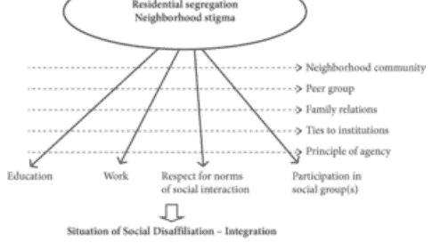
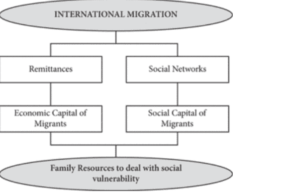
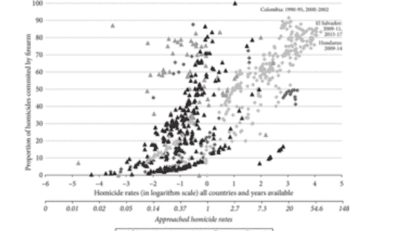
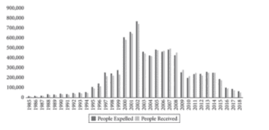

# 拉丁美洲社会学指南（牛津手册）

## 摘要与关键词

在本引言中，我们回顾了拉丁美洲社会学制度化过程的简要历史。同时，我们重新审视了拉丁美洲社会学的一些核心争议和贡献，确定了该地区对学科做出关键贡献的一些主题和领域。本章分为三个部分：学科的发展与制度化、拉丁美洲对社会学的核心争议与贡献，最后是手册的路线图（涵盖了八个研究领域）。

关键词：社会学、制度化过程、社会科学、研究领域、拉丁美洲

## 引言

《拉丁美洲社会学手册》是一部精选集，汇编了通常用西班牙语发表作品的社会学研究贡献，尽管也有少数显著例外。我们认为，研究领域和学科不应受国界的限制，出版语言确实是促进不同领域和国家社会学家之间交流的障碍。通过拟议的此本书，我们希望建立一座有效的沟通桥梁，使拉丁美洲学术界能够将该地区的研究动态传播到其他以英语为主要学术语言的国家。虽然英语文献在拉丁美洲很常见，但反之则不然。正如本卷所示，关于拉丁美洲的社会学文献是丰富且多样化的，来自许多不同国家和大陆的学者。

本手册并不旨在对广义意义上的拉丁美洲研究进行全面叙述。相反，本手册是一部研究论文集，将评估该学科的关键领域和当前趋势，特别关注拉丁美洲的当代社会学，并介绍创新的实证研究。为了实现这两个目标，我们选择了八个学者在其中做出了重大理论和方法论贡献的研究子领域。这包括对社会学中成熟领域的研究，例如宗教社会学、集体行动社会学和社会运动社会学等。此外，我们还考虑了拉丁美洲的医学社会学或迁移社会学等领域，这些领域在该地区迅速整合为专业的子领域，提供了分析和概念范畴用以批判美国和欧洲的霸权地位。

此外，本卷包含一系列多元领域的社会学研究，如性别焦点、医学社会学、社会不平等以及暴力与不安全社会学。由于社会经济条件的恶化以及近期对本已紧张的政治环境的冲击，这些近期已成为拉丁美洲社会学中产出最高且最重要的领域之一。这种不断变化的社会政治氛围也产生了新的、创新的抗议与生存表达，如今来自不同大陆的社会学家正在探索这些领域。

最后，《拉丁美洲社会学手册》是一个介绍和反映前沿社会学研究的平台。其优势在于作者的多样性，融合了来自不同国家、地区、学术背景和知识影响的青年、中期和资深研究人员，他们的贡献构成了拉丁美洲社会学的马赛克。本卷展示了系列社会学研究方法和策略，丰富了理论辩论，同时也描绘了拉丁美洲社会学复杂的学术传统（就学科在制度化和专业化水平上的差异而言）。这篇引言简要概述了该学科从起源和制度化过程到重要且持续的争议的现状。

手册共分为八部分。每部分都包含了开发关键研究问题的贡献，并从当代拉丁美洲社会学的不同视角和方法探讨实证问题。本开篇章节将突出每个主题部分的实质性要点。

## 学科的发展与制度化

我们在本文中的意图并非重构拉丁美洲社会学的历史——这显然是一项超出本章范围的任务。相反，在这一引言中，我们确定了社会学作为大学学位课程的正式化——一个学科的制度化和专业化过程——以及拉丁美洲社会学的一些（而非全部）核心争议和贡献。具体而言，我们关注20世纪60年代到80年代之间关于现代化、发展和城镇化进程对该地区影响的辩论。

作为拉丁美洲社会科学的一个专业领域，社会学在20世纪获得了认可，并反映了不同国家不同程度的制度化、专业化和发展。它的起源与该地区的现代化进程有关。该学科的基本目标之一是解释和理解发生在国家和次国家社会结构中的社会变化，并识别促进或阻碍这些变化的行动者过程（Portes, 2004）。Medina Echavarría (1940)——伊比利亚美洲该学科的先驱之一——将社会学视为拉丁美洲现代化进程背景下的一门新兴科学；但最重要的是，他认为这一新兴领域不仅需要对社会过程的历史视角和严谨的研究技术，还需要一种修辞性的训练，以对社会世界中的行动提供一种深度的、具有历史全面的视角。这在韦伯的表述中，意味着将社会行动作为研究对象（Medina, 1940; Moya, 2016）。

尽管各不同的国家背景和各国大学体系的发展促进了社会科学中社会学的诞生，但事实也是，国家社会知识环境的形成在定义和制度化社会学作为一项独立科学方面起了关键作用，在此之前，它隶属于其他学科——法律、人类学、经济学、哲学或历史——至少在20世纪的前几十年。应当注意的是，拉丁美洲社会学的发展和制度化有两个主要流派：一种是对各国内部动态的回应（即 Blanco 和 Jackson 所说的“国家倡议”），另一种是对国际组织促进和支持社会学中心及学术计划的回应（Blanco and Jackson, 2017）。智利是第二种情况的一个例子，因为两个国际组织——拉丁美洲和加勒比经济委员会（ECLAC）和拉丁美洲学院（FLACSO）是在社会科学特别是社会学制度化过程中建立的（Blanco and Jackson, 2017）。

ECLAC于1948年在联合国的赞助下成立，FLACSO于1957年通过联合国教育科学文化组织（UNESCO）的倡议成立，并在其早期得到了智利大学的大力支持（Beigel, 2009）。创建FLACSO的提议是在1956年在巴西里约热内卢举行的第一次南美大学社会科学教学会议上提出的。这两个机构的总部都设在智利圣地亚哥。这些位于美洲南部的国际组织的建立，促进了该地区社会科学的发展和新学术机构的形成，正如我们在全文中看到的。在智利，例如存在活跃于1957年至1973年的拉丁美洲社会学学校（ELAS），以及其他国际组织，如泛美开发银行（IDB）。在大学层面，1958年，社会学在智利大学建立了一个正式的学术部门（Blanco and Jackson, 2017）。

此外，拉丁美洲社会科学学院（FLACSO）帮助在南锥的其他国家建立了学术中心，例如1957年成立于位于巴西里约热内卢的拉丁美洲社会科学中心（Centro Latinoamericano de Pesquisas em Ciencias Sociais）。20世纪60年代，巴西教授和知识分子对FLACSO日益增长的力量做出了贡献，尽管他们在1964年军事政变后被流放到了包括智利在内的多个国家；事实上，在该次大陆的多个国家都设立了学术机构、项目和计划。1973年智利发生军事政变后，FLACSO将其社会科学硕士学位项目交给了若干迁往其墨西哥办事处的学者，从那时起，该项目就培养了大量学者，他们随后加强了其他大学机构的建设。在智利之外建立的前两个学术校区是FLACSO-厄瓜多尔和FLACSO-墨西哥，均成立于1975年。

社会学在巴西、秘鲁和墨西哥等某些拉丁美洲国家较早地实现了制度化，其构建和产生是由内在动态驱动的。虽然意识到社会学这一学科并非孤立存在，但外部因素确实影响了它的构建。相反，在这些许多本土发展的案例中，社会学受益于20世纪60年代下半叶该大陆不同国家知识分子的流动，也受益于阿根廷、智利、乌拉圭和秘鲁军事政变和威权政府统治的黑暗十年，因为这些时期曾抑制了社会科学的发展。在此期间，越来越多从欧洲（特别是意大利和西班牙等国）流亡的知识分子开始来到拉丁美洲，带来了新的思想、理论视角以及理解和实践社会研究的形式（Roitman, 2008; Moya, 2016）。

在阿根廷，尽管社会学从20世纪初就出现在某些项目中，但它并没有被视为一个独立的学科，而是隶属于法律、哲学或其他部门的思想等领域。然而，在1940年，布宜诺斯艾利斯大学创立了社会学学院，里卡多·莱文（Ricardo Levene）和吉诺·热马尼（Gino Germani）在那里担任研究员。直到1957年，布宜诺斯艾利斯大学才完全建立了社会学系和学位课程（Blanco and Jackson, 2017）。这归功于吉诺·热马尼，他1954年作为意大利法西斯的流亡者来到阿根廷。他最初接受经济学教育，后成为社会学家，被公认为现代阿根廷社会学的奠基人之一，他对该学科的早期贡献包含1956年的著作《科学社会学》（*Scientific Sociology*）中。从1957年开始，热马尼致力于在布宜诺斯艾利斯大学开发首个本科学位，同时进行对拉美现代化的研究，最终见于1969年的著作《现代化社会学》（*The Sociology of Modernization*）（Roitman, 2008; Blanco and Jackson, 2017）。热马尼的学术计划最终在导致1966年军事政变高峰的政治危机中崩溃，这引发了南锥其他国家大学机构的瓦解，主要涉及社会科学领域。

在秘鲁，圣马科斯国立大学（Universidad Nacional Mayor de San Marcos）自19世纪末以来就有社会学讲座，但直到1956年该大学成立社会学学院时才实现制度化。随后，各省大学也建立了不同的社会学系，正如20世纪60年代以前秘鲁天主教大学科学学院那样。1961年，在教科文组织的赞助下，圣马科斯大学设立了社会学系，国际组织在社会学专业化这一初始阶段的参与再次成为了关键（Mejía, 2005）。两位学者在制度形成的这一第一阶段脱颖而出：弗朗索瓦·布鲁罗（Francois Bourraud）从1956年开始组织了圣马科斯大学第一所社会学学校的课程；安尼巴尔·基哈诺（Anibal Quijano）在1964年与何塞·马里亚·阿尔格达斯（José María Arguedas）合作创立了秘鲁研究所（IEP），这是秘鲁社会科学发展的一个里程碑（Mejía, 2005; Tanaka, 2014）。

在巴西，我们有一个更早的社会学作为一门学科、特别是作为大学课程的本科学位项目的学术制度化案例。从20世纪30年代以来，巴西有两所学校教授社会学：1933年创建的社会与政治自由学院（ELSP），以及1934年成立的圣保罗大学哲学、科学与文学学院（FFCL），后者提供了社会学学位课程。在后者，社会学硕士学位于1940年建立，这可能是拉丁美洲地区首个研究生项目，其毕业生中包含了当代巴西社会学最杰出的代表之一：弗洛雷斯坦·费尔南德斯（Florestan Fernandes）（1970）。

在墨西哥的案例中，社会调查学院（IIS）于1930年成立，帮助了墨西哥的社会学专业化；然而，作为一门正式学科，国立自治大学（UNAM）的社会学直到1951年UNAM成立国家政治与社会学院之前，一直处于法学院的庇护下。由[缺失文本]开发的该学院第二任主任是帕布罗·冈萨雷斯·卡萨诺瓦（Pablo González Casanova）（1957-1965），他被认为对社会学的专业化做出了贡献。在此过程中，《墨西哥社会学杂志》（Revista Mexicana de Sociología）成立于1939年，是该地区历史悠久的期刊（Moya, 2016; Stern, 1984）。

## 关于拉美社会学：拼图的关键碎片

这段拉美社会学制度化的历史叙述，如果没有提到伊比利亚美洲社会学的先驱——热马尼，将是不完整的。他于1939年作为西班牙流亡者来到墨西哥。随后，在1943年，在丹尼尔·科西奥·比列加斯（Daniel Cosío Villegas）和阿尔方索·雷耶斯（Alfonso Reyes）这两位墨西哥精英的支持下，热马尼被负责组织和创立墨西哥学院社会研究中心。该机构旨在让社会科学家更好地理解墨西哥和拉丁美洲发生的现代化进程（Lida et al., 2000）。

热马尼还通过对经济文化出版社（FCE）社会学部分的推广和管理，为拉美社会学做出了贡献。他还将马克斯·韦伯的《经济与社会》（*Economy and Society*）翻译成西班牙语，由FCE于1944年出版。热马尼在1939年至1946年留在墨西哥；后来受拉乌尔·普雷维施（Raul Prebisch）邀请参与经委会的工作，并从1952年离开墨西哥来到智利，在那里呆了二十五年。在这个世纪里，他致力于对社会与经济发展之间关系的学术思考，为拉美社会学奠定了基础。

## 拉美对社会学的辩论与贡献

美洲在20世纪70年代经历了一系列剧烈变化。随着社会权力结构的根本性转型，关于发展和现代化的辩论——其基本原则在20世纪50、60年代产生并得到凯恩斯主义计划政策的支持——通过发展理论和现代化社会学进行了阐述。这一理论在20世纪60年代危机爆发和美洲各国军事政变后遭到了质疑（Cardoso, 2018）。

## 拉丁美洲社会学：拼图的关键碎片

在我们讨论过的地区中，两位奠基性的社会学家梅迪纳·埃查瓦里亚（Medina Echavarría）和吉诺·热马尼对拉丁美洲现代化进程有着相同的基本假设。他们认同，向民主整合型政权的转型将基于物质理性和社会秩序的合法性。然而，现代化过程假设的不仅是经济现代化，还伴随着拉丁美洲社会变化的社会政治现代化。但是，军事政变等事件导致了现代化理论者之间的巨大裂痕和分裂；正如热马尼在1985年指出的，他们预测福利国家将会减少，而转向拥有强大精英阶层的威权政权，会导致社会解体（Roitman, 2008）。

20世纪60年代中期不仅见证了一场社会危机，还经历了一场社会学危机，或者说是认同危机。它要求学者将对社会变化的解释置于特定的语境之中，正如法尔斯·博达（Fals Borda, 1974）所说；换句话说，他们要建立一种理论支架，以便感知依赖资本主义后殖民社会中现代化的意义。后来成为拉丁美洲批判社会思想基石的涉及来自不同国家的广泛社会学家，其中包括帕勃罗·冈萨雷斯·卡萨诺瓦（Pablo González Casanova）、奥兰多·法尔斯·博达（Orlando Fals Borda）和安尼巴尔·基哈诺（Anibal Quijano）。这些学者引入并使用了诸如“依赖资本主义”、“中心-边缘”、“内部殖民”、“知识殖民性”等新范畴，形成了一场直到今天仍被认为是拉丁美洲批判社会思想核心的辩论，首先是对理论概念方法中欧洲中心主义的批判，其次是对现代化理论的批判。关于这个问题，讨论集中在对政治实践的批判以及根据原始现代化概念化而提出的发展策略上（Mejía, 2005; Roitman, 2008; Blanco and Jackson, 2017）。

20世纪60年代后半叶和70年代拉丁美洲的工业化和城镇化进程促进了拉丁美洲社会社会危机的出现——依赖理论，特别是与前一个十年主导的发展地位的关系（Cardoso, 2018）。拉丁美洲依赖理论的辩论在70年代中期达到巅峰，标志是费尔南多·恩里克·卡尔杜索（Fernando Henrique Cardoso）和恩佐·法莱托（Enzo Faletto）合著的《拉丁美洲的发展与依赖》（Cardoso and Faletto, 1969）。在此之前，该文本已在三年里最初在学者和知识分子中传播（Cardoso and Faletto, 1967）。它由Siglo XXI出版社出版，清晰地标志着该地区社会科学的转折点。该作品确立了拉丁美洲依赖理论社会学概念（Roitman, 2008）。它认为，在欠发达-发展的二元性或中心-边缘关系之间可以建立实质性的差异，而这些在发展版本中占据主导地位。卡尔杜索和法莱托充实了依赖的概念，该概念指的是在“依赖状态”下经济和政治系统存在的条件及其之间的联系（Cardoso and Faletto, 1977）。

基于将依赖概念化为一种不可避免地在各种权力资本结构配置中协调历史条件的情境，可以识别此类语境的有效性。这种解释模型允许学者对每个国家的依赖状况进行特定分析。因此，依赖理论学派的核心社会贡献之一正在于，它通过研究群体、阶级以及国内外机构之间的相互关系，为分析拉丁美洲的发展建立并提供了解释性方案。

卡尔杜索和法莱托对依赖的概念化使得能够发现其他支持后来被称为社会批判性思维的阐释，这在那些持有相似观点的人之间制造了深刻的裂痕。从本质上说，当其他人认为依赖是特定发展状况的特征时，卡尔杜索和法莱托断言，依赖指的是拉丁美洲资本主义发展中一种特定的社会权力和支配关系配置，这种配置关系揭示了最初决定这种依赖的关系和结构。

除了依赖辩论在拉丁美洲社会学发展中的具体贡献外，它还质疑了社会科学各种流派和学派的出现和发展。学者们赞赏解释依赖的概念，它不仅解释了持续的城镇化和工业化过程，还解释了城乡社会后续的变化、威权政权向民主体系的转型、其他形式社会排斥的出现、城市和社会边缘化学派以及社会不平等，为社会研究开辟了新途径。

70年代辩论的一位学者和活跃参与者安尼巴尔·基哈诺（Anibal Quijano），他研究了安第斯国家工业-技术依赖的不同后果和节奏，利用依赖理论建立了一个研究拉丁美洲社会科学知识产生的模型。他创造了“知识殖民性”，并将其定义为另一种形式的依赖，它需要一个去殖民化过程，这将涉及整合来自历史语境和该地区学者的其他概念和分析范畴。因此，基哈诺承认了拉丁美洲的特殊性，以及从其本土化角度考虑该地区的需要（Quijano, 1966, 1990; Mejía, 2005; Roitman, 2008）。

最后，拉丁美洲社会学在最近几十年发生了巨大的变化——这些超出了本引言的范围——我们认为，社会学家工作和社会学专业化过程中最重要的转型之一，是日益远离那些声称解释社会如何运作的全方位视角，并转向研究学科内差异化过程的特殊性（Giro and Olvera，同时，实证研究在学科中取得了进展）。考虑到这一点，本《拉丁美洲手册》的组织是围绕显著的调查领域规划的，揭示了该学科所实现的专业化程度。

## 手册路线图

本书围绕八个主题领域组织，展示了拉丁美洲社会学最重要的贡献。每个领域都包含一个引言章节，概述了从50年代以来不同拉丁美洲社会学家产生的历史和当代发展、理论创新和实证贡献。

本节提供了八个主题部分的路线图，为读者提供每个领域提供的主要理论和实证贡献的概述。

## 国家社会学

在整个80年代，特别是柏林墙倒塌后，对国家的研究获得了新的中心地位。尽管随后向全球化迈进并放弃了该地区的进口替代经济模式，国家继续履行私营部门不愿或无法承担的重要且无利润的社会功能：教育、公共卫生以及保护弱势群体（儿童、老年人）不受国内忽视或暴力。因此，国家是拉丁美洲一个动态领域，承认不断演变的情况并记录着日常的国家关系。在全球化时代，将国家的形成和演变视为全球化过程与国家行动密切相关。例如，试图调节全球化的国际协议在很大程度上未能实施，而此类实施的相对成功与国界内的民主水平、财政能力和地缘政治考量直接相关。

拉丁美洲国家社会学部分包含五个章节，涵盖了政治社会学高级的关键领域：国家形成、国家与经济的关系、国家提供的社会保护，以及国家从革命和反革命中转型的潜力。拉丁美洲国家社会学的出发点是开发区域国家形成模型，这些模型在考虑早期欧洲国家的同时，勾勒了这两个语境之间的相似之处和差异。两种当地开发的国家形成理论，本节包含的案例论证了存在主义和国家逻辑本体论，并显示了历史发展中的高度变异性。本节的作品

# 关于拉丁美洲社会学：拼图的一些关键碎片

尽管战争制造是该地区国家形成的核心，但拉丁美洲国家大多没有参与重大或全面战争，且在领土上大多未能实现对暴力的垄断（Centeno, 2002）。

正如 Viviane Brachet-Márquez 在她的引言中所述的，国家形成是一个年轻且多学科交叉的领域。虽然该领域继承了一些早期在在该地区引入欧洲理论时产生的、未经批判的普遍性偏见，但它也成功地追求了自身的理论替代方案，并随着工业化的进展，对组织工会对国家政策的影响提供了强有力的转型视角。

# 社会不平等

如今，拉丁美洲国家的特征是财富和收入平等程度极高，而其居民却经历着世界上最高水平的不平等。根据世界银行（2018）的数据，收入分配最糟糕的八个国家位于拉丁美洲。纠正收入分配根源的紧迫性产生了该地区最富成果的领域之一。文献的历史特征为三个不同的时期。正如 Mora Salas 在对拉丁美洲社会不平等领域的引言中所解释的，第一阶段显然由全面的理论框架主导，如现代化理论、依赖理论和结构主义发展理论，其中历史结构主义占据了主导分析模型。在第二阶段，研究不平等的社会学方法受到该地区收入分配和贫困研究的主导，这迫使学者转向理解收入分配不平等，而历史-结构范式失去了霸权地位。最后一个阶段的特征是人们对过去三十年所经历的政治经济变化中的不平等研究产生了新的兴趣。

在过去的世纪里，该地区忍受根深蒂固的收入不平等，这种持续的现实导致了三个理论流派开创性工作：由 Raul Preisch (1949) 和 Gino Geramani (1962)创立的结构主义学派、现代化理论，以及 Fernandes (1965和1970年)、Stavenhagen (1969) 和 Faleto (1993) 等其他拉丁美洲社会学家著作中的新马克思主义依赖方法。这些理论流派主导了该领域的议程，直到20世纪80年代初外债危机席卷该地区，从而为社会不平等研究带来了新的视角。

社会不平等的研究最初位于基于阶级的分析领域，即使是像 Fernandes 和 Stavenhagen 这样认真纳入种族和族群的学者也是如此。在80年代债务危机导致的“失去的十年”之后，新自由主义政策的兴起和经济全球化的加剧使得该地区的不平等社会学沦为二流地位，因为其过度关注依赖理论、现代化和历史结构主义。该地区关于社会不平等的新研究重点转向了在缺乏国家级收入再分配方案的情况下促进个人机会。社会问题侧重于社会公平的分析，而不是关于平等的辩论。研究生存策略（Duque and Pastrana, 1973; Torrado, 1981; Tuirán, 1993）、非正式经济（Tokman, 1987）以及强调贫民动员资源的新贫困方法（González de la Rocha, 1986）的学者获得了广泛关注，并对该领域做出了重大贡献。

随着新自由主义政权的建立加剧了社会不平等，该地区新兴且强大的土住民运动鼓励学者们完善其研究不平等的分析方法。同样，进步和新发展主义政府的兴起可能是重塑该地区不平等社会学方法最有影响的因素。这些政权质疑了新自由主义政策促进经济增长、推动国家发展、减少贫困以及创造更公平社会产品再分配的能力。这些重要问题培养了关于不平等的新的研究议程，包括分配和社会文化维度。拉丁美洲的领域现在对性别、环境不平等、合法化与宽容、社会形象、社会表、公众对不等的感知以及社会公正的社会表现提供了新的分析视角，这些在本部分的八章中得到了很好的说明。

# 宗教社会学

拉丁美洲宗教社会学是研究实践、信仰、制度和宗教社区的核心领域之一。本节重点介绍了五位社会学家的工作，他们为理解当代地区的转型提出了新的解释框架和方法论。

20世纪70年代，该文化和宗教多元化的兴起极大地丰富了宗教景观。五旬派和新教组织的兴起使人们关注拉丁宗教的特殊性，并鼓励了拉丁美洲特定解释框架的建立。进入21世纪初，宗教社会学已经发展出成熟的研究议程，并放弃了经典的世俗化范式。相反，学者们越来越关注宗教身份与其他重要社会学变量之间的关系，如边缘化、族裔、迁移和教育。学者们对拉丁美洲社会参与全球宗教社区形成的特定年份变得越来越感兴趣。

拉丁美洲的当代宗教研究展示了制度化宗教和大众宗教如何应对公共领域，以及宗教信仰和制度对重要公共政策决策的影响，例如堕胎合法化、婚姻平等权利以及与遗传和生物技术相关的实践的监管。该领域的学者开发了用于跨宗教实践的新框架，该领域的活力源于其对民主环境中“多种现代性”的关注。

Olga Ortega-Ortiz 关于世俗性的引言展示了由 Roberto Blancare 撰写、Cristian Parker 管理的内容如何正在取代传统的民间宗教，以及 Hugo Jesús Suárez 对后教会代理对救赎管理影响的反思，同时避免了断裂或冲突。本节以 Eloisa Martin 关于“神圣化实践”概念的章节结束，这是一种使神圣-世俗二分法更具流动性的启发性装置，并在日常生活中寻找两者的和谐结合。

# 社会运动与集体行动

20世纪80年代以来，拉丁美洲国家经历了剧烈的经济重组，因为进口替代模式的失败引发了债务危机，导致了所谓的发展的“失去的十年”。债务危机增加了许多低收入工人的不稳定性性，并引发了不同社会群体之间多样化的动员策略。由于这些组织团体不断要求更好的社会条件——包括获得生活工资、健康和公平获得正义——拉丁美洲的社会运动和集体行动领域是范围内影响力的领域之一。他在拉丁美洲社会运动（LASMs）学者用于分析该地区集体行动演变性质所采用的最重要理论方法介绍了：结构主义、政治经济、政治背景、组织领域、“新社会运动”、框架与情感以及跨国行动主义。

在实践中，LASMs学者将集体行动视为一种持续的过程，从地方层面的基层组织到具有可识别领导者和结构的、更大领土范围的韧性运动，例如巴西的农村土地工人运动（2010），或墨西哥的萨帕蒂斯人（Inclán, 2018）。例如，Paul Almeidia 和 Amelia Pérez Martin 关于反全球化运动的章节展示了市场驱动的自由化如何推动了拉丁美洲一些规模最大的动员。文献中关于集体行动的感知目标存在重要的辩论，学者们意识到集体行动运动锚定在独特的政治项目中。这些项目从左倾的、反新自由主义的改革和解放性运动，到那些不断纠结是接受完全解放还是并入政治现状以增加可见性的强化性运动。

通过为该地区集体行动的目标提供额外的解释，新社会运动（NSM）方法试图提供分析上的细微差别。例如，NSM方法表明，LASMs在他们的组织工作中重新

# 拉丁美社会学：拼图的一些关键部分

在保持其相对于制度政治自主性的同时，关注细微的含义和身份认同。然而，不同的理论-制度方法认为，将拉美社会运动（LASMs）视为在追求制度目标的同时，试图获取国家资源会更具成效（Wickham-Crowe and Eckstein, 2015）。在一个以贫困和不平等为特征的地区，这是一种战略性，因为国家是生存所需的资源、服务和人员的分配者，正如 Rossi 在其关于区域劳动运动史的章节中所解释的那样。

除了分类问题外，几位作者观察到几十年年来拉美社会运动内部发生了显著变化：首次出现在进口替代时期（1930-1960年）的阶级运动（工人和农民）不断削弱；出现了一系列表现出非阶级身份（种族、性别；地理、人权等）的特定案例的碎片化运动；以及采用了去中心化和多元化的组织形式。后者的转变与 20 世纪 70 年代的民粹主义发展主义国家以及威权政府的扩散有关（Roberts, 2008; Rice, 2012）。然而，尽管学术界对拉美社会运动研究中这些相关转变存在共识，但系统性的支持证据（例如来自事件数据集）仍然稀缺。本节包含的六章提供了系列关于该地区由工人、女性、学生、土社区和反全球化团体领导的社会运动的案例研究。

# 迁移社会学

过去一个世纪，拉美地区内部及跨区域的人口流动经历了显著变化。18 世纪和 19 世纪的特征是欧洲和亚洲向该地区的大规模流入；20 世纪的多次独裁政权，以及 1980 年代的债务危机，产生了大量从拉美流向北美和欧洲寻求繁荣的难民移民。

Liliana Rivera-Sánchez 和 Eduardo Dominguez 在其对说明这一动态领域的四个章节引言中指出，美洲迁移社会学可以追溯到芝加哥社会学派的开拓性贡献以及其对移民群体之间冲突、竞争和调的观察。该领域也源于学术审查：关于种族和族群同化的辩论；关于邻里隔离；关于同化范式；最后，关于为了理解当代移民行为而采用的跨国视角。然而，拉美很大程度上被排除在这个叙述之外，因为英美作者产生的大部分实证和理论贡献考虑的是北大西洋地区北部特定移民接收社会的过去或现在的国家经验。

同样，北大西洋地区产生的迁移社会学主主叙事忽视了此前对区域内和区域外迁移过程的早期研究，这在很大程度上导致了拉美产生的学术成果被排除在外。由于这种抹除，20 世纪迁移社会学历史产生的主流叙事清楚地表现出“知识的殖民性”。虽然承认拉美以外学者的影响很重要，但意识到去殖民化的紧迫任务，并承认在整个大陆进行的、最能反映该地区特定社会历史条件的重大学术工作，也是至关重要的。

该地区迁移运动的研究起源于 1880 年至 1930 年间从欧洲到拉美的跨大西洋迁移时代。最早关注迁移的研究特别对经济发展感兴趣，并被提交在人口统计和人口研究中。因此，迁移-发展的二元对立仍然是该领域目前最充分的研究领域之一，正如它曾是拉美迁移研究的首批结构要素之一一样。同样，拉美农村到大型城市和大都市的内部迁移也是学者关注的重点。

本节的引言章节还深入讨论了多位从事南美跨境流动工作的先驱社会学家。例如，Mario Margulis 在 20 世纪 60 年代后期发表了一关于综合迁移社会学的创性文章，Carlos Ramos 在 20 世纪 70 年代提出的迁移社会学理论包含了一种超越对外国出生人口人口统计分析的分析视角。最后，Lelio Mármora 和 Suarez Torrado 关于拉美迁移政策公共政策规划的工作无疑可以被认为是基础性的（Margulis, 1967; Rama, 1974; Mármora, 1975; 1970）。

今天，拉美研究人员对迁移社会学最重要的贡献是多学科的，并集中在几个领域：

- 迁移与发展
- 迁移与身份
- 性别与迁移

# 性别社会学

在拉美，性别研究出现于 20 世纪 50 年代和60 年代，在现代化理论以及结构主义和马克思主义依赖理论的影响下，学者们考察了女性在城市化、农村结构和劳动力市场变化中的地位。20 世纪 70 年代和80 年代，大多数关于性别的研究关注社会不平等和等级制度。在那些十年里，性别分工和公共与私人领域的性别特征等概念主导了概念图谱。从 世纪  年0 年代开始，性别终于开始作为一个独立的分析范畴被讨论，新问题的出现证明了这一点。首先，关于男性认同以及可能基于身份经历从属地位的主题的学者变得流行。例如，哥伦比亚社会学家 Gabriela Arango (2002) 认为，性别是以一种关系的方式产生的，并解释了性别关系的生产、再生产或转化。此外，性别使受性别制约的主体变得可见，并不仅为理解性别之间的社会和符号关系提供标准，也为理解女性与男性之间的社会和符号关系提供标准。Arango 的工作尤为重要，因为她利用了这种性别概念化来批判女性的社会劣势和受害。随着时间的推移，这些受害叙事逐渐被更复杂的性别身份方法所取代，涵盖了矛盾、权力、抵抗或顺从。

目前，许多社会机构，如家庭、劳动力市场和国家正在从性别视角接受审查。Gioconda Herrera 的引言勾勒了拉美社会学中两个重要子领域的演变：性别、工作与社会再生；性别、集体行动与国家。事实上，Herrera 讨论了这些子领域内部产生的轨迹和辩论，强调了性别分析对于扩大关键社会机构定义和范围的贡献。最后，她介绍了作品中包含的三个主题，展示了该领域日益专业化的趋势，并有助于理解拉美社会不断变化的动态：

- 整个大陆的性别暴力
- 社会再生与公共政策
- 劳动力市场的演变

# 医学社会学

在对拉美医学社会学领域的介绍中，Roberto Castro 处理了社会科学中影响健康的几个相互相关领域的社会学客观化，如临床医学、人口健康和公共卫生。Castro 收集了集体健康并阐述了围绕其主要的学术辩论

## 关于拉丁美洲社会学：拼图的关键碎片

拉丁美洲健康领域的科学。Herues 认为，与该地区其他国家相比，集体健康在巴西已获得了异常重要的地位。

拉丁美洲的医学社会学已作为一个具有相对自主性的独特领域而脱颖而出。然而，科学和学术的自主性对卫生政策的影响有限，这主要是因为医学领域的研究在健康部门中的存在感尚未增强。虽然医学社会学领域通常被归入进进步的健康方法范畴，但更广泛的社会医学或集体健康领域涵盖了来自科学、社会学、人类学、政治学和社会心理学等不同学科的跨学科方法。这一跨学科领域最重要的目标之一，是要求在政治上采取行动，并追求该地区内健康权利与正义议程的扩张。社会医学或集体健康的兴起，源于一群致力于的公共卫生社会学家的努力，他们将社会科学应用于该地区的人口健康问题研究。

医学社会学的起源可以追溯到 20 世纪 50 年代中期的拉丁美洲国家，此后该领域发展出了两种经常冲突的不同路径：社会医学和公共卫生社会学。社会医学方法的建立发生在 20 世纪 60 年代，将社会科学纳入该地区各大学的医学课程中。这种最初的发展发生于北美医学社会学制度化的背景下，特别是与 1959 年美国医学协会医学社会学分会的联系（Badley and Schulte, 1966；Sepúlveda 1966；Badley and Holm, 1973）。该地区致力于社会医学的各种学术期刊在 20 世纪 60 和 70 年代巩固了该学科的度，当时该领域被命名为“集体健康”。社会医学与集体健康营之间的术语之争，很大程度上是拉丁美洲学者与北美学者之间的对立。在社会医学兴起之前，学者们主要采用传统的公共卫生方法，这种方法的灵感源于北美对预防医学的关注。这种方法由该地区的公共卫生官方机构驱动，并在争议中发展；关于这两种方法之间的认识论争论和批评在 Castro 的引言中得到了讨论。该章节的五章提供了一系列关于医学社会学的案例研究，涵盖了认识论争论、巴西健康社会学的制度化、阿根廷的替代医学、秘鲁的性能动以及墨西哥的健康决策。

## 暴力与不安全社会学

Arturo Alvarado 在本手册最后一章节的引言文章中，建议将犯罪暴力作为分析当代社会安排的一个范畴。当他穿过该地区犯罪研究及其多个社会维度的动态发展过程时，Alvarado 认为犯罪是拉丁美洲社会学的核心部分，以至于几位学者建议将暴力整合为社会阶级、分层、社会整合或控制等核心社会学范畴。在本章中，Alvarado 提供了该地区主要犯罪研究的性样本，批判性地审查了可用数据的方法和质量。章节中的某些专家按国家研究犯罪，另一些则按主题以及非法生产类型、形式和规模进行比较研究。正如本节九章清楚观察到的，暴力和犯罪的演变与全球暴力市场的出现、组织“全球犯罪网络”的形成以及国家作为保障公民身份和人类安全的主要机构角色的缺位密切相关。分析该地区犯罪行为的一个重要出发点是，认识到有组织犯罪的出现无法与这些社会的状况分离，特别是在开启全球化时代的经济改革之后。

由于社会不平等以及导致军事化、独裁政权和非法政府的国家转型，拉丁美洲人民几十年来一直处于高水平的脆弱和不安全状态，从帮派经营的当地社区到受犯罪组织完全控制并威胁国家权力的城市。正如 Alvarado 所解释的，拉丁美洲拥有世界上最高的杀人率（WHO, 2014），以及最高的女性杀害率（或谋杀率）和青少年司法率（Concha-East, 2015）。同样，该地区拥有最大的非法毒品和非法火器市场之一（Muggah and Thompson, 2016），并拥有了绝大多数最暴力的城市（Briceño-León, 2015; Davis, 2016）。在某些情况下，这些城市是国家与非国家行为体内部战斗的受害者；而在另一些情况下，犯罪头目和政治精英容忍暴力或形成统治联盟。

虽然民主化进程在地区几个国家取得了成功，但暴力和逍法现象在几个国家仍然存在，建立一个公正法治政府是一个广泛且持续的挑战。该地区大多数居民经历着普遍的暴力和人权侵犯；犯罪组织威胁公民，其中一些组织仍在侵犯人们的基本权利。过去在威权和军事政权下犯下的罪行仍未受到惩罚。不幸的是，无论民主化取得何进展，政府机构（特别是警察和军队）仍然存在秘密拘留中心，在许多国家，人们遭受酷刑，有时还会面临杀害。虽然该地区领域的发展包含了 20 世纪 90 年代后期兴起的的重要认识论争论，这些是值得提及的：公民安全和人类安全。这两种方法之所以重要，是因为关于犯罪的辩论具有高度的政治性和意识形态特征，以及由于拉丁美洲人权框架的兴起。这些安全范式与整个地区回归民主的进程相契合。

## 关于拉丁美洲社会学：拼图的一些碎片

这为寻求公正、平等和合法性的政府和社会带来了新的挑战。

## 参考文献

- Arango, L. (2002). 身份、性别与工作。*Cahiers d'Américas*, 39, 37–58.

- Badley, R. F., and S. Bloom (1973). 社会科学与医学教育：社会学的案例。*Social Science and Medicine*, 7(1), 927–941. https://doi.org/10.1016/0037-7856(73)9071-1

- Badley, R. F., and M. Schulte (1966). 美国的社会教学计划。*Milbank Memorial Quarterly*, 44(2), 187–199.

- Blanco, A. R., and L. C. Jackson (2017). 拉丁美洲社会学中的学校校长：Gino Germani、Floren Fernandez 和Pablo González Casanova。*社会学*, 90(32), 9–46.

- Beigel, F. (2009). CEPAL 与拉丁美洲社会科学的区域化（1957–1973）。*墨西哥社会学杂志*, 71(2), 319–349.

- Briceño-León, R. (Ed.). (2015). 生命与死亡之城市：城市与应对暴力的社会约。加拉斯：Alfa。

- Concha-Eastman, A. (2015). 10 至 29 岁人口的过度杀人：哥伦比亚案例。在 A. Alvarado 等（编），*被中断的生命：拉丁美洲青少年杀人率（1990–2010）*（第149-169页）。墨西哥城：墨西哥学院。

- Centeno, M. A. (2002). 血腥与死亡：拉丁美洲的战争与国家。

- Muggah, G., and Thompson, H. (2016). 非法毒品市场与非法火器市场。

- Davis, I. (2016). 绝大多数最暴力的城市。

- Cardoso, F. (2018). 案例的独特性：CEPAL 与发展思想。在 Bringel and A. Brasil（编），*当代巴西思想*（第215-256页）。布宜诺斯艾利斯：拉丁美洲科学委员会。

- Cardoso, F. H., and E. Faletto (1967). 依赖与拉丁美洲的发展：社会学的阐释。利马：秘鲁研究学院[手稿]。

- Cardoso, F. H., and Faletto (1969). 依赖与拉丁美洲的发展：社会学的阐释。布宜诺斯艾利斯：世纪出版社。

- Cardoso, F. H., and E. Faletto (1977). 依赖与拉丁美洲的发展。布宜诺斯艾利斯：世纪出版社。

## 拉丁美洲社会学：拼图的一些关键碎片

(9.) 由 José Medina Echavarría、Juan Roura Parella、José Ferrater Mora 和 Eduardo García Máynez 合作出版了第一版西班牙语译本（Moya, 2016）。

| 姓名 | 描述 |
| :--- | :--- |
| Liliana Rivera-Sánchez | 墨西哥学院（El Colegio de México）社会学研究中心 |
| Xochitl Bada | Xochitl Bada 是伊利诺伊大学芝加哥分校拉丁美洲及拉丁裔研究副教授。她的文章发表于《强迫迁徙评论》、《人口、空间与地方》、《拉丁裔研究》和《劳动研究期刊》。她是《供芝加哥坎（Chicagoacán）个人使用的墨西哥家乡协会》（罗格格斯大学出版社，Rutgers University Press, 2014）一的作者。她的专业领域包括移民对政治和的权利的获取、移民组织策略，以及墨西哥和美国的跨国劳工倡导动员。她是著作《美洲新迁移模式》（Palgrave, 2018）和《跨国问责》（德克萨斯大学出版社, 2019）的合编。她曾于 2019-2020 年担任柏林高级研究学院的员。 |

## 拉丁美洲的国家：它们还值得研究吗？导论

Viviane Brachet-Márquez

### 摘要与关键词

关于民族国家研究因全球化而不再实用的观点。本节中关于拉丁美洲国家的四个章节旨在深化我们对这些国家应当承担的责任及其所面临的局限性的认知。

关键词：民族国家角色、全球化、国家权力、拉丁美洲、社会学

研究民族国家的意义何在？全球化支持者（如 Mann, 2000 所称）声称，国家在决定国家社会和政治现实中的核心地位已经下降：资本主义已变得全球化、跨国化和后工业化，而威胁人类的社会问题（人口、移民、贫困、全球变暖、荒漠化）已经大到民族国家无法处理。

对这些主张第一个且显而易见的反驳是，民族国家仍然必须负责那些私人企业无法或不愿承担的、重要的非营利性社会功能和服务。因此，无论如何，它们必须能够征收足够的税收，以确保所有公民都能获得高质量且免费的教育，涵盖公共卫生、保护弱势群体（儿童、妇女和老年人）免受家庭忽视或暴力的侵害、保护免受外国侵略，以及通常来说，确保其管辖范围内人口免受私人或国家暴力的侵害。对于拉丁美洲国家来说，统治着极少数纳税人和大量的消费者，执行这些任务无疑是困难的，但无论全球化如何，情况一直是如此。因此，有必要研究国家面临的困境，全球化可能加剧了这些困难，但并非其创造者。低下的财政能力使得解决这些问题变得尤为困难。

反驳支持者的论点还有政治和认识论上的原因。只要全球进程——资本主义、天教会、女主义运动、移民——被民族国家贯穿或未能贯穿，无疑由于国际和跨国网络成员的影响，除非我们敏锐关注世界不同地区国家是如何变成现在的样子以及它们是如何演变的，否则理解全球范围内发生的事情几乎是不可能的。跨国进程——经济、军事和金融——通过条约和国家首脑之间的承诺（G7、G20、世贸、世界银行、联合国、国际货币组织、北约等）进行松松的监管管理。此外，这些协议的执行并不均衡，结果是根据各国民主程度、发展水平、地缘政治力量、国家债务和国家基础设施能力的差异，产生迥异的影响（Mann, 2000, p. 137）。

底线是全球化并不是一个特殊的（sui generis）实体，不能与其被认为因其出现而变得过时的跨国和民族过程在质上区别开来。“全球化”就像“社会”一样，是一个通用术语，不应被具体化为一个统一实体，而应指代激活其不同且不断变化的侧面的重叠网络集合，在这些网络中，国家行为体个人或集体与其他国家合作行使不同类型和层级的权力。因此，从其复杂性来看，全球化包含了而非排除了国家的行动（及缺失）。

在尝试理解全球化谜图中任何部分之前，第一步是扩展和深化我们对民族和国际进程的认知，并研究拉丁美洲国家在其中扮演的角色。这是本节四个章节所追求的目标——批判性地评估过去的工作，并就四个核心主题指出未来的研究方向：国家形成、国家与经济、国家与社会保护，以及通过革命和反革命实现国家转型的案例。

### 参考文献

- Mann, Michael (2000). Has globalization ended the rise and rise of the nation-state? In D. Held and A. McGrew (Eds.), *The global transformations reader* (pp. 136–147). Cambridge, UK: Polity Press.

Viviane Brachet-Márquez

墨西哥学院（El Colegio de México）社会学研究中心

## 拉丁美洲国家的历史建构：一个形成中的领域

### 摘要与关键词

本文将拉丁美洲国家形成（SF）研究的历史分为四波：第一波始于20世纪80年代，关于国家机器结构特征的叙述；第二波兴起于20世纪90年代，突出了国家形成的国家、亚国家和地方历史动态；第三波近期作品关注拉丁美洲国家在军事、行政和财政能力上的历史根源，认为其逊于近现代欧洲国家。最后部分概述了最新的努力，旨在重新解读之前的辩论和发现，并吸收其多年积累的宝贵信息和见解。

关键词：拉丁美洲、社会学、国家形成、国家能力、近现代欧洲国家

在早期阶段，拉丁美洲的国家形成（SF）研究与其他地区一样，集中在对“国家制造者”的选择性叙述上。如今，研究已进入许多领域，这些领域此前被认为是国际关系、战争与和平、公共管理、政策分析和日常实践等专门领域的范畴。它们也对西欧历史的早期解读提出了质疑并取代。早期，人们还认为研究SF的正确策略是从少数国家案例（主要集中在世界西北部）中得出一般假设。因此，紧随近现代欧洲模式研究的拉丁美洲研究，倾向于假设现代国家普遍是什么样或应该是怎样的，以此来对比拉丁美洲的情况。

在两种情况下，一种增强论（因此是国家本体论）都排除了事实上的偶然性和历史发展的高度可变性。

今天，国家形成（SF）更多是关于人、组织和国家机构，它们处于世界不同地区，遵循完全不同的历史轨迹，赞扬、维持、利用、扭曲或遭受阶级、种族和性别规则以及不平等，而国家努力在其声称的领土上以不同的成功执行这些规则。然而，将国家形成扩大到涵盖更广泛的轨迹和决定因素已对早期的研究取得了重要进展，但它仍未能从理论和跨学科的角度将目前竞争认可和信誉的不同SF研究分支整合起来。

本章的主题是：拉美关于SF的仍具有多学科性质的研究，是在未经批判地复制了继承自欧洲研究的早期普遍偏见，还是追求了对其教条的替代方案。SF作为拉美一个领域的发展的第一步（如第一节所示），是在强烈的政治障碍背景下，分别在哥斯黎达公共管理学院（ICAP）和布宜诺斯艾利斯的国家研究中心（CEDES）产生的一系列相关作品。这些作品主要是关于特定国家在独立后，国家如何被创造并随时间演变的状况的历史叙述。第二波SF学术著作在20世纪90年代兴起。与第一波不同，它在于揭示了通过首领人物（caudillos）之间的竞争所体现的SF的国家性、郊区和地方动态；关键时刻国家、精英阶层与底层阶级群体之间的关系；军队和教会在地区联盟和冲突中的参与。它还随着工业化的推进，描绘了有组织的劳工运动对国家政策的影响。第三，一组近期关注的重点集中在拉美国家军事、行政和财政能力较低的历史根源上，并将其隐含地与西北部国家进行比较。最后一节阐述了自20世纪90年代以来积累作品并超越这些作品的最新努力。

### 初步

接触拉美SF现象的首次尝试始于20世纪40年代，在经济学家拉乌尔·普雷维希（Raúl Preisch）的领导下开始，他认为国家是刺激进口替代工业化的有效工具，并对抗由分工产生的中心与边缘之间的不平等。作为这一立场的反应，卡尔多索（Cardoso）、费莱托（Feletto）和Mau Maurini等人将这种全球不平衡与边缘对劳动力的过度开发联系起来，并代表中心资本积累的核心机制。这意味着资本主义的“发展”（或称为desarrollo），无论是否受到市场竞争的保护，都无法在内部维持这种状况。因此，进口替代国家仍然是一个资本主义国家，促进基于廉价劳动的剩余价值产生，以造新兴民族工业以及既有的跨国流动利益。

这种处理拉美贫困和不平等问题的方法在20世纪70年代冷战独裁政权（巴西为1964年）的到来而迅速中断，导致了独立思考的拉美学者普遍流亡。它还推迟了关于拉美国家在巩固特别是剥削性的生产关系中的历史作用的新思想表达，例如在建立执行此类关系的制度，或在与先进资本主义社会建立地缘政治关系（以加强后者）方面。

尽管如此，冷战期间在受军事统治的国家进行的某些SF研究为这些相关问题做出了宝贵贡献。这些研究主要由特定案例中标记国家、经济和行政历史的“事件”组成。其中，我们发现了在Edelberto-Rivas领导下关于中美洲的合集（Carballo, 1981; Lanuza等, 1983; Pinto Rios, 1983; Posas & Del Cid, 1981; Torres-Rivas, 1983）以及Omar Guerrero对墨西哥国家深层历史根源的研究（Guerrero, 1994）。同类突出的例子还有Oszlak关于阿根廷SF的早期著作（1978, 1982），Guillermo O'Donnell对阿根廷国家在1966-1976年关键时期联盟的研究（1976）。James Dunker对玻利维亚革命及战后问题的细致研究（1984），以及Guerra对墨西哥波菲亚托时期（Porfiato，1876-1910）的研究（Lopes, 1985）。但从20世纪90年代开始，早期的马克思主义见解在其早期作品中被自豪的语境化重新吸收，描绘了Oszlak的国家是如何历史性地变成（而非仅仅是）资本主义国家的，因为它随着时间的推移获得了一系列典型的国家特征（1997, p. 127）。尽管如此，马克思主义的阶级核心概念在许多当代作品中遭受了（Gonzalez-Izas, 2014; Torres-Rivas, 2011），它不再占据其原有的理论确定性。

### 第二波潮流：从案例研究可视化历史动态

柏林墙倒塌后出现了新的思想潮流。深度案例研究的浪潮描绘了拉美SF的复杂性和次国家维度。可以说，它既包含了社会学问题化的历史作品（Mallon, 1995; Mendez, 2005; Walker, 1999），也包含了关于国家与制度关系的研究（González, 2014; Torres-Rivas, 2011; Rouqui, 1986; Linera, 1997; Guardino, 2009; Linera, 2010; Brachet-Marquez, 2014; Oszlak, 1978, 1982; O'Donnell, 1976; Dunker, 1984; Guerra, 1985; Guerrero, 1994; Carballo, 1981; Lanuza, 1983; Pinto Rios, 1983; Posas & Del Cid, 1981; Torres-Rivas, 1983）。它还随着工业化的推进，描绘了有组织的劳工运动对国家政策的影响。第三，一组近期关注的重点在拉美国家军事、行政和财政能力较低的历史根源上，并将其隐含地与西北部国家进行比较。最后一节阐述了自20世纪90年代以来积累作品并超越这些作品的最新努力。

在这一突破之后，SF可以在国家调节其利益的地上进行调查。“每一个SF”也意味着地方行动者捍卫或挑战现状的能力。当阿内内尔科（Anenenulco）的村民在埃米利亚诺·萨帕塔（Emiliano Zapata）的领导下，拒绝强力庄园对他们土地的侵入时，或者当莫雷洛斯（Morelos）的群体破坏或压迫土地改革的关键成果时，这种情况发生了（Marquez, 2014）。从这一角度看，革命失去了它的稳固性和同质性，重新作为不同霸权之间的偶然出现。在这些相对短暂的时期，规则可能变得模糊，历史路径通向新的统治格局或回到先前的格局，正如González-Izas在本书中分析的案例一样。

日常SF的思想立即流行起来，结果是它以不同的方式为了不同的目的被呈现：描绘公共机构与墨西哥人之间随时间推移的关系（Tanaka, 2008），或智利马普切人村庄与国家之间的关系（Mallon, 2005）；通过解构/重构“真实的”（而非想象的）霸权形式，以及哥伦比亚社区对其土地权的谈判（Dominguez Mejía, 2007）；展示底层阶级对法院的使用（Falcón, 2014）；或强调拉美底层阶级如何在不同的时间和空间生活（Falcón and Buve, 2018）。还有人认为，作为从底层或社会“边缘”体验的SF，展示了国家（Aquindo and Saavededra, 2011），即通过中心施加规范来展示有效国家权力的主张。这种立场说明了SF研究可能沦为地理性的叙述，其中分析者所采取的观点往往将国家权力的替代性中期和宏观“现实”斥为缺乏实质的官方话语。在另一部合编书中，Agudo 和 Saavedra (2014) 承认了国家权力的现实，并认为正如 Hansen 和 Sepputat (2001, p. 14) 所主张的那样，将“国家分解为普通人日常生活中出现的各种离散操作和程序”是有需要“纠正某些过度行为”的。

总而言之，关于拉美国家形成（SF）的前两波工作提供了宝贵的见解和历史信息。它们也证实了对拉美国家形成研究具有不可避免的多学科性。然而，尽管存在拉美研究协会以及许多以美国和欧洲为中心的拉美研究，这些工作尚未引发跨学科的辩论。鉴于拉美社会科学和历史学科发展较晚（在传真机和电子邮件出现之前，通信手段匮乏且昂贵，这变得更加复杂），拉美学者也参与了这些努力，但大多是作为自成一体的特定国家岛屿，尽管经历了政治动荡、经济低迷以及随后公共支出的剧减。因此，各学科社区大多孤立运行，并倾向于将其利益限制在单一国家的专门化上。

### 第三波浪：国家形成中的战争论与能力假设

从21世纪0年代开始，对拉美的新关注兴趣源于对近现代欧洲国家形成的研究。国家形成的战争视角（bellicist approach）认为，战争和战争准备工作促成了近现代欧洲具有韦伯理性理性国家制度的发展。主要作者（Charles Tilly, Michael Mann, Anthony Downey, Thomas Eastman, Samuel Finer）并未声称发现了战争与国家形成之间关系的跨历史性解释，但 Tilly 的格言“战争制造国家，国家制造战争”很快在非欧洲国家形成的研究中获得了规范性地位。

在这一比较中，拉美国家被发现是有缺陷的：它们大多没有参与“重要”的或“总员性”的战争 (Centeno, 2002a)，而且当它们进行战争时，在随后对其领土进行从属化的方面区别也不大。它们在征收税收或生产公共物品方面的权力明显薄弱，未能对其领土保持合法暴力的垄断 (Centeno, 2002a; Centeno and Ferraro, 2013)。但这些发现并没有被解释为战争论假设的反例，而是解释为拉美国家在某种程度上不适合测试该理论。拉美的战争被认为是不方便的（“该社会不足以为制度巩固提供足够的舞台”） (Centeno, 2002b, p. 63)。它还拥有一种错误类型的军队，更倾向于压迫底层阶级直到他们为了防御外部能量而领土 (同上, 67)。最后，拉美精英被认为在文化和种族上是碎片化的，而非同质的（正如他们推测在欧洲是的那样），这意味着他们缺乏同质性阻止了他们遵循一条更优良的国家形成路径。

沿着这一思路，战争论概念将除少数拉美国家外的所有国家定性为“弱势的”、“不完整的”、“后发展的”甚至是“失败的” (González-Iáñez, 2014a; López-Álvez, 2000; O'Connell, 2010; Torres-Rivas, 2010, 2011)，其他原因包括它们参与了重大战争潮 (Centeno, 2002a)。因此，这被视为一种社会达尔文主义机制，用于消除最后几个国家。拉美国家尽管经历了战争仍反复存存的事实可以解释为：所发生的战争太有限，不足以加强胜利者或消除失败者。因此，这些差异具有某些价值的果实；例如，它们将拉美现实作为其混合政治和社会组织形式带入议程；现代资本主义行动者与寡头国家之间的合作 (González-Iáñez, 2014a)；过去与现代资本主义技术和营销的半隶关系；或者发生了极少或极稀释的革命变化的社会革命 (Dunkerley, 2007; Giri/1991/Torres-Rivas, 2011)。但它们也强化了这样一个观点：拉美国家缺乏成功国家形成的正确要素，而这些要素首先在英国和法国得到了范例，而这两个国家作为欧洲主要的建设国家，即使在它们的世界范围内也可以被认为是异常的。

关于战争对国家形成影响的欧洲中心主义观点在拉美未能得到证实的证据，本应激发对这些历史特定原因的研究，即为什么该地区战争较少，或者为什么发动战争大多没有让基于韦伯理性规则的中央国家控制力得到增强。这些文献并没有将战争论的例外（智利、哥斯达黎加、乌拉圭）解释为实现成功国家形成的和平方式，而是简单地将其视为扩展战争论假设的类别，以调查拉美中央国家在教育、国防或健康领域生产现代物品的差异（尽管通常很低）的能力。López-Ávez (2000), Kurtz (2013), Safford (2013) 和 Soifer (2015) 利用从国家案例中构建的个人叙述，建立了以国家能力为因变量的多变量假设（表1）。尽管这些发现具有启发性，但它们受到所提供的叙述性内容以及小样本研究（`small N studies`）中固有的偏差的限制 (Goldthorpe, 1997)。此外，追溯到公共服务的构建和管理在方法论上是危险的，因为在西欧，这些国家直到二战后才实现制度化。尽管如此，拉美当代国家在追求客户主义和腐败政策方面的普遍低能力仍然是一个值得研究的问题。

### 表1：拉美国家能力研究

| 因变量 | 作者 | 关键自变量 | 国家案例 | 期间 | 理论依据 |
| :--- | :--- | :--- | :--- | :--- | :--- |
| 国家能力 | Kurtz (2013) | 自由劳动、排斥性寡头 | 智利、阿根廷、秘鲁、乌拉圭 | 变量随而异 | 理性选择与关键节点 |
| 制度建设 | López-Alvez (2000) | 军事政党的积极政治作用 | 乌拉圭、阿根廷、哥伦比亚 | 1810-1900 | 叙述 |
| 国家能力 | Safford (2013) | 七个变量 | 智利、巴西、墨西哥、哥伦比亚 | 1820-1890 | 总结性叙述 |
| 国家的基础权力 | Soifer (2015) | 试图扩大国家对领土控制的精英 | 哥伦比亚、秘鲁、墨西哥 | 1990-2000 | 多变量假设 |
| 国家对领土控制延伸的成功/失败 | | | | | |
| :--- | | | | | |
| ① 以宪法规定为衡量标准。 | | | | | |
| ② 以年鉴中发表的国家精英意图为衡量；以开展公共工程（道路或铁路）视为成功。 | | | | | |

# 拉丁美洲国家的历史性构建：一个形成中的领域

这一谜团的部分答案可以在近期对欧洲国家形成（`SF`）的研究中找到，这些研究认为，“战争造国家”的论点错误地混淆了韦伯式的权威类型：即国家行使强制权威的权力（如体现在对领土暴力行为的垄断上）以及其理性化地管理资源的法律能力 (Sharma, 2016)。据认为，混淆这两个维度导致我们假设：基于正式行政结构所建立的欧洲君主权力的巩固，是产生其他（财政榨取型或军事型）国家能力的充分条件（同上，第3页）。

在战争论出现之后，人们还确定（1），早期欧洲的战争成本由于后勤和政治原因需要巨额资金，且永远无法通过现有的税收体系获得。因此，这些资金是通过复杂的长期贷款和官职出售获得的 (Hale, 1985)，这给王室财政造成了沉重负担，最终导致了法国在1789年的国家破产和社会革命。

进一步的事实还表明，在早期西北欧，用于确保君主对暴力垄断的权威类型往往更多是家长制的，而非法理理性的。问题在于，欧洲现代国家何时可以通过假设强制能力必然导致行政智慧而得以解决。需要研究的是从家长制权威向法理形式权威的这种问题性转变 (Gorski & Sharma, 2017; Sharma, 2017, 第10页)。以此类推，拉丁美洲的问题应该是，为什么尽管存在长期的威权统治（无论是家长制的还是威权-官僚体制的），这种转变却没有普遍发生，以及应该如何解释其中的例外情况。

拉丁美洲现实与新韦伯主义国家形成模型冲突的第三个方面，是关于国家暴力是拉丁美洲国家与社会关系的偶然产物还是制度性特征的问题。虽然从身体角度来看，通过“制造暴力”已经获得了正确的国家形成模式，但尚不清楚拉丁美洲的和平国家暴力是否也能像在欧洲所认为的那样，被构建为更高形式的理性。然而，早期现代欧洲国家是否将其对暴力的使用限制在“合法”范围内，或者说他们由于自身的发展而开始这样做，这远未得到定论。已知的是，世界殖民历史 (Ferguson, 2003) 以及同样的欧洲列强对国家领土上“异教徒”和“反叛者”的处理 (McCulloch, 2013)，充斥着令人震惊的国家暴力行为，这与拉丁美洲人赋予这些权力的、受限的且在规范上正当的强制形象相去甚远。

基于对欧洲历史的了解不足而做出毫无根据的假设，导致将拉丁美洲的国家暴力制造解释为一种例外。西班牙帝国，以及随后的法国和英国帝国，并不是通过“合法”暴力被征服或管理的，而是通过一种标志着大规模屠杀和随后对平民的镇压的征服实现的。不意外的是，从这些追求而在拉丁美洲产生的后殖民社会秩序是基于国家暴力或对暴力的持续威胁 (Arévalo, 2015; González, 2014; Holden, 2004; Jecyn-Holt, 1997; Palacios, 2005; Portales, Uribe López, 2013)，并受到抵抗和革命运动的抗衡。这些制度特征反过来在构建不平等且剥削性的本土（而非国际强加的）生产关系和政治秩序中起到了作用。例外的是，它们在尝试废除或至少改善这些不公平安排方面也起到了作用，并产生了临时或长期的成功结果，这些必须经过完全且系统的分析。

仍然留下的问题是，如果欧洲国家实施的内战暴力、征服战争和暴力殖民最终可以转化为和平的法治治理，那么我们如何解释这种转化在许多拉丁美洲国家未能实现？承认赤裸暴力向和平统治的转变是有问题性的，且在欧洲和拉丁美洲的研究都不足，这使得我们避免将拉美国家视作与想象中的欧洲模式相比是有缺陷的这一常见错误，并引导我们去研究这一

## 新起点

前几节强调的对国家形成不同方法的忠实性，在2010年代末还远未穷尽。因此，预计未来将继续开展更多研究，并希望涵盖更广泛的案例。最后这一节介绍了国家形成如何在理论上变得更清晰、在实证上得到更广泛验证的途径。简而言之，它强调了拉丁美洲国家形成在未来如何通过数据丰富的历史叙事以及基于明确理论方案所承诺的事实和情境被充分呈现。换句话说，关于国家形成的作品可以讲述随时间展开的好故事，也可以做出有根据的理论推断。然而，为了实现这一目标，必须消除阻碍通往新视野的某些认识论障碍。

这项任务中一个主要且看似不可解决的困难，是过程与叙事之间的对立，前者用于某些现象的概括性特征描述，后者用于对特定实证案例中“最终”发展的详细描述。人们普遍认为，脱离实证实例化，无法想象任何基于过程的通用想法的叙事。当然，这也是为什么要独立于对早期现代欧洲积累的（尽管是不完整且错误的）知识来定位拉丁美洲国家形成是非常困难的原因之一。那么，这种二元对立应该如何解决？Brachet-Márquez 等人（2016）提出，拉丁美洲的国家形成可以定义为国家塑造社会的关系过程。

在与其他机构以及外国权力的权力竞争中，这些近期的贡献显示，拉丁美洲国家吸收了不同的领导权原则和权威制度逻辑，取决于

# 拉丁美洲国家的历史构建：一个形成中的领域

在时间的推移中，它们相对于竞争性机构拥有着相对权力。但不同的是，我们可以说，自创建以来的百年年来，拉丁美洲国家反过来经历了制度化、去制度化和重新制度化，其意义在于在各自的领土上，针对特定的制度权力与规范原则的整合与解构，并面对来自外国权力的压力往往是侵入。从这些实例来看，它们并没有朝着一个预设的、具有“现代”特征的性质共识进步，也没有基于单一的理性形式行动；而是在不确定的时期，它们特地构建了特定的逻辑和相应的游戏规则，并在历史转折点转向新的逻辑和权威形式。因此，拉丁美洲国家形成（`SF`）研究者的主要任务，是调查在不同时期和历史节点，这些主要的制度、组织和社会行动者是谁，以及他们投入了什么样的制度逻辑和游戏规则来强制执行或与国家或外国国家结盟。

总而言之，从制度和关系的视角来看，通过对国家形成进行比较分析来揭示模式的历史叙事力量，使我们能够对拉丁美洲国家形成研究中提出的一些领先假设进行修正。它也提供了分析桥梁，以整合过去积累的大量案例和小样本。在这项工作中，金法则则是根据它们自身的术语来探索和分析拉丁美洲国家的形成；也就是说，正是在这些国家及其社会自最终崛起国家以来百年间所面临的积累历史、历史断裂和地缘政治条件的背景内进行。

## 参考文献

Agudo, S., & Saavedra, M. E. (Eds.) (2011). (Trans)formaciones del estado en los márgenes de Latinoamérica. Imaginarios alternativos, aparatos inacabados y espacios transnacionales. Mexico City: El Colegio de México.

Agudo, S., & Saavedra, M. E. (2014). Formas reales de la dominación del estado. Perspectivas interdisciplinarias del poder y la política. City: El Colegio de México.

Araujo, K. (2016). El miedo a los subordinados. Una teoría de la autoridad. Santiago de Chile: Lom Ediciones.

Arévalo de León, B. (2015). El Estado violento al ejército político. Valencia, formación estatal y ejército en Guatemala, 1500–1963. (Doctoral Thesis). Utrecht University (forthcoming).

Brachet-Márquez, V. (1994). The dynamics of domination: State, class and social reform in Mexico 1910-1990. Pittsburgh: University of Pittsburgh Press.

Brachet-Márquez, V. (2014). Contention and the dynamics of inequality in Mexico 1910–2010. Cambridge: Cambridge University Press.

Brachet-Márquez, V. (2016). La formación del Estado y de sociedad en América Latina: un acercamiento relacional. In V. Brachet-Márquez & M. Uribe Gómez (Eds.), Estado y sociedad en América Latina. Latinoamérica (pp. 291-348). México City: El Colegio de México.

Brachet-Márquez, V. (2018). Formación del Estado en América Latina: una propuesta teórica multi-institucional. Paper presented at the International Meeting “América Latina Hoy: Un problema para la Teoría Social”, Santiago de Chile, 9/6-9.

Brachet-Márquez, V. (2021, forthcoming). Estado y sociedad en América Latina. Un acercamiento internacional, 1810-2020. México City: El Colegio de México.

Brachet, V., & Gómez, M. U. (Eds.) (2016). Estado y sociedad en América Latina. Acercamientos relacionales. México City: El Colegio de México.

Carball, J. L. V. (1981). Orden y progreso: la formación del Estado nacional en Costa Rica. San José de Costa Rica: ICAP.

Centeno, M. A. (2002a). Blood and Debt. war and the Nation-State in Latin America. University: Pennsylvania University Press.

Centeno, M. A. (2002b). The state did not hold: War in Latin America and the monopolization of violence. In J. Dunkerley (Eds.), Studies in the formation of the nation-state in Latin America (pp. 54-60). London: Institute of American Studies.

Centeno, M. A., & Ferraro, A. E. (2013). State and nation making in Latin America and Spain. Republics of the possible. Cambridge: Cambridge University Press.

Coronil, F. (1997). The magical state. Nature, money and modernity in Venezuela. Chicago: University of Chicago.

Dominguez Mejía, M. I. (2017). Territorios colectivos. Proceso de formación del Estado en el Pacífico colombiano (1993-2009). Medellín: Universidad de Antioquia.

Dunkerley, J. (1984). Rebellion in the veins. Political struggles in Bolivia 1952-1982. London: Verso.

Dunkerley, J. (2007). Bolivia: Revolution and the power of history in the present. London: Institute for the Study of the Americas.

Falcón, R. (1994). Force and search for the consent. The role of the Jefaturas of National State Formation. In G. M. Joseph & D. Nugent (Eds.), Everyday forms of state formation. Revolution and the negotiation of role in modern Mexico (pp. 107-134). Durham, NC: University Press.

Falcón, R. (2014). Jamás se ha oído de justicia? Disputas plebeyas frente al Estado en la mitad del siglo. In G. Salgado & P. Miñarang (Eds.), El Estado desde el horizonte de nuestra (pp. 317–348). México City: El Colegio de México.

Falcón, R., & Bu, R. (Eds.) (2018). Pueblos en tiempos de guerra. México City: El Colegio de México.

Ferguson, N. (2003). Empire. How Britain made the modern world. London: Forum.

Gilly, A. (1994). La revolución interrumpida. Original work published 1971.

Goldthorp, J. (1997). Current issues in sociology. A debate on methodological issues. Comparative Social Research, 1-26.

González, F. E. (2014). Poder y violencia en Colombia. Bogotá: Editorial Landivar.

González-Luna, M. (2014a). Territorio, grupos armados y formación del Estado. México City: Editorial Conflict.

González-Luna, M. (2014b). Modernización capitalista, racismo y violencia en Guatemala. México City: El Colegio de México.

Gorski, P., & Sharma, V. (2017). Beyond the Tilly thesis: ‘Family Values’ and state formation in Latin America. In L. B. Kaspersen & J. Strangberg (Eds.), Does we make states? (pp. 98–123). Cambridge: Cambridge University Press.

# 参考文献

Guardino, P. (1996). *Peasants and the politics of Mexico's National State*. Stanford, CA: Stanford University Press.

Garcia, F. (1985). *Le Mexique l'ancien régime*. Paris: L'Harmattan/Publications de Sorbonne.

Guerrero, O. (1994). *Las raíces del Estado*. México City: Universidad Autónoma.

Hale, C. R. (1985). *War and society in Renaissance Europe, 1450–1620*. Baltimore, MD: Johns Hopkins.

Hansen, T. B., & Stepp, F. (Eds.) (2001). *States of the Imagination. Ethnographic explorations of the Postcolonial State*. Durham, NC: University Press.

Holden, R. H. (2004). *Armies without nations. Public violence and state formation in central America 1821–1960*. Oxford: Oxford University Press.

Jocelyn-Hol, L. A. (1997). *El peso de la noche. Nuestra fortaleza*. Santiago de Chile: Planeta/Ariel.

Joseph, G. M., & Nugent, D. (Eds.) (1994). *Everyday forms of state formation. Revolution and the negotiation of rule in modern Mexico*. Durham, NC: University Press.

Kurtz, M. J. (2013). *Latin American state building in comparative perspective. Foundations of institutional order*. Cambridge: Cambridge University Press.

Lanuza, A., et al. (1983). *Economía y sociedad en la construcción del Estado en Nicaragua*. San José de Costa Rica: ICAP.

Lavinas, L. (2017). *The takeover of social policy by financialization: The Brazilian paradox*. New York: Palgrave Macmillan.

Linera, Á. G. (2009). El Estado en traducción. Bloques de poder y bifurcación. In G. Linera et al. (Eds.), *El Estado. Campo de Lucha* (pp. 9–40). La Paz: Clacso/Muela del Diálogo/Comuna.

Linera, Á. G. (2010). Crisis del Estado y sublevaciones indígenas plebeyas en Bolivia. In A. G. Linera (Ed.). *La potencia plebeya: acción colectiva e identidades indígenas, obreras y populares en Bolivia* (pp. 423-446). Bogotá: Siglo del Hombre/Clacso.

López-Ávez, F. (2000). *State formation and democracy in Latin America, 1810–1910*. Durham, NC: Duke University Press.

López, M. U. (2013). *La nación vetada. Estado, desarrollo y civil en Colombia*. Bogotá: Universidad Externado de Colombia.

Mallon, F. E. (1994). Reflexions on the ruins: Everyday forms of state formation in nineteenth-century Mexico. In Joseph, G. M. & Nugent, D. (Eds.) (1994). *Everyday forms of state formation. Revolution and the negotiation of rule in modern Mexico* (pp. 69–106). Durham, NC: Duke University Press.

Mallon, F. E. (1995). *Peasant and nation. The making of postcolonial Mexico and Peru*. Berkeley: University of California Press.

Mallon, F. E. (2005). *Courages tastes of blood: The Mapuche community of Nicolas Ailio and the Chilean State, 1906–2001*. Durham, NC: Duke University Press.

Martinez Franzoni, J., & Sánchez-Anochea, D. (2013). *Good jobs and social services. Costa Rica achieved the elusive double incorporation*. Houndsmill Basinstoke, UK: Palgrave Macmillan.

McCulloch, D. (2003). *Reformation. Europe's house divided*. London: Society.

Méndez, C. (2005). *The Plebeian Rebellion. The Hunata rebellion and the making of the Peruvian State 1820–1850*. Durham, NC: Duke University Press.

O'Donnell, G. (1976). *El Estado y alianza en la Argentina 1966–1972*. Buenos Aires: CEDES.

# 拉丁美洲国家的历史构建：一个形成中的领域

O'Donnell, G. (2010). *Democracia, agencia y Estado: Teoría con intención comparada*. Oxford: Oxford University Press.

Oszlak, O. (1978). La formación histórica del Estado en América Latina: Elementos teórico-metodológicos para su estudio. *Estudios Cedes*, 1(3), 5-43.

Oszlak, O. (1982). *La conquista del orden político y la formación histórica del Estado argentino*. Buenos Aires: CEDES.

Oszlak, O. (1997). *La formación del Estado argentino: Orden, progreso y organización nacional*. Buenos Aires: Editorial Belgrano.

Palacios, M. (2012). *La violencia pública en Colombia, 1958-2010*. México City: Fondo de Cultura Económica.

Pinto Soria, J. C. (1983). *Raíces históricas del Estado centroamericano*. Guatemala City: Universidad de San Carlos.

Portales, F. (2005). *El mito de la democracia chilena*. Vol. 1. Santiago: Catalonia.

Posas, M., & Del Cid, R. (1981). *El sector público y la construcción del Estado-nación en Honduras, 1876-1979*. San José, Costa Rica: Editorial Educa.

Rouquié, A. (1986). *El poder militar y la sociedad política en Argentina*. Buenos Aires: Hyperamerica.

Rouquié, A. (1987). *Los militares y el Estado en América Latina*. Berkeley: University of California Press.

Rovira Mas, J. (2000). *El Estado y la política económica en Costa Rica, 1948-1970*. San José, Costa Rica: Universidad de Costa Rica.

Safford, F. (2013). La construcción del Estado-nación en América Latina, 1820-1890. In M. A. Centeno & A. E. Ferraro (Eds.), *Estado y nación en América Latina y España: Los estados posibles* (pp. 25-55). Cambridge: Oxford University Press.

Sharma, V. S. (2017). Revisiting war, conflict and the state. In L. B. Kaspersen & J. Strandsberg (Eds.), *Does war make states? Challenges to Tilly's historical sociology* (pp. 181-218). Cambridge: Oxford University Press.

Sharma, V. S. (2016). Bureaucracy, administration and authority. Revisiting European state formation. Retrieved from SSRN: `https://ssrn.org/abstract=2777028` or `http://dx.doi.org/10.2139/ssrn.2777028`

Soifer, H. D. (2015). *State building in Latin America*. Cambridge: Oxford University Press.

# 拉丁美洲国家的历史构建：一个形成中的领域

Stravrakakis, J., Kiopkiolos, A., Katsambekis, G., Nikisianis, & Siomos, T. (2016). Populismo de izquierda en América Latina: Liderazgo, horizontalidad y posdemocratización en el chavismo venezolano. *Latin American Politics and Society*, 58(3), 51–76.

Tanaka, E. S. (2008). *Prácticas cotidianas del Estado: Una etnografía populista de la nación*. México City: Universidad Iberoamericana/Plaza y Valdés.

Torres-Rivas, E. (1983). *Problemas de la formación del Estado-nación en Centroamérica*. San José, Costa Rica: ICAP.

Torres-Rivas, E. (2010). *El Estado en Guatemala: ¿Orden y progreso?*. Guatemala City: PNUD.

Torres-Rivas, E. (2011). *Revolución sin cambio revolucionario. Ensayos sobre la crisis centroamericana*. Guatemala City: F&G Editores.

Walker, C. F. (1999). *Smoldering ashes: Cuzco and the creation of republican Peru, 1780-1840*. Durham: Duke University Press.

# 注释

- (1.) 此处的"领域"（field）并非指整合整体中的一部分，而是指一个具有特定主题兴趣的区域。
- (2.) 这一思路被1948年成立的拉丁美洲和加勒比经济委员会（ECLAC）所采用，该机构在区域所有国家引入国家主导的进口替代工业化方面发挥了作用。
- (3.) 卡迪索（Cardoso）和毛罗·马里尼（Mauro Marini）处于马克思主义依赖理论的两个极端且同一阵营。毛罗·马里尼认为进口替代是一种加深剥削的新国际分工形式，而卡迪索认为积累可以在边缘进行"关联发展"，尽管其速度低于中心。
- (4.) 拉丁美洲研究协会（LASA）为拉丁美洲每个国家都设有专门部门，但在本章编写期间，尚未设立关于"拉丁美洲国家"的部门。拉丁美洲社会科学理事会（CLACSO）虽然正在创建一个关于该地区的辩论中心，但没有足够的资源来管理超出各种主题的主题小组集合。
- (5.) 本论文主张欧洲文化的同质性，是相对于威尔士人、苏格兰人、爱尔兰人，以及法国布列塔尼、阿尔萨斯省之间发现的差异。
- (6.) 拉丁美洲研究协会（LASA）为拉丁美洲每个国家都设有专门部门，但在本章编写期间，尚未设立关于"拉丁美洲国家"的部门。拉丁美洲社会科学理事会（CLACSO）虽然正在创建一个关于该地区的辩论中心，但没有足够的资源来管理超出各种主题的主题小组集合。
- (7.) 本论文主张欧洲文化的同质性，是相对于威尔士人、苏格兰人、爱尔兰人，以及法国布列塔尼、阿尔萨斯之间发现的差异。
- (8.) 拉丁美洲研究协会（LASA）为拉丁美洲每个国家都设有专门部门，但在本章编写期间，尚未设立关于"拉丁美洲国家"的部门。拉丁美洲社会科学理事会（CLACSO）虽然正在创建一个关于该地区的辩论中心，但没有足够的资源来管理超出各种主题的主题小组集合。
- (9.) "大园主"（Latifundios）一词在西班牙语中是指庄园（haciendas）或农场（fincas）等大地产。

# 拉丁美洲国家的历史构建：一个形成中的领域

| | |
|---|---|
| Viviane Brachet-Márquez | 社会学研究中心 |

# 危地马拉的革命与反革命：关于领主秩序的争论

# 危地马拉的革命与反革命：关于领主秩序的争论

Matilde González-Izás

## 摘要与关键词

本文分析了危地马拉土地精英参与的动态，这导致了1954年阿本斯政府被强制推翻。阿本斯政府引入了剧性的变革，威胁了当时不可动摇的土地精英利益。重点讨论了民族解放运动的成员如何看待土地改革，以及他们如何因此加入国民军队，并对那些受益者实施了政变后的镇压行动。

这一过程引导分析探讨危地马拉从寡头政治向民主过渡的难题。

关键词：拉丁美洲，反革命，改革，寡头精英

尽管1944年的革命运动结束了乌比科（Ubico）政府的强力支持，但分析经典专权特征以及危地马拉20世纪中期社会特性的学者（Arévalo, 2018; Gleijeses, 2005; González-Izás, 2004; Guerra Borges, 1988; Handy, 1994; Holden, 2004; McClintock, 1985; Tischler, 2001; Torres Rivas, 1973, 2011）都认为，1944年的革命运动以及随后通过民主选举产生的阿雷瓦洛和阿本斯政府，极大地改变了国家、经济与社会之间的关系。

为了理解这场革命进攻以及危地马拉寡头精英与美国政府结盟所做出的反应，我使用了以国家为中心的传统（Goodwin, 2001; Goodwin & Skocpol, 1989; Skocpol, 1984; Tilly, 1978），该传统为理解革命提供了强有力的工具。正如查尔斯·蒂利（Charles Tilly, 1995）所言，革命确实产生不可避免的国家变革，因此任何对革命的解释都必须揭示国家和武力的使用是如何在这一过程中通过时间、空间和社会发生转变的。

## 危地马拉的革命与反革命：关于改变领主社会的斗争

所谓的"十月革命"政府不仅改变了政体——从寡头政治、威权主义、独裁统治转变为民主和参与制——还增强了国家执行经济、政治和社会变革的能力，而这些变革对旧的寡头精英秩序提出了挑战。这意味着，危地马拉在历史上首次履行了司法公正以及调解雇主与员工、土地所有者与佃农之间关系的角色。通过在土地、劳工和公民参与方面的不同政策，国家试图拆解权威主义和社会不平等秩序的根基，而在当时的领主社会中，这种秩序、国家的农业出口经济、自由主义寡头政权以及奴役关系一直占据着主导地位。

这些革命政府的一个首要目标是建立一个由选举产生的政治家、公职人员和军事人员管理的民主国家，他们能够获得区别于寡头精英、资本投资者以及在地区争夺霸权的外国大国（主要是德国和美国）的利益和行动方案。换句话说，这些政府的公职人员在重新分配资源（如土地改革和社会保险）以及动员通过农民协会和工会组织的民众方面所付出的努力，与强大社会单位的利益发生了冲突。然而，尽管受到民间社会中影响力人物和美国政府的反对，这两个政府的领导人都继续推行他们的议程：他们使武装力量专业化，使其能够对抗地方权贵和独裁者领导的旧民兵；他们从组织和领土两个层面扩张了国家的制度化建设；他们通过在埃斯昆特拉（Escuintla）建设水电站（以与"电力债券与股份公司"竞争）以及通过修建大西洋公路（为跨区域旅行创造中美洲国际铁路（IRCA）之外的替代方案）来致力于打破垄断。

促进土地改革和禁止在土地上强迫劳动的法律，连同《劳动法典》，本应扰动仍然存在的奴役关系（Adams, 1956, p. 70）。然而，这些关于恢复权利和资源的法律和政策加强了民间组织的壮大并引发了变革；革命政府的弱点之一是无法建立一个足够广泛的政治联盟来击败随之产生的反革命运动，并捍卫革命过程取得的成就，下文所示。也许它的另一个弱点是未能与原住民社区建立战略联盟，而是转而追求政治组织（部门性的、农民的和工会的），这种组织无法有助于加强原住民社区和领土组织。尽管老一代原住民记得，革命政府推行的政策"将他们从土地所有者和市政当局实施的奴隶制度中解放出来"，他们也记得那是"民众遭受迫害和苦难"的时代。

## 创建解放运动（NLM）

1954年，民族解放运动（NLM），或其前成员所说的解放军，在卡洛斯·卡斯蒂略·阿尔马斯（Carlos Castillo Armas）的指挥下在尼加拉瓜和洪都拉斯成立。这支军队并不大，但得到了美国、洪都拉斯、尼加拉瓜和多米尼加共和国政府的政治、财政和后勤支持。在"特古西加尔巴计划"（Tegucigalpa Plan）框架下，反对派运动的成员自标识为"反对危地马拉社会化的组织反对派"。他们采用了一面三色旗——蓝、白、红——作为旗帜，中心有一把交叉的剑以及以下格言："上帝，祖国，自由"。

在实践中，NLM是危地马拉寡头精英中最保守的部门、天主教教会高层、企业主和美国政府官员，加上那些利益受革命政策影响的各省精英之间跨界结盟的结果。在战场上，这一行动通过秘密广播电台"自由之声"（La Voz de la Libertad）的媒体活动、反共主义运动领袖的积极参与、洪都拉斯雇佣兵、东北部精英成员（他们带着私人民兵充实了解放军的兵伍）以及美国政府的财政、后勤和军事支持而显露出来。

# 解放军在尼加拉瓜和洪都拉斯接受训练

他们从与哈哈尔阿尔坦（Jalaltán）、萨卡帕帕（Zacapa）和奇基马拉（Chiquimala）相邻的边界进入危地马拉。根据弗洛雷斯·阿兰多上校（Colonel Flores Areando，解放军的战略家之一）的记载，他们在进入危地马拉后组建了五个支队/指挥部，运作如下：一个来自海边，任务是封锁巴里奥斯港（Puerto Barrios）基地，防止其向萨卡帕战线接收援军；一个靠近洪都拉斯边界的查瓜利亚（Chachagualilla），任务是切断与萨卡帕的通信；一个负责进攻并围攻危地马拉军队，迫使萨卡帕基地投入部分部队防御该哨所，并削弱有利于奇基马拉遣遣队的行动；这随后将受到第四支也是最重要的、名为潘乔伊（Panchoy）的支队的攻击。最后，一支支队沿萨尔瓦多边界行动，作为第四支支队的预备队，并占领了阿瓜·布兰卡（Aqua Blanca）和弗洛斯（1974, p. 408）。在这五个支队中，只有第四支成功行动了。前三个被政府军击败，第五个落入政府控制；第四支在6月24日参加了对奇基马拉的围攻。

# 危地马拉的革命与反革命：关于改变领主社会的斗争

当民族解放军跨越洪都拉斯与危地马拉的边界时，他们规模很小，由约300人组成。当他们经过奇基马拉镇时，又有500多人加入。这些人中大多数实际上住在埃尔弗里多（El Florido）地区。根据弗洛雷斯的回忆录，奇洛·卡雷拉（Chilo Carrera）在靠近洪都拉斯边界的埃利里托（Elirito）征募了一支乔尔特族农民民兵。这些人中大多数是受两届政府的土地和劳动政策影响的拉丁尼人（Latinos）。我们在2001年采访的乔尔特族长老记得，解放军的大多数是来自奇基马拉、霍卡坦（Jocatán）、埃斯基普拉斯（Esquipulas）和夸尔特克斯（Qualquez）的农民，以及来自卡帕哈斯（Carpajas）、夸洛特斯（Cualotes）、埃尔特罗（El Tesoro）和埃尔纳兰霍（El Naranjo）村庄的农民。他们许多人20世纪上半叶定居在乔尔特村庄，当时当时的革命政府分配了原住民的市政社区（ejidos）或公有。当胡安·何塞·阿雷瓦尔（Juan José Arévalo）以及后的雅各布·阿尔本斯（Jacobo Árbenz）开始收回土地时，原住民组织成了原住民社区、农场工会或农业委员会。当拉丁尼权贵感到他们的权力和财产受到威胁时，他们加入了民族解放运动并成为狂热的解放派。

# 危地马拉的革命与反革命：关于改变领主社会的争论

他们为了使自己的“军事胜利”合法化，并就参与国家陆军和新政府机构进行谈判。

在一次为2011年8月11日的采访中，民族解放运动（NLM）的意识形态领导者之一 Lionel Sisniega Otero 暗示，反共原则仅仅简单地被定义为他们认为“共产主义”的对立面。该运动的教义逻辑极其简单。正因如此，它在很大程度上是由省社会中最精英、最保守的阶层推动的，这些人的阅读习惯局限于《天主教教会教义》。Sisniega 告诉我们：

> 共产主义否认上帝；而我们相信上帝。共产主义试图通过孩子与父母之间的冲突来瓦解家庭；我们认为家庭是核心价值。共产主义谈论征收，而我们相信私有财产。共产主义想要祖国，而我们希望危地马拉保持属于自己。共产主义是掠夺的邀请；而我们相信努力。对于……，这与我们在家里学到的所有东西存在一系列矛盾。

## 关于东北部人参与民族解放运动的论点

有大量的知识产出生动地记录了美国政府向 NLM 提供政治建议和军事支持的各种方式（Brett, 2003; Cullather 2002; Gleij, 2005; Holden, 2004; Jonas, 1994 以及 Streeter, 2000, 2002 等）。然而，在本文中，我们关注的是精英和某些东北部人（萨卡帕和奇基穆拉的原住民）是否接受了反共主义、与他们结盟，并加入了这场由亲军和亲美运动所发起的战争。根据 Sisniega Otero (2011) 的说法，民族解放军位于东北部，由 Mariano Sánchez 和一群来自奇基穆拉和萨卡帕的重要养牲畜养殖者领导。奇基穆拉的小组由来自乌苏鲁坦南的 Pacheco 兄弟领导；萨卡帕的小组则由 Ordoñez 家族领导。其他有影响力的东北部反共领袖包括 Carlos Thompson、Herman Kaufman 和 Rogelio Olavarrette。“东部人是运动中最活跃的群体。我们的大多数部队——Otero 说——恰恰来自东北部；他们都是家人和朋友”（Gonzales-Izaz, 2014a, 采访 E-GT-17-SO11.08.2011, p. 373）。

了解区域精英所追随的政治右翼的动机，对于理解 20 世纪下半叶东北部流行的政治倾向至关重要，对于理解在冷战背景下东北部人在危地马拉国家形成过程中发挥的作用也同样重要。在这种情况下，我们感兴趣的是外国顾问、外国投资者以及美国跨国公司代表（东北部人与他们互动）的影响通过各种方式是如何加强这些人的反共和威权主义观点的。当我们采访来自东北部的 NLM 老反共主义者关于他们参与该运动的情况时，他们提供了以下解释：

## 第一：对土地所有权及其“主子”（Patrones）身份的防御

到目前为止，关于东北部最大的史学空白之一是族群冲突和领土争端，这些冲突爆发在拉第尼精英阶层（中型庄园的所有者和/或统治者）与 Ch'orti 人之间，后者统治着该地区的市和省首府，而 Ch'orti 人的土地逐渐被各市政府的当局所剥夺。我们采访的大多数老年 Ch'orti 男妇女都提到了土地改革期间持续的争端，以及拉第尼人的立即反应是前往洪地拉斯发动战争，并在解放军中战斗。（据说，是在卡洛斯·卡斯蒂奥·阿尔马斯——一位 Ch'orti 农民的统治下，“他们杀了这些人”。）

> 我们从阿本斯（Arbenz）那里收回的土地回来了。它被市收了；但市长做了什么？他把它卖了。它是私产。我们失去了我们的土地委员会。那里曾经在那里。但他们杀了所有属于该委员会的人。是的，他们杀了许多来自 Camotán 和 Jocatán的人。啊，当 Chile Carrera 来时，很多人被杀了。Chile Carrera 是一位专员。他来自洪地拉斯；他是卡斯蒂奥·阿尔马斯和民族解放运动（MLN）的“纯”追随者。他是一个拉第尼镇民；噢，那里有很多人去洪地拉斯并加入了解放军……当他们从洪地拉斯回来时，他们已经变得凶残了。他们是自 1956 年以来统治人民的人。
>
> (采访 E-Ch-AGCYR-19.01.13, González-Izas, 2014, p. 372)

这些 Ch'orti 人带领我们查阅档案，以检查 Chula 和萨卡帕省的第 900 号法令。档案确认，土地改革确实影响了整个东北部农场主与农场工人以及拉第尼人和原住民之间建立的社会关系核心。我们采访了农民，并为他们提供了捍卫领土和劳动权利的法律框架。换句话说，整体而言，土地和劳动法破坏了旧的省份秩序，不仅质疑了东北部拉第尼人所有权的合法性，还质疑了（他们的）权利。Ch'orti 人声称，阿尔瓦瓦洛（Arrávalo）政府“终结了奴隶制”，使他们能够自由地在自己的土地上工作。尽管如此，他们也指出这是一个非常短暂的混乱时期。

（注：这些 Ch'orti 人的成员带领我们查阅档案...处此处接后续段落翻译逻辑与前文一致，由于原文提供的文本在此处中断，故未完整翻译。）

# 危地马拉的革命与反革命：关于领主社会变化的争论

为了管理这片领土，各国中央政府被迫在区域精英家族中寻求盟友。这些家族以广泛的主权统治着其领土，丹尼尔·内源（Daniel Nguyen）将其定义为“贵族主权”（2001, p. 120），这种主权基于种族（印度人、混血儿或白人）、性别（女性或男性）、祖籍（西班牙人或印度人）以及土地所有权（地主或农民）的区别。这些区别将人口分为固定且遗传的社会类别，其中处于层级的人统治着属于他们的人的生活轨迹。例如，权力和权威职位通常保留给东北部家族的男性，他们声称拥有西班牙或外国血统，并控制了从他们对省份所有领域（经济、政治、军事、法律和宗教）的主导地位中产生的大部分机会和利益。

深入了解这一社会群体的共产主义形态，以及其反共产主义对应物，可以发现他们维护了保守价值观，这些价值观让他们能够在 20 世纪中期继续维持他们的社会自负并享受领主特权。因此，我们所讨论的是精英阶层中一个政治部门，他们拥有省级的世界观，实行着一种作为殖民秩序基础的狭隘父权制秩序。

对于这个社会中的富裕家族来说，阿雷拉诺（Arellano）和阿尔本斯（Arbenz）政府所宣布的“现代”或流行的国家主权观念，其原则与他们所建立的省份地主秩序原则完全对立。自 1944 年以来，民主国家拒绝了任何形式的固有特权，转而追求一个拥有平等权利的公民社区，以及一个能够管理省份寡头秩序所依赖的不平等和权力失衡的分配型政府。在习惯于在很大范围内统治“他们的领土和人民”的东北部父家长眼中，革命政府竟然胆敢干预那些历史上属于他们职权范围的事务：即他们辖区的土地管理和分配；农场主、农工与其政治客户之间的调解，更不用说男女之间以及父母孩子之间的关系了。在这个省份社会中，规则非常清晰：男性、父亲和雇主是权威，他们受到无条件的服从。他们一直以来都是这样的，没有理由接受其他人（无论是国家机构、政党还是社会组织）干涉他们父辈的秩序与和平。

忠于“上帝、祖国与自由”的口号，具有寡头抱负的省精英将赌注在建立一个反共产政权上，这种政权可能允许他们重建旧盟友，并压制他们视为“敌人”的人。这些联盟中最重要的三个：军队的老卫、美国政府的经营者和官员，以及天主教教会阶层。事实上，大主教马里亚诺·罗塞尔·耶·阿雷拉诺（Mariano Rossell y Arellano）——一位来自奇基穆拉（Chiquimula）的反共产主义者——其认同的运动对未来国家议程的定义产生了决定性影响。

### 第四：网络的激活与影响机制

在来自洛阿尔塔斯（Los Altos）和/或危地马拉市的西方精英统治几十年后，解释东北部精英加入自由化运动同样重要的因素是：该运动为他们提供了登上国家权力巅峰的机会。此外，他们需要在所有原住民或农民领袖组织农业委员会和/或左翼政党接管市政当局的城镇重新获得权力。

加入左翼军队使得东北部的反共产主义者能够将自己的城镇组织成独特的（sui generis）独裁形式，并巧妙地管理与军队及国家高层的接触。这一过程的一个标志性案例是马里亚诺·桑切斯（Mariano Sánchez），他直接和间接地统治了瓜尔兰（Gualán）市数十年。根据该市的多名居民介绍，桑切斯是东北部准军事组织之一的首领。他对整个地区行使权力，在每个选举期决定谁担任他们镇镇长。正如一位瓜尔兰居民所解释的：

> 马里亚诺·桑切斯的时期，他任拔和撤换市长。在[20 世纪60 年代和 70 年代]，马里亚诺·桑切斯先生会说：“你去当市长吧！”或者“你去当市长！”任何不服从马里亚诺先生命令的州长会在一周内被撤换……就那样！他们无能为力。马里亚诺先生给任何机构发的文件或信件都不是建议：而是命令。最高政府当局来到瓜尔兰，来到马里亚诺先生家里。卡洛斯·卢卡斯·加尔西亚（Carlos, Lucas García）、凯尔·拉格鲁德（Kjell Lagerud）以及所有的统治将军都拜访过他——我们都记得阿纳斯塔西奥·萨莫萨上（Anastasio Samoza [尼加拉瓜总统]）曾来到这个镇让他参加斗鸡。

### 第五：维护他们的商业利益

加入民族解放运动（NLM）的东北部精英部门公开违抗在该地区运营的美国公司的利益，特别是联合果公司（UFCO）和 IRCA。这是因为他们的主要产品、贸易循环（农业和）……

# 危地马拉的革命与反革命：关于改变领主社会的争论

从该地区流出，从而导致了东北部经济的崩溃（E-Z1-02.07.2001）。

对于东北部那些影响力人物来说，他们曾在比科（Ubico）的独裁以及他强加给原住民和穷农民的强迫劳动制度下生活过，SAMF 的要求是不可理喻的，并且带有弱势者的色彩。因此，阻止此类预防措施是一项紧迫的政治问题。从他们的寡头主义和地方视角来看，他们理解美国公司的威胁预示着什么，并对业务未来表示担忧。与这些公司结盟并加入反共军队是一个显而易见的选择。

## 第五：解放军的军事身份

东北部对解放军（NLA）的参与与其自豪且悠久的加入地方民兵的传统密切相关。解放军的组织结构和逻辑与旧殖民地民兵以及在东北部定义国家形成过程斗争中组织的力量并无二。回想一下蒙塔内斯民兵（1835-1838）、卢修斯民兵（1846-1851）、努菲奥民兵（1848-1849）、雷米切罗斯民兵（1871-1873）、卡斯蒂利亚者民兵（1897年和1906年）以及许多其他。事实是，在19世纪和20世纪早期，精英内部之间的斗争是一种持续的、往往是暴力的现象，因为一个战斗派系的上台意味着对其“敌人”的迫害；即贫困、流亡或死亡。因此，每个派系都建立了武装军队，并为了保护和促进自己的利益而艰难战斗。

实践中，“服役”让精英进入了政府圈，并获得了政治、财务和社会联系。建立这些民兵的军官往往是城镇最富有、社会地位最高的地主或畜牧养员。这些武装集团的形成取决于地方精英的取向、资金和层级。军官、武器以及训练和生存的资金都来自这个群体。最高指挥职位预留给了最富有的人，即使他们没有追求过军事职业。通过服役，地方精英逐渐意识到自己的存在，界定了他们的权力基础，并与中央政府谈判了区域主权的重要空间。此外，他们加入了行使权力捍卫他们认为作为与生权利应享有的权利。没有人权利干涉他们的特权（Nugent, 2001, p. 122）。然而，显而易见的是，精英的不同派系可以干涉其他派系在政府中占据职位的能力。

一个多世纪以来，危地马拉一直是一个破碎的国家。中央政府从未能够控制其国家领土，因此被迫选择首领（caciques）或地方精英的一部分来代表其行动。在这个过程中，中央政权试图呈现一种稳固统一的形象，并否认或掩盖寡头精英派系在区域范围内拥有渠道和武器的事。结果是一系列武装斗争，各个派系为了争夺国家或国家的机构而相互争斗。在10月革命之前，没有任何非暴力的制度化手段让部分精英能够控制国家并被其他派系视为合法。

与殖民地民兵的资源几乎完全由地方权贵资助不同，解放军从美国获得了资金、武器和装备。此外，它由军事人员和与危地马拉城反共运动相关的学生领导。这支军队拥有地方民兵此前未知的资源：心理战（通过媒体和无线广播，主要是“解放电台”）、美国政府的游说和政治过程，这些资源的媒体效应很大程度上贡献了“解放”的成功。

在战场上，在未来的许多年里，代表解放军东北部人的地方权贵曾参加过左翼政党、农民运动、铁路工人工会或革命政府的行政工作。在反革命期间，作为奇基米拉拉（Chiquimula）的政党，这一运动巩固了该地区一个非常强大的军事、准军事和经济结构（访谈 E-Ch27-FM.18.06, 2012, Gonzalez-Izaz, 2014, p. 372）。所有被解放主义者视为“敌人”的东北部人经历了一时期时期激烈的迫害、监禁或死亡。在围攻奇基米拉拉以及1954年6月20日与萨卡佩拉省（Zacapela department）士兵的谈判后，解放军开始了向危地马拉城的胜利行军。8月2日，解放主义者侮辱了理工学院的几名学员，这些年轻的陆军造反并进攻了后者在市内的营地。这场战斗持续了三天，死亡人数比入侵期间牺牲的人还要多。罗塞尔·伊·阿雷亚主教（Rossell y Areano）的调解使得处于优势地位的学员们交了武器，而他们的对手撤到火车站并乘坐向北的火车离开了城市（Buttrey, 1967, p. 21）。在政府控制理工学院一年后，若干学生被监禁，许多人被流逐。军队再次被解放主义者击，美国的干预以武器、装备和军事训练的形式表达了其支持。

下属民族主义军官与美国军队相比，以及东北部的即兴性质让这些人感到沮丧，这种情绪演变成了一种特殊的军事民族主义，并在四年后的荣誉卫队军官起义中表现出来。但最保守的前线军官适应了形势，利用了所有可获得的军事帮助。最终，8月2日的战斗决定了军队民族主义派别与押注反共并加入解放军的派别之间政治军事斗争的走向。后者后来形成了准军事集团或死刑队，在20世纪60年代和70年代从东北部和危地马拉运作。

总结来说，解放军回到了东北部，它从未削弱。它被正式解除武装，卡斯蒂略重新指挥了国家军队。但在实践中，其领导人仍然保持武装，并积极参与所有这些武装行动，其中解放军作为为军队、极右翼政党和东北部地方权贵服务的私人民兵工作。此外，他们积极参与了军队在“黄金战争”和危地马拉内冲突背景下实施的政变。

# 危地马拉的革命与反革命：关于改变领主社会的争论

……为了在天主教学校推行宗教教育（尽管未正式纳入国家课程大纲）；以及将其活动范围扩大到整个领土的可能性，邀请新的宗教团体履行其传教使命，以抵消“交流”的影响。

在卡斯蒂略·阿斯图里斯（Castillo Asturias）执政期间，权力变得集中，竞争性政党受到限制，并利用镇压手段来解散革命时期建立的群众组织。与此同时，商业精英被公开邀请通过其协会参与国家政策，而美国政府成为一个不可或缺的盟友，通过向政府提供政治建议和军事援助，以换取终止干扰其商业利益的社会和经济改革。

1957年，北美拉丁美洲协会（NACLA）指出，美国帮助卡斯蒂略及其继任者针对1944年至1954年间颁布的法律发动了“反革命”。因此，所实施的反革命试图扭转革命政府所采取的进步性措施，并建立新的制度以满足危地马拉资产阶级和外国投资者的需求（Streeter, 2000）。

然而，解密文件揭示了美国在危地马拉反革命过程中的参与程度，特别是艾森豪威尔的作用以及他支持第三世界独裁者政策的后果。它还显示了美国通过传播反共宣传、对经济发展政策的干预以及传播自由主义（即基于市场的）发展主义对危地马拉进行的干预程度。通过研究这些解密文件得出的结论之一是，艾森威尔政府试图重塑危地马拉国家并引导反革命方向，同时在增加或减少财政和军事援助的同时，维持良好邻国的表象。这些来源使能够观察到美国顾问与危地马拉政治家及公职人员在维持国家关键经济和军事机构控制权的过程中，其之间的所属关系、谈判、紧张局和操作空间。

根据Berger（1992）的观点，从反革命初期开始，美国政府向卡斯蒂略政府提供了财政援助，用于修建道路、改善邮政和铁路服务，并使该国的军事警察力量现代化。同样，它还资助了关于重组政治、财政、预算、成本和关税体系的研究。这些研究强调了——但未能成功通过改进征收来资助反革命项目。

事实上，危地拉是艾森豪威尔政府新合作政策的测试案例，该政策旨在将这个小国打造成拉丁美洲反对共产主义扩张成功的典范。仅在1954年至1957年间，美国国际合作署对危地拉的评估就超过6180万美元。来自进出口银行和世界银行的其他赠款共向危地拉贷款了约2500万美元。归类为“经济计划”的专项拨款还用于泛美洲公路的建设，额外增加了2700万美元。从1954年至1960年，危地拉收到了美国对拉丁美洲总财政援助的15%中的3%。根据Streeter（2000, p. 112），这种援助的主要目的是加强反共政权，使其能够成功取消关税、消除对外国投资的限制、供应廉价战略性原材料，并通过追捕“共产主义敌人”来维护内部安全。

## 结论

将1944年10月革命和1954年反革命视为危地拉国家形成斗争的两个方面，使我们观察到20世纪中期危地拉领主社会根深蒂固的寡头阶级。寡头省份最初与其他集团争斗，认为必须推翻比科将军（`General Ubico`）的独裁政权并引入选举改革。然而，他们拒绝放弃通过19世纪后期自由政策获得的领主特权，特别是从原住民社区夺取的公有财产所有权、对高度强制性劳役实践的使用，以及在很大自治范围内管理其领土的能力，更不用说法律。

尽管美国政府通过中央情报局（`CIA`）的干预对于推动阿尔班斯·古斯曼（`Arbenz Guzman`）政府下台具有决定性作用，但如果没有寡头省份的积极参与，也将无法成功，这些省份加入了民族解放军，并将反共主义解释为他们对领主权威和特权的普遍捍卫。

继承自殖民时期对“他者”的恐惧以及对“野蛮叛逆印人”的叙述在革命两个政府期间回归。原住民和拉第诺（`Ladino`）农民的广泛组织以及他们对公民权、政治参与和体面工作的要求，在危地拉人中仍然被视为“国际共产主义”的战斗和对母国主权的“攻击”；即“他们的主权”以及大农场领主（`latifundista caudillo`）的家园。

反共主义的深层根源、对改变的回避、对权威政权的偏好以及社会的军事化，反映了危地拉寡头省份精英无法放弃其赞助身份，并在与次级统治者（`subgovern`）谈判时无法获得任何灵活性。支持1954年革命的寡头省份精英的政治姿态比他们的祖先更加短暂和暴力，因为他们认为自己受到一个主导地位的外国军事国家的保护。这使该国陷入了“脏战争”，并使1970年代到1990年代的激烈暴力泛化。最后，针对革命政府期间同情或参与和平及劳工组织者的政治排斥和国家暴力，只是加深了民众的不满，加速了革命思想的传播，并刺激了20世纪50年代到80年代广泛的游击运动的形成。这些运动不仅希望重塑国家，还试图重塑自身。

## 参考文献

Adams, R. (1956). Encuesta sobre la cultura ladinos. Guatemala: Seminario de Integración, Ministerio de Educación.

Arvalo de León, B. (2018). Estado Violento y Político: Formación Estatal y militar (1924-1963). Guatemala: Editorial Universitaria, Universidad de San Carlos.

Berger, S. (1992). Political and Agrarian Development in Guatemala. In West View Studies on Latin-American and the Caribbean. Boulder: West Press.

Brett, E. T. (2003). US-Catholic press on central america. Notre Dame: Notre Dame University Press.

Buttre, J. (1967). The Guatemala Military, 1944-1963. An Interpretive Essay (unpublished). Austin, Texas and Biblioteca Nacional, Guatemala.

Cullather, N. (2002). PBSUCCESS. La operación encubierta de la CIA en Guatemala, 1952-1954. Ciudad de Guatemala: Avanso.

Flores, G. A. (1974). Memorias 1900-1970. Guatemala: Editorial del Ejército.

Gleijeses, P. (2005). La esperanza rota. La Revolución Guatemalteca y los Estados Unidos, 1944-1954. Guatemala: Editorial Nacional.

Gonzalez-Izas, M. (2014). Territorio, actores armados y formación del Estado. Ciudad de Guatemala: Cara: Parents/url.

Goodwin, J. (2001). No other way out, states and revolutionary movements 1945-1992. Cambridge: Cambridge University Press.

Goodwin, J., & Skopol, T. (1989). Explaining revolutions in the contemporary third world. Politics and Society, 17(4), 489–509.

## 危地马拉拉的革命与反革命：关于变革领主制社会的争论

Guerr Boras, A. (1988). 对危地马拉拉革命与失败的阐释笔记. *Anuario de Centroamericanos*, 14(1-2).

Handy, J. (1994). 农村地区的革命. *Rural conflict and agrarian reform in Guatemala, 1994–1954*. Chapel Hill: University of North Carolina Press.

Holden, R. (2004). 没有国家的军队.*Public violence and state formation in central America 1821–1960*. New York: Oxford University Press.

Jonas, S. (1994) 争夺危地马拉拉. Caracas: FLACSO.

|MacClintock, M. (1985). 与美国的联系：危地马拉拉的国家恐怖与大众反抗 (Vol. 2). London: Zed Press.

Nugent, D. (2001). 从边缘视角看国家与民族。Maldonado Aranda, S. (ed.), *Dilemas del Estado Nacional: Una visión desde la cultura y el espacio nacional* (pp. 105-156). México DF: El Colegio de Michoacán y el Centro de Investigaciones y Estudios Superiores (CIESAS).

Posas, M. (1993) 中美洲的香蕉园 (1870-1929). *Historia general de Centroamérica*, 4(1), 111-166.

Skopopol, T. (1984). 国家与社会革命. Cambridge: Cambridge University Press.

Sloan, J. W. (1968). 危地马拉的选举游戏. Austin: University of Texas Press.

Streeter, S. M. (2000). 管理反革命。美国与危地马拉 1954-1961. *Latin American Series N*34*. Athens: Ohio University Press.

Streeter, S. M. (2002). 在永恒反叛之地土地上的国家建设：危地马拉与进步联盟的矛盾。 *Third World Quarterly*, 27(1), 57-68.

Tilly, C. (1978). 从动员到革命. New York: Random House.

Tilly, C. (1995). 欧洲革命 1492–1992. Oxford: Blackwell.

Tischler, S. V. (2001). 危地马拉 1944：危机与革命。国家形式的衰落与崩溃。USAC-University de Puebla.

Torres-Rivas, E. (1973). 中美洲社会发展的阐释. San José Costa Rica: Educa.

Torres-Rivas, E. (2011). 没有革命性变化的革命。危地马拉城: G Editors.

## 危地马拉拉的革命与反革命：关于变革领主制社会的争论

注释：

(1.) 我们在 2011 年下半年和 2012 年上半年访谈的若干 65 至 85 岁的人提到了他们生活中的一段时期，当时他们或其父母住在 `UFCO`（危地马拉联合果公司）或在其工作，或者为了工作或商业目的频繁往其设施。

| Matilde González-Izás |

| :--- |

| Matilde González-Izás, 联合国开发计划署，危地马拉城 |

# 拉美洲的资本主义与国家：经济权力、社会不平等与环境枯竭

## 摘要与关键词

本文分析了从 20 世纪 50 年代至今拉丁美洲资本主义与国家关系的研究是如何发展的。文章基于这样一个前提：拉丁美洲社会学及其他社会科学对这种关系的认知，是通过反对三种智力立场的争论而逐渐形成的：自主主义（`autonomist`）、否定论（`denalist`）和以北方为中心主义（`North-centric`）。文章分析了这些立场如何构想经济与政治的关系，以及它们如何概念化区域和全球范围内日益增长的趋势：权力集中、社会不平等和环境枯竭。文章最后提出系列挑战，旨在恢复拉丁美洲社会学中自主主义计划的理论和政治活力。

关键词：边缘资本主义、国家、拉丁美洲、社会不平等、社会权力

在本文中，我们分析了 20 世纪 50 年代至今拉丁美洲资本主义与国家关系的研究是如何发展的。我们从这样一个前提出发：拉丁美洲社会学及其他社会科学对这种关系的认知，是通过反对三种智力立场的争论而形成的：自主主义立场（`AS`）、否定论立场（`DS`）和以北方为中心立场（`NCS`）。这种分类法背离了该地区社会科学制度化历史的分类方案，在几十年里，这种方案代表了思考国家与经济关系的一种持续的认识论障碍。

自主主义立场贯穿整个 20 世纪，它与一系列进步的、现代的非欧洲中心意识形态相关，这些意识形态有望为拉丁美洲社会的结构转型做出贡献。它在 20 世纪 50 年代到 70 年代的巩固，与联合国拉丁美洲和加勒比委员会（`ECLA`）的发展计划密切相关。

# 拉美洲的资本主义与国家：经济权力、社会不平等与环境枯竭

一种新视角：(1) 全球不同时期再生产的权力不对称性的权重，以及 (2) 与国家和全球社会关系结构化过程相关的内部和外部潜在不稳定因素。

自主主义（`Autonomism, AS`）产生于对资本主义经济动力学、现代国家形成，以及拉美洲发展过程中经历的这两个机构之间部分交织关系的科学研究。与正统马克思主义不同，自主主义接受（而非拒绝）经济剩余的私有占有（`Furtado, 1971; García Linera, 2017; Prefisch, 1981, 1988`）。对于自主主义者而言，该地区的主要经济问题是资本积累的动力不足，以及如何使再再分配公平与经济增长兼容的困难。从这一观点来看，反资本主义批判的失效可以归解释为：其自身的核心挑战始终是具体地克服拉美洲的依赖（`Calderón, 2016; Fernandes, 1970; Ribeiro, 1968`）。这就是为什么自主主义拒绝意志主义的、抽象且巨大的对经济理性的颠覆的想法，并驳斥在任何情况下生产资料社会化的可能性。

对于自主主义者来说，国家/地区的解放是通向社会解放的第一步（`Torres-Rivas, 1981`）。从这一出发点出发，经济增长理论被成了边缘经济发展的特殊性理论。在对工业化的热烈追求中，边缘资本主义理论的建立很大程度上基于对国际分工的认知与批判，以及对克服它的寻求（`Pinto, 1978; Pinto & Knakal, 1973; Prefisch, 1981, 1988`）。自主主义视角看到了改变每个国家/地区在国际分工中所占地位的可能，但并非仅仅留于现状（`Garcia Linera, 2017`）。

国家是拉美洲边缘寻求更多增长的核心。自主主义通过依赖两个假设，纳入了国家在边缘社会中具有中心地位的假设：国家对公民社会的主导地位，以及国家经济功能相对于其社会、政治和文化功能的优先性。对于前者，`AS` 依赖于历史和社会学规范性的记录。历史记录提醒我们，在拉美洲，资本主义经济的基础主要是国家的责任，是对其他工业力量缺失的弥补（`Faletto, 1989; Torres-Rivas, 1981`）。对于后者，鉴于边缘地区的社会问题比中心地区紧迫得多，且其解决方案在任何情况下都需要国家的积极参与，因此国家应该对公民社会具有优先性。另一方面，国家经济功能的优先性基于这样证据：对社会物质基础的控制是征服国家自主的第一步。与加强民主和公民身份相关的国家政治和文化功能隶于上述功能。

# 拉美洲的资本主义与国家：经济权力、社会不平等与环境枯竭

在自主主义观点框架下的的研究，识别为制定导向于工业/信息化发展的宏观经济政策所留下的自主状态。“操纵空间”（`maneuvering space`）的概念被 `Prebish (1981, 1985)`、`Cardoso (1965, 1974)`、`Cardoso and Faletto (1979)`、`Lechner (1977)` 和 `Pinto (1978)` 赋予了某种地位。同样的表达在 `Garcia Linera` 的“国家经济自决”（2008）构想以及 `Aldo Ferrer` 的“国家密度”（2001, 2007）理念中获得了某些重要性。自主主义作者倾向于认为，凯恩斯政治的操纵空间在边缘地区比中心地区窄得多。

`AS` 承认国家不能取代资本主义市场作为经济组织模式，正如市场无力解决社会不平等、经济权力集中和自然环境恶化的问题。对于自主主义者来说，不存在这种理性或生产状态，以至于经济行动最终变成一种外外强制（`Garcia Linera, 2017`）。从这里开始，`AS` 为自己设定的分析挑战是：在国家和市场经济的每一个时刻，定义两者的最优组合，同时避免国家和自由市场的过度（`Garcia Linera, 2017; Pinto, 1978`）。对于自主主义者来说，这种在国家和全球尺度上的资本积累过程与剩余分配政策之间相互矛盾且不可还原的关系，定义了拉美洲社会动态学和经济危机中的核心张力。无论如何，对于 `AS` 而言，经济危机的解决是政治性的，国家作为社会冲突的最高调节者（`Ferrer, 2001; Flisisch, 1982; Prestisch, 1981`）。

`AS` 与说是一种发展形态，不如说是为边缘经济过程提供了一种社会解释，它识别了激活经济和外经济动力的机制，以及该地区工业转型的可能性与局限性。检测到的主要矛盾是：拉美国家工业化进程的强化并没有伴随着经济和政治自主，而是伴随着对中心国家更大且新的依赖。这种主体性源于对更大外部融资的需求，以及在经济战略性部门进行工业发展时，无法脱离大公司的参与（`Cardoso, 1974; Cardoso & Faletto, 1979; Fernandes, 1970; Jaguarbe, 1964, 1968`）。对于自主主义者来说，与跨国公司和外国公司关系的变迁是解释边缘工业化经验成功与失败的关键因素。替代性工业化过程之后的外国投资增加阻碍了发展联盟创造的利益集团（`Cardoso, 1974; Faletto, 1989; Prestisch, 1988; Torres-Rivas, 1981`），削弱了拉美国家对跨国公司可以施加的控制（`Lechner, 1977; Pinto, 1978`）。

# 拉美洲的资本主义与国家：经济权力、社会不平等与环境枯竭

到目前为止的论点使得 `AS` 处理文中定义的三个问题向量的方式成为可能：即社会不平等、权力集中和环境枯竭。自主主义者主要关注两种类型的社会不平等。第一种——国家对剩余进行社会分配和分配的公平性——是在拉美洲社会内部构筑的（`Pinto, 1970; Prestisch, 1985`）。另一方面，权力集中涉及边缘国家与中心国家之间的经济不平等，更具体地说是中心-边缘系统日益极化的扩张导致了两极之间经济不平等的加剧（`Pinto, 1970; Pinto & Knakal, 1973`）。`AS` 在处理权力集中时，也倾向于区分内部层面和主导的全球层面。在拉美洲社会内部，关注点在于土地所有权的集中，以及它如何构成工业化和资本主义积累的障碍（`Fajnyiber, 1992; Prestisch, 1981`）。在全球范围内，三个主要过程脱颖而出：

(1) 私有跨国和中心国家掌握了对边缘经济的宏观经济决策权（`Delch, 2004; Pinto & Knakal, 1973`），

(2) 工业力量在中心的集中（`Cardoso & Faletto, 1979; Delch, 2004; Fernandez, 1970; Lechner, 1977; Prestisch, 1981`），

(3) 收入对生产活动全球化的依赖（`Furtado, 1998`）。

这些作者认为，边缘经济进入全球工业化潮流是拉美经济发展失败的调节因素。最后，尽管自主主义倾向于将环境枯竭问题隶属于工业议程，但发展的环境可持续性从 80 年代起被认为是一个需要解决的核心矛盾（`Cardoso, 1980; Prestisch, 1980; Sunkel, 1980`）。`AS` 随后向兼具人类和可持续发展的理念演变，证明了全球领域的进步（`Calderón, 2014, 2016; García Linera, 2010, 2013`）。

从 90 年代开始，AS 识别了在拉美固化的四种普遍社会历史趋势。第一种涉及国家对全球经济依赖的增加，以及随后国家主权的丧失（Calderón, 2016; Faletto, 1989; Garretón, 2016; Lechner, 1992; Torres-Rivas, 2008）。第二种更具体，指向国际公司在区域和全球范围内权力的日益增长，以及拉美经济日益全球化/私有化（Pinto & Knakal, 1973, 1977, 1983）。两者都倾向于日益限制拉美国家干预宏观过程的可能性（Furtado, 1998; Lechner, 1977）。第三种趋势与资本主义经济日益区域和全球化有关（Abeles, Esteban & Sebastián, 2018; Calderón, 2016）。AS 分析的最后一个趋势是社会个人化和碎片化的推进，它是导致整个大陆国家和一般社会秩序普遍侵蚀的贡献因素（Calderón, 2016; Garretón, 2016; Lechner, 1992）。

这些过程是 AS 试图重新定义拉美国家与经济关系的起点。

# 拉美洲的资本主义与国家：经济权力、社会不平等与环境枯竭

## 否定主义立场：生态决定论、反资本主义与反国家愿景

否定主义表现为已成功切断了现代左翼思维，特别是与马克思主义的联系。在处理马克思主义危机时，它采取了一种反现代的身份认同，但又矛盾地倾向于马克思主义。这一立场的参考作者包括阿尼巴尔·基哈诺（Aníbal Quijano）、恩里克·杜塞尔（Enrique Dussel）和博阿文图拉·德·索萨·桑托斯（Boaventura de Sousa Santos）。否定主义（DS）一举拒绝了现代性的三个核心制度：资本主义经济、民族国家和既定的科学知识体系。对全球南方现实存在社会现代基础的彻底否定，是通过对西方现代性（特别是对欧洲中心主义）的拒绝来实现的。否定主义者的总体目标是对所有社会统治进行批判，其声明目标是与西方现代性决裂，以便从南方构建一个全新的后现代社会。这一新社会的构建将由学术界通过扩展不同原住民运动、农民和其他受压群体的知识与实践到整个社会来完成。

在这三个现代制度中，对科学体系工具理性的拒绝是最具野心的。从这一观点来看，有必要彻底拆毁现代科学，特别是社会学，原因有二：第一，因为社会学被指控为北美统治拉美的先遣队；其次，因为一般的科学原则在政治行动之前，优先考虑获取关于权力/占有关系、一般社会历史动态以及一个地区特有的经济和政治组织形式的知识。

否定主义拒绝的现代社会科学的首要元素是“关系原则”。这种对拉美地区社会历史形成的关系性质的否定，典型表现为对权力/占有关系在认知和政治维度上的物质和生产性组成部分的完全忽视。这使得否定主义能够断言，现代性的三个社会制度是拉美之外的、外在的（De Sousa Santos, 2010; Dussel, 2003, 2013; Milno, 2090; Silva, 2017a）。外部性代表了话语使之变得不可见。如果全球范围内巨大的社会和物质不平等意味着承认边缘与中心之间结构性不对称的关系；那么现在仅仅关注参与话语斗争的行动者的解构能力，就让幻想两极在当下的均等，以及建立在全球范围内权力公平中固有的不平等的打破成为可能。如果语言具有开启和关闭社会世界的力量，那么将前现代或具有争议的语言恢复到外部性的地位可能会结束资本主义体系。因此，与西方殖民主义的决裂将体现为这一话语总化框架内的一项解构操作。在其他方面，一个众为人知的观点引导我们通过全球南方的替代性社会运动，发挥社会认知的极端的变革力量。

对权力关系物质性的否定不仅限于一个特定的体系，还包括对所有过去和现在宏观经济配置的否定。对现状的批判集中在通过五个假设对发展模式的冲击：

(1) 经济发展的逻辑是一种殖民主义的进步意识形态和一种旨在促进累积增长的“生产主义逻辑”（Acosta, 2015; De Sousa Santos, 2010, 24; Quijano, 2000; Svampa, 2017），

(2) 拉美的进口替代经验应该被拒绝，作为前一个假设的范式争论（Quijano, 2000），

(3) 资本主义发展被归入一种破坏环境的榨取主义逻辑（Acosta, 2015; Svampa, 2017a, 2017b），

(4) 经济发展可以还原为社会统治（Dussel, 2013; Quijano, 2000），以及

(5) 资本主义体系和新自由主义被吞噬（Acosta, 2015; Gudnas & Acosta, 2016）。

最后，否定国家作为现代制度的地位指向了以不同方式交织和体现的方法：国家为了资本主义积累的功能，以及作为社会统治和控制形式的政治权力集中。前者侧重于揭示国家对资本主义动态的吸摄——特别是对发展国家的重建——被认为是 2000-2015 年期间拉美进步运动心理障碍和缺乏反资本主义意志的产物（Acosta, 2015; De Sousa Santos, 2010; Svampa, 2017a）。对所有形式的国家政治权力的拒绝集中在三个问题上：

(1) 威权主义以及所有国家形式中一致的对抗，

(2) 抵抗本身的逻辑，以及

(3) 政治家对国家机器的私有占有（Quijano, 1981, 1993; Svampa, 2017a）。

否定主义的后现代叙事通过推动以下社会转型来激活社会历史变化的过程：

(1) 从前资本主义、前榨取主义或原住民社区主义转向后资本主义、后榨取主义和后发展（Acosta, 2015; Gudnas & Acosta, 2016; Svampa, 2017a, 2017b）；

(2) 从前结构转向后结构（Quijano, 1993）；

(3) 从微观社区转向宏观全球（Acosta, 2015; Gudnas & Acosta, 2016; Svampa, 2017a, 2017b）；以及

(4) 从城市转向农村（Acosta, 2015）。否定主义的政治、经济和文化形式从未以类似形式存在这一事实并非次要考虑的问题。否定主义同时作为一种叙事和一种以社会更新为名的设备展开。

## 北中心主义立场：经济体系与国家拉美

北方中心主义立场是一种在地区运作的知识支配领域，基于两种倾向于结合的主流变体：殖民主义和现代主义。对北方和西方作为知识辐射唯一极的承认，包含了欧洲化和美国化的双重特征。在殖民时代，北方中心主义在拉美通过文明与野蛮的二元论进行范式化表达。在 20 世纪中期，它在现代框架内被重新定义。北方中心主义的认识论核心表现为三重运动：

(1) 忽视全球中的拉美特质，

(2) 将全球置于拉美之中，

(3) 认同北方。北方中心主义广泛源于认为文明源于北方的信念。作为文明模式，后者是人类优越性的表现，这种优越被内化并/或在地区内延伸。在现代改革派中心主义者中

这种特定愿景的同质化整体启发了赫尔尼（Germani）关于拉美经济与国家联系的愿景，基于双重社会因果联系：

(1) 边缘中心社会以及，

(2) 国家政治和国家文化与全球经济。赫尔尼将全球相互依赖（留给经济、社会、政治和军事领域的空间统一）与在国家内部产生并体现的权力配置隔离开。在更微妙的基调上，埃查瓦拉识别出了双重分层。

承认每一个阶层空间都是一个独特的领域，因此不存在一种能够从因果上联系两者的统一原则（Medina Echavarria, 1970, 1976）。总结来说，改革主义的新社会科学（NCS）运行在社会权力关系的“内部”与“外部”因素的完全分裂之上，明确地疏远了任何“外部”的因果归因（Germani, 1971; Medina Echavarria, 1970）。

第二种脱节在于，过度关注内部文化和政治因素对拉丁美洲社会边缘条件生产的影响。对于 Germani 来说，社会的演变、其危机的性质和强度，以及他们面对危机的方式将首先取决于其社会文化的特殊性（Germani, 1971）。

Nun 在认为拉丁美洲社会的胶水剂是常识时，也对一个非科学的起点做了类似的假设（Nun, 2014）。更准确地说，对于改革主义 NCS 而言，拉丁美洲重大问题的持续和最终恶化，主要由南方国家和政治中前现代、陈旧和落后的遗迹来解释。拉丁美洲社会被认为在政治和经济文化方面都比西北国家具有更高的缺陷。对于 Germani 和 Nun 来说，拉丁美洲文化表现出更剧烈的民主退化，这体现在他们构建和重建社会共识基础、避免社会碎片以及实现民主参与方面面临着更大的困难（Germani, 1971, 2010; Nun, 2015）。拉丁美洲的经济问题也将主要由文化匮乏所决定。例如，对于 Medina Echavarria 来说，在拉丁美洲创造自主资本主义的可能性，主要归因于拉丁资产阶级复制欧洲自由主义资产阶级经济权力的能力（Medina Echavarria, 1972）。对于经济文化的政治影响，Medina 和 Germani 都认同这样一种观点：拉丁美洲在解决其农业结构必要变革方面的延迟，与发展真正民主的不可能联系在一起（Germani, 1971; Medina Echavarria, 1972, 2017）。改革主义 NCS 对拉丁美洲文化匮乏的批评集中在：通过即兴发挥进行政治治理、腐败，以及政治部门在南方全球社会中普遍无法治理（Medina Echavarria, 1972; Nun, 2015）。这种改革主义观点的运作方式，仿佛拉丁美洲社会知识、技术和道德能力的提高就能保证社会经济的发展。

NCS 对国家与经济发展之间关系的观点也受我们所诊断出的双重脱节的支配。这种愿景基于三种考量：(1) 经济与政治之间联系的历史顺序的倒置；(2) 为拉丁国家分配了西北国家所经历的自主性边缘；(3) 将国家功能限制在国家/国际权力的维度上。关于第一点，Germani 和 Nun 的愿景设定了一个顺序性路径，将资本主义发展视为政治发展（具体地说是现代民主发展）的条件。从这种情境化的解释来看，例如，阿根廷庇隆主义政府被视为一种反民主的偏离，它在某种程度上改变了现代事件的因果延续，而不是国家推动的国民发展过程的催化因素（见 Germani, 2010; Nun, 2015）。第二点考量是指试图将拉丁美洲的国家角色限制在民主和经济发展内的规划与建设中，仿佛该地区的任何政府都拥有足够的权力和自主权来实现此类社会成就（参考 Medina Echavarría, 1976, 1979; 2003）。第三个方面是指将扩张和防御国家主权免受外国干预和动荡的国家功能，以及跨国家的政治功能（如构建区域集团性权力）。

对于改革主义 NCS 而言，权力集中主要被呈现为内部国家政策中的反民主过程，倾向于垄断宏观决策（Germani, 1971, 2010）。经济、性别和/种族不平等也被局限于边缘社会的内部领域（Medina Echavarría, 1976; Nun, 1993, 2003），这引入了一种以北方为中心的方法民族主义，使得中心与边缘之间的结构性社会不平等变得不可见。最后，环境枯竭问题实际上不存在于改革主义 NCS 的社会关注中。

现代 NCS 核心与所谓的马克思主义依赖理论等同。这种方法采纳了反资本主义和反国家的愿景，同时承认现代科学的价值。马克思主义 NCS 开发于 20 世纪 60 年代到 70 年代之间的拉丁美洲。其最具代表性的人物是 Andre Gunder Frank、Mauro Marini 和 Agustín Cuevas。这种观点的知识生产被认为是边缘性的，且大部分倾向于拯救和复制这些作者的思想。虽然改革主义 NCS 的同化整体论建立在转型社会的一般理论基础上，而马克思主义 NCS 同样基于这种情况下自发资本主义经济的一般理论。这种愿景施加了两种决定论：拉丁美洲时空的空间/全球决定论，以及政治力量的全球经济决定论。从这个角度来看，“依赖”的概念作为一种“脱钩”类型运作，将其与 AS（自主科学）区分开来，AS 再造了反帝国主义身份，而非反资本主义身份。马克思主义 NCS 的双重决定论也体现在其对落后特征的解释中。例如，Gunder Frank 指出发展与落后代表的是同一事物，“因为它们是由同一种资本主义结构产生的”（Gunder Frank, 1967）。另一方面，一旦国家或人民成为外部大国的卫星，卫星大国就会迅速组织这些人的政治和社会生活（Gunder Frank, 1967）。在这个框架下，马克思主义最相关的贡献是边缘对全球中心的服从（Cuevas, 1980; Marini, 1974）。

马克思主义 NCS 处理这三个问题的方式通常与改革主义模式相反。后者倾向于孤立内部因素并赋予过度权重，而马克思主义流派倾向于将元素变为绝对决定因素。通过这种方式，权力问题被构想为财富日益集中和全球经济日益垄断的过程，这是由资本积累的非人格全球规律产生的。另一方面，不平等被概念化为剩余价值分配的问题，由国际资本主义的结构性矛盾决定。最后，正如改革主义 NCS 的一样，环境枯竭实际上是一个社会问题。

# 拉丁洲社会学重建的新挑战

拉丁美洲现代社会学的复兴和政治地位在很大程度上取决于自主研究议程自我更新的能力。这涉及三个挑战：克服其过去身份、方法和理论的限制。关于第一点，AS 必须重新激活并连接自主理论实践中存在的三个引擎，同时保持这一观点的反帝国主义精神以及该地区社会学生产的新条件。我们在这里指的是科学、批判和变革三个引擎（Torres, 2018）。为了重新构建自主理论观点，必须将科学距离、伦理和对结构变革的承诺重新结合并使其相互作用。

# 拉美洲的资本主义与国家：经济权力、社会不平等与环境枯竭

第二个挑战与重新定义基础方法论原则的需求有关，这些原则是重构新拉美洲社会学计划的基础（Torres, 2017）。毫无疑问，整体性原则是需要重构的核心方法论假设。定位化整体主义（positioned holism）的概念，其中潜在的边缘化整体主义，可以作为一个可行的替代方向。

最后，理论挑战要求对 AS（拉丁美）社会学概念和理论进行更新，这需要关注全球范围内日益增长的相互依赖性，以及这种转型产生的新不对称性。这要求我们以一种新的方式审视现代性。现代性的“双重氛围”理念——即在公共与私人占有之间、在中心与边缘之间——可以作为重新概念化这些关系的一种有前景的方法。在全球和区域层面，资本主义的技术和组织动力是另一个需要进行实质性理论创新的过程。费尔南多·卡德隆（Fernando Calderón）开发的信息提取（informational extractivism）概念在该方向做出了宝贵贡献（Calderón, 2016）。为了定义一个重新概念化拉美洲国家的临时框架，我们需要关注沿线的技术经济转型，并聚焦国家和国际经济权力的日益集中以及结构性社会不平等的加深。在宏观理论上，一个有助于对此类过程提供新颖解释的社会学范畴是一个需要修正目前使用的“行动/结构”二元性的概念。随着这些过程的加速，该地区国家权力的日益丧失使得最初构建 AS 的基础的民族主义变得过时。我们认为，在一个新的占有社会游戏理论框架内定义的社会新概念可以取代之前的 AS 立场。最后，AS 的成功更新取决于其能否将该运动在拉美洲取得的文化视野整合进其理论核心。

# 致谢

本文由 Viviane Brachet Márquez、Fernando Calderón、Agustín Flisch、Ernesto Ottone、Jesús César Neffa、Gabriel Abend、Martín Schorr、Martín Robles、Juan Pablo Gonnet、Sergio Ocampo 和 Jacinta Gorriti 仔细阅读并提供意见，我们对他们表示衷心感谢。然而，这里的观点由作者负责。

## 参考文献

- Abeles, M., Esteban, P. C., & Sebastián, V. (Eds.). Estudios sobre financiamiento en América Latina. Santiago, Chile: Libros de CEPAL, No. 152.

- Acosta, A. (2015). El Buen Vivir como alternativa al desarrollo. Algunas reflexiones económicas y no. Política y Sociedad, 52(2), 299-330.

- Bambirr, V. (1977). El capitalismo dependiente latinoamericano. Mexico City: Siglo XXI.

- Beigel, F. (2006). Vida, muerte y resurrección de las teorías de la dependencia. In F Beigel (Ed.) Crítica y teoria en el pensamiento social latinoamericano (pp. 287-326). Buenos Aires: CLACSO.

- Calderón, F. (2014). Rethinking human development. In M. Castells & P. Himanen (Eds.) Reconceptualizing development in the global information age (pp. 346-402). Oxford: Oxford University Press.

- Calderón, F. (2016). Navegar contra el viento o las perspectivas de América Latina en la Era de la información. In F. Calderón (Ed.) La construcción social de los derechos y la cuestión del desarrollo. Antología (pp. 47-72). Buenos Aires: CLACSO.

- Cardoso, F. H. (1965). Análisis sociológicos del desarrollo económico. Revista Latinoamericana de Sociologia, 71(2), 178-199.

- Cardoso, F. H. (1974). Las contradicciones del desarrollo asociado. Desarrollo Económico 14(5), 3-32.

# 参考文献

- Cardoso, F. H. (1980). Development and environment: The Brazilian case. *CEPAL Review*, 12, 111-128.
- Cardoso, F. H. & Faletto, E. (1979). *Dependency and development in Latin America*. Berkeley: University of California Press.
- Cuba, A. (1980). El desarrollo del capitalismo en América Latina y la cuestión del estado. *Problemas del Desarrollo*, 42, 29-42.
- De Sousa Santos, B. (2010). *Descolonizar el saber, reinventar el poder*. Montevideo: Trilce.
- De Sousa Santos, B. (2011). Epistemologías del Sur. *Utopía y praxis latinoamericana* 54, 17-39.
- Delich, F. (2004). *Repensar América Latina*. Buenos Aires: Gedisa.
- Dos Santos, T. (1978). *Socialismo o fascismo. El nuevo carácter de la dependencia y el dilema latinoamericano*. Mexico City: Edicol.
- Dos Santos, T. (2002). *La teoría de la dependencia. Balance y perspectiva*. Barcelona: Plaza & Jones.
- Dussel, E. (2003). *Philosophy of liberation*. New York: Wipf and Stock Publishers.
- Dussel, E. (2013). *Ethics of liberation in the age of globalization and exclusion*. Durham: Duke University Press.
- Fajnzyler, F. (1992). De la ‘caja negra’ al ‘casillero vacío’. *Nueva Sociedad* 18, 21-28.
- Faletto, E. (1989). The specificity of the Latin American State. *CEPAL Review* 38, 69–87.
- Fernandes, F. (1970). Patrones de dominación externa en América Latina. In F. Fernandes (Ed.), *Dominación y desigualdad: el dilema latinoamericano* (pp. 113-137). Bogotá: CLACSO.
- Ferrer, A. (2001). *Vivir con nosotros*. Buenos Aires: FCE.
- Ferrer, A. (2007). Globalización, desarrollo y desigualdad. In G. Vidal & A. (Eds.), *Repensar la tarea del desarrollo en un contexto de globalización. Homenaje a Celso* (pp. [missing]). Buenos Aires: CLACSO.
- Filisch, A. (1982). *El neoliberalismo y las funciones del Estado*. Santiago de Chile.
- Furtado, C. (1971). *Development and underdevelopment*. Berkeley: University Press.
- Furtado, C. (1968). *Teoría y política del desarrollo*. Mexico City: Siglo XXI.
- Furtado, C. (1998). El nuevo capitalismo. *Revista de la CEPAL* 67, 17-20.
- García Linera, A. (2010). The state in transition: Power and bifurcation. *Latin American Perspectives*, 7(4), 31-47.
- García Linera, A. (2013). *Geopolítica de la acumulación*. La Paz: Estado Plurinacional de Bolivia.
- García Linera, A. (2017). *¿Qué es una revolución? De la revolución al tiempo*. La Paz: Estado Plurinacional de Bolivia.
- Garret, M. (2016). *Las ciencias sociales en la trama de América Latina*. Santiago de Chile: Lom.
- Germani, G. (1971). *Política y sociedad en una época de transición: de la sociedad tradicional a la sociedad de masas*. Buenos Aires: Paidós.
- Germani, G. (2010). Democracia y autoritarismo en la sociedad moderna. In C. Mera & J. (Coords.), *Germani. La sociedad en cohesión* (pp. 652-695). Buenos Aires: CLACSO.
- González Casanova, P. (1985). Las ciencias sociales en América Latina. *Universidad Autónoma de México. Estudios Latinoamericanos*, 25-34.
- Gudynas, E., & Acosta, A. (2016). La renovación del concepto de desarrollo y el Buen Vivir como alternativa. *Utopía y praxis latinoamericana* 53, 71–83.
- Gunder Frank, A. (1967). *Capitalism and underdevelopment in Latin America*. New York: University Press.
- Jaguariste, H. (1964). *Desarrollo económico y político*. Buenos Aires: Eudeba.
- Jaguariste, H. (1968). *Dependencia y autonomía en América Latina*. Mexico City: Siglo XXI.
- Lechner, N. (1977). La crisis del Estado en América Latina. In N. Lechner (Ed.), *Estado y derecho* (pp. 353-456). Mexico City: FLACSO-Siglo XXI.
- Lechner, N. (1990). *Los patios interiores de la democracia*. Santiago de Chile: FCE.
- Lechner, N. (1992). El debate sobre Estado y mercado. *Estudios Públicos*, 47, 235–247.
- Marini, R. M. (1974). *Subdesarrollo y revolución*. Mexico City: Siglo XXI.
- Marini, R. M. (1991). *Dialéctica de la democracia*. Mexico City: Era.
- Medina Echavarría, J. (1970). Los supuestos políticos de una crítica económica. In J. Medina Echavarría (Ed.), *Los polémicos sobre el desarrollo de América latina* (pp. 195-206). Buenos Aires: Editorial Universitaria.
- Medina Echavarría, J. (1972). *Discurso sobre política y planeación*. Mexico City: Siglo XXI.
- Medina Echavarría, J. (1976). *Las propuestas de un nuevo orden económico internacional en perspectiva* (Serie Estudios e Investigaciones 3548). Santiago de Chile: CEPAL.
- Medina Echavarría, J. (2017). *Consideraciones sociológicas sobre el desarrollo económico en América Latina*. Buenos Aires: CLACSO.
- Mignolo, W. (2009). *The idea of Latin America*. New Jersey: John Wiley & Sons.
- Nun, J. (1993). Democracy and modernization, Thirty Years Later. *Latin American Perspectives*, 20(4), 7–27.
- Nun, J. (2003). *Democracy: Government of the people or Government of the politicians?* Latham: Rowan & Littlefield.
- Nun, J. (2014). “El sentido común y la construcción discursiva de lo social”. In A. Grimson (Ed.), *Cultura políticas y políticas culturales* (pp. 15-26). Buenos Aires: UNSAM.
- Nun, J. (2015). *El sentido común y la política. Escritos teóricos y prácticos*. Buenos Aires: FCE.
- Pinto, A. (1970). Naturaleza e implicaciones de la ‘heterogeneidad estructural’ de la América Latina. *El Trimester Económico*, 37(145), 83–100.
- Pinto, A. (1978). Falsos dilemas y opciones reales en la discusión latinoamericana actual. *Revista de la CEPAL*, 6, 27–46.
- Pinto, A. (1987). La ofensiva contra el estado económico. *El Trimestre Económico*, 54(215), 683-693.
- Pinto, A., & Knakal, J. (1973). The center-periphery system twenty years later. *Social and Economic Studies*, 22(1), 34-89.
- Portanjero, J. C. (1989). *Perspectivas de las ciencias sociales en América Latina* (Working Paper 5). Institut de Ciències Politiques | University of Barcelona.
- Prebish, R. (1980). Biosphere and development. *CEPAL Review*, 12, 69-84.
- Prebish, R. (1981). *Capitalismo periférico. Crisis y transformación*. Mexico City: FCE.
- Prebish, R. (1988). The Latin American periphery in the global crisis of capitalism. *CEPAL Review*, 26, 63-88.
- Prebish, R. (1988). Dependence, interdependence and development. *CEPAL Review*, 34, 205-212.
- Quijano, A. (1981, August). Poder y democracia en el socialismo. *Sociedad y política*, 3(12), 33-50.
- Quijano, A. (1993). Modernity, identity, and Utopia in Latin America. *Boundary 2*, 20(3), 140-155.
- Quijano, A. (2000). Coloniality of power and eurocentism in Latin America. *International Sociology*, 15(2), 215-232.
- Ribeiro, D. (1968). *El proceso civilizatorio*. Caracas: Ediciones de la Biblioteca Nacional de Venezuela.
- Roitman Rosenmann, M. (2008). *Pensar América Latina: el desarrollo de la sociología latinoamericana*. Buenos Aires: CLACSO.
- Sunkel, O. (1980). The interaction between styles of development and the environment in Latin America. *CEPAL Review*, 12, 15-50.
- Svampa, M. (2016). *Debates latinoamericanos: indianismo, desarrollo, dependencia, populismo*. Buenos Aires: Edhasa.
- Svampa, M. (2017a). *Del cambio de época al fin del ciclo. Gobiernos progresistas, extractivismo y movimientos sociales en América Latina*. Buenos Aires: Edhasa.
- Svampa, M. (2017b). Cuatro claves para leer América Latina. *Nueva Sociedad* 268, 50-64.
- Torres, E. (2017). El proyecto intelectual: hacia la reconstrucción de un teórico para las ciencias sociales en América Latina. *Cuadernos del Pensamiento Crítico Latinoamericano*, 48, 1-4.
- Torres, E. (2018). The three engines in Marx's social theory: Towards a renewal of the left. *Critique*, 46(4), 529-540.
- Torres-Rivas, E. (1981). La nación: problemas teóricos e históricos. In N. Lechner (Ed.), *Estado y política en América Latina* (pp. 87-132). Mexico City: Siglo XXI.
- Torres-Rivas, E. (2008). Contrapunto entre Reforma y Revolución: la democracia en Costa Rica y Guatemala. In E. Torres-Rivas (Ed.), *Centroamericana: entre revoluciones y democracia* (pp. 249-282). Bogotá: Siglo del Hombrebre, CLACSO.

# 注释

- (1.) 我们在这里指的是通常在两个方向运作的原则：首先，当前向学科（社会学和经济学）和主题领域（依赖、发展、国家、现代化、民主）的学科碎片化（Beigel, 2006; Dos Santos, 2002; Gonzalez Casanova, 1985; Roitman, 2008; Svampa, 2016）；其次，一种社会理论演变的阶段论构想，范式化地表现为从发展到革命和民主的转变（Lechner, 1990; Portantiero, 1989）。

- (2.) 由于篇幅限制，本文无法涉及与所分析立场相关的三个方面：(1) 拉美科学运作的通性社会-历史矩阵；(2) 各种立场在概念化资本主义与国家关系时，如何处理民主与威权之间的二元对立；以及(3) 各立场对社会运动作用赋予的权重。

- (3.) 强调的内容。

| 姓名 | 单位 |
| :--- | :--- |
| Esteban Torres | 阿根廷科尔尔多巴瓦国立大学社会学系 |
| Carina Borrasterero | 阿根廷科尔尔多巴瓦国立大学经济学系 |

# 从社会保险到贫困救济：拉美洲社会保护的化身

**Mórica Uribe Gómez**

《拉美洲社会学牛津手册》

由 Xóchchtli Bada 和 Liliana Rivera-Sánchez 编

学科：社会学，经济社会学

在线出版日期：2020年6月

DOI: `10.1093/oxford/97801926557.013.6`

## 摘要

本文解释了自社会保障出现以来，学者如何叙述和分析社会保护所经历的转型。它表明拉美福利国家未能达到欧洲的整合程度，我们可以认为该地区的再分配方案可以被视为福利类型。

**关键词：** 社会保护、民主、福利国家类型、转型

本文扩展了自社会保障出现以来，社会保护的转型是如何被叙述和分析的。它强调了在分析中，社会运动和组织行为（例如私人服务提供者）在二十世纪和本世纪转型中的作用。

## 社会保险的起源：类型与福利主义

福利国家（WS）被认为是国家的组成部分，起源于20世纪30年代大萧条时期。实施的政策旨在为正式部门工人及其家属提供医疗和养老。最显著的发展始于20世纪40年代进口替代扩张时期。民主较健全的国家和威权政权领导的国家都通过创造就业来扩大社会保险（Huber & Nietzsche, 2017）。

开创性著作如 Carmelo Mesa Lago (1978)，受 Esping-Anderson 思想的影响，使得理解和比较拉美社会保险制度化的过程成为可能。他根据社会保险计划的起源、发展水平以及利益集团（主要是工会）获得政府许可的能力，提出了三种福利国家类型。阿根廷、智利、乌拉圭和巴西代表了在1920年至1930年间引入社会保险的先驱，其福利在压力团体或国家倡议的影响下得到了扩大。中间国家，包括墨西哥、哥斯达黎加、厄瓜多、委内瑞拉和哥伦比亚，在20世纪40年代中期到1950年建立了社会保险体系，其特点是为具有最高压力能力的职业群体建立了社会保险机构。第三组由后期者组成，包括尼加拉瓜、萨尔瓦多和危地马拉，社会保险在20世纪50年代和60年代出现，覆盖较窄且福利较少。

关键的覆盖范围。它已成为后续解释的参考，这些解释试图进一步扩大它并使其更加复杂。

追随 Mesa Lago 足迹的分析强调了福利制度中商品化-去商品化（或称“家庭化”/熟悉化）的程度，以及福利制度的普遍性或排他性程度。例如，Fernando Figigure (1998) 以及 Figigure 和 Martinez-Franzoni (2002) 指出，直到20世纪70年代末，拉丁美洲建立的福利体系类型是根据国家的“政治成熟”程度、系统的覆盖范围、社会支出和福利水平，以及获得服务的条件进行分类的。基于这些变量，可以区分出三类国家。第一类包括阿根廷、智利、哥斯达加和乌拉圭，其福利国家（WS）体系被典型化为分层化的普遍主义，其特征是医疗、教育和社会保障领域呈现出形式化和普遍主义倾向的扩张。第二类具有双重制度的特点，位于墨西哥和巴西，这两个国家将分层化的普遍主义与社会援助相结合。第三类是基于选择性制度的国家，位于危地拉、洪都拉斯、萨尔瓦多和多米尼共和国，仅制定了最低的社会保险福利。

其他学者，如 Barbara Solano 和 Valencia-Lomeli (2013) 声称，我们应当将制度等同于单一的企业福利制度，因为在社会保险范式下至少可以识别出三种制度安排：普遍的、双重的和排除性的。作者还把民族文化因素考虑进来，被认为是影响不平等再的因素，例如在拥有大量原住民和非洲裔族群的国家中，这些群体既没有被纳入市场，也没有被纳入社会保护计划。此外，Fleury 强调有必要将公民身份作为观察社会权利真实范围的条件 (Fleury, 1998, 2017)。

在同样作为拉美地区特定特征参考的研究中，我们发现了 Julian Martinez Franzoni (2008)，她强调了在构建分类学时需要包含与关怀以及通常与女性角色相关的维度。根据商品化-去商品化的程度以及社会保护的家庭化程度，她识别出三种类型的福利制度。第一种，或国家保护主义，涵盖了大多数人口免受市场风险的影响。它包括哥斯达加和乌拉圭等国家。第二种，或国家生产主义，涵盖了阿根廷、智利、哥伦比亚、巴西和墨西哥等国家的正式城市工人。第三种，作者断言，所有拉丁美洲的福利制度在不同种程度上是非正式和家庭/成员的，这是因为未被市场工作覆盖的人口比例很高，且家庭（尤其是女性）在提供生活标准方面承担着高度的责任。

在沿着这些路线的后期分析中，Luna 和 Figigure (2009) 显示，在哥斯达加（一个发展出普遍福利的国家）的情况下，这种安排的解释在于民主和政治/技术官僚的领导力，而非利益集团。这一观点近期被 Martínez-Franzoni 和 Sánchez-Anochechea (2017) 扩大，他们认为参与形成过程的哥斯达加领导人使得该国实现了高水平的劳动力和普通人口纳入公共服务，这同时也归功于精英层、官僚机构之间的高频互动，以及国际思想的涌入。这种研究福利国家（WS）的方法关注于理解什么属于精英以及他们对国家的寄予，这导致了在国际公共环境的框架内进行创新。

1945–1973年期间在文献中被称为“福利黄金时代”，其灵感源于国际工组织（ILO）倡导的理念以及联合国拉丁美洲和加勒比经济委员会（ECLAC）推动的结构性方法。在这些年，拉丁美洲国家在不同程度上促进了内部市场的加强，同时建立了社会保险体系并扩大了公共援助。在此阶段，关于为什么某些国家成功创建了具有普遍倾向的福利体系，而另一些国家保持了碎片化或剩余体系的解释，在工业化以及工人和公共部门所实现的组织水平和政治纳入方面获得了重要权重，正如此前对欧洲过程分析者所做的那样。尽管如此，拉丁美洲研究倾向也带来了新颖且相关的贡献，包括对民主、政治领导力、精英与国家之间的联盟、公民权利斗争、技术官僚、性别和民族文化因素的提及。这些研究有助于使国家之间的差异变得易懂，并展示了在社会保险体系出现之前的政治和经济过程的重要性。它们还表明，尽管努力将低收入群体纳入福利国家，但该地区的特征性不平等依然存在。在这些年里，社会保护几乎只覆盖了一半的人口，未能涵盖贫民或日益增长的正式劳动部门。它们未能改善传统上被边缘化的农村工人、原住民和女性的生活水平。结果是，大多数国家缺乏普遍的社会保护体系，不平等依然持续。

## 社会政策向市场的转向

20世纪80年代经历了军事独裁政权的终结和向民主的转型，以及不同经济和社会改革的引入。这些变化使新的全球和国家参与者凸出来，他们重新定义了社会保护。根据 Bárbara Solano (2007) 的观点，在20世纪80年代和90年代，我们可以说社会保险正在逐渐衰落，它集中于获得正式就业，并为了某种利益而逐渐减少社会保护。

通常认为被标记为“新自由主义”的第一代改革与1982年的债务危机相遇。智利作为贸易自由化和公共企业私有化的先驱国家，自20世纪70年代中期就开始实施了改革。除了这些早期发展，1989年至1994年期间被认为经历了最剧烈的结构性改革 (Lora, 2001)。第二组改革（被称为“现代化”）可以追溯到20世纪90年代中期。世界银行（WB）和国际货币基金组织（IMF）确为了关键参与者。这些机构将地区的财务危机归因于对外贷款的依赖和国家干预。因此，他们建议该地区所有国家采取一系列紧缩措施和统一调整（1997），这并非消除国家，而是提高其行政能力。

根据 Huber 和 Niedwiecki (2018) 的观点，新自由主义改革是由高水平债务和微弱抵抗共同实现的。在几十年的威权统治之后，左翼政和社会运动在整个2090年代变得非常虚弱。这种情况由于支持所谓华盛顿共识的政府选举而加剧。对于 Figueira 等来说，这系列政策是一个精英主导的现代化项目，接受民主并促进市场化，但限制了可接受政策的范围，对不平等的分配产生了不利后果 (2012, p. 33)。这一领域的先驱国家是皮切特统治下的智利 (1973–1989)。根据 Castiglioni 的观点，“军事政府引发了彻底的收缩。国家在养老金管理和提供方面的参与几乎消失，让位了私人机构……代际团结随着雇主缴费而消失 (2015, p. 13–14)。在阿根廷，最显著的变化发生在卡洛斯·梅内政府时期 (1989–1999)，在哥伦比亚则是塞萨·加维亚总统时期 (1990–1994)。在墨西哥，转型始于米格尔·德·拉马德里政府 (1982–1988)，并在卡洛斯·萨利纳·德·戈塔里时期 (1988–1994) 扩大。

关于这一期的许多文献强调了改革的经济方面、所采取的变革以及国家实施的能力 (González-Rossetti & Bossert, 2000; Kaufman & Nelson, 2004; Lora, 2001; 世界银行, 1997, 2006)。另一组则更多关注去中心化、私有化和监管对医疗、政策和教育的关键影响 (Barientes, 2012; Brachet-Márquez, 2007; Homedes & Hugalde, 2005; Leviinas, 2013)，展示了尽管存在统一的改革模型，不同国家在这些过程中的特殊性 (Castiglioni, 2016; Uribe & Abrantes-Pepe, 2013)。还有人探索了安排安排的影响 (Huber, 1997) 以及来自施加压力的影响宏观经济结构和国际组织（Madrid, 2004; Mesa-Lago, 1996）。

根据 Castiglioni (2016)，智利和乌拉圭等国在1973年至2000年间实施的社会保险变化，可以用三个因素的结合来解释：“政策制定者的意识形态立场、政府权威的分配模式以及非国家行为者的行动”（Castiglioni, 2016, 14）。根据作者认为，尽管这两个国家开创了社会保险的建立并遵循了相似的过程，但它们对结构性改革的反应有所不同。智利大幅缩减了其社会保险机构的范围，而乌拉圭则试图维持20世纪上半叶已建立的福利。

随着国家在社会福利方面作用的减少，正式就业萎缩，受益基本保险的人口也随之减少。在这几年，国家间关系在“民主巩固”的背景和市场经济实践下发生了变化。该地区的政府开始将私营部门纳入公共物品的管理，这一事实对于理解长期存在的新自由主义政策具有重要意义。医疗和养老金等部门保险机构的扩张，为资源竞争引入了一个新的参与者。除了积累财富外，私营部门还与国家政府拥有很高的议价能力（Huber & Niedziecki, 2018; Levinins, 2017）。这些变化意味着社会政策从寻求社会保险覆盖转变为优先考虑对资产的剩余性获取，以及减少极端贫困个人和家庭的脆弱性。这种社会风险管理的视角反过来将减贫效果限制在金钱维度，并将脆弱性的定义限制为损害的暴露。这反过来又将社会保护减少为社会援助网络的可用性，而忽视了风险是社会建构的、由政治决定的，并与多维度的贫困决定因素密切相连的事实（Lampi, 2011）。

为了解释这些变化，Figueira 在他的福利体系分类中引入了新的维度，例如不平等、社会人口转型背景下儿童和老年依赖者的存在，以及人类发展水平。出现在高人类发展类别的国家仅有阿根廷、智利、乌拉圭和哥斯达黎加。中等人类发展国家组包括墨西哥、巴西、委内瑞拉、哥伦比亚、巴拿马、秘鲁和玻拉圭。归类为中低人类发展的国家包括洪都拉斯、危地马拉、厄多尔、玻利维亚和尼加拉瓜。通过这些比较，作者试图展示拉丁美洲社会格局的转型，这体现在家庭和工作、市场配置以及不平等和健康结果的代际转型（Figueira, 2007, 2009）。值得注意的是，尽管增加了新的变量，但先进、中级和低级国家的分类基本上仍与福利体系出现时保持一致。

显示了政策遗产的影响，但也显示了权力和资源分配等变量的权重。

在社会政策转型的这一阶段，福利体制的分类在分析不同国家所经历的变化时继续占据着优先地位。它们还凸显了在国家、劳动界和家庭结构角色发生根本性变化的背景下发展社会政策面临的挑战。因此，分析人士分为两类：一类支持引入私有化、去中心化和针对最贫人群的资源定向；另一类则试图证明这些变化的负面影响，以及新自由主义改革在加剧不平等和贫困方面的作用。

## 国家的回归与有条件现金转移的扩张

拉丁美洲在20世纪90年代末到21世纪初出现了一个社会保护转型的新周期，在文献中被称为“第三代改革”、“后新自由主义”或“粉色浪潮”（Bakker & Yates, 2014; Saad-2008; Silva, 2009）。“国家的回归”特征是多个群体的社会动员，例如2001年的阿根廷、2003年的玻利维亚和2000年的厄多尔。这些群体提出的社会诉求不仅限于经济，还涉及民族和文化诉求以及政治权利的扩大。

21世纪初是一个动荡时期，其标志是民众对贫困人口增加、不平等加剧和非正式工作增长的不满。根据《拉丁美洲展望》（*Panorama para América Latina*）2000–2001年的报告，拉丁美洲是（仍是）世界上最不平等的地区。在21世纪初，资源最高的10%家庭获得了超过30%的收入。同一时期，非正式就业比例上升了超过5个百分点，相当于非正式部门增加了2000万人口（ECLAC, 2001–2002）。

作为以市场为中心的政策危机的结果（长期来看比当时认为的要浅），21世纪始于新转型的兴起和选举。在这些年，人们致力于重建国家领导力，当时面临着通过扩大社会保护来修正再分配政策的挑战，这种背景要求对传统的社会保险形式寻求替代（Barrientos, 2012）。

他们并没有通过全民覆盖来对抗不平等，而是对这一问题提出了几个答案：政治便利性、资源限制以及右翼政党对这些计划的软弱反对。然而，这些作者声称，仍有他们所谓的“纳入危机”待解决，他们认为，左翼政府面临的巨大挑战是建立长期机制，以向医疗、教育和社会保险的全民体系转型，这种机制要超越现金转移中固有的援助和剩余性救济。

尽管左翼和右翼政府都实施了货币补贴策略，但不能说它们的目的是完全相同的。左翼政府推动了公民权的逐步扩大，而中右翼政府推动了关注最脆弱群体的保护网络，将贫困几乎完全归因于收入缺乏。正如 Cecchini 和 Martinez Asner 所言，“在现金转移的标签背后，存在着多样化的方法和地方与国家的创新。某些计划对接收者有更严格的激励（如墨西哥的 Progresa），另一些则灵活（例如巴西的 Bolsa Familia），还有的作为带有条件的计划性协调运作（智利团结计划 Chile Solidarity）”（2011, p. 180）。这些特征使得第二代和第三代社会政策成为可能，而不需要单一的社会保护模式。

根据拉美经委会（ECLAC）的说法，21世纪初现金转移的重要性、以及2002年至2008年间拉美国家观察到的贫困减少和中产阶级扩张，与其说是社会计划，不如说是工资增长：“在贫困家庭收入显著增加的5个国家中，8个国家的劳动力收入增长占总增长额的三之四或以上。转移支付（包括养老金体系收入、公共转移和其他家庭的收入）对贫困家庭增加的贡献微乎其微，乌拉圭除外，在那里发挥了重要作用”（ECLAC, 2017）。

对于 Pribble (2013) 来说，政党在解释这些过程中所起的作用被过分强调了。她建议纳入其他决定因素，如社会政策遗产、政府组织和与社会政策建立联系的方式，以及政治竞争的动态。这些维度作为她分析起点，根据覆盖范围、政策执行性质（是透明的还是裁量的）、质量的提高、碎片化的减少以及财政可持续性来衡量普世程度，她将国家归类为以下维度：

(1) 纯普世主义，特点是100%的人口覆盖以及公平且可持续的融资（哥斯达黎加接近的模式）；

(2) 先进改革，增加了多达50%贫困人口的获得机会，并以透明的方式管理福利以尽力减少政治化倾向，如智利和乌拉圭；

(3) 中度改革，如阿根廷的教育改革；

(4) 弱势普世主义，以委内瑞拉的社会援助改革为例，尽管具有透明度，但未能增加覆盖范围、转移规模和融资的可持续性；

(5) 压制性改革，加剧了覆盖、不平等和融资的问题，如卡洛斯·门德斯总统期间的阿根廷养老金体系。

其他分析，如 Garay (2016)，探讨了1980年以来拉美福利体系的扩张过程，认为社会政策已经重新设计，以纳入传统上不受保护的群体，或所谓的“局外人”（包括非正式和农村工人、失业者和依赖人员）。基于对阿根廷、墨西哥、巴西和智利的收入转移、医疗和养老金的研究，Garay 提出，非定向性社会政策的扩张取决于该地区民主的巩固，这允许反对党存在、针对局外人选民进行更激烈的选举竞争，以及活跃社会运动的存在。选举竞争决定了政策实施的时机，社会动员决定了这些政策作为包容性还是限制性的类型和特征，并具有不同的覆盖水平、福利和参与机制（Garay, 2016）。

在这些周期中，左翼运动在减少贫困和不平等方面的重要性，以及社会运动和政策的作用一直占据主导地位。在背景下，这种基本福利底线的构建、权利与普世主义与目标针对之间的原则、覆盖与获得高质量服务的平衡，以及缴费与非缴费体系，已成为社会政策议程中的永久性特征。

## 进步循环的终结：变化还是延续？

2014年，进步派政府政治模式的危机加剧。彼时，胡戈·查韦斯已经去世，克里斯蒂娜·基尔希内尔失去了她的会会多数，巴西人民抗议公共交通价格上涨、教育质量和腐败。2015年，“右转”似乎成为一种现实，尽管左翼政府在玻利维亚和乌拉圭继续存在。那一年，阿根廷选出了保守派商人马格里，这一趋势在2017年智利选出塞巴斯蒂安·皮涅拉后也被迫形成。在巴西，工人党的迪尔玛·罗塞尔塞夫在2016年被弹劾，一位右翼党主席取而代之，随后在2018年又是另一位保守总统。

有条件转移在中右翼政党的这一“新”周期内一直持续。尽管马格里和皮涅拉宣布削减社会支出，但他们都延续了后新自由主义政府启动的成功计划，例如非缴费养老金和投资极少的现金转移，这些计划继续维持着各自政府的合法性。这种趋势并没有随着公共服务的扩张或公民权利普世化计划而变化，在后新自由主义政府下一直是如此（Niedwiecki & Pribble, 2017, p. 74）。

人们已经进行了非常有见地的分析，来解释为什么尽管政府意识形态发生了变化，分配计划仍然得到了维持和扩大（Fairfield & Garay, 2017; Huber & Niedwiecki, 2018）。根据 Fairfield 和 Garay (2017) 的观点，针对低收入选民的选举竞争以及社会运动的压力鼓励了再分配的适应。保守政府在这些方面的诉求往往是有限的。例如，巴西米歇尔·特梅尔总统期间在2015-2016年恶化的经济危机，为削减社会计划提供了理由，这种趋势很可能会随着博尔索纳在2018年上台而得到加强。

# 从社会保险到贫困救助：拉丁美洲社会保护的形态

受限于贫困与不平等的持续存在、社会保护获取的不公，以及社会投资的不足。

## 总结反思

本文分析的社会保护创建、扩张和转型的不同阶段，展示了在福利分配斗争中，国家、社会与市场之间的特殊关系。总而言之，我们发现专门研究这一主题的文献所提供的叙述展示了拉丁美洲福利体系发展的“如何做”（how），并识别了影响这些变化的因素，但它们很少尝试去发现这些转型的“为什么”（why）。这种“如何做”是指福利国家（WS）在在该地区不同国家发展并演变至今日的历史背景。即：为了描述福利体系制度化而采用的不同特征，以及为了展示20 世纪下半叶该地区特性的而提出的分类法。相比之下，“为什么”则是关于解释政治力量交替支持或反对退步性国家决策的出现与动员，而这些决策恰标记了拉丁美洲社会保护的历史。但更近期的研究（如 Castiglioni, 2016; Garay, 2016; Huber & Stephens, 2012; Levinas, 2017）在揭示当代背景下这些分配争端的进展或倒退运动方面取得了重要进展。

尽管这些近期贡献成果丰硕，但在解释社会政策周期中的无意转变方面仍有许多工作要做。这些转变在某一点通过将新群体纳入社会保护计划，似乎打破了寡头精英的排他性逻辑（如本世纪第一个十年的阿根廷、智利和乌拉圭），但自 2014 年右翼政府兴起以来，这些又回到了这种状态。后者虽然维持了一些福利（如现金转移支付），但优先考虑旨在减少不平等的行动，并将社会保护定义为一种公民权利。为了填补这一空白，我们需要对政治和经济过程的起伏进行更多比较分析，这些过程日益增加和减少了开启具有竞争性的社会保护政策的政治机会。研究必须考虑民主统治随时间推移的相对强度；国家与跨国行动者的网络化；具有不可预见后果的意外转折；权力分配规则的改变；争论周期；以及新组织行动者的出现（如退休人员协会、非正式工人组织以及参与条件性现金转移计划的女性）带来的后果。

## 参考文献

Alcántara, M. (2008). La escala de la izquierda. La ubicación ideológica de presidentes y partidos de izquierda en América Latina. Nueva Sociedad, 217, 72-85.

Alonso, G., & Di Costa, V. (2015). Más allá del principio contributivo: continuidades en la política social Argentina 2003. Sociológicos, 97, 31-62.

Antía, F. (2018). Regímenes de política social en América Latina: una revisión crítica de la literatura. Desafíos, 30(2), 193-235.

Bakker, K., & Yates, J. (2014). Debating the post-neoliberal turn in Latin America. Progress in Human Geography, 38(1), 62-90.

Barba Solano, C. (2007). ¿Reducir la pobreza o ciudadanía social para todos? América Latina: regímenes de bienestar en transición al iniciar el siglo XXI. Guadalajara: Universidad de Guadalajara.

Barba Solano, C., & Valencia-Lomelí, E. (2013). La transición del régimen de bienestar mexicano: entre el dualismo y las reformas liberales. Uruguay de Ciencias Políticas, 22(1), 28-54.

Barrientos, A. (2012) Dilemas de las políticas sociales latinoamericanas: ¿Hacia una protección fragmentada? Nueva Sociedad, 239, 65-78.

Brachet-Márquez, V. (2007). Las reformas de los sistemas de salud y previsión social en México 1982-2000. In V. Brachet-Márquez (Ed.). Salud pública y regímenes de pensiones en la era neoliberal: Argentina, Chile y México 1980-2000 (pp. 291-348). México City: El Colegio de México.

Brachet-Márquez, V., & Gribe Gómez, M. (Eds.). (2016). Estado y sociedad en América Latina: acercamientos relacionales. México City: El Colegio de México.

Castigloni, R. (2015). Building and sustaining social protection: Cross-class coalitions, elite parties and rights politics in Chile and Uruguay (1900-1973) (Working Paper 407, pp. 1-23). Kellogg Institute.

Castigloni, R. (2016). Determinants of policy change in Latin America: A comparison of social security reform in Chile and Uruguay (1973-2000). Journal of Comparative Policy Analysis: Research, 20(2), 176-192.

Cecchini, S., Figueira, F., & Robles, C. (2014). Social protection systems in Latin America and the Caribbean: A comparative view (pp. 1-187). Series Social Policy 202. Santiago of Chile: CEPAL.

Cecchini, S., & Martínez, R. (2011). Protección social inclusiva en América Latina: un enfoque de derechos (pp. 1-187). Santiago de Chile: CEPAL.

ECLAC (2002). Panorama social de América Latina 2001-2002. Santiago de Chile: CEPAL.

ECLAC (2017). Estudio Económico de América Latina y el Caribe: la dinámica actual y los desafíos para dinamizar el crecimiento. Santiago de Chile: Naciones Unidas.

Escobar, A. (2010). Latin America at crossroads: Alternative modernizations, post-liberism, or post-development? Cultural Studies, 24(1), 1-65.

Esping-Andersen, G. (1990). The three worlds of capitalism. Princeton, NJ: Princeton Press.

Esping-Andersen, G. (2009). The incomplete revolution: Adapting welfare states to new roles. Cambridge: University Press.

Fairfield, T., & Garay, C. (2017). Redistribution under the right in Latin America: Electoral competition and organized actors. (Wait,此处原文为英文).

Filgueira, F. (1998). Nuevo modelo de prestaciones sociales en América Latina: residualidad y ciudadanía. In B. Roberts (Ed.) Ciudadanía y política (pp. 71-116). San José: FLACSO.

Filgueira, F. (2007). Cohesión, riesgo y arquitectura de protección social en América Latina. In Serie de Políticas Sociales 135 (pp. 1-29). Santiago de Chile, Naciones Unidas.

Filgueira, F. (2009). El desarrollo segmentado en América Latina: Estados superficiales y desigualdades profundas (pp. 1-81). Argentina: CLAC.

Filgueira, F., & Martínez-Franzoni, J. (2002). Paradigmas globales y filtros domésticos: Las reformas administrativas de las políticas sociales en América Latina. Revista de Ciencias Económicas, 18(2), 191-215.

Filgueira, F., Reyes, L., & Luna, P. J. (2012). Crisis de incorporación en América Latina: límites de la modernización conservadora. Perfiles latinoamericanos, 20(40), 7-34.

Fleury, S. (2018). Política Social, exclusión y equidad en América Latina. Nueva Sociedad, 156, 72-93.

Fleury, S. (2017). The welfare state in Latin America: Reform, innovation and fatigue. Caderno de Saúde Pública, 33(2), 11-20.

Garay, C. (2016). Social expansion in Latin America. Cambridge: University Press.

González-Rossetti, A., & Bossert, T. J. (2000). Enhancing the political feasibility of health reform: A comparative analysis of Chile, Colombia, and Mexico. Health Sector Initiative (pp. 1–62). Cambridge, MA: Harvard School of Public Health.

Haggard, S., & Kaufman, R. R. (2008). Development, democracy and welfare states. Latin America, East, and Eastern Europe. Princeton, NJ: Princeton University Press.

Homedes, N., & Hurtado, A. (2005). Why neoliberal health reforms have failed in Latin America. Health Policy, 71, 83-96.

Huber, E. (1997). Welfare reform in Latin America. Paper read at the Social Policies for the Urban Poor in Latin America Meeting in Notre Dame.

Huber, E., & Boglaccini, J. A. (2010). Latin America. In F. Castles et al. (Eds.), The Oxford handbook of the welfare state (pp. 644-655). Oxford: Oxford University Press.

Huber, E., & Niedwiecki, S. (2018). Changing systems of social protection in the context of the changing political economies since the 1980s. Ciência & Saúde Coletiva, 23(7), 2085–2094.

Huber, E., & Stephens, J. (2012). Democracy and the left: Social policy and inequality in Latin America. Chicago: University of Chicago.

Kaufman, R. R., & Nelson, J. M. (Eds.). (2004). Critical needs, incentives: social sector reform, democratization and globalization in Latin America. Washington, DC, Baltimore: Woodrow Wilson Center, Johns Hopkins University Press.

Lopez, A. (2011). Desafíos conceptuales para la política de protección social frente a la pobreza en Colombia. Revista de Estudios Sociales, 41, 107–121.

Lurel, A. C. (1999). The Mexican social security counter reform: Pensions for profit. International Journal of Health Sciences, 29(2), 371–391.

Levinas, L. (2013). Twenty-first century welfare State. New Left Review, 84, 5–37.

Levinas, L. (2017). The takeover of social policy by financialization: The Brazilian paradox. New York: Palgrave Macmillan.

# 参考文献

Lora, E. (2001). Structural reforms in Latin America: What has been reformed and how to measure it (Research Development Working Paper Series); 466, Washington, DC: World Bank.

Luna, J. P., & Filgueira, F. (2009). The left turns as multiple paradigmatic crises. Third World Quarterly, 30(2), 371–395.

Madrid, R. (2004). Retiring the state. The politics of pension privatization in Latin America and beyond. Stanford: Stanford University Press.

Martinez-Franzoni, J. (2008). Welfare reforms in Latin America: Capturing coalitions of markets, families and politics. Latin American Politics and Society, 50(2), 67–100.

Martinez-Franzoni, J., & Sánchez-Ancocchea, D. (2017). ¿Cómo alcanzó Costa Rica la incorporación social y laboral? Revista de la CEPAL, 121–147.

Mesa-Lago, C. (1978). Social security in Latin America: Pressure groups, stratification and inequality. Pittsburgh, PA: Pittsburgh University Press.

Mesa-Lago, C. (1996). Las reformas de las pensiones en América Latina y la posición de los organismos internacionales. Revista de la Cepal, 60, pp. 73–95.

Mesa-Lago, C., & Muller, K. (2002). The politics of pension reform in Latin America. Journal of Latin American Studies, 34(3), 687–715.

Midaglia, C., & Castillo, M. (2018). América Latina en el siglo XXI: avances y retrocesos en las pautas del desarrollo social. Cadernos de Ceas, 245, 660–687.

Mignolo, W. D. (2011). The darker side of western modernity: Global futures, decolonial options. Durham, Duke University Press Books.

Niedwiecki, S., & Prible, J. (2017). Social policies and center-right governments in Argentina and Chile. Latin American Politics and Society, 59(3), 72-97.

Ocampo, J. A. (2015). América Latina frente a la turbulencia mundial. In Bárbara & A. Prado (Eds.), Neoestructural y corrientes heterodoxas en América Latina del siglo XXI (pp. 93–110). Santiago de Chile: Naciones Unidas, CEPAL.

Osorio-Gonnet, C. (2003). ¿Aprendiendo o emulando? Cómo se difunden las políticas sociales en América Latina. Santiago de Chile: LOM ediciones.

Prible, J. (2013). Welfare and party politics in Latin America. New York: Cambridge University Press.

Repetto, F. (2004). Capacidad estatal: requisito para el mejoramiento de la política social en América Latina (INDES Paper series 1-52, pp. 1–40).

Saader, E. (2008) Posneoliberalismo en América Latina. Buenos Aires: CLACSO.

Silva, E. (2009). Challenging neoliberalism in Latin America. Cambridge: University Press.

Uribe, M. (2018). Ciclos políticos y política social en América Latina en el siglo XXI. Forum, 13, 101–118.

Gó, M., & R. Abrantes-Pego (2013) Las reformas a la protección social en México: ¿rupturas o continuidades? Perfiles Latinoamericanos, 42, 135–162.

World Bank. (1997). The state in a changing world. Washington, DC: World Bank.

World Bank. (2006). World development report: Equity and development. Washington, DC: Oxford University Press.

# 从社会保险到贫困缓解：拉丁美洲社会保护的化身

## 注释

(1.) Esping-Andersen 的工作是福利体制比较分析的开基性参考。他提出了三类模型：德国、法国和意大利代表了保守的、企业主义或俾斯麦模型，其特征是将社会保险扩大到正式工人及其家庭。其他国家，如丹麦、瑞典和芬兰（被称为社会民主或贝弗里奇模型），开发了具有近乎全民覆盖范围的社会保险计划，使其享有公民权利的利益。相反，盎格鲁逊国家（美国、澳大利亚以及后的英国）被归类为自由主义或残余型，即国家通过针对贫困者的援助政策进行干预；而市场决定了资源的分配（Esping-Andersen, 1999, 2000）。

(2.) 根据 Juliana Martinez-Franzoni (2008) 的观点，能够获得社会保险的家庭类型对应传统的核心家庭定义，即男性是主要收入者，女性承担再生产家庭主妇的角色。

(3.) 拉丁美洲版本的结构主义出现于 20 世纪 90 年代后期，来自来自经经济委员会的 Raul Preisch。这一观点结合了中心-边缘视角，认为通过提高生产力、将拉丁美洲劳动力纳入就业市场以及让国家负责社会服务的分配，就可以参与发展。

(4.) 对 1994 年 12 月墨西哥金融危机的名称，由过度金融扩张和本国货币贬值引发。其影响延伸到了其他国家，如阿根廷。

(5.) 这指的是委内瑞拉的 Hugo Chávez、智利的 Ricardo Lagos、巴西的 Luis Inacio Lula da Silva、阿根廷的 Néstor Kirchner、乌拉圭的 Tabaré Vázquez、玻利维亚的 Evo Morales 以及厄瓜多尔的 Rafael Correa 上台的情况。这些政府表现出明显的差异，从像智利和阿根廷案例那样具有最强社会民主或中左倾向的政向，到像玻利维亚和委内瑞拉那样更具民粹主义或激进的倾向。

(6.) Figueira 等人 (2012) 使用“整合危机”一词是指政治与市场之间缺乏运作，以及对社会需求缺乏制度回应。

(7.) 根据 Fairfield 和 Garay (2017)，在 Piñera 执政期间（2010 年至 2014 年），实施了有利于贫困者的政策，并排除了针对高收入部门的政策。

(8.) Levinas 认为，在巴西工人党政府期间，社会政策通过资助消费和获得银行贷款做出了贡献，金融市场的作用。

# 从社会保险到贫困缓解：拉丁美洲社会保护的化身

**Mónica Uribe Gómez**

政治科学，哥伦比亚国立大学，哥伦比亚

# 拉丁美洲的不平等

Minor Mora-Salas

《拉丁美洲不平等手册》

由 Xóchitl Bada 和 Liliana Rivera-Sánchez 编

主题：社会学，种族

出版日期：2020

DOI: 10.1093/oxford/9780190926557.013.7

## 摘要关键词

关于不平等的研究是 20 世纪后半叶拉丁美洲社会学的主要课题之一。可以将该领域的学术轨迹组织为三个阶段：在第一个发展阶段，研究受到综合框架的启发；在第二个阶段，侧重于结构主义和依赖理论；在第三阶段，社会学方法更新以应对多重挑战。

关键词：不平等，社会学方法，不平等，拉丁美洲

## 引言

关于不平等的研究是 20 世纪后半叶拉丁美洲社会学的主要课题之一。可以将该领域的学术轨迹组织为三个阶段：在第一个发展阶段，研究受到综合框架的启发；在第二个阶段，侧重于结构主义和依赖理论；在第三阶段，社会学方法更新以应对多重挑战。

关键词：不平等，社会学方法，不平等，拉丁美洲

在接下来的讨论中，我们特别关注该地区不平等社会学的增长，识别上述边缘的独特特征。

# 拉丁美洲的不平等社会学

……，并定义了核心主题流派。最后，在结论部分，我们描述了本书该部分的学术贡献。

## 创建与发展：基于阶级的分析的核心地位

拉丁美洲不平等的社会学研究起源于三大学派的沃土：结构主义学派，由劳尔·普雷斯奇（Raul Preisch, 1949）创立，后由拉美经委员会（CEPAL）制度化；吉诺·杰尔马尼（Gino Germani, 1962）提出的现代化理论，以及他关于阿根廷社会结构（Germani, 1955）和布宜诺斯艾利斯分层与社会流动性的研究（Germani, 1963）；最后是新马克思主义依赖理论，它试图解释依赖性资本主义的特殊性及其在社会不领域的影响。在这一学派中，费尔南德斯（Fernandes, 1965, 1969, 1972）和斯塔文哈根（Stavenhagen, 1969, 1976）的作品因其在拉丁美洲社会学中的卓越地位以及对该主题的理论贡献而值得关注。这三股潮流对该地区社会思想的影响引导了研究议程，至少直到20世纪80年代初的外债危机发生前为止（Franco, 2007; Faletto, 1993; Jelin, 2014）。

对这些视角的仔细阅读清楚表明，学者们共享了社会不平等的共同要素。首先，该领域被置于资本主义增长通用理论的框架内。换句话说，社会不平等并未被视为独立于积累过程或拉丁美洲采纳的发展策略之外的话题。例如，杰尔马尼（1962）将社会不平等与现代化历史联系起来，将其描述为从传统社会向现代社会的转型（1962）。在结构主义思想中，特别是在普雷斯奇（1949）那里，它与拉丁美洲资本主义的特殊性相关联。最后，对于发展主义而言，社会不平等是国际资本主义理论的一部分。正如我们所的，这种理论认为资本主义构成了一个国际积累体系，促进了发达国家与发展中国家之间结构性依赖和支配的关系。这种关系不可避免地削弱了后者推进自身发展的努力。正如甘德-弗兰克（Gunder-Frank）的名言，发展与不发展是硬币的两面。而且，依赖不仅是从发展中国家提取资本的经济现象，也深根于政治和文化维度。

其次，社会不平等的核心位于基于阶级的分析领域（Franco et al., 2007; Jelin, 2014）。无论采取何种理论方法，都认为社会阶级决定了某些世界观、生活方式、利益、行为模式的人口部门组织；在杰尔马尼看来，则是心理建构和归因模式。此外，学者们认为社会群体之间的争端不仅是为了财富分配，还为了最好组织政治体系以符合其自身利益。在拉丁美洲的背景下，这些争端产生了联盟的混合，在其中（作为民粹主义政权），制度安排在魅力型领袖的指导下形成。这些安排据称表达了下层阶级的需求，同时保留了政治从属原则。分析中还考虑了其他不平等轴线——例如斯塔文哈根研究中的种族或费尔南德斯中的种族——它们始终从属于社会阶级这一核心理论。

不平等研究这一早期阶段的第三个特征是案例研究的主导，且具有空间和历史性。由于当时统计数据的可用性有限，分析者试图基于单一国家或局部研究制定区域性建议。无论他们研究的是阿根廷的现代化和工业化进程（Gino）、资本主义在墨西哥农村社会的渗透（Stavenhagen），还是在资本主义发展背景下阶级与种族之间的联系（Fernandes），他们的假设总是是在寻求特定案例与更广泛的现实。

可以认为，对于这些作者来说，社会不平等本身并不是研究对象，而是为了该地区资本主义的发展。要完全理解社会不平等，必须采用历史视角。这涉及分析该地区漫长的历史如何促进了经济、政治和社会制度的形成——以及支持这些制度的文化矩阵——这促进了对底层阶级的剥夺、剥削和征服，特别是在种族、民族和阶级紧密交织的地方（Reyagadas, 2008; Pérez Sáinz）。

除了杰尔马尼（1963）的开创性和经典著作外，这种对分层和社会流动的关注未能在该阶段不平等的社会研究中成为首选分析方法。该领域最相关的实证研究可能是奥利维拉和热莱蒂（1981）关于拉丁美洲职业流动的研究。他们对几个国家的分配性不平等进行了比较分析，并考察了个人获得有价值资产的方式：收入、教育、权力和财富。他们的首要目标是检查由于不同发展策略引发的变化而导致的职业分层模式的演变。他们特别关注分析1950年至1970年间发生的社会变化所导致的结构性流动和中产阶级的扩张。

尽管这种方法对于理解分配性不平等具有相关性，但这种以社会流动为中心的分析在当时获得的领域学者的认可寥寥无几，部分因为它与美国的社会分层功能主义理论有关，也是因为数据的可用性有限。此外，该领域的主导观点——依赖理论，无疑为无法提供支持的替代性方法留下了极小的空间。

## 重新构建辩论：领域的缩小

第二个时期始于发展主义战略的衰落和资本主义重组阶段的黎明。向一种与全球化相关的新的积累模式的转变，发生在反抗独裁的社会动荡、南美锥地的民主转型以及中美洲武装冲突的复苏之中。这种转型产生了巨额财富，人们利用国有企业的私有化并开发公共收入流。这一时代的特征是有利于市场自由化、去监管和自由贸易的经济策略（Stallings and Peres, 2000）。

在区域范围内扩张资本主义的新策略，特别是新自由主义经济和技术治国社会管理的兴起，改变了以前的主导学派。不平等社会学及其对依赖、现代化和结构主义发展主义的关注被降至二线地位。正如我们看到的，这种取代意味着其他问题在强调“社会问题”时开始抬头。

新自由主义经济成为学术和政策讨论的焦点。结果是围绕个人机会的不平等话语取得了主流（Jelin, 2014）。学者们与其说是在讨论平等，不如说是追求社会公平（Garrett, 1999）。历史结构视角被降级到次要位置，不平等社会学被忽视了它曾拥有的中心地位。

然而，拉丁美洲社会学的边缘化不仅是因为学术圈内新自由主义的文化影响，以及理论方法启发潜能的缩小。社会现实的变化也起了重要作用。与发展主义积累模式相关的现代化危机最终贫困了该地区的大范围劳工阶级。此外，在几个拉丁美洲国家，这场危机对通过扩大公共就业而实现的城市中产阶级施加了限制。

最初的贫困化由于全球化时代利用“比较优势”的结构调整政策对社会和劳动的影响而进一步加剧。在社会层面，国家的再分配作用被缩小。……

# 拉丁美洲的不平等社会学

社区和农村人口，以及通过采掘性工业——所谓的“巨型项目”——或资本主义农业企业的扩张，导致了自然资源征收和剥削的新过程的产生。同时，劳动力变得日益正式化且不稳定。由于所有这些变化，社会关注点被局在贫困问题。

在这种背景下，社会学思想开始应对新兴的社会问题，并试图理解日益加剧的危机对社会的影响，这并非偶然。针对特定问题的新视角应运而生。首先，Duque 和 Pastrana (1973)、Torrado (1981) 以及 Tuiran (1993) 重新审并更新了对生存策略成功的探讨。几乎同时，人们制定了针对贫困的方法，强调贫困人口对资源的动员（Gonzalez de la Rocha, 1986）。十年后，Moser (1998) 正式建立了资产脆弱性模型。不久后，Katzman (1999) 在拉美经济委员会（CEPAL）引入了该方法，并增加了对“机会结构”的引用。

与此同时，在劳动力不平等的专家中，对非正式经济的研究成为关注焦点，最初是在 Tokman (1987) 领导的拉丁美洲和加勒比计划指导下进行的。接受这一派思想的学者与接受其他替代方法的学者之间发生了激烈的辩论，这些替代方法在该地区也受到广泛接受，特别是 Portes (1995) 创建的模型，以及 De Soto (1980) 影响较小但更具意识形态的视角。除了学术辩论外，兴趣迅速转向寻找通过动态的非正式活动以及此后通过非正式工作的“正式化”来减轻贫困的方法。

# 拉丁美洲的不平等社会学

同时，整个地区女性参与劳动力市场的持续增长，结合女性主义思想的影响，迫使学术界拓宽视野，考虑社会不平等与性别之间的联系。具体而言，研究和辩论涌现了性分工（此处应为性别分工，Garcia and Oliveira, 1994）以及劳动力市场的性别分割（Pedreiro et al., 1997）。此外，与权力行使和男性支配作为父权制秩序组成要素的问题日益突出。然而，尽管这些话题具有相关性，但它们仍处于起步阶段，以有利于女性主义者，直到这一阶段不平等社会学才将它们纳入其分析视角。

尽管这些话题具有多样性，但不平等社会学仍被贫困研究的浪潮所掩盖。这一时期最有影响力的论文之一（Katzman, 1999）试图标志对社会阶层的一个“新”关注点。在此之前，学者们将社会结构构想为不同的福利水平；而现在，社会剥夺变成了决定因素。差异不再根据社会阶层或职业地位来定义，也不再考虑社会产品在工人之间的分配。在新方法中，社会阶层是根据各种贫困状况（慢性的、惰性的、贫困的和非贫困的）来定义的。⁹ 因此，不平等研究的关系性本质丢失了，权力问题消失了，初级平等问题也被规避了。

随着这些方法在该地区取得进展，以收入分配为中心的主导性经济视角限制了学者对不平等的构想。这种基于基尼系数的视角提供了一个综合参数，允许学者观察其随时间的演变。与社会学方法不同，目前的这种观点倾向于观察个人之间的收入分配，并使用社会总和，如阶层或职业群体。最极端，它会将个人按十分位、四分位或五分位进行分组，然后显示国家收入中属于这些统计总和的份额。10

可以认为，这种方法的流行使拉丁美洲的社会学视角被边缘化，尽管在批判性思想学派中存在社会行动者和运动，他们的诉求、知识公式和政治立场质疑了那种狭隘的、纯粹经济的不平等构想。11

## 复兴、多样化与主题拓展

随着新千年的到来，不平等社会学的发展进入了第三阶段。该地区的社会变化和政治紧张局势再次塑造了学术趋势。然而，我们也可以观察到不平等和性别领域的理论发展如何在该地区开始扎根。12

关于社会问题，该地区新出的显性和原住民运动，例如墨西哥南部的萨帕斯塔民族解放军；危地马拉的“玛雅”运动；位于安第斯山脉（尤其是玻利维亚）的可古卡种植者运动；以及智利的马普切人运动，促使学者完善了他们对不平等社会学的分析方法。

这些运动提出了一系列社会诉求，无论如何计算，这些诉求不能仅在阶级或个人层面差异的框架内解释。原住民阶级的认可诉求引发了分配争议，迫使学者基于差异来处理社会不平等问题。因此，社会文化维度成为该地区不平等社会学分析的首要要素（Reyesargas, 2015）。

另一方面，整个地区女性运动的日益组织化、她们在劳动力市场的日益增加以及对政治参与和性别平等的诉求，也迫使社会不平等的社会学视角发生转变（Urrutia, 2002; Giron, 2009; Bidegain, 2015）。再次，基于阶级/职业层或个人主义的方法未能捕捉拉丁美洲基于性别的不平等的持续性和重构。

性别视角还为研究各种不平等轴线的交叉提供了最强大的分析工具之一：“交叉性”概念（Crenshaw, 1991; Roth, 2013; Jelin, 2014）。从实质性观点来看，这一强大的工具允许研究人员对不平等进行整体性分析——阶级、种族、性别在人们生活中交织并相互作用。它还揭示了社会所赖的权力、支配和压迫关系。

随着这些新分析工具的发展，一些学者试图复兴对社会阶层和流动性的研究。2000 年代由 CEPAL 推动的最重大努力，旨在分析由结构重组政策和经济增长模式变化对社会结构和社会流动性模式产生的影响（Franco et al., 2007）。此外，新一代学者试图纠正该地区的这种方法，尽管大多数案例倾向于特定国家（Dalle, 2016; Ribeiro, 2007; Scalon, 1999; Solis, 2007; Torche, 2009）。

尽管这些研究人员在分配不平等和流动模式研究方面做出了贡献，他们对拉丁美洲社会学的影响仍然有限。这可能是由于他们的理论框架、辩论和方法论策略仍然紧密于、甚至取决于英国和美国的方法。此外，这种方法尚未成功吸收女性主义和多文化主义在分析该地区社会不平等时提出的概念和分析挑战。³

然而，进步主义和新发展主义政府的崛起可能是重塑该地区社会不平等社会学方法的最影响因素。这些政权质疑了新自由主义政策在促进增长、国家发展、减轻贫困和社会产品创造再分配方面的权威性。这些政权试图通过振兴国内和区域市场以及让国家在有利国际环境下发挥战略作用来刺激增长。尽管并非所有政府都遵循相同的路径，但他们被其他学者称为后新自由主义的发展战略（Sader, 2008; Pérez Sáín, 2014）。⁴ 以及在某些情况下，对于玻利维亚，领导人寻求改革国家，颁布了新的宪法，这在历史上首次承认了国家的多元多文化性质。⁵ 在社会不平等问题上，这些政府的成就最多也是有限的，很大程度上是因为他们的干预集中在分配领域，而留了生产领域和基础领域产生不平等的结构、制度和实践，本质上保持不变（Pérez Sáín, 2014）。

“后新自由主义”政府的兴起为学术辩论的复兴提供了有利的背景。与此同时，随着学者们试图打破该领域“单一思维”的影响，几十年前的知识流派也重新焕发了活力。拉丁美洲社会科学委员会（CLACSO）在知识分子的话语权争夺中发挥了领导作用。它接受了重新评估和提升区域学术产出地位的挑战，促进了各种批判性视角的大规模下放、年轻研究人员的培养，并激发了对新研究课题更广泛的兴趣。在不平等研究领域，这涉及到重新审视拉丁美洲的研究，并支持如性别研究和环境不平等等领域的新研究议程，这些领域已经应对了令人关注的问题，如采掘性产业、大型工程、过度开发以及对水资源的垄断性利用和农药的使用。这些研究在该地区开辟了一个新的调查领域，以理解全球资本主义时代社会环境不平等的进程.¹16

在这一时期，其他主题在不平等研究领域也脱颖而出。由于其提出的理论和方法论挑战具有特别重要意义，关于不平等社会文化维度的研究尤为突出，这些研究反过来为社会不平等的去合法化与宽容打开了空间（Castillo, al., 2019; Castillo, al., 2012）、不平等的社会形象（Scalon, 2004）、对不平等的感知（Castillo et al., 2012）、社会公正的表征（Reis, 2000; Scalon, 2007）以及关于不平等与种族主义的广泛文献（Araujo-Guimães, 2003; Rea, 2015; Madeira and de Oliveira; Chirix, 2019）。

无疑，社会和学术讨论、研究议程的扩展以及新理论方法的发展，有助于从社会学角度更新和振兴对社会不平等的研究。今天，我们正处于一个观点、主题和方法论高度多样化的时期。在21世纪的前二十年里，不平等社会学已经对解释社会不平等持续性和深度的过程得了一个更复杂的视角。然而，这种视角的多样性虽然强大，但也带来了各种风险，其中最主要的三点显而易见。

首先，该领域的扩张和关于社会不平等文献的增加导致了专业化程度的提高，如果这种情况持续下去，可能会产生“微型领域”和学术领地争夺，从而阻碍未来的进步。简单来说，过度专业化阻碍了其他人构建该地区社会不平等的整合愿景。

其次，那些强调分配争端在创造不平等中作用的人，与关注该问题社会文化维度的人员之间，脱节日益加剧。毫无疑问，避免这种分裂构成了未来几十年不平等社会学研究面临的最大挑战之一。

最后，恢复、反思和重新定义构成第一代拉丁美洲不平等研究的三个基本特征至关重要。首先，我们必须努力开发超越特定案例研究的理论方法，同时不失拉丁美洲发展的特异性。其次，学者应该依靠范式案例研究的启发价值和分析能力，因为它们使我们能够对新的理论和方法论进行测试，并推导出具有区域影响的分析命题。第三，我们应该致力于大胆的综合愿景，借鉴在该地区积累的知识并与国际社会学的学术视角进行对话，提出具有区域范围的分析模型。17

## 本节结构

本手册本节包含的七篇文章是当今拉丁美洲不平等社会学广度的良好范例。它们展示了对社会不平等研究的新兴兴趣，并介绍了新的分析范畴、理论视角和新兴主题。我们还尝试通过包含代表不同背景的作者来呈现该地区的全面观点：北美和中美洲、安第斯山脉和南美洲。我们还试图兼顾具有既有学术资历的研究人员，以及贡献鲜少出现在此类学术出版物中的新一代学者。

Juan Pablo Pérez Sainz 的第一章聚焦于理解社会差异的处理模式，以及这些过程如何支配持续不平等的孕育和产生。他回顾了拉丁美洲社会演变中的三个历史时期，展示了不同的不平等轴线如何根据所考察的历史时刻，在该地区产生差异性的交织。Pérez Sainz 认为，在整个地区历史上，一种低等的逻辑一直占据主导，并通过跨阶级、种族、民族和性别的类别差异创造而得到加强。18 然而，不平等的轴线随着时间的推移要么服务或汇聚，导致某些类别在历史时期被低等化。此外，他认为劳动力市场是观察这种转变动态性的关键空间。作者认为，此类市场中社会不平等的持续可以解释为：它们创造的工作多于就业机会，这把 Robert Castell (1999) 的著名命题重新发现并创造性地应用到了拉丁美洲语境。

Mora-Salas 和 Oliveira 写的第二章关注墨西哥中产阶级青年社会优势的积累。特别是，它展示了这一社会层次的家庭在意识到生产性行业和就业市场发生变化后，如何为他们的孩子提供更好的职业资源，以在日益全球化的就业市场中维持其社会地位。同时，它还描述了中产阶级青年凭借其经济、社会和文化资源在职业生涯中积累的各种特权。这些资源，加之对关系良好的人类网络的进入，有助于他们在受保护的利基市场内获得工作。这种职业投入使这些年轻人能够在以普遍不不稳定和大学学位市场萎缩为特征的背景下，对工作感到满意并发展出职业生涯。

对于第三章，Irene Lungo 反映了萨尔瓦多的一群特定中产阶级青年。她观察到，在一个上中产阶级在社会结构中权重微乎其微、国家遗弃和薄弱市场引发广泛社会排斥的国家，这些年轻人寻求重建社会和符号障碍，作为加强自身群体和应对暴力的手段。在极端社会和物质匮乏以及严重的社会污名化过程中，城市社区的青少年参与犯罪集团以维持生存。正是为了应对社会边缘成员引发的这种社会暴力，上中阶级青年采取了“隔离”的做法。这种做法创造并加强了社会和地域边界，同时增加了萨尔瓦多底层阶级的污名化和社会低等化。

在第四章中，Fabiana Espí 调查了乌拉圭边缘社区居民的生活。她的案例研究具有特别相关性，因为它涉及该地区最具“公平性”的国家之一，研究表明，即使在拉丁美洲最包容的社会环境中，也可能出现深度边缘化。作者分析了这种边缘化如何在全球化和就业日益不稳定的背景下再生，这反过来侵蚀了工作的包容力量，并加速了社会贫困的进程。然而，她在乌拉圭首都边缘社区 Casavalle 的观察显示，并非所有那里的青少年都经历了社会边缘化的负面影响。作者关注了在这些环境中缓解“社会纽带瓦解”的一系列中介因素。

在第五章中，Carmen Rea 分析了玻利维亚案例，提出了一个住民人口上升到玻利维亚小资产阶级社会地位的问题。她探讨了在一个住民一直遭受低等化过程的社会中，这种转型是如何可能的。Rea 探讨了社会文化因素在玻利维亚的核心作用，它是这种依赖种族主义来维持对底层阶级统治/剥削的矩阵的基础。她的观点认为，虽然玻利维亚社会运动（MAS）确实缓解了贫困，但社会不平等并没有得到相应的减少。在她看来，这是因为仍然存在根植于种族主义实践的僵化文化障碍。社会不平等的持续与这种边界的存在。毫无疑问，她的文章有助于理解在 2019 年总统选举引发的政治危机期间，底层阶级所遭受的恶毒虐待，这场危机导致了玻利维亚宪法秩序的新破裂。这场危机揭示了种族主义的残酷性，不仅存在于传统精英阶层，也存在于特权受到威胁的传统中产阶级中。

在第六章中，Scalon 和 de Oliveira 描述了他们对巴西社会的兴趣以及一个在该地区获得更多关注的话题：阶级、社会正义和社会流动不平等的社会表征。他们将研究设定在里约热内卢（该国最大的城市之一），对这些问题的反思无疑渗透了社会不平等不同维度的交叉——阶级、种族、性别。他们的结果揭示了不同社会背景的青年在看待围绕巴西社会不平等案例、后果和社会责任的更关键、复杂且多样化的概念时存在的出的对比；其中低阶层青年表达的观点与功绩论述更为贴近。通常，他们将社会成功或失败与个人行为因素（主要是努力）联系起来，并认为教育是社会改善和减少社会不平等的手段。

最后，Ismael Puga 在第七章中分析了智利的案例，讨论了智利新自由主义政权对社会不平等进行的（去）合法化复杂问题。他的章节探讨了智利学术界一个反复出现的假设：新自由主义施加了分配模式所依赖的文化矩阵。该观点认为，这种变化使智利的新自由主义模式及其随之产生的不平等合理化了。

## 参考文献

- Araujo Jimiaras, N. (2003). Los desafíos de la equidad: reestructuración y desigualdad de género y raza en Brasil. Revista Mexicana de Sociología, 65(4), 763–787.

- Bidegain, G. (2015). Autonomización de los movimientos sociales e intensificación de la protesta: estudiantes y mapuche en Chile (1990-2013). Tesis de Doctorado en Ciencia Política. Santiago: Pontificia Universidad Católica de Chile.

- Castel, R. (1999). La metamorfosis de la cuestión social: Una crónica del salario. Buenos Aires: Paidós.

- Castillo, J. C. (2010). La legitimidad de las desigualdades salariales. Una aproximación multidimensional. Revista Internacional de Sociología (RIS), 70(3), 533-560.

- Castillo, J. C., Miranda, D., and Carrasco, D. (2012). Percepción de Desigualdad Económica en Chile: Diferencias y Determinantes. PSYKE, 21(1), 99-114.

- Castillo, J. C., Torres, A., Atria, J., and Maldonado, D. (2019). Meritocracia y desigualdad económica: preferencias, preferencias e implicancias. Revista Internacional de Sociología, 77(1), 2-17.

- Chirix García, E. D. (2019). Estudio sobre racismo, discriminación y brechas de desigualdad en Guatemala. Una mirada conceptual. México City: CEPAL.

- Comisión para América Latina (CEPAL). (2019). Panorama Panamericano de América Latina. Santiago de Chile: CEPAL.

- Cortés, F. (2000). Avatares de la estadística social en Iberoamérica o confieso que he enseñado Estadística. En de la Garza (Ed.), Tratado latinoamericano de sociología. (pp. 45-62). México City: El Colegio de México, FLACSO, UACM.

- Crenshaw, K. (1991). Mapping the margins. Intersectionality, identity politics and violence against women of color. Stanford Law Review, 3, 1241-1249.

- Dalle, P. (2016). Movilidad social desde las clases populares: Un estudio sociológico en el Área Metropolitana del Gran Buenos Aires. Buenos Aires: Universidad de Buenos Aires, Instituto Gino Germani, CLACSO.

- De Soto, H. (1987). El otro sendero. La revolución informal. Lima, Peru: Instituto Libertad y Democracia.

- Dubet, F. (2000). Las desigualdades multiplicadas. Tokio, México: UAEM.

- Duque, J., and Pastrana, E. (1973). Las estrategias de supervivencia económica de las unidades familiares del sector popular urbano: Una investigación exploratoria. Santiago de Chile: Programa de Intercambio de la Escuela Latinoamericana de Sociología y del Centro Latinoamericano de Demografía (PROELCE).

- Esquivel, G. (2015). Desigualdad en México. México City: Oxfam.

# 参考文献

- Faletto, A. (1993). Formación histórica de la estratificación social en América Latina. *Revista CEPAL*, 50, 163-180.
- Fernandes, F. (1965). *A integração do negro na sociedade de classes: O legado da "raça branca"*. Sao Paulo: Dominius Editora.
- Fernandes, F. (1969). *The Negro in Brazilian Society*. New York: Columbia University Press.
- Fernandes, F. (1972). *O negro no mundo dos brancos*. Sao Paulo: Corpo Alma Do Brasil.
- Filgueira, C., and Geneletti, C. (1981). Estratificación y movilidad ocupacional en América Latina.
- Fitoussi, J., and Rosan, P. (1996). The assets framework: Reassessing urban poverty. *World Development*.
- Fraser, N. (2008). Justice as recognition.
- Garcia, B. (1994). Desigualdades de género.
- Germani, G. (1955). La estructura de la sociedad argentina.
- Germani, G. (1962). La estructura de la clase en Argentina.
- Germani, G. (1963). La movilidad social.
- Girón, A. (2015). Desigualando de la desigualdad.
- Gootenberg, P. (2004). Desigualdades persistentes.
- González, M. (2009).
- Heringer, R. (2002). Desigualdades raciais no Brasil.
- Jelin, E. (2014). El tercer momento rousseiano.
- Katzman, R. (1999). Marco conceptual sobre vulnerabilidad.
- Moser, C. (1998). The assets framework.
- OXFAM. (2015). Privilegios que niegan derechos.
- Pedreiro, M., Rendón, T., and Barrón, A. (1997). Segregación ocupacional por género.
- Pérez Sánchez, J. P. (2014). El tercer momento rousseiano.
- Pérez Sánchez, J. P. (2016). Una historia de la desigualdad en América Latina.
- Piketty, T. (2014). *El Capital en el siglo XXI*.
- Portes, A. (1995). En torno a la informalidad.
- Prebisch, R. (1949). El desarrollo económico de la América Latina.
- Rea, C. (2015). Cuando la otedad se iguala.
- Reis, E. (2000). Percepções da elite sobre pobreza e desigualdade.
- Reygadas, L. (2008). La apropiación.
- Reygadas, L. (2015). The symbolic dimension of inequalities.
- Ribeiro, C. (2007). Estrutura de Classe e Mobilidade Social no Brasil.
- Sader, E. (2008). *Posneoliberalismo en América Latina*. Buenos Aires: Consejo Latinoamericano de Ciencias Sociales.
- Scalon, C. (1999). *Mobilidade social no Brasil: Padrões e tendencias*. Rio de Janeiro: Re-van, IJUPERI-UCAM.
- Scalon, C. (2004). *Imagens da desigualdade*. Belo Horizonte: Editora UFMG.
- Scalon, C. (2007). Justiça como igualdade? Perception da elite e do povo brasileiro. *Sociologias*, 9(18), 126-149.
- Sen, A. (2012). *Inequality reexamined*. New York: Russell Sage Foundation.
- Solis, P. (2007). *Inequidad y Movilidad Social en Monterrey*. Ciudad de México: El Colegio de México.
- Souza, J. (2006). *A Construção Social da Subcidadania. Para uma Sociologia Política da Modernidade Perérica*. Rio de Janeiro: Belo Horizonte, UFMG.
- Stallings, B., and Peres, W. (2000). *Crecimiento, empleo y equidad. El impacto de las reformas económicas en América Latina y el Caribe*. Ciudad de México: FCE, CEPAL.
- Stavenhagen, R. (1969). *Las clases sociales en las sociedades agrarias*. Ciudad de México: Siglo XXI.
- Stavenhagen, R. (1976). *Capitalismo y campesinado en México: Estudios de la realidad campesina*. Ciudad de México: CIESAS.
- Tilly, C. (1998). *Durable inequality*. Berkeley: University of California.
- Tokman, V. (1987). *The social informal work: El imperativo de actuar*. Santiago, Chile: OIT.
- Torche, F. (2009). Sociological and economic approaches to the intergenerational transmission of inequality in Latin America. Working Paper. New York: UNPD.
- Torrado, S. (1981). Los conceptos “estrategias familiares de vida” y “proceso de re-producción de la fuerza de trabajo.” Notas teórico-metodológicas. *Demografía y Economía*, 2(46), 203–233.
- Tuirán, R. (1993). Estrategias familiares de vida en época de crisis: El caso de México. *Serie A-CELADE no 246*. Santiago, Chile: CEPAL-CELADE.
- Uruz, E. (2002). Estudios sobre las mujeres y las relaciones de género en México: Aportes desde diversas. Ciudad de México: Programa Interdisciplinario de Estudios de la Mujer (PIEM), El Colegio de México.
- Vuskovich, P. (1987). Raúl Prebisch y la teoria del capitalismo periférico. *Comercio Exterior*, 37(5), 409–413.
- World Bank. (2018). *Inequality report 2018*. https://wir2018.wid.world.org/

# 拉丁美洲不平等的社会学

## 注释

(1) 关于这一点，请参阅 World Bank (2018)。要分析拉丁美洲基尼系数的演变，请参阅 CEPAL (2019)。

(2) 参阅 https://www.worldbank.org/publication/poverty-and-shared-prosperity-2016。

(3) 区域学者对这一时期的划分存在广泛共识（Gootenberg, 2004; Franco et al., 2007; Jelin, 2014）。然而，在考虑主题转移的同时，如果能进行更精细的分析以观察方法论的变化、信息来源以及分析实证材料的技术，将非常有帮助。在本文中我们强调主题的转移。

(4) Jelin (2014) 对其他学者对拉丁美洲不平等社会学的贡献进行了分析，并包含了 Heleith Saffiot 关于巴西阶级与性别联系的贡献。然而，我发现，尽管 Saffiot 做出了价值贡献，但她对拉丁美洲思想的影响与 Fernandes 和 Stavenhagen 相比。

(5) 不同流派引发了关于该理论主要领军人物的重要辩论。我们不再详细阐述这一点，因为关于该主题有许多著作，此外 Andre Gunder Frank、Theonio Dos Santos、Vania Bambira、Celso Furato、Rui Mauro Marino、Fernando Henrique Cardoso 和 Enzo Faleto 也有原创贡献。

(6) Cortés (2000) 确定了另一个因素：20世纪70年代基于意识形态原因对社会统计严格训练的排斥，这既出现在该地区社会学课程的设计中，也出现在寻求该领域学位的学生中。

(7) 墨西哥的情况，请参阅 Esquivel (2015)，他描述了一群墨西哥人如何利用他们的政治关系垄断矿业和电信等国家的战略资源，并在过程中积累了巨额财富。他们的控制力增长不仅是因为这个富豪集团的商业头脑，还通过对公共收入的私人占有以及对其利益高度有利的税收制度。在 OXFAM 可以找到类似的区域范围讨论。

(8) Kastenaz 在重建该地区贫困的异质性以及由债务危机和旧发展模式耗竭引发的贫困化时，识别出四种福利状况。第一类是指深陷“慢性贫困”的家庭；第二类是以“惯性贫困”为特征的家庭单位；第三类是最近贫困的家庭，他将其称为“近期贫困”；第四类是处于“整合状态”的家庭。

(9) 在其他版本中，社会异质性被重构为四个：极端贫困、贫困、脆弱性。最简单的模型仅承认两个阶层：穷人和非穷人。

(10) 这项练习的主要来源是支出调查。学者们意识到这些来源在捕捉财富方面的局限性。关于这一点，请参阅 Piketty (2014)。

(11) 这一诊断应谨慎对待。我们感兴趣的是拉丁美洲不平等研究的第一和第二阶段。无疑，有许多作者并未屈从于这些趋势。

(12) 最相关的包括：Tioustit 和 Rosanvall (1996) 关于结构性和动态不平等的共存；Dubet (2000)、Tilly (1998) 关于持久性不平等；Sen (1992) 对不平等的审视以及 Crenshaw (1991) 对社会不平等轴的讨论；以及 Fraser (2008) 关于分配和社会承认诉求。

(13) 其他主题在区域社会学分析中也引起了关注，例如关于中产阶级增长的辩论、城市空间隔离和社会暴力、围绕社会政策的辩论。这些与不平等分析相关的课题尚未对该主题的理论或方法方法引入实质性变化。相反，它们是与不平等分析相交的主题。

(14) 后新自由主义者的特征是多种类型经济和政治策略的并存，使其成为寻找社会发展新路径的尝试（委瑞拉、玻利维亚），以及对发展和重新分配重新承诺的资本主义现代化项目（厄瓜多尔、巴西、阿根廷和乌拉圭）。在其他国家，如智利，共识政府未能打破独裁新自由主义的经济和文化霸权。

(15) 2017年，2019年雅伊尔·博尔索纳鲁当选巴西总统，以及最终在2019年埃沃·莫拉莱斯被推翻。

(16) 在这一点上，我们看到了 CLACSO 虚拟图书馆：http://biblioteca.clacso.edu.ar/

(17) 在我看来，后一点已经取得了实质性进展。Jesse Souza (2006)、Luis Reygadas (2008) 和 Pérez Sáinz (2016) 的工作提供了值得效仿的范例。

(18) 本文的灵感无疑来源于查尔斯·蒂利（Charles Tilly，1998）在20世纪后期对社会不平等产生和再生产的方法。他的工作显著影响了拉丁美洲社会学的某些分支。

| Minor Mora-Salas |
| :--- |
| 墨西哥高等学院社会学研究中心，墨西哥 |

# 拉丁美洲的差异、不平等与劳动力市场：一些假设

**Pablo Pérez Sáinz**

《拉丁美洲社会学牛津手册》

Xóchíltli Bada 和 Liliana Rivera-Sánchez 编

主题：社会学、经济社会学，在线

出版日期：2020年10月

DOI: 10.1093/oxfordhand/9780190926557.013.8

## 摘要与关键词

本章试图解释拉丁美洲劳动力市场不平等的持续性。作者认为，其原因不仅应该在阶级不对称中寻找，还应考虑社会文化因素。当各种差异（性别、表型、地点等）通过“低等化”处理时，它们就变成了不平等（性别、族裔、种族、领土等）。在这些类别对中构成了与不平等相匹配的要素，通过各种机制（初级和次级隔离以及歧视）强化了不平等。根据特定社会当时盛行的处理逻辑，差异可能导致不平等或平等。

**关键词**：不平等、劳动力市场、拉丁美洲、隔离、歧视

那些延续不平等世界的人经常听到这样一种论点：不平等是不可能相信人类的。这种论点未能或拒绝考虑到差异在社会中是被处理的，且不平等并非必然结果。根据当时盛行的处理逻辑，结果可能是相反的：均衡。这很重要，因为它可能导致公民的产生——平等，或类别对——不平等。在后一种情况下，类别对倾向于强化某些领域中阶级关系所产生的不平等。劳动力市场就是这样一个例子。因此，变成不平等的差异会强化劳动力不对称性；而在相反的情况下，这些不对称性可以被相对化。

基于这些前提，本章分析了在拉丁美洲资本主义发展过程中盛行的历史逻辑¹。为此，我定义了三个阶段：寡头政治（从19世纪中期到20世纪30年代的危机）、国家现代化（从20世纪30年代危机到20世纪80年代危机）以及被称为全球化的现阶段。每个阶段都将在若干章节中进行讨论，分析现有的处理逻辑以及其结果如何影响劳动力市场的不平等。显然，这些是作为假设的普遍性反思。在这三个章节之前，有一个章节解释了本作品的分析前提。文章以三个作为假设形式的反思结束，这些反思源于前面的章节。

## 差异、类别对与耦合：一些分析说明

在每个社会中，都存在必须处理的差异。在拉丁美洲资本主义的发展中，我们可以识别三种处理逻辑。

第一种可以被称为“低等化”（inferiorization）：主导群体通过诉诸差异的“自然性”，将下属群体隶从到极端程度（Bastos, 2005）²；因此，性别的差异——性别不平等反映了男性对女性的统治；文化差异——族裔不平等拥有着西方文化对该地区原始文化的优越地位；表型差异变成了种族不平等，表达了白人、非洲后裔及其他群体的优越性；地点的差异变成了领土不平等，反映了“本地人”对“外来者”的主宰。父权制、民族中心主义、种族主义和排外主义的言说和实践都有低等化从属群体的效果：女性、原住民、非洲后裔、农村移民、移民。相反的逻辑是差异的承认，它假设了一种基于涉及群体间对称性的社会构建，并通常导致从属群体为争取其最终获得的承认而斗争。一种中间逻辑涉及群体的某种杂交。通常情况下，这不是共识运动的产物，而是主导群体的一种“提议”——在某种程度上同化了其他群体（Bastos, 2005）。注意，这种“提议”的特点是不同程度的慷慨，这界定了这种同化中间逻辑的性质。

这些逻辑意味着不同的权力策略（低等化他人；通过强加将其同化；承认差异的社会构建并导致不等的社会公正）。因此，在承认的情况下，类别之间的对立得以融合并允许稳健公民身份的形成，特别是在社会公民方面，它处理了个体的因素³。相比之下，在低等化或同化的案例中（特别是带有隐含低等化的不慷慨的提议中），我们发现了具有不对称性的类别对⁴。个人和类别对是影响基于阶级关系配置的社会环境的主体，劳动力市场就是其中的一个领域。

那些延续不平等世界的人经常听到这样一种论点：不平等是不可能相信人类的。这种论点未能或拒绝考虑到差异在社会中是被处理的，且不平等并非必然结果。根据当时盛行的处理逻辑，结果可能是相反的：均衡。这很重要，因为它可能导致公民的产生——平等，或类别对——平等。在后一种情况下，类别对倾向于强化某些领域中阶级关系所产生的不平等。劳动力市场就是这样一个例子。因此，变成不平等的差异会强化劳动力不对称性；而在相反的情况下，这些不对称性可以被相对化。

基于这些前提，本章分析了在拉丁美洲资本主义发展过程中盛行的历史逻辑¹。为此，我定义了三个阶段：寡头政治（从19世纪中期到20世纪30年代的危机）、国家现代化（从……）、以及被称为全球化的现阶段。每个阶段都将在若干章节中进行讨论，分析现有的处理逻辑以及其结果如何影响劳动力市场的不平等。显然，这些是作为假设的普遍性反思。在这三个章节之前，有一个章节解释了本作品的分析前提。文章以三个作为假设形式的反思结束，这些反思源于前面的章节。

# 差异、类别对与耦合：一些分析说明

在每个社会中，都存在必须处理的差异。在拉丁美洲资本主义的发展中，我们可以识别三种处理逻辑。

第一种可以被称为“低等化”（inferiorization）：主导群体通过诉诸差异的“自然性”，将下属群体隶从到极端程度（Bastos, 2005）²；因此，性别的差异——性别不平等反映了男性对女性的统治；文化差异——族裔不平等拥有着西方文化对该地区原始文化的优越地位；表型差异变成了种族不平等，表达了白人、非洲后裔及其他群体的优越性；地点的差异变成了领土不平等，反映了“本地人”对“外来者”的主宰。父权制、民族中心主义、种族主义和排外主义的言说和实践都有低等化从属群体的效果：女性、原住民、非洲后裔、农村移民、移民。相反的逻辑是差异的承认，它假设了一种基于涉及群体间对称性的社会构建，并通常导致从属群体为争取其最终获得的承认而斗争。一种中间逻辑涉及群体的某种杂交。通常情况下，这不是共识运动的产物，而是主导群体的一种“提议”——在某种程度上同化了其他群体（Bastos, 2005）。注意，这种“提议”的特点是不同程度的慷慨，这界定了这种同化中间逻辑的性质。

这些逻辑意味着不同的权力策略（低等化他人；通过强加将其同化；承认差异的社会构建并导致不等的社会公正）。因此，在承认的情况下，类别之间的对立得以融合并允许稳健公民身份的形成，特别是在社会公民方面，它处理了个体的因素³。相比之下，在低等化或同化的案例中（特别是带有隐含低等化的不慷慨的提议中），我们发现了具有不对称性的类别对⁴。个人和类别对是影响基于阶级关系配置的社会环境的主体，劳动力市场就是其中的一个领域。

# 拉丁美洲的差异、不平等与劳动力市场：一些假设

| 机制 | 描述 | 例子/影响 |
| :--- | :--- | :--- |
| 隔离 (segregation) | 主导群体通过诉诸差异的“自然性”，将下属群体隶从到极端程度。 | 性别、族裔、种族、领土不平等。 |
| 同化 (assimilation) | 一种中间逻辑，主导群体设法同化了其他群体。 | 群体的杂交。 |
| 承认 (recognition) | 一种基于涉及群体间对称性的社会构建。 | 从属群体为争取其最终获得的承认而斗争。 |

## 寡头秩序：分裂的公民身份与劳动力市场的种族-种姓基础

（这最终将成为主导路径）。但随着寡头秩序的形成，这些路径发现了一个共同模式：文明与野蛮的对立。这假设文明将定义公民身份同质化的模式和国家的内容。因此，一个“文明核心”伴随着一个野蛮边缘被创造出来，两者通过离心动力（排斥和放逐，包括种族灭绝）和向心动力（监护和兼并）相互关联（Pérez Sainz, 2014, 2016）。

这种共同模式产生于一种世界观——带有科学前提的种族主义——资本主义在 19 世纪最后的三分之一通过帝国的扩张和建立强加于整个世界。该地区的克里奥洛（*criollo*）精英对此采取了两种解读：一种是激进的，另一种更务实，并在此基础上对其进行处理（Martínez-Echazábal, 1998）。第一种解读导致了最初的低等化基础，并应用于数量最多的子群体：该地区的原住民，他们被归类为“原住民”，以及非裔人口，即使在废除奴隶制后，他们继续遭受种族主义的影响。这种逻辑构成了所谓的“分裂的公民身份”路径的基础：形式上的同质化，但事实上的结构是一侧是白人和混血种（mestizos），另一侧是待管理的原住民和非裔。这种管理发生在社会边缘，发生在可以被归类为“去认同”的社会场所（Guerrero, 2010）。第二种解读支持种族混合，产生了为了同质化公民和建立国家社区的“错误认同”。这种“混血种的崛起”是拉美洲重大的社会变革（Bauer, 1999）。错误认同基于同化逻辑，但由于“白人化”是这种“种族混合”中占据地位的表型，它代表了一种毫无疑问的慷慨提供。同化还维持了第三类公民身份：“白化的”。事实上，移民的“邀请”可能是一种更慷慨的同化提供，因为克里奥洛精英（特别是那些欧洲裔）作为文明化的、原住民代理进行了迁移（Nobre, 2008）。

这些处理模式使得根据种族和种姓术语定义的范畴对成为寡头秩序的主导配对。这些是通过差异处理的结构最清晰的种族，因为它们最充分地重叠，并几乎体现了文明与野蛮之间的二元对立。因此，这些种族-种姓对在劳动力市场的建立行为中是基础性的，作为剩余不平等的两个领域（Pérez Sainz, 2014, p. 106）。它们与阶级动态的结合是该领域在两个基本动态方面配置的关键：*无产阶化*和薪资化。

在此期间，该地区盛行的主要出口市场面临着严重问题：缺乏流动劳动力（Thorp, 1998; Ocampo, 2011）。各种无产阶化策略被实施以缓解这一问题：废除奴隶制、从欧洲和其他地区引入劳动力，以及契约劳动制度（indented labor system），这是该地区最广泛的无产阶化形式。种族和种姓因素是所有三个过程的关键。因此，种族主义并没有随着奴隶制的废除而消失，尽管它违背了无产化的意图。这发生在古巴，古巴寡头顽守于奴隶制度，并缩短了他们在奴隶制下所获得的向无产阶化的过渡（Tornero, 2002; Santamaria Garcia, 2011）。另一个例子是在圣保罗地区，那里非裔人口由于移民工人的可用而被排除在劳动力市场之外（Dean, 1975）。我们之前提到过欧洲白人移民的平等作用；但当移民劳动力是非白人时——来自中国和加勒比海岛屿非裔社区的工人——情况发生了相反。而且在契约劳动制度的情况下，虽然招聘是在原住民社区进行的，但这种无产阶化策略具有基础的经济组成（Klaren; 1984; Favre; Deere; 1990; Williams, 1994）。

因此，种族和种姓因素在劳动力市场的配置中起了决定性作用，特别是在薪资化的动态中。在所有这些无产阶化过程中，相对于欧洲移民除外，薪资化过程是不充分的。原因在于公司商店（tienda de raya, comisario, or pulperia）的垄断，它向工人出售商品换取公司自己发布的凭证，这些凭证仅在该商店内有效。通过这种方式，出口经济将积累过程与基于工资的个人消费（即劳动力的再生产）解离开，导致了过度剥削（Marini, 2007）。

基于低等化逻辑处理产生的种族-种姓对使得工资货币化的最小化和劳动力补偿不足成为可能。

## 国家现代化期间的不充分认可

这种文明-野蛮的观点在 20 世纪初受到质疑，并被其他观点取代（Helg, 1990; Quijada, 2003）。除了“白化”的情况外，其他情况转向了国内市场的积累模型。与主要出口市场相比，工业化发展了一个允许饱和的消费品行业。这产生了一个最低……

因此，种族和种姓因素在劳动力市场的配置中起了决定性作用，特别是在薪资化的动态中。在所有这些无产阶化过程中，相对于欧洲移民除外，薪资化过程是不充分的。原因在于公司商店（tienda de raya, comisario, or pulperia）的垄断，它向工人出售商品换取公司自己发布的凭证，这些凭证仅在该商店内有效。通过这种方式，出口经济将积累过程与基于工资的个人消费（即劳动力的再生产）解离开，导致了过度剥削（Marini, 2007）。

种族-种姓对基于低等化逻辑处理产生的使得工资货币化的最小化和劳动力补偿不足成为可能。

## 农村-城市二元对立与次级隔阂

(Bulmer-Thomas, 1998; Thorp, 1998)。相反，在该地区的其他地方，当新模式无法取代旧出口模式的主角时，发生了混合状况。这些是该地区后期现代化的案例。

第二个局限性是，新社会公民权的范围基本上是城市性的。在农村地区，公民权的发展也发生了，其民事维度是通过土地改革的经历实现的，这些改革旨在为在寡头时期被排斥的农民创造获得土地的机会¹³。除了古巴以外，这些经历产生了悖论性的：促进了拉美洲农业资本的发展，并将农业划分为一个现代的、快速增长的部门和另一个致力于自给自足式农业的秘密部门（Tourraine, 1988 和 Roberts, 1997）。这几乎证明了要扭转精英对基础市场的权力是多么困难的，以及当涉及初级分配时他们的何不容忍。

第三个局限性在于，新的积累过程无法吸收所有的劳动力供给，这产生了本质上具有非周期性结构的劳动力过剩。为了在城市生存，工人必须在非正式部门寻找工作¹⁴。因此，迁移到城市并不能保证获得正式就业和社会公民权。

在这些情况下，移民将农村与城市的二元对立带到了城市。因此，这种现象在城市内部变成了一种传统的二元对立，清晰地回响着旧的文明与野蛮的准则。事实上，移民在城市中的存在以各种方式被视为一种威胁。在这些情况下，农村与城市的二元对立并没有减少，并结合阶级动态，去背景化了正式就业（更有可能是城市人）和非正式工人（更有可能是移民）之间职位囤积的不平等。换句话说，这种耦合表现为次级隔阂（Pérez Sainz, 2014）。

但这种次级隔阂通过两种具有阶级动态的群体的耦合得到了加强，尽管其强度较小。因此，出现了移民的种族化现象。从布宜诺斯艾利斯的像 *cabecitas negras*（“小黑头”）到来自圣保罗东北走廊的移民 *Baahanos*，展示了种族主义的偏调和卑等逻辑的存在（Grimson, 2006; Nobrega, 2008）。尽管种族化的存在在这两个模式取得最大发展的城市表现得最明显，但不难想象在其他语境下发生了什么。此外，现有的证据明确显示，来自拉美城市的本土移民被局限于非正式劳动力市场（Arrize, 1975; Albo et al., 1983; Bastos and Camus, 1998）。相比之下，对于非洲后裔来说，这种次级隔阂似乎不那么僵化，因为该群体的中产和工人阶级可能获得国家就业的机会（Andrews, 2004）。类似的情况也发生在女性身上，一组女性获得了非所有职位的政府工作。这些人员（在有资质的公职中的女性和非洲后裔）权重决定了接纳性耦合有多稳健；他们在这些工作中的存在感越高，耦合就越弱，反之亦然（Pérez Sainz, 2014, 2016）。

因此，随着国家的现代化，同化倾向于被强加为一种处理差异的形式，但它具有两面性。首先，它有慷慨的一面，通过展示不平等是可以相对化且更具包容性的配置了社会公民权。这是当时拉美洲经历的卢梭时刻的贡献。但它也带来了一种隐含的卑等化，这主要影响了未能从社会流动动态中获益的移民人口。此外，我们不能忘记绝大多数农村人口被排除在这些过程之外，在过去的几十年该地区的许多社会中，这一人口很多，在某些情况下甚至代表了多数。

## 全球化现代化期间的表面承认

在当前的全球化现代化时期，该地区历史上最重要的两个承认动态已经发生。这些并不是全球化过程的结果或（新自由主义秩序）强加的结果，因为它们追溯到那时：这些是能够在上世纪末成熟的长期存在的过程。这应该与（新自由主义和全球化更多是巧合）同时发生。

第一个动态与 20 世纪后期才获得所谓显赫地位的原住民运动有关。需要注意的是，捍卫自己社区的原住民并不是在为回到一个封闭的世界而斗争，而是渴望从“自下而上”将自己纳入国家，而不是从“自上而下”被强加。意图并不是回到过去并复制他们的传统社区。这一点是显而易见的，例如出现了受过教育的青年（即使有城市经验），他们保持着与社区的联系，同时挑战传统的社区权力；也出现了能够在农业之外实现经济多元化的原住民部门，特别是通过贸易和运输，并实现了一定程度的积累。从这个意义上说，这些新的社区代理寻求的不是现代化，而是社区现代化（Le Bot, 1994; De la Peña, 1998; Bastos and Campos, 2003）。同样，这些长期的族群斗争是为了争取获得公民权的身份认同。事实上，族群运动是最近几十年来对拉美洲民主化贡献最大的力量之一（Degregori, 1998）；他们成功地围绕两个基本轴线重新定义了族群问题：平等和差异。

注意，在该地区，第二个轴线——差异——引发了多元文化主义的问题，有人认为这是（新自由主义秩序）产生的结果。

另一个重要过程指的是 Maier (2006) 所说的女性主义的“第二波潮”，始于 20 世纪 70 年代，该地区第一次女性对活跃人口的贡献超过了（De la O Guadarrama, 2006），导致了显著的女性化过程。第一个是寻找失踪孩子的斗争。显然，想到了广场母亲们。第二种表达是我说的“大众女性主义”，指的是为了家庭生存而进入劳动力市场的规模化。这种女性主义正如 Jelin (1996) 提醒我们的那样，涉及到对（西方）男性作为通用参考的主导范式的广泛批判，而女性被忽视了。

## 承认的局限性与持续的不平等

对于不平等，承认已经产生了作用，这可能是结果的结果（Hale, 2002; Bastos and Camus, 2004）。

鉴于这两个对拉美具有重要的承认动态，不可避免的问题是：这些成就是否足以表明在该地区，差异不再是卑等化的标志？我会说不是，并且我认为这有几个原因。

- 首先，因为这些承认是下层群体自身斗争的结果，它们没有被精英阶层完全接受。事实上，可能存在某些卑等的考虑，例如“文化种族主义”的情况（Hale, 2002; González Ponceiano, 2004）。
- 第二，法律文本中传递的承认与不承认之间存在鸿沟。
- 第三，各种类别对的群体在相互趋同的同时（特别是在劳动力市场中），倾向于向下融合。例如，在种族和尤其是性别方面的工资差距缩小就是如此情况（Escobar Latino, 1999; Gálvez, 2001; Figueiredo Santos, 2005; Barbosa and Estacio Moreno, 2008）。
- 第四，承认可能导致对附属类别的“自我承认”，从而产生新的不平等，正如考虑到某些不对非原住民开放的族群空间可以得出的那样。
- 最后，这些实现的承认是有争议的，因为全球化将公民权视为由于（新自由主义）通过发明贫困而产生的这种虚假社会公民权的结果（Pérez Sainz, 2016）。

因此，承认过程的影响仍然有限，卑等化和/或通用同化的策略继续被精英阶层使用和偏好。

## 性别耦合、劳动力市场女性化与不稳定性

特别值得提到的是性别配对的耦合，在全球化现代化时期，这一配对已占据劳动力市场的中心位置。

部分由于承认女性权利的结果，另一部分也是其成因，这一时期的关键现象是上世纪后期劳动力市场的女性化。在几十年的努力之后，初级隔离已不再是基础市场的主要问题，特别是在劳动力市场中，尽管这种承认并未从根本上解决这一问题。但承认并不意味着女性在这些市场中不再继续面临着次级隔离或歧视的问题。

该地区（新）自由主义秩序的建立，伴随着全球化现代化，引发了劳动力市场的深远转型。正式就业在 20 世纪 80 年代进入了危机，并不再作为劳动力市场的基准。正式与非正式的区别开始模糊，薪资关系变得越发不稳定。这是一个涉及多个维度的复杂问题，包括商业策略的重新定义、劳动力市场去监管化以及工会运动的削弱（Castillo Fernández, 2009; Mora Salas, 2010; Guadarrama, Hualde López, 2002）。就本章而言，我们对这些维度中的第一个感兴趣。

贸易开放及其创造的全球化竞争首先意味着可以将商品成本转嫁给消费者，正如在进口替代工业化模式的保护主义框架下发生的那样（Murillo, 2001）。这使得如果生产者想要降低成本，重新定义资本与劳力的关系就变得必要。这两种密切相关的策略导致工人之间产生了分歧：外包和分包。外包创造了一个核心，该核心通常属于某家公司并享有某些权利，而产生了一个没有权利的边缘（Le Leandro, 2006）。第二种策略分包则模糊了这一边缘地区薪资工的状况，分包安排通过创造企业之间存在关系的幻象，规避了雇员与雇主的关系。这导致了“去劳动化”，即商法凌驾于劳动力市场，完全无视并破坏了资本与劳动之间的关系（Celis y Valencia Olivero, 2011）。

这些不稳定性策略，特别是前者的实现，正是由于上述提到的这种劳动力市场女性化才成为可能的。根据少数非不稳定职位核心与大量不稳定边缘之间的二分法对工作进行的重新定义，叠加在了性别这一类别配对之上，产生了次级隔离方面的深层耦合，这进一步加剧了不稳定性过程。因此，不稳定的工作变得日益女性化（Abramo, 1998; De la O and Guadarrama, 2006; Leandro and Ito, 2006）。¹⁷ 所以，劳动力市场的女性化远不止是女性数量的增加。不稳定性和女性化是同一硬币的两面。

此外，这种现象影响了工资歧视的动态，这种动态在近期日益受到关注。似乎有两个值得关注的趋势。首先，差距在非不稳定核心依然存在——或正在缩小。换句话说，即使是核心地区的女性往往拥有更好的教育资历，但仍受到歧视。其次，男女工资差距的显著缩小发生在不稳定工作内部；换句话说，如前所述，差距是在向下方向上关闭的。这并不是因为女性的赋权，而是因为男性被迫占据“女性化”的工作并因此获得相应的薪资（即去赋权）。因此，所谓的性别平等往往矛盾地强化了阶级不平等（Escobar Latapi, 1999）。

因此，当前（新自由主义）秩序中的承认动态被证明比表面更为真实，而低等化继续运作，正如性别类别配对通过影响劳动力市场的方式，使得不稳定的薪资关系更具可行性，从而强化了剩余的不平等¹¹⁸

## 结论

从前面的章节我们可以得出三个结论，使我们能够以假设的方式对拉丁美洲劳动力市场中的差异处理、主要的类别配对及其与阶级动态的耦合进行反思。

第一个是低等化逻辑为主。这在寡头时期显而易见，在国家现代化时期受到质疑但从未消失，而且尽管今天在种族和性别方面出现了承认，它又回到了显性地位。

第二个是这种持续性可能会引发关于差异处理的本质主义观念，这表明它们自殖民时期以来一直存在。我在这里提出的是，各种类别配对是如何配置的，并且取决于历史时刻，某些比其他的更具重要性。也就是说，种族-种族配对并非一直是这种差异处理的核心。贯穿历史的持久线索一直是低等化逻辑的主导，但并非在一个特定的类别配对之内。我们地区的权力具有殖民根源，但其历史表现是多变的。

第三也是最后，这种主导地位已经形成了强化劳动力市场阶级动态的类别配对耦合。但再次，这些耦合根据历史时刻发生了突变。在寡头秩序中，它们表现为基于种族-种族配对的绝对歧视，这证明了薪资不足的合理。后来，它们在国家现代化期间转向次级隔离，由与正式-非正式类别耦合的领土配对维持。今天，性别配对的主导是使不稳定薪资关系可行的关键。换句话说，这种低等化逻辑的主导地位与拉丁劳动力市场劳动力过剩的事无关。

# 拉丁美洲的差异、不平等、劳动力市场：一些假设

## 参考文献

Abramo, L. (1998). Um olhar de gênero. Visibilizando precarizações ao longo das cadeias produtivas. In L. Abramo and A. R. Abreu (Eds), Gnero e trabalho na sociologia latinoamericana (pp. 39–61). São Paulo: ALAST/ST.

Albó, X., Greaves, T., and Sandoval, G. (1983). Chikuawa. La Paz: CIPCA.

Andrews, G. D. (2004). Afro-Latin America, 1800–2000. Oxford: University Press.

Arizpe, L. (1975). Indígenas en la Ciudad de México. México City: Sep-

Bauer, A. (1999). La cultura material. In M. Carmagnani, A. Hernández, and R. Romano (Eds), Para uma história de América I. As estruturas (pp. 404–497). México City: El Colegio de México/Fondo Económico.

Bulmer-Thomas, V. (1998). La historia económica de América Latina desde la Independencia. México City: Fondo Económico.

Castel, R. (1997). La metamorfosis de la cuestión social: una crónica del salario. Buenos Aires: Paidós.

Castel, R. (2010). O ascenso das incertezas. Trabalho, proteções, estatuto do individuo. México City: Fondo de Económica.

Bastos, S. (2005). Análisis conceptual de la diversidad étnico-cultural en Guatemala. (Re-flexiones en torno a lo evidente), text prepared for Informe de Desarrollo Humano del PNUD, Guatemala.

Bastos, S., and Camus, M. (1998). La exclusión y el desafío. Desafíos sobre segregación étnica y empleo en ciudad de Guatemala, Debate 42. Guatemala: FLACSO.

Bastos, S., and Camus, M. (2003). Entre el mecapal y el cielo. Desarrollo del movimiento maya. Guatemala: FLACSO/CHOLSAMAJ.

Bastos, S., and Camus, M. (2004). Multiculturalismos y pueblos indígenas: reflexiones a partir del caso de Guatemala, Revista Centroamericana de Ciencias Sociales (1), 87–112.

Barbary, O., and Estacio Moreno, A. (2008). Desigualdad sociorracial hacia la movilidad en Cali. Algunos resultados de biografías socioprofesionales. In M. C. Zabala Argüelles (Ed.), pobreza, exclusión social y discriminación étnico-racial en América Latina y el Caribe (pp. 121–156). Bogotá: LACSO/Siglo del Hombre.

Castillo Fernández, D. (2009). *Los nuevos trabajadores precarios*（新不稳定劳动者）。墨西哥城：墨西哥州自治大学/Porría。

Celis, J. C., and Valencia Oviedo, N. Y. (2011). *La deslaborización de los supermercados colombianos*（哥比亚超市的去劳动化）。In E. Pacheco, E. de la Garza, and L. Reygadas (Eds.). *Trabajos atípicos y precarización del empleo*（非典型工作与就业不稳定）（pp. 341–366）。墨西哥城：墨西哥学院。

De O, M. E., and Guadarrama, R. (2006). *Género, proceso de trabajo y flexibilidad laboral en América Latina*（性别、工作过程与拉丁美洲劳灵活性）。In E. de la Garza Toledo (Ed.), *Teorías sociales y estudios del trabajo: nuevos enfoques*（社会理论与劳动研究：新视角）（pp. 288–309）。墨西哥城：Anthropos/墨西哥州自治大学。

De Peña, G. (1998). *Etnicidad, ciudadanía y cambio agrícola: apuntes comparativos sobre tres países latinoamericanos*（种族、公民身份与农业变革：三个拉丁美洲国家的比较笔记）。In C. Daly (Ed.), *La construcción de la nación y la representación ciudadana en México, Guatemala, Perú, Ecuador y Bolivia*（墨西哥、危地马拉、秘鲁、厄瓜多尔和玻利维的国家构建与公民代表）（pp. 27–86）。危地马拉：FLACSO。

Dean, W. (1975). *El trabajo esclavo en las plantaciones cafeteras: Rio Claro, Brasil (1820–1880)*（咖啡种植园的奴隶劳动：巴西，里奥·克拉罗）。In E. Florescano (Ed.), *Haciendas, latifundios y plantaciones en América Latina*（拉丁美洲的庄园、大地产主与种植园）（pp. 610–634）。墨西哥城：Siglo XXI。

Deere, C. D. (1990). *Household and class relations: Peasants and landlords in northern Peru*（家庭与阶级关系：秘鲁北部的农民与地主）。伯克利：加州大学出版社。

Degregori, C. I. (1998). *Movimientos étnicos, democracia y nación en Perú y Bolivia*（秘鲁与玻利维亚的族运动、民主与国家）。In C. Daly (Ed.), *La construcción de la nación y la representación ciudadana en México, Guatemala, Perú, Bolivia*（墨西哥、危地马拉、秘鲁、玻利维亚的国家构建与公民代表）（pp. 159–226）。危地马拉：FLACSO。

Escobar Latapy, A. (1999). *Los hombres y sus historias. Reestructuración y masculinidad en México*（男人及其故事：墨西哥的重构与男性气概）。In Escobar and S. Bastos (Eds.). *Hombres, trabajo y hogar, Cuadernos de Ciencias Sociales*（男人、工作与家庭，社会科学笔记本，112）。圣何何塞：FLACSO, 14–46。

Favre, H. (1984). *Cambio y continuidad entre los mercados de México. América Latina*（墨西哥市场之间的变化与连续性：拉丁美洲）。墨西哥城：国立土住民研究所。

Figueiredo Santos, J. A. (2005). *Efectitos de Classe na Desigualdade Racial no Brasil*（阶级对巴西种族不平等的的影响）。DADOS-Revista de Ciencias Sociales, 48(1), 21–65.

Gálvez, T. (2001). *Aspectos económicos de la equidad de género, Serie Mujer y Desarrollo 35*（性别平等的经济方面，妇女与发展系列35）。圣地亚哥：CEPAL。

García, B., and Oliveira, O. (1994). *Trabajo femenino y familiar en México*（墨西哥的女性与家庭劳动）。墨西哥城：墨西哥学院。

De Santos, B. (2010). *Refundación del Estado en América Latina. Perspectivas de una epistemología del Sur*（拉丁美洲国家的重塑：南方认识论视角）。基多：Abya Yala。

González Ponciano, J. R. (2004). *La visible invisibilidad del blanco y el indio en Guatemala*（危地马拉白人和印第人的可见隐形）。In D. A. Eraque, J. L. Gould, and C. Hale (Eds.), *Memorias del mestizaje. Cultura en Centroamérica de 1920 al presente*（混血文化的记忆：1920年至今的中美文化）（pp. 111-132）。安提地瓜：CIRMA。

Grimson, A. (2006). *Nuevas xenofobias, nuevas políticas étnicas en la Argentina*（阿根廷的新型排外心理与新族群政策）。In Grimson and E. Jelín (Eds.), *Migraciones regionales hacia la Argentina. Diferencia, desigualdad y derechos*（迁往阿根廷的区域迁移：差异、不平等与权利）（pp. 69–98）。布宜诺斯艾利斯：Prometeo Libros。

Guadarrama Rivera, R., Hualde Alfaro, A., and López Estrada, S. (2012). *Precariedad laboral y heterogeneidad ocupacional: una propuesta teórica-metodológica*（劳动不稳定与职业异质性：一种理论-方法论建议）。Revista Mexicana de Sociología, Año 74(2), 213-243.

Guerra, F-X. (1998). *El soberano y su reflexión. Reflexión sobre la génesis del ciudadano en América Latina*（主权者及其反思：关于拉丁美洲公民起源的反思）。In H. Sabato (Ed.), *Ciudadanía política y formación de las naciones. Perspectivas históricas de América Latina*（政治公民身份与民族国家的形成：拉丁美洲的历史视角）（pp. 33-48）。墨西哥城：墨西哥学院/Fondo Económico。

Guerrero, A. (2010). *Administración de poblaciones, ventiloquio y trascritura. Análisis históricos: estudios técnicos*（人口管理、吹声筒术与转录：历史分析：技术研究）。利马：IEP/FLACSO Ecuador。

Hale, C. R. (2002). *Does multicultural menace? Cultural rights and the politics of identity in Guatemala*（多元文化会构成威胁吗？危地马拉的文化权利与身份政治）。Journal of Latin American Studies, 34(3), 485-524.

Helg, A. (1990). *Race in Argentina and Cuba, 1880-1930: Theory, policies and popular action*（1880-1930年阿根廷与古巴的种族：理论、政策与大众行动）。In R. Graham (Ed.), *The idea of race in Latin America, 1870-1940*（拉丁美洲的种族概念，1870-1940）（pp. 37-70）。奥斯汀：德克萨斯大学出版社。

Hooker, J. (2005). *Indigenous inclusion/black exclusion: Race, ethnicity and multicultural citizenship in Latin America*（本土包容/黑人排除：拉丁美洲的种族、民族与多元文化公民身份）。Journal of Latin American Studies, 37(2), 285-310.

Iranzo, C., and Leite, M. (2006). *La subcontratación en América Latina*（拉丁美洲的分包制）。In de Garza Toledo (Ed.), *Teorías sociales del trabajo: nuevos enfoques*（社会理论与劳动研究：新视角）（pp. 268–288）。墨西哥城：墨西哥自治大学。

Jelin, E. (1996). *Women, gender, and human rights*（女性、性别与人权）。In E. Jelin and E. Hershko (Eds.), *Constructing Democracy. Human Rights, and Democracy in Latin America*（构建民主：拉丁美洲的人权与民主）（pp. 101–120）。Boulder：Westview Press。

Klarén, P. (1997). *The social and economic consequences of modernization in Peruvian sugar industry, 1870-1930*（1870-1930年秘鲁糖业现代化的社会与经济后果）。In K. Duncan and I. Rutledge (Eds.), *Land and Labour in Nineteenth and Twentieth Centuries*（十九世纪与二十世纪的土地与劳动）（pp. 229-252）。Cambridge：Cambridge University Press。

Le Bot, Y. (1994). *Violencia de la modernité. Modernité et pouvoir*（现代性的暴力：现代性与权力）。巴黎：Karthala。

León Trujillo, J. (1994). *De campesinos a ciudadanos*（从农民到公民）。基多：CEDISE/Abya Yala。

# 参考文献

Long, N. & Roberts, B. (1997). *Las estructuras agrarias en América Latina, 1930-1990*（1930-1990年拉丁美洲的农业结构）。In L. (Ed.), *Historia de América Latina. Economía y sociedad*（拉丁美洲历史：经济与社会）（pp. 278-334）。巴塞罗那：Editorial Crítica。

Maier, E. (2006). *Acomodar lo privado en lo público: experiencias y legados de décadas pasadas*（将私有纳入公共领域：过去几十年的经验与遗产）。In N. León and E. Maier (Eds.), *De lo privado a lo público: 30 años de lucha ciudadana en América Latina*（从私人到公共：拉丁美洲30年的公民斗争）（pp. 29–51）。墨西哥城：XXI/Latin American Studies。

Marini, R. M. (2007). *Dialéctica de la dependencia*（依赖辩证法）。In R. M. Marini (Ed.), *América Latina, dependencia y globalización*（拉丁美洲、依赖与全球化）（pp. 107-150）。波哥：CLACSO/Siglo del Hombre。

Marshall, T. H. (1998). *Ciudadanía y clase social*（公民身份与社会阶级）。In T. H. Marshall and T. Bottomore (Eds.), *Ciudadanía y clase social*（公民身份与社会阶级）（pp. 13-32）。马德里：Alianza Editorial。

Martínez-Echábal, L. (1998). *Mestizaje and the discourse of national identity in Latin America, 1845–1959*（1845-1959年拉丁美洲的混血主义与国家身份话语）。Perspectives, 25(3), 21–42.

Mora Salas, M. (2010). *Ajuste y empleo: la precarización del trabajo asalariado en la globalización*（调整与就业：全球化下的工资劳动不稳定）。墨西哥城：墨西哥学院。

Murillo, M. V. (2001). *La encrucijada del sindicalismo latinoamericano*（拉丁美洲工会主义的十字路口）。Política y Gobierno, 8(2), 315–346.

Nobrega, R. (2008). *Migraciones y modernidad brasil: italianos, nordestinos y bolianos*（巴西迁移与现代性：意大利人、东北人和玻利维亚人）。In S. Novick (Ed.), *Las migraciones en América Latina. Políticas, culturas y estrategias*（拉丁美洲的迁移：政策、文化与策略）（pp. 113-130）。布宜诺斯艾利斯：CLACSO/Catálogos/ASDI.

Ocampo, J. M. (2011). *Labor institutions and Latin American historical inequalities,* presentada en la Conference «The Impact of Colonial and Post-Independence on Economic Development in Latin America,» March 3–4.

Pérez Sáinz, J. P. (2014). *Mercados y bárbaros. La persistencia de las desigualdades en América Latina*（市场与野蛮：拉丁美洲不平等的持续性）。圣何塞：FLACSO。

Pérez Sáinz, J. P. (2015). *La infraestructura. Una clave para entender las desigualdades en América Latina*（基础设施：理解拉丁美洲不平等的关键）。Escenarios, 15(23), 30–38.

Pérez Sáinz, J. P. (2016). *Una historia de la desigualdad en América Latina. La barbarie de los mercados, desde siglo XIX hasta hoy*（拉丁美洲不平等史：从19世纪至今的市场野蛮）。布宜诺斯艾利斯：XXI。

Quijada, M. (2003). *¿Qué nación? Dinámicas y cambios de la nación en el imaginario hispanoamericano.* In A. Annino and F.-X. Guerra (Eds.), *Imaginario Iberoamericano. Siglo XIX*（伊比利亚美洲的想象：十九世纪）（pp. 287–315）。墨西哥城：Fondo de Cultura Económica。

# 拉丁美洲的差异、不平等与劳动力市场：某些假设

Quijano, A. (2000). *Colonialidad del poder, eurocentrismo y América Latina*（权力的殖民性、欧洲中心主义与拉丁美洲）。In E. Lander (Ed.), *Colonialidad del saber: eurocentrismo y ciencias sociales. Perspectivas latinoamericanas*（知识的殖民性：欧洲中心主义与社会科学：拉丁美洲视角）（pp. 201-246）。布宜诺斯艾利斯：CLACSO/UNICEF。

Romano, R. and Carmagnani, M. (1999). *Componentes sociales*（社会组成部分）。In M. Carmagnani, A. Hernández Chávez, and R. Romano (Eds.), *Para una historia de América II. Los nodos (1)*（美洲历史研究（II）：节点（1））（pp. 288-363）。墨西哥城：墨西哥学院/Fondo de Cultura Económica.

Santamaría García, A. (2011). *Los treinta años de incertidumbre. La historia de América Latina*（不确定的三十年：拉丁美洲历史）。In L. Bértola and P. Gerchunoff (Eds.), *Institucionalidad y desarrollo económico en América Latina*（拉丁美洲的制度性与经济发展）（pp. 135-190）。圣地亚哥：CEPAL/AECID.

Segato, R. L. (2010). *Los cauces profundos de la raza: una lectura del mestizaje*（种族的深层渠道：对混血主义的解读）。Crítica y Emancipación, (2,3), 11-44.

Stein, S. J., and Stein, B. H. (2006). *La historia colonial de América Latina*（拉丁美洲的殖民史）。墨西哥城：Siglo XXI。

Thorp, R. (1998). *Progreso, pobreza y exclusión. Una historia económica de América Latina en el siglo XX*（进步、贫困与排除：二十世纪拉丁美洲经济史）。华盛顿特区：美洲开发银行/欧洲联盟。

Tormero, P. (2002). *Azúcar, sociedad y precios de esclavos en las plantaciones cubanas (1784-1879)*（古巴种植园的糖、社会与奴隶价格）。In J. A. Piqueras (Eds.), *Azúcar y esclavitud en el final del trabajo forzado*（糖与奴隶：强迫劳动的终结）（pp. 115-145）。马德里：Fondo de Cultura Económica.

# 拉丁美洲的差异、不平等与劳动力市场：一些假设

(3.) Castel (2010) 提出，个体化过程需要支持才能扎根。主导部门在私人领域（特别是生产资料方面）获得支持，而社会公民权则是下层阶部门的支持，作为一种社会财产存在。

(4.) 在同化案例中，正是主导群体所“提供的慷慨程度”决定了所产生的不对称性的严重程度。

(5.) 这一思考反映了 `Marshall (1998)` 的经典案例，即社会公民权可以成为使不平等合法化的架构。

(6.) 劳动力市场是我确定的两个领域之一，在其中我识别了剩余性不平等，以及其中资本与劳动力之间的不平等。另一个领域是积累机会的囤积，它涉及土地或资本等资源，涉及不同类型的所有者（`Pérez Sáinz, 2014, 2016`）。本章不涉及这第二个剩余性不平等领域。

(7.) 我们与 Tilly 的区别在于耦合领域，在这种情况下，它不是一个组织（具体说是公司），而是基础市场，即劳动力市场。

(8.) 它可以等同于 `Quijano (2000)` 的“权力殖民主义”，该作者优先考虑种族作为一种划分人口的工具，使优越与劣等的关系合法化。尽管族裔-种族分类对在该地区资本主义的早期阶段是关键，虽然它没有消失，但在历史的后期，它在劳动力市场中的中心地位被其他组合所取代。

(9.) 这第三个先驱指的是《加的斯宪法》中提出的基于居住地的公民权概念（`Guerra, 1999; Romano and Carmagnani, 1999`）。

(10.) 这种提供的单方面性质体现在：相似性是基于“白化”的，遵循对“非白性”的记忆（`Segato, 2010`）。

(11.) 但当他们提出经济需求（尤其是劳动力需求）时，他们失去了那些凭证，同化的证明证明比最初认为的要不慷慨。

(12.) 在这里我们观察到 `Castel (1997)` 对劳动力与就业的区别，后者被定义为具有正式建立的非商业保障的劳动力。

(13.) 这一现象对应于另一个剩余不平等领域：积累机会的囤积。

(14.) 我们的观点是由拉丁美洲加勒比地区区域就业计划（`PREALC`）提出的，代表了针对前非正式就业的结构主义方法，假定了两个部门。另一种方法——由 Alejandro Portes 及类似作者推动的监管主义——将视角限制在薪资关系上，区分了受监管的（正式）和非监管的（非正式）。

(15.) 我们认为，对这一现象最全面的分析是 `García 和 Oliveira (1994)` 完成的。

(16.) 我们争论的是基本需求问题的处理，根据（新）自由主义的假设，该问题是以非关系的方式处理的。穷人不是相对于富人来定义的，反之亦然，而是根据专家设定的标准定义的。因此，在处理基本需求时，所有对权力和冲突的引用都被消避了。这使得社会问题变得“正确”（`Pérez Sáinz, 2014`）。

(17.) 虽然不一定仅由女性持有。

(18.) 在另一个领域——积累机会的囤积——是领土对对立了全球与局部，这是使“新提取主义”现象成为可能的关键因素之一。

| Juan Pablo Pérez Sáinz |
| :--- |
| 哥斯达黎加拉丁科学学院 |

# 玻利维亚的不平等、社会流动与种族主义

玻利维亚的不平等、社会流动与种族主义

Carmen Rosa Rea Campos

《拉丁美洲社会学手册》

编辑：Xóchitt Bada 和 Liliana Rivera-Sánchez

主题：社会学、政治社会学 出版日期：2020年10月

DOI: 10.1093/oxford/9780190926557.013.9

## 摘要与关键词

本文以玻利维亚为案例研究，讨论了拉丁美洲种族主义与社会不平等之间的关系。它确立了族裔和种族分类在构建构想边界方面的作用，这些边界阻碍了弱势群体的社会流动。拉丁美洲的贫困主要影响原住民、非洲裔后裔和混血儿；贫困指数不成比例地集中在原住民和非洲裔后裔社区。这些社区通常占据薪酬较低且非正式化程度较高的体力岗位，而高技能、非体力的、薪酬较高且贫困的职位则集中在不同的社区中。这种贫困模式在像玻利维亚这样拥有大量原住民人口的国家没有发生显著变化。在过去的几十年里，玻利维亚进步政府的社会政策成功地在宏观经济层面减少了极端贫困；然而，这些政策对减少社会不平等差距的影响很小。此外，这些进步性政策尚未显著减少根深蒂固的种族主义，导致玻利维亚社会不平等的持续。

关键词：非洲裔后裔、玻利维亚、原住民社区、贫困、种族主义、社会不平等

可以认为，尽管在拉丁美洲，贫困落在原住民人口身上的负担更重。这些群体在薪水最低、最不稳定的工作中从事体力劳动。这种劣势地位在历史上与持续的结构性种族主义有关，这是一种权力机制，将人分为物质和符号资源分配中的包含者和排除者，从而有助于加剧社会不平等。

因此，族裔和种族分类继续阻碍某些原住民群体所经历的本就脆弱的向上社会流动过程，特别是在玻利维亚20世纪后期经历的结构变革情况下。作为“种族符号”，这些分类充当了“天花板”，限制了非原住民上层阶级，而这些阶级正难以维持其特权地位。

如果这些分类继续阻碍原住民生活条件的显著改善，我们该如何解释在玻利维亚新的结构转型周期中出现了一些处于小产阶级的原住民群体？结构性和个人因素在其中起了什么作用？回答这些问题将让我们对社会生产中断的调节因素有更多的见解。

本章分为三个部分。第一部分，我们对社会文化因素在维持社会不平等差距方面的作用进行理论讨论。第二部分，我们批判性地回顾了社会主义运动（`MAS`）在贫困和社会不平等方面取得的主要进展。第三部分，我们分析了一些脱贫和相对向上流动的“成功案例”，这是多种因素（结构性和个人、物质与文化、背景内部与外部）共同的结果，以及持续种族主义所施加的不可能性。这一综述得出结论：虽然玻利维亚的情况——可能打破贫困的物质障碍，但文化障碍作为社会不平等生产的关键因素，依然僵化且难以克服。

# 社会不平等的辩论

在拉丁美洲任何地方解决社会不平等是不可能的

## 玻利维亚的不平等、社会流动与种族主义

事实证明，在经历了一系列革命（墨西哥、古巴、玻利维亚）和改革政策（尼加拉瓜、危地马拉、哥伦比亚、巴西、秘鲁）后，土地改革促进了土著居民获得国家财富（土地）以及此前严格限制的其他物质资源，例如受教育的机会。但这并没有改善他们在物质和符号资源分配中的不利地位和从属地位。

因此，如果我们想在当前的背景下分析前者，很难将社会不平等和种族主义分开，因为它们是密切交织在一起的，并有助于解释强化社会结构僵化的过程。事实上，当我们谈论社会不平等和种族主义时，需要记住后者是不平等的主观方面，而前者是我们的客观维度（`Boker, 2007`）。无论如何，两者之间存在着密切的对应关系。换句话说，那些遭受物质匮乏（贫困）状况的人，也可能因为其表型或社会文化特征而遭受权利的剥夺、争议或排斥，这些特征作为社会建构的物质符号，并被归类为某些社会群体固有的“天性”行为（`Castellanos, 2003; Rea Campos, 2018`）。

如果我们假设 Goldthorpe 提出的关于社会平等的现实性和多维度方法，这种紧密的关系就会变得更加明显。这种方法认为，社会不平等是由社会关系产生的，个人在这些关系中获得优势或劣势，文化在其中起着重要作用。从这个角度来看，社会不平等通常由个人在社会结构中所处的位置与地位等级制度之间的相关性来定义；尽管它们关系的程度或实际的不一致性取决于社会语境。`Goldthorpe (2012, p. 45)` 遵循 Strauss 的观点，强调了社会地位（符号维度）以及种族、民族等归属特征在不平等合法化和流动过程中的连续性。即使在后工业社会，人们也认为社会地位已让就业或受教育机会等后得特征成为定义个人社会地位的决定因素。

遵循韦伯派路线，Goldthorpe 认为，由优越（及劣势）社会关系形成的秩序反映了主流的荣誉或价值观念，正如韦伯所指的基于社会群体的“族群荣誉”通过建立亲近或排斥关系、构建区分边界，并建立封闭关系系统，允许少数人维持对稀缺资源（物质或符号）的垄断，并排除那些被视为相对客体的人（`Weber, 1984/2012`）。我们可以指出，这种方法与布尔迪厄的区分理论（`1988`）相似，该理论认为地位是通过“区分”生活方式进行排序的，这些生活方式被认为适用于各种地位水平以及定义友谊、亲密和亲缘亲近关系模式。

从这个角度来看，多维度方法在解释某些社会的不平等方面是有用的，在这些社会中，职业、收入水平甚至教育成就是部分解释个人所处地位的指标，并被特质和种族等置于社会地位秩序之上的类别所解释。

我们的意图并非要遵循一种通用的社会行动理论，我们感兴趣的是恢复帕尔森的分析范畴“差异化评价”或“道德评价”，并将其与 Goldthorpe 提供的社会地位概念以及韦伯理论中荣誉和社会价值的作用联系起来，正如其他人在解释社会不平等那样。帕尔森将这一范畴作为其社会系统理论（特别是社会分层理论）的核心，因为他认为这——作为评价取向的一部分，与其他规范模式不同——是道德情感的对象。而且，通过将“个体”理解为一个实体的概念，这使我们能够理解社会地位并不取决于个人对他人的态度，而是取决于通过道德价值评价对作为单位的个人进行排序（`Parsons, 1954, p. 63`）。

# 玻利维亚的不平等、社会流动与种族主义

帕尔森认为，如果社会分层被视为一种涉及道德优越和劣势的精英关系真实系统，并产生某种地位，那么道德评价就起着核心作用，并赋予了某种“尊重”的态度，而劣势则引发“不赞同”甚至“愤慨”的态度（1954, pp. 63-64）。道德评价使得占据较高地位的个体群体对排名中的显眼错误可能产生的归纳感和排斥感看起来是“正常”的。作为上级者，他们可能因为被他人视为同等而感到“被侮辱”（Parsons, 1954, p. 63），或者因为他们被视为与他们平等而感到如此。

基于此，许多人认为，种族主义——这种日益受到许可的现象——位于社会地位维度，它充当了差异化评价的机制，这从根本上但不仅限于具有殖民主义历史和中心-边缘关系的社会，在这些社会中，传统的庄园模式系统在现代已经根深并现代化（Echavarria, 1964）。因此，种族主义不仅是社会不平等的主观维度，更是一种在符号平面运作的权力技术，并具有道德功能：通过排斥进行分类，通过促进某些社会群体的社会障碍产生社会排斥，并借此使社会不平等常态化和合法化。它们还建立了产生资源和机会失衡与占有的等级制度。

我们并不是主张种族主义是社会分层过程中定义和合法化拉丁美洲个人社会排名的唯一差异化评价范畴；仅仅是这种权力技术并存，并在有时强加于其他道德评价因素，如亲缘关系、荣誉和功绩制。

## 新自由主义模式的成就？

美洲开发银行（IADB）发现的一项研究认为，自2006年以来，在碳氢国有化和销售的推动下，玻利维亚的经济表现是理想的。该研究认为，自2006年以来，极端贫困从40%下降到18.8%；而货币贫困减少了27个百分点，从66%下降到39%（Castellani and Zentento, 2015）。与此同时，分配公平也得到了改善。从2000到2013年，全国基尼系数从0.63下降到0.48；农村从0.69下降到0.53，仍低于洪都拉斯、尼加拉瓜和巴拉圭。同时，自2006年以来，社会流动指数（SMI）在农村地区有所改善，特别是女性和族群。整体而言，2000年至2013年，SMI从0.81上升到0.91。研究最后强调了莫拉斯政府的经济和社会政策在缩小社会阶层人均差距以及扩大玻利维亚中产阶级规模（从家庭的18%增加到38%）方面的影响（注：应为2013年）。

数据令人鼓舞，但应从某些细微差别来看这一状况。贫困率下降了，但城市和农村地区之间的差异没有变化，后者占了土住民的大多数。

虽然收入分配——即玻利维亚高收入者（前20%）的收入——下降了9.2个百分点，从占总财富的61.6%下降到52.5%。然而，国家收入最低的20%工人占财富的份额仅微乎增加，从1.9%增加到3.4%；最贫困部门从0.5%增加到0.9%。从全球来看，不平等差距缩小了，但受益最大的并非脆弱群体（贫困土住民中），而是资产阶级（大部分为非土住民），他们在主导正式稳定就业的同时，继续获得国家收入的大头（Rea Campos, 2018）。

该研究还认为，基于以下假设：子女相比父母获得更高层次的教育和更大的职业流动性可以转化为更高的经济收入，玻利维亚人口正在经历向上流动。但它并未详细说明这种差异是由于绝对流动，还是机会不平等分配的结果。同样，社会地位在其中究竟起到什么作用，特别是玻利维亚社会流动的僵化是否恰恰是由这一因素决定的，尚不清楚。即，获得比父母更高的受教育程度，不仅代表了地位的提升，也代表向更高社会阶层的转变，并获得该阶层成员的认可。

我们并不否认处于社会底层且在种族上处于劣势的个体正在经历社会向上流动的过程。但重要的是，要确定这些过程是否与以下因素相关：(1) 玻利维亚特定的社会经济状况，(2) 机会不平等分配的减少，或(3) 虽然没有改变机会不平等分配但有助于打破社会再生产的结构性变化。

## 从贫穷印第人到中产阶级：中断的社会条件

如果说玻利维亚在21世纪第一个十年经历了某种程度的社会流动，那是一种绝对性的流动，是整个社会结构性变化的结果，与20世纪革命过程中长期的转型有关。这些结果在20世纪70年代变得显性化，以这一时期出生的第一代人为标志，并于21世纪初随着埃沃·莫拉莱斯（Evo Morales）及其原住民基础进入政坛而结束。

这一起点对于理解为什么我们在这样一个社会中谈论“社会流动经历”至关重要。尽管这个社会在贫困和不平等方面有所改善，但其特征仍然是社会流动性低，以及种族主义作为一种个人经历变化的去合法化因素的影响，特别是当他们具有亚种族背景时。

我们在这里提出的分析基于两个先前的研究项目：第一个进行于2009年，第二个进行于2012年，并在2015年进行了一些额外的采访。这些研究集中在玻利维亚的一个地区——奥鲁鲁高原（Oruro Highlands），那里47%的人口认同自己为住民。在受访者中，我们识别出两类人：(1) 尽管经历了由于绝对流动导致的代际职业流动，但倾向于社会再生产并保持贫困的人；(2) 那些逃离了这种命运的人。在第二组中，我们观察到了不同的脱贫策略，主要是教育、与国际市场的联系以及政治网络。

被确定为社会再生产案例的群体与被确定为成功或脱贫案例的群体在出身上几乎没有区别。除了拥有相同的种族起源（大多数是艾马拉人 Aymara）外，受访者们的共同点是：在前几代中，他们都是没有土地的农民。这些代人在国家层面经历了两个历史性过程：1932-1935年巴拉圭与玻利维亚之间的查科战争，以及1952年的民族主义革命。这些事件标志着他们作为公民融入国家动态的最终过程。

我们采访的这一代人（出生于1950年至1970年间）代表了第一批经历由革命运动引发的结构性变化所产生的“绝对流动”影响的群体，主要有两个原因：受教育机会的获得和城乡迁移，这对社会流动和社会不平等产生了（无论正面还是负面）的影响（Andersen, 2003）。

安德森（Andersen）认为，人口从农村向城市的迁移可能会导致一种职业位移，从农民变为无产阶级，同时也开启了教育和健康在内的各种基本服务的渠道。这些方面将导致社会流动不再那么僵化，并缩小社会不平等的差距。然而，如果说城乡迁移产生了一个职业流动过程，它并不是从农民转变为与工业相关的正式无产阶级；而是从非正式无产阶级转向第三产业，如店主或小贩，或者转向外包劳动力如瓦匠（男性）或家政人员（女性），在最好的情况下，是拥有小店的工匠。因此，很难维持迁移对流动和社会不平等产生了积极影响，尽管它确实改善了这些移民家庭儿童获得公共教育的机会。

### 人能通过押注教育来脱贫吗？

自20世纪70年代末以来，原住民获得公共教育的机会确实缩小了与非原住民之间的教育差距。但受教育机会的增加并没有缩小教育质量方面的差距（Andersen, 2003, p. 23），因为教育体系仍然是双轨制的，这从负面影响了农村原住民人口的教育质量。那些有更大机会改变出生社会地位的人是艾马拉人（Aymara）和克丘亚人（Quechua）裔。在迁移到城市中心后，他们进入了高等教育机构（大学、技术学校、师范学院或军校），在获得这一教育水平的农村人口中占3.2%——远低于2001年报道的处于类似情况的城市人口21.3%（玻利维亚教育部，2004）。

如果种族起源、农村根源、土地获取、迁移以及小初中教育是迁移到城市中心的原住民人口的共同因素，那么我们如何解释为什么有些人能够打破贫困的循环并处于小资产阶级的低层次呢？这一人群可能拥有某些与相同境遇的其他原住民区分开来的因素，例如外部机构网络以及与其他国家现实建立联系的经历。

#### 机构网络

必须提到，极少数原住民人口从很小就开始与天主教会建立了联系。这是一些受访者所报告的差异化因素，追溯到他们的童年和青少年时期（20世纪60年代和70年代），当时他们开始与宗教团体（耶稣会神职人员和会士）接触，并在那里担任侍童、教理老师和社会促进员。这对于他们是否能获得物质资源（土地）产生了很大影响；拥有大家庭且稳定的家庭或单亲家庭，或者有兄弟姐妹鼓励原住民青年在天主教管理的学校继续读高中，并保持宗教联系的人，被鼓励上大学（也是教会所属的大学）。这一代人实际上是第一批在职业和教育方面打破父母社会再生产的人，因为他们的父母在最好的情况下也只上了四年级。成功的学生完成了大学教育，并开始了与其所学能力相符的职业。不成功的学生则辍学并回到社区担任促进员。

必须指出，流向比父母更好的地位并更接近小资产阶级的社会流动，局限于通过机构网络（宗教或与之相关的网络）产生的中断（临时或永久），这些网络使他们获得了一种分配不均的资源：优质教育。那些确实实现了中断的人没有可能进入其他有助于获得成功职业的社会网络，例如继续读研究生或加入政治网络和国际合作机构。这一群体是艾马拉人进入玻利维亚国会的摇篮，是“莫拉莱斯时代”的先驱。

这种中断也可以被视为一个创造结构性鸿沟的过程（Bieu见 Nordmann, 2010）；换句话说，当时的原住民专业人士反思了他们面临的现实（在出生时的物质条件下继续担任社会促进员）与他们对所教育资本的预期（拥有更高的收入并获得比拥有资本之前更高的社会地位）之间的不一致。

那些未能反思这种不一致性的人，与支持他们的宗教网络维持了阶级和从属关系，与其之前的地位相比没有太大变化。换句话说，他们回到家乡社区成为低级专业人士，并履行了受培训的角色：在社区中担任促进员，而那里学术学位的价值更多是象征性的（社会声望）而非物质性的（更高的经济收入），并受到持续内化种族主义的影响。

由于原住民群体无法将自己的教育和知识视为可转化为资源的资本——无论是物质性的（工资）、社会还是符号性的。

#### 本地/国家背景之外的经历

本地/国家背景之外的经历是影响个体通过高等教育路径摆脱贫困的另一个因素，特别是在玻利维亚南部地区农村教育被视为“对时间及可用于耕作的人力的浪费”的时期，这与支持移民的家庭网络有关；如果没有这种支持，成功的概率或完成学业的概率非常低。

这就是那些在20世纪60年代后期到70年代初，跨越在智利建立临时劳工关系的人们所经历的情况。移民父母在打破“教育是‘浪费时间’”的观念方面发挥了重要作用，并开始将其视为社会流动的因素，为子女在城市中心接受中学和高等教育投入。类似的支持也来自年长的哥哥或姐姐，他们是第一批完成中等教育的人，但由于承担了家庭家庭义务而中断了教育；这种情况在姐姐身上尤为常见，她们被视为“额外成员”，负责照顾家庭资源和年幼成员（Andersen, 2003, p. 22）。这种差异因素导致了到2001年，智利边境农村社区19岁以上的人口平均受教育年限与城市地区相似（9.9年），高于其他农村人口（5.15年或更短）（Ministerio de Educación, 2004）。

中学和高等教育作为改善生活资源的重要性在20世纪70年代稳步增长。到2001年，在该地区19岁以上的农村和原住民居民中，16.9%完成了高中，4.8%完成了大学（高于全国平均水平），而那些接受了高等教育但缺乏支持网络的人，虽然通过大学教育获得了一些改善，但成功率较低，原因如下：

(1) 他们在基础教育方面处于领先，与拥有外部支持网络的人不同，他们进入大学导致了教育短缺和更大的经济投入；
(2) 在许多情况下，他们的教育因第一个孩子的出生和寻找工作的需要而中断，而在这种情况下，他们在任何领域都找不到工作；
(3) 获得专业学位的人并未能进入失业或非正式就业人员的行列，而是在知识领域之外领域工作，例如某些出租车司机、公交司机以及许多作为非正式销售员的人。

尽管高等教育带来了某种程度的社会流动，使农民成为失业专业人士或非正式工人，但这并不能缩小社会不平等差距，因为原住民人口缺乏——且仍然缺乏——使他们能够以与其专业培训相称的水平加入劳动力市场的社会资本。另一方面，非原住民专业人士尽管必须应对20世纪80年代危机后国家机构萎缩以及莫拉莱斯（Morales）上台以来空间流的负面影响，更有机会在选择的专业领域找到工作。

### 从系统边缘逃离贫困

自20世纪70年代以来，原住民从玻利维亚高原农村地区向城市的迁移改变了该国在民族和种族方面的地理格局。肤色黝黑、具有艾（Aymara）和克丘亚（Quechua）特征的人在城市中变得日益可见，他们遭受着长期的失业或非正式就业。这部分人口很大一部分参与了并持续参与非正式贸易。从统计上讲，他们属于“自雇者”类别，该类别占玻利维亚经济活动人口的60%以上。在其他工作中，有些人被驱逐到非正式部门，他们能够利用管理的结构性和个人条件，改变了自己的贫困和不稳定的状况。

根据Portes和Hoffman (2003)提出的社会阶级建议，在之前的工作中我们探讨了使得一小部分奥鲁鲁（Oruro）艾族人口逃离不稳定的就业并获得原住民小产阶级地位的外部因素（Rea Campos, 2016）。在结构条件中，我们强调了国家的作用。国家在边界地区的薄弱存在导致走私货物日益增加。这种做法随着20世纪90年代发生的经济结构调整而增长。该地区最初作为矿石出口国的职能转向第三产业，吸收了被排除在正式市场之外的失业和移民专业人士。免税小家庭增值税（VAT）的政策有利于非正式经济的扩张。尽管这些政策惠及了第一代移民（20世纪70年代的移民），但第二代（20世纪80年代和90年代的移民）受益于埃沃·莫拉莱斯（Evo Morales）合法化非法进口产品（二手汽车和服装）的法令。

另一个让被排除在社会财富分配之外的人更容易获得更高更好经济收入的机会，是受20世纪90年代国家缩减影响的非原住民农村小产阶级的停滞过程。这一群体开始缺乏足够的物质资本来确保在地方层面获得政府投资。这并没有带来更平等的机会，尽管它在社会结构的僵化中产生了裂缝，这些裂缝被从农场劳动转向非正式工作的部门所利用，而且他们还拥有了一种新型资本：教育。这作为一种反思的主观资源，揭示了所获资源（教育资本）与他们不稳定的城市状况之间的不一致性。

家庭网络（血缘或拟亲）在社会再生产中发挥着重要作用。这些网络的存在与否是一个区分因素。没有这些网络，个体不太可能成功。在家庭网络的支持下，个体不仅能够获得人脉，还能获得经济资源。网络的扩张与孩子在洗礼或婚礼等生命节点中形成的拟亲关系（如compadrazgo）有关。

这反过来让他们能够开始创业，因为众所周知，教育将带给他们社会声望，但无法提供经济上的确定性。

这些结构性和传记因素的结合，为机会与生活预期之间表面平衡（结构性失衡）的去自然化过程铺平了道路，并鼓励了“文化创造”，即重新解释文化和经济实践，将这些个人置于市场并识别社会结构中可以被以适应其贫困状况的裂隙。在这个重新解释的过程中，处于贫困的个人不太可能将他们的劣势（社会、经济和符号的）转化为优势，从而为自己和孩子赢得更好的地位。

在某些来自企业化矿业的个人与我们所讨论的艾马拉语人（Aymara）商人之间，可以进行有效的比较。他们具有相同的种族起源，并且由于活动的变动而处于经济不确定的境地。但由于货币收入的波动，前者将大部分资源投入消费中，因为他们很可能几个月后就没有钱了；而后者对资源的最优利用是在经济和符号层面进行投资。

## 种族主义、社会阻滞与族裔“玻璃天花板”

前段概述的过程使得更多原住民出身的人逃离贫困。这一群体仍然是少数，并且继续面临一个充斥着种族主义的社会中固有的符号障碍，种族主义作为一种差异化评价的范畴，起到剥夺他们所获得的新社会地位合法性的作用。

那些不认为自己是原住民的人，以及那些认同原住民但社会地位与其父母相比没有太大变化的人，更有可能接受并认可原住民专业人士这一新社会地位。最终，他们明白，如果这些人获得了学术学位，并不是因为亲缘关系，而是因为精英式的努力。

然而，对于那些仍然怀有种族主义言论和行为的人来说，很难接受这些人的能力与非原住民同伴相当，甚至更强，因此他们没有被认可为“优秀的专业人士”。在种族主义的背景下，“蔑视”和“异类”等情绪转化为对原住民专业人士所能力的怀疑，以及阻碍他们加强潜力网络、获得声望和成功，或仅仅从其成就中获得认可的障碍。总之，要在社会阶梯上更进一步，拥有大学学位的原住民必须比他们的非原住民对手投入更多的时间、社会资源和物质。

作为一个例子，我们比较了两位律师的职业生涯，一个是艾马拉语人，另一个是非原住民。前者在进入法学院之前必须获得硕士学位。后者只需在完成大学学期间当一名家庭主妇。一旦他们获得学位，这位非原住民女性立即被聘用，她的“外貌”使她能够呈现出专业律师的形象。这位艾马拉语男性在寻找律师工作方面没有困难；此外，在继续担任私立学校教授的同时，他必须从通过为另一位律师担任抄写员开始做起，薪水远低于专业人士的预期水平。五年后，这位原住民律师也得听着他的学生和同事说道：“现如今这些印第亚人（对原住民的贬义词）竟然也能当律师了。”第一个是“地板效应”的例子，第二个是“天花板效应”（Garrido and Miret，见于Articles et al., 2013），这种效应是由族裔-种族因素介导的。

通过自雇逃离贫困的人，在承认其取得的成功或物质成就方面更为复杂。无论是处于较低社会地位的人（正式和非正式无产阶级），还是那些希望承认其新经济状况地位的人，更不用说他们诉求的合法性了。对于社会的这两个部门，他们仍然是“农民——有钱的农民，但仍然是农民”。他们的族裔起源和父母的职业（农民）作为原住民身份的不可磨灭的标志先于他们存在。这对他们资本的来源和所取得的商业成功产生了怀疑。因此，对这一群体的蔑视甚至比对原住民专业人士更严重。原住民专业人士所获得的社会地位是被允许并接受的。相比之下，富裕商人渴望获得其所达社会地位（小资产阶级或商业资产阶级）的认可，这种愿望产生了主观的异类感，并产生实际影响。其中之一是垄断这些职位进入权的社会群体进行的社会阻滞，使得成功的原住民难以接近那些为他们向往的高层级成员保留的社会和商业网络。这种情况导致了仅留给原住民的空间（社区网络）的形成，或使用实际上进入这些排他空间的中间人。例如，一些原住民商人聘用专业人士（律师、会计师等），最好是与他们不同表型的人士，以便与小资产阶级和非原住民资产阶级的部门建立商业联系，因为这些专业人士使用并使用他们自己并不具备的霸权肢体语言。

## 结论

尽管两个重要的历史过程带来了变化——民族主义革命和由某些部门领导的非霸权集团上台——玻利维亚继续经历着社会不平等的情况，且僵化的社会流动充满了影响大多数原住民的结构性种族主义。

尽管如此，这些过程也为少数一部分原住民人口提供了利用僵化社会结构裂隙、逃离贫困并在知识分子或商业资产阶级中获得地位的机会。但结构性因素在这些变化中并没有发挥核心作用。考虑到与特定传记经验的联系，对于理解为什么具有相似特征的人会遵循不同的轨迹：一些仍然处于不稳定状态，而另一些则打破了贫困循环并获得了更高的社会地位。

我们还发现，尽管这小部分原住民群体成功克服了物质障碍，他们仍然遭受那些移动并垄断他们所向往的社会地位标准的人的鄙视。这让我们重新审视物质层面加速变化与社会文化结构转型的关口之间的差距，并质疑一个推动文化承认政策的国家在减少种族主义及其对社会不平等影响方面的实际效力。

只要这一因素存在，机会的不平等也将持续存在，因为对于那些因族裔背景而缺乏社会地位合法性的人来说，障碍更大。这表明，“新社会阶级”（新的小资产阶级）带有族裔色彩的与传统非原住民资产阶级的汇合，而不是玻利维亚社会结构的改变。

## 玻利维亚的不平等、社会流动性与种族主义

致力于加强这些不平等，为了消除它，政府实施了相关政策，让这些精英阶层获得了获取国家资源的能力，就像过去的非本土精英一样。这可能解释了为什么数据显示，社会中产阶层从“变革进程”中受益最多。

## 参考文献

- Andersen, L. E. (2003). Baja movilidad social en Bolivia: causas y consecuencias para el desarrollo. Revista Latinoamericana de Desarrollo Económico, 1, 11–36. http://www.scielo.org/scielo.php?script=sci_arttextandpid=S2074-47062300010002&lang=asantending=se

- Artiles, A.-Lldán, P., and Molina, O. (2013). Movilidad ascendante de la inmigración en España: ¿imilación o ocupacional? En Chávez (Ed.), Desigualdad y movilidad social en el mundo contemporáneo. Aportes empíricos y conceptuales. Argentina, China y Francia (pp. 189–218). Buenos Aires: Iago Mundi.

- Bokser, J. (2007). Reflexiones sobre un "fenómeno difuso" a partir de la Primera Encu Nacional sobre Discriminación. Revista Mexicana de Ciencias Políticas y Sociales, 71–86.

- Bourdieu, P. (1988). La distancia. Criterios y bases sociales del gusto. Madrid: Taurus.

- Castellani, F., and Zenteno, J. (2015). Pobreza y movilidad social en la última década. International Development Bank. https://publications.iadb.org/bitstream/handle/11319/7283/TN889.pdf?sequence

- Castellanos, A. (2003). Imágenes racistas en ciudades del sur. En A. Castellanos (Ed.), Imágenes del racismo en México (pp. 35–142). Ciudad de México: Universidad Metropolitana Plaza y Valle.

- Goldthorpe, J., and Lockwood, D. (2008). Affluence and British class structure. In Bourdieu, J-C. Chambordon and J-C. Passeron (Eds.), El oficio de sociólogo. Presupuestos epistemológicos (pp. 269–271). México City: Siglo XXI Edit.

- Goldthorpe, J. H. (2012). Back to class and status: Why a sociological view of social inequality. Rees, 13, January-March, 43–58.

- Mariátegui, J. C. (2010). Siete ensayos de interpretación de la realidad peruana. Buenos Aires: Prometeo.

- Mauss, M. (1979). Ensayos del don. Motivos y formas de intercambio en las sociedades primitivas, Sociología y Antropología. Madrid: Tec.

- Medina Echavarry, J. (1964). Consideraciones sociológicas sobre el desarrollo económico de América Latina. Buenos Aires: Solar/Hachette.

- Ministerio de Educación (2004). La educación en Bolivia. Indicadores, cifras y resultados. La Paz: Ministerio de Educación.

- Nordmann, C. (2010). Bourdieu/Rancière: la política como sociología y filosofía. Buenos Aires: Nueva Visión.

- Parsons, T. (1954). Un enfoque analítico de la teoría de la estratificación social. In Parsons, T. (Ed.), Ensayos de Teoría Sociológica (pp. 62–78). Buenos Aires: Paidós.

- Portes, A., and Hoffman, K. (2003). La estructura de clases en América Latina: composición y cambios durante la era neoliberal. Desarrollo Económico CEPEÑA, 43(171), 355–387.

- Rea Campos, C. (2016). Complementando racionalidades: La pequeña burguesía aymara. Revista Mexicana de Sociología, 79(3), 375–407.

- Rea Campos, C. (2018). Ciudadanía plural y el reconocimiento de la diferencia como condición de identidad. In Hu Suárez (Ed.), ¿Todo cambia? Reflexiones sobre el “cambio” en Bolivia (pp. 103–134). México City: IIS-UNAM.

- Stavenhagen, R. (1981). Sociología y Subdesarrollo. México City: Nuestro Tiempo, 15–84.

- Weber, M. (1984/1922). Economía y sociedad. Esbozo de sociología comprensiva. México City: Fondo de Cultura Económica.

## Notes

- (1) 我们不会关注后这一群体，因为我们关于他们的信息非常少。

- (2) 定义为种族化受体将强加于他们身上的低等地位视为自然而然并据此行动的过程。

- (3) 例如，一对艾马拉尔人夫妇可以在婚礼庆典中通过他们或其父母对网络其他成员的贡献，获得超过 100,000 美元的资金，此后该夫妇还将继续向他们的亲属做出贡献。

Carmen Rosa Rea Campos

墨西哥瓜纳华哈托大学公共管理与发展系

## 生活在污名化社区青年的社会包容与排斥模式

生活在污名化社区青年的社会包容与排斥模式

Fabiana Espindola Ferrer

《拉丁美洲社会学牛津手册》

Xochiti Badal 与 Liliana Rivera-Sánchez 编

主题：社会学、种族与族裔；在线出版日期：2020

DOI: 10.1093/oxfordhb/9780109206557.013.10

## 摘要与关键词

本章是对生活在蒙得维市污名化和贫困社区青年的社会整合轨迹的一项民族志案例研究。它解释了居住隔离与城市社区社会包容及排斥模式之间的联系。大多数关于高度贫困和极端隔离背景下居住隔离影响的实证研究都集中在它的负面影响上。然而，影响所谓的居住隔离“社区效应”的真实机制和中介作用尚不清楚。学者们尚未分离特定的社区效应及其对社会包容与排斥过程的贡献。通过关注边缘化社区青年的自传式经历，这篇民族志展示了调节正负面隔离效应的社会中介作用的重要性。

关键词：社会不平等、整合、社会去区域化、居住隔离、青年、污名化

基于在乌拉圭首都蒙得维市以物质水平不平等为特征的污名化社区开展研究，我们试图阐明居住隔离（RS）过程与社会整合-归属（I-D）之间的联系。为此，我们关注城市空间中位置不平等的区域差异及其影响。

关于高贫困和极端隔离背景下居住隔离的影响，已有大量实证研究；研究者主要关注其负面影响。但对于影响这些居住隔离“社区效应”的真实机制和中介，人们了解甚少。Small 和 Newman (2001) 指出，关于社区效应尚未解决的问题是：“它们是如何运作的？”我们认为，在回答这个问题之前，我们需要明确定义这些效应，以及它们的相对重要性。

## 关于情境化研究及其情境

在20世纪的一多世纪时间里，乌拉圭因其低贫困水平和社会平等而在拉丁美洲国家中脱颖而出。其首都蒙得维市被视为“社会融合”的典范。与……相比

正如拉丁美洲其他城市（如波哥大、墨西哥城、圣保罗、圣地哥）的情况，有证据表明该地区内不同社会阶层的人口分布具有异质性（Portes, 1990; Kazman, 1997）。

然而，随着20世纪50年代中期爆发的经济危机、1970年代左右开始形成的自由主义倾向的发展模式、独裁时期（1973-1985年）明显的政治分裂，以及20世纪90年代初对旧发展模式的决定性破坏，劳动力形态和城市地理发生了根本性的变化。在1996年至2004年的人口普查期间，城市合并化进程得到了整合，并以领土不对称为特征，这产生了人口的“流出社区”和“接收社区”（Kazman and Retamo, 2009）。接收社区的特点是儿童和青少年比例较高、贫困家庭较多、位于非正式定居点的房屋较多，且尽管这些人处于经济活跃状态，但其学术成就水平相对较低。反之，城市不同区域之间社会构成的异质性以及每个社区内部的同质性持续增加。

尽管这种因果重叠并非决定性的，但居住隔离（RS）可能导致劣势累积过程，即“社会瓦解的风险”（Saravi, 2006）。该领域的专家通常认为，居住隔离并不可避免地转化为强化隔绝并倾向于排斥的社会空间。对居住隔离对融入-脱离（I-D）过程影响的研究，在我们所面对的案例具有特殊意义，因为它在很大程度上要求我们了解那些出生于20世纪70年代末到20世纪90年代中期、在蒙得维亚社会结构急剧恶化时期度过童年和青少年期的传记经历。我们分析了在具有居住隔离特征的环境中发展传记经历的青年轨迹以及其包含的含义。

研究逻辑假设通过对选定的两个社区场景进行对比分析，以分析青年居住和分享其传记经历的方式，将居住在结构性贫困背景下的青年与居住在社会经济更具异质性的大众社区背景下的青年进行对比。设计的内在理念是：在异质的大众背景中，由于存在更强的非不稳定就业趋势，与同质性背景相比，他们与与社交和参与各个领域（教育、工作、政治等）相关的公民行使想象之间的断裂会较少。反之，在后这些背景中，我们预计会发现对国家社区归属感的进一步削弱，这表现为对国家平等对待的感知减少、对歧视的感受和经历增强、对可能改变其处境的社区环境的参与效能降低，以及比其他背景下长大的青年更碎片化的沟通纽带。

## 居住在污名化社区青年的社会融入与排斥模式

因此，选择标准是根据观察受限背景对青年传记轨迹影响程度而确定的。因此，我们一方面选择了一个在统计和政治行政术语上被描述为“同质性贫困；隔绝且被污名化为危险之地”的社区：其特点是长期剥夺超过了两代。另一方面，我们选择了一个具有较高程度社会经济异质性、隔绝和污名化程度较低的大众背景：一个因工业部门就业衰减而尤为贫困的大众社区。

根据这一标准，我们选择了Casavelle和El Cerro两个社区。直到20世纪60年代，Casavelle主要由从农村迁移到城市的人居住。后来，随着一波波人口涌入、非正式定居点的出现以及家庭规模的扩大，人口不断增长。Casavelle在贫困程度、受教育水平以及居民所处剥夺条件的同质性方面被评为蒙得维亚最差的社区。它被定性为“红区”，意味着它是危险的，且相对缺乏社会、教育和娱乐服务以及成熟的零售商。

另一方面，El Cerro由移民组成，其中大多数人是为了逃避战争和贫困而来自欧洲。20世纪50年代开始，全国社会经济状况的恶化由于肉类市场危机及导致的工业活动低迷产生了尤为强烈的影响。在20世纪后半叶，El Cerro的居民经历了经济状况的逐步侵蚀，最剧的变化始于1970年，当时代表当地就业主要来源的肉加工厂最终关关闭。至少从1985年以来，当地居民的物质匮乏和失业率高于全市水平，教育成就也低于全市。该社区具有传统上与工业相关的强烈认同感——最初是盐渍设施，后来是冷冻肉加工厂；在工业活动解体后重新开放。选择El Cerro的另一个原因是，它是蒙得维亚政治和文化生活的中心社区。它也是一个相对缺乏社会、教育和娱乐服务以及成熟零售贸易的地区。

基于对这两个社区的民族志研究，我们对青年进行了一系列系列访谈，并从中选了46名进行分析开发。作为补充，在实地调查期间，我们还访谈了一些青年的家庭成员、邻居、社会工作者以及在该地区工作的宗教、教育和健康组织成员，并进行了多次实地考察，还参与了某些社区活动。

## 研究融入-脱离轨迹中介作用的分析轴

基于对欧洲、美国和拉丁美洲的理论讨论和实证研究，以及对青年生活故事的分析，我们选择了五个分析轴，使我们能够考察融入-脱离过程“结果”中的“社区效应”：

- “社区”环境
- 同伴群体
- 家庭关系
- 机构纽带
- 主体能性

我们提出了一个分析模型来分析这些中介因素在融入-脱离过程中如何运作，青年赋予它们的意义，以及他们如何与其互动（见图1）。

### 1. “社区”

Small和Newman（2001）指出，在社区内做了什么以及在社区内外花费的时间是一个经常被忽视的元素，尽管它是记录社区对生活结果、机会和限制的重要考虑因素。为了确定社区如何影响青年的传记经历，我们认为有必要深入探讨三个方面。首先，是青年在该区域的传记经历时间线。青年度过童年和青少年期的直接环境是什么？他们的家庭何时、从哪里以及为什么来到该社区的？

其次，我们确定赋予居住在该社区的意义。这种经历在融入-脱离过程中意味着优势还是劣势？我们基本上感兴趣的是分析青年归因于其社区背景的歧视和/污名化的感受和经历；识别他们认为社区生活的主要问题以及任何优势；并发现他们针对已识别感受所采取的策略。

## 污名化社区青少年社会包容与排斥模式

第三，我们考虑到青少年对社区公共空间的使用以及他们对这些空间的看法。我们观察了青少年出没的热门空间以及发生的活动，但并未将范围局限于社区的公共空间。我们认为，在这方面，一个关键变量是能够使我们区分社区内刻画频率的因素，而这种频率受到这些外出行为目的的控制。青年的传记经验在多大程度上局限于社区边界？我们询问频繁使用社区公共空间是否参与了某种“街头文化”（White, 1943/1993）。

## 同伴群体

基于社会和地理邻近性的“小”群体之间的互动领域，即“同伴群体”，被认为是青少年形成认同的关键，他们通过它定义自己并与“他人”区分开来。

同伴群体具有赋能或抑制参与机构机会的能力。关于乌拉圭案例的背景文献主要局限于教育领域，这表明青少年与同伴在一起做什么以及他们来自何处具有重要性。研究发现，受过教育的青少年的影响可能对辍学具有决定性作用（Gelber, 2007）。

让我们首先调查与原始同伴群体的连续性或断裂。青少年与同伴相会时做什么？哪些价值观吸引了他们，哪些又引发了拒绝？他们如何选择朋友？我们将观察同伴群体是来自社区，还是存在明显的人际多元化，从而产生对同伴群体的扩张、替代或断裂。

其次，我们深入研究地点、聚会类型、常规和活动，特别是这些聚会是否局限于社区。

第三，我们分析了“我们”的认同与自我定义，以及“他们”的隔离与区别。Hoggart（1957/2009）提出的区分使我们能够考察青少年如何产生自己的形象，即一个区别于“他人”的“我们”形象，并观察这种形象在多大程度上可能有利于或影响身份-认同（I-D）过程。另一方面，如果我们感兴趣观察他们如何被视为“他们”换句话说，即不同的、被感知为遥远的他人，我们也有兴趣观察评估距离的术语。这种区分中隐含的隔离何时以及为何会在社区内部中形成一种分裂？与“他们”相比，作为“我们”是否感到自豪？我们探究青少年感知自己及其同伴的方式，以此来接近他们经历高自尊的形式，或者用引用 Goffman（1963/1990）的话，即一种“受损的身份”。

## 家庭关系

我们首先考察青少年原始家庭的一些特征，其次是儿童和青少年时期占主导地位的家庭关系类型。

除了限于家庭组成外，我们还有兴趣探索与青少年共同儿童和青少年期的家庭成员之间占主导的关系形式。根据上述实证研究，家庭在引导青少年不同传记经验的行动逻辑方面具有解释性，这表明家庭在传递价值观以及对未来的规划和预期方面起着关键作用。我们考虑“儿童和青少年时期的家庭环境”（Mora and Oliveira, 2014），来深入研究家庭对青少年传记经验的影响，以识别他们是“保护因素”还是“风险因素”（Furlong et al., 2003）。

这项分析优先考虑三个方面：首先，家庭在青少年时期教育环境以及进入工作世界期间支持青少年传记经验的家庭策略。其次，塑造了青少年原生家庭关系的暴力情况的家庭经历。第三，青少年生活过或与其直接环境接触的“负面榜样”，例如参与犯罪活动或过去隐瞒过罪行的家庭成员。

## 机构纽带

青少年与机构建立的关系可能会抑制或促进他们向身份-认同过程某一终点发展的轨迹。我们观察青少年获得或曾获得的机构支持。我们首先考虑青少年与机构之间的关系主要是通过青少人的被动态度建立的，这种态度假设青少年被视为一个需要“援助”的“受益者”。

我们分析青少年与各种社会机构建立的关系，以及他们的机构轨迹，区分了“什么”与“如何”。我们还观察青少年建立主导纽带的机构类型以及这种机构纽带的性质。有趣的是要确定这种机构纽带主要发生在教育或工作机构，还是与负责控制社会规范遵守的机构（司法系统、警察或监狱）之间存在更具主导性的纽带。青少年建立最强纽带的机构类型，为观察使该纽带产生的原因以及发展该纽带的动机和条件提供了宝贵信息。

最后，我们探索了公民归属感，关注那些有“公民冷漠”证据的情况：即在青少年的叙述和实践中，没有表现出对了解、发表意见或行使政治权利的兴趣的情况。

## 主体性的开端

在分析“社区效应”的研究中，主要关注的是“社会化过程”，在这里，个人似乎是被动的主体，没有能力干预偶然落到他们身上的结构性条件。生命历程方法成为我们分析目的的核心，因为它有助于赋予背景、时机（Elder and O’Rand, 1995）以及这些因素与主体性（agency）之间相互关系以中心地位。我们将“主体性的开端”视为基础性的，即个人在历史和社会条件的限制和范围内，通过行动和选择构建自己生命历程的时刻（Elder andland, 1994）。

我们认为，青少年面临的机会和限制在空间和时间上是他们发挥主体性的调节因素：个人既是“行动主体”，也是“阶级化的行动者”，因此有必要强调“有限的主体性”概念（Evans, 2002）；探索青少年如何在轨迹中定位自己并管理产生的风险很有意义。

根据 Embirayer 和 Mische（1998）的理论工作（他们将主体性分解为各种组成部分），我们分析了贯穿青少年生命轨迹的主体性类型（习惯性的、投影性的或务实评估性的）。我们力求识别可能促进变化的“转折点”或背景变化。

## “整合实现”与“脱离完成”作为轨迹结果

根据对实地研究收集材料的分析，我们构建了实证类型，将其命名为“整合实现”（IA）、“理想整合”（ID）、“抵抗脱离”（DR）和“脱离完成”（DC）。

我们将 IA 定义为在教育、工作和尊重社会共基本规则方面具有成就和服从主导地位的情况类型。IA 代表了“完全”或“高”社会整合类型。呈现这种类型的青少年对传统的整合渠道持有积极评价。

## 居住在污名化社区青年的社会包容与排斥模式

我们称之为 ID 的类型由对教育、工作、尊重社会共处基本规则以及参与社会成就（s）持有积极评价的青少年组成，尽管他们的实际状况更为不稳定：他们报告称在至少两个维度上缺乏成就（如果在教育或工作维度记录为缺失，则为一个维度）。当成就的频率低于持续存在的愿望和期望时，ID 代表了一种“处于中间状态的社会整合，但缺乏成就”的情况。

我们将标签 DR 构想为一种结合了以下情况的类型：即至少在适应和/或工作方面，存在缺乏成就和/或缺乏认同，但仍然保持对社会共处基本规范的认同和尊重。DR 阐释了一种“弱势社会整合”的情况，我们也将其称为“社会脱离”。我们面对的是那些对社会整合的期望看似较弱的青少年。

最后，我们使用 DC 来指代这类类型，不仅没有成就或适应的主导地位（如 DR 所示），而且对社会共处的基本规范也没有尊重，因为这些规范没有被重视和/或实际上被违反了。DC 是脱离的极端，是一种记录了违规行为的“社会崩溃”状态。这里的独特特征是，我们面对的是既不重视也不尊重社会共处基本规范的青少年：根据我们为构建分类法而指定的标准——这些青少年记录了社会违规行为和/或对这些行为表示认同。

总结来说，中间类型的特征在于分析的各个维度和物质符号层面。在 ID 类型中，在教育和/或工作方面存在认同的空间，但这些维度中成就的物质引发了紧张关系。DR 的特征是缺乏认同和/或成就，但主体保持着对社会共处基本规范的尊重。这种品质在位于社会脱离极端的 DC 类型中并不存在。在另一端，IA 类型的特征是在分析维度上同时具有认同和成就。

我们将努力展示各种中介作用是如何在青年的生命历中汇聚的，以及它们如何对社会 ID 过程的结果产生差异化影响。为此，我们将分析重点放在“极化”情况：“已实现的整合”和“消耗的脱离”。

我们简要介绍对 Casavalle 青少年与 El Cerro 青少年之间中介作用选指标的分析结果（表 1 和表 2）。

## 居住在污名化社区青年的社会包容与排斥模式

### 表 1 Casavalle 青少年不同类型的中介作用表现

| 类型 | 社区社区 | 同伴群体 | 家庭关系 | 机构关系 | 机构类型 |
| :--- | :--- | :--- | :--- | :--- | :--- |
| | | Dis- | Fre- | Neig | En- | "We" | "Sin-" | Vio- | Clos | Bon | Nei- | Citi- | Pre- |
| | | crim | t | hbor | coun | de- | gle- | lenc | fam | d | ther | zen | dom- |
| | | ina | quen | ori- | neigh | ter- | par- | e | - | of | zen | apa | aine |
| | | tion | of | in- | bor | ri- | par- | e | mem | d | catio | thy | ce |
| | | by | pub | gin | neig | ter- | fam- | | bers | ef- | n | | | it- |
| | | neic | spac | hod | hbor | ed | il | in | ly | cia- | nor | | era- |
| | | hbor | e | hood | or | rat- | ies | | con- | ry | k | | | men- |
| | | hood | | | area | - | " | | | with | NS | pre- | | | sion |
| ILO | X | ∅ | ∅ | ∅ | ∅ | ∅ | ... | ... | ∅ | ∅ | ∅ | ∅ | ∅ |
| IAN | X | ... | Δ | ∅ | ∅ | ... | ... | ... | ∅ | ∅ | ... | ∅ |
| DER | | X | █ | █ | X | █ | █ | X | ... | ... | ... | X |
| DCO | Δ | | █ | █ | █ | █ | █ | █ | X | X | X | X |
| Total | x | ... | x | ... | ... | x | ... | ... | ... | ... | ... | ... | |

- 全部；
- x, 主导的；
- Δ, 半；
- ..., 少数；
- ø, 无

*基于 Mora, M., 和 Oliveira De, O. (2012)。*

## 居住在污名化社区青年的社会包容与排斥模式

- 居住在污名化社区青年的社会包容与排斥模式
- 居住在污名化社区青年的社会包容与排斥 © Oxford University Press, 2018 版权所有。根据在线使用条款，用户可以单独打印章节（访问 www.oxfordhandbooks.com 查看详情）。日期：2020年11月29日

## 居住在污名化社区青年的社会包容与排斥模式

### 表 2 El Cerro 青少年不同类型的中介作用表现

| 类型 | 社区社区 | 同伴群体 | 家庭关系 | 机构关系 | 机构类型 |
| :--- | :--- | :--- | :--- | :--- | :--- |
| | | Dis- | Fre- | Neig | En- | "We" | "Sin-" | Vio- | Clos | Bon | Nei- | Citi- | Pre- |
| | | crim | t | hbor | coun | de- | gle- | lenc | fam | d | ther | zen | dom- |
| | | ina | quen | ori- | neigh | ter- | par- | e | - | of | zen | apa | aine |
| | | tion | of | in- | bor | ri- | par- | e | mem | d | catio | thy | ce |
| | | by | pub | gin | neig | ter- | fam- | | bers | ef- | n | | | it- |
| | | neic | spac | hod | hbor | ed | il | in | ly | cia- | nor | | era- |
| | | hbor | e | hood | or | rat- | ies | | con- | ry | k | | | men- |
| | | hood | | | area | - | " | | | with | NS | pre- | | | sion |
| ILO | X | ∅ | ∅ | ∅ | ∅ | ∅ | ... | ... | ∅ | ∅ | ∅ | ∅ | ∅ |
| IAN | X | ... | Δ | ∅ | ∅ | ... | ... | ... | ∅ | ∅ | ... | ∅ |
| DER | | X | █ | █ | X | █ | █ | X | ... | ... | ... | X |
| DCO | Δ | | █ | █ | █ | █ | █ | █ | X | X | X | X |
| Total | x | ... | x | ... | ... | x | ... | ... | ... | ... | ... | ... | |

- 全部；
- x, 主导的；
- Δ, 半；
- ..., 少数；
- ø, 无

## 污名化社区青少社会包容与排斥模式

社区环境。这似乎并不是一个问题，他们也没有对此抱怨；他们更倾向于留在“自己的”领地。

通常情况下，离开社区被认为带有某种不安，出于这个原因，青少年倾向于避免这样做。在我们观察的两个社区的青少年中，都存在这种对城市退缩的态度，这与他们对公共社区空间的使用形成了对比。这些年轻人在社区里感到很自在，他们通常会被邻居遇到，他们与邻居之间有着各种类型的关系——有时是信任，有时是冲突。

> 我不离开——如果我离开，就会迷路。有时我会来码头看渔民。我喜欢那里。我喜欢这个地区，这里很安静，现在我迷上了钓鱼，我不打算搬走了[看着大海]。（Alvaro）

关于歧视经历，我们发现光谱两端的青少年之间存在差异。构成 IA 组的大多数青少年都叙述了个人歧视经历，以及他们的家庭成员和朋友的经历。这种现象似乎是整个社区污名化过程的结果，并在大众媒体的推动下，将整个地区与贫困联系在一起，不仅是物质上的匮乏，还有价值观上的匮乏。因此，在社会想象中，Casavalle 和 El Cerro 是“贫民窟”，而且是“犯罪之地”。歧视经历是青少年已知并共享的日常现实，这产生了一系列应对这些经历的策略。社区出身似乎根据性别影响这一点。对于大多数女性来说，“社区”被认为是一种她们必须面对的负担，而对于大多数男性来说，它似乎具有负面内涵。

我们强调了最后一点，尽管他们普遍感到由于居住地的原因而被针对，但这似乎并没有极大地影响他们穿梭于城市的能力。事实上，他们努力融入其中，最大化并多样化他们在其他地方的接触。

在 El Cerro 的 IA 青少年中，歧视经历通常仅限于学校里的相遇，或者是他们表现出恼和愤愤的方式。他们还传达了对他们认为不应该是那样的排斥。虽然来自 El Cerro 的人报告经历过歧视，但他们通过“身份认同保护”的防御策略来面对：尽管从外部观点来看 El Cerro 是一个“不安全”的社区，但对当地人来说，它与其他城市的社区并无二致。对于他们来说，远不是一个问题，他们的社区

与我们在 I-D 过程中与处于较有利情况的青年的对话相比，在后者中，歧视问题出现在他们讲述给我们的故事中；而在我们需要解释并证明我们想知道的内容的那类人中。例如，我们告诉 Washington，各种青少年说，在找工作时，他们因为社区出身而被系统性地遭到了空缺职位的拒绝。

Washington 说他从未感到过被歧视。“怎么被歧视？……不，不，绝没有，”他回答道。

社区对获得工作的可能性有重大影响。这种社会主体是如何构建，并信号出一种二元排斥并将他们排除在就业市场之外的？Casavalle 的青少年告诉我们，当他们填写申请表时，如果必须说住在哪里，他们就知道自己不会有回了。“也许这就是为什么他们不给他们打电话面试，对吧？”Washington 这样想道。相比之下，El Cerro 的青少年没有分享过类似的经历，也不认为这会发生在他们身上。

尽管存在这种类型的困难（青少年将其归因于居住地和公共设施的缺乏），但他们居住的社区被视为一个在日常活动中提供安全的领地，一个他们不愿离开的地方。

> 我喜欢这个社区，我不知道为什么，但我喜欢……你知道我最喜欢这个社区的什么吗？我能告诉你，广场，我喜欢这个广场。除此之外，什么也没有了，不，这里没什么不好的。（Lucia）

> 我喜欢这个小广场（我们称之为“Casavalle”的广场）。但它很新。以前这里全是空地，他们盖了这个。现在上面还有另一个（指邻居称为“Los Palos”，因为那里有一些木杆可以玩——在十街区外的 Jardines del Bonomi），但如果你去那里，那就是找麻烦子。因为他们开始踢足球，然后就开始在球上抽烟，什么抽烟之云的，那是麻烦，你看着他们，你就会卷入其中。（Washington）

广场和住宅小区中心过道的转角是青少年最喜欢的地方。我们可以看到行为如何根据性别而不同：这两名女性都只和孩子一起使用公共空间；学校放学后，经常看到她们带着孩子去 Casaville 医院前面的广场。至于男性，社区里一半的常去之地——足球场、某些特定的角落——是小群体形式，另一部分人则倾向于“独自去”。

在“消费性不满”状态的青少年中，日常生活自从小起就在社区内演变，而去户外的旅行非常零星。El Cerro 和 Casaville 的居民，这些青少年居住的地方让他们感到安全和舒适。他们每天使用社区的公共空间——街道和街角。他们居住的社区空间设施不全或选择很少并非事实；尽管如此，他们在社区以外的时间被限制在需要他们主要前往市中心的特定活动中。因此，他们似乎

## 污名化社区青少年社会包容与排斥模式

社区中的污名化与排斥。

## 结论

从我们的分析角度来看，I-D 过程是一个程度问题，社区背景是一个调节性而非决定性的影响。因此，我们发现，即使在 Casavalle 这样一个单一的贫困社区背景下，也存在指向包容的高、中等社会整合情况。相反，在 El Cerro 这样一个作为一个群体社会经济条件不那么困难的混合社区背景中，我们发现了低社会整合和社会崩溃的案例。

# 污名化社区中青年的包容与排斥模式

社区作为一种策略也是必须的——主要是为了工作——它并不一定会导致人们对离开社区产生预期。

我们发现，居住隔离（RS）与社会整合之间的关系远非直接的机械联系，必须从分析和实证两个方面进行讨论。与探讨居住隔离问题的文献通常采用一系列广泛且复杂的统计工具来衡量其水平、演变以及在教育和职业成就方面的特定影响不同，这些文献据此推断其对“社会整合”具有负面影响，但这种影响缺乏定义和持久性。仅仅证明在城市最贫困、社会经济差异最小的社区中，我们平均发现受教育程度程度较低，或由女性主持的家庭比例较高，这不足以得出这些环境导致了广泛的社会脱离结论。

关于这项研究的意义，由于它通过关注“成就”方面的影响，有助于将社会-领土背景的重要性置于学术政策规划议程；尽管其提出的假设忽略了现有的研究路线，但其结果确实允许在社会整合可能性的增加或减少方面得出最终结论。

虽然我们研究的定性性质将发现结果限制在所涉及的案例，但它的优点在于推进了对先前研究中确定的负面影响（例如较低的教育和职业发展水平）的理解。此外，它允许我们明确并讨论早期研究中称为“隔离效应”的一些后果，特别是主体无法对其自身处境保持积极，并更精确地界定家庭组成的重要性。

## 参考文献

- Berger, R. (2008). Agency, structure, and the transition to disability: A case study with implications for life history research. *Sociological Quarterly, 49*, 309-333.

- Boglaccini, J. (2005). Insegregidad y segregación en Montevideo. Las claves territoriales de la fractura urbana. *Revista Unesco de Ciencias Humanas, 21*, 169–194.

# 参考文献

- Brooks-Gunn, J., Duncan, G., and Aber, J. (Eds.). (1997). *Neighborhood poverty. Volume 1: Context and consequences for children*. New York: Russell Foundation.
- Cervini, M., and Gallo, M. (2001). *Un análisis de la exclusión social: la segregación residencial entre los barrios de Montevideo. 1986–1998*. Facultad de Ciencias Económicas y Administración, Universidad de la República, mimeographed copy.
- Elder, G., and O’Rand, A. (1995). Adult living in changing society. In Cook, K. A. Fine, and J. S. House (Eds.), *Sociological perspectives on social psychology* (pp. 452–475). New York: Allyn and Bacon.
- Elder, J., and Glend, H. (1994). Time, human agency, and social change: Perspectives on the life course. *Social Psychology Quarterly*, 57(1), 4-15.
- Elias, N., and Scotson, J. (1965/1994). *The established and the outsiders*. London: Sage 32.
- Embirayer, M., and Mische, A. (1998). What is agency? *American Journal of Sociology*, 103(4), 962-1023.
- Evans, K. (2002). Taking control of their lives? The youth, citizenship and social change project. *European Educational Research Journal*, 1(3), 497-521.
- Furlong, A., Cartmel, F., Biggart, A., Sweeting, H. and West, P. (2003). *Youth transitions: Patterns of variability and processes of social inclusion*. Edinburgh: Scottish Executive Social Research/The Stationary Office Ltd.
- Gelber, D. (2007). Propensión al abandono educativo temprano: Análisis de una encuesta panel. *Documento de Trabajo del IPES/Colección Monitor Social del Uruguay* (13), Working Paper.
- Goffman, E. (1963/1970). *Stigma: Notes on the management of spoiled identity*. London: Penguin Group.
- Hoggart, R. (1957/2009). *The uses of literacy*. Melbourne: Penguin Books.
- Kazman, R. (1997). Marginalidad y integración social en Uruguay. *Revista de la CEPAL*, 62, 91-116.
- Kazman, R. (1999). El vecindario también importa. In Kazman (Ed.), *Activos y estructuras de oportunidades. Estudios sobre las raíces de la vulnerabilidad social en Uruguay* (pp. 263-307). Montevideo: CEPAL.
- Kazman, R., and Retamoso, A. (2009). Residential segregation in Montevideo: Challenges to educational equity. In B. R. Roberts and R. H. Wilson (Eds.), *Urban segregation and governance in the Americas* (pp. 97-119). New York: Blackwell Macmillan.
- Macadar, D., Calvo, J. J., Pellegrino, A., and Vigor, A. (2002). *Segregación residencial en Montevideo: ¿Un fenómeno frecuente?* Montevideo: de la República, Comisión de Investigación Científica.
- Mora, M., and Oliveira, D. (2012). Las vicisitudes de la inclusión laboral en los albores del. *Estudios Sociológicos*, 30(88-43).
- Portes, A. (1990). La urbanización de. Desventajas sociales. In J. L. Coraggio (Eds.), *La investigación urbana su contexto* (pp. 203-256).
- Saravi, G. (2006). Desventajas y Juventud. *Perfiles Latinoamericanos*, 13, 83-116.
- Small, M., and Newman, K. (2001). Street. *Annual Review of Sociology*, 27, 23-45.
- White, W. (1943/1993). *Street corner*. University of Chicago Press.

# 萨尔瓦多的社会暴力与特权：上中产阶级的策略

萨尔瓦多的社会暴力涉及攻击者对目标的追求以及对社会的控制。在我们通常理解的“普通犯罪”中，犯罪者通过暴力行为获取金钱或贵重物品等经济资源。然而，还有另一种暴力，它试图通过对领土和居住人口的控制来确保社会权力。经典的例子是黑帮（Maras）及其对领土控制的追求。2

如今，社会暴力已成为萨尔瓦多民众日常生活的一部分，但对每个社会阶级的影响各不相同。不同阶级经历着不平等的脆弱性，并采取不同的应对策略。正如研究所示，排斥和贫困与高水平的暴力暴露有关，特别是与黑帮有关（Cruz and Portillo, 1998; Cruz, 2000; Cruz et al., 2008; Savenije and Andrake-Eckhoff, 2003; Falkenberger and Thame, 2008; PNUD, 2015; Sáinz, 2015）。另一方面，研究表明，获得物质和符号资源可以减少对此类暴力的暴露，尽管这项研究较少。这种缓冲作用主要归于私人安全公司的扩张以及针对社会最富阶层的居住区的开发。多篇论文显示，几十年来萨尔瓦多的安全投入有所增加，特别是在中产和上层级居住及频繁活动的区域（Baires et al., 2004; Baires; Acevedo, 2008; Montoya, 2011）。此外，这些地区的黑帮暴力率往往较低（Cruz, 2000）。

在此背景下，本章探讨了中产阶级应对社会暴力的经验和策略，这些策略加剧了不平等，因此我们提出了以下特定问题：特权阶级是否经历社会暴力？这些群体采取哪些主要策略来减少自身的脆弱性？哪些实践和代表构成了这些策略？这些实践和代表对于界定社会距离、污名以及区分社会领域有何影响？

我们决定通过关注上中产阶级来解决这个问题，因为这种不平等的维度——涉及社会暴力及其优势——在该地区已得到研究。具体而言，我们采访了许多在近几十年来成为精英的萨尔瓦多专业人士，以追踪他们在国家跨国经济或国家及全球官僚体系中的作用。他们包括跨国公司和中型企业的经理、文化领域的国际人物，以及担任声望职业职位、曾居于海外、享受高标准生活和福利，并过着奢侈且价格昂贵的生活方式的高级经理。

在我们的定性研究中，我们进行了半结构化的、以传记为导向的采访。2014年8月至12月期间，我们在萨尔瓦多采访了41位中型企业董事、跨国公司经理、广告高管、摄影师、设计师以及来自国家和多边机构的技术官僚。每次采访分为三个部分：第一部分询问有关其职业、教育和家庭背景的信息；第二部分围绕其社会文化实践；最后部分试图重构他们的符号宇宙。

## 分析视角：实践、表征与社会距离

对社会不平等的关注一直是社会学领域的一个核心问题。从不同的理论和方法传统中，开发了许多研究议程，其中阶级分析、社会流动研究、不平等与教育之间的联系、劳动力市场、公共政策、公民身份构建、阶级身份，以及最近的交叉性研究。在这个完全脆弱且碎片化的领域中，我们将局限于一个特定的视角：与社会不平等持续相关的社会文化实践研究。

我们的视角灵感来源于皮埃尔·布尔迪厄（Pierre Bourdieu）关于“区分”的工作，以及 Gerson、Pestein、Lamont 和 Lamont 开发的符号边界研究。总的来说，我们认为某些社会文化实践有助于维持、强化或重新定义分配实践，或者说社会资源分配的方式。这些实践有潜力界定群体和阶级之间的社会距离，限制社会互动的模式，并产生差异化的社会领域。这些实践还伴随着赋予其意义并可能强化它们的表征（representations）。

在《区分》（*Distinction*）中，布尔迪厄（2012）展示了社会实践在再生产不平等中的重要性。根据他的观点，主导阶级自我再生产的程度，取决于他们共享了多少具有高符号价值的品味和界限。这些品味将他们与其他阶级区分开来，划定了排斥的界限，并作为社会距离的标记。理解不平等的关键在于观察在阶级之间建立社会距离的实践，以及它们所表达的符号基础。

布尔迪厄的工作激发了对符号边界的进一步研究。学者们试图考察社会距离的本质以及包含/排斥的思想，以分析产生阶级、种族和性别不平等的符号过程（Gerson and Weiss, 1985; Estein, 1989; Lamont and Fournier, 1992; Lamont, 1992, 2000; Lamont et al., 2007）。这种方法认为，存在符号边界定义了人们对某一类别（无论是种族、族裔还是性别）的归属或排斥。更重要的是，这些边界决定了谁有权获得价值的社会资源，为社会不平等提供了文化辩护（Lám and Molnar, 2002）。

布尔迪厄的工作和其他对符号边界的研究有两个我们在本章中涉及的启示。首先，这些研究回顾了社会代理人在再生产社会不平等中的作用。这些学者审视了代理人的实践、生活方式和社会表征，这些因素将在再生产社会距离方面发挥积极作用。他们还强调了符号和文化维度对于解释不平等社会的持续性，因此强调识别区分群体以及谁可以获得某些资源的排除界限。在方法论层面，他们提出了两个我们在此处应用的实证参考：社会实践和表征。首先，有一系列加强社会距离和社会互动的系统性实践。其次，有一系列赋予这些实例意义的表征。这些是两个相互互补并加强的组成部分。实践可以体现表征并使其成为日常生活的一部分，而作为补充，表征组织了对世界的认知，促进了产生不平等或对其施加限制的社会实践。

遵循这一视角，本章分析了围绕暴力的实践和表征，以统一上层阶级成员并将他们与下层阶级分开。它考察了引导同阶级成员之间互动以及对“社会他人”（甚至是恐惧）产生分歧的社会文化实践，从而强化了萨尔瓦多的社会互动模式和社会距离产生过程。

## 社会暴力与特权：圣萨尔瓦多中上产阶级的策略

就第一个趋势而言，大约一半的受访者表示他们一生中至少遭受过一次犯罪攻击。这些攻击的频率和暴力程度不一，但都涉及袭击和抢劫。一位企业家的经历对这类遭遇具有典型性，这些事件发生在公共场所，且毫无计划：“六个月前，我在开车时遭到了袭击。他们把手枪顶在我的头上，在红绿灯口选择去 Galerias [一个中产阶级区域的购物中心]。就在所有人的面面。他们拿走了我所有的东西，却没有人出来干涉”（Mauro，商人，36岁）。

社会背景最低的组别中受访者的受害化程度较高，他们在低阶层社区长大，后来经历了社会地位的流动并搬到了其他社区。这些发现表明，出身以及由社会阶层划分的城市领土与接触普通犯罪的频率密切相关，反过来加强了早先提到的社会阶层与脆弱性之间的联系。

其次

至于暴露在与马帮（Maras）相关暴力的群体，他们倾向于在黑帮活跃的区域开展业务。在访谈中，受访者在描述也被黑帮受害时，选择要么关闭业务，要么开展项目并向黑帮成员支付保护费，或者雇佣私人安保。一位提供服务的企业家选择了第一种方案：“当咖啡馆流行时，我有两家店，一个大一个小，挨在一起。我们有一家网吧，有一些电脑和一个游戏区。我经营了它们多年，然后黑帮成员开始收收‘租金’，我不得不关门了”（Pablo，企业家；36岁）。另一些人则选择了谈判，正如一位协调社会计划的公职人员所示：“工作中有一段非常艰难的时期，当时黑帮接管了我们工作的领土空间……于是，我们开始与黑帮成员进行第一次谈判：他们不碰我们，借此，我们能够获得一个客户，让我们能够继续工作一段时间”（Clara，官僚，38岁）。

## 社会暴力与特权：圣萨尔瓦多上层阶级的策略

一些利润率较高的企业高管能够负担起私人安保的费用：“在 Colonia San Luis 或 Satélite 地区，非常危险。我们必须在办公室配备私人安保，这让成本增加了一倍，但为我的客户和我自己提供了更多的安全保障”（Mauro，商人，36岁）。

无论是武装抢劫还是有组织犯罪勒索，社会暴力都是中上产阶级日常生活的一部分。正如我们所看到的，不同群体之间存在差异。重申一下，分析表明，在经历暴力方面，出身至关重要。经历过社会地位向上流动的受访者，一生中接触袭击、抢劫和勒索的频率高于那些出生于更高阶级的人。此外，当他们的业务活动带他们进入较不富裕的区域时，黑帮相关暴力的风险也会随之增加。

## 飞地策略：制造社会距离

> 看着，我们做的是封闭很多地方，选择我们要去的地方，开车总是锁好门，教孩子要学会恐惧。这些都是策略，对吧？住在有保安守的地方——你已经习惯了。
>
> —Claudia，官僚，37岁

我们描述的这个群体采用了一系列实践，我们称之为“飞地策略”（enclave strategy），他们利用这些策略来应对社会暴力。飞地策略涉及建立一个受控的边缘区域，人们可以在其中进行日常活动，该区域通过使用安全技术进行监管，并与城市领土隔离开。本质上，他们寻求让自己与被认为危险且不可控的地方隔离开，如公共空间、低收入社区或犯罪率较高的边缘市市。

飞地策略最常见的做法包括：

- 住在带有私人安保的住宅小区内
- 控制孩子玩耍的边缘区域
- 不使用公共交通工具
- 关着窗开车
- 避免晚上出门
- 在公共场所隐藏手表或其他贵重物品
- 持续变换路线
- 仅访问有私人安保或位于购物中心内的餐厅、购物中心
- 采取安全措施
- 避开被认为危险的社区
- 在不认识来电号码时不接听
- 其他类似的策略

一位受访者向我们谈了关于这一策略的本质：“在这个国家，有一群精英可以为他们的社区区和办公室支付安保费用。换句话说，我坐在车里，生活在一个更可控的环境中——不是完全受控，而是更具控性。因为在某种意义上，暴力是存在的，但同时也存在某种距离”（Felipe，官僚，39岁）。

## 社会暴力与特权：圣萨尔瓦多中上产阶级的策略

飞地策略是我们研究的群体中的普遍趋势，尽管受访者表现出的投入程度不一。通常，该策略涉及三种相互关联的实践：

1. 住在带有私人安保的封闭式住宅小区，最好位于中上产阶级社区；
2. 避免使用公共空间；
3. 在仅受安全技术控制的领土内进行社交。

对于第一种实践，我们发现受访者倾向于住在带有私人安保的房屋或公寓，这些地方位于圣萨尔瓦多最专属的社区——在物理上远离犯罪、贫困和社会排斥率最高的城市区域。深入挖掘，我们识别了位于城市南部和西南部的三类住宅开发：

- 位于城市西南部 Nuevo Escalón 市的乡村俱乐部风格别墅
- 位于市中心地带社区以及圣萨尔瓦多市南部专属区域的公寓
- 位于 Antiguo Ciudadlán 和 Santa Tecla 市的完全封闭的现代住宅小区

受访者强调，住在城市最专属的社区是必要的：“我一直住在封闭式社区，有保安和入口岗，这对我来说是一个基本要求。如果不住那里，我就没法生活。噢，而且是在南部”（Marta，官僚，38岁）。一位女企业家补充道：“以前，我们住在 San Francisco [一个旧的专属社区]。房子很漂亮，但我们搬走了[因为]。对我来说，理想的区域是可以封闭的，孩子们可以出去踢足球或骑自行车”（Sofia，35岁）。

注意，这种居住模式跨越了国界。在过去的几十年里，对专属社区的偏好似乎是拉丁美地区中产阶级共同享有的特征。这一趋势加强了拉丁美城市空间隔离模式，尽管在圣萨尔瓦多这种现象尤为激烈（Baires, 2006）。

第二种实践涉及该群体对公共空间的回避，这种行为源于他们的脆弱感。大多数受访者表示，他们在日常生活中尽可能避免使用公共空间，将此类空间与犯罪联系起来。相反，他们倾向于在受安全保护的地方娱乐、购物和用餐，并仅通过汽车出行。有些人甚至从未坐过公共交通。因此，公共空间变成了路过的场所，他们观察的是车辆内的舒适与安全：“这让我觉得你从一个封闭空间移动到另一个封闭空间。我觉得城市在某种程度上只是一种装饰，一个去的地方。最终，城市并不存在”（Otto，设计师，28岁）。

公共空间体现了这种脆弱感并引发恐惧，特别是在穿过街道或车辆在红绿灯前时：“我当时开车，我感到害怕，因为在某个红灯口有人朝我走来，我陷入了恐慌。我想，‘我希望红绿灯变绿，’然后我对自己说，‘但从未在我身上发生过任何事事！’”（Camila，官僚，38岁）。Camila的故事典型体现了在公共空间中所经历的“无力感”或“失控感”，当代理人感到来自路人的恐惧，面对“他者”——即底层阶层的人、街头小贩、行人时——他们剥夺了通常的安全感。

当上层阶级远离公共空间时，他们退缩到由私人安保和休闲活动控制的地方。正如一位女性所说：“我和丈夫几乎总是去这个地区的购物中心（采访是在一个中产阶级社区）。那里很舒适，总有足够的停车位，保安良好，有好吃的，你还可以和朋友一起喝喝咖啡”（Isabel，经理，34岁）。我们研究的群体选择了城市最高端区域的购物中心，以满足城市空间的传统功能。

第三种实践综合了该群体的居住和休闲偏好；它由划定他们可以在其中进行大部分日常活动的领地组成。在采访期间，我们绘制了他们使用公共空间的地图，标记出他们倾向于划分和社交的区域。地图揭示了受者生活、工作、送孩子上学、娱乐、看病、锻炼、探访亲友、会见伴侣等的路线。这些空间包括住宅小区、办公室、学校和私立大学以及奢侈品店。“看，我祈祷不要经常离开这个区域，因为我喜欢这里，除非必要否则我不离开……当我考虑到这一点时，我真的不需要离开。我离十分钟路程有一个超市，那里有一些银行，我生活在附近，我在这里和人见面”（Marcelo，执行官，35岁）。对于Marcelo和其他人来说，墓地环绕在中产和上层阶级社区周围，正如另一人所指出的，这反映了城市空间的一个片段。

> “城市？我说我三角形。我的房子在去普尔特港的路上。我父母住在古危地马拉老特城，我的朋友群住在古特卡特兰之间，他们说：‘你得去别的地方，那里太糟糕了！我的意思是，我觉得不安全。我不知道我要去哪里，如果我不认识某条街，我会崩溃。所以试着留在这里。如果我必须去远的地方，我会叫出租车，因为那是我唯一认为安全的地方。’（Claudia，37岁）”

受控制的领地将运行于封闭社区（gated communities）的距离逻辑转移到了他们日常生活中经常出的其他区域。这些城市包含了许多马尔库（1996）概念化为“贫民窟”、卡尔代拉（2007, p. 14）称为“堡垒化飞地”、以及萨拉维（2015）称为“排他性城市”。换句话说，这些是私有空间，通过中产和中上产阶级雇用的安全技术进行监控，他们通过对犯罪的恐惧合理化了与公共空间的分离，并在其中生活、工作和消费。

这些实践被视为萨尔瓦多极端暴力背景下的必要措施。然而，一些受访者指出，这些措施也限制了他们的自由和福祉。这种倾向在那些有机会旅行或在海外生活的人中更为强烈，因为他们见过城市空间的其他用途。一个人解释说，这种飞地是一种“必要的恶”，并使用了笼中鸟的隐喻。

> 如果你从未住过笼子里，你就不知道那种感觉。它就像一只离开了笼子的小鸟，你把它带出来，却不知道该怎么办。我们不知道什么是自由。在这里你知道你不能出去，就此而已。在这里你知道你不能走出去，因为你穿过马路去那边，他们就对你……（Marcos，官僚）

飞地策略是我们研究的群体中的一种普遍趋势，尽管在所描述的三种相互关联的实践中，最广泛的是居住隔离：绝大多数人倾向于封闭社区和中上产阶级社区。其次最广泛的是不愿使用公共空间。此外，将日常生活局限在受控制的领地内，这种程度的投入程度根据社会背景、职业和年龄而异。经历过社会流动性的人在利用城市空间上更加灵活，在更广泛的区域流动，并且对犯罪率较高的社区较少恐惧。这些受者曾住在受控制领地之外的社区，有时他们的家人仍住在那里。然而，这表明社会背景与对飞地策略的偏好之间并不是线性关系。事实上，最孤立的人往往是那些有小孩子的人，而不是具有较高阶层社会背景的人。职业也影响着行为。某些类型的工作涉及与国家不同领地的更多接触，有时在受控制领地之外。无论社会背景如何，从事此类工作的受者在公共空间方面比那些工作不涉及空间流动性的人更灵活。

## 来自特权的暴力表述：污名化与领地

> “马帮（The Maras）是糟糕中之糟糕的，因为他们杀人。他们冲上公交车杀人、强奸、抢劫商店。所以我认为这是一个复杂的问题。我不不认为那些人是有改变能力的。”
>
> — Ramón，官僚，31岁

在这一节中，我们展示了一些伴随并强化飞地策略的表述。在对上层阶级的采访中，我们观察到社会暴力与大众阶层之间的关联，无论是作为犯罪实施者还是受害者。具体来说，他们倾向于将“穷人”视为被动的受害者——“好穷人”，或是攻击者——“危险的穷人”。

“好穷人”的形象源于受者承认特权阶级和底层阶级之间存在差异。在采访期间，专业人士将自己的暴力经历与家工们讲述的故事进行对比，这些工人在家里受伤、被杀害、被迫搬离家园并遭受勒索。他们描绘了一幅“好穷人”的画像，即没有反抗能力的暴力必然受害者。根据一位受者的说法，“在一个暴力社会生活让你拥有特权，我住在埃斯卡隆（一个高端社区）。但我的技术同事……住在阿波帕（一个边缘市），那里是火热（危险）的地方，那里有马帮。那些人的朋友被杀杀了”（Gabriel，设计师，30岁）。另一人则意识到：“来我们房子的那个女人……我们的公寓保安曾被袭击过三次……那个给我卖面包的女士被杀杀了，因为……在这一恐怖清单中，我的处是一种特权”（Fileiro，官僚，39岁）。

在整个采访过程中，我们的受者对穷人构建了一种表述，即“需要保护免受暴力带来的变迁和痛苦的弱小人物，是马帮的被动受害者”。他们将自己置于同情和家长式的优越地位，这种地位使他们能够将底层阶级的某些群体描绘为无助或低等。一位女企业家甚至称自己为她员工的“保护者”，他们是“必须受到庇护和照顾的穷人：[她的员工]来告诉我他们因为马帮不得不搬家，所以我妈妈有一些公寓，我送他们去住在那里。你必须做一个好基督并保护你的人”（Sofia，官僚，35岁）。

然后是“危险的穷人”的形象，我们采访了那些发起攻击的人。我们的分析发现该群体区分了两种犯罪分子：在公共空间出现的、与普通犯罪相关的小偷，以及马帮成员。小偷是在具有社会异质性的公共空间中运作的犯罪分子。他们为了经济目的实施暴力，并由于被认为无处不在，构成了主要的威胁：“小偷甚至有车有枪，可以无处不在。他们可能是你最想象不到会在马路上朝你走来的人”（Mauro，商人，36岁）。

这种心态导致了基于不信任的社会关系，限制了社会互动，并产生了对具有社会异质性特征空间的恐惧。

除了小偷，这是萨尔瓦多犯罪分子最广为人知的形象：即马拉帮（Mara），一种诞生于萨尔瓦多下层阶级霸权想象中的反社会流浪汉。尽管我们的访谈对象与黑派成员的接触较少，但他们对之仍感到焦虑和恐惧。访谈显示，追随马拉帮的群体：（1）是被认为是“寄生虫”、“反社会”且“危险”的人物；（2）它们与社会排斥程度较高的城市领土相关联。

在访谈过程中，黑派成员被描述为不愿工作、试图通过暴力走“捷径”的“寄生虫”。此外，群体成员（受访观察者）认为这样的人不配拥有好生活，因为他们缺乏纪律：“这些人是围绕犯罪创造生活方式的人，因为犯罪赚几千美元比比卖糖果赚三分钱要容易得多”（Isabel，经理，34岁）。其他人用去人性化的语言描述这些黑派成员：“因为这个该死的马拉帮问题，我丈夫处处戒备，他说我是法西斯分子，但在我看来他们应该处以死刑。我不是说这是最基督教的做法，但当你看到他们杀死孩子，或者把人切成碎片……因为在马拉帮中，切开肢体、杀掉他们、二十个人围攻一个女孩是非常常见的……我的意思是，那不是人。不是上帝造出来的东西”。这种去人性化的过程是穷人普遍被边缘化的极端表现。联合国开发计划署对萨尔瓦多青少年与暴力的定性研究解释说，这种观念深根于当今萨尔瓦多的社会：“黑帮在人们脑海中与勒索、杀人暴力、残忍杀人、抢劫、毒品贸易联系在一起……任何暴行都与‘帮’这个词联系在一起”（UNDP, 2015, p. 34）。

访谈还揭示了马拉帮与低收入社区之间的符号关联。黑帮基于对领土和居住在社会排斥程度较高地区的人的控制建立权力。在整个访谈过程中，马拉帮的形象开始与其个人无关，不如说与领土相关：“对面的那个区域——你们记得我们正处于 Montelsart [一个低收入社区] 和 El Hoy [一个贫民窟] 的水平——MS [马拉帮] 社区是……那里标着‘MS’，意味着附近有一个危险社区”（Marcaures, 2006）。

这种将马拉帮与领土认同的做法使低阶层社区的居民污名化，并对他们产生了偏见。一位经历过社会向上流动的受访者告诉我们，他们因为出身的领土而被污名化：“社会污名确实存在，例如在索亚潘戈（Soyapango）就是一个污名。这意味着在这个国家，它会把你归为不同的类别。就像说你来自一个危险社区，来自一个可怕或混乱的社区。来自索亚潘戈有一整堆的含义。”

各种论文已经表明，生活边缘地区或处于高社会排斥水平的人是如何被污名的，这甚至影响了他们进入就业市场的机会，并对日常生活产生了负面影响（UNDP, 2015; Pérez Sainz, 2015）。马拉帮的负面属性延伸到他们控制的领土，加强了污名化和社交排斥的过程。

这些对穷人的观念在群体内部各异。那些出身较高或经历过更大社会向上流动的人倾向于主张在阶级之间之间保持更大的社会距离。相比之下，一些访谈对象在思考危险的穷人时并不那么刻板，甚至提到了维持暴力的结构性条件：“黑帮源于破碎的家庭，家庭缺乏爱。他们源于失败的教育系统、失业，这导致了孩子加入黑帮的故事，我想如果我像他们那样，我会在黑帮中寻求关注和接纳”（Gabriel, 30岁）。

## 结论：暴力与不平等

在萨尔瓦多过度违规（hyperviolation）、不平等和贫困化的概念下，我们考察了上层中产阶级员工应对社会暴力的采用策略。我们访谈的上层中产阶级对象描述他们采取了“飞地策略”（enclave strategy），指的是一系列通过安全技术和城市空间分割，使他们日常生活环境变得可控的实践。这些人住在受控的社区内，避开公共空间，并尽可能在位于圣萨尔瓦多最专属区域的受控领土内进行活动。这些做法往往会导致孤立并助长社会分割，限制了社会互动以及与低层阶级建立联系的能力。

我们还发现，飞地策略伴随着一系列表征，这些表征倾向于将暴力与低阶层或“危险分子”以及犯罪者联系起来。在这两种情况下，贫困子群体都被视为下等的。这些表征倾向于加剧对低阶层的污名化，并强化了萨尔瓦多的社会距离。结果表明，在萨尔瓦多，不平等与暴力是密切关联的现象。

## 参考文献

- Acevedo, C. (2008). Los costos económicos de la violencia en El Salvador. América Latina Ho, 50, 71–88.
- Alvarenga, P. (1996). Cultura y ética de la violencia. El Salvador 1880-1932. San José: ED-UCA.
- Baires, S. (2006). División del espacio y emergencia de barrios segregados. In. Según (Ed.), La segregación social en el Área Metropolitana de San Salvador (pp. 47-84). San José: FLACSO.
- Caldería, T. (2007). Ciudad de Muro. Barcelona: Editorial Gedisa.
- Cruz, M. (2000). El crimen en El Salvador: factores sociales y asociados. San Salvador: IUPOD.
- Cruz, M., and N. Portillo (1998). Solidarity y violencia en las pandillas del Gran Salvador: Mas allá de la vida cotidiana. San Salvador: UCA Editores.
- Cruz, M. et al. (2000). La guerra al delito: evolución de la violencia en El Salvador. In. London, A. Garcia, and R. Guerrero (Eds.), As al desarrollo. Violencia en América Latina (pp. 173-204). Washington DC: Banco Interamericano de Desarrollo (BID).
- Epstein, C. F. (1989). Workplace boundaries: Concepts and creations. Social Research, 56(3) (Autumn), 551-590.
- Falkenberg, E., and Thale, G. (2008). Muchas centroamericanas: Políticas públicas y mejores prácticas. Revista CIDOB d'Af Internacional, 81, 45-66.
- Gerson, J., and Peiss, K. (1985, April). Negotiation, consciousness: Reconceptual generalizing leaders. Social Problems, 32(4), 317-331.
- Hume, M. (2009). The politics of violence: Gender, conflict and community in El Salvador. Oxford: Wiley-Blackwell.
- IUPOD. (2014). La situación de la seguridad y la justicia 2009-2014: expectativas de cambio, mano dura y tensiones pandilleras. J. Aguilar (Ed.). San Salvador: Inter-American Development Bank, San Salvador: IUPOD-UCA.

# 参考文献

Lámont, M. (1992). *Money, morals, and manners: The culture of the French and American upper-middle class*. Chicago: University of Chicago Press.

Lámont, M. (2000). *The density of working men: Morality and the boundaries of race, class and immigration*. New York: Russell Sage Foundation.

Lamont, M., and Fournier, M. (1992). *Cultivating differences: Symbolic boundaries and the making of inequality*. Chicago: University of Chicago Press.

Lámont, M., and Molnar, V. (2002). The study of boundaries in the social sciences. *Annual Review Sociology*, 28, 167–195.

Lamont, M., et al. (2007). Boundary processes: Recent theoretical development and contributions. *Poetics*, 35, 331–351.

Marcuse, P. (1996). The ghetto of exclusion and the fortified enclaves. *America Behavioral Scientist*, 41(3), 311–326.

Montoya, A. (2011). *"Neither war nor peace": Violence and democracy in post war El Salvador*. Ph.D. thesis, Faculty of Humanities. University of Manchester.

Moodie, E. (2010). *El Salvador in the aftermath of peace: Crime, uncertainty, and the transition to democracy*. Philadelphia: University of Pennsylvania Press.

Pérez Sánchez, J. P. (2015). *Exclusión y violencia en territorios urbanos centroamericanos*. San José: FLACSO.

Saravi, G. (2015). *Juventudes fragmentadas: Socialización, clase y cultura en la construcción de la desigualdad*. México City: FLACSO-CIESAS.

Savenije, W., and Andrade-Eekhoff, K. (2003). *Conviviendo en la orilla: exclusión social y violencia en el área metropolitana de San Salvador*. San Salvador: FLACSO.

United Nations Development Programme (UNDP). (2015). *Human development report El*. New York: United Nations Organization.

# 注释

(1) 本章考察了应对犯罪性社会暴力的经验和策略，特别是那些转化为对人的身体攻击（或威胁）以及对财产损害的暴力，其目的是出于经济或社会考虑（Savenije and Andrade-Eekhoff, 2003）。对财产的攻击包括导致恐惧和伤害的身体或言语威胁、武装抢劫和勒索。对财产的攻击包括对房屋、个人财产或车辆的破坏（Pérez Sánchez, 2015）。我们的研究排除了出于统治目的暴力、家庭暴力、警察暴力以及与毒品或人口贩运相关的暴力等。

(2) 黑帮（或 Maras）自上世纪中期以来一直存在于中美洲。然而，它们在20世纪90年代蓬勃发展，作为高度组织且暴力的犯罪结构，与第一批从美国遣返的美国黑帮移民有关。他们目前在广阔的地区——圣萨尔瓦多、洪地拉斯和危地马拉拉——运营，并基于文化认同、领土控制和跨国网络建立权力（Cruz and Portillo, 1998, p. 20; Falkenberg and Thale, 2008; Pérez Sáinz, 2015）。

(3) 结果对于理解圣萨尔瓦多中上产阶级的暴力经验具有微小贡献；我们承认这些结果并不一定可以推适用于其他语境。

(4) 底层群体与危险主体形象之间的关联自圣萨尔瓦多国家成立以来一直存在。此外，这种关系在历史上一直持续并演变，最初由该国的土著起义引发，然后是上世纪的平等主义要求，最近则是国家暴力的激增。

| Irene Lungo Rodríguez |
| :--- |
| 墨西哥国立自治大学发展研究中心，墨西哥 |

# 拉丁美洲的不平等与社会公正：青年的认知与价值观

| 拉丁美洲的不平等与社会公正：青年的认知与价值观 |
| :--- |
| Celi Solon 和 Pedro Paulo de Oliveira |
| 由 Xóchiti Bada 和 Lililiana Rivera-Sánchez 编：《拉丁美洲社会学牛津手册》 |
| 学科：社会学、政治社会学 在线 出版日期：2020年 |
| DOI: 10.1093/oxfordhb/9780109026557.013.12 |

## 摘要与关键词

本研究基于焦点小组研究，分析了里约热内卢被作者确定为“中产阶级”和“平民阶级”的青年对阶级不平等、社会公正和社会流动的认知和观点。作者还考察了他们对平权行动以及国家和公民社会在消除不平等方面作用的意见。实地调查于2008年进行，目的不是回答特定问题，而是为关于不平等和公正认的辩论提供思考元素。广而言之，中产阶级青年揭示了巴西不平等的原因以及克服它的可能性。低阶级青年则有一套更通用的建议，并对教育和努力作为克服不平等和获得向上流动的主要手段更有信心，将成功或失败与个人成就联系起来。

**关键词**：青年、不平等、阶级、社会公正、拉丁美洲

本章分析了里约热内卢被作者确定为“中产阶级”和“平民阶级”的青年对社会公正问题、阶级不平等和社会流动可能的认知、价值观和观点。我们的定性工作涉及六个分类的焦点小组：16–18岁、19–21岁和22–24岁。我们聘请专业公司根据收入和居住地对他们进行分类，遵循这种方法。对于本研究而言，被定义为“中产阶级”的青年来自高收入家庭并住在城市南部。被定义为“平民阶级”的青年是低收入公立学校的学生，住在边缘地区。实地调查于2008年进行，目的不是回答特定问题，而是为关于不平等和公正认的辩论提供思考元素。中产阶级青年揭示了巴西不平等的原因以及克服它的可能性。此外，我们还考察了平权行动以及国家和社会社会在消除不平等方面的作用。

# 拉丁美洲的不平等与社会公正：青年的认知与价值观

本章首先涵盖了所进行的各项讨论。随后我们根据年龄组和社会阶级进行了比较研究。最后以我们的观察结束，希望为未来的研究提供建议。

## 什么是社会阶级？

讨论的第一部分涉及社会阶级问题，特别是哪些因素决定了对某一阶级的归属。在很大程度上，底层群体将阶级视为由收入或居住地决定的。这些群体内部的阶级特征是基于更具体的方面，而特权部门则不然。后者倾向于用“社会逻辑”来解释阶级差异，布尔迪厄在其许多著作中提到过这一点（1976, 1979）。

- 现在，家里有微波炉、好冰箱或三台电视的人就可以被认为是中产阶级。这些东西我认为任何穷人都有。我们在城市南部工作过，曾经有一位女士说她的佣人家里和她那里一样：两台电视、有线电视、微波炉、DVD播放器……关键在于你是在北区还是南区。（中产阶级）

- 阶级问题现在由于歧视持续了几个世纪而变得重要，而且只会变得越来越糟：你开什么车，在哪里买东西，取决于超市，同样的产品的价格可能不同，取决于社区。（平民阶级）

- 我理解社会存在不同的阶级……我给你们一个例子：一个人居住的地方。你在南部区就有特定的社会阶级。在北方有一个，在弗鲁米内斯低地也有一个。（平民阶层年龄段，19–21岁）

- 达到某个薪资水平，你就是中产阶级、上中产阶级、中产阶级……这和你住在哪里关系不大。更多取决于个人的收入，以及家庭收入。（平民阶层，19–21岁）

- 差异很大，取决于你住在哪里……你更多是在他们居住的地方看到某人。（平民阶层，19–21岁）

- 大多数社会阶层是由个人的收入定义的。（平民阶层，19–21岁）

中产阶青年提到了许多相同的阶层特征，但他们也提到生活方式、地位、文化和职业声望的重要性。

- 我认为有几种社会阶层：文化社会阶层、经济社会阶层，所以我觉得我可能是某个社会阶层的一员……经济和社会中产阶级，还有文化上的。（中产阶级，19–21岁）

- 我们可以看到每个人现在，例如，有人认为老师比……薪水相同的机械师更有声望……这是一个根深蒂固的问题。（中产阶级，19–21岁）

- 我认为人们赋予特定职业的价值观也（决定了阶层）——我们在这方面有某种偏见。（中产阶级，19–21岁）

- 我认为[阶层区别]更多取决于一个人的工作。（中产阶级，22–24岁）

- [阶层取决于]人的习惯，以及他们生活的环境。（中产阶级，22–24岁）

- 我认为社会阶层不仅与钱有关。正如名称本身所暗示的样，它与你所处的社会、宗教、你是否参加某项运动、这项运动周围的社交生活或你所读的大学有关……所以它取决于你生活的人的环境，而不不仅仅是钱。（中产阶级，16–18岁）

- 是的，[阶层关乎]生活方式。（中产阶级，16–19岁）

## 成就性与天赋性特征：谁在主宰？

我们询问青年他们认为巴西社会地位的关键决定因素是什么：教育、努力、原生家庭、人脉、提供工作和其他机会的人脉、运气、腐败等。平民阶层的青年无一例外地将教育和努力视为社会分层的决定因素。

- 学习是一切的根源。为了未来拥有任何东西，一切取决于你的学习。（平民阶层 16-19岁）

- 学习很有帮助，但还是需要努力……你可以获得一堆学位，但你不能坐在那里等待。（平民阶层，16-19岁）

- 我认为是学习，主要是你的意志力以及你是否付出了努力……。“我想成为那样的那样的，”然后[那个人]通过学习[来成为那样的]。如果没有成功，你就放弃了，那又怎样？我觉得一个人不能只专注于某件事件事。就像她[另一位参与者]所说……没成功，就尝试别的。你不能坐在这里等机会降临。（平民阶层，16-19岁）

- 是决心心。（平民阶层，19-21岁）

- 对我来说，是你的学习。（平民阶层，19-21岁）

虽然你们来自特权阶层的青年也提到了努力和相关因素，但他们强调天赋特征（如出身和社交网络）对社会定位的作用，比平民阶层青年要频繁得多。

- 我认为出生在富家[是第一位的]，之后才是个人付出的努力。[钱]开启了大门——有时你父亲有一个很好的职位，你就有了一个良好的起点……但如果你不付出自己的努力，情况就会变得复杂。（中产阶级，22-24岁）

- 我认为你的出身……很有帮助。学习次之。任何学习刻苦、努力付多的人，一定能到达金字塔的顶端。（中产阶级，22-24岁）

- 我认为通过学习和努力你可以到达那里，但谁有影响力谁就能走得更快。影响力、富裕的父母，让你走得更快。（中产阶级，22-24岁）

- 我认为……家庭是触发因素。例如，我大学里有一个男生，正读第二个学期，已经是巴西石油公司的实习生了，每月赚将近 5300 雷亚尔。仅仅因为他认识一位国会代表把他介绍到了那儿。（中产阶级，22-24岁）

- 我认识一些人非常刻命学习，非常努力，真的，[很]坚韧，但无法走向任何地方。（中产阶级，19-21岁）

- 是人脉和努力。如果你不努力，你就会掉队。你进去了，但你跟不上。（中产阶级 22–24岁）

然而，我们应该注意到，精英组中的一些平民阶层青年（22 至 24 岁）指出，社会出身和关系网络等天赋特征对于社会分层是重要的。他们的回答提到了职业轨迹、经验和幻灭，表达方式与较年轻组的人略有不同。

- 出生在富家庭的人实际上已经在那里了，因为公立学校是耻辱的，因为在那里在那里什么也学不到。学生通过了考试，却不知道未来做任何事情需要什么，只是自动地通过并出生在一个更好的家庭，一个能让你拥有一职业的环境——那是最重要的。（平民阶层，22–24岁）

- 是的，在巴西目前的形势下，我认为出生在富家庭是困难的——因为对穷人来说——这很复杂，变得越来越难——我给你们一个例子，公立大学：当然有那些学习并能够进入那里的人，但绝大多数是富家庭的孩子，那些在私立学校读过书、有机会为大学入学考试参加良好的备习班并能够通过的孩子。（平民阶层，22–24岁）

## 平等与公正：它们真的是同一枚硬币的两面吗？

当被问及医生或律师收入比加油站服务员或环卫工人高出三十到四十倍是否公平时，平民阶层的青年倾向于——几乎一致地——给出肯定的回答。根据他们的话，这种薪资差异对于获得高收入和高地位职业时所付出的教育和努力来说是合理的。相比之下，中产阶层的青年表达了更具异质性、相互冲突且复杂的立场：

- 没有人说：“你会成为一名医生。”他是通过学习成为医生的——他是坚定的。没有其他人知道他是怎么达到那里的。加油站服务员可能是上过大学的人。但对于那份工作，没有人会问你是否上过法学院、大学。（平民阶层，19–21岁）

- [某人]学习了，投入了这么多时间……成为一名法官。他将审判某人，为此他必须知道很多。（平民阶层，19–21岁）

- 我认为[医生得到高薪是公平的]。他……学习了以成为一名医生。（平民阶层，19–21岁）

- 一个人花了一个又又几个小时学习，没有生活，哪儿也不去，不玩乐，就坐在一堆书里。那个人为了过好生活付出了巨大的努力。加油站服务员加完油就站在那里。（平民阶层，22-24岁）

- 这不公平……这个国家应该为所有人提供平等，让加油站服务员……也能学习并拥有与法官相同的教育水平……。他们无法相互竞争，这样是不公平的。加油站服务员永远无法爬上阶梯，除非……该死，我不知道，除非他有成为法官的机会。（中产阶级 19-21岁）

- 看着[法官和加油站服务员赚的钱]，这种差异是巨大的。就像其中一方的收入与另一方毫无关联……该死的，就像从一到一百。我觉得……法官值得这份薪水。加油站服务员不值得……事实就是如此。（中产阶级，19–21岁）

- 我完全同意，我认为[薪资差异]是公平的。（中产阶级，22–24岁）

- 公平。你学习得越多，赚得越多。（中产阶级，22–24岁）

- 如果高薪是由于教育和努力之外的因素造成的，这种差异被视为是不公平的。足球球员或前总统伊纳西奥·达·席尔瓦（Inacio da Silva）就是例子，这些是在平民阶层组 16 至 18 岁之间提到的。

- 例如罗尔尼纽（Ronaldinho Gaúcho）……

- 或者马多纳（Maradona），另一个没学习过的……

- 那家伙踢踢足球每月赚 20 万。一个冒着生命打击犯罪的警察，可能赚得要死的，每月拿 9900 雷亚尔。

- 因为事实上，卢拉（Lula）并没有学习多少……但他赚了一大钱……他所做的只是处理文件。我也可以。

# 拉美地区的不平等与社会公正：青年的认知与价值观

定量数据分析表明，巴西人认同这样观点：人们对智力和技能的报酬比世界其他地区更高。¹在一项多国调查项目中，我们看到在巴西和葡萄牙，人们对资历的重视程度更高²受访者倾向于认为教育差异作为分层标准，这反过来证明了巨大的收入差异是合理的 (Scalon, 2003)。

我们在焦点小组中发现了关于教育和努力性的相似定性结果，这加强了以下观点：在巴西，后天特征在社会地位分配和社会流动机会方面优于先天特征。这可能表明对社会不平等具有高度的顺从性。然而，2001年的调查未能让我们研究阶级差异如何影响这种认知。但在我们的焦点小组中，我们能够做到这一点。例如，我们发现中产阶级青少年更有倾向于将社交网络和原生家庭等特征视为影响人们获得更好社会地位机会的关键因素。

特权阶级青年提出的另一个方面是社会的不平等程度。他们认为工资差异是公平的，但对其规模提出了质疑。

- 我认为工资差异如此巨大是完全不公正的，因为你对一种工作的重视程度超过了另一种。（中产阶级，22-24岁）

- 我认为这当然是不公平的。正如他们所说，问题在于清洁工的工资太低了。现在，工资问题也涉及到市场、市场法则以及不同职业所附带的。（中产阶级，22-24岁）

- 我认为收入应该分配得更合理，让法官的收入降低一点，并希望一切都好。这些都是重要的职业——当然，每种职业都是。但该死的，那种工资差距，我觉得非常复杂，我不赞同。我认为[我们需要]一个公平的标准。（中产阶级，19-21岁）

尽管如此，需要指出的是，参与者给出的一些辩护理由显然基于自由主义理想，即不平等是资本主义制度固有的，且对于市场竞争是必要的。这种观点在我们焦点小组的晚期阶段再次出现，当时讨论了谁能或应该采取行动来减少这种不对称的问题，正如我们将看到的那样。

- 所以[在资本主义制度下]金钱是合法的，差异是……如果经济是以人们努力和自我完善的方式流动，那么[金钱]就必须存在。（中产阶级，19-21岁）

- 我认为这是公平的。因为加油站员工想要完善自己，成为加油站经理；所以他会去工作，就像想要拥有自己诊所的医生一样，为了赚更多的钱并在余生中过得很好。（平民阶级，22-24岁）

- 我认为这是公平的，因为它给了一个人很大的动力去说：“我赚得这么少，所以我要学习以便赚到像那个人一样多。”它给了人们努力改善自己的理由。（平民阶级，22-24岁）

- 如果我们想在资本主义内生活，那么这就是其基本的荒谬之处。（中产阶级，19-21岁）

这些断言证实了资本主义是不公正的、不平等的却是必要的，并被视为巴西社会不平等的辩护。这与上述2003年关于不平等的调查结果具有某些一致性。在比较分析方面，定量数据显示：

- ……存在于拉美国家——巴西和智利——在这些国家，我们对以下观点更为同：巨大的工资差距对于国家的繁荣是必要的。这种对收入不平等的合理化追溯到20世纪70年代巴西的逻辑，这种逻辑仍然存在于话语中，即在分蛋糕之前，首先必须“把饼做大”。似乎这些信念目前仍然盛行。(Scalon, 2003, p. 8)

# 关于如何看待公正与平等

年轻人对配额制度、为了进入公立大学和公务员系统而采取的平权行动（优惠政策）发表了意见。一些评论表明，许多年轻人认为针对低收入学生的配额比实施其他（例如，种族）标准的配额更公平。

> 这套配额制度我觉得是有偏见的。我认为它是有偏见的，因为黑人、印第人，你们怎么知道，大家都是平等的。标签本身就已经带有偏见了。（平民阶级，19-21岁）
>
> 可能有一个黑人跟我一起长大，读过同一所高中——我们拼命努力并读上了大学。他将通过配额制度进入，而我必须像其他人一样挣扎。你得从他们那里夺走许多白人的名额。（平民阶级，19-21岁）
>
> 我是来自基于收入的配额，不是基于肤色的配额。这没道理；如果真那样，我们就得为所有的金发和红头发留配额了。肤色是歧视性的。例如，如果是黑人，我不想通过配额制度进入。我想通过我的努力、能力进入。这与肤色无关。（平民阶级，19-21岁）

# 拉美洲的不平等与社会正义：青年的认知与价值观

他们将商人或企业家视为积极变革的主要倡导者。一些青少年将减少不平等的责任归于那些在社会中拥有更好地位和更多资本（经济、文化、符号资本等）的人。

> 我认为这既在很大程度上取决于人们，也取决于政治家。人们必须表达自己的意愿，而政治家——以及那些代表我们的人——必须为我们的诉求发声。（中产阶级，16-18岁）
>
> 我赞同大家对政治因素的看法，但我认为这也有另一面……或许可以提供解决方案：企业家……如果人们开始让那些没有机会的人获得机会，这可能是打破障碍的一种，穷人没多少机会读书、没机会上大学学习某项专长。（中产阶级，16-18岁）
>
> 我认为任何人应该拥有更多知识，学习得比现在多。而那些没有[知识]的人[应该]努力去了解更多关于[不平等。（中产阶级，16-18岁）
>
> 是的，政府[应该带头……]在商人和非政府组织（NGO）的帮助下。（中产阶级，16-18岁）
>
> 我认为政府负责……通过不同类型的资源：教育、项目等……来减少……我们这里的贫困。在金钱方面，我们需要私人资本等人的帮助，但责任主要在于政府。（中产阶级，16-18岁）
>
> 我认为媒体在这种情况下[是]极其重要的。它塑造了观点。政治家，他们不是意见的塑造者。他们只是执行民众的意愿。因为政治家，或者至少是我们现在的这些政治家，并没有为了赢得选票而教育人们。（中产阶级，16-18岁）

这些青少年提供了另一种回应，在与更弱势阶层的讨论中并未听到过：他们认为不平等本身并不是问题，而是资本主义体系固有的组成部分。

> 我认为需要商人的参与……[为了给人们提供]机会。[但]我认为所有社会都将永远存在不平等。（中产阶级，22-24岁）
>
> 我认为有商人的帮助是一个巨大的帮助。但我认为这不是一个有效的解决方案，因为它一直都是这样。我学过社会学，在社会中人们会剥削弱势群体。这就是资本主义，一个阶级在另一个阶级之上，总是剥削穷人。（中产阶级，16-18岁）
>
> 我认为首先，为了直接回答你的问题，没有人[对不平等负责]，因为贫困和不平等并不被视为一个问题。这对我们这里是个问题，但对系统来说不是。（中产阶级，19-21岁）
>
> 我们生活在资本主义中，贫困和不平等是其的一部分。没有它就没有资本主义。在解决方案方面，没有人想过它，但如果有人能让情况变得更好……那将是人们[共同]努力。（中产阶级，22-24岁）
>
> 关系较差的[个人[可以帮助]]，因为中产阶级的个人并不会努力去改变什么。他们对现状很满意。（中产阶级，22-24岁）
>
> 只有当有人动了他们的钱袋时，中产阶级的人才会采取行动。（中产阶级，22-24岁）
>
> 有些中产阶级的人为了不交税会……做任何事情。他们把公司放在别人的名下以规避法律，而交税最多的是穷人。当没法赚钱时，就从穷人身上榨。涨价。（中产阶级，22-24岁）

## 青年与未来

在转向对未来的看法时，我们强调了这些青年如何看待个人向上流动的前景。当被问及如何设想自己的未来时，穷人认为在中长期来看，他们的状况会比父母那种不稳定的处境好得多。他们指出了更好的教育机会，以及他们正在努力改善自己社会地位的事实。

> 我会努力得到我想要的东西……[我没有]评判我父亲，因为他们没有[我的这些机会]。我想向我的兄弟们证明我出人头地……[成为]一个榜样：“我姐姐有了出息，我也可以。”我可以为我父母提供任何需要的帮助，并有一个家庭，这样我就可以教我的孩子金钱不是一切。（大众阶层，16-18岁）
>
> 我会努力读很多书。没人想像他们的父亲一样……我想变得更好。（大众阶层，16-18岁）
>
> 我也认为我会比[我的父母]以前更好，因为我有机会。我妈妈只读到了初中毕业。所以她必须学习，这样我才不会丢掉工作。而我将拥有一切——有更多选择。（大众阶层，16-18岁）
>
> 肯定会好得多，因为[对我]父亲来说；他吃过很多苦。他经常离开家两周。他在鱼船上工作。我的妈妈是美甲师。我父亲现在退休了，领残障金。（大众阶层，16-18岁）
>
> 我计划比我妈妈做得好，因为她只读到了初中毕业。（大众阶层，16-18岁）
>
> 我想帮助我妈妈。我妈妈需要很多。她照顾我的祖母。我有机会，我认为长期来看我的处境会比父母的处境好得多。（大众阶层，16-18岁）
>
> 我也认为我会比[我的父母]以前更好，因为我有机会。我妈妈只读到了初中毕业。所以她必须学习，这样我才不会丢掉工作。而我将拥有一切——有更多选择。（大众阶层，16-18岁） *注：此处原文存在重复*
>
> 肯定会好得多，因为[对我]父亲来说；他吃过很多苦。他经常离开家两周。他在鱼船上工作。我的妈妈是美甲师。我父亲现在退休了，领残障金。（大众阶层，16-18岁）
>
> 我计划比我妈妈做得好，因为她只读到了初中毕业。（大众阶层，16-18岁）
>
> 我想帮助我妈妈。我妈妈需要很多。她照顾我的祖母。我有机会，我认为长期来看我的处境会比父母的处境好得多。（大众阶层，16-18岁） *注：此处原文存在重复*
>
> *(注：根据翻译要求，原文文本中部分段落存在重复内容，译文已按原文逻辑进行翻译，以确保不漏掉任何行。若原文内容本身存在粘贴错误，请告知。)*

# 拉美洲的不平等与社会公正：青年的认知与价值观

> 巴西正在衰落。（平民阶层，16–18岁）
>
> 是的，[情况会恶化]，而且是得很糟糕！因为这没用——进入这个体系的人不会诚实。或者也许他们诚实并想改变巴西……一点点。但当金钱开始涌入，他看到自己有机会时，他就会加入其中。（平民阶层，19–21岁）

当被问及情况是否会变得糟糕时，他们回答说：

> 我非常确定。（平民阶层，19–21岁）
>
> 是的，我不认为情况能好到哪里。（平民阶层，22–24岁）
>
> 趋势是情况会变糟。看看那些在任的政客，他们只考虑自己……这真不好。（平民阶层，22–24岁）
>
> 情况会一天比一天变得更糟……我们看报纸，看电视——变得越来越糟。（平民阶层，22–24岁）
>
> 以前只是罪犯——现在警察也是罪犯。（平民阶层，22–24岁）
>
> 我们分不清谁是谁了。（平民阶层，22–24岁）
>
> 我不希望情况变糟，但是……（平民阶层，22–24岁）

在这些青少年中，有相当一部分认为，只有政权发生变化时，情况才会改善。具体来说，他们认为只有铁腕政府才能扭转他们所看到的国家状况即将恶化的趋势。我们问道：“所以你的意思是巴西将继续维持现状。这只有在发生激进变化……例如军事独统治的情况下才可能？”一位受访者这样回答。

> 他们必须做出更好的改变，做正确的事。他们坐在那里是因为那样，但他们没有做。（平民阶层，16–18岁）

在被要求发表意见时，讨论组成员重申了他们的观点：需要一个强大的政府。

国家状况正在恶化而他们自身状况正在改善的观点，围绕着一种个人主义视角：他们将不平等减少与个人的流动性挂钩。在我们问完所有问题后，我们开启了自由讨论，在此期间，最年轻的平民阶层青年将巴西描绘成一个标志着自私的国家。

> 我觉得巴西人非常自私。他们只考虑自己。（平民阶层，16–18岁）
>
> 他们只考虑自己，不考虑他人。（平民阶层，16–18岁）
>
> 这是自私，尤其是在巴西。它[需要]那种“为了大家顾我，为了我顾大家”的[心态]。因为如果不是大家在一起，[改变]就不会发生。（平民阶层，16-18岁）

与弱势的青少年不同，中产阶层青年对巴西采取了更乐观的态度，并强调了他们在为国家创造更美好未来中所做的努力。

> 我们是国家的未来。如果我们什么都不做，情况将保持原样或变得糟糕。（中产阶层，16-18岁）
>
> 我觉得情况会好起来，因为发现了新的资源，如石油和其他手段……我想也许在未来，如果能由正确的人进行协调，情况可能会变好。（中产阶层，16-18岁）
>
> 我认为经济上会好起来的……这取决于我认识的那些和我们同龄的人，而我们正完蛋了。但总的来说，情况不会好转——也许对法官和律师来说会。确实认为国家会变得富有。（中产阶层，16-18岁）
>
> 我觉得情况会好起来的。会的。（中产阶层，19-21岁）
>
> 在经济上，我希望情况会好。也许其他方面也会随之。我认为我们有希望——我们依然充满希望。（中产层，19-21岁）
>
> 我不知道情况是否会变糟，但我认为正在变好。如果你看数据，例如失业率已经下降了。现在穷人可以坐飞机旅行了。过去他们还不行。（中产层，22-24岁）
>
> 我觉得情况可以更好，但只有一点点。我真的没看到它能变好很多。（中产阶层，22-24岁）
>
> 巴西不会变成瑞典。它可以好一点点。（中产阶层，22-24岁）

## 结论

从平民阶层青年的视角来看，社会阶层主要由收入和空间关系（即社区或居住地）定义。尽管中产阶层青年在阶层地位的要素上可能与其平民阶层的同伴认同，但他们倾向于提供一个更复杂的图景，涉及职业声望、地位和生活方式等因素。因此我们可以说，弱势青年的成员遵循的是一种基于生活职能和物质维度的逻辑（Bourdieu, 1979, 1976）。

当我们分析社会分层体系内部地位的决定因素时，这些群体之间的差异变得尤为明显。

平民阶层青年将努力和教育视为主要因素；也就是说，他们强调后天特征，这表明了他们对功绩制的信念。另一方面，中产阶层青年则将更广泛的后天特征视为有利社会地位的决定因素。在先赋因素中，包括社交网络和社会出身。这种批判精神在弱势背景的青少年中并不流行，表明了对社会现实更具批判性的观点。

过去关于不等的调查数据也支持了这一发现（Scalon， 2009）。尽管平民和中产阶层对教育作为社会流动和地位的途径持有相当大的信念，但弱势群体的成员更强调后天特征。中产阶层成员对这类信念往往持怀疑态度。正如 Scalon 所写：“平民阶层对通过个人品质获得的奖励表现出更多的信任，这可能是他们采用的一种策略，以维持他们认为自身状况可以改变”（2009，第60页）。

当人们将教育和努力视为通往更好社会地位的主要途径时，他们往往更容易接受并证明不平等和社会不对称是合理的。这些由特权青年表达的观点加强了对巴西存在的不平等和重大不对称的无奈感和顺从。

关于职业工资差距公平性的另一个发现证实了早期研究的结论。总来说，我们研究中的年轻人认为薪资和工资的差异是公正的。作为社会分层基础的教育信念，在工资差异被视为由功绩决定的情况下，为深层不平等提供了合法性。尽管这种观点也被中产阶层的很大一部分接受，但来自优势背景的青少年倾向于表现出更具批判性的视角，特别是对于不平等的规模。

# 拉美洲的不平等与社会正义：青少年对功绩或应得的认知与价值观

> 这些不平等在任何社会的基本结构中似乎是不可避免的，而社会正义原则首要必须适用于这些结构之中。（Rawls, 2003, p. 8）

这种罗尔斯观点由一些参加我们焦点小组的青少年所表达出来。

- 一个穷人想在生活中出人头地但做不到，因为没有人给他机会。人们有偏见……所以这从来不取决于他。（中产阶级，16-19 岁）
- 我觉得这不公平，因为环卫工人没有机会学习成为法官。这可能不是他的错——也许当一个人对生活无所作为时是他的错，但有些人成为环卫工人是因为他们没有机会，而且他们已经尽了全力的。（中产阶级，16-19 岁）
- 我认为这也是机会缺乏的问题。每个人在生活中都有机会达到他们想去的地方。（大众阶级，22-24 岁）
- 这是一个阶层问题。有些人机会较少，有些人可以在私立学校学习，那里的教学好得多。如果你有机会在好学校、私立学校学习，你……就有了一些优势。（中产阶级，19-21 岁）

总的来说，大众阶级和中产阶级的青少年承认机会不平等是一个问题，但拒绝职业阶梯上不同位置的奖励平等。从这个意义上说，他们认为工资差距源于机会不均是不公平的；然而，考虑到存在不同的职业职位，工资薪水应该反映这些差异。换句话之，从其基础的不平等机会的角度来看，收入差距是不公平的，但从所描述的差异来看是公平的。再次，某些受访者呼应了罗尔斯的社会正义概念。

- 我仍然同样的意见：[工资差距]既公平又不公平。因为有人学习了……当然，那个人能够找到工作，获得高薪。同时，我认为对于来自低层阶级的人应该有更好的条件[机会]，更好的薪水，让你去往某个地方的机会。（大众阶级，22-24 岁）
- 我觉得这是公平的，但机会是不公平的。我觉得……那些奋斗的、全程努力的、付出巨大努力的、学习、学习、学习的人……当然了！他们应该得到工资！（大众阶级，22-24 岁）

简之：机会不均是不公平的，但奖励不均是不可避免的是可以公正的。因此可以得出结论，对于许多参与者来说，他们渴望机会平等。

# 拉美洲的不平等与社会正义：青年的认知与价值观

需要强调的是，一些参与者采取了不平等对于竞争特权社会地位至关重要的立场。这是功利主义者持有的观点，并得到了经济增长理论的支持。这些观点与这种想法相契：教育投资和努力是社会流动的动力，受到资本主义市场收入差异的推动。

在资本主义竞争的背景下，种族配额制度问题在我们组织的第一个小组中自发地出现，从那里起它成了我们研究大纲的一部分。它经常在组内引发激烈讨论，然而，社会配额——即针对穷人或身体残障人士的优惠性政策——争议相对较小。

当我们询问青少年是否认为自己对减少巴西的社会不对称有责任时，我们听到的答案让我们惊讶。首先，我们该如何理解例如弱势青少年如何将减轻国家巨大不平等的责任归于个人？尽管一些青少年将责任归于政府和政治家，但很大一部分人没有。我们可以考虑一种可能性，考虑到他们被排除在最重要的社会独立网络和领域之外，这些青少年在两种可能性之间摇摆：一种历史性的救赎叙事，在这种叙事中，一个以国家为化身的全能分裂性人物可以修复平衡；另一种是仅取决于他们自身的感受。这本质上是霍布斯式的“利维坦”国家格言“上帝保佑我们”与著名的资本主义格言“人人自为，反抗他人”之间的对比。

关于中长期的个人和国家前景，弱势青年的意见一致认为他们的情况会比父母好。考虑到这些青年的总资本水平非常低，显而易见，任何改善都会显著影响他们的前景。最频繁的是，他们信任由于学习和教育投资带来的社会流动，而不是其他形式的文化资本。

在较高级的群体中，存在类似的谨慎乐观情绪，尽管也有许多青少年认为自己仅仅能够维持父母的地位，并存在向下流动的可能（主要是经济类型）。然而，积极的一面是，他们觉得可以通过更有充实感的职业生活获得补偿。他们来自基本物质需求已满足的背景，因此只要他们对个人实现的主观渴望得到保障，他们就可以“负担得起”较低的生活。

值得注意的是不平等系统的内稳态：金字塔底端的人希望通过教育和培训（职业或其他）来提升自己，而来自特权背景的人则期望在继续享受更高社会地位的同时享受物质收益。这种多样化的群体维持着一个不对称系统，复制并维持着现有的阶级结构。

关于国家状况的中长期前景，我们注意到中产阶级和弱势青少年之间存在完全差异。前者更为乐观，而大众阶级的青少年几乎一致地认为巴西正在走向灾难。同样值得注意的是，我们的实证研究是在2008年进行的，那一年巴西经历了经济增长。因此，如果说中产阶级仅仅是在呼应通过各种渠道传播的乐观分析，那么大众阶级则呼应了注定失败的“常识”叙事。

# 拉美洲的不平等与社会正义：青年的认知与价值观

这些因素影响了价格和消费，导致人们对状况相对恶化的感知。

无论如何，不利的经济指标并不能被视为发生的大规模游威的主要驱动力。公众在教育、健康和安全领域呼吁平等和普适的公共政策。从示威者的角度来看，现有的条件收入转移政策似乎不足以促进一个更平等的社会。一系列（诚然缺乏协调的）诉求表明，人们需要能够构成更正义社会基础的政策和权利。少数群体，如女性、原住民和 LGBT 群体，担心他们艰苦得来的权利可能被剥夺，并将他们的声音加入了总体抗议中。

示威者对巴西人是否生活在一个日益平等和中产阶级社会中表示异议。在这方面，必须强调，仅凭收入并不能改变阶级地位，更不用说跨越精英阶层与大众阶级之间的巨大鸿沟。在某种意义上，关注收入而非教育系统、医疗服务和获得基本权利方面的差异，代表了这种仅依靠增加薪水作为该国实现更大公平和社会正义唯一手段的模式的破产。

进一步的研究应该关注大众阶级青年对未来的悲观愿景，以及中产阶级青年对不平等的批判。为了更好地理解这些现象，有必要对青少年进行进一步的实证研究，调查他们对社会正义和不平等的观点，特别是考虑到近期右翼政治人物当选总统背景。

## 参考文献

Bourdieu, P. (1976). Gastos de classe e status de vida. In R. Ortiz (Ed.), Pierre Bourdieu. Classe Grandes Centistas Sociais (pp. 83-121). São Paulo: Atica.

Bourdieu, P. (1979). La distinction. Paris: Seoul.

Córneo, G., and Grüner, H. P. (2002). Individual preferences for political redistribution. Journal of Public Economics, 83(1), 83-107.

Hirshman, A. (1973). The changing tolerance for income inequality in the course of economic development (with a mathematical appendix by Michael Rothschild). Quarterly Journal of Economics, 87(4), 545-562.

Oliveira, P. P. (2004). A construção social da masculinidade. Belo Horizonte: Editora de UFMG.

Rawls, J. (2003). Uma teoria da justiça. São Paulo: Martins Fonseca.

Scalon, C. (2003). Imagens da desigualdade. Belo Horizonte: UFMG.

# 智利的意识形态反转与新新自由主义的（去）合法化

## 参考文献

Scalon, C. (2009). *Ensaios de estratificação*. Belo Horizonte: Ed. Argumentum.

Suhrcke, M. (2002). *Preferences for inequality: East vs. West*. Innocenti working paper no. 89, out. Florence: UNICEF Innocenti Research Centre, 1-45.

## 注释

1. 同项调查中针对的其他国家包括智利、俄罗斯、瑞典、葡萄牙、西班牙和美国。
2. 相关项目陈述如下：“如果他或她认为这不能让他或她比普通工人赚多得多，那么没有人会学习多年来成为一名医生或律师。”受访者被要求从以下选项中选择：“完全同意”、“部分同意”、“不不不同意”、“部分不同意”或“完全不同意”。
3. 译者：*Aviãozinho* 是一个俚语，指代贫民窟的穷青少年（通常是未成年人），他们在毒品交易中扮演特定角色，为里得雅内卢高档社区的人运送非法药物。

## 作者信息

| 姓名 | 机构 |
| :--- | :--- |
| Celi Scalon | 巴西里得雅内卢联邦大学哲学与社会科学学院 |
| Pedro Paulo de Oliveira | 巴西里得雅内卢联邦大学哲学与社会科学学院 |

## 书目信息

| 智利的意识形态反转与新新自由主义的（去）合法化 |
| :--- |
| Ismael Puga |
| 《牛津大学拉美洲社会学手册》 |
| Xóchchitl Bada 和 Liliana Rivera-Sánchez 编 |
| 主题：社会学，经济社会学，在线出版日期：2020 |
| DOI: 10.1093/oxfordhb/9780109926557.013.13 |

## 摘要与关键词

本章基于小组讨论和《智利纵向社会研究》的面板调查采用混合方法，证明了智利的新自由主义经济秩序并未获得大多数人口的认可。相反，作者认为社会规范与现行的社会经济秩序之间存在严重冲突。在智利社会中，由于在大多数人接受为既定的社会经济秩序内发生了社会实践策略适应，公民和分析师都倾向于认同“新自由主义共识”的存在。结果是智利出现了一种“幻想共识”，以稳定经济秩序，避免昂贵的冲突。

**关键词**：活跃的、冲突、去合法化/合法化、幻想共识、新自由主义秩序

## 正文

本章基于小组讨论和《智利纵向社会研究》的面板调查采用混合方法，证明了智利的新自由主义经济秩序并未获得大多数人口的认可。相反，作者认为社会规范与现行的社会经济秩序之间存在严重冲突。在智利社会中，由于在大多数人接受为既定的社会经济秩序内发生了社会实践策略适应，公民和分析师都倾向于认同“新自由主义共识”的存在。结果是智利出现了一种“幻想共识”，以稳定经济秩序，避免昂贵的冲突。

大多数智利社会，由于在大多数人接受为既定的社会经济秩序内发生了社会实践策略适应，公民和分析师都倾向于认同“新自由主义共识”的存在。结果是智利出现了一种“幻想共识”，以稳定经济秩序，避免昂贵的冲突。

在智利社会中，由于在大多数人接受为既定的社会经济秩序内发生了社会实践策略适应，公民和分析师都倾向于认同“新自由主义共识”的存在。结果是智利出现了一种“幻想共识”，以稳定经济秩序，避免昂贵的冲突。

## 意识形态的倒置与智利新自由主义的（去）合法化

普遍观点认为，独裁统治对智利人民产生了深刻的文化转型，削弱了他们抵抗新自由主义政权的意志。当时政治异见广泛存在，人们放弃了社会变革，转而追求“更广泛的消费信用卡保障”（Larrain, 2003, pp. 155-156）。与20世纪80年代那个压抑但政治参与度高的智利相比，后威权时代的智利似乎成为了一个和谐、有序的国家，社会冲突稀少，动员频率低且更加自由。这意味着，皮诺切特的新自由主义模型及其创造的严酷不平等，似乎已经在社会上获得了合法性。政治左翼深信他们已经遭受了毁灭性的失败和意识形态的失败：新秩序的稳定以及大规模社会冲突的缺失已经证明了这一点。

在此背景下，智利社会科学家在2000年代开始日益关注社会不平等的各个方面。在出版了几部广泛探讨在智利后威权新自由主义下生活的开创性著作后（Bengoa et al., 2000; Garretón and Cumsille, 2002），学者们转向了更具体的研究课题。尽管这些作品细微差别很大，但大多数作品都推进了一个观点：新自由主义改变了智利的主体性，使社会秩序及其不平等合法化，从而创造了一种新自由主义共识。然而，一些证据对这种共识的性质和稳定性表示怀疑。其一，智利人不信任资本主义个人主义并讨厌资本主义的不平等（Bengoa et al., 2000; Garretón and Cumsille, 2002），认为智利的不平等是极端的而不仅仅是缺陷，并依然坚持强烈的平等价值观（Puga, 2003）。同时，当代智利的一系列社会理论认为与异常相关的症状（Förster, 2008; Larrain, 2003），表明新自由主义成功确保了自身的稳定和治理，但几乎没有产生能够实现良好社会整合的社会规范。

“新自由主义共识”的假设——即结构性改革创造了一种使新自由主义模型合法化的心态和生活方式——正是我想要讨论的。虽然智利人确实吸纳了（往往合理化了）加强新自由主义的做法，但我认为这并不意味着智利人民吸纳了新自由主义的规范和偏好。此外，我声称，对这种共识存在的误导信念恰恰是新自由主义保持稳定的原因。

## 打破新自由主义和平

智利民主新自由主义的稳定性从2006年的“企鹅革命”开始出现裂痕。在那里，高中生参与了反对基于补贴教育的大规模动员。这是自转型以来首次出现有足够规模的力量推翻政府，这预示着“进步联盟”（Concertación）已无法控制其权力背后的社会基础。几年后，在2009年，他们首次在总统选举中败给了政治右翼的候选人塞巴斯蒂安·皮涅拉（Sebastián Piñera）。

皮涅拉的胜利更多源于进步联盟的失败，而非对其政见支持的增加。一年后，爆发了一场自80年代以来未见规模的动员。在2011年的大部分时间里，学生、环保主义者和工会定期在智利每个主要城市举行大规模示威。学生在2012年和2013年再次（以更大的力量）动员，而智利国家与马普切人之间的冲突持续不断升级。

虽然这场抗议浪潮本身是一个具有批判意义的现象，但在此背景下，更重要的是这些抗议获得的巨大支持（Puga, 2016）。这种支持使社会运动能够转变政治辩论，将对经济模式更深层次的批判引入了公共议程。虽然对不同运动的让步微乎其微，但新自由主义共识在社会权利及整个社会经济模式的“框架界定”方面遭受了沉重失败。学生的抗议要求免费教育。环保主义者针对特定项目进行动员。随着冲突的升级，这些要求演变为对智利新自由主义的普遍性批判：挑战从社会需求中榨取卑廉利润的合法性、自然资源的所有权和使用权，以及智利宪法的反民主特质。

政府无法应对这些被赋能的社会运动所产生的压力。进步联盟承认了霸权，并将自己重新定义为“新多数联盟”（Nueva Mayoría, NM），这是一个具有明显平等改革话语并包含共产党的联盟。尽管有少数学生领袖被选入国会，但在“企鹅革命”期间政府曾崩溃的前总统巴切莱特在2014年就任。政治平衡已经发生改变，但前联盟的精英再次成功夺回了控制权。

新政府在前几个月实施了多项改革，但未能显著改变经济模式。免费教育通过代金券（即中小学的私有化模式）部分实施。税收和劳动改革并未解决智利社会中的权力不平衡；相反，它们削弱了盟友工会。这并不意外，新多数联盟在2017年遭遇了惨败，右翼的皮涅拉重返政坛。然而，这段时期最有趣的变化是一个新参与者的出现：广阵线（Frente Amplio，简称FA）。广阵线由许多主要政治力量左侧的组织组成，承诺挑战新自由主义秩序。在2017选举之前，民调系统地低估了他们的机会，但他们的总统候选人、女性主义者贝亚特里斯·桑切斯（Beatriz Sánchez）在最终票数几乎超过了新多数联盟的候选人。最重要的是，他们在众议院获得了21个席位，突然成为一股重要的政治力量。共产党与广阵线结盟并真正有机会夺取政府的可能性变得可行。

广阵线中的许多政治运动和政党源于2011年的抗议。其他一些则是长期与工会和学生组织合作的机构，拒绝主流政党。这些组织保持了与基层行动主义和社会运动的紧密联系。他们的政府计划包含了对经济模式的改革，并通过全国范围内的公开会议制定。这些理念随后通过公开公投获得了认可：这是一种参与过程，旨在将他们与政治精英区分开来。

然而，与右翼政党和新多数联盟相比，广阵线仍然是一个较小的力量；独裁经济模式完好无损。在2017年选举中取得意外成功后，新自由主义共识开始压制其力量。皮涅拉政府近期启动了一项旨在深化智利新自由主义特征的计划。第一击：将年轻人排除在劳动保护之外以增加其就业率。

## 意识形态倒置的假设

考虑到这一背景和之前的研究（Puga, 2013, 2016），我提出了以下假设：新自由主义政策、经济和政治精英以及经济模式在智利并非社会合法的；它们通过“意识形态倒置”的机制被“合法化”（Puga and Moya, 2020）。这种幻想共识的假设源于新自由主义社会的“沉默强制”。在嵌入经济结构中的社会关系中，行动者做出务实的、“理性的”决策：

- 为孩子选择私立学校（如果可以）
- 避开公共医疗（如果可以）
- 避免劳动冲突
- 在选举中选择“较小的恶”（或放弃投票）
- 克制公开批评精英和权威
- 选择不稳定的创业而非低薪工作
- 与其参加学生罢工，而是节省一个昂贵的大学学期等。

然而，在日常生活中，行动者正是从这些行为中解读同伴的价值观和偏好，从而验证了一种新自由主义共识。这种共识虽然存在，但它在普通民众中并没有太大力量：它是一种“幻想共识”，但却影响着智利人的政治决策。在马克思的意识形态概念中，思想与物质生活的关系看起来是倒置的：主导的观念形式因为源于物质关系而成为主导地位，但这些物质关系看起来又像是源于我们的理想。通过这种倒置，结构获得社会有效性的表象，并在并未实际动员群众支持的情况下进行发展，从而稳定其特征。这就是意识形态反转的机制。

充分探讨这一广泛假设超出了本章的范围。在这里，我就该机制的运作提出了两个核心观点。

首先，我描述了“幻象共识”是如何产生的：行动者在归因他人信念时如何产生系统性偏见，高估了新自由主义共识的强度和普及程度。其次，我展示了广阵线（FA）的政治现实标志着这种共识可能发生破裂。无论与否，自转型以来，智利人一直认为新自由主义之外缺乏政治选择。然而，随着新玩家进入政治舞台，出现了一种表达异议的替代方案，这可能打破这种感知的共识。

## 来源与数据

以下分析结合了定性与定量数据。定量数据来自社会冲突与凝聚研究中心（COES）开展的智利纵向社会调查（ELSOC）第一波（2016年）和第二波（2017年）调查。定性数据来自2017年期间进行的七个讨论小组。这些数据的构建受到对当代不平等合法化研究批判的指导，并需要进行简短的介绍。

马克斯·韦伯（Max Weber, 1978）曾著名地提出，从长期来看，社会秩序的稳定性取决于其确保自身合法性的能力。在他的理论中，行动者的行为是在一般社会秩序有效的假设下进行的。多年来，韦伯关于解释冲突和社会消散的社会合法性这一关键概念，往往被科学家翻译成一个完全不同的假设：人们倾向于服从并复制社会秩序，是因为他们（作为个体）为秩序赋予了合法性。事实上，韦伯主张的是不同的观点：个人大多出于个人利益和对秩序社会有效性的信念而接受统治——即对这种秩序的社会认可——这种认可在个人利益威胁到社会稳定的时刻，确保了服从的持续。我们可以补充说，社会有效性恰恰是通过改变我们对自身利益的计算来起作用的。这一现象在大多数社会动员学者（即合法性的冲突对立面）眼中显而易见，但被大多数研究合法性的学者所忽视了。社会秩序的合法化不能还原为一方面是个人信念与感知，另一方面是倾向于冲突或共识的行为之间的关系。合法化有一个内在关键，它本质上是关系性的：我们对他人的信念的信念。

在某种程度上，这种未能解释共识在社会、个人和关系层面如何形成的失败具有方法论的根源。传统的调查严重依赖于个体特征的关联，这部分遵循了个人代理人之间关系的集体现象逻辑。至于定性研究，它们同样关注个体行动者，进行不同类型的访谈，而这在不久前，我们也将这些访谈称为“调查”。

为了弥合这种主要是关系性的合法性社会理论与侧重于个体层面解释的实证文献之间的鸿沟，我们在2017年进行了七个讨论小组。在小组期间，参与者详述了智利人“一般”如何看待社会不平等及几个争议性问题，以及不同“类型”的智利人是如何考虑这些问题的。借此，我们试图重构共识构建的过程。

参与者被展示了四个“情境片段”，每个片段描述了一个不同的（虚构）人物¹，具有以下特征：性别、职业（高、低地位职业）、父亲职业以及年龄（三十五岁左右或四十五岁左右）。在某些片段中，高地位职业者被描述为居住在一个（非特定的）高地位社区，其父亲具有高地位职业。在其他片段中，低地位职业者居住在圣地亚哥的一个（非特定的）贫民社区，他们的父亲具有低地位职业。片段中的所有人都被描述为根据其背景，在经济上“过得良好”，且都有（数量未指定）学龄儿童。这些因素旨在描述片段中人物的社会地位，揭示了社会地位如何被用来推断人的想法。

此外，所有片段都传达了关于两个关键实践的信息：孩子就读的学校类型（公立或私立）以及他们计划在2017年总统选举中投票给哪位候选人（包括计划不投票的人）。这些因素旨在描述某些社会实践如何被用来推断关于他人的想法。

小组本身的组织考虑了参与者的阶级地位、性别和地区作为关键因素。小组讨论在三个城市进行：圣地亚哥（首都）、安托法加斯塔（一个主要的北方城市，得益于丰富的铜矿，是国内最富有的城市之一）和特穆科（智利南部最大的城市之一，经济以农业和畜牧业为主，与其它城市相比较穷）。在每个城市，有一个来自工人阶级背景的小组。在圣地亚哥和特穆科，我们还组织了来自中上层阶级背景的小组。最后，在安托法加斯塔和圣地亚哥，我们还组织了一个来自两种阶级标准的混合小组。参与者的年龄在25到55岁之间。这样，我们计划控制并比较来自不同背景和地区环境参与者之间的讨论。

讨论均从询问参与者关于当代智利的几个争议问题开始，包括（a）支持或反对对大企业实施更严格的监管和更高的税收，以及（b）支持或反对全民公共服务（教育、医疗、养老金），而非他们在智利所在的市场导向型模式。参与者表达了自己的意见后，他们开始为片段中描述的虚构人物分配类似问题的信念。关于ELSOC调查，它具有全国人口的概率样本，涵盖了与社会不平等和冲突相关的几个问题——后续分析聚焦于此练习²。

此外，我们在ELSOC调查的2016年版本中引入了一些项目，受访者被指示推断投票给智利三大主要联盟的经济信念：右翼、大联盟（NM）和广阵线（FA）。这允许我们研究对同类群体想法的归因如何影响智利人参与变革的倾向。换句话说，它让我们能够评估（幻象）共识是否影响了极端自由社会秩序的稳定性。

## 智利反转与智利新自由主义的（去）合法化

关于受访者信念的指数需要最主要的解释。我们区分了两个主要维度：对社会权利供给的信念（SRP）和对企业监管的信念（FRE）。对于 SRP，我们通过对三个项目进行主成分分析（PCA）获得了一个指数，受访者需要在 5 分量表上对其认同声明进行评价：(a)“高收入人群的子女比低收入人群获得更好的教育是公平的”；(b)“高收入人群比低收入人群获得更好的医疗保健是公平的”。正如预期的那样，PCA 提供了单因子解决方案，区分了支持和反对通过单一支付普遍体系提供社会权利的人群。我们根据得分将受访者分为三组；原始项目的频率和数值如表 1 所示。

### 表1 社会权利供给（SRP）信念的分类

| 类别 | 频率 (%) | 养老不平等的公平性 | 教育不平等的公平性 | 医疗不平等的公平性 |
| :--- | :---: | :---: | :---: | :---: |
| | | 最小-最大值 | 平均值 | 最小-最大值 | 平均值 | 最小-最大值 | 平均值 |
| 强普遍主义 | 33.86 | 1-2 | 1.14 | 1-1 | 1.00 | 1-1 | 1.00 |
| 混合普遍主义 | 42.02 | 1-5 | 2.12 | 1-4 | 1.89 | 1-4 | 1.79 |
| 市场供给 | 24.12 | 1-5 | 3.49 | 1-5 | 2.94 | 1-5 | 2.78 |

参考：量表从 1（完全不同意基于收入的不平等的公平性）到 5（完全同意）。

**N = 2,460。**

总的来说，受访者倾向于认为社会权利的不平等是不公平的。24.12% 的受访者被归类为支持社会服务的“市场供给”，即使在这个组中也有人对每个维度的不平等表示“完全不同意”。三分之一的受访者被归类为“强普遍主义”，该类别成员对教育和医疗的不平等表示“完全不同意”，并且对养老金不平等表示更加反对。养老金不平等的公平性更具异质性（某些处于中间地带类别——“混合型”的人对基于收入的不平等表示完全同意），考虑到几乎所有已知的系统都部分根据之前的收入来计算养老金。因此，当我们分析这些类别的分布时，应该记住，智利人的普遍意见在社会权利供给上明显倾向于普遍主义。

我们使用单一项目来确定对 FRE 的信念。受访者被要求在 10 分量表上定位，其中 1 表示“国家应该对企业实施更严格的监管”，10 表示“企业应该有更大的运营自由”。为了后续分析的目的，我们将其分为三个类别：“支持监管”（1-3）、“混合型”（4-7）和“反对监管”（8-10）。下表显示，每个类别内的平均分倾向于该类别范围的中点，且受调查的人口严重倾向于“支持监管”——只有 10% 的人处于“反对监管”类别（表 2）。

### 表2 企业监管信念（FRE）

| 类别 | 频率 (%) | 最小-最大值 | 平均值 |
| :--- | :---: | :---: | :---: |
| 支持监管 | 44.51 | 1-3 | 1.54 |
| 混合型 | 45.43 | 4-7 | 5.11 |
| 反对监管 | 10.06 | 8-10 | 9.07 |

参考：量表从 1（国家应该对企业实施更严格的监管）到 10（企业应该有更大的运营自由）。

**N = 2,395。**

对于 FRE 维度，我们还衡量了受访者对每个主要政治联盟选民如何看待监管的信念：即他们对他人的信念的信念。量表遵循相同的结构，但受访者被要求认为他们会将智利前进（Chile Vamos，右翼联盟，CV）、NM 和 FA 的选民定位在什么位置。表 3 显示了使用等效分类这些测量值的分布。

### 表3 归因企业监管（FRE）信念分类

| 类别 | 归因于 CV 选民的信念频率 (%) | 归因于 NM 选民的信念频率 (%) | 归因于 FA 选民的信念频率 (%) |
| :--- | :--- | :--- | :--- |
| 支持监管 | 14.88 | 38.32 | 37.45 |
| 混合型 | 47.44 | 46.25 | 50.5 |
| 反对监管 | 37.68 | 15.43 | 12.05 |

参考：量表从 1（国家应该对企业实施更严格的监管）到 10（企业应该有更大的运营自由）。

每个联盟：N = 2,094；N = 2,120；N = 1,976。

如表所示，FA 的民比样本更自由。在 CV 的情况下，这些信念的分布是不同的。

## 结果：幻想的内在

结果显示，选民往往赋予对手比自己观点更极端的信念。例如，我们清楚看到左翼选民认为右翼选民更激进市场政策，而右翼选民认为左翼选民更激进支持国家监管。这表明了一种意识形态的反转，群体将自己最强的立场投射到了“对方”身上。

数据还表明，对于 FRE 维度，对监管的需求存在共识，尽管倾向于“支持监管”。然而，对于社会权利，普遍主义的倾向更强，尽管与教育相比，养老金的公平性存在异质性。

| 维度 | 信念 | 性别 | 年龄组 | | | 总计 (n=2,395) |
|---|---|---|---|---|---|---|
| | | 男性 (n = 937) | 女性 (n = 1,458) | 30/39 (n = 461) | 40/49 (n = 457) | 其他 (n = 1,477) |
| 社会权利信念 | 强普遍主义 | 31.77 | 35.94 | 40.23 | 32.05 | 32.40 | 33.86 |
| | 混合普遍主义 | 40.18 | 43.83 | 37.20 | 46.56 | 42.23 | 42.02 |
| | 市场供给 | 28.05 | 20.23 | 22.56 | 21.40 | 25.37 | 24.12 |
| 企业监管信念 | 支持监管 | 45.55 | 43.45 | 49.56 | 39.37 | 44.41 | 44.51 |
| | 混合型 | 44.46 | 46.43 | 41.77 | 49.46 | 45.42 | 45.43 |
| | 反对监管 | 9.99 | 10.12 | 8.68 | 11.18 | 10.16 | 10.06 |

## 基于年龄的意识形态反转与智利新自由主义的（去）合法化

这些基于年龄和性别的归因与我们在 `ELSOC` 调查中观察到的情况有所不同。三十多岁的受访者对企业监管的偏好比四十多岁的人强烈得多，但对普遍性社会体系也有更高的偏好。这表明，在私有化社会服务背景下长大的一代并没有将这一制度自然化，反而比他们的长辈更强烈地反对。虽然智利男性和女性在对监管的偏好上差异不大，但女性支持普遍性体系的频率往往高于男性。这并不意外，因为私有化医疗和养老体系给智利女性带来了巨大的不利益。

然而，在社会地位领域，将经济思想归因于别人的最相关信号是社会阶级。案例（vignettes）代表的是工人阶级还是中产阶级背景，会改变小组参与者将哪些思想归于他们。

中产阶级案例被大多数参与者明确识别为家庭问题上的保守派，尤其是当他们是女性时。正如预期，如果这些角色投票给右翼政，这种关联就会加强。这些角色也往往被识别为“亲企业主义”，维护大资本的利益，并普遍反对对企业的监管和征税。或许并不意外，他们通常被认为倾向于教育、医疗和普通社会服务的私有供应，因为他们负担得起这些服务。这种基于阶级的归因在工人阶级参与者中尤为强烈，而属于中产阶级地位的参与者更有可能在归因中表现出更细微的（尽管遵循相同的总体模式；见表 5）。

## 意识形态反转与智利新自由主义的（去）合法化

| 维度 | 思想 | 阶级类别 | 工人阶级 (n = 1,309) | 其他/未分类 (n = 907) | 合计 (n = 2,395) |
|---|---|---|---|---|---|
| 社会权利提供的观点 | 强普遍主义 | 中产阶级 (n = 179) | 29.99 | 33.69 | 35.43 | 33.86 |
| | 混合普遍主义 | | 32.73 | 44.74 | 40.6 | 42.02 |
| | 市场提供 | | 37.28 | 21.57 | 23.97 | 24.12 |
| 企业监管的观点 | 亲监管 | | 40.76 | 43.04 | 48.21 | 44.51 |
| | 混合 | | 53.76 | 47.36 | 39.46 | 45.43 |
| | 反监管 | | 5.49 | 9.6 | 12.34 | 10.06 |

## 意识形态反转与智利新自由主义的（去）合法化

如果我们观察 `ELSOC` 样本中的实际分布，会发现这些基于阶级的关注只有部分是合理的。事实上，“强普遍主义”和“亲监管”类别在中产阶级受访者中的出现频率低于工人阶级受访者，但这些差异较小。中产阶级比工人阶级更倾向于提供社会服务，但他们更不太支持关于监管企业的自由市场政策。综合考虑，智利中产阶级中确实有很大比例（37.3%）的人倾向于教育和医疗的市场化供应，这显然支持了对大资本的强烈认可。总体而言，假设中产阶级智利人支持极自由主义的现状——正如讨论小组中的大多数参与者那样——这表明在构建幻幻共识时存在至关重要的偏见。

总的来说，对具有工人阶级地位角色的关注要异质得多。这些角色仅仅因为其阶级地位，并没有被认为对企业监管或支持/反对普遍性社会权利持有任何立场。相反，其他因素被用来识别他们的信念。如表 5 所示，智利工人阶级人实际上倾向于支持企业监管和普遍性社会体系——这些观点并不一定被参与者归因于他们。

之前的观察揭示了人们如何根据社会地位将思想归因于他人，并在过程中塑造并主导了这些思想。

## 意识形态反转与智利新自由主义的（去）合法化

表 6 按投票意向对 FRE 的信念（频率，%）

| 对企业监管的信念 | 投票意向：Guillier (NM) (n = 285) | Piñera (CV) (n = 503) | Sánchez (FA) (n = 198) | 未决/其他 (n = 873) | 不投票 (n = 608) |
|---|---|---|---|---|---|
| 支持监管 | 49.28 | 33.59 | 46.69 | 45.63 | 43.94 |
| 态度态度 | 33.12 | 52.54 | 48.44 | 46.76 | 49.74 |
| 反对监管 | 17.60 | 13.87 | 4.87 | 7.61 | 6.32 |

## 意识形态反转与智利新自由主义的（去）合法化

智利的投票行为并不能清晰地预测政策的实质性立场，这并非新鲜事；Castillo 等人 (2013) 已经证明了这一点。这里的新之处在于：(a) 选者的信念系统性地比其政党平台更“左”，且 (b) 这些选者并没有意识到这些倾向，因此认为他们的同伴比他们实际情况更一致地偏向“右”。换句话说，智利人通过他们的信念构建了一个关于新自由主义合法性的幻象共识。

# 幻象墙

到目前为止，我们的数据显示，大多数智利人对他们所支持的极极端经济模式持有批判观点，但与此同时，他们感知到了一个支持这种经济模式的幻象共识。结论是，我证明了 (a) 感知这种意识形态效应会阻止任何挑战现状的集体行动，以及 (b) FA 作为一种政治选择的出现可能标志着这种合法化意识形态机制的弱点。

利用 `ELS` 数据，我们可以通过评估赋予不同联盟选者的信念（在控制了受访者自身信念后）如何与他们挑战现状的行动意愿相关，来评估这些假设。据此，我们比较了四个逻辑回归模型，预测 2016 年至 2017 年间与经济模型相关的集体行动参与。

因变量“参与过集体行动”仅在满足两个条件时为正值：(a) 受访者声称在 2016 年或 2017 年至少“有时”参加过抗议，且 (b) 受访者最重视的社会运动与主导经济模式冲突。在第一个回归模型中，我们使用控制变量（阶级地位、性别和年龄）预测参与情况。在第二个模型中，我们添加了受访者是否声明自己“支持企业监管”。在第三个模型中，我们测试了将每个联盟选者赋予“支持企业监管”立场是否增加了回归的预测价值。最后，第四个模型仅针对那些定位自己为“支持企业监管”的受访者测试这些信念的影响。

在全国人口中预测集体行动通常是一项困难的任务，因此模型拟合系数通常较低。这主要是因为正向结果的频率较低（`ELS` 样本中为 12%）。然而，模型显示，确定赋予他人的信念类型会显著增加我们解释特定受访者参与集体行动的能力（表 7）。

## 意识形态反转与智利新自由主义的（去）合法化

表 7 关于过去参与集体行动的逻辑模型

| 阶级（参考：高控制者） | 模型 1 | 模型 2 | 模型 3 | 模型 4 |
|---|---|---|---|---|
| 低控制者 | 1.213 (0.240) | 1.162 (0.233) | 1.259*** (0.255) | 0.928 (0.261) |
| 常规非体力劳动者 | 0.354*** (0.097) | 0.358*** (0.098) | 0.408*** (0.113) | 0.173*** (0.080) |
| 自雇者 | 0.307*** (0.086) | 0.298*** (0.084) | 0.338*** (0.097) | 0.307*** (0.112) |
| 体力主管 | 0.279*** (0.114) | 0.237*** (0.098) | 0.259*** (0.107) | 0.236*** (0.111) |
| 熟练体力劳动者 | 0.393*** (0.104) | 0.375*** (0.100) | 0.436*** (0.118) | 0.289*** (0.109) |
| 半熟/非熟练体力劳动者 | 0.433*** (0.092) | 0.421*** (0.090) | 0.498*** (0.109) | 0.323*** (0.100) |
| 未分类 | 0.342*** (0.082) | 0.319*** (0.078) | 0.368*** (0.091) | 0.297*** (0.097) |

## 意识形态反转与智利新自由主义的（去）合法化

| | 模型 1 | 模型 2 | 模型 3 | 模型 4 |
|---|---|---|---|---|
| 性别（参考：男性） | 0.857 (0.110) | 0.881 (0.114) | 0.904 (0.118) | 1.077 (0.195) |
| 年龄 (ln) | 1.084 (0.076) | 1.095 (0.077) | 1.074 (0.076) | 1.082 (0.106) |
| 自我信念：支持监管 | | 2.051*** (0.264) | 1.839*** (0.243) | |
| 他者信念 | | | | |
| NM 选者支持监管 | | 1.278* (0.184) | 1.479** (0.294) | |
| CV 选者支持监管 | | 0.985 (0.190) | 0.781 (0.196) | |
| FA 选者支持监管 | | 1.512*** (0.225) | 2.763*** (0.559) | |
| 常数项 | 0.282*** (0.074) | 0.194*** (0.053) | 0.142*** (0.041) | 0.185*** (0.072) |
| N | 2467 | 2467 | 2467 | 1096 |
| Chi² | 77.78*** | 109.38*** | 125.9*** | 105.57*** |

## 意识形态反转与智利新自由主义的（去）合法化

| 伪 R² | 0.043 | 0.0605 | 0.0697 | 0.112 |

系数以优势比表示（标准误在括号内）。

(*) p < 0.1;

(**) p < 0.05;

*** p < 0.01。

## 意识形态反转与智利新自由主义的（去）合法化

第一个模型显示，服务阶层（高、低控制者）更容易参与集体行动。性别和年龄对这种概率没有显著影响。这些发现四个模型中均成立。第二个模型显示，如果受访者对企业监管有明确立场，他们参加抗议的可能性是两倍。

从第三个模型开始，我们开始处理自己的假设。模型显示，将支持监管的信念赋予 NM 选手增加了受访者参与集体行动的机会（优势比 1.278, p<0.1），这对于将此类信念赋予 FA 选者的受访者来说在更大程度上是真实的（OR 1.512, p<0.01）。在控制了社会地位和受访者自身信念后，这一点仍然成立。虽然这些结果清楚地证明了赋予他人的信念的相关性，但我们理论的证据还可以进一步加强。理论上，我们预期赋予他人的批判信念会促进集体行动，特别是受访者也持有这些批判信念时。我们可以通过模型四来评估这一点，该模型仅包含支持监管信念的受访者。

在这个最后的模型中，受访者的信念被省略了（作为常数），但我们观察到，对于那些信念与新自由主义共识不符的人，赋予 FA 选手参与集体行动的机会增加了三倍。

总而言之，结果为三个主要观点提供了有力证据。首先，社会评论家所渴望的智利人新自由主义共识似乎并不存在。跨阶级和政治划分的智利人倾向于表达反对新自由主义的实质观点，而非支持公共讨论边缘的立场。其次，这种幻象共识并非无害。在 Thomas 理论中，共识具有韦伯理论归于实际共识的强大约束作用。由于智利人认为新自由主义模式被同伴认为是合法的，他们没有采取反对的集体行动，因此尽管大多数智利人持有批判立场，社会变革仍受到限制。第四，自2011年以来社会动员浪潮出现的新政治力量——广泛联盟（Frente Amplio），可能在这个社会控制机制中产生了一个小裂缝。当对经济模型持有批判信念的受访者将这些批判信念赋予 FA 选手时，这种幻象共识似乎被削弱，因此集体行动的机会大大增加。

这在很大程度上与唯物主义的意识形态反转理论一致。在马克思的经典文献中，资本主义的矛盾并非源于任何被统治者“相信”的“主导意识形态”。相反，意识形态是社会生活中物质与理想方面的反转。作为年轻的黑格尔主义，智利人将其同伴的物质生活和选择解读为其信念和观念的反映。

# 智利意识形态的倒置与新自由主义的（去）合法化

事实上，智利人对同胞产生优越感的这些理念最终是由物质实践塑造的，而这些实践反过来又受物质结构和制度安排的影响。因此，这些结构本身能够赋予自身合法性的表象。

马克思曾著名地批评青年黑格尔主义者用“辞藻”（思想）来与“辞藻”斗争，而不是接受改变世界需要物质行动。同样，意识形态的合法化也不必担心政治参与者试图“说服”大众其实际利益。智利人似乎已经对现状产生了批判性态度。需要具体的集体的行动（如近期智利发生的几波浪潮）来打破这种幻想的共识。虽然为了推进这些主张无疑需要更多的证据和研究，但证据表明，尽管动员未能推进其政策议程，此类对现状的物质挑战可能引发了持久的政治影响。

## 参考文献

- Barrett, P. (2000). Chile's transformed system and the future of democratic stability. *Journal of American Studies and World Affairs*, 42(3), 1-32.
- Bengoa, J., Márquez, F., and Aravena, S. (2000). *La Desigualdad*. Santiago: SUR.
- Camargo, R. (2007). "Del Crecimiento con Equidad" como "Sistema de Protección Social. *Revista de Sociología de la Universidad de Chile*, 21, 9–32.
- Castillo, J. C., Maduro-Cabib, I., and Salomovich, A. (2013). Clavos partidarios y cambios en preferencias distributivas en Chile. *Revista de Ciencia Política*, 33(2), 469–488.
- Flock, W. (2005). Pobreza y autorganización en Santiago de Chile. *Revista Mexicana de Sociologia*, 67(1), 1–30.
- Förster, M. (2008). *Growing unequal?* Paris: OECD.
- Garretón, M., and Cumsille, G. (2002). Las percepciones de la desigualdad en Chile. Proposiciones, 34, 1-9.
- Gómez, J. (2007). Chile: 1990–2007. Una Sociedad Neoliberal Avanzada. *Revista de Sociologia de la Universidad de Chile*, 21, 57–78.
- Larraín, J. (2003). A treinta años del golpe militar. *Persona y Sociedad*, 17(3), 143–158.
- Lechner, N. (1998). Modernización y Democratización. *Estudios Públicos*, 70, 231–242.
- Oxhorn, P. (1994). Where did all the the protesters go? Popular mobilization and the transition to democracy in Chile. *Latin American Perspectives*, 21(3), 49–68.

- *Puga, I. (2013). The legitimacy of social inequalities in Chile. On legitimacy and ideology (PhD dissertation). Humboldt-Universität Berlin, Berlin. Institut für Sozialwissenschaften.

- *Puga, I. (2016). The stranger the better. Support and solidarity in the 2011 students' protests in Chile. Social Movement Studies, 15(3), 263-276.

- *Puga, I., and Moya, C. (2020). El mecanismo de inversion ideológica: sobre los procesos de legitimación del capitalismo. Revista Internacional de Sociologia, 78(2), [on line] https://doi.org/10.3989/ris.2020.78.2.

- *Weber, M. (1978). Economy and society: An outline of interpretive sociology. Berkeley: University of California Press.

# 注释

- (1.) 在前两个小组中，我们使用了每组两个案例（vignettes）。后来决定每组使用四个案例效果更好。

- (2.) 值得注意的是，从参与者的职位来看，所有小组具有显著的异质性。

- (3.) 未就业受访者根据其家庭主要维持者的职业进行分类。

- (4.) 一般来说，对联盟（Concertación）的不信任有不同的根据。参与者认为他们是不诚实的且与经济精英勾结的。

- (5.) 六项运动被认为直接与智利的新自由主义模式冲突：教育运动、劳动运动、环保运动、原住民运动、反对养老金制度运动以及医疗改革运动。

| Ismael Puga | | | |
| :--- | :--- | :--- | :--- |
| 社会科学学院，智利中央大学 | 智利 | Privilege Accumulation Among Upper Middle-Class Youth in Mexico | |
| Privilege Accumulation Among Upper Middle-Class Youth in Mexico | Minor Mora-Salas and Orlandina de Oliveira | The Oxford Handbook of the Sociology of Latin America | Xochitl Mora and Liliana Rivera-Sánchez 编 |
| 主题：社会学，经济社会学 | 在线出版日期：2020 | DOI: 10.1093/oxfordhb/9780190926557.013 | |

## 摘要与关键词

本章展示了墨西哥中产阶层家庭如何动用社会、文化和经济资源来扩大子女的生活机会，并确保其社会地位的代际传递。许多人认为，微观过程（尤其是围绕教育的过程）是理解上层阶级家庭如何利用资源塑造子女生活轨迹的关键。这些家庭随着时间的推移积累了社会优势，并在进入劳动力市场时受益。

**关键词**：社会阶级、社会特权、社会优势、生活轨迹、青年、墨西哥

我们的分析显示了墨西哥中产阶层青年如何在时间推移中积累有助于进入劳动力市场成功的优势。为了得出结论，我们分析了他们的家庭社会经济和人口构成、资源以及影响子女教育轨迹的决策。我们还考察了这些家庭让子女参加对其他社会阶级而言负担重的活动的重要性。最后，我们分析了这些青年如何进入职业劳动力市场，以及他们为了获得好工作所动用的资源。

# 积累优势：三个假设

许多研究人员指出，微观过程是理解精英家庭如何动用资源来塑造子女生活轨迹的关键（Lareau, 1987; Devine, 2004; Kaufman, 2004; Barg, 2015）。研究不同社会背景的家庭用于培养和教化子女的日常实践，已成为考察社会不平等再生产过程的流行方法（Gorman, 1998; Brown, 1995; Chin and Meredith, 2004; Sherger and Savage, 2010; Lareau, 2015; Barrett and Edgerton, 2015）。

一个假设认为，拥有更多资源的家庭从很小就开始教化子女，培养广泛的认知、情感和社会能力。这些技能反过来帮助他们积累一系列社会优势。他们对资源的特权准入是关键原因之一，一旦这些孩子开始生活，他们就能获得很大程度上由上层人士占据的职业。

其他学者对代际传递持有更怀疑的观点，声称在全球化的近期阶段，中产阶级已陷入产生更大不确定性和社会风险的社会变化中（McCleland, 1990; Brown, 1995; Devine, 2004）。他们面临的不确定性源于两个过程：一方面，中产和上层阶级不再享有大学教育的垄断入权；另一方面，劳动不性的持续趋势已渗透职业劳动力市场的许多领域（Brown, 2000; Barrett and Edgerton, 2015）。

其他研究人员坚持认为，上述观点在强调资源动员如何影响家庭社会地位时，过度强调结构性因素。此外，他们忽略了人们将家庭资源转化为优势社会地位和职业方面所起的作用。因此，社会阶级的代际传递并非定数。相反，它需要主观能动性，任何传递理论都必须考虑人们可以获取的资源、调节其生活轨迹的制度条件，以及引导其历程的选择、行动和视野（Bois-Reymond, 1998; Shanahan, 2000; Vinken, 2007）。

# 积累优势：动用家庭资源

## 研究小组及其家庭的构成

我们的研究小组包括十二受访者（七男五女），居住在蒙特雷。他们年龄在二十三至三十岁之间；平均年龄为二十五岁。其中一人出生在蒙特雷，另外两个来自邻近的奇瓦华州和科亚希拉州。他们十八岁时搬到蒙特雷完成学士学位留了下来。

受访者来自双亲家庭。在大多数情况下，父母双方都是专业人士。一些父亲拥有工程学士学位，而其他父亲拥有健康科学、社会科学、人文科学和经济学学位。至于母亲，她们的职业处于教育、人文科学和艺术领域。在描述父亲的职业时，参与者描述他们的父亲担任高层，是公共机构的高级主管，或是优秀私营企业的经理。少数人报告说父亲拥有企业。参与者描述他们的母亲是公立私营部门的薪资专业人士，其中几人担任执行职务。其他母亲则独立工作，要么创了自己的业务，要么管理家族企业。

根据他们的叙述，显而易见，这组年轻人享受着舒适的生活。他们居住在专属社区，每家都有一辆以上的汽车，拥有各种电子电器和家居用品，配备有线电视、互联网，以及进入运动场和休闲俱乐部的权限，并在墨西哥和国外度假。需要时他们会去看医生，并记得从小起家里就带他们去高档餐厅用餐。

这些参与者都说生活对他们“非常好”、“超级好”或“不可思议”。没有人人记得曾遇到过任何类型的经济困难，尽管有一小部分人回想起过艰的时期，例如家族企业经营困难的时期或1994–1995年国家经济危机期间。然而，这些波动并没有侵蚀他们家庭的社会地位。

## 积累文化资源

从这些年轻人的叙述中可以看出，在确保他们的个人发展和培养机会方面，他们不计成本。家庭很早就开始指导孩子并促进他们的社交发展。关于该小组的教育轨迹，他们在学费昂贵的私立学校和大学学习。他们解释说，父母选择这些学校是因为知道孩子将获得更高质量的教育，在需要时获得个性化的关注，并沉浸在一种强化学习重要性和设定高学术目标的学术氛围中。

在选择学校时，他们的父母考虑的不仅仅是机构的学术质量。他们还意识到社会资本：建立广泛的社交网络将增加孩子的机会。在学校环境中发生的社交互动（无论是与其他学生还是与老师互动），都积极地强化了教育作为个人成长手段的意义。特权青年在这些机构度过的时光也让他们能够与其他社会阶层区分开来。

参与者直到离开精英机构后才意识到自己正处于社会分层之中。两段证词让这一观察变得非常清晰。

首先，二十八岁的牙医威尔逊（Wilson）解释说，他在初中二年被退学后必须在公立学校读了一年：

> “因为我的成绩，我不得不从私立学校转到公立学校，因为没有私立学校要我。我不得不去一个非常、非常不同的班级。一切都不同：环境、人们喜欢的东西、我的同学，以及他们的。”

在这里，我们想强调威尔逊在人生第一次接触来自低收入社区的青少年时所遇到的社会对比。

二十五岁的系统工程师阿图罗（Arturo）在回顾自己的教育经历时，意识到了社会分层的程度。他注意到他的学校主要由上层阶的学生组成，并观察到这些群体通过采取与其社会阶层相关的做法和生活方式来差异化自己：

> “进入所双语学校并与那些相当‘富二’（fresa）¹的孩子互动标记了我的一生。有些人真的很傲慢和自命不凡。也许在某个时刻我也是那样的。”

所有参与者都读过精英私立学校，并积累了只有富阶层才能拥有的社会优势。家庭将孩子送入这些学校，是希望孩子的教育背景能让他们在就业市场上与同龄人区分开来。二十五岁拥有心理学学位的恩内斯托（Ernesto）用自己的话表达了这一观点。

> “对我来说（找工作）可能变得更容易，而对其他人来说却是……我有父母提供的资源，这些资源非常棒：我的教育、我会说英语、我拥有名牌大学的学位、我有良好的价值观、我有良好的职业道德。”

这些年轻人也意识到，他们的英语能力为他们在就业市场上提供了竞争优势。例如，阿图罗谈到了他流利的英语能力为他带来的机会。

> “如果你想理解很多事情，学会另一种语言是重要的。它为我打开了很多大门，因为有时会地会有美国学生过来，我能够与他们交流。我参加过会议，见过研究人员和见多识广的人。”

意识到这些益处后，家庭在提高孩子对第二语言掌握能力上从毫不吝啬。他们的资源和坚持让他们的子女积累了一系列社会优势，而由于财务状况限制的其他社会阶层个人无法获得。他们的语言技能还让这些年轻人在日益竞争激烈和全球化的劳动力市场中处于优势。在参与者中，列奥纳多（Leonardo）、卡米拉（Camila）和安东尼（Antonio）报告说从小就开始上法语课，恩内斯托学习意大利语，阿尔弗雷多（Alfredo）学习了德语、日语和法语。

家庭还鼓励孩子参加文化活动。例如，索尼娅（Sonia）从小就在私立学院上过舞蹈班。安东尼“总是参加一大堆的……课外班”。卡米拉参加过舞蹈和绘画工作坊，以色列（Israel）上过私教摄影课。瓦尼娅（Vania）参加了一系列艺术品创作，而阿尔弗雷多和恩内斯托在小时候都各上过课。格拉尔多（Gerardo）是我们受访者中唯一一个没有接触过这些成长性课外活动的人。他的家庭预算太紧了，因为他有五个兄弟姐妹，所以无法负担这些“奢侈品”。

专门的研究记录了这些成长性经历在建立社交、沟通和情感技能方面的核心作用。如今，这些所谓的“软技能”或社会能力具有很高的市场价值，因此没有资源培养此类技能的个人落后得更多（Lareau, 2015; Xian and Colin, 2013; Barg, 2015; Carlson et al., 2016; Tornqvist, 2019）。

我们的研究小组还通过国际旅行接触了大都会化的环境。他们经常与家人一起旅行，在很多情况下，这些经历始于幼儿时期。这些旅行似乎在进入大学后对年轻人留下了最深的印记。根据他们的描述，旅行让他们能够与其他文化背景的人直接接触，开眼界，并大幅提高外语水平。

随着年龄增长，他们成为日益自主的国际旅行者，最终在没有核心家庭的情况下旅行。安东尼报告他在二十一岁时独自访问欧洲。卡米拉提到和朋友去美国社交。索尼娅在毕业后在美国呆了一年。列奥纳多去过美国和法国，以色列在二十岁时去过欧洲。阿尔弗雷多在二十二岁时和朋友一起游了南美。他们就读的大学通过留学项目提供这种国际探索，这为家庭增加了额外的费用。这些国际经历被高度看重，有三个原因：第一，它们帮助青少年精通英语（或其他他们正在学习的语言）；第二，它们鼓励青少年考虑专业课程、培训或海外研究生课程；第三，它们帮助年轻人变得成熟，因为他们第一次管理自己的预算、做自己的决定并打理所有的日常生活。

根据采访者的描述，这些经历拓宽了他们的文化视野，并考虑了在墨西哥境外工作和学习的可能性。从这个意义上说，他们成功积累了大量的文化资源，这无疑影响了他们对未来的构想。

### 学业成就

参与者达到了与其社会出身和家庭预期相符的学术成就水平。我们研究的所有青少年都报告说，他们在二十二或二十三岁时完成了学士学位。他们的教育轨迹是线性且不中断的，这使得他们能够在没有压力的情况下规划职业准备的下一步。例如，格拉拉德（Gerardo）完成了第二个学士学位，而埃内斯托（Ernesto）在读系统工程本科中途转了专业，因为他意识到毕业后想追求另一个职业。

教育轨迹取决于一系列因素；我们将重点介绍其中三个。首先，正如我们之前提到的，这些青少年家庭拥有充足的经济资源，确保他们的孩子能够成为全日学生，并在从小学到大学期间拥有不中断的教育轨迹。其次，他们的家庭成功地让孩子社会化，使其重视教育并追求雄心勃勃的职业目标。第三，青少年被培养了一种“学术惯习”（`academic habitus`），这有助于他们的学业成功。

这种“学术惯习”由于生活在一个鼓励教育成就的家庭环境中得到了加强。参与者描述了他们所有的兄弟姐妹要么在上学，要么在从事公关、机械工程或社会工作等领域的成功事业。格拉拉德向我们描述了这个问题：

> 大多数兄弟姐妹已经在工作了。没工作的正在读大学。最大的哥哥姐姐是一个公共发言人。排在我后面的那一个是机械工程师。下一个也是工程师。我妹妹正在修完社会工作学位。最小的那个刚拿到系统工程学学位。

良好的习惯在很小的时候就被灌输了。根据我们的采访，母亲通常起带头作用，和孩子一起阅读并帮助他们做作业。母亲还特别参与了课外活动。格拉拉德说明了教育惯习在家庭环境中形成的。

> 当我上幼儿园时，我记得练习圈写圆圈和线条。我的字迹非常糟糕。我妈妈一整天都在擦掉它们并让我重写。所以我不得不试着写对……然后，在某一天或另一天，她确保我们每天都做作业，我们就是这样学会了做该做的事——对自己的行为负责，负责任，并完成我们应该完成的任务。

这种负责任的习惯对我的学校生活和工作很有帮助。这些都是我在家里学到的，某些价值观现在已成为我的一部分。

威尔逊（Wilson）是唯一一个没有对教育经历持积极态度的受访者，他将学校教育描述为纯粹工具性的。“我从未喜欢学校。我从未喜欢学习，”他补充道，“对我来说，学习就像是准备挣钱和应付生活。这不是我想要的生活，也不是我的首要任务。”尽管对学校持批评态度，威尔逊在二十三岁时完成了大学毕业，并成为了一名专攻正畸的牙科助理。换句话说，威尔逊的叙述清楚表明，尽管他对学校持消极态度，但他一直是一个守纪律的学生。

他们的学术轨迹都指向获得大学学位；没有一个青少年对这一教育路线产生过怀疑。他们与同龄人其他家庭成员以及同一社会阶层朋友的互动，塑造了他们将大学视为生活计划中自然部分的观点，因为他们在学术机构的社会化鼓励了学生追求高等教育。

年轻人在选择就读大学时并没有遇到困难，因为他们的选择仅限于极少数私立大学。事实上，这些大学在制度设计上旨在吸引那些就读于著名私立高中的社会经济背景的学生。这解释了为什么没有一个私立学校的青少年需要通过考试就能进入他们心仪的大学。在这种情况下，大学录取的真正过滤器是家庭预算。从这个意义上说，申请过程对这些青少年来说并不是关键经历，因为他们的录取从未有问题。

与其他人不同，选择职业路径确实给我们研究的青少年带来了焦虑。他们的父母在提供建议方面起了关键作用；然而，这并不鼓励他们自主决策。对于那些感到父母压力、要求改变最初选择的青少年来说，这种情况尤为困难。卡米拉（Camila）和克劳迪亚（Claudia）的经历说明了这种情况。卡米拉获得了政治学学士学位，尽管她最初想学法律。她的父亲“说服”了她考虑其他选择，因为他认为法律是一门非常饱和、棘手的职业。她记得爸爸对她说：“首先，你必须为[客户]辩护，然后你转身和他们斗，让他们付钱给你。”至于克劳迪亚，她最初想获得艺术学士学位，但她的父母不允许，她被迫寻找替代方案。她的证词说明了家庭对她选择施加的限制，她说：“我一直想学一些与艺术相关的。但行不通。这里[在蒙特雷]没有选择。我父母不让我去别的地方[另一个城市]。”

对于年轻人来说，选择专业被证明是有问题的，因为他们必须在年轻时做决定，那时他们对未来的职业还不确定。二十三岁的安东尼奥（Antonio）说，他在高中毕业时决定，完全不知道想学什么。似乎什么都不有趣。二十三岁的伊斯梅尔（Ismail）目前对自己的职业感到疏离，正如他看到的，“我太年轻了无法对未来做决定，所以我我不确定我选择的专业。”最后，二十五岁的埃内斯托（Ernesto）说，他的选择受到同伴群体的影响：“我学工程是因为我朋友们都学那个。但老实说，我不喜欢面对电脑。”

其他人选择职业路径时挣扎较少，因为他们决定遵循家人的足迹。英格拉德（Ingrid）的经历非常独特，因为她声称自己从小就发现了牙医的天赋。她一直和她的阿姨们在一起，她们都是牙医，因此对这个职业很熟悉：“我有三个阿姨是牙医，我很清楚自己在面对什么。”她的职业视野从小就形成了，她从未怀疑过。“我五岁时就开始想当牙医了。”

无论参与者是自由选择职业，还是受到家庭建议或压力，或是对想做什么毫无怀疑，他们都受益于父母对获得学位的无条件支持。值得注意的是，对于经历过一些失误的参与者，这种支持并没有动摇。例如，伊斯梅尔、埃内斯托和格拉拉德意识到他们在学位课程中途犯了错误，并需要资金来开始新的课程学习。至于二十八岁的胡安（Juan），他在毕业后发现自己失业，决定攻读第二个学位以提高自己的就业率。最后，小组表现出在获得学士学位后继续深造趋势。阿尔弗雷德（Alfredo）、阿尔图罗（Arturo）、卡米拉、瓦尼亚娅（Vania）和安东尼娅（Antonia）等人已经开始计划读硕士，但目前正在积累职业经验。大多数人希望在海外一流大学获得博士学位。他们认为这样做将为他们在日益竞争和全球化的就业动力市场上取得成功提供所需的知识和技能。

# 墨西哥上中产阶级青年特权的积累

他们是唯一经历过独立生活（即独居）的人。Sonia是在结婚时认识的，而Camila是在搬到蒙特雷读大学时认识的。其他人仍然住在父母家里，他们并没认为这有什么不便。他们承认这种生活状况剥夺了他们某种程度的自主性，并延长了他们对父母的从属关系，但他们认为下文列出的优点大于这些缺点。

首先，他们继续利用家庭资源并维持着上中产阶级的生活方式，这种生活靠他们目前的收入是无法负担的。例如，23岁的Virginia（Virginia）表示：“我支付自己的开支，但某些事情他们仍然会帮助我。”其他访谈也是类似的情况。

其次，与父母一起生活让年轻人能够将收入花在具有象征价值的商品和服务上，例如出国旅游、买新车、时尚、电子产品等。根据25岁的Leonardo（Leonardo）的说法：

> 就像我说的那样，我不付租金。我没有房贷。我没有债务。我不对任何人承担财务责任。我支付自己的开支……如果我想去度假——去坎昆参加一个婚礼，我我自己付钱。

第三，这种生活安排让年轻人能够储蓄，他们希望用这些钱买自己的房子或创业。28岁的Gerardo（Gerardo）说：

> 我基本上不需要为家里付任何钱。我只分担极少的开支，我没有任何财务责任。我正在考虑用攒下的钱买一间房子，这样我现在就有地方可以住了。

这些优势使他们在职业生涯初期就拥有重要的财务和社会优势。

## 进入劳动力市场的转型

当这些年轻人开始职业生活时，他们积累的社会优势的真实价值才显现出来，但他们也需要采取步骤来利用这些优势。这是一个关键时刻，他们必须获得一份高质量的工作，希望这能导向他们获得满意的职业生涯。我们分析了我们小组中的年轻人如何应对毕业后的求职。两种模型定义了从学校到职场的转型：线性模型和非线性模型（Furlong等，2006）。

我们小组中的大多数年轻人在毕业后就经历了顺畅的过渡，并获得了令人满意的工作。然而，三分之一的参与者经历了更为艰难的过渡，期间经历了失业、劳动力不稳定或从事与其职业领域无关的工作。总的来说，大多数人很容易进入满意的职业，这证实了他们积累的社会优势结了果。

# 墨西哥上中产阶级青年特权的积累

家庭的投资逻辑，以及他们在孩子成长形成期间所付出的努力，产生了预期的结果。

然而，分析这些人进入劳动力市场的过程不仅仅是描述这种转型。有必要设想这一过程是如何进行的、为了获得高质量工作动员了哪些资源，以及用来克服障碍的策略。我们识别了四种进入就业市场的模式。第一种侧重于学校的干预，有助于管理从学校到工作的转型。第二种强调家庭的支持。第三种强调了社交网络在获得某些职业职位中的作用。第四种涉及市场机制，包括商业职业介绍服务。

“机构保障的转型”指的是依赖将雇主与潜在员工匹配的机构机制的转型。这些机构包括职业介绍服务、实习以及公司与大学之间招聘毕业生的正式协议。正如我们的访谈所示，精英学生动员他们的资源、影响，并增加了他们在私营部门的发展前景。无疑，就读提供此类服务的大学的青少年经历的求职过程要少得多。通过动员这一资源，他们能够避开市场机制并找到高质量的工作。尽管他们拿高薪（在墨西哥劳动力市场的背景下），但他们的收入仍低于预期²。尽管如此，这一群体也享有正式的工作合同和基本福利包，这些职位通常是他们职业生涯的良好起点。然而，值得注意的是，这些机制并不能保证所有学生在毕业后都能工作。最好的机会通常提供给那些在高需求领域获得学位的人。根据参与者的说法，市场对技术（工程和信息技术）和工商管理存在偏好。

23岁的杂志编辑Vania 范例了精英大学在职业安置中发挥的作用。她说她在大学毕业时完全不知道如何找一份好工作，所以她寻求了大学的咨询服务，因为“她不知道从哪里开始找工作”。在那里他们给她提供了建议，并让她联系了“一家画廊”。她在那里担任了四个月的设计助理，后来被要求负责文化板块。

实习让大学生在大学的最后一个学期将理论知识付诸实践，并让他们接触潜在的雇主。Alfredo从他进行的实习中受益，这体现在公司向他提供全额福利和有竞争力的薪水上。忙碌的心理学家Ernesto也在大学的帮助下获得了第一份专业工作。他说大学有一个目前所有处于最后一个学期的学生数据库。他们将这些信息与寻求招聘的公司分享。Ernesto说：“我的信息出现在公司的数据库里。他们给我打了电话。”

# 墨西哥上中产阶级青年特权的积累

工作转型的第二种模式是在家庭的引导下进入企业。经历这种转型的年轻专业人士并没有面临通过市场机制寻找工作的挑战。他们也不需要利用大学提供的机构资源。相反，他们动员了家庭。

第二种引导转型发生在年轻专业人士加入家族企业并负责行政任务或特定生产领域时。Camila，24岁，拥有政治学和公共管理学士学位，也许是最典型的转型类型。作为独生女，她意识到自己将来将接手家庭。她的父母决定让她负责他们的特许经营权，以便她能逐渐获得经营业务的经验。Ingrid和Camila的转型强调了源于社会出身的优势，并证明了继承企业是跨越代社会特权的一种常见资产。

第三种学校工作转型模式涉及社交网络：动员可用于社交网络的信息、推荐和人脉。在我们分析的案例中，这些社交网络以亲戚、同学和教授之间的纽带为特征。在许多情况下，参与者在他们的社交网络中一位影响力成员提醒他们机会后获得了工作。这些人脉为他们提供了可用职位的信息以及公司内部可以利用的关系。从本质上说，他们的社会地位让他们在劳动力市场上处于更有优势的地位。

25岁的政治学专业的学生 Leonardo 最好地说明了社交网络的力量。他毕业后做了两份工作，这两份工作都是得益于“他父亲及其父亲的人脉”。他的父亲在一个监督选举系统的机构工作，Leonardo说他父亲在帮助他联系客户方面至关重要。社交网络对于扩大他作为专业顾问的服务也很有价值：“我正在推销我的服务。我展示自己并结识很多人。他们把我拉入项目。”Arturo，一名系统工程师，demo-

# 墨西哥中产阶级青年的特权积累

这说明了非家庭网络可能同样有效。毕业后，由于一位大学教授的推荐，他在目前工作的这家公司找到了工作，这位教授正为该公司提供咨询服务。

> 一位教授给我发了一封邮件，告诉我有一个工作机会。我去了面试。我我去了一个他们组织活动的地方。我被安排负责公司的网页。他们聘佣了我。

从我们的分析中得出的第四种市场转型涉及利用市场机制（例如：职业介绍中机构、在线搜索）来寻找工作。这种策略在我们小组的年轻人中并不常见；毕业后，只有三分之一的人通过劳动力市场走了这条路，而这可能是风险的，并可能导致失业、不稳定的工作以及从事与其专业不符的工作。

例如，安托尼娅（Antonia）是一位 24 岁的国际关系平面设计师兼公关人员。毕业后，他们两人都决定通过市场机制寻找工作，结果都找到了不稳定的雇佣。安托尼娅曾在咖啡馆和酒吧担任服务生，并在社交活动中担任演艺人员。她的故事是职业不稳定的典型案例，其特点是缺乏劳动保护和工作福利。至于伊斯马埃尔（Ismael），他在工业部门从事了一系列不稳定的工作，尽管与安托尼娅不同，这些任务与他的专业相关。

安托尼娅面临着家庭让她“找份正经工作”的压力，这意味着一份“稳定的工作”。她的家庭干预帮助她重新规划职业路径。在家庭的压力下，她决定使用私人职业介绍服务，并最终通过“在线招聘搜索引擎”获得了一个私人基金会总助理的职位。这份工作不仅属于她的领域，而且是全职的，有书面合同、工作福利，且工资是法律最低要求的四倍。

伊斯马埃尔在他父亲开始接案后后开始寻找另一份工作：“我申请了几份工作。很正常。获得了一个面试，然后他们聘佣了我。”这份新工作作为工业设计工程师，让他能够运用自己的专业知识并获得新技能；他有合同、福利和具有竞争力的薪水。在这份工作中，不稳定并不是与缺乏劳动保护有关，而是与工作剥削有关；虐待和糟糕的工作条件在他的公司是常态。他感到不满意，因为他的雇主们“对待人很差。他们工作到精疲力竭。”他还说公司强迫他们在没有预先通知的情况下加班且没有加班费。正是当他们要求员工在周六上班时，伊斯马埃尔决定辞职：“那是时候我说：我不回去了。如果他们想要报答任何东西，他们就不能给我时间。”他面临了一段失业期，随后在家庭成员的帮助下找到了另一份工作。他现在计划攻读硕士学位。

即使在机会有限的劳动力市场，当求职者的社会、制度和个人资源被证明不足时，还会发生另一种令人心寒的情况。在这些情况下，我们开始看到年轻人从事短期的、低薪的工作，这些工作与他们的专业完全无关，且不提供福利。更糟糕的是，这些工作往往伴随着长时间的失业、挫败、焦虑和情绪危机。

格拉拉尔多（Gerardo）是一位 28 岁的政治学和公共管理专业的毕业生，他经历了这些挫折。他说他在大学毕业时对未来是很乐观的，“在经历了一年的失败后，”他变得抑郁了，并觉得“做班里最好的学生是没用的”。在寻找有回报的职业生涯期间，他从一份不稳定的工作跳到了另一份。“首先，”他说，“我当了几个月的国会议员助理，”薪水略高于最低工资。他的下一份工作是在高中教课，薪水也相似。接着，他在一家呼叫中心找了份工作。

> 我感觉非常糟糕。就像我在学校付出的努力都白费了。我感到非常幻灭。而且绝望。我想，现在我该做什么才能找到工作呢？哪儿都没有机会。

格拉拉德多的斗争是一次学习经历，并服他需要获得新的视角。他决定获得第二个学位，再次选择在一家私立大学学习；然而，这次他选择学习一个需求量大的专业：出版会计。他说他决定选择那个领域是因为“我必须做一些能带给我确定性和安全感的事情。”

通过动员他社交网络的资源，他终于在市政政府获得了一个高职位。他最终成为了某政府机构青年协会的局长，在那里有高薪和良好的福利。他承认他并不是通过市场机制获得这份工作的，而是得益于他的政治关系网。

> 我得到这份工作不是因为我是一个政治学家——不是因为我特别优秀，也不是因为我是班级里最好的。我得到这个职位是因为有人推荐我。一个在市政厅工作的朋友。他认识我。他帮我进进去的。

安托尼娅和格拉拉德多的案例凸显了依靠市场机制进行校职转换的风险。描述的经历表明，年轻人通过动员他们的社会地位提供的资源来克服这些挑战，无论是为了找工作还是进一步投资教育以增加自己的竞争力。

## 结论

我们已经证明，中产阶级家庭付出了巨大的努力来增强孩子的成长，拓宽他们的机会，并扩大他们未来可选的选择。他们希望这些资源能帮助他们成年后获得高质量的专业化工作。

我们参与者的家庭发展了让孩子社交的实践。他们对预期的教育轨迹做出决策，营造支持性的家庭环境，帮助孩子从小培养社交技能，在学术选择和职业路径上提供咨询和建议，并在他们需要改变方向时提供支持——同时提醒他们应该继续走下去。

这些年轻人不需要为自己的学业付钱。他们可以根据意愿全职学习，享受空闲时间，积累在未来会产生回报的知识。此外，所有参与者都推迟了成年的重大转变（例如婚姻和孩子）。他们选择与父母同住是为了完成研究生学习，维持他们自己负担不起的生活方式，或者为未来的投资储蓄。

最后，他们的工作轨迹显示出，无论是就业还是独立工作都具有高水平的成功。大多数人经历了顺畅的工作转型。他们第一次尝试就找到了高薪、有福利且与其专业相关的工作。面临挑战的人更多地利用家庭资源来克服不稳定的劳动力市场，并最终获得了高质量的工作。

通常，成功的市场转型关键在于动员他们所拥有的广泛家庭、社会和制度资源。这一过程确保了中产阶级特权的代际传递。

# References

Anger, S., and Schnitzer, D. (2016). Cognitive skills, non-cognitive skills, and family background: Evidence from sibling correlations. BERG Working Paper No. 110.

Berg, K. (2015). Educational choice and cultural capital: Examining social stratification within institutionalized dialogue between family and school. Sociology, 49(6), 1113-1132.

Barrett, C., and Edgerton, J. D. (2015). Parenthood revisited: A relevant concept for understanding middle class educational advantage? Interchange, 47, 18–210.

Bois-Rymond, M. (1998). “I don’t want to conform myself.” Young people’s life concepts. Journal of Youth Studies, 1(1), 63–79.

# 墨西哥中产阶级青年的特权积累

Brown, P. (1995). 文化资本与社会排斥：对近期教育、就业和劳动力市场趋势的一些观察。*Work, Employment and Society*, 9(1), 29-51.

Brown, P. (2000). 地位竞争的全球化？*Sociology* 34(4), 633-653.

Brunello, G., and Schlotter, M. (2011). 非认知技能与人格特质：劳动力市场的相关性及其在教育和早期培训中的发展。IZA DP No. 5743.

Carlson, S., Gerhardt, J., and Hans, S. (2016). 全球化时代的儿童教育：特定阶级化的儿童阅读实践与跨国资本的获取。*Sociology*, 51(4), 749-765.

Chaparro, S. (2016, Spring). Freas, naco y lo le sigue。两种墨西哥学前教育模式的草拟。*Educational Linguistik*, 31(1), 43-68.

Chin, T., and Meredith, P. (2004). 社会再生产与儿童阅读实践：社会阶级、儿童主体性与夏季活动差距。*Sociology of Education*, 77(July), 185-210.

Coneus, K., Gennandt, J., and Saam, M. (2010). 非认知技能、学业成就与辍学。ZEW, Discussion Paper No. 09-019.

Devine, F. (2004). *阶级实践：父母如何帮助孩子获得工作*。纽约：剑桥大学出版社。

Furlong, A., Cartmel, F., and Bigart, A. (2006). 阶级传记与线性：重新构想青少年转型。*Papers*, 79, 225-239.

Gorman, T. J. (1998). 社会阶级与父母对教育的态度：家庭对学校教育的抵抗与顺从。*Journal of Contemporary Ethnography*, 27(1), 10-44.

Kaufman, P. (2004). 中产阶级社会再生产：结构性优势的激活与协商。*Sociological Forum*, 20(2), 245-270.

Khan, S., and Colin, J. (2013). 论述精英主义与执行特权。*Sociological Quarterly*, 54(1), 9-19.

Lareau, A. (1987). 家庭学校关系的社会阶级差异：文化资本的重要性。*Sociology of Education*, 60(2), 73-85.

Lareau, A. (2015). 文化知识与社会不平等。*American Sociological Review*, 80(1), 1-27.

Martinez, R. (2014). 墨西哥的语言身份：墨西哥西班牙语中的 tresay 案例。*Texas Linguistics Forum*, 57, 86-95.

# 墨西哥中产阶级青年的特权积累

McCleland, K. (1990). 高度进心者中的累积劣势。*Sociology of Education, 63(2)*, 102-121.

Shanahan, M. (2000). 相邻社会通往成年的路径：生命历视角下的变异与机制。*Annual Review of Sociology, 26*, 667-692.

Sherger, S., and Savage, M. (2010). 文化传承、受教育程度与社会流动。*Sociological Review, 58(3)*, 406–428.

Törnqvist, M. (2019). 平等精英的塑造：学校伦理与特权的产生。*British Journal of Sociology, 70(2)*, 551–568.

Vinken, H. (2007). 新的生活动力学？荷兰青年的职业取向、工作价值观与认知。*Young, Nordic Journal of Youth Research, 15(1)*, 9–30.

# 注释：

- (1) 在口语墨西哥西班牙语中，“fresa”是一个形容词，指代特权上层阶级（Martínez, 2014; Chaparro, 2016）。

- (2) 我们小组的青少年预计平均月收入约为 3,000 美元。他们的实际薪资平均为 1,500 美元。

| Minor Mora-Salas |
| :--- |
| 墨西哥大学学院社会研究中心 (El Colegio de México) |
| Orlandina de Oliveira |
| 墨西哥大学学院社会研究中心 (El Colegio de México) |

# 从拉丁美宗教社会学转向拉丁美宗教社会学

| 从拉丁美宗教社会学转向拉丁美宗教社会学 |
| :--- |
| Olga Dgers-Ortiz |
| 由 Xochiti Batis 和 Liliana Rivera-Sánchez 编辑的《拉丁美社会学牛津手册》 |
| 主题：社会学、宗教社会学 在线出版日期：2020年6月 DOI: 10.1093/oxfordhb/9780190926557.013.15 |

## 摘要与关键词

近几十年来，拉丁美在宗教社会学领域的著作取得了重要进展。不仅该地区宗教现象的出版数量呈指数级增长，该领域本身也从关于拉丁美宗教的社会学转向了“拉丁美宗教社会学”。这一领域将当代拉丁美的宗教性形式作为实证参考，进一步提出了解释性框架和新方法论，有助于在全球范围内对宗教现象的理解。本章介绍了了四位拉丁美宗教社会学家：Roberto Blancarte 关于世俗主义的研究；Cristian Parker 对多重现代性内部宗教政治的批判性分析；Hugo José Suárez 对“准教会代理（para-ecclesiast agents）”的概念化，这是理解拉丁美宗教集体实践的关键概念；以及 Eloisa Martin 提出的通过分析神圣化实践的启发式方法，以理解拉丁美的通俗宗教。

关键词：拉丁美宗教社会学、准教会代理、多重现代性、神圣化实践、通俗宗教

近几十年来，拉丁美社会学细分领域的写作取得了重要进展。不仅该地区宗教现象的出版数量呈指数级增长，该领域本身也从“关于拉丁美宗教的社会学”转向了“拉丁美宗教社会学”。也就是说，社会学家（在拉丁美及其他地区）不再仅仅研究宗教这一产物，而是巩固了一个重要的拉丁美社会学领域，专门研究实践、信仰、制度和宗教社区。这一领域将当代拉丁美的宗教性形式作为实证参考，进一步提出了解释性框架和新方法论，有助于在全球范围内对宗教现象的理解。

# 从拉丁美宗教社会学转向拉丁美宗教社会学

对于 Roberto Blancarte（在其收录于本书的“从理论依赖到发现其特殊性”一章）而言，这种变化源于过去几十年从对通用宗教理论的依赖向对拉丁美特异性发现的演变。他在解释这一过程时确定了三个主要阶段。在第一个阶段，从社会学诞生到第二次世界大战爆发期间，宗教被视为一种逐渐消失的文化现象、传统社区的残余，或是异域群体的现象。那时，拉丁美宗教更多被视为历史学家和人类学家的研究。这种依赖经典社会学原则和世俗化理论（认为宗教随着现代性的发展而失去效力）的观点，并未关注塑造拉丁美宗教的理解。它将拉丁美宗教表达的活力归因于现代性的失败，而非现代性的独特发展。这一时期，学术关注集中在天主教和天主教教会上（至少在整个地区如此），主要是由于其主导地位和受政府的特待。即教会与政府之间建立了一项“道德协约”（注：Blancarte, “从理论依赖到发现其特殊性”）

Blancarte 确定的第二个阶段是在 20 世纪 70 年代到 21 世纪初的拉丁美，更准确地说，是“多元化的爆发”。除了这种多元化给拉丁美部分地区带来的变化，这让拉丁美社会学家意识到宗教实践的活力，这些实践不仅没有削弱，反而适应了现代化进程，并可能变得更加强大。这种认知意味着放弃研究宗教的经典范式——世俗化范式。他们需要构建新的分析框架来更好地把握拉丁美的格局。

范式转移之后，拉丁美新一代社会学家对宗教产生了前所未有的兴趣。出版物数量激增，专业期刊和学术协会的建立也随之增加。但对于 Blancarte 来说，拉丁美宗教社会学的真正热潮直到 21 世纪初才出现，当时学者开始研究与过去理论范式接触的新方法：“他们比较、交流思想，并对该地区的宗教现实产生自己的数据、解释和理论理解”（第 16 页）。此外，我们还可以补充，通过研究该地区宗教格局的转型，拉丁美社会学构建了理解当代宗教的分析视角。也就是说，一种整合

# 从拉丁美洲宗教社会学到拉丁美洲宗教社会学

拉丁美洲宗教社会学随后发展了拉丁美洲宗教社会学的整合，后者积极参与了全球性的辩论。这种新的社会学不再仅仅局限于分析特定的拉丁美洲进程，而是扩大了其视野，将这些案例视为沉浸在全局变革过程中的部分。

## 关于拉丁美洲宗教特殊性的辩论

围绕拉丁美洲宗教现代性的特殊性而形成的“发现”或共识——这被布兰卡特（Blancarte）识别为产生拉丁美洲宗教社会学的转折点——引发了一场有趣的辩论，尤其是在第三千禧年全球化进程的背景下。除了审视产生当代拉丁美洲全景图景的特定历史过程外，多项研究表明，人们对与该次大陆上演的多个全球过程相关的宗教背景表现出日益增长的兴趣。对拉丁美洲特殊性的发现导致了拉丁美洲特定框架的产生，并日益关注宗教身份与其他重要变量（如边缘化、民族种族、迁移、年龄和教育）之间的特定关系。学者们也对拉丁美洲社会参与全球过程的特定方式变得越来越感兴趣，包括迁移（这涉及到移民/信徒流向新的新的地理区域）；新信息技术的发展，特别是许多宗教团体——尤其是新教或五旬节派组织——如何利用本土媒体空间；以及宗教信仰和制度对公共领域新问题的影响，例如堕胎合法化、平等婚姻权利以及与遗传学和生物技术相关的实践的监管。简而言之，“对特殊性的发现”并没有让研究拉丁美洲独特属性的学者与全球辩论隔离开。相反，通过观察与当代全球背景相关的特定美洲现实，学者们更充分地参与了关于全球宗教性的知识的再生产。

拉丁美洲特殊性的发现确实存在某些陷阱。埃洛伊莎·马丁（Eloisa Martin，在本书中题为《神圣化实践：一种拉丁美洲（大众）宗教社会学的理论建议》）警告说，“如果将这种观点视为一种排他性的视界，它不仅消灭了考虑局部特殊性和可能历史的可能性；还使未来的研究者沦为对已经详尽开发的矩阵进行描述性插图的人。”克里斯蒂安·帕克（Christian Parker，在本书中题为《宗教多样性、大众宗教与多元现代性》）通过巧妙的引导，对拉丁美洲的宗教表达提供了严谨且详尽的分析，这种分析基于“多元现代性”的概念。帕克认为，拉丁美洲的宗教多样性为拉丁美洲社会学提供了一个极具魅力且具有挑战性的案例，因为它具有活力以及“玩现代性与民主游戏”的能力。他证明了拉丁美洲的大众宗教并非反对现代性的现象，而是适应并契合了拉丁美洲正在发展的特定现代性。因此，虽然他将拉丁美洲宗教性的复兴视为一个历史过程，但他坚持认为理解特定的宗教形式是理解全球宗教变化的关键（“观察拉丁美洲人信仰的大众表达中发生了什么，我们可以更好地了解世界上正在发生什么。通过观察非西方语境下发生了什么，我们可以更好地理解拉丁美洲大众宗教正在发生什么”）。帕克通过这一视角所分析的某些例子包括朝圣、个人魅力的努力以及新大众圣徒的出现。对于帕克来说，“全球化和对这种多元现代性新范式的发现，使得揭示古代和新形式的多样性成为可能。”

帕克还强调了另一个关键发展：传统的大众宗教（农民的、农村的和前现代的）被多样化和创新的大众宗教性取代，这些宗教性在宗教大城市的中心焕发生机。这些新的宗教表达并不产生于教会或其他机构内部。事实上，拉丁美洲宗教生活中机构重要性的相对下降，促使拉丁美洲宗教社会学日益关注个人与机构之间构建的局部自主性（或创造力空间）。

## 在个人与宗教机构之间：准教会代理

从拉丁美洲宗教社会学向拉丁美洲宗教社会学的转变——或从理论依赖到对特殊性的发现——也体现在从以机构为中心的社会学向一种更关注主体经验和活动的社会学的运动中。

这种转变的一个组成部分胡戈·苏亚斯（Hugo Suárez）的方法中找到，他分析了被称为“准教会代理”（para-ecclesiastical agents）的宗教人物。除了能够更好地理解拉丁美洲是如何管理救赎之外，这种方法还提供了分析工具，来重新思考个人信徒与宗教机构（在特定地理背景及其他地区）之间的关系。准教会代理是“在没有教会机构合法官方成员身份的情况下管理符号商品的社会学人物——但与该机构没有任何激进的断裂——并以半自治的方式重新配置了宗教实践的内容、回路和形式”（Suárez, 2018, p. 88）。这些人物通常是文化资本有限的主体，他们与平信徒一起进行宗教活动——且不全职专门从事宗教事务——并倾向于围绕一个神迹形象组织他们的行动，并为信徒吸引魅力。在个人与机构之间的空间中创造性地运作，准教会代理能够在不产生分裂或冲突的情况下管理救赎。他们的活动通过建立开展仪式活动的区域内或区域间的回路，导致了宗教领域在符号和物质上的空间重构。准教会代理还自主管理支持其活动的金钱资源，更重要的是，他们“负责在神圣领域与信徒之间建立一种新的纽带，信徒将圣像带入自己的家中”（Suárez, 2018）。

虽然苏亚斯的分析源于对天主教领域实践的实证观察，但他的方法提供了分析工具，来重新思考其他宗教传统中中间人物如何分享信徒与机构之间的关系。例如，这可能涉及由教义形式简单但具有巨大魅力和动员信徒能力的牧师领导的自主教会的兴起，或者是信徒社区的组织。苏亚斯的方法允许我们抛弃大众宗教与制度宗教之间的习惯区分，为考察联系开辟了新路径。

## 大众宗教性、生活宗教与世俗化实践

对接近拉丁美洲观察现实的新分析类别的关注已被许多拉丁美洲专家所表达。例如，弗里热奥（Frigerio, 2019）宣布需要脱离将大众宗教、“灵性”、“神秘主义”、医术（`curanderismo`）等无效分割宗教研究的传统类别。他主张优先观察人们真实在做什么，这可以通过一种跨越公共与私人、不同宗教传统的横向方式来表达。也就是说，他提议通过观察生活宗教，而非应用分解实践与信仰的解释框架。

沿着这些思路，埃洛伊莎·马丁（Eloisa Martin）在本书中题为《神圣化实践：一种拉丁美洲（大众）宗教社会学的理论建议》提出了一种建议，引入了“神圣化实践”的概念，以反对“以现代性为中心的宗教定义”。虽然现代中心视角带来了神圣与世俗之间的分类区分，但神圣化实践的概念允许我们识别两者之间的流动性。在没有极端到认为“一切物都是宗教”的情况下，神圣与世俗在日常生活中和谐共存。因此，脱离经典的宗教定义甚至偏离大众宗教性的扩散，将神圣化实践概念化允许我们理解不同领域之间的运动视为某种程度上的微小差异。

（“连续性”）使得“神圣性可以被定义为人类居住世界的一种差异化纹理，这种纹理在特定的时刻或某些空间内被激活。”

神圣化实践视角超越了活动范畴所加的限制，这些活动如果不被视为宗教，仍然与神圣性相关——例如有关健康维护或恢复的实践。同样，该视角打破了信仰/教义与实践/仪式之间的惯常二元对立，这种二元性倾向于将规范性的制度愿景与可能许可的实践（无论大众还是民间、个人还是集体）对立起来。相反，马丁（Martin）的观点是将仪式视为“信仰的一种表演性行为……人们所‘相信’的，实际上正是他们‘做’的，也是他们承认并共同构建‘神圣’的东西。”这种视角为宗教“多元化”过程提供了一个完全新的方法，即拉丁美经验中的各种宗教归属并不一定相互排斥。

最后，同样意义重大，埃洛伊莎·马丁（Eloisa Martin）指出，脱离以现代为中心的视角使得神圣化实践不再被视为假设，而是一种超越经济、政治甚至心理需求的现象：“对神圣的诉求，并非最终答案或最后考虑的资源，[且]应与其他‘世俗’划分相结合。”由于其有效性和适用性，“神圣化实践”这一范畴开启了一条新的分析路径，拉丁美社会学在未来几年内必将进行探索。

综合来看，罗伯特·圣地亚哥（Robert Santiago，墨西哥大学教授）、克里斯蒂安·帕克（Cristian Parker，智利大学副校长）、胡戈·苏瓦雷斯（Hugo Suárez，墨西哥国立自治大学玻利维亚社会学家）以及埃莉莎·马丁（Elisa Martin，里约热内卢联邦大学教授，借调于阿拉伯联酋大学）展示了拉丁美宗教社会学的丰富与多样性。他们也见证了在该地区及全球范围内织就的网络。

## 参考文献

- Frigerio, A. (2019). Nuestra arbitraria y cada vez más productiva fragmentación del campo de estudios de la religión, LOFRSC. 取自 https://www.lofrsc.org/post/nuestra-arbitraria-y-cada-vez-m%C3%A1s-productiva-fragmentaci%C3%B3

- Suárez, H. J. (2018). Agentes paraciales en la popular latinoamericana. In R. Balancarte (Ed.), Diccionario de Religiones En América Latina (pp. 13–19). 墨西哥: Fondo de Cultura Económica.

- Olga Odgers-Ortiz

# 从拉丁美宗教社会学到拉丁美宗教社会学

墨西哥北部边境大学（El Colegio de la Frontera Norte）社会科学系

第 7 页，共 7 页

打印自牛津手册在线 (www.oxfordhandbooks.com)。© 牛津大学出版社，2018年。保留所有权利。根据许可协议条款，个人用户可以打印牛津手册在线中某一书籍的单章节的 PDF 供个人使用（详情请参阅隐私政策和法律声明）。

订阅者：OUP-Reference 免费访问；日期：2020年11月29日

# 拉丁美洲宗教社会学：从理论依赖到其特殊性

# 拉丁美洲宗教社会学：从理论依赖到其特殊性

Roberto Blancarte

《拉丁美洲宗教社会学手册》

Xochiti Bada 与 Liliana Rivera-Sánchez 编

主题：社会学，社会理论；在线出版日期：2020年6月

DOI: 10.1093/oxfordhb/9780190926557.013.18

## 摘要与关键词

拉丁美宗教社会学是一个相对年轻的学科，尽管从国际角度来看，它落后于欧洲社会学的程度并没有我们通常想象的那么远¹。事实上，欧洲大陆与拉丁美洲在致力于宗教研究的机构发展方面存在早期联系。这些机构见证了不可思议的扩张，特别是在过去的三十年。作者对该子学科的轨迹以及一个稳健学术领域的发展提供了一个概览。这种知识爆炸的原因在于：从新兴经济体社会科学科学框架的发展，到宗教结构的改变，再到拉丁美洲对历史多元性信仰的社会意识。

关键词：拉丁美宗教社会学、拉丁美社会学史、拉丁美科学机构、信仰多元性

## 起源

拉丁美社会学是一个相对年轻的学科。拉丁美宗教社会学更为年轻；尽管从制度上来说，它落后于欧洲社会学的程度并没有我们通常想象的那么远¹。事实上，欧洲大陆与拉丁美洲在致力于宗教研究的机构发展方面存在早期联系。无论如何，由于几个原因，拉丁美宗教社会学经历了不可思议的扩张，特别是在过去的三十年。在这一有限的空间内呈现和描述所有对这一兴起做出贡献的学者和杰出人才是不可能的任务。然而，我们可以对宗教领域学术学科的轨迹提供一个概览。目前，已经有许多全书、词典、手册和期刊，这不仅反映了对该主题日益增长的兴趣，也反映了由该地区外籍和本土人士组成的、涵盖多种相关主题的稳健学术领域的发展。这种知识爆炸的原因有很多：新兴经济体社会科学科学制度框架的发展、拉丁美洲宗教结构的改变，以及对该地区历史性多元性信仰的社会意识（这种多元性在过去并不一直未得到认可）。换句话说，就是涉及社会、经济和政治问题。

# 拉丁美洲宗教社会学：从理论依赖到其特殊性

正如许多学者指出的，³拉丁美社会学直到二战后才完全制度化。在此之前，宗教研究是由其他学科进行的：历史、人类学、政治。在二战后的几十年里，尽管宗教变化和多样性成为一种日益增长的社会现象，在构成拉丁美的二十多个国家（如果考虑到加勒比地区，还有二十个）在这一主题上已有大量著作，但我们仅限于展示我们现在所说的宗教社会学的一些趋势。

二战前，社会科学在拉丁美尚未充分发展为专业领域。研究集中在印第安人和农民的民俗上，将他们视为过去的遗迹。这些研究主要采用历史或人类学视角。

尽管我们可以识别出拉丁美宗教社会学发展的总体趋势，但国家差异变得重要，特别是在20世纪上半叶。以墨西哥为例，天主教会在1913年推翻首位民主总统的军事政变中的作用、随之而来的反教会革命，以及最后的基督战争（1927-1929），导致了对宗教机构及其对国家目标贡献的政治和学术不信任。然而，墨西哥曾努力将该学科制度化并与思想传统联系起来。国立大学（UNAM）创立了社会研究所，《墨西哥社会学杂志》在其第一期（1939年）上发表了题为《韦伯思想中的宗教与经济》的文章（Barragán, 1939）。几年后，作为拉丁美最重要的出版社，Fondo de Cultura Econ 出版了马克斯·韦伯《经济与社会》的西班牙语译本，还出版了马克斯·韦伯《宗教社会学》的版本。

## 拉丁美洲宗教社会学：从理论依赖到其特殊性

González Casanova 提出了“习俗的世俗化”观点，认为尽管天主教会变得不再不可或缺，但这并不一定意味着宗教的消亡（Blancarte, 1990, p. 405）。在墨西哥之外，中美洲国家也遵循了基本相似的路径。它们的宗教机构普遍削弱了，尽管耶稣会建立了几所学术机构（特别是在萨尔瓦多和哥斯达黎加），这些机构经受了多次危机。此外，美国新教和福音派传教的存在最终改变了该地区的宗教格局。

在巴西和阿根廷，19世纪末和20世纪统治的自由主义寡头阶级对宗教机构持有类似的、但争议较小的观点。然而，1929年的危机使国家-军事运动上台，导致了天主教会与国家之间所谓的“道德和解”，并因此形成了以天主教为中心、主要以神职人员为主的宗教现实处理。此后，其他的宗教表达变得边缘化、“异域的”且奇特。20世纪60年代和70年代的军事政变对学术环境产生了影响：一方面，它们中断了这些国家社会科学的正常发展；另一方面，它们引发了人们对宗教流行及其与社会政治表达联系的高度兴趣。正如 Pedro Ari Oro 指出的，巴西关注的主要领域是：(1) 宗教（非裔巴西宗教、本土宗教和“教派”，主要是五旬节派），(2) 弥赛亚运动，(3) 天主教以及(4) 灵教，后者在当地一直很独特（O, in Figaro et al., 1993, p. 87-88）。20世纪80年代该地区民主化（形式各异）也代表了巩固关于宗教的科学和自主知识的新一步。此外，在民主恢复后，来自乌拉圭或阿根廷等国家的流亡学者所作出的重要贡献也应关注。

在玻利维亚、秘鲁或厄瓜多尔等安第斯国家，学者们为融合主义或大众宗教的人类学方法努力，大多是从天主教视角出发。哥伦比亚和委内瑞拉也由主导的天主教观点主宰。这些学者基于这些国家的高海拔高原，忽视了来自加勒比海岸的非裔后裔或山区的原住民。因此，直到1950年，该地区的大多数学术关注遵循主流的天主教会及其与国家的关系，以及涉及社会或教会问题的牧灵关注。例如，耶稣会 Rodolfo Roux 写了《警戒状态下的教会：1930-1980年哥伦比亚天主教的社会功能与运作》，他的工作随后得到了 Ricardo Arias、Fabian Sanabria 和 Laura Ramirez Bonilla 等具有相似关注点的作者的关注和后续。

除了这种以天主教为中心的视角外，宗教研究倾向于关注被认为是“异域的”、“融合的”或“大众的”现象，尽管这些宗教表达在意识形态和方法论成分上遭了更负面的评价（Figerio et al., 1993, p. 9）。通过宗教的异质化，Juan Luis Martin 在1930年的一本书的书名道说明了一切：《Ecué, Changó y Yamany》；副标题是非裔古巴人的亚地区（非裔古巴人亚地区论文）。欧洲作家也被这一主题所吸引。克劳德·列维·斯特劳斯（Claude Levi-Strauss）和罗杰·巴斯蒂（Roger Bastide）等人为人们更好地理解该地区信仰的韧性以及原住民文化的深层结构铺平了道路。Christian Lalive D'Epinay 和 Emilio Wills 阐明了拉丁美洲的新教和五旬节教会（Mariano, 2011, p. 12）。拉丁美洲学者注意到了这些趋势并导致了他们对所属学科的重新评估（Frigerio et al., 1993）。

尽管知识分子和学者长期以来为拉丁美洲社会学研究奠定了基础，但直到20世纪60年代，一种更系统——比社会学更复杂——的方法才发展出来。在这方面，最有影响力的学者可能是比利时神父 `Francois Houtart`，他与耶稣会 `Emile Pin`（来自罗马格列高利大学）一起开创了对基督教和拉丁美洲社会政治发展的研究（Frigerio et al., 1993, p. 138）。在此处及其他地方，拉丁美洲社会学受到美国和欧洲经验的塑造：其中大多数研究多由神父完成，是牧灵关注、教会需求以及盛行的“更新”（*aggiornamento*）精神的产物。荷兰、法国和比利时成为创建宗教社会学的重要中心，这将对拉丁美洲天主教教会和政治社会产生深远影响。

在法国，天主教会的 `Dean Gabriel Le Bras` 在20世纪30年代发起了一场巨大的宗教实践浪潮，这成为了一个宗教研究小组的基础（Hervieu-Lerg, 1986, p. 19-65）。同样，战后时期的大多数国际社会学家协会都是由牧灵关注定义的，直到几十年后，一种更具学术性或科学的方法才变得完善。直到1971年在南斯拉维亚的奥帕蒂亚会议上，`CISR`（现为 `SISR-ISR`，即国际宗教社会学会）的宪章才去除了教派色彩，并正式致力于世俗科学的地位。

总的来说，北大西洋的宗教社会学源于类似的牧灵或宗教社会学（Le Bras, 1959）。比利时裔加拿大人 `Jacques Leclercq` 创立了社会宗教研究中心（*Centre de Recherches de Socio-religieuses*）。

## 拉丁美洲宗教社会学：从理论依赖到其特殊性

不仅面临神学真理，还面临自由派科学学者的外部反对，他们不信任自己所看到的试图主导一项新兴科学的努力。

世界格局也影响了该领域的发展。1959年的古巴革命将该地区卷入了冷战，并引发了天主教和新教教会关于信徒社会和政治参与的讨论。第二次梵蒂冈会议也对该地区的天主教教会产生了影响，不仅是因为其正式关注的事题（例如关于政教分离或宗教自由），还因为天主教平信徒以及修会神职人员越来越多地质疑教会的社会教义，并挑战了神职人员的传统权威。此外，马克思主义开始占据主导地位，最终导致天主教和新教教会出现了所谓的“解放神学”。在许多国家，宗教的核心问题转向了教会和信徒的角色：是改革还是革命？

对于这一新兴领域来说，这被证明是一个充满挑战的环境。在这些受意识形态和神学论点强烈影响的讨论中，尽管学术或科学的拉丁美洲宗教社会学具有解释各种社会和政治现实的能力，但其声音可能会被淹没。世俗化主导范式认为宗教在社会中不可避免地消失，这使得理解现有宗教现象的努力变得更加困难。克里斯蒂安·帕克（Christian Parker）在引用20世纪50年代末和2060年代初拉丁美洲社会学家的研究时确认：

> [拉丁美洲社会学中占据统治的理论解释复制了关于世俗化的功能主义假设，将其视为一个确定且不可避免的过程；而批判社会学（如果真有可以这样称的话）几乎没有发展，深受辩证唯物主义启发的正统观点影响，这种观点将宗教视为一种更具支配性的意识形态。]

> (Frigerio et al., 1993, p. 129)

科学的、自由的宗教社会学必须（通过漫长而曲折的道路）走向欧洲和美国的观众，他们对该地区的解放神学以及马克思主义关于宗教在拉丁美洲社会角色的观点感兴趣。20世纪80年代民主在大多数拉丁美洲国家的回归，这与解放神学的衰落（当它被约翰·保禄二世谴责时）以及柏林墙的倒塌，标志着社会学视角新时代和对宗教新评价的开始。

## 拉丁美洲宗教社会学：从理论依赖到其特殊性

### 科学视角下的宗教与制度建设的基础

到世纪70年代末和80年代初，社会学家日益认识宗教不会从地球上消失；相反，宗教正在回到公共领域。这种复兴与拉丁美洲在经历多年政变和独裁后民主政权的到来相契合。流亡学生和学者的回归也为整个社会科学带来了新动力。许多神父和激进信徒参与其中的尼加拉瓜革命、萨尔瓦多的内战、奥斯卡·阿尼尔福·罗梅罗主教（近期被封圣）的遇杀，以及教皇约翰·保禄二世的悖论角色（受冷战背景下波兰政治文化的影响），都强化了这样一个观点：正如世界其他地区一样（阿富汗、爱尔兰、印度、中东以及拥有新基督教右翼的美国），宗教在拉丁美洲和世界事务中所起的作用比以前想象的要大。

另一个改变拉丁美洲宗教格局的重要元素是多元主义的爆发。20世纪80年代，天主教宗教和社会霸权日益受到其他宗教兴起的挑战，特别是新教或福音派，但也其他基督教徒和非基督教团体，如 `耶和华圣经传道会`（耶和华证人）、`后期圣徒教会`（摩门教）、复临派、基督复临派、非裔美国人、佛教徒等。事实上，宗教多元主义一直存在，尽管受到禁止和迫害，但在被视为值得研究的主题之前，它需要被承认是社会的一个元素。多元的人口普查、调查、实地研究和其他信息收集显示了名义天主教徒人数的减少以及向福音派（特别是五旬节派）的增加。此外，此前被忽视的其他宗教少数（犹太人、穆斯林、东正教徒、印度教徒）引起了专家的关注。另一个结果是，天主教本身开始从多元化的视角被观察，而不仅仅关注从教会阶层到国家。学者们开始将天主教视为一个极其复杂的机构，其中“教会”是一个感知可以并存的宗教领域。同时，大众宗教不仅是融合主义的表达，也是对主导宗教的反抗。更多不符合传统教会实践模式的宗教表达（如新时代、新宗教运动或新泛灵论）也随其后。

该地区新发现的民主稳定也促进了社会科学和宗教社会学的制度框架。后者相对依赖教会资金，在学术界立足了更稳固的基础。正如西西莉娅·马里兹（Cecilia Mariz）在提到新宗教社会学的兴起及其较少的教会关注点时（排除鲁本·鲁宾斯）所指的：“宗教不再是一种在政治上趋向于灭绝的例外现象，而是被理解为一种重要的政治力量”（Mariz, in Frigerio et al., 1993, p. 73）。巴西处于领先地位，这因于其国家联邦制促进了对宗教的研究，并使其在宗教问题这一主题导向上领先于“拉丁美洲的其他地区”（Mariz, in Frigerio et al., 1993, p. 73）。确实，马里兹指出在1975年后这类研究越来越多，但社会人类学视角仍然占据主导地位。在20世纪90年代初，她承认道：“尽管如此，宗教社会学本身的学术认可相对于该领域仍然较小……相比之下，人类学的学术空间更大”（Mariz et al., 1993, p. 83）。

总的来说，宗教社会学形成于一种新的学术氛围，在这种氛围中，宗教不再被视为异域文化或过去的遗迹。这种转变在墨西哥清晰可见，那里反教会的政治和学术文化使得宗教研究充满怀疑。然而，革命政权的衰落，加上天主教的怀疑立场，为新方法打开了道路。让·迈耶（Jean Meyer）在他对基督徒叛乱的研究中，质疑了落后生活方式的主要观点。让·皮埃尔·巴斯汀（Jean Pierre Bastian）和曼努埃·卡贝洛斯（Manuel Cabellos）在墨西哥学院，以及罗伯特·班卡特（Robert Bancarte）在巴黎高等学院，采用了历史社会学视角：巴斯汀研究19世纪的新教异见；卡贝洛斯研究围绕社会教义的内部争议；班卡特研究墨西哥主教阶层的整合主义观点与墨西哥革命意识形态之间的关系。他们研究的每一个问题（教会或国家）都是该国其他宗教生活的正统。

在阿根廷，军事独裁的倒台动摇了天主教的地位。在这种气候下，阿根廷声称，“教会领域不再是探索和反思的重点。近期引入的宗教运动获得了更多的追随者和社会关注，并成为当代学者的关注重点”（Frigerio et al., 1993, p. 18）。这些运动包括五旬节派和非裔巴西人。弗里热奥列出了这些背后的因素。人类学的偏好，或者一种重视代理人所认可的宗教意义的内在视角；大多数研究是由进入大学的世俗科学家而非依赖宗教实体的神职人员完成的；以及不再将牧养行动作为这些研究的最终目标，这些有助于阿根廷宗教现象研究更加科学和去规范。

（Frigerio et al., 1993）

阿根廷并非特例。多元主义是拉丁美洲公认的“新”宗教现实。在宗教社会学的转型时期，一批年轻学者接触了非裔巴西新教和五旬节教派。他们正在建立。

## 拉丁美洲宗教社会学：从理论依赖到特殊性

这种思考方式不仅将加深他们对研究对象的认知，还将为理解宗教现象提供新途径。`Lario Wynarczyk`、`Ana Spadafora`、`Mónica Tarducci`、`Jorge Soneira`、`Pablo Semán`、`Maria Lucia Rossi` 以及 `Alejandro Frigerio` 等人研究了这些群体的各个方面：皈依、社会化过程、女性的角色、其凝聚力以及他们的互动策略。此外，`Ameigas` 比较了耶和华见证人和摩尔门教徒，`Susana Bianchi` 则研究了灵性主义。这波新学者从不同的视角研究了天主教会，重新思考了该机构在面对政治政权时，也包括其意识形态组成。`Susana Bianchi`、`Maria José Libertino Beltrán`、`Antonio Donini`、`Jorge Soneira`、`Real Forni`、`Fortunacio Mallimani`、`Juan C. Escobar`、阿根廷的 `Yer Giménez Belize` 以及 `Bernardo Navarro` 探索了该机构的不同方面，现在该机构不再是单一的或不可定量的（Frigerio et al., 1993, pp. 18–22）。巴西的 `Villapando`、`Marawico`、`Pablo Semán`、`Maria Isaiah Pereira de Quiroz`、`Ruben Alves`、`César Waldo`、`Adi Pedro Or`、`Father Motto`、`Cecilia Maria` 和 `Luis Gomez de Sousa` 为宗教问题开辟了新方法，涵盖从非裔巴西实践到新教和宗教融合（Mariz, in 1993, pp. 74–79）。这些学者大多数都受益于与欧洲和北美日益频繁的交流。他们中的大多数人如 `Mariz`（波士顿大学）和 `Frigerio`（加州大学洛杉矶分校）在美国学习过，而像 `Mallimani`、`Barranco` 和 `Blancarte` 等人在法国巴黎高等师范学院（`EHESS`）接受过 `Emile Poulat` 的训练，他是 `Le Bras` 创立的宗教社会学小组五位成员之一；其他人则在英国、意大利和德国学习过。

这种全球化因素至关重要，因为从长远来看，所产生的国际交流是拉丁美洲宗教社会学制度化最重要的因素。在 20 世纪 50 年代、60 年代和 70 年代，出现了许多与宗教机构相关的期刊，其中影响力最大的是 1963 年在蒙得维亚创立的 *Cristianismo y sociedad*，它是为普世（最具福音派色彩的）团体拉丁美洲教会与社会（`ISAL`）的，旨在展示神学领域的革命性思想。然而，它的标题清楚地显示了这种方法在日益多元化的宗教背景下的局限性，并于 2000 年停刊。第一本从更科学标准接触宗教主题的期刊是 *Religión y Sociedad*，于 1977 年由宗教研究中心（`CER`）和前述的 `ISER` 创立，目前由该机构出版。这本有影响力的期刊首次亮相，出版了涵盖整个地区的拉丁美洲宗教研究成果。1985 年，*Sociedad y Religión* 是国家技术和科学研究委员会（`CONICET`）实验室与研究中心文化与宗教协会的出版物。

尽管拉丁美洲社会学以前几乎没有给宗教问题留空间（某些例外），但在 20 世纪的几十年里，大多数期刊都包含了调查宗教社会影响的文章。《拉丁美洲社会学杂志》（*Revista Americana de Sociología*）曾出版过一期宗教问题的专题，国立大学社会调查学院的 `Gilberto` 和后来的 `José Suárez` 等研究人员为未来的主题研究开辟了道路。

在整个拉丁美洲，天主教圣立大学科学部的其他同事与耶稣会士 `Manuel Marzal` 一起，在 20 世纪 90 年代末创立了跨学科宗教研究学院（`SIER`）（Marzal, 2002, p. 14）。在古巴，社会宗教研究部（`DESR`）成立于 1983 年，作为古巴科学院心理与社会学研究中心的一部分（Raíírez Calzadilla, 1994, p. 20）。在墨西哥，几场研讨会于 20 世纪 90 年代初建立了墨西哥宗教研究中心（`CEREM`），作为一个非营利组织，旨在在重要的政治法律变革背景下促进对宗教团体和教会的研究。`CEREM` 在拉丁美洲社会科学学院（`FLACSO`）组织了宗教研讨会，并支持了科学期刊 *Religion y sociedad*（于 2000 年停刊）。`El Masferrer` 编辑了寿命较短的《墨西哥宗教研究杂志》（*Revista Mexicana para el Estudio de las Religiones*），该杂志还资助了拉丁美洲宗教研究协会（`alers`），并成功吸引了来自国家人类学历史学院（`ENAH`）的年轻学者和其他著名的人类学家，但由于几个原因，未能成功吸引宗教社会学家。更为成功的是墨西哥宗教现象研究者网络（`RIREM`）。在 `Renée de la Torre` 和 `Cristina Gutiérrez` 的领导下，该网络在哈利斯科州的瓜达拉哈拉创立，重点关注墨西哥中西部地区，但随着时间的推移，已发展成为一个更广泛的协会。该网络成立于 1998 年，每年在全墨西哥和美国西南部举行集会，展示了与美国学者的联系。

拉丁美洲和美国学者之间的互动日益频繁，这部分是因为边境研究的重要性。来自北方边境学院（`El Colegio de la Frontera Norte`）的学者如 `Alberto Hernández`、`Olga Rodgers` 和 `José Manuel Valenzuela` 等人对边境和迁移研究做出了重要贡献，还有 `Liliana Rivera`、`Orlando Melo` 和 `Verónica Giménez Beliceau`。然而，南方共同市场宗教科学家协会（`ACSRM`）对学者们来说……

## 拉丁美洲宗教社会学：从理论依赖到特殊性

到 21 世纪初，人们已经发现宗教多元化已获得承认，新的宗教参与者正在产生影响力。机构性的努力开始结。宗教社会学已成为许多大学主要课程的一部分，学者们开始教学、举办研讨会并编写著作。随着被遗忘和未开发的课题被纳入课程，对旧主题的理解有所增加。机构变革开始关注受现代化带来的不平等发展影响的人群。此外，20 世纪 年代的民主化导致了对少数群体和边缘地区的学术重视。土著、非裔和大众宗教及灵性成为许多学者关注的对象。

## 爆发

宗教归属也在发生变化。在 21 世纪初，很明显，拉丁美洲最重要的宗教变化是名义天主教徒转向五旬节派的人数日益增加。其他基督教教会如耶和华见证人和摩尔门教徒也是信徒群体。事实上，最近的调查（皮尤研究中心，2014）发现，拉丁美洲约 40% 的信徒属于新教、福音派和其他（非天主教）教会。这种新人口统计特征对社会的影响一直是 20 世纪 60 年代以来学者关注的焦点。

## 拉丁美洲宗教社会学：从理论依赖到其特殊性

这些巨头都对这种思考做出了贡献。大多数担心传统文化保护的人类学家也赞同这一观点。例如，在墨西哥，成立于 20 世纪 30 年代的夏季语言学院（`Instituto Lingístico de Verano`）旨在促进将圣经翻译成本土语言，曾被指控为帝国主义的工具。然而，随着宗教社会学家深入研究新教和其他形式的宗教异见，事实证明表明，阴谋论无法完全解释日益增长的改教现象。对于里卡多·马里亚诺（Ricardo Mariano）来说，智利的 `Laline D'Eclipse` 等学者将五旬派现象解释为农村移民和贫民对现代性的宗教回应。工业化、城市化以及从农村向城市的迁移导致这些群体产生了无结构状态，并使他们必须在五旬派社区中重建一种新的固性感以适应城市环境。`Procopio Camaro` 和 `Beatriz Ruiz de Souza` 等第二代学者强调了五旬派的治疗性质和社会整合功能。其他学者则参与这项工作，批评了这些研究基础的功能主义视角和现代性范式。尽管如此，对五旬派社会功能的强调将延续 `Stoll`、`Almeida`、`Pierucci` 和 `Prandt` 等学者，他们强调五旬派运动价值观有助于信徒通过接受更多个人责任、采用普遍伦理规范以及努力改善家庭和性别关系来应对并重组生活（Mariano, 2011, pp. 11-28）。

关于宗教异说的其他工作发展所谓的理性选择理论，该理论关注宗教市场（供需）和国家干预的程度（Mariano, 2011, pp. 28-36）。根据这一理论，宗教市场的去监管化有利于竞争，从而促进宗教多元化和宗教流动。虽然宗教自由在技术上自 19 世纪以来一直存在，但直到宗教民主化和对维护少数群体人权需求的公开承认后，“宗教市场”才真正开启，天主教的垄断才消失。因此，在考虑人们新发现的宗教选择时，学者们注意到使这种选择成为可能的法律、社会和文化转型。事实上，20世纪末拉丁美洲的民主化在部分基于对几个世纪以来剥夺社会边缘阶层的人权的承认。这些权利的核心要素是原住民的文化和认同，在某些情况下（如 1994 年的萨帕塔斯起义），他们必须拿起武器才能获得发声。对他们特殊性的重新发现包括对语言和传统的新关注，也包括他们的自主性——领土、文化和宗教的自主性。在墨西哥和安第斯国家，原住民的诉求表现为本土（Native Age）和环境问题。其次，由于对这些需求和社会政治上的认可，拉丁美洲宗教研究的范围也大大扩大。从多元化的视角关注了涉及宗教的大量新课题，探索了天主教徒、福音徒和其他教会或宗教成员复杂且众多的信仰，他们现在可以更自由地表达自己的宗教信念。此外，所谓的异域和边缘宗教成为关注的焦点，以及这些宗教信徒与世界关系的许多方面（医学、教育、环境、艺术、音乐、政党、治理、市场等）。此外，拉丁美洲宗教社会学家已加入全球学术辩论，不再重复世俗性和现代性的概念，而是产生了他们自己对该地区宗教现实的数据、阐释和理论理解。

如前所述，在如此短的时间内，不可能提到所有关于拉丁美洲宗教的名称和研究课题，或解释所有从事拉丁美洲宗教研究的学者的理论、方法论和实证贡献。尽管如此，海量的论文、文章、章节和书籍证明了信仰和研究课题日益增长的多元性。学术工作的主流紧密遵循该地区的文化和宗教变化。作为综合性的示例，我们可以列举以下内容：

- **天主教教会、罗马中心主义和非罗马中心的天主教教**：尽管天主教教会正在失去信徒，但拉丁美洲已成为世界上最大的天主教地区，第一位拉丁美洲教皇已经产生，该宗教在社会上仍占据主导地位。最近的研究关注天主教的存在、其内部多样性，以及在关于世俗性、人权、法律事务以及性与生殖实践讨论中的作用。

- **历史性新教**：数量稳定的历史性新教徒（如路德宗、浸信会或长老会）作为对更保守的福音派教会的制衡力量，发挥着重要的政治作用。

- **福音派和五旬派**：几十年来，这一直是拉丁美洲最大的宗教群体。其政治和社会影响已在阿根廷、墨西哥、秘鲁、哥伦比亚和巴西等许多国家得到体现。大多数运动正在研究这种影响以及五旬派在公共领域的未来角色。

- **非以圣经为中心的教会（摩门教徒、基督复新基督主、耶和华见证人）**：这些不参与政治的教会和宗教团体一直在稳步增长。由于新教和福音派教会的分裂，它们在某些国家已成为第二大教会。对它们的研究仍然稀少，但对其信徒生活的关注日益增加。

- **新宗教运动和新时代宗教**：这也是一个增长快速的群体，特别是在达到一定物质富足程度的部门。该领域的研究关注城市地区及其与农村、环境和心灵主义趋势的联系。

- **非裔宗教**：关于该主题的早期研究在巴西、阿根廷和乌拉圭开展。随着哥伦比亚、秘鲁或墨西哥等国家对非裔人口存在（及权利）的意识增强，这一主题也随之兴起。然而，这些群体的多样性和碎片化需要更多的学者。

- **原住民宗教和本土主义**：这是自原住民文化和权利受到评价以来增长的另一个课题。在原住民人口众多的社会（如墨西哥或安第斯国家），该主题已具有相对性。

- **犹太教**：尽管（阿根廷除外）美洲的犹太人口相对较低，但其文化和经济重要性产生了许多专家。

- **伊斯兰教**：尽管这种宗教在历史上大部分并未发挥作用，但最近的迁移（特别是南美）和地缘政治考量导致了对穆斯林存在的研究。随着这种存在在未来可能会增加，对这些群体的研究也将增加。

- **佛教、印度教和其他东方宗教**：无论是早期迁移的一部分还是新精神追求的表现，佛教、印度教和瑜伽正获得学者的越来越多的关注。

- **无神论、不可知论和宗教冷淡**：随着越来越多的人认同没有宗教归属，这些也是学者日益感兴趣的话题。在世界其他地区，非宗教领域并非由无神论者组成。在拉丁美洲的情况下，其特殊性最近引起了学者的兴趣，特别是对于大量认同非宗教的原住民社区。这是一个未来可能会增长的开放领域。

- **世俗性与政教分离**：正如我们所提到的，拉丁美洲宗教社会学从起初就参与了关于现代性和世俗化的讨论，主要通过神学、马克思主义、反天主教主义甚至反新教的意识形态视角。世俗化范式本身受到了质疑，该地区的宗教现实似乎支持了批评，这一主题几乎被遗忘，直到最近政教分离（国家世俗化）成为涉及人权和伦理问题的核心部分。只要这些问题仍然重要，对该主题的研究就会增加。

## 拉美洲宗教社会学：从理论依赖到其特殊性

## 结论

拉丁美洲宗教社会学正处于蓬勃发展阶段，已经追上了欧洲和北美学科的步伐。尽管在欧洲，韦伯和杜尔凯姆基于对宗教的研究建立了社会学领域，但宗教社会学这一子学科直到20世纪30年代才被创立，且第二次世界大战延迟了其发展。这一过程得益于天主教及其他基督教教会，他们有意想要理解并最终影响社会变革。在过去的牧灵或“宗教社会学”时期，无论是产生社会描述还是呼吁改革，都带有教会视角。正如福斯·霍乌塔特（Foss Houtart）所言：“荷兰天主教在法国和比利时建立地位时，是基于教会或非教会归属的问题。问题在于，在基督教中，面对社会和文化已不再是核心”（Houtart, 1990, pp. 35-39）。

拉丁美洲社会学的产生于一个略不同的政治宗教背景，在该背景下，巨大的社会宗教变革被视为变革的工具。当时主要的理论框架集中在现代性背景下社会的日益世俗化，以及后殖民资本主义对“边缘”国家的统治。同时，拉丁美洲面临着关于自身文化认同的问题。传统宗教似乎仍然具有韧性，特别是在大众中，但民间宗教和其他形式的宗教被学者们视为抵制现代性和世俗性的信号。

第二阶段出现在20世纪70年代和80年代，此时宗教社会学获得了其科学特征，并成为一种关注问题、主体和问题的社会学，脱了教会关注。理论和方法放弃了纯粹的理论路径，从不同的学术领域探索宗教。由于对民间宗教的特殊强调，拉丁美洲社会学从未与人类学完全分离。因此，在随后的几十年里，拉丁美洲宗教社会学虽然开辟了自己的学术空间，但它继续与人类学的方法和技术保持着密切的关系。

在拉丁美洲社会学的第三阶段也是最新的阶段，越来越多的学术机构建立起来，许多学者现在全面研究宗教的多个方面。可以认为，这种增长是该地区宗教日益普及的逻辑结果，但也归因于宗教和精神生活结构的改变。此外，现在产生了一种长期被否定的宗教信仰多元化的社会意识。使这种学术增长成为可能的制度支持在某些方面与国家经济相关：巴西（第九）、墨西哥（第十五）和阿根廷（第二十一）是世界上最大的经济体之一。尽管面临反复的预算问题，科学和教育资源已经增加。

对于该学科以及宗教本身而言，未来同样光明。工作的数量和质量都大大提高，拉丁美洲不再仅仅是对象，也是新阐释的产地。在许多方面，它在产生自己的理论阐释方面已达到成熟阶段。尽管如此，拉丁美洲宗教社会学尚未克服若干障碍。核心的挑战仍然是主导叙事。大多数知识中心仍然位于发达国家。语言障碍阻止了思想的充分交流，而“中心”（即文化枢纽）并不担心“边缘”视角。因此，为了获得国际认可，该学科必须拥抱去中心化的视角、增加交流以及脱文化限制的全球努力。拉丁美洲宗教社会学的未来取决于中心生产中心投入更多的资金和好奇心，也取决于本土学者的自信和胆识。

## 参考文献

Barragán, R. (1939). Religión y economía en el pensamiento de Max Weber. Revista Mexicana de sociología, 1(1), 66–75.

Beckford, J. (1990). The sociology of religion 1945–89. Social Compass, 37(1), 45–64.

Blancarte, R. (1990). Producción historiográfica (1968-1988) sobre la Iglesia católica de 1929, Memorias del Simposio de Histografía Mexicana. Comité Mexican de Ciencias Históricas-Gobierno del Estado de Morelos-Instituto de Investigaciones Históricas, UNAM, 403–415.

Frigerio, A., Hugarte, R. P., Parker, C., Soneira, J., Mallimaci, F., Wynarczyk, H., & Oro, A. P. (1993). Ciencias sociales y religión en el con sur. Buenos Aires: Centro de Editor de América Latina.

Hervieu-Léger, D. (1986). Un nouveau christianisme? Introduction à la sociologie du christianisme occidental. Paris: Les Editions du Cerf.

Houtart, F. (1990). CISR: Réflexions sur la thèse d’Émile Poulat. Social Compass, 37(1), 35–39.

Le Bras, G. (1995). Réflexions sur les différences entre sociologie scientifique et sociastoriale. Archives de Sociologie des Religions, 4(8), 5–14.

Mariano, R. (2011). Sociologia do crescimento pentecostal no Brasil: Um balanço. Perspectiva teológica, 43(119), 11–36.

Martin, J. L. (2003). Ecuó, Chang y Yemany: Ensayos sobre la sub-religión de los afrocubanos. Habana: Cultural.

Marzal, M. (2002). Tierra Encantada, Tratado de Antropología Religiosa. Madrid: Trotta.

Pew Research Center. (2014). Widespread change in Latin America: Catholic religion. Retrieved from https://www.pewforum.org/2014/11/religion-latin-america/

Poult, E. (1990). La CISR de mutation une trajectoire et ses enjeux. In L. Voyé & J. Billet (Eds.), Sociology and religions: an ambiguous relationship (pp. 57-78). Leuven: University Press.

Poult, E. (2006). Aux origines du "Groupe de Sociologie des Religions" et de ses Archives 50 ans après. Archives de Sciences de Religions, 136(Oct-Dec), 25–37.

Ramírez Calzadilla, J. (1994). Las recherches-religiosas a Cuba. Social Compass 41(2), 195–202.

Voyé, L., & Billet, J. (Eds.). (1999). Sociology and religions: an ambiguous relationship. Leuven: KADOC Studies.

## 拉美洲宗教社会学：从理论依赖到其特殊性

(6.) 关于此的三个近期例子分别是《拉美宗教史》（The Cambridge History of Religions in Latin America，Virginia Garrard-Burnett、Paul Freston 和 Stephen C. Dove 编，剑桥：剑桥大学出版社，2016）、《拉美宗教字典》（Diccionario de religiones de América Latina，Roberto Blankarte 编，墨西哥：经济文化基金会/墨西哥大学，2018）以及《拉丁美洲宗教百科全书》（Encyclopedia of Latin American Religions，Henri Gooren 编，瑞士：施林格自然，2019）。

| Roberto Blankarte |
| :--- |
| 墨西哥大学（El Colegio de México）社会学研究中心，墨西哥 |

## 宗教多样性、大众宗教与多元现代性

宗教多样性、大众宗教与多元现代性

Cristián Parker Gumucio

《牛津拉丁美洲社会学手册》（The Oxford Handbook of the Sociology of Latin America）

Xóchiti Badal 和 Liliana Rivera-Sánchez 编

学科：社会学，在线宗教社会学

出版日期：2020年6月

DOI: 10.1093/oxfordhb/9780109026575.013.19

## 摘要与关键词

宗教多样性与多元化在拉丁美洲日益增加。几十年前仍以天主教为主的宗教领域已经发生了根本性的变化。除了五旬派和新五旬派外，其他福音派、以及各种教派和形式的独立教会、非归属信徒，以及许多多元（族裔、非裔美国、新时代等）和弥散的宗教表达也在增长。这些转向多元化的宗教变化可以通过修正后的“多元现代性”理论来理解。以世俗化为开头的古典社会学概念和理论需要被批判，并用新的理论方法取代。拉丁美洲的历史进程必须与世界其他地区的情况进行比较，而不仅仅与西方历史进行比较。为了理解变化，拉丁美洲为全球的大众宗教复兴形式提供了一个很好的范例，这与北欧的情况形成了对比。这种比较研究展示了非西方地理文化区域产生意义和精神追求的新途径，这些途径构建了宗教与现代性之间特定的关系，并带来了新的宗教多元化。

关键词：多元现代性，大众宗教，宗教领域，宗教多元化，拉丁美洲，社会学

## 引言

近年来，许多作者研究了拉丁美洲的宗教多样性。事实上，我们远非那种以天主教为主的拉丁美洲的历史刻板印象。这种多样性无疑为对近期宗教演变的社会学理解带来了新挑战，不仅是在这一大陆，而且在全球范围内也是如此。

作为旧文化的边缘或残存性持有者，拉丁美洲的各种宗教现象因其活力以及适应现代性和民主的能力而吸引了研究者，而传统教会无法做到这一点，提供了新的意义和体验（Giordan & Pace, 2014）。特定文明的宗教多样性必须在其特定的语境内进行分析。关于从布拉沃河巴塔哥尼亚地区观察到的宗教现象的多样化、表达、动态和维度，正出现越来越多的专业文献。可以引用的数百位作者中，许多是拉丁美洲人，但不可能提到他们所有人。然而，也有对拉丁美洲宗教文化多样性的详尽研究，将其置于全球背景下进行考虑。本章的目标是评估大众宗教多样性的活力及其与目前拉丁美洲发展的现代性类型之间的互动。

## 拉丁美洲的宗教多样性

宗教多样性和宗教多元化在拉丁美洲日益增加。特别是福音派团体在增加，该地区的独立教会以及不同的宗教精神表达也在增加，包括本土和非裔美国人的崇拜。与此同时，天主教正在衰落，非归属信徒在增加。这种多样化过程似乎更加广泛，丰富了全球对宗教内部持久多样性的需求，全球化促进了对现象的意识（Meister, 2011）。

在现代历史上，由于教会早期的存在和殖民过程，拉丁美洲一直被认为是天主教大陆。尽管哥伦布人和族群在神话、叙事、信仰、崇拜和实践方面表现出非凡的宗教活力，但西班牙和葡萄牙对该大陆的扩张成功减少了抵抗，并通过传教或武力强加了天主教王室的官方统治宗教（Dussel, 1972; Prien, 1985）。

正如许多学者所指出的，很少有地方的当地本土民族没有被征服，在美洲印第安帝国和不同的地方族群中，政治统治伴随着天主教传教站、教堂、城镇、学校以及后来的教区和主教的建设。尽管如此，当这些人被征服军击败时，本土的宗教抵抗仍然是隐秘的。确实存在许多融合崇拜，拜奉天主教画像、耶稣基督、玛利亚圣母，并在性中融入了被征服者祖先神殿中隐藏的符号元素。

换句话说，融合主义不是特例，而是从被征服的本土和混血文化中涌出的新的、充满活力的宗教形式的广泛表达。

拉丁美洲文化的外部天主教性质建立于17世纪；在19世纪巩固，当时许多国家在它的印记下建立；并持续到20世纪中期，当时学者们开始质疑教会的单一地位。即使当自由主义者、激进分子和社会主义者挑战教会的统治并为政教化、神职人员和政教分离而战——造成了巨大的动荡——拉丁文化仍然保持着宗教导向并遵循天主教准则。

宗教格局在过去的几十年里发生了巨大变化。绝大多数情况下，天主教已被各种宗教教派、崇拜和大众表达所取代。五旬派、新五旬派和其他福音派团体，以及各种教派和形式的独立教会、非归属信徒和弥散的宗教表达正在崛起。天主教本身比以往任何时候都更加多元。该领域的种化化超越了官方会众和平信运动，涵盖了信仰的不同表达。

我们本章的主要论点是，这些转向多样性和多元化的宗教变化可以在修正后的“多元现代性”背景下被社会学理解（Berger, 2014; Eisenstadt, 2000, 2003, 2013）。该领域需要新的社会学方法，因为以世俗化为开头的古典概念和理论（Martin, 2005）需要被批判并取代。事实上，拉丁美洲的历史进程——特别是与宗教复兴形式相关的——不能也不应该与西方过程进行比较，主要的宗教演变理论都来自西方框架（Parker, 2006）。

对拉丁美洲变化的理解也可以源于对全球大众宗教更好的洞察。宗教多样性正在范围内范围内，在欧洲、北美、亚洲、澳洲、撒哈拉以南非洲、中东和北非扩张。然而，宗教的表达在非西方语境下的扩张速度更快。通过观察拉美的扩张，我们可以为全球正在发生的情况建立更好的模型；反之，通过观察非西方语境的宗教扩张，我们可以更好地理解拉丁美洲的宗教。

## 宗教多样性、流行宗教与多元现代性

它们存在着，并被现代化过程赋予了活力。在下文中，我们将在拉丁美洲追踪这一现象。

## 拉丁美洲的集体朝圣与灵恩

关于拉丁美洲的流行宗教已有许多研究（Amigeiras, 2008; Preston, 2012; Giménez, 2013; Irarrázaval, 1978; Marzal, 2002; Parker, 1996）。它是拉丁美洲文化的独特特征之一，是在多元现代性和宗教多样性背景下定义文化认同的特征（de la Torre & Gutierrez, 2013; de la Torre & Martín, 2016）。

在拉丁美洲宗教领域观察到的所有现象中，没有比前往圣母利亚和圣徒圣地的大规模朝圣，以及过去几年五旬节不可置信的扩张更为显著。这两者都可以被归类为“流行”表达，因为它们主要由非特权社会阶层实践，包含“非文字化”的符号体系和美学，并且是一种广泛的公共现象。此外，它们是在边缘地区、在领土范围内、甚至是反抗天主教这一“官方宗教”的情况下发展的。

第一个现象通过智利最近的一个案例得到了很好的说明。它涉及了使南美洲流行天主教的所谓玛利亚信养的表达。因此，它证明了流行宗教如何在拉丁美洲国家所有的现代景观中继续扩张。12月8日，前往智利瓦尔帕索港附近的“洛瓦斯奎斯圣母”（Virgin of Lo Vasquez）的朝圣吸引了大量人员。2018年，媒体报道许多朝圣者拜访了位于瓦尔帕索高速公路中间的圣母（或无染胎）。格洛亚·帕切科（一位75岁女性）从1975年开始造访洛瓦斯奎斯，当时她的父亲建议她朝圣圣母以治愈她的先天性髋关节发育不全：“圣母再次满足了我的请求，所以我带着非常感激和激动参加了；今天我带着女儿一起延续这一传统，”格洛亚说。在朝圣期间，警察和媒体提供有关路线和安全的信息（网上也可获取）。许多人，尤其是年轻人，骑自行车参加朝圣。

# 宗教多样性、流行宗教与多元现代性

## 天主教阶层与流行信仰的张力

天主教阶层试图在这一大规模宗教表达爆发上盖上他们的官方印记。例如，天主教大学的牧师哈古乔神父曾去解释其宗教背景：“这是一个非常重要的庆祝活动。纪念了四大玛利亚教义之一。这是对圣诞节的准备。”这位神父随后表示，“我们必须将智利人的爱和崇敬”与当天产生的更多商业利益区分开来。他对某些迎合天主教偏好的宗教信号表达了批判性意见：“在圣地（洛瓦斯奎斯）的入口；通往圣母最好的方式是给予和帮助他人，而不是击打身体或进行一些相反的运动。”这种话语试图用官方教义（无染胎）来规范流行信仰的表达，谴责了卑微民众实践的流行崇拜形式——他们膝盖流血地向圣母像爬行，作为对所求或所赐神迹的牺牲或感激标志。

换句话说，当人们以自己的方式实践所谓的天主教仪式时，他们的做法并不一定意味着对教会的支持。例如，在方济教宗1月访问智利后，智利天主教教会导致当地神职人员中发生了数百起儿童猥待案，引发了大规模朝圣。根据现有的宗教调查，在那段时间对天主教教会的信任下降了36%。因此，人们——即使是其中许多天主教徒——也没有通过对该机构和教会体制的信任来确认他们对上帝、耶稣和圣母玛利亚的信仰。

这个智利的例子暗示了高度现代和城市化背景下流行宗教的五个维度：
1. 官方文化和宗教的存在，以牧师纪律性的话语为典型；
2. 朝圣，其特点是反映宗教导向生活和深层情感的崇拜形式；
3. 贸易，商业产生了物质基础设施，使持续长达三天的朝圣成为可能；
4. 现代通信，大众媒体（尤其是互联网和社交网络）在提供信息方面发挥了关键作用；
5. 自行车，代表了大众对替代性可持续文化和去污染经济的愿望。

事实上，智利的朝圣很好地说明了各种形式的信仰和流行实践如何抵抗官方文化和宗教。在这种交通方式中，它构成了对消费社会、污染性运输业以及被视为脱节的宗教阶层的隐性抵抗形式。

根据巴赫金（1987）的经典观点，流行（主导）文化是无产级的、自然的、幽默的、模仿的、世俗的、怪的，并在公共广场表达。与此同时，官方文化是宗教的、严肃的、等级制的、规范的、封建的，并以记录的方式（即通过文字）表达。每当偶尔允许流行文化的狂欢式表达，这些表达颠倒了价值观、等级等等。然而，在智利的案例中，这种划分并不清晰。在这里我们拥有受过良好教育（尽管不一定特权）的人群流行表达，他们正在迎合现代技术（互联网、社交网络、自行车）文化，并含蓄地推广一种比全球化市场导向社会所推广的生活方式。

## 拉丁美洲的五旬节与灵恩运动

至于具体的崇拜行为，智利人对圣母的虔诚重申了与其他流行信仰共享的元素。五旬节和灵恩天主教（后文将讨论）因治愈的承诺在拉丁美洲蓬勃发展。许多弱势信徒通过向圣徒或圣灵祈祷来寻求健康或失去的尊严。根据拉丁美洲的数据（P-leton, 2015），近50%的人承认说方言并偶尔经历神迹医愈，这在天主教教会中非常普遍。在拉丁美洲18个国家中，有80%的新教徒承认实践这些做法。灵恩派也在扩张。

中美洲福音派的增加在很大程度上归功于五旬节教会的增长，特别是自世纪90年代以来（Larrain, 2002; Stoll, 1990），以及所谓的上帝会（Martin, 1991）。尽管这些教会具有多元化和碎片化的特征，但存在一些交叉性元素（Bolognesi, 2010）：
1. 基础主义观点，意味着对圣经的字面解释、“直接接触”；
2. 一种情感化的宗教，让信徒通过神魂或受圣灵充满进入状态；
3. 牧师强有领导力；
4. 福传人类的绝对命令。

这些运动的成功取决于牧师的魅力和信仰，他们展示宗教的热情，以救赎和赎罪的承诺吸引更多追随者。他们动员资源吸引包容性和边缘化社区，通常是在拉丁美洲经济增长的不稳定和不平等之中（Bolognesi, 2010）。他们的活力和变能力使一些人将这一时期描述为“后五旬节时代”，会堂正更加积极地传福音并进入政治领域（Garcia-Ruiz & Michel, 2014; Mansilla, Leiva, & Muñoz, 2017）。

福音派在巴西已成为一种特别强大的力量，例如，这一福音派的异质性仍然存在；碎片化和缺乏整体性结构是其定义特征。因此，智利的各种教会和会堂在组织、神学和礼仪上具有极大的多样性。

……的实用技术（Giddens, 2002），它们成功地吸引了新兴的中产阶级以及边缘群体。这些人正在寻求强烈的宗教体验和一种主体感：“五旬节教主要增长在那些被社会排斥的人群中，他们正遭受着失业等基本性问题的困扰”（Seiqueira, 2005, p. 99）。

## 拉丁美洲的“大众圣”

拉丁美洲的宗教信仰特征是对现实或神话人物的圣化，这些人要么被崇拜，或被官方宗教视为非法或边缘。在边缘群体崇拜的这些“反叛圣人”中，罪犯、妓女、毒贩以及同性恋、男同、双性恋和跨性别者（LGBT）包括墨西哥的*圣母*（Santa Muerte，神圣死亡圣母）和*耶稣·马尔维德*（Jesus Malverde）；哥伦比亚的圣犹德（Holy Jude）；阿根廷的*高乔吉尔*（Gaucho Gil）和*前线*（El Frente）；秘鲁的*圣殖尼娅*（Santa Colonia）；巴西的圣格拉斯（Saint Grace）；以及智利的*埃米尔·杜波斯*（Emile Dubois），这仅是最著名的几个。大众崇拜围绕这些非正统化的人物兴起，这是信仰和实践如何在拉丁美洲现代性框架内生存并复兴的良好案例。其中一些有着悠久的历史，但是自发产生的，或在近年来得到了复兴。关于每个人的信息在互联网和社交网络上可以广泛获得。

### 墨西哥的大众圣化

在墨西哥，大众圣化的复兴始于1910年革命之后（Olmos, 2010），其中包括*圣母*——这是阿兹特克传统的传承（Perdigón Castaña, 2008）——以及*耶稣·马尔维德*，这是一种生活在革命前夕的克里奥尔式“罗宾·汉德”（Vásquez Mejías, 2014）。此外，还有*尼诺·菲德*（Niño Fideo），他是一位来自新莱昂州的医愈者，因在没有公共卫生保障覆盖的地区进行治愈活动而闻名（Agostoni, 2018）。

在详细研究这些崇拜之前，我们必须记住，尽管墨西哥有着长期的世俗政府传统，但它是一个非常有宗教的国家。天主教人口正在减少，福音派和圣经基督教教派正在兴起，自称为“无宗教信仰”的人群比例略有增加。然而，96%的墨西哥人相信上帝或更高的存在，95%的人属于某种宗教。60%的人家里设有供奉瓜达卢佩圣母玛的祭坛，51%的人定期前往某些圣地朝圣，33%的人习惯性地接受“圣灵及其恩赐”（RIREM, 2016）。

*圣母*（The Santa Muerte）是该地区最著名的大众崇拜之一（Chesnut, 2002; Higuera-Bonfil, 2015），也活跃在墨西哥的不同地区和社会阶层，甚至包括美国的墨西哥人中。她的信徒在8月庆祝她，尽管另一些人在11月1日庆祝。一些估计认为信徒人数为200万，而另一些则认为达到1000万。大多数向她祈祷的人都忽视了她阴暗的一面。尽管她基本上是死亡的拟化，但没有人要求“小奇塔”（她的亲切昵称）去作恶事，因为她被认为是正义的化身。*圣母*的崇拜产生了一个宗教组织：墨西哥-美国传统天主教教会。该机构未在墨西哥内政部的登记处获得承认，但与包括韦拉克鲁斯和丘姆梅塔罗在内的多个教区有联系（Gómez-Arzpalo, 2010）。

Hugo·José·苏瓦雷（2013）在2012年至2013年间对墨西哥城进行的宗教实践社会学研究中记录，16%的受访者声称相信圣母。对圣母的实践和信仰似乎在墨西哥地区很广泛，在许多情况下，崇拜与危险或法外情况有关（例如在罪犯和毒贩中）。尽管广受欢迎，但由于作为一种替代性的宗教形式，这种崇拜也受到沉默和隐藏。在诸如《墨西哥宗教信仰与实践国家调查》（RIREF, 2016）等调查中，只有0.3%的受访者承认在家里为圣母设有私人祭坛。

相比之下，耶稣·马尔维德（Jes Malverde）是一个带有天主教符号的混合崇拜。他曾是一个土匪，因为向穷人分发物资而闻名。随着时间的推移，他成为了社会边缘部门的圣人，在最近几十年被称为“毒枭圣人”（毒品贸易）。

### 哥伦比亚与委内瑞拉的大众崇拜

在哥伦比亚，另一个天主教仍然强大的有宗教国家，记录了大众崇拜和替代性的“圣人”。其中两个是从墨西哥引入的。第一种崇拜圣童，或阿托恰圣童（Niño de Atocha）（Porín & Sánchez, 2015），第二种与毒品贸易扩张有关（Valenzuela, 2002），是“圣法官”（Holy Judge）仪式（Valenzuela, 2002）。阿托恰圣童是耶稣的儿童形象，在波哥大和弗伦西亚亚（哥伦比亚）的寺庙和崇拜中受到崇仰。“圣法官”仪式包括在实施某些非法行为后祈祷（Barón Ponce, 2015; Ordóñez Valverdez, 2015）。该崇拜反复呼唤圣法官的名字（参考耶稣），以便不被捕或让案件获得有利判决。

在委内瑞拉，广为人知的“圣人”是何塞·格雷戈里奥·埃尔南德斯（José Gregorio Hernández），他是一位天主教医生，他是拉丁美洲细菌学的先驱，并因支持大众阶层、提供免费医疗服务和财富而闻名（Rodriguez Lemoine, 2014）。他的遗骸安放在位于烛德拉利亚圣母教堂（Church of Lady of Candelaria）。然而他在伊萨贝尔，特鲁希约州的圣地受到崇拜（González & Finol, 2013），尽管教会最近开始了他的圣化进程。这种大众崇拜混合了天主教和圣徒。

### 巴西与阿根廷的大众圣徒

在巴西，对圣徒的崇拜是大众的。大众圣徒在巴西非常普遍。圣乔治（San Jorge）在里内卢卢卢受到警察和毒贩的崇拜，是天主教圣人与神灵Ogum结合的典型崇拜。其他崇拜人物还包括具有灵性传统的 Antoninho Rocha。

这种现象已扩展到边缘群体，如移民、罪犯、妓女和 LGBT+ 社区成员（Hernández, 2007）。根据研究，她的名字在最近几十年变得广为人知，但该崇拜似乎并没有显著增长（Hernández, 2015）。

在阿根廷，流行的“圣化”有两个主要支派。第一支与生育和纯洁特征有关，涉及死者科雷亚（Difunta Correa，Chertudi & Newbery, 1978）和吉尔达（Gilda，Martin, 2007）。第二支与社会边缘部门有关，涉及高乔托·吉尔（Gauchito Gil，Barios Castillo, 2016）和父亲（El Frente，Gimene, 2010），他们都是拥有自己荣誉准则的罗宾汉式盗贼（Alarcón, 2003）。

#### 死者科雷亚

死者科雷亚的圣龛位于阿根廷的圣胡安省。传说在1841年，一群骡子追随着亡者德奥里亚·科雷亚（Deolilla Correa）的身体，她的新生儿子奇迹般地吸吮她。根据新闻报道，2018年3月30日——“信仰巡游”日，圣地吸引了5万名游客，他们带来了捐赠和供品。瓦莱西托基金会的管理员丹尼尔·罗哈斯（Daniel Rojas）表示：“情况与去年相似；许多人骑摩托车来，祭奠亡者后离开。其他步行或开车来的人会停留一整天。小巴士（colectivos）流动非常频繁。”同一位管理员还报告说，“人们捐赠的东西超乎想象，以至于我们处理的账户自2005年以来已累计了共120辆汽车、210辆摩托车和400辆自行车”（2018年3月采访）。

据估计，死者科雷亚在全球有700万信徒。在2010年的一项研究中，Cucchetti 发现对死者科雷亚的信仰率达到了16.7%，在库约地区（Cuyo Region）则达到了40%。研究表明，在智利中部，至少有三处死者科雷亚圣龛的副本。除了代表对爱人的牺牲精神外，她还与生育有关，因为她在死后仍在滋养她的孩子。这两个特征在流行文化中备受推崇。

#### 吉尔达与高乔托·吉尔

另一个与生育和纯洁相关的崇拜对象是吉尔达，这是一个有趣的案例，因为她是一个较近期的崇拜事件，代表了“流行”文化和大众文化的价值观：一个嫁接到传统虔诚之上的当代偶像。这位20世纪90年代的流行女歌手闯入了一个由神话主导的舞台，并发展出她自己的纯洁形象。她在事业巅峰时期的悲剧性死亡导致了粉丝对她的一种流行的“圣化”。作为一名深受喜爱的艺人，她是霸权形象的一部分，是一个通过其阶级两个最相关的实践——音乐和宗教来代表平民阶级的形象（Martín, 2012）。

作为边缘社区的虔诚人物，高乔托·吉尔是阿根廷农村地区的传统象征。关于他故事的崇奉涉及一个“高乔”（牛仔）被正义地杀害，或被一个后悔的偷牛女高乔所杀。吉尔的受欢迎已扩展到附近的乌拉圭和智利社区。每年1月8日，人们会纪念“平民之圣”（信徒们这样称呼他）的死亡。朝圣前往科连特斯省梅赛斯（Mercedes）附近的历史圣地，吉尔在罗萨里及其周边地区也受到崇拜（Belinky, 2010）。2013年的一份报告称，近70万追随者聚集在科连特斯省的高乔托·吉尔圣龛前。140年后的2018年，据报道有30万游客访问。当地企业难以容纳所有人，省政府采取了包括警察安全行动在内的特殊措施。由于高乔托·吉尔也被自由主义者崇拜，与他有关的一切物品——旗帜、蜡烛、服装和头带——都是红色的。

与死者科雷亚文化一样，高乔托·吉尔也是区域性国家文化的一部分。数据支持了这种区域和国家的支持。根据2013的一项调查，在阿根廷东北部（NEA），57.5%的人口喜爱高乔托·吉尔。2008年的《阿根廷信仰与宗教态度首次调查》显示，全国44%的居民表示他们至少相信高乔托·吉尔（Belinky, 2010）。

高乔托·吉尔也指向了崇拜与城市及青少年文化混合的理论。在位于布诺斯艾利斯卡洛斯·达里奥社区的高乔托·吉尔圣地，墙上画着因偷车而杀人的罪犯肖像。给这位“小圣”（sanito）最重要的供品是被盗车辆的钥匙。或者是“父亲”的案例，他是20世纪90年代末一名青少年，阿根廷警察“快枪”的受害者（Jiménez, 2010）。他在村子里以长相出众并尊为“小偷”（pibes chorros）之一而闻名。这种虔奉可以被视为高乔托·吉尔的城市版本：他们都是与盗窃和谋杀有关的罪犯，在悲剧性结局后都被圣化为高尚和无辜（Bosca, 2014）。

#### 智利的 Animitas

智利的“流行圣徒”也与死亡有关。最流行的表达是智利的“animitas”（灵魂），它们也与死亡有关。

## 宗教多样性、流行宗教与多元现代性：理论视角

现代多重性（modern multiplicities）理论让我们理解到，拉丁美洲的现代性并非欧洲式的，也不一定与亚洲、中东、非洲、北美或澳大利亚正在演化的现代性相似。每种现代性都有特定的宗教演化形式。例如在拉丁美洲，某些地区性的变化正在发生。“民间宗教”（传统的、农民的、农村的、不识字的和现代的）不再是宗教格局中的主导力量。正如我们所观察到的，许多更新和城市化的宗教在大型城市（Megacity）的核心地带焕发了生机。流行宗教不能再与迅速消失的传统社会联系在一起；相反，它们必须被视为一种特定的、新的现代性转型的一部分。

此外，拉丁美洲家的社会体系已经发生变化，生活质量有所提高。然而，社会经济不平等和暴力依然存在。移民、民主不稳定性、污染和气候变化影响着日常生活的社会和生存状况。新的社会运动已凸显出来：女性主义、性权利、环保主义等。许多教会（尤其是天主教）的制度性危机正推动着移民。新的群体正在形成，新的信仰、仪式和灵性形式正在增长。多宗教和宗教影响日益增长，作为各种形式的融合，跨宗教互动也在增加。涉及宗教性的新主题正在涌现：治愈、性别、身体与肉体、主体性、物质性与移民、领土性、去机构化、跨文化性、网络空间。

当前拉丁美洲社会中宗教、魔法和灵性的重建不再一定通过教会和机构（尽管它们仍需要这些作为正面或负面的参考）。尽管如此，官方宗教（教会）试图服务于重申其社区和制度项目，有时通过强化其正统性并变得更具基础主义，有时则通过强调其传教使命。在这样情况下，“生活化宗教”（Ackerman, 2016; McGuire, 2008）或流行宗教的多种表达形式，已不再需要教会机构的调解。

在这种背景下，传统与变化处于持续的紧张关系之中。符号的转型——这种转型是由技术实现的加速信息流——产生了前所未有的社会化空间和形式，重新定义了主体的生命意义，但也为他们的存在增加了不确定性。不同形式的信仰和灵性在这种多重性中相互作用。

拉丁美洲人民的流行宗教和多样化的魔法宗教表达，正如我们所展示，在工业化的西方基督教情况下，并非建立在理性主义观点之上。流行仪式中引发的社会行动遵循另一种逻辑（Parker, 1996），一种与西方现代性主导的理性逻辑不同的逻辑。拉丁美洲的宗教与现代性互动，而非拒绝它。多元现代性中的宗教和灵性体验必须从跨文化的视角进行评估（Parker, 2018）。

拉丁美洲正在兴起一种宗教社会学，它在后理性主义范式的框架内，寻求更好地理解符号和语义代码，而不是分析流行宗教表达中的认知、语言和理性代码。

## 参考文献

Agostoni, C. (2018). Ofertas médicas, curanderos y la opinión pública: El Niño Fidencio en el México postreucionario. Anuario Colombiano de Historia Social y de la Cultura, 45(1), 215–243. doi:10.15446/ashc.v45n.67557.

Alarcón, C. (2003). Cuando me quiera que me toquen cumbia. Vidas de pies chorros. Buenos Aires: Grupo Editorial Normal.

Ammeigas, A. (2008). Religiosidad popular: Creencias religiosas populares en la cordiedad argentina. Buenos Aires: Los Polvorines, Universidad Nacional de General Sarmiento.

Ammerman, N. T. (2016). Lived religion as an emerging field: An assessment of its contours and frontiers. Nordic Journal of Religion and Society, 1(02), 83–99. doi:10.18261/issn.1890-7008-2016-02-01.

Augras, M. (2005). Todos los santos son ben-vindos. Rio de Janeiro: Editorial Palmas.

Bajtin, M. (1987). *La cultura popular en la edad media y el renacimiento. El contexto de François Rabelais* [1941]. Madrid: Allianz Editorial.

Barón Porras, L. F. (2015). Presentación: Literatura, arte y lenguaje. *Revista CS*, 17, 11. doi:10.18046/recs.17.2110.

Barrillos C. (2016). Configuration of the anindian Nation in the image of the popular saint Gaucho Antonio. *Pontificia Universidad Javieriana. Memoria y Sociedad*, 20(04), 205–221. doi:10.11144/javeriana.mys20-40-coai.

Belinsky, A. (2010). La devoción al Gauchito en Ciudad de Rosario y Gran Rosario. Un análisis de los aportes de los estudios cuantitativos una perspectiva cualitativa. Muchos problemas, nuevos desafíos. *Sociedad y Religión*, 20(32-33), 222–241.

Berger, P. L. (2014). *The many altars of modernity*. Boston/Berlin: Gruyter.

Bolognesi, P. (2010). Evangelios pentecostales: Un retrato. *Revista Envio*, 30.

Bosca, R. (2014). New themes involving religiosity. *Annual Review of Sociology*, 42(1), 473-492. doi:10.1146/annurev-soc-081114-07427.

Burke, P. (2009). *Popular culture in early modern*. London: Routledge.

# Religious Diversity, Popular Religions and Multiple Modernities

Campos, R. B. (2008). Religiosidade popular: Aidadeidade................,, 28(1), 144-175. doi:10.1590/S100-8587.2008-0001.

CCnut,,. A. (20002). *Competitive Competitive,, America America: Globalizing:,izingizing*. York: Oxford Press.

Cuccchetti, H. (2010). Religiones especiales: ¿confesionalización, secularización o desencantamiento? *Sociedad y Religión*, 20(32-33), 81-98.

Davie, G. (2006). Is Europe an exceptional case? *International Review of Mission*, 95(378), 247-258. doi:10.1111/j.1758-6631.2006.

Davie, G. (2007). *The sociology of religion*. London: Sage.

de Torre, R. & Gutierrez, C. (2013). New landscape of religious diversity in Mexico. In G. Giordan & W. Swatos (Eds.), *Testing pluralism: Globalizing belief, localizing gods* (pp. 125-148).

de Torre, R., & Martín, E. (2016).

Dussel, E. (1972). *Historia de la Iglesia en América Latina*. Barcelona: Editorial Nova Terra.

Eisenstadt, S. N. (2000). Multiple multiplicities. *Daedalus*, Winter 2000, 1-29.

Eisenstadt, S. N. (2003). *Comparative religities and multiple modernities*. Leiden: Brill.

Eisenstadt, S. N. (2013). The first multiple modernities: Collective identity, public spheres and political order in the Americas. *Revista Mexicana de Ciencias Políticas y Sociales, Nueva Época*, 58(218), 129-152.

Freston, F. (1995). Entre el pentecostalismo y la decadencia del denominacionalismo: El futuro de las iglesias históricas en Brasil. In B. Gutiérrez (Ed.), *La fuerza del espíritu, las pentecostales en América Latina: Un desafío a las iglesias históricas* (pp. 295-316). Ciu-Guatemala: AIPRAL/CELEP, Fondo Cultura Económica.

Freston, F. (2012). Las dos transiciones fáticas: Protestantes y Sociedad en América Latina. In C. Parker (Ed.), *Religión, política y cultura en América Latina. Nuevas miradas* (pp. 77-95). Santiago: IDEA-ACSRM.

García-Ruiz, J., & Michel, P. (2014). El neo-pentecostalismo en América Latina. Contución a una antropología de la mundialización. *Sociedad y Religión*, 24(41), 43–78.

# 宗教多样性、流行宗教与现代性

Gatti, J. (2016). Dialogismo e (re)definições. *LAEL/PUC-SP* (圣保罗天主教大学应用语言学与语言研究研究生项目). *Bakhtinian: Revista de Estudos do Discurso*, 11(3), 59. doi:10.1590/2176-4572-38443.

Giddens, A. (2002). *现代性与身份*. 里约热内卢: Editorial Zucker出版社。

Jiménez, A. (2010). “我因看到自己而选择你”：阿根廷的圣徒。 *Espectulo: Revista de Estudios Literario*, 46, 1–10. http://www.ucm.es/info/especulo/numero46/santopop.html.

Jiménez, G. (2013). *阿纳瓦克的流行文化与宗教*. 阿格斯卡莱特斯，墨西哥：阿格斯卡莱特斯自治大学。

Giordan, G., & Pace, E. (2014). *宗教多样性：在临时世界中构建宗教多样性*. 巴塞尔: 斯林格出版社。

Gómez-Arzápolo Dolores, R. A. (2010). 圣徒及其助手。墨西哥哈拉塔科的圣职管理。流行宗教语境下的文化再再生产。 *Gazeta de Antropología*, 26(1), 1-12.

González, A., & Finol, J. E. (2013). 仪式的人类符号学：对何何塞·格雷戈里奥·埃尔南德的崇拜。 *Omnia* [在线], 19(1), 11-31.

Hernández, H. (2007). 圣殖尼亚：偶像的审美化与图像的使用——是为了文化自主吗？ *社会研究* (Investigaciones Sociales), 11(19), 55–68.

Hernández, H. (2015). 既富也不有名：利马小资产阶级表征中的圣殖尼亚。 *文化与宗教* (Cultura y Religión), 9(1), 82-101.

Huigera-Bonfil, A. (2015). 墨西哥加勒比地区尊敬死神的节日。 *Liminar*, 13(2), 96-109.

Irrávar, D. (1978). 拉丁美洲的宗教身份、世俗化与天主教本质主义。 In M. A. Garrett (编), *拉丁美洲：全球化世界中的文化空间* (pp. 222-240). 波哥大: Andrés Bello出版社。

Lavazza, H. (2015). 巴西圣达达梅崇拜中的国家、亲属与仪式。 *社会与宗教* (Sociedad y Religión), 25(44), 62-89.

Mansilla, M., Leiva, S., & Muñoz, W. (2017). 五旬节派：从智利五旬节的基础主义到后基础主义。 *Cinta Moobio*, 55, 172-185. doi:10.4067/S0717-554X2017000200172.

Martín, D. (1991). 另一种文化启示。拉丁美洲的激进新教。 *公共研究* (Estudios Públicos), 44, 39-62.

# 宗教多样性、流行宗教与多元现代性

Martin, D. (2005). *论世俗化：迈向修正的通用理论*. 阿尔德肖: gate出版社。

Martín, E. (2007). Gilda，摇篮中的灰烬：一种阿根廷数量单位的神圣化实践。 *宗教与社会* (Religião e Sociedade), 27(2), 30–54. doi:10.1590/S0100-858727000200003.

Martín, E. (2012). 阿根廷的流行宗教与大众媒体：在虔诚与收视率之间。 In C. Parker (编), *拉丁美洲的宗教、政治与文化：新视角* (pp. 251–284). 圣地亚哥: 高智库研究学院，USAC-ACRSM。

Marzal, M. (2002). *魔法之地，拉丁美洲宗教人类学论著*. 马德里: Trotta出版社。

McGuire, M. (2008). *日常生活中的生活宗教、信仰与实践*. 牛津: 牛津大学出版社。

Meister, C. (编). (2011). *牛津宗教多样性手册*. 纽约: 牛津大学出版社。

Olmos, J. G. (2010). *死神：被遗忘者的圣母*. 墨西哥城: El Bols出版社。

Ordóñez Valdez, J. (2015). 帮派中的魔法-宗教叙事：关于帮派心理的研究。 *杂志* (Revista), 17, 133–160. doi:10.18046/recs.il17.2056.

Oro, A. P., & Semán, P. (2000). 南方国家的五旬节派：概述与展望。 *国际社会学* (International Sociology), 4(15), 605–627.

Parker, C. (1992). *流行宗教与多元现代性：圣地亚哥*.

Parker, C. (2006). 流行宗教与多元现代性：西方视角。 In J. Beckford & J. Wallis (编), *经典与当代* (pp. 60-74).

Parker, C. (2018). 流行宗教与多元现代性：非西方视角。 In C. Parker (编), *拉丁美洲的宗教、政治与文化：新视角*.

Perdigón, H. (2015). *流行宗教与多元现代性：圣地亚哥*.

Rodriguez, L. (2008). *流行圣，A, A. (2014). 流行宗教多元现代性：这些*. 2018. 墨西哥城: El Nacional出版社。

Vázquez, Mejías, A. (2002). *领袖之*. 墨西哥城: Janés出版社。

# 理解拉丁美宗教经验的四个关键

为了实现这一目标，本章将利用近期研究的实证观察以及历史文献（特别是殖民时期的文献），来阐明拉丁美宗教研究中某些解释性挑战的起源。

## 救恩之物的制度化与再生：准教会代理

宗教领域的经典分类法——由`Weber`（1987）在其统治、权力、合法性以及魅力与教义之间紧张关系的分析中形成，并由`Bourdieu`（1971）重新诠释——识别了祭司、先知、魔法师和信徒之间的互动，这一场域的目标是控制和垄断资源。尽管这一基本框架在分析上是有效的，但对拉丁美宗教行为的早期研究发现了一些不符合该框架的人物，这表明有必要重新审查。

历史文献描述了殖民时期墨西哥境内兄弟会（`cofradias`）与教会权威之间生活的张力，有时甚至涉及对领土和宗教身份控制权的斗争，近期的研究也证实了这种感觉。`De Peña` 显示，地方首领（`maydomonos`）和兄弟会负责民间宗教节日，他们“拒绝教会的任何直接干涉”（`De la Peña`, 1980, 2004）。在他对查尔马圣地小镇农村宗教的研究中，`Giménez` 强调了“所有仪式管理本质上具有世俗化特征”（`Giménez`, 2013）。在对安第斯世界的观察中，`Marzal` 识别出一个“双重仪式系统”，该系统产生了“两种类型的专家：天主教祭司和安第斯专家”（`Marzal`, 1994, p. 160, 2002）；`Speeding` 则提到了三种“安第斯专家”：天主教祭司、`yatiri`（雅提里）或疗愈者，以及福音牧师（`Speeding`, 2008）。

多项研究使用了我所说的“准教会代理”这一概念，来识别那些在没有获得教会机构合法身份的情况下管理资源——但与该机构之间没有任何激进的断裂——并因此以半自主的方式构成了宗教实践的内容、路径和形式的人（`Suárez`, 2008）。这些社会学人物的特征是对救恩之物管理的垄断，以及他们与教会机构之间的竞争与紧张的共存，但尚未达到完全破裂的程度；他们还具有一定的自主权来决定形式和内容，并能够对世俗人关于宗教世界的观点持对立立场（`Suárez`, 2008）。

准教会代理致力于一个物理形象——一个圣像或圣人——这些圣像以不同的方式发挥作用。他们的社会学特征有四个方面：首先，他们的文化、教育和经济能力较低，与信徒相似，这让他们与教区居民亲近，并使他们具备处理他人关注和愿望的某种能力。他们的职业（无论是什么）与他们的宗教天职并不交集；这些是独立的世界，职业职责让他们有足够的时间照顾崇奉的图像。第三，圣像以一种非凡的方式呈现——影响治愈、改变代理的生活、提供从困境中逃脱的机会等——这满足了代理们对推广圣人的信仰和承诺。最后，代理发展出了随着时间推移建立的个人魅力，这使得他们的服务——以及图像——在各种方面对信徒来说都是必不可少的（`Suárez`, 2018）。

这类准教会代理有数百个例子。例如，`弗朗西斯科先生`（`Don Francisco`）是圣胡安德拉戈斯圣母和墨西哥瓜纳哈托圣母像的崇拜者。一方面，`弗朗西斯科先生`与当局合作，在每年1月和2月将这一圣像纳入“国家信仰巡游”，与成千上万从全国各地赶往圣胡安的朝圣者融合。另一方面，`弗朗西斯科先生`负责将圣像托付给瓜纳哈托郊区一个名为`马菲尔`（`Marfil`）的草根社区的房屋；根据信徒的需求，圣像每二或四天从一个家移动到另一个家。在沿途中，邻居们聚集，形成由`弗朗西斯科先生`带领的游行，他们在其中祈祷和歌唱。圣像的接收非常感人，因为女主人为它准备了一个特别的地方；装饰了家入口，并为访客租赁和制作食物。当圣像停留在某处时，门对任何想要进入的人开放，无论是为了祈祷还是点蜡烛，晚上还会进行祈祷。在圣母计划离开的那一天，`弗朗西斯科先生`会来将她带往下一个临时住所。

总的来说，准教会代理表现出五个特征：

1. **对救恩目标的自主管理。** 在最激进的形式下，圣像的所有者对其使用具有自主权。所有者负责日常活动以及读经、咏唱、路线的选择。
2. **空间维度的重构。** 圣像穿越街道的路线构成了一个新的神圣路径，该路径延伸到当地教堂之外，重新赋予空间意义，并规定了新的宗教地理。
3. **历法的重新组织。** 尽管神圣时间由官方历法支配；但与之并行的日程存在，响应直接与圣像所有者接触的信徒的需求。
4. **日常生活中的经济管理。** 每个社区游行都涉及经济方面，在某些方面可能有所不同。世俗人物负责资金管理，不受干预。
5. **神圣性在日常生活中的有效性。** 准教会代理负责在神圣领域与进入其家的信徒之间建立一种新的纽带，因为圣像的存在（（`Suárez`, 2018）。

准教会代理致力于一个物理形象——一个圣像或圣人——这些圣像以不同的方式发挥作用。他们的社会学特征有四个方面：首先，他们的文化、教育和经济能力较低，与信徒相似，这让他们与教区居民亲近，并使他们具备处理他人关注和愿望的某种能力。他们的职业（无论是什么）与他们的宗教天职并不交集；这些是独立的世界，职业职责让他们有足够的时间照顾崇奉的图像。第三，圣像以一种非凡的方式呈现——影响治愈、改变代理的生活、提供从困境中逃脱的机会等——这满足了代理们对推广圣人的信仰和承诺。最后，代理发展出了随着时间推移建立的个人魅力，这使得他们的服务——以及图像——在各种方面对信徒来说都是必不可少的（`Suárez`, 2018）。

这类准教会代理有数百个例子。例如，弗朗西斯科先生（Don Francisco）是圣胡安德拉戈斯圣母和墨西哥瓜纳哈托圣母像的崇拜者。一方面，弗朗西斯科先生与当局合作，在每年1月和2月将这一圣像纳入“国家信仰巡游”，与成千上万从全国各地赶往圣胡安的朝圣者融合。另一方面，弗朗西斯科先生负责将圣像托付给瓜纳哈托郊区一个名为马菲尔（Marfil）的草根社区的房屋；圣像每二或四天从一个家移动到另一个家，根据信徒的需求。在沿途中，邻居们聚集，形成由弗朗西斯科先生带领的游行，他们在其中祈祷和歌唱。圣像的接收非常感人，因为女主人为它准备了一个特别的地方；装饰了家入口，并为访客租赁和制作食物。当圣像停留在某处时，门对任何想要进入的人开放，无论是为了祈祷还是点蜡烛，晚上还会进行祈祷。在圣母计划离开的那一天，弗朗西斯科先生会来将她带往下一个临时住所。

总的来说，准教会代理表现出五个特征：

1. **对救恩目标的自主管理。** 在最激进的形式下，圣像的所有者对其使用具有自主权。所有者负责日常活动以及读经、咏唱、路线的选择。
2. **空间维度的重构。** 圣像穿越街道的路线构成了一个新的神圣路径，该路径延伸到当地教堂之外，重新赋予空间意义，并规定了新的宗教地理。
3. **历法的重新组织。** 尽管神圣时间由官方历法支配；但与之并行的日程存在，响应直接与圣像所有者接触的信徒的需求。
4. **日常生活中的经济管理。** 每个社区游行都涉及经济方面，在某些方面可能有所不同。世俗人物负责资金管理，不受干预。
5. **神圣性在日常生活中的有效性。** 准教会代理负责在神圣领域与进入其家的信徒之间建立一种新的纽带，因为圣像的存在（Suárez, 2018）。

总的来说，拉丁美宗教经验在很大程度上依赖于多个调节并再生信仰世界的准教会代理。

## 信仰的内容

信仰的内容是宗教经验的重要组成部分。自西班牙征服以来，作为其自身胜利与失败的结果，拉丁美经历了一个涉及三个不同矩阵重叠的过程：欧洲、本土和非洲。每一个矩阵都包含其自身的内部互动。早期的宗教运动和“消除偶像崇拜”的残酷政策——即对本土信仰的禁止——权威注意到推行天主教的失败。这些权威在遵循什么策略上存在分歧，这从巴托洛梅·德·拉斯卡斯（Bartolomé de las Casas）、贝尔纳迪·德·萨哈贡（Bernardino de Sahagún）和吉内斯·塞普尔维（Ginés Sepúlveda）的对立观点中可以看出（Parker, 1993）。即使是对基督教成功的狂热愿景，也遭遇了分化的现实。格鲁津斯基（Gruzinski）所说的“征服的冲击”让非洲和欧洲行动者都变成了“迷宫中的囚犯”，被迫适应一个以复杂性、曲折和不可预测为特征的局面（Gruzinski, 1999）。因此，各个竞争群体不得不适应非常困难、不稳定且不可预测的情况，并仅仅接受原始的交流（Gruzinski, 1999, p. 86）。

在安第斯世界，Van Berg 展示了不同信仰重叠所涉及的张力：安第斯人并没有放弃他们的宗教，但也没有拒绝基督教。他们并没有放弃信仰来变成基督徒，而是接受天主教将其整合到自己的信仰中（Van Berg, 1990）。这位作者发现，基督教宇宙的引入和安第斯化是双向运动的（Van Berg, 1990, pp. 233–250）。

从一个观点来看，波利瓦尔·埃切维里亚（Bolívar Echeverria）相对于拉丁美文化“真实存在”资本主义（Echeverria, 2010），并对《尼坎帕瓦阿》（Nicanopahua，一份描述瓜达卢佩圣母出现在当地人胡安·迪戈的文件）提供了解释。他发现，面对身份本体论危机困境时，存在两个同样具有巴洛克式的计划：一个是被毁灭的世界所孤化的安第斯人的基本计划，另一个是被逐出自己世界的西班牙人的镜像式计划（Echeverria, 2010, p. 26）。这种双重存在所产生的张力被戏剧性地体验，处于作者所谓的“巴洛克伦理”之中。

## 理解拉丁美洲宗教经验的四个关键

“两个形式上冲突但目标相同的项目之间的相互依赖性”（Echeverria, 2011）。

许多学者，包括社会学家和人类学家，已从多个角度对这一问题进行了理论化。曼努埃尔·马扎尔（Manuel Marzal）使用了“合流主义”的概念，“因为它是宗教运作中的一种常态，这种现象在拉丁美洲的福音化过程中被进一步强化”（Marzal, 2002）。在承认这一概念悠久历史的同时（它也被用于讨论与拉丁美洲完全不同的背景），他断言：

- 与伊比利亚天主教以及安第斯、玛雅和非洲宗教的长期接触，引发了一个复杂的进程，涉及所接触宗教中元素的延续、流失、合成和重新阐释——尽管各地的文化背景具有多样性，但这一过程在所有情况下都非常相似，并导致了三种合流主义宗教的出现。（Marzal, 2002, p. 198）

克里斯蒂安·帕克尔（Cristian Parker）在其著作《另一种逻辑》（*La otra lógica*）的开头便解释了他对这一问题的观点。他强调了与欧洲天主教（包括以传教士为特征的“胜利士兵祭司精神”）以及前哥伦布时期宗教形式的对抗，并指出本土群体的回应是“多样化的，取决于与征者建立的关系类型”（Parker, 1993）。他识别出四种关系类型：(1) 反叛并对旧神保持忠诚；(2) 带有整合的顺从；(3) 积极反抗；以及(4) 部分顺从，接受基督教但通过合流主义使祖先信仰得以生存。作者认为，后者对于“理解当今大陆流行宗教的表达”最为重要（Parker, 1993, p. 27）。因此，对于帕克尔而言，合流主义是被征服民族为了生存而采取的调整和重新阐释的本土策略（Parker, 1993, p. 32-33）。

从另一个角度来看，让·皮埃尔·巴斯蒂扬（Jean Pierre Bastian）分析了天主教与前哥伦布信仰之间紧张互动的条件和后果：“在人口减少和文明冲突所消灭的前哥伦比亚社会废墟之上，天主教塑造了大众和精英的世界观和符号实践，他们能够通过将两者混合的复杂过程，在巴洛克式天主教的宗教实践中重新定义它们，从而保留了原始文化的某些元素”（Bastian, 2004）。通过这种方式，天主教通过管理跨越这一异质大陆的多样实践与信仰，成功实现了其教会计划。与马扎尔和帕克尔不同，巴斯蒂扬认为存在“一个与合流主义无关的杂糅过程……它取决于一个与既有传统多样性相关的需求，并能够包含易于激发兴趣的新实践和话语”（Bastian, 2004, pp. 163-164）。

上世纪末在城市地区进行的实证研究表明，这种合流主义或杂糅过程既没有在殖民时期消失，也没有在本土人民的交流中终结。相反，它仍在发生。萨莱斯（Salles）和瓦伦苏埃拉（Valenzuela）在上述关于索奇米尔科（Xochimilco）节庆与认同的著作中指出，这些节庆“以许多且异化的方式融合了神圣与世俗、新颖与传统、官方与民俗的元素，涉及整合与文化抵抗”，因此，此类形式代表了将过去文化的遗产与当代特征相结合的合流形式”（Salles & Valenzuela, 1997）。波特尔（Portal）在他对墨西哥城南部流行宗教性的的研究中指出，“我们面对的既不是一种古老的现象，也不是过去的记忆，而是一种混合的宗教实践，代表了现代世界图像构建的支柱之一”（Portal, 1995）。

然而，学者们对这一问题的争论仍在继续。鲁佩（Lupe）对合流主义概念的局限性、错误、成功和前景进行了详尽研究，涵盖了一般的宗教与文化研究，特别是针对拉丁美洲的经验（Lopez, 1996）。巴埃斯-霍赫（Báez-Jorge）虽然警告使用该概念存在危险（“过于宽泛”），但他审慎地回顾了那些他认为严谨且在研究中使用过该术语的合流主义学者（Báez-Jorge, 2011）。

尽管如此，当代拉丁美洲宗教的社会人类学不得不面对新现象，并重新思考围绕合流主义的讨论。它通常遵循信仰的流动、交换与合成，但这不再发生在全球化背景下，而是发生在多种文化接触的迁移背景下。因此，举几个例子，阿格里亚迪斯（Argyriadis）及其同事（2008）以及拉·托雷（la Torre）（2012）的论文表明，信仰的跨国化是基础性的；拉·托雷2012创造了“游牧宗教”（2012）一词来描述这些现象。里维拉（Rivera）、奥格斯（Odgers）和埃尔南德（Hernández）的研究关注迁移与宗教（Rivera, Odgers, & Hernández, 2017），胡雷斯（Juárez）研究了墨西哥城圣人的演变（Juárez, 2014），其他人处理了新时代宗教的种类（de la Torre, Gutiérrez, & Juárez, 2013），许多研究考察了新兴实践，如死亡圣母（Santa Muerte）崇拜（Chesnut, 2013; Hernández, 2016）。

在墨西哥城阿斯图里亚区（Colonia Asturias）进行项研究中最令人惊讶的发现之一是，信徒能够利用……[原文缺失/中断，根据上下文重建]

等等，让我重新检查最后部分的流程：

在墨西哥城阿斯图里亚区进行项研究中最令人惊讶的发现之一是，信徒能够利用……（文本此处跳转到第299页）。让我们重新对齐最后几段：

在墨西哥城阿斯图里亚区进行项研究中最令人惊讶的发现之一是，信徒能够利用……[重新连接] ……批判不公正的制度，并理解参与基层社区的教牧工作，并将神性理解为一种“生命力”（Suárez, 2015）。

## 理解拉丁美洲宗教体验的钥匙

在构建新身份和社会关系并对物理空间进行重新语义化的。

在墨西哥的经验中，德拉托雷（De la Torre, 2016）解释说，节日（fiesta）的起源必须追溯到两种宗教节日：前西班牙时期的 *mitote* 和伊比利亚的场所。波塔尔（Portal）认为，“第一批编年者的著作充满了对前西班牙时期节日的引用：这些节日过程充满了歌唱、音乐和舞蹈，构成了异教宗教实践的主轴”（Portal, 1997）。她深入地详述了这些异教起源，并指出“每个月都会举行祭祀最重要神灵的仪式。仪式与农业周期有关，在大多数情况下，涉及到祈求雨水、玉米和其他农作物生长的仪式。”（Portal, 1997, p. 184）。西班牙当局对这些民俗习俗的不满产生了许多紧张局势，并将任何源自原住民世界的东西标记为“异教的”或“偶像崇拜”。因此，他们植入了新的神灵，并在先前的圣地之上建造了教堂。此外，考虑到宗教表达的重要性和深厚根源，传教策略的一部分之一是“取代‘异教’节日，并用基督教实践重新利用其深层内容”（Portal, 1997, p. 186），这导致了与修道院相关的音乐教育计划。在这种背景下，这些可以作为回应征服者对民俗宗教表达压制的欢笑与慈悲的避难所（Parker, 1993）。

同时，西班牙当局还施加了一套天主教宗教人物和历法，将教会认可的节日与当地的“主保圣”联系起来（Galicia, 2017）。这导致了圣人与圣母（Virgen）的融合，在几个世纪中，这些多元的形象和庆祝活动日益增强了自主性和活力。

在拉丁美洲，传教士通过丰富的天主教神殿对殖民地分配主保圣，为原有的城镇和西班牙人建立的城镇不仅赋予了一个虔诚的形象，还赋予了一个在社区内外认可的当地节庆场合：圣人日节（Arias, 2016）。

在这些圣人日节上，传统的社区仪式——模仿并与西班牙的仪式互动，获得了新的特征，以及赋予组织者（例如，管家 mayordomos）的新型经济分配和权力形式。里亚斯（Arias）说：“节日有一个特权空间，公共和私人领域在其中得到表达。在那里，社区归属感、参与社会体的投入、秩序的产生以及连续世代的意义不仅被表达出来，而且被重塑”（Arias, 2016, p. 277）。

在墨西哥环境中，圣人日节对于建立与自然的关系、构建身份以及组织社会和象征生活至关重要。在上述研究中，吉梅内斯（Giménez）得出结论，传统农民社会中的宗教节日具有以下特征：

- a) 规范的打破；b) 节日现象的集体性，没有任何任何形式的排除，作为当地社区的表达；c) 综合且广泛的性质，允许节日包含非常异质和多样化的元素，而不发生解体或“专门化”（游戏、舞蹈、音乐等）；d) 导致需要在大型、开放的户外区域进行活动（广场、教堂庭院等）；e) 高度制度化、仪式化和神圣的性质（传统节日与宗教不可分割）；f) 节日被使用价值逻辑的渗透（节日是参与性的，而不是供观察的奇观）；g) 依赖农业历法，处于季节性农业框架内。（Giménez, 2013）

20 世纪 60 年代和 70 年代拉丁美洲加速城市化给宗教领域带来了重大变化（Bastian, 1997; Houtary, 1959; Lalive/Epinay, 2009; Gray, 1993），并影响了节日——在不取代它们的情况下对其进行转型。波塔尔在 вов对 San Andrés Totolpec de Tialpan 城市地区的研究中得出结论说，“城市圣人”节并非仅仅是埋埋的过去的表现形式，而是现在由广泛的公职人员、教师、公交司机、体力工人、贸易者、为国家市场种花的农民以及高比例受过中教育的年轻人所遵循的实践的代表（Portal, 1997, p. 34）。

其他节日弥合了城市与乡村之间的鸿沟。在哥伦比亚的 Ajusco——一个草根、多元的墨西哥城社区——有几个节日，包括米却亚坎州（Michoacán）纳瓦特兰（Nahuatlán）的主保圣人路易斯（San Luis Rey）。来自米却亚坎的一些成员通过每年 8 月举行的活动赋予了起源和传统。米却亚坎州联邦区居民组织委员会的成员（例如，圣路易斯的虔诚圣像在当地教堂中供奉六个月，一年的其余时间在不同的家庭）拥有很大的自主权。计划中的活动持续两天，从一个私人家庭开始，有一支来自米却亚坎的乐队在场。圣像被巡游穿过其他房屋和街道，直到到达教堂，在教堂里人们唱响赞美圣人的《晨歌》（mananitas），分发圣体饼，穿着传统服装的参与者跳舞并庆祝——伴随着大量的酒精——是时候用燃放烟花完成 *quema del castillo*（点燃城堡）了。

虽然本章无法描述所有的节日，但这个例子展示了该机构在高度城市化地区的文化作用和活力。正如我们所看到的，德拉托雷在肯定这一点是正确的：在节日中，“场域不再是对过去的复制，而是一种活的、不断变化的语法”（de la Torre, 2016）。节日在宗教实践中，涉及到一个神圣进入日常生活的时刻；一个加强创新的自主平台；一种构建与官方不同的神圣领土化；以及一种在……发展的仪式实践。

## 神圣的呈现：宗教图像

虔诚图像在宗教生活中的功能及其在基督教中的特殊重要性众所周知（Belting, 2009）。然而，要理解拉丁美洲图像的特殊性质，考虑征服时期塑造该地区的历史片段至关重要。

在分析墨西哥殖民地虔诚图像的作用时，塞尔乔·格鲁津斯基（Sergio Gruzinski）在其2006年的书中名为《图像战争》（La guerra de las imágenes）。征服的互动围绕图像的作用及其在宗教和生活中不可或缺的地位展开。他展示了在几个世纪中，征服在维持一种涉及所有人的图像使用计划和政策方面非常一致，具有各种倡议、节奏和语调（Gruzinski, 2006）。

重要的是殖民帝国具有特定的特征。一方面，“征服者”认为自己被赋予了精神使命。他们的旗帜效仿君士丁，铭文写道“我们遵循十字架，并借此胜利”（引自 Gruzinski, 2006, p. 42）。另一方面，人口对作为暴力入侵一部分而引入的图像建立了情感关系（Gruzinski, 2006, p. 44）。然而，西班牙人主要担心的是偶像崇拜，他们通过“根除土著图像”的政策对墨西哥偶像的执着日益增加，且往往是残酷的。从1519年开始，西班牙人构思了一个基于毁灭和替代的双柱计划：“原则上，偶像被摧毁了……然后征服者用基督教图像取代了它们”（Gruzinski, 2006, p. 41）。

还应该注意到，图像的功能和性质是16 世纪欧洲辩论的核心。新教徒指责天主教徒是由于对图像错误的崇拜而偶像崇拜者。这是理解教会在特伦托会议上反应的最佳方式，在会议上，“被指责的滥用得到了纠正，与图像相关的迷信或营利行为被禁止，并要求他人根除那些因其不足而引发淫秽的世俗图像学”。

# 理解拉丁美洲宗教体验的四个关键

“在信徒之中”（Mujica, 2011, p. 22）。这项努力的核心目标之一是反驳那种认为神圣图像本身具有魔法性或宗教力量的观点，即否认“它们是神圣力量的载体”（引自 Mujica, 2011, p. 22）。相反，人们认为“形象性艺术”应当寻求“教导并确认民众”，它应该成为一种交流的工具，一种“说服的武器”，以在福音化任务中发挥纯粹的工具性功能。战壕后的教会设想出一种比偶像崇拜式教学更利于教学引导的模式（Mujica, 2011, p. 19）。

原住民对宗教图像的感知则完全不同。Gruzinski 认为，这种感知涉及了一种美感与拟人化现实主义的混合（2006, p. 60）。此外，人们与他们的神灵之间有着亲密的关系，这些神“倾向于隐藏在神庙的黑暗中，远离大众，根据严格的规则定期进行展示，违反这些规则等同于‘亵渎”（Gruzinski, 2006, p. 47）。

这种复杂的文化互动可以看作一场既是精神又是视觉的战争，并以对他人的形象的不宽容为中介。摧毁他人的表征是必行的；西班牙人寻求“一种视觉秩序的强加，这种秩序首先要求对‘神圣’进行垄断性的呈现”（Gruzinski, 2006, p. 58）。强调这种对宗教图像操控的垄断意图具有根本意义，因为这是一个持续了几个世纪的关注。

然而，尽管殖民者试图规范他们与图像的关系，人们仍然遵循着自己的道路。例如，基托主教阿尔丰索·德·拉佩尼亚·蒙特格罗（Alfonso de la Peña Montegro, 1596–1687）批评“印第安人严重的教义错误，他们对某些崇奉对象进行偶像式的崇拜，他们称呼这些对象的方式，就像对待能看能听的人一样”（Mujica, 2011, p. 18）。在拉丁美洲，平等的崇拜从一开始就意味着可能通过与神性的直接交流进行交换，这允许在没有中介的情况下进行协商。这种关系的规则源于效力而非教义，它们是自由解释宗教仪式倾向的种子，这种倾向在几个世纪后变得愈发突出。

正如各种研究所示，图像——包括瓜达卢佩圣母以及其他对圣母玛利亚、圣人等的崇拜——从征服时期直到现在，一直是宗教生活的中心。它们的存在和活力与此前讨论的节庆（fiesta）以及教会前代理紧密相关。

这些图像具有多重含义，并满足特定的需求。在民间崇拜案例中，Giménez 解释说，在查拉拉（Chalalla）村，“主保圣神始终构成了社会组织和符号共识的基础，不仅被认为是当地的保护者和维护者，最重要的是所有社会关系的汇聚点、社区的生命原则以及身份识别的关键要素”（Giménez, 2013, p. 174）。在那个村子里，神像结合了双重文化传统：“既是前殖民时期卡尔普利（calpulli）的保护神，也是临时村庄的主保圣人”（Giménez, 2013, p. 175）。

在城市中，这些图像具有其他功能。以此前提到的墨西哥城阿哈斯科殖区（Colonia Ajasco）为例，社区两平方公里内分布着六十个祭坛。这些是只有一米高、带有屋顶、玻璃罩和锁门的小型建筑；另一些圣母像供有瓜达卢佩圣母像，或者更常见的是，信徒倾向于放置多种物品，从蜡烛到水杯、奖章或照片。艺术家们源于当地居民的认同，他们本质上可能是宗教性的（例如，为了承认某个奇迹的发生，或者为了防止垃圾倾倒而在此处放置图像）。祭坛的管理和维护由附近的邻居负责，他们继承了祭坛或委托了相关责任。在 12 月 12 日——瓜达卢佩圣母节——并非所有的壁龛都会变成念念的场所；有些龛会摆放食物和饮料。在另一些龛周围，会举行大型社区节庆，可能包括斗牛（带着从乡村运来的牛）、烟花、玛雅奇乐队和圣体仪式。此类活动的组织是一个全年的过程，需要投入大量资金（Suárez, 2015, 2017）。

在城市-民间领域，神像可能遵循三种模式：

1. **教会模式**。图像属于教区，并由当地教会负责维护，导致了世俗信徒的自主性。圣人日节日由当局召集，节庆委员会和/或其管家（mayordomo）负责活动所有阶段的实际组织。

2. **中介模式**。这些是带有图像的节日，图像可能安置在教堂内，但负责其组织和推广的小组与官方结构无关，因此保持了独立。

3. **自主模式**。这涉及属于个人并由个人自由管理的图像，尽管它们与教会结构有某种联系，但所有者决定了形式和内容（Suárez, 2016, 2015, pp. 124-227）。

然而，在这些模式之外还有其他可能性。Odgers 研究了主保圣人在空间背景下的作用；Gómez-Barris 和 Irazbal 研究了加利福尼亚广场瓜达卢佩圣母的角色（Gómez-Barris & Irazbal, 2009）；Arias 研究了游行图像（Arias, 2017）；Arias 和 Durand（2002, 2014）以及 Zires（2014）的研究展示了各种奉献的活力以及它们创造的新动态。

此外，必须关注在充满新可能的世界中，信徒获得更自由、自主操控的机会。正如早期提到的，殖民者的关注点在于控制图像、解释和视觉秩序。在当前的宗教转型、个人化增强以及接触技术的背景下，图像爆发出了任何机构无法包含的含义。我们可以将瓜达卢佩圣母形象的演变作为一个例子。由于 80 年代美国墨西哥裔艺术家的努力（如 Zires 1992, 2007 所示），今天她可能呈现出电视明星或卡通的形象，或是新兴教派（如圣死亡）的形象，或是像“加强版圣母”（Virgencita Plus）这样的商业形式。

总之，宗教图像的生活仍然是宗教体验的基本维度之一，这很大程度上取决于复杂的局部特殊性：社区如何管理图像、构建身份和社会宗教联系，并抓住自主发明和操控的机会。

## 结论

本章旨在对该大陆宗教体验的四个关键进行更深入的理解。它涵盖了神性的制度化与复制、作为不同文化矩阵交换结果的信仰内容、作为实践创新与复制空间的节庆功能，最后图像及其周围的各种元素。

这些每一个维度都相互关联，共同构成了拉丁美洲宗教性的图景。它们也开辟了新的分析路径，使不同地点的发现可以进行对比和辩论。

## 理解拉丁美洲宗教经验的四个关键

Arias, P. (2017). 《旅行中的朝圣者：天主教图像的领土与变迁》。收于 De la Torre & P. Arias（编），《被移植的宗教性：跨国新情景下的宗教重构》（第 39-66 页）。蒂华纳-墨西哥：Colegio de la Frontera Norte 与 Juan Pablos。

Arias, P., & Durand, J. (2002). 《护士：墨西哥女性与女性成功：19、20世纪》。瓜达拉哈-圣路易斯波托西：瓜达拉哈大学/圣 Luis学院。

Arias, P., & Durand, J. (2014). 《Gerónimo de León 的视角：哈利斯科州乡村的侧写影像》。瓜达拉哈：瓜达拉哈大学。

Báez-Jorge, F. (2011). 《关于神圣的辩论：墨西哥地区流行的宗教与教会霸权》。哈拉帕：韦拉克鲁斯大学。

Bastian, J. P. (1997). 《拉丁美洲的宗教变迁》。墨西哥：经济文化基金会。

Bastian, J. P. (2004). 《晚期现代性拉丁美洲的宗教重构》。收于 J. P. Bastian（编），《宗教现代性：比较视角下的拉丁欧洲与拉丁美洲》（第 155-174 页）。墨西哥：经济文化基金会。

Belting, H. (2009). 《图像与崇拜：艺术时代之前的图像史》。马德里：Akal 出社。

Bourdieu, P. (1971). 《对马克斯·韦伯宗教理论的阐释》。《欧洲社会学》，12(1), 3-21。

Chesnut, A. (2013). 《圣死：安全的收割者》。墨西哥：Ariel 出社。

De la Peña, G. (1980). 《承诺的继承者：莫雷洛斯高地地区的农业、政治与仪式》。墨西哥：Ediciones de la Casa Chata 出社。

De la Peña, G. (2004). 《墨西哥的宗教领域、区域多样性与国家认同》。《Relaciones》，25(100), 21–70。

de la Torre, R.（编）.(2012). 《无处不在的崇拜：多地点的民族仪式》。墨西哥：社会人类学高级调查与研究中心。

de la Torre, R. (2016). 《热爱宗教节日的墨西哥人》。收于 E. Florescano & B. Santana（编），《墨西哥节》（第 243-275 页）。墨西哥：文化部/经济文化基金会。

de la Torre, R., Gutiérrez, C., & Juárez, N.（编）.(2013). 《拉丁美洲对新时代运动变体与挪用》。墨西哥-萨波潘：社会人类学高级调查与研究中心/哈利斯科学院。

Echeverría, B. (2010). 《现代性与白人化》。墨西哥：Era 出社。

Echeverría, B. (2011). 《巴洛克的现代性》。墨西哥：Era 出社。

Frigerio, A. (2005). 《多孔身份、共生结构与主导叙事：Pierre Sancho 与阿根廷之间的交叉视角》。《社会科学与宗教》，7(7), 223-237。

Galicia, M. (2017). 《主保节：表达空间与宗教合一主义。《Encuentros》，2050(12), 15-17。

Giménez, G. (2013). 《阿努瓦克地区的流行文化与宗教》。阿格亚斯卡连特斯：阿格亚斯卡连特斯自治大学。

Gómez-Barris, M., & Irazáld, C. (2009). 《瓜达卢佩圣母的跨国意义：墨西哥广场的宗教性、空间与文化》。《文化与宗教》，10(3), 339-357。

Gruzinski, S. (1999). 《混血思想》。巴黎：Fayard 出社。

Gruzinski, S. (2006). 《图像的战争：从哥里斯多布·哥伦到“银翼杀手” (1492-2019)》。墨西哥：经济文化基金会。

Hernández, A.（编）.(2016). 《死亡女性：空间、文化与虔诚》。蒂华纳-圣路易斯波托西：社会人类学高级调查与研究中心/圣 Luis 学院。

Hiernaux, J. (2005). 《宗教跨越还是符号交易？基于去基督教化西方死后世界宗教信仰重构的若干要素。《Social Compass》，51(3), 325-330。

Houtart, F. (1959). 《宗教心态及其在城市中的演变》。波哥：哥伦比亚国家大学。

Juárez, N. (2014). 《家中的一点点上帝》。墨西哥-萨莫拉-哈拉帕：社会人类学高级调查与研究中心/米却亚坎学院/韦拉克鲁斯大学。

L’Epinay, C. (2009). 《大众的避难所》。圣地亚哥：智利大学/高级研究中心/五旬派福音派中心。

Lupo, A. (1996). 《宗教的避难所。《社会人类学研究》，5(11), 1-37。 (注：此处原文年份为1996，译文按原文保留)

Marzal, M. (1994). 《上帝的碎片》。收于 M. Marzal（编），《宗教》。社会人类学高级调查与研究中心/米却亚坎学院/韦拉克鲁斯大学。

Marzal, M. (2002). 《圣的土地：关于宗教的思考》。墨西哥：Editorial 出社。

## 圣化实践：一种拉丁美洲（大众）宗教社会学的理论提议

圣化实践：一种拉丁美洲（大众）宗教社会学的理论提议

Eloísa Martín

《拉丁美洲社会学牛津手手册》

Xochitl Bada 与 Liliana Rivera-Sánchez 编选

主题：社会学，宗教社会学

出版日期：2020年7月

DOI: 10.1093/oxfordhb/9780190926557.013.16

## 摘要与关键词

“大众宗教”这一概念是社会学辩论中出现频率最高的概念之一。然而，对其概念范畴和定义往往存在分歧，这种分歧源于对宗教的一种隐含且不加区别的认知。本章识别了三类描述和应用不同大众宗教定义的作品。第一类将大众宗教视为“人民”的宗教。第二类考虑大众宗教为最贫困的人阶层所实现的“功能”，将其视为应对匮乏的一种方式。第三类则认为存在一种分析宗教事件的“不同逻辑”。基于拉丁美洲关于该主题的主流文献，本章提出了一种解决因命名和讨论“圣化实践”这一概念而引发的问题的方法。

关键词：圣化实践、大众宗教、宗教社会学、生活宗教、拉丁美洲

宗教研究是理解拉丁美洲社会和政治环境的关键。根据许多学者的观点，天主教和大众宗教共同创造了霸权的拉丁美洲认同，将该地区与北美和北欧的盎格逊传统区分开来，那里的大多数人口是新教徒（参见 de la Torre & Martín, 2016）。尽管有关于需要实证证据来支持其主点的各种警告，但这种解释在拉丁美洲及其他地区已成为理所当然的（Carozzi, 2006; Frigero, 2007）。事实上，许多著作（Arboledo, 2005; Esquivel, Garida, Houdin, & Mallimaci, 2001; Mallimaci, 2002, 2008; Parker, 1999, 2005; Prandi, 1996 等）都背离了 Torre 所称的一个理论前提：即天主教不仅仅是天主教。正如在其他地方探讨的那样（Martín, 2017），拉丁美洲作者与伯格关于宗教垄断的提议具有选择性倾向（Berger, 1999），利用“神圣顶篷”的隐喻来传达天主教黄金时代的理念，天主教从殖民时期到20世纪上半叶一直作为拉丁美洲的霸性和“文化”宗教统治这里。该地区的许多作者开始利用这一假设来分析宗教格局的变化，包括某些大众崇拜的增长。通过这种方式，他们构建了一个理想的过去，在那个过去天教会是拉丁美洲文化和历史的核心，以此证明新型宗教多元化的存在以及新宗教运动的兴起。

与此同时，大众宗教是一个无处不在但并不一定定义良好的学术概念，用于描述拉丁美洲人与神圣的关系。尽管学术界在过去的三十多年里一直指出定义这一概念的困难（Bancarte, 2000; Fernandes, 1984; Levine, 1992; 2002; Oliveira, 1997, Pace），但他们在使用“大众宗教”来解释各种现象，包括各异的宗教传统和实践。“大众宗教”可以指许多群体的实践：指大多数人、工人或底层阶级、民间文化，以及那些不属于任何宗教机构或反对天主教等级制度的人；此外，Fernandes (1984) 指出，大众宗教并不是史诗性的概念，并且与其对象没有关系，因为许多人认同为“大众宗教信徒”。此外，该术通常与从贬低到浪漫化的价值判断描述相关。学者们¹试图通过关注“大众”方面来解决大众宗教概念带来的困难，这一方面与既定的或制度化的宗教结构对立。这些方法建立了一种二元法，无法涵盖拉丁美洲男女涉及神圣的广泛经验和实践。在许多情况下，这种将“大众”专门指代社会工人阶级或贫困阶层的黑白定义未能考虑到大多数宗教节日和实践跨越阶层的事实。

本章提出了一种走出大众宗教流行定义僵局的方法，如果我们关注该概念的第二个术语：即如果宗教被定义了。根据 Asad (1993, p. 29)，如果宗教是历史话语的产物，我们需要通过观察特定实证地点内被指定为“宗教”的实践来去普遍化和实质化。我们不能仅仅接受将现代宗教视为一个具有特定功能和规则的自主领域，即从定义上说，它是与“世俗”对立的。本章提供了一个新的视角，用以在大众宗教定义中所处理的方式之外来分析神圣。

相反，这里提供的是“圣化实践”概念：即通过将人、地点和时刻刻画在居住世界的一种差异化的纹理中，来构建神圣的多种方式。通过主张需要一种基于过程的方法，这种视角将神圣视为居住世界中一种独特且有意识地构建的纹理。遵循 Latour (2002) 的定义，这种纹理既是自主的，也是人类创造的。此外，在这里使用的“神圣”作为一个形容词，并不是指向一个机构、一个领域或系统，而是指向在一个意义世界中展开的若干异质性和持续的社会过程。因此，这些实践不能被视为“非凡”或截然不同的宗教表达。

## 神圣是日常生活的组成部分，但并非一切都是宗教

在拉丁美洲，神圣不断存在于日常实践中。神圣的力量先于宗教存在，并且具有巨大的影响力。人们通过仪式、节日、崇拜和神迹在日常生活中与神圣实践。世俗与神圣在经典定义中严格分离，但它们是流动的且渗透的。

# 圣化实践：一种拉丁美洲（流行）宗教社会学的理论建议

不需要任何中介者。然而，世界中不同纹理之间的这种流动性并没有导致世界的重新魔化（即一切万物都是神圣的或亵渎的）。相反，神圣性被赋予了在独特整体中发挥作用的天空、自然与人类之间的关系。

在这种语境下，“虔诚”指的是人们与圣人、圣母玛利亚以及其他非凡苦难之间的关系。流行虔诚包含一个请求、一个神迹以及一个作为回报的归还承诺（即“请求”）。当恩赐实现时（即“神迹”），信徒有义务履行他们对圣人的承诺（即“承诺”）。信徒仰视受尊崇的圣像，仿佛它是活生生的并提供着个性化的接触。这种虔诚不仅限于简单的恩惠交换，而是一种持续的关系，其中需求、甚至相互的烦扰都是这种关系的建构性要素（Martín, 2018）。正是通过信徒与圣人之间这种日常关系，“彼岸”（精神世界）与“此岸”（世俗世界）互惠世界之间的宇宙平衡得以维持。在这种宗教语境下，个人的奉献是合法化上苍恩赐的基础。一些信徒会朝圣，徒步、骑马或跪行。。另一些则在祭坛上举起他们尊崇的圣人画像，或者敞开家门，迎接跟随圣人圣像穿过城市的游行队的祈祷小组。有些人每天都去圣人教堂，另一些则在主保圣纪念日前往。未能对圣母、圣人或已故的神迹创造者给予回报或履行义务，会打破宇宙平衡。当信徒辜负了他们的圣人时，有人必须付出代价，有时甚至是亲爱的人（参见 Martín, 2010）。维持这种“神圣经济”有助于防止不仅在个人生活中，也在此家庭和整个社区内部发生冲突。

巴西人类学家曾将这种观点描述描述为“魔幻现实主义”（Fernandes, 1984, p. 116），或“宇宙观”（Duarte, 1986），Oliveira (1997, p. 49），正如 Parker (1996) 所称的“不同的逻辑”。在这些观点中，正如我们所指出的，世俗与神圣在一个宇宙和谐的世界中融合了（Semín, 2001）。许多作者采取了伯格的视角，认为民间的凝聚力先于并最终主导了天主教。世界观（Cosmovision）是一种独立于教派宗教——天主教、非洲根源教会、福音派教会或五旬节团体——的局部和文化逻辑，它通过其创造力和对宗教领域任何转的适应而生存下来。其他人，如 Parker (1996)、Fernandes (1984, 1990)、Oliveira (1997)、Marzal (2002)、de la Torre (2012) 和 Semín (2001)，一致认为，在拉丁美洲人民多样化的宗教体验中存在一种特殊的逻辑。这种本土的宇宙观是“对启蒙理性以及作为其产物的种种理性化信仰的替代方案”（Parker, 1996, p. 192）。关于拉丁美洲这种“不同逻辑”的论点基于这样一个前提：“存在一种世界观契合，其中由灵灵和灵魂居住的神圣，是对这种生活的一种‘象征性的保护保护伞’”（Parker, 1996, p. 317）。对于 Parker 来说，这是“一种神圣华，使得重新合法化一种构建生命意义的规范（nomos）成为可能”。

这项工作是有益的，通过将拉丁美洲流行宗教概念化为魔幻现实主义、宇宙观、宇宙宗教或一种不同的——这可能会误导我们认为“一切都是宗教”，但事实并非如此。论证我们需要对神圣有一个更灵活的定义——一种人类具有实质性能动性的定义——并不意味着拉丁美洲的男女不能赋予“神圣”以特殊性。相反，我们发现，在以现代为中心的视角下，被定义并对立为“神圣”与“世俗”的类别实际上共存并以非常具塑性的方式相结合。在日常实践中，不同活动领域——宗教、音乐、政治、经济之间的界限似乎在溶解。

虽然作者们已经证明了行动领域的灵活性、教派的横向性（包括非机构化的宗教服务提供者）以及“上界”与“下界”世界之间的交流，但我认为分析神圣的经验性更具成效。这种方法将交接阶段或“混合”实践视为体验神圣的特定形式，其中各种神圣与世俗行动领域之间的交流是常态。那么，当实证观察显示这些领域都是互连的时，维持这种区分是否有用呢？在分析中，为了解释目的而分离这些领域的效用性不仅值得怀疑：它强化了一种规范视角，即认为这些领域应当分离是预期且理想的。

因此，我提议将这些过渡——行动领域之间、“宗教提供者”之间以及上界与下界之间——不被视为混合物的横向性，不基于不连续性、断裂或对立，而是作为连续体上的细微差异。那么，神圣可以被定义为居住世界的一种差异化纹理，这种纹理在特定的时刻或某些空间被激活。在日常实践中，不同活动领域——宗教、音乐、政治、经济之间的界限似乎在溶解。

那么，当实证观察显示这些领域都是互连的时，维持这种区分是否有用呢？在分析中，为了解释目的而分离这些领域的效用性不仅值得怀疑：它强化了一种规范视角，即认为这些领域应当分离是预期且理想的。

因此，我提议将这些过渡——行动领域之间、“宗教提供者”之间以及上界与下界之间——不被视为混合物的横向性，不基于不连续性、断裂或对立，而是作为连续体上的细微差异。那么，神圣可以被定义为居住世界的一种差异化纹理，这种纹理在特定的时刻或某些空间被激活。

# 神圣化实践：一种拉丁美洲（大众）宗教社会学的理论建议

不仅是社会结构中的现代化，更是城市环境中贫困大众的一种**生存策略**（参见 Parker, 1996, p. 128）。正如 Friger (2008) 所指出的，这些分析只能通过一种以天主教为中心的视角来维持，这种视角否定了在天主教机构合法垄断之前和与之共存的大宗教的存在、持续性和多样性。

与以现代性为中心的宗教定义类似，“神圣化实践”的概念也承认了仪式的重要性，但不同的是，它还将仪式视为一种信仰的表演性行为。信仰与实践之间不存在可能的矛盾。人们所信的确实是他们“所造的”，而在过程中，他们正在承认并构建神圣。神圣化实践可以用 Latour (2002, p. 55) 所说的“拟物”（fe(i)tish）来描述：“不合时宜的信仰让我们生存，而无需相信某种约定，或相信其中之一。多亏了这些拟物，构建与真理[作为构建与现实]是同义的。”遵循 Latour 的观点，承认神圣信仰和空间的人类起源；神圣的直接、主动、构性的人类能动性；以及无论具体内容如何，其可能具有的瞬态性。同时，我们没有忽视神圣的自主本质。

因此，神圣不是一个预定义的、永恒的范畴，而是人类与神、圣人或其他非凡生物之间的共同努力。在拉丁美洲人的经验中，每种宗教都是神圣的——分级的神圣，具有特定的力量——不同的教派可以被纳入（在这些分级和特定的安排中）。神圣的力量先于所有宗教。即使是上帝也表现为次要者，因为他属于一种宗教——从这个观点来看，所有宗教都是神圣的且是历史上人类的产物。

# 作为“受压迫生物的叹息”的宗教 VS 作为共同构建者的人类能动性

在现代性为中心的视角下，奇迹被视为赋予那些被动生物的异常事件，他们请求通过理性途径无法获得的恩惠。然而，过去五年来拉丁美洲的研究表明，奇迹被更好地理解为常态而非非常态，并且它们需要人类能动性。

尽管它们都属于同一个通用术语，但“奇迹”有不同的程度：通过考试并不等同于从重伤中康复。减肥不能等同于长期失业后获得工作。获得解决问题所需的清晰度并不等同于找到灵魂。事情还可以根据个人影响的程度进行分类。在诉讼中获得有利裁决、在债台高筑时中彩票、以及获得让你解决问题的灵感，都可以被视为奇迹，尽管它们可能不被认可为奇迹，因为它们发生在亲密且主观的领域内。

在任何情况下，圣人或神圣人物在赐予奇迹方面的价值是不容置疑的。无论请求多小，他们的实现（或感知的实现）都将圣人锚定在追随者的日常生活中。然而，奇迹需要人类能动性。对于拉丁美洲人来说，上帝、圣人和其他非凡生物是参与日常生活和世界“自然”部分的神圣形象。只有在人类参与时，这些力量才能发挥作用。大多数请求的奇迹与生活的各个方面有关，人们可以认为，它们涉及的问题可能属于神圣范围之外：努力学习通过考试、找一位好律师；申请工作或找一位好医生。正如 Fernandes 所解释的，“信徒并不要求圣人改变世界、停止死亡或改变河流的流向。他们的请求与自然法则无关。它们与特定情况下个人或特定群体的不安全感有关”（Fernandes, 1982）。因为人们将日常问题的根源定位于神圣，所以这种干预比必要的更为“异常”。此外，人类与圣人之间的协作使得奇迹（无论多小）变得成为可能，并将它们置于“自然”秩序之中。也就是说，当其他理论失败或人类无法改善生活时，奇迹并不被视为文化奇观或无奈之举。

拉丁美洲学者在现代宗教概念中找到了应对痛苦、失败和危机的某些实践的解释。对奇迹的诉求被理解为世俗方法无法解决或回答的问题。其中一些作者提供了处理这些问题的有用方法。例如，Parker 认为宗教在当代拉丁美洲具有符号意义，“在古代中恢复意义，产生新的希望。宗教……是一种社会和文化事实，对拉丁美洲文化产生了不可预见的影响”。试图通过实证验证宗教与现代性之间的这种负相关，许多拉丁美洲作者（参见 Martín, 2009）将民间实践和信仰视为“痛苦、匮乏和绝望，不同的社会部门正遭受苦难”（Mallimaci, 2002, p. 29）或视为“不同的逻辑”。在 Parker 的术语中，通常根据其“功能”来分析社会最贫困阶层的宗教。Parker 建议，大众的宗教创造了一种“生存策略”，恢复并保护了社区，“消除了所有不安全感和破坏性威胁的秩序”（Parker, 1996, p. 132）。

# 圣化实践：一种拉丁美洲（流行）宗教社会学的理论提议

## 结论

顺应社会科学去殖民化的大趋势，Blancarte (2000) 认为，在分析拉丁美洲流行宗教时，避免欧洲中心主义视角至关重要，这有助于对人们的实践提供更好的描述和解释。应该避免“以现代性为中心”的宗教概念，因为它在实证层面上对那些无法被明确定义为宗教、但被当地人视为神圣的现象和实践存在盲点。这一概念在理论层面以及将实践分类为宗教方面都是失败的，即使某些实践是神圣的，其实践者也并未明确将其理解为宗教。通过将实证现象强行归入给定的类别，我们显然失去了在这个非二元对立组织的世界中的多样性、细微差别以及实践的不同逻辑。

拉丁美洲学者已经有效地证明了，宗教领域的内容远比天主教（及其道德和实践）要丰富得多，但在此过程中，他们滑向了美洲文化主义。隐性或显性地，他们在“神圣顶篷”的隐喻中找到了一个解释拉丁美洲宗教“特殊性”的理论框架。他们物化了“拉丁美洲文化”，其遗产滋养了区域和国家版本的产生，每一项研究都只是文化传统的变体。如果将其视为一个独特的视界，这种观点预设了考虑局部特殊性和可能的历史变化的可能性。此外，它还邀请对一个已经详尽开发的矩阵进行更具描述性的阐释。

我认为，从“宗教”转向“神圣”具有两个启发性优势：首先，它不带有任何关于奥斯曼式韦伯场域的内涵，而且正如 Demeroth (2000) 所说，它没有受到现代世俗化的影响；其次，它不需要形容词来区分与主流实践不同的实践，正如“流行宗教”的情况那样。

然而，也可以以类似的方式对神圣和宗教进行批判。杜尔干、奥托和伊利亚德的经典定义基于一种二元论模型，将神圣限制在一个与世俗隔绝的截然不同的秩序中。根据 Otto (1998) 的观点，神圣是普遍的，独立于人类能动，是纯粹理性（康德意义上）与非理性、情感元素在面对细微差别时体验相结合的产物。伊利亚德 (1994, p. 19) 从“圣显”的概念出发，强化了“某种‘异质物’的显现，一种不属于我们世界的现实的显现”。神圣与世俗构成了不同的类型，是绝对异质的，两者之间的转换意味着一方的神圣化或另一方的世俗化 (Durkheim, 1995)。

相比之下，“圣化实践”的概念指向了多元化的实践（正如我所指出的），这些实践通过肯定“一切万物皆宗教”来实现。这些实践并不限于单一的（宇宙论）视界：其内容在宇宙理解范围内被定义。这种视角允许我们避免那些去殖民化的宗教化观念，即将神圣与世俗、流行与制度（或主流）隔离开来。此外，正如我所说的：“神圣的”在这里用作限定特定实践的形容词，它指向的不是一个机构、一个领域或一个符号系统，而是在意义世界中展开的持续社会过程，因此无法与日常生活分离。

“圣化实践”的概念承认神圣扩展了宗教的边界：那些并不一定处于宗教领域内的实践被其实践者认为是神圣的，并且不应被视为较低形式的宗教性或伪宗教。

最后，“圣化实践”的概念采取了这样一个观点：神圣力量（上帝、圣徒和其他非凡存在）参与日常生活，是世界中在人类能动中发挥作用的“自然”部分。因此，为了理解拉丁美洲的流行宗教，我们应该关注过程而非本体论，以便能够捕捉神圣的本质。

## 参考文献

Ameigeiras, A. (2008). Religiosidad popular: Creencias religiosas populares en la Sociedad Argentina. Buenos Aires: Los Polvorines: Universite Nacional de General Sarmiento.

Arboleda, C. (2005). Tendencias de la region hacia el futuro. Conclusiones de una integración entre universitarios del area metropolitana de Medellin. In A. Bigde & J. Demera (Eds.), Globalización y diversidad religiosa en Colombia (pp. 93–105). Bogotá: Universidad Nacional de Colombia.

Asad, T. (1993). Generations of religion: Discipline and reasons of power in Christianity and Islam. Baltimore: Johns Hopkins University Press.

Bahamondes, L. (2012). Una mirada a la metamorfosis religiosa en América Latina: nuevas ofertas de sentido en la sociedad contemporánea. Revista Científica Guillermo de Ockham, 10(Q2), 109-116.

Berger, P. (1999). El dos sagrado. Elementos para una sociología de la religión. Cairo: Kairo.

Blancarte, R. (2000). Popular religion, Catholicism and secularreligious in Latin America: Facing the modernity paradigm. International Sociology, 15(4), 591-603.

Carozzi, M. J. (2006). Antiguos difuntos y distintos nuevos: las canonizaciones populares en la década del 90. In D. Miguez & P. Semán (Eds.), Entre santos, cumbas y piquetes. Las culturas populares en la Argentina reciente (pp. 11-30).

Da Costa, N. (1996). Creencias y religiones en el Gran Buenos Aires: acto de Quilmes.

Demerath, N. (2000). The varieties of sacred experience: Finding the sacred in a secular grove. Journal for the Scientific Study of Religion, 39(1).

Durkheim, E. (1995). Las formas elementales de la vida religiosa. México: Diálogo Ab.

Eliade, M. (1994). Lo sagrado y lo profano. Barcelona: Editorial Labor.

Esquivel, J., García, F., Hadida, E., Houdin, V., & Mallimaci, F. (2001). Creencias y religiosidad en acto de Quilmes. Aires: Universidad Nacional de Quilmes.

Fernandes, R. (1982). Os Cavaleiros do Bom Jesus: Uma introdução às religiões populares. Brasília: primeiros votos 7, Brasiliense.

Fernandes, R. (1984). Religões populares: uma visão parcial da secularidade recente, O que se deve ler em Ciencias Sociais no Brasil, 18, 238-273.

Fernandes, R. (2009). O povo de cruz, Religião y secularidade 15(2/3), 94-121.

Ferre, Z., Gerstenbluth, M., & Rossi, M. (2009). Religión y religiosidad en Uruguay, Cuadernos de CLAEH, 32(99), 19-134.

Frigerio, A. (2007). Pensando el monopolio religioso del catolicismo en Argentina. In M. Carozzi & C. Ceriani (Eds.), Ciencias Sociales y religión en América Latina. Perspectivas en debate (pp. 87-116). Aires: Biblios/ACSRM.

Frigerio, A. (2008). O paradigma da escolha religiosa: mercado regulado e pluralismo religioso. Tempo Social, 20(2), 17-39.

Gimenez, V., Esquivel, J. C., & Mallimaci, F. (2008). Creencias y estructura social en la Argentina en el siglo XXI. Boletín de la Biblioteca del Congreso de la Nación, 124, 75-100.

# 圣化实践：一种拉丁美洲（流行）宗教社会学的理论性提议

Gutiérrez, D. (2008). Creances y religidades en América Latina: Aproche teórica del multiculturalismo. Social Compass, 55(3), 275-289.

Latour, B. (2002). Reflexão sobre o culto moderno dos deuses deitados. Bauru: EDUSC.

Levine, D. (1992). Popular voices in Latin American Catholicism. Princeton: Princeton University Press.

Mallimaci, F. (2002). 序ólogo. In F. Garcia, J. Esquivel, M. Hadida, & V. Houdin (Eds.), Creencias y regiones en el Gran Buenos Aires. El caso de Quilmes (pp. 13-33). Bernal: Universidad Nacional de Quilmes.

Mallimaci, F. (2008). Globalización y modernidad católica: papado, nación católica y sectores populares. In A. Alonso (Ed.), América Latina y el Caribe: Territorios religiosos y de desafíos del día (pp. 109-140). Buenos Aires: CLACSO.

Mallimaci, F., & Giménez, V. (2007). Creencias e increencia en el Sur de América. Entre la religiosidad difusa, la pluralización del campo religioso y las relaciones con lo público y lo político. Revista Argentina de Sociología, 5(9), 44-63.

Martín, E. (2009). 从宗教到圣化实践：概念性讨论的路径。Social Compass, 56(2), 273-285.

Martín, E. (2010). 拉丁美洲日常生活实践中的宗教. In R. D. Hecht & V. F. Bondo (Eds.), *Religion and everyday life and culture. Religion in the practice of daily life world history* (pp. 451–480). Santa Barbara, CA: Praeger.

Martín, E. (2017). 彼得·伯格在拉丁美洲的世俗化理论：圣天篷。*Journal of the American Academy of Religion*, 85(4), 1137–1146.

Martín, E. (2018). 圣所与祭坛. In R. Blancarte (coord.), *Diccionario de religiones en América Latina* (pp. 594-599). México: Editorial Económica, El Colegio de México.

Marzal, M. (2002). 奇幻之地，拉丁美洲宗教人类学论文。Madrid: Editorial Trotta.

Mejido, M. (2002). 中立性的幻象：对“流行宗教”一词的反思。*Social Compass*, 49(2), 295-311.

Novaes, R. (2002). 宗教与公民信仰：边界与跨越. In L. C. Fridman (Ed.), *Política e Cultura. Século XXI* (pp. 64–82). Rio de Janeiro, Alje Dumará.

Oliveira, P. (1997). 通向流行宗教社会学：宗教与社会, 18(2), 43-62.

Oro, A. P. (2004). 巴西宗教在海外的呈现：上帝王国大教会的案例。*Estudos avançados*, 18(52), 139-155.

Otto, R. (1998). 圣者。关于上帝观念中的理性与非理性。Madrid: Alian Editorial.

Pace, E. (1987). 流行宗教的新范式。*Archives des Sciences Sociales des Religions*, 64(1), 7-14.

Parker, C. (1996). 拉丁美洲的流行宗教与现代化：一种不同的逻辑。Maryknoll, NY: Orbis Books.

Parker, C. (2005). 拉丁美洲已经是天主教了吗？文化与宗教信仰的多元主义。*América Latina Hoy*, 41, 35-56.

Prandi, R. (1996). 魔法之港，远离政治. In A. F. Pierucci & R. Prandi (Eds.), *A realidade social das religiões no Brasil: religião, sociedade e política* (pp. 93-105). San Paulo: Hucecite.

Semán, P. (2001). 宇宙论的、整体的理性的：当代流行宗教性的一流。*Ciencias Sociales y Religión/Ciencias Sociales e Religiao*, 3(3), 45-74.

Suárez, H. J. (2003). 网络社会中的宗教：拉丁美洲的经验. In F. Calderón (Ed.), *全球化在拉丁美洲可持续吗？与 Manuel Castellos 的辩论，第二卷* (pp. 101-125) Santiago de Chile: Fondo de Cultura Económica-PNUD Bolivia.

Vega-Centeno, I. (1995). 信仰体系：符号供给与需求之间。*Nueva Sociedad*, 136, 55-69.

# 注释：

- (1) 我研究了特定文献，分析了它们的贡献与不足。
- (2) 我之前开发了……

# 拉丁美洲的社会运动：文献综述

新运动主张某些诉求，展示非阶级的身份和利益（种族、性别、地理、城市服务、人权等），并采用更加去中心化和多元化的组织形式（Calderón, 1986; Rice, 2012; Roberts, 2008）。尽管学术界对这些转变存在共识，但系统性的报告证据（例如来自抗议事件的数据集）仍然很少。Almeida 和 Cordero (2015) 以及 Johnston 和 Almeida (2006) 已对该地区的几个国家进行了研究，但还需要更全面的研究。

关于拉丁美洲社会运动（LASMs）性质的最重要辩论之一围绕它们的总体倾向展开。“新运动”（NSM）方法（后文将讨论）的支持者认为，LASMs 寻求在维持其制度政治权威的同时重新定义意义；其他学者认为，将 LASMs 视为追求政治-制度目标并获取国家资源更有成效（Wickham-Crowley & Eckstein, 2015）。例如，工会通常针对具体的国家行动表达物质方面的诉求（Foweraker, 1995; Haber, 1996）。即使是专注于倡导特定身份（如种族或性）的运动，也依赖法律提供的保护来确保其群体获得承认和尊重。在一个以贫困和不平等为特征的地区，国家是人们生存所需的资源、服务和权利的唯一分配者（Davis, 1999; Rossi, 2017）。

在下一节中，我将介绍学者理解 LASMs 成因和动态所采取的主要方法。这种制图如果不进行简化是无法实现的，因为各种理论之间确实存在某些交织；并非所有作者都完全属于某一种方法。

## 结构性方法

二十世纪中期对拉丁美洲的社会学方法并未将社会运动视为重要的行动者。结构性方法将 LASMs 视为拉丁美洲社会内部长期紧张、矛盾和不平等的产物。受美国结构功能主义的影响，Gino German 证明了在现代化过程中社会经济结构、政治政权和文化价值观之间的不同步性（Mera & Rebón, 2010）。因此，民粹主义和工人运动被视为对这些紧张局面的简单反应。依赖理论（Cardoso & Faletto, 1969）关注拉丁美洲在世界上的依赖地位如何塑造了社会阶级、国家和群体联盟。在这个概念框架下，社会运动被认为是软弱的，除了参与社会政治联盟之外并不值得关注。

然而，马克思主义社会运动方法在 20 世纪 70 年代流行起来。马克思主义学者将 LASMs 和革命运动理解为帝国主义力量国际发展背景下的阶级进序列（Haber, 1996）。这一传统及其对 LASMs 的重新关注持续了下来。Petras 和 Weltmeyer (2005) 更多地使用阶级冲突、客观条件和帝国主义的语言，询问为什么拉丁美洲的反体系运动即使在左翼政府国家也失败了。其他作品也转向社会经济结构——结合变化的政治和意识形态因素——来解释冷战期间革命运动的兴起和命运（Paige, 1998; Wickham-Crowley, 1992）。

Eckstein 和 Wickham-Crowley (Eckstein, 1989; Wickham-Crowley & Eckstein, 2015) 对结构性方法提供了极佳的评估。他们认为财富、权力和声望分配上的结构性不平等导致了群体之间的支配与从属关系：顶层的人想维持现状，而底层的人想推翻现状。这解释了为什么运动会在某些地方出现而在其他地方不出现，无论是采取暴力还是和平的策略。Eckstein (1989) 跨越了阶级分析，注意到该地区消费习惯的关联性，关注了反对削减补贴、住房市场高价以及水电供应不足的抗议。Eckstein 还考虑了种族、民族和宗教不平等，以及它们如何结合创造出争议性的氛围。例如，玻利维亚的社会主义运动（Movimiento al Socialismo, MAS）最初是对有利于农民的不平等土地分配做出的反应（Wickham-Crowley & Eckstein, 2015；参见本书中 Rice 的《拉丁美洲的运动：紧张、矛盾、可能性》）。

尽管他们考虑了基于身份的抗议，但 Wickham-Crowley 和 Eckstein (2015) 强调了 LASM 诉求的首要物质属性（同样见 Foweraker, 1995, p. 38）。工人为工资和工作条件抗议，消费者因通货膨胀抗议，债务人因债务抗议。即使是没有阶级定义的运动——如原住民、妇女或学生运动——也会为土地和食物短缺或高昂学费等物质诉求而动员。与 NSM 方法（见后文讨论）相反，“根源于阶级和市场关系的不公是拉丁美洲冲突的主要来源”（Eckstein, 1989, p. 23）。

结构性方法显然擅长捕捉像拉丁美洲这样极不平等地区群体和阶级之间的紧张关系。然而，对于理解并非由物质诉求驱动的运动（例如性运动），这些方法的作用较小，并且倾向于忽视活动家将结构性条件转化为集体行动的过程，使得难以解释社会运动活动强度的突然变化。

## 政治经济方法

自 20 世纪 90 年代以来，一组学者（Almeida, 2007; Roberts, 2008; Silva, 2009; Walton & Shefer, 1994）一直在探索经济全球化和新自由主义政策在该地区的实施如何塑造 LASMs（见 Almeida 和 Pérez Martin 在书中的《经济全球化与社会运动》章节：Calderón, 1986; Svampa, 2010）。这可以被称为“政治经济”方法，因为它强调了政治行动者如何构建产生诉求的经济制度。虽然承认变化起着重要作用，但政治经济学者与结构方法学者不同，他们强调阶级矛盾。

政治经济方法的主要论点如下。作为 20 世纪 80 年代债务危机的结果，许多拉丁美洲国家面临金融贷款者的巨大压力，要求取代进口政策并向全球市场开放。他们被迫实施结构调整政策，减少了社会公平，削减了生活用品和基本服务，并将公有企业私有化。这些政策通过提高生活成本增加贫困、失业和劳动非正式化损害了各阶级，促使此前意想不到的社会群体如失业工人、青年、退休人和消费者采取行动（Belling & Arce, 2011）。抵抗的最早表现之一是经济危机期间创建的生存网络（见 Fernández Anderson 在书中《拉丁美洲运动：历史概述》章节）以及跨地区的根源（Walton & Shefer, 1994）。抗议开始针对基本服务的私有化（交通、电力、水、住房），并涵盖了农民、原住民群体和妇女。在世纪交之际，有组织的群体围绕所谓的全球正义运动聚集，该运动延伸到了拉丁美洲之外。

尽管如此，关于新自由全球化对集体行动的影响存在不同观点。Calderón 认为它通过碎片化集体行动并创造特殊化和去中心化的组织形式削弱了它们（Calderón, 1986）。其他学者则围绕“原子化国家”，认为新自由主义实际上界定了公民社会，并创造了一种个人主义和消费主义文化，这对集体行动是有害的（Kurtz, 2004; Moulinian, 2009; Posner, 2004；Belling & Arce, 2011 中的批评）。Rice (2012) 提供了一个更细致的主张——新自由主义改革削弱了针对其他抵抗形式（例如原住民运动）的阶级行动。

# 拉丁美洲社会运动：文献地图

## 政治背景视角

一些学者探讨了政治背景如何塑造拉丁美洲社会运动（LASM）。只有部分文献明确遵循了具有影响力的“政治机会理论”，该理论认为政治机会的开启有利于运动活动（Meyer, 2004，通性综述；Somma, 2020，其在拉丁美洲的应用）。然而，许多研究是隐含遵循了这一理论。我回顾了关注 LASM 如何与政治背景的三个维度相关的研究：政体类型、政党以及制度性参与者的开放性。

文献中的一个重要主题是国家政权与社会运动活动之间的关系。一种观点是，20 世纪 70 年代和 80 年代的威权政权通过镇压或干预政党、工会和其他组织，削弱了社会运动（Roberts, 1997），有时会将它们替换为效忠于独裁者的人员。这种削弱解释了为什么在民主转型期间的集体行动是碎片化的，而非统一的（Calderón & Jelin, 1987）。除了右翼军事独裁政权外，镇压在几十年里也抑制了秘鲁和古巴的集体行动（Estein, 1998）。然而，学者认为，在某些条件下，威权主义可以促进集体行动。在 Goodwin (2001) 对冷战期间中美洲革命运动的“国家建设主义”描述中，国家对群众的残暴镇压激起了为革命运动提供支持的愤怒，这种结果并非源于“政治机会”，而是源于“无路可走”的人们的极端处境（另见 Brockett, 2005）。

学者们还争论民主转型对 LASM 的影响。似乎 20 世纪 90 年代和 21 世纪的新民主气候促进了公民社会的重组，以及没有威权主义就无法发展的集体诉求的出现（Almeida & Cordero, 2015; Silva, 2009; Strawn, 2009）。例如，乌拉圭 20 世纪 80 年代中期的民主化法理允许异议，部分解释了占地者的扩散和占户运动的组织（Alvarez-Radilla, 2017）。此外，学者们认为该地区的“低强度民主”通过行政和技术官僚的权力集中，在政治上排除了大量民众（O'Donnell, 1994）。根据 Silva (2009) 的观点，这产生了促进动员的离愤。

然而，民主化也可能减少集体行动。对智利情况的研究表明，当政权在民主转型后保留制度权力时，政治精英可能会动员工人、学生和占户运动，以最小化发生威权主义反转的风险（Garreret, 2004; Moullian, 1997; Roberts, 1998），这与政治机会理论关于自由化促进社会运动的预测相悖。Johnston 和 Almeida (2006) 通过提出一种非线性模式，调和了关于民主化对集体行动影响的两种观点。在民主化后的最初几年，运动活动会减少；然而，随着运动学习新的游戏规则、加强其组织基础设施、开发新的诉求并找到新的对手，运动活动将会加剧。

Almeida (2008) 提供了关于政体更变如何塑造集体抗议最全面的研究之一。通过追踪 20 世纪萨尔瓦多的抗议潮，我们看到了政治环境随时间影响抗议运动的复杂方式。虽然威权主义通常减少社会活动，但萨尔瓦多的政治自由化催生了发起非暴力抗议并主张温和政策改革的公民组织。然而，Almeida 也显示，国家致力于镇压运动并限制公民自由，而从前威权政权时期高度发展的公民组织往往倾向于促进更激进、更暴力的抗议者。在对墨西哥萨帕蒂塔运动的一项类似的针对特定且创新的研究中，Inclán (2018b) 使用“滑动门”的比喻展示了长期的民主转型如何为动员提供机会，同时限制了获得政治胜利的机会。然而，跨国团结网络的并行创建，使得萨帕蒂塔运动尽管没有实现政治目标，在几十年里幸存了下来。

其他作者关注影响民主代表性从而塑造运动的方式。在对秘鲁变电站级反对开采的抗议的多变量分析中，Arce (2014) 发现碎片化（通过更多政党）增加了抗议。因为在秘鲁，政党往往是不稳定的，且严重取决于领导人的个人性格，因此他们代表大众利益的效率较低；结果是人们寻求通过抗议活动来弥补离愤（另见 Machado, Scartascini & Tommasi, 2011）。此外，Arce 发现这些抗议更多地取决于政治变量，而非基于资源的离愤（另见 Arce, 2010）。同样，Rice (2012) 对四个拉丁美洲国家住民运动的比较研究显示，制度政党体系可以更好地代表大众并从而压制激进，而不成熟的政党体系会导致更大的激进化（见本卷中 Rice 的章节“拉丁美洲的住民运动：紧张、矛盾与可能性”）。

政治视角的第三个主题是制度性参与者对社会运动诉要求的开放性——这是政治机会理论的一个经典维度（Inclán, 2018b）。Ondetti (2010) 明确基于这一理论发现，巴西 20 世纪 70 年代末到 2006 年无地农村工人运动的起伏取决于国家政府对该运动的响应。更具进步性且基于城市的联盟促进了其增长，而保守联盟（如卡尔多索第二个任期内）则削弱了它。反过来，大众媒体和舆论影响了政府的响应。1995 年和 1996 年对运动活动者的两次残暴镇压事件震惊了公众，迫使政府允许运动占用并重新分配土地（Ondetti, 2010）。Diez (2015) 采用类似的方法对阿根廷、智利和墨西哥的同性婚姻政治的研究显示，政治结盟的结构解释了为什么在阿根廷采纳而在智利没有。当阿根廷和墨西哥的左翼政党欢迎活动进入立法领域时，智利的对应政党与一个教派中间党——基督教民主党结盟，后者反对同性权利。此外，在智利，一个强大的保守集团成功阻碍了活动者的努力。正如本节所示，关于政治与社会运动之间的联系已有大量研究。然而，关于 LASM 内部“制度积极主义”——即运动活动者进入政府机构担任公共职位并推动他们此前在街头斗争的各种事业的研究还较少（但见 Abers & Tatigiba, 2015，以及巴西工人党的执政）。这种平衡需要纠正。

## 组织领域

虽然关注政治背景的文献更为丰富，但一些研究强调了公民社会组织对 LASM 的相关性。这些少数研究明确引用资源动员理论（McCarthy & Zald, 2001），该理论处理了社会运动文献中的这一维度。Foweraker 关于“资源动员理论在 LASM 中被完全忽视”（1995, p. 1）的主张在二十年前已不再完全成立，但仍然未被充分触及。一个核心争论是资源是来自运动内部还是外部。这一争论在 LASM 文献中尚未获得关注，该文献更多地关注组织而非不同类型资源的作用。

一些研究显示了宗教组织——特别是教会社区——在威权政权下维持抵抗网络的作用（Mainwaring & Viola, 1984）。军事政权摧毁了左翼政党和工会，但考虑到该地区军事与天主教之间的历史亲缘，他们更不愿于镇压宗教组织。对于非宗教组-

# 拉丁美洲社会运动：文献综述

在威权时期，非政府组织（NGOs）也支持了城市运动。学者们注意到，在较仁和的政治背景下，学生组织、政党和工会也发挥了作用（Eckstein, 1989; Fower, 1995）。

多项研究展示了民主时代组织对拉丁美洲社会运动（LASMs）做出贡献的多方面方式。在对 20 世纪 90 年代和 21 世纪 2000 年代反新自由主义斗争的一项重要比较研究中，Silva (2009) 区分了“结社力量”——源于促进阶级、身份或民族利益的组织——与“集体力量”，后者涉及在代表不同利益的组织（如原住民、工人和学生）之间建立联系。通过峰会会议进行斡旋、长者的重叠身份以及社区形式的组织来实现联系。集体力量对于应对持久的挑战至关重要：在跨群体建立纽带方面的起义（如秘鲁的“光辉道路”）很难成功。

# 拉丁美社会运动：文献综述

在另一个尺度上，Donoso (2013) 对2006年智利高中学生抗议活动的描述，强调了内部民主机制（如大会和发言人而非主席）对于加强运动组织、保持对政党的独立性以及与非学生群体建立联系的相关性（见本卷中 Begaine 和 von Bulo 写的章节“拉丁美洲的学生运动”，以了解学生运动面临的困境）。通过使用2000年至2002年智利的抗议数据，Somma 和 Medel (2019) 显示，由大量组织（特别是大伞组织）协调的街头游威比没有组织支持的召集了更多参与者。

Álvarez-Rivadulla (2017) 认为，能够促进人们运动的组织类型取决于政治环境。例如，在威权时期的乌拉圭，民窟运动的关键是NGO和教会，因为没有其他组织能够有效疏导民众的需求。然而，民主化之后，政党重新出现并取代了这些组织。政党中间人帮助运动获得国际资金以避免土地被驱逐、获得用水并使用公共交通。他们还连接了贫困的贫民窟社区。到此时，NGO和教会已转为更多支持性的角色。

转向国际背景，Garza Lavalle 和 von Bulo (2015) 探索了“制度化中间人”如何连接不同国家的组织以对抗美洲的自由贸易协定。关于当地暴乱，Auyero (2007) 在对阿根廷2001年粮食暴乱的迷人民族志中，揭示了政治生活与集体暴力之间的秘密联系。通过展示当局如何鼓励掠夺并与掠夺者本身混合，Auyero 认为，在这些情况下，“内部人员”和“外部人员”之间的常见分析区分是不够的。

## 其他研究探讨了抗议的组织遗产对未来动员的影响

在对原住民的比较研究中，Rice (2012) 显示，智利和秘鲁等国在20世纪60和70年代经历了马克思主义或社会主义路线的原住民强烈动员（她将其称为“农业理想主义”），这使得民主转型后自主原住民运动几乎没有发展的空间。然而，厄瓜多尔和玻利维亚等国拥有围绕多阶级民粹主义政党进行原住民动员的传统（她标记为“农业保守主义”），允许在采取集体行动后出现原住民动员。在这些国家，自主组织根据民族诉求发起了抗议。Weikle 和 Schneider (1995) 显示，在皮诺切特统治智利的独裁期间，大众抗议比具有强大共产党政治文化传统的圣地亚哥地区更为激烈，这表明人力和政治资源在领土上的不均衡分布决定了未来的运动。

其他研究探讨了组织如何塑造运动。例如，在秘鲁，几场反对自然资源开采的抗议活动的成功取决于基于农业组织和NGO（Arce, 2014）。根据 Diez (2015) 的观点，墨西哥和阿根廷批准了同性婚姻是因为同性恋组织成功建立了连接各种国家和非国家利益相关者的强大网络。在乌拉圭，社会运动组织也是2013年批准同性婚姻运动的关键（Arocena & Aguiar, 2017）。正如我们所看到的，智利的政治局势阻碍了组织的努力，同性婚姻尚未合法化。

最后，与关于社会运动的国际文献一致，越来越多的学生强调了信息通信技术（ICTs）对于形成网络和协调集体行动的相关性。例如，在20世纪90年代中期，墨西哥萨帕塔人是首批使用ICT获得国际支持的运动之一。互联网允许墨西哥人向全球传输他们面临的国家镇压的经历和描述，为他们的主张提供了实证信誉（Olesen, 2006）。然而，目前尚不清楚新的数字工具是加强、削弱还是仅仅改变了组织形式（von Biler, 2018）。

# “新社会运动”视角

20世纪80年代出现了影响拉丁美社会运动（LASMs）的NSM理论。它结合了欧洲的OSM理论（Pichardo, 1997）和后文化的后现代方法。它强调了语言、话语和身份的重要性。对这一视角至关重要的还有两个——Escobar 和 Alvarez (1992) 以及 Alvarez, Dagnino 和 Escobar (1998)，他们收集了在拉丁美洲和美国工作的的人类学家、社会学家和政治学家关于LASMs的案例研究（Garrette, 2002 提供了社会学方法）。

## 这种方法有五个反复出现的主题

第一，它将LASMs构想为参与文化政治斗争，这涉及身份转型、获得社会认可和反对污名。因此，重点不在于政治目标和工具利益。第二，运动试图尽可能保持对政党的独立，并寻求合作和工具化。通过获得独立，LASMs发展了基于民主、尊重多样性和平等主义的实践。第三，组织和政治独立导致了松散的和碎片化的行动者（另见：1991）。第四，作为新价值观和新文化的先驱，LASMs具有改变社会关系的潜力。这是如何实现的？这一视角产生的丰富案例研究和阐述为70年代学术的的僵化提供了良方。不是通过攻占巴士底，而是通过格兰西的方式：通过不断部署新的民主、参与、权利和公民观念。最后，ISM探索了LASMs对社会的“影响”和“潜力”。

然而，ISM也提出了几项批评。第一，通过赞美独立，它忽视了政党和政治机构对推进运动诉求的重要性。运动所寻求的许多可能通过官方当局和正式机构的合作来实现（Foweraker, 1995）。第二，对于这些运动假设的文化影响——无论是对参与者还是对整个社会——缺乏系统性的证据。观察该地区的当代民主国家，平等和参与价值观的传播似乎如想象的那样巨大（Haber, 1996; Roberts, 1997）。这种视角忽视了LASMs主要由物质诉求驱动的事实（Wickham-Crowley & Eckstein, 2015）。正如Foweraker指出的，“新社会运动应用于拉丁美洲时往往带有一种专横的色彩，好像这个大陆突然变得后现代和唯物主义了”（Foweraker, 1995, p. 35）。

Slater的选集（1985）是ISM视角的另一个重要贡献。它收集了（主要是）欧洲学者在1983年一次关于拉丁美洲“新社会运动”会议上提交的作品。它区分了具有不同社会发展水平的国家（e.g.），以决定哪些国家运动应该采取革命策略。Slater使用格兰西的范畴（霸权、权力、运动战争等）来询问LASMs如何可能地超越威权政权并促进民主。应该注意的是，其他方法也在做出类似的主张。例如，在Slater编辑选集的同时，Calderón的早期研究（Calderón, 1986; Calderón & Jelin, 1987）坚定植根于社会现实而非后现代或文化研究，也将LASMs刻画为日益碎片化、异质化和自发化；参与新的政治运作方式；寻求相对于政党和启蒙先锋的自主性。

# 文化、框架与情感

近期的若干研究已经认真关注了拉丁美洲社会运动（LASMs）的文化维度，而不一定遵循新社会运动（NSM）的视角。其中一些研究已经证明了框架理论在越之外之外的局限性，该理论认为集体行动取决于活动人士如何建构（frame）以及对社会和政治事件赋予意义（Benford & Snow, 2000）。例如，Olesen (2006) 利用框架理论探究了墨西哥土住民运动如何建立起一个强大的国际支持网络。他的回答强调，活动人士创造并传播了一场促进激进民主以及正义、尊严和对多样性尊重等普遍价值观的集体行动。在苏联崩溃后陷入衰落的背景下，萨帕塔主义（Zapatista）框架为奇亚帕斯州之外的诉求提供了渠道，并引发了北方组织和国际庆祝活动的声结。

框架也可以决定一场运动的成功。例如，Diez (2015) 认为，共鸣框架是同性婚姻在墨西哥和阿根廷获得批准但在智利失败的因素之一。将同性恋置于更广泛的人权框架内，增加了针对公众及整个政治阶层诉求的共鸣感。然而，这种共鸣框架也取决于政治背景。它在墨西哥和阿根廷有效，因为在这些国家，人权是民主转型期间的核心问题。但在智利它没有起作用，因为政治精英在转型期间压制了有关人权的讨论，以防止威权主义的反弹（Diez, 2015）。同样，秘鲁采掘项目的成功也取决于它们构建利于形成广泛、包容性联盟的能力（Arce, 2014）。

其他学者注意到了“主导框架”（Snow & Benford, 1992）与拉丁美洲社会运动的相关性。Foweraker (1995) 识别出20世纪70年代和80年代“权利”框架的出现——围绕土地权、劳动权、教育权和人权。一种反全球化的主导框架驱动了许多针对当地问题的运动，活动人士将这些问题建构为反映全球化的威胁（Johnston & Almeida, 2006；本卷中的 Almeida 和 San Martin 也框架了“拉丁美洲的经济全球化与社会运动”）。最后，Borland (2006) 显示了五月广场妈妈（Madres de Plaza de Mayo）在阿根廷转型民主、新自由主义改变经济后如何转变它们的集体行动。

Simmons (2016) 对玻利维亚水资源私有化和墨西哥价格上涨引发的研究是一项有趣的工作，强调了拉丁美洲社会运动的文化维度。Simmons 认为某些资源，特别是玻利维亚的水和墨西哥的玉米，与长期冲突、实践和仪式密不可分。限制它们的可用性不仅危及基本生存，还威胁到社区的日常生活及其象征秩序。因此，这些诉求驱动的两场抗议活动——玻利维亚的“水战争”和墨西哥的“玉米饼”（tortillazo）抗议——不仅具有物质成分，还具有取决于内容的观念成分。如果不如此谨慎，玉米价格上涨可能在墨西哥引发抗议，但未必会在日本引发。Simmons 认为，诉求的观念成分解释了为什么这两场运动都成功聚集了阶级、族裔身份和地理位置具有异质性的联盟。

最后，Auyero (2006) 对20世纪90年代阿根廷两次地方抗议的比较显示了内容如何与参与者的情感和道德政治交织在一起——即他们对实践性行为孰错的信念。两场抗议的动机和最终形成都取决于对地方政客错误行为以及随之而来的生存威胁的流行认知（另见 Auyero, 2003）。

# 跨国活动主义

跨越了使用的许多方法，一些研究关注了拉丁美洲社会运动的跨国特征。它们反映了该地区的近期变化，从基础设施的进步（如信息通信技术 ICTs 的普及和机票价格的下降）到跨国倡导网络的增长，以及南北和南南活跃性的加强。跨国活动主义的早期示例包括20世纪90年代中期支持萨帕塔主义运动的国际会议，以及自2001年以来每年举办的世界社会论坛，前三次会议在巴西举行（Johnston & Almeida, 2006）。

Keck 和 Sikkink (1998) 在其开创性研究中采用了这种方法。该研究探索了针对人权、环境和妇女权利的跨国倡导网络。虽然范围涵盖多种语言，但某些案例来自拉丁美洲，包括20世纪70年代和80年代阿根廷和墨西哥的人权网络，以及保护巴西亚马逊雨林的环境网络。尽管 Keck 和 Sikkink 没有明确关注社会运动，但通常植根于北方组织的跨国网络——与国内拉丁美洲社会运动（LASMs）交换信息和资源并协调行动。它们揭示了一种“回旋镖模式”：国内运动通过向外国政府和国际组织施加国际压力，迫使本国政府对其回应。

遵循这一思路，von Bülow (2010) 探索了数十个公民社会组织和运动如何成功找到挑战美洲国家间签署的贸易协定的基础。通过对20世纪90年代以来政府间关系和集体行动（从街头抗议到不同层面的游说）进行仔细的实证重建，她追踪了通过延伸、抑制、扩散和中介等关系机制连接国家和国际领域的联盟的演变性质。Silva (2013) 的重要文集采用了类似的方法，探讨了跨国活动主义在整个地区展开的多样方式。跨国方法可以与政治经济学相结合。例如，Chase-Dunn, Morosin & Alvarez (2015) 认为，抵抗新自由主义的拉丁美洲社会运动是边缘地区更广泛的努力（例如阿拉伯之春）以及过去二十年上台的左翼政府的结果。Chase-Dunn 将这种国际力量称为“世界革命”。

# 真正的拉丁美洲社会运动理论？

上述概述的关于拉丁美洲社会运动的七种视角与发达国家的理论有明确的联系，这并不意外。人们在发展真正的拉丁美洲社会运动理论方面取得了重要进展，一种专门为我们的现实量身定制的理论。大多数北方运动将民主、法治、公民自由、自主的地方体系和相对良好的人视为理所当然。相比之下，拉丁美洲社会运动在处理威权政权和专制国家方面具有丰富的经验。Silva (2010) 提到“社会冲突的犯罪化”。很难忽视这些差异以及它们如何塑造社会运动的资源、构成和策略。一些拉丁美洲特定发展的最具影响力的例子是：Svampa (2010) 对拉丁美洲社会运动中四种政治运动的概念化及其对领土运动的研究；Garretón (2001, 2002) 关于从“民族大众”运动（体现在工人运动中，有时在学生和农民运动中）向“民主运动”（民主和新自由主义双重转型后出现）转变的理论；以及 Zibechi 的“运动中的社会”概念，旨在捕捉拉丁美洲抵抗资本主义集体行动的特殊性。另一种对拉丁美洲社会运动进行理论化的尝试是 Davis (1999) 的权力距离模型。与应用及其强调自主性相反，Davis 认为拉丁美洲社会运动试图“弥合公民与国家之间的距离”，而不是远离它。运动的形成、目标和策略取决于它与国家的“距离”，这种距离构化为地理、制度、文化和阶级四个维度。

## 与国家进行处理或沟通的运动，因此在战术上更具暴力性，在诉求上更激进，在目标上更具革命性

一种强调拉美洲特殊政治历史的近期观点出现在 Rossi (2017)、Roberts (2008) 以及 Silva 和 Rossi (2018) 的作品中。例如，Rossi (2017) 将阿根廷抗议者运动（Piqueter Movement）视为“第二波纳入”的主要参与者。第一波纳入通过大型、集中的国家级协会将工人和农民纳入（Collier & Collier, 1991），而第二波纳入则纳入了一个按地理组织而非按阶级划分的异质贫民群体。抗议者（Piqueteros）的政治纳入与一个新“社会问题”的出现——即失业工人和边缘化大众的问题——以及左翼民粹主义联盟的上台有关。Rossi 的创新策略将社会运动理论与历史制度主义和关系视角相结合，揭示了在在社区和贫民窟组织中的新的新领土空间的兴起。

# 本节章节摘要

我简要介绍了拉美社会运动（LASMs）研究中具有影响力的理论方法和争论。本节的后续章节将聚焦于特定的运动家族（工人、妇女、学生、本土和反全球化运动），这些运动在社会变革方面被证明是最影响力的。

Federico Rossi 的章节（“拉美的工人运动”）详细描述了从19世纪至今区域工人运动的历史的六个时期。通过关注阿根廷、巴西、智利和墨西哥四个国家，他追踪了这些运动在地区经历不同经济和政治组织模式时的战略、组织和政治变化。Rossi 强调了工人与新自由主义全球化的斗争、2008年的“第二次大萧条”以及左翼政府命运的起伏。

Cora Fernández Anderson 的章节（“拉美女性运动：历史概述”）追踪了该地区女性运动的蜕变。

Germán Bidegain 和 Marisa von Bülow 的章节（“拉美的学生运动”）探讨了拉美学生运动。利用智利、巴西、委内瑞拉和墨西哥的近期案例，他们介绍了学生运动面临的三个困境：是关注与教育相关的“内部”需求，还是具有更广泛政治影响的“外部”需求；如何将旧的行动剧目（如政治集会）与来自信息通信技术（ICTs）的新方法相结合；是与现有政治参与者结盟还是与其保持距离。

Roberta Rice 的章节聚焦玻利维亚、厄瓜多尔和墨西哥，“拉美的本土运动：紧张、矛盾与可能”）探讨了本土运动如何构想集体权利、发展，以及他们挑战现有治理和民主结构的方式。Rice 分析了本土被剥夺的历史动态、20世纪90年代以来民族的的兴起、国家政府与本土动员之间的关系，以及其内部性别动态。她最后概述了具有重要政策意义的新兴研究议程。

最后，Paul Almeida 和 Amelia Pérez Martín 关于反全球化运动的章节（“拉美的全球化与社会运动”）展示了市场驱动的自由化如何推动了拉美一些规模最大的动员。通过定义运动活动的六个等级——对跨境运动的日常抵抗形式——并识别1980以来新自由主义改革的三个阶段，他们讨论了对全球化的反应性动员如何取决于资源基础设施、反对派政党、战略经验和经济威胁。该章节还考虑了资源提取和气候变化如何驱动了当前的动员。

# 致谢

本章节得到了位于智利的社会冲突与凝聚研究中心（COES）的支持（CONICYT/FONDAP/grant 15130009）；CONICYT/FONDET 普通资助 1163088；以及 CONICYT/PCI 资助 (REDES180048)。感谢 Julián Rebón 提供的 Gino Germani 之后的参考文献参考。

## 参考文献

Abers, R., & Tatagiba, L. (2015). Institutional activism: Mobilizing for women’s health from inside the Brazilian Bureaucracy. In F. Rossi & M. von Bülow (Eds.), Social movement dynamics: New theoretical approaches from Latin America (pp. 73-104). London/New York, Routledge.

Almeida, P., & Cordero, A. (eds.) (2015). Handbook of social movements across Latin America. New York, NY: Springer.

Almeida, P. D. (2007). Popular movements against economic ad-adjustment policies in Latin America. Latin American Perspectives, 34(3), 123-139.

Almeida, P. D. (2008). Waves of protest: Popular struggle in El Salvador, 1925-2005. Minneapolis: University of Minnesota Press.

Alvarez, S. E., Dagnino, E., & Escobar, A. (Eds.) (1998). Cultures of politics/politics of cult-ures: Re-Visioning Latin American social movements. Boulder, CO: West Press.

Alvarez-Rivadilla, M. J. (2017). Squatters and the politics of marginality in Uruguay. New York, NY: Palgrave Macmillan.

# 拉丁美洲社会运动：文献图谱

Arce, M. (2010). Parties and social protest in Latin America's Neoliberal Era. *Party Politics*, 15(6), 669-688.

Arce, M. (2014). *Resource extraction and protest in Peru*. Pittsburgh, PA: University of Pittsburgh.

Arocena, F., & Aguiar, S. (2017). Resource extraction and protest in Argentina. *Revista de Sociales*, 30(4), 43-62.

Benford, R., & Snow, D. (2000). Framing social movements. *Annual Review of Sociology*, 26, 611-639.

Davis, D. E. (1999). Re-theorizing social movements in Latin America. *Theory and Society*, 28(4), 585-638.

De Sousa Santos, B. (2001). Los nuevos movimientos. *OSAL: Observatorio de América Latina*, 5, 177-188.

Diez, J. (2015). *The politics of gay marriage in Latin America: Argentina, Chile, and Mexico*. Durham, NC: Duke Press.

Donoso, S. (2013). Dynamics of change in Chile: Explaining the emergence of the 2006 Pingümino movement. *Journal of Latin American Studies*, 45(1), 1-29.

Eckstein, S. (1989). Power and popular protest: Latin American Social Movements (pp. 1-60). Berkeley: University of California Press.

Escobar, A., & Alvarez, S. (1992). *The making of social movements in Latin America. Identity, Strategy, and Democracy*. Boulder, CO: Westview Press.

Frowaker, J. (1995). *Theorizing Social Movements*. London, UK: Pluto Press.

Goodwin, J. (2001). *No other way out: States and revolutionary movements, 1945–1991*. New York, NY: Cambridge University Press.

Haber, P. L. (1996). 身份与政治过程：拉丁美洲社会运动研究的近期趋势。《Latin American Research Review》， 31(1), 171-188.

Inclán, M. (2018a). 拉丁美洲，作为一个大陆，但位于何方？该地区社会运动综述。《Annual Review of Sociology》， 44, 515-534.

Inclán, M. (2018b). *萨帕塔运动与墨西哥的民主转型：本土化、成功与生存*. New York, NY: Oxford University Press.

Johnston, H., & Almeida, P. (编). (2006). *拉丁美洲社会运动：全球化、民主化与跨境网络*. 伦敦: Rowman & Littlefield.

Keck, M. E., & Sikkink, K. (1998). *跨界活动家：国际政治中的倡议网络*. Ithaca, NY: Cornell University Press.

Kurtz, M. J. (2004). 开放经济下的民主局限：来自拉丁美洲的启示。《World Politics》， 56(2), 262-302.

Lavalle, A. G., & von Bülow, M. (2015). 化中间人与集体行动者：不同的类型，相似的挑战。于 F. Rossi & M. von Bülow (编)，*社会运动动态：拉丁美洲的新理论方法* (pp. 180–225)。伦敦/New York, Routledge.

Machado, F., Scartascini, C., & Tommassi, M. (2011). 拉丁美洲的政治机构与街头抗议。《Journal of Conflict Resolution》， 55(3), 340-365.

Mainwaring, S., & Viola, E. (1984). 新社会运动、政治文化与民主：20世纪80年代的巴西与阿根廷。《Telos》， 51, 17–52.

McCarthy, J. D., & Zald, M. N. (2001). 社会运动资源动员理论的持久生命力。于 J. Turner (编)，*社会学理论手册* (pp. 533-565)。Boston: Springer.

Mera, C., & Rebón (主编), J. (2010). *Gino Germani. 问题的社会。注释选*. Buenos Aires: CLACSO.

Meyer, D. S. (2004). 抗议与政治机会。《Annual Review of Sociology》， 30, 125-145.

Moulián, T. (1997). *活跃的智利：一个神话的解剖*. 智利: LOM Ediciones.

O'Neill, G. A. (1994). 代理民主。《Journal of Democracy》， 5(1), 55-69.

Olesen, T. (2006). 萨帕塔人与跨境斗争。于 H. Johnston & P. Almeida (编)，*拉丁美洲社会运动：全球化、民主化与跨境网络* (pp. 179-196)。伦敦: Rowman & Littlefield.

Ondetti, G. (2010). *土地、抗议与政治：巴西的无地运动与土地改革的斗争*. University Park: Penn State Press.

Paige, J. M. (1998). *咖啡与权力：中美洲的革命与民主的兴起*. Cambridge, MA: Harvard University Press.

Petras, J. F., & Veltmeyer, H. (2005). *社会运动与国家权力：阿根廷、巴西、玻利维亚、厄瓜多尔*. 伦敦: Pluto Press.

Pardo, N. A. (1997). 新社会运动：批判性综述。《Annual Review of Sociology》， 23(1), 411–440.

Posner, P. W. (2004). 智利的地方民主与大众参与的转型。《Latin American Politics and Society》， 46(3), 55–81.

Rice, R. (2012). *抗议的新政治：拉丁美洲新自由主义时代的本土动员*. Tucson: University of Arizona Press.

Roberts, K. M. (1997). 超越浪漫主义：拉丁美洲的社会运动与政治变化研究。《Latin American Research Review》， 32(2), 137–151.

Roberts, K. M. (1998). *民主的深化？智利与秘鲁的现代左翼与社会运动*. Stanford, CA: Stanford University Press.

Roberts, K. M. (2008). 对经济自由化的反对动员。《Annual Review of Political Science》， 11, 327–349.

Rossi, F. M. (2015). 拉丁美洲纳入的第二波浪潮：阿根廷酷儿群体包容的概念化。《Latin American Politics and Society》， 57(1), 1–28.

Rossi, F. M. (2017). *穷人政治纳入的斗争：阿根廷的 Piquetero 运动*. Cambridge: Cambridge University Press.

Schneider, C. (1995). *披诺切特时期智利的贫民窟抗议*. Philadelphia, PA: University Press.

Silva, E. (2009). *挑战拉丁美洲的新自由主义*. Cambridge: Cambridge University Press.

Silva, E. (2012). 交换正在上升吗？卡尔·波兰尼与当代拉丁美洲的争议性政治。《Latin American Politics and Society》， 54(3).

# 拉丁美洲劳工运动

研究对象并侧重于解释劳工运动斗争的不同动态机制。在政治上，这一答案界定了劳工运动所代表的那些社会动员成员。

在我看来，问题的答案是历史性的。从19世纪到21世纪初，拉美洲受影响最严重或获益最少的社会阶层经历了重大的转型。由于城市化、工业化、人口增长（通过移民和出生率提高）以及该地区政治动态的共同作用，一个主要是农村社会的城市少数群体逐渐形成了社会中庞大的城市无产阶级部分。因此，一个具有独特身份的日益巨大的工人阶级最初形成了；这个集中的工人部门不断扩大，占据了所有拉美社会的很大比例。这一新的主体随着扩散到不同的部门、工作环境以及正式和非正式工作，并构成所谓的社会阶层，而失去了同质性。与其演化而来的狭义工人阶级一样，这一更广泛的群体在社会中处于从属地位。因此，大众阶层尽管存在差异，但他们有着共同的社会经历（以及一系列诉求），这种经历超越了对他们生活的严格功能性定义（即：作为工人）。

# 劳工运动涵盖的不止工会

如果要理解劳工相关政治动态的复杂性，定义劳工运动需要特定的历史理解。因此，第二个关键问题变为：“劳工运动”等同于“工会”吗？根据 Diani (1992) 的观点，社会运动可以定义为冲突导向利益的非正式网络，由个人、团体或组织组成，他们基于共同的团结形成集体政治身份，并利用抗议（以及其他手段）在公共领域维护自己的权益 (Rossi, 2017, p. 21, n. 23)。遵循这一劳工运动的定义，两点变得清晰：首先，很难说存在一个劳工运动；相反，存在的是多个劳工运动。其次，我们看到劳工运动是超越工会的更广泛集体，而工会是更广泛运动中组织最正式的行动者。这种通过历史透镜观察的劳工运动网络化理解，使我们能够研究由不同类型的劳工背景行动者推动的运动主义最活跃时期，与由工会主导的法团主义行动阶段之间的差异。这就是某些历史时期“工人阶级”或“大众阶层”的构建。

带着这种方法，本章其余部分将简要分析拉美洲劳工运动的历史。实证重点将放在阿根廷、巴西、智利和墨西哥，因为它们对该地区的劳工运动通史具有相关性。

# 拉美洲劳工运动简史

拉美洲劳工运动的历史与其地区本身一样复杂且多层次化。然而，其历史可以通过三个相互关联的宏观动态来广泛考虑：再分配冲突（兼并/解并战争）、政权更迭（民主化和威权主义崩溃）以及革命（反殖民和社会主义动员）。

我们需要注意的是，劳工运动并不是由这些宏观动态决定的。因为劳工运动是展示出策略组合的行动者网络，他们有意识或无意识地参与了这些宏观动态的关联。因此，劳工运动持续的战略分歧在于它是尝试对资本主义进行革命性转型，还是进入体系并集中精力通过渐进式改革改善工作和生活条件。这种战略性讨论在工会内部和外同样发生，主导了整个劳工运动的历史，并涉及所有主要的政治团体：无政府主义者、社会主义者、共产主义者、工团主义者和民族主义者。

# 形成时期：自由全球化（1850–1880）

劳工运动的形成时期，独立的拉美洲加入了世界资本主义经济，导致了地区最具活力的港口（如布宜诺斯艾利斯和瓦尔帕莱索）首批城市工人的形成和逐渐组织 (Romero & Sabato, 1992)。在此期间，寡头政权进入了全球化，扩大了它们在大都市之外的联系。将其称为现代工人社会运动的形成时期并不意味着底层群体此前从未被组织过。有很多大众起义和组织集体行动的例子——独立革命（例如 Di Meglio, 2014）。然而，带来拉美洲的人和思想带来了欧洲的意识形态传统，强调了基于阶级的政治身份的重要性，这些传统对于现代劳工运动的形成至关重要 (Gobio, 1987)。

# 兼并斗争：“社会问题”与大萧条（1880–1929）

社会中贫困和被排斥的阶层寻求作为收入者和公民在社会政治领域的兼并。这场斗争的特征是日益增加的阶级对抗，以及精英阶层对实施创新社会政策和复杂镇压技术的反应。劳工运动为了其成员的尊严而战，要求改革甚至革命，而国家对此的回应被称为“社会问题” (Collier & Collier, 1991, pp. 93-94; Rossi, 2017, pp. 11-13)。

墨西哥革命（1910）和俄罗斯革命（1917）加速了自由派保守派“现代化”精英与主要城市和民主城市中贫穷工人之间升级的冲突（拉美洲，这些包括布宜诺斯艾利斯、瓦尔帕莱索和圣保罗港、圣托斯港；Brennan, 2010）。无政府主义者和社会主义者在此期间竞争对新兴工会的控制权。例如，在阿根廷，工人团体组织了源自西班牙的主要无政府主义运动 (Suriano, 2001)。

1929年，美国市场的崩溃导致了一场蔓遍欧洲的经济危机，并产生了重大影响 (Drinot & Knight, 2014)。全球大萧条对每个国家的影响各异。例如，阿根廷的恢复好于智利，后者遭受了严重的冲击 (Hora, 2014; Vergara, 2014)。经济危机与（尚较小的）劳工运动组织相结合，使得底层产生了更强的工人阶级身份。

# 首次兼并：法团主义工会主义（1929-1945）

贫困和被排斥的人首次通过工会以法团主义的方式进入社会政治领域。在巴西，这种兼并发生在格图利奥·瓦加斯（1930-1945）政府时期，他通过引入法团主义安排来调动该国薄弱且分裂的劳工运动力量 (Collier & Collier, 1991, pp. 169-195)。在墨西哥，工人于1938年建立了拉丁美洲工人联合会（CTAL），以重新组织1920年代工会崩溃后的局面 (Roxborough, 1998, pp. 317-318)。智利的大萧条导致了短暂的社会主义共和国（1932）以及随后社会主义者对工会的主导 (Godo, 1987; Vergara, 2014)。

在此期间，无政府主义者在走向衰落，而共产主义者日益担任工会的领导角色。工会采取的主导策略——受苏联鼓励——形成了人民阵线路线，即在多种盟友之间协调的反法西斯联盟。社会民主主义作为一种寻求福利和社会权利的改良方法而增长。

# 拉丁美洲的工人运动

主要城市的国际政权——结合快速的进口替代工业化（ISI）——促成了此前微不足道的劳工运动的大规模增长。其次，共产主义者的人民阵线战略以及工团主义者主导地位的加强改变了劳工运动的方法：从工人的阶级意识转向了具有政治权力的大型多部门阵线。底层的贫困工人通过一种法团主义利益体系被纳入，该体系促进了代表更广泛劳动者部门的强大工会（Collier & Collier, 1991）。一个关键的例子是阿根廷胡安·多明戈·庇隆的政府（1945–1955），他们发展出了一种不同于马克思主义阶级身份的替代意识形态（James, 1988; Rossi, 2013）。因此，在第一次整合期间，国家民粹主义整合占据主导地位，随着对社会底层阶层作为“大众阶层”的理解加深。

## 冷战：法团主义工会的顺从与起义劳工动员之间（1945–1982）

尽管第一次整合发生在每个国家的不同时期，但在1945年至1950年间，其影响遍及整个地区。随着冷战的开始，出现了广泛的工业动员，以及国家对共产主义领导工会的系统性打击。在阿根廷，民粹整合与共产主义者兴起后的工人动员有关；而瓦加斯的《巴西劳工法》（Trabalhista Brasileiro）则将工会视为民粹支持的潜在基础（French, 1992）。在墨西哥，试图禁止共产主义者与社会主义者（加入美国）之间的冷战分裂结果，并最终于1959年解散。在智利，共产主义者以牺牲社会主义者的代价在劳工运动中获得了权力，共产主义领袖作为人民阵线战略的一部分被纳入加布里埃尔·冈萨雷斯·比德拉政府（1946–1952）（Roxborough, 1998）。

下一个阶段（1950–1969年）见证了威权政权的主导，它们培养了劳工的沉默或动荡。经济增长与各种法团主义安排的结合产生了一种大众利益体系，该体系专门通过工会和基于工人的身份来表达大众阶层。阿根廷、巴西和墨西哥发展了高度组织化的法团主义政权，但这些制度对工会动员能力的影响不同。在阿根廷，即使在1955年政变将庇隆赶下并禁止庇隆主义后，工会依然非常活跃。在巴西，工会在1947年至1952年间大多处于去动员状态。只有在若昂·古拉特政府（1961–1964）期间，工会才再次活跃，但这种重生很快被1964年推翻他的军事政变所中断（French, 1992）。墨西哥自起草1917年宪法以来一直主张劳工权利，并建立了一个组织工会的体系。相比之下，智利拥有更自由的工业关系体系，该国社会主义者与共产主义者之间的合作导致了1953年工人总联合（Central Única de Trabajadores）的建立（Collier & Collier, 1991）。

1969–1982年间，运动以更具争议的形态重新出现，并扩展到工会之外。他们所谓的“新工会主义”是指工会与要求社会经济福利和民主化的更广泛城市及学生运动之间日益增长的联系。起义的草根复兴是由于限制性法团主义安排、对通常温和的工人运动的迫害，以及军事独裁对工会的干预和重组的结果。这些因素为劳工运动创造了社会空间，使其超越了工会主义的狭窄限制，并鼓励了受古巴革命（1959年）理想启发的年轻一代的兴起。¹ 这也是劳工运动领土化加强的时期，也就是说，集体行动融入了工厂之外大众阶层的日常生活（Rossi, 2019）。

如前所述，“新工会主义”比之前的劳工运动更具争议。工业和政治冲突的增加始于1969年阿根廷反对军事独裁的科尔多瓦瓦索起义（Cordobazo）（Brennan, 2014）。在巴西，“新工会主义”的核心位于圣保罗的ABC地区，1978–1979年的一波罢工导致了工人总联合（CUT）的形成，并开启了该国民主化的长期道路（Keck, 1992）。民主化斗争也随着20世纪70年代中期独立工会的兴起出现在墨西哥。在智利，工人起义得到了更强的支持，并结合了萨尔瓦多·阿连德（1970–1973）走向社会主义的民主革命道路。然而，这种起义受到局部冲突加速、通货膨胀以及1973年政变和屠杀精英劳工运动的大规模处决的阻碍。随后的立法去中心化去政治化了这一蓬勃的大众政权（Etchemendy, 2011; Faúndez, 2018; Zapata, 2077）。

## 双重转型下的劳工运动领土化：新自由主义化与民主化（1982–1991）

### 拉美洲的工人运动

da, 2007; Pereyra, Pérez, & Schuster, 2015; 参见本书中的 Almeida 的《拉丁美洲的经济全球化与社会运动》。

## 重新融入的斗争：在新自由主义全球化与第二次大萧条之间（1991-2018）

这一时期可以分为两个阶段：第一阶段是1991年至2008年间（即从苏联解体和第二次全球化开始，到大众阶层第二次融入浪潮结束）；第二阶段是从2008年到2018年，这段时期见证了第二次大萧条、第二次融入的结束，以及在新自由主义模型耗尽的情况下，财阀政治政治的临时性回归。

1991年，苏联解体，随之消失的还有资本主义和自由民主的替代方案。这对于大多数左翼势力和许多工人运动来说是一次“社会冲击”，他们经历了深层次的危机（Carr & Elner, 1993; Roberts, 1998）。同时，由于许多运动领袖在独裁政下被暗杀或流亡，新自由主义国家改革者能够以较小的阻力推行他们失败的政策。

这一阶段也见证了第二次全球化，它与第一次全球化具有相似的元素，即引入了新自由主义经济模型和财阀政治。一个新的“社会问题”浮现了，正如19世纪的自由主义时期一样，这次关注的是新自由主义的愿景及其加入（资本主义）社会的追求。然而，与19世纪末相比有一个重要区别：大众阶层在20世纪80年代大多恢复了他们的程序和公民权利；因此，他们在20世纪90年代到2000年代重新融入斗争的主要目标，是将大众阶层——即享有尊严的工资工人——的生活与社会政治领域重新连接（Ross, 2017, p. 17–19）。

随着企业安排削弱或瓦解，大众阶层的领土化程度增加（Ross, 2017, 2019）。同时，随着收入不平等的明显增加和劳动非正规化，拉丁美洲的结构发生了变化（Portes & Hoffmann, 2003）。结果，贫民区和贫民窟家庭的经历（以及他们面临的境遇）在定义人们的政治策略中占据了所未有的中心地位（Merklen, 2005）。福利提供的功能逻辑发生了变化：随着正式劳动机会的减少，父权家庭结构的中心性也随之下降。在某些情况下，这些动态促进了女性作为工人运动中的生产者和基层行动者的出现——主要在更非正规的部门。例如，在阿根廷，Piqueter 运动（失业工人运动）大部分由女性组成。在墨西哥，人口统计工人运动通过模仿其在组织和抗议实践中的领土化运动，适应了这一新语境——即所谓的“社会运动工会主义”。在阿根廷，重新融入的斗争通过 CTA、CGT 的某些异见派别以及 Piqueter 运动的协调努力得以维持。在巴西，CUT、无土地农民工人运动组织（MST）以及其他无土地农民组织，以及国家农业工人联盟（CONTAG），通过城市和农村策略相结合，争取重新整合大众阶层（Rossi, 2018b）。

在国际上，工会与一个社会运动组成的大陆联盟称为“半球社会联盟”（HSA）。十年来，HSA 协调了对美洲自由贸易区和其他削弱劳动、社会和环境权利的新自由主义项目的抵抗（von Bôlu, 2010）。这构成了工会之间的合作，因为拉丁美洲主要的依赖性工会——如 CUT、CTA 和乌拉圭的国际工人会议-全国工人大会（PT-CNT）——搁置了历史分歧，并成为历史上美国区域性美洲工人组织（ORIT）的成员，以便与 HSA 协调（Wachenhofer, 2007）。此外，由于合作和对话（如世界论坛和峰会），许多新运动带入了 HSA 的怀抱，并加强了从加拿大到阿根廷对新自由主义项目的抵抗（Bidaseca & Rossi, 2008; von Bôlu, 2010, 2013）。总之，为了在拉丁美洲扩张新自由主义全球化的大陆力量迫使工会与其他多个运动合作，导致了拉美运动历史上前所未有的大陆性协调。

在社会政治领域逐渐获得承认、合法性和部分加强后，组织的大众阶层和工会最终为左翼或民粹运动夺权创造了条件（Rossi, 2018a）。随着1998年委内瑞选举将胡戈·查韦斯带上权力（1999–2003），与第二波国际运动启动了对南美社会现实的重塑。在巴西，PT 在长期斗争后上台。随后，玻利维亚和厄瓜多尔遵循了这一趋势。在此期间，工会在政府中获得了相对重要的地位。在阿根廷，CGT 和 CTA 在劳动部内部最活跃。在巴西，PT 领导路易斯·纳奥·卢拉·达·席瓦（2003–2010）也是 CUT 的领导，将工会与总统府联系起来。然而，两国工人运动的碎片化持续（Gandin & Cardoso, 2018）。

智利和墨西哥有不同的劳动经历。由于智利的工人运动薄弱，新自由主义正统在皮诺切特统治下持续。在墨西哥，民主化进程始于90年代初，制度革命党（PRI）失去了控制。结果，贫民区和贫民窟家庭的经历（以及他们面临的境遇）在定义人们的政治策略中占据了所未有的中心地位（Merklen, 2005）。

### 拉美洲的工人运动

更广泛地说，玻利瓦革命引入了一种新的社会主义模式，类似于古巴革命（Ellner: 2018），这是一个引发这些变化的关键区域进程。第二次融入涉及多个国家，每个国家的节奏和强度不同。共同特征包括承认大众运动的诉求，以及制定规范其参与的（正式或非）规则（Rossi, 2017）。专门针对工会，第二次融入涉及工会与政党之间的关系，以及社会运动（Rossi, 2018a; Roberts, 2018）。在许多国家，工会密度从第一次融入开始下降，尽管国家部分扭转了70-90年代的去监管政策（Collier, 2018）。总而言之，第二次融入导致了大众利益的变化：从基于功能逻辑的团主义关系模式，转向基于领土的、以贫困或贫乏的多维体验为中心的方法（Collier and Handlin, 2009; Rossi, 2017）。

2008年的第二次大萧条由于商品价格骤降使得许多国家无法采取更有包容性的政策。从历史角度看，它标志着阿根廷、巴西和厄瓜多尔第二次融入的结束，尽管玻利维亚没有（结束于2019年），这是民军事政变和委内瑞拉（进入极化状态）的结果。在阿根廷和智利，右翼政府通过民主选举回归权力，而巴西政府宣布的目标是重新引入某种程度的新自由主义正统，包括稳定和削弱工会的计划。

## 结论

超越工会中心对工人运动进行关系分析的一个关键教训是：经济决定论无法解释涉及劳工策略的全部宏观动态。劳动动力的大众化和多样化产生了拉丁美洲最主要的城市人口。

### 拉美洲的工人运动

尽管如此，有组织的群众阶层保留了由国家定义的、基于劳动的动力机制，并在跨国互联性上存在高低差异。

拉美洲工人运动的通史其特征是贫困和被排除群体对自由（即公民权利）和福利（即尊严）的斗争。这些目标并非总是得到平等地实现。然而，由于20世纪70年代独裁带来的创伤，自20世纪80年代该地区民主化以来，工人和左翼力量试图重新定义斗争，使其涵盖权利与尊严（Ollier, 2009; Roberts, 1998）。在我看来，从那时起，工人运动的关键困变成了如何在不诉诸独裁项目的情况下改革或取代资本主义。目前，结果参差不齐。

## 参考文献

Almeida, P. D. (2007). 防动员：拉美反对经济政策的群众运动。Latin American Perspectives, 34(3), 123–139.

Badesca, K. & Rossi, F. M. (2008). 反对大陆级贸易自由化进程的国家联盟：非ALCA自发召集。In. Grimson & S. Pereyra (编.), 全球冲突、地方声音：交易视角下的动员与行动主义 (pp. 51–89).  Aires: UNRISD-Promete.

Brennan, J. P. (1994). 科尔多瓦的战争：1955–1976年阿根廷一个工业城市的意识形态、工作与工人政治。Cambridge: Harvard University Press.

Brennan, J. P. (2010). 拉美劳工史。In. J. C. Moya (编.), 拉美历史的牛津手册 (pp. 342–362). Oxford: Oxford University Press.

Carr, B. & Ellner, S. (编), (1993). 拉美左翼：从阿永德倒台到佩雷托洛夫改革。Boulder: Westview Press.

Collier, R. B. (1999). 通往民主的道路：西欧和南美的工人阶级与精英。拉美洲的工会：新左翼下的整合与再整合。In. E. Silva & F. M. Rossi (编), 重塑拉美的政治舞台：从反抗新自由主义到第二次整合 (pp. 115–128). Pittsburgh, PA: University of Pittsburgh Press.

Collier, R. B. (2018). 塑造政治性：拉美洲的关键关节点、工人运动与政权动态。Princeton: Princeton University Press.

Collier, R. B. & Handlin, S. (2009). 定位分析：分析方法、案例与历史背景。In. R. B. Collier & S. Handlin (编), 重组群众政治：拉美的的参与与新政权 (pp. 32–60). University Park: Pennsylvania University Press.

Di Meglio, G. (2014). *底层阶级万岁！布宜诺斯艾斯的城市平民与五月革命与罗西主义时期的政治（1810-1829）*（第4版）。Buenos Aires: Proteo.

Diani, M. (1992). 社会运动的概念。*The Sociological Review, 40*, 1–25.

Drake, P. W. (1996). *工人运动与独裁：比较视角下的南锥*。Baltimore, MD: Johns Hopkins University Press.

Drinot, P., & Knight, A. (编). (2014). *拉美洲的大萧条*。Durham, NC: Duke University Press.

Eckstein, S. (编). (1989). *权力与群众抗议*。Berkeley: University of California Press.

Ellner, S. (2018). 亲查韦斯工人运动内部的冲突流与决策动态。In E. Silva & F. M. Rossi (编), *重塑拉美的政治领域：从反抗新自由主义到第二次整合* (pp. 157–178). Pittsburgh, PA: University of Pittsburgh.

Etchemendy, S. (2011). *经济自由化的模式：拉美、西班牙和葡萄牙的商业、工人与补偿*。New York, NY: Cambridge University Press.

Etchemendy, S. & Collier, R. B. (2007). 虽败未退：阿根廷的工会抵抗与部门整合（2003–2007）。*Politics and Society*, 35(3), 363–401.

Faúndez, J. (1988). *智利的马克思主义与民主：从1932年到阿永德倒台*。New Haven, CT: Yale University Press.

French, J. D. (1992). *巴西工人的ABC：圣保罗的阶级冲突与联盟*。Chapel Hill: University of North Carolina.

Gindin, J. & Cardoso, A. (2018). 工人运动与新自由主义霸权的侵蚀：巴西与阿根廷。In E. Silva & F. M. Rossi (编), *重塑拉美的政治领域：从反抗新自由主义到第二次整合* (pp. 179–207). Pittsburgh, PA: University of Pittsburgh Press.

Godio, J. (1987). *拉美运动史：无政府主义者与社会主义者，1850–1918*。Caracas: Nueva Sociedad.

Heller, D. (2018). 委内瑞拉国家的第二次整合与政党。In E. Silva & F. M. Rossi (编), 重塑拉美的政治领域：从反抗新自由主义到第二次整合 (pp. 251–274). Pittsburgh, PA: University of Pittsburgh.

Hora, R. (2014). 大萧条对阿根廷社会的影响。In P. Drinot & A. Knight (编), *拉美洲的大萧条* (pp. 22–50). Durham: Duke University Press.

Hochschild, J. & Rebón, J. (2015). 企业的收回。Latin American Review, 50(4), 178–196.

James, D. (1988). 抵抗与整合：1946–1976年的阿庇廷主义与工人阶级。Cambridge: Cambridge University Press.

Keck, M. (1992). 巴西的工人党与民主化。New Haven, CT: Yale University Press.

Mainwaring, S. (1986). 巴西的基层运动、身份与民主化 (pp. 1–36). Helen Kellogg for International Studies.

Merklen, D. (2005). 民主时代的阶级（阿根廷，1983–2003）。Buenos Aires: Gora.

Nolan García, K. (2013). 网络动态与地方工人运动。In E. Silva (编), 拉美的跨国活动与运动：弥合差距 (pp. 106–140). London: Routledge.

Ollier, M. (2009). 从革命到民主：左翼政治。Buenos Aires: Siglo XXI.

Oxhorn, P. (1998). 新自由主义兴起的团主义国家。In P. Oxhorn & G. Duceller (编), 什么样的民主？什么样的市场？新自由主义时代的拉美 (pp. 195–217). University Park, PA: Pennsylvania State.

Pereyra, S., Pérez, G., & Schuster, F. (2015). 阿根廷的社会抗议趋势：1989–2007。In P. Almeida & A. Cordero (编), 拉美社会运动手册 (pp. 335–360). New York, NY: Springer.

Portes, A., & Hoffmann, K. (2003). 拉美阶级结构：新自由主义时代的构成与变化。Latin American Review, 38(1), 41–82.

Roberts, K. M. (1998). 深化民主：智利和秘鲁的现代左翼与社会运动。Stanford, CA: Stanford University Press.

Roberts, K. M. (2008). 对经济自由化的动员。Annual Review of Political Science, 11(1), 327–349.

Roberts, K. M. (2018). 拉美第二次整合中的政党。In E. Silva & F. M. Rossi (编), 重塑拉美的政治舞台：从反抗新自由主义到第二次整合 (pp. 211–221). Pittsburgh, PA: University of Pittsburgh Press.

Romero, L. A., & Sábato, H. (1992). 布宜诺斯艾斯的工人：市场经验，1850–1880。Buenos Aires: Sudamericana.

Rossi, F. M. (2013). 庇护主义。In D. Snow, D. della Porta, B. Klandermann, & Doug McAdam (编), Wiley-Blackwell社会政治运动百科全书 (Vol. 3, pp. 925–928). Oxford: Wiley-Blackwell.

Rossi, F. M. (2015). 无老板工厂：阿根廷的工人管理工厂运动。Social Movement Studies, 14(1), 98–107.

Rossi, F. M. (2017). 贫困阶争取政治整合的斗争：阿根廷的占路者（piqueter）运动。New York, NY: Cambridge University Press.

Rossi, F. M. (2018a). 拉美社会运动与第二次（领土）整合。In E. Silva & F. M. Rossi (编), 重塑拉美的政治领域：从反抗新自由主义到第二次整合 (pp. 23–31). Pittsburgh, PA: University of Pittsburgh Press.

Rossi, F. M. (2018b). 社会运动、新的“社会问题”以及阿根廷和巴西群众阶层的第二次整合。In E. Silva & F. M. Rossi (编), 重塑拉美的政治领域：从反抗新自由主义到第二次整合 (pp. 78–112). Pittsburgh, PA: University of Pittsburgh Press.

Rossi, F. M. (2019). 概念化并追踪政治的领土化加剧：来自阿根廷的见解。Third Quarterly, 40(4), 815–837.

# 参考文献

Rossi, F. M., & della Porta, D. (2015). 为民主动员：民主化进程中的社会运动。In B. Klandermann & C. Van Stavel (编), *民主转型期的运动* (pp. 9–93). Philadelphia, PA: Temple University Press.

Rockborough, I. (1998). 1930年以来拉美的工人阶级与劳工运动。In L. Bethuel (编), *1930年后的拉美：经济、社会与政治* (Vol. VI, pp. 307–378). Cambridge: Cambridge University Press.

Sandoval, S. A. M. (1998). 社会运动与民主化：巴西和拉美国家的案例。In M. Giungi, D. McAdam, & C. Tilly (编), *从斗争到民主* (pp. 169–201). Latham, MD: Rowman and Littlefield.

Tamarin, D. (1985). *阿根廷工人运动，1930–1945：庇护主义起源的研究*。Albuquerque: University of New Mexico Press.

# 拉美洲的劳工运动

Vergara, A. (2014). 智利工人与大萧条，1930–1938. In P. Drinot & A. Knight (Eds.), *The great depression in Latin America* (pp. 51–80). Durham, NC: Duke University Press.

von Bülow, M. (2010). *Building transnational networks: Civil society and the politics of trade in the Americas*. Cambridge: Cambridge University Press.

von Bülow, M. (2013). The politics of scale shift and coalition building: The巴西人民整合网络案例. In E. Silva (Ed.), *Transnational activism and national movements in Latin America: Bridging the divide* (pp. 56–79). New York, NY: Routledge.

Wachendorfer, A. (2007). 拉美洲是否需要一种新的工会架构？ *Nuestra Sociedad*, 211 (September/October), 32-49.

Zapata S. F. (1976). 萨尔瓦多·阿连德时期的智利劳工运动: 1970–1973. *Latin American Perspectives*, 3(1), 85–97.

# 注释

- (1) 无论古巴革命对拉美政治有多么重要，它对劳工运动和工会产生的影响并非一而化。虽然劳工运动的某些部门（大多数是基层部门）增加了他们的起义行动并与革命目标保持协调，但许多工会对对此并不感兴趣，仅仅对革命性辞藻口头上承认，或对其予以拒绝。从这个意义上说，这一时期以一种激化的版本维持了社会转型中革命路线与改革路线之间的历史紧张关系。
- (2) 在劳工运动内部，托洛基主义者在历史上拒绝革命采取的斯大林路线时，实际上从苏联的边缘受益。
- (3) 在某些国家（如阿根廷），去工业化过程通过工厂占领得到了抵抗，这些占领已演变为工人管理合作社运动（Itzigsohn & Rebón, 2015; Rossi, 2015）。
- (4) 墨西哥的情况有所不同，并偏离了区域模式。中左翼人物安德烈斯·曼努埃尔·洛佩斯·奥布拉多的当选是对国内缓慢民主进程的回应。

Federico M Rossi

阿根廷国家科学技术研究委员会 (CONICET)，圣马丁丁国立大学政治与政府学院

# 拉美洲女性运动：历史概述

Cora Fernández Anderson

《牛津拉美社会学手册》（The Oxford Handbook of the Sociology of Latin America）

Xochitl Bada 与 Liliana Rivera-Sánchez 编

主题：社会学、性别与性、政治社会学

在线出版日期：2020年7月 DOI: 10.1093/oxfordhb/9780190926557.013.22

## 摘要与关键词

本章概述了拉丁美洲女性运动从20世纪初早期出现到现在的发展，以及随后的学术讨论。本章识别了拉美女性动员与工业化北方国家女性动员之间的异同点，同时强调了拉美学者和经验对女性运动分析的贡献。它探讨了多年来影响女性动员的国家、地区和国际背景，并讨论了妇女组织围绕目标和策略的紧张关系。文章认为，拉美女性运动处于重大的政治和文化变革之后。通过争取妇女权、劳动权利、人权问责、民主化、平等父母权利、移民权利、性与生殖权利以及反对性暴力的斗争，女性们为家庭、社会和国家的民主化做出了贡献。

关键词：女性主义、性与生殖权利、女性运动、拉丁美洲女性组织、妇女权

> “我们所说的无偿家务劳动，”女性主义活动家兼政治学家弗洛伦西亚·弗雷霍（Florenencia Freijo）引用意大利女性主义理论家西尔维亚·费德里奇（Silvia Federici）的话说道。这位资深活动家投票淘汰那位著名理论家令人惊讶；然而，意外的是场合。弗雷霍是在阿根廷电视节目《Intrusos》中讨论女性主义时发表这一观点的，该节目直到2018年初一直一直是一家专门报道富豪和名人生活的节目。该节目发生了转型，连续播了五期讨论女性主义和堕胎全球化的节目，这对《Intrusos》本身是一个巨大的转变，对整个阿根廷电视界也是如此。对于熟悉此类节目的的人来说，这种转变是令人震惊且颇具趣味的，但也显示了女性运动在流行文化中取得的进展。弗雷霍在一个拉丁美洲国家的黄金时段讨论无偿劳动和女性主义理论，这一事实表明了女性活动在该地区产生的影响力。

与西方国家一样，拉丁美洲女性从19世纪左右开始，围绕女性的民事地位、劳动权利、教育和选举权参与集体行动。在整个20世纪，这些拉美劳工运动形成了它们自身的特征。虽然有时受到北方女性主义和全球事件的影响，但该地区特定的政治和文化背景创造了女性动员的独特表达。因此，该地区对全球女性运动和学术理论做出了重要贡献：例如“战斗性母亲”的概念、将自主性视为女性动员关键要素的强调，以及对非洲裔和原住民女性经验的关注，这强调了该大洲上多种女性主义的多样性。

本章概述了拉丁美洲女性运动从早期出现到现在的状况，以及围绕它们的学术讨论。此处将女性运动的定义为：为了实现任何形式的改变而明确组织的“女性运动”，无论在任何特定时期的具体特征（Marx Ferree & McClure, 2007, p. 577）。这个定义刻意具有包容性，它包含了左翼和右翼运动，以及具有女性主义和非女性主义身份的运动。然而，正如本章后面所示，后者的区别并不十分明确。多年来，拉丁美洲的运动交替地接受或回避“女性主义”标签；因为这是一个要避开的标签，只有少数组织认同为“女性主义”。该词曾被认为意味着“反男”，并用于反对大男子主义（machismo）（Craske, 1999）。然而，如今文化氛围已经改变，拒绝这一标签的女性组织反而是。

拉丁美洲女性运动是重大的政治和文化变革。她们为家庭、社会和国家的民主化做出了贡献。她们是20世纪第一批争取女性民事、政治和劳动权利的人。她们在20世纪80和90年代地区的民主化中发挥了关键作用，并提升了民主质量。女性运动推动了更具包容性的政策、权利的扩张（例如平等父母权利、离婚和性与生殖权利），以及打击针对女性暴力的措施。此外，她们还处于挑战传统性别关系的文化革命前沿，这场革命正蔓延至整个拉丁美洲，活动家们将其描述为“me feminista”（女性主义浪潮）。女性主义的观点和理念日益成为主流，正如从开头关于这些讨论在电视节目上发生的插曲中看到的那样。

尽管取得了这些进展，该地区的民主转型为女性动员带来了许多挑战。分裂和分歧在内部也出现了

# 拉美洲女性运动：历史概述

原则与策略。关于活动人士应如何相对于政府、国际机构和新自由主义进行自我定位，存在着许多分歧。对本土、、非裔、女同性恋和跨性别运动的加强，引发了对女性组织包容性的质疑，并要求在他们的会议和活动中拥有发言权。

本章按时间顺序组织，从 19 世纪末集体行动的首次表现开始，到当今围绕杀害妇女和堕产的活动人士现状结束。它使用了经常用于分析西方世界女性运动的“动员浪潮”框架，但也强调了该地区的动员已经偏离了这些模式。也就是说，本章识别了拉美女性运动与工业化北方国家女性运动的相似之处与不同之处，同时强调了拉美学者和本土经验对女性运动分析的贡献。它探索了多年来影响女性动员的国家、地区和国际背景，并讨论了围绕目标和组织的内部紧张关系。尽管本章识别了通性的地区趋势，但重要的是，拉美洲是一个异质化的地区，因此并非所有国家都参与了女性动员每一个阶段。

# 女性运动的第一波浪潮：1890s-1950s

拉美洲第一波女性动员发生在 19 世纪末，与工业化北方国家的情况重合，并围绕相似的问题演变：女性的地位、劳动法、教育和政治权利（Craske, 1999; Levin, 2007; Miller, 1991）。然而，由于一些主要要求（如女性选举权）直到二战后才得到大多数拉美政府的解决，该地区的运动在 20 世纪 20 年代并没有像美国女性获得投票权那样削弱，而是持续加强到 20 世纪50 年（Miller）。女性动员存在于不同的政治空间，从自由主义运动到社会主义运动，跨越不同阶层，从教育界到工人阶级组织者，尽管这主要是一种城市现象。

拉美洲的女性动员与其她们在社会中日益增加的声音同步。11  世纪末，受过教育的女性开始出版诗歌并创建了女性运动（Levin, 2007）。上层和中产阶级女性关注她们的教育机会，她们的地位开始聚在一起以促进女性教育和平等。这些讨论的早期场所之一是 1898 年至 1909 年间举办的拉美科学大会（Miller, 1991）。此时，统治大多数拉美国家的精英阶层致力于建立新的学习机构。他们深信有必要拥抱现代化并为拉美带来文明（他们指的是欧洲的理想和文化），因此他们支持在公共机构中开展女性教育，以此作为增加世俗化和消除宗教影响对女性教育生活干扰的一种（Miller, 1991）。这种趋势在南方国家和墨西哥尤为强劲。

这也是该地区第一波工会组织运动的时期，工人阶级女性也参与了其中：女仆、洗衣工、烟草和纺织工人等，开始与她们的男性同事一起罢工。受欧洲移民的社会主义无政府主义思想的影响，这些女性组织起来保护她们的权利，要求产假和工资，特别是在移民更为显著的南方国家（Lavin, 2007）。从一开始起，拉美女性动员的特征之一就是其跨国性质。1910 年，布宜诺斯艾利斯是国际妇女大会的举办地，聚集了来自不同阶级背景和政治派别的女性，证明了这第一波女性组织活动的异质性。

工业化北方国家与拉美洲第一波女性运动之间的一个关键区别在于，前者诉诸男女平等，而在很大程度上被接受的观点是女性在社会中的特殊作用（Craske, 1999; Miller, 1991）。这一浪潮全心拥抱母性，并要求在某些保护下享有平等的民权利。这种立场也导致她们选择了不同的策略。她们认为公共暴力和街头游威没有必要，并选择了比其北方对手对抗性较小的风格（Lavin, 2007）。

这第一波动员的影响是参差不齐的。在两次大战期间，政党为女性集团留出了空间，在推进女性政治参与的同时，使当时的男性领袖能够控制这一新的社会主体，并阻止女性进入领导岗位。女性选举权是主要要求。惊讶的是，左翼党是女性选举权的坚定反对者。将西班牙视为教训，左翼党坚信女性会投票给保守和自由派候选人。最终，到 1961 年，每个拉美国家都赋予了她们选举权。在某些情况下，如墨西哥、阿根廷和多米尼加共和国，法团或独裁政权接受了女性选举权以扩大群众支持。在其他国家，如委内瑞拉、危地马拉和秘鲁，女性选举权是由改革政府引入的（Miller, 1991）。在政治代表方面，女性选举权带来了复杂的结果，因为很少有女性当选国员，即使她们当选了，也大多是保守派（Lavin, 2007）。在女性地位方面，这波结束于 20 世纪50 年代的第一浪潮取得了显著进展。女性获得了对其孩子更大的权威，以及管理和处置自身财产和收入的自由。在女性劳动权利方面，到这一时期结束，大多数国家已经通过了工人阶级女性要求的基本的保护：限制工作时间、产假和免受解雇的保护。尽管有这些改革，由于这些规定没有有效执行，问题仍然存在（Lavin, 2007）。

# 军事独裁与内战下的女性动员：1960s和1970s

在随后几十年的女性主义浪潮中，拉美女性积极动员，但她们在不同的领域，针对的是与其北方对手不同的问题。该地区的女性通过左翼和大众活动首次积累了动员经验（Saporta et al., 1994）。20 世纪60 年代和 70 年代是一个动荡不安的时期，几乎所有拉美国家都出现了独裁政权。与此同时，女性在国际舞台上的机会日益增加。联合国国际妇女年（1975）以及在墨西哥城举办的一系列妇女会议为女性动员提供了有利的国际背景。

女性以多种方式应对国家与国际背景之间的紧张关系。一方面，女性参与游击运动以推翻独裁并推进社会主义（Craske, 1999; Kampwth, 2001, 2002; Viter, 2013）。古巴革命的成功和神秘吸引了大多数拉美国家 20 世纪60 年代的游击运动。女性在这些革命力量中非常活跃，尽管她们的参与被淡化了，历史书中少数女性被记载。例如，尼加拉瓜沙民民族解放线（FSLN）约 30% 的战斗员是女性（Kampwth, 2001），其中很大一部分是领导者。在其他情况下，女性承担支持性角色，如安全、担任信使和运输武器（Craske, 1999）。通常，当时的左翼组织由男性领导并具有父权色彩。正如男性领导层认为的，关于女性问题的讨论仅仅是上层资产阶级的关注，一旦社会主义成为国家法律，女性遭受的任何压迫都会消失。

女性农民和土妇女经历了类似的情况。这些运动在 20 世纪70 年代全面兴起；女性主要扮演后勤和支持角色，如在墨西哥（Hernández Castillo, 2002），或者通过与其男性同事并行的平行、纯女性组织进行行动，如玻利维亚矿区社区的妇女委员会（Rousseau & Morales Hudson, 2017）。

另一方面，许多女性选择在非暴力人权运动中组织起来。她们动员起来寻找因政府镇压而失踪的孩子，推翻独裁政权，并让他们对大屠杀行为负责。阿根廷的广场妈妈（Madres of Plaza de Mayo）和萨尔瓦瓦的 COADRES。

# 拉美洲女性运动：历史概述

这种策略的清晰案例包括（Feijoo & Nari, 1994; Guzmán Bouvard, 2004; Stephen & Tu, 1994）。这些运动改变了母性的意义，并接纳了将母性社会化的实践，其表述——“我们是所有受迫者的母亲”便是典型代表（Guzmán Bouvard, 2004, p. 185）。这些行动主义案例近期为当代运动提供了灵感，当时中美洲的贫困流离所移民逃往美国（Rivera Hernández, 2017）。随后，在20世纪80年代，出现了一种新运动，以应对“失去的十年”，即地区持续的经济和债务危机。在民间，组织了社区厨房以及健康和住房倡议，以解决迫切的生存需求（Barrig, 1989; Chant & Craske, 2003; Conger Lind, 1992; Stephen, 1997）。墨西哥CONAMUP（城市运动委员会）的妇女地区委员会是一个基层运动的例子，妇女组织起来以应对贫困、失业和工作负担的增加（Stephen, 1997）。

许多女性围绕其作为照顾者的身份进行动员，引发了关于这些动员的学术辩论，可以归类为女性主义运动（Feijoo & Nari, 1994; Guzmán Bouvard, 2004; Navarro, 1989）。“女性意识”（Kaplan, 1982）和“战斗性母性”（Alvaro, 1990）等概念被用来解释纯非政治女性群体的政治化。学者们创建了类别来定义该地区盛行的两种运动：一类是实用利益驱动的，当女性无法履行传统角色时发起，但并未挑战性别关系（妇女与运动）；另一类是战略性的，消弭了私人与公共之间的界限，并努力推翻父权制（女性主义运动）（Craske, 1999; Kaplan, 1982; Molneux, 1985; Stephen, 1997）。虽然这种二分法最初对学术研究有用，但随后受到了批判性审查，并围绕其局限性产生了一种新观点。随着学者们考虑那些最初接纳实用利益（如缓解或住房问题）并随后演变的组织，一个更复杂的图景显现出来。通过他们的行动，这些组织变得具有女性主义思想，并扩大了活动范围，通过关注暴力和生殖权利等问题来挑战现有的社会秩序（Stephen, 1997）。这种二分法也掩盖了阶级差异：务实的工人阶级和梅斯蒂索（mestiza）女性所谓的战略性利益（Lebon, 2010）。到20世纪末，女性主义运动日益增长的多样性使得这种二分法变得更加模糊。

另一个一个研究较少但同样重要的发展是，这一时期保守派和右翼运动的组织（Kampwirth & Gonzalez Rivera, 2001）。最广为人知的例子是反对萨尔瓦多·阿连德政府（1970-1973）和智利皮尼切特独裁统治（1973–1989）的妇女运动（Baldez, 2001; McGee Deutsch, 2001; Power, 2001, 2002）。与普遍认知相反，这些并非因阶级和年龄团结在一起的女性。这些女性是因为其爱国主义、对阿连德当年的恐惧和排斥，以及认为只有军事才能恢复社会和家庭传统秩序的信念而团结的（Power, 2001）。

# 妇女与民主：20世纪80年代和90年代

妇女运动是20世纪80年代和90年代民主转型的关键参与者（Jaquette, 2009; Waylen, 2007）。鉴于对威权主义和政府镇压的经历，女性对“拥有权利的权利”赋予了特殊的价值，并努力工作恢复民主（Craske & Molyneux, 2002）。“母亲”运动以及与工会和反对派合作的基层组织力量结束了南美20世纪70年代的军事独裁，并参与了20世纪90年代中美洲的和平进程。

# 拉美女性运动：历史概述

一旦该地区建立了民主转型，妇女运动通过推动更具包容性的权利，在提高民主质量方面发挥了影响。在这些许多国家中，来自所有领域（政治、职业协会、大众运动、工会等）的女性聚集在一起，为即将到来的民主政府起草女性议程。参与内战和人权运动的经历赋予了女性力量，并使她们质疑自己在社会中的角色（Herrera, 2010）。一些女性长期居住在欧洲，在那里接触了女性主义以及塑造她们行动主义的组织，直到她们回到家。另一些人则对自己的左翼组织感到失望，认为这些团体未能解决女性问题（Craske, 1999; Saporta et al., 1994）。

一旦民主恢复了拉美洲公民的基本权利和自由，女性就准备好提出要求。通过运用诸如“国家民主、家里民主、床上民主”（智利）和“没有生殖权利，女性就是二等公民”（乌拉圭，Abrinskinas & López Gómez, 2007）等口号，女性利用反对独裁中获得的政治经验，在新的民主舞台上推进自己的权利。第一次，她们政治和公共议程明确涉及了作为女性遭受的压迫。这一议程包括平等育儿和婚姻权利、性别、针对妇女的暴力以及性生殖权利（Biofeld, 2006; Dosek, 2017; Htun, 2003; Htun & Jones, 2002; Picasso 2015; Weldon, 2002）。学者们展示了女性组织对公共政策的影响（Weldon, 2002; Htun, 2017; 2003），以及国家机关的影响（Haas, 2010）。然而，这些部门的运作取决于资金以及与公民社会的联系（Phillips & Cole, 2009）。妇女运动在这一期间最大的胜利是建立了针对特定议程的部门。然而，这些部门的运作取决于资金以及与公民社会的联系（Jaquette, 2009）。几乎每个拉美国家都引入了配额或比例规定。结果是，议会中的女性比例从 9% 上升到 27%，在玻利维亚、墨西哥和尼加拉瓜超过了 40%。此外，自 1990 年以来已产生了六位女性总统（Dosek et al., 2017）。

民主背景也带来了挑战。围绕组织策略、新自由主义路径以及妇女组织的多样性出现了分歧。这些分歧引发了学者们对妇女运动定义的辩论（Alvarez, 1990; Molneux, 2001），以及对自主性的本质（Alvarez, 1990; Jaquette, 2009）。

由于不再统一反对独裁政权，民主为新参与者开启了领域，运动经历了碎片化和专业化。一些女性选择加入政党或政府官僚机构。另一些人选择留在公民社会内部，质疑国家的父权性质。其他人则实行“双重战斗”，同时活跃于左翼政党和女性主义组织。这些领域运作的不同逻辑意味着紧张迅速出现（Craske & Molyneux, 2002; Jaquette, 2009）。

自主（`autonomas`）与体制化（`institutionalizadas`）之间的分歧不仅是行动者之间的策略问题，还引发了关于自主性是否是女性运动本质要素的辩论（Alvarez, 1990; Molneux, 2001）。例如，Alvarez 将自主包含在女性运动的定义中，从而排除了与国家相关的组织、政党妇女部门和工会。相比之下，Molneux 倾向于一种更通用的定义，涵盖所有类型的女性行动主义。批评与国家任何接触的人被称为“自主的”。由于害怕国家威权主义和团主义的历史，以及受腐败困扰的政治体系，行动者对与政府密切合作保持谨慎，以免被陷。相反，与政府机构合作的人被称为“体制化的”。拉美洲的民主随着新自由主义而变得艰难。随着该地区在 20 世纪 80 年代陷入经济危机，国际组织如国际货币基金组织（`IMF`）和世界银行将进口替代工业的民族主义模式归咎于失败，并推荐了一种被称为“华盛顿共识”的经济计划作为唯一的出路。随着冷战结束和资本主义胜利，该地区的各国政府实施了结构调整计划。国家从经济中撤退以及对减少公共赤字的强调导致了社会项目的消除；妇女和儿童受这些改革的伤害最深。因此，结构调整导致了贫困的女性化（Chant & Craske, 2003）。随着国企被私有化和失业率上升，许多人失去了终身职业，迫使女性进入更灵活的劳动力市场，承担最不稳定且薪资最低的工作，墨西哥和中美的代工厂工厂（`maquiladoras`）便是这一的典型范例。然而，在某些情况下，这些经验丰富的女性成为了反对新自由主义政策动员的关键参与者。例如，当失业工人封锁高速公路抗议经济政策时（Ayero, 2003）。女性也成为反全球化运动中的一股强大力量，女性主义思想通过社会论坛和团结网络等场所传播（Phillips & Coke, 2009; Vargas, 2010）。

在新自由主义计划下，非政府组织（`NGOs`）竞相填补撤退的国家留下的空白，这种结构性现实塑造了女性运动。20 世纪 90 年代被称为女性运动的“NGO化”十年（Alvarez, 1999, 2009; Lang, 1997）。这些运动利用来自联合国会议日益增加的国际资金，使自身制度化并变得更加专业化。这一新趋势也引入了重大挑战（Alvarez, 1999）。女性主义 `NGO` 被视为性别专家并被聘佣执行政府的妇女计划。结果，国家忽视了任何其他形式的基层组织，将 `NGO` 视为女性公民社会的唯一表达。这种局势加剧了 `NGO` 与基层组织之间的紧张关系，指责前者使女性议程去政治化，并背叛了女性主义。

与拉美第一波女性激进运动一样，这一浪潮的组织也具有跨国维度。20 世纪 80 年代，女性开始参加拉美和加勒比女性主义会议（`Encuentros`）。这些聚会于 1981 年在哥伦比亚启动，之后每两到三年举行一次（Miller, 1991; Saporta et al., 1994; Stephen, 1997）。这些会议为不同国家的女性活动人士提供了联系和相互学习的空间，并推动了区域性倡议，例如“拉美 9 月 28 日安全合法堕胎运动”（于 1990 年在阿根廷圣贝纳德的会议上启动）。这也是女性表达她们对女性主义或女性问题的不同解读，并对其他身份（如阶级和种族）交汇性的空间。

## 2000 年代的多重女性主义

美国学者将 20 世纪 90 年代开始的时期定义为“第三波女性主义”，这一阶段的女性运动强调女性经验和兴趣的多样性，反对主要由中上层阶级和专业人士组成的第二波运动（Evans, 2015; Walker, 1992）。同样，在拉美，学者指出这一阶段是长期以来被归类为“他者”的人——贫困和工人阶级妇女、同性恋女性、非洲裔和原住民女性——接管并重新定义女性主义的时刻（Alvarez, 2010）。然而，美国主义学者迅速澄清，适用于该地区的“波浪”比喻可能是具有误导性的。毕竟，这些“他者”女性已经经历了多年单调或混合的运动阶段（Alvarez, 2010）。学者指出，区别在于自由主义女性主义再次拥抱了这种多样性。在此，原住民、非洲裔和同性恋运动的动员为多重女性主义，或带有姓氏或修饰词的女性主义的出现铺平了道路（Bastian Duarte, 2012; Rios Tobar, Godoy Catalan, & Guerrero Cavediedos）。在多种新兴女性主义的潮中，学者开始使用“交叉性”（`intersectionality`）的概念来解释少数群体经历的各种观点。该概念最早由非洲裔批判种族理论学者金·克伦肖（Kimber Crenshaw）于 1989 年提出，用于理解美国黑妇女的经历，后迅速应用于拉美地区原住民和非洲裔妇女遭受的压迫（Alvarez, 2010; Celiberti, 2015）。

尽管拉美原住民运动的动员并不新鲜，但它在 2090 年代及以后创造了密度。1994 年墨西哥恰帕斯的萨帕斯塔起义，以及 2006 年玻利维亚选举首位原住民总统（埃沃·莫拉莱）是原住民运动的两个清楚例子。最初，原住民妇女并不认同女性主义，因为她们认为这是一个高度帝国主义的西方运动。在 1975 年在墨西哥城举行的妇女会议上，玻利维亚原住民活动人士多米提亚·巴里奥斯德·孔加拉（Domitia Barrios de Chungara）宣布北方妇女忽视了全球南方贫穷矿民农民的困境（Barrios de Chungara & Wiezer, 1978）。然而，越来越多的原住民妇女正在进行“双重战斗”：在自己的社区内组织以要求尊重其土地、文化和语言，同时倡导女性主义关注，例如反对这些社区内部的家庭暴力和妇女权利（Hernández, 2002）。

第三波拉美女性主义的特殊之处在于，它与几乎每个国家左翼政府的上政相合。第一次，左翼政党能够在没有军事政变或外国干预威胁的情况下执政。

长期以来，有组织的左翼力量与女性主义之间存在着复杂的关系（Blofield & Ewig, 2017; Friedman, 2009; Miller, 1991）。正如我们所见，左翼政并不愿意支持妇女运动，因为他们认为赋予女性投票权将有利于右翼政党。在 20 世纪 60 年代和 70 年代，在社会主义革命的高峰时期，女性主义要求被认为是分心即将到来革命的资产阶级干扰。到了第三浪潮，左翼党终于开始接受女性主义要求，并将其纳入其政纲和选举活动中。从事产妇工作的女性以及向男性同事传授女性主义问题的政治家们的努力付诸了回报。然而，研究左翼运动与女性主义政策之间关系的学者发现结果各不相同（Blofield & Ewig, 2017; Friedman, 2009）。与温和左翼相关的政权（如乌拉圭）比最激进政权（如委内瑞拉）取得了更多的进展。此外，性别平等和女性参与政治等温和问题受到的关注比堕胎等争议性问题更多（Blofield & Ewig, 2017; Fried-）。

# 当代女性主义：女性杀戮与堕胎

最近，学者们区分了“第四浪潮女性主义”，其特征是使用社交媒体，并将主题关注于性骚扰、虐待以及针对女性的所有形式的暴力（Chamberlain, 2017; Evans & Chamberlain, 2015）。他们将起源追溯到大约 2012 年，当时社交媒体对组织工作变得至关重要。我们在这里应该注意，虽然拉美的女性是全球年轻活动家的一部分，但她们并没有放弃传统的策略。街头游威和基层社区组织比以往任何时候都具有相关性。在主题关注上，这一新浪潮集中在用于管训女性身体的实践上：女性杀戮和堕胎。

女性主义运动产生的文化革命并没有得到所有人的欢迎。在 21 世纪的第一个十年里，该地区经历了针对女性自主权的暴力反扑，这被定义为“女性杀戮”（`femicide`）：男性因女性的性别而杀死女性（Fregoso & Begario, 2010）。在拉美，每两个小时就有一位女性沦女性杀戮（ECLAC, 2016）。墨西哥的华雷斯因其数千名女性杀戮受害者而闻名全球，但这一问题已扩散到整个地区。女性杀戮的增加与机会有限、性别关系演变以及女性自主权增加导致的男性挫败感有关（Maier, 2010）。在这种暴力威胁下，女性开始组织。2015 年，在阿根廷的鲁菲纳，一名青少年女孩在被打死后，尸体被埋在她男友的院子里。她当时怀孕三个月。这一特别惨的案例使其成为一起广受关注的犯罪案件，并引发了全国范围内的大动员。标签 `#Not one less`（不要少一个女性）在社交媒体上流行，一场反对性别暴力的运动因此而生。这场运动逐渐传播到其他仍在挣高水平性别暴力的拉美国家。拉美国家已经拥有将其定义为犯罪的法律，但其执行仍然杂乱无章（ECLAC, 2016）。为了让权利变为现实，活动家要求通过对这些案件产生准确的统计数据来调查并谴责责任人，从而确保这些案件并建立高效的司法系统。他们还在推动文化变革，改变媒体和整个社会处理这些案件的方式，因为这些领域倾向于将受害者的命运归咎于受害者本人。

堕胎合法化运动在整个地区也日益壮大。拉美的特征是其拥有严格的堕胎法律。古巴、乌拉圭和墨西哥市允许堕胎。萨尔瓦瓦、尼加加拉瓜和多米尼加共和国是四个在任何情况下都禁止堕胎的国家：还包括洪地拉斯。在这种限制性背景下，启动了各种地区性（例如“9 月 28 日运动”）和国家努力来实现合法化。墨西哥市和乌拉圭的法律（分别来自 2007 年和 2012 年）是这些运动少少数成功的结果之一。大多数国家政府的回应导致活动家采取直接行动，提供有关用户药物产科特质的误区信息，以便女性能够终止妊娠。墨西哥的 `Las libres` 和阿根廷红会的 `Socoristas` 就是这一增长趋势的例子。

## 结论

自 19 世纪以来，拉美的女性运动一直稳步增长，每个十年都带来了新的发展、新的组织、需求、运动和策略。虽然受到北方国家和国际理论及经验（特别是联合国会议）的影响，但拉美女性的组织方式是为了响应她们自身的政治和文化背景。

多年来，女性组织产生了重大的政治影响。尽管仍有许多问题需要解决，许多需求需要满足，但女性在民事、劳动和政治权利方面的状况得到了巨大的改善。女性运动在这些斗争中发挥了关键作用。在世界其他地区，女性运动通常是首批列举此类权利、并将权利引入并界定为社会政治议程的力量。成功的政治改革是多种因素共同的结果，但有组织的女性运动的存在几乎总是能加速这一进程。

女性运动不仅塑造了公共政策，还产生了文化变革，实现了学者所说的“女性主义的侧流化”（Alvarez, 2010）。女性主义思想已进入主流，在垂直方向延伸到所有政府层面——地方、国家和国际——并在水平上渗透到阶级和族裔社区、社会文化空间以及其他运动中，程度前所未有。

随着女性主义渗透其他空间，新的身份、利益和动态应运而生。虽然女性主义内部的多样性通过众多的视角、群体和身份丰富了运动，但异质性也在实践和决策方面制造了挑战。然而，在这些碎片化状态中，该地区核心的女性权利问题——日益增多的女性杀戮和对性及生殖权利获取的缺乏——似乎能够将这些多样化的身份统一到广泛的国家和地区运动中。这些结联盟正在争取政策和文化变革，旨在消除父权制暴力并扩大女性对其身体做决定的权利。

除了异质性日益增加外，女性运动还面临另一个挑战：击败反对女性权利进步的人。反对性别传统结构任何变化的群体创造了“性别意识形态”的概念，将来自女性主义和 LGBT 动员的所有要求归为一类，这些要求挑战了性别之间“自然”的关系以及传统家庭内部。以天主教和福音教会为这一反运动的领导，其力量因国而异，取决于这些宗教机构拥有的政治、经济和文化权力。然而，尽管这些力量可能会推迟女性权利的进步，但该地区的几代人对“自然”原则的信服程度将降低，这为女性主义动员和女性权利预示了更光明的未来。

## 参考文献

Abracinskas, L., & López Gómez, A. (2007). Aborto en Debate. Dilemas Desafios del Uruguay Democrático. Proceso Político y Social. 2001–2004. Montevideo, Uruguay: MYSU

Alvarez, S. (1990). Engendering democracy in Brazil. Women's movements in transition politics. Princeton, NJ: Princeton University Press

Alvarez, S. (1999). Advocating feminism. The Latin American feminist NGO boom. International Feminist Journal of Politics, 1(2), 181–209.

Alvarez, S. (2009). Beyond NGOization: Reflections from Latin America. Development, 52(2), 175–184.

Alvarez

Ayero, J. (2003). Contentious lives: Two argentine women, two protests and the quest for recognition. Durham, NC: Duke University Press. K. Kampwirth & V. González Rivera (Eds.), Radical women in Latin America. Left and right (pp. 273–298). University State University Press.

Barrig. (1989). 面包与玫瑰之间艰难的平衡：女性组织与秘鲁从独裁到民主的转型。收录 J. Jaquette (编), 拉美洲女性运动：女性主义与向民主的转型 (pp. 151-176)。Boulder, CO: Westview Press.

Barrios de Chungara, D., & Viezzer, M. (1978). 让我说话。玻利维亚大众女性多米蒂拉（Domitila）的证言。New York, NY: Monthly Review Press.

Duarte, A. I. (2012). 来自拉美女性主义的边缘：原住民与女同恋女性主义。《Signs: Journal of Women in Culture and Society》， 38(1), 153-178。

Blofield, M. (2006). 道德罪恶的政治。西班牙、智利和阿根廷的堕胎与离婚。New York, NY: Routledge.

Blofield, M., & Ewig, C. (2017). 拉美洲的左转与堕胎政治。《Social Politics》， 24(4), 481-550.

Caldwell, K. L. (2010). 主张公民权和社会公正：巴西黑人女性活动家。收录 E. Maier & N. Lebanon (编), 拉美洲和加勒比地区的女性活动。性别化社会公正，民主化公民身份 (pp. 151-176)。New Brunswick, NJ: Rutgers University Press.

Liberti, P. (2016). 女性主义对话（Diálogos feministas）。尼加拉瓜，马拉瓜：拉美洲和加勒比女性工作小组。

Chamberlain, P. (2017). 女性主义第四波：情感证词。New York, NY: Palgrave Macmillan.

Chant, S., & Craske, N. (2003). 拉美洲性别。New Brunswick, NJ: Rutgers University Press.

# 参考文献

Conger Lind, A. (1992). 权力、性别与发展：厄瓜多尔大众女性组织与运动政治。收录 S. Alvarez & A. Escobar (编), 拉美社会运动的形成。身份、策略与民主。Boulder, CO: Westview Press.

Craske, N. (1999). 拉美洲的女性与政治。New Brunswick, NJ: Rutgers University Press.

Craske, N., & Molyneux, M. (2002). 拉美洲的性别与权利及民主政治。New York, NY: Palgrave.

Dosek, T., Friedenberg, F., and Caminotti, M. (2017). 拉美洲的女性、政治与民主。New York, NY: Palgrave Macmillan.

Drotta, R. (2015). 安全堕信息热线：增加拉美女性获得安全堕胎机会的有效策略。《Reproductive Health Matters》， 23(45), 47-57.

ECLAC (2016). 拉美和加勒比地区的女性暴力。获取自 https://www.cepal.org/sites/default/files/events/files/english_violencia_ny_csw60_nrico.pdf

Evans, E. (2015). 第三波女性主义的政治：英国和美国的新自由主义、交叉性与国家。London, UK: Palgrave Macmillan.

Evans, E., & Chamberlain, P. (2015). 批判性浪：探索西方女性主义中的女性主义身份、话语与实践。《Social Movement Studies》， 14(4), 369-409.

Falcon, S. (2016). 拉美裔后裔女性的人权特殊性。《Feminists》， 28(1), 190–204.

Feijoo, M. del C., & Nari, M. M. A. (1994). 阿根廷的女性与民主。收录 J. Jaquette (编), 拉美洲女性运动。参与与民主 (pp. 109–130)。Boulder, CO: West Press.

Fregoso, R. L., & Beajarano, C. (2010). 恐吓女性：美洲的女性杀害。Durham, NC: University Press.

Friedman, E. J. (2009). 性别、性欲与拉美左翼：测试其形成。《Third Quarterly》， 30(2), 415-453.

Guzmán Bouvard, M. (2004). 母亲权的革命化：五月广场母亲们。Landham, MD: SR Books.

Haas, L. (2010). 智利的女性政策制定。大学出版社：宾夕法尼亚大学出版社。

Hernández Castillo, A. (2002). 萨帕塔主义与原住民女性主义的兴起。《美洲CLA报告》， 35(6), 39–43.

Herrera, M. (2010). 从起义到女性主义斗争：为了社会公正、民主以及男女平等。收录 E. Maier & N. Lebanon (编), 拉美洲和加勒比地区的女性活动。性别化社会公正，民主化公民身份 (pp. 291-306)。Newark, NJ: Rutgers University Press.

Htun, M. (2003). 性别与堕胎：拉美独裁政与民主政下的离婚与家庭。New York, NY: Cambridge Press.

Htun, M., & Jones, M. (2002). 性别化参与权：拉美的选举配额制与女性领导力。收录 N. Craske & M. Molyneux (编), 拉美的权利与民主政治。New York, NY: Palgrave.

Htun, M., & Weldon, L. (2017). 性别公正逻辑：全球女性权利。Cambridge, MA: Cambridge University Press.

Jaquette, J. (2009). 拉美的女性主义议程。Durham, NC: Duke University.

Kampwirth, K. (2001). 武装斗争中的女性：尼加拉瓜桑丁塔运动。收录 K. Kampwirth & V. González Rivera (编), 拉美的激进女性 (pp. 79-110)。University Park: Penn State University.

Kampwirth, K. (2002). 游击运动中的女性：尼加拉瓜、萨尔瓦多、恰帕斯塔。University Park: Pennsylvania State University.

Kampwirth, K., & González Rivera, V. (编). (2001). 拉美的激进女性。左与右。University Park: Penn State University.

Kaplan, T. (1982). 女性意识与集体行动：巴塞罗那，1910-1918。《Signs》， 7, 545-560.

Lang, S. (1997). 女性主义NGO。收录 W. Scott, C. Kaplan, & D. Kries (编), 转型、环境、女性主义 (pp. 101-120)。New York, NY: Routledge.

Lavin, A. (2007). 阿根廷、乌拉圭和智利的女性、女性主义与社会变革1890-1940。Lincoln: University of Nebraska.

Lebon, N. (2010). 拉美和加勒比地区的多元化民主。收录 E. Maier & N. Lebon (编), 拉美和加勒比地区的女性活动。性别公正，民主化公民身份 (pp. 3-25)。New Brunswick, NJ: Rutgers University Press.

Maier, E. (2010). 执行反思：拉美和加勒比地区的性别协商。收录 E. Maier & N. Lebon (编), 拉美和加勒比地区的女性活动。性别化社会公正，民主化公民身份 (pp. 337-352)。New Brunswick, NJ: Rutgers University Press.

Marx Ferree, M., & McClurg Mueller, C. (2007). 女性主义与女性运动：全球视角。收录 D. Snow, S. Lowe, H. Kries (编), 社会运动伴侣 (pp. 576-607)。Malden, MA: Blackwell Publishing.

McGee, S. (2001). 言说右翼父权制：阿根廷、巴西和智利的女性，1990-1940。收录 K. Kampwirth & V. González Rivera (编), 拉美的激进女性。左与右 (pp. 223-248)。University Park: Penn State University.

Mc Reynolds Perez, J. (2017). 不需要医生：阿根廷的业余活动家知识与药物堕胎。《Signs: Journal of Culture and Society》， 42(2), 349-375.

Miller, F. (1991). 拉美女性对社会公正的追求。Hanover, NH: University of New England.

Mrogve, N. (2010). 拉美不服从的轨迹。收录 E. Maier & N. Lebon (编), 拉美洲和加勒比地区的女性活动。性别化社会公正，民主化公民身份 (pp. 187–202)，New Brunswick, NJ: Rutgers University Press.

Molyneux, M. (1985). 没有解放的动员？尼加拉瓜的女性利益、国家与革命。《Feminist Studies》， 11(2), 227–254.

Molyneux, M. (2001). 国际视角下的女性运动。拉美及其他。New York, NY: Palgrave.

Navarro, M. (1989). 个人即政治：五月广场母亲。收录 S. E. Eckstein (编), 权力与大众抗议：拉美社会运动 (pp. 241-258)。Berkeley: University of California Press.

Paredes, J. (2010). 织者（Hilandoino）。来自社区女性主义。La Paz，玻利维亚：DED-Bolivia.

Phillips, L., & Cole, S. (2009). 拉美的女性主义流、女性主义机器与女性运动。《Journal of Women, Culture and Society》， 35(1), 185–211.

Piscopo, J. (2015). 作为性别平等活动家的国家：拉美配额法的演变。《Latin American Politics and Society》， 57(3), 27–49.

Power, M. (2001). 捍卫独裁：皮诺切特统治下智利的保守运动与1988年全民公投。收录 K. Kampwirth & V. González Rivera (编), 拉美的激进女性。左与右 (pp. 299–324)。University Park: Penn State University.

Power, M. (2002). 智利的右翼女性：女性主义力量与反对阿连德的斗争，1964-1973。University Park: Pennsylvania State University.

Rios Tabor, M., Godoy Catalan, L., & Guerrero Cavieres, E. (2009). 一场新的女性主义运动？独裁时期智利社会运动的转型。圣地亚哥：女性研究中心。

Rivera Hernández, D. R. (2017). 使可见：失踪移民者的行队。《Latin American Perspectives》， 44(5), 108-126.

Rousseau, S., & Morales Hudon, A. (2017). 拉美原住民女性运动。New, NY: Palgrave.

Saporta, N., Navarro, M., Chuchryk, P., & Alvarez, S. (1994). 拉美女性主义：从波哥到圣贝尔纳尔多。收录 M. Leon (编), 女性与政治参与。拉美的进展与挑战 (pp. 68-115)。波哥，哥伦比亚：TM Editores.

Stephen, L. (1997). 拉美洲女性与社会运动。底层的力量。Austin: 德克萨斯大学出版社。

Stephen, L., & Tula, M. T. (1994). 听我的证词。Maria Teresa Tula，萨尔瓦多多的人权活动家。Cambridge, MA: South End Press。

Thayer, M. (1997). 身份、革命与民主：中美洲的拉同恋运动。《社会问题》， 44(3), 383-407。

Vargas, V. (2009). 国际女性主义。世界社会论坛。在 J. Jaquette (编.), 拉美洲的女性主义议程与民主 (pp. 319-334)。Durham, NC: 杜克大学出版社。

Vargas, V. (2010). 为全球民主构建新的民主范式：女性主义的贡献。在 E. Maier & N. Lebon (编.), 拉美洲和加勒比地区的女性活动。性别化的社会正义，民主化的公民。Brunswick, NJ: 罗格斯大学出版社。

Viterna, J. (2013). 战争中的女性：萨尔瓦多动员的微观过程。Oxford: 牛津大学出版社。

Walker, R. (1992). 成为第三浪潮。《Ms杂志》，2(4), 39-41。

Waylen, G. (2007). 性别化的转型：女性动员、制度与性别结果。Oxford: 牛津大学出版社。

Weldon, L. (2002). 抗议、政策与针对女性的暴力问题：跨国比较。Pittsburgh, PA: 匹兹堡大学出版社。

# 注释

- (1) 参见本卷中 F. M. Rossi 写的“拉美洲的工人运动”。
- (2) 参见本卷中 R. Rice 写的“拉美洲的原住民运动：紧张、延续与可能性”。
- (3) 有必要澄清，根据莫妮克·维蒂希（Monique Wittig）的分析，没有拉同恋组织认同自己为女性。

Cora Fernández Anderson

美国圣霍利约克学院政治系

# 拉美洲学生运动

## 摘要与关键词

历史上，拉美洲学生运动在该地区的政治生活中一直非常活跃。然而，除了对大学运动和20世纪60年代抗议的描述性记录外，学术文献尚未从比较的角度探讨拉美洲学生运动。相反，本章回顾了该文献中最相关的论点和概念，分析了当代学生运动面临的主要挑战。它探讨了涉及学生诉求、战术策略以及与政治机构关系的三个反复困境。这些辩论中的每一个都在理论争论中得到了分析。本章通过强调拉美文献的概念基础，同时讨论了学生行动者自身面临的挑战，为这些辩论做出了贡献。文中引用了不同国家的运动案例，特别是委内瑞拉、智利、巴西和墨西哥。

- 关键词：学生运动、集体行动策略库、数字行动主义、社会运动、拉美洲

## 正文

2018年，拉美洲庆祝了大学改革运动的百年，该运动于1918年6月在阿根廷的科尔多瓦开始，并在后的几年里扩展到大陆其他地区。这是当代学生动员历史上的一个关键里程碑。该运动是对大学体系的贵族化和保守的反的反，要求民主化和科学现代化（Portantiero）。提出的诉求清单详尽且雄心勃勃：学术自由、共治、大学相对于中央政府的自治、开放的录取程序、对学生的社会援助、非金钱考勤制度、基于绩效的教授选拔、免学费以及大学积极参与解决更广泛的政治和社会问题（Tünermann Berlin, 1998）。虽然这些诉求中的一些此后在整个地区被广泛采纳（例如学术自由、基于绩效的选拔、开放录取程序），但另一些仍然引发了争议（例如共治、大学参与更广泛的政治和社会问题）。

自改革以来，拉美洲学生运动一直保持活跃，尽管在整个地区并不均衡，并根据时代不同出现过活跃或淡的时期（Levy, 1991）。由于这些周期性的动态，学生运动在历史上在更广泛的大陆辩论和抗议周期中发挥了关键作用。例如，学生是20世纪60年代拉美争议性政治的关键参与者（Solari, 2067）。尽管大陆政治现实具有多样性，但学生组织深度参与了泛滥的国内外外辩论。当巴西和墨西哥的学生运动努力争在威权背景下促进自由时，委内瑞拉或乌拉圭等更民主国家则参与了革命策略与改革策略策略之间的辩论，以促进社会氛围（Laoea, 1989; López Sánchez, 2006; Luiz Machado, 2015; Markarian, 2012）。然而，20世纪70年代的威权统治使该大部分地区处于严厉镇压之下。因此，社会动员几乎消失。尽管如此，在20世纪80年代初，运动重新赢得了其地位。案例来自不同国家的运动，特别是委内瑞拉、智利、巴西和墨西哥。20世纪90年代，学生运动在阿根廷、乌拉圭和哥伦比亚发挥了重要作用（Guzmán-Concha, 2017; Silva, 2009）。2000年代，巴西和智利的学生运动非常活跃（Markarian, 2012; Vera, 2006）。2010年代，委内瑞拉的学生运动面临了严厉的镇压（Laoea, 1989）。总体而言，学生运动一直是该地区政治历史中的核心力量。

应当活跃在更广泛的政治辩论中，并发起公民运动（“外部”需求较难被满足，但其政治影响力更大）。这种困境影响了学生选举政治。例如，在智利和巴西，学生运动的保守派通过主张学生领袖应该关注提供更好的学习条件，赢得了学生会选举。

在实践中，当学生辩论中定义需求和行动方案时，意识形态和策略性的论点往往是相关的，且经常被混淆。文献显示，在抗议周期期间，需求往往会变得更加雄心，诉求通常在深度和范围上增加（Jasper, 2011, p. 25）。Jasper 将这种现象描述为“目标偏移困境”：“你是坚持原有的目标并试图寻找正确的手段，还是根据你的能力和机会调整你的目标？”（Jasper, 2004, p. 8）。

尽管有这一普遍说法，但仍然可以区分出面向特定教育问题的学生抗议周期，以及面向更广泛的社会和政治问题的抗议周期。回顾 2000 年代一些最重要的活动，可以发现学生提出的内部和外部需求的混合，以及这些需求如何随时间而变化。需求的选择还取决于动员了哪些学生群体。许多与教育改革相关的动员源于公立学校，那里聚集着一些最有力的学生组织；但正如我们后所示，学生运动也发起了成功弥合私立部门与公共部门参与者之间分的运动。

2011 年智利的抗议周期就是其中一个案例。它始于私立大学的危机，并逐渐涉及公立大学的参与者（von Bülow & Bidegain, 2015）。首批抗议集中在反对学生学金发放延迟以及要求提供学生贷款上。在智利，国有大学和私立大学收取较低利率以及对支付相关问题的要求是共同点。然而，这些问题对于资源较少且在抗议发生前几年中越来越多入读大学（大多为私立大学）的学生来说，尤为重要（OECD & IBRD, 2009）。

要理解像智利这样最近的大学级动员，考虑高等教育持续增长的影响至关重要，这显著扩大并多样化了学生群体。这一现象发生在整个地区，并为拉丁美洲大学的上层阶级保留了基础，而这在 20 世纪曾如此（Brunner, 1985; López Sánchez, 2006）。在组织层面，公立大学的学生和组织历史上一直是智利学生动员的前沿。然而，在 2011 年的抗议周期期间，几位没有斗争传统的私立大学参与者变得日益活跃。此外，他们的联邦开始与历史上活跃的大学进行协调，将不同社会背景的学生群体联系起来，并显著扩大了运动的覆盖范围（von Búlow & Bidegain, 2015; Palacios-Valladadero, 2017; Somma, 2012）。

随着运动的增长，其重心也从最初对学费的抗议扩大到反对皮诺切特独裁时期（1973–1989）继承的教育系统的运动（von Bülow & Bidegain, 2015），该体系是世界上最向市场化的体系之一（Diao, 2005; OECD & IBRD, 2009）。当自 1990 年以来首位智利右翼胜利者塞巴斯蒂安·皮涅拉（Sebastián Piñera，2010–2014）上台时，学生运动认为这种情况特别具有威胁；他的教育议程将深化教育部门的新自由主义结构。因此，在整个 2011 年及后的几年里，抗议者扩大了需求：全民免费高等教育、中小学非营利教育机构，以及一个更健全的公共教育体系，以确保平等获得优质教育以及大学的共同治理（Bellei, Cabalin & Orellana, 2014; von Bülow & Bidegain, 2015; Donoso, 2017; Somma, 2012）。广义地说，他们要求国家用免费的教育体系取代市场，这一需求不仅在公立和私立机构之间引起共鸣，也引起了各自政策领域具有相似观点的不同社会运动的共鸣（劳动、医疗、住民政策等）。

此外，还出现了雄心勃勃的“外部”运动，例如要求召开制议会议；改革选举制度、铜矿业国有化以及资助公共教育的税改。在智利的案例中，内部和外部需求的结合地展示了学生运动的不同派别。较保守的参与者主张维持对特定学生需求的关注，批评其他部门对学生运动的极化处理以及与政党的勾结（von Bilar & Abelin, 2019, p. 14）。

在其他情况下，最近的智利和委内瑞拉抗议是由政治需求驱动的，这些需求超越了教育系统并弥合了政府与私立机构之间的鸿沟。例如，2007 年委内瑞拉学生抗议周是对于胡戈·查韦斯（Hugo Chávez）拒绝续签加拉萨斯电视台（RCTV）许可证的反应，这是最重要的私立电视网络之一。根据政府的说法，该网络曾支持 2002 年反对查韦斯的政变。政府的决定意味着政府攻击了言论自由权和获取客观信息的权利（Brady, 2012）。学生领袖试图从查韦主义与政治反对派之间的极化对峙中保持距离。

## 拉丁美洲的学生运动

2014 年，学生抗议在委内瑞拉爆发。抗议是由校园缺乏安全保障所引发的，但民主化需求变成了他们的主要焦点。2007 年和 2014 年的委内瑞拉周期都是基于广泛政治需求的学生动员案例，这些需求在很大程度上超过了教育领域。2012 年墨西哥 `#YoSoy132` 运动是另一个学生主导的抗议案例，其需求延伸到了国家层面。`#YoSoy132` 的主要需求是媒体民主化，这是政治体系全面民主化的必要步骤。运动还试图阻止革命党（PRI）重掌权力，他们认为这构成了墨西哥民主的倒退（Cadena-Ra & Serrano Campos, 2013）。这是另一个良好的学生运动案例，其起源并非与教育政策直接相关（侵犯人权），且其需求随着进展而扩大。`#YoSoy132` 运动也是另一个成功桥接私立和公立大学以产生性运动的例子，尽管联盟建设是基于外部而非内部需求。对这些抗议周期的简要回顾提出了一个重要的点：通常很难界定“学生运动”的边界。过去四十年最具代表性的墨西哥学生运动 `#YoSoy132` 运动被称为（Ruiz Galicia, 2014, p. 359），但正如我们看到的，它的主要需求是媒体民主化，这一需求也是其他部门和运动积极寻求的。在智利的案例中，学生运动积极寻求了其他部门，包括教师运——

## 拉丁美洲的学生运动

……以及，广义上的，负债家庭。在 21 世纪 00 年代，学生运动与其他社会运动之间划分明确的界限变得更加困难，因为各种类型的参与者在学生活动中变得日益突出：例如女性主义团体和原住民团体（仅举两个例子）。这些新声音强有力地将他们的议程带入学生运动，将他们在学校和大学的日常生活体验与关于女性权利、LGBT 政策和种族平等的更广泛的政策辩论联系起来。这些参与者和议程同时也是比学生运动规模更大的运动的一部分。大学入学日益民主化的趋势使人们质疑“机会获得性”是否仍能充分解释动员的产生，因为这些学生在学习期间往往需要兼职工作。

围绕诉求定义和范围的内部紧张关系可能会持续存在，这是由于当前学生群体在议程、社会阶层身份和认同上日益多样化和异质化。智利、委内瑞拉和墨西哥的案例也表明，诉求并非由意识形态立场决定。虽然学生运动中更激进或左翼的部门在智利和墨西哥要求更广泛的诉求，但在委内瑞拉，这些诉求是由更保守的部门以及反对查韦斯运动的人提出的。

## 行动的新旧剧目

创新的数字工具改变了社会运动在民主和威权语境下的动员方式。这些工具对于一般的社会运动是如此，而且可以说甚至对于学生运动也是如此。校园内的学生比普通大众拥有更好的互联网获取渠道，并能利用他们作为“数字土著”的技能更有效地利用网络。然而，数字技术的融入也给学生参与者带来了一个关键的组织困境：即是否以及在多大程度上依赖数字活动，而不是旧的剧目和传统的决策规则。

### `#YoSoy132` 墨西哥运动

`#YoSoy132` 墨西哥运动可能是学生利用数字工具最清晰的例子之一。该运动在早期被解释，其名称源于一个 Twitter 标签（hashtag），而该标签的创建是为了支持由来自跨美洲大学（Universidad Iberamericana）的一群学生发布的 YouTube 视频。该视频和标签均在网络上被广泛分享，它们的结合在扩大该运动在墨西哥城以外的影响力和支持方面被证明是非常有用的（Torres Nobel, 2015）。

这场运动也是拉丁美洲学生抗议如何融合新旧行动剧目的良好范例。该运动并不局限于数字活动。线下和在线平台是交织的。抗议始于一个具有政治意义的大学校园。然后，YouTube 视频和标签在传播学生信息方面发挥了关键作用。当它病毒走红时，`#YoSoy132` 再次通过传统的剧目进行斗争，例如在首都和其他城市组织公共音乐会和大规模街头游行（Cándido Mendoza, 2013）。此外，该运动对互联网的使用也与……

社交媒体在拉丁美洲学生运动中日益增长重要性在其他案例中也可以观察到。另一个很好的例子是 2015 年由巴西高中生领导的抗议活动，这些抗议是由全国各地当局提出的重组公立学校体系的提议引发的。对索罗卡巴（巴西圣保罗地区）抗议的研究显示，占领大楼的学生在很大程度上依赖 WhatsApp 允许通信（Martins, Tardeli Filho, Pereira, Santos, 2016, p. 231）。在这一轮抗议中还使用了其他社交媒体，以及同时发生在帕拉纳州和戈亚斯州的占领活动。例如，学生抗议者或支持者创建了数十个 Facebook 小组，在 Twitter 上发起了多场在线活动，在线媒体对当局的活动说明采取了替代性的叙事。有趣的是，社交媒体也被那些反对抗议的人所使用（Medeiros, Melo, & Januário, 2017）。

在智利，研究强调了 Facebook 和 Twitter 在 2011 年抗议周期中发挥过的重要作用（García, von Bílow, Ledema, Chauveau, 2014; Chica, 2016）。智利学生组织采用了多种数字活动实践（von Bílow et al., 2019）来实现其目标：动员学生和广大公众舆论、谴责抗议期间的警察暴行，以及利用社交媒体参与辩论并策划或组织自发活动。正如前提到的墨西哥和巴西案例一样，数字活动已与学生运动的传统剧相结合。然而，尽管公共领域出现了一些表演形式，如快闪游行（flash mobs）（Tricot, 2012），但游行和占领仍然抗议最具代表性且最常见的表现。智利的案例表明，学生组织在在线活动中起着核心作用，它们的人力和物质资源对它们的活动实践有直接影响（von Bílow et al., 2019）。

学者们还强调了数字活动在委内瑞拉案例中的重要性。例如，Puoya（2015）认为在 2014 年的抗议周期期间，社交媒体是组织不同城市多场学生领导抗议的关键。Twitter、Facebook、YouTube 和智能手机信息功能让抗议者能够联系、传播信息并组织活动，从而克服了国家媒体报道的不足（Puoya, 2014, 2015）。事实上，“广泛使用社交网络作为对日益推进的玻利瓦尔传播霸权的回应”被列为抗议的观点之一（Zucátegui, 2014, p. 153）。有趣的是，委内瑞拉 2014 年的运动和墨西哥的 `#YoSoy132` 运动以相似的方式使用了互联网。此外，在两种情况下，这种使用都与对光谱两端两个政府的批判性话语相结合。

拉丁美洲关于数字活动的学术研究为关于社会运动组织角色的更广泛辩论做了贡献，展示了它们如何将策略与其传统剧目相结合（von Bówlow, 2018）。研究还显示，这种数字整合是非对称的（例如，有利于资源丰富的群体而非资源少的群体），这可能会复制参与者之间的不对称（von Bówlow et al., 2019）。

## 自主困境

学生运动与政党的关系自上世纪初一直是拉丁美洲政治的紧张来源。与社会运动组织一样，学生组织在定义如何与政党互动时面临意识形态和策略困境。从合作到竞争有广泛的选择（Hanagan, 1998）。

在整个地区，学生组织与政党之间的联系差异很大并随时间发生了显著变化（Palacios-Valladres, 2016）。一方面，学生活动历史上一直是政党青年团招募场所和空间（Delamaza Escobar, 2013; Romero, 2002, p. 295）。另一方面，自主性团体指责政党为了自己的利益而将学生运动工具化。这种局面产生的紧张关系——会威胁运动的统一——是显而易见的：与不同政党联系的团体与寻求完全政治自主的团体之间相互斗争。

选举过程被证明是特别分裂的。运动参与者意识到，政治机会结构的变化对他们的短期内部诉求和更广泛的社会变革呼召都会产生重大影响。结果是学生领袖本身成为了竞选候选人，在行政部门担任关键角色，或成为特定候选人或政党的顾问（von Bówlow, 2018; Mische, 2001）。

## 拉丁美洲的学生运动

组织教育体系，这涉及了 94 所学校（Medeiros et al., 2017）。

在 2011 年智利的抗议周期中，学生运动采取了自治主义策略，并与过去作为其盟友的中左翼政党断绝了关系。在那年里，学生组织内部意识形态团体的平衡发生了转移。当抗议开始时，大多数学生联合会由共产党领导人及其来自中左翼“进步党联盟”（Concertación）的盟友领导。随着抗议规模的扩大，学生团体的连续选举由自治团体赢得，这些团体认为，具有党派利益的领导人不可避免会损害运动。到年底，大多数联合会由对所有政党都持高度批判态度的自治团体领导，且这种态度与其具体的意识形态倾向无关（Avenda, 2014; Bidegain, 2017; von Bülow & Bidegain, 2015）。

委内瑞拉的情况也显示了学生运动与政党互动关系的变化，尽管方向相反。正如我们所看到的，2007 年的抗议周期通过拥抱自治话语，明确努力与反对派政党保持距离。2014 年，抗议者采取了明确的反“查韦斯主义”立场，并与更大的反对派运动建立了联系。在这些周期之间，2007 年的许多学生领袖被反对派政党招募，并作为反对候选人参与了选举过程（Brading, 2012）。此外，在两次抗议周期中，学生运动中的玻利瓦尔学生一直与执政党保持着联系。在 2008 年至 2013 年间，这些前学生领袖中的许多人在政府的国家行政部门担任职务（Arellano, 2017）。因此，2007 年和 2014 年的抗议周期之间存在重要的对比。虽然在 2007 年，参与者分裂在领导抗议的自治派和支持政府的玻利瓦尔学生之间，但在 2014 年，大多数学生运动承担了反对该国更大党派分化的政治立场。学生运动部门和政治反对派所面临的测试最清晰的例子之一可以在胡安·瓜伊多（Juan Guaidó）身上找到，他曾是一名学生领袖，于 2019 年宣布自己为“总统”。他从参与 2007 年学生动员到成为国家最重要的反对派领袖的轨迹，或许因其惊人的速度而显得独特，但他的崛起也是该地区许多学生领袖拥抱党派政治的众多例子之一。

最后，墨西哥的 `#YoSoy132` 选民提供了运动在政治定位方面所面临的困境的另一个例子。从这些抗议开始，该运动就表现出反对反对革命党（PRI）候选人佩尼亚·尼埃托（Peña Nieto）的明确立场。参与者认为，佩尼亚·尼埃托的平台抵制墨西哥的民主，并认为抵制他的竞选是必要的。尽管如此，对于是否在 2012 年总统选举中支持另一位候选人产生了分歧。革命党特别辩称，`#YoSoy132` 运动是当时候选人安德烈斯·曼努埃尔·洛佩斯奥布拉德（AMLO）的政治操作。运动的许多部门确实认为，避免佩尼亚·尼埃托胜利的最佳方法是支持 AMLO，但另一些人认为应该保持运动的自治性，并避免任何类型的背书。自治立场占据了上风，该运动将其立场定义为“非党派政治”（Rovira Sancho, 2010, p. 428）。然而，内部辩论和选举背景导致了复杂的局势，由于根·库宁（Gun Cunning）的研究，运动更深入地参与了总统和国家选举，并被媒体错误地等同于安德烈斯·曼努埃尔·洛佩斯奥布拉德在 2012 年的竞选——尽管该候选人属于中左翼联盟，且运动自称中立且非党派（Gun Cunning, 2016, p. 1）。

从这些个案退来看，很少研究从区域视角和跨时间维度来探讨学生运动与政治机构之间冲突的互动。一个例外是一项研究，比较了 2000 年至 2012 年间拉丁美洲大学学生抗议的数据。根据这项定量分析，动员与与政府政党之间的强联系之间存在负相关关系（Di Pavlic, 2019）。有趣的是，当仅考虑纯教育需求时，这种效应会削弱。这一发现说明了本章提出的第一个困境：与政治政党的强联系似乎会将抗议缩小到后续的需求，而对转向教育需求的动员没有影响。

拉丁美洲关于社会运动与政治系统互动时产生紧张关系的学术研究，有助于克服贯穿许多辩论的常规政治与争议性政治之间的人为划分（Bidegain, 2015; Rossi & Büolov, 2015, p. 3–4）。本章简要总结的文献将意识形态原则与行动者对其特定背景的感知相结合，呈现了一个更微妙的画面，说明了学生运动如何努力维持自治或管理伙伴关系。

## 结论

学生运动过去和现在都是拉丁美洲政治生活中的关键参与者。遵循追溯到 1918 年大学改革的长期传统，拉丁美洲学生在参与抗议活动时经常将教育需求与更广泛的需求结合。在某些情况下，如本章讨论的智利和巴西运动，需求侧重于教育话题，但在智利的情况下，这些需求随着抗议的增长而变得多样化和放大了。在其他情况下，如委内瑞拉和墨西哥运动，学生领导了抗议周期，这些周期从一开始就关注媒体和政治民主化的广泛需求。重点的选择——内部需求还是外部需求——不能用纯意识形态原因来解释，而是与运动出现的特定背景有关。

这里回顾的各种研究明确表明，数字技术已成为学生组织者和抗议者剧库的一部分。虽然传统的街头抗议和社会占领仍然是学生运动的核心，但新兴的数字活动已经扩大了学生的战术库。分析的案例显示，在线运动可以很大程度上独立于现有组织进行（例如墨西哥的 `#YoSoy132` 运动）；在其他情况下，学生组织处于数字动员的前沿（例如智利学生运动）。此外，很难界定线上和线下行动。例如，在动员大量观众时以及在抗议期间举报警察滥用时，新技术被证明很有用。

本章还关注了学生运动与政治行动者之间的互动，这是学者和学生组织辩论的核心话题。在定义对于政治行动者的立场时，学生运动通常面临困境。在某些情况下，与政治内部建立联盟可以提高运动实现特定结果的能力。然而，由于学生运动具有政治多样性，联盟通常被认为是对统一的威胁。

这项分析强调了 2000 年代一些最可见的学生抗议。重要的是学生运动在抗议周期之外的作用。学生组织的日常工作在文献中仍较少研究。同样重要的是指出，本章的国家运动最好通过跨国行动者网络和传播渠道来理解。举一个例子，2015 年巴西的中学占领受到了 2011 年智利占领的影响。拉丁美洲学生运动至少自 1966 年成立拉丁美洲学生组织（OCLAE）以来就进行了跨国交流。这些跨国网络的扩张和多样化部分是因为数字技术开启的可能性，部分是因为我们在本章简要提到的学生运动的多样化。

因此，关于如何界定学生运动（跨国家和跨国的）的问题仍然是一个关键研究课题。这些边界很大程度上取决于特定背景，正如我们在本章中所强调的，但它们可能会跨越校园和国界。

最后，虽然本章的范围无法对提到的各种运动的成功或失败提供详细分析，但显然这些运动在国家和国际水平上具有重要影响。在智利，2011 年的抗议周期对于促进 2014 年至 2018 年间的教育改革至关重要。其他方面，这些改革禁止了中学阶段的营利教育，并确保了社会底层能够获得免费教育。在委内瑞拉和墨西哥，学生领导的动员成功地将民主问题推向国家和国际议程。在巴西案例中，中学动员揭示了会对教育系统产生负面影响的地方倡议。此外，学生运动在选择选举过程中是相关的。然而，这种参与党派政治的

## 拉丁美洲的学生运动

guedarier，这既带来了机遇也带来了挑战，最显著的是在日益多样化的学生运动如何保持团结方面。

## 致谢

感谢 Nicolás Somá、Sofia Donoso 以及编辑们对本章节早期版本所提供的宝贵建议。

Germán Bidegain 感谢乌拉圭国家研究与创新机构（Agencia Nacional de Investigación e Innovación [ANII]）对本研究的支持（资助编号：PD_NAC_2016_1_133437）。Marisa de Búlow 感谢民主与传播民主化研究所（INCT）的支持，该机构由巴西的 CNPq 和 Fapemig 资助。

## 参考文献

- Arditi, B. (2016). Redes, exocerebro y espectadores. Documento de trabajo No. 8.
- Arellano, A. (2017). Movimiento estudiantil y procesos políticos. Diálogo Político, 32(1), 88-99.
- Arteaga Botelo, N., & Arzuaga Magnononi, J. (2014). Derivas de una performance político: emergencia y fuerza de los movimientos 131 y YoSoy132. Revista Mexicana de Sociologia, 76(1), 115-144.
- Avendaño, O. (2014). Fracturas y representación política en el movimiento estudiantil: Chile 2011. Última decima, 22(41), 48-61.

# 参考文献

- Bellei, C., Cabalin, C., & Orellana, V. (2014). The 2011 Chilean student movement against neoliberal educational policies. *Studies in Higher Education*, 39(3), 426–440.

- Bidegain, G. (2015). *Autonomización de los movimientos sociales e intensificación de la protesta: Estudiantes y mapuche en Chile (1990-2013)*. Santiago de Chile: Pontificia Universidad Católica de Chile.

- Bidegain, G. (2017). Cada vez más lejos: la autonomía partidaria de los movimientos sociales en Chile 1990-2014. In J. P. Luna & R. Mardones (Eds.), *La columna vertebral fracturada: Reiterando los movimientos intermediarios en Chile* (pp. 201-253). Santiago: Rildo edit.

- Branding, R. (2012). The anti-Bolivarian student movement: New social actors challenge the advancement of Venezuela’s Bolivarian social. *Asian Journal of Latin American Studies*, 25, 23–46.

- Bringel, B. (2009). O futuro e outro anterior: Continuidades e rupturas nos movimentos estudantis do Brasil. *EcoS Revista Científica*, 11(1), 97-121.

- Brunner, J. J. (1985). *El movimiento estudiantil ha muerto. Nacen los movimientos estudiantiles*. Series Material de Discusión, Santiago, Chile: FLASCO 71.

- Cadena-Roa, J., & Serrano Campos, D. (2013). Yo Soy 132 and the Return of the PRI. In W. Puschra & S. Burke (Eds.), *The future we need. Voices from new social movements in North Africa, Middle East, Europe and North America* (pp. 123-126). New York: Friedrich Ebert Stifting.

- Candón Mena, J. (2013). Movimientos por la democratización de la comunicación: casos del #YoSoy132. *Razón y Palabra*, 17(1/82), 370–386.

- Delamaza Escobar, G. (2013). La elite civil a la política: Producción del poder en contextos de democratización. *Polis (Santiago)*, 12(36), 67–100.

- Disi Pavilic, R. (2019). Politics, parties, and protests: Explaining student events in Latin America. *Social Movement Studies*, doi:10.1080/14728317.2019.1629281.

- Donoso, S. (2017). “Outsider” and “inner” strategies: student movement, 1990-2014. In von Bülow & S. Donoso (Eds.), *Social movements in Chile: Organization, trajectories, and consequences* (pp. 65-97). New York: Palgrave Macmillan.

- Donoso Díaz, S. (2005). Reforma y Política Educacional en Chile 1990–2004: El neoliberalismo en crisis. *Estudios pedagógicos (Valdivia)*, 31(1), 113–135.

- García, C., von Bülow, M., Ledema, J., & Chauveau, P. (2014). What Can Twitter tell about social movements? network topology and causality Analysing the case of the 2011–2013 Chilean student movement. *International Journal of Organisational Design and Engineering*, 3(4), 317–337.

- García-Guadilla, M. P., & Mallén, A. L. (2010). El movimiento estudiantil venezolano: narrativas, polarización social y espacios públicos agónicos. *Cuadernos de CIDES*, 7, 71–95.

- Goodwin, Jasper, J. M., & Khatter, J. (1999). Caught in a winding vine: the structural bias of political process. *Sociological Forum*, 14(1), 27–54.

- Cunningham, P. (2016). #YoSoy132 and the ‘Mexican Spring’ Between electoral engagement and democratization. *Bulletin of Latin American Research*, 36(2), 1–14.

- Guzmán-Concha, C. (2017). Introduction: Student movements and political change in Latin America. *Bulletin of Latin American Research*, 36(2), 1–43.

- Hanagan, M. (1998). Social movements, incorporation, disengagement, and opportunities—A long view. In M. G. Giings, D. McAdam, & Tilly (Eds.), *From contention to democracy* (pp. 1–40). Lanham, MD: Little Publishers.

- Jasper, J. M. (2004). A strategic approach to collective action: Looking for agency in social movement. *Mobilization*, 9(1), 1–16.

- Levy, D. C. (1991). The decline of student activism. *Higher Education*, 22(2), 145-155.

- Loza, S. (1989). México 1968: losígenes de la transición. *Foro Internacional*, 30(1), 66-92.

- López Sánchez, R. (2006). Los movimientos estudiantiles en Venezuela, 1958–1990. *HA*, 10, 71-85.

- Luiz Machado, O. (2015). Un siglo de movimiento estudiantil en Brasil. In R. Marsiske (Ed.), *Movimientos estudiantiles en la historia de América Latina* (pp. 57-80). México, DF.: UNAM, Instituto de Investigaciones sobre la Universidad y la Educación.

- Markarian, V. (2012). *El 68 uruguayo. El movimiento estudiantil entre molotov y música*. Buenos Aires: Universidad Nacional de Quilmes.

- Markarian, V., Jung, M., & Wschebor, I. (2008). *1983: La generación democrática*. Montevideo: Universidad.

- Martins, M. F., Tardelli Filho, F. A., Pereira, K. P., & dos Santos, E. V. (2016). As ocupações escolares de Sorocaba/SP: Los estudiantes. *Crítica Educativa*, 2(1), 227-260.

- McAdam, D. (1986). Recruitment to high-risk activism: The case of freedom summer. *American Journal of Sociology*, 92(1), 64-90.

- McCarthy, J. D., & Zald, M. N. (1973). The trend of social movements in America: Professionalization and mobilization.

- Medeiros, J., Melo, R., & Januário, A. (2017). Sociedade civil e esfera pública em movimentos de ocupação: São Paulo, Goiás e Paraná (2015-16). *41st Meeting da Associação Nacional de Pós-Graduação em Ciências Sociais (ANPOCS): Caxambu, October*.

- Mische, A. (2001). Juggling multiple futures: Personal and collective-project among Brazilian youth. In C. Barker, A. Johnson, & M. Lavalette (Eds.), *Leadership and social movements* (pp. 136-159). New York: Manchester University Press.

- Moraga Valle, F. (2006). Crisis y recomposición del movimiento estudiantil chileno (1990-2001). In R. Marsiske (Ed.), *Movimientos estudiantiles en la historia de América III* (pp. 17-253). México: Universidad Nacional de México.

- OECD & IRED (2009). *Tertiary education in Chile*. Paris: OECD Publishing.

- Palacios-Vallares, I. (2016). With or without them: Contemporary student movements and parties in the southern cone. *The Latin Americanist*, 60, 243-268.

- Palacios-Vallares, I. (2017). Internal movement transformation and the diffusion of dissent protest in Chile. *Journal of Latin American Studies*, 49(3), 579-607.

- Portiero, J. C. (1978). *Estudiantes y política en América Latina* (1st edn.). México City: Siglo XXI Editores, S. A. D. C. V.

- Puyesha, I. (2014). Contagio de ideas políticas, identidad colectiva y movimientos sociales en redes: Un punto aparte para el #Movimiento12F. *Comunicación: estudiantes nacionales de comunicación/166 (trimestre, 40)*.

- Puyesha, I. (2015). El campamento @PzaResistencia en el ciclo de protestas de Venezuela 2014. *ID. Revista de Internet, Derecho y Política*, 21, 79-93.

- Quijada, C. (2014). Estudiantes conectados y movilizados: El uso de Facebook en las protestas estudiantiles. *Comunicar*, 22(4), 25-33.

- Romero, J. L. (2002). *El obstinado rigor: hace historia cultural de América Latina*. Ciudad de México: UNAM.

- Rossi, F. M., & von Blow (ed.) (2015). *Social movement dynamics: New perspectives on theory and research from Latin America* (1st edn.). Farnham, UK/Burlington, VT: Routledge.

- Rovira Sancho, G. (2013). #YoSoy132: ¡No había nadie haciendo el movimiento que somos?. *Anuari de Conflicto Social*, 2, 423-448.

- Ruiz Galicia, C. A. (2014). 4.2 #YoSoy132 durante el 2013: represión y mutación. *Anuari de Conflicto Social*, 3, 359-375.

- Scherman, A., Arriagada, A., & Valenzuela, S. (2015). Student and environmental protests in Chile: The Role of Social Media. *Politics*, 35(2), 151-171.

- Schussmann, A., & Soule, S. A. (2005). Process and protest: Accounting for individual protest participation. *Social Forces*, 84(2), 1083-1110.

- Silva, E. (2009). *Challenging Neoliberalism in Latin America*. Cambridge/New York: University Press.

- Solari, A. E. (1967). Los movimientos estudiantiles universitarios en América Latina. *Revista Mexicana de Sociology*, 29(4), 853-869.

- Somma, N. M. (2012). The Chilean student movement of 2011-2012: Challenging the marketization of education. *Interface*, 4(2), 296-309.

- Tarrow, S. G. (2011). *Power in movement: Social movements and contentious politics* (3rd edn.). New York: Cambridge University Press.

# 拉美洲的学生运动

## 参考文献

- Tavera Fenollosa, L., & Johnston, H. (2015). Protest artifacts in the Mexican social movement sector: Reflections on the "stepchild" of cultural analysis. In P. Almeida and A. Cordero Ulate (Eds.), *Handbook of Social Movements across Latin America*. Handbooks of Sociology and Social Research (pp. 61-76). Dordrecht: Springer.
- Torres Nabel, L. (2015). Who plans social networks on the Internet? The case of Twitter in the Mexican #YoSoy132 movement. *International Journal of Sociology*, 73(2), 1-12.
- Tricot, T. (2012). Student movements: A new repertoire of collective action? *F@ro Journal*, 1(15).
- Tünnann Bernstein, C. (1998). The university reform of Córdoba. *Higher Education and Society*, 9(1), 103-127.
- Uzcátegui, R. (2014). Student movement in Venezuela. Chavismo's charisma and conflict in networks. *Nueva Sociedad*, 251, 153-165.
- Vera de Flacas, M. C. (2015). Student struggle in times of dictatorship, roots (pp. 223-255). In R. Marsiske (Ed.), *Student Movements in Latin American History IV*. Mexico City, D.F.: UNAM, Institute for Research on University and Education.
- von Böll, M. (2018). Survival of leaders and organizations in the digital age: Lessons from the Chilean student movement. *Mobilization: An International Quarterly*, 23(1), 45-64.
- von Böll, M., & Bidegain, G. (2015). Singing and dancing tango: Students, parties, and protest in Chile (2005-2013). In P. Almeida and A. Cordero Ulate (Eds.), *Handbook of Social Movements across Latin America* (pp. 179–194). New York: Springer.
- von Müller, Vilaça, L., & Aelin, P. H. (2019). Diversity of digital activism practices: Students and mobilization in Chile. *Information, Communication & Society*, 22(12), 1770-1788. doi:10.1080/1369118X.2018.1451550
- Wells, C., Vraga, E., Thorn, K., Edgar, S., & Bode, L. (2015). Youth civic engagement. In S. Coleman and D. Freelon (Eds.), *Handbook of Political Science* (pp. 199–220). Cheltenham/Northampton, MA: Edward Elgar.

## 注

1. 2月4日，塔奇拉大学的一群学生对校园内发生一起性骚扰后缺乏安全保障表示抗议（Uzcátegui, 2014, pp. 162–173）。
2. 墨西哥革命党（PRI）在1929年至1989年间对墨西哥实行霸权统治。
3. 作者自译。原文为西班牙语。
4. 还有许多其他与学生活动相交叉并影响学生运动的运动，例如嘻哈运动或与城市交通和种族平等相关的运动。
5. 然而，年轻一代拥有更强数字技能的假设并未免受批评。正如 Wells 等 (2015) 所言，这是一种过度简化，因为其他变量比年龄更能解释互联网行为。另请见 von Bülow (2018) 中的讨论。
6. 作者自译。原文为西班牙语：`https://pastebin.com/pxpfU8Nv`（访问日期：2018年7月20日）。“我们从网络中看到的是一个由0和1组成的世界，一个他们不认识也永远无法操纵的世界。我们不需要媒体每天为了更好地分散我们的注意力而构建的那个扭曲的世界。”

| 姓名 | 单位 |
| :--- | :--- |
| Germán Bidegain | 乌拉圭共和国大学政治科学学院 |
| Marisa von Bülow | 巴西巴西利亚大学政治科学学院 |

---

# 拉美洲的原住民运动：紧张关系、矛盾与可能性

## 摘要与关键词

拉美洲的原住民斗争教会了我们如何平衡个人权利与集体权利？该地区国家如何处理对环境和发展的竞争性概念？这些紧张和矛盾如何在原住民领土内展开？本章通过回顾有关拉丁美洲原住民运动的主要概念、发现和紧张关系，为这些问题提供了答案。它考察了原住民剥夺与复兴的过程；身份、领土和自主权的斗争；以及对多元化去殖民化的努力。它还尝试将原住民的认知和存在方式纳入治理结构，作为在公正的基础上重建原住民与国家关系的一种。本章最后概述了新兴的研究议程，包括实施自由、事先和知情同意制度；处理原住民运动中的性别动态以及采用（此处未完）。

- **关键词：** 原住民运动、拉丁美洲、剥夺、复兴、多元化

拉美洲的原住民运动是世界上最强大的运动之一。拉美洲的原住民斗争教会了我们如何平衡个人权利与集体权利？该地区国家如何处理对环境和发展的竞争性概念？这些紧张和矛盾如何在原住民领土内展开？本章通过回顾有关拉丁美洲原住民运动的主要概念、发现和紧张关系，为这些问题提供了答案。它考察了原住民剥夺与复兴的过程；身份、领土和自主权的斗争；以及对多元化去殖民化的努力。它还尝试将原住民的认知和存在方式纳入治理结构，作为在公正的基础上重建原住民与国家关系的一种。本章最后概述了新兴的研究议程，包括实施自由、事先和知情同意制度；处理原住民运动中的性别动态以及采用（此处未完）。

## 元数据

| 字段 | 内容 |
| :--- | :--- |
| 标题 | 拉美洲的原住民运动：紧张关系、矛盾与可能性 |
| 作者 | Roberta Rice |
| 编辑 | Xochítl Bada 和 Liliana Rivera-Sánchez |
| 来源 | 《拉丁美洲社会学牛津手册》 |
| 主题 | 社会学、政治社会学 |
| 在线出版日期 | 2020年7月 |
| DOI | 10.1093/oxfordhb/978010926557.013.24 |

---

## 原住民的剥夺与反抗

拉丁美洲通过原住民的剥夺进入政治领域。殖民时期将原住民土地划分为称为*庄园*（haciendas）的大庄园，授予西班牙和葡萄牙的征服者。居住在土地上的原住民立即变成了供地主可以榨取劳动的农民（Larson, 2004; Varden & Prest, 2009）。早期殖民社会带有强烈的种族、阶级和性别差异。欧洲定居者占据殖民社会的顶层，而原住民和非洲奴隶位于底层。尽管如此，从社会和概念上来说，原住民和非洲人在殖民国家中的地位不同，根据住民在行政结构中作为“印第人”的官方身份，他们需要以劳动力的形式缴纳贡税，以换取极少的权利和福利。原住民也应该得到保护。非洲人则没有任何保护，他们的活动完全由国家控制（Hale & Stephenson, 2014; Wade, 2010）。尽管进行了许多民主化尝试，但这种权力配置在该地区留下了不平等和排斥的长期遗产。充满活力的原住民运动的出现是拉丁美洲民主记录中少数几个亮点之一。本章分为五个部分。我们首先考察原住民剥夺的历史过程。第二部分……

---

## 原住民运动与民族复兴

通常情况下，民族一直是人类学的领域，而非洲裔人口则倾向于社会学的关注。

19世纪席卷拉美洲的独立运动潮改变了原住民的生活。正如罗尔夫·斯塔文哈根（Rodolfo Stavenhagen, 2002, 第28-29页）所说：“拉丁洲的统治阶级无法接纳印第人，他们很乐意建立没有印第人的国家，他们已经尝试这样做近两个世纪。”在建国过程中，拉美洲国家推动向主流的麦血文化（mestizo）同化。在整个殖民历史上，种族融合或*杂血化*（mestizaje）产生了一个新的社会主体——麦血人，他们逐渐与民族自豪感联系在一起（Roitem）。随着原住民运动持续受到压迫、忽视和沉默，原住民群体曾将所有传统的阶级、宗教和革命身份转化为民族身份以进行动员（Yashar, 1998），但20世纪90年代原住民运动通过封锁道路以及放弃*杂血化*转而追求新政治化的民族身份，这让许多观察者感到意外。原住民是一个边缘化的多数群体——在玻利维亚、厄瓜多尔、危地马拉和秘鲁是多数，在大多数其他拉美洲国家是重要的少数（Layton & Patrinos, 2006）。考虑到这些国家的政治体系在历史上排斥了大多数原住民公民，拥有原住民人口最多的国家政权薄弱、政党脆弱且政治极度不稳定，这并不令人意外。与预先存在的原住民国家对立而建立民族国家，并不符合其公民（无论是否为原住民）的利益。原住民的动员终于开始挑战地区排斥性的治理结构，以及未能纳入、代表和回应社会大部分阶层的的失败。

### 厄瓜多尔与玻利维亚的起义

1990年，一场性质上崭新的抗议活动席卷了安第斯国家厄瓜多尔，并引起了整个拉美洲原住民社区的关注。一年多来，由厄瓜多尔原住民民族联盟（CONAE）领导的高原原住民群体参加了游行、示威、占领政府办公室和封锁道路，以表达对该国政治经济体系的不满（Zamosc, 2004）。这场抗议活动被称为“全国原住民起义”，并促使执政政府与原住民运动代表谈判达成了一项关于国家改革的十六项协议。1990年的起义是该国自殖民时代以来首次大规模原住民起义，是厄瓜多尔国家与社会关系的关键时刻，它将原住民坚定地置于反抗新自由主义和捍卫公共利益部门斗争的最前线（Rice, 2012; Silva, 2009）。CONAE和原住民运动在整个20世纪90年代一直是厄瓜多尔政治的参与者。该运动因其将不同社会阶层团结在其议程之下的组织能力，以及建立自己的国家政党——多元统一运动-帕查库库托运动（MUP-NP）而脱颖而出。然而，自21世纪初以来，由于复杂的因素（包括其失败的选举联盟以及厄瓜多尔左翼民粹主义力量的复兴），原住民运动失去了大部分的公众吸引力和动员能力（Lucero, 2008; Van Cott, 2009）。

在厄瓜多尔全国原住民起义之后，来自玻利维亚东部高原的原住民组织发起了1990年的“领土与尊严游行”。1990年8月至9月，数百名原住民从特里尼达德市出发，前往首都拉帕斯，要求获得领土权和保护。这次游行代表了该国原住民动员的扩大，因为高原的克丘亚人和艾马拉人与亚马逊地区的同胞并肩作战（Andolina, 1999; Lucero, 2000）。它标志着20世纪90年代末和21世纪初席卷该国的反抗浪潮的到来，并帮助了原住民领袖埃沃·莫拉利斯（Evo Morales）和他的社会主义运动党（MAS）在2005年总统选举中夺胜上台（Rice, 2012）。莫拉利斯总统（2006-2019）因其亲原住民的政策导向而获得国际关注。莫拉利斯政府致力于重新定义社会关系，以促进更具包容性的政体。值得注意的是，玻利维亚2009年宪法在保障国家原住民代表权和参与方面，比该国以往任何立法——事实上是整个拉美洲——都要进一步（Eziri Rodríguez, 2012）。

### 墨西哥的萨帕塔塔运动

原住民冲突也于20世纪90年代在墨西哥爆发。自1994年1月1日作为主角登上国家舞台，击败墨西哥加入《北美自由贸易协定》（NAFTA）以来，墨西哥原住民萨帕塔塔民族解放军（EZLN）一直是墨西哥原住民问题的焦点（Harve, 1998; Nash, 2001）。在20世纪90年代中期，由于原住民社区自治和自治治理问题的分歧，萨帕塔塔人与国家及政党之间的关系破裂。联邦政府与萨帕塔塔社区关系的转折点是政府未能履行1996年的《圣安德烈斯协议》（San Andrés Accords），该协议本旨在保护原住民权利。最终提交给国会的条款与墨西哥官员和萨帕塔塔领导层达成的协议有显著不同，从而使谈判无效并导致双方关系破裂。萨帕塔塔人在20世纪90年代转为内向，拒绝了对选举政治的支持。

---

## 原住民运动兴起的理论解释

原住民运动研究对于拉美洲原住民意外兴起的因果解释仍存在分歧。德博拉·J·雅沙尔（Deborah J. Yashar, 2005）的经典著作表明，公民体制、跨社区网络和政治组合的结合触发了民族身份的政治化。在雅沙尔（2005）看来，从法团主义到新自由主义公民制的转变通过威胁原住民的文化、政治和物质利益，使了民族身份政治化，而先前的社区提供了形成运动和动员的组织联系。唐纳·李·特（Donna Lee Van Cott, 2005）也强调了国内政治制度是核心解释变量。根据分析，制度环境的宽松使得原住民运动得以出现。相比之下，艾莉森·布森（Alison Brysk, 2000）认为国际因素在解释原住民复兴方面至关重要。她认为全球化通过允许原住民适应国际规范、法律和组织以推进其事业，促进了拉美洲原住民运动的兴起。同时，拉美洲学者埃哈尔·阿尔博（2002）和霍塞·本格亚（José Bengoa, 2000）提出，国内和国际因素共同产生了该地区民族身份的政治化。这些因素包括积极国际人权框架和有害的新自由主义调整政策。显然，没有单一因素可以解释拉美洲原住民运动的兴起。可能的答案在于所有因素的结合。

拉美洲各地原住民运动的力量存在巨大差异。国内因素（包括人口统计、制度和历史背景）解释了这种差异的大部分。在某些情况下，如阿根廷和巴西，原住民人口较少、地理分散，且缺乏全国性的存在感（Van Cott, 2005）。在其他情况下，原住民占人口的相当大比例（如智利和尼加拉瓜）或接近多数（如危地马拉和秘鲁），但他们的原住民运动也具有碎片化本质、区域性规模小且在国家层面无效的特点（Yashar, 2005）。历史性的大众政治整合模式塑造了当代原住民运动的动态。在这些国家，长期的法团主义或阶级整合遗产，使得替代性民族身份的构建变得异常困难，或者至少削弱了原住民在新自由主义时代产生共同组织和动员框架的努力（Rice, 2012）。

---

## 原住民运动、多元文化主义与集体权利

拉丁美洲原住民运动的核心诉求是集体权利的承认、领土保护和自决。换句话说，原住民运动寻求认同、领土和自主权。“多元性”（plurality）概念涵盖了这三项诉求。厄瓜多尔（2008年）和玻利维亚（2009年）的新宪法通过承认这些国家的多元化基础，推进了拉美洲的原住民权利议程，从而正式承认了国家内部的族区、法律和政治秩序（Schilling-Vaclor & Kuppe, 2012）。毫无疑问，这一历史性成就是两国独立且具有动员能力的原住民运动，以及他们抗议和抗议选举的能力的结果。多元性挑战了以往政府试图分裂原住民、以掩盖族特征的方式对其进行分类、将他们排除在国家政策辩论之外，以及将他们贬低为发展障碍的尝试（Becker, 2011; Walsh, 2009）。简而言之，它意味着一种不同的治理形式。多元性结束了单向的支配体系，取而代之的是相互尊重和体谅的关系。它是原住民与国家之间建立双边或政府间关系的第一步。玻利维亚和厄瓜多尔宪法对多元性的承认，标志着拉美洲原住民与国家关系的分水岭，有可能改变该地区原住民运动的研究与实践。

玻利维亚成为世界上第一个将2007年联合国《关于原住民权利宣言》（UNDRIP）纳入宪法的国家，赢得了全球原住民权利领导者的声誉（Albo, 2010）。玻利维亚的多元宪政模式比厄瓜多尔强得多。例如，玻利维亚2009年的宪法承认该国36种语言为官方语言（第5条），而厄瓜多尔仅承认西班牙语为官方语言（第2条），原住民语言仅限于跨文化领域（Schilling-Vaclor & Kuppe, 2012, p. 360）。此外，两国都承认原住民法或习惯法，但只有玻利维亚宪法将普通法律和习惯法律体系置于平等地位（Wolf, 2012, p. 192）。或许玻利维亚总统莫拉斯启动了一项雄心勃大的去殖民化计划。去殖民化是指在治理社会的制度、规则和安排中，重新重视、承认并重新建立原住民文化、传统和价值观。根据玻利维亚去殖民化副部长（2013年），玻利维亚国家不仅是排除了原住民：它事实上就是为了反对他们而建立的。莫拉斯政府将种族主义和父权制确定为殖民国家的两个关键基础，在多元化国家建立之前必须将其根除。去殖民化部的工作人员继续制定《去殖民化与去父权化法》，该法要求政府所有层面和所有部门实现平等（Viceministerio de Descolonización, 2013）。玻利维亚历史上第一次，政府密切地反映并代表了社会的利益。

# 玻利维亚的去殖民化与新自由主义多元文化主义

玻利维亚的去殖民化标志着与该地区早期新自由主义政策的激进转变。在20世纪80年代和90年代，治理精英努力应对未被完全纳入政治体系的民主义部门行动者（Drake & Hersberg, 2006）。新自由主义多元文化主义成为这段解决原住民公民权需求的首选政策方案。`新自由主义多元文化主义`指的是国家支持的宪法和立法努力，旨在接受和拥族差异以及支持它们的自由市场（Postero, 2007; Van Cott, 2000）。Charles Hale建议，拉美的新自由主义多元文化主义政策为原住民提供了有限的文化政治权利，以此作为反对经济再分配激进要求的手段。在Hale（2002）看来，多元文化主义“是新千年的`杂血`（`mestizaje`）话语，开启了机遇与危险并行的平行混合”（p. 49）。这种分析开启了文献中关于多元文化主义理论与实践的一个重要辩论。与Hale（2002）的发现相反，Donna Van Cott（2006）和William Assies（2006）的研究得出结论：在拉丁美洲，再分配和承认的目标通常是并肩的。在玻利维亚和厄瓜多尔的案例中；原住民运动能够利用新自由主义政策提供的空间促进更大的改革。

更多关于多元文化主义和原住民运动的学术关注群体权利与个人权利之间的紧张关系。具体而言，学者们对于集体权利是否意味着原住民女性的个人权利存在分歧，因为某些社区可能不允许女性担任正式领导职务或参与地方政治进程。一方面，承认集体自主权被视为对该民族同化和整合政策的重要纠正（Lucero, 2013; Sieded, 2011）。另一方面，一些人认为这些权利是以社区成员宪法承认的个人权利、女性权利为代价的，而这些权利可能被文化规范和实践所侵（Eisenstadt, 2013; Speed, 2016a）。原住民治理的文化基础并没有争议。例如，墨西哥的瓦哈卡卡案例引起了大量关注，该案例始于1995年，标志着原住民习惯法（`usos`和`costumbres`）的重要实验。虽然一些学者发现原住民的参与率受到此类政策的影响，另一些人发现传统治理对新挑战、背景和条件（如跨界迁移）的适应平衡了个人权利与集体权利（Martínez, 2013）。第三种观点认为个人权利与集体权利之间存在虚假对立，认为原住民在不行使集体权利的情况下无法享受个人权利（Radcliffe, 2012）。随着法律和宪法的进展，拉丁美洲的原住民继续面临来自公共和私人行动者的暴力（Speed, 2016b）。原住民女性对这些威胁的反应是多样的。根据Stéphane Rousseau和Anahi Morales（2015），在某些案例中（如墨西哥），原住民女性选择建立自己的组织和空间，而不是通过各自国家的住民运动提出诉求；在其他实例中（如玻利维亚），原住民女性参与选举政治以改变政策和优先事项，而在另一些案例中（如秘鲁），妇女处于与国家和私人安全力量冲突的前线。“女性杀”（femicide）越来越多被原住民运动文献关注。“女性杀”是指基于受害者女性身份的杀害，而“女性杀”是指在国家没有任何有效干预或为受害者及其家庭寻求公正的情况下发生的系统性过程（Fragoso & Beajarano, 2009）。为了逃离绝境，原住民女性向城市中心或跨国界迁移。Shannon Speed（2016b, p. 282）报告说，近年来从墨西哥到美国和中洲的迁移有所放缓，但从墨西哥和中洲的原住民女性迁移增加了。Abigail Andrews（2018）和Lynn Stephen（2007）的工作揭示了跨界原住民社区的性别动态，以及他们在越越边界争取权利和资源的斗争。

## 原住民运动、族发展与自然的本质

拉丁美洲最近最的转变是国际发展组织应对原住民运动议程，对族群和文化的明确关注。由世界银行、非政府组织（NGO）和某些基层推动的新型族发展模式将原住民身份和文化视为发展的资产（而非身份）（Andolina, Laura, & Radcliffe, 2009; Hart, 2014）。对于这种替代性发展范式，族发展寻求通过自救倡议和重新包装原住民身份和社会资本，更好地将原住民纳入发展过程。根据Sarah Chattick（2011, p. 299）“20世纪80年代出现在拉丁美洲的族发展政策边缘化了族群社区，存在决策和权力发展问题”。

# 拉丁美洲的土住民运动：紧张、矛盾与可能性

“在国家、地区和地方层面影响着他们的社区。”族群发展框架（ethnodevelopment framework）将原住民视为解决原住民社区所遭受的不比例贫困问题的主角。。批判性思考者敏锐地指出，族群发展框架强调地方性的自力更生发展项目，与根据自由市场逻辑缩小国家在支持更广泛发展倡议中的作用之间存在某种内在联系（Veltmeyer, 2007；Peltmeyer & Treautre, 2013）。Eduardo Gudynas (2011) 认为，需要的不是族群发展，而是一种基于原住民价值观、观点和世界观的替代性发展。

为了促进这些价值观、观点和世界观，拉丁美洲多个国家的土住民运动已成为管理原住民事务各机构的政治参与者（Andolina et al., 2009）。20世纪80年代后期和90年代初，厄瓜多尔在原住民共同管理和管理用于原住民教育与福利的国家资金方面是该地区最成功的计划。例如，厄瓜多尔的跨文化双语教育局（DINEB）是拉丁美洲第一个由原住民领导、配备人员并运营的公共教育机构（Chartock, 2013）。世纪90年代，厄瓜多尔民族与人民委员会（CODENPE）成立，作为一个自治部门，负责实施原住民社会基金和发展项目（Van Cott, 2000；Yashir, 2005）。随后，政府领导人对原住民进行了制衡。科雷总统在2007年上任后，在2009年1月针对政府《矿业法》及其相关水改法案发生大规模原住民抗议后，试图通过收回DINEB和CODENPE的社会政策权威，撤销了几个由原住民的政府机构的法律地位，包括CODENPE。随后，DINEB被归入教育部管理（Dosh & Kligerman, 2009）。获得这两个机构的权威一直是原住民运动过去二十年来最重成就之一（Lucero, 2009），但厄瓜多尔的案例表明权威是多么脆弱。

在拉丁美洲，进步运动陷入了进退两难的困境。一方面，他们寻求促进原住民的自治和自决权；另一方面，他们积极追求基于资源提取项目的国家经济增长，而这些项目影响了原住民的领土。矛盾的是，玻利维亚的沃·莫莱斯（Evo Morales）和厄瓜多尔的拉斐尔·科雷亚（Rafael Correa）政府在推进原住民权利的同时，加深了国家对开采行业的依赖。这种矛盾可以部分解释原住民运动在塑造玻利维亚和厄瓜多尔左翼政府方面发挥的重要作用。玻利维亚（2009）和厄瓜多尔（2008）的新宪法被广泛认为在承认原住民集体权利和赋予自然权利方面世界上是最进步的（C & Dominguez, 2006；Gudinas, 2011；Lander, 2014）。具体而言，两部宪法都对安第斯原住民的“良好生活”或集体福祉（西班牙语为 `buen vivir/vivir bien`；奇奇亚语为 `sumak kawsay`；艾马拉语为 `suma qamaña`）原则建立了承诺，将其作为国家及其政策组织的替代性发展模型（Bretón, García, 2014，Ugaralde, 2014）。“良好生活”原则源于和谐、共识和尊重的原住民价值观——这一切都在重视多样性、社区和环境的框架内（Fischer & Fasol, 2013）。莫莱斯和科雷亚政府成功地（有些人嫉俗地）利用这种民族主义话语，推进他们基于自然资源提取的公平增长计划（Larson, 2009）。

并不意外，“良好生活”的概念在原住民运动学者中引发了关于其性质潜在权力偏见的激烈争议。例如，Karolen de Teijlingen和Barbara Hogenboom（2016）在厄瓜多尔第一个大型矿场El Mirador的研究中发现，政府对 `buen vivir` 语的使用（或误用）导致该概念变成了一个空洞的核心。Eduardo Gudyn (2011) 将 `sumak kawsay` 视为一种源自安第斯原住民传统的新兴替代发展方案。在最近对该文献的综述中，Philipp Altmann (2017) 提出，原住民对“良好生活”的概念化与基于地方的现实内在相关，这种对集体福祉的理解与政府和学术界的解释有显著差异。根据Ricardo Lander (2014) 的观点，虽然“良好生活”原则提供了一种替代发展方案，但它被政府用来以进步福利计划的名义为资源开采辩护。例如，玻利维亚的《国家发展计划》（2016-2020）将进入原住民领土提取自然资源解释为实现所有公民长期良好生活目标的手段。对于该计划而言，这种侵入是必要的，因为国家在全球经济中处于劣势地位，且为了防止精英阶层的接收（Government of Bolivia, 2016, p. 1）。在厄瓜多尔的《国家发展计划》（2013-2017）中，政府承担了在健康环境中生活的权利以及尊重自然权利的责任（Government of Ecuador, 2013, p. 6）。这意味着“良好生活”不能从下而上改进，而必须从上管理。原住民对开采行业的抵抗已成为一个核心话题。对采矿、石油和天然气等开采行业对环境和社会影响日益增长的担忧导致了高度极化的辩论（Gudynas, 2010；Sage, 2008）。原住民运动的回是多样且复杂的。在某些情况下，沮丧的社区成员采取封锁和占领向政府传递信息（Kirsch, 2014；Veltmeyer & Bowles, 2014）。在其他情况下，受影响的社区接受了开采活动作为获得经济利益、就业和培训的机会（Anaya, 2004；McDonnell, 2015）。无论反应如何，都应注意到与政府和开采行业的对抗对原住民以及国内政治稳定构成了巨大风险。2016年3月洪地拉斯环保活动家Cáceres在该地区的遇害是一个沉重的代价（Lakhani, 2016）。

## 新兴的研究议程

本章概述了拉丁美洲原住民运动文献中的主要紧张、矛盾和可能性，总结了迄为止取得的成就，并强调了新的调查方向。文章识别了原住民集体权利需求与更大的自治可能对原住民社区边缘成员个人权利构成的风险之间的核心紧张关系。正如文献内部关于多元文化是否管理原住民运动的辩论一样，这种讨论将继续塑造研究议程，并推动学者就交叉身份提出新问题。这里遇到的另一个矛盾是，地区进步政府自上而下将原住民哲学和实践纳入治理结构，同时却通过威胁土地和生命的开采行业活动资助其社会政策。正如玻利维亚和厄瓜多尔的案例所示，在尊重原住民与追求公平和自然资源之间没有明显的方法。未来的研究必须继续解决这一困境。最后，解决这一历史性问题将造福该地区的原住民以及更广泛社会的利益。

一个具有重要政策意义的新兴研究领域正围绕如何让拉丁美洲政府在开采活动方面从“咨询体制”转向“同意体制”这一问题展开。这项权利——特别是1989年国际劳工组织（ILO）关于原住民和部落民族的第169号公约——

# 拉美洲的原住民运动：紧张、矛盾与可能性

非约束性法律或软法——如2007年《联合国国土住民权利宣言》（UNDRIP）——加强了原住民运动抗衡采掘性行业运营的合法性与能力（Kirsch, 2014; O'Fairchaillage, 2012）。**自由、事先、知情同意**（FPIC）是一项全球性标准，政府在与原住民互动时可以据此接受衡量。“自由”是指同意是在没有胁迫、诱导或操纵的情况下自愿给予的。“事先”是指在项目开发的每个阶段之前寻求该同意。“知情”是指所有方都共享信息，能够以易于理解的形式获取这些信息，并拥有足够的信息做出明智选择。最后，“同意”意味着可以选择支持或拒绝对住民土地或文化产生重大影响的开发（Bustamante & Martin, 2014）。根据Szlabowski（2010, p. 127）的说法，“在与开采业相关的全球政策圈中，FPIC似乎无处不在，但说它几乎在任何地方都没有得到实施，也并非夸大。”鉴于这一动态，对于在该地区实施真实的FPIC流程所需的制度安排，还需要更多的研究。

文献中日益受到关注的第二个主题是识别该地区原住民运动中的性别动态机制。越来越多的文献开始考察原住民女性的经历、视角和优先事项。这些研究开启了拉美洲原住民运动的“黑箱子”（Hernández Castillo Seville, 2006; Rousseau & Morales Hudson, 2017）。该领域的研究也开始关注如何反对针对原住民女性暴力的紧迫课题（Sieder, 2011; Speed, 2016b）。针对原住民女性的暴力是一个多方面的问题，需要多方面的解决方案。根据Rachel Seeger（2011, p. 177），危地马拉谋杀案的起诉率低于5%。在这种社会暴力和逍遥法的背景下，原住民社区寻求行使自身的法律秩序。对于如何设计有效策略来预防和缓解针对原住民女性的暴力，还需要研究，包括基于文化对话和赔偿模型的替代方案，作为确保获得司法公正的手段。

最后，研究拉美洲原住民运动的一种新兴方法可以在日益使用的交叉性分析框架中找到。交叉性关注社会类别（如种族、阶级和性别）的相互关联性，这创造了重叠且相互依赖的歧视与不利系统（Bilge, 2010; Yusuf-Davis, 2006）。运用交叉性方法研究原住民运动，不仅对原住民运动的动态产生了更深层的理解，还复杂了社会运动研究中的传统观念。例如，Stéphanie Rousseau和Anahi Morales（2015）对墨西哥、秘鲁和玻利维亚原住民女性运动的研究发现，超越仅关注外部动态的“政治机会结构”概念化，转而考虑社会运动的内部动态如何创造或未能为原住民女性创造机会，为文献贡献了丰富的见解。交叉性分析框架还可能弥合本章末尾讨论的拉美非洲裔人口与原住民之间的二元对立学术研究。这一举措不仅将使对该地区边缘群体的社会学分析焕发活力，还将加强对全球北方跨国原住民移民以及非洲加勒比和非洲拉美裔离散群体的分析。总之，如果过去二十年来拉美洲原住民运动文献的质量能说明问题，我们可以期待在未来几十年中，从这一新兴研究议程中获得对原住民运动动态的精彩见解和细致评价。

## 参考文献

Albó, X. (2002). Pueblos Indios en la Política. La Paz: Centro de Investigación y Promoción del Campesinado.

Albó, X. (2010). Las Flamantes Autonomias Indigenas en Bolivia. In M. González, A. Burguete Cal Mayor & P. Ortiz-T. (Eds.), La Autonomia a Debate: Autogobierno Indígena y Estado Plurinacional en América Latina (pp. 53–87). Quito: FLACSO.

Altmann, P. (2017). Sumak Kawsay as an element of local decolonization in ecuador: Latin American Research Review, 52(5), 749–759.

Anaya, J. (2004). Indigenous peoples and international law. Oxford: Oxford University Press.

Andolina, R., Laurie, N., & Radcliffe, S. A. (2009). Indigenous development in the Andes: Culture, power, and transnationalism. Durham, NC: Duke University Press.

Andolina, R. J. (1999). Colonial legacies and plurinational imaginaries: Indigenous politics in Ecuador and Bolivia (Doctoral dissertation). University of Minnesota.

Andrews, A. L. (2018). Undocumented politics: Place, gender, and the pathways of migrants. Los Angeles: University of California Press.

Assies, W. (2006). Pachutik: Indigenous movements and electoral politics in Bolivia. In K. Banting & W. Kymlicka (Eds.), Multiculturalism and the welfare state: Recognition and distribution in contemporary democracies (pp. 297–319). New York: Oxford University Press.

Becker, M. (2011). Pachakitik: Indigenous movements and electoral politics in Ecuador. London, Richmond and Littlefield.

Bengoa, J. (2000). La Emergencia Indígena en América Latina. Santiago: Fondo de Cultural Económica.

Bilge, S. (2010). Recent feminist outlook on intersectionality. Diogenes, 57(1), 58.

Bengoa, J. (2000). La Emergencia Indígena en América Latina. Santiago: Fondo de Cultural Económica. (注：此处此处处有重复，已按要求保留原文格式)

# 拉美洲的原住民运动：紧张、矛盾与可能性

Fischer, V., & Fasol, M. (2013). “良好生活”（Buen Vivir）的种子：阿比亚-亚拉（Abya-Yala）原住民对当前发展模式偏离的回应。 Quito：Ediciones Fondo Indigo。

Fregoso, R., & Bejarano, C. (2009). 恐吓女性：美洲的女性杀害。北卡罗来纳州：杜克大学出版社。

# 参考文献

Gómez Tagle, S. (2005). 原住民运动对民主化的影响：恰帕斯州的选举（1988-2004）。《加拿大拉美与加勒比研究杂志》，30(60), 183-219。

Gordon, T., & Webber, J. R. (2008). 帝国主义与反抗：在拉美的的加拿大矿业公司。《第三世界季》，29(1), 63-87。

玻利维亚政府.(2016). 在良好生活综合发展框架下的经济社会发展计划，2016-2020。拉巴：玻利维亚多民族国家。

厄瓜多尔政府.(2013). 良好生活国家计划，2013-2017。基多：厄瓜多尔共和国。

Grey Poster, N., & Zamosc, L. (2004). 拉美的原住民运动与印度问题。Grey Poster & L. Zamosc (编)。《美洲原住民权利的斗争》（p.1-31）。牛津：萨塞学术出版社。

Gudyn, E. (2010). 如果你是进步主义者，为何要破坏自然？激进主义、左翼与替代方案。《厄瓜多尔辩论》，79, 61-81。

Gudyn, E. (2011). 良好生活：明天的明天，《发展》，54(4), 441-447。

Hale, C. R. (2002). 多文化主义构成威胁吗？危地马拉的文化权利与身份政治。《拉美研究杂志》，34(2), 485-524。

Hale, C. R., & Stephen, L. (2014). 其他知识：原住民与非洲后裔文化政治的合作研究。新墨西哥州圣塔菲：高级研究学者出版社。

Harvey, N. (1998). 恰帕斯起义：为了土地与民主的斗争。北卡罗来纳州：杜克大学出版社。

Hernández Castillo, R. A., & Speed, S. S. (2006). 异见女性：恰帕斯的性别与文化政治。奥斯汀：德克萨斯大学出版社。

Kirsch, S. (2016). 采矿业资本主义：企业与批评者之间的关系。伯克利：加州大学出版社。

Lakhani, N. (2016, 4月25). “时间紧迫”：洪地拉斯活动家的最后几天被威胁所笼罩。《卫报》（在线版）。获取自 https://www.theguardian.com/global-development/2016/apr/25/berta-caceres-murder-honduras-death-threats-hitman-orca-zarca

Lalander, R. (2014). 玻利维亚和厄瓜多尔的自然权利与原住民：进步性发展政治的战略外衣？《拉丁美洲发展研究杂志》，3(2), 148–173。

Larson, B. (2004). 国家的审判：安第斯山的自由主义、种族与民族，1810–1910。纽约：剑桥大学出版社。

Larson, B. (2009). 民主进步还是危险？玻利维亚的原住民与大众动员。G. Bland & C. J. Ards (编)。《民主赤字：应对全球可持续性与巩固的挑战》（pp. 183–194）。华盛顿特区：伍德罗·威尔逊国际学者中心。

Layton, H. M., & Patrinos, H. A. (2006). 估算拉美原住民的人。在 G. Hall & H. A. Patrinos (编)，《拉美的原住民、政体与人类发展，1994–2004》（pp. 25–39）。纽约：帕格雷麦出版社。

Lucero, J. A. (2008) 声音的斗争：安第斯山的原住民代表政治。宾夕法堡：匹兹堡大学出版社。

Lucero, J. A. (2009). 失去与赢得十年：拉美的原住民运动与多文化新自由主义。在 J. N.i, P. Oxhorn, & K. M. Roberts (编)，《超越拉美新自由主义？》（pp. 63–81）。纽约：帕格雷麦出版社。

Lucero, J. A. (2013). 矛盾的多文化主义：拉美的歪曲、终结与危险。在 T. A. Eisenstadt, M. S. Danielson, M. J. Bailón Cortes, & C. Sorrozzo Polo (编)，拉美的多文化运动：社区主义、自治与人权之间的斗争》（pp. 18–39）。纽约：牛津大学出版社。

Martínez, V. L. (2013). 我们现在需要：墨西哥和瓦哈卡州的多文化主义、自治与公民身份。在 T. A. Eisenstadt, M. S. Danielson, M. J. Bailón Cortes, & C. Sorrozzo Polo (编)，拉美的多文化运动：社区主义、自治与人权的斗争》（pp. 135–168）。纽约：牛津大学出版社。

McDonnell, E. (2015). 新自由主义、采矿业的共同构建：普诺的原住民抗议。《采矿业与社会》，2,112–123。

Nash, J. (2001). 玛雅愿景：全球化时代的自治追求。纽约：Routledge。

Callaugh, C. (2012). 原住民权利的国际承认与国内动员。《澳大利亚政治科学杂志》，47(4), 531–545。

Post, N. (2007). 我们现在是公民：后殖民时代的玻利维亚政治。斯坦福福州：斯坦福大学出版社。

Radcliffe, S. A. (2012). 后新自由主义时代的发展？厄瓜多尔的ak Kawsay 与去殖民化。《Geoforum》，43, 240–249。

Rice, R. (2012). 抗议的新政治：拉美新自由时代的原住民动员。图森：亚利桑那大学出版社。

Rohman, K. (2009). 种族、民族与权力：混血化。Boulder：Lynne Renner。

Rousseau, S., & Morales Hudon, A. (2015). 秘鲁的女性运动的自治之路。《拉美研究杂志》，48, 33–60。

Rousseau, S., & Morales Hudon, A. (2017). 玻利维亚的女性运动：性别与民族。纽约：帕格雷麦出版社。

Sage, J., Lindsay, N., Campbell, R., & Smith, N. (2008). 拉美加拿大矿业公司的社会责任：系统视角。《加拿大政策杂志》，14(3), 103–128。

Schilling-Vaca, A., & Kuppe, R. (2012). 多元宪法主义：原住民与关系的新时代？在 D. Nolte & Schilling-Vaca (编)，拉美的宪法主义：承诺与实践》（pp. 347–370）。伯灵顿：Ashgate。

Sieder, R. (2011). 争议的主权：战后危地马拉的法律、暴力与国家影响。《人类批判》，30(1), 161–184。

Silva, E. (2009). 挑战拉美新自由主义。纽约：剑桥大学出版社。

Sonnleitner, W., & Eisenstein, T. A. (2013). 平衡社区权利与个人权利及其对多文化国家带来的挑战。在 T. A. Eisenstein, M. S. Danielson, M. J. Bailón Cortes, C. Sorrozza Polo (编)，拉美多文化运动：多文化主义、自治与人权的斗争》（pp. 246–269）。纽约：牛津大学出版社。

Speed, S. (2016a). 交叉点的权利：新自由主义墨西哥的性别与民族。在 R. A. Hernández Castillo & S. Speed (编)，异见女性：恰帕斯的性别与文化政治（pp. 203–221）。奥斯汀：德克萨斯大学出版社。

Speed, S. (2016b). 暴力状态：新自由多文化主义时代的原住民女性。《人类批判》，36(3), 280–301。

Stavenhagen, R. (2002). 拉美的原住民与国家：一场持续的辩论。在 R. von Sieder (编)，拉美的多文化主义：原住民权利、多样性与民主（pp. 24-44）。纽约：帕格雷麦出版社。

Stephen, L. (2007). 跨界生活：墨西哥、加利福尼亚和俄勒冈州的瓦哈卡原住民。北卡罗来纳州：杜克大学出版社。

Szablowski, D. (2010). 采矿业部门“自由、预先和知情同意”的操作化？审查协商正义模式的挑战。《加拿大发展研究杂志》，30(1-2), 111-130。

Ugalde, S. (2014). Sumak Kawsay 与 Suma Qaña 中的性别秩序：玻利维亚和厄瓜多尔现状辩论展望。《社会科学杂志》，48, 73-91。

Van Cott, D. L. (2000). 对过去的友好清理：拉美的多样性政治。宾夕法堡：匹兹堡大学出版社。

Van Cott, D. L. (2005). 拉美从运动到政党：民族政党的演变。纽约：剑桥大学出版社。

Van Cott, D. L. (2006). 拉美的多文化主义对比新自由主义。在 K. Banting and W. Kymlicka (编)，多文化主义与福利国家：当代民主中的承认与再分配。纽约：牛津大学出版社，pp. 273-296。

Van Teijlingen, K., & Hogenboom, B. (2016). 矿业前疆的替代发展辩论：厄瓜多尔 El Mirador 周边的的“良好生活”（Buen Vivir）。《发展社会杂志》，32(4), 382–420。

Vanden, H. E., & Prevost, G. (2009). *拉美政治：权力游戏》。纽约：牛津大学出版社。

Veltmeyer, H. (2007). *移动：拉美社会变化的政治》。多伦多：Viewpoint Press。

Veltmeyer, H., & Bowles, P. (2014). 采掘主义反抗：不列颠颠比亚省北部 Enbridge管道案例。《采矿业与社会》，1, 59–68。

Veltmeyer, H., & Tetreault, D. (编). (2013). *拉美的权力与发展：公共政策与发展路径》。弗吉尼亚州：Kumarian Press。

Vergara-Camus, L. (2009). MST 与 EZLN 的土地斗争：农民起义的新形式。《农业变革杂志》，9(3), 365–391。

# 拉丁美洲的本土运动：紧张、矛盾与可能性

Viceministerio de Descolonización (2013). 决议：第一届去殖民化、去父权化、反种族主义与歧视国际会议。拉巴帕斯：文化与旅游部。

Wade, P. (2010). 拉丁美洲的种族与民族（第2版）。纽约：Palgrave Macmillan。

Walsh, C. (2009). 多元国家与跨文化：通往“良好生活”的互补性与共谋。在 A. Acosta & E. Martínez (编), 多元性：民主与多样性 (pp. 161–184)。基多：Ediciones Aby-Yala。

Wolff, J. (2012). 新宪法与玻利维亚和厄瓜多尔民主的转型：D. Nolte & A. Schilling-Vacaflor (编), 拉美洲的新宪法主义：承诺与实践 (pp. 183–202)。佛特灵顿，特拉华州：Ashgate.

Yashar, D. J. (1998). 争取公民权：拉丁美洲的本土运动与民主。《比较政治学》，31(1), 23–42。

Yashar, D. J. (2005). 拉丁美洲争取公民权：本土运动的兴起与后自由主义挑战。纽约：剑桥大学出版社。

Yuval-Davis, N. (2006). 交叉性与女性主义政治。《欧洲女性研究杂志》，13(3), 193–209。

Zamosc, L. (1994). 厄瓜多尔高地地区的农民抗议与印第运动。《拉丁美洲研究评论》，29(3), 37–68。

| Roberta Rice |

| --- |

| 加拿大大学加拿大分校政治科学系 |

# 拉丁美洲的经济全球化与社会运动

| 拉丁美洲的经济全球化与社会运动 |

| :--- |

| Paul Almeida 和 Amalia Pérez Martín |

| 《拉丁美洲社会学牛津手册》 |

| 由ochitl Bada 和 Liliana Rivera-Sánchez 编 |

| 主题：社会学、经济社会学、政治社会学在线出版日期：2020年7月 |

| DOI: 10.1093/oxfordhb/9780190926557.013.25 |

## 摘要与关键词

过去四年来，拉丁美洲的经济全球化导致了该地区规模最大的群众动员，并影响了选举结果。本章追踪了经济自由化随时间的演变过程，从债务危机早期到新自由主义成为主导发展战略。文章从社会和政治生活的局部、国家和跨国层面，考察了对市场驱动全球化的各种集体抵抗形式。作者探讨了全球化的现阶段，其特征是资源开采和气候变化日益加剧的环境威胁，这些威胁正引发新一轮的民间动员。本概述对驱动应对新自由主义的防御性动产生的关键条件进行了理论讨论，包括资源基础设施、反对派政党、战略经验以及记忆、不满恨和经济威胁的构建。

关键词：新自由主义、全球化、社会运动、基层抵抗、私有化

## 引言

在过去的四十年，经济全球化取代了全球南方之前国家级的发展时代。经济全球化带来的不平等、阶级结构、身份认同、迁移模式以及美洲居住人口的生活，引发了深刻的社会变化。在本章中，我们考察了近期经济转型与集体行动之间的关系（Almeida & Chase-Dunn, 2018）。学者强调，随着经济发展战略的大规模转型，社会运动的形式和公共部门发生了变化，例如从农业出口体制和国家级发展转向经济自由化（Paige, 1975; Wickham-Crowley, 1993; Almeida, 2016）。在这里，我们调查了新自由主义和经济全球化转型过程内部更细微的变化。具体而言，我们强调了与全球化和新自由主义相关的政策现实，如紧缩财政政、经济自由化、私有化以及自由贸易，以及它们与各种形式的集体抵抗和社会运动活动之间的关系（Roberts, 2008; Silva, 2009）。这些过程在三个时期内被观察：1980–1995年、1996–2010年以及2010年以后。为了理解各种形式的集体抵抗和社会运动，我们考察了这三个时期。基层运动以地方需求为特征（Almeida, 2016），国家运动通常侧重于国家政策（Tarrow, 2005），而跨国运动则涉及跨境网络（Silva, 2009）。

# 拉丁美洲的经济全球化与社会运动

图1. 国际货币基金组织（IMF）或结构调整的年份，1981-2008。

# 初步全球化：1980-1995

2070年代全球经济转型标志着国家主导发展模型的最后阶段。在全球北方，70年代初的衰退、国际竞争的加剧和石油价格上涨导致了凯恩斯增长策略的放弃。到2世纪80年代初，全球南方的国家因其经济遭受结构调整并受到债务危机的打击，加强了向新自由主义的初步转型（Robinson, 2008）。到1982年，墨西哥和哥斯达黎加已经违约，而该地区几乎每个国家都受到了国际货币基金组织（IMF）或世界银行的结构调整计划（Abouharb & Cignmentrelli, 2007; Abouharb, Cignmentrelli, & Fillipov, 2015）。事实上，图1说明了结构调整计划对整个拉丁美洲和加勒比地区的影响，显示了1981年至2008年间国家处于IMF或世界银行协议下的年份。

# 拉丁美洲的经济全球化与社会运动

运动和抗议浪潮占据主导地位，同时跨国运动开始出现。

在应对紧缩政策和早期债务危机的日常抵抗形式方面，家庭采取了家庭生存策略。在结构性调整政策和紧缩时期，确保社会保障的许多责任从国家转移到了个人和家庭，给家庭带来了额外负担（Safa, 1995）。家庭生存策略是指家庭（主要是女性）在经济恶化时期为了维持其地位而采取的集体行动。Chant (1994) 将这些策略描述为负向的“支出最小化策略”或“收入生成型策略”（Gonzalez de la Rocha, 1991; Benérica & Roldan, 1987）。前者涉及大幅削减消费以及通常由市场提供的非必需家庭商品和服务的生产——同时增加房屋维修和医疗服务等支出。后者包括追求多种挣钱策略。除了（通常是）男性家庭户主以外的家庭成员（例如成年男性、青少年）进入劳动力市场，而现有的收入者则承担了更多工作（Chant, 1994; Gonzalez de la Rocha, 1988）。总而言之，经济状况和产生的家庭策略将女性推入劳动力市场，扩大了她们的角色，并挑战了男性养家的霸权地位（Safa, 1990）。

这种生存策略甚至出现在拉丁美洲受国际货币基金组织（IMF）主导的国家之外。由于苏联社会主义衰落和古巴重新进入全球市场，古巴的经济危机（所谓的“和平时代的特殊时期”）产生了家庭生存策略（Safa, 1990）。古巴人寻求创造性的方式来笑（斗争）、发明（创造）、寄托（获得）和解决（应对），以适应各种状况。Rosenberg (2009) 将这些项目视为“特殊时期词汇”（Special De Lexicon）的一部分，该词汇描述了商品生产、商品和服务生产以及通过网络进行社会交换的策略，这些策略在同一期的拉丁美洲其他国家也得到了实践（墨西哥，请参见 Gonzalez de la Rocha, 1995）。总结来说，家庭生存策略代表了一种日常抵抗形式，家庭在敌对的经济环境中在没有非对抗性手段的情况下共同坚持下去。

在基层，整个地区的社区和村庄出现了对新自由主义的抵抗。一种集体应对措施是社区厨房的形成（在阿根廷和秘鲁的工人阶级街区观察到）。在人口稠密的工人阶级地区，圣何塞于 1983 年开始抵抗 IMF 强制性的电费上涨（Alvarenga, 2005）。当地基层运动最终升级为一场全国性的运动，旨在削减新的涨价。抗议者竖起了数十个路障，直到政府同意撤销新费率。

# 拉丁美洲的经济全球化与社会运动

整个范围内爆发了一系列应对债务危机的社会运动。在墨西哥，1983年和1984年发生了两次由工人和农民领导的、反对紧缩措施的全国性公民罢工（Cadena-Ro, 2003; Carr and Alzaldúa Montoya, 1986）。在这些年里，在尔巴西和玻利维亚发生了反对 IMF 方案包的大型国家级罢工和抗议活动。1986年，巴拿马发生了一场大规模的全国罢工，反对 IMF 和世界银行要求新的劳动力灵活性法律的结构性调整（Almeida, 2014）。其中最激烈的反紧缩运动之一是1989年委内瑞拉的卡拉卡索抗议，它演变成了暴乱并导致至少 300 名平民死亡。

# 拉丁美洲的经济全球化与社会运动

## 早期全球化：1990年代至1995年

20世纪90年代初发生了反对紧缩政策的抗议浪潮。这些浪潮的特征是多个部门在全国范围内持续一段时间参加抗议活动（Tarrow, 1989）。Callejas 政府在 1990 年至 1993 年间在洪都拉斯实施了第一个重大的结构性调整计划，导致了城市和农村抗议的浪潮（Sosa, 2013）。在这些年里，尼加拉瓜也发生了针对 Violeta Chamorro 紧缩措施的、类似规模的抗议浪潮（Almeida, 2014）。这些抗议周期通常以失败告终，绝大多数紧缩措施得以实施，从而加深了新自由主义经济结构；然而，这为组织提供了至关重要的战略经验，他们可以利用这些经验在多轮斗争中反对新自由主义政策。

至于这一时期的革命和跨国运动，此前发生在中美洲（萨尔瓦多、危地马拉和尼加拉瓜），由主导上一阶段国家领导发展的军事独裁模式的崩溃所驱动（Robinson, 2003）。对于跨国运动，一些关注于与古巴及中美洲倡议的团结，而 1994 年墨西哥南部的原住民萨帕塔运动是新自由主义早期最著名的运动（Inclín, 2018）。

其他跨国运动在 20 世纪 80 年代后期和 90 年代初出现，以支持加勒比海、墨西哥和中美洲出口加工区的工人。这些运动应对与全球化初期阶段相关的新的国际分工（以及制造业在全球范围内更广泛的扩散）。例如，许多跨国运动转型了所有工人的跨国倡导网络（TANs）（Keck & Sikkink, 1998），以挑战整个拉丁美洲的血汗劳工实践。这些“跨境劳动团结运动”（Arbrandster-Gonzalez, 2005）是“基本权利复合体”（Anner & Evans, 2004）的一部分，由反血汗组织组成，主要包括国内参与者（工人工会）以及非政府组织（NGOs）。这些跨国运动桥接了 Anner 和 Evans (2004) 所说的“双重分歧”：劳动在北方与南方。

包括罢工、纠察线、工会化、谈判、媒体活动、对国家法律的诉讼以及向国际机构诉求（Bandy-Mendez, 2003）。尽管在墨西哥案例中成功获得了更好的工资和工作条件（Rodriguez-Garavito, 2005），但这些跨国运动通常未能持续进行（Armbruster-Sandoval, 2005; Anne & Evans, 2004）。例如，工会赢得了认可和高度工业。

## 全球化的深层次：1996-2010

第二阶段的新自由主义改革出现在 20 世纪 90 年代中后期。虽然 80 年代和 90 年代初的第一阶段紧缩侧重于减少预算赤字、冻结工资、货币贬值和取消基本商品的价格控制，但全球化深化阶段继续了这些政策，并引入了公共基础设施私有化和自由贸易协定等新自由主义措施。1996 年至 2010 年间的许多大型运动集中在这些问题上。

有时，反对私有化的民众斗争迫使当地基层运动转向地理地区的公用事业——例如 2002 年秘鲁阿雷基帕的电力，或 2000 年玻利维亚科恰班巴的水务私有化。更多的是，当地基层协调他们的运动和国家社会运动来反对私有化。每一个拉丁美洲国家都可以记录一场反对部门私有化的重大国家运动。这些案例包括乌拉圭（水务私有化）、巴拉圭（多次私有化）、巴拿马（水和社会保障私有化）、厄瓜多尔（多次私有化）、哥斯达黎加（能源和电信私有化）、尼加拉瓜（以及能源私有化）、萨尔瓦多（医疗私有化）、洪都拉斯（水务私有化）和危地马拉（能源私有化）。事实上，在对 1996 年至 2003 年间拉丁美洲反对私有化运动的分析中，Almeida (2010) 在该地区发现了四十多活跃的抗议活动。

在某些场合，国家级社会运动将反对团体多年对抗多项新自由主义政策的抗议浪潮转化而来。阿根廷1997年至2002年间就是如此，当时由失业工人、教师、公共部门工人和退休人员组成的“抗议者”（Piquetero）运动在债务加深、私有化和紧缩政策的时期发起了数千次抗议活动（Rossi, 2017）。类似的场景也出现在同一期的厄瓜多尔和玻利维亚，当地原住民社区及其盟友发起了一场针对一系列新自由主义政策的抗议循环（Yash, 2005; Silva, 2015; Pérez Martín, 2016）。巴拉圭、哥斯达黎加和巴拿马的社会运动也可以描述为一场国家性的反新自由主义社会运动转变为一场全面的抗议周期。

尽管传统的革命力量在20世纪末和21世纪一直难以取得成功（哥伦比亚和秘鲁除外），但一些学者已经重新定义了革命运动的概念。这些新颖元素包括：(1) 如果导致政权更迭，非武装斗争是革命的途径（Goodwin, 2001; Schock, 2015）；以及(2) 通过选举上台实施左翼倾向的革命计划（Foran, 2005）。这一时期所谓的“粉色潮”政府（例如阿根廷、玻利维亚、巴西、厄瓜多尔、萨尔瓦多、洪都拉斯、尼加拉瓜、巴拉圭、委内瑞拉）因此可以定义为革命性的，值得注意的是，它们很大程度上是通过与社会运动联盟上台执政的（Levitsky & Roberts, 2011）。左翼反对政党利用了20世纪90年代末21世纪初反对新自由主义政策的社会运动的增长。这些运动-政党联盟在选举中胜利，特别是在玻利维亚、巴西、萨尔瓦多、尼加拉瓜和乌拉圭，这些国家的反新自由主义动荡推动了左翼政府在阿根廷、厄瓜多尔、巴拉圭和委内瑞拉上台（Almeida, 2010b）。

随着全球化在20世纪90年代末在拉美地区加剧，自由贸易倡议威胁了主权，随后出现了更新的、甚至更多形式的跨国活跃主义（Silva, 2013）。随着此前《北美自由贸易协定》（NAFTA）于1994年生效的经验，一个全新的、复杂的民间组织网络出现了。这个网络包含了全球北方和全球南方的工会和非政府组织（NGO），他们关注美洲自由贸易区（FTAA，西班牙语为 Acuerdo de Libre Comercio para las Américas [ALCA]）的不透明性质及其新自由主义的治理模式（Anner & Evans, 2004; Spalding, 2014）。这些斗争最显著的表达是西半球社会联盟（HSA，西班牙语为 América Social Continental [ASC]），这是一个于1997年成立的广泛跨国联盟（von Bülow, 2009; Anner & Evans, 2004; Ayres, 2001）。20世纪90年代末，HSA的活动侧重于举办民间会议并在高级FTAA谈判期间组织抗议（Saguer, 2007）。HSA还发布了《美洲的替代方案：建立人民西半球协议》，作为反对新自由主义的批判性声明。在巴西，最重要的行动者之一是巴西人民整合网络（REBRIP）（von Bülow, 2013）。此外，多部门性质的阿根廷工人中心（CTA）在导致2005年后期FTAA最终失败的抗议活动中发挥了关键作用（Rossi, 2013; de la Cueva, 2015）。

拉美反对新自由主义全球化运动在跨国扩张中的另一个重大转变是世界社会论坛（WSF，葡萄牙语为 *Fórum Social Mundial* [FSM]）的建立。WSF的组织是为了应对每年在瑞士达沃斯举办的、由金融精英主导的世界经济论坛。其2001年的成立大会在巴西的阿雷格里港举行，该市启动了一种当地的、实验性的“参与式再分配民主”形式，即参与式预算（De Sousa Santos, 2005: 310）。第一个论坛由弗朗西斯科·惠特克尔（巴西工人党）、奥杰·格拉瓦杰和伯纳德·卡森（金融交易税与公民税行动组织）构想。自2001年以来，WSF迅速成为各种进步派社会活动者的国际集会，他们寻求抵抗新自由主义全球化并使全球经济民主化（Breckenridge, Radojcic, Reese, Schwarz, & Vito: 2015）。WSF包含了一系列论坛——全球、主题、区域性的、亚区域性的、国家的、地方性的——根据其《原则章程》组织（De Sousa Santos, 2004a）。其中包括全球化论坛（FSM），它自2005年以来已举行八次会议。WSF不仅是一个跨国社会运动，而且在推行“预设性社区”（prefigurative communities）方面具有开创性。因此，通过提出“另一个世界是可能的！”，WSF不仅在反对新自由主义，而且在鼓励其替代方案（De Sousa Santos, 2004b: 236）。

此外，一些作者将这些寻求经济治理民主化的跨国运动描述为一种“反霸权全球化”（De Sousa Santos, 2004; Evans, 2000）。特别是，WSF的新颖性“归功于其缺乏领导者和层级组织、对网络空间网络的强调、对参与式民主的理想，以及它连接当地的灵活性和准备就绪”（De Sousa Santos, 2004）。这种民主模式在世界范围内得到了推广，WSF的创新性在许多地方得到了认可（De Sousa Santos, 2004）。在2000年后，学者（Pateman, 2012）。此外，WSF的参与式预算模式在许多国家被采用，特别是在巴西、阿根廷、厄瓜多尔和墨西哥等地（Pateman, 2012）。

| 国家 | 列1 | 列2 | 列3 | 列4 | 列5 | 列6 |
| :--- | :--- | :--- | :--- | :--- | :--- | :--- |
| 厄瓜多尔 | 402 | 6,109 | 12,162 | 17,113 | 15,046 | 34,083 |
| 萨尔瓦多 | 206 | 997 | 2,232 | 4,535 | 11,060 | 15,425 |
| 格林纳达 | 16 | 22 | 113 | 199 | 606 | 1,297 |
| 危地马拉 | 193 | 1,270 | 2,911 | 3,948 | 15,043 | 21,234 |
| 圭亚那 | 83 | 842 | 1,963 | 1,374 | 1,408 | 1,639 |
| 海地 | 52 | 383 | 939 | 1,203 | 957 | 2,158 |
| 洪都拉斯 | 158 | 1,573 | 3,817 | 5,614 | 3,977 | 7,579 |
| 牙买加 | 982 | 1,933 | 4,791 | 4,828 | 14,193 | 14,053 |
| 墨西哥 | 7,097 | 57,574 | 104,604 | 152,558 | 245,906 | 422,657 |
| 尼加拉瓜 | 243 | 2,273 | 10,977 | 6,822 | 7,000 | 10,991 |
| 巴拿马 | 229 | 2,975 | 6,679 | 6,608 | 10,439 | 16,689 |
| 巴拉圭 | 144 | 1,056 | 2,176 | 3,106 | 15,903 | 16,323 |
| 秘鲁 | 3,300 | 9,534 | 20,298 | 28,834 | 42,154 | 69,503 |
| 圣卢西亚 | 0 | 0 | 79 | 222 | 580 | 551 |

| 国家 | 列1 | 列2 | 列3 | 列4 | 列5 | 列6 |
| :--- | :--- | :--- | :--- | :--- | :--- | :--- |
| 圣文森特和格林纳丁斯 | 1 | 11 | 63 | 195 | 296 | 370 |
| 乌拉圭 | | 1,660 | 3,929 | 14,607 | 18,425 | 40,268 |
| 委内瑞拉 | 1,494 | 29,382 | 33,173 | 42,753 | 101,766 | 113,024 |

注：对于古巴、巴拿马、智利和乌拉圭，来源是拉丁美洲加勒比经济委员会，基于国家来源的估算。古巴和巴拿马的数据对应于公共外债。巴哈马和巴巴多斯的来源是美洲开发银行。

数据来源：世界银行，《国际债务统计》，2018年8月。

## 后期全球化：2010年以后

我们所谓的“后期全球化”是一个标志着持续的紧缩政策、移民逃亡运动以及对生态可持续性新关注重点的时期。如表1所示，在2010年后，拉美和加勒比地区的外债继续攀升。事实上，在2000年至2016年间，该地区有18个国家的债务增加了。随着玻利维亚、巴西、智利、萨尔瓦多、洪都拉斯、巴拉圭和乌拉圭左翼及中左政府的下台，粉色潮已经消退（尽管墨西哥的MORENA党在2018年的总统和议会选举中获胜，阿根廷2019年的中间派庇隆主义者也如此）。在2017年至2019年间，粉色潮的逆转导致了新的社会运动（包括绿色罢工）、巴西的劳动改革以及阿根廷、哥伦比亚和尼加拉瓜的养老金改革，以及反对萨尔瓦多水资源私有化和智利、厄瓜多尔、海地价格上涨的动员。这些抗议表明，几十年前开始实施的紧缩政策持续到了2010年代。事实上，2018年，哥斯达黎加经历了多年来最大的不满情绪爆发，针对一项新自由主义改革方案（该方案试图对基本消费品征收压迫性税），发生了无数次抗议和罢工（Cordero Ulate, 2019）。阿根廷在2018年和2019年面临大规模反对，国际货币基金组织（IMF）在其七十年历史中谈判了其所申请的最大规模560亿美元结构性调整贷款（Ferrari & Toussant, 2018）。洪都拉斯见证了国家重组以及公共服务和公共教育私有化的尝试，背景是一项新的3亿美元贷款（Sosa & Pinto, 2019）。由健康与教育战斗平台（Plataforma de Lucha por la Salud y la Educación）领导的反对联盟组织了全国范围内的罢工。其他重大抗议在2019年晚期针对厄瓜多尔、智利和哥伦比亚的紧缩政策爆发。在每个案例中，这些大规模动员表明了新自由主义政策将许多人推向集体行动。这三个国家的政府通过实施宵禁和紧急状态做出反应，同时伤害并逮捕了抗议者。尽管国家部署了压迫性力量并试图通过大众媒体剥夺抗议者的合法性，运动可能会产生重大结果。例如，在经历了数月的大规模罢工和与土著领袖的长期谈判后，厄瓜多尔政府同意取消IMF支持的计划。此外，在智利，在经历了大规模街头抗议后，政府首先要求对新宪法进行公民投票。

新自由主义的另一个趋势涉及全国性的移民逃亡运动。这种模式在中美洲最为明显，即通过WhatsApp等社交网络在2018年和2019年组织的移民车队。这些车队作为一种集体抵抗形式和自我保护，从墨西哥长途旅行到美国。这很大程度上是因为大规模失业、社会暴力与气候变化相关的生态破坏（Menjívar & Gómez, 2018; Crandall, 2019）。在2010年代后期，委内瑞拉的经济崩溃也导致了大量移民和难民流向哥伦比亚和秘鲁。在该地区几乎每个国家，针对采矿、开发项目和其他活动的重大运动。例如，环境正义地图（Environmental Justice Atlas）记录了拉丁美洲200多个持续的冲突，这些冲突部分源于允许外国拥有国家地下资源和矿产的结构性协议。除了持续反对新自由主义（Somma, 2012），全球化时期以反对生态和环境威胁的动员为特征。这些斗争往往关注开采和开发项目（López & Vértiz, 2015; Royce & Royce, 2009）。许多新的开采和开发项目也面临来自附近社区更微妙的抵抗。在危地马拉，自2000年代中期以来，该国燃料生产（如甘蔗、油棕）的“农业项目”不利影响了原住民和农民，他们的诉求没有得到充分解决，导致许多社区发展了日常抵抗的实践。Q'eqchi'人的反抗策略和实践包括进攻性形式，如加强社区土地所有权，以及为了收回和获得更好合并条件的斗争形式。危地马拉的原住民社区还采用了秘密但无处不在的抵抗形式（例如，不通知地离开工厂、在工作中拖延、焚烧作物、女性向伴侣隐藏所有权使其无法转让）（见Alonso-Frades, 2015）。

这种公开与秘密日常抵抗形式的结合也出现在秘鲁和厄瓜多尔安第斯地区的女性反采矿活动中（Jenkins, 2017），以及巴西亚马逊地区反对水电项目的抗议中（Zanotti, 2013）。在这里，女性的抵抗范围从占据开发现场到与警察、律师和国际人权组织进行常规互动。事实上，当地且富有资源的农村妇女学会了在日常生活中应对异常的技术和法律信息——包括面对诉讼、恐怖主义指控、逮捕和监禁（Jenkins, 2017）。

在以下案例及其他案例中，如阿根廷（Lapeña, 2016a），观察者强调，无论拉美政府的政体和官员，在此期间采取的某些实践对大众抵抗具有特定的限制和挑战。与此相关的是与后新自由治理相关的“国家回归”，社会和大众组织如何与政府的监管权力互动，发展扩大到战略诉讼的联盟建立过程，并处理与开采行业相关的日益严重的抗议刑事化问题（Bebbington & Humphreys-Bebbington, 2011; Pérez Martín, 2016）。

除了日常抵抗形式外，大多数关于新采掘主义和环境污染水平的战斗发生在地方基层。附近的社区针对其健康和生计来源的当地威胁组织起来。这些地方战斗有详尽记录，从美墨边界到火地岛。危地马拉（Yagona, 2005）、洪都拉斯（Drosa & Pinto, 2007）、萨尔瓦多（Cartagena, 2015）、哥斯达黎加（Cordero Ulate, 2015）、秘鲁（Arce, 2014）和阿根廷（Lapeña, 2016b）展示了环境威胁引发社区动员的作用，以及取得成功结果的条件。然而，同样重要的是确定为什么尽管存在污染水平，社区仍不动员（Ayers & Suiston, 2009）。

在其他时候，地方环境战斗即使面对传统的新自由主义措施，也会升级为国家级运动和起义。一种情景发生在2018年的尼加拉瓜。2017年，针对露天金矿开采和跨大陆运河计划发生了一系列地方环保斗争；在2018年初，由于该国东南角原住民土地上生物保护区森林（Indio Maíz）的一场大火，爆发了第三场环境冲突。针对政府对森林火灾未及时反应的抗议在4月初移至首都马那瓜，随后政府实施了一项IMF建议的新自由主义政策，通过提高员工缴费和退休年龄来减少国家社会保障系统的支出。这一措施引发了对早期环保冲突已感到不满的学生、工人和其他大众部门的一系列抗议。尽管如此，运动仍在持续升级。

2018年，跨越全国领土的主要交通线爆发了创纪录的街头游行。尼加拉瓜政府试图通过这种持续的镇压来镇压这场运动，导致了中美洲20世纪80年代以来国内政治冲突中最大的平民死亡人数（300多人）。

另一个地方环境斗争升级为国家级运动的案例是2011-2012年针对巴拿马Ngöbe-Buglé族祖先土地上铜矿开采和水电项目的斗争。这里的铜矿（位于科罗科拉多山）是世界上最大的矿床之一。当原住民社区未能在其土地上阻止这些项目时，他们与工会、国际非政府组织、左翼政党和学生建立了一个全国性的多部门联盟。该联盟在泛美公路沿线设立路障并在主要城市开展抗议活动，迫使政府与Ngöbe-Buglé社区进行谈判，并放弃了雄心勃勃的采矿和发展计划。

# 拉丁美洲的经济全球化与社会运动

几十年来，跨国运动也涵盖了地区的环境问题，特别是关于森林保护和原住民问题；气候正义运动在美洲变得格外强劲。1992年至2010年间，拉丁美洲的国际环境会议促进了各种环保组织、活动人士和NGO之间的联系，以协调反对全球变暖和气候变化的跨国运动。这些峰会包括1992年在巴西里约热内卢举行的联合国环境与发展会议（UNCED）、2010年在墨西哥坎昆举行的联合国气候变化大会，以及在玻利维亚科查巴巴举行的气候变化与地球母亲权利世界人民大会。这些联系结合ICT技术的进步以及全球变暖日益增长的生态威胁，使拉丁美洲成为全球跨国气候正义运动不可或缺的一部分。在2009、2010、2011、2012、2015、2018和2019年的每个主要年份中，数百场抗议活动在拉丁美洲贡献了全球运动的集体力量（特别是在阿根廷、巴西和墨西哥）。

表2总结了拉丁美洲经济全球化的演变阶段以及集体行动的主要形式。新自由主义进阶的每个阶段都创造了塑造集体行动可能性的各种威胁。某些政策渗透到家庭层面，例如紧缩措施极大地促进了跨国动员和抗议浪潮，以类似的方式影响社会多个部门，例如国家级的公共部门私有化或自由贸易协定。当前的后期全球化阶段似乎产生了地方和跨国的集体行动，以应对威胁的局部性质（特定的采矿作业）或全球性生态威胁（如气候变化）。

## 表2 拉丁美洲经济全球化的深耕与集体行动层次

| 活动层次 | 1980-1995 | 1996-2010 | 2010年后 |
| :--- | :--- | :--- | :--- |
| 日常反抗 | 家庭生存策略、社区厨房 | 对开采业和矿业的小规模且不那么显眼的反抗，尤其是21世纪00年代初 | 对开采业和大型开发项目的小规模且不显眼的反抗 |
| 地方运动 | 针对物价上涨的地方斗争 | 针对私有化的地方和区域斗争 | 针对采矿业和非传统农产品的社区斗争 |
| 国家运动 | 针对紧缩方案的国家级运动 针对调整计划的长期多部门斗争 | 针对特定自由贸易协定和私有化政策的国家运动兴起 短期实施多项经济自由化政策时反对新自由主义的国家运动升级 | 地方资源开采冲突升级为保护大型矿床。反对新自由主义改革的持续国家运动（例如阿根廷、智利、哥伦比亚、哥斯达黎加和厄瓜多尔）。逃离危机新自由主义国家（例如萨尔瓦多、危地马拉和洪都拉斯）和压力下社会主义国家（例如委内瑞拉）的难民大队 镇压与新自由主义政策及生态危机相结合，推动抗议周期（例如智利、尼加拉瓜和洪都拉斯） |
| 革命运动 | 国家主导发展时代威权政权的遗留 | 反新自由主义运动与执政并实施进步社会政策的左翼党的联盟（粉红浪潮政府） | 全球环境运动力量日益增长，特别是针对气候变化 |
| 跨国运动 | 最近才围绕出口加工区的工人条件兴起 | 自由贸易和其他新自由主义政策问题的跨国运动力量日益增长（半球社会联盟和世界社会论坛） | |

## 理论结论

我们的讨论主要是描述性的，展示了新自由主义内部经济变化与相关集体行动形式之间的关系。所有这些针对推进的新自由主义的防御行动都是由威胁驱动的：如果不采取集体行动，这些将会恶化的负面条件（Goldstone & Tilly, 2001; Almeida, 2018）。正如拉丁美洲最近的案例所言，社会运动识别集体行动如何被各种形式的威胁激活是非常关键的。除了针对政府腐败、选举舞弊和国家镇压威胁的动员外，经济威胁（国家层面）和生态威胁（地方和跨国层面）可能在21世纪动员了最多的人参与集体行动。经济威胁与全球去监管压力相对相关，而气候变化的生态威胁则源于全球产出。

在集体行动的六个层次中的每一个层次中（如表2所示），还需要具备一系列条件才能将特定的经济和生态威胁转化为实际动员。在日常反抗形式和地方运动层次上，学者展示了这些行为是如何被感知并违反现有的社区生活和团结习俗的（Ay, 2006; Simmons, 2016）。同样，在观察这些集体行动微层次时，要考虑社区的动员经验对其现在行动的影响。在国家和抗议层次，分析者必须解释协调和扩散如何跨越社区和全球地区，产生反对经济自由化的大规模行动（Silva, 2009）。这将涉及社会网络分析（SNA）以及ICT和社交媒体（尤其是短信服务的WhatsApp）的作用（Valenzuela, Somma, Scherman & Arriada, 2016），以及支持集体行动的关键基础设施（即学校、大学、公共部门机构、政党和交通路线）。在跨国层面，主要的国际会议和倡议（如世界论坛）有助于跨国团结和交流的最初发生。这些关键的互动为通过相对稀疏的社交媒体和互联网通信技术在数十国家发起跨国运动提供了基础性边界。

# 致谢

作者感谢 Nicolás Somma、Xóchitl Bada 和 Marisa von Bülow 对本章节提出的意见。

## 参考文献

Abouharb, M. R., Cingranelli, D., & Filipov, M. (2015). 非人权体制是否决定了经济和社会权的实现？在 L. Haglund 和 R Stryker (编), 经济、社会与文化权利：社会转型的新兴可能性（第 29–47 页）。伯克利：加州大学出版社。

Abouharb, M. R., & Cingranelli, D. L. (2007). 人权与结构调整。剑桥：剑桥大学出版社。

Aguilar-Støen, M. (2018). 处在十字路口的尼加拉瓜。获取自 https://www.plazapublica.com.gt/content/nicaragua-en-la-encrucijada。

Almeida, P. D. (2010a). 全球化与集体行动。在 K. Leicht & J. Craig Jenkins (编) 的《政治学手册：全球政治中的国家与社会》（第 305–326 页）。纽约：Springer 出版社。

Almeida, P. D. (2010b). 社会运动党主义：集体行动与政党。在 N. Van Dyke & H. McCammon (编) 的《社会运动联盟的战略联盟》（第 170–196 页）。明尼阿波利斯：明尼苏达大学出版社。

Almeida, P. D. (2014). 动员民主：全球化与公民抗议。巴尔的摩：约翰霍普金斯大学出版社。

Almeida, P. D. (2016). 社会运动与经济发展。在 G. Hooks (编) 的《发展社会学手册》（第 528–550 页）。伯克利：加州大学出版社。

Almeida, P. D. (2018). 威胁在集体行动中的作用。在 D. Snow, S. Soule, H. Kriesi, & H. McCammon (编) 的《Wiley-Blackwell 社会运动伴侣》（第 2 版）（第 43–62 页）。牛津：牛津大学出版社。

Almeida, P. D. (2019). 社会运动：集体行动的结构。伯克利：加州大学出版社。

Almeida, P. D. (2021). 抗议浪：促进条件与结果。在 F. Rossi (编) 的《拉美社会运动牛津手册》。牛津：牛津大学出版社。

Almeida, P. D., & Chase-Dunn, C. (2018). 全球化与社会运动。《社会学年度展望》，44:189–211。

Alonso-Frejas, A. P. (2015). 绝非预言的故事：危地马拉抵制农业榨取计划的重重政治学。《农民研究杂志》，42(3–4): 489–515。

Alvarenga, A. P. (2005). 从邻居到公民：哥斯达黎加当代史中的公社运动与公民斗争。圣何塞：哥斯达黎加大学出版社。

Anner, M., & Evans, P. (2004). 跨越分歧建立桥梁：美国与拉美工会及非政府组织之间的联盟。《实践中的发展》，14(1-2): 34–47。

Arce, M. (2014). 秘鲁的资源提取与抗议。匹兹堡，宾夕法尼亚州：匹兹堡大学出版社。

Armbruch-Sandoval, R. (2005). 世界工人联合起来？当代的反血汗工厂运动与美洲社会正义的斗争。《工作与职业》，32(4): 464-485。

Auyero, J. (2006). 作为政治场所与对象的空间与地点。在 R. E. Goodin & C. Tilly (编) 的《语境政治分析牛津手册》（第 564–579 页）。牛津：牛津大学出版社。

Auyero, J., & Swistun, D. A. (2009). 易燃的。牛津：牛津大学出版社。

Ayres, J. M. (2001). 反全球经济的抗争。《动员：国际期刊》，6(1): 55–68。

Baiocchi, G. (2001). 参与、行动主义与政治：阿雷格里港实验与审议民主理论。《政治与社会》，29(1): 43-72。

Baiocchi, G. (2005). 斗士与公民：阿雷格里港参与式民主的政治学。斯坦福：斯坦福大学出版社。

Baiocchi, G., & Ganuza, C. (2014). 参与式预算：仿佛解放很重要一样。《政治与社会》，42(1): 29-50。

Bandy, J., & Bickham Mendez, J. (2003). 属于自己的地方吗？尼加拉瓜和墨西哥加工厂中的女性组织者。《动员：国际期刊》，8(2): 173–188。

Bebbington, A., & Humphreys Bebbington, D. (2011). 安第斯式的化身：获取不可得之物的后新自由主义与新自由主义策略。《新政治经济》，16: 131–145。

Beneria, L., & Roldan, M. (1987). 阶级与性别的交叉口。芝加哥：芝加哥大学出版社。

Breckenridge, I., Radojcic, N., Reese, E., Schwarz, E., & Vito, C. (2015). 拉美社会运动与社会过程。在 P. Almeida & A. Cordero (编) 的《全拉美社会运动手册》（第 89–100 页）。纽约：Springer 出版社。

Cadena-Roa, J. (2003). 国家契约、精英与墨西哥民主转型过程中的社会运动。在 J. Goldstone (编) 的《政党与社会运动》（第 107–146 页）。剑桥：剑桥大学出版社。

Carr, B., & Anzaldúa, R. (编). (1986). 墨西哥大众运动与紧缩政治。圣地亚哥：美国研究中心。

Cartagena, R. (2015). 萨尔瓦多的环境冲突与社会运动。在 P. Almeida & A. Cordero (编) 的《运动手册》（第 237–254 页）。纽约：Springer 出版社。

Chant, S. (1994). 1982–1992年墨西哥的女性、工作与家庭生存：过去的趋势与未来。《拉美研究公告》，13(2): 203–233。

Cordero Ulate, A. (2015). 哥斯达黎加的运动：反对财政计划的斗争。《社会研究杂志》，5(2): 19–25。

Cordero Ulate, A. (2018). 十二月份的斗争摘要。未出版稿。哥斯达黎加大学社会系。

Crandall, R. (2019). 北方三角。《生存》，61(1): 91–104。

De la Cueva, H. (2015). 成功的斗争。获取自 https://www.alainet.org/node/17381。

De Sousa Santos, B. (2004a). 世界：用户手册。获取自 http://www.ces.uc.pt/bsb/fsm_eng.pdf。

De Sousa Santos, B. (2004b). 世界：走向反霸权的全球化（第二部分）。在 J. Sen & P. Waterman (编) 的《世界：挑战帝国》（第 336–343 页）。新德里：Vivek Foundation。

De Sousa Santos, B. (2005). 两种民主、合法性：巴西阿雷格里港的参与式预算。在 B. De Sousa Santos 和 C. A. Rodríguez-Garavito (编) 的《底层全球化：走向世界主义》（第 310–338 页）。剑桥：剑桥大学出版社。

De Sousa Santos, B. (2013). 全球左翼的崛起：世界社会论坛。伦敦：Zed Books。

Deere, C. D., & Royce, F. (2009). 引言：拉美国家与跨国农村运动的兴起与影响。在 C. D. Deere & F. Royce (编) 的《拉美农村运动》（第 1–32 页）。盖恩斯维尔：佛罗里达大学出版社。

Evans, P. (2000). 通过跨国网络对抗边缘化：反霸权全球化。《当代社会学》，29(1): 230–241。

Ferrari, S., & Toussaint, E. (2018, 11月21日). IMF回归阿根廷。《卫报》（悉尼）：1849, 12。

Foran, J. (2005). 夺取权力：第三世界革命的起源。剑桥：剑桥大学出版社。

Goldstone, J. A., & Tilly, C. (2001). 威胁（与机会）：抗争动态学中的大众行动与国家回应。在 J. A. Goldstone 等 (编) 的《抗争政治研究中的沉默与声音》（第 179–194 页）。剑桥：剑桥大学出版社。

González de la Rocha, M. (1988). 墨西哥瓜达拉哈拉的经济危机、家庭重组与女性工作。《拉美研究公告》，7(2): 207–223。

González de la Rocha, M. (1991). 墨西哥经济危机期间的家庭福祉、食物消费与生存策略。在 M. Gonzalez de la Rocha 和 A. Escobar (编) 的《对20世纪80年代墨西哥经济危机的社会应对：美国当代视角系列1》（第 115–127 页）。圣地亚哥，加州：加州大学美国研究中心。

González de la Rocha, M. (1995). 两个墨西哥城市的社会重构：瓜达拉哈拉和蒙特雷的家庭小组分析。《欧洲发展研究杂志》，7(2): 389–406。

González de la Rocha, M. (2001). 从贫困资源到资源的贫困？《拉美展望》，28(4): 72–100。

Goodwin, J. (2001). 无其他出路：国家与革命运动，1945–1991。剑桥：剑桥大学出版社。

Ruggie, J., & Rigirozzi, P. (2012). 拉美的后新自由主义：危机后的国家重建与夺回。《发展与变化》，43(1): 1–21。

Inclán, M. (2018). 萨帕塔运动与墨西哥的民主转型。纽约：牛津大学出版社。

Jenkins, K. (2017). 安第斯山区女性反矿活动者的日常抵抗叙事：在秘鲁和厄瓜多尔的坚守。《性别、地点与文化》，24(10): 1441–1459。

Keck, M. E., & Sikkink, K. (1998). 边界外的活动者。伊萨卡：康奈尔大学出版社。

Lapegna, P. (2016a). 阿根廷的转基因大豆、农药暴露与农民合作的日常。《农民研究杂志》，43(2): 517–536。

Lapegna, P. (2016b). 大豆与权力：阿根廷的转基因作物、环境政治与社会运动。牛津：牛津大学出版社。

Levitsky, S., & Roberts, K. M. (2011). 拉美左翼的复兴。巴尔的摩：约翰霍普金斯大学出版社。

López, E., & Ortiz, F. (2015). 提取主义、跨国资本与拉丁美洲的底层斗争。*Latin American Perspectives*, 42(5): 152–168.

Menjívar, C., & Gómez Cervantes, A. (2018). 萨尔瓦多：内战、自然灾害和帮派暴力驱动移民。华盛顿 DC：移民政策研究所。

Paige, J. M. (1975). 农业革命。纽约：Free Press。

Pateman, C. (2012). 重新审视参与民主。*Perspectives on Politics*, 10(1): 7–19.

Pearson, R. (1997). 重新协商生殖性别：20世纪90年代经济转型的性别分析。*Development and Change*, 28(4): 671-705.

Pérez Martín, A. (2016). 法律与社会运动：作为水资源政治斗争策略的法律动员的比较视角（1994-2001年和2008-2015年）。硕士论文。基多：拉丁美洲社会科学学院（FLACSO）社会系。

Pérez Martín, A. (2019). 威权政权下的话语竞争与法律镇压：革命古巴的故事，1952–1958。硕士论文。梅尔塞德：加州大学社会系。

Pertierra, A. C. (2008). 在家里：后苏联时期古巴的女性与家庭。《Journal of Latin American Studies》, 40(4): 743–767.

Pertierra, A. C. (2011). 古巴：消费斗争。佛罗里达州椰子溪：加勒比研究。

Ramírez, F., & Welp, Y. (2011). 专题介绍：拉丁美洲新的参与式和民主制度。《Iconos. Revista de Ciencias Sociales》, 40: 11–20.

Roberts, K. M. (2008). 反对经济自由化的动员。《Annual Review of Political Science*, 11: 327–349.

Robinson, W. I. (2003). 跨国冲突：中美洲、社会变革与全球化。伦敦。

Robinson, W. I. (2008). 拉丁美洲与全球资本主义。马里兰州巴尔的摩：约翰霍普金斯大学出版社。

Rodriguez-Garavito, C. (2005). 耐克的法律：反血汗工厂运动、跨国公司与美洲国际权利的斗争。收于 B. Sousa Santos 和 A. Rodriguez-Garavito（编），从下而上的法律与全球化：迈向世界法律。剑桥：剑桥大学出版社。

Rosenberg, A. (2009). 变革阴影下的古巴。革命黄昏时代的日常生活。盖恩斯维尔：佛罗里达大学出版社。

Rossi, F. M. (2013). 兼顾多项议程：阿根廷工会反对国家、洲际和国际新自由主义的斗争。收于 E. Silva（编），拉丁美洲的跨国活动主义与国家运动：弥合鸿沟。纽约/伦敦：Routledge，第141-160页。

Rossi, F. M. (2017). 穷人的政治融入斗争：阿根廷的抗议者运动（piqueter movement）。剑桥：剑桥大学出版社。

Safa, H. I. (1990). 拉丁美洲的女性社会运动。*Gender and Society*, 4(3): 354-369。

Safa, H. I. (1995). 经济结构调整与性别从属。*Latin American Perspectives*, 22(2): 32-50.

Saguer, M. I. (2007). 半球社会联盟与美洲自由贸易区进程：新自由主义跨国联盟的挑战与机遇。*Global*, 4(2): 251-265。

Schock, K. (2015). 当代的公民抵抗。剑桥：Polity Press。

Scott, J. C. (1985). 弱者的武器。康涅狄格州新亥港：耶尔大学出版社。

Silva, E. (2009). 挑战拉丁美洲的新自由主义。剑桥：剑桥大学出版社。

Silva, E.（编）.(2013). 拉丁美洲的跨国活动主义与国家运动：弥合鸿沟。纽约/伦敦：Routledge。

Silva, E. (2015). 厄瓜多尔和玻利维亚的运动、发展与政治。收于 P. Almeida & A. Cordero（编），跨拉丁美洲社会运动手册（第131-144页）。纽约：Springer。

Silva, E., & Rossi, F.（编）.(2018). 重塑拉丁美洲的政治舞台：从反抗新自由主义到第二次纳入。宾夕法尼亚州匹兹堡：匹兹堡大学出版社。

Simm-ons, E. S. (2016). 有意义的抵抗：市场改革与拉丁美洲社会抗议的根源。剑桥：剑桥大学出版社。

Sintomer, Y., Herzberg, C., Allegretti, G., Röcke, A., & Alves, M. L. (2013). 全球参与式预算。*Dialog Global* (25): 1-93.

Smith, J., & Wiest, D. (2012). 世界体系中的社会运动。纽约：Russell基金会。

Somma, N. (2012). 市场化影响下的萨尔瓦拉教育。

Sosa, J. E (2019). 萨尔瓦拉的抗议动态。*NACLA Report on the Americas*, 51(4): 323-327.

Sosa, J. E., & Tinoco, M. (2007). 我们为了生活：环境保护运动。特古瓜瓦拉：民主研究中心。

Spalding, R. (2014). 美洲的竞争。奥斯汀。

Tarrow, S. (1989). 民主与混乱。

Tarrow, S. G. (2005). 运动活动主义。剑桥：剑桥大学出版社。

Taylor, V. (1989). 社会连续性。*American Sociological Review*, 54(5): 761-775.

Walton, J., & Seddon, D. (1994). 自由市场与粮食骚乱。Blackwell。

Wickham-Crowley, T. (1993). 拉丁美洲的游击队与革命：1956年来的比较研究。新泽西：普林斯顿大学。

Yagenova, S. (2015). 危地马拉社会运动：从和平进程到新的斗争周期。收于 P. Almeida & Cordero（编），跨拉丁美洲社会运动手册（第327–334页）。纽约：Springer。

Yashar, D. (2005). 拉丁美洲的竞争公民：住民运动的兴与后殖民挑战。剑桥：剑桥大学出版社。

Zanotti, L. (2013). 抵抗与谈判政策：巴西亚马逊雅普族女性的地点与空间。*Gender, Place and Culture*, 20(3): 346-362.

# 注释：

(1) 在本文中，我们交叉使用经济全球化、经济自由化和新自由主义。同时，我们承认经济全球化是一个更广泛的概念，并不一定以新自由主义的形式出现。它也涉及基于其他逻辑（包括国际团结）的国家间的贸易交换。

(2) 关于扩大女性经济参与对于改变传统的性别分工（及地位），请参见 Chant (1994)、Gonzalez de la Rocha (2001) 以及 Safa (1995)。

(3) 第一届世界论坛组织委员会还包括巴西非政府组织协会（ABONG）、巴西公正与和平委员会（CBJP）、中央工会联合会（CUT）、巴西社会经济研究所、全球公正中心（CJG）和无地农村工人运动（MST）等组织（De Sousa Santos, 2004a）。

(4) 中美洲发展和社会政策的一个重要信息来源是国家计划（Estado de la Nación），网址为 https://estadonacionor.cr/english-documents。

# 拉丁美洲迁移社会学：一个领域的形成与发展

| 拉丁美洲迁移社会学：一个领域的形成与发展 |
| Liliana Rivera-Sánchez 和 Eduardo Domenech |
| 《拉丁美洲社会学牛津手册》，由 Xochitl 和 Liliana Rivera-Sánchez 编 |
| 主题：社会学、种族与族裔 在线发布日期：2020年7月 |
| DOI: 10.1093/oxfordb/9780190926557.013.26 |

## 摘要与关键词

自20世纪中叶以来，拉丁美洲迁移研究的发展一直在响应特定时期主导社会科学的主题和辩论而不断演变。本章概述了拉丁美洲迁移社会学这一领域。它涵盖了来自不同学科的社会科学家、各国国家学术机构专家以及各类国际组织专家所开展的社会学研究中的一些主要辩论和贡献。简而言之，这对从不同社会学角度对迁移过程研究在专业化过程中所实现的发展和分化进行了分析性重构。这种方法表明，迁移研究领域是广泛的、异质的，最重要的是，它是不可分割的多学科的。

关键词：迁移研究、迁移社会学、内部迁移、国际迁移、拉丁美洲

## 引言

在过去的二十年里，人们付出了巨大努力来回顾和系统化关于迁移的社会学文献，并将其整合为一个专业领域或研究领域（Amelina & Harvath, 2017; Fitzgerald, 2014; Kasinitz, 2012; Liang, 2006; Matsumoto, 2013; Menjar, 2010; Morawska, 2009; Schmitter-Heileri, 2008）。总来说，这些文章几乎完全考虑了美国学术界产出的文献，其次是欧洲的文献。¹ 此外，迁移研究中最常被引用的贡献主要考虑了北大西洋地区特定移民接收社会的国家经验。²

随着社会学历史的建立，它倾向于将社会学家描述为“创始之父”，将特定作品描述为“奠基性的”，而不是更多地强调英美作者的理论和实证贡献。因此，历史叙事在很大程度上总是首先使用芝加哥社会学派的贡献，即种族和族裔关系研究与城市隔离问题的对话，接着是关于同化范式的辩论，最后是跨国视角。³ 拉丁美洲被排除在这一叙事之外，或者更确切地说，它只有在与北方的过去或现在的移民有某种程度的联系时才被考虑。

本节对“拉丁美洲迁移社会学”章节的引言概述了拉丁美洲迁移社会学这一领域。它涵盖了来自不同学科的社会科学家、各国国家学术机构专家以及各类国际组织内专家所开展的社会学研究中的一些主要辩论和贡献。这种区域关注的目标并非否定拉丁美洲以外学者的影响，而是承认跨越整个大陆开展的、科学产出，这些产出精密地契合了该地区特定的社会历史条件。⁴ 接下来的几页对从不同社会学角度对迁移过程研究（作为一种专业化）的发展和分化进行了分析性重构，同时承认迁移研究领域是广泛的、异质的，且最重要的是，它是不可分割的多学科的。

## 拉丁美洲迁移研究的起源：跨大西洋迁移

在拉丁美洲，迁移研究的起源与1880年至1930年间发生的所谓海外的大规模移民（特别是来自欧洲的移民）有关。在一些拥有大量移民的国家（如阿根廷），移民问题曾是公共辩论的话题，并且早期就是国家监管的对象，“欧洲移民”是19世纪后期知识分子以及20世纪如科尔尔多瓦、布宜诺斯艾利斯和拉普拉塔等地的社会科学和社会学学者关注的议题。从19世纪末到20世纪前几十年，法律、社会学和经济学领域提交的博士论文考虑了迁移的各个方面。⁵ 在不同的国家背景下，与移民政策相关的问题题是由外交官、政治家，以及与移民和农业殖民项目相关的政府雇员和私营代理人解释的（Seyferth, 2004）。

在墨西哥，跨大西洋迁移由历史学家、知识分子和其他精英成员研究，其中一些人是最近的抵达者或其后代。关于这些早期跨洲迁移以及在后来成为美国合众国的领土上建立的英国殖民地的文献著作和回忆录，无疑是在现在的墨西哥国立自治大学（Universidad Nacional Autónoma de México）完成的，这是拉丁美洲最古老的大学，成立于16世纪。这些研究于19世纪初左右在法律、哲学、商业和医学领域进行，旨在解决外出生人口；商业、矿业及其监管；流行病对外出生人口的影响；影响经济精英的货物走私行为，以及他们在新西班牙（Nueva España）内部的流动性。

后来，研究人员开始编纂区域和地方史志、口述叙事、生活故事和证言，并开始研究政府规划和分配政策——这些政策是由政府设计的。叙事为移民的日常生活提供了丰富的案例研究，而官方报告提供了关于地区间不同类型的人口流动和定居区的价值信息（Aboites, 2010）。这些后期的文献可能是世纪后开展并专业化的内部迁移研究的起源。

## 拉丁美洲迁移研究领域的构建：从人口统计研究到迁移社会学研究

自20世纪中叶以来，拉丁美洲的迁移研究一直在响应该时期主导社会科学的主题和辩论而不断演变。许多研究工作关注“发展”和“社会变迁”。在成为社会科学的一个专业化领域之前，迁移研究通常是旨在在人口问题国际化背景下研究“人口问题”的计划的一部分。在人口与发展的关系的框架下，“迁移-发展”二元对变成了迁移研究最早的结构性元素之一。整个地区加速的城市化及其效应的可见性，引起了对“内部迁移”（特别是城乡迁移）的高度关注。对这些迁移过程的研究是拉丁美洲背景下迁移研究史的独特特征之一。

与人口研究并行，迁移社会学逐渐从人口统计学问题和方法中脱离出来，并获得了更大的自主性。直到20世纪70年代以前，地理学在迁移研究中的主导地位在很大程度上决定了迁移研究在理论和方法论上处理问题的方式。大约在那时期，历史学家兼社会学家卡洛斯·罗马（Carlos Roma）在一篇著名的论文中提出了“迁出社会学”，引起了人们对人口流动研究中人口统计视角优于社会学视角的这一主导地位的关注：“迁移课题，与人口的其他许多方面一样，几乎完全是从人口统计学的角度被考虑的，而没有通过社会学进行充分的概念化”（Rama, 1974, p. 126）。这一关注点随后由该作者在1976年由拉美社会科学委员会（CLASCO）出版的《拉美术语词典》（*Diccionario de términos latinoamericanos*）中进一步发展。在那部名为“拉美洲的迁移”的著作中，他从社会学角度解释了欧洲移民对拉美洲的意义和影响（Rama, 1976）。10

当时，新建立的学术机构发表了关于人口和人口统计学最广泛的研究。许多开展的研究是由致力于人口统计研究的区域或国际组织及其面向人口问题的计划资助的。此外，围绕该主题的各种项目和会议还得到了私人基金会或国际合作机构的经济支持。例如，位于智利圣地亚哥的拉美人口统计中心（Centro Latinoamericano de Demografia）成立于20世纪50年代，作为联合国国际战略的一部分，旨在培训分析人口统计技术的人员，研究人口问题，并为该地区政府的国家人口统计研究项目提供技术援助。这一倡议对该地区国际和国内迁移研究的发展和扩张做出了重大贡献。它60年代对人口问题研究的主要贡献之一是对向大都会迁移的分析（CELADE, 1970）。

鉴于联合国20世纪60年代中期对所谓“人口问题”的关注，CELADE对三个美洲城市的迁移进行了研究（智利圣地亚哥，1962；秘鲁，1965；委内瑞拉的加加斯，1967）。这些研究由阿根廷人口学家胡安·卡洛斯·埃利萨加（Juan Carlos Elizaga）进行，随后由乔治大学的研究人员约翰·J·马西科（John J. Masico）提供指导，并在福特基金会的资金支持下完成（参见 Elizaga 1966, 1970; Masico, 1972）。这种合作还产生了其他关于拉美内部迁移的研究倡议和出版物。1970年，埃利萨加在墨西哥城组织了一个小组，并导致了《国际迁移评论》（*International Migration Review*）的特刊（Elizaga & Masico, 1972）。在这一期中，埃利萨加发表了关于拉美背景下内部迁移的综述（Elizaga, 1972），他在文中指出研究迁移的人口学家和社会学家之间的分歧与共同点。11 与此同时，CELADE还在撰写关于拉美国家间国际迁移的研究报告（CELADE, 1981; Morales Vergara, 1974）。这些报告促进了对新兴话题的研究，如“女性迁移”（Elton, 1978）和“高技能人才流出”（CELADE, 1979）。

随着研究在20世纪60年代和70年代的不同国家背景下变得日益广泛——特别是在较早制度化的美国——一个多元化的新出版物群体显示了对迁移社会学方法进行系统化和反思的首次尝试。这些多样化且区域性的努力都有一个共同关注点：产生一个通用的迁移理论。¹¹² 此时，拉美的学者们开始定义迁移社会学理论的主要特征，或建立一个专门研究迁移运动的社会学。60年代，社会学家马里奥·马尔基斯（Mario Marquis）定义了迁移社会学理论的主要特征。

## 国际组织与学术网络的作用

国际移民组织（ICEM）处于国际迁移与经济发展之间，曾提出欧洲移民作为拉丁美劳动力短缺的解决方案。20世纪60年代初，ICEM在阿根廷组织了首届拉丁美迁移课程，金·杰尔马（Gino Germani）和恩里科·奥特伊萨（Enrique Oteiza）等人作为客座嘉宾参与了会议。

最后，为了记住20世纪70年代和80年代拉丁美地区发生的广泛讨论，这些活跃的辩论凸显了学术网络在发展迁移研究方面所起的重要作用。除了CLASCO国际移民工作组定期举办的会议外，许多科学会议汇聚了来自学术机构的拉丁美教授和研究人员，以及来自地区和国际政府组织、非政府组织（如CELADE、CLASCO和联合国教育科学及文化组织即UNESCO）的专家。

1974年举行了一次会议，国家民主研究国际合作委员会（CICRED）²在阿根廷布诺斯艾利斯举办了一场专门针对“国际迁移”的研讨会。该主题由联合国经济和社会理事人口发展委员会提出，该委员会曾多次对对国际迁移问题的关注表示关注。对于CICRED而言，这次研讨会是一个传播这些主题知识的机会，并鼓励成员将其纳入自己的研究议程中。²¹ 随后，1978年在墨西哥库尔纳瓦卡（Cuernavaca）举办了由UNESCO和CLASCO人口发展委员会赞助的“内部迁移与发展”国际研讨会。会议论文收录在一部由UNESCO先用英文、后用西班牙文出版的书中：*Poblaciones de perspectiva comparada de la dinámica de la migración interna*（Balán, 1982）。²² 最后，拉丁美辩论中最重要的会议之一在厄瓜多尔的基托举行，由拉丁美洲人口社会研究计划（PISPAL）、人口研究中心CENEP以及CIUDAD（厄瓜多尔研究中心）赞助。基于该研讨会成果而产生的一部书籍由COLMEX出版，并在地区内取得了广泛流传：*Se fue a volver: Seminario sobre migraciones temporales en América Latina（重返：拉丁美洲临时迁移研讨会）*（Reboratti, 1986）。

## 曼努埃·加米奥与金·杰尔马对拉丁美洲迁移社会学的贡献

回首过去，拉丁美洲有两个人物在对迁移社会学思想及整个迁移研究的早期贡献方面脱颖而出：曼努埃·加米奥（Manuel Gamio）和金·杰尔马（Gino Germani）。人类学家曼努埃·加米奥因其20世纪30年代研究墨西哥人进入美国的开创性工作而闻名。他从1925年开始开展关于墨西哥迁移的广泛研究项目，致力于研究墨西哥人迁移美国的原因和起源，并探索这些迁移如何在移民者回到家国后产生使墨西哥社会现代化的社会文化变化。同时，加米奥对系统地探索墨西哥移民的出现如何影响美国社会感兴趣。

同样，社会学家金·杰尔马是一位意大利裔人，曾在阿根廷和美国担任学术职务，他是阿根廷社会学制度化以及发展阿根廷国际迁移社会学研究的核心人物。在20世纪60年代和70年代，关于拉丁美地区迁移的讨论很少不提到杰尔马。他的工作构成了一个不可或缺的参考点，这一方面是因为他支持现代化理论（迁移的历史方法正是基于此理论），另一方面是因为该理论所激发的富有成效的批判。

## 曼努埃·加米奥与关于“文化接触”的辩论

# 曼努埃·加米奥与美墨迁移研究

20世纪世纪初，曼努埃·加米奥撰写了一份研究计划发送给纽约社会科学研究委员会（SSRC）。他旨在研究美国墨西哥移民的起源和价值，客观地审视这一在文化主义辩论渗透的民族背景下、在学术界之外被美墨两国报纸所渲染的现象（见Alanis, 2003; Durand, 1991; Weber, 2002）。

曼努埃·加米奥迁移研究的影响（其核心作品先用英文后用西班牙文出版）直到今天仍被感受到，这些研究被认为是一个世纪研究进入美国迁移的基础（Gamio, 1930a）。借用主导美国社会科学讨论的学术逻辑，加米奥探索了种族关系、种族权重以及文化和宗教的影响。这些问题对于寻求理解文化接触影响的学者来说，也与当前的美墨政治辩论有关，因为加米奥的作品出现在大萧条发生前夕两国关系的关键时期。

在理解20世纪初美墨迁移过程的最重要贡献之一中，加米奥（1931a）证明了移往美国并不仅仅是对墨西哥缺乏工作和机会的回应；它也是对对美国日益增长的劳动力需求的回应。这在今天看来固然是显而易见的，但在当时，研究移民并没有考虑迁移过程对迁入国的经济益处（Alanis, 2003）。

加米奥的系统性工作成功地维持与公共媒体和政府实体的持续对话，并保持了学术严谨性。他采用了多种方法论，并开发了特定的方法论工具，使他能够追踪迁移过程的特征以及迁移到美国的墨西哥人的特征（Weber et al., 2002）。加米奥也被被誉为研究从美国向墨西哥汇款的先驱之一，这些汇款通过邮政记录进行追踪（Gamio, 1930b）。

# 金·杰尔马与内部及国际迁移研究

尽管阿根廷的“欧洲移民”自17世纪以来一直受到关注，但学者们直到50年代末才系统地研究这个问题。这项工作的动力源于社会学家杰尔马和历史学家何塞·路易斯·鲁本本（José Luis Ruben）在布诺斯艾利斯大学哲学文学学院开展的大规模迁移对阿根廷影响的研究。在这一研究计划草拟之前，杰尔马已经发表了一篇1955年的文本《La distribución geográfica de los habitantes（人口的地理分布）》，在其中概述了他将在后期著作中发展的一些建议。在这一早期阶段，他已经开始研究城市化以及“内部”和“外部”迁移的社会后果（Germani, 1958a, 1958b）。

杰尔马的《La migración y su papel en la modernización del país（大众迁移及其对国家现代化的作用）》是他关于国际迁移和社会变化最具代表性的文本之一（Germani, 1962）。在这部详尽的著作中，他试图理解欧洲移民对阿根廷社会凝聚力的影响，并建立一个基于传统社会与现代社会划分的解释框架。在后期关于城市地区迁移的文本中（Germani, 1969），他讨论了迁移问题的理论和方法论方面，并指出了推拉模型的局限性。杰尔马还强调有必要研究移民的来源地，以理解正在发生的迁移的性质或原因，以及移民将如何融入目的地国家。

受主导美国社会学讨论的影响，杰尔马在这些著作中广泛处理了移民“同化”问题，使用了一个区分三个分析层面的理论框架：环境（也称为客观）、规范和心理社会。他重新利用了由现代化理论的社会学家S. N.艾森施特（S. N. Eisenstadt）在“移民纳入”研究中提出的概念建议，并在研究拉丁美洲迁移的社会学家和人口学家中广泛工作（Eisenstadt, 1954）。

# 拉丁美洲迁移社会学：一个研究领域的形成与发展

## 城乡迁移、资本主义与依赖理论：历史-结构方法

在20世纪60年代和70年代发生的重大经济转型以及主要的工业化和城市化背景下，该地区的迁移研究侧重于“内部迁移”，特别是城乡迁移的人口、经济和社会侧方面。在此之前，迁移研究领域的主导理论性框架是现代化理论。然而，在20世纪70年代，历史-结构方法在内部迁移研究中稳了脚跟，其支持者开始质疑以前被视为理所当然的假设。当时，一些对内部迁移文献的批判性评论认为，尚未形成一个完善的理论，只有处理个人层面而非结构性层面的部门性理论分析方案（Muñoz & Oliveira, 1972）。对内部迁移的分析对于发现其成因或决定因素（个人和结构性）、其特征（迁移类型、规模和距离、选择性和社会性）以及其影响或后果（在来源地和目的地）至关重要。一些研究还描绘了目的地“迁移者”与“当地人”之间的模式（社会经济差异、流动性和边缘化）。

在此期间，1971年根据拉丁美洲大学协会（CLACSO）人口与发展委员会成立的内部迁移小组（WG），成为拉丁美洲迁移主题学术交流和创新的最重要的空间之一。该小组超越了成员在各自中心开展的实证研究，并作为一个整体制定了集体研究议程，被证明是该时代最具原创性的理论和方法论框架之一：迁移研究的历史-结构方法（参见 Argüello, 1973；Balán, Brandão Lopes, 1974）。在早期，属于该小组的社会科学家主要关注内部迁移的社会学方面、迁移研究的理论-方法论方面、发展过程及其与迁移关系的历史比较研究、农业状况与人口位移的关系、城市-区域发展与地理人口流动，以及人口重新分配政策与发展政策之间的联系（Muñoz & Oliveira, 1972）。

他们的理论-方法论建议源于对应用于迁移研究的现代化理论的讨论。特别是，他们对现代化最大的代表人物之一社会学家吉诺·杰尔曼（Gino Germain）所开发或影响的分析方法提出了问题化处理。在现代化理论中，内部迁移被视为从“传统”（即“农村”）向“现代”（即“城市”）过渡过程中社会流动的根本过程。相比之下，在该小组开发的历史-结构方法中，迁移是所有资本主义社会从起源起的一个根本特征，根据各种模式具有特定的特征（Oliveira and Stern, 1972）。因此，从历史-结构视角来看，“迁移理论”不能不同于“社会变化理论或全球社会历史发展理论”（Arguello, 1973, p. 12）。

当该小组解散时，其中一些成员成为20世纪80年代拉丁美洲迁移研究领域发生的重要理论和方法论更新的主角角。一些人继续在迁移研究领域，或城乡劳动力市场研究，以及城市化在该地区国家产生的新现实领域从事工作。当时的大部分研究集中在从农村到城市的迁移和临时性迁移过程（在某些国家语境下被称为季节性或时间性迁移），以及最终塑造了拉丁美洲大型城市和大都市区的迁移。这些类型的出现、人口流动、研究中心的机构化与巩固、研究生课程以及研究领域的建立，无疑促进了拉丁美洲迁移研究的特殊格局。正如在其他纬度地区的情况一样，一些关注内部迁移研究的研究人员随后在20世纪80年代开始从事国际迁移研究。

## 拉丁美洲迁移社会学研究的更新：新课题、方法和问题的出现

随着现代化理论者与依赖理论者之间的对抗不再是拉丁美洲背景下迁移辩论的核心，其他解释性方法在社会学视角迁移研究中占据了主。迁移研究经历了重要的理论-方法论重构，并受到社会学特殊领域或社会科学主题领域其他认识论、理论和方法讨论的影响（Domenech & Araujo, 2016）。在此背景下，一些相关贡献包括了处理“女性迁移”或“女性移民”的实证研究、高技能人才的流动、“临时迁移”以及“原住民迁移”。在迁移成为20世纪90年代核心问题之前，国家对迁移的监管也得到了更系统的研究。对所谓“劳动力迁移”的监管引起了特别关注而“非法”或“无证”迁移开始成为一个待研究的问题——或讨论的话题。

20世纪70年代，有关于将女性作为迁移过程主角的各种研究（参见 Ariza, 2000; Herrera, 2012; Recchini de Lattes, 1988），以及对家庭在城市背景下所经历变化的考察。当时，Jelin（1976）指出，在这一主题的早期作品中，女性经济生产与家庭组织之间的关系没有得到足够的考虑，对城市背景更是如此。相比之下，对技能迁移或“人才流失”的研究从70年代起就出现在迁移研究中。在拉丁美洲历史的不同时期，由于政治代表或反复的经济危机，该地区国家出现了人士向地区或其他地区的迁移。在关于“人才流失”的研究中，恩里科·奥斯蒂萨（Enrique Osteiza）70年代的贡献脱颖而出（参见 Osteiza, 1970, 1996）。对农业和工人季节性迁移的研究几十年来一直非常重要。此外，20世纪80年代产生了关于原住民进入城市的重要研究，这项在该领域占据了重要地位（参见 Arizpe, 1980）。

拉丁美洲社会学家还研究了迁移运动的各个方面。自70年代以来，印第安纳大学圣母大学的荣誉教授社会学家豪尔赫·布斯塔（Jorge Bustamante）研究了进入美国的无证迁移，最初关注所谓的“非法客”（Bustamante, 1971）。随后他产了关于进入美国的无证迁移的研究（Bustamante, 1977, 1978a）以及美国移民政策（Bustamante 1978b），包括对“驱逐无证移民”的分析（Chase & Bustamante, 1979）。

当时，“迁移政策”也成为其他国家和地区背景的研究课题。在南美背景下，曾在阿根廷和法国工作的社会学家利奥·马尔莫（Lelio Mármora）对阿根廷和拉丁美洲地区的迁移政策进行了规划（Mármora, 1975, 1979）。托拉多（Torrado）关于拉丁美洲迁移政策的研究也是早期理解政府对移民和情感“感知”与“态度”的尝试之一。从70年代末到80年代初，马尔莫对各个拉丁美洲国家的国家迁移政策和劳动力迁移政策进行了研究。在一个“非法”或“无证”或未注册迁移日益显显问题的地区和国际背景下，他产了关于“南美洲非法或未注册迁移”（Mármora, 1981）以及阿根廷正规化计划的著作（Mármora, 1983）。

# 参考文献

- Aboites, L. (2010). Movimiento de población, 1870-1930. ¿La reanimación del centro y el crecimiento del norte forman un nuevo país? In F. Alba, M. A. Castilló y G. Verduzco (Eds.), Migraciones Internacionales (pp. 65-92). Mexico City: El Colegio de México.

- Alanís, F. S. (2003). Manuel Cambio: El inicio de las investigaciones sobre la inmigración mexicana a Estados Unidos. Historia Migrante, 4(52), 979-1020.

- Amelina, A., and Horvath, K. (2017). 移民社会学。In K. O. Korgen (Ed.), The Cambridge handbook of sociology: Core areas in sociology and the development of the discipline, vol. I (pp. 455–464). Cambridge: Cambridge University Press.

- Argüello, O. (1973). 迁移与结构性变化。理论考量以及社会经济与政治方面 (pp. 11–73). Buenos Aires: CLACO.

- Ariza, M. (2000). 我不再是我离开时的那个我……多米尼加共和国的移民。Mexico City: Instituto de Investigaciones/UN/Plaza y Valdés.

- Arizpe, L. (1990). 轮替性移民与农民的社会再生。Cuadernos del CES 28 (pp. 22–34). Mexico City: El Colegio de México.

- Arizpe, L. (1983). 墨西哥的农村外流及其与向美国移民的关系。Sociológicos, 1(1), 9-33.

- Balán, J. (1974). 巴西资本主义发展中的移民：历史比较解释性论文。移民与发展：历史分析以及与农业结构和城市化过程相关的因素。(pp. 65–104). Buenos Aires: CLACSO.

- Balán, J. (1982). 运动中的人口。内部迁移的比较视角。巴黎: UNESCO.

- Brandão Lopes, J. R. (1974). 发展与移民：一种历史结构性方法。移民与发展：历史分析以及与农业结构和城市化过程相关的因素 (pp. 105–114). Buenos Aires: CLACSO.

- Browning, H. L. (1958). 拉美洲城市化的最新趋势。Annals of the American Academy of Political and Social Science, 1(316), 111-120.

- Bustamante, J. A. (1971). Chano 先生：一位墨西哥移民的自传。Revista Mexicana de Sociología, 2(33), 333-374.

- Bustamante, J. A. (1972). 作为越离者的“湿背客”：标签理论的应用。Journal of Sociology, 77(4), 706–718.

- Bustamante, J. A. (1977). 墨西哥的无证移民。International Migration Review, 2(111), 149–177.

- Bustamante, J. A. (1978a). 向美国的无证移民。Foro Internacional, 3(18), 430–463.

- Bustamante, J. A. (1978b). 美国的移民政策建议及其对墨西哥的影响。Foro Internacional, 3(18), 522–530.

- Bustamante, J. A. (1983). 美国的移民政策：矛盾分析。Estudios Sociológicos, 1(1), 93–119.

- Cardoso, L. A. (1977). 奥布雷戈贡时期追随者的遣返，1920–1923。Historia Mexicana, 26(4), 576–595.

- CELADE. (1970). CELADE 1958–1969 年主要贡献，G 系列，No. 24 (4月).: CELADE.

- CELADE. (1979). 拉美洲技术人才和政治人才外流的问题。Cuadernos de CELADE, 2, 7–37.

- CELADE. (1981). 拉美国家非技术劳动力迁移，A 系列，No. 169。Santiago: CELADE.

- Chande, R. H., and Bustamante, J. A. (1979). 墨西哥无证人员的驱逐。Demografía y Economía, 2(13), 185–207.

- Corwin, F. (1972). 墨西哥移民史，1900–1970。文学与研究。Historia Mexicana, 2(22), 188–220.

- Davis, K. (1947). 拉美洲的未来移民。The Milbank Fund Quarterly, 1(25), 44–62.

- Domenech, E., and Gil Araujo, S. (2016). 移民社会学：一段简史。Espacio Abierto: Cuaderno Venezolano de Sociología, 25(4), 169–181.

- Domenech, E., and Pereira, A. (2017). 阿根廷国际移民政策的移民研究与学术调查。Íconos. Revista de Ciencias Sociales, 21(58), 83–108.

- Durand, J. (1991). 墨西哥-美国移民：现状。Mexico City: Consejo Nacional para la cultura y las Artes.

- Eisenstadt, S. N. (1954). 移民的吸收：主要基于巴勒斯坦犹太社区和以色列国的比较研究。Routledge and Kegan Paul.

- Elizaga, J. C. (1966). 往大圣地亚哥迁移的研究。Demography, 2(3), 352–377.

- Elizaga, J. C. (1969). 拉美洲人口，A 系列，No. 6.

- Elizaga, J. C. (1970). 往大圣地亚哥迁移的研究。Demography, 2(3), 352–377.

- Elizaga, J. C. (1972). 往大圣地亚哥迁移的研究。Demography, 2(3), 352–377.

- Elizaga, J. C. (1975). 往大圣地亚哥迁移的研究。Demography, 2(3), 352–377.

- Fitzgerald, D. (1967). 迁移的知识。拉美洲。

- Gamio, M. (1927). 墨西哥人口。Revista Mexicana de Sociología, 7(3), 403–416.

- Jelin, E. (1976). 移民。CEDES.

- Jones, R. C. (1946). 墨西哥少数群体。Sociology, 8.

- Kasinitz, P. (2012). 移民社会学。Sociological Forum, 3(27), 579–590.

- Lander, E. (2000). 知识的殖民性：欧洲中心主义与社会科学——拉丁美视角。Buenos Aires: CLACSO.

- Levenstein, H. (1978). 美国工会、农民工与“湿背客”。Historia Mexicana, 2(28), 153–184.

- Liang, Z. (2006). 移民社会学。In C. D. Bryant and D. L. Peck, 21st Century Sociology: A reference handbook (pp. 487–495). Thousand Oaks, CA: Sage.

- Macisco, J. J. (1972). 拉美国际移民研究方向。International Migration Review, 2(6), 216–222.

- Mangalam, J. J., and Schwarzweiler, H. K. (1968). 迁移研究中的一般理论：当前的需求与困难。International Migration Review, 1(3), 3–18.

- Mangalam, J. J., and Schwarzweiler, H. K. (1970). 迁移社会学研究的一些理论指导。International Migration Review, 2(4), 5–21.

- Margulis, M. (1967). 移民社会学。Aportes, 3, 5–24.

- Margulis, M. (1968). 阿根廷社会中的迁移与边缘化。Buenos Aires: Paidós.

# 拉丁美洲迁移社会学：一个领域的形成与发展

Mármora, L. (1975). 迁移规划过程中的政策与移民，收于《政治与人口结构》。圣地亚：PISPAL/CELADE/CLACSO。

Mármora, L. (1979). 哥伦比亚劳动力迁移政策。《国际迁移评论》，3(13), 440-454。

Mármora, L. (1981). 南美的非法迁移与未登记移民。为国际人口会议、国际人口科学联合联盟 (IUSP) 准备的论文，12月9日-16日，马尼拉。

Mármora, L. (1983). 阿根廷1974年的移民大赦。日内瓦：ILO。

Matsumoto, N. (2013). 迁移社会学。收于 I. Ness 和 P. S. Bellwood（编），《全球人类运动百科全书》。牛津：Wiley-Blackwell. doi: 10.1002/9781444351071.wbeghm497

Menjí, C. (2010). 移民、移民与社会学：对学科现状的反思。《社会学探》，1(8), 3-27。

Morales Vergara, J. (1974). 拉丁美洲伙伴间国际迁移概，A系列，第121号。圣地亚：CELADE。

Morawska, E. (2009). 迁移社会学：（重）造多维的美国。Long-don：Palgrave Macmillan。

Muñoz, H., and Oliveira, O. de (1972). 内部迁移与发展。一些社会学考量。《人口与城市研究》，2(6), 248-260。

Oliveira, O. de, and Stern, C. (1972). 关于国际迁移理论的说明。社会学方面。迁移与发展：技术考量（第32-44页）。布宜斯艾利斯：CLACSO。

Oteiza, E. (1970). 阿根廷专业人员、技术人员和熟练工人向美国的迁移：迁移波动的分析，1950年7月至1970年。《经济发展》，39-40(10-11), 429-454。

Oteiza, E. (1996). 人才流失。历史与概念框架。《网络》，3(7), 101-102。

Palma, M. (2006). 土地之土地。关于1950-1990年墨西哥迁移的研究。墨西哥城：国家移民局。

Rama, C. M. (1974). 迁移社会学要素：欧洲人在拉丁美洲的案例。《论文：社会学杂志》，2, 126-146。

Rama, C. M. (1976). 拉丁美洲的迁移。社会科学词典中的拉丁美洲术语》。布宜斯艾利斯：CLACSO-ILDIS。

# 拉丁美洲迁移社会学：一个领域的形成与发展

Reboratti, C. E.（编）.(1986). 离开是为了回来：拉丁美洲临时迁移研讨会。墨西哥城：PIPPAL/CIUDAD/CENEP。

Recchini de Lattes, Z. (1988). 内部和国际迁移中的女性，特别提到拉丁美洲，CENEP笔记本第40号。

Rivera-Sánchez, L. (2017). 墨西哥从内部迁移到国际迁移。关于一个研究领域的笔记。《Iconos：社会科学杂志》，21(58), 37-57。

Robbins, R. (1958). 进入拉丁美洲国际迁移的神话与现实。《美国政治与社会科学学院年报》，1(316), 102-110。

Romano, S., and Domenech, E. (2017). 依赖。收于 L. Cavalcanti, T. Botega, and D. Arajos（编），《国际迁移批判词典》（第181-186页）。巴西利亚：巴西利亚大学 (UnB)。

Schmitter-Heiler, B. (2008). 迁移社会学：从同化到美国经验再到全球领域。收于 C. Brett 和 J. Hollied（编），《迁移理论：学科的对话》（第83-112页）。纽约：Routledge。

Seyfert, G. (2004). 巴西的迁移：关于社会科学贡献的评论。《巴西社会信息杂志》，57。

Singer, P. (1972). 国际迁移。关于研究的理论考量。迁移与发展：理论考量（第45-67页）。布宜斯艾利斯：CLACSO。

Smith, L. (1957). 拉丁美洲当前人口趋势。《美国社会学杂志》，4(62), 399-406。

Startup, R. (1971). 迁移社会学？《社会学季刊》，2(12), 177-190。

Stern, C. (1983). 人口再分配与墨西哥的主要迁移趋势。《社会研究》，1(1), 121-149。

Torrado, S. (1979). 拉丁美洲的迁移政策。《CELADE笔记本》，I,17-136。

Velasco, L., and G. Giancardo (2012). 国际迁移与传记：方法论反思。收于 M. Ariza 和 L. Velasco（编），定性方法与应用。研究的路径（第115-150页）。墨西哥城：墨西哥自治大学/边境学院。

Weber, D. (2002). 引言。收于 D. Weber, R. Melville, and V. Palermo（编），Manuel Gamio. 移民的故事。《完整访谈》，1926-1927（第12-25页）。墨西哥城：内部部/移民局/高级人类研究所。

# 拉丁美洲迁移社会学：一个领域的形成与发展

Weber, D., R. Melville, and V. Palermo（编）.(2002). Manuel Gamio. 的故事。《完整访谈》，1926-1927。墨西哥城：内部部/移民局/高级人类研究所。

# 注释：

- (1) 这些重建存在重要的遗漏和掩盖。在提到迁移社会学研究起源时，芝加哥派基于 William Thomas 或 Robert Park、Annie MacLean 和 Grace Abbott 等社会学家的贡献被赋予地位，而 Florian Znaniecki 的*欧洲与美国的波兰人*被排除在迁移社会学早期之外（Domenech & Gila Araiu, 2016）。

- (2) 在 Liang (2006) 的案例中，尽管美国思想和作者占据主导，但对中国的流动过程有多种引用。

- (3) “跨国”在此作为某些过程和实践的形容词。

- (4) 必须指出，本章墨西哥和阿根廷在国家背景下的主导地位是为了回应两国在地区层面迁移的相关性，以及文献来源的可获得性。此外，作者的居住和工作地绝不是此处的纳入标准。

- (5) 参见 Domenech 和 Pereira (2017) 关于阿根廷迁移研究的历史发展。

- (6) 根据 Mónica Palma (2006) 的说法，截至1994年，墨西哥移民史的研究有882部不同类型的作品（Palma, 2006, p. 23）。

- (7) 参见 Rivera-Sánchez (2017) 关于墨西哥迁移研究的历史发展。

- (8) 应该记得，1954年第一次世界人口会议在罗马举行，由联合国赞助。

- (9) 墨西哥大学 (COLMEX) 的经济与人口研究中心（CEED）成立于1963年。从从开始，它包含了来自南锥体（拉丁美洲）以及西班牙的学者，并促进了那个时代标志性问题的研究：“人口与发展”。

- (10) 还包括一个关于该地区“人才流失”的条目。由 Enrique Oteiza 编写，他刚结束 CLACSO 执行秘书任。

- (11) 后来，Eliza 和 Macisco 共同出版了一部名为《内部迁移：理论、方法与社会因素》的编辑书籍，其性质主要是教学性的（Elizaga and Macisco, 1975）。

- (12) 例如 Greeley (1964)、Mangalam 和 Schwarzweller (1968) 以及 Startup (1971)。

- (13) 在这本墨西哥大学最老的西班牙语期刊中，一些文章是由作者从社会历史视角进行研究并撰写的（Cardoso, 1977; Corwin, 1972; Levenstein, 1978）。

- (14) 自1984年起，其名称更改为《人口研究》（Demographic Studies），作为墨西哥大学人口、城市与环境研究中心的出版物。

- (15) 该期刊的首创刊包含了一篇关于1910年至1950年墨墨迁移的社会人口统计评估文章，参见 Hernández Alvarez (1967)。

- (16) 该特刊的客座是来自智利 CELADE 的 Juan Carlos Eliza 和来自美国乔治大学的 J. Macisco。

- (17) 至少拉丁美洲人口与发展委员会（拉丁美洲社会科学委员会，人口与发展委员会）、CLACSO 内部迁移工作组的前几次会议收到了福特基金会和加拿大国际开发研究 (IDRC) 的经济支持。

# 拉美洲移民社会学：一个研究领域的形成与发展

(19) REMP 出版了一份期刊，即《REMP 公报》。它早于《移民》（Migration，1961）杂志，后者在两年后被更名为《国际移民》（International Migration，1963），并由国际移民组织（IOM）出版。

(20) CICERD 是一家成立于 1971 年的非营利组织（尽管其官方网页上列出的日期为 1972 年，其目的是促进人口统计研究和人口问题领域的国际合作）。

(21) Zulma Recchini de Lattes 是阿根廷托尔库托·迪泰拉学院（Instituto Torcuato di Tella）社会调查中心的人口学专家，她负责协调研讨会的工作。

(22) 社会学家 Jorge Balwin 曾是阿根廷国家研究与社会研究中心（CEDES）的研究员，他负责协调研讨会并编纂书籍。

(23) 见 Alanís (2003)，Durand (1991)，Velasco 和 Giananturco (2012)。

(24) 应当指出，Gamio 本人最初打算对墨西哥移民到中洲和美国的影响进行研究（Gamio, 1927）。

(25) 本节基于 Donech 和 Gil Araujo (2016) 以及 Romano 和 Domenech (2017)。

(26) 见前述书籍《Se fue a volver》(Reboratti, 1986)。

| Liliana Rivera-Sánchez |
| :--- |
| 墨西哥国立学院（El Colegio de México）社会学中心，墨西哥 |
| Eduardo Donech |
| 阿根廷国家科学与技术研究委员会（CONICET），科尔多瓦国立大学高级研究中心 |

## 移民、发展与拉美社会学

Alejandro I. Canales

《牛津拉美社会学手册》（The Oxford Handbook of the Sociology of Latin America）

编辑：Xochiti Bada 和 Liliana Rivera-Sanchez

主题：社会学、经济社会学，在线出版，出版日期：2020年8月

DOI: 10.1093/oxfordhb/9780190926557.013.27

## 摘要与关键词

移民与发展的关系是一个复杂且多层面的现象。关于这一主题的大多数辩论都受到接收国和国际组织主权性话语的影响。作为一名拉美学者，作者认为这些方法至少存在四种局限性，影响了对当代全球社会中国际移民原因和后果的理解：过度高估汇款的影响、忽视了移民对社会的贡献、未能充分讨论移民的原因，以及扭曲了权利问题。本章为从全球性且全面的视角来审视移民与发展的关系提供了贡献。

关键词：发展、汇款、社会资本、经济资本、社会网络

我们最近注意到人们对国际移民的兴趣重新增加，它在各国政府、国际机构和跨国家机构的政治议程中占据了日益重要的地位。随着学术界对这一新兴现象产生兴趣，政治界对其潜在的社会、文化和经济影响也产生了兴趣。自20世纪90年代中期以来，已经出现了各种计划、政府政策、出版物、论坛和会议，旨在增强移民对迁出国发展进程的影响（Pécoud, 2015）。

尽管移民与发展的关系是一个复杂且多层面的现象，但归根结底，辩论是在接收国的主权下进行的：其愿景、话语及其运营的国际组织（Delgado-Wise 等人，2013）。从我们的观点来看，这种国际移民至少受到四种局限性，可能会扭曲我们对其在当代全球社会的原因和后果的理解，即：

- 1. 过度高估汇款的影响。学者经常注意到移民作为社会和生产变革代理人的作用，但忽视了移民对社会的贡献，未能充分讨论移民的原因，并扭曲了权利问题。本章为从全球性且全面的视角来审视移民与发展的关系提供了贡献。

- 2. 接收国视角占据主导地位。这种观点将移民视为一种工具性的资源，忽视了其社会和政治权利。在发达国家，汇款被视为一种经济增长，忽视了其社会影响（Canales, 2007）。相反，在接收国，国际移民往往被视为一种社会和文化问题（Puentes 等人，2011）。在许多新兴工业化国家，汇款具有巨大的影响，这种话语更多是政治性的而非学术性的（Canales, 2008）。

- 3. 对移民原因的缺失。对移民原因的审查是缺位的。因此，迁出国的欠发达和贫困被普遍性地视为移民的主要原因，而忽视了在接收国中移民所产生的社会和经济影响（Canales, 2018）。

- 4. 权利问题的扭曲。通过将移民仅仅视为发展工具，对人权的辩论被扭曲了。在接收国，移民通常集中在国家安全议程上，导致了对非法移民的刑事化（Canales & Rojas, 2017）。尽管广泛认为任何国家都有权限制进入其领土的外国人，但相反，有义务确保这些人的权利（Wickramasekara, 2008）。

# 迁移、发展与拉丁美洲社会学

这些批评都强调了大规模移民导致的社会、经济或政治问题，而当讨论移民流中无证移民的高比例时，这些担忧愈被放大了（Portes & De Wind, 2007）。因此，极端主义立场随之出现，支持将非正移民犯罪化、加强边境管控、筑墙和其他限制性措施。

作为这种保守主义的表现，在临时工和低技能工人计划的背景下，一些作者甚至将迁移困境上升到“权利与数量”权衡（tradeoff）的高度（Martin, 2009）。根据这一模型，目的地社会面临着以下局面：要么保障基本权利和劳动权利但显著减少移民规模（权利），要么接受大规模移民但许多移民将处于脆弱状态并缺乏法律保护，特别是在涉及劳动方面（数量）。³

在讨论这种权衡时，Rubs (2009) 认为，国家有固有权利决定其移民政策的至少三个方面：(1) 接纳移民的数量，(2) 移民筛选的标准，以及 (3) 决定可以为这些移民保证哪些权利。

尽管前两个标准尚存争议，但第三点是不可接受的。无论法律身份和数量如何，农民工作为人类和劳动者拥有基本权利。这些基本权利已在众多法案、协议和国际条约中获得并确立，并符合联合国、国际劳工组织等跨国机构的多样利益，因此，任何民主国家都不应忽视这些权利（Wrickasekara, 2008, p. 1254）。

这种“权利与数量”的框架不仅将移民视为商品，还将社会不平等结构合法化并神圣化为“自然”而然。从我们的视角来看，真正的权衡涉及的是某些人（即移民）的权利与其他人（即本土人、中产及上层阶级）特权之间的冲突。事实是，无论法律身份和权利如何，每位移民都拥有基本且不可夺的权利（包括劳动权利），这是任何民主国家都无法忽视的。

根本问题在于，考虑到社会经济背景，保障移民劳工权利意味着社会经济特权在本土人口（尤其是中产及上层阶级）与移民之间进行更公平的分配。这是一个关于不平等的古老问题：在财富、权力、收入以及更广泛的物质和符号纽带的分配上。因此，通过将移民问题界定为权利与数量的权衡，霸权主义想要合法化一种特定的权力结构（政治、经济、社会和文化），这种结构根据个人的迁移身份赋予了不平等的权利。接受这一框架就是接受了不平等和种族歧视。

# 迁移是起源国的新发展范式吗？

在起源国的情况下，话语体系发生了反转。利益相关者不再谈论成本或问题，而是转向迁移可能带来的经济和社会发展的效应和机会。根据这种话语，移民通过创新、在目的地国家汲取的知识和技术转移，成为经济和社会变化的代理（de Haas, 2007; Portes, 2007）。此外，汇款可以极大减少贫困并促进其社区的经济发展（Adams & Page, 2005; Ratha, 2003）。

根据国际组织，这种针对第三世界的发展范式正在诞生，其认为迁移和汇款承担了超大的角色，占据了其他方案中由国家、市场以及在某些情况下国际机构填充的位置（Kapur, 2004）。特别地，我们可以识别出汇款对经济发展产生巨大影响两个层面。

在微观经济层面，基于世界银行开发的“资产/脆弱性方法”（Moser, 1998），通过有效管理一个国家的经济、文化、政治和人口方面，可以缓解移民、家庭和社区所面临的脆弱性。迁移（社会）资本可以帮助一个陷入困境的国家，无论其资源多么匮乏或结构性地位如何。

过去十年见证了符合这些观点的支持扶贫发展策略的政策涌入（World Bank, 2004）。与以往以援助为导的政策不同，这种新方法将重点转向贫民如何最好地管理他们的资产和资源，以便他们自己克服经济挑战。

在这一范式中，汇款构成了一种经济资本，它与迁移相关的其他社会资本（家庭网络、家庭和社区工作、移民组织等）相结合，将帮助社区克服社会脆弱和经济不稳定的状况——即使它们的结构性环境条件并不有利。他们只需要学会如何正确使用和管理自己的资源。赋权、自雇和利用社会资本被视为解决其脆弱处境的特权机制。图1说明了这种方法在迁移和汇款中的应用。

图1 应用于国际迁移的资产/脆弱性方法。

来源：基于文献综述观点和 Manzano (2014) 结果的原创阐述。

因此，各国政府和国际组织采取的发展战略指南强调了将汇款导向中小企业以及生产性及人力资本形式的重要性（Ratha, 2003）。在墨西哥和中美洲地区，官方政府计划提供了由汇款资助的家庭企业作为失业和贫困的替代方案。

在宏观经济层面，这种对迁移收益的乐观态度基于汇款对起源国影响的论点。根据该理论，汇款将通过至少四个渠道加强经济。

首先，提倡者认为，汇款对起源国的影响往往被低估了。理论认为，汇款将通过至少四个渠道加强经济。

其次，不同作者关注汇款对经济发展的乘数效应。汇款通过增加投资和消费支出刺激了当地市场，并创造了就业机会（Durand et al., 1996）。学者利用社会核算方法对汇款的乘数效应进行了更精确的估计（Zárate, 2007）。这些工作从凯恩斯主义解释了汇款如何影响国内经济。在墨西哥的情况下，一项开创性工作是 Adelman 和 Taylor (1990)，他们估计汇款的影响为 2.9。也就是说，每进入墨西哥的 1 美元，经济就增加了 2.9 美元。

第三，各国政府和国际组织认为汇款有助于改善接收人口的生活状况。他们提出了四个论点：(1) 汇款的规模远大于任何其他地区或生产性活动产生的收入；(2) 汇款在减少贫困方面比其他转移更有效，它们直接流向需要的人（Wahba, 2005）；(3) Jones (1998) 认为汇款最初会增加该国的不平等；(4) 最后，基于概率模型，其他人认为汇款通常对收入分配产生积极影响（Taylor, 1992）。这些论点强调，汇款比任何其他类型的转移在减少经济不平等和产生更公平的收入分配方面明显的效果，特别是在依赖汇款的国家（World Bank, 2004）。

学者还强调了汇款对接收国宏观稳定性的贡献。与传统的资金来源相比，汇款既具动态性又稳定，这使其成为危机时期更可靠的收入来源。事实上，历史研究表明，在经济危机时期，通常会出现大规模资本外流和国家储蓄减少；而汇款被证明是反周期的，其流量在危机期间保持持续。1995 年的墨西哥、1997 年的印度尼西亚、1999 年的厄瓜多尔以及 2001 年后的阿根廷的情况如此（Canales, 2008; Radha, 2003）。

# 迁移、发展与拉丁美洲社会学

随着汇款数量的增加，这种影响会减少。也就是说，这些研究往往倾向于符合经济政策策略及其随之产生的利益。

例如，Adams 和 Page (2005) 估计，移民率每增加 10%（随之汇款增加）将使每个国家的贫困率下降 2.1%，该贫困率以日生活低于 1 美元的人口比例衡量。同样，国际货币基金组织（IMF）2005 年的一项调查发现，汇款占 GDP 比重增加 2.5% 在统计学上与贫困率下降 0.5% 相关。此外，Acosta 等人（2006）根据每个国家的发展水平和贫困程度估估了汇款重要性。特别是，这些作者发现，每个国家汇款占 GDP 增加 10% 将导致贫困国家的贫困水平下降 0.4%，富裕国家下降 0.5%。

同样有趣且具有矛盾性的是，这些发现被用来论证汇款作为减贫工具的作用，而它们所显示的恰恰相反。例如，Acosta 等人的研究中，我们使用相同的数据估计，贫困相对于汇款相对重要性的弹性仅为 0.04 个点。这意味着要使贫困率减少 4%，汇款在 GDP 中的比例实际上必须翻倍。对于大幅增加抗贫斗争来说，这成本太高了。无疑，可以找到许多经济和社会政策工具，以提高抗贫斗争的效率。

如前所述（Canales, 2008），这些研究更多关注的是证明（或视情况而定反驳）政治假设的实证有效性，而不是揭示可能解释有关迁移与发展关系假设的理论和概念基础。特别是，最显著的缺口之一是缺乏一个理论框架来定义迁移、汇款及其与发展过程的关系。事实上，迁移-发展关系的概念化和理论化被简化为描述其可能运作的系列假设方式，或者制定估计经济计量学模型。除了这些实证结果的统计有效性外，我们认为它们未能充分证明这一复杂且多维社会过程（迁移与发展）的意义和内涵。

# 迁移与发展：来自拉丁美洲的批判性视角

拉丁美洲及其他边缘地区已经发展出替代方法，质疑了这些论点的实证有效性以及它们的理论和政治基础——特别是它们的还原论和意识形态偏见。国际迁移结果证明对接收社会有害，而对原籍社会有益，这无疑是令人怀疑的。

更具批判性的视角质疑了移民在目的国的所谓绝佳后果，并揭示了移民的人口、社会和文化贡献往往被掩盖（Canales, 2018）。此外，这一学术路线认为，移民不仅是由南方的后后引起的，而且是由北方经济体的经济结构和劳动力市场引起的，这些经济体为了在全球化经济空间中维持并获得全球竞争力，很大程度上需要国际迁移提供的廉价、灵活且不受监管的劳动力（Sassen, 2007）。

迁移对原籍率的所谓益处也受到了质疑。事实上，没有足够的实证证据支持迁移和汇款的乐观愿景。相反，证据证实了这样一种观点：迁移对促进发展和减轻贫困的影响非常有限。

特别地，在最近对墨西哥案例的一项研究中，我们识别了一系列围绕汇款所谓经济效益的迷话（Canales, 2008）。首先，宏观经济影响仍然不显著，汇款占墨西哥 GDP 的不到 3%。同样，它们对经济增长的贡献在统计上是不显著的，特别是与国内投资或出口制造业等其他宏观经济变量相比。第三，汇款对收入分配和减贫的影响也微乎其微，特别是与其他宏观经济变量的影响相比。对于墨西哥来说，像任何第三世界国家一样，经济增长是解决贫困的最佳良药这一观点仍然有效。

最后，在接收家庭的层面，即使是这样也未能将家庭提高到贫困线以上（由政府机构定义）。拉丁美洲和加勒比经济委员会（ECLAC）在八个拉丁美洲国家进行的一项研究发现，家庭人均汇款金额远低于收入贫困线（ECLAC, 2005）。

其他作者指出，尽管移民在理论上可以是社会变化的代理人，但边缘化和社会排斥的结构性背景碍了他们对原籍社会经济发展的贡献。除了移民和汇款自身的能力外，它们永远无法取代国家和市场在促进现代化和结构转型方面的作用，根据不同的国际组织，这些转型是刺激我们国家经济发展所需要的（Castles & Delgado-Wise, 2008）。

考虑到汇款对发展的影响，De Haas (2005) 得出结论，根本问题是迁移对发展是有正面还是负面影响。关键问题是迁移如何以及会对背景和社区产生相反的影响。因此，辩论应该重新转向确定有助于解释这些差异的社会、经济和人口因素（Ghosh, 1992）。

在这方面，Jones (1998) 说明根据社区的社会历史和其迁移阶段，汇款在减少贫困和社会不平等方面具有不同的影响。此外，学者应该应该设计一种方法来阐明汇款的宏观效应如何以及是否与其宏观效应相对应（De Haas, 2007）。

我们还应该考虑两个额外问题。首先，我们认为目前的讨论方式没有识别迁移-发展关系的本质要素。除了当前视角的还原倾向外，其主要弱点在于处理问题的方法。在迁移-发展的辩论中，这两个术语被视为独立而非相互关联的概念。换句话说，辩论往往无法确定我们所讨论的迁移和发展。与此同时，迁移和发展被视为具有相同概念、历史维度的事实，而实际上，迁移所指范围要小得多。在辩论关系之前，我们必须从对迁移和发展的至少概念定义开始。

其次，关于迁移、汇款或其他相关迁移现象的作用，每种批评都带有某种意识形态立场。例如，批评政策意味着批评发展过程本身，特别是每个国家实施的发展战略。因此，尽管我们被错误地称为“悲观”，但我们并不是真的批评迁移或汇款的限制，而是批评其背后的模型；特别是我们批评将迁移而非国家和市场作为解决我们发展问题的政策。同样，来自不匹配的“乐观派”的言论维护了产生这些汇款的发展模式。

# 迁移、发展与拉丁美洲社会学

在这方面，如果没有一个关于当代社会迁移过程的原因和决定因素的概念框架，就无法理解和评估迁移对发展过程的影响。

例如，将迁移与发展之间关系的分析仅局限于迁出国或迁入国，是一个严重的方法论错误。相反，在当代社会中，这种关系是一个全球性现象。发展中社会产生的影响与接收国的影响并非孤立存在，反之亦然。迁移是一个既同时为原籍国和目的国的发展做出贡献，又促进并结构化了全球化本身的过程（Canales, 2019）。

考虑到此，我们认为在考虑迁移-发展关系并视为一种全球化现象时，有必要指出几个需要记住的原则。一方面，不存在单一的资本主义发展过程；相反，每个经济体和国家可能会采取不同的发展风格和模式。发展并不局限于经济决定论，而是取决于政治的变幻。。因此，我们可以说，权力体系中利益与意识形态之间的斗争结果并不总是公平的。另一方面，资本主义在任何地方、任何时期始终都在发展和加强社会结构，加剧了阶级、地区和经济不平等等许多问题。最后，可能最重要的是，从全面的复杂性来看迁移-发展关系，使我们理解它是如何再生产资本主义的：包括其结构性异质性以及经济、社会、领土和人口的不平等。

# 最后反思：走向全球且全面的迁移模型

无疑，关于国际迁移及其影响的辩论存在缺陷。关注点不应放在迁移的成本、影响或后果上，无论是从发展选择还是社会政治冲突的角度来看。相反，它应该关注发展模式，特别是当今盛行的全球化模式。观察对象是国际迁移，这个问题实际上关乎我们对社会整体的理解：迁移在社会构成和再生产中的作用。这在发达社会中尤为如此，移民正在改变其人口的族裔和人口组成。

鉴于此，我们不仅提出一个有助于辩论的新型分析视角，还提出了一种更激进的批判，以扭转构建该辩论的轴心。在此，，我们的批判不仅是理论上的（涉及迁移和发展的产生原因和解释），也是政治上的（涉及冲突中的立场和利益）。相反，它本质上是方法论和认识论的。

# 迁移、发展与拉丁美洲社会

我们并不一定是在提出新的答案（学术、政治、社会等），而是重新思考引发整个辩论的问题。挑战是双倍的。随着对新问题和新答案的紧迫需求，需要新的模型来界定它们。换句话说，我们需要一个关于迁移和发展的更广泛、更全面的框架，使我们能够理解其中涉及的过程及其不同的关注点。

这种分析模型将基于一个概念前提，即在这一全球化时代，迁移被理解为社会*构成*的组成部分。遵循吉登斯（Giddens）的观点，可以说，在全球社会中，迁移是有助于社会结构化并再生产和转化该社会的因素（Canales, 2019）。

换句话说，在全球化的世界中，迁移和发展必须从全球视角来理解。过去，方法民族主义占据主导地位，迁移被视为来自外部的流，因此是社会的外部因素。在这一社会和经济全球化的时代，迁移已不再是社会的社会外生现象，而是变成了一个内部过程。它不仅是作为社会过程的迁移，而且具有内在动力学。更广泛地说，社会本身已经扩大了其社会和领土边界并全球化了。只要全球化涵盖了整个世界，社会就不能变成全球。从这个意义上说，我们不再将迁移视为来自我们外部的问题，而是视为一种由构建全球社会的相同因素产生的社会现象。

类比马克思著名的《人口学规律》，资本发展的每个阶段都对应其自身的迁移体系，其自身的倾向、动态和特定问题由历史决定。在资本主义下，国际迁移和内部流动一直是资本再生产和积累过程的一部分。因此，问题在于识别——在资本发展的每个阶段——迁移在该发展过程中的作用，以及随之产生的矛盾和紧张局势。

在殖民时期，非洲奴隶被强迫迁移到美洲是矿山和其他开采活动的一种残酷劳动力供应形式。在资本主义扩张时代（19 世纪和 20 世纪上半叶），国际迁移在全球范围内产生了两种不同的情况。一方面，欧洲的资本扩张导致了人口过剩。另一方面，许多正在经历自身资本主义扩张的国家缺乏劳动力和动力源，这意味着它们需要新的工人流入。美国、加拿大、阿根廷和澳大利亚等都是如此。

目前，我们可以识别国际迁移的三种情况。首先，发达国家（欧洲和美国）由于所谓的第二次人口转型和本土人口的老龄化，正经历出生率的大幅下降这产生了人口失衡，结果是这些国家无法再产生必要的劳动力来覆盖其经济增长所创造的日益增加的需求。

其次，迁出国（主要来自第三世界）仍处于第一次人口转型的最后阶段，这表现为人口高增长，具体而言在某些国家表现为人口红利或人口收益（即年轻成年人数量显著增长）。

最后，全球化经济模型导致了发达国家职业结构的极化。随着高层次工作的兴起，伴随而来的是更多不稳定、灵活性和去监管化的低端职位。

在当前的迁移模式下，迁移解决了发达国家的劳动力短缺，同时成为人口增长国家的宣泄口。此外，这种人口流动也有助于填充发达国家经济增长带来的就业，有助于资本的再生产和积累。

然而，这种人口和经济的互补并不意味着迁移模型可以避免紧张和矛盾。大规模迁移带来了改变目的地国家族裔多数组成的可能性——这一过程在美国已经在进行，那里拉丁裔人口占总人口的 17% 以上。

这引导我们进行最后的反思：迁移的产生并非源于发展不足，而是源于融入全球经济的发展和整合模式。人们经常指出第三世界经济面临的贫困、欠发达、社会不平等和其他问题是向发达国家大规模迁移的基础。虽然这些问题是迁移的一部分，但结构基础在于这些国家所推广和实施的发展和风格。事实上，自 80 年代以来实施的结构调整政策导致了经济生产基础的瓦解，将其重新转向全球市场。自由贸易、市场自由化和国家作用的缩小定义了拉丁美洲国家融入全球经济的整合过程。然而，大多数情况下回归了大宗商品和产品出口模式，而不是发展面向全球制造业和服务业。当出口制造业得到促进时，通常涉及保税工业——即产品组装增加的价值很少——或国内经济内部的变革。这种发展和整合模式将迁出

# 迁移、发展与拉丁美社会学

在全球系统中产生国际迁移增长的国家，这些国家在全球范围内的资本积累机制中发挥着作用。

总而言之，与通常所称的相反，当代迁移的结构性起源不仅源于源国盛行的贫困和边缘化条件，也源于强调国家与地区间不平等和不对称的发展模式（Canales, 2018）。从这个意义上说，解决方案并不是简单的促进发展政策，而是实施其他直接对抗这些地区和国际不平等的社会经济发展策略和模式。

## 参考文献

Acosta, P., Calderón, C., Fanjylber, P., & López, H. (2006). Remittances and development in Latin America. *The World Economy*, 29(7), 957-987.

Adams, H. R., Jr., & Page, J. (2005). Do international migration and remittances reduce poverty in developing countries? *World Development*, 33(10), 1645-1669.

Adelman, I., & Taylor, J. E. (1990). Structural adjustment with a human factor possible? The case of Mexico. *Journal of Development Studies*, 26(3), 387-407.

Binford, L. (2003). Migrant remittances and (under) development in Mexico. *Critique of Anthropology*, September 23, 305-336,

Borjas, G. J. (2001). Heaven's door: Immigration policy and the American economy. Princeton, NJ: Princeton University Press.

Canales, A. I. (2008). Remittances and development in Latin America: A relationship in search of a theory. *Migración y Desarrollo*, 11, 5-30.

Canales, A. I. (2018). Global and regional political economy of migration. In E. Vivares (Ed.), *Regionalism, Development and the post-commodities boom in South Africa* (pp. 243-269), International Political Economy Series. New York: Palgrave Macmillan.

Canales, A. I. (2019). Migration, reproduction and society: Economic and demographic dilemmas in global capitalism. Leiden: Brill.

Canales, A. I., & Rojas, M. L. (2017). *Outlook on international migration in Mexico and Central America. Executive summary*. Santiago: ECLAC, OIM.

Castles, S., & Delgado-Wise, R. (2008). *Migration and development. perspectives from the global south*. Geneva: International Organization for Migration.

De Haas, H. (2005). International migration, remittances and development: Myths and facts. *Third World Quarterly*, 26(8), 1269–1284.

De Haas, H. (2007). Migration and social development: a conceptual review of the literature. UN Research Institute for Social Development. Social Policy and Development Programme Number 34. Geneva: United Nations.

Delgado-Wise, R. (2014). A critical overview of migration and development: The Latin American challenge. American Review of Sociology, 40, 643-663.

Delgado-Wise, R., Márquez Corravubias, H., & Fuentes, R. (2013). Refraining the debate on migration, development and human rights. Population, Space and Place, 19, 430–443. doi:10.1002/psp.1783

Durand, J., Parrado, E. A., & Massey, D. (1996). Migradollars and development: A re-consideration of the Mexican case. International Migration Review, 30(2), 423-444.

ECLAC (2005). Social panorama of Latin America, 2005. Santiago: United Nations, Economic Commission for Latin America and the Caribbean. LC/G.2288-P.

Ghosh, B. (1992). Migration-development linkages. Some issues and practical measures. International Migration, 30(3-4), 423-456.

Jones, R. C. (1998). Remittances and inequality: a question of migration stage and graphic scale. Economic Geography, 74(1), 8-25.

Kapur, D. (2004). Remittances: The new development mantra? United Nations, G-24 Disbursement Series. Geneva: United Nations.

Martin, P. (2009). International labor migration: The numbers-dilemma. Paper presented at Global Mobility Conference, April 27–28, New York. http://globalmobility.com/pdfs/PMartin

Massey, D., & Parrado, E. A. (1998). International migration and business formation in Mexico. Social Science Quarterly, 79(1),1–20.

Moser, C. (1998). The asset vulnerability framework: Reassessing urban poverty strategies. World Development, 26(1), 1–19.

OIM. (2006). Migration for development: Within and beyond frontiers. Geneva: International Organization for Migration.

Orozco, M., & Wilson, S. R. (2005). Making migrant remittances count. In D. Terry and S. R. Wilson (Eds.), Beyond small change.

Puentes, A. (2015). Depoliticizing migration: Conceptual framework and new indicators.

Portes, A., & DeWind, J. (2007). Towards an assessment of migration: The progress of research and theory.

Ratha, D. (2003). Important and stable source of external finance. In World Bank (Ed.), Global Development Finance.

Ruhs, M. (2009). Migrant rights and human development. Human Development Research Paper 23.

Sassen, S. (2007). Sociology of globalization. New York: W. W. Norton.

Taylor, J. E. (1992). Remittances and inequalities: Direct, indirect and intertemporal effects. Journal of Policy Modeling, 14(2), 187–208.

Wahba, J. (2005). What is the macroeconomic impact of international remittances on the home country? In OECD (Ed.), Migration and development.

Wickramasekera, P. (2008). Globalization, international labour migration and the rights of migrant workers. Third World Quarterly, 29(7), 1274–1264.

World Bank. (2004). Poverty in Mexico: An assessment of conditions, trends, and government strategy.

Zárate, G. (2007). A multiplier analysis of remittances in the Mexican economy. In G. Zárate-Hoyos (Ed.), Multidisciplinary perspectives on remittances from migrant workers in the United States.

# 注释：

- (1.) 关于这种方法和拉丁美贡献的更多细节，请参阅 CLACSO 在 70 年代和 80 年代的人口与发展小组编辑的作品。

- (2.) 至少委婉地说，在这两种情况下，兴趣关注点都是迁移的影响和后果，而不是迁移的原因和决定因素。这再次证实了迁移-发展过程更多是受政治利益驱动的，而非学术。

- (3.) Martin 和 Ruhs 并非首次关注大规模移民风险。在他们之前，塞缪尔·亨廷顿（Samuel Huntington）就指出墨西哥对美国造成的威胁，不仅在文化和身份方面，特别是从该国老龄化白人人口的人口学角度来看。

- (4.) 这些种族人口结构的变化在 2008 年和 2012 年美国总统选举中表现得非常明显，当时所谓的拉丁裔投票是巴拉克·奥巴马选举胜利的基础。

| Alejandro I. Canales |
| --- |
| 墨西哥瓜达拉哈拉大学，区域研究系 |

## 拉丁美背景下的迁移、边界与身份

| 拉丁美背景下的迁移、边界与身份 |
| :--- |
| Laura Velasco Ortiz |
| 《牛津出版社：拉丁美社会学手册》 |
| Xochitl Bada 与 Liliana Rivera-Sánchez 编选 |
| 学科领域：社会学、经济社会学、社会与文化人类学 |
| 在线发布日期：2020年7月 DOI: 10.1093/oxfordhb/9780190926557.013.28 |

## 摘要与关键词

与对边境地区更具本土化的分析相结合，边境研究领域对我们理解流动性如何影响身份出了贡献。文化边界与认同边界之间的区别，被证明对于分析通常以模糊和矛盾为特征的边界互动中产生的身份过程具有相关性。然而，当前的迁移背景是由去人化的社会和政治不平等所定义的。这对于理解由当前的边境控制政策去人化移民和流动人口所产生的主体性构成了概念性挑战。本章反思了在以全球连接为特征、且国家不断加强对人类流动性控制的背景下，迁移、边界与身份之间的概念与实证关系。它还分析了边境控制的符号维度及其对身份的影响。

关键词：边界、身份、农民工、迁移、流动性、不朽

在当前的拉丁美洲迁移图景中，在城市化和经济全球化背景下发展的迁移社会学理论——以农民工形象为中心——其解释力已经减弱。由于迁入国的本土主义政策、环境灾难以及跨越大陆的犯罪和政治暴力导致的流动、位移和排斥的多样性获得了一个新的视角¹。在这个图中，国家是伟大的主角，边境控制是其核心使命。正如 Andreas (2003) 所指出的，在20世纪90年代占据主导地位的全球化结构框架已让国家安全成为跨境流动的主导参考框架。

在对拉丁美洲迁移的研究中，学者们刚刚开始考虑地缘政治边界在塑造人类流动和构建身份方面的作用。边界日益被视为国家文化与国家权之间的冲突带，最近被分析为局部空间，在这些空间中可以集中国家安全（Andrews, 2003; Domenech, 2017）、表达区域和全球的不平等（Domenech, 2017; Heyman, 2017; Kearney, 2004），另一方面也产生了与此类结构过程相关的分类、实践和主体性（Coutin, 2003, 2005; Chávez, 2015; Safari, 2016; Velasco & Contreras, 2014）。本章展示了一个知识领域的分析，该领域跨国迁移研究与流动性社会学、边界研究（其地缘政治和符号的双重维度）以及社会文化身份研究相交叉。分析将侧重于新的流动的形式以及认同和主体性的产生，这些产生重新定义了传统上支撑主国家的边界概念。文献综述表明，这项工作超越了学科边界，建立了一个跨学科和多学科的领域。

本章将放在一个与边境政治相关的分析模型中，描述该大陆区域边界的具体情况（Greenberg & Park, 1994; Heyman, 2012）。该模型承认全球政治经济不对称的表达构成了一种跨界政治生态（Heyman, 2017），具有不同的边界邻接性和国家及跨界整合的程度（Aggregation, 1989）。尽管美洲大陆内部存在区域差异，来自南北的文献（Andrews, 2003; Domenech, 2017）显示，自20世纪90年代以来，一个国家安全框架内的控制迁移和边界的全球机制持续存在。这一机制桥接了“非法”的概念，将其延伸到无证越境之外，将居住的有证移民描述为无论南锥（Domenech, 2011）还是美国（Andrews, 2003; Menjívar, 2006）都是如此。

本章关注关于北美迁移和边境走廊的文献；特别是墨墨边界，但也试图与关于拉丁美洲边境地区的文献进行对话。在拉丁语境下，墨墨边界是伟大的大陆边界，不仅是因为拉丁裔与安格鲁人的文化差异隔绝了南北，还因为边界界定了最大的区域经济和政治不对称。

## 迁移、流动性与边界

在20世纪60年代和70年代，拉丁美洲迁移社会学由新古典主义（Todorado, 1969）、结构-历史主义（Singer, 1972）和现代化理论（Germain, 1965）的信念主导。这些观点主要用于研究从农村到城市的大规模迁移，其背景是工业化以及以拉丁美洲城市化为特征的社会文化变化。这项工作在国际迁移研究中的遗产特别体现在优先的分析单位上——例如家庭和当地社区——以及在那些强调已动摇了农民社会的国家经济调整计划的分析框架中。

# 拉丁美洲语境下的迁移、边界与身份

除墨西哥案例外，来自拉丁美洲国家的大规模移民始于 20 世纪下半叶。对于墨西哥来说，尽管 20 世纪上半叶出现了 Manuel Gamboa 和 Paul Taylor 的开创性研究，但这一研究领域直到 20 世纪 80 年代才进一步发展。当时它从各个学科中汲取灵感，经典的跨学科案例是《回归阿兹特兰》（Return to Aztlán，Massey et al., 1987），它发展了因果积累视角。Massey、Alarcón 和 González (1987) 团队的研究揭示了社会网络的作用，他们结合了人类学和社会学方法来研究来源地，以及移民政策如何帮助网络（Massey et al., 1987）。这项工作远离了国际迁移的推拉理论研究，对 20 世纪 90 年代的迁移研究产生了重要影响。然而，正如 Zolberg (1999) 指出的，关于墨墨的文献对移民政策持怀疑态度。Zolberg 的观点得到了两国边境历史的支持，包括墨西哥移民的早期种族化（Alonso, 1994; Andrews, 2003; Zolberg, 1999）、沿共同边界的政治经济不对称（Bustamante, 2000），以及对墨西哥移民的早期非法化（通过`Bracero`计划），这催生了“回流者”（wetbacks）的概念（Ngai, 2005）。Jorge Bustamante (2000) 的开创性工作提供了一种社会学方法，研究权力不对称对从墨西哥进入美国的无证移民的影响。通过观察国家政策对移民社会秩序的影响，Bustamante 的贡献扩展了对墨墨边界的概念化，将其视为一个相邻但不对称的尺度，但又是一个具有高水平互动的尺度。60 年代`Bracero`计划的关闭以及随之而来的驱逐引发了关于墨西哥移民回归社会后果的热潮，引起了对边境地区日益严重的失业问题的调查关注（Fernández, 1980），并强调了研究墨西哥北部边界的重要性（Bustamante, 1989）。

## 墨西哥边界研究的三个调查方向

墨西哥边界研究关注三个调查方向：

- 迁移对边境地区后期城市化和工业化的影响（Alegría, 1989; Hernández-Kelly, 1984）
- 以跨界互动和强大的加工厂为特征的边境文化的出现（García Canclini, 1990; Iglesias, 1985; Valenzuela, 1988），这一研究领域深受加利福尼亚州社会历史的影响（Vélez-Ibañez, 1996）
- 边境地区作为循环和流动的空间。在最后一条中，提到了`Operation Gatekeeper`工程，这在 20 世纪 80 年代发生在墨西哥边境一侧，监控了无证人员进入美国的情况（Bustamante, 2000）。地下/无证越界与边境监控之间的关系首次成为墨西哥系统性研究的主题，并导致了此类越界与其他跨国流动形式的区分开来，例如无许可的通勤或签证滥用（Bustamante, 2000: 18）。

在这一初始阶段，墨西哥侧的边境研究出现了三条反思线索。第一条与流动类型有关，大多数与工作有关。第二条涉及边界的概念化，其中包括一个关于边界定义的隐含辩论：是将其定义为由于连续性而形成的双边地区，还是将其定义为具有不对称特征的、带有跨国互动的关系空间（Bustamante, 1989; Ruiz, 1996）。第三条线索源于 20 世纪 90 年代，边界的文化、政治和经济条件被作为国家框架内的独立现象进行研究。

## 边界与流动的新愿景：越界、旅程与不流动

在流动社会学的影响下，迁移和边界研究在过去的二十年里激增（Urry, 2000）。这反驳了民族国家的基础论题，该论题将人类视为现代生活的关键方面（Urry, 2000）。在拉丁美洲迁移研究领域，学者们讨论了除边界驱动的南向北以外的其他流动形式（Domench, 2017; Durand; Herrera & Sorensen, 2017）。除了研究美国边境的越界策略和动态之外（Alonso, 2013; Campos & Odgers, 2012; Chávez, 2015; Springer, 2009; Velasco, 2016），研究人员还查看了通过中间国家的长走廊到达计划目的地的过境迁移（Basok et al., 2015; Fernández, 2017; H. Rodriguez, 2017; M. T. Rodriguez, 2017; Rojas & Witten, 2018）。人们还关注了阻碍流动的状况，例如由边境和移民控制产生的停滞、受困或不流动（Albacker & Velasco, 2016; Nuñez & Heyman, 2007）。下文我们将描述三种流动与不流动的状态：越界，无论是南北还是北南；通过边境地的过境迁移；以及这些类型的流动和不流动是在北方走廊边境控制的背景下观察到的。

首先是对无证越界的研究，这一领域从起初就意识到地缘政治边界的重要性（Bustamante, 2000）。直到 20 世纪 90 年代，大陆北部的聚集和边界不平等被概念化为美国的单方面边境控制以及从南向北迁移（Bustamante, 2000）。这种不平等源于发展水平的差异。然而，对边界越界的控制以及越界的动态、联系和条件，也是南美研究的核心主题。

## 拉丁美洲背景下的迁移、边界与身份

在我们所谓的“北美走廊”（包括中美洲和墨西哥）的案例中，Velasco (2016) 以及 Campos 和 Odgers (2012) 将越界流动视为边境空间构建的核心因素，并将越界控制视为流动的结构性因素，这变得日益脆弱且具有潜在性（Alonso, 2013; Spener, 2009）。在南锥体，可以在 Tapia (2017) 和 Aedo (2017) 中找到一种概念方法，他们研究了受严密监控的跨界空间塔克纳（秘鲁）和阿里卡（智利）。

21 世纪初，大规模的北美遣逐开启了新的调查方向（Coutin, 2015）。这些排除行为特别是针对在美国居住已久的移民，对以下经济假设产生了怀疑：即对墨西哥劳动力的需求、美国内的无证生活以及无证工人的持续流动可以无限延长。

对遣逐的研究（Albicker & Velasco, 2016; Coutin, 2015; Menjivar, 2014; Ruiz, 2014; Sarabia, 2017; Slack & Whitehead, 2011）显示了全球范围内安全政策和迁移控制的影响。Coutin (2015) 指出，遣逐研究扩大了迁移研究的范围，以观察其他类型的流动及其社会动态。遣逐研究还使得“非法性”不仅具有法律维度，还具有符号维度，损害了具有此类法律地位的人的声誉，并证明了他们的边缘化地位以及“可遣逐性”（De Genova, 2002）。20 世纪 90 年代美国迁移政策的法律变化将分析重点从秘密越界者转向了在轻罪和行政违规的新惩罚规则下的居民移民。这种分析转变不仅强调了法律地位，还强调了符号维度：移民被归类为罪犯，种族化关注指向特定的族裔和性别群体（Peutz & De Genova, 2010: 9-11）。

其次，作为不同于越界的流动迁移在 21 世纪成为研究对象，特别是在研究中美洲迁移中（Basok et al., 2015; Fernández, 2017; H. Rodríguez, 2017; M. T. Rodríguez, 2017; Rojas & Witten, 2018）。在这类研究中，沿通往美国边境各种路线的过境国家被视为国际控制为调节来自美洲南部人口迁移而创造的更大边界区域。

这种源于中美洲流动研究的方法，墨西哥的北部边界通过对居住在那里的墨西哥裔人口的刑事化和迫害，延伸到了美国境内（Menjivar, 2014; Núñez & Heyman, 2007）。Stephen (2007) 提出了在监控和隐形条件下的“跨界生活”概念，即住在加利福尼亚州和俄勒冈州的无证墨西哥移民。与此同时，由于各种控制中美洲迁移的计划，美国南部边界延伸到了墨西哥境内及其与中美洲的边界。

## 暴力、反抗与身份的建构

定义当代边界的许多因素在国家和准国家暴力的框架内展开，这种暴力根据身份影响移民的家庭生活（Del Real, 2018）。暴力影响着前往边境的旅程和实际越界，涉及毒品和人口贩运的集团带来了日益增长的风险（Paris, 2017; Slack, 2016）。从暴力的角度看，边界被概念化为一个危险空间（Alonso, 2013），肉体虐待、绑架、勒索和死亡在那里肆虐。然而，这种适应性或在跨越边境和穿过中间国家期间，为了规避监控和反抗暴力而制定的基层实践，也被概念化为反抗的形式（Basok et al., 2015; Martinez & Slack, 2013; Ruiz, 2001; Spener, 2009; Slack, 2016; Velasco, 2016）。

这种多重流动性的景观要求我们重新审视关于越界对身份影响的当代辩论。这些辩论将对北美走廊的研究与关注南美的研究置于对话。Pablo Vila (2000) 对奇卡诺文化研究（Chicano Cultural Studies）的传统提出了异议，该传统将越界视为一种有助于构建身份的文化接触现象。不同的作者概述了两种对立的立场：杂糅/反抗对比强化（Hymean, 2017; Johnson & Michaels, 2023; Velasco & Contreras, 2014; Vila, 2000）。

### 杂糅/反抗立场

杂糅/反抗的立场将文化元素的混合或模糊标签的产生视为越界的结果。借鉴 20 世纪 80 和 90 年代的奇卡诺标签传统并在文化后现代主义的加强下，这一派包含了 Gloria Anzáldúa、Renato Soares、Emily Hicks、Ruth Behan (Johnson & Michaels, 2003; Vila, 2000)，以及最近的 De 和 Leclerc (2003) 和 Burridge (2005)。他们认为文化混合、双语现象以及通过新的标记是反抗文化排斥和歧视的形式；边界创造了新来者。对于 Anzáldúa (1987) 来说，这种边界杂糅过程产生了“新混乱”的概念。而 De Leclerc (2003) 则提出了精确遵循不同国家意识的后边界身份概念。这些文献的特征在于其形式——大多数是处理文化边界的文学随笔——以及对边界符号维度的强调，尤其是从美国视角出发的（Grimson, 2003）。从墨西哥方面来看，这种观点可以在 Garcia Cancrini 的经典著作 (1990) 中找到，将其视为杂糅的肥沃领域，并在提华纳的 Valenzuela (1988) 身上体现。

这些研究做出了关键性贡献；它们挑战了边界作为物理或自然边界的概念，并将本质化的身份转化为更复杂的肖像。然而，这一立场最敏锐的批评者认为，它对符号维度的过度强调，而对结构性过程关注很少；它将边界身份重新本质化为本体论上优越的实体；并且陷入国家叙事之中，Vila 指出 (2000)。

### 极化/强化立场

另一方面，极化/强化的立场是由一组作者提出的，他们将边界视为全球资本框架内由不对称和不平等关系主导的政治生态：一种具有强化或遏制机制与渗透或流动机制并行的生态系统（Alvarez, 1995; Hymean, 2001, 2017; Velasco & Contreras, 2014; Vila, 2000）。这些作者似乎受到历史结构主义视角的影响——例如 Hymean (2017)，该视角源于在依赖理论框架内对拉美国家到城市迁移的研究——或对拉美人类学的批判性研究（Grimson, 2003）。这种分析源于批判性地考察身份杂糅表达背后高度种族化的不平等状况。身份表明，跨越边界不仅带来了相遇和对话，还会强化偏见和排斥，正如 Pablo Vila 对华雷斯城-埃尔帕索边界的开拓性工作 (2000) 以及 Grimson 对阿根廷与巴西边界的研究 (2003) 所示。

在这种分析方法中，对边界研究和身份领域的两项重大的理论贡献脱颖而出。一项来自墨墨边界的人类学，另一项源于在依赖理论框架内对拉美国家到城市迁移的研究（如 Hymean (2017)）或对拉美人类学的批判性研究（Grimson, 2003）。这种分析源于批判性地考察身份杂糅表达背后高度种族化的不平等状况。身份表明，跨越边界不仅带来了相遇和对话，还会强化偏见和排斥，正如 Pablo Vila 对华雷斯城-埃尔帕索边界的开拓性工作 (2000) 以及 Grimson 对阿根廷与巴西边界的研究 (2003) 所示。

## 遣归、公民身份与法律地位

由于“驱逐”（removal）这一法律概念，尽管其中许多人拥有居留文件，并被社会化为“美国人”。因此，遣逐不再针对无证件的越境者，而是扩展到了居民身上。尽管拥有居留文件，在目的地国家加入新社会的过程仍会被驱逐或放逐的命令所中断。非法性（illegality）和可遣逐性（deportability，De Genova, 2002）的概念被用于刻画这些过程——即具有种族化和性别特定特征的驱逐（Golash-Bozã & Hagnieu-Soleto, 2013），这些驱逐甚至影响了那些因拥有美国居留许可而感到安全的人们。

在讨论公民身份和归属感的概念时，Menjívar (2006) 重新构思了 Coutin 的“不存在状态”（2003）概念，并创造了“边缘合法性”（liminal legality）一词，用以指代移民在日常生活中与法律地位相关的不确定性，这种不确定性超越了有证与无证的二元对立。对于 Coutin (2003: 176) 来说，不存在状态是一种非法状态，在这种状态下，一个人的流动性因担心被发现或拘留而受到控制并日益减少。

研究揭示了国家和法律在个人日常生活中被高估的作用。那些与这些边界接触的人——无论是越境者、在前往边界旅途中的移民、移民裔居民，还是纠缠于法律程序或寻求返回美国法律建议的被遣逐者（Pinillos, 2018）。

Oscar J. Martínez (1994) 对墨西哥北部边界进行的经典研究显示，自 20 世纪中叶以来，文件（签证、居留卡和护照）一直是边界日常生活的中心——并进一步导致了社会阶层化的进程。然而，仍有一部分人口投入了大量资源用于律师和法律程序，以建立一个稳定的生活计划（Abrego, 2011）。这种司法化在厄瓜多尔等国也被观察到——如 Herrera (2013) 对从美国遣逐人员重新融入社会的研究，以及在美墨边境的遣逐者中（Pinillos, 2018）。此外，生活的司法化对边界身份产生了影响。根据 Abrego (2011) 的观点，法律地位的意识已成为一种新的身份或标签，这种标签可能带有由于迁移控制政策和遣逐威胁而产生的污名。Del Real (2018) 分析了国家的法律工具如何对不同法律地位的人构成剥削或驱逐的威胁。

边界有助于理解剥夺公民身份的过程；回到墨西哥意味着恢复墨西哥公民身份的过程。这构成了在边界两侧具有不同意义的单一过程：遣逐（deportation）与回归（repatriation）（Pinillos, 2018）。在考察美墨边界的人流时，Sarabia (2016) 提议将国家与民族分开。国家的迁移和边界控制政策碎片化了公民身份的概念，但基于国族的信念依然存在。通过分析碎片化国家-民族的二元对立，可以理解边界控制对公民身份构型的影响。例如，（法律上）是墨西哥公民的人可以在有效和认知上与美国紧密联系，而在那里他们被归类为非法分子和犯罪分子，且无法返回。此外，对“起源”概念的重新构思——Verdy (1994) 认为这是通过迁移建立的社会的种族代码——是遣逐研究中的一个新特征。这一新领域深入探讨了被遣逐者在融入其出生国时面临的障碍。研究证明了出生地和过境地中污名的作用，要么是因为对被遣逐者的犯罪化，要么是因为认为他们的回归标志着失败（Albicker & Velasco, 2016; Sarabia, 2017）。

## 结论

回顾迁移、边界和身份的文献，揭示了一个主要由社会学、人类学以及近期法律研究滋养的跨学科领域。北美走廊迁移类型的区分反映了流动性的领域，而从流动性的角度对边界过程的重新概念化反映了历史结构性社会学的影响。这一传统试图解释区域性和地方不平等的根源，即全球化以及其他。

对于越境和可遣逐性的研究，主要的学术产出来自美国，尽管现在美墨学术机构之间的对话日益增加。然而，墨西哥学者正在产生越来越多关于长途迁移的分析性研究。

强制性迁移（通过遣逐）和过渡性迁移（长途迁移）的研究构成了迁移、流动性和边界重构的新领域。一个特殊的案例是迁移政策的外部化，这可以被视为北美走廊。重要的是要承认拉丁美洲依赖模式以及 20 世纪美国的控制和干预政策在很大程度上决定了该地区流动的不平等。

学者们还提出了与流动性相关的身份的新表达，批判了后现代主义和建构主义中符号性的统治地位。这种地位部分被对身份政治作为外部强制力的更大关注所取代。因此，地缘边界是一个分类和价值过滤器，它集中了迁移控制政策、禁毒控制政策和国家安全政策，限制了代理权选择和相遇的主观表达。这种转向产生了隐蔽性或不可见的过程，以便移民能够在组织犯罪暴力状态中生存。

## 参考文献

Ángeles Cruz, H. (2003). 跨越南部边界的国际迁移。社会统计的维度。Econfronteras, 19, 5-8.

Anzaldúa, G. (1987). 边界/边疆：新的墨西哥化（mexiza）。旧金山：Aunt Lute Books。

Basok, T., Belanger, R., Rojas, M., & Candiz, G. (2015). 重新思考过移民：伦敦的预贫状态、流动性与自我塑造。Palestine Macmillan.

# 参考文献

Brubaker, R., & Cooper, F. (2001). “超越身份”。*CECyP研究笔记*, 7, 30-67.

Bustamante, J. (1989). 墨西哥-美国边境：关于共同理论框架的反思。*北方边境（Frontera Norte）*, 1(1), 7-24.

Bustamante, J. (2000). 墨西哥到美国的不规范迁移：卡萨塔塔谷项目的十年研究。*北方边境（Frontera Norte）*, 12(23), 7-49.

Calhoun, C. J. (1994). 社会理论与身份政治。在 C. Calhoun（编），*社会理论与身份政治*（第 10-36 页）。纽约：Blackwell 出版社。

Campos, A., & Ogders, O. (2012). 跨越边境：蒂华纳/圣地亚哥和特库曼/塔帕丘拉地区作为资源的流动。*边境研究（Estudios Fronterizos）*, 13(6), 9-32.

Cantor, D. J. (2014). 新浪潮：中美洲和墨西哥组织犯罪导致的流离失所。*难民调查季（Refugee Survey Quarterly）*, 33(3), 34-68.

Chávez, S. (2015). 边境生活：蒂华纳的边民、跨境移民和通勤者。牛津大学出版社。

Coutin, S. (2003). 非法性、边缘性与不存在的空间。在 R. Warren 和 B. Maurer（编），*建构中的全球化：治理性、法律与身份*（第 171-202 页）。明尼阿波利：明尼苏达出版社。

Coutin, S. (2005). 在途中。*美国人类学（American Anthropologist）*, 107(2), 195–206.

Coutin, S. (2015). 出驱研究：起源、主题与方向。*民族与迁移研究杂志（Journal of Ethnic and Migration Studies）*, 41(4), 671-681.

Dear, M., & Bridge, A. (2005). 美墨边境地的文化整合与杂糅。*魁北克地理杂志（Cahiers de Géographie du Québec）*, 4(138), 301-318.

Dear, M., & Leclerc, G. (2003). 后边境城市：下加利福尼亚的文化空间。*新人类学评述（New Review of Anthropology）*, 31, 419–447.

De Genova, N. (2002). 日常生活中的移民“非法性”与可被驱逐性。*人类学年鉴（Annual Review of Anthropology）*, 31, 419–447.

Del Real, B. (2018). 有毒纽带：混合身份亲密伙伴、亲属与朋友内部法律暴力的再生。*国际迁移评论（International Migration Review）*, 20(10), 1-23.

Domenech, E. (2011). 一场被预告的“威胁”纪实。迁移与非法性：当代阿根廷的国家视角。在 B. Feldman-Bianco, L. Rivera Sánchez, C. Stefoni 和 M. I. Villa Martínez（编），*拉丁美洲移民主体的构建：实践、表征与范畴*（第31-78 页）。基多：CLACSO，佛罗里达-厄瓜多尔，阿尔伯托·阿图罗大学。

Domenech, E. (2017). 南美的迁移政策：移民与边境控制分析要素。*千年：社会与政治杂志（Tercio Milenio）*, 8(1), 19-48.

Durand, J., & Massey, D. (2010). 新世界秩序：拉美迁移的连续性与变化。*美国政治和社会科学学院年报（Annals of American Academy of Political and Social Science）*, 630, 20-52.

Fernández, C. (2017). 在穿越与定居之间：墨西哥边境两个城市的洪地拉斯移民案例。在 M. Barros Nock 和 A. Escobaratani（编），*迁移：新参与者、过程与挑战。第二卷 墨西哥内部迁移与移民*（第 140-165 页）。墨西哥城：社会人类学研究中心。

Fernández, R. (1980). 墨西哥-美国边境。墨西哥城：Terra Nova。

Fernandez-Kelly, M. P. (1984). 我们是坚固的，我是人：墨西哥边疆的语言与工业。奥尔尼：纽约州立大学。

Garcia Cancrini, N. (1990). 杂糅文化：进入和离开现代性的策略。墨西哥城：Grijal.

Germani, G. (1969). 现代化社会学：拉丁美洲的理论与应用研究。布宜斯艾利斯：Paidós.

Golash-Boza, T., & Sotelo, P. (2013). 移民男性与驱逐危机。*拉丁语研究（Latin Studies）*, 11(3), 271-292.

Greenberg, J., & Park, T. (1994). 政治生态学。*政治生态学杂志（Journal of Political Ecology）*, 19(1), 128-140.

Grayson, G. W. (2006). 墨西哥南方：“第三”边境。*人类组织（Human Organization）*, 50(1), 53-69.

Grimson, A. (2003). 关于边界的争议（西班牙语）。在 S. Michaelsen 和 D. E. Johnson（编），*边界理论：文化的边界*（第25-60 页）。巴塞罗那：Gedisa.

Grimson, A. (2011). 文化的边界：身份批判。布宜斯艾利斯：Siglo XXI.

Herrera, G. (2013). 出驱后的生活：性别视角下的移民回归。*北方边境（El Colegio de la Frontera）*, 45:56。https://youtube.be/ZRq098

Herrera, G., & Sørensen, N. (2017). 拉美洲的国际迁移：知识领域的批判视角。*社会科学杂志（Revista de Ciencias Sociales）*, 8, 11-36.

Heyman, J. (2001). 美墨边境的阶级与分类。*人类组织（Human Organization）*, 60(2), 128–140.

Heyman, J. (2012). 美墨边境文化理论。在 H. Donnan 和 T. Wilson（编），*边界研究。美墨地区：文化动态与历史互动*（第44-64 页）。图森森：亚利桑那大学出版社。

Iglesias, N. (1985). 边境之外的花。墨西哥城：公共教育部/Cefmex.

Johnson, D. E., & Michaelsen, S. (2003). 边境的秘密：引言。在 D. E. Johnson 和 S. Michaelsen（编），*边界理论：文化的边界*（第25-60 页）。巴塞罗那：Gedisa.

Karnear, M. (2004). 边界的分类与价值形成使命。*人类学（Anthropology）*, 4(2), 131-156.

Martínez, O. (1994). 边境人：美墨边境地区的生活与社会。图森：亚利桑那大学出版社。

Martínez, D., & Slack, J. (2013). 你理解什么是非法迁移？移民的犯罪化与边境暴力。*社会与法律研究（Social and Legal Studies）*, 22(4), 535–551.

Massey, D., Alarcón, R., Durand, J., & González, H. (1987). 回Zoztlan：墨西哥西部国际迁移的社会过程。伯克利：加利福尼亚大学出版社。

Menjívar, C. (2006). 有限的合法性：在美的萨尔瓦多和格地拉斯移民。*美国社会学杂志（American Journal of Sociology）*, 111(4), 999–1037.

Menjívar, C. (2014). 边界之外的移民法：安全化时代的外部与内部控制。*法律与社会科学年鉴（Annual Review of Law and Social Science）*, 10(1), 33–369.

Ngai, M. M. (2005). 不可能的主体：法律外外国人与现代美国。普林斯顿：普林斯顿大学出版社。

Núñez, G., & Heyman, J. (2007). 暴力暴力期间的陷阱过程与移民社区。*人类组织（Human Organization）*, 66(4), 354-365.

París, D. (2017). 墨西哥的中洲暴力与迁移。墨西哥城：北方边境学院（El Colegio de la Frontera Norte）。

Peutz, N., & De Genova, N. (2010). 引言。在 N. De Genova 和 N. Peutz（编），*驱逐体制：空间与移动自由*（第1-29 页）。杜汉姆：杜克大学出版社。

Pinillos, G. (2018). 蒂华纳出驱后的再公民化过程。博士论文。北方边境学院（El Colegio de la Frontera Norte）。

Rigoni, F. M. (2007). 犯罪的最后边界：记录移民的秘密。*信息与牧养杂志（Revista de Información y Pastoral）*, 13(3).

Rodriguez, H. (2017). 墨西哥湾迁移走廊：脆弱性与人权。在 M. Barrios 和 A. Latapy（编），*迁移：新参与者、过程与挑战。第二卷 墨西哥内部迁移与移民*（第 104-139 页）。墨西哥城：社会人类学研究中心。

Rodriguez, M. T. (2017). 异质性与迁移：韦拉克鲁斯地区的中洲移民。在 M. Barrios 和 A. Latapy（编），*迁移：新参与者、过程与挑战。第二卷 墨西哥内部迁移与移民*（第 104-139 页）。墨西哥城：社会人类学研究中心。

# 拉美洲背景下的迁移、边界与身份

Sarabia, H. (2017). 离离失所：墨西哥回移民的身份与非法性。*Carta Económica Regional*, 29(120), 83–104.

Schuster, L., & N. Majidi. (2015). 出逐污名化与再迁移。*Journal of Ethnic and Migration Studies*, 41(4), 635–652.

Singer, P. (1972). 迁移：关于其研究的理论考虑。在 H. Muñoz, O. De Oliveira, P. Singer, C. Stern (编), *Migración y desarrollo. Consideraciones teóricas* (pp. 45–68)。 Buenos Aires: 拉美洲科学委员会。

Slack, J. (2016). 被囚的身体：墨西哥的移民绑架与出逐。*Royal Geographical Society*, 48(3), 271–277.

Slack, J., & Whiteford, S. (2011). 亚利桑那-索诺拉边界的暴力与迁移。*Human Organization*, 70, 11–21.

Spener, D. (2009). 秘密越界：得克萨斯-墨西哥边界的移民与蛇头。Ithaca: 康奈尔大学出版社。

Stephen, L. L. (2007). 跨界生活：墨西哥、加利福尼亚州和俄勒冈州的土住民。Durham, 杜克大学出版社。

Tapia, M. (2017). 边界、流动性与跨界空间：讨论反思。*Estudios Fronterizos*, 18(3), 61–80.

Todaro, M. (1969). 欠发达国家劳迁移与城市失业模型。*American Economic Review*, 59(1), 138–148.

Torpey, J. (2000). 护照的发明：监控、公民身份与国家。Cambridge: 剑桥大学出版社。

Urry, J. (2000). 流社会学 I。*British Journal of Sociology*, 51(1), 185–203.

Valenzuela, J. M. (1988). 这就是生活！Cholos 与 chavos-banda。Tijuana: 北部边界学院。

Varela Huerta, A. (2016, 6月). 被困在墨西哥垂直边界的移民。*Border Criminologies* (博客), 牛津大学法学院。https://www.law.ox.ac.uk/research-subject-groups/centre-criminology/centreborder-criminologies/blog/2018/06/migrants-trapped

Velasco, L. (2016). 跨界流动与秘密行为：墨美边界地区的暴力情景。*Human Organization*, 75(3), 269–278.

Velasco, L., & Contreras, O. (2014). 边界是：墨西哥与美国之间的身份、不对称与边界越界。*Frontera Norte*, 26(3), 37–56.

# 拉美洲背景下的迁移、边界与身份

Vélez-Ibáñez, C. (1996). 边界视野：美国西南部的墨西哥文化。Tucson: 亚利桑那大学出版社。

Verdery, C. (1994). 民族、民族主义与国家建设。民族群体与边界：过去与未来。在 H. Vermeulen 和 C. Govers (编), *The anthropology of ethnicity* (pp. 33–58)。Amsterdam: M. Nijhoff International, Spuinuis。

Vila, P. (2000). 跨越边界，强化边界。美墨边疆的社会类别、隐喻与叙事身份。Austin: 德克萨斯大学出版社。

Zolberg, A. R. (1999). 国家事务：移民政策的理论化。在 C. Hirschman, P. Kasinitz, 和 J. De Wind (编), *The handbook of international migration: The American experience* (pp. 71–93)。New York: Russell Sage Foundation。

# 注释

- (1.) 感谢 Oscar Contreras 对此版本文本的评论。
- (2.) 在 20 世纪 80 年代后期，Jorge Bustamante 创立了他的第一个致力于研究北部边界地区的研究中心：北部边界学院（El Colegio de la Frontera）。
- (3.) 农工计划（Braceros Program）于 1942 年至 1964 年间运行，承包墨西哥劳动力主要从事农业工作。
- (4.) Bustamante 总结了由墨西哥学院组织并在 1979 年 1 月在蒙特雷举行的首届边界研究国家研讨会；参见 Bustamante (1989)。
- (5.) 与此同时，这一系列研究也开始考虑 1986 年《移民改革与控制法案》(IRCA)的大赦政策对以家庭团聚为目的迁移的影响。
- (6.) 20 世纪 90 年代的一项重要贡献来自 Alejandro，他的分析表明，边界动态产生的影响比各自国家的动态更大于整合区域的动态。因此，在城市边界，不对称性比区域整合更具主导地位。
- (7.) Alejandro Grimson 承认了 Gramsci、Williams 和 Hall 的影响，试图超越对 Garcia Cancilini 或 Barbero 的“文化主义”以及“后墨西哥主义”的争议（Alejandro Grimson，个人通信，2018 年 10 月 25 日）。

> Laura Velasco Ortiz
>
> 文化研究系，北部边界学院
>
> 墨西哥

# 性别、迁移与拉美洲

Marina Ariza

《拉美洲社会学牛津手册》

*Xochitl Bada 和 Liliana Rivera-Sánchez 编*

主题：社会学、性别与性、经济社会学

在线出版日期：2020 年 8 月 DOI：10.1093/oxfordhb/9780190926557.013.29

## 摘要与关键词

自1974 年在墨西哥城举行首届“迁移过程中的女性”国际会议以来，已经过去了四十多年。从那时起，出现了大量的学术产出，以追踪拉美洲迁移与性别不平等之间的关系，并使这一新兴学术领域制度化。重要的贡献阐明了迁移过程中的女性，揭示了女性迁移中主要的关联性特征，并强调了女性历程的异质性。

（注：OCR 文本中摘要部分存在大量重复，译文已根据逻辑进行了去重处理。）

# 性别、迁移与拉丁美洲

将迁移视为家庭生存策略（无论农村还是城市）的分析日益凸显。学者认为，人们的经济状况正受到资本主义经济对农民的影响，或由于边缘城市部门未能被充分纳入现代经济领域的威胁。从这一视角来看，女性迁移被理解为两种方式：一种是家庭采取的协同策略，旨在利用城市劳动力市场特定利基中的机会（典型如家政服务和非正规贸易）；另一种是在劳动力市场存在性别隔离的背景下，对某些经济活动女性化的反应（如纺织加工厂）。

从 20 世纪 90 年代中期到 21 世纪的前五年（1996–2005 年），在这一概念被提出二十多年后，性别已坚定确立为迁移过程的组织原则，至少在女性主义研究领域如此。世纪之交见证了趋势和框架性环境的重大转型。内部迁移作为人口变化因素的动力减弱，而该地区日益增长的贸易自由化加剧了国家经济的脆弱性，并促进了国际迁移成为国家、社区和家庭的资金来源。由于某些女性化劳动力市场的全球扩张，以及起源地社会人口和制度因素共同促成了国际女性流动，女性移民出现了新的目的地。这些现象发生于地方、国家、国际和全球互联的紧密网络之中，展示了经济全球化所促进的整合间隙性质（不平等的、异质的不对对称的）。这导致了日益复杂的迁移制图，将新旧情景联系起来，并对系统化的努力提出了挑战。

这一时期见证了迁移与性别研究前所未有的扩张，反映了该领域的不断加强及其在概念、实证和跨学科广度的扩大。研究人员在越来越多的领域中探索了性别与迁移之间的相互关系，从劳动力市场到主体性，再到家庭内部生活、性、生殖健康、社区过程、政治、公民身份和种族（Ariza, 2007）。新的概念提议，如跨国主义——它源于迁移研究领域——通过与经典理论方法产生某种认识论上的断裂，激发了并引发了辩论。

# 性别、迁移与拉丁美洲

## 拉丁美洲性别与迁移研究中的新与新路径

由于关于性别和迁移的研究非常多，受空间限制，我们将分析限制在四个主题领域，并将其分为经典领域和新兴领域。在第一个领域中，我们重点关注女性劳动力迁移以及关于迁移、家庭和家族的研究；而在第二个领域中，我们关注回流迁移以及关于暴力与迁移的研究。

女性劳动力迁移是性别与迁移研究中根植最深的研究领域之一，因为它记录了女性进入城市劳动力市场的过程，最初的尝试试图赋予她们可见性（Elton, 1978; Jelin, 1977; Morovskáč, 1984）。近期学术产出中的这一研究路线具有独特特征：(a) 继续努力发展女性迁移的独立性；(b) 将其重新概念化为生殖工作国际化的一部分。前者与经典关注点相关，后者则反映了在全球化背景下产生的转型。

从该领域建立的那刻起，关联迁移与独立迁移之间的对比就被用作衡量女性从事迁移流特殊性的指标。这一框架使得区分女性仅仅作为男性的伴侣旅行（即关联性）与那些根据自身意愿旅行的人（即独立性）成为可能。因此，近年来拉丁美洲观察到的国际迁移女性化被认为是其更具自主性的表现（Cerruti, 2007, 2009; Cerruti & Parrudo, 2015）。然而，数据显示了显著的区域内差异：例如，迁往美国的墨西哥女性的独立迁移低于到达阿根廷的巴拉圭女性。此外，迁移到西班牙的玻利维亚女性和阿根廷女性的关联性高于迁移的哥伦比亚女性和厄瓜多尔女性（Cerruti & Guido, 2010）。人们还观察到了代际差异：在美国等新兴目的地，第一代移民的相对独立性比随后的群体（后继群体）更强（D’Auberterre et al., 2018）。

识别女性位移的自主性，不仅肯定了女性迁移相对于男性流动的特殊性，还引发了关于这种女性流动对女性赋权意味着什么的辩论。这些主题差异很大，并受到一组无法概括的偶然因素的影响。通常，研究显示，在目的地国家获得有偿额外家外工作的女性移民，其决策过程有所增加；然而，这并不一定能转化为随后的赋权过程（Barros, 2013; D’Auberterre, 2013; Guimarães & Baeninger, 2014）。

全球化环境中广义的家政服务部门（包括清洁和护理工作）异常的活力，揭示了起源地与目的地之间在社会再生产方面日益加剧的不平等之间的系统性联系——女性国际迁移。从事该部门的女性迁移运动被重新构为一个不对称的、分级的全球链的一部分，该链条通过人们（移民和非移民，通常为女性）之间的一系列环节，而这些人位于通过女性生殖工作连接起源地与目的地的各种机器齿轮中，确保跨国护理（有偿和无偿）（Ehreich & Hochschild, 2003; Morovkási, 2014; Parreños, 2001）。这条链条产生了一种社会组织模式，由于性别分工和女性迁移，复制了家庭与国家（派遣国和接收国）之间的不平等。鉴于这些情况，学者在这一时期开始关注护理（包括有偿和无偿），作为有关女性工作的通用概念的一部分。

在这种背景下，“全球护理链”概念代表了一个真正的分水岭，引发了丰富的研究。一些学者通过考察三个点如何满足支持和护理需求，实证地构建了链中的各个环节：起源地男性和女性移民的家庭；他们所在迁移国的家庭；以及他们工作的家庭。研究显示，秘鲁、玻利维亚、巴拉圭和尼加拉瓜提供了大多数作为家工的女性移民前往拉丁美洲三个目的地：阿根廷、智利和哥斯达黎（Arriagada & Todaro, 2012; Leiva et al., 2017; Martelotte, 2015; Molano et al., 2012）。墨西哥和中美洲女性是美国这些服务的主要提供者，美国是跨区域迁移的领先中心（Ariz, 2010, 2011, 2016）。

关于奢侈性迁移，Cerruti 和 Maguid（2010）发现，来自哥伦比亚和玻利维亚的女性频繁参与了拉丁美洲与西班牙之间的全球护理链。更多的定性视角考察了多元的拉丁裔国家（包括秘鲁人、多米尼加人、厄瓜多尔人等），考虑到西班牙自1990年以来作为国际女性迁移领先目的地的巨大影响（Ariz, 2014; Herrera, 2008; Pérez & López, 2011）。

非意外与关联迁移的对比，以及将女性迁移视为跨国（及全球）机制的一部分，必须构成了互补又不同的分析资源。前者是衡量个人层面最终赋权过程初始偏差的标尺，而后者则试图揭示基于不稳定性工作、复制一系列互联不平等的社会结构机制。

迁移、家庭和家族的关系构成了第二股学术热潮，在我们关注的时期内增长巨大。随着对迁移过程性别决定因素的兴趣开始发展，主要关注在于

## 性别、迁移与拉丁美洲

理解劳动的性别维度如何决定在某些不利条件下，哪些家庭成员会通过迁移来最有力地支持家庭福祉（Arizpe, 1980）。如前所述，从这个角度来看，迁移（女性和男性）被视为一种策略，一种或多或少的集体应对，确保了家庭内部群体的支持。

随后的研究质疑了关于谁应该迁移（以及去哪里）这一决定的和谐性，揭示了家庭内部权威关系（性别和代际）对这一过程的影响（Hondagneau-Sotelo, 1994）。此外，另一条平行的反思路线关注在家庭成员移民后留下的女性，以及性别角度上的家庭内部权力关系（Mummert, 1988）。

相对而言，这些分析兴趣在迁移和性别研究中仍然有效，尽管受跨国主义的影响，这些观点已经经过了相当程度的反思。现在的分析重点在于理解家庭在一名或多个家庭成员进行国际迁移后，他们如何确保自身的生存和团结感。与其考察家庭单位本身的经济支持及其贡献，不如确定参与远程家庭生活再生产的各个维度，以及限制或鼓励这种现象的因素。这些交换实践、交流、情感、社会（以及货币）汇款、社会表征，以及最重要的跨国家庭相互提供支持和援助的机制（Arizpe, 2012, 2014; Hernández, 2013; 2016, 2012; Pedone & Gil, 2016; Pérez & Neira, 2017）。

影响跨国家庭生活的因素包括家庭周期的阶段及其社会统计特征、社会阶层、社会网络（在来源地和目的地）、居住地（农村或城市）以及信息技术的获取，以及各背景下迁移政策和制度建立的结构性限制。这些限制的一种生动表达体现在居住在马德里和纽约的多米尼加和墨西哥女性跨国家庭生活的对比中：尽管墨西哥和美国距离较，前者之间的交流和交换（直接和间接）多于后者（Arizpe, 2014）。

在分析家庭的跨国结构化时，许多研究采用了性别视角。它表明：(1) 亲属工作使家庭纽带的维持主要依靠女性（移民和非移民）；以及 (2) 提供货币收入的有偿榨取活动主要位于国际劳动力市场的边缘化、女性化领域（家政服务、性工作、清洁等）。因此，女性移民承担了提供经济支持和照顾的双重负担。研究还识别了“链条”——在以女性为主的网络中，允许整个跨国社会空间内的照顾和家庭再生产。学者们记录了家庭组织的异质性（Micol & Escobar, 2010; Pedone & Gil, 2016），并且在相对脆弱性更高的背景下，代内和代际平等可能会得到加强。例如，在贫困的农村地区，巴拉圭祖母由于女儿国际迁移的负担，负责照顾孙辈——身体和情感工作，她们并没有分享，从而违反了家庭和社区道德原则（González-Fernández, 2016; Pérez & Neira, 2017）。

关于迁移对女性角色和地位的影响，分析范围包括在缺乏男性资助的情况下担任家庭管理者的功能，以及远程行使母性和其他家庭角色：母亲/父亲、祖母/孙辈、子代/父母（González-Fernández, 2016; Mummert, 2010）。学者们强调了家庭在适应迁移挑战方面的灵活性和创造性，以及随之产生的负面情感后果。迁移的社会情感维度之所以受到关注，是因为近期社会科学转向了关注情感（Ariza, 2016b），以及跨国视角出现所引起的认识论断裂。

在所有家庭角色中，母性以及较程度的夫妻关系被研究得最充分（Ariza & D'Abutere, 2009; Asakura, 2012; Ariza, 2012; Cienfuegos, 2017）。规范预期与实际交换机会之间的差异构成了不适感的来源。当她们回来时，往往会感到悲伤和内疚。然而，研究显示，在返回过程中，家庭道德感可能会被孩子的期望所破坏（Castro, 2016）。

通而言之，回国迁移并没有极大有利于性别平等。然而，在迁移扩大移民女性互动空间的情况下，她们的自我感留下了不可磨的印记，并构成了某种事实上的转型（Estrella, 2013; Flores et al., 2012）。一些作者认为，恰恰是在主体性领域，存在着对性别关系变化最大的障碍（Fernández de la Requera, 2016）。简而言之，回国迁移分析是一个处于巩固过程的研究领域，并有理论问题需要解决（Rivera, 2015）。

近期关注的第二个领域是高社会脆弱性和暴力背景下的流动性（Paris, 2017）。相关主题包括流动迁移、无成年人、人口贩卖和走私，以及遣返和内部流离失所。尽管这些现象在该地区根根，但它们在最近几十年变得更加明显（Martínez & Rodríguez, 2016; Ro Rodríguez, 8）。除少数例外外，性别视角在该领域尚未立足。至少，研究强调了女性由于……的更大脆弱性

# 性别、迁移与拉丁美洲

在没有构建一个能够阐明不同形式暴力与女性从属地位之间内在联系的概念框架的情况下，就讨论了她们的性别。在我看来，这源于这样一个事实：大多数迁移方法并非源于迁移研究领域，而是源于其他自身缺乏性别视角的理论传统：脆弱性与社会风险，以及人权。

在广泛的流动类型中，过境迁移、单行成年儿童、走私和人口贩运是高度脆弱的处境，其中未成年人和妇女处于相对风险最大的群体。在过境迁移中，由于其在迁移系统中的作用，移民会通过墨西哥进入美国。在走私和人口贩运方面，巴西、哥伦比亚、多米尼加共和国、委内瑞拉、乌拉圭、阿根廷和苏里南被列为招募地，其中阿根廷、巴西和巴拉圭共同拥的三界地区（Barvinsk, 2014）。墨西哥和阿根廷在这两类迁移中共同具有“原籍国、迁入国和目的地”的重重身份（Cerruti, 2009; Chariotti, 2003）。

对连接中美洲与墨西哥北部走廊的过境迁移分析（无疑是拉丁美洲最重要的），重点关注等待移民的风险、他们为应对这些风险所采取的策略以及驱动流动的结构性因素。一个一致的发现是，社会家庭暴力是暴力的主要诱因之一（Oficina del Alto Comisionado de las Naciones Unidas para los Refugiados, 2014）。人们为了拯救生命而迁移，尽管他们可能在途中失去生命。

潜在的分析张力在于，移民是被描绘为被动的（受害者）还是主动的（主体），这种刻画取决于作者的理论方法和/或他们所分析的子群体（成人/儿童、男性/女性）。移民面临的风险包括勒索、身体心理健康损害、多种形式的恐吓和暴力、强迫以及死亡（Villa Nueva, 2012）。无疑，为了利润而将身体商品化构成了“迁移行业”中暴力的极端形式（Camus & Eugenia, 2018; Paris, 2017）。此外，越来越多的单亲家庭面临着极度的脆弱性（Martínez & Orrell, 2016; Oficina del Alto Comisionado de, 2014）。相对而言，由于男性在这些流离以及过境迁移中的比例更高，他们更容易暴露于暴力之下。由于这是一个新兴的反思领域，大多数研究集中在他们面临的风险上，并根据不同标准（“游牧的”、“过渡性的”和“跨国的”）产生经验分类，儿童（De La Rosa, Centro Scalijano de 1999, in Méndez, 2000）。

在面对风险时采取的策略包括：

(1) 选择更昂贵的交通工具和路线；

(2) 隐瞒在美国有亲属的事实；

(3) 假装是其中一名男性移民的配偶；装成男性；

(4) 采取避孕措施；

(5) 利用身体寻求保护和安全，无论是为了自己的安全还是为了小组的利益；以及

(6) 不抵抗性暴力，将其接受为迁移成本的一部分。

所有移民都面临风险，但性暴力尤其是针对女性的（尽管并非仅限于女性），是权力的体现。这些虐待行为发生在一个前所未有的常态化暴力背景下（Alvarez, 2016; Infante et al., 2013; Rojas & De Vargas, 2014）。

随着人们对迁移的情感维度兴趣日益增加，研究追踪了中美洲移民在穿越墨西哥的途中所遭受的不同类型暴力的相关情感：移民前片刻的无力感和绝望；沿途的恐惧；对家庭的喜悦、希望和爱（Asakura, 2016）。

尽管人口贩运中涉及妇女和女孩的性交易，但性别视角并未渗透到这些研究的大部分。同样，研究首要目标是增加这一现象的可见性，并描述用于隔离和剥削潜在受害者的部门、控制和服从机制，强调了在制度极度脆弱的背景下犯罪网络的作用（Casillas, 2006; Falcón, 2016; Martínez de Ita & Hernández, 2014）。研究强调了经济全球化推动这一日益增长国际产业的作用，以及贫困、迁移与人口贩运之间的密切联系。由于贩运的非法性质以及收集经验数据面临的诸多困难，该领域的研究显然不足。

# 总结与最后思考

本章进行的简要分析追踪了近年来拉丁美洲性别与迁移研究的演变，并得出了具有启发性的结果。正如预期的那样，性别在成熟的研究领域（女性劳动力迁移、迁移、家庭和家庭）表述得更清楚，而在新兴领域（回流迁移、暴力和迁移）中则如此。在后者，在某种程度上由于存在内部差异，仍然是一项待完成的任务。

关于分析视角，迁移研究的经典方法（例如社会再生产方法）继续占据主导地位，而其他作为跨国方法也强有力地出现了。两种方法之间正在产生积极的协同效应。尽管社会脆弱性和人权方法不是迁移研究的核心理论框架的一部分，但它们是分析生命威胁状态下空间流动性最常用的方法。这些视角尚未与性别视角达成统一。

跨国主义对该领域的分析方法和实证基础的影响怎么强调都不为。当女性劳动力迁移被视为全球护理链中的一个环节进行研究时，学者强调了这些跨国联系以及它们在区域和全球范围内不平等的社会再生产。因此结合了两个分析框架：跨国主义和社会再生产。家庭和家庭的情况也类似，特别是在再生产家庭生产的再生产时。

将回流迁移重新定义为国际动态中的一个阶段也是跨国视角的结果，尽管许多问题有待解决。从我们的观点来看，性别与跨国主义之间发生了某种交融，部分源于彼此的相似性。这解释了为什么性别视角在某些领域更为普遍。三个分析维度强势出现：家庭和宏观社会层面的社会组织；活动与情感领域；前两个代表了性别研究和社会科学的最新发展。后者反映了该地区一些严重的社会问题。

在方法论方面，定性方法的主导地位仍然存在，尽管混合方法有所增加。然而，在这些混合方法中，定性倾向有所减少。定量研究的匮乏可能是由于建立衡量迁移的方法的困难，或由于缺乏国家或区域性的特定调查。该领域的一项重大进展是日益增加的组合研究，这些研究在过去几乎不存在。然而，仍然极少充分利用这种方法进行比较分析。

自诞生以来四十四年来，性别与迁移研究在拉丁美洲学术产出中合法地获得了重视，尽管增长速度不一。

## 参考文献

- Ariza, M. (2011). 次级劳动力市场与移民：美国的家政服务。《西班牙社会调查杂志》(Revista Española de Investigaciones Sociológicas), 136(10-12月), 3-23。

- Ariza, M. (2012). 接收国背景下墨西哥和多米尼加移民的跨国家庭。《我们是美国人：边界研究杂志》(Si Somos Americanos), 12(1), 17-47。

- Ariza, M. (2014). 跨国家庭中的照顾循环、缺席与情感。收录 L. Baldassar & L. Merds (编)，《跨国家庭、移民与照顾的循环：理解家庭生活中的流动性与缺席》(第 94–115 页)。纽约：Routledge 出。

- Ariza, M. (2016a). 墨西哥和多米尼加女性在美工作经验的连续性与不连续性。《人口与城市研究》(Estudios Demográficos y Urbanos), 31(2), 263-300。

- Ariza, M. (Ed.). (2016b). 情感、影响与社会学：来自社会研究与跨学科的对话。墨西哥城：墨西哥国立自治大学-社会研究学院。

- Ariza, M. (2017). 女性劳工移民经验中的羞愧、自豪与情感对冲点。《社会学研究》(Estudios Sociológicos), 35(10), 65–89。

- Ariza, M., & D'Auberterre, M. E. (2009). 在远方……墨西哥国内及国际移民的夫妻关系维度。收录 C. Rabel (编)，《当代墨西哥的家庭》(Famiares en el México contemporáneo) (第 353–394 页)。墨西哥城：墨西哥自治大学-社会研究学院/墨西哥学院(El Colegio de México)。

- Aripe, L. (1990). 轮替移民与农民的社会再生产。墨西哥城：墨西哥学院(El Colegio de México)。

- Asakura, H. (2012). 中美洲移民母亲的母性：变化与持久性。收录 E. Tuñón & M. L. Rojas Wiesner (编)，《性别与移民 II》(Género y migración II) (第 713–742 页)。性别、人口动态系列。墨西哥城：南方边界学院/社会人类学研究与研究学院。

- Asakura, H. (2016). 协调暴力与情感：居住在德克萨斯州休斯顿的中美洲移民女性的经验。《社会学杂志》(Sociológica), 31(89), 197–228。

- Aznar, Y. (2011). 另一个北方；另一片土地：重建城市地区回国者的意义与认同。博士论文。墨西哥城：社会研究中心，墨西哥学院(El Colegio de México)。

- Baldassar, L., & Merla, L. (Eds.). (2014). 《跨国家庭、移民与照顾的循环：理解家庭生活中的流动性与缺席》。纽约：Routledge 出。

# 拉丁美洲迁移与移民组织形式

Luis Escala Ababadán & Xóchitl Bada

《牛津拉丁美洲社会学手册》

Xóchitl 与 Liliana Rivera-Sánchez 编

学科：社会学、经济社会学

在线出版日期：2020年7月

DOI: `10.1093/oxfordhand/9780109226557.013.30`

## 摘要与关键词

在过去的二十年里，学术研究日益记录并分析了移民协会，特别是关于它们的作用、多样性，以及与原籍国之间联系的意义，以及它们在目的地国家移民社区的兴起和巩固中的核心作用。然而，尽管人们对拉丁美洲移民的组织维度兴趣日益增加，但我们在该领域的知识仍然是碎片化的，文献中可以发现几处空白。本章对关于组织形式的现有文献进行了系统综述。作者识别并对这些移民社会结构之间的相似性和差异提供了可能的解释。此外，他们还考虑了移民组织作为迁出地和接收国融入与政治参与主体的案例。重点涵盖了美洲和欧洲的拉丁美洲移民，即美国及其主要目的地。

关键词：移民组织形式、跨国移民、拉丁美洲移民协会、融入、政治参与

跨国移民是指移民通过一个不断的族裔补充和复兴过程，培养并维持多层次、多地点的社会关系，将他们的原籍社区与定居地联系起来的过程。正如邮资成本的下降在一个半多世纪以前加速了跨大西洋往返信件的流动，廉价的票价、配备视频功能的手机以及社交媒体在拉丁美洲的普及，使得文化多元主义被社会接受的全球城市中出现了其他形式的跨境身份。对于来自拉丁美洲的移民正是如此，他们的存在改变了美国和欧洲传统及新目的地的城市社区。事实上，自20世纪80年代末以来，移民社区受益于原籍地与目的地之间建立的一系列新可能性，以塑造他们的身份认同和社区感，而这种感对怀旧的依赖较少，或更具族裔特色。

随着各种组织形式渗透到社会生活中，古典社会组织理论难以分类结构既不僵化也不正式的组织。跨国移民组织通常由于其多变的正式结构和家庭网络而违背了韦伯理想的分类。这些组织通常是从原籍国移植的结构，逐渐适应了具有迁出地、过境和接收社会特征的混合组织形式。除少数例外外，拉丁美洲移民在目的地国家建立的跨国组织形式已受到社会学的关注，甚至成为对移民产生影响有限的基层组织 (Waldinger & Fitzgerald, 2004)。相比之下，目的地社会的主流媒体和政治家经常使用意象将移民描绘成没有任何组织能力的个体。尽管如此，拉丁美洲人在迁出地和接收国建立的跨境连接产生了持久的政治和经济转型，以以前所未有的方式将新旧世界紧密联系在一起。虽然美洲和欧洲的几个目的地接收了大量拉丁美洲移民，改变了城市和农村的地理、人口和公民身份实践，但这些移民也促进了社会资本回流到移民主导的组织，使他们成为国家和国际论坛上更具可见性且相关的利益相关者，其议程涵盖了从促进发展到保护移民人权和劳动权的各个领域。

鉴于移民在与其原籍地联系方面的增长、多样性和重要性，以及他们在目的地具有自我代表能力并在移民社区兴起和巩固中的中心地位。因此，我们对拉丁美洲移民在主要目的地到达、定居和最终融入过程中的动态和重要性有了更好的理解。然而，尽管社会学家对移民维度的兴趣日益增加 (Margeritis, 2015)，现有文献中仍可以发现几处空白。本章对拉丁美洲移民组织形式的现有文献进行了系统阐述。我们识别了这些社会结构的相似性和差异，并对具有跨国嵌入连接的当代移民组织的出现和巩固提出了解释。

## 拉丁美洲移民及其协会：简史

自19世纪末以来——特别是在整个20世纪——拉丁美洲地区经历了极具影响力的迁移流，这些流塑造了其不同的国家。无论是农村向城市的迁移，还是外国人口的定居，迁移日益塑造了拉丁美洲社会。这些流动通过移民自身建立的社会网络（无论是内部还是国际的）获得了动力，这些网络基于家庭纽带、友谊或共同起源的认同感 (Hirabayashi, 1986)。这些网络表现出不同程度的形式化，其中最流行的一种类型是非正式的朋友网络，以及来自同一城镇、在不同社交活动中定期会面的人。迁移社会理论和社会网络理论是解释人们为何离开某些地区而非其他地区，或者前往某些目的地，并成为应对定居挑战的关键资源的基础 (Granovetter, 1983; Portes, 1998)。

然而，在许多情况下，这些网络最终演变为更正式的机构，转变为一系列不同使命的移民协会。在某些情况下，大量的流入（主要来自西班牙和意大利，也来自中国和日本）定居在拉丁美洲城市，并在墨西哥、秘鲁、哥斯达黎加和巴西产生了文化混合 (Escudero, 2014; Galeana, 2014)。例如，Moya (1998) 的详细研究记录了19世纪后半叶和20世纪上半叶从阿根廷布宜诺斯艾利斯抵达并定居的超过200万移民。事实上，进入拉丁美洲不同城市的欧洲移民，受从众多地点和村庄搬迁的结构驱动，是全球现象的一部分 (Castles & Miller, 2004)。这些移民流入逐渐导致了布宜诺斯艾利斯、蒙得维亚、墨西哥城、哈瓦那等拉丁美洲城市组织社区的兴起和巩固。

在这些社区的核心，移民协会对移民融入至关重要。通过各种地方协会（文化协会、互助小组、政治和体育俱乐部等），他们为成员提供了物质支持，并在社会和政治排斥仍是常态的环境中提供了社交和集体参与的场所。事实上，目的地国家的社会孤立鼓励了许多与原籍国的联系，特别是那些在第二次世界大战期间和西班牙佛朗哥政权期间遭受迫害的人，以及那些在南锥体独裁政权期间遭受酷刑和审判并成为邻国难民的人 (Crosa, 2015)。这些移民协会建立的社会结构是他们适应（最终整合）主流社会的基本因素 (Kenny et al., 1979)。

跨境移民团结的出现从两个方面来看很重要。首先，它们展示了自19世纪以来，拉丁美洲一直是接收欧洲移民的关键地区。这种持续波动早于整个20世纪在该地区看到的后期系统性流动（包括区域内迁移以及向美国和西班牙的移民）。其次，这些流入揭示了移民协会在使这些迁移成为可能方面的重要性，无论是在过程开始时还是到达后。虽然这些协会的出现和传播可以追溯到现有的自愿

## 拉美洲的迁移与移民组织形式

在移民原籍村庄和地区存在此类协会的基础上，迁移过程无疑对塑造这些群体产生了非常显著的影响，同时也影响了他们所在地环境的现有状况。

19世纪和20世纪，随着移民人数的增加，拉美洲出现了多种移民协会的兴起。这些迁移流和协会受到社会经济问题以及政治动荡的推动和驱动。拉美洲的协会是由政治流亡者创建的。大量来自其他拉美洲国家的移民异见人士在墨西哥城等重要枢纽蓬勃发展。例如，Rivera (2014) 详细描述了来自秘鲁、委内瑞拉、古巴、阿根廷、多米尼加共和国和智利的激进左翼拉美洲移民如何在革命后的墨西哥寻求庇护，并在20世纪20年代和30年代参与了墨西哥城的活动，通过广泛的协会维持着他们的政治活跃性。Rivera 在墨西哥城识别出27个移民协会，这些协会表达了他们对原籍国家独裁政府的政治反对。这些协会在美国也同样繁荣。早在20世纪第一个十年，南加利福尼亚州的墨西哥政治俱乐部就为反对波菲里奥·迪亚斯（Porfirio Díaz）独裁提供了广泛的政治反对网络（Vázquez, 2016）。移民和墨裔美国人建立了广泛的社会和文化协会，包括自由主义俱乐部。美墨战争后的几十年里，德克萨斯发展了一场平行的运动，西南部的移民建立了强调自力更生和社区团结的互助协会（mutualista associations）（Pynoos, 2014）。

虽然这些协会让政治流亡者以及仍留在原籍国的异见人士能够表达反对意见，但它们在影响其国家政治状况方面取得的成功有限。其影响有限归因于内部协议，以及其政府情报部门（通常通常是美国和其他国家的政府）所采取的有效反措施。相比之下，它们在为社会化提供集体空间方面更为成功，以至于他们所谓的秘密会议演变成了活跃的派对（Rivera, 2014）。然而，关键的结论是，拉美洲的欧洲移民和拉美洲移民都促进了大量协会的兴起，这些协会逐渐嵌入拉美洲社会（rosa, 2005; Melgar, 2012; Pulido, 2012; Rodriguez, 2012; Salazar & Pulido, 2015）。这种关联社会结构——由文化、体育、宗教、妇女和政治团体组成，且主要基于原籍村庄或家乡——成为拉美洲移民的关键参考点，特别是在20世纪下半叶，那是该类人口经历大规模国际流动的时期。

## 20世纪的拉美移民与新一波移民协会

受全球社会经济转型的影响，美国以及美洲其他地区在19世纪下半叶和20世纪上半叶接收了大量移民。在他们的定居和最终融合过程中，不同的协会发挥了关键作用。结果是有组织的移民社区成为拉美洲社会的活跃组成部分，为其城市带来了跨国和民族特征。如果说这些转型在过去的两个世纪中深刻塑造了该地区的社会组织特征，那么其影响在经济全球化背景下的20世纪下半叶最为明显。在此期间，该地区逐渐从移民流的接收地变成了来源地。在第一阶段，由世界各地移民建立的协会成为了拉美社会结构的重要部分；而下一个时代则看到了拉美移民在新目的地产生的新一波关联活动。

Castles 和 Miller (2004) 指出，到20世纪30年代，从欧洲到拉美洲的大规模移民显著减少，主要路线发生了分化。一方面是来自智利、玻利维亚、巴拉圭和乌拉圭等国到阿根廷广泛农业部门的不规则迁移，以及从哥伦比亚到委内瑞拉石油和农业工业的迁移。在过去的四十年里，安第斯国家经历了迁移流的转变，转变为移民地区而非输出地区。这一趋势在20世纪90年代显著增加，随后使该地区成为世界主要的迁出地之一（Stefoni & Núñez, 2004）。

在美国，拉美移民群体在20世纪40年代得到加强，尽管他们从未超过他们的欧洲移民对手。例如，阿根廷的智利移民在圣马丁创立了如 `Manuel Rodriguez` 中心、`Gabriela Mistral` 以及 `Chile Oriente` 俱乐部等社会、文化和体育俱乐部。然而，在20世纪70年代，响应智利军事政变，出现了更多具有政治导向的协会，阿根廷的移民形成了如 `Chile Libre` 等亲民主团体（Santillo, 2001）。

20世纪90年代，阿根廷移民协会之间的联邦和联合会倍增，这反过来使得其他移民群体的崛起成为可能，例如社区协会联盟（`FAC`）、拉美社区联邦（`CLACC`），它们面临移民社区面临的问题。其他移民也随其后，创建了组织和地方团体：巴拉圭移民形成了阿根廷共和国巴拉圭实体联合会（`FEPARA`）；智利人建立了基于国家的团体，如智利协会联合会（`FEDACH`）（Santillo, 2001）；玻利维亚人则成立了联合会，即玻利维亚民事协会联邦（`FACBOL`）和玻利维亚机构联邦（`FIDEBOL`）（Santillo, 2001）。

在阿根廷的玻利维亚移民中，各种协会通过庆祝和聚会来建立国家认同感（Pere, 2005）。相比之下，巴拉圭人采取了更具政治色彩的形象。他们集中在布诺斯艾利斯市和地区，成为巴拉圭反对派的中心。与此同时，巴拉圭人拥有广泛的社会和体育俱乐部，其中许多出现在20世纪70年代。秘鲁移民中则呈现出不同的景象，他们大量融入了阿根廷劳动力市场的多个领域。由于是季节性迁移，他们在阿根廷的定居非常有限，他们的协会也不持久或强大（Pereyra, 2005）。

在这些联邦中，智利人的 `FEDACH` 发挥了主要且显眼的作用，发起了结束智利军事政变的运动。该联邦显示出更强的组织性，这在某种程度上是因为阿根廷是智利移民的主要目的地。受政治驱动，`FEDACH` 促进了有关公民权的倡议，特别是投票权。1999年，这一移民联邦采取了全国规模，并在他们在布诺斯艾利斯通过的一项提案获得重大成就。这项法律将外国人自动列入选民登记，让他们能够参加地方和地区选举（Pereyra, 2000; Santillo, 2001）。

20世纪下半叶，来自不同拉美国家的移民开始转向该地区之外的新入境点：北美（即美国）和西欧（西班牙）。由于经济恶化，这种大规模迁移在20世纪最后几十年显著扩大（大多数拉美经济体的国内生产总值下降，特别是在所谓的80年代失去的十年）。此外，中美洲等子地区（如危地利、萨尔瓦多和尼加拉瓜）之前的政治动荡引发了进入美国的迁移流，进入农业、肉类加工和服务业等特定劳动领域。

## 美国的拉美移民与协会

受其国家日益恶化的社会经济和政治状况的影响，拉美洲人迁移到了美洲大陆的几个目的地。例如，正如几十年前发生过的那样，墨西哥城接收了大量逃离独裁政权的南美洲移民（Martinez, 1992; Yankee-2001）。此外，加拿大也成为了智利人和其他拉美人的家园（Landolt et al., 2009）。总体而言，美国成为了首选主要目的地。来自南美、中美以及加勒比地区的这些移民人数不断增加，加入了数十年来迁往美国的墨西哥移民潮中，从而扩大并多元化了这些移民的来源。到2015年，美国外出生人口占总人口的14%。绝大多数（53%）来自拉丁美洲，主要源于墨西哥、萨尔瓦多、古巴、多米尼加共和国和危地拉（美国人口普查局，在线个人使用，2010年）。表1显示了2015年美国拉丁美洲移民人数众多，移民社区来自许多拉丁美洲国家。

### 表1 美国拉丁美洲及其他外出生人口：出生国家（2015年）

| 国家 | 总计 | 百分比 |
| :--- | :--- | :--- |
| 墨西哥 | 11,576,253 | 26.8 |
| 古巴 | 1,200,910 | 2.8 |
| 危地拉 | 933,328 | 2.2 |
| 巴拿马 | 104,068 | 0.2 |
| 智利 | 98,347 | 0.2 |
| 多米尼克 | 31,315 | 0.1 |
| 萨尔瓦多 | 710,706 | 1.6 |
| 哥伦比亚 | 697,899 | 1.6 |
| 海地 | 671,060 | 1.6 |
| 洪都拉斯 | 596,876 | 1.4 |
| 秘鲁 | 450,981 | 1.0 |
| 厄瓜多尔 | 441,149 | 1.0 |
| 哥斯黎加 | 86,183 | 0.2 |
| 巴西 | 352,879 | 0.8 |
| 玻利维亚 | 72,454 | 0.2 |
| 尼加拉瓜 | 257,013 | 0.6 |
| 委内瑞拉 | 254,405 | 0.6 |
| 伯利兹 | 44,907 | 0.1 |
| 巴拉圭 | 15,687 | <0.05 |
| 阿根廷 | 181,372 | 0.4 |
| 乌拉圭 | 41,554 | 0.1 |
| 拉美洲总计 | 18,819,346 | 43.5 |
| 其他所有 | 24,338,764 | 56.5 |
| 总计 | 43,158,110 | 100.0 |

**注：** 每个拉丁美洲国家的数据和百分比是相对于美国外出生人口总数的。

> *来源：作者根据 López 和 Radford (2017) 编写。2015年美国移民事实，皮尤研究中心。http://www.pewhhispanic.com/2017/05/03/facts-on-u-s-immigrants-current-data-ta/*

正如所述，这种全球迁移的转变以及新目的地（美国）移民社区的兴起，可以通过移民协会的兴起和扩张来解释。这些网络在拉丁美洲的村庄、地区与美国不同州和城市的目的地之间建立了联系。相比于关于美国拉丁美洲人不断增加的丰富数据，遗憾的是，目前还没有关于这些协会数量的准确数据（国家和州政府提供的估算除外）。尽管迁往美国的移民历史悠久，且对多米尼加、萨尔瓦多、墨西哥、危地拉和海地组织的形成有少数社会学案例研究，但尚无任何纵向记录能显示来自拉丁美洲社区之间协会强度（`association intensity`）的波动（Bada, 2014; Lamba-Nieves, 2018; Levitt, 2001; Minovar, 2000; Pierre-Louis, 2006; Popkin）。正如 Moya (2005) 所指出的，美国移民协会之间缺乏交流导致了我们在感兴趣领域知识上的这一重大空白。他诚恳地总结：“事实上，迁移研究中最严重的弱点之一，是研究1930年以前流量和1960年后流量的学者之间缺乏对话；前者主要由历史学家研究，后者主要由社会学家、人类学家和政治学家研究，这阻碍了跨学科合作，并产生了不同的学术语料，通常导致它们各自独立存在”（Moya, 2005: 855）。

尽管存在这一空白，新一代学者已日益关注泛指美国的拉丁美洲移民，特别是他们的协会。大多数文献传统上考虑到墨西哥移民的历史、密度和速度，重点关注墨西哥移民。Massey、Arricand 和 González (1987) 的经典著作《回到阿兹特兰》（*Return to Aztlán*）是迁移研究的一项关键贡献，这正是因为它强调了社会网络在建立和维持国家间迁移过程中的核心作用。虽然它不是关于美国墨西哥移民社区的首部学术著作，但它启发了许多其他学者。

## 欧洲的拉丁美洲移民与协会

在20世纪下叶，拉丁美洲人移民欧洲，但与美国相比，欧洲地区是在最近才开始接收日益增加移民，尤其是来自拉丁美洲的移民。20世纪70年代，逃离阿根廷、智利和乌拉圭独裁政权的移民开始定居西班牙和意大利等欧洲目的地，考虑到他们人数较少、专业资质以及与东道社会在文化和历史上的相似性，他们很容易融入。然而，到20世纪80年代，这种迁移显著加剧，主要是由于拉丁美洲经济状况恶化以及20世纪初欧洲经济增长（特别是建筑和服务业），由秘鲁人、哥伦比亚人和多米尼加人组成（Esteban, 2013）。

### 表2 西班牙出生居民的主要国籍（1998–2010年）

| 年份 | 1998 | 2000 | 2002 | 2004 | 2006 | 2008 | 2010 |
| :--- | :--- | :--- | :--- | :--- | :--- | :--- | :--- |
| 总计 | 637,085 | 923,879 | 1,977,946 | 3,034,326 | 4,144,166 | 5,268,762 | 5,747,734 |
| 欧洲 | 312,493 | 430,370 | 701,947 | 1,048,351 | 1,609,856 | 2,314,425 | 2,578,971 |
| 欧盟(15) | 277,844 | 375,486 | 489,814 | 589,155 | 840,853 | 1,090,122 | 1,208,359 |
| 欧盟(25) | 285,271 | 386,195 | 519,997 | 636,037 | 918,886 | 1,216,875 | 1,349,385 |
| 欧盟(27) | 288,982 | 395,636 | 617,017 | 913,815 | 1,427,662 | 2,102,654 | 2,350,172 |
| 德国 | 60,495 | 88,651 | 113,808 | 117,250 | 150,490 | 181,174 | 195,824 |
| 保加利亚 | 1,453 | 3,031 | 29,741 | 69,854 | 101,617 | 153,973 | 169,552 |
| 法国 | 35,867 | 46,375 | 59,811 | 66,858 | 90,021 | 112,610 | 123,870 |
| 葡萄牙 | 35,960 | 43,339 | 52,055 | 55,769 | 80,635 | 127,199 | 142,522 |
| 英国 | 75,600 | 99,017 | 128,121 | 174,810 | 274,722 | 352,957 | 387,677 |
| 罗马尼亚 | 2,258 | 6,410 | 67,279 | 207,960 | 407,159 | 731,806 | 831,235 |
| 非洲 | 147,876 | 228,972 | 423,043 | 579,372 | 785,279 | 909,757 | 1,059,369 |
| 阿尔及利亚 | 5,924 | 10,759 | 28,921 | 39,425 | 47,079 | 51,922 | 58,743 |
| 摩洛哥 | 111,043 | 173,158 | 307,458 | 420,556 | 563,012 | 652,695 | 754,080 |
| 尼日利亚 | 941 | 3,320 | 12,254 | 20,316 | 31,588 | 37,475 | 44,176 |
| 塞内加尔 | 4,880 | 7,256 | 14,459 | 21,465 | 35,079 | 46,620 | 61,970 |
| 拉美 | 117,871 | 189,461 | 730,460 | 1,237,806 | 1,500,785 | 1,758,295 | 1,760,030 |
| 阿根廷 | 19,315 | 23,351 | 56,714 | 130,851 | 150,252 | 147,382 | 132,249 |
| 玻利维亚 | 1,249 | 2,117 | 13,517 | 52,345 | 139,802 | 242,496 | 213,169 |
| 巴西 | 6,709 | 11,126 | 23,719 | 37,448 | 72,441 | 116,548 | 117,808 |
| 哥伦比亚 | 9,997 | 25,247 | 191,018 | 248,894 | 265,141 | 284,581 | 292,641 |
| 厄瓜多尔 | 3,972 | 20,481 | 259,522 | 475,698 | 416,331 | 427,718 | 399,586 |
| 秘鲁 | 19,757 | 27,422 | 44,752 | 68,648 | 95,903 | 121,932 | 140,182 |
| 亚洲 | 42,742 | 56,017 | 98,058 | 141,683 | 217,918 | 256,728 | 317,646 |
| 中国 | 11,611 | 19,191 | 37,651 | 62,498 | 104,681 | 125,914 | 158,244 |
| 菲律宾 | 8,930 | 10,950 | 17,597 | 23,140 | 28,953 | 42,138 | 47,001 |
| 印度 | 2,565 | 4,195 | 13,971 | 23,140 | 32,138 | 47,001 | 56,877 |

**注：** 表格中的不同行对应欧盟（`EU`）成员国的历史演变。随后列出的国家对应进入西班牙的主要移民来源。拉美国家的数据源自该地区的移民人数。

> *来源：Torres, F. (2011)。*

## 拉美的移民组织形式

如表2所示，西班牙已成为众多移民社区的重要目的地，这些社区自20世纪80年代以来一直在增长。他们集中在主要城市（马德里和巴塞罗那）、沿海、岛屿以及某些农村地区，以满足服务业、旅游业和密集型农业日益增长的需求（Esteban, 2013; Morales, 2016）。

正如美洲背景一样，迁移学者开始关注西班牙移民协会的兴起。2006年，“第三部门观察”（`Observatorio del Tercer Sector`）对组织活动进行了首次尝试，编制了一份包含501个移民协会的目录，其中43.7%是由拉美移民创建的（Morales, 2016）。西班牙移民数据的收集受益于公共和私人机构提供的资助，这些机构既鼓励协会的形成也追踪其活动。Aparicio和Tornos（2010）利用该目录在国家和地方层面开展了调查，以获取更详细的信息。表3总结了部分主要发现。

### 表3 移民协会密度

| 移民群体 | 移民人数 | 协会数量 | 每万移民拥有的协会数 |
| :--- | :--- | :--- | :--- |
| 厄瓜多尔 | 1,485,095 | 340 | 22.9 |
| 玻利维亚 | 152,169 | 23 | 15.1 |
| 哥伦比亚 | 158,622 | 33 | 20.8 |
| 多米尼加 | 44,432 | 28 | 63.0 |
| 厄瓜多尔 | 335,727 | 89 | 26.5 |
| 摩洛哥 | 387,894 | 83 | 21.6 |
| 秘鲁 | 277,111 | 35 | 12.4 |
| 罗马尼亚 | 327,574 | 49 | 15.0 |

> *来源：Aparicio and Tornos (2010)。基于2007年市政数据。*

最后，近年来2008年左右袭击西班牙的经济危机严重影响了服务业和建筑业等部门，这些行业是移民（尤其是拉丁美洲人）的主要就业来源。经济危机还影响了这些移民的协会活动：首先，日益增加的困难使他们回到了祖国；其次，由于这些正式协会的资金减少，导致了他们为社区提供的服务随之减少。因此，若干拉丁美洲及其他移民开始参与更广泛的社会运动，与西班牙及其他欧洲国家的同类组织建立跨国联系（Moraes, 2016）。

通过这些拉丁美洲移民及其组织之间日益增加的联系体现，拉丁美洲移民协会已展示了其在全球治理机构中的包容性，例如世界社会论坛、2006年联合国移民高层对话、全球迁移与发展论坛，以及“为了迁移、发展与人权的人民全球行动网络”（`PGA`）。`PGA` 是一个交叉肥化的重要场所，用于探索从地方到全球不同规模的抵抗地理学、联盟和团结实践。它还加强了拉丁美洲移民和其他离散组织的网络。例如，2010年在墨西哥城举办的 `PGA` 会议包含了对北美走廊和中美洲多元化劳工及人权倡导者的号召（Delgado Wise, 2018）。

## 拉丁美洲移民协会：功能与新分类法

正如我们所指出的，拉丁美洲移民协会遵循了与其他移民相似的路径。所有这些群体首先为他们的同胞提供服务，同时也为其他移民提供。在某些情况下，他们变得更加正式化，将活动制度化，并承担非政府组织（以西班牙的移民协会为例）或非营利组织（在美国为例）的角色。但在大多数情况下，它们是资源有限的小群体，组织能力波动较大，并愿意让新的移民男性、女性和儿童参与其活动。

出于分析之目的，迁移学者必须对这些群体类型进行分类并研究其内部动态机制。例如，Alarcón、Escalón Rabadán 和 Odgers（2016）在加利福尼亚的墨西哥移民中发现了六种不同类型的协会，取决于其侧重点（例如：社交、体育、文化、商业、宗教目的和教育推广）。同样，Moraes（2016）识别了西班牙拉丁美洲移民协会的异质性，并提出了三种类型：第一也是最常见的，基于家庭、当地或国籍关系，侧重于社交和娱乐，是范围最广泛的协会；第二，侧重于政治行动，通常是在20世纪70年代由流亡移民组织的团体，后来演变为范围更广泛的协会；第三，是由政府和政治参与者推动的旨在倡导公共政策的组织。

对于在西班牙的美国移民，Santillo（2001）提出了一种相当相似的分类法。有经典的社交、文化和体育俱乐部，还有一种以慈善为中心的类型，即“妇女委员会”。也有政治导向的团体，以及基于宗教的团体，例如阿根廷的巴拉圭牧小组（Equipo Pastoral Paraguayo）或玻利维亚牧小组（Equipo Pastoral Boliviano）等。

在这里，我们提出了一种新的分类法来理解欧洲和美洲的拉丁美洲协会。第一类协会强调社交和娱乐，这种功能在长时间以来这些协会中普遍存在，是学术文献中跨国非正式组织（HTAs）的一个基本特征。尽管具有非正式性，这种类型执行的社会文化活动对于巩固移民社区至关重要。例如，Pescador（2012）研究了美国中西部墨西哥移民中体育联赛的普及。同样，Moncusi 和 Escala Rabadán（2013）研究了厄瓜多尔半正式移民群体的工作，他们演变成了具有公民和政治性质的正式协会。此外，其他作品还研究了这些协会所做的文化保护的重要工作（Escala Rabadán & Rivera-Salgado, 2018）。最后，我们还可以将强调宗教信仰和实践作用的移民群体纳入此类。

第二类协会涉及政治参与。根据 Followinggaard-Nielsen（2009），可以在西班牙的拉丁美洲移民中识别出不同类型的政治参与（在某种程度上，美国也是如此）：移民和迁移权利、祖国政治以及东道社会的国内政治。例如，由移民领导的政治行动委员会支持竞选的移民候选人，以及在接收国注册的原籍国政党分支，都是移民组织的良好范例。

最后，第三类拉丁美洲移民协会促进其家乡当地的发展。虽然移民对家庭和家乡同胞的关注与其自身的利益同等重要，但在最近一波拉丁美洲移民发挥关键作用的潮中，这种关注获得了新的动力和更制度化的特征。例如，在墨西哥的农村社区，预计移民广泛参与 `faenas`、`cargos` 或 `tejidos`（志愿者社区工作），以维持成员、解决社区问题、表达团结并成为良好公民。在社区中社会经济地位较高的人中，付钱让他人履行社区义务是可以接受的，尽管人们通常认为此类支付的价值远高于劳动本身。当自愿工作系统因各种原因崩溃时，非正式群体偶尔会在新的热门社会中弥补空白（Fox & Rivera-Salgado, 2019）。

美国公众正日益发现美国境内由移民领导的跨国非正式组织（HTAs）那令人兴奋且充满活力的公民世界。据估计，全美 50 个州州有 800 多个已注册的墨西哥 HTA。尽管墨西哥 HTA 拥有最长的历史且全美知名最高，但日益增加的多米尼加、、哥伦比亚、厄瓜多尔、洪地拉斯和海地 HTA 自 20 世纪 80 年代以来出现，并积极改善他们的家乡社区。例如，萨尔瓦多社会经济与文化教育基金会（FUPEC）是 HTA 与迁出社区合作的良好范例。在美洲基金会和其他金融机构的支持下，它吸引了美国萨尔瓦多企业的支持。成员之间的信任建立在透明度之上，参与者将其归因于与各种相关者的面对面接触以及资金管理的专业培训。在西班牙，厄瓜多尔、秘鲁和其他拉丁美洲移民在西班牙政府资金和私人基金会的支持下，为其家乡社区贡献了“共同发展”项目（Lacomba, 2015）。跨国和本地活动的兴起表明了移民组织与跨国参与者在启动发展项目和伙伴关系方面发挥的关键作用。

## 结论

拉丁美洲移民形成的跨国移民组织在定居于美洲和欧洲的移民成功融入社会和政治方面发挥了重要作用。对移民组织形式的社会学研究试图提供一个准确的地图，描述这些组织在 20 世纪 80 年代大迁移之后出现的方式以及跨西洋接收背景。然而，这些协会的非正式性以及缺乏制度资金支持，限制了学者进行纵向分析，以记录其不断演变的议程和政治参与地理规模。总体而言，拉丁美洲跨国组织已经证明，活跃的跨国主义与永久移民在目的国的成功社会政治融入之间并不矛盾。跨国移民组织的双重国籍实践证明了无论居住在何处，他们对所属国家的忠诚和承诺（Fox & Rivera-Salgado, 2019）。

# 拉美洲的迁移与移民组织形式

由于数百万拉美移民的定居与融合，美国和西班牙未来的人口结构特征可能会作为直接结果，改变多重文化景观。展望未来，移民文化和生活流态将持续跨越国界，这些跨国流动将与构成国家人口特征的散居群体以及媒体这一不可阻挡的力量紧密相连，媒体将继续缩短拉美移民与其祖国社会之间的文化距离（并加速人员往来）。

## 参考文献

Alarcón, R., Escala Rapidón, L., & Edgers, O. (2016). Making Los Angeles home: The integration of Mexican immigrants in the United States. Berkeley: University of California Press.

Aparicio, R., & Tornos, A. (2010). Las asociaciones de inmigrantes en España. Una visión de conjunto. Madrid: Ministerio de Trabajo e Inmigración.

Bada, S. (2014). Mexican hometown associations in Chicago: From to transnational civic engagement. New Brunswick: Rutgers University.

Basch, G., Schiller, N., & Szanton Blanc, C. (1994). Nations unbound: Transnational projects, postcolonial dependencies and territorialized nation-states. New York: Gordon and Breach Science Publishers.

Castles, S., & Miller, M. (2004). La era de la migración. Movimientos internacionales de población en el mundo moderno. México City: Grupo editorial Ángel Portilla.

Crosa, Z. (2015). Migraciones Latinoamericanas. Procesos e Identidades: El caso Uruguayo en Argentina, Polis. Revista Americana 41. http://polis.revues.org/11212

Delgado Wise, R. (2018). Is there a space for counterhegemonic participation? City global governance of migration. Globalization, 15(6), 746-761.

Escala Rapidón, L., & Rivera-Salgado, G. (2018). Festivals, Oaxaca immigrant communities and cultural spaces between Mexico and the United States: The Guelaguetzas in California. Migraciones Internacionales, 9(3), 33-67.

Escudero, C. (2013). Espacios transacionales de la identidad: Uma história de reconhecimento. Saarbrücken: Verlag.

Esteban, F. (2013). Espacios transacionales de la migración latinoamericana en Europa. Buenos Aires: Antropofagia.

Fox, J., & Rivera Salgado, G. (2019). Mexican civil society: Propositions for discussion. In X. Bada and S. Gleeson (Eds.), Accountability across borders: Migrant rights in North America (pp. 25-52). University of Texas Press.

Galeana, P. (Ed.). (2014). Historia Comparada de las Migraciones en las Américas. Mexico City: Universidad Nacional Autónoma de México y Instituto Panamericano de Geografía e Historia.

García, M. (2006). Seeking refuge: Central American migration to Mexico, the United States, and Canada. Berkeley: University of California.

Granovetter, M. (1983). The strength of weak ties: A network theory revisited. Sociological Theory, 1, 201–233.

Guarnizo, L. (1997). The emergence of a transnational social formation and the mirage of return migration among Dominican immigrants. Identities, 4(2), 281–322.

Guarnizo, L. (2008). Londres Latina: La Presencia Colombiana en la Capital Británica. Zacatecas: Universidad Autónoma de Zacatecas-Porrías.

Guarnizo, L., & Díaz, L. (1999). Migration: a view from Colombia. Ethnic and Racial Studies, 22(2), 397–421.

Hamilton, N., & Chinchilla, N. (2001). Seeking community in a global city: Guatemalan and Salvadorans in Los Angeles. Philadelphia: Temple University Press.

Hirabayashi, L. R. (1986). The migrant village association in Latin America: A comparative analysis. Latin American Review, 21(3), 7–29.

Kennedy, M. (Ed.). (1979). Inmigrantes y refugiados españoles en México (siglo XX), México: Ediciones de la Casa Chica.

Lacomba, J. (2015). Dispersas y codarrollo desde España. Un estudio sobre el papel de las asociaciones de inmigrantes en el desarrollo de los países de origen. Albolota, Granada: Editorial Comares.

Lamba-Nieves, D. (2018). Hometown associations and transnational community development. In R. A. Chen and M. Milofsky (Eds.), Handbook of community movements and localizations in the 21st century (pp. 355–370). Geneva: Springer.

Landolt, P., Goldring, L., & Bernhard, J. (2009). Las organizaciones de migrantes latinoamericanos en Toronto: La política de base y el imperativo de la etnicación cultural. In A. Escriv, A. Bermudez and N. Moraes (Eds.), Migración y participación política (pp. 203–234). Madrid: Consejo Superior de Investigaciones Cientificas.

Levitt, P. (2001). The transnational immigrants. Berkeley: University of California.

López, G., & Radford, J. (2017). Facts on US immigrants, 2015. Statistical portrait of the foreign-born population in the United States. Pew Research Center: http://www.pewresearchcenter.org/2017/05/03/facts-on-us-immigrants-trend/

Mahler, S. (1996). Salvadorans in suburbia: Symbiosis and conflict. New York: Allyn and Bacon.

Marchetti, A. (2015). Migration governance across regions: diaspora in Southern Europe. New York: Routledge.

Margolis, M. (1998). An invisible minority: Brazilians in New City. Allyn and Bacon.

Martínez, C. (Ed.). (2012). La ciudad cosmopolita de los inmigrantes, tomo II. México City: Secretaría de Desarrollo y Equidad.

Massey, D., Alarcón, R., Durand, J., & González, H. (1987). Return to Atlantic: The social process of international migration from western Mexico. Berkeley: University of California.

Melgar, R. (2012). Peruanos: Flujos migratorios, representaciones y prácticas. In C. Martínez (Ed.), La ciudad cosmopolita de los inmigrantes, tomo II (pp. 237-269). México City: Secretaría de Desarrollo y Equidad.

Menjívar, C. (2000). Fragmented ties: Salvadoran networks in America. Berkeley: University of California.

Monsuchi, A., & Escala Rabadón, L. (2013). Proyecciones transnacionales de asociación: ecuatorianos en Valencia. In F. Esteban (Ed.), Expectativas transnacionales de la migración latinoamericana en Europa (pp. 59-82). Buenos Aires: Antropagia.

Moraes, N. (2016). Luchas y procesos de cambio de migrantes latinoamericanos en España. In Escala Rabadón (Ed.), Asociaciones inmigrantes y fronteras (pp. 47-73). Jalisco, Guadalajara: El Colegio de la Frontera Norte y El Colegio de San Luis.

# 参考文献

Moraes, N., Bermúdez, A., & Escrivá, A. (2013). Las asociaciones de migrantes latinoamericanos como actores políticos en espacios locales y transnacionales. In E. Raya, M. Espadas y M. Abouss (Eds.), *Migración y ciudadanía activa. Contribuciones sobre gobernanza participativa e inclusión* (pp. 163–180). Barcelona: Icaria.

Moya, J. (1998). *Cousins and strangers: Spanish immigrants in Buenos Aires, 1850-1930*. Berkeley: University of California.

Moya, J. (2005). Immigrants and associations: A global and historical perspective. *Journal of Ethnic and Migration Studies*, 31(5), 833-864.

Østergaard-Nielsen, E. (2009). La política a las fronteras: Reflexiones sobre la dimensión territorial de la participación política de los migrantes. In A. Escrivá, A. Bermudez, and N. Morales (Eds.), *Migración y participación política* (pp. 17–41). Madrid: Consejo Superior de Investigaciones Cienticas.

Pereyra, B. (2000). Los que quieren y no votan. El debate y la lucha por el voto chileno en el exterior. *Cuadernos para el Debate*, 2, 3-28.

Pereyra, B. (2005). ¿La unión hace fuerza? Ciudadanía y organizaciones de Migración. *Globalización y Género en Argentina y Chile* (pp. 57-76). Buenos Aires: Programa de Migraciones y Movimientos Sociales y Heinrich Böll Foundation.

Pescador, J. (2012). ¡Vamos, Taximaro! Asociaciones de futbol mexicanas/chicanas y comunidades nacionales/translocales, 1967-2002. In G. Alonso and L. Escala Abán (Eds.), *Offside/Fuera de la migración en el mundo contemporáneo* (pp. 29-45). México City: El Colegio de la Frontera.

Pessar, P. (1996). *A visa for a dream: Dominicans in the US*. Boston: Allyn and Bacon.

Pierre-Louis, F. J. (2006). *Haitians in New City: Transnationalism and hometown associations*. Tallahassee: University of Florida.

Popkin, E. (2005). The emergence of pan-May ethnicity in the Guatemalan transnational community linking Santa Eulalia and Los Angeles. *Current Sociology*, 53(4), 675-706.

Portes, A. (1998). Economic sociology and the sociology of immigration: A conceptual Overview. In A. Portes (Ed.), *The economic sociology of immigration: Essays on networks, ethnicity, and entrepreneurship* (pp. 1–41). New York: Russell Sage Foundation.

Pulido, G. (2012). Cuba: La migración como semillero de cultura popular. In C. Martínez (Ed.), *La ciudad cosmopolita de los inmigrantes, tomo II* (pp. 155–185). México City: Secretaría de Desarrollo y Equidad.

Pycior, J. L. (2014). *Democratic renewal and the mutual aid of US Mexicans*. College Station: Texas&M University Press.

Rivera, S. (2014). Militantes radicales de la izquierda latinoamericana en México, 1920–1934. Prácticas políticas, redes y conspiraciones, Ph.D. dissertation. El Colegio de México.

Rodríguez, G. (2012). Guatemaltecos: Exiliados en la ciudad de México y viceversa. In C. Martínez (Ed.), *La ciudad cosmopolita de los inmigrantes, tomo II* (pp. 211–235). México City: Secretaría de Desarrollo y Equidad.

Salazar, D., & Pulido, G. (2015). *Agentes, rumores e informes confidenciales. La inteligencia política y los extranjeros (1910–1951)*. México City: Instituto Nacional De Antropología e Historia.

Santillo, M. (2001). Las organizaciones de inmigrantes y sus redes en Argentina. En resumen y aspectos destacados del Simposio sobre Migración Internacional y el Desarrollo en las Américas (pp. 67–99). Santiago: CEPAL, IMQ, ONU, CELADE, BID.

Stefoni, C., & Núñez, L. (2004). Migrantes andinos en Chile: ¿transnacionales o sobrevivientes? *Revista Enfoques*, 3, 52-74.

Stepick, A. (1998). *Pride against prejudice: Haitians in the United States*. Boston: Allyn and Bacon.

Torres F. (2011). *La inserción de los migrantes: Luces y sombras de un proceso*. Madrid: Talasa Ediciones.

US Census Bureau. (2010). America's foreign born in the last 50 years: How do we know? www.census.gov/content/dam/Census/library/visualizations/2013/comm/foreign_born_text.pdf

Vázquez, D. (2016). *Mirando atrás: Los trabajadores de origen mexicano de los Ángeles y el Partido Liberal Mexicano, 1905–1911*. México City: Instituto Mora.

Walinger, R., & Fitzgerald, D. (2004). Transnationalism in question. *American Journal of Sociology*, 109(5), 1177-1195.

Yankelevich, P. (2001). *En México, entre exilios: Una experiencia de sudamericanos*. México City: Plaza y Valdés Editores.

# 拉美洲的移民与移民组织形式

Stefoni, C., & Núñez, L. (2004). Migrantes andinos en Chile: ¿transnacionales o sobrevivientes?, *Revista Enfoques*, 3, 52-74.

Stepick, A. (1998). *Pride against prejudice: Haitians in the United States*. Boston: Allyn and Bacon.

Torres F. (2011). *La inserción de los migrantes: Luces y sombras de un proceso*. Madrid: Talasa Ediciones.

US Census Bureau. (2010). America's foreign born in the last 50 years: How do we know? www.census.gov/content/dam/Census/library/visualizations/2013/comm/foreign_born_text.pdf

Vázquez, D. (2016). *Mirando atrás: Los trabajadores de origen mexicano de los Ángeles y el Partido Liberal Mexicano, 1905–1911*. México City: Instituto Mora.

Walinger, R., & Fitzgerald, D. (2004). Transnationalism in question. *American Journal of Sociology*, 109(5), 1177-1195.

Yankelevich, P. (2001). *En México, entre exilios: Una experiencia de sudamericanos*. México City: Plaza y Valdés Editores.

# Luis Escala Rabadán

墨西哥北方边界学院（El Colegio de la Frontera Norte）文化研究系

# Xóchitl Bada

Xóchitl Bada 是伊利诺伊大学芝加哥分校拉丁美洲及拉丁裔研究的副教授。她的文章发表在《强迫迁徙评论》、《人口、空间与地方》、《拉丁裔研究》和《研究期刊》等杂志上。她是《米却亚坎州的墨西哥同乡协会》（鲁特格斯大学出版社，2014年）的作者。她的专业领域包括移民对政治和社会权利的获取、移民组织策略，以及墨西哥和美国的跨国劳工倡导。她还是书籍《美洲的新迁移模式》（Palgrave, 2018）和《跨边界问责》（德克萨斯大学大学出版社, 2019）的合编者。她曾于2020年担任柏林高级研究学院的研究员。

# 拉美洲的性别社会学：从社会母亲到性权利

## 作者

Gioconda Herrera

## 来源

《牛津拉丁美洲社会学手册》

Xochiti Bada 和 Liliana Rivera-Sánchez 编选

主题：社会学、性别与性取向；在线出版日期：2020年7月

DOI: 10.1093/oxfordhb/9780109026557.013.31

## 摘要与关键词

在拉丁美洲，性别不平等作为一个领域出现于20世纪70年代，当时学者们开始关注当时拉丁美洲社会学正在研究的广泛领域中的女性经历，包括城市化、向城市迁移、农村结构的转型以及社会运动。从那时起，性别社会学在整个范围内稳步增长。

第一部分讨论了拉美洲性别分析的三种方法：

- 女性的从属地位，
- 不同空间中女性与男性之间不平等的关系，
- 作为表演实践的性别。

它描述了拉丁美洲社会学中两个重要领域的演变：性别、工作与社会再生产；以及性别、集体行动与国家。它讨论了这些子领域内部的轨迹和辩论，性别分析在社会学分析中对社会机构（家庭、工作和国家）的定义和范围所做出的贡献。最后，它介绍了三个专家的章节，这些章节有助于理解拉丁美洲社会不断变化的动态：整个大陆的性别暴力研究；对社会再生产和公共政策研究的特别关注；以及性别劳动力市场的演变。

关键词：女性的从属地位、性别与社会不平等、政治参与、社会再生产

## 正文

在拉丁美洲，性别不平等作为一个领域出现于20世纪70年代，当时学者们开始关注当时拉丁美洲社会学正在研究的广泛领域中的女性经历。在现代化理论以及结构主义和马克思主义依赖理论的影响下，学者考察了女性在城市化、内部迁移、农村结构转型以及劳动力市场变化中的地位。从这里开始，性别社会学领域在整个拉丁美洲稳步增长。目前，许多社会机构（如家庭、劳动力市场和国家）正在通过性别视角接受审查。该领域也变得越来越专业化，产生了具有自身内部轨迹和辩论的各个子领域。本章侧重于两个子领域，它们对拉丁美洲社会学和性别社会学做出了重要贡献。这些领域是性别、工作与社会再生产，以及性别、集体行动与国家。

在讨论每个领域内部的主要辩论之前，必须解决关于“性别”范畴的几个问题，以便对性别社会学中包含和不包含的内容建立共同理解。首先，尽管性别被定义为处理男女之间不平等和等级制度的社会关系，但拉丁美洲（以及其他地区）的性别社会学是从于对不同空间内女性从属地位的研究开始的。性别分工和公私领域的性别特征等概念主导了20世纪70年代和80年代考察女性从属地位的概念蓝图。从20世纪90年代开始，性别被讨论为一个分析范畴，这得益于两个独特的问题。

首先，学者认为，不应仅仅关注女性的经历，而应将性别视为一种社会关系。其次，他们日益强调考察男性气质以及其他基于性认同或欲望而遭受从属地位的主体的重要性。因此，由于女性状况无法孤立地理解，重点转向不同空间中女性与男性之间不平等的关系。正如 Luis Gabriela Arango (2002) 所言，“性别以关系的方式构建了我们，并解释了性别关系的生产、再生产或转型。”此外，性别使男性作为主体变得可见，并为理解性别之间的社会和符号关系，以及个人女性与男性之间的关系提供了标准。Arango (2002) 利用这种新的性别概念来批判女性的社会劣势和受害化；这些受害叙事经常被更复杂的性别身份方法所取代，以关注不同背景下的矛盾、权力、抵抗或顺从。男性气质——即男性的社会建构也被纳入了性别研究。霸权男性气质等概念被创造出来以分析男性的特权和权力；这些为性倾向的研究铺平了道路（Connell, 1995; Kaufman, 1995）。

性别研究是一个结合了社会科学和人文多个学科的跨学科领域。例如，关于性别、集体行动和国家的社会学方法通常是与社会学、女性主义经济学和人类学的对话共同构建的。

研究显示，女性（以及儿童）在自给自足农业、家庭企业和/或社区劳动力中的工作往往无法获得报酬。该文集的主要目的是对劳动和经济活动进行新的概念化，以使无偿劳动可见化，并揭示女性劳动在社会中往往被忽视或未标记。

同样，女性主义经济学家卡尔门·迪娜·迪尔（Carmen Diana Deere）认为，为了理解女性经济参与的全貌，必须观察特定社会形态内部不同生产形式之间的联系。她指出，农村女性参与了自给性生产、市场生产和流通，而家庭结构和性别分工是非资本主义生产模式中剩余价值提取的核心（Deere, 1982）。

女性在经济和社会中的从属地位不仅通过她们的无偿劳动得到了审视，还通过她们对劳动力市场的参与得到了审视。针对农村女工、农民工、家庭企业和工厂纺织工人的研究揭示了“女性”这一类别的非同质性，并强调了将关于女性经验和社会不平等的阶级讨论纳入其中的必要性（Bera & Roldán, 1992; Jelin, 1976, 1979）。例如，Chaney和Garcia（1989）的著作具有里程碑意义，汇编了关于拉丁美洲不同地区非家庭工的研究，证明了影响这些女性的殖民剥削遗产以及她们的反抗与组织形式。在出版后的多年里，这本书对研究女性劳动形式以及资本主义与殖民剥削形式汇合的学生产生了深远影响。

除了阶级之外，族裔和种族也成为性别研究的因素，特别是考虑到许多家政工的背景渊源。Arizpe（1975）对墨西哥城本土移民女性的开创性工作将族裔视为一种与女性压迫相联系的阶级标记。20世纪80年代其他关于农村女性的研究认为，有必要解决社会不平等的不同维度。Franco（1990）在提到秘鲁原住民妇女时，创造了*la trenza de la dominación*（统治之辫）这一术语，指她们遭受着三重剥削：通过阶级、种族和性别的交织压力。在她的著作《Las mujeres más indígenas》（女性更印第安）中，Marisol de la Cadena（1991）强调了性别统治的种族和阶级维度。因此，女性的从属并不被视为一种普遍现象，而是根植于历史和文化背景的。当时“交叉性”一词尚未在使用，但在分析女性的有偿和无偿劳动时，一些针对贫穷农村城市女性的研究确实提到了连锁的压迫形式（Hill Collins, 2016）。

关于女性从属文献的另一个核心主题是公共和私人领域的意识形态如何影响女性作为劳动者的身份（Arango, 2002）。例如，Guzmán、Portocarreiro和Pinzón（1993）显示，智利工厂里的女性工作被男性工人忽视了。他们展示了女性通过不同的策略来肯定自己的独特性和工作的价值，以集体地证明其工作的价值或质量。其他关注中产阶级工作的研究，如Hola和Todaro（1992）对智利金融行业的研究发现，尽管存在性别平等的现代化话语，许多机制仍继续产生性别歧视。Arango（1998）对哥伦比亚一家纺织厂跨越三代的纵向研究，说明了女工在整个组织历史上转型劳动文化方面的能力。Arango记录道，“女性会同时表现出对工作投入较低（被认为是补充性的或暂时的），但对完成良好工作具有高度职业道德，这意味着工作时会投入更多的精力和心，但不会对自己的工作和行业如此依恋”（Arango, 2002）。Guzman、Mauro和Araujo（1999）进行了另一项关于女性劳动轨迹的纵向研究。同样，这项研究认为，对于女性来说，工作的意义不能与其在家庭中的存在分离。这种双重拉扯被所有代的女性认为是职场歧视和推迟家庭最重要的原因。

1975年在墨西哥的联合国妇女会议引发了整个“第三世界”发展过程中女性缺乏整合的一系列问题。León（1982）认为，拉丁美洲女性虽然被整合，但由于性别（而非性别）和阶级，是以从属的方式的。她呼吁开展一项拉丁美洲研究项目，关注女性从属的各种表现。这些发现随后可以用于影响有利于女性的公共政策。生产与再生产之间的紧张关系挑战了公共领域的平等政策；为了反对不平等，政策必须考虑到家庭内部的性别分工和权力关系。

# 拉丁美洲性别社会学：从社会母亲到性权利

在女性主义经济学的影响下，关于性别和发展的研究经常使用“再生产”概念，该概念“不仅指生物学再生产或劳动再生产，而且指社会系统的延续”（Bera & Sen, 1981, p. 290）。他们试图强调再生产在资本主义生产模式内是如何运作的，同时也展示了社会如何发展出对性、家务劳动和女性活动的不同控制形式。这一概念对于讨论家庭内外的女性从属和性别分工至关重要（León, 1982）。这使人们开始关注拉丁美洲一个最少受质疑的社会机构之一：家庭。事实上，在20世纪70年代和80年代，家庭生存策略和社会再生产的概念被落在了女性的肩上。例如，研究80年代经济危机对贫困影响的学者指出家务劳动的加剧（Beneria, 1992; González de Rocha, 1994）。此外，许多学者认为，新自由主义政策后果之一是将再生产成本从国家转移给女性（Bose & Acosta, 1995）。正如Bose和Acosta（1995）所说：“关注家庭揭示了权力关系以及它们如何根据性别划分男女。拉丁美洲曾是原材料来源，现在正成为制造业和出口加工地。全球化带来了外包，该大陆的墨西哥、中洲、秘鲁或玻利维亚等多个地区变成了分包和外工作的领土（B & Roldan, 1992）。对工厂工作的研究显示，性别动态的变化促成了生产的重组（Fernandez-Kelly, 1995）。‘工作’现在被分类为一个连续体：正式有偿工作、非正式有偿工作和家庭工作（B & Acosta, 1995）。

根据Labrecque和Castillo Ramos（2010），关于女性和全球重组的研究分为类：一类关注结构层面以及性别与国际劳动分工的联系；另一类关注劳动中的女性（Fernández-Kelly, 2000; Nash & Fernández-Kelly, 1983; Safa, 1981）。例如，工厂（maquiladoras）被视为女性赋权的场所，反之，被视为边缘化和剥削的地方（Fernández-Kelly, 1994）。其他关于工厂行业女性劳动轨迹和生活的研究超越了简单的分析，展示了私人生活、家庭与工作之间更复杂的图景（de la O Martinez, 1997）。工厂工作（厄瓜多尔和哥伦比亚的花卉种植，或智利的农业工业）与非正式部门的其他活动相比，提供了正式就业、社会保障和稳定收入的机会。然而，一些作者认为，这种工作并没有获得新技能、职位或知识的可能性（Koldin, 2009; Pineda, 2000）。女性在生产重组中的新规则，以及她们在80年代经济衰退导致的生存策略中的核心地位，产生了性别研究中两个相互关联的概念：劳动女性化和贫困女性化。这些概念既表明了劳动力中女性人数的增加，也表明了全球范围内劳动状况的恶化（Chant, 1997）。

完全取决于性别和年龄（Benería, 1992）。另一方面，与出口加工厂（maquiladora）不同，这些作者描述的家庭不仅是经济生产场所，也是再生产场所。

在过去的几十年里，正式与非正式、生产性与再生产性之间的模糊边界，以及种族和民族等不同维度的不平等，已成为许多关于家政劳动、家庭工作、街头工作以及该地区其他女性化工作的研究的广泛关注。大量研究中的例子是Durin、de la O Martinez和Bastos（2014）关于墨西哥及拉丁美洲其他国家家政劳动的著作。该书通过观察劳动力市场动态、雇主与家政工员之间模糊的关系、仆役文化、男性参与家政服务导致的性别角色的反转，以及家政劳动内部的种族和种族主义维度，审视了当前家政服务的现状。

关于全球化和社会再生产的更近期研究集中在移民女性的经历上（Herrera, 2008）。核心问题一直是承认通过女性移民工作和跨国家庭所激活的跨国社会再生产形式（Herrera, 2013）。对安第斯地区向欧洲移民流的研究做出了重大贡献，指出除了生产重组和外包外，全球化还导致了劳动力流动；对于女性而言，这包含了护理工作、家政劳动以及社会再生产跨国的汇款渠道。这些文献利用了其他地理背景下开发的概念（如全球供应链）以及它们对拉美经验的适用性，创造了一系列挑战线性护理观念的新方法。这些作品表明，“护理缺口”的概念忽视了女性的劳动，以及在原籍社区社会再生产中发挥作用的复杂亲属组织和社会机构（Herrera, 2016; Skornia & Cienfuegos, 2016）。

如前所述，性别研究从20世纪90年代开始关注男性气质，并在工作和社会生产领域做出了许多值得关注的贡献。例如，Gutmann（2000）对墨西哥工人阶级男性的研究考察了社会分工的动态，发现与传统的社会分工相反，男性（尤其是年轻人）积极参与了护理活动。Gutmann显示，工人阶级家庭正在发生重要变化。尽管护理工作主要是女性的责任，但男性不仅是供养者，有时也由于需要而参与护理活动。Gutmann考察了工人阶级家庭内部围绕性别问题发生的支配与谈判关系，这偶尔会反转社会预期。

在另一项关于哥伦比亚卡利市贫困家庭的研究中，P（2000）发现男性失业影响了他们作为供养者的身份，并改变了家庭内部性别分工的动态。失业男性参与了护理活动，并将他们的活动重新解释为一种维护其男性气质的象征性战斗。

性别分工的谈判也发生在年轻一代之间。Olavarria（2004）调查了这一代人，并将传统的男性气质建构与迁移的社会动态进行对比；在后者中，失去特权和权力可以通过接受不那么僵化的供养者角色来补偿。同样，Fuller（1997）将男性气质的价值观和表征（如关于家庭责任的话语）与利马工人阶级家庭的失业职业轨迹进行了对比。在这两种力量的背景下，工作是认同于痛苦和不安全感的男性气概的核心。男性气质和某些类型的工作也受到了研究。Dos Santos（2004）对卡车司机的研究表明，这种职业与阳刚、抵抗和情感控制相关，这些都是编码的属性。尽管工作内部存在许多差异和等级制度，但所有卡车司机对自己的身份和职业都有共同男性化的评估。最后，研究分析了全球化和劳动关系变化背景下围绕男性气质身份的紧张关系。一个例子是关于男性气质和迁移。通过一个缝纫工家庭的案例，Magliano反映了在阿根廷工作的秘鲁男性移民的男性身份实践与意义，以及男性在面对活动女性化时所表现出的抵抗（Magliano, 2016）。同样，Rosas观察到韦拉克鲁人迁往芝加哥，这也可以重申他们作为供养者的男性气质，但也对他们的阳刚感和对妻子性生活的控制产生了紧张（Rosas, 2008）。

## 性别、集体行动与国家

20世纪80年代是研究拉美不同地区新兴女性运动的高产时期，这受到民主化辩论和社会运动在改变政治意义方面新角度讨论的影响（Jelin, 1987）。这些研究考察了女性组织如何挑战公民身份、政治参与和社会权利的观念。为了捕捉女性集体行动的多样性，研究人员寻找了具有“私人与公共空间人为划分”性别视角的集体行动社会学方法。对针对农民、原住民、非裔、中产阶级、LGBT以及基于社区的女性组织社会政治参与的研究，揭示了在理解政治和权力关系时与公共及空间社会建构相关的问题。

在20世纪80年代，学者关注女性和女性主义在向民主转型中的作用（Jaquette, 1989）。区域重点主要在南锥体，有几本出版物关注了阿根廷（Feijó, 1989; Jelin, 1979）、巴西（Alvarez, 1989）、智利（Jaquette, 1989）和乌拉圭的情况。根据Jaquette（1989）和León（1994）的观点，这些文献认为集体行动重塑了拉美的政治，但也引发了一种倾向于将第三世界女性视为压迫受害者而非变革主体的女性主义。

在集体行动分析中，最有趣的贡献之一是女性为了捍卫人权将自己的私人身份政治化。例如，“广场母亲”们——抗议失踪子女的阿根廷母亲——成为了对国家道德愤怒的象征（Jaquette, 1989）。

这种关系被称为国家与女性之间的双重关系，既是一个控制女性身体的机构，又是保障其某些权利的机构。根据León（1994）的观点，国家在宏观经济政策等某些领域对性别可能是中立的，因此可能导致不平等的再生。同时，它在其他领域可能具有性别敏感性并致力于转型性别关系。事实上，León的工作追踪了20世纪90年代女性运动从对抗国家到与国家谈判的变化。从那时起，研究人员日益关注与国家相关的集体行动的制度化。

多项研究批判性地审视了拉丁美洲新自由主义国家在20世纪90年代和21世纪初将性别问题纳入公共政策的方式，为理解幻灭与矛盾并存时期国家的特征提供了新视角。事实上，尽管性别平等问题被成功引入了政策议程，但其执行过程要困难得多，而且制度化似乎使女性主义运动与国家疏远了。对司法、行政和立法部门中女性主义议程执行情况的研究，凸显了民主实践中的进展与陷阱。性别配额或性别平等立法进展等问题，比其他问题引起了更多的学术关注，其分析框架通常结合了政治社会学和政治科学的概念。总的来说，女性主义倡导以及女性主义运动与国家之间的互动是“衡量民主机构运作良好程度及短板之处的重要指标”（Jaquette, 2009, p. 17）。

女性的政治参与以及性别配额对政治选举的影响是这一时期的一个重点分析课题。Marx和Canminotto（2009）表明，在阿根廷举行选举后，女性被排除在候选人选拔之外，尽管实施了配额，女性并未参与领导角色或重要的立法委员会（Jaquette, 2009）。女性通过女性主义立法积极参与以强制法律执行，这说明了重要的变化，以及女性主义者与国家之间向不同形式的倡导与互动的转变（Kohen, 2009; Povesan, 2009）。学术界密切关注了司法、行政和立法背景下女性的政治参与，并审视了国家改变女性生活的能力。虽然研究国家的女性政治参与有所增加，但女性立法的通过率提高和性别政策的有效实施并未必然随之而来。此外，正如Friedman和Tabbush（2019, p. 12）所述：“在面对现实经济困难时主张现代价值观，一些国家提供了一种权衡：以国家承认某些基于性别和性倾向的需求换取经济利益。”

比较国家研究探讨了女性主义运动如何影响公共议程及其与国家的关系，以及与国家关系的差异如何影响其影响公共议程的能力（Rein, 2011）。近期关于秘鲁贫困女性运动（“公共食堂”与“牛奶杯”）的一项研究对这一标志性运动进行了历史叙述，并审视了其政治身份；它考察了运动内部和外部的政治与行动，关注了权力关系、领导力类型以及与国家的谈判。尽管该运动具有政治复杂性——从参与式的转变为基于客户的、家长式的、技术官僚式的关系，再到其政治碎片化——作者认为，此类组织在人们生活中起着根本性作用，并在十五多年里成功地与政治家和国家影响并谈判了关键福利（Bebbington, Currah, & Bielich, 2011）。

近期研究还分析了墨西哥、危地马拉、玻利维亚和秘鲁在交叉性和性别背景下原住民女性组织的兴起。这些研究考察了这些组织的政治根源与其他原住民、农民运动以及女性主义运动的关系。研究发现，许多政治紧张和身份冲突也指向了一个新政治主体的崛起——一个为性别平等、反对阶级剥削和种族歧视而斗争的人。理解原住民女性动员的动机、公共领域争议的观点，以及他们对抗和谈判的方式，有助于我们完善对政治的理解，正如20世纪80年代的人权和和平运动扩展了我们对女性主义主体和公民定义的定义（Espinosa, 2015; Galeano & Werner, 2014; Pequeño, 2009）。其他作品关注了这些原住民组织与全球女性运动的关系（Juana, 2016）。在受社会政治暴力影响七余年的哥伦比亚，女性在和平运动中的参与以及暴力的性别效应受到了最深入的研究。这些作品聚焦于审视“脆弱性”和“受害者身份”，将其视为抹杀女性能动性和集体行动的关键概念（Rodriguez & Vidal Harris, 2017）。

最后，最近的文献关注了拉丁美洲教会复兴运动中反对性别要求的保守主义运动，特别是涉及性权利和堕胎的问题。这项学术研究开启了一场迫切需要的、关于性别与宗教关系的社会学辩论。从集体行动辩论的角度来看，研究人员正在调查不同公共领域中面对这种保守趋势的女性主义者。此类冲突的例子包括教育和健康领域关于生育权的立法和公共政策争议（Amuchátegui, Cruz, Aldaz, & Mejía, 2012; Morán, 2013; Tarducci, 2017; Vaggione & Jones, 2014）。

相对而言，关于性以及身体作为性中心、以及身体作为政治中心的新研究正在被探索，这不仅与LGBT群体有关，也涉及工人。哥伦比亚的“交叉交叉（crossed legs）”抵抗运动就是一个有趣的例子（Jiménez, 2015）。

在正式政治方面，许多研究正在分析性别与不平等之间的关系。其中几项研究使用了比较分析来测试配额对代表性的效力。Phillips（1999）将国家与女性之间的双重关系称为：既是一个控制女性身体的机构，又是保障其某些权利的机构。在这些研究中，国家比较有助于理解为什么（Archeti & Tula, 2008; Fernández, 2011; Martínez & Garrido, 2013; Mejero, 2010; Pachón, Peña, & Wills, 2012）。

有两个问题因其对性别抵抗分析而值得关注。第一是研究性如何政治化的学生日益增加，第二是非裔和原住民运动的兴起。将这些运动与之前的运动进行对比表明，女性主义集体行动的机制已将性别问题扩展到涵盖性、族裔和种族维度。这些问题与性别交织，为政治行动创造了新的形式和意义。此外，这些交叉性运动在新的保守和宗教话语以及反对性别的政治行动背景下与国家互动。

性权利目前在拉丁美洲社会学中受到广泛关注。大量关于性政治化和LGBT需求引发的民主化讨论（Corrales, 2015）。与国家的关系是这些讨论中的一个重点课题。近期文献强调了三个主要特征：首先，对LGBT及类似群体持有民主倾向的国家以及态度更包容的社会，通常收入较高。其次，LGBT运动并非孤立行动：它们的诉求是在政治空间和/或进步司法系统中提出的。也就是说，民主机构对于性权利的进步至关重要。第三，通过推动保守议程，宗教机构正成为范围内反对性权利的关键政治参与者。许多学者认为，在该范围内需要详细研究宗教领域。保守团体对性及生育权利的回应，以及宗教机构团体在女性和LGBT生活中的作用需要经过充分评估（Corrales, 2015）。Vaggione和Jones（2014）在阿根廷同性婚姻立法辩论的研究采用了这种方法。通过考察宗教与政治的关系，作者们研究指出，使LGBT婚姻合法化的因素之一是LGBT团体与福音派及天主教教会的进步派系之间的结盟与和解。此外，性多样性与族裔之间的交集也开始作为该文献的一部分受到关注。例如，Batista（2018）关注了墨西哥原住民社区中的LGBT团体。

国家在公共政策中对LGBT群众的对待方式也得到了审视。在智利，Echeverria和Maturana（2015）研究了针对LGBT群众的公共政策倡议，发现尽管存在一种关于权利的论述，但这些倡议仍然植根于一个控制性欲和身体的异性恋规范化框架之中。因此，LGBT群众的公民身份行使受到了损害。

最后，越来越多的近期研究关注自千年纪以来，美洲左翼国家是如何处理性别和性权利的。Friedman和Tabbush（2019）最近出版的一卷著作汇集了关于阿根廷、乌拉圭、巴西、玻利维亚、智利、厄瓜多尔和委内瑞拉的研究，说明了跨国、国家内部支持与反女性主义以及LGBT论述与实践的复杂混合。他们还强调了悖论，即LGBT权利和实践取得重大进展的同时，原住民和女性权利却面临局限。总体而言，Friedman和Tabbush（2019）质疑“粉红浪潮”（Pink Tide）运动的政治和经济项目是否受到性别和性传统理解的影响，并认为尽管深层的性别规范和价值观没有发生变化，但政策形成的性别假设仍然建立在新自由主义的框架之上。福利政策严重依赖于无偿劳动、榨取型经济、减贫和传统的家庭观念，并没有解决性别和阶级不平等的结构性问题（Friedman & Tabbush, 2019）。因此，每个女性的生活并没有发生根本性的改变。此外，作者发现国家在处理社会福利、政治代表以及偶尔的反对性别暴力的政策，但在女性身体自主权（堕胎）与LGBT承认和身份认可之间存在权衡。不同的作者认为，将LGBT友好的政策视为现代性的标志，同时却减少对堕胎等生殖权利的支持，这一过程被称为“粉红清洗”（pink washing）。为了总结这种复杂的局势，民族主义和反新自由主义的斗争未能消除诉求。

## 性别社会学中的新旧主题：暴力、关怀与工作

本卷的后续章节提供了来自性别社会学的贡献，探讨了三个具有成效的研究领域：性别暴力、关怀以及女性劳动的转型。

由波多黎各社会学家Montserrat Sagot撰写的关于性别暴力的章节，讨论了拉丁美洲关于针对女性暴力的最重要的理论贡献。它还介绍了女性主义运动为解决性别暴力而提出的不同建议，以及围绕这些提议的争议。第一部分研究了女性在武装冲突和独裁政权期间经历的不同形式的暴力。第二部分探讨了民主转型如何为女性主义者提供了机会，使性别暴力问题进入公共议程，但也导致了女性主义诉求的制度化。第三部分讨论了该地区针对女性的致命暴力的升级，以及为了解释这些状况而开发的新概念。最后部分涉及了该地区最新的为结束针对女性的暴力而制定的策略。

本节的第二章由乌拉圭社会学家Kattya Batthany撰写，描述了关怀作为拉丁美洲社会学分析主题的兴起。作者展示了关怀的社会组织如何在“关怀危机”框架下演变，其特征是女性参与市场的程度增加、家庭组织的日益多样化以及男性对家务参与的匮乏。女性职业生活的转变，加上对公共服务和社会福利的投入稀少，导致了关怀危机。Batthany讨论了拉丁美洲社会学中处理关怀问题的三个方法，这些方法源于早期对社会再生产的讨论：第一，作为一种权利及其对公民身份讨论的影响；其次，关怀的社会组织以及男女之间角色的转变；第三，关怀与社会政策之间的关系。作者最后列出了关怀面临的主要挑战。

本卷的最后一章由Erynn Casanova撰写，关注社会再生产的证据。基于社会再生产的证据，该章节探讨了关怀问题的三个方面：第一，作为一种权利及其对公民身份讨论的影响；其次，关怀的社会组织以及男女之间角色的转变；第三，关怀与社会政策之间的关系。作者最后列出了关怀面临的主要挑战。

# 拉丁美洲的性别社会学：从社会母亲到性权利

最后一章由 Erynn Casanova 撰写，关注社会再生产的证据。基于社会再生产的证据，该章节探讨了关怀问题的三个方面：第一，作为一种权利及其对公民身份讨论的影响；其次，关怀的社会组织以及男女之间角色的转变；第三，关怀与社会政策之间的关系。作者最后列出了关怀面临的主要挑战。

*(注：由于原文文本中存在大量重复段落，译文已根据“不要重复输出原文”的原则，对重复内容进行了整合与去重处理)*

## 参考文献

Bose, C., & Acosta, E. (1995). *拉丁美洲发展进程中的女性*。宾夕法尼亚州：Temple University Press。

Butler, J. (1990). *性别不快：女性主义与身份的颠覆*。纽约：Routledge。

Connell, R. W. (1995). *男性气质*。剑桥：Polity Press。

Corrales, J. (2015). 拉丁美洲 LGBT 权利的政治。*European Journal of Latin American and Caribbean Studies*, 100, 53–62.

Corrales, J., & Pecheny, M. (2010). *拉丁美洲的性政治：女同恋、男同、双性恋和跨性别权利读本*。匹兹堡，宾夕法尼亚州：University of Pittsburgh Press。

Chaney, E., & García, M. (1989). *不再仅仅是许多：拉丁美洲和加勒比地区的家政工人*。宾夕法尼亚州：Temple University Press。

Chant, S. (1997). 女性户主家庭，穷人中的穷人？来自墨西哥、哥斯达黎加和菲律宾的视角。*IDS Bulletin*, 28(3), 26–48.

De Barbieri, D. T. (1993). 关于性别：方法论与认识论的介绍。*Debates En Sociologia*, 18, 145–169. http://revistas.pucp.edu/index.php/debatesenciologia/article/view/6680

De la Cadena, M. (1991). 女人更多：库斯科一个社区的种族与性别。*Revista Andina*, 17(1), 7–29.

De O Martínez, M. (1997). 为什么她们要进化妆厂……现代化进程中劳动关系的配置。华雷斯电力工厂的四项研究（博士论文）。墨西哥城：Colegio de México。

Deere, C. D. (1982). 资本主义边缘的农村女性与生计生产。在 M. León (编)，《农业工人》，第 2 卷 (pp. 11–22)。波哥大：哥伦比亚贫困研究协会 (ACEP)。

dos Santos, L. (2004). 既不是港也不是路：道路人的生活与工作。在 R. Antunes & A. M. Moraes Silva (编)，《工作的反面》，第 I 卷 (pp. 285–353)。圣保罗：Editora Popular Ltd.

Durin, S., De La O Martínez, M. E., & Bastos, S. (2014). *影子中的工人。拉丁美洲家政服务的维度*。墨西哥城：CIESAS-Tecnológico de Monterrey。

Echeverría, G., & Maturana, M. (2015). 智利性多样性公共政策的话语批判分析。*Universitas Psychologica*, 14(4), 1485–1498.

Espinosa, G. (2010). 土著女性。争取性别与公民身份的斗争。在 A. Tepichin, K. Tinat, & L. Gutiérrez (编)，《墨西哥的大问题：性别关系》(pp. 85–108)。墨西哥城：El Colegio de México。

Feijó, M. de C. (1989). 构建平民和平的挑战：阿根廷的女性与民主。在 J. Jaquette (编)，《拉丁美洲女性运动：女性主义与民主的转型》(pp. 72-94)。波士顿：Unwin Hyman。

Fernández, A. (2011). 墨西哥和拉丁美洲的性别配额与女性政治代表性。*Nueva Época*, 24(66), 247–275.

Fernández-Kelly, M. P. (1994). 拉丁美洲的政治经济与性别：新兴的困境。*Latin American Working Paper Series*, 27, 1-22.

Fernández-Kelly, P. (2000). 解符号：二十年后的性别经济。*Journal of Women in Culture and Society*, 25(4), 107–113.

Fernández-Kelly, P., Sassen, K., & Sassen, S. (1995). 全球经济中的女性重塑：国际化与不断变化的性别定义。在 C. Bose & E. Acosta (编)，《拉丁美洲发展进程中的女性》(pp. 99–124)。宾夕法尼亚州：Temple University Press。

Francke, M. (1990). 性别、种族与阶级。统治的编织。在 C. I. Degregori (编)，《愤怒的时代，爱的时代：旧问题的新参与者》(pp. 79–96)。利马：DESCO。

Friedman, E. J., & Tabbush, C. (2019). *向左翼寻求权利：性别、性欲与拉丁美洲粉红浪潮*。杜勒姆，北卡罗来纳州：Duke University Press。

Fuller, N. (1997). *男性身份：秘鲁的阶级男性*。利马：秘鲁天主教大学。

Galeano, C., & Werner, M. (2014). Abya Yala 的土著与原住民女性。团结与多元化的议程。*Ciencia Política*, 50(19), 225–252.

Goldín, L. (2009). 灵活、疲惫与绝望：代工厂工人。*Trace*, 55(6), 53–62.

González de la Rocha, M. (1994). *贫困的资源：城市的女性*。牛津：Blackwell。

Gutmann, M. (2000). *城市中真正的男人*。墨西哥城：Colegio de México。

Guzmán, V., Mauro, A., & Araujo, K. (1999). 女性的职业轨迹。市场中的变革。圣地亚哥：Centro de Estudios。

Guzmán, V., Portocarrero, P., & Pinzas, A. (1993). 空间中的女性特质构建。在 N. Figueira (编)，《女性与工作》(pp. 199–218)。马德里：IEP。

Herrera, G. (2008). 国家、工作与社会生产：通过移民者的视角。在 B. Bakker & R. Silvey (编)，《国家与市场：社会生产的挑战》(pp. 93–107)。纽约：Routledge。

Herrera, G. (2013). *远离你的工厂：跨国家庭、护理与不平等*。基多：FLACSO。

Herrera, G. (2016). 拉丁美洲的家务与跨国家庭。*Revista Latine: Histoire et Mémoires, Cahiers* [online]。

Hill Collins, P. (2016). *交叉性*。纽约：Polity Press。

Hola, E., & Todaro, R. (1992). 权力机制：媒体中的男性与女性。圣地亚哥：CEM。

Jaquette, J. (1989). *拉丁美洲的女性运动：女性主义与民主转型*。波士顿：Unwin Hyman。

Jaquette, J. S. (2009). *拉丁美洲的女性主义议程与民主*。杜勒姆，北卡罗来纳州：Duke University Press。

Jelin, E. (1976). 城市迁移与劳动力参与：拉丁美洲的服务案例。布宜诺斯艾利斯：Centro de Estudios。

Jelin, E. (1999). 女性与劳动力市场。布宜诺斯艾利斯：Centro de Estudios。

Jelin, E. (1987). 公民身份与身份：社会运动中的女性。日内瓦：联合国开发计划署。

Jiménez, C. (2015). “交叉腿”社会运动：客观实践与作为政治场所的身体。*Revista Colombiana de Sociologia*, 38(1), 145–163.

Juanena, C. (2016). 土著女性、女性主义与位置性。*Lectora*, 22, 27–42.

Kaufman, M. (1987). 男性气质的构建与男性三位。在 M. Kaufman (编)，《超越父权：关于快乐、权力与改变的文章》(pp. 1–29)。牛津：Oxford University Press。

Kohen, B. (2009). 阿根廷法律策略的有效性。在 J. Jaquette (编)，《拉丁美洲的女性主义代理与民主》(pp. 83-112)。杜勒姆，北卡罗来纳州：Duke University Press。

Labreque, M., & Castilla Ramos, B. (2010). 墨西哥和中美洲代工厂的研究：工作、性别与身份。*Cahier du Lab R, Document de travail Université du Littoral Côte d'Opale, Laboratoire de recherche sur l'industrie et l'innovation* (234). https://ides.repec.org/pr/rii/riidoc/234.html, 2020年3月。

Lamas, M. (1999, 7-9月). 性别类的用途、困难与可能性。*Papeles de Población*, 5(21), 147-178.

León de Leal, M. (1982). 拉丁美洲和加勒比地区的女性辩论，第一、二、三卷。波哥大：哥伦比亚人口研究协会。

León de Leal, M. 女性与政治参与：拉丁美洲的进展与挑战。波哥大：TM Editores。

Lind, A. (1994). 权力、性别与发展：厄瓜多尔的女性组织与参与需求。在 M. León (编)，《女性与政治参与：拉丁美洲的进展与挑战》(pp. 205-226)。波哥大：Tercer Mundo Editores。

Magliano, M. J. (2016). 阿根廷的秘鲁男性与沿海职业轨迹。混合背景下的男性气质、性别角色与工作组织。*Revista Universitaria Humanista*, 81, 331-356.

Martínez, M., & Garrido, A. (2013). 描述性与实质性代表：拉丁美洲的双重性别差距。*Revista Mexicana de Sociologia*, 75(3), 407–438.

Marx, J., Borner, J., & Caminotti, M. (2009). 性别配额、候选人选择与选举竞选。在 J. Jaquette (编)，《拉丁美洲的女性主义代理与民主》(pp. 45-64)。杜勒姆，北卡罗来纳州：Duke University Press.

Medero, G. (2010). “会计系统”及其对议会和政党的影响。*Estudios feministas Florianópolis*, 18(3), 703–724.

Molyneux, M. (1985). 没有解放的动员：尼加拉瓜女性利益、国家与革命。*Feminist Studies*, 11(2), 227-254.

Molyneux, M. (2001). 国际视角下的女性运动：拉丁美洲及其他。纽约：Palgrave Macmillan。

Morán, J. (2013). 独裁后智利的女性主义、天主教与性生殖权利。*Estudios feministas Florianópolis*, 21(2), 485-508.

Mosquera, A., & Violeta, A. (2015). 社区、国家与主体化过程：科帕塔西省库斯苏巴姆巴教区女性参与的分析，1990-2010。基多：FLACSO Ecuador.

Mosquera, V. (2018). *社区、主体化：厄瓜多尔原住民女性的参与*。基多：FLACSO Ecuador-ABYA YALA.

Nash, J., & Fernández-Kelly, M. P. (编). (1983). *女性、男性与国际劳动分工*。奥尔巴尼：State University of New York Press.

Olavarría, J. (2004). *青少年：交谈私密。日常生活、性与男性气概*。圣地亚哥：FLACSO-Chile.

Pachón, B., Peña, X., & Wills, M. (2012). 拉丁美洲政治参与：基于性别视角的分析。《政治科学杂志》, 32(2), 359-381.

Pequeño, A. (2009). 引言。在 Pequeño, A. (编)，《拉丁美洲背景下原住民女性的参与与政策》(pp. 9-28)。基多：FLACSO-Ecuador.

Phillips, A. (1999). 存在的政治：政治代表性的改革。在 S. García & S. Lukas (编)，《公民：社会、身份与参与》(pp. 225-257)。马德里：Siglo XXI。

Pineda, J. (2000). 男性气概与发展：单亲家庭女性伙伴的案例。在 A. I. Robledo & Y. Puana (编)，《伦理：男性气概与女性化》(pp. 228-271)。波哥大：CES，哥伦比亚国立大学.

Piovesan, F. (2009). 巴西针对女性的暴力：国际诉讼与地方进展。在 J. Jaquette (编)，《拉丁美洲的女性主义议程与民主》(pp. 113-128)。杜勒姆：Duke University Press.

Rein, T. (2011). 女性运动：公共议程的引导代理人。《国际研究》, 143, 25-49.

Rodríguez, A., & Vidal Harris, A. J. (2017). 女性运动及其对哥伦比亚国家的贡献。在 A. Rodríguez (编)，《非国家行为体：法律边缘群体、社会运动与政党》(pp. 35-60)。巴兰基亚：Universidad del Norte出版社.

Rosas, C. (2008). 移民之声男性：从韦拉克鲁斯到墨西哥的国际移民与男性气概。CEDUA, 墨西哥学院.

Safa, H. I. (1981). 逃课的小店与女性就业：对廉价劳动力的搜寻。《发展与性别劳动分工 (1981年冬季)》。*Signs*, 7(2), 418-433.

Skornia, A., & Cienfuegos, J. (2016). 跨国公民与秘鲁宗教经验中交织的不平等：对原籍家庭的审视。《Desacatos》, 50, 32–39.

Tarducci, M. (2017). “在街头‘投入身体’：女性主义活动者与反人权团体的冲突。《Cadernos Pagu》, 50, e175121. doi: 10.1590/01844949-201700510021.

Vaggione, J., & Jones, D. (2014). 性政治与宗教信仰：关于同性伴侣婚姻的论战（阿根廷2010年）。《社会研究杂志》, 51, 105-117.

## 注释

1. Marta Lamas (1999) 和 Teresita de Barbieri (1993) 的作品在从女性从属框架向性别框架的转型过程中，对整个拉丁美洲产生了影响。这两位学者都受到 Gayle Rubin 和 Joan Scott 等英美女性主义者作品的启发，捍卫性别作为一种系统（De Barbieri, 1993），或作为与法国“性差异”范畴对话的分析类别（Lamas, 1999）。

2. 关于该文献的综述，请参见 Herrera (2013, 2016)。

---

**Gioconda Herrera**  
厄瓜多尔拉丁美洲社会学院社会学与性别研究系

---

# 针对女性的暴力：来自拉丁美洲的贡献

**Montserrat Sagot**  
《牛津拉丁美洲社会学手册》  
Xóchitl Bada 和 Liliana Rivera-Sánchez 编  
主题：社会学、性别与性、政治社会学  
在线出版日期：2020年7月 DOI: 10.1093/oxford/9780190265570.013.22

## 摘要

从20世纪80年代开始，拉丁美洲的女性主义运动开始将针对女性的暴力视为一个主要问题，这种暴力与经济和政治背景交织。本章节探讨了学者们对这种暴力的理论贡献，并讨论了独裁时期武装冲突中的暴力形式。它还展示了民主转型如何为将女性问题纳入公共议程提供了机会。文中介绍了解释地区致命暴力升级的新概念，以及拉丁美洲女性主义者的最新策略。

**关键词**：针对女性的暴力、女性杀害、独裁、女性运动

## 正文

在20世纪80年代，拉丁美洲女性主义活动者和学者开始将针对女性的暴力视为影响整个拉丁美洲的主要问题。根据《美洲预防、惩治和消除针对女性暴力公约》，这种暴力应被理解为一种基于性别的、导致女性死亡或身体、心理伤害或痛苦的任何行为或行为，无论是在公共领域还是私有领域（CIM, 1994, p. 1）。暴力被视为女性压迫系统的一个重要元素（Carcedo & Molina, 2003; Fragoso & Bejarano, 2010; Segato, 2006; Vargas, 2002）。

1981年，在波哥大举行的拉丁美洲加勒比女性会议上，该问题被确定为重点，11月25日被定为消除女性暴力国际日。这一日期是为了纪念1960年被多米尼加独裁者特鲁律杀害的活动者米拉巴尔姐妹（1930-1961）。通过选择这一日期，波哥大的活动者强调女性暴力包含了人际暴力（如家庭暴力）以及系统性的性别犯罪（Navarro, 2982）。在勾勒出主题理论后，本章节讨论了拉丁美洲学者对女性暴力研究最重要的理论贡献。该章节还讨论了女性各种建议及其争议。第一部分介绍了武装冲突和独政时期女性经历的各种暴力形式。第二部分讨论了民主转型如何为反对女性的行为进入公共议程提供机会，以及女性主义要求的制度化。第三部分讨论了该地区致命暴力的升级以及用于解释这些状况的新概念。

# 独政与武装冲突背景下的针对女性的暴力

拉丁美洲的女性主义活动者和学者开始系统性地分析该世纪最压迫、最关键的时期针对女性暴力的现象。在20世纪60年代、70年代和80年代，作为拉丁美洲统治结构的军事政权和独裁政权发展了如萨尔瓦多和危地亚的压迫政权，这些政治冲突和系统性侵犯人权的行为一直持续到90年代。

在军事政权和独裁政期间，强奸、性残、酷刑和强制怀孕是用来恐吓智利、阿根廷、巴拉圭和乌拉圭女性的方法（Fragoso & Bejarano, 2010）。强奸、性奴隶以及对妇女和儿童的大屠杀也发生在危地亚、萨尔瓦多、尼加拉瓜和洪拉斯等国，这些国家的反叛战争针对的是毫无准备的人口。在哥伦比亚，这种历

## 针对女性的暴力：拉丁美洲的贡献

在长达四十多年的内战中，女性身体被视为冲突双方争夺的领土（Wilson, 2014）。国际大赦组织的一份报告指出：

> “女性成为攻击目标有多种原因——为了在社区内散布恐怖以便实施军事控制、迫使人们逃离家园以协助领土夺取、削弱对手、积攒‘战争战利品’并把她们作为性奴隶进行剥削。”
>
> （国际大赦组织，2004, p. 1）

军事政权和军事化团体对女性身体施加的极端残忍形式，为分析父权制与父权制实践作为相互构成的力量基础。正如南希·卡罗·霍兰德（Nancy Caro Hollander, 1996, p. 46）所解释的，通过加强男性主导的机构和强化厌女思想，拉丁美洲的恐怖主义国家强化了一种使针对女性的暴力规范化的暴力父权制。针对女性的暴力行为可以被理解为权力和纪律的行为，是“自然”男性社会和政治支配地位的标志；换句话说，是受国家认可和促进的男性气的极端主张。

此外，提到一群作者的贡献也很重要，他们通过考察性别与其他类别的交叉，帮助揭示了该地区在军事政权和内战期间反对女性态度的重要维度。对阶级和种族-民族从等的分析显示了种族化和赋权政治如何在压迫女性身体中发挥重要作用（Carneiro, 2005; Espinosa, 2009; Theidon, 2012）。例如，据估计在危地地和秘鲁的武装冲突期间，大多数女性遭受了强奸和折磨（Franco）。在性暴力行为中，女性几乎总是伴随着种族和种族的侮辱，这表明性别、种族和军事层级在内部武装冲突期间汇合了（Theidon, 2012）。根据某些国家真相委员会（True Commissions）编制的报告，“攻击者被称为‘主子’或‘老板’，这强调了对于女性来说，男性对权力的滥用是征服和统治历史的一部分”（Franco, 2013, p. 79）。

男性气崇拜（因军事训练加剧）、厌女症和种族主义都导致了这些暴力行为，这些行为试图对女性身体行使主权主张。一些作者进一步认为，性别歧视和种族主义将原住民女性的身体变成了政治斗争的，不仅在上述国家，在墨西哥等其他国家也是如此（Hernández, 2008）。

虽然这些背景让拉丁女性主义者特别关注国家暴力，其他人也将这些形式的暴力与私人领域的从属模式联系起来（Roggeband, 2016）。换句话说，女性主义者开始分析公共领域国家指向的威权主义与社会及家庭中流行的威权关系之间的联系。通过建立公共与私有威权主义之间的联系——他们将其理解为一种连续体威权主义——该地区的女性主义者为家和大家庭等此前被视为私领域的政治化做出了贡献（Montenegro et al., 1999）。

正如维吉尼亚·瓦尔加斯（Virginia Vargas, 2002）指出的，智利女性主义者在反对独裁的斗争中口号是“国家和家庭的民主”，这并非巧合。同样，在中美洲的和平进程期间，女性主义学者和活动家宣布，除非从家里开始，否则和平是不可能的。所有的和平民主化进程必须确保全体人口不受暴力和虐待的自由生活，无论暴力发生在何种空间以及施暴者是谁（Cercedo & Molina, 2003）。

## 民主转型：主张法律与公共政策

20世纪80年代和90年代初是拉丁美洲的转型时期，正式的民主政府接管了在过去几十年中经历过独裁政权和武装冲突的国家。这种民主化为女性主义者带来了新机会，将针对女性的暴力问题置于政治议程，并要求制度化规范以预防、惩治和结束这种形式的暴力。

在民主化的背景下，拉丁美洲女性主义运动认为，针对女性的暴力必须被理解为对公民权的剥夺和社会排斥。从这个意义上说，这个问题被视为正义问题——即与公民身份以及义务和权的社会分配密切相关的公共问题，女性（尤其是遭受暴力的女性）被剥夺了权利和利益（Sagot, 2006）。女性主义者认为，暴力不仅构成了对人权的侵害，也是民主的主要障碍（2016）。

女性主义者要求国家行动并参与制度政治，推动了国家“性别化”的建立（the, 2003）。

重要的是指出，“性别化”的努力也受到了国际层面这些努力的影响，包括联合国妇女十年（1976-1985）、墨西哥会议（1985）、哥本哈根会议（1980）、内罗毕会议（1985）、北京会议（1995）以及1993年在维也纳举行的人权大会。这些会议提供了一个机会，使人们达成一种共识，即必须解决针对女性的暴力，无论其发生在公共空间还是私人空间，无论施暴者是个人还是国家官员（Sullivan, 1994）。

此外，作为全大陆女性主义活动家的成果，1993年泛美卫生组织将针对女性的暴力宣布为公共卫生问题，1994年美洲组织（OAS）批准了《预防、惩治和消除对女性暴力的美洲公约》，该公约对成员具有约束力。

该公约是历史上第一个专门针对女性暴力的条约。它是一项开创性的国际立法，因为它包含了国家，并规定国家有义务预防、调查和惩治针对女性的暴力，无论发生在公共还是私人。监督公约执行的机构是美洲人权委员会（IACHR）和美洲人权法院，两者都是美洲组织的机构。

## 针对女性的暴力：来自拉丁美利的贡献

对这一问题的制度性应对包括针对警察人员和司法系统成员的反性别歧视培训（MacDowell Santos, 2004; Sagot, 2005; Tamayo, 2000）。此外，作为这一时期女性主义者开发的的新工具的一部分，他们产生了一套评估新法律、政策和计划的参数。其中一些参数包括：

1. 这种形式的暴力应该被概念化并处理为男女之间不平等权力关系的表现。
2. 法律、政策和计划应当作为赋予女性个人和集体权力的工具，而绝不能让受害者遭受二次伤害（revict）。
3. 规范应当有效落实，以应对问题的性质、规模及其多样化的转化。
4. 从整体而言，法律和政策应该考虑到《贝伦帕拉公约》（Convention of Belém do Pará）中包含的所有维度：预防、保护、惩罚以及对暴力造成的损害补偿（CEFEMINA, 2003）。

考虑到这些行动，女性主义运动成为拓宽和引发父权社会断裂的媒介，它让社会中最被边缘化的女性——暴力受害者——成为国家政策和法律改革提议中具有启发性的领袖。换句话之，正如某些作者所假设，针对女性的暴力问题产生了一种反霸权的话语，用新概念填充了公共空间以及国家议程和机构的变革（Sagot, 2008; Welden, 2004）。

然而，这一过程并非没有矛盾。首先，尽管拉丁美利各国政府批准了《贝伦帕拉公约》，但各国的立法并未随着这一国际文书的广泛范围而引入（Rogberg, 2016）。通过的大多数法律规范处理的是家庭或国内暴力，并未专门针对女性的暴力问题。一些女性主义学者和活动家声称，性别中立的规范模糊了问题的特殊性、女性主义提议所具有的激性和变革力量，并可能导致女性遭受二次伤害（Carcedo, 2003; CEFEMINA, 2003; Sagot, 2008）。

根据一些批评者的观点，问题的出现是因为许多女性主义者决定将努力和希望寄托于本质上具有男性色彩的国家的强制权力之上（MacDowell Santos, 2004）。正如 Rita Lara Segato (2016, p.618) 所言，由于公共空间的男性传承，对法律和政策的斗争既不是最有趣的，也不是女性主义者的理想路径。因此，人们认为，女性主义运动的激进提议被国家去极化，并以社会可接受的法律、政策和计划的形式回归社会，之所以被接受恰恰是因为它们没有对性别秩序构成重大威胁（Carcardo, 2003; Sagot, 2008）。因此，与其促进社会和文化转型，女性主义诉要求的制度化实际上会导致这些计划以及运动本身被收编（Gargallo, 2006; Ungo, 2000）。作为这一问题的证据，Segato (2016, p. 618) 记录道：“性别的暴力和剥夺性结构……并未任何地方消失。”

基于权利的方法也被另一组作者所质疑（Al-Varez, 1999; Bradshaw, 2006; Schid, 1998）。基于权利的方法并没有被理解为变革的力量，而是被一些人认为本质上是去政治化的，无法质疑不平等的关系。正如某些人所说的，当权力话语被吸收到权利话语中时，很容易被沉默（De Sousa Santos, 2014）。对于这些作者来说，女性主义者必须承认事实：国家和国际人权组织并没有保护人们的能力或意愿。

这种话语是以国家为中心的，依赖于现代公民概念，其保护承诺基本上是虚构的。事实上，人权法的产生甚至会导致国家的“再赋权”以及对普通人的进一步赋权（Fregoso & Bejarano, 2010）。此外，Sarah Bradshaw 解释说，基于权利的方法被认为反映了女性运动的制度化和专业化，这一过程与20世纪90年代联合国框架对女性运动判定的主导地位有关。这也被认为对应拉丁美利内部对该地区女性运动“NGO化”的持续关注（Bradshaw, 2006, p. 1330）。

这些担忧的产生，是因为女性运动的非政府组织（NGO）化和制度化可能会耗尽提议的转型地位，并可能作为收编运动及其诉求的媒介。拉丁美利女性主义运动在公共承认将针对女性的暴力视为社会问题、通过了解决该问题的立法和政策决策，以及为受害者创建专门服务方面取得了成功，但运动的提议与其愿景以及影响既有权力的能力之间仍然存在着持久的紧张关系。在社会转型层面，正如一些学者和活动家所承认的，消除女性暴力的努力尚未取得决定性的成就，进展也并未没有令人困扰的矛盾（Carcedo, 2003;

## 新形势与致命暴力的升级

拉丁美利向民主的转型是不均衡的。例如，在一些中美洲国家，在经历了长期的殖民统治、贫困、社会不平等、种族主义和美国的直接干预后，这一过程仍然不完全。武装冲突可能已经结束，但最初产生冲突的条件仍然存在。此外，民主化很快带来了新自由主义的、市场导向的政策，这进一步加深了现有的不对称（Martínez, 2011; Torres Rios, 2010）。

在其他国家，特别是安第斯地区和南锥体，对20世纪80年代和90年代的新自由主义遗产以及产生并维持这一遗产的全球金融机构的不满，导致了反新自由主义、后新自由主义或倾向社会主义的政府的当选。这种现象被称为“粉红浪潮”（Chor:2015; Friedman, 2018）。这些政府促进了重要的转型，例如社会权利的进步、女性的政治代表以及贫困的显著减少。它们也充满了紧张和矛盾。不平等仍然普遍存在，政府继续依赖市场导向的模型、活动之外的实践以及异性父权制的权力关系（Friedman, 2018）。

结果是，财富分配方面，拉丁美利是战区之后世界上最不平等的地区；拉丁美利也是世界上最暴力的地区，萨尔瓦多、洪地拉斯、危地马拉、委内瑞拉、牙买加、巴西和墨西哥的谋杀率高于其他国家（联合国毒品和犯罪办公室 [UNODC], 2013）。事实上，世界上谋杀率最高的二十个国家中，那些残酷实施新自由主义政策的国家——这些政策剥削了劳动力、贫困、不平等、社区感的丧失以及福利政策的恶化——往往是极度暴力的环境（Ayres, 1998; Desmond & Goldstein, 2010; Sagot, 2012; Sutton, 2010）。

一些作者称市场意识形态导致了拉丁美利国家和社会“再男性化”或“超男性化”（Schild, 2016）。市场意识形态导致了财富的不平等提取，这不可避免地产生了腐败、非法企业（如毒品、人口和武器贩走私）、威权主义和法外放治，这些因素促成了该地区极端形式的暴力。在这种背景下，针对女性的暴力也在上升。例如，萨尔瓦多的女性谋杀率世界最高，危地马拉、哥伦比亚、巴西和洪地拉斯也是女性谋杀率最高的十国之列（Small Arms Survey, 2012）。事实上，在中美洲的一些次地区，女性谋杀案

# 针对女性的暴力：拉丁美洲的贡献

过去的几十年里，其发生率远高于男性杀害案（《国家状况计划》，2012年）。

针对女性的致命性暴力升级在洪都拉斯表现得而易见。在2009年政变后，该国男性杀害率增长了68%，而女性杀害率则增长了惊人的270%（日内瓦秘书处宣言，2015年；洪都拉斯国立大学，2013年）。在美国、墨西哥和加拿大通过《北美自由贸易协定》（NAFTA）后，墨西哥的华斯·赫雷斯城也发生了类似的模式。在1994年至2001年间，该市的男性杀害率增长了300%，女性杀害率增长了600%（Wright, 2006）。

该地区紧迫的现实以及各种形式暴力增加相关的新内涵，为产生新概念奠定了基础，以解释允许针对女性极端暴力形式（特别是致命性暴力）的社会、文化、经济和政治动态。拉丁美洲在这一领域最重要的贡献之一是“女性杀母”（femicide）概念。拉丁美洲人基于吉尔·拉福德（Jill Radford）和戴娜·拉塞尔（Diana Russell，1992, p.3）提出的女性杀母通用定义——“男性对女性的厌女杀戮”，扩展了这一概念并纳入了新的维度。

在描述和分析1993年首次记录于墨西哥华斯·赫雷斯城的女性性谋杀案时，马塞拉·拉格朗（Marcela Lagrange, 2010）将该概念翻译为“女性杀实施”。根据拉格朗的观点，这一新概念扩大了女性杀实施的定义，涵盖了国家对因性别而杀害女性的道德和政治责任。免罚是构成女性杀母的另一个重要因素。正如拉格朗所言，“由于国家机构的不作为、不足或共谋导致的免罚，助成了女性杀母暴力——因此，导致了针对女孩和女性的暴力”（Lagrange, 2010, p. xx）。

Fregoso和Bejarano（2010）以及其他女性主义学者（Domínguez-Rucvalba和Ravel Blanco，2015；Fernández, 2012；Menjíver & Walsh，2017；Rodríguez, 2009；Sanford）也建立了武装冲突、独裁与女性杀母架构之间的关系。在他们看来，女性杀母暴力的严重退化和非人性化呼应了军事政权下遭受的受压的惩罚制度历史。根据Domínguez-Rucvalba和Ravel Blanco（2010, p. 183）：

> 对女性实施的暴行的广泛免罚以及女性杀母的无限制持续和扩散，可以被视为这种军事主义场景的一部分：各种力量的汇聚、公职人员与组织犯罪行业的共谋，以及统治经济和政治精英的结盟，这一切都在国家恐怖主义的巨大阴影笼罩。

在对这些极端暴力、广泛谋杀案进行分析时，朱莉亚·莫纳雷斯·弗格索（Julia Monárrez Fragoso, 2009）提出了“系统性女性杀母”概念。通过这一概念，莫纳雷斯·弗格索揭示了女性杀母受害者及其家庭、边境背景、工业化进程、资本主义新自由体系与男性国家之间的交叉点，而后者对防止这些死亡毫无作为。基于华斯·赫雷斯城女性杀母的历史，她认为存在一种由种族、阶级、性别和性取向交织结合不可替代的国家而产生的暴力系统。因此，这些社会权力形式为女性杀母创造了历史性的、领土的和持续的免罚环境（Monárrez Fragoso, 2015, 2018）。“系统性女性杀母”这一类别还允许其他受害者/幸存者获得承认；许多是为被杀女性或女孩寻找亲人正义的亲属。他们与女性杀母受害者一样，遭受着当局和其他团体的歧视和公众蔑视（Monárrez Fragoso, 2018, p. 19）。莫纳雷斯·弗格索将她的分析从女性身体转移到导致女性和女孩持续被死的经济、社会、政治和领土结构。这些结构负责剥夺女性（特别是年轻、贫困和有族裔的女性）的人性，字面上是通过剥夺其身体，义上则是通过为她们及其亲属争取正义（Monárrez-Fragoso, 2018, p. 14）。

里塔·塞加托（Rita Segato, 2004）通过提出“二次国家犯罪”概念做另一个重要贡献，女性杀母被理解为男性领土控制、统治和主权的标志。根据塞加托的，在女性杀母的语言中，女性身体象征着在家庭私人空间进行的犯罪与在公共空间进行的犯罪之间的区别。

> 在家庭空间的庇护下，男人因为他可以而虐待依赖他的女性——也就是说，因为她们是他控制的领土的一部分——而在开放的公共空间占有女性身体的攻击者这样做是因为他必须证明自己可以。第一种情况是确认既有领地的问题；后者是对支配能力的展示，这种能力必须定期恢复，并可以与更新支配誓言的仪式联系起来。（Segato, 2010, p. 79）

由于犯罪者觉得有必要展示他们具有支配能力，塞加托认为女性杀母是“表达性犯罪”而非工具性犯罪。女性杀母成为一种签名和通信系统，权势者通过此系统表达他们的领土控制和主权。因此，杀手正在利用尸体沿着两个社会轴进行通信（Segato, 2010, 76）。在垂直轴上，他们对受害者进行道德化、惩罚性和纪律性的话。信息是针对受害者所有女性的，她们被这种行为削低和沉默。在水平轴上，杀手向他们和同类交流，由于他们的侵略性和致命权力，他们属于一个重视男性气概和攻击性的社会。

在产生这种犯罪的经济和政治动态方面，塞加托（2010）断言，在财富提取不受限制的新自由主义政权中，没有真正的方法可以将合法与非法业务隔离开。因此，不平等变得如此极端，使得某些集团及其支持网络在国家内部实现了绝对控制。在这些背景下，针对女性的暴力变成了“附带损害”，并转变为展示男性主权的战略目标（Segato, 2014）。在这种情形下，女性杀母不再是常见的性别犯罪，而是由单一团伙实施的企业犯罪。

# 针对女性的暴力：拉丁美洲的贡献

独特的标志——那些经历过多种形式剥夺和不公正的女性身体。尸体成为了多重分层系统的符号——性别；种族、阶级、移民身份、年龄、性取向——这些系统最终为性别化的死亡政治（gendered necropolitics）的产生提供了条件（Sagot, 2017）。

与此同时，拉丁美洲对于是使用“女性杀母”（femicide）概念还是原始的女性杀害概念存在持续争论。许多学者和活动人士倾向于使用“女性杀母”，既是因为其具有女性主义传统和政治历史，也因为因为它描述了独立于不洁或国家参与的针对女性的厌女杀戮（Carcedo, 2007; Morales, 2010）。根据 Carcedo 等人（2010）的观点，女性杀母的定义要素并非不洁，而是支持性别之间不平等权力关系和控制动态的“场景”，这些动态是针对女性暴力关系关系的基础。

“女性杀母场景”这一概念由 Carcedo 与一组中洲学者和活动人士共同开发，旨在解释女性杀母发生的关系和背景的复杂性（Carcedo et al., 2010）。在该框架下，场景被定义为“产生或支持男女之间特别不平等权力关系的社会经济、政治和文化背景，这些关系产生了控制动态和显性暴力，并可能导致女性杀母”（Carcedo et al., 2010, p. 15）。这种责任并不归咎于凶手或多个凶手，而是归于谋杀发生的社会背景。在中美洲的情况下，作者们识别出以下女性杀母场景：

- 家庭关系（基于血缘或亲缘）
- 伴侣关系（现任或先前的、永久或偶然的）
- 受害者认识的男性进行的性骚扰或跟踪
- 受害者认识或不认识的男性进行的性侵犯
- 性交易（“客户”和老皮条子）
- 为了性剥削或劳动剥削的人贩
- 帮派（*maras*）和有组织犯罪（女性身体作为报复、成年礼或惩罚的领土）
- 武装部队、警察或准军事组织

对于 Carcedo 她的同事来说，导致特定犯罪产的各种性别化背景（场景）至关重要。不洁或国家参与可能是某些场景中的因素，但它们在女性杀母的构型中并不一定是最重要的因素。

拉丁美洲的学者和活动人士还关注了几种可能给女性造成严重伤害或致命后果的暴力形式。在过去的几年里，该地区出现了一个新的理论构建，涵盖了女性和女孩在寻求生殖健康服务时遭受的虐待。这种形式的暴力被定义为“产科暴力”（Arguedas Ramírez, 2014; Belli, 2013; Castro & Ervi, 2015; Quattrocchi, 2018; Williams et al., 2018）。

Gabriela Arguedas Ramírez（2014, p. 146），产科暴力被定义为“在生殖健康服务领域内，特别是在怀孕、分娩和产后期间贬低、恐吓或压迫女性和女孩的行为”。在对女性在这些场所遭受的虐待进行严密审查后，开发这一概念的活动人士和学者将产科暴力位于针对女性暴力、种族主义、偏见和临床医疗错误的错误的交汇点。他们注意到，拉丁美洲普遍存在在怀孕、分娩和产后期间对女性的不尊重和虐待性对待；未经同意或无医疗必要而进行的程序；以及在产科急症期间的疏忽，特别是当涉及贫困、年轻、原住民或具有种族特征的女性时（Arguedas Ramírez, 2014; Castro & Ervi, 2015; Williams et al.）。

例如，其他人报道了原住民或贫困女性在医院门口或走廊里独自分娩的案例，且没有从医疗提供者那里获得任何帮助（Castro & Ervi, 2015）。此外，在即使女性生命受到危险时流产也被定为犯罪的国家——如尼加拉瓜、萨尔瓦多和多米尼加共和国——女性被遗弃死于宫外孕或进行中的流产，而没有接受任何医疗护理（国际大赦组织, 2009; Madden, 2009）。在萨尔瓦多的情况下，流产或死产的女性经常面临起诉。在许多情况下，她们被医疗人员举报给警方，在医院被捕，被指控杀人罪并接受审判，并被处长达四十年的刑罚（生殖法律与政策中心 [CRLP], 2001; Viterna, 2012）。

该地区的女性主义学者和活动人士还讨论了政治暴力。拉丁美洲学者定义的政治暴力概念是指特地针对女性的行为和行动，迫使她们通过放弃候选人身份、辞去特定的政治职位或停止作为政治或社会运动领导人的活动而离开政治（Arboleda, 2012; Barrera Bassos, 2014; Krook & Restrepo Sanín, 2016; Restrepo Sanín, 2018）。

正如其他人所说的，针对女性的政治暴力可以被视为对选举职位和整个政治生活中更大性别平等进步的反弹（Krook & Restrepo Sanín, 2016）。女性因为参与而受到怨恨，成为歧视性行为、恐吓、胁迫、骚扰甚至明确暴力行为的对象。研究人员识别了该地区政治中针对女性的几种暴力形式，包括身体暴力、性暴力、经济控制、言语虐待、人格暗、对家庭成员的威胁以及谋杀（Barrera, 2014; Incer, 2014）。

事实上，一些直接受影响的女性聚集成了女性协会（ACOBOL），并在该现象的命名上起了作用（Krook & Restrepo Sanín, 2016）。ACOBOL 提出的法律只有在 Juana Quispe 被杀后才在玻利维亚获得通过（Restrepo Sanín, 2018）。许多其他政治领袖也被杀害。在 21 世纪初，几位知名女性政治人物的死亡引起了对女性危险的关注。例如，2012 年原住民领袖 Berta Cáceres 被杀显示了政治和企业利益是如何合谋消除她的（Arguedas Ramírez, 2018）。巴西里约热卢黑人同恋女性 Marielle Franco 之死也证明了女性面临的风险（Gámez, 2018）。

## 结论：消除针对女性暴力的女性主义提议

如所述，拉丁美洲女性主义运动在民主化期间投入了大量精力，将针对女性暴力的问题置于公共议程，并在国家和国际层面要求相应的立法。该地区的女性主义组织还开展了意识提高活动，建立了受害者支持服务，并创建了对抗暴力的网络。通过证词、研究结果、集会和其他干预，女性主义者成功地将这个问题公于众。作为结果，在这一过程的早期，《帕拉公》（Convention of Belém do Pará）得到了批准，该地区大多数国家通过了关于暴力的法律和公共政策。

尽管这些这些努力，结果仍然不理想：法律和公共政策的实施对该地区女性暴力的流行似乎没有显著影响。然而，一些女性主义者认为，国家并非一个单一的工具实体，而是一个异质机构集合，是一个争夺相对自主权的领域，以更好地改善性别关系（MacDowell, 2004; Schild, 1998）。

# 针对女性的暴力：拉丁美洲的贡献

国家和社会在名义上承认性别特定犯罪的存在，并愿意对其进行刑事化（Toledo, 2009）。

遵循同样的策略，女性主义运动也成功通过了有关产科暴力的立法。委内拉是第一个立法解决该问题的国家，将产科暴力放在性别暴力的背景下考虑，并规定消除这种暴力对于确保女性免受暴力至关重要（Williams et al., 2018）。在委内拉之后，阿根廷、玻利维亚、巴拿马和墨西哥等国也通过了法律确认这种形式的暴力。

女性主义者以不同程度推动了针对其他形式暴力的立法和政策，例如政治暴力、性骚扰、性贩以及对女性和女孩的性剥削。此外，在合法堕胎以及释放因堕胎相关指罪的女性方面也经历了重要的斗争。女性主义者还在国际正义领域诉诸了若干开创性案件，例如在华雷斯城（Ciudad Juárez）发生的女性杀害案。一组活动家和学者同部分受害者家属将案件诉至美洲人权法院，并赢得了对墨西哥政府的定罪。该判决以“棉花地”（Campo Algodero，因为那是女性遗体被发现的地方）命名，判令墨西哥政府有效进行刑事程序……以识别、起诉和惩罚那些导致年轻女性失踪、虐待和剥夺生命的人（并）利用所有可用手段……以避免与本案相同或相似的案件再次发生。（Monárrez-Fragoso, 2018, p. 917）

除了致力于通过法律、影响公共政策或激活国际正义机制外，该地区的女性主义者还参与了集体行动，通过抗议、正义诉求和动员团结运动来使问题可见。墨西哥的“不再多一个”（Not Even One More）、阿根廷及其他国家的“不少一个”（Not One Less）、乌拉圭的“女性主义警报”（Feminist Alerts）以及中美洲的“暴力受害者守 vigil”（Vigils for the Victims of Violence）等运动，动员了数万女性及其盟友寻求正义，维护受害者记忆，并建立一个能够保障女性免受所有形式暴力的社会。

## 参考文献

Alvarez, S. E. (1999). Advocating feminism: The Latin American feminist NGO “boom.” International Feminist Journal of Politics, 1(2), 181–209.

Amnesty International. (2004). Colombia: Scarred bodies, hidden crimes: Sexual violence against women in the armed conflict. https://www.amnesty.org/en/documents/amr23/2004/en/

Amnesty Internacional. (2009). La prohibición total del aborto en Nicaragua. La vida y la salud de las mujeres en peligro; los profesionales de la medicina, criminalizados. Madrid: Editorial Amnist Internacional (EDAI).

Arboleda, M. (2012). Levantado el velo: Estudio acoso y violencia política en contra de las Mujeres Autoridades Públicas Electas a Nivel Local en Ecuador. Quito: ONUM-AMUNE.

Arguedas-Ramírez, G. (2014). La violencia obstétrica: Propuesta conceptual a partir de la experiencia costarricense. Cuadernos Unesco Centroamericano y el Caribe, 11(1), 145-169.

Arguedas-Ramírez, G. (2018). A feminist food reflection on the politics of food, land, and agriculture in Central America. E. Gibson & S. Kehan (Eds.), Food, environment and climate change: Justice at the intersections (pp. 137-153). Lanham, MD: Rowman and Littlefield.

Ayres, R. L. (1998). Crime and violence as development issues in Latin America and the Caribbean. Washington, DC: World Bank.

Barrera-Bassols, D. (2014). Acos y violencia política: Testimonios de síndicas y regidoras veracruzcananas. Feminicidio, Sociedad y Desarrollo, 11(3), 249-270.

Belli, L. F. (2013). La violencia obstétrica: Otra forma de violencia a los derechos humanos. Revista Rev Bioética, 1(7), 25-34.

Bradshaw, S. (2006). Is the rights focus the right focus? Nicaraguan responses to the rights agenda. Third Quarterly, 27(7), 1329-1341.

Bunch

Carcedo, C. (2003). Violencia contra las mujeres: Aportes para la discusión sobre un sistema de vigilancia y protección del derecho de las mujeres a vivir libres de violencia. San José, Costa Rica: Programa Estado de la Nación.

Carcedo, A. (2007). Reflexiones en torno a la violencia contra las mujeres y el femicidio en la Centroamericana de principios de milenio. San José, Costa Rica: CEMINA.

Carcedo, A., Lemus, G., Kennedy, M., Herrera, M., D'Angelo, A., Hidalgo, A., ... Ungo, U. (2010). No aceptamos ni víctimas: Feminicidio en Centroamérica, 2000-2006. San José, Costa Rica: CEMFINA.

Carcedo, A., & Molina, G. (2003). Mujeres contra la violencia, una rebelión. San José, Costa Rica: Royal Embassy-CEMFINA.

Carneiro, S. (2005). Ennegrecer el feminismo. Nouvelles Feministes, 24(2), 21-26.

Castro, R., & Erviti, J. (2015). Sociología de la práctica médica. Violencia obstétrica, anticoncepción inducida y derechos reproductivos. Ciudad de México: Universidad Autónoma de México-CRIM.

CEFEMINA (2003). Políticas públicas sobre las mujeres: Un balance de las organizaciones.

Chodor, T. (2015). Neoliberal hegemony and the Pink Tide. London: Palgrave.

CIM (1994). Inter-American convention on the prevention, punishment, and eradication of violence against women (Convention of Belém do Pará). Washington: Organization of American States.

Center for Reproductive Law and Policy (2001). Persecuted: political process and abortion in El Salvador.

Desmond, A. E., & Goldstein, D. (2010). Violent democracies in Latin America.

De Santos Batista, B. (2004). Derechos humanos, democracia y desarrollo. Bogotá: Justicia.

Domínguez-Ruvalc, H., & Ravelo Blancas, P. (2010). Obedience without compliance: The role of the government, organized crime, and system of impunity that murders the women in Ciudad Juárez. In R. Fogoso & C. Beajarano (Eds.), Terrorizing women: Feminicide in the Americas (pp. 182–192). Durham, NC: Duke University Press.

Einoza, Y. (2009). Eurocentismo y colonialidad en los feminismos. Revista Venezolana de la Mujer, 14(3), 37–54.

Fernandez, A. M. (2012). Gender violence: Feminicides in Argentina. Interdisciplinary Journal of Family Studies, 17(2), 42–48.

Franco, J. (2013). Cruel modernity. Durham, NC: Duke University Press.

Fregoso, R., & Beajarano, C. (2010). Introduction: A cartography of feminicide in the Americas. In R. Fogoso & C. Beajarano (Eds.), Terrorizing women: Feminicide in the Americas (pp. 1–42). Durham, NC: Duke University Press.

Friedman, E. J. (Ed.). (2018). Seeking rights from the left: Gender, sexuality, and the Latin Tide.

# 参考文献

Gámez, L. (2018). ¿Por qué murió Mariel Franco? *Online Magazine*. http://www.pikaramagazine.com/2018/03/por-que-murio-mariele-franco/

Gargallo, F. (2006). *Feministas latinoamericanas*. Ciudad de México: Universidad Autónoma de la Ciudad de México.

Geneva Secretariat. (2015). *Global burden of armed violence*. Geneva: Geneva-Declaration Secretariat.

Guerrero Cavides, E. (2002). *Violencia contra las mujeres en América Latina y el Caribe 1990-2000: Balance de una década*. Santiago de Chile: Isis internacional-UNIFEM.

Hernández Castillo, R. A. (2008). Gendered violence and necolonialism indigenous women confronting insurgency. *Latin American Perspectives*, 35(1), 154. doi:10.1177/00945820X731364

Hollander, N. C. (1996). Theendering of human rights and the Latin American state. *Feminist Studies*, 22(1), 41–80.

In Brenes, G. (2014). *Gobernanza como patas garza: Manifestaciones de acoso político en las mujeres costarricenses durante el acceso y el ejercicio del poder*. San José, Costa Rica: Fundación Adenauer.

Jaquette, J. (1994). *The women's movement in Latin America: Participation and democracy*. CO: Westview Press.

Krook, M. L., & Restrepo Sanín, J. (2016). Gender and political violence in Latin America: Concepts, debates and solutions. *Política y Gobierno*, 28(1), 125–157.

Lagarde de los Rios, M. (2010). Feminist keys for understanding femicide: Theoretical, political, and legal construction. In R. Fogoso & C. Beajarano (Eds.), *Terrorizing women: Feminicide in the Americas* (p. xx–100). Durham, NC: Duke University Press.

Lazarus-Black, M. (2003). *The (heterosexual) regeneration of a modern state: Criminalizing and implementing domestic law in Trinidad*. Chicago: American Bar Foundation.

Lebon, N. (2010). Women building plural democracy in Latin America and the Caribbean. In E. Maier & N. Lebon (Eds.), *Women's activism in Latin America and the Caribbean: gender social justice, democratizing citizenship* (p. 3–25). New Brunswick, NJ: Rutgers University Press.

MacDowell Santos, C. (2004). Enendering police: Women's police stations and feminism in Sao Paulo. *Latin American Research Review*, 39(3), 29–55.

Mannen, L. (2009). La guerra contra las feministas de Nicaragua. *Freedom Socialist Voice of Revolutionary Feminism*. http://socialism.com/fs-article/la-guerra-contra-las-feministas-de-nicaragua/

Martínez, J. E. (2011). Centenario: Un balance de 20 años de neoliberalismo y de transnacionalización. *Revista Pueblos*, 49, 44–57.

Mbembe, A. (2003). Necropolitics. *Public Culture*, 15(1), 11–40.

## 针对女性的暴力：来自拉丁美利的贡献

Menjívar, C., & Walsh, S. D. (2017). 杀害女性案的架构：洪拉斯的国家、不平等与日常性别暴力。《拉丁美洲研究评论》, 52(2), 221-240. doi:10.25222/larr.73

Monárrez Fragoso, J. (2009). *不正义的网罗。华华雷斯城的系统性性杀杀女性*. 墨西哥城：El Colegio de la Norte-Miguel Miguel Ángel Porrúa。

Monárrez Fragoso, J. (2015). 杀害女性：公开的死亡、被纪念的社区与解体的国家。在 J. Monárrez Fragoso, R. Robles Ortega, 等人（编者）《寻求正义的倾倒与土地》。墨西哥城：El Colegio de la Norte-华城自治大学。

Monárrez Fragoso, J. (2018). 杀害女性：犯罪者的逍外法与受害者的不公。在 K. Carrington 等人（编者）《犯罪学与全球南方帕尔格夫手册》。doi:10.1007/978-3-319-65021-0

Montenegro, S., Aguilar, A. L., Dole, B. E., Herrera, M., Camacho, L., & Flores, L. (1999). 中美女性运动的特征。在 I. Si, W. Diercksens, & L. Guzmán（编者）《拉丁美洲与加勒比选集：女性与性别。80-90年代》（第 545-571页）。尼加拉瓜，马那瓜：U。

Morales, H. (2010). 危地拉的杀害女性与性暴力。在 R. Fragoso 和 C. Bejarano（编者）《恐怖化女性：美洲的杀害女性案》（第 126-137页）。北卡罗来州，Durham：杜克大学出版社。

Navarro, M. (1982). 拉丁美洲与加勒比首次女性主义会议。在 M. León（编者）《社会、从属与女性主义。拉丁美洲与加勒比女性的辩论：关于生产-再生产的讨论》（第 261-266页）。波哥大：哥伦比亚协会。

Pérez Sanín, J. P. (2014). *市场与野蛮人。拉丁美利剩余不平等的持续性*. 哥斯达黎加，圣何塞：FLACSO。

国家计划。 (2012)。 *持续发展地区第四报告*. 哥斯达黎加，圣何塞：国家计划。

Quattroocchi, P. (2018). 产产暴力。来自拉丁美利的贡献。《性别与法律》, 7(1), 20-46。

Radford, J., & Russell, D. E. H. (编者). (1992). *杀害女性：杀害女性的政治学*. 纽约：Twayne Publishers。

Restrepo Sanín, J. (2018). 政治中的法律与针对女性的暴力。《政治与性别》, 14(4),

Roggebband, C. (2016). 结束拉丁美洲针对女性的暴力：多层次背景下的女性主义规范制定。《政治与性别》, 12, 143-167。

## 针对女性的暴力：来自拉丁美利的贡献

Sagot, M. (2005). 拉丁美利受家庭暴力影响女性的批判路径：10个国家的案例研究。《针对女性的暴力》, 11(10), 1292-1318. doi: 10.1177/1077801225028019

Sagot, M. (2006). 家中的和平：哥斯达黎加女性反对暴力与国家行动的斗争。在 N. Lebon & E. Maier（编者）《从私域到公共：拉丁美利女性公民生活的三十年》（第 273-289页）。墨西哥城：Siglo XXI Editoras-LASAF-UNIFEM。

Sagot, M. (2008). 改革的局限：拉丁美利针对女性的暴力与政策。《社会科学杂志》, 120, 35-48。

Sagot, M. (2012). 进一步退后两步？中美新整合主义与法西斯主义时代女性主义运动的扭曲行进。在 A. Cardoso（编者）《拉丁美利的女性主义与社会变革》（第 75-100页）。布宜斯艾利斯：CLACSO。

Sagot, M. (2013). 中美的死亡之政治式杀害女性。*Labrys/Estudos Feministas*, 24(7月-12月), 125-138。

Sagot, M. (2017). 一个没有杀害女性的世界？女性主义关于消除针对女性暴力的建议。在 M. Sagot（编者）《拉丁美利的女性主义、批判性思维与替代性方案》（第 61-79页）。布宜斯艾利斯：CLACSO。

Sanford, V. (2008). 从种族灭绝到杀害女性：第一世纪危地拉的人性与人权。《人权杂志》, 7(2), 104-122. doi: 10.1088/90000000002

child, W. (1998). 针对不不不不不在在在.........................................................................///111.1.11.1111/0082276-2003。

Sullivan, D. J. (1994). 针对女性的身体人权。《美国国际法杂志》, 88(1), 152-167。

Sutton, B. (2010). *危机中的身体*. 新布斯西克，NJ：罗格大学。

Tamayo, G. (2000). *政治中的身体*. 费城，州宾宾：夕法尼亚大学。

联合国毒品和犯罪办公室 (UNODC). (2013). *全球杀害女性案研究*. UNODC。

Torres, E. (2010). 中美的暴力。《新社会》, 226, 52-66。

Vargas, V. (2002). *新千年的拉丁美利运动*. 加拉加斯，委内瑞拉：LACSA。

Vargas, V. (2010). 构建民主范式。在 E. Maier & N. León（编者）《拉丁美洲与加勒比的女性活动：性别化的公正》（第 319-334页）。新布斯西克，NJ：罗格大学。

Viterna, J. (2012). 萨尔瓦多的左翼与身体。,8(2), 248–254. doi:10.1017/S1743923X120024

## 针对女性的暴力：来自拉丁美利的贡献

Weldon, L. S. (2004). 女性主义公民的维度与影响。《国际女性主义期刊》, 6(1), 1-28。

Williams, C. R., Jerez, C., Klein, K., Correa, M., Belizan, J., & Cormick, G. (2018). 产产暴力：拉丁美利对分娩期间虐待的回应。《BJOG》， 125, 1208-1211。

Wilson, T. D. (2014). 引言。拉丁美利女性的暴力。《拉丁美洲视角》, 41(1), 3-18。

Wright, M. W. (2006). 墨西哥北部公开女性、利润与杀害女性。《南大西洋季》, 105(4), 681-698. doi 10.1215/0382876-2006-003.

Wright, M. W. (2011). 死亡之政治、毒品政治与杀害女性：墨墨边界的性别化暴力。《Signs》， 36(3), 707-731。

Small Arms Survey (2012). 杀害女性：全球性问题。《研究报告》, 12. https://www.smallarmurvey.org/file/docs/12424/1, 31-24. doi:10.1215/0382876-2014-0。

# 拉丁美洲护理社会学的贡献

**Karina Batthyány**

《拉丁美洲社会学牛津手册》

Xóchitl Bázli 和 Liliana Rivera-Sánchez 编

主题：社会学、社会与文化人类学

在线出版日期：2020年6月

DOI: 10.1093/oxfordhb/9780190926557.013.33

## 摘要与关键词

本章旨在通过性别不平等的视角，探讨“护理”如何成为拉丁美洲社会学研究的主题。自护理成为一个学术关注点以来，它已成为当代社会学中最活力且最具争议的研究领域之一。在拉丁美洲国家，在“护理危机”的背景下，护理的社会组织变得日益重要。这种危机是由女性参与劳动力市场增加、家庭和家庭组织日益多样化、男性参与护理和家务的频率较低、预期寿命延长以及新需求共同导致的。在女性的职业生活中，公共服务和社会福利的缺失（这些本取代了女性在家庭内部承担的部分无偿工作），加剧了护理危机。

**关键词**：`拉丁美洲护理工作`、`护理的社会组织`、`无偿工作`、`女性劳动力市场`、`性别分工`

“护理”可以被定义为一种社会功能，即指向个人日常福祉的活动、商品和关系。因此，护理可能涉及多个维度，包括物质、经济、道德和情感层面。

在整个拉丁美洲，关于这一概念的学术辩论在过去十五年里不断发展。护理的概念通过对日常实践的观察以及对管理人类福祉需求的复杂安排的调查而逐渐形成。其优势之一在于区分了护理（`caregiving`）与家务劳动（`domestic work`）的概念，从而将护理定义为一个独立的研究对象和社会干预的主题，“它有自己的行动者、机构和人关系形式；是一个位于家庭与社会政策交汇处的领域”（Lebelier, 2001, p. 22）。

本章提供了关于护理在所谓的“护理危机”背景下，通过性别不平等视角作为拉丁美洲研究课题而出现的见解。自护理总体上成为一个学术关注点以来，广义的护理已成为当代社会学中最活力且最具争议的研究领域之一。

## 定义护理

在过去的四十年里，性别研究学术展示了在家庭环境中执行的任务对于经济体系的运行和社会福利是不可或缺的。尽管有这些学术研究，但护理在拉丁美洲成为特定研究的主题仅在过去十五年。尽管护理和工作一直是一个显著问题，但它们既没有得到适当的认可，也没有得到适当的社会学关注。对“发现”护理的一种解释是，从20世纪后期开始女性在劳动力市场角色的变化，以及随而来的护理家庭外包。

从性别研究的角度来看，对护理的分析揭示了性别分工，强调了女性对再生产和维持生命的贡献，并对当代福利国家提供了批判性视角（Carrarras, 2013; Carrasco, Borderías, & Torns, 2011）。

“护理”一词在公共政策领域必须获得重视；它现在清楚地出现在健康、教育、社会服务和养老政策中。此外，尽管社会保障和福利政策中的护理概念已成为基于性别的分析和研究的关键，但该概念仍存在多种不同的定义，共识仍然遥远。鉴于其丰富复杂的理论性质，护理在学术界和政界都是一个强大且具有战略意义的概念，能够汇聚之前的辩论和议程，达成共识，并促进拉丁美洲地区的性别平等。

尽管护理在社会科学中被广泛研究（尽管并不总是通过性别视角），但并没有一个单一、理论稳健且公认的定义。相反，存在各种概念化和实证研究，每项研究都倾向于关注护理的几个维度。概念上的差异主要在于对关系和纽带方面的强调、护理与工作概念的联系，以及/或护理的专业化。由于护理工作的性别分工，护理的相关和情感特征与女性身份相关，使护理成为与女性参与社会公民和权利直接相关的实质性问题之一。

在一些英语国家，关于护理的学术辩论可以追溯到20世纪70年代，当时是由社会科学领域的女性主义批评者推动的。在不提供详尽定义的情况下，可以说护理的概念定义了帮助儿童或依赖者进行发展和维持日常福祉的行动。它涵盖了物质护理的责任（涉及“工作”）、经济护理（涉及“经济成本”），以及心理护理（涉及家庭内部亲属之间的感性、情感和情感纽带或慈善基础，这可以作为付费服务提供，无论是在家庭内部还是外部）。护理的性质取决于它是在家庭环境中进行的，以及是否被视为付费服务（Batthyány, 2004）。

护理工作（无论是在家庭内外）的一个特定特征是它是基于关系的。在家庭内部，这种强制性性质和感知的无私性既不是法律义务（提供援助的义务），也不是经济义务，因为它还涉及家庭情感。护理构成了一个同时促进这些情感及其附带义务的空间。在家庭外部，护理工作的独特特征是服务、护理与关注之间的关系。这种工作是两个个体面对面的，创造了纽带和依赖，其中一个人依赖另一个人。因此，我们可以看到护理的概念代表再生产劳动，涵盖了这些活动中更具情感关系性的方面（Anders, 2006; Batthyány, 2009）。该概念揭示了实践和表征的交叉性质，定义了物质与公共、私人与情感领域是如何紧密交织的（Carras, & Torns, 2011）。

女性主义思想显示，涉及照顾人类生命的任务对于社会生产和个人日常福祉是不可或缺的。在这种背景下，Carol Thomas (2011) 指出，在就这一问题进行辩论或研究时，需要理解特定的护理类型，提出了一个多维护理概念，包括：

- 护理者的社会身份，即护理者在家庭或职业角色中的社会特征；

- 受护理者的社会身份，意味着护理者的社会特征及其状态或依赖程度；
- 护理者与受护理者的人际关系；
- 所提供护理的性质；
- 护理关系所在的社会领域，主要指公共与私人领域的区分，因为这两个领域的特征不同；
- 护理关系的经济性质，即护理是付费还是无偿；
- 提供护理的机构环境和物理位置。

另一个重要的考虑维度是作为权利的护理。这一概念在大多数拉丁美洲国家的学者眼中尚未得到充分探讨。关于如何将护理的复杂性质纳入权利的讨论，涉及到平等机会、平等对待和结果，且是在扩展个人权利的背景下，这可能预示着一种新的公民概念。国家已经承担了保护者的角色。

## 拉丁美洲护理社会学的贡献

应对个人在生命中所经历的风险和不确定性。这构成了下一代社会政策的新方法。福利国家的经典“支柱”——健康、社会保障和教育——必须增加第三一个：对儿童和老年人的护理，这不仅是在家庭缺失的特殊情况下，而是作为一种新的社会准范。

这种扩张意味着了一种个人、家庭与国家之间关系的新概念，这种关系建立在对个人护理的社会责任的基础上。反之，护理权应该被视为所有公民的普遍权利，无论从需要护理的人还是提供护理的人的角度来看——所有公民都必须同时拥有提供护理和接受护理的权利。这一理念在拉丁美洲尚为新，但在欧洲的福利制度中有着悠久的历史。

根据 `Pautassi (2010)` 的观点，某些社会和政治参与者仅将护理服务视为对女性女性的福利，即在女性需要或工作以获得“支持”的监管中；然而，从权利的角度来看，护理是所有需要护理的女性个体的权利（`Pautassi, 2010`），而不仅仅是女性的福利。护理应该受到监管、由国家支持，并通过制度和预算安排予以保障；根据经委会（`ECLAC, 2006`）的社会保护监管视角，护理应被理解为社区的权利，并在国家服务的直接责任下提供，以最大程度提高家庭和个人的成果和福利。

基于权利的方法挑战了国家作为补充性参与者的角色（即负责补偿劳动市场未提供的福利），转而支持国家作为权利保障者的角色。当国家在补充性的基础上行动时，它往往通过补贴低质量的服务或剥削女性“自然”护理者知识的社区来解决女性（通常是特权阶层）的需求。尽管这些服务缓解了女性的需求，但它们强化了性别分工，而不是对其进行质疑。

在女性主义文献中，护理是福利的一个分析范畴，揭示了男女生活的的重要维度，并捕捉了为了满足个人需求而设计的社会安排普遍特征。护理既被理解为一种劳动和人际关系，也被视为一个由社会经济背景界定的社会建构框架。

在为社会个人提供福利和高质量社会保护时，许多问题源于其成员之间责任分配的不均。不同的历史、社会、文化和经济背景以不同的方式解决了这种护理分配问题。护理提供的社会责任由国家、家庭和社区等社会参与者共同承担，但这种负担很大程度上，现在仍然落在家庭身上——大多数情况下是家庭中的女性身上。在拉丁美洲，时间利用调查揭示了男女之间无偿劳动的极度不平等分工。尽管不同国家开展的时间利用调查并不具有可比性，但可以观察到一些非常有趣的模式。首先，女性的整体工作量大于男性，且参与家务和护理工作的较少，花费的时间也更少。其次，女性的总工作时间（包括有偿和无偿劳动）比男性长，如果她们有学前儿童，女性的工作参与度会更低。第三，这些调查显示，平均女性照顾儿童和其他家庭成员的时间是男性的两倍以上，虽然在这些活动上花费的时间在整个生命中保持虚拟状态，但在生育和育儿相关的生命阶段会急剧增加。照顾儿童、照顾病人和照顾老人增加了女性在家务（以及无偿）劳动中的份额以及她们投入其中的时间¹¹

需要注意的是，在拉丁美洲早期的概念化中，护理确实被理解为无偿工作的一种子类型。最初，许多研究旨在识别所有无偿活动（如家务、清洁、烹饪）对社会福利的影响，就像对待有偿工作一样。然而，随着无偿工作获得认可和可见性，护理在其他无偿工作形式中的地位日益凸显（`Aguirre, Batthány, & Perrota, 2014`）。这种转变标志着一个关键里程碑，人们开始深入研究家庭护理的特征。

# 拉丁美关怀社会学的贡献

公共政策。这至少涉及三个方向的行动：重构、重新分配和重新价值（`Pérez Orozco & López, 2011`）。

重构（`Reframing`）关怀意味着挑战关怀与女性化及家庭之间不可避免的联系。重新分配（`Redistributing`）关怀意味着建立关怀服务的集体责任感，将其视为私人关注转向最终实现尊严关怀的普遍化。重新价值（`Revaluing`）关怀意味着赋予其尊严并承认工作是福利不可或缺的维度。这三个元素并非相互独立，如果不重新价值它们就无法分离，反之亦然。一旦关怀被重视，它将只会由那些选择意愿能力最小的人提供；同时，不提供关怀的人无法从事护理工作，因为他们将继续将其视为本质女性的——因此是低等的——活动。

关怀公共政策涵盖任务的社会经济组织，旨在保障无法无法执行任务的人的生理和心理健康。具体的政策必须确保服务的获取性，并在人权背景下以平等和代际性别团结原则为指导。传统上参与关怀的人群是年儿童、老人、残障人士以及护理人员本身。从这些人群及其需求的视角来看，关怀政策可以被构建为综合护理系统，这是一系列特定的政策和私人行动，旨在帮助个人及其家庭成员，并包括货币津贴、服务、休假和灵活时间政策。

关于时间的公共政策可以用不同的方式进行分类。一种方法是将关怀政策、关怀资金政策和护理人员服务本身区分开来。时间关怀假期政策允许员工提供无薪关怀工作（产假和父亲假、哺乳假、照顾家庭成员的长期休假、缩短工作日等）。这些假期可能带薪也可能不带薪，且工作时间可能不计入社会保障计算。如果不带薪，它们会强化女性作为免费看护者的角色，加深她们在就业和生活处境中本就更大的劣势。即使这些措施中的大多数都承认了男女平等的权利，但这些权利也仅由女性行使。唯一的例外是父亲假，这在许多国家是不允许的。此外，在休假被视为权利的国家，其规定的时长与产假相比是不比例的。上述措施基于对正式部门有薪工作的假设。这些福利通常与正式就业挂钩，在正式就业更频繁的背景下，它们几乎没有相关性和适用性。

在提供关怀服务资金措施的情况下，福利是通过在家庭环境中照顾某人作为报答而授予的。这些福利承认了某些人（通常是女性）没有提供关怀服务的劳动力市场，而关怀应使她们能够获得报酬和社会权利。这些措施的结果参差不齐。一方面，它们可能被视为加剧了平等；福利往往非常小，且这些措施延续了性别分工。另一方面，这些措施肯定了女性实际上在家里所做的工作，并赋予了她们一定的经济独立。挑战在于，通过赋予执行这些任务者经济和社会权利，来承认并重视这些已经承担的任务——同时又不会加剧导致大多数关怀服务以这种方式提供的结构。

关怀服务可以在家中提供（居家辅助）、机构化环境（养老院、托儿中心）或工作场所提供。开发这些服务的的核心问题是它们的普遍性，以及它们在公共和私人领域中的地位。这些话题值得专门讨论，在此处不再予以解决。

关怀话题逐渐在区域公共辩论中获得认可，并在一些国家取得了具体进展。例如，值得提到的是玻利维亚和厄瓜多尔宪法对关怀的社会贡献及其公平分配需求的承认；哥伦比亚和墨西哥系统性地收集数据以量化护理及其社会经济贡献；巴拿马和乌拉圭逐渐增加父亲假并将育儿假纳入；提供儿童服务（特别是早期教育）的进展；加强私人家庭带薪护理的监管框架；以及乌拉圭对综合护理系统的显著重新设计和实施。

关怀政策具有特定的特征，与健康或教育等其他政策不同，但同时与它们密切相关。为了实施有效政策，这些其他相关领域必须考虑个人的需求（包括关怀者和接受者）。因此，为了使关怀政策发挥作用，建立集体责任、重新分配分配以及重新价值/重构关怀需要成为整个福利政策体系的交叉目标。

# 拉丁美关怀社会面临的挑战

不可否认，关怀问题正进入该地区的公共议程，分析焦点正从家庭私人领域转向公共政策领域。这一过程在某些国家比其他国家进展得更快，其基础是在系统中引入了基于性别和权利的方法。这一过程的关键里程碑是从时间利用调查获得的信息，它揭示了负担分配中的性别不平等；对关怀社会组织的分析；以及人口和家庭的变化，加上对社会保护系统的综合视角。

关怀政策是一项进行中的工作，像任何其他公共政策一样，它们必须考虑到在生产周期不同阶段以及每个国家和文化背景下获得的多种利益。在一个以多种利益、利益相关者、资源、目标和权利为特征的情况下，仍然可以总结出在拉丁美洲实施政策时学到的若干共同教训和主要挑战。

首先，值得注意的是，目前的关怀社会组织在四个主要提供者（家庭、国家、市场和社区）之间存在显著的不平衡。这种关怀社会组织主要基于女性在家庭中的无薪工作，并具有高度的阶层性。

其次，迫切需要公共政策来承认、减少、重新分配护理工作，并促进现有性别分工的改变。在这方面，有两种关键的重新分配机制。第一种旨在影响家庭内部无薪工作分工——即男女之间，让后者增加家务和任务的份额。第二种机制针对主要关怀机构之间的分工，因为目前家庭（而非国家、社区或市场）承担了所有责任。在这两种机制中，都需要以政策和计划形式进行重大的国家干预，以减轻女性负担。

第三，关怀政策的设计对分配平等、男女平等以及人口变化、性别分工和家庭内部关怀缺口的发展，对劳动力市场具有潜在的重大影响。

第四，拉丁美国家的社会不平等与家庭和社会关怀的提供不均密切相关，导致了恶性循环。一方面，资源更多的人更容易获得优质关怀，但需要照顾的家庭成员较少；另一方面，负担较的人获得市场护理服务的手段较少，由于家庭家务负担更大、公共服务不足以及需要依赖非正式家庭护理人员而处于劣势。

第五，关怀系统本身被视为一个区域挑战。总体而言，关怀系统涉及一系列分散的公共政策，每种政策都有自己的机构框架、融资、管理机构、法规和服务提供方法。被赋予独立“部门”的服务和权力（教育和健康是典型的例子）必须重新定义。此外，关怀系统的目的不仅是产生依赖，还要影响文化变革：将性别分工从目前的基于家庭模式转向基于团结和共同责任的模式。

## 拉丁美洲关怀社会学的贡献

然而，在拉丁美洲实施整合性关怀系统或政策面临着严峻挑战。第一个是普遍准入。关怀政策不应仅被视为针对性的（特定人群）或社会包容性倡议；相反，应该应该避免针对性/普遍性准入的二元对立（这目前是政策设计中的主要张力点），并寻求一个涵盖所有人并特别关注有需要者的系统。第二个挑战涉及发展性别政策与社会经济方法之间的张力：前者旨在促进关怀领域更公平的平衡，并支持女性参与劳动力市场；后者则从社会经济角度出发，优先考虑对少数社区儿童健康问题的社会投资。在某些情况下，这种紧张关系被表现为儿童权利与母亲权利之间的斗争。第三个挑战在于平衡关怀的监管、经济、制度、文化和社会维度，所有这些维度都必须以这种方式处理，确保提供和接受关怀相关的风险和负担不会仅由家庭承担，并在家庭内部由女性承担。相反，这些政策必须转向国家、市场、社区和家庭，让它们在共同责任的逻辑下积极参与到关怀的发展和管理中。

正如前所述，拉丁美洲在这一问题上的公共政策制定仍然进展缓慢。此外，当女性承担了大部分关怀责任时，根深蒂固的动态依然存在；这些女性往往无法获得报酬，并处于不平等的性别分工中。然而，在重大的社会和人口转型的背景下，女性参与劳动力市场的程度增加、男性不愿奖励一种对有偿关怀的共同责任文化，以及人口老龄化导致对关怀服务的的需求日益增长，这种模式正经历着危机。在缺乏适当国家干预的情况下，应对措施因社会经济水平的不同而显著差异。人口在面对关怀危机时的这些应对措施复制了甚至强化了现有的不平等。

第四，也是最后一个挑战源于这种危机以及其对关怀接受者和提供者社会保护的影响。一个基础性的一步是将关怀置于基于权利的方法中。对于有需要的人来说，获得关怀意味着真正有可能享有其所赋予的所有人权。例如，如果缺乏儿童在婴儿时期所需的日常关怀，他们全面发展的权利将受到极大损害，导致其在其他维度上行使社会权利或享有体面生活水平的能力降低。

那么，最大的挑战在于倾向于走向这样一个世界：即个人和社会整体承认并重视不同形式关怀的重要性，但又不会强化“关怀是只有女性和女孩才能做的”这种观念。拉丁美洲正在逐渐理解这些困境，寻求建立新的、可持续且公平的性别、代际和关怀安排，以应对现在及未来的不平等。

## 拉丁美洲关怀社会学的贡献

## 参考文献

- `Aguirre, R., Batthányi, K., & Perrota, G. (2014). Los cuidados en la agenda de investigación y las políticas públicas en Uruguay. Iconos, 50, 43–60.`

- `Anderson, J. (2006). Sistemas de género y procesos de cambio. En K. Batthányi (Ed.), Género y desarrollo. Una propuesta de formación (pp. 13–76). Montevideo, Uruguay: Doble Chic Editoras.`

- `Arriaga, I., & Todaro, R. (2012). Cadenas globales de cuidado: El papel de las migrantes en la provisión de cuidados. Santiago de Chile, Chile: ONU Mujeres.`

- `Batthányi, K. (2004). Cuidado infantil y trabajo: ¿un desafío exclusivamente femenino?; una mirada del género y la ciudadanía social. Montevideo, Uruguay: Centro Interamericano del Desarrollo del Conocimiento en la Formación Profesional (CINTER-FOR)/Oficina Internacional del Trabajo (OIT).`

- `Batthányi, K. (2009). Genero, cuidados familiares y del tiempo. En T. Fernández (Ed.), El Uruguay de la Sociología VII (pp. 177–198). Montevideo, Uruguay: DS/FCS/UdelAR.`

- `Carrasso, C., Berderías, C., & Corns, T. (2011). Introduction. El trabajo de cuidados: antecedentes históricos y debates actuales. En C. Carrasso, C. Berderías, & T. Corns (Eds.), El trabajo de cuidados. Historia, teorías y política (pp. 13–25). Madrid: La Catarata.`

- `Carrasquer, P. (2013). El redescubrimiento del trabajo de cuidados: Algunas reflexiones desde la Sociología. Cuadernos de Relaciones, 31, 91–113.`

- `Daly, M., & Lewis, J. (2011). El concepto de “social care” y el análisis de los Estados de bienestar contemporáneo. En C. Carrasso, C. Berderías, & T. Corns (Eds.), El trabajo de cuidados. Historia, teorías y política (pp. 225–251). Madrid: La Catarata.`

- `ECLAC (2006). La protección social de care al futuro: Acceso, financiamiento, solidaridad. Santiago, Chile: CEPAL. https://repository.cepal.org/bitstream/handle/12362/2006/1/S200602_es.pdf`

- `Letabier, M. (2001). Le travail central sur autrui et sa conceptualization in Europe. Travail, Genre et Sociétés 6, 19–41.`

- `Pautassi, L. (2010). Cuidado y derechos: la nueva cuestión social. En S. Montaño & C. Calderón, El cuidado en acción: entre el género y el trabajo (pp. 69–92). Santiago de Chile: CEPAL-UNIFEM.`

- `Perez Orozco, A., & López Gil, S. (2011). Desigualdades a flor de piel: Cadenas globales de cuidados. Santo Domingo, República Dominicana: ONU Mujeres.`

- `Thomas, C. (2011). De-construyendo los conceptos de cuidados. In C. Carrasco, C. Borderías, & T. Corns (Eds.), El trabajo de cuidados. Historia, teorías y política (pp. 145-176). Madrid: La Catarata.`

## 注：

(1.) 无论后文讨论通过时间调查评估关怀的困难，这些衡量依然适用。

| Karina Batthyány |
| :--- |
| 拉圭大学社会学系 |

## 当代拉丁美洲的性别与工作

Gender and Work in Latin America

Erynn Masi de Casanova

The Oxford Handbook of the Sociology of Latin America

由 Xóchitt Bada 和 Liliana Rivera-Sánchez 编

## 摘要与关键词

# 当代拉丁美洲的性别与工作

拉丁美洲性别与工作最重要的模式和趋势是什么？性别对人们的工作体验有何影响？基于近期研究证据，本章回答了这些问题。自20世纪中期以来，女性就业比例显著增加，但她们仍面临着限制报酬积极影响的各种不平等。劳动力市场中的性别不平等通过职业分工（即男女被引导进入不同的工作）、女性更多地从事非正式就业以及女性不成比例地承担无偿劳动来维持。本章在关注宏观（区域和国家）趋势的同时，也关注劳动者的体验，概述了该领域的主要问题。

**关键词**：拉丁美洲性别、就业、职业、非正式就业、工资差距

本章描述了拉丁美洲性别化工作世界的宏观趋势和微观体验。讨论重点是当代，同时通过讨论20世纪中期以来的变化提供历史背景。尽管女性的就业比例随时间推移不断增加，拉丁美洲女性的收入仍然低于男性。本章提出了导致工资差距的三个主要原因：
1. 性别的职业分工
2. 女性在非正式就业中的集中
3. 女性在家庭无偿劳动中的不平等比例

## 女性的有偿就业比例

在讨论拉丁美洲女性就业的普遍增加之前，我们应该意识到，某些女性一直都在家庭外工作。有偿就业对于贫困和工人阶级女性来说并不新鲜，中产阶级和上层女性就业人数一直在增加。女性活跃于家庭或家庭性经济企业，例如为了销售而生产食品、织造和农作。那么，劳动力市场中的女性真正的新意在哪里？

20世纪60年代，拉丁美洲国家约20%的女性从事有薪工作。到1980年，这些国家有薪劳动者中36%为女性（Chiodo, 2011, p. 46）。到1990年，这一数字增加到44%，到2014年已达到54%（Nova & Cheng Wong, 2017, p. 4）。与1960年相比，男性的劳动参与率实际上略下降（Chiodo, 2011, p. 49）。女性劳动力参与率最大的增长发生在城市地区和已婚女性中（Chiodo, 2011）。目前拉丁美洲女性的就业率略低于美国，但与美国和新兴亚洲经济体水平相当（Nova & Cheng Wong, 2017, p. 5）。

在世界其他地区，拉丁美洲的传统性别规范包括对女性照料家庭和家的预期。这些规范背后的假设是，家庭（以及亲属网络）围绕异性恋夫妻及其后代旋转。这些预期和假设仍然影响着人们的行为，尽管超过一半的拉丁美洲女性从事有薪工作（Nova & Cheng Wong, 2017），且女性户主家庭的数量正在增加。

在整个20世纪后期，女性以更高的频率进入劳动力市场。其中一些涉及工作——无论是为雇主工作还是通过自雇——在后文中将进行详细讨论。然而，服务业（包括旅游业和医疗保健）、政府就业和出口加工业（主要是工厂工作）也经历了巨大的增长。

女性对家庭经济贡献的意义取决于家庭的结构以及是否有其他收入来源。低收入女性，无论是否为户主，都最有可能从事有薪劳动。各国家的女性就业率显示，性别规范和物质条件存在地区差异。在多米尼加共和国，41%的劳动力和40%的家庭由女性主主，其中70%有15岁以下的儿童。与此同时，在乌拉圭，41%的成年女性已就业，而有15岁以下儿童的女性户主家庭比例仅为14%。与该地区的其他国家相比，危地马拉的劳动参与率较低，占所有工者的34%，而厄瓜多尔的比例较高，为56%（世界银行，2018；联合国，2017）。这些差异提醒人们，不要根据汇总的地区级统计数据进行过度概括。拉丁美洲各国的趋势相似；但地理位置对性别就业率有很大影响。

值得考虑为什么过去半世纪以来有更多女性进入了劳动力市场。有两个宏观趋势至关重要。首先是城市化。女性一直是农村向城市迁移的一部分，在某些情况下还是迁移的先驱。在农村地区，女性的就业机会有限。她们被排除在农业就业之外，只有少数家庭负担得起雇佣她们；而在城市，服务业和制造业有入门级工作，许多家庭都在寻找雇佣家政人员。城市生活成本昂贵，家庭需要最大化收入者的数量以生存和进步，这可能会放宽对女性从事有薪工作的传统禁忌。

女性就业份额增加的第二个因素是教育率的提高。在“男性作为养养者”的模式中，女性被认为不需要接受基础教育以外的教育。尽管如此，教育对女性是有益的（注意的是，女性拥有投票权）。20世纪和21世纪男性受教育的增长是不均衡的。1974年，拉丁美洲成年男性识字率比女性高6%（世界银行，2018）。尽管受教育年限存在差距，男性受教育程度高于女性，但目前拉丁美洲平均受教育年限8.5年（联合国开发计划[UNDP]，2018）。教育是另一个存在地区差异的问题。例如，阿根廷女性受教育年限为10.1年，古巴为11.6年，而萨尔瓦多为6年，玻利维亚为8.9年（UNDP，2018）。在一些国家，女性的平均教育程度高于男性。例如，在委内瑞拉，26%的女性完成了高等教育，而男性为17%（Catalyst, 2017）。女性教育水平的提高增加了她们在多个经济领域就业的可能性，女性越来越多进入需要多年高等教育的职业（如医学、法律、工程等）。

由于这种教育热潮，拉丁美洲有更多从事有工作的女性进入了劳动力市场。

因此，女性的有薪工作是动态的，即使在就业人数不断增加的总体趋势中也会波动。

## 就业、工时和工资的性别差距

薪资差距是全球劳动力市场性别不平等的体现，拉丁美洲也不例外。在整个拉丁美洲，女性的收入都低于男性。如果性别差距按目前的速度缩小，拉丁美洲和加勒比地区的女性工资需要79年才能追上男性（世界经济论坛，2017）。美国人的平均收入比受教育程度和就业情况类似的女性高30%（世界经济论坛，2017）。这一数字比美国更高，美国的性别资差距为20%（女性政策研究所[IWPR]，2018）。

在墨西哥和秘鲁，母亲与非母亲之间的工资差距约为30%，而在收入较高的拉丁美洲国家阿根廷和智利，这一差距约为15%（国际劳工组织 [ILO]，2015，第47页）。

再次证明，性别不平等因国家而异。在危地马拉和帕拉圭，这种差距非常大（那里女性的收入比男性低约三分之一），但在尼加拉瓜，男女的劳动收入更为相似，那里的女性收入比男性低19%（世界经济论坛，2017）。绝大多数拉丁美洲国家没有同同工资法，而且这类法律往往难以执行。然而，在2018年，“平等薪酬不平等联盟”成立了，旨在解决性别工资差距问题。巴拿马是这项由联合国、国际劳工组织（ILO）和经济合作与发展组织（OECD）发起的倡议的第一个成员成员，其他拉丁美洲国家也将将效仿（联合国妇女基金，2018）。

研究表明，通常情况下，拉丁美洲的种族工资差距（认同为原住民或黑人的人之间）比性别差距更大。原住民和黑人女性在劳动力市场上面临着最大的劣势，其薪通常低于其他工人。根据南方发展银行的数据，“在不使用控制变量的情况下，女性少数群体与男性少数群体之间的差距达到了令人震惊的57%”（Atal, Nopo, Winder, 2009，第30页）。这种差距显示了性别和种族歧视程度，为有色种女性带来了双重负担。

正如工资上的性别不平等一样，工作机会也存在不平等。女性更容易在渴望就业时失业，并且相对于其理想工作时间处于就业不足状态（Gamboa Barbosa, 2005）。2017年，该地区女性失业率为10.4%，而男性为7.6%（ILO, 2017）。就业不足定义为工作时间少于意愿，在女性中更为常见，尽管统计数据很难获得，因为就业不足的工人往往被简单地视为兼职员工。在十五拉丁美洲国家，每个国家的平均计薪工时都较低，特别是哥伦比亚（那里女性工作时间明显更多）和尼加拉瓜（男女工作时间大致相等）（Aguirre & Ferrari, 2013）。与其他趋势一样，女性相对于男性的失业和就业不足率因国家而异。哥斯达黎加（女性失业率高出7%）和多米尼加共和国（女性失业率高出近4%）的失业率差距很大，但在智利、萨尔瓦多和墨西哥，男女失业率看起来要相似得多（世界银行，2018c）。总体而言，女性工作时间少于意愿——值得注意的是许多男性也是如此——失业也是一个问题，特别是在经济危机时期以及对于教育程度较低的人来说。

## 职业隔离

性别职业隔离是导致男女收入和非工资福利差距的原因之一（但并非唯一）。从历史上看，在拉丁美洲，男性和女性被引导进入不同的工作场所和职业，即使在制造业等部门（Lobato, 2013）。与高收入国家相比，拉丁美洲和加勒比国家在特定职业或就业部门中男女工人的集中程度更高（Chioda, 2011，第84页）。雇主在维持这种隔离方面发挥了作用，根据工人的感官性别积极进行歧视。关于哪些工作是“女性化”的哪些是“男性化”的文化刻板印象也导致了劳动力市场的隔离。重要的是，这些关于工作性别的刻板印象是会变的：今天被视为男性的工作明天可能就是女性的工作，正如我们在出口加工行业的研究中看到的那样（Salzinger, 2003）。这些行业为跨国公司制造或组装产品，这些公司由于激励和低成本选择在拉丁美洲设立工厂——通常被称为“加工厂”（maquiladoras）。加工厂通常针对女性招聘员工，因为她们被认为比男性工人更顺从、更廉价。由于传统的性别规范，女性的收入被认为是补充而非支撑家庭的。在该地区，招聘广告往往只针对男性或只针对女性，这种针对性是由西班牙语语法的规则便利的，在西班牙语中，名词和代词有性别之分。招聘广告还经常规定偏好年轻工人（Benav Passos, 2010）。在大多数拉丁美洲国家，这种基于性别和年龄的歧视是合法的，而在美国和海外国家通常是非法的，雇主可能会找到更微妙的方式来实现他们的性别偏好。

在全球范围内，劳动力中一些男性主导的部门是计算机科学和工程，而女性主导的部门是医疗保健、非营利组织和教育。拉丁美洲地区遵循这一模式（世界经济论坛，2017）。在拉丁美洲的混合性别场所，与世界其他地区一样，男性更有可能晋升并占据层级组织中的精英阶。在高地位职位的一个鲜明例子中，女性占据董事会席位的比例仅为14%，高于7%（González, 2017）。如果考虑到只有17%的女性（Catalyst, 2017），这些数据就不那么令人惊讶了。针对“男性是更好的执行者”这一说法，26%的男性赞同（González, 2017）。总体而言，女性工作时间少于意愿。

哪些社会实践维持了这种隔离并阻缓了对女性的接受？涉及几个机制。首先，媒体、学校和同龄人将年轻人社会化，认为工作适合男性。其次，男性在工作中拥有更广泛的社交网络。第三，男性自认为是经济提供者。第四，如前所述，并没有对性别作为标准的禁止，但对女性的歧视发生在所有阶段。

特别是在20世纪后期和21世纪初，就业市场的增长部门明确寻求女性。这些部门包括旅游业，女性通常被安置在面对客户的岗位。出口导向型工厂（加工厂）虽然并非仅位于拉丁美洲，但也创造了许多工作机会（Salzinger, 2003）。这些行业参与了将女性工人建构成顺从、勤奋且比男性更灵活。惊讶的是，她们也廉价。

## 工会与工人运动

与世界其他地区一样，拉丁美洲工会传统上由男性主导，并关注正式就业男性的需求和要求。劳工政治学术研究反映了这种男性中心，尽管女性进入有薪就业，并要求关注她们的工作条件和集体回应。（值得的例子有 Cockcroft, 1998；以及 James & French, 1997。）在研究工会及其活动时，性别往往被排除在对话之外，即使特定群体或职业的大多数工人是女性（Hummel, 2017）。然而我们知道工会化和女性化是有联系的：存在强大的工会——无疑由男性领导并为男性服务——女性被排除在制造业之外（Caraway, 2006）。

然而，在21世纪初，女性在创建新型工会方面处于领先：更加民主透明、采用新策略，并接触非正式工人等新群体。由于对可以加入工会的职业存在限制，非正式工人可能属于协会而非工会，因此活动可能会错过一些女性的劳工组织。尽管如此，拉丁美洲女性对于振兴整个拉丁美洲的政治至关重要（Bricker, 2006；Frank, 2005），并通过工会领导的努力挑战沃尔等跨国公司（Bank Muñoz, 2017）。这种工会活动是女性作为非正式工人和家政工人的活动的补充，后者通常发生在传统工会之外（Kabeer, Sudar-Milan, 2013；Maich, 2014）。意识到工人力量的增长以及女性可以做出的贡献，一些工会已经努力尽管在大多数国家，女性的工会比例仍然落后于男性。

拉丁美洲的工作社会学往往忽视了女性，但她们的战斗精神和组织能力开始受到关注。然而，为了识别并理解这些活动，我们需要跳出传统的工会范畴，跳出正式就业领域。

## 非正式就业

国际劳工组织（ILO）将非正式就业定义为“一种雇佣关系……在法律或实践中[未受]国家劳动立法、收入、税收、社会保护（如社会保障）或对某些就业福利（提前通知解雇期、遣散费、带薪年假或病假等）的权利保障限制的雇佣关系”（ILO, 2018, p. 10）。非正式就业可能发生在所谓的非正式经济中，即在政府监管之外运营的业务（或个人企业）中。非正式就业也可能涉及为位于正式经济部门的机构工作，而这些机构同样拥有缴纳税收并提供福利的“正规”员工。许多不同类型的工作都包含在非正式这一类别中。非正式劳动者可能是老板/雇，也可能是自雇者。他们可能兼职或全职，其工作可能具有不同程度的不稳定性。在非正式就业范畴内，我们发现了市场摊贩、家政工、技师、园艺师以及许多其他类型的劳动者；正如许多职业一样，某些职业被定义为犯罪，例如卖毒（被视为男性工作）或性工作（被视为女性工作），这些在大多数拉丁美洲国家都是非法的。非正式就业的收入差异很大，但在大多数情况下，非正式劳动者的收入低于正式经济部门的人员，且作为工资的福利更少（或没有）（ILO, 2018）。

非正式就业在发展中国家比富裕国家更为普遍。55%的拉丁美洲和加勒比地区是非正式就业，其中加勒比地区和中美洲的非正式就业率高于南美洲（ILO, 2018）。这一数字使该地区的非正式就业水平处于非洲（占就业人口的76%）和亚洲（52%）之间，非正式就业率远高于美国（20%）和欧洲（19%）（Restrepo-Echarvarria & Arias, 2017, Sow）。国家之间的差异再次显现。非正式就业率在危地马拉最高（占非农业就业人数的73%），在哥斯达黎加最低（31%）（González, 2015）。

20世纪末，以著名的秘鲁经济学家赫尔南多·德·索托（Hernando de Soto）为代表的专家预测，拉丁美洲普遍存在的非正式工作将随着经济发展而消失（de Soto, 1987）。然而，非正式劳动者仍占拉丁美洲国家一半或以上的劳动力（Cortés, 2000）。为什么非正式工作如此普遍？简而言之，是因为城市化——人们从农村向城市的迁移，通常是为了寻找工作机会——加上社会福利保障的缺乏，导致了20世纪后半叶非正式就业的。。劳动力供给超过了需求，特别是正在工业化的国家。在无法找到稳定的正式就业后，有时绝望的移民往往会创造自己的工作，例如擦鞋或卖食物。非正式就业是一种生存策略，“它取代了不完善的国家福利体系，是城市贫困增长的结果”（de Oliveira & Roberts, 1993，引自 Cortés, 2000）。由于政府和非政府组织（NGO）努力通过监管非正式工作来将其正式化，使劳动者获得更好的工资、工作条件和福利，近年来非正式就业有所下降（ILO, 2018）。正式化可以改善劳动者的状况，但也可能导致劳动力规模的缩小，因为雇主削减人员以覆盖正式化的成本。关于正式化对自雇劳动者的影响，仍有许多问题。非正式就业似乎不会很快消失。

非正式就业具有性别特征，因为在75%的拉丁美洲国家，非正式就业的女性多于男性（ILO, 2018, p. 21）。女性集中在这种工作中，这种工作还包括一些薪水最低、体力要求最高且最不稳定的工作。许多非正式劳动者没有稳定的收入，无法预测每月能赚多少钱；那些为雇主工作的人由于缺乏监管，权利更容易受到侵犯。女性选择或被引导进入非正式工作的几个原因：非正式工作更容易与家中的无偿劳动相结合，因为进入门槛较低，或者她们希望通过自雇来控制自己的工作量和时间安排。

贫困女性最可能从事非正式工作⁴，因为她们居住的地区以经济为主，而且与较高阶层背景的女性相比，她们的受教育年限较短、市场技能较少、正式经济中的网络也少。贫困女性被排除在正式就业之外还是由于模糊的工作要求，例如 `buena presencia`（字面意思是“良好的形象”），这排除了不符合社会接受的、中产阶级女性形象标准的女性。（在实践中，这一要求很少排除肤色较深或具有本土或黑人裔特征的女性）。

在非正式就业内部，男性集中在建筑、运输和谈判等工作中，而女性更有可能从事服务业和家政工作。男性从事非正式工作的原因相似，尽管他们通常没有许多影响薪资的无偿家务责任。男性和女性都会从非正式工作中流出，并在非正式经济内频繁换工作。由于女性最可能从事收入最低和最不稳定的工作，正式非正式工作或改善劳动者条件的努力往往针对这一群体。这些倡议可能由国家政府或非政府组织领导（FORLAC, 2015）。

许多人不认为非正式工作是“真实”的，官方统计有时无法正确计算。结果是女性对经济的贡献经常被低估。

## 社会再生产的无偿劳动

除了在付费就业方面比男性处于劣势外，女性还承担了大部分家庭所需的无偿劳动。这些工作包括让人们有衣穿、并保持健康。观察社会生产的另一种方式是通过“照顾工作”。正如社会学家保拉·英兰（Paula England）指出的，“某些工作提供照顾；护理人员、护士、医生和治疗师；父母抚养孩子和残障亲属”（2005, p. 381）。20世纪60和70年代的学者开始研究家务劳动，尽管对于如何定义和衡量存在争议，但对这种典型女性工作的分析质疑了“工作”的概念（Tors, 2008, p. 53）。

在拉丁美洲，正如世界其他地区一样，女性对家庭社会生产不成比例的责任限制了她们投入付费工作的时间，并影响了就业率、充分就业和工资。正如某人所说，“与经济学不一致性相反，女性无法自由决定是否工作或想工作多少小时”（Aguirre & Ferrari, 2013, p. 5）。此外，女性对无偿家务的预期（通常也是实际）责任让雇主认为她们不稳定。

那么，我们如何衡量女性无偿且隐形的家务劳动呢？一种常见方法是时间调查，人们报告每天如何使用时间。如果系统且严谨地使用时间调查，就可以提供关于男女在照顾工作或家务方面差异的详细信息。从古巴开始，拉丁美洲国家从20世纪80年代开始进行此类调查，到2013年共有18个国家加入了（Aguirre & Ferrari, 2013）。拉丁美洲的时间调查倾向于发现女性在无偿家务上花费的时间比男性多。即使是工作的女性在这些活动上花费更多时间。家庭生命周期的阶段也会影响女性花费无偿家务劳动的时间。当家庭中有学龄前儿童时，女性（而非男性）会贡献更多的无偿劳动（Durán & Milosavlavic, 2012）。

由于拉丁美洲的人口结构变化，对护理工作的需求正在发生。出生率在全球范围内下降，这意味着需要照顾的孩子减少了。1960年，拉丁美洲和加勒比地区的女性平均生育六个孩子，而在高收入国家（如美国），平均水平为三个。在拉丁美洲和加勒比地区劳动动力剧降后，现在该地区和高收入国家的女性平均仅生育两个孩子。不同国家之间存在差异，危地马拉的出生率最高（平均每位女性生育2.97个），最低的是波多黎各共和国（平均每位女性生育1.3个）和古巴（生育1.7个）（Chioda, 2011, p. xiv）。然而，预期寿命正在延长，1950年至2010年间，八十岁人口增加，并预计在2010年至2050年间再增长4.6倍（Durán & Milosavlavic, 2012, p. 13）。因此，老年人比过去需要更多护理。由于男性对护理工作的贡献乎其微，如果没有性别革命，女性将是应对这些不断变化的需求的人。

护理工作之所以重要，不仅是因为它影响了就业率和工资的性别差距。例如，在巴西，母亲的平均收入比非母亲低23%，其中已婚母亲与非母亲之间的差距最大，达30%（Besumca, 2018）。虽然家庭孩子数量的减少可能会减轻女性的无偿劳动，但有孩子的女性在劳动力市场上仍然处于劣势。

女性的有薪就业与其在家中的无偿劳动是相关的。对职场夫妻的研究显示，当女性有薪工作时，她们会提高自己在家庭中的地位，与伴侣拥有更大的议价能力，并偶尔对家庭财务和决策拥有更多控制权（Friedemann-Sánchez, 2008）。因此，同时关注女性的工作（有薪和无偿）以及她们与伴侣和家庭成员的关系是非常重要的，而不是将它们视为生活的孤组成部分。

# 迁移

理解当地和国家劳动力市场的性别特征，有助于解释为什么人们迁移到其他国家工作。劳动力迁移是拉丁美洲家庭常见的生存策略，他们也为了逃避政治动荡和暴力而迁移。萨尔尔瓦多和洪尔拉斯在2010年至2017年间迁移人数增长最快，每100人中有24人迁移（González, 2018）。只有16%的拉丁美洲人和加勒比人从本国迁移到该地区的另一个国家，这意味着这些迁移往往会导致跨越巨大距离的跨国家庭安排。学者们开始研究这些家庭中男性和女性的有薪和无偿工作（Dreby, 2010; Herrera, 2013）。

尽管许多学者和记者讨论了迁移的“女性化”，即女性在国际移民中所占比例增加的观点，但这种增长似乎有限，且模式随国家而异。由于失业率的上升对大多数拉丁美洲国家男女的影响同样严重，我们可能会看到两种性别的迁移率相似。然而，通常情况下，某些国家看到更多女性外迁（例如墨西哥），而一些国家有更多女性移民（例如多米尼加共和国：Latino, 2010）。

# LGBT劳动者

我们需要更多的研究来理解拉丁美洲劳动力市场中同性恋、双性恋、跨性别和非二性别（LGBT）人士的情况。全球南方的LGBT问题通常将同性恋政治运动框架在公民身份、权利或公共卫生范围内（例如，Dehasa, 2010; Lind）。关于拉丁美洲LGBT权利的日益增长的研究，大部分并未主要关注同性恋人的工作体验，或针对LGBT人士的就业歧视。

专门针对跨性别者，目前对跨性者的研究主要集中在性方面（Kulick, 1998; Ochoa, 2014），这是逻辑性的，因为在该领域跨性别女性采取了大量步骤来保护跨性别权利（He, 2016）。拉丁美洲国家在2018年通过了禁止歧视跨性别者的法律，其他国家可能会效仿（Garat, 2018）。该地区多个国家（阿根廷、玻利维亚、哥伦比亚、厄瓜多尔、墨西哥和乌拉圭）允许人们在不提供手术证明的情况下在国家文件上更改性别（Franco, 2017）。总的来说，考虑到整个地区传统的性别规范，跨性别劳动者在劳动力市场上处于劣势，LGBT劳动者也是如此。

# 工作的性别世界内部

虽然本章的大部分侧重于概述宏观趋势并提供拉丁美洲性别与工作的概述，但有大量主要基于民族志实地调查的研究，带读者进入拉丁美洲劳动者的微观体验。随着工作场所变得具有深刻的性别色彩，这些关于工作的故事也是关于性别，以及性别如何塑造劳动者的处境和身份的故事。这些地理研究大部分关注女性劳动者的经历，调查了自20世纪80年代以来的工厂（maquila）和出口加工部门，或色情旅游。20世纪后期用英语和西班牙语出版的合集《Muchas No More》（Chaney & Garcia, 1989）对低收入女性从事的家务劳动提供了微观分析，而更近的合集《Trabajadoras la Sombra》（Durin, 2014）表明，这是拉丁美洲一个活跃的研究领域，大部分以葡萄牙语出版。

对当代拉丁美洲劳动者生活中的性别研究存在两个局限性。首先，我们对女性的了解最多，对男性的了解较少。当男性被纳入研究时，是因为他们在女性化部门工作，或者是职场女性的伴侣。尽管男性也表现性别，但我们尚未看到许多对拉丁美洲职场中性别和男性气概的全面或深入的探索。其次，对少数几个职业——工厂工作、小规模销售、家务劳动和性工作——有很多研究，而对其他部门的研究非常少。例如，很少有关注性别的白领或专业性工作的民族志研究。为了更好地理解性别与工作的相互作用，我们需要关注男性身份并在更广泛的职业中考虑性别关系的研究。

## 结论

总结来说，拉丁美洲劳动力的性别构成发生了变化，更多女性进入有薪就业。然而，由于职业隔离、女性集中于非正式就业以及女性比男性承担更多无偿劳动，工资差距和对女性的歧视仍然存在。该地区国家之间存在差异，但这三种现象普遍存在。

尽管拉丁美洲的工作社会学经常忽视性别问题，但有一些紧迫的话题希望未来获得更多关注。这包括LGBT劳动者的经历、职场中的男性和男性气概、性骚扰，以及性别整合的白领或专业职场的动态。

# 当代拉丁美洲的性别与工作

Bank Muñoz, C. (2017). **从下而上建立权力：智利工人挑战沃尔玛。** 伊塔卡，纽约：ILR/Cornell大学出版社。

Benavides Passos, J. L. (2010). 拉丁美洲人力资源构成的多样性。*Revista Finanzas y Política Económica*, 2(1), 53-66.

Besamuca, J. (2018). 育儿惩罚：母亲与非母亲权重的比较。**https://wageindicator.org/wageindicator-15-years/the-child-penalty-2013-comparing-weights-of-mothers-and-non-mothers**

Brickner, R. K. (2006). 墨西哥工主义与女性权利的社会构建。*Latin American Perspectives*, 33(6), 55–74.

Caraway, T. L. (2006). 工业化的性别路径：跨区域分析。*Studies in Comparative International Development*, 41(1), 26–52.

Catalyst. (2017). 劳动力中的女性：拉丁美洲。Catalyst：为女性服务的职场。**https://www.catalyst.org/knowledge/women-workforce-latinamerica**

Chaney, E. M., & Garcia Castro, M. (编辑). (1989). *不再是女孩：拉丁美洲和加勒比地区的家政工*，宾夕法尼亚，宾州：大学出版社。

Chioda, L. (2011). 工作与家庭：寻找新平衡的拉丁美洲和加勒比女性。世界银行。**https://sitesources.worldbank.org/LACEXT/Resources/informe_genero_LACDEF.pdf**

Cockford, J. D. (1998). 性别阶级：美洲劳动斗争的国际化、女性化和拉丁化。*Latin American Perspectives*, 25(6), 42–46.

Cortés, F. (2000). 边缘人的蜕变：关于拉丁美洲非正式部门的争议。收录 E. de la Garza Toledo (编)，*拉丁美洲劳动社会学论文* (pp. 592-618)。墨西哥城：墨西哥大学学院。

de la Deesa, R. (2010). 墨西哥和巴西的公共领域酷儿化：*新兴民主国家中的性运动*。达勒姆，北罗来纳州：杜克大学出版社。

de Oliveira, O., & Roberts, B. (1993). 扩张、危机和经济结构转型年的城市非正式性。*Estudios Sociológicos*, 40(31), 33–58.

de Soto, H. (1987). *另一条道路：非正式革命*。布宜斯艾利斯：Sudamericana出版社。

Donato, K. M. (2010). 从拉丁美洲到美国的移民：性别化模式与转变。Annals of the AAPAPS, 630, 78–92.

Dreby, J. (2014). *被边界割隔：墨西哥移民及其子女*。伯克利：大学出版社。

Durán, M. A., & Milosavlavic, V. (2012). 拉丁美洲无偿劳动、时间利用调查与护理需求预测。BBVA基金工作论文 7。http://www.groupbva.com/LFLU/DT_07_2012210521_FINAL.pdf

Durin, S., de la O, M. E., & Bastos, S. (编辑). (2014). 影子中的工人：拉丁美洲家政服务的维度。墨西哥城：CIESAS/Casa Chata。

England, P. (2005). 护理工作的新兴理论。Annual Review of Sociology, 31, 381-399.

FORLAC. (2015). 向正规化转型。http://lawsdocbox.com/Immigration/803077-Transition-to-formality

Franco, Q. (2017). 拉丁美洲跨性别权利服务。国际大赦组织博客。https://www.amnesty.org/es/blog/2017/08/america-latina-avanza-en-servicio-de-derechos-para-trans

Frank, D. (2005). 女性的权力：拉丁美洲的工人。Labor Forum, 14(2), 85-94.

Friedemann-Sánchez, G. (2008). 组建家庭：哥伦比亚的劳动。纽约：Lexington书社。

Gachet, I., Grijalva, D., Ponce, P., & Rodríguez, D. (2017). 石油热潮期间厄瓜多尔中产阶级的崛起。Cuadernos de Economía, 36(7), 327-352.

Gamboa Barbosa, I. (2005). 业业：女性工作的场所。Revista Espiga, 12.

Garat, G. (2018，10月19日)。乌拉圭提议保障跨性别人士福利的法律。《纽约时报》。https://www.nytimes.com/2018/10/uruguay-ley-para-trans

Gasparini, L., & Marchioni, M. (2017). 拉丁美洲女性参与劳动的减缓。Economía LACA Journal, 18(1), 197–224。http://economia.lacea.org/papers/02/Gasparini_Marchioni_final_draft_2017.pdf

González, E. (2015a). 拉丁美洲女性的薪资差距。美洲协会协会。https://www.ascoa.org/blogs/latin-america-wage-gap-among-top

González, E. (2015b). 每周图：拉丁美洲的非正式经济。美洲协会协会。https://www.ascoa.org/articles/weekly-chart-latin-america

González, E. (2017). 每周图：拉丁美洲和加勒比地区劳动力中的女性。美洲协会协会。https://www.ascoa.org/articles/weekly-chart-women-workforce-latin-america-caribbean

González, E. (2018). 拉丁美洲和加勒比地区的移民。美洲协会协会。https://www.ascoa.org/articles/chart-migrants-latin-america-caribbean

He, L. (2016). 拉丁美洲：跨性别社区最危险的地区。《Times》。https://www.equaltimes.org/latin-america-the-deadliest?lang=en

Herrera, G. (2013). 远离家庭：厄瓜多尔跨家庭、护理与社会不平等。基多：FLACSO-Ecuador/联合国妇女基金。

Hummel, C. (2017). 不服从的市场：集体行动中的街头贩、执法与国家。Comparative Political Studies, 50(11), 1524–1555.

国际劳动组织 (ILO). (2015). 2014/15全球薪资报告：工资与收入不平等。日内瓦：国际劳动组织。https://www.ilo.org/wcmsp5/groups/public/de/dcom/publish/documents/publication/wcms_32468.pdf

国际劳动组织 (ILO). (2017). 劳动概览：拉丁美洲和加勒比地区：执行摘要。https://www.ilo.org/wcmsp5/groups/public/americas/ro-lima/labor_report_of_spain/documents/publication/wcms_61432.pdf

国际劳动组织 (ILO). (2018). 非正式经济中的男女：统计图景。日内瓦：国际劳动组织。https://www.ilo.org/global/publications/books/WCMS_626831/lang--en/index.htm

妇女政策研究协会 (IWPR). (2018). 薪资公平与歧视。https://iwpr.org/issue/employment-education-economic-change/pay-equity-dis-discrimination/

James, D., & French, J. D. (1997). 拉丁美洲女性工人的性别世界：从家庭到工会票箱。达勒姆，北罗来纳州：杜克大学出版社。

Kaeber, N., Sudarshan, R., & Milard K. (2013). 组织非正式经济中的女性工人：超越弱者的武器。伦敦：Zed书社。

Kulick, D. (1998). Travesti：巴西跨性别性妓中的性、性别与文化。芝加哥：芝加哥大学出版社。

Lind, A. C. (编辑). (2010). 开发、性权利与全球治理。纽约：Routledge出版社。

Lobato, M. Z. (2013). 南美洲女性工人（19-20世纪）。Clio: 女性、性别、历史, 38, 209–218.

Maich, K. (2014). 边缘化的斗争：从性别视角。Social Development Issues, 36(2), 73–91.

Novta, N., & Cheng Wong, J. (2017). 拉丁美洲和加勒比地区的女性。IMF工作论文 34。https://www.imf.org/fileasset/misc/excerpt/women-at-work-.pdf

Ochoa, M. (2014). 一日女王：委内瑞拉跨性别者及其对女性化的表演。达勒姆：杜克大学出版社。

Salzinger, L. (2003). 工作与护理：非正式市场中的理论与方法论问题。伯克利：加州大学出版社。

# 当代拉丁美洲的性别与工作

世界银行。 (2018b). 女性高等教育入学率。https://data.worldbank.org/indicator/SE.TER.ENRR.FE?locations=ZJ&view=chart

世界银行。 (2018c). 女性失业率。https://data.worldbank.org/indicator/SL.UEM.TOTL.FE.NE.ZS?locations=ZJ&name_desc=false&view=chart

世界经济论坛。 (2017). 全球性别差距报告2017。http://reports.weforum.org/global-gender-gap-report-2017/results-and-analysis/

# 注释：

- (1) 部分统计将加勒比地区包含在拉丁美洲地区内。

- (2) 性中性词结尾“x”的使用日益增加（例如在拉丁语中，用于取代具有性别色彩的术语 Latino 和 Latina，特别是在学术界），这似乎并未影响拉丁美洲招聘广告或其他主流新闻文本的语言。

- (3) “女性化”仅指女性劳动力数量的增加，也指当工作被归类为“女性工作”时工资和工作条件的下降。

- (4) 当然，非正式劳动者比正式劳动者更容易陷入贫困，造成了不平等与贫困的恶性循环。

- (5) https://www.migrationpolicy.org/article/global-feminization-migration-past-present-and-future.

- (6) https://repositorio.cepal.org/bitstream/handle/11362/13171/S1700341_en.pdf

- (7) Patricia Fernández-Kelly、Greta Friedemann-Sánchez、Jennifer Bickham Mendez、Helen Safa 和 Leslie Slerij 的作品属于这一民族志传统。

- (8) 参见 Amalia Cabez、Susanne Hofmann 和 Erica L. Williams 的著作。

- (9) 在当代拉丁美洲就此主题发表公共著作的学者包括 Jurema G. Brites、Séverine Durin、Débora Gorban、Mary Goldsmith、Francis Pereira、Lorena Poblete 和 Ania Tizziziani。

- (10) 例如，Florence E. Babb、Erynn Masi de Casanova、Linda J. Seligmann 和 Tamar Diana Wilson 的民族志工作。

Erynn Masi de Casanova

美国辛辛那提大学社会学系

# 当代拉丁美洲的性别与工作

第 19 页，共 19 页

打印自牛津手册在线版 (www.oxfordhandbooks.com)。© 牛津大学出版社，2018。保留所有权利。根据许可协议，个人用户可以打印《牛津手册在线版》中书中单一章节的 PDF 以供个人使用（请参阅隐私政策和法律声明）。

订阅者：OUP-参考免费访问；日期：2020年11月29日

# 拉丁美洲的医学社会学

Roberto Castro

《拉丁美洲社会学牛津手册》

编辑：Xóchitl Bada 和 Liliana Rivera-Sánchez

主题：社会学、健康、疾病与医学 出版日期：2020年7月

DOI: 10.1093/oxforddb/9780109206557-001.035

## 摘要与关键词

本文概述了拉丁美洲医学社会学领域的发展，阐明了其与其他领域（医学领域、科学学术领域和权力领域）的联系。该学科内部产生了关于其研究对象的争议，包括健康社会科学的政治议程，以及社会科学、医学与公共卫生之间的关系。一方面，一种相对独立的医学社会学已经出现，它嵌套在某些大学和研究中心，因此仍与健康部门保持疏远。这种尝试可以在理论、方法论和批判性方面达到高水平，但对健康政策的影响很小。另一方面，政府公共卫生机构为了工具性目的促进了“工具化”社会科学的发展，且缺乏显著的批判潜力。规则的例外是巴西，那里的集体健康获得了该地区其他国家无与伦比的地位。章节总结了这些“辩论”是如何被利益相关者在领域的立场所塑造的。

关键词：医学社会学、拉丁美洲、集体健康、公共卫生领域、学术争议

拉丁美洲医学社会学的发展从客观社会学的角度来看其描述极其困难，因为它与进阶的公共卫生方法几乎无法区分。事实上，该地区健康社会科学（被称为医学科学或集体健康）的主流趋势包含了多学科的学术思想和政治行动，旨在扩大健康权利和公正的议程（Waitzin, Israel, Estrada, & Silva, 2001）。从其主要的政治利益来看，社会医学的目标不仅限于将社会学用于研究医疗保健问题。相反，它要求社会科学中不同学科（包括社会学、人类学、科学、社会心理学等）的多学科应用。集体健康也经常重新审视（通过许多顶级出版物），但对医学社会学本身还没有对等的评估（Nunes, 1994; Paim & Filho, 1998）。这种状况催生了一种关于集体健康成就及其在医疗保健领域地位的“官方历史”（或圣人传记），人们倾向于将其与医学社会学本身的叙述相混淆。

矛盾的是，在更广泛的医学和健康领域，集体健康的地位仍然较小，因为临床医学仍然占据主导地位，而公共卫生属于人群健康。因此，为了追踪拉丁美洲医学社会学的路径，我们需要维持一个通用视角（医学、科学和学术领域的交汇点），并识别我们关注的主题（医学社会学）与其他子领域（如集体健康和公共卫生）的关系。

回顾拉丁美洲医学社会学的最佳方法是处理其逻辑合理性。本章首先证明，在起初，该学科与社会医学/集体健康的出现几乎不可分。事实上，后者通过吸纳社会学、人类学、政治科学的各种概念而产生。这种观点正如我们所出的，源于对另一种社会科学解决健康问题的激烈辩论；即公共卫生社会学家实践的方法。文中描述了拉丁美洲第一代医学社会学的主要贡献，随后描述了可以被称为第二代拉丁美洲医学社会学的情况，其特征是理论方法论立场的灵活性增加，并且除了原始社会医学的历史材料外引入了新方法。在此背景下，我们对组成本部分的四个章节进行了评论，说明每个章节都代表了当代拉丁美洲医学社会学的一个方面。最后，第三部分描述了当前医学社会学在拉丁美洲医学领域面临的挑战。

# 起源

拉丁美洲医学社会学拥有动态且复杂的历史，可以追溯到20世纪60年代。追踪该学科发展的主要困难在于，政治、医学和科学领域对于广义社会科学与健康疾病现象以及医疗系统之间关系的辩论。这些

# 拉丁美洲的医学社会学

差异体现在社会科学与健康领域在不同时期的名称中：“行为科学与医学”、“医学中的/医学社会学”、“社会科学与健康”、“医学社会学与人类学”、“社会医学”以及“集体健康”。让我们先描述20世纪世纪后四分之一两种不同方法的兴起和发展：社会医学和公共卫生社会学。

## 社会医学

20 世纪 50 年代中期，拉丁美洲国家开始尝试将社会学理论和方法应用于解决问题（Sepulveda, 1966）。一项由 Robin F. Badley 领导并由米银行基金会资助的广泛研究项目表明，各所大学已开始将社会科学纳入医学课程体系（Badley & Schulte, 1966）。这发生于北美医学社会学制度化的背景下，即 1959 年美国医学协会医学社会学分会的成立（Badley & Bloom, 1973）。

1972 年，泛美健康组织（PAHO）在库恩卡（厄瓜多尔）赞助了一次会议，各专家（医生和社会科学家）在此为推动健康领域更具批判性的社会思想奠定了基础。一位重要人物是 Juan César García，他无疑是拉丁美洲社会医学最重要的奠基人之一（Galeano, Trotta, & Pinto, 2011）。会议上的讨论批评了结构功能主义模型的引入，因为其对社会问题（包括健康）的观点是静态且稳态的。另一种提议是采用历史主义作为分析变化和社会冲突的框架，并从认同拉丁美洲资本主义的特定特征开始（OPS, 1974）。值得注意的是，这种方法产生于泛美健康组织内部，作为一个具有前瞻性的机构。

泛美健康组织主要通过两种方式支持了拉丁美洲社会医学的发展。

(1) 一方面是实施了两个社会医学研究生学位。第一个是 1973 年在里约热内卢州立大学设立的，另一个是 1975 年在墨西哥索奇米尔科大都会大学设立的（Jarillo Soto & Granados Cosmos, 2016）。这两个学位都作为人才培养以及从社会医学角度进行健康实证研究的基础。

(2) 第二步是支持其他健康实证研究项目，旨在“培训”具有社会科学批判性方法的研究人员。

因此，所谓的“社会医学”开始了，它转向马克思主义寻求一个基本的理论视角，以批判现状并将健康转变为斗争和解放的阵地（García, 1984）。社会医学成为了一场公开反对南方国家独裁政权的运动（Ianni, Mendes, Marques da Costa, Coelho, & de Lima Ricardo, 2017）以及反对医疗权利商品化的新自由主义改革（Laurel, 1994）。

作为一个知识领域，社会医学（后来被称为“集体健康”）随着拉丁美洲专业协会的一系列科学期刊以及在各国定期举办的科学会议的兴起而巩固。发挥决定性作用的期刊包括 *Cuadernos Medicos Sociales*（智利，1959年创）、*Revista Centroamericana de Ciencias de la Salud*（哥斯黎加，1975年创）、*Saúde em debate*（巴西，1976年创）、*Cuadernos Medicos Sociales*（阿根廷，1978年创）和 *Salud Problema*（墨西哥，1978年创）（Spinelli, Librandi, & Saude, 2017）。随着时间的推移，其他期刊也成为该领域的核心，例如 *Social Colectiva*（阿根廷）和 *Ciência e Saúde Coletiva*（巴西）。然而需要指出，严格来说，这些期刊中没有一个是医学社会学期刊。相反，它们关注的是社会医学或集体健康。

多年来，社会医学的动力推动了多个国家性小组的建立，最重要的小组位于阿根廷、巴西、智利、哥伦比亚、古巴、厄瓜多尔、墨西哥和委内瑞拉（Waitkin, Iriat, Estrada, & Lamadrid, 2001）。目前，这些许多小组都属于拉丁美洲社会医学协会/拉丁美洲医学协会（ALAMES），该协会于 1984 年在巴西成立。在此之前，1979 年，巴西人还创立了巴西集体健康协会（ABRAS），该协会成立于巴西。

## 公共卫生视角下的社会学

在社会医学兴起之前，拉丁美洲还没有医学社会学。当时的公共卫生方法主要是卫生主义和行政性的，很少涉及社会内容。20 世纪 50 年代和 60 年代，重点是传染病和城市卫生。然而，在 20 世纪 70 年代和 80 年代，慢性病的出现和健康的社会决定因素导致了更具批判性的方法。这使得社会医学和集体健康的兴起，它们试图挑战传统的健康模式，并促进一种更具社会公正的方法。

拉丁美洲医学社会学的发展是一个漫长而复杂的过程，受到各种政治和社会因素的影响。如今，该领域正不断增长并在新的辩论中不断发展，因为它正寻求理解该地区不断变化的健康挑战。

# 拉丁美洲医学社会学

## 新参与者与新方法的出现

此前对人口健康领域社会科学的刻画，随着新一代研究者的出现而发生了变革，他们吸收了前述方法的精髓。此外，其中许多人有机会在北美和欧洲大学接受培训。在《社会科学与医学》（*Social Science and Medicine*）杂志赞助下，国际社会科学健康论坛在这一转型中发挥了决定性作用，推动了七场拉丁美会议的组织：1991年的智利（Lopes Stepke, Florezano, Gyarmati, & Trejo, 1992）、1993年的阿根廷、1995年的巴西、1997年的墨西哥（Brunfran & Castro, 1999）、1999年的委内瑞拉（Briceño-León, Minayo, & Coimbra, 2000）、2001年的秘鲁（Cáceres, Cueto, Ramos & Vallenas, 2003）以及2003年的巴西（Minayo & Coimbra, 2005）。这些会议的出版物揭示了社会医学代表与新一代研究者之间的并存状态，后者在理论方法方法上同样具有批判性，但更具活性。

考虑到拉丁美洲批判性思维的背景，健康领域并没有出现大量的“社会学”，而是更多地表现为健康的“社会科学”，这并不令人感到意外。后者包含了人类学、社会心理学、经济学、政治学、工商管理等等方面的工作。换句话说，与北美和某些欧洲国家相比，拉丁美洲并没有产生严格意义上建立在大学系中的医学社会学，而是转向了健康医疗的“社会”研究（具有多种定义和含义）。

在第二个时期，随着更多科学出版物的出现，拉丁美洲的医学社会学发生了阐释性转向，特别是通过对诠释学和现象学方法的回归，使得文章具有更严谨的社会学色彩。他们渴望远离某些方法的实证主义，而对定性方法应用的热情，激发了来自不同学科专业人士（主要是医学和护理学，也包括人类学和社会学）的战斗精神，这些人可以在“伊比利亚美洲定性健康研究大会”的旗帜下在不同国家汇聚。这一群体也认为自己是反叛的，但他们收到了许多增加分析严谨性的号召（Gonçalves & Mesache, 2014; Magalhães Bosi, 2012）。

## 拉丁美洲医学社会学的主要贡献

在起步阶段，社会医学致力于将历史唯物主义方法应用于集体健康问题的研究。因此，它假设健康和疾病呈现的历史特定方式中存在着结构性决定因素。因此，有人建议分析疾病和医疗系统如何被解释为拉丁美洲典型的外围资本主义特定社会过程的产物（Laurel, 1975）。为此，第一步包括使用该方法组织要纳入医学社会学的领域，并对疾病方法、医学知识方法和医学实践方法进行区分（Laurel, 1978a, 1978b, 1987c, 1979a）。

该项目始于尝试（从这一视角）重新定义“健康”概念本身。多位作者指出，疾病不能被视为简单的生物状态，也不能被视为某种贫困程度的机械结果（Granda Ugarde, 2009; Laurel, 1982）。社会医学提出，用“健康-疾病过程”概念取代实际使用的“健康”和“疾病”概念（两者通常分开使用）。其论点是，健康和疾病不能被视为独立的实体，而是同一现象的两个（辩证地看）阶段，它们相互包含（Laurel, 1986）。这一概念承认了健康与疾病关系中的生物维度（生物学异常），但也说明了它既具有受物质决定因素影响的主体，也具有意识形态维度：即其被如此决定的解释（Rodríguez, 1994）。这引发了对健康决定因素概念的深刻回顾，旨在将此类决定因素的历史和社会本质定位出来，而不仅仅是限于生物医学方面（ALAMES, 2008; López Arellano, 2005）。

社会医学还促进了基于马克思主义社会阶级概念的死亡差异研究，而非传统公共卫生部门所将个人简单划分为“阶层”的做法（Behn Rojas, 1992; López-Arellano & Blanco-Gil, 1994）。这种通过更具体的社会阶层（功能性方式）划分社会阶级人口的方法，为社会不平等对婴儿死亡率和总体预期寿命的影响提供了更具说服力的证据（Bonfman, Tuirán, & López, 1983）。

社会医学的另一个社会学贡献是研究工人的工作过程与其健康的关系，证明了这些与资本主义工业的运作密切相连（Fassler, 1978）。Laurel（1979b）认为，从马克思主义观点来看，不要忽视这样一个事实：利润最大化是资本主义工作组织的主要目标。此外，根据马克思的观点，工作过程显示了工人的损耗，取决于他们遭受的是绝对剩余价值提取（与低技术相关，涉及高卡路里消耗、大量的体力劳动和休息时间）还是相对剩余价值提取（后者与更多程度的化学物质接触和事故风险相关，这会导致更大的压力和疲劳，以及更高的倾向……）（Nunes 本人, 1986）。

## 领域的演变与现状工作

正如最近的一份综述所示（De Maio, Llovet, & Dinardi, 2017），试图对过去三十年拉丁美洲医学社会学的主要贡献进行分类是具有挑战性的。在英语国家和欧洲世界，医学社会学主要是一个独立的学术学科，曾是其中的一部分。相比之下，在拉丁美洲，应用于健康的社会科学是在激烈的政治、意识形态学术辩论中发展的。因此，我们在这里看到的不是医学社会学，而是多种形式健康的工作。

Nunes 和 Minayo 的章节分析了巴西集体健康的起源和增长。该国在医学社会学方面的发展最大，因此本章是该学科成就的极佳说明。Nunes 参加了前述的 1972 年会议，并一直是医学社会学、社会医学和集体健康领域的领先学者。Minayo 是一位公认的社会学家、认识论专家和集体健康战士，她与 Nunes 一起培养了数代医学社会学家。这两位作者区分了严格意义上的集体健康和医学社会学。由于可以引用的巴西医学社会学产出作者非常多，作者选择从理论角度探讨该主题。

# 拉丁美洲医学社会学

2003年在编辑多部拉丁美洲合著方面发挥了关键作用。其他作者也曾在不同时期回顾拉丁美洲的学术现状（Canesqui, 1995; Laurel, 1989; López Arellano & Peña Saint-Martin, 2006），涵盖了特定国家，如墨西哥（Castro, 2003）和委内瑞拉（Bricño-León, García, Rodríguez, & Tovar, 2003），以及巴西本身（Luz, 2011），并有许多其他案例。

除了 Nunes 和 Minayo 的章节外（该章节基本上是一篇全面的文献综述，其余三个章节为实证和民族志研究），Freidin 和 Ballesteros 的章节代表了现代社会学（严格意义上）的一种研究趋势。作者们介绍了阿根廷的研究工作，从社会学角度解释了替代医学和补充医学（相对于主导生物医学，如针灸和阿育吠医学）的发展。他们探讨了导致一些全科医生走向医疗系统边缘的原因，这与工资下降以及随之而来的贫困有关，这种贫困影响了许多阿根廷医疗从业者（这种情况在拉丁美洲许多其他国家也发生了）。同时，他们研究了可能导致用户寻求此类服务，例如对现代医学承诺的幻灭、对有意义的替代品的追求等。这是医疗领域力量对比变化的清晰例子，传统对主导性全科医学与替代/补充医学的对立，正逐渐让位给具有新参与者的新格局。该领域还包含对拉丁美洲文献的综述，证明了该领域的产力（Murguia, Orordika, & León, 2016）。与这一视角相关的社会学研究某些特定领域涉及生殖健康（Arizaga, 2007; Pelcastre-Villafuerte, Garrido-Latorre, & de León-Reyes, 2011）；通过激进的营销策略向医疗化转型（Cabral Barros, 2008）；或现代医学对传统医学的系统性取代以及与之相关的体性类型（Castro, 1995）。这些仅仅是拉丁美洲医学社会学这一充满活力的领域的少数例子。

Carmen 的章节是一个很好的范例，讲述了自上世纪末以来在该地区变得重要的研究课题：性与生殖权利，以及在性别平等与对立背景下行使这些权利的行动策略。Neon 接过了探索与性及繁殖相关的主观体验社会起源的社会学研究（Castro, 2000; Zimmerlin, Romero, Ramos, 2012）。她与秘贫困地区的女性合作，并处于拉丁美洲广大青年特征性的悖论背景中：在压迫性天主教思想的影响下，获取全球化世界的信息。Neon 揭示了主动主体，即能够玩“性别游戏”的策略，以（尽可能）抵抗那个父权世界，并实施允许她们在（某些范围内）表达和行使自身性爱的策略。她的章节是拉丁美洲现代社会学广泛理论传播的一个例子，因为它引用了目前我们国家流行的作者，如布尔迪厄、吉登斯等。她展示了她所谓的开始性关系的女孩的“情感惯习”证据，以及一种允许她们策略性地行动于世界、而不通过各种难听的标签对其进行分类和奴役的力量。这个世界显然是动态且异质的，与人们对生活在传统中的保守社会的假设相反。Yon 的章节代表了拉丁美洲广泛的一大类社会学研究，重点关注性与生殖权利主题（Amuchátegui & Flores, 2013; Castro & López, 2010; Szasz & Salas, 2008）以及医疗卫生场景中针对女性的暴力（Chiarriotti, Schuster, & Arminchiardi, 2008; Madeira, Pilegi, & Souza, 2017; Rance, 1999）。

最后，Vázquez 和 Aranda 的章节反映了拉丁美洲日益增长的趋势：努力为实证研究赋予欧洲方法的范围，例如皮埃尔·布尔迪厄的方法。作者们提议在实证上区分布尔迪厄识别为构成惯习的两个分析维度；结构。根据他们曾与使用生殖医疗服务的女性合作开展的各种项目，他们提出了一项分析练习。这是医疗领域力量对比变化的清晰例子，传统对主导性全科医学与替代/补充医学的对立，正逐渐让位给具有新参与者的新格局。该领域还包含对拉丁美洲文献的综述，证明了该领域的产力（Murguia, Orordika, & León, 2016）。与这一视角相关的社会学研究某些特定领域涉及生殖健康（Arizaga, 2007; Pelcastre-Villafuerte, Garrido-Latorre, & de León-Reyes, 2011）；通过激进的营销策略向医疗化转型（Cabral Barros, 2008）；或现代医学对传统医学的系统性取代以及与之相关的体性类型（Castro, 1995）。这些仅仅是拉丁美洲医学社会学这一充满活力的领域的少数例子。

## 结论：迈向人口健康子领域的医学社会学观察

总体来说，人口健康子领域在健康领域处于从属地位，并不是因为缺乏政治权力（如前所述，公共卫生是与国家合作开展的）。在健康领域内，社会科学占据着从属角色，因为它们被要求“协作”。而在社会科学领域，健康作为一个研究对象并没有引起足够的关注。拉丁美洲大学里几乎没有促进特定医学社会学领域的系。这种对社会科学在人口健康子领域所面临的“协作”召唤，解释了为什么社会科学家感到必须务实、提供解决方案，并因此放弃任何理论或方法论的精细化，在健康领域盛行的实用逻辑下，这些被解释为多余的（Cohn, 2013; Marsiglia, 2013）。

要理解拉丁美洲医学社会学的路径，必须考虑到社会科学最大的兴趣不在临床医学，而在于从属的人口健康子领域。此外，如前提到的若干研究文章表明，大多数社会科学研究是由没有社会科学背景的专业人员完成的，这为医学社会提供了大量的机会（Gomes）。

# 拉美洲医学社会学

以及 Silveira, 2012；这些状况的结果通常被贬低为学术质量低的研究，从而证实了社会科学所谓的无相关性，以及生物医学专家拒绝授予其更高地位的“正当理由”（Knauth & Leal, 2014）。这便是拉美洲医学社会学的辩证法。

## 参考文献

ALAMES. (2008). 拉美洲健康社会决定因素研讨会。讨论文件。墨西哥城：UAM, 墨西哥, D.F.

Almeida, C. (2002). 拉美洲和加勒比地区的卫生服务改革与公平：80 年代和90 年代的一些教训。Cadernos de Saúde Pública, 18(4), 905-925.

Amuchástegui, A., & Flores, E. (2013). 墨西哥城女性对合法堕胎权利的解读：公民身份、经验与客户主义。Citizenship Studies, 17(8), 912-927.

Arizaga, M. C. (2007). 日常生活的改变：精神类药物作为“生活方式药片”。Revista Científica de UCES, 11(1), 11-34.

Badgley, R. F., & Bloom, S. W. (1973). 行为科学与医学教育：社会学的案例。Science and Medicine 1967, 7(12), 927-941. doi: 10.1016/0037-7856(73)90071-1

Badgley, R. F., & Schulte, M. (1996). 拉美医学院的社会科学教学计划。The Milbank Memorial Fund Quarterly, 44(2), 187-197.

Behm Rosa H. (1992). 拉美洲死亡面前的社会不平等。圣地亚哥：CELADA。

Bourdieu, P., & Racquant, L. J. D. (1992). 反思性社会学的邀请。芝加哥：芝加哥大学出版社。

Briceño-León, R., García, B., Rodríguez, V., & Tovar, L. (2003). 委内瑞拉现代性的阶级与健康。Ciencia y Salud Coletiva, 8(1), 63-78.

Briceño-León, R., Minayo, M. C. d. S., & Coimbra, C. E. A. Jr. (eds.). (2000). 健康与公平：从社会科学视角看。里得热内卢：Editora Fiocruz。

Bronfman, M., & Castro, R. (eds.). (1999). 健康、社会变革与政治：来自拉美的视角。墨西哥城：Edamex; 国际健康科学论坛。

Bronfman, M., Turirán, R., & López, E. (1983). 死亡面前的社会不平等。阶级与儿童死亡率。Cuadernos Médico Sociales, 29(53), 53–75.

Cabral Barros, J. (2008). 医疗化的新趋势。Ciencia y Saúde Coletiva, 13(supp), 579-587.

Cáceres, C., Cueto, M., Ramos, M., & Vallas, S. (eds.). (2003). 健康作为公民权利。拉美的公民与提案。利马：国际健康科学论坛；秘鲁卡耶塔诺·埃迪亚大学；青年网络。

Canesqui, A. M. (ed.) (2019). 公共健康社会科学的困境与挑战。里得热内卢：Hucitec-brasco.

Castro, R. (1995). 瓦哈卡健康与疾病的主观体验。Social Science and Medicine, 41(7), 1005–1021.

Castro, R. (2000). 逆境中的生活：健康与繁殖的意义。埃纳瓦卡：CRIM/UNAM。

Castro, R. (2003). 墨西哥的社会科学与健康：基础性运动。Ciencia y Saúde Coletiva, 8(1), 47–62.

Castro, R. (2014). 墨西哥权威主义习惯的起源与实践。Revista Mexicana de Sociología, 72(2), 167–197.

Castro, R., & López, A. (2010). 医学权力与公民身份：拉美生殖权利的冲突。蒙特维视频：Udelar。

Chiarotti, S., Schuster, G., & Arminchardi, S. (2008). Todo al Aire 2. 健康、性别与人权观察。。罗萨利奥：INS。获取自 https://cladem.com/wp-content/uploads/2018/11/todo_a_aire.pdf

Cohn, A. (2013). 社会科学与公共健康：界面上的知识生产。Saúde e Sociedade, 22(1), 15–50.

De Maio, F., Llovet, L., & Dinardi, G. (2017). 引言——拉美健康社会学。Health Sociology Review, 26(3), 221–223. doi: 10.1080/14662462.2017.137370

de Fraz, A. E., Velázquez Córdoba, S., & Hermida Escobedo, J. M. (1986). 健康的地平线。Nexos, 104, 46–47.

Eibenschutz, C. (1988a). 政策在哪里？Nexos, 126, 78–79.

Eibenschutz, C. (1988b). 公共健康有多现代？Nexos, 123, 74–75.

Fassler, C. (1978). 健康与工作。Saúde Problema, 2, 3–7.

Filho, N. A., & Paim, J. S. (1999). 公共健康危机与健康运动。Cuadernos Sociales, 75, 5–30.

Frenk, J. (1985). 社会背景与社会化对实习生职业偏的影响。Educación Médica, 19(4), 426–451.

Frenk, J. (1988a). 从自主到健康。Nexos, 124, 75–76.

Frenk, J. (1988b). 公共健康的现代化。Nexos, 122, 57–58.

Frenk, J., González-Pier, E., González, O., Lezán, M., & Knaul, F. (2006). 提高绩效的综合健康改革。The Lancet, 368(9546), 1524–1534. doi: 10.1016/S0140-6736(06)19564-0

Frenk, J., González-Pier, E., & González, O. (2007). 医疗体系绩效的综合改革。Salúde Pública, 49(1), 23–36.

Frenk, J., Robledo Vera, C., & Nigenda, G. (1990). 医生培训与就业政策。Salúde Pública, 32(4), 440–448.

Galeano, D., Trotta, L., & Spelli, H. (2011). 拉美社会医学运动：轨迹笔记。Salud Collectiva, 7(3), 285–315.

García, J. (1984). 拉美洲的社会科学与健康。见于 Nunes, C. (Ed). 社会科学与健康 (pp. 21–28)。OPS.

Gomes, M. H., & Silveira, C. (2012). 关于在公共健康中使用定性方法，或者它们在做什么？Revista de Saúde Pública, 46(1), 160–165.

Gonçalves, H., & Menache, R. (2014). 在界面上研究：基于定性研究的挑战。Interação: Comunicação Saúde Educação, 18(50), 449–456.

González, V. (2012). 现代医疗体系领域的身份构建：一种基于布尔迪分析的视角。Revista de la Facultad Nacional de Salud Pública, 30(3), 338–346.

González-Block, M. Á., & Frenk, J. (1986a). 布尔迪厄分析。Nexos, 104, 41–42.

González-Block, M. Á., & Frenk, J. (1986b). 健康的地平线。Nexos, 100, 59–68.

Granda Ugalde, E. (2009). 墨西哥的社会健康。医学。

Laurel, A. C. (1975). 医学与资本主义。Cuadernos Políticos, 5, 80–93.

Laurel, A. C. (1978b). 医学社会学研究（第一部分）。Saúde Problema, 2, 5–9.

Laurel, A. C. (1978a). 医学社会学研究（第二部分）。Saúde Problema, 2, 18–20.

Laurel, A. C. (1978c). 医学社会学研究（第三部分）。Saúde Problema, 2, 27–30.

Laurel, A. C. (1979a). 医学社会学研究（第四部分）。Saúde Problema, 4, 22–26.

Laurel, A. C. (1979b). 墨西哥的工作与健康。International Journal of Health Services, 9(4), 543–568. doi: 10.2190/vvx-bdq-uhx-7feg

Kottow, D. (2013). 反思性社会学的邀请。新伦理学, 12, 5–21.

Mendes, N. A., Costa, D. E. P., & Frenk, J. (2017). 社会科学与公共健康：界面上的知识生产。Saúde e Sociedade, 22(1), 15–50.

# 拉美洲的医学社会学

Lopes Step, F., Florenzano, R., Gyarmati, G., & Trejo, C. (编). (1992). 《社会科学与医学：拉丁美洲视角》。圣地亚哥：大学大学出版社。

López Arellano, O. (2005). 贫困、不平等与排斥。概念差异及其对公共政策的影响。墨西哥。获取自 https://www.researchgate.net/profile/Oliva_Arellano/publication/28465456-pobreza_inequidad_y_exclusion_diferencias_conceptuales_e_implic-links/59d5e293f7eb9b7a24672a/Desobreza-inequidad-y-exclusion-diferencias-implicaciones-para-las-politicas-publicas.pdf.

López Arellano, O., & Blanco-Gil, J. (1994). 公共卫生中的社会科学模型：共性与依赖性. 《墨西哥公共卫生》(Salud Pública de México), 36(4), 11.

López Arellano, O., & Peña Saint-Martin, F. (2006). 健康与社会：拉丁美洲视角的贡献. 《科学医学》(Science Medicine), 1(3), 156-174.

López Gómez, A. (2018). 乌拉圭的性与生育健康：从布尔迪场域理论分析的可能性。收 R. Castro & H. J. Suárez (编)，《拉丁美洲社会学中的皮埃尔·布尔迪：健康领域与研究》(pp. 167-188)。墨西哥库埃纳瓦卡：CRIM-UNAM。

Luz, M. T. (2011). 社会科学中的健康挑战：巴西案例. 《社会》(Sociedad), 48(2), 313-327.

Madeira, S., Pileggi, V., & Souza, J. P. (2017). 拉丁美洲和加勒比地区分娩与流产中的虐待：系统综述。《系统综述》(Systematic Reviews), 6(15), doi:10.1186/s13643-017-005.

Magalhães, L. (2012). 集体健康中的定性研究：现状与挑战。《科学与集体健康》(Ciência e Saúde Coletiva), 17(3), 575-586.

Marsiglia, R. M. (2013). 社会科学与集体健康中的新兴主题：界面上的知识生产。《健康与社会》(Saúde e Sociedade), 22(1), 32-43.

Minayo, M. C. S., & Coimbra, C. E. Jr. (编). (2005). 《拉丁美洲的健康与人类》。里约亚热内卢：Firuz出版社。

Murgua, A., Ordoñez, T., & León, L. (2016). 拉丁美洲医学化过程的研究。《历史、健康》(Historia, Salud), 23(3), 635-651. doi:10.1590/S0104-9702-2016-050009.

Nunes, E. D. (1986). 《拉丁美洲的社会科学与健康：趋势与展望》。泛美卫生组织。

Nunes, E. D. (1994). 集体健康：一个思想和概念的历史。《健康与社会》(Saúde e Sociedade), 3(2), 5–21.

Nunes, E. D. (编). (2003). 《拉丁美洲的社会科学与健康：当代观点》。里约亚热内卢：科学与集体健康(Ciência & Saúde Coletiva)。

OPS (1974). 应用于医学的社会科学技术侧面。《医学教育》(Educación Médica), 8(4), 354-359.

Paim, J. S., & Filho, N. A. (1998). 集体健康：一种“新公共卫生”还是向新范式的开放领域？《健康杂志》(Revista de Saúde), 32(4), 299–316.

Pelastre-Villafuerte, B., Garrido-Latorre, F., & León-Reyes, V. (2001). 健康：表征与实践. 43(5), 707-720.

Rance, S. (1999). 人道对待与医学教育：医科学生与教师的行动研究。玻利维亚， Paz：IPAS/MSDF，家庭事务副部。

Rodriguez, M. I. (编). (1994). 《生物性与社会性：卫生人员培养中的衔接》。第 101 卷。华盛顿特区：泛美卫生组织。

Rueda-Barrada, E. A. (2012). 公共卫生中的批判理论、风险与公正。《健康管理与政策杂志》(Revista Gerencia y Políticas en Salud), 11(22), 12–25.

Sepulveda, E. (1966). 拉丁美洲的行为科学与医学研究。《米尔银行医学基金季报》(The Milbank Medical Fund Quarterly), 44(2), 52–69.

Spinelli, H., Librandi, J. M., & Zabala, J. P. (2017). 罗萨里奥社会医学笔记本与拉丁美洲医学杂志。《历史、健康》(Historia, Saúde), 24(4), 877-895.

Szasz, I., & Salas, G. (编). (2008). 《性、权利与公民》。墨西哥城：墨西哥学院。

Vieira da Silva, L. (2018). 巴西集体健康：一个场域的建筑与动态。收 R. Castro & H. J. Suárez，《拉丁美洲社会学中的皮埃尔·布尔迪：健康领域与研究》(pp. 143–166)。墨西哥库埃纳瓦卡：CRIM-UNAM。

Waitzkin, H., Iariat, C., Estrada, A., & Lamadrid, S. (2001). 拉丁美洲的社会医学：教示。《柳叶刀》(The Lancet), 358(9278), 315–323. doi:10.1016/S0140-6736(01)0548-5.

# 巴西健康社会学的轨迹与认同

## 摘要

本文探讨了巴西健康社会学的构建与发展。该学科植于一个行动者、机构与科学知识相互作用的社会空间，其中理论叙述、方法论和社会实践在此得以构建。因此，它是医学的一部分。第一部分描述了该学科的背景。第二部分分析了影响该学科的理论建构。第三部分讨论了其产出。

**关键词**：`社会学`、`健康社会学`、`社会科学`、`社会科学与健康`、`巴西`

## 巴西社会学的轨迹与认同

本文的主要目的是讨论巴西的健康社会学，这是一个近年来逐渐建立的学科。从历史角度看，这一过程始于 20 世纪 60 年代中期，当时它成为医学培训的一部分，并在 70 年代进入了公共卫生、集体健康、预防医学和社区健康的课程体系。

在巴西，健康社会学根据`福柯`（1972, pp. 215-223）对知识和学科的定义，属于处于进步中的知识。同样，根据`Luz`（2011, pp. 27–28），这种知识“寻求理解和解释与文化相关的生命与死亡现象，而不包含预设干预的有效性概念，这正是生命科学（如医学）的典型特征”。

### 构建认同：背景

在分析巴西健康社会学的起源时可以发现，尽管这一学科从 20 世纪 60 年代中期才开始发展，但其史前史包含了丰富的论文、研究工作、教学计划和干预项目，这些项目特别地源于卫生教育实践。这组数据包含了关于医学、法律健康、药理学、医院机构和疾病的论文，特别是与所谓的热带疾病相关的论文。一些先驱定义了一个尚未体系化知识领域的最初阶段，而该领域在几十年后才变得制度化。这些先驱可以被归类为旅行者、民俗学家和社会医学科学家（`Novaes, 2004`），他们产生了一种将“社会”与健康联系起来的知识。

在最著名的旅行者中，有 `Xavier Saiga` (1796-1856)，他详述了人口的疾病，并写了疾病与病理现象、自然环境以及当时的社会文化标准之间的强相关性；`Alphonse Rendi` (1812-1875)，一位法国医生，他在一次探索性旅行中记录了热带地区的主要疾病；以及 `约翰·巴普蒂斯特·冯·斯皮克斯` (1781-1826) 和 `卡尔·弗德里希·冯·鲁斯特` (1794-1868)，他们也描述了人口特征、自然世界和不健康的生活条件。

民俗学家之所以被称为这样，是因为他们试图记录原住民人口、宗教媒介所使用的药物，以及信仰和治疗实践。`Witter` (2005) 强调，人类学家和社会学家是首次致力于治愈实践研究的人。1950 年至 1979 年间拉丁美洲“应用于健康的社会科学”研究总共 1,663 篇参考文献中，“传统医学”类别占产出的 26.8%；其他类别包括：“健康服务”（30.5%）、“健康-疾病过程”（28.2%）和“健康领域的人力资源”（14.5%） (`Nunes, 1985`)。

在社会科学家医生中，突出显示的是 `Nina Rodriguez` (1862-1906)，她是大量研究工作的母体——从公共卫生问题到种族问题——这些工作发展了一个集权国家和瘴气理论来解释疾病的传播。

20 世纪 30 年代末到 20 世纪 60 年代中期是医学/健康科学家特别受到刺激的时期。特别值得关注的是早期科学家 `Gilbert Freyre` (1900-1987) 的工作，他在他的书《Casa Grande e Senzala》（*主人与奴隶*）（2003, 第 29-64 页）中探讨了气候因素对性生活、疾病和“大宅”建筑的社会影响，以及与甘蔗农业的关系以及不同人群的适应。1940 年至 1950 年间也被引用的还有 `Jose de Castro` (1908-1973)，他是一位医生、地理学家、社会科学家；以及社会学家 `Alberto Guerreiro Ramos` (1915-1982)。前者开展了关于食物和营养的研究，并将社会问题和婴儿死亡率与转型国家的需求联系起来（`Maio & Lopes, 2012`）。

另一个值得提的事实是，外国社会科学家来到巴西，进入了圣保罗大学新成立的自由社会学与政策学院（1934）；以及里约雅内卢联邦大学的哲学、科学与人文学院，该学院于 1935 年成立但在 1939 年投入使用。这些社会学家为社会运动做出了贡献。这一时期最著名的是 `Bastide` (1898-1974) 和 `Pierson` (1900-1995)，后者影响了第一代社会学。

其他值得提到的还有 `Baldus` (1899-1970)、`Wagley` (1913-1991) 和 `Oberg` (1901-1973)。从制度角度来看，`SESP`（特殊卫生服务）也做出了宝贵贡献，它于 1942 年在巴西成立，在该领域发挥了关键作用。在研究者中突出的是 `José Arthur Rios` (1921-2017)、`Luis Fernando Passo Fontelle` (1929-2008) 以及 `Carlos Alberto de Medina` (1932-2010) 的工作。

### 构建认同：现状历史

一方面，巴西健康社会学认同的创造与上述著名的法国和美国科学家推动的学位教育的发展相契合。此外，医学和健康领域作品产出的增加影响了该学科的学术增长。

另一方面，存在一个建立医学教学制度特征的项目。对医学组织的各种批评者指出巴西等国家的健康指标令人担忧，那里婴儿死亡率高，且大部分人群无法获得专业的医疗护理。从 20 世纪 50 年代后期开始，前者对形成这些专业人员培训的模式提出了质疑。健康表明与这些专业人员所治疗的人口真实需求存在某种异化。

生物医学治疗需要投入专业人员来对健康问题进行语境化处理，其中大多数问题与社会问题有关。医学和卫生学院从 20 世纪 60 年代中期开始在本科课程中引入社会学或社会科学，并在 70 年代开始在研究生课程中引入。然而，基于“预防性”护理的社区健康很快也受到了批评，因为它与人口的居住和工作条件存在外部关系。这种批评随着拉丁美洲和加勒比国家引入社会改革而出现，并形成了巴西卫生改革（Sanitary Reform）的理论概念基础（`Escore, 1999`）。

第三个相关方面是 1979 年巴西集体健康协会（`ABRASCO`）的成立，其章程将社会科学、流行病学和健康整合定义为“集体健康”的支柱。`ABRASCO` 并未建立构成人文社会科学的学科，尽管在实践中，社会学和人类学总是被提及。

`ABRASCO` 及其孪生兄弟机构巴西卫生研究中心（`CEBES`）为卫生改革运动建立了组织阵地。应当指出，通常情况下，巴西卫生改革将历史唯物主义作为理论框架，尽管有时是以初级的方式。这种倾向往往更多是意识形态而非学术性的。

这些机构与其他社会运动一起，成功地影响了 1988 年巴西宪法中涉及社会保障的章节。

巴西健康社会学领域的制度化是一个各种元素相互互动并有利于以下问题的过程：

1.  各项活动的巩固，在 20 世纪 70 年代末和 80 年代期间实现。
2.  在巴西卫生改革成为参与国家再民主化进程的医生、科学家、政治家和教师的基准的关键时刻，社会学家出现在健康政策发展领域中。
3.  社会学家参与了鼓励研究和创新的国家级组织，正如巴西国家科学与技术发展委员会（`CNPq`）董事会描述的那样。许多曾是再民主化运动中斗士的社会学家，也是参与了医学和卫生科学教学中社会学制度化的人。2018 年，在“健康与社会”章节下共列出了 127 个小组，其中 79 个在健康科学领域，31 个在人文科学领域，17 个其他领域。这些小组涵盖了 89 个研究方向。2010 年，有 238 名社会学家工作在集体健康领域。其中 70.6% 是公职人员，几乎所有人都在大学担任教师和研究员（`Nunes, 2014`）。然而，这些专业人士几乎从未出现在卫生部制作的统计数据中，这表明他们在公共卫生服务中的存在感微乎其微。
4.  集体学术活动的建立。这包括每三年举办一次的七场全国大会，将集体健康伞下的所有社会和人文科学汇聚在一起。
5.  将健康社会学纳入巴西社会学协会（`SBS`）和社会科学研究生与研究国家协会（`ANPOC`）的一个部门。“健康与社会”和“公共卫生政策”是健康社会学整合进严格学术制社会学职业组织的术语。关于这种整合，必须强调，与美国（健康社会学在美国一直有强大的存在）不同，在巴西，这一领域被 `SBS` 和 `ANPOC` 接受花了很长时间（`Nascimento, Barros, Nogueira, & Luz, 2013; Nunes, 2014`）。

## 理论贡献

从 20 世纪 50 年代初至今，贯穿健康领域和健康社会学的一个讨论（特别是在美国以及后来包括巴西在内的其他国家）是理论与应用之间的关系。在将医学社会学分为“医学中的社会学”（sociology in medicine）和“医学的社会学”（sociology of medicine）时，`Strauss`（1957, p. 203）已经对这个问题给出了初步划分。对于“医学中的社会学”来说，医学领域被直接等同。而从事“医学的社会学”的人则研究“如组织结构、角色关系、价值体系和仪式以及作为行为系统的功能等因素，并在正式机构之外的独立职位工作”。多年后回到这个主题时，`Strauss`（1999, p. 109）评论道：“我的个人观点是，这两种区分都具有历史和当代的有效性，但医学社会学家完全可能在医学内部承担教学或研究角色，同时研究医学的某些方面。”

巴西的情况是国际背景的一部分，尽管它有自己的独特之处。20 世纪 60 年代进入医学和公共卫生领域的社会学家通常是自学的，因为当时没有关于该学科的常规课程。第一代社会学家在当时国家盛行的社会学理论影响下，在国外完成了培训，特别是在法国、英国、加拿大和美国。“两种医学社会学家”的问题在巴西并不像美国那样是一个问题。假设性地，第一批社会学家可以被归类为医学中的社会学家。然而，结合他们的教学活动，他们根据社会学理论和方法论开发并协调了研究工作，并指导了各种主题的论文。然而，他们具有一种混合身份，通常不是单一的。

从 20 世纪 70 年代开始，当社会学在巴西开始巩固时，`Albthen`（1975）作为马克思主义路线的代表脱颖而出。应该提到的是，最出色的之一是 `Mendes-Gonçalves`（1979）的《医学与历史》（Medicine and History, `Med`（工作的社会根源）。这是同期另一项从马克思主义视角出发的重要研究。从社会学角度来看，将辩证唯物主义作为 `ABRASCO` 成员（包括社会学家在内）的唯一反映和战略基础的倾向，在 20 世纪 80 年代下叶特别是 90 年代开始受到批评。在 80 年代，社会学领域在全球范围内变得明显的碎片化过程，包括 `Dogan`（1996）在内的多位作者提到了这一事实。然而，这种分裂早在 20 世纪 50 年代就被 `Wright Mills`（1969）注意到，他对美国社会学的主流思想进行了严厉批评，这些由 `塔尔科特·帕森斯`（`Talcott Parsons`, 1951）代表的“大理论”、其对立面 `保罗·拉扎斯尔德`（`Paul Lazarsfeld`, 1958）的抽象经验主义，以及对社会心理学和教育产生巨大影响的 `约翰·杜威`（`John Dewey`, 1984）等作者的实用主义。

在 20 世纪 60 年代，`Adorno` 和 `Rockheimer`（1991）的作品在该十年期间得到了发展，并同样对美国社会学中描述性、定量化、僵化且缺乏反思的方法表达了同样的批判观点。同样，在《理论运动》中，`杰弗里·C·Alexander`（1987）分析了哪种因素决定了后功能主义时代结束时社会学理论中的一个关键点，根据作者的说法，当时发生了两场革命。一方面，激进且充满活力的微观理论学派兴起，强调了社会秩序的偶然特征和个体协商的核心性；另一方面，强力宏观理论学派兴起，强调了强制性结构在决定个人和集体行为中的作用。这些运动改变了总体辩论，并渗透了实证研究，特别是从 20 世纪 80 年代开始的中等范围研究。

在巴西，从 20 世纪 80 年代中期直到，健康社会学在实证领域由理论和解释性方法主导，并在公共政策领域的批判性分析理论。在第一类思想派中，`Minayo` 从 80 年代末开始（2012, 2015）的方法论研究一方面没有将理论与方法分离，另一方面倾向于在解释和辩证视角内采用实证方法。正如 `Minayo` 所说：“我想澄清的是，我支持对社会科学和解释学理想进行解释，这些理想日益使个人在这些过程中重新开始，表明主体性对社会变革的解释至关重要”（`Novaes, 2004, p. 273`）。患病的主观性和社会建构是一个反复出现的问题（`Minayo, 2001; Mori & Rey, 2012`）。重要的是，随着这一领域的逐渐巩固，健康社会学也排除了卫生部门的外部机构。`Margherita`、`Spinelli`、`Lopes` 和 `Pelúcio`（2003）考察了写于 1990 年至 2001 年间、研究生项目中关于健康问题的 25 篇硕士论文和博士论文，涵盖了社会学、人类学、政治学、地理学、历史学、行政学、法律、经济学、教育学、心理学和社会工作。

总之，显而易见，理论问题在巴西健康社会学中是存在的，即使是在分析那些产生于当时尚未成为系统社会学或健康科学官方术语部分的研究工作也是如此。通常情况下，研究的理论构建基于跨学科的碰撞，并在其中讨论具体的实证案例。

## 科学产出：多样性与趋势

展示巴西健康社会学如何构建“认知认同”以及制度化过程如何创建的一种方法，是参考相关的产出，这在许多近期科学文本综述中均可见。`Minayo`（2013）的一篇文章就是一个案例，她利用 `Giddens` 和 `Turner`（1999）在其著作《当今社会理论》中对社会科学科学产出的分类方法作为基准。作者们强调，观察当今人类和社会科学内部正在发生的事情至关重要：其相对于自然科学的地位；可能观察到和建立的规律与概括的本质；社会关系与权力关系；机构演变与转型的特征、形式和历史；人类行动的意义、表征和解释。也有必要强调，社会人文科学涵盖了广泛的理论路线、组织结构和学者群体。

基于本建议的理论背景，并通过对 2011 年 1 月至 2012 年 8 月期间（20 个月）在该学科出版的七本期刊（`Revista de Saúde Pública`; `Cadernos de Saúde Coletiva`; `Ciência & Saúde Sociedade, Physics, Interface e Historia`; `Ciência e Saúde`）进行的研究，共审查了 1,757 篇文章，其中 545 篇（31.0%）属于社会科学或与集体健康领域相关（`Minayo, 2013`）。总体结果可以总结为几个主题组：

1.  社会学的地位及其与流行病学和公共卫生的交叉。这包括综述、理论分析建议、背景信息、学术事实与政策、教学，以及社会人文科学（尤其是社会学和人类学）领域的制度化过程。
2.  机构的研究，具有各种理论贡献。这包括对 `SUS`（统一健康体系）的经济、社会学、人类学和政治科学分析；其领土化、监管、与其他国家系统相比的私人医疗逻辑的关系和紧张关系；对初级保健机构、家庭健康战略、保健中心、作为心理社会护理中心（`CAPS`）的专门服务、急诊救援单元、综合医院和专科医院、替代性机构治疗模式全面且详尽的研究；以及巴西文化对机构的影响。
3.  对影响健康的人类和社会行为及现象的解释。研究包括死亡；堕胎；从用户角度看特定疗法；心理健康、口腔健康以及营养。
4.  权力与职业关系的研究。这些包括服务管理；医学、护理、心理学、体育教育等领域的职业整合；服务与干预的评估；社会控制分析。
5.  行为者对健康的意义分析。领先期刊上发表的此类主题文章最多，涉及慢性疾病如糖尿病、肌肉骨骼疾病和营养不良；传染病如艾滋病、性传播疾病、登热、天花和麻疹；外部因素引起的健康问题，如酒精滥用、自杀和事故。
6.  特定群体健康的研究。性别（男性、女性和同性恋）；年龄群体（婴儿、儿童、青少年、成年人、老年人）；以及社会融入（囚犯、不同行业从业者和移民）。

一些论文说明了这些：关于流行病学与社会科学之间关系的困难与可能的理论讨论（`Minayo, Alendes, Souza, 2003`）；70 年代使用功能主义、辩证唯物主义和韦伯社会学的解释（`Pereira, 2004`）；公共卫生与巴西国家建设工程相互作用的研究（`Lima, 2007`）；关于“健康生产中生物、社会与技术关系”的研究（`Ianni, 2015, p. 32`）；以及巴西健康社会学的历史、认知和社会建构概述（`Nunes, 2014`）。

其他作品与定性研究有关（`Minayo, 2018`）；医学理性概念对科学后现代性和健康领域新认识论的贡献（`Nascimento et al., 2013`）；以及家庭暴力和青少年性剥削评估指标的研究（`Desendes, Mendes, Lima, & Campos, 2011`）。

一些全球范围内的相关问题也出现在二十世纪后叶的健康社会学和社会人文科学中。其中许多问题讨论了公共议程并引发了巨大的文化变革，例如性别差异；公民身份与健康权利；职场新疾病；伦理与生物伦理；源于生物技术、实验和药物的生物风险；沟通的地位，以及一个极其重要的问题：环境问题。事实上，所有这些问题都是从社会学和其他人文科学学科的角度由健康领域的作者所处理的。

# 学科实践

特别是随着生物学领域的发展。健康经济学、社会与环境因素之间的关系，以及生物学进步（特别是遗传学）对集体健康的影响，均属于此类。

反思全球纯社会学领域发生的情况，所使用的概念和方法极其多样化，跨越了各种强调行动者作用的理论：制度主义和史学研究与口述史、经济学方法、现象学、解释主义诠释学、马克思主义基准、实证理论、民族志、民族方法论，而且尽管详尽，但仍能发现功能主义方法。

从这些作品的全球分析中可以推断出一个特征，即其碎片化、多样化和专业化。在理论参考方面，尽管涵盖了广泛的主题，但微观社会分析的主导地位显而易见，并得到了定性方法的支持。Deslands 和 Itali（2012）进行的一项调查显示，作者报告，68% 的实证社会学出版物是定性的。如果作者能够感知到特定现象中人性的丰富，这并不是一个问题。正如阿多诺和霍克海默（1991）提醒我们的那样，社会学必须全面并进一步分析其所研究的事物，才能打破从研究者肉眼所见之物的“重复循环”。这些作者强调“主观性”是审查的主题，但有必要逃避主观主义。他们的理论在于，文本内部（而非源于此）包含了人类和现实最深层的意义和矛盾：“不将人类与他们想要表达的意义进行比较的人，只能从表面看他们，但这种看法绝对是错误的”（Adorno & Horkheimer, 1991, p. 21）。

## 文献演变中的趋势

在文献演变中观察到的趋势中，重点强调了以下几点：

1.  **“健康领域的社会运动和社会行动”** 主题在该领域的早期社会学研究中反复出现，尽管这种现象已经减少；
2.  **“社会表征”** 类别在最初社会学会议和出版中占有一席，尽管持续到后期，但其首要地位已被“疾病叙事”或“意义研究”所取代；
3.  对**“治疗经历和路径”**的分析，这些与疾病以及慢性状况（如衰老）或精神活性物质依赖有关；
4.  **“性别与健康”**，过去倾向于女性主义——尽管仍在扩大其范围以包括对性取向多元化的研究；以及
5.  **“科学与技术的社会学研究”**也显示出明显的专业化迹象，重点关注理性和健康实践、新主体和身份的产生，以及连接知识与创新的复杂技术的影响。

而且 **(6)** 必须强调的是，大多数研究都有良好的基础，是制度化的，并注册在 `CNPq`（国家科学技术发展委员会）的研究小组目录中，这强调了机构投资的重要性。结果，以往巴西社会学领域传统人物的个人研究人员，在健康领域正逐渐被研究集体所取代（Linare, 2011）。

在注意到这些趋势时，重要的是记住，所有被视为领域参考和受尊敬的作者仍然活跃在研究小组中、教学、文章撰写以及论文和论文指导中。结合这一观察，还应该强调，目前的社会学产出大部分来自新作者，凸显了这一时代的活力。

## 会议主题演变

为了结束这次阐述，简要提到每三年举行一次的会议的主题，这些会议汇集了社会人文科学的成果。已经举办了七届，第一届在 1995 年。

自 2005 年以来，这些会议围绕主题进行了精心组织，这些主题是研究小组优先考虑的，同时也作为活动组织者的催化剂，将传统的讨论汇聚，并应对从社会现实和健康需求中产生的新关注。强调了该领域内部门存在远大专业化的事实（Trad, 2012），通过关注主题，可以更深入地探索相关问题，并通过跨学科方法将经验丰富的研究人员与其年轻同行相结合。

# 结语：趋势、局限与前景

显而易见，20 世纪 90 年代是相关研究工作的整合期、新主题的纳入以及公共卫生部门流行病学与国内外小组之间交流。同样清楚的是，生物医学领域的人员逐渐吸收了该学科特定的概念、类别和方法，根据 Minayo（2013）的研究，这在该学科期刊发表的文章引用中（33%）得到了证实。

从制度化的角度来看，健康社会学是一个成熟的研究领域，汇聚了大量的科学家并持续呈现反思性的产出。它维持了健康专业人员学术培训的强制课程，以及医学院健康科学系的教席/教授职位，并举办定期伴随其发展和最新贡献的会议。

然而，尽管对所取得成就的重视，但应该注意到它也面临严峻的局限，无论是在科学产出方面（即内部局限），还是在社会学融入健康领域方面（外部局限）。

尽管健康科学的本科课程包含了社会学和其他人文科学学科，但通常这些学科被低估并被认为是不科学的。这是由于通常，医学生和一般的健康科学学生都过分重视职业的技术方面，很少花时间研究社会学知识。在某些研究生课程中，社会科学的教学是以工具的形式提供的，促进了理论与方法之间的二元对立以及对对象的简化。然而，一个局限是社会学与各种健康科学的整合。

在这些及近期局限产生的问题中，可以强调经验主义者对方法、技术和某些分析类别的使用（Deslandes & Iriart, 2012; Ianni et al., 2015; Trad, 2012）；这也是健康领域人士培训的结果，他们很少花时间学习社会学。因此，该学科在所属且其处于劣势的领域（例如，相对于拥有科学霸权和更大权力的流行病学）学术领域仍有很长的路要走。健康领域仍然倾向于将社会学反思视为与患者、管理过程和部门政策相关的辅助性来源。

# 巴西健康社会学的轨迹与身份

旨在寻找那些以非批判性和工具性方式使用社会学范畴的流行病学家和管理者。Deslandes 和 Iriat (2012) 对科学产出的分析指出，这些文章在方法论描述上存在许多弱点，这表明迫切需要提高本科和研究生课程中社会学知识的质量。

## 结论

巴西健康领域的社会学家面临着许多挑战，主要的挑战是确保这一学科能够良好地整合到健康科学领域。这意味着要让这些专业人士成为活跃的声音，展示快速变化对从人口发病和死亡率概况观察到的当代世界的影响；为政策的制定、分析以及对过程和创新的评估做出贡献；并提高健康指标和生活质量。因此，社会学家必须通过相应调整自己的话语并加强与其他人的互动，积极参与到将其纳入健康领域中来。在当代概念碎片化的背景下，这些专业人士投入于开发自身领域的理论、方法和技术至关重要，并要与严格（stricto sensu）的社会学家以及社会人文领域内的其他学科进行对话。最后，社会学家需要从批判性的、更乐观的角度审视自己的专业领域，因为他们的历史和人文贡献是不可否认的且具有巨大的意义。

# 致谢

感谢 `NPq`（国家科学技术发展委员会）的资金支持，生产力补助：E.D. Nunes—Proc. 303983/2014-0；M.C.S. Minayo—Proc. 300905/2013-0。

## 参考文献

- Adorno, T. W., & Korkheimer, M. (1991). *Sociológica*. Madri: Taurus.
- Alexander, J. C. (1987). O novo movimento teórico [新理论运动]. *Brasileira de Ciências Sociais*, 2(4), 6-28.
- Arouca, S. (2003). O dilema preventivo—contuição para a compreensão e crítica da Medicina Preventiva [预防医学的困境：对预防医学理解与批判的贡献]. São Paulo: UNESP, Rio de Janeiro, Fiocruz.
- Barros, N. F., & Silva, R. A. (2015). Cientistas Sociais no Sistemanico de Saúde [巴西国家卫生系统中的社会科学家]. *Tempo Social*, 27(1), 49–71.
- Bastide, R. (1968). *Sociologia das doenças mentais* [精神疾病社会学]. Lisboa: Publicações Europa-América.
- Bodstein, R. C. A. (1992). Ciências sociais e saúde coletiva: novas questões, novas abordagens [社会科学与集体健康：新问题、新方法]. *Cadernos de Saúde Pública*, 8(2), 140-149.
- Brasil. Ministério da Saúde (1986). Ministério da Previdência e Assistência Social. Relatório Final da 8ª Conferência Nacional da Saúde Brasília: MS. [巴西卫生部（MS）。社会保障与福利部。第 8 次全国健康会议最终报告 巴西巴西利亚：MS.]
- Brasil. Constituição, 1988. Constituição da República Federativa do Brasil. Brasília: Senado Federal. [巴西宪法，1988。巴西联邦共和国宪法。巴西巴西利亚：联邦参议院.]
- Deslandes, S. F., Mendes, C. H. F., Lima, J. S., & Campos, D. S. (2011). Indicadores das ações municipais para a notificação e o registro de violência intrafamiliar e exploração sexual de crianças e adolescentes [报告和记录家庭暴力及儿童青少年性剥削的市行动指标]. *Cadernos de Saúde Pública*, 27(8), 1633-1645.
- Deslandes, S. F., & Iariat, J. A. B. (2012). Usos teórico-metológicos das pesquisas na área de Ciências Sociais e Humanas em Saúde [社会人文健康科学领域研究的理论与方法论用途]. *Cadernos de Saúde Pública*, 28(12), 2380-2386.
- Dewey, J. (1984). The quest for certainty: a study of the relation of knowledge and action. In J. Dewey & J. A. Bydston (Eds). *The later works, 1925-1953* (pp. 1-54). Carbondale, IL: Southern Illinois University Press.
- Dogan, M. (1996). Fragmentação das ciências sociais e recombinação de especialidades [社会科学的碎片化与专业的重新组合]. *Sociedade e Estado*, 11(1), 89-116.
- Donangelo, M. C. F., & Pereira, L. (1976). Medicina e sociedade. O médico e seu mercado de trabalho [医学与社会：医生及其劳动力市场]. São Paulo: Pioneira.
- Donangelo, M. C. F., L. (1976). Saúde e sociedade [健康与社会]. São Paulo: Duas Cidades.
- Escorel, S. (1999). Revirvolta na saúde: origem e articulação do movimento sanitário [健康的转折：卫生运动的起源与协调]. Rio de Janeiro: Editora Focruz.
- Donangelo, M. C. F. (1983). A pesquisa na área da saúde coletiva: a década de 70 [集体健康领域的研究：70 年代]. In *Ensino da Saúde, Medicina Preventiva e Social no Brasil*.
- Ferreira-Santos, C. (1973). A enfermagem como profissão [护理作为一种职业]. São Paulo: Pioneira.
- Foucault, M. (1972). *A arqueologia do saber* [知识考古学]. Petrópolis: Vozes.
- Freyre, G. (2003). *Casa Grande* [大宅]. São Paulo: Global.
- Gandra, D. S. (1970). A lepra: uma introdução ao estudo do fenômeno social da estigmatização [麻风：污名化社会研究导论]. Universidade Federal de Minas Gerais.
- Giddens, A., & Turner, J. (1999). In A. Giddens & J. Turner (Eds.), *Teoria social* [社会理论].
- Ianni, A. M. Z. (2015). O campo temático das ciências sociais em saúde [健康社会科学的主题领域]. *Tempo Social*, 27(1), 13-32.
- Ianni, A. M. Z., Cristiane, S. S., Barbosa, R. A., Ola, S. F., Viana, S. D., & Rocha, A. T. (2015). Congressos Brasileiros de Ciências Sociais e Humanas: um campo em disputa [巴西社会人文科学会议：一个争议性领域]. *Ciência & Saúde Coletiva*, 20(2), 503-513.
- Lazarsfeld, P. (1958). On evidence and inference. *Daedalus*, 87(4), 99–130.
- Lima, N. T. (2001). Public health and social ideas in modern Brazil. *American Journal of Public Health*, 97(7), 1168–1177.
- Lifane, E. D. (2011). Contribuição para o estudo da comunidade da Saúde Coletiva: grupos de pesquisa [对集体健康社区研究贡献]. Universidade Estadual de Campinas.
- Luz, M. T. (2011). Especificidade do saber e práticas das ciências sociais e humanas na saúde [健康领域社会人文科学知识与实践的特殊性]. *Saúde e Sociedade*, 20(1), 22–31.
- Machado, R., Loureiro, A., Luz, R., & Muriky, K. (1978). Fundação do nome: a medicina social e constituição da psiquiatria no Brasil [命名的建立：巴西的社会医学与精神病学构成]. Rio de Janeiro: Graal.
- Maio, M. C., & Lopes, T. C. (2012). Da Escola de Chicago ao nacionalimentismo: saúde e pensamento de Alberto Guerreiro Ramos (1940-1950) [从芝加哥学派到发展主义：阿尔伯托·盖雷罗·拉莫斯的健康与思想 (1940-1950)]. *Sociologias*, 14(30), 290–329.
- Marsiglia, R. M. G., Spinelli, S. P., Lopes, M. F. S., & Pelúcio, T. C. (2003). As ciências sociais para as ciências sociais em saúde: a produção científica de pós-graduação [健康社会科学：研究生阶段的科学产出]. *Ciência & Saúde Coletiva*, 8(1), 275-285.
- Mendes-Gonçalves, R. B. (1979). Ciência e história. Raízes sociais do trabalho médico [科学与历史：医学工作的社会根源]. Universidade de São Paulo, São Paulo.
- Mills, W. C. (1969). *A imaginação sociológica* [社会学想象力] (2版.). Rio de Janeiro: Zahar.
- Minayo, M. C. S. (2001). Estrutura e sujeito, determinismo e protagonismo histórico: uma reflexão sobre a prática da saúde [结构与主体、决定论与历史主体性：对健康实践的反思]. *Ciência & Saúde Coletiva*, 6(1), 7-19.
- Minayo, M. C. S. (2012). Análise qualitativa: teoria, passos e fidedignidade [定性分析：理论、步骤与可靠性]. *Ciência & Saúde Coletiva*, 17(3), 621-626.
- Minayo, M. C. S. (2013). A produção de conhecimentos na interface entre ciências sociais e humanas e a saúde coletiva [社会人文科学与集体健康交叉领域的知识生产]. *Sociedade*, 22(1), 21-31.
- Minayo, M. C. S. (2015). *O desafio do conhecimento: Pesquisa qualitativa em saúde* [知识的挑战：健康定性研究] (14版.). São Paulo: Hitec.

- Minayo, M. C. (2018). Foundations, methods, and dissection of qualitative approaches. In A. P. Costa, L. P. Reis, N. F. de Souza, A. Moreira, & D. Lamas (Eds.), Supported qualitative research. ISQR 2017. Advances in Intelligent Systems and Computing (Vol. 621, pp. 55-70). Switzerland: Springer.

- Minayo, M. C. S., Assis, S. G., Mendes, S. F., and Souza, E. R. (2003). Possibilidades e dificuldades nas relações entre ciências sociais e epidemiologia [社会科学与流行病学之间关系的可能性与困难]. Cadernos de Saúde Pública, 8(1), 97-108.

- Mori, V. D., & Rey, F. G. (2012). A saúde como processo subjetivo: uma reflexão necessária [健康作为一种主观过程：必要的反思]. Psicologia: Teoria e Prática, 14(3), 140-150.

- Nascimento, M. C., Barros, F. N., Moreira, I. M., & Luz, M. T. (2013) A categoria racionalidade médica e uma nova epidemiologia em saúde [医学理性范与新的健康流行病学]. Ciência & Saúde Coletiva, 18(2), 3595-3604.

- Nascimento, J. L., & Nunes, E. D. (2014). Quite auto/biografia: um estudo sobre os cientistas sociais na saúde a partir do Currículo Lattes [几乎是自传：基于 Lattes 简历的健康社会科学家的研究]

# 巴西健康社会学的轨迹与认同

基于 Lattes 简历的健康领域社会科学家。*Ciência & Saúde Coletiva* 19(4), 1077-1084.

Novas, M. R. (2004). *巴西健康社会思维的贡献* [Contributions to social thinking in health in Brazil]. 博士论文，坎皮纳州立大学社会与人文学院。

Nunes, E. D. (1985). 拉丁美洲社会科学与健康研究趋势与展望：概述 [Trends and perspectives of social science and health research in Latin America: An overview]. In E. D. Nunes (Ed.), *拉丁美洲社会科学与健康：趋势与展望* [The social sciences and health in Latin America: Trends and perspectives] (pp. 31-71). 巴西利亚：OPAS。

Nunes, E. D. (2014). 巴西的健康社会学——一种认同的创造 *Ciência & Saúde Coletiva*, 19(4), 1041-1052.

Paim, J. S. (1976). 社区医学：批判性分析导论 [Community medicine: Introduction to a critical analysis]. *Saúde em debate*, 1(1), 9-12.

Parsons, T. (1951). 社会系统。纽约：Free Press。

Pereira, J. C. M. (2006). 社会医学中的社会学解释 [The sociological explanation in social medicine]. 圣保罗：Unesp。

Schraiber, L. B. (2008). 公共健康：一个充满活力的领域 [Collective health: A living field]. In J. Paim (Ed.), *巴西卫生改革：理解与批判的贡献* [Brazilian health reform: Contribution to understanding and criticism] (pp. 9-19). 萨尔瓦多：Edufba/里约热内卢：Fiocruz。

Straus, R. (1997). 健康社会学的性质与地位。*American Sociological Review*, 22(2), 200-204.

Straus, R. (1999). 健康社会学：个人的五十年视角。*Journal of Health and Social Behavior*, 40(2), 103-110.

Trad, L. A. (2012). 巴西社会与人文科学的当代方法与实践：领域第五届全国大会反映的压力与趋势 [Contemporary approaches and practices in social and human sciences in Brazil: Field's Fifth National Congress]. *Cadernos de Saúde Pública*, 28(12), 2373-2379.

Witter, N. A. (2005). 作为艺术与职业的治疗：关于健康、疾病与治愈的历史辩论贡献 [To cure as art and occupation: Contributions for a histori about health, disease and cures]. *Tempo*, 10(19), 13–25.

# 巴西健康社会学的轨迹与认同

注释：

(1.) “公共健康”（Collective health）是一个是由参与民主化和卫生改革的巴西知识分子和卫生人员开发的概念。在20 世纪 70 年代，这些运动创建了协会（CEBES 和 ABRASCO），汇聚了这种批判性思维。这些协会致力于重新调整医疗体系，转折点是第八届全国卫生会议（1986年）的召开，以及对新巴西宪法（1988年）的决定性参与，宪法批准了具有普遍性、公平性和完整性的巴西统一卫生体系（SUS）的建立。从理论上讲，公共健康是一个改革项目，因为它批判了“医疗护理（生物性的、自由主义的、私人服务模式且准入精英化），以及……公共卫生（预防过程中的卫生教育和自由主义个人化模式）”（Schraiber, 2008）。综合来看，公共健康是通过一套通过面对社会需求而构建和重建的知识与实践建立的。它利用健康与社会之间的关系，以社会科学、流行病学以及卫生管理与规划为支柱。

Everardo Duarte Nunes

巴西坎皮纳州立大学医学院公共健康系

Maria Cecilia de Souza Minayo

巴西奥斯瓦尔多·克鲁基金会国立卫生学院

# 阿根廷替代与补充医学研究的社会学方法

| 阿根廷替代与补充医学研究的社会学方法 |
| :--- |
| Betina Freidin 和 Matias Ballesteros |
| 《拉丁美洲社会学牛津手册》 |
| 由 Xochitl Bada 和 Liliana Rivera-Sánchez 编辑 |
| 主题：社会学、健康、疾病与医学 在线出版日期：2020年7月 |
| DOI: 10.1093/oxfordhb/9780190926557.013.37 |

## 摘要与关键词

本章介绍了关于替代与补充医学（CAM）的实践、利用和传播的实证研究，并关注了其所框架的理论辩论。它结合了医学社会学和职业社会学的理论方法来研究针灸实践领域。分析了在生物医学主导和职业竞争的背景下，专家为了使其实践制度化而遵循的合法化过程和策略。作为一种建构视角，它展示了 CAM 医生如何建立职业认同并发展其临床实践。在对 CAM 使用者的采访研究中，借鉴了多元化的理论方法。

关键词：替代与补充医学、针灸、阿育吠陀、合法化、职业认同

在本章中，我们首先解决替代医学的定义缺陷。如果我们想要对这一全球性现象提供概念上的解释，并面对不同形式 CAM 的具体问题，重新开启这一辩论是重要的。其次，我们介绍了基于职业社会学成熟文献的互动论方法的研究。第三，我们分享了与针灸和阿育吠陀专家进行的研究，我们将医学讨论与当代生活多元化、专家多样化以及去死亡化背景下普通人与生物医学关系的理论方法相结合。最后，对于阿育吠陀医学，我们还分析了当地媒体在这一疗法跨国传播中的作用，纳入了媒体在传播这些疗法呈现和信息方面的角色。

尽管发达国家的研究日益增加，拉丁美洲的学者仍认为这是一个未充分研究的领域。在二十年前的一篇文章中，Strauss（1999, p. 173）表示，替代医学社会学是一个非常年轻的领域，既没有理论发展，也没有实证调查。

# CAM：定义问题及其对社会研究的影响

“CAM”是国际组织和政府机构使用的缩写，指一系列不属于传统医学，或其历史和起源在医学之外的医疗体系、保健实践和产品（NCCAM, 2013）。这种“否定性”定义带来的困难在国际出版物中得到承认，考虑到健康领域是动态的，且主流与非主流医学之间的制度边界在不同国家和历史背景下，受复杂的政治和社会力量的影响而变化（Jonas, 2005）。

## 阿根廷替代医学与补充医学研究的社会学方法

来自“补充性”医学；在生物医学之外使用，并对不同的模式和实践进行分类（Ayers & Kronenfeld, 2010; Jonas, 2005）。全球范围内关于该主题的作品中，不同定义和分类标准的并存，这对使用模式和特征的定量与定性研究产生了影响。

在我们回顾的一项在阿根廷开展的调查中，我们得出结论：无法对全球替代补充医学（CAM）的使用随时间变化的趋势进行估算，无法确定哪些类型使用最广泛，也无法调查与不同医疗偏好相关的社会人口统计特征和文化特征（Freidin & Ballesteros, 2011）。以下局限导致了这一点：(1) 调查并非针对具有普通人口代表性的样本进行的，而是针对便利样本，其中包括常规医疗服务的使用者或特定人群（例如，儿科患者）；(2) 问卷包含了不同类型的替代补充医学；(3) 参考时期上存在不匹配，或者出版物中未说明该时期。因此，研究之间的可比性受到了限制。

我们提问替代补充医学的方式也引发了定性研究。在一项针对中产阶级男女医疗实践的焦点小组研究中，我们询问了他们是否知道替代补充医学以及是否使用过（Freidin, 2017）。我们面临着如何引入主题的挑战，因为这项研究并不涉及使用者——也就是说，参与者并不是根据对自身医疗实践的预先知识筛选的。我们使用了新闻媒体、日常对话和当地调查中使用的术语，以观察参与者如何将某些实践、知识体系和专家联系起来。我们还准备了一份包含不同形式替代补充医学广告的材料并分给每位参与者；在进一步研究该主题后证明，这探索了初始问题中并未出现的经验和知识。提供的材料揭示了参与者对不同知识体系和专家赋予的价值判断和信誉，其中许多参与者并不熟悉替代补充医学。研究显示了在界定替代医学领域时，认知任务所带来的困难和怀疑，考虑到近期表现出的灵活且具有渗透性的界限，正如 Luz (1997, p. 146) 指出的，“替代医学”一词指代任何非生物医学的疗愈模式是因其多义性而不可靠的；因此将其更多地视为一种“制度标签”而非一个概念类别。部分参与者的查询揭示了他们缺乏对不同治疗方法的信息，并且在某些情况下，他们对这些并不感兴趣。

## 替代补充医学专家

关于职业和职业的社会学存在成熟的文献，发达国家据此分析了在生物医学主导的背景下，所谓替代补充医学从业业人员的专业化过程。在较小范围内，当全科医生实施非正统治疗方法时，职业内部的分化和边缘化也得到了关注。我们将这两类调查纳入了两个项研究中。在第一项研究中，我们分析了针灸专业领域的构建，以及医学和非医学背景针灸师所遵循的工作策略（Freidin, 2007, 2012）；第二项侧重于在布宜诺斯艾利斯从事针灸、阿育吠陀和同种疗法的医生群体职业项目的传记重构（Freidin, 2014）。

## 针灸专业领域的控制斗争与专家的工作策略

针灸是一种西方国家实践的中国古代医学，几十年来一直世界卫生组织（WHO）认可，并接受了广泛的临床研究，以从生物医学角度评估其有效性并解释其机制，特别是对于疼痛的治疗。从社会学角度来看，它构成了一个全球化古老医学知识的有趣案例，这种知识在不同国家背景下、争夺获取其实践合法性和权威的行动者之间，一直是被占有和争议的对象。在我们的研究（Freidin, 2007）中，“边界对象”（boundary object）的概念使得理解针灸作为知识和治疗实践的无限性和具有争议的性质成为可能。该术语由 Star 和 Griesemer (1989, p. 393) 创造，具有足够的塑性来反映社会科学和科学领域的现象，并涉及局部需求，适应使用它们的不同行动者所面临的局限性，但同时又足够强大，能够在变化中保持共同的身份认同。它们成为定义上发生激烈争论的场所，以满足所涉及社会世界的需求（Clarke & Star, 2003）。考虑到阿根廷针灸实践的特点（2001年卫生部仅授权全科医生从事针灸）以及其作为治疗模式的不确定地位，研究重点在于观察在生物医学主导的高度竞争背景下，不同针灸师群体如何声称并获得对该学科的权威。鉴于非全科针灸师不稳定的职业地位以及医学针灸师所经历的边缘化（针灸在20世纪40年代引入医生领域），我们还询问了这两个群体中的哪些成员构建了他们的职业身份。最后，关于针灸作为一种医学形式的相对不确定性，我们解释了专家赋予该疗法的各种意义和价值。我们对针灸的“社会世界”进行了两个层面的分析：集体行动层面以及个体行动者和意义构建的层面。

指导研究的最通用理论是“社会世界”理论。这是一个遵循符号互动主义传统的构造主义社会学视角（Clarke, 1991; Strauss, 2001）。分析侧重于群体如何产生、采用和转化意识形态，以及行动如何影响其他群体。对复杂的政治过程、文化动态和结构条件进行考察，以理解意义宇宙是如何被集体构建的。我们将这一通用视角与职业作者的概念论述相结合。从 Abbott (1988) 的生态方法出发，我们采取了争夺管辖权的斗争概念。斗争的焦点在于定义某些问题并进行统治（Abbott, 1988, p. 63）。作为竞争的结果，产生了限制竞争者相对地位的安排，为职业群体创造了市场保护（Freidson, 1988; Sarfatti, 1967）。在针灸案例，斗争旨在获得官方承认（Strauss, 1982）。

研究职业群体的互动主义传统在研究中发挥了关键作用，因为它突显了组成部门内部的构成和动态（Bucher & Strauss, 2001）。这些部门围绕权力、权威和特权关系组织，并在活动、意识形态和利益方面存在差异（Gerson, 1983; Shaffir & Pouluch, 2003; Strauss, 2001）。对于医学专业，不同群体的合法化和制度化过程通过对知识运动、新专业以及内部分层机制的分析来解决。在微观层面，职业生涯通过实践分裂和对职业角色的差异化认同进行重构（Becker & Carver, 1956; Freson, 1984; Goldman, Jaffe, Sutherland, & Wilson, 1987; Shaffir & Pouluch, 2003; Strauss, 2003）。我们在集体层面对医学针灸医生改变其在专业内边缘地位并对抗竞争对手——非医学针灸师的斗争进行了分析。根据 Strauss (1982)，我们观察了使其实践合法化的不同机制：他们声称针灸的价值，并针对非医学针灸师采取边界设定策略，以通过社会封闭垄职业生态位。在同一分析层面上，我们考察了非医学针灸师为提高其地位而采取的行动。

# 阿根廷替代与补充医学研究的社会学方法

他们试图在排他的基础上重建相关的利基。通过文献分析和对关键人物的访谈，我们重建了这一集体行动层面。

关于针灸师的国际出版物较少，主要集中在机构参与者的视角和策略上。因此，在处理职业生活的微观层面时，我们的研究为医生职业生涯中个人和传记方面贡献了实证知识，这些医生对一种在历史上一直被医学界视为边缘化的替代医学形式产生了浓厚兴趣。² 对于非针灸治疗师来说，国际学生也关注旨在获得职业地位和官方认可的集体策略。通过传记访谈，我们的研究提供了关于他们如何构建自己的劳动者身份，以及在制度和法律限制下在该国工作时所实施的策略的信息。

# 非传统医生的职业选择

在第二项研究中，这是一种微观社会和传记视角，我们深入了决定接受针灸、同疗法和阿育吠陀医学培训的医生职业计划（Freidin, 2014）。这些选择是在非西方医学和西方非生物医学方法跨国传播的背景下做出的，这种趋势扩大了现代后期健康选择的范围。因此，这些可能性也为对正统培训和医疗系统工作条件感到不满的全科医学医生提供了。我们遵循了医学社会学家 Williams 和 Calnan (1996) 的观点，他们认为医学作为现代后期的一种制度，已变成针对其知识基础、社会组织和医生日常工作性质的反思性体验。作者们强调，当代医学实践是碎片化的，高端医疗技术元素与多重传记工作并存（Metrics & Calnan, 1996, p. 1612；另见 Rugga, 2004; Timmers & Oh, 2010; Turner; 2004）。这一观察与医学人类学的观点一致，即医疗专业人员对能够克服生物医学范式中身心二元论和有机体还原论的方法兴趣日益增加（Scheeger-Hughes & Lock, 1987）。

我们回到了构建主义理论视角，该视角强调了医学职业的动态性及其内部分化过程。职业被视为在互动中共同构建意义的人类群体，考虑了塑造工作生活的社会过程和结构条件；职业生涯通过确定身份和职业实践的分裂来重建（Bucher & Strauss, 2001; Shaffer & Pavlov, 2003; Strauss, 2001）。对于 Dubar (2002)，我们对他身份和职业计划的概念化感兴趣，这些概念是建立在认同过程中的反思意识基础上的，并表达了找回的集体身份与在追求真实性过程中受到质疑的身份之间的相互作用。这种对真实性的追求，在“成为”的意义上

我们将访谈医生的职业计划放在对 20 世纪 70 年代生物医学模型做出批判性回应的各种职业运动中，即人文主义和整体主义运动（Davies-Flood & St. John, 2001; Goldstein et., 1987）。最近，发达国家出现了另一种运动：整合医学。整合医学被呈现为循证医学的产物，并在 20 世纪 80 年代末获得了动力，旨在评估并将证据纳入患者治疗决策中（Timmermann, 2010）。在这种本土意义上，整合医学在很大程度上是一个构建，将非生物医学疗法视为传统治疗的“辅助”（Baer, 2004）。“整合”或“综合医学”术语也用于指代治疗社区的不同实践以及生物医学与替代和补充医学（CAM）之间的互动。基于后者更具灵活性和包容性的概念，几位作者将讨论集中在运作的不同层面及其在不同国家背景下的变异性和特殊性³（Boon, Veer, O’Hara, Finley, & Majid, 2004）。

关于收编论点的主流观点解释了宏观社会和组织过程，这些过程复制了医学职业对外部竞争者的主导地位，而在面对异端医学对生物医学文化权威构成的威胁时，这种观点一直是批判性的。然而，我们认为，仅将分析关注这种向外的动态，提供了观察医学实践分化过程的可能性，并能够听取来自我们内部背离霸权模型的声音。我们的研究旨在获取关于那些在产生官方医学知识体系的机构中社会化的医生群体（Hughes, 1964; Luz, 1997）使他们转向非传统医学实践的传记背景、培训和工作经验，以及他们的决定对身份和职业计划的影响。方法论基于传记叙事的构建。正如 Maynes, Pierce 和 Laslett (2008, p. 3) 所概述，社会研究中的个人叙述具有重要价值，因为它们提供了对个人生活故事与个人无法控制的集体力量和机构之间相互关系的洞解。

研究显示，医生出于个人和职业原因决定脱离传统医学实践，渴望从事一种整体的、理性的医学形式。医生将其称为理解了健康-疾病过程的生物医学，考虑到他们生物学和治疗性的偏见；考虑到他们增强医患关系的愿望；考虑到减少专业自主权和医疗保健实践产生的满意度的工作条件；以及研究生培训的关键方面。虽然一些医生寻求拓宽对健康-疾病过程的观点并整合治疗来源，以及某些 CAM 形式与其专业领域的亲和性（这反过来有助于对患者进行更全面的理解），但另一些人是在对其专业领域或工作生活经历深刻危机后接触 CAM 的。这些危机自然地重建为个人职业计划更激进的转型。在两端之间，还有几位受访者是由于个人和职业圈内部的证词激发，或作为他们自身患者经历的结果而发现 CAM 的。

医疗系统“边缘”工作的可能性为该职业提供了解放，在这个制度背景下，医生的状况由于工资下降、工作条件恶化和工作不安全感增加已经恶化了几十年。在布宜诺斯艾利斯，异端医学的私人利基创造了中产及上阶层患者的需求，他们可以自付费用和治疗。同样具有贡献的因素是，90 年代以来私人医疗保险公司的增长，它们报销未出现在其医疗提供者列表上的医生预约，或直接报销针灸和同疗法治疗。正如 Saks (2000) 所述，这种向私营部门的边缘切入为异端医生提供了经济激励。在职业生涯选择的叙事重建中，许多复杂的动机和原因被推到了前沿。对于大多数人来说，在边缘工作是决定从事一种时间密集型和个性化的医学形式的结果，因此遵循主流的生物医学模型。可以注意到，某些访谈对替代医疗保健市场的精英主义特征持批评态度，其中一些人拥有机构创新者（Keshet, 2013），以便在其所在的生物医学专业领域促进其工作医疗机构的整合。目前的成就非常微小，特别是在公共部门，我们应该强调这些专业人士对医疗作为一种权利的承诺，以及他们为最弱势社会群体减少 CAM 获取障碍所做的斗争。

# 替代与补充医学研究社会学方法

## 对 CAM 使用者的研究

我们对替代与补充医学（CAM）的研究涉及对布宜诺斯艾利斯不同年龄男女的定性访谈，他们曾求助于针灸（Freidin & Abrutzky, 2010）和阿育吠陀（Freidin & Ballesteros, 2015; Freidin, Ballesteros, & Echeonea, 2013）。他们是私下寻求咨询和治疗的中产阶级用户。对此，我们遵循了吉登斯（1991）的观点，他认为医疗决策反映了个人在反思性、不确定性和风险的索引背景下做出选择的社会必然性。自我和身体构成了个人身份构建中与反思性项目相关的行动，而这种构建源于生活方式和生活规划。人们不仅对专家知识的局限性（科学知识的临时性源于专家共识的本质）有了更深的认识，而且对生物医学可能带来的风险也有所意识。因此，生物医学与外行之间的关系是复杂的，它建立在信任以及热情、信仰和失望等冲突情感的基础之上（Beck, 2007; Giddens, 1991; Williams & Calnan, 1996）。

当我们假设主体以反思性的方式行事时，这并不意味着将他们视为健康资源的“战略型消费者”。社会学文献强调了在分析医疗保健实践时，将认知、文化和情感方面，以及性别、社会阶层、年龄结构因素和地理环境纳入其中的（Lupton, 1997; Williams & Calnan, 1996）。医疗决策也是与人际网络中的其他专家和外行重要人士互动的结果（Dew et al., 2014; Freidin & Timimmans, 2008; Pescosolido, 1992），并且贯穿一生是动态的。另一方面，社会主体“积极地”对专家系统及其代表建立信任（Giddens, 1991; Williams & Calnan, 1996）。尽管人们对专家知识和科学的态度是矛盾的，但与其他医学知识体系不同，信任生物医学的“充分理由”在于它的文化权威性和被赋予的制度合法性。

社会学家和人类学家对 CAM 的使用提出了不同的理论解释。一些人认为，通过这种方式，用户体验了对生物医学某些方面的不满，导致在治疗多元化日益增加的框架内务实地求助于不同的医疗保健选择（Fadin, 2005; Quah, 2008）。另一方面，另一种观点认为，CAM 的使用反映了对生物医学更广泛批评的对立观点，表现为对倾向于侵入性、健康与福祉整体观、个人责任以及寻求非对称医患关系的医疗保健模式的偏好。这种敏感性与新时代运动（New Age movement）以及中产及上层阶级的其他文化创新有关，尤其是在女性中（Astin, 1998; Douglas, 1996; Sointu, 2012）。

## 阿根廷替代与补充医学研究的社会学方法

基于这些理论争论和当地制度背景，对 35 名针灸使用者的研究包含了关于他们求助于这种 CAM 形式的原因、使用模式和经验的问题，关于网络在选择专家以及为一种在文化上“异域”的疗法传播信誉方面发挥的作用，以及他们如何在受专业、法律和种族障碍支持的不同语境下建立对专家的信任。研究揭示，对于一些人来说，接触针灸构成了一种关于新医疗保健实践和理解健康-疾病过程的学习和“文化化”经历。相比之下，其他用户报告说，他们的治疗经历并未导致其医疗偏好发生任何重大变化。他们务实地求助于针灸，对其哲学和理论基础并无太大兴趣，并将其视为与他们使用的任何其他疗法类似的治疗形式，因为他们发现它是有效的。只有少数人报告基于对医学更广泛的批评以及对整体医学的亲和力而选择针灸。此外，对医学不同方面的抵制作为使用 CAM 的原因并不意味着 CAM 被接受了。他们谨慎地接受针灸治疗，在规避潜在风险的同时也考虑了治疗益处，并随着时间的推移对疗法和专家都建立了信任。

对阿育吠陀实践的研究是从相同的理论和方法论视角进行的。我们深入探讨了这种源于印度、并在当地作为一种“生活方式”医学被推广的古老医学形式（基于个性化饮食和身心疗法）是如何被那些选择它的人纳入其健康实践中的。阿育吠陀的传播随着 20 世纪 80 年代布宜诺斯艾利斯新时代圈的扩张（Carozzi, 2000），以及许多对这种整体方法感兴趣的医生。专家网络随着业务活动而增长，包括食品店、餐厅、水疗和美容产品、治疗旅游以及热门的自我护理文献。在该研究中，我们访谈了 20 名专门阿育吠陀的医生，以了解他们如何以及为何对这种医学做出反应，并了解它可以被采纳为保健和福祉实践的不同方式。我们还分析了促进和阻碍其在日常生活中实现的因素，因为阿育吠陀是一种“生活方式”医学。

我们加入了对当代西方社会中“新健康意识”（Crawford, 2006）的讨论，它鼓励个人为过健康的生活方式承担个人责任。一些作者将这种趋势称为“日常生活的健康化”，它伴随着风险的医疗化（Clarke, Fosket, & Shim, 2010; Conrad, 1994; Crawford, 2007）。从社会文化角度来看，健康和方案信息的可用性、医学知识的出版受到日益增长的健康产业和扩张的福祉市场的推动。Sintu（2012）认为，在这种健康产品被商业化的背景下，替代医学构成了一种选择。Melucci（1996）指出，替代医学并没有逃脱消费逻辑和市场力量，他声称通过这些实践体验了与身体交流的新方式。我们的研究显示，阿育吠陀被定义为赋能实践，因为它提供了自我护理的实用工具和治疗原则。这是一个重新培训的过程（Giddens, 1991），其范围取决于模式。考虑到当代西方社会的实践以及伴随的反思性身份构建，阿育吠陀在当地被转化为个人护理框架。然而，将阿育吠陀作为一种生活方式采用面临困难。由于治疗方案涉及日常生活的改变，有时会与个人的工作、生活或不同的社交领域发生冲突，导致分配或灵活化。灵活可以在个人保健、生物状况与其文化世界的需求之间取得平衡。此外，对阿育吠陀产品和服务市场精英特征的意识形态反对以及物质限制导致了产品和治疗的选择性使用。

## 媒体对 CAM 的报道

我们分析了 1997-2010 年期间三份具有影响力的数字化阿根廷报纸对阿育吠陀的报道（Freidin & Ballesteros, 2012）。但我们为什么选择阿育吠陀案例？虽然没有关于专家或使用者的统计数据，但在这些年份，人们对阿育吠陀在布宜诺斯艾利斯的日益普及存在共识。国家报标题提到包括阿育吠陀在内的替代医学“热”及其“扩张”，而由替代医学和精神杂志分发的短期课程指南将阿育吠陀视为整体医学的范。我们看到电视节目播放关于这种医学的报道，将其作为替代医疗市场的新奇。为了进行对阿育吠陀的研究，我们整合了文化人类学关于全球化和从东方向西方“迁移”的概念，以及大众媒体社会学，以解释新闻媒体在表述和信息传播中的作用。我们假设日益数字化的媒体在医疗方法在特定背景下的跨国传播过程中起着重要作用。

## 阿根廷替代医学与补充医学研究的社会学方法

在全球化日益加剧的背景下，思想和文化对象的交换在全球范围内不断增加 (Appadurai, 2002)。Appadurai (2002, p. 52) 认为，报纸与其他数字媒体共同构建了边界流动且模糊的“媒体景观”（mediascapes），这些景观根据不同参与者的历史、语言和政治立场，提供了全面的视角。媒体是公共构建共同经验以及对“什么是真实与重要性”之集体意义的主导力量；当媒体将某个事件、行动者或现象变为报道对象时，它们会传播信息，并赋予其合法性或公众相关性，同时提供其选择性的表征 (Schudson, 2003)。媒体的关注是一种稀缺资源，它可能以不同的方式推动组织和个人去促进其利益和对某些现象的表征，从而使其在活动领域占据主导地位 (Andrews & Caren, 2010; Schudson, 2003)。

通过内容分析技术，我们考察了国家级报纸报道的定量和定性方面。我们对关于阿育吠陀（Ayurveda）发布的信息以及这种外来医学系统的呈现方式进行了定量分析，并描述了随时间演变的本地和国际活动、事件、行动者和案例。此外，我们还考虑到未纳入量化分析的叙事元素，例如标题、副标题和正文中使用的语言，以及其中可能的健康风险之间的主要比例。

研究显示，在分析期间，媒体的关注度有所增加，包含了国家级和国际内容。文章对印度的阿育吠陀进行了对比：在印度，阿育吠陀是医疗体系的一部分，也是民众的自我实践方式，并成为国际医疗旅游的景点；另一种则是“迁移”到国外的阿育吠陀。这种由报纸呈现的全球版本，与科学家对其进行的批判性描述相吻，即其为了针对高购买力消费者的商业回路，对其对整体替代疗法的敏感性和预期的适应 (Langford, 2002)。报纸选择性地报道印度阿育吠陀体系的发展，提升了专家、组织和商业理解的可见度并对其进行推广。他们描述了阿育吠陀的“到来”以及伴随而来的该实践“热潮”，这属于一个更广泛的医疗文化运动，尽管这种运动进入了针对治疗旅游的利基市场，以及大多数特权社会阶层对健康和健康饮食的可及性日益增长。值得注意的是，在分析期间，阿育吠陀享有“良好的声誉”，因为报纸强调了它作为一种具有全球影响力的古老医学的益处和合法性，并得到了生物医学研究日益增加的支持。然而，在过去的几年里，媒体也通过放大与潜在健康风险相关的辩论，帮助植入了对其对其更具批判性的观点。

# 结论

在本章中，我们介绍了了过去十年中我们针对替代医学从业者和用户所开展的调查方向，以及这些医疗保健方法在跨国传播过程中的媒体报道。通过这些工作，我们探讨了具有局部差异和特性的全球现象的多个方面。我们将研究置于该主题的国际辩论框架内，并展示了一些研究发现。

关于补充与替代医学（CAM）专家，我们的研究为该国医学社会学和职业的发展做出了贡献。以针灸为例，从关系分析的角度出发，我们探讨了在具有强烈职业竞争、权力不对称和制度磁化特征的国家背景下，不同针灸群体（包括医疗类和网络类）所采纳的合法化和制度化策略。我们分析了在加强集体地位和执行专业项目的斗争中涉及的差异化资源。在微观层面，我们考察了他们专业身份的构建和工作策略。基于传记法，在一项针对接受过针灸、阿育吠陀和同类疗法训练的医生进行的研究中，我们深入探讨了专业内部的边缘化、分割过程以及职业选择，解释了这群医生对本科和研究生培训以及医疗系统不同部门工作条件的批判性观点。医学医学（medical heterodoxy）的实践帮助他们重新定义了医患关系，并克服了生物医学的还原论。尽管在医疗系统的边缘工作意味着恢复职业实践的自主权，但一些医生扮演了制度代理的角色，致力于将 CAM 整合到医疗服务中，从而实现 CAM 的民主化。

在针灸和阿育吠陀方面，我们观察到了这些医学形式使用的动态方面，以及关于有效性的务实原因和对整体性和通用性医学形式的文化偏好，这些支持了用户采用它们并继续治疗的决定。鉴于这些医学形式在我们国家的异域属性，我们强调了信任是如何建立的。在阿育吠陀案例中，我们注意到关于自我保健的再培训过程、对个性“生活方式”医学的灵活采用，以及对阿育吠陀体系精英特征的批判性观点。

媒体对阿育吠陀报道的分析使我们能够观察到实践传播的定量方面，以及属于本地和国际层面日益增长的治疗利基市场的专家。定性检查显示，阿育吠陀享有“良好的声誉”，因为媒体强调其健康益处、与阿根廷其他 CAM 形式相比的相对制度支持，以及作为一种具有全球影响力的古老医学的合法性及生物医学研究日益增加的支持。然而，在过去的几年里，媒体也通过放大与潜在健康风险相关的辩论，帮助对阿育吠陀产生了更批判性的解读。

作为补充，我们还提到了方法论问题。因此，我们希望已对 CAM 社会学做出了贡献，这是一个在国际水平上发展但在阿根廷仍然处于非常微小作用的研究领域。

# 参考文献

- Abbott, A. (1988). The system of professions. Chicago: University of Chicago.

- Andrews, K., & Caren, N. (2010). Making the news: Movement organizations, attention, and the public agenda. American Sociological Review, 75(6), 841-866.

- Appadurai, A. (2002). Disjuncture and difference in the global cultural economy. In J. X. Inda & R. Rosaldo (Eds.), The anthropology of globalization (pp. 46-64).

- Astin, J. A. (1998). Why patients use alternative medicine? Results of a national study, MA, 279(19), 1548-1553.

- Ayers, S., & Kronenfeld, J. J. (2010). Using factor analysis to create complementary and alternative medicine: An examination of use. Health, 14(3), 234-252.

- Baer, H. (2004). Toward an integrative medicine: Merging alternative therapies with medicine. Walnut Creek, CA: Altamira.

- Barros, R. F. (2008). A Construção Da Medicinaativa: Um Desafio para o campo da saúde. São Paulo: Aldo & Roth.

- Beck, U. (2007). Risk society revisited: Theory, politics, and research programs. In B. Adam, U. Beck, & J. Van Loon (Eds.), Risk society and being (pp. 211-229).

- Becker, H. S., & Carper, J. W. (1956). The elements of identification with an occupation. American Sociological Review, 31(3), 341-348.

- Boon, N., Verhof, M., O’Hara, D., Finley, B., & Majid, N. (2004). Integrative healthcare: Arriving at a working definition. Alternative Therapies, Health, and Medicine, 10(5), 48-56.

# 阿根廷替代与补充医学研究的社会学方法

## 参考文献

- Bordes, M. (2012). Construcciones y transacciones de sentido en torno al cuidado de la salud en el contexto de una terapia no-convencional: La Reflexología. (Unpublished doctoral dissertation). Universidad de Buenos Aires, Facultad de Ciencias Sociales, Argentina.

- Bucher, R., & Strauss, A. (2001). Profession in process. In A. L. Strauss (Ed.) Professions and careers (pp. 9-24). New Brunswick: Transaction Publishers.

- Carozzi, M. J. (2000). Nueva Era y Terapias Alternativas. Buenos Aires: UCA.

- Clarke, A., Mamo, L., Fosket, J. R., Fishman, J. R., & Shim, J. K. (Eds). (2010). 生物医学化. Durham: Duke University Press.

- Clarke, A. E. (1991). 作为组织理论的社会世界。在 D. Maine (Ed.), 社会组织与社会过程：纪念安塞尔姆·斯特劳斯的论文。Hawthorne: Indiana University Press.

- Clarke, E. E., & Star, S. L. (2003). 科学、技术与医学研究。在 L. T. Reynolds & N. J. Hernan-Kiney (Eds.), 符号交互论手册 (pp. 539-565). Walnut Creek, CA: Altamira Press.

- Conrad, P. (1994). 健康作为美德：道德与对健康的追求。《文化、医学与精神病》，18, 385–401.

- Conrad, P. (2007). 社会的医疗化. Baltimore, MD: John Hopkins University Press.

- Crawford, R. (2006). 健康作为一个有意义的社会过程。《健康》，10(4), 401–420.

- Davies-Floyd, R., & St. John, G. (2001). 从医生到治疗者：转化的历程。New Brunswick, NJ: Rutgers.

- Dew, C., Chamberlain, K., Hodgetts, D., Norris, P., Radley, A., & Gabe, J. (2014). 家庭作为医疗实践的混合中心。《健康与疾病社会学》，36(1), 28–43.

- Douglas, M. (1996). 思想风格：关于良好审美的批判性论文。London: Sage.

- Dubar, C. (2002). 身份的危机：一种变的解读。Barcelona: Bellaterra.

- Embirayer, M., & Mische, A. (1998). 什么是能性？《美国社会学杂志》，103(4), 962–1023.

- Fadlon, J. (2005). 协商整体性转向：替代医学的驯化。New York: State University of New York.

- Freidin, B. (2007). 针灸在阿根廷：争议性知识、合法化过程与日常实践。（未发表博士论文）Brandeis University, Waltham, MA.

- Freidin, B. (2012). 阿根廷的针灸。在 T. J. Hinrichs & L. Barnes (Eds.), 中医与疗愈：一部插图史 (pp. 294–295). Cambridge, Harvard University Press.

- Freidin, B. (2014). 替代职业项目：从事非传统医学的医生生的传记。Buenos Aires: Editorial Imagen Mundi.

- Freidin, B. (2017). 替代医学：知识、使用经验与“闲置”的逻辑，在 B. Freidin (Ed.), 健康护理：布宜诺斯艾斯中产阶级的文化指令与日常实践 (pp. 97-136). Buenos Aires: Editorial Imago

- Freidin, B., & Abrutky, R. (2010). 穿行于布宜诺斯艾斯的治疗世界：用户的视角与经验。工作论文。54. Buenos Aires: IIG-UBA.

- Freidin, B., & Ballesteros, M. (2015). 作为阿根廷医疗实践的阿育吠陀。《社会学》，63(5), 669-684.

- Freidin, B., & Ballesteros, M. S. (2011). 替代与补充医学使用的概念化与量化中的困难。《医学与社会》，31(1), 1–15.

- Freidin, B., Ballesteros, M. S. (2012). 替代医学的跨传播：阿根廷媒体中阿育吠陀的承诺。工作论文，9, 1-32.

- Freidin, B., Ballesteros, M. S., & Echechea, M. (2013). 平衡的挑战：布宜诺斯艾斯阿育吠陀追随者的整体健康、福祉与日常生活。工作论文第65号。Buenos Aires: IIG-UBA.

- Freidin, B., & Timmerman, S. (2008). 针对儿童哮喘的补充替代医学：满意度、提供者响应与护理网络。《定性健康研究》，18, 43-55.

- Freidson, E. (1984). 专业控制性质的改变。《年度社会学评论》，10, 1-20.

- Freson, E. (1988). 医学职业业。Chicago: University of Chicago Press.

- Gerson, E. M. (1983). 科学工作与社会世界、知识：创造、传播、利用。《知识》，4(3), 357-377.

- Giddens, A. (1991). 现代性与自我认同。晚现代时代的自我与社会。Stanford CA: Stanford University Press.

- Goldstein, M., Jaffe, D. T., Sutherland, C., & Wilson, J. (1987). 整体医学医生：对职业研究的启示。《健康和社会行为杂志》，28, 103-119.

- Hirschkorn, K. A., & Bourgeault, I. L. (2005). 主流医疗提供者的行为概念化。《科学与医学》，61, 157-170.

- Hitlin, S., & Elder, G. H. (2007). 理解“能性”。社会学理论，25(2), 170-191.

- Hughes, W. B. (1964). 人及其工作。San Bernardino, CA: Forgotten Books.

- Jonas, W. B. (2005). 构建证据之家：补充医学的研究。Forsk Komplementär Medicin.

- Keshet, Y. (2013). 双重能性：医疗保健机构中的医生。《健康》，17(6), 605-621.

- Langford, J. M. (2002). 流动的身体：后殖民时代的阿育吠陀疗法。Durham, NC.

- Lupton, D. (1996). 健康的。London: Sage.

- Lupton, D. (1997). 消费主义、反思性与医疗会诊。《社会科学与医学》，45(3), 373-381.

- Luz, M. (1997). 自然、社会：科学理性。Buenos Aires: Lugar.

- Maynes, M., Pierce, J., & Laslett, B. (2008). 讲述故事：社会科学中的个人叙事。Ithaca: Cornell University Press.

- Melucci, A. (1992). 游戏的自我。社会中的意义。Cambridge: Cambridge University Press.

- NCCAM (2013). 替代，还是什么？补充与替代医学国家中心。美国卫生与服务部.

- Pescosmos, B. A. (1992). 疾病职业与网络联系：一种使用的概念模型。《医学社会学进展》，2, 161-184.

- Quah, S. R. (2008). 结语：日常生活中的实用文化化。《社会学评论》，17(4), 419-422.

- Ruggie, M. (2004). 从边缘到主流：美国的替代医学。Cambridge: Cambridge University Press.

- Saks, M. (2000). 专业化、政治与CAM。在 M. Kelner & B. Wellman (Eds.), 补充与替代医学：变化 (pp. 223–238). Amsterdam: Howard.

- Sarfatti Larson, M. (1977). 专业化的起。Berkeley: University of California.

- Schecher-Hughes, N., & Lock, M. M. (1987). 正念的身体：医学人类学的未来导言。《医学人类学》，6(4), 31–41.

- Schudson, M. (2003). 新闻的社会学。New York: W. W. Norton & Company.

- Shaffir, W., & Pawluch, D. (2003). 职业与工作。在 Reynolds, L. and Hernan-Kiney, N. (Eds.), 符号交互论 (pp. 893-913). Walnut Creek, CA: Altamira Press.

- Siahpus, M. (1999). 替代医学社会学的批判性回顾：用户与正统的研究。《健康》，4(2), 159-178.

- Sointu, E. (2012). 补充与替代医学理论化：福祉、自我、性别、阶级。New York: Palgrave.

- Star, S. L., & Griesemer, J. R. (1989). 机构生态、“翻译”与边界对象：伯克利博物馆中的业爱好者与从业者1907–39。《科学研究》，19(3), 387–420.

- Strauss, A. (1982). 社会世界与合法化过程。《符号交互研究》，4, 171–190.

- Strauss, A. (2001). 前言。在职业、工作与生涯 (pp. 1–6). New Brunswick: Transaction Publishers.

- Timmermans, S. (2010). 循证医学：社会学探索。在 C. Bird, P. Conrad, & S. Timmermans (Eds.), 医学社会学手册。Nashville, TN: Vanderbilt University Press.

- Timmermans, S., & Oh, H. (2010). 医学职业的持续社会转型。《健康和社会行为杂志》特刊，51(Suppl), 94–106.

- Turner, B. (2004). 新的医学社会学。健康与疾病的社会形式。New York: W. W. Norton & Company.

- Williams, S. J., & Calnan, M. (1996). 医疗化的“界限”？“晚”现代性下的现代医学与大众。《社会科学与医学》，42(12): 1609–1620.

- Zacchino, S. A. (2005). 阿根廷共和国。在 C. K. Ong, G. Bodekeker, C. Grundy, Burford, & K. Schein (Eds.), 世界卫生组织全球翻译补充与替代医学地图 (pp. 51–55). Geneva: WHO Press

## 注释

1. 关于替代与补充医学（`CAM`）的地方研究主要是从人类学角度进行的（Bordes, 2012，有一个例外）。

2. 拉丁美洲值得关注的是 (2008) 的著作。

3. 与拉丁美洲其他地区相比，阿根廷在替代医学整合的国家政策方面落后。事实上，很少有司法管辖区采取了行动。在国家层面，该国批准了《生物多样性公约》，并自1985年以来，该国已规定将当地土住民及其治疗者纳入疾病预防和医疗保健计划（Zacchino, 2005）。针灸实践受阿根廷卫生部2001年和2008年决议的约束，同时也对植物疗法和同类疗法药物制定了相关法规。整合进医疗系统的经验是异常的。

4. 由于篇幅限制，本章未包含我们在阿根廷东北某市公共服务机构对针灸使用者进行的一项研究，那里提供免费治疗。

## 作者信息

| Betina Freidin |
| :--- |
| 阿根廷，布诺斯艾利斯大学，Gino Germani 研究研究所 |

| Matías Ballesteros |
| :--- |
| 阿根廷，布诺斯艾利斯大学，Gino Germani 研究研究所 |

# 安第斯城市低收入女孩的性别分层与性主体性

| 安第斯城市低收入女孩的性别分层与性主体性 |
| :--- |
| Carmen Yon Leau |
| 《拉丁美洲社会学牛手册》 |
| Xóchitl Bada 和 Liliana Rivera-Sánchez 编 |
| 主题：社会学、性别与性学、经济社会学 |
| 在线发布日期：2020年6月 DOI: 10.1093/oxfordhb/9780190926557.013.39 |

## 摘要与关键词

本文分析了一项民族志研究结果，探讨了秘鲁阿亚库科（`Ayacucho`）贫民社区参与性与生殖权利项目的低收入女性青少年，性与社会等级不平等如何影响其经历。遵循盖尔·鲁宾（`Gayle Rubin`）的观点，将性视为组织具有特定性和压迫形式关系的结构，这种结构与性别、年龄、阶级和种族的结构相互作用。该研究还探索了性别的形式，以及青少年与性风险和性权利相关的文化逻辑。它遵循实践理论的概念取向，旨在为关于女性青少年主体性的讨论做出贡献。

**关键词**：青少年、性、性别、性侵扰、性健康、社会不平等、阿亚库科、秘鲁

## 正文

此处介绍的研究根于社会医学和拉丁美洲社会学（例如 Briceño, Minayo, & Coimbra, 2000; Bronman & Turirán, 1983），这些领域研究了贫困和社会不平等如何塑造健康和不平等的进程。特别是，它借鉴了分析贫困和性别对性生殖健康相关关系实践影响的研究（例如 Castro, 2000; Paiva, 2000; Ramos, 2006），以及性生殖权利的行使（例如 Palomino 等人，2003）。我的研究还借鉴了美国和欧洲人类学的贡献（Dowsett, 2003; Farmer, Conners, & Simons, 1996; Hirsch, Meneses, & del Rio, 2007; Parker, 2001），这些研究结合了建构和结构方法，分析性别、性、阶级和其他不平等如何塑造 `HIV` 脆弱性。

本章分析了一项民族志研究的结果，探讨了秘鲁阿亚库科贫民社区参与性与生殖权利项目的低收入女性青少年，性（尤其是性主体性）如何与其社会等级和不平等经历相互作用。我还研究了性别的形式，作为与性风险和性权利相关的文化逻辑。参与本研究的女性青少年（15-19岁）在2006年至2009年参加了一个旨在促进贫困青少年性生殖健康和权利的女性主义非政府组织（`NGO`）。该项目基于男女青少年在设计和实施中的积极参与。这并非对该项目的评估，而是提供了关于项目对面临不同形式社会不平等的低收入青少年有限影响的见解。由于空间限制，本章仅讨论从关系视角分析的女性青少年研究结果。

这项民族志研究在阿亚库科中部地区进行，阿亚库科是秘鲁最贫困地区之一的首府，在1980年至2000年间受光光党（`Shining Path`）与秘鲁政府之间政治暴力的影响最大。参与本研究的女性青少年在冲突社会中长大，是阿亚库科的新一代居民；他们的起源是农村的克丘亚人（`Quechuas`）。这些青少年与其父母不同之处在于，他们出生在城市，精通西班牙语，并获得国家提供的更多教育。正如人类学家 Ludwig Huber（2002）所记录的，阿亚库科是一个市场主导的城市，尽管它仍是该国最贫困的城市之一。技术创新和新自由主义体制赋予了青少年更好的就业机会或收入。

我将性视为一种根据自身特定性和取向运作的结构（Dowsett, 2003; Rubin, 1984），这种结构反过来与性别、年龄、社会阶级和民族相互作用。在研究中，“青年的性主体性”指的是他们对性相关问题做出意义决策的能力、如何作为性主体表达自己、何时以及与谁建立性关系。我的分析遵循实践的概念取向（Bourdieu, 1994/1997; Ortner, 2006），这些取向将主体视为完全自由或完全由社会结构决定。这种方法还关注塑造主体实践和意图的权力关系文化逻辑（Ortner, 2006; Wardlow, 2006）。在这方面，我考虑了 Ortner 区分的两种主体性方面：与在社会不平等结构中行动的能力相关的“项目主体性”，以及基于文化建立的项目形式的“意图、目的和欲望的主体性”（Ortner, 2006, 144）。

为了理解女性青少年在受限和污名化的社会秩序中的主体性，我在实践理论框架内使用了 Sherry Ortner（1996, 2006）发展的“性别游戏”概念。Ortner 将“性别游戏”定义为一种文化形成或实践模式，部分由文化编写，但由具有技巧、意图、智慧和智慧的性别行动者追求（Ortner, 1996, 12）。从这个角度来看，“社会生活是被积极观察的、指向既定目标和项目的，涉及常规实践和有意性行为”（Ortner, 2006, 129）。我还依赖交换理论和谈判理论的贡献，该理论指的是两个或多个玩家必须达成一致的游戏或情况（Nathananson & Schoen, 1993）。我参考谈判理论将性视为一种资源，它是女性策略和性交换形式的一部分（Hirsch, 2003）。我的研究探索了女性青少年如何在不同或相反目标并存的背景下，在性别游戏中使用性作为一种资源。

这项研究参考了拉丁美洲国家的研究（例如 Binstock & Náslund-Hadley, 2010; Erviti, 2005; Hirsch, 2003; Palomino, Ramos, & Vásquez, 2003），关于女性在逆境背景下追求项目的方式，以及这些背景如何塑造其策略及其性生殖行为的影响。这项研究还贡献了关于主体性概念化的社会学讨论，包括主体与反思性的关系（Adkins, 2003; Maxwell & Aggleton, 2012）、根据惯习-场域交互的主性和反思性的可能性（Akram & Hogan, 2015; McNay, 1999, 2000），以及主体概念分析社会变化而非仅仅社会再过程的可能性（Adams, 2006; Maxwell & Aggleton, 2013）。

我检查了社会脆弱性、性脆弱性和性风险之间的关系。重点是社会脆弱性：为阿亚库科市青少年创造性脆弱的情况。这些情况源于特定的社会背景，限制了这些青少年对其性以及对生活中其他有价值方面（如道德资产、尊严感和自尊）的主体性（Yon, 2014）。我将社会脆弱性概念作为分析工具，解决社会歧视（如不平等、贫困）与个人或群体对特定风险和损害的更大脆弱或暴露之间的关系（Ayres, França Júnior, Calaras, Saletti Filho, 2003）。我特别感兴趣在创造青少年性脆弱性的过程中结构与主体性之间的关系，在这种背景下，这些青少年缺乏社会经济机会，与其受消费全球化和现代青少年理念刺激的期望之间形成了对比，这是一种青少年中常见的悖论。

## 安第斯城市低收入女孩的性分层与性能动

世界各地的人们（Comaroff & Comaroff, 2006; Curtius, 2009; Miles, 2000）。

我在 2008 年 7 月至 2010 年 1 月期间在阿亚库科市进行了实地调查。我在青少年互动的公共场所进行了参与观察，包括教育机构周围的街道、市中心、学校或学生组织的募款酒吧、派对、迪斯科，以及在宗教和当地节庆期间举办的野餐、集市和其他活动。同样，我在学校、医疗服务机构、工作场所和家庭内部进行了参与观察，并在生日宴、访谈和其他对话中现场。此外，我对青少年参与的非政府组织（NGO）组织的会议、信息讲座、戏剧排练、狂欢节巡游以及日常活动进行了参与观察。我还对 40 名低收入青少年（15-19 岁）进行了深度访谈，其中 20 名女孩和 20 名男孩，其中包括性权利倡导者以及参与了项目各项活动的人员。此外，我对青少年和成年人进行了 20 场关键信息访谈（如同伴小组领袖和教师），并对与阿亚库科青少年性健康相关的关键信息人士进行了访谈，如医疗提供者、负责项目活动的 NGO 成员以及儿童青少年权益专员办公室（DEMUNA）的工作人员。

## 性别、性倾向、社会分类与阶层

我研究的是基于女孩性行为的道德和社会阶层，在阿亚库科及世界其他地区，天主教阶层具有显著的影响。根据鲁宾（Rubin）的方法，我将性视为社会分层的一个领域，在该领域内，性实践、取向和身份根据价值的等级体系被进行分类、奖赏或污名化。这种性分层产生了不平等和压迫形式，复制了“正常”的概念，并使惩罚和社会禁令合法化（Rubin, 1984）。

天主教宗教话语根据性行为对女性青少年进行定性和分类。顶端是端庄或体面的女孩，她们在结婚前保持天主教信仰并克制自己的性欲望；底部是未婚女孩，她们在与谁以及何时发生性关系方面行使性能动性。尽管存在某些差异，但人们对于控制或调节女性的性非常关注，女性的尊严和价值根据她们的克制和端庄从道德和社会层面进行评判。另一方面，对男性青少年的性自由则更为宽容。

## 安第斯城市低收入女孩的性分层与性能动性

尽管天主教的女性处女和谦逊模式在大多数青少年的经历中不再“真实”，但它对女性青少年的日常生活以及他们的感受和互动方式产生了一系列影响。在青少年的日常体验中，有两个领域这种女性模型部分是“活跃”。一个是情感领域，我在那里观察到她们对被禁止、封禁、不当以及可能损害女性青少年声誉的性符号和行为感到羞耻或厌恶。女孩承认对性关系或看男性生殖器感到羞耻和厌恶，尤其是她们第一次发生性行为或即将发生时。根据布尔迪厄（Bourdieu）的理论，年轻女性所经历的羞耻和厌恶很多时候无法解释，它们是她们“情感和性格”的一部分，这是一种灌输和占有性别化道德结构过程中产生的情感倾向，塑造了社会关系和认知方式。另一个天主教女性气质模型活跃的领域是成年人提供的规范和制裁，它们塑造了风险的建构和情境，以及空间划分和浪漫、性邂会的社会分类。这些规定是成年人使用的具体形式，用于减少家/街道、女性/男性、保护/危险的二元对立，以及性别与风险之间的关联：女性-保护/男性-街道-危险。

情感反应得到了社会规范和制裁的强化，这使得女性青少年谈论性会感到尴尬。因此，她们给出的一个重要原因是，当伴侣与男友或潜在伴侣谈论性时，她们不谈论性和避孕套，这会让女孩面临必须回答关于其过往性生活问题的风险，并可能被标记为 `recorrida`（指有多个性伴侣或“轻浮”的女性）。因此，谈论性是令人尴尬的，并可能直接损害青少年的道德声誉。

对于父母和学校老师来说，关于处女和谦逊的宗教思想不仅是一个符合其天主教或基督教信仰的理想标准。在一个关于女性气质发生变化且存在代沟的背景下，父母和老师将女性青少年视为“疯狂的”或“不可控的”，宗教思想变成了成年人控制手段，以及防止这些青少年因“过度”的性能动性或对性做决定的能力而面临的社会风险的手段。矛盾的是，保护性的父母规范导致了青少年社交和社会性脆弱的境地。父母对女儿性行为潜在后果的反应集中在控制她们的社交和身体活动上。由于社会和性风险在父母的担忧中交织，避孕对她们的女孩来说变得不可议，或者至少是危险或不恰的建议。这种观点掩盖了其他风险，例如获得性传播疾病（STIs）、艾滋病毒或遭受性侵犯，这些在成年人的建议和警告中处于边缘地位；或者其他情况在她们的警告中完全缺失。

## 安第斯城市低收入女孩的性分层与性能动

通过这种方式，关于青少年性的官方天主教道德话语塑造了女孩的社会分层，反过来组织了自我调节或自我审查的形式，并影响了性风险的社会建构、父母和学校规范的结构，以及女性青少年允许与禁忌空间的组织。基于女性青少年能动性的社会阶层被添加到或与阿亚库科的种族、文化和社会不平等相互作用。性能动性的意义和后果复制了“森林”女孩、黑人女性和 `cholas`（城市工人阶级女性，介于原住民和白化混合之间）。在所有这些案例中，什么被视为开启行为被固化。这些社会结构以复杂且多变的方式运作。种族在文化上被重建（见 Oliart, 2010），种族叠加在社会阶层之上。同时，社会阶层在种族阶层中划分青少年。

## 女性青少年的性能动性与性别及性的构建

有一天，16 岁的性权利倡导者玛琳（Marilyn）告诉我，当她去马尼看望祖母时，她会把贵重物品放在家里，因为马尼发生抢劫的概率比阿亚库科大。在她留下的物品中包括她的手机和“尊严”。你留下了什么？”我问她。她回答道：“我的处女，我把它好好折放在手机下面。”然后她爆发出一大笑声。玛琳暗示了一种理想女性、一种道德秩序；以及一个社会和性脆弱的地理位置，这些在成年人的道德话语中是相关的参考，但被年轻女性更有批判性地质疑。

像玛琳一样，其他青少年参与了“性别游戏”，以重建和创造通常与女性性相关的文化和道德类别及阶层。诸如处女/体面女性与荡妇/坏女孩的二元对立等，被年轻女性通过玩笑和嘲笑不断挑战和重新定义。她们嘲笑处女与赋予日常女性的社会价值之间的关联。同样，这些女性青少年及其朋友“规范化”了使用贬义性语言，用以界定群体成员身份并质疑性别和道德分层。

## 安第斯某城市低收入女孩的性别分层与性能动性

该词汇在朋友（彼此熟悉的人）之间变得常用，并脱离了仅在极端情况下使用的、且在语境中具有极度负面贬值意义的侮辱性。`zorra`（荡妇）或 `perra`（母狗）在信息者共享的社交网络中也很常见，在这些网络中，这些类别被用于女性青少年展示身体部位（如臀部或乳沟）的场合。尽管这个社交网络是由一群虚拟朋友和熟人组成的，但这些词仅在女性朋友之间使用。其他的“游戏”涉及自我展示的形式以及与男性同伴采取主动的方式，在这些游戏中，这些女性青年的策略似乎是避免“过于公开”地性感或“毫无节制”。青少年女孩的一种当前策略是 `poner límites`（设定边界）；例如，与男性青少年交往，但限制与他们建立性关系的机会，或限制在互联网上展示自己的性感照片，并强调自己是“纯洁女孩，或者她们有不同于展示身体美感和性别的目的”。另一种策略是对潜在的性伴侣非常有选择性，并谨慎不要表现出被认为在与男性交往时“缺乏羞耻”或“过度”的主动性，或是关于已知男友数量或最终关系的表现。她们还创建或采纳了现有的类别，根据女性展示或隐藏其性能动性的程度对其进行分类。虽然 `slot`（性器）和处女是年轻女性之间笑话的一部分，但其他如 `ofrecida`（被当作人提供的女性）、`regalona`（自我的，英语最接近的词是“廉价”）、`arrastada`（卑微/讨好）、`aguantada`（受克制且渴望寻找伴侣或性行为的女性）和 `facilon`（轻浮的女人）等词，被男女青少年以更严肃的方式使用，用来取消或制裁被认为在性主动上“过度”的女性能动性。这些类别并不允许“纠正”被认为是女孩性别和性能动性过度展示的自我调节。总而言之，女孩们玩弄现有性别游戏的策略是一种自我调节的能动行为，是一种在由不平等和声望体系塑造的、限制了女性机会和自主权的背景下，实现未来更大性别平等项目的战略性举措。

女性青少年对性别不平等的批判维持了一种基于其在性别游戏中的社会地位和个人经历的“预防性”逻辑。通过自己的经历以及女性亲属和同伴的经历，参与者了解到，当女性公开表现出“过度”的能动性去主动发起关系、选择伴侣和/或与男性同伴维持多个且不存在的关系时，她们在社会上是脆弱的。17 岁的 NGO 组织参与者 Jaqui 告诉我，关于她与姐姐发生性行为的“缺陷”——她姐姐曾与她产生过矛盾——经常面临倡导者的面对；19 岁的 Rafaela 分享了一个女同学为了乐趣或经济利益而拥有多个伴侣或临时关系（`hook-ups`）的故事。她说男人们对此“不尊重”这一点。换句话说，男人只想和她做爱，然后就抛弃了她。这种不尊重可能导致身体暴力；她描述了其中一个女孩的男友如何在争吵中扇了她一耳光。这些故事用“之后……随之而来的是你的黑暗过去”这句话来暗示。年轻女性的性行为和“配对”中的“过度”对她们的关系产生了后果，包括与她们将结婚或建立稳定关系的男性。

并非所有女性青少年都同意限制自己的性能动性。相反，其中一些人批判了这些观点，并指出了涉及的性别不公。然而，她们意识到，在包含或排除某些类型的伴侣关系（例如，稳定安全的关系或暂时的、好玩的关系）方面，这仍然是她们的一种“资产”。对于女孩来说，很显然控制并她们的社会声誉是一种宝贵的资源，她们未来可能需要这种资源来防止“缺乏尊重”或日后的后悔。

研究女性青少年在性别游戏中的意图，揭示了在男女双重标准仍然有效的背景下，表达和扩大其性能动性的一个关键紧张关系。女性青年的性别游戏似乎调和了短期和长期的追求。其中一个女孩的项目是成为一个“现代”（较少农村化、更多城市化，甚至是国际化）的女孩，对城市和跨国的非顺从女性气质、时尚和生活方式持开放；一个“性感”或具有性吸引力的女孩；以及一个要求平等机会和权利的女孩。长期项目是拥有稳定的伴侣（未婚妻或丈夫）以及一段关系，在这段关系中，女性可以要求类似的权利，特别是在性忠诚和尊重方面。维护性声誉被认为是确保这种更民主婚姻的关键手段。性感是女孩的一种有价值的身份，也是在媒体和市场将感性与美丽、现代和年轻联系在一起的背景下，一种受同伴钦佩的原因。然而，她们对自己的欲望和性主动性受到某种限制感到担忧，担心这会减少她们未来寻找一个尊重她们作为具有相似权利并能够表达自身要求的伴侣的丈夫或男朋友的机会。

这些女性青少年关于关系及涉及的讨价的未来目标，并非主要或唯一与经济安全和性地位有关，正如秘鲁其他与成年女性交往的学生所发现的那样（Fuller, 2004）。这些人中的大多数人渴望处于职业职位，并要求更好的条件来与未来的稳定伴侣谈出更平等的关系。在这方面，这些女性青少年对未来伴侣的期望与墨西哥年轻女性希望的伴侣式婚姻（Hirsch, 2003）以及世界其他地区（Hirsh & Ward, 2003）相似。所有信息者都参加了关于性别平等和性权利的研讨会，其中一些甚至创作了口号并表演了漫画；大多数人成为了这些主题的同伴教育者。然而，这些青少年在安第斯市组织的年龄、性别和种族阶层中的弱势社会地位，以及她们作为低收入青年的缺乏经济机会，限制了她们决策的能力并塑造了她们对性风险和虐待的看法和优先级。

安第斯市低收入青年的生活故事显示了与性虐待和性风险相关的社会脆弱性，这些情况发生在不同的场景：家庭、工作或与同伴聚会。

## 家庭中的性脆弱性

二十名女性青少年中有四位讲述了性虐待的故事。这些故事与市政儿童青少年监察员以及当地 NGO 组织成员的关键信息者所描述的案例非常相似。这些故事说明了导致的

## 安第斯某城市低收入女孩的性分层与性能动性

青少年面临在家遭受性侵犯的风险，以及这种风险导致了此类侵犯的持续和影响。这些青少年的性脆弱性在于，他们受到亲属的威胁，这些亲属与他们共享物理居住空间。这些青少年及其母亲对性侵犯者的经济依赖程度，源于政治暴力导致的强迫迁移和家庭解体，这些是阿亚库科（Ayacucho）贫困地区的地区动态。同样，对男性供养者的经济依赖与其母亲拥有的稀缺教育和经济机会有关，而这些机会受到性别不平等、对克丘亚（Quechua）女性的种族歧视，以及秘鲁国家模式中对阿亚库科海拔地区历史性边缘化的塑造。此外，性侵犯者是成年人，他们期望对女性（作为青少年）拥有社会上认可和文化上合法化的保护和权威。家庭成员的性侵犯掩盖在贫困底层的风险与保护地理学之下，而教师规范强烈将家与关怀、克制和体面联系在一起。相比之下，街道与风险、限制和散漫女孩联系在一起。这与成年人的规范和青少年的预期有关，因为乱伦是禁忌，且亲属之间的关系被预期提供保护和社交关系。

受访者非常清楚如何举报性侵略者（因为他们参加过非政府组织的研讨会），他们中的每个人都有不举报犯罪的理由。其中一个理由是不失去家庭的支持，这是他们获取日常所需物资（如衣服、学用品或手机）的稀缺途径之一，这些物资作为抵御外部威胁的手段，或在紧急情况下的支持。这些男性也代表或拥有重要的社会资产。而这些女孩往往是其家庭最重要的社会资产之一。然而，由于未成年女性只能获得报酬低于男性的工作，她们的收入不足以满足自身需求。另一方面，与父母住在一起的青少年表示，她们母亲的收入是对父亲收入的补充，不仅是因为她们赚得少，还因为母亲需要负责无报酬的生殖劳动，因此无法全职工作。此外，这些青少年担心举报性侵犯会遭受污名化并感到羞耻。对于青少年来说，具有高社会、经济、情感和道德成本的选择是如何塑造她们的能动性的？在所有性侵犯案例中，女性青少年没有将举报侵犯视为“真实”的选择，尽管受访者有停止性侵犯的替代方案，包括通过准则逃避，以及在不提及侵犯的情况下避免与侵犯者单独相处。这些方案的成功与否，取决于不同因素，例如青少年多年来融入的社会网络的广度、强度和性质。因此，任何逃避侵犯的替代方案在现实中只是逃跑，而侵犯者留在了家里。

## 工作场所的性脆弱性

性别以重要的方式组织了劳动力结构，以及这些劳动力结构在阿亚库科市公共和私人空间产生性脆弱性和性风险的形式。在这里，我关注女性青少年的一个领域，与性侵犯和风险相关的社会脆弱情况在该领域出现：家政，这是移民或最贫困女性青少年常见的工作。

种族、民族、性别和阶级层级的交叉性在性侵犯和强奸中得到了极端表现，这被视为住民女性公民权的取消，以及对她们作为家工所施加权力和控制的表达。性骚扰和性侵犯的情况也源于阿亚库科女性化家政工作的不稳定条件、对工人的种族歧视，以及与这类工作的低地位。

虽然我访谈的家政工人会与老师或同伴谈论性侵犯，并了解最近的情况，但她们没有举报所知的侵犯行为，因为由于她们作为“丘拉（chola）”和穷人的低级社会地位，她们会被视为不值的人。相反，她们将不得不忍受更具辱辱性的境，并被指控挑衅攻击者。这些工人在这些及其他类似情况下遭受的最频繁的侮辱之一是“chola puta”（丘拉婊女）。然而，面临家庭内部性侵犯的男性青少年有不同的选择。在工作的青少年能够举报或逃离性侵犯者，是因为他们与他们的关系没有被父母的保护、经济支持或情感所掩盖，因此他们能够公开性侵犯。

## 娱乐空间中的性脆弱性

成年人规范和话语中空间（房子）与风险（街道）划分的结果，是导致青少年组织了一种某种限制与相对自由的地理学，这同时也解构了社会风险的雄心，并倾向于让其他风险隐形化，例如性风险和人身安全。这种风险与自由的空间组织对男女都有效，但对女性的影响更大。对女孩的持续控制为她们构筑了一系列社会风险，从看到出现在夜间场所（如迪斯科店）、喝酒，或处于与其性名誉相关的尴尬境地（如与男孩单独相处），或被父母发现放学后或下班后的去向。这些青少年的个人自由则表现为花销钱被削减、失去自由时间以及其他惩罚（言语和身体惩罚）。

去往禁止的地方最终使青少年（尤其是女孩）处于更脆弱的地位，面临针对其安全和自由的威胁，以及性风险。躲避成年人在秘密、隐蔽或偏远的地方见面，青少年经常面临遭受攻击和强奸、市政卫队或国家警察拘留的风险。对于女性来说，组织社会空间和性的、有利于男性双重标准的不平等性别关系，增加了女性遭受被判断和惩罚的社会风险的脆弱性。性风险及其预防方法在她们已经面对它们时才会出现，即使对于那些信息丰富的青少年（如青少年倡导者）。对于寻找潜在伴侣或接触对方的预期，这些青少年并没有考虑携带避孕套，正如他们在非政府组织活动中所接受的教育那样。二十名青少年倡导者中只有一个例外。一个是在大多数情况下，当去迪斯科店或酒吧时，他们并没有计划性行为。此外，计划性及携带避孕套在女孩中具有负面含义；她们可能被标记为容易定情。事实上，这与在秘鲁城市（利马-卡拉奥、伊基托斯和奇克马约）进行的一项研究发现相似。根据该研究，在酒精影响下性行为时使用避孕套的比例不超过 25%。

## 最后反思：女性青年的性、能动性和有限的选择

性是青少年划分、歧视和排除女性的一个领域，通过制定道德范畴以及将这些女性青少年纳入或排除在某些类型的关系之外（例如稳定长期的关系或仅仅好玩的关系）来实现。

此外，多样的社会层级和不平等（基于社会阶级、性别、年龄、种族和民族）显著塑造了青少年的性能动性和性脆弱性。

# 安第斯某城市低收入女性女孩的性阶分化与性主体性

# 安第斯城市中低收入女孩的性分层与性能动性

阿亚库乔（Ayacucho）城市的低收入女性青少年面临着影响其预防性侵犯的能力，也影响了她们作为非政府组织项目中性权利倡导者时实施所习得实践的能力，该项目旨在避免怀孕、性传播感染（STIs）和艾滋病毒。本研究强调了关系视角和交叉性视角在应对塑造青少年社会和性脆弱性（尤其是女性青少年）的等级制度方面的重要性。对于年轻人来说，脆弱情状况产生于成人与青少年的关系中，这挑战了常见的假设，即性风险主要或仅与青少年发育阶段的特征和青少年文化有关。

我的研究关注了女性青少年应对性别结构的复杂游戏，并扩展了理解人们主体形式的解释框架，使其超越了社会生产与抵抗（或社会转型）的二元对立，而这一直是青少年社会学研究中的共同关注点（Adams, 2006; Buchholz, 2002; Maxwell & Aggleton, 2012, 2013）。这项研究为关于主体性与结构之间复杂、非静态关系，以及日常生活中性别结构的（去）建构的社会学辩论做出了贡献。

批判性反思是女性青少年在游戏中主体性实践的一部分，这些实践基于她们在与同伴日常经验中的“游戏感”，以及她们在性健康和性权利方面的女性主义培训，这使她们对性别权力关系有了更深的意识。因此，她们将不同领域的反思和经验结合起来，其中一些与 McNay 关于领域间流动增加的观点有关，这种流动可以导致反思的产生，并使在具有更大个人流动性和社会领域差异化的当代背景下，性别发生反思性的改变（McNay, 1999）。

反思性并不一定是社会性的或表演性的（Adams, 2006; McNay, 1999），但在激进意义上并非如此。女性青少年在游戏中的策略展示了反思性和主体性是如何在文化上被建构，并置于阿亚库乔低收入女性青少年所遭遇的各种权力碰撞之中的。尽管这些青少年与其母亲的道德观之间存在差异，但她们至少共享游戏的部分文化逻辑，这种逻辑根据女性的性主体性和性伙伴数量在女性内部促进了一种社会道德等级制度。对于女性青少年来说，控制自己的性主体性在文化上是有意义的，不仅是为了成为一个“体面”的女性，而是为了避免在诱惑和征服的努力中出现失衡，这是一种赋予她们过多权力和重视的方式。性别游戏在手段与社会关系的互动中同时被复制和改变，这种互动侧重于对女性性欲望的调节，以及游戏规则和目标的扩张，以为她们争取更多机会。

正如 Adams 所指出的，对社会不平等和等级制度以及其他不公正的批判性反思并不一定会导致选择，特别是对于那些处于权力劣势地位的人来说（Adams, 2006, p. 525）。低收入男性少年的主体性水平受限于他们获取作为保护性因素的资产或资源的途径。后者允许主体重新站起来，并利用他们能够获取的有限机会（Salazar, 2005）。选择是社会组织化的，并受到限制策略性顺从和感知不平等的权力结构的惩罚。我表明，女性青少年面临的替代方案限于隐藏或高风险的选择，这些选择可能导致新的风险或脆弱性。此外，社会和性的脆弱状况可能被接受或从未被面对，因为它们被认为是满足基本需求、获得未来自主权或更好机会（与正式教育相关）、被承认平等，或实现由全球化性别和公民身份刻板印象所构成的理想的唯一途径。

通过与 Ortner 关于底层女性主体主体性的概念性建议，以及与欧洲社会学中关于主体性、反思性和间隙（hiatus）的讨论对话，本研究因此为拉丁美洲社会学关于青少年性健康和性健康生产做出了贡献。拉丁美洲社会学已灵活利用布迪厄的实践理论来研究医学领域，主要对更好地理解医学领域和习惯做出了贡献（Castro, 2014; Castro, 2015）。我的研究旨在关注性健康和性健康生产，社会不平等和等级制度，这些在阿亚库乔的低收入女性青少年中构成。

## 参考文献

Farmer, P., Connors, M., & Simmons, J. (编) (1996). 《女性、贫困与艾滋病：性与结构性暴力》。Monroe, ME: Common Courage Press.

Fuller, N. (2004). 《陷入危机的等级：安第斯地区的性别研究》。利马，秘鲁: 秘鲁社会科学发展中心网络。

Hirsch, J. (2003). 《婚后的求爱》。伯克利: 加利福尼亚大学出版社。

Hirsch, J., & Wardlow, H. (编) (2006). 《现代爱情：浪漫求爱与伴侣婚姻的人类学》。安娜阿伯: 密歇根大学出版社。

Hirsch, J., Meneses, S., & del Río, C. (2007). 《不忠的不可避免性：墨西哥农村的性声誉、社会地理与婚姻艾滋病毒感染》。《美国公共卫生杂志》，97(6), 986-996.

Huber, L. (2002). 《全球化世界中的消费、文化与认同：安第斯案例研究》。利马: 秘鲁研究学院。

López, A. (2018). 《乌拉圭的性与生殖健康：从布尔迪厄场域理论进行分析的可能与局限》。收于 R. Castro & H. Suárez (编)，《拉丁美洲社会学中的布尔迪厄：研究中场域与惯习的使用》(167-188)。库埃纳瓦卡: 墨西哥国立自治大学。

Maxwell, C., & Aggleton, P. (2012). 《女性性与亲密关系中的身体与能动性实践》。《社会学》，46(2), 306-321.

Maxwell, C., & Aggleton, P. (2013). 《特权、能动性与影响：理解行动的产生与影响》。贝斯廷托克: Palgrave Macmillan.

McNay, L. (1999). 《性别、健康与场域：皮埃尔·布尔迪厄与反思性的局限》。《理论、文化与社会》，16(1), 95-117.

McNay, L. (2000). 《性别与能动性：重构女性主义与社会理论中的主体》。剑桥: Polity Press.

Miles, A. (2000). 《厄瓜多尔库恩卡的贫困青少年女孩与社会变迁》。《伦理学》，28(1), 54-74.

Nathanson, C., & Schoen, R. (1993). 《女性青少年期性行为的讨价还价理论》。见《ISSP国际人口会议论文集，蒙特利尔》(第1卷，285-297页)。列日: 国际人口科学研究联合会。

Oliart, P. (2010). 《大学生活与麦斯蒂索男性气质》。收于 P. Oliart (编)，《秘鲁的教育政策与学校系统文化》(185–244页)。利马: 秘鲁研究学院。

Orner, S. (1996). 《构建性别：迈向女性主义、少数族、后殖民主义、底层的实践理论》。收于 S. Orner (编)，《构建性别：文化的政治与情色》(1–20页)。波士顿，MA: Beacon Press.

Orner, S. (2006). 《人类学与社会理论：文化、权力与行动主体》。达勒姆，北卡罗来纳州: 杜克大学出版社。

Palomino, N., Ramos, M., & Vasquez, E. (2003). 《在快乐与义务之间：胡曼加和利马女性与男性的性权利与生育权利》。利马: 秘鲁卡耶塔诺·埃雷迪亚大学。

Parker, R. (2001). 《身体与能动性实践》。《人类学评论》，30, 163。

Parker, R., & Sommer, M. (编) (2013). 《特权、能动性与影响》。纽约: Routledge.

Paiva, V. (2000). 《性别与能动性：重构女性主义与社会理论中的主体》。剑桥: Polity Press.

Salazar, X. (2005). 《厄瓜多尔库恩卡的贫困青少年女孩与社会变迁》。《伦理学》，28(1), 54-74.

Shepard, B. (2006). 《性与健康的理论》。威斯廷托克，CT: Praeger.

Wardlow, H. (2006). 《现代爱情》。伯克利: 加利福尼亚大学出版社。

Yon, C. (2014). 《大学生活》。利马: 秘鲁研究学院。

Yon, C. (2015). 《性与生殖健康》。收于 R. Barrantes & P. Bu (编)，《脆弱性与不平等》(115–140页)。《秘鲁社会科学杂志》，42(7), 9–36。

## 作者信息

Carmen Yon

秘鲁波主天大学大学科学系，秘鲁

第18页，共18页

打印自 OXFORD HANDBOOKS ONLINE (www.oxfordhandbooks.com)。© 牛津大学出版社，2018。保留所有权利。根据许可条款，个人用户可以出于个人目的打印 Oxford Books 中单个章节的 PDF（详情请参见隐私政策和法律声明）。

订阅者：OUP-免费访问；日期：2020年11月29日

---

# 墨西哥女性健康决策：实用意义

玛丽亚·德卡斯特·瓦斯克斯和帕特里夏·阿兰达·加列戈斯

《拉丁美洲社会学手册》

编辑：索赫特尔·巴达和莉莉娜·里维拉-桑切斯

主题：社会学，性别与健康、疾病与医学

在线出版日期：2020年7月 DOI：10.1093/oxfordhb/97801926557.013.38

## 摘要与关键词

本文认为，布尔迪厄“惯习”概念的两个分析维度源于实证研究，并提出了一种初步方法。其目标是提供一种操作该概念的方法，并展示其对于理解墨西哥女性在医疗服务中如何决策的重要性。社会学反思基于多年研究项目的定性数据，涉及女性处理人乳头病毒（HPV）、宫颈癌或进行宫刮检查。本章假设，区分这两个维度不仅证实了该概念的实用价值，也是展示代理人在评估、倾向和资源方面最大能动性的方式。

**关键词**：`惯习`、`实用意义`、`健康决策`、`医学领域`、`人乳头病毒（HPV）`、`宫颈癌`

是否可以通过实证研究来区分布尔迪厄提出的惯习的两个分析维度；即，结构化结构与被结构化的结构？在本章中，我们认为可以，并对我们一直研究的概念进行初步分析。我们的目标是提供一种操作该概念的方法，并展示其对于理解墨西哥女性在医疗服务中如何决策的重要性。社会学反思基于多年研究项目的数据，涉及女性在处理人乳头病毒（HPV）、宫颈癌或进行宫刮检查问题时。我们假设，区分这两个维度不仅……

在我们的分析中……

## 理论方法

`惯习`（habitus）的概念与`场域`、资本的概念共同构成了布尔迪厄作品的主要理论轴心。它们的定义通过相互对比能得到理解，但最大的挑战是将它们应用于社会现实的分析，特别是具体的问题和情境。在这项工作中，我们使用了`惯习`的概念，并在不加讨论的情况下提及了`场域`。`惯习`概念的复杂性已在无数著作中得到证明，或是孤立存在，或是与`场域`和资本共同出现（Adaye-Gwbewony, 2017; Brandão, 2010; Cokerham, 2017; Martinez, 2017; Peters, 2013; Waquent）。我们发现该概念与其他理论方法补充使用（Cokerham, 2013; Cristiano, 2011; Fernández, 2013; Kraus, 2006; Pe, 205; Rico, & Romeu, 2008），并应用于不同问题的研究（Angus et al., 2018; Attwell, Meyer, & Ward, 2018; Audet, Dumas, Bette, & Dionne, 2017; Chasteen & Shriv-er, 2012; Colly, Willis, Frankli, & Short, 2007; Dumas, Ritabille, & Jette, 2014; Joignant, 2012; Julien, 2015; McGGovern & Navarro, 2015），还有一些研究将该概念去中心化以锚定特定特征（Castro & Suárez, 2018; Chandler, 2013; Cokerham, 2017; Gomes & Couto, 2014; Lee & Kramer, 2013）。在拉丁美洲，从这一社会学视角研究健康已取得进展，尽管相对较少，但已有许多价值的努力（Arenas, Canevari, & Isac, 2010; Castro, 2011, 2014b; Castro Vásquez, 2008, 2011, 2016; Suárez; Fontanella & Gomes, 2012; Gomes & Couto, 2014; Gomes & Rego, 2013; Herrera, 2010; Porganti & Bastos, 2012）。

为了加强这项工作，我们回顾了过去十年的文献，特别是拉丁美洲的文献，关注该概念在该研究领域是如何被问题化和翻译的。我们讨论了多样化的解释（Córdova, 2003; Cristiano, 2011; Fernández, 2003; Peters, 2013; Rodríguez, 2016; Wiesner; Cortés, Pavaveaj, & Tovar, 2006）和研究主题（Arenas et al., 2010, 2012; Fontanella, 2012），我们仅发现一项（Colly et al., 2015; Gomes & Couto, 2014）接近我们此处提出的方法，即识别`惯习`的两个维度：(1) 根据内化的、`结构化的结构`（structured structures），以及(2) 可以通过代理性进行修改和转换的`结构化结构`（structuring structures）。理论方案的稳固性体现在这种多种形式和主题中充分展开，而不丢失其分析范畴；皮埃尔·布尔迪厄的实践理论正是如此。

出于分析目的，我们区分了布尔迪厄（2007）定义的`惯习`的两个维度。

1. 一种倾向以持久的方式体化在身体的持久倾向中（即`结构化的结构`）。在选定的访谈中，我们识别出在医疗领域的特定情境面前采取行动，这种情境是“已知的”并被假设为“事实如此”，并且根据其运作方式“其本质”以及赋予其特殊性的规则也得以履行。这些倾向作为非机械的反应，是在其初级和次级社会化过程中作为女性（性别惯习）形成的，并作为患者形成的，在此基础上增加了她们自身及亲密群体的经验。她们的许多决策是以预意识和直觉方式做出的，通过允许她们在医疗`场域`中博弈的实践和行动来实现，例如自我审查和抵制。在与医生和机构人员的互动中，服从规则的倾向在现场得到了加强：不顺从并等待关注，这有时被视为一种“帮助”或“恩惠”。因此，她们学会了在`场域`中博弈。

2. 作为`结构化的结构`，`惯习`具有潜在的转化性，因为决策者现在以及当“评估”可能性和策略的效果时，会理性利用其资本和战略信息并部署其管理方案来继续不同的轨迹。`惯习`功能中的这种承诺隐含地携带了女性的代理性，她们能够将资本动员到医疗`场域`；她们并非被外部力量机械地从这里推来过去的“粒子”。相反，她们是资本的执行者（Bourdieu & Waqquent, 2005, p. 165）。

维度之间的边界是渗透且弥散的。在给定`场域`中识别这些界限的特征是……

> “参与社交活动。”在我们的分析中，我们也采取这种方法来强调女性，即通过假设游戏的意义，理解不同层面的领域规则，并根据较低或较高程度的逻辑推演和有意识的寻找解决方案来详述策略。这些`惯习`的表达让我们能够理解医疗领域中普遍存在的现象。其中之一就是永久地避免对照顾她们的人进行对抗或质疑。

## 方法论

十多年来，我们一直致力于一项关于墨西哥人类乳头瘤病毒（HPV）感染女性护理、宫颈癌患者以及宫颈癌涂片检查的系列社会学研究，这使我们能够进行此处介绍的追溯分析。我们根据深度和半结构化访谈所整理的女性叙述进行工作，遵循定性研究方法，围绕特定主题和受访者的生活来制定策略。在叙述中，描述了其经历、行动和实践，并表达了她们在寻求这些健康问题的关注时的决策过程的意义。她们都是为了获得必要的关注而“做”这些。我们呈现的信息是从这些女性的声音中听到的。

研究项目分别于 2005 年和 2010 年进行。女性的参与是自愿且保密的，无论她们是否获得医疗服务，她们都有权随时做决定。三组受访者是年龄在二十五至四十五岁之间的母亲，她们来自低收入部门，是公共医疗服务的用户。她们都住在墨西哥西北部的一个城市。每次访谈的选择（见表 1）显示了年龄和就医原因的变异。这一方法论决定让我们有机会识别决策中具有不同复杂程度的不同情况。

2005 年的受访者是墨西哥社会保障学院（IMSS）的受益者，而 2009 年和 2010 年是公共医疗服务（SS）的用户。

| 研究年份 | 姓名 - 代称 | 年龄 | 受教育程度 | 职业 | 健康服务 | 就医原因 |
| --- | --- | --- | --- | --- | --- | --- |
| 2005 | Lorena | 40 | 小学毕业 | 居家主妇 | IMSS, 私人保险 | 中度异型增变和子宫切术 |
| | Trini | 57 | 小学毕业 | 居家主妇、产品销售 | IMSS | 流产、盆腔疼痛、宫颈涂片 |
| | Cony | 28 | 高中毕业 | 居家主妇、产品销售 | IMSS, 私人护理 | 宫颈涂片 |
| 2009 | Glenda | 29 | 高中（未完成） | 居家主妇 | SSA | 严重异型增变-HPV |
| | Emilia | 45 | 初中 | 居家主妇 | IMSS, SSA, 私人护理, Similares 药房 | 原位宫颈癌 |
| 2010 | Rebeca | 32 | 技术学校 | 居家主妇 | SSA, 私人护理, 私人保险 | 宫颈涂片 |
| | Luisa | 37 | 初中 | 居家主妇、女佣 | SSA, Similares 药房 | 宫颈涂片 |
| | Corintia | 45 | 初中 | 居家主妇 | 公共保险、私人护理、Similares 药房 | 宫颈涂片和阴道感染 |

来源：作者拟制。

## 惯习（Habitus）两个维度的观察与实证分析

在对叙述的分析中，识别了女性关于为何选择某条路径而非另一条路径的行动、实践和解释，以及她们在医疗护理过程中遇到的情况、经历和问题的手段。我们识别了做决策时的差异，以及实践中的共同经历和规律。

每个女性都是不同的，她们在关注健康并做出决策时会构建不同的社会轨迹，但她们共同面临结构性条件，例如她们所去的医疗系统、所属的资源有限的社会阶层、性别身份（Angus et al., 2018: Arenas et al., 2010）以及社会文化背景。特别是，女性共同着对医疗护理的需求（有时是紧迫的）；在医疗领域处于从属地位采取；实施策略并利用其资本来解决健康问题。在这种背景下，惯习在她们的一生中结合其面对特定情况的经历被构建出来。

受访女性的惯习通过其在寻求医疗关注期间发生的社会关系产生的实践、感受、情感和意义得以表达和显性化。通过她们的声音，我们获取了关于其行动和感受的描述与解释，并借此，我们重新处理了结构化的结构，以求一方面有助于关于“惯习”概念分析范围的讨论，另一方面；理解女性如何在医疗护理中做决策，从小问题到改变她们生活的问题。

# 医疗护理中的决策：实践意义

Emilia 是 `IMSS` 的健康受益者⁷，她讲述自己经历了严重出血并进行了活检。一个月后，她带着些许恐惧收集结果；诊断结果是宫颈癌。她叙述接下来的几个月是艰难的，她通过追踪自己的轨迹、在三个子系统的医院之间穿梭，面临着一系列接受护理的障碍：

## 墨西哥女性与健康决策：务实意义

女性在构建其医疗保健轨迹时表现出的特殊性，是在共同领域内做出决策时可用的自由边缘的产物；同时，在医患关系中，她们在不违反机构和医疗领域众周知规则的情况下，处于了从属地位，并承认医生的霸权地位（Arenas et al., 2010; Castro, 2011; Castro Vásquez, 2008, 2016）。

正如证言所示，生活经历与所做的决策相结合并融合，这些决策涉及接受既定现状，同时采取不符合机构特定规则的行为。

受访的女性生活在不稳定的条件下，其中许多人承担着沉重的责任，例如挣取收入养家。她们在自己的背景¹中共享了许多社会文化模式，例如关于人乳头病毒（`HPV`）和宫颈问题的观念和认知（Aranda, 2010; Barbosa de Sousa, Bezerra Pinheiro, & Teixeira Barbosa, 2008; Castro Vásquez & Arellano, 2010; Gregg, Centurio, Aguilar, Maldonado, & Celaya-Alston, 2011），这些模式有助于维持其惯习（`habitus`）的存续。

Lorena 是墨西哥社会医疗保险（`IMSS`）的受益者，被诊断为宫颈癌，她讲述了自己是如何获得医疗并在随后就诊；与 Emilia 不同，尽管她提供的护理存在失败，但她对诊断表示怀疑。

> 结果丢了（在 `IMSS` 和（去）了）到了社工部门……“他们为什么要找我？”我问。如果他们找我，一定是有什么，于是我开始找……（我找了）朋友，一个社工，我告诉了她一切……他们在找我……说结果丢了，我想知道发生了什么……（然后我们找了）。当时有一个医生说，“噢好吧，我们将做一个活检看看是怎么回事。看看结果会出来吗？”（Lorena，2005 年份；宫颈癌）

机构的人员，无论是医疗人员还是辅助医疗人员，都可以帮助或阻碍流程和文件工作，因为他们非常熟悉服务的组织情况。患者在医院系统中认识某人并向其寻求帮助是一种常态。患者根据其惯习的感知和欣赏的务实方案，利用这种关系作为资源；换句话说，这是其社会资本的一部分。轨迹的形成很大程度上取决于这些资本和人际关系是否可以被动用。Luisa 的案例具有说明性，她在利用医疗提供者服务的同时，还寻求协助，以获得对检测结果更大的安心感和信心。受访者之间存在一种共同模式，对服务质量保持某种程度的不信任，这促使她们作为代理人利用可用的自由边缘去寻找其他途径。这就是“结构化的结构”（Bourdieu, 2007）。

## 墨西哥女性健康决策：务实意义

作为惯习的这种表达，Luisa “知道在与她的医疗提供者的关系中可以预期到什么”。她表示，她或她认识的女性女性都没有向机构提过宫颈涂片检查的投诉，尽管缺乏质量护理。

LUISA：没有（提过投诉）……我从来不知道……不。你不投诉的。你只会生自己的气……也许我提了……他们会注意到我们。但我懂什么呢！但我们不做。

访问者：你为什么认为我们不投诉？

LUISA：嗯……知道的！也许人们不想浪费时间，总是很匆忙……我想这是为了我们的舒适，为了避免问题。也许因为那个……所以没有发生争执……别的呢？（Luisa，47 岁，2010 年：宫颈涂片检查）

通过让 Luisa 解释她的行为，我们可以看到惯习的两个维度是如何重叠的：当她决定不投诉时，她并不怀疑自己是决策者，并对访问者的显性提问给出了理由。她从没有质疑机构的规则和条件，她承认机构不会跟进投诉：这是规则。她的反应正如她预期的那样，通过将决策的务实意义付诸实践，理由是“为了我们的舒适”，因此不提出任何要求，从而减少了对峙，而不是因为这是机构的责任。使用行动的务实意义来处理一场影响到她的争执，这让她除了这种方式之外不再采取任何其他方式——这是一种必须采取的从属地位，即使以感到无助为代价。

这些差异表达了女性在子系统之间移动的结构化结构；对她们而言，如果结构对领域的影响微乎其微，那么子系统提供的灵活性就是优势。对墨西哥医疗领域的研究记录了权利诉求是如何受阻的；女性在权利被侵犯、疏忽和缺乏关注的情况下，通过不发生对峙或不发声来表达她们的普遍性（Castro, 2011; Castro Vásquez, 2008, 2011, 2016; Herrera, 2010; Juárez）。反映顺从的惯习表达体现在叙述中，并是代理人所共享的医疗机构的一部分。通过参与其中，她们强化了自身的从属地位和医疗领域的霸权。

宫颈涂片检查是一项妇科检查，通常会产生紧张和焦虑，不是因为检测出宫颈癌的可能性，而是因为它让女性处于一种令人不适的暴露境地（Aranda, 2010; Castro Vásquez & Arellano, 2010; Nussbaum, Cabreira, 2010）。在这种性别建构下，患者的惯习在作为“贫困女性”时得到了加强。

## 健康决策：务实意义

Corintia 和其他人一样表示，她更倾向于付钱而不是争执，在 `Similares` 处收费不贵³（在 `IMSS`）。至于手术还可以。”

Bourdieu (2000, 70) 将策略视为务实意义的产物，女性在面临严重诊断时，在没有理性决策的情况下组织其策略；惯习由寻求替代出路的倾向所维持，这种倾向承认机构规则是僵化的。机构规则不仅是书面的。其他规则属于文化，例如寻求熟人的帮助。这些规则与规则一样被遵循或接受。其他人（医疗提供者），从而建立了权力关系。这种带有从属倾向的惯习在受访者中表现得非常明显。Trini 是 `IMSS` 的受益者，讲述了她如何应对服务子系统以寻求最大的利益。

访问者：你为什么来赫尔莫索做这个检查（宫颈涂片）？

TRINI：因为在 `Ures`（一个乡村镇），他们甚至不把结果还给你；不告诉我们哪里有问题……我觉得我是没事的，因为他们没有叫我来……我今天来（四个月前）……我流产了，他们给我做了清刮，现在每次月经我都很疼……这里这里……我不来（`IMSS`）……我带我的孩子去看儿科，很少带他们来……我来 `IMSS` 是为了生产，或者他们给我丈夫手手术时。（Trini，57 岁，2005 年，宫颈涂片检查）

女性做出决策并采取不同的策略，是因为这种护理是可能的，并根据她们的资源，与私立护理结合或补充。关于规则如何运作的信息代表了她们进入医疗领域的重要资本；她们的自主性是以一种关系性和相对的方式生活的。Cony 以同样的方式描述了她的行为。

## 墨西哥女性与健康决策：实践意义

CONY：我在这里（`IMSS`）生了我的孩子。结果发现我子宫有肌瘤……我感觉有点奇怪，于是我去了一家私立（医生）那里做了自己的巴氏细胞检查（`Papanicolaou test`）……因为我不喜欢这里……我做了一个 `B超`，医生说不是怀孕，于是我去了（`IMSS`），他们在那里给我做了手术……（为了做巴氏检查）。如果我在某个特定的医生那里感觉好一点，我就去找他……否则不。（Cony，28 岁，巴氏细胞检查）

女性为了寻求选择所付出的努力，既是为了对关注的客观需求，也是为了应对与其性别身份相关的其他主观特征：照顾好自己是为了照顾家庭，或者在做宫颈抹片时被男性工作人员看到会感到尴尬（Broni, Pechny, Soledat Gatti, Tamburrinho, 2013; Castro Vázquez & Arellano, 2010; Gregg et al., 2011; Momberg, Botha, Van Der Merwe, & Moody, 2017）。

她们作为主体所发展的个体轨迹与医疗场的结构特征是共同，在在那里她们适应并面对障碍；在她们的实践中，其个人和集体的生物特征（性别、社会阶层或年龄）在这些结构中得到了体现，同时也起到了结构化（`Structuring`）的作用。我们开始察觉到她们的前意识反应——通过具身的社会性和具有自主性的决策——与 Glenda 叙述中某种意识水平之间的边界。

Glenda 是一个年轻女性，怀孕几个月时被诊断出轻度异型增生。她说这是一个艰难的经历，因为她的决定是为了保护怀孕。分娩后，她回到了医疗服务机构，那里要求她等到月经恢复正常，这花了好几个月。当她终于得到治疗时，异型增生已经严重，她接受了手术切除了宫颈病变。

> “你为什么没来？”医生对我说。“但我来过了……”“但不是来我这儿！！”他责备道。“你之前跟我在一起看过这些。”。“我是来问问的，”我告诉他，护士说“不。”。“如果你出了什么坏事，那是你的责任，”她责备我……有着非常真实、充分的理由……（这里的关注）非常好的，非常好的医生，他总是检查我，他告诉我一切。（Glenda，29 岁，严重异型增生-`VPH`）

在她对决策的解释中，存在一个无法完全解决的矛盾；她作为从属患者的倾向和评价被指责；是一个遵循规则的人。当她受到医生的责备时，她对此此辩护。这是对规范化且已知情况的表达：被责备的实践是被接受的，患者被预期会抱怨并承担责任。在医疗场的这种社会常态中，影响患者接受责备的性别习惯也得到了体现（Arenas et al., 2010; Canevarevi, 2011）。这种细微差别结合了那些作为投入产物（结构化结构）的倾向，例如更具理性的实践（结构化结构），即持续完成所有工作直到被对待。

正如布尔迪厄所指出的，作为一种常见的反应，惯习（`habitus`）在实践中会处理其所运作的状况。

通过惯习在场所、事件、易于接触的人群之间使用的系统性“选择”，它倾向于处理危机和关键问题，确保一种让它尽可能适应的媒介存在……”（Bourdieu, 2007, p. 99）。

我们从受访者的声音中听到她们在做决策时如何在医疗场中运用资本，这并非一种意识的行动（结构化结构），以及她们如何表达其选择和决定的相对自主性（结构化结构），但最终，其惯习的两个维度都有助于复制和维持这一场域及其结构。

## 结论

从分析术语来说，引入惯习的概念，区分其两个维度并结合实证数据，能够识别出女性在预反思或前意识倾向（结构化结构）中的细微差别，这应对了游戏规则的意义；但我们也识别出了在某种程度上经过计划的、具有更高意识的行为，承认了她们的资本和能力，使她们可以采取其他策略（结构化结构）。在分析术语中区分这两个维度，揭示了该概念的复杂性及其解释社会现实问题、现象以及场内外主体行为的潜在范围。在健康与护理研究中，它代表了一个恰当理论视角，有助于“分析社会地位（关系性概念）、倾向（或惯习）与定位之间的关系，社会主体在实践中最困难领域所执行的‘选择’”（Bourdieu, 1997, p. 16），并具有处理此类问题的潜力范围，例如改变使其处于劣势地位的惯习转化（结构化结构）。

受访女性在进行巴氏检查或遵循 `HPV` 感染和宫颈癌诊断时，在健康护理方面做出重要决策，因此通过意识和直觉地处理一系列允许她们在医疗场中行动的手段，施加了清晰的实践意义；这些行动包括自我审查和反抗。但她们也会评估选项并应对状况，表达了她们的主体性和自主能力。通过惯习的两个维度，她们顺应场的规则保持一致，要么将其视为理所当然，要么在了解这些规则后，利用更大的可能性去尝试其他路径。

## 墨西哥女性与健康决策：实践意义

## 参考文献

- Ajaye-Gbewon, D. (2017). Individualism as habitus.

- Angus, J., Dale, C., Seto, L., Kramer-Kile, M., Ward, P. (2018). Gender matters in cardiac rehabilitation.

- Aranda Gallegos, P. (2010). Los motivos de “desidia”.

- Arenas, P., Canevarevi, C., & Isac, R. (2010). Titaje y apropiación.

- Attwell, K., Meyer, S. B., & Ward, P. (2018). The social basis of vaccine questioning.

- Audet, M., Dumas, A., Binette, R., & Dion, I. (2018). Women, weight and menopause.

- Barbosa de Sousa, L., Bezerra Pinheiro, A. K., & Teixeira Barroso, M. G. (2008). Ser portadora de HPV.

- Brandão, Z. (2010). Operating with concepts.

- Broom, A., Broom, J., & Kirby, E. (2014). Cultures of resistance?

- Bourdieu, P. (1997). Razones prácticas.

- Bourdieu, P. (2000). Cosas dichas.

- Bourdieu, P. (2007). El sentido práctico.

- Bourdieu, P. & Wacuant, L. (2005). Una invitación a la sociología reflexiva.

- Brown, J. L., Pecheny, M., Soledad Gattoni, M., & Tamburrino, M. C. (2013). 身体、性与生殖。女性自主观念的质疑：流产与其他敏感情境。《拉丁美洲身体、情感与社会研究杂志》，12, 37-49。

- Canevari Bledel, C. (2011). 异化的身体。女性在公立产房的经历。圣地亚尔埃内罗：Barco Editorial 出社。

- Castro, R. (2011). 职业惯习与公民身份：一项关于墨西哥医疗领域冲突与生殖健康权利的社会学研究。在 R. Castro (编)，《社会理论与健康》(页49–97)。阿根廷：墨西哥国立大学（`UNAM`）多学科研究中心。

- Castro, R. (2014a). 医疗保健交付系统：墨西哥。在 W. C. Cockerham, R. Dingwall & S. R. Quah (编)，《布尔迪厄健康、疾病、行为与社会百科全书》(页1-6)。纽约：John Wiley & Sons 出社。

- Castro, R. (2014b). 墨西哥权威主义惯习的起源与实践。《墨西哥社会学杂志》，76(2), 167-197。

- Castro, R., & Suárez, H. J. (编) (2018). 拉丁美洲社会学中的皮埃尔·布尔迪厄。研究中场域与惯习的使用。奎尔纳瓦卡：墨西哥自治大学。

- Castro Vásquez, M. d. C. (2008). 面对挑剔的患者：一项关于健康质量、权利与公民身份的社会学研究。埃尔梅西约：索诺拉学院学院。

- Castro Vásquez, M. d. C. (2011). 墨西哥场域中的语言惯习与信息权。《墨西哥社会学杂志》，73(2), 231-259。

- Castro Vásquez, M. d. C. (2016). 笔下行间：公民身份的构建与健康信息权。埃尔梅西约：索诺拉学院学院。

- Castro Vásquez, M. d. C., & M. d. C. Arellano Gálves (2010). 患有`HPV`、宫颈内病变和宫颈癌女性的信息获取情况。《墨西哥公共卫生》，52(3), 207-212。

- Chandler, B. (2013). 惯习的主观性。《社会行为理论杂志》，43(4), 469–491。

- Chaseen Miller, A., & Shriver, T. E. (2012). 美国女性的生育产偏好实践。《社会科学与医学》，75, 709-716。

- Christman, J. (2004). 关系自主性、自由个人主义与自我的社会构成。《哲学研究》，117, 143-164。

# 墨西哥女性与健康决策：实践意义

- Cockerham, W. C. (2013). 布尔迪厄与健康生活方式理论的更新。在 W. C. Cockerham (编)，《流动中的医学社会学：健康的新方向》(页127-154)。纽约：Springer 出社。

- Cockerham, W. C. (2017). 健康生活方式与性别特定惯习概念的寻找。《社会理论健康》。doi:10.1057/s41285-017-0048-z

- Colly, F. M., Willis, K. F., Frankli, M., Harley, K., & Short, S. D. (2015). 医疗选择：布尔迪厄的资本、惯习与场域。《当代社会学专著》，63(5), 685-699。

- Córdova Plaza, R. (2003). 皮埃尔·布尔迪厄的惯习概念及其在性别研究中的应用。《大学教学系列》，40, 1-10。

- Cristiano, J. L. (2011). 惯习与想象。《社会学》，75(1), 47-72。

- Dumas, A., Ritabaille, J., & Jette, S. L. (2014). 作为必然选择的生活方式：年轻女性、健康与肥胖。《社会理论与健康》，12(2), 138-158。

- Fernández, M. (2003). 惯习与实践意义：布尔迪厄作品中行动者的重回。《社会工作工作笔记本》，16, 7-28。

# 参考文献

- Fernández, M. (2013). 符号资本、维度与合法性：皮埃尔·布尔迪厄社会学的韦伯根源。《社会学杂志》，98(1), 33-60。
- Fontanella, B. J., & Gomes, R. (2012). 性启动初期的艾滋病预防：年轻男性行为符号维面的方面。《科学与集体健康》，17(12), 3311-3322。doi:10.1590/0541-8123020012
- Fontanella, B., & Gomes, R. (2015). 两代男性的健康护理：持久、路径与惯习。《科学与集体健康》，20(1), 259-272。doi:10.1590/0541-8123020012
- Giraldo, C., & Ceballos, G. (2011). 适应障碍：乳腺诊断与治疗障碍的定性研究。《论坛》，12(2), 1-29。
- Gomes, R., & Couto, M. (2014). 皮埃尔·布尔迪厄与医学教育。《巴西医学杂志》，37(2), 260-265。
- Gomes, R., Couto, M. (2014). 健康专业人员与用户的关系。《集体健康》，10(3), 353-363。
- Gregg, J., Centurion, T., Maldonado, J., & Celaya-Alston, R. (2011). 移民对宫颈抹片（PAP）的认知。《移民健康杂志》，13(5), 899-905。doi:10.1007/s10903-009
- Herrera, C. (2010). 从患者到公民：墨西哥医疗秩序的长而曲折的道路。在 R. Castro & A. López (编)，《医疗权力与公民身份：拉丁美洲生殖权利的进展》（页73-99）。乌拉圭：共和国大学心理学院。
- Joignant, A. (2012). 惯习、场域与资本：政治资本理论的要素。《墨西哥社会学》，74(4), 587-618。
- Juárez, L. (2017). 直击心脏：女性与疾病，一项性别视角的研究。埃尔梅西约：索诺拉学院。
- Julien, C. (2015). 布尔迪厄、社会资本与在线互动。《社会学》，49(2), 356-373。
- Krais, B. (2006). 性别、社会学理论与布尔迪厄的实践社会学。《理论、文化与社会》，23(6), 119–134。doi:10.1177/02632764060978
- Kuk, R. (2015). 觉知自主：医疗保健中的决策。《哈斯廷中心报告》，35, 34–44。
- Lee, E., & Kramer, R. (2013). 与旧共处新？选择性学院的惯习与社会流动性。《教育社会学》，86(1), 18–35。doi:10.1177/038307124419
- Martínez, J. (2017). 惯习：分析性回顾。《国际社会学杂志》，doi:10.3989/ris.2017.35.115
- McGover, P., & Nazrooj, J. (2015). 老年健康不平等的模式与原因：布尔迪厄方法。《健康与疾病社会学》，37(1), 143–160。doi:10.1111/1467-9566.12187
- Mizco, N. (2003). 超越“词语迷信”：收集疾病叙述的思考。《定性健康研究》，13, 469–490。doi:10.1177/10497323022576
- Mombrog, M., Botha, M., Van Der Merwe, F., & Moodley, J. (2017). 南非开普敦阴镜检查诊中心的宫颈癌筛查经历：定性分析。《英国医学杂志》(BMJ)，7。doi:10.1136/bmpojen-2016-01394
- Paz-Soldán, V., Nussbaum, L., Bayer, A., & Cabrera, L. (2010). 鲁女性对宫颈癌和抹片的知识匮乏以及如何改进的观点。《国际社区健康教育》，31(3), 245–263。doi 10.2190/IQ.31.d
- Pech, C., Rizo, M., & Romeu, V. (2008). 身份与主体性作为边界的关键概念。
- Peters, G. (2013). 布尔迪厄理论中的惯习、反思性与客观性。《巴西社会科学杂志》，28(8),47-71。
- Gogianti, J., & Bastos, A. (2012). 护士在人性化产科实践实施过程中的参与。《护理杂志》，16(3), 443-52。
- Rodrigo, L. (2016). 与布尔迪厄合作的四个横向过程。《论文》，10(1), 97-127。
- Sherwin, S. (1998). 医疗保健的关系方法。在 S. Sherwin (编)，《女性健康的政治学：探索代理性与自主性》（页19–47）。费城：天普大学出版社。
- Wacquant, L. (2018). 与布尔迪厄合作的四个横向过程。《社会学研究》，36。doi:10.24201/es.2018v36n16
- Wiesner, C., Cortés, C., Pavajev, C., Le, M., & Tovar, S. (2006). 风险轨迹：癌症控制教育传播的轴。波哥大的帕蒂博尼托案例。《哥伦比亚肿瘤学杂志》，10(3), 155–169。
- Witman, W., Smid, G. A. C., Meurs, P. L., & Willems, D. L. (2010). 医生领先：在两个世界之间平衡。《组织》，18(4), 477–495。

## 注释

1. “场域”（Field）被定义为“位置之间客观关系的网络或配置，这些关系在它们的存在以及对他人、代理人或机构施加的决定作用方面是客观定义的，是权力或（资本）种类的结构，拥有这些资本就可以获得其中涉及的特定利益”（Bourdieu & Wacquant, 2005, p. 150）。
2. 加入的各项要求，例如拥有任何公共卫生服务，并根据财务能力支付费用。更多信息可以在 Castro (2014a) 中找到。
3. 已添加强调。
4. Miczo (2003, p. 473) 将叙事定义为“有组织的历史，允许个人对一组相关经历产生理解，或对其施加秩序……（尽管）这些传记并不总是被组织成一个连贯的故事。”
5. 按项目进行的访谈，2005 年为 12 次，2009 年为 34 次，2010 年为 12 次。
6. 参见注释 3。
7. Similares 是属于 Best Foundation 的连锁药店；它由一位企业家于 1994 年创立。这些药店提供仿制药和廉价医疗咨询。这些服务遍布整个城市；许多药店设有内部实验室，并延长了营业时间及周末营业时间。
8. 对于所有项目，信息都是使用 `NVivo 7` 和 `NVivo 11` 软件进行系统化的。
9. 参见注释 3。
10. 省略号 (...) 表示短语或行文已被省略，但不影响意图消息的重点。
11. 在每份证词的最后，包含了姓名（化名）、年龄、研究年份和诊断。
12. 参见注释 8。
13. 上文指的是特定护理区域之外的条件：医疗体系及其政策、就业、教育和财务安全；也包括医疗服务的文化模式或当地状况，例如实体到达医疗服务的交通基础设施。
14. 参见注释 8。
15. 原文有强调。

## 作者信息

| 姓名 | 单位 |
| :--- | :--- |
| María del Carmen Castro Vásquez | 墨西哥索诺拉学院（El Colegio de Sonora）健康社会研究中心 |
| Patricia Aranda Gallegos | 墨西哥索诺拉学院（El Colegio de Sonora）健康社会研究中心 |

---

# 拉美犯罪与暴力社会学导论

**作者**：Arturo Alvarado  
**来源**：《拉美社会学牛津手册》  
**编辑**：Xochiti Bada 和 Liliana Rivera-Sánchez  
**主题**：社会学、种族与民族  
**在线出版日期**：2020年8月  
**DOI**：10.1093/oxfordbib/9780190926557.013.40

## 摘要与关键词

本节从三个分析维度概述了拉美的犯罪主义和暴力：(1) 对该地区犯罪的态度和公众认知，(2) 该地区一些相关的犯罪趋势，以及(3) 对暴力的社会反应，包括受害者预防暴力的努力以及广泛的公共不安全感的存在。此外，本节还介绍了分析与预防的现状。它强调了来自不同国家和学者的各种贡献，并重点关注每个子地区的某些特定情况，考虑了各种学术传统、社会政治状况以及当地犯罪特征。每位作者都将对主要趋势提供意义的概述。

**关键词**：犯罪主义、暴力、拉美、公共不安全感、犯罪分析、预防、当地犯罪特征、犯罪趋势

## 正文

半个世纪以来，拉美社会科学界产生了许多由优秀学者撰写的关于犯罪的优秀著作。学者们对这种深刻影响社区的复杂且普遍的现象提出了解释。犯罪被害和对犯罪的恐惧影响了个人也影响了整个社区的相互互动，从信任邻居到对机构的信任以及政府的合法性。

犯罪是对刑法和其他法典中建立的规定的违背。所有社会都有某种程度的犯罪。无论任何社会盛行的规定和价值观如何，它都是“社会事实”。最近，这些研究日益关注暴力作为一个范畴，即与个人或群体的福利侵害有关 (Misse, 2019, p. 24)。

各国刑法受到社会规范、价值观以及国际公约的影响（例如反对海盗的国际商业法或墨西哥反对毒贩的联邦卫生法规）。然而，对于究竟什么构成犯罪，在国家之间存在问题且偶尔不一致的定义。

例如，大麻的生产、分配和消费在乌拉圭是合法的，但在其他国家是被禁止的。涂鸦在巴西圣保罗被视为严重的犯罪，但在墨西哥仅是轻罪，除非涂在联邦建筑和纪念碑上。另一个具有争议且引起分裂的行为是堕胎，它在几个国家被高度犯罪化。

至于该地区被禁止的各种非法行为类型，它们涉及广泛的违规行为。它们包括针对个人和财产的犯罪，以及纵火、抢劫、欺诈、伪造、勒索和绑架。某些非法活动由组织犯罪实施，如毒品贸易；人口、性和器官贩运；武器贩运；洗钱；腐败。过去的十年学术活动可以分为六个领域，涵盖人际、集体和政治非法活动：

1. 对犯罪的感知和恐惧；
2. 我们社会中的各种冲突和攻击，表现为在家庭、家庭、学校和工作场所以及公共空间或社区中实施的人际或集体犯罪。这些包括所有类别的“普通犯罪”（例如：谋杀、针对个人及其财产的犯罪、性与性别犯罪以及私刑）；
3. 违反法律和……
4. 有组织犯罪；
5. 城市犯罪；
6. 犯罪对……的影响

---

## 拉丁美洲犯罪暴力社会学导论

关于该地区青少年犯罪犯罪的早期社会学研究于20世纪下半叶开始出现。由 Eduardo Luna Luna、M. Guzmán 和 Orlando Farsa Porta 于1958年撰写的《哥伦比亚的暴力》（La Violencia en Colombia）（Umañña Luna, Guzmán and Balsas 1962）是一份著名的社会学报告。在巴西，Michel Misse 发表了他的研究《瓜纳巴拉的犯罪》（Delinquency in Guanabara）（1973），这是该国在该主题上的首次研究。随后，研究蓬勃发展；第一代致力于犯罪和暴力研究社会学家处理人际冲突、刑事司法系统和监狱。例如，1975年，巴西人 Alva Zaluar 出了一本关于犯罪和暴力的书（1975年和1985年），随后在1980年出版了三部重要著作：两本来自 Campos Coelho 关于边缘化（1978年）和军事的作品，另一本来自 Luis Paisão 关于城市执法的（1982年）。Freitas 和 Ribeiro 更新了 Kant de Lima (2000, 2010)、Adorno (1993) 以及 Barreira 和 Adorno (2010) 的文献工作，估计在三十三年间（1980-2013）发表了近2200篇文章，详细阐述了所研究的主题——从 Misse (2011) 对“犯罪分子”（Criminoso）的构建到刑事司法系统（特别是警察和监狱），再到公共安全和杀人案的分析。

# 拉美洲犯罪与暴力社会学导论

## 墨西哥与阿根廷的早期研究

在墨西哥案例中，原始研究渗透了犯罪学、心理学和精神病学。一个例子是 Alfonso Quiroz Cuiró 具有影响力的著作《犯罪的社会成本》（El costo social de la delincuencia）（Quiroz & Cuiró, 1970）。20世纪80年代后期出现了关于犯罪主题的新研究，如 Lincoln 关于杀人案、Aztecs (1996)、关于同一主题的 Azaola 和 Yacamán (1996)，以及 Arteaga 和 López (1998) 和 Martínez (1999) 关于执法的。Ruiz Evaristo 关于城市犯罪的书（1998）从早期关于该主题的法国和美国学术中汲取了灵感。Baglay (1997)、Chabat (2010) 和 Arzt (1998) 在此期间研究了毒品交易和组织犯罪，而 Davis 和 Alvarado (1999) 研究了公共安全，Regillo 则考察了不安全感（2000）。

在阿根廷，追踪后转型文学的方法是关注综合期刊《犯罪与社会》（Delito y Sociedad）。该期刊于1992年首次出版，源自福柯的《规训与惩罚：监狱的诞生》（Discipline and Punish: The Birth of the Prison），该著作被期刊的第一宣言引用（Pegaro, 1992, p. 1）。福柯的哲学论文被认为是新犯罪学的批判基础。后期出现了新的犯罪学和社会科学关注点，例如犯罪的“不规则”状态和青少年刑事法院。若干研究受到马克思主义思想的影响，认为犯罪源于阶级斗争，警察、军队或司法部门等国家机构是统治阶级对工人的压迫工具。“安全”和“社会控制”类别开始出现在出版物中，表明了规范化或监管的策略（1997, p. 9-10）。该期刊评论了关于阿根廷执法、社会控制和犯罪的书，以及 Rosa del Olmo (1992) 关于药物政策的早期研究。

## 民主化、经济转型与暴力转向

在20世纪80年代到1990年代整个大陆发生民主化进程后，研究有所增加。这也是一个深刻的经济转型时期，通过国家改革促进去监管化、减少社会支出、增加劳动力不稳定性以及创造其他深层社会变化来克服经济停滞。值得注意的是，民主化伴随着所有类型犯罪的增加（UNDP, 2010），包括抢劫、人与间暴力和杀人案，这是该地区暴力转向的主要指标。人们共识认为状况正在恶化，这促使学者们确定了一个他们被称为“暴力安全”（violent security）的新维度（Silva, 2004, p. 55）。威权政府的另一个后果是植入公众心中的压迫和恐怖恐惧。犯罪恐惧主题长期一直是巴西（Fausto, 1984）和墨西哥（Dammert & Salazar, 2017; Regillo, 2000）关注的焦点。

## 公民安全与人类安全范式

公民安全和人类安全是20世纪90年代后期在该地区发展的两个重要范式。由于关于犯罪辩论的政治和意识形态性质以及该地区人权框架的出现，这两个方向都至关重要。这些安全范式与回归民主同步，为寻求公平、正义、平等和合法性的政权和社会带来了新挑战（Tullin, et al., 2003）。基于此，2000年 Rico 和 Chinchilla (2002)、Bailey 和 Dammert (2006)、Tulchinin (2003) 以及 Fröhling (2004) 对公共安全腐败和免罚制进行了讨论。在对安全的关注的同时，出现了关于腐败和免罚制（Davis & Avlarito, 1999）、警察暴行和人权侵犯的新文献（Aparicio, 2016; Cano & Duarte, 2012; Costa, Desquita, 2004; Fröhling et al.）。

## 组织犯罪扩张与理论视角

组织犯罪在拉美洲加速扩张的过程中找到了有利的条件，这种扩张复制了隔离、空间排斥和社会不平等。

目前已有新的理论被提出以解释犯罪趋势，本工作倾向于实证研究而非理论表述。如今，性犯罪和性别暴力引起了更多关注。这项研究[探索/涵盖了]从轻微犯罪到谋杀（或女性杀害）的范围。然而，当代社会学中的犯罪范围非常广泛，包含了针对环境的新型犯罪。此外还存在由犯罪组织经营的非法服务（Dasque, 2008, 80）。

本章提出，犯罪暴力必须被视为当代社会安排分析中的一个构成性范畴。它是现代资本主义拉美洲社会的核心议题。暴力与犯罪的演变伴随着全球区域性暴力市场的出现（Elwert et al., 1999）、组织化“全球犯罪网络”的形成（Carrión & Pinto, 2017）以及国家角色的转型。

## 理论取向、研究课题与方法论组织

本节的章节对文献进行了全面回顾。它们涵盖了对犯罪的不同诠释和解释，以及犯罪与不平等、贫困、城市隔离、犯罪机会、社会凝聚力或控制、组织犯罪活动以及政治和制度条件等维度之间的关系。本节的组织涵盖了我们概述的六个文献主题（尽管顺序不同）。正如前提到的，涵盖所有研究主题是不可能的。

这些章节为该领域的学者提供了广泛的理论和方法策略。既有民族志研究，也有作为案例和小组研究的国家比较研究。由于犯罪无法通过单一案例来解释，因此也有许多尝试整合补充策略的研究。该领域的许多作品属于方法论民族主义范畴，其倾向于产生定性分析而非民族志。寻求因果解释的定量研究较少，跨国研究仍然稀缺。一些研究采用了问卷调查法，例如 Manzano 和本节其他作者开展的比较跨国受害调查。一个值得注意的例子是圣保罗大学 Adorno 等其他人员进行的一项长期研究，该研究采用混合方法研究了巴西的法律社会化过程（Nucleo de Estudos da Violência [NEV-USP]; Adorno & Nery, 2019）。

## 数据匮乏挑战

研究中的一个大挑战是数据的匮乏。一些国家仍然没有系统性、标准化的公共数据集来分析犯罪，国际犯罪数据的情况更为糟糕。

## 章节内容概览

本节介绍了由拉美洲学者以及全球范围内该地区领先专家发表的关于该地区犯罪和暴力的相关学术成果。八篇贡献中的每一篇都对文献、相关主题和子领域、主要争论以及解决的问题进行了全面回顾。

### 犯罪感知与恐惧研究

本节从 Gabriel Kessler 和 Alejandra Otamendi 关于犯罪感知的作品开始。犯罪恐惧已引起了十余年的学术关注。例如，Kessler (2009) 写道“不安全感”，这一概念涵盖了愤怒、愤慨或无力等情绪。这一概念包含了政治关切、对犯罪原因的看法以及有助于管理日常不安全感的行动。

自 20 世纪 90 年以来，公众、政府和社会科学对犯罪的关注日益增加。起初，拉美的学者将犯罪恐惧不仅与犯罪加剧联系，还与许多国家的威权过去联系。在这些国家，人们对警察、刑事司法系统和国家的信任度较低，因为这些系统被认为是低效、腐败且带有偏见的。

作者还指出，关于“恐惧”这一主题存在着活跃的概念和方法论讨论。这类研究分为两个分支，其之间没有太多对话。不同学科的学者关注恐惧。

### 谋杀研究与解释模型

第二篇贡献由 Alberto Concha, Edgar Muñoz 和 Mateo Santos 撰写，是对拉美洲谋杀的综合研究。作者设计了一个小组研究来寻找解释高杀人率的因素，他们回顾了关于组织犯罪团体的社会学文献（Lederman et al., 2002）。他们还提出了一个解释犯罪的假设模型，利用了不平等、教育、发展指标以及人口特征（15-29 岁）的变量。

### 城市暴力与边界暴力的联系

当这些问题与促进公民与国家之间关系的民主理想相联系时，并且当其规模从街道和社区扩大到城市层面时。

除了城市研究外，一种新兴的文献关注了国家边境作为非法活动空间的战略意义。在第五部分贡献中，Markus Gottbacher 和 Fernando Carrión 提出了城市暴力与边界暴力之间一种创新的联系，这种联系尚未被公认为一种独特的暴力类型。边界暴力有其特定的逻辑，并对安全政策产生了特定影响。作者们考虑了经济和政治改革以及技术革命如何导致了对领土和部门控制的丧失，特别是在边境地区。这些空间被一个有组织的全球犯罪网络（Carrión & Pinto, 2017）所占据，该网络从事非法活动和暴力行为。边境物化了空间不平等，并使合法与非法的运作并存，为这个世界中的社会参与者进入经济和政治体系提供了一种危险的途径。

作者们识别出在这些暴力条件下出现的几类社会参与者，例如贩运者、走私者和走私商。贩运者是全球网络中的犯罪分子，他们控制着非法货物运输和消费的路线、节点和关键环节。他们代表了一个协商或强加边界贸易规范的结构。

### 犯罪组织、毒品贸易与治理

在第六部分贡献中，Durán Martínez 调查了犯罪组织领域，这是一个主要的研究领域。他对非法贸易组织及其产生的暴力、腐败和人权问题提供了专家视角。根据 Durán 的观点，自 20 世纪 90 年代以来，毒品贸易和犯罪的规模和复杂性不断扩大（见 Arzt, 1998; Bagleyley, 1997; Chabat, 1997），由于毒品生产、贩运和消费的地理位置更加多样化：从像 Mara Salvatrucha 的社区帮派网络（见 Cruz, 2017; Mora, Cabellos & Pérez, 2018; Rodgers, 2017）到更复杂、更集中的控制，如首都第一指挥部（P, 2013; Paes & Dias, 2018; Sala Dias & Silvestre, 2012）；哥伦比亚的 Combos 和 FARC 武装（Villamizar, 2017）；包括辛纳罗亚集团、哈利斯科新一代毒品集团（CJNG）和 Zetas 的跨国组织（Aguayo, 2019; Correa-Callebera, 2017），最后是哥伦比亚的民兵（Romero et al., 2007）。这些参与者控制领土以发展业务，维持其对（非法）活动的准垄断，控制或与警察及地方当局勾结，并利用地方政府建立一套犯罪治理体系（Flores, 2013）。还有关于在墨西哥地区政府失效背景下，自组织当地社区（autodefensas）斗争的文献（Fuentes, 2015; Maldonado, 2010）。另一个重要现象是巴西城市中民兵的兴起（Cano & Duarte, 2012）。

如果我们考虑到这些组织的复杂形式，就可以观察到它们如何显著影响更广泛的选举、政治和制度结构。例如，非法参与者参与选举，不仅在国家层面，而且在社区层面都创造了新形式的政治暴力，政党、工会或企业被用来控制公民和政治动态（Alvarado, 2018）。

这项工作重点关注毒品、犯罪和暴力学术浪潮中出现的三个主题：(1) 辩论毒品政策的多样参与者和话语；(2) 关注毒品市场的社会政治关系；(3) 国家建设、执法与犯罪集团之间的联系。这些文献强调了长期伴随拉美国家和社会形成的军事化倾向，以及贩运组织在政治和经济贩运中的增长。一些作者分析了美国和墨西哥之间不平等的关系，这种关系塑造了安全、毒品和武器部门。

近期学术关注了维持组织犯罪的文化和政治关系的社会学观点。这有助于我们了解社会中与非法活动交叉的领域（Arias, 2017, pp. 246-247; Briceño & Camardiel, 2015, pp. 15-24）。近期学术还讨论了国家未能实现武力垄断。该章节探讨了将毒品市场与其他非法活动和犯罪多样化联系起来的其他贡献。

### 被迫迁移、流离失所与难民

Pablo Angarita (2022) 对被迫迁移、流离失所和难民的复杂问题进行了研究，这些问题迫使人们搬迁或移民。在某些领土上存在暴力和人权问题，作者回顾了关于如何促进和保护受害者权利的学术辩论。他从人道主义和社会学的角度强调了流离失所者和受害者的类别，描述了他们经历的恐怖、社会文化断根和剥夺。该地区受到暴力互动的困扰。根据联合国难民高级专员（Agencia de la ONU para los Refugiados [ACUR]）的数据，2016 年全球有超过 4030 万人流离家园。拉美是问题最多的地区之一，哥伦比亚的国内流离失所者超过 800 万。

作者探讨了导致该地区被迫迁移和流离失所三个因素。他注意到农村和城市定居点高谋杀率是迁移的原因。被迫流离失所也是由于非法集团的存在，这些集团行使领土控制并在边界之外获得了强大的经济和政治权力。这些犯罪分子控制当局或与某些部分人员勾结。对社会领袖的死亡威胁是另一个因素。

### 社会组织、集体效能与受害风险

本部分的最后贡献是 Liliana Manzano、Alejandra Mohor 和 Williams 的创新贡献。他们审查了关于社会组织和集体效能的文献，并比较了三个国家的城市：哥伦比亚的波哥大、秘鲁的利马和圣地亚哥。他们的研究评估了个人经历与结构性因素的相互作用。

他们的研究证实了结构性因素（如脆弱性）增加了受害风险，而社区凝聚力是降低风险的中介因素。然而，这些模型是在不同背景下开发的，在没有批判性修正的情况下不能假设成立。

总之，本章提供了拉美犯罪研究严谨理论和方法论发展的清晰图景。它可以与 Concha 关于暴力死亡的研究相结合。两项贡献都设计了详细且全面的方法论，并构建了测试这些假设并产生可靠结论的方法。

## 未来研究方向

在手册的一个章节涵盖所有关于拉美暴力和犯罪的文献是不可能的。此外，某些问题需要本章节之外的特别关注，因为它们日益受到关注。我想通过描述十个可以考虑的课题来结束。

首先，对警察、军事和国家强制力量的转型需要更多工作。警察杀人、滥用职权和问责将是研究和政策建议的重要课题。该地区一直是安全改革、实验和军事重组的场所，很大程度上是为了国内安全，这更广泛地涉及国家治理结构的重组。

其次，我们应该考虑该地区日益增长的受害和失踪问题（特别是墨西哥、巴西和哥伦比亚）。第三个关注点是受害者的社会构建（主体间性）：Wieworka (2001, 2004)，第四个可以是对监狱社会学进行更详细的检查。第五是关注国家在保护公民和实施法治方面的缺失责任，这导致了对暴力合法性、国家未能合法使用暴力以及民主问责的讨论。第六个是随着犯罪兴起而出现的新社会参与者和组织。地下劳动分工出现了新类型的参与者：犯罪企业家（Volkov, 2002）、犯罪头目、走私者、贩运者以及一批不反对使用暴力的新政客。

存在几种中间类别，如经理、会计师、中间人、媒体传播者、支付者和收集者、海盗、走私者以及网络犯罪专家。在工人一方，我们使用 `pistolero`（Barreira, 1992）；`sicario`（杀手）；守卫；`el halcón`（侦哨员）；`la clica guard`以及 `la boca de fuma`。此外，女性正在这个世界中承担新的工作职责。这要求对文献中的犯罪分子和犯罪照顾者类别进行批判性的重新评估。

第七，我们应该增加对基于性别的暴力和犯罪的关注，主题如女性谋杀、犯罪中的女性与女性，以及新的性别社会化过程。

第八和第九个进一步探索的主题是环境犯罪和网络犯罪。

第十，学者应该继续关注政治参与者的犯罪行为，这些行为作为新兴政治暴力形式（来自政党领袖、州长、立法者或司法机关）。来自不同国家的案例显示了系统性无视民主规则的证据。结果，政治和经济精英建立了广泛的腐败网络，并在多个国家引发了大陆性的丑闻和政治危机。

## 参考文献

Adorno, S. (1993). Criminalidade urbana no Brasil: Um recorte temático. Boletim Informativo-y Bibliográfico de Ciências Sociais 35(1), 3-24.

Adorno, S., Dias, C., and Nery, M. (2016). A cidade e a dinâmica da violência. In L. Kowarkar, and L. Frugoli (Eds.), Pluralidade Urbana em São Paulo. Vulnerabilidade, marginalidade, ativismos sociais (pp. 381–409). Brasil: FAPESP.

Adorno, S., and Nery, M. (2019). Crime e violência em São Paulo: Retrospectiva teórico-metológica, avanços, limites e perspectivas futuras. Cadernos Metrópole, 21(44), 169-194.

Adorno, S., and Sallas, F. (2007). Criminalidade organizada nas prisões e os ataques do PCC. Estudos Avançados, 21(61), 7-29.

Aguayo, S. (2019). Zetas. México City: Ediciones La jornada.

Alvarado, A. (2016). Crim organizado en una ciudad de América Latina: La Ciudad de México. URV Revista Latinoamericana de Estudios, 18, 129–145.

Alvarado, A. (2018). Actividades ilegales en las elecciones. In A. Alvarado (Ed.), Elecciones en México City: cambios, permanencias y retos (pp. 373–420). México City: El Colegio de México.

Alvarado, A. (2019). Reformas políticas y la construcción de un estado de derecho. El caso de la ciudad de Nezahualcóyot. Desacatos, 60, 34–57.

Alvarado, A., et al. (2015). Vidas Truncadas: El exceso de homicidios en la juventud de América Latina 1990-2010. México City: El Colegio de México.

Aparicio, J. (2016). Los estudios de policía en Latinoamérica. Algunas limitaciones teóricas y metodológicas en su abordaje como objeto directo. Revista Criminalidad, 58(3), 119-132.

# 参考文献

Arias, E. (2017). *Criminal enterprises and governance in Latin America and the Caribbean*. New York: Cambridge University Press.

Arteaga, N., and López, A. (1998). *Policía y corrupción: el caso de un municipio de México*. Mexico City: Plaza y Valdés.

Arzt, S. (1998). *The complexities of a U.S.-Mexican national security*. WWISC. Program on Latin America, working papers.

Ayuyero, J. (2003). *Routine politics and violence in Argentina: The gray zone of state power*. New York: Cambridge University Press.

Azaola, E. (1996). *El delito de ser mujer: hombres y mujeres homicidas en la ciudad de México: historias de vida*. Mexico City: Plaza y Valdés.

Azaola, E., and Yacamán, C. (1996). *Las mujeres olvidadas. Un estudio sobre la situación actual de cárceles en la República Mexicana*. Mexico City: El Colegio de México.

Bagley, J. (1997). *Drug trafficking in the Americas: an annotated bibliography*. Miami: North-South Center.

Barreira, C. (1992). *Trilhas e atalhos do poder: Conflictos sociais no sertão*. Rio de Janeiro: Rio Fundo.

Barreira, C., and Adorno, S. (2010). *A violência na sociedade brasileira*. Fronteiras científicas no São Paulo: ANP.

Bailey, J., and Dammert, L., (eds.) (2006). *Public security and policy reform in the Americas*. Pittsburgh, PA: University of Pittsburgh.

Becker, A., and Müller, M. (2013). The securitization of urban space and the (“rescue”) of downtown Mexico City: Vision and practice. *Latin American Perspectives*, 40(2), 77-94.

Briceño-León, R. (Ed.). (2015). *Ciudades de vida y muerte: La ciudad y el pacto social para la contención*. Caracas: Alfa.

Briceño-León, R., and Camaried, A. (2015). *Delito organizado. Mercados ilegales y democracia en Venezuela*. Caracas: Alfa.

Caldeira, T. (2000). *Cidade de muros: Crime, segregação e cidadania em São Paulo*. São Paulo: EdUSP.

Campos, E. (1978). Criminalization of marginality and marginalization. *Revista de Administração Pública*, 12(2), 139-161.

Cano, I., and Duarte, T. (Eds.). (2012). *“Sapatinho”: A evolução das milícias no Rio de Janeiro (2008-2011)*. Rio de Janeiro: Fundação Heinrich.

Carrión, F., and Pinto, J. (2017). *Zetas Inc.: Criminal corporations and civil war*. Washington, DC: Latin American.

Chabat, J. (1997). *La nueva agenda de la política exterior*. México City: El Colegio de México.

Chabat, J. (2010). El Estado y el crimen organizado: Amenaza global, respuestas nacionales. *Revista de historia*, 11(42), 3-14.

Concha-Eastman, A. (2015). Vidas Truncadas: el exceso de homicidios en la población de América Latina 1990-2010. In A. Alvarado et al., *México City: El Colegio de México*.

Correa-Cabrera, G. (2017). *The production of state and violence in the global South*. Austin: University of Texas Press.

Costa, A. (2001). Democratization and the police: “civil society,” “political society,” “rule of law,” “economic society,” *Democratic Transition and Consolidation*.

Cruz, J., et al. (2017). *La nueva era de las pandillas: el fenómeno de las pandillas en El Salvador*.

Dammert, L., and Salazar, F. (2017). Fear and inequality in Latin America. In M. Lee and G. Myhen (Eds.), *The Routledge handbook on crime*. London: Routledge.

Dasque, J-M. (2014). Modernist planning and the foundations of urban life in Latin America. *Built Environment*, 40(3), 376–393.

Davis, D. (2015). Socio-spatial inequality and violence in cities of the global South: Inequalities from Latin America. In F. Mirabft, D. Wilson, and K. Sal (Eds.), *Cities and inequalities in a global and neoliberal world* (75–92). London: Routledge.

Davis, D. (2016). The production of state and violence in the global South: Evidence from Latin America. *Noesis*, 25(49). http://dx.doi.org/10.20983/noesis.2016.12.12

Davis, D. (2020). Urban violence and the spatial question: The built environmental correlates of (in)security in Latin American cities. In L. Rivera and X. Bada (Eds.), *The Oxford handbook of the sociology of Latin America*. Oxford: Oxford University Press.

Davis D and Alvarado, A. (1999). Descent into chaos: Liberalization, de-cent de-liberization, public insecurity and deteriorating rule of law. *Working Paper in Local Governance and Democracy*, 1, 95-107.

Davis, D., and Pereira, A. (Eds.). (2003). *Irregular armed forces and their role in politics and state formation*. Cambridge: Cambridge University Press.

De Freitas, R., and Ribeiro, L. (2013). Avanços e perspectivas da sociologia no Brasil: uma abordagem comparativa. *Revista Brasileira de Sociologia*, 1(2), 69-113.

Delmo, R. (1992). *Prohibir el domesticar: Políticas de drogas en América Latina*. Caracas: Editorial Nueva Sociedad.

Denyer-Williams, G. (2013). *The killing consensus: Homicide detectives, police that kill and organized crime in São Paulo, Brazil*. (Doctoral Dissertation). Boston: Massachusetts Institute of Technology.

Dias, C. (2013). *PCC—Hegemonia nas prisões e Monopólio da Violência*. Brasil: Editorial Saraiva.

Díaz, M. (2018). *Diferencial del delito en la Ciudad de México*. (Tesis de doctorado en Ciencias Sociales). México City: El Colegio de México.

Elwert, G., et al. (1999). *Dynamics of violence: Processes of escalation and de-escalation in violent group conflict*. Berlin: Dunker and Humboldt.

## 拉丁美犯罪与暴力社会学导论

Gómez, J., Vogler, R., and Ambos, K. (2003). *拉丁美法治国家的警察*。波哥大: Ediciones Jurídicas Gustavo Ibáñez.

Harrel, W. (1998). *犯罪与我的政府* (1998). 墨西哥城: Sansors and Allure.

Jiménez, W., and Turizo, J. (2011). 警察军事化与军事力量警察化。国际与国内层面的现象。*Logos Ciencia y Tecnología*, 3(1), 112-126.

Kant de Lima, R. (1999). 巴西的警察、司法与社会：公共空间冲突管理模式的比较研究。*Revista de Sociologia e Política*, 13, 23-38.

Kant de Lima, R., Misse, M., and Mendes, A. (2010). 巴西的暴力、犯罪、公共安全与刑事司法：一份参考文献。*Revista Brasileira de Informação Bibliográfica em Ciências Sociais-BIB, da ANOCS*, 50, 45-123.

Kant de Lima, R., Misse, M., and Mendes, M. (2000). 巴西的暴力、犯罪、公共安全与刑事司法：一份参考文献。*Revista Brasileira de Informação Bibliográfica em Ciências Sociais*, (50), 45-123.

Kessler, G. (2009). *不安全感：犯罪社会学*。布宜斯艾利斯: Siglo XXI Editores.

Lederman, D., Fajznyberg, P., and Loayza, N. (2002). 不平等与暴力犯罪。*Journal of Law and Economics*, 45(1), 1-40.

Lessing, B. (2018). *在毒战争中实现和平。拉丁美洲的镇压与毒枭*。剑桥: Cambridge University Press.

Kant de Lima, R., and Ratton, J. L. (2011). *社会科学与巴西犯罪、暴力和人权研究的先驱*。圣保罗: 巴西城市公共安全论坛，国家社会科学研究生与研究协会。

Maldonado, S. (2010). *墨西哥国家市场：米却欧坎州的非法领土、发展与暴力*。米却欧坎: El Colegio de Michoacán.

Martínez, B. (1999). *墨西哥的政治：社会秩序还是犯罪？* 墨西哥城: Planeta.

Martins, C. B. (2010). *巴西社会科学的地平线：社会学*。圣保罗: Anpo.

Méndez, J. (1999). 法律外暴力的问题：引言。在 J. Méndez, G. O'Donnell, and P. S. Pinheiro (编)，*拉丁美洲的（无）法治与弱势群体* (pp. 19-25)。圣母德院，圣母院大学出版社。

Merton, R. (1938). 社会结构与无规范。*American Sociological Review*, 3(5), 672-682.

Mesquita, P. (2004). 社区警察与犯罪预防：军事警察校官的视角。*São Paulo em Perspectiva*, 18(1), 103-110.

Misse, M. (1973). 社会学导论。Cavallieri et al. 瓜纳巴拉州州法院。里得亚内罗青少年法院。

Misse, M. (2011). 里得亚内罗的组织犯罪与普通犯罪：差异与相似性。*Revista de Sociologia e Política*, 19(40), 13-25.

Misse, M. (2019). 拉丁美暴力研究中的某些分析视角。*Estudos Avançados*, 33(96), 23-38.

Mora, M., Ceeball, F. and Pérez, J. (2018). 暴力背景下社会包容的挑战。中美洲反思。在 J. Pérez (编)，*中美洲青年、就业排斥与城市暴力* (155-172)。圣何塞，哥斯达黎加: FLACSO。

Muggah, R., and Thompson, N. (2016年10月). 巴西的死亡商人。《纽约时报》。http://nyti.ms/2ydSGHE

Nelligan, M. (1988). *行动中的女性：墨西哥的性交易与女性谋杀*。墨西哥城: Edacam.

Paes, B., and Dias, C. (2018). *战争：PCC的崛起与巴西犯罪世界*。圣保罗: Todavia.

Padilla, S. (2019). 墨西哥公共安全军事化的局限，《Animal Político》，https://www.animalpolitico.com/el-blog-de-causa-en-comun/los-limites-a-la-militarizacion-de-la-seguridad-publica-en-mexico/

Padilla, S. (2020). *墨西哥公共安全军事化的国家政策：制度同态与从属*。墨西哥大学学院。

Paixão, L. (1982). 大都市区的警察组织。*Dados, Revista de Ciências Sociales*, 25(2), 63-85.

Perogaro, J. (1992). *出现在社会。Delitos y sociedad*。

Perogaro, J. (1997). 社会-国家与不安全范式。*Revista de ciencias sociales*, 9(10),1-12.

Pinheiro, P. (编). (1983). *犯罪、暴力与权力*。圣保罗: Brasiliense.

Pinheiro, P. (1984). *愤怒：威权国家下的监狱 (1964-1984)*。圣保罗: Brasiliense.

Quirós, A., and Quirós, R. (1970). *墨西哥犯罪的社会成本：犯罪防御*。墨西哥城: Librería y Ediciones Botas.

Regillo, R. (2000). *恐惧的迷宫*。*Revista de estudios sociales*, 5.

# 参考文献

Rico, C., and Chinchilla, L. (2002). 拉丁美洲的安全。墨西哥城: México XXI.

Rodgers, D. (2017). 武器兄弟：尼加拉瓜的暴力社会化。Journal of Peace Research, 54(5), 648-660.

Romero, M., et al. (2007). 副政治。准军事扩张路线与协议。哥伦比亚: CEDEC-Corporación.

Sain, M. (2008). 人民起义。犯罪-国家-政治。阿根廷: Siglo XXI.

Saín, M. (2010). 警察与组织犯罪：错复杂的联系。在 R. Thoumi et al. (编)，组织犯罪对拉丁美洲治理的影响 (pp. 21-28)。波恩: Friedrich Stiftung.

UNDP (2010). 2010年人类发展报告。联合国开发计划。http://hdr.undp.org/en/content/human-development-report-2010

Villamizar, D. (2017). 哥伦比亚游击队：从起源到边界。纽约: Penguin Random House.

Volkov, V. (2002). 武力垄断：1997-2000年俄罗斯暴力企业家与国家形成。伊塔卡: 康奈尔大学出版社。

Wiewiorka, M. (2001). 暴力：主体的破坏与构建。Espacio abierto, 10(3), 337-347.

Wiewiorka, M. (2004). 暴力。巴黎: Balland.

世界卫生组织 (WHO). (2014). 拉丁美洲和加勒比地区的发展中国家拥有全球最高杀率。泛美卫生组织。

Zalaruar, A. (1975). 揭开社会面具。里得亚内罗: F. Alves.

Zalaruar, A. (1985). 机器与反抗：民间组织与巴西人的意义。圣保罗: Brasiliense.

Zavleta, A., Kessler, G., Alvarado, A., and Zaverucha, J. (2016). 拉丁美洲政治与青少年关系研究。Política y Gobierno, 23(1), 201–229.

# 阅读

Adorno, S. (2013). 当代巴西进展中的民主：腐败、犯罪与法治的新路径。International Journal of Criminology and Sociology, 2, 409–425.

Amorim, C. (2003). CV-PCC。犯罪的兄弟会。里得亚内罗/圣保罗: Editora Record.

Arias, E. (2006). 里得亚内罗的毒品与民主：贩运、社会网络与公共安全。教堂希尔: 北卡罗来纳大学。

Barreira, C. (编). (1999). 融入群体：福尔塔莱萨的青少年、暴力与公民身份。巴西: UNESCO巴西出版社。

Barreira, C. (2008). 过去的日常：弥散性暴力场景。坎皮纳斯: Pontes Editores.

Biderman, C., et al. (2014). 垄断和平与犯罪：圣保罗第一指挥出现的案例。Journal of Quantitative Criminology, 2014(03), 1-33.

Blackwelder, J. (1990). 城市化、犯罪与警察，布宜诺斯艾利斯1880-1914。在 J. Lyman (编)，变迁社会中的秩序问题：阿根廷和乌拉圭犯罪与警察研究，1750-1940 (p. 161)。阿尔布克基: 新墨西哥大学出版社。

Cam, E. (1985). 巴西军事机构：一份文献综述。Revista BIB, 19, 5-19.

# 拉丁美犯罪与暴力社会学导论

Carrión, F. (2009). Historia y violencia: una necesaria (de) construcción. URVIO: Revista Latinoamericana de Estudios de Seguridad, 7, 7-13.

Cerruti, P. (2013). Seguridad pública y conservadurismo en la Argentina neoliberal: La construcción social de la «inseguridad» durante los años noventa: «Combate a la delincencia», «tolerancia cero» y «mano dura». Revista de Sociologica e Politica, 21(48), 143-160.

Del Olmo, R. (1980). Los chigüenes de Somosza: un ejemplo de criminalidad latinoamericana. Caracas: Editorial Ateneo de Caracas.

Gayol, S., and Kessler, G. (Comps.) (2002). Violencias, delitos y criminalidad en la Argentina. Buenos Aires: Manantial/Universidad Nacional de General Sarmiento.

Kaminsky, G. (2005). Territorios inseguros, ciudadanos ciudadanos. In Kaminsky (Ed.), Tiempos inclementes. Culturas políticas y seguridad ciudadana (pp. 16-64). Remedios de Escalada: Editorial de la Universidad Nacional de Lanús.

Kaminsky, G., Kosovsky, D., and Kessler, G. (2007). El Delito en la Argentina Post-crisis. Aportes para la gestión de las estadísticas públicas y el desarrollo institucional. Buenos Aires: Ebert Stiftung

Lemgruber, J. (1983). Cemitério de quite: Análise sociológica de uma prisão de mulheres. Rio de Janeiro: Achamié. https://catalog.princeton.edu/?f%5bauthor_s%5bd%5bd=-Lemgruber%2C+Julita

Misse, M., et al. (2014). Estado y crimen organizado en América Latina. Buenos Aires: Misse de la Araucaria.

Olaeta, H. (2018). La construcción científica de la delincuencia. El seguimiento de las estadísticas criminales en la Argentina. Bernal: Universidad Nacional de Quilmes.

Pinheiro, P., et al. (1998). São Paulo sem medo: Um diagnóstico da violência urbana. Rio de Janeiro: Ed. Garamond.

Sousa, R. (2004). Narcotáfico y economía ilícita: Las redes del crimen organizado en Río de Janeiro. Revista Mexicana de Sociología, 66(1), 141-192.

## Notes:

- (1) 巴西的第一代学者包括 Alba Zaluar (1975)、Antônio Luiz Paixão、César Bahia (1992)、Claudio Beato、Edmundo Campos Coelho、Glácio Soares、José Vicente Tavares dos Santos、Luiz Eduardo Soares、Lemgruber、Luciano de Oliveira、Antônio Luiz Machado da Silva、Maria Stella Grossi Porto、Michel Masse, Sergio Pinheiro(1983, 1984), Roberto Kant de Lima, Sérgio Antonio, Campos Coelho 以及 Paiao 等。

## 拉丁美犯罪与暴力社会学导论

(2.) 作者于1980年出版过一本关于与尼加拉瓜独裁者相关的犯罪集团的书。

Arturo Alvarado

墨西哥社会研究中心，墨西哥学院，墨西哥

# 拉丁美洲犯罪恐惧社会学

## 拉丁美洲犯罪恐惧社会学

Gabriel Kessler 和 Alejandra Otamendi

《拉丁美洲社会学手册》

由 Xóchitll Bada 和 Liliana Rivera-Sánchez 编选

主题：社会学、政治社会学、刑事司法在线出版

出版日期：2020年7月

DOI: 10.1093/oxfordhdb/9780109265575.013.44

## 摘要与关键词

尽管各国谋杀率指数各异，但犯罪恐惧影响着拉丁美洲国家的所有社会政治维度，并影响着政党议程、安全市场和日常生活。本文对该地区的犯罪恐惧研究和不安全感研究进行了概述，重点关注两个主要领域：犯罪恐惧——探讨拉丁美洲国家在恐惧与受害关系、性别、阶级、年龄以及社区凝聚力感知方面存在的相似性与差异；该现象的社会文化维度，包括媒体对犯罪恐惧的影响、国家的作用以及本体论不安全感的普遍氛围。

关键词：犯罪恐惧、受害化、不安全感、媒体与犯罪、暴力感知

自20世纪90年代以来，拉丁美洲的人口、政府以及随后的社会科学对犯罪的恐惧和担忧日益增加。这令人惊讶的是，因为拉丁美洲仅占世界人口的9%，却占了全球所有谋杀案的约33% (Jaitman, 2017)。

无论是在谋杀率高还是低地区，每个地区的犯罪恐惧感都在增加 (Lagos & Dammert, 2012)。此外，抢劫率在拉丁美洲大多数大城市中普遍处于高位，并自20世纪80年代以来一直在上升 (UNDP, 2013)。

在国际和拉丁美洲语境下，犯罪恐惧被视为一个政治问题——一个与犯罪本身不同的问题——也是一个多维度的问题。事实上，国际研究显示了犯罪恐惧对整个社会的负面影响 (Hale, 1996)。当恐惧增加时，它往往会削弱刑事司法系统的合法性、上层对对下层级的同情心、普遍乐观主义和社会自信。军备竞赛、私刑执法和惩罚性行为倾向于扩张。反之，犯罪恐惧强化了拉丁美洲的不平等。

## 拉丁美洲犯罪恐惧社会学

虽然犯罪恐惧在20世纪90年代的社会科学中受到重视，但直到十年后研究才开始扩大。总体而言，研究分为两个主要分支。首先，历史、人类学和传播学等学科关注政治事务，其中犯罪恐惧是之一。这些研究在 Beck (1992)、Giddens and Franklin (1998) 以及 Castel (2003) 的影响下，展示了源于过去的恐惧如何在新的“风险社会”中被重构。在新自由背景下，不安全感加剧了。其次，另一拉丁美洲学者将中心国家的理论和假设应用到自己的国家。

虽然犯罪恐惧在欧洲和北美是一个主要问题，但由于上述因素，它在拉丁美洲尤为重要。这种重要性推动了当地犯罪恐惧学的发展。我们的观点是，高犯罪率、政治历史和该地区的社会背景等变量构成了这一领域的特定配置。在本章中，我们将看到不同的区域问题如何在程度上回应了中心国家的发现和共识。我们将简要介绍与犯罪恐惧相关的主流辩论。首先，我们介绍了犯罪恐惧的概念和方法论讨论，这是犯罪学的一个核心问题。随后，我们将审查媒体对犯罪恐惧的影响、恐惧与机构信任之间的关系，以及社区层面变量对这种恐惧的影响。接下来，我们将关注犯罪恐惧的后果。

## 概念与方法论

“犯罪恐惧”在20世纪60年代中期作为一个研究领域在美国出现。它是那些试图建立国家民权运动期间犯罪增加假象的研究的意外结果。这些研究也未能证实焦虑的增加。也没有

## 拉美洲的恐惧社会学

成为犯罪受害者与对犯罪的恐惧（Furstenberg, 1971）。相比之下，他们发现犯罪恐惧与对种族整合的焦虑之间存在强相关性。这些早期研究表明，作为一种社会现象，犯罪恐惧具有相对自主性：它通常随着犯罪率的激增而增加，但一旦确立为一个社会问题，即使犯罪率下降，它也不会随之减少。这里出现了一些悖论。例如，犯罪恐惧与遭受犯罪侵害的概率并不相关。女性和老年人表现出更大的恐惧，尽管遭受犯罪侵害的经历对其恐惧程度的影响很小。同时，最初的研究倾向于将恐惧与保守意识形态、感知到的社区凝聚力缺乏、环境紊乱和其他空间维度联系起来。

如前所述，许多早期历史是在近现代拉美历史中犯罪兴起之前展开的。Corradi 等人（1992）考察了南锥地区独裁政权对日常生活的影响，详细阐述了遭受过压迫和流亡的人们的恐惧，以及经历过国家恐怖的社会的恐惧。其他作品，如《恐惧社会》（Koonings & Kruijt, 1999），将这些创伤追溯到拉美国家恐怖的自然化及其公民社会的软弱。Norbert Lechner（1990）研究了拉美主观性与现代化之间相互冲突的关系。Rossana Regillo（2000, 2006）写了关于城市恐惧、其叙事和形象的开创性著作，将其视为拉美社会在20世纪90年代经历转型的后果之一。同样地，由 Rotker（2000）编辑的《恐惧公民》从不同学科视角，分析了该地区不同国家中恐惧、犯罪、人口贩运、社会无根化、文化苦闷以及道德叙事成本的多个维度。

另一系列作品关注于特定国家或城市的案例，例如对麦德林（Medellín）恐惧的搜寻及其与游击队和毒贩形象的关系（Villa et al., 2003）、波哥大（Bogotá）居民经历的与想象的恐惧（Niño et al., 1998）、哥伦比亚恐惧与移民之间的关系（Jaramillo et al., 2004），以及关于圣保罗（Caldeira, 2001）和布宜诺斯艾利斯（Svampa, 2001）围栏社区产生的原因之一——恐惧的研究。基于著名的恐惧历史学家，特别是 Juan Delumeau（1978, 1989），Rosas Laura（2005）编辑了一本关于秘鲁历史中恐惧的书。在巴西，Maglandi Batista（2003）认为该国的实际恐惧和种族主义是对受种族污染的排斥的表达：即18世纪奴隶对自决的反抗。

犯罪恐惧的第二种方法出现于20世纪90年代中期，更接近英格逊社会学。该领域通过使用联合国犯罪和司法研究中心（UNICRI）设计的问卷，在不同拉美国家进行的国际受害调查中获取了宝贵数据。此外还有像 LatinoBarómetro 和美洲量表等区域性调查，包含了关于恐惧的问题，随后国家受害调查也随之而来。简而言之，这一领域的发展得益于受害调查的扩展。

## 拉美洲犯罪恐惧社会学

由于在一个科学公共资金较低的地区，定量调查的高成本限制了该领域的进一步发展。因此，一系列更具定性或民族志色彩的作品试图在两种视角之间建立桥梁。

在每条研究路线内部存在概念和方法论的讨论，首先是关于犯罪恐惧的定义。通常的定义是面对犯罪或人们与犯罪联系的迹象时的情感反应。某些研究试图弥合定性与定量研究路线之间的鸿沟。例如，Kessler（2009）创造了“不安全感”（feelings of insecurity）一词，作为一个更广泛的术语，涵盖了犯罪恐惧以及愤怒、愤愤或无力等其他相关情绪；该术语还包括政治关注、关于不安全根源的叙事，以及作为日常生活中管理不安全感的行动。因此，它可以容纳关于该主题的许多不同方法。

另一个核心是方法论。询问犯罪恐惧非常复杂，通常情况下，答案很大程度上取决于所问问题的类型。遵循其他国际方法，该地区最早的研究只看到人们在天黑后在自己的社区里行走。这个问题旨在识别后来被称为“弥散性犯罪恐惧”的内容，因其不准确性和偏见而受到批评。因此，在拉美，受害调查倾向于采用三维方法：一个关于将犯罪视为公共问题的政治维度，一个与个人恐惧相关的情感方面，以及一个如风险感知之类的认知元素（Larange and Ferrara, 1980）。

这些维度中的每一个也根据不同的犯罪类型、地点和其他情况进行了细化。例如，“具体犯罪恐惧”的衡量是指特定犯罪的情感体验，而不是上述的弥散性犯罪恐惧（Alfaro-Beracoechea et al., 2018）。其他作者还将保护和规避措施作为不安全感的行为维度纳入，为更详细的分析贡献了力量。

这种方法论的辩论使犯罪学著作能够发展出更复杂的工具来衡量犯罪恐惧以及受害经历，正如我们所看到的。然而，我们应该注意，学者们日益发现在，当受访者报告犯罪恐惧时，它更多的是种认知评估（即对可用信息的感知），而不是情感的表达（即实际的情感）。Borges, 2011; Kessler, 2009）。从这个意义上说，关于情绪的讨论——如何捕捉情绪——是目前的话题之一。

## 拉美洲犯罪恐惧社会学

### 恐惧-受害悖论

最初，对恐惧的研究集中在解决他们所谓的“恐惧-受害悖论”。也就是说，在西方国家，成为受害者与感到恐惧之间并不一定存在直接关系。相比之下，我们注意到一些拉美研究显示，成为犯罪受害者可能与更大的恐惧有关，布宜诺斯艾利斯（Bergman & Kessler, 2008）和贝洛奥里特（Silva & Beato, 2013）。相反，在委内瑞拉案例中，学者们发现了一种被称为“犯罪习惯化”（Lenitzky & Montero, 2013）的现象，这意味着受害反复发生，犯罪变成了日常生活的一部分，因此不会产生更高水平的恐惧。

在年轻人，经历犯罪、减轻恐惧和降低风险的学习过程（Kessler, 2009）产生了较少的恐惧。

### 重新审视性别与年龄悖论

# 拉丁美洲犯罪恐惧的社会学

在探索受害悖论时，学者们深入研究其他维度，发现当受访者的社会特征按性别、年龄、社会阶层或种族划分时，出现了更违背直觉的发现。在性别和年龄的情况下，许多研究显示，女性和老年人报告的犯罪恐惧通常高于男性和年轻人，尽管他们实际遭受侵害的频率较低（Hale, 1996）。产生了一些假说解释这种现象。首先，犯罪的类型很重要，因为女性更担心个人犯罪，特别是虐待（此处原文缺失）。这被称为“性侵犯阴影假设”。然而，与其他犯罪相比，并未发现显著性差异（Ferraro, 1996）。

其次，一些作者认为女性的恐惧与女性真实的受害程度是一致的，因为在那些女性更有可能成为目标的犯罪（如性侵犯和针对性别的暴力）向警方和调查员报案的比例往往较低（Sacco, 1990; Stanko, 1995）。此外，许多可能并未违反法律的行为尽管对女性构成了威胁，例如跟踪和其他男性的侵略性行为，可能会增加女性在公共和私密空间对犯罪的恐惧（Stanko, 1995）。

近年来，开发出了一些创新的方法论工具来衡量女性更可能经历的犯罪和伤害性状况。在墨西哥，“家庭关系动态国家调查”（ENDIREH）是拉丁美洲第一个提供有关女性在整个生活中不同环境（夫妻、家庭、学校、工作场所和社区）中所面临的身体、经济、社会、情感以及“从未发生过”暴力经历信息的调查。世界卫生组织（WHO）开发了一份更复杂的问卷，用于收集有关攻击者以及发生性暴力的场所的信息。¹ 这已演变为加勒比共同体（CARICOM）的标准模型，最近被用于加麦加和特立尼达和多巴哥（Pemberton & Joseph, 2018）。尽管这种方法论包含了详细的问卷、伦理方案以及仅限女性的外地调查人员，但仍然存在针对女性的暴力报案不足的问题，这可以解释为什么女性犯罪恐惧水平较高。

其他作者认为，女性和老年人更害怕成为犯罪受害者，因为他们在身体和经济上更易脆弱（Killias, 1990; Varela, 2008，针对阿根廷）。此外，当受害率暴露在风险之下——考虑到在公共场所花费的时间——这些发现的悖论性质就减轻了，尽管女性和老年人的受害情况较少，但他们在公共场所停留也较短（Roché, 1998; Stafford & Galle, 1984）。

最后，关于年龄，老年人不安全感的增强也可能源于所谓的代际焦虑。一些作者认为，对监管犯人（尤其是青少年犯罪犯）的恐惧和敌意是对青少年的代际反应，他们导致了结构性变化以及社会共享价值观和传统的侵蚀（Young, 2007）。从这个意义上说，老年人对犯罪的恐惧可以广泛描述为对外世界的普遍恐惧，认为外部世界是一个危险且复杂的地方。

无论什么因素解释了这种恐惧，在大多数国际受害调查中，女性和老年人倾向于报告更多的犯罪经历，即使在针对犯罪受害的调查中也是。在大多数拉丁美洲的研究中——例如基于2016/2017年相似性趋势的研究——也发现了同样的趋势。这在国家层面也是如此，例如在巴西和智利，在一项十年的研究中，即使在控制了其他变量，性别和年龄被发现是犯罪恐惧的预测因素（分别为Plassa & Silva da Cunha, 2016；Varela & Schwaderer, 2010）。

同样，在2005年至2007年间在阿根廷进行的一项访问调查中，性别是分析的所有六个城市区犯罪恐惧的三个显著因素之一（Míquez & Isla, 2010）。在对五个西班牙语国家城市的横断面研究中，以及在波哥大、布宜斯艾利斯和墨西哥城的调查中，也发现了性别悖论（Bergman & Kessler, 2008; Ruiz, 2010; Ruiz & Turcios, 2009; Vilalta, 2015）。此外，女性和老年人在智利圣亚哥哥大区、贝洛奥里特和波哥大报告了更高水平的犯罪恐惧（分别为Núñez et al.; 2012; Restrepo & Moreno, 2007; Silva & Beato Filho, 2013）。

然而，也存在一些例外。在之前阿根廷、加拉加斯和墨西哥市大区（MCMA）之前的研究中，性别和年龄与较高水平的不安全感没有关联。在阿根廷，犯罪恐惧未被用作衡量不安全感的指标，这可以解释为何缺乏相关性（Damm & Malone, 2002）。但在加拉加斯，尽管在控制了犯罪受害情况后，男女之间的犯罪恐惧差异消失了（Lienitz Montero, 2013）。最后，在墨西哥市大区，性别或年龄对犯罪恐惧水平都没有影响，这可能是由于城市人口普遍存在不安全感（Vilalta, 2010）。

国际和区域研究在年龄和性别悖论方面产生了类似的发现、解释和假设。例如，这些悖论通过展示不同社会群体如何以不同方式经历犯罪得到了解释：虽然女性和老年人在家中或社区中更易成为受害者，而年轻居民“更有可能在离开家时受害”（Singer et al., 2012，引自AmericanBarometer, 2017）。同样，在对五个西班牙语美洲国家学生的调查中，女性比男性更感恐惧，尽管在大多数城市中她们的受害程度较低，但在接到性骚扰电话和被陌生人跟踪的情况下外（Ruiz & Turcios, 2009）。这种类型的受害以及其他通常不报案并因此不被记录的性犯罪，对女性的心理影响可能比男性更大，这反过来会增加女性的犯罪恐惧水平。

在布宜斯艾利斯进行的一项受害调查中，这种类型的受害与其他通常不报案的性犯罪相比，对女性的心理影响可能更大。在没有发生性侵害风险的情况下，性别恐惧差异也出现了，正如前文提到的“性侵害的影响”（Bergman & Kessler, 2008）。在那个调查中，男性报告了更多的保护性措施，如报警器、监控摄像头和其他设备，作为对不安全感的衡量方式（Gaitán-Rossi & Shen, 2018；Kessler, 2011）。

更大规模的社会变迁也会影响研究结果。在一项定性研究中，Kessler（2011）发现，在阿根廷某些人群的恐惧此前是被抑制的。从这个意义上说，如果犯罪是一个大众公认的问题，那么男性和青少年表达恐惧就是“合逻辑”且“合法”的。例如，在2006年墨西哥城进行的一项调查中，没有发现性别和年龄的差异，因此Vilalta（2010）认为了环境中的普遍犯罪恐惧。

性别恐惧差距可能持续存在，是因为表达恐惧的方式：女性更倾向于将恐惧视为内在属性——作为个人身份的一部分（“我很恐惧”）——而倾向于将恐惧与特定的地点或场合联系起来。另一个区别是，男性在调查中报告不同类型的情绪，即愤怒和愤，这是由于构建男性气气的社会化过程（Kessler, 2009, 2011）。

## 社会阶级、教育和其他个人属性

除了性别和年龄外，社会阶级和教育程度等其他属性已被证明影响犯罪恐惧。根据脆弱性假设，预计贫人会表现出更高水平的犯罪恐惧，因为他们更脆弱且更容易遭受犯罪侵害：他们倾向于居住在犯罪率较高的社区，警察反应较慢，而且他们在公共场所和公共交通工具上花费的时间更多。此外，他们可能无法保护自己免受侵害并补充被盗物品（Pantazu, 2000）。

从另一个角度来看，犯罪恐惧被解释为对与犯罪侵害并不一定相关的其他威胁和社会焦虑的转移。基于冲突理论，学者们认为司法系统对犯罪的恐惧因此成为了一种去人性化的机制（Savelberg, 1999; Waquant, 2001）。其他人人指出，对不安全的恐惧是下层阶级对底层阶层对其自身地位和社会福利受益者所构成威胁的一种宣泄方式；这种现象被称为“下层不满”（Young, 2007）。最后，也有人认为，在后福特时代，随着环境和经济不安全感在全球范围内蔓，犯罪分子成为了所有问题的替罪羊：一个可以被指责和恐惧的明确敌人（Naredo, 2001）。

因此，在拉丁美洲，贫困、失业和平等是结构性的；犯罪恐惧可能引导了源于社会冲突的社会不安全感和焦虑（Dammert & Malone, 2003）。这种恐惧也可能反映了弱势地区较高的受害风险（Gaitan-Rossi & Shen, 2018）。在波哥塔的案例中，贫民表现出更高水平的犯罪恐惧，这可能是由于他们具有较高的生理和社会脆弱性（Ruiz, 2010）。然而，在该地区开展的研究结果并非定论。在地区层面，拉丁美洲民意调查（LatinBarometer, 2017）的最新数据显示，虽然犯罪风险和犯罪恐惧在所有五分位数中都在增加，但后者在最富的五分位数中增加较少。这可以用富人拥有能够在社区和家中保护自己的资源获取来解释。

在阿根廷进行的一项定性研究中，社会经济地位与犯罪恐惧之间也存在某些差异。这些研究使用了“接近性”和“距离”的概念。在较贫困的社区，“接近性”指的是对社区生活中存在并为人知的犯罪威胁在物理和社会上亲近的感知；相比之下，在中等收入地区，人们对犯罪有着共同的和社会物理距离的感知，因为认为危险来自“外部”。因此，在较先进的地区，威胁并不被认为是持续的，并且可以通过保护性设备来中和（Kessler, 2009, 2011）。

在2009年于巴西进行的一项国家级研究中，受教育程度较低且人均收入较低（即社会经济脆弱性更强）的人群倾向于报告更多的恐惧（Passa & Silva da Cunha, 2016）。在智利的一项纵向研究中，较低的社会经济地位也是较高犯罪恐惧水平的重要预测因素，特别是在2000年和2009年。然而，在2009年的最后一次研究中，中等收入家庭报告了不安全感（Varela & Schwaizer, 2010）。在加拉加斯发现了类似的趋势，那里中等收入居民表达的犯罪恐惧水平高于低收入组的个人。尽管在贫困社区成为犯罪受害者的概率更大，但中间部门较高水平的恐惧可能反映了对失去更有价值物品的恐惧（Liebnitzky & Monterrey, 2012）。

相反，拉丁美洲的其他研究发现，社会阶层与犯罪恐惧之间不存在关系；受教育年限或职业状态在统计学上并非预测因素（Núñez et al., 2012; Ruiz & Turcios, 2009; Silva & Baeto Filho, 2013）。最后，尽管国际文献中的其他个人预测因素包括人格特征、种族/族群和个人宗教，但在拉丁美洲地区对这一主题的研究仍然较少。

## 恐惧与媒体

拉丁美洲犯罪恐惧的社会学关注与媒体相关的两个问题：首先是媒体对犯罪的广泛报道，其次是这种报道对人口犯罪恐惧的影响。大多数研究集中在第一个话题上，对电视和报纸的关注较少。通常，比较研究发现，犯罪率较高的国家与犯罪报道率越高的国家之间没有直接关系（Rey, 2005）。其次，媒体描绘犯罪的方式存在差异。虽然大多数媒体关注来自贫困社区的年轻人实施的犯罪，但不同的媒体强调了不同类型的犯罪。在阿根廷、乌拉圭、智利、秘鲁、厄瓜多尔和玻利维亚，大多数犯罪与有组织犯罪有关。在其他国家，强调的问题是媒体毒品。在巴西，这种报道往往涉及某些社区的领土争端，而在墨西哥则涉及向美国的大规模贩运。第三类强调的犯罪涉及过去和现在的政治暴力，如哥伦比亚和萨尔瓦多的案例（Focás & Kessler, 2015）。

对媒体犯罪再呈现的研究批评了煽动主义，解释了当犯罪影响到富裕社区和中产阶级时报道增加的原因，以及对某些地区的污名化（Focás & Rincón, 2016）。媒体被指责是警察的某种“发言人”，并在没有充分法律证据之前就对嫌疑人定罪。关于媒体上展示的图像，存在不同的政策。暴力水平高高的国家（Hanusch, 2012）倾向于展示更具视觉冲击力的图像（例如尸体），如萨尔瓦多（Marroquín, 2007; Marroquín et al., 2018）和墨西哥（Montiel, 2015）的情况。然而，媒体未覆盖的犯罪类型同样重要：通常，对经济犯罪的报道有限，尤其是来自私营部门的、一般的白领犯罪和警察暴力，尽管不同国家之间存在差异。无论如何，近期发生了一些变化，特别是性别暴力在公共和媒体议程中的重要性日益增加。关于这一问题，媒体、政府和社会组织试图监管针对女性暴力图像的传播，但许多倡议由于该问题的政治敏感性而失败了。

第二个问题是媒体对恐惧的影响。媒体对恐惧的影响很难与其他原因隔离开。尽管如此，媒体在拉丁美洲的重要性是显而易见的。拉丁美洲人花费大量时间看新闻（Maldona, 2011），令人惊讶的是，他们对媒体有相当高的信任水平（相对于他们对媒体研究的低信任度）（Layton, 2012）。关于受接受和恐惧尚没有定量研究，但在不同国家进行过几项定性研究。研究显示，犯罪叙事的影响取决于观众所表现出的亲近程度或社会距离。这种现象在Schramm（2003）的研究中得到证实，在巴西利亚，受害者和犯罪者之间的社会距离导致了这种差异。那些被指控的青少年更容易产生恐惧，相比之下，某些阶层的人认同受害者。

此外，在布宜诺斯艾利斯进行的一项研究显示，犯罪率社区的恐惧水平较高（Focas, 2013）。在哥斯达黎加进行的一项研究显示，媒体将他们描绘为高犯罪地区，大多数受访者将这种污名化转化为羞耻感（Vindas & Sandoval, 2006）。简而言之，该主题非常重要并在该地区引发了争议。目前的主要问题是社交网络如何改变媒体的影响。事实上，人们通过社交网络消费大量的犯罪故事，这可能会增加恐惧。与此同时，受访者声称晚间节目为他们所谓的“信息混乱”提供了“秩序”（Arugete et al., 2020）。媒体对恐惧的影响还需要更多研究，这项任务由于快速变化的格局而更具挑战性。

## 机构的信任与信心

受害-恐惧悖论的另一种可以通过研究对司法系统（CJS）的信任水平来澄清。司法系统的形象可能会影响人们如何解释遭遇犯罪，从而减少（或增加）犯罪恐惧，但与此同时，这些经历可能会影响对司法系统的信任，进而影响恐惧（Dammert & Malone, 2006）。除了这种关系的方向外，对司法系统的信任包含两个部分：对机构处理犯罪的技术能力的信任（有效性），以及对司法工作人员按照伦理行动的信心（诚信性）（Landowski, 1993）。

通常，拉丁美洲国家对司法系统有效性和诚信的信任度较低，无论什么调查都是如此（Americas-Barometer, 2017）。司法系统被认为是“缓慢、腐败、效率低下且对穷人有偏见的”（Dammert & Salazar, 2017）。此外，据报道，对司法系统有负面观点的人报告了更高水平的犯罪恐惧。事实上，Dammert和Martin（2002）的一项开创研究显示，在控制了受害和社会人口统计变量后，较低的信任会导致“犯罪扭曲”（即对犯罪活动的夸大感知）高于报告的犯罪水平。

在在阿根廷六座城市进行的一项研究中，更高的信任水平、广泛的腐败感或对当地人员（警察、法官或政治家）有效性的怀疑导致了每个城市更高水平的恐惧（Miguez & Isla, 2010）。

可能会死亡，由于对冲突的恐惧或过度，人们可能会要求警察逮捕他们的孩子以确保他们的安全（Alvarez & Ayuero, 2014）。

在MCMA（大麦麦区）案例中，大多数居民表示他们对警察缺乏信心或没有信心，这导致该城市对犯罪的恐惧增加（Vilalta, 2010, 2011）。这种态度主要源于警察在打击犯罪方面的无能、其参与有组织犯罪以及其侵犯人权的行为（Dammert & Salazar, 2017）。对于波哥塔市，Ruiz (2010) 证明了对警察的满意度越高，犯罪恐惧水平（情感维度）越低，而不会降低人口风险感知（认知维度）。Ruiz和Turcios (2009) 在此前的研究中也发现了类似的结果，其样本来自五个西班牙语美国国家（哥伦比亚、萨尔瓦多、西班牙、秘鲁和阿根廷）的学生；在墨西哥的一项全国样本中也是如此，警察是规避行为的预测因素比犯罪受害更强（Vilalta, 2016）。

惊讶的是，智利与其他拉丁美国家的不同在于：尽管他们对警察的信任是该地区最高的之一，但智利人面临着“犯罪恐惧流行”（Dammert & Salazar, 2017）。这一发现可以从几个方面解释。首先，对城市安全计划和当地应急服务的评估（Nñez et al., 2012）对犯罪水平的影响大于圣地亚哥-德智利都市区警察的行动。此外，与犯罪恐惧相关的主要变量之一是对政府打击犯罪行动的评估（Varela & Schwader, 2010）；也就是说，恐惧对国家或地方政策的成功或失败更敏感，而不是对警察力量的行动，且正如Dammert和Malone (2003) 的开创性工作所示，其他的经济、政治和社会不安全感也解释了智利的犯罪恐惧。

根据一些作者的观点，拉丁美洲居民对刑事司法系统（CJS）缺乏信心让他们不仅感到恐惧，而且更不愿意举报犯罪，这反过来导致了广泛的焦虑，甚至允许个人报复（Dammert & Salazar, 2017）。相反，对警察和司法系统较高的信任水平降低了对犯罪者采取惩罚措施的支持水平，即使对于犯罪受害者也是如此（AmericasBarometer, 2014）。因此，这些研究大多数结论认为，实施改革不仅是为了降低犯罪水平，也是降低犯罪恐惧。

## 犯罪恐惧与社区

除了考虑个人或间接犯罪经历、社会背景、媒体接触以及对刑事司法系统的信任外，之前的研究表明，犯罪恐惧与社区层面的解释密切相关。因此，正如我们将看到的，物理和社会无序理论，到邻里社会凝聚力和集体效能的理论，在拉丁美洲背景下也接受了测试。

首先，研究人员考虑了社区的无序程度，特别是所谓的“不规范行为”（incivities），这些是违反规则但并不一定构成犯罪的行为：包括“物理不规范行为”，如垃圾、流浪的狗、涂鸦、遗弃的汽车，以及“社会不规范行为”，如陌生人的出现、帮派、醉汉、流浪汉和孤独的青少年（都是无序的被动信号），以及噪音、尖叫声以及在公共空间使用药物和酒精（主动信号）（Box et al., 1988; LaGrande et al., 1992）。尽管社会不规范行为在墨西哥的全国样本（2015）和加加拉斯（2015）中分别与保护性行为偏好相关（参见Vilalata (2016) 和Télzer (2015)），但在美洲背景下，物理不规范行为在预测犯罪恐惧水平方面可能并不显著。这是2006年贝洛奥里索阿特（Silva & Beato Filho）、2006年MCMA（Vilalata, 2010）以及2010年圣地亚哥-德智利地区的结论，尽管物理无序的存在最初对犯罪恐惧产生了一影响，但在考虑到社会纽带强度时，这种影响消失了（Núñez et al., 2012）。

事实上，不同的研究使用了社会凝聚力、人际信任和集体效能的标准来理解社区感知对犯罪感受的影响（Paine, 2000）。在波哥大案例中，邻里之间感知到的互动程度更高（社会凝聚力）减少了犯罪恐惧，抵消了当地暴力率的影响（Silva & Beato, 2013）。在圣地亚哥-德智利大区，较高的人际信任和邻里互动明确正向影响了安全感（Núñez et al., 2012）。此外，在2007年波哥大进行的一项调查中，社会整合水平减少了受访者的不安全感（Ruiz, 2010）。然而，在某些情况下，邻里之间互动可能会增加犯罪恐惧：根据社会网络理论，在一个更整合的社区中，关于犯罪的信息流动更自由，可能通过间接目击增加恐惧（Gaitán-Rosi & Shen, 2018; Vilalata, 2011）。事实上，在巴西的一些贫民窟（favelas）中，社会互动和共同规则可能降低了犯罪水平，但不一定降低了对不安全的恐惧；因为那些规则

因此，可能不是更高水平的社会互动，而是集体效能——即对社区内其他人会干预的信任（Sampson et al., 1997）降低了犯罪恐惧。在某些情况下，人们和公司可能出于安全原因搬到另一个社区，这可能会影响当地的经济活动（Berg & Kessler, 2008; Kilburn et al., 2013; Silva & Beato Filho, 2013）。

# 拉丁美洲犯罪恐惧社会学

## 拉丁美洲犯罪恐惧

### 犯罪恐惧

之前的研究表明，犯罪会在不同层面产生影响：从个人和家庭动态到社区和政治。在个人层面，这种恐惧的心理后果，如焦虑和抑郁已被识别（Alfaro-Beracoe et al., 2018; Martínez-Zelaya, 2016; Muratory and Zubieto, 2013）。人们经常提到保护性和家庭规避行为（Lane et al., 2014）。他们的反应包括购买安全设备，如报警器、额外的锁来进行自我保护（Dammert & Salazar, 2017; Vilalata, 2016）。

关于家庭，孩子们被教回避陌生人、如何安全地使用互联网以及在公共场所靠近成年人（Kessler, 2009）。在布宜诺斯艾利斯的一个贫困社区的研究中，研究人员发现心存恐惧的父母将暴力作为保护孩子的最后手段（Alvarez & Auyero, 2014）。这些行为限制了社会互动，反过来减少了对社区的参与。因此，社会凝聚力削化了，排外心理可能会增加，从而加剧犯罪性循环（Núñez et al., 2012）。此外，犯罪恐惧产生了城市层面的社会污名化和地域隔离（Glebleek & Koonings, 2016; Requello, 2006; Pyszczek, 2012）。

恐惧的另一个社会经济后果是预算转向购买安全设备和服务。私营公司和政府分配资源到安全方面的做法也是如此，这损害了经济发展。犯罪恐惧还可能影响公共和私人安全服务的就业市场。此外，在许多拉丁美洲国家，私人安保人员的表现优于警察，这增加了获得安全的不平等性（Kessler, 2014; Lorenz Valcarce, 2014; Naredo, 2001）。

在政治层面，犯罪恐惧还可能助长对惩罚性政策的支持（FBSP, 2017）；促使法官从严判刑，推动更具惩罚性的立法并增加公众压力（Gutiérrez, 2011; Sozzo, 2007）。它可能还会影响机构信任并侵蚀

## 拉美洲犯罪恐惧的社会学

国家权威（Bateson, 2009; Dammert, 2012）。此外，政治领人可能感到被迫推行惩罚民粹主义，导致威权主义的政治话语与实践、社会政策的安全化以及警察力量的军事化（Chevigny, 2023; Pérez, 2003）。事实上，拉丁美洲超过 70% 的受访者表示支持武装部队打击犯罪，十个人中就有大多数人表示在犯罪高发时期时期支持军事政变（分别见 AmericasBarometer, 2014, 2017）。

尽管这种日益增长的犯罪恐惧是国际趋势的一部分，但考虑到拉美地区其威权主义的历史和不完全的民主化进程，这个问题在这里尤为严重。在这方面，学者们达成共识：犯罪和不安全感不仅限制了经济发展，还侵蚀了该地区脆弱的民主控制（Corbacho et al., 2015; FBSP, 2017; Malone, 2013）。

## 参考文献

- Alfaro-Barcochea, L., Puente, A., da Costa, S., Rvalcava, A., and Päez, D. (2018). Effects of fear of crime on subjective well-being: A meta-analytic review. European Journal of Psychology Applied to Legal Context, 10, 89-96.

- Alvarez, L., and Ayuyero, J. (2014). La ropa en el baldude. Rutinas y pública frente a la violencia en los márgenes urbanos. Nueva Sociedad, 25, 17-30.

- AmericasBarometer 2014. The political culture of democracy in the Americas, 2014: Democratic governance over 10 years of the AmericasBarometer. Nashville, TN: Vanderbilt University.

- AmericasBarometer 2016/2017. (2017). The political culture of democracy in the Americas, 2016/17: A comparative study of democracy and governance. Nashville, TN: Vanderbilt University.

- Arrugeta, N., Becerra, M., Kessler, G. Raimondo Anselmino, N., Carboni, O., Focás, B. Miranda, C., and Retegui, J. (2020). La TV insegura. Estudio del circuito productivo de noticias sobre delito, violencia e inseguridad en noticieros de Buenos Aires, Córdoba, Rosario y Mendoza. In S. Polzik and A. Bianchi (Eds.), Medios, agendas y periodismo en la construcción de la realidad. Viemeda: UNRN, 61-90.

- Bateson, R. (2009). The political consequences of crime victimization in Latin America. Paper prepared for the Comparative Policies Workshop April 14, 2009, Yale University.

- Beck, U. (1992). Risk society: Toward a new modernity (Vol. 17). London: SAGE.

- Bergman, M., and Kessler, G. (2008). Vulnerabilidad aliado y sentimiento de inseguridad en Buenos Aires. Desarrollo Económico, 48(190-191), 209-234.

- Borges, D. (2011). O medo do crime na cidade do Rio de Janeiro: Uma análise sobre perspectiva das crenças de medo. Curitiba: Appris.

- Box, S., Hale, C., and Andrews, G. (1988). Explaining fear of crime. British Journal of Criminology, 28(3), 340-356.

- Caldeira, T. (2001). City of walls: Crime, segregation and citizenship in Sao Paulo. Berkeley: University of California Press.

- Castel, R. (2003). L'insécurité sociale: Qu'est-ce qu'être protégé? Paris: Seuil.

- Chevigny, P. (2003). The populism of fear: Politics of crime in the Americas. Punishment and Society, 5, 77-96.

- Corbacho, A., Philipp, J., and Ruiz-Vega, M. (2015). Crime and erosion of trust: Evidence for Latin America. World Development, 70, 400-415.

- Corradi, J. Weiss Fagen, P., and Garretón, M. (1992). Fear at the edge: State terror and resistance in Latin America. Berkeley: University of California Press.

- Dammert, L. (2012). Fear of crime: Redefining state-society relations. London: Routledge.

- Dammert, L., and Malone, M. F. T. (2002). Inseguridad y temor en la Argentina: El impacto de la confianza en la policía y la corrupción sobre la percepción ciudadana del crimen. Desarrollo Económico, 42(166), 285-301.

- Dammert, L., and Malone, M. F. T. (2003). Fear of crime or life? Public insecurities in Chile. Bulletin of Latin American Research, 22(1), 79-101.

- Dammert, L., and Malone, M. F. T. (2006). Does it take a village? Policing strategies and fear of crime in Latin America. Latin Politics and Society, 48(4), 27-51.

- Dammert, L., and Salazar, F. (2017). Fear and insecurity in Latin America. In M. Lee and G. Myhen (Eds.), The Routledge international handbook on fear of crime (pp. 149–170). New York: Routledge.

- Delumeau, J. (1978). La peur en Occident. Paris: Fayard.

- Delumeau, J. (1989). Rassurer et protéger: le sentiment de sécurité dans l'Occident.

- FBSP. (2017). Medo da violência e o apoio autoritarismo no Brasil: Índice de apoio a posições autoritárias. Textos para Debate No. 01. São Paulo: Fórum Brasileiro de Segurança.

- Ferraro, K. (1996). Women’s fear of victimization: Social Forces, 75.

- Focas, B. (2013). Sentimiento de inseguridad y delito. En busca del rol de los medios de comunicación, tesis de maestría en comunicación. Buenos Aires: Facultad de Ciencias Sociales.

- Focas, B., and Rincón, O. (Eds.). (2016). Inseguridad, medios y medios: Una mirada de las experiencias y prácticas de América Latina. Cali: Universidad ICESI.

- Focas, B., and Kessler, G. (2015). Inseguridad y opinión pública. Revista Mexicana de Opinión, 19, 41-59.

- Furstenberg, F., Jr. (1971). Public reaction to crime in the streets. American Scholar, 40, 601-610.

- Gaitan-Rossi, P., and Shen, C. (2018). Fear of crime: The impacts of municipality. Social Indicators, 135(1), 373–399.

- Giddens, A., and Franklin, J. (1998). The politics of risk. In A. Giddens and C. Pearson (Eds.), Conversations with Anthony Giddens: Making sense of modernity (pp. 204-217). Stanford, CA: Stanford University Press.

- Glebeek, M.-L., and Koonings, K. (2016). Between morro and asfalto: Violence, inequality and socio-spatial segregation in Latin America. Habitat International, 54, 3–99.

- Gonzalez, Y. M. (2017). What citizens can see of the state: Policy and the construction of democratic citizenship in Latin America. Theoretical Criminology, 21(4), 494–511.

- Gutiérrez, M. H. (comp.) (2011). Populismo punitivo y justicia expresiva. Buenos Aires: Fabián Di.

- Hale, C. (1996). Fear of crime: A review of the literature. International Review of Victimology, 4, 79-150.

- Hanusch, F. (2012). The visibility of disaster deaths in news images: A comparison of newspapers from 15 countries. International Communication Gazette, 74(7), 655–672.

- INEGI (2017). Encuesta Nacional sobre la Dinámica de las relaciones en los hogares. INDREH 2016. México City: INEGI.

- Jaitman, L. (2017). The costs of crime and violence: New evidence and insights in Latin and the Caribbean. Washington, DC: Inter-American Development Bank.

- Jaramillo Arbeláez, A., Villa Martinez, L., and Medina, A. (2004). Miedo y Desplazamiento. Experiencias y percepciones. Medellín: Corporación Regional.

- Kessler, G. (2009). El Sentimiento de Inseguridad: Sociología del Terror. Buenos Aires: Siglo XXI Editors.

- Kessler, G. (2011). La extensión del sentimiento de inseguridad en América Latina: Relatos, acciones y políticas en el caso Argentino. Revista de Sociologia e Política, 19(40), 83-97.

- Kessler, G. (2014). Controversias sobre la desigualdad: Argentina, 2003-2013. Buenos Aires: Fondo de Cultura Económica.

- Kilburn, J., San Miguel, C., and Kwak, D. H. (2013). Is fear of crime splitting the sister cities? The case of Dos Lared Cities. 34, 30-36.

- Killias, M. (1990). Vulnerability: Toward a better understanding of a key variable in the genesis of fear of crime. Violence and Victims, 5, 97–108.

- Koonings, K., and Kruijt, D. (1999). Societies of fear: The legacy of civil war, violence and terror in Latin America. New York: Zed Books.

- Lagos, M., and Dammert, L. (2012). La seguridad ciudad. El problema principal de América Latina. Santiago: Corporación Latinoamericanaamericana.

- Lagrange, L. S., & Ferrari, K. (1987). The measurement of fear of crime. Sociological Inquiry, 57(1), 70-97.

- Lagrange, R. L., Ferrari, K., and Supancic, M. (1992). Perceived risk and fear of crime: Role of social and political journals. Journal of Crime and Delinquency, 29, 311-334.

- Landowski, E. (1993). La sociedad figurada: Ensayos de sociiótica. Mexico D.F.: Universidad Autónoma de México, Fondo de Cultura económica.

- Lane, J., Rader, N. E., Henson, B., Fisher, B., and May, D. C. (2014). Fear of crime in the United States: Causes, consequences, and contradictions. Durham: North Carolina Academic.

- Layton, M. (2012). ¿Quién confía en los medios masivos de comunicación en América Latina? In Selig, M.A., Smith, A.E & Wechmeister, E.J. (eds.) Perspectivas desde el Barómetro de las Americas, 74, The Latin American Public Opinion Project (pp. 1-8). Nashville TN: Vanderbilt University.

- Lechner, N. (1990). Los patios interiores de la Democracia. Subjetividad y Política. México City: FCE.

- Liebnitz, J., and Montero, M. (2013). Miedo al crimen en estudiantes de la ciudad de Caracas. Psicologia y Sociedad, 25(1), 152-162.

- Lorenc Valcare, F. (2014). Seguridad privada. La mercantilización de la vigilancia y la protección en la Argentina contemporánea. Buenos Aires: Miño y Dáv.

- Malaguti Batista, V. (2003). O medo no crime de Rio de Janeiro. Dois tempos de uma história. Rio de Janeiro: Rouen.

- Maldonado, A. (2011). 拉丁美洲和加勒比地区媒体新闻的消费者是谁？来自美洲量表的视角，《美洲量表》， 70, 7。

- Malone, M. F. T. (2013). 犯罪是否削弱了公众对民主的支持？来自墨西哥案例的发现。《Latin Americanist》， 57(2), 17-44。

- Marroquín, A. (2007). 冷漠与报告。中美洲报纸上帮派青少年的叙述。收于 Rey, G. *犯罪的新闻报道*。波哥大：传播能力中心。弗里德里希·埃伯特基金会，55-91。

- Marroquín, A., Carballo, W., and Anora, M. (2018). 在死亡之国。萨尔瓦多、安全政策与谋杀的表征。《Revista》， 3(5), 12-31。

- Martínez-Zelaya, G., Muratori, M., García, F., Paez, D., and Zubieta, E. (2016). 受害与犯罪恐惧：与福祉、社会背景感知及情绪氛围的关系。一项针对康塞普森市大学生的的研究。收于 Mendiburo, J. Oyanandel, and D. Páez (编)，*智利人的幸福：福利研究*，第2卷（第165-186页）。圣地亚哥：RIL 出社。

- Míguez, D., and Isla, A. (2010). *在安全与恐惧之间：当代社会的快照*。布宜斯艾利斯：Editorial Pab。

- Montiel, C. (编). (2015). 墨西哥的地区暴力与新闻业。墨西哥城：Juan Pablo。

- Muratori, M., and Zubieta, E. (2013). 犯罪恐惧和受害作为影响社会背景感知和情绪氛围的因素。《心理学学报》， 109, 7-18。

- Naredo Bolimano, M. (2001). 城市安全与犯罪恐惧。《Polis，玻利维亚大学杂志》， 1(2), 1-11。

- Niño Murcia, S., Lugo Torres, N., Monte, R., and Vega, L. (1998). 波哥大圣费的恐惧领土。公民的想象。波哥大：TM 出版社-城市文化观察。

- Núñez, J., Tocornal, X., and Henrí, P. (2012). 个人及居住环境对智利大圣地亚哥社区安全感知的决定因素。《INVI 杂志》， 74(27), 87-120。

- Otamendi, M. A. (2014). 安全的需求还是“铁腕手段”的需求？AMBA（2000–2010）中受争议的惩罚性共识。《Hologramática 杂志》，XI (21), II, 155-174。

- Otamendi, M. A. (2016). 拉丁美洲的客观与主观安全：阐明悖论。《巴西公共安全杂志》， 10(1), 58-67。

## 拉丁美洲犯罪恐惧的社会学

- Pain, R. (2000). 地方、社会关系与犯罪恐惧：综述。《人文地理学进展》， 24(3), 365-387。

- Pantazio, C. (2000). 犯罪恐惧、脆弱性与贫困。《英国犯罪学杂志》， 40, 414-436。

- Pemberton, C., and Joseph, J. (2018). 特立尼达和和巴帕哥国家妇女健康调查：最终报告。华盛顿特区：美美洲开发银行。

- Pérez, O. J. (2003). 民主合法性与公共不安全感：萨尔瓦多和危地马拉的犯罪与民主。《政治科学季刊》， 118(4), 627-664。

- Plassa, W, and Silva da Cunha, M. (2016). 巴西的公共不安全感：区域脆弱性与受害恐惧的结构化分析。《法律经济评论》， 7(1), 266-290。

- Psyszczyk, O. L. (2012). 恐惧的主观空间：与城市犯罪不安全相关的空间标签化构建。《Cuadernos de Grafia》， 21(1), 41-54。

- Rader, N. (2017). 犯罪恐惧。《牛津犯罪学与正义百科书》。https://oxford.com/criminology/view/10.1093/acrefore/978019280190264079-e-10/print=pdf, 1-20。

- Reguillo Cruz, R. (2000). 恐惧的构建。城市叙事与实践。收于 Rotker, S. (编)，恐惧的公民身份。加加斯：Nueva Sociedad，185-201。

- Reguillo Cruz, R. (2006). 当代方法：它们的迷宫、它们的怪物、它们的集合。收于 J.. Pereira and M. Valerio (编)，在恐惧与声音之间。沟通、公共生活。波哥大：哈维利亚亚纳大学，25-54。

- Restrepo, E., and Moreno, A. J. (2007). 开发与社会，59,165-214。

- Roch, S. (1998). 解释不安全感：表达与接受性。《法国政治科学杂志》。

- Castro, L. (编). (2005). 秘鲁的恐惧。二十世纪。秘鲁天主教大学：基金会出版。。

- Rotker, S. (2000). 恐惧的公民身份。加加斯：Nueva Sociedad。

- Ruiz, J. (2010). 集体效能、公民文化与受害：对恐惧多维度的探索性分析。《心理学》， 13(1),3-14。

- Ruiz, J., and Turcios, L. (2009). 安全感知、受害与公民文化：拉丁美洲背景下。《心理学》， 6(13),193-202。

- Sacco, F. (1990). 性别与恐惧：权力理论的初步应用。《社会学光谱》， 10(4), 485-506。

- Sanson, R. J., Raudenbush, S. W., and Earl, F. (1997). 社区与暴力犯罪：集体效能的多水平研究。《科学》， 227(5328),918–924。

- Savelsberg, J. (1999). 知识、领域与刑事处罚。《美国社会学杂志》， 99,911–943。

- Schramm, L. (2003). 电视与多种声音：关于谋杀的研究。尼特罗伊：弗鲁米南斯联邦大学。

- Silva, B. F., and Coelho Filho, C. C. (2013). 恐惧的社会生态学：恐惧背景与犯罪社区的关联。《巴西人口杂志》， 30, S155–S170。

- Singer, M. M., Carlin, R. E., Love, G., Cohen, M., & Smith, A. E. (2012). 表现表现的问题。

- Sozzo, M. (2007). “监狱的蜕变”？正常化项目、惩罚性民粹主义与“监狱-仓库”。UR–拉丁美洲安全杂志，1, 88-116。

- Sparks, R. F., Genn, H. G., and Dodd, D. J. (1997). 调查犯罪：刑事受害测量、犯罪感知及对刑事司法法的态度。伦敦：Wiley。

- Stafford, M. C., and Galle, O. R. (1984). 受害率、风险暴露与犯罪恐惧。《犯罪学》， 22, 173–185。

- Stanko, E. A. (1995). 女性、犯罪与恐惧。《美国政治与社会科学院论》， 539, 46–59。

- Svampa, M. (2001). 胜利者。国家与私人社区的生活。布宜斯艾利斯： Aires。

- Téllez, W. J. (2015). 因犯罪恐惧和社会受害而加强家庭安全。委内瑞拉斯一个政治极化社区的案例研究。《犯罪杂志》， 57(1), 91–102。

## 拉丁美洲犯罪恐惧的社会学

- Nation Development Program (UNDP) (2013) 区域人类发展报告 2013-2014：人道化的公民安全。针对拉丁美洲的证据与建议。纽约：UNDP。

- Varela, C. (2008). 布宜斯艾利斯市老年人不安全感的问题：从年龄视角看待公共空间的可能性。《Revistaop》， 2, 1-13。

- Varela, J. F., and Schwaderer Z. H. (2010). 智利犯罪恐惧的决定因素。圣地亚哥：公民基金会。

- Vilalta, C. J. (2010). 墨西哥的犯罪恐惧。逻辑结构、经验基础与公共政策建议。《管理与公共政策》， 19(1), 3-36。

- Vilalta, C. J. (2011). 封闭社区与公寓楼的犯罪恐惧：住房类型的比较。《住房与建筑环境》， 26, 107-121。

- Vilalta, C. J. (2016). 墨西哥对组织犯罪的战争是否中介了犯罪恐惧对日常活动的影响？犯罪与越规》， 62(11), 1448-1664。

- Villa Martinez, L., Sánchez Medina, A., and Jarillo Arbeléreo, A. (2003). 恐惧的面孔。关于城市社交媒体的研究。麦德林：Región 集团。

- Vondeca, C., and Sandoval García, C. (2006). 哥斯达加的媒体与（不）公民安全。公民安全与和平促进综合政策，圣何何：联合国开发计划。

## 拉丁美洲犯罪恐惧社会学

**Gabriel Kessler**

拉普拉塔国立大学，人文与社会科学研究所

**Alejandra Otamendi**

布诺斯艾利斯大学，Germani研究学院

## 拉丁美洲与加勒比地区的杀人案

**Alberto Concha-Eastman, Edgar Muñoz, 和 Mateus Rennó-Santos**

*《拉丁美洲社会学牛津手册》*

由 Xóchitl Bada 和 Liliana Rivera-Sánchez 编辑

**主题：** 社会学、刑事司法

**出版日期：** 2020年

**DOI:** 10.1093/oxfordhb/978019265570.013.46

### 摘要与引言

尽管拉丁美洲的社会经济状况有所改善，但该地区的杀人率并未如预期般下降。世界卫生组织（WHO）和联合国毒品和犯罪办公室的数据显示，该地区的杀人率全球最高。本分析描述了区域杀人案趋势，探讨了这些趋势与其他国家和地区的比较，并识别了国家层面的杀人预测因素。研究分析了七项指标：15–29岁人口、基尼指数、刑事司法指数、GDP、平均受教育程度和婴儿死亡率。法治的缺失可能是导致杀人案和其他暴力犯罪的最主要驱动因素，这导致了人们投入非凡努力并增加参与非法活动动机的可能。

**关键词：** 杀人案、暴力死亡、不平等、刑事司法、青少年暴力、性别

拉丁美洲和加勒比（LAC）地区由于人际暴力或有组织犯罪集团的影响，其杀人率全球最高。要将犯罪作为一种社会问题进行有效解决，有必要超越描述性的数字。正如《世界暴力与健康报告》所言：“我们必须解决暴力的根源。只有这样，我们才能将沉重的负担转变为警示性的教训”（Krug et al., 2002）。杀人案和不安全是 LAC 地区关注的问题。人们要求政府控制并减少杀人案及所有形式的犯罪，这严重影响了所有社会阶层。鉴于问题的规模和复杂性，普遍认为暴力是一个多因性问题，需要跨学科的方法（Krug et al., 2002; WHO, 2014）。

本研究是对拉丁美洲杀人案的社会学分析，扩展了先前的文献，以探索高杀人率的一些原因。在社会学文献中，杀人案被视为一种复杂的社会现象。

## 拉丁美洲与加勒比地区的杀人案

某些理论借鉴了社会失组织视角，该理论试图不仅从犯罪者的动机来解释犯罪，还从可能更有或更不利于暴力的地点特征来解释（Shaw & McKay, 1942）。一个社会在最无组织的环境中暴力最盛，在那里个人对社区没有归属感，也没有足够的权力执行社会规范和法律（Sampson, 2012）。正如许多学者指出的，拉丁美洲的地方高度无组织。此外，一些最暴力的社区受到有组织犯罪集团的控制，他们实施自己的规则以防止非法活动受到干扰。

暴力的其他结构性解释可以来自紧张理论，它将社会暴力与更高水平的剥夺联系起来（Merton, 1938）。两种类型的剥夺尤为相关：

- 绝对剥夺：指提供自己和家庭基本需求的经济能力。这种剥夺可能源于收入缺乏或无法获得某些基本资源（Pridemore, 2008）。此外，绝对剥夺可能会产生紧张感和边缘化，并迫使个体不遵守可能对他们无益的社会法律。

- 相对剥夺：指个体之间在实现社会期望目标机会上的差异。例如，虽然给定社会中的每个人都渴望财富，但有些人出生于富裕家庭，拥有教育和商业人脉；而其他没有这些结构性优势的人在通往经济成功的道路上面面临更多不。个体意识到机会的不平等，他们可能将其视为一种导致挫败感的劣势。这种挫败感会激励对社会目标的忽视，包括使用暴力。因此，不平等一直被发现是全球杀人案最强且最一致的相关因素之一（Nette, 2011; Ramón-Santos et al., 2017）。

许多其他理论试图从社会学角度解释杀人案和暴力。某些理论将杀人案与社会人口结构变化、法治变异、社会经济发展变化、物质滥用、有组织犯罪、采用可能更有或更不利于暴力的文化习俗以及许多其他提出的驱动因素联系起来（Bergman, 2018; WHO, 2014）。虽然本研究并不打算测试所有理论，但对从这些视角出发的几个暴力相关因素进行了总体调查。

我们审阅了世界卫生组织（WHO）和联合国毒品和犯罪办公室（UNODC）发布的数据。WHO 关注卫生系统，而 UNODC 强调警察。尽管他们对杀人案的定义不同，且由于两个机构都进行类似的工作，它们的杀人计数具有可比性（Andersson & Kazemian, 2018）。WHO 的《国际疾病分类》（ICD）将杀人案定义为“他人蓄意杀害导致的死亡”（WHO, 2015），而相应的 UNODC《统计目的国际犯罪分类》（ICS）将杀人案定义为“出于伤害或杀死意图而施加于人身上的非法死亡”（联合国毒品和犯罪办公室, 2015）。

## 拉丁美洲与加勒比地区的杀人案

研究 LAC 的优势在于该大陆的数据通常是可靠的，特别是与其他地区相比。由于 ICD 和 ICS 具有不同的来源，它们的一致性可以被视为质量的证据。在联合国统计司（UNSD, 2018）列出的 249 个国家和地区中，WHO 至少拥有 134 个国家一年的数据，涵盖了世界人口的 37%。UNODC 包含 180 个国家和地区的数据，使美洲成为数据覆盖最好的地区之一。WHO 和 UNODC 分别覆盖了该地区 85.2% 和 84.2% 的国家。然而，WHO 和 UNODC 的杀人数字可能低估了该地区的杀人总数，特别是在失踪人口较多的国家（Alvarado, 2015）。

## 拉丁美洲的杀案与国际刑事司法体系（CJs）

民主的公正性、公平性和透明度。人口变化，特别是对 15 至 29 岁年轻人的影响，也被考虑在内，涉及教育和就业机会，以及该群体暴力犯罪和受害的较高倾向。我们探讨了受教育程度（平均入学入学年限）、各国人均国内生产总值（GDP）、婴儿死亡率，以及衡量不同贫困方面和经济发展的指标。本章篇幅较短，无法详尽解释拉丁美洲所有杀案的原因。相反，我们的目标是提供一个概述性的调查，以便在未来的研究中调整和扩展。

## 拉丁美洲、加勒比地区及全球杀人趋势

我们进行了系统的统计分析，根据杀人率的共同趋势识别国家群体，并确定了这些趋势的预测因素。我们选择了来自世界不同地区的 134 国家的杀人率，以探索其与拉丁美洲和加勒比（LAC）地区相比的杀人轨迹。这对应于联合国毒品和犯罪办公室（UNODC, 2015）数据库中 2003 年至 2015 年间所有可用数据的国家。除了杀人率外，我们还包含了人均 GDP、受教育年限、婴儿死亡率（IMR）、基尼系数、刑事司法指数、15 至 29 岁人口比例以及失业率指标。使用统计软件 `Stata`（StataCorp, 2015）执行了基于组的轨迹模型（GBTM），该模型用于根据 2003 年至 2015 年间共同的杀人趋势识别五个国家群体。使用贝叶斯信息准则（BIC）选择最终模型，即优选值最高或负值最小的模型。GBTM 是一种成熟的轨迹分析方法，在该方法中，研究人员允许数据本身根据其杀人率在水平和随时间变化方面的共同点，来决定观测值的聚类（Nagin & Pico, 2010）。

所分析的国家分为以下五组：

- **第 1 组（极低杀人率）** 由全球杀人率最低的 30 个国家组成（2015 年每 10 万中位数为 0.8 起杀案）。它包括欧洲国家（17/30，如挪威、丹麦、瑞士）和亚洲国家（7/30，如新加坡和日本），以及北非的一些低收入国家，如埃及和摩洛哥；该组 2016 年的平均人均 GDP 为 31,645 美元。值得注意的是，拉丁美洲和加勒比地区没有任何一个国家被归入此类组。
- **第 2 组（低杀人率）** 包括 31 个国家。亚洲国家（4/31，如以色列、科威特、孟加拉、尼泊尔）和欧洲国家（10/31，如芬兰、比利时、波斯与黑塞哥哥）在该组中最为常见。加拿大是美洲唯一一个进入该“低”组的国家。该组 2015 年的整体中位数杀人率为每 10 万 1.7 起杀案。其 2016 年的平均人均 GDP 为 9,731 美元。
- **第 3 组（中等杀人率）** 包括全球范围内的 32 个国家，其中一些来自美洲地区，如美国、乌拉圭和智利，其 2015 年的率均低于每 10 万 10 起杀案（中位杀人率为每 10 万 3.8 起）。该组 2016 年的平均人均 GDP 为 6,654 美元。
- **第 4 组（高杀人率）** 包括 25 个国家，其中包括 11 个来自美洲的国家和若干个来自非洲的国家。该组的中位杀人率为每 10 万 10.1 起，2016 年的平均人均 GDP 为 6,026 美元。
- **第 5 组（极高杀人率）** 包含 16 个国家，杀人案中位数为每 10 万 31.1 起，平均人均 GDP 为 7,703 美元。该组除南非外，所有国家均来自拉丁美洲和加勒比地区。

图 1 展示了所有组的模型轨迹。若干结果值得注意。首先，第 5 组（极高杀人率——几乎完全由拉丁美洲和加勒比国家组成）的杀人率是第 4 组的两倍以上，是第 1 组的 10 倍以上。这些巨大的差异说明了全球性的差距以及拉丁美洲和加勒比地区问题的严重性。此外，图表显示第 5 组的轨迹随时间呈上升趋势，这与其他所有组的下降趋势形成对比。此外，不仅是拉丁美洲和加勒比地区拥有世界上杀案数量最多的国家，而且美洲的杀案数平均呈增长趋势。此外，这种增长是在世界其他地区正经历杀案数下降时发生的。例如，日本的杀案数从 2003 年的 703 起下降到 2014 年的仅 359 起（发生率为每 10 万 0.28 起），而在同一时期，巴西从 51,064 起增加到 59,033 起，发生率为每 10 万 29.3 起。

据估计，拉丁美洲 2017 年的杀案数量超过 155,500 起，较之大幅增加。全球约 34% 的杀案发生在拉丁美洲和加勒比地区，尽管该地区以外的其余地区杀案数正在下降。表 1 显示了拉丁美洲和加勒比地区的国家通过 GBTM 根据杀人率进行分组。第 5 组（极高杀人率）包含了拉丁美洲的 3 个国家、中美的 4 个国家以及加勒比的 8 个国家。该组的杀人率从每 10 万 15.9 起（波多黎）范围到每 10 万 54.4 起（萨尔瓦多）。

图 1 显示了各组的轨迹。

| 国家 | 杀人率 (2015) | 15-29岁人口 (%) | 婴儿死亡率 (2015) | 人均 GDP (2016) | 失业率 (2015) | 教育年限 (2015) | 刑事司法指数 |
| :--- | :--- | :--- | :--- | :--- | :--- | :--- | :--- |
| 委内瑞拉 | 48.6 | 25.3 | 12.7 | 31.6 | 8.7 | 8.3 | 13.6 |
| 巴西 | 29.3 | 27 | 15.3 | 9,731 | 9.4 | 7.8 | 40.2 |
| 哥伦比亚 | 25.7 | 26.5 | 14.6 | 6,654 | 10.9 | 5.5 | 7.7 |
| 萨尔瓦多 | 54.4 | 28.4 | 22.1 | 3,910 | 6.5 | 5.9 | 33.6 |
| 洪都拉斯 | 57.5 | 30 | 24.1 | 4,400 | 8.6 | 7.4 | 25.1 |
| 危地马拉 | 31.4 | 29.8 | 24.3 | 5,026 | 4.1 | 6.3 | 28.9 |
| 牙买加 | 27.6 | 42 | 17.6 | 14,200 | 9.6 | 9.6 | 45.4 |
| 特立尼达和多巴哥 | 30.9 | 22 | 18.2 | 15,400 | 10.9 | 10.9 | 40.2 |
| 波多黎各 | 22.3 | - | 4.3 | 16,000 | - | 11.8 | - |
| 多米尼加共和国 | 26.4 | 6.7 | 25.7 | 9,200 | 7.7 | 5.5 | 33.9 |
| 巴哈马 | 25.2 | 23.1 | 9.9 | 25,000 | 10.9 | 16.2 | 10 | 67.5 |
| 圣文森特和格林纳丁斯 | 25.7 | 7 | 16.6 | 10,000 | 8.6 | 19.8 | 8.6 | 61.7 |
| 圣卢西亚 | 26.1 | 7.7 | 12.7 | 12,000 | 9.3 | 24.1 | 64.4 |
| 美属维尔京群岛 | 17.7 | - | 36.4 | 52,800 | - | 5.9 | - |

## 拉丁美洲与加勒比地区的谋杀案

### 高谋杀率组

| 国家 | 人口 (百万) | 杀人率 | 15-29岁人口 (%) | 基尼系数 | 人均 GDP (千美元) | 婴儿死亡率 | 失业率 (%) | 平均受教育年限 | 刑事司法指数 |
| :--- | :--- | :--- | :--- | :--- | :--- | :--- | :--- | :--- | :--- |
| 圭亚那 | 0.8 | 19.4 | 27.2 | 0.52 | 4.5 | 32 | 11.8 | 8.4 | 34.9 |
| 巴拉圭 | 6.7 | 9.3 | 29.3 | 0.45 | 4.1 | 17.5 | 5.3 | 8.1 | - |
| 秘鲁 | 31.8 | 7.2 | 26.4 | 0.45 | 6 | 13.1 | 6.7 | 9 | 34.4 |
| 厄瓜多尔 | 16.4 | 8.2 | 26.6 | 0.43 | 6 | 18.4 | 4.8 | 8.3 | 36 |
| 玻利维亚 | 10.9 | 12.4 | 27.6 | 0.44 | 3.1 | 30.6 | 3.5 | 8.2 | 24.3 |
| 法属圭亚那 | 0.3 | 13.2 | 23.4 | | | | | | - |
| 墨西哥 | 127.5 | 16.5 | 26.7 | 0.46 | 8.2 | 11.3 | 3.9 | 8.6 | 28.6 |
| 哥斯达黎加 | 4.9 | 11.8 | 25.5 | 0.46 | 11.8 | 8.5 | 9 | 8.7 | 55.4 |
| 巴拿马 | 4 | 11.3 | 24.6 | 0.46 | 13.7 | 14.6 | 4.3 | 9.9 | 28.8 |
| 尼加拉瓜 | 6.1 | 11.5 | 28.9 | 0.43 | 2.2 | 18.8 | 5.3 | 6.5 | 31.5 |
| 巴巴多斯 | 0.3 | 10.9 | 19.2 | 0.47 | 16.1 | 12 | 11.4 | 10.5 | 60.8 |

### 中等谋杀率组

| 国家 | 人口 (百万) | 杀人率 | 15-29岁人口 (%) | 基尼系数 | 人均 GDP (千美元) | 婴儿死亡率 | 失业率 (%) | 平均受教育年限 | 刑事司法指数 |
| :--- | :--- | :--- | :--- | :--- | :--- | :--- | :--- | :--- | :--- |
| 乌拉圭 | 3.4 | 8.4 | 22.2 | 0.37 | 15.2 | 8.7 | 7.5 | 8.6 | 58.5 |
| 智利 | 17.9 | 3.6 | 23.6 | 0.46 | 13.8 | 7 | 5.8 | 9.9 | 57.6 |
| 美国 | 322.2 | 4.9 | 20.8 | 0.38 | 57.5 | 5.6 | 4.9 | 13.2 | 67.8 |
| 海地 | 10.8 | 10 | 29.2 | 0.56 | 0.7 | 52.2 | 14.1 | 5.2 | |
| 古巴 | 11.5 | 4.7 | 19.8 | | 7.6 | 4 | 2.7 | 11.8 | | | |
| 马提尼克 | 0.4 | 2.8 | 16.1 | | | | | | | |
| 格林纳达 | 0.5 | 8 | 18.5 | | | | | | |

### 低谋杀率组

| 国家 | 人口 (百万) | 杀人率 | 15-29岁人口 (%) | 基尼系数 | 人均 GDP (千美元) | 婴儿死亡率 | 失业率 (%) | 平均受教育年限 | 刑事司法指数 |
| :--- | :--- | :--- | :--- | :--- | :--- | :--- | :--- | :--- | :--- |
| 加拿大 | 36.3 | 1.7 | 19.6 | 0.31 | 42.2 | 4.3 | 7 | 13.1 | 74 |

表 2 拉丁美洲与加勒比地区各子区域对比

来源：UNODC。人口（百万）；15 至 29 岁人口比例；基尼系数；人均国内生产总值 (GDP)（000 美元）；每 1000 出生人口婴儿死亡率；失业百分比；平均受教育年限；刑事司法指数。

表 2 描述了拉丁美洲和加勒比地区内部不同子区域在社会人口统计指标上的差异。结果表明，北美与其他子区域截然不同，其谋杀率远低，为每 10 万人 3.3 人，而中美洲的平均率为 16.5，南美为 19.4，加勒比地区为 23.4。此外，北美显示出更高的人均 GDP（49.8 千美元）、更长的受教育年限（平均 13.2 年）以及更高的刑事司法指数（70.9 分）。相比之下，拉丁美洲和加勒比地区的各子区域（即南美、中美洲和加勒比地区）在所有指标上都非常相似，暴力、不平等、失业和受教育的水平也相对接近。

| | 北美 | 南美 | 中美洲 | 加勒比 | P 值 | P 值 |
|---|---|---|---|---|---|---|
| 低/中等组 | 2 | 11 | 8 | 13 | 0.018 | 0.072 |
| 高组 | - | 6 (55%) | 4 (50%) | 1 (8%) | | |
| 极高组 | - | 3 (27%) | 4 (50%) | 8 (62%) | | |
| 谋杀率 (2015) | 3.3 (1.7, 4.9) | 19.4 (8.4, 27.0) | 16.5 (11.8, 57.5) | 23.4 (13.4, 36.5) | 0.11 | 0.57 |
| 基尼系数 (2014) | 0.35 (0.31, 0.38) | 0.45 (0.43, 0.46) | 0.46 (0.43, 0.46) | 0.44 (0.43, 0.46) | 0.18 | 0.62 |
| GDP (000s) (2016) | 49.8 (42.2, 57.5) | 6.0 (4.5, 8.6) | 4.5 (3.3, 10.0) | 7.4 (5.8, 15.7) | 0.060 | 0.31 |
| 婴儿死亡率 (2015) | 4.9 (4.3, 5.6) | 14.1 (12.9, 18.4) | 14.5 (12.8, 18.1) | 13.5 (12.0, 18.2) | 0.190 | 0.92 |
| 人口 15-29岁 (%) (2015) | 20.2 (19.6, 20.8) | 26.3 (23.6, 27.2) | 28.7 (26.1, 29.6) | 22.3 (19.2, 26.1) | 0.007 | 0.009 |
| 失业率 (2015) | 6.1 (5.3, 6.9) | 6.6 (5.5, 7.2) | 6.0 (4.3, 9.6) | 11.7 (5.4, 13.5) | 0.39 | 0.24 |
| 平均受教育年 (2015) | 13.2 (13.1, 13.2) | 8.3 (8.1, 9.0) | 7.5 (6.4, 9.3) | 9.6 (8.6, 10.9) | 0.035 | 0.16 |
| 刑事司法指数 (2016) | 70.9 (67.8, 74.0) | 34.9 (34.1, 39.1) | 30.2 (28.7, 32.2) | 60.8 (40.2, 64.4) | 0.003 | 0.007 |

(^a) 该 p 值不包括美国和加拿大。

## 探索拉美谋杀案的社会原因

表 3 展示了多项回归模型的结果。我们通过与其他组进行比较，探索了与第 5 组谋杀率增加相关的因素。每个模型都测试了若干社会经济特征对国家进入第 5 组（高谋杀率）概率的影响。每个变量的结果均为优势值比，应解读为每变化一个单位，相对于其他组进入第 5 组概率的相对变化。例如，结果显示，不平等基尼系数（范围从 0.18 到 0.61）的每次变化都会使国家进入第 5 组的概率增加 1.35 倍（或 35%）。相反，小于 1 的系数反映了因变量每增加一个单位，进入第 5 组的概率下降。例如，刑事司法指数（范围从 0.14 到 0.85）每增加一个单位，对应于与第 1 组相比进入第 5 组的概率减少 22%。

表 3 使用多项逻辑回归估计第 5 组与其他组的优势值比估值

| 变量 | 5 vs. 1 | 5 vs. 2 | 5 vs. 3 | 5 vs. 4 | 5 vs. (1,2) | 5 vs. (1,2,3) |
|---|---|---|---|---|---|---|
| 15-29岁人口（比例） | 2.02* | 1.30 | 1.51 | 1.23 | 1.60 | 1.56 |
| 基尼系数 | 1.35* | 1.60** | 1.27* | 1.08 | 1.46 | 1.36 |
| 刑事司法指数 | 0.78* | 0.78** | 0.87* | 0.93 | 0.83 | |
| 失业率 (2015) | 1.28* | 1.19 | 1.34* | 1.24* | 1.25 | |
| GDP (000s) | 1.12 | 1.22* | 1.15* | 1.17* | 1.18 | |
| 平均受教育年 | 2.66 | 1.67 | 0.76 | 0.57 | 1.92 | 1.09 |
| 婴儿死亡率 | 0.97 | 0.97 | 0.91 | 0.91 | 0.94 | |

(*) p<0.05;
(**) p<0.01;
(***) p<0.001.

## 拉丁美洲和加勒比地区的杀人案

受教育年限与杀人案的关系。再次，这一发现表明，产生犯罪和暴力的并非资源的匮乏，而是可能是其他因素的存在，例如高度不平等和低效的刑事司法系统（CJS）。也可能是人口教育水平的简单平均值对犯罪具有这种解释力，而研究人员相反应该探索个人受教育程度的不平等性。

## 经济因素：不平等与发展

理论通常通过“相对剥夺”机制来解释不平等与暴力之间的关系。无论社会阶层如何，个人都会与同一社会的其他人相比来感知自己的经济状况（Merton, 1938）。同一社会内的大多数人都有相似的愿望。然而，实现这些目标的机会分配是不均的。缺乏实现社会期望目标（即财富和声望）机会的社会阶层可能更容易遭受挫败感，这种情绪会引发对政府或更广泛的社会的不信任，这可以被视为一个为了维持上阶层特权和边缘化而操纵的系统。最后，不平等的增加可能导致生活质量下降，并滋生对某些社会规范不屑一顾且更容易从事犯罪活动的亚文化（Cward & Ohlin, 1960；LaFree, 1999；Wilkinson, 2004）。

根据基尼指数衡量，南美洲、中美洲和加勒比地区的不平等程度处于世界最高水平，约为 45 点。北美得分为 34.5，而在北欧（世界上最安全的地区之一），基尼指数低于 30。在阿根廷，最富有的 10% 人口的收入是最贫困 10% 人口的 31.6 倍（Sol, 2016）。同样的比例在玻利维亚为 93.9，哥伦比亚为 51.7，洪都拉斯为 59.4。相比之下，加拿大最富有的 10% 人口收入仅为最贫困 10% 人口的 9.4 倍，德国为 6.9，日本为 4.5（联合国开发计划署，2019）。

在当前的分析中，我们发现基尼指数与杀人率之间存在强且正向的统计相关。这一发现表明，不平等可能是解释拉丁美洲和加勒比（LAC）地区高暴力水平的关键因素。此外，当不平等恶化时，杀人率可能会进一步增加，特别是当财富集中伴随着高度边缘化时。例如，不平等的加剧部分解释了委内瑞拉暴力增加，这可能加剧了该国的政治不稳定。

## 人口统计因素：年龄结构；15-25岁年轻人的杀人负担

在个人层面，年龄是犯罪犯罪和受害最强的相关因素之一（Hirshi & Gottfredson, 1983）。在美国，15至24岁的人口占人口的13.6%，但占所有暴力犯罪逮捕人数的33.2%（联邦调查局，2015）。在巴西，约50%的杀人受害者在15至24岁之间，而这一人口占总人口不到13%（世界卫生组织）。虽然拉丁美洲杀人犯的质量数据匮乏，但暴力犯罪的受害者和犯罪者在特征和人口统计特征上往往重合。

犯罪学文献描述了人口结构影响其杀人水平的两种机制：一种直接机制和一个间接机制。直接机制是个人层面犯罪行为与年龄之间强相关性的外推。由于个人在青少年时期和成年早期最容易产生暴力犯罪，当处于这些年龄段的人口比例更高时，社会将产生更多的暴力犯罪。这种倾向是青少年群体中更强的攻击性和风险承担行为的直接结果（Bennett, 1991）。此外，年轻人更有可能让自己置于更容易引发暴力和冲动犯罪的境地（例如，公共场所饮酒、吸毒）（Cohen & Felson, 1979；Weiss等, 2018）。

间接机制是指，社会中青少年比例的增加可能导致社会控制的降低和社会社交混乱的增加。这种混乱源于能够支持和监督更多青少年的成人相对数量减少，从而降低了监管的有效性并加剧了社会混乱。

# 拉丁美洲和加勒比地区的杀人案

回应、对受害者损失进行补偿、通过监禁使犯人丧失进一步伤害的能力、改造犯人，并威慑社会其他其他成员（例如）不再实施类似行为（Mackenzie, 2001）。

在全球刑法中记录的所有犯罪中，杀人案总是受到最严厉的制裁，从数十监禁到终身监禁以及死刑。在拉丁美洲和加勒比地区，死刑在极少数国家是合法的，且很少被执行（国际特赦组织，2017）。尽管如此，该地区的杀人案刑罚仍然非常重，特别是定罪犯的服刑时间。考虑到该地区刑法中严厉的刑罚，以及对增加严厉性的不断呼吁，问题在于为什么这些法律和制裁未能阻止或减少该地区的杀人案。

一种解释是，仅凭严厉并不能产生有效的惩罚。正如贝卡里亚在1764年的研究《犯罪与刑罚论》中首次提出的那样样，有效的惩罚不仅要严厉（达到合理程度），而且要具有确定性和快速。虽然惩罚的严厉性可以通过立法轻易建立，但后两个方面需要一个高效的刑事司法系统（CJS），能够迅速识别、检测、起诉和定罪犯罪，同时兼顾公正和正当程序的基本原则。

然而，该地区的刑事司法系统不仅效率低下，还深受腐败问题的困扰。拉丁美洲的一个紧迫问题是执法人员实施的犯罪。这些案件包括过度的警察暴力、贿赂和其他形式的腐败，或者公开的犯罪行为，如与有组织犯罪合作、参与毒品贸易以及实施杀人。大多数官员是专业人士，在资源有限的敌对且往往如战争般的环境中尽力履行职责。尽管如此，少数人的非法行为可能会损害刑事司法系统（尤其是警察）的声誉和合法性。也许警察比任何其他机构更需要合法性来妥善执行工作（Tyler, 2004）。缺乏合法性使得控制犯罪变得非常困难。在这种背景下，毒品走私特别成问题，因为它是一项非常有利的犯罪，为个人承担惩罚风险并参与贿赂和腐败提供了巨大的激励（Concha, 2016）。

某些国家特别容易受到警察腐败的影响。例如，哥伦比亚是全球最大的古柯产地和“出口国”。在该国，许多古柯作物和古柯生产实验室由游击队成员或军事集团守护。此外，在中美和墨西哥等地建立了分支机构，其他集团在那里将毒品运往美国、欧洲和世界其他地区。毒品贩子招募年轻男女，目的是说服他们运输毒品或在自己的社区中成为毒贩（Alvarado, 2014；Concha-Eastman & Concha, 2014；Duran-Martinez, 2014）。这种状况对贫民社区的认知产生了负面影响，这些社区被描述为犯罪和青少年犯罪地区，尽管实际上社区中只有少数人口参与了犯罪。

转向惩罚方面，犯罪学研究已经证明，惩罚的确定性对威慑犯罪的影响比惩罚的严厉性更大（Chricos & Waldo, 1970）。实际上，这意味着改变犯罪法律和刑期长度往往无法减少犯罪。相反，这些比率最受犯罪者对其犯罪行为将真实受到惩罚的确定性的影响（Vateroster, 2010）。因此，减少有罪不罚是预防杀人案的关键。

第二个问题是潜在犯罪者必须真正理解惩罚的严厉性并意识到惩罚的确定性。普通个人对刑刑和刑事司法系统的运作了解非常少（Kleck et al., 2005）；这种理解对于犯罪群体来说可能更低。例如，在有组织犯罪中从事职业活动通常会导致低收入和因杀人而早死。尽管如此，许多人参与这些活动是因为他们缺乏能力（或信息）来权衡参与犯罪的风险与回报。一个有效的惩罚系统不能仅仅依靠起诉和实施惩罚。相反，它必须有效地告知潜在犯罪者，检测、定罪和惩罚的概率很高，且惩罚的严厉性足以抵消任何收益（Geerken & Goode, 1975）。因此，社会应该建立关于惩罚的有效沟通系统，特别是针对有暴力犯罪风险的人群。

考虑到所描述的高有罪不罚背景，拉丁美洲和加勒比地区（LAC）杀人案如此之高令人惊讶。几个因素导致了该地区的问题。首先，通常效率低下且无效的刑事司法系统应该通过更高效的流程进行现代化，特别是在资源匮乏的地方，调查几乎完全依赖证词。当受害者无法提供证词时（如在杀人案中），仅剩下极少的证据。拉丁美洲和加勒比地区杀人案的规模使得此类犯罪的起诉和处理成为一项成本极高且昂贵的努力。社会之所以安全，并不是因为人们害怕时刻遵守法律。相反，他们之所以安全是因为几乎所有人都自愿选择遵守法律。因此，除了减少有罪不罚外，开发为潜在犯罪者提供明确犯罪替代方案以减少犯罪的政策也同样重要。在努力方面，沟通是关键，针对支持高风险环境下年轻人口的政策也同样重要（Biglan, 2004）。

由于国家之间的差异，关于刑事司法系统的比较数据很少，且往往存在问题。对于本研究，我们利用了“刑事司法指数”（Criminal Justice Index），这是一个创新的指标，是由世界法治项目开发的综合“法治指数”的一部分。具体而言，刑事司法指数是一个从 0 到 1 的衡量标准，值越高国家的刑事司法系统越高效、公平和透明。该指数考虑了公正性、无腐败、对被告的正当程序和保障等因素。

# 拉丁美洲和加勒比地区的杀人案

正当、程序、保障。出乎意料的是，每个因素通常与更有效的系统有关。在评分较高的刑事司法系统中，应该有更有罪不罚、更高的政府信任以及解决诉的的途径。与这些观点一致，本研究发现对杀人率有强负面影响。

## 结论

我们的分析为拉丁美洲和加勒比地区杀人率之高提供了几种可能的解释。在这一过程中，我们还寻求解决犯罪问题的途径，并对该地区的犯罪制定社会学解释。例如，我们说明了仅仅是欠发达（无论程度如何）无法解释暴力水平。无疑，发展政策对解决该地区大有帮助。然而，这一结论从不平等、失业和刑事司法系统对杀人率的影响中是可见的。一方面，为所有人提供体面工作的政策可以是一个有效的解决方式。除了减少极端贫困外，其他问题仍需更详细的研究。联合国拉丁美洲和加勒比经济委员会（ECLAC, 2017）发布了关于拉丁美洲国家生活极端贫困人数的数据（不包括加勒比国家）。根据这一来源，国家层面的贫困率从2002年的12.4%下降到2014年的8.2%，但从2016年开始上升到10%。这种下降在城市地区更为明显，贫困率从2002年的8%下降到2014年的5.4%。然而，在这些地区，极端贫困率在2016年飙升至7.4%。

除了减少极端贫困，来自ECLAC的其他数据还显示，在18个国家中，不平等从2008年的基尼系数0.492下降到2016年的0.467，城市地区则从0.466下降到0.447（ECLAC, 2017）。由于杀人率没有随着不平等的减少而下降，必须探索其他变量来解释该地区顽固的高杀人率的原因。

# 拉丁美洲和加勒比地区的杀杀

人们普遍认为，暴力和杀杀不能用单一因素来解释。事实上，世界银行的一份出版物指出，在1995年至2012年间，整个拉丁美洲和加勒比（LAC）地区的中级人口增加，极端贫困减少，人均GDP增长（Chiodo, 2016）。然而，尽管有了这些改善，大多数国家的杀人率仍然稳定在高位，而该地区的一些国家（如洪都拉斯、墨西哥和委内瑞拉）杀人案件急增。

结论是，尽管拉丁美洲的社会经济条件和政治状况有了积极改善，但该地区国家的杀人率并未预期那样下降。法治的缺失可能是导致杀杀以及扰扰拉丁美加勒比地区许多其他暴力犯罪的首要原因。考虑到巨额利润的可能，并判断捕获和惩罚参与各种非法活动（包括毒品走私、海盗、腐败、洗钱、绑架、勒索和人口贩卖，以及武器走私或其他类型的地区和跨国犯罪）的成本极高（联合国毒品和犯罪办公室，UNODC，2016）。在这种背景下，高杀人率可能只是地区刑事司法机构失败和高水平不平等所导致的免罚与边缘化环境的另一个结果。

## 参考文献

Alvarado A. (2014). Los Jóvenes, la Violencia y la Interacción con la Policía en la Ciudad de México. In A. Alvarado Mendoza and A. Nava (Eds.), Violencia juvenil y acceso a la justicia en América Latina. Tomo II (pp. 223–295). Mexico City: El Colegio de México, Centro de Estudios Sociológicos.

Alvarado A. (2015). Mortalidad juvenil en México. In A. Alvarado, A. Concha-Eastman, H. Spinelli, and M. F. Torres-Peiros (Eds.), Vidas truncadas: El exceso de homicidios en la América Latina, 1990-2010 (pp. 171-210). Mexico City: El Colegio de México, Centro de Estudios Sociológicos.

Amnesty International. (2017). Death sentences and execution 2016. https://www.amnesty.org/download/Documents/ACT5057402017ENGLISH.PDF

Andersson, C., & Kazemian, L. (2018). Reliability and validity of cross-national homicide data: a comparison of UN and WHO data. International Journal of Comparative and Applied Criminal Justice, 42(4), 287–302.

Becaria, C. (1764). An essay on crime and punishment. The Federalist Project. https://www.thefederistpapers.org/wp-content/uploads/2013/01/Cesare-Becca-On-Crimes-and-Punishment.pdf

Becker, G. (1974). Crime and punishment: An economic approach. University of Chicago and National Bureau of Economic Research. https://www.nber.org/papers/3625

Bennett, R. R. (1991). Routine activities: A cross-national assessment of a criminological perspective. Social Forces, 70(1), 147-163.

Bergman, M. (2018). More money, more crime: Prosperity and rising crime in Latin America. New York: Oxford University Press.

Biglan, A. (Ed.). (2004). Helping adolescents at risk: Prevention of multiple behavior. New York: Guilford Press.

Chiodo, L. (2016). Stop the violence in Latin America: A look at prevention from cradle to adulthood. Overview booklet. Washington, DC: World Bank

Chiricos, T. G., & Waldo, G. P. (1970). Punishment and crime: An examination of some empirical evidence. Social Problems, 18(2), 200–217.

Cloward, R. A., & Ohlin, L. E. (1960). Delinquency and opportunity: A theory of delinquent gangs. New York: Free Press.

Cohen, L. E., & Felson, M. (1979). Social change and crime rate trends: A routine activity approach. American Sociological Review, 44, 588–608.

Cook, P. J., & Laub, J. H. (2002). After the epidemic: Recent trends in youth violence in the United States. Crime and Justice, 29, 1–37.

Concha-Eastman, A. (2015). La sobremortalidad por homicidio en la población de 10 a 29 años. El de Colombia. In A. Alvarado, Concha-Eastman, H. Spinelli, & M. F. Torres-Pineros (Eds.), Vidas truncadas: El exceso de homicidios en la juventud de América Latina, 1990–2010 (pp. 14–169). Mexico City: El Colegio de México, Centro de Estudios Sociológicos.

Concha-Eastman, A., & Concha, N. (2014). Entre la desesperanza y la supervivencia. Realidades de los adolescentes y jóvenes de barrios populares de Cali, Colombia 2011. In A. Alvarado Mendoza (Ed.), Violencia juvenil y acceso a la justicia en América Latina. Toda América Latina (pp. 215–318). Mexico City: El Colegio de México, Centro de Estudios Sociológicos.

ECLAC. (2017). Statistical Yearbook of Latin America and the Caribbean. Electronic version http://www.cepal.org/anuario/2017/index.html

Ehrlich, I. (1973). Participation in illegitimate activities: A theoretical and empirical investigation. Journal of Public Economics, 81(3), 521–565.

Federal Bureau of Investigation. (2015). Crime in the United States, 2015. https://ucr.fbi.gov/crime-in-the-states/2015

Frankel, M. (1972). Lawlessness in sentencing. University of Cincinnati Law Review, 41.

Geerken, M. R., & Gove, W. R. (1975). Deterrence: Some considerations. Law Society Review, 9(3).

Hirschi, T., & Gottfredson, M. (1983). Age and the explanation of crime. American Journal of Sociology, 89(3), 552–584.

Jaitman, L. (Ed.). (2015). The welfare costs of crime and violence in Latin America. Washington DC: InterAmerican Development Bank.

Kleck, G., Sever, B., Li, S., & Gertz, M. (2005). The missing link in general deterrence. Criminology, 43(3), 623–660.

Krug, E., Mercy, J., Dahlberg, L., & Zwi, A. (2002). The world report on violence and health. The Lancet, 360(9339), 1083–1088.

# 参考文献

Free, G. (1999). A summary and review of cross-national studies of homicide. In Dwayne Smith and A. Zahn (Eds.) *Homicide: A sourcebook of social research* (pp. 125-145). Thousand Oaks: Sage.

Lochner, L., & Moretti, E. (2004). The effect of education on crime: from inmates, arrests, and self-reports. *American Economic Review*, 94(1), 155–189.

Mackenzie, D. L. (2001). Corrections and sentencing in the 21st century: Evidence-based sentencing. *The Prison Journal*, 81(3), 299–312.

Merton, R. K. (1938). Social structure and anomie. *American Sociological Review*, 3(5), 672–682.

Nagin, D. S., & Piquero, A. R. (2010). Using the group-based trajectory model to study crime over the life course. *Journal of Criminal Justice Education*, 21(2), 105–116.

Nivette, A. E. (2011). Cross-national predictors of crime: A meta-analysis. *Homicide Studies*, 15(2), 103–131.

Paternoster, R. (2010). How much do we really know about criminal deterrence? *Journal of Criminal Law and Criminology*, 100(3), 765–824.

Pratt, T. C., & Cullen, F. T. (2005). Assessing macro-level predictors and theories of crime: A meta-analysis. *Crime and Justice*, 32, 373–450.

Pridemore, W. A. (2008). A methodological addition to the cross-national empirical literature on social structure and homicide: A first test of the poverty-homicide thesis. *Criminology*, 46, 133–154.

Rennó-Santos, M., & Testa, A. (2018). Global trends in homicide. In M. Deflem (Ed.), *Homicide and violent crime: Sociology of crime, law and deviance* (pp. 199–222). Bingley, UK: Emerald Publishing.

Rennó-Santos, M., Testa, A., & Weiss, D. B. (2017). When poverty matters: Examining the cross-national relationship between economic deprivation and homicide. *British Journal of Criminology*, 58(2), 372–393.

Rodriguez, J. M., Muñoz, E., Finandino-Losada, A., & Gutiérrez, M. I. (2006). Evaluación de la estrategia de comunicación ‘Mejor hablemos para promover la convivencia pacífica en Cali, 1996–2000. *Revista de Salud Pública*, 8(3), 168–184.

Rogers, M. L., & Pridemore, W. A. (2016). The (null) effects of young under 15 to 24 age-specific and male-female-specific cross-national homicide rates. *Homicide Studies*, 20(3), 257–292.

Samps, J. R. (2012). *Great American city: Chicago and the enduring neighborhood effect*. Chicago: University of Chicago.

Sen, A. (1998). Mortality as an indicator of economic success and failure. *The Economic Journal*, 108, 1–25.

Shaw, C. R., & McKay, H. D. (1942). *Juvenile delinquency and urban areas*. Chicago: University of Chicago.

Sol, F. (2016). The standardized world inequality database. *Social Science Quarterly*, 97(5), 1267–1281.

Spinelli, H., Alazraqui, M., Santiago, O., & Capriati, A. (2015). Vulnerabilidad y derechos sociales: Datos y notas sobre mortalidad por violencia en adolescentes y jóvenes en Argentina (1990–2010). In A. Alvarado, A. Concha-Eastman, H. Spinelli, & M. F. Torinno (Eds.), *Vidas truncadas: El exceso de homicidio en la juventud de América Latina, 1990–2010* (pp. 19–92). Mexico City: El Colegio de México, Centro de Estudios Sociológicos.

Tyler, R. T. (2004). Enhancing policy agenda. *Annals of the American Academy of Politics and Science*, 593(1), 84–99.

联合国开发计划局. (2019). *2019年人类发展报告*. New York: . http://www.undp.org/sites/default/files/hdr2019.pdf

联合国毒品和犯罪问题办公室 (UNODC). (2015). *统计目的之犯罪国际分类*. Vienna: 联合国.

联合国毒品和犯罪问题办公室 (UNODC). (2018). *人口贩运*. Vienna: 联合国. https://www.unodc.org/unodc/human-trafficking/what-is-human-trafficking.html

联合国毒品和犯罪问题办公室 (UNODC). (2019). *2019年全球凶杀研究*. Vienna: 联合国。

联合国统计处 (UNSD). (2018). *统计用标准国家或地区代码 (M49)*. https://stats.un.org/unsd/methodology/m49/

Weiss, D. B., Testa, A., & Ramón-Santos, M. (2018). 危险性酒精饮用与跨国凶杀率：人口统计、政治和文化背景的作用. *药物问题杂志*, 48(2), 246–268.

Wilkinson, R. G. (2004). 为什么暴力在不平等加剧时会更严重？*纽约科学院年报*, 1036, 1-12.

世界卫生组织 (WHO). (2014). *2014年全球暴力预防状况报告*. Geneva: 世界卫生组织。

世界卫生组织 (WHO). (2015). *疾病和相关健康问题国际统计分类第十修订版 (ICD-10)*. Geneva: 世界卫生组织. http://apps.who.int/classifications/icd10/browse/2015/en/XB5

世界卫生组织 (WHO). (2018). *WHO死亡率数据库*. Geneva: 世界卫生组织. http://www.who.int/healthinfo/mortality_data/en/

# 拉美洲和加勒比地区的凶案

Tourinho-Peres, M. F., Routti, C., & Lopes, F. (2015). Homicidios de jóvenes de América Latina: Tendencia de las muertes en Brasil y Sao Paulo. In A. Alvarado, A. Concha-Eastman, H. Spinelli, & M. F. Tourinho-Peres (Eds.), *Vidas truncadas: El exceso de homicidios en la juventud de América Latina, 1990-2010* (pp. 93–148). Mexico City: El Colegio de Mexico, Centro de Estudios Sociológicos.

# 注释

- (1) 中国和印度占世界人口的36%。这两个国家出现在 `UNODC` 数据库中，但不在 `WHO` 死亡率数据库中，解释了两个来源在人口覆盖上的差异。
- (2.) 婴儿死亡率对应于一岁以下儿童每1000名活出生者的死亡人数。
- (3.) 部分由于该地区许多凶杀案的作案者未知。
- (4.) Peralta, A. (2000). *暴力与民主：巴西悖论*. Sao Paulo: Editora Paz e Terra.
- (5.) 此类改革之一应该是使用量刑指南 (Frankel, 1972)，这些是计算刑罚的特定指令，其主要目的是使量刑合理，使不同法院之间的刑罚更加平衡，并增加刑罚与犯罪者造成的实际风险之间的联系。

# 作者信息

| 姓名 | 单位 |
| :--- | :--- |
| Alberto Concha-Eastman | 独立研究员 |
| Edgar Muñoz | 健康促进研究研究所，人口健康科学系，美国德克萨斯大学卫生医疗中心 |
| Mateus Rennó-Santos | 南罗里达州立大学犯罪学系，美国 |

# 美洲的武装化

| 信息 | 详情 |
| :--- | :--- |
| 章节标题 | 美洲的武装化 |
| 作者 | Katherine Aguirre 和 Robert Muggah |
| 编辑 | Xóchitl Bada 和 Liliana Rivera-Sánchez |
| 来源 | 《拉丁美洲社会学牛津手册》 |
| 主题 | 社会学，政治社会学 |
| 在线出版日期 | 2020年10月 |
| DOI | 10.1093/oxfordb/9780190926557.01345 |

## 摘要与关键词

美洲国家和城市是世界上最容易发生枪支暴力的地区。2017年，该地区的凶杀率维持在每10万17.2例，而全球平均水平为每10万6.1例。中美和南美的比率超过了每10万24例。巴西、哥伦比亚和委内瑞拉三个国家占了所有枪支相关死亡的四分之一。武器弹药的极度多样性和规模大大增加了致命结果的风险。本章关注武器控制、监督、增加边境控制的必要性、管理以及对现有法律执法执行的规范维度。关键词：枪支、枪支相关、枪支管制。

枪支和弹药导致杀戮。它们产生了波及到家庭、城市和国家的直接和间接影响。虽然最常用于自残和意外伤害，但枪支暴力的社会和经济成本远超数千亿美元。在美洲许多地区，使用手枪进行的凶杀已达到全球比例的75%以上。拉丁美洲拥有世界上比例最高的十的国家。如果情况保持不变，到2030年凶杀率可能会恶化。

## 世界各地区凶案数（2019-2029）

| 年份 | 非洲 | 亚洲 | 欧洲 | 大洋洲 | 总计 |
| :--- | :--- | :--- | :--- | :--- | :--- |
| 2019 | 18,248 | 55,365 | 20,460 | 1,202 | 352,754 |
| 2020 | 18,732 | 57,640 | 26,523 | 1,251 | 357,819 |
| 2021 | 188,699 | 60,070 | 18,547 | 1,259 | 366,335 |
| 2022 | 199,618 | 62,545 | 24,465 | 1,302 | 360,442 |
| 2023 | 199,834 | 65,170 | 15,841 | 1,332 | 376,074 |
| 2024 | 205,777 | 67,695 | 47,565 | 1,359 | 382,396 |
| 2025 | 211,899 | 72,653 | 13,741 | 1,382 | 391,326 |
| 2026 | 217,738 | 77,127 | 31,668 | 1,416 | 406,245 |
| 2027 | 224,929 | 81,460 | 12,013 | 1,452 | 410,708 |
| 2028 | 231,563 | 85,932 | 21,165 | 1,489 | 426,683 |
| 2029 | 239,151 | 91,254 | 11,004 | 1,528 | 440,979 |
| 年度 % 变化 | 6,230 | 4,063 | -904 | -585 | 34 |
| 变化 (%) | 30.9% | 34.6% | 66.5% | 30% | 27.7% |
| 变化 (绝对值) | 68,530 | 44,996 | -9,940 | -6,438 | 37,217 |

图1. 世界各地区凶案数（2019-2029）。
来源：Vilalta 和 Maugh (2020)。

## 拉美洲地区及其子地区凶案数（2019-2029）

| 年份 | 加勒比海 | 中美 | 北美 | 南美 | 总计 |
| :--- | :--- | :--- | :--- | :--- | :--- |
| 2019 | 6,009 | 48,573 | 17,731 | 184,660 | 256,973 |
| 2020 | 6,114 | 52,784 | 17,957 | 198,575 | 275,430 |
| 2021 | 6,217 | 55,840 | 17,962 | 206,572 | 286,591 |
| 2022 | 6,297 | 58,530 | 17,974 | 213,015 | 295,816 |
| 2023 | 6,386 | 62,426 | 17,964 | 223,095 | 309,871 |
| 2024 | 6,466 | 66,008 | 17,976 | 233,613 | 324,063 |
| 2025 | 6,555 | 69,672 | 17,979 | 243,511 | 337,717 |
| 2026 | 6,667 | 73,338 | 17,981 | 251,997 | 349,983 |
| 2027 | 6,768 | 77,901 | 17,974 | 262,281 | 364,924 |
| 2028 | 6,889 | 82,527 | 17,976 | 273,168 | 380,560 |
| 2029 | 7,004 | 87,108 | 17,981 | 283,003 | 395,096 |
| 年度 % 变化 | 99 | 3,841 | 0.2 | 2,286 | 62 |
| 变化 (%) | 18.1% | 84.9% | 0.1% | 24.1% | 38.4% |
| 变化 (绝对值) | 1,095 | 42,251 | 27 | 25,151 | 68,530 |

图2. 拉美洲地区及其子地区凶案数（2019-2029）。

## 政府不稳定的后果

## 美洲的武装化

不愿执行将枪支、弹药的非法扩散以及武器走私犯罪化的法律，其影响是深远的。

在本文贡献中，我们主要关注与枪器相关的暴力动态。首先，我们展示了使用枪支实施的杀人比例与该地区更广泛的杀人暴力之间存在正相关的统计关系。此外，与枪相关的谋杀在年轻男性中最为突出——其中一些人涉及组织犯罪，包括黑帮活动。接下来，我们证明拉丁美洲合法持有枪支的比例相对较低，但在巴西、墨西哥和中美洲“北方三角”等特定地区，枪支与高人命成本有关。最后，我们强调了枪器通过合法和非法途径进入拉丁美洲的不同方式，以及旨在减轻其流通和影响的策略。本文表明，关于枪器和弹药的辩论不能简化为简单的叙述，并揭示了在建立国内控制的同时限制国际转移的严谨措施。

## 评估枪支相关暴力的负担

总体而言，美洲的三十五个国家成了除阿富汗、伊拉克、苏丹或叙利亚等常规战争区之外全球最暴力的地区。《凶杀监测报告²》（Homicide Monitor²）显示，尽管拉丁美洲拥有全球13%以上的人口，但其记录了全球42%的杀人案。美洲地区的地区杀人率约为每10万人22人，几乎是全球每10万人6.1率的三倍。中美洲和南美洲的人口分别达到每百万25.9人和24.2人，加勒比地区为15.1人。（联合国毒品和犯罪办公室，UNODC）。该地区拥有全球最暴力的50个城市。这些数字令人震惊：每年有15.6万拉丁人死于涉及枪支的杀人暴力。数千人死于未治疗的伤口和自残伤害。

## 较高的杀人率与使用枪支实施的谋杀比例较高相关

中美洲（以及加勒比地区）的杀人率和涉及使用枪支的谋杀比例均高于其他任何地区.³ 在整个美洲——特别是中美洲、南美洲和加勒比地区——组织犯罪集团导致了这种枪相关暴力。联合国毒品和犯罪办公室（UNDOC）提到了该地区的“情境背景”，指出这些组织渗透了美洲所有杀人案的26%。（不过我们应该注意到，所有杀人案的21%可以归因于“未知原因”；日内瓦宣言秘书处，2011: 9）。⁴

类似的武装暴力模式在国家层面同样适用（3）。具体而言，如萨尔瓦多和牙买加等国位列世界上最杀人最多的国家，其蓄意杀人率超过每10万人50人。在这些国家，使用枪支实施的谋杀比例高达70%。其他高杀人率国家也是如此，如巴哈马（85%的谋杀案与枪支有关）和波多黎各（约90%）。在所有这些国家中，组织犯罪集团——从毒枭、黑帮到民兵和私义军——对暴力做出了重大贡献。

枪相关暴力的动态在国家之间差异很大。某些国家如加拿大，报告的枪相关暴力水平超过了低水平——2016年有616起杀案，其中29%涉及枪支，或枪相关杀人率为每10万人0.49人。加拿大2011年自杀和枪相关意外死亡的发生率也相对较低，分别为每10万人1.52人和每10万人0.05人。其他低枪死亡水平的国家是智利和乌拉圭（见图3）。

**图3。** 每10万人杀人率 vs. 由枪支实施的杀人案比例。

来源：《凶杀监测报告》（2018）。包含2000-2017年102个国家的数据。

**图4。** 由枪支实施的杀人案比例每10万人杀人率。

来源：联合国毒品和犯罪办公室（UNODC）。

## 美洲的武装化

正如我们所看到的，武器拥有量为每100人12支，杀人率很高。其他记录高杀人率的国家也报告武器可用性较低：哥伦比亚（每100人10支）、洪都拉斯（每100人14支）以及特立尼达和多巴哥（每100人3支）（Karp 2018）。

私人安保公司的讨论较少，但它们在美洲也高度武装。例如，每一名警察大约对应两名私人安保。尽管并非所有人均持武器，但有数百万私人安保、装甲车司机以及生产火器和弹药的社区团体。Kinosian和Bossworth (2018) 估计，仅拉丁美洲和加勒比地区就有多达16,000家私人安保公司，雇佣约240万人。有人估计其储备量包含30万至80万支火器。每名员工的武器比例从尼加拉瓜的0.34支到萨尔瓦多的0.86支不等。这些比例比西欧高出数倍，且高于非战争地区的任何地区。

对整个美洲非法持有火器和弹药建立稳健的估计具有挑战性。如果当地生产和转移的数据模糊，那么有关非法转移和黑市交易的信息就更难获得。《小武器调查报告》（Small Arms Survey）估计，总贸易额的约25%是非法交易，但缺乏实证数据支持这一主张。大多数分析是基于从缴获、边境拦截、机场和海口拦截中获得的轶闻信息；或者来自政府执法对非法流向的追踪。

通过联合国国际贸易统计数据库（COMTRADE），可以更容易确定美洲轻武器、弹药和火器组件的合法贸易和转移的规模。该地区的一些国家是武器和弹药的主要出口国。根据COMTRADE的数据，2016年全美洲各国出口了价值约12亿美元的火器和弹药，比2015年增加了4%。美国是该地区80%以上出口额（9.51亿美元）的来源，也是全球最大的生产国之一，供应了全球15%的份额（64亿美元）。同时，巴西已成为西半球第二大出口国，世界第三大出口国（Muggah & Thompson, 2017）。仅2016年，巴西就出口了价值9800万美元的手枪以及至少43亿美元的弹药。加拿大和墨西哥也是主要的出口国。

轻武器和弹药的出口产生毁灭性影响，特别是当其转移到控制有限或有人权侵害记录的国家时。例如，在20世纪90年代，出口到巴拉圭的火器经常在黑市销售。同样，出口到巴拿马安全部门的火器被转售给拉丁美洲各地的团体。巴西制造商如`Taurus`也因与受制裁国家进行可疑交易而陷入困扰。

| 国家 | 缴交武器 | 战斗人员 | 每名战斗人员武器数 |
| :--- | :--- | :--- | :--- |
| 尼加拉瓜，1990年至今 | 14,920（火器、火箭、手榴弹） | 20,000 | 0.75 |
| 萨尔瓦多，1992年至今 | 16,029（自动机枪、手榴弹、400万发弹药、轻武器、74地雷） | 政府和民族解放阵线（FMLN） | 11,000 | 0.93 |
| 危地马拉，1996年至今 | 3,000支轻武器、159支轻武器、3000万发弹药 | 政府和危地马拉革命党 | 0.45 |
| 哥伦比亚，2002年至今 | 18,011支轻武器、2,752支支援武器、1700万发弹药 | 哥伦比亚自卫军（民兵） | 31,689 | 0.58 |
| 哥伦比亚，2016年至今 | 7,132支武器、77处爆炸物仓库 | 哥伦比亚革命武装力量（FARC） | 6,803 | 1.05 |

**图6** 美洲解除武装和复员进程的数据。

来源：Igarape Institute 和 FIF (2015)。

由于部分依赖美国，大多数拉丁美洲国家近期缺乏能够满足军事和执法要求的武器工业。相反，它们在历史上一直依赖进口，主要来自美国、欧洲、俄罗斯，以及最近的中国。美洲国家在2016年进口了价值11亿美元的轻武器和零件，比过去十年增加了52%。这笔资金中约有15亿美元是进口美国的。这些都是进口商品，其次是零件和配件。在过去十年中，手枪武器增加了150%。

美国占了所有地区火器和弹药进口的90%。加拿大、哥伦比亚和墨西哥等国也进口了大量军事武器，特别是来自美国、意大利和法国（2014年为6700万美元）。当然，并非所有国家都完全报告其进出口。例如，据报道，2006年俄罗斯向委内瑞拉发送了价值1150万美元的军事武器。此外，有报道委内瑞拉正在扩大其`AKM`机枪的生产能力。

## 向武装团体的扩散

轶闻报告显示，美洲各国各个时期轻武器和弹药的非法贸易非常活跃，尤其是拉丁美洲（联合国毒品和犯罪问题办公室 UNODC, 2012; Stohl & Tuttle, 2008）。尽管关于该地区非法流向的信息有限，但许多武器直接流向了武装团体、被腐败的特工转移或因监管不力被盗。如上所述，流通的非法火器和弹药并非产自该地区。自1960年代以来，导致非法武器获取的重要因素包括美洲地区在80年代和90年代的各种冲突，如恰科战争以及哥伦比亚的内部冲突。战争遗留的武器长期存在。此外，仍大量火器从执法部门、海关和其他辅助力量中流失。

除了武装冲突，该地区还受到城市暴力和高频率帮派使用的困扰；事实上，与持枪的朋友交往增加了加入帮派的可能性（Bjerregaard & Lizotte, 1995）。该地区拥有巨大的且开放边界、漫长的海岸线，以及拥有数千个非标记跑道和秘密哨点的丛林，所有这一切促进了非法武器贸易。其他助力武器扩散的因素更多是制度性的——特别是警察、司法和海关部门的广泛腐败。还有与内战相关的历史和政治因素，以及安全机构之间持续性的不信任。近期，毒品贸易刺激了毒品集团和组织犯罪集团的支出，他们将古柯运往欧洲和美国。

私人安保公司和平民也是非法武器的来源，这些武器最终进入帮派的军库。问题之一是缺乏管理火器注册的国家法规或监督机制，这为滥用提供了便利。例如，一项研究表明，萨尔瓦多流通的非法火器中多达40%与其估计的500家私人安保公司有关（Kinos & Bossworth, 2018）。在巴西，过去十年中至少有17,600支火器从2,600家私人安保公司的武器库中报告丢失（Muggah, 2016）。

## 向武装团体的扩散（续）

以及`ATF`，2007年。在美国境内从枪支店和商店合法购买的火器是墨西哥毒品集团和武装团伙的主要火力来源。据估计，在2010年至2012年间，有约21,000支枪支通过“人头购买”的方式跨越了美墨边境（McDougall et al., 2013）。这约占该时期所有国内火器的2.2%。

在墨西哥和整个拉丁美洲缴获的火器大部分源自美国。2009年至2014年间，70%的火器源自美国（总计73,684支）。在这些武器中，约有四分之一源自单一的美国政府问责办公室`GAO`，2016年。同样，在2006年至2009年间，危地马拉没收的非法枪支中有34%来自美国（Goodman, 2013）.14。与此同时，在2014年至2016年间，50,133支源自美国的火器在从北美到中美再到加勒比海的十五个国家作为犯罪调查的一部分被追回（美国进步中心，2018）.15

中美洲的“北部三角地带”是从美国非法走私火器的热点。中美洲整合体系（SICA）认为，该地区流通的非法火器多于合法火器，而萨尔瓦多报告的武器非法转移缴获数量最高（El Faro, 2016）。这些武器主要是手枪，尤其是9毫米手枪，而冲锋左轮枪是最常被缴获的。在危地马拉，9毫米手枪和0.38口径左轮枪也是缴获最多的，阻碍了政府开展的缴获调查（Prensa Libre, 2016）.16 某些高质量的冲锋步枪仍然可以获得，尽管价格通常极其高昂（El Faro, 2016）。

中美洲黑帮对其非法武器的来源表现出人意料地不谨慎。一项通过对来自萨尔瓦多、危地马拉和洪都拉斯的活跃及前黑帮成员进行采访的调查（Desmpos, 2007）。研究人员声称，危地马拉武器和弹药的主要来源是：36%的受访者将军队和警察视为安全力量；其次最可能的武器来源是抢劫官方储备（26%的洪都拉斯居民提到了这种方法）。走私者和贩运者获得的火器仅占黑帮成员所获武器的一小部分。

加勒比地区也经历了涉及火器的暴力水平上升。巴巴多斯、牙买加、波多黎哥和特立尼达和多巴哥等国臭名昭彰。特立尼达和多巴哥的枪击杀人案激增，而用其他工具实施的谋杀案保持相对稳定。暴力激增与日益增长的……同步（Townsend, 2009）。波多黎哥脱颖而出，在该地区使用火器的杀人比例最高（90%）。

然而，哥伦比亚是拉丁美洲非法武器走私的争议中心。长达五十年的内战和毒品贸易组织的剧烈扩张确保了对武器、弹药和军用装备的持续需求。各种参与者——包括武装部队和警察、多个游击队、准军事组织、私营保安公司以及犯罪和毒品贸易实体——相互勾结并发挥了作用。轻型武器储备不仅供应了哥伦比亚的团体，还供应了整个南美和中美洲的其他犯罪组织。

哥伦比亚及其他地区的武装集团在武器来源上多种多样。据估计，自20世纪70年代以来运往哥伦比亚的非法火器中，36%来自尼加拉瓜和巴拿马的武器（UNODC, 2012; Craig & Hoffman, 2003）。武装集团还获取了其他来源，包括秘鲁政府合法采购的10,000支`AKM`冲锋步枪。（Montes，作为福西利的顾问因此项操作被判处20年监狱。）¹17 另一个著名的案件涉及危地马拉`IRSA`组织获得3,000支`AK-47`（以及250万发子弹），这些武器是从尼加拉瓜非法运往哥伦比亚的准军事组织，并有香蕉公司的参与（OAS, 2003）。

哥伦比亚战争的结束为邻国带来了一系列新的武器挑战。前FARC叛乱分子——包括Los Caquetños（BACIM）——向邻国供应武器。事实上，不同团体之间存在长期的毒品和走私历史。例如，卡凯塔斯人正在与巴西黑帮（包括首都指挥部`PCC`、红色指挥`CV`和北方家族）进行谈判，以重新组织毒品贸易和武器路线。人们确实担心武器正被前FARC和BACIM集团通过玻利维亚和秘鲁转移（U Globo, 2017）。

委内瑞拉是该地区的另一个火器热点。多年来，国家军事和安全部门一直非法贸易火器（Karp, 2009: 57）。在与哥伦比亚FARC冲突期间，据报道委内瑞拉武装部队向武装分子提供了物资（Aguirre et al., 2006: 222）。此外，该国是拉丁美洲最大的武器进口国（SIPRI, 2017）。俄罗斯是主要供应商，中国也是巨大的合作伙伴（BBC, 2017）。由于担心委内瑞拉镇压公民²⁰并可能在该地区起到搅动作用，欧盟于2018年实施了禁令（SIPRI, 2017）。

与此同时，由阿根廷、巴西和巴拉圭组成的三边地区因武器走私而闻名，经常被情报和执法部门列为重点对象。2014年，阿里亚斯基金会声称，有数万支火器从西乌德德德尔埃斯特（巴拉圭）跨越到福斯杜伊瓜苏（巴西）：“走私武器包括9毫米手枪、12号口径散弹枪、左轮枪、`AK-47`和`M16`等自动武器，甚至是从巴拉圭军方偷窃或由腐败官员出售的防空炮”（Insight Crime, 2016b）。经常有报告称在巴拉圭购买火器和弹药。

## 向武装团体的扩散（续）

由该国的两个主要毒品交易组织：`PCC` 和 `CV` 走私进入巴西城市（Ahora El Dorado, 2016）。

巴西也是非法火器的来源地。据估计，有 1600 万至 1700 万支非法火器在流通——远多于合法注册的武器。尽管对国内黑帮和民兵团使用军用突击枪深表担忧，但真正的威胁仍然是巴西`Taurus`、`Imbel`、`Rossi`和 `CBC` 等武器弹药公司生产的手枪。对里约热内卢和圣保罗缴获武器的分析显示，缴获武器的 80% 以上是左轮和小手枪，突击枪占不到2%（Mugah, 2016b）。火器源于泄露、盗窃以及警察和私人安保公司的转运。从迈阿密经销商到桑托斯港口和机场的武器流动已有广泛报道。意识到这一形势的美国烟酒火药爆炸管理局（`ATF`）和美国毒品执法局（`DEA`）自20世纪90年代以来，一直与巴西当局合作，切断武器和毒品的流动。

## 火器的监管与控制

全球已开发了若干国际工具以提高武器转移和走私的透明度和监管。然而，美洲在国家执行方面的记录仍不理想。国际工具包括：2001年《联合国火器议定书》（现存规范非法火器制造和贸易的唯一约束性文件）；2001年启动的联合国预防、打击和消除小武器和轻型武器非法贸易行动计划；以及2013年签署的《武器贸易条约》。该协议是世界上首个关于武器和弹药出口的法律约束性条约：截至2019年底，美洲已有27个国家签署，24个批准。在地区层面，通过美洲国家组织在20世纪90年代建立了《美洲非法制造和走私火器、爆炸物和其他相关材料公约》（CIFTA）。

进入和流向拉丁美洲的武器和弹药的密度和规模构成了重大的政策挑战。国际和地区条约至关重要，但不足以解决问题。加强武器进出口监管或引入额外的边境和海关控制虽然很有价值，但并非关键所在。更关键的是加强对非法武器和弹药生产的监管，并对军队、警察、私人安保和民兵进行更好的控制。事实上，美洲大多数国家并不一定需要新的立法，而是需要对现有法律进行更好的执法。

鉴于其特殊的历史和在地区内的角色，美国有特殊义务确保向拉丁美洲负责任地出口武器和弹药。美国寻求增加透明度的一个领域是涉及武器贸易的中间人和最终用户。美国的“蓝灯笼”（Blue Lantern）和“Gentry 系统”终端监测计划检查或标记了数千份许可请求和可疑转移。

然而，监控合法和非法武器转移、走私和流失的地区信任建立机制仍然不常见，国家之间的不信任感依然很高。此外，巴西、哥伦比亚、墨西哥和委内瑞拉等国以及加拿大和美国正积极寻求扩大国防领域的市场份额——包括步枪、手枪和弹药。受这些因素影响，许多政府和公司不愿透露其进出口信息，因此《联合国常规武器登记表》和 `OAF` 火器公约并未获得该地区国家太多支持。

然而，也有实际步骤可以限制与枪支相关的国内暴力问题。这包括加强地区政府和公民社会在加强库存管理和处理火器剩余方面的努力。武器往往在制造出来后又重新流通或偏回犯罪分子手中。通过针对性的运动减少安全部门的腐败并增加透明度、改进对当地零售和火器所有权的立法与控制、安装更先进的数字化记录系统、进行武器标记和追踪，以及对进出口实施更严格的监管，都将对减少有害流失和不负责任的后果做出贡献。

更积极的是，一些拉丁美洲政府在减少枪支暴力方面迈出了一步。例如巴西2003年的《解除武装法》，该法案导致收缴了超过100万支火器。² 根据应用经济研究所（IPEA）开展的研究，该法案使2004年至2007年间的谋杀率减少了12%，相当于挽救了13.5万生命（Cerqueira, 2014）。或者考虑哥伦比亚的干预措施，特别是在波哥大和加利等城市，针对发薪日、假期或选举期间携带火器的特定团伙成功地减少了杀戮暴力。

## 结论

美洲是世界上受暴力影响最严重的地区之一。谋杀是该地区年轻男性死亡的首要原因，其中大多数是枪支暴力导致。小武器和大武器的广泛可用是因为中美洲国家武装冲突的遗产、南美边境战争（如涉及巴拉圭和玻利维亚的查科战争）以及哥伦比亚长期的内战。武器和弹药的扩散也是毒品交易组织和有组织犯罪集团在该地区扩张的结果，特别是巴西、哥伦比亚、墨西哥和中美洲的北部三角国家。对不安全感的感知也促使了个人为了自卫购买火器，同时一些人对放松枪支管制的呼声也日益增加。

除了地区冲突留下的库存或强大的毒品交易组织获取的武器外，火器还经常从国家安全力量（包括军队和警察）的官方军库以及私人安保公司转运给未经授权的人。这些武器通常由腐败官员和中间人获取，然后转交给卡特尔、准军事组织、民兵和私人等用户。武器同样直接从美国的合法经销商处获取，然后走私进入墨西哥，或流向中美洲和南美。尽管美洲领导人合法关注国际走私，但该地区的国家需要面对内部敌人。至少需要透明度来确保对国内制造、当地零售、存储和火器弹药的管理进行适当监管，特别是大多数杀人案使用的左轮和小枪。需要政府和公民社会的监管来监控进出口以及向非法用户的转移。这意味着要像美洲国家组织建议的那样，投入记录系统以及武器标记追踪计划。最后，地区参与者还可以修订与火器零售和所有权相关的国内立法以封堵漏洞。与其为了“训练目的”保留，不如开始销毁军事和警察的剩余物资。监管武器流动的关键在于加强问责和透明度。

## References

Aguirre, K., et al. (2014). 哥伦比亚的武器贸易：从起源到目的的审查. Revista Latinoamericana De Estudios De Seguridad, 10, 36–59. https://doi.org/https://doi.org/10.17141/urvio.2010.20.1114

Aguirre K., et al. (2006). 哥伦比亚的历史，武装暴力的多重面孔. Small Arms Survey 2006: Finished business. http://www.smallarmssurvey.org/fileadmin/docs/A-Yearbook/2006/sp/Small-Arms-Survey-2006-Chapter-9-SP.

# 美洲的武装化

## 参考文献

Ahora del Dorado (2016). 三边地区的武器走私. https://ahoradelorado.com/2016/12/24/trafico-de-armas-en-la-triple-frontera/

Animal Político. (2015，4月15日). 仅过去10年缴获的毒品贸易武器就足以武装联邦警察和海军。https://www.animalpolitico.com/2015/04/el-arsenal-de-la-delincuencia-en-mexico-case-150-mil-armas-y-13-mil-granadas-en/

武器控制协会 (2016). 委内拉、俄罗斯签署武器交易。https://www.armcontrol.org/act/2006_09/VenRussia

Azrael, D., and Miller, M. (2017). 谁的枪被盗了？枪支被窃受者的流行病学。《损伤流行病学》4 (11), 1-5。https://injepijournal.springer.com/articles/10.1186/s40621-017-0109-9

BBC (2017，11月14日）。委内拉从何处购买武器以及禁运对欧洲的影响将。https://www.bbc.com/noticias-america-latina-41978949

Bjergaard, B., and Lizotte, A. J. (1995). 枪持有量与黑帮成员身份。《刑法学与犯罪学杂志》86, 37-58。

酒精、烟草和爆炸物管理局 (ATF). (2007). 酒精、烟草、火器和爆炸物局在枪展展会上的调查行动。https://oig.justice.gov/reports/atf/e0707/final.pdf

酒精、烟草和火器管理局 (ATF). (2017). ATF 发布国际火器溯源报告。https://www.atf.gov/news/pr/atf-releases-international-firearms-trace-data-report

Cambio 杂志 (2010). 那个生活在步枪之间的男人。https://www.archive.org/web/20040813094911/https://www.cambio.com/html/articulos/368/

CBS (2013，2月12日). “快速与狂怒”丑闻入门指南。https://www.cbsnews.com/news/a-primer-on-the-fast-and-furious-scandal/

美国进步中心 (2018，2月2日). 跨越边界：美国枪支法如何导致海外暴力犯罪。https://www.americanprogress.org/issues/guns-crime-reports/2018/02/02/44659/beyond-our-borders/

Cerqueira, D. (2014). 巴西有化犯罪的原因与后果。https://www.bndes.org/site/BNDES/export/sites/default/bndes_pdf/Galerias/Arquivos/empresa_do_concurso2012_33_premimibndes_Doutorado.pdf

Craig, K., and Hoffman, B. (2003). 武器走私与哥伦比亚。国家国防研究所 (RAND)。https://www.rand.org/pubs/monograph-reports/MR1468.html

Demoscopía (2007). 矿山与帮派、中美的社区与政治：综合研究的发现。国际发展合作署 (Andi) 和中美洲基金银行 (BCIE)。

www.dhl.hego.ehu/ficheros/0000/0143/maras_y_pandillas_comunidad_y_policia_en_centroamerica.pdf

Dreyfus, P 等人 (2003). 南美共同市场 (MERCOSUR) 的小武器控制。国际警报：小武器控制实施项目 (MISAC)。http://www.international-alert.org/sites/default/files/publications/SmallAmrs_Ctrl_MERCOSUR_spa.pdf

《经济学人》(2014，12月11日). 不要开枪。https://www.economist.com/united-states/2014/12/11/dont-shoot

El Espectador (2016，12月10日). 香蕉集团 (Chiquita Brands) 的订单。https://www.elespectador.com/noticias/judicial/los-pecados-de-chiquita-brands-articulo-39170

El Faro (2016，9月7日). 帮派用内战步枪武装。https://elfaro.com/es/2016/salaganera/19208/Las-maras-se-armen-con-fusiles-de-la-guerra-civil.htm

El Tiempo (2017，6月13日). 柏林武器库的路线。http://www.eltiempo.com/archivo/documento/MAM-136591

El Tiempo (2017，6月29日). 在和平进程之前，哥伦比亚武装革命军 (Farc) 已经失去了 42,142 武器。http://www.eltiempo.com/justicia/conflicto-y-narcotrafico/cifras-sobre-cuentas-armas-tenian-lasarc

和平基金会 (FIP) (2019). 武器追踪：非法贸易与使用的视角。http://www.fes-regional.org/images/docs/519-001.pdf

日内瓦秘书处 (2011). 全球暴力负担。日内瓦秘书处。http://www.genavadeclaration.org/en/measability/global-burden/

Godnick, W., Muir, R., and Washington, C. (2002). 流弹：中美洲的小武器误用。《小武器调查》偶尔报告。http://www.smallarmsservice.org/fileadmin/docs/B-Occasional-papers

Goodman, C. (2013). 流向危地拉和墨西哥的火器走私。伍德罗中心。拉丁美洲计划。https://www.wilsoncenter.org/publication/firearms-trafficking-guatemala

Guns.com (2017). 报告：海地收回了 10 枪中的 8 支。http://www.guns.com/2017/08/10-recovered-haiti

Igarapé Institute 和 FIP (2015，9月25日). FARC 的解除武装：成功且透明进程的关键。http://www.ideaspaz.org/publications/1237

Insight Crime (2011). 塞塔帮 (Zetas) 武装了多少？https://www.insightcrime.org/news/analysis/how-much-arming-zetas/

Insight Crime (2016b). 最近查获与活跃的拉美武器贸易。https://www.insightcrime.org/news/analysis/seizures-and-thriving-latam-trafficking/

Insight Crime (2017a). 巴西最大的帮派盯上了区域扩张。https://www.insightcrime.org/news/analysis/brazil-biggest-gang-sets-sights-regional/

Insight Crime (2017b). 巴西 PCC 正在招募 FARC 分离分子：哥伦比亚。https://www.insightcrime.org/news/brief/brazil-pcc-recruiting-dissidents/

Insight Crime (2017c). 委内拉政府建议武装民众以打击犯罪。https://www.insightcrime.org/news/brief/venezuela-govt-proposes-arming-civilians/

Insight Crime (2020). 委内拉谋杀案回顾。https://www.insightcrime.org/news/analysis/insight-crime-2019-homicide-round-up/

Karp, A. (2009). 南美洲剩余武器。《小武器调查》工作论文。http://www.smallarmssvey.org/fileadmin/docs/F-Working-papers/SAS-WP7-Surplus-Arms-in-South-America.pdf

Karp, A. (2018). 估计民间持火器数量。《小武器调查》简报，2018年6月。http://www.smallarmssvey.org/weapons-and-markets/stockpiles/civilian-inventories

Kinosian, S., and Bosworth, J. (2018). 安全的安全：拉丁美洲私营军事安全公司的挑战与良好实践。https://www.thedialogue.org/wp-content/uploads/2018/03/Security-for-Sale-FINAL.pdf

McDougall, T. 等人 (2013). 枪支之战：估计跨美墨边界的火器流量。Igarapé Institute 和圣地亚大学跨界研究所。https://igarape.org/wp-content/uploads/2013/03/Paper_Way_Way_the_Gun_web2.pdf

Muggah, R. (2015，7月). 巴西的枪支暴力问题在于巴西。《赫奇顿邮报》。http://www.huffingtonpost.com/robert-muggah/brazils-gun-violence-problem-b_383298.html

Muggah, R. (2016a，5月27日). 拉美洲致命的枪支成瘾。https://www.foreignaffairs.com/articles/south-america/2016-05-27/latin-americas-fatal-gun-addiction

Muggah, R. (2016b，8月8日). 里枪从何处来？开放民主。https://www.opendemocracy.com/net/democraciaabierta/robert-muggah/where-do-rio-de-janeiro-guns-come-from/

Muggah, R., and Cerqueira, D. (2017，4月29日). 巴西需要的是武器监管，而不是。https://www.nexojornal.com/ensaio/2017/O-Brasil-precisa-de-regulacao-e-menos/

Muggah, R., and Restrepo, J. (2009). 哥伦比亚的去军事化：安全红利？收于 R. Muggah（编），《安全与冲突后》（第30–46页）。

Muggah, R., and Thompson, N. (2017，4月18日). 巴西扩张贸易的问题。《国防一号》。https://www.defenseone.com/ideas/2017/04/the-trouble-with-brazils-expanding-trade/

Spagat, M., and Restrepo, J. A. (2007). 哥伦比亚的准武装力量 DDR（复员、整合）：沉默且尝试性的成功。CERAC. http://www.cerac.org/assets/pdf/UNDP_DDR_V1.pdf

Stohl, R., and Tuttle, D. (2008). 拉丁美洲的小武器贸易。NACLA 美洲报告。https://fes-seguridadadregional.org/images/stories/docs/4689-001_g.pdf

Thornberry, T., Krohn, M., Lizotte, A., Smith, C., and Tobin, K. (2003). 发展视角下的帮派与青少年犯罪。剑桥：剑桥大学出版社。

Townsend, D. (2009). 无生活：特立尼达和多巴的帮派、枪支与治理。工作论文第8号。日内瓦：小武器调查。

UNODC (2011). 2011年全球谋杀案研究。https://www.unodc.org/documents/data-and-statistics/Homicide/Global_study_on_homicide_2011_web.pdf

UNODC (2012). 中美洲和加勒比地区的跨国组织犯罪：威胁评估。https://www.unodc.org/toc/en/reports/TOCTACentralAmerica-Caribbean.html

UNODC (2019). 2019年全球谋杀案研究。https://www.unodc.org/unodc/en/data-and-analysis/global-study-on-homicide.html

美国政府问责局 (GAO) (2016). 枪支走私：美国打击向墨西哥枪支走私的努力有所改善，但仍存在合作方面的挑战。https://www.gao.org/assets/680/64750.pdf

Vilcat, C. and Mugh, R. (2020) “监狱人口与恐怖杀戮”，“2030年减半暴力专家小组背景论文，未出版。

Vox. (2018, 4月9日). 警察枪击也是美国枪支问题的一部分。https://www.vox.com/2018/4/9/17205256/gun-violence-us-police-shootings

## 注释

- (1) 美国的一些城市，例如，其枪支相关暴力率位列全球五十名：在墨西哥许多城市、中美洲北部三角地区（即萨尔瓦多、危地地拉和洪都拉斯）、巴西、委内瑞拉，故意枪支暴力水平甚至更高。
- (2) 见 `http://homicide.igarape.org`。
- (3) 谋杀案与使用枪支的谋杀案比例之间的关系通过斯皮尔曼相关系数证实。这些系数（在5%置信水平下）证明了全球范围内所有地区和次区域变量之间存在正相关，其中美洲（0.89）和大洋洲（0.96）的系数更强，证实了正相关性。
- (4) 与亚洲相比，大约一半的谋杀案归因于亲密伴侣或家庭相关的暴力。在欧洲，超过三分之一的谋杀案与亲密伴侣或家庭暴力有关。UNODC (2011)。
- (5) 见 `http://www.gunpolicy.org/firearms/region/canada`。
- (6) 查找 Insight Crime (2020) 更新的2019年谋杀率。
- (7) 女性被枪支谋杀的比例较低，并不意味着她们没有遇到高水平的身体暴力，尤其是亲密伴侣暴力。与男性相比，女性更容易被勒死或用其他武器杀死。
- (8) 从2000年至2014年，美国出口了价值超过15亿美元的枪支。这种销售额的激增是因为美国向巴西、智利、哥伦比亚、墨西哥、巴拿马和巴拉圭出口的小武器、轻型武器和弹药有所增加，这些国家的军事和执法机构需要这些武器装备（Muggah, 2016a）。
- (9) 巴拉圭已卷入向 PCC 和 CV 等帮派销售军事/警察武器。巴西有时对巴拉圭武器实施禁令和封锁（Dreyfus et al., 2023）。
- (10) 军事和警察储备被确定为该地区非法枪支的主要来源（Insight Crime, 2011, 2016）。武装暴力行动组织（AOAV）进行的采访强调了腐败军事人员和前军官充当中间人的角色（AOAV, 2014）。巴拿马被认为是一个关键来源，因为它允许免税购买枪支：“在这些免税店可以合法地购买北美的武器，然后被非法地运往中美美洲国家”（UNODC, 2012: 62）。
- (11) 俄罗斯和委内瑞拉在2006年签署了协议。交易包括向委内瑞拉转移24架俄罗斯制的苏霍伊-30 MK2战斗机和53架直升机。那一年，100支卡拉什夫AK-103步枪也到达了该国。交易包括在委内瑞拉建立卡拉什夫工厂，该计划于2018年开放（军备控制协会, 2016）。
- (12) 一个值得注意的例外是巴西，它自20世纪70年代以来受益于补贴的国防部门。
- (13) 美国向萨尔瓦多、洪都拉斯和尼加拉瓜提供了武器。苏联和尼加拉瓜的桑丁诺主义者利用了这些。委内瑞拉的卡拉什夫工厂计划于2018年开放（军备控制协会,2016）。由于允许免税购买枪支，巴拿马被认为是一个关键来源：“北美武器可以合法购买，随后被非法地运往中美洲国家”（UNODC, 2012）。
- (14) 在过去十年中，约67%的非法杀戮是使用枪支完成的（Insight Crime, 2016）。通过 Insight Crime 查找到2019年更新的谋杀率（UNODC, 2019）。
- (15) 武装暴力行动组织（AOAV）进行的采访强调了腐败军事人员和前军官充当中间人。
- (16) 联邦调查局（FBI）的调查显示，在某些地区，超过88%的枪支是-
- (17) 许多城市的故意枪支暴力水平甚至更高。
- (18) 见 `http://homicide.igarape.org`。
- (19) 谋杀案与使用枪支的谋杀案比例之间的关系通过斯皮尔曼相关系数证实。
- (20) 相比亚洲，大约一半的谋杀案归因于亲密伴侣或家庭暴力。

## 城市暴力与空间问题：拉丁美洲城市（不）安全性的建筑环境相关因素

尽管华华雷斯城（Ciudad Juarez）在过去两年中通过住房和公共空间的一系列大规模公共投资而有所缓解，但墨西哥的整体状况并未好转。尽管墨西哥当局和多边机构在社会计划上投入了资金，美两国在打击引发暴力的大型犯罪集团（以及腐败的警察力量）方面也有合作，情况依然没有好转。

有组织犯罪活动和不安全水平往往在那些未能建立基于高端金融服务的稳健且具有全球竞争力的宏观经济的城市地区最高。在这些背景下（这些因素持续驱动着农村向城市的迁移），因素转化为就业机会有限、持续的非正式化和贫困，以及日益加剧的不平等。大量人口陷入非法就业网络，其中许多网络涉及人口、枪支、毒品和其他秘密物品的走私。这些条件削弱了法治，增加了青年的毒品使用，并导致公民中普遍产生绝望感。随着时间的推移，有组织犯罪网络产生了资源，使他们能够反抗与国家或军队一样强大的“非正规”力量，限制了打击犯罪的选择，并助剧了一个恶性循环：国家合法性的下降进一步强化了犯罪集团的权力。

拉丁美洲暴力的爆发源于警察腐败。警察愿意为了换取好处而容忍非正式性或非法性；他们拥有极大的自由裁量权，可以对不同群体（例如在非法占用土地上上占的城市贫民）施加影响。通过利用非正式或非法的行为者和活动获取个人利益，警察为该地区的暴力和不安全做了贡献。事实上，警察无法消除或减少暴力是城市和城市当局面临的最大挑战之一（Atlas & Goldstein, 2010; Davis & Alvarado, 1999）。几十年来，拉丁美洲的治理当局依靠警察帮助恢复对住房和摊贩等城市服务的控制，原因有二：一是实现规划目标并产生公民忠诚度，二是防止已巩固权威的当地黑手党或帮派首领的权力。然而，国家将警察用于较不民主的最终，利用其权力加强非正式定居点，入侵贫困社区，并为国家或私营部门从居民手中“夺回”土地或公共服务（例如，盗用的水和电）。这种做法导致了公民对警察不信任的循环，反过来助剧了不忍状态，建立了一个对犯罪分子顺从的城市空间背景——一个法治缺失、通过武力解决冲突的环境（Koonings & Kruit, 2005）。从这个意义上说，暴力在多个尺度展开：个人之间、家庭内部以及邻里或城市社区之间（Arias, 2006）。

## 城市暴力与空间问题：拉丁美洲城市（不）安全性的建筑环境相关因素

由于警察在维持不安全和有法不外状况方面的积极作用，加之法治看似薄弱，学者们高度关注了暴力的法律背景，特别是那些限制警察和司法改革的条件（Ungar, 2002）。在这个较大的框架内，多项研究呼吁改变政策以扩大联邦探和当地警察的打击犯罪能力——即所谓的强硬手段（dura approach），这种方法已有详记载（Bergman & Whitehead, 2009; Fruhling et al., 2003; Ulriks, 2009）。学者们致力于制定和采用建立打击犯罪能力（例如社区警务）并教育公民其权利和责任的社区级计划（Arias & Rodrigues, 2026）。然而，尽管付出了这些努力，实地成功仍然难以捉摸，特别是从公众对警察或军队减少暴力和保障公共安全的信心来衡量，更不用说扭转犯罪了。因此，学者们开始向其他地方寻找灵感。

最近的调查方向之一是增加对城市暴力扩散空间条件的关注。这在分析上等同于魔术师的手法：它将学术界的注意力从犯罪转移到城市、企业和城市当局产生或应对暴力条件的建筑环境上。鉴于警察利用武力来协调国家与公众之间的关系，特别是关于他们可以住在哪里以及可以做什么，说城市暴力的起源和应对似乎都涉及对人员和领土的物理控制（通过城市规划实践），这不过分。

## 暴力的空间相关因素

城市暴力研究在社会学和其他学科中有着悠久的传统，关注暴力易发城市和社区中看到的社会空间模式。在暴力易发城市和社区中看到的社会空间模式方面，证据表明，拉丁美洲最不安全的地点往往具有以下特征：占地的历史、模糊的产权、缺乏服务、就业机会减少，以及在城市空间中表现出的二等公民身份——这种空间排斥在历史上将所谓“非正式城市”的居民与正式城市隔离开来（Davis, 2014）。城市暴力在国家忽视的空间位置蓬勃发展，在那里公民经常为资源分配和管理制定自己的规则。在这些地区，居民通常转向非正式和非法的行为者，以获得他们所需的、而当地规划和政策当局未能提供的服务。在经历了多年的忽视和自我治理后，这些地区变成了“无人之地”，行为者往往依靠暴力或其他形式的强迫来维持他们对服务提供和非正式治理体系的垄断。在发展中国家，这种模式表明，某些空间其本质上产生了强化暴力可能性的社会政治关系。

## 城市暴力与空间问题：拉美城市（不）安全性的建成环境相关因素

尽管如此，这允许了繁荣，对法治造成了双重标准 (Muller, 2012)。这种安排有助于营造一种“随心所欲”的环境，反过来导致暴力和犯罪变得更加常见——尽管正式与非正式的界限对合法性有不同的定义。然而，如果贫困和非正式化的集中是社区层面暴力的良好指标，那么在发展中国家，单凭贫困并不会直接转化为更剧烈的暴力，特别是如果城市内部已经发展了社会资本的话 (McIwane & Moser, 2001)。这些发现得到了更近期研究 (Davis, 2012a)的支持，表明在贫困社区中，当居民能够获得可以创造社会资本和/或良好网络且社交监控的城市空间的资源、流动性和活动时，暴力程度会小得多。¹ 值得的是，这项工作关注的是较贫的社区，那里的居民没有私人安保和守卫带来的保护高收入社区免受暴力的利益。富人建造了如堡垒般的空间将他们与他人隔离开，同时也使城市碎片化；而穷人则寻求彼此之间更紧密的联系，并开发出充满活力且日常的城市化空间策略，以反击暴力。因为在发展中国家的案例中，暴力率最高的地区往往是穷人主要居住的定居点或避难所聚集地，在这些地方几乎没有工作和商业活动，城市居民很少涉足，并且随着白班人口前往城市其他部分工作，这些地方更容易被遗弃 (Perman, 1976, 2010)。

这些发现表明，在拉美城市化的背景下，城市暴力的可能性与土地格局之间存在关系，尽管结果可能根据收入而产生分化。富裕地区高度封闭的土地增加了安全性，因为服务和建成环境属性（通常由围墙社区加强）从物理和社交两个上将这些区域与城市其他部分隔离开 (Borsdorf et al., 2016; Borsdorf et al., 2007; Coy, 2006)。缺乏这些优势的低收入社区可能要承受暴力的直接冲击。尽管一些居民通过培养社会关系来建立针对暴力犯罪者的集体团结，以补偿这些状况，但这些纽带的效力往往取决于土地格局和设计优先级。事实上，结合了商业和住宅用途的空间更有可能促进一种将居民彼此及其社区联系在一起的“厚实度”连接 (Davis, 2015)。²

通过网络理论的视角来理解空间连接如何以及为何产生差异的一种方法，该理论的一个近期变体认为，利用城市空间来连接“具有共同利益的各种人”，以实现“主导文化通过历史过程确保了不成比例的权力份额” (Grams, 2010)。在经典网络理论中，通常认为在社交和物理空间中运行着两种类型的连接，分别建立在共同知识或共同熟识之上。网络理论的倡导者认为，这种重叠为信任和合作创造了最佳条件。

## 城市暴力与空间问题：拉美城市（不）安全性的建成环境相关因素

这些主张与近期对集体效能及其与减少犯罪之间关系的关注非常一致 (Gerrell & Kronvist, 2017; Hipp & Wick, 2017)。借鉴 Robert Samper 及其同事的开创性工作 (Samper et al., 1997)，学者们开始研究发展信任的社交关系在处理犯罪和暴力方面，可能与强大的网络连接一样重要 (Browning et al., 2004)。将这些社会学见解并将其应用于空间，人们还可以构思城市政策或设计干预措施，这些举措可以在空间中创造日常互动，或最大化共享知识和熟识的网络，以增加居民在物理上连接并分享关于暴力以及如何减少暴力的信息机会。

## 重新思考建设性行动的空间尺度：从城市到社区再回到城市

迄为止，拉美的学者们并未完全采用集体效能的概念；相反，他们正关注城市社会政策、设计干预措施或与现代主义规划和治理范式相关的空间优先级如何能够实现、破坏或限制信任与合作的网络 (Davis, 2014)。这些政策可能被设计用于打击犯罪，但也可能涉及拆毁社区及其内部长期联系的大型基础设施或城市更新项目，从而破坏集体效能。因此，研究正开始审查，为那些服务欠缺的人群建造新设施的社会-空间逻辑是否可能害大于于利。

在拉美，将暴力等同于不平等或贫困的决策者往往认为，创造更安全空间的最佳方法是通过对建成环境进行重大投资来“现代化”贫困地区，这与“破窗”警务理论的逻辑是一的 (Davis, 2013)。在巴西，许多专家认为，其广受赞誉的名为 Favela-Bairro 的贫民窟计划充分证明了公私合营的活力，即能够“为贫民窟本身带来物理和社会的改变，将正式城市和国家的符号引入到布局和结构拥有自身空间和文化历史的环境中” (Van Linde, 2016, p. 527)。同样，在对该项目的全面回顾中，Samper (2016, p. 771) 对设计在产生积极结果方面的重要性描绘了一个相对积极的画面，认为大多数居民感知到了安全感，尽管随后发生了暴力升级。尽管如此，Samper (2016, p. 766) 承认里约约约贫民窟的设计驱动的城市升级产生了若干意外影响，这为实施 Unidade de Poladora 铺平了道路。

## 城市暴力与空间问题：拉丁美洲城市（不）安全性的建筑环境相关因素

圣保罗市中心取得的局部成功与该城市的边缘形成了鲜明对比，后者是一个对于空间干预而言更为复杂的空间。非正式元素在警察、毒品黑党和其他地方政府的监视下形成了社区空间。警察很少理会这些地区，让公民自行地与当地黑党（包括圣保罗臭名昭彰的**首首都一级指挥部**，简称 PCC）谈判自己的安全条件（Davis, 2012a；另见 Denyer, 2015）。在这种背景下，国家缺位了，取而代之的是与 PCC 相关的“非正式”监管者，他们通过暴力恐吓控制着城市的物理空间。这也意味着公民虽然要求更好的基础设施（如公用事业接入、铺设的主干道、交通灯、行驶到地铁线终站的巴士），但这些需求很少指向当地规划部门，反而加剧了政府缺乏合法性与黑党霸权的恶性循环，导致地方政府不得不直接与城市谈判服务供应。

此外，尽管只有少数家庭参与了当地犯罪活动，但整个社区被贴上“不安全”的严重标签，降低了私营部门投资这些地区的兴趣。这反过来使得国家难以找到重建合作伙伴，从而无法实施其预期的城市更新和公共空间建设（Davis, 2012a）。这里的观点是，规划和设计专家的相同政策优先级或积极承诺，取决于其部署的地点背景，会产生完全不同的结果。

社区层面强大的社会关系会影响城市体验质量的观点绝非新鲜（Putnam, 2001）。社会关系与社会秩序之间的关系长期以来城市社会学领域的基础，从涂尔干（1964）到 Sampson 和 Bryan（1989），学者们都对其进行了阐述。然而，目前对社区级联系逻辑及其与暴力的关系的理解仍然缓慢。民族学家最近的工作在这方面取得了实质性进展（Ayero & Berti, 2015；Ayero et al., 2015；Larkin, 2015）；而通过政治视角并关注自我治理、国家合法性和替代性政治场所问题的暴力研究社会学家仍然寥寥无几。同样，拉丁美洲城市对贫民的边缘化历史帮助我们理解了为何关注此类动态。在拉丁美洲城市，政治、社会和空间排斥为那些居住在排除地区或通过反对最初孤立他们的主导空间政治逻辑来定义自己的人，奠定了“反叛城市主义”或“反叛公民”时代的基础（Holston, 2007）。这些居民对国家的忠诚度较低，因为法治或社会契约似乎对他们不起作用，或者他们在实质上而非形式上被剥夺了公民身份（Holston & Appadai, 1996）。或许重要的是，这些被空间排斥的社区也是居民倾向于不信任警察和其他国家的强制部门的地方，通常是因为这些部门代表了导致他们被排斥和边缘化的权力结构（Perman, 2010）。

在某些情况下，公民更有可能发展出替代性的生产和自我再生产策略，其中许多演变成了“影子”或非法的治理安排，在满足居民需求的同时使他们疏远国家。对于穷人来说，这种忠诚是务实而非意识形态的，主要体现在那些历史上国家缺位的城市空间中，建立了竞争性的治理忠诚，其其存在可能会削弱正式国家权威的影响力（当地黑党，Davis, 2011；Venezuela Aguilera, 2007）。结果是在城市层面运作的“碎片化主权”，某些社区背离正式治理机构，转而在社区规模上向非正式领袖效忠。因为这些当地中间人对法治或社会秩序的投入较少，更关心保护自己的家园，这种情况挑战了现代国家的原则和普遍公民身份的启蒙理想（Davis, 2009）。

## 从信任政治到城市治理优先级

为了理解城市暴力的空间分布，学者需要对社会、政治、经济或空间条件产生更深层次的认知，这些条件使得某些城市位置的公民忠于彼此以及或非正式领袖，而非当局或法治。类似也出现在对“分裂”或冲突城市的讨论中，在这些城市中，宗教、民族或种族忠诚在空间内部及跨空间的分布往往不均匀，暴力成为主动或被动防御领土和政治忠诚或项目的货币（Bollens, 2003；Varshney, 2003；Davis & Liberten de Duran, 2011）。尽管弥漫拉丁美洲的暴力通常不被认为源于与耶路撒冷、贝尔法或贝鲁特等城市所具有的相同的民族国家或激烈政治冲突，但拉丁美洲城市居民利用暴力来主张居住空间这一事实暗示了某些相似之处。

哥伦比亚的麦德林可能是特定“冲突城市”最清晰的例子，它也面临着许多同样的碎片主权、社会空间排斥和慢性暴力问题，这些问题在武装力量维护哥伦比亚领土的多年斗争中显而易见。由于由于原因，加上这些政治人物还参与了毒品交易和其他非法活动，麦德林在20 世纪90 年代成为世界上最暴力的城市之一。周围的冲突世界是由城市的极端空间排斥产生并成为可能的。穷人生活在城市边缘，无法获得服务、基础设施和住房；武装叛分子利用这些被忽视的偏远地区作为招募同情者和发动战争的平台（Samper, 2012）。

麦德林近年来通过在“社会城市主义”的范畴下引入一系列新的城市设计策略，在处理慢性暴力方面取得了进展。值得记录的是这些成功策略的重要性。首先，麦德林承诺在其所有非正式地区提供高水平的服务，为几乎99%的城市提供了水、下水道和电力。这种服务被视为全市战略，而非针对少数社区的干预。其次，麦德林的贫民窟升级项目伴随着参与式预算，以将公民引入对话（Davis, 2019）。同样重要的是，这些综合城市项目（PUIs）的理念不仅是避难、土地合法化或升级项目，更是跨部门协调的机会，通过不同部门的倡议汇聚来改善社区。这意味着规划、设计和治理优先级都是 PUI 成功的核心，其形成基于由社区参与的结构化公共空间系统、对环境恢复的承诺，以及减少边缘化和空间排斥的住房和交通项目。例如，麦德林东北部的第一个 PUI 引入了缆道（Metrocable），这是一种悬挂系统，通过重组街道和增加照明战略性地连接了新的公共空间（Brand & Davilla, 2011）。

或许最重要的是这些项目和倡议被视为通过物质和符号方式连接城市贫民与国家的手段。也就是说，PUI 不仅仅是关于重新配置空间的城市设计干预；它们还旨在为振兴公民身份奠定基础，并将作为改善城市状况、解决暴力和产生更大城市安全的主要行动者合法。综合城市升级方法不仅使社区层面的国家存在合法，还代表了城市层面物理空间城市升级努力的巅峰。这些项目让社区能够看到“国家是一个有响应的行动者”，即使在项目执行期间没有授予土地所有权，也为非正式社区提供了合法性（Samper, 2012, p. 18）。新的建筑和空间随着安全性的增强让居民感到更安全，也为会议和谈判提供了中立场所（Davis, 2012, Samper, 2012）。同样，贫民社区的基础设施改进结合更具合法性的安全人员的存在，“已经最小化了‘隐形边界’”

# 城市暴力与空间问题：拉丁美洲城市（不）安全的建筑环境相关因素

城市的其他地区对居民而言在通达性方面仍然是一个大问题”（Heinrichs & Bernet, 2014, p. 65).^6

因此，“社会城市主义”战略绝不能被理解为一系列个人行为，或针对单一问题（无论是住房、公共空间还是交通）的针对性干预，而必须被理解为一套城市治理原则，这些原则由地方当局和公民共同制定并实施。这些原则让麦德林（Medellín）摆脱了最危险城市的标签，并缓慢降低了暴力率，恢复了弱势社区的宜居性。

麦德林的案例提供了一种关于减少暴力的新思考方式，这种方式建立在三个方面的努力之上：(1) 在社区和街区尺度上减少忽视和脆弱性，而不仅仅是单户或街道；(2) 赋予公民要求政府服务的权利，在公民与国家之间建立新的政治连接形式，从而使治理合法化；(3) 灌输将整个城市视为升级和恢复服务平等场所的理念（Davis, 2019）。这种更广泛的城市尺度的针对性干预，通过将公民统一在一个更大的城市项目中（城市领导者将对此负责），加强了公民之间的横向关系。

## 引言：空间思维引入城市治理

麦德林已成为全球“典范”，证明了这一观点：对贫困和边缘社区的投资、交通基础设施的扩张以及支持参与过程可以有效减少暴力。很少有其他拉丁美洲城市能够在减少暴力方面取得同样的进展，墨西哥城可能是唯一的例外，墨西哥城曾被认为是墨西哥最暴力的城市之一，但现在大幅降低了杀人率。这些进展中的部分源于与城市发展计划相关的空间干预，该计划旨在通过翻新和升级历史中心破旧的物业来“拯救”墨西哥市中心。大部分支持来自世界上最富有的人之一——卡洛斯·斯莱姆（Carlos Slim），他在 21 世纪初与市官员建立伙伴关系，开展了一项改造市中心的大型项目（Davis, 2013）。在正式宣布“拯救”计划八年后，墨西哥城历史中心经历了重大的文化复兴，对酒店、餐厅、博物馆、公共建筑、公园和住房的新投资都助力降低了犯罪率。

# 城市暴力与空间问题：拉丁美洲城市（不）安全性的建筑环境相关性

## 部署特种警察部队与治理空间重组

部署特种警察部队保护新的市中心开发并给民众安全感，无疑对这种复兴做出了贡献。这也得益于高科技监控的创新，包括在关键街道和公共建筑安装监控摄像头，并连接到警察监控中心。真正启动该市充满犯罪的街道转型的，是组织架构的变革：为政策执行者提供了一个新的、空间边界的领土，允许在城市空间内有服务的替代协调方式。

具体而言，在宣布拯救市中心几年后，墨西哥城市长在墨西哥城建立了一个新的政治机构——“历史中心管理局”（Autoridad del Centro Histórico），负责处理该市历史中心附近一个高度受限的活力区域内的执法、犯罪和生活质量问题。新管辖范围内涵盖的区域是一个蓬勃发展的非正式部门的聚集地，也是与走私、违禁物品、枪支、毒品和秘密进口制品的非法贸易相关的商业活动场所。考虑到这一高度冲突空间的重要性，新获得授权的“历史中心管理局”被赋予管理和协调在该界限范围内发生的任何活动的任务，从执法到街道清洁，从授予建筑许可到通过监管交通来监测空气质量，再到接待旅游业（Davis, 2012b）。

或许更有甚，管理局取代了墨西哥城之前的所有层级和现有的城市治理机构。例如，监控市中心区域的警察被要求向管理局报告——而不是向市警察局长报告——市政府为此创建了一支特种警察部队和指挥结构。同样的监管和制度改革为该地区提供的其他公共服务带来了新的问责结构，而这些服务过去是按部门和市级（即联邦区级）协调的，或者甚至可能由联邦政府协调的。最后，管理局开始与私营部门开发商、当地居民以及致力于在该地区引入新文化和社交项目的非政府活动人士进行合作。

这种所谓的治理的“空间重组”成功地消除了管理城市公共服务交付的旧制度做法——其中许多做法是围绕腐败行为以及长期的依赖和勒索关系建立的，特别是在警察与犯罪团伙之间。被分配到该地区的新警察部队获得更高的薪水和特权，这有助于减轻腐败的诱惑，但他们也被绑定于一个希望这一领土治理实验成功的治理团队。由于其他原因，警察的行为发生了巨大变化，从而通过建立新的问责结构，改善了这一动荡地区的公共安全状况。在这些变化之后，回到历史中心购物、进餐和生活的人数越来越多，普遍感觉是该地区的犯罪已停止加剧。

这种治理空间改革最重要的特征是新的权威链线，以及在少数但有重点的公共和私营参与者之间建立的新的忠诚关系网络。这些创新具有减少过去个人和制度影响的潜力，包括基于庇护关系的影响。摆脱了腐败网络后，管理局可以在新的忠诚关系和新领土的基础上促进和加强反犯罪安全优先事项。这种治理改革关于警察和其他市中心服务的决策是在整个城市层面做出的（在独裁时期是在国家层面）。这种更广泛的范围产生了庞大的庇护黑社会，由于涉及的资源广泛，使得制度改革变得困难。通过将城市治理收回到一个比城市小、比社区大的界限领土单位，城市领导者能够建立新的横向互惠关系，即使垂直的庇护和政治层级已被部分拆除，至少在市中心区域是如此。换句话说，警察和旧领导不再要求豁免或政治利益，而是被迫更有责任感地行动，即使对于其他关键参与者也是如此。

## 权力尺度：自上而下的城市空间干预

麦德林旨在产生更安全空间的城市项目可以与墨西哥城甚至里约雅内卢形成对比，其方法是考察一系列强制力量（无论是警察还是军队）在城市尺度上创造新条件方面所起的差异化作用。尽管在麦德林，当地民选官员和城市规划者是设计项目的关键推动者，但他们在一个更大的国家政治背景下运作，在该背景下，哥伦比亚军队和民兵力量一直积极打击暴力分子，特别是在城市尺度上（Sam-2016）。例如，如果没有麦德林一些贫困社区进行大规模军事行动，麦德林最近取得的进展可能是不可能的，正如在空间边缘且贫困的 13 区发生的“奥里恩行动”那样（Giraldo-Ramírez and Preciado-Restrepo, 2015）。同样，里约雅内卢等城市城市设计干预产生的某些安全性（许多干预是为奥运会做准备的），是因为巴西军队大规模参与了“治安警察”行动，该行动有效占领了市内的低收入社区（Hoelscher and Norheim-Martinsen, 2014）。

这一切并不是说犯罪和暴力已完全从墨西哥城消失——无论是在这些地区还是其他地区——尤其是清理一个社区往往是将暴力分子转移到城市的其他部分。然而，墨西哥开展的实验，以及麦德林采用的空间干预和计划表明，拉丁美洲的学者和从业者开始关注犯罪和安全的动态，以及政策行动最合适的领土范围和尺度。他们还在关注空间和社交干预如何协同工作；通过扩大经济增长、城市转型、社会包容和物理安全之间的互动，来应对暴力和犯罪的斗争。承认政策干预的物理尺度和建筑环境背景是这项任务的核心。

## 城市暴力与空间问题：拉丁美洲城市（不）安全性的建筑环境相关性

在某些情况下，武装力量的强硬手段遭到了严厉批评（Fahlberg and Vicino, 2016: Yaoub）。

在某种程度上，这些范例与墨西哥城的情况形成了对比。在墨西哥城，当地警察部门而非国家力量在社区发展中发挥着关键作用，这是地方官员采取的城市设计干预措施的组成部分。事实上，墨西哥城的地方当局努力开辟出地方权力，以避免联邦打击犯罪机构的参与。他们最终部署了一种相对新的战术，允许地方当局直接征用目标房产（Davis & Ruiz de Teresa, 2013）。墨西哥城通过地方当局施加的法律手段控制犯罪活动的努力，与墨西哥的其他城市形成了对比，例如华雷斯城（Ciudad Juárez），那里联邦军介入了干预。这两座城市都优先考虑物业和城市社区的城市发展，但一个采取了治理模式，另一个采取了联邦模式。

这些案例研究表明，为了理解城市中空间干预和设计创新的本质和影响，我们不能忘记那些长期从事打击犯罪和减少暴力的强制性主体。不言而喻，他们建立社会和空间秩序的强制战术武器库通常依赖于警察和军队（Pansters, 2012; Pereira & Davis, 2000）。正如前所述，拉丁美洲的城市当局已使用强制战术来帮助国家提供和监管城市服务（Arias, 2006; Davis, 2016）。然而，警察和军队也站在国家力量的最前线，拆除非正式定居点或入侵贫困社区，在“重新夺回”公共服务（即被盗用的水资源和电力）方面发挥着中介作用，其目的是将其交还给国家或私营部门（Collier, 1976）。这种做法导致了公民对警察权威不信任的循环，反过来又加剧了对非正规性的容忍，为警察与犯罪分子合作建立了一个城市空间背景，从而创造了一个易受暴力的环境。此外，腐败也破坏了该地区警察力量的普遍分布。随着整个地区警察失去合法性，刑事司法系统和法院面临着压力，这引发了关于法律的作用以及持续暴力是否会破坏法律保障、对基于权利的治理的承诺以及维持民主政治秩序所需的问责制的新问题。正是由于这些原因，许多城市当局努力通过城市设计和社区发展干预来掌握主动权。

从历史角度看，国家当局试图通过军事化、改革警察权力和定义犯罪活动来主导安全策略的发展和实施。但正如前文提到的，一些最成功的安全改革案例正在城市层面、甚至在城市的社区层面展开，例如在墨西哥，该国在联邦层面经历多年失败后，采取了这种地方化的方法。

## 城市暴力与空间问题：拉丁美洲城市（不）安全性的建筑环境相关性

在墨西哥城一些最脆弱、最充满暴力的社区中，例如特皮托（Tepito），那里的犯罪活动已深度融入日常生活，纠正干预的空间受到社会条件和公民反应的限制，更不用说警察腐败的问题。在寻求新的法律措施以改善安全状况时，当局首先从征用犯罪活动主导的房产开始。但这种强硬的（尽管勉强合法）进入社区-城市空间的措施引发了如此多的抗议，无法在城市的其他地区轻易复制。作为回应，当局转向了一种特定的征用权形式，即 `extinción de dominio`——粗略译为“资产没收”——这种制度允许在犯罪发生过程中没收财产（Davis & Ruiz de Teresa, 2013）。这种法律手段因此可以用于没收并重新利用最初用于毒品交易（`narcomenario`）的场所，同时避免了与直接征用相关的问题。这种用于打击犯罪目的的战术首先在 1998 年饱受暴力的哥伦比亚得到推崇，随后在委内瑞拉、秘鲁、危地马拉和智利采用。墨西哥城的当局在 2008 年使用了类似的方法，承认了征用存在的问题。在根据该法律没收资产时，政府不需要证明犯罪意图或责任，只需证明在从生产实验室到仓库和商店的各类物业上发生过犯罪（即售卖了毒品）即可。那么，这种工具提供了一种政治色彩较淡、更基于官僚体制的财产没收方式。尽管它被作为一种打击犯罪的工具而推广，但它实际上是一种伪装的城市干预。

这并不是说对这种策略没有异议。人权组织以及关注那些公民的人提出了严肃的问题，这些公民的财产在未经法院实际证明有罪的情况下就被没收了。然而，通过与里约热内卢等城市的警察政策进行对比——在这些城市，军事化力量（被不当地命名为“和平警察”）可以占领整个社区、实施强制搬迁，并在类战争行动中逮捕犯罪分子——墨西哥城利用部分针对性的土地利用策略来恢复建筑环境的做法是值得赞赏的。这些策略可以用于构建一种更和平、以权利为导向的安全方法。虽然里约热内卢计划的支持者会辩称他们的目标是社区改进，但警察主要使用战术重新建立国家对城市空间的控制，事实表明在暴力问题上采取了一种更具敌意和强制性的方法，滥用国家权力和侵犯人权的情况更为可能。

总而言之，在拉丁美洲，我们继续使用新手段来产生安全，这些手段日益超出了对强制性军事和警察行动的标准依赖。然而，要概念化这一趋势，必须关注“自下而上的安全”。正如本章开头提到的，自下而上的安全呈现出扭曲的形式（Mcwaine & Moser, 2001），例如堡化空间的泛滥（Caldeira, 2000），以及作为流行正义的私刑行为（Goldstein, 2004）。源于公民、城市设计师以及地方当局倡议的安全往往针对特定空间，可能私有化，且在没有国家正式联系的情况下无法持续。

## 城市暴力与空间问题：拉丁美洲城市（不）安全性的建筑环境相关性

与其将问题框架化为“自上而下的安全”与“自下而上的安全”（连续体的两个对立面），我们发现识别不同的政治、社会和空间安排是有成效的，这些安排创造了让更具问责、以社区为中心的方法出现并随后获得其成功所需的政府支持。

## 结论

在文献中，解决暴力、犯罪和不安全的标准方法包括关注个人的犯罪预防教育、发展政策（例如教育和就业创造）或安全部门改革。在本章中，我们建议设计战术和空间策略，特别是在应用于治理和城市政策时，如果它们能促进公民与国家之间水平和垂直关系的建立，并且从街道和社区向城市尺度进行规模化，可能会产生积极结果。转型建筑环境的典型“空间”切入点一直围绕规定空间如何使用的规划或使用指南。在拉丁美洲常见的极端不安全或持续暴力情况下，必须考虑更广泛的干预措施，包括向非正式社区提供基本服务的设施项目；在墨西哥城，我们看到恢复城市空间有助于建立社会资本，反过来又使社区成员之间的水平关系得以建立，从而在面对持续暴力时建立韧性。我们还看到，实现公民和国家对不安全和暴力的反击，需要促进包容和军事行动的政府政策，以及新的法律和土地工具。对拉丁美洲暴力的研究才刚刚开始。

此类努力尚未完全理解，某些空间干预措施是否、如何以及为何会对安全产生一致的积极影响。随着在减少暴力和犯罪方面取得有限成功的城市数量开始超过麦德林、里约热内卢和墨西哥城，我们可以开始期待获得关于这一关键课题的更多实证数据。

## 参考文献

- Arias, D., & Goldstein, D. (Eds.). (2010). 拉丁美洲的暴力：迈向跨学科重构。北卡罗来纳州 Durham：杜克大学出版社。

- Arias, D. E. (2006). 里约热内卢的药物与民主：贩毒、社交网络与公共安全。北卡罗来纳州大学出版社。

- Arias, D. E., & Rodrigues, C. D. (2006). 公共安全的神话：里约热内卢贫民窟的犯罪团伙、争议解决与身份。《拉丁美洲政治与社会》，48(4), 53-81。

- Auyero, J. (2007). 阿根廷的日常暴力与政治：国家权力的灰色地带。剑桥：剑桥大学出版社。

- Auyero, J., & Berti, M. F. (2015). 危险之中：城市暴力的动态机制。新泽西州 Princeton：普林斯顿大学出版社。

- Auyero, J., Bourgeois, P., & Scheper-Hughes, N. (Eds.). (2015). 城市边缘的暴力。纽约：牛津大学出版社。

- Bailey, J., & Chabat, J. (Eds.). (2002). 跨国犯罪与公共安全：墨西哥与美国的挑战。圣地亚哥：加州大学美国-墨西哥研究中心。

- Becker, A., & Muller, M. (2012). 城市空间安全化与墨西哥城市中心的“救援”：愿景与实践。《拉丁美洲展望》，4(2), 77-94。

- Bergman, M., & Whitehead, L. (Eds.). (2009). 犯罪主义、公共安全与拉丁美洲的民主挑战。印第安纳州 Notre Dame：圣母大学出版社。

- Bollens, S. (2003). 民族冲突的管理。在 R. Hambleton, V. Savitch, 和 M. Stewart (Eds.), 全球化与地方民主：欧洲与美国的挑战（pp.108-123）。纽约：麦格劳。

- Bollens, S. (2000). 狭地之地：耶路撒冷与贝尔法斯特的城市政策与民族冲突。纽约州 Albany：纽约州立大学。

- Borsdorf, A., Hidalgo, R., & Vidal-Koppmann, S. (2016). 社会隔离与圣地亚哥和布宜诺斯艾利斯的隔阂社区。《人居环境》，54(1), 18-27。

- Borsdorf, A., Hidalgo, R., & Sánchez, R. (2007). 拉丁美洲城市发展的新模式：圣地亚哥和瓦尔帕莱索的围栏社区与围墙城市。《城市》，24(5), 365–378。

- Brand, P., & Davila, J. (2011). 麦德林的城市创新：城市边缘的流动。《城市》，15(6), 647–661。

- Browning, C. R., Feinberg, S., & Dietz, R. (2004). 社区组织的悖论：城市社区的网络、集体效能与暴力犯罪。《社会力量》，83(2), 503–534。

- Caldeira, T. (2000). 墙之城：圣保罗的犯罪、隔离与公民身份。伯克利：加州大学出版社。

- Collier, D. (1976). 占地者与寡头：墨西哥城的威权主义变化与政策变化。巴尔的摩：约翰霍普金斯大学出版社。

- Coupé, F., Brand, P., & Davila, J. (2013). 制度背景与城市范式转变。在 J. D. Davila (Ed.), 城市流动与贫困：麦德林和索阿查。哥伦比亚国立大学发展规划部与建筑学院。

- Coy, M. (2006). 拉丁美洲的围栏社区与城市碎片化：巴西经验。《地理》，66(1-2), 121–132。

- Davis, D. E. (2009). 非国家武装分子、想象的社区以及现代世界主权与不安全的变化的模式。《当代安全政策》，30(2) (8月), 221–245。

- Davis, D. E. (2011). 非正规武装力量、承诺变化的模式与破碎的主权。在 M. Hannagan 和 C. Tilly (Eds.), 城市与国家的竞争与信任（pp.249–267）。纽约与赫尔辛基：施普林格出版社。

- Davis, D. E. (2012a). 长期城市的城市韧性。MIT国际研究中心/USAID, 134。http://www.urcvproject/

- Davis, D. E. (2012b). 城市韧性、生活质量与拉丁美洲的未来：惨淡的记录与希望的寻找。在 Rogers, D., Beall, J., & Kanbur, R. (Eds.), 进入21世纪的城市发展（pp.37–59）。伦敦：麦格劳。

- Davis, D. E. (2013). 零容忍执法、房地产开发与公共空间的转型：来自墨西哥城的证据。《拉丁美洲展望》，40(2) (3月), 53–76。

- Davis, D. E. (2014). 现代规划与拉丁美洲城市暴力的基础。《建筑环境》，40(3), 376–393。

- Davis, D. E. (2015). 全球南方的社会-空间不平等与暴力：在 Mira, D. Wilson, 和 K. Salo (Eds.), 全球与新自由主义世界的城市（pp.75–91）。纽约。

- Davis, D. E. (2016). 全球南方的空间生产与暴力：《社会科学人文杂志》，6-7月，1–15。

- Davis, D. E. (2019). 通过城市设计减少脆弱性：针对风险城市的干预。在 T. Banerjee 和 A. Sideris (Eds.), 城市设计新指南（pp.387–398）。纽约。

- Davis, D. E., & Alvarado, A. (1999). 陷入混乱？墨西哥城法治的恶化。《地方治理与民主工作论文》，99(1), 95–97。

- Davis, D. E., & Duran, N. (2011). 城市与主权：城市空间中的身份政治。布明顿：印第安纳大学出版社。

- Davis, D. E., & Pereira, A. (2003). 非正规武装力量及其在政治和国家形成中的作用。剑桥：剑桥大学出版社。

- Davis, D. E., & Ruiz, G. (2013). 重新尺度化安全：国家战术与公民对墨西哥城暴力的反应。在 R. K. Lippert 和 K. (Eds.), 城市与国家的竞争与信任。纽约：施普林格出版社。

- Pansters, W. (2012). 20世纪墨西哥的强制、暴力与国家建设。加利福尼亚州斯坦福：斯坦福大学出版社。

# 参考文献

Perlman, J. (1976). 边缘化的神话：里约热内卢的城市贫困与政治。伯克利和洛杉矶：加州大学出版社。

Pereira, A., & Davis, D. E. (2000). 美洲军事化暴力与强制的新模式。*拉丁美洲展望*, 27(2), 3-17。

Perlman, J. (2010). 贫民窟：在里约边缘生活的四十年。牛津：牛津大学出版社。

Putnam, R. (2001 年 12 月 19 日). 繁荣的社区：社会资本与公共生活，13(春季/4)。[https://prospect.org/infrastructure/prosperous-community-social-public-life/](https://prospect.org/infrastructure/prosperous-community-social-public-life/)

Samper, J. (2012). 慢性暴力情况下的城市韧性：哥伦比亚麦德林案例。在 D. Davis (编), 慢性暴力情况下的城市韧性。麻省国际研究中心/美国援助署，134。[http://www.urcvproject.org.](http://www.urcvproject.org)。马萨诸塞州剑桥：马萨诸塞理工学院。

Samper, J. (2016). 暴力背景下的城市改造：里约热内卢 Favela-Bairro 贫民窟案例中安全感与物理空间的感知，*国际关系与外交*, 44(12), 760–778。

Sampson, R. J., & Byron Groves, W. (1989). 社区结构与犯罪：社会解组织理论检验。*美国社会学杂志*, 94(4), 774–802。

Sampson, R. J., Raudenbush, S. W., & Earls, F. (1997). 邻里与暴力犯罪：集体效力的多级研究。*科学*, 277(5328), 918–924。

Scott, J. (1985). 弱势者的武器：农民抵抗的日常形式。康涅狄格州纽黑文：耶鲁大学出版社。

Uldriks, N. (编). (2009). 治理不平等：拉丁美洲的警察改革、安全与人权。马里兰州莱克星顿：Lexington Books。

Ungar, M. (2002). 难以捉摸的改革：拉丁美洲的民主与法治。科罗拉多州布尔德：Lynne Rienner 出版社。

Valenzuela Aquiler, A. (2007). 墨西哥城的城市不安全与空间控制。不安全、风险与脆弱性。第三届国际会议：领土分析视角。墨西哥普埃布拉：国家研究网络。

Van Lindert, P. (2016). 反思拉丁美洲的城市发展：范式与政策演变的回顾。*国际住宅*, 54: 253–264。

Varshney, A. (2003). 公民生活中的民族冲突：印度的印度教徒和穆斯林。康涅狄格州纽黑文：耶鲁大学出版社。

Yagoub, M. (2017). 国际法院谴责哥伦比亚2002年血腥军事行动。*洞察犯罪（Insight Crime）*。[https://www.insightcrime.org/brief/intl-court-condemns-Colombia-bloody-2002-military-operation/](https://www.insightcrime.org/brief/intl-court-condemns-Colombia-bloody-2002-military-operation/)

# 城市暴力与空间问题：拉丁美洲城市（不）安全的建筑环境相关性

# 注释

- (2) 这些区域也可能提供基础设施（步行通道、道路、公共交通），使人们能够在城市中自由流动，反社会空间排斥。如果此类基础设施和土地格局更有可能产生的社会联系得到其他形式的社会忠诚（社区中心、NGO、社区守卫等）的强化，其收益将更大。参见 Davis (2012, 2015)。

- (3) 这是海洛因吸毒者不安全的主要来源之一，他们整天游荡，甚至他们偶尔参与机会性抢劫。因为社区认为这些吸毒者的存在既是一个公共健康问题，也是一个犯罪问题，因此居民倾向于社会政策计划，而不是通过物理设计方案将吸毒者赶离街道。

- (4) 在圣保罗当局支持的一个名为 Cracklandia 的社区的其他项目中，出于利用城市更新来增强安全的愿望，开发商建造的一座商场导致了长期居民的流失（由于物业值的加速和正式就业来源的蒸发）。他们对该地区的威胁改变了社区的特征，白天有购物者，但一旦商场关闭，留下的少数居民就回到了街道（Davis, 2012a; Denyer-Willis & Tierney, 2012）。因此，该地区从未能完全摆脱暴力和不安全的污名，而留下的人也未能从城市改造项目中获得可衡量的收益。

- (5) 尽管这些计划中的许多始于一个社区，但在确定干预社区方面投入了大量的战略决策。例如，PUIs 的“目标区域”主要是基于人类发展指数较低而选择的。例如，每个 PUI 项目都直接或间接地惠及了尽可能多的公民，例如 150,000 和 300,000 名居民中的每一位（Medellin Laboratory, 71）。这表明 PUI 是……

# 城市暴力与空间问题：拉丁美洲城市（不）安全的建筑环境相关性

- (6) 这些区域也可能提供基础设施（步行通道、道路、公共交通），使人们能够在城市中自由流动，反社会空间排斥。如果此类基础设施和土地格局更有可能产生的社会联系得到其他形式的社会忠诚（社区中心、NGO、社区守卫等）的强化，其收益将更大。参见 Davis (2012, 2015)。

- (7) 这是海洛因吸毒者不安全的主要来源之一，他们整天游荡，甚至他们偶尔参与机会性抢劫。因为社区认为这些吸毒者的存在既是一个公共健康问题，也是一个犯罪问题，因此居民倾向于社会政策计划，而不是通过物理设计方案将吸毒者赶离街道。

- (8) 在圣保罗当局支持的一个名为 Cracklandia 的社区的其他项目中，出于利用城市更新来增强安全的愿望，开发商建造的一座商场导致了长期居民的流失（由于物业值的加速和正式就业来源的蒸发）。他们对该地区的威胁改变了社区的特征，白天有购物者，但一旦商场关闭，留下的少数居民就回到了街道（Davis, 2012a; Denyer-Willis & Tierney, 2012）。因此，该地区从未能完全摆脱暴力和不安全的污名，而留下的人也未能从城市改造项目中获得可衡量的收益。

- (9) 尽管这些计划中的许多始于一个社区，但在确定干预社区方面投入了大量的战略决策。例如，PUIs 的“目标区域”主要是基于人类发展指数较低而选择的。例如，每个 PUI 项目都直接或间接地惠及了尽可能多的公民，例如 150,000 和 300,000 名居民中的每一位（Medellin Laboratory, 71）。这表明 PUI 是……

# 城市暴力与空间问题：拉丁美洲城市（不）安全的建筑环境相关性

- (6) 这些区域也可能提供基础设施（步行通道、道路、公共交通），使人们能够在城市中自由流动，反社会空间排斥。如果此类基础设施和土地格局更有可能产生的社会联系得到其他形式的社会忠诚（社区中心、NGO、社区守卫等）的强化，其收益将更大。参见 Davis (2012, 2015)。

- (7) 这是海洛因吸毒者不安全的主要来源之一，他们整天游荡，甚至他们偶尔参与机会性抢劫。因为社区认为这些吸毒者的存在既是一个公共健康问题，也是一个犯罪问题，因此居民倾向于社会政策计划，而不是通过物理设计方案将吸毒者赶离街道。

- (8) 在圣保罗当局支持的一个名为 Cracklandia 的社区的其他项目中，出于利用城市更新来增强安全的愿望，开发商建造的一座商场导致了长期居民的流失（由于物业值的加速和正式就业来源的蒸发）。他们对该地区的威胁改变了社区的特征，白天有购物者，但一旦商场关闭，留下的少数居民就回到了街道（Davis, 2012a; Denyer-Willis & Tierney, 2012）。因此，该地区从未能完全摆脱暴力和不安全的污名，而留下的人也未能从城市改造项目中获得可衡量的收益。

- (9) 尽管这些计划中的许多始于一个社区，但在确定干预社区方面投入了大量的战略决策。例如，PUIs 的“目标区域”主要是基于人类发展指数较低而选择的。例如，每个 PUI 项目都直接或间接地惠及了尽可能多的公民，例如 150,000 和 300,000 名居民中的每一位（Medellin Laboratory, 71）。这表明 PUI 是……

- (10) 有关该法律的更多信息，请参见 Ley de extinción de dominio。

- (11) 通过“Ley de Extinción de Domin”进行的财产没收不需要补偿，也不需要国家证明特定个人犯过犯罪。

Diane E. Davis

哈佛大学设计学院

## 拉丁美洲的边界暴力：互补不对称性

至于国家改革，它们从两个方面直接影响地区安全。首先，商业主义的暴露增加了社会经济不平等，并加强了私营部门（全球、国家、公共、公民），该部门的增长速度快于地区经济。这一部门对普遍恐惧产生的需求，产生了大量的商品和服务供应。其次，通过缩小自身作用，国家让出了对领土和部门的控制权，这些领域往往会被非法——通常是暴力的——行为者或行为所取代。

所有这些因素导致了对该地区暴力的新概念理解。学者们过去认为传统的暴力——基本上是个人暴力冲突、生存策略以及过时的文化权力模式；而现在他们讨论的是现代暴力——即人们以有组织的方式从事非法行为以获取经济利益。

多种形式的暴力正在全球范围内经历转型，特别是在存在互补不对称性的边境地区（Carrión-Mena & Pinto, 2017）。暴力实施者正在国际化，利用国家作用的削弱和新通信技术来实施新型犯罪（侵犯），寻找新的洗钱方法（避税天堂），创建新形式的有组织犯罪（全球犯罪网络；参见 Carrión-Mena & Pinto, 2017），并施加新形式的暴力，边境暴力便是如此。

暴力文献中的主要缺口之一涉及这种边境暴力，因为它未被国家权力中心注意到，而且它没有被承认是一种具有自身特定逻辑的暴力类型。尽管如此，由于暴力行为者的数量和强度、媒体报道的增加、边境居民更强烈的诉求、该问题为邻国带来的暴力问题，以及最后这种暴力对各国经济产生的影响，该问题正获得越来越多的关注。边境暴力有其特殊逻辑——它是一种特定的暴力形式——但研究它也能帮助我们理解暴力的普遍性现象，以及各种国家、公共和公民安全政策。

## 边界与非法经济：互补不对称性

“边界”（boundary）的概念有两个含义：作为国家的领土边界，以及作为发生社会文化交流的领土边界相邻区域（Arriaga Rodriguez, 2012, p. 43）。边界是领土的划分线：主权国家的结束与开始，是一条由边界两国共同同意并执行的线。而“边境”（border）是一个不断变化的空间（混合性），在这里存在不同的符号宇宙和政治共同体。

虽然边界是国家之间僵硬的线条，但边境地区具有高度的灵活性——它们会随着历史变化而改变。在20世纪80年代，有人认为边境地区将在国家改革和全球化的影响下消失，但实际上，这些地区仅仅发生了转型。与此同时，一些国家维持了其政治结构；这些国家经常与其邻国发生冲突。边界已经从“场所”演变为“空间”，并演变成一个全球流动系统，这很大程度上源于一种新的边境经济。这是一种独特的（sui generis）嵌入经济，它不只出口一种产品或服务，也不位于单一地点（在一个国家境内）。相反，它是一个多元化的交换复合体——包括合法和非法的——通过与其他跨界领土（遥远且脱节）的联系来实现，这些领土在边境地区的法律、文化、经济、社会、制度和政治野心具有侵略性逻辑。

这种全球边境系统的特征还是整合了两个或多个不对称（即不同）但互补的经济。边境系统利用了两种经济之间的差异：不同地点之间价格、合法性和经济政策的差异。合法的在某处是非法的，存在的在该处不存在，或者由于邻国经济管理方式不同，导致价格较高的东西价格较低。边境地区周围的货币政策可以作为一个例子：商品的流动产生了一系列不平等，导致一方的经济溢出到另一方的经济中。实施的差异化因素越多（墙、关税），从而增强了边境整合和所有的主权。

在几何学中，对称表示部分相对于中心、轴线或平面的精确对应。其反面，即不对称，是指不成比例的关系；因此，在社会领域，如果任何一个变化都会改变一切，我们可以称这种关系为对称。

沿领土产生的经济不对称性在邻国之间产生了竞争优势；这些可能导致非法活动和暴力。例如，二战大战后，边境暴力源于经济中的非法走私活动。走私是整合市场的机制（Bernecker, 2005）。然而，在20世纪90年代，走私是在新的开放经济背景下进行的，这种经济由全球化维持并在走私逻辑下运行。这两种情况都是边境经济非法特征的形式，尽管它们在国家政策上存在显著差异——我们称之为方法论民族主义。

作为社会主体的走私者是一个投机商人，通过逃避税收或不遵守禁令来进口/或非法商品和服务。走私者的组织水平较低（分工较少）；在领土术语中，他主要被边境地区限制；在术语上，他局限于非法贸易。该活动提供了货物、人员和非法服务的收集、通信和转移。走私者依赖于边境政府行为者的合作（腐败）、他们与边境地区的当地联系、他们作为商人的经济地位、他们的双国籍，最后他们对领土的了解。走私为边境居民向正式和非正式市场提供产品。走私者对边境新状况的了解使他能够有机地与其他广泛网络联系起来。这些联盟产生了全球犯罪（Mena & Pinto, 2017），这些犯罪在经济和政治上比单体行动者更有影响力（Naim, 2006）。

除了走私外，其他主体在边境和非法经济中运作。此外，还应该对边境地区的“城市”主体和“农村”社会实体进行进一步区分。显然，这些不同的行动者并非孤立，而是以不同程度跨越边界进行互动（例如，南锥的三不管）。边界的管理（作为公共或私有实体）具有一些值得注意的特殊之处；例如，佩尼亚·尼托政府下的墨西哥当局决定将边界控制权重新交给政府行为者（海军和武装部队，同财政部），以打击犯罪组织的扩张。因此，在社会、国家、农村和地区行动者以及合法和非法贩运者之间存在不同形式的关系和交换，视边境而异。

跨边界的货物、人员和服务流动视情况而异，对地区、跨国经济和大陆产生不同影响。流动在交换形式上也是不一样的；例如，某些地区专门从事贸易或移民。边境地区还受到国家和国际贸易政策的影响，后者一个著名的例子是先前的《北美自由贸易协定》（NAFTA）——现已转换为《美墨加协定》（USMCA）。该协定在墨西哥与美国边境地区进行了大规模投资，导致了加工制造业获得前所未有的投资，但也带来了其他负面后果，如华雷斯市标志性的女性杀害案。当经济增长没有伴随着适当的社会政策和服务时，就会产生暴力。

某些边界尽管地理上相隔，但仍存在共同性；例如，危地马拉与墨西哥的边界，以及美国与墨西哥的边界，尽管距离遥远，但在移民和毒品问题上是相关的，因为毒品贸易实际上将哥伦比亚边界与北美边界连接在了一起。由邻国定义的旧边界概念已被更大的……

## 拉美地区的边境暴力：互补不对称的表达

在全球边境系统的整合下，存在连续、遥远且多元的地区。在这个系统中，每一条双边边境都承担了平台、枢纽或全球整合跨国节点的属性。这种对边境的新概念化质疑了安全威胁是外部现象的观点；相反，这些威胁既不是外部的，也不是超出领土的跨国犯罪秩序的一部分。出于这一原因，在边境地区发生的犯罪行为应被理解为更广泛且地理上分散的问题的一部分（Carrión-Mena, 2013, p. 11）。¹⁴

随着全球化，违禁产品的供应随着非法市场的增长而增加，将边境地区变成了全球交换的战略要地。在这种背景下，一个新参与者的出现至关重要：贩运者（trafficker），这是一个与走私者（contrabandist）不同的社会身份，尽管两者都从事非法经济活动。走私者在边境地区活动，而贩运者则在国际范围内活动，涉及非法商品和服务的生产、流通和消费。

贩运者是全球犯罪网络的全球罪犯，像一个控股公司一样，控制着运输非法货物（人员、武器、器官、药物）的路线和节点。贩运者代表了一种通过勒索、绑架、杀害或其他暴力形式对边境贸易实施控制的结构。他们与合法市场（通过洗钱）以及政府官员（通过腐败）有着联系。

贩运者整合进全球犯罪网络以及国家、地区和国际市场，使边境地区变成了犯罪地缘政治中的战略要地。因此，将这些衔接称为“网络”更为恰当，因为它们由构成全球凝聚性结构的链接组成（Briscoe et al., 2014, p. 174）。

反过来，边境经济在两个层面上产生了不平等：邻国之间，以及邻国内部。这种不公产生了特定类型的暴力（边境暴力），而经济引力则对人口产生了引力吸引（移民）。就业和收入的前景超过了所涉及的风险（例如暴力风险）。在这些情况下，由于国家将边境地区视为边缘或次要地区——加之整个拉美地区国家角色的剧烈转变——边境地区几乎没有监管或保护。

其他不对称性源于方法论民族主义——即每个国家采取的不同的法律和安全政策。例如：

- 跨国国家明确定义了在每个国家内部对法律（司法）的应用（Sozo, 2008）。如果某些行为在一个国家受到惩罚，而在另一个国家受惩罚较轻或完全不受惩罚，这些国家法律可能会在其他国家产生关系性暴力。在这种情况下，某些犯罪可能会“转移”到惩罚和制度最薄弱的国家——这证明了犯罪的相对性。¹15

- 国家安全政策中公民安全政策的不对称性，源于这些政策是在远离边境地区的国家权力中心制定的。它们既没有考虑到边境暴力，也没有考虑到边境另一侧实施的政策。结果是这些政策产生了更多的分离而非整合，产生了更多的暴力而非安全。

拉美地区的暴力随着社会经济不平等的加剧以及某些领土和经济部门国家权力的削弱而上升。然而，这种产生暴力的不平等不仅源于社会经济条件，还源于领土动态，其中最显著的表现体现在国家关系中。因此，边境暴力的产生既是因为国家政府之间的不对称（不平等），也是因为这些国家政府将这些地区视为边缘空间。由于这些原因，边境是一个社会冲突加剧和暴力集中的空间。

## 历史性的、多元的和关系性的暴力

广而言之，暴力不是一种可以通过特定属性（风险因素或原因）来理解的社会病（疾病）；相反，它是一种特殊的社会关系，具有历史性、多元和关系性的特征。换句话说，无法通过某些犯罪的病因学或其目的论后果（惩罚）来理解暴力，因为它具有结构性起源和明确的参与者（Carrión, 2009）。因此，回顾暴力的三个关键方面非常重要。

# 暴力的历史性、多元性与关系性

- **暴力是历史性的。** 今天的暴力与 20 世纪末以及 1930 年代或 1950 年代的暴力大大不相同。如今大多数犯罪源于私人或公共冲突，但也源于非法网络。参与者在技术上非常先进，并具有全球联系。从数量上看，杀人案件是二十五年前的两倍，但这些杀人案在性质上也有不同：它们是有预谋的、高水平暴力的，并在犯罪组织的支持下执行。如今的毒品贩运犯罪与十五年前发生的犯罪几乎没有共同点。在整个地区，暴力在不断变化，无论是在规模的增加还是特征的转型上。无法在产生它的历史条件之外理解暴力：社会和制度背景、政治背景以及物质条件（技术、经济）。此外，减少暴力的政策将随着时间的推移发生显著变化。换句话说，暴力和安全政策都是历史现象，每种现象在历史上都能得到证实。然而，暴力的演变速度远快于缓慢的刑事司法系统制定应对政策的速度。

- **暴力是多元的。** 不存在单一类型的暴力，而是有多种类型，每种类型都有自己的逻辑、动机和参与者。我们必须考虑三个关键属性：符号性或客观/主观性；暴力发生的条件、政治、社区或犯罪背景（Carrión-Mena & Pinto, 2017）；以及参与者的特征（年龄、性别、居住地）。

- **暴力是关系性的。** 每个国家都有权定义不可接受的暴力行为，这些定义可能与邻国不一致。这意味着一个国家的安全可能与另一个不同，因此边境暴力是暴力关系性特征最清晰的表达。

# 边境暴力：特征

边境暴力最近变得更加可见，因为媒体或问题的规模已让国家权力中心无法忽视。得益于边境以及暴力本身的结构性变化，出现了一种修正的暴力地理学。边境暴力在地理上是锚定的，是一种与该国发现的其他暴力形式不同的领土特有类型。

由于暴力并非同质的并且不断变化，某些地理区域和暴力类型在历史的不同地点反复出现。例如，20 世纪 70 年代的拉美，政治暴力在南方锥盛行；20 世纪 80 年代，整个地区都出现了社区暴力（在南方如此）；20 世纪 90 年代，黑手党暴力在毒品产地国（哥伦比亚、秘鲁）和运输国（中美洲和墨西哥）生根；而且，这种歧视性暴力（性别、种族、年龄）蔓延。这种暴力史的特征不是单线演变；暴力的具体形式和强度处于流动状态，随时间和地点而变化。¹16

在国家内部，暴力的类型¹⁷和演变¹⁸存在两个显著差异。一方面，暴力倾向于集中在城市以加速城市化进程，这产生了一种新的暴力：城市暴力（Carrión-Mena & Pinto, 2017）。¹⁹另一方面，暴力向边境地区位移。因此，暴力的社会生产发生在特权空间：城市和边境地区。

边境地区经历了显著的转型。如果以前这些地区是区域整合的中心，现在城市履行了这一角色。城市化增加了边境城市的规模和人口，使其成为全球力场中的中心（Carrión-Mena, 2013, p. 23）。但这种过程使城市暴力和边境暴力成为可能：2013 年，在全球杀率最高的二十个城市中，只有三个是拉美的边境城市；2017 年，有八个边境城市入榜，四年内增加了 266%。²⁰

# 拉美边境暴力：互补不对称的体现

这种现象在边境地区有所复制，正如表 1 所示，该表通过四个尺度的递进近似对平均杀人率进行了分析：拉丁美洲（次区域内的 12 个国家）、国家和边境。²

观察到的第一个趋势是犯罪的领土路径正向每个国家的边境转移。从 2014 年研究的 12 个国家的国家杀人率来看（国家层面和边境层面），我们可以看到边境暴力所获得的相对权重。国家平均杀人人数为 24.02，而边境地区的平均水平为 22.81：换句话说，平均值之间的差异仅为每 10 万人口 1.21 起杀案。同样值得注意的是，这项研究中有一半的国家边境地区杀人率高于国家杀人率。尽管如此，各国的行为随亚区域的不同而异。

## 表 1 拉美 12 个国家的国家和边境杀人率（2014 年）

| 国家 | 国家水平 | 边境水平 |
| :--- | :---: | :---: |
| 洪都拉斯 | 68.00 | 52.61 |
| 萨尔瓦多 | 61.11 | 44.31 |
| 危地马拉 | 31.62 | 43.54 |
| 墨西哥 | 16.71 | 13.71 |
| 哥伦比亚 | 27.19 | 32.76 |
| 玻利维亚 | 20.13 | 28.42 |
| 厄瓜多尔 | 8.15 | 13.7 |
| 秘鲁 | 6.74 | 5.63 |
| 巴西 | 26.26 | 27.52 |
| 阿根廷 | 7.94 | 6.07 |
| 乌拉圭 | 7.59 | 3.32 |
| 智利 | 2.96 | 2.1 |
| 总计 | 24.02 | 22.81 |

## 数据阐述

当从区域视角分析边境暴力现象时，可以清晰地定义四个边境。第一组包括安第斯国家，除秘鲁外，其区域平均水平高于国家水平。这是因为玻利维亚、秘鲁和哥伦比亚是种植古柯和生产古柯的国家，这些非法市场的关键元素。边境地区的区域平均值分别为 15.55 和 20.13。

下一组由中美洲国家组成，其高国家杀人率（44.36）值得关注。最值得注意的是，这些边境平均值是整个拉丁美洲最高的，尽管它们低于这些国家自身的国家平均水平。

第三组是南锥体，其在国家和边境地区的平均杀人率通常最低。国家水平（6.16）明显高于边境地区水平（3.83），这可能导致这样一种假设：当暴力水平较低时，暴力并不会部署在领土边缘。第四组包含巴西，它被视为一个亚区域。在那里，边境地区的杀人率（27.52）已超过国家平均水平（26.26）。

通过这一综述我们可以得出结论：主要在安第斯地区和巴西——即边境地区高于国家平均水平的地方——暴力向领土边缘转移。

查看表 2 和表 3（提供了拉美边境地区的杀人率），我们可以看到暴力水平根据边境的一侧而变化。以下是对跨境暴力系统的一般性观察。

首先，边境地区杀人率最高的国家是洪都拉斯（52.61）、萨尔瓦多（44.31）和危地马拉（43.54），它们都位于所谓的“中美洲三角地带”。相对于哥伦比亚（32.76）和玻利维亚（28.42），中美洲地区的比例最高，而安第斯地区和南锥体地区的比例相对较低。

通过根据边境的一侧对暴力进行细分，我们发现了以下数据：洪都拉斯与危地马拉的边境（90.33）、危地马拉与秘鲁的边境（59.91）、危地马拉与萨尔瓦多的边境（52.56）、萨尔瓦多与危地马拉的边境（42.24）以及玻利维亚与秘鲁的边境（41.13）。中美洲地区极低的国家和边境水平是一个悖论，因此应该研究该地区的比率是源于数据收集问题，还是源于结构性条件。

## 表 2 拉美边境的杀人率

| 国家 | 年份 | 国家水平 | 边境 | 杀人率 |
| :--- | :---: | :---: | :--- | :---: |
| 洪都拉斯 (1) | 2014 | 68.00 | 洪都拉斯-危地马拉边境 | 90.33 |
| | | | 洪都拉斯-萨尔瓦多边境 | 37.04 |
| | | | 洪都拉斯-尼加拉瓜边境 | 30.46 |
| 萨尔瓦多 (2) | 2014 | 61.11 | 萨尔瓦多-洪都拉斯边境 | 46.38 |
| | | | 萨尔瓦多-危地马拉边境 | 42.24 |
| 危地马拉 (3) | 2014 | 31.62 | 危地马拉-洪都拉斯边境 | 59.81 |
| | | | 危地马拉-萨尔瓦多边境 | 52.56 |
| | | | 危地马拉-伯利兹边境 | 47.64 |
| | | | 危地马拉-墨西哥边境 | 14.18 |
| 哥伦比亚 (4) | 2014 | 27.19 | 哥伦比亚-秘鲁边境 | 56.91 |
| | | | 哥伦比亚-巴拿马边境 | 35.95 |
| | | | 哥伦比亚-厄瓜多尔边境 | 33.77 |
| | | | 哥伦比亚-委内瑞拉边境 | 20.89 |
| | | | 哥伦比亚-巴西边境 | 16.30 |
| 巴西 (5) | 2014 | 26.26 | 巴西-苏里南边境 | 40.34 |
| | | | 巴西-圭亚那边境 | 38.84 |
| | | | 巴西-法属圭亚那边境 | 31.03 |
| | | | 巴西-玻利维亚边境 | 30.84 |
| | | | 巴西-秘鲁边境 | 24.12 |
| | | | 巴西-哥伦比亚边境 | 24.11 |
| | | | 巴西-委内瑞拉边境 | 23.02 |
| | | | 巴西-巴拉圭边境 | 22.68 |
| | | | 巴西-乌拉圭边境 | 20.90 |
| | | | 巴西-阿根廷边境 | 19.37 |
| 玻利维亚 (6) | 2014 | 23.94 | 玻利维亚-智利边境 | 35.97 |
| | | | 玻利维亚-阿根廷边境 | 21.94 |
| | | | 玻利维亚-巴拉圭边境 | 13.85 |
| 墨西哥 (7) | 2014 | 16.71 | 墨西哥-美国边境 | 23.77 |
| | | | 墨西哥-危地马拉边境 | 9.01 |
| | | | 墨西哥-伯利兹边境 | 8.37 |
| 厄瓜多尔 (8) | 2014 | 8.15 | 厄瓜多尔-哥伦比亚边境 | 19.29 |
| | | | 厄瓜多尔-秘鲁边境 | 8.10 |
| 阿根廷 (9) | 2013 | 7.94 | 阿根廷-巴拉圭边境 | 6.68 |
| | | | 阿根廷-智利边境 | 6.56 |
| | | | 阿根廷-巴西边境 | 6.68 |
| | | | 阿根廷-玻利维亚边境 | 5.48 |
| | | | 阿根廷-乌拉圭边境 | 5.37 |
| 乌拉圭 (10) | 2014 | 7.59 | 乌拉圭-巴西边境 | 4.79 |
| | | | 乌拉圭-阿根廷边境 | 1.85 |
| 秘鲁 (11) | 2014 | 6.74 | 秘鲁-玻利维亚边境 | 7.51 |
| | | | 秘鲁-厄瓜多尔边境 | 6.03 |
| | | | 秘鲁-智利边境 | 5.90 |
| | | | 秘鲁-巴西边境 | 5.61 |
| | | | 秘鲁-哥伦比亚边境 | 3.10 |
| 智利 (12) | 2014 | 2.96 | 智利-阿根廷边境 | 3.00 |
| | | | 智利-玻利维亚边境 | 2.46 |
| | | | 智利-秘鲁边境 | 0.85 |

**方法论说明：** 边境地区杀人率（BHR）根据以下公式构建：`BHR =（中间边境地区的杀人总数/中间边境地区的总人口）× 每 100,000 人口`。中间边境地区根据国家有不同的名称：省、部门、联邦实体、州等。另一个注意事项是，各国杀人记录的编制方式不同，因此报告差异使得比较方法具有挑战性。

**来源：**
(1) 洪都拉斯：法医学、国家警察和洪都拉斯国家统计局的人口预测。
(2) 萨尔瓦多：萨尔瓦多法医学研究所和统计与普查总局。
(3) 危地马拉：危地马拉国家警察和危地马拉国家统计局。
(4) 哥伦比亚：哥伦比亚国家警察和哥伦比亚 DANE。
(5) 巴西：DATASUS 死亡信息系统 (2000-2013)，巴西地理和统计局 (IBGE)。
(6) 玻利维亚：国家警察和国家统计局 (INE)。
(7) 墨西哥：CONAPO 和 INEGI。
(8) 厄瓜多尔：内政部。INEC 人口预测。
(9) 阿根廷：阿根廷国家统计普查局 (INDEC)。卫生部。
(10) 乌拉圭：内政部。
(11) 秘鲁：INEI 和秘鲁国家警察 (PNP)。
(12) 智利：智利国家统计局 (INE)。

**数据阐述：** 边疆项目，FLACSO Ecuador (2015)

## 表 3 拉丁美洲边界杀人率从高到低的排名

| 边界 | 杀人率 |
| :--- | :---: |
| 洪都拉斯-危地马拉边界 | 90.33 |
| 危地马拉-洪都拉斯边界 | 59.81 |
| 哥伦比亚-秘鲁边界 | 56.91 |
| 危地马拉-萨尔瓦多边界 | 52.56 |
| 危地马拉-伯利兹边界 | 47.64 |
| 萨尔瓦多-洪都拉斯边界 | 46.38 |
| 萨尔瓦多-危地马拉边界 | 42.24 |
| 玻利维亚-秘鲁边界 | 41.13 |
| 巴西-苏里南边界 | 40.34 |
| 巴西-圭亚那边界 | 38.84 |
| 洪都拉斯-萨尔瓦多边界 | 37.04 |
| 玻利维亚-智利边界 | 35.97 |
| 哥伦比亚-巴拿马边界 | 35.95 |
| 哥伦比亚-厄瓜多尔边界 | 33.77 |
| 巴西-法属圭亚那边界 | 31.03 |
| 巴西-玻利维亚边界 | 30.84 |
| 洪都拉斯-尼加拉瓜边界 | 30.46 |
| 玻利维亚-巴西边界 | 29.24 |
| 巴西-秘鲁边界 | 24.12 |
| 巴西-哥伦比亚边界 | 24.11 |
| 墨西哥-美国边界 | 23.77 |
| 巴西-委内瑞拉边界 | 23.02 |
| 巴西-巴拉圭边界 | 22.68 |
| 玻利维亚-阿根廷边界 | 21.94 |
| 巴西-乌拉圭边界 | 20.90 |
| 哥伦比亚-委内瑞拉边界 | 20.89 |
| 巴西-阿根廷边界 | 19.37 |
| 厄瓜多尔-哥伦比亚边界 | 19.30 |
| 哥伦比亚-巴西边界 | 16.30 |
| 危地马拉-墨西哥边界 | 14.18 |
| 玻利维亚-巴拉圭边界 | 13.85 |
| 墨西哥-危地马拉边界 | 9.01 |
| 墨西哥-伯利兹边界 | 8.37 |
| 厄瓜多尔-秘鲁边界 | 8.10 |
| 秘鲁-玻利维亚边界 | 7.51 |
| 阿根廷-巴拉圭边界 | 6.68 |
| 阿根廷-智利边界 | 6.56 |
| 阿根廷-巴西边界 | 6.29 |
| 秘鲁-厄瓜多尔边界 | 6.03 |
| 秘鲁-智利边界 | 5.90 |
| 秘鲁-巴西边界 | 5.61 |
| 阿根廷-玻利维亚边界 | 5.48 |
| 阿根廷-乌拉圭边界 | 5.37 |
| 乌拉圭-巴西边界 | 4.79 |
| 秘鲁-哥伦比亚边界 | 3.10 |
| 智利-阿根廷边界 | 3.00 |
| 智利-玻利维亚边界 | 2.46 |
| 乌拉圭-阿根廷边界 | 1.85 |
| 智利-秘鲁边界 | 0.85 |

深入研究边界两侧杀人率的关系，首先跃入眼的是两侧之间率的差异，这清楚地表明我们面对的并非双方之间的空间连续体。相反，边界的一侧暴力往往比另一侧更多；暴力的类型不同，而且有时在一侧被视为犯罪的行为，在另一侧可能不是。这证实了边界暴力源于“互补不对称”的异质性。

此外，各国边界不同侧的杀人率存在显著差异：哥伦比亚-秘鲁边界侧的杀人率为每十万 56.91 人，是秘鲁-哥伦比亚侧（3.10）的十八倍以上；玻利维亚-秘鲁侧为 41.13，秘鲁-玻利维亚侧为 7.51，差异超过五倍；巴西-乌拉圭侧为 20.90，乌拉圭-巴西侧为 4.71，差异为 4.4 倍；洪都拉斯-危地马拉侧为 90.33，而危地马拉-洪都拉斯侧为 59.81，该边界成为拉丁美洲杀人率最高的地区。

如何解释边界一侧与另一侧之间如此显著差异？为了回答这个问题，观察这种现象是否也出现在孪生城市（或镜像城市）中。墨西哥的华雷斯率为每十万 43 人，而其在美国的孪生城市埃尔帕索率低于 1 人。哥伦比亚的库库塔（每十万 24 人）与委内瑞拉的塔奇拉（72 人）之间也存在类似的差异。巴西、阿根廷和巴拉圭的三边界案例非常有趣，因为这三个国家的边界城市共享一个空间，但它们的杀人率却非常异质。阿根廷的伊瓜苏杀人率相对较低，为 5。

*图 1：巴西、阿根廷和巴拉圭的三边界*

# 边境地区的政府安全

虽然边境地区国家和公民社会机构的强度确实存在差异，但它们通常是薄弱的，因为纳入国家较晚。

总的来说，所有这些国家政策都限制了商品、人员和服务的自由流动，从而产生了以暴力为特征的非法经济。换句话说，它们导致了边境暴力政策（Carrión-Mena, 2009）。

# 拉丁美洲的边境暴力：互补不对称性的表现

将国家利益置于边境社会之上，将国家安全置于公民之上（特别是在边境地区），产生了互补不对称，这也是边境的成因。

今天，考虑边境的特殊性（包括其经济结构起源、全球组织和局部影响），就无法应对边境暴力。这些政策应该在政府的所有层面（地方、国家和国际）根据一种特殊的跨界逻辑（多尺度）下进行设计。

在国际和跨国政策方面，应该推进减少互补不对称性的政策（经济），例如缩小邻近系统之间的差异。在国家层面，必须考虑地方社会和经济政策，通过促进跨界经济整合来减少互补不对称性。在地方层面，市和领土政府应在边界两侧共同合作，促进基础设施和各项项目，以及促进边境地区居民建立和平文化的计划。

关注公民安全改变了辩论的性质，将安全问题重新界定为一个涉及领土政府的整体过程，而不是国家政府提供的单方面“服务”。希望边界政策不再仅仅部署在首都，而是让边境地区将拥有与其他领土相同的权利和责任并纳入国家。

在国际上，各国在设计安全政策时不应将邻国视为威胁（针对国家），而应努力整合。边界地区公民安全的最佳政策是促进整合并告知边界和差异。各国应寻求加强民主制度并产生更具整合性的社会（即次国家层面的去中心化和国际规模的整合）。

此外，必须考虑到政策是高度僵化的，而非法行为是灵活的；它们改变时间、适应环境并创造新条件。国家总是落后于新进展。国家不仅是反应性的，政治行动往往通过削弱地方经济来刺激非法经济。国家的作用和权威正在削弱，黑手党客户主义渗透进日常边界生活中。

因此，边界地区为非法经济提供了机会并掩护了犯罪行为。换句话说：在边界，犯罪是整合的，而法律是分离的。这需要实质性的改变。然而，这很难实现，因为边界不断演变并变得越来越暴力，扩大了问题的范围和规模。

## 拉丁美洲的边界暴力：互补不对称性的表现

## 结论

根据相对于特定国家的暴力和安全性质，可以得出以下结论。首先，当我们谈论边界暴力时，我们处理的是一个相对概念。其次，暴力或安全的定义根据政府的性质而异：多元国家制（美国）、联邦制（美国）、单一制（哥伦比亚）或威权制（西班牙）。第三，暴力并非与其他社会法律现象并存于真空。第四，安全政策实际上可能引发暴力，因此，理解特定国家暴力与安全之间的关系变得至关重要。

边界暴力证实了暴力是多元的且它是一种关系（而非因果属性）的假设。但同时，边界暴力是绝对特殊的，因为它源于强加边界产生的特定互补不对称。反之，边界应该通过其不断变化的历史状况来理解。它们不再是两个或多个国家之间的遭遇区，而是作为国际治理实体或整合平台的跨界地区。因此，边界政策不应再聚焦于通过军事、外交、移民或管控来维持边界；它们应该主动寻求边界内部及边界的整合。跨界政策理想情况下应来自市、地区、国家和国际协议，并考虑到法律、政治和经济因素。此外，在设计此类政策时应记住，美洲边界带是异质的。

为了理解边界暴力的特征，以下观察将有所帮助：

- 应该将边界暴力视为一种历史现象，因为边界并非总是暴力的。明确转变何时发生以及哪些元素导致了转变，将极大有助于设计安全政策。
- 必须承认边界暴力的所有形式和规模：联系、其本质特征、互补不对称、暴力的“外部”形式，以及构成这些的异质性和社会、经济、文化和政治关系。
- 应该从承认另一个边界的必要性开始，因为边界暴力纠缠在“我们”与“他们”的关系动态中。如果不了解对方，应对这一暴力问题将非常困难。

在政府层面，公共政策的主流一直是国家安全（其目标是捍卫国家主权）以及打击内部敌人以维护秩序的公共安全。在很小的范围内，焦点也一直是公民安全，这涉及到该地区人民的日常生活。强调公民安全优先考虑跨界地区的人民生活，从长远来看可以恢复边界经济，使其与国内外建立积极的联系。

毫无疑问，公民安全取决于公共机构的建设、创建和加强。当犯罪分子利用薄弱且腐败的国际体系时，这一点甚至至关重要。在寻求巩固制度的同时，政策应努力通过经济政策展示安全——而不仅仅通过控制和镇压的政治政策。今天，毒贩正成为跨界地区的关键参与者，随之的是其他暴力分子（职业杀手）和广泛的腐败。这部分是因为排斥性政策。边界应该是整合的空间而非排斥的空间；当排斥发生时，唯一的整合形式涉及非法活动，实施自己的法律，将非法合法化，并变成解决冲突的机制。此外，每项非法业务都会产生在某被洗钱的钱，因此这种非法活动链往往会固化为“合法”的地方经济。换句话之，某种类型的边界暴力需要通过制度框架进行经济控制。该框架必须足够强大以防御犯罪，并足够灵活以加强合法边界经济。这就是构建边界公民安全政策的关键。

制定安全政策的挑战在于如何将国家安全与公民安全相结合，并在不影响人民权利的同时惩罚违反领土主权和危害公民的人。对于边界地区而言，跨界经济政策应寻求减少不对称和空间整合区。这将通过促进地方发展而非依赖国家控制和镇压来使政府变得更强大。

最后，这些公民安全政策（经济、文化、政治、社会）的目标是构建一个致力于融合的跨界空间。只有这样，我们才能开始平衡社会经济不平等、弥合差异并连接遥远的领土。

## 参考文献

Arriaga Rodríguez, J. C. (2012). 人类地理学边界概念。Perspectiva Geográfica, 17 (1月-12月), 71-96.

Augé, M. (2007). 移动性人类学。Barcelona: Edisis.

# 拉丁美洲边界暴力：互补性不对称的表达

Bernecker, W. (2005). “该国的主要产业”: 决策性墨西哥的走私. 经济史中的拉丁美洲, 24, 133-151.

Borja, J., & Castells, M. (2002). Local and global, la gestión de las ciudades en la era de la información（本地与全球：信息时代的城市管理）. Madrid: Taurus.

Briceño, R. (2015, 8月12日). 警察暴力、谋杀与不平等：当一切都对最弱势群体时。ABC国际版。http://www.abc.es/internacional/20150809/abc-paises-mundo-violencia-homicidios-2015080720747.html

Briscoe, L., Perdomo, C., and Uribe Bucher, C. (Eds.). (2014). Red ilícitas y política en América Latina（拉丁美洲的非法网络与政治）. IDEA国际. Stockholm: Netherlands Institute for Multipart Democracy, Clingandal

Carrión-Mena, F. (2009). 预防：一种应对犯罪的提议？URVIO杂志, 6, 7-14.

Carrión-Mena, F. (2013). La violencia frontera（边界暴力）. 在 F. Carrión-Mena (编), Seguridad, planificación y desarrollo en las regiones fronterizas（边境地区的安全、规划与发展）（pp. 23-44）. Quito: FLACSO/IDRC-CRDI.

Carrión-Mena, F., & Pinto, J. P. (2017). Violencias, articulaciones delictivas y gobierno: la seguridad en el Ecuador del siglo XXI（暴力、犯罪联盟与治理：21世纪厄瓜多尔的安全）. 在 F. Carrión (编), La política en la violencia, lo político en la seguridad（暴力中的政治，安全政治）（pp. 322-359）. Quito: FLACSO.

Castells, M. (2011). La Era de la Información: La Sociedad en Red（信息时代：网络社会）. México City: Siglo Veintunós.

Frigo, E. (2003). Hacia un modelo de seguridad privada en América Latina（迈向拉丁美洲私安模型）, 会议. 第一届私安安全大会，波哥大，9月24-26日。http://www.secured.com/Index.php?od=2andarticle=S26

Kliksberg, B. (2008). 如何应对拉丁美洲的城市安全？新社会, 215, 4-16.

Londoño, J. L., & Guerrero, R. (1999). Violencia en América Latina Epidemiología y Costos（拉丁美洲暴力：流行病学与成本）. Washington: BID.

Maniring, M. G. (2009). 西半球安全环境的新动态：墨西哥塞塔特击队（Mexican Zetas）及其他私人军队（pp. 71–76）. Carlisle, PA: Strategic Studies Institute.

Monard, E. (2018). 图姆贝斯发生了什么？秘鲁北部海岸的一个小镇达到了该国最高的谋杀率。https://blogs.iadb.org/sinmiedo/2016/08/18/que-paso-en-tumbes-una-pequena-ciudad-de-la-costa-norte-alcanzo-la-tasa-mas-alta-de-homicidios-del-peru/

Naim, M. (2006). Ilícito: 贩子、走私者和海盗如何改变世界。布宜诺斯艾利斯: Suramericana S.A.

Silva, A. (2004). Imaginarios urbanos（城市想象：方法论）. Bogota: Ed. Universidad Nacional.

Sozzo, M. (2008). Inseguridad, prevención y policía. 系列：公民与暴力. Quito: FLACSO-DMQ.

UNODC. (2013). Estudio mundial sobre Homicidio（全球谋杀研究）. 执行摘要. Vienna: 联合国禁毒品和犯罪办公室.

UNODC. (2014). Annual report（年度报告）. Vienna: 联合国.

Wacquant, L. (2001). Las cárceles de la miseria（贫困的监狱）. Madrid: Ed Alianza.

## 注：

- (1) 根据DBB，拉丁美洲每年损失约140,000条生命，且至少损失1680亿美元（Londoño & Guerrero, 1999）。
- (2) 1980年每人平均谋杀率为12.5。到2006年为25.1，意味着因果关系在过去一个世纪里翻了一倍（Kliksberg, 2008）。
- (3) “引发暴力激增的是贫困化和不平等，而非贫穷，暴力更多是针对穷人，而非上层阶级”（Briceño, 2015）。
- (4) 根据Frigo (2003)：“在拉丁美洲
- (5) 供应极其多样：守卫、监控、贵物品运输（软件和硬件）、调查、武器销售、咨询、视频监控、报警器、警犬和个人防御等等。
- (6) 不安全感的重要组成部分来自私人安全公司。
- (7) 这一过程始于1998年的委内瑞拉社会主义党，持续到2003年的巴西工人党和阿根廷正义党，然后在2015年的广泛运动，持续到2006年的尼加拉瓜桑丁塔解放阵线、2007年的厄瓜多尔联盟党以及2009年的圭亚那和巴西，这导致了极端冲突。
- (8) Manuel Castells (2011)指出我们正在从“地点空间”转向“流动空间”。
- (9) 国家的货币政策调整产生了较高或较低的出口价格，增加了非法贸易。
- (10) 民调公司主管Vicente León指出，“委内瑞拉政府对价格的控制产生了巨大差异，促使数百人每天越界购买汽油——一箱油在委内瑞拉成本不到7美元，而在哥伦比亚售价25美元）。”这更有利可图。
- (11) 这也是一个涉及利马、墨西哥蒂华纳和瓜亚基尔等双胞胎城市的案例。
- (12) 一些关于帕布罗·埃斯科巴的传记认为，他的犯罪生涯是哥伦比亚走私之王的创业，阿尔弗雷多·戈梅斯（“矮子”古斯曼及其家族直接参与其中。
- (13) 例如，由于不同的产品，可以在特定地点从远处的地方实施抢劫。
- (14) 这发生在美墨边界的美国侧，那里商店火器是因为它们在美国是合法的而在墨西哥是非法的；在墨西哥侧，药品充足，因为不需要处方。
- (15) 目前，哥伦比亚的谋杀率正在下降，而委内瑞拉正在经历增长。在巴西，比率保持稳定。
- (16) 国家暴力率是全国平均值，掩盖了国内的异质性。
- (17) 这种领土意义上的暴力区分——城市与边界——是为了显示两者之间的概念差异。这些差异在中美洲更为明显，那里有1000万人口住在六国的边界城市。
- (18) Briceño (2015)甚至肯定拉丁美洲的暴力是一种现象，而Silva (2004)指出火灾是城市想象的核心。
- (19) 秘鲁作为一个与厄瓜多接壤且谋杀水平相当低的国家，是一个有趣的案例。Elohim Monard (2018)指出“[在2015年，秘鲁每10万人口有7起谋杀[https://www.inei.gob.pe/media/MenuRecurso/publicaciones/digitales/Lib129]/……是拉丁美洲最低的率之一。然而，这个数字在北部海岸的各个城市倍增。在2011年至2015年间，图姆贝从4.7上升到41.7”（https://blogs.iadb.org/sinmiedo/2016/08/18/que-paso-en-tumbes-una-pequena-ciudad-de-la-costa-norte-alcanzo-la-tasa-mas-alta-de-homicidios-del-peru/）。
- (20) 这些平均值并不意味着暴力是同质的或“静态的”——恰恰相反。
- (21) 2008年，墨西哥的全国平均谋杀率为每10万人口26起，但其与美国边界的比例达到了每10万人口74起这一惊人数字，而与伯利的边界则为每10万人口48起。
- (22) 在这里，边界两侧的谋杀率都很，尽管它们之间的差异为34%，这非常显著。
- (23) 这些涉及经济、社会和文化政策。

## 拉丁美洲的边境暴力：互补不对称的表达

(31.) 法律经济难以与非法和非正式经济竞争，因为法律经济的参与者需要缴纳税款（费用、关税）、遵守劳动法（工资、保险）并遵循规定（卫生、商业）。

(32.) 因此，那些颁布清晰解释和风险因素的病因性建议并没有帮助我们理解边境暴力与安全的真实实务。

(33.) 在厄瓜多尔，新宪法支持法律多元主义，这与西方司法体系及其侧重于惩罚的刑罚逻辑形成对比。

(34.) 例如，一个国家实行死刑，而另一个国家没有。在哥伦比亚，某些市对每天中特定时间段后的饮酒有限制（即“胡萝卜时间”）以减少暴力。这导致酒吧、酒馆和迪斯科转移到了邻近的市。

(35.) 1990年，边境双方的当地政府首次尝试达成协议。今天，他们在重新建立外交关系后，试图恢复这些动态关系。

(36.) 有趣的是，大多数边境项目的国际合作都是远程进行的。存在一种“闪电模式”，即政策从远处实施。在某些情况下，国际组织本身禁止技术人员在边境地区工作。

(37.) 一个前景良好的开是拉丁美洲和加勒比边境城市组织（OLACCI），它寻求基于边境地区地方级（而非国家级）政府的整合进程。

| Fernando Carrión-Mena |
| :--- |
| 厄瓜多尔拉丁美洲社会学院（FLACSO）政治系 |
| Markus Gottsbacher |
| 加拿大国际发展研究中心 |

---

## 拉丁美洲的非法药物与组织犯罪：新学术与替代政策的未来

## 拉丁美洲的非法药物与组织犯罪：新学术与替代政策的未来

Angélica Durán-Martínez

《拉丁美洲社会学牛津手册》

Xóchiti Baada 和 Liliana Rivera-Sánchez 编

主题：社会学、刑事司法、经济社会学在线出版

出版日期：2020年7月

DOI: 10.1093/oxforddb/9780109263557.013.43

## 摘要与关键词

非法药物长期以来影响拉丁美洲的公共安全、社会关系和政治。直到最近，对非法药物的分析主要集中在哥伦比亚，并在某种程度上涉及墨西哥，大多数学术研究是以政策为导向的，处理美国和全球禁毒政权的影响。近年来，学术研究扩大了其理论和方法途径以及地理范围。本章分析了新研究产生的关键贡献：绘制维持非法药物相关政策的行动者和话语的政治、社会和经济格局；对某些假设进行批判性审查，促进对非法药物市场中涉及的多重社会和政治关系的理解；更加关注非法行为者的角色，包括揭示国家行为者与犯罪集团之间的联系。

关键词：组织犯罪、毒品贸易、禁毒、非法行为者、国家能力

毒品贸易和组织犯罪——以及它们产生的腐败和人权侵犯——构成了二十世纪拉丁美洲最紧迫的挑战。这些挑战由于社会经济不平等、执法机构以及与美国影响药物政策的不平等权力关系而加剧。在过去的二十年里，毒品贸易和犯罪的范围和复杂性因转型而扩大，包括药物生产、贸易和使用的地理更加多样化；毒品使用的日益增加和意识的提高；组织犯罪暴力的扩张。虽然不将这些问题历史化或过度高估它们在整个地区的新颖性和统一性至关重要，但不可否认，这些变化随着对传统禁毒和以镇压为导向的药物政策的转变，引发了关于药物、犯罪和暴力的学术新浪潮。

## 拉丁美洲的非法药物与组织犯罪：新学术与替代政策的未来

本文分析了这种新的、多学科研究产生的三项贡献，这种研究扩大了传统分析的理论、方法和地理范围。这项研究揭示了维持药物政策的多重行动者和话语；关注了支撑药物市场和社会政治关系，解释了犯罪行为者的多样化行为，并揭示了经常被忽视的平行动；并强调了将国家建设、执法和国家行为者与犯罪集团联系起来复杂过程。本文简要概述了毒品贸易和组织犯罪是如何演变的，然后分析了上述三项。最后一部分探讨了毒品贸易与其他非法市场之间的关系，考虑到许多合法、非法和半合法的市场滋生了暴力和犯罪。事实上，组织化——以及不那么组织化的——犯罪涵盖了“大型”且公然违法的市场（人口走私、性贩卖和武器走私）活动，在非法和非法市场重叠之处：走私、开采、偷油、非法矿产开采和国家预算挪用等，反思了未来研究的方向，以及为拉丁美洲非法药物和组织犯罪寻找有效政策的方法。

### 非法药物不断变化的格局

# 拉丁美洲的非法毒品与有组织犯罪：新学术与替代政策的未来

近现代史表明，非法和非法长期以来一直伴随着拉丁美洲国家和社会的形成（Gutenberg & Campos, 2015）。从20世纪中叶开始，古柯碱、海洛因和大麻的刑事化塑造了毒品贸易。该地区在20世纪60年代进入全球非法药物贸易体系，但到20世纪70年代后期，古柯碱已成为主要商品。这一过程是由毒品使用的日益增加和刑事化驱动的。

也许该地区最重要的变化是药物政策辩论的剧性转变。从20世纪90年代后期开始，学术界强调了传统药物政策的人权成本、不成比例性和无效性（Youngers & Rosin, 2005），因为药物市场的不断扩张耗尽了资源，并导致在2000年代后期，外部因素——如某些国家毒品产量的增长以及与美国权力关系的变化——将这一讨论从学术和政策圈转移到了政治权力中心。拉丁美洲毒品与民主委员会的成立标志着一个关键转折点，将关于政策的辩论提升到了几年前无法想象的高度。该委员会由巴西、哥伦比亚和墨西哥的三位前总统（分别为费尔南多·卡尔索索、塞萨尔·加维里亚和埃内斯托·塞迪略）召集，在一定程度上消除了阻止高层官员对禁毒政策进行批判性言论的禁忌。这三位前领导人此前实施了与“禁毒战争”相关的标准军事化政策。墨西哥在菲利佩·卡尔德龙政府启动军事部署和领导层斩首策略后，暴力冲突发生剧烈爆炸，这进一步引发了持续至今的毒品辩论。这些讨论强调，毒品政策未能消除毒品的使用和生产；反而制造了暴力、腐败以及对社会边缘群体的刑事化；并导致了极端的不平等，因为边缘化人口和产毒国承担了执法和减少毒品流向的主要压力（Collins, 2014）。

随着毒品辩论被联合国和美洲组织等国际组织采用，关于禁毒政策后果的学术研究也变得更加复杂。近期的研究更深入地挖掘了精细的人类学数据、案例研究，并利用更好的统计数据，以控制毒品走私运作和毒品政策的影响。学者们还花费了越来越多的时间分析和评估该地区缓慢出现的政策改革，特别是乌拉圭对大麻合法化的颁布和实施（Cruz et al., 2016）。

总之，毒品贸易动态和讨论的变化产生了在实证和理论上都站得住脚的新学术，更加多样化，并具有更广泛（尽管有限）的地理范围。然而，过时的假设和神话仍然渗透在公共辩论中，诸如毒品贸易、新自由主义与民主之间的关系（Andreas & Durán-Martínez, 2014）等话题仍分析不足。在接下来的内容中，我将关注三个广泛领域取得的进展：解析毒品政策背后的参与者、利益和话语；理解支撑毒品贸易和组织犯罪的各种社会政治关系；以及分析国家与犯罪参与者之间复杂的关系。

## 毒品政策背后的利益与话语

美国一直是拉美洲毒品流动的驱动力，早期关于毒品走私的学术侧重于这种不平等权力关系对政策的影响（例如 Loveman, 2006）。虽然这一视角为分析毒品政策奠定了基础，但新的学术正在审视地方、国家和全球利益之间的相互作用，并显示虽然美国是该地区禁毒和刑事化倾向的驱动因素之一，但并非唯一。历史学家已经展示了，例如在冷战期间，政治精英如何挪用美国的反共和禁毒目标，这些目标有时相互加强，有时又相互削弱。在20世纪70年代的第一次大麻热潮期间，哥伦比亚利用了美国对毒品走私的严厉打击来实现其控制异见人士的国家安全迫切需求（Britto, 2010）。在乌拉圭，政治参与者利用禁毒计划来维持最初为对抗共产主义而建立的军队（Castro, 2015）。

近期的著作揭示了促进和维持禁令和军事化的多个参与者和思想。诚然，国际和美国对禁毒式毒品运动的偏好非常强烈，但国家话语有其自身的生命。例如在墨西哥，禁毒倾向和合法化倾向都是独立于美国出现的。根据 Campos（2012）的观点，墨西哥在1920年禁大麻早于美国禁大麻，这深根于医学界和记者的坚定信念，即他们认为大麻会导致疯狂和退化。尽管如此，美国对国内政策的影响不应被忽视。在墨西哥，拉萨罗·卡德纳斯总统曾尝试过短暂的毒品合法化，尽管这一努力由于其他原因被中断——即美国悬停了向墨西哥的毒品出口（Enciso, 2015）。

对地方、地区和全球利益相互作用的更深层次分析也对当代政策的假设提出了问题。Tate（2015）对“哥伦比亚计划”中外交政策制定的人类学研究——这可能是本世纪受研究最多、最受争议的反毒和反叛乱政策之一——说明了关注参与者及其行动与话语如何揭示往往被忽视的政策制定维度。Tate显示，来自哥伦比亚和美国的众多参与者对于动员使“哥伦比亚计划”成功的话语和实践至关重要。同时，这些行动与该计划所赞扬的、通过准军事暴力加强的国家存在是相辅相成的。这一分析还阐明了多个参与者如何影响毒品政策，从试图在变化环境中通过推动军事化行动来维护自身地位的官僚机构，到虽然无力但反对毒品政策的地方声音。

从社会学关注底层视角中衍生出的另一个相关趋势，是对毒品的社会建构及其影响的关注，以及对不仅是精英、而是塑造毒品观念的多个参与者的关注。近期的研究说明了犯罪学家、医生、法官、记者和警察力量在塑造毒品观念方面的影响，这些通常将其与种族、阶级和民族偏见联系起来。例如，中国移民与鸦片消费之间所谓的联系，促使秘鲁和墨西哥在20世纪20年代将这些社区及其行为刑事化。同样，在20世纪初的智利，种族和国籍也导致移民被描绘为罪犯和毒品使用者，将他们描绘成智利国家的威胁（Fernández Labbé, 2011）。在两种情况下，偏见产生了刑事化。

虽然今天对毒品使用和贸易的种族化观点可能不再显性，但它们仍然非常强大，关于毒品和使用者的现代想象对于构想如何改革毒品政策至关重要。拉美的民意调查显示，对毒品合法化的看法存在巨大差异。例如，在玻利维亚，古柯叶合法化是可以接受的，但大麻合法化遭到了大部分人的反对，反映了不同的经验和文化理解。分析毒品和犯罪的想象对于解决毒品政策的一个主要障碍也至关重要：这一术语由 Pearce（2017）提出，是指限制暴力和犯罪者权利的政策倾向，即使这意味着增加对社区的执法。

新学术还探索了毒品政策的可理解维度和后果，例如环境动态以及人口参与毒品经济时对空间的重构，或毒品贸易和执法产生的暴力。近期的分析评估了毒品政策的各种影响，从暴力，到领导层斩首政策对犯罪集团碎片化的影响，毒贩如何在应对执法时，通过同时积累土地和不断移动来改变景观（McSweeney et al., 2017）。总之，虽然对毒品政策的普遍后果有了坚实的理解，但仍有研究记录特定毒品政策的动态、实施和后果，或分析其他领域（如卫生、司法和执法）的国家政策和话语与禁毒法规的关系。正如本文所示，通过密切关注参与者如何构建和感知毒品与犯罪，可以大大增强对毒品政策产生和后果的理解。

## 毒品贸易与犯罪的社会政治基础：治理与公民代理

近期学术通过关注犯罪集团和活动的社会经济、文化和政治关系，为毒品和暴力的讨论做出了贡献。社会学关注这些领域——而非原本彼此分离的社会领域——在非法活动中交织，合法与非法参与者之间紧密相连。这种关注，已经有助于揭示关于毒品贸易参与者的主导假设：即他们是非理性的、不可预测的、强大的、等级森严且始终暴力的。近期研究显示了在该地区运营的犯罪集团的多样性，以及它们与国家及公民社会建立的多样化关系。

我们对犯罪武装集团（包括参与毒品交易的集团）理解的一项重大贡献是发现，它们创造了治理形式。Arias（2009）展示了犯罪集团并非孤立、自给自足，仅仅定义国家并恐吓社会的参与者。在分析里约热内卢、金斯顿和麦德林的社区时，他认为这些参与者嵌入在涉及公民社会和国家参与者的网络之中。犯罪组织通常在社区中扮演角色，接管国家功能，如调解争议、控制社会威胁、提供社会服务、参与政策制定，甚至支持或塑造选举过程。犯罪参与者可以创造从无秩序到协作治理不等的政治秩序（Arias, 2017）。诸如社会网络强度、犯罪集团之间的组织或权力平衡、犯罪集团与国家参与者的关系以及国家政策等因素，可以解释犯罪集团是否建立了强有力的治理形式（Wolff, 2015）。整个拉丁美洲，各集团提供服务和表现可预测的方式存在巨大差异，而另一些则组织松散，缺乏权力或能力在其非法活动之外调节公民生活的能力。

对犯罪参与者和毒贩在社区中建立的秩序、无秩序、治理和控制形式日益增加关注，也使人们更好地理解居民和组织社会与犯罪参与者之间的关系。边缘化地区的平民承受了暴力的后果，成为犯罪分子和警察行动的受害者。这并不意味着平民缺乏主观能动性，他们与集团之间的关系往往是矛盾的。平民有时将犯罪集团视为合法的，并可以将其视为保护者，但这种认知与渗透在关系中的恐惧并不必然矛盾。平民对非国家参与者施加的控制和暴力表现出更广泛的反应（Arjona, 2017）。平民可以适应犯罪参与者施加的控制，而不一定挑战或接受它，公开或伪装地与武装集团合作，并与他们进行讨价还价（Arias 2019; Moncada, 2018; Ley et al., 2019）。

新学术还帮助并扩展了先驱社会学家的见解，他们在20世纪90年代分析了恐惧和不安全如何影响人们的日常生活，尽管暴力和犯罪破坏了社会结构，但它们也能创造社会组织，正如墨西哥毒品暴力爆发后发生的情况。Villarreal指出社区被迫隐藏或武装，但他们作为群体创造了新的社会纽带（Villarreal, 2015）。暴力对公民的影响是多样的。面对暴力时，一些公民要求国家做出需求性回应，而另一些人则退出社会生活，这取决于个人社会网络或与国家互动的经验、所面临的犯罪支配类型，或他们的集体动员传统（Córdova, 2009; Gallagher, 2017; Lay, 2015）。

新学术还关注种族、性别和阶级如何影响犯罪反应以及犯罪活动的结构和警务。例如，Alves分析了巴西禁毒战争、种族、性别和监禁之间的互动。1995年至2010年间，监狱人口增加了175%，极大地影响了黑人女性，她们占女性囚犯总人数的66%，特别是在毒品贸易链中被抛弃的“黑人骡子”。这种犯罪化质疑了巴西存在非种族化民主的神话。它还表明，种族化的警务和监禁实践与一种民主形式并不对立，而是维持了既有排他性又精英主义的民主形式（Alves, 2016）。像这样的叙述仔细地理清了社会与种族结构、民主、经济变化与毒品贸易及其警务之间的联系，对毒品贸易及其影响提供了细致的分析。尽管目前仍非常有限，但对毒品贸易性别维度的关注正日益增加；估计在2006年至2010年间，拉丁美洲的女性监禁率几乎翻了一倍，大多数人是因为低级犯罪被监禁的。因此，女性受到不成比例毒品政策的严重影响。近期研究显示，尽管在毒品贸易中传统的性别角色（例如母亲或性对象）被强化了，但女性也可以在组织内担任哨兵或低级分销者的其他角色，偶尔也会建立犯罪职业（Ovalle & Giacomello, 2006）。至于男性，传统的男性角色在犯罪组织中可能会被强化，导致暴力和帮派的再生（Baird, 2018）。

总而言之，近期学术的第二项贡献是审视了支撑毒品贸易和犯罪组织的行为、关系和身份。在此过程中，它挑战了关于平民在毒品贸易和警务中角色的假设。

### 国家复杂的角色

近期学术的最后一项贡献是使国家与犯罪分子之间的联系问题化，通常质疑了韦伯关于国家对武力拥有垄断的理想。犯罪市场分析中的一个常见假设是，国家被犯罪组织压垮，在这些集团运作的地区简单地缺位或听之任之。这一假设与广泛的认知冲突：毒品贸易产生了腐败，毒贩需要国家的合作才能运作。不可否认，制度性削弱和腐败助长了犯罪集团的权力，但这些挑战了关于国家缺位的常见假设，学术界正在理论化国家与犯罪分子如何相互作用（Barnes, 2017）。

在我们的工作中，Astorga（2005）记录了墨西哥的毒品贸易如果不分析政治领域——不仅是警察，还有官僚——是无法被理解的。基于这些见解，并在很大程度上受墨西哥毒品暴力爆发的驱动，近期分析显示了国家和犯罪分子如何随时间和空间变化。墨西哥（不完全）民主化进程后政治结构的剧变部分解释了国家与犯罪组织之间保护网络的崩溃，这反过来导致了2007年后暴力的爆发（Trejo & Ley, 2018）。Arias（2017）进一步探讨了国家和武装集团的控制程度如何塑造拉丁美洲城市的社会政治关系。

民族志研究一直在记录公民、犯罪分子和国家之间的矛盾关系，以及这些互动如何产生碎片化的主权形式。在分析圣保罗监狱集团“首都第一指挥”（Primeiro Comando da Capital）与国家之间的关系时，Dennys-Willis（2015）展示了韦伯国家理想如何在地方资源控制的空间中存在。在这些空间里，国家参与者与犯罪集团达成安排以治理。Dennys-Willis进一步认为，两个参与者的共存产生了他所谓的“共识主权”，这是一种国家和犯罪参与者共同定义使用暴力的条款的情况，创造了相对和平，但让大量人口处于脆弱和受掠夺的状态。

碎片化主权可以采取不同的形式，受毒品贸易和组织犯罪的影响。圣保罗相对和平的情况与里约热内卢等其他毒品地区形成鲜明对比，那里多个参与者在远不稳定的安排中共存，导致了高水平的暴力（Dennys-Willis, 2015; Lessing, 2018）。里约热内卢与累西腓不同，后者犯罪参与者未实现区域控制，尽管存在繁荣的毒品市场但暴力很低（Wolff, 2015; Daudelin & Rutton, 2017）。在秘鲁上瓦列山谷的古柯产区，90年代的禁毒政策以及对“光辉道路”（Sendero Luminoso）游击队的彻底击败，导致了犯罪的去中心化。犯罪流动性很强，但它深受当地社会和家庭结构的维持。在这种背景下，国家参与者与毒品贸易的关系各异，而军队倾向于远离毒品贸易警务，警察部门则参与了勾结安排。

高级贸易商。尽管关系破碎，但直到2000年代中期之前，暴力水平一直处于较低水平，在2005年军事干预后有所增加。这些例子表明，在进一步理论化犯罪-国家关系范式以及主权的后果方面仍有空间。

这些关系对人口的影响才开始被探索；对暴力和犯罪对日常生活影响的传统社会学分析，正通过对毒品贸易和组织化犯罪的特定研究不断扩展。Auyero和Soares（2019）探讨了在阿根廷的城市边缘，国家与毒品贩子之间的秘密互动，以及国家在毒品走私盛行的贫困、边缘化地区诱导非法关系的干预，是如何以一种“间歇性、选择性且矛盾的方式”来体验国家的；也就是说，国家既不是不存在，也并非完全镇压，而是在执行法律的同时又破坏法律（Auyero et al., 2014）。他们的工作强调了理解在这些（通常是贫困的）地区如何以高度矛盾且快速变化的方式应对国家和武装行为者的日常生活展开的重要性。

在这些对国家-犯罪互动的考察中，对韦伯主义和自由主义国家权力模式的挑战也出现在了展示犯罪集团如何在国家建设过程中发挥重要作用的作品中。根据Tilly的观点——即国家的形成类似于犯罪组织——学者对Tilly的最初想法进行了新的发展，以探索犯罪行为者如何帮助建立国家权威，即使是以深度的排斥和暴力的方式。在哥伦比亚，近期的研究显示了民兵组织——毒品战士、农村精英——如何通过驱逐人口和政治对手，为国际资本和全球贸易创造了职能。同时，民兵组织还通过残酷的剥夺过程，建立了治理和国家权力的形式（Ballvé, 2012）。同样，Paley（2014）认为，毒品暴力为大规模榨取性产业和企业积累项目腾挪了空间。这些作品共同表明，毒品贸易和相关集团不仅与国家部门结盟，而且在地方和全球范围内聚集了经济和政治精英的权力。

尽管在理解国家与毒品贩子之间的关系方面取得了显著进展，但我们仍需对关键问题进行更多研究。我们对国家机构内部的动态、不同国家层级之间的关系，或国家-犯罪协作与对抗这两个极端之间存在的更细微的关系知之甚少。此外，虽然新学术超越了犯罪和暴力反映了完全不受治理的空间或国家缺失的想法，但显然，国家削弱了前述的矛盾关系。从这个意义上说，一个关键问题变成了：国家这些复杂的关系和角色对打击和减少毒品贸易、犯罪和暴力的政策意味着什么？在什么情况下国家权威可以减少武装行为者的权力？近期的研究显示，国家通过军事干预、铁腕政策和无差别惩罚犯罪等最极端（且往往是受欢迎的）“重建”权威的努力，往往加剧了其试图解决的问题。针对领导层清除的犯罪打击会导致犯罪组织分裂，反而在其内部及之间产生更多暴力和竞争（Calderón et al., 2015; Sochi, 2015）。这还可能增加贿赂国家官员的成本（Lessing, 2017）。像巴西和中美发生过的大规模监禁打击，可能会激励并为组织提供集权和扩大权力的机会（Cruz, 2010; Lessing, 2016）。或许令人担忧的是，击败犯罪集团或将国家服务带入犯罪多地区，并不能轻易转化为对国家的更大信任，反之亦然；对公民如何体验国家权威的社会学解释至关重要，这强调了超越简单国家政策假设的需求。考察社会经济条件和市场改革——以及它们加剧的边缘化——对于理解为什么拉丁美洲毒品贸易和犯罪不断扩张至关重要。然而，短期内，经济条件或物质改善与犯罪和暴力水平之间没有明显的相关性。这表明经济、社会、政治和权力动态正在运作——并需要被分析。

## 毒品市场之外

毒品贸易是该地区犯罪动态的强大（尽管并非唯一）驱动力。虽然前面提到的许多研究涉及毒品贸易，但其他一些研究触及了构成安全威胁但也为贫困城市提供经济整合手段的非法市场。勒索是这样一种“市场”，似乎在任何组织集团运作的地方在某种程度上都存在，而且在某些情况下（如萨尔瓦多），帮派从勒索和保护费活动中获利。勒索的范围从小额配额到小企业、公交，再到对矿产或农产品的大规模监管（例如，墨西哥Zeta组织和圣殿骑士团等犯罪组织强制执行的保护费）。另一个显著的非法市场是武器走私。在洪都拉斯和墨西哥，许多在影响这些国家的毒品暴力浪潮中被缴获的武器可以追溯到美国（《小武器调查报告》，2013年），因此显示了暴力、毒品贸易和武器走私之间的相互强化作用。许多此类非法活动与正式市场重叠，如走私、海盗活动和盗售商品，这些活动在该地区广泛存在，并通常为贫困和孤立的人口提供市场（Galem, 2017; Grisales, 2003）。有时这些活动是获得官方许可的，例如阿根廷重大的汽车市场，该市场受到警察的积极保护（Dewey, 2012）。然而在其他情况下，街头小贩遭到警察的骚扰，同时也成为大型犯罪网络的受害者，并在情愿或不情愿的情况下被用于更大的非法市场（如零售毒品销售）中（Moncada, 2018）。毒品贸易与非法市场之间的重叠在城市和农村地区都是可见的。

# 拉美洲的非法药物与有组织犯罪：新学术与替代政策的未来

例如，在哥伦比亚、委内瑞拉和墨西哥边境，盗窃非常普遍并与食品、医疗物资等非法市场有关。毒品贩运的其他非法活动通常被描述为高度组织化的，但实际上它们涵盖了从大规模到无组织的形式。例如，人口贩卖在该地区既有高度组织也有无组织的形式。学术界面临的一个主要挑战是开发更详细的比较分析。对于之前描述的所有非法活动已有大量研究，但在本文长度范围内无法充分涵盖。因此，在本部分的剩余部分，我将关注近期学术揭示（以及忽略）的关于毒品贸易与其他非法活动之间的联系。非法多元化虽然不是新现象，但已变得更加明显。这种多元化在墨西哥尤为显著，自2007年暴力爆发以来，那里的犯罪集团参与了勒索、盗窃。同样，犯罪组织的非法活动组合自2000年代中期以来也在扩大（Giraldo et al., 2014）。虽然这种多元化引起了学术界的关注，但对多元化的原因和后果的系统性分析仍然稀少，且受多元化是利润驱动的新现象这一假设的驱动。

近期研究对犯罪多元化提供了至少四种解释：

- 第一种解释基于毒品利润下降和犯罪结构碎片化的普遍假设，这导致犯罪集团扩张其非法组合。这里的逻辑是，对钱的需求会推动底层犯罪分子进入更容易接触的当地市场（如勒索）。而强大的集团反过来可以参与利润丰厚的非法市场（如人口走私）。

- 第二种观点关注于维持非法活动的社会关系、思想和价值观，认为毒品市场自然建立在现有的非法和半合法社交网络之上。例如，里约热内卢的毒品贸易最初始于参与赌博集团；在哥伦比亚，毒品网络也建立在走私传统之上（Martinez, 2017）。

- 第三种解释认为，随着毒品贩子建立起战斗能力，他们创建了可以获取并控制领地的组织，变得极具掠夺性并参与其他非法市场（Bergman, 2016）。这一观点联系到某些行为者（暴力企业家）可以用来控制毒品之外的活动和社会关系（Berber, 2017; Duncan, 2006）。

- 第四种解释从分析上将非法活动的共存与行为者参与其他非法市场的重叠区分开来。

虽然受到相同组织的骚扰，但其他主要从毒品贸易中获利的组织也可能出于减少毒品利润之外的原因参与并收编非法业务。这些原因包括试图控制当地领土、为犯罪纠纷招集武装力量（Duran-Martínez, 2015），或寻找洗钱手段。这四种解释都是合理的——而且还有其他可能的解释——每种解释通常都是孤立追求的，因此未来的研究对非法市场及其与毒品贸易之间的关系提供更具比较性的、深入的分析至关重要。学者应该询问诸如：犯罪分子何时以及为何扩大他们的非法业务？毒品贸易对此前未参与此类活动的武装分子（如帮派）产生了什么影响？市场多元化对暴力有何影响？

最后一个问题要求对不同非法市场中暴力的变化进行更多分析，作为更好地评估当毒品贸易与非法活动结合时会发生什么。一些分析师认为，毒品走私因其利润高是最暴力的市场。因此，当一个武装集团参与毒品贸易时，预计它对社区会变得更加暴力和具有掠夺性，正如20世纪80年代专注于罗马非法市场的组织转入毒品贸易的情况那样。另一些人认为，基于领土的市场（如勒索或零售毒品贸易）可能产生更多暴力，因为领土争端需要领土控制，这似乎在墨西哥由于犯罪集团的碎片化而已经发生。这些解释虽然很重要，但忽略了同一个市场在不同时间可能是暴力的，也可以是和平的。更多的比较研究揭示了毒品贸易对从事其他非法活动的参与者的影响。例如，在加勒比，毒品贸易对帮派（在20世纪60年代作为政党分支出现）的活动的影响随时间推移而有所不同。它最初增强了帮派头目（或“大佬”）的权力，随后权力的集中赋予了试图向上爬的低级帮派权力，使犯罪活动变得更加暴力（Blake, 2013）。在中美洲，尽管人们普遍认为帮派暴力很大程度上缺乏根据，但现有研究表明，毒品走私仍然受到国际毒品贩运者的推动，且帮派以不同的方式互动，对暴力和非法活动产生不同的影响。在危地马拉，帮派与毒品贸易之间的联系比在洪都拉斯或萨尔瓦多要弱（Butbery, 2010），大多数帮派暴力似乎直接源于勒索和控制领土的尝试，而不是毒品贸易本身。这些例子表明，需要进一步理清毒品贸易对其他暴力参与者和其他形式犯罪的影响。这反过来可以帮助学者思考如果某些药物合法化，犯罪活动可能出现的情景。

## 结论

鉴于涉及参与者的性质，学者在研究有组织犯罪和毒品贸易方面面临着巨大的挑战。虽然这仍然是一个主要的局限，但最近的学术研究表明，开展可靠的基于实证的研究是可能的。然而，这并不意味着研究总是进行。事实上，近期作品的另一个益处是，它们坦诚地探讨了如何在危险环境中进行研究，学者现在可以依靠同仁的经验和知识来决定是否以及如何进行研究。正如本文所探讨的许多作品所示，对来源进行仔细的交叉验证、创造力甚至是运气，都能扩大我们对那些往往被简单假设的问题的理解。

本章强调了过去十年关于毒品贸易和有组织犯罪研究的快速进展。尽管文献仍有局限性，但日益增长的学术研究正在开启新的研究途径和跨国及国内探索的主题。虽然该地区受非法市场影响最大的国家已获得更多关注，但日益明显的是，到处都有暴力和犯罪的温床，研究这些地方可以揭示毒品贸易和犯罪的影响在整个地区是如何变化的。

对毒品贸易和犯罪的研究需要跨学科的对话与互动。我是一个政治学家，正在为一本手册撰写章节。

## 参考文献

Alves, J. (2016). On moles and bodies: Black capacities in Brazilian racial democracy. *Critical Sociology*, 42(2), 229–248.

Andreas, P., & Dur-Martinez, A. (2014). The international politics of drugs and illicit trade in America. In A. Covarias and J. Dominguez (Eds.), *Routledge handbook of Latin America in the world* (pp. 376–390). London: Routledge.

Arias, E. D. (2009). Drugs and democracy.

Arias, E. D. (2017). Criminal enterprises and governance in Latin America.

Arias, E. D. (2019). Social responses to criminal governance.

Arjona, A. (2017). Civilian cooperation and non-cooperation with non-state armed groups.

Astor, L. (2005). El siglo de las drogas.

Auyero, J., Burano de Lane, A., & Berti, M. F. (2014). Violence and the state at the urban margins.

Auyero, J., & Sobering, K. (2019). The ambivalent state.

Baird, A. (2018). Dancing with danger.

Ballvé, T. (2012). Everyday state formation.

Barnes, N. (2017). Criminal politics.

Blake, D. K. (2013). Shadowing the state.

Britto, L. (2010). A trafficker’s parade.

Berber, M. A. (2017).

Bergman, M. (2016). Drogas, narcotráfico y poder en América Latina.

Calderón, G., Robles, G., Diaz-Cayeros, A., & Magaloni, B. (2015). 犯罪组织的斩首行动与墨西哥的暴力动态。*Journal of Conflict Resolution*, 59, 1445–1488.

Campos, I. (2012). 本土生长：大麻与墨西哥禁毒战争的起源。希尔山：北卡罗来纳大学出版社。

Castro, G. (2015). 冷战毒品化：乌拉圭毒品控制的历史起源。*Contemporánea*, 6(6), 83–102.

Collins, J. (Ed.). (2014). 结束毒品战争。伦敦经济学院毒品政策专家小组报告。http://eprints.lse.ac.uk/56706/1/Ending_%20drug_wars.pdf

Córdova, A. (2019). 生活在黑帮控制的社区：对萨尔瓦多选举和选举参与的影响。*Latin American Research Review*, 54(1).

Correa-Cababrera, G. (2017). 塞塔公司：墨西哥的犯罪企业、能源与内战。奥斯汀：德克萨斯大学出版社。

Cruz, J. M. (2010). 中美黑帮：从青年黑帮到跨国保护索取。*Global Crime*, 11(4), 379–398.

Cruz, J. M., Queirolo, R., & Boidi, M. F. (2016). 乌拉圭、美国和萨尔瓦多对大麻合法化支持的决定因素。*Journal of Drug Issues*, 46(4), 308–325.

Daudelin, J., & Raton, J. L. (2017). 巴西里约热内卢的毒品市场、战争与和平。*Tempo Social*, 29(2), 115–133.

Denyer-Williams, G. (2015). 死刑判决：警察、组织犯罪与巴西城市对生死的监管。伯克利：加利福尼亚大学出版社。

Dewey, M. (2012). 布宜诺斯艾利斯的非法警察保护与被盗车辆市场。*Journal of Latin American Studies*, 44(4), 679–702.

Dudley, S. (2010). 中美的毒品贩运组织：运输者、墨西哥卡特尔与市场。在 Olson, E., Shirk, D., & Selee, A. (Eds.) *共同责任* (pp. 63–93)。华盛顿：伍德罗·威尔逊学者中心。

Duncan, G. (2006). *哥伦比亚的战争军阀：准军事分子、黑手党与自卫队*。波哥大：计划出版社。

Durán-Martínez, A. (2015). 统治街头的毒品：哥伦比亚和墨西哥的国内毒品市场与暴力。*Latin American Politics and Society*, 57(3), 122–146.

Durán-Martínez, A. (2018). 毒品暴力政治：哥伦比亚和墨西哥的*犯罪分子、警察与政治家*。纽约：牛津大学出版社。

Enciso, F. (2015). 我们的毒战争：墨西哥（再）合法化毒品的片段。墨西哥城：辩论出版社。

Fernandez Labbé, M. (2011). 1900–1970年的智利毒品：市场、消费与声誉。圣地亚哥：阿尔贝托·胡尔塔大学出版社。

Gallagher, J. (2017). 最后英里问题：倡导者、支持者与本土语境的斗争。*Comparative Political Studies*, 50(12), 1666–1698.

Galemba, R. B. (2017). 走私通道：在墨西哥与危地马拉边界生存。加利福尼亚州斯坦福：斯坦福大学出版社。

Giraldo, J., Rendón, A., & Duncan, G. (2014). 麦德林非法收入获取的新模式。麦德林：EGFIT大学。

Gotenberg, P., & Campos, I. (2015). 迈向新的拉美毒品史：处于辩论中心的研究。*Hispanic American Historical Review*, 95(1), 1–35.

Grisales, N. (2003). 在特皮托，尊严卖得更廉价。*Alteridades*, 13(26), 67–83.

Lessing, B. (2008). 比较视角下的里约热内卢帮派。*Novos Estudos-CEBRAP*, 80, 42–63.

Lessing, B. (2016). 由内而外：基于监狱的犯罪组织的挑战。华盛顿特区：布鲁金斯学会。

Lessing, B. (2017). 在毒品战争中实现和平：拉美的镇压与卡特尔。纽约：剑桥大学出版社。

Ley, S. (2015). 墨西哥的暴力与公民参与：从选票开始。

Ley, S., Matti, S., & Trejo, G. (2019). 地方替代性。*Latin American Research Review*, 54(1).

Loveman, B. (2006). *拉美的毒品与民主：美国政策的影响*。波尔德：Rienemann出版社。

Martinez, L. (2017). 走私与剥削。*Revista Mexicana de Sociologia*, 79(3).

Mcweeney, K., Richani, N., Z., Devine, J., & Wrathall, D. (2017). 毒品主权：分析秘鲁的。*Journal of Contemporary Ethnography*, 43(4), 395–418.

Osorio, J. (2015). 力的传染。*Journal of Conflict Resolution*, 59, 1403–1432.

Paley, D. (2014). 暴力。在 J. Ayero, Scheper-Hugues, and P. Bourgeois (Eds.), *城市的暴力* (pp. 135–161)。Oxford：牛津大学出版社。

Small Arms Survey. (2013). 日常危险。日内瓦：小武器调查。

Small Arms Survey. (2016). 衡量非法军。日内瓦：小武器调查。

Tate, W. (2015). *毒品、暴徒与外交官*。加利福尼亚州斯坦福：斯坦福大学出版社。

Van Dun, M. (2014). 构建犯罪权威：里约热内卢与里塞毒品帮派的比较分析。

Villarreal, A. (2015). 墨西哥的毒品暴力。

Wolff, M. J. (2015). 韧性。*Latin American Politics and Society*, 57(2), 21–40.

Youngers, C., & Ros, E. (2005). *拉美的毒品与民主：美国政策的影响*。波尔德：Rienemann出版社。

## 注

(1) 2013年，各亚区的年度流行率为：大麻在加勒比地区为2.8%，中美洲为2.6%，南美为5.7%；海洛因类分别为0.3%、0.01%和0.05%；可卡因分别为0.7%、0.6%和1.3%（UNODC，2013）。

(2) 部分作品源于开放社会基金会资助的研究，通过社会科学研究委员会的毒品、安全与民主奖学金进行。该计划可能是该领域跨学科兴趣日益增长的一个催化剂。利益冲突说明：我的研究受益于此资助。

(3) 警察无差别使用武力增加了警察的权力和裁量权，增加了他们索要更高贿赂的能力，但也使暴力变得廉价且更具吸引力。

| Angélica Durán-Martínez |
| 马萨诸塞大学-洛厄尔分校政治科学系，美国 |

---

# 拉美洲的强制流离与全球化：因果因素、政策与视角

Pablo Emilio Angarita-Cañas

《拉丁美洲社会学》（Oxford Handbook of the Sociology of Latin America）

编辑：Xóchitl Bada 和 Liliana Rivera-Sánchez

主题：社会学、政治社会学、经济社会学 在线

出版日期：2020年7月

DOI: 10.1093/oxfordhb/9780190926557.013.42

## 摘要与关键词

二十世纪拉美洲的强制流离剧增。2016年，绝大多数强制流离发生在高风险地区，这些地区的特点是制度反应能力低、经济脆弱性高以及极易受到人为和自然危险的影响。这种区域现象的复杂性要求我们重新审视强制流离和寻求庇护，因为这两者已不再完全由内部冲突引起。哥伦比亚、委内瑞拉、墨西哥、危地马拉、萨尔瓦多和洪都拉斯等国的近期案例使我们能够识别出驱动该地区强制流离和多样化流动的无数因素，这些因素反过来可能给拉美洲带来另一场更深的人道主义危机。本文针对该地区新形式的暴力和流离探讨了这些主题。

关键词：强制流离、受害化、内部流离者、内部武装冲突、流动性与暴力、救援政策

本章首先概述了该地区流离人员和难民的情况，并总结了引起这些现象的主要因素。下一节探讨了强制迁移以及社会科学和国际法律体系对其进行的辩论。从全球视角和拉丁美洲背景来看这一主题，我们特别关注驱动强制迁移的因素，例如城市内部和城市之间的流离。城市迁移者是不断上演的人道主义剧中一个虽新但日益增长的群体。除了这些城市流离，该地区当前民主政体的公民水平也引发了严重关注，特别是他们如何处理激增的“非法”移民或流离公民并剥夺他们的权利。

最后，我们提供的证据表明了这一结构性问题是多么严重，新自由主义全球化不断加剧了这一问题，导致了日益增长的非法移民潮。尽管各种国家和国际人道主义组织努力援助移民并维护其权利，但这种危机仍在持续。为了充分安置难民和移民，各国必须集会为受害者设计并实施政策。

## 迁移与强制流离

内部流离是国家间强制迁移最重要的来源之一。人们出于各种原因——文化、法律、社会或家庭——被迫离开亲人和国家。在几个拉丁美洲国家，迁移循环始于农村地区或小镇，武装团体通过压迫人们交出土地或掠夺其能源和资源来运作。他们在强逐他人离开后征用土地，这些土地最终落入与农业工业部门以及采矿和能源公司相关的本地或跨国公司手中。流离者到达中大城市，发现自己深陷于武装团体之间的暴力冲突，这些团体为了实施领土控制而耗尽人口。这些移民必须选择服从“领土所有者”或再次迁移。结果，经历过内部流离的人往往会经历反复的强制迁移潮。

## 主要解释因素

# 三个主要因素解释了整个拉丁美洲的强制迁移

第一，暴力存在或威胁在农村和城市地区都是一种现象。在农村地区存在土地纠纷，特别是在拥有能源和矿矿点的地区。在城市中心，土地纠纷源于控制非法业务的武装黑帮，他们强征年轻人并从事人口贩卖（尤其是女性）。作为迁移路线或战略走廊的领土，非法货物——包括遭受强迫劳动或性奴役的人员——在此流转。

导致强制迁移的第二个因素涉及结构性暴力、失业和机会缺失，这导致人们在国家境内外寻找更好的条件。使某些人口生活变得困难的社会文化排斥也起了作用，特别是在“女性迁移”现象中。¹ 最后，第三个因素考虑了政治迫害或对反对派的缺乏保护。在该地区，可以发现这三个因素的结合，正如在哥伦比亚和委内瑞拉的案例，以及中美三国（萨尔瓦多、危地马拉、洪都拉斯）的情况。见表1关于拉美洲的强制流离与全球化。

## 表1 拉美洲的强制流离与全球化：因果因素与视角

| 来源 | 难民 | 难民及相关人员 | 庇护申请者（人数） | UNHCR关注的内部流离者^c | UNHCR关注的无国籍人士^d | 总关注人数 |
| :--- | :--- | :--- | :--- | :--- | :--- | :--- |
| 哥伦比亚 | 277 | 350 | 7677 | 11 | 68734 | 76772 |
| 洪都拉斯 | 25 | 25 | 174000 | | 3200 | 17725 |
| 萨尔瓦多 | 44 | 44 | 71500 | | 4200 | 75744 |
| 库拉索 | 77 | 77 | 732 | | | 1 | 810 |
| 尼加拉瓜 | 328 | 328 | 408 | | | 1 | 737 |
| 苏里南 | 37 | 37 | 71 | | | 1 | 110 |
| 古巴 | 342 | 212 | 16 | | | 2 | 368 |
| 特立尼达和多巴哥 | 288 | 288 | 1981 | | | | 2286 |
| 智利 | | | 3125 | | | | 5899 |
| 乌拉圭 | 344 | 113 | 2106 | | | | 6157 |
| 秘鲁 | 1817 | 156 | 37757 | | | | 31224 |
| 厄瓜多尔 | 92416 | 27966 | 11917 | | | | 41000 |
| 巴拿马 | 2432 | 222 | 7297 | | 2 | 48900 | 58631 |
| 巴西 | 10264 | 4427 | 85746 | 294 | 52341 | 143072 |
| 阿根廷 | 3360 | 48 | 4155 | | | 56669 | 64484 |
| 危地马拉 | 370 | 370 | 32 | | | 62200 | 62602 |
| 玻利维亚 | 1869 | 18 | 8477 | | | 86687 | 97033 |
| 美国 | 28719 | | 64271 | | | | 929850 |
| 加拿大 | 10478 | | 51874 | | 3790 | | 160442 |
| 墨西哥 | 9017 | 1688 | 10368 | | 13 | | 19398 |
| 哥斯达黎加 | 4493 | 4493 | 7451 | | 71 | | 12015 |
| 委内瑞拉 | 122810 | 9192 | 904 | | | | 123714 |
| 多米尼加共和国 | 593 | 593 | 857 | | | | 1450 |
| 巴拉圭 | 205 | 11 | 72 | | | | 277 |
| 凯曼群岛 | 29 | 6 | 26 | | | | 55 |
| 阿鲁巴 | 1 | 1 | 19 | | | | 20 |
| 巴哈马 | 12 | 12 | 17 | | | | 29 |
| 牙买加 | 15 | 15 | 9 | | | | 24 |
| 圭亚那 | 14 | 14 | 5 | | | | 19 |
| 海地 | 5 | 5 | 5 | | 2302 | | 2314 |
| 圣基茨和尼维斯 | | | 5 | | | | 5 |
| 巴巴多斯 | 1 | 1 | 3 | - | - | - | 4 |
| 玻利维亚（多民族国家） | 786 | 154 | 3 | - | - | | 789 |
| 格林纳达 | 2 | 2 | 3 | - | - | - | 5 |
| 安提瓜和巴布达 | 1 | 1 | 1 | - | - | - | 2 |
| 安圭拉 | 1 | 1 | - | - | - | | 1 |
| 圣卢西亚 | 2 | 2 | - | - | - | | 2 |

2017年拉美洲及加勒比地区难民、境内流离失者（IDPs）、寻求庇护者、返回人员（难民和流离人员）、无国籍人士以及联合国难民署（UNHCR）关注的其他人员人数。

ᵃ 庇护国或居住国/地区。

ᵇ 在国内流离且接受联合国难民署保护和/或援助的人员。这包括处于与境内流离失者相似情况的人员。这一自我识别类别包括在其国籍国或习惯居住地内、面临与境内流离失者相似保护风险，但由于实际或其他原因，不认为自己属于此类人员的人群。

ᶜ 此分组是指根据任何国家的国籍法不被该国家视为公民的人员。根据国际定义，他们是无国籍人士，尽管某些国家可能也将事实上的无国籍人士以及国籍不确定的人员纳入其中。

ᵈ 此类分类是指不一定属于上述任何小组，但联合国难民署可以为其提供保护和/或援助的人员。这些服务可能出于人道主义理由或其他原因提供。

来源：作者根据附表1：按庇护国/地区划分的难民、寻求庇护者、境内流离失者、无国籍人士和其他返回人员（难民和流离人员）、无国籍及联合国难民署关注的其他人员人数：2017年底，编写自《2017年全球趋势》。《2017年强制流离》（联合国难民署，2018年）。

# 拉美洲的强制流离与全球化：因果因素、政策与视角

2018年，一支试图进入美国的移民潮²引起了极大关注，它是对美国这一拥有大量移民³的国家所实施的移民政策和严厉管控的极具可见性和符号意义的挑战。它也凸显了这些移民涌出地中美洲国家的政府危机。这股移民潮将重要问题推向了国际辩论：移民事务中的不平等以及拉美国家困难的社会经济条件。

同样，类似的情况在21世纪整个欧洲边境反复发生，导致了某些对侵犯移民权利（特别是非洲人权利）的指责。同时，这些运动引发了政治哲学和社会学学者的深刻思考，探讨了当代民主国家的公民身份状况，特别是当今世界中“公民与外国人”之区别的意义。由于许多涉事国家自称是“民主”的，这些运动凸显了“公民身份危机”⁴以及正式民主国家的局限性（Mezzadra, 2005）。

## 社会学视角与围绕强制流离的观念及法律争论

驱动境内流离和产生难民的因素包括物质和符号性问题，如剥夺、恐惧和社会文化根基的失。然而，从国家和国际法律法规的角度来看，存在显著差异。

社会科学学者和国际团结团体的代表对强制流离的受害者进行了辩论，特别是境内流离失者（IDPs）是否应被视为在接收国享有同等国际法律保护的难民。Michael Bartucitski（1998）等分析师认为，将境内流离等同于难民的提议在法律和实践上都是不可行的。尽管值得提及，但国际立法在境内流离失者和难民之间建立了区别：境内流离失者是指被迫或义务逃离其家园或习惯居住地的人群或个人，特别是由于或为了避免冲突、普遍性暴力局势、侵犯人权或自然灾害和人为灾害的影响，且未跨越国际承认的国家边界的人。

> (联合国 [UN], 1998: 7)

相反，《日内瓦难民地位公约》规定，难民是指由于迫害、战争或暴力而被迫逃离其国家的人员。难民对其因种族、宗教、国籍、政治见解或特定社会团体成员而遭受的迫害有充分理由的恐惧。他们可能无法回家或害怕回家。战争以及种族、部落和宗教暴力是难民逃离家园的主要原因。

> (联合国难民署 [UNHCR], 2017: 1)

这两种状态之间的根本区别取决于个人是否跨越了民族国家边界。然而，Gloria Naranjo强调有必要克服这种固有的“境内流离失者-难民”二元对立，提出了一个更广泛、更复杂的类别。她邀请他人对“迁移-流离-庇护”链进行概念化，因为它捕捉了由当代因素引起的复杂性，这种复杂性将难民置于边境迁移过程中，作为跨国社会转型的一部分（Naranjo, 2015: 278）。

随着形势恶化，境内流离失者与难民之间的决定性争论仍在。自由政策和内部日益增加的暴力导致难民和境内流离失者人数上升，而这些强制流离者获得的保护极少。

## 强制流离

21世纪的各项研究显示，拉美洲及全球范围内的强制流离有所增加（国际赦免组织 [AI], 2017；境内流离监测中心 [IDMC], 2017；联合国难民署）。例如，智利国会（智利国家议会图书馆 [BCN]）发现，2015年全球强制流离的人数已达到6530万，比2014年增加了600万。尽管美洲的难民人数最低，但哥伦比亚的武装冲突以及萨尔瓦多、危地马拉和洪都拉斯等国的暴力环境正在产生大量的难民和境内流离失者。如果欧洲和美国为了应对日益增长的反移民情绪而关闭边境，拉美洲的强制流离可能会增加。

1990年至2017年的IDMC报告显示，难民人数趋于保持稳定（2016年和2017年有所增长），而境内流离呈现出令人担忧的上升趋势。2016年和2017年的大多数流离发生在高风险地区，其人群是对人为和社会环境危害应对能力较弱的人（IDMC, 2018）。尽管具有全球规模，但境内流离在很大程度上继续被掩盖，特别是公众注意力集中在难民和移民身上（IDMC, 2017），如图1所示。

图1：2016年拉美的难民和流离人员

……对极端天气事件的暴露及其影响。他们的努力包括领土规划、资源的利用与分配、流域管理，以及森林地区的生产性土壤管理，并制定“关于人口、迁移和气候变化的全球、区域和国家政策”（国际移民组织 [IOM], 2017, p. 15）。

人才流失是一个近期才作为亚大陆国家问题被研究的现象，特别是由于国际移民组织（IOM）和国际迁移与发展网络（RIMD）所阐述的其对发展的影响（IOM, 2016a, p. 11）。人才流失是指其他国家欢迎工人，这可能会剥夺富裕社会最宝贵的资源之一。

至于强制流离的社会因素——包括国内和跨境的——首要因素是经济危机，这是影响拉美经济的宏观政策的结果。结果是，大量人口被迫迁移到其他地方以寻找更好的工作机会或收入。他们的处境变得更加困难，因为很少有国家承认他们为“经济难民”，而这一类别在国际秩序中尚未建立。

近几十年来，广泛的暴力也成为人口流动的主要社会原因，特别是在大城市。根据联合国难民署（UNHCR）办公室的数据，2016年，全球有超过4030万人因武装冲突、普遍暴力或侵犯人权而在本国流离失所，此外还有4080万。在拉美，哥伦比亚受影响尤为严重，2018年超过800万流离失所者（IDPs）。

暴力和不安全增加了逃离武装集团控制区域的人口数量，这些集团从事勒索、绑架、谋杀、街头袭击和入室抢劫等犯罪。许多黑帮与毒品和人口贩运有关。犯罪组织行使领土控制，掌握了超越国界并挑战国家主权的异常经济政治权力。此外，他们还挑战国家的合法性、武力垄断及其机构的合法性；在许多情况下，这些跨国组织得到了政府代理的支持。在中美洲，特别是墨西哥和北部三角国家。在南美，哥伦比亚、委内瑞拉、巴西因遭受剧烈冲突而脱颖而出，这些冲突往往掩盖了发生在秘鲁、玻利维亚、智利和阿根廷等国境内及边界的其他严重冲突。

导致流离的内部冲突性质各异。当数千家庭逃离准军事组织时，墨西哥的毒品集团显示“犯罪支配了超越自身的领土和资源，作为毒品贸易路线或在控制区域收取非法费用”（IDMC-挪威难民委员会 [IDMC-RC], 2014, p. 39）。洪都拉斯、萨尔瓦多和危地马拉的流离主要由有组织犯罪和黑帮派造成。

强制流离也可能源于国家的不作为，如此处概述。

国家失败留下了权力真空，这些真空被影响力日益巨大的跨国公司占据，特别是在采矿业和其他与征用领土和自然资源相关的行业——大多在声称属于原住民、其他少数民族和农民的土地上，而没有尊重他们获得自由、事先和知情同意的权利。通常，这些群体的健康、环境、生计和文化遭受损害，并被强制流离，导致其社区的消失。

政治代表、歧视、暴力和贫困是另一个日益加深且被遗忘的人道主义危机。数十万难民——主要来自中美洲——被迫离开家园寻求保护，频繁使自己面临遭受进一步人道侵犯的风险并危及生命。（AI, 2017, p. 25）。

考虑到其领土规模、地缘政治地位以及指数级恶化的局势，墨西哥的情况值得特别关注。在2006年至2012年的六年期间实施的所谓“禁毒战争”，在全国范围内营造了动荡、不安全和暴力的氛围，导致居民为了寻找更好的生活条件而搬迁。此外，农村、混合地区的农民和居民，以及城市市政人口，日益受到有组织犯罪暴力的侵害。（Salazar & Álvarez, 2017, p. 21）。

根据墨西哥人权促进委员会（Comisión Nacional de los Derechos Humanos [CNDH], 2018）的数据，2017年墨西哥有310,527名流离失所者——受暴力影响，或由于领土、宗教或政治冲突。流离是一种反应性或预防性行动，因为人们由于针对其或其家庭的犯罪行为和侵犯人权，或者由于在普遍不平等和不受惩罚的状态下对害者的合理恐惧而选择逃离家园（CMPDH, 2017）。

内部流离的原因是多方面的，并与不同形式的暴力有关。例如，2017年墨西哥针对平民的袭击占流离总人数的32%（10,947人）。这些发生在恰亚帕斯州、奥哈卡州和锡那罗亚州。奇瓦瓦州、杜兰戈州和格雷罗州犯罪集团之间或犯罪集团与政府代理之间的武装冲突导致了全国24%的流离失所者（6,335人）。第三原因是暴力（12%），导致恰亚帕斯州、奇瓦瓦州和萨卡特卡斯州的935人流离。第四个原因是暴力（8%），导致米却肯州和科阿韦拉州的1,247人流离。格雷罗州发生的谋杀案（4%）导致576人流离。奇瓦瓦州的犯罪集团（4%）导致55人流离。最后，我们未明案例（16%）发生在格雷罗州、锡那罗亚州和米却肯州，导致595人流离（CMPDH, 2018）。

还有一些家庭的个人案例，他们无声地逃离，因此未被记录。分析人士认为，在墨西哥境内，仍然没有法律框架为他们提供必要的关注，“他们仍处于深度的脆弱状态”（Pardo Juarez, 2018, 第4页）。21世纪的社会政治危机——全球化的结果、与自由贸易协定的实施以及毒品贩运的结果——增加了这些人数。墨西哥显著修改了其20世纪70年代和80年代的迁移政策，危地马拉难民提供了关键劳动力来源，特别是在农村地区，这有助于经济发展（Bobes & Porto Montoya, 2017）。

在过去的十年里，墨西哥的暴力破碎了数千家庭，并迫使更多更多离开家园。三分之一人比十年前更糟。腐败和低效是正义的主要障碍，暴力受害者被迫带着后果生活，几乎没有得到机构的（Asmann, 2017）。

我们还应该将大规模流离视为政治策略。例如，在哥伦比亚，参议员伊万·塞佩达（Iván Cepeda）认为，针对农民的屠杀和强制流离并非简单的武装冲突产物，而是为了战略目标而故意计划的。通过普遍恐怖，准军事组织巩固了对人口和领土的控制，以及排斥利益区域（Aranguita-Cans, 2011; Pep, 2006）。尽管2016年11月政府与哥伦比亚革命武装力量（FARC）签署了和平协议，流离现象仍在持续，超出联合国难民署报告。2017年1月至6月间，太平洋地区的冲突导致超过7300人流离失所（UNHCR, 2017a）。

哥伦比亚拥有长期流离失所的历史，自19世纪从西班牙独立以来经历了不断的暴力循环。然而，法律体系长期区分流离失所者和难民，许多近期的城市内部流离被认为是受害者运动发起的政治和法律行动的结果。如图2所示，流离失所者的数字随多年发生了变化。2002年，由于国家对受害者的特殊法律承认，出现了一个高峰。正如我们所看到的，随后的年份呈下降趋势，尽管导致流离的结构性问题仍然存在，因此流离失所者将继续存在。此外，许多家庭可能因担心遭受伤害或对官僚程序感到疲劳而未进行登记。¹¹¹

图 2：1985-2018年哥伦比亚的强制流离失所

根据 COCHES 的数据，在2018年的前10个月内，整个哥伦比亚境内“发生了158次多次、大规模的强制流离失所事件。总共有45,471人受流离失所影响，其中10,506人是非裔后裔，8,526人是原住民”（COCHES, 2018a, 第2段）。在这些流离失所中，72%发生在桑坦德尔北部边境省（与委内瑞拉接壤）和纳里尼奥州（与厄瓜多尔接壤）。安蒂奥基亚地区也发生了流离失所事件，原因涉及伊德罗图瓦安大坝等大型项目，以及附近开采贵矿产和种植非法农作物的次区域。这些地区均由犯罪组织控制。

游击民族解放军（ELN）和人民解放军（EPL）负责了哥伦比亚63%的流离失所事件，而其他准军事组织（特别是盖塔尼萨自卫队、阿瓜尔湾 [AGC]）占36%，未身份武装团体占29%。哥伦比亚武装力量（FARC）的冲突导致了13%的流离失所，哥伦比亚军军占11%（人权与流离失所咨询中心 [COCHES], 2018b, 第4段）。

强制流离失所最具影响的因素之一是针对社会领袖的威胁或暗杀。这些事件对争取人民权利、收回被剥夺土地的组织和社会运动造成了毁灭性影响。在2018年前的前10个月里，COCHES 报告称，“在27个省发生了320起针对领袖和社会领袖的袭击。其中257起针对男性，63起针对女性。110起袭击针对族群领袖（67起针对非裔后裔，43起针对原住民）。袭击次数最多的地区是考卡省瓦尔卡省（50次袭击）、安蒂奥基亚（44次）、考卡省（43次）、玻利瓦（24次）、梅塔（18次）、普图马约（18次）、科尔多巴（16次）、拉瓜希拉（15次）。家庭也受到严重影响，瓜希拉人经常被赶出农村地区或流向城市环境。犯罪组织甚至可以将家庭限制在农村地区或大城市的社区内.¹²

# 拉丁美洲的强制流离与全球化：因果因素、政策与视角

## 引言

根据联合国的数据，境内流离失所者（IDPs）的脆弱性对接收国产生了重大的社会经济影响（UN, 2016）。尽管如此，解决这一问题的政策仍然侧重于打击犯罪、加强司法和安全，导致家庭和暴力受害者得不到任何保护（IDMC, 2017）。政策制定者似乎没有意识到新一波流离失所“仅仅是该地区一场且更深层次的人道主义危机的冰山一角”（IDMC-NRC, 2014, 第10页）。2017年《内部流离失所世界报告》揭示了“国际社会的漠视、问责缺失以及国家未能保护其人民”。因此，报告预测“除非我们将政治关注和资金投入贫困、国家脆弱性和全球环境变化等底层因素，否则流离失所现象将持续”（IDMC, 2017, 第2页）。

自20世纪80年代和90年代中美洲出现大规模流离失所者和难民以来，在过去的世纪里，中美洲国家和政府间组织努力应对导致这一现象的人道主义危机。然而，所有努力都是不足的。例如，2016年，联合国试图通过所谓的《纽约宣言》对该局势组织国际响应，寻求类似于联合国难民署（UNHCR）推动的全球难民公约（NRC, 2017, 第1页）。此外，中美洲国家建立了《区域保护与解决方案框架》（MIRPS），以从区域层面处理流离失所者和遣返问题。全球公约和 MIRPS 是旨在改善政府对境内及境外流离失所应对的最新倡议。然而，根据挪威难民委员会的观点，缺乏执行：“该地区的国家还有一条漫长但至关重要的路要走”（NRC, 2017, 第1页）。鉴于流离失所的结构性原因持续存在，这些国家间协议的结果仍然不稳定：即宏观经济政策、源于发展模式的暴力，以及社会文化冲突。

## 结论

随着过去十年中境内流离失所者人数的增加，这一问题及其受害者引起了更多的国际关注。各组织纷纷成立以援助流离失所者，因为国家在很大程度上未能提供足够的保护。

### 具有积极影响的国际法律工具

然而，社会科学领域已取得进展，特别是在强制迁移的局部和跨境调查方面。针对这一现象的新理论方法采取了超越国家和边界狭隘视角的视角，考虑了全球化更广泛的背景。因此，对境内流离失所及其与避难所之间的紧密关系产生了新的解释。根据哥伦比亚学者 Naranjo 的观点，“边界继续被视为一个‘准自然’的事实。在这种背景下，处理迁移与流离失所的联系是一个社会问题，而不仅仅是人道主义问题”（Naranjo, 2015, 第282页）。尽管在认识论上如此，但由于流离失所的结构性原因持续存在，目前境内流离失所及其与避难所之间紧密关系的许多理论解释尚未影响公共政策。

## 参考文献

- 大赦国际 (AI). (2017). 2017年报告。https://www.amnesty.org/
- Asmann, P. (2017). 墨西哥的流离失所。局势。拉丁美洲。
- Baruticki, M. (1998). 冲突与难民的概念。《流离失所》杂志。
- 智利国会 (BCN). (2016). 美洲面临的现状。https://www.bcn.cl/
- Bobes, V. & Pardo Montaña, A. (2017). 墨西哥的局势。哥伦比亚。
- Cepeda, I. (2006). 发展模式的暴力。在 Helfrich 和 S. Kurten 编《民主》中。马德里。
- 哥伦比亚武装力量（FARC）的冲突。安蒂奥基亚。
- 人权与流离失所咨询中心 (COCHES). (2018a), 第2段。
- 人权与流离失所咨询中心 (COCHES). (2018b), 第4段。
- 哥伦比亚军占11%。哥伦比亚的流离失所。
- Escobar, C. (2018, 7月24日). 哥伦比亚每天有百人流离，《时代报报》。https://www.eltiempo.com/justicia/conflicto-y-narcotrafico/desplazamiento-en-colombia-247484
- IDMC (2017). 联合国。
- 挪威难民委员会 (NRC). (2017). 第1页。
- 联合国 (UN). (2016).
- 联合国编写的《内部流离失所世界报告》(2017)。
- 联合国难民署 (UNHCR)。
- Naranjo. (2015). 第282页。
- 国际移民组织 (IOM). (2016a). 南美洲的合格移民。迁移数字。7。https://www.iom.int/sites/default/files/press_release/OIM-Migr-Calificada-en-America-del-Sur.pdf
- Naranjo. (2015). 第282页。

---

# 拉丁美洲的强制流离与全球化：因果因素、政策与视角

国际移民组织 (IOM). (2017). *迁移、环境与气候变化：南美洲案例研究*。迁移笔记本（Cuadernos Migratorios）。http://repository.iom.org/bitstream/handle/20.500.11788/1789/ROBE-OIM%200028.PDF?sessionid=F429BB95DC08B893EE28C74DAFE63A4?sequence=1

Juarez, C. (2018). *暴力导致的流离：墨西哥在各个维度上未被承认的现象*。https://ciencia.unam.mx/leer790/desplazamientos-por-la-violencia-un-fenomeno-no-reconocido-en-mexico-en-todos-sus-dimensiones

Kofman, E., Phizackle, A., Raguram, P., & Sales, R. (2000). *性别与国际迁移：就业、福利与政治*。伦敦/纽约：Routledge。

Mezzadra, S. (2005). *逃逸权：迁移、公民身份与全球化*。Miguel Santucho 译。马德里：Traficantes de Sueños。

Morovakis, M. (1983). *迁移中的女性*。收 A. Phizackle (编)，《单行道：女性劳动力的迁移》。伦敦：Routledge。

Naranjo, G. (2015). *边界秩序中新的“迁移-流离-庇护”模式：一种分析建议*。安蒂奥基亚大学政治研究所，《研究》，47期, 265-284。doi:10.17533/udea.esp.n47a15

挪威难民委员会 (NRC). (2017). *难民综合性安置框架——萨尔瓦多与洪都拉斯：寻求更少的承诺，更多的解决方案*。https://www.nrc.no/globalassets/pdf/reports/hrcdf-onduras-el-salvador-menos-promesas-mas-soluciones.pdf

国家信息网络 (2018). *哥伦比亚：人员流离，截至11月1日*。https://cifras.ununidictimas.gov.co/Home/Desplazamiento

Salazar, L. M., y Álvarez, J. A. (2017). *强制内部流离：墨西哥的地区与暴力，2016-2013*。墨西哥萨卡特佩克，墨西哥州：墨西哥学院（El Colegio Mexican），墨西哥人权委员会。

联合国。 (2009). 《内部流离的指导原则》。https://www.brookings.org/wp-content/uploads/2016/07/GPEenglish.pdf. http://www.ohcr.org/Documents/Issues/IDPersons/GPSpanish.pdf

联合国。 (2016). 大会。关于难民和移民的《纽约宣言》。第七十一次会议。9月13日（西班牙语版）。原件：英语。https://www.acnur.org/fileeadmin/scripts/doc.php?file=document/BBL/106/1793

联合国难民署 (UNHCR). (2016). 关于中美洲强制流离的圣何塞会议，并达成了在该地区建立庇护系统的承诺。http://www.acnur.org/noticias/noticia/conferencia-de-san-jose-desplazamiento-forzado-encentroamerica-termina-con-compromisos-para-fortalecer-el-sistema-de-asil-en-la-region/

联合国难民署 (UNHCR). (2017). 谁是难民？https://www.unrefugee.org/refugee-facts/what-is-a-refugee

联合国难民署 (UNHCR). (2017a). 《联合国难民署涵盖2016年7月1日至2017年6月30日的报告》。联合国大会官方记录第七十二届补充第12号 (A/72/12)。https://www.refworld.org/pdf5/5bc8d3954.pdf

联合国难民署 (UNHCR). (2017b). 统计数据。http://www.acnur.org/recursos/estadisticas/

联合国难民署 (UNHCR). (2018). 《全球趋势：2017年强制流离——附表表格》。https://www.unhcr.org/5b27be547.pdf

## 注释

- (1) 女性主义研究（Kofman 等人，2000）关注了生活在父权文化社会中的女性产生迁移的主观动机，Mezzadra (2005) 也认为这一问题，他表示：“女性主义研究日益强调了迁移女性的主观性。最重要的是，它们强调了女性迁移并非对单身女性、寡妇或离婚女性经济迫切状况的强迫反应，而是更多地源于一种意识的决定，即离开受父权主导的社会的长期阴影（Morovakis, 1983）。”
- (2) 根据挪威难民委员会（2017）的数据，“中美洲北部三角地区40%的人口因暴力、勒索和侵犯人权而被迫流离。”
- (3) 2018年，由于持续的内部冲突和土地争议，哥伦比亚的内部流离人数达到了历史新高（国家信息网络，2018）。
- (4) 正如 Mezzadra (2005) 所述：“一方面，我们无法忽视流离的全球背景；另一方面，我们必须考虑迁移者的局部能动性。”

---

# 波哥大、利马和圣地亚哥贫民社区的暴力受害：社会失组织理论与集体效能理论的实证检验

**作者**：Liliana Manzano, Alejandra Mohor 和 Williams Jiménez

**来源**：《牛津拉丁美洲社会学手册》

**编辑**：Xochitl Bada 与 Liliana Rivera-Sánchez

**主题**：社会学，经济社会学在线

**出版日期**：2020年7月

**DOI**: 10.1093/oxford/9780190926557.013.48

## 摘要与关键词

本章通过考察家庭和社区脆弱性，以及组织和社区机制对波哥大（哥伦比亚）、利马（秘鲁）和圣地亚哥（智利）贫民社区暴力犯罪受害风险的影响，测试了集体效能理论。为了测试该理论，作者在每座城市都开展了“社区暴力调查”。他们证实，诸如社会脆弱性等结构性因素增加了受害风险，而社区归属感和社会凝聚力是降低风险的关键中介因素。然而，社区居住稳定性和非正式社会控制的影响尚未得到验证，因此，集体效能理论无法在本研究涵盖的社区中得到证实。

**关键词**：暴力受害、脆弱性、社会失组织、集体效能、拉丁美洲社区与暴力

## 理论背景与假设

### 从社会失组织理论到集体效能模型

根据 Bottoms 和 Wells (1999) 的观点，多级研究已成为调和犯罪微观与宏观解释的最常见策略。这种方法出现于 20 世纪 80 年代 90 年代，得益于社区调查的发展以及分层建模的复杂统计工具（Sampson, 1993, 2002, 2012）。该方法允许研究人员同时考虑家庭因素和宏观社会因素，使得对受害现象有了更全面的理解（Lauritsen, 2001; Miethe & Dowall, 1993; Smith, 1989; Wilcox, 1996）。

得益于犯罪多级研究积累的大量证据，社会失组织理论（SDT）经历了复兴，在犯罪框架中占据了中心地位（Krubin, 2003）。基于社会系统表现出可以独立于个人属性进行研究的结构特征的观点（Sampson, 2002, 2006），SDT 认为由于上世纪初城市化和人口增长，主要关系（家庭纽带）被次级机构所取代（Park & Burgess, 1925）。例如，Shaw 和 McKay (1969) 发现，芝加哥市贫民社区中这些区域成分的异质性以及居民的频繁流动影响了社区实施社会控制的能力。社会弱势社区更容易遭受高水平的暴力犯罪（Bursik, 1988; Kornhauser, 1978）。

在理论的修订版本中，Bursik 和 Grasmick (1993) 以及 Kornhauser (1978) 认为，正式和非正式网络的削弱导致社区内受害情况的增加。我们应该注意到，一些生态研究表明，非正式网络与犯罪之间的关联在不同类型之间并不显著（Vesey & Messner, 1999; Warner & Wilcox, 1997）。其他研究观察到邻里间的频繁互动或弱关系在产生调节功能方面比强关系更有效（Cell, 2003）。同样，Sampson, Raudenbush 和 Earl (1997) 认为，密集的网络和稳固的关系并不足以实施社会控制。相反，居民的信任、团结和干预意愿是产生“集体效能”（社区处理犯罪的能力）所需的要素。

Sampson 和同事在芝加哥社区背景下开发了集体效能模型或集体效能（CET）（Sampson et al., 1997）。通过社区调查数据和警方记录，他们发现，由于贫困高度集中、移民众多以及居住稳定性较低，暴力受害的风险高于不具备这些特征的社区（Sampson, 2012）。然而，当集体效能加入模型时，其他变量的影响减少或消失了。因此，作者（Sampson et al., 1997）得出结论，集体效能减轻了社区结构条件对暴力的负面影响。正如 Berliner-Dunn 和 Carlson (2011) 所言，集体效能概念是一个由社会凝聚力和非正式控制变量组成的指数，是定义“社会控制”的新模型。

在瑞典斯德哥尔摩（Sampson & Wikström, 2008）和巴西（Mazerolle et al., 2019）进行的研究采用了芝加哥研究的方法，并得出类似的结论。对于 Sampson (2012) 来说，具有不同历史、政治和社会特征的 CEM 表明模型应被视为有效理论。关于这一论点，Hipp 和 Wo (2015, p. 170) 最近指出，大量国际文献已证实社区集体效能与犯罪之间的关系。除了之前引用的外，Hipp 和 Wo (2015) 还提到了在洛杉矶由 Burchfield 和 Silver (2013) 进行的研究以及在天津由 Zhang 等人 (2007) 进行的研究。

对集体效能及其与犯罪的关系存在一些批评（Hipp & Wo, 2015; Berliner-Dunn & Carlson, 2009）。关于第一个标准，多项研究证明集体效能是一个多维概念。社会凝聚力和非正式控制虽相关，但并非单一概念的一部分（Manzano, 2018; Berliner-Dunn & Carlson, 2009; Warner, 2007）。换句话说，发展非正式控制所需的社会关系是不同的（Triplett et al., 2005）。

关于第二个标准，Mellado (2016, p. 33) 认为集体效能对受害、犯罪率和感知暴力的影响尚不明。例如，在伦敦（Sutherland et al., 2013）和海牙（Bruisma et al., 2013）进行的案例研究收集了拒绝与犯罪之间负相关的证据。此外，证据表明社会凝聚力、正式控制和非正式控制差异地影响社区结构条件对受害的影响（Berliner-Dunn and Carlson, 2009, 2011）。最后，来自拉丁美洲的研究结果存在矛盾，Sampson 本人（2012）承认拉丁美洲可能是 CEM 的例外——这一主题将在下一节讨论。

### 拉丁美洲犯罪研究中的 SDT 和 CEM

尽管来自美国和其他发达国家的大量文献未能有效减少犯罪，但拉丁美洲高水平犯罪和高凝聚力社区的存在对犯罪生态理论构成了挑战（Manzano, 2009; Villarreal & Silva, 2006）。这解释了为什么拉丁美洲的多项研究试图通过比较不同聚合单位（县、市、区和分区）来寻找该地区犯罪和暴力的社会经济和制度因素（Araya & Sierra, 2002; Arriagada & Morales, 2006; Beato et al., 2004; Dammert & Lunecke, 2002; Gutiérrez et al., 2009）。然而，这些研究大多仅使用官方数据，并侧重于犯罪率分布的全局分析。正如 Villarreal 和 Silva (2006) 以及 Manzano (2009) 所指出的，缺乏局部尺度的数据和社区指标阻碍了拉丁美洲研究人员对犯罪生态学理论（如 SDT 和 CET）进行测试。

仅在过去的十年里，就有研究尝试通过将个体层面和情境变量（社区、城市）视为因果因素，来分析犯罪分布。2006年，一项拉丁美洲研究首次测试了社区结构性特征对社会凝聚力和犯罪的影响；该研究基于多层设计，并收集了来自贝洛奥里藏特市（Belo Horizonte）社区调查的数据（Villarreal & Silva, 2006）。作者发现，贫民社区具有高度的凝聚力，但与以往文献相反，更高的凝聚力并没有与较低的犯罪水平相关。相反，纽带和凝聚力与较高的感知受害风险相关。尽管如此，由于作者使用的是非正式网络衡量措施（邻里间的互动和交换）而非社会凝聚力衡量措施（信任、统一和价值观），他们仅反驳了传统的 SDT，但并未测试 CET。

Alves da Silva (2014) 在贝洛奥里藏特（巴西）对 2002 年的受害调查和人口普查数据进行了研究，同时测试了 Sampson 和 Groves (1989) 的某些假设。Silva 使用“普查区”作为社区单位的代理（Silva, 2014）。作者声称已发现支持巴西犯罪受害中 SDT 的证据，但也证明了密集的友谊网络与较高的强奸率相关，且高水平的组织参与与高水平的财产犯罪相关。因此，尽管他声称有相反结论，但 Silva (2014) 的研究结果并未证实 SDT，尽管他是这么说的。

在其他实地调查中，Früh 和 Gallardo (2012) 基于 2010 年圣地亚哥社区调查数据（智利大学）进行了研究，该数据应用于 242 个社区的 5,860 户样本。他们观察到，社区层面的“社会劣势集中”对受害率有显著影响，且贫困集中与较高水平的受害相关。他们还发现非正式控制对受害没有影响，这反驳了社会失组织理论和集体效能理论的早期假设。使用来自圣地亚哥社区相同的数据集但进行不同类型的分析，Tocornal 同事 (2014) 得出了类似的结论。特别是 Olavarria 和 Allende (2014) 发现，邻里间的信任与低水平的暴力受害相关。

同样遵循 SDT，Vilalta 等人 (2016) 在三十五个拉丁美洲城市进行了比较研究，以解释城市间和城市内犯罪的分布。结论（Vilalta et al., 2016）表明：(a) 失组织理论在城市内层面提供的解释模型比在城市间层面更佳；(b) 四种结构性条件解释了所研究城市的犯罪分布（经济贫困、居住不稳定、功能失调的家庭结构和酒精消耗），以及 (c) 这些因素在城市内层面以不同的强度和不同的方向运作。遗憾的是，这项研究没有直接从当地社区收集数据，也没有衡量有关社区或机构资源的变量，无法测试社会失组织或集体效能理论提出的中介因素。

相比之下，Manzano (2014, 2018) 在她的博士论文中，基于 2010 年圣地亚哥社区调查数据，实证测试了社会失组织和集体效能理论的假设及其在拉丁美背景下的适用性。她证实，暴力受害风险与社区层面的高贫贫困程度和低居住稳定性相关，但这些效应很大程度上受到机构和社区变量的影响。在所有类型的社区中，高水平的社区归恋、合作和社会凝聚力与家庭在居住地遭受暴力犯罪的较低概率相关。Manzano (2018) 还发现，社区归恋和社会凝聚力与受害之间没有显著相关。

# 波哥大、利马和圣地亚哥贫民社区的暴力受害：社会失组织理论与集体效能理论的实证检验

我们的研究通过收集三个城市的数据作为回应。这项名为“三个美洲城市的暴力：地方层面的比较研究”（智利大学，2013–2016）采用了应用于 81 个低阶层社区的社区调查。基于这些数据，我们试图回答这个问题：家庭的脆弱性、结构性因素和社区资源对受害程度有多大影响？从这个问题中可以推导出三个工作假设，这些假设也如图 1 所示。

- 假设 1 (H1)：在拉丁美洲的低阶层社区，家庭的脆弱性、社会经济地位和居住稳定性与较高的受害风险相关。
- 假设 2 (H2)：在拉丁美洲的低阶层社区，作为社区归恋和合作的社区机制与较低的受害风险相关。这些机制显著中介了结构性变量的影响。
- 假设 3 (H3)：在拉丁美洲的低阶层社区，社会凝聚力和非正式控制等组织机制降低了受害风险。这缓解了上述社区变量的影响。

**图 1** 解释受害的社会失组织扩展模型

**来源：** 根据文献综述和 Manzano (2014) 自编。

# 方法论框架

## 数据库与样本设计

本研究使用了“三个美洲城市的暴力”研究中的社区调查数据，该数据适用于波哥大、利马和圣地亚哥低阶层社区的 18 岁以上成年人。这些成年人于 2015 年 2 月至 4 月接受了采访（三个城市的时间相同），这是智利大学公共事务学院公民安全中心开发的的研究项目的一部分。

社区调查包含了在早期研究中测试或验证过的问题和量表。例如，与社区归恋、非正式网络、社会凝聚力和非正式控制等社区资源相关的量表，基于 2010 年圣地亚哥社区调查，该调查属于“犯罪与城市暴力”（Frühling & Sampson, 2089; Olavierra et al., 2008），并基于集体效能研究（关于受害和感知暴力根据智利和哥伦比亚国家受害调查中定义的犯罪类别专门设计）。

样本设计将调查应用于 81 个小社区或微社区（MNs）。为了界定和选择微社区，使用了多阶段设计，逻辑如下：首先，根据每个城市的主导社会经济地位对普查区块进行分类；之后，仅选择中低、低和极低（本土水平）地位的区块。其次，在每个城市随机选择 25 个地位区块。这些区块被视为质心（中心点），并选择了相反方向的两个相邻街区。25 个微社区（MNs）位于每个城市的地图上，旨在根据人口统计和地理标准校正区域边界。

第三，我们进行了系统的“跳跃”抽样，每三个住房单元抽取一个，并在所选单元内仅对主户进行访谈。最后，我们在每个微社区或社区中选择了 30 名符合年龄和性别要求的个人。在每个城市中特意选择了 25 个随机社区（具有强社会组织历史的贫困暴力地区），我们在每个社区访谈了六十至七十人。

通过这种方式，研究总样本由居住 88 个社区的 2641 个案例组成。他们代表了每个所选社区的人口，以及波哥大、利马和圣地亚哥的中低和低地位人群，样本误差为 +/- 3.3%，统计可靠性水平为 95%。

## 研究变量

### 因变量

研究将“家庭暴力犯罪受害”分析为因变量。如果受访者或其家庭成员在调查前十二个月内在其居住社区遭受了三起犯罪事件，则该家庭被视为受害。考虑的犯罪包括：(a) 攻击或暴力抢劫（仅考虑存在暴力、恐吓或威胁的事件），(b) 伤害和 (c) 杀杀。在 18% 的家庭中，至少有一名成员曾是社区暴力犯罪的受害者（见表 1 中的描述性统计）。

### 自变量解释变量

作为解释变量纳入的理论概念主要通过态度量表（李克特量表）进行测量，这些量表包含多个陈述。这些陈述被转换为连续变量，用于探索性因子分析（EFA）和验证性因子分析（CFA）。第一次分析允许我们识别社区调查中测量的观测变量的潜在结构（Bartholomew et al., 2009），而第二次分析允许我们确认估算模型并在随后生成标准分。这些分数随后作为连续变量用于多层回归模型。这两种因子分析都是使用 `Mplus` 软件开发的。

### 社区依恋与邻里关系

基于 Kasarda 和 Janowitz (1974) 提出的“系统社区”概念以及 Kornhauser (1978)、Bursik (1988) 和 Sampson 和 Groves (1989) 的非正式网络指标，测试了四个维度：社区依恋、邻里间的非正式关系、邻里合作和关联性。与“社区依恋”量表相关的潜在因子包含五个项目，陈述如“我觉得在这个社区很自在”或“我希望孩子在这个社区长大”。另一方面，正式关系（例如“邻里之间互相聊天”、“邻里合作维护和清洁工作”）和关联性（例如“社区组织协调协调”）在一个三因子的因子模型中定义。然而，由于关联性因子在任何测试模型中均与受害风险没有显著关联，因此将其从分析中剔除。

### 社会凝聚力与非正式社会控制

基于芝加哥学者（Sampson et al., 1997）提出的量表的修订版，我们针对信任、凝聚力和非正式社会控制概念开发了双因子的因子模型。在分析中，选择了双因子模型，因为它在实证和理论上都得到了支持。第一个因子“社会凝聚力”包含三个与信任量表相关的项目（例如“邻里遵守他们的协议和承诺”）和四个关于社区团结的项目（例如“邻里之间关系非常亲密，实际上表现出团结并协作”）。第二个因子由四个关于非正式社会控制的因子表示（例如“邻里看到公共场所你喝酒或用药”或“当社区发生冲突时邻里会干预”）。这两个因子之间只有中度相关并产生了独立的因子，这表明正如 Sampson 等人 (1997) 所认为，效能不能被理解为一个单维结构。这证实了 Rhineberger-Dunn 和 Carlson (2009, 2011) 的发现，并反驳了集体效能理论（CET）的一个主要断言。

### 独立控制变量

包含了五个人口统计和社会经济特征作为控制变量。这类变量在很大程度上得到了受害研究的支持，例如 Pease 和 Tseloni (2004)、Brookman 和 Robinson (2012) 以及 Meier 和 Miethe (1993)。同样，Jiménez、Manzano 和 Moreno (2019) 以及 Manzano (2018) 考虑了社会脆弱性指数以及其他“脆弱性”变量，如家中有儿童和女性户主。

- **社会脆弱性指数 (SOVI)**：该指数包含八个与家庭脆弱性相关的劣势（年轻户主、辍学、低收入家庭、无法获得基本服务、无法获得技术、住房拥挤、移民、网络连接差的家庭）。劣势总和被编码为四类：(1) 无脆弱性，(2) 脆弱（一个劣势），(3) 中度脆弱性（两个劣势）和 (4) 高脆弱性（三个或更多劣势）。
- **家庭中儿童**：该二分类变量衡量家庭是否存在 0-18 岁（含）儿童。该变量的分类为 (1) 有一个或多个儿童，0) 没有儿童。
- **女性户主**：该变量通过问题衡量：家庭提供主要收入的人什么性别？答案被编码为两类：(1) 女性户主，0) 男性户主。
- **家庭主职位**：该变量衡量户主的职业位置：(1) 雇主和专业人员，(2) 薪资员工，(3) 非正式或独立工作者，(4) 失业（无工作或正在找工作）。
- **社区居住稳定性**：“居住稳定性”变量通过以下问题衡量：你的家庭在这个社区住了多久（年和/或月）？我们最初使用连续量表，但由于变量分布被证明为非正态，我们决定将其转换为二分类变量。“低稳定性”指居住时间少于六年，“高稳定性”（0）指居住时间六年或更久。

| 预测变量 —解释性 | 有效数量 | 中位数 | 标准差 | 最小值/最大值 |
|---|---|---|---|---|
| *第1层. 个人/家庭* | | | | |
| 家中有孩子（是 = 1） | 2,638 | 65 | | |
| 女性户主（是 = 1） | 2,636 | 24.1 | | |
| 户主工作职位（参考：未就业 = 0） | 2,623 | | | |
| 经理/员工 | | 10.5 | | |
| 员工 | | 42.2 | | |
| 非正规劳动者 | | 33.6 | | |
| 社区居住稳定性低（参考：6 年或以上 = 0） | 2,586 | 16.4 | | |
| 对社区的感受 (gc) | 2,640 | 0.0 | 1 | -4.69/4.41 |
| 协作 (gc) | 2,640 | 0.0 | 1 | -4.26/4.25 |
| 友谊关系 (gc) | 2,640 | 0.0 | 1 | -4.25/3.81 |
| 社会凝聚力 (gc) | 2,640 | 0.0 | 1 | -4.22/2.24 |
| 非正规社会控制 (gc) | 2,640 | 0.0 | 1 | -4.75/3.96 |
| *第2层. 社区* | | | | |
| 对社区的感受 (m) | 81 | 0.0 | 1 | -2.23/4.05 |
| 友谊关系 (m) | 81 | 0.0 | 1 | -2.57/2.40 |
| 协作 (m) | 81 | 0.0 | 1 | -2.58/2.59 |
| 社会凝聚力 (m) | 81 | 0.0 | 1 | -2.41/2.42 |
| 非正规控制 (m) | 81 | 0.0 | 1 | -2.36/2.81 |
| 社区脆弱性 | 81 | 0.0 | 1 | -1.79/2.10 |
| 居住稳定性均值 | 81 | 0.0 | 1 | –1.59/2.35 |

*所有连续尺度变量均已使用 Z 分转换进行标准化。

(gc) 个人层面的量表得分已向均值（社区）中心化。

(m) 指定量表中小组（社区）的平均值。

独立变量在社区层面被视为独立变量或解释变量：“贫困集中化”和“居住稳定性”。两者均包含在根据人口普查数据或其他次级资源构建的多层次犯罪的两种结构性指标模型中。

- **社区层贫困集中化**：该变量使用社区脆弱性水平作为指标进行测量。在此基础上，我们将样本社区内所有家庭的 SOVI 水平相加，并将该数字除以该社区 SOVI 总和可能达的最大值——“SOVI 社区尺度”（Jiménez et al., 2019）。
- **社区层居住稳定性**：该变量通过估算社区层面“在同一社区居住的年数”变量的算术均值获得。该聚合变量也被视为回归模型中的解释变量（见表 1）。

# 社区层独立中介变量

为了衡量现有社区资源（例如社区归属感、社会凝聚力）的影响，上述已提到的解释变量。

# 分析策略：多层次回归

为了获得准确的估计和标准误，多阶段设计和相关性被视为固定效应。多层次模型是将方差和相关性建模为固定效应的灵活工具。

# 研究发现与讨论

考虑到类内系数（ICC）的结果，我们可以得出，只有小部分差异可以归于社区间的差异（13%）（见表 2）。因此，所研究的波哥塔、利马和圣地亚哥社区确实具有可以解释高低风险的特征，但大部分源于本研究未包含的个人和家庭因素。

| 表 2 暴力受害的多层次逻辑模型：空模型与控制变量 | | |
|---|---|---|
| 暴力受害（家庭） | 模型 1— | |
| 固定效应/第1层 | 空模型 | |
| 控制变量 | 几率比 | 标准误 |
| SOVI 指数（低脆弱性 = 0） | 0.872 | 0.142 |
| 中等脆弱性（2 个劣势） | 1.162 | 0.198 |
| 高脆弱性（3 个或更多劣势） | 0.752 | 0.138 |
| 家中有孩子（是 = 1） | 1.297 | 0.161 |
| 女性户主（是 = 1） | 1.348 | 0.172 |

然而，在社会科学背景下，ICC 值在 5% 到 20% 之间被认为是正常的（Raudbusch & Bryk, 2002），且本研究获得的模型具有统计学意义（见表 2 和表 3）。此外，这些结果证实了对 2009 年至 2012 年间圣地亚哥整个社区暴力情况的研究结果。在项研究中，在同样衡量受害风险的多层次模型中，ICC 为 13%（Manzano, 2014, 2018）。

# 波哥大、利马和圣地亚哥贫民社区的暴力受害情况：社会组织理论与集体效能理论的实证检验

## 户主工作状况（参考：未就业 = 0）

| | | |
|---|---|---|
|---|---|---|
| 经理/雇主 | 1.971* | 0.466 |
| 员工 | 1.500 | 0.296 |
| 非正规人员 | 1.514 | 0.305 |
| 社区居住稳定性低 | 0.911 | 0.140 |

## 固定效应/层级 2 社区

| | | | | | | |
|---|---|---|---|---|---|---|
|---|---|---|---|---|---|---|
| 常数 | -1.675* | 0.099 | - | - |
| L2 方差 (ψ): 社区间 | 0.509 | 0.127 | 0.497 | 0.128 |
| ICC (ρ) | 13.4% | | 13.1% | |
| 卡方/显著性. | 85.14 | | 74.66 | 0.00 |

# 波哥大、利马和圣地亚哥贫民社区的暴力受害情况：社会组织理论与集体效能理论的实证检验

| | | | | | | |
|---|---|---|---|---|---|---|
|---|---|---|---|---|---|---|
| 观测值 N/组数 N | 2641 | 81 | 2568 | 81 |
| 最小观测值/平均观测值 | 26 | 33 | 26 | 32 |

+ p-value < 0.1, * p-value < 0.05, ** p-value < 0.01。

# 波哥大、利马和圣地亚哥贫民社区的暴力受害情况：社会组织理论与集体效能理论的实证检验

共 40 页中的第 20 页

打印自 OXFORD HANDBOOKS ONLINE (www.oxfordhandbooks.com)。 © Oxford University Press, 2018. 版权所有。根据许可协议，个人用户可以打印 Oxford Handbooks Online 中某一本书的单一章节的 PDF 供个人使用（详情请参阅隐私政策和法律声明）。

订阅者：OUP-Reference Gratis Access；日期：2020年11月29日

# 波哥大、利马和圣地亚哥贫民社区的暴力受害情况：社会组织理论与集体效能理论的实证检验

## 表 3 暴力受害情况的多层逻辑回归模型：SD 模型和 CE 模型

| 优势比—暴力受害（家庭） | | | | | | |
|---|---|---|---|---|---|---|
|---|---|---|---|---|---|---|
| 固定效应/层级 1 个人 | M1 | M2 | M3 | M4 | |
| *控制变量* | | | | | | |
| 家庭 SOVI 指数（参考：无脆弱性） | | | | | | |
| 低脆弱性（1 个劣势） | 0.872 | 0.831 | 0.840 | 0.838 |
| 中等脆弱性（2 个劣势） | 1.162 | 1.042 | 1.041 | 1.023 |
| 高脆弱性（3 个或更多劣势） | 0.752 | 0.647 | 0.650 | 0.643 |
| 家中有孩子（是 = 1） | 1.297 | 1.299 | 1.304 | 1.313 |
| 家庭—女性（是 = 1） | 1.348 | 1.372 | 1.360 | 1.362 |

# 波哥大、利马和圣地亚哥贫民社区的暴力受害情况：社会组织理论与集体效能理论的实证检验

## 户主工作状况（参考：未就业）

| | | | | | |
|---|---|---|---|---|---|
|---|---|---|---|---|---|
| 经理/雇主 | 1.971* | 1.967* | 1.867* | 1.868* |
| 员工 | 1.500 | 1.519 | 1.482 | 1.497 |
| 非正规人员 | 1.514 | 1.470+ | 1.451+ | 1.449+ |
| 居住稳定性低 | 0.911 | 0.908 | 0.869 | 0.861 |
| 对社区的情感 (gc) | | | 0.820* | 0.855 |
| 社交互动 (gc) | | | 1.141+ | 1.219 |
| 协作 (gc) | | | 0.909 | 0.957 |
| 社区凝聚力 (gc) | | | | 0.815 |
| 非正规控制 (gc) | | | | 0.998 |

### 解释变量

# 波哥大、利马和圣地亚哥贫民社区的暴力受害情况：社会组织理论与集体效能理论的实证检验

## 固定效应/层级 2 社区

| 解释变量 | | | |
|---|---|---|---|
|---|---|---|---|
| 社区脆弱性 | 1.312 | 1.059 | 0.909 |
| 居住稳定性平均 | 0.937 | 0.960 | 0.932 |
| 对社区的情感 (m) | | 0.679* | 0.736 |
| 社交互动 (m) | | 0.832+ | 0.949 |
| 协作 (m) | | 1.032 | 1.043 |
| 社区凝聚力 (m) | | | 0.671 |
| 非正规控制 (m) | | | 1.182 |

## 随机效应/层级 2 社区

| ICC (ρ) | 13.1% | 11.7% | 8.4% | 7.7% |
|---|---|---|---|---|
| -2 x 对数似然比检验 | 87.66 (0.0) | 9.46 (0.01) | 26.99 (0.0) | 10.15 (0.04) |
| 卡方 (显著性.) | 74.66 (0.0) | 66.11 (0.0) | 33.25 (0.0) | 28.45 (0.0) |
| 观测值 N | 2,568 | 2,568 | 2,567 | 2,567 |
| 组数 N/每组平均观测 | 81/32 | 81/32 | 81/32 | 81/32 |

+ p-value < 0.1, * p-value < 0.05, ** p-value < 0.01。

# 波哥大、利马和圣地亚哥贫民社区的暴力受害情况：社会组织理论与集体效能理论的实证检验

即使大多数引入的变量在随机截距模型 (M1) 中具有统计学显著性 (sig < 0.05)，但也导致了 ICC 的下降（见表 2）。这表明虽然 M1 可以部分解释差异，但无法解释社区间的差异。在贫民社区内部，我们发现具有高脆弱性（三个或更多劣势）的家庭成为受害者的概率更低。在 M1 中，该变量的统计显著性水平在后续模型中增加到 0.05 和 0.01。

我们还发现由成年人和儿童组成的家庭更容易遭受暴力犯罪，如表 3 所示。这一发现与假设的假设 H1 相反。同样地，女性主导家庭比男性主导家庭更容易遭受暴力犯罪。这些发现证实了在圣地亚哥类似的研究获得的结果（Manzano, 2014, 2018），并与国际证据一致，即女性的家庭和有儿童的家庭更为脆弱（Kleinosky et al., 2007; Rysel et al., 2006）。关于社会组织（SD）的更多文献认为，贫民社区对儿童和青少缺乏成人监管使他们暴露在风险之中，并增加了他们成为受害者的概率（Sampson & Groves, 1998; Shaw & McKay, 1969）。

与预期和 H1 相反，户主处于特殊地位（雇主或专业人士）的家庭比户主不工作的家庭更容易成为暴力犯罪的受害者。同样，在户主为薪资工人、非正规人员的家庭中，也观察到了相同现象（见 M1，表 2）。这一观点得到了国际证据的支持，表明社会经济状况更好的家庭可能成为犯罪分子的“目标”（Pease & Tseloni, 2014）。

“在同一社区居住”这一变量（时间长于或短于 6 年）对暴力受害没有产生任何影响。这些发现与社会组织理论相 contrary，该理论认为居住稳定性低的个人（和家庭）难以与邻居建立强有力的联系，并无法采取有利于社区的集体行动。因此，正如该理论所言，他们更容易遭受犯罪。这一假设在拉丁美洲贫民社区背景下并没有得到证实。

“个人层面的社区归属”变量与暴力受害情况显著相关：表达更深社区归属感的家庭，其暴力受害的概率较低。一种可能的解释-

# 波哥塔、利马和圣地亚哥贫民社区的暴力受害现象：社会失范理论与集体效能的实证检验

我们的发现是，更强的归属感能促进与邻里建立更好、更有意义的关系，并更好地利用公共空间，这可以改变个人面临危险的程度：这也暗示存在“反向凝聚力”（即与受害过的者相比，未受害的居民对周围环境更有安全感和归属感）。因此，个人和家庭的受害与再次受害往往会导致对社区的疏离或隔阂，从而纽带减少、隔离增加：这是一个受害风险增加的恶性循环。

相比之下，积极看待周围环境的社区能够防止暴力行为，从而降低暴力犯罪受害的概率。这些发现证实了国际上犯罪生态学研究的证据（Bursik & Grasmick, 1993; Sampson & Groves, 1989），以及特别是在拉丁美地区的证据（Manzano, 2014, 2018; Silva, 2014）。

与社会失范理论（SD）相反，我们的研究结果显示，在模型M3和M4中，变量“个体层面的邻里非正式纽带与暴力犯罪受害相关”。这种关联在M3中在0.01水平上具有显著性（90%可靠性），但在M4中增加到0.05水平（95%可靠性）。这一发现意味着，邻里纽带越强的居民，成为暴力犯罪受害者的概率越高，或者其家庭成员受害的概率越高。然而，在社区层面衡量的“邻里非正式纽带”与暴力受害之间并没有关联。

这些关于非正式网络作用的发现表明，紧密的友谊纽带和高水平社区并不能保证传统的反犯罪价值观得以复制（Bellair, 1997; Carr, 2003; Warner, 2007）。正如Browning及其同事（2004）所言，网络既可以由守法居民形成，也可以由犯罪者形成，因此各种网络可能会寻求与建立和平无犯罪环境相悖的目标（Browning et al., 2004）。在许多拉丁美洲社区高度脆弱且充满暴力的背景下，犯罪活动可能获得其亲近的守法邻的默许支持，这些邻可能不愿意举报违法（Arias, 2006; Lunecke, 2012; McIlwaine & Moser, 2001）。

总体而言，我们发现非正式纽带的影响被夸大了。其积极影响仅限于个体层面，并不一定影响社区层面的过程。而且，由于无法断定因果关系，也可以认为，在遭受受害事件后，邻里倾向于增加与其他邻居的互动，以寻找解决犯罪问题的策略。

此外，与社会失范理论的预期相反，结果显示“邻里间的协作”对暴力受害没有影响（见表3中的M3）。考虑到这一点和所呈现的结果，我们可以在拉丁美洲城市贫民社区（特别是波哥塔、利马和圣地亚哥）的背景下反驳H2。邻里协作等社区机制的存在并不总是有助于降低暴力犯罪的受害风险。在某些情况下，邻里频繁的互动可能会限制或抑制与和平共处相悖的行为调节。然而，个体和社区层面更深层次的社区归属感与较低的暴力受害风险相关。

## 社会凝聚力和非正式控制对减少犯罪的影响

基于集体效能理论（CET），并尝试测试H3，模型4中引入了两个组织变量：社会凝聚力和非正式社会控制，均涵盖个体表达和社区层面。这些变量的引入使得暴力受害模型的组内相关系数（ICC）略有下降（见表3）。因此，这些组织因素确实影响了暴力受害，尽管影响微小。

正如在M4中观察到的，个体层面感知的“社会凝聚力”与暴力受害风险存在显著相关。也就是说，暴力犯罪影响家庭的概率与更强的社会凝聚力感知相关。只要这种个体层面的感知被部分社区居民共享和体验，它就可以转化为一种集体机制。在社区层面，社会凝聚力以95%的统计确定性降低了暴力犯罪的受害风险（见M4，表3）。然而，这种关联的方向是一个假设，而在这里实际上是较低的受害发生率产生了更大的社会凝聚力。或者，这两种效应可能相互强化。

相比之下，在个体层面衡量的“非正式社会控制”似乎与受害风险呈负相关。然而，正如M4和表3所示，这种关系在统计学上并不显著。当在聚合层面分析非正式社会控制时，它与受害之间呈正相关（即可能与更高的犯罪水平相关）。尽管如此，这种关联在统计上同样不显著。换句话说，监管行为的执行（例如，当当地发生冲突时邻居干预）似乎并不影响贫民社区暴力犯罪的受害风险。

根据集体效能理论，当居民共享共同价值观和预期时（例如对无犯罪环境的渴望），他们可以产生减少犯罪的控制（Sampson, 2012; Sampson et al., 1997）。社区可以成为对抗犯罪和暴力的集体（Heinberger-Dunn and Carlson, 2011; Sampson, 2012）。然而，尽管研究证实了社会凝聚力与低受害之间的关系，非正式控制的关联性尚未得到证实。

## 波哥塔、利马和圣地亚哥贫民社区的暴力受害现象：社会失范与集体效能理论的实证检验

为了更好地解释为什么没有发现正式控制与受害之间的联系，我们必须考虑其他假设。由于这是一项横断面研究，且社区样本集中在城市贫困地区，我们可以假设非正式网络与外部网络/机构之间的联系是薄弱的。这些条件使得执行Vélez（2001）和Carr（2003）提出的安全且持续的控制行动面临挑战。在这些背景下，更有可能是受害会导致家庭与邻聚集并采取某些措施减少犯罪。这种形式的社会控制是反应性的，因此可能无法持续。换句话说，零星的正式控制表达不能保证建立组织良好的反犯罪社区。无疑，这一假设需要在未来的研究中进行深入分析。

总之，针对波哥塔、利马和圣地亚哥贫民社区的多级模型显示，高度的社区脆弱性与暴力受害直接正相关。然而，该变量的影响受到社区和组织变量的介导，特别是“社区归属感”和“社会凝聚力”。这一发现通过将社区变量视为社区层面因变量的线性回归模型证实（见表4）。

这些线性回归模型证实了“社区脆弱性程度”与“社区归属感”、“非正式纽带”和“社会凝聚力”负相关，但它与“非正式控制”或“协作”之间没有关系。

# 波哥大、利马和圣地亚哥贫困社区的暴力受害现象研究：社会失组织理论与集体效能理论的实证检验

## 表4 按中介变量的线性回归模型：社区水平

| 解释变量 | 对社区的感觉 | 社交互动 | 协作 | 社会凝聚力 | 非正式控制 |
| :--- | :--- | :--- | :--- | :--- | :--- |
| | 系数 B (标准) | 系数 B (标准) | 系数 B (标准) | 系数 B (标准) | 系数 B (标准) |
| 社区脆弱性 | -0.597* | -0.275 | -0.101 | -0.656* | 0.138 |
| 居住稳定性均值 | -0.097 | 0.200 | 0.040 | 0.002 | 0.081 |
| F方 (显著性) | 16.54 (0.0) | 8.40 (0.0) | 0.66 (0.5) | 32.27 (0.0) | 0.52 (0.5) |
| R方 (调整后) | 0.280 | 0.156 | -0.009 | 0.439 | -0.012 |
| 观测值 N | 81 | 81 | 81 | 81 | 81 |

+ p-value < 0.1, * p-value < 0.05, ** p-value < 0.01.

## 表5 各城市暴力受害的线性回归模型：社区水平

| 解释变量 | 波哥大 系数 B | 利马 系数 B | 圣地亚哥 系数 B |
| :--- | :--- | :--- | :--- |
| 社区脆弱性 | -0.144* | -0.184* | 0.336* |
| 居住稳定性均值 | -0.130* | 0.222* | -0.315* |
| 对社区的感觉 (m) | -0.636* | -0.529* | 0.416* |
| 社交互动 (m) | 0.007 | -0.363* | 0.219* |
| 协作 (m) | 0.108* | 0.084* | -0.429* |
| 社会凝聚力 (m) | -0.282* | 0.180* | -0.218* |
| 非正式控制 (m) | 0.194* | 0.140* | 0.050 |
| F方 (显著性) | 158.93 (0.0) | 86.52 (0.0) | 51.18 (0.0) |
| R方 (调整后) | 0.55 | 0.41 | 0.29 |

+ p-value < 0.1, * p-value < 0.05, ** p-value < 0.01.

这意味着，社区的脆弱性程度越高，产生或加强社区资源的可能性越低。资源匮乏（尤其是“社区归恋”和“社会凝聚力”）往往会在局部背景下增加暴力犯罪。然而，这些资源虽然有限，但在脆弱社区中仍可以被激活，并可能减少暴力犯罪。同时，“非正式社会控制”并不是脆弱性与暴力受害之间的中介因素。因此，在拉丁美洲社区的背景下使用了集体效能理论（CET），其发现与该地区的先验研究相一致（Frühling & Gallardo）。

# 波哥大、利马和圣地亚哥贫困社区的暴力受害研究：社会组织理论与集体效能理论的实证检验

社会变量、社区归属感和社会凝聚力具有重要意义。因此，这些社区资源有助于预防贫困和脆弱社区的犯罪发生。

最后，尽管社会组织理论（SDT）和集体效能理论（CET）中的某些元素探讨了暴力的多因性以及微观和宏观社会因素的影响，但这些理论的发展背景与拉丁美洲社区迥然不同。因此，在没有经过批判性修正和严谨实证检验的情况下，不能认为它们在我们所在的地区是有效的。正如本研究所示，大多数 SDT 和 CET 的假设无法解释拉丁美洲贫困社区内暴力犯罪的分布。

未来的研究应继续关注这一区域，并解决我们研究中存在的一些局限性。数据的横截面性质限制了对变量间因果关系的评估；纵向和实验设计研究将提高证据的质量。其次，为了在多水平模型中引入第三个（城市）层面，研究人员需要每个城市更多的社区，并需要在模型中估计和测试一些城市级变量。

第三，使用同一数据集，应当对基于相同或替代理论框架的替代性假设进行检验。最后，学者应该开展基于原始研究、所用方法的拉丁美洲生态研究，并针对社会凝聚力、非正式控制以及正式与非正式控制之间的联系等复杂概念开发新的衡量标准。

无论采用何种方法，犯罪学领域的新研究都将加强对暴力这一普遍现象及其在拉丁美洲特定社区集中现象的理解。这些知识反过来将产生更具凝聚且更有效的犯罪政策。

## 参考文献

# 波哥大、利马和圣地亚哥贫民社区的暴力受害问题：社会组织理论与集体效能理论的实证检验

## 参考文献

- Araya, J., & Sierra, D. (2002). *Influencia de Factores de Riesgo Social en el origen de las Conductas Delincuenciales—Indice de Vulnerabilidad Social—Delictual Comunal*. Santiago: Ministerio del Interior.

- Arias, E. D. (2006). The dynamics of criminal governance: Networks and social order in Rio de Janeiro. *Journal of Latin American Studies*, 38(03), 293-325.

- Arriagada, C., & Morales, N. (2006). Ciudad y seguridad ciudadana en Chile: Revisión del rol de la segregación sobre la exposición al delito en grandes urbes. *EURE. Revista Latinoamericana de Estudios Urbanos Regionales*, 32(97), 37–48.

- Bartholomew, D., Steele, F., Moustaki, I., & Galbraith, J. (2009). Analysis of multivariate social science data. *Journal of Statistical Software*, 29(February), 1–3.

- Deato, C., Peixoto, B., & Andrade, M. (2004). Crime, oportunidade e vitimacao. *Revista Brasileira de Ciencias Sociales*, 19(55), 73–90.

- Bellair, P. (1997). Social interaction and community crime: Examining the importance of neighbor networks. *Criminology*, 35(4), 677–704.

- Bottoms, A., & Wiles, P. (1999). Environmental criminology. In M. Maguire, R. Morgan, & R. Reiner (Eds.), *The Oxford handbook of criminology* (pp. 249–305). Oxford: Oxford University Press.

- Brookman, F., & Robinson, A. (2012). Violent Crime. In M. Maguire, R. Morgan, & R. Reiner (Eds.), *The Oxford Handbook of Criminology* (5th ed., pp. 563–594). Oxford: University Press.

- Browning, C., Feinberg, S., & Dietz, R. (2004). The paradox of social organization: Collective efficacy, and violent crime in urban neighborhoods. *Social Forces*, 83(2), 503–534.

- Bruinsma, G., Pauwels, L., Weerman, F., & Bernardo, W. (2013). Social disorganization, collective efficacy and the spatial distribution of crime and offenders: An empirical test of six neighborhoods for a Dutch city. *British Journal of Criminology*, 53(5), 942–963.

- Brunton-Smith, L., & Sturgis, P. (2011). Do neighborhoods generate fear of crime? An empirical test using the British Survey. *Criminology*, 49(2), 331–369. doi:10.1111/j.1475-9215.2011.0228

- Burchfield, K., & Silver, E. (2013). Collective efficacy and crime in Los Angeles: Implications for the neighborhoods. *Sociological Inquiry*, 83(1), 154–176. doi:10.1111/j.1475-6825.2012.0429

- Bursik, R. (1998). Social disorganization and delinquency: Methods and prospects. *Criminology*, 26(5), 519–551.

- Bursik, R., & Grasmick, H. (1993). *Neighborhoods and crime: The dimensions of effective control*. New York: Lexington.

- Carr, P. (2003). The new parochialism: The implications of the case for arguments concerning social control. *American Journal of Sociology*, 108(6), 1249–1291. doi:10.1086/37757

- Dammert, L., & Lunecke, A. (2002). Victimización y temor: Revisión teórico—empírica en dos países. Santiago: Instituto de Asuntos Públicos. Universidad de Chile.

- Frühling, H., & Gallardo, R. (2012). Programas de seguridad dirigidos a barrios en la persistencia chilena. *Revista INVI*, 74(27), 145–185.

- Gutiérrez, M., Muñoz, J., & Rivera, J. (2009). Un análisis exploratorio de la criminalidad en Chile según la perspectiva de los usuarios. FONDECT: Santiago de Chile.

- Hipp, J., & Wo, J. (2015). Collective efficacy and crime. *International Encyclopedia of the Social and Behavioral Sciences*, 4(2), 169–173. doi:10.1016/B978-0-08-08-4.5045

- Jiménez García, W., Manzano, L., & Mohr, A. (2019). Vulnerabilidad en barrios de Bogotá, Lima y Santa Adriana: Propuesta de un índice de vulnerability social. (Documento de Trabajo Académico - Enación). Centro de Estudios de Seguridad ciudadana. Santiago.

- Kasarda, R., & Janowitz, M. (1974). Community attachment in society. *American Soci*, 39(2), 328.

- Kleinosky, L., Yarnal, B., & Fisher, A. (2007). Contextual effects in Hampton Roads. *Natural Hazards*, 10.1007/s11027-006-2000--1117.

- Kubrin, C., & Weitzer, R. (2003). Contextual and in neighborhood in.. *Journal of of Criminology*, 47(1), 157.

- [Author Unknown]. (1999). *The The The of of of in the in environment..*. University of Chicago.

- Pease, K., & Tsel, A. (2014). *Modeling to predict and prevent victimization*. Cham: Springer.

- Rabe-Hesketh, S., & Skondral, A. (2013). *Multilevel and longitudinal modeling using Stata*. Austin: Stata Press StaCorp LP.

- Raudenusch, S., & Bryk, A. (2002). *Hierarchical linear models: Applications and data analysis*. Thousand Oaks: SAGE Publications.

- Rhineberger-Dunn, G., & Carlson, S. (2009). Factor analyses of collective efficacy and post-judice. *Journal of Crime and Justice*, 32(1), 125–154.

- Rhineberger-Dunn, G., & Carlson, S. (2011). An analysis of the mediating effects of social relations and controls on neighborhood crime victimization. *Western Criminology Review*, 12(1), 15–34.

- Riegel, L., O’Sullivan, D., & Yarnal, B. (2006). A method for constructing a social vulnerability index: An application to hurricane storms in a developed country. *Mitigation and Adaptation Strategies for Global Change*, 11(3), 741–764. doi:10.1007/s11027-006-0265-6

- Sampson, R. (1993). Linking time and place: Dynamic contextualism and the future of criminological inquiry. *Journal of Research in Crime and Delinquency*, 30(4), 426–444.

- Sampson, R. (2002). 超越传统：社区研究的新方向，芝加哥风格。 *Criminology*, 40(2), 213–230.

- Sampson, R. (2006). 背景如何产生影响？社会机制与犯罪率的解释。 In P. Wikström and R. Sampson (Eds.), *The explanation of crime: Context, mechanisms and development* (pp. 31–60). Cambridge: Cambridge University Press. doi:10.1017/CBO9780511489341.003.

- Sampson, R. (2012). *伟大的美国城市：芝加哥与持久的社区效应*。 Chicago: University of Chicago Press.

- Sampson, R., & Groves, B. (1997). 社区结构与变化：社会组织理论的检验。 *American Journal of Sociology*, 94(4), 774–802.

- Sampson, R., Raudenbush, S., & Earls, F. (1997). 社区与暴力犯罪：集体效能的多层级研究。 *Science*, 277, 918–924. http://illinois-online.org/krassa/ps410/Readings/SampsonMultilevel Study of Collective Efficacy

- Sampson, R., & Wikström, P.-O. (2008). 芝加哥和斯德哥尔摩暴力社会秩序：比较研究。 In S. Kalyvas, I. Shapiro, and T. Masoud (Eds.), *Order, conflict, and violence* (97–119). Cambridge: Cambridge University Press. doi:10.1017/CBO9780511575903.

- Shaw, C., & McKay, J. (1996). *少年犯罪与城市区域*（第2版；重新评估版.）。 Chicago: University of Chicago Press and London.

- Silva, B. (2014). 社会组织与变化：寻找社区层面犯罪的决定因素。 *Latin American Research Review*, 49(3), 218–230.

- Smith, D., & Jarroura, R. (1989). 家庭特征、社区构成与受害风险。 *Social Forces*, 2(1), 621–640.

- Snijders, T., & Bosker, R. (2012). *多层级分析：基础与多层级建模简介*。 London: SAGE Publications.

- Sutherland, A., Brunton-Smith, I., & Jackson, J. (2013). 伦敦的集体效能、贫困与暴力。 *British Journal of Criminology Access*, 1050–1074. doi:10.1093/bjc/azzt050.

- Tocornal, X., Tapia, R., & Carvajal, Y. (2014). 智圣亚哥居住环境的犯罪与暴力 1. *Revista de Geografía Norte Grande*, 57, 83–101. Retrieved from http://www.redaly.org/pdf/300/3030855007

- Trilett, R., Sun, I., & Gaines, R. (2005). 社会组织与实施控制的能力及意愿：初步检验。 *Western Criminology Review*, 6(61), 89–103. http://digitalcommons.osu.edu/

# 哥伦比亚波哥大和圣玛丽亚贫民社区的暴力受害问题：社会组织理论与集体效能理论的实证检验

- Velez, R. (2001). 公共社会控制在城市社区中的作用：受害风险的多层级分析。 *Criminology*, 39, 837–864. doi:10.1111/j.1745-9125.2001.tb00942.x.

- Veysey, B., & Messner, S. (1999). 社会组织理论的进一步检验：对 Sampson 和 Groves 社区结构与犯罪的阐述。 *Journal of Research in Crime and Delinquency*, 36, 156–174.

- Vilalta, C., Castillo, J., & Torres, J. (2016). *拉丁美洲城市的暴力犯罪*。 墨西哥：美美洲开发银行。

- Lilalata, C., & Muggah, R. (2016). 什么解释了墨西哥城的犯罪暴力？两种犯罪理论的检验。 *Stability: International Journal of Security and Development*, 5(1). doi:10.5334/sta-433.

- Villareal, A., & Silva, B. (2006). 巴西社区的社会凝聚力、犯罪受害与感知风险。 *Social Forces*, 84(3), 1725–1753. doi:10.1353/sof.2006.0073.

- Warner, B. (2007). 直接干预还是报警？社会组织框架下邻里社会控制形式的研究。 *Criminology*, 45(1), 99–129.

- Warner, B., & Wilcox, P. (1997). 社区中的当地社会关系与犯罪率：对非正式社会控制系统性的质疑。 *Social Problems*, 44(4), 520–536.

- Wilcox, P., & Land, K. (1996). 勃艮堡受害、犯罪感知与日常活动：跨西雅图社区和人口普查区的多层级分析。 *Journal of Research in Crime and Delinquency*, 33(2), 147–180. doi:10.1177/002242789603300200.

Zhang, L., Messner, S., & Liu, J. (2007). 天津市报案决定因素的探索。Criminology, 45(4), 965–984.

# 注释

- (1.) 本章包含了“三座拉丁美洲城市的暴力：哥伦比亚波哥大和圣地亚哥社区比较研究”的部分结果，该研究由加拿大国际发展研究中心（IDCR）和英国国际部（UKAID）资助。
- (2.) 问卷共有七个模块，共 100 个问题。模块 1：受访者的选择与特征描述；模块 2：社区认同；模块 3：制度满意度与信任；模块 4：与警的满意度与联系；模块 5：社会关系；模块 6：受害、暴力与不文明行为；模块 7：家庭社会经济特征描述。

# 波哥大、利马和圣地亚哥贫民社区的暴力受害问题：组织化理论的实证检验

- (3.) 微社区（micro-neighborhood）是指区范围内的一个小区域，居民可以在其中相互认识并建立联系。该区域在十五分钟步行范围内，但某些服务和机构资源可能位于区域之外（Olavarría et al., 2008）。
- (4.) 在圣地亚哥，这些分类对应 C3、D 和 E；在利马对应 C、D 和 E；在波哥大对应 1,2 和 3。
- (5.) 这些区域被过度抽样，因为当时正在同步进行这些案例研究。
- (6.) 定义为“由他人引发的家庭成员故意死亡”。
- (7.) 有关该指数如何构建的更多信息，请参见 Jiménez García et al. (2019)。
- (8.) 我们参考其他包含人口普查数据的受害研究，决定六作为界限。普查通常通过询问个人或家庭在同一居住区居住五年以上来衡量居住稳定性。
- (9.) 逻辑模型的类内相关系数（ICC）公式为 `p: ψ/ψ²`，分子为 `ψ` 或截距方，分母为截距方加上 `Pi` 数字的三次方后得到的总残差。在线性模型中，我们同时拥有截距方和残差，因此我们采用的公式为 `p: ψ/ψ + ζ` (Rabe-Hesketh & Skondral, 2013)。

| 姓名 | 机构 |
| :--- | :--- |
| Liliana Manzano | 智利中央大学社会学系，智利 |
| Alejandro Mohor | 智利大学公民安全研究中心，智利 |
| Williams Jiménez | 暴力与犯罪知识网络，哥伦比亚国家开放距离大学，哥伦比亚 |
