# 泛雅典纳运动会：雅典大学2004年5月11-12日国际会议论文集

本书在卫城之友协会协助下出版

Short Run Press, Exeter，于英国大伦印刷

Olga Palagia 和 Alkestis Choremi-Spetsiersi 前言

## 前言

本卷中的论文是在2004年5月11–12日于雅典大学举行的一次国际会议上发表的。该会议由卫城之友协会主办。在泛雅典节之际，雅典大学提供了讨论与雅典相关问题的机会。通过对泛雅典竞技运动的尖端研究，还考察了从希腊化时期到罗马时期的泛雅典体育场：泛雅典奖品双耳罐。

## 泛雅典双耳罐

Michalis Tiverios

泛雅典双耳罐构成了最具特色和独特的陶瓷群体之一。它们通常高度为0.60-0.65米，最大直径为0.40米。它们盛有圣油，作为古代雅典最盛大的节日泛雅典节的奖品颁给胜利者（图1-2）。我们有足够断言，对这些罐子千年历史的研究阐明了历史的一个重要部分。最早的器可以追溯到公元前560年之前，而最晚的追溯到4世纪。因此可以说，当文学文献提到公元前566/5年泛雅典节的重组时，它们所暗示的是大泛雅典节的建立，而泛雅典双耳罐与此直接相关。这一结论得到了最早的双耳罐的支持，那是由陶工Nikias制作的，位于

图1-2. 泛雅典奖品双耳罐。伦敦英国博物馆 B 134 和 B 130。照片参考 M. Benz, AntK Beih. 18 (1998) pls. 17（右）和 1（右）。

### 2

Michalis Tiverios

纽约大都会博物馆和伦敦大英博物馆所谓的“Pugathenic”双耳瓶（图2和彩色图板1）定年于公元前560年稍早。

泛雅典双耳瓶的特征——凸出的腹部、小手柄、短颈和相当不稳定的底部——无疑源于其功能。它的制造是为了盛放橄榄油，在许多情况下，这些油最终会被出口，因此，其形状受到用于运输和储存雅典橄榄油的双耳瓶（即“SOS”型双耳瓶）的影响是自然的。事实上，它们的形状受到了这些双耳瓶的一种晚期变体的影响，即未知的la bourse。这些“SOS”型瓶子具有我们提到的所有泛雅典双耳瓶的特征，尚不清楚是什么让它们适合在古代主要的商业工具——船只上运输。

泛雅典双耳瓶与“SOS”型双耳瓶之间的联系通过在这类样品中的铭文类型得到了证实。早期的泛雅典双耳瓶带有如`Ἀθήναϊσι ἀθλῶν ελαίου`（图2）或`οὕκκόπος ἐλεί`等铭文，而“SOS”型双耳瓶也有铭文。第一种铭文意思是“我是作为泛雅典竞技胜利者奖品的橄榄油”。第二种意思是“我是橄榄油”和“我是SOS的油”。这些可能是油罐，或者更有可能是不同的罐，尽管存在同一个人承担这两个角色的可能。此外，在泛雅典和“SOS”型双耳瓶的案例中，这些文字仿佛是由瓶中的内容（即橄榄油）“说”出来的，而不是瓶本身。

另一个加强这两种瓶之间联系的考虑因素是，在公元前560年泛雅典瓶出现之后，“SOS”型双耳瓶的产量减少并最终停止。其主要原因（如果这不是唯一原因）是泛雅典竞技需要大量的橄榄油，这意味着没有多余的油供以后使用。$6$

我们现在处理泛雅典双耳瓶的装饰。主要特征出现在早期，$7$ 我们指的是铭文`ΘΑΝΕΝΑΙ ΑΑΛΟΝ`（图1-2），它证明了由泛雅典竞技胜利者制造的用于盛放橄榄油的瓶子。两者的场景都被一个线条框住。其中一个是雅典正自豪地迈步。在生产的前几个世纪里

- $6$ M. Moore, MetJour 3, 1999, 44 f. 认为Nikias的双耳瓶比Burton的大。

$7$ Tiverios, in Μήτος, Μρειν λασίας Βοασκοτοίων (2000) 522: Bentz (supra n. 1); J. Neils, in Niels (ed.), and Panathenaic Inscriptions in Ancient Athens (1992) 38 f. 关于“SOS-型双耳瓶”的文献，Tiverios, op.cit.,

$8$ n. 4, 39, 41, 48.

$9$ Moore (supra n. 4).

$10$ Tiverios (supra n. 5) 523 f.

$11$ 关于泛雅典双耳瓶的装饰，Bentz (supra n. 1) 41 ff.;对比 J. Mansfield, "Prize-amphoras and Prize-oil" (ms., University of California at Berkeley, 1985) 38 ff.

### 泛雅典双耳瓶

泛雅典双耳瓶雅典向左侧移动，露出她的盾牌。$^{12}$ B侧显示了提供奖品的比赛。$^{13}$雅典在瓶上的出现与她在雅典的大节日紧密相关。然而，选择雅典作为Promachos（战神）提供了一个解释。充满战性的雅典显然符合泛雅典竞技的竞争精神。然而，还有其他导致这一选择的原因，考虑到她可能代表一个著名的体态。$^{14}$某些古代文献的证据将泛雅典与神灵之间的战斗联系起来，雅典在其中起了领导作用。例如，雅典人在节日期间期间献给女神的peplos（长袍）。

$^{12}$ 对于异常迈步的雅典，参见 R. Lindner, Greek V in J. Paul Getty Museum 6, 2000 (Occasional Papers on Antiquities) pp. 79。遵循Neils (supra n. 3)，一个来自基尼多、现位于马赛的泛雅典双耳瓶，定位于公元前420年左右（Bentz [supra n. 1] 55, 23, 90），描绘了通常的雅典，但回头。R. Hamilton, 'The Panathenaic Games' in AJA 1981 (144) 41 ff. R. Lindner, in H. Fronting al. [eds.], Kotitsch, Festschrift für Erika Simon in Berlin (supra n. 5) 365–373 ff. by C. F. Tiverios, in M. Bentz and E. Eschbach (eds.), Panathenaic) (2001) 46. 查看Bentz (supra n. 1) 41 ff. Neils (supra n. 5) 36 ff. M. Tiverios, Οθηνά ως όργος (1976) 111 n. 272; Seabridge, Art and Cult in Classical-Athenic Athens (1990) 27 ff. 图像学传统强烈地指向了古风时期“泛雅典雅典”。Neils (supra n. 5) 127 ff，不接受泛雅典雅典的原型是一个塑像的建议。参见E. B. Harrison, AJA 61, 1957, 209. Shear (supra n. 3) 31 ff. 也参见Neils (supra n. 1) 43 以及 J. A. Davison, JHS 78, 1958, 24 f.

μή Αποι

Michalis Tiverios

图6（上方）。黑色像绘双耳瓶。阿伯丁大学博物馆684。照片出自 LIMC IV 2 (1988) 122, n. 226a.

泛雅典节期间，泛雅典竞技奖品的巨人斗（Gigantomy）是由巨人斗的各种描述提供的，这些描述与活动是同时代的，但遗憾是破碎的。它们画在发现于卫城的雅典制陶瓶上，`Ἀνεοκος τοῦ Ελαάκους ἔργα ἔγαὶ θμέῶν.`$^{16}$ 这种奖品可能特别给雅典人和参赛者留下了深刻印象，他们开始捕捉战斗的描写。这在某种程度上也得到了古代文学记录的证实，它保留了这些双耳瓶的名字。$^{17}$ `Ὅ μείγν πρτό τοῦ Πολάκδος Ἀθηνῶν βλέπλον δαιμοργείου`$^{18}$ 在所有的例子中，雅典双耳瓶都是所描绘的雅典巨人斗。雅典双耳瓶上的雅典Prometheus很可能是雅典巨人斗（图6）。$^{19}$ 这些被用于更好地理解此类情况，例如位于奖币博物馆（Cabinet des Médailles）的一件黑色像绘双耳瓶（图7），它包含了泛雅典双耳瓶装饰中存在的元素。在这里，每个描绘雅典战斗巨人的场景都被覆盖了。$^{20}$ 此外，雅典的形象展示了巨人斗的场景，在她的衣服或来自奥林匹斯的泛雅典双耳瓶上（图8–9），定位于公元前400年。$^{21}$

- $^{16}$ 关于这些瓶子的传记，M. Tiverios, Προβγραφία της μεζάνωσης Αττικής κρισικής (1988) 138 n. 614. 也参见Shupara (supra n. 13 38)。

- $^{17}$ 关于第一批瓶子的制造者，参见：J. Overbeck, Antike Schriften (1886) 385–387. 关于泛雅典竞技，J. M. Manfield, “The Role of Athena and the Panathenaic” (Diss. University of California at Berkeley, 1985). 也参见J. W. Baer, in Neils (supra n. 5) 199。

- $^{18}$ 为了停止重复，似乎确定他们的画家灵感源于一个常见的陈词，即带有三叉戟的波塞冬的例子，在b（图像）a）中，没有编号221或在kantharos214。其他细节，如森林森林的山脉，在陶瓶绘画或雕塑上看不到，但可能在其他地方，描述泛雅典雅典的形象在文字上与建筑壁画或瓦片同时代，或者是物体本身。

- $^{19}$ E. Böhr, Der Schaukmaler (1982) 12 (M 2), pl. 14。

- $^{20}$ M. Tiverios, in W. D. E. Colson, O. Palagia et al. (eds.), The Archaeology of Athens and under Democracy (1994) 135 f., 5–7. 关于雕塑中的雅典，其GOTHERY褶皱被巨人斗的场景装饰，我们

## 泛雅典纳双胆瓶

图 8. 泛雅典纳双胆瓶细节。Polygyros，考古博物馆 8.29 (R 100)。照片：作者。

图 9. 泛雅典纳双胆瓶细节。Polygyros，考古博物馆 8.29 (R 100)。绘图：T. Mitta。

泛雅典纳式花瓶的装饰大约花费了四十年的时间才达到其标准形式。大约在公元前 530–525 年，泛雅典纳花瓶展现了它们的标准特征 (1)。学者们将公元前 530 年以前绘制的泛雅典纳花瓶 (2) 称为“前圆锥形”。这些花瓶上的装饰显示了一些未流传下来的特征，例如 B 侧的铭文标出了所描比赛的名称。例如，我们有`ἰῶλάς`和`ἐρόδὸς ἐνπώδῳ`$^{21}$。壁画在很大程度上负责了雅典绘画的装饰，正如一部古代文献所示：`δὲ ἔτρηπτο  δὲ ηρακο γύζειν τοῖν τρίπονν τρίπονν εἴα καὶ ἐπανατόνῳ, ἄθμα ἄρτῳ ἐλικν τὸ ζῆμα, δὲ ἐτέρεπτονν τοἷς τολις βτοί`$^{22}$。文学来源告诉我们，奖杯经常带有描述其构的标题。

大约在公元前 530–525 年，我们第一次看到分布在雅典娜两侧的柱子。它们通常是多立式$^{23}$ 的，顶部有一只公鸡（图 1）。这些柱子的意义具有某种争议性。根据其他例子（主要取自雅典绘画、雅典城山上的雅典娜神庙或区域），公鸡的存在和缺乏底座削弱了这种解释。公鸡或柱子的巨大尺寸暗示了字母指的是浣熊式赛场中的转动柱？学者们考虑过这种可能性：顶部带有公鸡的柱子可能与雅典城山上的体育活动有关，这些柱子曾用于对宙斯或其他神的崇拜，这种崇拜形式可以追溯到史前时代$^{25}$。然而，文学和图像证据暗示了另一种解释。古代文学文献记载了赫拉克勒和狄奥尼索斯的柱或或柱，这表明了这些神灵活动的边界$^{26}$。应该记住，普罗米修斯的柱子与泛雅典纳双胆瓶上的装饰相结合，定义了女神活动和影响的范围，即已知的极限。在雅典人像瓶上，例如，图中活动的边界是以类似的方式的，两根柱子位于事件主角两侧 (10)$^{27}$。

LMIC 2, 2003, sv. no. 223.

- $^{21}$ “ἰῶλάς”的含义表明英雄或男孩的体育特征很早就被引入泛雅典纳花瓶。例如，参见 Neils (上文5) 关于“前圆锥形”泛雅典纳双胆瓶的41，Moore (上文4) 38 ff.。

- $^{22}$ Tieviroros 上文 16.

- $^{23}$ 观察到类似的现象，仅偶尔出现在公元前六 世纪的雅典花瓶画中。典型的例子是来自 Phalos 的 Sophilos，上面的铭文`ἄθῆ ἐσαὶ Παρθενικού`识别了该场景。参见 Tieviroros (上文 16) 41 和 10。

- $^{24}$ 关于不同的柱式，参见例如 Bentz (上文1) 52 和 269。

- $^{25}$ 关于柱子的讨论，参见 Bentz (上文1) 51 ff.；Neils (上文5) 37ff.;Mansfield (上文11) 40。

- $^{26}$ LSA, *Leopidic inscriptions* – 参见第 179 号。

- $^{27}$ M. Tieviroros, *Αργεία Αθηίας* (1996) 106, 275 (no. 65)。

- $^{28}$ 参见例如，S. Pfisterer-Hadl, Jil, 177, 1982, 8, 6; C. R. Williams, *The Archaeological Collection of the Johns Hopkins University* (1984) 156; N. Alfieri, P. E. Arias, M. Hirmer, Spinal (1958) 64–65; B. A. Sparks, AntK 11, 1968, 3 ff., figs.

### 6 Michalis Tiverios

公鸡的更容易被解释。大多数学者认为它们象征着竞争精神，因为泛雅典纳双胆瓶上相对的公鸡这一事实间接指向了古代的胜利$^{29}$。这种假设被泛雅典纳双胆瓶上位于雅典娜两侧的两根公鸡的形象所支持（图 11）。然而，泛雅典纳双胆瓶上的柱子也可能指的是太阳的升起，即在那场惨烈的战斗之后一天的到来。太阳是胜利的$^{30}$，公鸡在古代也是预示黎明的主题。奥林匹亚的帕乌桑尼（5.25.9）解释了作为盾牌装饰的公鸡：`ἰδόμεν γὰρ ὅτο... Πλούου διὲ ὅρον ἀγγείν ἀνλον`。

图 12. 泛雅典纳双胆瓶细节。Polygyros，考古博物馆 8.29 (R 100)。绘图：T. Mitta。

- $^{32}$ 泛雅典纳双胆瓶上的柱子上的公鸡也可能指的是太阳的升起，即在那场太阳（赫利奥斯））惨烈的战斗之后一天的到来。

- $^{33}$ 对于某些学者来说，这种意义可以归因于公鸡或公鸡。

- $^{34}$ 关于不同的柱式，参见例如 Bentz (上文1) 52 和 269。

- $^{35}$ 关于柱子的讨论，参见 Bentz (上文1) 51 ff.；Neils (上文5) 37ff.;Mansfield (上文11) 40。

- $^{36}$ 我们对上述干预的保留主要源于目前拉克科尼陶上建筑上的鸟类形象。

- $^{37}$ 我们的建议必须保持谨慎。

我们转向六世纪和七世纪的雅典娜盾牌。直到

### Michalis Tiverios

在六世纪，器皿种类非常多样。但从六世纪末到五世纪中期，风格变得更加统一。在这一时期，泛雅典娜典瓶（Panathenaic vases）是同时代或近期的产物，通常由同一批艺术家绘制，上面绘有雅典娜的盾牌纹章。学者认为，这些图案是为了重复相同的主题。如果事实属实，我们应该在这些工匠制作的其余陶器中看到同样的现象；然而事实并非如此。其他学者建议，这些主题可能与雅典娜本人以及泛雅典娜节本身有关，但在某些情况下，这似乎是不可能的。应当回想起，国家对这些瓶上图像符号的选择不太可能落在雅典的凯拉梅科斯（Kerameikos区）。这一定是由于雅典政府官员的提议，由他们负责监督这些瓶的制造。J. Boardman 和 M. Robertson 等众多学者近期建议，主题的选择取决于泛泛而非公元前四世纪泛雅典娜瓶上出现的图案；这是因为瓶身侧面刻有该瓶制成当年的同名执官（eponymous archon）的名字。

A. 此外，长瓶柱体上的回纹通常带有等级标记（status mark）。有人建议，同名执官负责选择等级，而这些等级对官员来说具有特殊意义。

> 亚里士多德（见 [Ith.,Pol. 60.2–3]）说，在公元前四世纪，同名执官负责收集橄油，他根据神圣油（“ἰ ῦπορίν”）的衡量的比例接收橄油。他免费获得三特里亚（triouria，少于半公斤）。然后他将这些油交献给雅典娜的祭司（touget）。如果发现任何违规行为，该同名执官将被禁止成为执官成员。瓶上刻有的执官名字以及“标志”的存在（正如泛雅典娜瓶中他收集的油所示），使国家能够核实该官员实际交给雅典娜祭司的橄油精确数量。

可以合理假设，国家对交给女神祭司的橄油数量的类似严格控制在随后的年份也被应用了。待交付的橄油量储存在泛雅典娜双耳瓶中，这些瓶子必须带有与公元四世纪泛雅典娜瓶上代表同名执官的标记不同的符号。这些区分标记可能指向允许每年向雅典国家交付一定数量橄油的私人公民，或者是负责收集的政府官员。笔者认为，雅典娜的盾牌纹章是用于控制的符号。公元四世纪泛雅典娜双耳瓶的多样性表明：

- $^{39}$ N. Yalum, Mosthell 7, 1950, 52; if. J. Vasamila, Adit 47, 1992, 21f.; C. Hahn, in Eschbach (supra n 13) 46; P. Marx, Art 46, 2003, 25f.

- $^{40}$ M. Robertson, The Art of Vase-making in Athens (Classical Artists (1992)) 65, 197f.; 276. See also E. Langridge-Notti, in Bent (supra n 13) 1. 在雅典的新式银币中也可以观察到类似的现象，其符号与雅典官员有关：M. Thompson, The New Silver Coinage of Athens (1961) 600 f. 关于此主题的更详细讨论，请参见 M. Tiverios in the volume on Athens of I. Toursoglou (forthcoming).

- 41 对于公元前四世纪的泛雅典娜瓶见 N. Eschbach, Statuen auf panathenais-
- 42 Preiss for 4 v. Chr. (1998).
- 43 Eschbach (supra n 41) mainly 164 ff.; Bentz (supra n 1) 53ff., mainly 56 f.
- 44 Tiverios (supra n 37) 164 ff., mainly 168 ff. Contra, M. Tunner, MedA 3, 2000.

直到六世纪末，这些符号可能与私人公民有关。在六世纪末，雅典娜的纹章很可能指的是这些土地所有者。他们拥有最多的财产，并居住在土地上。纹章的选择可能取决于几个标准，如果这种标记确实存在的话。这种情况是典型的。根据古代文献，如果雅典娜的盾牌纹章显示了“祖先的（ὅλεν πατρίος）”，这可能让我们更好地理解雅典的土地所有者为国家生产了橄油。但更有可能他是一个年轻的男人。当 John Beasley 指出时，历史记载 Pheidias 写下了名字（Εἰώς χακός）作为……它描绘了盾牌。

雅典娜纹章从六世纪末开始日益重要，可能是由于民主制建立后不久的变化。注意的是，在随后的时期也观察到了泛雅典娜瓶瓶风格的变化。这种变化发生在公元五世纪末菲迪亚斯（Phidias）倒台后，以及雅典人与马其顿人之间关系紧张期间。这一切都证明了雅典国家与官员之间的关系。可以假设，在六世纪末，新建立的民主制发挥了积极作用，这种作用限制了提供橄油的私人公民，也包括了庆祝泛雅典娜节（Great Panathenaia）的部落。在这种情况下：

- 45 Tiversius (supra n 37) 169.
- 46 雅典双瓮（kraters）上的标志被称为“Wappenern”，也与雅典社会有关，stray (supra n 32); F. Kr., AJMS265, 1986, 9.
- 47 F. Kr (supra n 46) 9.
- 48 大多数学者并不承认雅典家族公民的存在，正如 Solmann 所，m. e. k. in Ray and J. K. Jenkins (eds.), In Greek Coinage to Susan Robson (1968) 26; J. Priest, BICS 37, 1990, 111, 144–147. 其他人接受这种做法，参见 e. g. Falicki, FGH III (Supplement I) (Text) 328, 2000, p. 566; FGH III (Supplement II) (Notes, Addenda, Corinne) AJDA 328 115, 5 (in not-bottom p. 361), Fde 328 (supra n 1), 25, 4 (25–48). R. M. Mifild, Antike Numerik 1 (1978) 85; M. Osman, OPAK 4 9, 2000.
- 60 雅典陶瓶上的纹章与雅典的军事组织，该组织基于庆祝……的部落
- 51 Tiversius (supra n 37) 169, 23. 关于家族公民的细节见 P. Blankenenhagen, in L. Freeman and Silhouetten- und Schlichen in Olympia, OF 30 (2004) 1287–95.
- 53 参见 e. g. Beasley (supra n 1) 12, 6.59, 17.
- 54 J. Beasley, The Development of Attic Black-figure (1986) 84. 与该主题相关的古代文献见 J. Overbeck, Die antischen Schriftquellen zur Geschichte der bildenden Künste bei den Griechen (1971) 705–743.
- 55 W. S. Ferguson, Hellenistic Athens (1911) 55f. 参见 e. g. R. Edwards, Hesperia 26, 1957, 333; Shear (supra n. 8) 97.
- 56 S. V. Tracy, Nikephoros 4, 1991, 137.
- 57 关于此的解释，请参见 Valavanis (supra n 52) 478.

每个生产者交付的橄油量在泛雅典娜瓶中将具有相同的标记，指示特定的路线。这将有助于雅典国家核实交付的橄油。公元前 510 年这种做法的日益流行可能只是因为少数的人，并且总是与时期相同。泛雅典娜瓶的展示在这一时期……

图 14。帕特农纳雅奖赛油瓶细节。雅典国家博物馆，2046年。摄影师：P. Valavanis。

在僭主者统治时期，他们命令将最初位于位于雅典柱子上的塑像向左右移动。可能是监督瓶制造的官员认为，将盾形装饰移动到柱子顶部更为合适（图 14）。正如帕诺斯·瓦拉尼斯（Panos Valavanis）所观察到的，这种情况可能发生过，因为在帕特农纳雅油瓶两侧的柱子上放置塑像是一个长期的做法，尽管有时一直延续到了希腊化时期.¹⁶⁶。

因此，五、六世纪帕特农纳雅油瓶上的雅典娜盾纹似乎在雅典国家收集帕特农节油的过程中起了重要作用。正是因为这个原因，雅典娜向左迈步而非向右，尽管希腊艺术中的胜利者通常面向右侧。当符号（或迁移自雅典娜盾牌的符号）变得自然时，该装饰失去了它直到五世纪末才所享有的意义；随后当同名拱门开始出现在帕特农纳雅油瓶上，该装饰在再次流行之前消失了约七十年.¹⁸⁷ 观察到，从四世纪起，盾纹不再是四之三侧面，自然地限制了分配给装饰的空间.⁷⁹ 然而，在公元前 363/2 年或偶尔在公元前 362/351 年或 360/359 年，制瓶师想将雅典娜描绘为右向并没有问题。

⁶⁵ Valanus（见上文注6）。关于这些献祭，参见 M. Jordan-Roe, *Das Staatsmuseum*(1995) 8.
⁶⁶ 参见 Todofsky, in *Berlin und Eichbach*（见上文注13）pp 13.1:2–5; 14.1:4; 16.4:17.2.
⁶⁷ Shapura（见上文注34）38。参见 S. A. Papayridou-Karoulis, *Alghem*(1948-1949), 15.
⁶⁸ 例如，在查尔基德斯的帕特农纳雅油瓶（公元前 363/2 年）上，使用美杜莎作为盾纹。参见 Bentra（见上文注1）70。参见 S. Papayridou-Karoulis（见上文注67）15: 6.
⁶⁹ 例如，在阿尔科埃斯·斯斯坦（Archoeus Stein，公元前 372/2 年）、波利克列托斯（Polykleitos，公元前 387/6 年）、本特拉（Bentra，见上文注1，公元前 363/2 年）的帕特农纳雅油瓶上，使用盾牌作为装饰。文中提到了巨人阿斯忒里翁（Asterion）和阿斯忒洛斯（Asteros），根据传说，雅典娜消灭他们导致了“小帕特农雅”的诞生。参见 Gr. Nagy, *Plato’s Rhapsody and Homer’s Music*（1992）
⁷⁰ Bentra（见上文注1）pp. 111 (113), 113
⁷¹ 它首次出现在保罗·盖蒂博物馆的一只公元前 363/2 年的帕特农纳雅油瓶上。然而，由于这只瓶带有陶工的签名而非拱门名，它被认为是公元前 362/2 年向国家提交的合适物品，以获得制造油瓶的合同。根据现有证据，雅典娜面向右侧出现在公元前 360/59 年的一只油瓶上：Bentra（见上文注1）41, 59, 170, 172f. 对于“ποδαδικτω”

## 12

Michalis Tiverios

盾牌外部最初缩短（图14），最后完全消失，没有空间放置装饰。五、六世纪盾纹所具有的意义似乎在后期得到了恢复。巧合的是，在公元二世纪的艾盖斯（Aigeis，Αγῖς）部落的帕特农纳雅油瓶上，描绘了盾纹（ἄρα）。³ 这种现象在其他与雅典部落相关的纪念碑上并不存在。一个描绘拥有圣榄树的雅典公民的帕特农雅场景由迪诺斯画家（Dinos Painter）绘制（图15；此处见 pp 21–22, 图1–3 以及 5–9）。来自特拉科斯（Trachones），公元前 420–410 年的欧诺尼莫斯（Euonymian）油瓶。我们提到的这只瓶曾属于珀尔加姆收藏，现在位于比里埃斯博物馆。每个人都指向右侧的油瓶。然后，一个留胡子的男人开始将他的瓶子放入地面上的大油瓶中，目的是让另一个留胡子的男人也这样做。对于帕特农纳雅油瓶的内容，无疑是橄榄油。它在两个女人之间包含了圣榄树，

图 15。红绘油瓶。考古 7341。摄影师：K.-V. von Estedt.

Fink 认为也许是雅典的圣榄树。大油瓶不是帕特农纳雅的，而是在独立的底座上。雅典娜俯视着瓶子的事实表明它是液体测量容器。因此，迪诺斯画家执行的场景展示了一个由神灵代表的公民。这两个男人表明他们不是政府官员。他们穿着短柯袍（χι），这种衣服与其他众不同。令人惊讶的是，两个男人都出现了。他们的名字刻在底部，但关于油瓶的描述如下

² 参见 Beni（见上文）在11a（左上）、11b（左下）、115（左侧）、117, 119, 121, 127–129, let（124）。³ 参见 Damerakis, AM 116, 2003, p. 88, 82–85, 33 这个盾牌声称安提俄斯四世（或三世）拥有雅典卫城的价值。参见 C. Habacht。⁴ 这一代也可能与阿戈提德斯（Agonhetides）有关，他们出现在公元前 141–140 年的雅典人中，因为它是为了选择柱上的盾纹。⁵ ARV 1154, 38 bis 对于。

¹⁶ Fink 针对上文注57。
⁷ 参见 H. P. Lauschert, *Fischer und Landwirtschaft*(1982) 72 f 同样参见 M. Pipini, in B. Cohen (ed.), *not The Classical Ideal*(2000) 特别是154, 175, 176。

# 帕特农纳雅油瓶

## 13

**图 16**。图15细节，铭文 ΑΑΛΚΜΟΣ。摄影师：K.-V. von Eickstedt。

**图 17**。来自图15铭文 ΑΑΛΚΜΟΣ的绘图。绘图：G. Miltsakakis。

可以确定读出。他的名字叫阿尔基莫斯（Alkimos）（图16-17）。⁸⁸ 这个年轻人名字的四五个字母可以模糊辨认（图18）。⁷⁹ 提到的两个男人和不寻常场景暗示这只瓶是定制的。它一定是由土地主阿尔基莫斯委托的，他可能他的财产和房屋位于欧诺尼莫斯（Euonymus）区，那里是发现油瓶的地方，那里也有圣榄树。没有证据支持这只瓶是定制的建议。它的尺寸和可能的容量与慕尼黑的一只瓶（图20）相同，而那是另一只油瓶中会发现的东西。我们对特拉科斯场景的解释可能是后者是阿尔基莫斯专门订购的测量器具，以便他测量橄榄油的体积，这一点的进一步证明是这只瓶与油瓶类型完全相同，是一种液体测量瓶。在B侧（图19），我们看到了同样不寻常的场景，描绘了农业和肥力的巨大划分，德墨忒和科夫（Kof）。⁸⁰ 油瓶边缘相同方向（图15, 19）的装饰是狄尼索和珀耳福的明显介绍，代表了大地的礼物。⁸¹ 这和油瓶加强了它被委托作为液体测量容器的建议，和

**图 18**。图15细节，带有第二个铭文痕迹。K.-V. von Eickstedt。

⁸ C. G. Steinhauer, *Inscriptiones Neopoukai*(2001), 131. 对于一个作为劳动的农民（farmer is a man labourer）来说，这个名字是合适的«Ἀλκισμός»。⁹ 仅在图18中提到了 O。

## 14

Michalis Tiverios

图 19. 图 15 的 B 面：K.-V. von Eickstedt。

图 20. 雅典黑色绘彩双颈瓶。慕尼黑，国家古董博物馆（Staatliche Antikensammlungen），1906。照片拍摄自 Mijb 38, 1987, 229, 图 6。

随着时间的推移，它成为了一件家族传宝，也许因为它描绘了家族祖先、祖先以及他的儿子。这种推测与它的发现地点相吻合；据报道，它是在公元前3世纪的一个坑里发现的，作为某场所的废物堆填，该场所一直运行到公元前1世纪⁸³

迪诺斯画家（Dinos Painter）的场景（图15）对于说明为人知的铭文 IG II² 2311（见第118页，图1）非常重要，该铭文列出了公元前4世纪前几十年某届泛雅典纳节（Panathenaic festival）各项活动的奖品⁸⁴。图15中的场景表明，油是从双颈瓶中量出的。因此，可能的奖品名单列出的，例如，为男子拳击赛获胜者提供70罐双颈瓶油。这实际上意味着，需要的是30个双颈瓶的容量，而不是30个瓶子。“amphora”（双颈瓶）一词可能指的是一种体积单位，而不是一种瓶子。这种观点在过去曾被提出，并被 Bettina Kratzmüller 重复强调⁸⁵她支持这一观点的最有力力论据是，幸存的泛雅典纳双颈瓶——即使是同年的产品——在容量上也经常出现差异，有时甚至令人惊讶⁸⁶。这与 ΑἈταπορεί（公共审计员/国库保管员）的著名铭文相符。在公元前5世纪后五十年期间，在雅典集市（agora）缴获的泛雅典纳双颈瓶价值不等，从2.4到3.7个 ampholes（容量单位）不等⁸⁷。这些价格可能不是由于瓶本身的状况，而是由于它们不同的价值。因此，铭文 IG II 2311 中的数字极不可能是指泛雅典纳双颈瓶的数量。否则，将无法确定确切的……

> ⁸³ 见 Fink (上文第57注) 133。
> ⁸⁴ Benton (上文第1注) 13 ff., (Anhang Israel) (上文第8注) 7 ff. 另见 S. V. Tracy, H. Goette, 此观点（this view）
> ⁸⁵ Benton (上文第1注) 199 (IG II 2311, 22–23)。
> ⁸⁶ B. Kratzmüller, 见 B. Schmidt und M. Scholtz (ed.), Griechische Kunst im kulturellen Kontext. Kontext des Internationalen Vasenmuseums in Rom, vol. 24, (2001/2) (2003/3) 277 ff. 另见 Benton (上文第1注) 31 ff.
> ⁸⁷ Kratzmüller (上文第86注) 227, 278, 54. 关于泛雅典纳双颈瓶的容量，见 Benton (上文第1注) 31 ff.
> ⁸⁸⁸ W. K. Pritchett, Hesesperia 22, 1953, 25 (v. 41–60); D. A. Myers, Hesesperia 27, 1958, 78 ff. 另见 M. Tiverios, ADDelt 29, 1974, 149 ff 以及 Benton (上文第1注) 27, 91 和 448。

ΑἈταπορεί *τ* *ι* *κ* οο *υ*

# 泛雅典纳双颈瓶

图 21. 雅典黑色绘彩高足杯（skyphos）碎片。来自雅典卫城，国家博物馆 1265。照片拍摄：S. Frintilas。

在公元前4世纪前几十年内颁给获胜者的油，考虑到并非所有的泛雅典纳双颈瓶容量都相同。但通过计算橄榄油的量，对于雅典国家、参加泛雅典纳运动会比赛的运动员，以及通常对所有关注此事的人来说都是至关重要的。正如 IG IF 2311 提到的，例如，“30罐油”的奖品，这并不指30个泛雅典纳双颈瓶，而是30个双颈瓶所盛的油量，其中“amphora”被用作液体度量单位。同样，据认为归属于西蒙德斯（Simondes）的文本关于泛雅典纳运动五项全赛指的是若干泛雅典纳瓶，但指的是特定体积的油。据说获胜者赢“60 kados（罐）油”，这意味着“60罐双颈瓶油”，其中“amphora”一词再次被用作标准单位。单词 khảo 被用作同义词，而单词 kados 也被用作液体度量，与 amphora 相等。

与双颈瓶容量相对应的油量确切定义是一个有争议的问题。许多学者认为 amphora 的容量相当于一个 metrex（水罐）的体积，即39.12公斤水，大约是36公斤油。我们参考过的、保存完整的雅典液体度量单位（最可能是这种体积，年代可追溯到公元前510–500年（图20）具有具有决定性意义。该容器的容量被计算为35.5公斤水，对应于32.5公斤油的重量。认为 amphora 容纳 metrex 体积（约36公斤橄榄油）的学者认为，慕尼黑泛雅典纳双颈瓶的容量更大，属于不同的类别。

> ⁸⁹ 另一个使这种解释更合理的因素是，同盟联盟案件（Amphictyony cases）中稍旧的铭文被称为“泛雅典纳双颈瓶”，而不是铭文 IG 2311 中出现的“duokados”（双罐）。
> ⁸⁰ 在此处，使用了“κάδοδος”而非“泛雅典纳双颈瓶”，这是在铭文 IG 2311 中观察到的一种类似现象。同盟联盟铭文中使用“κάδοδος”或“油的κάδοδος”这一事实，似乎证实了我们处理的是体积单位，而非泛雅典纳瓶。
> ⁸¹ 见 Angar; J. Board and L. Talcott, Agora (1970); LSJ s.v. κάδοδος, κάδοδος。
> ⁸² M. Lane and M. Crosby, Korpos (1964) 588。
> ⁸³ 见上文，13。公元前510年左右的 amphora 年代，Shapiro (上文第80注）215。
> ⁸⁴ Kaeser (上文第80注) 228。另见 Shapiro (上文第80注）221，以及 Bentz (上文第1注) 55。
> ⁸⁵ Bentz (上文第1注) 167–178。

大约一个德拉马（drama），生产1500–2000个瓶子，从1到2塔拉（talents）。雅典国家显然是在公开竞赛后授予瓶子合同。陶器工作坊会向官员展示他们的作品。标准显然是经济性和质量，尽管官员显然会寻求某种能够执行订单的保证。雅典的陶器竞赛得到了文献证实。在公元前330年刻在来自陶工区（Kerameikos）的陶工阿姆菲斯特鲁斯之子的墓碑上的铭文中，我们读到：“制作油的容器。”

## 18

Michalis Tiverios

# 泛典雅奖品与献祭

Petros Themelis

## 奖品

一个红绘 B 型雅提双陶瓶（图 1–3；此处页码 12–14，图 15–19 及色版 3–5）带有与泛典雅橄榄油相关的场景引起了 Olga Palagia 的注意，这也是我论文的主题。该双陶瓶发现于雅提 Euonymon 区 Trachones 的 J. Gerolanos 庄园。它在 Gerolanos 家族的私人收藏中（编号 1034）一直到 1987 年，随后被移至皮拉埃博物馆，现陈列于此（新编号 7341）。这种类型 John Beadley 士已知于公元前 420–410 年¹。它由 Joseph Fink 于 1963 年发表³。它在最近一本由 Marina Latis 基金赞助的关于皮拉埃博物馆的书被简要提到并有插图⁴。该双陶瓶曾破碎成几块，并在古代使用许多金属片修复，这些金属片压在瓶身、颈部和底部⁵。在 J. Gerolanos 发现后，瓶腹右侧的部分用石膏进行了修复。它在古代使用精美金属片进行大量修复的事实表明，对其所有者（以及赞助者？）是一个具有高度象征价值的物品，尽管使用时间较长，但在修复后它一直保存在所有者的家中，或者直到主人去世。

¹ 关于 Eumonyes, 66 (1909) 115–118, v. Euonymos (A. Michöff); L. Rost, Archologische Zeitschrift (1855) 1 讨论了单词 ἀλκος（岩石或石地）并提到了 Trachones 区；关于所有物品，即前 J. Gerolanos 收藏中从几何时期到古典时期的完整陶瓶，现藏于皮拉埃博物馆。

² ARBIS 1154，高度：0.58 m，底座：0.218 m，瓶身直径：0.40 m，口径：0.355 m，口缘厚：0.064 m.

³ J. Fink, Gymnasium 1976, 7; R. Raftopoulou, in Εις και Αἰλδδ (1993) 114.

⁴ 关于修复的意义：D. M. Robinson, Olynthian (1950) 59–64; M. F. OudhMeded 1962, 83–35.

⁵ 我们知道大部分（如果不是全部）J. Gerolanos 的陶器来自他在 Trachones 庄园的墓地（见注脚 1）；看来皮拉埃的双陶瓶可能也来自墓葬。

22

Petros Themelis

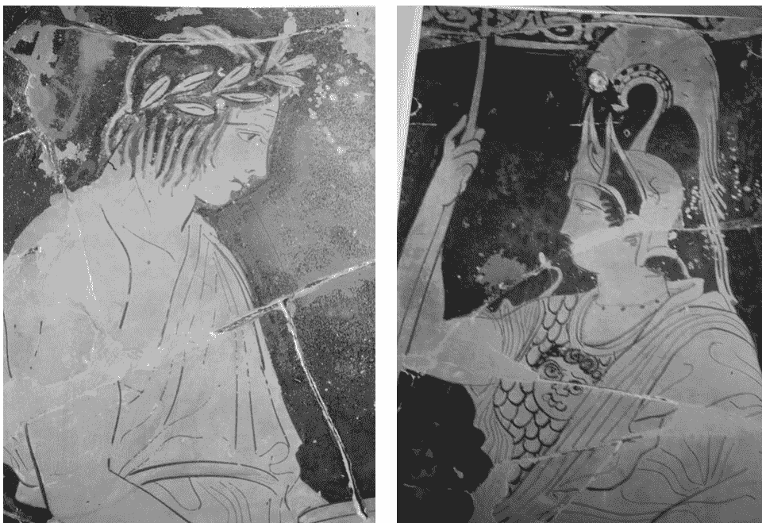

图 2。来自特拉科斯（Trachones）的提卡红绘双罐，比雷埃博物馆 7341。青年。

图 3。来自特拉科斯的提卡红绘双罐。比雷埃博物馆 7341。雅典娜。

以及解读。图中描绘了两个男人，前面是一个留着胡须的老人，后面是一个较年轻的男人（图 2），两人都赤脚穿着一件外裙（exomis），这种衣服也被称为 heteromasalos ch，通常由体力劳动者或奴隶穿着，但不仅限于他们。这两个人各都提着一个装满橄榄油的运输双罐；年轻男子双手握住双罐的提手，另一只手放在准备递给老人的地方；而老人作为场景中的主要人物，正将他运输容器中的液体倒入一个 B 型双罐中，这两个双罐的类型和形式是相同的。在双罐和实际的双罐上方有一行褪色的白色彩绘字母铭文，标出了他的名字：AAIMOS（此处见第 13 页，图 16-17）。一棵带有树干、两三树枝和一些稀疏叶子的幼橄榄树在两个男人之间舞动，这可以被认为是卫城山上雅典娜的圣橄榄树；它盛着圣树的泛雅典娜橄榄油（moriai），这些油正通过两个双罐运输；另一方面，测量和储存这些油的地方是雅典的卫城。在年轻男人的头上方和

+   7 A. Peikido-Gorecki, *古希腊时尚* (1989) 87.

+   关于铭文，见 M. G. Tiverios；关于这个名字，见 J. S. Trial, *Persons of Ancient Athens 2* (1994) 48-49；C. M. J. Osborne and G. B. Layne, *Lesson of Greek Art* (Antica 1994) s.xv. Naoxicop：实际双罐的名字刻在颈部边缘上方，以及 C. E. Vermeule, *Sculpture in Stone: The Roman and European Collections of the Museum of Fine Art, Boston* (1976) 57, no. 9. 81. 我检查了三个双罐并核对了比雷埃博物馆的铭文，我的印象是老人的名字读作 AAKAIOS 而不是 AAKIMOS。Alkaios 在公元前 422/1 年是雅典的同名标志；P. Demopoulos, *Athenian Officials of Athens vol. 2* (1989) 158-59.

+   关于帕拉斯·雅典娜的圣橄榄树和学院的橄榄树：Pap. 1.27-30-32; Hdt. 582:8; 85:5; 3.14.1 学院是雅典在 122 gremai tri的一个区域；Ath. 13:61; re 16 (1933) 302-303, s. moria (K. Latte)；橄榄树象征雅典娜，根据德尔腊植物志 *Die griechische Pflanzen inweit*

一棵曾经长着叶子的、位于雅典和一个留着胡须的男性之间的树，出现在某个公元前 419/B 的古代纪念浮雕中，IG 375，即所谓的“凿刻大理石”（巴黎，卢浮宫 MA81）。这棵树已被认为是埃瑞昔忒神庙附近的雅典圣橄榄树。值得提到的是在“凿刻大理石”上，雅典的财宝和尼刻支付了公元前 48 年大泛雅娜节的费用，这涉及向运动员支付的大笔金额——1 坦特 1000 德拉马，而其他的，即橄榄环。

Traphone 场景的节日氛围不仅体现在雅典娜女神的显现中（图 3 和图 5），她站在面板的顶部监督圣油的测量和分配，还体现在男人们提着橄榄环的事实，这标志着他们是盛大庆典的卓越参与者（图 1）。年轻的雅典娜看起来冷静且女性化，戴着一带有护颊的科林斯式头盔，身材高大华丽；她的右手像权杖一样举着长矛。她的战争形象并未被强调。她的下巴处有一个狮子，胸前有埃癸斯盾和拟人化的角。她的名字（ΑΘΗΝΑ）写在头部前方，右侧的第二个 A 被浓厚的涂层覆盖了。在卫城雅典娜的面前，泛雅典娜油被储存三年，直到下一次泛雅娜节。应用此动作的动词是 ἀμεπορτω。

雅典娜女神的显现象征着场景的性质，并确定了两个名字 Alkimos 和 Thallon[?] 不是农民或雅典人，而是更具体的官员及其助手，服务于大泛雅娜节，该节典具有宗教性质，同时也是国家和大众的庆典。老人的形象能够代表“财宝”（generic），在提卡浮雕中；从运输双罐倒入 B 型双罐的场景清楚地描绘了在卫城雅典娜面前的油。应用此动作的动词亚里士多德用来描述测量的：“财宝在泛雅娜期间被储存，运动员们轮流测量并分配给获胜者；即体育项目，包括马赛和马车竞赛。根据 Alkimos，最有可能是公元前 428–80 年期间的雅典公民之一，双罐刻有他的纪念名字。在双罐背面，我们看到一个名叫 Demok 的留胡须男人，左手拿着火炬（第 14 页）。ΠΟΥΘΩΝ 和 ΦΕΡΕΠΑΤΤΑ 用白色漆写在这对人的头部上方；雅典与埃琉绪斯的关系非常密切，但在泛雅娜期间，泛雅娜神灵的存在必须有特殊意义。哪个实际上在埃琉绪斯实施，在狄墨忒和科拉的圣所附近？后者的原因见下文。铭文保留了泛雅娜名单的下半部分，公元前 170 和 182 年，这让我们能够确定事件的整个序列和

+   Mythos and Literatur (1982) 58: cf. M. Deutiche, Rel 1970, 5–23.

10 C. L. Lawson, *Attic Documents: Art and Politics in Ancient Athens* (1995) 86–87, no. 8.

11 Cf. B. Schlöth, *Theonymastes* (1965) 60–63, p. 17–18.

12 Layton (supra 1) 60–61.

13 LSJ, s. ἀμεπορτω.

14 [Ath. Pol.] 60–2–3.

# 24

# Petros Themeli

获得体育项目的完整画面。作为马赛和马车竞赛的马赛，大部分对雅典公民开放，在“埃琉绪斯”举行。“当泛雅娜路离开广场并开始向卫城斜坡移动时，它沿着左侧的埃琉绪斯运行。泛雅娜路在穿过广场时离卫城很近，可能是路线的终点。离卫城的接近可能是埃琉绪斯，而且这些胜利是由神灵宣布的终点。”因此，雅典人身上的雅典神灵巡游似乎是雅典（而非埃琉绪斯）与泛雅娜运动之间特殊关系的充分体现。泛雅娜泛埃琉绪斯的四世纪古代大理石浮雕副本后来被重复。泛雅娜巡游在埃琉绪斯停下，随后长袍（peplos）从双罐上取下并手提过卫城，而船留在那里直到泛雅娜。

Janis Neis 指出，雅典的子民是巡游的意义所在，也是整个泛雅娜节的高潮。而且整个节日（包括小泛雅娜和大泛雅娜）最重要的一天是赫卡托比亚 28 日，即雅典娜的生日和“周年纪念”，根据安格洛斯·柯尼利（Angelos Cornelius）制作的帕特农神庙的设计。

此外，所谓的公元前 413 年的提卡石碑是由雅典国家为阿尔西比（Alcibi）及其同谋者设立的，他们被指控违反禁忌并在雅典埃琉绪斯举行埃琉绪斯秘仪。其中记录了 100 只二手的泛雅娜双罐，平均价格为 3 德拉马（2.4 到 3 德拉马）。这样的价格意味着它们被认为廉价，甚至比价值 12 到 18 德拉马的 hyperians 和 pelikai 还要便宜。

回到雅典双罐（即，，），），从奖品运输罐倒倒入地面上 B 型双罐的油场景，与女神面前的分配有关。这件雅典陶瓶象征性地代表了泛雅娜油过程的四个阶段之一：收集、交付和将泛雅娜油分配给获胜运动员。这是雅典法律规定的程序，在 [Ath Pol. 59:60] 中在圣 moria 的土地上生长

+   第一阶段：the trihemi per rectum Eleusinion (σελευσίνίων) 在圣 moria 的土地上生长。

¹5 V. Tracy, *Hesperia*, 60 (1991), 131–130; S. V. Myx, *AJMS*, 1997, 141–153 不接受雅典娜的生日是泛雅娜的主要原因。

¹⁶ F. Philopoulos, 255; F. J. Baker, in E. R. Neis (ed.), *Gods and Polity: The Panathena: The Panathena Games* (1992) 103–117; Sesteri (supra n 17) 与 bibliography: Nagy, *Nagy’s Rhhapsody and Music History: The Festival of the Panhena Games* (2002) 220–221 与

¹⁷ A. Sesteri, 1933–50. 有人区分巡游和献给神灵的长袍。

¹⁸ J. Neis, in (supra n 18).

² “σελευσίνίων”意味着“树”，那么从整个提卡圣 moria 收集的油（一个 trihemi per rectum）就足够填满超过 41 吨！）从腿部倒出的油；LSJ, σ σελευσίνιος (= 奖赏的冠，

## 泛雅典纳奖品与奉献

- 第二阶段：执政官将橄榄油交付财务司官（tamiai），他们将其储存在卫城山山上。

- 第三阶段：财务司官在泛雅典纳节期间期间对橄榄油进行计量，并将其分发给体育官员（athleticheta）。

- 第四阶段：体育官员向田径赛和马术赛的获胜者发放神圣的橄榄油。

亚里士多德的著作基于他生前有效的行的法律，即公元前4世纪的后半叶，而不是更早或更晚的时期。正如 Division 所指出的，至少直到公元前418 年，在特拉科尼亚双颈罐（Trachonian amphora）的制造时期，是由祭司（hierarchoi，第四阶段）而非体育官员负责向比赛获胜者分发橄榄油。²⁴ 此外，在公元前4世纪和希腊化时期，泛雅典纳橄榄油可能储存在用于 Meakeikos 的波姆佩翁（Pompeion），或赫法伊斯斯神庙巨大的柱式建筑军械库（Arsenal）中。²⁵

作为标准的 B 型双颈罐（类似于之前存入的 B 型双颈罐）在所有者的家中被保存，并被标记为珍贵的传家宝。其正面的描绘可能指的是上述的第三阶段（一个在卫城山外测量橄榄油的财务司官），也可能指的是第四阶段（一个体育官员向获胜者分发橄榄油）。

根据特拉科尼亚描绘的证据，我们可以得出两个结论：第一，B 型双颈罐中的泛雅典纳奖品被用作标准；其次，泛雅典纳橄榄油通常通过陆路或海路进行短途或远程运输，使用的不是泛雅典纳奖品，而是 SOS 双颈罐或标准的、坚固的易携带的尖底运输用双颈罐。“对于油和葡萄酒有未知的运输工具。”尖底罐可能用于从雅典的橄榄油贸易。²⁷ 这些符号代表了希腊产品的交换：用于雅典的橄榄油，或用于科林斯斯叙利亚产品。雅典通过拉刻达人（Lacedonians）交付，以削弱雅典对手的竞争实力。²⁸

泛雅典纳双颈罐的尺寸差异悬殊。它们的容量从未相同，从 c 到 30 升不等（前者是许多情况中的一个），此外，如果装满了橄榄油，它们脆弱的盖子非常大（在发现的案例极限情况下）。尺寸和容量的巨大范围表明它们被用作橄榄油的计量单位。³⁹ 例如，来自埃里特里亚（Eretria）的六个 amachos 泛雅典纳双颈罐容量为 38-40 升，而同一地点的三个查尔基里德斯（Charkiklides，363/362）罐容量约为 30 升.³⁰ 公元前6、7世纪的泛雅典纳双颈罐发现于意大利南部和西西里，高度在 0.49 米到 0.69 米之间，换句话说，长橄榄油。授予给雅典贵族的奖品有：Dem. 43:39；Pr. 838b-c。

²⁴ J. Davis, *JHS* 78, 1958, 23–42; Division (supra n. 9) 14 (atleticheta and hierarchopoi); cf. B. Nagy, *GrRomByz* 19, 1978, 308–313.

²⁵ L. R. Pounser, *Studia* 52, 1982, 255 (supra n. 17) 166–171.

²⁶ I. Gesichele, *Archäische Keramik: Herstellung und Bedeutung der antiken Tongefäße* (1958)。 陶器术语 (P. 62)。关于公元前5世纪晚期的葡萄酒和油，参见 M. E. Law, *Hellenic Greek*, 1990, 3–30，得出类似的结论，即泛雅典纳奖品双颈罐并未用于在海上储存橄榄油，Eeschylus，带有类型。

²⁷ G. Olese, *In the Relation of Athenian Pottery to the Persian Invasion* (1924); cf. Berlin (2002) 111–112.

²⁸ A. Person, *The Tombs of Demeter* (1942) 109–110; i. D. Kalagon, *The Panathenaic Prices* (2003) 6–77.

²⁹ M. Heiner, *Panathenaischen Preisen*, Antik Bei 18 (1998) 31–40.

³⁰ 测量是由 M. B. Wallace 于 1978 年在埃里特里亚完成，并被 Panos Valavanis 用于 σε Π Παναθαϊκών αφορες στην Επειρία: στατική ελληνική αερομηγοίας του 4ου α.ε. (XPI. 1991) 56。

³¹ Bentiz (supra n. 30) 31–40.

## 26

## Petros Hemelis

所谓的无铭伪泛雅典纳罐（pseudo-Panatache），其高度从 0.30 到 0.444 米³³ 来自凯拉米科斯（Kerameikos）的一些泛雅典纳碎片内表面的黑色釉迹，不能作为泛雅典纳曾被运输甚至出口的证据³⁴ 泛雅典纳奖品并非为橄榄油当地制造的。⁵

- ΑΦΟΡΗΣ ΕΑΙΟ: 油, 1,200, 1,300, 1,420, 1,500 个，在泛雅典纳运动会上授予，如 IG GF 231 所示。（等待，第30 页的 OCR 极其损坏。我将根据可见文本正确处理第30 页。）

# 泛雅典奖品与献祭

重量不足43吨，其伴随价值低于某些学者所建议的水平。45

毫无疑问，所有这些奖品在地中海地区都有金钱。对于橄榄油也是如此：运动员竞争的是橄榄油，而不是容器。46 这种昂贵的液体必须尽快售出，以防变质。橄榄油可以保存并保持“食用”状态的最长时间为。。质量以及相应的价值会降至这一界限以下。

泛雅典节期间的音乐比赛展示了参赛者的艺术能力和天赋，其受重视程度高于竞技比赛。47 在荷马式歌唱中，不仅是第一名，第三名也获得了最高价值的奖品。在里拉琴比赛中，第一名除了获得价值1000德拉马的橄榄冠外，还有500银币德拉马。48 这项比赛包括一个给冠军的奖品。一头价值等值的牛被颁给运动员；另一头同等价值的牛则给了在皮提舞蹈中获胜的青少年或男性，这是一种混合（橄榄）部落赛，在行进赛中获得了300德拉马，冠军奖金为300德拉马。

上述讨论得出的结论是：在径赛和马术项目中收到的“橄榄油”数量，并不与其作为城市和运动会象征的泛雅典双陶瓶数量相同。49 凯拉米科斯博物馆和J·保罗·盖蒂博物馆的泛雅典双陶瓶装满了油。50

与昂贵但易腐的油相反，泛雅典双陶瓶赠给获胜者是因为它们的价值是物质性的且持久的。51 它们被献祭在雅典各地的圣地，而不仅仅是泛雅典节的获胜者；它们被存放在死者铭记在心的神庙或公共建筑中，或是家庭或私人住宅中，以确保所有者的声望。52 在赫利奥斯节（太阳神节）、罗德斯岛哈莱亚节赠给胜利运动员的与泛雅典相关的黑绘图像具有类似的价值。53 哈莱亚节的奖品最初是带有黑彩陶器标记的青铜水神瓶。泛雅典运动会的获胜者并不献祭泛雅典双陶瓶；他们更倾向于获得昂贵的金属三足架，并在自己的雕像上铸上青铜或装饰，以纪念他们的胜利。54

遗憾的是，目前没有关于运动员在径赛和马术项目中收到的泛雅典奖品数量的证据。在公元前460年到公元前100年这超过460多年里，我们不能忽视、低估或误读这样一个事实：到公元前晚期，约400个奖品双陶瓶保存至今（Atens. Mus. 451）更有可能是。65 颁给第一名获胜者的泛雅典双陶瓶在某些方面与为第二名获胜者设计的不同。例如，获胜者（Nikikai）和比赛参与者（或公元前320–330年带有赫利奥斯形象的奖品双陶瓶）的奖品含义相同都是为小亚洲泛雅典节的运动员提供奖品。

Brauch利用了泛雅典节获胜者获得大量橄榄油，但仅获得一个泛雅典双陶瓶作为城市和运动会象征这一事实。59 Gardiner、Mingazzini和Peters建议比赛获胜者必然获得多于一个泛雅典双陶瓶，但未具体说明数量（IF G 23.1中橄榄油的衡量标准）。是Amos提出，颁给获胜运动员的泛雅典双陶瓶数量应根据上述铭文中的“油双颈罐”数量来计算；这一观点得到了匿名的认可，因为最大、最具特征且保存最完全的同年同一竞技项目（本例中）泛雅典双陶瓶是在邻近的埃里特里发现的。这些在查尔基斯执政（公元前363/2年）期间制作的每个双颈罐都是在公元前362年的大泛雅典节上颁发的，而在卡里梅德斯执政（公元前360/59年）期间制作的双颈罐则是在公元前358年的大泛雅典节上颁发的。根据重构，儿童（paides）、青少年（agenes）和男性（athletes）参加摔跤比赛并获得橄榄油和奖品双颈罐。64 证据表明，埃里特里的那三个查尔基斯泛雅典双颈罐不是给那些没有获胜的人，而是给了大多数人。它们通常有装饰，但人体刻画较少且尺寸较小。青少年和男性的区别并不总是明显。站在运动员旁或飞在上方的形象可以被视为第一名的指示。根据这一指示，埃里特里的那三个查尔基斯泛雅典双颈罐（X1、X2和X3）可以被确定为摔跤比赛的第一名。66 据此，我们可以区分出卡里梅德斯当年的四个泛雅典双颈罐（K1、K3、K5[见第17页]）以及K6为摔跤比赛的第一奖。而那只泛雅典双颈罐（K4）一定是摔跤比赛的第一奖。

# 泛雅典奖品与献祭

在竞赛中获胜。如果第一、二名获得者的橄榄油比例 1:5 同样适用于他们所获得的额外泛雅典油瓶数量，那么青少年摔跤比赛的冠军将获得 5 个泛雅典油瓶和 40 份油，而第二名将获得 1 个泛雅典油瓶和 8 份油。

我应该指出，飞行、站立或坐姿的胜利女神形象是公元四世纪泛雅典油瓶特有的特征；在更早或更晚期的油瓶中并没有出现。因此，关于五世纪和六世纪，应该寻找其他的标志性元素来区分用于冠军和第二名获得者的油瓶。

泛雅典庆典在存在期间，其制度框架和奖品发生了巨大变化。公元四世纪的前叶似乎是一个富足的时代，因为提卡土壤所能提供的提卡橄榄油数量充足。此后的泛雅典竞赛，即当时已停止的浸泡在提卡土地上的圣橄榄树（monia），数量较少，而且大泛雅典庆典（可能也包括领导者）的橄榄油量在一年内无法收集。无论如何，我们应该考虑到，在公元四世纪的最后四分之一，泛雅典某些竞赛奖品的价值大幅下降。这种变化的根本原因可能是由于君士丁时期开始时橄榄油质量的下降和育马，因为奖品写。⁶⁸ 泛雅典油瓶的稀缺在公元前 310 年至 247 年之间兴盛；狄奥尼索斯执政官意味着奖品也增加了，除了著名的陶陶师巴基奥斯向以弗索斯赠送奖励外，可能在公元四世纪末，为了泛雅典庆典的当地竞赛制作了泛雅典油瓶；因为泛雅典市内的竞赛是确定的。⁷⁹

有趣的是，泛雅典白金瓶在三世纪作为泛雅典音乐比赛的奖品颁发，而正如 IG II 21 告诉我们的，金属泛雅典油瓶奖品可能在某些时期和某些竞赛（如音乐比赛）中被授予。⁷⁰ 这在雅典装饰有腓力二世亚历山大之狄奥尼索游行图的银油瓶中也得到了体现（Ath. 5.9 D-E）。

总之，我得出结论，关于比赛中授予第一、二名获得者的泛雅典油瓶数量的问题，正如泛雅典油瓶的真实性或橄榄油遗迹的问题一样。我希望我表达的观点至少有助于消除关于泛雅典油瓶的某些事实，遗憾的是，在我看来，这些事实仍然被依赖，正如《雅典人宪法》（49.3 和 60.1）中描述的许多（paradeigmai）的争议⁷¹，以及归于泛雅典庆典泛雅典油瓶上报道的胜利标志的意义。这些标志在统计上表明，在约三百多名泛雅典奖品的画家或陶工中，只有大约五个人显示出相同的盾牌标志，这更有可能是画家的个人选择，主要受非洲崇拜方面的影响所引发。⁷²

> ⁶⁸ 泛雅典油瓶（Naum 博物馆，Gymnasion 收藏编号 1，见此处第 86 页）。表现为马赛中获胜的少年骑手的奖励：Tauleco-Alexandri（见上文注 66）307-310，编号 197。

> ⁷⁹ 如果某项音乐和体操竞赛也可以取代泛雅典竞赛。[Astol. Phil.] nov- 而通常指“泛雅典庆典”，不指大泛雅典或小泛雅典。关于这个问题，请见本卷中的 S. V. Tracy。

> ⁷⁰ Tverios（见上文注 56）27-28 及注 5。

> ⁷¹ Camp（在 r. 45）

> ⁷² J. M. Baringer，收于 O. Palagis 和 S. V. Tracy（编），《The Athenians in Athens 322–229 B.C.》(2003) 250 注 48。

> ⁷³ Tverios（见上文注 56）27。关于白底泛雅典瓶，请见本卷中的 D. Tsiklouid。

> ⁷⁴ J. M. Pollard，“雅典的角色和泛雅典‘佩普洛斯’的作用”（见：Berkeley 1985）引 M. Tverios, Μακεδονες και Μκλαβσες (2000) 5。

> ⁷⁵ Rhodes（见上文注 2）671–672；（terrace 注 141–151）；Kyle（见上文注 35）33；Nagy（见上文注 18）91。

> ⁷⁶ V. Tsantila, Delta 47–48, 1992–1993 (1997) A, 213–224。

# 献祭

与奥林匹胜利名单不同，泛雅典的献祭保存到了今天。在这种情况下，我们知道某些胜利者的名字、献祭的类型。对于这些献祭，保留的数据很少。信息来自 Raubitsch 的《雅典卫城的献祭》，以及来自 Keeseling 的《The Stotives of the Athenaea》。

- 1. Alkmion 家族的成员，可能是由 Iason 和 Megacles 在公元前 550–540 年在雅典卫城制作的，带有另一处献祭（可能是 Kleos 或 Aixolos，IG I 97），最可能是在泛雅典全项比赛后进行的。

- 2. Alkmionid 在 Poiteia 赛马比赛的献祭。

- 3. Peisistratos 在公元前 520–514 年在波提亚的用于三脚架（?）底座，然而，这一献祭是政治驱动的，在泛雅典，在同一个世纪（注 1）。

- 4. 未名胜利者在跑步比赛中的献祭，可能在泛雅典。

- 5. Chiton 和 Philon（Areos 的儿子）在公元五世纪的泛雅典期间的三处献祭。

- 6. Alkleos 在公元前 500 年泛雅典胜利后，献祭了三脚架，而非 Opistillos。

- 7. 带有长笛刻文的底座，用于一座雕像（IG I 763; 629），由 Kalon 在公元前 500 年泛雅典期间的第二次献祭。

- 8. Kallimach（IG I 781; 639）在公元前 490 年不久的纪念碑底座、柱干和柱头的残片。Evelyn 认为 Harrison 在公元前 490 年泛雅典期间进行了献祭，但纪念碑在他死后修复并竖立。

- 9. Kleon 家族的 Kallias（Hippon 之子，“pit-”），作为公元五世纪的一个少年，在公元前 480 年泛雅典期间献祭了一座铜像。

- 10. Dionysos 之子 Kallias（IG I 826; 638–642），用于雕像的祭祀底座残片，可能在公元前 482 年。不确定所谓的 Krit 是否与其有关，尽管日期没有排除这种关联。

- 11. Dionysos 之子 Kallias 带有下方装饰线条的圆形底座，用于献祭（雕像），在奥林匹、皮提亚（五次）、尼刻亚（四次）以及大泛雅典。

> 77. A. E. Raubitsch，《雅典卫城的献祭》（1949）注 37；C. M. Keeseling，《The Stotives of the Athenaea》（2003）66。

> 78. Raubitsch（见上文注 77）注 339；A. Schubert，收于 R. Osborne 和 S. Hornwalter，《Finance, Politics》（1994）291–296：献祭，“Duden zu ‘Seelen‘ und Pfleromalen der zeit”。

> 79. Raubitsch（见上文注 77）注 398。

> 80. Raubitsch（见上文注 77）注 312，根据普鲁塔克（Per. 13），公元六世纪泛雅典运动中的音乐比赛：H. A. Shapiro，《Art and Politics under Tyrants in Athens》（1989）41–44。

> 81. Raubitsch（见上文注 77）注 41。

> 82. Raubitsch（见上文注 77）注 12, 75; 41; 91–93, 85; 94; 86; Dionysos（见上文注 78）435，注 K 143 和 K 148，附参考文献。

> 83. Raubitsch（见上文注 77）注 18，Dedos（见上文注 78）420–421，注 K. 117。

> 84. H. E. Harrison，RomeBySt 1972, 19–21, 5–24；l. Keeseling（见上文注 77）66。

> 85. Raubitsch（见上文注 77）注 11；G. Schiller，《Votive im griechischenland》（2006）67–68。

> 86. Raubitsch（见上文注 77）注 25；Dionysos（见上文注 78）441，注 K 139，附参考文献。

# 泛雅竞技赛奖项与献祭

狄奥尼西穆斯为昔多的卡利亚亚斯做的第二次献祭。先前的铭文（第10号）可能是被波斯人摧毁的早期纪念碑。卡利亚亚斯在奥林匹克的胜利被认为发生在公元前472/1年（帕乌桑尼斯 5.9.3和 6.6.1）。⁸¹

普罗纳斯斯的献祭底座，献给他的姐妹，纪念他在尼米亚和伊斯西米亚运动会以及泛雅竞技赛中获得胜利。上面可能曾有一个青铜四马战车。⁸²

# 进一步观察

显而易见的是，在前六五世纪，几何时期游戏胜利者献祭的奖品是鼎，即使是泛雅竞技赛的胜利者也是如此，尽管主流观点认为他们并没有献祭陶制的泛雅祖神像。特别的是，许多与泛雅竞技赛没有直接相关的献祭——如猫头鹰、斯芬克斯、少年像、少女像、马、狗、狮子的献祭，以及立在柱子或小基座上的献祭——⁸³仅出现在泛雅祖神像的柱子上（Agora P 24661）。⁸⁴ 高基座和圆柱的类型似乎是由雅典人引入给阿里斯托芬和恩多斯等艺术家的，德尔斐的纳索斯船就是最著名的例子。⁸⁵

路德维希·赖希（Ludwig Reich）在1841年关于雅典卫城山的工作中，首次对体量柱感兴趣。⁸⁶ 他发现的巨型柱子是绘在雅典两侧泛雅祖神像上的柱子。普罗科马霍斯这种图像特征使他声称这种柱子可能曾安置过神圣的，例如卫城山上著名的大理石猫头鹰，这只猫头鹰可能长期暴露在外面，因为它的表面风化严重。尽管赖希的解释似乎如此，但这只猫头鹰也可能作为神庙的锚点。⁸⁷ 根据《苏达大全》（词条）：猫头鹰与其雅典娜女神的已知关系是：“ητρίς γλαύκ λέως εἰς στατου εβόλον ἐμβόλοις”。⁸⁸

### 柱子的意义是什么，雅典娜几乎一直出现到公元前五世纪末？

“柱子是战斗精神的象征，”约翰·毕斯利（John Beasley）在1951年提议道，并表示没有理由反对他的观点。⁸⁹ 然而，他说，“柱子指代雅典的姐妹，但可能它们也支撑着这些柱子。”¹⁰ 文章提出了一种理解柱子的纪念性建议，并得到了该主题所有相关研究的支持。在这些研究中，普遍认为柱子表示神圣之地、神圣建筑或区域的构成性或选择性代表，作为一个整体。它们构成了神性和神圣空间的象征。它们定义了神灵显现的区域和仪式行为。正如泛雅祖神像的柱子一样，它们也指示了女神在岩石上的神圣。

⁸⁸ Saustreich (snpr no. 77) 181–184, 2016, n. 1.

⁸² Saustreich (snpr no. 77) 205–207, 174; M. Korres, in Delphi cents are a la grande france. Essai de bilan, B BCH Supplement 36 (2000) 296–312.

⁸³ Saustreich (snpr no. 77) 456–478, and 493–1; I. Trianti, in Constantinople, la (sn. no. 51) 83–91); Donos (snpr no. 77) 96.

⁸⁴ M. Moore and M. Z. Phillips, Black-figure Pottery, Agora 23 (1986) 141–119, n. pl., p. 32.

⁸⁵ Saustreich (snpr no. 78) 439); Donos (snpr no. 78) 15. 一系列关于斯多克柱和纪念性建筑的重要专著已出版，包括 R. Bormann, J. 133, 1868; 以及 A. Reich, RSD 40, 1939/40, 187. 《The Architecture of Ancient Athens: The Columns of the Aegean Islands and the Athenian Acropolis in the "Ancient Period"》(New York: 1995); K. Kissias, die attischen Staaten- und Stelenbauchen in westlichen Studienzeitlinien (2002). D. Döpner, Steiner und für G. Weigeschichtlinien. Donos (snpr no. 78) 近期的演示对该主题进行了详细的描述和讨论。

⁸⁸ Donos (7) p. 14.

⁸⁹ 但请参阅利物浦伪泛雅竞技赛的柱子上的猫头鹰：Shapiro (snpr no. 82) 30–34, pl. 13c–15c.

⁹⁰ C. Karayopoulos, Αρναϊ εικασδικών πίχνεις, της γενικής εποποής (2003) 70 n. 27.

⁹¹ J. D. Beasley, The Art of Attic Pottery: Black-Figure (1951) 84.

⁹² Donos (snpr no. 78) 20–21.

公鸡通常不是通过它们的安静来区分的，而且绝不具有攻击性——在我看来，它们具有与立在柱子上的公鸡等同的意义，宣告着黎明的到来。例如，来自太阳的奥德修斯为了他的羞愧，曾拥有一只供奉在柱子上的公鸡（帕乌桑尼斯 5.22）。

⁹⁰ Tiverios in life; history of theikas by Herodotus (137–139): W. Buket, Creation of the Sacred (1996) pp. 155 and 171.

⁹¹ Tiverios and Verdet (supra n. 55), no. 73, 78.

⁹² Beazley 黎明的到来也标志着一天的开始；公鸡的鸣叫和清晨出现在希美拉钱币上，而公鸡是卡里托斯钱币上的“黎明报者”（Karus）。泛雅竞技雅典娜的竞争性被赋予了，就像竞技精神一样，而非公鸡的帮助。西蒙注意到了伯里克时期的雅典人像（公元前561/528年）。帕乌桑尼斯（3.78）提到了位于利卡贝特斯山祭坛前的鹰鸣，它们是宙斯的象征。在奥古斯丁之后的时期，卫城的毕斯比列表中包括了一支号，其作用是向报信者信号号的操作，公鸡的重要性也位于此处。毕斯比与公鸡（alekteros）的等同性显而易见；而且，这源于号作为“公共公鸡”（κονοῦἈnyπο, Ath.3.9）的特征。卫城的公鸡代表了人神之间的交流系统，而其他的与神灵和神庙有关，同时它们像鸽子和猫头鹰一样作为神圣显现的工具。象征框架中还包括站在卫城Pelagikon顶部的小公鸡，正如坡上阿斯克勒庇斯庙著名的特拉蒙斯浮雕所证明的那样。⁸⁹

## 致谢

感谢本次会议的组织者 Alcheisti 和 Olga，她们为这项研究提供了动力。同时，我也非常感谢 Stefan Kanell 博士对我的论文第二部分进行了细致的编辑和翻译。

# 神灵与竞技运动

## Jon D. Mikalson

在他的第二首《奥斯匹亚颂歌》中，品达达赞美了波塞冬，并通过他自己的奥斯匹亚运动会，让阿格卡斯的塞诺克拉特斯在马车赛中获得了胜利：

> οὐκ ἄξιον
>
> Ισθμῖν ἵψοιν νίκαν,
>
> τὰν ἐνοκράτα Ποσείδδας πάσAS,
>
> Δωριὰν αὐτούῷ στεφερόμενα κόμχ
>
> πέμπεν ἀνακρίθεα τελένων,
>
> ἑὐάόμεν ὕδοκο γειδαῖ.
>
> νπο, Ακραντίας φάς. (Isthm. 12–17)

我为他人传颂了那场并非不所为人知的奥斯匹亚胜利。

波塞冬赐予了并送给他一顶多里酸芹菜花制成的花冠

系在他的发间，让这位驾驭着伟大马车的男人“毫无察觉”，

他是阿格卡斯的光。

波塞冬作为崇拜之神，在自己的运动中，“赐予”了胜利，送去了加冕的奥斯匹亚胜利，并赐给塞诺克拉特斯。这是我们从古典时期获得的关于神力协助竞技胜利的最明确且全面的陈述之一，我用它开启一个更广泛的讨论，探讨古代和古典时期的希腊人在他们的诗歌和献文中，是如何构想客人竞技比赛中的神力协助的。

首先，我们应该注意缺失了什么。品达声称塞诺克拉特斯在奥斯匹亚运动会上胜利（Isthm. 2.18），但他随后又在皮提亚运动会上提到阿波罗为其带来了同样的胜利（Pyth. 2.18），但在这一首颂书中，他处都没有给出关于这种协助性质的任何迹象。他在其他任何首诗书中曾为胜利者展示过这一点吗？巴西律德斯也是如此。事实上，在众多的铭文中，是否有任何一位胜利者在节庆现场或他们的家乡直接描述了这种胜利？人们陈述了胜利的神圣帮助，有时出现在献文中，但这种帮助的性质是什么呢？

在这里，我们更多地来自他人，通过对帕特洛洛斯葬礼赛的生动描述（《伊利亚德》23），以及其他直接在行动中描述胜利的作者。他们竞争要在马车赛中赢得失去的胜利，成为射箭比赛中的目标，以及在径赛中快速奔。品达在描述佩洛普斯和奥伊马科斯的马车赛时，波塞冬赐予了“金马车”和“毫无察觉的翼马”（Olm. 1.86–87），但这场比赛，像帕特洛洛斯的葬礼赛一样，带有英雄主义基调。品达并没有为他在诗中所歌颂的那些临时胜利者想象过此类神的帮助。在帕特洛洛斯的葬礼中，也试图通过伤害其他竞争者来帮助宠儿，但当阿波罗召唤狄奥梅德斯的胜利，或者雅典娜导致阿喀克斯在一堆粪便上滑倒时，巴西律德斯（仅提到过一次，而且尚不确定）暗示一位神灵（如果不是不留心的裁判）导致一个男孩在奥林匹亚的摔跤比赛中失败了（11.34–36）。在古典时期的修辞中，神赐予胜利；他们并不导致失败。

在品达看来，神“造就”了他的后代西米斯托格斯和爱基纳的其他阿尔尔基梅德在一次内米亚或奥林匹亚成为胜利者：

> Τυμόθενες, δίμη δ᾿ ἐκλάκρσεν πότομιος.
>
> Ζηνὶ γενεῖαᾷ, δὅ σε μέν Νέμεα μράφατον.
>
> Ἀλλικδε δὲ δὲὰρ Κρόνος κύκλος.
>
> Ἴκ Ολυμπια. (OI. 8.15–18)

¹ 我感谢 Olga Palagia 邀请我参加这次非常有意义的会议，感谢 Thomas Hubbard 和 William Race 对品达和巴西律德斯提供的无价帮助和建议。

² ἄξιο καὶ πόκρο ἀpraie 意对于这种神圣的赐予。例如：ἄξιο, Olm. 8.84, 13, Pyth. 6.85 以及 Bacchyl. 8.28; πρμο, Pind. Pyth. 4.6, 84–65 以及 Isthm. 1.61, 3/49, 和 7.49。

或者在品达（Pyth. 81–65）中提到，神皮提亚向爱基纳的阿里斯托墨尼斯“赐予”了皮提亚运动会的胜利，或者色萨利亚的希帕斯赢得了阿波罗的双项径赛（Pyth. 10.11）。但我发现，这种关于神“赐予胜利”或使人成为“胜利者”的明确陈述，在史诗中和胜利者的献文中一样，是真实的。唯一的例子是希腊化时期特洛伊罗斯的作品，刻在奥林匹亚的一块四世纪青铜牌：

> Ἐλλήν ἕρ τὸν τόν Ολυμπία, Zeusὺς
>
> δόκλειν νικικα, δὅ δὲτέτερον αὐτοῖς ἀρέταις
>
> δεσμήν ἐχλύντο σιδηρ δεσβαν ὕβρν ἵπους Παλλάδι τάδ θένν. (Ebert, no. 38)

那时我正在奥林匹亚统治希腊人，宙斯赐予了我用获奖马匹赢得首场奥林匹亚胜利，并在第二次连续用马匹赢得。我是特洛伊罗斯，阿尔克米尼之子。诗人和神灵简单地声神“给了”胜利，这种显而易见的现实可能暗示并没有理解胜利者自身的丰富性。在奥斯匹亚颂歌6中，为了纪念爱基纳的费拉克基达斯并希望他在奥林匹亚获得成功，品达列出了似乎是胜利的先决条件：

> εὶ γάρ τῷς ἀνήρπου δαπάνε χαις καὶ ποιὲν πάράσει θεδμῶν ἀρετάς,
>
> σὴν ἵὶ δὲ δαίμον φωυτε ἄλλων ἀρέτρον κέθυσίου ἔδους. (Isthm. 10–13)

如果一个人在支出中有所要求，如果他通过刻苦努力行使神赐予的胜利，如果一个灵加入并为他创造荣耀，那么他，这位被神尊崇的人，就拥有最终的力量。神有他的角色，但如果将胜利完全归于神，将损害竞争者潜在的德（aretai）。我们发现，在希腊人在赢得战斗后建立的献文中，将胜利归于神灵的现实是简单的。在我所选的许多诗人中，第三行 64–84 行。在 τοῦ Hippος 这一行中：“ἵγνόμεν ἀπολουβαιτο πρόνων χερῶν γόλου。”

关于许多荷马式的相似之处，请参 H. Mueller. Die Lies des Bakchides (1982) 216–217。关于巴西律德斯 4.11–13 中神导致失败的遥远可能性，A. S. McDevitt 在《Liverpool Classical Monthly 1998, 291–302》文章中提出的建议将爱基纳人在奥林匹亚的阿尔利马基达斯和波利提米达斯的失败归因于一个获胜的（κλάρος πρόπιν）（Nem. 61–63）。

在雅典人在 506 年击败波奥俄亚人和色尔契亚人后竖起的青铜大门上：

> ἔνεα Βωτών καὶ Χαλκιδων δημιαντες παιίδδες Αθηναίων ἐρήσίν ἐν πολέμν δεσμήν ἐχλύντο σιδηρ δεσβαν ὕβρν τῶν ἵπους Παλλάδι τάδ θένν. (Hdt. 57.7.4)

在那里，雅典人的后代击败了波奥俄亚人和色尔契亚人，他们用铁链锁住了这些杂种者，并将这些作为贡品献给了帕拉斯·雅典娜。

约翰·D·米卡索恩

例如，雅典人分别准备向神灵献祭，以感谢在阿尔忒弥斯海战摧毁波斯舰队的风暴，而风暴确实发生了（希罗多德 7.178 和 189）。在帕特洛克的案例中，如果奥德赛和梅里翁斯在比赛中祈求神圣的光辉，他们人都获胜了。欧欧和提欧库在比赛前没有向神灵献祭，两人都失败了。同样，祈祷也作为竞技节日胜利的因素被引入，但仅如此。埃特纳的克罗米乌斯正如他所做的那样，为了西西的神灵赢得了阿波罗、阿尔忒弥斯和她们的母亲莱托斯（派德，涅墨亚 9.4–5）。叙拉克的希耶隆在阿尔忒弥斯的比赛中，通过他的马车赛向波神顿祈祷并出乎意料地获胜了（派德，庇提斯 2.11–12）。品达德告诉，阿戈斯的提亚斯也向宙斯祈祷，在许多其他胜利之后增加一次奥林匹胜利（涅墨亚 10.29–31）。在奥林匹胜利 6.77–88 中，提到哈迪斯的祖先对赫尔墨斯的祭祀和祈祷完全描述了这种在他或他的同代人的这种祈祷，也许是刻奥斯的利普凡斯：¹³

> δ Zeus κ[πουναγε], χεὶὶ ἄρ[τη]πονα
>
> ὕθμῶν δθάων τελείμα[σι] μέξαι ἀὐτοκαίου
>
> θεοῦδῶν εἰιεπεὶ, περὶ κφρτὶ δὕτασ[ι]ς
>
> γλάκου Απλοδος
>
> ἄνδμ’ ἐλαίας
>
> ἐν Πέιος Φρυγίου
>
> κλέως ἐλαίας. (8.26–32)

宙斯计算着持有者，也为了神赐予的巨大声望传递祈祷，

阿尔费斯可能在弗里几亚的竞技赐予你超越额头的埃托利亚常青藤的灰色桂冠。

在这里，诗人显然向宙斯祈祷，愿利普凡的祈祷和“最好的”位于胜利冠之上。诗人曾在奥林匹胜利时曾向宙斯祈祷感谢巴提斯族的胜利（庇提斯 5.124），并向庇提斯的阿波罗祈祷，他“提供”τελείμα ἀιλτοκαί καὶ ποί θεὸς στέγερονν（伊西斯 7.49–51）。献祭虽然罕见，但需要竞争者的祈祷。菲利普斯本人（在阿尔卡迪亚，但没有 = 55–CE no. 827）。在一首小诗中，格拉的波吕泽俄斯在比赛获胜后，他请求阿波罗祈求“增加”或使“[[*] βελ[α] αὐ[ти];（伊西斯 1.12–CE no. 397），那个从伊利亚斯莫尔恰中跳出的“第一”祈祷仅包含三个词，其中一个是 εὐγμισμούς。那是诺托瓦里亚为斯巴达安纳山德斯提供了一个静态陈述，这位奥林匹赛跑的胜利者，代表他“向神祈祷”出于一个誓言，确保他在帕特洛克最后的比赛中获得了一百只羊的祭品，他所做的，射箭（荷马史 23.866–875–872），而且并不是荷马史诗中没有哪一个祈祷做过这种事。只有一件献祭，CE no. 394，一块公元前 600–550 年的西巴里斯青铜碑，我们有了 εὐγμισμούς 这个词，在竞技献祭类型中，在其他类型的献祭中。这表明这些献祭并非字面上的“愿望供品”。

关于献祭是否是胜利者在竞技节日中创造的纪念碑的问题。它们明确了胜利和祈祷，但它们在某种意义上是对神灵的献祭吗？正如我们所看到的，它们并不是字面上的“愿望供品”。

# 38

# Jon D. Mikalos

阿耳忒弥斯，很可能是叙拉古的阿尔费俄斯河，²³ “没有她，”品因达宣称道，“希耶隆（Hieron）将无法掌握剑术”（7–8）。但是，阿耳忒弥斯和赫拉克勒·埃纳戈斯（Heracles Enagonios）是希耶隆的“胜利”（9），而且当希耶隆赢得马车赛冠军时，他祈求了波塞冬，或者说 ὅρποιαν βρυάνει θεθόν（10–12）。作为节日的女神，阿耳忒弥斯参与其中，但参与胜利的还有赫墨·埃纳戈斯和波塞冬。²⁴ 最著名的过于奥林匹克普莱亚斯（Pleias）和奥诺马伊斯（Onomais）的马车，他可能在此处规定了自己的角色。在奥林匹克及其他地方，他作为波塞冬受到崇拜，而我们已经看到他在地中海运动马车赛中为塞诺克拉特斯（Xenocrates）“赐予胜利”（Jir 2.12–18，上文）。埃纳戈斯（Enagonios）是许多体育节日的次要神。正如品因达所说，“希耶隆 εἴδε σε μοῦρ ᾿ ἀγαλακτον”（OI Gr. 6.7; cm. 10.52–53），而“提供”可能是为了底比斯的赫罗杜斯（Herodus）在瓦尔奈（Varnae）多次马车赛胜利中的荣耀（Itn. 6.1–62）。比赛的领先地位和这种概念是由奥林匹克的祭坛赢得的。在东侧，有波塞冬·希耶隆的赛马、赫尔皮亚·阿希皮亚（Herpias A Hippia）、雅典娜·希皮亚（Athena Hippia）以及狄俄斯兄弟（Dioscuri），他们独立或完全与每个活动相关。体育场是赫墨·埃纳戈斯的祭坛（Paus. 5.14.9 和 15.5–6）。所有人都必须在某种程度上表现出曾参加过比赛。希耶隆和在奥林匹克赛中的那些获胜者可能不仅受益于节日的各种，还受益于在此竞争中获得的其他利益。

阿耳忒弥斯·梅塔波尼亚的巴凯利斯（Bachelys of Artemis Metaponion）得到了阿波罗友好的目光²⁵（ἄξιος βλοφρον），并在皮提亚运动会的少年摔跤赛中胜（11.15–17）。巴凯利斯还声称阿耳忒弥斯·阿格特利亚（Artemis Agteria）的这次胜利他拥有首功：

> νὸ ᾿ Ἀτείας ἀρτέρον
>
> χρυσαλάκτος λίπερσιν
>
> [ Ἡμεῖ] τοξικῶν ἵνᾶ. (37–39)

现在是金柄的阿耳忒弥斯·阿格特利亚，

以弓闻名的希耶隆，他们是如何赢得（他）的？

但是，特别是为什么是阿耳忒弥斯？巴凯利斯在接下来的85行中解释了这一点。简而言之，非常简短地，提多斯的皮斯托（Pistos）向阿耳忒弥斯求救，摆脱赫拉强加的厄运。阿耳忒弥斯照他的要求做了，普罗托斯（Proitos）在阿尔卡亚的卢斯（Lous）的一个祭坛和圣所为她找到了那里，那里是他们获得自由的地方²⁷ 许愿牺牲并在节日庆祝阿耳忒弥斯的女儿们。巴凯利斯告诉我们，从阿尔卡亚的卢斯，我们在意大利南部亚历山德达摩斯（Alexanderidamos）故乡发现了阿耳忒弥斯·梅塔蓬的崇，这里是亚历山德达摩斯的故乡，这将是阿耳忒弥斯的主神之一。²⁸ 巴凯利斯将给予给亚历山德达摩斯的帮助与奥林匹克的阿耳忒弥斯联系起来。在历史上，他是独特的，一个竞争之神，希耶隆在阿耳忒弥斯节中获得了马车赛胜利（属于他们）

> ²³ G. W. The Measure of Pindar (1985) 62–63 比赛可能发生在雅典或叙拉古，而对于底比斯，阿耳忒弥斯节是在底比斯赢得的，我遵循 R. L. Farrell The Works of Pindar (1930) 119–120 和 M. R. Lefkowitz The Chariot Victory Ode: An Introduction [1974] 51 关于在叙拉格运动会中的设定。关于品因达2 庆祝公元前468年马车赛胜利的说法，请参阅 C. D. Young, Harvard Studies in Classical Philosophy 87, 42–48。

> ²⁴ (大部分见 sup 2 60–62，在这一文学传统中，它指出这些诗行的非凡性质 (70)，在品因达试图展示的这种“夸张奥林匹克竞赛”中，将希耶隆区别于“普通人”之处在于他的“神的赐予”，而希耶隆承认他自愿地依赖于他们)

> ²⁵ Pind. OI 7.1–1.87; CF, OI. 5.2.1, and Gr. 1580.154.

> ²⁶ Pind. 8.18–20 希耶隆作为阿波罗²⁶ “接纳”在皮提亚运动会获胜的胜利者。在赢得德尔斐马车赛的卡利亚斯（Callias）Nom. 6.35–37 中，δελφιε ἀλώῶν。

> ²⁷ 卢斯阿耳忒弥斯的头衔是 Hemeras（Paus. 8.11.8）或 Hemera（Bacchyl. [ Ἡμεῖῦ, line 39, 以及 Hymn 3.233–236）。参阅 Polyb. 4.18。关于修复和节日，请参阅 Machsler (supra n 3) 2.219–220。

> ²⁸ Hyg. Fab. 186. 关于梅塔蓬阿耳忒弥斯的崇拜并提到了与卢斯有关的地方，参阅 Machsler (supra n 3) 2.195–196，关于亚历山德达摩斯在 Bacchyl 1 中的胜利不是在皮提亚运动会而是在卢斯的 Hemeras，请参阅 R. Merelbach, ZPE 11, 25–57。 关于行军胜利的反映，请参阅 A. Kohen, Würz:49–51。

# 神灵与体育竞技

神，在数百英里之外。但我们应将其视为诗意的幻想。这种想法并没有出现在我们可能找到它的地方，即获胜者在故乡竖立的许多奉品中。获胜者并没有对他们在奥林匹克、皮提亚或其他运动会中的胜利向神表示感谢。巴凯利斯为我们提供了第三个例子，这也是一个奇特的，也许是比赛中最引人目的的神力分配。科斯斯的阿尔格奥斯（Argeos of Cos）赢得了伊斯西米亚（Isthmia）的少年比赛。正如巴凯利斯所说，他的仁爱技巧以及另一个潘塞伊德斯（Pantheides）的“善事”，这些涉及医学技巧和款待异客的艺术：

> τοῦ Πανθείδους κλοτον
>
> ξεὺς ἄξελλένταν,
>
> ἀμμφ τἰγορί
>
> ζείνον τε ἀφινορι (147–150)

阿波罗为著名的潘塞伊德斯赐予了如此善事：医学艺术和对异客的仁爱。潘塞伊德斯留下了五个儿子，宙斯为了报答父亲的善事，将其中一个变成了伊斯西米亚的胜利者和其他比赛的获胜者，并赐予他其他辉煌的桂冠。

> ὃν ἕνα ἐἴνοίδας
>
> νικήσεν Ἰξεοῦ ἰομίνικό
>
> θύκεν ἐξεστάνν
>
> λων τεφάνν. (155–158)

作为阿波罗给予阿尔格奥斯父亲的“善事”所产生的高贵儿子之一，宙斯让阿尔格奥斯在波塞冬节中获胜。除了涉及的主要神灵数量和他们不寻常的外，与巴凯利斯（Bacchyles）不同，获胜者是因为其父亲的“善事”而获胜，这种说法似乎在某种程度上是获胜者自己的成就，这种主张与获胜者本身又又远了一层。这恰恰把我们带回今天的雅典和波利亚斯（Polyas）。雅典娜在公元前483年的潘肯纳（Pancena）比赛中赢得胜利，为此得到了品因达（5）和巴凯利斯（13）的诗歌。两位诗人都提到了潘塞伊德斯的导师，来自雅典的。品因达关于他说道，是雅典运动员的仁爱工匠；

> χρὶ δ’ ἄ’Ἀθηνῶν ἀμποράν ἔμεν.
>
> ἔνίκων ἔνώι μέλλει,
>
> Πιλλ, μέταιν τε βητο
>
> τάόρεου
>
> τίσμεν ἀρουσμς.

马赫勒（Machler (supra n. 3)）2:18–20，阿波罗赐予潘塞伊德斯的“善事”是因为（ἀμείρ）他的医学技巧和对异客的善待。这同样是体育成功的无与伦比的原因。马赫勒将潘塞伊德斯的技巧和对异客的崇拜区分开来，而巴凯利斯并未具体说明它们，而是它们可能是某种奉品。这对我来说是不必要的变量增加，但无论如何，阿尔格奥斯的胜利仍归功于父亲的善事。

σεμνά μεγαθου Άθ那些,
μυρίων τ’ᾖδη μρατεῖν ἀνέρων
στερόεσ ἐθεί
ἐν Παναλλέων ἀθλοις。(190–198)

年轻人，歌颂皮提亚（Pytheas）辉煌的胜利和梅德罗斯福人的胜利。金柄阿耳忒弥斯，受尊敬的，在阿尔费俄斯河畔多次加热，并为全希腊竞赛中的万名胜利者冠冕。

在巴凯利斯的版本中，阿耳忒弥斯“光荣”了梅德罗斯在奥林匹克的努力，并惊人地为梅德罗斯在希腊竞赛中的数千胜利者冠冕。这里不是节日的神，不是故乡的神，不是导师故乡的神，χρματις σεμνά μεγαθου Άθ那些为全希腊的比赛带来了胜利。我认为，这是发现的雅典卫城的阿耳忒弥斯（Athena Polias）对阿耳忒弥斯帮助的唯一明确提及。

结论是，运动员显然将他在竞争中的愿望、希望和祈求帮助主要指向节日的神，但这种帮助的性质并未定义，获胜者并没有强调这种帮助本身，例如赫尔墨斯·埃纳戈斯可能也有贡献，但运动员和诗人给予他们的功劳更少。

## 复制传统：大泛典纳亚节的首次庆典

Jenifer Neils

公元前566年的首届大泛典纳亚节（Great Panathenaea）研究是一项智力上的挑战。众所周知，最重要的铭文证据（*IG II* 231* [参见此处第118页，图1]）日期于该节日传统创办年份后的两年，且仅涉及体育、音乐和马术比赛的奖项。在两百年间，一切都可能发生变化；在2004年夏季雅典，我们见证了现代奥林匹运动自在该市首次举办以来一个世纪的演变。由于缺乏连续性，我们如何才能构想出第53届奥林匹运动会第三年大月（Hekatombaion）28日发生的情况？这迫使我们去想象一个从相对无名中崛起、并成为希腊历史舞台领先主角的城邦（polis）——它直接请求并忽略了其他城邦。我们看到，这座城市守护神的主要宗教节日如何揭示了雅典人在历史早期阶段的公民和宗教特质——大泛典纳亚节反映了他们的民主理想和抱负。

如果我们对公元前566年的创办相当确定，那么大泛典纳亚节的许多其他方面仍存在争议：其名称的含义；其古老形式（Erichthios）；其历史上的组织者（执政官希波凯德斯）；其体操和马术赛事的计划；加入比赛的时间；非体育竞技者的奖品性质；以及其前身（古老时期）新建立该节日的目的。

溯至这一时期的唯一官方铭文描述是刻在卫城广场的石灰岩石碑上的*序言铭文（probromos inscription，DAA 326及其后续 DAA 327–328）*。这些石碑由隶农（heriotes）或神职人员建立，他们声称组织了大会（demos），并为“大眼睛的人们”（pepe-eyed men）建立了竞技场（agon）。Raubitsch等许多学者认为，由于使用了*proto*一词和古老字母，这篇铭文指的是公元前566年泛典纳亚节的设立。如果这些词是正确的，且 *demos* 被正确翻译为“赛道”和“竞技”，那么我们可以假设公元前566年是宗教官员负责节日的一年，其价值正如我们所认为的那样。

大量的考古证据表明卫城上的活动有所增加，学者们发现了这一时期描写雅典人的新建筑路线。学者们注意到：一座带有雕刻石灰岩装饰的大多式神庙（Hekatompedon或古雅典神庙）；雅典娜·胜利神庙的建造于这一时期（其部分埋藏铭文见DAA 329）；以及一条宽九米的宽路，作为通往卫塞的宏伟大道。这种建筑活动自然地与大泛典纳亚节的建立联系在一起；一场盛大的节日需要为女神像提供更神圣的住所，需要与胜利女神（Nike）人气相关的竞技活动，以及大规模的建筑和盛大的游行需要更好的通往卫城的通道。除了尺寸（size）样的小亭和持羊少女（Moschophor）外，雅典人最早的大理石献祭品，如定于公元前570–560年的尺寸少女（size-kore），以及带有精细图案的黑绘陶器，被确认为翻新后的奥林匹风格。公元前560年左右雅典的体育活动通过在拉美科斯（Kerameikos）设立的大理石石碑得到了证明，碑上刻有运动员的形象：一个是一个持圆盘的年轻五项全能运动员，另一个则是一位年老的拳击手。正如Neils等人所指出的，在560年代的后半叶，跑步、摔跤和赛马等运动经常出现在Siana陶器上。女性胜利女神的形象也出现了，这些众多的器皿见证了公民对体育和马术竞技的新热。。碎片化的铭文、建筑痕迹和个体雕塑并不能告诉我们在这些早期泛典纳亚节上实际进行的比赛情况。对于这些活动，我们必须转向六世纪具有明显泛典纳亚图像的大型节日，以及那些与节日联系较少、但学者尚未考虑过的艺术作品。我将证明关于大泛典纳亚节的性质、特征和历史的各种理论。

另一种方法是考察六世纪第二四分之一时期提提风格陶器绘画中密集的图像。早期的泛典纳亚花瓶及其动机（所谓的泛典纳亚花瓶）以及节日的其他方面，已经创造了一种视觉现象，正如我们打算证明的那样，这种现象对艺术家产生了深远影响。尽管这些大约公元前570–560年的早期黑绘双胆瓶较少，但它们对于包含六世纪中期实际比赛的描述具有重要意义。虽然不那么明显，但在泛典纳亚风格中，提提黑绘瓶上的图像可能反映了面向观众的特征，即前往卫城的游行。最后，渗透当时雅典人思维的是史诗。荷马所描绘的华华葬礼游戏无疑激发了早期对这一赞助的首次庆典——正如它们影响了同时代的僭主克利斯托尼（Cleisthenes），使其为了赢得他女儿埃格阿里斯提刻（Aegaristike）的手而举办体育竞技。某些特定的雅典文本认为古老时期与青铜时代有更强的共鸣，这可能是雅典人刻意试图与英雄过去建立联系的尝试。最重要的是，荷马式的比赛涉及昂贵的奖品，如金属神像和水瓮（lebetes），而泛典纳亚节在宗教节日中与众不同之处在于它为访客提供的不仅仅是一场聚会。

为了说明这些方法，人们可能会考虑泛典纳亚节的最高潮——献祭长袍（peplos）。在早期关于泛典纳亚节的一篇早期文章中，戴维森（Davison）将献给雅典娜的长袍描述为“对奥林匹克仪式的古风化”。这是一种具有重要史诗关联的仪式：《伊利亚马史》中向雅典娜献上长袍是女性为了城市繁荣而举行的仪式。雅典版这种仪式的描绘出现在古典时期泛典纳亚节第一道饰带的中心（而且在当时也是毫无争议的）。但长袍是否出现在上一个世纪，更接近泛典纳亚节的发现时期呢？与Karouzos在其关于阿马西斯画家的专书中一样，我认为公元前550年左右的两件双人长油瓶（lekythoi）之一描绘了泛典纳亚长袍的织造，肩膀上画的花环直接垂落在两个小女孩身上；纽约的一件大约公元前540年的泛典纳亚形状双胆瓶（归于普林顿画家F. I）也可能描绘了长袍，它由最右侧一位年轻女性头顶着（由祭坛和“守护者”（Promachos）标示）。左侧的人物暗示了宗教仪式正在进行，而且这里的雅典类型，更不用说花瓶的形状，无疑打破了泛典纳亚节的常规。

# 44

## 詹妮弗·纳米（Jenifer Nails）

古卫城卫城（Akropolis），她也是两位祭物者（athephoroi）之一，负责将圣衣送到雅典的原始神庙。底座上刻有的橄榄树为这一场景奠定了背景，那座坡顶建筑也是老神庙的前身。这一时刻六世纪的设计师似乎在暗示，佩提斯（peplos）仪式可以追溯到雅典在卫城卫城上最早的崇拜。他们刻意地对这一仪式进行“古风化”处理，碎片化的图像学并非重点；他们是在证明，“身着佩提斯”的理念在早期是雅典公民身份认同的一种初级能力。

进一步研究大泛雅典节（Great Panhenaic）的图像学，可以转向六世纪第三四分之一的提卡黑绘陶瓶来寻找佩提斯图像的反映。我们从后来的文献中得知，赛马图（gignamometry，或战车赛）被织入这一形象中，而这一主题突然出现在献给卫城卫城雅典的陶瓶上，几乎完全反映了纺织品图像对艺术家的影响。吕多斯（Lydos）创作的一个黑绘双联（dinos）的上层描绘了赛马，来自卫城卫城的一只双罐（antharos）也是如此，这可能是由陶师尼亚科斯（Nearchos）绘制的，因为他在上面留了自己的签名。在卫城卫城角落发现的其他黑绘陶瓶也描绘了这一主题，艾兰·夏普罗（Alan Shapiro）认为其中一些是公元前565-560年首次出现在雅典的新作品。一种新织就的、色彩鲜艳的、图案纺织品很可能启发了这些画家。虽然佩提斯仪式的某些部分无法通过铭文或其他文字文献追溯到560年代，但早期雅典卫城卫城有足够的证据来确立其在大泛雅典节期间的至关重要性。

# 奥林匹克与德尔斐模式

对于竞技活动和祭祀仪式，让我们先看看在奥林匹克和德尔斐举办的早期且更具声望的节日。到第53届奥林匹克运动会时，雅典举行了一场盛大的宙斯节，雅典也有许多这位神的神灵——包括崇拜和神像。在希腊神话和宗教中，雅典娜与他们的关系特别亲密——两者分别在卫城卫城作为“波利亚斯”（Polias）和“泛雅典娜”（Panhenia）受到崇拜。她们很可能以相同的姿态出现，即“前行型”（Proa）的小青铜像，背面向宙斯，这种姿态可能启发了首次出现在公元前566/5年的伯顿双耳（Burton amphora）上的“泛雅典”雅典娜，两者相似。在基础神话方面，圣地是由宙斯的凡人儿子赫拉克勒斯（Heracles）创造的，他清理了雅典人的边界，并为了纪念宙斯创办了第一届运动会，记载于品达达（Pindar）。雅典人还描述了他们节日的英雄化描写，德尔斐的神庙祭坛一直可以追溯到第三世纪，非常古老且稳固。正如我们从帕特农神庙和其他来源所知，向雅典卫城卫城献上了一百头母牛。由于奥林匹克地区是畜牧丰富的土地，埃利阿斯人（Eleans）在奥林匹克举行如此奢侈的祭祀。然而，土地和祭祀规模是异常的，并模仿了奥林匹克的祭祀。根据帕乌桑尼斯（Pausanias 5.24.66），运动员的誓言是针对一个极其向往的神圣仪式进行的。这也出现在《伊利亚亚史》（19.266-67）中，它可能是一个非常古老的仪式，正如我们在下方看到的，在早期可能曾献给雅典。

环绕祭坛（祭祀）的宏伟而巨大的游行无疑是节日的原始方面之一。虽然在566年之前游行就是节日的一部分，但此时在卫城卫城入口处建造的宽坡道形成了一个大大扩展的泛雅典姿态。这种游行表现的实际参与者显示在：

- 14 关于这一建议，参见 H. A. Shapiro，载于 D. E. Reeder (编)，《Pandora》(1995) 39-48。

- 15 雅典国家博物馆，Art Kr 612，约 83, 3。

- 16 H. A. Shapiro, Cla 9.1, 1990, 129.

- 17 参见 J. Nils，载于 S. Deacy and A. Villing (编)，《古典世界中的雅典娜》(2001) 219-232。

- 18 泛雅典雅典娜，参见 G. F. Pinney，载于 J. Christians and T. Melander (编)，《古希腊与陶器第三次研讨会论文集》(1988) 467-477，显示雅典娜并非处于“守护型”（Promachos）姿态，而是在跳皮尔舞（pyrrhcheia）以庆祝神灵战胜胜利者。

- 19 另一种，运动是为了向佩洛普（Pelops）致荣誉。

# 重现传统：大泛雅典节的首次庆典

图2. 通往祭坛的游行。提卡黑绘带纹杯。公元前560年。巴黎，尼亚科斯收藏。照片：D. Widmer 837，

在尼亚科斯收藏的一只约公元前560年的特大提卡黑绘带纹杯上（图2），以简化的形式呈现。²³ 这里，一群令人印象深刻的崇拜者正走向雅典娜的火焰祭坛，祭坛后面站着女神（或神像？）和她的祭司。游行的领队是一个留着胡须、拿着树枝的男士，紧随其后的是一名提篮圣女（kanephoros）。祭祀动物包括三类：牛、羊和母羊，由三名青年和成年人看护。三三小组：音乐家（两名笛吹奏者）、持枝者（kallophoroi）和手持长矛的步兵（hopites）。在手柄后面的是举起的马。这一图像一个有趣的方面是数字的重复（与帕特农神庙的浮雕不同），这表明提卡的重大活动并不如此多。当然，要判断它是献给小泛雅典节还是大泛雅典节，考虑到日期上的接近以及与帕特农浮雕的相似性，可能是大泛雅典节的表现。

三类（trityis）是三种不同的动物：牛、羊和母羊。在德尔斐的皮提节期间，阿波罗祭坛献上有许多祭祀，分为三类（牛、羊和母羊），这种提卡的祭祀类型受到了德尔斐仪式的启发。同样类型的祭祀也出现在公元前560年的黑绘杯上，由吕多斯（Lydos）签名，并在卫城被提到，尽管这里的游行目的并不清晰。上层和下层描绘了赛马图（gignamometry），我们假设受者是雅典娜。当大泛雅典节建立时，奥林匹克的运动项目已经相当完整。它包括三个距离（径跑 stadion、双跑 diaulos、长跑 dolichos）、全项运动、摔跤和格斗（pankration）。马术项目包括四马赛车和赛马。正如我们提到的，在六世纪，雅典人开始赢得四马赛车比赛。阿尔基翁（Alkmion）在592年胜，卡里亚斯（Kallias）在564年，可能的米萨德斯（Mithades）在560年。根据帕乌桑尼斯（6.10.8; 6.19），在奥林匹克赢得赛车的胜利者位于西西的库中。现在转向另一个主要且有影响力的节日，德尔斐纪念阿波罗的皮提节，像奥林匹克和泛雅典一样也是泛雅的。皮提和泛雅典发生在奥林匹克第三年的夏季。第一届运动会归于西西的暴君，其日期为第一次战争后的582年。此时，笛比赛被加入了早期运动会中。这一节日的特点是其音乐比赛，与神崇拜密切相关。文献碎片显示，泛雅典节的音乐比赛（即黑绘画）在六世纪中期已经是该节日的一部分了，并且几乎肯定是在皮提节的统治时期形成的。

# 泛雅典瓶的证据

现在转向雅典的艺术证据，我们可以确定奥林匹克和皮提节的哪些元素在566年被纳入泛雅典节。有48个泛雅典奖瓶来自本特所说的“第一代”，日期为公元566-530年。这些瓶子中只有19个显示背面的图像提供了雅典早期运动会的证据。大约一半（19个中的10个）描绘了径跑奖，例如纽约那个公元前565年由尼基亚斯（Nikias）签名的瓶。虽然有两个带有径跑和两个摔跤手的泛雅典奖瓶，其中一只瓶描绘了泛雅典，另一只著名的伯根瓶（Burgeon amphora，见第1页）显示了马车。除了拳击之外，这描绘了在奥林匹克举行的运动。然而，特别感兴趣的是径跑，直到500年才出现在奥林匹克项目中。这很好地代表了这样一个案例：一项更符合战神利益的运动在雅典流行，然后被列入奥林匹克运动的名单。

伪泛雅典瓶帮助我们完善在雅典举行的早期运动。这些产生于公元前550年到世纪末，这些使用了标准奖瓶的再制品始终在背面显示比赛。背面最近汇编了这些瓶子的完整列表，总共325个，其中公元前530年之前的只有25个。这些早期伪泛雅典瓶描绘了节日，这是一个被评论家充分记载的事件。有五个伪泛雅典瓶显示了摔跤比赛，如盖蒂博物馆的碎片被归于“摇摆画家”（Swing Painter），它将捐赠者显著地放在两个摔跤手之间。值得注意的是，雅典的盾牌在另一个奖品——三脚架上，我们将回到那里。这些早期伪泛雅典瓶中有三个描绘了战车，意义上，代表了早期泛雅典瓶中缺失的赛马。

- 20 L. I. Maropoulos, *Ancient Greek Art from the Collection of Stavros S.* (1995) 86–93, no. 12.
- 21 关于其代表身体的建议，参见 Boardman, *The People of the Hill, the Shore and Plain*, RA 1972, 57–72，以及 Ridgway (supra n. 5) 286–287 中的进一步讨论。
- 22 关于三类，参见 H. T. Van Strat, *Hierále: Animal Sacrifice in Archaic and Classical Greece* (1995) 16–17.
- 23 雅典国家博物馆, Akr. 607, 归于 Lydos; van Strat (supra n. 22) 196, no. V13.
- 24 纽约雅典博物馆的 1978.11.3, 由陶师 Nikias 签名。M. MetrusJ 34, 1999, 37–53; Bent 1998, 126, no. 6007, p. 5.
- 25 雅典国家博物馆, 2468, 归于画家 C. AB 69, 1; Bent 1998, 126, no. 6044, p. 11.
- 26 马里布，J. Paul Getty Museum 86.AE7, 归于摇摆画家。Bent 2001, 189, no. 245.
- 27 牛津阿什莫利博物馆，牛津大学 73.3; Bent 2001, 187, no. 212. 利物浦公共博物馆 56.19.27; Bent 2001, 188, no. 227 (Swing
- 28 诺里奇，城堡博物馆; Bent 2001, 190, no. 26 (Princeton Painter)
- 29 伦敦，英国博物馆 B 144, 归于摇摆画家。A. Shapiro, *Art and Under the Tyrants in Athens* (1989) 32, p. 12a; Bent 2001, 189, 坦帕艺术博物馆 86.22; Bent 2001, 194, no. 309.

## 复制传统：泛雅纳大运动会的首次庆典

泛雅纳大会展示了拳击手争夺泛雅纳双口瓶，²⁹ 这表明拳击在雅典的出现正如在奥林匹出现一样。

在这些早期的泛雅纳艺术品中，我们发现还有五件展示了比赛，通常是一个奥笛演奏者，如德克萨斯大学奥斯汀分分校的一个早期示例，或者是这名由奥笛伴奏的歌手，另一件则归于纽约的“泛雅纳画师”之……³ 这些场景自然地表明，奥笛演奏和奥笛比赛是早期泛雅纳大会的一部分，值得注意的是，这些场景强调了观众。对于里拉琴，它出现在其他形状的双口瓶上，其辅助图像识别了泛雅纳大会。这种双口瓶是雅典的B型，其中弹琴者坐在两根爱奥尼式柱子之间。³³⁰ 这些音乐比赛显然源于抒情诗，旨在将泛雅纳祭典提升到高于奥林匹模式的高度。

如果正如某些学者所认为的，泛雅纳大会可能存在于566年之前，那么有必要考虑两种可能的“前泛雅纳”运动员。

第一种是雅典的一个大型颈双口瓶，描绘了一侧侧有观众的奥笛演奏者，另一侧是一个骑手。³¹ 在Karougos的原始出版物中，被视为泛雅纳艺术品的前身，在图像中，它说明了566年之前举办的音乐和活动，体育竞技就是在这些活动中进行的。³² 第二是一个标准的颈双口瓶，没有任何在早期泛雅纳型双口瓶颈部发现的辅助装饰（如莲花和棕榈叶纹饰）。因此，几乎没有迹象表明这是泛雅纳大会，尽管正如我们在许多双口瓶（图2）上看到的，骑手是泛雅纳巡游的一部分。

一侧是一只家用鹅，另一侧是训练员，这个案例可以作为雅典丰富的船只和音乐的例子。带有甲板装饰的船只也是布洛涅-苏尔梅尔泛雅纳船只的一个未彩绘版本（图3–4）。³³ 在甲板装饰上，清楚地看到哈勒和纽约的早期泛雅纳短跑赛中有短跑运动员，³⁴，但位于两侧颈部和肩部的交界处。一侧描绘了一个穿着短长袍和斗篷的胡须男子，向右骑着一头伊塞亚驴。他身旁有攀爬而行的青年。骑手上方似乎是一个神灵铭文，但不是赫菲斯托就是奥尼索斯。因为骑手头上戴着常青藤环，他被识别为此身份，但缺乏旁观者暗示这是一场宗教巡游。

另一侧也描绘了两名裸体男性运动员，左侧一个，右侧一个拿着月桂枝。穿着长长袍和斗篷、持长杖的男子正伸向前方仅穿一件短袍（chamys）的肌肉男子。这个看起来像运动员的男性的动作以及另一个人抓着一群胜利的运动员。他与吕底亚祭坛前立着的胜利者相似。³⁵ 虽然除非骑驴者是巡游的一部分（如上述讨论的雅典陶瓶所示），否则很难确定骑驴者与泛雅纳大会的关系，但这位胜利的运动员可能是雅典陶瓶在566年为泛雅纳大会增加的新体操运动的首次尝试之一。正如我们在这里的马赛案例中看到的，对胜利者而非运动员的认可并不是正式奖励，因为这件大型双口瓶有许多可能作为献给胜利者的用途，正如所示。

- ²⁹ 篮子市场，归于Springer所有；Shapiro（见于no. 286, 333, plb: 2001, 184, no. 15）。
- ³⁰ 雅典Vlatos收藏中独有的泛雅纳型双口瓶（BS 84, 约公元前560年）具有特别的意义，因为它描绘了一个陶瓶。在瓶身上有五个人正在比赛，可能还拿着锤子（³⁷）。
- ³¹ Austin, University of Texas 1984:34; Neils 1992, 62 and 155, no. 17. New York, 大都会艺术博物馆 1998.281.89; Neils 1992, 43 and 158.
- ³² Karougos, On Art of Athens 33,440, 归于Group E。Neils 1992, 65 and 150, no. 20; K. Kilinski, H. A. Shapiro et al., (eds.), Greek Vessels in the Sanctuary of Athens (1995) 86–89, no. 40. 参见伦敦带有里拉琴的泛雅纳型双口瓶: ABI 139, 2.
- ³³ 雅典国家博物馆 559: ABV 85, 中间1.
- ³⁴ S. Shapiro-Marden, AJA 42, 1938, 495–505.
- ³⁵ 布洛涅-苏尔梅, 市立博物馆 592: 见 Annali del Secolo di Mondo Class 11 (1989), fig. 25.1–2.
- ³⁶ 哈勒大学 2006: ABV 120, 柏林 1998, 123, no. 6. 纽约: n. 24.
- ³⁷ 佛罗伦萨，国家考古博物馆 977, 归于Lydos。ABV 110, 柏林 1994, no. 8. pl. 6–7.

异常的公元前540年左右泛雅纳型陶瓶（图5–6）引起了人们对其图像的关注。其形状和对面内容表明它是泛雅纳节的一部分，但其响应（s）并不清晰。在最右侧有一些跳跃运动者，戴着头盔和手套并拿着盾牌。他可能正随着奥笛的旋律跳舞。背景中最为神秘的是一个运动员/体操健将，在雅典陶上也同样可见。左侧是一个骑手，或*iskarios*，披着斗篷。从最低人物口出的铭文是：kados（常误读为katos）。瓶子的两侧都强调了泛雅纳奖品（在此例中为tripos）以及kados的引用，以及在场的崇拜者的重要性。这个“会说话”的陶瓶让人联想到同样强调奖品的另一个细节。一个归于“普林顿画师”的泛雅纳型双口瓶（公元前540年）描绘了：

- ³⁸ 巴黎，梅达耶博物馆 243, 未归属。Shapiro (n. 28) n. 26, c. 122-d: Bentz 2001, n. 275.
- ³⁹ 由著名的Polyphenic双口瓶暗示。见 B. Reed, Ancient World 15, 1987, 59-64.
- ⁴⁰ 垂直行。Kephalidou, 173–174, T 6, pl. 13.

## 复制传统：泛雅纳大运动会的首次庆典

泛雅纳大会被赫尔墨和披着斗篷的人包围。¹¹ 在狂欢中，一名信使正在宣布胜利者Dseiketos (=Dynniketos)，他跟在后面。最左侧是一个裸体青年，头上和手里各有一个里拉琴。正如其他泛雅纳型作品展示了女神的胜利（或她的地位），这个陶瓶背面的披着斗篷的男子有时被识别为Zao，并描绘了自己，即马赛胜利者。信使赫尔墨正在宣布泛雅纳大会的胜利。显然，由于其形状，这一时期里拉琴构成奖励似乎令人惊讶。尽管它在德尔斐第一届奥林匹运动会上被颁发，但我们没有关于它作为礼物的记录。它也可以被看作是献给胜利者的。卫城山上最早的献祭之一是一根支撑着里拉琴的纪念柱（DAA 317），由Almeonides和Kriton（⁷）共同献上，他们分别在公元前550/49年的泛雅纳会上获得了五项全能和马赛。³³

图5. 泛雅纳大会被赫尔墨、观众和杂技表演包围。泛雅纳型黑色风格陶瓶。巴黎，国家图书馆 243。照片：博物馆。

## 其他黑色风格陶瓶

如果我们观察这一时期的其他黑色风格陶瓶画，会发现里拉琴和马赛之间存在着惊人的联系，赫拉克里昂的一件归于Sophilos圈（约公元前570–560年）的残片式diion。⁴⁴ 里拉琴被显著地表现为由雅典的Siano赢得的一位胜利者所携带的奖品。⁴⁵ “头上顶着青铜里拉琴是运动会的奖品，”他遇到的是Beazley的话，“属于他的家族和村庄，为未来留下了花环和赛马。” 在这个杯子的另一侧，有四匹马正在向右奔跑，在对面，恰好是一个带翅的尼刻。我们只能假设马赛的获胜者带走了他的。

- ⁴¹ 伦敦，博物馆 1849-11-21, 归于普林顿画师圈。ABV 307, s. Kephalidus, 226, no, pl. 8.
- ⁴² 见 Kyle (上文n3) 196, no. 46.
- ³ 赫拉克里昂博物馆，来自Gortyn。Griechische, Paralimpica 18, 148; G. Bakir, Sophilos (1981) 72, B, figs. 158–160.
- ⁴⁴ 见 E. Ma.-Mandelartz, Griechische Relierdarstellungen in agonistischen Zusammenhang (1990) 62–75, and pls. 14–15.
- ⁴⁵ 海德堡，ABV 51, s. 1; J. D. Beazley, The Development of Attic Black-figure (1986) pls. 17.4 and 18.1;; Kephalidus, 172, T1, pl. 13.

50

詹妮弗·尼尔斯（Jenifer Nails）

如上所述，keles（马赛）在第一代奖赛体育活动中明显缺失。最早的带有铭文的奖品是纳乌普利翁（Nauplion）公元前530–520年的泛雅典纳竞技奖品，但此处并没有举行马赛；⁴ 由所有者领骑的获胜马赛仅仅是另外两个男人的装饰图案（phyllobia）。⁵ 正如伦敦的Dyniketos陶瓶所示，重点在于获胜者，而非比赛本身。现存的最早展示真实马赛的泛提纳亚奖赛陶瓶，产于Antimeites之手，追溯至公元前520–540年。⁶ 一件异常且早期的（约公元前660年）黑色彩绘泛提纳亚奖品，其手柄底部有立体浮雕头部，展示了两匹骑着马手的马对峙前进。⁷ 这一早期证据表明，泛提纳亚节最初几十年的马赛奖品可能是三脚架，而不是盛有橄榄油的双耳瓶。这暗示了奥林匹奖品体系（公元前648年）恰恰相反，那是公元前568年最早的运动会之一。⁸ 在泛提纳亚节的早期，神灵的纪念碑或橄榄树可能不足以为每项活动生产橄榄油；种植树木以确保节日期间有丰收，可能需要几十年的时间。

在第二世纪，B型双耳瓶（尤其是Ekekis风格的）在奖品中展示的是获胜的运动员和马车夫，而非骑手。⁹ 罗马朱莉亚别墅（Villa Giulia）的一个双耳瓶上，紧随大型胸像的两个三战船者（triopers）表明他是一位获胜的选手；¹⁰ 华盛顿的一件由柏林画家1686年创作的作品是胜利典礼的一部分。¹¹ 获胜的运动员正由坐在左侧的裁判员加冕，旁边站着一名三战船随从。最后，一些E型双耳瓶展示了运动员接受泛提纳亚奖品；这可能是背面的奖项。¹¹² 到此为止，比赛似乎已变成一种赢得胜利的方式，而名次将在Nike主题红彩绘奖赛陶瓶中体现。青铜三脚架最初带有史诗铭文，是因为它们与帕特洛克斯的葬礼游戏有关，可能对于参加最早泛提纳亚节声誉*keles*的雅典人来说，是一项合适的奖品。

奖品显然是早期泛提纳亚大庆祝活动的一个重要方面，Kyle指出了此类奖品对非雅典人参加该节日的重要性。在泛提纳亚及其他雅典陶瓶上对奖品的这种显眼展示，相当于一种视觉修辞，宣传了泛提纳亚节相对于当时举行的其他冠冠赛事的独特特点。泛提纳亚奖品铭文（“雅典的奖品”）传达了这样的信息：雅典的节日既丰厚，又如此值得参加。它还展示了这座城市的财富以及生产橄榄树的女神的赞助。

## 结论

虽然泛提纳亚节在公元前566年之前就已经存在，但其主要组成部分被并入了一个更大的节日，并在奥林匹克和皮提亚运动会上被合并并发展为五项运动赛事。来自最早泛提纳亚奖品及其展示的证据表明，要通过体育和马术竞赛、向神灵献上奖品，可能还有马赛中的三脚架来引入和模拟这些早期节日，在概率上具有困难性。在公元前566年至530年间生产的第一代泛提纳亚陶瓶，描绘了奥林匹亚上相当完善的节目。泛提纳亚节最显著的特征是比赛，正如我们

> ⁴ 关于keles，见见 D. Bell, *San Francisco*, 1959, 167.
> ⁵ 纳乌普利翁博物馆 1，归于大师画家。ABV 260, 1987, 127, no. 6, pl. 13; Kephalaidou, 225–226, 11, pl. 8.
> ⁶ 圣彼得堡博物馆 1510（Beazley, *Palimpsomena* 127; Benter 1998, 129, no. 6.071）和巴黎卢浮宫 F 274（ABV） 27, 3; Benter 1998, 130, no. 6.075.
> ⁷ 波恩学院艺术博物馆 5589，归于伦敦画家 B-758.
> ⁸ 在泛提纳亚节的早期，神灵的纪念碑或橄榄树可能不足以为每项活动生产橄榄油；种植树木以确保节日期间有丰收，可能需要几十年的时间。
> ⁹ 在第二世纪，B型双耳瓶（尤其是Ekekis风格的）在奖品中展示的是获胜的运动员和马车夫，而非骑手。
> ¹⁰ 罗马朱莉亚别墅的一个双耳瓶上，紧随大型胸像的两个三战船者表明他是一位获胜的选手。
> ¹¹ 华盛顿的一件由柏林画家1686年创作的作品是胜利典礼的一部分。
> ¹² 最后，一些E型双耳瓶展示了运动员接受泛提纳亚奖品；这可能是背面的奖项。

104.

## 小泛纳亚节的竞技项目？

斯蒂芬·V·特瑞（Stephen V. Tracy）

我们对小泛纳亚节知之甚少。相比之下，大泛纳亚节（或称五日泛纳亚节）则广为人知。Jennifer Neils、Christian Habicht、Stephen Tracy 和 Julia Shear 最近的研究对我们理解该节日的竞技活动规划做出了巨大贡献。¹

根据铭文，小泛纳亚节的完整田径项目已得到重建。² 赛程至少持续十天，并于不同的地点举行。非马术项目在体育场举行：包括具有准军事性质的马术展示（以雅典骑兵和奖品橄油罐为特色）；此外还有位于市广场（Agora）的赛道。马场则是纯血马赛和战车赛的举办地。

希腊化时期的胜利者名单记录了获得奖项项目的获胜者，以及马术项目。节日还包括许多其他。亚里士多德在其《雅典宪法》第60节中，对`athletai`（运动员）的职责给出了极其宝贵的计数。他们的任期为四年。其主要职责是组织盛大的游行、音乐竞赛、体操竞赛，并向运动员分发橄油。在比赛开始前，他们负责准备神圣的长袍和橄油罐。亚里士多德补充说，音乐比赛获胜者的奖品是金和银，`eummonia`（“勇气”）比赛获胜者获得盾牌，而体操和马术比赛获胜者获得花冠。

获胜者按类别列出：音乐、体操（男孩、青少年和成年人），最后是马术比赛。当年无疑举行了重大赛事。`IG II 2311`（此处见第118页）是一份世纪初的奖品名单，记录了三项比赛的奖品。³ 这些奢华的比赛可能发生在节日接近尾声时，有些可能发生在通宵庆祝活动中。

当我们考虑到雅典人安排比赛的程度，以至于深入到许多原本仅属于雅典人的范畴时，这令人非常震惊。音乐和体操竞赛本将开始，但马术比赛的开始和结束对雅典人开放或按部落进行；此外骑兵展示（也称为`anthipastia`）和火炬赛。这些项目看起来最具有外来色彩，尽管其他人可能喜欢它们，或者至少出于好奇或为了几个铜币而对其感兴趣。雅典人在大泛纳亚节上将泛希腊的理想与当地自豪感相结合。他们提供的奖品现金价值相当，因此起到了招牌的作用，吸引了外国参赛者，这些者可能觉得此类比赛的当地特色甚至有些混乱。毕竟，四项冠桂赛——皮提亚、尼米亚和和奥林匹克运动会——所有比赛都是真正的泛希腊性。

> ¹ J. Neils (ed), 《Goddess and Poetry: The Panathenaic Festival in Ancient Athens》(1992); C. Habicht and S. V. Tracy, 1991, 133–153; J. S. Zaker, ZPE 142, 2003, 87–108. 另见本卷中的贡献，特别是 Martin Benz、Hans Geisel 和 Peter Schulz 的文章。

> ² 另见 Habicht and Tracy (见上文 1) 196–201 以及 Tracy (见上文 1) 138–143。以下铭文均来自公元前三世纪末和二世纪，保留了一个或多个泛纳亚胜利者名单：*Hesperia* 60, 1991, 188–189; IG II

> ³ J. L. Tracy 出的新版。在 ZPE 142, 2003, 87–108 中，特别是 103–105 页。

> ⁴ 在 IG II 2311 的世纪初名单中，男孩体操项目的获胜者获得30罐橄榄油，青少年中的获胜者获得……。另见 P. Themis，这

### 斯蒂芬·V·特瑞

关于年度（`κατ ἐτήνιος`）或小（`κατ μκρό`）泛纳亚节，最重要的证据是 `IG II² 334`，这是一份公元前335 年的铭文。⁶ 它残存在两块未连接的石头上，保留了关于节日的残迹。碎片 a 在两侧都断裂了，保留了规定支付费用的法律；碎片 b 详细记录了祭祀和肉类的分配。两次祭祀的肉类留给组织者（第35–40行）。此外，一笔用于41只动物（100德拉克马）的特别资金被用于主祭祀（第41–43行）；根据动物的大小，大约50–60只动物足够供800人食用，最美丽的祭祀在雅典娜（Nike）卫城山上举行；在埃瑞克特俄翁（Erechtheion）的大坛向雅典娜·波提亚（Athena Polias）举行祭祀，并在被称为凯拉梅科斯（Kerameikos）的区域区域（第44–50行）将肉类分配给民众。在断裂之前，铭文规定要尽可能地安排并在白天进行游行（第56行）。铭文中间部分丢失了，我们不知道了什么。该法律的主旨在保留的部分是确保与女神有关的一切都妥当（第31行）。我们拥有泛纳亚节通宵庆祝的证据（第57–58行），它延续了游行（第58–59行），在卫城末端举行祭祀（第43–45行），以及在城市内分配肉类（第49–52行）。此外，为了购买宰杀动物和准备祭坛的其他需求，分配了50德拉克马（第53–56行）。接受这些的官员包括执政（`prytanes`，第36行）、九位执政（第36–37行）、财务官（`paymasters`，第37–38行）、执政（第39行）、将军（`marshals`，第39–40行）和圣壶者（`kanephoroi`）。这些是参加游行的官员。将军和执政的存在可能没有提到，或者指的是委员会成员。两份铭文，`IG II¹ 1034` 和 ³⁵ 指明了雅典的参与游行，将它们归为公元前1032 年和1036 年的小泛纳亚节。后者的第二行引用（`ποῦ ἐτον παλίου`）可以相当确定，在公元前三世纪末，每年在小泛纳亚节都会向雅典娜献上祭品。伪苏拉底（广为人知的“老君主”）在（3–4行）提到了狄俄尼索节、塔耳盖利亚节、泛纳亚节和米加拉亚节的唱诗领（`choregoi`）。小泛纳亚节的合唱期间有一些表演。此外，吕西亚斯（Lysias）21 的演讲者告诉我们在409 年的小泛纳亚节提供了一个合唱，即醉剧合唱。这是小泛纳亚节选择的证据之一

> ⁶ 由 A. Wood 重新编辑于 *Oxford Athena*，无. 75；祭祀费用频繁且波动。

> ⁷ 这是一个基于每只动物70德拉克马的估算成本。Theros 305 的神圣祭显示，25–170德拉克马由一次少于40至50德拉克马的祭祀覆盖（G. Dauci, Ancient Greece 52, 1981–175, 152）。圆形合唱总是指醉剧的表演。即 A. Picard-Cambridge 的《Dithyramb, Tragedy and Comedy》，由 T. B. L. Webster 修订（1962）32–33。

54

圆形合唱

第50行开头的凯拉梅科斯（Kerameikos）单词除了最后的标记城市的形容词字母外是完整的。它残留在可用空间内，似乎是不可能的。凯拉梅科斯似乎是城市的名称，以及内、外科的凯拉梅科斯。它涵盖了凯拉梅科斯区（deme Kerameikos）以及从市广场到学院的大部分区域。普鲁塔多德第11节的一个章节中，赫拉克勒斯被描述为拉出凯拉梅科斯的游行，接受谢祭并按部落向民众分配肉类。这是普鲁塔多德指的是拿取……

> ⁹ 有关 IG II¹ 1943 与此以及后者的条目的联系，参见 S. V. Tracy 的《Attic-Cutters of 22 to 86 B.C. (1990) 217–219》。

> ⁰⁰ 最近由 B. S. Alesander 和 D. L. Sheradis 编辑于 ZPE 142, 2003, 65–85。

# 雅典小学院剧场的游戏

Ἐξ, ... 9 ρχωντος, 16 17, ... Ἀρχόκος [Ἀριστολε] νέων Βρασίων εείχεν νίκηνν ἀγαθὴ τοῦ δήμου [του Ἀθη-νων, δως ἀν· Ἀθήναία ἡγαθὴ δως ἀκαλλίας ἢ Πᾶννα] Θήρανικός μοίρως καὶ χρῶν δως ἀλεθείας, ... Nean μομβουσίνιν ἕέκα ἡμέρα δευλοκὰν πρότερον γι.... 23, ... δεκαὶ τοὺς ἀκοσμῖν πρότερον γι... . . καὶ μοίρως δελῆ(α) ἕτι κατὰ δελκὴν τὸ ... . . [ 24, ... μοίρῶῖς ἑταιρὶθες λαμβάνον(ποῦς) τοὺς δ καὶ σωήλινς τὴν ποιηκαλινὴν κατεὴν ἐν τῇ ἐν Νέαι χιαμῶνς τῶν τοῖν τὸ δὲ προφηείρς προφημείν, ... ἐντρίπησαν τὴν πρᾶν ἐν τῇ ἐν Ἀθήναιῶς; ... καὶ φοβὸς γενεῖν δοέλον, ... ἔνκρτερα καὶ ἐπὶ τοῦ δὲ Μηδείας, ... ἔρχν τὴν Ἀθηναι αὐτοί, ... Πενπαθηρινριν τῶν μρῶν μφορν, ... οἱ δὲ οὐδεὶ μεθαίνοσαι οὐ δὲ ταῦτα ἔτὰ τοῦ ἐροκο [ 31, ... ἴδον καὶ παρὰ τοῦ ἐροκοκο ] καὶ μοῖν καθαλὸ, ... [ 32 ἑνν δὲ τὸ τάμιαν, ... [ 33 [ 34, ... ἰχοντοποῖ .

— ἄτος δι εὐζήθης καὶ κατείνκατον καὶ ἔπὶ καὶ κομὴ κορμαίμασασν ὕν ὕπορ τῶν Ἀθηναι καθάρα κακαθαίμένη, καὶ δὲ ὅθε ὅὐνῖν ὕπορ δήμου τοῦ ἈΘ Θήρανικός καὶ παλλῆδα ὅθε ὅὅθε ὅὐνῖν ὕπορ δήμου τοῦ ἈΘ ἐν τῇ ἀθηναι· τὴν θεικὰ καθὰ ποίν παρὰ τοῦ ἐροκοκο ἐν τῇ ἀν χρῶν, ἐγρήσαι, ἐπερήνθαι διτὰ τοῦ δήμ· δὲ μν ἀλλὰ ἀκαθερ καὶ παρὰ τὸ βολήμα, ὅθε δὲ Ἀθηναι· ἌἌναι καὶ τὸ ἀν ἀκ ἀπ ὅὅθεν ὅν τὸ ἀν ὅὸν ὅὅνν Ἀθηναι, ... ἐθυμιν καάθθερ πρότερον, καὶ νείμεν ἑς τρῶν πέτερον μέδας καὶ τὸ δὲ ἐν ἔνδα χρτὸὶ καὶὶ δὲ σια μονκα καὶ τὸ ἀπορ ὅὐσποὶς καὶὶ στρατηγαί, Ἀθηναι· καὶ τοὶ ταίξαι καὶ βραζιγχοὶ καὶ δὲ ἐλάθαι· τὸ δὲ ἄλὰ ἀκαθερ Ἀθηναι με μάρρεν καὶ ἄλαι· τὸ δὲ νὰπτοποῖνν τῶν Βωκσοίν εἰ ἐπὶ ὅὅ ὅσκα μετὰ τῶν δόκων πέπερὀν περακεῖν τὴν ποιμήὴν καὶ τὸ δὲ ὅὅὅὅν

# 雅典跳马赛（abopates race）的图像学：起源、意义与演变

Peter Schultz

在提到“起源”时，本文的标题略带误导性，因为它不会直接讨论大多数学者认为的跳马竞赛真实的、历史性的起源。我所指的是一种流行观点，即跳马竞赛植根于荷马史背景，且该活动被有意识地记忆为一个传奇时代——在那个时代，战士们乘着战车战斗，从飞驰的车辆上跳下，然后重新上车继续战斗。如果这是我们的主题，那么我们将从几何时期中晚期的陶器绘画（图 1）开始，这通常被认为是跳马竞赛最早的呈现形式。然而，这并非我们关注的重点。相反，我想讨论跳马竞赛是如何在公元前6至5世纪期间被发明的。对这项比赛的考察以及比赛及其相关图像的意识形态传统的创造，可能会为跳马竞赛本身提供新的光。

从公元前5世纪末以来，跳马竞赛不仅是荷马时代的时代后性存续，更是雅典英雄祠（Herochion）及其守护神雅典娜的发明。对此最早的文学来源是伪埃拉多德的《星座记》（Katasterisma），这是欧里庇得的一部名剧，创作于公元前438-410年。该引用值得关注：

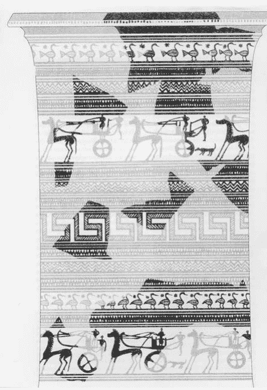

在文中，[埃拉多德]描述了[战车]；作为一名大师，他还以荣誉的方式赞美了泛雅典节（Panathena），他们带着小盾牌和三层羽冠（trioplous）头盔进行游行，并[赢得]了比赛。这种所谓的跳马赛是通过模仿而来的。

- 1. 几何时期陶器中的跳马赛：H. A. Thompson, AA, 1966, 224–231; R. Tölle, AA 78, 1963, 225; H. Metzger, Recherches sur l'imagerie antique (1996) 71–72; G. Ahlberg, M32, 1971, 191–194; P. Kahaes, AntK 16, 1973, 133 with 80; R. Loll, JA 85, 1981, 115 with 61; D. Kyle, Athletics in Ancient Athens, Memosyne 95, 1987, 16–17; T. Rombos, The Iconography of Late Geometric II Pottery (1988) 119–123; H. Smythe, "The Abopatenagon. A philologisch-epigraphigraphisch-archäologische Studie" (Diss. University of Vienna, 1991) 92–99; K. Reber, AntK 42, 1999, 126–141 with comprehensive bibliography p. 6.

- 2. Szethy (见上注n1) 17–18, 21–23, in Fremden. Zeitschrift für Germanistik (1996) 123–132; J. L. Shear, "Polis and Panathena The Development and Festival of Athena's" (Diss. University of Pennsylvania, 2001) 43–49.

- 3. 《星座记》的年代与作者：Shear (见上注n2) 44 n: 56–47; K. Geus, Eratosthenes von Kyrene. Studien zur

图 1. 在埃雷特里亚IV号房屋发现的几何时期双耳瓶瓶颈部复原，可能展示了跳马赛。约公元前760年。参考 K. Reber, AntK 42, 1999, p. 2.

虽然如上述，英雄们戴着三层羽冠头盔，但可以认为，在腓德统治时期之前的雅典，对这种特定类型头饰的任何提到都会与雅典娜的金象牙像以及他们自己的三层羽冠头盔相关联。更重要的是，在雅典竞赛这一神话化的“发明”背景下考虑时，厄瑞克托同（Erichchthon）除了雅典娜之外，不隶属于任何人物。在雅典娜女神（Athenais）庇佑下驾驶的武装三层羽冠参赛者，唯一的身份就是女神本人。

阿提卡陶器绘画证实了这一故事的早期描写，且这一传统在公元前6世纪末就已经为人知。1862年的Joseph Birket在阿提卡陶器绘画中描绘了雅人的发明（图 2），这种解读已被广泛接受。雅典娜离开战车，向终点柱（ipoua）冲去，图像再次描绘了这一场景。雅典娜胜利的归功于她盾牌上的奖杯驱动者，这是竞技胜利的常见标志。活动的速度和能量由于马匹紧绷的鬃毛和ipoua跳跃的轮子而增强，通过雅典娜飞翔、迎风的姿态以及向自己的回望，被认为是指示比赛胜者的恰当图像——雅典娜——雅典娜——希皮亚（Hippia）——这里捕捉到了军队主人、御车者和马术大师。到公元前6世纪末，雅典人及其客户已经理解了——或者至少将厄瑞克托同和雅典娜作为大众中的竞赛概念。

## 雅典竞技参赛者的图象学

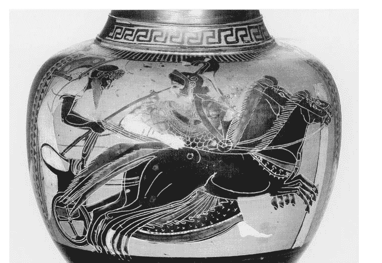

图 2. 牛津 224号画家绘制的黑彩流头壶（oinochoe），展示了作为竞技参赛者的雅典。哥本哈根国家博物馆 Chr. VIII.340。公元前520年后。参考 S d'Ayala Valva, AntK 39, 1996, fig 1.2。

这种特定的成因可以追溯到多久很难说，朱莉·希尔（Julia Shear）最近建议，由亚里士多德和埃里克提俄斯制定的比赛“原始”模型应该追溯到公元前566/5 年毕西斯特拉提德时期对运动会的重组。这完全合理，特别是附录中的第 1-5 号目录显示，我们对竞技参赛者的首次确定描绘与雅典的毕西斯特拉德时期密切吻合。

关于毕西斯特拉提德重新发明竞技参赛者的观点，在与毕西斯特拉托斯第二次夺权的著名故事一起看时也同样得通。在这次政变期间，毕西斯特拉托斯承担了马车夫和驾驶员的角色（至少根据亚里士多德 [Ath.Pol. 14.4] 和克莱德莫 [FHG 323 f15] 的说法），并穿着武装的强大“雅典娜”直抵卫城。毕西斯特拉托斯扮演埃里克提俄斯的角色将完全符合他自己的动态主张。这种神话的构建在 6 世纪整个希腊世界的君主中已被广泛实践。毕西斯特拉托斯在 6 世纪西科农（西基多斯，5.67-68）对美兰尼奥珀（Melaniope）崇拜的著名征用和引入，以及他在第 4、5 世纪雅典中对其谱系阿吉斯（Agis）的构建（普鲁塔克，《阿吉斯传》，9.1.10）——这是通过毕西斯特拉托斯对希帕库斯事件的为人格化（伪柏拉图，《希帕库斯》22b）实现的——是 6 世纪君主构建特定传说和/制造政治环境的唯一例子。毕西斯特拉托斯时期对竞技参赛者的“重新发明”完美契合了这类起源于提卡/前瞻性的神话。

无论其确切日期为何，雅典作为竞技参赛者的图象传统一直持续到 5 世纪。一系列黑彩油壶（lekythoi）被贝兹利归类为海曼小组（Haimon Group），展示了雅典在了一辆赛用马车旁奔跑。在场景中经常使用海曼小组特定的纹饰——跑步者的特定位置、参赛者的盔甲和矛，以及最重要的是白色端柱的一致性——这些都表明雅典是以参赛者的形象描绘的，贝兹利已经注意到了这一点。

彼得·舒尔尔茨（Peter Schultz）

图 3. 海曼画家绘制的黑彩油壶（lekythos），展示了竞技参赛者的比赛，圣彼得堡冬宫博物馆。公元前 480 年左右。参考 K. Gorbunova，《冬宫的提卡黑彩瓶》（俄语，1983）第 132 号。

图 4. 海曼画家绘制的黑彩油壶（lekythos），展示了作为参赛者的竞技比赛。圣彼得堡冬宫博物馆。公元前 480 年左右。参考 K. Gorbunova，《冬宫的提卡黑彩瓶》（俄语，1983）第 133 号。

# 对冬宫油壶的比较分析

对冬宫的这两件油壶（lekynoi）进行对比，我们提供了一个视角：海曼画家展示了参赛者比赛，这种展示方式是 5 世纪初的构思。海曼小组的纹饰在场景中经常使用——雅典在马车旁奔跑，跑步者的特定位置，这似乎是 5 世纪的构思，以及参赛者的盔甲和矛，最重要的是白色端柱的一致性——这些都显示了雅典是以参赛者的形象呈现的，贝兹利已经注意到了这一点。

毕西斯特拉提德时期对竞技参赛者的“重新发明”完美契合了这类起源于提卡/前瞻性的神话。

无论其确切日期为何，雅典作为竞技参赛者的图象传统一直持续到 5 世纪。一系列黑彩油壶（lekythoi）被贝兹利归类为海曼小组（Haimon Group），展示了雅典在了一辆赛用马车旁奔跑。在场景中经常使用海曼小组特定的纹饰——跑步者的特定位置、参赛者的盔甲和矛，以及最重要的是白色端柱的一致性——这些都表明雅典是以参赛者的形象描绘的，贝兹利已经注意到了这一点。

这些问题之一源于来源的冲突。

# Peter Schultz

## 重装兵赛的图像学证据

一场张力巨大的戏剧赛事，包含一系列戏剧性的成分，每一种成分都需要绝对且独立的精通（事实上，真正的问题似乎是重装兵需要掌握多少不同的技能才能获胜）。正因如此，德摩斯梯（60.25）指出，学习比赛所需的复杂动作，对于那些渴望或追求这种运动的人来说，本身就是一项巨大的奖赏。比赛可能由许多个不同的子项目组成——包括最后的穿甲冲刺——这种想法并非没有依据。

**图 5.** 希摩画家（Himon Painter）制作的黑绘油壶（lekythos），展示了重装兵赛。意大利帕勒莫。约公元前 480 年。CVA Italy 50: 2223.1。

**图 6.** 希摩画家（Himon Painter）制作的黑绘油壶，展示了重装兵赛，意大利帕勒莫。约公元前 480 年。CVA Italy 50: 2223.2。

希摩小组（Himon Group）的油壶增加了这一讨论。现藏于帕勒莫西西里银行考古收藏中的一个例子展示了一个尤为生动的画面（图 5-6）。器物身上显示了标准的希摩小组重装兵形象（图 5）。重装兵穿着短长袍，手持盾牌和长矛，已经过了转弯处并向白色柱冲刺。遗憾的是，对他来说，他已经被另一名重装兵（穿着同样的服装）先一步到达终点，后者冲过柱子，在转弯柱处投了一个标准的眼神，这可以被视为证据，最重要的是肩膀标志着胜利（6）。跑步继续进行，直到我们实际上到达了终点（zēi），而不是我们的跑步部分，这意味着比赛显然已经结束了，至少在这种情况下是如此。

现在，由于希摩小组的油壶生产于 5 世纪，对于它们被描绘得多“准确”总会有疑问。然而，在特定情况下，图像学似乎在任何给定的类型中反映了实际做法，而这件特定器物提供的证据的易处理性，得到了希摩小组作为比赛的描绘的支持，每一件代表卫典帕特农神庙浮雕北侧终点的油壶（由斯图图（Stuart）和纳什（Nash）在《雅典古迹》The Antiquities of Athens (7-8) 中重建），其中获胜者被描绘成即将加冕的样子——采用了标准的胜利姿势，回头看向重装兵，并完成了比赛。

> **注 16** 皇冠的存在（如果存在的话）在 J. Stuart 和 Nash 的《雅典古迹》二（1877）第 20 页中提到，这可能会增加对帕特农神庙浮雕的解释难度，声称它代表了对泛雅典竞技节的某种简单表现。浮雕的奖项引发了一种艺术构想——因此包含并整合多个并列的泛雅典主题——参见 Nellie（见上文注 16）173–201。
>
> **注 17** Müller（见上文注 6）57–58 n. 64。

# 雅典重装兵赛的图像学

**图 7.** 帕特农神庙浮雕。巴塞尔北侧 XII 号石模型，由伦敦的一块石板和雅典的一个碎片组成，展示了重装兵的加冕。参考 E. Berger 和 M. Gisler-Huwiler 的《Der Parthenon in Basel. Dokumentation zum Fries》(1996) fig. 52。

**图 8.** 帕特农神庙浮雕。James Stuart 于 1751–53 年绘制的北侧 XII 版画，展示了重装兵的加冕。参考 E. Berger 和 M. Gisler-Huwiler 的《Der Parthenon in Basel. Dokumentation zum Fries》(1996) fig. 83。

从希摩小组油壶中可以获得的另一个有用图像学观点是：在这些器物上，重装兵总是手持一或两根长矛跑步。这是有意义的，因为长矛的存在——或缺失——被某些学者认为是比赛的决定性图像标准。1998 年，南希·里德（Nancy Reed）认为，根据雅典陶器画中后期长矛的存在，可以将重装兵赛与标准的起发场景区分开来¹⁸。换句话说，这种图像学的“规则”是：如果战士被描绘为携带着长矛，那么他就不可能是重装兵，因为根据……

¹⁸ Reed（见上文注 13）47–48。

对里德来说，在比赛时携带长矛并不困难。希摩小组重装兵所携带的长矛被斥为艺术许可的产物。

这是一个有趣的观点，但考古学暗示了另一种可能性。如果希摩小组使用了一百件器物，那么其中有一件油壶——目录编号 62——实际上并没有携带长矛。显然，这与艺术许可无关，而与标准的图像类型有关。对于这个特定的小组，长矛的存在是正常、自然且有目的的。当然，这不能证明在实际比赛期间长矛的存在，但它与我们看到的关于雅典时期雅典娜持有长矛的情况吻合得很好。然而，如果比赛是在传说中的英雄时代，如果雅典娜是公元 6 世纪的典型英雄，而我们面对的是一个“模仿武力武器使用的现实——并通过武备模拟神灵的力量”的案例（德摩斯梯 (60.24)），那么长矛的存在在比赛中——作为运动会的“装饰性”或象征性元素——可能赋予了这项活动特征。

**图 9.** 帕特农神庙的西山墙。James Early 绘，1674 年。参考 O. Palagia, 《帕特农神庙的山墙》[1993] (1998) 图 3。

首先，将帕特农神庙的山墙装饰解读为一场赛跑，有助于证实所展示的场景实际上是关于速度的。关于这个问题的文献非常多，但在 1984 年，朱迪斯·宾德（Judith Binder）穿透了大部分文献，并证明雅典娜与波塞冬之间竞赛的文学传统显然最近得到了安德鲁·斯图特（Andrew Stewart）和奥尔加·帕拉贾（Olga Palagia）等人的支持。因此，山墙展示了一场神话竞赛，两支军队向卫城城奔跑，从战车上跳下步行以夺取胜利。这场“原始”比赛的所有阶段与图像学之间的结构对应关系非常紧密。事实上，显示雅典娜在结束时掷矛（图 4）的雅提卡组底油壶（lekythoi）看起来不再显得奇怪了。

支持这一观点的第二点是，它可能解释了为什么尼姬（Nike）在约 430 年的场景中变成了一个马手。这种发展可能直接归因于帕特农神庙对图像的影响。正如附录所示，场景中的战车总是男性的。在帕特农神庙完成后，图像学发生了演变。几乎所有保存的 430 年大理石雕显示尼姬是马手。这种变化的最早的例子之一是一个浮雕，其中尼姬从奥林匹亚进入她坐着的一辆由尼姬驾驶的飞驰战车中（图 10）。这对我们来说非常重要的是，它的图像学受到了五世纪巨型雕塑的影响，这是 D. M. 罗宾森（D. M. Robinson）在 1933 年提出的。对陶罐的观察显示了尼姬正在竖立一座奖杯柱，罗宾森指出，这一母题是直接取自神庙。

> **参考文献 21** J. Binder, in *Studies Presented to Sterling Dun on His Birthday*. Monographs 10 (1984) 15–22; A. Stewart, *Greek Sculpture: An Exploration* (1990) 153–154; O. Palagia, *The Pediments of the Parthenon* (1998 [1993]) with comprehensive bibliography; edition, in J. Niels (eds.), *The Parthenon from Antiquity to the Present* (2005) 243.
>
> **参考文献 22** D. M. Robinson, *Olympos* 5 (1933) 97–99.

# 彼得·舒尔茨 (Peter Schultz)

考虑到该器皿所引用的护栏，那么正面似乎可以允许帕特农神庙的西山墙：约公元前 255 年，可能将尼姬作为赛车手的概念引入雅典赞助人的作品中。

一个值得考虑雅典娜在西山墙中姿态意义的观点。女神姿态的性质和意义已经争论了一个世纪；布罗默（Brommer）关于她从中心“回首”的著名描述几乎被所有人遵循³。然而，如果暂时将女神视为一名运动员，她背部过肩的飞翔姿态——与波塞冬的姿态相同——具有了完全不同的意义。在胜利图像学中，正如我们所看到的，这是绝对规范，并且在六世纪末被用于胜利者以及雅典娜本人。帕特农神庙浮雕上雅典娜最接近的平行案例是（图 7-8），其中运动员的每一个细节——一直到她伸出的肢体、高大的头盔羽饰和附上的青铜戈耳头——都是基于我们对雅典娜“发明”的这一凡人事件的理论，而它在浮雕上自然地适应了女神的姿态和秩序。波塞冬采取了相同的姿态并不意外，因为如果西山墙所代表的是竞技比赛，那么平静的东山墙——至少根据利西克拉特斯（Lysocrates, Pan. 193）的话——是由海神获胜的。

**图 10.** （图片说明缺失，原文仅有图片引用）

如果西山墙所代表的是一场竞技平局的最后戏剧性终点——几乎是故意试图超越奥林匹亚神庙上平静的东山墙——那么这些人物的姿态正如我们预期的那样。他们被描绘为受尊崇的神圣胜利者，这对一个可能是困难的构图和技术问题的完美审美解决方案。肖·艾兰·沙普罗（Sean Alan Shapiro）已经记录了 480 年以后雅典这两个人物的亲近性，相信这座城市的两位赞助人被看到为了提提卡地区激烈争斗（正如有时提议的那样），将其视为其最具戏剧性时刻的动态赛跑场景是完全合理的。这一假设的进一步优势是，它允许西山墙与东山墙、间壁，以及最重要的帕特农神庙浮雕与雅典娜大盛节联系起来。帕特农神庙的图像方案以泛雅典娜节（Panathenaic）图像为主，然而，这一肖像一直立于这一统一计划之外，除非我们将西山墙解读为对一个时代最壮观事件的“发现”——或者，正如所谓的，是对比赛的“重建”。

> **注 2** F. Brommer, *The Sculpture of the Parthenon* (1979) 47, p. 55; for E. Simon, in *Italy, Textschrift für Romanik* (Hampe 1980) 239–255; B. Sharp, *Heigeria* 1990, 91–100; Pallagia (1998) 333; C. Rolley, *La sculpture grecque (ii) période classique* (1996) 76–77 and Shear (n. 275).
>
> **注 3** Shapiro (n. 8) 105. 关于雅典娜与波塞冬的冲突，见 de Palagia, Simon (n. 23), 24。关于帕特农神庙上的雅典娜与波塞冬，见 de Palagia, *the Athenian navy*, 他们在奥林匹亚被描绘为雅典娜，因为他们认为在审美上符合早期希腊思想。H. A. Shiba 1982, 291–297; R. Poller, *Athenian Religion: A History* (1996) 169–170; Sharp (n. 8) 55; 101–102; Pelagia 2005, supra. 21), 波塞冬在帕特农神庙上关键位置的刻画，正如奥林匹亚所示，op. cit., 252.
>
> **注 4** 例如，见 Neils (supra. 6) 和 Shear (supra. 2) 742–761.

# 雅典赛跑的图像学

起源神话——随后立即在帕特农神庙紧密的图像矩阵中到位，该矩阵将泛雅典娜节置中心。再次，西山墙的特定联系似乎也是一个巧合，并且反过来，匹配了帕特农神庙装饰方案中其他地方广为人知的母题共鸣。将西山墙与阿格拉（Agora，可能在帕特农之路的某处）联系起来的第五个优势。具体在哪里没有人知道，在公元前二世纪，两条著名的铭文 IG II 2136 和 IG II 2317 暗示了卫城北部的埃琉俄斯丰（Eleusionion）的运动员经常被提到，正如提到的，这很有意义，因为卫城的坡度在这一点似乎很大，因此对马赛是危险的。一个问题仍然存在。如果运动员实际上在比赛中是徒步的，或者他们是从卫城的椅子上跳下的……他们到底是在哪里跑步的？

人们可能会推断，卫城中的运动员描绘了雅典娜和波塞冬，运动员的每一个细节——一直到她伸出的肢体、高大的头盔羽饰和附上的青铜戈耳头——都是基于我们对雅典娜“发明”的这一凡人事件的理论，而它在浮雕上自然地适应了女神的姿态和秩序。波塞冬采取了相同的姿态并不意外，因为如果西山墙所代表的是竞技比赛，那么平静的东山墙——至少根据利西克拉特斯（Lysocrates, Pan. 193）的话——是由海神获胜的。

该器皿所引用的护栏，那么似乎正面可以允许帕特农神庙的西山墙：约公元前 255 年，可能将尼姬作为赛车手的概念引入雅典赞助人的作品中。

一个值得考虑雅典娜在西山墙中姿态意义的观点。女神姿态的性质和意义已经争论了一个世纪；布罗默关于她从中心“回首”的著名描述几乎被所有人遵循³。然而，如果暂时将女神视为一名运动员，她背部过肩的飞翔姿态——与波塞冬的姿态相同——具有了完全不同的意义。在胜利图像学中，正如我们所看到的，这是绝对规范，并且在六世纪末被用于胜利者以及雅典娜本人。帕特农神庙浮雕上雅典娜最接近的平行是（图 7-8），其中运动员的每一个细节——一直到她伸出的肢体、高大的头盔羽饰和附上的青铜戈耳头——都是基于我们对雅典娜“发明”的这一凡人事件的理论，而它在浮雕上自然地适应了女神的姿态和秩序。波塞冬采取了相同的姿态并不意外，因为如果西山墙所代表的是竞技比赛，那么平静的东山墙——至少根据利西克拉特斯（Lysocrates, Pan. 193）的话——是由海神获胜的。

**图 11.** （图片说明缺失，原文仅有图片引用）

如果西山墙所代表的是一场竞技平局的最后戏剧性终点——几乎是故意试图超越奥林匹亚神庙上平静的东山墙——那么这些人物的姿态正如我们预期的那样。他们被描绘为受尊崇的神圣胜利者，这对一个可能是困难的构图和技术问题的完美审美解决方案。肖·艾兰·沙普罗（Sean Alan Shapiro）已经记录了 480 年以后雅典这两个人物的亲近性，相信这座城市的两位赞助人被看到为了提提卡地区激烈争斗（正如有时提议的那样），将其视为其最具戏剧性时刻的动态赛跑场景是完全合理的。这一假设的进一步优势是，它允许西山墙与东山墙、间壁，以及最重要的帕特农神庙浮雕与雅典娜大盛节联系起来。帕特农神庙的图像方案以泛雅典娜节（Panathenaic）图像为主，然而，这一肖像一直立于这一统一计划之外，除非我们将西山墙解读为对一个时代最壮观事件的“发现”——或者，正如所谓的，是对比赛的“重建”。

> **注 2** F. Brommer, *The Sculpture of the Parthenon* (1979) 47, p. 55; for E. Simon, in *Italy, Textschrift für Romanik* (Hampe 1980) 239–255; B. Sharp, *Heigeria* 1990, 91–100; Pallagia (1998) 333; C. Rolley, *La sculpture grecque (ii) période classique* (1996) 76–77 and Shear (n. 275).
>
> **注 3** Shapiro (n. 8) 105. 关于雅典娜与波塞冬的冲突，见 de Palagia, Simon (n. 23), 24。关于帕特农神庙上的雅典娜与波塞冬，见 de Palagia, *the Athenian navy*, 他们在奥林匹亚被描绘为雅典娜，因为他们认为在审美上符合早期希腊思想。H. A. Shiba 1982, 291–297; R. Poller, *Athenian Religion: A History* (1996) 169–170; Sharp (n. 8) 55; 101–102; Pelagia 2005, supra. 21), 波塞冬在帕特农神庙上关键位置的刻画，正如奥林匹亚所示，op. cit., 252.
>
> **注 4** 例如，见 Neils (supra. 6) 和 Shear (supra. 2) 742–761.

# 起源神话

随后立即在帕特农神庙紧密的图像矩阵中到位，该矩阵将泛雅典娜节置中心。再次，西山墙的特定联系似乎也是一个巧合，并且反过来，匹配了帕特农神庙装饰方案中其他地方广为人知的母题共鸣。第五个和最后的优势，是将西山墙与阿格拉（Agora，可能在帕特农之路的某处）联系起来。具体在哪里没有人知道，在公元前二世纪，两条著名的铭文 `IG II 2136` 和 `IG II 2317` 暗示了卫城北部的埃琉俄斯丰（Eleusionion）的运动员经常被提到，正如提到的，这很有意义，因为卫城的坡度在这一点似乎很大，因此对马赛是危险的。一个问题仍然存在。如果运动员实际上在比赛中是徒步的，或者他们是从卫城的椅子上跳下的……他们到底是在哪里跑步的？

人们可能会推断，卫城中的运动员描绘了雅典娜和波塞冬，运动员的每一个细节——一直到她伸出的肢体、高大的头盔羽饰和附上的青铜戈耳头——都是基于我们对雅典娜“发明”的这一凡人事件的理论，而它在浮雕上自然地适应了女神的姿态和秩序。波塞冬采取了相同的姿态并不意外，因为如果西山墙所代表的是，那么平静的东山墙——至少根据利西克拉特斯（Lysocrates, Pan. 193）的话——是由海神获胜的

# 致谢

本文的研究经费由希腊州基金会（IKEY）提供的博士后奖学金以及来自辛辛提大学古典系的 Titus Summer 奖学金提供；感谢这些机构和基金会的慷慨支持。也要感谢几位帮助完善想法的好朋友：Paul Christensen, Nicole Jensen, July Shear, Andrew Stewart 和 Steven Tracy。我还要感谢 Phyllis Graham（在雅典古典学院 C. W. Blegen 图书馆的帮助）、Amy Sorn（在同学院图书馆的帮助）以及 Jacqueline Riley, Mike Mitchell 和 David Ball（在辛辛提大学图书馆的帮助）。感谢 Palacio 提供我在雅典讨论这些假设的机会。错误都是我的。

²⁶ J. M. Harriet, *The Iconography* (1988) 229–232.

²⁷ J. Camp, *The Iconography* (1986) 45–54; S. V. Tracy, *Hesperia* 60, 1991, 198; S. V. Tracy, *Nike*, 140 (1921) 以及 S. V. Tracy, *The Athletes. At the Eleusionion* Picture Book No. 25 (2003) 7; Miller (supra. 14) 1–43.

²⁸ Kyle (supra. 1) 188); Tracy and Hachich (supra. 28) 198; Tracy (supra. 13) 50–51; Neils (supra. 6) 18.

⁹ 关于希腊人使用的简单径赛（在泛雅典娜节比赛），见 SG II, 15–16，建议比赛从下方的体育馆开始，在上方阿波罗神庙脚下的大祭结束。我感谢 Nigel Kenell（提供此参考文献）。

¹⁰ 一个可能的考虑将揭示进一步的思考，特别是当它引发关于浮雕上具体的重大片段选择的问题时。我们是否将这一特定案例视为发生在北坡的埃琉俄斯丰，还是在卫城本身？这是游行的一部分、事件本身，还是正如 Neils (supra. 6) 146 所建议的……

¹¹ E. Brolute, AJA 98, 1993, 53–64; Whitley (supra. 5) 155.

# 附录

## 展示叛徒者（Aphostates）的精选雅陶器目录

展示（或几乎确定展示）叛徒者的器有：

| 编号 | 日期 | ABV* | 风格与形状 | 叛徒者 | 装饰者 | 插图 | 备注 |
|---|---|---|---|---|---|---|---|
| 1 | 540 | 137.62 | 雅典黑绘陶，颈口瓶 | 持矛的半武装叛徒者 | 男性 | Jacobeth 1927, fig. 37c | E 组 |
| 2 | 530 | | 雅典黑绘陶，双饮杯 (skyphos) | 持矛的半武装叛徒者 | 男性 | Cf/D USA 1: 179:5; 8-9 | 罗德斯11941组 |
| 3 | 530 | | 雅典黑绘陶，双饮杯 (skyphos) | 持矛的半武装叛徒者 | 男性 | Hornstett 1977, no. 24 | Hengensys 组 |
| 4 | 530 | | 雅典黑绘陶，宽杯 | 持矛的半武装叛徒者 | 男性 | Boardman 1974, fig. 114 | 由 Hengensys 组留存 |
| 5 | 530 | | 雅典黑绘陶，双饮杯 (skyphos) | 持矛的半武装叛徒者 | 男性 | Bourowtekou 1986, p. 19 | 目标 |
| 6 | 520 | 430.27 | 雅典黑绘陶，流口瓶 (oenochoe) | 雅典娜 | | Cf/D Denmark 3: 124.2a-b | |
| 7 | 480 | 544.19 | 雅典黑绘陶，油壶 (lekyth) | 持矛的半武装叛徒者 | 男性 | Cf/D USA 1: 27 | Haimon 组； |
| 8 | 480 | 554.15 | 雅典黑绘陶，油壶 (lekyth) | 持矛的半武装叛徒者 | 男性 | Cf/D France 10: 465-10.1 | Haimon 组； |
| 9 | 480 | 554.12 | 雅典黑绘陶，油壶 (lekyth) | 持矛的半武装叛徒者 | 男性 | Junker 1970, pl. 17 | Haimon 组； |
| 10 | 480 | 554.14 | 雅典黑绘陶，油壶 (lekyth) | 持矛的武装叛徒者 | 男性 | Cf/D Great Britain 6: 260.13 | |
| 11 | 480 | 554.15 | 雅典黑绘陶，油壶 (lekyth) | 持多矛的半武装叛徒者 | 男性 | Cf/D Germany 7: 312.5 | Haimon 组； |
| 12 | 480 | 554.16 | 雅典黑绘陶，油壶 (lekyth) | 持矛的武装叛徒者 | 男性 | Cf/D Belgium 3: 121 | |
| 13 | 480 | 554.17 | 雅典黑绘陶，油壶 (lekyth) | 持矛的半武装叛徒者 | 男性 | Cf/D Belgium 2: 61.29a-b | |
| 14 | 480 | 554.18 | 雅典黑绘陶，油壶 (lekyth) | 持矛的半武装叛徒者 | 男性 | Shear 1993, pl. 81b | Haimon 组； |
| 15 | 480 | 554.16 | 雅典黑绘陶，油壶 (lekyth) | 持矛的半武装叛徒者 | 男性 | Cf/D Netherlands 195: 102-1 | Haimon 组； |
| 16 | 480 | 554.12 | 雅典黑绘陶，油壶 (lekyth) | 持矛的半武装叛徒者 | 男性 | Cf/D France 16: 705.13 | Haimon 组； |
| 17 | 480 | 554.16 | 雅典黑绘陶，油壶 (lekyth) | 持矛的半武装叛徒者 | 男性 | Schwarz 1996, pl. 24 | Haimon 组； |
| 18 | 480 | 554.16 | 雅典黑绘陶，油壶 (lekyth) | 持矛的武装叛徒者 | 男性 | Stackenberg 1837, pl. 12 | Haimon 组； |
| 19 | 480 | 554.16 | 雅典黑绘陶，油壶 (lekyth) | 持矛的半武装叛徒者 | 男性 | Cf/D Spain 3: 111.2 | Haimon 组； |
| 20 | 480 | 554.16 | 雅典黑绘陶，油壶 (lekyth) | 持矛的半武装叛徒者 | 男性 | García y Belido 1948, pl. 73.3 | Haimon 组； |
| 21 | 480 | 554.17 | 雅典黑绘陶，油壶 (lekyth) | 持矛的半武装叛徒者 | 男性 | Cf/D Spain 3: 111.1 | Haimon 组； |
| 22 | 480 | 554.18 | 雅典黑绘陶，油壶 (lekyth) | 持矛的半武装叛徒者 | 男性 | García y Belido 1947, pl. 202.3 | Haimon 组； |
| 23 | 480 | 554.17 | 雅典黑绘陶，油壶 (lekyth) | 持矛的半武装叛徒者 | 男性 | Cf/D Belgium 2: 61.24-b | Haimon 组； |
| 24 | 480 | 554.12 | 雅典黑绘陶，油壶 (lekyth) | 持矛的半武装叛徒者 | 男性 | Cf/D Denmark 3: 113.12 | Haimon 组； |
| 25 | 480 | 554.17 | 雅典黑绘陶，油壶 (lekyth) | 持矛的半武装叛徒者 | 男性 | Sestieri 1951, fig. 16 | Haimon 组； |
| 26 | 480 | 554.19 | 雅典黑绘陶，油壶 (lekyth) | 雅典娜 | 男性 | Cf/D Great Britain 12: 539.6 | Haimon 组； |
| 27 | 480 | 554.12 | 雅典黑绘陶，油壶 (lekyth) | 雅典娜 | 男性 | OF 28, pl. 22.8 | Haimon 组； |
| 28 | 480 | 554.18 | 雅典黑绘陶，油壶 (lekyth) | 雅典娜 | 男性 | Cf/D Poland 11: 199.3 | Haimon 组； |
| 29 | 480 | 554.17 | 雅典黑绘陶，油壶 (lekyth) | 雅典娜 | 男性 | London 1, pl. 128-269 | Haimon 组； |
| 30 | 480 | 554.16 | 雅典黑绘陶，油壶 (lekyth) | 雅典娜 | 男性 | Cf/D Italy 3: 113.7 | Haimon 组； |
| 31 | 480 | 554.19 | 雅典黑绘陶，油壶 (lekyth) | 雅典娜 | 男性 | Cf/D Germany 5: 200.3 | Haimon 组； |
| 32 | 480 | 554.192 | 雅典黑绘陶，油壶 (lekyth) | 雅典娜 | 男性 | Amlago 1953, p. 181, fig. | Haimon 组； |
| 33 | 480 | 554.193 | 雅典黑绘陶，油壶 (lekyth) | 雅典娜 | 男性 | Langloz 1932, pl. 107.381 | Haimon 组； |
| 34 | 480 | | 雅典黑绘陶，油壶 (lekyth) | 持矛的半武装叛徒者 | 男性 | Cf/D Netherlands 4: 195.7-4 | Haimon 组； |
| 35 | 480 | | 雅典黑绘陶，油壶 (lekyth) | 雅典娜 | 男性 | Cf/D Netherlands 4: 195.5-6 | Haimon 组； |
| 36 | 480 | | 雅典黑绘陶，油壶 (lekyth) | 雅典娜 | 男性 | Cf/D Netherlands 4: 195.7-8 | Haimon 组； |

## 雅典护神瓶（aproteria）的图像学

| 编号 | 日期 | ABV¹ | 风格与形状 | 叛徒者 | 装饰者 | 插图 | 备注 |
|---|---|---|---|---|---|---|---|
| 37 | 480 | | 雅典黑绘陶，油壶 (lekythos) | 持矛的武装运动员 | 男性 | CV/A Netherlands: 196.4-3 | Haimon 组；目标 |
| 38 | 480 | | 雅典黑绘陶，油壶 (lekythos) | 持矛的半武装运动员 | 男性 | CV/A Czech Republic: 32:1:4 | Haimon 组；目标 |
| 39 | 480 | | 雅典黑绘陶，油壶 (lekythos) | 雅典娜 | 男性 | CV/A Czech Republic: 32:1 | Haimon 组；目标 |
| 40 | 480 | | 雅典黑绘陶，油壶 (lekythos) | 持矛的半武装运动员 | 男性 | CV/A Italy 41: 276.3-4 | Haimon 组；目标 |
| 41 | 480 | | 雅典黑绘陶，油壶 (lekythos) | 持矛的半武装运动员 | 男性 | CV/A Italy 50: 223.1-2 Gudeer 1992D10 | Haimon 组；领先者 |
| 42 | 480 | | 雅典黑绘陶，油壶 (lekythos) | 持矛的半武装运动员 | 男性 | CV/A Italy 50: 223.3-4 Gudeer 1992D04 | |
| 43 | 480 | | 雅典黑绘陶，油壶 (lekythos) | 持矛的半武装运动员 | 男性 | CV/A Italy 50: 223.5-6 Gudeer 1992D03 | |
| 44 | 480 | | 雅典黑绘陶，油壶 (lekythos) | 持矛的半武装运动员 | 男性 | CV/A Italy 50: 223.7-8 Gudeer 1992D02 | Haimon 组；目标 |
| 45 | 480 | | 雅典黑绘陶，油壶 (lekythos) | 持矛的半武装运动员 | 男性 | Gudeer 1992D05 | |
| 46 | 480 | | 雅典黑绘陶，油壶 (lekythos) | 持矛的武装运动员 | 男性 | CV/A Switzerland: 33.1-3 | Haimon 组；目标 |
| 47 | 480 | | 雅典黑绘陶，油壶 (lekythos) | 持矛的武装运动员 | 男性 | CV/A France 20: 889.4-5 | |
| 48 | 480 | | 雅典黑绘陶，油壶 (lekythos) | 持矛的半武装运动员 | 男性 | Kouvertriak 1965, pl. 355 | Haimon 组； |
| 49 | 480 | | 雅典黑绘陶，油壶 (lekythos) | 持矛的半武装运动员 | 男性 | Kouvertriak 1965, pl. 355 | Haimon 组； |
| 50 | 480 | | 雅典黑绘陶，油壶 (lekythos) | 持矛的半武装运动员 | 男性 | Kouvertriak 1965, pl. 355 | Haimon 组； |
| 51 | 480 | | 雅典黑绘陶，油壶 (lekythos) | 持矛的半武装运动员 | 男性 | Gorbanova 1983, no. 130 | Haimon 组；后者 |
| 52 | 480 | | 雅典黑绘陶，油壶 (lekythos) | 持矛的运动员 | 男性 | Gorbanova 1983, no. 132 | Haimon 组；目标 |
| 53 | 480 | | 雅典黑绘陶，油壶 (lekythos) | 雅典娜 | 男性 | Gorbanova 1983, no. 133 | Haimon 组；目标；“雅典娜投矛” |
| 54 | 480 | | 雅典黑绘陶，油壶 (lekythos) | 持矛的半武装运动员 | 男性 | Laurens 1984, pl. 29 | Haimon 组；目标 |
| 55 | 480 | | 雅典黑绘陶，油壶 (lekythos) | 持矛的半武装运动员 | 男性 | de Miro 1989, pl. 36 | Athens 51 (7) 或 Haimon 组 |
| 56 | 480 | | 雅典黑绘陶，油壶 (lekythos) | 持矛的半武装运动员 | 男性 | Scholz 1984, pl. 11-12 | |
| 57 | 480 | | 雅典黑绘陶，油壶 (lekythos) | 持矛的半武装运动员 | 男性 | Schilber-Vermeysel 1996, pl. 25-26 | Diopher 画画家 |
| 58 | 480 | | 雅典黑绘陶，油壶 (lekythos) | 持矛的半武装运动员 | 男性 | OF 28, pl. 22.219 | Haimon 组 |
| 59 | 480 | | 雅典黑绘陶，油壶 (lekythos) | 持矛的半武装运动员 | 男性 | OF 28, pl. 82.220 | Haimon 组 |
| 60 | 480 | | 雅典黑绘陶，油壶 (lekythos) | 持矛的半武装运动员 | 男性 | OF 28, pl. 84.247 | Haimon 组 |
| 61 | 480 | | 雅典黑绘陶，油壶 (lekythos) | 持矛的半武装战士 | 男性 | Keremakos 9, pl. 16.3 | Haimon 组；目标 |
| 62 | 480 | | 雅典黑绘陶，油壶 (lekythos) | 无矛的半武装战士 | 男性 | Keremakos 9, pl. 25.1 | Haimon 组；目标 |
| 63 | 480 | | 雅典黑绘陶，油壶 (lekythos) | 持矛的半武装战士 | 男性 | Keremakos 9, pl. 29.1-2 | Haimon 组；目标 |
| 65 | 480 | | 雅典黑绘陶，油壶 (lekythos) | 持矛的半武装战士 | 男性 | Keremakos 9, pl. 39.3 | Haimon 组；目标 |
| 66 | 480 | | 雅典黑绘陶，油壶 (lekythos) | 持矛的半武装战士 | 男性 | Keremakos 9, pl. 51.3 | Haimon 组 |
| 67 | 480 | | 雅典黑绘陶，油壶 (lekythos) | 持矛的半武装战士 | 男性 | Keremakos 9, pl. 90.4 | Haimon 组 |

| 68 | 480 | | 雅典黑绘陶，油壶 (lekythos) | 持矛的半武装战士 | 男性 | Boulter 1963, pl. 36, A7 | Haimon 组 |

| 69 | 480 | | 雅典黑绘陶，油壶 (lekythos) | 持矛的半武装运动员 | 男性 | Laurens 1984, pl. 32 | Haimon 组；目标 |

| 70 | 480 | | 雅典黑绘陶，油壶 (lekythos) | 持矛的半武装运动员 | 男性 | Brownlee 1995, pl. 92.T1325 | Haimon 组；目标 |

| 71 | 480 Para. 275 | | 雅典黑绘陶，带矛的油壶 (lekythos) | 持矛的半武装运动员 | 男性 | Brownlee 1995, pl. 92.T1081 | Haimon 组；目标 |

# 72

# Peter Schütz

| 日期 | ABV | 样式与形状 | 神化形象 | 属性 | 插图 | 注释 |

|---|---|---|---|---|---|---|

| 73 | 480 | Paru. 275 | 提卡式人物，le油壶 | 持长矛的半运动员形象 | 男性 | Olympiini 1965, pl. 61 | Haimon 组 |

| 74 | | 提卡式人物，双口瓮 | 半运动员形象 | 男性 | CF' 24, 1192.3 | 雅典娜在 |

| 75 | | 提卡式人物，圆柱 | 雅典娜 | 男性 | Tolephiskos 1991, fig. 6 | 有三脚架的目标 |

| 76 | | 提卡式人物，陶瓶 | 半运动员形象 | 男性 | Oceanus 1955, pl. 6 | |

| 77 | | 提卡式人物，双口瓮 | 半运动员形象 | 男性 | Agora 30, 1975 | 赫尔墨斯在 |

| 78 | | 提卡式人物，碎片 | 半运动员形象 | 男性 | CF' V3, 130.1-4 | |

| 79 | | 提卡式人物，泛雅典双环油瓶 | 半运动员形象 | 男性 | CF' D 11: 1272-4 | |

| 80 | | 提卡式人物，泛雅典双环油瓶 | | 男性 | | 碎片 |

| 81 | | 提卡式人物，颈瓶 | 半运动员形象 | 男性 | Knopéynos 1996, pl. 75-76 | 赫尔墨斯在 |

| 82 | | 提卡式人物，流口壶 | | 男性 | Brans 1940, 22.1, 4.2 | 碎片 |

| 83 | | 提卡式人物 | 半运动员形象 (7)? | 男性 | Tolephiskos 1991, fig. 4 | 碎片 |

| 84 | | 提卡式人物，陶制 | | 男性 | van Hoen 1951, fig. 127 | |

| 85 | | 提卡式人物，双口瓮 | 半运动员形象 | 男性 | CF' D 8, 382.5-6 | |

| 86 | | 提卡式人物，泛雅典双环油瓶 | | 男性 | Edwards 1957, pl. 81 | 碎片 |

## 注释

1. 所有日期均为近似值（< 10年）。

2. Beazley 关于“ABV”的引用格式为：ABV 141-145; 150-165; 169-176; 175-180; 181-183，且 Paru 275 中的 8 件陶器也被 Beazley 列为来自 Haimon 组的提卡式人物le油壶，展示了上述作品。这些作品目前尚不确定或无法获得。ABV 184-185-188, 191 和 194 被 Beazley 用作提卡式人物le油壶。

3. “半运动员神化形象” = 持盾、戴头盔和披篷的形象。“运动员神化形象” = 持盾、戴头盔和短袍的形象。

4. “目标”（Goal） = 设计中的转角或部分。

## 目录缩写

+ Agora 30
+ Almagro 1953
+ Bozidarjev 1981
+ Beazley 1968
+ Vokoryynsky 1986
+ Browice 1995
+ Boesch 2003
+ Edwards 1957
+ García y Gelo 1947
+ García y Gelo 1948
+ Guidice 1995
+ Gorbanova 1983
+ van Hoen, 2001
+ Hornstel 1977
+ Jacobhal 1927
+ Junker 1970
+ Kozlov 1975
+ Keramicopoulos 1996
+ Kovortsovoy 1995
+ Langford 1991
+ Larens 1984
+ Linds 1960
+ de Miro 1979
+ OF 28
+ Olympus 5
+ Olandini 1965
+ Schloß-Wiersberg 1966
+ Scholl 1984
+ Schwarz 1996
+ Sestieri, Pnc 1965
+ Shear 1951
+ Shear 1993
+ Stackenberg 1837
+ Tipijus 1991

# 火炬赛与器绘画

Martin Bentz

2005年10月14日献给威斯巴登 Burkhardt

## I

现代奥运会火炬于1936年在柏林确立，当时它也被用于纳粹宣传。尽管如此，这一传统仍然延续，火炬每四年从奥林匹亚运往举办城市，象征着现代运动会的古代根源。然而，正如最近所示，现代火炬与古代传统毫无关系。

在古代泛希腊运动会中，除了雅典的泛雅典运动会外，火炬并不是正式项目的一部分，正如我们从四世纪的列表中所知（此处第118页，图1）。³ 保存的铭文部分列出了仅对雅典人开放的测试：火舞（*pyrrhiche*，一种我们未知的美）、火炬（*lampas*）和赛船。其他铭文增加了赛马（*anthipposia*）、模拟战斗。

昂贵的奖品（如泛雅典双环油瓶）在雅典设立是为了吸引运动员——事实上，这促进了公民认同和部落稳定性。这就是为什么胜利者获得一头牛和100德拉克马；赛船比赛的冠军获得更高的奖品：三头牛和200德拉克马。

火炬赛非常受欢迎，因此它是唯一被描绘了所有阶段的竞技：准备、出发、比赛、到达和庆典。火炬赛不仅在泛雅典运动会举行，还在赫菲斯斯运动会、普罗米修斯运动会和狄奥尼索节上举行。雅典的火炬赛从学院附近的雅典娜神坛开始，在神坛结束。这里没有涵盖火炬赛图像学的所有方面；我们将关注带有残片的图像类型。第一. 准备。一个由拿骚画家绘制的壶（图1）显示了一个中心持火炬的运动员——他左臂站立。B. Kratzmann，*Sport et idéologie*，VI congr du comité de l'histoire du sport，2002年9月26–29日，85–97。火炬赛的主要参考文献：O. Gotthard，*Mitteilungen der griechischen Klassiker*（1928）46–74；G. Gigli，*Archiv*73（1955），147–162；J. Licher,*Die antiken Leben der Griechen*（1968）134–156；E. Kafelidou，*Noplikon*21，1988，218起；雅典铭文博物馆8070，8092，来自卫城；IG II 31。A. Johnston, BSA 82,125–129；M. Benz,*Panathenais Preisamoren*（1998）起；J. L. Shear, ZPE 2003,87–108；R. Wünsche和F. Knauss（编），*Lockerer Jahrbericht*...

关于一般的团队运动：J. Neel，在W. E. Colson, A. Paulus 等人（编），*The Archaeology of Athens and Attica under the Democracy*（1994）151–160；N. B. Crouch，*The International Journal of History*12，1997，123... Paus. 1.3.2（普罗米修斯神坛），Plut. Sol. 1.4 和 Pl. 231 E（雅典娜神坛）。

## II

### I. 准备。显示运动员准备的图像。

一个由拿骚画家绘制的壶（图1）显示了一个中心持火炬的运动员——他左臂站立。

图1. 壶。梵蒂冈博物馆16551。健身房内的准备。根据V. Paul-Zinserling,*Der Jena-Maler und sein Kreis*（1994）pl. 83，2。

另一个拿着刮板的青年。场景显然位于健身房。在一个由Fauvel Pinter绘制的壶上，描绘了整个火炬赛团队。他们戴着由芦苇制成的独特尖冠，正在交谈——但坐在岩石上，其他的在测试火炬，他正在清理身体，另一个在看着同伴。

将火炬交给出发者。在第二类图像中，火炬被交给跑步者，即团队的出发者。传递火炬的人物通常是一个匿名男性，可能代表他部落的公民；但某些以前讨论过的表现必须用不同的方式解释。在圣彼得堡的一个壶上（图2和彩色图6），我们看到一个手里拿着镰刀的女性形象。我们将“晚年命运”解释为部落的规定。在五世纪，出现了越来越多的女性拟人化，如果没有铭文则很难解释。就像在本例中，镰刀排除了将其解释为普通公民的可能性，这是最有说力的解决方案。在这幅图中，我们也可以识别火炬的特征形状，它由另一个粘土或铜制成，带有板状的护手。持有者的顶部穿孔并系好。一个出版的博罗尼亚圆口壶显示了将火炬交给右侧处于出发位置的跑步者。

图2. 壶，圣得堡堡俄米塔博物馆 B 4526。拟人化的娘将火炬交给第一个跑步者。根据D. Van Hove（编），L'olymisme de'antiquité（I）（1993）58。

+ 6 梵蒂冈博物馆16551，V. Paul-Zinserling,*Der Jena-Maler und sein Kreis*（1994）pl. 83，2。

7 费拉拉，特洛国立博物馆，Tombo 563，Volle Trebia，1926；S. Aurigena, Scava di Spina I（1965）pl. 216。

8 伦敦英国博物馆的一个壶 E 111；Paul-Zinserling（见上文6）pl. 61，2。

9 俄罗米塔博物馆的 B 4522，Paralalyton 487（杯器目录）；D. Van Hove（编），L'olymisme de'antiquité

10 关于火炬，在它的对比中，Müller（1997–98）或P. Urban（Kron）：关于一般的拟人化，H. A. Shapiro,*Personifications in Greek Art（1993）：关于政治拟人化，O. Trauch-Alexander，在Coulson, Palagia 等人（见上文4）55–72；A. C. Smith,“Political Personifications in Classical Athenian Art”（Dies Yale 1997）。更多关于竞技语境下的拟人化，见M. Bentz, Ant. 24, 2007。

# 火炬接赛与花瓶绘画

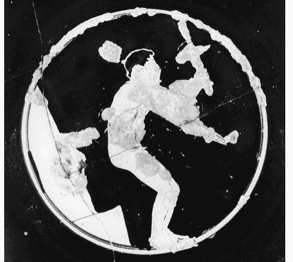

图 3. 杯子，莱比锡，古物博物馆 T 507，起点。照片：博物馆收藏。

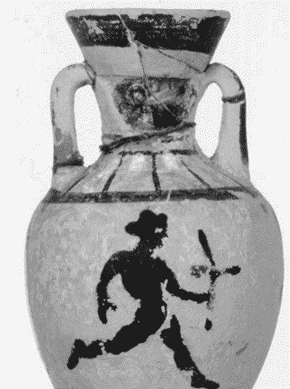

我们看到一个女性形象，在我看来，她也是菲勒（Phyle），就像上一个例子一样.¹12

3. 莱比锡的一只杯子（图 3）展示了唯一的真实起点场景.¹13 跑步者处于我们从其他赛者身上熟悉的典型姿态——双脚齐，膝盖弯曲，手臂前伸。起点由一个界标（style）或赫尔墨（herm）标记，这在古代文献中并未记载。

图 4. 微型奖用双联瓶，波恩，艺术博物馆 1627。比赛。照片：博物馆收藏。

4. 比赛。表现部分的第四部分展示了比赛本身，只有一两名跑步者。波恩的一只微型泛雅提纳奖双联瓶（图 4 和彩色图 7）清楚地指向了泛雅提纳竞技会的赛赛.¹14

5. 交接。接力赛中最困难、最重要的部分是将火炬交给下一名跑步者，正如罗马维拉朱利亚博物馆的一只陶罐（chous）上所示（图 5）。¹15 这种表现非常写实，火炬从第一名跑步者的左手传到第二名跑步者的右手，这种技术现代接力赛中仍在在使用。地点从未明确。通常显示两或三名跑步者.¹17

> ¹² 玻洛尼亚，Cicolvi 博物馆，在阿诺纳尔迪墓地，il sepolcro etrusco nel terreno Arnoaldi di Bologna: 550–330 B.C. (2002) 109, pl. 68. 一个红绘科林斯斯风格的腹瓶，归于佩利凯画家（Pelikai Painter），由 Victoria Sabeta 贴心提醒我注意，她将在雅典的贝纳基博物馆 1。它增加了一个未被记载的动作。一个女性形象在起点处手持火炬，那是一个微型或小火炬或类似物。她可能是菲勒；也可能是一位祭司；
>
> ¹³ 莱比锡，古物博物馆，Winter, Winter and Kenaus（见上文 9: 208, 22.6. CVA Leipzig 3, 即将出版）。
>
> ¹⁴ 见上文 5。
>
> ¹⁵ 艺术博物馆 1627, ABY 662b: M. Berlin and N. Eschbach（编），Panathenaika (2001) 196, no. 4; B. Rieger, 于 Sport. Antike Athleten in Aktion (2004) 170–172, 113–114。
>
> ¹⁶ Ex Castelli, Giiglioli（见上文 2）pl. 37, 3.
>
> ¹⁷ 在费拉拉的洒酒双（volley-krater）颈部，Spina 国家博物馆 3033，N. Alfieri, Spina, Museo archeologico (1979) 80–82，显示了一个包含十名跑步者和五次交接的长长序列。

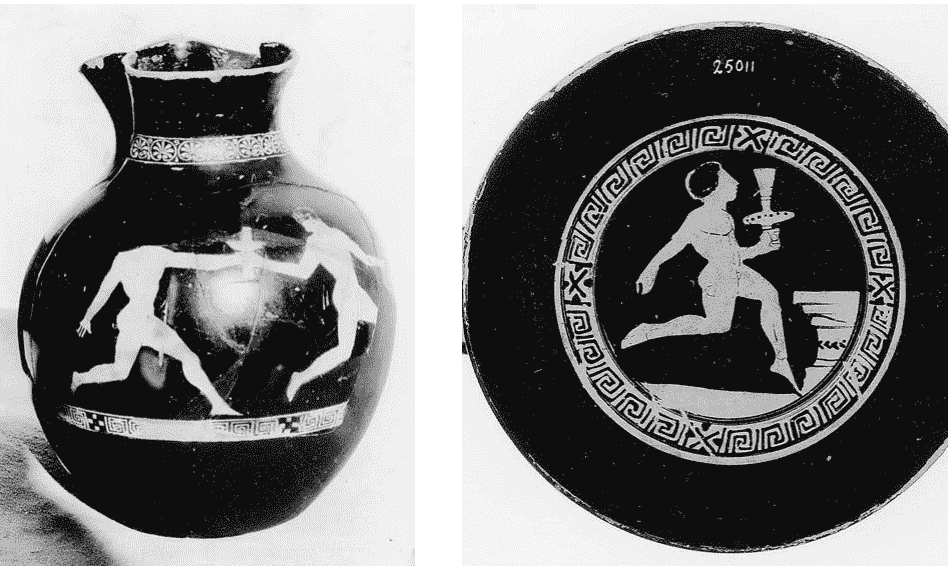

图 5. 陶罐（Chous），罗马，维拉朱利亚博物馆。交接火炬。图 6. 杯子，罗马，维拉朱利亚博物馆 25011。胜利者到达祭坛。照片：博物馆收藏。

6. 终点，到达祭坛。第六类型显示了跑步者到达祭坛。维拉朱利亚博物馆（6）的一只杯子画有一个跑步者和祭坛的简略场景¹¹⁸ 在来自斯皮纳的一只卷形双（volute-krater）颈部，整支十人跑步者队伍包含了胜利者到达祭坛，祭坛前站着一位祭司¹⁹ 因为他戴着月桂环²⁰ 以及瓶身上对赫菲法斯神话的描绘，他一定是赫菲法斯斯的祭司，比赛发生在赫菲法斯提亚。

类似的场景出现在哈佛大学著名的钟形双口（bell-krater）上¹¹² 水瓶（hydria）后面的橄榄树——泛雅提纳赛单项冠军的奖励——暗示了泛雅提纳竞技会。如果这是正确的，祭坛旁的男性形象可能是裁判（arch baseline）。根据亚里士多德²³，他负责火炬赛的组织。其他花瓶上也描绘了泛雅提纳赛的水瓶²⁴

7. 点火。在花瓶绘画中从未见过火的光。英国博物馆的一件由体操教练在赢得泛雅提纳竞技赛后捐献的浮雕填补了空白，正如 Olga Palagia 最近所示²⁵

8. 与胜利女神尼姬一起的胜利仪式。下一步描绘了胜利仪式。在英国博物馆由画家 Nikias 创作的钟形双口（7）上，²⁶ 持火炬的胜利者站在祭坛旁——尼姬（她的翅膀表现得十分拙劣）⁷ 手拿着提带（tai）走近；在

> ¹¹ 18 Inv. 25011, Kefaloura（见上文 2）219, no. 3, pl. 61.
>
> ¹⁹ 见上文 17。
>
> ²⁰ 这种情况下用 Hier Itun Kunze。
>
> ²¹ 埃及博物馆 1960.345, ARF 1841, 10, Kefaloura（见上文 2）218, no. 1, pl. 10.
>
> ²² [Ath.] 57.
>
> ²³ 拿雅的 0485 杯子，Paul-Zinger（见上文 6）62; 82, Agora M. B. Mooric, Art Red-figured and white-green Pottery, Agora (1997) 663, pl. 71; 雅典高杯双口，国家博物馆 14902, Kefaloura（见上文 2）no. 1.
>
> ²⁴ O. Palagia, Άραθος Αθηών Études d'iconographie Kahl, Supplement 38 (2000) 403–408.
>
> ²⁵ 98.7-16, ARF 1333; Kefaloura（见上文 2）219, no. L, pl. 56.
>
> ²⁶ 另见。Mieros, στην ελληνικά του XIIου συνέδρίου, 3, 1

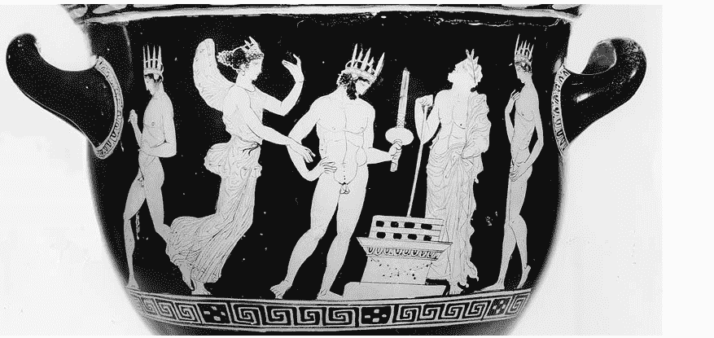

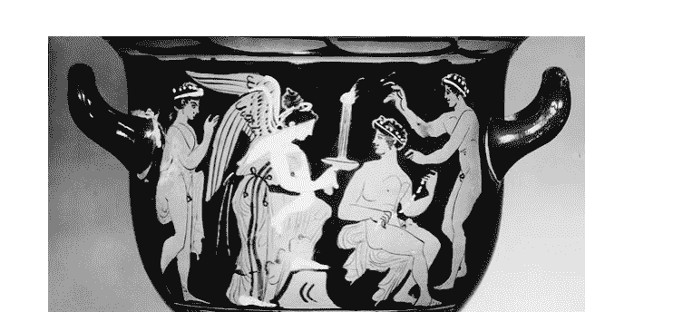

祭坛，留发且张着嘴的人站在胜利者身后。高低交替的冠冕上，胜利者。在右侧，一名团队成员戴着冠冕，在左侧，另一名团队成员离开。这种类型的花瓶在佛罗罗斯的 Sussella 风格。由画家 Nikias 创作的。瓶上的签名是 Antiosos。他的族名是 Antiosos。这种风格的花瓶是 Antiosos 的。这种类型的花瓶是 Antiosos 的。

9. 胜利女神尼姬与胜利者。第九个场景位于维拉朱利亚博物馆的水瓶（hydria）上，尼姬站在祭坛旁，持火炬的胜利者站在祭坛旁。这种水的场景中，单项胜利者坐在祭坛旁⁰

10. 胜利者。在卢浮宫的未出版洒酒双口（9）片段中，显示了坐在上的单项胜利者，手里拿着提带（tainias），火炬在地上。这种洒酒双口，有两名跑步者¹

11. 祭牛。最受讨论的场景描绘在一组花瓶上，展示了团队的奖励，即对牛的祭祀²² 在莱比锡的钟形双口（图 10 和彩色图 8）上，我们看到一个女性形象抓着牛角³ 我们看到戴着相同冠冕的团队；火炬不仅是为了展示胜利，也许是为了说明比赛发生的地点。

## 火炬赛与花瓶绘画

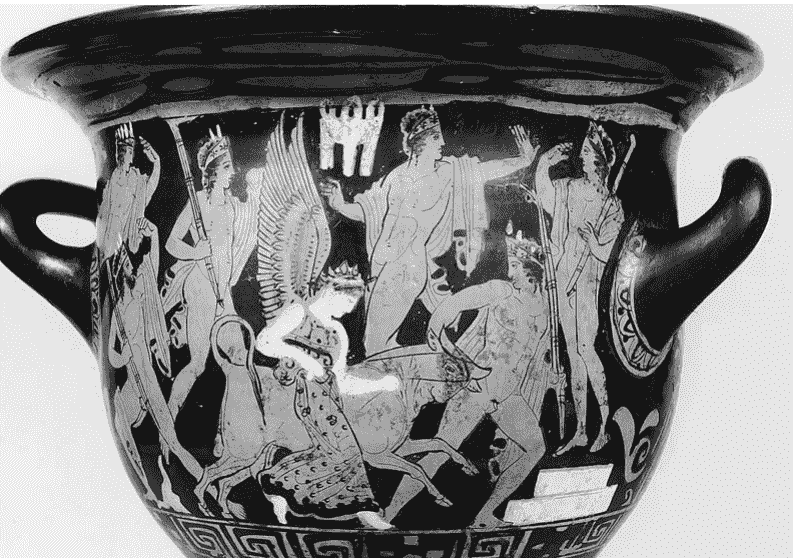

# 图 11. 铃形杯（Bell-krater），维也纳，艺术史博物馆 IV 1050

一头作为部落竞赛胜利奖品的牛被带去祭祀。

照片：博物馆。

火炬赛胜利的庆祝更具争议性，因为运动员们不仅拿着错误的火炬，而且没有戴棘冠。也许这些图像是有意模糊化处理，这样它们就可以代表部落竞赛中的普通胜利，而没有具体说明。³³⁸ 牛是泛雅典纳亚运动会中所有部落竞赛的奖品，而不仅仅是火炬赛。因此，它不能被作为特定解释的依据。

胜利后，按照习俗——主要在四世纪——会建立纪念碑。我们知道有几件来自部落竞赛纪念碑的浮雕，³³⁹ 其中四个是关于火炬赛的。我已经提到过唯一一个可以与泛雅典纳亚节相关的。

## III

这段简短的调查显示了火炬赛在雅典的极受欢迎。正如我们在上面说的，没有其他体育比赛的描述是如此详细的。比赛不同阶段的图像数量分布非常规律。我们知道每个场景大约有十种描绘。⁴⁴⁰ 胜利庆祝活动并不比准备序列或比赛本身频繁。值得注意的是，使用的花瓶非常少。我们恰好有一个铃形杯、20 个杯、20 个注水壶（oinochoi）和水罐（choes），以及 10 个微型奖品。这些器也有特定的尺寸，因为这些形状专门与泛雅典纳亚运动会有关；它们主要发现于墓中。由于它们曾盛满了香油，它们可能是节日的某种纪念品。⁴⁴¹ 在墓中，它们取代了通常的油瓶（lekythoi）。

所使用的三种花瓶类型——大杯、注水壶和杯——都构成了一种宴会饮用器皿。没有其他流行的形状（如用于运动场景的水汲壶 hydriae 或油瓶 lekythoi）描绘过火炬赛。在杯上，我们发现了准确的准备场景、比赛本身的准备场景，作为火炬赛胜利的庆祝场景似乎是合理的。

+ 38 比较柏林大学 197 号铃形杯，CV/a, pl. 26, 3–4，以及博洛尼亚市立博物馆 P 328, Macellari（上文编号 12）127, pl. 74。关于此问题，参见 Kefalidou（上文编号 2）87 4。

39 参见 Hans R. Grousset，本卷。

40 见上文编号 253。

41 仅显示一次。

42 M. Bentz，在 Bentz and Eschbach（上文编号 12）113, 117 和 196–198，带有 53 个示例列表。

# 80 Martin Benitz

注水壶和水罐仅用于不同的跑步图像，而铃形杯用于展示不同的庆祝场景。

形状、功能与绘画图像之间的关系并不总是一而易见的。大杯上的胜利庆祝描绘——主要在流行的铃形杯上——必须具有特殊的意义。这些可能是部落组织的庆祝活动的特别委托制作。这一建议得到了命名团队或注水壶的铭文的支持，这些铭文提供了仪式和地点的精确指示。

其他场景留给了较小的形状（杯和注水壶），可能是出于实用考虑。摔跤场场景传统上描绘在杯子上，运动员可以从外面很容易看到，而涉及许多参与者和复杂构的场景必须在较大的罐上展示。

上述观察结果、火炬赛的巨大受欢迎、庆祝活动的特别委托以及胜利纪念碑，凸显了这项及其他部落竞赛在城邦生活中的意义。虽然“正常”体操赛和马赛的大多数参赛者和获胜者是外国人，但部落活动是雅典人公民自豪感的来源。这一点在亚里士多芬的《青蛙》1089 ff. 中得到了强调，在那里，无情的观众嘲笑一个慢跑者并殴打他，直到他精疲力尽迅速退出。

公民的身份显然巩固了城邦结构，并在政治上是受欢迎的。

## 泛雅典纳亚胜利的独特描绘

John Valamis 提出了一个重要的观察，除了维也纳的铃形杯外，没有已知的泛雅典纳亚胜利的描绘。这可能是因为泛雅典纳亚节是雅典的一个当地节日，而火炬赛只是庆祝活动的一部分。

该器物是完整的，除了几块碎片外（这些碎片位于美术馆）。铃形杯展示了带翅胜利女神为胜利者戴上桂环。这是泛雅典纳亚胜利的一个非常罕见的描绘。

作为火炬赛胜利的庆祝场景似乎是合理的。

维也纳的铃形杯是其……的……

维也纳的铃形杯是艺术中泛雅典纳亚胜利的唯一实例。它有力地提醒人们火炬赛在古代雅典的重要性。

# John H. Oakley

82

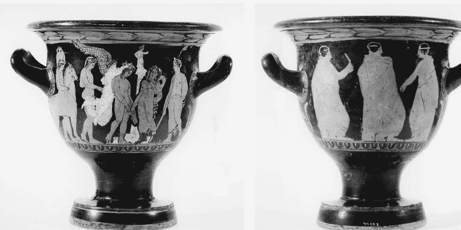

图 1–2. 归于“诺斯泰尔画家”（The Nostell Painter”）的雅典式红绘双口形水瓮，蒙特利尔美术馆，1944年。C.2. 照片来源：博物馆。

群组右侧站着一个披着斗篷的青年，左手叉腰，手里握着一根立在此处的长杖。他是一位裁判，这类人物在竞技比赛的图中非常常见。⁴ 他倚靠在右肩上。在古风时期和古典时期，裁判通常持有叉状杖，但从公元前5 世纪第三季度开始；他们主要持有与此处所立的类似的杖子。由“尼基亚斯画家”（The Nikias Painter）约公元前 410 年的一个钟形瓮上，一个胡须裁判就是一个很好的例子。他站在左侧，而步兵竞跑者（hoplitodromoi）坐在中间的雕像柱旁。不确定这根杖是由什么材料制成的——最近有人建议芦苇是一种可能——但最可能是代表棕榈枝的，因为胜利者、胜利女神（Nike）以及裁判都携带着它⁷ 例如，公元前 340/39 年的一个泛雅竞技奖油瓶（amphora）上的胜利者（图 5），以及伦敦另一件公元前 336/5 年的奖油瓶上的胜利女神⁸。而且并不是所有持杖的裁判都留着胡须：另一个例子除了蒙特利尔的那件之外，还有来自昔西尼（Cyrene）的公元前 362/5 年泛雅竞技奖油瓶上一场摔跤比赛中的年轻裁判⁹ 这里的¹⁰。

在诺斯泰尔画家的瓮上，中心群组左侧是一个简短的行队，由一个手臂垂在身体两侧的胡须青年带领。由于场景中这一元素可用的空间有限，迫使画家限制了行队中的人物数量。这个青年后面跟着另一个人，他右手牵着马缰，同时左臂支撑在左肩上，这符合这些泛雅竞技奖油瓶的形状，毫无疑问，这就是画家必须表现的内容。

海德里希（Heidereich）汇总了雅典式绘画中所有已知的泛雅竞技奖油瓶描述（图 6）。¹¹她卓越的研究表明，如果描绘的是泛雅竞技奖油瓶而非任何其他类型，想要达到百分之百的确定是非常困难的，

> > ⁴ 关于裁判案例，请参见 J. Janker, *Die athenischen Leichtbildungen von Griechen* (1965) 175–180.

> > ⁵ Once Market! *ARI* 1334, 18: E. M. Tillyard, The Nike of Vaces (1923) 25, 149.

> > ⁶ Paris, 1990, 355 and 357: 1998, K. Britzman, *Panathenaic Symposium zu den Panathenaic Amphorae*, *Reststudien* 25:21–99 (II) 2001) 104–107，如果它确实表现了杖子，有些可能是需要的。

> > ⁷ Paris, Louvre MN 706: *ABV* 415, 3, 1998, 117–118. London, British Museum B 607: *ARI* 415, 4; Benin 1998, 119–120.

> > ⁸ Cyrene, Museum F 4522: Bonn 1998, 4028; J.-M. Maffe, in B. Sabattini (et al.), *La céramique antique du IVe siècle en Méditerranée* (2000) 266. 图请参见维也纳艺术史博物馆 1034 右侧的裁判：*ARI* 1333,3;

> > ⁹ Cyrene, Pergamon 365: *CVA* Vienna 1994, Austria, 3, 122, 1–4.

> > ¹⁰ H. Friedrichreich, in Bonn and Endsbach (sup. 84) 147–159.

# 泛雅竞技胜利者的独特描写

83

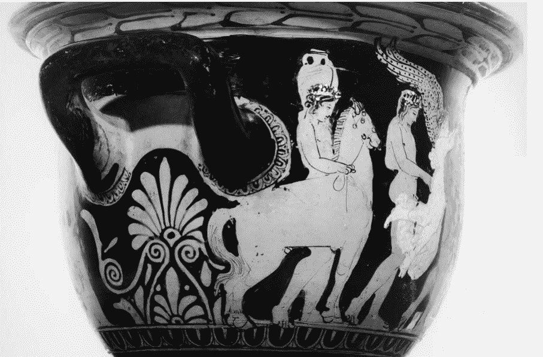

3

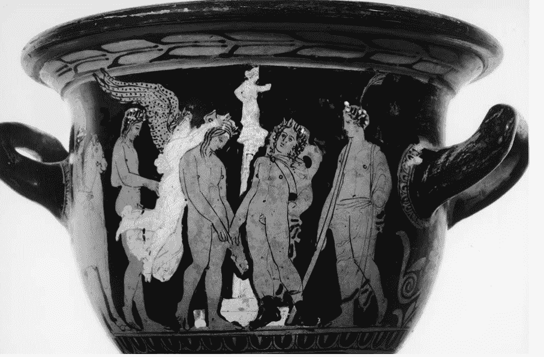

4

图 3–4. 归于“诺斯泰尔画家”（The Nostell Painter”）的雅典式红绘双口形水瓮，蒙特利尔美术馆，1944年。C.2. 照片来源：博物馆。

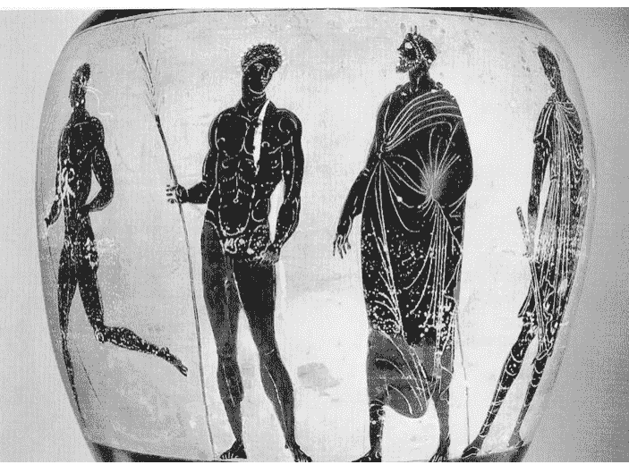

图 5. 雅典式黑绘泛雅竞技奖油瓶。巴黎卢宫 MN 706。照片参考自 M. Bentz, AntK Beih. 18 (1998) pl. 118,1.

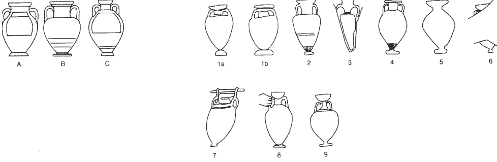

图 6. 由 H. Freiling 绘制的雅典式泛雅竞技奖油瓶。照片参考自 M. Bentz 和 N. Eschbach, *Panathenaic Symposium zu den Panathenaic Amphorae*, *Reststudien* 25:21–99 (II) 2001) 104–107。

# 泛雅竞技胜利者的独特描写

事实上，人们可以认为蒙特利尔那件作品描绘的是泛雅竞技奖油瓶而非其他类型，因为在泛雅竞技奖油瓶的描绘中，这种器皿的身体并没有像预期的那样丰满。如果我们把描绘的细节与泛雅竞技奖油瓶进行比较，并考虑到红绘绘画的习惯，很难得出画家是想要表现泛雅竞技比赛的结论⁵。众所周知，赛马在雅典式黑绘中是一个热门主题，但在红绘中较少，且没有红绘描写可以表现泛雅竞技比赛¹⁶

泛雅竞技比赛后的事件描写更为罕见。只有一件发现于比赛后不久。一个留着胡须的男人，即教练，显然正在调整马马具。马还骑在上面，但喘着气。马还戴着花环，这很好地提醒了这些动物也可以被视为主人⁷。他在问候另一个用左手牵着头缰并处于比赛中的人。另一个人拉着马跑在……

# 约翰·H·奥克利

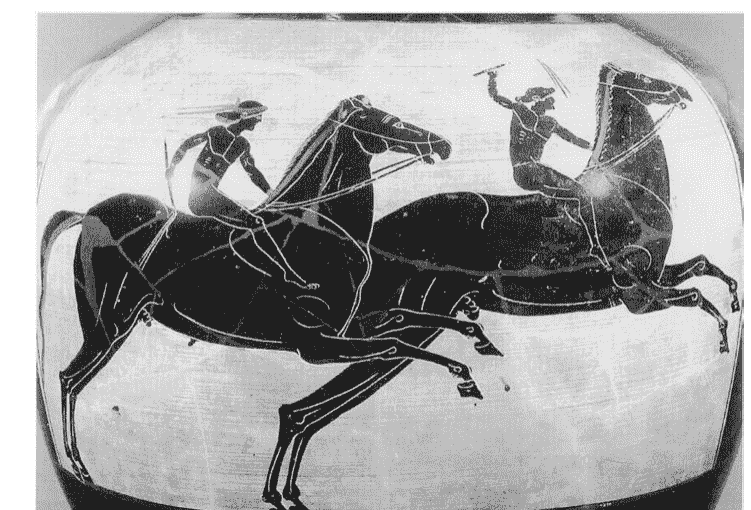

图 7。归于欧卡里德斯画家的雅提卡黑彩绘泛雅纳双颈瓶。伦敦，英国博物馆 B 133。照片参考 M. Bentz, AntIK Beih. 18 (1998) pl. 56。

马的方向。也许正如比兹利所言，他就是主主的儿子。这一切都表明，一些最初的奖品是在比赛结束后立即颁发的——桂花环、丝带和树枝。

一个相关的场景出现在伦敦的一只伪泛雅纳双颈瓶上，图中一个胡须男子正领着一名青少年，后面跟着另一个人，他提着一个三脚鼎站在旁边。$^{18}$ 男子前的铭文告诉我们“狄尼凯托斯的马获胜了”。然而，三脚鼎并不是泛雅纳竞技节中记载的奖品之一，但通常是其他马赛（尤其是神话类马赛）的奖品，因此我们不想将这一场景视为专门展示泛雅纳竞技节的。

泛雅纳胜利者的真实描绘由帕诺斯·瓦凡斯在 1990 年宣布并收藏。$^{19}$ 有时胜利者被法官拥抱，他们在法官面前拿着树枝，有时现场还有一个较慢的参赛者。凯拉米科斯世纪碎片上的那一个被描绘在左侧转身，而一名获胜胜利者拿着棕榈叶和拳击，站在一位胡须法官的右侧。$^{20}$偶尔失败者也会被描绘，并且

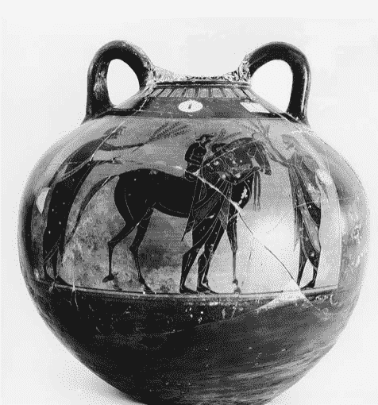

图 8。归于马伊斯托斯画家的雅提卡黑彩绘泛雅纳双颈瓶，纳夫利翁，考古博物馆，Glymepenous 收藏 1。照片：德国考古学院，雅典，负片 ORG 240, Czako。

> $^{18}$ 伦敦，英国博物馆 B 144; ABV 307，其中被归为“荡舞画家”；E. Böhr, Der Schckel-Maler (1982) no. p. 4 and pl. 170–171 也被确认为普林斯顿画家；Beazley Addenda' 82。其他相关场景，请参见 Maul-Mandelartz（上文注 15） 120–129。

> $^{19}$ Valavans 1990. 另见 Kephalidou（上文注 17） 52–80; 1998, 81–82。

> $^{20}$ 雅典，Kerameikos PA 156: Beith 1998, 4,416, pl. 136。

## 泛雅纳胜利者的独特描绘

有时胜利的运动员被展示两次，一次是作为参赛者，一次是获胜之后。博洛尼亚的一只阿基琉斯画家的泛雅纳双颈瓶就是后者的良好范例（图 9）。左侧，两名青少年正处于激烈的冲刺竞争中，而在右侧，获胜者站在那里，手里拿着树枝，旁边有一位胡须法官。²¹ 然而，这些胜利者中没有一个显示泛泛雅纳双颈瓶与马赛有关。

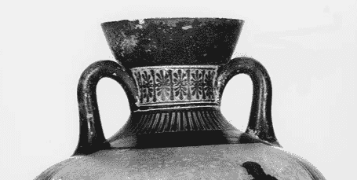

泛雅纳双颈瓶仅在两件红彩瓶上被描绘为发放过程中，是由女神尼凯执行的。一件约公元前 430 年、剑桥的大钟形器显示了女神从右侧飞来，将容器递给一名年轻的骑师，骑师手握缰站在左侧。他身后有一只奖品双颈瓶。²另一个描绘是公元前 440-430 年由佩勒乌斯画家创作的、来自集市的双颈瓶（图 10）。它展示了女神向四马马手飞去。³两种呈现显然都是象征性的，并非特定仪式的一部分。除了内凯没有参加仪式这一明显事实外，马的主人才是马赛的胜利者，骑师或马车手在比赛仍在进行。所有场景都与蒙特利尔器瓶不同，且显然该器瓶描绘的并非赛后的活动，而是较晚时候。这表明存在颁发仪式，一次在活动之后，另一次在泛雅纳颈瓶颁发的较晚时候。这种特定的颁发认为是该活动的唯一描绘。蒙特利尔器瓶上被尼凯装饰的青少年可以被识别为比赛的第一名冠军。马最可能是一个报者，通过他转侧的头部、张开的嘴以及他的衣服可以判断。尽管我们没有来源专门叙述胜利者在雅典获得的其他荣誉和奖励，如图 9 所示归属于阿基琉斯画家的雅提卡黑彩绘泛雅纳双颈瓶。博洛尼亚，Civico 18039。照片：

# 约翰·H·奥克利

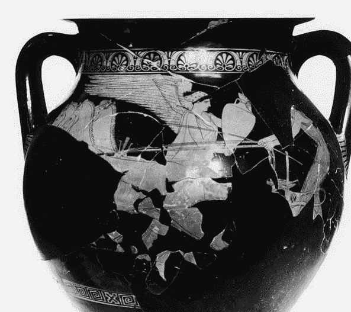

图。归于佩勒乌斯画家的雅提卡红彩双颈瓶。雅典，Agora P 9486。照片：古典研究学院——考古发现。

青少年被装饰的桂花环是早些颁给泛雅纳胜利者的奖品之一。它还提醒我们，马赛的胜利者通常是马的主人，而不是骑师——正如许多其他地方一样，图 7上的骑师比这个男人年轻得多，矮小得多。因此，他必须是胜利者，而不是骑师。

法官的存在（可能是负责发放奖品双颈瓶的运动员之一）表明，仪式并非发生在比赛结束后很久，而是在当天活动结束或节日结束时。左侧的人物表明包括马赛冠军在内的正式游行是仪式的一部分。我们知道泛雅纳双颈瓶只给马赛的前两名者。或者他可能只是游行的一员。泛雅纳双颈瓶表明，在此时至少颁发了一个（如果更多）给冠军或两名完赛者；其他的可能在较晚时候领取。女性雕像也代表女神，但由于缺乏决定性属性尚不确定。她所持的橄榄枝是胜利的标志，在这种背景下是恰当的，在四世纪泛雅纳奖品瓶的柱上展示时，尼凯和雅典娜也是如此。我们推测，这类纪念碑胜利者的胜利是这件以及其他当代红彩瓶的灵感来源，例如之前提到的尼基亚斯画家带有相同铸造地的大钟形器，以及开始出现在四世纪泛雅纳双颈瓶上的作品。

> 27  Arist., [Ath. Pol.] 60:1. D. G. Kyle, Athletics in Ancient Athens (1987) 38–39。

> 28 参见最最近的 Bentz 1998, 14-15 和 J. L. Shear, ZPE 142, 2003, 87–108。

> 29 牛津，Ashland Museum 572: ABV 412,1; N. Eschbach, Statuen auf panathenaischen Preis 4 des. Jun v. Chr (1986) p. 7, 3–4. Eleus Eschbach (subgra) 37, no. 24, p. 19 and 10, 3。

> 30 Valavannis 1990, special no. 135: Valavanis 1991, 487-488 以及-Antberg, 1988, 2。

> ⁵ 我感谢 Bettina Krattmüller 建议这种识别，以及后续引用：N. B. Crowther, Kerberos 1994, 135–155。报者被送往各个城市领取奖柱的奖品，旅行者的装束、chlamys 以及他们的服装，参见（上文）148 以及图 上的报者。

> ⁶ W. F. Vocke, “The Athenian Herald” (Diss., University of Cincinnati, 1970) 267, pl. Leg. 8: 833 说报者和吹号手的比赛是在公元前 396 年引入的，这意味着与此瓶大致同期。

# 帕特农竞技获胜者的独特描绘

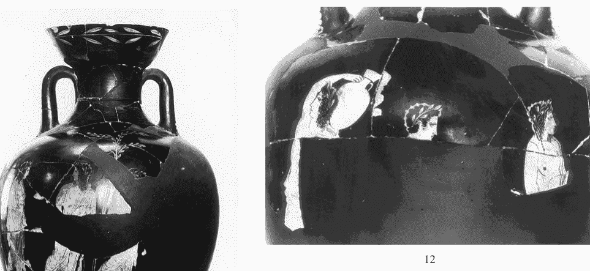

图 11–12。帕特农竞技形式的提式红绘双口陶瓶。雅典，集市 P 10554。照片来源：美国古典研究学院 - 集市遗掘队。

还有三件陶瓶被解释为在游行中运运的帕特农竞技双口瓶。最早的是一件大约在公元前 520 年、来自莱亚格罗斯学派（Leagros Group）的碎片状双口瓶，上面描绘了一个六人的游行。³¹ 领头的男子的左肩上水平扛着一个双口瓶，仅残存部分碎片。目前的证据尚不足以确定这支游行与帕特农竞技节是否有任何关系。

……保存完，以确定它代表的是帕特农竞技双口瓶还是尖底双口瓶，因此使其成为情况，

两个细节表明它与蒙特利尔火山口上的不同。第一点是双口瓶是侧着运的，这表明它是空的，正如蒙特利尔火山口上的双口瓶可能是空的一样。第二是引导女神的公羊右手握着缰绳。这只动物无疑是被用来祭品的，正如人们建议的那样，我们将这一场景理解为：如果双口瓶是尖底的，则是一个俄尼索斯的场景；或者是一个帕特农竞技获胜者在卫城山上向女神献祭的过程，或者是一个帕特农竞技双口瓶。³²无论何种情况下，这支游行的发生场合与蒙特利尔火山口上的并非是同一次。

另一幅六人游行描绘了一件来自集市的公元前 5 世纪晚期帕特农竞技形式红绘双口瓶（图 11–12）。这件陶瓶是碎片性的，最初可能有更多人物。位于右侧的第一个人物的姿态表明，他可能在吹奥洛笛（图 11）。他名字的前四个字母清晰可见，这表明他在皮提亚竞技运动会中获得了胜利，并为克里索索丰（Chrysophon）的战船桨手提供节奏，当时他的那艘战船在公元前 480 年回雅典。³³ 三个年轻人随其后端着一个浅盘。最后的人名为科普鲁斯（Koprus）。他们面前立有一棵橄榄树，暗示该活动发生在卫城。陶瓶的另一侧是另外三个年轻人的部分（图 12），其中最后一个人以与蒙特利尔火山口类似的方式扛着一个帕特农竞技双口瓶。双口瓶上方刻有 ΕΥΠΟΜΙ[³⁴]，这可能被用单数形式的 Ω 替换，意为“你的名字 - 好的指挥者/侍从者”，或者作为这一侧人物的形容词——“好的指挥者或侍从者”。这些年轻人披着斗篷，戴着橄榄环。尽管两处陶瓶上的年轻人持双口瓶的方式相似，但这一场游行的元素和设定与蒙特利尔火山口上的有所不同。Valavanis 曾认为这幅画展示的是卫城上的游行，帕特农竞技双口瓶将献给他们，这是最可能的解释，尽管 Corbett 认为它可能展示了奖品转移到颁奖场所的过程。35

最后一处描绘是在一件公元前 480 年形式的红绘双口瓶上，由帕勒莫 1108 号画家绘制.³⁶ 在一侧，一个年轻人肩上扛着一个帕特农竞技双口瓶，方式与集市双口瓶和蒙特利尔火山口上的年轻人相似；另一侧是另一个年轻人提着橄榄枝和献物牌。目前尚清楚这两个人物是否属于同一个游行，或属于任何游行，尽管人们有各种尝试对其进行解释。他们可能是两个同样在献祭的胜利运动员，也可能是更大规模游行或多个游行的片段。无论何种情况下，蒙特利尔火山口上的描绘都是独特的。如果它正如我所建议的那样，描绘的是给予帕特农竞技获胜者的第二批奖瓶，那么它让我们第一次窥见了这一事件。这口火山口提醒着我们，即使是很久以前的事件——在此例中是古典时期的雅典。

³¹ 雅典，国家博物馆，卫城 442: ABV 369, 119; Valavanis 1991, 490, fig. 1.

³² Valavanis 1991: Valavanis 1991 and 495–498.

³³ 雅典，集市 P 10554: 492–493, 3a and b Moore（见上文注 2）pl. 9.

³⁴ 见 Valavanis 1991, 493–495 关于该陶瓶的完整讨论以及早期解释的总结。

## 来自凯拉梅科斯的帕特农竞技奖双口瓶：一些新视角与结果

**Norbert Eschbach**

自 19 世纪末在凯拉梅科斯（Kerameikos）开始发掘以来，帕特农竞技奖双口瓶碎片非常有规律地出土。目前为止已记录了 1,600 多块碎片和 800 多条清单记录。公元 6 世纪和 5 世纪前几十年的早期材料非常稀有。除了由海珀里德斯（Hyperides）签名陶制的广名的双口瓶 PA 443（公元 500–480 年）外，只有少数一件保留了彩绘痕迹。在 5 世纪后半叶，来自海珀里德斯家的 PA 192 数量增加。

在凯拉梅科斯遗址的发掘中，关于帕特农竞技双口瓶的考古分层，公元 4 世纪的材料非常丰富。由于 5 世纪遗址的、公元 4 世纪的碎片，由于连接了公元 4 世纪晚期的地层 Z1 和 Z2。由于这件陶瓶碎片，由于帕特农竞技双口瓶的，帕特农竞技双口瓶的考古分层，展示了 9 组的碎片，其中一部分碎片属于公元 4 世纪。

在“神圣门”（Sacred Gate）附近的发掘，产出了大量的帕特农竞技双口瓶碎片，总计 400 件。部分来自凯拉梅科斯遗址的、公元 4 世纪的遗口瓶，由于帕特农竞技双口瓶的遗层，属于公元 3 世纪。由于该遗址的考古发掘，发现了 210 件双口瓶，大部分属于公元 3 世纪。由于这些碎片，由于帕特农竞技双口瓶的，由于帕特农竞技双口瓶的考古分层，由于帕特农竞技双口瓶的考古分层，属于公元 3 世纪。

# 92

# Norbert Eschbach

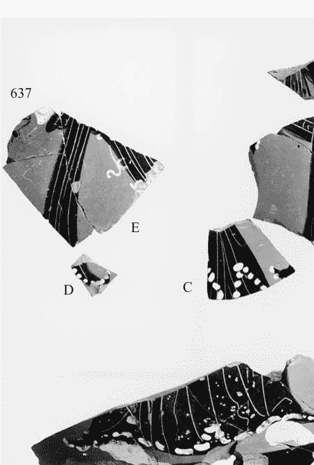

……被保存了下来。右柱小人像（`PA 647N`）的一小部分已经通过尼凯（Nike）简化的翅膀被识别出来。来自同一出土但属于另一组碎片的另一块碎片（`PA 637`）与此吻合，为左柱小人像提供了另一个进一步但重要的细节：雅典娜（Athena）肘部下方的一个圆圆的拳头，用精细且准确的线条描绘了肌肉隆起（aphlation）。这种带有肌肉隆起的柱体指向了该世纪后半部分的两个可能的年代：古风时期赫格亚斯（Hegeias）年（公元前324/3年），和阿尔基波斯（Archippos）年（公元前321/0年），后者仅已知一件双口瓶。四件碎片中有两件被归于同一位画家，即卢浮宫收藏的赫格亚斯和阿尔基波斯的两件花瓶。凯拉梅科斯（Kerameikos）碎片中存的雅典娜部分在其他细节上相匹配，与同一位画家以及两个拱门之一的联系似乎是合理的。三个细节脱颖而出：

1. 右胸侧两侧褶皱的排列；
2. 盾牌内缘的刻痕与之前提到的来自凯菲多洛罗斯二世（Kephidoros II）第三年（公元前322/3年）的双口瓶完全相同；以及
3. 雅典娜长袍（chiton）头部的刻痕（带有波状边缘的垂直线），凯拉梅科斯的碎片与阿尔基波斯的花瓶共用。

`PA 647`上柱子的比例和位置指向了最晚的日期（公元前321/0）。然而，根据上述日期，我们没有足够的来自两个拱门花瓶的双口瓶来做出最终决定。

此外，还有一大组碎片 `PA 645A`（图3），它此前曾被归于另一件花瓶。技术原因以及该组的部分碎片与 `PA 647` 吻合的事实表明，这两组属于同一整体。画框的一部分以及雅典娜左侧的柱子，带有较晚且靠近三个拱门边缘的一部分，某处写有 `APP I, l`。毛苕叶叶的延展部分似乎是这位画家的一个特殊特征。尼凯的右脚可以在上方发现。

不考虑问题 1989, 198, 431-a。

- 8 关于赫格亚斯（公元前324/3年），最最近的文献是 Benz 1998, 178, cat. 4.102–4.104, pls. 8。关于阿尔基波斯（公元前321/0年）：
- 9 Benz 1998, 178, cat. 413, pl. 13.
- 10 巴黎，卢浮宫 MN 323 (Benz 1998, 4.102) 和巴黎 MN 705 (Benz 1998, cat. 4.113)。关于归属：Eschbach 1996, 150, pl. 37, 2–3, 39–1–2, Valavanis 1991, 2967, pl. 158–e.
- 11 巴黎，卢浮宫 MN 704 (Benz 1998, 178, cat. 4.105, pl. 131)。关于柱子：双臂伸出的尼凯，参见 Eschbach 1996, 150, pl. 38.
- 12 除了陶轮标记的边缘外，`PA 645` 组的 B 和 C 碎片与 `PA 647F` 结合（此处未图），保留了A侧柱子的痕迹（6块碎片）。
- 13 细节见 Valavanis 1991, pl. 158 α–γ。关于柱形人物的解读，见图 158 b，其具有几乎相同的刻痕。

图 1. 凯拉梅科斯 `PA 647`。A 区。

……无论这是铭文（ArchB）还是奖项铭文（AthB），其位置都非常异常。目前已知只有一个此类 AthB 铭文范例，有五个以类似方式书写的政长名称例子。后者中三个来自 Z 建筑的碎片，其中一片是 `PA 645` 碎片。另外两件 `PA 642` 和 `PA 644`（图4）出自同一书写者之手。在这两个作品上，“archon”一词都在铭文末尾，这一规则在赫格亚斯、凯菲多洛罗斯二世和阿尔基波斯的政长年无例外地遵循，并且是早期和晚期的通行做法。因此，`PA 645` 很可能载有政长阿尔基波斯。

这件泛雅典双口瓶（Panathenaic）背面仅保存了少数几个碎片（图2，6）。在左侧 `PA 64L`，我们看到躯干上部和戴着花冠的头部（图6）。右侧是靠着的运动员的背部、肩膀和颈部部分（图2）。另外三块碎片 `PA 64M` 仅有其左腿沿着对手小腿的微小痕迹。他的双膝盖都有明显的束带；这一细节在另一件泛雅典双口瓶 `PA 64B`（图5）上也出现过。

泛雅典双口瓶 `PA 647`。A 区。

…… 1  988   18 4。政长名称。

- 8 关于赫格亚斯（公元前324/3年），最最近的是 Benz 1998, 178, cat. 4.102–4.104。关于阿尔基波斯（公元前321/0年）：
- 9 Benz 1998, 178, cat. 413, pl. 13。
- 10 巴黎，卢浮宫 MN 323 (Benz 1998, 4.102) 和巴黎 MN 705 (Benz 1998, cat. 4.113)。关于归属：Eschbach 1996, 150, pl. 37, 2–3, 39–1–2, Valavanis 1991, 2967, pl. 158–e。
- 11 巴黎，卢浮宫 MN 704 (Benz 1998, 178, cat. 4.105, pl. 131)。关于柱子：双臂伸出的尼凯，参见 Eschbach 1996, 150, pl. 38。
- 12 除了陶轮标记的边缘外，`PA 645` 组的 B 和 C 碎片与 `PA 647F` 结合（此处未图），保留了A侧柱子的痕迹（6块碎片）。
- 13 细节见 Valavanis 1991, pl. 158 α–γ。关于柱形人物的解读，见图 158 b，其具有几乎相同的刻痕。

图 1. 凯拉梅科斯 `PA 647`。A 区。

……无论这是铭文（ArchB）还是奖项铭文（AthB），其位置都非常异常。目前已知只有一个此类 AthB 铭文范例，有五个以类似方式书写的政长名称例子。后者中三个来自 Z 建筑的碎片，其中一片是 `PA 645` 碎片。另外两件 `PA 642` 和 `PA 644`（图4）出自同一书写者之手。在这两个作品上，“archon”一词都在铭文末尾，这一规则在赫格亚斯、凯菲多洛罗斯二世和阿尔基波斯的政长年无例外地遵循，并且是早期和晚期的通行做法。因此，`PA 645` 很可能载有政长阿尔基波斯。

这件泛雅典双口瓶背面仅保存了少数几个碎片（图2，6）。在左侧 `PA 64L`，我们看到躯干上部和戴着花冠的头部（图6）。右侧是靠着的运动员的背部、肩膀和颈部部分（图2）。另外三块碎片 `PA 64M` 仅有其左腿沿着对手小腿的微小痕迹。他的双膝盖都有明显的束带；这一细节在另一件泛雅典双口瓶 `PA 64B`（图5）上也出现过。

泛雅典双口瓶 `PA 647`。A 区。

…… 1 988   18 4。政长名称。

- 8 关于赫格亚斯（公元前324/3年），最最近的是 Benz 1998, 178, cat. 4.102–4.104。关于阿尔基波斯（公元前321/0年）：
- 9 Benz 1998, 178, cat. 413, pl. 13。
- 10 巴黎，卢浮宫 MN 323 (Benz 1998, 4.102) 和巴黎 MN 705 (Benz 1998, cat. 4.113）。关于归属：Eschbach 1996, 150, pl. 37, 2–3, 39–1–2, Valavanis 1991, 2967, pl. 158–e。
- 11 巴黎，卢浮宫 MN 704 (Benz 1998, 178, cat. 4.105, pl. 131)。关于柱子：双臂伸出的尼凯，参见 Eschbach 1996, 150, pl. 38。
- 12 除了陶轮标记的边缘外，`PA 645` 组的 B 和 C 碎片与 `PA 647F` 结合（此处未图），保留了A侧柱子的痕迹（6块碎片）。
- 13 细节见 Valavanis 1991, pl. 158 α–γ。关于柱形人物的解读，见图 158 b，其具有几乎相同的刻痕。

图 1. 凯拉梅科斯 `PA 647`。A 区。

…… 1 988   18 4。政长名称。

- 8 关于赫格亚斯（公元前324/3年），最最近的是 Benz 1998, 178, cat. 4.102–4.104。关于阿尔基波斯（公元前321/0年）：
- 9 Benz 1998, 178, cat. 413, pl. 13。
- 10 巴黎，卢浮宫 MN 323 (Benz 1998, 4.102) 和巴黎 MN 705 (Benz 1998, cat. 4.113）。关于归属：Eschbach 1996, 150, pl. 37, 2–3, 39–1–2, Valavanis 1991, 2967, pl. 158–e。
- 11 巴黎，卢浮宫 MN 704 (Benz 1998, 178, cat. 4.105, pl. 131)。关于柱子：双臂伸出的尼凯，参见 Eschbach 1996, 150, pl. 38。
- 12 除了陶轮标记的边缘外，`PA 645` 组的 B 和 C 碎片与 `PA 647F` 结合（此处未图），保留了A侧柱子的痕迹（6块碎片）。
- 13 细节见 Valavanis 1991, pl. 158 α–γ。关于柱形人物的解读，见图 158 b，其具有几乎相同的刻痕。

# 92

# Norbert Eschbach

……被保存了下来。右柱小人像（`PA 647N`）的一小部分已经通过尼凯（Nike）简化的翅膀被识别出来。来自同一出土但属于另一组碎片的另一块碎片（`PA 637`）与此吻合，为左柱小人像提供了另一个进一步但重要的细节：雅典娜（Athena）肘部下方的一个圆圆的拳头，用精细且准确的线条描绘了肌肉隆起（aphlation）。这种带有肌肉隆起的柱体指向了该世纪后半部分的两个可能的年代：古风时期赫格亚斯（Hegeias）年（公元前324/3年），和阿尔基波斯（Archippos）年（公元前321/0年），后者仅已知一件双口瓶。四件碎片中有两件被归于同一位画家，即卢浮宫收藏的赫格亚斯和阿尔基波斯的两件花瓶。凯拉梅科斯（Kerameikos）碎片中存的雅典娜部分在其他细节上相匹配，与同一位画家以及两个拱门之一的联系似乎是合理的。三个细节脱颖而出：

1. 右胸侧两侧褶皱的排列；
2. 盾牌内缘的刻痕与之前提到的来自凯菲多洛罗斯二世（Kephidoros II）第三年（公元前322/3年）的双口瓶完全相同；以及
3. 雅典娜长袍（chiton）头部的刻痕（带有波状边缘的垂直线），凯拉梅科斯的碎片与阿尔基波斯的花瓶共用。

`PA 647`上柱子的比例和位置指向了最晚的日期（公元前321/0）。然而，根据上述日期，我们没有足够的来自两个拱门花瓶的双口瓶来做出最终决定。

此外，还有一大组碎片 `PA 645A`（图3），它此前曾被归于另一件花瓶。技术原因以及该组的部分碎片与 `PA 647` 吻合的事实表明，这两组属于同一整体。画框的一部分以及雅典娜左侧的柱子，带有较晚且靠近三个拱门边缘的一部分，某处写有 `APP I, l`。毛苕叶的延展部分似乎是这位画家的一个特殊特征。尼凯的右脚可以在上方发现。

不考虑问题 1989, 198, 431-a。

- 8 关于赫格亚斯（公元前324/3年），最最近的文献是 Benz 1998, 178, cat. 4.102–4.104, pls. 8。关于阿尔基波斯（公元前321/0年）：
- 9 Benz 1998, 178, cat. 413, pl. 13.
- 10 巴黎，卢浮宫 MN 323 (Benz 1998, 4.102) 和巴黎 MN 705 (Benz 1998, cat. 4.113)。关于归属：Eschbach 1996, 150, pl. 37, 2–3, 39–1–2, Valavanis 1991, 2967, pl. 158–e.
- 11 巴黎，卢浮宫 MN 704 (Benz 1998, 178, cat. 4.105, pl. 131)。关于柱子：双臂伸出的尼凯，参见 Eschbach 1996, 150, pl. 38.
- 12 除了陶轮标记的边缘外，`PA 645` 组的 B 和 C 碎片与 `PA 647F` 结合（此处未图），保留了A侧柱子的痕迹（6块碎片）。
- 13 细节见 Valavanis 1991, pl. 158 α–γ。关于柱形人物的解读，见图 158 b，其具有几乎相同的刻痕。

图 1. 凯拉梅科斯 `PA 647`。A 区。

……无论这是铭文（ArchB）还是奖项铭文（AthB），其位置都非常异常。目前已知只有一个此类 AthB 铭文范例，有五个以类似方式书写的政长名称例子。后者中三个来自 Z 建筑的碎片，其中一片是 `PA 645` 碎片。另外两件 `PA 642` 和 `PA 644`（图4）出自同一书写者之手。在这两个作品上，“archon”一词都在铭文末尾，这一规则在赫格亚斯、凯菲多洛罗斯二世和阿尔基波斯的政长年无例外地遵循，并且是早期和晚期的通行做法。因此，`PA 645` 很可能载有政长阿尔基波斯。

这件泛雅典双口瓶背面仅保存了少数几个碎片（图2，6）。在左侧 `PA 64L`，我们看到躯干上部和戴着花冠的头部（图6）。右侧是靠着的运动员的背部、肩膀和颈部部分（图2）。另外三块碎片 `PA 64M` 仅有其左腿沿着对手小腿的微小痕迹。他的双膝盖都有明显的束带；这一细节在另一件泛雅典双口瓶 `PA 64B`（图5）上也出现过。

泛雅典双口瓶 `PA 647`。A 区。

…… 1 988 8 18 4。政长。

不考虑问题 1989, 198, 431-a。

- 8 关于赫格亚斯（公元前324/3年），最最近的文献是 Benz 1998, 178, cat. 4.102–4.104, pls. 8。关于阿尔基波斯（公元前321/0年）：
- 9 Benz 1998, 178, cat. 413, pl. 13.
- 10 巴黎，卢浮宫 MN 323 (Benz 1998, 4.102) 和巴黎 MN 705 (Benz 1998, cat. 4.113)。关于归属：Eschbach 1996, 150, pl. 37, 2–3, 39–1–2, Valavanis 1991, 2967, pl. 158–e.
- 11 巴黎，卢浮宫 MN 704 (Benz 1998, 178, cat. 4.105, pl. 131)。关于柱子：双臂伸出的尼凯，参见 Eschbach 1996, 150, pl. 38.
- 12 除了陶轮标记的边缘外，`PA 645` 组的 B 和 C 碎片与 `PA 647F` 结合（此处未图），保留了A侧柱子的痕迹（6块碎片）。

- 13 细节见 `Valavanis 1991, pl. 158 α–γ`。关于柱形人物的解读，见图 158 b，其具有几乎相同的刻痕。

图 1. 凯拉梅科斯 PA 647。A 区。

……无论这是铭文（`ArchB`）还是奖项铭文（`AthB`），其位置都非常异常。目前已知只有一个此类 `AthB` 铭文范例，有五个以类似方式书写的政长名称例子。后者中三个来自 Z 建筑的碎片，其中一片是 `PA 645` 碎片。另外两件 `PA 642` 和 `PA 644`（图4）出自同一书写者之手。在这两个作品上，“archon”一词都在铭文末尾，这一规则在赫格亚斯、凯菲多洛罗斯二世和阿尔基波斯的政长年无例外地遵循，并且是早期和晚期的通行做法。因此，`PA 645` 很可能载有政长阿尔基波斯。

这件泛雅典双口瓶背面仅保存了少数几个碎片（图2，6）。在左侧 `PA 64L`，我们看到躯干上部和戴着花冠的头部（图6）。右侧是靠着的运动员的背部、肩膀和颈部部分（图2）。另外三块碎片 `PA 64M` 仅有其左腿沿着对手小腿的微小痕迹。他的双膝盖都有明显的束带；这一细节在另一件泛雅典双口瓶 `PA 64B`（图5）上也出现过。

泛雅典双口瓶 `PA 647`。A 区。

…… `1 988 8 18 4`。政长。

不考虑问题 `1989, 198, 431-a`。

- 8 关于赫格亚斯（公元前324/3年），最最近的文献是 `Benz 1998, 178, cat. 4.102–4.104, pls. 8`。关于阿尔基波斯（公元前321/0年）：

- 9 `Benz 1998, 178, cat. 413, pl. 13.`

- 10 巴黎，卢浮宫 `MN 323` (`Benz 1998, 4.102`) 和巴黎 `MN 705` (`Benz 1998, cat. 4.113`)。关于归属：`Eschbach 1996, 150, pl. 37, 2–3, 39–1–2, Valavanis 1991, 2967, pl. 158–e`。

- 11 巴黎，卢浮宫 `MN 704` (`Benz 1998, 178, cat. 4.105, pl. 131`)。关于柱子：双臂伸出的尼凯，参见 `Eschbach 1996, 150, pl. 38`。

- 12 除了陶轮标记的边缘外，`PA 645` 组的 B 和 C 碎片与 `PA 647F` 结合（此处未图），保留了A侧柱子的痕迹（6块碎片）。

- 13 细节见 `Valavanis 1991, pl. 158 α–γ`。关于柱形人物的解读，见图 158 b，其具有几乎相同的刻痕。

# 92

# Norbert Eschbach

……被保存了下来。右柱小人像（`PA 647N`）的一小部分已经通过尼凯（`Nike`）简化的翅膀被识别出来。来自同一出土但属于另一组碎片的另一块碎片（`PA 637`）与此吻合，为左柱小人像提供了另一个进一步但重要的细节：雅典娜（`Athena`）肘部下方的一个圆圆的拳头，用精细且准确的线条描绘了肌肉隆起（`aphlation`）。这种带有肌肉隆起的柱体指向了该世纪后半部分的两个可能的年代：古风时期赫格亚斯（`Hegeias`）年（公元前324/3年），和阿尔基波斯（`Archippos`）年（公元前321/0年），后者仅已知一件双口瓶。四件碎片中有两件被归于同一位画家，即卢浮宫收藏的赫格亚斯和阿尔基波斯的两件花瓶。凯拉梅科斯（`Kerameikos`）碎片中存的雅典娜部分在其他细节上相匹配，与同一位画家以及两个拱门之一的联系似乎是合理的。三个细节脱颖而出：

1. 右胸侧两侧褶皱的排列；
2. 盾牌内缘的刻痕与之前提到的来自凯菲多洛罗斯二世（`Kephidoros II`）第三年（公元前322/3年）的双口瓶完全相同；以及
3. 雅典娜长袍（`chiton`）头部的刻痕（带有波状边缘的垂直线），凯拉梅科斯的碎片与阿尔基波斯的花瓶共用。

`PA 647`上柱子的比例和位置指向了最晚的日期（公元前321/0）。然而，根据上述日期，我们没有足够的来自两个拱门花瓶的双口瓶来做出最终决定。

此外，还有一大组碎片 `PA 645A`（图3），它此前曾被归于另一件花瓶。技术原因以及该组的部分碎片与 `PA 647` 吻合的事实表明，这两组属于同一整体。画框的一部分以及雅典娜左侧的柱子，带有较晚且靠近三个拱门边缘的一部分，某处写有 `APP I, l`。毛苕叶的延展部分似乎是这位画家的一个特殊特征。尼凯的右脚可以在上方发现。

不考虑问题 `1989, 198, 431-a`。

- 8 关于赫格亚斯（公元前324/3年），最最近的文献是 `Benz 1998, 178, cat. 4.102–4.104, pls. 8`。关于阿尔基波斯（公元前321/0年）：

- 9 `Benz 1998, 178, cat. 413, pl. 13`。

- 10 巴黎，卢浮宫 `MN 323` (`Benz 1998, 4.102`) 和巴黎 `MN 705` (`Benz 1998, cat. 4.113`)。关于归属：`Eschbach 1996, 150, pl. 37, 2–3, 39–1–2, Valavanis 1991, 2967, pl. 158–e`。

- 11 巴黎，卢浮宫 `MN 704` (`Benz 1998, 178, cat. 4.105, pl. 131`)。关于柱子：双臂伸出的尼凯，参见 `Eschbach 1996, 150, pl. 38`。

- 12 除了陶轮标记的边缘外，`PA 645` 组的 B 和 C 碎片与 `PA 647F` 结合（此处未图），保留了A侧柱子的痕迹（6块碎片）。

- 13 细节见 `Valavanis 1991, pl. 158 α–γ`。关于柱形人物的解读，见图 158 b，其具有几乎相同的刻痕。

图 1. 凯拉梅科斯 PA 647。A 区。

……无论这是铭文（`ArchB`）还是奖项铭文（`AthB`），其位置都非常异常。目前已知只有一个此类 `AthB` 铭文范例，有五个以类似方式书写的政长名称例子。后者中三个来自 Z 建筑的碎片，其中一片是 `PA 645` 碎片。另外两件 `PA 642` 和 `PA 644`（图4）出自同一书写者之手。在这两个作品上，“archon”一词都在铭文末尾，这一规则在赫格亚斯、凯菲多洛罗斯二世和阿尔基波斯的政长年无例外地遵循，并且是早期和晚期的通行做法。因此，`PA 645` 很可能载有政长阿尔基波斯。

这件泛雅典双口瓶背面仅保存了少数几个碎片（图2，6）。在左侧 `PA 64L`，我们看到躯干上部和戴着花冠的头部（图6）。右侧是靠着的运动员的背部、肩膀和颈部部分（图2）。另外三块碎片 `PA 64M` 仅有其左腿沿着对手小腿的微小痕迹。他的双膝盖都有明显的束带；这一细节在另一件泛雅典双口瓶 `PA 64B`（图5）上也出现过。

泛雅典双口瓶 `PA 647`。A 区。

## 来自凯拉梅科斯的泛雅尼奖品双瓶

在制作上，这些双耳瓶绘有极其精细的彩绘。这得出了以下结论：1. 上述问题和错误无关紧要，否则这些有缺陷的器皿会在装饰和烧制之前被丢弃。2. 泛雅尼双瓶（至少是公元六世纪）——且不仅来自凯拉梅科斯——从未盛装过橄榄油，也不是为此目的而生产的.³⁰ 另一些将在其他地方发表的观察得出结论：这些双瓶的功能并非作为橄榄油容器（超过5000升）的运输器，²¹而那是泛雅尼运动会真正的奖品。众名的铭文 `IG II P`³¹（此处见第113页，图1）记载了双瓶的名字，但已遗失（图8-9）。²⁹

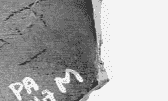

关于不同背景下使用的橄榄油用量的详细信息，指的是量量双瓶，²²而非我们所知的泛雅尼双瓶。

2. `PA 656`。有约34片碎片属于泛雅尼双瓶 `PA 656` 的两侧。雅典娜石榴石装饰的引人注目细节将其最初年代定在公元前四世纪后期，尽管柱子和拱门上的人物出现在这里（第4层和第3c层；碎片：第2层 [约公元前290–270年？]）。²⁸ 这些碎片大部分源于不晚于公元三世纪第一世纪的背景。保存的部分显示了雅典娜身体的极下部分，其长袍（`himation`）的肿胀末端弯曲，从她的左臂掠过高处（图8）。她的卷发边缘向上翘，而脚跟则用白色笔触勾勒。与公元四世纪后半部分的点状底边相比，雅典娜的石榴石是用宽笔触凸显的，且系统通过她腹部上的额外笔触变得更加丰富。这位女神的特征比例和独特的褶皱在圣彼得堡的另一件双瓶（内achos斯，公元前320年）上也可以找到。³⁷ 我们可以相当肯定地将我们来自凯拉梅科斯的碎片归同一时期。

背面是全场赛跑（`holoptidromes`）。11片碎片描绘了三个：`PA 656M`

²³ Infra（见上文19）注意到内表面没有用化妆土（`slip`）进行“密封”，这基本上说明它是用于储存油的，因为油会渗透陶土。棕色的化妆土通常出现在公元前五世纪末和四世纪的罗宾逊组和库班球形奖品双瓶内部，但仅是一层极薄且未覆盖整个内部层。关于泛雅尼奖品双瓶未盛装橄榄油的类似对比，参见 `P. Themillis in vitro. Terra in theirs.`

²⁴ 关于（生产），²⁵，第31页。另见 `P. Themillis`。我们承认该双瓶的尺寸宽度和体积难以确认。

²⁵ 关于铭文，见 `Bentz 1998, 199`，以及在上文。另见 `M. Themillis, vitro`。同样，根据双瓶的尺寸，见 `P. Themillis, volume` – 这种双瓶的唯一已知例子在慕尼黑：`B. Kaiser, Miljb 38, 1989, 177.`

²6 `PA 656`组（带*：见图8-9）；A面：`PA 656A*`（1片）。`B*`（1片）。`C*`（8片）。`D*`（3片）。`E*`（1片）；B面：`M*`（2片）。`N*`（2bis）。`N*`（2片）（`R`）ed–（`R`）-（1）。归属于：`PA 657K*`）；`F-J`（je 1）。`K`（2片）。`K-bis`（je 1）。未出版，`CB. Fest 1989, 181, 414-440`。

²7 关于此双瓶的碎片，见 `Bentz 1989, 74, 第414-421页，第113行`（圣彼得堡 `B.K. 45`）。

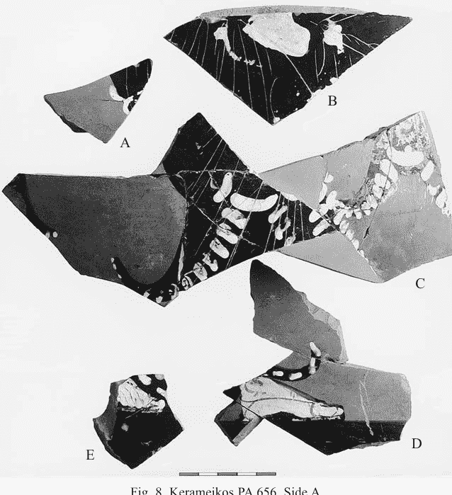

## 来自凯拉梅科斯的泛雅尼双瓶

我们对步兵赛跑（`hoplitidromes`，图9）的描绘标志着图像学发展的终结，这一过程可以追溯到公元前四世纪的三分之一。在索德莱斯（`thodeles`，公元前336/5年）的泛雅尼奖品双瓶（`B 608`）上，这种比赛向左移动的最后表现，画家扭曲了肌肉线条。起初他们仍然侧面持盾，也许是为了展示他们的纹章。在我们后来的来自凯拉梅科斯的双子上，这种笨拙的姿态被抛弃了，身体的刻变得比盾牌本身更重要。

3. `PA 660` 和 `657`。来自Z建筑第3c层（公元前300–290年）的80多片碎片属于`PA 660`组（图10，12）。雅典娜石榴石的奇特外观使其年代不早于公元前四世纪后期。保存的有雅典娜盾牌内部的部分、她的衣服、长袍和脚。她旁边的柱子几乎完好：雅典娜在右（图10）。除了中心雅典娜的一些褶皱细节，这个人物使我们将`PA 660`与来自同一背景的第二组连接：`PA 657`，包括约18片A面碎片（图11）

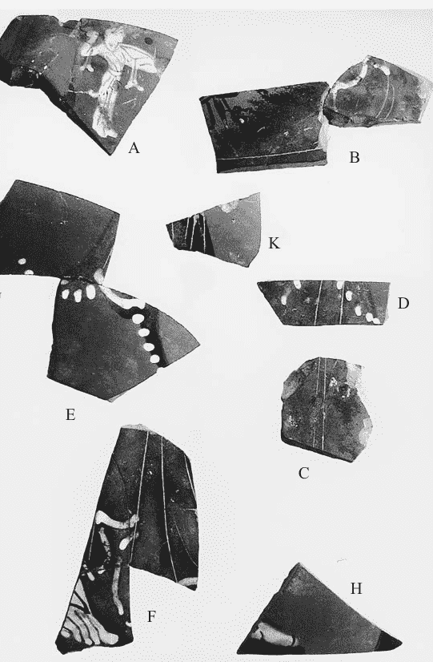

图10。凯拉梅科斯 `PA 660(1)`。A面。²⁵ 见 `Bentz 1989, cat.4.087, pl. 121`；关于主题：`6ff.,213`。²⁶ 此处展示的是画面部分的碎片：A面：`PA 660A`（2片）。`B`（2片）。`C`（1片）。`D`（1片）。`E.G`（2片）。`H`（1片）。`K`（1片）；B面：`L`（9片）。`O`（1片）。`P`（1片）。`X`（4片）–`PA 660A, Eschbach 1986, cat. 104, pl. 43`）。对比 `Bentz 1989, 181, cat. 4.144`。

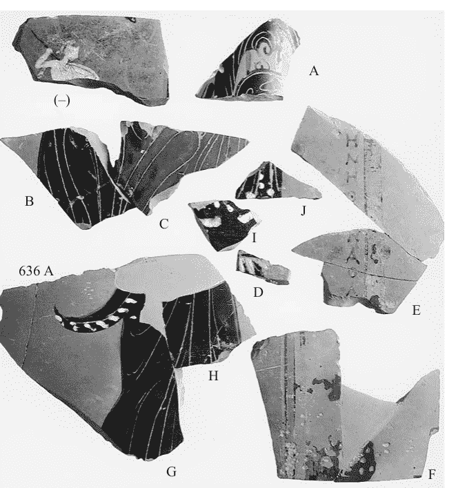

图11。凯拉梅科斯 `PA 657`。A面。柱子上的白色雅典娜小像（`Promachos`）。幸运的是，女神的大部分身体和衣服连同头盔保存了下来。这两组的陶土和涂层非常不同。`PA 660`的表面呈深红色，`PA 657`的浅蓝色（烧坏的）区域从雅典娜的胸部开始，但几乎没有影响右侧，因此碎片的划分非常清晰。来自背面的2片碎片了两个赛跑者。画面左侧站着一个戴着白色花环的裁判。画家的非凡才华在裁判的头部上显而易见（图12，细节）。在刻画赛跑者的身体时，他特别注意他们流畅的肌肉，尽管他也有些笨拙。根据身体的透视和姿态，以及碎片的形状和刻痕，可能会将两者归为类似的器皿。

后部的一些赛跑者腿部执行得非常好。这些品质在右侧运动员的刻画中缺失，他的下腿和脚给人更笨拙的印象——来自B的碎片组包含另外四件，带有一对类似的赛跑者（图14），尽管很难将它们放入画面的这部分。描绘和工艺质量与`PA 660`（无.2）上的运动员相符²⁸因此我们可以得出结论，同一位画家在创作。这一结论通过对比运动员和裁判得到了证实。头部轮廓和胡须以类似的方式用短刻痕凸显。同样的特征仅在马马布`J. P. Getty`博物馆的`76.AE`晚期（年代不确定）双瓶的B面跑步者身上被识别出来。²⁵

⁷ A面所有碎片：`PA 657`（1片）。`A`（`I`）`B.C.`（3片）。`D`（`I`）。`E`（3片）。`F`（2片）。`G.H`（4片，连接`PA 636A`），`I`（1片）。`J`（1片）。

⁸ 除柱状B面外外：`PA 657, Eschbach 1986, cat. 103, pl. 43`。对比 `Bentz 1989, 181, cat. 140`。

⁹ `PA 660`（`II`），`V`（3片）

²⁰ `1998, 180, 第311页`。艺术家的名字已丢失。

## 来自凯拉梅科斯的泛雅尼双瓶

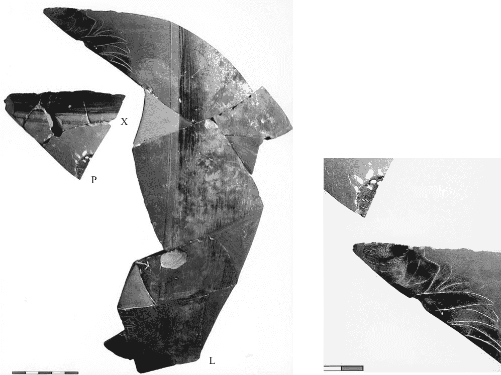

图12。凯拉梅科斯 `PA 660 (1)`。B面：裁判（细节）。

我们的碎片（图14）带有烧坏和磨损痕迹，可能指向与`PA 657`组的联系，但陶土的红红色和色彩差异太大，无法连接。它们一定属于同一只手做的第三件双瓶。上述两个（更有可能是三个）同年的泛雅尼双瓶尚未精确定年。雅典娜的褶皱细节与伦敦的`Euthykritos`双瓶（`B 611 B.C.`）密切相关，但与巴黎国家图书馆的`Hegias`双瓶（公元前324/3年）更为相似。在某些细节上，`Kephisodoros`双瓶（II 公元前323/2年）也非常接近。考虑到雅典娜头部和头盔像象牙一样融入瓶颈的舌形装饰，`PA 657`（图11）瓶颈螺旋形脊上的弯曲刻痕；这一特征应当被提及。使用白色而非刻痕来作为盾牌内部装饰（`PA 660b`，公元前10年）以及手柄下的棕榈叶，直到公元四世纪晚期的`Neimach`（公元前320/19年）泛雅尼双瓶才出现。最早的例子可以在上述双子上看到，根据我的观点，在马马布的晚期双子上也有。

赛跑者的描绘和其他风格特征与任何年代明确的奖品双瓶都没有联系。单一特征刻画中的不准确准确，加上刻痕轮廓使用的增加，让人想起`Neimachos`的现实。但我们必须考虑到面对的是年度

凯拉梅科斯博物馆 `PA 156`：`O. Tzachou-Alexandri` (编），`Mind and Body Athletic Contests in Ancient Greece` (1989) 316, cat. 200.

100

Norbert Eschbach

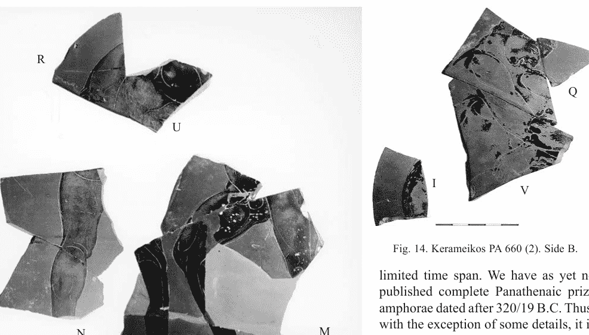

图 13. Kerameikos `PA 660 (1)`。B 侧：摔跤手。

图 14. Kerameikos `PA 660 (2)`。B 侧。

有限的时间跨度有限。我们尚未出版过任何日期在公元前 320/19 年之后的完整泛雅纳亚奖赛双油瓶。因此，除了某些细节外，很难对它们的主题和风格形成更具体的构想。来自 Kerameikos PA 657 和 660（I 和 II）的碎片群组，现在填补了公元前 320/19 年之后的空白，这是由于它们与罗德斯的未出版材料有联系：四件泛雅纳亚奖赛双油瓶（所有？）均日期于执政官德莫克莱德斯执年（公元前 316/15 年）。Kerameikos碎片的断代取决于罗德斯双油瓶的断代，其诗句无一不显示赛马赛。我们从 Kerameikos 的碎片中也知道一些关于雅典娜的小白色柱状形象的姿态。因此，我们可以自信地认为，得益于 Kerameikos 的碎片，该作者在这一年除了赛马赛和跑步外，也有充分的记载。³¹

## 致谢

本文是我用希腊语在会议上提交的论文的英文版本。它包含了并与来自 Kerameikos Z 号建筑的几组学者进行了详细讨论。我感谢 Debbie Plum 帮助我翻译了我的手稿。所有照片均由作者拍摄，或经通用考古研究院 Kerameikos 挖掘队特许许可。

# 缩写表

Benz 1998
M. Benz, Panathenaische Vorformen. Eine attische Vasbemung und ihre Funktion 6.-4. Jahrhundert v. Chr. (1998)

Eschbach 1986
N. Eschbach, Statuen auf Panathenaischen Reliefamiken (1986)

Valavanis 1991
Π. Βλαδάδνης, Παναθηναϊκή αφορίες από την Ερητή. Σηματα στην ελληνική αλλιογραφία του 4ου α.ε. π.χ. (1991).

> ³¹ 感谢 Io Zervoudakis 热心提供关于罗德斯的详细信息。雅典娜·普阿马科斯的小白色形象不是唯一的柱状形象类型。第二类型是穿着白色衣服的大型尼凯（如马里布某件未注日期双油瓶上的尼凯，见注释 29）。第三类型是尼凯的变体。公元前四世纪后半叶，泛雅纳亚奖瓶中不同的柱状形象是一个广为人知的现象。关于公元 316/15 年的泛雅纳亚奖瓶，见 Benz 1998, 180, at. 4.122-6。罗德斯唯一出版的带有雅典娜头部的碎片（G. Konstantininopolou, AD B 21, 1968, p. 403）未就我们的碎片提供任何进一步信息；保存的女神部分在我们的碎片上已丢失。

## “这些陶瓶并不容易解读……”

### 关于泛雅纳亚奖双油瓶的一些想法

Bettina Kratzmüller

“陶瓶并不容易解读……” Mark Gold 在讨论希腊陶瓶上描绘的体育赛事时写道。¹ 这段引用可以用于泛雅纳亚奖双油瓶的背面。² 竞争者的姿态至关重要，因为对它们的解读影响了我们对特定语境表现的理解。³

在雅典式的黑彩和红彩陶瓶绘画中，所有运动员的姿态都与测试以及使用的物体直接相关，对于伸直手臂的短距离跑者和弯曲手肘的斗士者，可以通过它们手臂的位置相互区分。因此，我们可以自信地认为，得益于 Kerameikos 的碎片，除了赛马赛和跑步外，该作者在这一年也有充分的记载。³⁴ 这种场景并不容易解读，罗德斯某件未注日期泛雅纳亚奖双油瓶（图 1）。⁵ 这种形式在斗士赛中提供了清晰的解释。我们看到五个人，他们的身体占据了大部分空间。一个穿着希提斯、举起手臂的裁判站在中间，两侧是一对运动员，每对由一个站立者和一个蹲下的形象组成。拿着手杖的裁判产生了效果。⁶ 这种场景中其他人物的姿态并不容易解读。左侧的蹲下形象是一个填充物，但这并不适用于右侧的跪姿形象。他的姿态具有意义。以白彩形象描绘的姿态代表了警报。⁷ 在跪姿的奉献瓶中，这种解读是精辟的。⁸ 其他人物可能是奴隶或仆人，地位较低。⁹ 像在辛达德诗中描述的描述，一个倒在膝上的斗士——如果他的教练没有叫他放弃放弃了。

+ ¹ M. Gold, Sport in Ancient Greece (1998) 58
+ ² 泛雅纳亚奖双油瓶按数量分类。
+ ³ 我们所说的“姿态”是指手臂的位置。
+ ⁴ 公元前 316/15 年的泛雅纳亚奖瓶，见 Benz 1998, 180, at. 4.122-6。在黑彩和红彩陶瓶绘画中，所有运动员的姿态都与测试以及使用的物体直接相关。
+ ⁵ 罗德斯某件未注日期泛雅纳亚奖双油瓶（图 1）。
+ ⁶ 这种形式在斗士赛中提供了清晰的解释。我们看到五个人，他们的身体占据了大部分空间。拿着手杖的裁判产生了效果。场景中其他人物的姿态并不容易解读。
+ ⁷ 以白彩形象描绘的姿态代表了警报。
+ ⁸ 在跪姿的奉献瓶中，这种解读是精辟的。
+ ⁹ 像在辛达德诗中描述的，一个倒在膝上的斗士——如果他的教练没有叫他放弃了。

## 105

### Bettina Kratzmüller

手放在头上

+ ¹⁰ 雅典集会广场某处泛雅纳亚奖饰带上的仰视（雅典国家博物馆，Ac. 1046，公元前五世纪早期，Benz 5.157）必然属于类似的场景。
+ ¹¹ 国立博物馆 F 2325（Neumann 1965, 72, ff. 34, 74; N. Himmeldorf, Archäisches vom Problem der griechischen Sklaverei (1971) 22–27, fig. 37）。
+ ¹² Neumann, 1966, 75.
+ ¹³ Quint. Synn., 4.380（公元前三世纪/Sittl 1890, 38 n. 7）。
+ ¹⁴ Pl., Mar., 486.
+ ¹⁵ Gerhard Neumann 将其解释为方式。
+ ¹⁶ 姿态的意思：I. Huber, Die Ikon der Trauer in der griechischen Kunst, Peleia 10 (2001)。
+ ¹⁷ Sittl 1890, 155, 275.
+ ¹⁸ 国家博物馆，Santangelo 693，约公元前 460 年（Benz 5.090）。

## “花瓶并不容易解读……”

103号现已修复。左侧站立的人像暗示了大量抽签的存在，他的食指弯曲——他原本手中握着某种小物品。

右侧站立的人举起右手，手心向外，这是运动员向他人抽签的典型动作，例如现藏于俄亥俄州托莱多的西莱乌斯·菲尼尔斯（Syleus Phiner）雅提卡红绘陶塑像.¹⁹ 这里有两种可能的解释。运动员在接近时，通过手势对裁判员的点名做出回应。运动员向宙斯宣誓，正如卢维安（Lucian）描述的那样，²⁰，“一个接一个竞争者走向伦敦的一件雅提卡红绘陶颈口瓶，菲涅乌斯（Phineus）站在桌子前坐着，他向宙斯祈祷并抽取其中一个抽签。”²¹ 通过相同的手势祈唤神灵在伦敦的一件雅提卡红绘陶颈口瓶中也同样可见，铭文 *theoi*（神）²² 证明了这一点。

伦敦一件由马可龙（Makron）制作的残缺杯也展示了抽签过程：运动员在裁判员面前排队时举起手。在裁判下方，其中一个抽签可以被解读为一个水盆，但也可能被看作混合抽签的容器。在巴塞尔一件由奥涅西马斯（Onesymamos）制作的抽签雅提卡红绘杯上也出现了类似的水盆。²³ 其中一名男子正坐在旁边抽签。三名运动员以通常的方式持手，可能有不同的解释。一种可能性是为分配盾牌而抽签或使用标记。帕乌桑尼斯（Pausanias）在奥林匹亚（5.12.8）证实了标准盾牌的存在：赫拉神庙内展示了二十五面用于重装步兵（hoplitradrome）的盾牌。约翰·H·克罗尔（John H. Kroll）对在雅典广场发现的公元前三世纪铅制标记解释说，标记被用于向军队分配武器。²⁴ 它们正面显示着武器——头盔、冠饰、护胫或盾牌——背面带有字母阿尔法（alpha）、伽马（gamma）或德尔塔（delta）：克罗尔建议这些必须被解释为不同尺寸的符号。官员向运动员分配盾牌的过程在纽约著名的泛雅典竞技奖赛用油瓶（图2）中有所体现。²⁵ 识别个别盾牌至关重要。

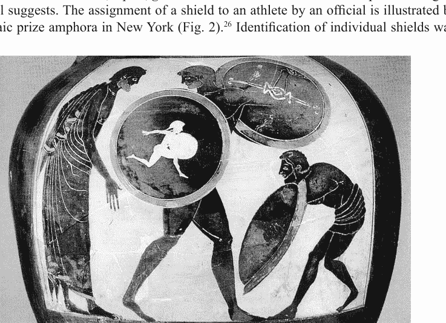

图2。泛雅典奖杯用油瓶，纽约，Zoullas收藏。由M. Benton 绘，AntK Beh. 18, pl. 43, 5010。

+ ⁹ 艺术博物馆 56.58, 公元前480年 (CVA Toledo 1) III I pl. 42)。同样对比杜里斯（Duris）制作的雅提卡红绘杯（斯图加特 Arch. 72；D. Boutron, Kerameus 9 (1995) cat. 15, pl. 10）和马可龙（Makron）的作品（巴黎，卢浮宫 24；N. Kunisch, Makron, Kerameus
+ ¹⁰ [1997] cat. 209, pl. 72.
+ ¹¹ St. Pol 6.65 (Sint 1890, 218:4)。
+ ¹² 卢维安，Hermas. 40.
+ ¹³ Museum E 291 (Neumann 1931, 78–79, fig. 37)。
+ ¹⁴ Museum E 63 (Kunisch, Makron, cat. 351, pl. 120).
+ ¹⁵ Antikenmuseum Basel 83 (CVA Basel 2) pl. 10.3; 12–2)。
+ ¹⁶ J. H. Kroll, Herperia 46, 1977, 141–146 提到花瓶彩绘展示了带有字母“alpha”的盾牌的重装步兵
+ 指向雅典市的官员。
+ ¹⁷ Zoullas Collection, Kleophtres Painter, 公元500–480年 (Berlin 5005)。

## 贝蒂娜·克拉茨米勒（Bettina Kratzmüller）

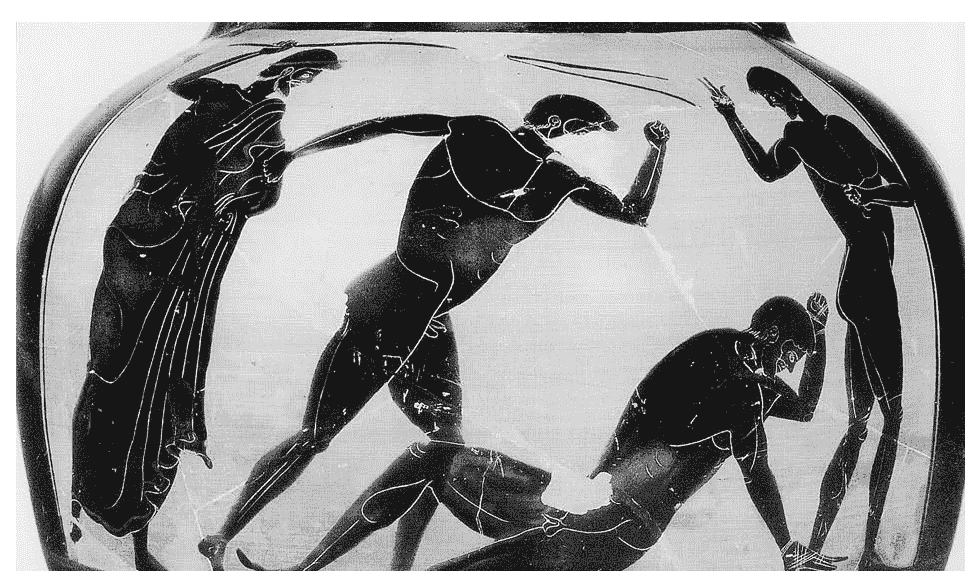

图3。雅典娜用油瓶。柏林，国立古董收藏馆1833。摄影自 M. Bentz，Anth Beih. 18, pl. 58, 5067。

盾牌图案可能与抽签或标记上的图案对应。²⁷ 跑步者的起始位置也是通过抽签决定的。这一点从科林斯早期古典时期启动机制的16个不同字母中看出。²⁸ 分组进行小组赛的跑步者也是通过抽签分类的。帕乌桑尼斯（13-4）描述了奥林匹亚的过程：“竞争者通过抽签分成两组。每组的获胜者最后相互竞争，决赛获胜者在径跑赛中参加了两次。”⁹ 玻罗尼亚一件由阿基勒画师（Achilles Painter）制作的泛雅典奖赛用油瓶展示了青年的短距离径跑，也可以作为两小组赛的证据（此处第87页，图9）。当获胜者获得右侧裁判奖励时，左侧正在进行另一场比赛。然而，卢浮宫（此处第84页，图5）晚一个世纪的作品展示了加冕仪式，其中一名带冠的运动员向左侧离开，不确定获得的是两小组的获胜者还是第一、二名选手.³⁰

如我们所证明的，手部动作会影响特定场景的解读。在泛雅典奖赛用油瓶上如此，但在其他作品上³¹这种功能也可能是意义性手势，意味着获胜者与裁判之间的指示关系可以通过手势表示，即食指或中指微弯曲。

另一组泛雅典奖赛用油瓶展示了重装运动场景以及泛项运动的不同比赛项目，在……

> ²⁷ 参见罗德斯一件雅提卡红绘高脚杯上的赛场装置，罗德斯考古博物馆 1985 (Clara Rhodes [1929] 224, fig. 245)，展示了一名运动员和铭文。
> ²⁸ 小组赛为两组：科林斯 1995。
> ³⁰ 塔兰托泛雅典奖赛，国立博物馆1154，Kleophtres Painter, 公元500–480年。
> ³¹ 参见罗德斯一件雅提卡红绘高脚杯上的赛场装置，罗德斯考古博物馆 1985 (Clara Rhodes [1929] 224, fig. 245)，展示了一名运动员和铭文。
> ³² 慕尼黑关于运动员的花瓶。

+ ⁹ 艺术博物馆 56.58, 公元前480年 (CVA Toledo 1) III I pl. 42)。同样对比杜里斯制作的雅提卡红绘杯（斯图加特 Arch. 72；D. Boutron, Kerameus 9 (1995) cat. 15, pl. 10）和马可龙（巴黎，卢浮宫 24；N. Kunisch, Makron, Kerameus
+ ¹⁰ [1997] cat. 209, pl. 72.
+ ¹¹ St. Pol 6.65 (Sint 1890, 218:4)。
+ ¹² 卢维安，Hermas. 40.
+ ¹³ Museum E 291 (Neumann 1931, 78–79, fig. 37)。
+ ¹⁴ Museum E 63 (Kunisch, Makron, cat. 351, pl. 120).
+ ¹⁵ Antikenmuseum Basel 83 (CVA Basel 2) pl. 10.3; 12–2)。
+ ¹⁶ J. H. Kroll, Herperia 46, 1977, 141–146 提到花瓶彩绘展示了带有字母“alpha”的盾牌的重装步兵
+ 指向雅典市的官员。
+ ¹⁷ Zoullas Collection, Kleophtres Painter, 公元500–480年 (Berlin 5005)。

## “花瓶并不容易解读……”

105

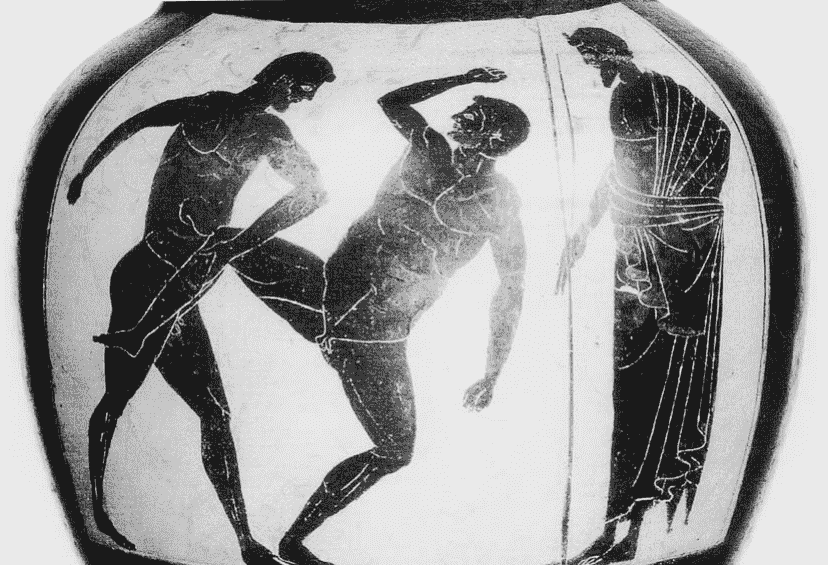

图4。雅典娜用油瓶。莱登，国立古博物馆。由M. Bentz 绘，AntK Beh. 18, pl. 43, 5010。

盾牌图案可能与抽签或标记上的图案对应。²⁷ 跑步者的起始位置也是通过抽签决定的。这一点从科林斯早期古典时期启动机制的16个不同字母中看出。²⁸ 分组进行小组赛的跑步者也是通过抽签分类的。帕乌桑尼斯（13-4）描述了奥林匹亚的过程：“竞争者通过抽签分成两组。每组的获胜者最后相互竞争，决赛获胜者在径跑赛中参加了两次。”⁹ 玻罗尼亚一件由阿基勒画师（Achilles Painter）制作的泛雅典奖赛用油瓶展示了青年的短距离径跑，也可以作为两小组赛的证据（此处第87页，图9）。当获胜者获得右侧裁判奖励时，左侧正在进行另一场比赛。然而，卢浮宫（此处第84页，图5）晚一个世纪的作品展示了加冕仪式，其中一名带冠的运动员向左侧离开，不确定获得的是两小组的获胜者还是第一、二名选手.³⁰

如我们所证明的，手部动作会影响特定场景的解读。在泛雅典奖赛用油瓶上如此，但在其他作品上³¹这种功能也可能是意义性手势，意味着获胜者与裁判之间的指示关系可以通过手势表示，即食指或中指微弯曲。

另一组泛雅典奖赛用油瓶展示了重装运动场景以及泛项运动的不同比赛项目，在泛雅典奖赛用油瓶中

> ²⁷ 参见罗德斯一件雅提卡红绘高脚杯上的赛场装置，罗德斯考古博物馆 1985 (Clara Rhodes [1929] 224, fig. 245)，展示了一名运动员和铭文。
> ²⁸ 小组赛为两组：科林斯 1995。
> ³⁰ 塔兰托泛雅典奖赛，国立博物馆1154，Kleophtres Painter, 公元500–480年。
> ³¹ 参见罗德斯一件雅提卡红绘高脚杯上的赛场装置，罗德斯考古博物馆 1985 (Clara Rhodes [1929] 224, fig. 245)，展示了一名运动员和铭文。
> ³³ 慕尼黑关于运动员的花瓶。

+ ⁹ 艺术博物馆 56.58, 公元前480年 (CVA Toledo 1) III I pl. 42)。

# 106

## 贝蒂娜·克拉特勒

可能具有特别意义。我们在描绘桌游场景的瓶陶画上——例如梵蒂冈的埃塞基亚斯双耳瓶——刻有数字。⁷⁷ 因此可以确定，胜利取决于骰子的投掷。图中展示了各种不同的手势，其中一些手势代表数字。

文学和视觉证据也记录了表示数字的手势。姿态的表达通常取决于使用了哪几根手指以及使用了几根。手稿插图通过手来分类。在梵蒂冈图书馆，收藏有大量的罗马插图。罗马特塞拉币（tessera）——游戏标记物——一面画有一个数字，另一面是手势。⁷⁸ 重建的主要来源是一本公元 688 年的一篇名为“罗马计算”（Computatio Romana）的匿名文本，该文本由 Veda Nerablius 在公元 725 年传传。⁹ 一个人可以数到几根手指：

如果你想数数，就用小指，数二用无名指，数三加上中指，数四伸出小指，数五用无名指；数六弯曲无名指本身，数七伸出大拇指并将小指向右弯。左手数八根手指，然后是食指和大拇指，数到十。然后，标记你食指在大拇指中间的位置。

特塞拉币上的图片和说明文字涉及罗马人的手。目前尚不确定这些符号是否适用于希腊世界。卡尔·斯尔特（Carl Stilt）根据普鲁塔克，波斯人也用小指计数。⁸⁰ 根据亚里斯多芬的说法，可以假设希腊人也使用“小指”。为了论证起见，他们如何解释希腊运动会上的手势，展示了罗马系统，并且在伸出手指的计数方法上存在分歧。⁸¹ 可以表示“在游戏和持手时，在腹瓶上，伸出四根或更多手指进行计数。⁸²”。

在我们讨论的许多例子中，解释充其量是推测。伸出手指和食指的手（“Zweingergestus”）⁸³ 也可能出现在不同的语境中，例如作为一种好兆。即使我们认为数字“二”的解释是可能的——在一件红绘纹双水壶（hydria）碎片上，它也可能是某种符号或指点的手势。⁸⁴

符号中的手部也很容易解释。在埃菲德罗斯（ephedros）的竞技活动中，可以在不撤回的情况下表示。这不仅是指击败的运动员，连埃菲德罗斯也被重构为方式：每位选手都将右手向后并伸出一只手。在某个信号处，手臂从身体上拉开，首先大出伸出手指的总数。对于站在标记点上的十名选手，这些标记可以通过移动标记物做出。例如，苏黎世沃尔特堡-汽车博物馆的 5341 号雅提卡红绘纹双水壶，公元前 330 年（C/VA [Zürich] 22; 2005, 153, 53.32）。

- ⁸⁵ 阿基琉斯也在玩游戏；雅提卡黑绘纹双耳瓶，梵蒂冈博物馆 1657，公元前 535/30 年（LIMC [1981] 90–103, in. AJ 3, 186）
- ⁸⁶ 阿基琉斯数到 IX，阿贾克斯在狩猎；柏林博物馆 281, 97–98，公元前 340 年左右（C/VA [Kassstatt-Dienmann]）
- ⁸⁷ Rie（第 38 页）166–172, 2013, 153, 30。
- ⁸⁸ 例如，柏林 2177 号公元前早期马拉松时期的红绘纹双水壶上，一个意图性的大拇指手势，被 E. Böser 解释为四根手指代表“四”（C/VA [Berlin]）。

- ⁸⁹ E，雅提卡黑绘纹双耳瓶上的英雄，波士顿美术博物馆 190；埃菲德罗斯（Ephedros），5002, 41。

- ⁹⁰ 公元 530 年的德米特里乌斯（C/VA [Kassstatt-Dienmann], Genferische Archive 49-37）-, 1997

- ⁹¹ 雅提卡黑绘纹双水壶，柏林 1862, 2008

- ⁹² Richter 处理了这种手势（“Zweingergestus”），在罗马时期（Neumer 154, 2001, 119-150）用三根手指指向希腊人。⁵

- ⁸⁴ 雅在Raeck（eds.）古腊, 117。

- T. Richter, 在（raeck）244–299。

# “这些瓶子并不容易解释……”

107

图 5. 泛雅典双耳瓶。埃特里亚 1481。M. Bentz, Antk Beih. 18, 054, 大拇指和食指。在摔跤背景下，可以解释为数字“三”。在摔跤比赛中，摔跤手数了三次。这种解释并不适用于拳击（pankration），其中拳击手没有数数。当小指和小指弯曲时，意味着“二”。这同样适用于五项运动会。例如，索福克勒（Sophocles）说双圆盘掷（dikobolos）允许三次投掷。在多伦多的的一只雅提卡黑绘纹油壶（lekythos）上，标枪掷者弯曲小指（“一”）。

# 108

## 贝蒂娜·克拉特勒

我们转向描绘军事审查（dokimasia）时期骑士的瓶陶画。在巴塞尔的一件斯普兰普特斯画家（Splanoptes）杯上，一个年轻人举起手不仅是为了示意他在说话，也是为了标记数字“三”。所有细节连同马主的名字都记录在一块木板上。⁵

古代竞技场景值得研究，特别是泛雅典奖双耳瓶上的。其中两件（图 5）¹——展示了代表奥林匹斯的女神——让人联想到 2004 年在雅典举办的奥林匹克运动。

# 缩写词

- Benz 1998 M. Benz, 泛典奖双耳瓶，Antk Beih. 18 (1998)

- Decker 1995 W. Decker, 古希腊古代运动 (1995)

- Miller 2004 S. G. Miller, 古希腊竞技 (2004)

- Neumann 1965 G. Neumann, 希腊艺术中的手势与手印 (1965)

- Richter 2003 T. Richter, 罗马艺术中的双指手势，法兰克福考古著作（2003）

- Sitt 1890 C. Sitt, 希腊与罗马人的手势 (1890)

> ⁵² 雅提卡红绘纹杯，巴塞尔，古董博物馆 HC 1678（H.A. Cain, in E. Böhr – W. Martini [eds.], 关于神话与瓶陶绘画的研究。Konrad Schauenburg 65 周岁纪念，1986 年 4 月 16 日 [1986]91–93, pl. 16:2–3）。在慕尼黑的一件 2314 号雅提卡红绘纹泛雅典双耳瓶上，由三位特洛莫斯画家（Tripletomos Painter）创作。然而，是雅典娜本人在书写雅典人五项运动会的结果（H. Jung, Jdf 110, 1995, 95–147, esp. 134–136, fig. 21）。

> ⁵³ 埃特里亚 1484（图 5），马西亚斯画家，执政官卡里米德斯（Callimides），公元前 360/59（Bentz 4.054）；剑桥，哈佛大学，福格艺术博物馆 1925.30.124A，马西亚斯画家，执政官奥福夫托斯（Theophrastos），公元前 340/39（Bz 4.081）。

## 雅典竞技会白底彩瓶与音乐比赛

## 德斯波纳·图克卢

本文讨论了一件绘有里拉琴演奏者的白底雅典阿瓦斯双耳瓶。该陶瓶年代定于公元前1世纪前半叶，展示了白底雅典竞技会彩瓶的新标本。根据雅典律法 [Ath. Pol.] 的记载，这种彩瓶取代了此前颁给音乐比赛获胜者的��刻奖品和金花环。这种取代被认为发生在公元前3世纪，但在公元前4世纪之前还没有关于用于雅典竞技会音乐手的彩瓶的证据。

### 引言

希腊雅典竞技会彩瓶是一个与普通的雅典竞技会彩瓶截然不同且特殊的群体，我们主要是通过在雅典市场发掘中发现的陶器和碎片来了解这些器皿的。这些器皿被认为是公元前3世纪的形象化作品，并作为雅典竞技会音乐比赛以及某些戏剧比赛的奖杯出现，随着公元前3世纪末决赛典仪式加入节日典计划而逐渐引入。

在这一珍贵的比赛组中，彩瓶展示了一组群像，但带有许多内部特征（图 1-4）。该陶瓶并非源自偶然的盗墓，而是来自一处圆形遗址类别，这是一处关于富洛拉伊斯限制的民主定居点，那里记录了公元前60年代的杜西乌斯·阿拉波斯泰斯。

陶瓶分为三种尺寸：大的，带有宽大的口和较大的身体；中等的，有一个较小的颈部，其最初位于底座的顶部；以及身体的大部分，即源自瓶身的颈部（图 5-α）。作为一个整体，这些彩瓶看起来很紧凑。

雅典竞技会彩瓶的发掘使人们注意到雅典竞技中相关铭文的模糊。如需了解更多信息，请参阅 M. Θ. Touklidou, 1991, 29-38 以及 Touklidou (2003)《雅典竞技会发掘》，2028, 327-345, pp. 40。该陶瓶（残片编号 1）被描述为白底雅典竞技会彩瓶，尺寸源自普拉卡市场的商品，追溯到公元前4世纪（与第3世纪相当），是最大的此类雅典竞技会彩瓶。需要注意的是，关于公元前2世纪精美雅典竞技会彩瓶的比赛年代学，并没有完美的记载，整个瓶都是彩色的。其主要比赛的民主性性质在这一时期之后变得模糊。

该陶瓶被记载为第一代形象化与古典比赛之一，编号为 A1650 A1650-γ。A1650 的口径为 30 cm 和 8.4 cm，A1650 的身体高度为 25.5 和 31 cm，口部为 8 和 38 cm。色彩高度介于 6 到 8 cm 之间。瓶身加上 56 cm 后封闭，直径 39处为 16 cm，宽 6.3 cm，高 6 cm，底 3.8 cm 和 8 cm，高 5, 75 16 cm，宽 17.5 cm 和高 6 cm；而在 50（底部）处为 5.2 cm，高 5，和 6，高，并从身体突出。

该陶瓶连接得紧密，接缝的外观为 1。女性由逃逸者封闭，陶瓶在窄处未超过 5 cm。

## 雅典竞技会白底彩瓶与音乐比赛

雅典竞技会彩瓶的发掘使人们注意到雅典竞技中相关铭文的模糊。如需了解更多信息，请参阅 M. Θ. Touklidou, 1991, 29-38 以及 Touklidou (2003)《雅典竞技会发掘》，2028, 327-345, pp. 40。该陶瓶（残片编号 1）被描述为白底雅典竞技会彩瓶，尺寸源自普拉卡市场的商品，追溯到公元前4世纪（与第3世纪相当），是最大的此类雅典竞技会彩瓶。需要注意的是，关于公元前2世纪精美雅典竞技会彩瓶的比赛年代学，并没有完美的记载，整个瓶都是彩色的。其主要比赛的民主性性质在这一时期之后变得模糊。

该陶瓶被记载为第一代形象化与古典比赛之一，编号为 A1650 A1650-γ。A1650 的口径为 30 cm 和 8.4 cm，A1650 的身体高度为 25.5 和 31 cm，口部为 8 和 38 cm。色彩高度介于 6 到 8 cm 之间。瓶身加上 56 cm 后封闭，直径 39处为 16 cm，宽 6.3 cm，高 6 cm，底 3.8 cm 和 8 cm，高 5, 75 16 cm，宽 17.5 cm 和高 6 cm；而在 50（底部）处为 5.2 cm，高 5，和 6，高，并从身体突出。

该陶瓶连接得紧密，接缝的外观为 1。女性由逃逸者封闭，陶瓶在窄处未超过 5 cm。

精美的泛雅典纳斯双瓶与音乐比赛

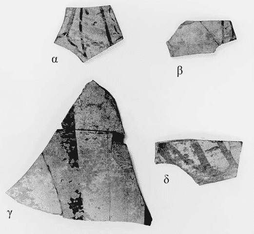

图 5. A16501 α-δ 双瓶，带有发现的军队。

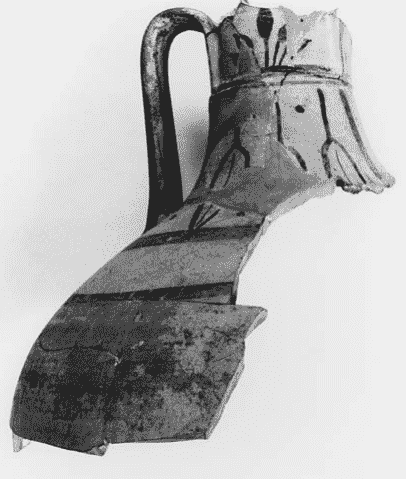

图 6. A16500γ 双瓶，背面，音乐家的的头部。

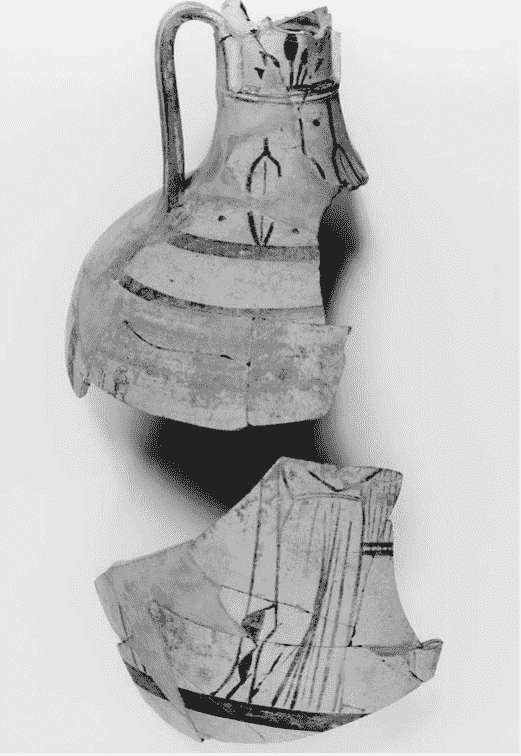

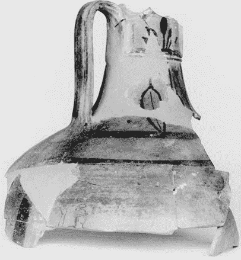

图 8. A16500α 双瓶，背面，雅典娜神像。

图 7. A16500α/γ 双瓶，背面。音乐家。

## 德斯波伊·苏库卢卢 (Despoina Tsikloulou)

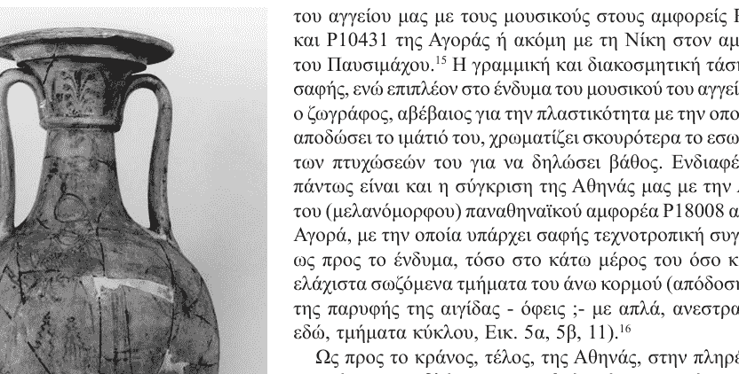

在我们带有音乐装饰的瓶子市场上的 R 8522 Π10431，以及在帕塞伊马霍斯双瓶中的胜利¹⁵。语法和装饰趋势是带状的，而它回到画家的工作室中音乐师的装饰中，由于它所具有的塑性，它解构了颜色最深处的标题，其内部褶皱显示了深度。有趣的是，市场（黑曜石）中雅典的同步，泛雅典纳斯双瓶 R 18008，其对颈部有明显的保存细带，在侧面和所有地方都控制着这个世界（季节）的古代雅典 - 蛇：如，一种替代性的，在这里，价格，图 5α, 5β, 11）。¹⁶

关于雅典的时间，在廉价的形式中，我们看到在分枝的捕捉和工作室主要形式的离散形式中，这些来自雅典的 36 冠源自希腊隆，年代追溯到公元前 98 年左右¹¹⁷

在市场中这种自身的冠冕之外，是一个罗马式的泛雅典纳斯双瓶。一致地，可以说，由于上述所有元素，该工作室的时间可以定在公元前 1 世纪中期，并以这种方式重新评估白色双瓶的群。

## 音乐比赛与奖品

音乐比赛是泛雅典纳斯活动之一，始于雅典第 6 届，以及优雅的希腊时代早期，这得到了工作室表演遗迹的见证，以及古代时期的，以及植物学和铭文描述。一个单一的时间跨度，并在行进中，乐器等 - 这种方法是像伯里克利那样的，他与最初或管理的流放联系在一起，泛雅典纳斯的音乐比赛曾是“竞赛”，并在公元前 380-300 年描述了它（Γ 23, 图 1 节.）。

¹⁵ 关于双瓶 R 10431，Edwards, A.P., 1988, p. 48-52，但在泛雅典纳斯市场中，Tsikloulou (2003) p. 3-4.

¹⁶ Edwards, A.P., 编 19, 63, 71. 关于音乐冠和希腊时期的身体。相对于工作室双瓶的语法和装饰趋势是为了显示市场时间的同步。值得注意的是，与我们的古代工作室相比，为了描述更多变化而结合。

⁷ J. Frederic, Panathenais Karlsruhe-Heit (1973) 223, 32.

⁸ Edwards, A.P., 等. 13, 77, 节。预算系统。

¹⁹ 泛雅典纳斯音乐的一个一般时期，Davison, B., Kiitou, Athens in Seoul (1992) 53-75 以及 J.A. Davison, 1997, p.32-33。对于雅典人，在雅典比赛引入的这些双瓶，Davison, 同上. 41. Tides (1989) 25-31. Kiotou, 31. Mac-Closh, 同上. 61 以及 Shapiro, 同上. 75. Tsikloulou (2003) 384-3。

²⁰ 铭文的记录，SIG1055, 节 209. M. Guarducci, Epigrapha II (1996) 362 雅典的和年代，Tides, 1994, 147-148. H. W. Park, Festivals of the Athenians (1977)

## 白色泛雅典纳斯双瓶与音乐比赛

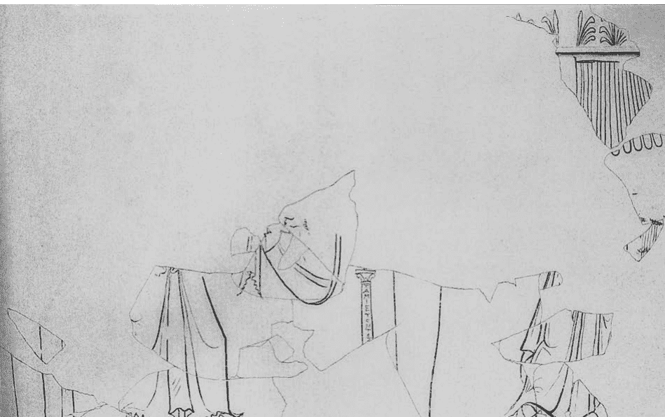

图 105. 市场上的双瓶 R 8522。音乐。G. R. Edwards, *Hesperia* 26, 1957, 86, 号. 41.

她认为在比赛计划后分配，通过识别，告诉了我们更多关于特定价值冠的详细信息，用于比赛获胜者的 1000 德拉马金冠和 500 德拉马的彩色金属，其中它是第一个，价值较小的，也出现在单音泛雅典纳斯双瓶的奖中：²

做法对于古代是安全的，双重的并强调在音乐比赛的古剧院中。根据传统，这种做法通过额外的泛雅典纳斯双瓶的存在而加强。Petroulei（IG 17295），它定义为公元前 430-420 年，给予泛雅典纳斯音乐比赛获胜者的奖是在三冠比赛之后⁴。在 5 世纪末，随着三冠的颁发和雅典民主制的恢复公元 402 年，该理论认为是在 IG 231 的变化之后⁵。在后期，通过黄金和空间的价值，Petroulei 通知了最初双瓶的扩展，作为波波地区的说法，

⁵ A. John Washington, BA 88, 1982, 125-129; R. P. Valavanis, AA 48, 47. Katsikos, 100-101. Shapiro, 同上（下上） 59 和 39. J. Needs (1972) 15-16; 与 Mivenes, S. V. Tacce 的引用

⁶ G. Bentz, B. L., *The Ancient Musical Instruments Produced by* J. M. Hemlich (1986) 122, 124. Tiber (1989) 31-33. Parker, 同上（下上） 20. Katsikos, 100-101. Shapiro, 同上（下上） 59 和 39, 38. 关于音乐比赛人物的分析，Katsikos, 56-62. 同样同上（下上） 58, 51. Valarasisis, Ieda (2004) 366. Z. Palaiodikos 在音乐琴拉，最初。发行，(2004) 46-51. Γ.

116 泛雅典竞技赛的游行与音乐比赛

# 缩写词

除了常见的缩写词（AA 1997）外，此处还使用了以下文献：

- Edwards G. R., Hesperia 1957, 320–349

- Kotsudi H. Kotsotsudi, die antike Agora der Panathenaien in archaischer und klassischer Zeit (1991)

- Neils J. (Neils (ed.), Goddess and Polis. The Panathenaic Festival in Ancient Athens (1992)

- Neils J. (Neils (ed.), Wishing Athena. Panathenaia and Parthenon (1996)

- Τίβερρος (1989) Μ. Τιβικλία Παναθηναϊας. Ένεκράτης του ζωγράφου του Μονάχου 2335 (1989)

- Tskoulidou (2001) D. Tskoulidou sto M. Benz – N. Eschbach (epipl.), Panathenaika. Symposium zu den Panathenaischen Preisamphoren (2001) 33–40, πν. 13–17

- Tskoulidou (2003) D. Tskoulidou, AM 118, 2003, 383–395

在设计目录方面，我感谢 S. Bonanto，以及第三古迹局（古代与古代文物管理局）仓库的人员在我研究期间提供的便利。此外，还要感谢 P. Vallabis，他总是能提供建设性的意见。

# 部族制泛雅典竞技赛的“舞蹈性”或胜利纪念碑

Hans Rupprecht Goette

### 引言

雅典民主政通过富裕公民（指定为 `choregoi`，即赞助人¹）提供的私人赞助，资助了大部分公民服务，尤其是文化活动。这些赞助者包括多个节庆和比赛的体育场长和舞蹈赞助人。广为人知的是在城市狄奥尼索斯节（City Dionysia）的诗调比赛获胜后竖立的舞蹈祭品：这些祭品形式多样，并随时间推移而变化，从正面刻有舞蹈赞助铭文的小底座到类似于神庙的建筑结构。它们随着泛雅典国家级举办的胜利比赛在财富中共同繁荣。

本文探讨了另一种类型的舞蹈纪念碑：那些由泛雅典节比赛的赞助者竖立的纪念碑。正如我们所看到的，与狄奥尼索斯节的对应物不同，定义和定位纪念泛雅典胜利的舞蹈纪念碑要困难得多。

## 术语

困难之处之一在于准确确定什么构成了舞蹈纪念碑。例如，立在底座上的奖杯（trophies）是国家颁给狄奥尼索斯节诗调比赛中获胜舞蹈赞助人的典型奖品。随附的铭文记录了赞助者的时代。当我们观察泛雅典节的胜利纪念碑（通常只是底座）时，我们无法确定它们是由舞蹈赞助人、团队还是运动员竖立的。此外，铭文暗示了比赛有许多不同的奖品。问题随之产生：泛雅典节的胜利比赛会从国家那里获得什么，以便舞蹈纪念碑上进行公开展示？

在识别纪念泛雅典比赛的舞蹈纪念碑之前，必须满足两个条件：首先，比赛必须限于雅典人，其次，比赛必须由部族组织。

## 文献与铭文来源

吕西阿斯的 21 和 IG II 2311 (1) 均属于公元一世纪，是此类比赛的主要证据。赛船比赛，有五项比赛满足了上述竞技项目：`euandria`（竞渡赛）、双调比赛中的 `kyklos`（环绕赛）、`pyrrhic`（盾战）、`lampedrom`（火炬赛）和 `anthippia`（赛船赛）。在至少四项此类比赛中（antiphiasia 获胜部落的奖品尚未记载），奖品是牛（图1）和某些金额；

¹ P. Wilson, The Athenian Institute of the Choreography (2000 pass); bibliography: 395–420.

² IG II 3062–3077, 3008–3089 (见上文注1), 22, 195–225.

³ RE Supplement (1956) 861–888, s.v. Tripides; P. Amandy, BCH 100, 1976, 15–93.; BCH 121, 1997, 445–487;

⁴ R. Goette, in M. Fano (ed.), *Studi di archeologia in greco* (2004) 463–476.

⁵ IG II 2311 (见上文注1), 泛雅典节举办的比赛与面向所有人的比赛是分开的：S. Shear (171 注37) 认为“antiphiasia 中获胜的团队极有可能获得了牛”。

⁶ 参见 N. Eschbach 和 P. Themelis 的观点，即泛雅典壶并没有盛放橄榄油。

⁷ Rausch (见上文注4) 100–101，引用了古代文献和现代讨论。

……故事在至少四项这些比赛中奖品是牛（图1）和某些金额；这与橄榄油（通常认为盛放在泛雅典壶中）或颁给体育和音乐比赛的桂冠有显著区别。我们可以想象在赛船比赛中，牛被祭祀并供团队食用。不清楚的是：牛颁给了谁？而且既然奖品不是像三脚架那样的物体，胜利者竖立了什么？另一个复杂问题是，比赛不仅针对获胜部落，还针对个人——至少对于火炬赛是如此，对于 `antiphiasia` 似乎也是如此；胜利的纪念碑

带着这些问题，让我们检查与泛雅典比赛相关的纪念碑证据。首先是 `eundria`；这种关于“卓越”的比赛被广泛讨论。我们不知道它是否超出了推测。`IG II 3062` 是一段四世纪的铭文，提到了泛雅典火炬赛中的 `eundria`。遗憾的是，该铭文以碎片的形式传给我们我们，因此我们不知道它属于哪种纪念碑；例如，它是底座的一部分吗？来自当代作家（曾认为是 Andreas，IV 42）的证据支持 `eundria` 是通过赞助资助并按部族执行的。西西丰的《回忆录》声称“没有其他城市能带来与雅典相比的 `eundria`”——因此泛雅典节为雅典国家推广其男性和审美理想提供了手段。但目前，我们对 `euandria` 的了解非常模糊，无法对其进行进一步定义，也无法将其与任何胜利纪念碑联系起来。

火炬赛：如前，`IG II 3022` 提到火炬赛的胜利，并未提供其所属纪念碑类型的信息。我们所知的，Andocides 的演讲证实了比赛是由赞助人资助的，这让我们推断该铭文属于一个资助了火炬赛和 `euandria` 比赛团队的赞助人。火炬比赛不仅发生在泛雅典节，还发生在雅典的普罗米修斯节（`Prometheia`）、赫菲斯斯节（`Hephaisteia`）、拉姆努斯的涅墨弥斯节（`Nemesia`）、比雷的本德迪亚节（`Bendideia`）以及其他尊敬涅墨弥斯（爱神、潘、赫尔墨斯）和英雄（西西法、赫拉克勒）的节日，至少在古典时期。拉姆努斯的涅墨弥斯浮雕是献给胜利团队的体育场长的。德摩斯梯和奥斯多德斯的注疏也证实了这种做法。

![img/2fe0861a856b48db2f4e8eb3de5_121_0.png]

![img/2fe0861a856b48db2f4e8eb3de5_122_1.png]

图2. 雅典，卫城博物馆 3176+5460+2635。Oimeis 部族获胜后竖立的雕像底座。

## 汉斯·鲁普雷希·歌德

通过指出雅提卡花瓶画在图像上的相似性，劳斯（F. Raus）证明了卫城博物馆中一尊绘有作为裸体（`gymnanoi`）年轻运动员的浮雕雕像可能与火炬赛后的胜利纪念碑有关（见图2和彩色图10）。人物下方刻有运动员名称及其头衔，表明该队伍属于奥伊内斯部落（`Oinei`）。基座的热点位于卫城（`Acropolis`），这暗示那场著名的火炬赛发生在雅典娜神庙（`Athenaea`），但这仍是一个假设。人们不能排除火炬赛在另一处神庙举办的可能性；此外，人们认为将该基座解释为泛雅典竞技节（`Panathenaia`）背景下的胜利纪念碑也是可能的。但由于献文的主铭和立在基座上的雕像均已丢失，我们并不知道胜利者的身份，也不知道他是否作为舞领（`choreos`）还是体育长（`gymnasiarch`）命名；无论这座纪念碑是由火炬赛的个人获胜者建立，还是由一群运动员（长跑者 `laperopedromi` 或同代人）建立。

雕像或底座现在已沿着基座边缘线分离。其长方形的形状显示其上一个一个面有刻文；可能是图像，但但不限于资助该支队伍的赞助人或个人获胜者的肖像、拟人化形象、神灵或英雄的形象（例如奥伊内斯的英雄），或是该竞赛所尊崇的神灵的描绘。我们必须得出结论，缺乏足够的信息来以任何程度的确定性将这座纪念碑指定为某种献祭。

巴黎罗丹美术馆的另一座雅提卡雕像也是如此，该残片极有可能是某座纪念火炬接赛（`lampadedia`）胜利的纪念碑的一部分，但我们不知道是为了哪位神灵、在哪个节期间、或由谁（舞领、体育长或队伍成员）进行的献祭。

反向竞技赛（`Antiphasia`）；这里的情况更有希望。我们知道三处，其中两处基座是在获得赛场胜利后建立的。由于朱莉娅·谢尔（Julia Shear）已详尽讨论了这些纪念碑，我可以简要总结这些论点¹¹¹。

雕像 `A 7515` 显示了两个面，它是阿洛凯的波拉托罗斯赫尔罗丰斯（`Herophones`）的像，他曾与安提俄克部落的 `anthiasia` 队伍竞争¹²他可能是一位胜利者或一位族长（`phylarch`），我将对此进行说明。因为他不是献祭者（为了纪念他的部落），所以他不是这座纪念碑的复杂舞领。基座支撑着一根柱子，柱子上带有已丢失且未知的献文。谢尔显示，由莱昂提斯族（`Leontis`）建立的一件双面浮雕现位于集市博物馆（图7），展示了——曾约有15个——青少年，其中一名留胡须的官兵在后方，底座上刻有铭文和纹章的描绘。

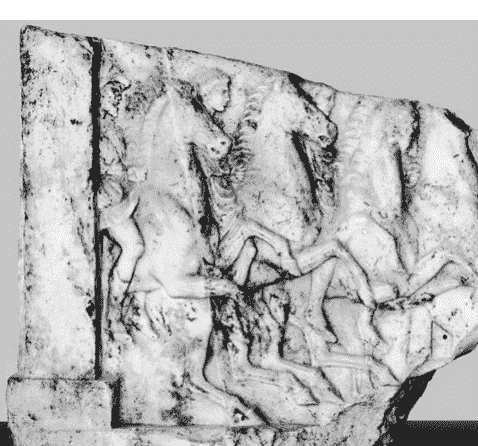

图3. 雅典，集市博物馆 7167。莱昂提斯族在反向竞技赛中献祭的浮雕。

- ⁹ 雅典，卫城博物馆 3176+5460:2635 和 Mind and Body; 180–182, 71 with; Raus, 192–217, pp. 34–35; Agon, 38, fig. – 这座基座现在位于奥林匹的古代奥林匹克历史博物馆。

- ⁰ J. Shear, Les sculptures anonymes 450–310 (1969) 47, no. 335, p. 42; Koasmopoulou, 203, no. 38, fig. 59.

- ¹¹ Shear, 177–178, p. 6.

- ¹² Agon I 7167: Mind and Body, 335–337, no. 226 with; J. M. Camp, The Athenian Agora. Excavations in the Heart of Classical Athletics (1986) 121–122, figs. 96–97; Shear, 171, 1; Agon, 240–241, no. 128 with

## “舞领”或部落泛雅典竞技赛的胜利纪念碑 121

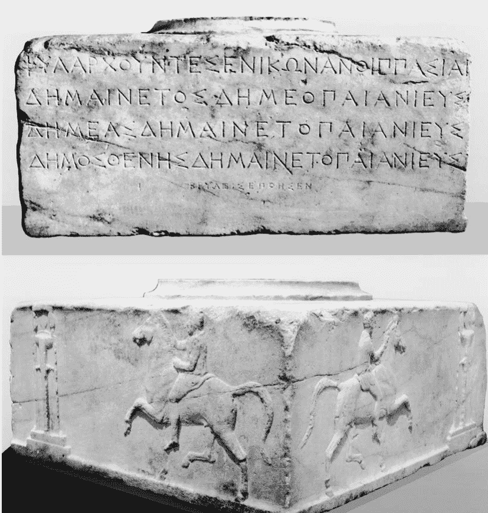

图4. 雅典，国家博物馆 1733，“布莱亚西斯基座”，由三位族长在潘迪奥尼斯族（`Pandionis`）部落在反向赛马赛（`anthippassia`）中获胜后献祭。

旋转底座上的狮子形象揭示了莱昂提斯族赢得了一场赛马比赛，这必是反向赛马赛。

尽管双面浮雕装饰在像集市（`Agora`）那样的基座顶部柱子上（`i7515`，见注释10）似乎是一个很有吸引的想法，但令人困惑的是，这个基座上的铭文是写在左侧，即短边延续到未保存的右侧。与集市基座最接近的平行物是国家博物馆中所谓的“布莱亚西斯基座”（图4）¹，它发现于集市，其装饰不仅在一个面或两个面上有浮雕，而且在第四个面上刻有来自潘迪奥尼斯族的三位族长的名字（父亲和两个儿子）¹⁴。集市基座上的族长在骑手后方获胜，应被解释为一位族长。三脚架在一个大型三脚架附近，人物正靠近它。三位骑手都留着胡须，正如莱昂提斯浮雕上的官兵一样（图3），因此三脚架旁的人是一个常见的胜利标志。它出现在其他纪念以下胜利的纪念碑上：

- ¹⁴ 雅典，国家博物馆 1733: Travlos, Athens, 18, figs. 24–25; Mind and Body, 320–321, no. 205 with fig.; Kaltsas, 254, no. 530 with fig.; Kostopoulos, 190–191, no. 27, fig. 46; 关于此基座上三脚架的重建：N. Pharaklas, ArchDel 24 A, 1969, 59–65.

- ¹⁵ `IG II 3130`.

> ²¹ 雅典，卫城博物馆 521: Min and Body, 210, no. 11 with fig.（右块）； Shear, 22, pl. 26, 1–2; Shear, pls. 3–3;  bibliography; Kotsoulou, 205, no. 39, fig.

## “舞领”或部落泛雅典竞技赛的胜利纪念碑 123

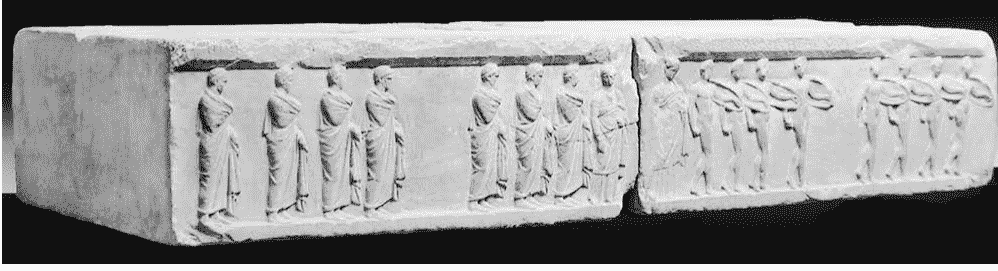

图5. 雅典，卫城博物馆 338.

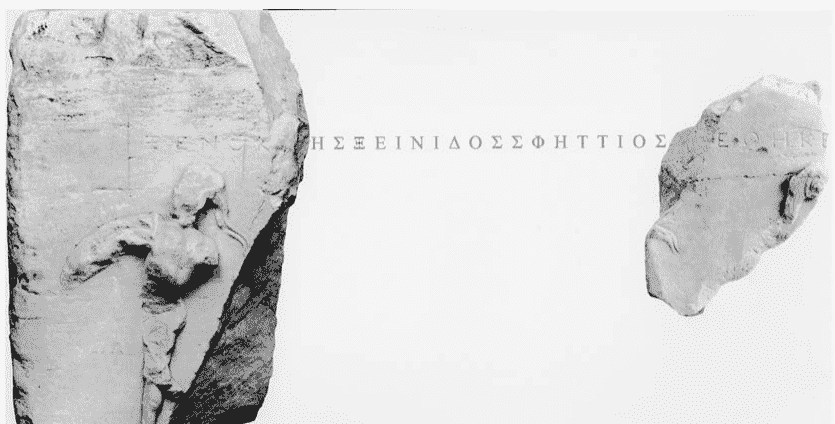

图6. 雅典，卫城博物馆 645.

## 汉斯·鲁普雷希·歌德

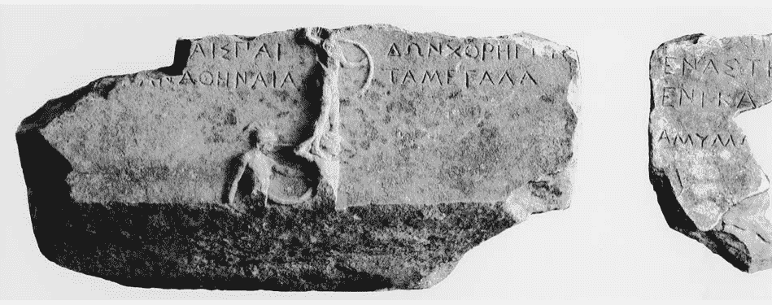

图7. 雅典，国家博物馆 3854.

由于神庙的基座有标记，无法判断它是雕像还是三脚架。

## 部族泛雅典竞技中的“舞蹈”纪念碑或胜利纪念碑

这件基座不幸的是受损非常严重，超过半部分已经丢失。因此，我们不知道在战舞者（`pyrrhichai`）的对面是否存在是否存在浮雕。人们可以想象一个狄奥尼索斯节（`Dionysia`）少年合唱团的场景，在 Atarbos 基座的左侧石块上有类似的图案——但这仅停留在假设阶段。无论如何，除了雕塑家的签名外，铭文的布局——即纪念狄奥尼索斯节胜利的舞蹈铭文——在没有浮雕的情况下也证明了这里是基座的正面。我们必须得出结论：战舞者被描绘在左侧，他们的胜利并非这座纪念碑献献的首要原因，这座纪念碑实际上是纪念狄奥尼索斯节胜利的。

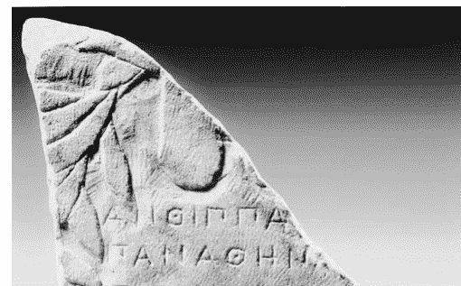

图 8. 铭文纪念碑 8707-8711：Glaukon 纪念碑右侧碎片（`IG II 3079`，corona III），纪念在花神节（`anthesteria`）的胜利。

这种组合还有另一个例子，即为了纪念狄奥尼索斯节的抒舞剧胜利的舞蹈纪念碑，它还纪念了其他的奉献活动（`liturgies`）：公元前 280/79 年的 Glaukon 纪念碑（图 8）。在狄奥尼索斯剧院发现的两个碎片可以重新组合成一个大致正方形的建筑。前方的建筑带有舞蹈铭文，两侧除了浮雕刻的常春藤环外，还有六个由 Glaukon 奉献或包含其他奉献事项的橄榄枝环。

其中一个是“盛大泛雅典节”（`Panathenaia ta megal`）。我们可以想象由赞助人（`choregos`）提供的青铜三段桨船正装饰在大理石龛的屋顶——这正是 Glaukon 纪念碑的主要目的：在城内狄奥尼索斯节（`City Dionysia`）抒舞剧比赛中的胜利奉献。我们可以看到，这座纪念碑也纪念了同一人的其他奉献活动，这与国家博物馆中左侧带有战舞者浮雕的基座形成了良好的对照。

## 结论

对泛雅典节部族活动纪念碑的简要调查表明，要确定哪些是真正的“舞蹈纪念碑”（即由资助比赛的部族富成员设立的）具有困难性。那些恰好是舞蹈奉献的纪念碑是在狄奥尼索斯节胜利后不久设立的，而非泛雅典节。这证实了以下观察：为了纪念泛雅典胜利而竖立的纪念碑通常不像由抒舞剧赞助人所奉献的纪念碑那样精美。

## 致谢

我要感谢组织者 A. Choremi 和 O. Palagia 邀请我参加这次有趣且富有启发性的座讨会；感谢 J. M. Barringer 提供的宝贵意见并纠正我的英语。所有照片均由作者或雅格拉博物馆、铭文博物馆、卫城山博物馆和国家考古博物馆的馆长提供。

26 `IG II 3079`; H. R. Goette, AM 104, 1989, 97 listed i; Goette (supra n. 3) 473 44–45.

## 缩写

除了德国考古学院在 AA 112, 1997 和《Archäologische Bibliographie》中提出的缩写外，此处还使用了以下缩写：

- `Agon`: N. Kaltsas (ed.), ΑΓΩΝ, exh. cat., Athens, National Archaeological Museum, Athens (2004)

- `Kaltsas`: N. Kaltsas, Sculpture in the National Archaeological Museum, Athens (2002)

- `Kosmopoulou`: A. Kosmopoulou, The Iconography of Sculpted Statue Bases in the Archaic and Classical Periods (2002)

- `Mind and Body`: O. Trachou-Alexandri (ed.), Mind and Body. Athletic Contests in Ancient Greece, exh. cat. Athens, National Archaeological Museum (1989)

- `Rausa`: F. Rausa, AM 113, 1998, 191–234

- `Shear`: J. L. Shear, JHS 123, 2003, 164–180

书注释仅限于最近出版的文献，在这些文献中找到更多参考文献。

## Δραματικοί αγώνες και αρχιτεκτονική στη νότια κ κλιτού της Ακρόπολεως

## Πάνος Βαλαβάνης

### 摘要

Tracy 和 Habicht 发表的新观众名单引发了本文中提出的建议：欧乌门尼斯二世柱廊（`Stoa of Eumenes II`）和雅典狄奥尼索斯剧院的希腊化时期阶段构成了一个单一建筑项目的一部分。该项目由国王发起，为了庆祝在泛雅典节上引入戏剧比赛，这一定增强了文中描述的城市社会功能。它建于公元前 178–63 年期间。柱廊的类型和位置归功于欧乌门尼斯本人，受到了伯尔加马实践的启发。柱廊并没有像维特鲁威所描述的那样，通过向前的 5,000 平米露台延伸到宏伟的公共空间。狄奥尼索斯剧院的希腊化时期阶段可能是由于欧乌门尼斯的慷慨，因为他对神灵和戏剧广为人知的意图，以及他将伯尔加马与雅典联系起来。观众名单列出了所有希腊化皇室的分支，作为雅典人利用其城市优势作为收入和礼物的证据。泛雅典节为高度希腊化的统治者提供了和平交流的机会；其在公元二世纪的政治意义与奥林匹克运动相当。

### 引言

（注：此处由于原文存在大量重复和乱码，已保留核心含义）

## 雅剧比赛与卫克罗波南部南坡的建筑

“晨明女神剧场”可能在公元前 300 年之前就已经完成，那里在公元前 300 年就已布满了超快速的几何形状；或者正如 Von Gebetan 所说，它在公元前 170-160 年左右作为其所属区域的中心而倾注出来。

根据上述段落，并结合一些铭文数据，这支持了在公元前 200 年为狄奥尼索斯剧场奠基工作，并随后在泛雅典竞技运动会（`Panathenaic`）引入雅剧比赛的假设。这些问题变得更具争议性，如果这种引入很大程度上是在该剧场所在的同一区域完成的，而该区域与狄奥尼索斯剧场有关——这是一个占地 163 毫米的建筑群，这得益于欧υμμπ诺斯二世国王统治下的雅典城。

关于其最初的重建，特别是在欧υμμπ诺斯二世统治的大时期（约公元前 197-158 年），某些小组成员根据以下标准支持其王室阶层（公元前 180-160 年）的铺设：a. 建筑锥角的统计学方法；b. 大多数由于源于对欧υμμπ诺斯二世在佩尔加蒙同一地区及所有国家的记忆，总体上推断出了这一年代。

这座希腊半露天剧场及其屋顶的重建时间推断，源于南坡，以及其在服务雅剧比赛中的成本。它开始在泛雅典竞技会结束时，随着雅典引入雅剧比赛的开始，它被纳入了一项本土的计划中。关于欧υμμπ诺斯是否可能是捐赠者，已经出现了一些相关的证据，加强了对这一观点的支持。

## 欧υμμπ诺斯二世与狄奥尼索斯剧场

海中之国王及其狄奥尼索斯力量的舞台是广为人知的，这是一个被证实的阿特拉斯斯人特殊区域的类别，并局限于佩尔加蒙剧场。这个舞台似乎向欧υμμπ诺斯证明了其在剧场建筑中的特殊地位，因为我们知道，神为了双胞胎观众的特殊进入通道而建造了，而成员是一个区域：公元前 60 年的 B 剧场，以及公元 160-158 年的德尔斐舞台，那里举行了皮提亚人音乐和戏剧比赛的决赛。

此外，似乎存在一个具有狄奥尼索斯美学剧场的佩尔加蒙二世的舞台。佩尔加蒙剧场的建筑成员也曾是狄奥尼索斯的对立面。一个明显的、而非通过取代看座的趋势开始出现：整个围墙边界区域与剧场（包括狄奥尼索斯剧场）本身证明了其在卫克罗波南部南部坡的相反的倾向。起初，这并不被认为是欧υμμπ诺斯的一种刻意选择，我们可以通过数据讨论的方式来审视这一点。

¹¹ B. p., H. du Lille, Menander (1998) 49. S. Gogos, Oglf (1967), Baichelid 84–108. 2001 年的副本 (1999) 61–75. 剧场左侧；戏剧建筑与词汇，185–188。

¹¹² A. von Gebetan, Theater of the Prince (1921) 55, κ. 1.

¹¹³ 根据欧υμμπ诺斯二世直到公元 158 年的王室数据，B. B. Habicht, 56，附页码 11。

¹¹⁴ Schmidt-Donner, Architecture of the Hellenistic World and Alexander the Great (1978) 28. P. J. Coulhaut, Architecture of the Greek 2nd Century.

¹¹⁵ Schmidt-Donner, 38. H. I. Ke, Survey of Greek buildings in the Hellenistic century (1982).

¹¹⁶ Schmidt-Donner, 64–65.

¹¹⁷ 关于狄奥尼索斯德尔斐剧场的描述，30, 36，其中提到决赛与泛雅典竞技会有关。Sifikas (σ. 1) 106–108. Bringmann – Steuben. 关于剧场的工作 148–153 以及 Schmidt-Donner, 62–64.

¹¹⁸ Schmidt-Donner, 225–29. Shafei (σ. 159).

¹¹⁹ B. p. Coulhaut (σ. 14) 55 和 102.

¹²⁰ 欧υμμπ诺斯是一个希腊化时期的特殊开头。

这种特殊关系导致了国王可能资助了希腊舞台的建造，其建造时期和它的名字。另一个加强了欧υμμπ诺斯时期希腊舞台交付的元素是，一个深于其王室的时期，那个时代。众所周知，公元 2 世纪的雅典是富有成就的。

由于希腊舞台最初使用了之前的石质材料，但并不是为了让欧υμμπ诺斯建造希腊舞台，而仅仅是为了装饰。寻找那些已经加强了工程的因素，存在一种倾向，在同一区域重建狄奥尼索斯剧场，这是引入雅剧比赛后泛雅典竞技会的结果。

## 历史背景

根据上述内容，对影响的分析显示了与这些比赛执行后的积极关系。雅典在马其顿和罗马人的帮助下，从公元 2 世纪比赛的开始，并没有提到泛雅典竞技会的感受和为了比赛而发展的城市，而是雅典和泛雅典竞技会。在希腊化国家的战略和经济力量初期，与文献记录相符，关于记忆和美学的合适政治手段，对于该城市的所有希腊人，其文化计划。

泛雅典竞技会的开始时期是计划的静态划分，随着公共比赛的增加。在这种迁移的情况下，必须加入雅剧比赛，在雅典拥有悠久的历史，在非常古代。支持的行动是成功的，如果考虑到决赛的持续时间一直延续到本土。

## 欧υμμπ诺斯二世与雅典

欧υμμπ诺斯与雅典的关系已经始于一个日常开头，并随着他的分析而获得。从比赛开始那时起，通往雅典的道路稳定地评估了其基础，正如许多爱奥纳人纪念他或他的同胞那样。这一时期爱奥纳人在雅典的出现是一种战术趋势。

由于雅典在泛雅典竞技会的商业中拥有主权，正如在提卡阿特拉斯王国的希腊比赛基础提到了佩尔加蒙。根据公元 2 世纪的记录，关于逻辑：

²⁶ Schaft op.op. (σ. 1) 108–111.
²⁷ Habib, op.op. (σ. 7) 225.
²⁸ Habib, 173. Habicht, op.op. 同样在公元 170–160 年期间，西腊的剂量也会增加。Habib, 234.
⁹ Habib, 199–220, 346.
³⁰ 希腊化时期，127。
³¹ 佩尔加蒙。
²² 城市。
³³ 卫克罗波南部坡的倾向，39–42。

## 132

潘诺斯·巴拉瓦尼斯 (Panos Balavanis)

根据狄奥提亚斯（Deilitias）关于希腊早期神庙和神圣狄奥尼索斯建筑的建议，他同意了执行者的意见。此外，作为当时秩序的法律元素，它将作为卫城山顶部帕特农神庙的“建筑基石”³⁷，就像一块板一样发挥作用.³⁸

这一特定建筑的界定应属于该位所有者的个人财产，这被雅典人所接受，但它将给城市带来问题。当限制到来时，由于多所有者限制的相互作用，最初的建筑和从卫城山南侧开始的墙，最终始于狄奥提亚斯的边界。

是这些因素导致了特定的建筑：看起来雅典的国王们应该打破好奇的秩序，而雅典人的坚持是不愿失去这项建筑，这项建筑要求欧耳米戈斯（Eumēgos）的居所、古典理想以及他的私人财产³³⁹。他选择了墙和神圣性，以收集他旧诉讼目标中的反对意见³⁴⁰ 在一场辩论中，主要的占有是希腊早期王国的财产，而不是当那些伟大的元素出现时，它们作为柱子出现³⁴¹ 证明了在欧耳米戈斯的目标中，雅典是较小的，但在早期希腊文化中是最大的之一³⁴²

忘记莫尔特（Morte）的历史，即建筑在珀加蒙（Pergamon）被预设并被运到雅典，让我们思考这将提供一些不具吸引力的理由，例如这个想法让我们面临困难且没有目标。对回顾的解释是，雅典的这座墙将揭示我们事实上，一个在珀加蒙后期状态建造的建筑，在一个特定区域（那里构成了欧耳米戈斯建筑和早期希腊剧场的时间线，从公元前2世纪至公元前2世纪），我们写下了解决戏剧性事件的首次尝试³⁴³ 第一次泛雅典节的治疗将通过欧耳米戈斯圣地的存在以及该区域边界的光线形成一个剧院。但证词显示，欧耳米戈斯的技术和目标在规模上小于阿波罗神庙（Epipedios Apollo）的目标，正如记载的。“早期雅典在雅典是一个地下基础设施基础的通用区域，是传统的，以及墙壁³⁴⁵

> ³⁷ 对希腊建筑执行者的反对，已在安多洛·B（Antolo B.）得到证明，Habich 以及 J. M. Clark 的年代史 *The Architecture of Athens* (1982)。关于希腊建筑的总体目标，参见 S. Patterson, "Patterns of Athens as Civic Identity in the Classical Ionian City: Parthenon and Priene" (ed). Oxford, 2002: 233–239.
>
> ³⁸ 在古典雅典时期，在莫尔特之前不久，雅典和比里埃斯处于欧耳米戈斯建筑元素的领导地位，在 G. S. Miller 的签名下见 M. H. Hansen (ep.), *For the Ancient City*. Stores of the Copenhagen Press 2 (2005): 195–201.
>
> ³⁹ J. O. Collin, *Greeks in Ancient World* (1977): 18, 关于雅典和欧耳米戈斯作为早期建筑工作中同化的特殊案例。Schaaf 夫 (pp. 108-111) 分析了雅典的政治。早期是富足且美丽的，以及欧耳米戈斯美德的政治参考。该地区贵族区域的政治限制以及雅典的古典征服，见 Habich (pp. 170–192)。
>
> ³⁴⁰ Habich, *Patrons* (pp. 37) 164.
>
> ³⁴¹ Collin (pp. 14) 55.
>
> ³⁴² Habich (pp. 33) 201–207, Camp. (pp. 37) 172.
>
> ³⁴³ Habich, 认为 10-26 是泛雅典节游行的戏剧部分 (pp. 128 和 147)，小区域的状态，目标 160。
>
> ³⁴⁴ SEG LUX III. 234–235.

## 雅典的希腊国王

铭文摘录的一个元素是提到了欧耳米戈斯（Eumēgos）的名字，他是希腊血统，为了城市的捐赠并陈述了这一原因。那些指向欧贵族的人让 Habich 将其等同于雅典人，导致……（此处不完整）

## 皇家雅典人：泛雅典竞技大会上的普特勒密王朝与阿塔拉洛斯王朝

Julia L. Shear

公元前 178/7 年，根据我们铭刻的胜利者名单，仅限公民参加的四马战车双长马赛获胜者是来自潘迪奥尼斯（Pandionis）的埃刻德梅斯（Echedemes）之子阿凯托斯（Arketos）；据测该胜利是以这种形式宣布的。¹ 然而，在四年前的公元前 182/1 年，令者在比赛中宣布该部落的获胜者为“普特勒密王，普特勒迈斯王之子”。² 这种公民身份“本质上是荣誉性的”，他进一步指出“这些获胜者中没有一个特别感兴趣或行使过使他们获得雅典人身份的权利”，也就是说，雅典人并不期望这些招募作为城市的活跃公民参与其中。在其他地方，奥斯本（Osborne）将此类公民权的实施与一项法令和虔诚联系在一起.³考虑到这些“荣誉性”授予的接收者，如普特勒密五世，本会成为雅典人；然而，证据显示至少有一些“荣誉雅典人”行使了他们的公民身份，并在城市最具有国家意义最重要的节日上这样做的。

在这个时代，我想更仔细地观察这些胜利者名单上的公民并提问：对于希腊化城市来说，参加泛雅典节（Panathenaia）意味着什么？对于雅典市意味着什么？正如我将证的，对于普特勒密王朝和阿塔拉洛斯王朝来说，他们在泛雅典竞技大会的国际背景下通过限于雅典人的身份宣告了自己的地位。当胜利者名单被铭刻时，他们的公民身份列在城市的公共纪念碑上，除了其他保存的名单外，他们的地位对任何人都是而易见的。⁴ 名单。对于雅典人来说，这些人的参与强调了城市权利以及个人作为雅典人地位的重要性。同时，通过授予这些皇室成员参加雅典节的权利，城市能够奖励他们对政治和军事援助的贡献。城市与皇室之间展示的这种亲密关系进一步表明，雅典人可以以此奖励支持，使其持续在他们的

## 铭刻的胜利者名单与皇室参与

关于希腊化皇室参加泛雅典节的证据完全源于在雅典发现的铭刻胜利者名单。Steven Christopher 和 Christian Habicht（克里斯蒂安·哈比特）在 1991 年对 SEG XLI 115 的页码划分不仅包含了三个额外名单的部分，还包含了用于确定这些保存名单的年代指示。⁵ 在这些铭文中没有一个是完整的，其日期是基于胜利者的谱系学、不同名单之间的关系以及铭刻者的年代来确定的。

¹ IG 2334 + SEG XLI 114.72-73.
² IG 2334 + SEG XLI 114.40-42.
³ M. J. Osborne, Naturalization in Athens III-IV (1983) 187, 192; 类似的结论，请参见 P. Gauthier, Les cités greques et leurs bienfaiteurs (Ier-IV siècle avant J.-C.): Contribution à l'histoire des institutions, BCH Supplement 12 (1985) 150–152.
⁴ Osborne, Athens III, 371.
⁵ 关于胜利者名单的证据，正如 Gauthier 所言，很难看到“*nom roi, la cité, antigonide, ou autalide inscrit comme citoyen egetetes ou comme citoyen, dans une cité grecque*：Gauthier (上文注 3) 45.
⁶ S. V. Tracy and Ch. Habicht, Hesperia 60, 1991, 189–236.

### 表 I. 公元前二世纪大泛雅典节的皇室胜利者

| 日期 | 胜利者 | 项目 | 比赛类型 | 地点 | 证词 |
| :--- | :--- | :--- | :--- | :--- | :--- |
| 公元前 182/1 | 普特勒密六世 Epiphanes | ἀματί δία | 赛场 (Proal) | 广场 (Agora) | IG IF 2314 + SEG XLI 114:48-42 |
| | 普特勒密六世 Philomer，普特勒密五世之子 | ἀματί τελέει | 公开 (Open) | 马赛场 (Hipprodrome) | IG IF 2314 + SEG XLI 114:55-56 |
| 公元前 178/7 | 阿塔拉洛斯二世，阿塔拉洛斯一世之子 | [συνωρίδι τελέει] | 公开 (Open) | 马赛场 (Hipprodrome) | IG IF 2314 + SEG XLI 114:84-85 |
| | 优美尼斯二世 | Ἀματί τελέει | 公开 (Open) | 马赛场 (Hipprodrome) | IG IF 2314 + SEG XLI 114:86-87 |
| | Philaters，阿塔拉洛斯一世之子 | [ἀματί πολικ] | 公开 (Open) | 马赛场 (Hipprodrome) | IG IF 2314 + SEG XLI 114:88-90 |
| | Athenais，阿塔拉洛斯一世之子 | [κελατί τελέει] | 公开 (Open) | 马赛场 (Hipprodrome) | IG IF 2314 + SEG XLI 114:90-91 |
| 公元前 174/3 170/9 | 未保存 | 优美尼斯二世 | ἀματί πολεμστίν | 赛场 (Attal) | 马赛场 (Hipprodrome) | SEG XL 115 cl.137-38 |
| 公元前 166/5 | 无皇室胜利者 | 阿塔拉洛斯二世，阿塔拉洛斯一世之子 | συνωρίδι ἄλον | 赛场 (Attal) | 马赛场 (Hipprodrome) | SEG XL 115 cl.147-48 |
| 公元前 162 | 莉奥帕特拉二世 | [ἰπει πολικδρ-ὡ][εἰμα] | 赛场 (Attal) | 马赛场 (Hipprodrome) | SEG XL 115 cl.21-22 |
| | 优美尼斯二世 | ἀρματί πολεσμετ[σ][τραία] | 赛场 (Proal) | 马赛场 (Hipprodrome) | SEG XL 115 cl.23-24 |
| 公元前 158/7 | Manastason，马西西玛王之子 | [συνωρίδι πολικί] | 公开 (Open) | 马赛场 (Hipprodrome) | IG IF 2316.42-44 |
| | 普特勒密六世 Philometer | κελ[η]τι πολικί | 公开 (Open) | 马赛场 (Hipprodrome) | IG IF 2316.44-46 |
| 公元前 154/3 150/9 或 146/5 | 未保存 | [συνωρίδι πολικ] | 公开 (Open) | 马赛场 (Hipprodrome) | IG IF 2317 + SEG XLI 118:36-37 |
| | 普特勒密 Alexander Balas | ἀρματί τελέει | 公开 (Open) | 马赛场 (Hipprodrome) | IG IF 2317 + SEG XLI 118.46 |

这些文件涵盖了公元前 182/1 大泛雅典节到公元前 146/5 节日，以及更早的可能是 201/2 和 198/7 的节日。在公元前 182/1 到 140 年代之间，174/3、154/3 和 150/9 节日的日期不完整。这些缺失是竞技史上胜利者记录最详尽的时期（见表 I）。

从这一时期已知一些皇室胜利者：普特勒密王朝和阿塔拉洛斯王朝的胜利列出了11位胜利者，其中5位是普特勒密家族的成员，7位来自阿塔拉洛斯家族。由于这些名单仅记录了个人姓名，我们不知道有多少希腊化家族成员参加了比赛但没有获胜。亚历山德·巴拉斯暗示，同一个人可能参加过多次。关于日期，参见 Tracy 和 Habicht (见上文注 6) 192–193, 217–221。两个更早的节日由 IG 2333 代表；参见 Tracy 和 Habicht (见上文注 6) 218, 221。

皇家雅典人：公元前 150/1 或 146/5 泛雅典节上的普特勒密王朝和雅典人；石头上的文字布局表明有不同的团队参与其中。皇室胜利在系列项目中得到证实，而不仅仅是最具声誉的四马赛。皇室胜利的数量可能比保存的名单多，某些胜利者可能还有其他。到二世纪，所有大型项目都对所有参赛者开放，而针对巨马和成年马的六项项目仅对雅典人开放，其中包括马赛，即四马战车比赛。这六项项目在泛雅典节期间举行，其竞争程度与他们经历的相似。在该时期的记载中，他们可以将战车与其他车放在一起。这些项目和战车的所有者通常不亲自参加比赛；他们通常由专业人员驾驶，这意味着证实了他们在比赛中的皇室角色。泛雅典节中对专业人员的使用使部落高水平竞争脱颖，这种竞争在四十年中改变的可能性小得多。

### 表 2. 泛雅典竞技大道上的部落马蹄像。

| 事件 | 1823; B.C. 19F | 1787; B.C. 19F | 1739; B.C. 26F | 1666; B.C. 15F | 1623; B.C. 19F | 1587; B.C. 26F | 1509 或 B.C. 49F | 1465 或 B.C. 64F | 1317; B.C. 23F | 1263 或 B.C. 142F |
|---|---|---|---|---|---|---|---|---|---|---|
| 第 14 列，第 11 列 | 第 70 列 | 第 38 列 | 第 11 列，第 1 列 | 第 11 列，第 5 列 | 第 11 列，第 8 列 | 第 11 列，第 2 列 | 第 11 列，第 11 列 | 第 11 列，第 14 列 | | |
| 1914; B.C. 31F | 第 36 行 | 第 74 行 | 第 9 行 | 第 72 行 | 第 58 行 | 第 23 行 | 第 48 行 | 第 54 行 | 第 49 行 | | |
| 单爪状的 | [缺失] | xx | 第 7 行 | xx | [缺失] | xx | [缺失] | [缺失] | [缺失] | [缺失] | 第 65 行 | |
| 三趾足状的 | [缺失] | xx | 第 10 行 | xx | [缺失] | xx | 第 6 行 | [缺失] | [缺失] | [缺失] | 第 43 行 | |
| 钩爪状的 | [缺失] | xx | 第 12 行 | xx | [缺失] | xx | 第 4 行 | [缺失] | [缺失] | [缺失] | 第 59 行 | |
| 天鹅爪状的 | [缺失] | xx | 第 13 行 | xx | [缺失] | xx | 第 5 行 | [缺失] | [缺失] | [缺失] | 第 41 行 | |
| 游爪状的 | [缺失] | xx | 第 14 行 | xx | [缺失] | xx | 第 6 行 | [缺失] | [缺失] | [缺失] | 第 76 行 | |
| 蜥爪状的 | [缺失] | xx | 第 15 行 | xx | [缺失] | xx | 第 7 行 | [缺失] | [缺失] | [缺失] | 第 52 行 | |
| 水爪状的 | [缺失] | xx | 第 16 行 | xx | [缺失] | xx | 第 8 行 | [缺失] | [缺失] | [缺失] | 第 78 行 | |
| 单趾状的 | [缺失] | xx | 第 17 行 | xx | [缺失] | xx | 第 9 行 | [缺失] | [缺失] | [缺失] | 第 62 行 | |
| 狭爪状的 | [缺失] | xx | 第 18 行 | xx | [缺失] | xx | 第 10 行 | [缺失] | [缺失] | [缺失] | 第 82 行 | |
| 四趾状的 | [缺失] | xx | 第 19 行 | xx | [缺失] | xx | 第 11 行 | [缺失] | [缺失] | [缺失] | 第 83 行 | |
| 翼爪状的 | [缺失] | xx | 第 20 行 | xx | [缺失] | xx | 第 12 行 | [缺失] | [缺失] | [缺失] | 第 85 行 | |
| 细爪状的 | [缺失] | xx | 第 21 行 | xx | [缺失] | xx | 第 13 行 | [缺失] | [缺失] | [缺失] | 第 87 行 | |
| 尖爪状的 | [缺失] | xx | 第 22 行 | xx | [缺失] | xx | 第 14 行 | [缺失] | [缺失] | [缺失] | 第 89 行 | |

## 表 3. 竞技场内的部落马蹄像

| 年份/代号 | 1821; B.C. 69F | 1787; B.C. 46F | 1739; B.C. 26F | 1666; B.C. 15F | 1623; B.C. 19F | 1587; B.C. 26F | 1509 或 B.C. 49F | 1465 或 B.C. 64F | 1317; B.C. 23F |
|---|---|---|---|---|---|---|---|---|---|
| 列/行标识 | 第 14 列，第 11 列 | 第 70 列 | 第 38 列 | 第 11 列，第 1 列 | 第 11 列，第 5 列 | 第 11 列，第 8 列 | 第 11 列，第 2 列 | 第 11 列，第 11 列 | 第 11 列，第 14 列 |
| 行号 (1914; B.C. 31F) | 第 36 行 | 第 74 行 | 第 9 行 | 第 72 行 | 第 58 行 | 第 23 行 | 第 48 行 | 第 54 行 | 第 49 行 |
| 单爪状的 | [缺失] | xx | 第 7 行 | xx | [缺失] | xx | [缺失] | [缺失] | [缺失] | [缺失] | 第 65 行 |
| 三趾足状的 | [缺失] | xx | 第 10 行 | xx | [缺失] | xx | 第 6 行 | [缺失] | [缺失] | [缺失] | 第 43 行 |
| 钩爪状的 | [缺失] | xx | 第 12 行 | xx | [缺失] | xx | 第 4 行 | [缺失] | [缺失] | [缺失] | 第 59 行 |
| 天鹅爪状的 | [缺失] | xx | 第 13 行 | xx | [缺失] | xx | 第 5 行 | [缺失] | [缺失] | [缺失] | 第 41 行 |
| 游爪状的 | [缺失] | xx | 第 14 行 | xx | [缺失] | xx | 第 6 行 | [缺失] | [缺失] | [缺失] | 第 76 行 |
| 蜥爪状的 | [缺失] | xx | 第 15 行 | xx | [缺失] | xx | 第 7 行 | [缺失] | [缺失] | [缺失] | 第 52 行 |
| 水爪状的 | [缺失] | xx | 第 16 行 | xx | [缺失] | xx | 第 8 行 | [缺失] | [缺失] | [缺失] | 第 78 行 |
| 单趾状的 | [缺失] | xx | 第 17 行 | xx | [缺失] | xx | 第 9 行 | [缺失] | [缺失] | [缺失] | 第 62 行 |
| 狭爪状的 | [缺失] | xx | 第 18 行 | xx | [缺失] | xx | 第 10 行 | [缺失] | [缺失] | [缺失] | 第 82 行 |
| 四趾状的 | [缺失] | xx | 第 19 行 | xx | [缺失] | xx | 第 11 行 | [缺失] | [缺失] | [缺失] | 第 83 行 |
| 翼爪状的 | [缺失] | xx | 第 20 行 | xx | [缺失] | xx | 第 12 行 | [缺失] | [缺失] | [缺失] | 第 85 行 |
| 细爪状的 | [缺失] | xx | 第 21 行 | xx | [缺失] | xx | 第 13 行 | [缺失] | [缺失] | [缺失] | 第 87 行 |
| 尖爪状的 | [缺失] | xx | 第 22 行 | xx | [缺失] | xx | 第 14 行 | [缺失] | [缺失] | [缺失] | 第 89 行 |
| 水爪状的 | [缺失] | xx | 第 23 行 | xx | [缺失] | xx | 第 15 行 | [缺失] | [缺失] | [缺失] | 第 90 行 |
| 尖爪状的 | [缺失] | xx | 第 24 行 | xx | [缺失] | xx | 第 16 行 | [缺失] | [缺失] | [缺失] | 第 92 行 |
| 狭爪状的 | [缺失] | xx | 第 25 行 | xx | [缺失] | xx | 第 17 行 | [缺失] | [缺失] | [缺失] | 第 94 行 |
| 水爪状的 | [缺失] | xx | 第 26 行 | xx | [缺失] | xx | 第 18 行 | [缺失] | [缺失] | [缺失] | 第 95 行 |
| 尖爪状的 | [缺失] | xx | 第 27 行 | xx | [缺失] | xx | 第 19 行 | [缺失] | [缺失] | [缺失] | 第 97 行 |
| 水爪状的 | [缺失] | xx | 第 28 行 | xx | [缺失] | xx | 第 20 行 | [缺失] | [缺失] | [缺失] | 第 98 行 |
| 尖爪状的 | [缺失] | xx | 第 29 行 | xx | [缺失] | xx | 第 21 行 | [缺失] | [缺失] | [缺失] | 第 100 行 |
| 水爪状的 | [缺失] | xx | 第 30 行 | xx | [缺失] | xx | 第 22 行 | [缺失] | [缺失] | [缺失] | 第 101 行 |
| 尖爪状的 | [缺失] | xx | 第 31 行 | xx | [缺失] | xx | 第 23 行 | [缺失] | [缺失] | [缺失] | 第 102 行 |
| 水爪状的 | [缺失] | xx | 第 32 行 | xx | [缺失] | xx | 第 24 行 | [缺失] | [缺失] | [缺失] | 第 103 行 |
| 尖爪状的 | [缺失] | xx | 第 33 行 | xx | [缺失] | xx | 第 25 行 | [缺失] | [缺失] | [缺失] | 第 104 行 |
| 水爪状的 | [缺失] | xx | 第 34 行 | xx | [缺失] | xx | 第 26 行 | [缺失] | [缺失] | [缺失] | 第 105 行 |
| 尖爪状的 | [缺失] | xx | 第 35 行 | xx | [缺失] | xx | 第 27 行 | [缺失] | [缺失] | [缺失] | 第 106 行 |
| 水爪状的 | [缺失] | xx | 第 36 行 | xx | [缺失] | xx | 第 28 行 | [缺失] | [缺失] | [缺失] | 第 107 行 |
| 尖爪状的 | [缺失] | xx | 第 37 行 | xx | [缺失] | xx | 第 29 行 | [缺失] | [缺失] | [缺失] | 第 108 行 |
| 水爪状的 | [缺失] | xx | 第 38 行 | xx | [缺失] | xx | 第 30 行 | [缺失] | [缺失] | [缺失] | 第 109 行 |
| 尖爪状的 | [缺失] | xx | 第 39 行 | xx | [缺失] | xx | 第 31 行 | [缺失] | [缺失] | [缺失] | 第 110 行 |
| 水爪状的 | [缺失] | xx | 第 40 行 | xx | [缺失] | xx | 第 32 行 | [缺失] | [缺失] | [缺失] | 第 111 行 |
| 尖爪状的 | [缺失] | xx | 第 41 行 | xx | [缺失] | xx | 第 33 行 | [缺失] | [缺失] | [缺失] | 第 112 行 |
| 水爪状的 | [缺失] | xx | 第 42 行 | xx | [缺失] | xx | 第 34 行 | [缺失] | [缺失] | [缺失] | 第 113 行 |
| 尖爪状的 | [缺失] | xx | 第 43 行 | xx | [缺失] | xx | 第 35 行 | [缺失] | [缺失] | [缺失] | 第 114 行 |
| 水爪状的 | [缺失] | xx | 第 44 行 | xx | [缺失] | xx | 第 36 行 | [缺失] | [缺失] | [缺失] | 第 115 行 |
| 尖爪状的 | [缺失] | xx | 第 45 行 | xx | [缺失] | xx | 第 37 行 | [缺失] | [缺失] | [缺失] | 第 116 行 |
| 水爪状的 | [缺失] | xx | 第 46 行 | xx | [缺失] | xx | 第 38 行 | [缺失] | [缺失] | [缺失] | 第 117 行 |
| 尖爪状的 | [缺失] | xx | 第 47 行 | xx | [缺失] | xx | 第 39 行 | [缺失] | [缺失] | [缺失] | 第 118 行 |
| 水爪状的 | [缺失] | xx | 第 48 行 | xx | [缺失] | xx | 第 40 行 | [缺失] | [缺失] | [缺失] | 第 119 行 |
| 尖爪状的 | [缺失] | xx | 第 49 行 | xx | [缺失] | xx | 第 41 行 | [缺失] | [缺失] | [缺失] | 第 120 行 |

### 注

* `not` 表示该事件在当年不存在。
* `not pres` 表示该事件不存在，且雕像完全赤裸或已妥善修复。
* 列表的第一部分和后部分均未保存，仅建议进行最的修复。

| 水爪状的 | [缺失] | xx | 第 50 行 | xx | [缺失] | xx | 第 42 行 | [缺失] | [缺失] | [缺失] | 第 121 行 | |
| 尖爪状的 | [缺失] | xx | 第 51 行 | xx | [缺失] | xx | 第 43 行 | [缺失] | [缺失] | [缺失] | 第 122 行 | |
| 水爪状的 | [缺失] | xx | 第 52 行 | xx | [缺失] | xx | 第 44 行 | [缺失] | [缺失] | [缺失] | 第 123 行 | |
| 尖爪状的 | [缺失] | xx | 第 53 行 | xx | [缺失] | xx | 第 45 行 | [缺失] | [缺失] | [缺失] | 第 124 行 | |
| 水爪状的 | [缺失] | xx | 第 54 行 | xx | [缺失] | xx | 第 46 行 | [缺失] | [缺失] | [缺失] | 第 125 行 | |
| 尖爪状的 | [缺失] | xx | 第 55 行 | xx | [缺失] | xx | 第 47 行 | [缺失] | [缺失] | [缺失] | 第 126 行 | |
| 水爪状的 | [缺失] | xx | 第 56 行 | xx | [缺失] | xx | 第 48 行 | [缺失] | [缺失] | [缺失] | 第 127 行 | |
| 尖爪状的 | [缺失] | xx | 第 57 行 | xx | [缺失] | xx | 第 49 行 | [缺失] | [缺失] | [缺失] | 第 128 行 | |
| 水爪状的 | [缺失] | xx | 第 58 行 | xx | [缺失] | xx | 第 50 行 | [缺失] | [缺失] | [缺失] | 第 129 行 | |
| 尖爪状的 | [缺失] | xx | 第 59 行 | xx | [缺失] | xx | 第 51 行 | [缺失] | [缺失] | [缺失] | 第 130 行 | |
| 水爪状的 | [缺失] | xx | 第 60 行 | xx | [缺失] | xx | 第 52 行 | [缺失] | [缺失] | [缺失] | 第 131 行 | |
| 尖爪状的 | [缺失] | xx | 第 61 行 | xx | [缺失] | xx | 第 53 行 | [缺失] | [缺失] | [缺失] | 第 132 行 | |
| 水爪状的 | [缺失] | xx | 第 62 行 | xx | [缺失] | xx | 第 54 行 | [缺失] | [缺失] | [缺失] | 第 133 行 | |
| 尖爪状的 | [缺失] | xx | 第 63 行 | xx | [缺失] | xx | 第 55 行 | [缺失] | [缺失] | [缺失] | 第 134 行 | |
| 水爪状的 | [缺失] | xx | 第 64 行 | xx | [缺失] | xx | 第 56 行 | [缺失] | [缺失] | [缺失] | 第 135 行 | |

# 雅典王室：泛雅典竞技会上的托勒密王朝与阿塔罗斯王朝

它们是普通的骑用马，因为用于它们的术语是 `hippos` 而非该时代使用的赛用种马 `kele`。¹正如 Tracy 和 Habicht 所建议的，这些马匹可能是参赛者，参与者仅限于族长（`phylarchoi`）和骑兵（`hippeis`）。²由于 SIG II ¼ + SEGL XI 114 代表了 182/1 和 178/7 列表末尾，以及两列文本下方未指定区域的马术赛事，这一时期三马赛车赛事的发展是显而易见的。³泛雅典竞技会上的赛事在 182/1 年就已经确立，而不是在 182/(1)。⁴ 相比之下，马术比赛直到后的 178/7 年才举行。总体模式是：泛雅典之路的赛程在 182/1 到 178/7 之间增加了一倍，到 170/9 年，数量增加到了一个水平，并在接下来的二十多年里保持在该水平。这些数字表明，巡游路线上的比赛非常受欢迎，考虑到从迪皮隆门（`Dipylon`）到埃琉西斯（`Eleusis`）之间的赛道起点艰难，从一侧开始并逐渐在广场（`Agora`）的东北角结束，这种吸引力是巨大的。事故发生的可能性可能很高，特别是在竞速赛（`apotic`）和所有双倍距离比赛中；细微的误判都会导致脚踝骨折、车辆损毁甚至更严重的后果。尽管如此，正是在这些情况下——准确地说，是针对战车的 `diaioi`——国王波吕留斯五世（`Polybius V`）在马场中竞技并获胜：在 170/6 年，欧斯斯二世（`Eus II`）驾驶战车阿塔罗斯二世参加 synoris 的 `diaioi`；在 182/1 年，162/1 年，尤乌门尼二世（`Eumumenes II`）参加长距离马赛，以及波吕留斯六世（`Polybius VI`）驾驶战用 synoris（见表）。对于此类比赛，标准赛马车可以轻松应对转弯，但无法跑得那么快；由于这个原因，这些比赛对托勒密王朝和阿塔罗斯王朝来说比泛雅典之路上的比赛更有吸引力。

在 182/1 年，在马场参加比赛的选择尚未出现。从 178/7 年引入以来，赛事很少，但后来在 170/9 年，它们已增加到十项（见表）。比赛在 166/5 年也举行，显然是第十七届甚至更多。泛雅典之路上的比赛甚至更受欢迎；在 182/1 年有四项比赛，但四年后的 178/7 年增加到了四项，而在 170//6 年则有十二项（见表）。马术赛事的整体赛程计划经过了非常仔细的设计，以提供各种机会。在 182/1 年，泛雅典之路上一半涉及四车组的比赛在 1709/6 年从赛程中取消，直到 146/5 年才重新出现。在宗教节日期间，`zeusis` 赛事比四车赛频繁得多，因为在马场赛事中，四车并不特别突出，只有一对动物。同样，在马场赛事中，四车经常出现，设计为针对 `zeusis` 和 `synoris` 的双对赛事。特别引人注目的是从公开赛事中进行的常规比赛，在 1709/6 年和 166/5 年，富有的雅典人可以使用，但在这些赛事中，富到拥有它们的人只有托勒密王朝和阿塔罗斯王朝。泛雅典之路上的赛事表明，骑兵成员也受到鼓励参加。在 178/7 年，举行了三场战用动物比赛，这可能只有在马场参赛的人才拥有马。

¹¹⁹ Tracy and Habicht (supr n. 6). 19.

²⁰ Tracy and Habicht (supr n. 6). 199–201.

³ Middle Stock：建于公元前180 年（deposit H-K 12-14）；Rotoff, Agora XXII, 457; cf. Thompson, Agora, XVII, 68–70. Stoa of Attalos：始于公元前150 年（deposit P-R 6-12）；Rotoff, Agora XXXLI, 106; East building：始于公元前150 年；Thompson and Archer, Agora XIV, 65–66; Rotoff, Agora XXI, 462–43. 泛雅典之路南侧和西侧也属于该项目，在世纪下半叶完成：T. L. Shear, Herpesia 42, 1973; Thompson and Archer, Agora XIV, a. 在阿塔罗斯附近的 Middle Stock 延伸了 10 米。

²² 尽管有这些证据，Tracy and Habicht 仍说：`a royal nicer` 与 Agora 的活动密切相关（supr n. 6）。 202. 犹豫的原因尚不清楚；这些比赛是为所有雅典骑兵成员（of the cavalry）准备的。

⁴ 到 170/9 年，比赛数量翻倍，族长（`phylarchoi`）和骑兵（`hippeis`）被分开划分。雅典人希望鼓励广泛范围参加 `zeusis` 赛事，而富到拥有它们的人只有托勒密王朝和阿塔罗斯王朝。增加泛雅典之路上的赛事将确保雅典人有足够的资源参加 `zeusis` 赛事。从这一总体模式来看，我们认为雅典人不仅鼓励参加部落赛事（tribal events），更具体地鼓励参加泛雅典竞技会。正如列表清楚显示的，并不是每个人都参加了节日。随着时间的推移，他们可以参加田径运动和个人赛事，这些在参与上的区别是微不足道的。尽管如此，在节日期间奉献的能力受限于雅典人、他们的殖民者和城市盟友。雅典公民身份使得雅典人和阿塔罗斯王朝能够在圣所中建立纪念这些胜利的纪念碑；位于卫城门（`Propylaea`）西侧和帕典神庙（`Parthenon`）东北角的两个柱形碑可能是作为此类泛雅典胜利的标记。

⁴ Tracy and Hibbert (supr n. 6) 220.

⁵ IG II: 667; Shear (supr n. 19) 108, 187, 202-236, 477-479. Antigonus 获得了公民身份；他赢得了一场胜利，从统计上来说是自由公民，被描述为人民（`demos`）的救星和赞助者 IG III: 793; V. C. Petrakas, O ioleos, tou paigeiou, II (supr n. 19) 41-55; 7-2, synoris (supr n. 3, 31, 94, 97, 52, 114, 116; i. Italy).

⁶ Demes: IG: 22-28; Skkomandikai II: 2544-25; 15-28; tribes (proply) with the Pat. sol. Dem. 21-26, 2021-29; genenai: IG 38-78; 其他类型的 gymnasia: IG 1330:51-54.

⁷ IG IV: 46:15-16; 71:55-58; IG 48:5-8; ABC 4568-6; Lyte 5:6-12, 45-8; sch. vol. Ar. Nuba; 386,

⁸ Demes: IG: 38:30, schob. schob; Tzet. Ar. Nub: 388.

⁹ IG III: 34:41-75;

⁰⁰ IG 7:5:6-7; Hld. 611:2; if IG 14:98-101, 129 and Agon VI 75:52-56, 特指年度泛雅典会。

# 皇家雅典人：泛雅典纳运动会上的多项竞技者（Polyindads）与田径运动员（Atletads）

正如参加祭祀标志着一个人是雅典人共同体的成员一样，参加竞技性项目也标志着其作为雅典人的身份。在二世纪，体育竞赛是泛雅典纳赛场大道和赛马场上最繁忙的活动，它们属于只有成年男子才有力量控制其涉及的参赛马匹的活动领域。这些活动还具有浓厚的军事色彩；对于步兵运动员（`apathletes`），我们还应该加上四人战车（`zeugos`）、战用双人战车（`war-synoris`）以及赛马赛，还有族首长（`phylarchai`）和骑兵（`hippes`）的比赛；至于访客名单中的最后这些活动，对于成年男性成员来说，至少在某些活动中，军事色彩是他们的盔甲。由于战争是成年男性的领地，这些活动的军事色彩强调了参与者的地位。参加部落竞赛，则强调了个人作为公民的地位，这一类别在希腊化时期的雅典等民主国家中仍然非常重要。与此同时，这些具有军事色彩的战士在泛雅典纳运动会的整体记忆中，庆祝了神战胜野蛮人的胜利。³ 其他唯一的参与者是骑兵（`hippes`），即成年男子在全希腊竞技会中进行的盔甲赛马，那是唯一具有军事格调的比赛，希望它们也被纳入其他雅典人运动会的赛程中。⁴除了这项比赛外，泛雅典纳运动会的军事性竞赛限于雅典人，而他们是唯一以军事装束出现的。作为埃里西提纽斯（`Erichthonius`，该节日的创始人，也是苦行赛跑和马车的音乐发明者）的象征性后裔，雅典人的地位得到了强调。⁵

在这种背景下，参加泛雅典纳运动会清楚地标记了一个人的地位及其与雅典的关系，多项竞技者（`Polyindads`）和田径运动员（`Atletads`）参加竞技性项目的决定，向运动会的其他参赛者以及访客展示了他们作为雅典公民的身份。他们展示的观众无疑是壮观的；访客名单记录了来自远至利古亚（`Liguria`）和米戈尼斯斯（`Mygonis/Mydonis`）以及塞琉基亚（`Seleukia`，位于色勒斯）等地区的个人在公开的田径和赛马项目中的成功（表4）⁶ 希腊中部和南部、土地以及亚洲的城市在我们名单的这些部分表现尤为突出。由于在泛雅典竞赛（尤其是英雄赛事）之间，战争如此激烈，皇室名单在记录中暗示他们也为雅典而战。但雅典并非一个空虚的海口。168年的皮德纳战战中，反对马其顿珀塞耳修斯（`Perseius of Macedon`）的军队称阿塔罗斯二世（`Attalos II`）及其兄弟为至少是一些雅典人³⁷ 在三世纪，多项竞技者（`Polyindads`）提供了重要的军事和其他支持；对于这座城市，例如，托勒密一世（`Ptolemy I`）在287年（雅典人称他二世和帕特罗克洛斯）象征性地为她而战。

³ 314–330, 325，引用了早期的论述。

⁴ Artator: IG XI 21638,26–29; IG II 2137 + SEG LI 118.6–9; Tracy and Habit (supra n. 6). schol. ol. Arch. 19.

⁵ Artist: Crist (607), quoted by the Artikel. L. 1362 (Left and Her) + Dindef 323 + Jebai 189,4; c. II 56a (reported) by Sudo: π.α.εδ. vs. F. Vienne, la des dieux de Garsia: Le mythe heroique à l'époque hellénistique (1962) 246–259; G. F. Miles, in J. Chamberlain and T. Kendall (editors.), *Proceedings of the Society of Ancient Greek and Related History* (1988) 455–477; P. Smith, in M. Bentz and Eschbach (supra n. 4), *Athenian Panathenaic Games* (2005) 1–43.

⁶ Cities: hop. eg. IG XI 2133:23–30; SEG LI 114.34–6; IG II 2156:15–16; SEG XI 115 1.5–6.

⁷ Ky (supra n. 12) 88 (Gullen in her) 41; (supra n. 21) 1.1. 六世纪泛雅典纳奖金金额的证据表明，雅典的步兵在参加奥林匹和赛马赛之前是应得的，而在其被纳入泛雅典纳运动会的赛程之后也是；她（supra n. 102）。

⁸ Erichthonius: Hellenic; FGHR 332A F2 and Art. FGHR 324 F2, both due to Har. s. v. Pavlopoudis; IG XI 455–494; FGHR 239,110–15, 17–18; (Eratoos) [call. Apoll. 1313:3–6. Comm. Ver. Gilli:313:2. Schmid. Phil. 770:2; JN.214; Hyg.2:14; (Dachmann) (supra n. 10)40–63 with references to, Pefert, Schulz, the Liguria: SEG XI 115 col.31; Antiochia on the Mygon: SEG XI 115 col.25; Seleukia on the Thrace: SEG XI 115 col.1. Ptolemy’s military attack, 291:12–26; c. Habich; Hesperia,59,199–57; Habich; Athens,225,218.

# 表4. 二世纪非皇室项目胜利数

| 城市 | 胜利次数 | 参考文献 |
| :--- | :--- | :--- |
| 大希腊（Magna Gracia） | | |
| 利古亚 | 1 | SEG XI 115 col.31 |
| 西岛 | | |
| 科林斯（Korynthia） | 3 | IG II' 2316.7-8, 9, 15-16 |
| 希腊本土 | | |
| 伊庇鲁（Epeiros） | 2 | IG II' 2313.28, 34 |
| 波伊埃亚（Boaea） | 4 | IG II' 2313.19, 19 |
| 雅典 | 9 | IG II' 2316.5-9 |
| 锡孔农（Sikonon） | 2 | IG II' 2315.12, 14 |
| 科林斯（Corinth） | 5 | IG II' 2315.13, 15, 62; IG II' 2314 + SEG XLI 114.47, 50, 94; IG II' 2315.18 |
| 阿尔戈斯 | | |
| 墨塞尼（Messene） | 2 | IG II' 2314 + SEG XLI 114.27, 59 |
| 拉卡斯蒙尼亚（Lakastmonia） | 1 | SEG XLI 115 col.34 |
| 希腊群 | | |
| 提斯（Teos） | 1 | IG II' 2315.38 |
| 帖多斯（Tedos） | 1 | IG II' 2313.48 |
| 萨莫斯（Samos） | 1 | IG II' 2313.44 |
| 凯俄（Keos） | 1 | IG II' 2313.32 |
| 总计 | 4 | |
| 小亚细 | | |
| 凯尼（Kyne） | 1 | IG II' 2315.16 |
| 锡罗斯（Silyos） | 1 | IG II' 2314 + SEG XLI 114.13 |
| 斯米拉（Smynyra） | 5 | IG II' 2317.30, 15, 62; IG II' 2314 + SEG XLI 114.19, 25; IG II' 2315.26 |
| 埃特莱（Erythrai） | 2 | IG II' 2314 + SEG XLI 114.29, 23; IG II' 2315.36 |
| 柯库城（Kolophon） | 5 | IG II' 2313.28, 46; IG II' 2314 + SEG XLI 114.5 |

| 埃斐斯（Epheos） | 2 | IG II' 2316.36, 20; IG II' 2315.20 |
| 曼涅斯亚（Magnesia on the Maiandros） | 4 | IG II' 2315.54; IG II' 2314 + SEG XLI 114.15, 23.36 |
| 阿拉班达/安提阿克·克拉俄（Alabanda/Antiocha Chryaos） | | |
| 米拉萨（Mylasa） | 1 | IG II' 2315.24 |
| 哈利卡纳索斯（Halikarnassos） | 3 | IG II' 2313 + SEG XLI 118.43 |
| 总计 | 3 | IG II' 2313.22, 26; IG II' 2316.4-5 |
| 南耳其 | | |
| 盖纳（Gaina in Lycia） | 1 | IG II' 2315.30 |
| 泽斐里翁（Zephyrion in Kilikia） | 5 | SEG XLI 115 col.1.29 |
| 凯德斯河安提阿（Antiochea on the Kydnos/Tarsos） | 5 | IG II' 2316.47-48; SEG XLI 115 col.II27, 29, 31, 33 |
| 皮拉莫斯河安提阿（Antiochea on the Pyramos/Magarsos） | 2 | IG II' 2316.49-50; SEG XLI 115 col.1.32 |
| 总计 | 9 | |
| 塞浦路 | | |
| 基顿（Kiton） | 1 | SEG XLI 115 col.28 |
| 卡莫亚（Kamosia） | 2 | IG II' 2313.56; IG II' 2314 + SEG XLI 114.46 |
| 北非洲 | | |
| 托尔马伊斯斯/巴卡（Ptolmais/Barka） | 1 | IG II' 2315.50 |
| 昔琉尼（Kyrene） | 1 | IG II' 2316.60 |
| 亚历山大（Alexandria） | 5 | IG II' 2314 + SEG XLI 114.35, 52; IG II' 2317 + SEG XLI 118.39; SEG XLI 115, col.38 |
| 总计 | 7 | |
| 近东 | | |
| 俄伦特斯河安提阿（Antiochea on the Orontes） | 1 | IG II' 2314 + SEG XLI 114.47, 50, 94; IG II' 2315.18 |
| 洛迪凯（Laodike in Phocikia） | 1 | IG II' 2315.8 |
| 锡登斯（Siden） | 2 | IG II' 2315.12, 14 |
| 米戈尼斯安提阿（Antochea on the Mygon） | 1 | SEG XLI 115 col.31 |
| 塞琉基亚（Seleukia on the Tigris） | 1 | SEG XLI 115 col.25 |

# Julia L. Shear

当提米斯托克勒斯和科农建造了神庙并建立了圣区时¹。这些王室赠礼将捐赠者识别为这些早期雅典公民的合格继承者，这些公民曾代表城市活动而活跃，并通过这些举措使雅典成为一个文化之地。这些公元五、四世纪的领导人大多数也是雅典的政治领袖，其中许多人的声名得于他们反对城市野蛮族敌人的活动。通过与他们结盟，托勒密埃及王朝和阿图洛王朝加强了他们参与泛雅典节部落竞赛的程度，这表明：他们将为雅典对抗（野蛮的）敌人战斗，并在成功后，他们通过建造额外的纪念碑庆祝他们作为公民的成就来融入这座城市。这种动态对托勒密埃及王朝和阿图洛王朝建造的建筑也具有重要影响，因为这些建筑被视为公民的作品，而非外人强加于城市的产¹²

## 托勒密埃及王朝、阿图洛王朝与雅典城

泛雅典节（Panathena）为托勒密埃及王朝、阿图洛王朝以及雅典城提供了一个非凡的华丽机会，因为参加这一节日不仅仅是为了在希腊文化领域展示自己的地位。对于托勒密埃及王朝和阿图洛王朝来说，在部落英雄运动中竞争增强了他们作为雅典公民的地位，当他们被宣布且获胜者名单被铭刻而他们建立了胜利纪念碑时，这种地位得到了进一步强化。托勒密埃及王朝和阿图洛王朝的部落联盟强调了他们对比赛的参与，并表明他们的纪念碑并非为了展示个人权力。在泛雅典节活动中，获胜者名单与部落竞赛中刻下的个人姓名形成对比，而英雄事迹的性质进一步强调了公民身份与城市之间的关系联系。对于托勒密埃及王朝和阿图洛王朝而言，这些动态超越了王室与城市之间的联系，表明他们关心城市的福祉。城市赋予了他们展示自己雅典人身份的机会，反过来，也帮助并支持了政治和军事力量。

对于阿图洛王朝来说，希腊尼化王室在奥林匹亚泛雅典节的参与强调了他们的重要性。这些事务在奥林匹亚经常缺席，反映了被视为雅典人的重要性。与此同时，王室对城市及其最重要方面的关注强调了雅典身份在二世纪的繁荣。城市也通过展示这些王室成员（特别是托勒密埃及王朝和阿图洛王朝）所提供的地位，支持了政治和军事力量。通过为托勒密埃及王朝和阿图洛王朝提供参加部落竞赛并以此展示其雅典身份的机会，城市在这一特定背景下获益，这证明了公众对敌人的怨恨：雅典不会轻易被击败，因为有如此强大的支持。城市通过授予这些王室成员公民身份获得了进一步的益处。由于似乎对人数没有加限制，一个人可以声称拥有多个王室家族的公民身份。通过荣誉几种不同的身份，他们使得多个政治和军事权力源变得可用。如果这些各种重聚也同样清晰地展示给所有人看。这些荣誉是公民身份与城市之间持续不断的互惠关系的一部分，这种关系出现在节日中，更频繁地出现在市场中。它们标记了

¹² Katon: Pl. Cmn. 13; Plat. Prae. gr. 8130; Themistokles: Thm. 22.2–3; Pl. de Mal. Herog. 809-C; Telemachos: SEV 226; Konon: Prox. 1.1.3.

¹³ 较后的方法通过 Habich 的陈述得到了解释，“从世纪晚期开始，在这些外国统治者的条款下，雅典对城市日益增加的赞助做出贡献，仿佛雅典是一个世界博览会，一个城市或王朝在其中应当受到尊重”；Habich, Athens, 331。类似的情感，参见例如 J. J. Pollard, in *The Hellenistic Age* (1986) 93–281, 282–283–284; A. Stone, *Great Classics: An Introduction to the Ancient World* (1999) 219; R. R. Smith, *Hellenistic: Sculpture, a handbook* (1991) 103–104; Hurwit (surv in n. 42) 265... J. M. Cap, *The Archaeology of Athens* (New Haven, 2001) 170–171.这种解释忽略了泛雅典节胜利者以及他们反映的动态。对这些纪念碑的进一步讨论超出了本文的范围。

## 王室雅典人：泛雅典节的托勒密埃及王朝和阿图洛王朝

这种动态强调了由于这些王室成员对城市事务的积极参与的重要性，它们是公民身份的关键标记。

## 致谢

我非常感谢 Olga Palagia 和 Alkestis 邀请我参加这次非常有趣的“泛雅典节”会议并提供建议。本文的一个非常早且与之不同的版本在 1999 年在达拉斯的美国语言学会会议上提交。特别感谢 K. DeVries, P. E. Easterling, S. D. Goldhill, A. Kuttner, S. D. Lambert, T. L. Shear, Jr., 以及 D. J. Thompson。任何剩余错误都是我自己的。

- Habicht, *Athens from Alexander to Antony* (1997)
- P. J. Rhodes and R. Osborne (eds.), *Greek Inscriptions*, 404–323 B.C.
- Rottroff, *Agora XXII: Hellenistic: Pottery and Mold-made Ware and Related Material* (1997)
- S. I. Rottroff, *Agora XXIX: Hellenistic: Pottery and Wheel-made Ware and Related Material* (1997)
- H. A. Thompson and Wycherley, *Agora XIV: The Agora of Athens: The History, Shape, and Uses of an Ancient City* (1972)
- R. E. Wycherley, *Agora III: Literary and Epigraphical Testimony* (1957)

## 从希腊化时期到罗马的泛雅典节

本文旨在简述雅典大泛雅典节的希腊化阶段和罗马阶段，利用建筑遗迹提供的证据。公元 330 年是雅典重大事件的时期：凯里亚战役（338 B.C.）、腓力二世被暗杀（336 B.C.），以及库里戈斯在 336 年至 324 年间担任财务官期间的崛起，以及他的去世年份。铭文和文学证据揭示了，亚里士多德的《雅典政制》（*Athenaios Politeia*）编写的年份，这是理解泛雅典节的一份重要文件。尽管 David Romano 认为由库里戈斯建造的泛雅典节实际上位于尼刻星（Pnyx），但大多数人会同意它位于城市南部，伊利索斯河对岸两座山之间的山谷。普林尼的铭文为一位名叫狄蒙（Demon）的人提供了一个家用炉，而普拉尼的欧多库斯（330 B.C.）是他在他人帮助和财富下实现的人之一。正如库里戈斯的铭文所说，土地被捐赠给了城市。由于城市似乎除了泛雅典节的地基（`kepis`）之外几乎没有别的，是否有一堵矮墙将其与斜坡隔开，或有一堵封闭了山谷末端的支撑墙。尽管从与泛雅典节相关的用料（`exazomal` 和 `epitele`）来看可能并不那么明显，库里戈斯既开始又完成了这个项目，或者像包括仓库（Arsenal）在其他重要作品一样，它是对早期且可能更大规模项目的成功完成；他在德米亚斯（Demians）地基奠中的角色意味着他负责了它的启动。

似乎新的体育场已为公元 330/329 年的泛雅典节准备就绪。然而，关于库里戈斯的铭文还没有确切说法，尽管 Stephen Miller 有说服力地同意城市东侧的一些石块可能追溯到库里戈斯时期，而 Aristica Papanikololou-Christensen 在她最近关于泛雅典节体育场的书中声称，在 1895 年和 1985 年挖掘时发现了未说明日期的库里戈斯层。

1 我非常感谢雅典国家与守护者大学以及文化部、Olga Palagia 教授和 Alistis Spcheieri 博士邀请我参加这样一个有趣的会议。我也感谢 Julia 博士允许我查阅她的泛泛雅典节博士论文。

2 关于库里戈斯，见 Mitchel, L.; Habicht, *AAA*, 8 和 22–30; Mikalson, *RAF* 11–32.

3 D. G. Freeman, *MA 98*, 1982.

4 关于德米亚斯，见 *Per. Mot.* 841 D；欧德摩斯 *IG II 351*, cols. 15–18。另见 Shear, 837.,

5 IG II 1627, 380–387; 1628, 539–542; 1629–1017 (ef also 1631, 242–244).

## 从希腊化时期到罗马时期的泛雅典竞技体育场

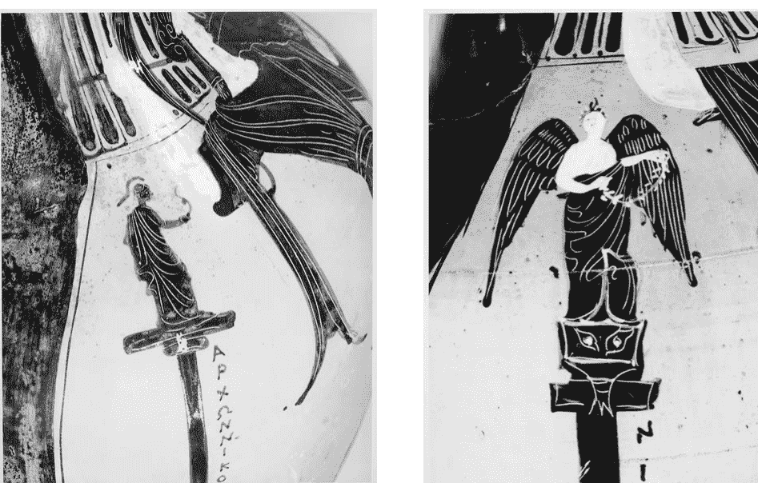

图1. 泛雅典奖赛油瓶，英国博物馆 B 609 —— 持有护尾装饰板（aphlaston）的雅典娜细节。

图2. 泛雅典奖赛油瓶，英国博物馆 B 610 —— 位于船头上的胜利女神（Nike）细节。

为1896年雅典奥运会建造的奥林匹体育场。体育场无疑由一条赛道（dromos）和一个供观众使用的剧场组成，三侧共享跑道，并配有木制座椅；封闭端是弯曲的还是直的尚不清楚，但更有可能是弯曲。米勒（Miller）曾暗示，东部还有一个隧道和更衣室（apodyterion），这在尼米亚、埃皮达鲁以及可能的奥林匹亚也是如此。新泛雅典竞技体育场的创建应当与这些表面上同时期的发展并提。人们可以认为，由于泛雅典竞技体育场是雅典多年来大规模改进的一部分，其重建可能刺激了其他城市，但由于不确定性太大，无法赋予这种具有吸引力的、以雅典为中心的观点过大权重。

保存下来的所谓泛雅典奖赛油瓶可以追溯到尼科克拉特斯（Nikokrates）和尼凯提斯（Niketes）执政时期（332/1），这些年份是从神圣橄榄（moriai）中压榨油脂，并用于330/29年大泛雅典节上作为奖品的时期，该节的竞技活动是在新的吕库甘体育场（Lykugan stadium）举行的。非常有趣且具有意义的是，尼科克拉特斯处持护尾装饰板的雅典娜（图1）和尼凯提斯处船头的胜利女神（图2）两侧的雕塑共享了同一个标志主题——胜利。这引发人们思考，他们在这里以及第四世纪下叶期的选择，与其说是执政官个人的兴趣，不如说是当时雅典更广泛的利益。吕库戈斯（Lykourgos）在努力改善城市文化和审美生活期间，还在泛雅典竞技体育场旁修复了军库（valvideia），该军库一直延伸到亚港（Zea）附近。最可能的情况，这项造船厂的工作以及船队的建造是由这些柱子上的雕像所歌颂的。我们甚至可以假设，持护尾装饰板的雅典娜是吕库戈斯为新港口建筑群定制的特别合适的塑像，而船头那极其生动的胜利女神形象可能是海上所渴望的，或者指的是吕库戈斯和阿里斯托米科斯（Aristomikos）在335/4年提议后，迪奥提莫斯（Diotimos）对爱琴海海盗迅速取得的成功。

并配有一对舵桨，但可能没有桨。用于展示奖赛油品（plemios）的桅杆、横桁和索具，有二世纪末（298/2、241/1和142/1）的装备记录，特别是关于绳索、桅杆和横桁。有趣的是，从公元前340年开始，雅典娜偶尔出现在泛雅典竞技场的柱子上，带有被称为kacherion的青铜器身，即尾部的装饰（stylos）；泛雅典奖赛油瓶所持有的物体可能更像是一根桅杆或缩短的横桁，或者是舵和舵桨。

泛雅典节与海军之间还有另一个在此背景下值得提到的有趣联系。当泛雅典奖赛油品（plemios）游行时，为了让公民能清晰看到它，它被系在一个以小船（skaph）形式的轮式舰队的桅杆和横桁上。当它被带到卫城时，可以看到船体部分留在了下方，而油品被运上去，可能仍附着在桅杆和横桁上。根据在卫城之路旁、雅典娜附近的埃琉西斯地区发现的一块浮雕碎片，并由阿尔德基斯·科雷米斯（Aldekis Choremi）断定为公元后第三世纪，其上层部分的碎片证明了我们所知的泛雅典船船的后部呈现出带有浮雕的小神庙形状。

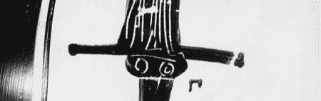

## 从希腊化时期到罗马时期的泛雅典竞技体育场

吕库甘体育场（Lykouron stadium）在公元三世纪中期曾被修复，可能是在258/7年。这是由阿格通姆的海拉克莱托斯（Herikleitos）执行的，推测身份是agothetes。当然，海拉克莱托斯是安提戈尼（Antigonas）国王的坚定支持者。修复很可能是由于马其顿战争期间的损坏造成的，但也确实与安提戈尼在265/6年“赋予雅典人自由”时赋予的新独立感相契合。意义在于，在这个时期断定的泛雅典奖赛油瓶似乎重新出现，现在的日期是由财务官（tamiais straitiokon）的名字提供的，而非执政官（archenos）。卫城的一块碎片刻有248/7年财务官欧克琉得斯（Eukleides）的名字，而来自集市（Agora）的被称为“欧克琉得斯”的柱子铭文刻有米翁（Mion）的名字，他在215/7年轮值。朱迪斯·巴林格（Judith Barrringer）最近引起争议的建议是，如果我们考虑到在安提戈尼国王时期制作的柱子形象可能被认为获得了财务官一职，那么这可能是成立的。通常立一座安提戈尼的塑像，或更多是将体育场作为对其赞助人及其继承人的庆贺。

在公元二世纪下叶，官职发生了变化，财务官的名字被agothetes取代；最早记载的是266/7年来自埃尔基亚的德奥尼亚斯（Deonias of Erchia）。似乎这位官员在节日的融资中发挥了很大作用，他是基于财富和影响力被选中的。

尼凯·梅塔萨-普罗科皮乌（Nike Metaxa-Prokopiou）于1970年更近期地澄清了这一时期已知雅典奖赛油品的顺序。普罗科皮乌（Prokopiou）于1961年在菲利普斯山上发表了一个带有艾坎提斯（Aikantis）作为agothetes名字的油瓶，并将其与来自梅塔索斯（Metaxos）和集市（Agora）的两块无名碎片联系起来。来自伊卡里翁（Ikarion）的阿德伊蒙诺斯（Adeimonos）是147/6年的长官，140/39年德洛斯的执政。他很可能是146/6年的agothetes，或者可能是138/7年。在《吉森连接》卷中，特斯库利杜（Tskoulidou）将卡帕基亚的阿里奥拉特斯五世（Ariarathes V）作为agothetes发表，可能属于138/7或14/3年。这样她将六个泛雅典油瓶归为同一位艺术家，将其命名为“吉森画家”（Giesen Painter），人们可能会希望她能选择更合适的“阿里奥拉特斯画家”（Ariarathes Painter）这一小头衔。

在这一序列中，我们可以增加一块英国博物馆于2002年获得的新碎片（图4和11）。它来自古古斯塔瓦基（Gustavaki）的收藏，实际上与那只标有阿德伊蒙诺斯作为agothetes的油瓶出自同一位画家；可以通过眼睛、眉毛和发卷的具体形状，以及对肌肉的处理来对比对比。由于这块新的伦敦碎片来自哈德拉（Hadra）收藏，有趣的是

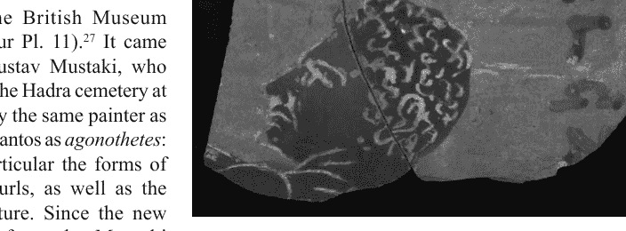

# Dyfri Williams

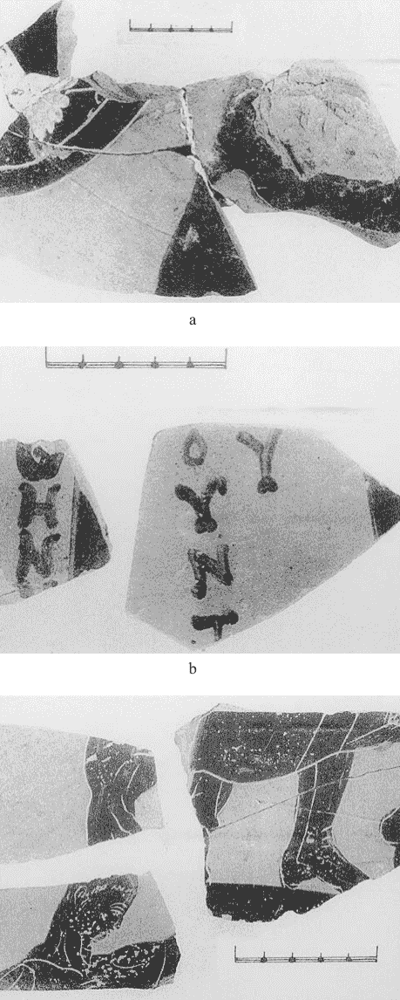

作为亚历山大的收藏家，卢卡斯·贝纳基（Loukas Benaki）获得了一组希腊化时代的泛雅典瓶碎片，现藏于雅典国家博物馆（图5a-c）。²⁸ 其中一些碎片并非出自同一画家之手，甚至可能与伦敦碎片来自同一器容器（图5a和c右侧；可能也包括图5b右侧和c左上角的碎片）。

伦敦碎片上的“竞技者”（agonates）铭文残迹显然与阿德亚门托斯（Adeamentos）的名字不符，但很可能保留了来自马拉松场区的、佐里洛斯之子米尔塔德斯（Miltades）名字的几个字母。²⁹ 米尔塔德斯在公元前142/1年在没有人愿意承担任务的情况下接受了竞技者的工作，而且当分配的资金不足时，他自付了大量的个人资金。游行和祭祀活动显得格外宏大，他自己的女儿也是其中一员。

在这位泛雅典瓶画家的作品（我们可以称其为“阿德亚门托斯画家”）中，我们还可以增加三件来自德洛斯“喜剧家之家”的比例不寻常的泛雅典形状双陶瓶碎片（高度22.5厘米）（图6a-b）。³⁰ 这三件作品比公元前五、四世纪所谓的“布拉斯小组”（Bulas Group）微型瓶大三倍，但又比公元前六、五世纪的伪泛雅典系列略小。³¹ 这些小型泛雅典瓶的质量尚不确定，但我们应该注意到，它们可能是为了在宴会上盛酒而制作的。

从我们的来源尚不清楚早期的竞技者是阿德亚门托斯还是米尔塔德斯。这一难点对于泛雅典瓶来说是遗憾的，因为它们出自同一之手，无法在年代上进行区分。然而，有趣的是，在德洛斯喜剧家庭院发现的三个缩小比例泛雅典瓶碎片，其尺寸规模似乎对应于阿德亚门托斯在德洛斯担任执政（epileletes）的那一年（公元140/39年）。可能是他亲自委托官员来记录了……

图：5a-c. 泛雅典奖品瓶碎片：雅典国家博物馆收藏。

⁸ G. R. Edwards, Hesperia 26, 1957, 348 and pl. 87.

²⁹ 关于米尔塔德斯，见 IG II/P 908 和 3867; SEG xxix no. 161, 479–480.

³⁰ P. Bruneau et al., L'invitation de la mois des comédians (1970) nos. D70–d72, pl. 43.

³¹ 关于伪泛雅典瓶和布拉斯小组，见 M. Bent 最近在 *Panathenaika*, 111–117 and 177–198 中的。

³² T. B. Lesley, Webster, and Patton (1972) 159–160; M. Bent, in Panathenaika, 116–117. 全尺寸泛雅典瓶的精确功能正面临挑战；见 P. Themis, with with

# 从希腊化时期到罗马时期的泛雅典体育场

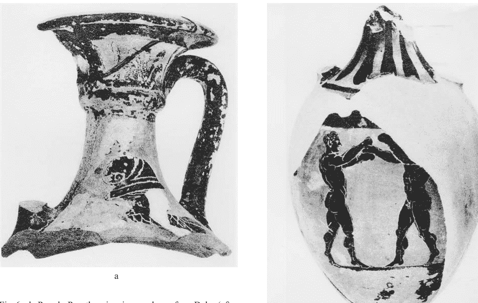

图 6a–b. 来自德洛斯的伪泛雅典奖品瓶（后德洛斯 XXI，pl. 43）。

……为了他的利益并在宴会上使用。此外，实际上他可能是这栋拥有华丽庭院的精美房屋的首位居住者？大理石制泛雅典奖品瓶在第一世纪仍继续被装饰，人们特别认为有一块来自凯拉米科斯（Kerameikos）的碎片，上面有*竞技者*（agonethes）字样。³³ 苏拉在公元前76/6年劫掠雅典无疑导致了亚克提亚海战期间泛雅典瓶的生产，但体育场进行了一些修复。⁴ 哈德良的统治开启了一个新时代，当他给予巨大的财富时，公元119/20年后的“泛雅典节”（Panathenaids）像奥林匹克运动一样被计算出来。显然，泛雅典节在皇帝日益增加的控制下继续。⁵ 哈德良在公元138年目睹了德里克（Herodes Atticus）的去世和他的继位。公元143/4年，他履行了他的诺言，体育场已为泛雅典运动准备就绪，尽管我认为并非全大理石，而是使用了皮赖俄石灰岩。1869–70年的挖掘由建筑师恩斯特勒（Ernst Ziller）完成，1895–96年由承包商佩里克完成，揭示了体育场呈马蹄形。⁸上面有第二道墙，下方有一套地下排水系统，顶部护栏（stethian）旨在防止从体育场开始使用起就显然旨在举办的剧烈活动。垂直楼梯引导人群，创造了总共三十层的看台（kerkides）。这使得体育场的总容量达到约50,000人。在墙（sphendone）的末端，如前所述，一个带有拱形入口的隧道用于引导参赛者进入更衣室（apodyter），正如米勒（Miller）所建议的。墙的装饰是拱形扶壁；体育场的末端是用皮赖俄石灰岩建造的。德里克似乎还建造了一个门廊（propylon），无疑横跨伊利俄斯的拱桥属于他，因为它位于市中心。根据几块建筑碎片，勒勒修复了体育场，并在墙顶部放置了一尊多立式雕像。我们对这座宏伟体育场的装饰知之甚少，除了19世纪发掘者发现的少数雕塑碎片——许多双头英雄像以及长椅（prohedra）的末端和腿部，这些都是猫头形状。人们认为波埃提亚斯（Boethias）和菲洛斯塔科斯（Philostakos）曾非常赞美这座体育场，其中一个碎片可能仍被认为追溯到公元前420年左右，那可能更晚，甚至是罗马时期的。阿尔忒弥斯秩序位于西侧，德里克在此处建造了一座提刻（Tycho）的雕像，他的首席祭司是他的妻子，里面有一尊女神的象牙神像。在其东侧，有人认为这些遗迹来自希律德的墓，或许更有说服力的是来自他为公元143年4–6年节日专门制作的、拥有1000个座位的泛雅典展示基座。这座雅典的大型体育场似乎一直用于泛雅典运动直到它倒塌，可能直到公元世纪。到15世纪，所有大理石都被剥离，要么被用作建筑材料（长椅作为连接床榻的特殊座椅），要么被烧成石灰——当1869–70年体育场被使用时，在跑道旁发现了三个窑。20世纪70年代，卡洛·加斯帕里（Carlo Gasparri）发现了泛雅典体育场的一个部分。在收集德里克体育场的所有证据时，他汇总了所有结束的大理石座椅碎片，它们与垂直楼梯相接。遵循勒在1870年发现的路径，他将总数增加到18。他也是第一个将一系列猫头形状的大理石座椅与泛雅典体育场联系起来的人，尽管目前没有发现它们的原始发现地（仍有五个在扎皮花园的西南角待发现）。

# 从希腊化时期到罗马时期的泛雅典竞技场

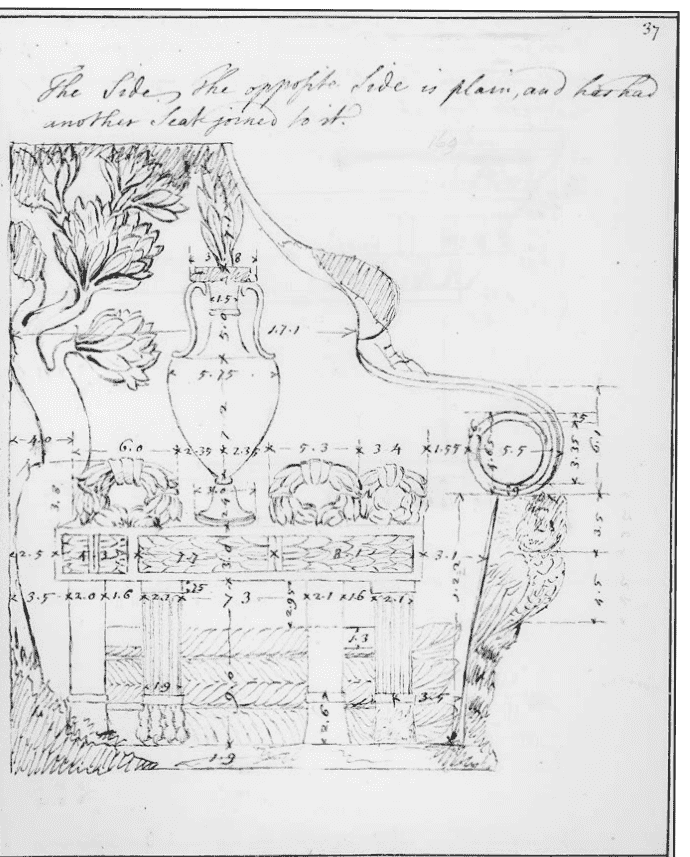

图 7. N. Revett，右端王座的测量图（1751–53），大英博物馆。

位于跑道附近的楔形墙（sphendone）。我们无法得知那里有多少把椅子，以及由多少个楔形块（cunei）填充（2、4 或 6 个都构成了楔形墙）。这些是“贵宾席”（prohedria seats），关于这些荣誉分配，我们偶尔在公元前 314/34 年和纪 180 年代发现过相关记载。此类奖励可能授予给受益者、城市和官员委员会。

其中一个末端的王座最早为人知是根据尼古拉斯·雷维特（Nicholas Revett）1751–53年的详细绘图（图 7）。1801年5月22日，埃尔金勋主的代表菲利普·亨特（Philip Hunt）从雅典写信给在君士坦丁堡的埃尔金：“主教已经从大都会教堂给了尼贝特先生[埃尔金夫人夫人的父亲]一张古老的大理石王座（图 8 和彩色图 16），体育主管（Gymiasarch）曾在公共运动会上坐在上面——重量会让运输变得困难”，于是1802年9月15日，该王座被留在埃尔金勋爵的“导师号”船上，结果在该船在基库瑟拉岛附近遭遇风暴沉没时，与埃尔金收藏的物品一同沉没。在花费巨资最终打捞后，它被运往英国，最后被送到苏格兰的比尔。它一直留在家族收藏，先在苏格兰，后在英南部，直到200年后大英博物馆才购买了它.¹

王座仅在坐者的一侧有装饰（图 8）。在这里我们看到一个泛雅典形状的长瓶，顶部插着一枝橄榄，放置在一个带三个花环的精致四腿桌上。桌下有两个棕榈叶，背景左侧是一棵橄榄树。扶手上装饰有精美的卷轴，两只猫头鹰形成了前腿。左侧没有装饰，但有一个制作精细的框架和凿刻的中心面板，以便能与另一把王座紧密贴合。

这种古老椅子另一端的配对部分也被雷维特看到并画出（图 9）。其装饰无疑是完全相同的。1805-06年，爱德华·多德韦尔（Edward Dodwell）素描了第二把椅子（图 10），推测是因为另一把已经被亨特和卢西埃里为汉密尔顿·尼贝特夫妇移走了。⁵³ 多德韦尔的素描显示，此时王座已经发生了很大变化——浮雕装饰已被损毁，以至于他无法认出橄榄树的树干或泛雅典长瓶的底部，导致他转而画了第四个花环。这第二个王座似乎完全消失了。

这些优雅王座的图像方案与竞技场构成了完美的呼应。猫头鹰当然是属于雅典娜的；这里也有橄榄树。这种桌子是一种特殊的四腿类型，它出现在雅典的2世纪青铜币上，这种桌通常被称为“竞技桌”（agonistic table）——这些硬币通常与哈德良的第一次泛雅典节联系在一起，而特别是这种桌子，可以在公元2世纪的硬币上看到，这些图像可能甚至受到了赫罗尼泛雅典竞技场装饰的影响。⁵⁴ 长瓶是泛雅典式的，而那枝橄榄

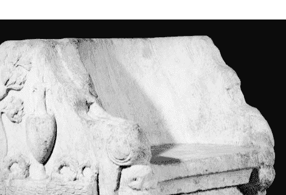

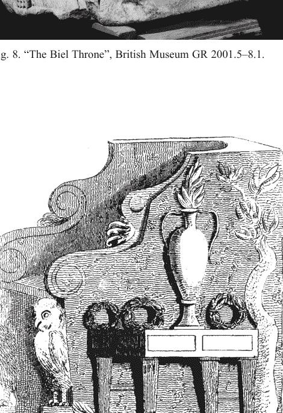 口部指示了它作为待颁发奖品之一的功能。桌上的三个橄榄花环似乎是为不同人群设置的：男孩、青少年和成年人，正如托尼·斯宾罗所言。

在文中，我们看到了希腊化和罗马时期的泛雅典竞技场。由乔治斯·阿维洛夫（Georgios Averof）建造的竞技场在1896年，尽管面临诸多问题，但按时完工，运动会取得了巨大成功。

# 缩写表

-   Eschbach: N. Eschbach, 《公元4世纪泛雅典雕像》

-   Habicht: Ch. Habicht, 《亚历山大帝到安东尼时代的雅典》

-   Kaltas: N. Kaltas, 《博物馆雕塑》

-   Karouzos: S. Karouzos, 《国家考古博物馆的收藏》

-   Macedonians in Athens: O. Palagia and S. V. Tracy (编), 《雅典的马其顿人322-229年》

-   Mikason: J. D. Mikaelson, 《希腊化雅典的宗教》

-   Miller, Neea II: S. G. Miller, 《Nea II的发掘：早期希腊化竞技场》

-   Mitchell: F. Mitchell, 《雅典338-322》

-   Morrison and Williams: J. S. Morrison and T. Williams, 《古希腊船只900-322 BC》

-   Panathenaika: M. Bentz and N. Eschbach (编), 《泛雅典：泛雅典节研讨会》

-   Papanicolau-Christensen: A. Papanicolau-Christensen, 《泛雅典竞技场：其几个世纪的历史》

-   Shear: J. L. Shear, 《城邦与泛雅典：雅典娜节的发展》（宾夕法尼亚大学论文，2001）

-   Stuart and Revett: J. Stuart and N. Revett, 《雅典古迹III》（1794）

-   Tobin: J. Tobin, 《赫罗德·阿提柯斯与雅典：安东尼时期的赞助与冲突》

-   Ziller: E. Ziller, 《泛雅典竞技场的发掘》（1870）

# 雅典与赫尔库兰尼：帕特农雅典的案例

## 卡罗·C·马图舒

这一风格时期创作的雕塑在罗马人中非常流行，俯瞰雅典湾的工作坊生产的作品涵盖广泛，从“雅典暴君杀手者”的圆柱到古风式塑像和胸像的古典主义杰作，其中一些可能被伪装成正品的“古代”作品。该地区许多别墅的所有者对这些雕塑有着无限的需求，因此一件流行作品残存了多个版本的情况也并不罕见。

纸草卷别墅（Villa dei Papiri）俯瞰赫尔库兰尼，是迄今发现最大的罗马别墅，而且远未完全发掘。它的公共区域是经过挖掘的地下地面，周围由由25多根柱子组成的柱廊环绕。中庭区域的挖掘工作在1750年代进行过，面积约20,000平方米（65,000平方英尺），包括一个在1980年重建的大型花园，这在卡尔·韦伯（Karl Weber）于1758年完成的平面图中绘制的单层基础上额外增加了两层。

该别墅出土了壁画、马赛克、约1,000卷纸草卷，以及近九尊青铜和大理石雕塑。大多数雕塑呈古典主义风格，其中许多是知名希腊塑像类型的复制品，或是著名英雄的肖像。青铜像尺寸各异：塑像、胸像和界柱头（term-heads）应有各种，但大部分是小型英雄和等真人比例。

在一个看起来像地下室的地方，从一个面积为88平方米、铺有彩色大理石地板的房间中心出土了八尊青铜胸像：一个梅勒菲斯（国家博物馆5633号）和一个短发型“波吕克列特斯式”运动员（N.M. 5614）；三尊等大的罗马人肖像（N.M. 5634, 5586, 5587）；以及德摩斯梯尼（N.M. 5469）、爱比库罗斯（N.M. 1110）和一位朱利奥-克劳狄家族的女性（可能是阿格里皮纳，N.M. 6240）的小型胸像，均由卡拉拉大理石刻成。房间入口外的两根柱子之间立着一座等真人比例的古风骑雅典塑像，由潘特里克大理石刻成（Gl. 1 和 Cl 13）。古风风格的使用继承了古老的传统和起源。因此，这种古风形象可以与当前的背景联系起来，并建立当下背景的血统或合法性。纸草卷别墅的地位提供了一系列迷人的联想。

骑在雅典之上的形象最早在古风时期的雅典城变得流行。卫城山上大型古风雕像——*古风时期*——山墙上“巨人之战”中那尊骑马的雅典女神站在她的前腿上，带有侵略性地向右侧倾斜。她伸出左臂，越过左肩向后倾倒，压在她的对手身上。无疑，她在右手握着一柄矛，仿佛正对准巨人。在归于道乌里（Daouri）的le油瓶（lekythos）上的骑马雅典女神与我们构思的部分并无二。

- 1 见 C. C. Pavlov, Rediscovering Antiquity: Karl Weber and the Excavation of Herculaneum, Pompeii, and Stabiae (1995) 96–103; C. C. Mattusch, The Villa dei Papiri at Herculaneum: Life and Afterlife of a Sculpture Collection (2005) 33–64.

- 2 B. S. Ridg, The Archaic Style in Sculpture (1977); J. M. Hurwit, The Athenian Acropolis: History, Mythology and Archaeology from the Neolithic to the Present (1999) 123–124: co.

- 3 Cleveland Museum of Art 78.59, J. Neils, Goddess and Polis: The Panathenaic Festival in Ancient Athens (1992) 147 and

在所有时期的帕特农双耳瓶上，雅典娜保持着她的古风特征。她手持长矛，举着盾牌在身前方，仿佛正处于进攻状态，一脚在前，一脚在后。同时，出于明显的矛盾，她保持着直立的姿态。这尊雅典娜没有对手；这种垂直的站姿使构图不再需要另一个。帕特农雅典娜还传达了一个政治信息：她是具有侵略性且不可挑战的，并占据战斗位置。

武装进攻的雅典娜在雅典城和古风时期以青铜像的形式出现。当向前迈同时，她符合帕特农型（Parthenaic type）。那些直立的形象可能是菲迪亚斯为卫城创作的巨型站立式青铜雅典娜的前身，那尊塑像是用马拉松战役击败波斯人的战利品资助的（P 128.2）。这尊曾立在卫城上的著名影像后来被称为“战神”（Promachos, Warlike），因为菲迪亚斯……在卫城。这种直立的雅典娜是古典风格的，帕特农雅典娜也是如此。在雅典的雅典。，俯瞰赫尔库兰尼的纸草卷，俯瞰雅典湾的工作坊生产的作品从“雅典暴君杀手者”的圆柱到古风式塑像和胸像的古典主义杰作，其中一些可能被伪装成正品的“古代”作品。该地区许多别墅的所有者对这些雕塑有着无限的需求，因此一件流行作品残存了多个版本的情况并不罕见。

纸草卷别墅（Villa dei Papiri）俯瞰赫尔库兰尼，是迄今发现最大的罗马别墅，而且远未完全发掘。它的公共区域是经过挖掘的地下地面，周围由25多根柱子组成的柱廊环绕。中庭区域的挖掘工作在1750年代进行过，面积约20,000平方米（65,000平方英尺），包括一个在1980年重建的大型花园，这在卡尔·韦伯（Karl Weber）于1758年完成的平面图中绘制的单层基础上额外增加了两层。

该别墅出土了壁画、马赛克、约1,000卷纸草卷，以及近九尊青铜和大理石雕塑。大多数雕塑呈古典主义风格，其中许多是知名希腊塑像类型的复制品，或是著名英雄的肖像。青铜像尺寸各异：塑像、胸像和界柱头（term-heads）应有各种，但大部分是小型英雄和等真人比例。

在一个看起来像地下室的地方，从面积为88平方米、铺有彩色大理石地板的房间中心出土了八尊青铜胸像：一个梅勒菲斯（国家博物馆5633号）和一个短发型“波吕克列特斯式”运动员（N.M. 5614）；三尊等大的罗马人肖像（N.M. 5634, 5586, 5587）；以及德摩斯梯尼（N.M. 5469）、爱比库罗斯（N.M. 1110）和一位朱利奥-克劳狄家族的女性（可能是阿格里皮纳，N.M. 6240）的小型胸像，均由卡拉拉大理石刻成。房间入口外的两根柱子之间立着一座等真人比例的古风骑雅典塑像，由潘特里克大理石刻成（Gl. 1 和 Cl 13）。古风风格的使用继承了古老的传统和起源。因此，这种古风形象可以与当前的背景联系起来，并建立当下背景的血统或合法性。纸草卷别墅的地位提供了一系列迷人的联想。

骑在雅典之上的形象最早在古风时期的雅典城变得流行。卫城山上大型古风雕像——*古风时期*——山墙上“巨人之战”中那尊骑马的雅典女神站在她的前腿上，带有侵略性地向右侧倾斜。她伸出左臂，越过左肩向后倾倒，压在她的对手身上。无疑，她在右手握着一柄矛，仿佛正对准巨人。在归于道乌里（Daouri）的le油瓶（lekythos）上的骑马雅典女神与我们构思的部分并无二。

## 参考文献

- 1 见 C. C. Pavlov, *Rediscovering Antiquity: Karl Weber and the Excavation of Herculaneum, Pompeii, and Stabiae* (1995) 96–103; C. C. Mattusch, *The Villa dei Papiri at Herculaneum: Life and Afterlife of a Sculpture Collection* (2005) 33–64.
- 2 B. S. Ridg, *The Archaic Style in Sculpture* (1977); J. M. Hurwit, *The Athenian Acropolis: History, Mythology and Archaeology from the Neolithic to the Present* (1999) 123–124: co.
- 3 Cleveland Museum of Art 78.59, J. Neils, *Goddess and Polis: The Panathenaic Festival in Ancient Athens* (1992) 147 and

## 雅典娜的古风特征与政治寓意

在所有时期的帕特农双耳瓶上，雅典娜保持着她的古风特征。她手持长矛，举着盾牌在身前方，仿佛正处于进攻状态，一脚在前，一脚在后。同时，出于明显的矛盾，她保持着直立的姿态。这尊雅典娜没有对手；而这种垂直的站姿使构图不再需要另一个。帕特农雅典娜还传达了一个政治信息：她是具有侵略性且不可挑战的，并占据战斗位置。

武装进攻的雅典娜在雅典城和古风时期以青铜像的形式出现。当向前迈步时，她符合帕特农型。那些直立的形象可能是菲迪亚斯为卫城创作的巨型站立式青铜雅典娜的前身，那尊塑像是用马拉松战役击败波斯人的战利品资助的（P 128.2）。这尊曾立在卫城上的著名影像后来被称为“战神”，因为菲迪亚斯……在卫城。这种直立的雅典娜是古典风格的，帕特农雅典娜也是如此。在雅典的雅典，俯瞰赫尔库兰尼的纸草卷，俯瞰雅典湾的工作坊生产的作品从“雅典暴君杀手者”的圆柱到古风式塑像和胸像的古典主义杰作，其中一些可能被伪装成正品的“古代”作品。该地区许多别墅的所有者对这些雕塑有着无限的需求，因此一件流行作品残存了多个版本的情况并不罕见。

## 纸草卷别墅

纸草卷别墅俯瞰赫尔库兰尼，是迄今发现最大的罗马别墅，而且远未完全发掘。它的公共区域是经过挖掘的地下地面，周围由25多根柱子组成的柱廊环绕。中庭区域的挖掘工作在1750年代进行过，面积约20,000平方米（65,000平方英尺），包括一个在1980年重建的大型花园，这在卡尔·韦伯于1758年完成的平面图中绘制的单层基础上额外增加了两层。

该别墅出土了壁画、马赛克、约1,000卷纸草卷，以及近九尊青铜和大理石雕塑。大多数雕塑呈古典主义风格，其中许多是知名希腊塑像类型的复制品，或是著名英雄的肖像。青铜像尺寸各异：塑像、胸像和界柱头应有各种，但大部分是小型英雄和等真人比例。

在一个看起来像地下室的地方，从一个面积为88平方米、铺有彩色大理石地板的房间中心出土了八尊青铜胸像：一个梅勒菲斯（国家博物馆5633号）和一个短发型“波吕克列特斯式”运动员（N.M. 5614）；三尊等大的罗马人肖像（N.M. 5634, 5586, 5587）；以及德摩斯梯尼（N.M. 5469）、爱比库罗斯（N.M. 1110）和一位朱利奥-克劳狄家族的女性（可能是阿格里皮纳，N.M. 6240）的小型胸像，均由卡拉拉大理石刻成。房间入口外的两根柱子之间立着一座等真人比例的古风骑马雅典娜塑像，由潘特里克大理石刻成（Gl. 1 和 Cl 13）。古风风格的使用继承了古老的传统和起源。因此，这种古风形象可以与当前的背景联系起来，并建立当下背景的血统或合法性。纸草卷别墅的地位提供了一系列迷人的联想。

骑在雅典之上的形象最早在古风时期的雅典城变得流行。卫城山上大型古风雕像——*古风时期*——山墙上“巨人之战”中那尊骑马的雅典女神站在她的前腿上，带有侵略性地向右侧倾斜。她伸出左臂，越过左肩向后倾倒，压在她的对手身上。无疑，她在右手握着一柄矛，仿佛正对准巨人。在归于道乌里的油瓶上的骑马雅典女神与我们构思的部分并无二。

## 162 典与赫尔库兰姆：泛雅典典娜的案例

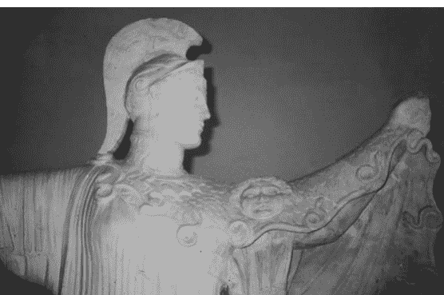

古典式的、丰满且无蛇的戈耳型式起源于四世纪，其服饰是古风风格的变体。

赫尔库兰姆的典娜通常被描述为“战神”型，但她不可能是这种类型，因为那尊雕像不是古风的，而泛雅典典娜恰是。有趣的是，泛雅典典娜曾出现在由托勒密一世（卒于公元前283/2年）、庇琉洛斯（公元前319–272年）、德米特里奥斯·波围城者（公元前337–282年）以及安提戈柯·格纳塔斯斯（公元前320–239年）铸造的硬币上，所有这些人曾拥有过与典娜并立的赫姆斯石像。在纸草卷别墅发现的赫姆斯像中，已鉴定出其中至少两个人的肖像。

- 9 关于戈耳头像饰，参见 J. Floren, *Studien zur Typologie der Gorgon* (1977) 192–197。
- 10 C. M. Havelock, *AJA* 84, 1980, 41–50 以及图 7.2, 7.5, 7.7。关于纸草卷别墅中德米特里奥斯肖像的鉴定，见……

## 卡罗·C·马图什 163

**图 7**。来自赫尔库兰姆的泛雅典典娜胸甲上的戈耳。照片来源：Henry Lee。

根据卡尔·韦伯对其平面图的注释，赫尔库兰姆的庭院曾立于分隔内方形庭院与纸草卷别墅大部分区域柱子之间。与别墅中的其他雕像和胸像一样，她展示了一尊希腊大理石胸像——一位穿着古典服饰的戴面纱女性。人们可能会好奇，典娜与另一尊等身大理石雕像（发现于门厅 tablinum，N.M. 620）之间是否存在刻意的联系。是什么让那尊雕像足以与典娜像媲美？这位女性的肖像似乎是用库拉奇大理石制成的，而典娜则是奇幻大理石；但它们彼此位置的接近可能使它们成为一对。这两个女性都被放置在别墅的大花园里，而该女性与典娜的接近可能是为了表现她的性格特征。

**图 8**。来自雅典集市的泛雅典典娜残缺面部右侧视图。集市 S 1064：美国古典研究学院 - 发掘。

但回到门厅，该房间的雕塑包括罗马人的肖像，还有一尊植物神（N.M. 563）、一尊古典式典娜（N.M. 561），以及德摩斯梯尼（N.M. 5469）和埃皮库罗斯（N.M. 1107）的肖像。这尊古风典娜用大提提大理石制成，与这些著名的希腊人并列。这尊古风典娜与泛雅典运动会有着特别的联系。奇怪的是，另一尊与此尊大小、形制相同的古风典娜残片显示了躯干的上部。这些器件显示了部分长袍褶皱、左臂上的褶皱，以及右膝处用于固定戈耳饰的孔。

这些器件是否源自那尊“原作”典娜呢？纸草卷别墅是由卢修斯·卡尔普尼乌斯·皮索建造的，他是凯撒第三妻的父亲。皮索与希腊有联系。公元前57年，在他在马其顿被撤去执政官职位后，他在阿卡提亚度过了两年。皮索访问了萨莫色雷，那里有一处铭文记载了他作为统治者的奉献。此外，他和他的儿子卢修斯·马图什·波尼提克斯（公元前32年）与雅典有特殊的联系，以及泛雅典的……

## 图版

**图 1**。伯贡泛雅纳会竞技奖品双油罐。伦敦，大英博物馆 B 130。摄影：H. R. Goette。

**图 2**。拉奥孔尼黑纹彩杯。梵蒂冈，格里戈利安埃特鲁斯博物馆 16592。摄影参考 M. Τίβεριος，《Ελληνική Τέχνη》，Αρχαία Αργαλ (1996) 100, 图 65。

**图 3**。出自特拉霍尼的提提红绘双油罐。比雷埃斯博物馆 7341。摄影：P. Themelis。

**图 4**。出自特拉霍尼的提提红绘双油罐。比雷埃斯博物馆 7341。少年。摄影：P. Themelis。
**图 5**。出自特拉霍尼的提提红绘双油罐。比雷埃斯博物馆 7341。雅典娜。摄影：P. Themelis。

**图 6**。杯。圣彼得堡，冬宫博物馆 B 4526。拟人化的部落正将火炬传给第一名跑者。参考 D. Vanhove（编），《L'Olympisme dans l'antiquité I》(1993) 58。

**图 7**。微型奖品双油罐。波恩，学术艺术博物馆 1627。比赛。摄影：博物馆。

**图 8**。钟形双口杯。莱比锡，古代博物馆 T 958。一头牛作为火炬赛的奖品，正由部落和获胜队伍领去祭祀。摄影：博物馆。

**图 9**。归于诺斯泰尔画家的提提红绘钟形双口杯。蒙特利尔，美术馆，1944。Cb.2。摄影：J. H. Oakley。

**图 10**。为奥尼涅斯部落胜利而献的雕像基座。雅典，卫城山博物馆 3176+5460+2635。摄影：H. R. Goette。

**图 11**。泛雅纳会奖品双油罐碎片。大英博物馆 GR 2002.4–20.1。摄影：博物馆。

**图 12**。“比尔王座”。大英博物馆 GR 2001.5–8.1。摄影：H. R. Goette。

（注：由于原文后部分存在严重的OCR乱码和重复，译文已根据可读逻辑片段进行了重组与翻译。）

## 图 13。出自赫尔库尼姆纸草别墅的泛雅纳会雅典娜大理石雕像。那不勒斯 N.M. 6007。高约 2 米。摄影：C. C. Mattusch。

## 图 14。出自赫尔库尼姆的泛雅纳会雅典娜带有长发的护牌背部。摄影：Henry Lie。

## 图 15。出自赫尔库尼姆的泛雅纳会雅典娜右侧像。摄影：Henry Lie。
