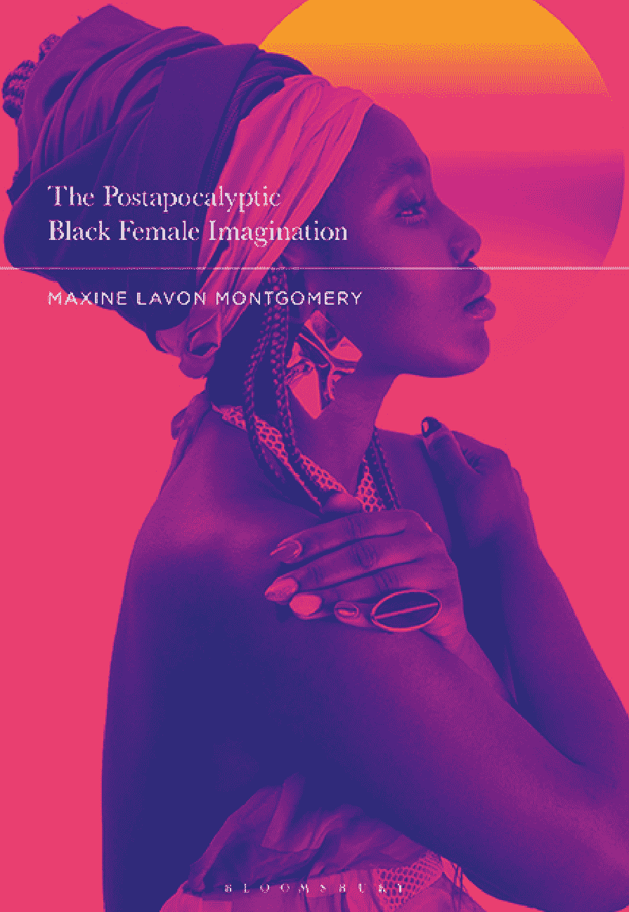

# 末世时代的黑人女性想象

# 致谢

在完成任何事业时，尤其是涉及创作一本长篇学术著作时，总有一些在幕后付出的个人——他们隐形、沉默、往往不被承认——但没有他们，项目就无法完成。如果我不向那些在本书的研究、写作和修订中发挥关键作用的人士致敬，我将是失职的。

首先，我想感谢我的研究实习生 Sabine Nemours，感谢她在寻找奥托维娅·E·巴特勒（Octavia E. Butler）学术资源方面的贡献，并为午餐时关于非洲未来主义女性、黑女性小说与文化生产以及当前社会政治事件的讨论注入活力。从你那里学到的比你从我那里汲取的知识多。我也想感谢我“末世黑女性想象力”研讨会上的研究生们，他们不仅分享了我对非洲未来主义的热情，还以某种方式挑战我，促使我在早期完善了论点。通过活跃的辩论和强有力的对话，这些学者帮助该项目的地理和学科边界超越了其最初的构建。

一个学期的学术休假和夏季研究让我能够专注于研究和写作。此外，与全国范围内民族未来主义（Ethno-futurist）、非洲未来主义（Afro-futurist）以及非裔文学与文化研究的学者们、同事 Chester J. Fonten, II、Ronald Baxter Miller 和 Candace Ward 在此过程中提供了有帮助的见解。我的母亲 Juanita Montgomery Hale 在我需要额外动力冲向终点时是灵感的源泉。

但最后，我还要感谢我的丈夫 Nathaniel Crawford，我爱与生活的伴侣，以及我们的女儿 Samantha Natalya Crawford，她自己本身就是一位才华横溢、后劲不可挡的文学学者。感谢你们让我拥有自己的房间来完成我的工作。

对于你们每一个人，未来都像你们的想象力和超越我们共同面临限制的意愿一样无边际。

## 超越历史的终结

# 种族、性别、性欲与末世想象力

破解这个难题：为什么只有极少数非裔美国人写科幻？这种体裁与“他者”（异乡土地上的陌生人）的密切接触似乎特别契合他们所关注的问题。然而，考虑到塞缪尔·R·德莱尼、奥托维娅·巴特勒和查尔斯·桑德斯选择在该体裁内写作，这尤其令人百思不得其解。然而，在多大程度上，可以解释目前对时间终结的关注不仅出现在才华横溢的歌手身上，还出现在音乐家、作家、视觉艺术家、电影迷、超级英雄粉丝中？既然社会已经经历了一个没有末日的世纪末（*die siècle*），为什么世界灾难性结束及其不确定的末世后果阴影对20世纪末和21世纪的想象力继续产生强大的影响？那些致力于恢复破碎遗产的边缘文化成员能否想象出乌托邦社会秩序的可能未来？关于外星人和后人类生物的问题、关于基因工程或技术增强生物的伦理问题、关于致命瘟疫的理论以及关于生物技术在医学和科学领域作用的问题，一直是近期激烈讨论的焦点。这些努力促使文学理论家、文化评论家、科学家和普通公民重新思考艺术与科学、技术与身体，以及对本项目最重要的历史与未来之间的界限。本项目不仅审视了黑女性的末世想象力；还通过关注非霸权定位如何以独特的方式转化未来表征，打破了学术空白。

Mark Dery 对黑人科幻作家的目录表现出美国中心和男性的偏见，只有开创性小说家奥托维娅·E·巴特勒被列为这一流行体裁的唯一女性作者。他的文章并非作为对黑人文学参与科幻的终结，而是为恢复学术上重新评估黑人幻想文化提供了一个起点。自他那篇宣布非洲未来主义作为文学和文化现象正式开始的里程碑式论文发表以来，学者们一直在以创新的方式承担该领域的挑战性任务。黑女性不仅做出了巨大的贡献

## 后末日黑人女性想象

著名小说家奥托维娅·E·巴特勒的言论中隐含了她对科幻小说类型惯例作为文化批判方法的依赖。“我被科幻小说吸引是因为它是如此开放，”巴特勒揭露道，“我可以做任何事，没有墙壁阻挡我，也没有任何人类状况是禁止我检查的。” 巴特勒对一种外星人、吸血鬼和其他地外生物常态化的后末日文化的虚构化，打破了坚持过去、现在与未来之间、普通经验与由空灵人物构成的奇幻世界之间保持分离的历史观。在巴特勒所演变的未来领域，不仅是机械人和仿生女性，体现了挑战种族、阶级、性别和性取向观念的交叉性。这些异世界生物可以与非洲加勒比地区闻名的“苏库万特”（soucouyants）等民间人物和谐共存，后者以其变形能力而闻名。通过挑战科幻小说对见证者视角和男性化的依赖，她为该类型开启了更广泛的受众，鼓励重新评估已建立的身份构建以及锻造身份的时间空间。

后末日黑人女性想象采用了一种受性别和文化研究最新学术成果启发的理论方法，作为考察灾难和灾变时刻以及随之而来的未来想象的手段。项目将广泛认为是非洲未来主义支柱的作品与此前未被纳入幻想文化的作品并列，揭示了将黑人女性的末日后视为科幻小说一个未被承认的子类的实用性。正在调查的作品设想了灾难性的动荡，这种动荡渗透了一个旧时代的终结和一个完全新现实的开始，后者作为时间历史的一部分但又是独立存在的。灾变可能是发生的事件，也发生在叙事行动的当下。它可能包含对实际事件的呈现，或对在不久之后发生的事件的可视化。自然或人为的中断也预示着末日，例如埃德维·丹蒂卡特（Edwidge Danticat）对2010年海地地震的虚构化。杰斯明·沃德（Jesmyn Ward）和碧昂丝（Beyoncé）则关注了卡特里娜飓风后美国东南部墨西哥湾地区的社会、环境和文化生活。社会动荡或大流行事件同样标志着一种后末日感，促成了纳洛·霍普金森（Nalo Hopkinson）在《环中的棕色女孩》（Brown Girl in the Ring）中对多伦多1992年杨街骚乱后城市混乱的描述，或埃娜·布罗德伯（Erna Brodber）在《Myal》中对疾病和病情的呈现。

## 历史终结之后

性功能障碍、心理痛苦、身体损伤或感染的普遍存在证明了过去的持续影响。这些状况也证明了创伤在黑人大西洋主体生活中的持续性。弗朗茨·法农（Frantz Fanon）认为奴隶制和殖民主义构成了一种折叠式的创伤，标记了种族人口的生活。大部分后殖民状态涉及努力应对压迫性殖民和新殖民影响留下的心理或身体创伤的努力。疾病与治愈的主题在黑人女性寻求构建的幻想世界中具有至关重要的地位，标志着一个拒绝放弃对现在控制的不稳定大西洋历史的持久结果。尽管科学、技术和医学呈现为身体、情感或心理疾病的解决方案，但传统的机构结构和现代医学未能取代涉及奥贝亚（Obeah）、米雅（Myal）、草药疗法和顺势疗法的持久民间疗法。

最近的学术关注跨大西洋航程中的创伤时刻，这与中程航道的离散本质以及对新世界背景下新兴身份构建的影响产生共鸣。这种见解与詹姆斯·伯格（James Berger）的断言产生共鸣，“后末日的研究是对消失物和留存物的研究，以及留存物是如何变化的。” 伯格将黑人经验关注是典型的末日式的且具有创伤性的；他关注末日事件不仅是作为抗议和赋权的改变，更是作为性变革的工具。这让人联想起詹姆斯·鲍德温（James Baldwin）从圣经术语角度对世俗灾难时刻的理论化，将其视为涉及未解决紧张局面的“历史复仇、宇宙复仇”的地震式断裂。基斯·拜尔曼（Keith Byerman）对约翰·埃德加·惠德姆（John Edgar Wideman）、托尼·莫里森（Toni Morrison）和查尔斯·约翰逊（Charles Johnson）末日愿景的讨论，引发了对末日事件艺术表征如何与当代对技术政治混乱以及宗教媒体中末日影像的痴迷，以及世纪末此类关注的历史反复相结合的研究。正如拜尔曼所说，“通过探索创造和转化时刻的来源，作家们暗示了我们时刻的真相。在这种意义上，‘时间的终结’变成了考虑历史终结的机会。在每个案例中，终结他们终结的是种族。”

莫里森断言，“种族问题和家园问题是[她]工作的重点。” 写作的行为类似于一种挖掘过程，使得黑人大西洋主体治愈至关重要的历史收回成为可能。

## 后末日时代的黑人女性想象

以及当代读者，正如充斥在其小说页面的幽灵人物一样，见证了一段动荡的过去。她对因历史扭曲导致“黑人的存在与心跳”被系统性消除的观察，将注意力指向了其虚构作品核心的“作者性”要求。 正如这位普利策奖和诺贝尔奖获得者所揭示的：

> “你必须标出并识别出在你之前的人————重新唤醒他们，承认他们只是这一夺回过程中的一步——这样他们就永远在那里，对我个人所经历过的生命的确认和肯定，但那是我所属的有机体的生命，即这个国家的黑人的生命。”

莫里森的评论指出历史恢复是她叙事项目的引导动力，她试图在全球历史史学中挖掘被埋没的黑人正史；在这种史学中，划分身体与外部世界、艺术与科学、过去与未来、国家与离散群的边界变得日益模糊。对于莫里森来说，历史和历史事件是现实的一部分，这种现实拒绝与当下或具有生物技术和科学创新的未来可能性相脱离。她在第四部小说《鳄鱼宝宝》（Tar Baby）中对灾难后伊甸的描绘，将注意力指向了20世纪后期非洲加勒比背景下历史事件的当代性。于是出现了一个边缘人物形象，她抵达“街区”（The Street）的故事将奴隶制和强制迁徙的历史与涉及宇宙外星生物涌入的星际旅行相结合，并暗示了一种让岛民遭受非自愿盲症的外星瘟疫。卡瓦尔斯岛（Isle de Cavaliers）是一个与神话和传说共鸣的魔幻现实岛屿，它适用于跨越边界的节点，这种不稳定的融合将大西洋奴隶制与外星入侵故事以及受圣经启发的、由一群盲马组成的利臂式救援故事联系在一起。莫里森决定将松（Son）的旅程置于回溯大西洋航程的文化背景中，这对一系列当代问题提供了评论，并提供了一个探索殖民铭记之外多种可能未来的机会。

该项目追求两个相互相关的调查线索：首先，它探索了黑人大西洋文学和文化批评对非洲未来主义认识论的影响，其方式拒绝将黑人女性的作品定位为主流科幻或很大程度上男性化的思辨性传统的附属；其次，该研究考察了通俗文化在创造表现出后末日感的未来主义想象中的作用。虽然后末日主义与非洲未来主义一样关注非洲离散遗产与科学技术领域之间的交汇，但其独特性在于关注圣经和媒体图像引发的灾难性世界末日的后果，并根据本研究对性别的强调，关注新社会安排对性别角色和性向的影响。反乌托邦/乌托邦小说和启示录小说作为相关概念浮现，苏珊娜·莫里森（Susanna Morrison）的非洲未来主义提供了类似的理论构建。 莫里森关注黑人女性叙事传统中与性别和性交织的非洲未来主义批判，这标志着黑人大西洋历史想象档案中的一个事件，其方式与灾难作为未来领域的催化剂共鸣，消除了等级划分，黑人女性在那里发挥了全部潜力。 后末日主义干预了围绕黑人大西洋身份构建的理论，灾难、危机时刻和灾难构成了断裂的危机时刻，即沿着重新构想的种族、性别和性配置的彻底转型的社会景观。

黑人身份的构建涉及女性性的包容和重新出现，将其作为服务于乌托邦现实的主体性标记。因此，将非洲描绘为文化隐喻对于评价黑人女性文学和文化生产中的未来主义想象至关重要，而“中间之路”（Middle Passage）作为一个符号不确定性的流体空间，让位于多层意义，涉及一种新的社会秩序，其中男性与女性、黑与白、自我与“他者”之间的辩证张力消失了。 即使通过涉及通俗传说、离散仪式和信仰，以及对作为黑人女性文学和表达文化组成部分的母性的回收，在后末日想象中承担了新的意义，并在修复断裂的历史连续性、治愈来自奴隶制和殖民的社会心理创伤，以及探索黑人女性主体性创新途径的过程中。

黑人与原住民研究认为，殖民主义和帝国主义通过种族灭绝、奴隶制和对原住民人口的强制流离构成了一个未被承认的末日。结合思辨体裁传统理论化“中间之路”，将大西洋航行从时间限制中解放出来，并促使对从非洲到美洲的危险旅程中历史、身份和语言结构的重新思考。借鉴格雷戈里·泰特、卡尔文·沃伦和埃申·科德沃的作品，Kristen Lillovis 关注相对于黑人身份作为符号不确定性场地的后人类身份构建。 她关于大西洋航行作为穿越流体辩证场地的干扰影响指出，这种旅行体现在改变身份的演变中。具有过渡性质的“中间之路”作为一个间隙空间，它既不是语言编码的，也不是一个未编写、未映射且具有无限语言、时间和身体多孔性的场所。因此，对于新社会环境的影响，大西洋航行具有产生一种不受现有位置或身份公式束缚的原始主体性的潜力，一种反对后末日局限性而出现的重新定义的社区景观。

近期，末日主义/嘻哈交叉领域的学术干预指向了通俗结构想象未来的方式。 黑人女性文学和文化生产中非传统的时间性召唤我们放弃观察和被观察的方式，进入一个原始的社会心理空间。在评估黑人女性未来世界时，关键的是一种批判性方法论，其话语源于一个以细微、复杂和矛盾为特征的未写表达体系，这种体系通过演变导致丰富的意义多样性。

包含代表美国和英属加勒比的作品，强调了本研究对非洲离散文化作为作家和艺术家对话关系场所的投入，这种关系揭示了对危机和灾难的参与以及随之而来的乌托邦世界。Lisa Yaszek 从艾尔森对科幻技术和惯例的使用对《隐形人》进行了解读，并恰当地得出结论，认为与外星他者的遭遇以及穿越时空的奇幻隐喻表明了非洲未来主义如何能够以新方式赋予黑人离散体验以生命。 Sofia Samatar 通过泛非地缘政治框架在审视 Nnedi Okorafor、Tendai Huchu、Tomi Adeyemi、Wanuri Kahiu 和 Wangechi Mutu 的文本，为将非洲艺术家纳入非洲未来主义讨论提供了有力的论据。 Mark Dery 在其对非洲未来主义文学经典的框架中给出了规范性框架。 黑人女性文学和文化生产中的非传统时间性召唤我们放弃观察和被观察的方式，进入一个原始的社会心理空间。在评估黑人女性未来世界时，关切的是一种批判性方法论，其话语源于一个以细微、复杂和矛盾为特征的未写表达体系，这种体系通过演变导致丰富的意义多样性。

包含代表美国和英属加勒比的作品，强调了本研究对非洲离散文化作为作家和艺术家对话关系场所的投入，这种关系揭示了对危机和灾难的参与以及随之而来的乌托邦世界。Lisa Yaszek 从艾尔森对科幻技术和惯例的使用对《隐形人》进行了解读，并恰当地得出结论，认为与外星他者的遭遇以及穿越时空的奇幻隐喻表明了非洲未来主义如何能够以新方式赋予黑人离散体验以生命。 Sofia Samatar 通过泛非地缘政治框架在审视 Nnedi Okorafor、Tendai Huchu、Tomi Adeyemi、Wanuri Kahiu 和 Wangechi Mutu 的文本，为将非洲艺术家纳入非洲未来主义讨论提供了有力的论据。 获奖尼日利亚裔美国人 Okorafor 创作的三部曲之一的《Binti》，位于

## 超越历史的终结

其本身是一部跨大西洋的历史，包含了时间旅行、与外星“他者”的文化冲突，以及与家园之间矛盾的关系。小说同名的女主角是一个辛巴族（Himba）女孩，在古老星盘仪的引导下，处于“……家园与我未来的门槛之间”。 宾蒂（Binti）乘坐一条经过基因增强的鱼作为太空船前往乌姆扎姆（Oomza Uni），这既是一次成长，也是一次跨越文化、国家和世界的旅行，与移民经历产生共鸣。如果与种族灭绝、好战的美杜莎（Meduse）相遇促使宾蒂召唤她遥远村庄的本土文化实践，这一时刻也促成了她作为“调和大师”的角色，她的数学和科学态度让她能够重新夺回性别规范。近期在美国大陆境内外举办的“黑入未来”（Black to the Future）会议推进了扩大黑人幻想文化地理和学术边界的项目，将奥卡福（Okorafor）和新兴的黑人女性作家纳入其中。值得注意的是，2018年票房奇迹《黑豹》（Black Panther）拥有第一部设定在非洲并以黑人演员为主的主流科幻电影的殊荣。

语言在评估黑人女性后殖民想象中起着核心作用，它构建了胡克斯（bell hooks）经常描述的、重构的社会空间，用于构筑“新的、替代的、对立的审美行为”。 编码在这些未成文的黑人表达文化中，通往奇幻世界的路径意味着解构主导文化客体化话语中既定的社会安排。雅克·德里达（Jacques Derrida）作为对临场性中断的“自由游戏”概念，对后殖民主义具有意义，体现在作家和艺术家构想的多重身份和替代现实中；他们将灾难的角色视为标志性事件，标志着能指与所指物之间的脱离，这是一个叙事断裂的实例，促使意义在既定符号学之外重新建立中心。 莱蒙达·霍顿·斯托尔（LaMonda Horton Stallings）从被主流批判干预所排除的本土结构和文化生产模式中，开启了对女性性的批判。在对涉及“野性女性”叙事时刻的阅读中，霍顿·斯托尔运用了一种涉及她所称为“捣弄术者化”（trickster-troping）的方法论，作为身份未来可能性的隐喻。 霍顿断言：“西方女性所面临的二元对立，试图通过消除差异或隶属差异来创造一个乌托邦。‘捣弄术者化’捕捉了黑人女性作家和表演者在文本中对民间传说、本土、神话和酷儿元素的故意叙事交汇，以此中断社会二元对立并表达欲望。”

## 末世后的黑人女性想象

正如约鲁巴传说中闻名的狡诈、变幻的帕帕·莱巴（Papa Legba）或埃舒·埃莱格巴拉（Eshu Elegbara），末世主义作为一种中介性的形象存在，它将自己置于神圣的十字路口——一个涉及被抹除与重建身份之间连接的临界地，主宰着在现行社会安排内通往想象世界的危险旅程。这种辩证法通过揭示控制因素的故事，或绘制往往不可见的霸权力量之外的地图，将跨大西洋穿越的流离体验转化为有形的形式，其映射了抵消殖民和新殖民力量破坏性影响的努力。恢复女性特征的离散遗产的冲动，成为末世文化中的首要关注点。黑人女性文学和文化生产中的乌托邦想象不仅源于离散过去与替代未来之间的张力；它们还通过关注灾变和灾难作为个人和社区解放的象征性行为，研究了作为整体文学或文化制品的核心张力。灾难时刻召唤了黑人性，在卡尔文·L·沃伦（Calvin L. Warren）描述种族时采用的虚无主义测试中成为一种不稳定的存在，是白人主义以此彰显自身的力量。作为一种流动的建构，种族使得能指与所指物之间的疏离倾向于新的符号，预示着一个重构的自我和社会，一个产生于现行语言系统的“新世界秩序”。这让人想起了乔治·利普希茨（George Lipschitz）将十字路口理论化为社会、政治和文化转型可能的场所，或者胡克斯（bell hooks）将边缘想象为白人男性结构之外的赋权场所。33

“后”（post）的概念召唤了清晰定义的时间段之间的间隙空间，以及文化、审美或社会运动的形象化，这对于当前研究中通过部署末世想象来批判当下现实的艺术努力具有意义。在我对“中间性”（intermedi）的理解上，我受益于其他知识分子，如夸梅·安东尼·阿皮亚（Kwame Anthony Appiah），阿皮亚对非洲艺术商品化的沉思声称，“当代非洲文化生活的许多领域——特别是可以被理论化为流行文化的领域——并不是关注通过超越殖民性来超越的事物。”34 阿皮亚为对当今非洲艺术和文物（并延伸到黑人大西洋文化生产）的质问提供了有说服力的论据，使用了一个涉及国际商品和思想的融合交换模型，将“后”的中介概念视为一种“清理空间的姿态”。35 在一个

（此处原文不完整）

## 超越历史的终结

以类似的方式，霍米·巴巴（Homi Bhabha）相对于殖民和帝国主义的文化遗产，理论化了时间性。他所构想的后殖民主义中断了对时间和空间流行的流行概念化，批判了那些试图将“超越”假设为一种脱离当下或此时此地的的努力。36 在后殖民背景下的种族化主体中，被称为“后”的时代与一个中间之地产生共鸣，这个地方挑战了层级分明的社会建构，这些构造源于试图区分自我与“他者”、黑人与白人、男性与女性，以及对时间历史的严格限制。

尽管乔治·利普希茨将对城市青年传统和当代社会运动的质问放在流行文化之中，但他的见解揭示了黑人女性文学和表达力中的协同作用，即过去的文化传统与替代性的、更民主的未来之间的交汇。对他而言，1992年因殴打罗德尼·金（Rodney King）的警察无罪后发生的洛杉矶骚乱构成了一个充满末世意义的时刻——一个标志着新保守主义思想与种族、阶级和文化新范式之间十字路口的时刻。利普希茨对他恰切标记为“分期付款的末日”的批判是有用的，因为他提出了一种基于历史基础的二十世纪和二十世纪城市生活的启发式阅读，将历史视为涉及各种文化传统当代互动的动态过程。⁸ 在其他地方，他在卡特里娜之后后新奥尔良的种族和位置政治中，运用了广泛的空间想象，这座城市正处于自然灾害以及数十年的经济不平等、社会紧张和政治斗争之后挣扎重新定义自己。⁵⁹

黑人女性想象的末世世界指向了广泛的关注点：从环境问题到黑人和有色人城市社区的国家支持暴力，再到科学和技术的矛盾作用。

# 后末日时代的黑女性想象

与黑人身体相关的问题。在面对世界主义时，涉及改变性身份和性别角色的事项，是信号当代黑人信仰关注点时反复出现的考量。跨越边界及其对星际时空旅行的暗示、在异类“他者”中的自我反思式遭遇，以及恢复具有性别特征的离散遗产的努力，构成了末日后文化景观的主要特征。各章节的讨论将这些关注点作为组织原则，将本项目植根于女权主义和黑人大西洋的历史与文化纽带。在每一个案例中，通向未来世界的转向都是通过与“新奇性”的象征性遭遇实现的，作家和艺术家们将过去描述为“一个偶然的、中间状态的时刻”，它“中断了现在的表演”，促使人们对时间历史和等待着的可能性进行重新思考。⁴¹

所研究的作品处于 20 世纪中后期和 21 世纪初社会政治不稳定的背景下，黑女性关注着在史无未有的全球化背景下挑战世界稳定性的紧迫问题。在本研究写作期间，世界面临着由冠状病毒（Covid-19）引发的全球流行病的不确定性，对技术在应对远程教学和讲座需求方面作用的关注日益增加。设计用于监测致命病毒传播的接触追踪系统的前景，无疑是奥威尔式的政府监控愿景，回避了科小说与《启示录》中末日事件描述之间的边界。纽约州长安德鲁·库莫姆（Andrew Cuomo）在 2020 年 4 月 19 日发布会上的言论强调了当前时刻的后末日暗示，他正展望大流行之后的时期。公众应当参与“重新构想纽约”和“吸取教训并更好重建”的建议，从未来主义的角度描述了冠状病毒恢复后的时期——即“后”时代——作为一个重新开始的机会，一个同时回顾过去与未来的时期，一个改善基础设施、解决导致有色种社区面临致命疾病风险增加的健康和社会经济差异，并加强联邦、州和地方政府与科学技术领域接口时代。换句话说，他所想象的未来并非对过去不批判的延伸，而是一个审慎乐观的未来，它在反思过去的同时，标志着对导致当前混乱的失败实践和政策的背离。

未受控制的流行病的危险、针对有色种社区的警察暴力、反移民社会实践、围绕气候变化的辩论，以及针对美国南部边境的专制国家政策，暗示了我们现在的时刻，以及威胁要将当代世界陷入进一步混沌的动荡。在黑女性文学和表现文化中普遍存在着一种坚定的信念：黑女性不仅在末日中幸存；她们在开启一个环境友型、关注健康、人性化且公正的世界方面发挥着关键作用。

灾难时刻与其源自的艺术愿景一样多样化。随着每一种灾难——无论是自然灾害、种族灭绝社会、暴政政府、不受节的技术入侵，还是这些因素的结合——线性历史都受到攻击，并服务于转型的社会景观而受到操纵。在每一个案例中，灾难性的剧变都是时间性或历时性连续体上的离散事件；它们作为与整个艺术品的语言结构交织的象征性瞬间。埃德维奇·丹蒂卡（Edwidge Danticat）围绕 2010 年海地大地震构建的《海之克莱尔》（Claire of the Sea Light），被定位在勾勒动荡的非洲-加勒比历史的语言结构之中。地震，或者说丹蒂卡对该事件的虚构，提醒了海地被困在一个描绘了一系列环境、社会政治灾难的悲剧宇宙之中。丹蒂卡将小说未解决的结局置于围绕亡魂（revenant）的传说和故事中，这是一种通过禁食来重复死亡与回归循环的灵之子，揭示了犹太基督教末世论与海地克里奥尔方语在重新记录克莱尔·利米耶·拉姆（Claire Limye Lamne）预期回归叙述中的合成。这一事件从未来主义角度说明了恢复、更新和治愈的可能性，不仅是对于那个失去母亲的小女孩而言，也是对于一个被遗弃的海地移民社区而言。

第二章“在黑暗的一面成长：奥克托维娅·E·布特勒（Octavia E. Butler）的《逃离》（Fled）、纳米·霍普金斯（Nano Hopkins）的《环中的棕色女孩》（Brown Girl in the Ring）以及埃德维奇·丹蒂卡的《海之克莱尔》中黑女孩的推测性小说”，关注了与“后”相关的黑女孩身份，将“女性儿童”这一形象作为童年与成年、少女身份与女性身份、纯真与越越性性反思之间充满忧虑的边界空间的符号。本章依赖从托尼·莫里森（Toni Morrison）《黑暗中的嬉戏》（Playing in the Dark）中汲取的理论见解，为重新评估黑女性绽放过程中涉及的时间考量奠定了基础，将从少女到女性的旅程框定在演变的本土文化和重构身份的各个方面。与异类“他者”发生奇幻遭遇的陈词，为导致重构自我与社会的自我反思性互动提供了洞察。本章并非将“他者”读为黑女性病理或偏离性化行为的表达，而是主张将阴影中的女性形象作为批判传统性别和性角色的中心点。

第三章“酷儿化新世界秩序：米歇尔·克里夫（Michelle Cliff）的《阿贝格》（Abeng）和《通天堂的电话》（No Telephone to Heaven）》，将被抹除和重构的身份讨论置于涉及黑人大西洋文化批判与近期黑人酷儿研究交叉的空间内。本章基于奥米西·纳塔莎恩利（Omisee Natashainsley）对保罗·吉尔罗（Paul Gilroy）著名的“移动船”作为跨文化交流符号的批判，将注意力转向被恢复和重新发明的身份作为黑人叙事项目的一个组成部分。对克里夫前两部小说的对比阅读为重新构想酷儿化提供了基础，使其成为重建一个独立于白人、中产阶级、顺性别规范的新兴黑主体性的中心。本章主张酷儿化或跨性别化是具有重新想象的性的后末日景观的一个基本组成部分。

黑女性文学和表现文化中的僵尸值得在本研究之外进行批判性调查。除了在 2010 年电视剧《行尸漫走》（The Walking Dead，基于罗伯特·柯克曼的漫画系列）以及 1954 年小说改编的后末日科幻小说《我是传奇》（I Am Legend）等流行文化产物外，僵尸在与未来想象相关时承担了种族和性别维度，这其中的黑女性抵抗性主体性预示了一个自主和自我实现的新时代。这一形象与奴隶和种植园生活有关，但其根源在于非洲-加勒比民俗和巫毒仪式。复活的尸体或遭受严重感染的生物与血鬼、亡魂和女巫鬼（soucouayant）一起在后末日的荒野中徘徊，纠结于几内亚（被殖民的非洲过去的隐喻，被放逐的奴隶在那里从苦难中释放）与种族、阶级、性别和性支配交织力量的禁锢之间，处于生者世界与死界之间。

第四章的动力源于黑女性主义理论与后殖民理论的交叉，旨在质疑马克·德里（Mark Derry）所说的阻碍种族人口运动的隐形统治力量，但在一个僵尸末日中，黑女性在后灾难世界中控制了政府和机构结构。⁴⁴ 依赖围绕中间边界主体的研究，将僵尸或僵尸主义的虚构表现视为一种对后末日文明具有意义的文化隐喻。迈尔（Myal）和贝利（Bailey）的

# 历史终结之后15

《咖啡馆》重新审视了僵尸末日的构想，将僵尸视为一种对霸权白人主义和父权权威困境的隐喻表现。通过将种族和性别支配的无形影响具体化，这些小说试图通过社会和制度系统的重构，将黑人女性主体从白人男性至上主义中解放出来。“埃娜·布罗德（Erna Broder）的《Myal》和格洛丽亚·纳尔（Gloria Naylor）的《Bailey’s Cafe》中黑人的去尸化”不仅依赖于一种后方式想象将这种困境归因象征白人和黑人的语言结构，本章还关注了操作性抵抗策略在构建去殖民化自我实现状态中的作用。

最后一章在话语上回归了历史抹除问题，其方式与性别创伤以及浪漫爱情作为反抗霸权权威的模式相契合。当托尼·莫森（Toni Morrison）在描述儿子与Jadine Childs的外遇时诉诸古典神话中的盲骑士传说，而杰斯敏·沃德（Jesmyn Ward）在重述Esch Batiste与Manny的暴风般的情情时诉诸古典神话时，碧昂丝（Beyoncé）将这段从背叛到治愈的旅程叙述置于本土运动之中，这些运动涉及了女性人格的复杂性和反叛性的身份配置。“废墟后的浪漫：寻找骨骸，以及碧昂斯的《柠檬色》”依赖于诺米·克莱因（Naomi Klein）的灾难资本主义理论——“冲击理论”，探讨托尼·莫森的《塔比宝宝》（Tar Baby）和杰斯敏·沃德的《救赎》（Salvage the Bones）中的“后”，以及对自然或人为灾难后幸存者抵抗策略的批判。

对埃波尼·邦斯（Ebony Bones）创新专辑封面的冥思，为黑人女性未来愿景的学术研究提供了一个起点，并将围绕末日后的对话推向此前未触及的批判和知识领域。如果科幻世界构成了一个可行的研究领域，那么《末日后的黑人女性想象》力求将黑人女性作家和艺术家引入围绕幻想文化的学术交流中；黑人女性不再是永远在学术宇宙边缘盘旋的卫星，而是有意识的贡献者，其作品应当置于不断扩张的非洲未来主义星系的中心。

# 2

## 黑暗侧面的成长

奥克维娅·E·巴特勒（Octavia E. Butler）的《雏鹰》、纳洛·霍普金森（Nalo Hopkinson）的《环中的棕色女孩》以及埃德维奇·丹蒂（Edwidge Dantic）的《海之光》中黑人女孩时期的虚构小说

文化丧失感引发的焦虑和排外心理、流离失所者真实的剥夺、源于永久紧缩经济的愤怒，以及维持特权所必需监控与镇压，共同成了处处爆发的前提条件。世界音乐所展示的文化互通性并非没有乌托邦的可能性，但不受阻的资本积累的破坏也制造了危险。这些十字路口对我们所有人来说都是危险的；我们如何应对它们可能决定了我们将面对什么样的未来——或者我们是否还会面对未来。危险在十字路口等待，但当我们拒绝面对它们时，危险绝不会倍增。

> 乔治·利普契茨（George Lipchitz），《危险的十字路口》

儿童在新兴的世界文学中可以发挥作用，因为寻求独立的文化让儿童享有一种自然的、尽管是脆弱的赋权。他们像没有幻想的格尔夫一样提供了一种全新的视角，作为现在的旅行者，探索男性和女性的岛屿，重塑地图。

> 盖塔·莱苏尔（Geta Leseur），《十岁是黑暗时代》

凭借其转型潜力，十字路口对于从童年到成年的旅程具有引人注目的意义，这种移动发生在现在向未来存在的过程中——在这里，从离散地点和迁徙的角度来看，是通向无处的。乔治·利普契茨对危险十字路口的观察不仅涉及世界音乐作为日益全球化背景下文化汇流的场所，这些断言还暗示了在一个以对立术语定义黑人性爱并与病理模式相关的地缘政治空间中，成长叙事所带来的挑战与可能。末日后开启了学术研究的新方向，即从交叉性的角度重新评估“教育小说”（bildungsroman），并创造出从白人主义、男性主义和异性恋规范性话语之间的缝隙中演变的未来想象。本章讨论的作品关注了黑人女孩是如何被构建的，以及年轻主角如何动摇种族和性别的主导范式，导致黑人女性走向成年。

通过依赖一个年轻形象作为不稳定时间性的符号，黑人女性指向了一个神秘女女孩的效用，这个女孩复杂的主体性批判了现行的女性身份和女性气质模型，从而将关于年轻女学生的学术对话推向相对未知的话语领域。其中包括同名的“幽灵孩子”：托尼·莫森获奖的作品《宠爱》（Beloved）、《上帝帮助孩子》中的Lula Ann Bridewell、恩托扎克·尚（Ntozake Shange）的《香杉、柏树与宾迪》、恩迪·奥科拉（Nendi Okorafor）的《出生》中的Bindi、托尼·阿德耶米（Tomi Adeyemi）《血与骨之子》中的Zelie、蒂娜·麦克尔罗（Tina McElroy）的《家族》中的Lena McPherson，以及艾弗里·保罗·马歇尔（Avery Paul Marshall）的《寡妇的赞歌》等虚构人物。这样的形象拒绝严格忠于后殖民文化杂糅性话语、涉及荣格式潜意识联系的心理分析原则，或灵感源于实验室的基因工程领域。

“老气女孩”（womanish girls）的概念演变自对文化赋予行为的越界的暗示，这种越界将青少年与伴随成年的一系列礼仪、态度和行为隔离开来，扰乱了童年与成年之间的本体论边界。这些思想还指向了青春期身体或肉体性与变化的离散公式之间的紧密关系——由于一系列历史过程产生了一种跨文化的非洲女性文学网络，导致了流动且不安的国界。

## 黑暗侧面的成长

奥克维娅·E·巴特勒、纳洛·霍普金森和埃德维奇·丹蒂构建了年轻女性角色，进入成年的过程表现为越界行为。

## 后末日黑人女性想象

十字路口勾勒了索里（Shori）的演变：从一个外星“他者”——陌生人、外国人、入侵者，或是没有国家、家庭、家园或过去的不受欢迎者——变成一个自信、尽管深陷创伤、但能够以明确方式塑造未来的女性。巴特勒（Butler）将索里的成长故事与一系列灾难交织在一起——这些断裂的时刻揭示了历史抹除倾向，以及边缘化主体试图记住丢失且破碎遗产遗迹的挣扎。索里在家人惨惨去世后在洞穴中醒来，随后其父亲的住所遭到袭击，这强调了一个涉及一系列创伤时刻的过去如何使重建谱系遗产的努力变得复杂。由于她的存在本身是一个科学实验的一部分，旨在创造一种白天清醒、具有卓越力量和敏捷性并能抵抗阳光超级超级，索里将自己置于现有社会安排中的努力也转而遭遇挫折。小说涉及了她在种族和性别代码处于流动状态的文化景观中，试图创造一个由自我定义的自主生存空间。

当代加利福尼亚的背景暗示了我们正处于灾难和巨变之后残存的废墟与后末日荒野。索里对毁掉她童年家园的事实的模糊记忆，引发了与“雏”（Fledging）以及预示世界末日的圣经和媒体形象的联想。加利福尼亚易发山火、地震和泥石流的特性为巴特勒的寓言提供了素材：一个女孩在经历反复灾难和毁灭后走向一个彻底转型的未来。对索里家人的多次袭击，将小说对当今美国的批判从预示巨大生态灾难的环保关怀之外，扩展到了针对全球宗教和族裔社区的恐怖主义行为。索里与无数移民群体一样，遭受了源于对外者恐惧并演变来的排外主义仇恨。索里攻击者的身份在小说的大部分范围内是一个谜团，这强调了官僚控制的隐形力量在阻碍有色种社区个人和集体愿望方面的阴险作用，以及这些社区在寻找试图抹除索里所人格化的种族差异的压迫影响源头时的斗争。

巴特勒将索里的成长设定为一场具有字面和象征意义的旅程，以及成年人建构所需的知识。索里的演化发展同时发生在小说的时间结构之内和之外，这涉及到身份构建的问题以及

对于巴特勒所描绘的未来主义想象中跨大西洋旅行的影响。

## 暗面上的成长

索里逃往废墟寻找其家族过去的遗迹，在努力拯救破碎遗产遗迹并将其构建一个更好世界的过程中，具有了仪式性的维度。萨迪亚·哈特曼（Saidiya Hartman）沿着加纳海岸追溯祖先的足迹，却在面对历史抹除时面临着重建家族谱系的挑战。记忆与遗忘的问题指向了“中之路”（Middle Pass）的错位效应，以及记住并因此夺回消失的母系祖的挣扎。巴特勒的主角同样经历了文化流离的破坏性后果，但这种方式将殖民和新殖民主义影响的断裂效应延伸到了当今加利福尼亚的背景，那里有技术创新、复杂的社区和家庭安排以及环境忧虑。挖掘出一个带有鸟图案的十字架和项链完成了索里重新发现家族过去的尝试，因为这条项链提供了基于基督教和异教信仰的谱系起源证据。此类图腾通过同时将叙事引向多个方向，打破了关于家庭和谱系的简单观念。索里对其出生名字的揭示在披露其多重身份方面也同样令人不安。索里的名字将主角与“一种——东非创造的夜莺莺”联系在一起，从而将她置于肉体定义之外，并为她作为边界人物的流动性铺了舞台。索里的人类母亲赋予了这个名字，这一揭示强调了在语言标记是多变的文化空间中，名字作为不可靠的符号所起的作用，尽管主角的名字也凸显了她与母系过去及其相关符号结构之间的距离。

# 托尼·莫里森与“盲视人”索里的家园追寻

托尼·莫里森（Toni Morrison）对寻找家园之旅的冥想，为审视索里作为“盲视人”（blindsroman）主角的角色提供了有用的见解。对于莫里森来说，当今世界的工作涉及“执法、阻止、制定政策并试图管理人口的流动”。在一个在探寻主权的话语空间内寻找难以捉摸的家园追寻，将种族和国家认同问题确定为当代政治和文学叙述的核心。读者在巴特勒的作品中发现了她对移民、跨境和家园等当代辩论的参与，而索里则是我们这里“异类者”的符号、密码和象征。索里既不是纯粹的人类，也不完全是女性，又成熟得不能成为一个孩子，她反抗了她所面临的本质主义尝试。黑人女性主义批判将黑人女性作为“他者”的对象化过程追溯到对立差异或二选即元的二元思维。

## 后末日黑人女性想象

主导社会根据辩证法紧张来定义自己，造成自我与“他者”之间的对立。“他者化”的过程基于将个人或群体归入相对于预定义社会规范的从属地位。尽管对黑人女性的刻板印象演变为一种种族和性别客体化的倾向，但在索里多样的身体构成中，她在这一系列身份中自由移动，而不被任何一种身份吞同。通过拥抱一个流动的自我，对单一构成的概念不产生忠诚，索里不仅挑战了种族和性别界定的限制性边界，还为黑人女性主体性的女性主义批判展示了新的方向。

作为她疏离感的症状和成因，索里的失忆症使她依赖“恢复的记忆碎片”（254）。拉蒙达·霍尔顿·斯塔林斯（Lamonda Horton Stallings）可能观察到，索里的失忆引发了跨大西洋奴隶制及其带有记忆的记忆、受抑的情感和破碎家庭关系的历史。索里为自己无法哀悼失去的家人感到痛苦。索里记忆的过去可能可能不再以原始形式存在，这并不是巴特勒关注的问题；作者意在刻写一种全新的历史——一种像索里一样流动的历史，反映了这一角色作为边界越者的动态角色。正如克里斯汀·利尔夫（Kristen Lillves）所言，“变革性的‘中之路’巴特勒的科幻小说培养了多重意识，使角色和读者能够在白人权力本体论和宇宙观之外承认黑性。”她论点的核心在于语言在重新想象黑人性时的创造性和颠覆性功能，以及这种身份产生的时间空间。将“中之路”理论化为无限主体形成的场所，解放了黑人大西洋身份的构建，并促使人们对跨大西洋旅行及其对推测和幻想文化的影响进行重新概念化。由于了与压迫历史相关的约束，超越了过去或未来的限制，索里可以塑造一个原始的自我，并刻写一种迥于主流和社会语言结构的新叙事。正如非洲人在[中之路]期间与家庭分离一样，这种

## 黑暗面上的成长

一如既往，`Shori` 因为那些无法理解她存在的暴力行为而与母亲们分离。然而，`Shori` 通过将母体分离与丧失的错位体验转化为叙事自由，消解了这种意义。她不再遵循对其身份的外部压力，因为她对这些压力无所感知。这种对意义的吸收对 `Shori` 自己的叙事具有影响，正如利维斯（Lillvis）指出的，“中间之路不仅改变了过去的黑人社区和身体，也改变了现在和未来的黑人身份。”换句话说，当 `Shori` 产生遗传组成相似的后代时，他们将在既定的借喻结构之外实现自主，创造出一种挑战既定语义或地理边界的身份。像其他的 `Ina` 和她的人类兄弟姐妹一样，`Shori` 有一种脱离医疗或科学干预的自愈倾向。随着她的母亲和姐妹们因记忆丧失而去世，`Shori` 成为动态自我构建的催化剂，导致了一种原始历史的产生——这种历史相对于遥远的谱系过去被重塑、改造和重新构想。

# 将自我视为“他者”：十字路口上的自我反思遭遇

十字路口意味着，在评估黑人女性成长叙事作为一种投机性发明时，质疑与异类“他者”的自我反思性接触是有用的。异类遭遇发生在一个不确定性的空间，涉及溶解和重构的身份之间的联系，这是一个位于既定语言和时间边界之外的场所。这种互动揭示了创造一种挑战严格分类的多重意识时，努力消除否定种族化、性别化的认同。`Shori` 是双语的，能够说和读英语和 `Ina`语，但无法在文本或数字空间中定位自己。当莱特·汉姆林（Wright Hamlin）凝视镜子中的影像，并对自己的倒影感到宽慰时，`Shori` 试图感知别人看她时看到了什么。“我摸了摸脸，摸了摸头的短发，试图去看一个我认识的人，”`Shori` 透露道。“我是一个瘦削、脸型尖利、眼睛大、皮肤褐色的人——一个完全的陌生人。”这一场景提醒了法农（Fanonian）关于目光的词汇以及其对种族化主体性的暗示。与“他者”的遭遇具有错位性，其倾向于一种破碎，促使身体与精神、个人的肉体构成与外部强加的自我影像之间的解体。弗兰茨·法农揭示了

## 24 后末日黑人女性想象

他在范式意义上与“他者性”的对抗，象征着一种对黑人身份作为差异标记的主观经验进行解构的冲动：“在那一天，我完全错位了，无法与他者——那个无情囚禁我的白人——在一起，我让自己远离了自己的存在，真的远得非常远，并将自己变成了一个物体。对我来说，这还能可能是截肢、切除，还是喷洒了我全身黑血的出血吗？”¹10

`Shori` 代表了涉及自我构建动态过程的复杂性；她既不是纯粹的女性，也不是完全的人类或完全的外星人。她所面对的符号结构要么未能代表，要么误解了她所体现的差异。她从纯真到知识或经验的转变，意味着对压迫性表述的拒绝，这些表会将主角标记为原始、野蛮和荒蛮——作为所有黑暗、邪恶和禁忌事物的化身。换句话说，`Shori` 必须反抗那些在压迫社会之外开辟自主自我表现空间的虚假描写。主角通过阅读17世纪末和18世纪的东欧的吸血鬼传说来了解自己的努力证明了，她试图在吸血鬼生物的媒体影像中进行模拟。`Shori` 参与了“一点吸血鬼剧场”，接近表演性，她试图符合人们对民间夜行生物的常规观念，在请求许可进入西奥多拉·哈登（Theodora Harden）的家（88）。“她最近可能在研究吸血鬼。当然，我进入她的家或任何人的家不需要许可。不过，我觉得很有趣，人类发明了这些保护措施、小魔术，像大蒜和十字架，以某种方式防止他们被我这一类接触——或者防止被他们想象中的我这一类接触”（88–9）。

`Shori` 惊讶地发现“似乎没有人写过[她]这一类”，这使得黑人女性血鬼的寓言位于一个未编写的、不可解的领域（33）。西奥多拉·哈登无法通过运用“作者型”视角或白人滤镜来解释主角。“你是一个吸血鬼，”哈登评论道，“根据我读到的内容，你应该是一个高大的、完全成年的白男性”（91）。`Shori` 无法将她的存在归功大众媒体、流行文化、民间传说或书面文学传统。她也不是科学实验的结果。莱特·汉姆林将其更名为“瑞妮”（Renee），意为重生，这是一种讽刺的手法，揭示了现有符号系统的不可靠性，以及 `Shori` 逃避她所面对的语言和制度结构的倾向。

## 黑暗面上的成长

她所面对的……瑞妮……`Shori`。就像告诉我外星人已经到达，而我正和其中一个做爱（86）。

托尼·莫里（Toni Morrison）的见解对于理论化早期美国文学叙事空间内围绕白人主义和黑人的后末日想象的自我反思遭遇，以及对“他者化”政治的质询具有意义。美国文学想象很大程度上依赖于黑与白人之间相互依赖、共同构建的关系，而自我和“他者”黑人角色作为地下的“他者”或“一种黑暗而持久的存在”占据着白人的文本空间，因此文学想象作为一种既可见又不可见的调解力量。“始终，特别是当美国文本不是‘关于’非洲裔的存在、角色、叙事或习语时，”莫里主张，“阴影就悬浮在暗示、符号或分界线上。”她认为，非洲裔的存在是白人无法创造出没有种族色彩的文本的结果。这一计划是不可能的，因为非洲人和非裔美国人存在于美国社会和白人美国意识的结构之中。莫里将科学种族主义归因于身份构建核心的“他者化”倾向，从塑造美国性的种族分类出发，她质问了白人主义和黑人主义作为构建类别，这些类别导致了对非洲人和非裔美国人的客观化。“由于没有人出生就是种族主义者，也没有性别歧视，”她断言，“学习他者化不是通过教学，而是通过

`Shor`的存在揭示了优生学如何让个体成为无情审查的对象，在殖民或新殖民的显微镜下潮湿，等待着灭绝或根据预设公式进行修改。致力于创造年轻主角的初学者，其主观性也揭示了通过制度种族主义作为社会实践的“他者化”过程。作为一个与人类社区保持紧密联系的吸血鬼，一个基因工程制造的夜行生物和一个可爱的青少年，`Shor` 体现了扰乱一系列话语模式的意义差异，从成长小说到吸血鬼叙事再到奴隶叙事体。但巴特勒（Butler）对 `Ina` 通过创造基因工程制造的黑人性来实现种族排他性持批判态度，正如她对丝绸家族对 `Shori` 及其家人反复攻击的种族灭绝倾向一样。两种努力都源于一种脱离种族构建追求自主的乌托邦式渴望。作为一种对种族的虚构冥想

作为一种社会建构，莫里森的《乐园》处于一个讽刺性的语言和文化空间之中，涉及一个基于对种族纯洁追求的反乌托邦。全黑社区鲁比（Ruby）的男性居民袭击了一个由多族裔女性组成的修道院，以此作为对霸权的反抗。这种根于对“他者”恐惧的尝试，由于拒绝承认黑性与白性、男性与女性化、自我与“他者”是相互依赖、共同构建的范畴，而注定失败。最终，创造无种族、性别中立社会（一个人间天堂）的尝试，被证明与读者解读首位在修道院受男性受害的白女孩身份的努力一样，徒劳。

莱特·汉姆林（Wright Hamlin）采取了一系列行动，通过将索里困在一个封闭空间内来保护她免受攻击者。他的行为暗示了当代世界通过公共政策或政治指令来监控有色人移民社区移动的工作。约瑟夫（Josif）的房子是索里及其共生体的临时避难所，但丝绸家族（Silk）的袭击破坏了她夺回自己家园努力。在莱特得知约瑟夫去世后，他告诉索里：“我们需要找到一个安全的地方，我们可以在那里狩猎、汇总信息，并决定该怎么办”（105）。索里也想确保她的共生体的安全。“如果我们找到了杀害了我父亲和母亲两方家人的人，我想杀了他们，彻底杀了他们。我该如何确保我新家人的安全？”（105）。与从种族化和性别化的现实中建立国家的努力相对应，约瑟夫想给索里土地让她建立自己的自给自足社区的计划，以及莱特·汉姆林保护索里免受持续攻击的尝试，都破灭了。他们的努力源于并导致了一种未能承认差异的不平等。

索里的成长意味着莫里森所描述的这种被重构的黑性，即一个“充满了变幻莫测的科学与发明”的世代。莫里森未完成的小说试图回答一个问题：“人如何……从一个非种族的子宫走向种族主义的子宫，属于一个特定的、受爱或受憎的受种族影响的存在？”¹¹ 索里作为一个邪的夜行生物徘徊在社会边缘，显现了既有社会秩序潜意识里的恐惧和仇恨，同时向着一种交叉主体性移动。她在洞穴的觉醒与出生或重生、青少年主体的部分以及中年的重塑产生共鸣。赋予她力量也让她陷入危险的知识，是对差异及其对当代社会结构影响的认知。

索里起初对种族一无所知。巴特的主角是一个通用形象，应对着一个未名的创伤，与一个试图界定她的西方或欧洲想象相隔绝，寻找确保她生存的养分。然而，只有通过与人的互动，她才意识到种族识别标识。莱特·汉姆林告诉她：“普通的阳光会灼伤你的皮肤，尽管你是黑人？”（31）。索里观察到直升机员将她和莱特·汉姆林带回废墟的那个“金发肤白——不仅像莱特那样肤浅，而且像莱特的书页一样白”（61）。索里的兄弟共生体埃斯特（Esther）和塞莉亚（Celia）“皮肤和我一样黑”（70）。索里的兄弟斯蒂芬（Stefan）是浅棕色，因为他和他的妹妹都有同一个人类黑人母亲。马丁·哈里森（Martin Harrison）的儿子乔尔（Joel），那个在普塔努布拉达教导并成为索里朋友的人，是“深色的”（154）。哈尔（Hall）和普雷斯顿·戈登（Preston Gordon）是“另外两个金发男子”（208）。

通过一系列被重塑为驱逐我们中间陌生人的努力的冲突，索里开始理解她独特的社会定位的影响。在边缘的十字路口不仅发生了自我反思（she-reflexive）的遭遇，而且发生在一个语言不确定的领域。受到浅肤丝绸家族的物种主义影响，让人想起了人类中持续的肤色偏见以及维护所谓白人种族纯洁性的努力。丝绸家族对索里家人死亡的揭示代表了对压迫来源的命名，即使这种揭露破坏了伊纳人（Ina）无法表现出人类种族主义的观点。正如罗布·盖茨（Rob Gates）所观察到的，索里的身体是通过非人类杂交的退化标志。15 阿里·布洛克斯（Ali Blox）解释说，索里的混合性成为他们仇恨的焦点，因为它暴露了他们对纯洁性主张的虚假，并让他们想起过去在人类手中缺席的状态。16 莎里·埃文斯（Shari Evans）关注了伊纳人的侮辱如何引发人类偏见的方式。17 在不同时期，索里被称为“肮脏的小婊”、“该死的杂血种崽”、“一只聪明的狗”和“杀人如的黑杂血母婊”（173; 238; 300）。这些去人性化术语的使用指向主角，加上她早期未能识别出攻击者的无能，对美国持续的肤色偏见以及在记录引发“他者”的文化冲突时面临的挑战进行了评论。

## 黑暗面面的成长

## 怀念母亲：通过与女神认同来调解缺失

索里是她的姐妹中唯一一个在美国拥有美国母亲的，这揭示了这位年轻女性经历中特别的美国化特征。她母亲将姓氏从“Mateescu”改为更具英语风格的“Matthews”的决定，将主角的成长置于

一个涉及抹除的文化背景之中。

## 后末日时代的黑色女性想象

但索里青春前的体质促使了她的肉体发育与一种乌托邦社会秩序之间的联系，在那里她拥抱了复杂的主体性。后殖民主义和非洲离散文学批评关注非洲作为一个与母亲和母性相关的性别空间的作用。⁸ 主角成熟的成长，以及对体质同样重要的她对作为伊纳人的认知，需要调解她对复合身份的意识与阴影女性人格之间的鸿沟。作为被抹除历史的符号，母亲以纪念的方式存在，重塑了她遗失的遗产，在主角离开废墟后，这些遗产仍然是索里结构的一部分。

母亲的角色与解构理论所假设的“痕迹”（trace）或“缺席的存在”一致。缺失留下了他们存在的痕迹，抹除了可见与不可见之间的隐形边界。⁹ `Ina`人是一个来自另一个世界的永恒母系制物种，是产生索里围绕女性特质的神话交叉自我的遗产。对作为`Ina`人始祖且`Ina`人死后回归的伟大母神女神的引用，将叙事引向了两个方向——一个拥有重构的家庭和社区关系的乌托邦未来，以及一个与非洲母亲相连的理想过去。索里阅读《女神书》时，“它是宗教、隐喻和历史的结合”，作为她了解自己遗产的一部分（215）。女神的故事构成了索里挖掘出的被恢复历史的重要组成部分，并为重新评估主角的复合身份——作为人类、`Ina`人和科学实验对象——提供了动力。

通过创造一个既属于又独立于线性时间传统限制的具身身体，巴特完成了一个经历剧烈蜕变的主角，这种蜕变重新建立了我们对黑色女性主体性的概念。后人文文学理论开启了批判空间，在现有的文化和历史运动背景下质问什么是人类。克里斯汀·利尔维斯（Kristen Lilvis）认为，后人类身体最显著的特征之一是它的非时间性，它存在于时间之外，或者说，悬浮在时间之中。索里的身体在作为女性的方式上是非时间性的

## 黑暗侧面的成长

29岁的孩子、10岁的青少年和一个53岁的吸血鬼。这种莉莉丝（Lillith）所定义的“有限时空性”，为身体提供了一个重新历史化的空间。20 罗西·布拉德蒂（Rosi Braidotti）主张，根据人类与非人类、动物、植物以及整个宇宙之间的持续关联，从多价和复合的主体问题重新思考主体性。21 她的见解为巴特勒（Butler）模糊人类与非人类、女性身体与科学领域边界的尝试提供了启发。肖（Shori）既不是捕食者也不是猎物，她蔑视对所有定义的严格忠从。她以近乎同类的的方式杀死并吃掉共生者。尽管她身材矮小且外表年轻，但肖也具有杀人的能力，这个女孩导致了人类共生者休格·唐（Hugh Tang）的死亡。然而，她的动机是生存需求，而非恶意，这使她与那些暴力的攻击者以及好莱坞臭名昭彰的吸血鬼区分开来。肖对青年的亲近让她比流行文化中的形象更没威胁性，而且对共生者的对待也是和蔼且理解的。肖并没有将共生者视为受害者或猎物，她与他们的关系反映了互惠与平衡。22 当`Ina`（Ina）对肖关于主体性在`Ina`族内部包容性的主张表示怀疑时，普斯顿（Preston）肯定了“肖·马修斯和我们其他人一样都是`Ina`”（272）。

肖通过与黑色和女性特质的关联所体现的超能力对于整个群体的延续至关重要。普拉莫德·纳尔（Pramod Nayar）认为，肖是一个“失去根源的深肤吸血鬼”，但她“失去根源的身份有助于她提供服务”。23 `Ina`的再生能力使得群体在没有医疗干预的情况下能够长寿，因为`Ina`能够自我愈合并能活到两百五十岁。虽然浅色的`Ina`最终会灭亡，但肖可以活到五百岁。她深色的皮肤是科学实验的结果，旨在创造类似于超级种族的遗传群体。她还拥有可以遗传给后代的增强身体能力。女性`Ina`的毒液比男性的更强，凸显了主角对共生者生活施加非凡影响的能力。“从这个意义上说，`Ina`是一种母系社会。而像肖这样的小东西可能是一种真正的力量”（109）。她独自生存了多次袭击，其中包括在戈登大院（Gordon compound）的袭击，导致除了肖、布鲁克（Brooke）和西莉亚（Celia）之外的所有死亡。虽然肖深色的皮肤让她容易晒伤，但她的肤色也让她能够在白天保持警觉，这种优势让她挫败了针对她和共生者躲的戈登大院的袭击。审判委员会结束后，丹尼尔·布雷特（Daniel Braithwaite）提醒肖：“你不仅幸存了两次，还带着你的发现来到我们这里，并领导了战斗摧毁了大多数杀手，并对幸存者提出了质疑。他们认为将人类基因与我们的混合会削弱我们。你证明了他们大错特错”（225）。

## 在家中与新奇事的相

肖对缺席而呈现的母亲形象（一个体现了迷失的离散遗产的阴影女性人格）的认同，为巴特勒在她的奇幻世界中所构建的社会安排奠定了基础，在这个世界里，性别角色和性欲被重新定义。戈登大院的生活预示了一个未来的世界，其延伸家庭网络重复着一个田园诗般的农业家园，那里有各种人类和非人类主体以及女性。肖接触了现代科技发明，如手机、电脑和平板电视机。在那里的经历重燃了肖对属于自己的家的渴望。“我想也许有一天会想要一个自己的家，”肖反思道，“我想要——一个家，我的共生者享受与我在一起，我们互相享受，并像我抚养我的孩子一样抚养他们的孩子。那种感觉是对的，很好”（127）。巴特勒创造了一个主角，她成长为女性的过程让她处于一个中间时刻，这让人想起黑人女孩时期（通常被定义为具有潜在的过度性化）发现自己容易受到性侵犯的威胁。肖是深色的、被禁止的肉体，受到不受禁忌的男性欲望的影响。莱特·汉姆林（Wright Hamlin）无法抵抗她的吸引，这提醒人们社会经常归于黑人女孩的过度性化。在讨论文化挪用问题时，贝尔（bell）用仪式化的术语描述了白色男性进入成年年的过程，这涉及到对原始主义的浪漫幻想。白色男性想象与黑人女性发生性接触，其方式通过对种族和性差异的物恋化维持了统治结构。24

然而，`Ina`的交往是多妻制的，涉及与男性和女性建立挑战传统性别的定义的亲密关系，巴特勒试图从男性控制结构中掩盖性和性欲。梅丽莎·斯特朗（Melissa Strong）提到了`Ina`与其共生者之间的关系如何模糊了家庭之爱与色之爱的边界。25 苏珊娜·莫里斯（Susanna Morris）将她对《Fled》的解读置于一种非洲未来主义认识论中，这种认识论考虑了未来愿景中的种族、性别和性问题。

## 黑暗侧面的成长

莫里斯提出了一个有说服力的论点，说明了巴特勒如何“在酷恋性爱中将统治从权力中解放出来”。26 对小说的阅读考虑了《Fledging》的共生关系如何与非洲未来主义女性主义的渴望联系起来，即描绘从父权统治形式中解放。这种对黑人身份的描绘将年轻女性主体从现有的性别和性习俗中解放出来，为一个承认性主体性和自主性的重新定义的性别构建铺平了道路。

肖理想的家与父权统治下的家几乎没有相似之处。虽然人类社区主要是异性恋、一妻制的关联，但伊娜是多妻制和泛性别的，参与多次性行为。普拉莫德·纳尔认为，巴特勒创造了一个替代历史，人类和伊娜存在于“非层级化的、相互依赖且统一的生态系统中”。27 肖的成熟体现在她对伊娜文化实践与流行习俗之间差异的意识。伊娜的关系取决于“互利共生”，这破坏了层级化的定义以及性与性别角色的权力动态（63）。伊娜与人类社区并存但与之独立，除了那些作为伊娜共生者生活的人之外。

除了吸血鬼的角色外，肖与普通青少年有许多共同点。莱特·汉姆林早期就注意到，尽管她处于青年的构造，但她是一个女孩。伊娜的毒液让类在人类血提供伊娜生存所需营养时，能够体验长寿并愈合。两组都相互依赖以持续生存，这一状况将他们与普通人类区分开。

肖向莱特·汉姆林保证，即使在发生分歧后他们也不会互相报复。主角抵制了威廉（William）的占有欲，他是她的共生者之一，他对一妻制关系的渴望是男性统治和控制的表现。“这整件事对我来说太奇怪了，”肖解释道，“更糟糕的是，我觉得那听起来更像奴隶而不是共生。它把我吓得半死（24）。”莱特的姨妈对她侄子和肖之间的性活动感到不安。然而，肖的父亲向莱特·汉姆林保证，与肖发生性关系是在接受范围内的。伊奥夫（Iosif）评论道，“一旦你和我们住在一起，就不需要隐藏了。对我们来说，你们的关系没有不妥之处”（68）。但莱特·汉姆林还没有准备好面对一种会削弱他性权威的安排。在某一点，他对索里（Shori）说：“但我那时不知道我同意成为后宫的一员。你漏出了一点”（83）。

# 末日后的黑人女性想象

作为成长小说的主人公，索里演绎了从童年到成年的历程，但她采取的方式超出了主流的地理和转喻结构；这些结构试图限制小说符号学在双方身上的多方面主体性——她和丝绸族（the Silks）——试图以截然不同的方式对索里进行标记。围绕浅色丝绸族在攻击索里家庭中所扮演角色的竞争性叙事，揭示了他们试图将主角限制在伊纳族（Ina）之内，同时对其存在的合法性进行审判。索里通过依赖囚犯访谈和记忆，重建了她在经历多次攻击后的幸存故事，而巴特勒（Butler）揭示了政府和机构控制的影响，这些因素正是对索里及其家庭进行多次种族灭绝的原因。为期三天的司法诉讼引用了《启示录》中关于临近新世界秩序的圣经比喻，揭示了美国和机构文化中心具有心理破坏性的色彩恋物癖。“七”是一个象征完成的圣经隐喻，七位祖先充当索里与丝绸族之间争议的仲裁者。索里受于丝绸族聘请的医生进行的羞辱性质问，她饱受记忆之痛苦，无法回想起创伤过去的具体细节。医生——作为丝绸族的共生者（symbiont）——试图将索里，而是她的身体放在传统西方医学的范围内，而这种医学“在历史上……煽动并促进了对被定义为劣等的他人的暴力”。28 他们交流中的潜台词维持着试图包含索里身体的符号学结构，尽管她继续逃离西方意象的限制。

符号构建的概念推动着索里前进，而她能够逃避的正是这些结构。仿佛象征着女性在索里穿越语言不确定空间时的赋能作用，由男性主导的审判委员会（Council of Judgment）变成了女神委员会。乔安·布劳韦特（Joan Brawaite）取代了拉基基米尔（Vladimir）成为索里的辩护者。结尾处对女性女神的引用不仅将思想限制在一条早于殖民种族、性别身份标记的路径上，还指向了母女动态关系的恢复，以构建多种可能的未来。伊纳族尽管索里身上体现了种族，但将她融入到自己的部落中。他们对她与其物种关联的认可，肯定了她与整体的构成关系，并打破了指定“自我”与“他者”的严格二元对立。普斯顿（Preston）宣布“索里和我们其他人一样是伊纳族”，这使得核心角色作为恢复性社区配置的符号的功能发生了颠覆（272）。从未来的潜能来说，索里是我们所有人的重新肉身化：未破碎的、愈合的、完整的。

索里和她的共生者所经历的旅程是一种“唯有通过对他人的负债和责任才能产生出的旅程”。29 索里的记忆症可能让她脱离了祖先历史，但她与共生者形成的家庭标志着新历史和家庭的开始，而这被证明是她的未来。尽管索里没有乳房，但文中提到了佐伊（Zoe），佐伊让索里想起了一位胸部丰满的希腊女神，这指向与童年和成年相关的流动的身份，一种既是过去又是未来的、且不受限于任何一种定义的身份。巴特勒在创作中，将母性或性欲从种族的构建中分离出来，创造出一种没有身份或地理边界的女性气质。

索里因其智力在挑战了丝绸族以及凯瑟琳·达尔默（Katharine Dahlmer，丝绸族攻击背后的阴险主脑）而关注。索里决定通过阅读海登（Hayden）来了解自己的遗传，并决定不配对也不接受被家庭收养。相反，在肯定自己作为母亲的角色时，她必须与几个家庭生活，并在过程中收养一个女儿，传递一种代表对过去重新的母系历史。这种持续的逃避让人们意识到，有的语言结构无法解释索里的存在，也无法提供归属空间。她无法被收养进主流空间。相反，她必须移动到试图包含她的结构之外，创建一个完全全新的动态主体性空间。她拒绝被吸收进另一个伊纳族，证明了她自我定义计划的紧迫性，也是她根据自己的条款定义自己的能力的标志。她必须努力找到一个共享自身某些方面、又在社会安排之外运作的边缘空间。

尽管索里具有复合主体性，她的黑人身份在走向成年的旅途中始终保持不变。格雷戈·汉普顿（Gregory Hampton）观察到，“虽然写在她身上以疤痕和其他记忆性伤口形式存在的叙事是暂时的，但她的黑人身份将作为不可撤销的永久性持续存在。”30 因此，即使面对限制了她的存在并让她丧失记忆的符号结构，她自我感的基石依然存在。这意味着她可以在主流文本空间之外为自己构建黑人身份，既独立于白人主义，又与之相联系。索里因此“被驱动去成为他者并成为[自我]的双重不可能性和前提”，而这一部分通过她与其他共生者的关系捕捉到。31

共生者的本质跨越了自我与他者的边界，他者为黑人女性的交叉性提供了新的可能，这种现实并非伊纳族所独特，而是他们——以及最终他们的共生者——生存的必须。共生者代表了分离与离散身份之间的消融，“这种模糊将差异主张作为生存的手段。”32 这种交叉性承认了形成自我所需的孤立，同时也承认了在这个过程中人的必要性。共生者与伊纳族共享的关系提供了一个替代现实，“人类与他人紧密相连，包括那些存在超越了人类哲学定义的人。”33 尽管索里找到了一个自我构建的地方，但如果没有一个可以与之关联的“他者”，她无法形成身份。

巴特勒利用“女性儿童”这一隐喻，作为由于离散和民族主义表述之间的紧张而导致不稳定的国家边界的符号。作为一个“在足够配对或生育之前还要上一个重要成长阶段”的年轻主角，小说的核心角色召唤了一种建立了身体、时间和地理限制的未来诗学（64）。反对对小说过度乐观的解读，苏珊娜·莫里斯（Susanna Morris）认为，“文本的非洲未来主义阐明了并非提供此类乌托邦药方的认知论，而是强调了家庭和亲密关系的越界表现的重要性，”34 小说结尾兴起的未来社会源于对

## 黑暗侧面的成年之路

女神，一种半神性的、母亲般的全能存在，既具有母性又带有性化色彩，使小说在恢复的社会安排方面指向了双重方向。虽然这样一个形象的存在并没有解决种族敌意、恐惧以及导致丝绸族（Silks）攻击的排他性问题，但她以记忆的形式存在，很好地体现了索里（Shori）通过翻译现有符号结构内外的线性位移效应，来调解母亲丧失的情感和心理创伤的能力。

索里是一个新兴的黑人女性的形象，她是一个异国他乡的陌生人，一个没有家的局外人，通过与人类、人类共生体和其他 Ina 人的互动而重塑。她所参与的自我定义项目要求一个旧符号秩序的终结以及她的语言局限性。因此，成长试图重新刻画一个与索里流动的主体性相联系的、语义不确定性的空间，以预示一个固定或既定意义不再存在的未来世界。主角依赖他人（包括海登 Hayden）来了解 Ina 人的习俗和实践，这含蓄地承认了她作为更大构成社会群体组成部分的存在。简单来说，她是我们内在的 Ina。³75 海登提供的 Ina 习俗，以及索里作为传输新历史记录媒介的角色，强调了巴特勒（Butler）对恢复历史的紧迫性。36 在一个由各种社会安排标记的、以互惠和共同性为特征的虚构世界中，她实际上构建了一个从根本上改变社区的历史，挑战了现有的种族和性别参数。对她来说，这项任务不仅是对奇幻世界的某种逃避，更是一项收复未来的使命，以一种希望的、解放的意图来重塑它，强调了儿童在开启新可能性世界方面所扮演的角色。

《环中的少女》（Brown Girl in the Ring）通过时间旅行、外星遭遇以及奇幻领域的创造等推测规范，提出了定位黑人女性成长小说的实用性。这些构型揭示了在创造与普通经验相反的现实中语言的流动性。在索里从女孩到成年的演变过程中，她不仅在一个充满意义不确定性的空间成长，还使曾经失去意义的东西变得可见。

# 后末日时代的黑人女性想象

小说利用了涉及一个黑暗预兆人物——在本例中是一个年轻黑人女性——的传说和故事，来扰乱种族、性别和性的主流地位。索里与一系列力量——人类、浅肤 Ina、人类共生体、男性、女性、儿童和成年人——的对抗，意味着交叉路口是构建一个既存在于时间边界之内又存在于之外的流动自我的场所。由于丝绸族的种族灭绝行动，试图去脱钩类型规范的文学历史的努力是徒劳的，索里和她的家族的存在调解了对黑人女性性别模糊人格的系统性抹除。通过非洲未来主义的批判视角，对成长小说进行重新评估的通俗文化，将差异性问题带到了前沿。

## 童年作为乌托邦实现的场所：纳洛·霍普金森的《环中的少女》

## “向我展示你的动作（Show Me Your Motion）”：新世界中的流散者游历

与巴特勒一样，通过后末日时代意义的部署，纳洛·霍普金森（Nalo Hopkinson）为重新评估成长小说开启了一个批判性空间。黑大西洋忧虑的边界揭示了被抹除和重构的身份交叉网络，服务于女性能够充分发挥潜力的乌托邦世界。通俗文化编码了年轻女性通往成年的危险旅程，使存在于时间之内和之外的曾经不可见的东西可见。

霍普金森的愿景类似于《环中的少女》中变革的社会秩序，黑人女性是面临陷入进一步混乱和毁灭的现实的幸存者。守护未来的任务落在新觉醒的女性身上，她们承认自己作为母亲、女儿、情人、治愈者和女性女性的潜在力量，不受角色的划分。通过每一个设定，女性角色通过挑战霸权统治和控制，跨越了传统的性别性别边界。

霍普金森属于一个活跃的女性作家传统，她的小说揭示了与休斯顿·A·贝克（Houston A. Baker, Jr.）所谓的“精神工作”或嵌入美国黑人文化中的智慧的互动。37 诸如召唤、植物根术、伏巫教和奥贝亚（Obeah）等物品，强调了加勒比裔女性非物质表现形式的可行性，这种方式强调了非洲流散社区中文化群体之间的联系。《环中的少女》通过关注一群与精神世界或不可见领域有着密切联系的跨代女性群体，扩展了关于黑人女性干预奇幻文化的学术对话。蒂·珍妮（Ti-Jeanne）在一个城市技术环境中成长，在那里治愈艺术、奥神（orisha）的存在和灵附是真实的，就像伏巫崇拜者聚集的 Palais 的节奏鼓声，或是 Roopsingh 饼店空气中弥漫的咖喱味。埃琳娜·克莱门特·布斯坦特（Elena Clemente Bustamante）指出，“许多推测元素出现在后殖民小说中，尽管它们很少被认为是科学或乌托邦小说。这是因为环境控制、文化冲突和帝国主义等问题实际上与这两个类型都相关。”38 在她的开基著作《黑暗物质：非洲流散的一世纪推测小说》中，谢里·托马斯（Sheree Thomas）肯定，““黑暗物质一样，”黑人作家对科幻类型的贡献尚未被直接观察或充分探索……它们变成了黑暗物质……然而它们的影响将变得不可否认。”39 从地缘政治的角度来看，她的这种叙事项目也指向了非洲未来主义的构建，以及纠正黑人女性对奇幻文化贡献的需求。40 霍普金森学者警告过不要依赖魔法现实主义作为一系列前殖民传统的万能药。41 但《环中的少女》通过沉浸在早于拉丁写作根源的非洲精神平台，为脱离魔法现实主义原则解读该小说提供了依据。霍普金森试图用轻松的术语澄清她与科幻小说之间矛盾的关系，将自己描述为“一个科学课不及格、除了生物课和烹饪课的科幻作家。”42 在别处，她对推测性写作类型规范的参与更加直率：“科幻仍然主要是一个白人社区……这是一个以不种族主义为傲的社区，我认为不种族主义意味着忽视种族……我某种觉得如果你看不见种族，你也看不见种族主义。”43 霍普金森关注托马斯所谓的“黑暗物质”，通过对推测进行种族化和性别化，使曾经不可见的东西可见

# 后末日后的黑人女性想象

通过对西印度群岛民间传说的恢复。《环中的棕色女孩》（*Brown Girl in the Ring*）是作者的一次尝试，旨在通过当代地理作为背景，让过去的传统与多伦多的未来国际化影响发生碰撞，重新刻画源自非洲-加勒比遗产的精神层面。“焚烧区”（The Burn）作为叙事行动中心的市中心区域，是对地狱的魔鬼式模仿；这是一个贫困、暴力和政治腐败之地，这归于玛米（Mami）的前丈夫、臭名昭彰的黑帮老大鲁迪的影响。无形的边界将白色居民与黑人和棕色人居住的大农业聚居区隔离开，这一城市空间是对几十年来社会、经济政治实践的评论，这些实践导致了后末日般的荒地——一个城中城，在机会、商品和服务的获取上极不平等。“废墟之城市是他的王国，”全知叙述者提醒道，这双重暗示了父权制以及导致主导文化中黑人和棕色城市社区遭受压迫的结构性不平等。“他不会让格罗斯-珍（Gros-Jeanne）的后代夺走他的。”⁴⁴

在通往焚烧区的交织旅行网络中，存在不受限制自由表达的修辞，这种跨越国家、文化和世界的危险旅程召唤了大西洋航行。霍普金（Hopkins）试图规避鲁迪和他的帮派，这种方式引发了人们对导致市中心居民结构性不平等的隐形影响，与导致奴隶制时期受支配的殖民千年影响之间的联系。鲁迪堕入犯罪生活，标志着由于毒品泛滥、黑帮活动和不公正的政府政策，黑人和棕色城市社区的螺旋式下降。霍普金指出，红线政策（red-lining）、选区划分（gerrymandering）和白人外迁导致了市中心色彩和种姓不平等持续存在。但鲁迪引入“芬”（buff，一种海洛因衍生物）暗示了当代禁毒以及旨在大规模监禁黑人和棕色公民的新保守主义政策。依赖“芬”作为一种社会控制手段，强调了物质滥用的破坏性影响，以及市中心居民在维持对奴隶化国家依赖方面所扮演的角色。

托尼（一个“转行毒贩的医者者”）为了追求快钱和违规生活，放弃了他的医学训练，陷入了一个以家庭纷争、毒性男性气概和家庭暴力为特征的历史循环重复中（99）。蒂-珍（Ti-Jeanne）不羁的男友很快发现，抵抗焚烧区运作的威胁性“黑暗侧面的成年”影响带有自身的危险，因为居民们发现自己陷入了鲁迪的愤怒中，而在梅尔巴（Melba）身上，则是惨死的死亡。梅尔巴作为昔日自我的影子，体现了对制度控制邪恶力量进行程序化效忠的危险。她无法独立于鲁迪采取行动，证明了她不情愿地受到当代多伦多生活的独裁支配。鲁迪让梅尔巴清理办公室灰缸，她听从了。一旦鲁迪不再需要她，他就在一个恐怖的祭祀场景中活剥了她，旨在喂养鬼碗（duppy bowl），那个碗能使他长寿并拥有洞察灵界的能力。

焚烧区的地形标志着市中心陷入了贫困、犯罪和政治腐败的螺旋式下降。在暴力骚乱粉碎了城市的脆弱基础设施十二年后，多伦多宣布自己为一个受到犯罪黑帮和野性街头儿童围攻的后末日反乌托邦。将多伦多描述为“一个半埋在泥泞中的卡通片”，将注意力引向了阻止市中心实现经济平等的结构性不平等，以及面临着蒂-珍、米-珍（Mi-Jeanne）和格罗斯-珍这连续几代加勒比裔加拿大预言者女性的局限性性别角色和性身份（3）。

玛米在一个基于物物交换的系统中，用她基于自然的治疗混合物医学知识换取她喜欢的物品。玛米是一位受过训练的护士，她的医疗实践是科学与自然疗法方法的活力融合。她拥有透视和洞察灵界的能力，她是神的媒介，通往被遗忘的非洲-加勒比过去的桥梁。玛米的冲突涉及家庭角色与其作为治疗者和奥比亚（Obeah）女祭司职责之间的紧张，婚姻家庭义务与对更大社区福祉承诺之间的紧张，预示了当代黑人女性面临的问题。由于她努力调和女性特质的冲突需求，加上鲁迪的虐待，内在冲突导致了她在决定与她的学生之一丹斯顿（Dunston）结婚时婚姻的崩溃。米-珍也被困在不断变化的文化景观的辩证紧张中，在其中，社会预期管理着婚姻、母性以及应对变化的文化景观的性转变。蒂-珍的出生直接导致了米-珍婚姻的恶化，因为她的父亲对妻子对婴儿过度的关注感到愤恨。在每一个案例中，女性都被囚禁在家庭角色和与性别身份相关的负担之中。

鲁迪对市中心居民的控制揭示了小说对时间历史的关注，以及在远离加勒比丛林地区（Bush country）文化传统的生活面临的挑战与可能。霍普金斯通过关注鲁迪的“鬼碗”，关注了在焚烧区运作的隐形力量，这个碗是治理市中心的统治性半符号结构的隐喻。被困在不祥的葫芦碗内反映了身体与灵魂之间的脱节，这种脱节与黑大西洋之旅产生共鸣，并反映了后奴隶主体心理碎片化的倾向。婴儿（Baby）作为多伦多面临的不确定未来的符号，因为这座城市正证明自己从几十年的忽视和压迫性社会政策中解放出来。他没有名字也没有声音，除了作为帕帕·莱巴（Papa Legba）影响下的对话者，这暗示了民间传说在绘制通往转型未来之旅中的作用。如果说鲁迪的葫芦碗重构了焚烧区运作的压迫性制度影响，那么破坏鬼碗就构成了一种带有仪式色彩的解放行为，从奴役了几代加勒比裔加拿大人的统治力量中获得自由。虽然梅尔巴、丹斯顿、米-珍、托尼和蒂-珍在某一点都发现自己被困在鲁迪的鬼碗内或受其致幻药物的影响，但蒂-珍对鬼碗的破碎标志着由于戏剧性的大西洋历史的位移效应产生的鬼魂符咒的逆转。打破碗是一种解放姿态，将她从一个旨在限制动态女性主体的半符号结构囚禁中释放出来。

## 黑暗侧面的成长

在整个小说中，特别是在蒂-珍妮准备面对鲁迪（Rudy）时，喂养宝宝的负担一直追随着她，这促使她意识到当代黑人女性所面临的挑战——她们正试图在一个性别角色不断变化的文化图景中寻找出路。“当主角追逐鲁迪时，全知叙述者提醒我们，她的乳房胀满得令人痛苦。‘当宝宝开始吸吮时，那种熟悉的抽干般的疲惫再次袭上蒂-珍妮，正如以往很久没有喂奶时一样’（174）。

小说的标题让人想起了圈圈游戏，这种游戏被重构为一种集体安排的隐喻。圆圈中心女孩的告诫“让我看看我的动作”，是处于内部且独立于既定转喻结构之外的女性主体性的间接对话者（183）。正是这些安排，被连续几代加勒比加拿大人女性所承认，并在向着彻底转变的自我与社会迈进的过程中跨越了它们。只有当蒂-Jeanne拥抱她的复合身份时，她才在维持了数代妇女女性的集体结构内部及其对面找到了自由。仿佛为了说明青少年在形成反对强加性别和性角色束的对立美学中的作用，小说在一群街头儿童袭击鲁迪时，重复了句流行游戏中的台词。

蒂-Jeanne对鲁迪及其追随者（Posse）的逃避发生在童年或青少年领域，这一领域被视为乌托邦实现的场域，一种想象超越当下暴政的彻底转变的未来的模式。在骑自行车回到里赛德农场（Riverside Farm）的幻想途中，托尼和蒂-Jeanne在几内亚雾（Guinea fog）中变得部分不可见，这种雾是作为文化隐喻的非洲和不可见的转喻性存在，仿佛在传达既移出了定义鲁迪暴虐统治的支配与控制领域，也揭示了多伦多机构内部城市青少年的隐形性。蒂-Jeanne提到的玫瑰不仅让读者联想到这位年轻母亲面临的矛盾冲动，还预示了通过一种新的肉体性（以人的肉体存在与自然或外部世界为特征）从灵肉分裂中解放出来⁴⁸。

如果托尼没有像玫瑰的刺和茎一样滑进蒂-Jeanne的心里并让她隐隐作痛，会怎样？她可能就不会怀孕了。不会有一个不断索她关注和能量的宝宝。她可以随心所欲地去哪里，没人阻止她。假设她选择了自己的路，而不是试图把自己撕成三份去满足托尼、宝宝和玛咪（Mami）呢？

(215)

# 后末日时代的黑人女性想象

当蒂-Jeanne不小心掉落玫瑰时，她再次变得可见并遭受了鲁迪手下人的暴力袭击。随后，当蒂-Jeanne前往CN塔顶端——鲁迪的总部和监控点时，她再次被笼罩在几内亚雾中。埃琳娜·布斯塔曼特（Elena Bustamante）正确地观察到，前往郊区的旅行通过对“中程之路”（Middle Passage）的反转，描绘了移民的旅程。⁹通过其多重意义，这场奇幻的自行车之旅通过青少年或童年领域，改变了原本走向成年现实的线性旅程；这段旅程被重构为一种边缘性的身体构成，通向一个恢复的离散过去，并预示着女性赋权与主体性的未来世界。

## 在黑暗中嬉戏：十字路口的异类遭遇

霍普金森（Hopkinson）通过将转世、超凡成就以及善恶斗争的叙事重构为一种性别化的抵抗，以对抗那些对连续几代黑人女性构成威胁的控制性话语。这种做法解构了传统的身份建构以及大西洋之旅的时间底层叙述。小说的开篇引言（“给孩子吃晚餐，一、两个小孩子”！）以及第七章的引言，均源自德里克·沃尔科特（Derek Walcott）的剧作《让和他的兄弟》，该剧基于一个关于三个兄弟试图击败魔鬼的西印度群民间故事。霍普金森在提到沃尔科特作品的启发作用时提到说，她小时候曾参加过他的剧团的排练，并访问过他的家。她清晰地记得意识到《圈中的棕色女孩》（Brown Girl in the Ring）“是一本关于三代女性与其生活中的邪恶作斗的小说，[她]想起了与让和他的兄弟的相似之处’。她选择将小说中的三位女性命名为格罗斯-Jeanne（Gros-Jeanne）、米-Jeanne（Mi-Jeanne）和蒂-Jeanne，以“承认与德里克工作的联系。”⁵⁰。

霍普金森通过创造三个拥有半神能力的女性三位一体，使她们能够看到灵界世界并完成非凡的勇气与力量。蒂-Jeanne与伯恩（Burn）中运作的黑暗力量的遭遇，点燃了沃尔科特作品中充斥的男性形象，以为了一种女性主义认识论，这动摇了父权统治的阶级结构。作为一个跨越大西洋的媒介人物，雷巴帕帕（Papa Legba）不仅揭示了标记着主角童年的父性缺失，还主宰着

## 黑暗侧面的成长

涉及被抹除和重构身份的连接，从而促进了通往一个以获得赋能的黑人女性为特征的后末日文化的奇幻旅程。埃德维奇·丹西卡（Edwidge Danticat）根据该民间人物作为墓地守护者的角色，将其称为巴隆·萨姆迪（Baron Samedi）⁵¹。对于佐拉·尼尔·赫斯顿（Zora Neale Hurston）来说，雷巴·阿蒂丰（Legba Attifon，又名 Baron Carrefour）是十字路口之主⁵²。玛雅·德伦（Maya Deren）通过将其阴茎相关，对雷巴的生育能力提供了解读⁵³。埃琳娜·布斯塔曼特注意到与雷巴相关的三个符号——子宫、脐带和阴茎——在小说中很容易识别为蒂-Jeanne本人、她的宝宝和她的父亲托尼⁵⁴。兰达·霍顿·斯坦林斯（Lambda Horton Stallings）的“诡计者”（trickster-ing）概念在理解雷巴在导致黑人女性被排除在主流文化之外的三重边缘化中的作用很有用⁵³。在性别不确定或跨性别（黑人身份建构的基础）方面，雷巴开启了有助于互惠与相互依赖策略的空间，而非固定与封闭。

蒂-Jeanne的成熟发生在她愿意拥抱玛咪传递的精神知识中，这是她作为加勒比加拿大人移民孙女的重重意识的组成部分。与苏库万特（soucouvant）的双重遭遇揭示了霍普金森依赖的成长小说（bildungsroman）中从童年到成年旅程的时间阶段，以及主角调和那些作为黑人女性面临身份问题解决方案的竞争角色的努力。尽管巴勒（Butler）将与邪恶夜间生物、第二自我或黑暗双胞的相遇与围绕血鬼的传说联系起来，但霍普金森对西印度群岛传说方面的依赖将通俗文化加勒比化，为蒂-Jeanne努力达到交叉自我奠定了基础。性别化的苏库万特女性以魔鬼女的形式出现，是一个“高大的、高大的女人，穿着一件老式的裙子，一直垂到地板；头上围着围巾”，召唤了标记着跨大西洋通道的婚姻历史，以及威胁着几代加勒比女性的母性影响（8）。

# 44 末日后的黑人女性想象

对于这三个女性来说，过去是一个历史的空白，被笼罩在未公开家族秘密的沉默之中。与“苏库亚廷”（soucouayant）的对抗通过对传统信仰和实践的关注，揭示了一个阴暗的过去，同时也暗示了提珍（Ti-Jeanne）将开启另一种未来的解放性作用。Giselle Liza Anat 在解读这种“夜行生物”的多重意义时，运用了女性主义视角，将其既视为“殖民意识形态下文化现实的影像”，也是一个“维护殖民的得体与体面观念的形象”。^{56} 正如 Anat 所指出的，苏库亚廷对血液的渴望与伴随女性身份和分娩的生理功能产生共鸣。但这种邪恶夜行生物对血液的渴望也唤起了刻画大西洋黑人学生生活的创伤性历史。对 Anat 而言，至关重要的是女性作家们试图将“某些身体遭遇从黑暗中带出来进行表达——走出苏库亚廷秘密深夜飞行的领域，走出魔鬼领域，走出隐喻关联的晦暗——并进入对女性身体主权更显性的描绘”。^{57}

Rebecca Romhani 将苏库亚廷与其他民俗人物（包括僵尸和 duppy，即鬼魂）联系起来。这些观察不仅暗示了非洲离散文化历史的残存存在；也反映了作者试图将非洲加勒比地区的民间传说转化为当代虚构形式的尝试。正如 Romdhani 指出的：

> 霍普金森的小说……将僵尸的星体状态翻译成了西方和加勒比的想象，当她将这个非洲生物带到多伦多，然后通过称其为 duppy（一种加勒比灵魂）并让它变成苏库亚廷来使其加勒比化，这有助于人们理解非洲加勒比离散民自从被运离非洲以来遭遇的残暴历史。苏库亚廷是一种加勒比吸血鬼，白天以老妇形象出现，晚上则脱掉皮肤，像火球一样在空中飞行，吸食人类（通常是孩子和婴儿）的血液。在她变形后，可以通过丢弃的皮肤上涂抹盐来杀死她，因为盐会让她无法在白天回来MI58}

提珍首先对夜行生物试图收养婴儿（Baby）感到愤怒。后来，她记住了留下血滴来分心夜行生物的方法。她愿意利用玛尼（Mani）的民间知识，预示了她倾向于以实用方式接受祖母的智慧，这种方式能够确保她幼子的福祉，并暗示了整个社区的福祉。

## 寻找你的母亲：被记忆过去的力量

《环中的黑女孩》（Brown Girl in the Ring）重点刻了加勒比加拿裔后代之间复杂的相互关系，这种关系关注了跨大西洋之旅及其对多伦多崩溃后所产生的乌托邦未来的影响。霍普金森将母亲缺席的错位体验转化为叙事自由，母女关系的互动成为构建交性的性的中心，这种交性承认了过去但不被其吞噬。母性构成了一个动态概念，允许黑人女性为家庭和社区的改善而努力。帕特里娅·柯林斯（Patricia Collins）所谓的“以女性为中心的网络”的存在提供了“流动且变化的边界[这些边界通常将生物学母亲与其他照顾孩子的女性区分开来”。^{59}

提珍从儿童到成年的演化发展是与溶解和重构身份的关联相关的，并反抗那些会让她在父权权威面前变得被动的控制性影响。在“墓地王子”（Prince of Cemetery）附身提珍后，提珍宣布“她还没准备好持有灵魂”，这将注意力引向了与 Burn（烧区）中运作的黑暗力量战斗的心理维度（94）。当提珍逃离玛尼的惩罚之怒后转向鲁迪（Rudy）时，她陷入了这些影响。在对多伦多种族骚乱的一系列不安预感之后，母亲陷入了疯狂。

鲁迪的迷幻粉是一种古柯因衍生物的幻幻药物，它让市居民处于一种机器人状态，让人联想起科幻小说中与大西洋奴隶制相关的强制遗忘pigit60} 这种药物是源自海地的“神经肌肉麻痹剂”，由“毒药、蟾蜍和某些草药”制成，这使得鲁迪受害者的出体体验与受困于生者与（死）者之间的包围僵尸联系在一起（211）。霍普金森将鲁迪与提珍的相遇重塑为一种暗示，将僵尸作为当前文化或政治局势的隐喻。鲁迪在对峙期间提醒提珍，“僵尸做不了任何复杂的事……但如果你让它洗碗，它会把这里的每个碗都洗干净”（212）。但在涉及身体与灵魂分离的星体状态下，提珍将剥夺的错位体验翻译成了基于种族和性别的主体术语。她作为预言女性的边缘身份让她能够通过几内亚之地（Guinea Land）的眼睛去看，将她从肉体生存的需求中解放出来。

提珍在为鲁迪制作观测台时是隐形的，她移出了米歇尔·福柯（Michael Foucault）认为与社会安排层级秩序相关的全景监狱监控结构。¹ 霍米·巴巴哈（Homi Bhabha）将离开既定社会秩序边界的旅行理论化为楼梯，其暗示了一种边缘性，这种边缘性“在没有假设或强加等级制度的情况下进入差异”² 当提珍听到 Jab-Jab 的声音时，即爸爸·莱格巴（Papa Legba）的化身的骚扰，促使她行使能性去阻止鲁迪，她想起了祖母的话，“中心柱是世界之间的桥梁”³ 玛尼传给提珍的精神知识是为了调和牙买-加勒比过去与复兴多伦多的未来可能性之间的断层。提珍登上 CN 塔的过程构成了她祖母在宫殿（Palais）中心进行巫毒仪式的象征性重演。CN 塔曾是多伦多最高的建筑，鲁迪控制站的所在地，象征着权力和控制的符号。在登塔的过程中，提珍重新利用了男性权威的符号，服务于一种非洲未来主义意识，这种意识重新定义了现有社区和社会安排的术语，以反对定义城市生活的结构。

提珍通过唤醒 Iwa（神灵）和亡灵宣布了她的边缘身份。正如瑞贝卡·罗姆尼（Rebecca Romhani）准确观察到的那样：

> [提珍]呼唤了 Iwa 和亡灵，包括来自约巴巴宇宙的神灵，作为 Shakpana 和 Oya，并共同击败了鲁迪。正如 Olmos 和 Para-Visini-Gebert 所说，奥雅 到了美洲成为古巴的圣里亚神（24）。这是很有意义的，因为霍普金森小说再次融合了非洲和美洲的传统，强调了非洲文化对于非洲加勒比离散民情感和精神健康的重要性以及持续存在。¹⁴

记住奥里（orisha）的名字是一种康复行为，在恢复离散遗产的过程中扭转了中途航行带来的破碎影响。“雨水像裂的缝隙一样打进塔的结构，水开始漏进来，有一大盆的水。水沿着墙壁勾勒出形状，两位庄严的黑人女性从水中走而出：优雅的奥顺（Oshun）和美丽的伊曼雅（Emanjah），都是水之神，超凡脱俗的脸上带着可怕的愤怒”（223）。小说提到的两位水神

## 黑暗面面的成年

该作品以在母性和子女方面重塑人类领域而闻名，指引了支撑小说的隐形母系历史，并对这一遗产进行了收回，将其作为建立一种赋予黑人女性力量的新社会秩序的基础。⁶⁴

Ti-Jeanne 在多伦多的无家流浪中发现了她的母亲，那位长者以“疯婆贝蒂”的身份存在；母亲死于女儿之手，母亲最终回到里弗代尔农场，将这种冲突的母女关系引入了离散流浪的隐喻，这标志着 Ti-Jeanne 被困在家庭角色之中，也预示了在现有社会和社区结构中构建激进黑人意识的解放可能性。Mi-Jeanne 的边缘身份使她从过去未解决的紧张关系中解脱出来，同时让她继续作为后世生活的赋能影响因素。从肉体的限制中解放出来，Mi-Jeanne 将身体与外部世界之间的裂痕转化为一个成为半神母亲形象的无限可能空间，这是一个永恒的母性人格，其鼓舞人存在预示了家庭角色与现代多伦多机构结构之间、个人与市中心社区安排之间恢复的关系。作为一个脱离肉体的身体，她逃脱了时间历史的错位效应，成为了“一个被发现、丢失、又被发现的母亲”（234）。

## 场景与文化的交汇点：治愈政治身体

Ti-Jeanne 通过接受她作为治愈者的角色，应对多伦多衰败市中心无数赞誉的居民，面对了她多重重叠身份带来的不适。Laura Salvini 观察到：“Ti-Jeanne 做出了贡献，但她以自己的方式进行，将前代人的传统知识适应了城市定居者的产产后状态。”⁶⁵ Elena Bustamer 用救世主式的术语将 Ti-Jeanne 称为“加拿大近未来的救世主”。⁶⁶ 尽管主角尚未完全接受她祖母的奥比亚（Obeah）习俗，但 Ti-Jeanne 致力于执行为期九日的葬礼仪式，将 Gros-Jeanne 送往几内亚，从而促进了这位长最终回到理想化的家园。

《环中的棕色女孩》（Brown Girl in the Ring）关注了与修复的政治身体相关的对新物的遭遇，这种身体不再受那些威胁让深困的市中心陷入更多混乱和无序的战争派系的支配。市长 Utley 的心脏移植是一个寓言，象征着拯救失败的多伦多所需要的转型社会安排。起，Mami 的心脏，

# 末日后的黑人女性想象

这个心脏假设了一种独立于其肉体结构的自主存在，拒绝被置于 Utley 的身体内，仿佛在暗示着西印度群岛的文化实践、仪式信仰与治理国际化多伦多生活的政治及机构结构之间的紧张关系。Utley 向 Gros-Jeanne 那颗被标记为外来代理的离体心脏伸出手，请求它停止抵抗：“Utley 感到惊恐，试图与那个异物器官对话，就像在与一个外星生物交流。‘求你了，’她说，这是我的身体。你不能把它夺走’”（237）。

Utley 对死亡的预感体现在她的灭绝中，即回到“黑色。虚无”（237）。评论家将 Utley 成功移植的奇幻描述解读为人类心脏作为“物理和形而上钥匙”的叙事，以及对焚烧区（the Burn）生活的讽刺。67 此外，当小说抓住“黑色性”作为构建新自我和社会的场所时，这一场景重构了殖民和后殖民处境中固有的矛盾与紧张。。Laura Salvini 观察到：

> Ti-Jeanne 做得很好，以她的方式，将前代人的传统知识适应了她作为城市定居者的末日后状态。Ti-Jeanne 一生都在与她的遗传力量斗争，这种力量让她能预见到他人死亡的恐怖幻象。然而，通过接纳与融合，她最终带着她的加勒比起源面对了这些幻象，通过欢迎自己的混合自我，缓解了对自身多重重叠身份的不安。⁶8

通过关注 Mami 的心脏与市长 Utley 身体之间的共生关系，这一场景将“中间航道”（Middle Passage）重构为一场在时间历史之外的奇幻旅程。起，患病的警察父亲害怕黑色所代表的虚无主义。一旦奶奶的心脏看到了它的抵抗并与 Utley 的身体合作，市长就康复了。“然后她再次意识到了。她梦幻中的身体和心脏再次合一，但又不同了。心脏——她的心脏——在她的肋骨间快乐地跳舞”（237）。这让人们想起了赛博格——半人半机械——作为一种具有增强超能力的构筑。这一场景指向了看似迥然不同的实体之间的协同统一，在一种文化影响的表达中，展现了统一的、具有社会意识的现代多伦多的转型潜能，以及对“新世界黑色性”作为现代城市生活组成部分的欢迎与拥抱。

Utley 的移植描绘了通往交叉性的旅程，其方式标志着互惠与共同构建，尽管市长的康复召唤了一个涉及科学与医学汇流、以及围绕星体显现信仰的充满活民间传统的非时间空间。凭借她改变的心脏，Uttley 不仅承诺致力于建立更人性化的器官保护系统，使没有人被迫成为捐献者，还发誓开启一项全面的城市更新计划，承诺让多伦多焕新生。她新的社会意识标志着从过去压迫政策的转变，向日益恶化的市中心更社会公正的未来迈进。

Ti-Jeanne 的成年需要她愿意承认自己作为跨越边界者的流动身份，并在拥抱她的麦加锡-加勒比遗产方面做出努力。她走向成年的道路发生在涉及破碎与修复的黑人身份关联的末日空间内，这标志着 Hopkins 对非洲加勒比历史及其在当代黑人女性生活中遗产的关注。Hopkins 通过依赖本土文化的某些方面，将涉及跨大西洋航行的错位时刻转化为具体的形态。在小说的未来想象中，童年或青少年变成了一种边缘主体性的表达，这种主体性打破了时间历史的顺序安排，因为它坚持对社会进行系统性排序，并作为此时此实现未来潜能的手段。

## 夜晚之子：Edwidge Danticat《海之光》（Claire of the Sea Light）中的隐形母亲与受困的女儿

## 移民幽灵：出发、回归与中间之地

源自 Edwidge Danticat 所说的“虚构传说”（faklore）或基于海地-克里奥语叙事传统的创造性故事，《海之光》将双生、倍数和镜像的线索与移民经历交织在一起，构建了一个产生于毁灭性七级地震后的未来想象。尽管 Danticat 记录了大地震周围的事件以及重建国家的努力，但作为艺术家、文化评论家和社会评论员，她同样关注对海地及其人民的误解。她通过呈现以下内容来应对对海地人的扭曲：

Dantic 不满足于对破坏性地震的情况进行虚构化，而是通过排演被遗忘的故事，提供了一种关于个人和社区生存的新叙事。作为对人类精神在面对无情的社会、经济、政治和生态动荡时取得胜利的描述，这部小说试图动摇时间历史，并将我们引导进入人道主义的圈子。

叙事事件跨越了整个晚上，贫困的海地渔民 Noel Lanme Faustin 计划在自己生日当天将他七岁的女儿送给富裕的店主玛 Gaelle 女士，这样他们就能过上更好的生活。Claire 的母亲在分娩时去世，留下父亲在女性亲属和社区成员的帮助下抚养女孩，试图填补母亲意外离世留下的空白。当 Claire 获知父亲的图时，小女孩失踪了，她誓要回到她的海地海小镇，以便在对破碎母女关系的表演性重演中担任 Gaelle 女儿的角色。

# 末日后的黑人女性想象

## “彼岸”领域的自我反思式遭遇

正如肖特和蒂珍一样，克莱尔的进化发展召唤了通往离散故乡的还原性之旅，以及通往未来的旅行——一段寻找性别化过去的历程，以及通往乌托邦世界的幻想式穿越。

对于《海之光》虚构景观中的各种主体而言，幽灵或幽灵性源于生活在既定文化和地理限制之外的“中间地带”。后殖民文学和文化理论家将创伤以及奴隶制和殖民主义未愈的伤口联系在一起。凯琳·布罗根在关注当代族裔叙事中幽灵入侵时，提出了“文化幽灵”这一术语。美国多族裔作家小说中出现的闹鬼屋、走廊、隐藏的秘密、暴力、死亡与临终以及复杂的葬礼仪式等元素，其意义超越了批评家赋予纳撒尼尔·霍桑、埃德加·波等人的经典文本中相似关注点的私人功能。她进一步指出，对于黑人来说，“幽灵本身源于该群体的文化历史：非洲宗教思想在新世界宗教实践的融合形式和奴隶民间传说中生存下来的元素之一，就是对祖先灵魂的信仰。”

对于马萨·帕哈姆来说，幽灵化和幽灵性为思考非洲裔文学中记忆、艺术与表现之间复杂的关系提供了重要方式。她敏锐地指出，“幽灵化之所以引人注目，并不是因为它与超自然产生共鸣，而是因为它符合‘生活在中间’的——生活在文化之间、时间之间、空间之间，与各种双重意识共处。”借用凯西·卡鲁斯和其他创伤理论者的学术著作，劳莉·维克提供了一种通向记忆和历史的经验性方法，关注当代作家如何利用小说试图“填补官方历史留下的空白，指留在身体内或身体上、性关系、侵入性记忆和情感关系中未愈合的伤口。”

幽灵幻象演变于离散的历史，交织着神圣与世俗、过去与现在、生者世界与亡者领域。《海之光》捕捉了“中间地带”的概念，以记录历史的丧失和对恢复的持久渴望——一个涉及对超自然古代信仰的过去，以及一个历史时间性不再存在的未来。卡鲁斯认为创伤是“历史的症状”，因为“受创伤的人……在体内携带着一段不可能的历史，或者他们本身变成了他们无法完全拥有的历史的症状。”卡鲁斯关于创伤事件的参考性质的观察对于本文讨论很有用，即痛苦的事件如何因其不可理解性，在日后重新回来像幽灵一样困扰幸存者。

## 黑暗侧面的成长

《海之光》描写了一个国际社区，由悲剧和丧失的历史所困扰的流动主体组成。克莱尔作为这种过去持续影响的化身，在早期就消失了，在小说的大部分时间里保持隐形，以一种戏弄式的恶意通过她的缺席戏弄她的父亲、维罗斯的居民以及读者观众。正如克莱尔·纳西瑟——悬浮在既有符号结构之外的“隐形母亲”，主人公居住在一个语言不确定性的空间，期待最终作为幽灵表现或昔日自我的黑暗双胞，或者可能作为其母亲的转世回到维罗斯。

名为《钟声》的广播节目由伯纳德主持，探讨了帮派暴力、失业、警察暴行以及城市青少年面临的一系列问题，并对导致黑人大西洋学生“隐形化”的政治和社会统治系统进行了批判。

作为男性分享故事的平台，该节目是城市青少年通过说唱和嘻哈音乐表达自我的媒介，这种语言是未被听者的语言，代表了生活在社会边缘的人。伯纳德想过启动一个以失去肢体为重点的广播节目：不仅仅是提耶的。

幽灵作为文化隐喻，象征着移民生活的断裂影响，或者正如丹蒂卡所说，“脚穿靴子生活意味着什么。”这让人想起丹蒂卡利用多层次的克里奥尔术语“离散”作为与海地移民经历相关的二元性的隐喻。“离散”成为了海地移民因自愿或非自愿的流亡而与其加勒比家园分离时被赋予的矛盾定位的符号。将克莱尔走向成年阶段的故事编码在通俗文化的各个方面，将围绕身份消解和重构的问题与海地克里奥语的语言结构交织在一起，标志着一个存在于普通经验之外的另一种未来。

作为母亲的幽灵，克莱尔是母体分离断裂影响的象征。她的边缘主体性让她能够重演悲剧性的过去，同时让她能够逃避一段以异化、悲剧和丧失为特征的国家历史。换句话说，克莱尔拥有多重身份，允许她以幽灵的方式重复过去，而不被其吞噬。克莱尔发现，她的成熟意味着她开始对女性性产生意识，以及与反抗既定性别规范相关的风险和可能性。伯纳德和马克斯是悲剧性的同性恋，受到社会强烈的同性恐惧症的影响。但马克斯的发现，或者在小说模糊结尾发现他的尸体，预示着移民受誉的归家，这种重新出现标志着与社区的联系，打破了抵抗同性恋的社会结构。

丹蒂卡将“魂归者”作为成长小说的主角，打破了小说女主角走向成年过程所依据的时间顺序，她同时体现了少女时代和成年时代。诺宰痛苦地决定送走女儿，源于渔夫对抚养女儿的不安全感，也源于他担心无法提供足够的照顾。“对于抚养一个小女孩他知道什么？如果是男孩，他也许可以尝试。但如果是女孩，有太多事情可能会出错，有太多绝望的愿望可以产生。”女性性带有其特殊的脆弱性，正如杰斯、弗洛、路易丝·乔治、玛夫人·盖尔和克莱尔·纳西瑟的经历所警告克莱尔，某些场所很危险，那里据说女人们穿着内衣和内裤度过昼夜，男人们因害怕被看到而匆忙进去。维罗斯的居民发现自己处于一个性规范和性别身份处于流动状态的文化景观中，而克莱尔则是变化的性别角色的化身。

## 黑暗侧面的成年

在向那个因粗心导致自己女儿不幸去世的男人展现自我时，她表现出了中产阶级的体面性。她不再是一个关怀备至的母亲形象；而是变成了一个迷人的夜之花。这位女巫参与了一场既感官又神秘的怪异遭遇。盖尔抛弃了母性特征，扮演了一个性跨别的夜行生物，寻找一个毫无防备的男性受害者。

虽然霍普金斯和丹蒂卡都将“诱惑者”重塑为与离散历史相关的未愈创伤的形象，但《海之克莱尔》中充满威胁的夜行生物通过一种复杂的语言双重游戏，与周围的跨性别性产生了更紧密的联系，这种游戏动摇了既定的性与性别规范。悲痛的盖尔对伊夫实施了报复，伊夫也因为罗斯的死亡而遭受创伤，她与一个无法或不愿拒绝她女性魅力的男人发生了性关系。通过一种被充满创伤与失去的过去所束的共同痛苦，伊夫和盖尔达成了一场性结合，预示着一种被现有身体构造所削弱的新肉体的诞生。以一种挖掘涉及神灵附身的巫术信仰的方式，两个受伤的灵魂合而为一。

## 镜像主体：解构母女二元论

《海之克莱尔》将母女关系视为一种文化隐喻，象征着离散的流浪以及后奴隶时代怀疑心中对性别化过去的矛盾情感。作为一个无法在同一位母亲身上重复出生、死亡与重生的循环的女性儿童，克莱尔化身了黑人主体存在于时间历史之内之外的局限连续性：与母亲的距离引发了一种肢解式的共鸣，这种共鸣与强制迁徙的创伤相呼，并涉及与具有超越性女性形象的祖先距离的文化融合。克莱尔依靠父亲、母亲亲属以及薇露镇居民的故事来重新发明克莱尔·纳西斯所处的环境，她母亲的缺席揭示了大西洋旅程的错位本质。丹蒂卡敏锐地察觉到记忆和叙事作为抵抗历史抹除场所的作用。丹蒂卡在谈到调节母女分离创伤的“写作”努力时断言：“我们的大脑有许多方法保护我们免受现在和过去恐怖的侵害。”她指出：

> 一种方法是让我们忘记。遗忘是任何作家生活中永恒的恐惧。对于远离乡的移民作家来说，记忆变成了一个更深的深渊。仿佛我们被迫走进那些臭名昭著的遗忘树——沙利耶树，我们的祖先被告诉这些树会把他们的过去从脑中抹去，平息他们回家的渴望。我们知道必须穿过那棵树，但我们屏住呼吸，交叉手指，希望遗忘不要太深地渗透进大脑。

克莱尔的母亲克莱尔·纳西斯是图雷·瓦佩凯尔所标记的与“非洲母亲”相当的部分符号主体，这是一个离散的家园，对于后奴隶时代的主体而言，既无法立即也无法完全隔绝。母亲嵌入主人公的纪念结构中，成为一个与模糊过去相连的流体符号建构。克莱尔对听母亲故事的渴望，演变为对记忆破碎母性遗产的渴望，以此作为治愈大西洋之旅心理创伤的手段。作为一个旨在填补克莱尔·纳西斯相关空白的母亲形象，盖尔是讲述围绕克莱尔·纳西斯故事的可能来源。盖尔描述她在墓地门口看到母亲的叙述唤起了“十字路口”，由于被记忆的过去的力量，它成为一个转化潜力的标志。在盖尔的重新构想中，克莱尔·纳西斯独自站在一棵火焰色的垂柳下，这种方式暗示了两种可能性：一种是与自然环境合一的新身体构成可能性，另一种是丹蒂卡归于大西洋之旅的诱导性遗忘。在这方面，母亲的线性定位为审视利梅·兰姆的演化增长提供了基础。女儿在流浪结束后预期的回到薇露镇，构成了迈向多重意识过程中的一种激进的断裂行为，因为她打破了殖民和新殖民主义影响的魔咒，展现了离散背景下赋权女性化的激进可能性。

盖尔的女儿名为罗斯，是为了纪念索·罗斯，她是一个“自由的有色人女性，富有的获释者，在波旁娜·拿破仑离开后创立了小镇。索·罗斯本人是由她的奴隶母亲和法国父亲命名为南部地区的守护圣圣利马的罗斯的”。罗斯在这里充当不稳定的能指，具有一系列可能的含义，包括它与薇露镇的联系、奴隶制和法国殖民统治的历史，以及丹蒂卡母亲的出生地。“克莱尔”意为水仙花或自爱，这个名字将角色和她的母亲统一在一个作为家族意义的符号之井中，正正如这个名字暗示了一种共同的身份，这种身份威胁着小女孩脱离过去铭记而对未来可能性的解读。诺泽斯意在确保盖尔不女儿女儿。克莱尔看起来是“她母亲的缩小版”。薇露镇的居民说这对母女俩“就像两滴水”。幼年的克莱尔和罗斯是克莱尔·纳西斯死后由盖尔护士照顾的“奶姐妹”。克莱尔好奇自己的成年声音听起来会不会像她的。“她走路也一定像她母亲，”她告诉读者，“当她变成一个女人，一个真正的夫人，当她的成年声音出现时，听起来会像她吗？”

记得母亲作为一种抵抗大西洋之旅心理断裂的去殖民化姿态。克莱尔·纳西斯在阿尔伯特·文森殡仪馆的工作促进了母亲与所有死物之间的联系。她和诺泽斯在结婚前就开始生活在一起，这一行为引发了关于性纯洁的问题。当她怀孕时，诺泽斯将他的妻子描述为塞壬的肉身化，那是一种诱捕水员的水灵或类人鱼生物：“在那一刻，她是他的塞壬，他那长发长身体的海神。她有着像仁慈圣母一样的天使脸庞，人们相信塞壬是渔民在海中去世前看到的最后一个东西，她的手臂是他们落入水中之前首先进入的东西。”诺泽斯留了一个装有镜子、梳和贝壳的麻袋——那是吸引水灵保护的护符。

## 异域边疆与山民生活

源自涉及模仿、双重性和重复的海地-克里奥尔语语言结构，小说未完之结局中出现的奇幻领域反映了理想化离散过去的自由，体现在将山民生活作为脱离殖民铭记的未来可能性的焦点。克莱尔作为边界主体的矛盾定位，允许她不受限制地穿过莫尼尔，那里居住着前奴隶的幽灵，这个地点与吉内有关，吉内是“整个非洲”的代名词，用一个国家的名称命名了一种意识形态殖民，如果无法欢迎迷失的孩子回归的身体，它非常欢迎欢迎它们的灵魂。通过将自己想象成灯塔，克莱尔构建了一种自我身份模型，这不仅预示着打破与移民生活相关的既定社会阶层和划分，也标志着一种重构的身体构成，其中

青春的肉体与自然世界之间的边界消失了。曾经与植入法国殖民统治的奴隶历史相关的、那些功能失效的灯塔，记录了移民的安全抵达。因此，克莱尔对回到维尔罗斯（Ville Rose）的想象是与一个重生的身体相关的——一个脱离了大西洋历史破碎影响的身体。西尔维亚·马丁尼兹-法尔奎纳（Silvia Martinez-Falquina）认为，“小说通过克莱尔决定离开山（一个象征性的抵抗场所）回到她的镇和人民，通过拒绝对立立场而选择‘关系’，提供了一种治愈的形式。”99 同样，罗宾·科普（Robyn Cope）指出，“当克莱尔从局部走向个人，最终走向街道时，她魔幻现实主义的元素证明了我们的相同性在差异中惊人地保持着。”92 克莱尔拒绝唱那首家族渔民之歌，那首歌暗示了分离与丧失——即中途航行（Middle Passage）的悲剧轮廓以及对时间历史的坚持。克莱尔吟唱的胜利之歌是一首原创作品，标志着她作为越界者的新身份。因此，她召唤了拉伊伦（Lairen）的存在，这位神秘海神的出现标志着由于危险的大西洋之旅而引发的创伤的复苏，以及一种恢复的母女关系。

拉伊伦调解了黑人大西洋主体的错位体验，而克莱尔解决了通过死亡或通过一条完全不同的、通往无限未来的路径重新与母亲重聚的双重困境。她经历童年阶段的过程是从沉默到言说的旅程，这强调了语言在勾勒小说结尾浮现的奇幻世界中的作用。起初，克莱尔在探讨维尔罗斯占据中心地位的口头传统方面时，无法提供一种独特的个人声音。作为一个亡魂，她威胁要重演她离开时所留下的悲剧遗产与丧失。小说的结尾章节《月光克莱尔》（Claire de Lune）通过呼应小说标题和第一个故事，并融入一个涉及法语变调的差异游戏，让读者回到了一个圆圈。将标题人物向女性成长的进化历程置于海地克里奥尔语的话语轮廓之中，将克莱尔从语言的固定性中解放出来，这种方式指向了一个打破时间和语义边界的推测世界。

丹蒂（Danticat）对胜利游戏作为结构手段的依赖，强调了叙事对童年作为构想替代未来场所的投入。93 就像霍普金（Hopkins）小说中的环游戏一样，小说暗示了在现有社区安排内部及其之外的奇幻世界构建问题。尽管她在丹蒂不断演变的著作中，对海地离散想象的审视未能包含对《海之光克莱尔》（Claire of the Sea Light）的讨论，但纳日·T·克特兰德（Nadège T. Clitandre）指出，丹蒂的写作源于一种产生身份、归属感以及超越二元对立、稳定符号和单一真理的空间之新想象的渴望……但无论这些新想象是产生了革命性的故事、反叙事，还是为了完全新的参考框架和神话幻想，以适应在想象力的新领域中飞翔的替代未来和归属地，对于丹蒂而言，它们都源于特定历史和本土化背景下的具身与非具身体验，这些体验回响并唤起了国家——作为家园的海地。94

因此，克莱尔的命运比《骨头耕种》中孤儿阿玛贝尔·德西尔（Amabelle Desir）或《海之子》中未命名的叙述者更有希望，这表明作者在数十年的职业生涯中对奇幻世界构建以及在灾难之后重新开始的可能性日益增长的关注。小说未完的结局被编码在海地克里奥尔语的“一年之庆”中，涉及到从海洋升起的迷失灵魂集体回归，这一事件与犹太基督教关于复活、千年王国或基督再临的信仰产生共鸣。95 听着2010年海地大地震后幸存者的故事，丹蒂对重发生机的海地充满了希望的期待。“然后我听到一个幸存者在广播或电视上说，在地震期间，地球好像变成了液体，像水一样，”作者评论道。“那时我开始想象他们，所有成千上万的灵魂，滑入这个国家的河流溪流中，等待一夜之后再重新出现并夺回他们在我们中的位置。短暂地，我感到很希望。”96 对集体的、永恒回归的信仰动摇了原本标记着海地移民经历的线性年代学，并重新确认了面对灾难和丧失时产生新性的前景。小说未完的结局对恢复和回归可能性的坚持，指向了一种同时展望未来和过去的后末日文化的生存性，从而重新建立了我们对现实的感知以及对“何为人类”的理解。

小说含糊的结尾暗示了一个被剥夺了权利的国家主体的集体回归，这也让人想起了关于通过吃盐唤醒的僵尸的故事。“当僵尸吃盐时，它们就复活了。或者说，她是这么听说的，”克莱尔在与社区传说的创造性互动中反思道。“也许如果吃了足够的盐，她最终就会明白为什么她的父亲不让她流浪，”弗拉嫩（212–13）。一个身份取决于读者推测的半死尸冲上岸，促使维尔罗斯镇对卡莱布的担忧守候暂时停止。但这具身体是谁的？或者这个幽灵尸体的身份重要吗？尽管村民同意这具身体很可能是自杀的马克斯·阿尔丁（Max Ardin），盖尔夫人（Madame Gael）迎接了他，“仿佛要亲吻他一样，”这一姿势既暗示了移民被庆祝的归家，也暗示了爱在唤醒（未）死者时的治愈和救赎力量（237）。《海之光克莱尔》意味着十字路口是一个展开的空间，是一个自我去殖民化的场所，通向以多重意识为特征的激进重建自我。虽然克莱尔最初认同他人加在她身上的文化和族裔标签，后来克莱尔拒绝了固定身份，利用她作为越界者的动态自我理解作为一种动态的主体。她解决了由决定是与母亲同归还是回到维尔罗斯所代表的辩证张力。克莱尔向女性成长的成长为“写作式的”努力体现了破碎、创伤性的史学，这种方式强调了非洲-加勒比背景下人们的韧性，以及海地人在面对一系列社会、经济、政治和生态灾难时保持尊严和优雅的能力。

交叉性（intersectionality）是一种对种族化、性别化、性化自我传统观念的挑战。灾难性的时刻将黑女性主体从白人男性统治的结构中解放出来，而本土文化的某些方面则描绘了通往未来世界的曲折路径，在那个世界里，黑女性重新定义了黑人身份和女性化的含义。黑女性作家被一个叙事计划团结在一起，该计划依赖于恢复一种很大程度上未被记载的遗产，以及这种遗产对越界女性性欲模型的投入，这些模型需要创新的文化批判模式。

## 米歇尔·克利夫的《Abeng》与《没有天堂的电话》中“酷化”新世界秩序

船的形象——一个运动中的活体微文化、微政治系统——出于历史和理论原因尤为重要，我希望这些将在下文中变得清晰。船立即将人们的注意力集中在中航之路（middle passage），关注返回非洲家园的各种救赎计划，关注思想和活动分子的流动，以及关键文化政治文物的移动：传单、书籍、留声唱片和合唱团。

> 保罗·吉尔罗（Paul Gilroy），《黑大西洋：现代性与双重意识》

> 你知道，黑大西洋一直一直是酷儿大西洋。保罗·吉尔罗从未告诉过我们酷儿关系如何在商船和海盗船上形成的，在那里，欧洲人和非洲人与同类——我是指同性——水手睡在一起。更有力量、也更沉默的是，酷儿关系是如何穿梭于西非和加勒比群岛之间的奴隶船舱内浮现的。

> 奥米西埃卡·纳塔莎·廷斯利（Omiseeke Natasha Tinsley），《黑大西洋，酷儿大西洋：中航之路的酷儿想象》

黑女性的文学和表达文化对恢复离散过去的投入正如其对创造替代未来的投入，后者是探索当代女性主义思想核心主题的新途径，例如母性、女性活动主义、女性关系、性别角色和女性性欲¹。收回遗失过去的任务充满艰辛，正如马克·德里（Mark Dery）在他里程碑式的论文中所暗示的那样，这篇文章标志着非洲未来主义写作正式研究的开端，它与历史抹除和文化挪用的问题交织在一起，复杂了重新刻写可溯到非洲的碎片历史的努力²。米歇尔·克利夫（Michelle Cliff）处于一个蓬勃当代女性作家群体的前沿，她的文学作品为对过去事件的想象性重建提供了丰富的可能性，即存在于种族、阶级、性别和性欲统治相互影响之外的乌托邦世界。她的叙事计划构建了一个激进的主体，这种主体与性别化的遗产相关——这种遗产承认了她作为有色种族酷儿女性的多重身份。写作是恢复差异化遗产的手段，追溯包含越界性欲的被遗忘的历史。在探索性别和性变异问题时，克利夫揭示了她正在“以某种方式声称——要求成为一个完整的人”。克利夫概述了她的创作图景，即努力恢复一个被埋没的酷儿叙事。“作为一名作家，作为一个人类，”克利夫评论道，“我不得不寻找那些消失在黑暗一面的东西，以及那些从记忆和梦想中被隐藏的事物。”⁴

对于克利夫以及无数其他黑女性作家来说，未来的诗学从丰富的遗产中无缝产生，这些遗产收回了那些在白性、男性化和异性恋规范性的主流叙事中丢失、升华或被抹除的个体。在他们之中，《没有天堂的电话》（No Telephone to Heaven）作为伴随文本，通过克莱尔·萨维奇（Clare Savage）的视角，关注了通过克莱尔视角恢复越界性欲地下记录的努力。克莱尔是一个混血女孩，她不断发展的政治意识反映了英语区加勒比群岛内的加勒比岛屿对国家性的斗争。克莱尔的环球旅行反映了20世纪中期增长的国际主义，涉及她从加勒比岛屿到美国、再到巴黎的旅行，并最终回到家园，她在考皮比特地区（Cockpit country）加入了一个武装民兵组织。她的流浪以及随后对后现代政治关注的觉醒，正值一场泛非运动，该运动坚持要求全球范围内的黑人进行文化觉醒，以摆脱殖民主义和去殖民主义统治的枷锁。目标不仅是培养一个原本破碎的全球黑人国家集体的团结感，还通过对母国的救赎性回归来实现一个自由、独立的非洲。主角的国际旅行与第一波和第二波女性主义运动以及女性争取平权的斗争并存，作为纠正父权压迫长期后果的手段。个人即政治，根据20世纪60年代第二波女性主义运动的口号，克利夫将主角的主观经验与一系列事件交织在一起，这些事件预示着快速变化的国际局势以及无数面临挑战的有色种族酷儿女性⁵

## “酷化”新世界秩序

### 具身历史与对可用过去的探寻：*Abeng*

### 通往无处之桥：非洲-加勒比的错位

解放后加勒比岛屿的多元化人口反映了奴隶制和殖民的动态过程，其非洲人与非洲裔、该岛的原住民印第安人或阿拉瓦克人，以及英国种植园阶级的白人后裔之间的相互关系。作为一个克里奥尔化的主体，其身份既反映了英国贵族又反映了非洲文化遗产，克莱尔化身为白人性与黑人身份之间的边缘；她存在于固定或既定限制之外的边界空间，同时代表了国家边界的渗透性。尽管波伊·萨维奇（Boy Savage）对该岛贵族浅肤居民与加勒比棕肤农民阶级之间的通婚持批评态度，但克莱尔提醒了人们监管该岛多元文化群体之间性欲的挑战，以及在身体之外构建严格的种族化、性别化或性构造是不可能的。波伊是萨维奇法官的后裔，这位专制的英国种植园主和奴隶主在解放日前夕通过焚烧奴隶实施了恐怖统治；而克莱尔精英出身的父亲沉于酗酒、好色和家庭暴力，以此传达英国贵族的堕落。与克莱尔深肤色母亲基蒂（Kitty）的婚姻让波伊接触了渗透生活的民间文化，但对解决他对当地深肤色居民的蔑视作用甚微。夫妻内部的张力与克莱尔对祖母狂野性欲的行为发生冲突，这种行为标志着越界。波伊将女儿的失常归因于黑人身份内在的堕落，而马蒂则将其孙女的反叛归因于白性以及克莱尔与贵族的联系。

*Abeng* 将自己置于一个涉及跨国旅行及其对英语区加勒比地区社会文化形成影响的空间。小说通过包含一系列身份跨越既定限制的主体，调和了加勒比岛屿多元人口的同质化。金斯顿的发达地区与圣伊丽莎白市（St. Elizabeth）广阔庄园之间的年度访问，反映了当代时期种族化人口的大规模迁移，但在微观社会层面，反映了克莱尔作为克里奥尔化女孩不断演变的主体，以及加勒比走向脱殖民统治的全球制图。克利夫关注流离问题，重点关注跨国旅行的位置效应，但她同样关注身份在地理空间内如何碰撞和重新构型。一个转型的社会现实是迁徙主体与寻求界定种族化、性别化和性化自我的社会空间界面的必然结果。“十字路”是一个城镇，克莱尔在那里看了一部关于安妮·弗兰克生活的电影，这是对克莱尔空间或位置角度的主体重构。克莱尔存在于存在自我边界之外，在一个远离现有文化和地理限制的隐喻场所。她的克里奥尔化身份是一个充满本体论和认识论意义的空间，这种空间适用于“向外”（out）的仪式，唤起个人对酷儿社区认同的语言，也涉及“来自”（from）——即旅行或迁移的意义。杰基·亚历山大（Jacquie Alexander）关注恢复未被述说的故事，以服务于抵抗20和21世纪帝国地理的黑人女性主义认识论。通过将她项目的核心隐喻位于中航之路，她依靠女同性恋女性主义意识主张一种由多种女性主义话语启发的理论和方法论框架，以向外观察，寻找隐藏的真相。亚历山大最关注的真相涉及在全球背景下对女性主义欧洲主流的参与。对于围绕酷儿身份、黑人女性主义和未来想象的对话，亚历山大对十字路口的概念化尤为相关，那里是一个“人们放下知识并获得知识”的中介场所。

奥米西卡·纳塔莎·廷斯利（Omiseeke Natasha Tinsley）通过扰乱吉尔罗关于运动中身份政治的理论基础，为重新解读黑大西洋作为酷儿构建的场所提供了一个有说服力的案例。正如强迫和自愿迁移具有跨文化影响的潜力，它也以一种破坏性别边界的方式促进了同性恋。廷斯利关注替代性性安排的地下历史，同时结合种族、国家和性别问题讨论酷儿化，并将水和水体作为抵抗符合既定规范的流体身份的象征。

# “酷儿”新世界秩序

廷斯利这一不可或缺项目的一个核心方面涉及对“酷儿”（queerness）的评估，将其视为情欲表现力的标志，以及抵抗既定社会等级的手段。我广泛地使用“酷儿”一词，指代与女性身体相关的一系列性化姿态和表演行为，这些行为不仅是性的或性欲化的，还包括但不限于亲密的同性人际关系。因此，该术语是一个符号，涵盖了姿态、表现力和代码，廷斯利恰切地将其描述为“对刻在既定社会等级和二元对立中的规范性、强加的殖民秩序暴力的破坏”。

拉蒙达·霍顿·斯塔林斯（LaMonda Horton Stallings）从情欲作为一种表达媒介对黑人文学和文化生产进行解读，这种媒介涵盖了各种跨性别性倾向。酷儿关系包含了身体亲密或对同性纽带再生能力的肯定，它们将自爱视为一种削弱我们当下生理和心理暴力的手段。托尼·莫里森《爱》中，贝比·苏格（Baby Suggs）的布道构成了对自我占有的激进号召，告诫一个受创伤的前奴隶社区要通过实施自爱的救赎计划，以在一种字面上回到非洲并不完全可能的后奴隶背景下，抵抗殖民控制的霸权。那个自爱的空间仍是未开发、未测绘的，正如“清理地”（The Clearing）本身一样，它反映了在结合种族和性别理论化酷儿问题时面临的挑战；当克利夫（Cliff）努力绘制多个且有时相互竞争的主体性之间未探索的边界空间时，她的叙事项目既致力于收回失落的遗产，也致力于构建一个末日后的世界，这是一份对展望未来的邀请。

克利夫依赖克莱尔·萨维奇（Clare Savage）作为一个动态过程的形象，其跨性别性或酷儿身份是多重意识的组成部分这一特征，这标志着对新世界背景下黑大西洋主体性的关注。作为一名模糊的主角，克莱尔体现了在一个因跨国旅行而处于快速变化流动的世界中，与身份建构相关的局限性。这样一个人物的创造同时指向了过去和未来，因为克利夫在问如何想象一个以边缘化、性化或性模糊的主体为中心的乌托邦世界，质疑对黑大西洋的重新评估在多大程度上有助于收回关于同性关系的地下记录，并为分析一个不仅具有文化和性别特征、而且酷儿化的未来开启了批判性空间。

与关注非时间历史及其对代表英属-加勒比地缘政治空间的国家所产生的错位体验的暗示一致，该项目将酷儿身份视为异性恋指令的转瞬即逝的干扰，而是连续历史流体中表现力的激进时刻——即黑人身份形成在殖民历史断裂效应的反转中，那种“始终早已如此”（always-already）的特性。女性作家试图收回情欲和欲望的术语，从既定社会实践的结构中拯救性化的（以及男性的）身体。重新处理围绕性别的表演性身体姿态、夺取通常与性别化自我相关的情欲吸引力的控制权，标志着通往完整、自由和自我身份旅程中的一个转折点，因为同性恋者打破了标记异性恋常态化的代码。酷儿主体规划通往自我的旅程的努力是一个具有潜在复杂性的项目，这很大程度上是因为缺乏记录此类人物及其关联的历史记录。由于大西洋不可预测的水域，这项事业面临着变化和流变，可能在没有任何警告的情况下发生突然逆转，从而改变了既定批判实践的学术版图。

## 性化边缘：与“他者性”的遭遇以及差异的情欲化

《阿本格》（Abeng）和《天堂里没有电话》（No Telephone to Heaven）为绘制酷儿或跨性别在其众多的、有时是离散的节点以及黑大西洋主体形成中的未探索边界提供了一个起点。作为系列作品的第一部，《阿本格》指向岛屿国家作为一个涉及随时间地质变化的自然过程的一部分，为不受现有谱系或位置公式限制的未来想象进行批判干预奠定了基础。克利夫的叙事项目需要自己的学术研究空间；一个考虑到随着时间推移酷儿建构涉及的剧变的空间。访问天堂种植园（Paradise Plantation）——萨维奇法官对新解放奴隶进行种族灭绝攻击的地点——标志着主宰克莱尔新兴自我重叠身份的非时间历史，并自豪地指出从海外进口的奢侈家具：“沙发和桌子。摆设。水晶。瓷器。来自皇家杜尔顿。”作为牙买加殖民过去历史的遗迹，该种植园是当代岛屿生活底层种族、肤色和阶级等级铭刻的场所，也是该国环境和人力资源剥削的符号。

然而，男孩（Boy）致力于呈现一个萨维奇家族过去的修正主义版本，尽管他掩盖了甘蔗种植园生活的残酷性。游客们看到穿着时代服装的黑人在对奴隶过去进行表演性的再现，而这种过去已被净化并重新包装，以供大众市场消费。作为一个旅游景点和建造暑假别墅的场所，种植园掩盖了英属西印度群岛文化挪用和种族灭绝的记录。

克利夫通过挖掘一种反对殖民和新殖民统治的地下叙事，反击了历史抹除的倾向。岛屿深肤色人口——非洲奴隶的后裔、马龙人和其他原住民——的起义行为，提供了源于奴隶制的残余色彩和阶级划分的证据，以及受压迫主体的反抗潜力。克莱尔通过安妮·弗兰克的故事关注了纳粹德国针对犹太人的种族灭绝行为。此类记录将黑人和犹太人的压迫与同性恋者的压迫联系起来，包括克利夫顿和克莱尔的表哥罗伯特对反抗主体未知故事的投入促使人们重新思考黑大西洋和酷儿批判干预所涉及的术语，提出了一种涵盖两种认识论的诗学，同时抵抗被限制在任何一方之内。¹⁰

源于奴隶制和殖民的动态过程，与异质“他者”的自我遭遇演变为一个多元岛屿居民之间的交汇，这些人的复合身份反映了牙买加社会景观日益增长的国际主义。将岛屿深肤色居民标记为原始、野蛮和非人类——这是所有黑暗、阴险和禁忌之物的化身——编码了维持基于压迫甘蔗种植园系统的等级化社会划分的差异。克莱尔在发现她的精英同学在公交站对一位年老黑人女性的粗鲁对待后，将她的同学归类为非人类。这位敏锐直觉的年轻人将其同学对深肤色、贫穷、老年女性的蔑视定位在一个文化背景中，这个背景将帝国主义和征服原住民的殖民历史，与科幻传说中与异类存在奇幻碰撞的故事联系起来。对克里斯托弗·哥伦布的召唤了帝国主义在该地区历史宏大蜕变中的作用，同时挑战了白人欧洲想象核心的种族低等和堕落观念：

- 拥有狗头的人身生物。
- 长着翅膀但不会飞的人。
- 头顶长出一只脚，其唯一的生存功能是

# 后末日时代的黑人女性想象

在炎热的热带阳光下为自己创造阴影。那些吃食人肉的人。全都是怪物。非人类。探索家和探索哲学家们设想的人将居住在地球尽头。

(78)

威尼弗雷·斯蒂文斯夫人（`Mrs. Winifred Stevens`）在告诫克莱尔（`Clare`）不要跨种族的性关系时，表达了她那个时代的种族主义情绪。警告年轻女孩不要“让他们跨越你”，是这位长者维护白人至上主义原则的方式，这些原则基于所谓的白人种纯洁的概念（162）。斯蒂文斯夫人没有遵循自己的建议，通过与一个为富有白人家庭工作的黑人男子私通，遭受了越界性行为带来的惩罚。这位长者的言论值得关注，因为她坚持对她斯蒂文斯夫人生下的那个无名黑人混血女儿强加了非人类的特质：

> “她的父亲是个黑鬼子（`coon`），但他是个好人。她出生后，我甚至没有碰过那个女孩。只是看到修女们裹着她的毯子下面露出的深色脑袋。她的眼睛还闭着，所以我不知道是什么颜色的——像我一样蓝，还是像她爸爸。他们真的把我糟透了，正如你一眼就能看出来。”
>
> (162–3)

像克莱尔一样，斯蒂文斯夫人因为反抗社会习俗被放到了社会的边缘，生活在一家修道院里。

克夫（`Cliff`）关注与加勒比海周边地区压迫历史相关的性问题，以及为了规避禁止同性恋个体之间进行亲密身体关系的社会限制的努力。挖掘男同性恋、女性恋或性模糊人物的故事，成为将黑大西洋历史重新书写为一种抵抗姿态的手段，以反对倾向于抹杀性差异的主流叙事。伊内斯（`Inez`）的困境通过关注被奴役和自由的有色种女性的生活，复杂了英属加勒比海地区关于奴隶的主流叙事。伊内斯发现自己处于法律的对立面，因盗窃指控被传唤到萨维奇法官（`Judge Savage`）面前。萨维奇法官强奸并怀孕了那个十八岁的混血女孩，这强调了奴隶制时期女性身份常有的脆弱性。

但玛玛·阿里（`Mma Ali`）在由奴隶和自由女性组成的社区中的作用，对面对奴隶主人的权威时那种基于种族、性别的顺从观念提供了一种反抗视角。作为一个单胸非洲战士女性部落的后裔，玛玛·阿里与女性起义的历史紧密相连。然而——

## 对新世界秩序的“酷儿化”（`Queering`）

玛玛·阿里的酷性恋特质，与其她作为奥比巫术士（`obeah-practitioner`）的身份一样，导致了她在种植园中的影响力。她是拉姆达·霍尔顿（`Lambda Horton`）所说的“野性女人”，一个其性欲表现力挑战了异性恋常态化的人。¹¹ 叙述者揭露，玛玛·阿里“从未与男人同过床”：

> “其他奴隶说她只以那种方式爱女性，但对男人们来说她是真正的姐妹——那些黑人是她的兄弟。他们说，通过和她在一起，女性学会了激情的所有魔力。如何整晚一遍又一遍地变得湿润。如何同时安抚和激发。如何触碰女性内心深处并让她的子宫动起来。她教会了种植园里的许多女性关于这种激情，以及如何从中获得力量。让自己的身体属于自己，即使她们受制于司法和她的奴隶主那反复无常的暴力，而这些人大多是克里奥尔人或*夸希人*（`quashee`）。”
>
> (35)

玛玛·阿里不仅是非洲过去精神知识的守护者，她还通过性自主赋予了她的信徒力量，这种自主将性与奴隶制的实践解耦。

霍滕斯·斯皮勒（`Hortense Spillers`）指出，关于奴隶的视觉和历史记录传达了围绕性创伤以及黑人女性对这种压迫反应的令人不安的沉默。斯皮勒敏锐观察到，黑人女性身体受到的侵侵害以及她们的反抗，“并没有构成船长及其船员急于在给赞助公司的信件、或船上儿子写给新英格兰母亲的信中记录的事件。”¹² 但伊内斯和玛玛·阿里的故事揭示了一段被埋没的关于性别创伤以及黑人女性对性化和心理暴力的抵抗的历史。尽管萨维奇对混血女孩的强奸和怀孕凸显了奴隶期间及之后女性身份的脆弱性，但关于玛玛·阿里的描述扰乱了关于黑人女性主体顺从男性权力和权威的主流叙事。玛玛·阿里通过干预性领域和与女性相关的生物过程，体现了酷儿抵抗。她在伊内斯堕产孩子中的作用是一种反抗行为，将这个十八岁的女性从被赋予种植园女性的“育种者”角色中解放出来，同时这让伊内斯免于母亲身份的强加，使其能够继续参与马鲁恩人（`maroons`）正在持续的解放斗争。通过玛玛·阿里，女性夺回了对女性气质、母性和性吸引力的控制权，从而动摇了深根于资本主义对“他者”剥削的剥削父权体系。伊内斯新获得的主动性包含了一种情欲，使她能够在破坏萨维奇的独裁统治时重新定义自己的性术语。玛玛·阿里干预的影响可以通过伊内斯所承担的性能动来衡量。伊内斯被迫回到萨维奇种植园，“但她去那里时带着一种新发现的力量” (36)。

尼尼女王（`Queen Nanny`）——迎风守护者的传奇领袖——的故事同样投射于一种源自种族、阶级、性别和性差异间隙的重新想象的女性抵抗记录。尼尼作为一个巫师和奥比巫术士，存在于固定位置和身份建构之外一个未标记的语言不可解的空间，存在于历史与神话之间，嵌入在文化记忆之中。

## 迈向去殖化的未来

罗尔·鲍伊斯·戴维斯（`Carol Boyce Davies`）在一个涉及位置政治的范围内，将她对美国和英属加勒比海女性作家小说的解读置于中心。戴维斯的学术项目坚持拒绝将“遗产/身份问题”与所谓的“性别/身份问题”隔离开。“加勒比地理的演变是强烈的，”她誓道，“在许多方面，它是一种文化地理和对经验的‘认知地图绘制’。与非洲的历史联系被重新审视和重新定位。重要的是，许多许多作家都在批判性地参与反霸权话语。”

这一场景值得关注的地方在于它对跨性别性（`trans-ness`）的暗示，以及自然或自然世界在解读小说对“暴虐力量作用下的流动肉体”的关注时所扮演的角色。18 将黑大西洋构想为一个应对奴隶制和殖民主义需求而产生的性别或性构建的流动空间，使具有种族化、性别化且可能是酷儿的主体从本质主义身份的锚点中解放出来，并将黑人自我从压迫殖民历史的束缚中释放出来。

`Clare` 和 `Zoe` 享受着一种充满同性吸引力的女性纽带。通过在黑河中的沐浴仪式和嬉戏时刻，`Clare` 和 `Zoe` 定义了不同于维多利亚时代女性身份铭文中嵌入的话语的自我。她们的友谊中断了要求该岛奴隶历史的层级社会安排，并标志着加麦加前殖民时代存在的新型社会重构。`Kitty` 和 `Zoe` 朗诵《马拉奴女孩》，这首诗促使加麦加的独立斗争与一个反叛的女性形象产生联系——无拘、无枷锁且不受羁绊。这个形象存在于时间历史和正典文本之外，它揭示了在欧洲化的殖民想象中表现边缘化主体时，“官方”历史的局限性。

`Lewis Powell` 要求学生背诵华兹斯的诗歌《水仙》，以便在朗诵时尽可能没有口音（85）。水仙花是一种杂交花，贯穿于加勒比文学，作为殖民经验的象征性代表。`Kitty` 的一个同学选择将花朵染成红色——像木槿一样——这强调了原住民内部抵抗文化的可行性（129）。`Clare` 不仅在玩伴耳边放了一朵红色的木槿，以纪念两人之间的萨福式（`Sapph`）依恋，她还利用大自然的元素装扮 `Zoe`，这一姿态标志着划分女性躯体与自然界边界的消除，以及对与女性相关的生理过程的夺回。在一次场景的排练中，但在圣伊利莎白学院涉及全校的背景下，“加麦加画画”（`Jamaican Tableau`）让装扮花朵和棕榈叶的学生们表演了一场涉及一系列重构社会安排的现实，这种安排涉及了人类社区与自然区域之间边界的消除。

马库斯·加维的返回非洲运动与 `Lewis Powell` 的革命性教学实践之间的关联，凸显了小说对转向非洲寻求救赎项目的关注，及其对酷儿后末日文化的影响。加维构图中一个

## “酷儿化”新世界秩序

去殖民化的非洲，将 `Abeng` 对未来问题的关注置于一个超越时间的空间内，这个空间充满了前殖民过去与理想化未来之间的碰撞，在未来中，曾被剥夺的主体建立了他们自己的自治社会。“加维对黑人返回非洲的梦想变成了 `Powell` 的梦想，”全知叙述者指出，“但那将是一个山人的非洲——它将是一个贵族且文明的黑人大陆。在经历了数百年的痛苦后，黑人的优越地位将显而易见，黑人将彻底证明他们有能力按照自己的方式存在白人主导的世界中”（88）。`Powell` 在一个以海地人、多米尼加人和西印度群岛人之间的跨文化、艺术和政治交流为特征的时代，提出了酷儿的幽灵。作为一名在 20 世纪 20 年代前往纽约并在“哈莱姆文艺复兴这一黑人文学运动的边缘旋转”的诗人，`Powell` 与 `Mad Hannah` 唯一的同性恋儿子 `Clinton` 保持着随意的友，这暗示了文艺复兴时期黑白人艺术家、知识分子和活动家之间存在一个地下同性恋网络，并需要揭发现那些生活在主流叙述中被抹除或歪曲的人物的沉没叙事。`Boy` 的母亲 `Caroline` 搬到了纽约，加入了 `Noble Sissie` 和 `Eubie` 的百老汇音乐剧《启动》（`Shuffle Along`），在那里假装成白人。`Clare` 的表哥 `Robert` 带着他的美国美国同性恋情人回到加麦加时，面临了恐同恋家庭成员的嘲笑。家人不仅将 `Robert` 的酷儿特质归因于英国居民与美国游客之间近亲繁殖导致的疾病或疯狂，还将影响 `Robert` 和 `Clinton` 的所谓“不适症”归咎于“疯狂或过度保护的母亲”的角色（126）。

`Clare Savage` 迈向革命意识的描述，提供了一个涉及被抹除和恢复身份的具身历史。将她对自我的寻找置于日益跨国的全球地图之中，使她的经历脱离了平凡、普通和日常领域，从个人层面进入一个超越的空间，将她的独立斗争与全球无数其他边缘化主体联系起来，包括小说中各种过去和现在的男同恋/女同及性别模糊的人物。在 `Cliff` 的第二部小说中，主角的环球旅行以回到加麦加结束，镜像了 `Cliff` 作为一名作家和有色种的酷儿女性的演变历程中所标记的跨国旅行。但 `Clare` 回到的那个国家充满了内部紧张局，源于社会政治动荡、普遍的贫困和新殖民主义的干扰。正是这个国家——非洲母亲，成为了多元化的武装斗争主体争取解放斗争的中心，以反对 `Powell` 所构想的乌托邦式未来。

## 像女孩一样狩猎：夺回战斗性的跨性别意识

奴隶制和殖民主义通过种族灭绝、流离和对历史抹除的系统性尝试，实例化了一种与末日产生共鸣的世界丧失。然而，`Cliff` 注意到后殖民主体如何重新建立与离散遗产的文化联系，以此作为调和与大西洋之旅相关的心理和生理创伤的手段。那种处于后末日想象核心的新奇性遭遇，被编码在小说的离散语言结构中，指向了符号结构在构建一个彻底重构的社会秩序中的作用，在那个秩序中，女性可以自由探索她们的复合身份。从小说的时间框架中产生的新世界秩序召唤了过去，但是以一种表演性的方式，并将过去物化为一种限界的状态。

`Clare` 意外射中了她祖母的野猪，引发了对小说与黑大西洋历史想象参与的思考，以及赋权女性在重新定义性别自我方面可能扮演的角色。起初，这种杀戮是一种重新记录社会认可的性观念、男性权力和特权的仪式。只有男性参与动物的杀戮；`Mattie` 家的女性则留在屋内或门廊上，处于女性从属的性别空间内。冒险的年轻人在看到切开的猪肉时感到乐趣，内化了男性的活力和力量，进一步加剧了 `Clare` 的疏离感，并驳了她试图理解其行为的行为：“这不只是女孩干的事，对吗？”（58）。

# “酷儿化”新世界秩序 79

在标准英语中，她面对侵入性的甘蔗切割者，随后在与祖母的交谈也是如此。克莱尔暂时放弃了象征她对本土岛屿忠诚的方言（`Patois`）。马蒂对她孙女的反叛性格感到愤怒，执意要执行女性和女性气质的规范：“她是个女孩，”全知叙述者在评价社区对克莱尔那不幸狩猎活动的反应时评论道，“没有人对她印象深刻”（150）。

克莱尔的跨性别行为让人想起岛屿祖先南妮女王（`Queen Nanny`）的努力。这位著名祖先的故事构成了岛民之间统一的起源神话。但在克夫对离散历史的重写中，过去与超自然共鸣，植根于武装斗争，并带有女性色彩。南妮作为一名 `Oba` 女人的超能力，使她能够执行武装行动，这表明了一种永恒的黑人女孩魔法（`Black girl magic`）血脉的存在，这种血脉既具有政治性又具有精神性。在杀死马蒂的猪的相关事件中，克夫通过对涉及性别的模糊女性战士的殖民过去进行重新符号，重新想象了反抗。克莱尔和佐伊在自然背景下赤裸的形象，似乎是对原始主义的浪漫化，即黑人女性亲近自然的观念。克莱尔在与甘蔗切割者的互动中，通过占有一个被标记为男性化、白人和精英主义的立场，挑战了基于差异建构的幻想。她的行为根植于表演，构成了对种植园制度中等级性界定的反转，这种制度本会将性权力赋予深色女性肉体，同时重申男性的权力和权威。她的行动也表现为对围绕南妮女王历史的体现，这种方式传递出一种跨族西印度青年与英雄岛屿祖先之间、过去、现在与未来黑人女孩之间合为一的乌托邦愿景。正如巴特勒敏锐地观察到的，性别本身是一个通过一系列动作、行为和姿态的反复重复和重新解释而共同构建的公式。¹¹⁹ 克莱尔杀猪的行为与巴特勒描述的动摇固定身份建构的表演性姿态如此共鸣。

批评家从不同角度将《阿本格》（`Abeng`）解读为黑人女性主义盲文小说和同性恋成长叙事.¹⁰ 克莱尔对一个包含叛乱女性主体历史的潜在反叛，也引导人们将这部小说视为一种打破体型的、混合的投机性干预。狩猎活动部分是历史的寻回，部分是梦幻式的复仇，是一个预示着《天堂无电话》（`No Phone to Heaven`）的开启时刻，那里有一个边缘革命者社会，复杂的身份挑战了本质主义的建构，包括克莱尔的跨性别伙伴哈里/哈丽特。高度多样化的英语作家克夫试图通过将自身呈现为一种拒绝忠于传统科学公式式现实经验的抗性叙事，使《阿本格》进入幻想文化领域。当一个现代英雄爆发了殖民建构的边界时，克莱尔召唤了一个涉及黑人女性反叛的替代历史，让人想起一个既位于小说时间框架之内又在其之外的幻想领域。克夫将马蒂那只不幸的猪命名为“老乔”（`Old Joe`），这是库乔（`Cudjoe`）的语言变体，库乔是那个导致南妮悲剧死亡的攻击的黑人男性线人，这一手势指向狩猎场景是该女孩女性意识的定义时刻。因此，射杀马蒂的猪不仅是模仿的模仿——一种具体化小男孩战斗仪式的实践——它还重新中心化了种族化、性别化且性别的模糊的主体。愤怒的马蒂指责她的孙女“表现得像个男孩”（134）。为了应对克莱尔行为潜在的颠覆性影响，小女孩的父母将她送到菲利斯夫人那里，一位富有的白人妇女，这样克莱尔就可以学习如何做一个淑女。

克莱尔并没有遵循新觉醒的年轻女性主体回到熟悉环境并遵循婚姻和母性传统指令的可预测模式，而是留在了一个间隙空间，这个空间与克夫寻求使用的离散制图产生共鸣。小说以女孩对沉浸在河中第一次感官的梦幻记忆结束，这一时刻回想了她进入女性世界的时刻，构成了通过消除人为施加的限制来构建未来想象的最后一次断裂。《阿本格》将后末日时代的文化与对女性身体的重新评价联系在一起，身体不再是耻辱、侵犯或创伤的场所，而是女性赋权的场所和不受限制的情欲吸引之地。

作为此前未被承认的黑人幻想文化贡献者，克夫依靠非霸权的定位来创造一个以被赋权的女性为特征的替代现实。混血女性叙述者的存在——一个秘密的女性战士——其多维的身份跨越了既定边界，为对小说进行更细致、谨慎乐观的解读奠定了基础，它不是男性主导的科小说的附录，甚至是黑人女性主义对经典成长故事的重述，而是黑人女性通过寻回强调酷儿性的地下历史对幻想文化进行的小说化干预。

## “酷儿化”新世界秩序

克莱尔对身份的调解、她对梦幻记忆的依赖以及她对身体的意识，指向了一种与将她的旅程视为女性被动表现和未能实现真实女性化的评估相矛盾的能动性。此类解读涉及一种基于黑人女孩病理化的身份模型。通过自我认同一系列离散人物（从公开的同性恋者到性取模糊的人），克莱尔信号了表达一种流动身份的潜力，这种身份重新定义了性别化自身的术语。

对于克夫来说，未来的诗学是从过去的想象档案中有机演化而来的。声称克莱尔潜在反叛的过去被罩在沉默之中，埋在后殖民国家的潜意识中，等待通过主角及其好朋友佐伊的身体姿态和表演仪式来收回。“当我开始写《阿本格》时，我真的在试图把自己构建为一个牙买加人，”克莱尔评论道，“我能够声称剩下的其他人，我也写。”² 克莱尔在小说结尾提到，“我们梦出的每个人我们都是，”这召唤了一种源于非时间历史的奇幻（即便不是颠覆性的）自我认同模型（166）。她所涉及的历史意味着充满活力的交叉身份，这些身份共同绘制了种族、国家、性别和性性的替代地理。# 性别化未来：《天堂无电话》

# 无法回家：“后”时代的离散流浪

《天堂无电话》（`No Phone to Heaven`）延伸了关于黑大西洋想象档案作为酷儿乌托邦场所的讨论，但处于一个跨国地理范围内，将克莱尔的迁移流浪与萨维奇家族的流浪并置。渗透的国家边界、不断变化的移民政策、战争的不确定性以及牙买加的政治动荡体现了种族化人口在全球背景下的迁移。克莱尔的旅行通过不断扩大的圈子促使她前往美国、伦敦、巴黎，并最终回到牙买加，加入了一个居住在马蒂遗弃庄园上的武装兵团。

贯穿

在她的旅程中，她根据家与其国家及离散亚洲背景的种种关联来定义并重新定义自我。鲍伊斯·戴维斯（`Boyce Davies`）指出，在非裔加勒比和美国女性的作品中，黑人女性主体性是通过与“家”的多种断裂关联构建的：原生家庭、加勒比故乡，以及对非洲过去的认同。鲍伊斯·戴维斯敏锐地观察到，尽管奥德·洛德（`Audre Lord`）和波罗·马歇尔（`Paule Marshall`）能够重新连接非洲家，但克里夫（`Cliff`）并没有与非洲建立直接联系的可能性。鲍伊斯·戴维斯还认为，克里夫将新兴的黑人女性主体性框架化为存在于女孩成长性意识中的性：“例如，这些在 `Abeng` 中展开。”虽然对克里夫作品的全解释超出了鲍伊斯·戴维斯核心计划的范畴，但关于克莱尔（`Clare`）对多重复合身份实现的见解，为声称克里夫叙事项目的未来主义想象提供了必要的批判性视角。

萨维家族在动荡的20世纪60年代迁移到美国，促成了克莱尔在后殖民时代加勒比叛乱运动中的遭遇与她在当代美国遭遇之间的关联，这些都是有色人社区抵抗殖民和新殖民主义统治结构的体现。小说强调了该家庭在种族持续压迫的时代抵达美国大陆，引导了克里夫在全球化背景下种族、阶级、性别和性压迫相互作用的影响的关注，以及对抗白人至上主义控制力量集体行动的需求。对于整个家庭来说，美国证明是一个敌对之地，他们遵循大迁徙路线南北之旅，将有色人移民社区对归属感的寻找与对国家身份的追求联系在一起。波在乔治亚与一位白人旅馆客主的互动，通过伪装成白人破坏了这位加勒比父亲同化进主流文化的努力。后来，波告诉克莱尔她是一个美国人，建议她隐藏自己的种族身份，以获得那些被剥夺的深色种人的教育、社交财务优势。他对白人性的挪用强调了在身份标记具有主观性的文化背景下，种族的表演性。波作为英国贵族的后裔，依靠其耶稣会教育背景来调和南方农村种族化的处境，却被提醒了差异及其对国家身份的影响。为了服务于基于白人性作为美国人身份标记的认同，波否定了他的种族化遗产。“波的姿态从一个恳求的移民变成了一个受虐待的后裔。从一个乞丐变成了王子。没关系，耶稣会的类别中至少有一个适用于他身上——没关系。他正在为美国完善自己。一个新人。”¹224

虽然波与霸权白人的遭遇促使他设想通过这种与统治社会机构、结构和系统的互动而重塑自我，但那位旅馆客主将种族视为一种威胁破坏南方阶级权力动态的外来存在。“因为如果你们是黑鬼，就不能呆在这儿。你们不受欢迎。这不合法。”他停顿了一下，让这个信息渗透进那个外来者的脑子里。“不管你从火星、金星还是廷巴克图来都没关系。”旅馆客主笑了（55）。“有时对他来说就像《外星人入侵》，”旅馆客主反思种族边界的流动性。“谁是真实的，谁不是？黑人很圆滑。记得那个皮肤白亮的乡村护士吗，她的丈夫是经营加油站的老实人，而她的婴儿却把她送走了？”（56）。

《通往天堂的电话》（No Telephone to Heaven）关注流行文化作为具身主体性的场所，这种主体性在跨种族的人际互动中体现自身。克里夫对B级电影的接触以及其对塑造国家意识的影响，揭示了贯穿克莱尔游牧生涯的表征——从美国到加勒比，在那里她在拍摄一部基于尼妮女王（Queen Nanny）生平的电影时，她的手臂与一个反恐组织发生了冲突。²⁵。白人旅馆客主引用了《外星人入侵》，这是一部低预算科幻/恐怖电影，促成了西印度群岛移民社区的文化脱节与海地-加勒比传说中僵尸之间的关联；波提到了《随风而去》，书中有对内战南方的浪漫化描绘；而克莱尔对好莉·宝洁的电影深着迷。克莱尔通过观看根据安妮·弗兰克生平改编的电影，在大屠杀期间犹太人的迫害中获得了启醒，《通往天堂的电话》召唤了重新刻画黑人客化或浪漫化形象的电影作品。

史蒂芬·希罗（Steven Shiro）在对一系列电影的质问中，利用了目前电影理论和电影研究中流行的拉康式自我认同模型作为批判框架，他反对该模型过度依赖“阴茎”作为身份构建的修辞。²⁶。通过西蒙·德·波伏娃（Simone de Beauvoir）等人，凯特·一次对主流电影如何扭曲对女性的表征、物化女性身体以及剥夺女性的主动性和声音关注了具身的女性主体性。²⁷ 贝尔·胡克斯（bell hooks）对视觉文化的见见讨论为电影表征问题提供了一个富有文化且带有性别色彩的视角，她涵盖了从黑人男性气概构建到文化挪用等广泛的话题。胡克斯为图像的政治维度提供了有说力的论证，说明了图像如何在文化群体的表征中起着关键作用，并决定了他们如何看待自己。黑人性在资本主义唯物主义体系中假设了商品地位，成为流行文化的卖点：“白人想要和尽可能多的深色女性私交。电影和故事将黑人性作为一种原始主义，可以安抚后帝国主义社会中不满的白人。文化挪用弥补了白人主导文化中感知或真实的缺失。时尚杂志和所有其他广告行业利用黑人性作为背景来推销他们的产品。”—28 对于胡克斯来说，对抗性视角的构建是一个批判种族化、性别化和性化表征的场所，旨在构建赋能的、自我定义的图像。

## 杀死白人性

克里夫关注了阻碍种族化人口身份和愿景的各种制度控制——从南方旅馆客主公裸然的种族主义到城市景观中微妙的种族主义。尽管白人性的隐性结构强化了面临克莱尔家庭的“异化感”，但母亲或母性成为了构建反对抵抗策略的中心，迈向一种拒绝将政治意识与更大的身份构建项目区分开来的交叉性自我。

# 酷儿新世界秩序

基蒂对美国的认知，或者说成为一个美国人的意义，是以迈阿密一处宣布处决一名黑男人的告示牌的形式出现的。这块告示牌提醒着人们那些看不见的种族统治力量，以及违反美国成文和不成文的社会准则所带来的威胁生命的后果。克莱尔的母亲处于两种力量的挣扎中：一种是社会活动的历史，其中包括马特为贫困岛屿居民提供土地；另一种是马库斯·加维的榜范以及一种基于白人性的去种族化自我。访问充满活力的贝德福-斯塔维森特（那里有西印度群杂货店和美容用品）通过提醒基蒂她的加比加家园缓解了她对归属感的焦虑。然而，这个主要是意大利裔社区的欧洲居民倾向于将所有有色移民归为一类，尽管“带着一种无知的熟悉，他们是模糊的地方，无差别地共享历史和习俗、白沙和蓝水”，这表达了对文化差异的否定（64）。

与同化倾向促使他追求欧洲理想的波伊不同，基蒂将白人化视为一种表演性行为，这使她从种族的等级结构中解放出来，同时让她能够传达她关于社会正义的激进思想。在“白色洗衣店”（Whites' Sanitary Laundry）的工作为基蒂提供了一个空间，通过将焦虑包裹客户的需求挑战优上主义形态。基蒂不仅通过“白夫人”这一化名掩盖了她的种族化身份，她在化名下对无知白人性的再演也指向了小说对于服务于激进重构的主体时，溶解与重构身份之间联系的关注。

基蒂潜意识的行动主义将西印度移民不断转变的身份置于美国文化的主导话语中，并探讨了名字作为解放工具。基蒂既是又不是“白夫人”，反抗了大社会会强加在其身上的标签。她并没有被局限于作为洗衣店意大利裔店主的“B夫人”这一称谓。通过寄送足以动摇美国种族化假设的匿名信息，她能够以微妙的方式呈现她的平等观念，并动摇20 世纪后期美国社会关系背后的种族政治。基蒂的表现是如此有说服力，以至于 B 先生将信息的作者归因于乔治亚和弗吉尼亚——两名在洗衣店工作的黑人女性。基蒂大胆地宣布她杀死了白夫人，这构成了一种去殖民化的姿态，标志着她对强加的身份构建的拒绝，尽管这将其行动与致力于让加比加脱新殖民主义统治的武装解放组织的努力联系在一起。

就像阿本格的刘易斯·鲍威尔一样，基蒂是马库斯·加维的信徒，她希望为贫困青少年开学校的目标说明了源于民族主义形态的社会活动历史。帕特里夏·希尔·柯林斯（Patricia Hill Collins）通过关注作为女性抵抗核心的各种场所，试图概念化黑人女性起义的历史。教学是“一种非洲中心主义的女性主义政治行动”，希尔·柯林斯认为，“通过将家庭、孩子、教育和社区置于我们政治活动的中心，非裔美国女性利用了非洲中心主义对母性、家庭、社区和赋能的概念化。此外，提供人际关系中可能的愿景进一步推进了黑人思想中反复出现的人类愿景。”29 在她对涉及黑人女性活动模式的表述中，希尔·柯林斯指出，“许多女性开始其政治活动是非裔美国人、穷人，或较少作为女性的倡导者。但随着时间的推移，黑人女性活动者开始看到种族、阶级和性别压迫的相互关联性，以及广泛政治行动性。”30

希尔·柯林斯要求在考察抵抗策略时建立一个理论模型，考虑到种族、阶级和性别统治的交织影响。最近的研究指出，通过关注黑人女性在应对当代种族、阶级和性别压迫挑战时采用的新策略，正努力绘制黑人女性活动的版图。31 那些策略涉及调动性别多样性，以于一种行动主义意识服务，这种意识拒绝将个人的性化、性别化自我与为了激进转型社会而进行的更广泛政治斗争区分开来。基蒂在没有实现她对复兴的西印度国家梦想的情况下去世，这指向了面对殖民和新古典主义统治时，一个应对性别差异或性化变异的活动者所面临的挑战。

## 收回女性特作为激进的“他者”空间

克莱尔的国际旅行召唤了当代日益增长国际主义，以及促使她最终回到加比加的政治暗流。在所有认同一小群激进分子（包括保罗和波比）的人中，哈里/哈丽特是跨性别身份的化身，作为解决后殖民加比加差异问题和压迫性政治结构的可能方案。哈里/哈丽特与克莱尔保持联系，提醒她在被围困的家园承担的社会义务，并在她参与武装军事组织中发挥了关键作用。克莱尔的朋友讲述了她向活动主义生活转变的故事，并描述了她迈向跨性别的历程，这种方式标志着拒绝将革命精神与其声称其新兴身份的同性恋/女恋区分开来。他对童年被一名老白人士兵强奸的描述，将他的性创伤与帝国征服加比加给欧洲欧洲殖民者的问题联系起来。然而，是哈里/哈丽特对他最喜欢的夜店之一的描述，将跨大西洋航行与文化挪用和历史抹除的问题联系在一起：

“当然，如果他们真的很有想象力，亲爱的，他们会在墙上挂一些鞭子和链子，穿着围腰布的侍者，赤裸胸的女侍，并把这一片乱糟称为‘中间航道之路’……抱歉，这些地方激发出我最坏的一面……尤其是我知道在这里我更受欢迎，我本会在玛蒂尔街角的一家店里。”他停顿了一下。“我们的家园被过度地当成了舞台。”

(121)

哈里/哈丽特的宣言“我们把主人的过去视作我们自己的”指出了黑人和棕色人社区在助长等级统治系统的作用（127）。但正是这种拒绝根据严格的性别边界定义自我，体现了黑人身份在克里坚持将酷儿化或跨性别作为交叉性自我组成部分事实的转型潜力。哈里/哈丽特向克莱尔·萨维奇询问酷儿身份，以了解主角对同性关系的认知。无疑，克莱尔在国际旅行期间曾听过关于同性恋/女恋者的故事，遇到过酷儿人士，或参与过同性交叉。他们的对话值得注意：

> “告诉我，你曾经动过心吗？”他挑起形状精致的眉毛，仿佛在嘲笑他。

> “对什么动心？”她问

> “老天爷，哈里！有时你太过分了。”她因这个问题让她感到不安，对朋友的回答太生硬了。

> “我还以为我们是朋友……伙伴，”哈里/哈丽特嘟着他染色的下唇，仿佛要哭了似的。

(122)

克莱尔在回答朋友明确提问时的犹豫，将人们引向同性关联的沉默，以及酷儿化在社会接受范围之外运作的方式，就在一个优先考虑异性恋常态世界的表面之下。哈里/哈丽特被迫在社会的禁忌边缘徘徊，频繁出入夜店和酒吧。

在一个特权属于白人化、男性化和顺性别规范的世界中寻求认可。然而，正是这一空间成为了构建性别不确定性的场所，霍滕斯·斯皮勒斯（Hortense Spillers）将其与与黑大西洋身份构建的历史潮流相关的不确定性联系在一起.^32。对于一种具身的跨性别认同，Harry/Harriet 保留了长期受到压抑的女性特质，或内在对“女性”的“是”的力量，这种方式并非为了建立男性与女性之间的对立，而是为了标示女性作为一种摆脱外部施加限制的新身份的基础.^33 通向跨性别身份的转变终于“哈丽特活下去，哈里不再存在”的宣言，这是一种激进的自我命名姿态，标志着从异性恋常规范和白人主义的话语中解放（168）。

## 无意义的结局：后末日世界的反乌托邦愿景

克利夫（Cliff）所出现的剧变未来，源于一个存在白人化、男性化和异性恋常规范边界之外的中介空间。正是这个空间——一个由于潜意识主体倾向而具有虚无主义倾向的空间——拥有了构建原始自我和社会的潜力，一个存在于时间历史之内之外的、去殖民化的、转型后的黑人世界。克莱（Clare）的国际旅行揭示了涉及消解和重构身份的联系，这些联系导致了具身身份及其对后末日世界的影响。她不断演进的反抗发生于不断演进的政治意识，以及其对一个觉醒的、去殖民化的牙麦加的影响——一个正将自己从英国帝国主义错失的过去阴影中抬出来的国家。

尽管克莱最终回到金斯敦构成了对“中程之路”的象征性反转，但克莱返回的国家仍然充斥着阶级对立。在一个对二十世纪末牙麦加的反乌托邦式描写中，其深度足以与乔治·奥威尔的后末日经典之《1984》相媲美，“黑色电影”通过关注主流媒体如何延续种族和性别刻板印象，探索了实现一个剧变的牙麦加面临的挑战。一组欧洲导演随机挑选黑人，在一部关于岛上永恒女王南妮（Nanny）生活的电影叙述中扮演南妮和库德乔（Cudjoe）。作为土住民及其文化传统被挪用用于大众市场消费的显著案例，这部电影试图通过剥离南妮故事的文化背景，并对电影中出现的当地居民赋予非人类特征，来重新刻画霸权白人主义的结构。负责杀害保罗一家的院子人克里斯托弗（Christopher），在英国西印度群岛的殖民和帝国主义干预的多层渲染中，表现为一个意义模糊的基督/反基督形象。他不仅与克里斯托弗·哥伦布联系在一起，作为《启示录》中野兽的民间化身，承担了死神的角色。“他没有过去。他是磷。是光的携带者。他是点燃周围空气的光。所有危险的源头。他是火的载体。他是从骨灰中升起的黑光”（47）。在民间中，他也被称为萨巴姆萨（Sasabamsa），一种源自阿散蒂族的类血鬼生物。在电影中，他被命名为“守望者”（De Watchman），以着他在围绕杀害保罗·H家族攻击的社区传说中不断变化的身份。该家庭生硬拒绝给予克里斯托弗土地以埋葬土住民的故祖母，这使得精英阶级的利益与遵循传统葬礼习俗的精神价值对立起来。克里斯托弗对保罗一家的惨死负责，而且他很可能是导致克莱及其同伴死亡的背叛源头。

视觉文化呈现自己一个历史复原和真实再现的潜在场所，电影将注意力引向在一个史所未有的全球化和扩张时代，种族化刻板印象的持续存在。小说以反恐力量与招募克莱及其同伴的游击队之间类世界末日般的冲突作为告终，揭示了要成功推翻致力于维持该岛屿国家控制权的力的困难性。克莱的死亡与南妮的死亡一样，是由于一个黑人男性线人；克利夫设想了一个可能的未来，其中边缘个体挑战霸权权威力量，但种族内部的紧张破坏了作者所构想的理想未来。

正如当代文学坛的任何其他女性作家一样，克利夫也关注黑大西洋身份构建及其与具身跨性别认同关系的问题。一段涉及复杂身份挑战既定身份构建的主体的复原历史，证明了此类叙述在重新评估酷儿性（queerness）作为离散遗产的组成部分方面的效用。后末日主义通过与性差异的地下历史接触，扩展了相对于黑人女性文学和表达文化而言的非洲未来主义规范的边界。《阿本格》（Abeng）和《没有电话通往天堂》（No Telephone to Heaven）为文化批评奠定了基础，批判了其对性别变异性问题的关注，以及酷儿主体对黑大西洋历史和文化的贡献。

## “酷儿化”新世界秩序

## 在埃娜·布罗伯（Erna Brodber）的《Myal》和格洛丽亚·内勒（Gloria Naylor）的《Bailey’s Café》中去僵尸化

我们曾详细讨论过关于僵尸如何产生的理论。结论是，这并不是唤醒死者，而是由于少数人知的某种药物引起的死亡假象。可能是一些从非洲带回并代代相传的秘密。显而易见，它破坏了药物和解毒剂的效果。它破坏了控制语言和意志的大脑部分。受害者可以移动，但无法形成思想。

> 索拉·尼尔·赫斯顿，《告诉我的房子》（Tell My House）

每个人关于奴隶如何开始忘记过去对我讲述了一个不同的故事。“僵尸”、“巫师”、“女巫”、“梦魔”和“血鬼”等词被低声耳语。在这些在西非流传的故事中，细节各不相同，但它们都以同样的方式结束——奴隶失去了母亲。被俘者从未选择遗忘；总是被欺骗、被施咒或被迫遗忘。遗忘，就像意外或厄运一样，绝非意愿的行为。

> 赛迪亚·哈特曼，《失去你的母亲》（Lose Your Mother）

围绕后末日感官的问题，将身体或黑人女性特质的肉体性注入其中，这与涉及奴隶制、中程之路和殖民化的创伤性历史修订有关。在黑人女性的小说和表达文化中，通往冒险、征服、社区活动或浪漫的奇幻世界需要一种新的肉体，这种肉体演变于但不限于现有的限制。作为当前政治或文化状况的隐喻，僵尸或僵尸化指向黑大西洋的想象档案，这是一个在等级划分和性别偏见的后殖民想象中质疑新兴身份的丰富来源。殖民和新殖民影响通过白人化、男性化、异性恋和顺性别规范的意识形态对黑人女性主体产生了碎片化的影响。当这些力量试图通过将女性限制在被动角色来限制身份和成就时，尽管僵尸在西方影视中很流行，但它们在加勒比灵性中的起源经常被忽视。

## 《迈尔》（Myal）中黑人的“去僵尸化”

作为带有创伤、流离和丧失标记的跨西洋历史的化身，僵尸映射了通往超越普通经验领域或当下的奇幻世界的路径。这些形象并非为了追求个人目的，而是发挥着艺术功能，揭示了更大离散社区或整个文化群体的处境。在黑人女性的文学和文化产中，僵尸是盲目遵循白人父权制标准，或存在于西方及欧洲文化中的无形统治与控制力量的必然结果。通过脱离父权制、“官方”历史或权威性的虚构而过上属于自己的生活，僵尸也是一种抵抗性女性主体性的成员。作为被困在涉及善恶之争的精神斗争暗流中的机器人形象，它们是拒绝安于现状的越界存在者。黑人女性作家提到了虚构角色如何获得独立于试图刻画这些形象的文本空间的独立生活。作家和创作者们利用这种倾向，从被遗忘的坟墓中唤醒僵尸，服务于一种非洲未来主义女性主义议程，这种议程包含了对公认的种族、性别和性限制的反抗。通过拒绝保持沉默、隐形或被动，僵尸人格化了黑人女性主体性中未被开发的边缘，在离散的流浪中穿越黑人身份与女性的边界，规划了通往此前未探索世界的危险旅程。

埃娜·布罗德（Erna Broder）的《迈尔》和格洛丽亚·纳乐（Gloria Naylor）的《贝莉咖啡》对“去僵尸化”提供了批判性视角：即在构建激进的黑人女性主体性的过程中，依赖于抵抗策略，脱离种族化、性别化和性化的结构。作为一种话语方法，“去僵尸化”是一种去殖民化的姿态，作为离散地理中黑人女性之间跨文化对话的场所。通过对女性赋权替代策略的承认，黑人女性启发了一种未来诗学，这种诗学从非洲-加勒比民间传说中获得话语疗愈，构建了一个存在于时间性之内之外的主体性。这种身份严重依赖于交叉性或共同构成性作为自我塑造的基础，这种实践在黑人女性的叙事中，作为一种反对主流社会文化表征政治的自我构建方法。黑人女性叙事中出现的转型社会安排并未因历史断裂导致的心理或身体破碎而动动摇，这并非因为他们没有意识到这种断裂，而是因为他们不愿意接受那些疏离是终点或通往新事物的障碍。通过命名黑人女性定义自我的空间，在反对种族、阶级、性别和性压迫意识形态的斗争中使不可见者可见，黑人女性作家和艺术家通过关注贝尔·胡克斯（bell hooks）所描述的斗争之地，寻求消除殖民和新殖民主义的干预：这是一个流动的话语场，用于构建一个完全不受现有公式或主流批判实践束缚的激进黑人女性主体性的全新空间。

## 写僵尸末日：埃娜·布罗德的《迈尔》

## “被异乡窒息”：语言与剥夺的仪式

当埃拉·奥格拉迪-兰格利（Ella O’Grady-Langley）患于一种神秘疾病时，马斯·赛拉斯（Mass Cyrus）采取了一种不寻常的治愈方法，以清除威胁到这位年轻女性生理和心理健康的毒性物质。布罗德的主角回到加勒比时已是她昔日的影子，全身布满水肿，腹子里揣着巨大的肿块。她空洞地盯着空间，重复着日常话语，这表明心理疾病已经占据了这位年轻女性，阻止了她与格罗夫镇（Grove Town）居民进行有意义的社交。马斯·赛拉斯对埃拉的病情给出了模糊的诊断，随后执行了一场怪异的七天仪式，让埃拉排出了巨大的灰色物质。带有药物过量、分娩或驱魔的意味，埃拉的疾病与治愈是一场末日级闪电风暴的催化剂，伴随着自然界和家园的毁灭以及大规模的人员死亡。

埃拉从加勒比到美国的迁移强调了标记这位年轻女性身份的持续异化——她是非洲-摩尔族女女仆玛丽·莱利（Mary Riley）和爱尔兰警察拉斯尔顿·奥格拉迪（Ralston O’Grady）的混血女儿。由于肤色和种姓制度与深色同学隔离开，埃拉除了他人之外似乎没有属于自己的身份。在英国殖民想象中，她是一个需要文明化和基督教化的高贵野蛮人。只有在熟练地朗诵鲁德·基普林（Rudyard Kipling）的一首诗后，她才吸引了当地公会牧师的注意并赢得了生命。

拉斯辛顿牧师（Brassington）与埃拉同步朗诵诗的末节，将她的疾病和恢复置于一个历史背景之中，这不仅涉及为了帝国主义扩张而对土住民的镇压，还涉及源自西印度群岛文化丰富的民间传说语言。拉斯辛顿和他的妻子梅登（Maydene）想象自己通过收养这位年轻女性为女儿来“承担起白人的负担”。通过让这位女性沉浸在基督教信仰中，让她进入财富和特权的生活，并为她的家庭角色做准备，这对夫妇为埃拉进入加勒比精英阶层做好了准备。

# 《迈尔》中黑人性的去僵尸化

弗朗茨·法农（Frantz Fanon）在土住民普遍存在的神经症中想到了法国和新殖民主义的影响。被殖民者倾向于采用主流社会的习俗、礼仪和语言以寻求认可，由于殖民者与被殖民者、白人与黑人、自我与“他者”之间的尼希式紧张，这往往会导致负面的心理后果。法农基于对非洲法语区内种族互动的观察得出了关于殖民的断言，并将语言视为源于殖民镇压的自我分裂的标志。“被殖民者根据对母国文化标准的采纳程度，被提升到他的丛林状态之上。当他放弃自己的黑肤和他的丛林时，他就变白了！”人们可以补充说，被殖民者在拥抱母国语言时也变白了。法农为这种向……的冲动开具了处方，建议他的患者在面对种族压迫时不要顺从，而是要挑战负责镇压种族群的社会结构。他建议“黑人不应再面临‘要么变白，要么消失’的困境；而应该意识到一种存在的可能性。换句话说，如果社会因为他的肤色而对他制造困难，或者在他梦中我建立了改变肤色的无意识欲望，我的目标不是通过建议他‘安分乐业’来劝阻他；相反，一旦他的动机被带入意识，我的目标是让他针对冲突的真实来源——即社会结构——选择行动（或被动）。”

霍米·巴巴（Homi Bhabha）通过拟态（mimicry）概念殖民状态，这引起了统治与控制焦虑中的转喻存在关注。在被殖民人口中，通过习俗、着装和语言来模仿或复制殖民者是一种消除差异并在等级化的社会配置中获得某种认可和流动性的适应策略。他将拟态视为

揭示殖民话语的矛盾性时的双重视觉也破坏了它的权威性。这种双重视觉源于[他]所描述的对殖民对象的局部表征/承认……这些倍增形象，是殖民欲望转喻中的部分客体，它们异化了那些作为“不恰当的殖民主体”出现的主导话语的模态和常态。^12

尽管“拟态”（mimicry）是在陷入殖民话语的陷阱中进行模仿，但巴巴哈（Bhabha）暗示，作为一种文化铭的语言活动，语言实践也可以作为一种去殖民化方法，导致既有意义的省略。

Ella未命名的疾病源于一种认知失调，这种失调与西印度群岛本土文化传统的内化白人主义有关。通过与自然领域及其过程的脱节，以及无法参与表达性的社会交往（包括语言使用）可以证明，这位年轻女性的疾病是年轻一代同化主义倾向的表现，而非源自非洲的产物；正如胡伦（Huron）的民族志工作暗示的，“这只小猫被外来的东西窒息了”，这说明了小说对20世纪初伴随的文化变化的关注，以及强制和自愿移民对于非洲裔后裔真实的黑人表达力而言的错位影响（4）。简单来说，Ella的疾病是生活脱离了非洲-加勒比过去及其充满活力的文化、实践和信仰中的必然结果，具有认知、社会和辩证法层面的意义。尽管Ella存在于语言的符号秩序之中，但除了她在白人欧洲想象体系的转喻结构中的表征或误读之外，她没有自己的自我。

梅登（Mayden）只需要那个年轻女子朗读金普林（Kipling）关于“白人负担”的诗句即可。诗歌结尾提到需要拯救那些“半是魔鬼、半是孩子”的人，强调了Ella因其混血身份而经历的混合性（6）。在对故事书角色的想象性重构中，Ella构想了一个不稳定的、去肉体的白人主义愿景：

当他们拿出地图并展示欧洲时，它从纸上以三维形态升起，呈灰色，直接来到她的座位旁，让她在上面行走，邀请她深视其峡湾和海堤。她遇到了长得像她的人。她遇到了彼得潘和奶女，后者可以被当作她的姐姐——留着同样的长辫子，棕色的。

## 在《迈尔》（Myal）中对黑人性的去僵尸化

彼得潘和奶女变成了没有实质的影子，被随心召唤，他们漂浮在一个梦幻世界的边缘，这个世界脱离了语境线索和文本意义，而这些本应对人物及其演化的世界进行完整、全面的阅读。Ella本身也是一个错位且导致错位的形象，在无心为之的白人主义主导叙事中被边缘化、被根除、被放逐。Ella在巴尔的摩恢复了她的故事书朋友，无疑是为了缓解她迁移到美国后的孤独感，她在那里充充白人。

“这就是那种生活——肤色浅的人漂浮——是Ella在白日梦般的大部分时间里看到的”（46; 80）。

佩科拉·布里德洛夫（Pecola Breedlove）在莫里森（Morrison）的处女小说中展现了类似的摘要，即与社会及其控制叙事的自我反思式遭遇。佩科拉的疯狂与Ella一样，表现为一种涉及由于文化身份冲突而导致分裂主体性的双重视觉。莫里森的主角由于她沉浸在《迪克和珍》启蒙读物中纠缠在白人主义的符号学之中，她的镜像倒影揭示了法农式目光词汇中未测绘界限的断裂.¹³ 虽然佩科拉的疯狂象征着由于身体与精神分裂导致的精神分裂，以及她萌发的肉体与不协调的自然领域之间的断裂，她的疯狂也是对种族化主体性局限性的逃避。佩科拉的双重性成为行使能性的场所，正如她自我指涉的对话揭示的，独立于预设转喻结构的发声能力，贝尔·胡克斯（bell hooks）指出，黑人女性肯定形象的缺失是源于内化种族主义的心理创伤的催化剂。她呼吁发明“展示我们想成为和已经是什么的的图像和表征”。¹⁴ 胡克斯指出了与白人定义的表征接触时相关的不可见性：“我看到许多画作没有眼睛、鼻子或嘴巴，我感到沮丧。我开始想，这些身体部位之所以被‘遗忘’是因为它们代表了不被爱的、不同的部分，因为它们带我们进入了感官领域。”¹⁵

出生于多米尼的珍·里斯（Jean Rhys）在《广阔海》中关注殖民和父权的影响，在洛特·布朗特的《简·爱》的前传中，为著名的阁楼疯安妮特/伯莎赋予了声音和能性。克里斯托芬（Christophine）对伯莎脸部像死人、眼睛红如倒挂金的观察，源于她意识到罗彻斯特试图抹除其克里奥尔化加梅比妻子与英国殖民权力结构之间具体差异的努力.¹⁶ 伯莎烧毁罗彻斯特豪宅的反抗行为是一种自我解放的解放姿态，标志着她对女性压迫的觉醒，以及对她被赋予的家庭角色的反抗。这位被蒙蔽的主妇对“父权建筑”发起了符号性的挑战，或者说是奥德·洛德（Audre Lord）所描述的符号建构的“人的房子”，试图从其具有建筑和语言围禁暗示的父权结构中解放自己。¹⁷

阿斯特朗从阿贝纳·布西亚（Abena Busia）和佳雅特里·斯皮瓦克（Gayatri Spivak）的见解中，将Ella的恢复与参与言语行为联系起来。“作为布鲁尔/弗洛伊德的塞尔温斯特试图‘文明化’Ella，然而，随着她蜕变为罗彻斯特阁楼里的疯女人和弗洛伊德办公室里的歇斯症患者。作为底层阶级/歇斯症患者，Ella用身体说话.¹⁸ 虽然阿斯特朗认为布里森的角色使用‘僵尸’或‘僵尸化’作为剥夺殖民地思考能力的殖民过程的隐喻，但她未能承认与其抵抗性自我塑造相关的脱节策略。”⁹ 布里森和里斯都依赖于非洲-加勒比的精神认识论来描绘通往自由的想象空间，底层阶级争取自主的斗争与作为自我表达和自我表征媒介的语言密切相关。正如被绑人的后裔试图从新殖民主义的无形力量中解放自己一样，伯莎/简也通过摧毁人的房子对霸权权威发起了符号性的挑战。

## 偷取黑人的灵魂

作为非洲摩尔人的后裔，Ella的母亲玛丽（Mary）体现了其对民间传说方面投入的非洲主义过去。尽管梅登领养Ella让小女孩脱离了本土文化，但母亲作为一种阴影的存在、空灵、幽灵般存在于背景中，嵌入女儿的潜意识中。玛丽是一个部分符号主体，她的缺失与共存消除了德里达术语中可见与不可见之间的边界。⁰ 作为富有的奥格瑞家族的家政角色以及随后的怀孕隐藏了历史性的性剥削和跨文化影响，这标记了现代加梅比的生活。Ella用破碎的英语告诉丈夫的闹鬼故事比任何事情都“让塞尔温兴奋”（54）。塞尔温没有意识到的是

# 《Myal》中黑色的去僵尸化

艾拉转述的二手故事仅仅如此：经过排练，且脱离了其文化背景。他对她描述的灵魂附体如痴如魔，渴望将这些故事转化为他的戏剧作品——一场基于格罗夫镇（Grove Town）居民台词的黑人表演。叙述者透露，“艾拉给他的东西对他来说是纯金”，用术语描述了塞尔温（Selwyn）“作家式”的项目对原住民及其物质资源的殖民主义剥削。“他只需要对其进行提炼。他要举办一场历史上最大的硬币秀”（79–80）。

在《吃他者》（Eating the Other）中，贝尔·胡克斯（bell hooks）将白人男性的成年与文化挪用以及商品化和侵犯黑人女性的权力动态联系起来。白人男性对黑人女性的幻想源于参与“他者”特质的渴望，同时保持着统治和控制的地位。塞尔温在与艾拉发生性关系时使用了预防措施，而她天真地疑惑为什么自己没有怀孕。这个问题，“当花园掌握着牌，让她无法说‘不’时，一个黑人女性如何真正存在？”传达了巴林顿（Barrington）对黑人女性性纯洁挑战的认识，以及黑人女性从白人基督教形象中的双重错位（87）。小说将奥格拉迪（O’Grady）、塞尔温和巴林顿想象为殖民存在，导致了对玛雅（Maja）及其人民的误用，他们的隐形劳动贡献了这一切。塞尔温是一个作家，他整个职业生涯都在赋予那个灵魂，试图将艾拉转化为一个理想化的女性形象（47）。

尽管布罗德（Brodder）在对殖民主义和父权结构的双重批判中将对土地或自然资源的剥削与对女性身体的支配联系起来，但艾拉的游构成了一种文化切割行为，将她从白人的父权统治中解放出来。这位年轻女性的解离倾向在她回到巴尔的摩后持续，她在那里作为伯斯夫人的私人助理伪装成白人。在塞尔温的影响下，“艾拉迷了，”全知叙述者提醒读者，这种术语将女性对霸权白人的自愿服从与诱发僵尸的药水暗示联系在一起，“并且喜欢那种药”（43）。威廉·巴林顿对艾拉“仿佛在飞行”的愿景，不仅召唤了由于身体与精神分裂而导致的心理碎片——这让人想起霍普金斯《环中的棕色女孩》中蒂珍妮（Ti-Jeanne）的体外体验——也反映了强制性和自愿迁徙所带来的解离效应（17）。失去了曾经滋养她精神的文化锚点，艾拉在物化目光的轮廓中变得破碎。“艾拉穿着各种动物皮草被送到这里那里，那场讲座那里，静静地候着伯斯夫人。一个等待公爵的沉默的爱丽丝。非常安静。一件雕刻精美的作品等待着动画师（46）。”塞尔温在《加勒比的夜晚与白天》中对西印度文化的挪用，提醒了白人非洲赞助人、出版商和电影人为了大众市场消费对黑人文化的商业化（79–80）。黑人表演提供了一个接近原始的非洲加勒比文化的浪漫化画像。该表演脱离了非洲裔的真实经历，构成了一种“灵魂窃取”行为，导致被困在由白人定义的表征之中（18; 37）。

布罗德关注白人父权结构试图挪用原住民充满活力的文化传统的无数方式。布拉斯辛顿小姐（Miss Brassington）在听到收养女儿的故事后意识到“灵魂窃取有多种形式”，这指向了殖民和新殖民影响的深远意义（83）。梅琳·布拉斯辛顿（Maylene Brassington）访问蒙特湾（Mont Bay）的圣殿，她在灵体的影响下观察通灵者加塔女士（Ms. Gatha），这揭示了白人对黑色的恋物化或将黑色作为奇观对待。这让人想起乔丹·皮尔（Jordan Peele）的幻想电影《逃出》（Get Out）中富人试图偷取黑人灵魂的努力。梅恩（又名白母鸡）、雷纳（又名威利）和辛普森牧师（又名丹）之间的表演性交换强调了艾拉困在白人的空间想象中：“威利：有头但不点头。母鸡：有毛但不梳。丹：有喉但不喝。威利：有臂但不举起。母鸡：有腿但不踢。丹：它是一个娃娃”（92）。

艾拉愿意挑战塞尔温对非洲加勒比文化的浪漫化表征，这构成了有声的反抗，标志着她从那些让她变得被动、沉默和隐形——如僵尸一般的统治结构中脱离，进入了未经调解的性别和性别趋同领域：发声或说话变成了一种对抗后殖民状态下所谓的“强制性遗忘”的行动。在看塞尔温的黑人脸表演时，艾拉批评了他对加梅洲形象的描绘是不自然的：

舞台上展示的皮肤的黑色，被眼睛的白色和嘴周围粉笔的白色所缓解。每个人的头发都编成辫并竖起来，每个人的衣服都是她告诉过非洲工人的那些布条。艾拉呻吟着。玛丽妈妈那种酷爽的棕红、土豆色的皮肤是什么时候的？主要角色是一个白皮肤女孩。艾拉是明星。他给了她飘逸的金金色头发。我们的女英雄被伸出的黑手追赶，抓着她并滑行，在整个加勒比的夜晚与白天中，由于他们错过了目标，她被迫翻滚。（83–4）

# 《Myal》中黑色的去僵尸化

# 记忆、遗忘与对母源的寻找

符号结构概念追随着艾拉，提醒她那些试图限制她的种族化叙事，而这正是她逃避的结构。赛迪·哈特曼（Saidiya Hartman）为了寻找谱系起源而重演跨大西洋之旅，在揭示母亲作为黑人身份认同之关键环节方面具有启示意义。哈特曼引人胜的故事不仅存在此；相反，它讲述了离散历史，与个人和集体恢复失落的母性的努力相一致。正如大西洋之旅本身一样，哈特曼追踪祖先足迹的努力跨越时间宣告了当下转型自我的可能性，以及未来彻底重构自我的可能性。遗忘的概念和回忆被遗忘遗产的挑战成为通往未来之旅的标志，以记忆的形式提醒人们，在乌托邦体验的基础遭受攻击的背景下，绘制替代性现实的困难。艾拉对母亲红褐色复合肤色的记忆，不仅为原本格罗夫镇去种族化的表征注入了差异，年轻女性对性别化遗产的回忆也召唤了被遗忘的女性特质作为重构自的基础。

在这里，《蓝眼睛眼睛》（The Bluest Eye）在诉诸艾拉从被动服从转向代理权和赋权的转型过程的语言结构方面非常有用。艾拉在自我反思言语中的无序感叹，引起了佩科拉·布里（Pecola Breeze）的心理破碎：“玛丽妈妈的混血骡必须有孕期衣——她很快说道：mammyMarysmulattomuleustavematernitywear——她这样说；玛丽妈妈的拉丁裔骡必须有孕期衣——她唱着说。她分段地说道。她说那是永远。艾拉确实走神了。塞尔温吓得呆呆了”（84）。

## 后末日黑人女性想象

与之相似，奥利·非洲利肯（Ole African）针对非洲-加勒比世界未被讲述的历史引用了“另一半从未被讲述”，这变成了“现在另一半已经被讲述了——兄弟”（63; 67）。威利（又名通灵者）与丹（又名辛普森牧师）之间的对话以呼应应的形式进行，将殖民和新殖民主义权力问题置于马库斯项目的背景之下，该项目投向了一个去殖民化非洲的救赎性回归。布罗伯（Brodber）重写了方言形式——包括命名、更名、误名和去命名——这些形式构成了该地区动态的文化遗产，并指向了一种关于种族和性别差异的未发历史，这在语言学上是对去殖民化的激进自我定义空间的象征性恢复。

Ella 陷入疯狂是以一种去时间的身体和位置表述呈现的，“中间航道”（Middle Passage）作为一个象征空间，使得等级森严的划分得以瓦解。伴随这一点的语言转变体现在她故事书世界分类法的激进重构中，在那个世界里，人类和动物曾是按排序的。Ella 对其母亲肤色的收集指向了种族化的差异，这种差异往往在毫无预警的情况下介入一个白人空间，并伴随着其秩序和权威主义的性别定义。通过将格罗夫镇居民与她童年阅读中的故事书人物和动物等同，Ella 将社区居民从殖民铭记中分离出来。用想象人物为社区成员重命名，将小说的核心隐喻定位在跨大西洋旅行中，尽管这指向了方言文化作为稳定黑人女性受迫主主叙事的不确定语言基础。

## 《迈雅》（Myal）中黑人性的去僵尸化

关于 Ella 神秘疾病的这种暗示，或她与白人和父权制的不可见领域遭遇的不可言说，格罗夫镇居民挣扎于无法命名她的病源：是诱发僵尸药物的结果、性别歧视、种族主义、一个巨大的混合体，或者是多种因素的结合。格罗夫镇居民甚至开玩笑说，Ella 愈后引发的风暴是气体的结果，是因为西方饮食导致胃肠不适产生的大气排气。布拉斯顿牧师（Reverend Brassington）将 Ella 在排出灰色物质时释放的气体称为“微型末日”，很可能是由于摄入丰富食物导致的（95）。

布罗伯对梅莎·赛勒斯仪式周围情况的重述，赋予了小说的多重意义，将源自犹太基督教神学的后末日主义修辞与《迈雅》交织在一起。《迈雅》是一种基于非洲的信仰体系，不仅是一种占卜和治疗的形式，还是一个语言符号空间，它取决于人类与灵界或自然界之间的亲密关系。尽管 Ella 受到外部世界的破坏性影响，但“去僵尸化”通过语言、宗教和音乐的象征性行为，唤起了方言语言的解放性本质。人们可以在雷鬼音乐（Reggae）——一种表达受压迫者地下历史的流行音乐形式中，在梅延德·布拉斯顿与当地居民之间的语言仪式中，以及奥利·非洲研究人员的奇幻故事中辨别出这种传说。

在小说涉及直接与间接的语言结构中，Amy 与 Mayende 围绕收养 Ella 的交流发生在资本主义体系下黑人身份商品化的背景中。“但你应该知道，当我背诵时，我爱上了那个小女孩，”Mayende 告诉 Amy，“你知道我的丈夫是加勒比人。”——Amy 知道她的意思是“不完全白”，在另一个时候她会想：“但是布拉斯顿夫人，这真是太不可思议了”（23）。Amy 当然能辨别出 Mayende 话语背后的真相：“地板上的事情是因为对人们天赋天赋的剥削——无论是他们自己，还是他们所创造的生物。Amy 曾指责她偷了人类并剥削他们的身体”（22）。

当我们的姐妹和我们被浪费时，我们可以坐在角落里保持沉默；当我们的孩子被扭曲和毁灭时；当我们的地球被污染时；我们可以坐在安全的角落里像瓶子一样沉默，但我们仍然会恐惧。人们被教导尊重对说话的恐惧胜过沉默，但最终，沉默将把我们窒息，所以我们不如说实话。布罗伯坚持认为，Ella 必须“击退灵魂小偷，开辟回家的路”（67）。

## 教学政治：作为操作策略的教学

奥利·非洲表达了一种通过小说治愈由于白人统治而造成的社区伤口。“治愈身体并不算，”他指出，“触及她必须接触的人以及必须触及她的和平才是困难的部分”（93）。对于 Ella 来说，教学变成了一种去殖民的姿态，一种社区赋权的抵抗行为，这与胡克斯（hooks）对教学的描述产生共鸣，教学是一种颠覆性的方法，“旨在作为催化剂，召唤每个人变得更加投入和参与”（等等，文本中断了）。

# 末世黑人女性想象

格洛利亚·内伊尔（Gloria Naylor）小说中的美国本土，其多文本经典关注了种族、阶级、性别和性统治之间交织的影响。林登丘（Linden Hills）的威尔拉·普雷斯库特·尼（Willa Prescott Needee）与珍·莱斯（Jean Rhys）的《狂野的萨加索》以及夏洛蒂·布朗特的《简爱》中的女主角有许多共同点，她们发现自己受困于父制的要求与脱离男性权威的自由生活之间。威尔拉像她过去的影子一样走上尼迪豪宅厨房的楼梯——沉默、失败且衣衫不堪，但决心恢复自己作为妻子和母亲的角色。尽管她未能离开房子，但她从地下室的上升引发摧毁尼迪豪宅的火灾，那里是几个世纪女性压迫的场所。在文本意义上，随后的是半神玛玛·戴（Mama Day）的末世伊甸主宰着女性，女性对魔法、神秘主义和超自然领域的干预预示着一个不受束缚的女性力量与创造力的新时代的到来。

和埃拉·奥格拉迪-兰格利（Ella O'Grady-Langley）一样，可可（Cocoa）沦为神秘疾病的受害者，这在很大程度上与美国化美国的制度结构有关.³玛玛·戴对可可疾病的参与，以及作为具象化的埃莉加拉（Elegara）治愈小说同名主角，主宰了消散与重构身份与可可核心之间的联系。可可从昏迷状态中苏来，恢复了活力和健康，通过与源自非洲过去的治愈仪式、被剥夺的女性社区以及围绕岛屿萨普菲拉·韦德（Sapphira Wade）的叙事传统的重新连接，准备好在日益全球化的“南方”中占据一席。

# 《贝利咖啡馆》（Bailey's Café）：战后地理学与跨大西洋迁移的聚集

作为三部曲的最后一部，《贝利咖啡馆》（Bailey's Café）将围绕僵尸或僵尸化的学术讨论扩展到包含一种战后地理学，即贝利咖啡馆内作为一种国际化的被剥夺主体的聚集；贝利咖啡馆是一个位于“世界边缘与无限可能之间”边缘地带的魔幻现实场所。³⁴ 通往和离开咖啡馆的离散式奇观关注了定义跨大西洋航行的交叉旅行网络，以及世界大战结束后产生的乌托邦式未来的暗示。小说坚持将这种“中间性”的错位体验作为构建另类现实的催化剂，唤起了休斯顿·贝克二世（Houston Baker, Jr.）对蓝鲁斯作为一种本土方法的探究。咖啡馆充当了矩阵的功能，就像贝利对蓝鲁斯变革性质的理论思考中的铁路交叉路口一样，将一个跨国的迁移主体社区重新引导通过一个不确定性空间，最终在小说未解决的结尾显现出一个完全全新的现实。乔治·安德鲁斯（George Andrews）的出生预示着这种新性的发生在《迈雅尔》（Myal）中种族化（或性别化）标记的边界之外或贝克所说的“奴隶经济学”之外，这种方式强调了强制和自愿迁移对后奴隶时代主体生活的变革潜力.³35 贝克对非裔美国表达文化中蓝鲁斯时刻的质问，说明了不受限制的作为消除殖民和新殖民影响影响的变革潜力：

> 在交叉点，在道路交汇和分歧的经验交叉口，蓝鲁斯歌手和他的表演充当编码者，吸收并转化不连续的体验为形式化的实例，这些实例只带有起源的痕迹，拒绝被固定在任何最终的、二元论的意义之上。即使他们谈论瘫痪的缺失和渴望，他们的乐器节奏也暗示了变化、运动、行动、持续、无限且无尽的可能性。就像搭乘货运车的流浪汉一样，他们始终在移动中，不断地加总新的体验.³36

作为一个脱离身体的声音在叙事中穿梭的阴影人物，为一系列本离破碎的哀故事集增添了统一性，“贝利，这位第二次世界大战的退军人和父亲般的咖啡馆老板，拥有一个终生共鸣的受众，”贝克认为这种类似于蓝鲁斯的歧义性引发了多重共同构建的意义。这位二战老军人不仅标志着在一个充满编码和性别角色转变的时代身份的不确定性，而且还预示了一种脱离大社会中存在的物化形象生活的解放可能。泰勒（Taylor）对“贝利”声音的依赖与其一系列具象和非具象声音的关系，宣布了对“后”以及灾难和灾变之后新可能性的关注。他既是“贝利”又不是“贝利”，揭示了叙事对符号结构的投入，这些结构会限制黑人身份，同时也揭示了通过语言意义的复杂游戏来消除固定性的倾向。

“贝利”为每个叙事建立了时间、地点和人物，除了“玛丽，二号”（Mary, Take Two）之外，因为在重述那个埃塞俄亚女孩的性创伤和她前往神秘咖啡馆的危险旅程时，他只能提供而非即时性。源自音乐和戏剧的章节标题指向了表演性和民间传说的方面，标志着对身份的关注，以及边界主体试图调和被种族化、性别化和性化的表现之间的空间的努力。“吸血鬼”（The Vamp）是对被遗忘的边缘女性和一名跨性别男士故事的讲述与重述，其双重暗示——一段介绍性的音乐片段和一个利用魅力伤害或诱惑男性的女性——抵抗了既定意义。

## 内伊尔（Nay）的激进黑人主体性与《夏娃之歌》（Eve’s Song）

内伊尔（Nay）试图通过对白人基督教想象的批判（及其对性别和性的静态描写）构建一个激进黑人主体性的新叙事，来夺回被剥夺的跨大主体的历史.³7 《夏娃之歌》（Eve’s Song）通过重写堕落的故事宣布了批判的术语。内伊尔将第一个女性的故事从被赋予圣经人物的历史负担中解放出来，即被视为极权主义男性存在的被动受害者，以及几个世纪诅咒的无意源头。在圣经叙事和内伊尔的重写中，夏娃对女性地位的越界打破了关于一个承担唯一责任的卓越男性形象的假设。这一年的旅程与黑人主体的边界跨越产生共鸣。夏娃从皮洛敦（Pillottown）到阿拉伯比（Arabi）与卡人的互动卓越叙事，发生在对地区贫困居民的反思遭遇中，重写了一种对她所处艰苦定居环境的回应性女性主体性。

克里斯汀·利维斯（Kristen Lilvis）认为，“后人类文化中的边界跨越使黑人主体能够与当下的离散历史建立联系，并想象一种权力的未来。”38 夏娃前往贝利咖啡馆的旅程强化了错位体验，这些体验构成了她从种族、阶级、性别和性压迫的交织影响中分离的关键方面，为她在由流浪女性和一个人的社区中的中心母亲角色做准备。作为三角洲蓝鲁斯的出生地以及通往非洲和环加勒比地区的边缘口纽，纽奥尔干作为新世界背景下跨文化干预的中心。这座城市是国家、文化和世界之间的边界空间，是一个脱离传统身份公式的身份构建与重构空间。夏娃与肥沃三角洲土壤的合一指向了身体与自然或自然世界之间边界的消除，即与年轻女性增长的性相关的物理性：

> 一直到我的大腿，深入我的阴道，直到它终于流出了经血。层层血迹正在形成、形成，做着它本该要做的事，在记忆中最干旱的冬季之一，生长着它唯一能找到的东西。造物主说他创造了我，但我出生于三角洲。
>
> (90)

# 《Myal》中去僵尸化的黑色特质

多萝西娅·布尔勒（Dorothea Buehler）对伊芙走向激进黑人女性主体性的解读，寻求“身体性的修辞来重构主体、时刻与地点之间的边界”。伊芙抵达新奥尔良，说明了性别二元对立之后动态自我构建的可能性：“我别无选择新奥尔良，不是男不是女——而是泥，”她自豪地宣布，“但从那时起，我可以选择当我离开时变成什么样的人”（91）。

从“去僵尸化”的角度对内洛（Naylor）广受好评的第四部小说进行重新评估，促使人们重新换喻性存在及其对种族、阶级、性别和性统治的影响。通过关注一个被剥夺的主体全球社区，内洛试图为这一空间本身命名一种激进的黑人主体性。《贝莉咖啡馆》（Bailey's Café）通过使那些试图限制一系列主体的隐形控制力可见，干预了揭示导致性别的压迫的隐形支配力量的项目，这些主体包括来自芝加哥侧的无浪汉萨迪（Sadie），以及受过斯坦福教育的男装女装家政保安马普尔斯小姐（Miss Maples）。教父（Godfather）自大地宣称“如果没有我，伊芙父母永远不会活着”，这让人起了通灵者道路上诱导非洲被掠者产生遗忘的策略（82）。教父作为伊芙监护人所承担的独裁地位，以及他在普利特镇（Plittown）学校、棉花交易所和教会占据的角色，思考了体现为20世纪中期正式和非正式制度结构的隐形支配力量。但发现自己处于跨大西洋地理迁移中的并非非洲俘虏及其后代；而是那个在被逐出路易斯安那州乡村家园后，从事艰苦寻找归属感的母亲。伊芙的旅程构成了一种通往新世界设置的仪式行为，将跨大西洋旅行从其时间限制中解放出来，并预告了她后来作为具有启发性的母性影响所承担的崇高地位。遵循《妈妈日》（Mama Day）中萨菲尔·韦德（Sapphire Wade）的传统，伊芙居住在一个语言不确定性的空间里，这种空间与魔法咖啡馆或柳泉镇本身的全球映射产生共鸣。40 伊芙模糊的寄宿/妓院是一个回声与生成的奠基性场所，一个不断演变并通向意义日益复杂的空间。她那茂盛的花园标志着她走向自我定义的定位的旅程，也将小说对性别多变性和性的关注，置于主流社会的种族、性别和性话语之外。

## “情绪：靛蓝”：在间隙中寻找自由

萨迪在20世纪中期美国制度结构中遭遇的情况，强调了黑人女性在城市面临的挑战。萨迪在整个流浪的生活中为爱、认可和归属感而斗争，却发现自己独自在芝加哥的街道上，寻找一个能够让她定义自己黑人女性存在方式的理想生活。无论是作为一名淑女还一名二十五分的妓女，萨迪都调和了导致内洛恰切描述的“处女-白人”二元对立的辩证张力，尽管她对归属感的斗争本身是对既定性与性别界定的批判。⁴1 萨迪的母亲将其唯一的女儿推入妓产生物，剥夺了年轻女性的纯真，使萨迪处于不得不通过卖身体来帮助家用开支境地。失去唯一已知家园的威胁促使萨迪回到妓产生物以赚取工资。

萨迪的流浪引发了她在城市迁移和流离失所南方人对美好生活集体寻找的历史背景下，对“情绪：靛蓝”的解读。与她曾工作过的白人老鸨的偶然相遇，促使她意识到种族差异阻碍了年轻女性实现自给自足的生活。当白人老鸨抛弃妓产生物、结婚并进入中产阶级的一席之地时，萨迪仍然无家可归，在工人阶级穷人中挣扎生存。

像美国历史和文化中传奇的蓝调女性一样，内洛的虚构人物以安吉拉·戴维斯（Angela Davis）描述的、作为不受限制旅行修辞的性别差异的方式走上开阔道路，并在旅程途中对自身进行标记。⁴2 与冰人（Iceman）结婚的前景提供了稳定家庭安排的承诺，但萨迪对他求婚请求的直率拒绝几乎保证了她将留在芝加哥的贫困居民中，依赖于卖淫和能从她痛苦生存中提供暂时逃避的五星酒。尽管这对夫妇在咖啡馆外的码头边跳舞时享受了相聚的庆祝时刻，但萨迪并没有住在伊芙那里。然而，将萨迪未能找到伊芙的寄宿处解释为失败的承认是不明智的。她所面临的看似不可调和的张力提醒了人们，蓝调对“月亮”和“星星”的未映射模式的丰富复杂性（这种模式在她抒情的叙事中递归反复出现），复活了与固定性别和性身份相关的辩证张力，甚至对“星辰”的提及也想起了萨迪饮用时那瓶五星酒。虽然萨迪在芝加哥南区流离亚洲社区中的角色像一个幽灵般的存在——一个像僵尸般的形象，被剥夺的、错位的、被剥夺权的——通过不受阻逃亡的转化可能性，将无家可归的错位体验转化为新的、具有抵抗性的主体性。

## 收回“Ratchet”作为激进主体性的空间

当代黑人女性主义理论寻求揭露作为资产阶级白人男性黑人女性形象枢纽的统治性形象。对黑人女性性的控制性表述源于在父权统治的系统中界定黑人女性性的努力，这种努力赋予了白人主义、男性人和异性恋规范特殊。帕特娅·希尔·柯林斯（Patricia Hill Collins）在讨论赋予黑人女性的形象时正确地指出，耶西别（Jezebel）刻板印象与限制黑人女性性的努力有关 ⁴3 然而，通过依赖命名、重命名和去命名的语言结构，内洛暗示并信号了一种反对策略的效用，这种策略反击了会将黑人女性留在种族、性别和性表现话语中的客化形象。

多萝西娅·布尔勒恰当的描述小说中的女性角色为“允许救赎和改变的新愿景的飞行员”。⁴4 “杰西·贝尔”将双性恋问题与涉及种族、阶级和性别的交叉认同引入对话，其方式批判了资产阶级的婚姻和性意识形态。金家家族对白人化的冲动体现在对女性的奴役中。杰西在埃利叔叔的统治下感到痛苦，这是一个傲慢的男人，他对上层中产级信念的严格遵循引发了对治理哈莱姆精英生活的体面政治的重新思考。西蒙·德·波伏尔（Simone de Beauvoir）对体面政治规定女性在婚姻和母性范围内获得满足的方式提供了见解。虽然婚姻让参与者获得各种利益，波伏尔认为这也伴随着遵守资产阶级体面的必要性 ⁴5 拉拉·卡莱伊安（Lara Karaian）指出：

> 这种体面是女性特有的，并要求女性在婚姻中“履行服务”。这些服务包括满足男性的性需求和照顾家庭。关注日常家烹饪、清洁、育儿等任务，以及她在取悦丈夫性方面的努力，暗示了她试图在一个社会空间中生存，在这个空间里，边缘化群体试图监管整个群体的行为。46

塞拉·皮金斯（Thera Pickens）观察到，收回负面刻板印象的策略被认为黑人女性解放的潜力。47 杰西（Jesse）通过对海因和同性关系的依赖，重新定义了什么是“泼妇”（rachet）。然而，她在她破碎的婚姻结束后，象征性地回归旧生活，标志着她所经历的转型之旅与对“僵尸”或“僵尸化”作为离散性流散之隐喻的叙事投入之间的联系。伊芙（Eve）利用她的超能力召唤出一个农场家园的场景。她采取了一种相当不寻常的治疗方法，允许杰西无限制地接触海因——一种以其愉快效果而闻名的娱乐性药物。迈尔（Myal）通过基于祖先治愈力量的古老精神实践，让埃拉（Ella）重新复活；而贝利（Bailey）的《咖啡馆》则将海因成瘾者杰西的复活置于母女关系的语境中，作为亲密家庭传承的场所。熟悉内勒（Naylor）经典作品的读者会想起她多部文本作品中类似的场景，包括《布鲁克斯斯特广场的妇女们》中哈蒂（Hattie）与悲伤中的露西利亚·路易斯·特纳（Lucelia Louise Turner）的斗争，以及《妈妈日》中为母犬可可（Cocoa）洗。在这些实例中，沐浴构成了对失去的母性遗产与古老治愈实践的回忆，并扭转了大西洋航行带来的生理和心理影响。48 伊芙在几天内对杰西·贝尔进行的系统治疗发生在正式和非正式结构之外，发生在目光的边界之外，并遵循了杰西恶化为“某种只有半死活的东西，伊芙在接下来的四天最后用海绵和粉末擦拭它”（141）。在伊芙的干预结束后，小说中的中心母亲形象完成了几十个康复中心无法完成的任务：杰西在不到一个月内治愈了。

### “告诉我你的真名字”：两个玛丽的故事

“玛丽，来一个”（Mary, Take One）将小说对“去僵尸化”的关注置于方言结构中，宣布了从围绕黑人女性的客体化话语中解放。内勒通过将名字作为不可靠的记忆设备完成了这一修辞壮举。甜心艾丝特（Sweet Esther）的哥哥们为了她换取更高份额的佃租工资而去世，她坚持要求被称为“小妹妹”。伊芙将小说的跨性别门保镖/家政命名为“枫糖小姐”（Miss Maple）。每一个讲述了两人故事的叙述者，在复杂的语言双重游戏中，他们的故事既是他或她名字所暗示的含义，又不是。

“桃子”（Peaches），这个玛丽的父亲赋予的名字，通过在一个优先考虑父亲为始祖和权威人物的符号秩序中置换这位迷人女性的身份，为这个迷人的女孩的性创伤铺垫了舞台。就像《教父》一样，桃子的父亲试图通过禁止她性表达和色欲吸引力的术语来监管她蓬勃发展的性。（又名玛丽）起初是顺从的，遵循了“爸爸的小女孩”的性别角色。贝利和糖曼（Sugar Man）通过施加性化目光将桃子降格为欲望的对象，在延伸年轻女性的隐形性方面同样不可无罪。“当门在她身后关上时，糖曼摇了摇头，并勇敢说出了她身上每个男人都在想的话：生来就被操”（102）。

通过与玛丽的圣经名声相联系，“玛丽”这个内勒赋予桃子的名字，唤起了与围绕母亲或母性的相关的竞争性性别和性身份的辩证法张力。桃子体现了此类称谓的创伤，以及她在努力按照自己的标准重新定义自己，并以反抗主流女性性形象的方式来解决这些创伤。她的名字暗示了美丽的诱惑者玛丽姆（Mariam）与怀孕的埃塞俄亚女孩之间的统一性，后者的故事在“玛丽，来两个”中展开。内勒将这两者都置于一种赋予的、附带性别二元对立和性化身份的中心之外。桃子是一个吸引不受欢迎男性关注的性化主体，而玛丽则是一个好奇的、处女般的未婚母亲。这两个女人共同人格化了女性性的复杂性，这种方式对确立性别称谓标准的努力提出了质疑。

内勒将镜子作为一种远离客体化目光的动态自我构建的修辞，标志着对当下种族、性别表征的关注，以及对未来转型自我的可能。在与各种男人的交往中，从合唱团团长到赌徒——每个人都是匿名的，这代表了他人轻易贴在桃子身上的身份标签——这个年轻女性表演了一个性化的角色，正成为镜子所暗示的模样。她坚持穿白色并被称为“玛丽”，扭转了这种具有侮辱性的命名行为中固有的权力动态，这种行为使她置于一个依赖于“父之法”的男性想象中并被抹除。

## 后末日时代的黑人女性想象

雅克·拉康（Jacques Lacan）依赖于涉及对弗洛伊德重新解读的心理分析结构，来构思“镜像阶段”——这是一个想象秩序的范式，在这个范式中，主体在自我认同的过程中把自己变成一个客。49 具有“自我”和“他者”的分裂主体性作为通向真实自我过程中必要的断裂而介入。桃子参与了这一过程，因为她寻求按照自己的标准来定义自己，脱离致力于将她置于等级建构和严格性别二元对立的语言系统的符号秩序。

当布罗斯·埃拉（Brooks Ella）动摇了一个会移除母亲形象的白人想象时，桃子则执行了一个类似的项目。当霍滕斯·斯皮勒斯（Hortense Spiller）在她里程碑式的论文中通过中断符号秩序的隐喻性存在时，这种项目涉及了对文化延续的质问，映射了黑人女性从传统的女性性别符号中被移除。斯皮勒斯（Spillers）发起了一种批判性方法论的号召，承认一个为了应对非洲意识压力而产生的“不同的社会主体”。50 桃子自我神话化的起始行为与斯皮勒斯所称的“一种为女性赋能的激然不同的文本”产生共鸣，尽管这一动作将虚构人物从文化表征的政治监禁中解放出来。51 玛丽（又名桃子）通过一种激进的表达行为命名了自己，或者说宣布了她的真名，这种行为动摇了与“处女/妓女”二元对立相关的流行符号结构。仿佛为了信号进入一个对女性产生感应的新符号秩序，一个主流语言系统之外的激进转型的社会空间，桃子第一个吟诵了刻有玛丽姆和乔治神圣身份的福音。

## 新世界秩序的全球映射

贝利的《咖啡馆》批判了语言结构如何引发全球迁徙形象的离散。

为了应对创伤历史以及现代和当代世界中标记生活的无数冲击而产生的新自我与社会。这些文本揭示了对一种批判性方法论的需要，这种方法论应当投入并响应跨文化交流中的错位体验，以及意识形态立场转变的动态交汇。

# 废墟后的浪漫：在“后”时代从托尼·莫里森的《塔尔宝宝》杰斯敏·沃德的《拯救枯骨》和碧昂丝的《柠檬柠檬》中寻找爱

卡特里娜飓风揭示的许多现实中，人们再也无法合理地否认“国家之国家”的存在，即那个美国移民和世界其他地区可能比许多美国人更熟悉的另一个美国——一个始终处于人道主义和生态灾难边缘的美国。不，那里不是海地、莫桑比克或孟加拉国，但也完全可能。

> 埃德维奇·丹蒂卡（Edwidge Danticat），《危险地创造：工作中的移民艺术家》

大多数在毁灭性灾难中幸存下来的人想要的“推倒重来”相反；他们想要拯救能拯救的一切，并开始修复那些未被破坏的部分；他们想要重新确认自己与塑造他们的地方的联系。

> 霍米·克莱恩（Homi Klein），《休克主义：灾难资本主义的兴起》

本章使《末日后黑女性想象》完成了一个圆，在话语上回归了废墟的象征意义，那是巴特勒的《雏鸟》（*Fledging*）中丝绸家族首次种族灭绝的现场。废墟作为一种本质性的虚无之地，让位于重塑的自我，并为围绕围绕索里（Shori）、伊娜（Ina）以及他们的人类共生者构建的重建社会提供了中心。但本章的讨论关注的是对灾难和灭顶时刻周围未来诗学的质问中涉及浪漫爱情或婚姻关系。在索里失忆期间丝绸家族的袭击以及她母亲和姐妹死亡的情况下，记忆成为了缓解历史和文化抹除行为的手段，这位年轻女性试图将失去母爱的错位体验转化为叙事自由，用以构建一个拥有自身动态的、完全全新的家庭。这个家庭

## 末日后黑女性想象

索里希望创造的家庭结构肯定了伊娜的传统，而没有被其吞噬。这个新家庭的出现是对个人和社区灾难时刻的回应，反过来了小说的末日后维度，以及对灾难的叙事投入——作为一种激进重建自我和社会的手段。索里尚未实现的新家庭对过去具有意义，也对未来新兴的家庭间和泛性别的安排具有意义。

因此，本章并非终结，而是为继续对黑女性末日后想象的调查奠定了基础，通过描绘“后”时代男女性关系、性别构建和性性的图谱。如果家庭领域正如一个“历史最复杂入侵的场所”——正如霍米·巴巴哈（Homi Bhabha）在对标记后殖民主体部分流离失所特征的各种跨历史空间的质问中坚定断言的那样——是“历史最复杂入侵的场所”，那么对该空间及其作为家庭和谐与稳定乌托邦空间形成中心的作用进行学术研究是必要的。¹ 娜米·克莱恩（Naomi Klein）的灾难资本主义理论提供了一个有用的框架，用于质问在抹除差异方面的主流文化，以及黑女性在恢复性别化历史方面所做的斗争。追踪从二战至今自由市场意识形态、人为构建的社会秩序、酷刑和私有化的描述，克莱恩批判了不受监管的资本主义，认为它是旨在为了有利于财富、权力和特权的官僚体系利益而重新对齐灾难后社会。自然灾害和战争被用来为资本主义进步服务的机构和基础设施获取控制，为了自由市场目的而对地理和制度空间提出主张。

人们很容易将流行病和社会动荡加入一系列灾难清单中，这些灾难促成了在毁灭和废墟之后重构当今社会的努力。涉及针对无武装男女的警察暴行的事件完全可以被视为一个旨在维持对受迫群体统治权的官僚系统采取“休克与波动”战术的证据。克莱恩关于资本主义倾向于不仅推进自由市场经济利益，还通过思想和精神控制使对手变得顺从和自满——像僵尸一样——的观察，在评估黑女性的末日后叙事以及当代作家、电影制作人和表演艺术家重新讲述的故事时具有意义。通俗文化提供了记忆场所，对于重新铭刻被遗忘的历史叙事，作为恢复构成黑女性叙事项目的多种声音的基础非常有用。

## 废墟后的浪漫

克莱恩对“休克主义”进行了深刻分析，并将其与信号末日的媒体和圣经隐喻联系起来。她关注对危机的利用以及资本主义对灾难的滥用，这些滥用旨在取代现有公共领域，暗示着“一种企业新耶路撒冷”。例如，关于布什政府应对伊拉克战争的政策，她声称这些政策是“一场运动的一部分，正如干旱农民祈求雨水，正如基督教犹太主义末日论者祈求主临的方式一样”。正如克莱恩所指出的：

> 这些是封闭的、基础主义的教义，无法与其他信仰体系共存；他们的追随者利用多样性并要求绝对自由来实施他们的完美系统。现在的世界必须被抹除，以为他们的纯粹意图让路。这种逻辑植根于关于洪水和大火的圣经幻想，不可避免地通向暴力。那些渴望只有通过某种灾难才能达到的完美“推倒重来”的意识形态才是危险的。

通俗文化作为一种抵抗模式，反对旨在让个人在资本扩张面前变得无能的官僚机器的指令。黑女性寻求保留碎片化过去的方面，拯救骨骸，借用杰斯敏·沃德的隐喻，尽管企业和制度结构试图进行历史和文化抹除，仍要重新确认一种破碎的离散遗产。本研究的第二章揭示了鲁迪的残暴行为，旨在让他在恐怖统治后的“伯恩”居民变得被动，这并不比拉尔夫·艾利森（Ralph Ellison）的《隐人》中，无名叙述者在群工业指定的医生手中所经历的“休克与唤醒”式的心理暴力更成功。艾利森这位带有悲剧色彩的主角在面对对雷珀（Raper）的质问时与他们搏斗，当白人医生试图进行前额叶切除术以剥夺他的身份时他予以回击，尽管叙述者的尊严一直受到持续攻击，但他离开医院时其文化记忆是完整的。他运用涉及颠覆和破坏的言语策略揭示了一种感性，这种感性是过去黑人生存的中心、现在的忍耐，以及在未来应对日益全球化的后现代技术城市-工业社会的可能性。

托尼·莫里森的《塔尔宝宝》、杰斯敏·沃德的《拯救枯骨》和碧昂丝的《柠檬柠檬》同样致力于抵抗“推倒重来”的观念，这种观念暗示灾难幸存者本身没有可行的文化，或者当地居民是一场涉及一系列灾难性打击的历史中的被动受害者——从暴乱、地震、飓风到快速传播的流行病。本研究所涵盖的这些及其他世界的内部安排，指向了一种在历史抹除层面上抵抗资本主义或帝国主义干预的文化；这种世界在时间的推移中通过适应与变化，产出了某种与现有社会构建完全不同的东西。围绕反抗性姿态的规避策略，促成了对植根于种族、性别和性化表征的控制话语中既定意义的颠覆，而灾难与灾害作为断裂时刻，为谨慎乐观的新开端铺平了道路。

本章讨论的作品扩展了学术界围绕浪漫爱情（或在许多情况下，是吸引大量离散主体兴趣的理想化童话式浪漫）与从当下碎片中产生的、激进变革的未来之间紧密关系的讨论。男女关系构成了延续一段涉及奴隶和殖民统治的历史中心理、经济和性暴力的基础，亦或是了一个不受外部强加限制的乌托邦社会的基础。作家和艺术家所构想的未来，很大程度上取决于那些被排演的故事，以及男女双方挑战白人男性主导意识形态的意愿。

## 失去与发现天堂：托尼·莫里森的《黑宝贝》

### 种族、空间与中间地

《黑宝贝》（Tar Baby）批判了帝国主义和新殖民结构旨在驱逐当地居民并重新对齐自然世界的策略，小说通过创造一个抵抗殖民过程的有感官自然环境实现了这一点。孙（Son）在小说结尾返回的那个世界——一个植物、河流和沼泽对过去旨在重新安排社会和自然环境的系列灾难具有免疫力的世界——不仅与神话和传说产生共鸣；它还调和了因殖民存在而产生断裂时刻的历史。正是这个世界，而非瓦莱里安街（Valerian Street）所拥抱的那一个，呈现出解决威胁……紧张局势的方案。

破坏了孙与贾丁（Jadine）的关系。尽管贾丁决定回到巴黎使这对夫妇空中穿波式的浪漫陷入了危险，但莫里森刻画了一个全新的黑人主体性叙事，将孙作为一种反对主流社区安排的边缘群体可能性的化身。

莫里森敏锐地察觉到了法语地区资本主义和帝国主义干预导致世界丧失的殖民历史。作为位于美国大陆之外的唯一小说-多文本经典，《黑宝贝》在一个涉及跨国主体汇聚的背景下，揭示了奴隶制和殖民统治的文化遗产，每个主体都体现了种族结构内外的大规模迁徙所带来的错位效应。孙抵达舍瓦莱尔岛（Isle de Chevalers）的镜像叙述，将小说的核心隐喻置于中程之路（Middle Passage）的离散流浪以及从非洲到新世界环境的危险旅程中，尽管叙事声称孙离开统治和控制结构的行为奠定了贾丁的欧洲化身份。这段往返岛屿的旅程并非宣布这两个不幸的恋人之间的和解，而是刻画了注定他们浪漫关系的辩证紧张关系，使两人永远处于对立状态。

巴黎作为一个脱离于种族紧迫要求的自我塑造场所出现；用莫里森的话说，它是“外人的家”，一个去种族化的空间，吸引了跨文化的作家、学者、知识分子和视觉表演艺术家，包括莫里森本人。尽管在那里，贾丁也无法逃避种族化身份的紧迫要求，作为一个穿黄色连衣裙的非洲女性旁观者。穿黄色连衣裙的巴黎女性的梦记忆强调了治理种族构建的隐形影响，以及与规避种族化过去相关的挑战与可能。巴黎的那个女人在莫里森的话中是“另一种彼拉（Pilate）”，一个体现了性别化离散遗产的祖先形象。正如贯穿贾丁整个旅程的女性内部社区——“那个母亲/姐姐/她”，将黑人主体重新置于一个非洲女性主义的纽带，将女性视为真实自我构建的场所。迈克尔（Michael）起到了类似的作用，提醒贾丁对新世界黑人身份相关社会义务的否认。他以幽灵的方式徘浮在叙事中，缺席却又存在，提醒读者脱离源自非洲过去的丰富文化传统的身份是危险的。

## 后末日黑色女性想象

不受限制旅行的母题涉及一种跨越边界，引发了与种族、阶级、性别交织影响的对抗。莫里森敏锐地察觉到了法语地区资本主义和帝国主义干预导致世界丧失的殖民历史。作为位于美国大陆之外的唯一小说-多文本经典，《黑宝贝》在一个涉及跨国主体汇聚的背景下，揭示了奴隶制和殖民统治的文化遗产，每个主体都体现了种族结构内外的大规模迁徙所带来的错位效应。孙抵达舍瓦莱尔岛的镜像叙述，将小说的核心隐喻置于中程之路的离散流浪以及从非洲到新世界环境的危险旅程中，尽管叙事声称孙离开统治和控制结构的行为奠定了贾丁的欧洲化身份。这段往返岛屿的旅程并非宣布这两个不幸的恋人之间的和解，而是刻画了注定他们浪漫关系的辩证紧张关系，使两人永远处于对立状态。

## “他化”“他者”：欲望、抵抗与被恋物化的黑色

《黑宝贝》将浪漫关系框架化为治理当代背景生活的阶级社会安排，以及种族、阶级和性别问题在美国大陆之外的持续存在，这揭示了莫里森叙事项目日益扩张的艺术和政治意识。莫里森通过将玛格丽特和贾德描绘为欧洲审美标准的化身，批判了更广泛社会中存在的文化表征政治。作为一名除了未来有一天会生一个儿子来延续街家族糖果生意的童妻外没有任何身份的贫穷白人女性，玛格丽特是一个像糖果一样的欲望对象。

贾汀（Jadine）在斯特街家（Street）的男性眼中构建方式，就像他们认为她是孙（Son）赢得的凯迪拉克、偷来的、甚至是买来的”（254）。贝尔（bell）将她对“他者性”幻想的批判置于大众媒体文化之中，将其视为快乐、色欲和消费的场所，导致了白人至上主义形态的物化。对涉及跨越族界性关系的视觉产物进行审视——对参与“他者”、陌生人或外国人禁忌特质的渴望，是这种依赖于对局外人进行种族主义异域化的消费经济的重要方面。胡克斯（hooks）认为，“白人种族主义、帝国主义和性统治通过勇敢的消费而盛行。通过吞噬他者（在这种情况下是死亡）来维护权力和特权。”

《黑奴宝贝》（Tar Baby）描绘了各种男女关系，这些关系建立在欲望的破坏以及瓦莱里安帝国主义事业的消费者资本主义基础之上。性渴望与抵抗并存，为和谐的爱情提供了可能，同时也破坏了建立浪漫纽带的努力。瓦莱里安因为偷苹果而解雇了特蕾丝（Therese）和吉登（Gideon），这展示了与剥削作为越界行为体现的“他者”相关的等级权力动态。孙躲在斯特街家里时偷了巧克力，或许出于对“他者将被吞噬、消费和被遗忘”的潜在恐惧。他对吉登和特蕾丝被解雇的激烈反应，将瓦莱里安卷入了一个为了快乐和利润而剥削差异的历史：

> 孙看着瓦莱里安嚼着一块火腿，嘴里变干了，瓦莱里安那如硬币般的侧脸显得很满足，甚至对口中的味道表示认可，尽管他只需弹弹手指就能挥掉那些提供糖和可可让他能在王室般的舒适中变老的人；他拿走了糖和可可并为此付了，仿佛他们毫无价值，尽管割甘蔗和采豆是是小游戏，毫无价值；但他把它们变成了糖果，糖果的发明其实也是小游戏，他把它卖给其他孩子并赚了一笔钱，搬到了可可产地附近（但不在中心），利用他们的劳动力建造了一座宫殿，然后雇佣他们做更多他无法根据价值尺度再次支付他们报酬的工作，那价值尺度会让撒旦自己都感到愤怒；而当那些人想要一点他想要的东西时，比如圣诞节的苹果，并拿了一些，他便弹弹手指就把他们打发了，因为他们是小偷，没有人比他更懂偷盗之术。
>
> (202–3)

## 废墟后的浪漫

通过在加勒比比周边地区的殖民主义和帝国主义历史中定位对灾难资本主义的批判，这部小说将瓦莱里安的慈善事业和新自由主义卷入了对原本田园般的岛屿环境的破坏之中。孙扩展了对这位退休糖果大亨的批评，将瓦莱里安称为“这些外星人之一，那些在三百年里杀死了数百万年历史的人”（269）。将瓦莱里安承认为外星人、局外者或入侵者，代表了孙向自我定义位置演化运动中的转折点；正如贾汀的情人通过破坏殖民视角及其心理断裂效应，与岛屿本土居民站在一起一样。

# 女性内部社区

《黑奴宝贝》通过与非洲及其在塑造欧洲文化中未被承认的作用接触，探讨了物质损失的问题。例如，在对美国和西方文化的评价中，这位获奖作家拒绝承认一种将黑人性与经典作品隔离开来的建构；她也不会以赋予希腊-罗马传统权威的方式来暗示其在等级化的面对面和性别化形式中具有先验性¹³莫里森（Morrison）关于早期美国文学和文化中非洲主义（Africanisms）自矛盾本质的主张，为孙作为黑人性的体现在动摇斯特街家里存在的等级社会安排中的角色提供了所需的批判视角。对她而言，黑人性“可以是邪恶且保护性的、反叛且宽恕的、恐惧且渴望的——自我所有自矛盾的特征。白人性则是孤独的、无意义的、不可测的、无点的、冰冻的、遮蔽的、帘幕的、可怕的、无感的、不可逾越的。我们的作家似乎是这样说的。”⁴

孙通过一系列表演瓦解了瓦莱里安，让不请自来的家庭调和斯特街家内的权力动态，同时推进了与贾汀的感情。作为新世界背景下对黑人性多种问题性解读的形象，孙反抗了他所面临的本质主义企图。贾汀的流浪爱人在玛丽·特蕾莎（Mary Theresa）阴暗的愿景中实现了意识的自我，唯有在那里，他才与殖民过去相关的曼尼教式张力产生联系。她将孙视为居住岛屿乡村的一个盲眼骑士的转世，这破坏了原本线性的历史，尽管这使孙与马拉奴社区（maroon community）联系在一起，暗示了孙有规避试图界定其作为非洲之子复杂身份的符号结构的能力。

玛丽·特蕾莎·福柯（Mary Theresa Foucault）作为小说中典型的母亲形象，在她与母性、涉及视觉、看见、盲目以及统治与监控结构的希腊-罗马神话的多次关联中，主持了涉及被抹除和重构身份的联系。作为埃舒·埃莱格巴拉（Eshu Elegbara）的化身，十字路口和入口的守护者，她负责将孙带出统治斯特街生活的等级安排，回到一个神秘的过去。这在白人性和黑人性的辩证张力之外运作。她将孙视为居住岛屿乡村的一个盲眼骑士的转世，破坏了原本线性的历史，尽管这使孙与马拉奴社区联系在一起，暗示了孙有规避试图界定其作为非洲之子复杂身份的符号结构的能力。

# 后末日时代的黑人女性想象

《漆胎》（Tar Baby）的解决，或者说其日益丰富的复杂性，出现在孙（Son）返回骑士岛（Isle de Chevaliers）旅程的结尾描写中，这一行动标志着与肯定民间感性相关的变革性潜力。瓦莱里安（Valerian）与玛格丽特（Margaret）之间的裂痕在爆发性的晚餐后持续，并在她退缩到温室时达到顶点——这个人工封闭的空间提醒着读者法语区加勒比地区的殖民和帝国干预。与西德尼（Sidney）和翁迪（Ondine）在海外期间期间成功维持了和谐不同，斯特夫妇（the Streets）是一对不匹配的夫妇，无法走向幸福的婚姻状态。杰丁（Jadine）回到了岛，但是为了取回那件象征着她对自然忽视的物化皮大衣。

不意外的是，特蕾丝（Therese）引导孙远离了欧洲式想象的陷阱，以确保他迈向一个未来的世界。

## 废墟后的浪漫

位于小说时间框架之外，一个既定意义失去效力的世界。孙与自然环境的合一，标志着他对杰丁的忠诚与作为过去及未来化身马术手的命运之间紧张关系的结束。在标志着离开殖民和新殖民主义统治与控制结构的受阻视野中，孙通过一种具有去命名/重新命名的姿态变成了“小男孩”（Smallboy），这种姿态意味着一种非时间的、构成修复的物质重新连接（305）。安妮莎·J·瓦迪（Anissa J. Wardi）对小说矛盾结局的解读，关注了自然或自然环境作为记忆与历史之场所的作用。“尽管马术手的祖先身体缺席了，”她指出，“自然世界是通过水——交换、水道、沼泽和湿地——通往过去躯壳的媒介。”19 艾芙琳·谢尔伯特（Evelyn Schiebert）将对小说结局的解读置于围绕房屋/家对立以及与斯特家园园主阶层制度相关的社会结构的话题中。她正确地观察到，孙在迈向自我身份的旅程中移出了主奴关系的领域。20

特蕾丝，正如拍击着孙视野的浓雾，将叙事行动集中在黑大西洋航行的错位中，这肯定了孙作为跨界者流动的身份。正如特鲁迪尔（Trudier）所言，“盲马术手的传说——他们曾躲避奴主，现在自由地在骑士岛的丘陵间穿行——这些故事对于所罗门之子（Son of Solomon）所具有的米尔克曼·德德（Milkman Dead）所具有的精神重生内涵相同。”21 基斯·拜尔曼（Keith Byerman）认为，“漆胎”迈出了浸入黑人民间世界的最后一步。孙通过与不是故事讲述者合一……而是与故事本身合一，实现了这种真性。”22 克雷格·维纳（Craig Werner）在对小说结尾场景的解读中依赖爵士乐的多节奏特性，他暗示孙禁止了不可预测性，以拥抱“自由嬉戏”。23 他的见解指向小说的语言结构以及其对彻底变革的自我和社会的影响。

正如闻名的民间传说荒野一样，孙通过一种民间感性提升了符号意义，这种感性既承认了白人和黑人身份，又拒绝屈服于日益国际化的背景下生存所必需的流动性。加勒比环地区不仅背叛了涉及奴隶和殖民的动荡历史，还包含了回归想象中的（即便不是字面的）离散家园的可能性，这是一场极具推测性的旅程，通向恢复与“母亲非洲”密切相关的失落祖先过去。孙回到骑士岛的传奇式回归挑战了灾难资本主义的指令，他坚持一种线性的历史，这种历史会使过去、现在和未来产生分离，尽管他将过去视为灾难和废墟之后出现的替代性世界的场所。

## “身体诉说”：杰斯明·沃德的《拯救骨》（Jesmyn Ward, Salvage the Bones）

### 跨越水的末日

杰斯明·沃德（Jesmyn Ward）的《拯救骨》处于涉及卡特里娜飓的历史背景中，被重构为一场具有圣经规模的末日事件，以及一场对密西西比州和路易斯安那墨西哥湾地区具有深远社会、经济和文化影响的自然灾害。除了飓对该地区自然和环境资源以及基础设施造成的破坏外，更不用说风暴对人力资本和制度系统的毁灭性影响，沃德关注的是卡特里娜对黑人和棕色社区影响中种族与阶级压迫的交织影响，其中包括巴蒂斯蒂（Batista）家族，他们为风暴到来所做的准备，与该家族遭受侵扰整个地区的个人和社区悲剧袭击的抵抗同样令人动容。沃德致力于重述围绕这场巨大风暴的事件，但她同样致力于揭示结构性的不平等，这些不平等导致影响全球有色人社区的各种灾难和灾害变得脆弱。

沃德依赖埃什·巴蒂斯蒂（Esch Batiste）的视角——一个年轻、不受待的怀孕青少年——作为对风暴发生前、期间和之后时刻进行叙事参与的角度，强调了小说对时间历史的关注，以及其对卡特里娜灾难性余波中出现的转型社会安排的影响。尽管巴蒂斯蒂家族和整个布瓦索瓦日（Bois Sauvage）社区的生存使人们关注了幸存者的韧性，但小说的年轻叙述者以引人注目的神话术语从卡特里娜的洪水中崛起，描述了有色种族女性在构建彻底变革的未来方面应承担的角色，这不仅是为了巴蒂斯蒂家族，而是整个跨大西洋地区。

# 沃德的第二部小说：黑大西洋离散与布瓦索瓦

沃德的第二部小说通过关注黑大西洋离散流浪，标志着一个通往和离开布瓦索瓦（一个贫穷、黑人、种族隔离的密西西比小镇）的相互连接旅行网络。与南方农村类似的社区一样，小镇被一个无形的边界与邻近地区隔离开，边界标记着让巴蒂斯蒂家族处于贫困状态的种族和阶级差异。父亲依靠出售废金属作为维持生计的手段，爷爷出售“坑”（the Pit）的土地获取收入，以及家族赖以生活的拉面，反映了种族主义和深度贫困如何导致居民无法撤离该地区或充分为风暴做好准备。如果父亲似乎意识到即将到来的风暴具有潜在的灾难性，可能是因为过去经历过一系列飓风和其他悲剧，他在组织家庭防风准备方面发挥了核心作用，直到一次意外促使巴蒂斯蒂的孩子们承担了这些责任。

克里斯托弗·克拉克（Christopher Clark）讨论了巴蒂斯蒂人如何居住在一个隐藏的地方，这个地方召唤了南方种族主义历史以及对贫困、疾病、老年和少数社区的制度忽视。通过将小说设定在密西西比州，克拉克观察到卡特里娜在新奥尔良之外的影响。对他而言，“淹没景观的升水和被丢弃的事物回起了其他种族暴力的受害者。” 布瓦的景观宣告了对涉及奴隶和殖民的动荡历史的关注。妈妈对卡米尔飓风后散落在该地区的躯体的回忆，唤起了中道以及新世界环境中危险的跨大西洋旅程。深受希腊神话阅读的影响，埃什将死亡联系在一起。“美德亚的旅程带她来到水，”埃什在重新想象这位经典人物寻找金羊毛的航程时回忆道，“那是古代世界的公路，死亡就像波浪、太阳、风一样近。” 但构成小说的后末日想象对跨大西洋旅程进行了重新解读，将其视为通往女性赋权幻想世界的多元化通道，这些世界存在于线性历史和统治三角洲地区悲剧性宇宙观之外。以沼泽、水道、湿地、沼泽和支流形式的水和水体，标志了记忆与历史的可行性，正如安妮莎·J·瓦迪（Anissa J. Wardi）强调的，将美国东南部、加勒比环地区和非洲连接在一个复杂的互联水网网络中。

# 后末日时代的黑人女性想象

在黑人叙事中，水具有多重意义，它暗示了贯穿全书的超越时空的宇宙观，界定了该地区居民与景观之间、人类与非人类社区之间的紧密关系。小说很大程度上围绕着埃什（Esch）试图调和过去的性别身份铭记、她现在对自身性性的理解，以及她未来成为母亲后将扮演的角色之间的冲突。

“井”（The Pit）是一个艰苦的设定，将注意力引向当地居民面临的社会经济状况，以及景观所承担的矛盾角色。虽然深井为巴蒂斯特（Batiste）的孩子们提供了娱乐场所，但围绕家庭财产的大洞很可能是孩子们经常感染，或是困扰斯基塔（Skeetah）心爱的牛“中国”的虫害的原因。随着对空间的每一次评估或重新评估，该地区都发生了变化，被移出既定意义的中心，并纠入演行的平行叙事中；这些叙事围绕着跨境作为一种跨越国家、文化和世界的范式移动展开。进出“黑人森林”（Black Bois）的旅程，在其内涵上暗示了小说未完之结局中等待着的转型可能，无论这种穿越是通往一个大型白人聚居地的死亡，亦或是对流散过去的找回。小说以斯基塔等待“中国”归来的忧心守候结束，这种在话语空间内与新事物的遭遇，既预示了那只心爱的比特犬所期待的回归，也预示了移民预期的归家，体现了作者对两头牛失落与寻回的关注。

## 重写“自我”与“他者”的遭遇

《拾荒的骨》（Salvage the Bones）包含了一系列相互对应的故事，这些故事围绕家庭空间或涉及人与非人类或动物关联的夫妻关系产生分歧、交叉并最终汇合。埃什与小说情感中心曼尼（Manny）的关系是冲突的，但这个中心向外延伸，包含了其他同样充满张力的互动——从爸爸对妈妈（Mama）的追求，到斯基塔与“中国”交配的互动。美德亚（Medea）作为一种具有启发性的母性影响，体现了母性身份的辩证张力，她的出现作为一种解决方式（如果不是复杂化的话），呈现了性别角色和性爱不断变化的文化景观。美德亚或许因帮助杰森（Jason）获得金羊毛而最广为人知，她既是巫师、女魔术士，又是母亲和复仇的情人——一个拒绝被简单分类的神秘形象，这种形象预示了交织性，这种交织性为埃什在面对曼尼时所面临的身份危机提供了解决方案。埃什并非通过阅读埃迪丝·汉密尔顿的《神话》来重构美德亚的叙事描述，主人公还现代化了“对母性的其他文化建构，用以填补经典文本中种族化、性别化主体的空白”。 同样，沃德（Ward）依靠她以及密西西比墨西哥湾居民的经历，重写了围绕卡特里娜风暴的事件，“希望能为一个在经典白人文学中未被准确描述的社区提供一种反面呈现”。 这包括表现了整个地区贫困社区如何为风暴做准备，以削弱关于留守者消极和冷漠的主流话语。

沃德通过创造复杂的、自我定义的且拒绝简单分类的角色，关注了围绕有色人社区被误读或抹除的问题。这种策略让种族化、性别化的主体从卡特里娜风暴和大众媒体报道中的物化表现中解放出来，进入一种完全不受现有语义结构束缚的全新主体性。斯基塔通过对“中国”的奉献，以及计划用钱让兰德尔（Randall）参加篮球训练营，打破了对年轻黑人男性参与斗狗的刻板印象。斯基塔作为一个引起同情的人物出现出来，他对“中国”的爱意反映了爸爸在巴蒂斯特家族中的保护作用。埃什在决定成为母亲时也反驳了对年轻黑人未婚女孩的负面描写，她选择成为单亲而不是流产。

玛丽·露丝·马罗特（Mary Ruth Marotte）认为，“中国”、埃什和卡特里娜的对应叙事揭示了“即使死亡和毁灭来临，生命不可避免地增长。这些在卡特里娜风暴背景下的怀孕，在几个场景中被描绘为母性，成为了风暴的平行的灾难。” 埃什重新想象了与曼尼之间冲突的关系，这种方式暗示了在卡特里娜引发的结构性和制度动荡下，社会或人际互动变化的本质。双重的主题宣告了自我与“他者”之间的分裂，促使埃什在家庭中不断变化的角色与试图定义她演变身份的文化景观产生关联。埃什将她的晨吐与爸爸在多次狂饮后的呕吐混在一起的场景，构成了一种模糊性别的差异游戏，将女孩与其父亲结合在一起。在另一个身份被抹除和重构的实例中，埃什在井井内赤裸时，针对曼尼的性侵略重构了与曼尼的关系。曼尼将埃什视为一次性征服，但她对“另一个曼尼”的渴望促使她构想出包含相互爱意的关系的意象 (56)。

《黑人森林》内外的自我反遭遇关注了沃德对风暴幸存者必然性，以及社会拒绝承认卡特里娜幸存者人性的关注。克里斯托弗·克拉克（Christopher Clark）断言，“南方母题与卡特里娜话语共同作用，抹去了个人的身份和历史。” 白人店主《黑人森林》在埃什陪大亨利（Big Henry）进城买狗粮时没有理会她。埃什渴望曼尼的爱，而曼尼对她的怀孕毫无知情，在小说的大部分范围内，她试图通过穿宽松的衣服并压抑孕吐反应（包括晨吐、乳房触痛和频繁尿尿）来掩盖怀孕。直到后来，爸爸才注意到埃什隆起的腹部，那是她在全男性空间中性别化身份的证明。

## 废墟后的浪漫

小说通过平行故事中不断变化和移动爱情呈现，预示了卡特里娜风暴后涌现的家庭和社区关系。在一个人工边界不再存在的乌乌托邦社会描绘中，斯基塔与他心爱的母牛之间享受了一种基于浪漫的关系。他不仅和它一起在棚子里睡觉，甚至在“中国”生病时偷取保暖物而冒了自己和兄弟姐妹的安全。但当斯基塔从祖父母破旧的房子里偷来木头为“中国”和它的幼崽建造犬舍时，这个男孩与“中国”之间的纽带从暗示浪漫演变成了父子之情，这模仿了爸爸为妈妈盖房子所做的努力。

家庭之与浪漫爱情之间模糊的界限，强调了小说对性别身份变化的关注，以及在灾难和废墟情况下风暴幸存者的适应。埃什对一起涉及男性遗弃路沟中匿名女性的悲剧车祸发生的情况的描述，对小说时间框架内外的冲突爱情关系进行了批判，包括美德亚妈妈与杰森的关系、妈妈与爸爸的追求，以及“中国”与基洛的交配。在每个案例中，女性在这些安排中都更加危险，因为她们发现自己被囚禁在男性特权和女性从属的主流话语之中。

## 废墟后的浪漫（续）

家庭爱与浪漫爱之间边界的模糊，也暗示了后人类或超人类的安排，这种安排为导致埃什（Esch）与曼尼（Manny）关系的冲突性别关系提供了解决方案。斯基塔（Skeetah）与中国的关系让我们看到埃什在准备成为母亲时所面临的矛盾性别角色。关于被动与主动、爱与恨、软弱与力量的预期正不断受到审视，尤其在这个小男孩与他心爱的斗牛犬之间不断变化的联系中。中国拒绝与里科（Rico）的狗基洛配对，基洛另一只以凶残闻名的斗牛犬。中国“恨那种服从”，仿佛在反抗一种安静的角色（95）。当斯基塔试图给它吃伊维康（Ivomec）时，中国的被动抵消了她在面对斗牛场其他狗时表现出的攻击性。中国在与基洛（它五只幼犬的父亲）的竞争中出的猛提供了母性力量的证据。尽管兰达尔（Randall）不断质疑斯基塔在成为母亲后允许中国战斗的意图，引发了围绕女性化和权的论说，但中国的胜利指向了埃什在她将承担的母亲新角色中无疑将出的韧性。曼尼将软弱视为女性身份的必然结果，但斯基塔的反应拒绝承认母性力量与爱之间的区别。“赋予生命”——斯基塔俯身靠近中国，从它的脖子到下巴，抚摸它的脸，就像要吻它一样；吐了吐舌头——“意味着什么是值得战斗的。什么是爱”（96）。

# “爱与此有何干？”：母性赋权的隐喻

沃德（Ward）对埃什怀孕周围情况以及这个女孩与曼尼之间冲突关系的虚构化，使卡特娜（Katrina）的象征意义成为一个断裂的时刻，这一时刻与被消除和重构的身份认同密相连，服务于一种在风暴不确定性后新兴的后末日文化。埃什在一个当代环境中准备成为母亲，在这个背景下，性别角色和性倾向不断被谈判和重新谈判，这些方式预示着重新定义家庭和社会安排的可能——一个新世界秩序，母亲或母性作为转型社会关系的中心。通过《拯救那些骨》以及本研究中包含的其他文本，对关于母亲或母性作为阐述黑大西洋身份认同之关键环节提出了重要问题：如果母亲提供了一条通往恢复失去的散居遗产的清晰路径，那么母性缺失在通往后末日文化的旅程中跨文化通过具有什么意义呢？

# 后末日时代的黑人女性想象（续）

沃德通过将“妈妈”（Mama）塑造成一个流动的符号空间来解决这个问题，这是一个语言不确定性的空间，预示着在风暴毁灭性的余波中诞生的另一种现实的可能。她不仅是动态自我构建的催化剂，声了埃什作为一名年轻黑人女性那难以捉摸的主体性，作为一个母性过去的形象，也提醒人们仪式实践、信仰和习俗的有效性，这些习俗将湾区居民与散居过去联系在一起。妈妈去世后对丈夫和孩子生活的影响就像她在世时那样大。朱尼尔（Junior）对妈妈没有记忆，必须依靠家族成员的故事；作为家族唯一的女性，埃什成为了与母性最接近的联系。埃什的记忆引导人们关注记忆的有效性，以及过去事件的回忆在事件本身结束很久后依然持续。“有一刻，妈妈就在沙发上坐在他身边，手臂跨在他的臀部上，手按着他的膝盖，就像他们一起看电视时她那样坐在那里。我想，这是否是幻痛，爸爸是否会像我们感受妈妈那样，想念他的手指，那种在缺席中的存在感”（247）。

埃什迈向母亲身份的旅程在叙事上与卡特娜引发的混乱紧密结合，正如爸爸所说，卡特娜“像个最糟糕的女人”，主角对“什么是女性”的引入，同时也也将母性的符号学转化为叙事自由，使她能够在与模糊的性别过去的关系中重新定义自己（124）。因此，卡特娜表现为一种转喻性的存在，与母亲结合，并与涉及命名的语言结构密不可分，这种结构将“命名”视为一种解放性的姿态，通过将主流社会的话语客体化来解放后奴隶时代的主体。在娜奥米·克莱因（Naomi Klein）看来，卡特娜既是持续灾难和厄运的源头，又是应对毁灭和损失时转型社会及制度结构的催化剂。朱尼尔是巴蒂斯（Batiste）这一代中最年轻的孩子，也是在妈妈去世时出生，他证明了记忆和遗忘在后奴隶主体生活中的作用。他是接收关于母亲所有复杂的跨世代记忆的中心。正是朱尼尔对母亲没有记忆，却为与消失的母性遗产相关的重新定义身份提供了最强的可能性：

> 有时我在想，朱尼尔是否还记得什么，或者他的头是否像一个漏斗，那些喂养过他的人、舔过他眼泪的人、像母亲一样照顾他的人的记忆，像穿过金属孔一样流向下水道，只留下了当下，他的沙坑，他赤裸上肢的出生胸膛，兰达尔对他大吼：他那些被按干净的记忆蔬菜，就像把生长的泥土洗干净了一样。（91-2）

埃什进入母亲身份是一个仪式性的通过，建立在对母亲或母性的记忆之上，而母性是一个符号，根据主角不断变化的主体性被重新诠释、重新发明、重新解读。成为母亲的过程构成了一种仪式性的边界跨越，引发了对围绕围产、性倾向和性别角色的论说的批判。玛丽·露·马罗特（Mary Ruth Marotte）卓越地观察到，在中国产下五只幼犬之前，母性相关的较少，而看着中国生育赋予了埃什母亲身份这种通过母性的赋权变成了埃什的力量源，支撑着她的家庭在卡特娜的余波中完成集体重生。帕特里夏·柯林斯（Patricia Collins）反驳了黑人女性思想中强加在黑人女性身上的矛盾预期。她正确地指出，黑人女性因自我定义的关注而团结，这是从定位黑人女性的贬低群体中回收主体性的手段。希尔·柯林斯（Hill Collins）将黑人女性的生活描述为“一系列谈判，试图调和黑人女性内部定义的形象与作为‘他者’的客体化之间的矛盾。”

爸爸和妈妈追求期间的叙述指向了妈妈的感性，以及她在后期担任妻子和母亲角色之外的不可否认的性吸引力。劳拉·芬（Laura Finn）对小说提供了一种解读，考虑了沃德打破坚强女性刻板印象的方式。芬认为仅仅将妈妈视为拥有强大力量和韧性的黑人女性的不批判性虚构呈现是不够的，她指出性爱是妈妈力量的一部分。作为一个拒绝正向分类的复杂形象，妈妈是埃什从外部强加的种族和性别观念形成自我定义身份的中心。

妈妈的复杂性在埃什对父母追求和婚姻模糊情况的重构中显而易见。父亲告诉妈妈爱她（104）。妈妈讲述了她重击爸爸胸口导致他喘不过气的故事（141）。妈妈在橡树林（The Oaks，一家黑人俱乐部）跳了感性的舞（93）。她的舞让人想起中国在斯基塔喂虫药时跳舞的姿态。“正用后腿跳着。

昨天撕碎那只灰狗的东西，如今是一个在橡树林地板上走向伴侣的女人，点唱机传出第一声蓝调吉他，她手里拿着一杯酒（101）。

埃什（Esch）的演变是最复杂的，因为她的身份在不断变化的和社会环境中发生转变。在攻击曼尼（Manny）时，她与中国、美狄亚和和卡特琳娜（Katrina）共享了一种超越性的统一。详述曼尼与埃什之间性遭遇的场景揭示了她不断演进的主体性：

> “当我能呼吸时，我离开隔间向脸上泼冷水，但我的眼睛依然是红的，眼睑在凹陷的镜子中肿了起来。接着我想，曼尼看到了我，他避开了我所背负的东西，避开了我手中的那张焦金色的脸，然后我又在为过去的自己、为现在的自己、也为将要来的自己再次哭泣。”（147）

埃什通往母亲的旅程在走向复杂身份的过程中，既对母亲的肯定，也包含了疏离。埃什试图解读母亲在分娩去世前的那个手势，她摇了摇头。也许那是“不”。别担心——我会回来的。别这样。我对不起。不要变成这张床上的女人，埃什，她本可以不这样的”（222）。

妈妈对母性存在性的坚持、对母亲身份的去认同化，以及历史和文化背景下的末日后叙事行动，将女性化视为动态自我建构的中心。在众多场景中的一个，小说提醒读者：“公鸡，妈妈一直在这儿吗？”白人农夫的偷窃行为意味着了脱离女性化话语的去性别化过程。埃什的衣服——一件黑色T恤和一条黑色短裤——允许她掩盖怀孕。尽管她跑得很快，当巴蒂斯特（Batiste）的孩子试图逃离白人农夫及其狗时，她的速度慢了下来。在整个小说中，那只狗被称为“扭曲”，证明是其主人的暴虐主人；文字指向了巴蒂斯特孩子们寻找金色羊毛的联系，埃什承担了美狄亚的角色，一个仁慈、具有保护性的格格，她掌握的力量让她能够在公海上实现她的目标。埃什处理着孕期症状——乳房肿胀、频繁尿尿和笨拙——她和哥哥们一起逃跑，比比常慢一点，但足够敏捷，逃离农夫的愤怒。

## 废墟后的浪漫（续）

### 在前进的同时回首：风暴后的遭遇

巴蒂斯特家族从和卡琳娜的洪水浮出现，是相对于一个剧变的社会，在那里，性别化的自我术语被重新定义。小说结尾的末日后想象描绘了面对灾难和废墟时的家庭与社区背景。尽管家园被毁了，但支撑他们度过连续悲剧的纽带依然完好无损。小说与母性相关的转喻性存在的关系，提供了末日后文化的转型力量。埃什发誓要讲述卡特琳娜的故事，讲述那个卷入海的母亲，承担了叙述者的角色，这一姿态标志着从过去到未来的文化传统的延续。埃什打算如果宝宝是女孩，就给孩子起名叫玫瑰（又名妈妈），这是一种解放性的体裁。如果是男孩，命名将会将孩子与埃什的哥哥（又名斯基塔）以及古典神话联系起来，将叙事同时指向多个方向，从而动摇了原本存在于乌托邦世界之内之外、具有悲剧宇宙的线性叙事。“天：生者”

# 碧昂斯的《柠檬水》：探索黑人女孩的根源

## 末日世界中的性别、自然与离散

碧昂斯的《柠檬水》也探讨了和卡琳娜飓风过后的家庭关系问题，背景是在婚姻不轨之后治愈与宽恕的旅程。这张2016年的专辑设定在被风暴肆虐的新奥尔良的背景下，这是一个被路易斯安墨西哥湾地区的视觉听听、充满活力的仪式和文化传统注入了活力的空间。作为视觉杰作和对黑人女性性的万花筒式庆祝，这位才华表演者的录音室致力于重新讲述一个伤痕累累的妻子从丈夫不忠痛苦中恢复，这也是对当地居民面对灾难和损失时坚韧的纪念。专辑通过一系列平行叙事将黑人女性的个人和集体经验与整个社区的生存联系起来，这些叙事借鉴了该地区丰富的传统，预示了黑人男女在开启乌托邦未来时可以扮演的角色。

专辑的力量很大程度上源于对路易斯安那三角洲遭受巨大风暴的居民日常生活的密切关注。然而，碧昂斯不仅关心和卡琳娜引发的环境和人类代价；她与贾斯敏·沃德（Jasmine Ward）一样，对重新捕捉遗产感兴趣，这些遗产指向了习俗、做法和仪式信仰的存在，使非洲裔人在连续灾难面前得以生存。场景中出现了第二行爵士葬礼游行的节奏、传统黑人教堂里充满活力的布道、美容店里五颜六色的假发、坐在城市公交上画着部落面彩的妇女，以及孩子们玩耍的街道与风暴肆虐的第九区图像对比。与专辑在叙事中的口语化起源一致，《柠檬水》将日常生活的庆祝时刻与席卷该地区及其居民的史诗级风暴悲剧融合。专辑将黑人文化的脉动主题与非洲裔持续的斗争相结合，创造了一个时间性的、多维的表达文化作品，它挑战了线性历史的悲剧轮廓，并对21世纪美国社区治愈和恢复的可能性进行了未来式的论述。

这张半自传体的专辑通过借鉴黑人大西洋主体离散流浪的共鸣，传达了一种破碎的历史，这种历史源于黑人女性性的共同家庭悲剧，包括失去孩子的问题、应对欧洲审美标准的努力、对传统性别角色和期望的问题、不受抑制的女性性表达的挑战，以及国家许可的警察暴力对黑人男性气气的威胁——这些都是本研究探讨的作家所感兴趣的众多问题。在《他们的眼睛注视着神》中，佐拉·尼尔·赫斯顿（Zora Neale Hurston）关于黑人女性经历的经典小说中，奶奶（Nanny）珍妮对婚姻幸福的浪漫渴望，与一堂历史课形成了对比。这堂课将男女关系中的紧张关系置于奴隶制和等级社会安排的背景下，这种安排促进了黑人女性是“世界骡子”的观念。疲惫的前奴隶将浪漫爱情视为“我们所有黑人女性所悬挂的一个非常锋利的钩子。爱！正是这让我们不断奔波、拉扯、流汗、忙碌，直到清晨看不见，直到夜晚也看不见。”

但如果说冲突的男女关系是导致种族、阶级和性别压迫交织系统的政治和经济条件留下的痛苦遗产，那么治愈只有通过愿意承认这种压迫的来源，通过夺回被遗忘的边缘作为一种交叉性赋权的标志，才可能发生。《柠檬水》通过依赖后人类建构指向了这一解决，这些建构标志着人类与自然、物理与精神、以及卡特里娜飓风与作为交叉性自我化身的碧昂丝之间人工边界的消除。克里斯汀·利尔维斯（Kristen Lilvis）关注了大西洋之旅如何有助于构建一种消解了既定身份建构的后人类黑性。《爱饮》展现了这种主体性，将女性与自然领域或自然环境、女性身体与未受侵扰的湿地联系在一起——这是一个独立存在并反抗新奥尔良城市化官僚结构的世界。仿佛在向卡特里娜飓风后发生剧变的社会发出信号，《自由》通过其象征性的隐喻，指向了从奴役枷锁中走出来的奴隶国家表现出的解放姿态，它围绕着一群站在树枝上观察碧昂丝的女性展开。这一场景不仅暗示了某种民间领域的存在，类似于《塔宝宝》（Tar Baby）对居住在塞德韦（Sein de Veilles）的神秘女性的描写，还传达了人类与非人类社区与自然世界之间的内在统一，自然界成为了一个不受限制的女性体验的宁静空间。

《柠檬水》通过依赖一系列相应的叙事，坚持对动荡的时间历史进行打破，宣告了对边缘主体从悲剧走向胜利的形而上学之旅的关注，或者至少是对一个剧变未来的愿景。这让人们想起恩托扎克·尚（Ntozake Shange）在著名的舞蹈诗《有色女孩》（For Colored Girls）中对黑人女性多方面经历的生动描写。这首诗在一群自述者的集体肯定中达到高潮，他们说：“在我身上发现了上帝/我爱她/我热烈地爱她。”《柠檬水》

## 废墟后的浪漫

《柠檬水》对那句宣言做出了强有力的回击：“上帝是上帝。我不是。”正如奴隶叙事中从南方到北方、从农村到城市的范式移动一样，这张专辑遵循了刻画现代黑人生活的历史性迁徙模式，以及相关的从农业环境向资本主义工业环境、从奴役向自由的人口结构变化。丈夫的性偷欢是否城市写实主义小说中存在的破碎家庭和社区结构的结果，这仍是一个推测。显而易见的是，格洛丽亚·纳洛（Gloria Naylor）《贝莉咖啡馆》（Bailey's Cafe）书中那些坚韧的女性，拒绝在男性统治和控制面前保持顺从。

从黑白或深褐色调场景向彩色场景的转变，传达了被遗弃妻子通向赋权地位之路所涉及的时间筹码。专辑中出现身穿全白服装的跨代黑人女性聚会的场景，让人想起作为文化偶像的南方美女。由于其与19世纪奴隶制以及随之而来的等级社会安排（将黑人女性贬为“他者”地位）有关，种植园和前廊模糊地成为了黑人女性身份的种族、性别化铭记的场所，以及女性赋权的中心。帕特里娅·希尔（Patricia Hill）将支配黑人性意识形态的控制性形象追溯到奴隶制，以及她所描述的“此即彼二元立思维中的差异观念与客体化之间的关系”。“在此即彼的二元对立思维中，”希尔-柯林斯指出，“差异是用对立术语定义的。一个不仅仅是与它的对应物不同；它在本质上与其另一个者是对立的。”《柠檬水》通过呈现非传统的黑人女性气质形象，试图扰乱围绕黑人女性身份的控制性叙事。

## 外星人遭遇：作为文化偶像的野性女人

正如整个专辑一样，“Hold Up”和《Six Inch (Heels)》在创造一种依赖于投机性类型规范的异世界视觉表演时，指向了巫术、魔法和超自然。特蕾莎·华盛顿（Teresa Washington）将“年龄”（Age）或女性力量视为一种本质精华，定义了基于非洲主义认识论的女性气质，并存在于《柠檬水》与黑人女性文学及表达文化之间紧密的对话关系中。修辞性双重、双生或镜像式重复的象征性行为，显示了专辑对本土结构的投入，标志着一种反对传统的“后末日黑人女性想象”的黑人女性气质的新肉体。碧昂丝在《Hold Up》中惊讶地声称“我可以把她的皮肤穿在我的身上”，这可能是被遗弃妻子挪用另一个女性身份能力的表达，让人想起在非洲加勒比地区闻名的苏库亚永特（soucouayant），她以吸血和变形能力而闻名。在这里，苏库亚永特拒绝成为挑战本质主义身份建构的交叉性符号。尽管杰德·齐尔德（Jade Childs）在《塔宝宝》中提到她希望逃离皮肤、只是内在的人时表达了类似的意图，但这位巴黎时尚模特在调和当代黑人女性的各种身份方面仅取得了部分成功。尚的舞蹈诗在评价碧昂丝展现的转变主体性时再次具有相关性。在她对既定惯例的蓄意维护中，《Six Inch (Heels)》中的神秘女性在文化上与塞奇塔（Sechita）或绿女士（the Lady in Green）有着惊人的相似之处，后者也是三角洲和克里奥尔文化中的创造力女神，也是尚的舞蹈诗中的人物。尚提到，她在构建女性角色时，研究了从古代到现代关于女性的神话。尚笔下处于困境的黄女士（Lady in Yellow）做出的“爱是如此脆弱，无法从我的脸上抹去”的宣言，在其他女性身上得到了回响，但略有不同，这本可以是碧昂丝的21世纪格言。

《Hold Up》和《Six Inch (Heels)》在围绕黑人女性主体隐形化以及构建自我证明女性气质的需求的问题上存在对话关系。如果说《Hold Up》允许对“为什么你们看不见我？其他人都能看到”做出可能的回答，那么《Six Inch (Heels)》则对当代社会家庭和社会结构内部黑人女性争取认可的斗争，以及更广泛社会拒绝承认风暴幸存者人性的这一问题提供了可能的回答。《柠檬水》通过关注性别遗产的活泼传统、习俗和仪式实践，试图对抗引发马尔科姆·X（Malcolm X）断言（“世界上最受尊敬的女性是黑人女性”）的历史背景。碧昂丝胜利性地躺在一辆警车上没入卡特里娜洪水的场景，可以被视为一种谨慎乐观的信号，标志着贬低黑人身体的社会系统的终结，是对黑人女性不屈精神的致敬。作为当代的南方女儿，受过洗礼、重生并愿意原谅，我们假设碧昂丝将从卡特里娜的洪水中毫发无损。

《Six Inch (Heels)》无疑意义最难以捉摸的一首歌，它涉及了复杂的修辞双重，碧昂丝在其中编织了一个关于命运的故事

## 废墟后的浪漫

一个神秘、酷的女人，可能是另一个化身或第二自我，她敢于挑战被赋予边缘化女性的家庭角色，当这个女人“杀掉了所有人而我是她的证者”时。碧昂丝并没有对这个神秘女性的暴力行为畏缩，而是向她致敬，将她视为可能的灵感来源或前身，并在歌曲中将这种凶猛的行为永恒化。作为表演中出现的众多狂野女性之一，这位红衣神秘女子取代了受推崇的南方美女，成为了文化图腾。这个女人身处墨西哥，暗示了专辑对被剥夺女性的跨文化或跨国表征的投入——一种全球性的母性将有色人种女性团结成一种特殊的姐妹情，挑战了传统的性别角色和性取向。红衣神秘女子不仅是无名的（因为她在白人男性权威的旅游结构之外运作），我们还得知她为了钱工作，可能通过卖淫，这让她与居住在贝利咖啡馆（Bailey's Cafe）旅馆/妓院的格格不入女性联系在了一起。

一个既是又不是“碧昂丝”的空灵声音在专辑中穿织，将另一组碎片化的故事结合，形成连贯的视觉呈现。正是这个声音宣告了黑人女性多重、重叠的主体性，作为专辑在胜利结尾涌出的后末日想象所产生的新社会安排的中心。提问“既然你已经杀了我，现在在我的葬礼上你打算说什么？”发生在被抛弃的妻子达到痛苦的顶点之后，这引发了碧昂丝从丈夫背叛的麻木效应中解脱，与卡特里娜飓风灾后墨西哥湾地区涌现的社会和环境复苏的不确定承诺之间的联系。

《Pray》（祈祷）以一个空灵的声音开启专辑序幕，将碧昂丝的父亲标记为魔术师。父亲从未出现暗示了他的角色是一个抽象概念；他除了作为男性不轨的监管者的身份外，没有其他身份。当碧昂丝进入水中时，围绕跨代男性背叛的问题随之浮现，她正在演绎的这是众多场景之一，暗示了卡特里娜飓风后的重生，以及女性身体——被客体化、性欲化、受创伤和被愈合的——与自然领域之间超然的合一。《Daddy Lessons》（爸爸的课）通过黑人男性的形象扩展了关于男性气质的话题，碧昂丝则在此沉思她与父亲的关系。那个问题“你为什么害怕爱？”共鸣了专辑试图探究男性不忠的尝试，而这个问题成了专辑尚未回答的问题。

## 重申具有启发的母性连接

《Lemonade》（柠檬水）塑造了一个起源神话，破坏了涉及压迫性的历史，即帕特里娅·希尔·柯林斯（Patricia Hill Collins）恰切描述的对黑人女性身份和女性性的控制形象。根据柯林斯的观点，涉及“奶妈”（Mammy）、“母女族长”（Matriarch）或“耶西贝”（Jezebel）的客体化刻板印象是统治意识的一部分，是白人精英及其关联者的权力工具。莫里森（Morrison）依赖盲眼骑士的神话，沃德（Ward）转向古典神话，而碧昂丝通过通俗结构唤起了坚韧女性的神话，她们复杂的主体性反击经济和政治条件的心理暴力，这些条件产生了一个种族、阶级和性别压迫的交织系统。此类神话不仅植根于散居文化和精神认识论，它们还作为对灾难资本主义及其支持者的批判中心，即他们认为边缘化文化没有可行的过去，或者本土服装可以被轻易丢弃。

毕竟，《Lemonade》以一个家庭配方自豪于其民俗起源，那是哈蒂小姐（Miss Hattie，Jay-Z九十岁的祖母）代代相传的。那个配方变成了一个动态自我构建过程的隐喻，源于但不限于整个时间历史中赋予黑人女性的单一角色。碧昂丝并不吝于提醒我们，她是母亲的德克萨斯、路易斯安那、克里奥尔、法国和美洲原住民文化的产物，以及父亲在阿拉巴马的成长，产生了一个克里奥尔化的“德克萨斯-阿拉巴马”（Texas-bama）南方女儿。对她和其他黑人作家、艺术家和表演者来说，南方不仅仅是一个地理位置；它是一个仪式场所，赋予了一种存在于主流社会控制叙事中的交叉性身份。专辑从一个中间空间演变而来，这个空间涉及碧昂丝重塑的众多人格与她作为碧昂丝·吉塞尔·诺尔斯·卡特（Beyoncé Giselle Knowles Carter）的混合主体性之间的断裂；那个空间变成了一个流动的自我呈现场所，允许她避开客体化的凝视。

我们忘记了卡特里娜是一个末日时刻，或者忘记了专辑完整呈现的后末日想象，水和形象作为反复出现的意象，其意义模糊，要么构成了威胁，要么构成了承诺，是持续影响和社会环境问题的因或果，而这些问题一直影响到21世纪。在堪称为专辑中最令人难忘的场景中，“Formation”（阵型）描写了一个小男孩在一排警察面前跳舞，这些身穿制服的警察突然整齐地举起手，做出了讽刺的投降姿势。人们也会联想到从卡特夫妇（The Carters）家庭冲突演变出的场景：心怀恨意的、挥着球棒的碧昂丝穿着一件暴露的黄裙，击中一个消火栓，发现了丈夫的不忠。火焰和随之而来的洪流淹没了新奥尔良繁华的街道，带来了卡特里娜无情的洪水，这在巨大的风暴、圣经中世界末日的描述以及碧昂丝本人融合在了一起。更糟糕的是，专辑以修辞的方式质问：“被抛弃时，看起来是嫉妒还是疯了？”“Hold Up”（等一下）提醒我们，还有某种像没有分类的飓风一样可怕的东西：一个被抛弃的黑人女性，手里拿着球棒，既嫉妒又疯狂。

《Daddy Lessons》强调了专辑中的一个暗示，即母亲是一个流动的语义建构，“女性像你母亲一样，是无法被定义的。”为了确认政治觉醒和性解放的黑人女性对母亲或母性的认同所产生的转化力量，“Sorry”（对不起）展示了碧昂丝舒适地待在一处内战前的庄园里，悠闲地享受空间，不是一个听从主人指使的典型“奶妈”，而是一个受过培养有权享受奢华生活的女性，而穿得较少的塞琳娜·威廉姆斯（Selena Williams）在前景毫无廉耻地跳着抖舞。碧昂丝用她的生活诉说。

## 追溯过去与重塑未来：在风暴后向前

# 后末日时代的黑人女性想象

通过强调普通个体和日常生活空间，关注黑人女性的人性，并延伸至整个非洲离散社区的有色种族。这部作品对“卡特里娜叙事”进行了批判，这种叙事假定飓风幸存者拥有某种身份或过去，或者认为他们是南方不受欢迎的难民或受照顾者，而非充满活力的跨国文化的贡献者。通过强调离散社区的女性纽带并依赖叙事，这张专辑在视觉上呈现了女性主义理论者所描述的“反霸权话语”，这种话语削弱了面对压迫时黑人女性被动的主导叙事。碧昂丝在对一系列女性形象的精湛表演中——从一个复仇的、挥着棒球棒竖着中指的情人，到一个自信、财务独立且拥有自己收入的女性，再到一位慈爱的妻子、母亲、女儿和孙女——涵盖了黑人女性交叉性主体性的全谱系，反抗了文学和流行文化中对黑人女性特质静态描绘的历史。

Lovebell 对这张专辑提供了一个见识但参差不齐的评价，认为其在视觉上呈现了她嘲讽地称为碧昂丝幻想创作的内容：

正是《柠檬水》视觉景观的广阔范围使其如此独特——构建了一个具有强大象征意义的黑人女性姐妹情，它抵制隐形，拒绝沉默。如果这本身是非凡的（绝非易事）——它转移了主流文化的视角。它挑战我们所有人去重新审视，从根本上修正我们看待黑人女性身体的方式。然而，对黑人女性形象的这种激进重新定位并没有真正掩盖或改变对黑人女性身份的传统构建。

对于那些讲述了悲剧与胜利戏剧故事的边缘女性来说，未来不仅是黑色的，也是女性的，并随着大卡特里娜之后社会的解放而到来。“前进”（Forward）以一种通往黑人和棕色女性的乌托邦世界的未来姿态，问道：“我们如何引导孩子走向未来？”这首歌同时向向前和向后看，在创造幻想世界时将未来与过去融合，使我们回到围绕《爱魂》（Beloved）中那个受伤的前奴隶保罗所说的“过分浓厚的爱”的话题：受挫的、受阻的、被拒绝的且无度表达的。黑人母亲拿着死儿子照片的场景指向了在种族极化的美国，母爱所面临的历史性挑战，以及专辑对集体从国家资助的警察暴力伤口中痊愈的需求的关注。想象在灾难和废墟之后出现了一种新的社会秩序，在

## 废墟后的浪漫

灾难和废墟之后，碧昂丝谈到了分娩中的女性，她用“未出生的孩子”这一符号作为未来潜力的隐喻，她说：“我看到你的女儿们在分娩。”

作为对无条件的爱与宽恕力量的肯定，“沙堡”（Sandcastles）通过家庭视频强调了与家人的亲密互动，包括与 Jay-Z 和 Blue Ivy 的场景。碧昂丝唱道：“给我看你的伤痕，我不会离开，”以此总结了以非洲或美洲印第安文化实践为基础、旨在转型社会安排的家庭领域的乌托邦式构建。“全夜”（All Night）延伸了对家庭幸福的理想化描绘，重点关注卡特夫妇婚礼的场景，以及蒂娜·诺尔斯（Tina Knowles）第二次婚姻的场景。然而，与莫里森的《塔宝宝》（Tar Baby）不同，这张专辑将反抗父权统治的责任完全放在了黑人女性的肩上。而《柠檬水》暗示女性声音是对男性背叛可以接受的回应，就像《拯救骨头》（Salvage the Bones）中的那样，仅仅是将一个男性主导的系统替换为一个女性成为残酷、敌意和侵略实施者的系统。任何将女性定位为男性压迫者镜像的解决男女冲突问题的方案，都不代表灾难资本主义所主张的积极改变；女性参与暴力行为仅仅是复制了负责压迫边缘社区的霸道性、震慑式的社会经济结构。Lovebell 认为专辑对男女冲突的解决方案令人不满意，因为它似乎认可了女性的攻击性。hooks 回答道：“只有当所有黑人女性和所有女性在关系中抵制父权统治的浪漫化时，才能产生一种健康的自爱，让每一位黑人女性以及所有女性都能拒绝成为受害者。”“最终，《柠檬水》美化了一个性别文化悖论的世界，它并没有解决问题。”

如果说专辑在谴责暴力的统治结构方面有所不尽，那么卡特夫妇身旁同性恋情人的场景指向了一个扩张的家庭关系概念化，其中包括 LGBTQ 社区的成员，将专辑对浪漫爱情的参与扩展到了异性恋和顺性别规范的范畴之外。《柠檬水》并没有为了服务于同性恋女性的议程而否定男女关系；相反，专辑将同性恋视为未来社会构建的一种可行选择。正在诞生的“新世界秩序”不仅是黑人和女性的，而且在对多种性别的呈现上具有明显的酷儿（queer）特征，遵循了本研究第三章所提出的学术论证路线。正如大西洋卡特里娜那不可预测的水域，其无休止的洪水退去，仅仅是为了揭示出一种抵御资本主义官僚机构指令或灾难资本主义的未来社会秩序，一个正在激进变革边缘的社会承诺。

碧昂丝在处理“后”时代浪漫爱情面临的挑战与可能性时，她与托尼·莫里森（Toni Morrison）和杰斯敏·沃德（Jesmyn Ward）并肩。这三位作家和表演艺术家发出了号召，要求在种族、阶级、性别和性压迫面前进行个人和社区治愈，通过一个激进重构的家庭领域，该领域作为创造黑人女性特质神话的中心，寻求削弱白人至上主义意识形态的控制指令。尽管大社会的官僚结构要求一张白纸，但 Rixanne Mykutik，《私有暴力的公共性质》，Martha Albertson Fineman，New York: Routledge, 54. 选书的封面揭示了后末日。

# 注释

# 第一章

+ 1 选书的封面揭示了后末日。

+ 2 Mark Dery，“黑人的未来：与 Samuel R. Delany 的对话，Tricia Rose，”在《火焰战争：网络文化》，Mark Dery 编辑 (Durham, NC: Duke University Press, 1994), 180。

+ 3 Eshun Kodwo，“比太阳更亮，”Tricia Rose 和 Andrew Ross，《麦风》，Artforum 5 (1992), 90–3；Jonita Davis，“黑人女性如何重塑未来主义，”Yes Magazine, 4月24日；以及 Yasha L. Womack，“未来主义：黑人科幻幻想的世界”(Chicago, IL: Lawrence Hill, 2013)。

+ 4 参见 Marleen Barr，“非洲未来：黑人作家的新浪潮”(Columbus: Ohio State Press, 2008）；Rebecca J. Hidden 和 Nisi Shahl 编辑，《奇异结合》，Seattle: 2023；Kristen Lilvis，“后人类黑色与黑人女性想象”(Athens: University of Georgia Press, 2017）；Ingrid Thaler，“黑色大西洋幻想小说：Octavia E. Butler, James Gower 和 Nalo Hopkins”(New York: Routledge, 2010）；Yasha L. Womack，“未来主义：黑人科幻幻想的世界”(Chicago, IL: Lawrence Hill, 2013)。

+ 5 Mae Gwendolyn Jenkins，“说话：对话性、辩证法与黑人女性作家的文学传统，”在《非裔文学理论：选读》，Winston Napier 编辑 (New York: New York University Press, 2000), 348–68。

# 注释

## 第一章

- 6 Hortense Spillers，“我的孩子，他爸爸的也许：一本美国语法书”，载于《圈内：从哈莱姆复兴到现在的非裔美国文学评论选集》，Angelyn Mitchell 编 (Durham, NC: Duke University Press, 1994), 45–81。

- 8 Kimberlé Williams Crenshaw，“绘制边缘：交叉性、身份政治与针对有色种族女性的暴力”，载于《私有暴力的公共性质》，Martha Albertson Fineman 和 Rixanne Mykutik 编 (New York: Routledge, 1994), 93–118。Jennifer Nash（詹妮·纳什）通过挑战黑人女性主义组成部分的固定身份建构，重新构建了黑人女性主义与交织性的参与。见《Black Feminism Reimagined: After Intersectionality》(Durham, NC: Duke University Press, 2019)。

- 9 Octavia Butler，“Interviewing the Oracle: Octavia Butler”，Kazeme Balagun 访谈，《独立报》（The Independent）。2019年3月3日。https://independent.org/2006/01/interviewing-the-oracle-octavia-butter.

- 10 同上，238。

- 11 Franz Fanon（法朗·法农），《黑皮肤白皮具》（Peau noir, masques blancs），Charles Lay Markmann 译 (New York: Grove Press, 1967)。

- 12 近期研究为跨大西洋之旅及其对推测性类型规范的影响提供了有用的见解：Avery F Gordon，《Ghostly Matters: Haunting and the Sociological Imagination》(Minneapolis: University of Minnesota Press, 2008)；Saya Hartman，《Lose Your Mother: A Journey along the Atlantic Slave Route》(New York: Farrar, Strauss, and Giroux, 2007)；以及 Lisa Woolfolk，《Embodying Slavery in American Culture》(Urbana: University of Illinois Press, 2008)。

- 13 James Berger，《The End of the Post-Apocalypse》(Minneapolis: University of Minnesota Press, 1999), 7。其他较新的标题揭示了学术界对小说、电视和电影中后启世主义的兴趣，而本研究调查了当代黑人小说家应对危机和灾难的单一关注。Heather Hicks，《The Post-Apocalyptic Novel in the 20th Century: Modernity beyond Salvation》(Camden: Palgrave Macmillan, 2016)；Barbara Gurr，《Race, Gender, and Sexuality in Post-Apocalyptic TV and Film》(Camden: Palgrave Macmillan, 2015)；Teresa Heffern，《Post-Apocalyptic Culture: Modernism, Postmodernism, and the 20th Century》(Toronto: University of Toronto Press, 2008)；以及 Claire Curtis，《Postapocalyptic Fiction and the Social Contract》(Washington, DC: Lexington, 2010)。

- 14 James Baldwin，《The Fire Next Time》(New York: Dial Press, 1963), 119。Baldwin将1943年底特律和纽约种族骚乱视为社会灾难的评估，与未解决的种族紧张关系导致的启世世俗化倾向有关。有关Baldwin写作中涉及启世世俗化的其他参考文献，请见《Notes of a Native Son》(New York: Bantam, 1995)中的主题文章。

- 15 Edith Byerman，《Remembering the Past in Contemporary African Fiction》(Chapel Hill: University of North Carolina Press, 2005), 3。

- 16 同上，179。

- 17 Toni Morrison，“Home”，收于《The House That React Built》，Wahneema Lubiano 编 (New York: Random House, 1998), 3–12。

- 18 Toni Morrison，“An Interview with Toni Morrison”，Christina Davis 访谈，收于《Conversations with Toni Morrison》，Danielle Taylor Guthrie 编 (Jackson: University Press of Mississippi, 1994)，224–5。

- 19 同上，225。

- 20 Susanna Morris，“Black Girls Are from the Future: Afrofuturist Feminism in Octavia Butler's Fledging”，《Studies Quarterly》, 4/3 (2012), 146–66。

- 21 Wearese Lax Longmont 的《Apocalypse in African American Fiction》(Gainesville: University Press of Florida, 1996) 探讨了美国黑人小说家在创造黑人自由与赋权的乌托邦世界时，如何重新构建圣经和媒体中的末日图像。《The Postcolonial Black Female Imagination》关注了美国和英语-加勒比地区黑人女性在小说和表达性文化中，灾难发生后重新想象的性别和性身份。尽管启世主义面临滑入后启世主义的风险，但本项目通过将自己置于一个涉及灾难和与之相关的未来世界的离散想象中，对我在之前的书中提出的核心论点进行了根本性的重新概念化。

- 22 Michelle D. Commander 批判了将非洲想象为民权运动后的美国和后殖民时代非洲离散群体中非美国人的乌托邦斗争的神话化。见《Afro-Atlantic Flight: Speculative Returns and the Black Fantastic》(Durham, NC: Duke University Press, 2017)。Tuire Valkeakari 探讨了英语非洲小说与非洲故土重新想象之间的关系。见《Precarious Pass: The Diaspora Imagination in Contemporary Anglophone Fiction》(Gainesville: University Press of Florida, 2017)。

- 23 Lillvis, Posthuman Black, 83；Kodwo Eshun,"Further Considerations on New Centennial, 3, 2 (2003), 300)；Tate and Jafa,"La Venus Negre";90–3；以及 Calvin L. Warren，“Black Nihilism and the Politics of Hope,” CR: The New Centennial, 15, 1 (2015), 215–48。2015年5月31日。

- 24 Russell Porter 使用了一种批判性方法论，将嘻哈与后启世干预联系起来。对他而言，“嘻哈是一种去殖民化的实践，一种宣扬自身历史和身份的方式。”在20世纪9年代，嘻哈成为解构白人至上主义遗产和想象未来的场所。见嘻哈作为抵抗的。

- 25 Lisa Yasek，“What is the Apocalypse of Hip-Hop?”《Social Democracy》, 20, 3 (2006), 47。

- 26 Sofia Samatar，“Toward a Planetary History of Afrofutism”，《Research in African Literatures》, 48, 4 (2017), 175–91。值得注意的是，George R. Martin 作为最广为人知且受赞誉的非洲未来主义作者，为漫威的《黑豹》系列贡献了天赋。

- 27 bell hooks，《Yearning: Race, Gender, and Cultural Politics》(Boston: South End Press, 1990), 145。

- 28 Jacques Derrida，《Writing and Difference》(New York: Routledge, 2001), 278。

- 29 Lambda Horton Stallings，《Mutha Is a Word: Black Performance and Cultural Criticism》(Columbia: Ohio State Press, 2007), 9。

- 30 同上，113。

- 31 见 Calvin L. Warren，《Ontological Terror: Blackness, Annihilation, and Emancipation》(Durham, NC: Duke University Press, 2018)。Toni Morrison 相对于白人理论化了黑性，将美国文本空间作为考察美国文学和文化中非洲存在的场所。见《Playing in the Dark: Whiteness and the Literary Imagination》(Cambridge: Harvard University Press, 1992)。

- 32 George Lipschitz，《Dangerous Crossroads: Popular Music, Postmodernism, and the Poetics of Place》(London: Verso, 1994), 19, 20；以及 hooks，《Yearning》，145–53。

- 33 Kwame Anthony Appiah，“The Post- in Postmodernism and the Postcolonial?”《Critical Inquiry》, 17, 2 (1991), 348。

- 34 同上，346–8。

- 35 Homi Bhabha，《The Location of Culture》(Abingdon: Routledge, 1994), 7。

- 38 同上，33。

- 39 Lipsitz, 《种族主义是如何发生的》(费城，宾夕法尼亚州：模板大学出版社，2011年)。

- 40 德里达，《写作与差异》，98。

- 41 霍布巴，《文化的定位》，15, 6。

- 42 安德鲁·库库莫。[CNN 新闻发布会]，2020年4月19日。

- 43 Edgewidge Dantic, Tavis Smiley, “作家 Edwidge Dantic”，公共广播电站。网络。2019年11月12日。http://www.pbs.org/wnet/tavismiley/interviews/edgewidge-dantic/.

- 44 Kinetra Brooks 在《被忽视的交汇的重要性：当代僵尸文本与理论中的种族与性别》中对僵尸末日提供了一个实用的定义，发表于《非美国人评论》，47卷，4（2014年冬季），461–75。尽管 Brooks 关注的是电影制作或视觉文化中带有种族和性别色彩的僵尸陈调，但她的见解对黑人女性文学文本中僵尸的呈现具有意义。

## 第二章

- 1 最近的学术研究关注对黑人女孩身份的构建，以及将成年人的特征和行为归于年轻黑人女性。Rebecca Epstein、Jamila J. Blake 和 Thalia Gonzalez 的开创性研究《被中断的童年：黑人女孩童年的抹除》，乔治敦法学院，贫困与平等中心。2017年6月。该研究在文学和文化批评方面具有重要意义，旨在审视黑人女性特的主的主范式以及黑人女孩的“成年化”。

- 2 Christopher N. Onkonwo, 《对话的精神：非洲美国人文学中注定而死的 Obanje 的化身》(诺克斯维尔：田纳西州大学出版社，2008年)。

- 3 Saidiya Hartman, 《爱我的母亲：沿跨大西洋奴隶之路的旅行》(纽约：Farrar, Strauss, and Giroux，2007年)。

- 4 Octavia E. Butler, 《雏鹰》(纽约：大中央出版社，2005年)，123。后续对该版本的引用均在括号内。

- 5 Toni Morrison, 《种族所建之房子》中的〈家〉，由 Wahahma Lubiano 编 (纽约：随机出版社，1998年)，10。正如 Nnedi Okafor 的《宾提》（Binti）中的年轻主角 Shori 一样，确认了与家和家庭的疏离，这种疏离与“中程之路”的位移经历产生共鸣。这两个关于成长的文本都在位于传统的性别主体性构建中获得成年体质的解决。

- 6 Patricia Hill Collins, 《黑人女性主义思想：知识、意识与赋权的政治》(纽约：Routledge，1991年)，67–90。

- 7 Lamonda Horton Stallings, 《放逐情欲：跨审美学与黑人性文化》(香槟槟：伊利诺伊州大学出版社，2015年)，131–2。

- 8 Kristen Lillis, 《后人类黑人质与黑人女性想象》(亚特兰：乔治亚州大学，2017年)，8。

- 9 同上，82。

- 10 弗朗·法农，《白皮肤黑脸》(纽约：Grove Press，1967年)，112。

- 11 Toni Morrison, 《玩这一天：白人主义与文学想象》(剑桥：哈佛大学出版社，1992年)，46

- 12 Toni Morrison, 《他者的起源》(剑桥：哈佛大学出版社，2017年)，6。

- 13 同上，55。

- 14 同上，15。

- 15 Rob Gates, Octavia Butler 著《雏鹰》，《奇异的地平线》。2006年3月6日。网络。

- 16 Ali Brock, “每个时代都有其需要的血鬼：Octavia Butler 在《雏鹰》中的吸血鬼愿景，”发表于《乌托邦研究》，19卷，3（2008年），401。

- 17 Shari Evans, “从‘等级化行为’到战略性遗忘：Octavia Butler《雏鹰》中的记忆与遗忘结构，”发表于《科幻、女性主义、非洲美国人的声音》，Octavia Butler 著，Rebecca J. Holland 和 Nisi Shawl 编 (西雅图：Aqueduct Press，2013年)，237。

- 18 参见 Michelle D. Commander, 《非洲大西洋飞行：推测叙事与黑人幻想》(杜哈姆，北卡罗来纳州：杜克大学出版社，2017年)；Hartman，《失去你的母亲》；Hortense Spillers，“妈妈宝贝，爸爸也许：一本美国语法书，”发表于《圆圈：从哈莱姆复兴到现在的非洲文学批评分析》，由 Angel Mynch 编 (杜哈姆，北卡罗来纳州：杜克大学出版社，1994年)，454–81；以及 Tuire Vaalkeari，《危险通道：当代黑人英语小说中的离散想象》(盖恩斯维尔：佛罗里达州大学出版社，2017年)。

- 19 雅克·德里达，《写作与差异》(纽约：Rout，2001年)，278。

- 20 Lillith, 《后人类黑人质》(剑桥：Polity Press，2013年)，3–5。

- 21 Melissa J 将对 Shori 复合身份的审视置于文化混合性的的话语框架内。参见“新性的极限：Octavia Butler《雏鹰》中的混合性，”发表于《FEMSPEC：致力于科幻、幻想、魔幻写实、神话及其他流派的跨学科女性主义工作》，11卷，1（2011年），27–43。

- 22 Pramod K, “Octavia Butler《雏鹰》中的血鬼主义后人类主义，”发表于《当代文学》，41卷，2（2011年）。网络。

- 23 bell hooks, 《黑人形象：种族与呈现》(波士顿：South End，1992年)，21–39。

- 24 Strong，“新性的极限，”32。

- 25 Susanna M. Morris, “黑人女孩来自未来：Octavia E. Butler《雏鹰》中的非洲未来主义女性主义，”发表于《女性研究》，40卷，4（2012年），152。

- 26 Nayar, “血鬼主义与后人类主义，”36。

- 27 Donna Cormack, “自我内部共处：Nalo Hopkinson《环中的女孩》中的去殖民化、软化与身体，”发表于《精神人文》，42卷，4（2016年），25。

- 28 同上，253。

- 29 Gregory Jerome Hampton, “血鬼与乌托邦：Octavia Butler小说中的种族与性别政治，”发表于《Octavia Butler 小说中的奴隶、外星人与世界》，由 Gregory Hampton 编 (纽约：Lexington Books，2010年)，111。

- 30 Judith Halberstam 和 Irving, 《后人类身体》(布明顿：印第安纳大学出版社，1995年)，14。

- 31 Hampton，“血鬼与乌托邦，”16。

- 32 Cormack，“与其共处，”25。

## 参考文献

- 33 Morris, “黑人女孩来自未来，”147。Jordan Peele 的虚构惊悚片审视了 Butler 小说中双重性以及白人主义及身份的问题。

- 34 Hay White, 《元历史：19世纪欧洲的历史想象》（巴尔的摩，马里兰州：Johns University Press，1975年）。

- 35 Houston A. Baker, Jr., 《精神作品：非美国女性写作的诗学》（芝加哥：University Chicago Press，1991年），75–6。

- 36 Elena Clemente, 《Nalo Hopkinson环中的女孩》中的碎片, 《乌托邦空间》, 4卷（2007年），12。

- 37 Shree Thomas, 《暗物质：非洲离散的世纪推测小说》（纽约：Wiener Books，2000年），xiv。

- 38 Homi Babha, 《文化的理论》（纽约：Routledge，1994年）；以及 Maria Alonso, “主权、边界与种族化,” 发表于《拉丁美洲人类学指南》（牛津：Blackwell，2008年）。

- 39 Bill Ashcraft, Geoffrey Griffiths 和 Helen Tiffin, 《后殖民研究：核心概念》（纽约：Routledge，1998年），119。

- 40 Hopkinson, “科幻与科学事实。”出自 TV Ontario 频道采访。

- 41 Nalo Hopkinson, 《环中的女孩》（纽约：大中央，1998年），200。后续对该作品的引用均在括号内。Hopkins 虚构地描述了 1990 年央歌街爆发的暴乱，这起因于警方枪杀一名无名黑人男子以及其他中西部西部城市的种族紧张局势。电影《女孩开始了》背景设定在 2049 年，这部基于 Hopkinson 小说改编的影像作品，对几十年社会动荡和不公正政策后的内城进行了生动的刻画。Hill-Collins, 《黑人女性主义思想》，119。

Hopkins 将“圈游戏”作为 Ti-jeanne 作为当代美国年轻黑人女性面临的各种选择的修辞。在《女孩开始了》之后的作者采访中，Rebecca Romdhani 从宇宙圆的影响角度解读了圈游戏,” 发表于《僵尸前往多伦多：Nalo Hopkins《环中的女孩》中的羞耻化, 《非洲文学研究》, 46卷，4, 《现在的非洲对我来说意味着什么？》（2015年冬季），72–89。

对玫瑰的引用召唤了围绕 Eruzuli(e) 的传说和民俗，她是非洲-加勒比的爱与美之女神，该形象暗示了修辞上的双重性、修正和重置。玫瑰的出现标志着小说对本土结构的投入，作为小说结尾产生的转型社会安排的场所。Elena Clemente, “碎片与交汇,” 21–2。出自 TV Ontario 频道采访。Edwhite Dancat, 《危险地创造：工作中的移民艺术家》（纽约：随机出版社，2010年），129。Zora Neale Hurst, 《讲述我的故事》（伯克利，加利福尼亚州：Turtle Island，1981年），141。Maya Deren, 《神本身：海地的神灵》（金斯顿，纽约州），McPherson,（1983年），94。

Bustamante, “碎片与交汇,” 21。Horton Stallings, 《放逐情欲》, 34–5。

Gisele Liza Anat, 《夜间飞行物：加勒比环绕地区和非洲离散文学中的女性血鬼》（纽约：Rutgers University Press，2015年），14。同上，2。

- 65 劳拉·萨尔维尼, “善良之心：纳洛·霍普金森的《环中的棕色女孩》, 《海地研究杂志》, 第18卷，第2期（2012年秋季），186页。

- 66 同上（Ibid.）。

- 67 对《环中的棕色女孩》的评述。《出版周刊》（Publisher’s Weekly）。网络，1998年7月。

- 68 萨尔维尼, “善良之心”, 86页。

- 69 马克辛·拉沃·蒙哥马利, “整合碎片：与埃德维奇·丹蒂特的对话”, 收于《埃德维奇·丹蒂特的对话》, 麦克辛·劳森·蒙哥马利编辑（密西西比大学出版社，2017），208页。

- 70 罗宾·科布, “我们是彼此的邻居：埃德维奇·丹蒂特为海地创作的新叙事, 《海地研究杂志》, 第23卷，第1期（2017年），98页。

- 71 瑞切尔·马特曼, “《海光》中被照的海地青年”, 收于《埃德维奇·丹蒂特的对话》, 151页。

- 72 丹蒂特, 《危险地创造》, 94页。

- 73 埃德维奇·丹蒂特, 《海光中的克莱尔》（纽约：庄尼夫出版社，2013），199页。后文引用见括号内注释。

- 74 安妮莎·J.·瓦迪, 《水与非裔美国记忆：一种生态批判视角》（盖恩斯斯维尔：佛罗里达大学出版社，2016），3页。

- 75 丹蒂特, 《危险地创造》, 11页。

- 76 艾弗里·F.·戈登, 《幽灵事项：萦魂与社会学想象》（明尼阿波利：明尼苏达大学出版社，2008）；失去母亲；以及凯琳·布鲁根, 《当代美国文学中的幽灵与种族》（盖恩斯斯维尔：弗吉尼亚大学出版社，1998）。

- 77 凯琳·布鲁根, 《当代美国文学中的幽灵与种族》（盖恩斯斯维尔：弗吉尼亚大学出版社，1998）。

- 78 同上，2页。

- 79 玛丽莎·帕汉, 《非裔美国文学中的萦魂与流离》（纽约：2009），3页。

- 80 劳里·维克里, 《当代文学中的创伤与生存》（盖恩斯斯维尔：弗吉尼亚大学出版社，2002），169页。

- 81 茜·卡鲁斯, “精神分析：文化与创伤II”, “美国想象”（Imago）特别辑，第48卷，第1期（1991），5页。

- 82 卡鲁斯, 《未主张的经验：创伤、叙事与历史》（巴尔的：霍普金斯大学出版社，1996），7页。

- 83 奥帕尔·阿迪萨·帕尔梅, “近距离与个人：埃德维奇·丹蒂特谈海地身份, 《非裔美国评论》, 第43卷，第2期（2009年夏季/秋季），348页。

- 84 丹蒂特, 《危险地创造》, 49页。

- 85 丹蒂特在与基玛·琼斯的访谈中讨论了双重性、交织和镜像成像等修辞, 收于《埃德维奇·丹蒂特的对话》, 麦克辛·拉沃·蒙哥马利编辑（杰克逊：密西西比大学出版社，2017），169–70页。在她整个虚构作品群中，“交织”作为离散主体自我建构中的一种去殖民化姿态。

160

### 注释

- 86 丹蒂特, 《危险地创造》, 65页。

- 87 图伊尔·瓦佩卡里, 《不稳定的历程：当代英语黑人小说中的离散想象》（盖恩斯斯维尔：佛罗里达大学出版社，2017），195–6页。

- 88 丹蒂特, 《危险地创造》, 134页：瑞切尔·马丁, 美国公共广播电台。网络。2013年8月25日。http://www.npr.org/2013/08/25/214857669/haitian-youth-illuminated-in-sea-light；以及塔维斯·斯迈莱, “作家埃德维奇·丹蒂特”, 公共广播。网络。2013年。http://www.pbs.org/wnet/tavismiley/interviews/edwidge-danticat/

- 89 丹蒂特, 《危险地创造》, 265页。

- 90 丹蒂特, 《危险地创造》, 134–5页。

- 91 席尔维亚·马丁内斯·法尔奎纳, “接触带中的后殖民创伤理论：《海光》中悲伤的策略性呈现, 《人文》, 第4卷，第4期（2015），836页。

- 92 库普, “我们是你的邻居”, 102页。

- 93 马丁, 《海光》中的海地青年, 49–50页。

- 94 纳德格·T.·克里坦德, 《海地离散想象》（盖恩斯斯维尔：弗吉尼亚大学出版社，2018），1页。

- 95 丹蒂特, 《危险地创造》, 177页。莉莎·佩没有将神话元素与非洲民间传说联系起来，而是将小说的末日象征与犹太基督教传统进行了对比。“埃德维奇·丹蒂特海地, 《弗吉尼亚季评论》, 第89卷，第4期（2013），252页。

- 96 丹蒂特, 《危险地创造》, 177页。

## 第三章

- 1 帕特里夏·希尔尔·柯林斯, 《黑人女性主义思想：知识、意识与赋权的政治》（纽约：Routledge,1990），43–66页。

- 2 马克·德里编辑, “黑向未来：与萨缪尔·R.·德莱尼、格雷格·泰特和特丽夏·罗斯的对话”, 收于《火焰战争：网络文化的话语》（杜哈：杜克大学出版社，1994）。

- 3 歇尔·克里夫, 《他们可能拥有的身份》（布鲁姆斯伯：Persephone Books,1980），8页。

- 4 歇尔·克里夫, 《我可以在火中写作》（明尼阿波利：明尼苏达大学出版社，2008），9–32页。

- 5 康巴希河集体，奥德雷·洛德和金金伯利·克伦肖。

- 6 M. 雅奎基·亚历山德, 《跨越的教学：对女性主义、性与神圣的冥想》（杜哈：杜克大学出版社，2005），7页。

- 7 纳塔莎·廷斯利, “黑大西洋，酷儿大西洋：对中间航程的酷儿想象, 《GLQ：女同恋与男同恋研究杂志》, 第14卷，第2、3期（2008），193页。

- 8 莱蒙达·霍尔顿·斯塔林斯, “放逐色欲：跨越美学与黑人性文化”（伊利诺伊大学出版社）。

- 9 克里夫, 《没有电话的天空》（纽约：Plume,1995），25页。后文引用见括号内。

- 10 凯琳·与G.·约翰森编辑。黑人酷儿研究，“黑大西洋”以及霍尔顿·斯塔林, “放逐色欲”。

- 11 霍尔顿·斯塔林, “妈妈的婴儿，爸爸的可能也许”（哥伦布：俄亥州立大学出版社，2007），3页。

- 12 萨缪尔·R.·德莱尼, “黑人未来：水与记忆：非裔美国文学中的萦魂与流离”, 收于《离散身份的回归》（盖恩斯斯维尔：弗吉尼亚大学出版社，2016），467页。

- 13 图伊尔·瓦佩卡里, 《当代英语黑人小说中的离散想象》（盖恩斯斯维尔：佛罗里达大学出版社，2017），134页。

- 14 《黑人写作与身份》, 115页。

- 15 同上，115页。

- 16 凯琳，2009年。

- 17 帕特里夏·希尔尔·柯林斯, 《黑人女性主义思想》, 151页。

- 18 同上，156页。

- 19 丹蒂特, 《危险地创造》, 177页。

- 20 在对埃德维奇·丹蒂特虚构作品群的阅读中，凯琳·罗迪探讨了女儿的主体性。

- 21 歇尔·克里夫与梅尔·F.·斯沃茨, “对埃德维奇·丹蒂特的访谈, 《美国想象力》（纽约：纽约大学出版社，2001），141页。

- 22 鲍伊斯·戴维斯, 《黑人写作与身份》, 113–29页。

- 23 同上。

- 24 《在天堂》（纽约：Plume,1987），57页。后文引用见括号内。

- 25 斯万, “对埃德维奇·丹蒂特的访谈”, 608页。

- 26 史蒂文·沙沃, 《电影身体：边界之外理论》（明尼阿波利：明尼苏达大学出版社，1993）。

- 27 凯特·印, 《身体与屏幕：当代女性电影中的女性主体性》（伦敦：布鲁姆斯伯，2017）。

- 28 贝尔·霍克斯, 《黑色面孔：种族与呈现》（波士顿：South End,1992），24页。

- 29 柯林斯, 《黑人女性主义思想》, 151页。

- 30 同上，156页。

- 31 康巴希河集体，一个指出白色女性主义无法解决黑人女性现实的黑人女性主义组织，演变为一种行动主义立场。黑人酷儿人士在创立黑人命命运动方面发挥了关键作用，其目标是解决暴力和系统性种族主义问题。近期学术关注黑人身份与跨性别身份作为政治行动的场所。C. 莱利·斯诺顿在《黑人的两面》中探讨了黑人身份与跨性别身份的关系（明尼阿波利：明尼苏达大学出版社，2018）。

- 32 斯皮勒斯, “妈妈的婴儿，爸爸的可能也许”, 486–7页。

- 33 同上，480页。

## 第四章

- 1 谢雷尔·托马斯编辑, 《黑暗物质：非洲离散散一个世纪的科幻小说》（纽约：Warner Books,2000），xiv页。

- 2 佐拉·尼尔·霍斯顿, 《告诉我我的马》（伯克利：Turtle Island,1981），206页。

### 注释

因为殖民地海地的奴隶制是如此残忍残酷，死亡是唯一的逃避，并被视为回到非洲或几内亚（la Guinée，翻译为 Guinea）。正如她写道：“自杀是奴隶控制自己身体的唯一方式……然而，对变成僵尸的恐惧可能会阻止他们这样做……这种最后的安息——在绿意如茵、天堂般的非洲，没有需要采摘的甘蔗，不需要安抚或侍奉的主——对于僵尸来说是不可能实现的。变成僵尸是奴隶最的噩梦：死后依然是奴隶，一个永恒的农奴。”《僵尸永远是奴隶》, 《纽约时报》, 2012年10月30日。

- 3 学术有助于对后殖民关系与幽灵、幽灵性以及光谱存在之间的中间性进行理论化。见 H Bhabha, 《The Location of Culture》(New York: Routledge, 1994); Kathleen Brogan, 《Cultural Hunting: Ghosts and Ethnicity in Recent American Literature》(Charlottesville: University Press of Virginia, 1998); 以及 Marisa Parham, 《Haunting and Displacement in African American Literature and Culture》(New York:)

- 4 关于记忆与遗忘作为导致文化脱节的标记并引发僵尸化的作用，见 Saidiya Hartman, 《Lose Your Master: A Journey along the Atlantic Sea Route》(New York: Farrar, Strauss, and Giroux, 2007), 155；借用海地-加勒比的土地与传说，Edwic Dicate 描述了在对被奴役个体进行强制性遗忘的过程中，变成僵尸的过程, 《Create Dangerously: The Immigrant Artist at Work》(New York: Random House, 2010), 65。

- 5 莫里森认为，《家》中饱受困扰的失症老兵弗兰克·“聪明”·钱尼作为一个幽灵般的形象开启了自己的生活，试图夺取叙事权。Alice Walker 在提到《紫色》中的虚构人物时使用了类似的术语。见 Life.USAToday.com 上莫里森的采访（2012年5月8日）；以及〈Writing the Color Purple〉, 《Search of Our Mothers' Gardens: Womanist Prose by Alice Walker》, Alice Walker 编辑（New York: Harcourt, 1983）， 355–60。

- 6 见 Greenblatt, 《Renaissance Self-Fashion: From Money to Shakespeare》(Chicago, IL: University of Chicago Press, 1980)。Greenblatt 的术语在暗示构建身份的过程方面非常有用，这种过程动摇了经典文本和视觉媒体中被种族化、性别化、性化的表征。我对该术语的使用涉及在黑大西洋地理背景下重新审视自我构建的动态，以及在迈向自我认同过程中差异的影响。

- 7 bell hooks, 《Yearing: Race, Gender, and Cultural Politics》(Boston, MA: South End, 1990), 146–7。

- 8 鲁德亚德·基普林是英国西印度群岛欧洲殖民主义和帝国主义征服的形象。对基普林的引用强调了这部小说作为后殖民批判的角色。

- 20 Jacques Derrida, “Structure, Sign and Play in the Discourse of the Human Sciences,” 《Writing and Difference》, Alan Bass 译（London: Routledge, 2001）。hooks, 《Black Looks》。

- 26 bell hooks, 《Teaching to Transgression: Education as the Practice of Freedom》(New York: Routledge, 1994), 11。

- 29 鸡类在巫术仪式中作为受虐对象的形象。Percy 和 Willie 在 Selwyn 手中遭受僵尸化，但 Ella 为这些底层阶者（subaltern）发声。

- 30 Audrey Lorde, 《Sister Outsider: Essays and Speeches》(Berkeley: Crossing Press, 1984), 110–14。

- 32 同上, 12。

### 注释

- 33 涉及 Mama Day 对 Cocoa 干预的仪式暗示了白人主义和凝视，以及 Ruby 在 Cocoa 临死时的恶毒魔法。George 通往鸡舍的命运之旅、Cocoa 与镜像的相遇，以及浴室场景，标志着当代美国压迫社会结构中的存在，以及在遵循欧洲文化时，非洲治愈实践的作用。

- 34 Gloria Naylor, 《Bailey's Café》(New York: Harcourt, 1992), 72。对该版本的后续引用均在括号内。

- 35 Houston A. Baker, Jr., 《Blues Ideology: Blues, Ideology, and Afro-American Literature: A Vernacular Theory》(Chicago, IL: University of Chicago Press, 1984), 13。

- 36 同上, 8。

- 37 Gloria Naylor, 〈Conversation with Gloria Naylor,” Virginia Fowler 采访, 《Conversations with Gloria Naylor》, Maxine Lawson 编辑（Jackson: University of Mississippi, 2004), 127。

- 38 Kristen Lilly, 《Post-Human Blackness and Female Imagination》(Athens: Georgia Press),

- 39 Dorothe Buehler, 〈Below the Surface: Female Sexuality in Gloria Naylor's ‘Bailey’s Café,’” Amerikastuiden 56, 3 (2011), 445。

- 40 Naylor 为 Mama Day's Sapphire Wave 赋予了类似的时空构成，即与性别化的非洲过去相关的流动的符号空间。

# 第5章

- 1 Homi Bhabha, 《The Location of Culture》(New York: Routledge, 2004), 13。
- 2 Naomi Klein, 《The Rise of Disaster Capitalism》(New York: Picador, 2007), 10。
- 3 同上, 14。
- 4 同上, 23。
- 5 在卢浮宫拍摄的《The Foreigner’s Home》是一部由莫里森策划的 2006 年纪录片。该影片邀请了艺术家们就社会和文化流离进行对话。对于巴黎而言，“外来人的家”这一术语强调了这座城市在吸引跨国群体方面的历史性跨文化流动性。
- 6 Toni Morrison, 〈An Interview with Toni〉，Nellie Mackay 采访，《Conversations with Morrison》, 147。
- 7 Toni Morrison, 《Tar Baby》(New York: New American Library, 1981), 46。对该版本的后续引用均在括号内。
- 8 见莫里森与 Charlie Rose 的采访。YouTube。1998年1月19日。
- 9 Trudier Haller, 《Fiction and Folklore: The Novels of Toni Morrison》(Knoxville: University of Tennessee Press, 1991), 139。
- 10 bell hooks, 《Black Looks: Race and Representation》(Boston, MA: South End, 1992), 373。
- 11 同上, 380。
- 13 Toni Morrison, 〈Unspeakable Things Unspoken〉，收于《Within the Circle: An Anthology of African American Literary Criticism from the Harlem Renaissance to the Present》，Angelyn Mitchell 编辑（Durham, NC: Duke University Press, 1994), 370。
- 14 Morrison, 《Playing in the Dark: Whiteness and the Literary Imagination》(New York: Random House, 1992), 59。
- 15 Letitia Moffitt, 〈Finding the Door: Vision/Revision and Stereotype in Toni Morrison’s Tar Baby〉，Critique, 16 (2004), 18。

托尼·莫里森，《泰比之女》[序言]（纽约：Vintage出版公司，1981），xiii。

哈里斯，《小说与民俗》，146页。

安妮莎·J·沃迪，《水与记忆：一种生态批判视角》（盖尼斯维：佛罗里达大学出版社，2011），56页。

伊芙琳·杰·谢菲特，《托尼·莫里森小说中的创伤与家》（巴顿鲁治：路易斯安纳州大学出版社，2010），137–8页。

哈里斯，《小说与民俗》，147页。

基思·拜尔曼，《指尖粗糙的纹理：近期黑人小说中的传统与形式》（亚特斯：乔治亚大学出版社，2010），215页。

克雷格·维纳，《变迁：从非洲现代主义到爵士冲动》（乌尔巴纳：伊利诺伊大学大学出版社，1994），111页。

克里斯托弗·W·克拉克，“浮出水面：杰辛·沃德《野性骨》中的风暴、身体与社区”，《密西西比季刊》，第68卷第3期（2015），350页。

杰辛·沃德，《野性骨》（伦敦：布鲁姆斯伯出版社，2011），159页。后后对该版本的引用均在括号内注明。

见沃德，《水与记忆》。

劳拉·法因，“让他们知道：杰辛·沃德的《野性骨》”，《南卡罗来纳评论》，第49卷第1期（2016），48页。

同上，48页。

玛丽·露斯·马拉科特，“杰辛·沃德《野性骨》中的怀孕、风暴与丧失的遗产”，收于《卡特里娜后的十年：风暴对美国文化与认同影响的批判性视角》，玛丽·露斯·马拉科特与格伦·杰伦尼克编（华盛顿特区：Lexington书社，2015），118页。

克拉克，“浮出水面”，353页。

马拉科特，“怀孕、风暴与丧失的遗产”，118页。

希·柯林斯，“让他们知道”，“黑人女性主义思想”，66页。

作为一种反复出现的符号，黄金唤醒了埃什（Esch）对美狄亚中的曼尼的渴望，以及杰森对金羊毛的追求。

我感谢以下来源提供的关于妈妈·玛塔（Mama Mata）特征的众多指导见解，她的启发性影响持续着跨大西洋世界作家、视觉艺术家和电影人的文学与艺术想象力：凯伦·麦卡锡·布朗，《玛塔·洛拉：布鲁克林的巫毒女祭》（伯克利：加州大学出版社，1991；2001年）；胡安·戴顿，《埃尔祖尔：海地的女性史》，《非洲文学研究》，第25卷第2期（1994），5–31页；玛雅·德伦，《赫尔墨斯：海地的巫毒之神》（纽约：Chelsea House出版社，1970）；以及佐拉·尼尔·赫斯顿，《告诉我我的家》（伯克利，加州：Turtle Island出版社，1938；1981年）。

“爱情干旱”的构思想起了朱莉·戴什《尘土之女》、格洛丽亚·纳勒的《玛玛日》以及保罗·马歇尔《寡妇赞歌》的设定。

168

# 注释

37 碧昂丝·诺尔斯·卡特，《柠檬水》，哥伦比亚唱片/亚洲音乐。DVD。所有引用均源自视觉专辑。

38 佐拉·尼尔·赫斯顿，《她们在仰望神》（乌尔巴纳：伊利诺伊大学出版社，1937），41页。

39 克里斯汀·利尔维斯，《后人类黑人性与黑人女性想象力》（亚特斯：乔治亚大学出版社，2017）。

40 恩托扎克·尚，《给那些彩虹足够时考虑过自杀的有色女孩》，67页。

41 希·柯林斯，《黑人女性主义思想》，69页。

42 同上，69页。

43 特蕾莎·N·华盛顿，《我们的母亲、我们的力量、我们的文本：非洲文学中阿je的体现》（布鲁明：印第安纳大学出版社，2005）。

44 尚，《给有色女孩》，

45 同上，48页。

46 希·柯林斯，《黑人女性主义思想》，67–8页。

47 该视觉专辑在构建过程中对玛蒂配方的依赖，让人想起了黑人女性小说传统中一系列作品的叙事策略，包括爱丽丝·沃克的《紫色调》，恩托扎克·尚的《香根、柏树与靛蓝》，以及朱莉·戴什的《尘土之女》。

48 该场景让人联想到无武装迈克尔·布朗遭枪击的背景，其母亲曾客串场，以及随后在密苏里州费格森发生的动荡。

49 碧昂丝作为奥顺（Oshun）的具化，约鲁巴河神神以及丰产、爱与感官之女神。

50 希·柯林斯，《黑人女性主义思想》，69页。

51 bell hooks，“超越痛苦”，bell hooks 学院博客。2016年5月9日。考虑到专辑对投幻类型规范的运用以及碧昂丝对多种人格的借鉴，我对《柠檬水》提供了比他更积极的解读。碧昂丝对多种且竞争主体性的依赖破坏了基于本质主义构建的女性角色评估。

52 托尼·莫里森，《被解》（纽约：Penguin出版社，1988），164页。可以将婴儿苏格（Baby Suggs）对自爱的即兴解读为前奴隶社区自我回收计划的延伸，以及针对白人父权权威的抵抗姿态。莫里森，《被解》，87–9页。

53 hooks，“超越痛苦，”

54 Bhabha，《文化的位置》，10。

# 参考文献

亚历山德，M·雅奎。（2005），跨越的教学：关于女性主义、性政治与神圣的思考。达纳姆：杜克大学出版社。

阿农索，安娜·玛丽亚。（2008），秩序、主权与种族化”，收于德博拉·波勒编，《拉丁美人类学》，230–53页。

阿纳托尔，吉塞尔·莉亚。（2015），夜晚飞行的事物：女血鬼与加勒比。新布伦瑞克：鲁格斯大学出版社。

阿皮亚，夸梅·安东尼。（1991），“后现代主义吗？”，《批判性》，第17卷：336–57页。

阿姆斯特朗，让。（2000），浪漫去神话化，后殖民研究：核心概念。纽约：Routledge。

阿什克拉夫，比尔，与蒂芬，海伦（1998），末末日倒计时，门徒制：精神分析28：125–33。

贝克，E·霍斯顿·A。（1984），蓝调与非裔美国文学。芝加哥：芝加哥大学出版社。

贝克，E·霍斯顿·A。（1991），精神之作：非裔美国诗学。芝加哥：芝加哥大学出版社。

鲍德温，詹姆斯。（1963），下一次火。纽约：Dell出版社。

巴尔，玛琳。（2008），非裔未来。哥伦布斯：俄亥俄州立大学。

贝尔格，詹姆斯。（1999），终结：后启日时代的启示。密尼阿波利：明尼苏达大学出版社。

贝金斯，雷吉纳德·德怀恩（2015），“记忆与人：里根时代，”纽约：Four Way书社。

哈贝哈，霍米。（1994），文化的位置。阿宾格登：Routledge。

波西斯·戴维斯，卡罗尔。（1994），黑人女性、写作与身份：迁徙。纽约：Routledge。

布拉伊多蒂，罗斯。（2013），后人类。剑桥：Polity。

布罗德纳，埃尔纳。（1988），米雅尔。隆格罗夫：Waveland出版社。

布罗根，凯瑟琳。（1998），文化幽灵：近期美国文学中的幽灵。查尔斯顿：弗吉尼亚大学出版社。

布鲁克斯，基内特拉。（2014），被忽视的交汇：当代僵尸文本中的种族与性别。《非裔美国评论》，第7卷第4期：461–75页。

170

布克斯，阿里。（2008），“每个时代都有血鬼”：奥维娅·巴特勒《雏鸟》中的血鬼视觉。《乌托邦研究》，第19卷第3期：391–409页。

布赫勒，多特莎。（2011），表面之下：格洛丽亚·纳勒作品中的女性性欲。《美国研究/美国研究》，第56卷第3期：45–48页。

布哈内，埃琳娜·塞斯特。（2007），内洛·霍普金森《环形女孩》中的碎片与十字路口。《乌托邦空间》第4：11–30。

巴特勒，朱迪。（2006），性别麻烦：女性主义与身份的颠覆。纽约：Routledge经典版。

巴特勒，奥维娅。（2006），“采访神谕：奥维娅·巴特勒。”卡姆博·巴拉贡采访，《独立报》电子杂志。纽约：Grand Central出版社。

巴特勒，E。（2005），雏鸟。

拜尔曼，基思·E。（1985），指尖粗糙的纹理：黑人小说中的传统与形式。亚特斯：乔治亚大学。

拜尔曼，基思。（2005），当代非裔美国小说中的残留过去。查尔斯希：北卡罗来纳大学出版社。

卡鲁斯，凯瑟。（1991），“引言：精神分析、文化与创伤，II。《美国靛》，第48卷第4期：417–24页。

卡鲁斯，凯瑟。（1996），未主张的经验。巴尔的摩：约翰霍普金斯大学出版社。

克拉克，克里斯托弗·W。（2015），浮出水面：杰辛·沃德《救赎骨》中的风暴、身体与社区。《密西西比季刊》，第68卷第3期：341–58页。

克里夫，米歇尔。（1995），艾格尼斯。纽约：Plume/Penguin。

克里夫，米歇尔。（1980），宣称他们教我鄙视身份。伦敦：Perphone。

克里夫，米歇尔。（2008），如果我用火写下。密尼阿波利：明尼苏达大学出版社。

西塔德雷，娜塔莉·T。（2018），通天堂的电话。纽约：海地离散想象。查尔斯顿：弗吉尼亚大学出版社。

指挥官，迈克尔·D。（2017），非洲-大西洋飞行：投幻回归与幻想。达纳姆：杜克大学出版社。

库普，罗宾。（2017），“我们是你的邻居：埃奇·丹蒂特为海地创作的新叙事。《海地研究》，第23卷第1期：98–118页。

丹蒂特，埃德维奇（2013），海之光。纽约：Knopf出版社。

丹蒂特，埃德维奇（2010），危险地创造：工作中的移民艺术家。纽约：Random House。

丹蒂特，埃德维奇（2013），“采访编辑丹蒂特，”由塔维斯·史莱采访，访问2019年12月3日，http://www.pbs.org/new/tavissmiley/interviews/edwedge-danticat/。

戴斯，安吉拉·Y。（1999），蓝调遗产与黑人女性主义。纽约：Random House。

戴斯，乔尼塔。（2020），“黑人女性如何重塑非洲未来！”Yes/杂志。4月24日。

波伏娃，西蒙娜。（1989），《第二性别》。纽约：Vintage。

德伦，玛雅。（1983），《神圣马：海地的活神》。纽约州金金斯顿：McPherson。

德里达，雅克。（2001），《写作与差异》。Alan Bass 译。纽约：Routledge。

德里，马克。（1994），〈黑人走向未来：与 Samuel R. Delaney、Greg Tate 和 Tricia Rose 的访谈〉，收于 Mark Dery（编），《火焰浪潮：网络文化的话语》，179–221。北卡罗来纳州三角：杜克大学出版社。

埃申，科德沃。（2003），〈对非洲未来主义的进一步考虑〉。《New Centennial Eshun》3 (2): 287–302。

埃申，科德沃。（1999），《比太阳更亮：科幻小说冒险》。伦敦：Quartet Books。

埃万斯，莎莉。（2003），〈从“等级行为”到战略性遗忘：奥塔维娅·巴勒《逃离》中记忆与遗忘的结构〉，收于 Rebecca J. Holden 和 Nisi Shaw（编），《奇异的事物：科幻、女性主义与非裔美国人的声音》，237–62。华盛顿州西雅图：Aqueduct Press。

法农，弗朗茨。（1967），《黑皮肤，白皮面具》。纽约：Grove Press。

费恩，劳拉。（2016），〈“让他们他们知道”：Jesyn 对骨头的拯救〉。《南卡罗来纳评论》49 (1): 48–58。

福福柯，米歇尔。（1975），《规训与惩罚：监狱的诞生》。纽约：Penguin。

福勒，弗吉尼亚亚。（2004），〈与 Gloria Naylor 的访谈〉，收于 Maxine Lawson Montgomery（编），《与 Gloria Naylor 的对话》，123–37。密西西比：密西西比州大学出版社。

加宾，乔安·V。（1990），〈按手：黑人女性探索其民间与文化遗产的根源〉，收于 Joanne Braxton 和 Andrea Nicole McLaughlin（编），《风暴中的女性：非裔美国文化与当代文学复兴》，246–63。新泽西州布伦斯威：罗格斯大学出版社。

盖茨，罗布。（2006），〈评论奥塔维娅·巴勒的《逃离》〉《奇异地平线》。3月6日，http://strangeorigins.com/non-fiction/reviews/fledging-by-octavia-e-butler/

吉尔伯特，苏珊和古古芭，苏珊（编）。（1979），《阁楼上的疯女人：女性作家与19世纪的文学想象》。康涅狄格州新亥市：耶鲁大学出版社。

吉尔罗伊，保罗。（1993），《黑大西洋：现代性与双重意识》。马萨诸塞州剑桥：哈佛大学。

格洛弗，Kaima L。（2005），〈利用不死者：僵尸在海地文学中的用处〉。《海地文学杂志》11 (2): 105–21。

戈登，艾弗里·F。（2008），《幽灵事项：纠缠与社会想象力》。明尼苏达州明尼市：明尼苏达大学出版社。

哈尔伯斯塔，朱迪斯（J. Ka）和利 Livingston，伊拉（编）。（1995），《后人类身体》。布鲁明顿：印第安纳大学出版社。

# 参考文献

哈里斯，特鲁迪尔。（1991），《虚构与民间：托妮·莫里森的小说》。田纳西州诺克斯：田纳西大学出版社。

哈特曼，萨迪亚。（2007），《失去你的母亲：沿大西洋奴隶之路的旅行》。纽约：Farrar, Straus, and Girous。

亨德森，梅·E。（2000），〈用方言说话：对话性、辩证法与黑女性作家的文学传统〉，收于 Winston Napier（编），《非裔美国文学理论：读者》，348–68。纽约：新大学出版社。

# 参考文献

亨德森，梅和 E·帕特里克·约翰森（编）。 (2005). 《黑人酷儿研究：批判性选集》。北卡罗来纳州三角：杜克大学出版社。

希尔·柯林斯，帕特里夏。 (1991). 《黑女性主义思想：知识、意识与赋权政策》。纽约：Routledge。

胡克斯，贝尔。 (1992). 《黑色外观：种族与表征》。马萨诸塞州波士顿：South End。

hooks，贝尔。 (2016). 〈超越痛苦〉。*bell hooks 学院*。5月9日。http://www.bellhooksinstitute.com/blog/2016/5/9/moving-beyond-pain。

胡克斯，贝尔。 (2019). 《越界教学：作为自由实践的教育》。纽约：Routledge。

胡克斯，贝尔。 (2001). 《讲述：种族、性别与文化政治》。纽约：Routledge。

霍普金森，纳诺。 (1998). 《环中的棕色女孩》。纽约：General Central。

霍普金森，纳洛。 (2010). 〈科幻 VS 事实〉。*TVO 频道*，4月9日。访问于2020年4月29日。http://www.youtube.com/watch?v=VRb5fOrSa。

霍顿·斯坦尔林斯，拉蒙达。 (2015). 《释放情趣：跨美学与黑人性文化》。乌尔巴纳：伊利诺伊大学出版社。

霍顿·斯坦尔林斯，拉蒙达。 (2007). 《母亲是半个世界：黑人表演与批判性评论》。俄亥俄州哥伦布：俄亥俄州立大学。

赫斯顿，诺拉·芷。 (2021). 《讲述我的故事》。加利福尼亚州伯克利：Turtle Island。

赫斯顿，诺拉·芷。 (1937). 《他们的眼睛看着上帝》。乌尔巴纳：伊利诺伊大学出版社。

因斯，凯特。 (2017). 《身体与屏幕：当代女性的主体性》。伦敦：Bloomsbury。

琼斯，米卡。 (2017). 〈与 Edwidge Dantic 的访谈〉。收于 Maxine Lawson Montgomery（编），《与 Edwidge Dantic 的对话》，167–74。密西西比：密西西比州大学出版社。

Karaian，卡拉。 (2013). 〈监管短信：青少年保护、犯罪预防中的体面性与性表达〉。《理论犯罪学》18 (3): 282–99。网络。https://journals.sagepub.com/doi/10.1177/136248010343

金凯德，杰梅卡。 (2007). 〈通往意外之地的路径〉。《丹佛邮报》。https://www.denverpost.com/2008/02/garden-path-to-surprising-places/

克莱因，娜米。 (2007). 《灾难的崛起》。纽约：Picador。

拉康，雅克。 (1997). 《写作》。Alan Sheridan 译。纽约：Norton。

Seur，盖塔。 (1995). 《十岁的黑暗时代：教年小说》。哥伦比亚大学。

---

利利斯，克里斯汀。 (2017). 《后人类的黑人性》。乔治亚州亚特兰大：Georgia Press。

利茨，乔治。 (1994). 《危险的十字十字路口：流行音乐、后现代主义与场所诗学》。伦敦：Verso。

利茨，乔治。 (1994). 〈我们知道那是：90年代的种族、阶级与青年文化〉。收于 Tricia Rose 和 Andrew Ross，17–28。

利茨，乔治。 (2011). 《种族主义如何发生》。宾夕法尼亚州费城：神庙大学出版社。

洛德，奥德丽。 (1984). 《局外人》。加利福尼亚州伯克利：Crossing。

马罗特，玛丽·露丝。 (2015). 〈Jesyn 骨头中的怀孕、风暴与遗失〉。收于 Mary Ruth Marotte 和 Glenn Jellenik（编），《飓风后十年：美国文化与身份》，207–99。

马丁，瑞切尔。 (2017). 〈海光的海地〉。收于 Maxine Montgomery（编），《与 Edwidge Dantic 的对话》，148–51。密西西比：密西西比州大学出版社。

Martinez-法尔肯，西尔维亚。 (2016). 〈自我生活：去殖民化的移植、自我与身体〉。《医学人文》42 (4): 36–51。

马克，唐。 (2010). 〈开启大门：托妮·莫里森《宝贝》中的视觉/修正与刻板印象〉。《学院协会杂志》LIV (1): 36–51。（文中提到黑女孩是未来：托妮·莫里森的《宝贝》）。

莫里森，托妮。 (1994). 〈无法言说的真相：美国文学中的非裔美国人存在〉。收于 Mitchell（编），《圈内：从哈莱姆复兴到现在的美国文学评论选集》，368–98。北卡罗来纳州三角：杜克大学出版社。

莫里森，托妮。 (1994). 〈与托妮·莫里森的访谈〉。收于 Jamie Taylor（编），《与托妮·莫里森的对话》。密西西比：密西西比州大学出版社。

莫里森，托妮。 (1987). 〈家〉。收于 Wahneema Lubiano（编），《建造的房子》，3–12。纽约：Random House。

莫里森，托妮。 (1992). 《在黑暗中玩：白人主义与文学想象》。马萨诸塞州剑桥：哈佛大学出版社。

莫里森，托妮。 (1984). 〈根源：作为基础的祖先〉。收于 Mari Evans（编），《黑女性作家（1995）：批判评价》，339–45。纽约：Doubleday。

莫里森，托妮。 (1981). 《鞑婴儿》。纽约：Knopf。

莫里森，托妮。 (2004). 《鞑婴儿》。序言。纽约：Vintage，xi-xiv。

莫里森，托妮。 (2017). 《他者的起源》。马萨诸塞州剑桥：哈佛出版社。

纳什，詹妮弗。 (2019). 《重新想象黑人女性主义：交叉性现实》。北卡罗来纳州三角：杜克大学出版社。

纳亚尔，佩德罗·K.。 (2011). 〈奥塔维娅·巴勒《逃离》中的吸血鬼与后人类主义〉。《当代文学笔记》41 (2): 3–8。

内伊洛，格洛利亚。 (1992). 《贝利咖啡》。纽约：Harcourt。

纽约州长安德鲁·库莫新闻发布会。2020。CSPAN。4月19日。https://www.cspan.org/video/?q741344-1/york-cuomo-holds-coronavirus-briefing。

奥布斯坦，安东尼。 (2019). 〈末日修辞如何焚毁说唱地下世界的土地〉。*红牛音乐学院日报*：3月27日。

奥康沃，克里斯托夫·N.。 (2008). 《对话精神：非洲文学中 Ogbanje 和 Bonkwu 的化身》。田纳西州诺克斯：田纳西大学出版社。

奥科罗尔，内德德。 (2015). 《宾蒂》。纽约：Tom Doherty Books。

帕哈姆，玛莎。 (2009). 《非裔美国文学与文化中的幽灵与流离》。纽约：Routledge。

皮克斯斯，特里西亚。 (2015). 〈展示体面性的政治：黑人女性、现实 V 与节奏表演〉。《女性与表演：女性主义理论期刊》25 (1): 41–58。

波特，罗塞尔。 (1995). 《奇观语言：嘻哈与后现代主义政治》。纽约：纽约大学出版社。

《环中的棕色女孩》评论 (1998)。《出版周刊》。https://www.publishersweekly.com/978-0-446-67433-1

莱斯，简。 (1999). 《广阔萨加索海》。纽约：W. W. Norton。

罗迪，凯罗琳。 (2001). 《女儿的回归：非裔美国与加勒比女性的小说史》。剑桥：牛津大学出版社。

罗姆丹尼，瑞贝卡。 (2015). 〈僵尸前往多伦多：纳洛·霍金斯耻感的僵尸化〉。《非洲文学研究》46 (4): 72–89。

罗斯，特里西亚和安德鲁·罗斯。 (1994). 《麦克风狂人：青年音乐与城市文化》。纽约：Routledge。

莱恩，朱迪·S.。 (1997). 〈《鞑婴儿》中争议的愿景/分裂〉。收于 Nancy J. Peterson（编），《托妮·莫里森：批判与理论方法》，63–87。马里兰州巴尔摩：约翰霍普金斯大学出版社。

---

Salvini, Laura. (2012). "仁慈之心: Nalo Hopkinson 的《环绕中的棕色女孩》". 《海地研究期刊》 18 (2): 180–93.

Samatar, Sophia. (2017). "迈向星球性的非洲未来主义". 《非洲文学研究》 48 (4): 74–91.

Schreiber, Evelyn Jaffe. (2010). 《托尼·莫里森小说中的种族、创伤与家园》。巴顿鲁治：路易斯安纳大学出版社。

Shango, Ntoza. (1977). 《给那些当彩虹足够时考虑过自杀的肤色女孩》。纽约：Bantam 出版社。

Shapiro, Steven. (2021). 《电影身体》。明尼阿波利斯：明尼苏达大学出版社。

Snorton, Riley. (2018). 《在道路两面》。明尼阿波利斯：明尼苏达大学出版社。

Spillers, Hortense J. (1994). "妈妈的宝贝，爸爸的可能：一本美国语法书". 收录于 Angel Mitchell（编），《圈内：从文艺复兴至今非洲裔美国文学批评选集》，454–81。杜哈姆，北卡罗来纳州：Duke Press。

Strong, Melissa J. (2011). "必然性的局限：奥托维娅·E·巴特勒《雏鸟》中的混合性". *FEMSPEC: 一本致力于科幻、幻想、魔幻现实主义、超现实主义、神话、民间及其他超自然领域批判性与创作性工作的跨学科女性主义期刊* 11 (1): 27–43.

Tate, Greg and Artur Jafa. (1992). "黑色维纳斯". *艺术论坛* 30 (5): 90–3.

Thaler, Ingrid. (2010). 《黑色大西洋投机小说：奥托维娅·E·巴特勒、威尔士·戈梅斯和 Nalo Hopkinson》。纽约：Routledge 出版社。

Thomas, Sheras, 编. (2000). 《黑色大西洋物质：非洲离散民族一个世纪的投机小说》。纽约：Warner Books 出版社。

Tinsley, Omiselekè Natasha. (2008). "黑色大西洋，酷儿大西洋：对中间航程的酷儿想象". *GLQ: 女同恋与男同恋研究期刊* 14 (2/3): 191–215.

Valkeauri, Takarie. (2017). 《不稳定的穿越：当代黑色英语文学小说的去想象化》。甘斯斯维尔：佛罗里达大学出版社。

Vickroy, Laurie. (2002). 《当代文学中的创伤与幸存》。查洛茨斯维：弗吉尼亚大学出版社。

Walker, Alice. (1983). "书写深紫色". 收录于 Alice Walker（编），《寻找我们的母亲：爱丽丝·沃克的的性别主义散文》，350–60。纽约：Harcourt 出版社。

Walker, Lisa. (2001). 《看起来像你的样子：性政治、种族与女同恋认同》。纽约大学出版社。

Wd, Jesmin. (2011). 《拾救骨骸》。伦敦：Bloomsbury 出版社。

Wardi, Anissa J. (2016). 《水与非裔美国记忆：一种生态批判视角》。甘斯斯维尔：佛罗里达大学出版社。

Warren, Calvin L. (2015). "黑色虚无主义与希望的政治". *CR: 新世纪* 15 (1): 21–48.

Warren, Calvin L. (2018). 《本体论的恐怖：黑色性、虚无主义与解放》。杜哈姆，北卡罗来纳州：杜克大学出版社。

Washington, Teresa N. (2005). 《我们的母亲、我们的力量、我们的文本：非洲裔文学中 Aje 的显现》。布鲁明顿：印第安纳大学出版社。

Werner, Craig. (1994). 《玩转变化：从现代主义到爵士冲动》。厄尔巴纳：伊利诺伊大学出版社。

White, Hayden. (1975). 《元历史：19 世纪欧洲的历史想象》。巴尔的摩，马里兰州：约翰霍普金斯大学出版社。

Wilentz, Amy. (2012). “僵尸永远是奴隶”。[报纸文章]。《纽约时报》。10 月 30 日。

Williams Crenshaw, Kimberlé. (1994). “映射边缘：交叉性、认同政治与针对有色种女性的暴力”. 收录于 Rixanne Myikitiuk 和 Martha Alberson Fineman（编），《私力的公共性质》，93–118。纽约：Routledge 出版社。

Womack, Ytasha. (2013). 《非洲未来主义：黑色科幻与幻想世界》。芝加哥，伊利诺伊州：Lawrence Hill Books。

Woolfolk, Lisa. (2008). 《美国文化中的奴隶体现》。厄尔巴纳：伊利诺伊大学出版社。

Yasek, Lisa. (2005). “对拉尔夫·艾利森《隐形人》的非洲未来主义阅读”. *反思历史：理论与实践期刊* 9 (2/3): 297–313.

# 索引

Abeng. 另见 Cliff, Michelle

非洲-加勒比离失所 67–70

人物与故事 67–81

未来主义关注 74–8

狩猎探险 78–81

“他者性” 70–4

酷儿或 70–4

奴隶制 71–78–81

缺席-存在 28, 30, 121

Adeyemi, Tomi 8

非洲-加勒比背景 6, 13–34, 39, 44, 62, 96, 100, 102, 104–5, 144

非洲人 22, 25, 67

非洲未来主义 2, 7–8

美国文学 54, 125

Alexander, M. Jacqui 68

Anatol, Gisele Liza 44

An, McElroy 18

Appiah, Kwame Anthony 10

家庭的婴儿 18

Bailey’s Café. 另见 Naylor, Gloria

人物与故事 105–16

语言结构 114–16

“月”和“星”的使用 112–14

新社会秩序 114

父权统治 111–12, 143

Betts, Dwayne 1

Berger, James 5

Beyonce, Knowles-Carter 14, 15, 117, 119

Bhabha, Homi 11, 46, 95–6, 102, 118, 150

成长小说 13, 18–19, 21, 25, 32, 35–6, 43, 62, 79

黑色大西洋 3–7, 10, 12, 14, 22, 34, 36, 40–43, 50, 55, 57, 81

黑色身体 1, 12, 144

黑色女性

- 赋权 47
- 未来愿景 15
- 文学与文化生产 7–8, 10, 13
- 男性化控制 30
- 母身份 45
- 后殖民主义 2, 4, 9, 113, 118
- 激进主体性 66, 111–12
- 性意识形态 18, 143
- 刻板呈现 22
- 跨文化文学传统 18
- 作家与艺术家 2–3, 15, 18, 63

文学中的僵尸 14

骨 1–2, 15

《苍白之马》（专辑） 1

跨越 6, 12, 21, 50, 132, 137

Boyce Davies, Carol 75, 82

Braidrost 209

Bridewell, Luna Ann 18

上帝帮助孩子 18

Brodher, Erna 4, 15, 93–98, 100–102, 4, 114–15. 另见 Myal

Brogan, Katelen 54

Bronte, Charlotte, 简·爱 106

《环绕中的棕色女孩》，另见 Hopkinson

人物与故事 38–49

性别 42–4

疗愈实践 47–9

魔幻现实主义 37

母女关系 45–7

精神世界 36–8

Brox, Ali 27

Buehler, Dotoria 27, 109

Bustamante, Elena 42, 33–53, 3, 47, 79

Butler, Octavia E. 1–2, 4, 13, 19–25, 28, 36, 43, 79, 117. 另见 Fledgling

Cliff, Michelle 65, 68, 77–84, 87

殖民主义 6, 10, 21, 25, 32, 38, 44, 48, 53, 58, 60, 62, 66, 68, 71, 74, 76, 79, 80, 82, 84, 86, 88, 91, 92, 93, 94, 95, 96, 97, 99, 100, 102, 103, 104, 105, 106, 107, 108, 109, 110, 111, 112, 113, 114, 115, 116, 117, 118, 119, 120, 121, 122, 123, 124, 125, 126, 127, 128, 129, 130, 131, 132, 133, 134, 135, 136, 137, 138, 139, 140, 141, 142, 143, 144, 145, 146, 147, 148, 149, 150, 151

去殖民化公正 124, 125, 126, 127, 128, 129, 130, 131, 132, 133, 134, 135, 136, 137, 138, 139, 140, 141, 142, 143, 144, 145, 146, 147, 148, 149, 150, 151, 152

Derrida, Jacques 59

Dery, Mark 1, 8, 14, 25, 36, 44, 48, 53, 58, 60, 62, 66, 68, 71, 74, 76, 79, 80, 82, 84, 86, 88, 91, 92, 93, 94, 95, 96, 97, 99, 100, 102, 103, 104, 105, 106, 107, 108, 109, 110, 111, 112, 113, 114, 115, 116, 117, 118, 119, 120, 121, 122, 123, 124, 125, 126, 127, 128, 129, 130, 131, 132, 133, 134, 135, 136, 137, 138, 139, 140, 141, 142, 143, 144, 145, 146, 147, 148, 149, 150, 151, 152

Ellison, Ralph, Invisible Man 8, 119

Eshu Egleha 10

Ehun, Kodwo 8

Evans, Shari 27

# 索引

- 遗忘 21, 45, 57–8, 91, 101, 109, 115, 136
- 《我是传奇》（科幻惊悚片） 14
- 《幻象》（电影） 115
- 福柯，米歇尔（Michel Foucault） 46, 126
- 未来主义想象 3–4, 7, 18, 21, 49
- 因斯，凯特（Ince） 83
- 相互织的影响：种族、阶级、性别与性向 3, 14, 40, 66, 82, 106, 108, 122, 130, 146
- 盖茨，罗布（Rob Gates） 27, 147
- 性别。另见黑女性/女性
    - 替代身份 43
    - 身体功能 44
    - 传统观念 14, 52–7, 63
    - 传统角色 141–2, 144–150
    - 世界主义 12
- 牙买加人 40, 46, 49, 67, 76–81, 25, 97, 103
- 主导性范式 18
- 在主导社会中 109–91, 113–15, 118, 123
- 未来主义愿景 30–1
- 身份构建 4
- 相互织界面 3, 14, 40, 66, 82, 86, 108, 122, 130, 146
- 新社会安排 7
- 在新世界秩序中 13
- 权力动力学 30–1
- 自反性遭遇 25
- 自反性参与 23, 26
- 约翰逊，查尔斯（Charles Johnson） 5
- 犹太基督教传统 13, 61, 103, 141
- 卡胡乌，瓦努里（Wanuri Kahuu） 8
- 卡里安，拉拉（Lara Kararian） 111
- 金，罗德尼（Rodney King），排外主义攻击 11, 154, n.37
- 刻板印象呈现 22
- 吉尔洛伊（Gilroy） 14, 65, 68
- 柯克曼，罗伯特（Robert Kirkman），《行尸走魔》 24
- 莱因，诺米（Noami Klein） 15, 17–19
- 汉密尔顿，埃迪丝（Hamilton Edith），神话 133
- 汉普顿，格雷高里（Gregory Hampton） 33
- 哈里斯，特里尔（Trier Harris） 123, 128–9
- 哈特曼，西达伊（Sidai Hartman） 21, 92, 101
- 亨森，梅·格温多林（Mae Gwendolyn Henson） 3
- 异性恋常态化 31, 53, 66, 70, 73, 87, 91, 149
- 拉康，雅克（Jacques Lacan） 133
- 《柠檬色》（Lemonade）。另见 碧昂丝（Beyoncé），琼斯-卡特尔（Jones-Carter）
    - “All Night” 149
    - 黑女性身份与性意识形态 146–8
    - 黑女性对承认的斗争 140–4
    - “Daddy Lessons” 145–47
    - 黑人迁移的历史模式 3
    - “Hold Up” 143–4
    - 卡特里娜飓风与国内问题 140, 142–8
    - “Love Drought” 141–2
    - 警察暴力
    - 权力、力量与统治意识形态 140, 149–50
- 希尔·柯林斯，帕特里亚（Patricia Hill Collins） 40
- 贝尔，胡克（hook bells） 10–30, 83–4, 94, 97, 104, 115, 124, 148–9
- “Sandcastles” 149
- “Six (Heels)” 143
- “Sorry” 147
- 跨代男性化背叛 145
- 霍普金森，纳洛（Nalo Hopkinson） 4, 13, 17, 19, 36–4, 42–6, 49, 57, 60。另见 《环中的黑人女孩》（Brown Girl in the Ring）
- 勒尔，盖塔（Geta Leur） 17
- 《十是黑暗时代》（Ten is the Age of Darkness） 17
- LGBTQ 149
- 利尔维，克里斯汀（Kristen Lillvis） 8, 22–23, 28–9, 28–9, 108, 142
- 霍尔顿·斯塔林斯，拉蒙（Lamonda Horton Stallings） 9, 22, 43, 69, 73
- 赫库，滕迪（Tendi Huchu） 18
- 卡米尔飓风 131
- 卡特里娜飓风 117, 130, 133, 140, 142, 145
- 霍斯顿，索拉·尼尔（Zora Neale Horston） 91–2, 96, 141
- 《她的眼望天空》（Their Eyes Watching God） 141
- 利普西茨，乔治（George Lipsitz） 10–11, 17, 《危险十字路》（Dangerous Crossroads）
- 洛德，奥德蕾（Audre Lorde） 98, 103, 105
- 爱 15, 30, 53, 56, 58, 62, 69, 110, 117, 117, 120, 124–5, 127–34, 141, 144–5, 48–50
- 纳亚，普拉莫德（Pramod Nayar） 29, 31
- 纳洛，格洛娅（Gloria Naylor） 15, 93–105, 113–143。另见 《贝莉咖啡馆》（Bailey’s Café）
- 林登·霍姆（Linden Holm） 106, 109, 115
- 《妈妈的日子》（Mama Day） 106
- 新殖民主义影响 10–11, 21, 25, 38, 58, 66, 77, 82, 85–6, 91–94, 98, 100, 102, 107, 120, 129
- 新世界秩序 10, 14, 38, 72, 105, 135–14 全球映射
- 力的 62
- 浪漫的 15, 117, 120, 134–5, 141–, 149–50
- 同性 53, 56
- 自爱 58, 69
- 马尔科·X（Malcom X） 14
- 男性化 4, 18–19, 24, 26, 66, 88, 111
- 马罗特，露丝（Ruth Marotte） 137
- 《赞美寡妇》（Praises the Widow） 199
- 青年街（Young Street） 4
- 非人类 29–30, 102, 132, 142
- 黑女性，家庭关系 81–4
- 种族主义形式 64
- 不平等 88–99
- 种族主义 62
- 性酷 70–4
- 马丁内斯-西尔维（Martinez-Silvia） 60
- 记忆 21–23, 32–34, 57–8, 66, 74, 80–1, 101, 108, 115–117, 118, 129, 136–7
- 中间通道 7–8, 21, 32, 46, 48, 50, 65, 67–8, 91, 141。另见 跨大西洋历史
- 镜面/镜像，三重重 23, 40, 49, 57–9, 66, 77, 97, 113–126, 138, 143, 149
- 莫菲特（Moffitt） 126
- 蒙哥马利，麦克辛·拉冯（Maxine Montgomery） 153 n.21, 59 n.85
- 莫里森（Morrison） 5–6, 15, 21, 29, 97, 105, 117–123, 125–127, 84, 149。另见 《爱》（Beloved）
    - 《爱》 68, 149
    - 《蓝眼》（The Bluest Eye） 101
- 阿福拉，尼内迪（Nnedi Akfora） 9
- 《宾蒂》（Binti） 8
- “他者化” 1, 2, 24, 127, 134-135
- 《在黑暗中嬉戏》（Playing in the Dark） 7, 30–34
- 莫里斯，苏珊（Susan Morris） 39–40, 45, 47, 65, 73, 80–1, 84, 111, 113, 127, 132–135, 147
- 穆图，旺格奇（Wengechi Mutu） 8
- 迈尔（Myal），另见 埃德纳（Edner）
- 角色与故事 93–5
- 历史的 104–5
- 未来想象
- 父权斗争 98–101
- 激进黑女性主体性 93
- 丧尸末日 94–8
- 流行病 2, 4, 118, 120
- 帕帕·莱巴（Papa Legba） 10, 42, 46
- 帕汉，玛莎（Masa Parham） 54
- 皮肯斯，塞拉（Thera Pickens） 112
- 性酷 9, 14, 31, 65–6, 65–68, 71, 73–76, 77, 79–81, 87, 89, 149。另见 种族
- 自主性 14
- 传统观念 63
- 临时政治与文学叙述 18–23, 32–4, 36–7
- 相互织的影响 3, 40, 66, 82, 86, 108, 122, 130, 146
- 无形边界 130–1
- 新保守主义与范式 11, 18
- 后殖民背景 3–5, 7, 10
- 性酷 68–70, 72–4, 81–3
- 浪漫关系 120–3
- 自我实现 14–15
- 自反性参与 25–30
- 跨国社区 52
- 僵尸化 93–4, 96, 108, 109
- 暴力暴乱 39
- 丧失 125–7
- “他者化”“他者” 123–5
- 教学 86, 104–5
- 托马斯，谢莉（Sheree Thomas），《黑暗物质：非洲离散一个世纪的思幻小说》 37, 157 n.39
- 廷斯利，奥莫·纳塔莎（Omo Natasha Tinsley） 14, 65, 68–9
- 跨非洲历史 5–1, 21–2, 28, 30–42–2, 45, 49, 50, 52–57, 60, 75, 78, 87–92–3, 101–2, 105–6, 108–9, 112–1
- 创伤 5, 19–20, 32, 35, 40, 44, 51, 53–4, 57–8, 60, 67, 69, 71–3, 76, 8, 91, 107, 120–2, 129, 131, 136, 141–3
- 海地地震 14
- 莱斯，珍（Jean Rhys） 97–8
- 《拯救破碎骨》（Salvage the Bones）。另见 沃德，杰明（Jermyn Ward）
- 女性气质 150
- 家庭与社区背景 130–9
- 女性赋权 130–1
- 飓风的破坏性影响 130–9
- 母亲身份 135–9
- 自我与“他者” 132–5
- 萨尔维尼，劳拉（Laura Salvini） 47–8
- 萨马塔尔，索菲亚（Sophia Samatar） 8
- 第二世界大战 107, 118
- 性向 3–4, 7, 9, 14, 18–19, 30–31, 33, 44, 51, 53–4, 57–8, 60, 67, 69, 71–3, 76, 8, 91, 107, 120–2, 129, 131, 136, 141–3
- 相互织界面 3, 14, 40, 66, 82, 86, 108, 122, 130, 146
- 萨尚斯，纳基（Nake Shange） 14
- 《六只鞋》（Six (Heels)） 143
- 《对不起》（Sorry） 147
- 僵尸化 93–4, 96, 108, 109
- 僵尸 14–15, 40, 44–5, 61, 63, 81, 95–7–99–100, 105–6, 109– 112–2, 118
- 俗语结构 6–9, 15, 36, 53, 55, 63, 92, 112, 143
- 非洲加勒比 44
- 文化遗产 102–3, 106–7
- 海地克里尔语 13
- 西印度人 38, 43, 94
- 维克罗伊，劳里（Laurie Vickroy） 55
- 沃尔科特，德德里克（Derek Walcott），《他和他的兄弟》 42
- 《行尸走魔》（电视剧） 14
- 沃德，杰明（Jermyn Ward） 15–10, 133, 136–8, 140, 146, 150。另见 《拯救破碎骨》
- 沃伦，劳斯（Lawrence Warren） 10
- 华盛顿，特蕾莎·N（Teresa N Washington） 143
- 沃纳，克雷格（Craig Werner） 129
- 白人 4, 7, 10–11, 15, 18, 24, 63–66–7, 52–8, 88, 91, 95–7–99–100, 103, 111, 122, 125–6
- 威德曼，埃德加（Edgar Wideman） 5
- 威廉斯克伦肖（Kimberlé Williams Crenshaw） 3
- 黑女性主体性 121–35
- 角色与故事 120–30
- 殖民化语言 120–1
- 男女性关系 124–25, 127–30
- 雅塞，莉莎（Lisa Yasek） 8
- 僵尸 14, 19, 24, 31, 35–43–4, 48, 54, 57, 60, 67, 69, 71–3, 76, 8, 91, 107, 120–2, 129, 131, 136, 141–3
- 僵尸化 93–4, 96, 108, 109
- 压力 306
