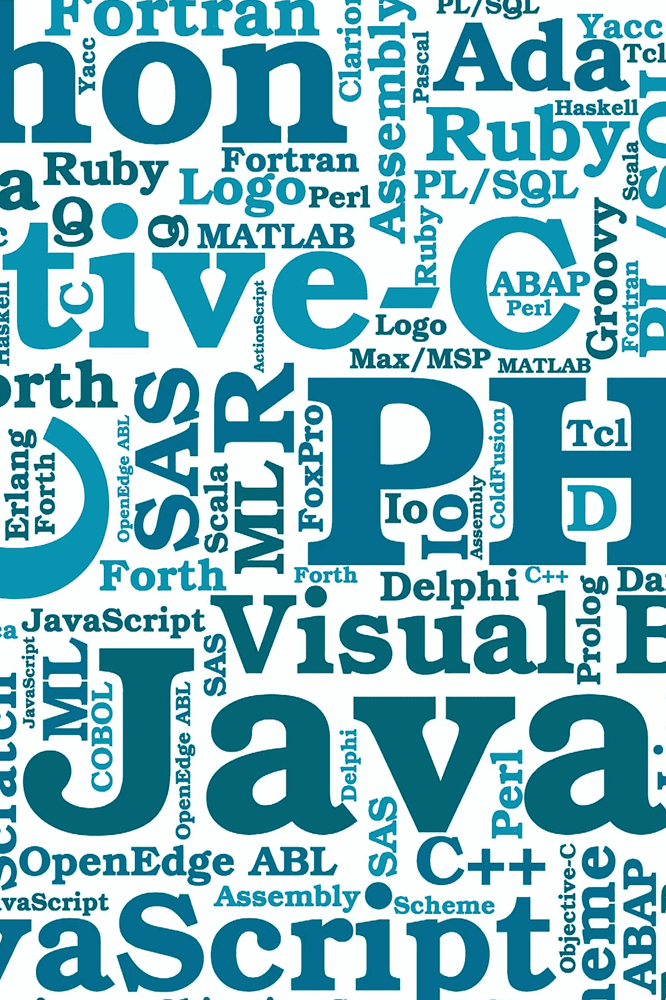

# Java 的力量（编程的力量）

本书代表了作者根据其个人经验、知识和研究提出的意见和观点。书中的信息仅供参考指南。作者和出版商在编写本书时已尽最大努力，但对于直接或间接因使用和应用本书而引起的任何责任概不负责。

## 你世界中的 Java：智能手机与 Pokemon Go

2016 年的夏天非常炎热。根据美国气候科学家的说法，2016 年是有史以来最热的一年，7 月和 8 月是该年最热的月份。通常，这种温度会让人们待在室内，享受空调的舒适，或者至少靠近风扇和冷饮。但那个夏天，许多人选择在户外度过更多时间。在 7 月和 8 月，无论你走到哪里，都能看到人们在行道和草坪上来回走，没有明显的规律，低头盯着智能手机屏幕。比温度更热的是：一个全新的简单应用，名为 Pokemon Go。7 月 6 日，视频游戏公司任天堂联合游戏开发公司 Niantic 推出了一款游戏，这款游戏重启了一个拥有二十年历史的品牌“宝可梦”，同时也改变了孩子和成人与手机以及彼此之间互动的方式。这不仅仅是一阵时尚——它是一种现象。这款游戏成为智能手机历史上增长最快的应用（或应用程序，指任何计算机程序，从大型游戏到像计算器这样的微型工具）。如今，它是历史上最受欢迎的智能手机游戏。在发布后仅六个月，该应用就为其开发者赚取了 10 亿美元。

玩 Pokemon Go 的潜在危险在发布后不久变得显而易见。这张告示牌是 2016 年夏天于纽约市张贴出的。

Pokemon Go 曾是一种现象，但它并不是一场革命。一些玩家离开了并转向了新游戏。虽然它在今天仍然具有一定人气，但不再占据新闻头条。事实上，Pokemon Go 引起的所有轰动——十亿美元的收入、数亿次的下载以及数十万次的事故——都是将跨多个计算机平台的许多不同技术整合在一起的结果。

为了实现这一点，游戏设计者采用了旧技术并以新的方式使用它们。一个重要的工具是 GPS。GPS，即“全球定位系统”，利用卫星来追踪地球上设备的移动。这并不是一项新技术——大多数手机已经设计成可以通过这种方式进行追踪。游戏还依赖手机的内置摄像头。这也是老技术了：在人们开始使用 Snapchat 和 Instagram 等应用十多年前，制造商就为翻盖手机引入了摄像头。（冷知识：“selfie”一词最早于 2002 年出现在澳大利亚的一个在线论坛，但花了整整十年才在各地流行。牛津英语词典在 2013 年将“selfie”评为年度单词，韦氏-韦斯特字典在次年将该词加入了词典。）但 Pokemon Go 的制作者将这些较旧的技术——GPS、内置摄像头以及其他技术——整合在了一起。正因如此，他们能够将 Pokemon 系列中可收集的角色放入“现实世界”中。为了将所有系统整合在一起，开发者必须使用一种可以与所有其他技术通信的“语言”：GPS、摄像头、触摸屏、手机操作系统以及游戏服务器。不仅是 `Java` 语言让这一切成为可能，而且这种迥然不同的计算系统可以并且应该无缝协作的信念，也源于一场思维革命，而 `Java` 在这场革命中起着关键性作用。

## 现代计算：网页与互联网的简史

这个故事可以追溯到 1991 年。那是充满平静转折点的一年。冷战结束，苏联分裂为十五个独立的国家。美国通过“沙漠风暴行动”开始在中东持续的军事干预。热门视频游戏角色索尼克登场，超级任天堂娱乐系统（即 `SNES`）也问世，两个德国游客发现了一具有三千年历史的木乃伊并将其命名为 Otzi。随后，在 8 月 6 日，英国科学家蒂姆·伯纳斯-李向公众发布了网页万维网，我们所知的生活发生了根本性的变化。

今天的电脑比几十年前的要纤薄得多，比如这台 20 世纪 90 年代的 IBM 笔记本电脑。

虽然我们有时交替使用这两个词，但互联网和网页是两个不同的东西。互联网指的是一个连接全球的计算机系统——自动执行算术或逻辑任务的机器。这个系统始于 20 世纪 60 年代美国政府的研究。科学家们和军事人员几个世纪以来一直在使用现代计算机的前身，但这些机器变得越来越复杂。加利福尼亚州的研究人员希望有一种方法可以访问威斯康星州（或其他任何地方）的数据。美国国防部制定了规则，允许不同的计算机使用无线电、电缆和光纤电缆进行通信，交换数据和命令。到 20 世纪 80 年代，军事和学术界已广泛使用这种有限的互联网。

1991 年 1 月，在瑞士欧洲核子研究中心（CERN）工作的英国科学家蒂姆·伯纳斯-李引入了网页万维网，这是一个利用互联网来识别、组织和链接文本文档，最终链接图像、音频和视频的信息空间。起初，这仅供研究机构的科学家可以使用，但到那年的 8 月，普通公众也可以了。今天，当你使用 `Safari`、`Internet Explorer`、`Firefox` 或 `Google Chrome` 等浏览器时，你正在使用一个为了让你访问同一个网页而发明的工具。旨在帮助科学家共享数据的空间现在可以在 Facebook 上发布照片、购买演唱会门票、浏览 Pinterest 和 Amazon、在 SoundCloud 上传音乐以及制作表情包（memes）。

## 新边疆的新语言

每一次新的进步和创新都推动程序员们为这些强大的新技术构想出越来越大胆的用途。然而，要让计算机“做”任何事情，你需要一种命令它们的方法——而要下命令，你需要一种语言来传递该命令。我们称之为计算机编程。

无论你只知道一种语言、两种还是几种语言，你可能都知道在不同情况下使用不同“语言”的感觉。你对老师用一种方式说话，在篮球场或棒球场上用一种方式，对父母用一种方式，对朋友或兄弟姐妹用另一种方式。计算机的工作方式也是一样：它们通过不同的语言“对话”来完成不同的任务。单台计算机运行在所谓的“机器语言”之上，它由二进制代码字符串组成。“二进制”仅指具有两个部分的东西；在计算机的情况下，二进制代码是由长串的 1 和 0 组成的。正如你想象的，人类要使用二进制代码给计算机提供任何复杂的指令将非常困难（而且耗时！）。此外，不同的计算机读取二进制代码的方式不同。为了让编程更容易，并帮助计算机相互通信，计算机先驱创建了汇编语言，它引入了字母和可识别的单词。这允许程序员通过名称引用数据块，并传递简短、易于表达的命令，而不是连接一长串的二进制数字。

程序员仍然在某些任务中使用汇编语言，但随着人类开始使用计算机绘制日益庞大的数据集，并执行更复杂的功能，研究人员意识到他们需要更复杂的语言。今天，有超过两千种计算机语言。你可能认出其中一些名字：一些比较流行的有 `C`、`C++`、`PHP` 和 `JavaScript`。`Java` 是这些语言中最流行、最强大且影响力最大的语言之一。

## 绿色团队

1991 年，在网页万维网向公众开放的同一年，名为 Sun Microsystems, Inc. 的公司的程序员开始着手最终成为 `Java` 的工作。太阳公司的高管们知道计算机文化即将发生变化，他们想领先一步。他们挑选了一些最优秀的程序员并给了他们一个巨大的挑战：预测计算机的下一个大趋势，并构建东西来利用这些趋势。这 13 名员工被称为“绿色团队”，他们在加利福尼亚州的梅尔洛公园设立办公室，远离太阳公司的主办公室。他们甚至中断了 18 个月与公司其他部分的常规通信，日夜以继地尝试预测未来。

他们的第一个想法是，计算机最终将在数字娱乐中发挥更大的作用。“绿队”（The Green Team）想象人们使用带有动画触摸屏的手持设备来控制电视。他们制造了一种名为 `Star Seven`（`*7`）的设备，恰好就能做到这一点。他们是对的，但比时代领先了二十年。今天，你可以通过手机为电视录制节目，视频游戏系统接管了家庭娱乐，而 `Hulu` 和 `Netflix` 等流媒体服务为消费者使用电视和时间的方式提供了更多选择。当你打开电视时，不再只是简单地切换频道——你可以搜索确切想要的内容，可以查看预告片和预览，甚至可以使用语音下命令。回到 20 世纪 90 年代初，电缆公司并不愿意向消费者交出控制权，而且视频点播还处于婴儿萌芽阶段。`*7` 并没有成功，但实现它的技术却成功了。

`*7` 设备使用了一种新的编程语言。绿队的首席开发者詹姆斯·高斯林（James Gosling）发明了这种语言并将其命名为 `Oak`，取自他办公室窗外的一棵树。但电缆公司对他们的产品并不感兴趣。团队成员需要为这项新技术以及驱动它的语言寻找另一个用途。为了找到答案，他们在加利福尼亚州太浩湖附近的 `Inn at Squaw Creek` 滑雪度假村会面。

到此时，开发者们已经在使用互联网来存储和共享文本、图形甚至视频。为了实现这一点，他们使用了一种名为 `HTML` 的语言，即超文本标记语言。这是你使用的大多数网页背后的语言。`HTML` 让程序员能够创建显示各种类型文本和图形的页面，并让他们放置指向其他网页的链接。`HTML` 可以在不同设备之间传输信息——因此无论你使用的是 `Mac`、`PC`、手机或其他设备，都可以显示和浏览用 `HTML` 编写的网页。然而，用户无法对仅使用 `HTML` 编写的网页进行太多交互操作。

## “网络就是计算机”

绿队将名称更名为 `FirstPerson`，并回到工作中，将重心从电视转向互联网。到 1993 年，一种名为 `Mosaic` 的网络浏览器的推出开始带来越来越多的普通用户进入网络。`Mosaic` 这个名字源于一种艺术形式，即使用许多微小的玻璃、大理石或其他彩色材料组成一幅更大的画。这捕捉了早期互联网的精神——也是它的挑战之一。在机器之间共享信息和命令是困难的，因为机器本身是不同的：每种类型的机器都“说”自己的语言，还没有一种语言能让不同类型的机器或操作系统进行方便且高效的通信。任何可以将所有这些不同的机器（以及用户）聚集在一起的东西，无论是网络浏览器还是编程语言，都会像马赛克一样，利用成千上万最终是数十亿个个体组成一个巨大的、色彩斑斓的整体：网络。

`Sun Microsystems` 的开发者开始以全新的方式思考互联网。他们意识到，互联网正越来越像他们希望电缆公司制造的那样——一个交互式多媒体网络。`Sun` 的创始人、董事长兼首席执行官斯科特·麦克尼利（Scott McNealy）为公司想了一个新口号：“网络就是计算机。”这听起来有点像谜语，但如果你仔细考虑，它很有道理。人们倾向于将第一代个人电脑（`PCs`）视为省力设备，就像你考虑你的烤面包机、搅拌机或割草机一样。但“连接”世界上所有的烤面包机并不会让它们变得更强大。也许你可以安排数百万台烤面包机同时烤面包。那很酷，但并不实用。`麦克尼利`和其他人开始意识到，计算机是不一样的。

## Sun Microsystems, Inc .

20 世纪 70 年代后期和 80 年代初，围绕计算机技术进步的讨论声日益高涨，联邦政府对计算研究的支持处于高点。这可能可能是因为美国当时正在与苏联进行一场军备和技术竞赛——而且正处于领先地位。军事应用驱动了当时计算机的许多进步，但一个由计算机爱好者组成的群体——包括主要大学的研究人员以及车库级爱好者，如苹果公司的创始人史蒂夫·沃兹尼克（Steve Wozniak）和史蒂夫·乔布斯（Steve Jobs）——开始想象计算机硬件和软件在商业行业和个人用途中更广阔的市场。这些远见发明人和投资者中的几位在 1982 年联合在一起成立 `Sun Microsystems, Inc .`，它迅速成为世界上最大的计算机公司之一。

出生于德国的安迪·贝特尔斯海（Andy Bechtolsheim）是斯坦福大学的一名研究生，当时正在为“斯坦福大学网络”开发计算机“工作站”。他遇到了早先的斯坦福商学院毕业生斯科特·麦克尼利和维诺德·科斯拉（Vinod Khosla），他们两人分别在 `Daisy Systems` 和 `Onyx Systems` 工作；这两家公司都在推动芯片技术的进步。这三个人很快成立了一家计算机硬件和软件公司，并以他们母校斯坦福大学（Stanford University）的缩写字母命名。伯克利毕业生比尔·乔（Bill Joy）加入了他们，他当时正在贝尔实验室（Bell Labs，后来的 `AT&T`，一个多世纪以来北美占据主导地位的电信公司）开发一种名为 `Unix` 的操作系统。

在成立的第一个十年里，`Sun` 利用比尔在开发 `Unix` 方面的经验，通过销售使用 `Unix` 操作系统的工作站（满足科学和技术需求的计算机）获了利。后来，他们扩展到了服务器（存储数据的硬件）。然而，`Sun` 最长远的成就可能是发明编程语言和开发平台 `Java`，它让 `Sun` 进入了智能手机和其他电子产品市场，并且其知名度超过了 `Sun` 本身。

`Java` 延续了下来，但 `Sun` 的成功无法持续。对 `Sun` 的早期投资是基于公司的质量和价格合理的产品，以及开发者卓越的创新记录。然而，这在当时是由“互联网泡沫”驱动的。在股市中，“泡沫”是指人们开始以远超其实价值的价格范围交易股票或商品时。“泡沫”不会逐渐萎缩或恢复稳定状态；它们会在投资者兴趣突然下降时破裂，建立在通胀价格之上的公司会随之崩溃。

互联网泡沫发生在 1995 年到 2001 年之间。人们对蓬勃发展的互联网如此痴迷且如此不理性，以至于公司只需在名称前面加上“e”或在末尾加上“. com”就能增加股票价值。泡沫在 2000 年 1 月破裂。公司合并或宣布破产并消失；互联网公司和技术制造商损失了超过 5 万亿美元的市值，这种自由落体在 2001 年 9 月 11 日恐怖袭击后进一步加速。幸存的一些公司，如 `Amazon`、`Google` 和 `eBay`，被留下来统治突然清空的竞争领域。

太阳公司恢复了过来，但并未完全恢复。在 20 世纪 90 年代后期，太阳公司的格言是“我们是.com 中的点”，这并非完全是虚张：许多严肃且成功的公司都使用太阳的产品进行计算。泡沫破灭的冲击波击中了太阳公司，使其跌出了顶尖位置。在 2007 年至 2009 年的大经济衰退期间，它又遭受了打击。很快，市场上出现了关于 IBM 收购太阳公司的传闻，尽管这笔交易从未实现。在计算机行业顶端屹立了 27 年后，太阳股份的股东以 56 亿美元的价格将公司卖给了甲骨文公司（Oracle）。甲骨文开始了大规模的裁员，顶尖工程师相继辞职，而创始人们——Bechtolsheim、McNealy、Khoslaall 和 Joy——随后作为投资者、发明家和后期初创公司的经理继续了成功的职业生涯。如今，他们仍然活跃在计算机行业中。

一台个人电脑固然强大，但一个由数百万乃至数十亿台电脑组成的网络将拥有字面上的无限潜力。太阳微系统并没有将个人电脑置于计算世界的核心，而是鼓励其员工和客户首先考虑网络。真正的力量不在于个人电脑，而在于数十亿台电脑可以相互连接这一事实。这对太阳公司的经营模式产生了巨大影响。公司开始将互联互通作为终极目标。McNealy 想象的“力量”部分源于信息的无限共享。如果一个人发明了某种东西并将其据为己有，那么这项技术将停留在目前的发展水平，直到发明者找到改进它的理由方法。但如果每一项新发明都能立即共享，所有的部分和过程都与世界上所有的创新者共享，那么你完全可以赌，其中某些人会立即找到改进该发明的方法。正因为 Scott McNealy 以及其他认同他信念的人的态度，如今的互联网很大程度上就是这样运作的。我们称之为开源模型。开源意味着某项内容的原始代码（或“源代码”）是免费供人们学习和修改的。当有人发明一种新工具或语言时，他们通常会通过网络向全世界分享这些信息，赋予他人改进他们所创造的机会。这加快了技术发展的速度；你甚至可以说它加快了人类历史的进程。

牢记“网络就是计算机”的格言，由 Gosling 领导的 FirstPerson 研究人员开始开发类似于 Mosaic 的浏览器，该浏览器将使用他们为现在已废弃的 `*7` 设备创建的语言。他们研究了快速发展的科技行业的不同领域，访问欧洲和亚洲的消费电子制造商。他们认为这些消费电子产品——如 CD 播放器、传真机、手机、相机、收音机甚至玩具直升机——正处于与互联网的“碰撞轨道”。换句话说，他们看到了我们现在已知的未来。他们知道自己正在创造某种强大的东西，也许强大到足以改变世界。但也知道，如此重要的东西需要一个比 Oak 更好的名字。

## 名字的含义

“Oak”行不通。在太阳开发者之间将其作为代号使用没问题，但另一家名为 Oak Technologies 的公司已经注册了该名称的商标，因此太阳员工在公开他们的新想法之前，必须想出别的名字。

Oak 产品经理 Kim Polese 将整个开发新技术的团队聚聚在一间房间里，前面有一块白板。那是 1995 年 1 月，太阳公司几乎已准备好推出他们的新技术。这将是一场老式的头脑风暴会议。Polese 想要一个能够捕捉该语言和平台“本质”的名字——某种“动态、革命、活泼、有趣”的东西。团队成员开始喊出名字，Polese 将它们写在白板上。那天现场的人记得建议的几个名字：Ruby、Silk、Neon、WRL（代表 WebRunner Language）、DNA、Lyric、Pepper。Gosling 回忆那场会议是“疯狂”，至少有十几个人喊出单词，然后对这些建议争论激烈。他们成功地将名单缩小到大约十几个决赛者，并将这些名单发给了律师。法律团队建议，只有 `Java`、`DNA` 和 `Silk` 是安全的选择。

一位程序员 Arthur Van Hoff 将另一位同事 Chris Warth 归为第一个喊出“Java”的人。Warth 不记得自己是否提过“Java”这个名字，但他确实承认在会议期间手里拿着的一杯 `Peet's Java`——那是当时太阳公司的首选咖啡。

Java 有时用作咖啡的同义词，但实际上它是组成印度尼西亚群岛岛屿之一的名字。17 世纪末，荷兰商人从他们的印度殖民地将原产于埃塞俄比亚的咖啡植物带到了印度尼西亚。在十年内，荷兰东印度公司就开始向欧洲运送第一批待售的“Java 豆”。今天，印度尼西亚是世界第四大咖啡生产国。

## James Gosling

留着齐肩的灰发、整齐的胡须，并戴着他在 20 世纪 70 年代戴过的同一副眼镜，今天的 Gosling 看起来就像旧金山地区的圣诞老人。Gosling 博士于 1955 年出生于加拿大阿尔伯塔省，是一位因在 Java 方面的工作而最闻名的计算机科学家。他在卡尔加里大学获得学士学位，在卡内基·梅隆大学获得硕士和博士学位，并于 1983 年完成了博士论文。一年内，他受雇于太阳微系统公司担任软件开发人员，那是一家年轻且快速增长的公司。1984 年至 2010 年间，Gosling 在太阳公司工作，在那里领导了创建 Java 的团队。虽然许多研究人员和程序员都参与了 Java 的发明，但大多数人将 Gosling 视为该语言和平台的“之父”。Gosling 在 90 年代初发明了 Java 的前身语言 Oak，他是帮助太阳开发者以及整个世界的注意力转向互联网的关键人物。


另一家科技公司甲骨文在 2009 年收购了太阳，正如合并和收购中常见的情况，公司文化发生了变化。根据 Gosling 的说法，他面临了降薪和降职，并失去了在太阳公司工作 26 年来所享有的许多自由。一年后，他离开了这家他帮助改变世界的公司。

在休息了一段时间后，Gosling 加入了谷歌，担任软件工程师。Gosling 并非首位加入谷歌的前太阳员工。许多在他之前就去那里了，而且谷歌利用 Java 创建了广受欢迎的安卓手机，安卓已经超过了 iPhone 成为市场上最受欢迎的移动设备。然而，甲骨文坚信谷歌使用大量的 Java 代码违反了法律。作为所有者，他们决心起诉谷歌并获得巨额赔偿。Gosling 在谷歌的短暂任期内处于尴尬的境地，对这起诉讼并没有多说。

仅在那里待六个月后，他就了 Liquid Robotics，目前在那里担任首席软件架构师。现在，他正在制造从海洋收集数据的智能机器人。他最近的一些项目包括提高汽车安全性以及致力于更安全的自动驾驶汽车。他一直是 `DIRTT` 的长期董事成员，这是一家具有环保意识的室内设计和建设公司，他利用帮助创建 `Java` 的某些原则分享了他对改革美国医疗保健系统的兴趣。他仍然经常向 `Java` 开发者和爱好者的观众演讲，记者也经常请他对该语言未来的用途进行推测。

没有任何编程语言对智能手机的影响比 `Java` 更大了——对于我们这种随时随走的文化来说，这是一个很好的名字。

在急于将作品推向世界的工程师们的压力下，负责营销的 Kim Polese 在对朋友、同事和家人测试了该名字后，做出了最终决定。没有人能确定，现在被称为“Java”的语言和平台如果换一个名字是否仍会如此成功，但显而易见，“Java”这个名字并没有坏处。这个名字似乎包含了创造者们希望它具备的一切：“Java”听起来依然充满活力、希望、异域风情、快速、爵士且时尚。Gosling、Warth 以及其他人可能并没有考虑到那个岛，没有考虑到荷兰和东南亚的殖民历史，甚至没有考虑到全球咖啡贸易的经济学，但他们无意中将他们即将突破的、革命性的品牌命名为另一种产品——在几个世纪前就改变了世界的饮用饮料 `Java`（咖啡）。这个名字很贴切。今天，`Java` 仍然是最流行的编程语言，开发者们每天都在为它构思新的用途。

## 初登：当世界首次想象 Java 能做什么时

`Java` 将向公众展示这一消息让 James Gosling 感到非常出乎意料。他的同事 John Gage 在 1995 年初的一天来到 Gosling 的办公室，请求借用一些电缆和台式机。他随口说，他将去参加一个由好莱坞和硅谷大人物参加的会议，演示 `Java` 团队一直在秘密开发的 `WebRunner` 浏览器。由于担心他们进行中的工作可能会在这些有影响力的观众面前崩溃，Gosling 作为故障排除者随了过去。

演示进行得很顺利，但 Gosling 注意到观众并没有太关注。人们对于“一种他们并不懂的新语言驱动了一个看起来与已有的网络浏览器非常相似的浏览器”这一事实并不非常兴奋。看到这一幕，Gosling 做了一系列你也做过无数次的动作。他拖动光标，越过屏幕，到了一个小小的分子 3D 图形。请记住，光是图形本身并不令人兴奋——开发者已经在网页中放置了图像和视频。但 Gosling 在屏幕上做了一件观众中没有人见过的动作。他点击鼠标并向下拖动。分子移动了。

`Java` 驱动着你的智能手机，但也有助于运行巨大的超级计算机。这种特性被称为扩展性（scaling）。

这看起来似乎不多，但那个微小的动作是革命性的。这是历史上第一次，用户可以与网页进行交互。Gosling 和 Gage 展示了他们语言的其他用途，包括一个 `applet`——或者说执行小任务的程序——它可以对不同长度的行进行排序。同样，这现在看起来并不令人印象深刻，但它证明了 `Java` 很快就能实现的功能。

老“绿色小组”在一个月后向朋友发布了 `Java`，随后向整个互联网发布，并看着下载量攀升到数百，然后超过一万，接着超过了一百万。他们每天轮流处理数千封电子邮件。更大的消息来自 `Netscape` 公司的高管，他们宣布将在流行的浏览器 `Navigator` 中开始使用 `Java`。那时清楚，`Java` 将帮助塑造网络的未来。



相反：每个编程语言都有不同的特性。为项目选择语言取决于你的目标。

## 工作原理

到目前为止我们主要将 `Java` 称为一种语言，但为了理解它是如何工作的——以及它为什么是革命性的——我们必须将 `Java` 既视为语言也视为平台。在本章中，你将学习 `Java` 的基础知识：它看起来是什么样，它做什么，以及是什么使其与独特。我们将解释不会说话的东西如何成为语言，并讨论有助于计算机工业的特性。

## 什么是语言？

你不能用 `Java` 来提问——但你可以用它下命令。你不能用 `Java` 写诗——但它驱动了像 `YouTube` 和 `SoundCloud` 等网站的部分，创意人士在那里分享艺术。尽管它看起来不像你现在阅读的英语，但 `Java` 是一种语言。

你的第一门语言是你在不知情的情况下学会的。它是环境的一部分。你可能不记得学习第一语言的过程，因为那发生得太早了。我们大多数人在没有刻意努力的情况下就精通了母语，后来才学习规则。你的父母对你发出声音，你极其强大的婴儿大脑首先记住了几个，并命令你的小肺、喉咙、舌头和嘴唇移动发出同样的声音。与此同时，你开始注意到模式。如果你学习一种新语言，无论是在学校还是搬到新社区，这个过程可能是困难并需要很长时间，但你仍然在学习一套演变了千年的规则。在英语、西班牙语和南非语等口语语言中，新词每年似乎凭空出现，人们经常违反语法规则，而地球上不同地区说同一种语言的人会用不同的词指代同一事物。

口语语言在不断变化，因为真实的、活生的人通过某种混乱的规则在控制它们。这意味着任何用户都有改变它的潜力。这种情况在英语中时有发生。是某个活着的人第一个使用了 `Google`（作为动词）、`selfie`（自拍）、`bromance`（哥们好）、`hater`（仇恨者）和 `noob`（菜鸟）。今天，如果你使用这些词，大多数英语母者都能明白你的意思——但当我们打破过多的规则或创造过多的词汇时，结果可能会滑稽，也可能导致交流陷入停滞。所谓的“死语言”，如拉丁语或皮克特语，并不是这样运作的。因为普通人（而非学术界）不再使用这些语言，只要有人记得它们，它们的词汇量永远不会增长，语法规则也保持不变。

## 阿达·洛芙莱斯：程序员

阿达·洛芙莱斯出生于 1815 年，由她的母亲一位名叫安娜贝贝拉·洛芙莱斯的英国贵族女性抚养，她只活了三十六岁。然而，在短短的生命中，她克服了女性所面临的有限机会，赢得了全世界朋友和仰慕者的爱与尊重，并最终作为第一位计算机程序员而闻名。阿达是最著名诗人之一拜伦的女儿。拜伦在阿达出生两个月后就离开了安娜贝贝拉，去参加参加希腊独立战争并寻求冒险。他在 1824 年去世于那里，当时阿达还是个孩子。拜伦是一个伟大的旅行者，一个习惯有怪癖的人。有些人认为他浪漫且鼓舞人心，另一些人则认为他丑闻且冒犯。安娜贝贝拉对拜伦感到很愤怒，试图影响女儿让她远离诗歌——以及她认为的疯狂的事——转而鼓励这个女孩学习数学和科学。尽管阿达从未见过她的父亲，但她对父亲的工作产生了终身兴趣。这种教育的结果产生了一种非寻常（且强大）的智力：阿达的大脑既适合数学思维，也适合艺术思维。

**阿达·洛芙莱斯帮助传播了早期的计算机研究**

当阿达还是青少年时，她遇到了查尔斯·巴贝奇，那是一位发明家和数学家。随着工业革命在 19 世纪初蓬勃发展，科学家和商界需要在不产生任何错误的情况下产生（并复制）大量的计算。巴贝奇设想了一台可以自动进行这些计算的机器。他将其称为 `差分机`。理论跑在了技术前面。巴贝奇设想的机器零件对于当时的金属工人来说太难以以合理的成本制造。尽管如此，与聪明且好奇的阿达的对话促使他提出了进一步的理论和发明。巴贝奇被阿达的大脑深深启发，以至于称她为“数字魔术师”。而阿达本人，她是普及和完善这些数学领域以及最终演变为计算机编程的领域中这些发展的关键人物。她将外国数学家的著作翻译成英语，并就数学的最新思想发表了详尽且文笔优美的笔记。基于巴贝奇的工作，她描述了计算机如何通过自动化执行某些计算——即真正的程序，就像我们今天用 `Java` 和其他语言所做的那样。在这些笔记和其他著作中，她的数学天赋和诗意力量结合在了一起。她用任何人都能理解的生动词汇描述了复杂的数学和计算。也许是因为她对该领域的方法正如她所称的“诗意科学”，她能够想象出计算机的潜力，超越了当时任何人的想象。

计算机编程语言介于这两者之间。编程语言，如 `Java`、`C` 和 `HTML`，是“活的的”，因为有真实的人在使用它们，甚至最终可能会改变它们。然而，与口语语言不同，计算机编程语言有“所有者”：`Java` 的规则只有在甲骨文公司（Oracle）的程序员们决定改变它们时才会改变。如果你不喜欢这些规则，你可以希望这种情况发生——或者像许多程序员所做的那样，创造你自己的、新语言。

## 理解 Java 语法

在最基础的层面上，所有语言的工作方式都是相同的。每种语言都有信息的“数据包”。对于大多数语言，我们把最小的数据包称为“字母”，将较大的包称为“单词”。例如，字母 `D` 包含了信息：如果你认识这个字母，你就知道它作为单词的一部分读出来时听起来是什么声音。你现在可能可以列出一百以字母 `D` 开头的单词。当你把这些包组合在一起时，它们的意义比比一个声音要大得多。例如，如果你把字母 `D-O-G` 放在一起，你就组成了单词 dog（狗），这个包携带了大量信息。仅仅在印刷品看到 `dog` 这个词可能就会在你的脑海中浮现出一个图像。你可能会想到腊犬或寻回犬、斗牛或贵宾犬。想到自己的宠物或朋友或邻居的宠物时，你会感到爱或喜爱。你可能会想起恐惧，想起你看到愤怒的狗的时候；或者在想起一只去世的狗时感到悲伤。这一切都是可能的，因为你了解了一种语法，或者说关于信息包如何组合在一起的规则。

程序员说对象具有状态（states）或特征，以及行为（behaviors），即对象可以做或发生在对象身上的事情。为了理解这一点，思考现实世界中的对象可能会有所帮助。你可以说鱼是一个对象。每条鱼都有“状态”（特征）：它有名字、形状和颜色。鱼还有行为：它可以用鱼鳍游泳；它可以用鳃从水里吸收氧气；它会吃东西也会被其他东西吃掉。宇宙中存在着无限的对象，它们拥有无限的状态和行为。对于 Java 来说也是如此的。

正就像我们喜欢对现实世界中的事物进行分类——根据物种、科和原生环境对鱼进行分类——我们也将 Java 对象放入一个 `class`（类）中，或者说它是创建单个对象的通用蓝图。`Classes`（类）规定了类中的对象可以拥有哪些状态和行为。当你写完一个新程序时，你会将其保存为一个新的 `class`。

最后，程序员可以通过 `method`（方法）来表达对象的行为，方法是代码的一部分，说明了对象上将发生什么，或者对象之间将如何相互作用。类中的主要方法被称为 `main`。

## 代码结构与语法

正如你可能猜到的那样，对象让复杂的编程任务变得简单得多。对象让程序员在将对象组合在一起之前，一次只关注代码的某一部分。

正如上一节所述，`classes`（类）就像是创建对象的蓝图，这意味着在创建对象之前，你需要一个 `class`。假设你的狗咬破了这本书的标题页。因为你想在修复书的同时测试你的编程技能，所以你决定写一个程序来为书打印一个新的标题页。（不用担心该程序如何连接到你的打印机。请查看本书的末尾获取更多资源，它们将教你如何操作。）你会从编写类似下面的代码开始：

```
public class TitlePagePrinterApp {
```


“Public”（公共）意味着任何人都可以看到你的程序。“Class”（类）信号你的程序名称将紧：我们将这个程序命名为“TitlePagePrinterApp”。最后，大括号 `{` 标志着类的开始。基本上，所有执行操作的代码都位于大括号之后。所以，一旦你添加了一个 `method`（让你的程序执行某些操作），它看起来可能像这样：

```
public class TitlePagePrinterApp {
    public static void main (String[] args) {
    }
}
```

不用担心是否知道这里每一个单词或字符的作用。在你的 `TitlePagePrinterApp` 起始行下方，你添加了 `main` 方法，它包含了一条关于你的程序将要做什么的语句。该语句位于第三行：

`System.out.print ("The Power of Java");`

在这种情况下，你告诉你的程序打印出“The Power of Java”这几个字符。这被称为一个 `string`（字符串）。在 Java 中，`string` 仅仅是一个信息包或数据。这些数据就是你想打印的内容：这本书的标题。每条语句都以分号（`;`）结束。第一个大括号关闭 `main` 方法，第二个大括号关闭类，`TitlePagePrinterApp`。

到目前，你已经学习了许多关于 Java 的知识，而且你还想对你的图书管理员或者下一个拿起此书的人开个小玩笑。所以，你让你的代码变得稍微高级一点：

```
public class TitlePagePrinterApp {
    public static void main (String[] args) {
        System.out.println ("The Power of Java");
        System.out.println ("by Stella Lopez");
    }
}
```

现在，你的程序打印了一个带有两行的标题页：“The Power of Java”在你的名字上方（你的名字可能不是 Stella Lopez——你可以让你的程序在这里写任何内容）。你在每条语句中都在 `print` 上添加了 `ln`，以便将语句放在不同的行上。如果你愿意，你可以通过这种方法复制整本书，将整个章节输入到不同的语句中。

## 面向对象：超越“Main”的编码

然而，你刚刚写的代码并没有利用 Java 处理对象的强大能力。要真正理解 Java 的力量，你必须编写带有多个 `classes`（类）的代码，创建多个可以相互作用的多个对象。

如果你玩过俄罗斯方块，思考这个游戏可能会帮助你理解 Java 中的对象。在这个游戏中，聚集在一起的方块形成了不同的形状：一个较大的正方形，一个是一条直线，一个像 L 型，一个像大写 T 型，一个像加号，还有一个是锯字形。这些方块从屏幕顶部掉落到屏幕底部，玩家可以在它们掉落时旋转它们，试图通过堆叠碎片来形成整齐的水平线。横跨整个屏幕的水平线将会消失，如果有间隙，行中的碎片就会留在原地。碎片不断掉落和堆叠，如果碎片堆到达屏幕顶部，玩家就输了。

Java 是制作俄罗斯方块这类游戏的极佳工具。事实上，已经很多人使用 Java 制作了俄罗斯方块的模仿品。只要稍努力，你也可以。你可能会从创建一个名为“blocks”（块）的 `class` 开始。记住，`class` 就像创建对象的蓝图。从你的 `class` 中，你可以创建玩游戏所需的所有对象：正方形碎片、直线碎片、T 型碎片、L 型碎片、加号碎片、锯字形碎片。像 Java 中所有的对象一样，每个对象都有状态和行为。状态可以是碎片的大小和颜色。行为可以是它们掉落的速度以及玩家在“空气”中旋转它们的方式。你还需要编写关于碎片如何相互作用的 `method`（特定行为）。在这种情况下，你会写一个让碎片消失的 `method`。这不会自动发生，也不会在不停止的情况下循环。碎片在特定条件下消失：如果玩家对齐了一行方块。（你还可以写一个分支 `method` 来弹出一个巨大的“你输了”标志，其触发条件是碎片到达顶部。）这个程序会比你为这本书打印标题页的程序长得多。然而，在 Java 中编写它比其他语言要容易得多，尤其是非面向对象的语言。

Java 通过创建易复制的对象来工作，这使其非常适合俄罗斯方块这样的游戏。你的俄罗斯方块程序展示了关于 Java 对象你需要了解的（目前而言）最后的知识。你的程序实际上使用了 Java 中可能的所有类型方法：

- **语句 (Statements)**：你的程序执行操作。语句只发生一次，并且自动发生。例如，一条语句可以执行简单的在玩家打开程序时开始游戏。如果你想更花哨一点，可以添加一条语句来显示标题界面。这段代码看起来会和你的 `TitlePagePrinterApp` 代码相似。
- **循环 (Loops)**：循环是在程序停止运行之前反复自身的方法。在你的俄罗斯方块游戏中，你会使用一个“循环”方法来处理掉落的块。你希望这些块不断掉落，以挑战玩家。
- **分支 (Branching)**：这种方法是被“触发”的。它的发生是因为：如果发生了其他事情，或者在特定的条件下。这就是你用来让碎片消失的方法类型。这不会自动发生，也不会在不停止的情况下循环。

## 超越语言：编译器、平台与机器

记住，Java 除了“面向对象”的方法之外的另一个大承诺是可移植性。这意味着你可以在任何平台上编写它，并且它可以在任何其他平台上运行。想象一下如果一种口语是这样工作的。想象你正站在整个联合国面前准备发表说。你用英语写了演讲稿，但话一离开你的嘴唇，成百上千的其他人就能用他们自己的语言——西班牙语、印地语、阿拉伯语、阿非利语、普通话等——听懂你的演讲，无需实时翻译员的帮助。想象一下用英语说话，而不用担心世界上其他人是否听懂你，无论他们选择说哪种语言。这将是一种巨大的力量（而且很多翻译员需要寻找新工作了）。

Java 之所以能这样工作是因为一种被称为“编译器”的东西。Java 编译器是一个程序，它获取 Java 源代码并转换为另一种编程语言。在这种情况下，我们说的是汇编语言，它是特定于不同机器的。因此，Windows 计算机、苹果计算机、Linux 计算机和安卓手机各各自自己的汇编语言；数字手表、收音机/闹钟和电视也是如此。Java 编译器可以将你程序的纯文本（例如我们之前制作的“TitlePagePrinterApp”）“编译”成用字节码编写的 `.class` 文件。关于字节码，你真正需要知道的是你无法“读取”它，而且它不是任何机器或平台的原生语言。

Java 虚拟机是 Java “一次编写，随处运行”承诺背后的技术。

相反，这些字节码会进入 Java 虚拟机（JVM），它像一台虚拟计算机。这台 JVM 可以使用 Java 应用程序编程接口（API）在任何平台或机器上运行。因为 API 是一允许平台运行程序的指令集，在 Java API 的帮助下，JVM 可以在任何平台上运行你的代码。正如你可以想象的，这种“可移植的”语言的可能性是无限的。

## 波浪滑行者 (Wave Glider)

o o o

Liquid Robotics 公司由以飞机闻名的波音公司拥有，他们制造并销售一种名为 Wave Glider 的设备，这是一种从海洋中收集数据的机器人。在没有飞行员的情况下，Wave Glider 可以在水面上漂浮并运行一年多，动力来自太阳、波浪以及——你猜对了——Java。

“Java 之父”詹姆斯·高斯林（James Gosling）于 2011 年加入 Liquid Robotics 担任首席软件工程师。他们的 Wave Glider 软件使用了 Java 编程语言。他最终来到这里并不令人意外：高斯林一直对“酷炫的玩具”感兴趣。在 20 世纪 90 年代后期和 21 世纪初在 Sun 公司期间，高斯林因对机器人和其他使用 Java 执行令人兴奋的设备进行有趣的会议演讲而闻名。这是他在 Sun 公司（后来的 Oracle 甲骨文）工作的一小部分，但他对“玩具”的兴趣可能导致了他现在编写海洋机器人的工作。

Wave Glider 有两个部分。有一个漂浮在水面上的平台，通过太阳能板收集能量。悬挂在下方的“水艇”使用移动的机翼获取波浪能量并推动自己前进。

从海洋中收集数据一直以来都很困难。那里有太多的海洋和数据。研究非常昂贵且充满危险。然而，Wave Glider 可以收集各种信息并立即上传到云存储，因此研究人员无需亲身检查机器人就能获取数据。它可以帮助环保主义者收集天气和波浪模式的数据，甚至关于动物迁徙的声学信息。军队和其他政府部门可以使用它巡逻边境、探测威胁并打击海盗和走私。它可以帮助能源公司探索自然资源并降低人类员工的风险。该机器人可以自己“游泳”一年或更久，自动避开船只等障碍（可能使用了其 Java 代码中的一系列“分支”方法）。一些 Wave Glider 曾经历过飓风和鲨鱼攻击。最棒的是，Wave Glider 不需要加燃料，也不需要人力，而且它不会以任何方式污染大气。它是如此高效，以至于它从太阳获取的大部分能量都流向了它功能强大的计算机。这种技术在地球之外也应该有应用：如果我们某天发现了另一个被液体覆盖的行星，科学家们可能会使用 Wave Glider 的某个版本来探索它。

根据高斯林的说法，Java 最强大的应用之一是人工智能（AI）。这意味着任何可以独立做出某些决策并能够“教”或改进自身的计算机都是如此。Wave Glider 就是其中一个例子。在编写软件时，高斯林为滑行器加入了一条指令：基本上是“不要害怕船只”。现在，船长们担心撞上滑行器，直到他们看到“智能”机器人自己改变方向并避开碰撞。高斯林说，这在 Java 中非常容易做到，而在其他语言中会困难得多。

## 优势与劣势

显然，Java 是一个非常强大的工具。你可以用它让网站变得吸引人、有趣且具有互动性。由于编译器和 Java 虚拟机，你可以轻松地在不同设备之间迁移 Java。

贝尔实验室园区，Dennis 在这里开始了他的职业

但请记住，Java 并不是唯一的编程语言，它也不是“最好的”。不存在“最好的”编程语言，就像不存在“最好的”人类口语一样。每种语言都有其独特的美和魅力。每种语言都允许不同类型的表达或应用。事实上，计算机编程语言在这方面最像口语。当人们使用不同的语言时往往能取得最大的效果。在本章中，你将学习更多关于 Java 如何与其他语言比较的内容：它的优势和劣势是什么，以及你如何与其他语言配合使用完成单一种语言无法完成的任务。

### 从橡树长出 Java，再从 C 语言长出橡树

回想起詹姆斯·高斯林在他团队挑选名字之前，曾编写过早期版本的 Java 语言。他把这种语言称为 Oak（橡树）。不过，Oak 也并非空空。它是从 C 语言的种子长出来的。

或者说，它是从高斯林等人在使用更老老的 C 和 C++ 编程语言时感到的挫败中成长出来的。C 自 20 世纪 70 年代初以来一直存在。C++ 出于 1983 年。你可能记得计算机用机器语言（0 和 1 的二进制代码）与自己“对话”。因为用机器语言编写任何让计算机做的事情都不容易，开发者在此基础上构建了其他语言，并称之为汇编语言。尽管汇编语言仍然有些笨拙，一位在贝尔实验室（一家拥有百年历史的通信垄断，后变为 AT&T）工作的工程师丹尼斯·里奇（Dennis Ritchie）设计了 C 这种更易使用的语言，它跳过了汇编语言直接映射到机器语言。

没有丹尼斯·里奇的 C 语言，Java 将是不可能的。

C 语言是一个巨大的飞跃，它至今仍然是开发者使用的最受欢迎的语言之一。但它也有许多缺点，这让那些在计算机能力前沿探索的开发者感到沮丧。C 语言的缺陷包括：

- **函数导向**：C 并不是围绕开发者可以隔离并从类“蓝图”中轻松生成的对象来构建，而是围绕函数（或单个命令）构建的，这些命令缺乏蓝图，且更难进行独立处理。
- **可移植性差**：尽管 Ritchie 设计 C 语言可以在不同平台上运行，但这比想象起来容易，实现起来困难。熟练的程序员必须为每个新平台承担重新编译（有时甚至是重写）代码的耗时工作。
- **内存使用效率低下**：C 没有内置的方法来让程序自动管理内存。这意味着复杂的程序可能会运行缓慢。

简而言之，C 是一项进步，但随着程序员们发现自己有更复杂的项目和更大的梦想，C 语言似乎变得太慢、效率太低、编写太耗时，而且适应性不足。这并不意味着 C 毫无用处——工程师仍然倾向于使用 C 用于嵌入式系统，如红绿灯和恒温器内部的计算机——但计算机的新用途需要新的语言。

工程师 Bjarne Stoustrup 在 1983 年通过引入 C++ 解决了“对象”问题。通过让这种语言面向对象，C++ 提供了一个更精简、更高效且更易使用的 C 语言版本。

## 面向对象的方法

正如你已经学到的，面向对象的编程最初是作为一种更容易处理更复杂项目的方法。它通过两种方式实现这一点：首先，它将数据和对数据的操作（程序对数据“执行”的操作）“封装”成对象。然后，它根据它们的内容和功能将这些对象组织成类。最后，它向公共用户隐藏了这些大部分细节。

想象你正在盖一栋房子。你已经选好了地，并在四个角插上了桩子。但你盖房子所需的所有材料——砖块、木板、钉子、瓦片、管道、电线、水泥块和窗玻璃——就堆在建筑工地的旁边。在这些基础物品中，还混杂着卷卷壁纸、碎木头、家具填充物、厨房电器、衣服、相框、灯泡、饼干罐和画作。

如果你尝试直接上手开始盖房子，你很快就会感到沮丧。计算机程序员们的感觉当时是这样。早期的程序员做的是更简单的事情——就像造一把椅子比盖房子简单得多。如果你只是在造椅子，你可以看一眼你的材料堆，忽略饼干罐和所有你不需要的东西，而不需要费太大精力就能造好椅子。但如果你在盖房子，你可能会产生一个绝妙的主意，先组织你的材料。你可以把所有的砖块放在一堆，把所有的瓦片放在另一堆。你可以把制作房屋框架所需的所有材料放在一起，而把所有水路材料放在另一个地方。这就是导致面向对象编程的相同冲动：组织。

## C++ 和 Java：面向对象的比较

第一种面向对象的语言是 Simula，发布于 1967 年。Stoustrup 在 1983 年使用面向对象的方法通过 C++ 改进了 C 语言，但即使是 C++ 也有其缺点。Linux 操作系统的开发者 Linus Torvalds 称 C++ 为是一门“极其糟糕”的语言（可能有点不公平）。今天，大多数 Windows 和 Adobe 程序（如 Word 和 Photoshop）是用 C++ 编写的，Xbox 和 PlayStation 等系统的大多数视频游戏也是如此。然而，虽然 C++ 可能很容易学习，但它的复杂性使其难以精通。它是一门“冗长”的或密集的语言。C++ 代码通常比 Java 的同类代码长，甚至错误信息也可能很长且令人困惑。它的编译速度慢，而且内存使用并不高效。

James Gosling 和他的团队设计 Java 是为了解决许多此类问题。Java 代码更短、更精简；编译速度快；而且它引入了被称为垃圾回收的机制，这是一种内存管理工具，可以从程序不再使用的对象或函数中回收内存。很难否认，Java 是使用最广泛且最成功的面向对象语言之一。

## 语言障碍与互操作性

想象你，一个英语母语者，会到了一个只会说俄语的人。尽管英语和俄语共享一些基本结构，但如果一个人说英语，另一个人用俄语回答，你们可能无法不多久。编程语言也是一样。Java、C++、Python 和其他语言无法直接互相“对话”。至少，它们在没有某种桥梁的情况下无法进行交谈。然而，当今计算的需求意味着语言必须一直协同工作。这被称为互操作性：编程语言相互作用并处理同一份数据的能力。

某些语言（如 Groovy、Clojure 和 Scala）是为了在 Java 虚拟机上运行而构建的，可以与 Java 库中的任何内容（对象或其他数据结构的集合）交互。全新的语言有时是由于尝试将现有语言映射到彼此而产生的——例如 Jython，它就是一种将 Python 语言移植到 Java 虚拟机的尝试。你访问的任何网页都可能涉及更多语言，通常是 HTML（Tim Berners-Lee 为编写网页创建的第一种语言）和 JavaScript（一种用于让网页具有交互性的语言，仅靠 HTML 是无法实现的）。更复杂的网页可能会使用插件或小程序（applets），让网站实现更多“功能”。弹出式广告、嵌入视频、评论框和搜索功能都是插件。插件允许开发者使用 Java 或 PHP 等语言编写应用程序，并在使用 HTML 和 JavaScript 编写的网页上运行。

Tim Berners-Lee 发明了互联网，以便普通公民共享信息和想法

## 写一次，到处运行

在第 2 章中，你学习了更多关于 Java 编译器和可移植性承诺的内容。Java 开发者本应能够在在一个平台上编写一次程序，然后在任何地方运行。开发者可以为程序编写源代码，然后将其编译成 Java 字节码。任何配备 Java 虚拟机的操作系统都可以用平台（无论是 Windows 还是 Apple 、iPad 还是 Google Pixel 智能手机）可以“理解”的语言打开并运行该文件。

它构建在一种追溯到 20 世纪 70 年代的早期编程语言 `Pascal`之上。加州大学圣地亚分校的研究人员发现，他们和学生需要一种通用的编程语言，用于校园内不同的微型计算机，因此他们发明了 `Pascal` 语言以及运行其上的 `P-system`。尽管 IBM 公司支持 `Pascal`，但 `P-system` 价格昂贵，评审人员对结果并不感满意。然而，它是使用虚拟机的早期尝试之一。詹姆斯·戈斯林（James Gosling）在卡内基梅隆大学读研究生期间接触过 `Pascal`，这段经历影响了他多年后开发 `Java` 的方向。

“编写一次，处运行”证明是一个很棒的口号。太阳公司的营销团队很快开始使用缩写 WORA。当然，问题在于要运行 `Java` 程序，操作系统需要配备 `Java Virtual Machine`。尽管 `Java` 的普及如此迅速，以至于安装 `JVM` 或 `Java` 解释器已成为大多数系统的行业标准。

## 压力下的优雅：使用 Java 进行扩展

`Java` 可以运行从可编程吐司器到超级计算机，再到“智能卡”（如非接触式信用卡和借记卡）的任何设备。特别是随着手机的兴，开发者使用 `Java` 创建了一夜火的应用。无论开发者使用何种语言编写这些应用，实用或创新的应用往往会因下载和使用量的激增而导致崩溃，导致服务器崩溃、暴露漏洞并减慢性能。这给可能犹豫是否下载该应用或切换到竞争对手的用户留下了不良印象。尽管性能取决于程序员的水平，但 `Java` 是一门对于设计能够优雅扩展（或“增长”）的应用程序和软件而言、特别有用的语言。

可扩展性是衡量计算机、服务器或软件程序在许多用户同时执行多项任务的巨大压力下性能的一种方式——因此，可扩展性对于那个可编程吐司器并不重要，但对于应用程序和视频游戏非常重要。对于 `Java` 而言，如果一个程序在使用量不断增加的情况下能够继续快速运行且不崩溃，那么它就是高度可扩展的。阈值越高（即程序用户过多并开始变慢、冻结或崩溃的点），可扩展性就越大。

## NASA 的 World Wind：互操作性研究

o o o

NASA 的 World Wind 是一个虚拟地球，类似于 Google 地图，但它是可定制的，并加载了来自 NASA 卫星以及地球和太空其他设备的海量数据。

通过 World Wind，用户可以实时探索地球——甚至是火星、金星、木星和几颗卫星，看着阳光退去，城市在夜晚变亮。山脉和其他地形特征以 3D 形式显示，通过插件，你甚至可以叠加链接到维基百科文章的标记，指向中国长城或马里亚纳海沟等内容。

这些插件使用了多种编程语言，如 `C#`、`J#` 和 `VB`。起初，World Wind 仅适用于微软操作系统，但 NASA 科学家们希望通过网络将其带给每个人，这意味着它必须通过浏览器的 `HTML` 运行并在任何操作系统上工作。将这样一个强大的程序带给绝对任何用户——即使是智能手机和平板电脑用户——对于互操作性来说都是巨大的挑战，因此 NASA 程序员使用了 `Java` 来实现这一目标。

2017 年发布的 World Wind `Java` 使整个 World Wind 程序变成一个 `Java applet`，能够通过 `HTML` 运行在任何操作系统的网页上，同时仍然包含了其他语言编写的所有插件，并且仍然调用从使用无数其他编程语言构建的软件收集的数百个 NASA 项目的数据。

扩展有两种方式。程序可以“扩展”（scale up），通过轻松向单台计算机添加更多内存；程序也可以“向外扩展”（scale out），通过轻松地与其他计算机和网络连接。由于 `Java` 内置的垃圾回收机制，它可以有效地管理内存。这意味着 `Java` 程序可以在不需要增加更多内存的情况下显著向上扩展，而使用低效率语言编写的程序可能需要更多内存，且需求得早。同时，分支方法允许程序根据需要访问更多内存。由于 `Java` 的可移植性，它也可以跨平台、轻松地进行向外扩展。由于 `Java` 卓越的可扩展性，Twitter 的开发者一直在将他们的代码从 `Ruby` 语言迁移到 `Java`。

## 跨平台范式的可能性

`Java` 的成功很大不仅是因为它的技术特性和能力，还是因为创造和维持这些特性的心态和文化。你可能称之为“Java 范式”。范式是一种看待世界的方式。它包含了对运作方式的基本假设，包括从重力和运动定律到对人类行为方式的预期的一切。范式还包含不具体的内容，如态度。存在个人范式，以及引导业务或身份群体行为的范式。有时，新技术或世界事件如此重大，以至于改变了这些基本假设和态度。我们称之为范式转移。

历史学家对于这些范式转移是否真的是响应单一事件而发生，还是这些事件本身就是更广泛、更丰富的渐变变化织锦的一部分存在争议，在这种情况下，个人的选择没有引导这些选择的文化和经济力量重要。例如，你可以说互联网导致了全球范式转移：它改变了人类相互互动的方式。你也可以对手机说同样的话。或者，你可以说两者都是一个更长、更渐进的范式转移过程中的发展，描述了人类生活与机器的融合。

`Java` 的发明也引发了范式转移——不仅是在计算机程序员的世界，而且对所有人类都是如此。`Java` 文化有它自己的范式。可以说，它是建立在詹姆斯·戈斯林看待世界的方式之上。或者，如果你更倾向于观察历史趋势，你可以说在 във创建 `Java` 之前，互联网的可能性就已经塑造了戈斯林的个人范式。无论如何，从很小开始，戈斯林就开始关注早期互联网障碍之间的翻译和通信。即使在 20 世纪 60 年代和 70 年代的青少年时期，他也参与过一些试图弥合平台、系统和语言之间差距的计算机项目。

这种“跨平台范式”在实际应用中的一个例子是虚拟网络计算，即 `VNC` 的发明。在 20 世纪 80 年代后期，大多数计算都是桌面端完成的。然而，计算的可能性（尤其是图形化的可能性）引发了科学家和商务人士对使用计算机在不同地点进行视觉演示的需求。今天，我们已经有了如 `OneDrive`、`Dropbox` 和 `Google Drive` 等云存储服务，但在那时，计算机用户的限制大得多，数据共享并不是一件快速或方便的事。演示者在携带计算机文件旅行时的选择非常有限。他们可以将文件传输到磁盘盘，并希望它能在另一台计算机上运行，但如果他们需要在旅行途中继续进行某个项目，他们无法将整个计算环境（你在桌面硬盘上能找到的所有内容）存储在磁盘盘上，而且笔记本电脑又笨重、沉、昂贵且易碎。

剑桥的研究人员想出了解决方案。这是 `Java` 第一批优秀的新应用之一，非常符合 `Java` 的范式。`Virtual Network Computing` 允许一台计算机上的用户访问另一台计算机的显示器——遍布任何地方。这意味着旅行者可以使用酒店电脑（这些在 20 世纪 80 年后期和 90 年代更为常见），并使用任何支持 `Java` 的网络浏览器登录 `VNC`。酒店电脑的屏幕将显示她家里或办公室电脑的屏幕。她可以在那里继续处理演示文稿。第二天，她可以使用另一台电脑访问同一台家里或办公室电脑，并向观众进行演示。`VNC` 并不限于演示幻灯片或论文等简单任务：通过 `VNC`，你可以远程执行几乎任何你坐在自己电脑前会执行的任务。这使得它对于远程技术支持和管理非常有用。如果你的计算机出了问题，并且你设置了 `VNC`，经验更丰富的用户可以从他自己的电脑修复你的问题。因为剑桥团队用 `Java` 编写了 `VNC`，所以它可以跨平台运行：`Mac` 用户可以远程访问 `Windows` 桌面，以此此类推。而且 `VNC` 并不限于基于显示器的平台。从任何支持 `VNC` 的计算机上，你还可以访问消费电子产品，如可编程微波炉、灯光、娱乐系统和家庭安防设备。

这种源于 `Java` 对访问和可移植性的承诺的发展，推动了软件、应用以及其他促进通信与协作技术的进一步进步。

## 一次编写，随处调试：跨平台的承诺与问题

`Java` 对于真正的、无缝的跨平台开发的愿景无疑帮助了 20 世纪 90 年代互联网和计算的普及，但它并不总是能实现 `WORA` 的承诺。尽管 `Java` 编译器确实允许开发者编写一个可以在任何带有 `JVM` 的平台上运行的程序，但不同平台运行程序的方式仍然存在细微差异。即使是编译器和 `JVM` 也无法考虑到所有的这些变化。程序在 `Mac` 与 `PC` 上运行方式的细微差异通常并不要紧。然而，有时这些差异会导致问题，程序员称之为 `bugs`（错误）。在计算机编程中，`bug` 是指导致程序失败或以背离开发者意图的其他方式运行的错误。`Bugs` 可能是无害的，可能是令人恼恼的，也可能是灾难性的——例如导致整个系统崩溃或破坏数据。

## Java 与 Objective-C：为 Android 和 iOS 开发应用

o o o

1998 年，电信公司 `Motorola`（摩托罗）签署了一项许可协议，在其手机设备中使用 `Java`。这是 `Java` 主宰智能手机行业的开端。当 `Android`（占据约 80% 智能手机市场的首选操作系统）的开发者用 `Java` 编写其操作系统时，`Java` 的统治地位完全形成了。

智能手机制造商 `Apple` 和 `Android` 陷入了一场昂贵的法律战。其核心是 `Java` 编程语言。

目前 `Android` 设备最大的竞争对手是 `iPhone`。`Apple` 的开发者创建了 `iPhone OS`，所有的 `iPhone` 应用都使用 `Objective-C`，这是一种在旧 `C` 语言之上并与之兼容，但包含了面向对象语言 `Smalltalk` 元素的语言。

`Objective-C` 和 `Java` 非常不同，但大多数 `Android` 或 `iPhone` 用户不知道也不在意。无论他们喜欢哪种品牌，所有智能手机用户都想要相同的工具和应用——除少数例外外，他们都能得到。`Apple` 开发者必须复制 `Android` 的成就——反之亦然——而第三方开发者必须用两种语言构建他们的应用。

如果你选取几乎任何在 `Android` 和 `Apple` 设备上都存在的应用——比如收集趋势新闻的 `Scanvine`，或使用内置麦克风识别用户附近音乐的 `Shazam`——用户端的差异是可以忽略不计的。在大多数情况下，两者的效果都同样好。差异在于后端。

在 2015 年的一项研究中，一家名为 `Infinum` 的应用开发公司研究了自己的应用，发现为 `Android`（使用 `Java`）编写代码需要多出 38% 的代码行，耗时多出 28% 完成，因此比为 `iPhone`（使用 `Objective-C`）编写代码要贵得多。虽然时间和开销是一个缺点，但更长的代码实际上可以带来更好的性能，尽管调试和维护需要更长时间。

由于 `Java` 程序在不同平台上的行为方式存在这些细微差异，`Java` 开发者发现自己只写了一次程序……然后在不同的平台上对它们进行了多次调试。这导致了人们对 `Java` 承诺的一种调侃说法：在实践中，许多 `Java` 程序员觉得他们必须“一次编写，随处调试”。

## Java 语言和 JVM 的其他局限性

直到 2013 年，一位《财富》杂志的作家还估计，“几乎每一个能想象到的电子设备都使用了某种程度的 `Java` 编程。”这是一好事。巨大的用户社区保持了一种计算机编程语言的健康并不断改进。但也意味着结构性缺陷可能会造成广泛的损害。

`Java` 的远程计算潜力对于旅行商务人士来说是一个福音。然而，一直存在 `JVM` 安全担忧。

在同一年，美国国土安全部发现了当时所有版本的 `Java` 存在一个严重的安全漏洞。黑客似乎可以使用 `Java` 应用远程操控计算机——执行激活笔记本电脑摄像头等操作。当时控制 `Java` 的 `Oracle` 迅速发布了修复安全问题的更新，但该问题引发的动荡对于任何语言（特别是 `Java`）的局限性是一个重要的提醒。

如上所述，尽管 `Java` 被如此广泛使用，并且目前主导着智能手机开发社区，但软件领域的许多巨头——如 `Microsoft`、`Apple` 和 `Adobe`——主要使用 `C++` 来构建他们强大的程序套件，而像 `Amazon` 这样的电子商务企业则用它进行大规模业务运营。整个视频游戏行业也依赖 `C++`，因为它拥有巨大的库，允许完全控制，并直接编译为汇编语言（不像 `Java` 使用 `JVM` 作为中间件）。同时，嵌入式系统——在大型机械或电子系统内部为特定目的服务的计算机系统，如混合动力汽车或交通信号灯——通常使用 `C`，因为它优雅的语法使其代码行相对较短，而且不会占用过多内存。

相反：Java 让我们通过文本和电子邮件分享我们伟大的点子……但某些伟大的点子用 `Java` 本身表达可能更好。

# 入门

在 Pokemon Go 的案例中，数百万玩家和数万亿数字宝可梦在几个月内为任天堂带来了 10 亿美元。所有的战斗以及玩家使用的手机大部分运行在 `Java` 上。现在你知道它是如何运作的，以及 `Java` 是如何让 Pokemon Go 这样的现象成为可能的。

但在游戏发布的夏天，还发生了一场更大的“战斗”，这与收集类卡通怪兽的关系并不大。它确实涉及那款热门游戏，但也（可能）还涉及好莱坞电影的动画、你最喜爱的商店的收银电脑，甚至还有 NASA 火星探测器的车载计算机。涉及的金额超过了 90 亿美元，还关乎智能手机行业的未来以及整个计算机编程的文化。这个问题对你以及对任何考虑从事计算机职业的人来说都可能非常重要。整个编程世界都在关注并好奇：`Java` 语言真的将一直对任何人免费开放吗？

## Java 争战与智能手机大战

要理解“智能手机大战”以及它们与通用计算机编程的关系，我们必须更仔细地观察 Oracle 对 `Sun Microsystems, Inc.` 的收购。

Oracle 首席执行官 Larry Ellison 在 2009 年监督了对 `Sun Microsystems` 以及 `Java` 权利的收购。

凭借强劲的硬件销售和 `Java` 的巨大成功，`Sun` 越发致力于帮助塑造其初期的开源技术原则。1999 年，`Sun` 购买了与 `Microsoft’s Office Suite`（`Word`、`Excel`、`PowerPoint` 等）竞争的软件权利，并将其免费发布。不久后，互联网泡沫破灭。由于 `Sun` 是其中的主要参与者，泡沫破灭对他们的打击沉重，但未到将其击垮的程度。公司恢复了健康，但它永远无法回到以前的主导地位了；`Microsoft`、`Apple` 和 `Google` 成了新的主要参与者。

但 `Sun` 坚持了下来，这很大程度上归功于 `Java` 持久的人气及其在移动手机技术中日益增长的角色。2005 年，`Sun` 向公众发布了 1600 多项专利，2006 年，该公司宣布 `Java` 开源。这使得 `Java` 的控制权保留在 `Sun 手中`，但任何人都可以查看源代码、使用并对其调整。该公司继续享受着强劲的销售和增长。

一切在 2007 年 12 月大衰退的开始而发生了变化\。随着全球经济增长放缓，股价再次下跌。这一次，泡沫不再局限于科技行业。消费者开始减少支出，许多像 `Sun` 这样的公司遭受了痛苦。商业杂志和网站上流传着 `Sun` 合并和收购的传言。随后在 2009 年 4 月，另一家名为 `Oracle` 的技术公司介入，以约 74 亿美元收购了 `Sun Microsystems, Inc.`。

意料的是，以创始人兼时任 CEO Larry Ellison 为领导的 `Oracle` 高管对如何开展业务有一些不同的想法。根据 `James Gosling` 的说法，`Oracle` 高管在早期就非常兴奋，期待在一场针对全球最知名品牌之一——`Google` 的诉讼中，获得比他们购买 `Sun` 所花费更多的利润。

2008 年 9 月，`Google` 发布了 `Android`，这是一个主要用于智能手机和平板电脑等触摸设备的操作系统。由 Andy Rubin 领导的小型开发团队在 2003 年创立了 `Android, Inc.`，`Google` 在两年后以 5000 万美元购买了该公司，当时系统尚未准备好面向公众，并将创始人作为员工带入公司以完成工作。虽然 `Android` 的核心是用 `C` 编写的，但其用户界面（用户与系统交互的方式）全部是 `Java`。这正是导致 `Sun` 高管让 `Java` 开源的类型应用：来自小型初创公司开发者的强大创新。但 `Google` 并不是一家小初创公司，它很快就能从很大程度上从 `Sun` 那里拿来（且未付费）的代码中获得巨额利润。

## 韩国的 iPhone

当 `Android` 在市场上还很新时，两家更大的智能手机制造商正准备进行全球范围内的法律战。2010 年，韩国公司 `Samsung` 发布了 `Galaxy S`，这款手机看起来和功能上非常像 `Apple iPhone`，后者当时是许多用户的首选智能手机。在早期谈判失败后，`Apple` 起诉 `Samsung` 侵犯版权。经过两年的多起诉讼、反诉以及数百万美元的法律费用后，两个美国陪审团认定 `Samsung` 的高管和开发者故意盗用了 `iPhone` 的部分技术和设计，并要求 `Samsung` 向 `Apple` 支付 4 亿美元损害赔偿。其他国家的法院裁定两家公司都违反了对方的专利，而另一些法院则判定双方都没有违反任何专利。

你对智能手机的偏好可能基于手机的外观和响应。无论什么手机，这些特性都取决于 `Java`。

战斗在 2012 年并没有停止。2016 年 12 月，美国最高法院一致推翻了早前的判决（以及 4 亿欧元的赔偿），并将案件发回下级法院进行进一步的法律纠纷。在此期间，智能手机字面意义上接管了全球文化。随着该行业涉及的资金增加，`Samsung-Apple` 之战吸引了几乎所有其他主要的智能手机制造商，包括 `Microsoft`、`LG`、`Nokia` 和 `Sony`，他们都陷入了复杂的专利版权诉讼中。根据英国《卫报》一位评论员的说法，风险增加了，因为有太多的人拥有智能手机。在手机技术的早期，大多数销售来自以前没有这种设备的人。现在，大多数销售来自已经拥有智能手机的人。这意味着任何制造商都必须从竞争对手那里抢客户。与此同时，手机技术的发展速度放缓了。

## 冷咖啡约：Oracle 与 Google 为 Java 争战

当然，现在处于智能手机大战中心的公司之一是 `Google`。`Google` 将（基于 Java 的）`Android OS` 变成了成功——也是目标——部分是因为它是开源的，不像 Apple 铁腕统治的 iPhone OS，还因为制造商（包括三星！）能够更廉价地生产智能手机。

根据 `James Gosling` 的说法，Sun 高管曾考虑就 Google 在 Android 系统中使用 Java 的问题提起诉讼。Scott McNealy 和其他人认为 Google 违反了专利，但公司并不想起诉。Gosling 认为，Google 对 Java 代码的使用对 Java 用户和程序员社区产生了非常积极的影响。起诉 Google 会花费精力和金钱，而且可能对公司的形象不利，因为 Google 在全球范围内受欢迎。

Oracle 在 2009 年 4 月购买了 Sun；到 2010 年 8 月，该公司加入了了“智能手机大战”，起诉 Google 侵犯专利和版权，索要了高达 90 亿美元的损失收入。Google 声称他们对 Java 的采用属于“合理使用”——基本上，这允许个人和公司在某些情况下无需许可即可使用受版权保护。Google 声称他们可以使用 Java，因为 Java 一直是开源的——代码从一开始就对公众开放。2016 年 5 月底，一个陪审团判定 Google 胜诉，但 Oracle 的律师已经表示他们将对该判决提出上诉。

# 当今编程市场中的 Java

根据 `TIOBE Index`（该指数二十年来追踪了开发者对不同编程语言的兴趣和使用情况），Gosling 是正确的。至少从 2001 年以来，`Java` 一直遥遥领先。在巅峰时期，`Java` 曾占所有编程语言的 26% 以上。从那以后，开发者发明了许多新语言。现在 `Java` 占所有编程语言的 16.4% 以上；`C` 随其后，占比 7.7%，`C++` 为 5.1%。

`TIOBE Index` 显示了用户对不同计算机语言随时间的兴趣。

在甲骨文收购后，`Java` 的人气开始下降，甚至跌至 `C` 之下。这部分是因为出现了新的竞争语言，但根据 `TIOBE` 经理 Paul Jansen 的说法，也是因为开发者对甲骨文管理下 `Java` 的看法。这家公司似乎花费了更多时间在对诉 `Google` 的诉讼等事情上，而在维护、推广和推动 `Java` 语言方面花费的时间较少。根据《连线》杂志的一项分析，原始的 `Java` 开发者（如 Gosling）离开了并开始推广其他语言，而甲骨文的开发者并没有做什么来保持 `Java` 的活力，也没有回应日常程序员的顾虑。

你可以通过免费的集成开发环境（IDE）如 `Greenfoot` 来学习如何使用 `Java`。

`Java` 的下跌是短暂的，`C` 的重回巅峰也是如此。`C` 并不适合移动 Web 和应用开发，因此大幅下降；而作为这类工作优秀语言的 `Java` 已回归顶部。`Android` 的持续成功、移动 Web 和应用技术的不断进步（包括 `Pokemon Go` 等现象）以及庞大独立用户社区的广泛支持，都是 `Java` 将长期存在下去的指标之一。

虽然它不是严肃程序员需要掌握唯一语言，但它是最有影响力的语言之一，而且并不难。如果你想成为一名计算机程序员，从 `Java` 开始是明智的。

## 所以，你想成为 Java 程序员吗？

如果你想开始编写 `Java` 代码，你需要下载 `Java Development Kit (JDK)`，它满足了编写 `Java` 的所有基本需求。它将为你提供 `JVM` 以及加载、运行、归档和调试代码的工具——以及更多。你可以从甲骨文官方网站免费获取 `JDK`。

然后，你需要一个进行实验的地方。这被称为集成开发环境（IDE）。`IDE` 就像是编写代码的“沙盒”——如果沙盒配备了起重机、推土机和其他重型建筑设备的话。`IDE` 将包含一个源码编辑器、一个自动化代码构建的工具和一个调试器。

你可以从 `Greenfoot` 开始。`Greenfoot` 是一个免费的 IDE，可以在 Mac、Windows、Linux 或 Solaris 计算机上运行。你甚至可以将 `Greenfoot` 下载到 USB 驱动器中，无论你走到哪里都能在不同的电脑上运行它。`Greenfoot` 是年轻程序员学习 `Java` 的绝佳方式，因为它是可视化的：你可以看到自己构建的内容，而且学习过程围绕着制作有趣的游戏展开。由于有了可视化环境，你可以迅速看到自己努力的成果。你甚至可以将你的作品发布到网上。那里有实用的教程，其他使用 `Greenfoot` 的人也会在 IDE 的在线社区中不断分享他们的成功和挣扎。

一旦你在 `Greenfoot` 中学会了足够的知识，就可以转向更高级的 IDE。`Greenfoot` 是构建在 IDE `BlueJ` 之上的，`BlueJ` 也是一个非常适合初者的简单环境，尽管它的可视化程度较低。这是一个强大的 IDE，并赢得了 Gosling 的认可。最后，你可以转向专业级的 IDE。其中许多仍然是免费的：最广为人知的有 `Eclipse` 和 `NetBeans`。其他如 `IntelliJ` 这样的工具需要付费，但它提供了对专业、高工作量开发者至重要的额外功能。当你准备好尝试这些专业级应用时，你已经精通 `Java` 了，并且会清楚地知道你想从 `IDE` 中获得什么。

## 为编程职业进行自我教育

随着你对 `Java` 变得越来越精通，你可能会参加一些教程或其他免费的在线学习计划，并从现实生活中和网络上遇到的程序员那里获取技巧。在高中期间，你可能会上你的第一门编程课程或加入一个俱乐部。

最终，你必须对大学做出的决定。你现在应该知道，不需要计算机科学学位也可以在计算机编程领域找到工作。当 `StackOverflow`（互联网最大的程序员网络社区）在 2015 年对社区成员进行年度调查并询问有多少人拥有计算机科学学位时，数字接近一半。极少有人拥有博士学位，极少有人超过四十岁。（这是统计学中的一个重要教训：调查是一个不完美的快照，因为它没有考虑到不使用该网站的程序员——而这些人大多年龄较大，且更有可能有大学学位。）

在 `StackOverflow` 程序员中，约 50% 的回答者没有计算机科学学位，他们发现了进入行业的非常规且可能困难的路径。如果你想成为程序员但不想获得计算机科学学位，你可能会被某些公司拒之门外。例如，`Google` 目前不面试没有工程学位的候选人。无论经验如何，没有学位晋升到高级职位也会很困难。

然而，你可能会在初创公司（试图颠覆行业的早期公司）获得职位——科技领域总有很多初创公司，且需要程序员。你也可以通过侧门进入行业。如果你有计算机科学经验但获得的是经济学学位（例如），你可以在银行、投资公司或研究机构工作，在那里积累编程经验，一旦有了足够的经验，就可以跳槽到真正的科技工作。而且，科技领域越来越多的人正在质疑学位的价值。在线支付公司 `PayPal` 的创始人 Peter Thiel 有一个基金，每年向 20 个人提供 10 万美元，前提是他们退出或推迟大学来专注于自己的技术项目。

所以，没有计算机科学学位也可以获得编程工作，只要你能够自学、与其他开发者交流并建立良好关系、在教室外获得编程经验，并自信地应对不寻之路。当你准备好对大学做出决定时，行业可能已经发生了更大的变化。但目前，请记住，对于大多数编程梦想者来说，四年的计算机科学学位是获得工作的最佳途径。

## 超越 Java：多语言并行

极少数程序员只写一种语言。即使是那些头衔为“高级 Java 开发者”的人，可能经常与其他语言一起工作。如果你对 `Java` 感兴趣，早晚会学习额外的语言，原因有两个：第一，为自己学习 `Java` 提供帮助；第二，让自己在不断变化的领域中更具适应性。

如果你想通过学习另一种语言来熟悉 `Java`，你应该坚持学习其他面向对象的语言。在这个阶段，任何其他语言只会让你感到困惑。如果你有丰富的 `C++` 经验，你可以轻松学会 `Java`，并可能在一周内就能编写出真正的程序。

另一个类似于 TIOBE、PyPL 的指数衡量了人们对 Google 编程语言教程的兴趣。`Java` 在此处也处于领先地位，占据了搜索流量的 24%。这意味着初级程序员（比如你）搜索 `Java` 的次数超过了任何其他语言。加入他们的行列可能不是个坏主意；但如果你担心在职场市场中脱颖而出，你应该考虑学习一种目前较不流行、但你预计可以在其中大放异彩的语言。

`JavaScript` 和 `PHP` 也都很容易学习，如果你想为 Web 编写代码，它们非常有价值。`JavaScript` 可用于设计网站上的交互式元素（即用户看到的部分），而 `PHP` 则用于用户看不见的服务器端函数。

最后，`Python` 是一种简单但实用的语言；它的代码比 `Java` 或 `C++` 用更少的行数表达概念和指令，而且它可以构建任何东西。`Python` 在研究和科学计算领域受欢迎，但开发者也用它构建了 Pinterest 和 Instagram 的部分功能。

学习其中任何一种语言都会扩展你构建计算机程序的潜力。它们会让你成为一个更有多才、更有价值的职位候选人，而且你可以将其中许多语言与 `Java` 配合使用。

你还应该考虑其他“年轻”语言。尝试想一下未来几年可能会被广泛使用的语言，并考虑现在就开始学习它们。这样的两种语言是 Google 的 `Go` 和 Apple 的 `Swift`，它们在 TIOBE 指数上都在上升，并在 Stack Overflow 对开发者对新语言兴趣的调查中表现良好。

`Go` 的吉祥物是 `Go` gopher（地鼠）。

Google 的 `Go` 是新的，但它根深蒂固，而且它的发明者并非初出之辈。Ken Thompson 和 Rob Pike 凭借在贝尔实验室的工作已经是传奇；他们共同创建了 `Unix` 操作系统，并各自创建了多种语言。他们加入 Google，并与 Google 开发者 Robert Greisemer 一起创建了 `Go`，于 2007 年发布。这三个人设计 `Go` 部分是为了解决对 `C++` 的不满。尽管在发布十年后它仍然处于实验性阶段，但由于其“简洁”的可读性，它成为了一种日益受欢迎的语言。你可能在不知情的情况下遇到过 `Go`：它驱动了 Google、Dropbox、Netflix、SoundCloud 和 Uber 的部分功能。

与开源且跨平台的 `Go` 不同，语言 `Swift` 作为 Apple 的发明，只在 Apple 关联的操作系统上运行。它于 2014 年发布，并在 2017 年进入了 TIOBE 指数的前十。它构建在 `Objective-C` 之上，可以在一个程序中与 `Objective-C`、`C` 和 `C++` 并运行。Apple 希望它能取代 `Objective-C`（如果你现在考虑学习那种语言，这应该让你犹豫一下）。首席开发者 Chris Lattner 设计它是为了处理或避免其他语言中的常见问题或 Bug。

尽管如此，在学习 `Java` 之后学习 `Swift` 可能会困难，因为像 `Java` 一样，它代表了范式的转变。这种转变完全偏离了面向对象编程；`Swift` 将其替换为“面向协议的编程”。协议在面向对象编程中已经存在：它们规定了不相关的对象如何通信。面向协议的编程不再将可重用的对象及其类放在编程范式的中心，而是将协议（即“已完成的事”）放在中心。在不太偏离我们本书的主题（记得是 `Java` 吗？）的情况下，`Swift` 可能会在未来几年改变编程世界。但可以说，面向协议的编程不会完全取代面向对象编程。我们在 `Swift` 中拥有的是一种满足新需求的新思维，但这并不意味着它比更旧的语言更好地满足“旧”需求。市场研究显示，古老的 `C` 是新职位招聘中最常提到的语言，但几个不同领域对 `Java` 程序员保持着稳定的需求。`Java` 将继续满足其他需求，就像 `C`、`C++` 甚至更老的语言也继续有其重要用途一样。

## Java 开发者的职业前景

如果你正在寻找一份 `Java` 开发者的职业，你可能会从硅谷开始（加利福尼亚州旧金山西南的一个地区，科技巨头和初创公司聚集于此）。尽管许多 Sun 开发者在收购后离开了 `Oracle`，但 `Oracle` 短时间内不会放弃 `Java`：它可能仍然是公司最大的资产，他们对该语言承诺的证明之一就是继续对 `Google` 提起诉讼。仅在 2013 年，`Oracle` 就发布了超过 2,300 个职位。其中许多是针对基于 `Java` 的软件和应用开发人员。其他主要科技公司如 `Microsoft`、`Google`、`Dell`、`Cisco`、`Yahoo` 和 `Sony` 也招聘 `Java` 开发者。如果你为这些主要的计算机公司之一工作，你可以开发数百万计算机用户使用的主要软件应用程序。如果你为 `Google` 工作，你可以为 `Android` 贡献；如果你为 `Oracle` 工作，你可以为……贡献。在世界上年轻的行业之一，一切皆有可能。

### 光、摄、魔法

视觉特效和计算机图形公司 Industrial Light & Magic 多年来一直是好莱坞的先驱。他们的故事始于很久，取决于你问谁，是在加利福尼亚州洛杉矶的 Van Nuys 社区，还是在遥远的星系。

George Lucas 的《星球大战》于 1977 年问，利用了美国对太空的痴迷，这种痴迷始于 1961 年 5 月 25 日，当时总统约翰·肯尼迪宣布国家将在登月竞赛中击败苏联。斯坦利·库布里克的《2001：太空漫游》在 1968 年发布时成为定义性的太空电影，这在肯尼迪承诺实现的一年多之前。Lucas 可能没有通过《2001》超越库布里克的艺术成就，但《星球大战》实现了库布里克无法实现的事情：它将古希腊、罗马和中世纪文化的伟大悲剧和浪漫引入了太空。

Lucas 的野心从一开始就很很高。受库布里克视觉震撼作品的启发，Lucas 想拍出一部以前从未见过的电影——无论是在屏幕内还是屏幕外。第一部《星球大战》电影（后更名为《星球大战》第四部：新希望）没有使用多少我们现在称为计算机生成图像（CGI）的内容。当时，“特效”主要涉及模型、投影、剪辑或叠加物理胶片，以及使用过滤器和其他扭曲摄像机镜头的方法。（进入第一部电影的少数计算机生成的视觉效果是 IL&M 外部程序员的作品。）然而，`IL&M` 与一组新雇佣的人员（称为 Lucasfilm，即 Lucas 制作公司的计算机部门）在续集《第五部：帝国反击》中合作。在这部电影以及其他几部同期作品之后，好莱坞与计算机行业不可避免的结合变得显而易见。计算机部门分拆成为 Pixar，并在 1995 年创作了第一部全 CGI 电影《玩具总动员》。`IL&M` 也转向了拥抱 CGI，并迅速成为该领域的领导者。

《侏罗纪公园》、《盗宝奇险记》、《终结者》、《外星人入侵》以及《加勒比海盗》只是三百多部依赖 IL&M 进行特效的电影中的几部，该公司因此获得了十七项奥斯卡奖并获得二十三次提名。虽然 IL&M 的程序员使用许多语言和工具，但 `Java` 是他们成功的重要组成部分。今天，他们招聘的许多初级职位都将掌握 `Java` 或另一种主流语言（如 `C` 或 `C++`）作为任职要求。

展望未来四十年的创新，IL&M 还建立了一个用于沉浸式和交互式娱乐体验的实验室。如果你想成为好莱坞 CGI 或下一代娱乐行业的一员，你必须掌握远超编写良好的 `Java` 代码的技能——但 `Java` 可能是你明智的起点。

`Java` 程序员最常见的去处实际上位于计算机行业之外，即所谓的“大企业”。今天，绝大多数富盛 500 强公司——美国最大的公司，也是全球最大的公司之一——使用 `Java` 来满足其内部编程需求。所有这些公司都为 `Java` 开发者提供高薪工作。在这里，`Java` 开发者的角色是创建企业级应用程序。这些软件工具与你在手机应用中看到的或安装在家里电脑上的程序不同。企业级应用是巨大且复杂的系统，对于大型公司的运行至关重要。它们可以处理账单和工资、安全、内容管理、公司内部安全通信、人力资源、数据存储和访问，以及从制造到客户服务的各项自动化。`Java` 是这类重体力活的理想选择，因为它自带了深层且丰富的库，这些库包含了大多数标准需求的解决方案。与初创公司不同，富盛 500 强公司通常改变结构模式的速度缓慢，因此它们在短期内不会切换到 `Swift`；这些 `Java` 工作将一直存在很长时间。

如果你热爱科学，可以将此与你对 `Java` 的热情相结合，为像 NASA（美国国家航空航天局）这样的机构工作。我们已经讨论过 World Wind，但 NASA 几乎在其所有的软件中使用了 `Java` 语言，包括卫星的载载软件、最新的火星探测器车软件，以及科学家在地球上使用的分析程序。（不过，如果你打算走这条路，可能应该也学习 `Python` 和 `C`。）

目前，`Java` 最蓬勃的领域是移动应用开发，随着 `Android` 设备的持续成功，这种需求在短期内不会停止。你可以为大型应用开发公司工作——比如制作《精灵宝梦 Go》的 Niantic；制作热门游戏《糖果大破译》的 King；或者开发热门通话和即时消息应用 Viber 的开发者 Rakuten（乐天）。但在应用开发领域，你不必非要瞄准巨头公司。许多流行且成功的应用源自初创公司，甚至是一些想在智能手机市场测试自己编程技能的小朋友。如果你用你的 `Java` 技能设计并发布了一个成功的 `Android` 应用，这可能会带给你进入上述许多大公司的机会。

跨平台通信曾意味着计算机到计算机。今天，光你家里就有几十台设备连接在起。

## Java 的未来

`Java` 的未来看起来一片光明。`Java` 成了 Google `Android` 的基础，它是世界上最流行的操作系统之一。这意味着将会有数十万 `Java` 应用开发者，以满足 20 亿智能手机用户对新工具、设计和功能的渴望。同样，每年流经全球最大公司的万亿美元资金也部分取决于对 `Java` 及其企业级应用的强大支持。`Java` 仍然易于学习，初接触这种语言的人可以在由数百万名渴望分享想法和经验的 `Java` 程序员组成的在线用户社区中获得支持，参加专门针对 `Java` 的年度会议，并使用他人已经编写的大量有用 `Java` 代码“库”。

正如 Gosling 指出的，`Java` 的长期成功建立在它共享访问和跨平台通信的基础原则之上。今天，`Java` 的持续流行归功于一个跨越平台、公司、行业、国家和其他（人类）语言的庞大用户群。

正如你之前学到的，不同的编程语言有其优缺点，大多数语言最终执行不同的任务。`C` 语言驱动着让你停车的红绿灯。当你坐在后座时，`Java` 驱动着 Android 手机上的应用，而你旁边的朋友或兄弟正在使用 `Objective-C` 在 iPhone 上发短信。你在到达之前决定在家附近的披萨店订餐，于是你打开了 Google 搜索（它使用了 `C++` 和 `Python`），并找到了披萨店的网站（它使用了 `HTML` 和 `CSS`）。你点击了一个用 `JavaScript` 构建的通话按钮，电话开始响起来了。

学习如何在任何编程语言中说“你好”——你可以从 `Java` 开始。

很快，新语言将织入你的日常生活，随着越来越多的设备和技术——如汽车、手表、机器人吸尘器——连接到以及彼此。尽管编程语言变得如此专业，但有一个功能是每一个编程语言都做过且做了很多次的。它被称为“Hello, world!”。如果你对任何程序员说这两个词，她就会明白你的意思。为了演示新语言长什么样，或者向新学习者教授基础语法，程序员通常会写一个“Hello, world!”应用。如果你打算学习 `Java` 编程，“Hello, world!”应用将是你构建的第一个之一，在你学习更令人印象、更复杂的事情之前。

所以，`Java` 程序员：现在你已经了解了这种对地球最重要的语言之一，轮到你来说“Hello, world!”了。用 `Java` 来说，用一种新的方式来说，一种只有你才能说出的方式。通过这两个词，你可能会改变你正在问候的世界。

**API** 允许不同软件程序交互的指令集；“API”代表“应用程序编程接口” .

**applet** 执行简单任务的程序 .

**application** 执行任何任务程序，通常比 applet 大、更复杂 .

**assembly language** 汇编语言比机器语言高一级。它不是使用 1 和 0，汇编语言使用类似“add”和“pay”等助记代码给出命令 .

**behavior** 在面向对象的计算机编程 (OOP) 中，对象上发生的事情或对象可以做的事情 .

**binary code** 一种使用 1 和 0 的组合向计算机表示任何数字、字母或其他符号的编码语言 .

**bytecode** 在 Java 中，一种允许 Java 虚拟机将任何程序员编写的 Java 代码翻译为可在任何操作系统运行的指令 .

**class** Java 中创建对象的蓝图或模板。类识别了状态和行为 .

**compiler** 一种将另一个程序的源代码转换为另一种编程语言的计算机程序 .

`computer programming language` 计算机编程语言：一种用于与计算机通信数据并分配的操作指令系统。

`GPS` 全球定位系统；一种利用卫星跟踪地球上设备（以及携带或乘坐这些设备的人）移动的技术。

`integrated development environment (IDE)` 集成开发环境：`IDE` 是一种像代码工作坊一样的软件程序。大多数 `IDEs` 包含源代码编辑器、一个自动化编码工具和一个调试器。

`internet` 互联网：一个全球互联的计算机系统。

`interoperability` 互操作性：不同语言对相同数据结构进行交互和操作的能力。

`Java Development Kit (JDK)` Java 开发工具包：包含编写和运行 Java 程序所需的所有基础工具；这包括 `JVM`。

`Java Virtual Machine (JVM)` Java 虚拟机：一种允许 Java 程序具有可移植性的虚拟“计算机”，可以在任何平台上运行。

`machine language` 机器：计算机可以直接执行的操作的数值代码；这些通常由 1 和 0 的字符串组成。

`main` Java 应用中的一种方法；Java 应用执行的第一件或最重要的事情。

`method` 在 Java 中，方法是表达对象行为的方式——即对象将做什么。

`Mosaic` 一种早期网络浏览器，由国家超级计算中心在 1993 年至 1997 年间制作，命名源于排列细小玻璃碎片或其他彩色材料的艺术。

`object-oriented` 面向对象：指围绕对象而非动作构建的编程语言术语。

`objects` 对象：在计算机编程中，对象是一个包含数据和信息的预定义单元。对象让复杂的编码变得更容易。

`open-source` 开源：原始源代码免费供研究和修改的软件。

`paradigm` 范式：一种影响个人或群体感知和与世界交互方式信念、假设和态度系统。

`plug-in` 插件：现有程序的附加功能，例如网站上的搜索功能或病毒扫描程序。

`portability` 可移植性：一种可以在任何平台上运行的编程语言。

`scalability` 可扩展性：一种衡量（或至少讨论）计算机、网络或程序同时处理许多用户能力的方法。例如，一个程序可以进行“向上扩展”（通过增加内存等）或“向外扩展”（通过增加更多计算机等）。

`states` 在 Java 中，对象的特征。

`string` 字符串：许多计算机编程语言（包括 Java）中的信息包或数据。

`syntax` 语法：关于关于句子单词排列和解释的规则；或者在 Java 的情况下，指类和对象的排列和解释。

`Virtual Network Computing (VNC)` 虚拟网络计算：一种允许计算机用户查看并控制另一台远程计算机桌面的系统。

`World Wide Web` 世界维网：一个利用互联网识别、组织和链接文本文档、图像、音频和视频的信息空间。

## Books

Burd, Barry A . Android Application Development All-in-One for Dummies. 2nd ed . Hoboken, NJ: John Wiley & Sons, Inc . , 2015.

Conrod, Philip, and Lou Tyree . Java for Kids: A Netbeans Computer Programming Tutorial. 8th ed . Maple Valley, WA: Kidware Software, 2015 .

Sierra, Kathy, and Bert Bates . Head First Java. 2nd ed . Sebastopol: O'Reilly Media, Inc . , 2005.

## Websites

### BlueJ

[`www.bluej.org`](https://www.bluej.org)

下载 BlueJ，Java 最流行的 `IDEs` 之一，并找到由伦敦国王学院和肯特大学开发的资源。

### Greenfoot

[`www.greenfoot.org/door`](https://www.greenfoot.org/door)

查找为 Java 初学者定制的视频、文章和免费程序。

### Young Developer - Visual Programming Software Tools

[`www.oracle.com/technetwork/topics/newtojava/young-developers-jsp-136992.html`](http://www.oracle.com/technetwork/topics/)

探索 Oracle 策划的学习 Java 资源集。

## Videos

### Java Programming

[`www.youtube.com/watch?v=WPvGqX-TXP0`](https://www.youtube.com/watch?v=WPvGqX-TXP0)

这段节奏快的视频是 Java 核心编程技能的概述。

### Java Programming—Easy-to-Follow Java Tutorial for Beginners with Interesting Examples

[`www.youtube.com/watch?v=JPOzWljLYuU`](https://www.youtube.com/watch?v=JPOzWljLYuU)

这是一个为初级程序员设计的全面的、长达一小时的视频。

Allman, Eric."A Conversation with James Gosling." ACMQueue, August 31, 2004\. [`queue.acm.org/detail.cfm?id=1017013`](http://queue).

Bolton, David."When and Why You Should Use C++..Dice.com, July 25, 2013.[`insights.dice.com/2013/07/25/who-uses-c-and-why/`](http://insights).

# 索引

## 技术与概念
- `汇编语言`, 13, 46, 53, 71
- `行为`, 39, 43
- `伯纳斯-李，蒂姆`, 10, 12, 58, 58
- `二进制代码`, 13, 5 3
- `分支`, 45, 49, 63
- `字节码`, 47, 60
- `C 语言`, 14, 36, 52–56, 69, 71, 76, 81–82, 90–91, 93, 95, 97
- `C++`, 53, 56–57, 71, 81, 90, 97
- `类`, 39–43, 47, 54
- `编译器`, 46–47, 51, 59, 67
- `计算机生成图像 (CGI)`, 92–93
- `计算机编程语言`, 6, 29, 71
- `第一人称`, 16, 21
- `GPS`, 9 –10
- `绿色团队`, 14–16, 28, 49
- `超文本标记语言/HTML`, 15–16, 36, 58–59, 62, 97
- `工业光与魔法`, 92–93
- `Instagram`, 9, 88
- `集成开发环境 (IDE)`, 82, 83–84
- `互联网`, 5–6, 10–12, 15–17, 19, 21–22, 24, 28–29, 64–65, 67, 86, 99
- `互操作性`, 58–59, 62
- `Java 开发工具包 (JDK)`, 83
- `JavaScript`, 14, 58–59, 88, 97
- `Java 虚拟机 (JVM)`, 47, 47, 51, 58, 60, 67, 71
- `语言`, 9–10, 12, 15–16, 19, 21–22, 24–29, 31–33, 36–39, 44, 46–48, 51–53, 55–61, 63, 69, 71, 74, 81–83, 87–89
- `Linux`, 46, 56, 83
- `循环`, 45
- `机器语言`, 13, 53, 59
- `主`, 39, 41–42
- `方法`, 39–41, 43, 45
- `Objective-C`, 68–69, 90, 97
- `面向对象`, 38, 44, 46, 55–57, 69, 90
- `对象`, 38–40, 42–44, 54–55, 57–58, 90
- `开源`, 21, 75, 89
- `操作系统`, 10, 18–19, 56, 60, 62, 68, 76, 89
- `范式`, 63–66, 90
- `帕斯卡`, 60
- `PHP`, 14, 59, 88
- `插件`, 58, 62
- `可移植性`, 46, 59, 63, 67
- `面向协议编程`, 90
- `可扩展性`, 61, 63
- `语法`, 37, 71, 99
- `语句`, 41–42, 44–45
- `状态`, 39, 43
- `字符串`, 13, 41
- `结构`, 57–58
- `Swift`, 89–90, 95
- `俄罗斯大牌`, 42–45, 44
- `虚拟网络计算 (VNC)`, 65–67
- `波浪行者 (Wave Glider)`, 48–49
- `Windows`, 46, 56, 60, 66, 83
- `WORA (一次编写到处运行)`, 60, 67
- `万维网`, 10, 12, 14

## 人物与组织
- `谷歌`, 12, 19, 25, 33, 60, 62, 65, 75–76, 79–81, 85, 87, 89, 91, 97
- `戈斯林，詹姆斯`, 15, 21, 23–28, 24, 48–49, 52–53, 57, 60, 64, 76, 79–81, 97
- `乔布斯，史蒂夫`, 18
- `洛芙莱，艾达`, 34–35, 34
- `火星`, 62, 74, 95
- `麦克尼利，斯科特`, 17–18, 20–21
- `Mosaic 浏览器`, 16, 21
- `美国航空航天局 (NASA)`, 62, 74, 95
- `任天堂`, 7, 10, 73
- `Oak`, 15, 22, 24, 52–53
- `甲骨文`, 20, 25, 48, 71, 75–76, 79, 80–81, 91, 94
- `里奇，丹尼斯`, 53–54, 53
- `三星`, 77–79
- `硅谷`, 27, 91
- `斯特斯鲁普，比雅尼`, 55–56
- `太阳太阳系统公司`, 14, 17–25, 48, 60, 75–77, 79–80, 91
- `沃兹尼克，史蒂夫`, 1

## 产品与应用
- `精灵宝 Go`, 7–9, 8, 29, 73, 82, 95
- `智能手机`, 5–8, 29, 60, 68–69, 71, 74, 77–80, 77, 95
- `Snapchat`, 9
- `星球大战`, 92–93
- `视频游戏`, 7, 10, 15, 51, 56, 61, 71
- `TIOBE 指数`, 80–81, 81, 87, 89
