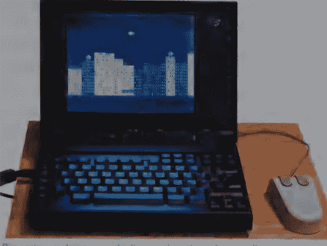
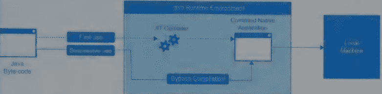
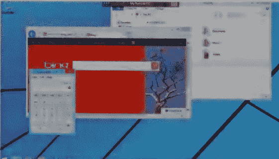
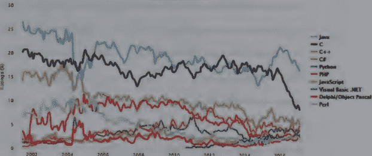
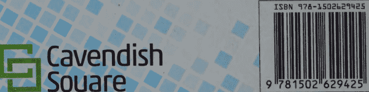

# Java 的力量

Aidan M. Ryan

```java
class Client {
    public void send(OutputStream out) {
        DataOutputStream output = new DataOutputStream(out);
        long t1 = Math.randomLong();
        byte[] protect = new byte[8];
        long t2 = Math.randomLong();
        byte[] protected = new byte[8];
        out.writeUTF("hello");
        out.writeInt(42);
        out.flush();
    }
}
```


# Java 的历史

从你醒来到你入睡，你可能在看电视、浏览互联网、使用智能手机上的应用，并通过路由器连接 Wi-Fi——在同一天内，你可能刷过信用卡、使用 Kindle 或其他电子阅读器、从 ATM 取出现金、支付停车费、打印东西并设置家庭安防系统。你通常不会花很多时间考虑这些事情。

相反：你的短信可能很短，但每一条短信背后都有数百万行代码在运行。

这些动作中的大部分是自动的，它们已经成为 21 世纪日常生活的重要的一部分。

# 你世界中的 Java：智能手机与宝可梦

2016 年的夏天非常热。根据美国气候科学家的说法，2016 年是地球最热的一年，7 月和 8 月是该年最热的月份。通常，这种温度会让人们留在室内，享受空调的舒适，或者至少靠近风扇和冷饮。但那个夏天，许多人选择在户外度过更多的时间。

在整个 7 月和 8 月，无论你走到哪里，都能看到人们在人行道和草坪上来回走动，没有明显的规律，低头盯着智能手机屏幕。夏天比气温更热的还有东西：一个名为 Pokémon Go 的新型简单智能手机应用。

7 月 6 日，游戏公司任天堂联合游戏开发公司 Niantic 发布了一款游戏，这款游戏重启了一个拥有二十年历史的宝可梦，同时也改变了儿童和成人与手机以及相互互动的方式。这不仅仅是一种时尚——它是一种现象。该游戏成为智能手机历史上增长最快的应用（或应用程序，从大型游戏到计算器等微型工具的任何计算机程序）。今天，它是历史上最流行的智能手机游戏。发布仅六个月后，该应用就为其制造者赚了 10 亿美元。

数字角色悬浮在桌椅上方，似乎躲在树木和灌丛后面，潜伏在湖泊和墓地中，等待被捕捉。


玩 Pokémon Go 的潜在危险发布后不久就变得清晰。这张牌子是 2016 年夏天贴在纽约市的。

《宝可梦 Go》背后——十亿美元的收入、数亿次的下载以及数十万次事故——都是将跨越多个计算机平台的许多不同技术整合在一起的结果。

为了实现这一点，游戏的设计者采用了旧技术并以新的方式使用它们。其中一个重要的工具是 GPS。GPS，即“全球定位系统”，利用卫星来追踪地球上设备的移动。这并不是一项新技术——大多数手机早已被设计成可以通过这种方式进行追踪。该游戏还依赖手机的内置摄像头。这同样也是老技术：在人们开始使用 Snapchat 和 Instagram 之类的应用多年前，制造商就已经为翻盖手机引入了摄像头。（一个冷知识：“selfie” 一词最早于 2002 年出现在澳大利亚的一个在线论坛上，但花了整整十年才在全球范围内流行起来。《牛津英语词典》在 2013 年将“selfie”评为年度词汇，《韦伯词典》在次年也将该词加入了字典。）但《宝可梦 Go》的制作者将这些较旧的技术——GPS、内置摄像头以及其他技术——整合了一起。正因如此，他们能够将宝可梦系列中的收集角色放入“现实世界”中。为了将所有系统整合在一起，开发者必须创建一种能够与所有其他技术通信的“语言”：GPS、摄像头、触摸屏、手机操作系统以及游戏服务器。Java 语言不仅让这一切成为可能，而且这种“截然不同的计算系统可以并且应当能够无缝协同工作”的信念，也源于一场思维的革命，在这场革命中，Java 发挥了至关重要的作用。

## 现代计算：网页与互联网的简史

这个故事可以追溯到 1991 年。那是充满宁静转折点的一年。冷战结束，苏联解体为十五个独立的国家。美国通过“沙漠风暴行动”开始在中东持续的军事干预。受欢迎的视频游戏角色索尼克（Sonic the Hedgehog）出道，超级任天堂娱乐系统（SNES）也问世，两名德国游客发现了一具三千年历史的木乃伊并将其命名为“奥特齐”（Ötzi）。随后，在 8 月 6 日，英国科学家蒂姆·伯纳斯-李（Tim Berners-Lee）向公众发布了被称为“万维网”（World Wide Web）的东西，我们所知的生活发生了根本性的变化。

虽然我们有时互用这两个词，但互联网（internet）和网页（web）是两个不同的东西。互联网指的是遍布全球的计算机系统——自动执行运算或逻辑任务的机器。



今天的计算机比几十年前的要纤薄得多，比如这台 1990 年代的 IBM 笔记本电脑。科学家和军事人员几年来一直在使用现代计算机的前身，但这些机器正变得越来越复杂。加利福尼亚的研究人员希望有一种方法访问位于威斯康星州或其他任何地方的数据。美国国防部制定了规则，允许不同的计算机使用无线电波、电缆和光纤缆进行通信，交换数据和命令。到 20 世纪 80 年代，军事和学术界已广泛使用这种有限的互联网。

1991 年 1 月，在瑞士欧洲核子研究中心（CERN）工作的科学家蒂姆·伯纳斯-李引入了万维网。这是一个利用互联网来识别、组织和链接文本文档，并最终链接图像、音频和视频的信息空间。起初，这仅供研究机构的科学家使用，但那年的 8 月，公众就可以访问了。今天，当你使用 Safari、Internet Explorer、Firefox 或 Google Chrome 等浏览器时，你正在使用一种为了让你访问同一个网页而发明的工具。旨在帮助科学家共享的数据空间现在可以让你在 Facebook 上发布照片、购买演唱会票、浏览 Pinterest 和 Amazon、在 SoundCloud 上上传音乐并制作表情包（memes）。

## 新边疆的新语言

每一次新的进步和创新都在推动程序员为这些强大的新技术构想越来越大胆的用途。然而，要让计算机“做”任何事情，你需要一种命令它们的方法——而要命令，你需要一种语言来传递该命令。我们称之为计算机编程。

无论你只知道一种语言、两种还是几种，你可能都知道在不同情况下使用不同“语言”的感觉。你对老师说话有一种方式，在篮球场或棒球场是另一种方式，对父母有一种方式，对朋友或兄弟姐妹又是另一种方式。计算机的工作方式也是如此：它们通过不同的语言“交流”以完成不同的任务。单台计算机运行在所谓的“机器语言”上，它由二进制代码字符串组成。“二进制”只是指具有两个部分的东西；在计算机的情况下，二进制代码由 1 和 0 的长字符串组成。正如你所想象的，人类使用二进制代码给出任何复杂指令将非常困难（而且耗时！）。此外，不同的计算机读取二进制代码的方式也不同。为了让编程变得简单，并帮助计算机相互通信，计算机先驱们创建了汇编语言，它引入了字母和可识别的单词。这允许程序员通过名称引用数据块，并交付简短的、易于表达的命令，而不是将长串二进制数字拼接在一起。

程序员仍然在某些任务中使用汇编语言，但随着人类开始使用计算机在更大、更广泛的数据集上绘图并执行更复杂的功能，研究人员意识到他们需要更复杂的语言。今天，有超过两千种语言。你可能认出一些名字：其中比较流行的是 C、C++、PHP 和 JavaScript。Java 是这些语言中最流行、最强大且影响最大的语言之一。

## 绿色团队

1991 年，也就是万维网向公众开放的一年，太阳系统公司（Sun Microsystems）的程序员开始研发最终成为 Java 的东西。太阳的高层执行官知道变革即将到来，他们想领先一步。他们挑选了一些最好的程序员，并给了他们一个巨大的挑战：预测大趋势并构建一个利用这些趋势的东西。这些员工被称为“绿色团队”，他们在加利福尼亚州的梅洛公园设立了办公室，断开了与公司其他部门的大部分通信。他们日以继夜地工作了十八个月。

他们的第一个想法是，计算机最终将在数字娱乐中发挥更大的作用。绿色团队想象人们使用带有触摸屏的手持设备控制电视。他们制造了一个名为 Star 7 的设备，正是如此。他们是对的，但领先了时代大约二十年。今天，你可以通过手机为电视节目编程，视频游戏系统接管了家庭娱乐，而 Hulu 和 Netflix 这样的流媒体服务让你在使用电视和时间上有更多选择。当你打开电视时不仅仅是切换频道——你可以搜索你想要的内容，可以查看预告片和预览，甚至可以使用语音交付命令。回到 20 世纪 90 年代，电缆公司并不愿意放弃如此多的控制权，视频点播服务正处于婴儿阶段。Star 7 并没有流行，但实现其可能的技术却火了。

Star 7 设备使用了一种新的编程语言。绿色团队的首席开发人员詹姆斯·高斯林（James Gosling）发明了这种语言并将其命名为 Oak（他办公室窗外的一棵树）。但电缆公司对他们的产品不感兴趣。团队需要为这种新技术寻找另一个用途，以及驱动它的语言。为了找到答案，他们聚集在加利福尼亚州太湖附近的斯阔克溪酒店（Inn at Squaw Creek）。

到此时为止，开发人员已经在使用互联网来存储和共享文本、图形甚至视频。为了做到这一点，他们使用一种名为 HTML（超文本标记语言）的语言。这是你使用的大多数网页背后的语言。HTML 让程序员创建可以显示不同文本和图形的页面，并允许它们放置指向其他网页的链接。HTML 可以在不同设备之间传输信息——因此无论你使用的是 Mac、PC、手机或其他设备，都可以显示和浏览用 HTML 编写的网页。然而，用户对于只使用 HTML 编写的网页无法进行太多的交互。

## “网络就是计算机”

绿色团队在更名为 FirstPerson 后，恢复了工作，将重心从电视转向互联网。到 1993 年，一种名为 Mosaic 的网络浏览器的开始带来越来越多的普通用户进入互联网。“Mosaic”这个名字源于一种艺术形式，即使用许多微小的玻璃、大理石或其他彩色材料拼成一幅更大的画作。这捕捉了早期互联网的精神，也是其中的挑战之一。在机器之间共享信息和指令是困难的，因为机器本身是不同的：每种类型的机器都“说”着自己的语言，当时还没有一种语言能让不同类型的机器或操作系统进行方便、高效的通信。任何能够将所有不同机器（以及用户）聚集在一起的东西——无论是网络浏览器还是编程语言——将像马赛克一样，利用成千上万最终是数十亿个个体组成一个巨大的、色彩斑纷的整体：一个网络。

太阳科技公司（Sun Microsystems）的开发者开始以一种全新的方式思考互联网。他们意识到互联网正变得像他们希望电缆公司做的那样，一个交互式多媒体网络。太阳公司的创始人、主席兼首席执行官 Scott McNealy 为公司想了一个新口号：“网络就是计算机。”这听起来有点像谜语，但如果你仔细考虑，它非常有道理。人们倾向于将第一代个人电脑（或 PC）视为省力设备，就像你考虑烤面包机、搅拌机或割草机一样。但“连接”世界上所有的烤面包机并不会让它们更强大。也许你可以安排百万台烤面包机同时烤面包。那会很酷，但并不实用。McNealy 等人开始意识到，计算机是不同的。

一台 PC 是强大的，但一个由数百万此后数十亿台 PC 组成的网络将具有字面的无限潜力。太阳科技公司没有将 PC 放在计算世界的核心，而是鼓励其员工和客户首先考虑网络。真正的力量不在个人电脑，而在于数十亿台 PC 可以连接在一起这一事实。

## 太阳科技公司

20 世纪 70 年代末和 80 年代初，围绕计算机技术进步的讨论声越来越多，联邦政府对计算研究的支持处于高点。这可能是因为美国当时正在与苏联进行军备和技术竞赛——并且处于领先地位。军事应用驱动了当时计算机的许多进步，但一个专门的计算机爱好者群体——包括主要大学的研究人员以及车库级爱好者，如苹果公司的史蒂夫·沃兹尼亚克和史蒂夫·乔布斯——开始想象计算机硬件和软件在商业行业和个人用途中更广阔的市场。其中几个远见发明者和投资者在 1982 年聚集在一起，成立了太阳科技公司，它迅速崛起成为世界最大的计算机公司之一。

出生于德国的 Andy Bechtolsheim 是斯坦福大学的一名研究生，当时正在为斯坦福大学网络（SUN）开发一台计算机“工作站”。他结识了更早毕业的斯坦福商学院毕业生 Scott McNealy 和 Vinod Khosla，两人分别在 Daisy Systems 和 Onyx Systems 工作；这两家公司都在推动微芯片技术的进步。这三人很快成立了一家计算机硬件和软件制造公司，并以他们母校斯坦福大学网络（SUN）的首字母命名。毕业于伯克利的 Bill Joy 当时在贝尔实验室（后来的 AT&T）开发一种名为 Unix 的操作系统，AT&T 是北美一个多世纪以来领先的电信公司，他很快加入了他们。这四个人获得了投资者的资金，并没有浪费时间去颠覆和重塑计算世界。

在第一个十年里，太阳公司通过销售使用 Unix 操作系统的廉价工作站（满足科学和技术需求的计算机）变现了 Joy 开发 Unix 的经验。后来，他们扩展到了服务器（存储数据的硬件）。然而，太阳公司最持久的成就可能是发明了编程语言和开发平台 Java，这让太阳公司进入了智能手机和其他消费电子产品的新市场，而且 Java 的知名度比太阳公司本身还要高。

Java 延续至今，但太阳公司的成功无法长久。对太阳公司的早期投资是基于公司的质量和价格合理的产品，以及基于其开发者卓越的创新的记录。然而，这种增长很大程度上受到了“互联网泡沫”的推动。在股票市场中，当人们开始以远超真实价值的价格范围交易股票或商品时，就会出现“泡沫”。“泡沫”不会逐渐缩小或恢复稳定状态；它们在投资者兴趣突然下降时破裂，建立在通胀交易价格上的公司会随之崩溃。

互联网泡沫发生在 1995 年到 2001 年之间。人们对蓬勃发展的互联网兴趣如此浓、如此不合理，以至于公司只需在名字前面加上“e”或在结尾加上“com”，就能增加其股票的价值。泡沫在 2000 年 1 月破裂。公司合并或宣布破产并消失；互联网公司和技术制造商损失了超过 5 万亿美元的市场价值，而 2001 年 9 月 11 日的恐怖袭击进一步加速了这种自由落体。生存的一些公司，如 Amazon、Google 和 eBay，被留下来统治了突然没有了竞争的领域。

太阳公司确实恢复了，但并不完全。20 世纪 90 年代末，太阳公司的口号是“我们是互联网中的点”，这并非全是虚言：成功的公司确实使用太阳的产品进行计算。泡沫破裂的冲击打击了太阳公司，使其失去了顶尖地位。在 2007 年到 2009 年的大经济衰退中，它遭受了另一个打击。不久出现了 IBM 收购太阳的传闻，尽管这项交易从未实现。在计算机行业顶端屹立 27 年后，太阳股东以 56 亿美元将公司卖给了甲骨文。甲骨文开始了大规模裁员，高级工程师相继辞职，创始人 Bechtolsheim、McNealy、Khosla 和 Joy 随后作为投资人、发明者和初创公司经理取得了成功的职业生涯。他们现在仍然活跃在计算机行业。

对太阳公司的业务模式产生了巨大影响。公司开始更多关注互连这一最终目标。秉着“网络就是计算机”的格言，由 Gosling 领导的 FirstPerson 研究人员开始开发一个类似于 Mosaic 的浏览器。他们将使用为他们现在已废弃的 Star 7 设备所创建的语言。他们研究了快速发展的科技行业的不同领域，访问了欧洲和亚洲的消费电子制造商。他们认为这些消费电子产品，如 CD 播放机、传真机、手机、相机、收音机，甚至玩具直升机，正与互联网处于“碰撞轨道”上。换句话说，他们看到了我们现在所认为的现在的未来。他们知道自己正在创造某种强大的东西，也许强大到可以改变世界。但也知道，如此重要的东西需要一个比 Oak（橡树）更好的名字。

## 名字的含义

“Oak”行不通。在 Sun 开发者之间作为代号使用还好，但另一家名为 Oak Technologies 的公司已经注册了该商标，因此 Sun 的员工在公开他们的新想法之前，必须想出另一个名字。

Oak 产品经理 Kim Polese 将所有工作这项新技术的团队聚在一间房间里，前面放有一块白板。那是 1995 年 1 月，Sun 已经几乎准备好展示他们的新技术了。这将是一场老式的头脑风暴会议。Polese 想要一个能够捕捉这种语言和平台“本质”的名字——某种“动态、革命性、活泼、有趣”的东西。团队成员开始大声喊出名字，Polese 将它们写在白板上。那天在房间里的人记得建议了几个名字：Ruby、Silk、Neon、WRL（代表 WebRunner 语言）、DNA、Lyric、Pepper。Gosling 回忆那场会议是“疯狂”，至少有十几个人大声喊单词，然后对建议进行争论。他们成功地将名单缩小到大约十几个入围者，并将这些名单发给了律师。法律团队建议，只有 Java、DNA 和 Silk 是安全的选择。

一位程序员 Arthur Van Hoff 将功归于另一同事 Chris Warth，认为他是第一个喊出“Java”的人。Warth 不记得自己是否提议过“Java”这个名字，但他确实承认在会议期间手里正端着一杯 Peet's Java——那是那时 Sun 公司的首选咖啡。

Java 有时被用作咖啡的同义词，它实际上是组成印度尼西亚的岛屿之一的名字。17 世纪末，荷兰商人从他们的印度殖民地将原产于埃塞俄比亚的咖啡植物带到了印度尼西亚。在十年内，荷兰东印度公司就开始向欧洲运第一批“Java 咖啡豆”。今天，印度尼西亚是世界第四大咖啡产国。虽然其他岛屿的咖啡豆也越来越受欢迎——如苏门答腊、巴厘和苏拉威西——但 Java 仍然是所有产豆岛屿中最广为人知的。

## James Gosling


留着齐肩的灰发、配套的胡须，戴着与 20 世纪 70 年代同样的眼镜，今天的 James Gosling 看起来就像旧金山的圣诞老人。尽管 Gosling 喜欢 T 恤而不是红袍，喜欢烧烤而不是牛奶饼干，但像尼古拉斯圣一样，他的工作几乎是神话般的，受到整个计算机行业的赞仰和喜爱。


# Gosling 博士与 Java 的诞生

Gosling 博士于 1955 年出生于加拿大阿尔伯塔省，他是一位以在 Java 方面的工作而闻名的计算机科学家。他在卡尔加里大学获得学士学位，在卡内基梅隆大学获得硕士和博士学位，并于 1983 年完成博士论文。一年内，他受雇于 Sun Microsystems, Inc.。这是一家年轻且快速发展的公司。在 1984 年至 2010 年间，Gosling 在 Sun 工作，他最终在那里领导了创建 Java 的团队。虽然许多研究人员和程序员都参与了 Java 的发明，但大多数人将 Gosling 视为这种语言和平台的“之父”。Gosling 在 20 世纪 90 年代初发明了 Java 之前的语言 Oak，他是帮助 Sun 开发者以及整个世界的注意力转向互联网的关键人物。

另一家科技公司 Oracle（甲骨文）在 2009 年收购了 Sun，正如合并和收购通常发生的情况，公司文化发生了变化。根据 Gosling 的说法，他削减了薪水并降了职，并失去了在 Sun 享受了二十六年的许多自由。一年之内，他就离开了这家他曾帮助改变世界的公司。

在休息了一段时间后，Gosling 搬到了 Google，在那里担任软件工程师。Gosling 并非首个搬到 Google 的 Sun 员工。在此之前已经有许多人加入，而且 Google 使用 Java 创建了受欢迎的 Android 手机，这已经超过了 iPhone 成为市场上最受欢迎的移动设备。然而，Oracle 坚信 Google 使用大量 Java 代码违反了法律。作为所有者，他们决心将 Google 带上法庭并获得巨额和解。Gosling 陷入了困境，在 Google 工作的短暂时间里没有谈论这起诉讼。

在那里只待了六个月后，他就搬到了 Liquid Robotics，在那里担任首席软件架构师。现在他制造从海洋收集数据的智能机器人。他最近的一些项目包括提高汽车安全以及致力于更安全的自动驾驶汽车。他一直是 DIRTT 的董事成员，这是一家注重环保的室内设计和建设公司，他分享了利用某些帮助创建 Java 的原则来改革美国医疗系统的兴趣。他仍然经常向 Java 开发者和爱好者的观众进行演讲，记者经常请他对该语言的未来用途进行预测。


面对急于将工作推向世界的工程师们的压力，负责营销的 Kim Polese 在对朋友、同事和家人测试了名字后，做出了最终决定。

没有人知道现在被称为“Java”的语言和平台如果在一个不同的名字下是否会如此成功，但很明显，“Java”这个名字并没有坏处。

这个名字似乎暗示了创造者希望它具有的一切特征：“Java”听起来仍然充满活力、希望、异域风情、快速、爵士且时髦。Gosling、Warth 以及其他人可能并没有考虑过那个岛屿、荷兰在东南亚的殖民历史，甚至没有考虑过全球咖啡贸易的经济，但他们无意中将他们即将突破的、革命性的品牌与另一个改变世界的产品——可饮用的 Java 联系在了一起。这个名字很合适。今天，Java 仍然是最流行的编程语言，开发者们每天都在为它思考新的用途。

## 世界首次想象 Java 能做什么

Java 将向公众展示的消息让 James Gosling 感到非常惊讶。1995 年的某一天，他的同事 John Gage 进了 Gosling 的办公室，请求借用电缆和台式系统。他随口说，他将参加一个由好莱坞和硅谷大亨参加的会议，演示 Java 团队一直在秘密开发的 WebRunner 浏览器。担心他们的进展工作在这些有影响力的观众面前崩溃，Gosling 随同去，担任故障排除人员。

演示开始后没有遇到困难，但 Gosling 注意到观众并没有很关注。人们对于一个由他们不理解的新语言驱动、且看起来与已有的网络浏览器非常相似的浏览器版本，并不感到兴奋。看到这里，Gosling 做了一系列你也做过无数次的动作。他将鼠标光标拖过屏幕，指向一个小小的 3D 分子图形。记住，光有图形本身并不令人兴奋——开发者们已经在网页中放置了图像和视频。


Java 驱动着你的智能手机，但它也有助于运行巨大的超级计算机。这种特性被称为扩展性（scaling）。

……以前从未见过。他点击鼠标并拖动它——向左。分子移动了。这看起来没什么，但那次微小的移动是革命性的。用户第一次可以与网页进行交互。高林（Gosling）和盖奇（Gage）展示了他们的语言的其他用途，包括一个小程序（applet）——一个执行小任务的程序——它可以对不同长度的行进行排序。同样，这现在看起来似乎并不深刻，但它展示了 Java 很快就能实现的可能性。

旧的“绿色团队”在一个月后向朋友发布了 Java，随后面向整个互联网，并目睹下载量飙升到数百，然后突破一万，再到突破百万。他们轮流处理每天成千上万封邮件。更重大的消息来了，Netscape 公司的高管宣布他们将开始在流行的网页浏览器 Navigator 中使用 Java。显而易见，Java 将帮助塑造互联网的未来。

此后，Java 成为最受欢迎的计算机编程语言。自 Java 发布以来，已有许多新语言问世，还有少数其他完全不同的语言在与它竞争程序员的忠诚度，但 Java 对此后出现的大多数语言都产生了巨大影响。Java 在智能手机和其他技术的发展中具有巨大的影响力，因为 Java 可以在不同的操作系统上运行，并且可以轻松地扩展，这意味着它可以用于小型消费电子设备和智能手机应用（如《宝可梦》），也可以用于超级计算机等大型设备。然而，比任何单一技术成就更重要的是，Java 改变了我们思考计算机的方式、我们与计算机的关系，以及我们通过计算机可以成就什么。要理解这一点，你需要更多关于 Java 如何运行的知识。

# 第二章：运行原理

到目前为止，我们大多将 Java 称为一种语言，但要理解它是如何工作的——以及它为什么具有革命性——我们必须将 Java 同时视为一种语言和一个平台。在本章中，你将学习 Java 的基础知识：它看起来像什么样，它是做什么的，以及是什么使其变得独特且高效。我们将解释一种没人说的东西如何成为一种语言，并讨论帮助 Java 彻底改变计算机行业的特性。

反之：每种编程语言都有不同的特性。为项目选择语言取决于你的目标。

## 什么是语言？

你不能用 Java 来提问——但你可以用它来下命令。你不能用 Java 写诗——但它驱动了像 YouTube 和 SoundCloud 等网站的部分，创意人士在那里分享他们的艺术。尽管它看起来不像你现在阅读的英语，但 Java 是一门语言。

你的第一门语言是你在没有察觉的情况下学会的。它是你环境的一部分。你可能记不起学习第一门语言的过程，因为那发生得太早了。我们大多数人在并没有刻意努力的情况下精通了第一门语言，只有后来才学习了规则。你的父母对你发出声音，你那极其强大的婴儿大脑首先记住了其中几个声音，并命令你小小的肺部、喉咙、舌头和嘴唇移动并发出那些声音。与此同时，你开始注意到规律。你并不知道什么是“名字”，不知道给某物命名或拥有名字意味着什么，但你注意到人们看着你时总是发出相同的声音。这是你理解自己是谁、是什么的第一步。

如果你学习一门新语言，无论是在学校还是搬到一个新社区之后，这个过程可能会很困难并花费很长时间，但你仍然在学习一套演化了数年的规则。在英语和南非利卡语等口语语言中，新词汇每年似乎凭空出现，人们经常打破语法规则，而地球上不同地方说同一种语言的人会用不同的词指代同一个事物。英国人和美国人也都说英语，但英国人把汽车后备箱称为“boot”，而美国人称之为“trunk”。英国人穿运动鞋（trainers），加拿大人穿跑步鞋（runners），美国人穿平底鞋（sneakers）：这三个词可能都指代同一双耐克鞋。

口语语言在不断变化，因为真实的、活生的人通过一种混乱的多数人统治原则控制着它们。这意味着任何用户都有改变语言的潜力。这种事情在英语中不断发生。今天着的某人是第一个说“Google”（动词用法）、“selfie”（自拍）、“bling”、“bromance”（兄弟情）、“hater”（黑粉）、“LOL”和“noob”（菜鸟）的人。今天，如果你使用这些词，大多数英语使用者会知道你的意思——但当我们打破了太多规则或创造了太多词汇时，结果可能是滑稽的，也可能导致交流陷入停滞。

所谓的“死语言”，如拉丁语、毕尔特语（Pictish）或乌比赫语（Ubykh），并不这样运作。因为普通人（而非学者）不再说这些语言，它们的词汇永远不会增长，只要还有记得它们，它们的语法规则就会保持不变。

计算机编程语言处于这两者之间。编程语言，与 Java、C 和 HTML 一样，它们是“活的”，因为有真实的人在使用它们，甚至可能会改变它们。然而，与口语不同，计算机编程语言有“所有者”：Java 的规则只有在 Oracle 的程序员决定更改它们时才会发生改变。如果你不喜欢这些规则，你可以希望这种情况发生——或者，像许多程序员做的那样，你可以创造一套属于你自己的新语言。

### 雅达·洛芙莱斯：诗人程序员

雅达出生于 1815 年，由她的母亲英国贵族安娜贝拉·米尔班克（Annabella Milbanke）抚养长大，雅达·拜伦（洛芙莱斯伯爵夫人 Ada Byron）仅活了三十六年，在与癌症的痛苦斗争中孤独去世。然而，在她短暂的生命中，她克服了女性面临的有限机会，赢得了全世界朋友的爱和尊重，最终被称为“第一位计算机程序员”。


雅达是拜伦勋爵的女儿，他是最著名的诗人之一。拜伦在雅达出生两个月后就离开了安娜贝拉，去追求反对奥斯曼帝国的希腊战争冒险。他在 1824 年去世，当时雅达还是个孩子。拜伦是一个伟大的旅行者，习惯古怪的人。有些人认为他浪漫且富有鼓舞，另一些人则认为他丑闻且冒犯。安娜贝拉对他感到愤怒，试图让女儿远离诗歌——以及她认为的“疯狂”——转而鼓励这个女孩学习数学和科学。尽管雅达从未见过她的父亲，但她对工作产生了终身兴趣。这种分裂教育的结果产生了一种非凡（且强大）的智慧：雅达的心脑既适合数学思考，也适合艺术思考。

当雅达还是青少年时，她遇到了查尔斯·巴贝奇（Charles Babbage），一位发明家和数学家。随着工业革命在 19 世纪初兴起，科学家和商人需要工人产生（并复制）大量的复杂计算而不产生任何错误。巴贝奇设想了一种可以自动进行这些计算的机器。他称之为“差分机”。

理论领先于技术。巴贝奇设想的机器零件金属工人无法以合理的成本制造。尽管如此，与聪明且充满好奇心的雅达的对话促使他进一步发展理论和发明。巴贝奇被雅达的心智深深鼓舞，他称她为“数字女魔术士”（the Enchantress of Numbers）。对于雅达来说，她是推广和完善这些数学发展的关键人物。她将外国数学家的著作翻译成英语，并对数学领域的最新思考发表了详尽且文字优美的笔记。基于巴贝奇的工作，她描述了如何使计算机自动执行某些复杂的计算——真正的程序，就像我们今天使用 Java 和其他语言所做的那样。在这些笔记和其他著作中，她的数学与诗意力量结合在了一起。也许是因为她对待该领域的方法正如她所说的是“诗意科学”，她能够想象出当时任何其他人无法预见的计算机潜力。

## 理解 Java 语法

在最基础的层面，所有语言的工作方式都是相同的。每种语言都包含信息的“数据包”。对于大多数语言，我们把最小的数据包称为“字母”，较大的数据包称为“单词”。例如，字母“D”包含了信息：如果你认识这个字母，你就知道它作为单词的一部分被读出来时应该发什么音。你现在可能就能列出一百个以字母“D”开头的单词。当你把这些包组合在一起时，它们所代表的意义不仅仅是一个声音。例如，如果你把字母 D-O-G 放在一起，你就组成了一个单词 dog（狗），这个数据包承载了大量信息。仅仅在印刷版上看到 dog 这个词，可能就会在你脑海中浮现出一幅图像。你可能会想到腊肠犬、金毛犬、英国牛犬或贵宾犬。想到自己的宠物或朋友或邻居的宠物时，你会感到爱或喜爱。想起你看到一只愤怒的狗时你可能会感到恐惧，或者想起一只去世的狗时感到悲伤。这一切——所有这些情感和图像——之所以可能，是因为你知道 D、O 和 G 这三个形状放在一起时意味着什么。

所有语言也有一套语法，或者说一套关于这些数据包如何组合、以及它们的排列如何比任何单个数据包都承载更多意义的规则。你可以对另一个英语使用者说“dog”这个词，并相信他或她理解你的意思。但如果你想对狗说什么，你需要更多的单词，如果你没有共享一套关于如何使用这些单词的规则，那很快就会变得混乱。语法让我们表达最深层的情感，给出更复杂的指令，并通过与他人分享这些梦想，将我们对世界的设想变为现实。

数学也是一种语言。它拥有信息包——数字，以及加号、减号、小数点和小括号等符号——数学的语法是允许我们在符号排列成复杂模式时解释这些符号（或信息包）的规则。

就像任何其他语言——如英语、德语或数学一样——Java 也有信息包和允许我们对其进行排列和解释的语法。事实上，一旦理解了它的一些基本特征，它是最容易学习的编程语言之一。

## 理解对象

Java 处理信息和命令的方式是革命性的。与其他以命令（即让计算机“做这个”或“做那个”的指令）为核心的语言不同，Java 是一种面向对象的语言。在 Java 中，对象是一切的核心，而不是动作。

那么，什么是对象？“Object”（对象）是一个单词，可以表示很多意思。事实上，我们经常可以用它和“thing”（东西）互换使用。在英语中，我们使用“object”一词指代任何具有物理属性的物体——换句话说，任何我们能感知到的东西。如果你可以触摸、尝味、嗅闻、听到和看到某样东西，它可能就是一个对象。当我们没有准备好更好、更具体的词时，经常会使用这个词。例如，你可能会把一个在夜空中划过的奇怪物体称为“UFO”（未识别飞行物）。

在计算机编程中，对象是数据和操作（或发生在这些数据上的动作）的包。以这种方式封装数据允许程序员独立地处理程序的不同部分——这在处理大型、复杂的项目时非常有帮助。第一种面向对象的语言被称为 Simula，发明于 1967 年，但 Java 是第一个被广泛使用的面向对象的语言。

程序员说对象具有“状态”（states，即特征）以及“行为”（behaviors，即对象可以执行或发生在对象上的事情）。为了理解这一点，思考现实世界的物体可能会有所帮助。你可以说鱼是一个对象。每条鱼都有“状态”（特征）：它有名字、形状和颜色。鱼还有行为：它可以用鱼鳍游泳；它可以用鳃从水里获取氧气；它会进食也会被其他生物捕食。宇宙中存在无限的对象，具有无限的状态和行为。Java 也是如此。

正如我们喜欢对现实世界中的事物进行分类——通过物种、科属和原生栖息地来组织鱼类——我们也将 Java 对象放入一个“类”（class）中，或者说，是创建单个对象的通用蓝图。类规定了类中的对象可以拥有哪些状态和行为。当你写完一个新程序时，你将其保存为一个新类。

最后，程序员可以通过“方法”（method）来表达对象的行为，这是代码中的一部分，说明了对象将发生什么，或者对象之间如何相互作用。类中的主要方法称为 `main`。

## 代码结构与语法

正如你可能已经猜到的那样，对象让复杂的编程任务变得简单得多。对象让程序员在组合对象之前，可以一次专注于代码的某一个部分。

如前一节所述，类就像是创建对象的蓝图，这意味着在创建对象之前，你需要一个类。假设你的狗咬破了这本书的首页。因为你想修复这本书的同时测试你的编程技巧，你决定写一个程序来打印一个新的标题（不用担心你是否认识每一个单词或字符）。你将开始编写类似这样的代码：

```java
public class TitlePageApp {
```

`public` 意味着都可以看到你的程序。`Class` 标志着程序的名称将随其后：我们将这个程序命名为 `TitlePageApp`。最后，大括号 `{}` 标志类的开始。基本上，所有执行操作的代码都在大括号之后。（为了让你的程序执行某些操作）它看起来像这样：

```java
public class TitlePageApp {
    public static void main(String[] args) {
        System.out.print("The Power of Java");
    }
}
```

不用担心你是否认识每一个单词或字符。在 `TitlePageApp` 的起始行下方，你加入了 `main` 方法，它包含了关于你的程序将做什么语句：`System.out.print("The Power of Java");`

在这种情况下，你告诉你的程序打印字符“The Power of Java”。这被称为字符串（string）。在 Java 中，字符串只是一个信息包或数据。每个语句都以分号 `;` 结尾。第一个大括号关闭 `main` 方法，第二个大括号关闭类 `TitlePageApp`。

到目前，你已经学习了许多 Java 知识，而且还想对管理员或下一个拿起这本书的人开个玩笑。所以，你让你的代码变得高级一点：

```java
public class TitlePageApp {
    public static void main (String[] args) {
        System.out.println("The Power of Java");
        System.out.println("by Stella Lopez");
    }
}
```

现在，你的程序打印了一个包含两行的首页：你在每个语句的 `print` 后面加上了 `ln`，以将语句放在不同的行。如果你愿意，你可以用这种方法复刻整本书。

## 面向对象：超越“main”的代码

虽然你刚刚编写的代码并没有充分利用 Java 处理对象的力量。对象让程序员在组合对象之前，可以一次专注于代码的某一个部分。

如果你玩过俄罗斯方块，思考这个游戏可以帮助你理解 Java 中的对象。在这个游戏中，方块聚集在一起形成不同的形状有：一个是较大的正方形，一个是一个直线，一个看起来像 L 形，一个像大写的 T 形，一个像加号，还有一个是折线。这些形状从屏幕顶部掉落到屏幕底部，玩家可以在它们掉落时对其旋转，尝试堆叠碎片以形成横跨屏幕的水平直线，直线将会消失，但如果有空隙，该行的碎片将停留在原地。碎片不断掉落并堆叠，如果堆栈到达屏幕顶部，玩家就会失败。


# Java 是制作像《俄罗斯方块》这类游戏的极佳工具

事实上，已经有很多人使用 Java 制作了《俄罗斯方块》的模仿品。只要稍微努力，你也可以。你可以从创建一个名为 `blocks` 的类开始。记住，类（`class`）就像是创建不同对象的蓝图。从你的类，你可以创建玩游戏所需的所有对象：正方形块、直线块、T 形块、L 形块、加号块和折线块。像 Java 中所有的对象一样，每个对象都有自己的状态和行为。状态可以是它们的大小和颜色；行为可以是它们掉落的不同速度，以及玩家在“空中”旋转它们的方式。你还需要编写一个方法（一种特定行为），关于碎片如何相互作用。在这种情况下，你会编写一个方法，每当玩家在屏幕底部创建一条不连续的水平直线时，碎片就会消失。Java 的工作原理是通过创建易于复制的对象，这使其非常适合像《俄罗斯方块》这样的游戏。这个程序会比你为这本书打印新标题页的程序要长得多。然而，用 Java 编写它比用其他语言要容易得多，尤其是对于那些不是面向对象的语言。

你的《俄罗斯方块》程序展示了你对 Java 对象唯一需要了解（目前而言！）的最后一件事。你的程序实际上使用了 Java 中可能的所有全部三种类型的方法：

- **语句（Statements）**：你的程序会执行某些操作。语句只发生一次，并且自动发生。例如，语句可以执行非常简单的操作，如玩家打开程序时启动游戏。如果你想弄得更复杂一点，可以添加一个语句来显示标题界面。这段代码看起来和你的 `TitlePagePrinterApp` 代码非常相似。

- **循环（Loops）**：循环是不断重复自身的方法……一遍又一遍一遍，直到程序停止运行。在你的《俄罗斯方块》游戏中，你会为掉落的块使用一个“循环”方法。你希望这些块不断掉落，以挑战玩家。

- **分支（Branching）**：这种方法是被“触发”的。它发生在：如果发生了其他事情，或者在满足某组特定条件下。这就是你将用来让碎片消失的方法类型。它不会自动发生，也不会无停止地循环。碎片只有在特定条件下才会消失：如果玩家对齐了一行正方形。你还可以写一个分支方法来让一个巨大的“你输了”标志弹出来，由碎片到达屏幕顶部时触发。

## 语言之外：编译器、平台与机器

记住，Java 除了“面向对象”的方法的方法之外，另一个伟大的承诺是可移植性（`portability`）。这意味着你可以在任何平台上编写它，并且它可以在任何其他平台上运行。想象一下如果一种口语也是这样运作的。想象你站在联合国全体面前发表演讲。你用英语写了演讲稿，但一旦话离开你的嘴唇，成百上千其他人就能用他们自己的语言——西班牙语、印地语、阿拉伯语、阿非利卡语、普通话等——听懂你的演讲，而无需实时翻译员的帮助。想象用英语说话，而完全不用担心世界上其他的人是否能理解你，无论他们选择哪种语言。这将是一种惊人的力量（而且很多翻译员需要寻找新工作了）。

Java 之所以这样工作是因为一种被称为编译器（`compiler`）的东西。Java 编译器是一个获取 Java 源代码并转换为另一种编程语言的程序。在这种情况下，我们说的是汇编语言，它是特定于不同机器的。因此，Windows 电脑、Apple 电脑、Linux 电脑和 Android 手机将各自拥有自己的汇编语言；数字手表、收音机闹钟和电视也是如此。



Java 虚拟机（`JVM`）是 Java “编写一次，随处运行”承诺背后的技术。这个 `JVM` 使用 Java 应用程序编程接口（`API`）在*任何*平台或机器上运行。因为 `API` 是一组允许平台运行程序的指令集，在 Java `API` 的帮助下，`JVM` 可以在任何平台上运行你的代码。你可以想象的，这种“可移植”语言的可能性是无限的。

## 波浪滑者（Wave Glider）

Liquid Robotics 公司由波音公司（其以飞机闻名）拥有，该公司制造并销售名为“波浪滑者”的东西，这是一种从海洋收集数据的机器人。在没有飞行员的情况下，波浪滑者可以在水面上漂浮并运行一年多，依靠太阳、波浪以及你猜对了——Java 的能量。

“Java 之父”詹姆斯·戈斯林（James Gosling）于 2011 年加入 Liquid Robotics 担任首席工程师。他们的波浪滑者软件使用 Java 语言。戈斯林来到这里并不意外：他一直对“酷玩具”感兴趣。在 20 世纪 90 年代和 21 世纪初，戈斯林因对机器人和其他设备的演示而闻名。这是他在 Sun 工作的一部分。Java 编译器可以获取你的程序的纯文本（如我们之前制作的 `TitlePagePrinterApp`）并将其“编译”成写入**字节码**（`bytecode`）的 `.class` 文件。你对字节码真正需要知道的就是你无法“读取”它，而且它不是任何机器或平台的原生代码。

相反，这些字节码进入 **Java 虚拟机 (`JVM`)**，它像是一台虚拟计算机。这个 `JVM` 可以在*任何*平台或机器上工作，使用 Java 应用程序接口 (`API`)。因为 `API` 是一组允许平台运行程序的指令集，在 Java `API` 的帮助下，`JVM` 可以在任何平台上运行你的代码。正如你可以想象的，这种“可移植”语言的可能性是无限的。

波浪滑者有两个部分。有一个漂浮在水面的平台，通过太阳能电池板收集能量。悬挂在下面的“潜水艇”利用活动机翼利用波浪的能量向前推进。

从海洋收集数据一直是困难的。那里有如此的数据——如此巨大。研究一直是昂贵且充满危险的。然而，波浪滑者可以收集信息并立即上传到云存储中，因此研究人员无需亲自检查机器人即可获取数据。它可以帮助环保人士收集天气和波浪模式，甚至是动物迁徙的音频信息。军队和其他政府行动可以使用它巡逻边境、检测威胁并打击海盗和走私。它可以帮助能源公司勘探自然资源并减少员工的风险。该机器人可以自主“游泳”一年多，利用其 Java 代码中的一系列“分支”方法避开障碍物。一些波浪滑者曾经受飓风和鲨鱼袭击。最棒的是，波浪滑者不需要燃料和人力，而且不会以任何方式污染大气。它是如此高效，以至于它从太阳获取的大部分能量都用于其强大的计算机。这种技术也应该适用于地球之外：如果我们发现另一个被液体覆盖的行星，科学家可能会使用波浪滑者的版本对其进行探索。

根据戈斯林的说法，Java 最强大的应用之一是**人工智能（`AI`）**。这意味着任何可以自己做出某些决定并能够“学习”或改进自身的计算机。波浪滑者就是其中一个例子。在编写软件时，戈斯林为滑者加入了一条指令：基本上是“不要害怕船只”。现在船长们担心撞上波浪滑者，直到他们看到这些“智能”机器人改变航向自主避免碰撞。戈斯林说，这在 Java 中非常容易做到，而在其他语言中要困难得多。此外，滑者还基于绿带团队的一个核心信念和目标：它可以在任何平台上通信它所收集的信息。

## 优势与缺点

显而周知，Java 是一个非常强大的工具。你可以用它来制作吸引人、有趣且具有交互性的网站。你可以用它来设计酷炫的视频游戏。由于编译器和 Java 虚拟机（`JVM`），你可以轻松地在不同设备之间迁移你的 Java 程序。

但请记住，Java 并不是唯一的编程语言，它也不是“最好的”。不存在所谓的“最好”的编程语言，就像不存在“最好”的人类口语一样。每种语言都有其独特的美感和迷人之处。每种语言都允许不同类型的表达或应用。

> 反之：理解计算机语言优缺点的最好方法就是投入并开始编码。


贝尔实验室校区，丹尼斯·里奇（Dennis Ritchie）在这里起步。

事实上，计算机编程语言在这方面非常像人类口语。当人们共同使用不同的语言时，往往能取得最大的效果。在本章中，你将学习更多关于 Java 与其他语言的对比：它的优势和缺点是什么，以及你可能如何与其他语言结合使用，完成任何单一语言都无法实现的任务。

回想詹姆斯·戈斯林（James Gosling）在团队成员决定名称之前，曾开发过 Java 语言的早期版本。他将这种语言命名为 Oak。不过，Oak 也并非凭空出现，它是从 C 语言的种子中生长出来的。

或者说，它源于戈斯林等人在使用老老的编程语言 C 和 C++ 时感受到的挫败感。C 语言自 20 世纪 70 年代初一直存在。C++ 出于 1983 年。你可能记得计算机使用机器语言与自己“对话”，即 0 和 1 组成的二进制代码。由于编写机器语言来让计算机执行任何事情并不容易，开发者们在其之上构建了其他语言，并称之为汇编语言。然而，汇编语言仍然有些笨拙，一位在贝尔实验室（一家百年历史的通信垄断企业，后变为 AT&T）工作的工程师丹尼斯·里奇设计了 C，作为一种更易用的语言，它跳过了汇编语言，直接映射到机器语言。


C 语言是一个巨大的飞跃，它仍然是今天开发者使用的最流行的语言之一。但它也有许多缺点，这让在计算机能力边界探索的开发者们感到沮丧。C语言的缺点包括：

- **函数导向**：C 并不是围绕开发者可以从类“蓝图”中孤立并轻松生成的对象来构建的，而是围绕函数（即缺乏蓝图且难以进行独立处理的单个命令）构建的。

- **可移植性差**：尽管 Ritchie 设计 C 是为了跨不同平台运行，但这更多是设想而非现实。熟练的程序员必须承担耗费时间的工作，为每个新平台重新编译（有时甚至重写）代码。

- **内存使用效率低**：C 没有内置的方法让程序自动管理内存。这意味着复杂的程序可能会变慢。

简而言之，C 是一项进步，但随着程序员们发现他们有更复杂的项目和更大的梦想，C 显得编写太慢、效率太低、太耗时，且适应性不够。这并不意味着 C 是没用的——工程师们仍然偏式嵌入式系统（红绿灯和恒温器内部的计算机），但计算机的新用途需要新的语言。

工程师比雅恩·斯特斯特斯特普（Bjarne Stroustrup）在 1983 年通过引入 C++ 解决了“对象”问题。通过使语言面向对象，这提供了一个更简洁、更高效且更易用的 C 版本。

## 面向对象的方法

正如你已经学到的，面向对象的编程始于一种更轻松处理复杂项目的方法。它通过两种方式实现这一点：首先，它将数据和对数据的操作（程序对数据“执行”的操作）“封装”到对象中。然后根据对象内部的内容和功能将这些对象排列成类。最后，它向公共用户隐藏了大部分这些细节。

想象你正在盖一栋房子。你已经选好了地皮，并在四个角插了桩子。但盖房子所需的所有材料——砖块、木板、钉子、瓦片、水管、电线、水泥块和窗玻璃——只是堆在建筑工地旁边。在这些基础物品中，还混合着卷壁纸、家具木料和填充物、厨房电器、衣服、画框、灯泡、饼干罐和画作。

如果你尝试直接跳上手开始盖房子，你很快就会感到沮丧。这就是计算机程序员们当时的感受。早期的程序员做的是更简单的事情——就像造一把椅子比盖房子简单得多。如果你只是在造椅子，你可以看着你的材料堆，忽略饼干罐和其他所有不需要的东西，而不费太大精力就能造好椅子。但如果你在盖房子，你可能会产生先整理材料的妙主意。你可以把所有的砖块放在一堆，把所有的瓦片放在另一堆。这就是导致面向对象编程组织的同一冲动。

## C++ 和 Java：面向对象的比较

第一个面向对象的语言是 Simula，于 1967 年发布。Stroustrup 在 1983 年使用面向对象的方法通过 C++ 改进了 C，但即使是 C++ 也有缺点。Linux 系统的开发者林斯·托瓦兹（Linus Torvalds）称 C++ 为一种“糟糕”的语言（可能并不公平）。今天，虽然 C++ 可能容易学习，但它的复杂性使其难以掌握。它是一门“啰嗦”或密集的语言。C++ 的代码往往比相应的 Java 代码长，甚至错误信息也冗长且令人困惑。它编译速度缓慢，而且内存效率不高。

戈斯林和他的团队设计 Java 是为了解决很多这些问题。Java 代码更短、更简洁；编译速度快；并且引入了被称为“垃圾回收”的机制，这种工具可以回收程序不再使用的对象的内存。很难否认 Java 是使用最广泛且最成功的面向对象语言之一。

## 语言障碍与互操作性

想象你，一个英语使用者，遇到了一个只说俄语的人。尽管英语和俄语共享一些基本结构，但如果你说英语而对方回俄语，可能进展不了多久。编程语言也是如此。Java、C++、Python 和其他语言无法直接相互“对话”。至少，它们在没有某种桥梁的情况下无法交流。然而，当今计算的需求意味着语言必须一直工作。这被称为互操作性：编程语言相互交互并操作相同数据的能力。

某些语言，如 Groovy、Clojure 和 Scala 是为了在 Java 虚拟机上运行而构建的，可以与 Java 类（对象或其他数据结构的集合）中的任何内容交互。全新的语言有时源于将现有语言映射到彼此的尝试——就像 Jython 这样，它是将 Python 语言移植到 Java 虚拟机的尝试。你访问的任何网页都会涉及更多语言：HTML（蒂姆·伯纳斯李为了编写网页创建的第一种语言）和 JavaScript（一种让网页具有交互性的语言，仅靠 HTML 无法实现）。更复杂的网页可能会使用插件或小程序（`applets`），让网站实现更多“功能”。弹出广告、嵌入式视频、评论框和搜索功能都是插件。插件允许开发者可以使用 Java 或 PHP 等语言编写应用程序，并并在用 HTML 和 JavaScript 编写的网页上运行它们。

所有这些互操作性的示例之所以可行，是因为我们用于编程的语言都可以编译成更简单的代码，然后可以翻译成机器语言。想象一下，你有一个新俄罗斯朋友来帮助你盖房子。你已经把材料整齐地堆成一堆，但你叫锤子，你的俄罗斯朋友管它叫“molot”。当你想要某东西时，你说“Hand me...（给我……）”，你的俄罗斯朋友说“Day me...”。你可能在心里用英语思考需要做的事情，但你必须将这些指令翻译成更简单的形式，比如手势。你的俄罗斯朋友会将这些手势翻译成她自己的语言——俄语，然后再执行动作（通过大脑与身体部位之间信息的这种“机器语言”）。编程语言就是这样交互的——尽管效率高得多！

### 写一次，处运行

在第 2 章中，你学习了更多关于 Java 编译器和可移植性承诺。Java 开发者本应该能够在在一个平台上编写一次程序，并在任何地方运行。开发者可以为程序编写源代码，然后将其编译成 Java 字节码。任何配备了 Java 虚拟机（`JVM`）的操作系统都可以打开并运行该文件，使用该平台（无论是 Windows 还是 Apple 电脑、iPad 还是 Google Pixel 手机）能够“理解”的语言。

这是建立在更早的编程语言 Pascal 之上的，可以追溯到 20 世纪 70 年。加州圣地戈分校的研究人员发现，他们和学生需要一种通编程语言，可以在校园内不同的微型计算机上运行，因此他们发明了 Pascal 语言以及运行在其上的 P-system。尽管 IBM 公司支持 Pascal，但 P-system 价格昂贵，评审人员对结果也并不满意。然而，它是使用虚拟机的早期尝试之一。詹姆斯·高斯林（James Gosling）在卡内基梅隆大学攻读研究生期间接触过 Pascal，这段经历影响了他多年后开发 Java 的方向。

“写一次，处运行”被证明是一个很好的口号。太阳神谷公司的营销团队很快开始使用缩写 `WORA`。当然，问题在于，为了运行 Java 程序，操作系统需要配备 Java 虚拟机。然而，Java 普及得如此迅速，以至于安装 `JVM` 或 Java 解释器已成为大多数系统的行业标准。

### 压力下的优雅：使用 Java 进行扩展

Java 可以运行从可编程吐司器到超级计算机，再到“智能卡”（如非接触式信用卡和借记卡）。特别是自从智能手机兴以来，开发者一直使用 Java 创建一夜走红的 App。无论开发者使用什么语言编写它们，实用或创新的 App 往往因为下载量和使用量的激增而崩溃，暴露出 Bug 并减慢性能。这给可能犹豫是否下载该 App 或切换到竞争对手的用户留下了糟糕的印象。尽管性能取决于程序员的水平，但 Java 是一种用于设计能够优雅扩展或“增长”的应用程序和软件的特别有用的语言。

**可扩展性**（`Scalability`）是衡量计算机、服务器或软件程序在许多用户同时执行许多任务的巨大压力下性能的一种方式——因此，扩展性对于可编程吐司器来说并不重要，但对于 App 和视频游戏非常重要。对于 Java 而言，如果一个程序在使用量不断增加的情况下继续快速运行且不崩溃，它就具有高度的可扩展性。阈值越高——即程序用户过多并开始变慢、冻结或崩溃的点——可扩展性就越大。

扩展有两种方式。程序可以“向上扩展”（`scale up`），通过轻松地向单台计算机添加更多内存；程序也可以“向外扩展”（`scale out`），通过轻松与其他计算机和网络连接。由于 Java 内置的垃圾回收机制，它可以有效地管理内存。这意味着 Java 程序可以在不需要添加更多内存的情况下显著向上扩展，而使用效率较低语言的程序可能需要更多内存，而且得得早。同时，分支方法允许程序根据需要访问更多内存。由于其可移植性，Java 也可以跨平台轻松地向外扩展。由于 Java 优越的可扩展性，Twitter 的开发者一直在将他们的代码从 Ruby 语言转向到 Java。

### NASA 的 World Wind：一项互操作性研究

NASA 的 World Wind 是一个虚拟地球，类似于谷歌地球，但它是自定义的，并且加载了大量来自 NASA 卫星以及地球和太空其他设备的异常数据。

通过 World Wind，用户可以实时探索地球——甚至是火星、金星和几颗卫星，看着阳光退去，城市在夜晚变亮。山和其他地形特征以 3D 形式显示，通过插件，你甚至可以叠加链接到维基百科文章的定位针，指向像长城或马里亚纳海沟这样的事物。

这些插件调用多种编程语言，如 C#、J# 和 VB。起初，World Wind 仅适用于微软操作系统，但 NASA 科学家们希望通过网络将其带给每一个人，这意味着它必须通过浏览器的 HTML 运行并在任何操作系统上工作。

将这样一个强大的程序带给绝对任何用户——甚至是智能手机和平板电脑用户——对于互操作性来说将是一个巨大的挑战，因此 NASA 程序员使用 Java 实现了这一目标。

2017 年发布的 World Java 让整个 World Wind 程序变成了一个 Java 应用程序，它能够（通过 HTML）在任何操作系统的网页上运行，包括其他语言编写的所有插件，并且仍然调用从使用无数编程语言构建的软件收集的数百个 NASA 项目中的数据。

### 跨平台范式的可能性


Java 的成功很大程度上不仅是因为技术特征，而是因为维持这些特征的心态。你可能称这种为范式（Paradigm）：范式是一种观察世界的方式。它包含了对人类行为的基本假设。存在引导群体行为的个人范式。范式也包含具体的事物，如重力和预期。有时，一项新技术或世界事件如此重大，以至于改变了态度。我们称之为范式转移（paradigm shift）。

历史学家对于范式转移是响应单一事件发生的，还是这些事件只是更广泛、更丰富的织锦的一部分存在分歧，在这种织锦中，个人的选择没有引导这些选择的文化和经济力量重要。例如，你可以说互联网导致了范式转移：它改变了人类相互互动的方式。你也可以对智能手机说。或者，你可以说这两者都是更长期、渐进的范式转移中的发展，描述了人类生活与机器的融合。

Java 的发明也导致了范式转移——不仅在计算机程序员的世界，而且对所有人都是如此。Java 文化有它自己的范式。可以说，它是建立在高斯林观察世界的方式之上的。或者，如果你更倾向于观察历史趋势，你可以说在创建 Java 之前，互联网的可能性就已经塑造了高斯林的个人范式。无论如何，从很小开始，高斯林就关注跨越互联网障碍的翻译和通信。即使作为 20 世纪 60 年代和 70 年代的青少年，他也工作过试图弥合平台、系统和语言之间差距的计算机项目。他在这一领域最大的成就就是发明了 Java，它将那种范式——跨越人类和机器巨大鸿沟的信念——带给了更大的受众：首先是数百名开发者，然后是数千、数百万，最后是到数十亿在毫无察觉的情况下使用 Java 的人。这种“跨平台范式”实际应用的一个例子是虚拟网络计算（VNC）的发明。在 20 世纪 80 年代后期，大多数计算是在桌面完成的。然而，计算的可能性（特别是图形化的可能性）创造了科学家和商人在不同地点使用计算机进行视觉演示的需求。今天我们有 OneDrive、Dropbox 和 Google Drive 等云存储服务，但在那时，计算机用户受限得多，数据共享并不快速或容易。演示者携带计算机文件旅行时的选择有限。他们可以将文件传输到软磁盘上并希望它在另一台计算机上运行，但如果他们需要在旅行期间继续进行某个项目，他们无法存储整个计算环境（你在桌面上找到的所有内容）。

当时的桌面级硬盘存储在软盘上，而笔记本电脑又笨重、沉重、昂贵且易碎。

剑桥的研究人员想出了解决方案。这是 Java 的最早新应用之一，而且非常符合 Java 范式。虚拟网络计算（Virtual Network Computing，VNC）允许一台计算机上的用户访问另一台计算机的显示器——遍及任何地方。这意味着旅行者可以使用酒店电脑（这些电脑在 20 世纪 80 年代后期和 90 年代更为普遍），并使用任何支持 Java 的网络浏览器登录 VNC。酒店电脑的屏幕会显示她家里或办公室电脑的屏幕。她可以在那里继续完成演示文稿的工作。第二天，她可以使用另一台电脑访问同一台家里或办公室电脑，并向观众演示该文稿。VNC 并不限于演示幻灯片或论文等简单任务：通过 VNC，你可以远程执行坐在自己电脑前可以进行的几乎任何任务。这使得它对于远程技术支持和管理非常有用。如果你的电脑出了问题，而你设置了 VNC，更有经验的用户可以从他自己的电脑上解决你的问题。由于剑桥团队用 Java 编写了 VNC，它是跨平台的：Mac 用户可以远程访问 Windows 桌面，以此类推。而且 VNC 并不限于基于显示器的平台。从任何支持 VNC 的电脑，你都可以访问消费类电子，如可编程的微波炉、灯光、娱乐系统和家庭安防系统。

这种源于 Java 对可访问性和可移植性承诺的发展，推动了软件、应用和其他技术的进一步进步，使通信与协作变得更加便利。

### 一次编写，处处调试：跨平台的承诺与问题

Java 对真正的、无缝的跨平台开发的愿景无疑帮助在 20 世纪 90 年代扩大了对互联网和计算的访问，但它并不总是能实现 WORA（一次编写，随处运行）的承诺。尽管 Java 编译器允许开发者编写一个可以在任何带有 JVM 的平台上运行的单一程序，但不同平台运行程序的方式仍然存在细微差异。即使是编译器和 JVM 也无法考虑到所有的这些变化。程序在 Mac 和 PC 上运行方式的细微差异通常并不要紧。但有时，它们会导致问题，程序员称之为 bug（漏洞）。在计算机编程中，bug 是导致程序失败或以某种背于开发者意图的方式运行的错误。Bug 可能是无害的，可能是令人恼火的，也可能是灾难性的——例如导致整个系统崩溃或破坏数据。

### Java 与 Objective-C：为 Android 和 iOS 开发应用

1998 年，电信公司摩托罗拉（Motorola）签署了一项许可协议，在其蜂窝设备中使用 Java。这是 Java 统治智能手机行业的开始。当 Android 开发者（约占 80% 智能手机市场的首选操作系统）用 Java 编写他们的操作系统时，Java 的统治地位完全确立了。


智能手机制造商 Apple 和 Android 一直陷入了一场昂贵的法律斗争中。其核心是 Java 编程语言。

目前 Android 设备的最大竞争对手是 iPhone。Apple 开发者创建了 iPhone OS，所有的 iPhone 应用都使用 Objective-C，这是一种构建在旧 C 语言之上并与之兼容的语言，但包含了面向对象的语言 Smalltalk 的元素。

Objective-C 和 Java 非常不同，但大多数 Android 或 iPhone 用户并不知道也不在乎。无论他们倾向于哪种品牌，所有的智能手机用户都想要相同的工具和应用——在少数例外之外，他们都能获得这些。Apple 开发者必须复制 Android 的成就——反之亦然——而第三方开发者则必须用这两种语言构建他们的应用。

如果你查看几乎任何在 Android 和 Apple 设备上都可用的应用——比如收集趋势新闻故事的 Scanvince，或者使用内置麦克风识别用户附近播放音乐的 Shazam——用户端的差异是可以忽略不计的。在大多数情况下，两者的效果都一样好。区别在于后端。

在 2015 年的一项研究中，一家名为 Infinum 的应用开发公司研究了自己的应用，发现为 Android（使用 Java）编写代码需要多出 38% 的代码行，完成所需时间多出 28%，因此比为 iPhone（使用 Objective-C）编写代码要贵得多。虽然时间和开销是一个缺点，但更长的代码实际上可以带来更好的性能，尽管调试和维护需要更长时间。

由于 Java 程序在不同平台上行为方式的这些细微差异，Java 开发者发现自己只写了一次程序……然后在不同的平台上调试了多次。这导致了一个对 Java 承诺的幽默调侃：在实践中，许多 Java 程序员觉得他们必须“一次编写，处处调试”。

### Java 语言和 JVM 的其他局限性

直到最近 2013 年，一位《富布斯》（Forbes）杂志的作家还估计，“几乎每一个想象得到的电子设备都在使用某种程度的 Java 编程。”这是一件好事。庞大的用户群体保持计算机编程语言健康并不断改进。



Java 在远程计算方面的潜力对于出差业务人士来说是一个福音。然而，也出现过 JVM 安全问题。但也意味着结构性缺陷可能会造成广泛的损害。在同一年，美国国土安全部发现了当时存在的所有 Java 版本中的一个严重安全漏洞。看起来黑客可能可以通过 Java 应用远程操纵计算机——例如激活笔记本电脑的摄像头。当时控制 Java 的 Oracle 迅速发布了修复漏洞的更新，但关于该问题的骚动是对任何语言局限性的重要提醒。正如上文所述，尽管 Java 广泛使用并主导了智能手机行业，许多软件领域的顶级参与者（如微软、Apple 和 Adobe）主要使用 C++ 构建其强大的套件。整个视频游戏行业也依赖 C++，因为它拥有海量库、允许完全控制并直接编译为汇编语言（而 Java 使用 JVM 作为中间层）。同时，嵌入式系统（机械或电子系统内部的专用计算机系统，如混合动力汽车或交通灯）通常使用 C，因为它的语法优雅使得代码简洁，且不会占用过多内存。

## 入门

在 Pokémon Go 的案例中，数百万玩家和数万数字宝可梦在几个月内为任天堂带来了 10 亿美元。所有的战斗以及大多数玩家使用的手机都运行在 Java 上。现在你知道它是如何运作的，以及 Java 是如何让这种现象级应用成为可能的。

在游戏发布的夏天，还发生了一场更大的“战斗”，这与收集类卡通怪兽并没有太大关系。它确实涉及了那个热门游戏，但也（可能）涉及好莱坞电影的动画：Java 让我们通过文本和电子邮件分享伟大的想法。但某些伟大的想法可能用 Java 本身表达更好。

### Java 争端与智能手机大战

要理解“智能手机大战”以及这些事与一般的计算机编程有什么关系，


> Oracle 执行官 Larry Ellison 在 2009 年监督了对 Sun Microsystems 以及 Java 权利的收购。

我们必须更仔细地观察甲骨文（Oracle）收购太阳系统公司（Sun Microsystems, Inc.）事件。

凭借强劲的硬件销售和 Java 的巨大成功，太阳公司越发致力于助力其发展阶段的开源技术原则。1999年，太阳公司购买了与微软 Office 套件（Word、Excel、PowerPoint 等）竞争的软件权利，并将其免费发布。不久后互联网泡沫破裂。由于太阳公司是一个主要参与者，泡沫破裂对他们造成了沉重打击，但并未能将其击垮。该公司恢复了健康，但再也无法回到以前的主导地位了；微软、苹果和谷歌成为了新的主要参与者。

但太阳公司坚持了下来，这在很大程度上归功于 Java 的经久受欢迎以及它在手机技术中日益增长的角色。2005年，太阳公司向公众公开了 1600 多项专利，2006年，该公司将 Java 开源。这使得 Java 的控制权仍留在太阳公司手中，但任何人都可以查看源代码、使用并对其进行修改。该公司继续享受着强劲的销售和增长。

随着 2007 年 12 月大衰退的开始，一切都改变了。随着全球经济放缓，股价再次下跌。这一次，泡沫不再局限于科技行业。

消费者的开支开始减少，许多像太阳公司这样的公司遭受了痛苦。商业杂志和网站上流传着太阳公司合并和收购的传言。随后，2009 年 4 月，另一家名为甲骨文的技术公司介入，以约 74 亿美元收购了太阳系统公司。

意料之外的是，以创始人兼时任首席执行官拉里·埃里森（Larry Ellison）为首的甲骨文高层对经营业务有一些不同的想法。根据詹姆斯·高斯林（James Gosling）的说法，甲骨文高层早期对通过与全球最受欢迎品牌之一的谷歌（Google）的诉讼来获得比购买太阳公司投入更多利润的愿景感到兴奋。

2008 年 9 月，谷歌发布了 Android，这是一种主要用于智能手机和平板等触摸屏设备的操作系统。由安迪·鲁宾（Andy Rubin）领导的小型开发团队于 2003 年创立了 Android 公司，谷歌在两年后以 5000 万美元购买了该公司，此时该系统尚未面向公众展示，并将创始人作为员工带走以完成工作。虽然 Android 的核心是用 C 语言编写的，但其用户界面（用户与系统交互的方式）全部是 Java。这正是导致太阳高层决定让 Java 开源的类型：来自小型初创公司开发者的强大创新。但谷歌并非什么小规模初创公司，它很快就能从很大程度上从太阳公司获取（且未支付费用）的代码中获得巨额利润。

### 韩国的 iPhone

当 Android 在市场上还很新颖时，两家更大的智能手机制造商正准备在全球范围内进行法律斗争。2010 年，韩国公司三星（Samsung）发布了 Galaxy S，这款手机看起来和运行起来


你对智能手机的偏好可能基于手机的外观和响应。无论哪种手机，这些特征都依赖于 Java。

看起来和运行起来非常像苹果的 iPhone，那是许多用户的首选智能手机。在早期谈判失败后，苹果因版权侵权起诉三星。经过两年的多次诉讼、反诉以及数百万美元的律师费，两个美国陪审团发现三星的高管和开发人员故意偷取了 iPhone 的技术和设计，并要求三星向苹果支付 4 亿美元赔偿金。其他国家的法院裁定两家公司都违反了对方的专利，而另一些法院则判定双方都没有侵犯任何专利。

斗争在 2012 年并没有停止。2016 年 12 月，美国最高法院一致推翻了之前的判决（以及 4 亿美元的赔偿金），并将案件发回下级法院进行进一步的法律纠纷。在此期间，智能手机实际上已经接管了全球文化。随着该行业涉及的金额增加，三星与苹果的战斗吸引了几乎每一个其他主要的智能手机制造商和开发者，包括微软、LG、诺基亚和索尼，他们都参与了复杂的专利版权诉讼。根据英国报《卫报》上一位评论员的说法，筹码正在增加，因为拥有智能手机的人太多了。在技术的早期，大多数智能手机销售是给从未拥有过此类设备的人。现在，大多数销售是给已经拥有智能手机的人。这意味着对于任何制造商来说，要增长就必须从竞争对手夺取客户。与此同时，智能手机技术的进步速度已经放缓。

### 一场冷咖啡之约：甲骨文与谷歌争夺 Java

而且，当然，现在处于智能手机战争中心的公司之一是谷歌。谷歌将（基于 Java 的）Android 操作系统变成了一个成功——也变成了一个目标——部分是因为它是开源的，不像苹果铁密掌控下的 iPhone 系统，而且制造商（包括三星！）能够比 iPhone 更廉价地生产 Android 手机。

根据詹姆斯·高斯林的说法，在甲骨文收购之前，太阳高层曾考虑过就谷歌在 Android 系统中使用 Java 代码起诉谷歌。斯科特·麦尼尔利（Scott McNealy）等人认为谷歌违反了专利，但公司高层不想起诉。高斯林说，谷歌对这些代码的使用对 Java 用户和程序员社区产生了大多积极的影响。起诉谷歌将花费大量的时间和金钱，而且对 Java 的形象可能不利。在甲骨文接管后，Java 的人气开始下降，甚至跌到了 C 语言之下，部分是因为新的竞争语言，但也根据 TIOBE 经理保罗·詹森（Paul Jansen）的说法，也是因为甲骨文对待 Java 的方式。该公司似乎把更多时间花在了对谷歌的诉讼上，而不是维护、推广和推动 Java 语言的发展。Java 的原始开发者（如高斯林）离开了，并开始推广其他语言，而甲骨文的开发者并没有为 Java 做太多事情，正如《连线》杂志的一项分析。

### 如今市场上的 Java

根据二十年来追踪开发者对不同语言兴趣和使用的 TIOBE 指数，高斯林是正确的。自 2001 年以来，Java 一直处于领先地位——遥遥领先。

### TIOBE 社区指数

来源：tiobe.com



TIOBE 指数记录了用户对不同语言兴趣随时间的变化。在巅峰时期，Java 占据了所有编程语言的 26% 以上。从那时起开发者发明了许多新语言。现在 Java 占据所有编程语言的 16.4% 左右；C 语言随之占 7.7%，C++ 为 5.1%。

你可以使用 Greenfoot 等免费集成开发环境（IDE）来学习使用 Java。

Java 的下跌是短暂的，C 语言的地位回升也是如此。C 语言并不适合移动 Web 和 App 开发，已经大幅暴跌，而 Java 作为一种适用于这类工作的优秀语言，已经回到了顶峰。Android 的持续成功、移动 Web 和 App 技术的不断进步（包括《宝可梦》等现象）以及来自庞大独立用户社区的广泛支持，都是表明 Java 将存在很长时间的许多指标。

虽然它不是一名严谨的程序员需要掌握的唯一语言，但它是最具影响力的语言之一，而且并不难上手。如果你想成为一名计算机程序员，从 Java 开始会是一个明智的选择。

## 所以，你想成为 Java 程序员吗？

如果你想开始编写 Java 代码，你需要下载 Java 开发工具包（JDK），它满足了编写 Java 的所有基础需求。它将为你提供 JVM 以及用于加载、运行、归档和调试代码的工具——以及更多功能。你可以从 Oracle 官方网站免费获取 JDK。

然后，你需要一个进行实验的地方。这被称为集成开发环境（IDE）。IDE 就像是用于编写代码的“沙箱”——如果这些沙箱配备了起重机、推土机和其他重型建筑设备的话。一个 IDE 将包含一个源代码编辑器、一个自动化代码构建的工具和一个调试器。

你可以先从 Greenfoot 开始。Greenfoot 是一个免费的 IDE，可以在 Mac、Windows、Linux 或 Solaris 电脑上运行。你甚至可以将 Greenfoot 下载到 USB 闪存盘中，无论去到哪里都能在不同的电脑上运行它。Greenfoot 是年轻程序员学习 Java 的绝佳方式，因为它是可视化的：你可以看到自己正在构建的内容，而且学习过程是围绕制作有趣的游戏展开的。由于有了可视化环境，你可以迅速看到努力的成果。你甚至可以将你的作品发布到网上。那里有实用的教程，其他使用 Greenfoot 的人们会在 IDE 的在线社区中不断分享他们的成功经验和遇到的困难。

一旦你在 Greenfoot 中学会了足够的知识，就可以转向更高级的 IDE 了。Greenfoot 是基于 IDE BlueJ 构建的，BlueJ 也是一个非常适合初学者的简单环境，尽管它的可视化程度较低。这是一个非常强大的 IDE，并获得了 Gosling（Java 之父）的认可。最后，你可以转向专业级的 IDE。其中许多仍然是免费的：最著名的有 Eclipse 和 NetBeans。其他像 IntelliJ 这样的工具虽然是付费的，但它们提供了对专业、高强度开发者至关重要的额外功能。当你准备好尝试这些专业级应用时，你已经精通了 Java，并且会更清楚地知道你想从 IDE 中获得什么。

## 为编程职业进行自我教育

随着你对 Java 的运用变得越来越精通，你可能会参加一些教程或其他免费在线学习计划，并从现实生活中和网上遇到的程序员那里学习技巧。在高中阶段，你可能会上第一门编程课程或加入一个社团。


# 最终，你必须对大学做出决定

你现在应该知道，不需要计算机科学学位也能找到计算机编程方面的工作。当 StackOverflow（全球最大的程序员网络社区）在 2015 年对社区成员进行年度调查，并询问有多少人拥有计算机科学学位时，这个数字接近一半。拥有博士学位的人极少，年龄在四十岁以上的人也极少。（这是统计学中一个重要的教训：调查是不完美的快照，因为它没有考虑到所有不使用该网站的程序员——而这些人通常年龄较大，且更有可能有大学学位。）

在回复 StackOverflow 调查的约 50% 的程序员中，他们没有计算机科学学位，进入行业的路径非常不受规且可能很困难。如果你想成为一名程序员但不想获得计算机科学学位，你可能会完全被某些公司拒之门外。例如，Google 目前不会对没有计算机科学学位的候选人进行任何工程位的面试。无论你的经验如何，如果没有学位，很难晋升到高层。

然而，你可能会在初创公司（最近成立并试图颠覆某个行业的公司）获得职位——科技领域总有许多初创公司，对程序员有大量需求。你也可以通过“侧门”进入这个行业。如果你有计算机科学的经验但获得的是经济学学位，你可能会为银行、投资公司或研究机构工作，期间开始接触编程工作，一旦积累了足够的经验，就可以跳槽进入真正的科技工作。在技术和计算机行业，有越来越多的人开始质疑大学学位的价值。互联网支付公司 PayPal 的创始人 Peter Thiel 拥有一个基金会，该基金会向 20 名年轻人每人支付 10 万美元。

所以，成为程序员没有一条一成不变的路径。重要的是你愿意学习、构建和探索。

# Java 之外：其他语言

如果你对学习 Java 以上的语言感兴趣，还有许多其他语言可以考虑。每种语言都有自己的优势，并被用于行业的不同领域。

- **Ruby**：以语法简单著称，通常用于 Web 开发。
- **JavaScript**：Web 语言，用于创建交互元素。
- **PHP**：一种广泛使用的服务器端脚本语言，特别是用于 Web 开发。
- **Python**：因数据科学、人工智能和 Web 开发而流行。
- **Go**：由 Google 创建，用于云服务和网络编程。
- **Swift**：Apple 的语言，用于开发 iOS 和 macOS 应用。

技术世界在不断变化，保持好奇心并持续学习至关重要。无论你从 Java 还是其他语言开始，限制你的只有想象力。

## Swift 语言补充

2017 年。它基于 Objective-C 构建，并可以在同一个程序中与 Objective-C、C 和 C++ 并行运行。Apple 希望它能取代 Objective-C（如果你现在正在考虑这种语言，这也许会让你产生犹豫）。首席开发者 Chris Lattner 设计它的初衷是为了处理或避免其他语言中常见的问题或错误。

然而，在学习了 Java 之后学习 Swift 可能会有些困难，因为 Java 所代表的是一种范式的转变。这种转变完全背离了面向对象的编程；Swift 取而代之的是“面向协议的编程”（protocol-oriented programming）。协议在面向对象的编程中已经存在：它们规定了不相关的对象如何进行通信。面向协议的编程不再将可重用对象及其类放在编程范式的中心，而是将协议——即“被完成的事物”（what）——放在中心。在不太偏离本书主题（还记得是 Java 吗？）的前提下，Swift 可能会在未来几年内改变编程世界。但可以说，面向协议的编程不会完全取代面向对象的编程。我们在 Swift 中拥有的是一种满足新需求的新思维方式，但这并不意味着它比旧语言能更好地满足“旧”需求。市场研究显示，古老的 C 语言是寻找新工作时被提及最多的语言，但几个不同领域对 Java 程序员保持着稳定的需求。Java 将继续满足其他需求，就像 C、C++ 甚至更老的语言继续拥有其重要用途一样。

# Java 开发者的职业前景

如果你正在寻找 Java 开发者的职业，你可能会从硅谷开始（加利福尼亚州旧金山以南的一个地区，科技巨头和初创公司聚集于此）。尽管许多 Sun 开发者在被收购后离开了 Oracle，但 Oracle 在短期内并不打算放弃 Java：它可能仍然是公司最大的资产，他们对这种语言的承诺的证明之一就是继续对 Google 诉讼。仅在 2013 年一年，Oracle 就发布了 2,300 多个职位。其中许多是针对基于 Java 的软件和应用程序开发人员。微软、Google、Dell、思科、Yahoo 和索尼等其他主要科技公司也招聘 Java 开发者。如果你在这些主要的计算机公司之一工作，你可能会开发数百万计算机用户每天运行的大型软件应用程序。如果你在 Google 工作，你可以通过 Android 享受到 Java 进步的成果；如果你在 Oracle 工作，你……

# 灯光、摄像机、魔法

视觉效果和计算机图形公司工业光魔术（Industrial Light & Magic）四十多年来一直是好莱坞特效的先驱。他们的故事始于很久以前，取决于你问的是谁，是在加利福尼亚州洛杉矶的范纽斯区，还是在一个非常遥远的星系……

乔治·卢卡斯的《星大战》于 1977 年上映，利用了美国自 1961 年 5 月 25 日开始的对太空的热情——当时总统约翰·F·肯尼迪宣布国家将在人类登上月球的竞赛中击败苏联。斯坦利·库布鲁克的《2001：太空漫游》在库布鲁克于 1968 年发布时成为决定性的太空电影，距离肯尼迪的承诺实现仅剩一年。卢卡斯可能没有通过《2001》超越库布鲁克的艺术成就，但《星大战》确实实现了库布鲁克电影无法实现的其他成就：它将古希腊、古罗马和中世纪文化的伟大悲剧和浪漫推向太空，并激励了每一代人，成为三部曲系列以及全球最广为人知的特许经营和最受喜爱的故事之一。

卢卡斯的野心从一开始就定得很高。受库布里克视觉震撼的作品的启发，卢卡斯想拍一部以前没人见过的电影——无论是在屏幕上还是屏幕外。第一部《星大战》（后更名为《星大战：第四部曲：新希望》）并没有使用许多我们可以称为计算机生成图像（CGI）的东西。在当时，“特效”主要涉及模型、投影、剪辑或叠加物理胶片，以及使用滤镜和其他扭曲摄像镜头的方法。（少数计算机生成的视觉效果是 IL&M 外部程序员的作品。）然而，IL&M 与一组新入职员工（称为卢卡斯电影公司的计算机部门，即卢卡斯的制作公司）合作了续集《星大战：第五部：帝国反击》。在这部电影以及其他几个同期作品之后，好莱坞与计算机行业不可避免的汇合显而易见。计算机部门独立成为皮克斯（Pixar），并在 1995 年创作了第一部全 CGI 电影《玩具总动员》。IL&M 也转向采用 CGI，并迅速成为该领域的全球领导者。

《侏罗纪公园》、《印第亚琼斯》、《外星人》和《加勒比海盗》只是三百多部依赖 IL&M 特效的电影中的一部分，为公司赢得了十七项奥斯卡奖并获得了二十三次提名。虽然 IL&M 的程序员使用许多语言和工具，但 Java 是他们成功的重要部分。今天，他们招聘的许多初级工作都将熟悉 Java 或另一门主要语言（如 C 或 C++）列为要求。

展望未来四十年的创新，IL&M 还建立了一个用于沉浸式和互动娱乐体验的实验室。如果你想成为好莱坞 CGI 或下一代娱乐行业的一部分，你必须掌握远超编写良好代码的技能——但 Java 可能是明智的起点。

好莱坞动画师需要了解多种编程语言。

Java 程序员最常见的去处实际上是在计算机行业之外，即所谓的大企业。今天，绝大多数财富 500 强公司（美国及全球的一些公司）使用 Java 来满足内部需求。Java 开发者在这里的角色是创建企业应用程序。这些工具与你在手机应用或安装在计算机上的软件不同。企业应用程序是对大型公司运行至关重要的大型复杂系统。这些可以处理账单和工资、安全、内容管理、公司内部通信、人力资源、数据存储和访问，以及从制造到服务的自动化。Java 非常适合这种工作，因为它带有丰富的库，包含了大多数标准需求的解决方案。财富 500 强与初创公司不同，它们的结构模式通常变化缓慢，因此他们不会很快切换到 Swift；这些 Java 工作将存在很长时间。

语言本身，但 NASA 已经将 Java 语言用于他们几乎所有的软件，包括卫星和最新的火星探测器的车载软件，以及科学家在地球上使用的分析程序。（不过，如果你打算走这条路，你可能还需要学习 Python 和 C。）

跨平台通信曾意味着计算机与计算机之间的通信。

如今，光是你家里就有几十台设备连接在一起。

# Java 的未来

Java 的未来看起来一片光明。Java 是谷歌 Android 系统的基础，它是全球最流行的操作系统之一。这意味着将需要成千上万 Java 应用开发者，以满足超过 20 亿智能手机用户对新工具、新设计和新功能的渴望。同样，流经全球最大规模公司的数万亿美元资金也部分取决于对 Java 及其企业级应用的有力支持。Java 仍然易于学习，初接触这门语言的人仍然可以在数百万 Java 程序员组成的在线用户社区中获得支持（他们渴望分享想法和经验）、参加专为 Java 举办的年度会议，并使用他人写好的海量有用 Java 代码“库”。

正如高斯林（Gosling）所指出的，Java 的长期成功建立在它的共享访问和跨平台通信的基础原则之上。今天，Java 的持续流行归功于跨平台、公司、行业、国家以及其他（人类）语言的海量用户群。

正如你之前学过的，不同的编程语言各有优劣，而且大多数语言最终执行的是不同的任务。C 语言驱动着让你汽车停止的交通灯。当你坐在后座时，Java 驱动着你 Android 智能手机上的应用，而你旁边的朋友或兄弟姐妹在使用 Objective-C 在 iPhone 上发短信。在到达那里之前，你决定在家里附近的披萨店下单，于是你打开了 Google 搜索（它使用 C++ 和 Python），并找到了披萨店的网站（它使用 HTML 和 CSS）。你点击了一个用 JavaScript 构建的通话按钮，电话开始响起来了。

很快，新语言将织入你的日常生活，随着越来越多的技术——比如汽车、冰箱、手表、机器人吸尘器以及我们任何人都无法想象的更多设备正在连接到互联网、相互连接，并与我们连接。许多语言将在这一过程中发挥特定的作用。但尽管编程语言已经变得如此专业，但有一个功能是每种编程语言都做过而且做了很多很多次的。

它被称为“Hello, world!（你好，世界！）”。如果你对任何程序员说这两个词，她就会明白你的意思。为了演示新语言的样子，或者向新学习者教授基础语法，程序员通常会写一个“Hello, world!”应用，只显示这条问候语。如果你打算学习 Java 编程，“Hello, world!”应用将是你学习更多之前构建的应用之一。但实际上，你做的每一个应用、写的每一行代码以及你实现的每一个新编程成就，都是说“Hello, world！”的方式。

所以，Java 程序员：现在你已经了解了地球上生活中最重要的语言之一——一种数百万人可以编写、数十亿计算机可以读取的语言（尽管它们都不能说它）——轮到你说“Hello, world！”了。用 Java 说出来，并用一种新的方式说出来，一种只有你才能说的方式。通过这两个词，你可能会改变你正在问候的世界。

# 术语表

- **API**：允许不同软件程序相互作用的指令集；“API”代表“应用程序接口”。
- **applet**：执行简单任务的程序。
- **application**：任何执行任务的程序，通常比 applet 大或更复杂。
- **assembly language**：汇编语言比机器语言高一级。汇编语言不使用 1 和 0，而是使用“add”和“pay”等助记符代码提供命令。
- **behavior**：在面向对象的计算机编程 (OOP) 中，发生在对象上的事，或者对象可以做的事。
- **binary code**：一种使用 1 和 0 的组合向计算机表示任何数字、字母或其他符号的编码语言。
- **bytecode**：在 Java 中，一组允许 Java 虚拟机 (JVM) 将任何程序员的 Java 代码翻译为可在任何操作系统上运行的代码的指令。
- **class**：在 Java 中创建对象的蓝图或模板。类识别状态和行为。
- **compiler**：一个将另一个程序的源代码转换为另一种编程语言的计算机程序。
- **computer programming language**：一套用于通信数据和为计算机分配动作的书面指令系统。
- **GPS**：全球定位系统；一种利用卫星跟踪地球上设备移动——以及携带或乘坐设备的人——移动的技术。
- **integrated development environment (IDE)**：IDE 是一个功能像代码工作坊的软件程序。大多数 IDE 包含一个源代码编辑器、一个自动编码的工具和一个调试器。
- **internet**：一个互连的计算机的全球系统。
- **interoperability**：不同语言在相同数据结构上进行交互和操作的能力。
- **Java Development Kit (JDK)**：包含编写和运行 Java 程序所需的所有基本工具的程序包；这包含了 JVM。
- **Java Virtual Machine (JVM)**：一个虚拟“计算机”，允许 Java 程序具有可移植性，或在任何平台上运行。
- **machine language**：给定计算机可以直接执行的操作的数字代码，这些代码通常由 1 和 0 组成。
- **main**：Java 应用中的一种类型；它是你做的最重要的事情。
- **method**：在 Java 中，方法是表达对象行为的方式。
- **Mosaic**：1993 年至 1997 年间的一种早期 Web 浏览器，以玻璃或其他材料命名。
- **object-oriented**：指围绕对象而非动作构建的编程语言。
- **objects**：在计算机编程中，对象是包含数据和信息的定义单元。
- **open-source**：源代码免费供研究和修改的软件。
- **paradigm**：影响个人或群体感知和与世界交互的信念、假设和态度。
- **plug-in**：现有程序上的附加功能，例如网站上的病毒扫描器。
- **portability**：可以在任何平台上运行的编程语言。
- **scalability**：一种衡量（或至少讨论）计算机、网络或程序处理大量用户的方法。例如，程序可以“向上扩展”（增加内存等）或“向外扩展”（增加计算机等）。
- **states**：在 Java 中，对象的特征。
- **string**：许多编程语言（包括 Java）中的信息包或数据。
- **syntax**：关于句子单词排列的规则；在 Java 的情况下，是类和对象的排列规则。
- **Virtual Network Computing (VNC)**：允许一个计算机用户查看并控制远程计算机桌面的系统。
- **World Wide Web**：利用互联网识别、组织和链接文本文档、图像、音频和视频的信息空间。

# 更多信息

## 书籍

- Burd, Barry A. *Android Application Development All-in-One for Dummies: 2nd ed.* Hoboken, NJ: John Wiley & Sons, Inc., 2015
- Conrod, Philip, and Lou Tyree. *Java for Kids: A Netbeans Computer Programming Tutorial. 8th ed.* Maple Valley, WA: Kidware Software, 2015
- Sierra, Kathy, and Bert Bates. *Head First Java. 2nd ed.* Sebastopol: O'Reilly Media, Inc., 2005

## 网站

- **BlueJ**: https://www.bluej.org （下载最流行的 Java IDE 之一，并查找伦敦国王学院和肯特大学开发的资源。）
- **Greenfoot**: https://www.greenfoot.org/door （寻找为 Java 初学者量身定制的视频、文章和免费程序。）

## 年轻开发者 – 可视化编程工具

http://www.oracle.com/technetwork/topics/newtojava/young-developers-jsp-136992.html

探索由 Oracle 策划的 Java 学习资源集。

## 视频

### Java 编程

https://www.youtube.com/watch?v=WPvGqX-TXP0

这段节奏快的视频是 Java 核心编程技能的概述。

### Java 编程——面向初学者的趣味示例级 Java 教程

https://www.youtube.com/watch?v=JPOzWljjLYuU

这是一段为新程序员设计的时长一小时的全面视频。

# 参考文献

- Allman, Eric. "与 James Gosling 的对话。" *ACMQueue*, 2004年8月31日. http://queue.acm.org/detail.cfm?id=1017013.
- Bolton, David. "何时以及为何你应该使用 C++。" *Dice.com*, 2013年7月25日. http://insights.dice.com/2013/07/25/who-uses-c-and-why/.
- Carson, Erin. "程序员还需要计算机科学学位来获得好工作吗？" *TechRepublic*, 2014年5月20日. http://www.techrepublic.com/article/do-programmers-still-need-a-computer-science-degree-to-land-a-great-job.


# 参考文献

Eisenwald, Kurt. "伟大的手机大战。" *Fair*, 2014年6月. http://www.vanityfair.com/news/business/2014/06/apple-samsung-smartphone-patent-war.

Gomes, Lee. "Sun Microsystems 的崛起与衰落。" *Forbes*, 2009年3月. https://www.forbes.com/2009/03/18/sun-microsystems-internet-technology-enterprise-tech-sun-microsystems.html.

Gosling, James, and Henry McGilton. "Java 语言环境。" *Oracle*. 检索于2017年3月26日. http://www.oracle.com/technet/java/hotjava-142072.html.

Handy, Alex. "从创造者视角看 Java 的二十年。" *SD Times*, 2015年5月20日. http://sdtimes.com/twenty-years-of-java-through-its-creators-eyes/.

McMillan, Robert. "Java 正在失去魅力吗？" *Wired*, 2013年1月8日. https://www.wired.com/2013/01/java-no-longer-a-favorite/

Miller, Michael J. "访谈 Scott McNealy。" *PC Mag*, 2001年9月4日. http://www.pcmag.com/article2/0,2817,35769/00.asp.

Murphy, Kieron. "那么他们为什么决定叫它 Java？" *JavaWorld*, 1996年10月4日. http://www.javaworld.com/article/2077265/core-java/so-why-did-they-decide-to-call-it-java.html.

Sierra, Kathy, and Bert Bates. *Head First Java*. 第2版. Sebastopol, CA: O’Reilly Media, Inc., 2005.

Smith, Jacquelyn. "目前招聘的 25 家科技公司。" *Forbes*, 2013年4月4日. https://www.forbes.com/sites/jacquelynsmith/2013/04/04/the-25-tech-companies-hiring-the-most-right-now/#603a781a19b6.

Stafford-Fraser, Quentin. "特洛伊房间咖啡壶。" *计算机实验室*. 剑桥大学, 1995年5月. https://www.cl.cam.ac.uk/coffee/qsf/coffee.html.

Taft, Darryl K. "Java 创造者 James Gosling：我为何离开 Oracle。" *eWeek*, 2010年9月22日. http://www.eweek.com/development/java-creator-james-gosling-why-i-quit-oracle.

Tajnai, Carolyn. "Sun Microsystems 焦点." *斯坦福大学*. 检索于2017年4月10日. http://web.stanford.edu/group/wellspring/sun_spotlight.html.

Tsukayama, Haley. "宝可 Go 的意外副作用：受伤。" *华盛顿邮报*, 2016年7月10日. https://www.washingtonpost.com/news/the-switch/wp/2016/07/08/pokemon-gos-unexpected-side-effect-injuries/?utm_term=-d6a400c6de0f.

Wielengra, Geertjan. "用 Java 开发 NASA 的任务软件。" *Jaxenter*, 2014年9月23日. https://jaxenter.com/netbeans/developing-nasas-mission-software-with-java.

Zakhour, Sharon, 等人. *Java 教程 第四版：基础知识短课程*. 波士顿: Pearson Education, Inc., 2006.

# 索引

**粗体**页码表示插图。**粗体**条目表示词汇表。

- **class**（类），39, 43, 47, 54
- **compiler**（编译器），46, 47, 51, 59, 生成的 (CGI)，92, 93
- **Android**（安卓），25, 46, 68–69, 76–77, 79–80, 82, 91
- **API**, 47
- **Apple**（苹果），18, 46, 60, 69, 71, 75–82, 89
- **applet**（小程序），28, 58, 62
- **application**（应用），7, 18, 47, 49, 52, 59, 66, 80, 84
- **Google**（谷歌），12, 19, 25, 33, 60, 62, 65, 75–76, 79–81, 85, 87
- **assembly language**（汇编语言），13, 46, 53
- **Gosling, James**（詹姆斯·高斯林），15, 21, 23–28, 24, 48–49, 52–53, 57, 60, 64, 76, 79–81
- **behavior**（行为），39, 43
- **GPS**, 9–10
- **Berners-Lee, Tim**（蒂姆·伯纳斯-李），10, 12, 58
- **binary code**（二进制代码），13, 53
- **hypertext markup language/HTML**（超文本标记语言/HTML），15–16, 36, 58–59, 62, 97
- **branching**（分支），45, 49, 63
- **bytecode**（字节码），47, 60
- **Industrial Light & Magic**（工业光与魔法），92–93
- **C**，14, 36, 52–56, 69, 71, 81–82, 90–91, 93, 95
- **C++**, 53, 56–57, 71, 81, 90
- **Instagram**（应用时代），9, 88
- **integrated development environment (IDE)**（集成开发环境），82, 83–84
- **internet**（互联网），5–6, 10–12, 15–17, 19, 21–22, 24, 28–29, 64–65, 67, 86, 99
- **interoperability**（互操作性），58–59, 62
- **Java Development Kit (JDK)**（Java 开发包），83
- **JavaScript**, 14, 58–59, 88, 97
- **Java Virtual Machine (JVM)**（Java 虚拟机），47, 47, 51, 58, 60, 67, 71
- **Jobs, Steve**（史蒂夫·乔布），18
- **language**（语言），9–10, 12, 15–16, 19, 21–22, 24–29, 31–33, 36–39, 44, 46–48, 51–53, 55–61, 63, 69, 71, 74, 81–83, 87–89
- **Linux**（Linux），46, 56, 83
- **loops**（循环），45
- **Lovelace, Ada**（阿达·洛芙莱），34–35, 34
- **machine language**（机器语言），13, 53, 59
- **main**（主方法），39, 41–42
- **Mars**（火星），62, 74, 95
- **McNealy, Scott**（斯科特·麦克尼利），17–18, 20–21, 79
- **method**（方法），39–41, 43, 45
- **Mosaic**（马赛克浏览器），16, 21
- **NASA**（美国航空航天局），62, 74, 95
- **Nintendo**（任天堂），7, 10, 73
- **Oak**（橡树），15, 22, 24–53
- **Objective-C**（目标 C），68–69, 90, 97
- **object-oriented**（面向对象），38, 44, 46, 55–57, 69, 90
- **objects**（对象），38–40, 42–44, 54–55, 57–58, 90
- **open-source**（开源），21, 75, 89
- **operating systems**（操作系统），10, 18–19, 56, 60, 62, 68, 76, 89
- **Oracle**（奥特文），20, 25, 48, 71, 75–76, 79, 80–81, 91
- **paradigm**（范式），63
- **smartphone**（手机），27
- **portability**（可移植性），46
- **Sun Microsystems**（太阳微系统），14, 48
- **Silicon Valley**（硅谷），27
- **statement**（语句），41–42, 44–45
- **structure**（结构），57–58
- **syntax**（语法），37
- **Swift**（Swift），89–90
- **Tetris**（俄罗斯方），42–45
- **TIOBE index**（TIOBE 指数）
- **video games**（视频游戏），7, 10, 15, 51, 56, 61
- **Virtual Network Computing (VNC)**（虚拟网络计算），65–67
- **Wave Glider, the**（波浪滑器），48–49
- **Windows**（Windows），46, 56

# 关于作者

Aidan M. Ryan 是一位居住在纽约州的作家、出版者和教育工作者。他的专题、评论、访谈和文章发表在《White Review》、《Traffic East》、《纽约新闻报》、《The Skinny》以及 CNN。他从事营销工作，同时也是卡尼西斯学院的英语兼职教授以及 Just Buffalo 写作中心的教学艺术家。Aidan 是诗杂志《Foundlings》的主编辑，诗集《Organizing Isolation: Half-Lives of Love at Long Distance》的作者，该书由 Linoleum Press 于 2017 年 4 月出版。

# 编程的力量

- C++ 的力量
- Java 的力量
- JavaScript 的力量
- PHP 的力量
- Python 的力量
- Ruby 的力量


